# Flash 和 PHP 圣经


## 配套网站

- 示例、源文件、实用链接等


## 关于作者

**马修·基夫** 是一位新媒体设计师和开发人员，在 Web 和离线应用程序开发方面拥有深厚背景。他最初是一名全职平面艺术家，发现其设计工作中涉及的大量编程工作被外包出去。Matt 很快学习了 Web 编程，并发现了该行业一项有价值但鲜为人知的技能组合，即既能构建网站，又能强力设计网站。客户偏好这种做法，因为他们可以在一个工作室完成整个项目。

Matt 曾与 Delphi、PhotoShopCafe、Kineticz Interactive 和 Organi Studios 等公司合作。他的作品发表于 *使用 Flash 创造惊艳效果* (Peachpit Press)，他担任该书的撰稿作者和技术编辑。Matt 最近还担任 *ActionScript 3 必备指南* (Adobe Dev Library) 的技术编辑，该工作现已完成。

他的作品可在其个人作品集 mkeefe.com 上找到。

> 致我亲爱的父亲。

## 致谢

- **高级采购编辑** Stephanie McComb
- **项目编辑** Beth Taylor
- **技术编辑** Navid Mitchell
- **复制编辑** Kim Heusel
- **编辑经理** Robyn Siesky
- **业务经理** Amy Knies
- **高级市场经理** Sandy Smith
- **副总裁兼执行集团出版人** Richard Swadley
- **副总裁兼执行出版人** Bob Ipsen
- **副总裁兼出版人** Barry Pruett

- **项目协调员** Erin Smith
- **图形与制作专家** Claudia Bell Jennifer Mayberry Ronald Terry
- **质量控制技术员** Susan Moritz
- **媒体开发项目经理** Laura Moss-Hollister
- **媒体开发协调员** Jenny Swisher
- **副制作人** Shawn Patrick
- **校对** Christine Sabooni
- **索引** Broccoli Information Management

## 前言

毫无疑问，Macromedia……呃，Adobe Flash 是任何设计师在向用户提供体验方面最令人印象深刻且功能强大的工具之一。随着 Flash 的不断发展，它不仅面向使其流行的 Web 平台，还通过 Adobe AIR 等平台开发以及大量可用的第三方工具，面向离线用户。

但对于 hardcore 开发者来说，Flash 一直名声不佳。主要原因是 AS 1.0 是一种笨拙、幼稚且不成熟的语言。与 AS 1.0 推出时流行的其他语言相比，在开发者眼中它本不值得认真对待，这也是理所当然的。但如果 Flash 如此令人沮丧，我为何还要为一本关于该主题的书撰写前言呢？

时代已变，发生了翻天覆地的变化。AS 3.0 已经到来，一旦理解，它就是目前最好的语言之一。AS 2.0 是朝着正确方向迈出的一步，但 AS 3.0 已经超越了每个 Flash 开发者的梦想。小文件体积、非常稳健的性能，甚至还有与 Java 相媲美的某些数据处理能力，因此确实没有开发者能说它不再是一种具体的语言。

随着 AS 3.0，Flash 中引入了数据处理的新时代。不仅如此，当你开始混合使用 PHP5、MySQL 5、ASP、AMFPHP 和其他数据处理方法时，可能性便进入了一个新领域。在 AS 3.0 中，数据触手可及，只需读一本这样的书即可应用。Sockets、xml、web services 和其他外部数据来源让 Flash 开发者能够深入数据源并更新内容，而无需再次触碰 Flash 文件。好处是能腾出更多时间来开发引人入胜的用户体验，而无需担心重复编辑、客户未来的预算等。这实际上允许认真的 Flash 开发者在数据源开发过程中继续处理数据源，并专注于对内容本身进行精细打磨的好处，而不是纠结于开发时内容的样子——这些内容以后可能会随客户的心意而改变。

构建客户网站、拥有大量大型 swfs、仅为照片、文案、目录项目等不断更新的日子已经一去不复返了。在本书中，你将阅读如何利用所提及的方法，扩展对去除最后限制的理解，即掌握强大的 Flash、无需重新发布即可更新、无需打开 FLA，或无需担心客户是否发来了正确的文案、图片或其他资产。

摒弃 Flash 项目正受不断变化的 fla 文件困扰的想法，拥抱运行时内容生成的理念。

Michael Minor
Director of Interactive Media
invertedCreative.com


## Acknowledgments

我想感谢 Laura Sinise 帮助我入门。如果没有以下人员，本书将无法出版：资深获购编辑，Stephanie McComb；项目编辑，Beth Taylor；文案编辑，Kim Heusel；技术编辑，Navid Mitchell；以及 Mary Keefe。我也要感谢我的朋友 Colin、Philip、Brooke、Frank、Jimmy 和 Daz 以及我的表妹 Teisha 给予的大力支持。最后，我要感谢我的家人在我日夜都关在办公室里时的谅解和耐心。


## 简介

本书是对 Flash 和 PHP 的多部分探讨。Flash 已被用于从基本横幅广告到 Web 和桌面上的完全功能应用程序的方方面面。

你通常可以找到编写精彩 Flash 应用程序或服务器端对应物所需的信息，但很少两者兼备。本书构建了这两个方面，并解释了在 Flash 项目中使用 PHP 的过程。

书的第一部分是 PHP 和所有必要组件的安装和配置过程的逐步演练。安装组件后，下一步是 PHP 概述以及你在继续阅读章节时将在本书中找到的功能和技术指南。

每一章一开始都会给出基本概述，然后快速进入相关信息，省略任何冗余内容，以确保你立即获得所有重要信息。

第 II 部分着重于在保持功能的同时使应用程序更安全的重要性和最佳实践。安全话题在本书的各种示例中反复出现，但正是这一部分，你将找到大部分安全信息。

第 III 部分通过使用各种第三方应用程序和库来扩展 Flash 和 PHP。本章以 AMFPHP 概述结束，以构建更高级且更易于维护的应用程序。

第 IV 部分汇集了所有先前的信息，并带你完成在 Flash 和 PHP 中构建完整实际应用程序的过程。这些实际应用程序将帮助你构建自己的自定义版本，并最终允许你创建更高级和更动态的应用程序。

## 示例和源文件

你可以在以下网站上找到本书中示例的所有源代码和入门文件。

```
www.wiley.com/go/flashandphpbible
```


## 你需要什么

本书中使用的 ActionScript 并不高级，但具备基础知识将有助于你更好地理解示例。《Flash 圣经》是本书的完美补充，我强烈推荐它。

对 OOP 实践的基本了解将有助于你阅读本书的后半部分，但理解整体示例并非必需。你可能想读一本关于高级 OOP 实践的书，以便更深入地了解该主题。

本书中使用的 PHP 假设你对该主题有非常基础的了解。这意味着你不仅会学习高级主题，还会了解如何从零开始。PHP 还允许你以基于类的格式进行开发，因此这将在完整应用章节中使用，以确保你构建一个更完整、可更新的应用程序。

你需要的最后一样东西是 Internet 连接，用于下载本书的代码并使用一些第三方服务。本书并非全部都需要用到，但要获得完整体验，需要 Internet 连接。

以上就是你需要的一切。现在是时候开始了。第一章只隔几页。

# 第一部分

## 了解基础知识

| 章节 | 标题 |
|---|---|
| 第一章 | 使用 Flash 和 PHP 入门 |
| 第二章 | 探索 Flash 和 PHP |
| 第三章 | 建立连接 |
| 第四章 | 使用数据 |
| 第五章 | 与用户交互 |
| 第六章 | 使用 Cookie |

# 第一章

## 使用 Flash 和 PHP 入门

- **本章内容**
- Apache 安装
- PHP 安装
- MySQL 安装

入门过程包括安装和配置 Apache、MySQL 和 PHP。本书中的示例假设将在本地进行安装；但是，如果你想使用远程服务器，可以修改路径和 URL。

安装这些程序的顺序很重要，因为它们会相互使用路径和变量，从而构建完整的开发环境。

本安装指南涵盖 Windows 和 UNIX 系统。如果你决定在现有服务器上跟随本书操作，可以跳到第二章。不过，本章中包含的一些安全和配置信息可能对你有用。

## 将 Apache 添加到 Web 服务器

使用 Flash 和 PHP 的第一步是安装必要的组件。安装过程是先安装 Apache，然后是 MySQL，最后是 PHP。需要按照此顺序，因为 PHP 需要 Apache 和 MySQL 的路径才能提供支持。

将来你可以重新编译（构建）这些组件中的任何一个。但是，如果你遵循此安装顺序，将来的工作和返工将更少。

要安装的组件会不时更改，但总体安装过程保持相对稳定。这意味着你可以从各自的项目网站下载最新文件，或者为了确保所有组件都能协同工作，可以从本书的网站获取这些文件。

你应该对要在其上进行安装的系统有基本了解。在安全位置运行开发系统很重要。最佳设置是位于物理防火墙后面或在内部网络上的计算机。如果无法做到，只需配置 Apache 不允许远程连接，并更改端口号以在网络上隐藏它即可。

注意 开发系统可能需要更高级的配置，具体取决于其设置方式。你可以在本书的网站上找到常见问题的说明。

### 在 Windows 上安装 Apache

确定要在哪个系统上安装开发系统后，即可开始下载必要的组件。建议使用本书提供的文件。我还提供了下载最新文件的必要位置。

从 Apache 的网站获取最新版本。从二进制安装程序版本安装比编译源代码更容易。但是，从源代码编译确实提供了更高的自定义级别，并允许你了解底层运行的内容。

警告 从源代码构建不适合初学者。它确实需要一定的经验水平，并且仅推荐给那些真正觉得有能力接受挑战的人。

Apache 的最新 Windows 二进制安装程序文件可在 www.apache.org/dyn/closer.cgi/http/binaries/win32/ 上找到。

#### 安装

打开从本书网站或 Apache 网站直接下载的 Windows 安装程序文件，即可开始安装过程。

由于 Windows 安装程序是图形化设置，因此此安装过程大多是可视化的。成功安装的关键是在整个安装过程中仔细遵循并阅读屏幕。如图 1.1 所示，第一个屏幕无需修改。

接下来的两个屏幕是许可协议，你可以花时间阅读，也可以直接单击“下一步”，因为这是非常标准的信息。

之后，你将看到 Apache 简介，它很好地概述了 Apache 提供的内容，如图 1.2 所示。该屏幕还将提供围绕 Apache 社区的非常宝贵资源的链接。

#### 图 1.1

第一个屏幕不需要用户修改。只需单击“下一步”即可继续安装过程。

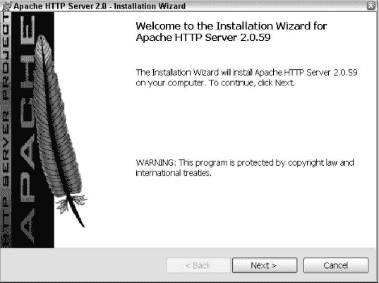

#### 图 1.2

如该图所示，开发系统的服务器信息不需要是真实的。

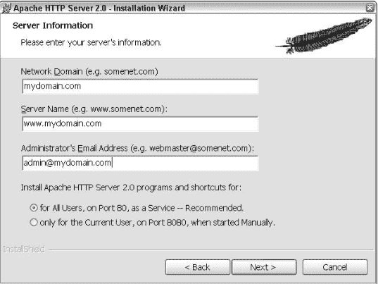

服务器安装是你定义环境特定配置的地方。如果你在真实系统上安装 Apache，你会用正确信息填写此页面，否则 Apache 将无法正确路由请求。对于这种开发设置，你可以接受默认选项。

由于此安装是针对开发服务器，你无需用真实数据填写屏幕，除非你使用本指南在实时服务器上安装。

“为以下用户安装 Apache HTTP Server 2.0 程序和快捷方式”选项用于仅让当前用户能够访问 Apache。如果你希望所有用户都能访问 Apache，则应将其作为服务进行安装。

Apache 安装过程可以以两种方式进行，如图 1.3 所示。第一个选项是接受所有默认设置，这会导致更快的安装，但并非始终是最佳选项。

第二种更常见的选项是“自定义”替代方案，你在其中告诉 Apache 想要安装哪些工具和库。偶尔在安装应用程序时，你可能会遇到硬盘空间不足的情况。

另一方面，即使安装了所有额外工具，Apache 也非常小，因此你不应该在安装时遇到问题。

#### 图 1.3

选择“自定义”选项是为了确保安装所有开发工具，例如库和模块构建功能。

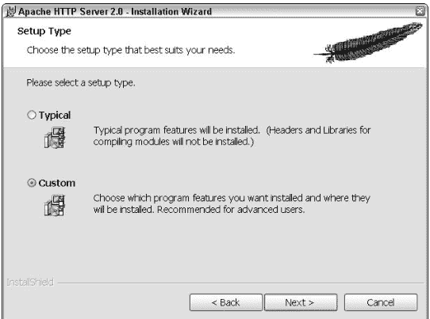

对于本书中的示例，最好接受自定义安装并确保安装所有库和扩展。例如，一些用于修改用户请求的模块仅在安装完整版本时可用。

取决于系统，安装 Apache 可能需要一段时间。即使进度条停止移动也不要担心；某些文件安装所需的时间比其他文件长。如果安装过程中发生什么情况，应用程序会通知你，但这种情况非常罕见。安装过程中，Apache 会更新进度条，如图 1.4 所示。

#### 图 1.4

Apache 安装状态

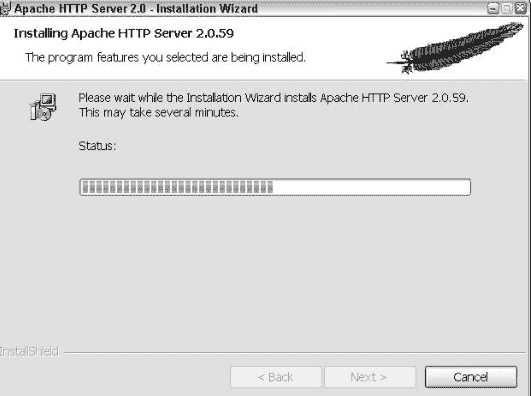

你应该看到的最后一个屏幕是安装成功的提示。可能会出现 DOS 提示符，通知你 Apache 服务正在启动。你还可能收到防火墙警告，需要授予 Apache 请求的访问权限。

#### 测试

恭喜。如果一切顺利，你现在应该已在 Windows 机器上安装了 Apache。要测试安装，请打开 Web 浏览器并将其指向本地 Apache Web 服务器，也称为 `localhost`。

```
http://localhost/
```

你应该会看到一个类似于图 1.5 中所示的屏幕，它基本上告知你 Apache 已正确安装，并准备好开始提供内容。


根据安装过程，您可以修改此位置，在远程服务器上安装时有时需要这样做。您将无法在 localhost 地址上访问 Apache Web 服务器。相反，您将指向您 Web 站点的 IP 地址或域名。

图 1.5 Apache 的默认欢迎屏幕

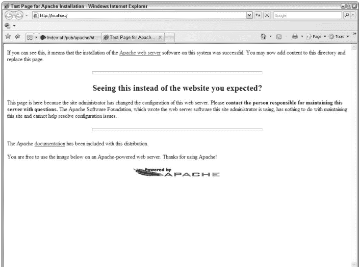

安装 Apache 后，您可以修改默认页面以真正了解 Apache 的工作原理。

Apache 提供的 Web 文件位于文档根目录中。这类似于您可能在远程 Web 服务器上见过的 public_html 或 www。与远程 Web 服务器不同，这些文件的权限通常对不从您自己的个人计算机查看的其他用户不可用。

使用默认安装时，Windows 中此 Web 目录的位置是：

```
C:\Program Files\Apache Group\Apache2\htdocs
```

您将在此目录中看到许多不同的文件，例如各种语言的相同索引文件。

您不想修改其中任何文件，因为这可能会破坏 Apache 的核心或引入非常难以追踪的错误，因此请创建一个新文件。

使用您喜欢的文本编辑器，创建一个非常简单的 HTML 页面，例如如下所示：

```
<!DOCTYPE html PUBLIC "-//W3C//DTD XHTML 1.0 Strict//EN"
"http://www.w3.org/TR/xhtml1/DTD/xhtml1-strict.dtd">
<html xmlns="http://www.w3.org/1999/xhtml" lang="en">
<head>
<title>My Custom Page</title>
</head>
<body>
<h1>Welcome to my custom page</h1>
<p>This is a test of the customization of Apache!</p>
<p>Pretty cool huh?</p>
</body>
</html>
```

将此新文件保存在 Apache Web 目录中并将其命名为 myPage.html。保存文件后，在 Web 浏览器中打开它，以见证 Apache 的灵活性。

这不是最先进的示例，但它应该让您了解如何修改和使用 Apache Web 服务器的基本思路。现在是创建更有用示例的时候了，因为您已经掌握了基础知识。

此时，在安装并测试 Apache 后，您可以继续进行 PHP 的安装和配置，也可以跳转到 Apache 的配置过程。

或者，您可以阅读下一节中介绍的 UNIX 上的 Apache 安装过程。

在 UNIX 上安装 Apache 更接近于使用远程服务器，因为您会发现大多数 Web 服务器都是基于 Linux 构建的。这并不意味着您永远找不到基于 Windows 的实时 Web 服务器，但这当然并不常见。

### 在 UNIX 上安装 Apache

UNIX 中的安装过程比 Windows 安装更高级。但是，UNIX 安装通常是实时服务器更常见的场景。

安装 Apache 的第一步是下载源代码。此源代码可以从本书的网站下载，也可以直接从 Apache 的网站下载。使用本书网站提供的源代码可确保您运行的系统与编写本书时使用的系统几乎相同。

如图 1.6 所示，您可以从 Apache 的以下 URL 找到源代码：http://httpd.apache.org/download.cgi。

图 1.6

以下是可从 Apache 服务器下载的源代码可能版本列表。

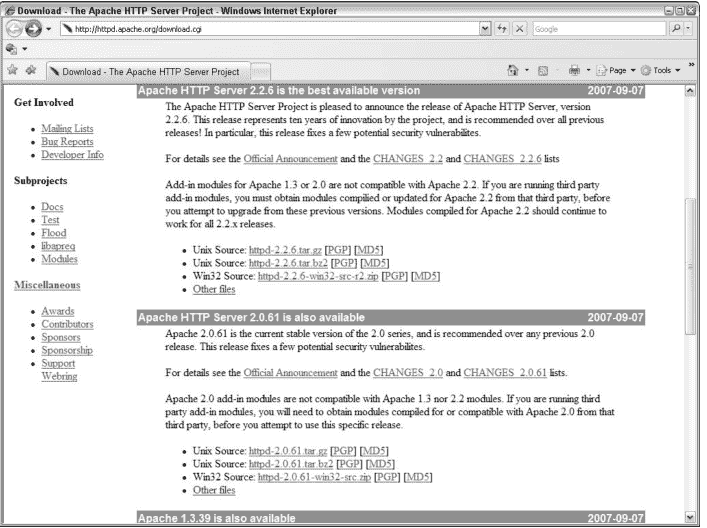

下载 Apache 源代码后，您可以开始安装过程。

#### 安装前

在安装开始之前，必须从下载的文件中提取源代码。只需解压缩 tarball 文件并取消归档未压缩的文件即可完成。

```
$ gzip -d httpd-2.2.6.tar.gz
$ tar xvf httpd-2.2.6.tar
```

完成上述两个进程后，您将得到一个包含源代码的新目录。

在继续之前，请切换到此目录，这意味着您将位于存放源代码的目录中。

```
$ cd httpd-2.2.6/
```

#### 安装

提取源代码后，您可以开始安装过程。Apache 将使用其自身的一组选项进行安装，但您可以修改这些选项。如果要使用默认值配置 Apache，只需键入 ./configure。

但是，将安装过程定制为您的环境是更好的做法。

您可以定义的最重要选项之一是 --prefix，即 Apache 将安装的位置。该选项在整个应用程序中使用，并且在稍后的 PHP 安装和配置部分中也会使用。

为简单起见，使用了部分修改的配置过程，但请随时查阅 Apache 文档以更好地了解可以更改哪些设置。

```
$ ./configure --prefix=/usr/local/apache
--enable-rewrite=shared \
--enable-spelling=shared
```

配置过程开始后，可能需要几分钟才能完成。大多数时候，您会在终端窗口中看到进程打印输出，但即使没有，它也在运行。

configure 命令完成后，您可以运行 make 来构建 Apache 包。

```
$ make
```

同样，此过程可能需要一些时间，具体取决于您的系统，请耐心等待。make 命令完成后，最后要运行的命令是安装包并完成安装部分。

```
$ make install
```

#### 测试

安装 Apache 后，您可以启动它并在浏览器中进行测试。

Apache 安装了一个非常有用的工具 apachectl，它位于安装位置的 bin/ 目录中。使用本安装选择的路径，apachectl 应用程序将位于此处。

```
$ usr/local/apache/bin/apachectl
```

使用以下命令启动 Apache 服务器：

```
$ usr/local/apache/bin/apachectl start
```

使用此命令停止 Apache 服务器：

```
$ usr/local/apache/bin/apachectl stop
```

要重新启动 Apache 服务器，请使用此命令：

```
$ usr/local/apache/bin/apachectl restart
```

通过在 Web 浏览器中访问 http://localhost/ 来对服务器进行测试。

正如您现在所见，安装成功了。为了进一步测试并更好地了解如何修改 Apache 提供的文件，请创建一个新的 HTML 文件并将其保存在 Apache Web 根目录中。

使用您喜欢的文本编辑器（在 UNIX 中很可能是 vi）创建这个新的 HTML 文件。以下命令假设您正在使用 vi。

创建一个新文件：

```
$ vi /usr/local/apache/htdocs/sampleFile.html
```

为了开始输入 HTML 代码，您需要告诉 vi 进入插入模式，方法是按 I 键。按 ESC 键退出插入模式。

粘贴或键入以下示例 HTML 代码：

```
<!DOCTYPE html PUBLIC "-//W3C//DTD XHTML 1.0 Strict//EN"
"http://www.w3.org/TR/xhtml1/DTD/xhtml1-strict.dtd">
<html xmlns="http://www.w3.org/1999/xhtml" lang="en">
<head>
<title>My Custom Page</title>
</head>
<body>
<h1>Welcome to my custom page</h1>
<p>This is a test of the customization of Apache!</p>
<p>Pretty cool huh?</p>
</body>
</html>
```

创建文件后，按 ESC 并键入以下命令以保存并关闭编辑器。请注意，: 是命令的一部分。

```
:wq
```

您添加或修改的某些文件需要重新启动 Apache；但是，基本 Web 文件不属于此类。您现在可以通过在 localhost 调用中追加文件名来显示新页面，地址为 http://localhost/sampleFile.html。

正如您所见，Apache 服务器已正确安装，并且您已成功添加了 Apache 能够正确提供的自定义文件。此时，您应该对 Apache 的工作原理有基本了解。下一节（与平台无关）将更详细地介绍如何修改 Apache。

## 修改 Windows 和 UNIX 上的 Apache

以下提示、技巧和调整可以在 Windows 或 UNIX 安装上执行。这是因为它们特定于 Apache，而不是它运行的环境。

在开发系统上工作时，需要多个 Apache 安装并不罕见。这可能是为了测试前沿代码、支持更多插件，或者只是确保项目正在运行在实时系统的克隆上。

Apache 的安装过程基本保持不变。您只需更改前缀选项，将其指向新的/不同的位置。您可以运行多个版本的 Apache；但是，它们需要单独的安装位置。仅使用默认安装选项同时运行多个版本的 Apache 是不可能的。这是因为 Apache 默认设置为监听端口 80 上的请求。

您可以通过编辑配置文件来修改 Apache 监听的端口。配置文件位于 conf/ 目录中，该目录位于您在安装 Apache 时指定的目录中。

例如，您可以更改 Apache 运行的端口。首先打开配置文件。

在 UNIX 中打开配置文件，请使用 vi。

```
$ vi /usr/local/apache/conf/httpd.conf
```

在 Windows 中打开配置文件，请导航到安装目录并在您喜欢的文本编辑器中打开 httpd.conf 文件。

```
C:\Program Files\Apache Group\Apache2\conf\httpd.conf
```

打开文件后，向下滚动或搜索 Listen 指令，它将类似于以下内容：

```
#
#### Listen: Allows you to bind Apache to specific IP addresses
#### and/or
#### ports, instead of the default. See also the <VirtualHost>
#### directive.
#
Listen 80
```

> 注意
> Apache 仅在启动时查看此文件。编辑完成后，请确保重新启动 Apache 服务器。

更改该值即可运行多个 Apache 副本。但是，运行多个 Apache 实例可能会占用大量处理器资源，因此请确保只运行所需的实例数量。在大多数情况下，您将在实时服务器上只运行一个实例。


## 安装 MySQL

既然 Apache 已安装，接下来要安装的组件是 MySQL。它将是存储应用程序内容的数据库，并使用 PHP 进行管理。

### 在 Windows 上安装 MySQL

与 Apache 安装过程类似，MySQL 提供了 Windows 安装程序，可大大简化整个过程。安装程序将引导您完成核心数据库及所需任何其他组件的安装过程。本设置中使用默认安装，但您也可随意自定义，这本身就是一种非常好的学习方式。

#### 下载

安装 MySQL 的第一步是下载最新的安装文件。您可以使用本书网站提供的文件以确保兼容性，也可以访问 MySQL 网站 http://dev.mysql.com/downloads/mysql/5.0.html#win32 获取当前最新的稳定版本。

选择带 Setup 的 Win32 安装程序，以便简化整体安装过程。这样您就可以使用 GUI，而无需使用早期版本的传统命令行流程。

#### 安装

下载并打开安装程序后，会出现欢迎页面，随后是组成安装过程的其他页面，如图 1.7 所示。与 Apache 安装类似，MySQL 也有多个需要修改的配置选项。请仔细查看以下步骤，以确保数据库正常运行。

选择“Typical（典型）”安装选项，该选项将安装运行和维护 MySQL 数据库所需的核心组件。单击 Next 进入下一步。

此时，MySQL 已安装完成。最后一页将为您提供启动配置部分的选项，当您单击 Next 时。

请务必选择此选项。如果您意外关闭了此页面，可以重新运行它，或在程序文件中的 mysql/ 目录下打开配置应用程序。

MySQL 的安装不提供太多修改选项。这是因为支持应用程序 Configuration Wizard 会处理所有必要的配置选项。

选择“Detailed Configuration（详细配置）”选项，如图 1.8 所示。这样您可以精细调整 MySQL 配置，而不是使用所有默认设置。单击 Next 继续。

#### 图 1.7

此页面是安装过程。安装可能需要几分钟，具体取决于系统。

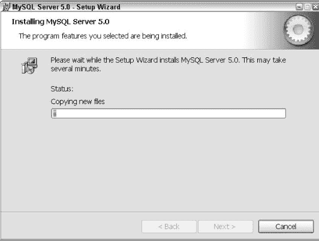

如果您选择“Standard Configuration（标准配置）”选项，将看到一个更短的配置屏幕列表。这加快了配置过程，但不允许您自定义 MySQL 的功能，可能导致系统效率降低。

#### 图 1.8

选择配置类型。

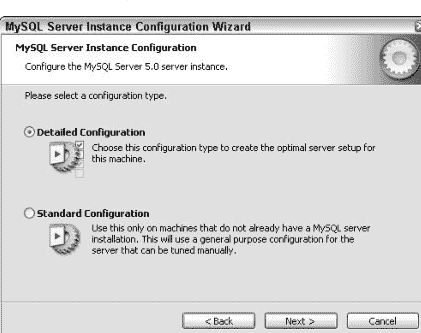

服务器类型决定内存、硬盘和 CPU 的使用情况。由于 MySQL 已安装在您的开发机上，您希望确保 MySQL 不会过度占用处理器或资源。选择“Developer Machine（开发机）”选项可确保不会出现这种情况。

其他两个选项适用于专用服务器。当您在运行 Web 服务器（例如 Apache）的同一台机器上安装 MySQL 时，将使用“Server Machine（服务器）”选项。这适用于中等流量的网站，但随着网站活跃度增加，您可能会发现资源使用量激增。

出现这种情况时，您会希望引入一台专用机器来运行 MySQL 数据库，此时应选择“Dedicated MySQL Server Machine（专用 MySQL 服务器机器）”选项。该选项告知 MySQL 已安装在专用机器上，并使用所有可用资源和内存。

请务必确保在 Web 服务器上安装时，绝不意外选择“Dedicated MySQL Server Machine（专用 MySQL 服务器机器）”选项。否则，系统将无法正确管理资源，最终可能会导致故障。

MySQL 会不断尝试分配所有可用空闲内存，这意味着当 Web 服务器关闭过时连接时，MySQL 可能会窃取该空闲内存，直至没有可用连接空间。

选择一个选项（本示例中为 Dedicated Machine）后，单击 Next（参见图 1.9）。

#### 图 1.9 为服务器类型选择“Developer Machine（开发机）”选项。

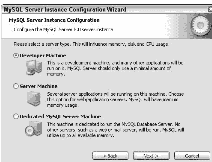

选择“Multifunctional Database（多功能数据库）”选项作为数据库使用类型，以实现系统的最大扩展性。这样 MySQL 可以针对 InnoDB 和 MyISAM 存储引擎进行优化。如果这是您第一次安装 MySQL（由于许多系统预装了 MySQL，这种情况非常可能），您可能想知道另外两个选项如何使用。

“Transactional Database Only（仅事务型数据库）”选项用于运行大量基于事务的查询时。这意味着您将在一次运行中封装一批查询（UPDATE、SELECT、DELETE、INSERT），以确保所有适当的表和数据都被修改。但如果其中某次修改出错，可能会破坏剩余数据。

这将意味着大量不必要的数据编辑，在某些情况下还可能导致数据错误。事务会查找错误或触发器，如果发现，则会在事务开始时所做的所有修改都会回滚并恢复到未修改的状态。

以下是基于 MySQL 的事务示例，该事务修改同一表中的两个独立数据部分。

```
START TRANSACTION;
UPDATE users SET credits = credits - 100 WHERE id = 3002;
UPDATE users SET credits = credits + 100 WHERE id = 3002;
COMMIT;
```

在事务过程中，这些条目对其他会话不可用，以确保事务执行期间数据不能被读取或修改。您可以将此过程视为类似于关闭家里的电源，以确保在您工作时不会有人意外拨动灯开关。

当您确定永远不需要事务功能时，将选择“Non-Transactional Database Only（仅非事务型数据库）”选项。这只启用 MyISAM 存储引擎，虽然可以提供更好的结果，但也限制了整体功能。

通常情况下，您会发现如图 1.10 所示的“Multifunctional Database（多功能数据库）”选项是最佳选择，但了解其他选项提供的功能也是好的。

#### 图 1.10

“Multifunctional Database（多功能数据库）”选项已选为数据库存储类型。

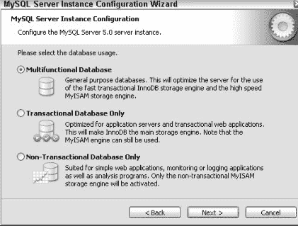

下一页允许您自定义 InnoDB 存储系统，但最好保持默认设置。

在某些情况下，您可能想要选择单独的位置，可以通过单击安装框右侧的“Browse（浏览）”按钮来完成。只有当窗口底部的“Drive Info（驱动器信息）”通知报告可用磁盘空间较少时，才需要选择不同的位置，这意味着您的数据库可能会消耗剩余资源。

> 请务必不要选择可移动驱动器作为存储位置，因为如果该驱动器未始终连接，可能会损坏数据库。

如前所述，通常最好将此选项保留在默认选择，如图 1.11 所示，以确保数据库正常运行。

#### 图 1.11

InnoDB 表空间设置

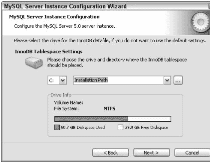

下一选项是 MySQL 数据库需要处理的并发连接数的近似值。由于此安装是在开发服务器上进行的，不超过 25 的估计是一个现实假设。实际上，超过 5 个连接是罕见的，但 25 是一个不错的基准值。

开发面向公众的 Web 应用程序时，在“Decision Support（决策支持）”标题下选择“Online Transaction Processing (OLTP)（在线事务处理）”选项。这是因为您完全不知道任何给定时间可能有多少人尝试访问系统。随着应用程序的不断增长，您甚至可能需要将多个数据库链接在一起以处理负载，但目前一个数据库就足够了，特别是考虑到此安装是在您的本地系统上进行的。


当你想要指定一个确切数字时，请选择“手动设置”选项。只有在你希望完全控制 Web 应用程序时才需要这样做。在实际运行的 Web 应用程序中，你经常会看到这个手动数字设置为 300。这似乎是一个很好的平均值，能够处理许多连接。

请小心不要将并发连接选项（如图 1.12 所示）设置得太高，因为你的系统拥有的资源有限，只能由每个连接拆分和共享。如果你为应用程序添加更多内存，可以增加这个数字，但这不一定总是最佳选择。

#### 图 1.12
设置并发连接的近似数量。

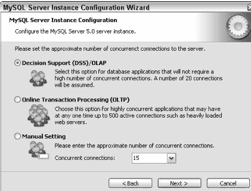

网络选项决定你的 MySQL 数据库是否对本地设置之外的其他机器可见。为获得最高安全性，请禁用“启用 TCP/IP”选项。如果你有多个开发机器，可以启用它并选择一个非标准端口。

对于此安装，已启用网络（如图 1.13 所示），并使用默认端口，因为我无意允许他人连接，但我的 Web 服务器位于硬件防火墙后面，以增加安全性。

如果在同一系统上安装另一个版本的 MySQL，请选择一个非标准端口号。这并不常见，但有时你需要部署向后兼容的环境，以便在各种配置下测试代码。与构建和维护另一台物理机器来处理测试过程相比，这是一种经济高效的替代方案。

请确保选择“启用严格模式”选项，以确保你的数据库服务器正常运行。

#### 图 1.13 设置网络选项

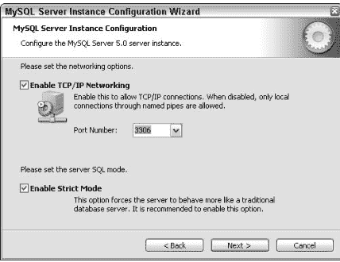

在下一页，你可以选择数据库使用的默认字符集。本示例中选择了“标准字符集”选项（见图 1.14），但通常这不是最佳选择，因为它无法与现有系统获得最佳兼容性，也无法支持长期扩展。对于本示例，它可以正常工作，因为你不会使用任何高级字符。

当然，你可以选择最适合你用途的任何选项，但我更倾向于“最佳多语言支持”选项。该选项允许更大的扩展性，并且在存储多种不同语言的文本时强烈推荐使用。

当你希望指定要使用的某个字符集，而不是从一系列字符集中选择时，请选择“手动选择的默认字符集/集合”选项。你可能永远不会使用此选项，因为它过于具体，但如果需要，它是可用的。

如果你认为将使用多种语言，我建议选择第二个选项，“最佳多语言支持”，以确保你的应用程序能够扩展，并且以后还可以尝试不同的选项。

Windows 选项页面（见图 1.15）决定 MySQL 的初始化方式。例如，如果你选择以服务方式运行 MySQL，它将由操作系统自动启动或停止。如果你安装过之前的 MySQL 版本，则需要选择一个不同的服务名称。这是为了确保现有服务不会与此服务冲突。

选择“自动启动 MySQL 服务器”选项，以确保系统启动时数据库可用。这不是必需的，但这样你就不必在每次重启机器后手动启动服务。当然，你也可以随时访问系统上的服务应用程序来修改此选项，以及在下次机器启动之前关闭服务。

#### **图 1.14**
选择默认字符集

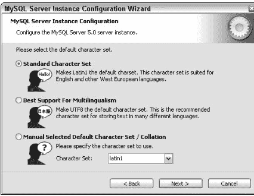

选择“在 Windows PATH 中包含 Bin 目录”选项后，只需键入 mysql 即可从命令行使用 MySQL 支持。这意味着任何命令提示符都将允许你快速访问 MySQL 数据库。你可以参考操作系统说明来修改此 PATH 变量。

你还可以将 PHP 和 Apache 添加到同一个 PATH 变量中，这样它们也会暴露在命令提示符中。事实上，安装 PHP 时会提供一些关于执行此修改的教程材料。

#### **图 1.15**
Windows 选项决定 MySQL 的启动和访问方式。

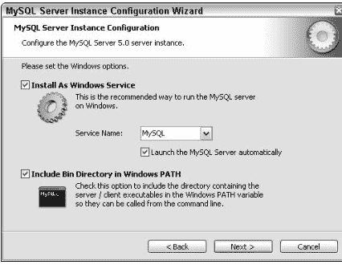

最终配置用于设置 root 密码，如图 1.16 所示。root 用户对你的数据库拥有全局权限，因此你可以想象保护此用户有多么重要。你不必选择密码，但默认情况下，MySQL 安装时没有 root 密码，这意味着任何人都可以访问你的数据库。

最好选择一个难以猜测的密码，再输入一次，并确保未选择“允许从远程计算机访问 root”选项，以禁用远程管理数据库的功能。这个选项看似能提供更好的可用性，但存在一些例外，其中之一就是系统的整体安全性。

尽管此设置是在开发服务器上执行的，但最好始终将安全放在安装过程的首位。这样做将确保你在远程设置上执行类似安装时遵循必要的预防措施。

如果安全不是问题，你确实可以创建匿名帐户。但是，创建此类帐户几乎与无密码 root 登录相同，并将面临相同的整体安全问题。

#### 图 1.16 MySQL 安全选项

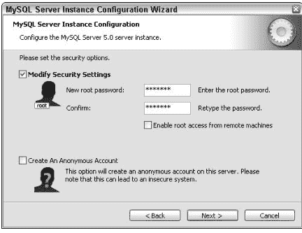

最后一页（如图 1.17 所示）用于处理前面页面中设置的配置值。如果出于某种原因遇到错误，MySQL 将通知你。

大多数时候，你会看到每个项目符号在完成时都会应用一个复选标记。

处理完成后，你会看到一条通知，告知你配置已完成，MySQL 已准备好使用。

你现在已成功安装并配置了 MySQL，可用于本书的其余部分。单击“完成”以关闭配置页面并开始测试安装。

#### 图 1.17
每个任务完成时，带有适当通知的配置处理显示。

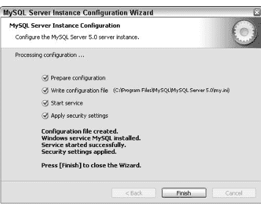

### 测试

安装 MySQL 后，可以对其进行测试。你可以使用 MySQL 监视器查看服务状态，以确定数据库服务器是否正在运行。你可以使用命令行登录并调查 MySQL 数据库，就像在远程服务器上一样。

打开新命令提示符（如图 1.18 所示），请按 Windows 键+R。当提示符打开后，键入以下命令以登录：

```
$ mysql -uroot -p
```

> **注意** 如果出现“command not found”，你需要将 MySQL 添加到 PATH 变量中。

将出现“Enter Password”通知。键入在配置过程中设置的密码。

> **注意** 输入密码时，提示符不会显示任何文本更新。

#### 图 1.18
带有用于登录到 MySQL 数据库服务器的命令的命令提示符。

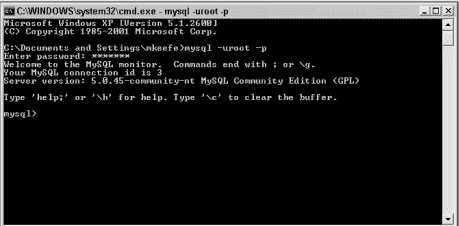

如果登录成功，将出现描述 MySQL 服务器的通知。该通知包含你当前运行的 MySQL 版本。以下是通知示例：

> 欢迎使用 MySQL 监视器。命令以 ; 或 \g 结尾。
> 你的 MySQL 连接 ID 是 5
> 服务器版本: 5.0.45-community-nt MySQL Community Edition
> (GPL)

登录 MySQL 后，命令提示符会更改为 mysql>。从此点起，直到你登出，所有命令都将发送到数据库服务器。

例如，要查看可用的数据库，请键入以下命令：

```
mysql> show databases;
```

要测试数据库安装，请创建一个新数据库：

```
mysql> create database flashphp;
```

创建数据库后，可以使用以下命令选择它：

```
mysql> use flashphp;
```

你甚至可以在登录阶段传递数据库名称，例如：

```
$ mysql -uroot -p flashphp
```

此时，MySQL 应该已成功安装在你的 Windows 开发服务器上。下一节将介绍如何在 UNIX 和类 UNIX 系统上安装 MySQL。PHP 安装过程紧随 UNIX 说明之后。如果你只想专注于 Windows 系统，可以随时跳过。


## Installing MySQL for UNIX

你可以使用本书网站提供的源代码在 UNIX 系统上安装 MySQL，也可以直接从 MySQL 下载最新文件，网址为 http://dev.mysql.com/downloads/mysql/5.0.html#linux。

> **注意** 要下载的版本取决于你安装所处的环境。
> 有关更多信息，请参阅以下指南：
> http://dev.mysql.com/doc/refman/5.0/en/which-version.html.

下载所需安装文件后，即可开始安装准备工作。第一步是添加 mysql 用户和组，以供 MySQL 运行。以下命令将创建 mysql 组，并将 mysql 用户添加到该新组中：

```
$ groupadd mysql
$ useradd -g mysql mysql
```

选择要安装 MySQL 的目录。你可以选择与安装 Apache 相同的位置，以便将所有开发组件保存在同一位置。

```
$ cd /usr/local
```

> **注意** 如果目录受到保护，你可能需要以 root 身份执行 MySQL 安装。

解压分发包并创建指向该目录的符号链接。

```
$ gunzip < /usr/local/mysql-5.0.45-linux-i686-glibc23.tar.gz | tar xvf -
$ ln -s /usr/local/ mysql-5.0.45-linux-i686-glibc23 mysql
```

解压命令完成后，切换到安装目录。

```
$ cd mysql
```

通过运行递归所有权命令将文件所有权更改为 MySQL。第一个命令更改所有权，第二个命令更改组属性。

```
$ chown -R mysql
$ chgrp -R mysql
```

如果你在这台机器上尚未安装以前的 MySQL 版本，则必须创建 MySQL 数据目录并授予表。

```
scripts/mysql_install_db --user=mysql
```

如果你希望机器启动时 MySQL 自动运行，可以将 support/ 目录下的 mysql.server 文件复制到系统存放其他启动文件的位置。有关该目录位置及其他系统特定问题的更多信息，请访问 http://dev.mysql.com/doc/refman/5.0/en/UNIX-post-installation.html#automatic-start。

当一切都正确解压并安装后，即可开始测试。

要启动 MySQL 服务器，请从 mysql 安装目录运行以下命令：

```
$ bin/mysqld_safe --user=mysql &
```

使用以下命令验证服务器是否实际在运行：

```
$ bin/mysqladmin version
$ bin/mysqladmin variables
```

mysqladmin version 的输出会因安装的版本而异。以下是该命令返回的示例：

```
mysqladmin Ver 14.12 Distrib 5.0.54, for pc-linux-gnu on i686
Copyright (C) 2000 MySQL AB & MySQL Finland AB & TCX DataKonsult
AB
This software comes with ABSOLUTELY NO WARRANTY. This is free
software,
and you are welcome to modify and redistribute it under the GPL
license

Server version 5.0.54
Protocol version 10
Connection Localhost via UNIX socket
UNIX socket /var/lib/mysql/mysql.sock
Uptime: 0 days 2 hours 2 min 07 sec

Threads: 1 Questions: 323 Slow queries: 0
Opens: 0 Flush tables: 1 Open tables: 7
Queries per second avg: 0.000
```

## Protecting MySQL

保护 MySQL 用户免受恶意活动非常重要。默认情况下，MySQL 安装的 root 用户和匿名用户没有密码，这与使用全局默认值相同。最好立即分配密码，在某些情况下彻底删除匿名用户。

### Setting a password on Windows

运行安装程序时，root 账户的密码已设置。但是，如果出于某种原因你想更改它，只需运行以下命令，将 NEW_PASSWORD 替换为要使用的实际密码：

```
$ mysql -uroot
mysql> SET PASSWORD FOR 'root'@'localhost' =
PASSWORD(NEW_PASSWORD);
mysql> SET PASSWORD FOR 'root'@'%' = PASSWORD(NEW_PASSWORD);
```

### Setting a password on UNIX

在 UNIX 上安装 MySQL 后，root 登录没有密码，这与 Windows 安装不同。非常重要，必须立即分配密码：

```
$ mysql -uroot
mysql> SET PASSWORD FOR 'root'@'localhost' =
PASSWORD(NEW_PASSWORD);
mysql> SET PASSWORD FOR 'root'@'host_name' =
PASSWORD(NEW_PASSWORD);
```

将 host_name 替换为服务器主机名。如果你不知道服务器主机，请在登录到 MySQL 时运行以下命令以确定该信息：

```
SELECT Host, User FROM mysql.user;
```

要删除匿名账户，请登录到 MySQL 并发出以下命令：

```
DROP USER '';
```

> 删除用户时要谨慎，并在发出该命令前仔细检查用户名的拼写。

## Setting up PHP on the Web Server

PHP 是完成构建开发系统过程的最后一个安装组件。安装 PHP 的过程很简单，但需要一些自定义。

> 安装 XML 和 GD 库支持时，你的系统可能需要额外的库和组件。

### Installing PHP for Windows

在 Windows 上安装 PHP 实际上非常简单。安装过程的大部分内容包括移动文件和编辑现有文件。你可以在本书网站上找到 PHP 安装文件，也可以直接从 php.org 网站下载最新文件，网址为 www.php.net/downloads.php。

### Installation

要开始安装 PHP 的过程，请运行下载的安装程序应用程序。将出现设置向导的欢迎页面，如图 1.19 所示。

目标文件夹（如图 1.20 所示）是你安装 PHP 的位置。默认情况下，它选择了包含 Program Files 的目录路径。这在某些服务器上可能会引起问题。如果你打算安装多个 PHP 副本，常见路径是 C:\php 或 C:\php5。

#### FIGURE 1.19

PHP 安装欢迎页面

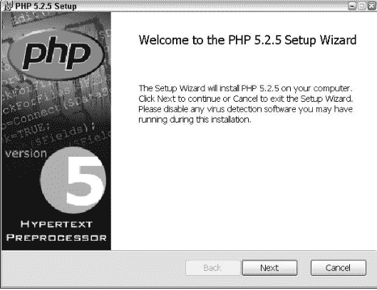

#### FIGURE 1.20

选择目标文件夹。

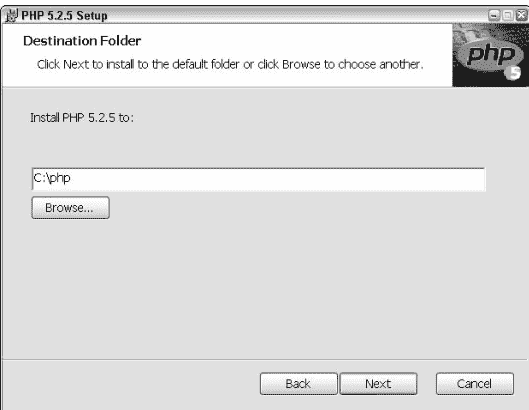

PHP 安装程序旨在配置 PHP 和 Apache 以协同工作。这包括编辑 Apache 的配置文件。

在 Web 服务器设置页面（如图 1.21 所示）中，选择先前安装的 Apache 版本。如果你不确定安装了哪个版本，可以在提示符下运行以下命令：

```
/usr/local/apache2/bin/httpd -v
```

以下是上述命令的示例输出：

```
Server version: Apache/2.0.59
Server built:   Aug 31 2007 01:58:43
```

#### FIGURE 1.21

PHP 安装程序 Web 服务器设置页面

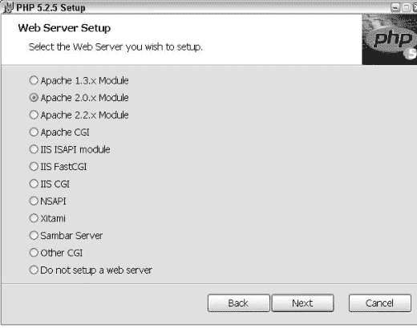

下一页（见图 1.22）是向安装程序告知 Apache 配置目录位置的页面。例如，如果你按照本章开头的 Apache 安装指南操作，路径如下：

```
C:\Program Files\Apache Group\Apache2\conf\
```

在下一页，你选择本书所需的额外扩展（见图 1.23）。这些扩展是 GD2、EXIF、MySQL 和 PEAR。你也可以选择安装任何其他你认为可能有用的扩展。

#### FIGURE 1.22

Apache 配置目录页面

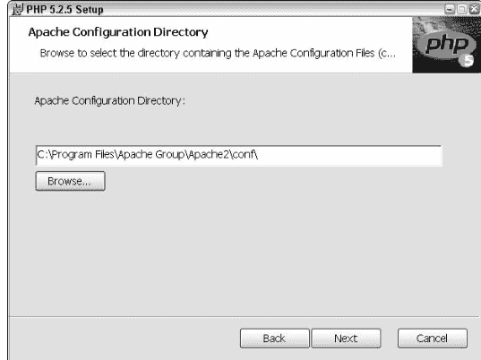

#### FIGURE 1.23

选择要在 PHP 之外安装的扩展。

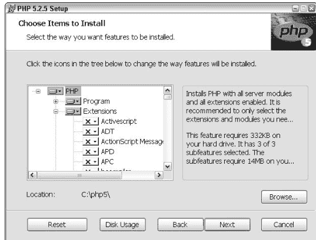

此时，整个配置已设置完毕，你可以单击 Install 开始安装 PHP。安装完成后，将出现完成页面。

你可以打开 PHP 安装目录并查看各种文件。你还可以编辑 php.ini 文件以满足特定需求。

```
C:\php5\php.ini
```

除了应该启用 display_errors 之外，php.ini 的默认配置应该适用于开发设置。启用错误显示会告诉 PHP 将任何错误打印到屏幕上。在生产设置中，这可能被视为安全问题。开发服务器通常仅由授权查看者看到，这意味着启用此选项不是问题。

打开 php.ini 文件并搜索引用 error_reporting 的部分。

```
display_errors = Off
```

将值更改为 On。

```
display_errors = On
```

> **注意** 对 **php.ini** 文件的更改在重新启动服务器之前不会生效。

继续之前，请确保重新启动 Apache Web 服务器，因为你对 Apache 配置进行了一些修改。

### Testing

安装 PHP 后，你可以创建示例 PHP 文件进行测试。常见的示例文件是 phpinfo 文件，它允许你查看服务器上 PHP 安装的配置变量。

你可以使用记事本或任何其他文本编辑器来创建此示例文件。如果你安装了 Adobe 的完整 Web Suite，可以使用 Dreamweaver 编写 PHP 文件（见图 1.24）。

phpinfo 文件的语法如下。

```
<?php
phpinfo();
?>
```

将此文件保存为 info.php，保存位置为 Apache 安装的文档根目录。例如，如果你将 Apache 安装到默认位置，PHP 文件将保存到：

```
C:\Program Files\Apache Group\Apache2\htdocs\info.php
```


图 1.24
在 Dreamweaver CS3 中看到的示例 PHP 文件

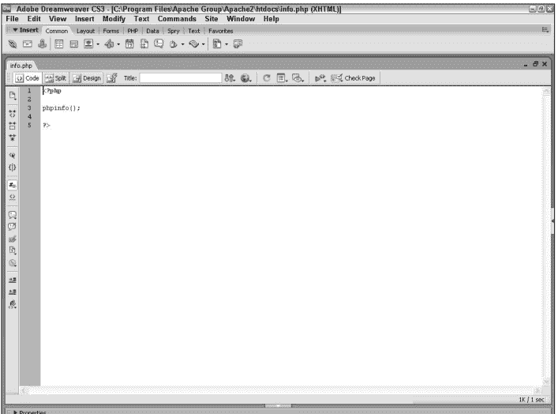

您现在可以在 Web 浏览器中打开此文件，如图 1.25 所示。

http://localhost/info.php

如果您愿意，可以创建一个自定义 PHP 文件来测试 PHP 是否正常运行，例如：

```
<?php
print "Hello, World! This is PHP.";
?>
```

在浏览器中运行此文件时，您应该能看到显示的消息。

图 1.25

Web 浏览器中显示的 PHP 信息

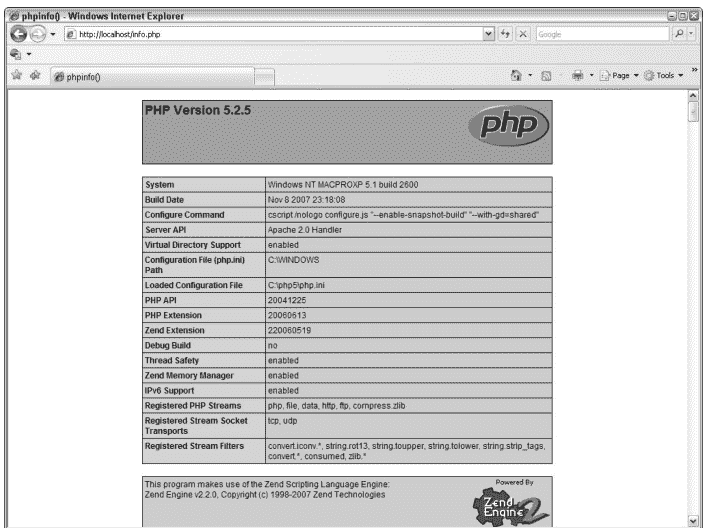

## 为 UNIX 安装 PHP

为 UNIX 安装 PHP 更加详细且需要更多配置。大多数命令行安装设置也是如此。您可以从本书的 Web 站点或官方 PHP Web 站点之一下载安装程序文件。

获得 PHP 安装程序文件后，即可开始安装过程。在开始安装之前，最好先停止 Apache，以确保没有文件损坏。

```
/usr/local/apache/bin/apachectl stop
```

要开始安装，请创建将安装 PHP 的目录。

```
mkdir /usr/local/php5
```

您可以将 php5 替换为 php。但是，添加版本号可以更轻松地进行多个安装，并且未来更易于管理。

```
cd /usr/local/php5
```

解压缩文件并键入安装目录：

```
gunzip php-5.2.5.tar.gz
tar -xvf php-5.2.5.tar
cd php-5.2.5
```

### 构建配置参数

下一步是构建配置行。这将包含您希望在安装中包含的所有必要扩展和功能。例如，您需要包含数据库和图像支持才能完成本书中的一些章节等。每个选项都包含在一组单引号 (‘’）中，如有必要，将包含路径。

```
./configure' '--prefix=/usr/local/php5' '--with-
apxs=/usr/local/apache/bin/apxs' '--with-gd' '--enable-exif' '--with-mysql=shared,/usr/local/php5' '--with-
mysqli=shared,/usr/local/php5/bin/mysql_config' '--with-
libxml-dir=shared,/usr/local/php5' '--with-
xsl=shared,/usr/local/php5' '--with-jpeg-dir=/usr/local/php5'
'--with-png-dir=/usr/local/php5' '--enable-gd-native-ttf' '--with-freetype-dir=/usr/local/php5' '--with-
gettext=shared,/usr/local/php5'
```

当配置过程完成后（根据系统可能需要一段时间），创建并运行安装程序：

```
make
make install
```

make install 命令完成后，PHP 应该已安装。

### 配置

需要配置 PHP 的几个部分，以确保它能与 Apache 和整体开发系统无缝协作。此过程相当容易完成，但错误的修改可能会导致系统崩溃。另外，修改配置文件时，最好先进行备份。

第一步是将 php.ini 文件移动到 PHP 启动时会使用的中心位置。

```
cp php.ini.recommended /usr/local/lib/php.ini
```

为了让 Apache 加载 PHP 文件，请添加必要的模块引用：

```
LoadModule php5_module modules/libphp5.so
AddType application/x-httpd-php .php .phtml
AddType application/x-httpd-php-source .phps
```

重新启动 Apache 以使这些更改生效。每当您编辑 PHP 或 Apache 中的值时，都必须重新启动服务器。

```
/usr/local/apache/bin/apachectl start
```

一切安装妥当后，您可以通过运行示例 PHP 文件来测试设置：

```
<?php
phpinfo();
?>
```

## 摘要

在本章中，您了解了安装完整开发系统所需的步骤。此过程包括在 Windows 或 UNIX Web 服务器上安装 Apache、PHP 和 MySQL。下一章将引导您完成使此开发设置更安全的过程。这包括保护服务器上的文件，以及通过 httpd.conf 配置文件进行整体服务器配置。

# 第 2 章

## 探索 Flash 和 PHP

**本章内容**

- Web 服务器简介
- 探索 PHP
- 探索 MySQL 基础知识
- 探索 Flash

如果您已在服务器上安装所有组件，可以将设置配置得更安全。解释安全性后，下一步是设置适当的错误处理程序，并研究为最终用户创建更易用设置的方法。

在 Web 服务器安全性和配置完成后，您将查看 PHP 概览，以更好地了解一切如何运作。通过各种带有描述和解释的示例，解释了 MySQL 用法及其与 PHP 的基本集成。

最后一部分探索 Flash，包括类设置和整体 IDE 说明。

## Web 服务器简介

在第 1 章中，您了解了如何设置开发服务器，其中包括安装 PHP、MySQL 和 Apache。本节概述了 Web 服务器的设置方法，以及如何使系统更安全。

## 使用 .htaccess 文件

.htaccess 文件用于修改 Apache 对特定目录的功能。此文件类似于 Apache 全局配置中找到的 httpd.conf 文件，例外是它不是必需的，并且可以全局禁用，前提是管理员修改 Web 服务器的设置。

此文件的语法并不高级。它基本上是一个文本文件，用于向 Web 服务器通知特定修改。

例如，您是否注意到带有专用文件扩展名的网站，例如 MediaTemple Web 主机，其格式如下？

```
http://www.mediatemple.net/contact.mt
```

请注意 URL 具有 .mt 扩展名。此扩展名不是标准文件扩展名。可以使用 .htaccess 文件实现此修改：

```
### use custom file extensions
AddType application/x-httpd-php .me
```

如果您希望整个 Web 服务器都能使用此自定义文件扩展名，也可以使用 httpd.conf 文件进行此修改。

Apache 默认处理许多请求，并且安装其他模块后可以提供更多功能。特别是一个模块允许您使用自定义 URL，也常被称为清洁 URL。

.htaccess 的可能性各不相同，完全取决于您的应用程序。.htaccess 的另一种常见用途是将 www 和非 www 请求重定向到同一位置。这不仅限制了冗余链接，还提供了更好的搜索引擎优化。

使用 example.org 域进行此转换的示例类似于以下内容：

```
### Force www.domain.com to domain.com
RewriteCond %{HTTP_HOST} ^www.example.org [NC]
RewriteRule ^(.*)$ http://example.org/$1 [R=301,L]
```

## 保护您的内容

您可以通过多种方式保护内容。您可以构建自定义身份验证系统，或使用 Apache 自带的基本身份验证。

基本身份验证分两步设置。第一步是创建密码和用户。

您使用 htpasswd 文件来创建密码文件。此密码创建命令位于安装 Apache 的 bin/ 目录中。例如，假设您使用了第 1 章中建议的安装路径，您很可能会在以下位置找到该文件。

```
$ /usr/local/apache/bin/htpasswd
```

第一次创建用户时，需要告知密码创建应用程序创建新密码文件。之后请省略 -c 标志。

首次用户设置后未删除 -c 标志会导致创建新密码文件并删除任何现有用户。

虽然不是必需的，但定期备份此文件及其他重要文件是很好的做法，以防系统遇到意外崩溃或数据损坏。

创建密码的命令只是调用密码应用程序并在末尾追加用户名。

```
$ cd /usr/local/apache/bin/
$ htpasswd -c /usr/local/apache/passwd/passwords USERNAME
```

请务必将 USERNAME 替换为您要添加的实际用户名。

htpasswd 应用程序会要求您输入要分配的密码，然后要求您再次键入相同的密码以进行确认。

生成的密码文件是加密的。但是，您仍应将其存储在安全位置。绝不应将此文件存储在公共目录中，因为它可能会危及系统的完整性。

在开发系统中这并不那么重要，但在开发设置中遵循所有正确安全步骤仍是良好做法，以便熟悉它们。随着您继续处理服务器，安全性将变得自然而然。您绝不应为了节省时间而推迟它。

创建密码文件后，在要进行密码保护的任何位置的 .htaccess 中添加安全检查。例如，让我们将身份验证添加到整个服务器，因为这是开发服务器，您不希望任何人查看它。

在 Web 目录根目录的新 .htaccess 文件中添加以下内容。

```
AuthType Basic
AuthName "Authorization Required"
AuthUserFile /usr/local/apache/passwd/passwords
Require valid-user
```

这会通知 Apache，对该目录及其下的任何请求都需要授权。最后一行允许密码文件中的任何用户登录。

**要求有效用户**

您也可以添加特定用户名，但这更难维护。

这是基本身份验证，因此确实有各种限制。例如，您无法修改用户浏览器中显示的对话框。您无法修改输入框旁边的标签值，最重要的是，您无法允许用户注销。

如果您的应用程序需要更定制且集成的登录系统，则根据您的要求，构建自定义 PHP/MySQL 设置可能更好。


## 收集 Apache 信息

随着您继续使用 Apache，有些命令和工具可以帮助您花更多时间开发应用程序，而不是微管理服务器。

### 启动和停止 Apache

像系统上的任何其他软件或硬件一样，Apache 有时也会出现故障。发生这种情况时，通常只需简单重启即可解决问题。例如，当更多用户向 Apache 请求文件时，它可能会开始占用内部内存和临时文件。

要重启 Apache，只需在 UNIX 命令行中调用以下命令，或在 Windows 上重启服务：

```
$ /usr/local/apache/bin/apachectl restart
```

> 注意 apachectl 应用程序的路径可能因 Apache 的安装方式而异。

如果要停止 Apache 且不让它重新启动，请使用以下命令。这通常在安装新模块或更新 Apache 本身时进行。

```
$ /usr/local/apache/bin/apachectl stop
```

完成更新后重新启动服务器，只需使用 start 选项：

```
$ /usr/local/apache/bin/apachectl start
```

### 确定 Apache 版本

偶尔，在安装新软件时，您需要知道当前运行的是哪个版本的 Apache。例如，安装 PHP 时需要知道正在使用的 Apache 版本。这可以通过运行一个简单的命令开关来查找。

```
$ /usr/local/apache/bin/httpd -V
```

该命令的结果将类似于图 2.1 所示。

### 确定 Apache 中安装了哪些模块

您可以非常轻松地通过在 UNIX 中使用以下命令行标志来确定 Apache 中当前安装了哪些模块。

```
$ /usr/local/apache/bin/apachectl -t -D DUMP_MODULES
```

在 Windows 中确定模块，请运行以下命令：

```
httpd -t -D DUMP_MODULES
```

图 2.1
显示当前的 Apache 版本

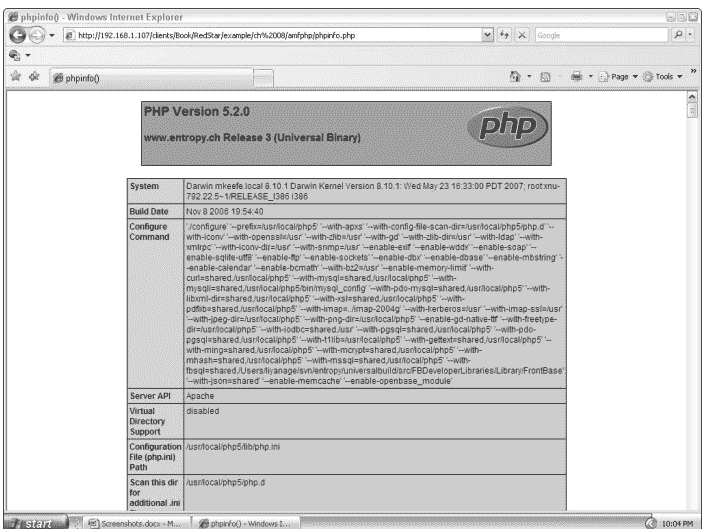

该命令的示例响应类似于以下内容：

Loaded Modules:
core_module (静态)
mpm_worker_module (静态)
http_module (静态)
so_module (静态)
include_module (共享)
deflate_module (共享)
log_config_module (共享)
env_module (共享)
expires_module (共享)
headers_module (共享)
setenvif_module (共享)
ssl_module (共享)
mime_module (共享)
status_module (共享)
autoindex_module (共享)
info_module (共享)
vhost_alias_module (共享)
negotiation_module (共享)
dir_module (共享)
imagemap_module (共享)
actions_module (共享)
userdir_module (共享)
alias_module (共享)
rewrite_module (共享)
...
语法正确

如果省略 -D DUMP_MODULES 标志，您将只看到语法响应。这会告知您哪里出错或一切正常。

```
$ /usr/local/apache/bin/apachectl -t
```

对于 Windows，命令如下

```
httpd -t
```

## 使用自定义错误文档

当您在网站上查看 URL 时，Apache 会根据您的请求为您提供页面。默认情况下，如果 Apache 被要求提供找不到的文件，它会返回一个不太美观且信息量不大的 404 页面，这实际上会带来潜在的安全隐患。

如图 2.2 所示，Apache 会将服务器信息暴露给全世界。虽然这不算巨大的安全隐患，但每一条信息都可能汇总成严重问题。

图 2.2
Apache 的默认错误页面

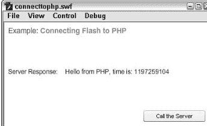

使用标准错误页面的一个更重要问题是，用户面对的是一个无用的页面。例如，用户现在知道文件不存在，但无处可去，也不知道问题出在哪里。奇怪的是，如果用户看到 404 页面，通常不会继续留下，这意味着您的网站失去了一个用户。

## 修改 Apache

幸运的是，Apache 允许您修改此默认错误页面。某些主机允许您使用购买服务器时安装的包含控制面板来修改文件。但是，在本例中，开发服务器要求您手动配置大部分内容。

使用自定义错误文档就像将修改添加到 .htaccess 文件一样简单。此文件通常存储在文档根目录中，以确保所有文件都能看到该文件。

以下代码是修改错误文档所需的语法。

```
### Customized Error Handler
ErrorDocument 204 /error.html
ErrorDocument 301 /error.html
ErrorDocument 302 /error.html
ErrorDocument 400 /error.html
ErrorDocument 401 /error.html
ErrorDocument 403 /error.html
ErrorDocument 404 /error.html
ErrorDocument 500 /error.html
ErrorDocument 501 /error.html
ErrorDocument 502 /error.html
ErrorDocument 503 /error.html
```

如您所见，错误文档将被一个文件替换。当然，您也可以为每个遇到的错误指向单独的文件。如果不指定特定的错误页面，Apache 将恢复默认设置。前面的列表是可能错误代码的健全记录，但并不完整。

### 动态错误文档

使用 PHP，您可以创建一个动态错误处理系统。其思路是像前一示例一样调用一个页面，但区别在于会传递一个变量来通知该页面遇到了哪个错误。

首先修改 .htaccess 文件中的错误处理程序，例如：

```
#### Error Handler, request is sent to a php file
ErrorDocument 204 /errorHandler.php?e=204
ErrorDocument 301 /errorHandler.php?e=301
ErrorDocument 302 /errorHandler.php?e=302
ErrorDocument 400 /errorHandler.php?e=400
ErrorDocument 401 /errorHandler.php?e=401
ErrorDocument 403 /errorHandler.php?e=403
ErrorDocument 404 /errorHandler.php?e=404
ErrorDocument 500 /errorHandler.php?e=500
ErrorDocument 501 /errorHandler.php?e=501
ErrorDocument 502 /errorHandler.php?e=502
ErrorDocument 503 /errorHandler.php?e=503
```

该代码告诉 Apache 将这些错误重定向到 errorHandler.php 文件，并传入错误代码。下一步是构建将处理错误代码的 PHP 文件。此 PHP 期望一个参数，如果未传入任何错误，它足够智能，能够返回有效响应。

文件的第一部分捕获错误代码并初始化一个变量以存储错误字符串。

```php
<?php
$errorCode = $_GET['e'];
$errorString = "";
...
?>
```

当发现错误代码时，会检查以确保它是有效数字，以保持应用程序安全。

```php
<?php
$errorCode = $_GET['e'];
$errorString = "";
if(!is_numeric($errorCode))
{
$errorCode = -1;
}
...
?>
```

使用基本的 switch 语句来确定遇到了哪个错误代码。switch 语句将在本章稍后的“探索 PHP 基础”部分中解释。

```php
<?php
$errorCode = $_GET['e'];
$errorString = "";
if(!is_numeric($errorCode))
{
$errorCode = -1;
}
switch($errorCode)
{
case 204: // No Content (Empty Document)
$errorString = "No Content (Empty Document)";
break;
case 301: // Moved Permanently
$errorString = "Moved Permanently";
break;
case 400: // Bad Request
$errorString = "Bad Request";
break;
case 401: // Unauthorized User
$errorString = "Unauthorized User";
break;
case 403: // Forbidden
$errorString = "Forbidden";
break;
case 404: // Document Not Found
$errorString = "Document Not Found";
break;
case 500: // Internal Server Error
$errorString = "Internal Server Error";
break;
case 503: // Out of Resources
$errorString = "Out of Resources";
break;
case -1: // No Error Code
$errorString = "Unknown Error";
}
?>
```

最后一步是向用户显示错误字符串，从而完成自定义错误处理脚本。您会注意到，switch 中省略了一些错误代码，以演示如果显示无效错误代码，脚本会静默继续。

```php
<?php
$errorCode = $_GET['e'];
$errorString = "";

if(!is_numeric($errorCode))
{
$errorCode = -1;
}
```


```php
switch($errorCode)
{
case 204: // No Content (Empty Document)
$errorString = "No Content (Empty Document)";
break;
case 301: // Moved Permanently
$errorString = "Moved Permanently";
break;
case 400: // Bad Request
$errorString = "Bad Request";
break;
case 401: // Unauthorized User
$errorString = "Unauthorized User";
break;
case 403: // Forbidden
$errorString = "Forbidden";
break;
case 404: // Document Not Found
$errorString = "Document Not Found";
break;
case 500: // Internal Server Error
$errorString = "Internal Server Error";
break;
case 503: // Out of Resources
$errorString = "Out of Resources";
break;
case -1: // No Error Code
$errorString = "Unknown Error";
}
```

```php
?>
<h2>An error occurred while processing your request</h2>
<h3><?=$errorString?></h3>
```

$errorString 变量会打印到屏幕上，告知用户已发生错误。

这个自定义错误处理程序向用户展示了更友好的错误信息。有些网站会包含感兴趣的相关链接，或者使用查询（如果是搜索的话）来返回相关信息。虽然用户看到错误页面很不幸，但随着技术变化和系统更新，这种情况越来越常见。

保留永久链接是个好主意，因为搜索引擎会缓存链接。未来，如果该链接仍然可用，将有利于您的流量。

作为前一个脚本的附加内容（该脚本位于本书网站上），有一个完整的错误处理系统，包括本地化错误（可以针对语言设置进行定制），并利用 PHP 模板和自定义 CSS 文件来修改样式。

## 探索 PHP 基础知识

PHP（超文本预处理器）是一种在 Apache 或其他类似 Web 服务器应用程序上运行的服务器端脚本语言。PHP 是最流行的服务器端脚本语言之一，因为它入门相当简单，并且可以处理强大的应用程序。

编码结构基于 C，可以采用过程式（逐步）或基于类的结构（对象、属性、方法等）编写。一旦你了解了 PHP 的基础知识，就能真正开始看到它的强大之处。

本书基于 PHP 5，但本节中解释的许多后续技巧、技术和样式也可以用于 PHP 4 和 PHP 5，因为这两个版本非常相似。

### 理解变量

变量（也常被称为 vars 或 properties（在使用类时））可能是编程中最常用的项。它们用于将值分配给代码其他部分可以调用的位置。变量的使用不仅节省时间，而且使程序更具结构性且易于维护。

以下是 PHP 中变量定义的一个非常简单的示例：

```php
$myVar = "hello world";
```

前面的示例将字符串 "hello world" 分配给了变量 $myVar。

使用变量时需要牢记几点。

- 必须以美元符号（$）开头（在类中除外）。
- 必须以分号（;）结尾。

变量可以接受多种数据类型，包括但不限于 String、Boolean 和 Array，这些内容将在后面的章节中讨论。

#### 字符串

字符串变量包含文本，例如：

```
"Hello, World!"
```

您也可以使用连接技术构建字符串，例如：

```php
$var = "Hello";
$var .= ", World!";
print $var; // Outputs: Hello, World!
```

#### 布尔值

布尔值是特殊变量，只能是两个可能的值之一：`true` 或 `false`。它们主要用于 if 语句和其他条件检查形式，例如：

```php
$loggedIn = false;
if($loggedIn == false)
{
    print "Sorry, you are not logged in!";
}
```

#### 数组

数组是由一组通过索引访问的元素组成的复杂数据结构。在 PHP 中，此索引可以是数值或字符串。

以下是一个数组示例以及访问数据的两种方式：

```php
<?php

$fruit = array(
    "Orange",
    "Apple",
    "Strawberry",
    "Grape"
);

print $fruit[1]; // Apple

$fruit = array(
    "orange" => "Orange",
    "apple" => "Apple",
    "strawberry" => "Strawberry",
    "grape" => "Grape"
);

print $fruit['orange']; // Orange

?>
```

#### 对象

PHP 中的类描述对象或是对象的定义。它们由自定义的方法和属性组成，使您能够创建自定义功能。

以下是 PHP 中类的一个非常基本示例，示例底部包含示例调用：

```php
<?php

class Animals
{
    function Animal()
    {
    }

    public function speak($word)
    {
        print $word;
    }
}

class Dog extends Animals
{
    function Dog($word)
    {
        Animals::speak($word);
    }
}

// Create a new Dog
$dog = new Dog("Hello... Woof!");

?>
```

### 使用函数

在开发应用程序时，您往往需要重复执行各种任务。不断输入这些步骤是一个漫长的过程。更重要的是，重复代码会使应用程序效率降低。

函数允许您将重复任务放入一个小容器中，只要函数可访问，您就可以随时调用它。

以下是一个添加两个数字并返回和的示例函数：

```php
function addNumbers($num1, $num2)
{
    // return the sum of the two numbers
    return ($num1 + $num2);
}
```

您可以通过引用函数名称并传递函数所需的任何参数来调用函数。此示例返回 10 作为和。

参数是传递给函数并在函数内部用作局部变量的值。

```php
addNumbers(4, 6); // outputs 10
```

PHP 中的函数可以指定默认参数，这意味着不需要传递该参数，例如：

```php
function addNumbers($num1, $num2, $print=true)
{
if($print)
{
print "Sum is: ".($num1 + $num2);
}
else
{
return ($num1 + $num2);
}
}
```

如果 $print 变量为 false（默认情况下为 false），此函数会直接将结果打印到屏幕上或返回值。在定义其他参数时，不能跳过中间的参数。例如，以下函数调用无效：

```php
function say($upperCase=false, $string)
{
if($upperCase)
{
return strtoupper($string);
}
else
{
return $string;
}
}
```

```php
say("Hello, World!");
```

这会将传入的字符串分配给 $upperCase 值并忽略 $string 变量。因为 PHP 不关心传入值的类型，这会导致在返回字符串的行出错。

类也有函数，称为方法。方法可以保留标准函数不具备的特殊功能。

### 理解控制结构

大多数编程语言都有控制结构，可提供代码片段并总体为应用程序提供更动态的路径。以下是一些更常见的控制结构，包括本书中大部分使用的结构。

#### if

if 结构存在于任何流行的编程语言中，PHP 也不例外。它允许有条件地执行代码片段。if 语句的示例如下：

```php
$admin = getAdminStatus();
if($admin == true)
{
  print "Admin logged in, show admin controls";
}
```

您可以无限次地将 if 语句嵌套在其他 if 语句中。嵌套 if 语句的更现实用途是具有不同身份验证级别的登录应用程序。

```php
$loggedIn = true;
$admin = true;
$editable = true;

if($loggedIn)
{
  if($admin)
  {
    if($editable)
    {
      // allow the page to be
      // edited because a valid
      // administrator is logged in
    }
  }
}
```

#### else

假设您希望向未登录的用户显示错误消息，向已登录的用户显示适当的控制面板。这是使用 else 语句完成的，如果 if 中的条件不满足，则执行 else 语句。

```php
$loggedIn = false;
if($loggedIn)
{
  // display control panel
}
else
{
  // display login form and error message
}
```


else 不是必需的，并且放置在所有其他条件检查之后，例如 elseif，它将在下一节中介绍。

#### elseif

elseif 是 if 和 else 的组合。该语句放置在 if 之后，允许代码匹配另一个条件，该条件可以与之前运行的 if 完全不同。

> 只有当前面的条件不满足时，才会对 else 或 else if 进行求值。

```
$loggedIn = false;
$colorOfSky = "blue";

if($loggedIn)
{
   // user logged in
}
elseif($colorOfSky == "blue")
{
   // color of sky is blue, log user in??
}
```

#### while

while 是一种循环。花括号 {} 内的代码会在条件满足时持续运行（“while”）。一旦条件不再有效，循环停止。

> 如果编写不当，PHP 中的循环可能会无限运行。使用循环时请谨慎，并始终先检查数据是否有效。

```
while($x < 50)
{
   print "x=" . $x . "<br />";
   $x++;
}
```

#### for

for 循环是 PHP 中最复杂的循环。以下是示例：

```
for ($x=0; $x < 10; $x++)
{
   print "x=" . $x . "<br />";
}
```

第一个表达式（$x=0）在循环开始时无条件执行一次。第二个表达式（$x < 10）在每次迭代时求值，循环将持续运行直到满足此条件或使用 break 停止循环。在每次迭代时，会执行第三个表达式（$x++）。在本示例中，它会在每次迭代时递增 $x。

你可以嵌套 `for` 循环，甚至在第一个表达式中定义多个变量。这可以使你的代码运行得更快，但更难阅读。

#### foreach

`foreach` 循环用于遍历数组。你将循环变量分配给所需的数组，在每次迭代时，值都会存储在该循环变量中。

```php
$fruits = array("Orange", "Apple", "Banana", "Grapefruit");
foreach($fruits as $fruit)
{
    print "Fruit: " . $fruit;
}
```

> `foreach` 循环完成后，变量 `$fruit` 仍然存在，因此最好使用 `unset()` 销毁该变量，例如 `unset($fruit)`。

#### break

`break` 控制语句会结束循环的执行，无论条件是否满足。你可以放置一个可选的数值来告知 PHP 应该跳出多少层。当你有嵌套循环且需要在发生错误时告诉父级退出时，这非常有用。

```php
for($i=0; $i < count($users); $i++)
{
    for($j=0; $j < 5; $j++)
    {
        if($users[$i][$j]['valid'] == false)
        {
            // found invalid user, group is compromised
            // exit both loops
            break 2;
        }
    }
}
```

#### continue

与 `break` 不同，`continue` 会退出循环的当前迭代，但允许其余迭代继续进行。

当你遍历一堆数据且只想对有效数据执行操作时，这非常有用。

```php
for($i=0; $i < count($users); $i++)
{
    if($users[$i]['valid'] == false)
    {
        // invalid user, continue with remaining list
        continue;
    }
    // more code logic here
}
```

与 `break` 类似，`continue` 也接受一个数值参数，告诉它要跳过多少层外层循环。

#### switch

switch 类似于一系列使用相同表达式（变量）的 if 语句。当你想要将一个变量与大量条件进行测试时，通常会使用 switch。

```
switch($userLevel)
{
    case 'ADMIN':
        print "User is an admin";
        break;
    case 'MODERATOR':
        print "User is a mod";
        break;
    case 'MEMBER':
        print "User is a member";
        break;

    case 'GUEST':
        print "User is a guest";
        break;
}
```

使用 break 是为了确保其余检查不会运行；事实上，如果你移除了 break，则会检查每个条件，如果你打算执行多级验证，这可能会导致问题。

#### require

require() 语句尝试加载一个文件，如果文件未找到，则会以致命错误退出脚本。该函数会针对当前的 include_path 以及文件所在的目录检查文件。

```
require("importantFile.php");
```

显示的错误（参见图 2.3）有时会带来潜在的安全问题，因为它会显示文件所在的路径。更好的处理方法是先创建对文件的检查，然后向用户显示更清晰、不那么重要的消息。

```
if(!file_exists("importantFile.php"))
{
    $error = "Sorry, one of the core components could not be loaded";
    exit($error); // display clean error and exit remaining script
}
require("importantFile.php"); // never runs, if file doesn't exist
```

#### 图 2.3

浏览器中显示的 PHP require() 错误

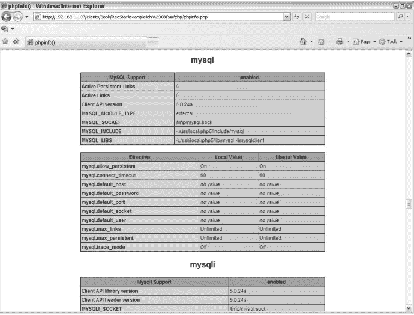

#### include

include() 语句类似于 require，区别在于它会显示错误但不会停止脚本的执行。

```
include("optionalFile.php");
```

#### require_once

require_once 语句与 require 的行为类似，区别在于如果当前文件已加载，则不会尝试再次加载它。在构建有时会共享许多文件的大型应用程序时，这更有用。这确保不会加载冗余代码。

```
require_once("requiredFile.php");
// ... other code here
require_once("requiredFile.php");
```

第二个 require_once 不会运行，因为该文件在代码的前面部分已经加载。

#### include_once

include_once() 语句类似于 require_once，区别在于如果文件未找到，它只会显示一个简单的错误。

### 在 PHP 中使用类型检查

与大多数编程语言不同，PHP 不要求对变量进行严格类型定义。这意味着你不必定义变量将保存什么类型的数据。

这看起来似乎是件好事，因为变量可以共享。然而，这种方法的潜在缺点是，你预期是字符串的变量可能会显示为数组。这很可能会破坏你的代码或导致代码中存在可被利用的部分。想象类似下面的代码：

```php
$id = -1;

if(isset($id))
{
    // sql call here, set id to a string, for some reason
    $id = "user id";
}

// more logic here
if($id == -1)
{
    // user not logged in
}
else
{
    // user logged in
}
```

这是一个过于夸张的例子，因为它充满了最坏的情况，但你可以看到未类型化的变量如何引起麻烦。

#### 类型检查函数

PHP 确实提供了一些特殊函数，允许你检查变量的类型，但这并不能阻止其他代码覆盖变量。

这些函数的一个示例是 is_string，它用于检查传入的变量内容是否为字符串。

```php
$saying = "Hello, World!";

if(is_string($saying))
{
    print "$saying is a string";
}
```

PHP 提供了测试数组、数字、字符串和空值的功能。

#### 未来版本支持

已有提及，未来版本的 PHP 可能会包含严格的类型检查，但目前，在需要时，这些函数将为你的应用程序提供更高级别的完整性。

## 探索 MySQL 基础知识

MySQL 是与 PHP 一起用于创建动态应用程序的存储应用程序。你可以在 MySQL 数据库中存储几乎任何类型的数据，并能够与其他应用程序和系统共享该信息。通常在需要执行搜索时，或者数据经常更改且许多人会请求这些更新的数据时，会使用数据库。

数据库的替代方案是扁平文件（文本文件），它有许多限制，最具毁灭性的是同一时间只能使用有限数量的文件实例。另一个限制是快速索引和搜索文本文件的能力。

### 使用语句

MySQL 数据库中的内容存储在表中。这些表存储在构成 MySQL 系统的数据库中。这些表中存储的数据是使用各种语句和条件来访问的，这些语句和条件被称为查询。

SQL 查询中可以使用许多语句。

#### SELECT

SELECT 语句是最常用的语句，它告诉 MySQL 你希望从表中返回什么内容（列）。

```sql
SELECT id,name,ip, bio FROM users WHERE id=3
```

你可以使用逗号 (,) 分隔列名和表名，从多个表中选择数据。

```sql
SELECT users.id, users.name, members.posts, members.subs FROM
users, members WHERE members.userID=users.id AND users.id=3
```

#### INSERT

INSERT 语句用于向现有表中添加新行。定义 INSERT 有多种方式。

如果你只想插入某些列，则需要定义这些列。

```sql
INSERT INTO members (name, bio, ip) VALUES ($name, $bio, $ip);
```


使用快捷方式可以排除列定义。不过，只有在更新所有值或在创建表时已指定默认值的情况下，此方法才可行。

```
INSERT INTO members ($name, $bio, $ip);
```

INSERT 完成后，可以调用 mysql_insert_id()，它将返回最后一次成功插入的 ID。

```
$result = mysql_query("INSERT INTO members ( " .
  $name . ", " .
  $bio . ", " .
  $ip . ")");
```

```
$rowID = mysql_insert_id($result);
```

#### 删除

DELETE 语句用于从表中删除一行或多行。与其他语句一样，你可以使用 WHERE、AND、OR 等创建条件。

```
DELETE FROM users WHERE id=3
```

也可以通过省略条件来删除数据库中的所有行：

```
DELETE FROM users
```

注意 DELETE 语句非常强大，应格外小心使用。

#### 条件

MySQL 中的条件用于限制返回的数据量。例如，如下 SQL 查询将返回数据库中的所有用户：

```
SELECT * FROM users
```

#### WHERE

如果你希望发生这种情况，这没问题。你可能只希望返回某些用户，甚至是一个特定用户。这可以通过 WHERE 条件来完成。

```
SELECT * FROM users WHERE id=3
```

#### AND

当需要匹配多个条件时，使用 AND 条件。例如，你想要返回已注册且拥有有效账户的成员数据库。

```
SELECT * FROM users WHERE active=1 AND registered="yes"
```

可以使用任意组合的条件语句，但只能有一个 WHERE 语句。

#### OR

当只希望一个条件匹配时，使用 OR 语句。例如，你想要返回级别为 admin 或 mod 的用户。可以将其视为 SQL 中的 if..else。

```
SELECT * FROM users WHERE level='admin' OR level='mod'
```

在尝试深入挖掘数据时，MySQL 中的条件非常有用，尤其是在开始组合它们时。花几分钟创建非常复杂的 SQL 语句并不罕见。

## 探索 Flash

Flash 不仅是一种技术，也是 Adobe 开发工具的名称，用于创建支持 Flash 的内容。这种内容可以是从简单的横幅广告到带有视频和用户交互的完整数据库驱动型网站的任何东西。

### Flash IDE

Flash IDE（集成开发环境）如图 2.4 所示，是一款功能强大的开发工具，具有许多有用的特性。

#### 图 2.4

Flash CS3 IDE 默认布局

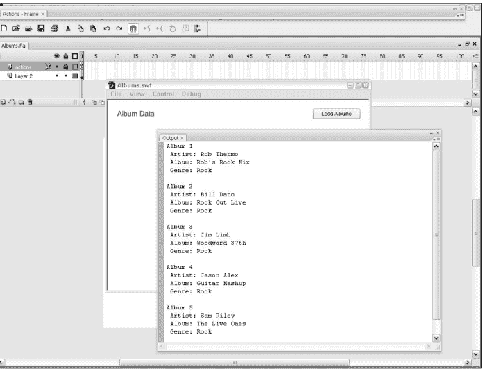

更新的工具之一是代码编辑器，也称为 ActionScript 面板。如图 2.5 所示，这是你为 Flash 应用程序编写 ActionScript 代码的地方。最新版本拥有强大的代码补全、高级调试以及语法高亮等新特性。

#### 图 2.5 Flash CS3 中的 ActionScript 面板

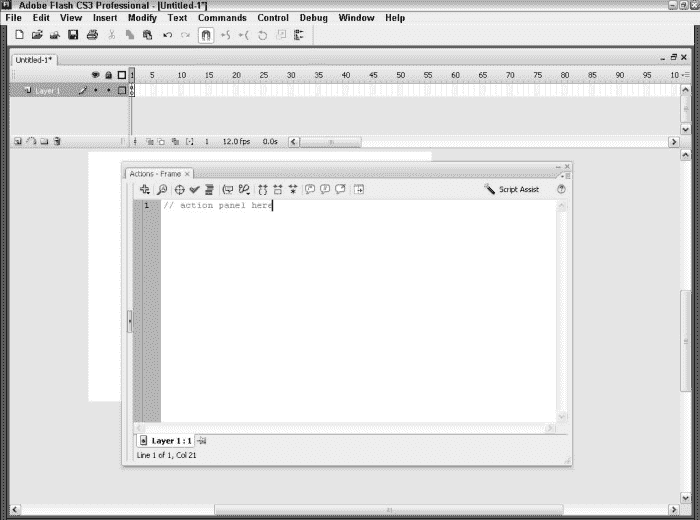

你将在其中度过大部分开发时间。面板不是唯一的编辑器；你可以创建完整的 ActionScript 文件，如图 2.6 所示，并将其包含在应用程序中。

要创建自定义 AS 文件，请选择 File > New。从中间列中选择 ActionScript 3 File。将文件保存为 Sample.as 到桌面。

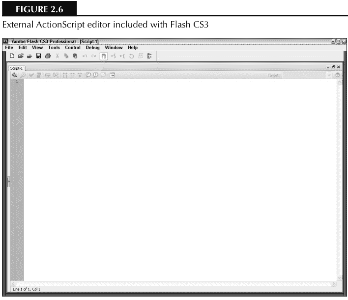

### 替代编辑器

市面上有许多 ActionScript 编辑器。我个人最喜欢的是来自 powerflasher 的 [FDT](http://fdt.powerflasher.com/)。该编辑器提供最大的自定义选项，并集成到 Eclipse 编辑器中，许多其他公司都依赖于它。

同时创建一个新的 FLA 并将其保存到桌面。现在打开代码编辑器并添加以下代码：

```
#include "Sample.as"
```

这一行代码将 Sample.as 的内容包含到你的应用程序中。这意味着你可以将所有 ActionScript 写在外部文件中，Flash 在测试或构建应用程序时会知道要包含它。

### 支持 Flash 的设备

Flash 不再仅仅是用于为 Web 创建花哨图形的简单动画工具。现在，你可以在手机、媒体播放器甚至某些相机等一系列产品上找到已安装的 Flash。手机技术尤其有趣，因为这些设备通常拥有活跃的互联网连接，这意味着你可以为移动设备和桌面开发富互联网应用程序（RIA）。

### 继续前进

你现在应该对 Flash 是什么及其在最新版本中的进步有了基本了解。本书将解释 Flash 与 ActionScript 的各个方面，特别是在处理 PHP 和数据管理方面。

不过，如需更详细的 Flash CS3 指南，我强烈推荐由 John Wiley & Sons, Inc. 出版的 Adobe Flash CS3 Professional Bible。

## 摘要

在本章中，你了解了 Web 服务器以及如何修改配置文件来设置自定义开发或生产环境。这些信息包括自定义错误页面、应用程序特定模块以及保护内容的最佳实践。

一旦理解了使用 Web 服务器的基础知识，下一步就是学习如何使用 PHP。这涵盖了 PHP 的基础知识以及本书各章的具体内容。

本章后半部分包含了关于 MySQL 以及如何处理数据库中数据的信息。

最后一部分是 Flash 的概述以及如何使用开发环境。如需更详细的概述，已给出一些参考资料。

# 第 3 章

## 建立连接

- 了解 Flash 中的通信
- 将 Flash 连接到 PHP
- 将 PHP 连接到 MySQL

“建立连接”是一个用于描述连接到各种数据源过程的短语。在本章中，它是以各种方式连接 ActionScript (Flash)、PHP 和 MySQL 的过程。这些数据可以是一个简单的网站，也可以是 Flash 作为前端显示的数据库驱动型内容管理系统。

如果尚未安装这三个组件，在继续本章之前，请参阅第 1 章。

每个部分的第一部分侧重于每种连接类型提供的内容，并接着给出示例，以提供完整的最终结果图景。

## 了解 Flash 中的通信

开发独立应用程序缺乏某些功能，主要是处理动态数据的能力。在较小的应用程序中，你可以使用扁平文件，例如 XML 文件，但随着项目不断增长，这些文件会带来问题。

基于简单文本文件的应用程序也会受到文件锁定的影响，当太多人访问文件时可能会发生这种情况。当这种情况发生时，Apache 和/或 PHP 可能会抛出错误，导致用户无法使用网站。

## 确定 PHP 的状态

在 Flash 中设置与 PHP 连接的第一步是确定 PHP 是否已正确安装并运行。这是通过创建一个简单的 PHP 文件来完成的，该文件输出已安装 PHP 版本的当前配置设置。

PHP 函数 phpinfo() 通过构建一个自定义 HTML 页面来输出配置信息，如图 3.1 所示。

> **警告** 将 phpinfo 文件留在服务器上可能存在安全风险。最好只在需要查看时上传它，然后将其删除。

以下是一个示例信息文件，用于调用 phpinfo() 函数。

```
<?php
// output php configuration settings
phpinfo();
?>
```

### 图 3.1

以下是 phpinfo 函数的输出，显示了当前的 PHP 配置设置。

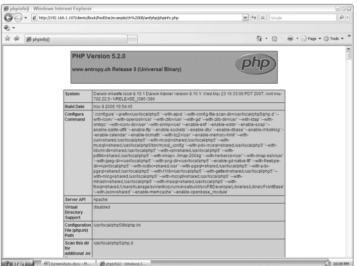

如果看到 phpinfo 文件（通常为紫色，并以已安装的 PHP 版本开头），则表示安装正确。

但是，如果你看到下载 PHP 文件的对话框，则表示 Apache 配置不当或未启用 PHP 支持。这种设置级别在第 1 章和随 Apache 提供的帮助文件中有所介绍。在罕见情况下，你可能会看到“找不到服务器”页面，这可能意味着 Apache 未安装或未运行。

假设 PHP 和 Apache 都已正常运行，你可以继续进行将 Flash 连接到 PHP 的过程。

## 使用各种连接类型

Flash 提供多种不同的通信选项。确定在项目中使用哪种通信方式，取决于该特定应用程序的预期功能集。

### 单向通信

Flash 中的单向通信是将数据发送到 Web 服务器而不关心或不在乎是否有响应返回的过程。这主要用于打开 URL，但也可用于在不打算处理结果的情况下更新文件。这种通信类型通常用于简单触发事件或运行某种清理系统。

例如，如果你的网站需要定期清理文件（删除、重命名、移动），将此功能附加到前端系统是个好主意，因为服务器资源仅在为该用户提供内容时才会被占用。这将通过幕后的单向通信启动。

> **注意** “查看即更新” 概念不应用于备份解决方案，因为查看缓慢可能导致备份丢失。

以下是 Flash 中单向通信的示例：

```
var serverFile:String = "http://localhost/callLink.php";
var urlRequest:URLRequest = new URLRequest(serverFile);
navigateToURL(urlRequest);
```

navigateToURL 函数接受两个参数。第一个参数是 URLRequest 实例，第二个参数是窗口或目标。默认情况下，窗口为 _self，这意味着如果存在当前浏览器，新页面将加载到当前浏览器中。

但是，在某些情况下，你可能希望打开一个新浏览器窗口，可以通过添加第二个参数来实现。

```
var serverFile:String = "http://localhost/callLink.php";
```


var urlRequest:URLRequest = new URLRequest(serverFile);
navigateToURL(urlRequest, "_blank");

window 参数可以接受以下字符串之一，如表 3.1 所示。

| 链接的窗口目标 | |
|---|---|
| "_self" | 当前窗口中的当前帧 |
| "_blank" | 新窗口 |
| "_parent" | 当前帧的父帧 |
| "_top" | 当前窗口中的顶级帧 |

window 参数还可以接受自定义名称，例如帧或特定窗口的名称。例如，假设您要将链接发送到名为 "childWindowBox" 的窗口，代码如下所示：

```
var serverFile:String = "http://localhost/callLink.php";
var urlRequest:URLRequest = new URLRequest(serverFile);
navigateToURL(urlRequest, "_childWindowBox");
```

您替换预构建的窗口名称并添加自定义名称。虽然这是一项小更改，但它提供了一些很棒的附加功能。

打开新窗口或现有窗口只是与其他数据连接的可能性之一。

Flash 中另一种单向通信类型可以通过使用 sendToURL() 执行。

sendToURL() 用于与脚本进行静默通信。静默通信是一种单向通信形式，不会加载单独的网页。这种通信形式可以在不干扰用户浏览体验的情况下向服务器发送数据。

以下是之前的示例，添加了新函数，并包含一些基本错误处理来管理无效和不可用的请求。

```
var serverFile:String = "http://localhost/callLink.php";
var urlRequest:URLRequest = new URLRequest(serverFile);
try
{
    sendToURL(urlRequest);
}
catch (e:Error)
{
 // handle error here
}
```

## 向服务器发送数据

有时，您可能不仅希望静默请求 URL，还希望随请求一起发送数据。这是通过使用 URLVariables 类来完成的，该类允许您创建名称/值对对象。这些名称/值对与标准 HTML 请求中的相同。

```
var serverFile:String = "http://localhost/callLink.php";

var variables:URLVariables = new URLVariables();
variables.id = 1004;
variables.user = "James";

var urlRequest:URLRequest = new URLRequest(serverFile);
urlRequest.data = variables;

try
{
 sendToURL(urlRequest);
}
catch (e:Error)
{
 // handle error here
}
```

单向通信的另一个示例是向服务器盲发 POST 数据。这通过从 URL 中删除参数，为您的应用程序增加了一点更多的安全性，方法是将参数包含在请求中。

POST 数据请求的代码只是将值赋给 URLRequest 实例的 method 属性。ActionScript 在 URLRequestMethod 类上有一个静态变量，该变量将被赋给 method 变量。

```
var serverFile:String = "http://localhost/callLink.php";

var variables:URLVariables = new URLVariables();
variables.id = 1004;
variables.user = "James";

var urlRequest:URLRequest = new URLRequest(serverFile);
urlRequest.method = URLRequestMethod.POST;
urlRequest.data = variables;

try
{
 sendToURL(urlRequest);
}
catch (e:Error)
{
    // handle error here
}
```

以下是将发送到服务器的示例请求。如您所见，Content 和 POST 元素包含所发送的信息。请求的其余部分是标准数据属性，不特定于本示例。

```
POST /callLink.php HTTP/1.1
Accept-Language: en
Accept-Encoding: gzip, deflate
Cookie: login=usernames;session-id=1206701
Referer: http://www.example.org/
User-Agent: Mozilla/5.0 (Macintosh; U; Intel Mac OS X; en)
AppleWebKit/522.11.1 (KHTML, like Gecko) Version/3.0.3
Safari/522.12.1
Content: id=1004&user=James
Content-Type: application/x-www-form-urlencoded
Accept: text/xml, text/html;q=0.9, text/plain;q=0.8, image/png
Pragma: no-cache
Content-Length: 327
Connection: keep-alive
Host: www.example.org
```

## 双向通信

在某些情况下，您在发送数据时希望收到响应。例如，尝试从数据库加载特定用户的数据时。您会传递用户 ID，并期望收到包含该用户信息的某种数据类型。

双向通信的响应通过分配事件侦听器并附加处理程序函数来处理。

```
var serverFile:String = "http://localhost/callLink.php";
var variables:URLVariables = new URLVariables();
variables.id = 1004;
variables.user = "James";
var urlRequest:URLRequest = new URLRequest(serverFile);
urlRequest.method = URLRequestMethod.POST;
urlRequest.data = variables;
var urlLoader:URLLoader = new URLLoader();
urlLoader.addEventListener(Event.COMPLETE, userResponseHandler);
try {
    urlLoader.load(urlRequest);
} catch (e:Error) {
    //handle error here
}
}

// handler function
function userResponseHandler(e:Event):void
{
    var urlLoader:URLLoader = URLLoader(e.target);
    var args:URLVariables = new URLVariables(urlLoader.data);

    trace("User Data: " + args.response);
}
```

响应函数接收对 Event 的引用。URLLoader 和 URLVariables 实例处理拆分响应并仅返回发回数据的过程。响应会随其他值和参数一起返回，但大多数时候，您只会关注 URLLoader 实例的 data 属性。

更完整的应用程序通常返回 XML 格式，这在第 3 章的其他各种数据加载示例中有所介绍。

既然您了解了如何使用单向通信和双向通信，下一节将通过连接到 PHP 来扩展这些做法。

## 将 Flash 连接到 PHP

将 Flash 连接到 PHP 的过程是使用前一节中介绍的预构建类完成的。如果您此时尚未安装 PHP，请参考第 1 章以充分了解并安装 PHP。

要开始本示例，请打开包含在书籍源文件中的起始文件。源文件可以在书籍的网站上找到。本示例的起始文件已添加设计和组件，如图 3.2 所示，让您可以专注于使其正常工作的代码。

本示例的第一部分是定义 PHP 文件在本地或远程服务器上的位置变量。

```
var phpFile:String =
    "http://localhost/connecting/exampleConn.php";
```

定义 PHP 脚本位置后，下一步是创建单击按钮时调用的函数。

```
function callServer(e:MouseEvent):void
{
    var urlRequest:URLRequest = new URLRequest(phpFile);

    var loader:URLLoader = new URLLoader();
    loader.addEventListener(Event.COMPLETE, serverResponse);
    loader.load(urlRequest);
}
```

### 图 3.2

以下是您将使用的示例应用程序的完成设计。

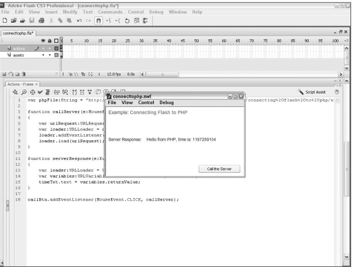

此函数创建 URLLoader 和 URLRequest 实例。将 phpFile 传递给 URLRequest 以创建对象。最后，将事件侦听器附加到 loader 变量，引用 serverResponse，即在数据加载时调用的函数。

```
function serverResponse(e:Event):void
{
   var loader:URLLoader = URLLoader(e.target);
   var variables:URLVariables = new URLVariables(loader.data);
   timeTxt.text = variables.returnValue;
}
```

服务器处理函数 serverResponse() 负责捕获从 PHP 文件传回的数据。在数据正确加载后，它将传递到 URLVariables 类以生成动态对象。

此动态对象包含从服务器传回的响应数据，因此只需简单的对象调用即可加载示例数据。在本示例中，该示例数据将是 PHP 捕获并返回的 UNIX 时间戳。

最后一部分是一个简单的按钮处理程序，在用户单击按钮时调用 callServer 函数。


callBtn.addEventListener(MouseEvent.CLICK, callServer);

本示例中的 PHP 代码是一个非常简单的打印语句。time() 函数用于获取当前 UNIX 时间戳。字符串中的 returnValue 变量是一个自定义变量定义，以便 Flash 在数据加载完成后知道调用什么。

这个变量可以命名为任何名称，甚至可以是一系列这样的变量：

```
<?php

print "returnValue=Hello from PHP, time is: " . time();

?>
```

### 连接数据

.=
用于连接或合并多个变量为一个长字符串。在此示例中，它在上一行的基础上构建，以创建将返回到 Flash 的用户数据字符串。

```
<?php

$userData = "username=James";
$userData .= "&id=1004";
$userData .= "&level=Reader";

print $userData;

?>
```

传回 Flash 的结果将类似于以下内容：

username=James&id=1004&level=Reader

你可能会注意到，名称/值关系与发送 POST 数据的格式非常相似。但是，在 Flash 中处理此数据只需要知道变量名称即可。

### 多个数据片段

对现有的 serverResponse() 函数进行修改，以包含从修改后的 PHP 代码发送的这些新变量。以下示例返回硬编码值；但是，在实际应用中，这些数据很可能来自动态数据源。

如上一节所学，Flash 的数据格式变成了一组非常简单且易于使用的对象。

```
function serverResponse(e:Event):void
{
	var loader:URLLoader = URLLoader(e.target);
	var variables:URLVariables = new URLVariables(loader.data);
	userTxt.text = "Welcome back, " + variables.username;
	levelTxt.text = "Your current level is: " + variables.level;
}
```

前一个函数的一个局限性是 variables 变量仅在该函数内可访问。为了确保返回的数据可供整个应用程序访问，最好将该数据存储在外部变量中。

例如，本示例将在之前的代码基础上添加新的变量赋值和定义。第一个更改是创建一个 Object 变量来存储数据。

```
var phpFile:String =
"http://localhost/connecting/exampleConn.php";
var storedResult:Object;

function callServer(e:MouseEvent):void
{
...
}

function serverResponse(e:Event):void
{
...
}

callBtn.addEventListener(MouseEvent.CLICK, callServer);
```

定义新的 Object 变量后，下一步是修改 serverResponse 函数，以将加载的数据存储到新创建的变量中。

```
function serverResponse(e:Event):void
{
	var loader:URLLoader = URLLoader(e.target);
	var variables:URLVariables = new URLVariables(loader.data);

	// check for valid data
	if(uint(variables.itemLength) > 0)
	{
		storedResult = variables;
	}

	userTxt.text = "Welcome back, " + variables.username;
	levelTxt.text = "Your current level is: " + variables.level;
}
```

加载的对象数据存储在 storedResult Object 中，但前提是找到了有效的 itemLength。itemLength 变量也由 PHP 返回，并使用简单的 if 语句进行验证。

通过对代码的这一新增内容，你可以将加载的数据共享到同一应用程序中的其他变量和部分。

> 加载过程完成之前，存储的数据不可访问。

最后一步是修改 PHP 以返回新创建的 itemLength 变量，方法是向 $userData 字符串添加另一项内容。

```
<?php
$userData = "username=James";
$userData .= "&id=1004";
$userData .= "&level=Reader";
$userData .= "&itemLength=3";
print $userData;
?>
```

现在你已了解如何将静态数据从 PHP 加载到 Flash，下一节将扩展此静态数据格式并介绍 MySQL 数据库。

## 将 PHP 连接到 MySQL

从静态 PHP 文件在 Flash 中加载数据是学习该过程的好方法。但是，实际应用程序可能不会使用该格式。数据总是在变化，没有人想要手动更新 PHP 文件。

### 确定 MySQL 的状态

在建立与 MySQL 的连接之前，请确保 MySQL 已安装并正在正常运行。

> MySQL 的默认安装会将密码留空。这对于测试站点可以接受，但生产服务器上的密码绝不能留空。

在 PHP 中使用 MySQL 最常见的安装方式是在 PHP 安装过程中包含 MySQL 库。这意味着 MySQL 信息将显示在 phpinfo 中，如前一节所述。

检查 MySQL 只需创建一个 phpinfo 测试文件并在浏览器中运行即可，如图 3.3 所示。

```
<?php
phpinfo();
?>
```

此结果是一个巨大的 HTML 页面，显示有关当前 PHP 安装的所有信息。要确定 MySQL 的状态，请搜索 "MySQL"。请记住可能有多个。

### 图 3.3

以下是 phpinfo 文件中说明可用 MySQL 安装的部分。

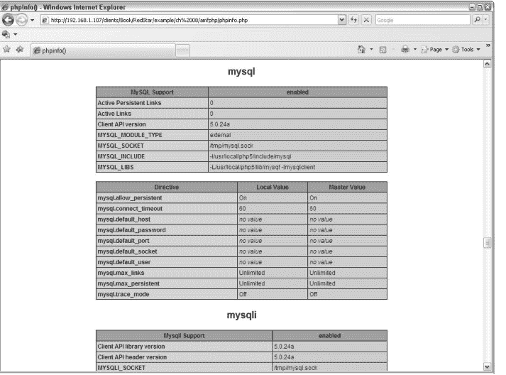

注意 如果未安装 MySQL，phpinfo 文件中的 MySQL 部分将完全不可见。

假设 MySQL 已正确安装并运行，你可以进入下一节，该节介绍如何将 PHP 连接到 MySQL 数据库。

### 连接到 MySQL

将 PHP 连接到 MySQL 的过程非常简单。第一步是从服务器管理员处获取连接信息，或者如果你刚刚安装，则登录详细信息将是默认值。

以下是连接到 MySQL 数据库的非常基本的无冗余代码。

```
<?php
$host = "localhost";
$user = "";
$pass = "";

$link = mysql_connect($host, $user, $pass);

?>
```

mysql_connect 函数接受三个参数。主机名是第一个参数，几乎总是设置为 "localhost"。第二个是安装 MySQL 时选择的用户名，最后是 MySQL 数据库的密码，默认设置为空。

mysql_connect 函数返回一个资源 ID，它是对当前 MySQL 连接的引用。此 ID 可用于未来的 SQL 调用，例如 mysql_query 和许多其他函数。如果你碰巧打印这个 $link 变量，你会看到一个资源代码。以下代码示例返回该资源 ID：

```
<?php

$link = mysql_connect("localhost", "root", "");
print "Response: " . $link;

?>
```

前面的代码块生成类似以下内容的响应：

Response: Resource id #32

### 持久连接

标准 mysql_connect 函数会在脚本执行完毕后关闭连接。但是，在某些情况下，你希望在脚本执行完毕后仍保持连接不关闭。

mysql_pconnect 函数正是用于实现此目的。该函数在脚本执行后维持连接。mysql_pconnect 的优点是消除了创建新连接的必要性。然而，缺点是持久连接存储在池中，无法保证每次都使用相同的连接，这可能会产生意外结果。

以下是持久连接的示例，唯一更改是在连接函数的单词 "connect" 前面加上 p。

```
<?php

$link = mysql_pconnect("localhost", "root", "");
print "Persistent Resource ID: " . $link;

?>
```

### 关闭连接

SQL 执行完毕后，最佳实践是关闭连接以释放资源和内存。只需调用 mysql_close() 即可关闭连接。

关闭连接并非总是必要的，因为脚本停止执行时它会自动关闭。话虽如此，在较大的应用程序中，最好尽快释放资源以保持合理的使用。

以下是之前的 mysql_connect() 示例，添加了关闭操作。

```
<?php

$link = mysql_connect("localhost", "root", "");
print "Response: " . $link;

// close connection
mysql_close($link);

?>
```

mysql_close 函数可以接受资源 ID 引用，当你有多个连接时这很有用。此参数不是必需的；默认情况下将关闭最后一个连接。

通过 mysql_pconnect() 创建的持久连接无法使用 mysql_close() 关闭。

### 选择数据库

建立 MySQL 连接后，你可以选择数据库。在选择合适的连接和数据库之前，你无法查询数据库。mysql_select_db 函数允许你选择要查询的数据库。你也可以使用此函数切换数据库。

活动连接一次只能连接一个数据库。

mysql_select_db 函数接受两个参数。第一个参数是数据库名称。第二个（可选）参数是活动连接资源的链接。当你有几个不同的连接或想要正确跟踪活动连接时，使用此参数很重要。

以下是使用前面的代码进行连接和选择数据库的示例：

```
<?php

$link = mysql_connect("localhost", "root", "");

mysql_select_db("db_name", $link);

// close connection
mysql_close($link);

?>


## 将所有内容整合在一起

你可以利用对如何从 PHP 连接到 MySQL 的理解，扩展这一概念并构建一个完整的应用程序。

开发过程的第一部分是创建数据库和表，并向其中填充数据。本示例将是一个 CD 列表网站的开端，用户请求一个流派类别，并返回指定的专辑。

首先为本示例创建两个 MySQL 表。第一个表用于流派，第二个表是专辑列表。

```
CREATE TABLE genre (
    id int(11) NOT NULL auto_increment,
    name varchar(100) default '',
    dateAdded int(11) default '0',
    PRIMARY KEY (id)
) ENGINE=MyISAM;
```

```
CREATE TABLE albums (
    id int(11) NOT NULL auto_increment,
    genreID int(11) NOT NULL default '0',
    artist varchar(200) NOT NULL default '',
    albumName varchar(200) NOT NULL default '',
    PRIMARY KEY (id)
) ENGINE=MyISAM;
```

使用你想要的任何浏览器或编辑器，创建一个音乐数据库并添加这两个表以开始。创建表后，你可以为本示例填入预定义数据，方法是执行一系列 MySQL INSERT 语句。

```
INSERT INTO genre (name, dateAdded) VALUES ('Blues', 1197090235);
INSERT INTO genre (name, dateAdded) VALUES ('Country', 1197090146);
INSERT INTO genre (name, dateAdded) VALUES ('Jazz', 1197090525);
INSERT INTO genre (name, dateAdded) VALUES ('Rock', 1197090230);
```

```
INSERT INTO albums (genreID, artist, albumName) VALUES (4, 'Rob Thermo', 'Rob's Rock Mix');
INSERT INTO albums (genreID, artist, albumName) VALUES (4, 'Bill Dato', 'Rock Out Live');
INSERT INTO albums (genreID, artist, albumName) VALUES (4, 'Jim Limb', 'Woodward 37th');
INSERT INTO albums (genreID, artist, albumName) VALUES (4, 'Jason Alex', 'Guitar Mashup');
INSERT INTO albums (genreID, artist, albumName) VALUES (4, 'Sam Riley', 'The Live Ones');
```

在创建数据库并为表分配并填充示例数据后，你可以继续进行应用程序的 PHP 部分。

## 连接 PHP

PHP 代码首先使用前一部分学到的技术连接到新创建的数据库。

```
<?php

$link = mysql_connect("localhost", "username", "password");
mysql_select_db("music", $link);
```

建立连接后，你可以创建处理专辑数据加载的查询。首先，通过设置静态变量来创建要查找的流派。在更完整的应用程序中，该变量很可能通过 URL 或其他形式的调用传递。

```
$genreID = 4;
```

```
$query = "SELECT g.name, a.artist, a.albumName";
$query .= " FROM albums a, genre g";
$query .= " WHERE a.genreID=g.id";
$query .= " AND g.id=" . $genreID;
```

进行 mysql_query() 调用，负责执行先前的 SQL 查询。此函数将返回一个资源 ID，以供其余 SQL 调用使用。

```
$result = mysql_query($query);
```

为简单起见，加载的专辑数据将存储在名称/值字符串中，但更现实的示例很可能使用 XML 或其他形式的结构化数据。

```
$response = "resp=loaded\n";
```

第 3 章解释了 XML 数据的用法。这包括在使用 PHP/MySQL 数据对象时加载和保存 XML。

此时，到 MySQL 的连接和调用应该已创建，但你仍然无法测试代码，因为没有任何输出。下一节将解释使用常见的 while 循环遍历音乐数据库中表返回的数据来输出数据。

数据将以基本列表格式返回，但需要一种方法来区分数据。这是通过为结果的每个实例创建一个唯一 ID 并将其分配给值名来完成的。

```
$index = 0;
```

下一部分是应用程序的核心，即 while 循环。

```
while($row = mysql_fetch_array($result))
{
...
}
```

while 循环的内容构建字符串响应。

```
while($row = mysql_fetch_array($result))
{
    $response .= "&artist" . $index . "=" . $row['artist'];
    $response .= "&album" . $index . "=" . $row['albumName'];
    $response .= "&genre" . $index . "=" . $row['name'] . "\n";
    $index++;
}
```

你会注意到 $response 变量为从数据库返回的每个单独数据分配了名称和值。从 mysql_fetch_array 函数返回的数据以多维数组的形式传入。$row 变量存储每一行数据，你使用列名来访问特定的数据，例如：

```
$response .= "&artist" . $index . "=" . $row['artist'];
```

你想要捕获的每个数据都会重复此过程。此 while 循环可用的数据由前一节定义的 SQL 查询决定。

你可能已经注意到，SQL 查询被强制只包含所需的列。这样做是为了限制数据量并使用更少的内存，随着系统不断增长，这会累积起来。

如果你需要表中的所有列，可以使用星号 (*)，这会修改先前的 SQL 调用，使其类似于：

```
$query = "SELECT g.*, a.*";
$query .= " FROM albums a, genre g";
$query .= " WHERE a.genreID=g.id";
$query .= " AND g.id=" . $genreID;
```

两个字母被赋予星号，因为它们是本示例所需的两个表的引用。在一个 SQL 调用中使用多个表非常常见，以保持数据关系已知，这样做允许数据存储在更小、更易管理的块中。

PHP 的最后部分创建一个 "total" 值，告诉 Flash 正在返回多少数据。之所以需要它，是因为数据是字符串格式。当使用 XML 或 Arrays 等数据类型时，你不需要这个额外变量。

为每行数据创建的索引成为计数，因为它仅在找到新行数据时递增，这意味着它与字符串中的数据量同步。

```
$response .= "&total=" . $index;
```

最后一部分是 print 语句，它将此数据公开给 Flash 或 Web 应用程序加载。

```
print $response;
```

以下是示例响应：

```
resp=loaded
&artist0=Rob Thermo&album0=Rob's Rock Mix&genre0=Rock
&artist1=Bill Dato&album1=Rock Out Live&genre1=Rock
&artist2=Jim Limb&album2=Woodward 37th&genre2=Rock
&artist3=Jason Alex&album3=Guitar Mashup&genre3=Rock
&artist4=Sam Riley&album4=The Live Ones&genre4=Rock
&total=5
```

这是完整的应用程序，它使用流派作为键来加载一块专辑数据。

以下是所有 PHP 代码的一个清单，用于复制/粘贴或仔细检查以更好地理解它们是如何协同工作的。

```
<?php
$link = mysql_connect("localhost", "username", "password");
mysql_select_db("music", $link);

$genreID = 4;

$query = "SELECT g.name, a.artist, a.albumName";
$query .= " FROM albums a, genre g";
$query .= " WHERE a.genreID=g.id";
$query .= " AND g.id=" . $genreID;

$result = mysql_query($query);

$response = "resp=loaded\n";

$index = 0;

while($row = mysql_fetch_array($result))
{
    $response .= "&artist" . $index . "=" . $row['artist'];
    $response .= "&album" . $index . "=" . $row['albumName'];
    $response .= "&genre" . $index . "=" . $row['name']. "\n";

    $index++;
}

$response .= "&total=" . $index;

print $response;

?>
```

## 构建 Flash

Flash 部分负责加载数据并循环遍历它以打印每个专辑。为简单起见，此应用程序全部使用 ActionScript，这意味着数据的显示是在 Output 面板中完成的。

更完整的应用程序将获取这些加载的数据并将其显示在列表或另一个自定义数据组件中。

第一步是定义将被调用的 PHP 文件，这将取决于你的系统设置，看起来类似于：

```
var phpFile:String = "http://localhost/getAlbums.php";
```

定义 PHP 变量后，下一步是构建调用服务器的函数。

```
function loadHandler():void
{
... 
}
```

此函数首先设置 URLRequest 实例，将 PHP 变量作为参数传递。

```
var urlRequest:URLRequest = new URLRequest(phpFile);
```

URLLoader 用于创建事件监听器，并在该函数完成时开始加载过程。urlRequest 变量传入到 URLLoader 类实例的 load 函数中，这对于任何类型的数据加载都是必需的。

```
var urlLoader:URLLoader = new URLLoader();
urlLoader.addEventListener(Event.COMPLETE, callServerHandler);
urlLoader.load(urlRequest);
```

下一个要定义的函数是 callServerHandler，它在前一节编写的 PHP 文件发送回数据后被调用。此函数传递一个包含加载数据的 Event 引用。

```
function callServerHandler(e:Event):void
{
... 
}
```

此函数的第一步是创建 URLLoader 实例，用于捕获加载的数据。事件实例包含一个 target 属性，这里通过将其传入到新的 URLLoader 中来使用。

结果存储在局部 loader 变量中，该变量将在本函数的其余部分中使用。

```
var loader:URLLoader = URLLoader(e.target);
```


你可能还记得，在这个示例的 PHP 部分中，数据是以名称/值对形式返回的。这些数据存储在新创建的加载器实例的 data 属性中。

这些数据被传递到 URLVariables 类的一个实例中，该类会创建一个 ActionScript 对象，以便脚本的其他部分可以处理数据。

```
var dataObj:URLVariables = new URLVariables(loader.data);
```

数据加载完成后，你可以使用简单的 trace 语句进行测试，该语句应显示返回的总条目数。

```
trace("Total Albums: " + dataObj.total);
```

该 trace 调用应在输出面板中显示以下内容：

```
//Output: **Total Albums: 5**
```

这意味着 PHP 文件正在被调用，数据正在使用 PHP 作为中间数据处理器，从数据库中正确加载。

你可以在这里结束脚本，因为一切都正常工作，但继续使用 for.. 循环，通过一系列 trace 调用来简单地显示每张专辑的信息。

for.. 循环是使用 dataObj 的 total 属性来设置的，以确定循环应运行多少次。

```
for(var i:uint = 0; i < dataObj.total; i++)
{
...
}
```

for.. 循环中的第一条 trace 语句显示当前正在显示的专辑。当前专辑编号是使用循环的 i 变量并加 1 创建的。这样做是因为 i 变量从零开始，而为了显示目的，第一张专辑应该是 1。

```
trace("Album " + (i + 1));
```

下一条 trace 语句设置为显示当前艺术家。该值是使用动态对象引用从 dataObj 对象实例中捕获的。"artist" 名称附加到 i 变量，从而创建一个实例名称。

```
trace(" Artist: " + dataObj['artist' + i]);
```

剩余的 trace 语句是前一条语句的副本，仅对实例名称和描述做了轻微修改。

```
trace(" Album: " + dataObj['album' + i]);
trace(" Genre: " + dataObj['genre' + i]);
```

此时，循环已完成，整个示例应用程序也已完成。你现在可以测试示例，并应该在输出面板中看到显示的 trace 语句，如图 3.4 所示。

### 图 3.4

以下是在输出面板中显示的专辑数据示例。

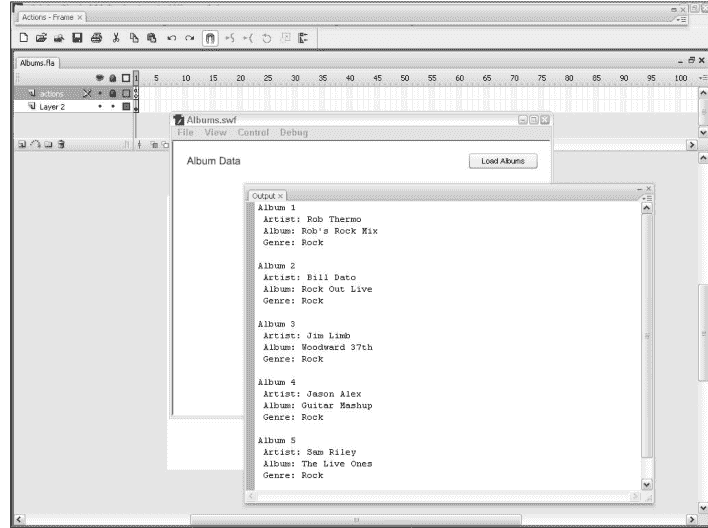

此应用程序的完整 ActionScript 部分如下：

```
var phpFile:String = "http://localhost/getAlbums.php";

function loadHandler():void
{
   var urlRequest:URLRequest = new URLRequest(phpFile);

   var urlLoader:URLLoader = new URLLoader();
   urlLoader.addEventListener(Event.COMPLETE, callServerHandler);
   urlLoader.load(urlRequest);
}

function callServerHandler(e:Event):void
{

   var loader:URLLoader = URLLoader(e.target);

   var dataObj:URLVariables = new URLVariables(loader.data);

   // Simple trace for example
}
```

```
actionscript
for(var i:uint = 0; i < dataObj.total; i++)
{
    trace("Album " + (i + 1));

    trace(" Artist: " + dataObj['artist' + i]);
    trace(" Album: " + dataObj['album' + i]);
    trace(" Genre: " + dataObj['genre' + i]);
}
}
loadHandler();
loadHandler();
```

## 摘要

前一个示例应该已经让你很好地理解了如何在 Flash 中使用 PHP 作为中间脚本来操作 MySQL 数据库。你可以在此示例的基础上扩展，创建更强大的应用程序，因为此示例应用程序是用来说明概念的，并未侧重于显示或应用程序本身。

MySQL 数据只是可以在 Flash 中显示的数据的一个示例。

下一章将在此示例基础上扩展，并介绍更高级的数据对象，例如 XML，以及图像和文本文件等其他形式的数据。

# 第 4 章

## 使用数据

使用数据是发送和加载信息供 ActionScript 解释的过程。ActionScript 中可使用的数据有两种类型：静态和动态。

在大多数常见情况下，首选动态过程而非静态过程。这主要是因为动态数据通常包含数据库组件。

本章介绍如何在 Flash 和 PHP 中使用动态数据。你将从加载简单文本文件开始，然后转到 XML 和更高级的加载。本章以一个完整的演示应用程序结束，该应用程序加载图像数据以显示缩略图和常规尺寸图像。

- 如何加载数据
- 发送数据
- 加载 XML
- 使用 PHP 加载图像

## 在 Flash 中加载数据

在 Flash 中加载数据是一种非常普遍的做法。在几乎每个项目中，你都希望有动态（可更新）的部分。动态数据的目的是限制所需的更新量。例如，如果你查看新闻网站，你会发现大部分外部内容不会更改（徽标、导航等）。Flash 应用程序也是如此，你很可能只有一部分需要实际更新。本节将引导你完成从 XML 到图像和声音加载数据的过程。

在 Flash 中加载数据的过程很快就会变得熟悉，因为你要加载的大多数数据类型都有类似的要求。

首先来看一个加载文本文件的简单示例。此示例将根据应用程序的运行位置，在几个不同的位置查找文本文件。如果在 Flash IDE 中执行此代码，它将查找 FLA 保存的同一位置，或者如果文件未保存，则在用户的临时目录中查找。如果代码位于编译的 SWF 中，文本文件将从 SWF 存储的同一目录加载。

```
var txtFile:String = "sample.txt";
var urlRequest:URLRequest = new URLRequest(txtFile);
var loader:URLLoader = new URLLoader();
loader.addEventListener(Event.COMPLETE, loadHandler);
loader.load(urlRequest);

function loadHandler(e:Event):void
{
    var loader:URLLoader = URLLoader(e.target);
    trace("Loaded Data: " + loader.data);
}
```

前一个示例加载 "sample.txt" 文件，并将其所有内容跟踪到 Flash 输出面板，该面板会自动打开。打开或关闭输出面板的另一种方法是选择 Window➤Output。

## 了解用于加载数据的类

Flash 中的 ActionScript 具有一系列用于加载数据的预构建类。以下部分将解释每个类的功能。

### URLRequest

此类用于设置要加载的文件。你可以将其直接赋值给变量，或者为了保持代码更紧凑，将其直接赋值给 URLLoader 的 load() 中。事实上，你可以将此过程应用于许多类。这不会影响类的功能，也不是必需的步骤。

```
...
    loader.load(new URLRequest(txtFile));
```

### URLLoader

正如 Adobe Live Docs 所述，“URLLoader 类以文本、二进制数据或 URL 编码变量的形式从 URL 下载数据。它有助于下载文本文件、XML 或其他信息，用于动态的数据驱动应用程序。”

在 ActionScript 中发送和加载数据时，URLLoader 服务于两个目的。URLLoader 的第一个目的是设置完成处理程序。另一个目的是在完成处理程序中捕获加载的数据。第二个目的的一个显著区别是，URLLoader 前面没有 new 关键字。

### 设置回调

设置数据加载器的最后一步是回调。回调是数据完全加载时调用的“处理程序”函数的另一个名称。此函数分配给 URLLoader 类上的 Event.COMPLETE 事件。

```
var loader:URLLoader = new URLLoader();
loader.addEventListener(Event.COMPLETE, loadHandler);
```

此回调函数需要一个 Event 类型的参数，当调用 ActionScript 时会自动传入该参数。此参数是存储加载数据内容的位置。

如果忘记在事件处理程序中包含该参数，你会收到参数数量不匹配错误。

```
ArgumentError: Error #1063: Argument count mismatch on
sendtophp_fla::MainTimeline/serverResponse(). Expected 0,
got 1.
at flash.events::EventDispatcher/dispatchEventFunction()
at flash.events::EventDispatcher/dispatchEvent()
at flash.net::URLLoader/onComplete()
```

### 综合起来

既然你了解了使用 ActionScript 加载数据的代码如何工作，现在可以继续了解更具体的发送和加载示例。在此示例中，你可以基于 URLLoader 类进行实验和构建，因为它拥有的事件远比你使用的简单 COMPLETE 事件多。例如，当加载或发送失败时会调用 IOError 事件。各种事件的代码基本相同；对于你的 IOError 示例，它看起来像这样：

```
var loader:URLLoader = new URLLoader();
loader.addEventListener(Event.COMPLETE, ioHandler);
function ioHandler(e:Event):void
{
trace("File loading was terminated");
}
```

你会很快注意到，唯一改变的是事件字符串和处理程序函数。还可以分配多个事件，保持高度兼容性通常也是个好主意。如果设置了适当的事件，你还可以快速调试代码。

### 分配多个事件

假设你想处理加载器实例的 IOError 和 Complete 事件。你可以输入每个事件处理程序；但是，在处理多个加载器时，这可能会变成一个漫长的过程。实现预期结果的一种方法是使用函数来分配处理程序。你基本上将目标作为参数传入，并动态分配事件处理程序。

```
var txtFile:String = "sample.txt";
var urlRequest:URLRequest = new URLRequest(txtFile);
```


```
var loader:URLLoader = new URLLoader();
assignHandlers(loader);
loader.load(urlRequest);

function assignHandlers(target:*):void
{
  target["addEventListener"](Event.COMPLETE, completeHandler);
  target["addEventListener"](IOErrorEvent.IO_ERROR,
  ioErrorHandler);
}

function completeHandler(e:Event):void
{
  ...
}

function ioErrorHandler(e:Event):void
{
  ...
}
```

该函数引入的一个新概念是动态分配事件监听器的方式。[ ] 用于在其中定义字符串作为变量。在这种情况下，字符串 "addEventListener" 实际上是要调用的方法，而 () 中的值是要传递给该方法的参数。仅为一个事件监听器使用此示例有点大材小用，但如果您正在处理多个事件，它很快就会变得有益。

## 处理加载的数据

使用前面的步骤加载数据后，您会想以某种方式使用这些数据。但是，在开始使用加载的数据之前，您需要了解传回的内容以及如何处理它。在接下来的部分中，您将学习如何处理已加载的数据。完成本节后，您将完全了解如何加载数据以及如何处理这些加载的数据。

### 单向加载

加载文本文件或图像被视为单向加载，主要是因为您不会将任何规则或步骤传递给加载的文件。加载图像的调用期望返回图像，且不再有其他内容。如果您查看网站，最容易理解这种加载过程。该网站上的徽标被请求并加载；无需管理额外数据即可完成此操作。

### 双向加载

双向加载是通过传递请求的进程将处理的参数来加载数据的过程。例如，调用广告服务器会传递帐户 ID 以及很可能还有其他信息，以确定应显示哪个广告。

使用 PHP 应用程序或其他动态脚本时，您很可能会传递参数来处理数据。更重要的是，您可能会收到不同的数据类型。例如，您可能期望一个对象，但收到错误代码。本节的目的是开发一种处理这种情况的方法。

```
var phpFile:String = "sample.php";
var urlRequest:URLRequest = new URLRequest(phpFile);
var loader:URLLoader = new URLLoader();
loader.addEventListener(Event.COMPLETE, serverHandler);
loader.load(urlRequest);

function serverHandler(e:Event):void
{
    var loader:URLLoader = URLLoader(e.target);
    var vars:URLVariables = new URLVariables(loader.data);

    if(vars.response == 'ERROR')
    {
        trace("An Error occurred, response not loaded");
    }
    else
    {
        trace("Server Response: " + vars.response);
    }
}
```

此处理程序与先前的示例非常相似，区别在于响应变量已被赋予未类型化的定义。这允许在其中存储各种数据类型，例如用于错误的字符串和用于预期响应的对象。

> **注意** 将变量设置为未类型化时要小心。这会删除错误检查，并使您难以知道变量包含的内容。

## 在 Flash 中加载 XML

很可能您会发现自己正在处理大量数据。理想情况下，这些数据将以 XML 格式传回。XML 是行业标准；一旦开始使用它，您就很快会明白原因。它基于标记来定义数据对象，类似于多维数组。开发人员可以定义自定义标记，因此轻松构建可用的 XML 样式非常简单。

### 将 E4X 与 XML 结合使用

ActionScript 3 的一个重大更新是能够使用 E4X 解析 XML。这使我们能够快速获取隐藏在 XML 文件深处的数据，并且所需代码比以前版本少得多。

例如，您可以从如下 XML 文件开始：

```
<store>
<item>
<name>Book</name>
<section>Learning</section>
<price>19.95</price>
<inStock>yes</inStock>
</item>
<item>
<name>Football</name>
<section>Sports</section>
<price>4.99</price>
<inStock>no</inStock>
</item>
<item>
<name>Bike</name>
<section>Sports</section>
<price>89.95</price>
<inStock>yes</inStock>
</item>
<item>
<name>Basketball</name>
<section>Sports</section>
<price>8.95</price>
<inStock>no</inStock>
</item>
<item>
<name>Magazine</name>
<section>Periodicals</section>
<price>5.95</price>
<inStock>yes</inStock>
</item>
</store>
```

现在您想加载此文件并仅显示有库存的项目。使用 E4X，这将是一项非常简单的任务。

您可以从先前示例中见过的标准加载序列开始。本示例中要加载的 XML 文件路径为 "storeItems.xml"。

```
var xmlFile:String = "storeItems.xml";
loadXML();

function loadXML():void
{
var urlRequest:URLRequest = new URLRequest(xmlFile);
var urlLoader:URLLoader = new URLLoader();
urlLoader.addEventListener(Event.COMPLETE, xmlHandler);
urlLoader.load(urlRequest);
}
```

加载 XML 文件完成后，将调用 xmlHandler 函数。此函数用于读取 XML 文件，并使用 E4X 的地方。

此函数比我们在先前代码示例中看到的更高级一些，因此将函数分解为更易于管理的部分。

```
function xmlHandler(e:Event):void
{
   var urlLoader:URLLoader = URLLoader(e.target);
   var xml:XML = new XML(urlLoader.data);

   // Loop through all items, ONLY show items in stock
   for each(var item in xml..item)
   {
      if(String(item..inStock) == 'yes')
      {
         trace("Product: " + item.name);
         trace("\tSection: " + item.section);
         trace("\tPrice: " + item.price);
      }
   }
}
```

此函数的第一步是获取加载的数据并将其传递给 XML 类，以确保在下一部分中您将使用有效的 XML 对象。

```
var urlLoader:URLLoader = URLLoader(e.target);
var xml:XML = new XML(urlLoader.data);
```

使用 `for ..each` 循环遍历 XML 文件并查找有库存的项目。此循环还有一个特殊的运算符 ..“后代访问器”，它用于查找 XML 对象中的每个项目。“后代访问器”在 ActionScript 3 中引入，用于访问后代或子项以及子项中的子项。这是通过连续使用两个点运算符 (..) 后跟后代元素名称来完成的。

```
for each(var item in xml..item) { ... }
```

相比于 ActionScript 2，这是一项巨大的进步，在 ActionScript 2 中，您需要设置嵌套循环并遍历整个 XML 文档。但是需要注意的是，后代访问器区分大小写，因此最好使用一致的命名约定。

```
<items>
<item>
<objectName>Example</objectName>
</item>
</items>
```

在使用 XML 时，节点名称最常用的命名约定是驼峰命名法。驼峰命名法是将第一个单词以小写字符开头，然后之后的每个单词的首字母大写。

```
firstSecondThird
```

定义了总的 for..each 循环后，下一步是添加对有库存项目的实际检查。这是通过创建循环内的条件语句来实现的。

```
var urlLoader:URLLoader = URLLoader(e.target);
var xml:XML = new XML(urlLoader.data);
for each(var item in xml..item)
{
    if(String(item.inStock) == 'yes')
    {
        trace("Product: " + item.name);
        trace("\tSection: " + item.section);
        trace("\tPrice: " + item.price);
    }
}
```

此部分查看循环中的每个项目，并使用后代访问器查找 inStock 变量。inStock 变量将设置为 yes 或 no；如果变量设置为 yes，则我们只需打印项目数据。在更高级的示例中，这些数据很可能会传递给显示函数，或者可能是 DataGrid 组件。

这就是快速浏览 XML 文件并检查特定节点值的全部内容。您可以扩展此示例以查找多种类型，并使用结果构建一个迷你商店，该商店应仅显示有库存的项目。

> **注意** 使用 XML 时，保持一致的格式是个好主意。这样，您无需重新构建整体程序逻辑即可处理各种文件。此外，这也是个好主意，这样您可以与同一项目上的其他开发人员协作。

## 在 PHP 中使用 XML

在下一节中，您将学习如何使用 PHP 加载和管理 XML 数据。这将使您能够开发更动态的应用程序。

### 加载 XML

在 PHP 中加载 XML 的过程可以通过几种不同的方式实现。您可以快速查看使用 PHP 加载 XML，因为此过程非常简单。然后您将了解如何动态构建和发送 XML 数据。此过程可以通过几种不同的方式实现。

### 旧式 Dom XML

Dom XML 是使用 XML 的旧方式。在一定程度上，它与在旧版本的 ActionScript 中使用 XML 非常相似。您需要使用一系列循环来查找节点，而这仅仅需要比必要的多得多的代码。


```php

$doc = domxml_open_file('sample.xml');
$node = $doc->document_element()->first_child();
while($node)
{
    if(($node->node_name() == 'sampleNode') &&
    ($node->node_type() == XML_ELEMENT_NODE))
    {
        $content = $node->first_child();
        print $content->node_value();
        break;
    }
    $node = $node->next_sibling();
}

?>
```

> domxml 代码需要 PHP 4.3，或者必须单独安装 PECL。您可以在 PHP 网站上找到更多信息（http://us.php.net/manual/en/ref.domxml.php）。

前一个示例加载 XML 文件，并使用 Dom XML 解析它以查找 sampleNode。在循环中，你正在查找所选节点，当找到该节点时，你会将内容打印到屏幕上。这并不是一个非常复杂的示例，但它展示了在更高级示例中会发现的整体过程。

### 简单 XML

使用简单 XML 可以快速体会到加载 XML 是多么容易。这段代码实现了与之前相同的结果，但代码行数少得多。用两行代码代替 13 行，是相当大的改进。

### 发送 XML

以下部分将介绍如何从 PHP 向 Flash 发送 XML。总体而言，这段代码与加载 XML 非常相似。

### 打印动态 XML

很多时候你会希望使用动态 XML。通常涉及数据库时，这种做法会更加常见。构建动态 XML 的过程很简单：设置正确的文件头类型并打印原始 XML。以下代码块演示了如何实现这一点。

```php
<?php
header("content-type: text/xml");

$xmlData = "";
$xmlData .= "<store>\n";

$xmlData .= " <item>\n";
$xmlData .= "  <name>Book</name>\n";
$xmlData .= "  <section>Learning</section>\n";
$xmlData .= "  <price>19.95</price>\n";
$xmlData .= "  <inStock>yes</inStock>\n";
$xmlData .= " </item>\n";

$xmlData .= " <item>\n";
$xmlData .= "  <name>Football</name>\n";
$xmlData .= "  <section>Sports</section>\n";
$xmlData .= "  <price>4.99</price>\n";
$xmlData .= "  <inStock>no</inStock>\n";
$xmlData .= " </item>\n";

$xmlData .= " <item>\n";
$xmlData .= "  <name>Bike</name>\n";
$xmlData .= "  <section>Sports</section>\n";
$xmlData .= "  <price>89.95</price>\n";
$xmlData .= "  <inStock>yes</inStock>\n";
$xmlData .= " </item>\n";

// add more 'item's here

$xmlData .= "</store>\n";

print "response=" . $xmlData;
?>
```

该示例中的关键行是将 XML 发送到输出缓冲区并最终将其传递给 Flash 的 print 函数。如你所见，这是一个相当简单的示例。

### 来自数据库的动态 XML

假设你希望从 MySQL 数据库调用构建 XML。在开发应用程序时，数据库是一种更常见的方法，因为数据通常是动态的。在这种情况下，静态打印不太容易维护。以下是代码，我们将对其进行分解和讲解。

```php
<?php
header("content-type: text/xml");
$query = "SELECT * FROM store WHERE inStock=yes";
$link = mysql_connect("localhost", "user", "pass");
$result = mysql_query($query, $link);

$xmlData = "";
$xmlData .= "<store>\n";

while($row = mysql_fetch_array($result))
{
    $xmlData .= " <item>\n";
    $xmlData .= "  <name>" . $row['name'] . "</name>\n";
    $xmlData .= "  <section>" . $row['section'] . "</section>\n";
    $xmlData .= "  <price>" . $row['price'] . "</price>\n";
    $xmlData .= "  <inStock>" . $row['inStock'] . "</inStock>\n";
    $xmlData .= " </item>\n";
}

$xmlData .= "</store>\n";

print "response=" . $xmlData;

?>
```

你在第 2 章中查看过加载数据库内容的过程，大部分情况是相同的。实际上，唯一的区别在于 while 循环内部。这就是你构建 XML 树结构并最终将该响应打印回 Flash 的地方。

就是这样，在 PHP 和 Flash 中发送和加载 XML 数据有多种方法。你可以利用这些简单示例构建完整的应用程序。事实上，你将在第 11 章的“Mini Shopping cart”练习中基于此示例进行开发。

## 使用 PHP 加载图像

ActionScript 可以加载远不止简单文本和 XML 文件。一个更高级的概念是加载图像，但你将更进一步，加载由 PHP 文件确定的图像。

加载可在本书网站上找到的入门文件。该文件包含 UILoader 和垂直 TileList 来保存图像，如图 4.1 所示。该文件的内容对本示例来说并不特别重要，但你可以尝试其他组件来构建更高级的应用程序。

### 图 4.1 显示加载图像的完成应用程序

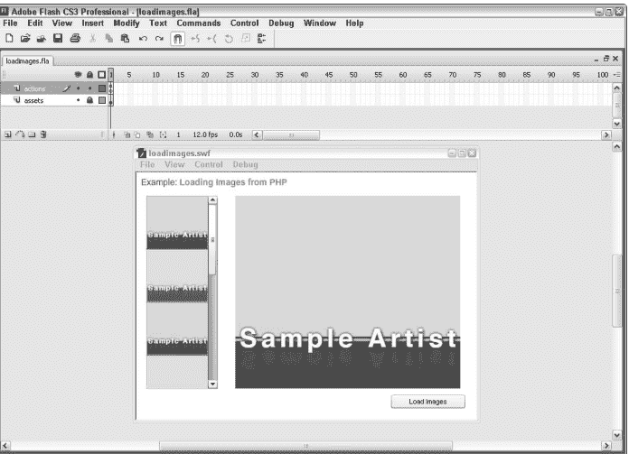

### 设置图像加载器

构建图像加载器的第一步是构建此处所示的应用程序 ActionScript 部分。以下代码假设 thumbSP ScrollPane 已经位于舞台上。

```actionscript
var xmlFile:String = "http://localhost/ch03/loadImages.php";
var imageDir:String = "images/";

function callServer(e:MouseEvent):void
{
    var urlRequest:URLRequest = new URLRequest(xmlFile);
    var loader:URLLoader = new URLLoader();
    loader.addEventListener(Event.COMPLETE, xmlLoaded);
    loader.load(urlRequest);
}

function xmlLoaded(e:Event):void
{
    var loader:URLLoader = URLLoader(e.target);
    var xml:XML = new XML(loader.data);

    var thumbContainer:TileList = thumbSP;
    thumbContainer.removeAll();
    thumbContainer.sourceFunction = sourceHandler;
    thumbContainer.addEventListener(Event.CHANGE, loadMainImage);
    for each(var item:XML in xml..product)
    {
        var smImage:String = item.smImage.toString();
        var lgImage:String = item.lgImage.toString();
        thumbContainer.addItem({source:{sm:smImage, lg:lgImage}});
    }
}

function sourceHandler(item:Object):String
{
    return imageDir + item.source.sm;
}

function loadMainImage(e:Event):void
{
    imageUI.source = imageDir + e.target.selectedItem.source.lg;
}

callBtn.addEventListener(MouseEvent.CLICK, callServer);
```

此示例包含一些纯粹用于处理组件的代码，你暂时无需理解。但是，加载器 xmlLoaded 函数是重点。第一个 xmlLoaded 函数用于遍历加载的 XML 文件，并将缩略图放置在 TileList 组件中。

你会注意到 XML 使用 E4X 来查找图像节点。此示例假设节点名为 product，这是可以找到小图和大图来源的地方。

你使用 addItem 方法传入包含小图和大图来源的对象。在编写点击缩略图的逻辑时，这可以节省时间。当点击某个项目时，TileList 会触发 CHANGE 事件。这用于附加处理程序，以加载大图。

```actionscript
thumbContainer.addEventListener(Event.CHANGE, loadMainImage);
function loadMainImage(e:Event):void
{
    imageUI.source = imageDir + e.target.selectedItem.source.lg;
}
```

sourceFunction 处理程序用于添加图像路径。每次将项目添加到 TileList 时都会调用此函数。

```actionscript
thumbContainer.sourceFunction = sourceHandler;
function sourceHandler(item:Object):String
{
    return imageDir + item.source.sm;
}
```

## 总结

在本章中，你学习了如何使用 PHP 和 Flash 发送和加载数据。随后，你通过发送和加载 XML 数据对此进行了扩展，从而能够开发更动态的应用程序。

你现在应该很好地理解了如何在 Flash 和 PHP 中处理数据。你还了解了在应用程序中使用特定形式数据的几个不同原因。

# 第 5 章

## 与用户交互

### 本章内容
- 表单开发
- 开发联系表单
- 创建登录模块

应用程序通常会以某种方式与最终用户交互，以丰富整体应用体验。这最常见的是联系表单或其他类型的表单，它允许网站所有者在不提供电子邮件地址或要求用户拥有电子邮件客户端的情况下实现通信。应用程序中还会发现另一种表单，即登录表单，它允许你限制对应用程序某些方面或部分的访问。

本章将解释如何在 Flash 中构建表单，以及如何使用 PHP 使其交互。你还将了解使用 Flash 发送数据的概述；但是，我建议你查看第 4 章，以完全了解发送和加载数据的过程。

## 使用 Flash 进行表单开发

表单通常由输入框、按钮、列表框和单选按钮组成，如图 5.1 所示。这些元素均可作为 Flash 中的组件使用。你可以通过选择窗口 > 组件来访问组件窗格。使用这些预构建组件之一，只需将其拖动到 Flash 文档的图层中即可。


### 图 5.1 使用 Flash 自带组件构建的示例表单

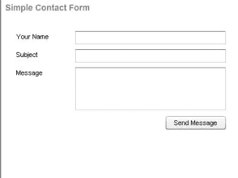

> 注意 如果组件未在舞台上显示，请确保图层列表中图层未显示锁定图标。

如果运行此 Flash 影片，你会在舞台上看到一些酷炫的组件，但它们无法使用。使用它们的过程非常简单。你给组件分配一个实例名称，并在 ActionScript 中引用该名称。

例如，如果你有一个 TextInput 并想预填它，可以添加以下代码：

```
textInstance.text = "please enter your name";
```

尽管该代码很有用，但你也应该捕获用户输入。这可以通过向舞台添加 Submit 按钮组件来实现。

```
userName.text = "please enter your name";
submitBtn.addEventListener(MouseEvent.CLICK, submitHandler);
function submitHandler(e:MouseEvent):void
{
    trace("User input: " + userName.text);
}
```

你可以扩展此示例以添加错误检查和强制必填字段：

```
function submitHandler(e:MouseEvent):void
{
    if(userName.text.length == 0)
    {
        trace("Please enter a name!");
    }
}
```

你经常希望获得网站访问者的反馈。这可以通过添加联系表单来实现，联系表单通常由与 PHP 文件交互的 Flash 表单组成。

## 创建联系表单

在本节中，你将使用书籍网站上包含的起始文件。该文件已将 contactMC 电影剪辑中的所有组件放置在舞台上，并分配了你将在 ActionScript 中使用的实例名称。

以下是完整的联系表单 ActionScript：

```
var phpFile:String = "http://localhost/ch04/contact.php";
var form:MovieClip = contactMC;

function sendMessage(e:MouseEvent):void
{
    // first check the fields

    var nameStr:String = form.nameTxt.text;
    var subjectStr:String = form.subjectTxt.text;
    var messageStr:String = form.msgTxt.text;

    var allFields:Boolean = true;

    // check name
    if(nameStr.length < 2)
    {
        allFields = false;
    }

    // check subject
    if(subjectStr.length < 2)
    {
        allFields = false;
    }

    // check message
    if(messageStr.length < 2)
    {
        allFields = false;
    }

    if(!allFields)
    {
        trace("All required fields not filled in!");

        form.statusTxt.htmlText = "<font color=\"#FF0000\">"+
            "All required fields not filled in!</font>";
        return;
    }

var variables:URLVariables = new URLVariables();
variables.name = nameStr;
variables.subject = subjectStr;
variables.msg = messageStr;

var urlRequest:URLRequest = new URLRequest(phpFile);
urlRequest.method = URLRequestMethod.POST;
urlRequest.data = variables;

var loader:URLLoader = new URLLoader();
loader.addEventListener(Event.COMPLETE, sendHandler);
loader.load(urlRequest);
}

function sendHandler(e:Event):void
{
var loader:URLLoader = URLLoader(e.target);
var variables:URLVariables = new URLVariables(loader.data);

if(variables.resultCode == "SENT")
{
 // message sent
 form.statusTxt.htmlText = "<font color=\"#009933\">Email"+
 " sent, thank you.</font>";
}
else if(variables.resultCode == "ERROR")
{
 // message not sent
 form.statusTxt.htmlText = "<font color=\"#FF0000\">Email"+
 " not sent, please try again.</font>";
}
else
{
 // unknown response
 form.statusTxt.htmlText = "<font color=\"#FF0000\">Unknown"
 + " ERROR</font>";
}
}
form.sendBtn.addEventListener(MouseEvent.CLICK, sendMessage);
```

本节将重点介绍 sendMessage 和 sendHandler 函数。sendMessage 函数分配要传递给 PHP 的变量，实例化必要的类，并设置事件监听器。

```
function sendMessage(e:MouseEvent):void
{

var variables:URLVariables = new URLVariables();
variables.name = nameStr;
variables.subject = subjectStr;
variables.msg = messageStr;

var urlRequest:URLRequest = new URLRequest(phpFile);
urlRequest.method = URLRequestMethod.POST;
urlRequest.data = variables;

var loader:URLLoader = new URLLoader();
loader.addEventListener(Event.COMPLETE, sendHandler);
loader.load(urlRequest);
}
```

> 交叉引用 上一节中的一些代码在第 4 章中有更详细的说明。

## 调用 PHP

对 PHP 的调用分为三个类：URLVariables、URLRequest 和 URLLoader 类，它们的作用是设置联系表单数据容器、创建请求对象，最后调用 PHP 文件。

URLVariables 类以 name.value 对象格式存储联系表单数据，然后将其附加到 URLRequest 的 data 属性中。

URLRequest 使用 URLRequestMethod 类的静态 POST 属性设置请求方法，这告诉 Flash 是以 GET 还是 POST 格式发送数据。GET 将数据附加到 URL 末尾发送：

```
file.php?var1=value1&var2=value2
```

POST 将数据发送在请求中，在大多数情况下这更安全。

此联系表单中使用的最后一个类是 URLLoader。该类添加了一个事件监听器，当 PHP 完全加载并返回任何预期响应时会调用该监听器。该类还调用 load() 方法，传递对 URLRequest 的引用。这最终调用 PHP 并传递你分配的联系表单变量。这就是设置并调用 PHP 所需的全部内容。

## 联系表单事件处理程序

过程的下一步是设置当 PHP 发送响应时调用的事件处理程序。

```
function sendHandler(e:Event):void
{
var loader:URLLoader = URLLoader(e.target);
var variables:URLVariables = new URLVariables(loader.data);

if(variables.resultCode == "SENT")
{
form.statusTxt.htmlText = "<font color=\"#009933\">Email" +
" sent, thank you.</font>";
}
else if(variables.resultCode == "ERROR")
{
    form.statusTxt.htmlText = "<font color=\"#FF0000\">Email"+
    " not sent, please try again.</font>";
}
else
{
    form.statusTxt.htmlText = "<font color=\"#FF0000\">Unknown"+
    + " ERROR</font>";
}
}
```

你会很快注意到 URLLoader 类被再次使用，但这次是用于检索 PHP 响应。然后将其放入 URLVariables 类中以从整体响应中提取结果。PHP 设置为简单地响应 SENT 或 ERROR；然而，你还使用 else 语句来捕获任何未知响应，其中一些可能包括网络错误或 PHP 代码中的简单解析错误。

一个 Label 组件位于联系表单电影剪辑中，响应将发送到这里供用户查看。在更高级的脚本中，你很可能会返回一个结果编号并将文本响应保留在 Flash 中，这样就可以根据特定语言（也称为本地化）定制响应。

设置好 ActionScript 后，你可以继续处理 PHP 代码：

```
<?php
error_reporting(0); // disable all error reporting
set_time_limit(120); // let script run for no more than 2 minutes
$emailTo = "you@yourdomain.com";
$name = $_POST['name'];
$from = $_POST['fromEmail'];
$subject = $_POST['subject'];
$msg = $_POST['msg'];
if(!empty($_POST))
{
    $headers = "";
    $headers = "";
    $date = date("F j, Y"); // Grab todays date
    $email_info .= "Below is the visitors contact info and
    message.\n\n";
    $email_info .= "Visitor's Info:\n";
    $email_info .= "----------------------------------------------\n";
    $email_info .= "Name: " . $from . "\n";
    $email_info .= "Date Sent: " . $date . "\n\n";

$email_info .= "Message\n";
$email_info .= "-----------------------------------------------------------\n";
$email_info .= "" . $msg . "\n";

// Mail headers, do not alter
$mailheaders = "From: " . $from . " <" . $name . ">\n";
$mailheaders .= "Reply-To: " . $from . "\n\n";

if(mail($emailTo, $subject, $email_info, $mailheaders))
{
   print "resultCode=SENT";
}
else
{
   print "resultCode=ERROR";
}
}
?>
```

## 在 PHP 中发送邮件

此 PHP 大部分与你在前面部分使用的内容类似，当然也有一些例外。最显著的例外是引入了 mail() 函数，它接受一系列参数：

```
mail($to, $subject, $emailBodyInfo, $emailHeaders);
```

前两个参数是要发送的电子邮件地址和电子邮件主题，这非常标准。最后两个参数最为重要：$emailBodyInfo 包含电子邮件内容，$emailHeaders 将文件定义为电子邮件。该变量包含路由信息、回复地址以及邮件服务器查找的所有其他电子邮件特定变量。

### 全局变量

你分配变量来保存从 Flash 传入的数据，这是通过使用全局 $_POST 数组完成的。PHP 中的全局变量处理任何脚本都可以访问的总体站点信息和值。你将在安全章节中了解全局变量可能不是正确方法的原因。

回到你的电子邮件脚本，使用全局 $_POST 数据变量来访问从 Flash 传入的变量。

```
$emailTo   = "you@yourdomain.com";
$name      = $_POST['name'];
$from      = $_POST['fromEmail'];
$subject   = $_POST['subject'];
$msg       = $_POST['msg'];
```


使用 Flash 和 PHP 开发一个功能齐全的联系表单所需的代码就是这些。你可以在此示例的基础上扩展，为联系表单添加更多功能。值得考虑添加的几点包括：更强大的验证流程、更多的表单字段，以及可能更具信息量的用户响应。

## 牢记安全问题

关于此联系表单示例，一个非常重要的注意事项是：代码未遵循安全程序，实际上允许用户向 PHP 传递任何数据。一个更强大、可用于生产环境的示例将需要更高级别的安全性；然而，出于演示目的，整体安全性已被省略。

## Flash 中的登录模块

在大多数情况下，你会希望网站有一个安全区域。一个非常流行的示例是摄影师的评论区，客户可以登录并查看照片。

此应用程序的表单部分与联系表单几乎相同。你需要一个用户名和密码框，以及一个提交按钮来触发登录处理程序。

可在起始文件中找到示例布局，也可以从头开始创建。

本示例的实例名称显示在表 5.1 中。

| 表单组件 | 描述 |
| :--- | :--- |
| usernameTxt | 用于登录的用户名 |
| passwordTxt | 要尝试的密码 |
| resetBtn | 重置按钮，清除字段 |
| loginBtn | 登录按钮，触发 loginHandler |

现在表单在视觉上已完成，可以转到使表单可用的 ActionScript。

## 代码骨架

在之前的示例中，你在一个长段中查看了所有代码，但有时这会令人感到压力。查看代码骨架提供了一种快速评估程序变量、函数和其他元素的方法。

以下是登录模块的代码骨架：

```actionscript
stop(); // stop the playhead

var phpFile:String = "http://localhost/ch04/login.php";
var form:MovieClip = loginMC;
var loggedIn:Boolean = false;

function loginHandler(e:MouseEvent):void {...}
function resetHandler(e:MouseEvent):void {...}
function clearIndicators():void {...}
function sendHandler(e:Event):void {...}

form.usernameTxt.tabIndex = 1;
form.passwordTxt.tabIndex = 2;
form.resetBtn.tabIndex = 3;
form.loginBtn.tabIndex = 4;

form.passwordTxt.displayAsPassword = true;
form.resetBtn.addEventListener(MouseEvent.CLICK, resetHandler);
form.loginBtn.addEventListener(MouseEvent.CLICK, loginHandler);
```

## 登录事件处理程序

与联系表单示例类似，你需要为登录模块分配处理登录、清除和 UI 更改的事件处理程序。

第一个事件处理程序是 loginHandler，负责调用服务器并确保将有效数据传递到服务器。它的最后任务是分配结果事件的处理程序。

```actionscript
function loginHandler(e:MouseEvent):void
{
    clearIndicators();

    var user:String = form.usernameTxt.text;
    var pass:String = form.passwordTxt.text;
    var allFields:Boolean = true;

    if(user.length < 2)
    {
        allFields = false;
        form.userRequiredIndicator.alpha = 1.0;
    }

    if(pass.length < 2)
    {
        allFields = false;
        form.passRequiredIndicator.alpha = 1.0;
    }

    if(!allFields)
    {
        form.statusTxt.htmlText= "<font color=\"#FF0000\">Username"
        + " and Password required!</font>";
        return;
    }

    var variables:URLVariables = new URLVariables();
    variables.user = user;
    variables.pass = pass;

    var urlRequest:URLRequest = new URLRequest(phpFile);
    urlRequest.method = URLRequestMethod.POST;
    urlRequest.data = variables;

    var loader:URLLoader = new URLLoader();
    loader.addEventListener(Event.COMPLETE, sendHandler);
    loader.load(urlRequest);
}
```

此处理程序首先将用户名和密码字段分配给内部变量。然后检查这些新变量的有效长度，如果正确，则设置 allFields 变量。此 allFields 变量用于确定是否应显示错误消息并退出函数。如果未设置 allFields，则可以继续设置对服务器的调用。此部分与联系表单示例相同。事实上，你会很快注意到 ActionScript 对所有类型的数据加载和发送都有非常相似的格式。

接下来要关注的处理程序是 clearHandler，它分配给 resetBtn。它的工作是清除所有表单字段，并调用 clearIndicators 函数，你将稍后查看该函数。

```actionscript
function resetHandler(e:MouseEvent):void
{
    form.usernameTxt.text = "";
    form.passwordTxt.text = "";
    form.statusTxt.htmlText = "";

    clearIndicators();
}
```

clearIndicators 函数更改了起始文件中用户名和密码 TextInput 组件右侧图标的 alpha 不透明度。如果你从头开始创建此模块，很可能会省略此函数及其在 resetHandler 中的调用。

```actionscript
function clearIndicators():void
{
    form.userRequiredIndicator.alpha = 0;
    form.passRequiredIndicator.alpha = 0;
}
```

此模块需要的最后一个处理程序是 sendHandler，当 PHP 代码发回响应时会调用它。

```actionscript
function sendHandler(e:Event):void
{
    var loader:URLLoader = URLLoader(e.target);
    var variables:URLVariables = new URLVariables(loader.data);

    if(variables.resultCode == "LOGGED_IN")
    {
        loggedIn = true;
        gotoAndStop(2);
    }
    else if(variables.resultCode == "NOT_LOGGED_IN")
    {
        form.statusTxt.htmlText = "<font color=\"#FF0000\">"+
        "Username/Password not correct.</font>";
    }
}
```

会对 PHP 传递的响应进行评估，以确定用户是否有效以及是否应显示安全页面。

```actionscript
if(variables.resultCode == "LOGGED_IN")
{
    loggedIn = true; // user logged in,
    gotoAndStop(2); // sample has secure page on frame 2
}
else if(variables.resultCode == "NOT_LOGGED_IN")
{
    form.statusTxt.htmlText = "<font color=\"#FF0000\">"+
    "Username/Password not correct.</font>";
}
```

假设用户已登录，你设置 loggedIn 变量并移动到第二帧，在示例中，该帧是一个机密区域，如图 5.2 所示。你的示例很可能有更重要的登录原因，但也许不是。

### 图 5.2

仅当用户登录时才可见的示例安全页面

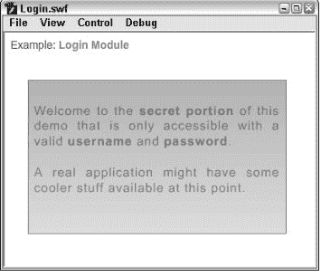

## 登录模块的服务器集成

登录模块的 PHP 代码是流程中的下一部分。

```php
<?php

error_reporting(0); // disable all error reporting

$user = $_POST['user'];
$pass = $_POST['pass'];

// sample password response, normally
// would be sent from database
$storedPassword = "83e4a96aed96436c621b9809e258b309";

if(!empty($_POST))
{
	if($user == "guest" && md5($pass) == $storedPassword)
	{
		print "resultCode=LOGGED_IN";
	}
	else
	{
		print "resultCode=NOT_LOGGED_IN";
	}
}
?>
```

本节的重点在于 $_POST 数据和条件检查，以确定密码是否正确。然后将此结果发回 Flash，用于设置登录状态以及有效用户将看到的其他内容。

一个更强大的示例将让 PHP 针对数据库而不是静态字符串进行评估。$storedPassword 变量具有一个 md5() 哈希字符串。MD5 是许多编程语言（包括 PHP）中可用的哈希算法，最常用于在数据库中存储密码。你将在安全章节中更深入地了解 MD5，但目前最重要的是要注意，哈希字符串就是你的密码。

现在你已使用 Flash 和 PHP 拥有完整的登录模块。你可以轻松扩展此示例以包含数据库集成，更重要的是，增加一层安全性。

## 摘要

在本章中，你学习了如何在 Flash 中构建表单以及如何使用 PHP 使其交互。作为一个更高级的项目，你随后利用之前学到的关于表单开发的整体信息创建了一个登录组件。


# 第 6 章

## 使用 Cookie

- 在 PHP 中使用 Cookie
- 在 Flash 中使用 Cookie
- 了解共享对象

Cookie 在 Web 浏览中非常普遍。事实上，如果 Cookie 停止工作，你会发现很难以习惯的方式浏览互联网。本章介绍如何在 Flash 和 PHP 中使用 Cookie。它涵盖 Cookie 的加载和发送，并探讨如何删除 Cookie。

本章后半部分关于共享对象，即 Flash 中的 Cookie。它们与标准浏览器 Cookie 几乎相同，只是有一些差异，你将进行探讨。

完成本章后，你将完全了解如何使用 Cookie，以及它们为何对成功的应用程序和用户体验至关重要。

### 加载 Cookie

Cookie 是由 Web 服务器放置在用户计算机上的小文件。用户每次访问服务器时，该文件都会原样发回服务器。通常，Cookie 会包含 Web 站点的用户名。Cookie 也可用于保存用户设置及其他小段信息。

加载 Cookie 的过程分多个部分进行讲解，以便更好地理解其工作原理。你会发现，加载 Cookie 的过程与加载其他形式的数据非常相似。

### 在 PHP 中使用 Cookie

在 PHP 中使用 Cookie 是开发可用 Web 应用程序所必需的。你会发现从用户登录到样式等有许多实现 Cookie 支持的机会。

当你更频繁地处理动态数据时，你会希望将部分数据保存到用户的机器上。这样做可以让程序自动登录用户，或根据用户设置修改样式。

Cookie 是按域和目录保存的：这意味着同一域或路径下的任何页面都可以读取该 Cookie。在构建多个示例时这非常有用，也意味着另一个网站无法读取不同站点的 Cookie。

> 注意
> 跨域共享 Cookie 的常见解决方法是创建子域。Cookie 仅针对整个域特定，并且会忽略路径、参数和子域。

### 加载 Cookie

现在你了解了什么是 Cookie，让我们看看如何在 PHP 中加载和处理 Cookie：以下代码尝试加载 Cookie 并显示响应，如图 6.1 所示。

```php
<?php
$username = "Jimmy";

if ( !isset( $_COOKIE['user'] )) {
    setcookie( "user", $username );
    print "Welcome " . $username;
}
else
{
    print "Welcome back, " . $_COOKIE['user'];
}

?>
```

上述代码检查 Cookie 全局数组中是否存在名为 "user" 的 Cookie。如果找到 Cookie，则欢迎用户回来。如果未找到 Cookie，则设置 Cookie 并首次欢迎用户。

$_COOKIE 变量是一个多维数组，可以包含许多不同的 Cookie。该变量由 PHP 自动填充，不需要你向其中添加内容。

#### 图 6.1 浏览器窗口中显示的打印语句

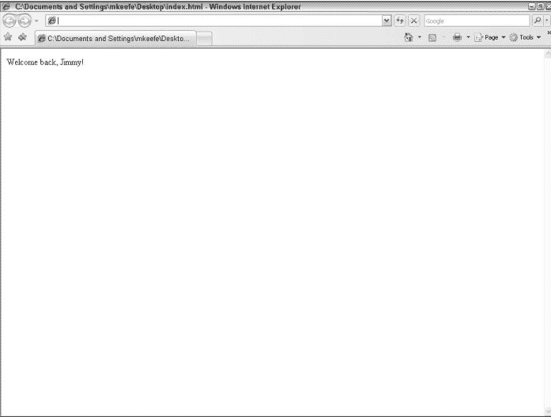

### 保存 Cookie

在 PHP 中设置或保存 Cookie 非常简单：你调用 setcookie 函数。第一个参数是 Cookie 名称；第二个参数是 Cookie 值。例如，假设你想设置一个 time_logged_in Cookie。

```php
setcookie("time_logged_in", time());
```

每当你想保存 Cookie 时，都可以调用 setcookie 函数。如果 Cookie 已存在，则会更新它；如果不存在，则会创建它。

> 注意
> Cookie 能否保存取决于用户是否允许 Cookie。

setcookie 函数接受多于两个参数，但实际上只需要第一个参数，即名称。

### Cookie 过期

默认情况下，当会话结束或用户关闭浏览器时，Cookie 会过期。会话结束的方式是服务器上的预定时间量。默认情况下，这个量为 0 秒，因为当浏览器关闭时会话结束。通常，作为开发者，你不需要知道会话持续多久。你当然更感兴趣的是 Cookie 是否存在。

偶尔，你会希望确保 Cookie 在一定时间后被删除。这在处理安全数据或内容管理系统时会发生。假设你希望 Cookie 在创建后很快过期。

```php
setcookie("username", "adminDave", (time() + 7200));
```

这告诉用户的浏览器在 Cookie 创建 2 小时后删除该 Cookie。Cookie 的过期时间以秒为单位，因此在此示例中，7200 是 2 小时。另一种看法是 (60 * 60 * 2)。

你是否曾打开浏览器、访问一个网站，然后看到你在之前的会话中应用过的自定义内容？这些数据是由保存在你机器上的 Cookie 决定的，该 Cookie 在会话结束时未被删除。

请看一个在三个月内不过期的 Cookie 示例。

```php
<?php
$secondsInDay = 86400;
$daysBeforeExpiration = 90;
setcookie("userStylePref", "blueTheme", (time() + ($secondsInDay * $daysBeforeExpiration)));
?>
```

你先设置一天的秒数——86400。然后设置 $daysBeforeExpiration 变量，该变量保存你希望 Cookie 存活的天数。最后一步是设置 Cookie。将秒数乘以天数，加到 time() 函数中，这就是你的过期日期。

三个月只是一个示例；你可以设置 Cookie 在多年后过期。但是，用户倾向于清理浏览器存储。因此，你绝不应让应用程序依赖于 Cookie 的存在。

### 删除 Cookie

在应用程序的某个时候，你可能会想要删除 Cookie。但是，你的用户所使用的本地 Web 浏览器不允许 Web 服务器直接删除 Cookie。相反，将过期日期设置为早于当前日期，基本上使 Cookie 过期。这会告诉 Web 浏览器删除 Cookie，因为它不再使用。

```php
setcookie("time_logged_in", "", (time() - 300));
```

### 分配多个 Cookie

分配多个 Cookie 的过程相当简单。你基本上对 setcookie 函数进行多次调用，确保每个 Cookie 都有唯一的名称。

```php
<?php

$username = "jimmy";
$userID = 5;
$loggedInTime = time();

setcookie("username", $username);
setcookie("userid", $userID);
setcookie("logged_in_since", $loggedInTime);

?>
```

上述代码通过对 setcookie 函数进行三次唯一调用来设置三个 Cookie。
你也可以将 setcookie 调用放入自定义函数中，如果传入的代码需要更多安全性。例如，你可以创建一个 saveCookie 函数，确保数据干净。

```php
<?php

function saveCookie($name, $value, $expires=0)
{
    if($name == "")
    {
        print "Name not provided, cookie not saved";
    }
    if($value == "")
    {
        print "Value not provided, cookie not saved";
    }

    setcookie($name, $value, $expires);
}

$username = "jimmy";
$userID = 5;
$loggedInTime = time();

saveCookie("username", $username);
saveCookie("userid", $userID);
saveCookie("logged_in_since", $loggedInTime);

?>
```

你的 saveCookie 函数用作预建 setcookie 函数的代理。这允许你检查传入的数据并确保其填写正确。在前面的示例中，如果名称或值为空，你会打印错误。你可以将此简单的安全检查进一步推进，确保数据确实是字符串且不包含任何潜在的恶意代码。当你开始开发 Web 应用程序时，你将学会在安全性方面遵循严格的指导方针。

现在你已经了解了如何在 PHP 中使用 Cookie，可以了解在 Flash 中使用 Cookie 了。在 Flash 中使用 Cookie 的过程非常相似，但提供了一些你将要探讨的优势。

### 在 Flash 中使用 Cookie

Flash 中的 Cookie 实际上称为共享对象，并与 PHP 中的 Cookie 共享类似属性。
这些属性包括在本地存储少量数据并由同一基本域中的任何文件检索的能力。就像 PHP 中的 Cookie 一样，用户可以按站点或全局禁用它们。但是，它们有一些显著的差异。共享对象的一大优势是能够绑定到它们。这意味着多个电影有能力监视文件并在其更新时收到警报。例如，假设你有一个多人游戏，希望每个客户端同步跟踪分数。使用共享对象，你可以允许每个客户端具有读写访问权限，其他客户端会随着分数的变化而更新分数。

### 加载共享对象

以下代码尝试加载共享对象，如果不存在则创建一个。如你所见，加载共享对象非常简单，只需要一行代码。PHP 中的 Cookie 不提供原生创建不存在对象的功能；你必须检查 Cookie 并手动创建它。

```actionscript
var so:SharedObject = SharedObject.getLocal("sample");
trace("Object is " + so.size + " bytes in size");
```

### 保存共享对象

保存共享对象的过程也很简单。首先创建 SharedObject 类的新实例。

```actionscript
var so:SharedObject = SharedObject.getLocal("sample");
```

创建对象后，可以通过向 data 对象添加元素来将数据附加到共享对象，例如：

```actionscript
var so:SharedObject = SharedObject.getLocal("sample");
so.data.user = "guest";
```

你可以调用并回调上述代码块，但值目前不会被保存。原因是
你需要通过调用 flush 方法来提醒对象将其写入本地文件系统。

```actionscript
var so:SharedObject = SharedObject.getLocal("sample");
so.data.user = "guest";
so.flush();
```


> 使用 flush() 时，检查用户是否通过设置管理器 (www.macromedia.com/support/documentation/en/flashplayer/help/settings_manager07.html) 禁用了本地存储。

如果对象不存在，则会创建一个对象。在某些情况下，您可能需要知道共享对象是否存在。实现方法是检查 size 属性。

```actionscript
var so:SharedObject = SharedObject.getLocal("sample");
if(so.size == 0)
{
    // Shared object doesn't exist.
    trace("Shared Object doesn't exist.");
}
```

假设大小测试结果等于零，那么您就知道共享对象不存在。之后，您可以利用此结果，将简单的 trace 替换为创建对象的代码。

```actionscript
var so:SharedObject = SharedObject.getLocal("sample");
if(so.size == 0)
{
    // Shared object doesn't exist.
    so.data.user = "guest";
}
```

### 删除共享对象

与 PHP 不同，共享对象可以从本地存储系统中显式删除。调用 clear() 方法会移除共享对象及其数据，但对该对象的引用将保留。

```actionscript
var so:SharedObject = SharedObject.getLocal("sample");
so.data.user = "guest";
trace("Username is: " + so.data.user); // guest
so.clear();
trace("Username is: " + so.data.user); // undefined
```

第二条 trace 返回 undefined，因为之前的 clear() 调用已移除了该值。现在您可以重新赋值。不过，重新赋值并不需要删除对象。您只需重新写入即可。

### 综合所有内容

在逐一了解各个概念后，现在将所有内容整合到一个最终示例中。此示例将创建、保存、编辑和删除共享对象。

首先打开本书网站上的起始文件（已为此示例预先构建）。在 Flash 中打开文件后，打开动作窗格（按 F9 或 Alt+F9）并添加 ActionScript。

```actionscript
var soDomain:String = "sample";
var so:SharedObject = null;
function loadObject():void
{
    so = SharedObject.getLocal(soDomain);
    trace("Shared Object Loaded");
}
```

```actionscript
function addDataToObject(name:String, value:String):void
{
    if(so == null)
    {
        trace("You must first load the Shared Object");
    }

    so.data[name] = value;
    so.flush();

    trace("Value added: " + so.data[name]);
}
```

```actionscript
function deleteObject():void
{
    if(so == null)
    {
        trace("You must first load the Shared Object");
    }

    so.clear();

    trace("Shared Object deleted");
}
```

```actionscript
function readObject(name:String):void
{
    if(so == null)
    {
        trace("You must first load the Shared Object");
    }
    else
    {
        trace("Shared Object Value : " + so.data[name]);
    }
}
```

```actionscript
function loadHandler(e:MouseEvent):void
{
    loadObject();
}
function saveHandler(e:MouseEvent):void
{
    addDataToObject('test', valueTxt.text);
}
function deleteHandler(e:MouseEvent):void
{
    deleteObject();
}
function readHandler(e:MouseEvent):void
{
    readObject('test');
}

loadBtn.addEventListener(MouseEvent.CLICK, loadHandler);
saveBtn.addEventListener(MouseEvent.CLICK, saveHandler);
deleteBtn.addEventListener(MouseEvent.CLICK, deleteHandler);
readBtn.addEventListener(MouseEvent.CLICK, readHandler);
```

此代码中最重要的部分是 addDataToObject 函数以及两个引用共享对象的变量：属性名称和要存储的值。

```actionscript
var soDomain:String = "sample";
var so:SharedObject = null;

function addDataToObject(name:String, value:String):void
{
    ...
}
```

addDataToObject 函数会检查共享对象是否已正确加载，并尝试使用动态对象分配该值。

```actionscript
function addDataToObject(name:String, value:String):void
{
    if(so == undefined)
    {
        trace("You must first load the Shared Object");
    }

    so.data[name] = value;
    so.flush();
}
```

调用 addDataToObject 函数后，您可以通过简单调用 data 对象来读取共享对象。

```actionscript
trace("Shared Object Data: " + so.data.test);
```

在 Flash 中使用共享对象就这些了。您现在知道如何在 Flash 中加载、保存和删除共享对象及 Cookie。

**注意：** 共享对象也可用于远程环境，但需要更高级的系统。

### 发现使用 PHP Cookie 的好处

在了解了在 PHP 和 Flash 中使用 Cookie 之后，现在来看看为什么在 PHP 中使用 Cookie 是更好的选择。在使用 Flash 时，共享对象似乎是最佳选项，但并非总是如此。

PHP 中的 Cookie 可以在 HTML 和 Flash 网站之间共享。共享对象仅可从 Flash 内部访问，这既有好处也有坏处。好处是其他应用程序无法修改 Cookie。坏处是您无法共享它们，也无法在应用程序之间增加一致性级别。

不过，解决此问题有一个非常常见的变通方法，即通过 PHP 中间人在 Flash 中使用常规 Cookie。

首先，查看将 Cookie 数据传回 Flash 的 PHP 代码。

```php
<?php
if(isset($_POST['act']) && $_POST['act'] == 'getcookie')
{
    if(isset($_COOKIE[$_POST['cookieName']]))
    {
        print "resp=" . $_COOKIE[$_POST['cookieName']];
    }
    else
    {
        print "resp=" . "cookie_not_found";
    }
}
?>
```

此代码确保在继续之前发送正确的 POST 数据。假设传递了有效数据，下一步是确定 Cookie 是否确实存在。使用条件测试来确定是将 Cookie 数据还是错误消息发送到 Flash。

```php
if (isset($_COOKIE[$_POST['cookieName']]))
{
    print "resp=" . $_COOKIE[$_POST['cookieName']];
}
else
{
    print "resp=" . "cookie_not_found";
}
```

无论如何，传递给 Flash 的变量都是“resp”。这样您可以轻松编写 ActionScript 来相应地处理响应。

在首个 if 语句中使用 isset() 的原因是，防止 PHP 意外向 Flash 发送通知，提示未发送变量。这类应用非常适合使用 XML（将在第 3 章中详细介绍）。XML 将确保仅返回您感兴趣的值。对于本简单示例，您将继续使用基于 print 的返回。

PHP 代码已就绪，您现在可以转到 ActionScript。ActionScript 将调用 PHP，并期望返回 Cookie 或错误。

```actionscript
var phpFile:String =
	"http://localhost/ch05/cookies/loadCookie.php";

var variables:URLVariables = new URLVariables();
variables.act = 'getcookie';
variables.cookieName = 'sample';

var urlRequest:URLRequest = new URLRequest(phpFile);
urlRequest.method = URLRequestMethod.POST;
urlRequest.data = variables;

var loader:URLLoader = new URLLoader();
loader.addEventListener(Event.COMPLETE, serverHandler);
loader.load(urlRequest);

function serverHandler(e:Event):void
{
	var loader:URLLoader = URLLoader(e.target);
	var variables:URLVariables = new URLVariables(loader.data);

	if(variables.resp == 'cookie_not_found')
	{
		trace("Requested Cookie Not Found");
	}
	else
	{
		trace("Cookie Data: " + variables.resp);
	}
}
```

向服务器发出的总体调用与此书中其他调用类似。此次调用的重点在于传递给 PHP 的变量和响应。您使用 URLVariables 类来分配 act 和 cookieName 变量。act 变量告知 PHP 请求有效，而 cookieName 变量包含您要查找的 Cookie 名称。

```actionscript
var variables:URLVariables = new URLVariables();
variables.act = 'getcookie';
variables.cookieName = 'sample';
```

与其他加载器示例一样，您需要分配一个函数来处理服务器响应。这是在 PHP 返回 Cookie 或错误消息后被调用的函数。首先，使用 URLLoader 类获取响应中包含的数据。然后，调用 URLVariables 类，它将返回一个响应变量对象。在此示例中，您要查找的是“resp”属性。首先，检查响应是否为“cookie_not_found”，这不言自明。大多数情况下，Cookie 会被设置，第二条 trace 语句会被调用，但假设这一点绝非良好编程实践。这就是添加该条件语句的原因。

```actionscript
function serverHandler(e:Event):void
{
    var loader:URLLoader = URLLoader(e.target);
    var variables:URLVariables = new URLVariables(loader.data);

    if(variables.resp == 'cookie_not_found')
    {
        trace("Requested Cookie Not Found");
    }
    else
    {
        trace("Cookie Data: " + variables.resp);
    }
}
```

您可以将此示例进一步完善：如果未找到 Cookie，则设置 Cookie；甚至可以传递一个 Cookie 名称数组或对象，以快速加载网站的所有 Cookie。AMFPHP（将在第 8 章中介绍）是加载多个 Cookie 的绝佳方式。

如您所见，在 PHP 和 Flash 中使用 Cookie 有多种方式。您甚至开发了一种 PHP 和 Flash 可以共享相同 Cookie 数据的通用方法。

注意：共享 Cookie 数据仍有一个限制，即 PHP 需位于您加载 Cookie 的域上。使用此脚本时需要注意的一点是，此简单示例未检查传递给 PHP 的输入。您肯定希望在实际应用中添加此检查。

## 摘要

在本章中，您学习了如何在 Flash 和 PHP 中加载和使用 Cookie。首先，您学习了如何从用户计算机加载现有 Cookie，然后学习了如何修改和更新该 Cookie。

您现在应了解如何在 Flash 和 PHP 中使用 Cookie，并了解它们在开发应用程序时的重要性。


# 第二部分

## 开发交互式内容

| 本部分内容 | |
|---|---|
| 第 7 章 | 在处理用户输入时保持安全 |
| 第 8 章 | 使用套接字 |

# 在处理用户输入时保持安全

### 本章内容

- 谨慎处理用户输入
- 清理用户数据
- 存储数据
- 返回数据
- 理解 Flash 安全沙箱

处理用户输入的重点在于在保持高安全性的同时，遵循存储和返回数据的最佳实践。

本章分为多个部分，每个部分专注于处理用户数据的特定方面。这并非一份关于处理用户数据的逐步指南（该内容见第 4 章）。相反，本章侧重于处理数据时的安全细节。

本章涵盖的子主题是使用和理解 Flash 中的沙箱。基本上，沙箱是每个应用程序运行的容器，但该部分会更深入地探讨，并提供可视化示例，以更好地解释沙箱及其对应用程序的影响。

本章提供的做法可以应用到您未来开发的应用程序中。保持应用程序安全，就像您出门前锁好家门一样重要。即使应用程序不安全，从技术上讲它仍然可以运行。但是，该应用程序的生命周期是不确定的。应用程序安全性有许多方面，例如：经过净化的数据、安全登录、文件存储和可利用性等。在本章中，重点是用户输入的安全性。用户输入是指用户可以修改的任何数据。此数据列表包括 Cookie、登录信息、会话和文件上传。

## 谨慎处理用户输入

用户数据远远超出联系表单上的一个简单文本框。既然您知道哪些数据被视为用户输入，您可能在想，像文件上传系统这样看似无害的东西如何会构成安全风险。

与大多数安全问题一样，问题不在于技术或功能本身有缺陷，而在于其实现方式。

## 安全处理文件上传

例如，假设有一个基本的 PHP 文件，用于接受文件上传并将上传文件的信息存储在数据库中。

首先要问的是，这个简单应用程序的哪些部分是潜在的安全问题？

- 表单本身？
- 数据库组件？
- 上传的文件？

### 检查有效的文件扩展名

上传的文件是安全漏洞中最不明显的点，但请查看一些示例代码，了解它如何很容易地成为问题。一种非常常见但具有误导性的保护文件上传过程的方法是检查有效的扩展名，例如：

```php
<?php
$file = $_FILES[0];

if(strpos($file['name'], '.jpg') !== false)
{
    if(!move_uploaded_file($file['tmp_name'], 'storage/'))
    {
        print "File uploaded";
    }
}

?>
```

可以看出，代码设置为查找 .jpg 文件扩展名。strpos 函数用于返回检查值的索引或位置，在本例中即为 .jpg。乍一看，这似乎相当安全，应该能阻止恶意上传，但实际上并非如此。这段代码不在意文件扩展名的位置，因此您可以将 imagename.jpg.php 作为文件名，它也会通过检查。更糟糕的是，如果这是一个公开访问的照片库，该文件可以在服务器上自由执行 PHP，因为它已经位于服务器上。当恶意用户能够将代码直接放置在毫无戒心的服务器上时，执行任意代码的能力就成了一个巨大的隐患。

想象一下，上传的图片实际上是一个带有如下代码的 PHP 文件：

```php
<?php
error_reporting(E_ALL);

phpinfo();

mysql_connect('localhost', 'anyuser', 'anypass');
?>
```

可以通过在 `php.ini` 文件中禁用 `display_errors` 指令来强制关闭错误报告。这样可以确保错误报告不会意外重新打开。

当通过浏览器访问时，这段代码将显示所有错误、显示关键服务器信息、强制数据库连接失败从而暴露文件的真实路径（如图 7.1 所示），并判断数据库是否存在。

### 使用更好的方法检查文件扩展名

回到简单的上传示例，让我们添加更强大的安全措施。代码的主要变更是检查有效文件扩展名的 if 语句。它不再查找文件类型的存在，而是查看文件名末尾并检索实际正确的扩展名。

```php
if(strrpos( $file['name'], '.jpg') != false)
{
    ...
}
```

#### 图 7.1

数据库连接故意设置为失败时返回的错误消息

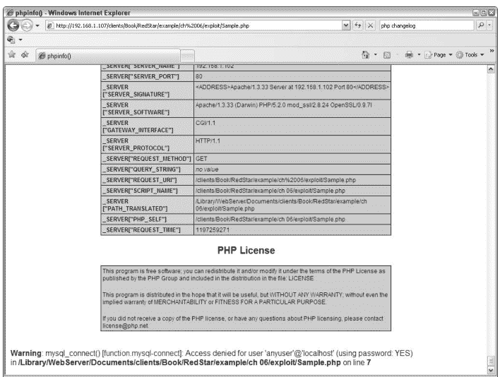

乍一看似乎没有任何变化，但实际上已经发生了变化。`strpos` 函数已被较少见的 `strrpos` 函数取代，该函数从字符串末尾开始向前查找文件类型。这样可以确保找到最终的文件扩展名，而不是埋藏在名称中的扩展名。

与一般代码一样，安全性可以扩展，这个示例允许大量扩展。以下是一种更动态的查找有效文件类型的方法，可以轻松放入现有项目或全新项目中。

```php
<?php

function checkForFileType($file, $type)
{

    $fileTypePos = strrpos($file, '.');

    if($fileTypePos == false)
    {
        return "File not valid.";
    }

    if(substr($file, ($fileTypePos+1), strlen($file)) == $type)
    {
        return "Valid file type";
    }
    else
    {
        return "Invalid or malicious file type detected.";
    }
}

checkForFileType("sample.jpg", "jpg");
?>
```

上述代码是一个自定义函数，接受两个参数。第一个参数指定要验证的文件，第二个参数是要识别的扩展名。这个可扩展的解决方案返回一个字符串，以确定是否找到了文件类型。较少见的第三种可能性是无效匹配。无效匹配表示传入的文件根本没有有效的文件名。

既然代码的上传部分已安全，下一个安全点就是表单本身。这一部分很可能包括文件上传框和用于额外数据的输入框。通常，自动化攻击（设置用于利用网站的计算机）是开发人员最关心的安全问题，但 Flash 中的输入表单也可能带来安全风险。

### 检查有效输入

检查输入框的有效性是一个很好的开端。ActionScript 中的输入检查示例如下所示：

```
if(length(fileNameTxt.text) > 0)
{
    // file name is valid
}
```

这只是检查 fileNameTxt 变量的长度是否大于 0，这意味着输入框中有一些文本。既然已知输入框有效，就会发出对服务器的调用，从而导致调用 PHP。简单不安全示例的 PHP 可能如下所示。

```php
<?php

$name = $_POST['fileName'];

// database info goes here...

mysql_query("INSERT INTO uploads (name) VALUES (" . $name . ")");

?>
```

这基本上是获取文件名并直接将其插入数据库。您可能会想，如果文件名已在 Flash 中验证，这怎么会成为安全问题。问题不在于从 Flash 传入的数据，而在于 PHP 可能会通过其他方法被调用。这是正确保护应用程序所有点的最重要原因之一。

比前面代码更安全的替代方案如下

```php
<?php

$name = $_POST['fileName'];

// database info goes here ...

if(!empty($name) && strlen($name) > 0)
{
    mysql_query("INSERT INTO uploads (name) VALUES (" . $name . ")");
}

?>
```


这段代码不仅在检查有效值，还在确保该值的长度有效。

```
if (!empty($name) && strlen($name) > 0)
```

在实际应用中，你可能会检查至少两到三个字符的值，但这完全取决于预期用途。对代码的这一微小更新确保来自 Flash 或任何其他方法的调用都会得到保护。

### 验证邮政编码

当然，保护数据并不仅限于基本表单字段。假设应用程序中有一部分在用户提交图像时接受五位数字的邮政编码。确保邮政编码有效的方法是测试数字值和有效长度。

```php
<?php

$zipCode = $_POST['zip'];

if(is_numeric($zipCode) && strlen($zipCode) == 5)
{
// valid zip code found
}

?>
```

is_numeric() 函数接受一个变量作为参数，用于测试该值是否为数字。该函数将返回 true/false 响应，因此可以轻松用于 if 语句中，或者你可以将结果赋值给变量。

### 查找有效类型

如果你想在 Flash 中执行相同的基本验证，将使用 typeof 和 length 函数。typeof 函数返回一个字符串值，定义传入项的类型。此函数不仅可用于数字验证，但对于此示例来说非常合适：

```
if (typeof(zipCode) == "number" && zipCode.toString().length == 5)
{
// valid zip code found
}
```

## 清理用户数据

现在你对应用程序中的安全性有了更好的理解，下一步是在存储之前对更高级的数据进行清理。

存储数据的过程既涵盖数据库使用，也涵盖使用标准文本文件的更简单方法。使用标准文本文件的优点是不需要数据库访问。这种方法的缺点是它是一个不够强健的解决方案，导致搜索可能性大大降低。大多数情况下你会使用数据库，除非是一个相当小的应用程序，不需要扩展到更大应用程序的潜力。

### 清理数据

清理数据的第一步在上一节中已介绍，即确保至少数据是有效的。此过程是必要的，因为各种与数据库或文件系统交互的函数如果使用空数据集会产生相当严重的错误。

数据清理过程应该在 PHP 中完成，因为假设任何传入的数据都是脏的始终是一种好的做法。这意味着，尽管数据是从你的 Flash 应用程序发送的，但在提交过程中可能已被篡改。


PHP 中有几个非常有用的函数可以协助在存储之前清理数据。第一个函数是 addslashes()，它将转义传递给它的数据中的引号和斜杠等字符。以下代码片段展示了 addslashes 如何正确清理数据。

```php
<?php
$quote = "I hope to finish the "coolest" Flash application ever.
Which will use Flash and PHP";
?>
```

## 创建安全的 SQL 查询

如果你运行前面的代码，它将生成错误，因为 PHP 处理器不允许引号内嵌引号。有多个引号时，它将无法确定一个字符串在哪里开始、另一个在哪里结束。假设 $quote 变量是通过 Flash 调用动态填充的。该变量将在运行时正确填充，因为编译器不会即时验证内容；但是，将该数据输入 SQL 会导致错误。更糟糕的是，在某些情况下，字符串可能会被部分输入。这是一个现实世界中的 SQL 查询，你可以轻松看到未转义引号的问题。

```
$sql = 'UPDATE users SET business=Tom's Diner WHERE id=' . $ID;
```

同样，将先前输入到 PHP 中的代码运行会导致错误，但假设此字符串是从 $_GET 请求构建的。乍看，该请求似乎是安全的，但请注意 SQL 查询以单引号 (') 开头，且 Tom's Diner 中有一个撇号。实际的 SQL 调用将变为：

```
$sql = 'UPDATE users SET business=Tom
```

这基本上将应用程序中每个业务名称都设置为 Tom，这可能不是预期的结果。除非应用程序进行了适当的备份，否则也很难恢复。该示例相当极端，因为双引号在 SQL 调用中更常见，但你肯定能看到未经清理的数据可能会给系统管理员带来非常糟糕的一天。

既然你知道未经清理的数据有多糟糕，请回到那个 addslashes() 函数，看看 SQL 调用会变成什么：

```
$business = addslashes($_GET['name']);
$sql = 'UPDATE users SET business=' . $business . ' WHERE id=' . $ID;
```

正确清理后的 SQL 调用看起来类似这样：

```
$sql = 'UPDATE users SET business=Tom\'s Diner WHERE id=' . $ID;
```

看看另一个有剧烈结果的格式错误 SQL 调用。这个涉及登录到 Web 页面的安全部分。授权 SQL 调用看起来类似这样：

```php
<?php
$user = "admin";
$pass = "password here";
$query = "SELECT * FROM staff WHERE user='" . $user . "' AND pass='" . $pass . "'";
?>
```

请注意 SQL 又一次盲目接受了值。当用户输入类似这样的密码时，这会成为一个真正的问题：

```
$pass = "' OR ''='";
```

生成的 SQL 调用是一个空密码，因为引号强制 SQL 结束，而 OR 允许它等于它自身。它创建了一个空密码，这意味着只有用户名阻止别人登录，但九次有十次，admin 是一个有效的用户名。

```
SELECT * FROM staff WHERE user='admin' AND pass='' OR ''=''
```

这个简单的 \ 决定了有效 SQL 调用与非常危险的 SQL 调用之间的区别。这个函数只是清理数据的一种可能方式。

使用数据库时的下一个函数是 mysql_real_escape_string，它在将数据输入数据库之前对其进行清理。使用此函数时，必须先建立正确的数据库连接；否则你将收到错误。

mysql_real_escape_string 的语法与 addslashes() 几乎相同。你传入要清理的值和一个可选的 mysql 链接。如果未传入链接，将使用最后一个 SQL 链接。

```php
<?php

// connect to database, generate $link

$business = mysql_real_escape_string($_GET['name'], $link);
$sql = 'UPDATE users SET business=' . $business . ' WHERE id=' . $ID;

?>
```

使用此函数的优点是它处理了所有各种转义，超出了单引号和双引号。明显的问题是它需要一个 MySQL 链接，因此除非数据将存储在数据库中，否则无法使用。或者，至少，你需要有权访问数据库。此函数的错误用法将导致错误，如图 7.2 所示。

### 图 7.2

当 MySQL 数据库链接不可用时显示的错误消息

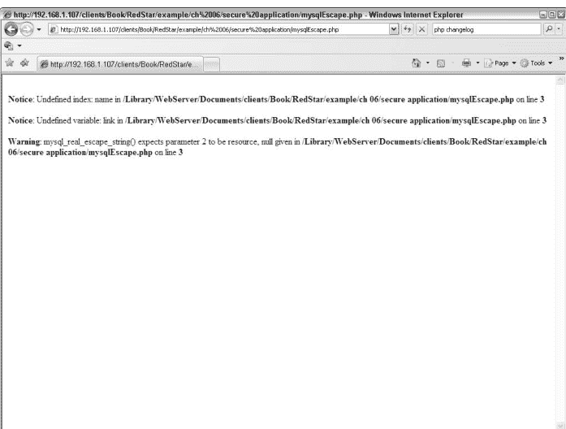

### 正确清理 HTML 数据

要查看的最后一个函数是 htmlentities()。基本上，此函数获取 HTML 字符并将其转换为数值。这些更好，因为 " " 之类的内容会变成 &quot;，这基本上消除了对高级数据清理的需要。

```php
<?php

$str = "The 'red' fox <b>jumped</b>";

// The &#039;red&#039; fox &lt;b&gt;jumped&lt;/b&gt;
echo htmlentities($str, ENT_QUOTES);

?>
```

htmlentities() 函数中的第二个参数决定是否转换单引号和双引号。此第二个参数的可能值显示在表 7.1 中。

| 常量名称 | 描述 |
|---|---|
| ENT_COMPAT | 转换双引号；保留单引号不变 |
| ENT_QUOTES | 转换双引号和单引号 |
| ENT_NOQUOTES | 保留双引号和单引号不转换 |

运行这三个函数都是个好主意，以确保你的数据尽可能干净。它只需要多一点处理能力，但可以在安全应用程序和不安全应用程序之间起到决定性作用。

更重要的是，随着你继续实践这些良好的安全概念，你将在未来花更少的时间进行修补和调试。

## 存储数据

正如本节开头解释的那样，数据库不是唯一的存储方法。你也可以使用简单的文本文件来存储信息，大部分清理步骤在此也同样适用。唯一的例外是 mysql_real_escape_string，如前所述，它需要一个 SQL 链接。


### 安全地写入文件

安全地写入文件的一个简单示例如下。首先，在打开文件之前验证数据。这样做可以确保文件不会意外地被写入。

```php
<?php
if($fileContents != "")
{
    $handle = fopen("sample.txt" , "w+");
    fwrite($handle, $fileContents);
}
else
{
    print "File content not written, invalid data";
}
?>
```

#### 按逻辑顺序处理数据

处理数据时保持逻辑顺序非常重要。例如，如果在 if 语句之前运行了 addslashes()，内容长度可能会偏离并产生错误结果。同时，如果在数据验证之前打开文件，恶意利用可能会向打开的文件注入内容。你可以将其视为在公共场所登录安全网站时所采取的相同预防措施。

#### 创建处理清理的类

到此，你应该完全理解如何清理可保存到数据库或简单文本文件中的数据。你可以扩展这些最佳实践来创建一组更可复用的工具。例如，你可以创建一个自动处理该过程的清理类。一个基本的类将类似于以下内容：

```php
<?php
class Sanitization
{
    function cleanSQL($str)
    {
        return mysql_real_escape_string($str);
    }

    function cleanHTML($str)
    {
        return htmlentities($str, ENT_QUOTES);
    }

    function cleanText($str)
    {
        $s = $str;

        if(!ini_get('magic_quotes_gpc'))
        {
            $s = addslashes($s);
        }

        return $s;
    }

    function checkLength($str, $acceptableLength)
    {
        if(strlen($str) >= $acceptableLength)
        {
            return true;
        }
        else
        {
            return false;
        }
    }
}

?>
```

该类定义了三个方法，每个方法都是前一节所学技术的替代方案。这种方法在继续开发更多应用程序时提供了可复用性。该类还包含比之前使用的更多逻辑，因为 addslashes 会在现有斜杠前添加斜杠。结果将是三个斜杠转义每个引号。

> **注意** 双斜杠会在引号前呈现一个斜杠，因为它告诉编译器转义斜杠，而不将其视为代码。

```
The \\\'red\\\' fox jumped.
```

#### 使用 magic_quotes 选项

PHP 中有一个名为 magic_quotes_gpc 的设置，它负责自动转义数据，如图 7.3 所示。

#### 图 7.3 来自 phpinfo() 列表的 magic_quotes_gpc 属性示例值

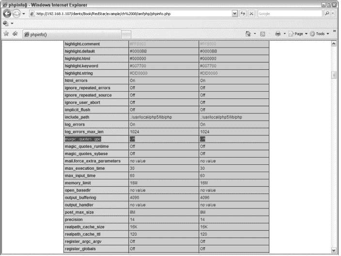

#### 禁用 magic_quotes

在较少见的服务器配置中，此功能无法关闭。快速测试以确定该设置是否启用，可确保不会添加额外的斜杠。

```
if (!ini_get('magic_quotes_gpc'))
{
    $s = addslashes($s);
}
```

清理类中的其他两个函数只是清理传入的数据并返回它。

### 使用共享对象

当你开始构建更完整的应用程序时，你会遇到需要在用户机器上存储少量数据的时点。这些小片段通常包含用户 ID 或会话，映射到实时服务器上的数据库条目。在这种情况下使用共享对象 Flash cookie，因为它是存储在用户机器上的一小段数据，但应用程序运行并不需要它。

当使用共享对象的应用程序重新打开时，它会被配置为查找此小片段数据，并根据结果向服务器发出调用。然而，就像你的浏览器使用的普通 Cookie 一样，共享对象可以被最终用户编辑，这可能会产生有害结果。

如前一节所述，最好不要信任用户提交的数据。这一通用准则确保了更安全的应用程序，并总体上使其更易于使用。

**注意** 应用程序中的大多数漏洞都是通过用户提交的数据被利用的。

想象一个示例应用程序，它将用于处理共享对象。此应用程序可以设置为打开共享对象并将该数据传递到远程服务器。

一旦共享对象加载，就可以向远程服务器发出调用，传递来自共享对象的小片段信息。在此示例中，小片段信息可能是在先前使用中保存的用户 ID。

#### 使用 PHP 处理来自共享对象的数据

PHP 代码负责加载此片段信息并查询数据库。但是，在对数据库进行调用之前，会验证用户 ID，确保它是有效数字且在范围内。

```php
<?php

$userID = $_GET['user_id'];
$idRange = 500;
if(is_numeric($userID) && $userID > 0 && $userID < $idRange)
{
    // connect to database at this point
    mysql_connect("localhost", "user", "pass");
    mysql_select_db("db_name");
    $r = mysql_query("SELECT * FROM user WHERE userID=" . $userID);

    while($row = mysql_fetch_array($r))
    {
        print "resp=success&username=" . $row['username']
        . "&userlevel=" . $row['user_level']
        . "&userstyle=" . $row['user_style'];
    }
}
else
{
    print "resp=" . "User ID not found or is invalid";
}
?>
```

假设用户 ID 有效，将以简单文本格式传回一块信息。然后将此数据加载到数组中并在应用程序的其余部分中使用。如果用户 ID 无效，将返回一个字符串，通知用户发生了某事且现有会话无法加载。在大多数情况下，如果现有会话无法加载，Flash 应用程序知道重新开始，而不是尝试使用不完整或错误的数据。

**注意** Adobe（外部库）的 ActionScript 3 corelib 有一个 MD5 类，可以用来替代 PHP。

## 使用 PHP 创建和存储安全密码

修改可存储密码的过程相当简单。你首先创建到 PHP 文件的连接并传递明文密码。但是，此过程不是最安全的，在进行登录尝试时，最好返回密码的 md5 响应。

为了解释该过程，以下是简单（安全性较低）选项的示例：

```actionscript
var phpFile:String = "http://localhost/md5creator.php";
var query:String = "?pass=" . "password";
var urlRequest:URLRequest = new URLRequest(phpFile + query);
var urlLoader:URLLoader = new URLLoader();
urlLoader.addEventListener(Event.COMPLETE, response);
urlLoader.load(urlRequest);
function response(e:Event):void
{
var loader:URLLoader = URLLoader(e.target);
var param:URLVariables = new URLVariables(loader.data);
trace("User Information Loaded");
trace("\tUser: " + param.username);
trace("\tLevel: " + param.userlevel);
trace("\tStyle: " + param.userstyle);
}
```

使用基本 URLRequest 调用服务器上的 PHP，这应该让你从之前的示例和章节中很熟悉。一旦 URLRequest 建立，就会分配一个回调函数来处理服务器响应。此示例将包含 md5 字符串或错误。

PHP 只是检查有效字符串并返回 md5 哈希（加密字符串）。如果从 Flash 发送不完整或空字符串，PHP 将返回错误消息。

```php
<?php
$string = $_GET['string'];
if(strlen($string) == 0)
{
 print "response=" . "String not provided.";
}
else
{
 $md5 = md5($string);
 print "response=" . $md5;
}

?>
```

这将是创建 md5 哈希的一个相当简单的示例。在实际使用中，你希望为 md5 加密加盐，以使响应更加唯一且更难破解。

盐是 md5 过程中使用的已知值。如果你想创建真正随机的盐，使用 time() 是个好主意，因为几乎每次调用都会产生不同的结果。

此示例的哈希在用户尝试登录时需要可验证。为此示例，使用的应用程序名称将是 "securepass"。

cfcd208495d565ef66e7dff9f98764da

盐附加到将要加密的现有字符串上，位于开头或结尾。

$md5 = md5($string + "securepass");

盐的位置需要保持一致，因为它将在用户下次尝试登录时重新创建。

应用唯一盐的 PHP 代码将类似于以下内容：

```php
<?php
$string = $_GET['string'];

if(strlen($string) == 0)
{
 print "response=" . "String not provided.";
}
else
{
 $md5 = md5($string + "securepass");
 print "response=" . $md5;
}

?>
```

到此，应用程序中已创建盐，你可以继续将该值存储到共享对象的过程。


## 返回数据

可以安全地假设，在您的应用程序中，您会在某个时刻希望将数据返回到 Flash。此过程中的总体安全问题与发送数据类似，不同之处在于返回数据时会尝试更多漏洞利用。

### 安全地返回数据

安全地将数据传回 Flash 的想法是一个讨论较少的话题。这主要是因为 Flash 不需要安全；不过，确保其安全仍然是良好的做法。

如果您未能验证返回到 Flash 的数据，可能会打开一个安全漏洞，例如，允许用户访问应用程序的私有部分。更糟糕的是，这可能对用户体验产生负面影响，您的用户可能会失去对您的应用程序的信心。

返回到 Flash 的数据可以像发出的数据一样被篡改。在前面的示例中，返回了一串数据，但从未检查以确保数据有效。让我们在前面的示例基础上扩展以添加这额外的安全性。响应函数是唯一需要修改的代码部分，因为请求将保持不变。

```actionscript
function response(e:Event):void
{
    var loader:URLLoader = URLLoader(e.target);
    var param:URLVariables = URLVariables(loader.data);

    var username:String;
    var userLevel:uint;
    var userStyle:String;
    var validData:Boolean = true;

    if(param.username != "")
    {
        username = param.username;
    }
    else
    {
        validData = false;
    }

    if(param.userlevel != "")
    {
        userLevel = param.userlevel;
    }
    else
    {
        validData = false;
    }

    if(param.userstyle != "")
    {
        userStyle = param.userstyle;
    }
    else
    {
        validData = false;
    }

    if(!validData)
    {
        trace("User data was not properly loaded");
    }
    else
    {
        trace("User Information Loaded");
        trace("\tUser: " + param.username);
        trace("\tLevel: " + param.userlevel);
        trace("\tStyle: " + param.userstyle);
    }
}
```

基本上，此代码首先初始化变量以存储用户数据，然后检查每个传入的值是否为有效条目。验证变量从一开始就被赋值为 true，因为如果任何 if 语句失败，它将更改为 false。此过程被视为逆向逻辑，但对验证例程效果相当好。

### 使用更安全的方法返回数据

在前面的示例中，您学习了如何安全地处理返回的数据。这种简化方法的问题在于，存在其他方式来拦截 Flash 和服务器之间传递的信息。

### 使用唯一响应

创建更安全应用程序有几种选择，所有这些都取决于开发时间和成本。忽略成本以追求终极安全是一种常见的想法，但这并非始终可能。通常，您会参与一个达到“足够好”阶段并带有问题的项目发布；这是应用程序开发的一个缺点，但非常常见。

保持成本现实的最佳方法是查看所有选项。一种选择是使用 md5 创建唯一的响应代码并确保数据有效，这有效，但无法阻止“黑客”反编译您的 SWF 并直接查看代码。

### 保护您的文件

在 ActionScript 的早期版本中，您可以创建混淆的 SWF，这意味着大多数应用程序无法反编译它们。但是，在撰写本文时，AS3 应用程序不存在这样的工具。

## 了解 Flash 安全沙箱

Flash 中的沙箱取决于 SWF 文件的位置来确定可以访问哪些文件。SWF 文件在用户本地计算机上运行时与在服务器上运行时的功能不同。

例如，本地沙箱中的 SWF 无法同时访问本地和远程对象。这对应用程序实施了一定程度的安全性，以确保源不能相互穿越。

本地文件可以放置在三个沙箱之一中：

- local-with-filesystem: 这确保本地内容不会意外发送到网络或共享。
- local-with-networking-sandbox: 允许本地 SWF 访问远程对象，前提是找到有效的策略文件。
- local-trusted: 此沙箱中的 SWF 可以访问任何地方的数据，包括本地和远程。只有用户和管理员才能将 SWF 移动到此沙箱。

local-trusted 沙箱不能意外由独立的 SWF 设置。这样做是为了确保用户期望的安全级别。

为了允许访问远程域，您必须首先通过调用 allowDomain() 将其添加到 Security 类中。

```
Security.allowDomain("www.example.org");
```

您还可以使用跨域策略文件，允许来自特定域或使用通配符 ("*") 的所有域的访问。

```
<allow-access-from-domain="*" />
```

### 设置沙箱类型

发布 SWF 时，您可以根据使用所需的资源选择指定的沙箱类型。要设置沙箱类型，请执行以下步骤：

- 1. 选择“文件” > “发布设置”。
- 2. 单击“Flash”选项卡。
- 3. 在下拉列表中，单击“播放安全”。
- 4. 单击“确定”。

### 使用 sandboxType 属性

SWF 文件可以使用只读静态 Security.sandboxType 属性来确定 Flash 播放器已将当前 SWF 分配到哪个沙箱。

在某些情况下，您会在编程中使用 sandboxType 属性的当前值来确定应用程序应该如何交互。使用简单的 switch 语句，您可以构建一个自定义函数来跟踪当前的沙箱类型，如图 7.4 所示。

图 7.4

输出窗口显示来自 whichSandbox 函数的示例结果

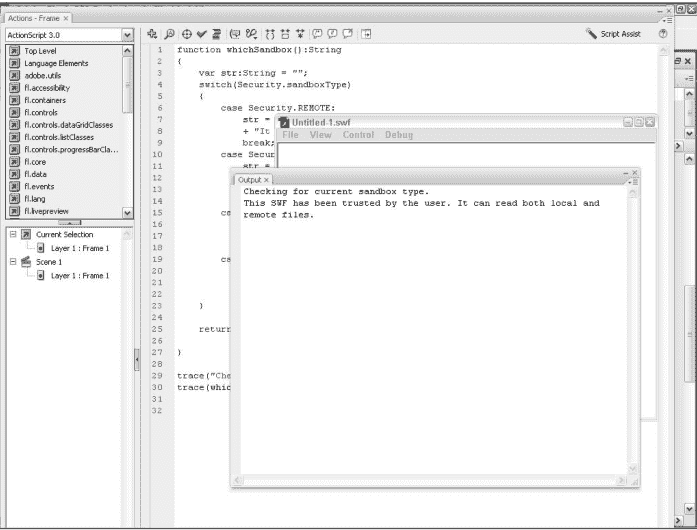

```actionscript
function whichSandbox():String
{
    var str:String = "";
    switch(Security.sandboxType)
    {
        case Security.REMOTE:
            str = "This SWF is from an Internet URL. "
            + "It cannot access local files";
            break;
        case Security.LOCAL_WITH_FILE:
            str = "This SWF is local, but not trusted by "
            + "the user. It does not have access to "
            + "remote files.";
            break;
        case Security.LOCAL_WITH_NETWORK:
            str = "This SWF can communicate with remote "
            + "files, but can with local files.";
            break;
        case Security.LOCAL_TRUSTED:
            str = "This SWF has been trusted by the user. "
            + "It can read both local and remote files.";
            break;
    }

    return str;
}

trace("Checking for current sandbox type.");
trace(whichSandbox());
```

### 确定活动沙箱

确定当前沙箱类型不仅限于简单的 trace 响应。您可以向用户显示警告屏幕，通知他或她当前 SWF 无法访问远程资源，因为它正在本地运行。如果发现本地沙箱，您还可以强制停止电影运行，这意味着电影不再从您的网站运行。例如，本地运行的电影可能已从您的网站被盗，因此检查此情况并相应采取措施是个好主意。

#### 在本地沙箱中运行应用程序

如图 7.5 所示的示例检查沙箱类型，如果电影正在本地运行，则显示倒计时。

图 7.5

显示活动倒计时的已完成应用程序示例

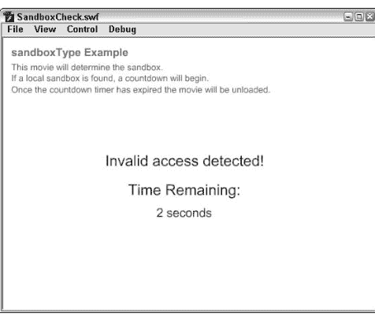

要开始，请打开本书网站上可找到的入门文件。

此示例的资源已完成，因此您可以专注于编程。第一步是创建所需的变量。

```actionscript
var timer:Timer;
var sandbox:String;
var startingTime:uint = 5;
```

分配变量后，您可以构建初始函数 init，该函数在电影开始时立即调用。

```actionscript
function init():void
{
    timerMC.alpha = 0;
    sandbox = Security.sandboxType;

    if(sandbox.indexOf('local') == -1)
    {
        startTimer();
    }
}
```

此函数的主要部分是 if 语句，它检查沙箱类型中是否存在字符串 "local"。这涵盖了任何本地版本，并确定电影不在远程沙箱上运行。如果检测到本地沙箱，将调用 startTimer，该函数初始化并启动倒计时计时器。

```actionscript
if (sandbox.indexOf('local') != -1)
{
    startTimer();
}
```

startTimer 函数首先初始化一个新的计时器实例，然后添加一个每毫秒调用一次的事件监听器。此函数的最后操作是通过将 alpha 属性设置为 1.0 来显示计时器文本，这使其完全可见。

注意：长时间使用 1 毫秒的计时器更新可能会导致电影无响应。对于即时检查（如本示例），这不是什么大问题。

```actionscript
function startTimer():void
{
    startingTime *= 1000;
```


```
timer = new Timer(1, 0);
timer.addEventListener(TimerEvent.TIMER, tickHandler);
timer.start();
timerMC.alpha = 1.0;
}
```

上一节中的事件处理程序为每次计时器调用分配一个函数。该函数就是该处理程序。传入的参数是对计时器对象的引用。你也可以引用全局 Event；不过，如果你将来再次查看此代码，这样会更容易理解。

```
function tickHandler(e:TimerEvent):void
{
    var time:Timer = e.target as Timer;
    var milli:uint = (startingTime - getTimer());
    var sec:uint = Math.round(milli / 1000);
    timerMC.timerTxt.text = String(sec)
    + ((sec == 1) ? " second" : " seconds");
    if(sec == 0)
    {
        timer.stop();
        stage.removeChildAt(0);
    }
}
```

事件对象的目标被转换为 Timer。同样，此步骤不是必需的，但有助于更轻松地使用代码。

其理念是显示剩余秒数，该秒数使用剩余毫秒数确定。剩余毫秒数通过 getTimer() 函数获取，该函数返回当前电影运行的毫秒数。用 startingTime 减去该值，结果即为总毫秒数。

```
var milli:uint = (startingTime - getTimer());
```

> 注意 getTimer() 函数始终返回当前电影运行的总时间。这意味着如果在播放过程中稍后执行此测试，该值将不会正确显示。

然后使用一些基本数学将剩余毫秒转换为秒。milli 变量的当前值除以 1000 即等于剩余秒数。

```
var sec:uint = Math.round(milli / 1000);
```

确定秒数后，该值会发送到舞台上的 timerTxt 文本字段。为了正确的语法显示，使用 sec 变量来确定应显示 "second" 还是 "seconds"。在每次运行此函数时都会测试该 sec 变量，以确定何时停止计时器并卸载整个应用程序。

```
if(sec == 0)
{
	timer.stop();
	stage.removeChildAt(0);
}
```

## 卸载应用程序

卸载整个应用程序的操作是通过在 Stage 实例上调用 removeChildAt 来完成的。在这种情况下，应移除整个电影，因此传入 0 表示从索引 0 开始向下移除。

```
if(sec == 0)
{
	timer.stop();
	stage.removeChildAt(0);
}
```

代码的最后一步是调用 init，它会启动整个过程。

```
init();
```

这是完整的应用程序，当当前沙箱为本地时它将运行。你可以调整此应用程序中的整体逻辑并将其添加到你自己的应用中，以确保你的电影不会被不当运行。

以下是完成后的代码：

```
var timer:Timer;
var sandbox:String;
var startingTime:uint = 5;
function init():void
{
	timerMC.alpha = 0;
	sandbox = Security.sandboxType;
	if(sandbox.indexOf('local') == -1)
	{
		startTimer();
	}
}
function startTimer():void
{
startingTime *= 1000;
timer = new Timer(1, 0);
timer.addEventListener(TimerEvent.TIMER, tickHandler);
timer.start();
timerMC.alpha = 1.0;
}
```

```
function tickHandler(e:TimerEvent):void
{
var time:Timer = e.target as Timer;

var milli:uint = (startingTime - getTimer());
var sec:uint = Math.round(milli / 1000);

timerMC.timerTxt.text = String(sec)
+ ((sec == 1) ? " second" : " seconds");

if(sec == 0)
{
timer.stop();
stage.removeChildAt(0);
}
}
```

```
init();
```

到此，你应该很好地了解 Flash 安全沙箱的工作原理及其含义。如你所见，沙箱在某些情况下可能会带来问题，但总体而言，其目的是保护用户。在上一个示例中，代码已被扩展，现在沙箱既能保护内容所有者，也能保护用户。

你可以将本节学到的实践和技术应用到你自己的应用程序中。

## 确保应用程序无法共享

作为本节的补充内容，最后一个示例将创建类似的沙箱风格检查，但这次的目标是：电影只能在其构建所在的网站上观看，不能在任何其他网站上观看。

这是通过使用 loaderInfo 对象上的 url 属性来实现的。该属性可在任何加载的对象上访问。在此示例中，加载的对象将是舞台，因为它是根显示对象。用于确定电影当前运行位置的代码是：

```
stage.loaderInfo.url
```

此代码返回一个字符串，显示电影运行的位置。本地运行的电影示例响应将是：

```
file:///MacPro%20HD/Library/Server/Documents/DomainCheck.swf
```

使用此属性，你可以像在沙箱测试中那样显示警告消息。为演示目的，提供了一个无效域以导致电影立即移除。

```
if (String(stage.loaderInfo.url).indexOf('example.org') != -1)
{
stage.removeChildAt(0);
}
```

假设上述代码在不位于 example.org 域上的电影中运行，电影将移除自身，应用程序将不再可访问。为了构建更完整的应用程序，你将检查网站的 www 和非 www 版本。你也可以扩展此代码并检查有效站点列表，这可以通过简单的 for 循环和允许域的数组来实现。

> 注意 由于访问 url 的限制，此检查并非 100% 安全。

现在你应该了解如何保护你的应用程序，并添加一层保护以防止其他站点和位置未经许可从你的内容中获益。

## 摘要

在本章中，你学会了如何正确清理用户数据，同时意识到它可能如何影响应用程序功能。接着，你学习了如何正确加载和清理用户数据，以确保存储过程不会受损。随后介绍了存储安全数据，并举例说明了简单的 SQL 调用如何在你的应用程序中引起麻烦。

引入的下一步是将数据返回到 Flash 并分析这些数据，以确保它们被正确处理。

最后一节介绍并概述了 Flash 沙箱及其可能对你的应用程序产生的影响。作为补充内容，你学习了如何创建一个应用程序，如果它不在正确的域上运行，它将移除自身。

# 第 8 章
## 使用套接字

- 本章内容
- 了解套接字
- 在 PHP 中使用套接字
- 在 Flash 中使用套接字
- 使用 Flash 和 PHP 构建基于套接字的聊天客户端

在使用多用户应用程序时，有多种发送和接收数据的方式。你可以使用基于 XML 的传递方法。标准传递的另一种替代方案是构建一个“拉取”应用程序，使用计时器检查更新。

套接字允许“推送”方法，去除了计时器，仅在发送新数据时更新。套接字的使用不仅限于简单数据；你实际上可以构建一个多用户绘图应用程序，它会将坐标传递给各个已登录的客户端。

本章分为两部分。第一部分解释套接字。第二部分是一个基于 Flash 的聊天应用程序，使用套接字作为消息的传递方式。

## 了解套接字

套接字是通信端点，或网络中连接到同一协议上另一台计算机的计算机部分。传统连接（Internet）与套接字之间的区别在于能够区分你正在与哪些机器通信。

当你从 Internet 请求网站时，你会收到请求的页面，但 Internet 不能在你再次请求之前直接将新数据推送到你（客户端）。

套接字通过允许主连接向你（客户端）发送新数据来提供这种直接通信。这最常用于直接连接的应用程序，例如即时通讯器、视频应用程序和团队协作环境。


## 套接字安全

The use of sockets does require a more direct connection, which means security is a larger concern. Generally, whatever tool you are using to implement the socket client or server allows a level of security directly within its own library. For example, Flash requires a trust to be set up in a different domain that allows both parties to authorize the connection. In contrast, a simple connection made by the command line does not have any implied security beyond standard protocol limits.

使用套接字确实需要更直接的连接，这意味着安全是一个更大的问题。一般来说，无论你使用什么工具来实现套接字客户端或服务器，其自身库中都提供了一定级别的安全性。例如，Flash 需要在不同域之间设置信任，以允许双方授权连接。相比之下，命令行建立的简单连接除了标准协议限制之外，没有任何隐含的安全性。

**NOTE** Sockets can be a poor choice when implemented into certain systems or setups due to their direct connection nature.

**注意** 由于套接字具有直接连接的特性，在某些系统或设置中实现套接字可能不是一个好选择。

## Implementing a socket server

The socket server master can be implemented using many common programming languages.

套接字服务器主控端可以使用许多常见编程语言来实现。

For a persistent or production-level socket, you would most likely run it from a live server to ensure other users can connect to it and limit the risk of an open connection on your local system.

对于持久性或生产级套接字，你最好在实时服务器上运行它，以确保其他用户可以连接到它，并限制本地系统上开放连接的风险。

## Understanding the socket connection

The socket connection in the following example will be responsible for communicating with the user. The following sections explain that process.

以下示例中的套接字连接将负责与用户通信。以下部分将解释该过程。

## Parts of a socket

A socket connection is made of two pieces. The first part is the master connection or server, and the second part is the clients that connect to the master. The clients can talk directly to the master but cannot generally talk to other clients. If you want the clients to talk with each other you would implement a talkback system within the master.

套接字连接由两部分组成。第一部分是主控连接或服务器，第二部分是连接到主控的客户端。客户端可以直接与主控通信，但通常不能与其他客户端通信。如果你希望客户端之间相互通信，你需要在主控中实现一个回话系统。

### Binding

The master socket is bound to a specific IP address and port. This means the master connection is made to this specific point to ensure the connection is unique. Clients that want to communicate with that socket server must connect to the same IP address and port as the master.

主套接字绑定到特定的 IP 地址和端口。这意味着主控连接会连接到这个特定点，以确保连接的唯一性。想要与该套接字服务器通信的客户端必须连接到与主控相同的 IP 地址和端口。

### Listening

This is similar to the standard Web server. Once the socket server starts, it listens for active clients and new ones that want to connect. These clients are then added to the queue and begin to receive communications from the group.

这与标准 Web 服务器类似。套接字服务器启动后，它会监听活跃客户端以及想要连接的新客户端。这些客户端随后被添加到队列中，并开始接收来自组的通信。

## Working with Sockets in PHP

Building a socket server in PHP requires some prior configuration. A socket server within PHP cannot be run from the standard graphic version due to its persistent connection. A standard Web browser-based connection would timeout or possibly crash the host machine. A socket connection would be run using the nongraphic command-line version of PHP (CLI). The first step to working with sockets in PHP is to determine if you have this CLI version of PHP installed, as it is not normally included in a Web server package.

在 PHP 中构建套接字服务器需要一些预先配置。由于持久连接的原因，PHP 中的套接字服务器无法从标准图形版本运行。基于标准 Web 浏览器的连接会超时，甚至可能导致主机崩溃。套接字连接将使用 PHP 的非图形命令行版本（CLI）运行。在 PHP 中使用套接字的第一步是确定是否已安装此 CLI 版本的 PHP，因为它通常不包含在 Web 服务器软件包中。

### Looking for command-line version of PHP

The command-line version (CLI), if installed, is usually accessible directly from the Terminal on a Mac or the command prompt on a PC (see Figure 8.1).

如果已安装，命令行版本（CLI）通常可以直接从 Mac 的终端或 PC 的命令提示符访问（参见图 8.1）。

To determine if you have this version, simply open the command line. In Windows, click Start and then Run. Type cmd in the Run dialog box and click OK. If you're using a Mac, open the Finder, navigate to Applications/Utilities, and open the Terminal.

要确定是否安装了此版本，只需打开命令行即可。在 Windows 中，单击“开始”，然后单击“运行”。在“运行”对话框中键入 cmd，然后单击“确定”。如果你使用的是 Mac，打开 Finder，导航到 Applications/Utilities，然后打开终端。

### FIGURE 8.1

Example of a command prompt in Windows XP

Windows XP 中的命令提示符示例

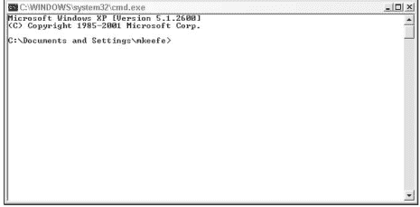

With the command line open, type the following:

打开命令行后，输入以下内容：

```
$ php -v
```

That command tells PHP to report the version information and exit. The results should look something similar to the following:

该命令指示 PHP 报告版本信息并退出。结果应类似于以下内容：

```
PHP 5.2.5 (cli) (built: Dec 20 2007 02:55:52)
Copyright (c) 1997-2007 The PHP Group
Zend Engine v2.2.0, Copyright (c) 1998-2007 Zend Technologies
```

If you get a response similar to the following, it means the PHP version may be installed but not globally accessible from any command line and will require configuration.

如果收到类似以下的响应，则表示 PHP 版本可能已安装，但无法从任何命令行全局访问，并需要配置。

```
-bash: php: command not found
```

You will need to locate the command-line version or install it to continue with this chapter.

你需要查找命令行版本或安装它，以便继续本章的学习。

> See Chapter 1 for information on how to install the command-line version of PHP.

> 有关如何安装 PHP 命令行版本的信息，请参见第 1 章。

## Building a socket server

To build a simple socket server using PHP, start by creating a file and saving it to a commonly accessible location. This file does not need to be in your Web directory and will probably only be harder to work with if it is.

要使用 PHP 构建一个简单的套接字服务器，首先创建一个文件并将其保存到常用可访问的位置。此文件不需要放在 Web 目录中，而且如果放在其中，可能会更难处理。

> You want to ensure the socket file is not visible to the Web because it could cause your PHP to not work properly if a malicious user attempted to run the file.

> 你需要确保套接字文件对 Web 不可见，因为如果恶意用户尝试运行该文件，可能会导致 PHP 无法正常工作。

To better understand how sockets work, start with a very simple socket server example.

为了更好地理解套接字的工作原理，先从一个非常简单的套接字服务器示例开始。

### Simple PHP-based socket server

The first part of the socket server is to determine the server IP address and port number. If you are running the server locally you don't need to determine your physical IP address. Instead, you can use the local address.

套接字服务器的第一部分是确定服务器 IP 地址和端口号。如果你在本地运行服务器，则不需要确定物理 IP 地址。相反，你可以使用本地地址。

```
<?php

$host = "127.0.0.1";
$port = "8888";
```

The port number is not specific, but it needs to be unique on the same machine to ensure it won't collide with any other application on your system or network (if used remotely).

端口号没有特定要求，但在同一台机器上需要唯一，以确保它不会与系统或网络上的任何其他应用程序冲突（如果远程使用）。

This script will need to inform PHP to continue running because it needs to check for and manage connections indefinitely. This is achieved by passing the set_time_limit function a value of 0, meaning this script should never stop until properly exited.

此脚本需要通知 PHP 继续运行，因为它需要无限期地检查和管理连接。这是通过将 set_time_limit 函数的值设为 0 来实现的，这意味着该脚本应一直运行，直到正常退出。

```
set_time_limit(0);
```

With the configuration out of the way, you can create the master socket connection.

配置完成后，你可以创建主套接字连接。

```
$sock = socket_create(AF_INET, SOCK_STREAM, SOL_TCP);
```

The three arguments passed into the socket_create function define which type of connection it is and are PHP constants. For this example they are not important, but they will be explained later in the chapter.

传递给 socket_create 函数的三个参数定义了连接类型，且均为 PHP 常量。在本示例中它们不重要，但将在本章后面进行解释。

The $sock variable now contains an active socket resource id. The next step is to bind the socket to the port defined in the first part of the code.

$sock 变量现在包含一个活动套接字资源 ID。下一步是将套接字绑定到代码第一部分中定义的端口。

```
socket_bind($sock, $host, $port);
```

After the socket is bound to the port, you can start listening for connections. The first argument is the $socket variable, which holds the socket resource id. The second argument is a backlog variable that tells PHP how many messages to queue up before an error is passed to the client. This variable is a suggestion because some systems will define or override this value. For example, Windows sets this based on the underlying service provider and basically ignores any user-submitted value.

套接字绑定到端口后，你可以开始监听连接。第一个参数是 $socket 变量，它保存套接字资源 ID。第二个参数是 backlog 变量，它告诉 PHP 在向客户端传递错误之前要排队的消息数量。这个变量只是一个建议，因为有些系统会定义或覆盖此值。例如，Windows 基于底层服务提供程序设置此值，基本上会忽略用户提交的任何值。

```
socket_listen($sock, 4);
```

At this point, you have built a socket server that doesn't do anything. This basically means the server starts and waits for incoming connections but does not handle them in any way. The next step is to set up the portion of the socket server that handles the incoming connections.

此时，你已经构建了一个不执行任何操作的套接字服务器。这基本上意味着服务器启动并等待传入连接，但不以任何方式处理它们。下一步是设置处理传入连接的套接字服务器部分。

You need to create another socket that handles the incoming connections by making a call to socket_accept passing in the $socket resource id.

你需要通过调用 socket_accept 并传入 $socket 资源 ID 来创建另一个用于处理传入连接的套接字。

```
$childSocket = socket_accept($sock);
```

From this point the $childSocket variable is used to handle all client communications. The data sent from a connection is read using the socket_read function.

从这一点开始，$childSocket 变量用于处理所有客户端通信。来自连接的数据使用 socket_read 函数读取。

```
$incomingData = socket_read($childSocket, 2048);
```

This function takes two arguments. The first argument is the client socket handler, and the second argument is the number of bytes to read from the client. This can be useful when trying to run a more efficient socket server. It is also a good idea to limit the output on the client side (if possible).

该函数采用两个参数。第一个参数是客户端套接字句柄，第二个参数是要从客户端读取的字节数。在尝试运行更高效的套接字服务器时，这可能很有用。同时，最好限制客户端上的输出（如果可能）。

The socket_read function continues to load information into the $incomingData variable until the data limit is hit or one of the following characters is found: carriage return (\n), tab (\t), or \0. PHP treats those as end-of-input characters and moves to the next line in the script when one is found.

socket_read 函数会继续将信息加载到 $incomingData 变量中，直到达到数据限制或找到以下字符之一：回车符（\n）、制表符（\t）或 \0。PHP 将这些视为输入结束字符，并在找到其中一个时移动到脚本的下一行。

### Responding to the client connection

After the data is loaded, the next step is to act on that data and in most cases respond to the client. For example, the following is a simple question/answer demo that has PHP responding to one question:

加载数据后，下一步是根据数据采取行动，并在大多数情况下响应客户端。例如，以下是一个简单的问答演示，用于 PHP 对一个问题进行响应：

```
if(substr($incomingData, 0, -2) == "are you hungry?")
{
    $response = "Server Response > I could eat!\n";
    socket_write($childSocket, $response, strlen($response));
}
```

The socket_write function takes three arguments. The first is the child socket resource id; the second argument is the response being sent to the client. The third argument, which is optional, is the length of the $response. This example only sends a response back to the client when you ask PHP if it is hungry. As you can see, this is not a very practical application, but does clearly explain how sockets are set up and how to interact with them.

socket_write 函数采用三个参数。第一个是子套接字资源 ID；第二个参数是发送给客户端的响应。第三个参数是可选的，即 $response 的长度。此示例仅在你询问 PHP 是否饿了时才向客户端发送响应。如你所见，这不是一个非常实用的应用程序，但它确实清楚地解释了如何设置套接字以及如何与其交互。

The last step to the sample application, before testing it, is closing the two socket connections to free up the resources and allow new connections to be made.

在测试示例应用程序之前，最后一步是关闭两个套接字连接，以释放资源并允许建立新连接。


如果你仍希望接收连接，只需移除 `$childSocket` 变量即可。

```
socket_close($childSocket);
socket_close($sock);
```

套接字可以按任何顺序关闭，但最好最后关闭主套接字，以防你需要先遍历多个客户端连接。

## 测试套接字服务器

可以使用简单的提示符或终端来测试套接字服务器，如图 8.2 所示。打开命令行后，启动 PHP 的命令行版本，使用 `-f` 选项传入示例文件。

```
$ /path/to/php -f /path/to/socket/sample/simpleSocket.php
```

### 图 8.2 在命令提示符中运行的简单套接字服务器

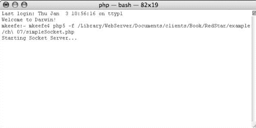

你会发现提示符指示符消失，且 PHP 文件没有任何输出。这可能不是非常理想的结果，因为没有任何东西在告诉你服务器正在运行。你可以在文件顶部添加一个非常简单的打印语句，例如：

```
<?php

$host = "127.0.0.1";
$port = "8888";

set_time_limit(0);

print "Starting Socket Server...\n";
...
```

如果你停止并启动套接字服务器，应该会看到打印的消息，类似于下面这样：

```
$ /usr/bin/php -f /path/to/simpleSocket.php
Starting Socket Server...
```

> 如果你经常重启套接字服务器，可能会看到提示端口已被占用的警告。你可以重试或选择另一个端口来继续测试。

当套接字服务器正常运行时，你可以打开一个新的提示符，并尝试将客户端与套接字服务器连接。

```
$ telnet 127.0.0.1 8888
```

成功连接后，应会出现类似下面的消息：

```
$ telnet 127.0.0.1 8888
Trying 127.0.0.1...
Connected to localhost.
Escape character is '^]'.
```

此应用程序在终止前仅接受发送的一条消息。如果你输入的内容不是 "are you hungry?"，则不会看到任何响应，除非你修改了套接字应用程序中提出的问题。

以下是此示例的完整代码：

```
<?php

$host = "127.0.0.1";
$port = "8888";

set_time_limit(0);

print "Starting Socket Server...\n";

$sock = socket_create(AF_INET, SOCK_STREAM, SOL_TCP);

socket_bind($sock, $host, $port);
socket_listen($sock, 4);

$childSocket = socket_accept($sock);
$incomingData = socket_read($childSocket, 2048);

if(substr($incomingData, 0, -2) == "are you hungry?")
{
    $response = "Server Response > I could eat!\n";
    socket_write($childSocket, $response, strlen($response)) ;
}
}
socket_close($childSocket);
socket_close($sock);
?>
```

返回消息后连接会自动终止，因为没有系统用于查找其他消息。更现实的应用程序会假设存在某种循环来查找多条消息。

## 创建持久套接字服务器

持久套接字服务器与前一个示例非常相似，区别在于它会循环检查新消息。

### 递归循环

PHP 不提供类似 ActionScript 中的异步系统（基于事件），但你可以创建一个循环来达到相同的效果。

例如，下面是一个非常简单的 `while` 循环，类似于将在持久连接示例中使用的循环：

```
x = 0;
while(x < 50)
{
x++;
}
```

### 管理多个通信

允许用户在一个连接中发送多条消息的关键，是将负责检查新消息的 `socket_read` 调用包装在一个循环中。

```
do
{
// // look for new messages

$incomingData = socket_read($childSocket, 2048);

if(trim($incomingData) == "are you hungry?")
{
$response = "Server Response > I could eat!\n";
socket_write($childSocket, $response, strlen($response));
}
else if(trim($incomingData) == "exit")
{
$response = "Goodbye!\n";
socket_write($childSocket, $response, strlen($response));
}
socket_close($childSocket);
break;
}
else
{
$response = strtoupper(trim($incomingData)) . "\n";
socket_write($childSocket, $response, strlen($response));
}
}
while(true);
```

如果你测试该示例，连接将保持活动状态，直到你关闭提示符，或在连接到应用程序时输入 "exit"（这会告知套接字服务器关闭你的连接）。你也可以输入除了 "exit" 或上述问题之外的任何内容，响应将是你以大写形式输入的内容。

此简单示例不支持多客户端，因此一旦客户端关闭，服务器也会随之结束。在本章的第二部分，你将构建一个基于套接字的完整多用户聊天应用程序，它本质上会允许同时存在多个连接。

到现在你应该已经了解 PHP 中套接字的工作原理，以及如何根据应用程序以不同方式实现它们。下一部分解释了套接字在 Flash 中的工作原理。然后在最后一章中，你将结合 Flash 和 PHP 来使用套接字发送/接收信息。

## 在 Flash 中使用套接字

Flash 被视为套接字连接的客户端。这意味着你无法直接从 Flash 部署套接字服务器，因为 Flash 是客户端应用程序。即使可以将 Flash 用作套接字服务器，也不会非常有益，因为 Flash 是图形应用程序。在命令行环境中使用 Flash 本质上是对资源的浪费。

话虽如此，Flash 是出色的套接字服务器客户端。前一部分使用了 Telnet，这是初始化与套接字服务器客户端连接的一种方式。Flash 允许 TCP 连接，但这需要更多代码和更多初始设置。

下一部分中大部分连接代码可以构建成公共类或库，以最大限度地减少创建套接字连接所需的代码量。

### 初始化套接字连接

初始化套接字连接的第一步是定义要连接的主机和端口。

```
var host:String = "127.0.0.1";
var port:uint = 8888;
```

这两个变量需要与你在上一部分编写的 PHP 代码相同。或者，如果你使用提供的代码，可以保留刚才显示的示例值。

定义变量后，创建 `Socket` 类的实例。该类的构造函数接受两个参数。第一个是主机，第二个是要连接的端口。

```
var socket:Socket = new Socket(host, port);
```

在继续使用动态数据源时，你会很快发现适当的事件处理程序能更容易地理解某事的工作原理。这意味着向套接字过程添加事件监听器是个好主意。先构建调用，稍后再创建事件处理程序。

```
socket.addEventListener(Event.CLOSE, closeHandler);
socket.addEventListener(Event.CONNECT, connectHandler);
socket.addEventListener(IOErrorEvent.IO_ERROR, ioErrorHandler);
socket.addEventListener(SecurityErrorEvent.SECURITY_ERROR,
securityErrorHandler);
socket.addEventListener(ProgressEvent.SOCKET_DATA,
socketDataHandler);
```

### 事件处理程序

此示例应用程序中使用的事件处理程序函数将错误追踪到输出窗口。更现实的应用程序需要一些逻辑来处理这些错误并相应地响应用户。

```
function closeHandler(event:Event):void
{
trace("Connection to [" + host + "] closed");
}
```

```
function ioErrorHandler(event:IOErrorEvent):void
{
trace(event.text);
}
```

```
function securityErrorHandler(event:SecurityErrorEvent):void
{
trace(event.toString());
}
```

### 特殊处理程序

此示例有两个特殊事件处理程序。第一个特殊事件处理程序在连接成功时被调用，通知你可以向套接字服务器发送消息。在建立正确连接之前发送的消息可能会导致错误或消息丢失。


```
function connectHandler(event:Event):void
{
    trace("Connected to [" + host + "]");
}
```

connectHandler 函数是应放置任何对服务器调用的位置。在这里添加示例消息调用会是个不错的选择，例如：

```
function connectHandler(event:Event):void
{
    trace("Connected to [" + host + "]");
    try
    {
        socket.writeUTFBytes("are you hungry?\\n");
    }
    catch(e:IOError)
    {
        trace(e);
    }
}
```

第二个特殊事件处理程序是在从套接字服务器完全接收响应时调用的。这是为了确保不会评估部分消息，因为它们可能导致难以追踪的编程错误。

```
function socketDataHandler(event:ProgressEvent):void
{
    trace("Socket Server Response Loaded");
}
```

这是应放置所有响应代码的函数，类似于以下示例：

```
function socketDataHandler(event:ProgressEvent):void
{
    var str:String = socket.readUTFBytes(socket.bytesAvailable);
    trace("Socket Server Response: " + str);
}
```

如您所见，在 Flash 中使用套接字与使用任何其他数据对象并无太大区别。不同包之间代码的一致性是 ActionScript 的一个非常出色的特性。

### 远程套接字连接

之前的示例是连接到本地套接字（同一台机器上），但更现实的情况是，您的应用程序将连接到远程套接字。这意味着您必须在运行套接字服务器应用程序的客户端和服务器之间建立信任。

### 安全信任

信任使用 crossdomain.xml 文件及其允许的端口，例如：

```
<?xml version="1.0"?>
<!DOCTYPE cross-domain-policy SYSTEM
"http://www.macromedia.com/xml/dtds/cross-domain-policy.dtd">
<cross-domain-policy>
<allow-access-from domain="*" to-ports="8888" />
</cross-domain-policy>
```

此访问文件允许任何客户端连接到端口 8888，且不允许其他端口。如果此套接字应用程序仅可从另一个网站访问，您也可以定义域，例如：

```
<?xml version="1.0"?>
<!DOCTYPE cross-domain-policy SYSTEM
"http://www.macromedia.com/xml/dtds/cross-domain-policy.dtd">
<cross-domain-policy>
<allow-access-from domain="anothersite.com" to-ports="8888" />
</cross-domain-policy>
```

安全信任的第二部分是在 Flash 文件中调用 allowDomain。Security 类的此方法负责定义允许连接到此客户端的域。只有当远程站点具有正确的 crossdomain 文件时，才会发生此连接。

```
Security.allowDomain("example.com");
```

### 加载策略文件

在极少数情况下，跨域策略文件不在默认位置，因此可以调用 loadPolicyFile 来通知 Flash 在哪里查找 crossdomain.xml 文件。

```
Security.loadPolicyFile("http://example.com/newloc/crossdomain.xml");
```

现在您应该知道如何在 Flash 中设置基于客户端的套接字连接。如您所见，套接字连接中使用的大部分代码均由 Flash 处理。

如本节开头所述，构建套接字连接所使用的代码可以在您的项目中重复使用。

## 使用类进行套接字连接

为了更好地理解 Flash 中的套接字连接，让我们先构建一个基本的套接字示例。然后，一旦基础搭建完成，下一节将介绍使用 Flash 和 PHP 构建完整的基于套接字的聊天应用程序。

### 基本套接字类

这是一个基本套接字类，可以轻松定义可自定义的元素。只需将此代码保存为名为 SimpleSocket 的 ActionScript 文件，并放在示例 Flash 文档所在的同一目录中即可。

```
package
{

import flash.errors.*;
import flash.events.*;
import flash.net.Socket;

public class SimpleSocket extends Socket
{

public var host:String;
public var port:uint;
private var socket:Socket;

public static var SOCK_CONNECTED:String = "onSockConnect";
public static var SOCK_IOERROR:String = "onSockIOError";

function SimpleSocket(h:String, p:uint)
{
host = h;
port = p;
socket = this;
super(host, port);
initListeners();
}

public function sendMessage(str:String):void
{
if(connected)
{
socket.writeUTFBytes(str + "\\n");
}
else
{
trace("Not connected, message not sent!");
}
}

public function readMessage():void
{
if(connected)
{
var str:String = socket.readUTFBytes(socket.bytesAvailable);
trace("Socket Server Response: " + str);
}
else
{
    trace("No message read, not connected!");
}
}

private function initListeners():void
{
    socket.addEventListener(Event.CLOSE, closeHandler);
    socket.addEventListener(Event.CONNECT, connectHandler);
    socket.addEventListener(IOErrorEvent.IO_ERROR, ioErrorHandler);
}

private function closeHandler(event:Event):void
{
    trace("Connection to [" + host + "] closed");
}

private function ioErrorHandler(event:IOErrorEvent):void
{
    dispatchEvent(new Event(SOCK_IOERROR));
}

private function connectHandler(event:Event):void
{
    trace("Connected to [" + host + "]");
    dispatchEvent(new Event(SOCK_CONNECTED));
}

private function socketDataHandler(event:ProgressEvent):void
{
    readMessage();
}
} // last two braces are lined up for printing purposes
```

### 使用 SimpleSocket 类

使用 SimpleSocket 类的过程非常简单。首先，创建一个新的 Flash 影片。此影片会进行导入调用，负责加载自定义类。

```
import SimpleSocket;
```

```
var sock:SimpleSocket;
```

要创建套接字连接，首先创建 SimpleSocket 类的新实例，传入要连接的套接字服务器的主机和端口信息。

```
sock = new SimpleSocket('127.0.0.1', 8888);
```

完成套接字连接调用后，您将需要为自定义事件分配监听器。这个简单类只有针对成功连接的事件，以及针对任何连接错误的事件。您可以根据需要扩展类并添加更多事件处理程序。

```
sock.addEventListener(SimpleSocket.SOCK_CONNECTED, connected);
sock.addEventListener(SimpleSocket.SOCK_IOERROR, ioError);
```

最后一步是定义事件处理程序函数，例如：

```
function ioError(e:Event):void
{
   trace("Can't connect to " + sock.host + " on port " + sock.port);
}
function connected(e:Event):void
{
   sock.sendMessage("are you hungry?");
}
```

现在您可以运行影片，如果已构建或加载了套接字服务器代码且服务器当前正在运行，您将看到以下输出：

> "已连接到 [127.0.0.1] 套接字服务器响应：是否有人？"

此类可以扩展以满足更具体的要求，但您现在应该基本了解 Flash 中的套接字系统如何工作。此时，您也应该知道如何构建自定义类来处理大部分套接字连接和通信过程。

最终部分将介绍如何使用前几节所学的信息构建自定义多用户聊天客户端。

## 使用 Flash 和 PHP 构建基于套接字的聊天客户端

在前几节中，您学习了如何构建简单的 PHP 套接字服务器。然后，您构建了一个基本的 Flash 客户端以与 PHP 套接字服务器通信。在本节中，您将把这些步骤合并为一个实际应用程序。您将构建的应用程序是一个在 Flash 中运行的多用户聊天客户端，配合 PHP 套接字服务器处理连接。

这个多用户聊天应用程序将允许多个客户端连接相互通信，同时管理员可以发送关于状态和连接详情的特定消息。

### 聊天客户端的 PHP 套接字服务器

应用程序的 PHP 部分将包含两个文件：实际的套接字服务器类和用于启动套接字服务器的调用页面。

套接字服务器类的骨架如下代码块所示。如您所见，套接字类有许多方法。将它们拆分为易于维护的部分，最终将创建更好的产品。

```
class ChatServer
{
  ...

  function ChatServer($ip='192.168.1.110', $port=8888) {}

  public function startServer() {}

  public function stopServer() {}

  private function initLoop() {}

  private function createMasterClient() {}

  private function notifyClient($sockID, $buffer) {}

  private function notifyClients($clients, $sock, $buffer, $admin) {}

  private function handleError($str, $err) {}

  private function endSocket($sockID=null) {}

  private function serverMessage($str) {}

}
```

### 聊天属性

类中首先要关注的是属性，它们负责存储各种错误消息以及连接详情。

```
private $ipAddress = null;
private $port = null;

private $masterClient = null;
private $clients;

// Server Messages
private static $SOCKET_CREATE_FAIL = "socket_create() failed";
private static $SOCKET_BIND_FAIL = "socket_bind() failed";
private static $SOCKET_LISTEN_FAIL = "socket_listen() failed";
private static $SOCKET_ACCEPT_FAIL = "";

private $LINE_ENDING = "\n";
private static $SHOW_ERRORS = 1; // display errors (0=off, 1=on)
```


这些方法均设置为私有，以确保不会意外被其他脚本访问。如果你决定共享这些或类中的任何属性，可以设置 getter 和 setter。

注意：允许方法和属性全局可访问时需谨慎。未能正确锁定这些元素可能导致重大安全漏洞。

构造函数负责存储主机和端口信息。该方法还会创建一个新数组，用于存储已连接客户端的信息。你会注意到构造函数中的大多数常用值均已预定义。这意味着如果调用脚本未定义主机或端口，则会使用这些默认值：

```php
function ChatServer($ip='127.0.0.1', $port=8888)
{
    $this->ipAddress = $ip;
    $this->port = $port;

    $this->clients = array();
}
```

以下函数由第二个 PHP 文件调用，主服务器函数和监听系统函数均从此处调用。stopServer 函数为空，因为连接结束时会关闭 socket 服务器。你可以添加更多逻辑，以允许远程关闭，甚至在特定时间关闭。

```php
public function startServer()
{
    $this->createMasterClient();
    $this->initLoop();
}

public function stopServer() { /* empty */ }
```

initLoop 函数在服务器启动时被调用，是 socket 服务器的核心。该函数负责初始化新连接并监听来自现有连接的消息。该函数涵盖了该应用程序的大部分内容。你将分部分查看它。

该函数的第一步是重置 $socketsChanged 变量，该变量保存活动 socket 连接的修改后列表。

```php
private function initLoop()
{
    $socketsChanged = null;

    while(true)
    {
        // connection and message loop
    }
}
```

while 循环体中进行了大部分客户端和消息检查。socket_select 函数负责在发现新数据时更改 socket 的读取状态，将其标记并添加到待遍历的已更改 socket 数组中。这用于限制 foreach 循环中的数据检查。

> 注意 socket_select 函数会修改数组。建议先制作一个副本。

```php
while
{
    $socketsChanged = $this->clients;

    $write = NULL;
    $except = NULL;

    socket_select($socketsChanged, $write, $except, NULL);

    foreach($socketsChanged as $socket)
    {
        ...
    }
}
```

你可以将此功能扩展到类中的多个方法，但最好将所有相关代码保持在一起。

foreach 循环遍历每个活动 socket 连接。它会先针对主服务器进行验证，然后检查是否存在活动客户端。如果不存在活动客户端，脚本将退出，因为出了问题，代码将无法继续。

```php
foreach($socketsChanged as $socket)
{
    if($socket == $this->masterClient)
    {
        if (($client = socket_accept($this->masterClient)) < 0)
        {
            $this->handleError(ChatServer::SOCKET_ACCEPT_FAIL,
                '');
            continue;
        }
        else
        {
            array_push($this->clients, $client);
        }
    }
    else
    {
        ...
    }
}
```

如果客户端已添加且主服务器实例存在，将执行代码中的 else 部分。这部分会检查消息缓冲区中是否有有效消息。如果未找到有效缓冲区，客户端连接将结束。此清理例程可确保不会浪费资源。

### 从通信中排除主服务器

假设找到有效消息，则会将该值存储在新的字符串变量中，并从数组中移除主服务器。这样做是为了确保任何消息或维护操作都不会发生在主连接上。例如，主服务器不需要接收向客户端广播服务信息的消息。

array_shift 函数会移除第一个元素并重新为数组编键，基本上将所有元素下移一位。

```php
if($socket == $this->masterClient)
{
    ...
}
else
{
    $buffer = ''; // filled by socket_recv (undocumented)
    $bytes = socket_recv($socket, $buffer, 2048, 0);
    if($bytes == 0)
    {
        $this->endSocket($socket);
    }
    else
    {
        $allclients = $this->clients;
        array_shift($allclients); // remove master
        $specialString = $buffer;
    }
    ...
}
```

### 特殊聊天参数

找到有效消息后，会对其进行特殊参数检查。这可能是一个简单的 "exit" 请求，也可能是一个用于向客户端发送服务消息的更高级 admin 标志。特殊消息类型只是一个用例示例。你可以根据聊天客户端的设置，轻松更改、添加或删除特殊消息。

```php
// look for admin beacon
if(substr($specialString, 0, 7) == "[admin]")
{
    $this->notifyClients($allclients,
        $socket, substr($buffer, 7), true);
}
```

"exit" 消息由想要退出聊天的客户端调用。如果用户只是关闭了 Flash 影片，socket 服务器会在下一次循环中将用户从列表中移除。这为用户提供了一种干净地离开系统的方式，并在退出时看到 "Goodbye" 消息。

```php
else if(substr($specialString, 0, 4) == "exit")
{
    $this->serverMessage("Closing Connection: " . $socket);
    $this->notifyClient($socket, "Goodbye");
    $this->endSocket($socket);
}
```

更高级的聊天应用程序可能会在网站上提供文档。这个 "help" 命令展示了另一种方式，可将更常用的命令直接传递给连接的客户端。你会注意到，这个命令与 UNIX 终端中常见的 "man" 命令非常相似。

```php
else if(substr($specialString, 0, 4) == "help")
{
    $this->notifyClient($socket, "Chat Help:\n"
        . "Type exit to leave chat");
}
```

如果未找到特殊消息，则只需将未经编辑的消息广播到所有其他客户端。此系统甚至会将你的评论显示回给你。更完整的应用程序需要设置为排除评论作者接收更新。

```php
else
{
    $this->notifyClients($allclients, $socket, $buffer);
}
```

可以看出，initLoop 方法承担了许多职责，并处理了整个 socket 服务器的大部分内容。

### 主客户端连接

启动 socket 服务器时会调用 createMasterClient 方法。该方法初始化 socket 服务器，并创建所有其他客户端连接的主连接。

```php
private function createMasterClient()
{
    if(($this->masterClient = socket_create(AF_INET, SOCK_STREAM,
        SOL_TCP)) < 0)
    {
        $this->handleError(ChatServer::SOCKET_CREATE_FAIL,
            $this->masterClient);
    }
}
```

socket 选项已设置为允许重用本地地址，以通知 PHP 允许覆盖现有连接。如果要保留唯一连接，可将此项设置为 false。

```php
socket_set_option($this->masterClient, SOL_SOCKET, SO_REUSEADDR, 1);
```

在建立初始连接之前，必须确保地址可用且未被现有应用程序占用。

```php
if (($bindRes = socket_bind($this->masterClient, $this->ipAddress, $this->port)) < 0) { $this->handleError(ChatServer::SOCKET_BIND_FAIL, $bindRes); }
```

假设地址可用，则会调用 socket_listen，使 socket 准备好接收连接请求。建立连接后，主客户端会被添加到客户端数组中，初始化过程即完成。

```php
if (($ret = socket_listen($this->masterClient, 5)) < 0) { $this->handleError(ChatServer::SOCKET_LISTEN_FAIL, $ret); }
```

```php
$this->clients = array($this->masterClient);
```

createMasterClient 方法的最后一步是发送一条服务器消息，通知服务器操作者已初始化新的聊天服务器。在本示例中，操作者就是你，因此当你启动服务器时，会在提示符中看到一条打印语句。

```php
$this->serverMessage("Chat Server Started");
```

### 通知特定客户端

此聊天应用程序中有两种客户端通知类型。第一种是全局通知，第二种是针对单个用户的通知。单用户通知最常用于向客户端发送状态消息。

单用户方法接受两个参数，用于定义特定的 socket ID 以及要发送给该客户端的消息。使用 foreach 循环查找特定客户端，如果找到，则会调用 socket_write 发送消息。

```php
private function notifyClient($sockID, $buffer) { foreach($this->clients as $client) { if($client == $sockID)
```


{
    socket_write($client, $buffer . $this->LINE_ENDING);
}
}
}

### 通知所有客户端

全局通知与单用户方法类似，区别在于它会检查发送的消息是否要标记为管理员消息。在调用 notifyClients 时可以设置管理员标志。默认值为 false，确保客户端消息不能被标记为来自管理员。

```
private function notifyClients($clients, $sock, $buffer, $admin)
{
    foreach($clients as $client)
    {
        if($admin == true)
        {
            socket_write($client, "ADMIN NOTICE: " . $buffer);
        }
        else
        {
            socket_write($client, $sock . " wrote: " . $buffer);
        }
    }
}
```

### 处理错误

随着应用程序的继续运行，难免会出现一个或两个错误。与其丢弃这些错误，不如捕获它们并至少将其显示在服务器上。一个基本错误处理程序的示例可以在这里看到：

```
private function handleError($str, $err)
{
    if(ChatServer::SHOW_ERRORS)
    {
        $this->serverMessage(($str . ": reason: "
            . $err) . $this->LINE_ENDING);
    }
}
```

handleError 方法首先通过检查类文件顶部定义的静态 SHOW_ERRORS 属性来确定是否应显示错误。传入的错误消息被中继到 serverMessage 方法，该方法将其打印。

您可以直接调用 serverMessage 方法，但使用这种中继系统可以让您捕获错误并保持代码整洁。在 serverMessage 中设置 SHOW_ERRORS 条件说不通，因为消息并不总是错误。

### 结束连接

如果客户端关闭浏览器或应用程序，连接将结束。但是，用户也可以通过发送特殊的 "exit" 参数来关闭连接。使用套接字终止方法来确保活动连接数组得到正确处理。如果没有活动客户端，该方法还将移除主套接字，从而最终结束套接字服务器连接本身。

使用 array_search 函数来查找要关闭的套接字 ID。该函数从数组中返回 ID。这用于从列表中删除连接并终止特定的套接字连接。

```
private function endSocket($sockID=null)
{
    // close master if no socket is defined
    if($sockID == null)
    {
        $sockID = $this->masterClient;
    }

    $index = array_search($sockID, $this->clients);
    unset($this->clients[$index]);
    socket_close($sockID);
}
```

### 服务器监控

聊天类的最后一个方法用于将关于套接字服务器的消息直接打印到活动提示符中，该提示符通常运行在客户端正在连接的 Web 服务器上。

```
private function serverMessage($str)
{
    print $str . $this->LINE_ENDING;
}
```

### 连接到套接字服务器

上一节构建的聊天类的连接由第二个 PHP 文件处理。当您想要启动聊天服务器时，将调用此文件。以这种方式构建系统，可以让聊天类独立存在，并无需修改代码即可复制连接。

### 构建连接文件

以下是 localhost 域上的示例连接，通常也称为计算机或服务器的回环地址。

```
#!/usr/bin/php -q
<?php
include 'ChatServer.php';
```

第一行用于定义传递给终端的命令。这不是必需的，但这意味着您在调用 PHP 文件时可以排除开关，在此例中为 -q（用于禁止 HTTP 标头输出）。下一行包含 ChatServer 类，从而允许从该点调用它。

文件正确包含后，您可以创建新的聊天实例，传入要开始监听的主机和端口。在此示例中，使用本地主机并绑定到端口 8888。端口号不必相同；只需打开即可。最好选择系统中其他应用程序不会使用的端口号。

```
$chatServer = new ChatServer("127.0.0.1", 8888);
```

最后一步是启动服务器并允许其他人连接到它。要停止服务器，可以关闭终端或按 Ctrl+C，在大多数终端中，这将结束活动进程。

```
$chatServer->startServer();
```

以下是此简单测试的完整代码：

```
#!/usr/bin/php -q
<?php

include 'ChatServer.php';

$chatServer = new ChatServer("127.0.0.1", 8888);
$chatServer->startServer();

?>
```

### 测试连接

为了进行简单测试，您可以使用 telnet 方法连接到聊天服务器，如图 8.3 所示（在章节开头已说明）。这种方法存在图形和可用性限制，因此下一节是开发将连接到此 PHP 套接字服务器的 Flash 应用程序的过程。

### 图 8.3

聊天服务器在命令提示符中运行的示例

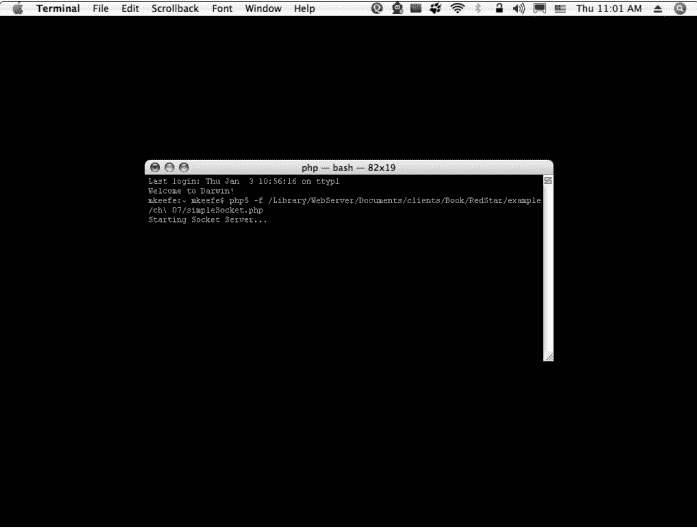

## 构建 Flash 客户端

Flash 聊天客户端用于与套接字服务器交互。此客户端应用程序可以本地或在网站上使用，具体取决于套接字服务器的配置。在此示例中，代码假设套接字服务器在本地运行。

Flash 客户端的设计部分已为您完成，如图 8.4 所示。此起始文件可以在此书的网站上找到，同时也包含所有其他部分的代码。

Flash 代码的第一部分初始化主机和端口信息，并将其传递给 Socket 类的新实例。

```
var host:String = "127.0.0.1";
var port:uint = 8888;

var socket:Socket = new Socket(host, port);
```

### 图 8.4

完成的应用程序（socketChat.fla），可在此书的网站上找到

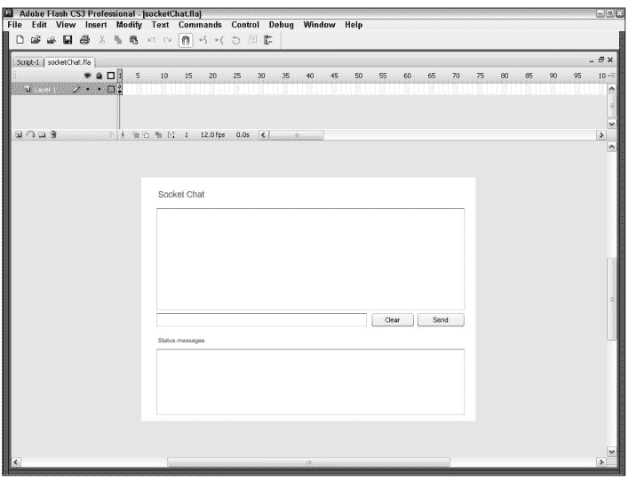

建立连接后，分配事件侦听器，当发送或加载新数据时将调用这些侦听器。

```
socket.addEventListener (Event.CLOSE, closeHandler);
socket.addEventListener (Event.CONNECT, connectHandler);
socket.addEventListener (IOErrorEvent.IO_ERROR, ioErrorHandler);
socket.addEventListener (SecurityErrorEvent.SECURITY_ERROR,
securityErrorHandler);
socket.addEventListener (ProgressEvent.SOCKET_DATA, sockHandler);
```

聊天客户端还需要将事件处理程序分配给消息框和文本输入提交按钮，例如：

```
msgTxt.addEventListener (Event.CHANGE, inputHandler);

clearBtn.addEventListener (MouseEvent.CLICK, clearButtonHandler);
sendBtn.addEventListener (MouseEvent.CLICK, sendButtonHandler);
```

最后一个事件处理程序将分配给键盘，以允许使用 Enter 键发送消息。这不是必需的步骤，但为应用程序增加了功能。

```
addEventListener(KeyboardEvent.KEY_DOWN, keyDownHandler);
```

### 事件处理程序函数

分配给事件处理程序的函数可以在以下代码中看到。如您所见，这些事件处理程序在此示例中具有基本功能，但在更实际的应用程序中可以扩展。

```
function closeHandler(event:Event):void
{
	statusMessage("Connection to [" + host + "] closed",
		"#FF0000");
	disableInterface();
}

function connectHandler(event:Event):void
{
	statusMessage("Connected to [" + host + "]", "#006600");
	sendRequest();
}

function ioErrorHandler(event:IOErrorEvent):void
{
	statusMessage(event.text, "#FF0000");
}

function securityErrorHandler(event:SecurityErrorEvent):void
{
	statusMessage(event.toString(), "#FF0000");
}

function sockHandler(event:ProgressEvent):void
{
	readResponse();
}
```

### 捕获按键

键事件处理程序具有特殊代码。此事件会捕获当前按下的键并检查它是否为 Enter 键。在此示例中，要查找的唯一键是 Enter。如果需要多个键，可以将它们定义在数组中或使用 switch..case 语句。


当按下 Enter 键时，会调用 dispatchEvent，强制点击提交按钮。

```
function keyDownHandler(e:KeyboardEvent):void
{
    if(e.keyCode == Keyboard.ENTER)
    {
        sendBtn.dispatchEvent(new MouseEvent(MouseEvent.CLICK));
    }
}
```

### 提交消息处理程序

键盘处理程序会调用提交按钮的单击事件，该事件分配给以下函数。该函数检查 msgTxt 文本输入框的长度，如果长度大于零，则准备并发送消息。

该函数的最后一步是清空消息框，以确保不会重复发送相同的消息。你可以将此清除代码添加到状态处理程序中。这样在确认消息已发送后会清空该字段。这使你能够保留消息，并避免因网络故障导致消息丢失。

```
function sendButtonHandler(e:MouseEvent):void
{
    if(msgTxt.text.length > 0)
    {
        writeLine(msgTxt.text);
        clearBtn.dispatchEvent(new MouseEvent(MouseEvent.CLICK));
    }
}
```

### 清除消息输入

每当需要清除文本输入字段并禁用提交按钮（直到输入新消息）时，都会调用 clearButtonHandler 函数。在下一节分发 CHANGE 事件时，按钮将被禁用。

```
function clearButtonHandler(e:MouseEvent):void
{
    msgTxt.text = "";
    msgTxt.dispatchEvent(new Event(Event.CHANGE));
}
```

### 检查文本输入长度

当输入新消息或清空输入框时，会对 msgTxt 框调用 CHANGE 事件。该事件负责检查输入框中文本的长度，并根据长度检查结果启用或禁用提交按钮和清除按钮，如图 8.5 所示。

```
function inputHandler(e:Event):void
{
    if(e.target.text.length > 0)
    {
        clearBtn.enabled = true;
        sendBtn.enabled = true;
    }
    else
    {
        clearBtn.enabled = false;
        sendBtn.enabled = false;
    }
}
```

### 图 8.5

显示应用处于禁用状态

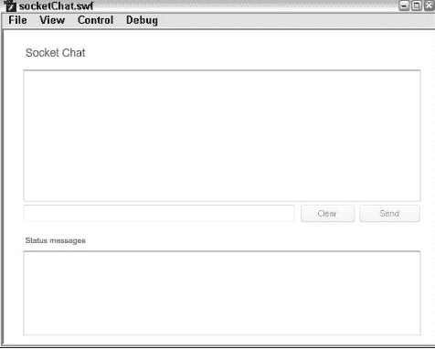

### 保持界面稳定

要创建稳定的应用程序，在没有连接时应禁用界面和按钮。

```
function enableInterface():void
{
    msgTxt.enabled = true;
    bodyTxt.enabled = true;
}

function disableInterface():void
{
    bodyTxt.editable = false;
    msgTxt.enabled = false;
    clearBtn.enabled = false;
    sendBtn.enabled = false;
}
```

这些启用和禁用函数会根据活动连接的结果，从代码的其他部分调用。例如，disableInterface 函数由 closeHandler 调用，该处理程序在活动连接终止时分发。

```
function closeHandler(event:Event):void
{
...
 disableInterface();
}
```

### 发送初始请求

建立连接时会调用 sendRequest 函数。该函数向状态函数发送数据，并清除套接字连接中任何现有的排队信息。

```
function sendRequest() :void
{
 statusMessage("Send initial request to [" + host + "]",
 "#006600");
 socket.flush();
 enableInterface();
}
```

### 向套接字服务器发送消息

将消息实际发送到套接字服务器的过程由 writeLine 函数处理。此 writeLine 函数由前一部分代码中定义的输入和提交处理程序调用。

```
function writeLine(str:String):void
{
 ...
}
```

函数的第一部分是在消息末尾追加一个新行，你可能记得这是 PHP 中的消息结束标志。

```
str += "\n";
```

该函数还采用 try-catch 编程风格，以确保发送过程中的错误被正确捕获并对用户隐藏。为简单起见，错误会在输出窗口中显示。在更真实的应用程序中，你可能希望在消息未发送时通知用户，并存储消息以便稍后尝试重新发送。

```
try
{
	socket.writeUTFBytes(str);
}
catch(e:IOError)
{
	trace(e);
}
```

### 处理状态更新

此应用程序有一个状态框，用于通知用户可能的连接或消息问题。所有这些状态更新都发送到 statusMessage 函数，该函数将其输入状态框并相应地上色。

```
function statusMessage(str:String, color:String="#000000"):void
{
	statusTxt.htmlText += "<font color=\""
	+ color + "\">"
	+ str + "</font>";
}
```

如果调用者忘记定义颜色，将应用默认颜色。未包含默认颜色可能导致文本未被添加。

此基于套接字的聊天应用程序中的最后一个函数，在从套接字服务器接收到新消息时调用。

```
function readResponse():void
{
}
```

该函数的第一部分从 socket 类检索新消息并将其分配给 str 变量，该变量在函数的其余部分中使用。

```
var str:String = socket.readUTFBytes(socket.bytesAvailable);
```

在显示消息之前，必须删除可能影响文本显示方式的任何额外换行符。这是使用非常基本的 substring 函数来完成的，该函数返回不包括最后两个字符的消息，在此情况下即 "\r\n"。

```
// strip off line feeds
if(str.substring((str.length-2), str.length) == "\r\n")
{
	trace("found \\n\\r");
	str = str.substring(0, (str.length-2));
}
```

删除换行符后，下一步是确定该消息是否来自管理员。此示例允许任何 *用户* 成为管理员。在更完整的应用程序中，你可能希望在使用管理员账户之前要求登录。如果消息来自管理员，则消息内容会显示为红色，以便管理员消息更加突出。

```
if(str.substring(0, 12) == "ADMIN NOTICE")
{
    bodyTxt.htmlText += "<font color=\"#FF0000\">" + str +
        "</font>";
}
```

如果消息是标准消息，则将其简单地添加到文本区域中，函数结束，等待检索下一条消息。

```
else
{
    bodyTxt.htmlText += "<font color=\"#000000\">" + str +
        "</font>";
}
```

这就是基于 PHP 套接字服务器的 Flash 聊天客户端的全部内容。此时，你可以启动套接字服务器（除非它已经在运行）并测试聊天客户端，如图 8.6 所示。由于该系统旨在支持多个连接，你可以叫上几个朋友来测试。

或者，你可以修改代码以允许远程连接，并通过发送 Flash 应用程序的链接让许多用户连接。

以下是聊天客户端示例的完整代码：

```
var host:String = "127.0.0.1";
var port:uint = 8888;

var socket:Socket = new Socket(host, port);

socket.addEventListener(Event.CLOSE, closeHandler);
socket.addEventListener(Event.CONNECT, connectHandler);
socket.addEventListener(IOErrorEvent.IO_ERROR, ioErrorHandler);
socket.addEventListener(SecurityErrorEvent.SECURITY_ERROR,
    securityErrorHandler);
socket.addEventListener(ProgressEvent.SOCKET_DATA, sockHandler);
msgTxt.addEventListener(Event.CHANGE, inputHandler);
addEventListener(KeyboardEvent.KEY_DOWN, keyDownHandler);

clearBtn.addEventListener(MouseEvent.CLICK, clearButtonHandler);
sendBtn.addEventListener(MouseEvent.CLICK, sendButtonHandler);

this.align = StageAlign.TOP_LEFT;
this.scaleMode = StageScaleMode.NO_SCALE;

function writeLine(str:String):void
{
    str += "\n";
    try
    {
        socket.writeUTFBytes(str);
    }
    catch(e:IOError)
    {
        trace(e);
    }
}

function sendRequest():void
{
    statusMessage("Send initial request to [" + host + "]",
        "#006600");
    socket.flush();
    enableInterface();
}

function readResponse():void
{
    var str:String = socket.readUTFBytes(socket.bytesAvailable);

    // strip off line feeds
    if(str.substring((str.length-2), str.length) == "\r\n")
    {
        trace("found \\n\\r");
        str = str.substring(0, (str.length-2));
    }

    if(str.substring(0, 12) == "ADMIN NOTICE")
    {
        bodyTxt.htmlText += "<font color=\"#FF0000\">" + str +
            "</font>";
    }
    else
```


```actionscript
bodyTxt.htmlText += "<font color=\"#000000\">" + str + "</font>";
}

function enableInterface():void
{
msgTxt.enabled = true;
bodyTxt.enabled = true;
}

function disableInterface():void
{
bodyTxt.editable = false;
msgTxt.enabled = false;
clearBtn.enabled = false;
sendBtn.enabled = false;
}

function statusMessage(str:String, color:String = "#000000"):void
{
statusTxt.htmlText += "<font color=\"" + color + "\">" + str + "</font>";
}

function clearButtonHandler(e:MouseEvent):void
{
msgTxt.text = "";
msgTxt.dispatchEvent(new Event(Event.CHANGE));
}

function sendButtonHandler(e:MouseEvent):void
{
if(msgTxt.text.length > 0)
{
writeLine(msgTxt.text);
clearBtn.dispatchEvent(new MouseEvent(MouseEvent.CLICK));
}
}

function inputHandler(e:Event):void
{
if(e.target.text.length > 0)
{
clearBtn.enabled = true;
sendBtn.enabled = true;
}
else
{
  clearBtn.enabled = false;
  sendBtn.enabled = false;
}
}

function closeHandler(event:Event):void
{
  statusMessage("Connection to [" + host + "] closed",
    "#FF0000");
  disableInterface();
}

function connectHandler(event:Event):void
{
  statusMessage("Connected to [" + host + "]", "#006600");
  sendRequest();
}

function ioErrorHandler(event:IOErrorEvent):void
{
  statusMessage(event.text, "#FF0000");
}

function securityErrorHandler(event:SecurityErrorEvent):void
{
  statusMessage(event.toString(), "#FF0000");
}

function sockHandler(event:ProgressEvent):void
{
  readResponse();
}

function keyDownHandler(e:KeyboardEvent):void
{
  if(e.keyCode == Keyboard.ENTER)
  {
    sendBtn.dispatchEvent(new MouseEvent(MouseEvent.CLICK));
  }
}

// disable interface until connected
disableInterface();
```

### 图 8.6
在浏览器中运行的聊天应用程序

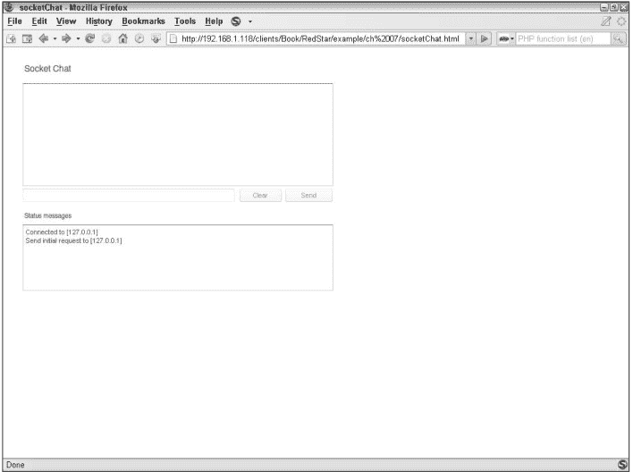

## 摘要

在本章中，你已经了解什么是套接字服务器以及它们是如何构建的。接着，你学习了如何构建一个简单的套接字服务器，并使用 Flash 连接到它。一旦你理解了 Flash 和 PHP 部分的流程，最后一步就是构建一个完整的多用户聊天应用程序，其后台运行着 PHP 套接字服务器。

你可以利用本章学到的信息来扩展，创建一个功能齐全的聊天应用程序。你可以添加诸如管理员、成员、计时器、聊天室等功能。重要的是要意识到，套接字服务器系统并不仅限于聊天应用程序。你可以使用这项技术构建多用户绘图应用程序，甚至构建多点服务器监控架构。

正如你所见，套接字可以用于多种方式。一旦掌握基础知识，你的想象力就是开发的唯一限制。

# 第三部分

## 扩展 Flash 和 PHP

### 本部分内容

- 第 9 章 使用第三方库
- 第 10 章 使用面向对象编程

# 第 9 章

## 使用第三方库

- 了解第三方库
- 安装第三方库
- 使用第三方库
- 了解 AMFPHP

随着对更苛刻应用程序的开发不断增加，第三方库的使用持续增长。第三方库通常可以解决某个问题，或使常见任务更易于处理，从而让开发人员能够专注于应用程序的更重要方面。

本章第一部分致力于解释什么是第三方库、如何使用它们以及安装库所需的内容。

本章第二部分侧重于在 Flash 中使用 AMFPHP。AMFPHP 基本上是一个 PHP 库，它在 Flash 与数据库以及其他数据类型之间提供了一个通用链接。

## 了解第三方库

第三方库是由公司或组织开发的自定义包或代码片段，用于与另一家公司的产品配合使用。例如，如果您查看 Firefox Web 浏览器，会发现有一系列由非 Mozilla 开发人员发布的插件和增强功能。

开发人员对第三方库的看法不一；关于这些库最重要的担忧之一是安全性。使用其他代码部分时必须小心，尤其是当您没有时间或专业知识彻底调查该代码的工作原理时。

当您不知道开发库的一方，或者库本身与应用程序的某些安全方面相关联时，安全问题就更加重要。

例如，从未知开发人员处使用 Cookie 或会话库不是个好主意。这样做可能会在应用程序中引入安全漏洞。

在使用第三方库和安全应用程序方面，有一些显著的例外。例如，如果您正在构建商店应用程序，合理地推测您将与某种商户系统（例如 Authorize.net、Miva 或 PayPal）进行交互。

这些系统提供可以轻松连接到应用程序的第三方库，并且因为它们在各种环境中经过彻底测试，所以已知是安全的。

## 其他类型的第三方库

这些外部库不仅限于安全性或数据处理。这是因为 Flash 也是一款设计程序。有许多优秀的第三方库可用于加速开发和设计过程。

在某些情况下，这些外部库提供了 Flash/ActionScript 中无法直接实现的功能。

### 商业 Flash 库

有些正在构建的库拥有商业许可证，这意味着您可以获得经过更广泛开发的代码。获得这些库的支持不会有问题。

例如，gskinner.com 提供可购买的强大拼写检查库和组件集。该库允许您只需几行代码即可将实时拼写检查引擎构建到应用程序中。有关 gskinner Spell Check 库的更多信息，请访问该公司的网站 www.gskinner.com/products/sp1/。

### 开源 Flash 库

您还会发现用于应用程序开发和部署所有方面的大量免费开源库。开源库的一个示例是 AMFPHP，将在“了解 AMFPHP”部分中详细探讨。

还有许多其他可用的开源库，例如 MCtweener，它类似于内置的 Tween 库，但功能更多。此外，项目文档包含大量示例代码。

可用于辅助开发过程的其他一些开源库显示在表 9.1 中。

| Red5 | 开源 Flash 服务器 | http://osflash.org/red5 |
| --- | --- | --- |
| Papervision3D | 开源 3D 引擎 | http://code.google.com/p/papervision3d/ |
| as3corelib | 用于多种基本实用程序的 AS3 库 | http://code.google.com/p/as3corelib/ |

这只是可用于 ActionScript 3 的开源库全部产品的一小部分。这应该能让您不仅了解 ActionScript 3 有多么可扩展，还了解有多少开发人员花费了大量时间来开发这些出色的工具。更令人惊奇的是，这些库是免费的，这意味着更多开发人员（包括您）可以在不产生额外成本的情况下创建更有趣、更吸引人的内容。

### PHP 中的库

PHP 也有许多可用的库，包括会话管理、图像处理、数据库连接和整体服务器管理等。基本上，PHP 是使用第三方库构建的，因为 PHP 本身就是一个开源项目。这意味着许多不同的开发人员为该项目贡献代码。

一些更常见的 PHP 库包括 GD 库（将在第 12 章中讨论）。表 9.2 列出了开发过程中将使用的其他常见 PHP 库。

| 库 | 描述 | 来源 |
|---|---|---|
| Pear | 开源代码的结构化库 | http://pear.php.net/ |
| ImageMagick | 用于创建、编辑和合成位图图像的软件套件 | www.imagemagick.org/ |
| PDF Library | PHP 的 PDF 创建库 | www.php.net/pdf |

## 安装第三方库

现在你应该了解可用于 ActionScript 3 开发的第三方库有哪些了。

安装这些第三方库的过程无论使用哪个库都非常相似。

> 注意 检查库的版本要求，以确保它们可与 ActionScript 3 或您正在使用的 PHP 版本配合使用。

### 在 Flash CS3 中安装库

在选择要使用的第三方库后，下一步是安装它们。在 CS3 中安装代码库的过程取决于特定的类。


#### 作为 MXP 文件安装

为了便于移植，分发库或组件集的一种方式是使用 MXP 格式。这些文件被加载到随 Flash CS3 及许多其他 Adobe 应用程序附带的扩展管理器中（参见图 9.1）。

使用这个随附应用程序来管理库的优势在于，你可以在一个美观且易于管理的 GUI 中启用、禁用或更新各个库。该应用程序还包含指向开发者网站的直接链接，用于支持或在线文档。

#### 图 9.1

扩展管理器随 Flash CS3 和其他 Adobe 应用程序附带。


### 作为标准类包安装

另一种更常见的安装方法是手动将类添加到 Flash CS3 的类路径中。你还需要将类文件复制到 Flash 知道要在其中查找第三方库的共享目录中。

在计算机的独立位置创建一个新文件夹是个好主意，这样你就不会意外修改随 Flash CS3 附带的默认类了。

### 创建自定义类路径

为了添加自定义类路径，你必须先在计算机上创建一个目录来存储你的类。确定要使用的目录后，将此新路径添加到现有的类路径列表中。

要将新类路径添加到现有列表中，请执行以下步骤：

- 1. 选择 Edit > Preferences（Windows）。在 Mac 上，选择 Flash > Preferences 以打开 Preferences 对话框。
- 2. 在类别列表中单击 ActionScript，然后单击 ActionScript 3.0 Settings。
- 3. 单击 Browse To Path，然后浏览到要添加的目录。单击 OK。

你还可以通过修改 Publish Settings 对话框中的 ActionScript 设置，为特定的 Flash 项目添加类路径。将类路径添加到项目的好处是，它会随 FLA 一起移动，这意味着该文件可以共享，而无需修改全局类路径。

### 默认类路径

所有 Flash 文档的默认类路径都可以修改，这样你就不必更新每个单独的 Flash 文件了。以下是基于默认安装，Flash 期望查找类文件的位置。

Windows: Hard Disk\Documents and Settings\user\Local Settings\Application Data\Adobe\Adobe Flash CS3\language\Configuration\Classes.

Macintosh: Hard Disk/Users/user/Library/Application Support/Adobe/Adobe Flash CS3/language/Configuration/Classes.

> **注意** 不要删除绝对全局类路径。Flash 使用此类路径来访问内置类。如果你意外删除了此类路径，可以使用以下代码片段作为新类路径重新添加它：$(LocalData)/Classes.

## 在 PHP 中安装库

PHP 库通常直接编译到 PHP 安装过程中。但是，通过使用 PEAR 和其他常见的结构化库系统，你可以在初始安装完成后安装新库。

一个常用的外部库示例，可以在安装 PHP 后添加，即 MySQL 库。该库用于在 PHP 中直接与数据库通信。

第一步是打开 php.ini 文件，取消注释 MySQL 库文件，并在安装 MySQL 时选择了不同端口的情况下修改 MySQL 套接字路径和端口的位置。

> **注意** 修改 php.ini 文件后，必须重新启动 Apache 服务器。

如果重新启动 Apache 后 MySQL 仍然无法正常工作，那么你可能安装了过时的版本。这意味着你可能需要重新编译 PHP。

> **交叉引用** 要了解有关重新编译 PHP 的信息，请参见第 1 章。

## 使用第三方库

使用第三方库的第一步是从开发者的网站下载库文件。成功下载类库文件后，下一步是安装和配置第三方库。

通常，库会附带一个测试工具包以确保一切正常工作。此步骤不是必需的，但可以最大限度地减少最终应用程序所需的调试工作。

如果库不带测试工具包，你可以快速创建一个，这将在以下部分中解释。

### 在 Flash CS3 中使用库

为了确定类是否已正确加载，你可以构建一个应用程序来测试库中包含的类的特定部分。

在本示例中，使用的是来自 Adobe 的 as3CoreLib 库。这个库包含一系列实用程序类，涵盖从图像处理一直到安全性（例如 MD5 哈希创建工具）的所有内容。

以下是使用 MD5 功能的示例应用程序：

```
import com.adobe.crypto.MD5;

function createHash(e:MouseEvent):void
{
    responseTxt.text = MD5.hash(origStrTxt.text);
}

createBtn.addEventListener(MouseEvent.CLICK,  createHash);
```

此应用程序的第一部分导入必要的类。在本示例中，这就是在 crypto 包中找到的 MD5 类。

单击按钮时会调用该函数。调用函数后，下一步是通过调用 MD5 类的静态 hash 方法来创建一个新哈希。最后，新创建的字符串会返回到舞台上的 responseTxt TextInput 组件。

这就是完整的应用程序。这是一个非常简单的用法，但它可以告知你正确的类已安装并正常运行。

以这种单元风格进行工作在开发中非常常见，因为如果应用程序变得太大，调试和管理就会困难得多。

## 在 PHP 中使用库

PHP 中的库与编译后的 PHP 部分非常相似，但安装新库后你仍应对其进行测试。通常，你还需要重新启动 Apache，以便对 PHP 的更改生效。库的安装说明通常会提到这一点，但无论如何都需要执行此操作。

### 测试 MySQL 库

要测试 MySQL 支持，你不需要创建复杂的示例；事实上，你可以创建一个保证无法正常运行的脚本，但它会告诉你 MySQL 是否已正确安装。

这不是一种非常常见的做法，但为了快速测试，它效果非常好。

> 注意：运行已知会失败的代码后，最好清除错误日志，以免日后混淆。

以下是简单测试的代码。

```
<?php
// no password is sure to fail,
// unless it is a default installation
mysql_connect("localhost", "root", "");
?>
```

这个简单的应用程序尝试连接到数据库，如果显示无效用户或未选择数据库，则说明 MySQL 已正确安装。

但是，如果你看到 Fatal Error: function not found...，则意味着 MySQL 未正确配置或安装以与 PHP 一起使用。

你可以创建一个快速的 phpinfo 文件来确定是否已安装 MySQL 并查找特定错误。

### 安装 MySQL 库

MySQL 库通常随 PHP 一起提供，但默认未启用。第一步是打开已安装 PHP 版本的 php.ini 文件。

你会在 php.ini 文件中找到标题为 “[mysql]” 的部分。这就是配置 MySQL 安装的位置。

配置完成后，下一步是取消注释库列表中包含名称 “mysql” 的行。

此时配置已完成；最后一步是重新启动 Apache 并再次测试前面的脚本，它应该显示连接错误，而不是 PHP 致命错误。

## 了解 AMFPHP

AMFPHP 是动作消息格式 (AMF) 的开源实现。AMF 允许将 ActionScript 对象二进制序列化并发送到服务器端脚本。

### 面向 AS3 和 PHP 开发者的 AMFPHP

PHP 开发者可以通过连接到 Web 服务和数据库等数据来利用他们的 PHP 经验。AMF 允许在客户端和服务器之间进行原生数据类型和复杂对象映射。AMFPHP 是 Flash Player 开发者可用的最流行、最快的客户端服务器通信协议之一。通信被安排为二进制格式，这通常比其他表示形式更加紧凑。

### AMFPHP 与 ActionScript 3

ActionScript 3 允许压缩通信，这意味着调用输出更快且整体性能更好。此外，ActionScript 3 中可用的 AMF3 也会压缩二进制通信以提高性能。

### 安装 AMFPHP

安装 AMFPHP 很简单。这些脚本需要 PHP 服务器，不需要安装任何额外的服务或库。这提供了近乎即时设置的优势，使开发者可以专注于实际应用程序，而不是担心后台发生了什么。

要安装 AMFPHP，请先下载最新版本，可从 SourceForge 网站免费获取，网址为 http://sourceforge.net/project/showfiles.php?group_id=72483#files。SourceForge 是最大的开源 Web 开发网站，托管了像 AMFPHP 这样的多个不同项目。

下载的存档内容放置在 Web 服务器根目录下的新目录中，例如 flashservices 或你选择的任何名称。

AMFPHP 几乎开箱即用。你需要修改的唯一文件是 gateway.php，它位于安装目录的根目录下。在这种情况下，路径将是 flashservices/gateway.php。在某些情况下，你可以将所有设置保留为默认值，这就是本示例中使用的设置。


### 测试安装

当所有内容都正确安装后，您可以通过在 Web 浏览器中打开 gateway.php 来测试 AMFPHP 的安装。例如，假设本地安装，URL 将是 http://localhost/flashservices/gateway.php。

将出现如图 9.2 所示的屏幕，告知您安装成功。如果发生错误，将出现 PHP 错误或一系列错误，帮助您确定可能出了什么问题。

### AMFPHP 调试工具

在开始任何开发之前，请查看随 AMFPHP 提供的一些调试和查看工具。这些各种工具可用于调试您的服务。

> **注意** 请务必在生产服务器上删除这些调试工具，以降低安全风险。

### 图 9.2

从 Web 浏览器调用 gateway.php 时看到的 AMFPHP 欢迎消息示例


### AMFPHP 服务浏览器

AMFPHP 服务浏览器（如图 9.3 所示）是一个基于 Flash 的应用程序，可让您查看单个服务并仔细检查其方法和属性。您还可以使用服务浏览器在 Flash 中编写 ActionScript 之前测试新代码。

使用这些附加调试工具可让您更快速地开发应用程序，并以更少的开销测试新概念。它们还有助于调试您的代码。

### AMFPHP 调试网关

位于 Flash 和 gateway.php 文件之间的 Debug Gateway 脚本用于捕获错误。调试或本地开发时，使用此脚本是最佳实践。代码中唯一的更改是将指向标准 gateway.php 文件改为指向 debuggateway.php 文件。


使用此专用网关时，请牢记以下几点：

- 会话无法正常工作。
- PHP 中必须启用 cURL
- 服务器性能将下降。
- 应仅在开发系统上使用。

### 使用自定义服务测试 AMFPHP

安装好 AMFPHP 后，您可以使用服务浏览器测试一个非常简单的服务。稍后，您将在 Flash 和 PHP 中构建一个小型搜索应用程序。

AMFPHP 服务是一个标准的 PHP 文件，按已知顺序构建。例如，服务文件的第一部分是方法表，用于公开可用方法并定义该服务的访问限制。

方法表是一个包含各个方法的多维数组。此示例方法表定义了 getDate 方法，该方法从 PHP 返回当前 UNIX 时间戳。方法表位于下一部分代码中显示的类的构造函数内。

```php
$this->methodTable = array
(
    "getDate" => array
    (
        "access" => "remote",
        "description" => "Example, returns Unix timestamp"
    )
);
```

继续此示例，您将创建示例 PHP 类，该类将成为 AMFPHP 服务。这是示例类，包含一个方法和构造函数。

```php
<?php

class Example
{

function Example()
{

$this->methodTable = array
(
    "getDate" => array
    (
        "access" => "remote",
        "description" => "Returns the current date."
    )
);
}

/**
 * Returns Current Date
 */
function getDate()
{
    // return current date
    return "Current Date: " . date("F j, Y", time());
}

?>
```

**注意** 服务浏览器将看到 `getDate` 函数上方的注释，并将其显示在方法下方。这不是必需的，但它可以帮助您一目了然地了解服务的功能。

将此文件保存为 `Example.php`，位于 AMFPHP 目录根目录下的 `/services` 目录中。

如果在 Web 服务器根目录上安装 AMFPHP，此文件的位置为：`http://localhost/flashservices/services/Example.php`。

创建此简单服务后，您可以通过访问服务浏览器来测试它。您将看到新服务位于左侧列表中，以及已安装的任何其他服务。如果看不到该服务，请单击 Refresh 或刷新浏览器重新加载页面。

要测试服务，请单击左侧列表中的名称，该操作将在右侧的 Exploring 窗格中加载服务。方法名称位于 Test 选项卡中，在此示例中名为 `getDate`。

单击 Call 按钮运行服务。您将在 Exploring 窗格底部的 Results 选项卡中看到服务输出。

示例服务的输出应为字符串格式的当前日期，例如。

> "当前日期：2007 年 10 月 5 日"

其他选项卡用于查看服务数据，用于调试和整体跟踪您的服务。

此示例相当简单。它没有参数且不创建任何实际代码。您可以通过添加另一个方法来扩展之前的服务，该方法将字符串中每个单词的首字母大写。代码的大写部分使用 PHP 的内置函数 `ucwords` 完成。该函数接受一个参数并返回大写字符串。

```php
<?php
class Example
{
    function Example()
    {
        $this->methodTable = array
        (
            "getDate" => array
            (
                "access" => "remote",
                "description" => "Returns the current date."
            ),

            "upperCaseWords" => array
            (
                "access" => "remote",
                "description" => "Converts arg to uppercase"
            )
        );
    }
/**
 * Returns Current Date
 */
function getDate()
{
    // return current date
    return "Current Date: " . date("F j, Y", time());
}

function upperCaseWords($str)
{
    return ucwords($str);
}
}
?>
```

添加新方法后，它将在服务浏览器中可见（刷新后）。查看服务浏览器后，您会注意到方法表的一个优势是 AMFPHP 会自动为每个找到的参数添加带有变量名称的文本框。

新方法接受服务代码中定义的一个参数。如果在 TextBox 中键入一些文本并执行方法，则您的字符串将被大写。

例如，如果使用字符串 "hello world"，您将看到以下输出：

```
"Hello World"
```

当然，AMFPHP 服务的方法可以有多个参数。创建另一个具有三个参数的新方法。第一个参数是字符串，第二个是要查找的单词，第三个是替换单词。基本上，您正在创建一个基于 PHP 的查找和替换方法。

首先更新方法表。

```php
$this->methodTable = array
(
    "getDate" => array
    (
        "access" => "remote",
        "description" => "Returns the current date."
    ),
    "upperCaseWords" => array
    (
        "access" => "remote",
        "description" => "Converts arg to uppercase"
    ),
    "searchAndReplace" => array
    (
        "access" => "remote",
        "description" => "Searches and replaces text"
    )
);
```

更新方法表后，将添加新方法。您不限于方法内的代码。AMFPHP 允许您调用同一类中的其他方法和属性，甚至包含其他 PHP 文件以增加功能。

```
/**
 * Searches and replaces text
 */
function searchAndReplace($haystack, $needle, $replacement)
{
    $string = str_replace($needle, $replacement, $haystack);
    return $this->upperCaseWords($string);
}
```

**注意** 如果创建新方法但未将其添加到方法表，则该方法不会导出用于远程调用。当您希望拥有私有方法（例如数据库连接）或整体安全层时，这很有用。

添加新方法后，可以通过刷新服务浏览器来测试它。请注意，方法按字母顺序列出。新方法应位于水平列表的中间。


服务浏览器会为每个参数添加一个文本字段；在此示例中共有三个。在第一个文本字段中输入字符串，从该字符串中选择一个单词作为查找词，然后将其输入到第二个 TextField 中。最后，将替换文本输入到第三个文本字段中。填写完所有三个文本字段后，可以单击 Call 按钮，并在 Results 选项卡中查看输出。

假设使用字符串 "hello world"，查找词为 "world"，替换词为 "earth"，您应看到以下结果。该单词已被替换，并且使用 upperCaseWords 方法将每个单词的首字母大写。

```
"Hello Earth"
```

既然您已彻底测试了 AMFPHP 服务，现在可以继续安装 Flash 实际使用此设置所需的必要类。该过程将在下一节中说明。

## 在 Flash 中使用 AMFPHP

与早期版本不同，ActionScript 3 已预安装所有用于远程处理和与 AMFPHP 交互的必要类。您只需加载这些类并编写 ActionScript 代码，过程相当简单。本节将引导您构建一个简单的 Flash 应用程序，以便更好地了解在 Flash 中使用 AMFPHP 的过程。

### 加载远程处理类

在 Flash 中使用 AMFPHP 的第一步是加载这些类。构建的任何 AMFPHP 项目都需要此步骤，因为它包含了远程处理系统的核心。

```
import flash.net.*;
```

加载类后，可以定义一个指向 AMFPHP 网关文件的变量。

```
var gatewayURL:String =
"http://localhost/flashservices/gateway.php";
```

下一步是创建 NetConnection 实例，并将其分配给 gateway 变量。此时，还可以设置在单击按钮时调用的方法事件。

```
var gateway:NetConnection;
getDateBtn.addEventListener(MouseEvent.CLICK, getDate);
searchBtn.addEventListener(MouseEvent.CLICK, searchAndReplace);
upperCaseWordsBtn.addEventListener(MouseEvent.CLICK, upperCaseWords);
debugTxt.wordWrap = false;
```

以下是将在下一部分中创建的按钮处理程序的骨架。这些函数中的每一个都会调用 AMFPHP 服务。

```
function getDate(e:MouseEvent):void
{
    ...
}
function searchAndReplace(e:MouseEvent):void
{
    ...
}
function upperCaseWords(e:MouseEvent):void
{
    ...
}
```

首先关注的方法是 getDate，它将不带参数调用服务器并接收当前日期的字符串。Responder 类用于处理成功和失败调用的对象响应。

```
var responder:Responder = new Responder(onResult, onFault);
```

函数的下一部分会分配 NetConnection 类的新实例。会调用 connect 方法并传入 gateway URL 变量。连接建立后，会发出一次调用，第一个参数是服务名和方法，第二个变量是对 Responder 类实例的引用。

```
gateway = new NetConnection();
gateway.connect(gatewayURL);
gateway.call("Example.getDate", responder);
```

以下是负责建立 AMFPHP 连接并调用请求服务的完整 getDate 函数。

```
function getDate(e:MouseEvent):void
{
    var responder:Responder = new Responder(onResult, onFault);

    gateway = new NetConnection();
    gateway.connect(gatewayURL);
    gateway.call("Example.getDate", responder);
}
```

另外两个函数非常相似，仅传递给服务的方法名和参数不同。

searchAndReplace 函数接受三个参数。

- arg1: 要搜索的字符串
- arg2: 要查找的单词
- arg3: 替换单词

AMFPHP 设置中的服务负责运行 `searchAndReplace` 方法，但在返回字符串之前还会调用 `uppercase` 方法。

```actionscript
function searchAndReplace(e:MouseEvent):void
{
    var responder:Responder = new Responder(onResult, onFault);
    
    gateway = new NetConnection();
    gateway.connect(gatewayURL);
    gateway.call("Example.searchAndReplace", responder,
        "hello world",
        "world",
        "earth"
    );
}
```

最后一个函数是 `upperCaseWords`，它接受一个参数并返回一个新字符串，其中每个单词的首字母已转换为大写。函数的其余部分与前两个相同。这是 AMFPHP 能够完成 ActionScript 原生不支持之事的一个很好示例，当然，这部分就是大写转换。

```actionscript
function upperCaseWords(e:MouseEvent):void
{
    var responder:Responder = new Responder(onResult, onFault);
    
    gateway = new NetConnection();
    gateway.connect(gatewayURL);
    gateway.call("Example.upperCaseWords", responder, "hello
    world");
}
```

定义完负责调用服务的三个函数后，下一部分是服务返回有效响应时调用的调试和结果函数。

当收到成功消息时，会调用 `onResult` 函数。在此简单示例中，输出的原始内容将发送到舞台上的 `TextArea` 组件。也可以将代码中的 `TextArea` 部分替换为简单的 `trace()` 语句，以便更快地进行测试。

```actionscript
function onResult(responds:Object):void
{
    debugTxt.text = "Response: " + responds;
}
```

如果发生错误，将调用 `onFault` 函数，该函数包含特定错误。为更好地查看错误，会对对象内容运行 `for..in` 循环，以显示每个项目。该函数还会清除 `TextArea`，以确保旧数据不会混入，从而在调试应用程序时造成混淆。

appendText 方法是 AS3 中替代旧版 ActionScript 中 "+=" 字符串连接方式的方法。该方法速度更快，意味着代码执行更迅速。

```
function onFault(responds:Object):void
{
    debugTxt.text = "";
    debugTxt.appendText("Debug : Error\n");
    for(var i in responds)
    {
    debugTxt.appendText(" " + responds[i] + "\n");
    }
}
```

图 9.4、9.5 和 9.6 显示了 AMFPHP 中示例应用程序的示例响应。您可以基于这些示例构建更完整的应用程序，这将在下一节中完成。

第一个示例是显示示例 AMFPHP 类中 getDate 方法的响应。该示例将以字符串格式返回当前日期。

#### 图 9.4

以下是第一个 AMFPHP 服务方法的示例响应。


第二个示例接受一个参数并替换文本。这全都是一个简单示例，展示了在 AMFPHP 中处理参数的过程。

#### 图 9.5

以下是第二个 AMFPHP 服务方法的示例响应。


第三个也是最后一个示例是回显响应。它基本上会获取传入的字符串，并按原样返回。

#### 图 9.6

以下是第三个 AMFPHP 服务方法的示例响应。


## 使用 AMFPHP 构建实际应用程序

既然您已了解 AMFPHP 服务的用法以及如何在 Flash 中实现它，现在可以继续构建实际应用程序。实际应用程序的一个好示例是基于 Flash 的专辑列表应用程序，这将在下一节中说明。

本示例使用的数据库与第 2 章中创建的数据库相同。如果您尚未完成该章节，我建议从这里开始。

### AMFPHP 服务

本示例所需的 AMFPHP 服务负责根据传入的参数查询数据库。这还需要一个安全的数据库连接系统。这意味着这些方法不会由 AMFPHP 导出或查看。


为了简单起见，所有功能都包含在一个服务中。但是，在更完整的应用程序中，你希望将类分离到不同的服务中，以便获得更可移植的解决方案。图 9.7 显示了完成的应用程序。

### 图 9.7

这里是来自现实世界示例的完整应用程序。


应用程序的第一部分是 AMFPHP 服务。这是 Album 服务的类框架，能让你更好地理解其功能。

```
<?php

class Albums
{
    function Albums()
    {
        ...
    }

    function connect()
    {
        ...
    }

    function getAlbumByGenreID($genreID)
    {
        ...
    }
}
```

任何 AMFPHP 项目的起点都应该是方法表，它可以包含在同一服务文件中，也可以包含在单独的文件中并被引用。使用同一文件的好处是你可以快速进行更改，而无需维护另一个文件。

本示例中的方法表包含在服务构造函数中。连接方法设置为私有，以确保更高的安全性。

```
function Albums()
{
    $this->methodTable = array
    (
        "connect" => array
        (
            "access" => "private"
        ),
        "getAlbumByGenreID" => array
        (
            "access" => "remote"
        )
    );
}
```

连接方法首先检查现有连接以限制资源。如果未找到现有连接，则会创建一个新连接，并将其存储在私有变量 _connection 中。

```
/**
 * @access private
 * @desc Connect to database - **PRIVATE**
 */
function connect()
{
    if($this->_connection == null)
    {
        $this->_connection = mysql_connect(
            $this->dbHost,
            $this->dbUser,
            $this->dbPass
        );
        mysql_select_db($this->dbName, $this->_connection);
    }
}
```

连接参数存储在类中的私有变量内。为了增加安全性，这些变量设置为私有，以禁止外部访问敏感的数据库凭据。

```
// Database info
private $dbHost = "localhost";
private $dbUser = "username";
private $dbPass = "password";
private $dbName = "database name";

private $_connection = null;
```

服务类的最后一个方法是 getAlbumByGenreID，它根据传入的单个参数（流派 ID）返回一组专辑数据。函数的这一部分使用上一步定义的私有 connect() 方法建立与数据库的连接。

```
function getAlbumByGenreID($genreID)
{
    $this->connect();

    ...
}
```

建立数据库连接后，下一步是构建 $sql 字符串。

```
$sql = "SELECT g.name, a.artist, a.albumName
    FROM albums a, genre g
    WHERE a.genreID=g.id
    AND g.id=". $genreID;
```

$sql 字符串传递给 mysql_query()，数据库连接作为第二个参数。

```
$result = mysql_query($sql, $this->_connection);
```

函数的最后一步是创建专辑数据的关联数组。

```
$rows = array();

while($row = mysql_fetch_array($result, MYSQL_ASSOC))
{
    array_push($rows, $row);
}
return $rows;
```

在 PHP 中使用 while 循环创建数组的替代方案是将资源 ID 传回 Flash，并使用自定义记录集类逐行解析数据。在 Flash 中执行此操作可以减轻服务器的负担，并更好地利用客户端机器。

早期版本的 Flash 拥有原生 RecordSet 类。在 AS3 中，你需要创建自己的类。此类已添加到本书网站提供的额外内容中，并正确模拟了 AS2 RecordSet 类。

使用 RecordSet 类的第一步是修改专辑方法。

```
/**
 * List of albums for RecordSet
 */
function getAlbumByGenreID($genreID)
{
    $this->connect();

    $sql = "SELECT g.name, a.artist, a.albumName
    FROM albums a, genre g
    WHERE a.genreID=g.id
    AND g.id= ". $genreID;

    return mysql_query($sql, $this->_connection);
}
```

以下是完整的 Album 类：

```
<?php

class Albums
{
    // Database info
    private $dbHost = "localhost";
    private $dbUser = "username";
    private $dbPass = "password";
    private $dbName = "db name";

    private $_connection = null;

    function Albums()
    {
        $this->methodTable = array
        (
            "connect" => array
            (
                "access" => "private"
            ),

            "getAlbumByGenreID" => array
            (
                "access" => "remote",
                "description" => "List of albums from genre ID."
            )
        );
    }
    /**
    * @access private
    * @desc Connect to database - **PRIVATE**
    */
    function connect()
    {
        if($this->_connection == null)
        {
            $this->_connection = mysql_connect(
                $this->dbHost,
                $this->dbUser,
                $this->dbPass
            );
            mysql_select_db($this->dbName, $this->_connection);
        }
    }
    /**
    * List of albums from genre ID.
    */
    function getAlbumByGenreID($genreID)
    {
        $this->connect();

        $sql = "SELECT g.name, a.artist, a.albumName
        FROM albums a, genre g
        WHERE a.genreID=g.id
        AND g.id=" . $genreID;

        $result = mysql_query($sql, $this->_connection);

        $rows = array();

        while($row = mysql_fetch_array($result, MYSQL_ASSOC))
        {
            array_push($rows, $row);
        }
        return $rows;
    }

    /**
     * List of albums for RecordSet
     */
    function getAlbumByGenreID_recordset($genreID)
    {
        $this->connect();

        $sql = "SELECT g.name, a.artist, a.albumName
        FROM albums a, genre g
        WHERE a.genreID=g.id
        AND g.id=" . $genreID;

        return mysql_query($sql, $this->_connection);

    }

}
```

## AMFPHP 集成的 ActionScript

下一步是构建应用程序的 Flash 部分，它负责在预构建的 DataGrid 组件中显示专辑数据。

这个更完整示例中唯一的函数更改都在 onResult 函数内。

```
function onResult(responds:Object):void
{
    albumsDG.removeAll();
    for(var i:uint=0; i < responds.length; i++)
    {
        albumsDG.addItem(responds[i]);
    }

}
```

### 清除旧结果

onResult 函数通过调用 DataGrid 组件的 removeAll 方法来清除 DataGrid 中的任何现有数据。

```
albumsDG.removeAll();
```

清除 DataGrid 后，使用 for.. 循环插入来自数据库的行数据。addItem 接受一个 Object 作为参数。DataGrid 也足够智能，能够将 Object 名称与列标题相匹配。

```
for(var i:uint=0; i < responds.length; i++)
{
   albumsDG.addItem(responds[i]);
}
```

示例的其余部分与概念验证应用程序相同。虽然这不是对应用程序的补充，但如果你决定使用 RecordSet 方式显示行数据，则需要修改服务的方法名称。

以下是 Album 应用程序示例的完整源代码。

```
import flash.net.*;

var gatewayURL:String =
   "http://localhost/flashservices/gateway.php";
var gateway:NetConnection;

function loadAlbumData(e:MouseEvent):void
{
   var responder:Responder = new Responder(onResult, onFault);

   gateway = new NetConnection();
   gateway.connect(gatewayURL);
   gateway.call("Albums.getAlbumByGenreID", responder, 4);
}

function onResult(responds:Object):void
{
   albumsDG.removeAll();
   for(var i:uint=0; i < responds.length; i++)
   {
      albumsDG.addItem(responds[i]);
   }
}

function onFault(responds:Object):void
{
   for(var i in responds)
   {
      trace("[" + i + "]\t" + responds[i]);
   }
}

loadAlbumBtn.addEventListener(MouseEvent.CLICK, loadAlbumData);
```

可以看出，使用 AMFPHP 处理动态数据确实比正常的数据处理方法具有诸多优势。

本节应该让你对如何在 ActionScript 3 中使用 AMFPHP 有了很好的理解。你可以运用本节学到的概念，并在此书的其他信息基础上进行扩展，以创建非常健壮的应用程序。

## 摘要

在本章的第一部分，你学习了使用第三方库的过程。然后在第二部分中，你了解了如何正确安装第三方库。完成初始设置和安装过程后，下一步是构建一些自定义代码以使用安装的库。

本章的最后一部分着重于使用 AMFPHP 创建更健壮的应用程序，并加强使用库的概念。


# 第 10 章

## 使用面向对象编程

本章主要介绍类和面向对象编程。了解类的工作原理及其使用场景，有助于你编写更高效的代码。成功采用面向对象编程格式（OOP）的关键，在于对将要编写的应用程序进行正确评估。

本章首先分别介绍 Flash 和 PHP 中 OOP 的各个方面。本章的最后一节是构建一个示例类，以加深你对前面各节所学实践的理解。

需要注意的是，这并非一本深入的 OOP 指南（那实际上需要单独一本书），而更多是对本书中用法的概述。

### 本章内容

- 了解 PHP 中的类
- 了解 Flash 中的类
- 使用方法
- 使用属性
- 编写自定义类

## 理解 OOP

理解面向对象编程（OOP）的关键，是将每个元素视为一个独立的部分。在传统编程中，代码从第 1 行开始流动，直到文档末尾，中间偶尔会使用函数来完成重复性任务。这种方法的问题在于可扩展性，即程序随着未来发展而增长的能力。

我想你一定在想，为什么要关心应用程序是否可扩展。这实际上是一个非常重要的问题，但在应用程序中常常被忽视。从一开始就让程序具备可扩展性，意味着未来需要重构和编辑的代码更少。从某种程度上说，OOP 与可扩展代码在正确使用时其实是非常契合的。

## OOP 实践概述

现在你已经了解 OOP 是什么，以及它如何为你的代码带来好处，接下来可以看看编写 OOP 代码涉及哪些内容。OOP 中的第一个 O 代表“object”（对象），即集中在一个易于管理的单元中的信息集合。

一旦你开始使用 OOP 实践，就会很快意识到其实现有多简单，并会一直使用 OOP。

## 类

类是指定类型的所有对象的定义。类定义了对象的结构和行为。这种方法不仅允许代码分布，还允许你维持一定的安全级别。

为了更好地理解类，以下是一个非常基本的示例：

```
public class Hello
{
    function Hello()
    {
    }

    public function getSaying() :String
    {
        return "Hello World!";
    }
}
```

之前的代码是类的一个简单示例，仅用于直观演示类的构建方式。类前的 public 将整个类定义为全局可访问。在某些情况下，这并不是期望的结果。你也可以根据需求，将每个方法和属性指定为 public、private 或其他类型。

以下是一个为确保安全而对类应用保护的常见示例：

```
public class UserLogin
{
    function UserLogin()
    {
    }

    public function login():void
    {
        callDatabase();
    }

    private function callDatabase():void
    {
    }
}
```

可以肯定，你不希望 callDatabase 方法被直接调用，因为恶意调用可能会损害你的数据库并削弱应用程序的整体完整性。将方法强制设为 private，可确保该方法无法被调用。用户必须调用 login 方法，你可以在其中验证请求，然后再调用数据库。当然，这是 public 和 private 类型的一个非常简单的用法，但应该能帮助你理解它们为何重要。

### 构造函数

类中的第一个方法通常是构造函数。构造函数由系统自动调用，且不能返回数据。它通常是执行初始化任务的地方，例如在舞台上绘制对象或调用数据库。

### 包

包是多个类的容器，提供在全局容器中共享信息的能力。这类似于办公室员工在自己的部门内共享信息，同时又可以将信息传递给高层管理，而无需离开组织。从某种意义上说，包是类的组织。

定义包有两种方式。第一种是当前目录，即：

```
package {
class Example
{
function Example()
{
}
}
}
```

另一种选择是定义包结构，通常由开发者或公司域名的逆序定义，例如：

com.companywebsite.projectname

结构放在 package 关键字之后。

```
package com.companywebsite.projectname {
class Example
{
function Example()
{
}
}
}
```

反向域包路径用于确保包的唯一性。它还用于正确定义应用程序或库。使用这种方法的另一个优势是防止类冲突，即两个不同的类具有相同的名称。当应用程序中使用第三方库时，这种情况发生得更频繁，因为你无法控制这些类中使用的名称。如果库构建得当，它将具有唯一的包结构以避免冲突。

### 导入

在使用类时，导入是指加载或连接类。例如，在 Flash 中，舞台是 `DisplayObject` 类的一个实例。但是，当你创建一个 `movieClip`（即 `MovieClip` 类的实例）时，它也会加载一个 `DisplayObject` 的实例，以及许多其他类和包。

你可以将导入放在类中，使其仅对该类可见，或者将它们加载到包中，以便在整个包中共享。例如，如果你有一个 `Member` 类，可以安全地假设你总是希望该成员凭证可见，以便在应用程序的各个部分进行验证。你会先定义 `Member` 类，然后导入 `UserCredentials` 类用于验证，例如：

```
import UserCredentials;

public class Member
{
	function Member()
	{
	}
}
```

这将允许 `Member` 类中的任何方法或属性查看 `UserCredentials`。但是，有些情况下你希望所有类共享另一个类。

```
package
{
	import UserCredentials;
	public class Member
	{
		function Member()
		{
		}
	}
}
```

在 ActionScript 3 中，你不必担心多次导入同一个类，因为 AS 编译器足够智能，只会导入一次。另一方面，如果你尝试多次加载同一个类，PHP 会抛出错误。这实际上并非坏事，可以通过将所有类加载在一个文件中轻松避免。只需将这个主类视为所有其他类的父类即可。下一节将重点介绍 PHP 和 Flash 中类的异同。

### 静态方法和属性

静态方法是不需要类实例即可调用的方法。它还使代码具有一定的一致性。例如，有一个 `Date` 类，其中包含返回星期几的方法。可以安全地假设星期几不会改变，因此你可以直接调用该方法。

```
Date.getDaysOfWeek();
```

静态方法的调用方式如下：`Class.method`。不需要实例名或构造函数；事实上，这种类型的类甚至不需要构造函数。但是，为了完全兼容，最好有一个构造函数。

静态属性与静态方法类似，可以在没有实例的情况下访问。但是，它有一个特殊属性：其类型和数据不能更改，但 Array 或 Object 除外，它们可以添加元素。

```
trace("Days in Week: " + Date.daysInWeek);
```

前面的代码将访问静态属性 `daysInWeek`，该属性将返回一个表示一周总天数的数值。当你有一个永不更改的值（例如应用程序中使用的 URL 或公司信息）时，静态属性非常有用。

### 单例

单例是一种设计模式。设计模式的主题需要单独一本书，但基本上它们是开发者之间形成的规则和实践。你不需要遵循任何设计模式，但这样做可以提供更清晰、更具可扩展性的代码。单例可能是最常见的设计模式。它通常用于传递一个永不更改且在应用程序中会频繁用到的信息片段。

> 在大多数编程语言中，通常将单例的构造函数声明为 `private`。这样可以防止开发者意外创建多个单例实例。但是，ActionScript 不支持私有构造函数。

如前所述，类的实例是通过使用 `new` 关键字创建的。这是访问类的一种方式；另一种是重用现有实例，例如：

```
public class User
{
   private static instance:User;
   function User(){}
   public static function getInstance():User
   {
      if(instance == null)
      {
         instance = new User();
      }
}
```


```
return instance;
}

public function exampleName():String
{
    return "Joey";
}
}
```

本类的大部分内容与之前的示例相同，只是添加了 getInstance 方法。该方法用于确保始终使用类的唯一实例。对该类的任何调用都通过 getInstance 方法完成，例如：

```
import User;

trace("Example Call: " + User.getInstance().exampleName());
```

首次引用该类时会生成唯一实例。从那时起的任何调用都只需返回现有实例即可。这确保对该类的所有更改都会被所有调用者看到。该类背后的关键在于静态方法和属性，它们基本上在方法和调用者之间设置了一个门槛。所有经过 getInstance 的调用还允许你对所有调用进行授权检查。

> **注意** 单例应仅在需要时使用。将你创建的每个类都变成单例不是一种好的做法；事实上，大多数程序只有一个存储所有必要信息的单例。

### Getter 和 Setter

你可能注意到，很多类的使用都集中在来回传递数据上。从某种意义上说，这几乎就是所有编程的本质。Getter 和 Setter 的理念是为了访问私有属性。事实上，可以肯定地说，你的大多数属性都会是私有的，因为这本质上就是类的概念。下面是一个 Getter 和 Setter 的示例，以类骨架为例：

```
class People
{
    private var _person:String;
    public function get person():String
    {
        return _person;
    }
    public function set person(u:String):void
    {
        if(u.length > 0 && u.length < 25)
        {
            _person = u;
        }
    }
}
```

上述代码只是返回私有 `_person` 属性的当前值。或者，对 `person` 的调用会在新值长度至少为 1 且不超过 25 个字符时修改该私有属性。你可以向这些 Setter 添加任何级别的安全性或数据修改。使用 Setter 的优势在于能够锁定对私有属性的访问，这也称为封装。这确保代码不会因传入错误数据而损坏，或者更糟糕的是，由于类公开而导致系统被攻破。

既然你了解了什么是 Getter 和 Setter，大概也想知道如何调用它们。这可以通过访问公共变量来完成，例如：

```
var people:People = new People();
people.person = "Timmy";
trace("The new person is: " + people.person);
```

与编程的大多数方面一样，开发者有责任确定何时何地使用 Getter/Setter 是个好主意。确定这一点的最简单方法是先创建一个合适的应用程序大纲。

## 在 PHP 中使用类

既然你已经了解了什么是面向对象编程（OOP）及其工作原理，下一步就是了解 Flash 和 PHP 之间的类差异

首先，以下是 PHP 中类的快速示例：

```
<?php
class Example
{
public $sample = "Hello, World!";
function Example()
{
return $sample;
}
}
?>
```

这就是在 PHP 中设置类的基本方式。主要方面是以 public、private 或 protected 开头的属性定义。属性仍然需要 $，就像标准 PHP 代码一样。唯一的真正区别是 PHP 不声明返回类型。事实上，PHP 并不严格关心变量持有的类型，这实际上不是一件好事。开发者可能会失去知道变量持有什么类型数据的能力。

### 在 PHP 中导入类

在 PHP 中导入类是通过使用 include 或 require 加载文件来完成的。使用 include 会尝试加载文件，但如果找不到文件会继续执行。另一方面，require 也会查找文件，但如果找不到文件，会以致命错误退出脚本，如图 10.1 所示。使用 require 可以在找不到正确文件时停止脚本。以下是通过 require 加载类的示例：

```
<?php

if(!file_exists('Interface.php'))
{
    print "Class 'Interface' not loaded, exiting script!";
}
@require('Interface.php');

class Example
{
    function Example()
    {
        $i = new iExample();

        print "My i: " . $i->sample();
    }
}

$example = new Example();

?>
```

使用 if 语句先检查文件是否存在，因为 require 会产生致命错误，这意味着脚本将无法报告任何适当的错误消息。如果出于某种原因找不到文件，消息会发送到浏览器，脚本在到达 require 行时会静默结束。使用 @ 可以静默内部错误，这些错误往往会造成安全问题，因为它们会显示关键文件路径。隐藏错误的另一种方法是禁用错误报告，这在第 13 章中有说明。

### 图 10.1

以下是在浏览器中显示的错误消息，这是由于找不到类所致。


在 PHP 中，方法使用以下方式访问：

```
$instance->methodName();
```

但是，当你想要访问同一类中的方法时，可以将实例变量替换为 `$this`。因此，假设你想要访问 `Speak` 类中的 `helloWorld` 方法，它看起来会像这样：

```
$this->helloWorld();
```

你也可以使用作用域解析运算符（也称为 Paamayim Nekudotayim，意为双冒号）来访问方法和属性。区别在于不使用 `$this`，而是使用实际的类名。这种方法使代码更易于阅读。

```
Speak::helloWorld();
```

### 多个类

PHP 允许一个类脚本包含多个类。这既是好主意也是坏主意，因为一个文件中包含太多类会导致臃肿且难以管理的代码。另一方面，将所有类放在一个文件中使分发更加容易。我相信你正在问自己：一个文件中究竟如何定义多个类？以下是一个伪类包的示例。

```
<?php

class Animals
{
    function Animal ()
    {
    }
    public function speak($word)
    {
        print $word;
    }
}

class Dog extends Animals
{
    function Dog($word)
    {
        $this->speak($word);
    }
}

// Create a new Dog
$dog = new Dog("Hello... Woof!" );

?>
```

事实上，PHP 并不遵循所有标准的 OOP 实践，但随着新版本的开发，我认为这种情况会改变。目前，你可以创建自己的包版本并获得相同的基本功能。需要注意的是，伪包不提供与真正的包相同级别的隔离和安全性，但通过一些创造性编程和正确创建类，你可以保持代码安全。

> 有关代码安全性的更多深入信息，请参见第 6 章。

就本书所需的程度而言，关于在 PHP 中使用和理解类的内容就这些。当然，你可以扩展这些新获得的知识，开始探索 PHP 中类的更高级方面。

> PHP 提供了大量“魔术”方法和属性，使使用类更加有趣且不那么痛苦。

## 在 Flash 中使用类

如前所述，Flash 和 PHP 中的类在大多数方面都很相似。让我们看看如何在 ActionScript Flash 中使用和修改类。

### 导入

如果找不到类，在 ActionScript 中导入类就不那么宽容了。事实上，当你导出电影时运行的编译器如果找不到类会停止。基本上这意味着如果类未加载，你不需要错误消息，因为电影永远无法被普通公众看到。

这个编译器检查的例外情况是如果类是动态的，这意味着其整体结构可以改变，但这超出了本书的范围。现在回到导入类，设置方法如下：

```
import com.organization.project.Example;
var example:Example = new Example();
trace("Call a method: " + example.methodName());
```

你可能注意到了使用 import 而不是 require 或 include。前面示例中另一个明显的区别是 :Example 类型定义。这实际上不是必需的，但在电影编译或运行时它允许更好的错误检查。

### 文档类

文档类用作应用程序的主类。你可以将其视为时间轴类，类似于过去在电影第 1 帧添加基本代码的日子。那些日子已经过去了，这也是件好事。但是，使用文档类时有一些需要知道的事项，如图 10.2 所示。首先，看看文档类是什么样子：

```
package
{
import flash.display.MovieClip;
public class DocRoot extends MovieClip
{
function DocRoot()
{
trace("I am the Document Class");
}
}
}
```


图 10.2
Document 类，可以在属性检查器中找到


Document 类的分配方式相当独特。您可以使用以下步骤添加或编辑类文件：

- 1. 单击舞台，以确保未选择任何内容。
- 2. 如果属性检查器尚未打开，请打开它。
- 3. 在 Document Class 文本框中单击并添加类名。

您可能已经注意到 Document 类扩展了 MovieClip 类，但它也可以扩展 Sprite 类。事实上，这种扩展是必需的，因为 Document 类实际上就是一个 MovieClip。

### 库类

库类是在时间轴中将 ActionScript 附加到 MovieClip 的新方式。在之前的 Flash 版本中，您会为 MovieClip 分配链接标识符。在 ActionScript 3 中，您需要执行基本相同的步骤：打开属性检查器，选择“为 ActionScript 导出”选项，然后添加类名，如图 10.3 所示。

图 10.3 已选择“为 ActionScript 导出”选项的属性检查器


与 Document 类一样，您需要确保 MovieClip 的自定义类扩展了 MovieClip 类。事实上，在设置 Document 类和库类时，它们非常相似。

## 使用 Flash 和 PHP 构建自定义类

您可能已经注意到，与 PHP 相比，Flash 中关于类用途的内容要少一些。本节重点介绍 Flash 和 PHP 中的完整基于类的示例。它用于加强在前面页面中学习的概念。

让我们先从本示例中将使用的 PHP 开始。其思路是构建一个允许 PHP 和 Flash 通信的基本应用程序，同时利用自定义类。

```
<?php
class Communication
{
    public $MESSAGE_NOTIFY = "Hi, from PHP! You said: ";
    function Communication()
{

}

public function respond($str)
{
    return $this->MESSAGE_NOTIFY . $str;
}
}

$communication = new Communication();
if($_GET['a'] == "newMessage")
{
    // send message back to Flash
    print "resp=" . $communication->respond();
}
?>
```

本示例的 PHP 部分允许 Flash 通过传递对 respond() 方法的调用请求进行通信。在类中，PHP 会构建一个字符串并将其返回给 Flash，此时 Flash 会读取并将其显示在舞台上。

下一步是在 Flash 中构建 Document 类和调用器。以下是 Document 类：

```
package
{

import flash.display.MovieClip;
import flash.text.TextField;

import Communicator;

public class Document extends MovieClip
{
    function Document()
    {
        makeCall();
    }

    public function makeCall():void
    {
        var mc:MovieClip = new MovieClip();
        var txt:TextField = new TextField();

        mc.addChild(txt);
        addChild(mc);

        var communicator:Communicator = new Communicator();
communicator.action = "newMessage";
communicator.container = mc;
communicator.callServer();
}
}
}
```

构造函数负责调用 makeCall() 方法。该方法创建一个新的 TextField，使用 addChild 将其附加到舞台，最后设置对自定义通信器类的调用。

在设置对通信器类的调用时，它还负责分配 TextField 实例和动作。本示例中的动作用于告诉 PHP 运行哪段代码。当然，本示例中只分配了一个动作。但是，在实际应用程序中，很容易快速拥有十个或更多动作。

TextField 类与 ActionScript 2 中会使用的 createNewTextField 方法类似。ActionScript 3 中的代码更改是为了与自定义库项目（如前一节中的项目）保持一致。

下一步是构建自定义类，该类将用于与 Web 服务器上的 PHP 通信。

```
package{
import flash.net.URLRequest;
import flash.net.URLLoader;
import flash.net.URLVariables;
import flash.display.MovieClip;
import flash.events.*;

public class Communicator
{
private var _action:String;
private var _txtBoxContainer:MovieClip;
function Communicator() {}

public function callServer():void
{
var variables:URLVariables = new URLVariables();
variables.a = _action;

var request:URLRequest = new
URLRequest("http://localhost/flashphp/Communicate.php");
request.data = variables;

var loader:URLLoader = new URLLoader();
loader.addEventListener(Event.COMPLETE, serverHandler);
loader.load(request);
}

public function serverHandler(e:Event):void
{
var loader:URLLoader = URLLoader(e.target);
var variables:URLVariables = new URLVariables(loader.data);

_txtBoxContainer.text = variables.resp;
}

public function set action(a:String):void
{
_action = a;
}

public function set container(mc:MovieClip):void
{
_txtBoxContainer = mc;
}
}
```

这个类非常直观，包含了先前示例中使用的概念。该类的主要重点是 callServer 和 serverHandler 方法，它们负责调用并处理来自服务器的响应。

第一个方法 callServer 会设置 _action 变量，该变量使用前一节中 Document 类设置的值传递给 PHP。您可能注意到变量名前的下划线 _，它用于明确定义私有变量。这不是必须的，但可以让您的代码更易读。

该类中的最后两个方法负责设置 TextField 的容器和动作。这两个 setter 从 Document 类中调用。

如您所见，将此应用程序构建为自定义类，可以快速更新它或将其扩展到其他应用程序，并且最重要的是保持一切安全。这个基本应用程序只是类所能提供的一个示例，但应该能让您更好地了解 Document 类的设置方式。

以下是表 10.1，它快速且以图形方式解释了 PHP 和 Flash 中类的差异。如果您有关于某个功能是否存在于您正在使用的语言中的问题，可以随时回到此页面参考。

## PHP 和 Flash 中类的差异

| 类 | PHP | Flash |
|---|---|---|
| 实例化 | X | X |
| 一个文件中包含多个类 | X | |
| 导入 | X include 或 require | X |
| 构造函数 | X | X |
| 包 | | X |
| 静态方法和属性 | X | X |

## 摘要

本章涵盖了大量信息，到此您应该已相当理解面向对象编程的工作原理以及何时使用它。您可能现在已经注意到，类和 OOP 通常提供许多优势。但是，您也可能注意到 OOP 开发确实需要更多时间。这不一定是一件坏事，因为从长远来看，您会发现未来更新的开发时间更少。它还提供了不太明显的优势，即开发者可以控制的更安全的代码。到此，您知道如何在 PHP 和 Flash 中设置和使用类，并且可能希望尝试本章未涵盖的一些更高级主题。

# 第四部分

## 开发应用程序

### 本部分内容

- 第 11 章 开发基本应用程序
- 第 12 章 开发实际应用程序
- 第 13 章 使用高级实际应用程序
- 第 14 章 调试应用程序

# 第 11 章

## 开发基本应用程序

在本章中，您将开发一系列完整的应用程序。本章的目标是在解释常见陷阱及其克服方法的同时，完成完整的应用程序。您还将探索一些新概念，例如多个事件处理程序、自定义类和远程服务。

本章还重点介绍以高效且安全的方式使用 MySQL 的最佳方法。本章将通过评估维护应用程序的最佳实践以及添加新功能的能力来结束。

- 了解应用程序的元素
- 开发聊天客户端
- 使用 PHP 构建图库
- 使用 MySQL 创建一系列其他动态应用程序

## 了解应用程序的元素

构建应用程序不仅仅是跳转到 Flash 或您喜欢的编辑器，然后写一行又一行的代码。应用程序开发的最佳起点是评估阶段。这是您查看应用程序应执行的任务列表、受众是谁以及您计划如何开发应用程序的时间点。表 11.1 说明了评估阶段的三个要点。


| 什么 | 定义应用程序将执行的操作 |
| --- | --- |
| 谁 | 应用程序的目标受众 |
| 如何 | 开发应用程序所使用的技术 |

以下示例跳过“如何”步骤，因为这是一本关于 Flash 和 PHP 的书。一旦定义了“如何”，就可以思考“谁”了。当然，这就是你的目标受众。应用程序并不总是有严格定义的“谁”，尤其是当它是服务型网站时，但最好还是定义一个。确定目标受众的最佳方法是思考应用程序的类型。例如，它是电子商务应用程序还是视频播放器。知道谁将使用应用程序对其成功至关重要。

既然“如何”和“谁”都已定义，你就可以思考应用程序到底会做什么了。你绝不会去五金店，买下所有材料，然后再决定要建造什么。开发应用程序也是一样。当你开始遵循这些实践时，它们就会变得驾轻就熟。

## 了解应用程序设计

评估阶段完成后，你自然会进入设计阶段。但是，就像评估阶段一样，首先规划总是个好主意。这可以是用纸和铅笔绘制草图，或者使用 Flash 中的基本形状。例如，图 11.1 显示了一个示例草图。

### 使用伪代码

在开发好应用程序的整体布局后，你可以继续进行功能开发。这就是你开始编写伪代码的地方，例如函数、变量、事件以及应用程序中将使用的任何其他概念。以下是用户管理程序的伪代码示例。

```
// Pseudo-code

function loadUser(id:uint):void
{
  // make call to server passing
  // along the id as the user id
}
function handleServerResponse(e:Event):void
{
  // capture server response
  // make necessary calls to application
}

function drawInterface():void
{
// paint "draw" the interface that
// the user will interact with
}
function redraw():void
{
// redraw interface as info is loaded,
// to keep things up to date
}
// Assign event handlers
```

你会发现伪代码并不是完整的应用程序，而是整个应用程序的骨架。这使你能够快速开发应用程序的工作方式和功能。在开发大型应用程序时，编写伪代码变得更加重要，但无论项目规模如何，评估、草图和规划都是良好的实践。

图 11.1
使用 Flash 基本形状的示例应用程序草图


## 完成规划阶段

规划应用程序的最后一步并非最终确定，因为你既可以结束规划阶段，也可以开始开发过程。如果已指定客户或创意总监，有时这一选择由他们决定。

在规划过程的这个阶段，你已确定应用程序将做什么、谁将使用它以及如何构建它。你还设计了布局并开始了编程过程。下一步取决于你作为开发人员。你可以继续并完成设计过程，也可以开始开发应用程序将使用的代码。

通常，你会设计足够的应用程序内容以开始编程，因为随着开发的继续，事情多半会发生变化。但是，通过适当的规划，你可以最大限度地减少这些修订阶段。

## 开发聊天客户端

现在你已了解应用程序开发的最佳实践，可以开始开发第一个完整的应用程序。此应用程序将是一个使用 PHP 与 MySQL 数据库交互的 Flash 聊天客户端。开发完基本应用程序后，你将继续添加功能，并探讨构建可扩展应用程序的最佳方式。

可扩展应用程序的开发会牢记这一点：最初可能只有两个用户使用该应用程序，但随着时间的推移，数百万用户也可能轻松使用它。其理念是考虑到这一点，并以允许扩展的方式开发应用程序。

### Flash 部分

你开始这个项目是通过设计应用程序。对于此应用程序，设计已提供，但请随意修改。事实上，我们鼓励你扩展所有示例，这既是你熟悉新概念的方式，也是你作为开发人员成长的方式。图 11.2 显示了聊天应用程序的界面。

基本上，界面由一个 TextArea 组件组成，用于显示聊天消息；两个 TextInput 组件分别用于消息和用户名项目；以及一个 Button 实例用作提交按钮。

图 11.2
使用 Flash 预构建组件构建的聊天应用程序设计


表 11.2 显示每个组件的实例名称。

表 11.2
组件的实例名称

| 组件 | 实例名称 | 结果 |
|---|---|---|
| TextArea | messagesTxt | 显示聊天消息 |
| TextInput | newMsgTxt | 新消息 |
| TextInput | usernameTxt | 聊天人员姓名 |
| Button | sendBtn | 将新消息发送到服务器 |

在开发聊天应用程序的 ActionScript 期间，你将引用这些实例名称。

完成用户界面“设计”部分（或在此情况下加载）后，你可以开始代码开发。

聊天应用程序代码的第一部分是贯穿始终使用的一组变量。第一个变量是 PHP 文件的绝对路径。接下来的两个变量是负责从数据库发送和加载聊天消息的 PHP 文件。之后是两个布尔变量，用于确保无法进行多次消息调用。最后一组变量是对 Timer 对象和缓存突破器的引用。

```
var phpPath:String = "http://localhost/ch10/chatClient/";
var phpSendMessage:String = phpPath + "message.php";
var phpLoadMessages:String = phpPath + "getMessages.php";

var loadingMessages:Boolean = false;
var sendingMessage:Boolean = false;

var timer:Timer;
var cacheBuster:String = "?cb=1";
```

你将构建的第一个函数是 init() 或初始化函数。它只在应用程序启动时调用一次。它负责设置从服务器加载消息的计时器处理程序，并进行第一次缓存突破器调用（将在下一节中解释）。init() 函数的最后一个操作是调用 loadMessages 函数并填充消息列表。

```
function init():void
{
    // start timer for loading of messages
    timer = new Timer(5000, 0);
    timer.addEventListener(TimerEvent.TIMER, timerHandler);
    timer.start();

    cacheBuster = getCacheBuster();
    loadMessages(); // first time
}
```

Timer 类随 Flash 一起提供，有很多很好的用途。此示例利用 TIMER 事件，每次倒计时结束时都会调用该事件。倒计时时间和重复次数会传递给构造函数。将倒计时设置为 5000（即 5 秒），重复次数设置为 0，这实际上告诉 ActionScript 连续重复。创建新的 Timer 实例后，你会分配事件处理程序并立即启动计时器。计时器处理程序只是调用 loadMessages 函数。

这部分代码可以通过将 `loadMessages` 函数直接放在 `timerHandler` 的位置来精简，但以这种方式操作可以让我们日后添加更多功能。为事件创建适当的处理程序始终是良好的开发实践，这样代码就可以更新，并且整体可读性也高得多。

```actionscript
function timerHandler(e:TimerEvent):void
{
    loadMessages();
}
```

`loadMessages` 函数负责调用并处理来自服务器的响应。对服务器的调用与其他示例非常相似，只是有几个新元素。其中一个新元素是 `cacheBuster` 变量，用于确保我们不会收到缓存的结果。

### 使用动态数据停止缓存

你刚刚创建了一个用于停止缓存的变量，但这究竟是什么？服务器上的缓存是指存储动态数据以加快所有未来调用的加载速度。乍一看这似乎是个好主意，在大多数情况下也是如此。但是，在加载不断变化的聊天数据的示例中，可以说你希望这些数据是新鲜的。这是通过添加一个被称为“缓存突破器”的变量来实现的，它会欺骗浏览器，让其认为对同一文件的每次调用都是不同的。

以下是一个非常简单的缓存突破器示例以及发送到服务器的实际字符串：

```actionscript
function getRandom(length:uint):void
{
    return Math.round(Math.random() * (length - 1)) + 1;
}

var rand:String = "?cb=" + getRandom(8);
var php:String = "http://localhost/ch04/getMessages.php" + rand;

trace("URL: " + phpFile); // getMessages.php?cb=65378426
```

**注意** 缓存突破器会增加下载时间，并强制任何带有缓存突破器的文件在每次请求时都被下载。

URL 中 `?` 之后的所有内容都告诉浏览器和服务器，该调用是动态的，因此文件不会被缓存。

发送消息流程的下一部分是确保消息至少为三个字符长。如果消息不足三个字符，将显示错误消息。你可以用两种方式编写此条件检查。


第一个选项是：

```
if(newMsgTxt.text.length > 2)
{
}
```

第二个选项，更易于快速理解：

```
if (newMsgTxt.text.length >= 3)
{
}
```

两个选项都能达到相同的结果，但从逻辑角度来看，第二个选项要易读得多。

现在，假设您有一条长度正确的消息，可以继续将消息发送到服务器的过程。接下来的部分是构建对服务器的调用。

```
var variables:URLVariables = new URLVariables();
variables.user = usernameTxt.text;
variables.msg = newMsgTxt.text;
var urlRequest:URLRequest = new URLRequest(phpSendMessage +
getCacheBuster());
urlRequest.method = URLRequestMethod.POST;
urlRequest.data = variables;
var urlLoader:URLLoader = new URLLoader();
urlLoader.addEventListener(Event.COMPLETE, sendMessageHandler);
urlLoader.load(urlRequest);
```

调用服务器时，必须设置一个 URLVariables 对象以传递输入的用户名和消息。还会调用自定义缓存突破函数以确保数据始终是最新的。

发送函数的最后一步是立即添加用户的消息，而不是等待服务器更新消息列表。这使应用程序感觉更灵敏，并且消息不会显得被忽略。

```
addMessage(usernameTxt.text, newMsgTxt.text);
```

此函数接受两个参数：从各自组件中收集的用户名和消息。此信息随后构建为一个 HTML 字符串并分配给 messagesTxt 文本区域。用户名放在粗体标记中以强调名称。实际上，您可以在启用 HTML 的文本框中使用许多常见的 HTML 标记。

```
function addMessage(user:String, msg:String):void
{
 messagesTxt.htmlText += "<b>" + user + "</b>" + ": " + msg +
 "\n";
}
```

表 11.3 显示了可以使用的受支持 HTML 标记。

| Label | HTML Tag |
| :--- | :--- |
| 锚标记 | `<a>` |
| 粗体标记 | `<b>` |
| 换行标记 | `<br>` |
| 字体标记 | `<font>` |
| 图像标记 | `` |
| 斜体标记 | `<i>` |
| 列表项标记 | `<li>` |
| 段落标记 | `<p>` |
| 跨度标记 | `<span>` |
| 下划线标记 | `<u>` |

消息成功发送到服务器后会调用 sendMessageHandler 函数。此函数中唯一重要的部分是最后一行，它清除消息框并允许用户输入新消息。您可以在 send 函数中清除消息，但这样做可以确保消息保持完整，直到您确定它已被添加。

> 如果 SQL 失败，PHP 不会提醒您出错，除非页面未加载。您当然可以为此示例添加更高级的错误处理。

```
function sendMessageHandler(e:Event):void
{
  ...
  newMsgTxt.text = "";
}
```

现在您已完成发送和处理对服务器调用的代码，可以开始编写管理消息并在文本区域中显示它们的函数。

loadMessages() 函数从两个不同的点调用。第一个点是您之前查看过的 init() 函数；第二个是计时器处理程序。

该函数首先检查是否已经进行过另一次加载消息的调用。添加此检查可确保您不会向服务器发送过多请求并可能导致其无响应。如果另一次加载已开始，则只需退出函数并停止处理。

假设另一次加载尚未进行，您设置 loadingMessages 变量，这类似于进入房间后锁门。loadMessages 的大部分功能与发送过程类似。

基本上，您设置要加载的正确 PHP 文件，并为服务器返回消息数据时设置事件处理程序。

```
function loadMessages():void
{
    if(loadingMessages) return;
    loadingMessages = true;
    var urlRequest:URLRequest = new URLRequest(phpLoadMessages +
    getCacheBuster());
    var urlLoader:URLLoader = new URLLoader();
    urlLoader.addEventListener(Event.COMPLETE,
    loadMessagesHandler);
    urlLoader.load(urlRequest);
}
```

## 处理 XML 响应

加载响应函数负责处理 XML 数据并传递要显示的消息。

```
function loadMessagesHandler(e:Event):void
{
    var loader:URLLoader = URLLoader(e.target);
    var xml:XML = new XML(loader.data);
    messagesTxt.htmlText = "";
    for each(var item in xml..message)
    {
        addMessage(item.name, item.msg);
    }
    cacheBuster = getCacheBuster();
    loadingMessages = false;
}
```

> XML 响应中的项名区分大小写。标准是小写或驼峰命名（用于多个单词）。

XML 正确加载并准备就绪后，您设置一个 for...each 循环，就像在第 3 章中加载 XML 示例时使用的一样。该循环基于示例响应中找到的所有 "message" 节点。传回的响应示例如下：

```
<messages>
<message id='29'>
<name>guest1</name>
<msg>Flash is a lot of fun!</msg>
</message>
<message id='30'>
<name>Guest2</name>
<msg>PHP and Flash is better</msg>
</message>
<message id='32'>
<name>guest1</name>
<msg>You can do so many things with it</msg>
</message>
<message id='33'>
<name>guest2</name>
<msg>For sure, just look at this cool chat client</msg>
</message>
</messages>
```

loadMessagesHandler 函数的最后一步是创建一个新的缓存突破值，并将 loadingMessages 变量设置为 false，这允许将来的调用获取最新消息。

缓存突破之前在本节中已解释。但是，有多种方法可以创建唯一字符串。日期始终在变化，ActionScript 有一个 getTime 方法，它返回自 1970 年 1 月 1 日以来的毫秒数。使用此日期方法是因为它不断变化且永不重复，每次调用时都会留下一个唯一字符串。

至此，您已完成聊天应用程序的 ActionScript。以下是供参考的完整代码：

```
var phpPath:String = "http://localhost/ch10/chatClient/";
var phpSendMessage:String = phpPath + "message.php";
var phpLoadMessages:String = phpPath + "getMessages.php";

var loadingMessages:Boolean = false;
var sendingMessage:Boolean = false;
var chatMessages:Array = new Array();

var timer:Timer;
var cacheBuster:String = "?cb=1";

function init():void
{
  // start timer for loading of messages
  timer = new Timer(5000, 0);
  timer.addEventListener(TimerEvent.TIMER, timerHandler);
  timer.start();
  cacheBuster = getCacheBuster();
  loadMessages(); // first time
}

function sendMessage(e:MouseEvent):void
{
  if(usernameTxt.text == "")
  {
    trace("Username required");
    return;
  }

  if(newMsgTxt.text.length >= 3)
  {
    var variables:URLVariables = new URLVariables();
    variables.user = usernameTxt.text;
    variables.msg = newMsgTxt.text;

    var urlRequest:URLRequest = new URLRequest(phpSendMessage +
    getCacheBuster());
    urlRequest.method = URLRequestMethod.POST;
    urlRequest.data = variables;

    var urlLoader:URLLoader = new URLLoader();
    urlLoader.addEventListener(Event.COMPLETE,
    sendMessageHandler);
    urlLoader.load(urlRequest);

    // force message into display
    addMessage(usernameTxt.text, newMsgTxt.text);
  }
}

function sendMessageHandler(e:Event):void
{
  var loader:URLLoader = URLLoader(e.target);
  var variables:URLVariables = new URLVariables(loader.data);
  trace("Response: " + variables.resp);

  // clear message box
  newMsgTxt.text = "";
}

function loadMessages():void
{
  if(loadingMessages) return;
  loadingMessages = true;

  var urlRequest:URLRequest = new URLRequest(phpLoadMessages +
      getCacheBuster());
  var urlLoader:URLLoader = new URLLoader();

  urlLoader.addEventListener(Event.COMPLETE,
      loadMessagesHandler);
  urlLoader.load(urlRequest);
}

function loadMessagesHandler(e:Event):void
{
    var loader:URLLoader = URLLoader(e.target);
    var xml:XML = new XML(loader.data);

    loadingMessages = false;
    messagesTxt.htmlText = "";

    for each(var item in xml..message)
    {
        addMessage(item.name, item.msg);
    }

    cacheBuster = getCacheBuster();
}

function getCacheBuster():String
{
    var date:Date = new Date();
    cacheBuster = "?cb=" + date.getTime();
    return cacheBuster;
}

function addMessage(user:String, msg:String):void
{
    messagesTxt.htmlText += "<b>" + user + "</b>" + ": " + msg +
        "\n";
}

function timerHandler(e:TimerEvent):void
{
    trace("Timer hit");
    loadMessages();
}

sendBtn.addEventListener(MouseEvent.CLICK, sendMessage);

init();
```


## PHP 聊天应用程序

此时，您已完成聊天应用程序的 ActionScript 部分。第二步是开发 PHP 代码，该代码由 ActionScript 调用。

PHP 代码分为三个文件，如表 11.4 所示。

| PHP 代码文件 | 动作 |
|---|---|
| getMessages.php | 获取过去 15 分钟内的所有消息 |
| messages.php | 处理将新消息写入数据库 |
| dbConn.php | 与其他文件共享的数据库连接 |

您首先处理的文件是 getMessages.php。代码的第一部分加载或包含数据库连接文件，您稍后将查看该文件。下一部分是 SQL 调用，它查询 MySQL 数据库并获取过去 15 分钟内发布的所有最新消息。

```
$sql = "SELECT * FROM flashChat WHERE dateAdded > " .
(time() - (60 * 15));
$result = mysql_query($sql);
```

过去 15 分钟的条件由以下代码确定。time() 返回一个 UNIX 时间戳，减去 60 后再乘以 15。其中 60 表示一分钟的秒数，15 表示您引用的分钟数。您也可以通过去掉乘法步骤来编写这个基本数学方程式。这样做会使代码更难阅读，但也会提高应用程序的运行速度。

```
time() - 900
```

此 SQL 字符串被传入实际执行服务器调用的函数 mysql_query()，并赋值给 $result 变量。现在您已成功调用 MySQL 数据库，下一步是生成构建消息的循环。图 11.3 显示了 MySQL Query Browser 中的查询显示，该工具可免费从 www.mysql.com 获得。

此循环使用 while 实现，设置为在数据库不再返回有效行时运行。您也可以将其放入 for 循环，并使用 mysql_num_rows() 来确定返回了多少行。

### 图 11.3
在 MySQL Query Browser 中返回的 SQL 查询


mysql_fetch_array() 函数以关联数组格式从数据库表中获取单行，并将其赋值给 $row 变量。循环内容设置为生成包含消息数据的 XML 节点，您之前在本章中查看过这些数据。

```
while($row = mysql_fetch_array($result))
{
    $xmlData .= " <message id='" . $row['id'] . "'>\n";
    $xmlData .= "   <name>" . $row['username'] . "</name>\n";
    $xmlData .= "   <msg>" . $row['message'] . "</msg>\n";
    $xmlData .= " </message>\n";
}
```

此时，您已有完成的服务器 SQL 调用和生成消息数据 XML 的循环，该 XML 将返回到 Flash 中的 ActionScript。将数据发送回 ActionScript 非常简单；您只需将 $xmlData 变量赋给 print 语句即可。

```
print $xmlData;
```

print 语句完成了您的 messages.php 文件，完整代码如下所示。

```
<?php

include 'dbconn.php';

$sql = "SELECT * FROM flashChat WHERE dateAdded > " . (
    time() - (60 * 15));

$result = mysql_query($sql);
$xmlData = "<messages>\n";

while($row = mysql_fetch_array($result))
{
    $xmlData .= " <message id='" . $row['id'] . "'>\n";
    $xmlData .= "  <name>" . $row['username'] . "</name>\n";
    $xmlData .= "  <msg>" . $row['message'] . "</msg>\n";
    $xmlData .= " </message>\n";
}

$xmlData .= "</messages>";
print $xmlData;

?>
```

接下来需要开发的 PHP 文件是 messages.php，它负责将新消息插入 MySQL 数据库。此 PHP 文件的第一部分与前一个文件相同，先加载 dbconn.php 文件，该文件负责处理与 MySQL 数据库的登录和连接。

```
include 'dbconn.php';
```

下一步是检查从 ActionScript 发送的消息是否确实大于 0 个字符（非空字符串）。在 PHP 中，strlen() 返回作为参数传入的字符串的长度。

```
if(strlen($_POST['msg']) > 0)
{
  ...
}
```

假设您有一个有效长度的消息，则分配三个变量；第一个用于用户名，第二个用于消息，第三个是 UNIX 时间戳格式的日期。

```
$username = $_POST['user'];
$message = $_POST['msg'];
$date = time();
```

开发此文件的下一步是使用 mysql_query() 进行实际的 MySQL 调用。该函数以 SQL 语句作为参数，并返回资源 ID 或抛出错误。

实际的 SQL 语句与之前示例中使用的语句相当相似。数据库中有一个 flashChat 表，恰好有四列，但其中一列是自增列，不需要在 INSERT 语句中定义。

> **注意** 在更健壮的应用程序中，您希望为从其他来源传入的数据添加一层安全性。无论这是 Flash、浏览器还是第三方服务，这始终都很重要。

```
mysql_query ("INSERT INTO flashChat (username, message, dateAdded)
VALUES (
" . $username . "',
" . $message . "',
" . $date . ""
) ");
```

> **警告** 使用 dateAdded 名称是因为 data 是 MySQL 中的保留字，在大多数情况下会导致错误。在任何开发语言中，使用保留字作其他用途都不是好主意。

此文件的最后一步是向 Flash 返回响应，通知消息已添加，该用户现在可以添加另一条消息。总的来说，messages.php 文件很简单，但能完成任务。

以下是供参考的完整 messages.php 文件。

```
<?php

include 'dbconn.php';

if (strlen($_POST['msg']) > 0)
{
$username = $_POST['user'];
$message = $_POST['msg'];
$date = time();

mysql_query("INSERT INTO flashChat (username, message,
dateAdded)
VALUES (
" . $username . "',
" . $message . "',
" . $date . ""
) ");

print "resp=MESSAGE_ADDED";
}
?>
```

## 使用 PHP 连接到 MySQL

您的 Flash 聊天应用程序中的最后一个 PHP 文件是 dbconn.php 文件。此文件负责连接到 MySQL 并提供指向数据库中表的链接。

> 同一时间只能有一个到单个数据库的连接。最佳做法是规划 SQL 连接以提高效率。这可以防止您来回切换。

此文件相当小，但有一个非常重要的要求，即最大限度地遵守安全措施。这些部分中大部分都指出了安全性的重要性。您之前查看过许多示例；在此示例中，安全性并未为了简单而被排除。

文件的第一部分是分配用于连接的数据库变量。通常，更高级的应用程序会有一个单独的配置变量文件。该配置文件仅在应用程序开始时加载，并在整个过程中引用。

但是，由于此应用程序相当小，您只需在 dbconn.php 连接文件内分配数据库连接变量。

```
$host = "HOST_NAME";
$user = "SQL_USERNAME";
$pass = "SQL_PASSWORD";
$database = "SQL_DATABASE_NAME";
```

第一个变量通常是 localhost，或者如果 MySQL 与 PHP 运行在不同服务器上，则是 MySQL 运行所在服务器的 IP 地址。您不会期望在较小的系统中看到远程 MySQL 安装，但在较大的应用程序中这非常常见。

其他三个变量是用户名、密码以及要连接的数据库名称。如果您不知道，此连接信息由您的系统管理员或主机提供。

> MySQL 默认安装的用户名为 "root" 且无密码，但这种方式非常不安全，应立即更改。

现在变量已正确定义，您可以建立到 MySQL 的实际连接。这是通过 PHP 中的 mysql_connect() 函数完成的。该函数接受三个参数：主机、用户名和密码，即刚才定义的内容。

```
$link = mysql_connect($host, $user, $pass);
```

mysql_connect() 函数返回一个资源 ID，您将其存储在 $link 变量中。在选择数据库时会引用此变量。

选择数据库只需引用要连接的数据库名称，并传递连接步骤中接收到的链接即可。

```
mysql_select_db($database, $link);
```


最后也是最重要的一步是销毁包含 MySQL 连接信息的变量。销毁或删除变量的方法是将变量引用传递给 unset() 函数，从而移除该变量的存在。

```
unset($host);
unset($user);
unset($pass);
unset($database);
unset($link);
```

执行此步骤非常重要，可确保应用程序的后续部分无法访问这些变量。在将第三方应用程序引入自定义应用程序时，这一点尤其重要。

比之前方法更安全的替代方案是将所有内容封装在一个类中。这类似于在 Flash 中使用封闭组件。只允许访问你希望他人看到的内容；其余部分均被隐藏。

下面是使用类实现的数据库连接示例：

```
<?php

// simple mysql connection class

class MysqlConnection
{

public $link;

private $host = "localhost";
private $user = "SQL_USERNAME";
private $pass = "SQL_PASSWORD";
private $database = "SQL_DB_NAME";

function MysqlConnection() {}

public function connect()
{
$this->link = mysql_connect(
$this->host,
$this->user,
$this->pass
);
mysql_select_db($this->database, $this->link);
}

public function setConnectionDetails($h='', $u='', $p='',
$d='')
{
$this->host = $h;
$this->user = $u;
$this->pass = $p;
$this->database = $d;
}

public function getLink()
{
    return $this->link;
}
}

$sql = new MysqlConnection();
$sql->connect();

?>
```

乍一看，它与之前的连接示例并无太大区别；然而，重要的部分在于变量定义。

```
public $link;

private $host = "localhost";
private $user = "SQL_USERNAME";
private $pass = "SQL_PASSWORD";
private $database = "SQL_DB_NAME";
```

如在第 9 章中所学，PHP 类变量可以指定为 public 或 private。在本示例类中，连接变量被定义为 private，将它们紧密锁定在类中。这样做可以确保这些变量不会被意外发现，还能带来另一个好处。假设你有一个新项目，想要连接到数据库，那么操作就如下面这段代码一样简单。

```
<?php

include 'MysqlConnection.php';

$mysqliConn = new MysqlConnection();
$mysqliConn->setConnectionDetails("host", "user", "pass", "db");
$mysqliConn->connect();

$query = "SELECT * FROM our_table";
$result = mysqli_query($query, $mysqliConn->getLink());

?>
```

请注意，你使用了自定义连接类，提供了新的连接信息，并最终将数据库链接传递给查询调用。在这段代码的任何一点，连接信息都不会对公众可访问或暴露。

> **注意** 连接到生产服务器上的数据库时，最好禁用错误报告，或者至少抑制任何连接错误。

下面是原始连接文件的完整内容：

```
<?php
$host = "localhost";
$user = "SQL_USERNAME";
$pass = "SQL_PASSWORD";
$database = "SQL_DB_NAME";

$link = mysql_connect($host, $user, $pass);
mysql_select_db($database, $link);

unset($host);
unset($user);
unset($pass);
unset($database);
unset($link);

?>
```

## 创建数据库表

此时，所有的 ActionScript 和 PHP 代码都已编写完成。但是，如果你尝试测试应用程序，它将无法运行，因为你尚未定义用于与 PHP 交互以发送和加载消息的 SQL 表。

SQL 语法非常容易遵循，但需要仔细构建。构建不良的表，随着数据量增长，性能会越来越差。此 SQL 创建一个 flashChat 表，并添加 PHP 中使用的行。请注意 id 行，它在 PHP 中未被使用，而是在内部用于索引和键赋值。另一种思考 ID 的方式是，它是解锁数据在该大表中位置之谜的钥匙。

在 PHP 中实际使用的行是 username、message 和 dateAdded。message 行最重要，因为它被设置为 TEXT，这提供了开放式的长度能力。这基本上意味着消息可以是任意长度。该行也可以被指定为 varchar()，这会将长度强制限制在某个预设值，例如：

```
message varchar(150) NOT NULL default ''
```

对 message 行的此新定义会强制任何超过 150 个字符的聊天消息被截断或结束。将其设置为 TEXT 更方便，但随着数据库和表的增长，存在潜在的性能问题。

```
CREATE TABLE flashChat (
    id int(11) not null auto_increment,
    username varchar(20) NOT NULL default '',
    message text NOT NULL,
    dateAdded int(11) NOT NULL default 0,
    PRIMARY KEY (id)
) ENGINE=MyISAM;
```

花费了大量代码，但你的 PHP 驱动的 Flash 聊天应用程序已完成。花些时间检查代码，并扩展示例以添加更多功能。以下是一些入门建议。

首先，也许是最明显的可添加功能是在 PHP 和 Flash 之间提供更高级别的安全性。你也可以添加一个管理面板，或者作为奖励，本书附加内容中提供了一个基本管理脚本。

此时，你应该已很好地了解如何使用 Flash、PHP 和 MySQL 构建完整的应用程序。在下一节中，你将使用 Flash 和 PHP 构建一个带有类别和导航控件的完整照片库。

## 使用 PHP 开发照片库

Flash 画廊有什么更好的吗？怎样的一个动态 Flash 画廊，其中 PHP 提供自动更新的 XML 文件？本节是开发此类画廊的分步指南。开发将从 ActionScript 开始，然后进入 PHP 方面。最后一步是评估完成的应用程序，并说明如何改进它。

如你在本章开头所学，每个优秀的应用程序都会在开始任何编程之前进行设计和评估。花点时间查看完成的应用程序，它可在本书的源材料中找到。图 11.4 展示了完成的应用程序。

图 11.4
完成的 Flash/PHP 照片库显示加载的内容


完成应用程序的 ActionScript 将自动填充类别列表。动态加载图片，并允许在每个类别的图片之间进行上一张和下一张导航。

### 开发 ActionScript

既然你知道了应用程序的功能，就可以开始定义变量了。

```
var phpPath:String = "http://localhost/ch10/photoGallery/";
var phpFile:String = phpPath + "gallery.php";

var images:Array = new Array();

var imageHolder:MovieClip;
var categoryHolder:MovieClip;
```

前两个变量引用生成类别和图像数据的 PHP 文件。images 变量用于存储从 PHP 返回的图像数据，用于加载图片。本节中的最后两个变量是主图片和导航的 holder MovieClip。这两个变量将在图像和类别数据加载后在运行时填充。

接下来需要的一组变量专门用于在图片和类别之间导航。

```
var currentID:uint;
var currentImage:Number = 0;
var imageDir:String = "photos/";
var cacheBuster:String = "?cb=1";
```

currentID 用于记住正在查看哪张图片。这将在上一张和下一张导航函数中使用。imageDir 是对图像目录的引用，即类别目录所在的位置。最后一个变量是缓存突破器，如本章开头所述，用于确保加载的数据始终是新的，从不被缓存。

现在你已完成设置所有必要变量的过程，可以继续进行应用程序的核心，即函数。

init() 函数负责创建两个 holder MovieClip。这些 MovieClip 是动态创建、定位并附加到显示列表的。这是通过调用 addChild 并传递 movieclip 引用来完成的。init 函数也是生成缓存突破器的地方。init 函数的最后一步是调用 loadCategories() 函数。重要的是，此函数只在启动时调用，因为否则对象和类别将是未定义或重复的。

```
function init()
{
    imageHolder = new MovieClip();
    imageHolder.x = 212;
}
```


imageHolder.y = 49;
addChild(imageHolder);

categoryHolder = new MovieClip();
categoryHolder.x = 15;
categoryHolder.y = 50;
addChild(categoryHolder);

cacheBuster = getCacheBuster();

loadCategories();
}

一旦初始化阶段完成，就会调用 loadCategories() 函数。该函数调用 PHP 文件，使用 URLRequest 加载类别列表，并传递一个自定义动作来告诉脚本你想要类别列表。这一点很重要，因为 gallery.php 同时处理类别和照片选择。总的来说，loadCategories 函数与本书中使用的其他加载器非常相似。

```
function loadCategories():void
{
    var action:String = "action=cat";
    var urlRequest:URLRequest = new URLRequest(phpFile +
        getCacheBuster() + "&" + action);

    var urlLoader:URLLoader = new URLLoader();
    urlLoader.addEventListener(Event.COMPLETE, drawCategories);
    urlLoader.load(urlRequest);
}
```

当 PHP 返回类别列表后，就会调用 drawCategories 函数。数据被加载到 XML 对象中，并使用 for..each 循环进行解析。为了更好地理解循环，请查看 PHP 返回的示例 XML 结果。画廊中的每个类别都会创建一个这样的 XML 节点。

```
<category id="2" name="Landscapes" copyright="Other" />
```

显示在舞台上的类别文本是在 for..each 循环中创建的动态 TextField。你也可以从库中附加一个影片剪辑，但这样做会导致应用程序更加分散，并且你会失去一些格式选项。

```
function drawCategories(e:Event):void
{
    ...
    for each(var item in xml..category)
    {
        ...
    }
}
```

在继续编写应用程序特定的代码之前，请先了解创建 TextField 时究竟做了什么。

```
var txt:TextField = new TextField();
txt.selectable = false;
txt.width = 200;
txt.text = "Sample Text";
```

第一行创建一个新的 TextField 实例并将其引用设置到 txt 变量。下一行确保文本无法用鼠标选中。

注意 不要总是将 selectable 属性设置为 false。用户通常喜欢复制内容，尤其是文本块。

倒数第二行代码负责将 TextField 的宽度设置为 200 像素以容纳文本。然后最后一行只是将文本框中将显示的文本应用上去。

创建文本字段后，你会附加一个事件监听器，以便在单击文本时加载一个类别的图片。

### 匿名函数

匿名函数直接附加到 addEventListener 调用。匿名函数不能按名称调用，因为它没有名称；当任务简单且不需要大量代码时，它被用作常规函数的替代方案。实际上，匿名函数用于使代码更加紧凑，或者如果你需要访问局部作用于调用方法的变量。

以下是与 drawCategories 函数中类似的匿名函数示例。

```
txtContainer.addEventListener(MouseEvent.CLICK, function (e:Event) : void {
   trace("Anonymous function here, I don't have a name.");
});
```

你可能会注意到避免使用匿名函数的一个潜在原因（除了不是多功能的之外）是它们使得代码一眼看上去更难阅读。这主要是因为函数定义被埋在 addEventListener 内部。此外，匿名函数无法被移除，这可能导致内存泄漏的潜在风险。

drawCategories 函数的最后一项任务是使用 addChild 将文本字段附加到舞台上，与类别的处理方式相同。

```
txtContainer.addChild(txt);
categoryHolder.addChild(txtContainer);
```

以下是 drawCategories 函数的完整代码，供参考。

```
function drawCategories(e:Event):void
{
var loader:URLLoader = URLLoader(e.target);
var xml:XML = new XML(loader.data);

for each(var item in xml..category)
{
var txtContainer:MovieClip = new MovieClip();
var txt:TextField = new TextField();
txt.selectable = false;
txt.width = 200;
txt.text = item.attribute('name');
txt.y = uint(item.attribute('id') + 4) * 2;
txt.name = "text_" + item.attribute('id');
txtContainer.addEventListener(MouseEvent.CLICK,
function(e:Event):void
{
loadImages(e.target.name.substring(5));
}});
txtContainer.addChild(txt);
categoryHolder.addChild(txtContainer);
}
}
```

下一个需要关注的函数是 loadImages。这是从 PHP 加载图像数据的函数。返回的结果与类别函数中找到的几乎相同。action 变量设置为 photos，并且我们还添加了一个 id 来让 PHP 知道加载哪些照片。

```
function loadImages(id:uint):void
{
var action:String = "action=photos&id=" + id;
var urlRequest:URLRequest = new URLRequest(phpFile +
getCacheBuster() + "&" + action);
var urlLoader:URLLoader = new URLLoader();
urlLoader.addEventListener(Event.COMPLETE, imagesLoaded);
urlLoader.load(urlRequest);
currentID = id;
}
```

PHP 加载完成后会发送回响应，并调用 imagesLoaded 函数。图像数据以 XML 格式返回，并使用 for..each 循环处理。

此循环处理 XML 数据中的每个照片节点并构建一个对象，该对象被“推送”到 images 数组中。

```
function imagesLoaded(e:Event):void
{
for each(var item in xml.photo)
{
    images.push({name:'', src:item.attribute('src')});
    ...
}
}
```

以下是对象本身以及创建对象的另一种更易读的方法。

```
{ name:'', src:item.attribute('src') }
```

定义对象的替代方法如下。

```
var obj:Object = new Object();
obj.name = '';
obj.src = item.attribute('src');
```

imagesLoaded 函数的最后一项任务是设置 currentImage 变量并调用 displayImage 函数传递图像源。图像源是使用 currentImage 作为数组索引从 images 数组中加载的。

```
function imagesLoaded(e:Event):void
{
    ...
    currentImage = 0;
    displayImage(images[currentImage].src );
}
```

以下是 imagesLoaded 函数的完整代码：

```
function imagesLoaded(e:Event):void
{
    var loader:URLLoader = URLLoader(e.target);
    var xml:XML = new XML(loader.data);
    images = new Array();
    for each(var item in xml.photo)
    {
        images.push({name:'', src:item.attribute('src')});
    }
    currentImage = 0;
    displayImage(images[currentImage].src );
}
```

在加载类别和图片后，你可以显示图像。这是通过分配一个由图像目录、当前类别 ID 和照片名称组成的 URLRequest 来完成的。加载器类直接放入 addChild 调用中，在图像完全加载后处理显示。本地你不会注意到任何加载时间，但在线上可能会注意到。

> 在加载数据的任何位置放置预加载器是很好的做法。这会通知用户正在发生某些事情。

```
function displayImage(src:String):void
{
    var loader:Loader = new Loader();
    loader.load(new URLRequest(imageDir + currentID + "/" + src));
    imageHolder.addChild(loader);
}
```

### 照片画廊导航

照片画廊的导航部分是使用舞台上的两个影片剪辑构建的。每个剪辑都分配给一个事件处理程序，用于加载下一张或上一张图像。

### 图像导航

你会注意到 nextImage() 函数包含一些条件逻辑。这在检查 currentImage 变量是否大于总图片数，如果是会导致加载错误。prevImage() 函数的基本过程相同，不同之处在于条件检查确保值不小于零。

> 如果未选择类别，下一张和上一张图像函数会崩溃。

```
function nextImage(e:MouseEvent):void
{
    currentImage++;
    if(currentImage > images.length-1)
    {
    currentImage = 0;
    }
    displayImage(images[currentImage].src);
}
```

```
function prevImage(e:MouseEvent):void
{
    currentImage--;
    if(currentImage <= 0)
    {
    currentImage = images.length-1;
    }
    displayImage(images[currentImage].src);
}
```

照片画廊脚本中的最后一个函数用于生成缓存破坏器，用于确保对服务器的调用永远不会被缓存。此函数与你在本章前面构建的 Flash 聊天应用程序中使用的函数相同。


应用程序的最后一部分是在应用程序启动时调用 init()，并分配导航按钮使用的事件处理程序。

```actionscript
function getCacheBuster():String
{
    var date:Date = new Date();
    cacheBuster = "?cb=" + date.getTime();
    return cacheBuster;
}
```

```actionscript
init();
```

```actionscript
prevMC.addEventListener(MouseEvent.CLICK, prevImage);
nextMC.addEventListener(MouseEvent.CLICK, nextImage);
```

这是照片库应用程序的完整 ActionScript 代码：

```actionscript
var phpPath:String = "http://localhost/ch%2010/photoGallery/";
var phpFile:String = phpPath + "gallery.php";

var images:Array = new Array();

var imageHolder:MovieClip;
var categoryHolder:MovieClip;

var currentID:uint;
var imageDir:String = "photos/";

var currentImage:uint = 0;

var cacheBuster:String = "?cb=1";

function init()
{
    imageHolder = new MovieClip();
    imageHolder.x = 212;
    imageHolder.y = 49;
    addChild(imageHolder);

    categoryHolder = new MovieClip();
    categoryHolder.x = 15;
    categoryHolder.y = 50;
    addChild(categoryHolder);

    cacheBuster = getCacheBuster();

    loadCategories();
}

function loadCategories():void {
    var action:String = "action=cat";
    var urlRequest:URLRequest = new URLRequest(phpFile +
    getCacheBuster() + "&" + action);

    var urlLoader:URLLoader = new URLLoader();
    urlLoader.addEventListener(Event.COMPLETE, drawCategories);
    urlLoader.load(urlRequest);
}

function drawCategories(e:Event):void
{
    var loader:URLLoader = URLLoader(e.target);
    var xml:XML = new XML(loader.data);

    for each(var item in xml..category)
    {
        var txtContainer:MovieClip = new MovieClip();

        var txt:TextField = new TextField();
        txt.selectable = false;
        txt.width = 200;
        txt.text = item.attribute('name');
        txt.y = uint(item.attribute('id') + 4) * 2;
        txt.name = "text_" + item.attribute('id');
        txtContainer.addEventListener(MouseEvent.CLICK,
        function(e:Event):void
        {
            loadImages(e.target.name.substring(5));
        });};

        txtContainer.buttonMode = true;

        txtContainer.addChild(txt);
        categoryHolder.addChild(txtContainer);
    }
}

function loadImages(id:uint):void
{
    currentID = id;
    trace("Load Images: " + id);
    var action:String = "action=photos&id=" + id;
    var urlRequest:URLRequest = new URLRequest(phpFile +
    getCacheBuster() + "&" + action);

    var urlLoader:URLLoader = new URLLoader();
    urlLoader.addEventListener(Event.COMPLETE, imagesLoaded);
    urlLoader.load(urlRequest);
}

function imagesLoaded(e:Event):void
{
    var loader:URLLoader = URLLoader(e.target);
    var xml:XML = new XML(loader.data);
    images = new Array();
    for each(var item in xml..photo)
    {
        images.push({name:'', src:item.attribute('src')});
    }
    currentImage = 0;
    displayImage(images[currentImage].src);
}

function displayImage(src:String):void
{
    trace("Load Image: " + src);
    var loader:Loader = new Loader();
    loader.load(new URLRequest(imageDir + currentID + "/" + src));
    imageHolder.addChild(loader);
}

function nextImage(e:MouseEvent):void
{
    currentImage++;
    if(currentImage > images.length-1)
    {
        currentImage = 0;
    }
    displayImage(images[currentImage].src);
}

function prevImage(e:MouseEvent):void
{
    currentImage--;
    if(currentImage <= 0)
    {
        currentImage = images.length-1;
    }
    displayImage(images[currentImage].src);
}

function getCacheBuster():String
{
    var date:Date = new Date();
    cacheBuster = "?cb=" + date.getTime();
    return cacheBuster;
}

init();
prevMC.addEventListener(MouseEvent.CLICK, prevImage);
nextMC.addEventListener(MouseEvent.CLICK, nextImage);
```

### 照片库的 PHP

此照片库应用程序的 PHP 部分由三个文件组成。第一个文件是 categories.php，它是发送到 ActionScript 的类别的静态表示。

代码的第一部分是多维数组格式的类别。类别项包含每个类别的名称、ID 和版权信息。

```php
$categories = array(
array("Boston", 1, "M. Keefe"),
array("Landscapes", 2, "Other"),
array("Las Vegas", 3, "M. Keefe"),
array("Weddings", 4, "Other"),
);
```

getCategories() 函数首先设置对 $categories 变量的全局引用。下一步是定义一个循环，负责构建传回给 ActionScript 的 XML 数据。

```php
function getCategories()
{
global $categories;

$xml = "<categories>\n";

for($i=0; $i < count($categories); $i++)
{
$xml .= " <category id="" .
$categories[$i][1] . "\" name=\"" .
$categories[$i][0] . "\" copyright=\"" .
$categories[$i][2] . "\" />\n";
}

$xml .= "</categories>";

return $xml;
}
```

循环长度由 $categories 数组的大小决定。

```php
count($categories)
```

循环体无非是构建 XML 数据，类似于在 ActionScript 开发部分中查看的示例。

```php
$xml .= " <category id="" .
$categories[$i][1] . "\" name=\"" .
$categories[$i][0] . "\" copyright=\"" .
$categories[$i][2] . "\" />\n";
```

此函数的最后一步是返回供 ActionScript 处理的 XML 数据。

```php
return $xml;
```

以下是 categories.php 文件的完整内容：

```php
<?php
$categories = array(
 array("Boston", 1, "M. Keefe"),
 array("Landscapes", 2, "Other"),
 array("Las Vegas", 3, "M. Keefe"),
 array("Weddings", 4, "Other"),
 );
function getCategories()
{
 global $categories;

 $xml = "<categories>\n";

 for($i=0; $i < count($categories); $i++)
 {
 $xml .= " <category id="" .
 $categories[$i][1] . "\" name=\"" .
 $categories[$i][0] . "\" copyright=\"" .
 $categories[$i][2] . "\" />\n";
 }

 $xml .= "</categories>";

 return $xml;
}
?>
```

接下来要开发的文件是 getPhotos.php，它打开照片目录并返回填充了每张照片源信息的 XML 文件。

此文件的核心是 getPhotosFromID() 函数，它接受一个参数 id。在继续之前，你需要确保传入了有效的 ID，因此简单的条件语句在此情况下可行。如果找到了有效 ID，则可以继续打开目录并使用 while 循环。

```php
<?php

$photo_dir = "photos/";

function getPhotosFromID($id=null)
{
    global $photo_dir;

    if($id == null)
    {
        print "ID Not Provided";
        return false;
    }

    $xml = "<photos id=\"" . $id . "\">";

    $dir = opendir($photo_dir . $id);
    while(false != ($file = readdir($dir)))
    {
        if($file != "." && $file != "..")
        {
            $xml .= "<photo name=\"" . "" . "" src=\"" . $file . "\""/>
";
        }
    }

    closedir($dir);

    $xml .= "</photos>";

    return $xml;
}

?>
```

while 循环设置为遍历目录中的每个文件，直到文件指针为 false，这意味着未找到有效文件。

```php
while(false != ($file = readdir($dir)))
{
    ...
}
```

你使用条件 if 语句来排除 . 和 ..，它们分别是当前目录和父目录的目录指针。如果排除此检查，XML 文件中将至少出现两个无效条目；更糟的是，文件可能会完全报错，因为这可能导致 while 循环进入无限递归状态。

在收集目录中所有图像后，你需要关闭目录以释放宝贵资源。如果文件可能同时被其他人使用，这一点尤其重要。

```php
closedir($dir);
```

此文件的最后一步是返回供 Flash 处理的 XML。

在创建类别和照片文件后，你可以创建 gallery.php 文件，它处理来自 PHP 的调用，并根据请求返回适当的 XML。

```php
<?php
include 'categories.php';
include 'getPhotos.php';

header('Content-type: text/xml');

if($_GET['action'] == 'cat')
{
    print getCategories();
}
else if($_GET['action'] == 'photos')
{
    print getPhotosFromID($_GET['id']);
}
?>
```

此文件首先包含你创建的两个先前文件。然后进行 header() 调用，以强制将所有内容作为正确的 XML 输出。此 header 函数可用于几乎任何内容类型。基本上，你设置它，从那时起输出将遵循该格式。例如，假设你想将内容导出为 PNG。

```php
header("Content-type: image/png");
```

> 请确保在应用程序中使用正确的内容类型。使用错误的内容类型可能会导致错误，在极少数情况下会导致应用程序崩溃。

最后一段代码用于确定你请求哪些内容。此示例中可用的两种内容类型是类别和照片列表。$_GET['action'] 变量作为查询字符串从 Flash 传递到 URL。

http://localhost/photoGallery/gallery.php?cb=1192408716823&action=cat


到这一点，由PHP驱动的Flash图库已经完成。你可以扩展此示例以添加子类别、过渡效果，或者为每张图片添加一些标题和描述。

ActionScript的妙处在于：你可以基于本书中的示例进行扩展，也可以直接使用它们原有的形式。

## 使用PHP开发RSS阅读器

RSS阅读器是非常流行的工具，几乎所有支持Web的设备上都能找到相应的应用程序。它们可以在从办公桌上的浏览器到口袋里的手机等各种设备上找到。

RSS是一组Web订阅源，用于发布经常更新的内容，如条目、新闻标题、播客或娱乐内容。另一种思考RSS的方式是有人将每日新闻直接送到你手中；唯一的区别是你可以订阅的订阅源数量没有限制。

下面是你将要开发的RSS应用程序及其功能的预览，如图11.5所示。

### 图 11.5

带有PHP传送系统的RSS阅读器


该应用程序由预构建的组件构成，这些组件已放置在起始文件中。你感兴趣的三个主要元素是List、TextArea和Submit组件。这些组件中的每一个都已被分配了一个实例名称，并在ActionScript中引用。

### 导入类

随Flash提供的大多数类不需要你导入它们。但是，存在一些例外，其中之一是ListEvent类。

```actionscript
import fl.events.ListEvent;
```

导入事件后，你可以为RSS应用程序分配变量。此应用程序所需的唯一全局变量是php引用。

```actionscript
var phpPath:String = "http://localhost/ch10/rssReader/";
var phpFile:String = phpPath + "rss.php";
```

### 加载PHP

用于加载PHP（该PHP返回XML）的函数与之前的示例非常相似。设置一个URLRequest、一个URLLoader，并将处理程序附加到COMPLETE事件。

```actionscript
function loadFeeds():void
{
    var urlRequest:URLRequest = new URLRequest(phpFile);
    var urlLoader:URLLoader = new URLLoader();
    urlLoader.addEventListener(Event.COMPLETE, feedHandler);
    urlLoader.load(urlRequest);
}
```

feedHandler()函数负责处理PHP调用的响应。在此应用程序中，PHP返回XML，用于填充List组件。RSS条目使用addItem()函数放入List组件中。

此feedHandler函数接受一个对象作为参数。该对象至少需要一个label属性才能添加项目，但通常还会添加data属性。

```actionscript
function feedHandler(e:Event):void
{
    ...
    for each(var item in xml..entry)
    {
        topicsList.addItem({label:item..name, data:item..desc});
        topicsList.addEventListener(ListEvent.ITEM_CLICK,
            listClickhandler);
    }
}
```

列表项在被单击时加载正文文本，因此创建处理此事件的函数。ListEvent从ITEM_CLICK事件传递，该事件包含item属性。item属性是存储data属性的地方。在此示例中，该data是RSS正文，因此你可以直接将该data传递给feedBody TextArea。

```actionscript
function listClickhandler(e:ListEvent):void
{
    feedBody.htmlText = e.item.data;
}
```

RSS应用程序中的最后一个函数是按钮处理程序，每次单击Button组件时都会调用它。此函数仅调用loadFeeds函数。

```actionscript
function submitHandler(e:Event):void
{
    loadFeeds();
}
```

如你所见，此示例的ActionScript相当简单。XML确实加速了支持Web的应用程序的开发，而这正是一个完美的例子。

以下是供参考的RSS应用程序完整代码：

```actionscript
import fl.events.ListEvent;

var phpPath:String = "http://localhost/ch10/rssReader/";
var phpFile:String = phpPath + "rss.php";

function loadFeeds():void
{
    var urlRequest:URLRequest = new URLRequest(phpFile);
    var urlLoader:URLLoader = new URLLoader();
    urlLoader.addEventListener(Event.COMPLETE, feedHandler);
    urlLoader.load(urlRequest);
}

function feedHandler(e:Event):void
{
    var loader:URLLoader = URLLoader(e.target);
    var xml:XML = new XML(loader.data);

    for each(var item in xml..entry)
    {
        topicsList.addItem({label:item.name, data:item.desc});
        topicsList.addEventListener(ListEvent.ITEM_CLICK,
            listClickhandler);
    }
}

function listClickhandler(e:ListEvent):void
{
    feedBody.htmlText = e.item.data;
}

function submitHandler(e:Event):void
{
    loadFeeds();
}

loadBtn.addEventListener(MouseEvent.CLICK, submitHandler);
```

在完成RSS阅读器的ActionScript部分后，你可以专注于PHP代码。

本示例中使用的RSS订阅源（如图11.6所示）来自Adobe，是有关Adobe AIR的最新新闻和信息。

```php
<?php
$rssFeed = "http://weblogs.macromedia.com/mxna/xml/rss.cfm?" .
    "query=bySmartCategory&languages=1&smartCategoryId=28&" .
    "smartCategoryKey=F2DFD9E0-FBB6-4C2D-2AFE6AFD941FDDB1";
?>
```

### 图 11.6

假设你未安装阅读器，RSS订阅源在Web浏览器中的显示方式


$feed变量是生成XML的占位符，该XML在RSS订阅源成功加载后构建。RSS订阅源使用随PHP 5提供的simplexml库读取。这不是PHP中可用的唯一XML解析库，但它是最高效且最易于使用的。

```php
$feed = "";
$xml = simplexml_load_file($rssFeed);
```

到这一点，你可以开始构建foreach循环，该循环负责构建传回给ActionScript的XML文档。

```php
$feed .= "<items>\n";

foreach($xml->item as $item)
{
    $desc = $item->description;

    $desc = preg_replace('/[[...\\]]/', '', $desc);

    $feed .= "  <entry>\n";
    $feed .= "    <name>" . $item->title . "</name>\n";
    $feed .= "    <desc><![CDATA[" . $desc . "]]></desc>\n";
    $feed .= "  </entry>\n";
}

$feed .= "</items>\n";
```

该循环获取XML的每个元素并遍历item节点。

你会注意到描述被分配给了$desc变量。这样做的原因是描述在返回之前需要被清理。清理过程使用preg_replace()完成，这是一个正则表达式函数，用于删除未转义和不正确的字符。

```php
$desc = preg_replace('/[[...\\]]/', '', $desc);
```

本书不提供关于正则表达式（regex）的深入演练；但是，有一个非常好的指南可在 http://php.net/manual/en/reference.pcre.pattern.syntax.php 上找到。

PHP代码的最后一部分设置标头类型并将XML输出到ActionScript。

```php
header('Content-type: text/xml');
print '<?xml version="1.0" encoding="UTF-8"?>' . "\n";
print $feed;
```

你会注意到构建RSS应用程序所需的PHP并不深入；很大程度上是因为simplexml是一个非常出色的库。此示例可以扩展以提取RSS订阅源中包含的更多信息。例如，你可以显示条目的标题、日期，甚至是原始条目所在的URL。

最后，以下是供参考的完整PHP代码：

```php
<?php

$rssFeed = "http://weblogs.macromedia.com/mxna/xml/rss.cfm?" .
		"query=bySmartCategory&languages=1&smartCategoryId=28&" .
		"smartCategoryKey=F2DFD9E0-FBB6-4C2D-2AFE6AFD941FDDB1";

$feed = "";
$xml = simplexml_load_file($rssFeed);

$feed .= "<items>\n";

foreach($xml->item as $item)
{
	$desc = $item->description;

	$desc = preg_replace('/[.\.\\]]/', '', $desc);

	$feed .= " <entry>\n";
	$feed .= " <name>" . $item->title . "</name>\n";
	$feed .= " <desc><![CDATA[" . $desc . "]]></desc>\n";
	$feed .= " </entry>\n";
}

$feed .= "</items>\n";

header('Content-type: text/xml');
print '<?xml version="1.0" encoding="UTF-8"?>' . "\n";
print $feed;
?>

```

## 使用PHP、Flash和MySQL开发动态横幅广告

许多设计师使用Flash来创建要投放到网上的广告。这些广告从页面中的小型广告到占据整个页面的全幅广告不等。最常见的广告格式是横幅广告，通常为468 × 60像素（如图11.7所示）。这些横幅通常经过脚本处理，单击时加载一个网站。那跟踪这些点击呢？更好的是，为什么不创建一个动态横幅，它加载随机广告，并且不要求所有者更新除XML文件和图像目录之外的任何内容呢？

本节将介绍在Flash中开发动态横幅广告的过程。然后你只需几行PHP代码就为该横幅添加跟踪功能。此示例不需要任何起始文件，因为任何图像都可用于横幅，并且该应用程序将完全通过ActionScript代码来开发。


### 图 11.7 横幅广告应用程序运行示例


代码的第一部分负责初始化应用程序中使用的变量。

```actionscript
var phpPath:String = "http://localhost/ch10/bannerAd/";
var phpFile:String = phpPath + "ads.php";

var imageHolder:MovieClip;
var cacheBuster:String = "?cb=1";
var adURL:String;
```

定义变量后，可以构建函数。第一个函数负责附加图像容器、添加事件处理程序并调用 loadImage 函数。

```actionscript
imageHolder = new MovieClip();
imageHolder.x = 0;
imageHolder.y = 0;
imageHolder.addEventListener(MouseEvent.CLICK, loadAdURL);
imageHolder.buttonMode = true;
addChild(imageHolder);

cacheBuster = getCacheBuster();

loadImage();
```

loadImage() 函数负责加载包含横幅广告数据的 XML 文件。然后分配一个在 XML 完全加载后调用的处理程序函数。

```actionscript
function loadImage():void
{
	var urlRequest:URLRequest = new URLRequest(phpFile +
		getCacheBuster());
	var urlLoader:URLLoader = new URLLoader();
	urlLoader.addEventListener(Event.COMPLETE, imageLoaded);
	urlLoader.load(urlRequest);
}
```

XML 完全加载后，会调用 imageLoaded。该函数负责加载 XML 数据、提取图像信息并加载图像。以下将逐个查看各部分。以下是加载数据和创建 XML 对象的过程：

```actionscript
function imageLoaded(e:Event):void
{
    var urlLoader:URLLoader = URLLoader(e.target);
    var xml:XML = new XML(urlLoader.data);
    ...
}
```

该函数的下一部分是提取图像数据并将其分配给局部变量：

```actionscript
var url:String = xml..banner.attribute('url');
var name:String = xml..banner.attribute('name');
var image:String = xml..banner.attribute('src');
var directory:String = xml..banner.attribute('dir');

adURL = url;
```

该函数的最后一步是加载图像并将其附加到显示列表：

```actionscript
var loader:Loader = new Loader();
loader.load(new URLRequest(directory + image));
imageHolder.addChild(loader);
```

### 打开浏览器窗口

加载和显示广告的过程现在已完成。下一步是分配在点击横幅时调用的事件处理程序。使用 navigateToURL() 打开新的浏览器窗口并导航到预定的广告页面。

```actionscript
function loadAdURL(e:MouseEvent):void
{
    navigateToURL(new URLRequest(adURL));
}
```

ActionScript 的最后任务是调用 init() 函数并启动该过程。

```actionscript
init();
```

以下是供参考的完整 ActionScript 代码：

```actionscript
var phpPath:String = "http://localhost/ch10/bannerAd/";
var phpFile:String = phpPath + "ads.php";

var imageHolder:MovieClip;
var cacheBuster:String = "?cb=1";
var adURL:String;

function init()
{
imageHolder = new MovieClip();
imageHolder.x = 0;
imageHolder.y = 0;
imageHolder.addEventListener(MouseEvent.CLICK, loadAdURL);
imageHolder.buttonMode = true;
addChild(imageHolder);

cacheBuster = getCacheBuster();

loadImage();
}
function loadImage():void
{
var urlRequest:URLRequest = new URLRequest(phpFile +
getCacheBuster());
var urlLoader:URLLoader = new URLLoader();
urlLoader.addEventListener(Event.COMPLETE, imageLoaded);
urlLoader.load(urlRequest);
}

function imageLoaded(e:Event):void
{
var urlLoader:URLLoader = URLLoader(e.target);
var xml:XML = new XML(urlLoader.data);

var url:String = xml..banner.attribute('url');
var name:String = xml..banner.attribute('name');
var image:String = xml..banner.attribute('src');
var directory:String = xml..banner.attribute('dir');

adURL = url;

var loader:Loader = new Loader();
loader.load(new URLRequest(directory + image));
imageHolder.addChild(loader);
}

function loadAdURL(e:MouseEvent):void
{
navigateToURL(new URLRequest(adURL));
}

function getCacheBuster():String
{
var date:Date = new Date();
cacheBuster = "?cb=" + date.getTime();
return cacheBuster;
}

init();
```

### 开发 PHP

此时 ActionScript 代码已完成，你可以专注于 PHP。ads.php 文件由两个全局变量和一个函数组成。

第一个全局变量是存放广告图像的目录。第二个变量是包含广告数据的数组。

```php
$adImageDir = "./adImages/";
$bannerAds = array (
    array( 'Banner Name', 'randomimage1.jpg', 'http://localhost/' ),
    array( 'Banner Name', 'randomimage2.jpg', 'http://localhost/' ),
 );
```

getBannerAd 函数将这两个变量指定为全局变量，以便在此函数内访问它们。

#### 随机选择

通过使用随机键从数组中选择单个横幅广告。此随机键使用 mt_rand() 函数和 $bannerAds 数组的长度生成。

XML 文件是通过输出 ActionScript 将处理的单行图像数据构建的。

```php
function getBannerAd()
{
    ...

    $xml .= " <banner id=\"" . 0 .
        \" dir=\"" . $adImageDir .
        \" url=\"" . $bannerAds[$random][2] .
        \" name=\"" . $bannerAds[$random][0] .
        \" src=\"" . $bannerAds[$random][1] . \"" />\n";

    $xml .= "</banners>";

    return $xml;
}

print getBannerAd();
```

以下是供参考的完整代码。

```php
<?php

$adImageDir = "./adImages/";

$bannerAds = array(
    array('Banner 1', 'randomimage1.jpg', 'http://localhost/'),
    array('Banner 2', 'randomimage2.jpg', 'http://localhost/'),
    array('Banner 3', 'randomimage3.jpg', 'http://localhost/'),
    array('Banner 4', 'randomimage4.jpg', 'http://localhost/'),
    array('Banner 5', 'randomimage5.jpg', 'http://localhost/'),
    array('Banner 6', 'randomimage6.jpg', 'http://localhost/'),
    array('Banner 7', 'randomimage7.jpg', 'http://localhost/'),
    array('Banner 8', 'randomimage8.jpg', 'http://localhost/')
);

function getBannerAd()
{
    global $bannerAds, $adImageDir;

    $xml = "<banners>\n";

    $random = (mt_rand() % count($bannerAds));

    $xml .= " <banner id="" . 0 .
            "" dir="" . $adImageDir .
            "" url="" . $bannerAds[$random][2] .
            "" name="" . $bannerAds[$random][0] .
            "" src="" . $bannerAds[$random][1] . "" />\n";

    $xml .= "</banners>";

    return $xml;
}

print getBannerAd();

?>
```

你现在已成功创建了一个功能齐全的 PHP 和 Flash 横幅广告查看器。本节学到的概念可以轻松适应其他项目。事实上，我们鼓励你在此示例的基础上进行扩展，创建一个更健壮的应用程序。

该应用程序也可以通过加载静态 XML 文件来简化；然而，这更难以更新，并且不提供相同程度的自定义。将应用程序作为 PHP 意味着你可以为其附加 MySQL 数据库层并从数据库返回图像数据，该数据很可能会从另一个来源更新。

## 使用 PHP 开发点击计数器

点击计数器用于确定有多少访问者正在访问网站。通常，点击计数器以文本或图形的形式对访问者可见。有些网站使用其他不可公开的监控形式，用于统计跟踪。点击计数器的主要吸引力和功能是某种图形表示。

你可以使用平面文本文件或 SQL 数据库来存储点击计数器的数据。此示例使用 SQL 数据库，原因有二：速度（数据库可以处理信息快得多）和文件权限问题。在极少数情况下，服务器可以锁定文件，这意味着该文件无法打开。这将迫使点击计数器失败，并不是你想要的理想结果。

### 点击计数器逻辑

点击计数器背后的逻辑非常简单。首先调用数据库以捕获当前点击次数并将其加 1。

```php
$oldCount = $row['amount'];
$newCount = $oldCount + 1;
```

得到新值后，将其发送回 SQL 表。通过更新现有行并将 amount 列设置为 $newCount 变量的值来完成此操作。

```php
mysql_query("UPDATE counter SET amount=" . $newCount);
```

PHP 代码的最后一步是将新值返回给 Flash 以供显示。

```php
return "resp=" . $newCount;
```

点击计数器逻辑所需的 PHP 就这些。以下是完整文件。

```php
<?php

include 'dbConn.php';

$query = "SELECT amount from counter";
$result = mysql_query($query);
$row = mysql_fetch_array($result);
$oldCount = $row['amount'];
$newCount = $oldCount + 1;

mysql_query("UPDATE counter SET amount=" . $newCount);

return "resp=" . $newCount;
?>
```


## 开发 Flash 点击计数器

With the PHP done, you can move onto the Flash development, which consists of an all ActionScript application.

The hit counter needs to first call the PHP file, which serves two purposes. The first is calling the PHP file to load and increment the count. The second purpose is to return the new value, which is passed in to a dynamic text field.

The first part is to assign the phpFile variable, which is a reference to the hit counter file located on the server.

```
var phpFile:String = " http://localhost/ch10/hitCounter/";
```

The first function to build is the loadHitCounter(), which is responsible for calling the server and assigning the response handler.

```
function loadHitCounter():void
{
    var urlRequest:URLRequest = new URLRequest(phpFile);
    var urlLoader:URLLoader = new URLLoader();
    urlLoader.addEventListener(Event.COMPLETE, handleServerResp);
    urlLoader.load(urlRequest);
}
```

After the response is loaded, the handleServerResp() is called passing along the loaded data. This data is then sent to the URLVariables class to pull out the resp property. This property is where the current count is located.

```
function handleServerResp(e:Event):void
{
    var loader:URLLoader = URLLoader(e.target);
    var variables:URLVariables = new URLVariables(loader.data);
    var count:uint = variables.resp;
    ...
}
```

The count is finally placed in the dynamic text field, which is not formatted in this example, but you can easily add this on your own.

```
var txt:TextField = new TextField();
txt.selectable = false;
txt.width = 200;
txt.text = count + " visitors";
}
```

The absolute last line of code in the ActionScript is the call to the loadHitCounter function, which kicks it all off.

```
loadHitCounter();
```

## 摘要

In this chapter you learned the elements of developing and designing an application. Then once you understood how the application should be constructed you built a chat client using PHP and Flash.

In the next section you learned how to develop a Flash-based photo gallery with dynamic category and image support using XML.

The last section was devoted to developing other applications using Flash, PHP, and MySQL to better understand the concepts.

You should now have a good idea how to build robust applications that take advantage of dynamic data for updating and functionality.

# 第 12 章
## 开发现实世界应用程序

- Using PayPal in Flash
- Developing a shopping cart
- Searching Amazon
- Developing a photo gallery

In this chapter, you learn about developing complete applications from the ground up. The focus is on class-based designs that you can easily update later on. The main aspect of this chapter will be how to use Flash and PHP to develop these applications.

This chapter is broken up into four applications: a PayPal cart, custom shopping cart, Amazon searcher, and a flickr photo gallery searcher. Each application section starts with the PHP code and continues with the ActionScript. Building an application like this makes it easier to test as you build and reduces the amount time in the development process.

The examples in this chapter are built using custom classes, which are covered in Chapter 9. If you haven't read that chapter yet, I strongly recommend you do so before continuing on in this chapter. Of course, if you have used classes in the past, then by all means continue on.

## 了解现实世界应用程序

A real-world application is one that has been designed, tested, and deployed with the intention that other users will be using it.

Just like in a real application there will be some sections that use a third-party Application Programming Interface (API) to load in and search data. When working with an API it is common to find a list of the methods and calls allowed as shown in Figure 12.1.


An open API doesn't always mean anyone can gain access. For example, with flickr you are required to pass along a key that authorizes a request. This is not only to lock down certain aspects of an API, but also stops spamming and automated responses that could result in the API being disabled.

The Amazon and flickr examples in this chapter use those APIs, but the first thing to look at are the rules and requirements for the API that you are using.

## 在 Flash 中使用 PayPal

Working with PayPal in Flash is similar to HTML because PayPal offers a common set of connection and access abilities. However, one advantage to developing the solution in Flash is the ability to enhance the user experience as Flash offers more fluid communications with other services because it does not need to reload the entire page or open any additional windows.

## 注册 PayPal Premier

Before you begin to write the code for interfacing with PayPal, create a PayPal Premier account, which you can use to track your sales and authenticate your requests. It only takes a few minutes to set up an account, and it doesn’t cost anything.

To set up a PayPal Premier account, follow these steps:

- 1. In your Web browser, navigate to www.paypal.com. Choose Get Started → Account Types.
- 2. On the PayPal Account Types page, click Sign Up Now. The Choose Account Type page appears.
- 3. Under Premier Account, click Start Now. In the Create a PayPal Account form that appears (see Figure 12.2), type the requested information.
- 4. After you submit your form, you will received a confirmation e-mail. You must respond to the e-mail to activate your account.
- 5. Log in and test your new account.

> **注意** Remember, you must activate the account via e-mail before you can use it.

图 12.2
The PayPal account registration screen


At this point, you should have a working PayPal login. Using the account you just registered for you can login to PayPal and begin setting up the account specifics.

> 注意 The system requires a login and password to generate content. However, in order to submit a data request you only need to provide your e-mail address. This is used to ensure the request is correct. At no time should you place your PayPal password in this form.

Click the Merchant link on the top of the page to visit the Buy Now generator page. The other options on the first screen are not important at this point. Finally, click Create Button, which will move to the next page where the HTML code is for the Buy Now button. Copy the HTML code that is generated by PayPal for the Buy Now buttons.

This code is used to build the Flash example. Following is the sample code copied from PayPal's merchant system generator that you just visited.

```
<form action="https://www.paypal.com/cgi-bin/webscr"
method="post">
<input type="hidden" name="cmd" value="_xclick">
<input type="hidden" name="business" value="{email_address}">
<input type="hidden" name="item_name" value="{item_name}">
<input type="hidden" name="item_number" value="{item_number}">
<input type="hidden" name="amount" value="{item_amount}">
<input type="hidden" name="currency_code" value="USD">
<input type="hidden" name="weight" value="1">
<input type="hidden" name="weight_unit" value="lbs">
<input type="hidden" name="lc" value="US">
</form>
```

> 注意 Ensure that you don't have Button Encryption enabled; doing so makes it impossible to grab the necessary information to build the Flash button.

As you can see, the code generated for the HTML form has all of the necessary variables that will be used to create a Flash button. The next step is to build the Flash code that will make the Buy Now button for the application.

Here is the ActionScript code needed to interface with PayPal, as you can see this code is very similar to the existing HTML code you generated on the PayPal page. The first part to focus on is the url variables that are responsible for building the POST data. This POST data is passed along to PayPal when the user clicks Buy Now.

```
// Paypal variables
var pp_cmd:String = "_xclick";
var pp_business:String = "store@example.com";
var pp_item_name:String = "sample product";
var pp_item_number:String = "0001";
var pp_amount:String = "24.99";
var pp_currency:String = "USD";
var pp_weight:String = "1";
var pp_weight_unit:String = "lbs";
var pp_location:String = "US";
```


尽管可以在变量块中清楚地看到数字，但所有参数都设置为字符串，以便与 HTML 等效项兼容。下一步是建立 URL，它将用于与 PayPal 对接。这基本上与原始 HTML 中找到的 action 变量相同。

```
var paypalURL:String = "https://www.paypal.com/cgi-bin/webscr";
```

当 PayPal 变量和数据建立后，您可以创建单击“立即购买”按钮时调用的代码。

以下是用于调用 PayPal 的函数。此方法不需要传入自定义变量，因为它们是在函数外部定义的。在函数外部定义变量会使其作用域如此，以便任何函数都可以访问它们。如果此变量在函数内部定义，则它仅对定义它的函数可见。当然，例外情况是，如果函数是全局的，或者变量从创建的函数中返回。

```
function callPayPal(e:MouseEvent):void
{
    var urlVariables:URLVariables = new URLVariables();
    urlVariables.cmd = pp_cmd;
    urlVariables.business = pp_business;
    urlVariables.item_name = pp_item_name;
    urlVariables.item_number = pp_item_number;
    urlVariables.amount = pp_amount;
    urlVariables.currency_code = pp_currency;
    urlVariables.weight = pp_weight;
    urlVariables.weight_unit = pp_weight_unit;
    urlVariables.lc = pp_location;

    var urlRequest:URLRequest = new URLRequest(paypalURL);
    urlRequest.method = URLRequestMethod.POST;
    urlRequest.data = urlVariables;
    sendToURL(urlRequest);
}
```

### 使用 POST 数据

发送到 PayPal 的数据方法为 POST 格式。这意味着变量包含在调用中，但不像 GET 那样出现在 URL 中。使用 POST 格式有几个优势，第一是 URL 简洁且很难被篡改。第二是向服务器传输中等敏感数据时增加了安全级别。

如果需要传输高度敏感数据（例如账单或信用卡信息），则必须使用 HTTPS 调用。原因是 POST 实际上只是依靠“通过隐蔽实现安全”，并不是最安全的结果。

此示例使用了 URLRequestMethod 中的 POST 常量变量。当然，您也可以直接使用字符串 POST，因为这是常量实际持有的值。

```
urlRequest.method = URLRequestMethod.POST;
```

#### 使用 sendToURL

在之前的示例中，您可能注意到使用了 navigateToURL，它可以调用 URL 并提供跨 URL 发送 GET 数据的功能。此示例需要 POST 数据，因此使用 sendToURL 是更好的选择。重要的是要了解，sendToURL 方法将请求发送到服务器，但会忽略返回的任何响应。

```
sendToURL(urlRequest);
```

#### 设置 PayPal 通信

最后一步是为附加到“立即购买”MovieClip 的按钮分配操作。只需将 MovieClip 放置在舞台上，并将其实例名设置为 buyNowBtn。如果您选择有多个按钮，我建议使用一个类结构来传递 PayPal 数据，以尽量减少所需代码量。

callPaypal 函数通过事件侦听器附加到按钮。使用 CLICK 事件，当用户单击按钮时会调用该事件。

```
buyNowBtn.buttonMode = true;
buyNowBtn.useHandCursor = true;
buyNowBtn.addEventListener(MouseEvent.CLICK, callPaypal);
```

最后一步是将所有代码组合在一起并进行测试。

```
// Paypal variables
var pp_cmd:String = "_xclick";
var pp_business:String = "store@example.com";
var pp_item_name:String = "sample product";
var pp_item_number:String = "0001";
var pp_amount:String = "24.99";
var pp_currency:String = "USD";
var pp_weight:String = "1";
var pp_weight_unit:String = "lbs";
var pp_location:String = "US";

var paypalURL:String = "https://www.paypal.com/cgi-bin/webscr";

function callPaypal(e:MouseEvent):void
{
    var urlVariables:URLVariables = new URLVariables();
    urlVariables.cmd = pp_cmd;
    urlVariables.business = pp_business;
    urlVariables.item_name = pp_item_name;
    urlVariables.item_number = pp_item_number;
    urlVariables.amount = pp_amount;
    urlVariables.currency_code = pp_currency;
    urlVariables.weight = pp_weight;
    urlVariables.weight_unit = pp_weight_unit;
    urlVariables.lc = pp_location;

    var urlRequest:URLRequest = new URLRequest(paypalURL);
    urlRequest.method = URLRequestMethod.POST;
    urlRequest.data = urlVariables;
    sendToURL(urlRequest);
}
```

```
buyNowBtn.buttonMode = true;
buyNowBtn.useHandCursor = true;
buyNowBtn.addEventListener(MouseEvent.CLICK, callPayPal);
```

此时，您已拥有一个可用于 PayPal 的“立即购买”按钮的工作示例。只需添加特定的商品信息即可。如前所述，您还可以创建一个类来简化此创建过程。

PayPal 还提供基于购物车的系统，您可以允许用户选择多个商品和数量。此商品信息以与 POST 数据相同的基本格式存储，但会跟踪每个单独的商品。无论您使用购物车选项还是单个商品的“立即购买”方案，只需发送一个请求。

此示例实际上不需要使用任何 PHP。您可以通过先将订单信息发送到 PHP 并将购买记录存储到您自己的订单跟踪系统中，轻松扩展此示例。PayPal 甚至为开发者提供直接连接到其支付系统并在订单成功时获取确认的解决方案。此服务超出了本书的范围，但 PayPal 提供了足够的文档供入门。

## 使用 Flash 和 PHP 构建购物车

上一部分主要介绍了如何在 Flash 中使用 PayPal 作为支付系统来构建“立即购买”按钮。该系统运行良好，但并未真正为开发者提供对购物车、支付和存储组件的完全控制。大多数情况下，当您选择构建自定义解决方案时，最终会获得更好的结果。这并非说每个人都能开发出下一个 PayPal 界面，但你实际使用了该网站的多少功能？构建自定义解决方案可以让您专注于将要使用的功能，并排除不会使用的功能。

此购物车分为四个部分：设计、MySQL、PHP，以及将所有内容整合在一起的 ActionScript。

### 设计购物车

购物车应用程序将使用类构建，以实现重用性。这也使日后修改更加容易。

**交叉引用** 有关 ActionScript 类的更多信息，请参见第 9 章。

### 开发 StoreItem 类

首先要关注的代码部分是将显示在购物车左侧的单个商品项目。商品项 MovieClip 将动态添加到舞台，并分配给自定义类 StoreItem。

该类负责分配商品项变量并显示必要的值。与类章节一样，这些类为了简单性而构建为独立包，因此无需提供包结构。

代码的第一部分导入 MovieClip 和 TextField 类。此自定义类扩展 MovieClip 类，需要加载 TextField，因为 movieClip 中包含文本框。

```
import flash.display.MovieClip;
import flash.text.TextField;
```

有五个私有变量用于保存项目特定数据。这些数据稍后将与购物车共享，但目前只需存储即可。

```
private var albumName:String;
private var albumDesc:String;
private var albumThumb:String;
private var albumPrice:String;
private var storeItemID:uint;
```

StoreItem 方法留空，实际上并非必需，因为 ActionScript 编译器会自动放置它，但为了完整性，最好保留它。

```
function StoreItem() { }
```

第一个自定义方法负责将项目数据保存到刚刚定义的私有变量中。此函数中定义的五个参数由调用方传递，并将保存稍后使用的项目数据。

```
public function setStoreData(
    id:uint,
    n:String,
    d:String,
    t:String,
    p:String):void
{
```


storeItemID = id;
albumName = n;
albumDesc = d;
albumThumb = t;
albumPrice = p;
...
}

每个项目的名称和描述文本框是这个自定义类的最后部分。传入的数据会被分配到每个文本框中。通常，你可能会检查数据的有效性，但因为你控制着返回的 PHP，所以可以确保数据是有效的。

```
nameTxt.text = albumName;
descTxt.text = albumDesc;
```

该类中的最后一个方法用于将数据发送回调用者。返回操作会发回一个自定义对象，该对象中包含之前方法中填充的项目数据。

```
public function getItem():Object
{
return
{
target:this,
id:storeItemID,
name:albumName,
price:albumPrice
};
}
```

上述方法定义了特殊的返回类型。此返回值是一个内联对象，用于通过排除不必要的变量名来简化代码。

Array、Object 和 String 这几种类型都有定义它们的简写方式。例如，Object 类型可以简单地这样定义：

```
var sampleObj:Object = {name:value};
```

表 12.1 列出了各类型及其简写形式。使用简写值可以节省开发时间，因为输入内容更少。

**警告** 简写可能会导致问题，因为你创建的是一个“弱类型”对象。因此你无法从编译时类型检查中获益。你可能会不当地访问动态对象，直到运行时才会发现。这意味着在使用简写创建属性和变量时应当小心。

| Array | new Array() [] |
| --- | --- |
| Object | new Object() {} |
| String | new String() "" |

创建的两个应用程序方法都是公开的，因为它们会被外部类调用。你还可以构建一个中间函数来提供更高级别的安全性，该函数负责调用私有方法。

构建好 StoreItem 类后，你可以继续开发 ShoppingCartItem，它附加到购物车项目 MovieClip 上。

### 开发 ShoppingCartItem 类

这个类基本上负责保存项目 ID，该 ID 将在 ShoppingCart 类中使用。就像之前的类一样，这个类也需要导入 MovieClip 和 TextField 类，以容纳此 MovieClip 中的组件。

```
package
{
import flash.display.MovieClip;
import flash.text.TextField;

public class ShoppingCartItem extends MovieClip
{
private var cartItemID:uint;
function ShoppingCartItem() { }
public function getID():uint
{
return cartItemID;
}

public function setID(id:uint):void
{
cartItemID = id;
}
}
}
```

该类的最后部分负责获取和设置 cartItemID。此值用于将产品与购物车项目关联。

最后一个自定义 ActionScript 类是 ShoppingCart。这个类相当大，因此将被分成多个部分以便更好地理解。最好的起点是先查看类骨架，它展示了此应用程序中使用的方法。我通常会先构建这个骨架，它可以充当大纲。

```
package
{
	public class ShoppingCart extends MovieClip
	{
		function ShoppingCart() {}

		public function addProduct(product:Object):void {}
		public function removeProduct(e:MouseEvent):void {}
		public function updateList():void {}
		public function updateTotal():void {}
		public function checkout():void {}
		public function setGatewayURL(url:String):void {}
		private function round2D(n:Number):Number {}
	}
}
```

开始开发这个类最合理的地方是分配所需的类导入。

```
import flash.display.MovieClip;
import flash.text.TextField;
import flash.events.MouseEvent;
import flash.net.*;
```

这个类的属性全部由私有变量组成，因此不能被其他类访问。

```
private var cartItemCount:uint = 0;
private var cartContents:Array;

private var cartItemHeight:uint = 20;
private var lineSpacing:uint = 30;
private var gateway:String;
```

构造函数负责设置结账按钮并初始化购物车项目数组。

```
function ShoppingCart()
{
	cartContents = new Array();

	cont = cartContents;
	checkoutBtn.addEventListener(MouseEvent.CLICK, function ():void
	{
		var xml:String = "<?xml version='1.0' ?>\n\r";
		xml += "<products total=\"" + totalTxt.text + "\">";
		for (var i in cont)
		{
			xml += "<product>";
			xml += "<t:quantity>" +
			cont[i].cartItem.quantityTxt.text
			+ "</quantity>";

			xml += "<t:name>" + cont[i].name + "</name>";
			xml += "<t:price>" + cont[i].price + "</price>";
			xml += "</product>";
		}
		xml += "</products>";

		var variables:URLVariables = new URLVariables();
		variables.action = "checkout";
		variables.xml = xml;

		var urlRequest:URLRequest = new URLRequest(gateway);
		urlRequest.data = variables;
		urlRequest.method = "GET";

		navigateToURL(urlRequest);
	})
}
```

结账按钮的内容可能看起来令人不知所措，但它只是构建一个将传递给 PHP 的自定义 XML 文档。xml 变量首先会指定正确的 XML 头部。没有这个头部，PHP 会认为文件不完整而不予加载。

```
var xml:String = "<?xml version='1.0' ?>\n\r";
```

for.. 循环负责遍历 cartContents 数组并取出每个购物车项目。进入循环后，cartItem 是对前一节中创建的自定义 ShoppingCartItem 的引用。这些项目包含数量和项目 ID，这些内容将被放入此自定义 XML 文档中。

```
cont = cartContents;
for(var i in cont)
{
...
xml += "<t:name>" + cont[i].name + "</name>";
...
}
```

for.. 循环完成构建 XML 的过程后，可以调用服务器上的 PHP 文件。请求是基本的 GET，会传递 XML 数据。

```
var variables:URLVariables = new URLVariables();
variables.action = "checkout";
variables.xml = xml;

var urlRequest:URLRequest = new URLRequest(gateway);
urlRequest.data = variables;
urlRequest.method = "GET";

navigateToURL(urlRequest);
```

PHP 代码期望接收两个传递的变量。在此示例中，action 是 checkout，而 xml 数据是由购物车代码中选定的购物车项目生成的。

下一步是构建方法。第一个方法负责将产品添加到购物车。购物车由 ShoppingCartItem 类的实例组成，但这个类实际上是库中的一个电影剪辑。第一步是创建这个电影剪辑的新实例。创建新实例后，会向位于电影剪辑内部的 removeProduct 按钮添加事件监听器。新项目的默认数量设置为 1；之后可以对其进行更新，这在下一部分中介绍。

```
public function addProduct(product:Object):void
{
    ...

    var cartItem:ShoppingCartItem = new ShoppingCartItem();
    cartItem.removeItemBtn.addEventListener(MouseEvent.CLICK,
        removeProduct);
    cartItem.quantityTxt.text = "1";
    cartItem.nameTxt.text = product.name;

    ...
}
```

下一步是创建一个用于以后添加和移除实例的假 ID。

```
cartItem.setID(cartItemCount); // faux id for removal system
```

新购物车项目实例的位置是通过先将 cartItemCount 乘以高度，然后加上间距来确定的。

```
cartItem.y = (cartItemCount * cartItemHeight) + lineSpacing;
```

定位新实例后，它会被临时添加到 product 对象中，以便未来的代码可以无需查找即可访问它。然后它会被添加到 cartContents 数组中。

```
product.cartItem = cartItem;
cartContents.push(product);
```

addProduct 方法的下一部分负责将实例添加到显示列表中，递增计数，最后调用价格更新器。

```
addChild(cartItem);
cartItemCount++;
updateTotal();
```

此刻，如果向购物车添加项目，将允许添加重复项。如果期望的结果是增加数量，则会在方法开头放置一个 for.. 循环来处理此问题。


public function addProduct(product:Object):void
{
    // Look for product in list
    for(var i in cartContents)
    {
        if(cartContents[i].id == product.id)
        {
            var q:Number = cartContents[i].cartItem.quantityTxt.text;
            cartContents[i].cartItem.quantityTxt.text = q + 1;
            updateTotal();
            return;
        }
    }
    ...
}

循环首先设置为检查有效的购物车项目 ID。如果找到有效 ID，则数量将分配给 q 变量。随后将其追加到数量文本框的值中，并调用价格更新程序以确保其始终正确。使用 return 语句停止函数内任何进一步代码的执行。

该方法可能是最大的，因为它负责此应用程序的许多功能。完成的代码将在本节末尾的一个最终代码展示中提供，当然，也可以在本书的网站上找到。

下一个方法用于从购物车中移除项目。在此函数中，使用在 ShoppingCartItem 类中创建的 getID 方法来检索 id。父级引用用于获取目标（删除按钮）并告知代码父级或上级对象是什么。这为 ShoppingCartItem 类实例提供了可靠的链接，最终指向用于检索 id 的方法。

public function removeProduct(e:MouseEvent):void
{
    var id:uint = e.target.parent.getID();
    ...
}

在获取 id 后，可以使用它从购物车项目数组和显示列表中移除该项目。splice 方法使用 id 来删除购物车项目，而 id 实际上是项目在数组中所在的位置。splice 方法中的第二个参数用于确保只删除一个元素。

cartContents.splice(id, 1);
removeChild(e.target.parent);
cartItemCount--;

注意 如果未提供第二个参数，splice 方法将从此点移除所有项目。

Flash 文件会自动添加一条注释，用于通知用户购物车中没有项目。但是，添加项目时会移除该注释。问题是，如果用户移除了购物车中的所有项目，则需要再次显示它，因此在 remove 方法末尾添加了一个简单的 if 语句来处理此问题。

if(cartItemCount == 0)
{
    noItemsTxt.visible = true;
}

最后，调用 updateTotal 和 updateList 方法，以确保数据保持一致并且价格已更新。

updateList();
updateTotal();

当用户单击“添加到购物车”按钮时，购物车项目会添加到数组中；但是，您可能还记得在前一节中，可以使用购物车 id 在数组中找到购物车项目。问题是，如果移除一个项目，列表就会变得混乱，可能导致添加或移除错误的项目。解决方案是在移除项目时提供新的 id。这是通过循环所有剩余的购物车项目并调用设置新 id 的方法来完成的。

public function updateList():void
{
    for(var i:uint=0; i < cartItemCount; i++)
    {
        cartContents[i].cartItem.setID(i);
    }
}

自由移除项目的另一个副作用是可能会在列表中创建空隙。这不会改变应用程序的功能，但在视觉上并不整洁。解决这个小问题的方法是在移除项目时重新对齐列表。

public function updateList():void
{
    for(var i:uint=0; i < cartItemCount; i++)
    {
        cartContents[i].cartItem.setID(i);
        cartContents[i].cartItem.y = (i * cartItemHeight) +
            lineSpacing;
    }
}

在前面的方法中，已调用 updateTotal。该方法负责在添加和编辑项目时保持价格总额更新。过程是循环购物车项目，将价格乘以数量，然后显示最终结果。然后会测试结果是否为有效数字，并在需要时提供小数点 (.)。

public function updateTotal():void
{
var total:Number = 0;

for(var i:uint=0; i < cartItemCount; i++)
{
total += Number(cartContents[i].price ) *
Number(cartContents[i].cartItem.quantityTxt.text );
}

totalTxt.text = "$" + String(round2D(total));

// tack on extra 0 if needed or two 0's
if(totalTxt.text.indexOf( '.' ) == -1)
{
totalTxt.appendText( ".00" );
}
else if(totalTxt.text.indexOf( '.' ) + 2 == totalTxt.text.length)
{
totalTxt.appendText( "0" );
}
}

setGatewayURL 方法用于设置 gateway 属性，该属性指向单击“结账”按钮时调用的 url。

public function setGatewayURL(url:String):void
{
gateway = url;
}

至此，ShoppingCart 类已创建。最后需要的代码部分将放置在时间轴上。该代码将负责设置一切并最终控制各个元素。

时间轴 ActionScript 也可以放在文档类中，第 9 章会对此进行说明。但是，为简单起见，它将直接包含在 Flash 文件中。

第一部分是分配将在下一节中构建的 php 文件。

var phpFile:String = "http://localhost/ch11/store/flashCart.php";

购物车已带有实例名称位于舞台上，并简单地分配给 cart 变量以供代码其余部分使用。下一步是创建一个空电影剪辑来保存商店项目。

var cart:MovieClip = shoppingCart;
cart.setGatewayURL(phpFile);
var storeItems:MovieClip = new MovieClip();

storeItems.x = 25;
storeItems.y = 80;

对服务器的请求基本上与过去使用的过程相同。唯一独特的部分是附加到 url 末尾的 action。

var urlRequest:URLRequest = new URLRequest(phpFile
+ "?action=getproducts");
var urlLoader:URLLoader = new URLLoader();
urlLoader.addEventListener(Event.COMPLETE, productsLoaded);
urlLoader.load(urlRequest);

服务器加载数据后，会调用响应函数。该函数负责解析 XML 并将商店项目添加到购物车中。以下是返回并解析的 XML 示例。

<products>
<product id="1"
name="Cool Tracks"
desc="Another hot release"
thumbnail="" />
</products>

该函数还负责加载 StoreItem 电影剪辑的新实例，其中包含每个产品的信息。此实例中的按钮还附加了一个事件，用于向购物车添加新项目。

function productsLoaded(e:Event):void
{
...
var id:uint = 0;
for each(var xmlItem in xml..product)
{
var item:StoreItem = new StoreItem();
item.y = 85 * id;
item.setStoreData(
id,
xmlItem.attribute('name'),
xmlItem.attribute('desc'),
xmlItem.attribute('thumbnail'));
xmlItem.attribute('price'));
item.addToCartBtn.addEventListener(MouseEvent.CLICK,
addItemHandler);
storeItems.addChild(item);
id++;
}
addChild(storeItems);
}

addItemHandler 函数首先获取唯一对象并将产品添加到购物车中。该对象通过从父容器加载对象来找到，类似于前一节中使用的代码。trace() 语句仅用于测试，最终用户永远看不到。

function addItemHandler(e:MouseEvent):void
{
    var prod:Object = e.target.parent.getItem();
    trace("Add Item: " + e.target.parent);
    trace("Item ID: " + prod.id);
    cart.addProduct(prod);
}

这花了一些时间并产生了大量新代码，但此示例所需的所有 ActionScript 现已完成。下一个要关注的部分是由“结账”按钮调用的 PHP 代码。

实际上，PHP 和 MySQL 密不可分，因此最好在编写 PHP 之前先构建所需的 SQL 表。从长远来看，这样更易于调试。

CREATE TABLE flashStore_products (
  `id` int NOT NULL AUTO_INCREMENT,
  `name` varchar(25),
  `category` int(3) NOT NULL DEFAULT 0,
  `description` TEXT,
  `thumbnail` varchar(200) NOT NULL DEFAULT "",
  `price` varchar(10) NOT NULL,
  `active` int(1) NOT NULL DEFAULT 1,
  PRIMARY KEY (`id`)
)

SQL 负责保存商店中每个项目的所有信息。在完整的应用程序中，这可能会由内容管理系统填充。为本示例提供了 INSERT 代码，以便您可以快速测试示例。

INSERT INTO flashStore_products (name, description,price)
VALUES ('Cooler Music', 'Another new one');

### 构建 PHP

设置好 SQL 后即可编写 PHP。PHP 负责加载商店项目并处理结账请求。这两个任务可以拆分为多个文件，并且最好作为类，但为简单起见，所有内容都将位于此单个 php 文件中。

在使用数据库之前，需要建立连接。这是通过加载包含数据库连接信息的外部文件来实现的。

include 'dbconn.php';


dbconn.php 文件的内容如下所示。

```php
<?php
$host = "localhost";
$user = "username";
$pass = "password";
$database = "database name";

$link = mysql_connect($host, $user, $pass);
mysql_select_db($database, $link);

unset($host);
unset($user);
unset($pass);
unset($Database);

?>
```

现在你可以确定正在请求哪个操作。有两种可能的选项：getproducts，它返回商店项目的 XML 文档；或 checkout，它从 Flash 加载 XML 并显示它。

```php
if($_GET['action'] == 'getproducts')
{
    print getProducts();
}
else if($_GET['action'] == 'checkout')
{
    $xml = new SimpleXMLElement($_GET['xml']);

    $nodeCount = count($xml->product);

    print "<table border=\"1\" width=\"500\">";
    print "<tr><td><strong>Quantity</strong></td>";
    print "<td><strong>Product</strong></td>";
    print "<td><strong>Price</strong></td></tr>";

    for($x=0; $x < $nodeCount; $x++)
    {
        print "<tr style=\"background-color:#eeeee\">";
        print "<td style=\"width:60px; text-align:center;\">"
        . $xml->product[$x]->quantity . "</td>";
        print "<td>" . $xml->product[$x]->name . "</td>";
        print "<td>" . $xml->product[$x]->price . "</td></tr>";
    }

    print "<tr>";
    print "<td colspan=\"3\">Total: <strong>"
    . getAttribute($xml, 'total') . "</strong></td></tr>";
    print "</table>";
    print "<br />Checkout code goes here<br />";
}
```

getproducts 操作只需调用另一个函数，该函数返回从数据库条目生成的 XML。checkout 操作（如图 12.3 所示）稍微复杂一些。它首先获取从 Flash 传递的 XML 数据。此 XML 被加载到 SimpleXML 库中进行解析，并检索每个商店项目。

#### 图 12.3

以下是从 Flash 加载的结账页面示例。单击结账按钮时可见此页面。


此函数由第一个操作调用，负责从数据库中的数据构建 XML 文档。商店项目按 id、name、desc 和 thumbnail 进行分解，这些在 Flash 文件中均可见。

MySQL 返回的结果集包含当前处于活动状态的任何项目。然后将此结果传入 while 循环，XML 数据即在此构建。最后，XML 返回给调用者，在此示例中，将其打印到屏幕上供 Flash 加载。

```php
function getProducts()
{
    global $link;

    $result = mysql_query("SELECT * FROM flashStore_products 
    WHERE active=1", $link);

    $xml = "<products>\n";
    while($row = mysql_fetch_array($result))
    {
        $xml .= "<product id=\"" . $row['id'] . "\"
        name=\"" . $row['name'] . "\"
        desc=\"" . $row['description'] . "\"
        thumbnail=\"" . $row['thumbnail'] . "\"
        price=\"" . $row['price'] . "\" />\n";
    }
    $xml .= "</products>";

    return $xml;
}
```

最后一个函数实际上是 SimpleXML 的一个被遗忘的功能。此函数接受两个参数：xml 和要查找的属性名称。它首先遍历所有参数并将这些参数与传入的变量进行匹配。它返回属性值或 false，具体取决于结果。

```php
function getAttribute($xml, $name)
{
    foreach($xml->attributes() as $key=>$val)
    {
        if($key == $name)
        {
            return (string)$val;
        }
    }
    return false;
}
```

代码全部完成后，此处将三个类和时间轴（Timeline）代码集中在一起，方便查看并与你的代码进行比较。

### ShoppingCart（购物车）

```actionscript
package
{
    import flash.display.MovieClip;
    import flash.text.TextField;
    import flash.events.MouseEvent;
    import flash.net.*;

    public class ShoppingCart extends MovieClip
    {
        private var cartItemCount:uint = 0;
        private var cartContents:Array;

        private var cartItemHeight:uint = 20;
        private var lineSpacing:uint = 30;
        private var gateway:String;

        function ShoppingCart()
        {
            cartContents = new Array();

            checkoutBtn.addEventListener(MouseEvent.CLICK,
            function():void
            {
                var xml:String = "<?xml version='1.0' ?>\n\r";
                xml += "<products total=\"" + totalTxt.text + "\">";

                for(var i in cartContents)
                {
                    xml += "<product>";
                    xml += "<quantity>" +
                    cartContents[i].cartItem.quantityTxt.text
                    + "</quantity>";
                    xml += "<name>" + cartContents[i].name
                    + "</name>";
                    xml += "<price>" + cartContents[i].price
                    + "</price>";
                    xml += "</product>";
                }
                xml += "</products>";

                var variables:URLVariables = new URLVariables();
                variables.action = "checkout";
                variables.xml = xml;

                var urlRequest:URLRequest = new URLRequest(gateway);
                urlRequest.data = variables;
                urlRequest.method = "GET";

                navigateToURL(urlRequest);
            })
        }

        public function addProduct(product:Object):void
        {
            // Look for product in list

            for(var i in cartContents)
            {
                if(cartContents[i].id == product.id)
                {
                    var quantity:Number =
                    cartContents[i].cartItem.quantityTxt.text;
                    cartContents[i].cartItem.quantityTxt.text =
                    quantity + 1;

                    updateTotal();
                    return;
                }
            }

            if(cartItemCount == 0)
            {
                noItemsTxt.visible = false;
            }

            var cartItem:ShoppingCartItem =
            new ShoppingCartItem();

            cartItem.removeItemBtn.addEventListener(
            MouseEvent.CLICK, removeProduct);

            cartItem.quantityTxt.text = String(1);
            cartItem.nameTxt.text = product.name;
            cartItem.setID(cartItemCount);

            cartItem.y =
            (cartItemCount * cartItemHeight) + lineSpacing;

            product.cartItem = cartItem;

            cartContents.push(product);

            addChild(cartItem);

            cartItemCount++;

            updateTotal();
        }

        public function removeProduct(e:MouseEvent):void
        {
            var id:uint = e.target.parent.getID();

            cartContents.splice(id, 1);
            removeChild(e.target.parent);

            cartItemCount--;

            if(cartItemCount == 0)
            {
                noItemsTxt.visible = true;
            }

            updateList();
            updateTotal();
        }

        public function updateList():void
        {
            for(var i:uint=0; i < cartItemCount; i++)
            {
                cartContents[i].cartItem.setID(i);
                cartContents[i].cartItem.y =
                    (i * cartItemHeight) + lineSpacing;
            }
        }

        public function updateTotal():void
        {
            var total:Number = 0;
            for(var i:uint=0; i < cartItemCount; i++)
            {
                total += Number(cartContents[i].price) *
                    Number(cartContents[i].cartItem.quantityTxt.text);
            }

            totalTxt.text = "$" + String(round2D(total));

            // tack on extra 0 if needed or two 0's
            if(totalTxt.text.indexOf('.') == -1)
            {
                totalTxt.appendText(".00");
            }
            else if(totalTxt.text.indexOf('.') + 2 ==
                totalTxt.text.length)
            {
                totalTxt.appendText("0");
            }
        }

        public function setGatewayURL(url:String):void
        {
            gateway = url;
        }

        private function round2D(n:Number):Number
        {
            return Math.round(n * Math.pow(10, 2)) / Math.pow(10, 2);
        }
    }
}
```

### ShoppingCartItem（购物车项目）

```actionscript
package
{
import flash.display.MovieClip;
import flash.text.TextField;

public class ShoppingCartItem extends MovieClip
{
private var cartItemID:uint;

function ShoppingCartItem() {

public function getID():uint
{
return cartItemID;
}

public function setID(id:uint):void
{
cartItemID = id;
}
}
}
}
```

### StoreItem（商店项目）

```actionscript
package
{
import flash.display.MovieClip;
import flash.text.TextField;

public class StoreItem extends MovieClip
{
private var albumName:String;
private var albumDesc:String;
private var albumThumb:String;
private var albumPrice:String;
private var storeItemID:uint;

function StoreItem() {

public function setStoreData(
id:uint, n:String,
```


### 时间轴代码

```actionscript
d:String, t:String, p:String):void
{
    storeItemID = id;
    albumName = n;
    albumDesc = d;
    albumThumb = t;
    albumPrice = p;

    nameTxt.text = albumName;
    descTxt.text = albumDesc;
}

public function getItem():Object
{
    return {
        target:this,
        id:storeItemID,
        name:albumName,
        price:albumPrice
    };
}
}
```

### 时间轴代码

```actionscript
var phpFile:String = "http://localhost/ch11/store/flashCart.php";
var cart:MovieClip = shoppingCart;
cart.setGatewayURL(phpFile);

var storeItems:MovieClip = new MovieClip();
storeItems.x = 25;
storeItems.y = 80;

var urlRequest:URLRequest = new URLRequest(phpFile +
    "?action=getproducts");
var urlLoader:URLLoader = new URLLoader();
urlLoader.addEventListener(Event.COMPLETE, productsLoaded);
urlLoader.load(urlRequest);

function productsLoaded(e:Event):void
{
    var urlLoader:URLLoader = URLLoader(e.target);
    var xml:XML = new XML(urlLoader.data);

    trace("XML: " + xml);

    var id:uint = 0;
    for each(var xmlItem in xml..product)
    {
        var item:StoreItem = new StoreItem();
        item.y = 85 * id;
        item.setStoreData(id,
            xmlItem.attribute('name'),
            xmlItem.attribute('desc'),
            xmlItem.attribute('thumbnail'),
            xmlItem.attribute('price'));
        item.addToCartBtn.addEventListener(
            MouseEvent.CLICK, addItemHandler);
        storeItems.addChild(item);
        id++;
    }
    addChild(storeItems);
}

function addItemHandler(e:MouseEvent):void
{
    var prod:Object = e.target.parent.getItem();

    trace("Add Item: " + e.target.parent);
    trace("Item ID: " + prod.id);

    cart.addProduct(prod);
}
```

### PHP 代码

```php
<?php
$host = "localhost";
$user = "username";
$pass = "password";
$database = "database name";

$link = mysql_connect($host, $user, $pass);
mysql_select_db($database, $link);

unset($host);
unset($user);
unset($pass);
unset($database);

?>

<?php

include 'dbconn.php';

function getProducts()
{
    global $link;

    $result = mysql_query("SELECT * FROM flashStore_products
    WHERE active=1", $link);

    $xml = "<products>\n";

    while($row = mysql_fetch_array($result))
    {
        $xml .= "<product id=\"" . $row['id'] .
            "\" name=\"" . $row['name'] .
            "\" desc=\"" . $row['description'] .
            "\" thumbnail=\"" . $row['thumbnail'] .
            "\" price=\"" . $row['price'] . "\" />\n";
    }

    $xml .= "</products>";

    return $xml;
}

if($_GET['action'] == 'getproducts')
{
    print getProducts();
}
else if($_GET['action'] == 'checkout')
{
    $xml = new SimpleXMLElement($_GET['xml']);

    $nodeCount = count($xml->product);

    print "<table border=\"1\" width=\"500\">";
    print "<tr><td><strong>Quantity</strong></td>";
    print "<td><strong>Product</strong></td>";
    print "<td><strong>Price</strong></td></tr>";

    for($x=0; $x < $nodeCount; $x++)
    {
        print "<tr style=\"background-color:#eeeeee;\">";
        print "<td style=\"width:60px;text-align:center;\">"
            . $xml->product[$x]->quantity . "</td>";
        print "<td>" . $xml->product[$x]->name . "</td>";
        print "<td>" . $xml->product[$x]->price . "</td></tr>";
    }

    print "<tr><td style=\"text-align:right;\" colspan=\"3\">Total: "
        . $xml->getAttribute($xml, 'total') .
        "</strong></td></tr>";
}

print "<br />Checkout code goes here<br />";
}
function getAttribute($xml, $name)
{
    foreach($xml->attributes() as $key=>$val)
    {
        if($key == $name)
        {
            return (string)$val;
        }
    }
    return false;
}
?>
```

示例现已完成；只需将 PHP 放置在活动的 Web 服务器上即可。从这一点开始，你可以扩展示例，使其包含多个类别、产品和图片。从实际角度来看，以类格式构建应用程序具有更好的可扩展性，但不要只听我一面之词。请自行实验并扩展示例。

## 使用 PHP 和 Flash 构建 Amazon 搜索应用程序

Amazon 提供了一组非常强大的工具，旨在处理其站点数据。本节介绍了如何使用 Amazon.com 作为数据源来构建搜索应用程序。本示例使用了 ECS（Amazon E-Commerce Service），它可直接访问 Amazon 出色的搜索和库存系统。

要使用 ECS，你需要一个有效的 Amazon 访问 ID，该 ID 在创建开发者帐户时提供。此注册过程快速且免费；你只需一个有效的电子邮件地址和一个活跃的帐户。

### 使用 Amazon Web Service

要开始创建开发者帐户，请访问 Amazon Web Service (AWS) 页面 www.amazon.com/gp/aws/landing.html。

> 请务必在开始使用前通过电子邮件激活帐户。

AWS 设计为可从不同媒介访问。本示例使用的格式是 Representational State Transfer (REST)，基本上是一个格式化的 URL，所有必要信息均以 GET 格式提供。

下面是发送到 Amazon 的示例请求，如图 12.4 所示，用于返回关于关键字或一系列关键字的可能图书匹配信息。

```
http://ecs.amazonaws.com/onca/xml?Service=AWSECommerceService&AWSAccessKeyId={AWS_ACCESS_KEY}&Operation=ItemSearch&SearchIndex=Books&ResponseGroup=Medium&Keywords={SEARCH_TERMS}
```

AWS_ACCESS_KEY 是由 Amazon 提供的访问 ID，而 SEARCH_TERMS 则是用于搜索传递的关键字（或一系列关键字）。

如你所见，Amazon 的 XML 响应相当复杂。但是，对于本示例，重点将放在图书标题、作者和缩略图路径上。Amazon 实际上非常友好，提供了如此详细的信息。你可以使用 AWS 系统构建一些非常有趣的应用程序。

#### 图 12.4

下面是搜索“PHP”后 Amazon 返回的 XML 响应。


事实上，发送到 Amazon 的 URL 可以修改以搜索不同的项目或主题。如果你不提供操作参数，AWS 甚至设置为返回类似的有效错误消息。

> AWS.InvalidOperationParameter The Operation parameter is invalid.
> 请修改 Operation 参数并重试。Operation 参数的有效值包括 TagLookup、ListLookup、CartGet、SellerListingLookup、CustomerContentLookup、ItemLookup、SimilarityLookup、SellerLookup、ItemSearch、VehiclePartLookup、BrowseNodeLookup、CartModify、ListSearch、CartClear...

搜索系统提供了许多类型和修饰符，你不必依赖这种“制造错误”的概念来查看可用内容。Amazon 碰巧在开发者中心提供了非常详尽的文档。登录以获取访问权限。

### 简化 XML 响应

在上一节加载 XML 响应时，结果令人不知所措。有许多 XML 节点和数据不适用于此应用程序。你可以将这些原始数据传递到 Flash，但如果你想缓存结果怎么办？你会有一大堆未使用的信息堵塞数据库。

其思路是构建一个自定义 XML 响应，仅包含此应用程序所需的数据。

```php
<?php
$terms = "";

define("AWS_ACCESS_KEY", "(AWS_KEY_GOES_HERE)");
```

在将响应发送到 Amazon 之前，检查有效标签非常重要。这确实不会造成任何危害，但可能被视为欺诈请求。

```php
if(!empty($_GET['terms']))
{
    ...
}
```

假设找到了有效标签，构建将发送到 AWS 的请求。

```php
if(!empty($_GET['terms']))
{
    $terms = $_GET['terms'];
    $request = 'http://ecs.amazonaws.com/onca/xml' .
        '?Service=AWSECommerceService' .
        'AWSAccessKeyId=' . AWS_ACCESS_KEY .
        '&Operation=ItemSearch' .
        '&SearchIndex=Books' .
        '&ResponseGroup=Medium' .
        '&Keywords=' . $terms;
}
```

现在调用 AWS，传递搜索参数。

```php
$rawXml = file_get_contents($request);
```

AWS 的响应使用 file_get_contents 加载，该函数将请求的整个文件读入字符串。在本示例中，字符串保存到 $rawXML 变量中。会调用 simplexml 库来构建格式正确的 XML 对象。

下一步是构建将在请求时发回 Flash 的自定义 XML 文档。nodeCount 变量被硬编码为 4，因此仅保存四个图书结果。即使 Amazon 返回数千个，Flash 也只能看到四个。

```php
$nodeCount = 4;

$xml = "<?xml version=\"1.0\" ?>\n<books>";

for ($i=0; $i < $nodeCount; $i++)
{
    ...
}

$xml .= "</books>";
```

for.. 循环的内容是 XML 构建过程的大部分所在。例如，要加载当前图书标题，你首先访问 Items 节点。进入该节点后，使用 $i 变量访问所选 Item 节点，以确定应引用哪个子节点。在当前子节点中，有一个名为 ItemAttributes 的另一个子节点，其中包含 title 节点，并最终成为所选子节点的图书名称。

$xmlResponse->Items->Item[$i]->ItemAttributes->Title

如你所见，Amazon 将此 XML 文件填满了大量信息，在这种情况下，加载所需信息有些困难。加载作者和缩略图数据的过程几乎相同——只需访问每个子节点并引用所需节点。

```php
$xml .= "\t<book>";
$xml .= "\t\t<title><![CDATA[" . $xmlResponse->Items->Item[$i]->ItemAttributes->Title . "]]></title>";
$xml .= "\t<author><![CDATA[" . $xmlResponse->Items->Item[$i]->ItemAttributes->Author . "]]></author>";
$xml .= "\t<price><![CDATA[" . $xmlResponse->Items->Item[$i]->ItemAttributes->Price . "]]></price>";
```


->Item[$i]->ItemAttributes->ListPrice
->FormattedPrice . "]]></price>";
$xml .= "<t\t<thumb>" . $xmlResponse->Items->Item[$i]
 ->SmallImage->URL . "</thumb>";
$xml .= "</book>";

**注意** 生成 XML 的数据是每个 $xml 变量一行；换行是为了适应此页面，这可能会破坏你的代码。

本示例中 PHP 的最后一部分会创建一个头部类型，以便 XML 读取器了解正在发送的格式，然后将其输出到屏幕上。

```
header ("content-type: text/xml");
print $xml;
```

该应用程序所需的 Flash (ActionScript) 全部位于外部类中。这么做是因为这样更易于日后管理和维护。

**交叉引用** 如果你需要更深入地了解类，我强烈建议你阅读第 9 章。

此应用程序的 Flash 文件 (FLA) 包含一个带有搜索框和按钮的简单设计。主类 BookSearch 被指定为文档类，负责管理整个应用程序。以下是类骨架，可让你了解创建此应用程序所使用的方法和属性。

```
package
{
import flash.display.MovieClip;
import flash.events.*;
import flash.net.*;

public class BookSearch extends MovieClip
{
public var webServiceURL:String;
private var bookItems:Array;
private var bookItemsContainer:MovieClip;

public function BookSearch() {}

public function searchHandler(e:MouseEvent):void {}

public function loadSearchResults(terms:String):void {}

public function loadedResultsHandler(e:Event):void {}

private function removeOldResults():void {}
}
}
```

构造方法用于初始化数组、创建容器影片剪辑，并向搜索按钮添加事件监听器。

```
public function BookSearch()
{
    bookItems = new Array();
    bookItemsContainer = new MovieClip();
    bookItemsContainer.y = 100;
    searchBtn.addEventListener(MouseEvent.CLICK, searchHandler);
}
```

构造方法的最后一步是将新的书籍容器添加到显示列表中，从而使其可见。

```
public function BookSearch()
{
    bookItems = new Array();
    bookItemsContainer = new MovieClip();
    bookItemsContainer.y = 100;
    searchBtn.addEventListener(MouseEvent.CLICK, searchHandler);
    addChild(bookItemsContainer);
}
```

接下来要关注的方法是 searchHandler()。当用户单击搜索按钮时会调用此方法。调用此方法时，它首先会检查搜索框中数据的长度，以确保能进行有效搜索。如果值长度有效，则会调用删除旧搜索结果的操作。

```
public function searchHandler(e:MouseEvent):void
{
    if(searchTxt.text.length > 0)
    {
        removeOldResults();
        loadSearchResults(searchTxt.text);
    }
}
```

一旦找到有效的搜索词，下一步就是设置并调用 PHP，该 PHP 负责与 AWS 交互。本示例中使用的调用与之前的示例非常相似。首先设置变量对象，将其分配给 URLRequest，创建一个新的加载器实例，最后分配一个事件监听器。

```
public function loadSearchResults(terms:String):void
{
    var urlVariables:URLVariables = new URLVariables();
    urlVariables.terms = terms;

    var urlRequest:URLRequest = new URLRequest(webServiceURL);
    urlRequest.data = urlVariables;

    var urlLoader:URLLoader = new URLLoader();
    urlLoader.addEventListener(Event.COMPLETE,
    loadedResultsHandler);
    urlLoader.load(urlRequest);
}
```

你可能已经注意到此方法已设为 public。这么做是为了让其他应用程序可以使用搜索功能，因为这就是可重用性的含义。当然，如果你允许其他人直接调用此方法，那么你很可能还需要放置另一个术语检查，以确保不会发送错误数据。

Web 服务器返回数据后，会将其发送到 loadedResultsHandler() 方法。响应以 XML 格式发送，使用 for..each 循环逐个提取元素，并将其发送到唯一的 BookItem 类实例。

```
var xml:XML = new XML(urlLoader.data);

for each(var item in xml.book)
...
```

BookItem 引用库中的一个影片剪辑。此影片剪辑预先填充了虚拟条目，这些条目会在显示到舞台上之前用实际数据填充。

```
var bookItem:BookItem = new BookItem();
bookItem.setValues(
item.title,
item.author,
item.price,
item.thumb
);
bookItem.y = (bookItems.length * (bookItem.height + 30));
bookItems.push(bookItem);
bookItemsContainer.addChild(bookItem);
```

完成的事件处理程序如下：

```
public function loadedResultsHandler(e:Event):void
{
var urlLoader:URLLoader = URLLoader(e.target);
var xml:XML = new XML(urlLoader.data);

for each(var item in xml.book)
{
var bookItem:BookItem = new BookItem();
bookItem.setValues(
item.title,
item.author,
item.price,
item.thumb
);

bookItem.y = (bookItems.length * (bookItem.height + 30));
bookItems.push(bookItem);
bookItemsContainer.addChild(bookItem);
}
}
```

文档类的最后一个方法用于删除现有的书籍项实例。每次新搜索开始时都会调用此方法，以确保数据不会意外堆积。

```
private function removeOldResults():void
{
if(bookItems.length > 0)
{
bookItems = new Array();
removeChild(bookItemsContainer);
bookItemsContainer = new MovieClip();
bookItemsContainer.y = 100;
addChild(bookItemsContainer);
}
}
```

方法的第一部分会检查是否有有效条目，因为应用程序第一次运行时舞台上不会有现有产品。

```
if (bookItems.length > 0)
{
...
}
```

如果存在现有项，则会创建一个新数组来清除现有对象。然后，使用 removeChild 清除旧容器并创建一个新容器。这么做是为了释放资源并删除现有产品。

```
bookItems = new Array();
removeChild(bookItemsContainer);
bookItemsContainer = new MovieClip();
```

最后一步是将新的书籍容器添加到显示列表中，具体做法是调用 addChild() 并将容器的新实例作为参数传递。

```
addChild(bookItemsContainer);
```

现在你可以继续创建 BookItem 类，该类用于添加到舞台上的每个产品。它负责存储产品数据并加载书籍缩略图。

在开始开发类之前，最好先查看类骨架，如之前的示例所示。这样做能让你更好地理解其预期工作方式。

```
package
{
    import flash.display.MovieClip;
    import flash.text.TextField;
    import flash.display.Loader;
    import flash.net.URLRequest;

    public class BookItem extends MovieClip
    {
        public function BookItem() { }
        public function setValues(t:String, a:String, p:String,
        i:String):void {}
        public function loadThumb():void {}
        public function getValues():Object {}
    }
}
```

大多数类中的第一个方法是构造方法，这个类也不例外，只不过这个构造方法是空的。下一个方法是 setValues，负责存储传递的值。这些值将是从 Amazon 检索到的书籍数据。你也可以将此信息作为对象传递，但就本示例而言，使用独立变量更易于理解。

```
public function
setValues(t:String,a:String,p:String,i:String):void
{
    title = t;
    author = a;
    price = p;
    thumb = i;

    titleTxt.text = title;
    authorTxt.text = author;
    priceTxt.text = price;

    loadThumb();
}
```

存储完所有变量后，会调用 loadThumb，它负责检索书籍封面的缩略图。使用 Loader 类时，可以将其传递给 addChild，这样就不需要事件监听器了，更重要的是，它会自行加载，因为书籍封面不是必需的。你还可以创建一个可视化加载器来告知用户正在加载内容。方法的其余部分只是一个标准的 URLRequest，这应该与之前的示例中你所熟悉的一样。


public function loadThumb():void
{
   var thumbLoader:Loader = new Loader();
   var thumbURL:String = thumb;
   var thumbURLRequest:URLRequest = new URLRequest(thumbURL);
   thumbLoader.load(thumbURLRequest);
   thumbLoader.x = 10;
   addChild(thumbLoader);
}

最后一个方法用于返回在前面方法中填充的 BookItem 数据。

```
public function getValues():Object
{
   return {title:title, author:author, price:price};
}
```

至此，您已使用 PHP 和 Flash 完成了一个 Amazon 搜索应用程序。您也获得了关于 AWS 系统的大量信息，并且应该跃跃欲试，构建自己的支持 Web 服务的应用程序。

几个可构建的潜在项目包括 CD 搜索应用程序、流派匹配系统，甚至是一个使用本地 iTunes 或类似音乐播放器的库来构建您已听音乐的可视化云的图库。查看本书的网站，了解使用 Amazon AWS 系统构建的其他应用程序示例。

## 使用 flickr 开发照片库

照片库是一个非常流行的应用程序，通常使用 Flash 构建。它提供了一种非常独特的方式来展示您的作品，或者在某些情况下被用作信息传递应用程序，例如在游戏和新闻网站上。

在本节中，您将学习使用 Yahoo 提供的 flickr 照片服务开发照片库。Flash 应用程序将调用 PHP，PHP 将与 flickr Web 服务交互，最后将数据返回给 Flash 进行显示。

在开始开发应用程序之前，请注册 flickr API 密钥，这是一个两步过程。第一步是访问 www.flickr.com/signup/ 注册页面创建 flickr 帐户。

一旦您有了 flickr 帐户，请访问 www.flickr.com/services/api/keys/apply/ 申请 API。

如果您选择“非商业”选项，您的请求将几乎立即获得授权。

此示例使用 Document 类来处理大部分加载和显示过程。实际上，此类的大部分内容与前面的示例相似。如果您完成了那个示例，可以复制那些类文件并根据需要进行更改。

这是类骨架，它将让您更好地了解类的工作原理。

```
package
{
    import flash.display.MovieClip;
    import flash.events.*;
    import flash.net.*;

    public class PhotoGallery extends MovieClip
    {
        public var webServiceURL:String;
        private var photos:Array;
        private var photosContainer:MovieClip;

        public function PhotoGallery() {}
        public function searchHandler(e:MouseEvent):void {}
        public function loadSearchResults(terms:String):void {}
        public function loadedResultsHandler(e:Event):void {}

        private function removeOldPhotos():void {}
    }
}
```

第一个方法实际上是构造函数，在此应用程序中，它处理新容器的创建，并且还初始化元素数组。

```
public function PhotoGallery()
{
    photos = new Array();
    photosContainer = new MovieClip();
    photosContainer.y = 75;
}
```

创建新的电影剪辑后，需要将其添加到显示列表中，并且需要为舞台上的 Search 按钮分配事件处理程序。

```
searchBtn.addEventListener(MouseEvent.CLICK, searchHandler);
addChild(photosContainer);
```

接下来要关注的方法是 searchHandler()。调用此方法时，它首先检查是否有有效的搜索词。如果值有效，则调用删除旧图像。

```
public function searchHandler(e:MouseEvent):void
{
    if(searchTxt.text.length > 0)
    {
        removeOldPhotos();
        loadSearchResults(searchTxt.text);
    }
}
```

下一个方法用于调用 PHP，PHP 负责与 flickr 交互。tags 变量从搜索处理程序传入，并通过 GET 请求发送到 PHP。

```
public function loadSearchResults(tags:String):void
{
    var urlVariables:URLVariables = new URLVariables();
    urlVariables.tags = tags;

    var urlRequest:URLRequest = new URLRequest(webServiceURL);
    urlRequest.data = urlVariables;

    var urlLoader:URLLoader = new URLLoader();
    urlLoader.addEventListener(Event.COMPLETE,
        loadedResultsHandler);
    urlLoader.load(urlRequest);
}
```

PHP 被配置为返回一个 XML 结果集，它是 flickr 返回内容的精简版本。这与 Amazon 示例非常相似，因为 Web 服务往往会返回大量对于此类应用程序不需要的信息。

XML 数据首先加载到 XML 对象中，以便能够正确解析。一旦创建了 XML 对象，它将运行 for..each 循环以提取每个 photo 节点。

```
public function loadedResultsHandler(e:Event):void
{
    var urlLoader:URLLoader = URLLoader(e.target);
    var xml:XML = new XML(urlLoader.data);

    for each(var item in xml..photo)
    {
        ...
    }
}
```

使用每个 photo 节点，您需要创建一个 PhotoItem 实例， flickr 图像将在此处加载。可以将此实例视为每个图像的容器。此实例也是存储图像数据以供将来使用的地方。

```
var photoItem:PhotoItem = new PhotoItem();
photoItem.setValues(item..title, item..thumb);
```

创建新的 `PhotoItem` 实例后，需要在容器中对齐它。该位置通过获取 photos 数组的长度并将其乘以新 `photoItem` 的高度来确定。然后将该值增加 50 像素，以允许缩略图间距。

```
photoItem.y = (photos.length * (photoItem.height + 50));
```

另一种更优雅的解决方案是创建一个事件处理程序，在图像加载后对齐照片。这提供了支持多种尺寸图像并更具动态性的能力。

此方法的最后一项任务是将新实例添加到 photos 数组中，最后显示它。

```
photos.push(photoItem); photosContainer.addChild(photoItem);
```

每次执行新搜索时，都会调用 `removeOldPhotos` 方法。该方法负责删除现有图像并确保数据不会交叉。

```
private function removeOldPhotos():void
{
    if(photos.length > 0)
    {
        photos = new Array();
        removeChild(photosContainer);
        photosContainer = new MovieClip();
        photosContainer.y = 75;
        addChild(photosContainer);
    }
}
```

此方法设置为 private，以便其他代码不会意外删除图像。如果您想允许外部删除图像，可以创建一个检查某些授权级别的委托方法。如果请求有效，则允许删除图像。

现在 `Document` 类已完成，下一个要创建的类是 `PhotoItem`。此类保存从 flickr 加载的每个图像的信息。它还负责加载缩略图并将实例定位到舞台上。

```
package
{
    import flash.display.MovieClip;
    import flash.text.TextField;
    import flash.display.Loader;
    import flash.net.URLRequest;

    public class PhotoItem extends MovieClip
    {
        private var title:String;
        private var thumb:String;

        public function PhotoItem() { }
    }
}
```

创建此类的新实例时，将调用 setValues 来存储图像数据。此方法接受两个参数：title 和缩略图路径。这两个变量都存储在私有变量中，因此不会意外访问和修改。

```
title = t;
thumb = i;
```

加载数据后，标题将附加到电影剪辑中位于的 titleTxt 组件。标题也会移出，以便为缩略图腾出空间。

```
titleTxt.text = title;
titleTxt.x = 100;
```

最后一步是调用 loadThumb 方法。

```
loadThumb();
```

loadThumb 方法负责加载在 XML 文档中找到的图像。

```
public function loadThumb():void
{
var thumbLoader:Loader = new Loader();
var thumbURL:String = thumb;
var thumbURLRequest:URLRequest = new URLRequest(thumbURL);
thumbLoader.load(thumbURLRequest);
thumbLoader.x = 10;
addChild(thumbLoader);
}
```

最后一个方法负责传回图像信息。

```
public function getValues():Object
{
return {title:title};
}
```

您可能已经注意到，缩略图加载器与图书搜索示例中使用的代码相同。您可能还注意到，本书中加载器代码非常相似。这应该告诉您，应该构建一个类来处理这一任务，简单的导入将替换应用程序中重复的十行代码。

对于较小的应用程序，这其实不太明显，但如果您正在开发大型项目，则会很明显。第 9 章将更详细地介绍类可重用性。但基本上，当您能够使某物模块化时，最好这么做。


## 与 Web 服务交互

相册的下一步是构建负责连接到 flickr 并解析 XML 响应的 PHP 代码。

第一步是定义从 flickr 提供的 flickr API 密钥。

```php
<?php
define("FLICKR_ACCESS_KEY", "{FLICKR_API_KEY}");
```

Flickr 构建图像 URL 的方式比较特别。处理这种格式最简单的方法是使用 sprintf 函数。该函数接受带有占位符变量的字符串，然后使用其他参数中提供的真实值进行填充。

```php
$flickrURLTemplate= "http://farm%s.static.flickr.com/%s/%s_%s_s.jpg";
```

为避免错误请求，使用简单的 if 语句来确保来自 Flash 的 tags 变量确实包含搜索词。如果出于某种原因变量为空，脚本将退出，之后不再运行任何代码。

```php
if(empty($_GET['tags']))
{
	exit();
}
```

如果找到有效的标签值，下一步是获取标签数据并调用 flickr 以开始搜索过程。

```php
$apiMethod = "flickr.photos.search";
$request = "http://api.flickr.com/services/rest/" .
        "?method=" . $apiMethod .
        "&tags=" . $searchTags .
        "&api_key=" . FLICKR_ACCESS_KEY .
        "&per_page=5";

$rawXml = file_get_contents($request);
```

照片服务返回存储在 $rawXml 变量中的 XML 文档。加载 XML 后，将其传递给 simplexml_load_string() 方法，该方法创建 PHP 可以解析的适当对象。

```php
$xmlResponse = simplexml_load_string($rawXml);
```

要显示的图片数量由加载 XML 文档中位置的值来确定。

```php
$nodeCount = getAttribute($xmlResponse->photos, "perpage");
```

### 构建自定义 XML 文档

构建自定义 XML 文档的过程是使用 for 循环，获取每个照片节点并提取所需信息。

```php
$xml = "<?xml version=\"1.0\" ?>\n<photos>";

for ($i=0; $i < $nodeCount; $i++)
{
    $farmID = getAttribute($xmlResponse->photos->photo[$i], "farm");
    $serverID=  getAttribute($xmlResponse->photos->photo[$i],
    "server");
    $photoID= getAttribute($xmlResponse->photos->photo[$i], "id");
    $secret = getAttribute($xmlResponse->photos->photo[$i],
    "secret");

    $xml .= "\t<photo>";
    $xml .= "\t\t<title><![CDATA[ " . getAttribute($xmlResponse->photos->photo[$i], "title") . "]]></title>";
    $xml .= "\t\t<thumb>" .
    sprintf($flickrURLTemplate,
    $farmID,
    $serverID,
    $photoID,
    $secret) .
    "</thumb>";
    $xml .= " </photo>";
}
```

循环的第一部分是构建图像路径，该路径将传递给 sprintf 函数。创建整个 XML 文档后，最后一步是向调用者（在此情况下为 Flash）输出。

```php
header ("content-type: text/xml");
print $xml;
```

现在 PHP 已完成且整个应用程序已开发，您可以像图 12.5 所示那样进行测试。

#### 图 12.5

这是使用标签 orange 搜索的图像的最终应用程序。


## 总结

在本章中，您学习了如何将 Flash 连接到 PayPal Web 服务以开发自定义购物车。完成 PayPal 开发部分后，您学习了如何使用 Classes 在 Flash 中开发自定义购物车以简化开发过程。

随后，您学习了如何开发利用 Amazon.com 搜索 API 的搜索系统，并了解第三方服务如何返回数据。

在本章的最后部分，您使用 flickr API 开发了一个图像应用程序。在此过程中，您学习了一些 PHP 的更强大功能，以深入挖掘数据并使用 `sprintf` 构建请求。

下一步是扩展此示例，并可能构建带有类别以及添加/编辑照片功能的相册脚本。您甚至可以将这部分集成到更大的应用程序中，同时使用 flickr 作为图形前端或照片存储点。

现实世界中的应用程序旨在成为经过测试并准备部署供大众使用的完整产品。本章专注于构建一系列正是这样做的应用程序。已提供起始文件，以便您可以专注于应用程序的核心，即开发过程。

每个示例根据需要被拆分为单独的类、文件和包。如果您从未使用过类，我强烈建议您阅读第 10 章。这将确保示例和编码风格易于遵循。

## 在 Flash 中构建绘图应用程序

此应用程序获取绘图（请参阅图 13.1）并使用 PHP 创建可导出的图像格式。代码的第一部分负责应用程序的绘图部分。

在本章中：
- Flash 中的绘图应用程序
- 在 PHP 中使用 GD 库
- 开发网站监视器
- 使用 Flash 开发视频播放器
- 开发投票应用程序
- 开发简单文件编辑器

### 图 13.1

这是完成的绘图应用程序。


## Flash 中的 Drawing API

Flash 中包含的 Drawing API 提供广泛的工具，例如线条、圆形、方形和渐变。此示例专注于线条以创建基于 Flash 的绘图工具。

打开起始文件 {START_FILE} 后，您可以开始设置保存默认笔颜色和大小以及容器引用的初始化变量。

```
var penMC:MovieClip;
var isDrawing:Boolean = false;

var penTipSize:uint = 1;
var penColor:Number = 0x000000;
```

绘图应用程序将设置为在按下鼠标按钮时绘制线条，并在释放鼠标按钮时停止。在按下鼠标按钮期间，会持续调用鼠标移动函数以将笔点放置在不同位置。笔被编程为在鼠标指针所在位置绘制线条。

下一步是构建用于确定笔状态以及启用或禁用绘图功能的事件处理程序。isDrawing 变量被切换以定义应用程序的当前状态。startDrawing() 方法仅在单击鼠标时调用。如果颜色或大小变量已更改，创建新线非常重要。

```
function startDrawing(e:MouseEvent):void
{
  trace("Start Drawing");
  isDrawing = true;
  penMC.graphics.lineStyle(penTipSize, penColor, 1.0 );
  penMC.graphics.moveTo(mouseX, mouseY);
}
```

设置绘图标志后，您可以开始绘制实际的笔划。笔的位置由鼠标指针的当前位置决定。

```
function drawing(e:MouseEvent):void
{
  if(isDrawing)
  {
    penMC.graphics.lineTo(mouseX, mouseY);
  }
}
```

既然线条正在正确绘制，一旦释放鼠标按钮就停止它是个好主意。这是通过将处理程序附加到鼠标抬起事件来完成的。

```
function stopDrawing(e:MouseEvent):void
{
  trace("Stop Drawing");
  isDrawing = false;
}
```

本示例中的最后一个方法比较复杂。它负责构建工具箱并初始化鼠标事件处理程序。

```
function init():void
{
  penMC = new MovieClip();
  stage.addEventListener(MouseEvent.MOUSE_DOWN, startDrawing);
  stage.addEventListener(MouseEvent.MOUSE_UP, stopDrawing);
  stage.addEventListener(MouseEvent.MOUSE_MOVE, drawing);
  addChild(penMC);
  ...
}
```

工具箱由已经位于舞台上并方便地位于容器电影剪辑中的电影剪辑组成。


```
toolsMC.switchPurpleMC.addEventListener(MouseEvent.CLICK,
function():void
{
    penColor = 0x9999CC;
});
toolsMC.switchBlueMC.addEventListener(MouseEvent.CLICK,
function():void
{
    penColor = 0x0000FF;
});
toolsMC.switchRedMC.addEventListener(MouseEvent.CLICK,
function():void
{
    penColor = 0xFF0000;
});
toolsMC.switchGreenMC.addEventListener(MouseEvent.CLICK,
function():void
{
    penColor = 0x00FF00;
});
toolsMC.switchOrangeMC.addEventListener(MouseEvent.CLICK,
function():void
{
    penColor = 0xFF9900;
});
toolsMC.switchBlackMC.addEventListener(MouseEvent.CLICK,
function():void
{
    penColor = 0x000000;
});
```

```
toolsMC.brushSize1MC.addEventListener(MouseEvent.CLICK,
function():void
{
    penTipSize = 1;
});
toolsMC.brushSize2MC.addEventListener(MouseEvent.CLICK,
function():void
{
    penTipSize = 2;
});
```

```
toolsMC.brushSize4MC.addEventListener(MouseEvent.CLICK,
function():void
{
    penTipSize = 4;
});
```

```
toolsMC.brushSize6MC.addEventListener(MouseEvent.CLICK,
function():void
{
    penTipSize = 6;
});
```

当所有工具都就位后，容器会与笔电影剪辑交换深度，以确保你不会意外地在工具界面上绘制。

```
swapChildren(toolsMC, penMC);
}
```

绘图应用程序的 ActionScript 已经设置完毕，以下是完整代码：

```
var penMC:MovieClip;
var isDrawing:Boolean = false;

var penTipSize:uint = 1;
var penColor:Number = 0x000000;

function init():void
{
    penMC = new MovieClip();
    stage.addEventListener(MouseEvent.MOUSE_DOWN, startDrawing);
    stage.addEventListener(MouseEvent.MOUSE_UP, stopDrawing);
    stage.addEventListener(MouseEvent.MOUSE_MOVE, drawing);
    addChild(penMC);

    toolsMC.watchPurpleMC.addEventListener(MouseEvent.CLICK,
    function():void
    {
        penColor = 0x9999CC;
    });
    toolsMC.watchBlueMC.addEventListener(MouseEvent.CLICK,
    function():void
    {
        penColor = 0x0000FF;
    });
    toolsMC.watchRedMC.addEventListener(MouseEvent.CLICK,
    function():void
    {
        penColor = 0xFF0000;
    });
    toolsMC.watchGreenMC.addEventListener(MouseEvent.CLICK,
    function():void
    {
        penColor = 0x00FF00;
    });
    toolsMC.watchOrangeMC.addEventListener(MouseEvent.CLICK,
    function():void
    {
        penColor = 0xFF9900;
    });
    toolsMC.watchBlackMC.addEventListener(MouseEvent.CLICK,
    function():void
    {
        penColor = 0x000000;
    });

    toolsMC.brushSize1MC.addEventListener(MouseEvent.CLICK,
    function():void
    {
        penTipSize = 1;
    });
    toolsMC.brushSize2MC.addEventListener(MouseEvent.CLICK,
    function():void
    {
        penTipSize = 2;
    });

    toolsMC.brushSize4MC.addEventListener(MouseEvent.CLICK,
    function():void
    {
        penTipSize = 4;
    });

    toolsMC.brushSize6MC.addEventListener(MouseEvent.CLICK,
    function():void
    {
        penTipSize = 6;
    });
    swapChildren(toolsMC, penMC);
}

function startDrawing(e:MouseEvent):void
{
    trace("Start Drawing");
    isDrawing = true;
    penMC.graphics.lineStyle(penTipSize, penColor, 1.0);
    penMC.graphics.moveTo(mouseX, mouseY);
}

function drawing(e:MouseEvent):void
{
    if(isDrawing)
    {
        penMC.graphics.lineTo(mouseX, mouseY);
    }
}

function stopDrawing(e:MouseEvent):void
{
    trace("Stop Drawing");
    isDrawing = false;
}

init();
```

Flash 中基本绘图应用程序的全部内容就是这些。你可以通过提供不同的笔尖或一些变化的颜色来扩展此示例，以允许阴影和其他绘画风格。

下一节基于此示例，使用 PHP 将图像渲染并保存到服务器。

## 在 PHP 中使用 GD 库

PHP 中的 GD 库是一组函数，让你能够处理和创建图像。只要安装了正确的库，GD 还支持文本。使用 GD 库相当简单；你要么创建一个图像，要么打开现有图像作为基础，然后按需修改。

GD 库的常见用途之一包括自动创建应用于图片库的水印。有些人使用它来创建动态缩略图，类似于本地图像编辑器的操作方式。

http://www.php.net/manual/en/ref.image.php

GD 库提供了大量函数，但其中一些需要额外的库。事实上，运行一些代码（如下所示）来确定已安装的内容是个好主意。

```
<?php var_dump(gd_info()); ?>
```

该代码会打印 GD 各组件的状态，例如哪些已安装、哪些未安装。以下是该 var_dump 调用的示例结果。

```
array(9)
{
	["GD Version"] => string(24) "bundled (2.0 compatible)"
	["FreeType Support"] => bool(false)
	["T1Lib Support"] => bool(false)
	["GIF Read Support"] => bool(true)
	["GIF Create Support"] => bool(false)
	["JPG Support"] => bool(false)
	["PNG Support"] => bool(true)
	["WBMP Support"] => bool(true)
	["XBM Support"] => bool(false)
}
```

前面的代码会告诉你，FreeType（字体）和 JPG（图像）支持未启用或未安装。有了这些信息，你可以继续安装必要的库。请记住，在命令行环境中安装应用程序并不像双击那么简单。它涉及大量工具的构建，有时还需要其他库，这意味着要让完整的 GD 工具包正常工作可能需要大量努力。

如果你时间紧迫且在本地工作，可以查看第 1 章中提供的快速入门选项，它们附带完整版的 PHP 和 GD。如果你是在远程系统上运行，最好联系你的 Web 主机提出安装请求。

> 注意 GD 库（核心）并非随每个版本的 PHP 一起提供。请与你的 Web 主机联系或按需安装。

从这一点开始，你应该安装了带有至少 JPG 支持的 GD 库，以便完成示例。在构建最终应用程序之前，最好通过查看几个示例来熟悉 GD 库。

以下是一个简单的 GD 示例，它创建一个粉色矩形并将其作为 JPG 输出到浏览器（参见图 13.2）。

```
$image = imagecreate(250, 80);
$bgColor = imagecolorallocate($image, 255, 0, 120);
header("Content-Type: image/jpeg");
imagejpeg($image);
```

### 图 13.2

以下是使用简单代码由 GD 库生成的图像。


以下是前一个示例的延续，但这次它将 JPG 文件保存到 Web 服务器。通过向 `imagejpeg()` 函数添加第二个参数（即文件名），图像将以 sample.jpg 文件名保存，而不是输出到浏览器。

```
$image = imagecreate(250, 80);
$bgColor = imagecolorallocate($image, 255, 0, 120);
header("Content-Type: image/jpeg");
imagejpeg($image, './sample.jpg');
```

虽然这些示例相当简单，但它们应该能让你了解如何使用 GD 库。如果你安装了其他库，可以在这些图像上渲染文本，并获得许多其他非常有趣的结果。GD 库是 PHP 的一大特色，对于许多任务（无论大小）都非常实用。

现在，让我们进入上一节开始的实际应用程序。ActionScript 允许用户绘制图像并更改设置，一切运行无缝；然而，用户除非打印，否则无法保存图像。想法是检查图像并将该数据发送到 PHP，PHP 将负责逐像素创建图像并将其保存到 Web 服务器。

### 在 GD 库中生成图像

本节重点介绍如何使用 PHP 渲染 Flash 应用程序中绘制的图像。通常，你会先编写 PHP 代码，但在这个应用程序中，PHP 仅用作渲染器，因此从 Flash 部分开始是有意义的。

应用程序的大部分是在上一节中编写的；你只需获取该代码并对其进行扩展，以添加必要的操作。

PHP 代码负责将传入的 XML 加载到对象中，然后用该对象生成（或渲染）最终图像。宽度、高度和 XML 都通过 POST 数据传递，因为 GET 请求会失败。

```
$width = $_POST['width'];
$height = $_POST['height'];
$points = simplexml_load_string($_POST['pointData']);
```

数据正确加载后，你可以设置渲染图像的基础。这是使用 GD 库的一部分函数 `imagecreatetruecolor()` 完成的。

```
$img = imagecreatetruecolor($width, $height);
```

实际图像是通过遍历所有 XML 数据生成的，这些数据提取了在 Flash 中捕获的颜色值。

```
$limit = count($points->point);
for($j=0; $j < $limit; $j++)
```


{
$x = $points->point[$j]->x;
$y = $points->point[$j]->y;

$color = $points->point[$j]->c;
$color = hexdec($color);

imagesetpixel($img, $x, $y, $color);
}

像素数据以网格模式逐行放置；$x 和 $y 是每种颜色要放置的点。所有这些数据在内层循环的每次传递中都传递给 imagesetpixel 函数。

图像创建完成后，PHP 的最后一步是将图像呈现为 PNG（如图 13.3 所示），并将其保存到文件系统中。

```
header('Content-Type: image/png');
imagepng($img, 'render_' . time() . '.png');
```

#### 图 13.3

作为 PNG 呈现的示例图像


**注意** 按像素构建图像的过程非常耗费处理器资源，且可能需要很长时间，具体取决于图像的大小。

以下是完整的 PHP 代码：

```
<?php

$width = $_POST['width'];
$height = $_POST['height'];

$points = simplexml_load_string($_POST['pointData']);

$img = imagecreatetruecolor($width, $height);

$limit = count($points->point);

for($j=0; $j < $limit; $j++)
{
	$x = $points->point[$j]->x;
	$y = $points->point[$j]->y;

	$color = $points->point[$j]->c;
	$color = hexdec($color);

	imagesetpixel($img, $x, $y, $color);
}

header('Content-Type: image/png');
imagepng($img, 'render_' . time() . '.png');
?>
```

## 在 Flash 中收集像素数据

与前一节相比，Flash 代码只需要少量更新，但目前请专注于使用 BitmapData 类收集图像数据。

此函数的第一步是确定图像的尺寸。

```
var width:uint = penMC.width;
var height:uint = penMC.height;
```

接下来要定义的变量是 PHP 文件引用。

```
var phpFile:String =
	"http://localhost/ch12/DrawingGD/ImageGenerator.php";
```

接下来的步骤是使用 BitmapData 类的 draw() 方法构建一个新位图。draw 方法接受一个参数，即目标对象。该方法将参数作为目标，并将像素数据复制到新位图中。

```
var bmp:BitmapData = new BitmapData(width, height, true,
0xFFFFFF);
bmp.draw(penMC);
```

创建新位图后，可以构建一个循环来扫描位图并获取每个像素的颜色。

```
var xml:String = "<points>";
for(var i:uint=0; i < width; i++)
{
for(var j:uint=0; j < height; j++)
{
var color:String = bmp.getPixel(i, j).toString(16);
if(color == "0")
{
color = "FFFFFF";
}
xml += "<point>";
xml += "\t<x>" + i + "</x>";
xml += "\t<y>" + j + "</y>";
xml += "\t<c>" + color + "</c>";
xml += "</point>";
}
}
xml += "</points>";
```

颜色数据存储在自定义 XML 文档中，扫描完整个图像后将其发送到 PHP。变量存储在 URLVariables 对象的新实例中，并以 POST 数据格式传递给 PHP。

```
var urlVariables:URLVariables = new URLVariables();
urlVariables.width = width;
urlVariables.height = height;
urlVariables.pointData = xml;
var urlRequest:URLRequest = new URLRequest(phpFile);
urlRequest.method = URLRequestMethod.POST;
urlRequest.data = urlVariables;
sendToURL(urlRequest);
```

响应通过 sendToURL 方法发送到 PHP。这会静默地调用 Web 服务器，且不期望任何响应。使用此方法的原因是，如果呈现的图像包含大量像素数据，请求会相当大。

## 使用 Flash 开发网站监视器

当您拥有或运营一个网站时，它有时会脱机，但除非您碰巧在检查网站，否则不太可能知道它是否只是短暂中断。如果您运营多个网站，在忙于工作时网站发生故障会怎样？很可能您的网站已经脱机，但您并不知情。

本节包含基于 Flash 的网站监视器的解释与开发，该监视器会记录无法连接服务器的失败尝试。甚至可以配置为：如果系统遇到某个在特定时间点后未响应的站点（可由操作员配置），则向管理员发送电子邮件。

MySQL 表架构（轮廓）如下：

```
CREATE TABLE siteMonitor (
 id INT NOT NULL AUTO_INCREMENT,
 name VARCHAR(100) DEFAULT "" NOT NULL,
 uri TEXT NOT NULL,
 active VARCHAR(1) DEFAULT 1 NOT NULL,
 PRIMARY KEY (id)
 );
```

> **交叉引用** 将 MySQL 架构加载到数据库中有多种方法。有关说明，请参见第 2 章。

### 开发网站监视器的 PHP

PHP 的第一部分是加载数据库连接信息。此信息放在外部文件中，以便跨项目共享。事实上，如果您使用的数据库与本书中前面示例相同，可以重复使用旧的 dbconn.php，因为本应用无需更改它。

如果您尚未创建 dbconn.php，其内容如下。请填写服务器的真实信息；如果您不是服务器所有者，可从 Web 服务器管理员处获取；如果您拥有服务器，可从您的托管提供商处获取。

```
<?php

$host = "localhost";
$user = "USERNAME";
$pass = "PASSWORD";
$database = "DATABASE_NAME";

$link = mysql_connect($host, $user, $pass);
mysql_select_db($database, $link);

unset($host);
unset($user);
unset($pass);
unset($database);
?>
```

数据库连接设置完成后，即可继续开发 monitor.php 文件。$action 通过 URL 传递，但必须有效，以便脚本知道应运行在哪种状态下。

```
$action = (isset($_GET['action'])) ? $_GET['action'] : "";
```

假设操作有效且值为 getsites（用于返回正在监视的站点列表）。检索站点列表的过程是使用从 MySQL 数据库加载信息的循环来完成的。站点列表以 XML 对象的形式返回到 Flash，用于定义每个站点及其位置。

检索列表的 SQL 设置为加载 active 值等于 1 的所有条目。

```
SELECT * FROM siteMonitor WHERE active=1
```

检索 SQL 数据后，将其传递给 while 循环，由其负责获取每一行并构建定义站点信息的一行 XML。

```
$result = mysql_query("SELECT * FROM siteMonitor WHERE
active=1");
$xml = "<?xml version=\"1.0\" ?>\n";
$xml .= "<sites>\n";
while($row = mysql_fetch_array($result))
{
  ...
}
$xml .= "</sites>";
```

使用 $row 数据构建 XML 行，并将其传递给 sprintf() 函数。sprintf 用于使用 SQL 行数据自动填充所需的 XML 属性。

```
$xml .= sprintf("\t<site name=\"%s\" uri=\"%s\" />\n",
$row['name'],
$row['uri']);
```

构建 XML 数据后，将其发送到浏览器并返回到 Flash。具体操作是将响应的 content-type 设置为 text/xml（即 XML 的 MIME 类型）。最后一步是使用 print 语句实际输出数据。

```
header("Content-type: text/xml");
print $xml;
```

以下是返回到 Flash 的响应示例：

```
<?xml version="1.0" ?>
<sites>
    <site name="Adobe" uri="http://www.adobe.com" />
    <site name="AIRPlayground" uri="http://www.airplayground.com"
    />
    <site name="mkeefeDESIGN" uri="http://www.mkeefedesign.com" />
    <site name="Google" uri="http://www.google.com" />
</sites>
```

### 使用 PHP 向管理员发送电子邮件

当网站在一段时间内无法访问时，最好通知某人。通知使用内置的 mail() 函数发送。电子邮件会提醒服务器管理员哪个网站正在经历中断，以及报告发送的时间（以防电子邮件延迟或未立即被注意到的罕见情况）。

第一步是验证先前的操作是否设置为向管理员发送电子邮件。否则，整个代码块将被忽略。

```
else if($action == "emailadmin")
{
    ...
}
```

如果操作有效，下一步是构建电子邮件消息并检索从 Flash 传递的定义中断网站的值。

```
$from = "sitemonitor@yoursite.com";
$to = "admin@yoursite.com";
$site = $_GET['site'];
$siteURI = $_GET['siteURI'];

$date = date("F j, Y \\a\\t h:i a", time()); // today's date
```

电子邮件正文定义为一系列 $emailInfo 变量，使用点（.）将它们连接在一起，以让 PHP 知道该变量是延续。

$emailInfo = "";
$emailInfo .= "**这是自动化响应*.\n\n";
$emailInfo .= "The site status monitor has been informed\n";
$emailInfo .= "the following site is not responding:\n";
$emailInfo .= "\n";
$emailInfo .= "Site: " . $site . "[" . $siteURI . "]\n";
$emailInfo .= "Date Sent: " . $date . "\n\n";
$emailInfo .= "-----------------------------------------------\n";


电子邮件的标头需要遵循定义电子邮件构建方式的规范，$from 值需要有效，即使实际使用的电子邮件地址无效。

```
// Mail headers, do not alter
$mailHeaders = "From: " . $from . " <> \n\n";
```

当所有变量和电子邮件信息都已创建后，即可发送实际电子邮件。这是通过调用 mail() 函数来完成的，将前面步骤中构建的信息传递过去。

```
if(mail(
$to,
"Automated response from Site Monitor",
$emailInfo,
$mailHeaders))
{
print "result=success";
}
```

如果 mail() 函数被正确调用，则该函数返回一条成功消息。该函数不知道实际发送电子邮件的状态。

以下是 monitor.php 的完整 PHP 代码：

```
<?php

require('dbconn.php');

$action = (isset($_GET['action'])) ? $_GET['action'] : "";

if($action == "getsites")
{
$result = mysql_query("SELECT * FROM siteMonitor WHERE active=1");

$xml = "<?xml version=\"1.0\" ?>\n";
$xml .= "<sites>\n";
while($row = mysql_fetch_array($result))
{
$xml .= sprintf("<site name=\"%s\" uri=\"%s\" />\n",
$row['name'],
$row['uri']);
}

$xml .= "</sites>";

header("Content-type: text/xml");
print $xml;
}
else if($action == "emailadmin")
{
$from = "sitemonitor@yoursite.com";
$to = "admin@yoursite.com";
$site = $_GET['site'];
$siteURI = $_GET['siteURI'];

$date = date("F j, Y \\a\\t h:i a", time()); // today's date

$emailInfo = "";
$emailInfo .= "**This is an automated response**.\n\n";
$emailInfo .= "The site status monitor has been informed\n";
$emailInfo .= " the following site is not responding:\n";
$emailInfo .= "\n";
$emailInfo .= "Site: " . $site . " [" . $siteURI . "]\n";
$emailInfo .= "Date Sent: " . $date . "\n\n";
$emailInfo .= "-----------------------------------\n";

// Mail headers, do not alter
$mailHeaders = "From: " . $from . " <> \n\n";

print $emailInfo;
if(mail(
$to,
"Automated response from Site Monitor",
$emailInfo,
$mailHeaders
))
{
 print "result=success";
}
}
?>
```

## 开发网站监视器的 ActionScript

此时，PHP 代码已完成，下一部分将重点介绍 ActionScript 开发过程。本书网站上已提供此示例的 Flash 文件，其中已就位所有设计元素，如图 13.4 所示，因此您可以专注于开发。

### 图 13.4

以下是完成的应用程序，其中一个站点显示失败。


以下是 Document 类的类骨架。

```
package
{
	import flash.display.MovieClip;
	import flash.net.*;
	import flash.events.*;

	public class SiteMonitor extends MovieClip
	{
		public function SiteMonitor() {}
		private function loadSites():void {}
		private function loadSiteHandler(e:Event):void {}
	}
}
```

Document 类中的构造函数负责分配 siteContainer 影片剪辑，将该影片剪辑添加到显示列表，最后调用 loadSites() 方法。

```
siteContainer = new MovieClip();
siteContainer.y = 80;
siteContainer.x = 20;
addChild(siteContainer);

loadSites();
```

loadSites() 方法负责加载要监视的站点列表。加载序列上附加了一个事件，在成功检索站点数据时调用该事件。

```
var variables:URLVariables = new URLVariables();
variables.action = "getsites";

var urlRequest:URLRequest = new URLRequest(phpFile);
urlRequest.data = variables;

var urlLoader:URLLoader = new URLLoader();
urlLoader.addEventListener(Event.COMPLETE, loadSiteHandler);
urlLoader.load(urlRequest);
```

下一个方法在站点数据成功加载时调用。将一个事件作为参数传递，该参数包含来自 PHP 的响应。

```
private function loadSiteHandler(e:Event):void
{
    ...
}
```

响应是 XML，因此您需要先创建一个 XML 对象，然后使用 for..each 循环遍历它。

```
var urlLoader:URLLoader = URLLoader(e.target);
var xml:XML = new XML(urlLoader.data);

var i:uint = 0;
for each(var item in xml..site)
{
    ...
}
```

for..each 循环的内容创建 SiteMonitorItem 类的新实例，该实例附加到时间轴中同名的影片剪辑。

```
var siteItem:SiteMonitorItem = new SiteMonitorItem();
siteItem.phpFile = phpFile;
siteItem.siteURI = item.attribute('uri');
siteItem.siteNameTxt.text = item.attribute('name');
siteItem.statusMC.gotoAndStop(2);

siteItem.y = (i * (siteItem.height + 10));

siteContainer.addChild(siteItem);
i++;
```

siteItem 变量保存新创建的类实例，用于分配 phpFile、siteURI 和站点名称。uri 和站点名称是使用 attribute() 方法从 XML 对象中解析的，该方法接受一个参数，即您要查找的属性名称。siteItem 对象的位置由一个简单的方程确定，该方程使用对象的高度和 i 变量的值，然后将该和与 10 像素的填充相加。

此时文档类已完成。以下是完整代码：

```
package
{
	import flash.display.MovieClip;
	import flash.net.*;
	import flash.events.*;

	public class SiteMonitor extends MovieClip
	{
		public var siteContainer:MovieClip;
		public var phpFile:String =
			"http://localhost/SiteMonitor/monitor.php";

		public function SiteMonitor()
		{
			siteContainer = new MovieClip();
			siteContainer.y = 80;
			siteContainer.x = 20;
			addChild(siteContainer);

			loadSites();
		}

		private function loadSites():void
		{
			var variables:URLVariables = new URLVariables();
			variables.action = "getsites";

			var urlRequest:URLRequest = new URLRequest(phpFile);
			urlRequest.data = variables;

			var urlLoader:URLLoader = new URLLoader();
			urlLoader.addEventListener(Event.COMPLETE,
				loadSiteHandler);
			urlLoader.load(urlRequest);
		}

		private function loadSiteHandler(e:Event):void
		{
		    var urlLoader:URLLoader = URLLoader(e.target);
		    var xml:XML = new XML(urlLoader.data);

		    var i:uint = 0;
		    for each(var item in xml..site)
		    {
		        var siteItem:SiteMonitorItem = new
		        SiteMonitorItem();
		        siteItem.phpFile = phpFile;
		        siteItem.siteURI = item.attribute('uri');
		        siteItem.siteNameTxt.text =
		        item.attribute('name');
		        siteItem.statusMC.gotoAndStop(2);
		        siteContainer.addChild(siteItem);

		        siteItem.y = (i * (siteItem.height + 10));

		        siteItem.checkSite();
		        i++;
		    }
		}
	}
}
```

接下来要关注的类是 SiteMonitorItem，它分配给库中同名的影片剪辑。以下是该类的类骨架：

```
package
{
    public class SiteMonitorItem extends MovieClip
    {
        public function SiteMonitorItem() {}
        public function checkSite():void {}

        private function noResponse(event:IOErrorEvent):void {}
        private function siteRespondedHandler(e:Event):void {}
        private function stopChecking():void {}

        public function get attempts():uint {}
        public function set attempts(num:uint):void {}
    }
}
```

此类的构造函数为空，因此您可以将其省略并继续下一个方法，即 checkSite()。当等待计时器过期时，Document 类会调用此方法。此方法的目的是开始检查站点的操作，并根据收到的响应选择正确的处理程序。

```
public function checkSite():void
{
    var urlRequest:URLRequest = new URLRequest(siteURI);
    var urlLoader:URLLoader = new URLLoader();
    urlLoader.addEventListener(Event.COMPLETE,
    siteRespondedHandler);
    urlLoader.addEventListener(IOErrorEvent.IO_ERROR, noResponse);
    urlLoader.load(urlRequest);
}
```

该方法的大部分与以前的示例相同，第二个事件监听器除外。此事件监听器分配给 IO_ERROR，当文件未正确加载或调用时会发生此错误。当站点无法加载时，将调用 noResponse() 方法，如下所示：

```
urlLoader.addEventListener(IOErrorEvent.IO_ERROR, noResponse);
```

noResponse() 方法负责递增 failedAttempts 变量，但使用设置器方法而不是直接访问该变量。

```
private function noResponse(event:IOErrorEvent):void
{
    attempts = attempts + 1;
}
```

如果站点已加载，则会调用 siteRespondedHandler() 以清除之前的失败尝试，基本上重置错误计数。

```
private function siteRespondedHandler(e:Event):void
{
    failedAttempts = 0;
}
```

当站点在连续失败达到 MAX_ATTEMPTS 常量设定的预定次数后仍未响应时，将发生 stopChecking() 调用。

```
private function stopChecking():void
{
    stopCheck = true;
}
```

此类中的最后两个方法是 failedAttempts 变量的 getter 和 setter。getter 只需返回 failedAttempts 值的当前值。setter 不仅


递增 `failedAttempts` 变量，但也会根据当前失败次数确定是否应停止所有后续检查。

```
public function get attempts():uint
{
    return failedAttempts;
}

public function set attempts(num:uint):void
{
    if(num == undefined)
    {
        failedAttempts++;
    }
    else
    {
        failedAttempts = num;
    }

    if(failedAttempts == MAX_ATTEMPTS)
    {
        statusMC.gotoAndStop(1);
        stopChecking();
    }
}
```

如果 `failedAttempts` 等于 `MAX_ATTEMPTS` 常量，则会调用 `stopChecking()`，并且状态指示器将移动到显示红色圆圈的第一帧。

此时 `SiteMonitorItem` 类已完成，可以测试 Flash 电影，以确保其与先前编写的 PHP 代码正常协同工作。

以下是附加到同名电影剪辑上的已完成类文件 `SiteMonitorItem`：

```
package
{
    import flash.display.MovieClip;
    import flash.net.*;
    import flash.events.*;
    import flash.text.TextField;

    public class SiteMonitorItem extends MovieClip
    {

        public var phpFile:String;
        public var siteURI:String;

        private var stopCheck:Boolean = false;
        private var failedAttempts:uint = 0;
        private const MAX_ATTEMPTS:uint = 3;

        public function SiteMonitorItem() { }

        public function checkSite():void
        {
            var urlRequest:URLRequest = new URLRequest(siteURI);
            var urlLoader:URLLoader = new URLLoader();
            urlLoader.addEventListener(Event.COMPLETE, siteRespondedHandler);
            urlLoader.addEventListener(IOErrorEvent.IO_ERROR, noResponse);
            urlLoader.load(urlRequest);
        }

        private function noResponse(event:IOErrorEvent):void
        {
            attempts = attempts + 1;
        }

        private function siteRespondedHandler(e:Event):void
        {
            failedAttempts = 0;
        }

        private function stopChecking():void
        {
            stopCheck = true;
        }

        public function get attempts():uint
        {
            return failedAttempts;
        }

        public function set attempts(num:uint):void
        {
            if(num == undefined)
            {
                failedAttempts++;
            }
            else
            {
                failedAttempts = num;
            }

            if(failedAttempts == MAX_ATTEMPTS)
            {
                statusMC.gotoAndStop(1);
                stopChecking();
            }
        }
    }
}
```

## 使用 Flash 开发视频播放器

随着 Internet 速度不断加快，如图 13.5 所示的视频播放器越来越受欢迎。本节的思路是开发一个与 PHP 接口的视频播放器，用于加载视频列表并跟踪播放次数。

Flash 已经附带了一个相当通用的视频播放器组件，但你仍然可以对其进行扩展，这正是本节将帮助你实现的目标。

该应用程序由一个已放置在舞台上的 `VideoPlayer` 和 `ComboBox` 组件构成。提供了启动文件 ({START_FILE})，以便你专注于开发并能快速进行测试。

### 图 13.5

加载并播放视频的视频播放器


注意 测试此应用程序需要一个 FLV 视频文件。一书籍网站提供的源材料中已包含一个此类文件。

你在 Flash 中开发的许多应用程序都包含一些 ActionScript。ActionScript 的复杂性取决于应用程序的用途。在本示例中，你将使用外部类来开发视频播放器。

要开发的应用程序的第一部分是 ActionScript 代码，为了更好的可扩展性，该代码被拆分为多个类。主 ActionScript 将使用文档类附加到应用程序上。

首先，请查看类骨架，这将帮助你更好地了解应用程序的运行流程。

```
package
{
    public class VideoPlayer extends MovieClip
    {
        public function VideoPlayer() {
        }
        public function loadData():void {
        }

        private function dataLoaded(e:Event):void {}
        private function comboHandler(e:Event):void {}
    }
}
```

文档类的构造函数负责分配 VideoPlayer 实例，同时也是定义所需事件侦听器的位置。

```
_player = this['player'];
this['videoListCombo'].addEventListener(Event.CHANGE, comboHandler);
```

构造函数的最后部分是调用 loadData 方法并收集 XML 数据。

```
loadData();
```

loadData() 方法用于加载视频数据，数据以 XML 格式返回。

```
public function loadData():void
{
    var urlVariables:URLVariables = new URLVariables();
    urlVariables.a = "getvideos";

    var urlRequest:URLRequest = new URLRequest(phpFile);
    urlRequest.data = urlVariables;

    var urlLoader:URLLoader = new URLLoader();
    urlLoader.addEventListener(Event.COMPLETE, dataLoaded);
    urlLoader.load(urlRequest);
}
```

以下是 XML 响应示例，其中填充的是属性而非节点。

```
<videos>
<video name="Sample Video 1" src="color1.flv" playCount="7" />
<video name="Sample Video 2" src="color2.flv" playCount="3" />
<video name="Sample Video 3" src="color3.flv" playCount="5" />
<video name="Sample Video 4" src="color4.flv" playCount="4" />
<video name="Sample Video 5" src="color5.flv" playCount="1" />
<video name="Sample Video 6" src="color6.flv" playCount="2" />
</videos>
```

加载 XML 数据对象后，会调用 dataLoaded()，该方法负责填充 ComboBox。使用 for..each 循环解析视频数据，然后将其添加到 ComboBox 组件中。

```
this['videoListCombo'].addItem({label:'Choose Video...', data:-1});
for each(var item in xml.video)
{
    var name:String = item.attribute('name');
    var src:String = item.attribute('src');
    this['videoListCombo'].addItem({label:name, data:src});
}
```

文档类的最后一个方法是 ComboBox 组件的事件处理程序。

```
private function comboHandler(e:Event):void
{
    if(e.target.selectedItem.data == -1) return;
    trace("Load Video: " + e.target.selectedItem.data);
    _player.source = 'videos/' + e.target.selectedItem.data;
}
```

此事件处理程序方法用于加载视频文件，但仅在找到有效 data 值时才会执行。使用简单的 if 语句来判断是否选择了标签。

```
if(e.target.selectedItem.data == -1) return;
```

这就是该类的全部内容。以下是已完成的文档类：

```
package
{
    import flash.display.MovieClip;
    import flash.events.*;
    import flash.net.URLVariables;
    import flash.net.URLRequest;
    import flash.net.URLLoader;
    import flash.media.Video;

    public class VideoPlayer extends MovieClip
    {
        public var phpFile:String =
            "http://localhost/ch12/VideoPlayer/videoManager.php";

        private var _player:FLVPlayback;

        public function VideoPlayer()
        {
            _player = this['player'];
            this['videoListCombo'].addEventListener(
                Event.CHANGE, comboHandler);
            loadData();
        }

        public function loadData():void
        {
            var urlVariables:URLVariables = new URLVariables();
            urlVariables.a = "getvideos";

            var urlRequest:URLRequest = new URLRequest(phpFile);
            urlRequest.data = urlVariables;

            var urlLoader:URLLoader = new URLLoader();
            urlLoader.addEventListener(Event.COMPLETE, dataLoaded);
            urlLoader.load(urlRequest);
        }

        private function dataLoaded(e:Event):void
        {
            var urlLoader:URLLoader = URLLoader(e.target);
            var xml:XML = new XML(urlLoader.data);

            this['videoListCombo'].addItem({
                label:'Choose Video...', data:-1});
            for each(var item in xml.video)
            {
                var name:String = item.attribute('name');
                var src:String = item.attribute('src');

                this['videoListCombo'].addItem({
                    label:name, data:src});
            }
        }

        private function comboHandler(e:Event):void
        {
            if(e.target.selectedItem.data == -1) return;
            trace("Load Video: " + e.target.selectedItem.data);
            _player.source = 'videos/' +
                e.target.selectedItem.data;
        }
    }
}
```

下一步是开发用于返回 XML 对象的 PHP 代码。在此示例中，视频数据是一个静态数组，但你可以轻松将其更新为使用 MySQL 数据库，类似于之前的示例。

```
$videos = array(
  array("Sample Video 1", "color.flv", 0),
  array("Sample Video 2", "color.flv", 0),
  array("Sample Video 3", "color.flv", 0),
  array("Sample Video 4", "color.flv", 0),
  array("Sample Video 5", "color.flv", 0),
  array("Sample Video 6", "color.flv", 0)
);
```

此示例只有一个操作，即检索视频列表并构建要传回 Flash 的 XML 对象。

```
if($action == "getvideos")
{
  $xml = "<videos>";
  for($i = 0; $i < count($videos); $i++)
  {
    $xml .= "<video>";
    $xml .= " name=\"" . $videos[$i][0] . "\"";
    $xml .= " src=\"" . $videos[$i][1] . "\"";
    $xml .= " playCount=\"" . $videos[$i][2] . "\"";
    $xml .= "/>\n";
  }
  $xml .= "</videos>";
}
```

创建 XML 对象后，会输出 XML 类型的 header；最后一步是输出实际的 XML 代码。

```
header("Content-type: text/xml");
print $xml;
```


开发此视频应用程序所需的全部PHP代码如下。以下是完整的PHP：

```php
<?php

$action = (isset($_GET['a'])) ? $_GET['a'] : "";

$videos = array(
    array("Sample Video 1", "color.flv", 0),
    array("Sample Video 2", "color.flv", 0),
    array("Sample Video 3", "color.flv", 0),
    array("Sample Video 4", "color.flv", 0),
    array("Sample Video 5", "color.flv", 0),
    array("Sample Video 6", "color.flv", 0)
);

if($action == "getvideos")
{
    $xml = "<videos>";
    for($i=0; $i < count($videos); $i++)
    {
        $xml .= "\t<video>";
        $xml .= "  <name>" . $videos[$i][0] . "</name>";
        $xml .= "  <src>" . $videos[$i][1] . "</src>";
        $xml .= "  <playCount>" . $videos[$i][2] . "</playCount>";
        $xml .= "\t</video>\n";
    }
    $xml .= "</videos>";

    header("Content-type: text/xml");
    print $xml;
}

?>
```

## 开发投票应用程序

投票是任何网站中非常常见的功能，但人们通常会使用管理投票的服务，而不是创建自己的投票。这种方法的主要问题是您的数据存储在别人的服务器上。较少见的问题是投票应用程序设计的自由度不足。

### 构建PHP和MySQL

此应用程序由设计、PHP开发和ActionScript组成，用于开发功能齐全的投票应用程序，如图13.6所示。初始重点是存储投票数据的SQL代码。

### 图 13.6
显示一些示例数据的已完成投票应用程序


要提供多个投票，每个答案都会分配一个唯一ID，以确定其关联的问题。

```sql
CREATE TABLE poll (
  id INT NOT NULL DEFAULT 0,
  pollValue TEXT NOT NULL,
  pollType VARCHAR(20) DEFAULT "" NOT NULL,
  pollVotes INT(11) NOT NULL,
  active VARCHAR(1) DEFAULT 1 NOT NULL
);
```

此架构出于简便性考虑，将问题和答案放在同一张表中。然而，在更健壮的应用程序中，您可能希望将问题和答案分成两个独立的表，以实现更好的可扩展性。这就是提高数据库效率的方法。

编写完SQL后，您可以继续开发PHP代码。此应用程序有两个操作：获取投票数据和投票。在更高级的应用程序中，您很可能会拥有编辑器和删除系统。

操作和投票ID通过URL传递，因此代码的第一部分负责存储该信息。

```php
$action = (isset($_GET['a'])) ? $_GET['a'] : '';
$pollID = (isset($_GET['id'])) ? $_GET['id'] : '';
```

下一步是使用简单的SELECT语句从数据库加载投票数据。

```php
$sql = "SELECT * FROM poll WHERE id=" . $pollID;
$query = mysql_query($sql);
```

加载SQL数据后，将其传递给负责构建XML数据的while循环。使用if语句来确定是否有有效的投票；如果有，则添加xml属性。

```php
$xml = "<poll id=\"" . $pollID . "\">\n";
while($row = mysql_fetch_array($query))
{
    $xml .= "\t<element";
    $xml .= " type=\"" . $row['pollType'] . "\"";
    $xml .= " value=\"" . $row['pollValue'] . "\"";
    if($row['pollType'] == "answer")
    {
        $xml .= " votes=\"" . $row['pollVotes'] . "\"";
    }
    $xml .= " />\n";
}
```

第二个操作是使用投票ID和问题值作为唯一方式来确定要更新的正确投票值，以进行投票。

```php
else if($action == "vote")
{
    $votes = (isset($_GET['v'])) ? $_GET['v'] : "";
    $question = (isset($_GET['q'])) ? $_GET['q'] : "";

    $votes = $votes + 1;

    $sql = "UPDATE poll SET pollValue=" . $votes . " WHERE id=" .
    $pollID . " AND pollValue=" . $question;
    mysql_query($sql);
}
```

PHP的最后一步是生成XML标头，并将创建的XML对象输出到浏览器，Flash将在那里加载它。

```php
header("Content-type: text/xml");

print $xml;
```

以下是将在投票应用程序中使用的完整PHP文件：

```php
<?php
require 'dbconn.php';
$action = (isset($_GET['a'])) ? $_GET['a'] : "";
$pollID = (isset($_GET['id'])) ? $_GET['id'] : "";
if($action == "getpollData")
{
    $sql = "SELECT * FROM poll WHERE id=" . $pollID;
    $query = mysql_query($sql);
    $xml = "<poll id=\"" . $pollID . "\">\n";
    while($row = mysql_fetch_array($query))
    {
        $xml .= "\t<element";
        $xml .= " type=\"" . $row['pollType'] . "\"";
        $xml .= " value=\"" . $row['pollValue'] . "\"";
        if($row['pollType'] == "answer")
        {
            $xml .= " votes=\"" . $row['pollVotes'] . "\"";
        }
        $xml .= " />\n";
    }
    $xml .= "</poll>";
    header("Content-type: text/xml");
    print $xml;
}
else if($action == "vote")
{
    $votes = (isset($_GET['v'])) ? $_GET['v'] : "";
    $question = (isset($_GET['q'])) ? $_GET['q'] : "";
    $votes = $votes + 1;
    $sql = "UPDATE poll SET pollValue=" . $votes . " WHERE id=" . $pollID . " AND pollValue=" . $question;
    mysql_query($sql);
}
?>
```

### 开发投票的ActionScript

投票应用程序的ActionScript分为两部分。第一部分是控制大部分投票应用程序的Document类。第二部分是PollItem，它会为加载的投票中的每个答案复制一份。

从PHP加载的数据以XML格式返回。以下是该响应的示例：

```xml
<poll>
  <element type="question" value="What is your favorite color?" />
  <element type="answer" value="Black" votes="0" />
  <element type="answer" value="Blue" votes="0" />
  <element type="answer" value="Orange" votes="0" />
  <element type="answer" value="Red" votes="0" />
</poll>
```

首先关注的类是PollItem，因为它将由Document类加载，并且这是按逻辑顺序工作的下一步。以下是PollItem的类骨架：

```actionscript
package
{
  public class PollItem extends MovieClip
  {
    public function PollItem() {}
    public function get data():Object {}
    public function setData(i:uint, a:String, v:uint):void {}
  }
}
```

类的第一部分是变量，在本类中，它们是每个投票项实例的id、答案和投票值。

```actionscript
private var ID:uint;
private var answer:String;
private var votes:uint;
```

这个类实际上只有两个方法。第一个方法是getter，返回填充了项数据的对象。

```actionscript
public function get data():Object
{
  return {id:ID, answer:"", votes:votes};
}
```

第二个方法负责将数据分配给每个投票项。存储的变量全部设置为私有，这使开发人员可以控制访问并在整个应用程序过程中保持一致。

```actionscript
public function setData(i:uint, a:String, v:uint):void
{
    ID = i;
    answer = a;
    votes = v;
}
```

PollItem类的全部内容如下，此处显示完整代码：

```actionscript
package
{
import flash.display.MovieClip;
import flash.text.TextField;

public class PollItem extends MovieClip
{
private var ID:uint;
private var answer:String;
private var votes:uint;
public function PollItem() {}

public function get data():Object
{
return {id:ID, answer:"", votes:votes};
}

public function setData(i:uint, a:String, v:uint):void
{
    ID = i;
    answer = a;
    votes = v;
}
}
}
```

最终类是Document类，通过在属性检查器中设置值将其附加到舞台。以下是类骨架：

```actionscript
package
{
public class Poll extends MovieClip
{
public function Poll() {}
public function loadPollData():void {}
public function dataLoaded(e:Event):void {}
}
}
```

第一个方法从构造函数调用，负责根据在GET请求中传递的投票ID以XML格式加载投票数据。

```actionscript
public function loadPollData():void
{
    var urlVariables:URLVariables = new URLVariables;
    urlVariables.a = "getpolldata";
    urlVariables.id = POLL_ID;

    var urlRequest:URLRequest = new URLRequest(phpFile);
    urlRequest.data = urlVariables;

    var urlLoader:URLLoader = new URLLoader();
    urlLoader.addEventListener(Event.COMPLETE, dataLoaded);
    urlLoader.load(urlRequest);
}
```

数据加载后，会调用dataLoaded()方法，该方法负责使用PollItem实例显示投票数据。

服务器的响应以XML格式发送，会被解析并用于构建投票图形。投票数据的每个元素都作为属性而非节点存储，以尝试保持代码轻量。

```actionscript
var type:String = item.attribute('type');
var value:String = item.attribute('value');
var total:uint = uint(xml.attribute('total'));
```

type变量用于确定元素是问题还是答案。

```actionscript
if(type == "question")
{
    this['questionTxt'].text = value;
    continue;
}
```

```actionscript
if(type == "answer")
{
    var votes:uint = uint(item.attribute('votes'));
}
```

pollItem变量存储PollItem类的实例，该实例包含每个投票元素的图形。百分比通过非常基本的数学计算得出，即将票数除以总数，然后乘以100来生成百分比。

```actionscript
var pollItem:PollItem = new PollItem();
pollItem['percentTxt'].text = Math.round(votes / total * 100) +
    "%";
pollItem['barMC'].width = (votes / total * 100) * 4;
```


The last step in the method is for aligning each pollItem, attaching the pollItem to the display list, and finally adding it to the pollItems array.

```
pollItem.y = (pollItems.length * (pollItem.height + 20));
container.addChild(pollItem);
pollItems.push(pollItem);
```

At this point, the Document class is built, and is shown in its entirety here:

```
package
{
 import flash.display.MovieClip;
 import flash.events.*;
 import flash.net.URLVariables;
 import flash.net.URLRequest;
 import flash.net.URLLoader;
 import flash.text.TextField;

 public class Poll extends MovieClip
 {
 public var POLL_ID:uint = 1;
 public var phpFile:String = 
 "http://localhost/ch12/Poll/poll.php";

 public var container:MovieClip;
 public var pollItems:Array;

 public function Poll()
 {
 pollItems = new Array();
 container = new MovieClip();
 container.x = 15;
 container.y = 100;

 addChild(container);

 loadPollData();
 }

 public function loadPollData():void
 {
 var urlVariables:URLVariables = new URLVariables;
 urlVariables.a = "getpolldata";
 urlVariables.id = POLL_ID;

 var urlRequest:URLRequest = new URLRequest(phpFile);
 urlRequest.data = urlVariables;

 var urlLoader:URLLoader = new URLLoader();
 urlLoader.addEventListener(Event.COMPLETE,
     dataLoaded);
 urlLoader.load(urlRequest);
 }

 public function dataLoaded(e:Event):void
 {
     var urlLoader:URLLoader = URLLoader(e.target);
     var xml:XML = new XML(urlLoader.data);

     for each(var item in xml..element)
     {
         var type:String = item..attribute('type');
         var value:String = item..attribute('value');
         var total:uint =
             uint(xml..attribute('total'));

         if(type == "question")
         {
             this['questionTxt'].text = value;
             continue;
         }

         if(type == "answer")
         {
             var votes:uint =
                 uint(item..attribute('votes'));
         }

         var pollItem:PollItem = new PollItem();
         pollItem['percentTxt'].text =
             Math.round(votes / total * 100) + "%";
         pollItem['barMC'].width =
             (votes / total * 100) * 4;

         pollItem.y =
             (pollItems.length *
             (pollItem.height + 20));

         container.addChild(pollItem);
         pollItems.push(pollItem);
     }
 }
 }
}
```

## 构建简单文件编辑器

至此，您已经见过大量现实世界的应用程序，但仍有一个尚未讨论过。当然，那就是内容管理系统。完整的内容管理系统将是一个庞大的项目，但本节只关注应用程序的一个方面。

文件编辑器用于添加和编辑文件，是任何内容管理系统的关键部分。管理员可能在某个时刻需要进行更新。与其下载源材料，不如使用动态文件编辑器效率更高。

本节的应用程序正是如此——一个连接到 PHP 以实际保存和加载文件的动态文件编辑器。通常您可以使用 Flash 来加载文件，但 PHP 提供了加载不存储在 Web 根目录中的文件的功能。对于模板文件来说，这是一个好主意，因为它们永远不需要被访客直接访问。

文件编辑器的设计包含基本的 TextArea、提交按钮、TextField 和 ComboBox。文件编辑器的设计并无什么令人兴奋的地方；相反，应用程序的真正核心在于 ActionScript 和 PHP 代码中。

从 PHP 代码开始，可以在开发 Flash 部分的同时对其进行测试。本示例的 PHP 实际上非常简单。首先，检查是否存在有效文件，因为无论是保存还是加载，都需要一个有效文件。

```
if(!empty($_GET['file']))
{
    $file = './files/' . $_GET['file'];
    ...
}
```

确定存在有效文件后，下一步是检查 action 是否为空。如果 action 为空，代码会自动加载 action；如果 action 包含值，则使用内部 if 语句进行比较。

```
if($_GET['action'] == 'save')
{
    ...
}
else
{
    ...
}
```

本示例仅允许加载和保存文件。在更健壮的应用程序中，您很可能还希望拥有删除或移动 action。

save action 负责加载请求的文件、替换现有文本，最后重新保存文件。需要注意的是，本示例忽略了任何现实世界应用程序中至关重要的一点，即对从 Flash 发送的数据进行转义。您还可能需要添加一个访问密钥，以防止通过浏览器的 GET 请求运行任意代码。

变量 $fileContents 从 Flash 发送的 GET 数据中检索。

```
$fileContents = $_GET['fileContents'];
```

使用 fopen 加载文件，写入权限设置为覆盖。这意味着原始内容被删除，仅保存新版本。

```
$handle = fopen($file, 'w+');
```

文件加载后，会调用 fwrite()，它实际上将内容写入文件并保存文件。save action 的最后一步是关闭文件资源并释放内存。

```
fwrite($handle, $fileContents);
fclose($handle);
```

加载文件要容易得多。基本上，引用文件并使用 file_get_contents() 加载内容，该函数将整个文件作为字符串返回，如图 13.7 所示。

```
$loadedFile = file_get_contents($file);
print "fileContents=" . $loadedFile;
```

下面是完成的 PHP 文件，应保存为 fileManager.php：

```
<?php
error_reporting(0);

if(!empty($_GET['file']))
{
	$file = './files/' . $_GET['file'];

	if($_GET['action'] == 'save')
	{
		$fileContents = $_GET['fileContents'];

		$handle = fopen($file, 'w+');
		fwrite($handle, $fileContents);
		fclose($handle);
	}

	else
	{
		$loadedFile = file_get_contents($file);
		print "fileContents=" . $loadedFile;
	}
}
}
?>
```

下一步是开发 ActionScript。设计部分之前已创建，因此您可以直接进入代码编写。

第一步是定义本示例中使用的变量。

```
var phpFile:String="http://localhost/ch12/FileEditor/fileEditor.php";
var files:Array = ['sample.txt', 'anotherfile.txt',
'readme.txt' ];
var storedFileData:String;
```

### 图 13.7

从 Web 浏览器中看到的 PHP 传递的原始文件内容


定义变量后，您可以继续编写函数。第一个函数负责填充文件列表组合框。

```
function populateFileList():void
{
... 
}
```

组合框的 addItem 方法接受一个 Object 作为参数，用于定义 label 和 data 的数据。对于本应用程序，文件名同时用作 label 和 data 值。

```
for(var i:uint=0; i < files.length; i++)
{
fileListCombo.addItem({label:files[i], data:files[i]});
}
```

单击 loadBtn 时会调用 loadFile 方法。该处理程序设置一个文件请求，其中包含 PHP 用于加载实际文件的 file 变量。

```
function loadFile(e:MouseEvent):void
{
var variables:URLVariables = new URLVariables();
variables.file = fileListCombo.selectedItem.data;

var urlRequest:URLRequest = new URLRequest(phpFile);
urlRequest.data = variables;

var urlLoader:URLLoader = new URLLoader();
urlLoader.addEventListener(Event.COMPLETE, fileLoaded);
urlLoader.load(urlRequest);
}
```

请求的文件加载完毕且 PHP 返回内容后，内容会发送到 bodyTxt TextArea，也会发送到 storedFileData 变量。该变量用于缓存未修改的结果。您可以之后单击重置按钮恢复这些结果。

```
function fileLoaded(e:Event):void
{
var urlLoader:URLLoader = URLLoader(e.target);
var variables:URLVariables = new URLVariables(urlLoader.data);

bodyTxt.text = unescape(variables.fileContents);
storedFileData = bodyTxt.text;
}
```

重置方法只是将主体内容替换为加载原始文件时存储的未修改数据。


```
function resetHandler(e:MouseEvent):void
{
    bodyTxt.text = storedFileData;
}
```

这个应用程序中最后需要的方法负责保存编辑后的内容。在保存数据之前，会先对其进行缓存，从而消除了重新加载数据的需要。

```
function saveHandler(e:MouseEvent):void
{
    var body:String = bodyTxt.text;
    storedFileData = body;
    ...
}
```

传递给 PHP 的变量定义了操作、文件名以及将替换现有文件数据的原始内容。文件名是通过访问 selectedItem 对象从 ComboBox 中获取的。

```
var variables:URLVariables = new URLVariables();
variables.file = fileListCombo.selectedItem.data;
variables.action = "save";
variables.fileContents = body;
```

这个特定的 URLRequest 不需要事件监听器，因为保存过程是自行发生的，并且在 PHP 接收到所有 fileContents 后即完成。

注意 在远程应用程序中，通知用户保存过程是个好主意，因为大文件可能需要时间来保存。

```
var urlRequest:URLRequest = new URLRequest(phpFile);
urlRequest.data = variables;
```

```
var urlLoader:URLLoader = new URLLoader();
urlLoader.load(urlRequest);
```

ActionScript 的最后一项任务是为按钮注册事件，并调用 populateFileList() 函数来预填充文件 ComboBox。

```
// Register Events
loadFileBtn.addEventListener(MouseEvent.CLICK, loadFile);
saveBtn.addEventListener(MouseEvent.CLICK, saveHandler);
resetBtn.addEventListener(MouseEvent.CLICK, resetHandler);
populateFileList();
```

#### 图 13.8

加载了示例文件的完成的文件编辑器


如图 13.8 所示，该应用程序现已完成。以下是完整的 ActionScript 源代码：

```
var phpFile:String = "http://localhost/ch12/FileEditor/fileEditor.php";
var files:Array = ['sample.txt', 'anotherfile.txt', 'readme.txt'];
var storedFileData:String;

function populateFileList():void
{
    for(var i:uint = 0; i < files.length; i++)
    {
        fileListCombo.addItem({label: files[i], data: files[i]});
    }
}

function loadFile(e:MouseEvent):void
{
    var variables:URLVariables = new URLVariables();
    variables.file = fileListCombo.selectedItem.data;

    var urlRequest:URLRequest = new URLRequest(phpFile);
    urlRequest.data = variables;

    var urlLoader:URLLoader = new URLLoader();
    urlLoader.addEventListener(Event.COMPLETE, fileLoaded);
    urlLoader.load(urlRequest);
}

function fileLoaded(e:Event):void
{
    var urlLoader:URLLoader = URLLoader(e.target);
    var variables:URLVariables = new URLVariables(urlLoader.data);

    bodyTxt.text = unescape(variables.fileContents);
    storedFileData = bodyTxt.text;
}

function resetHandler(e:MouseEvent):void
{
    bodyTxt.text = storedFileData;
}

function saveHandler(e:MouseEvent):void
{
    var body:String = bodyTxt.text;
    storedFileData = body;

    var variables:URLVariables = new URLVariables();
    variables.file = fileListCombo.selectedItem.data;
    variables.action = "save";
    variables.fileContents = body;

    var urlRequest:URLRequest = new URLRequest(phpFile);
    urlRequest.data = variables;

    var urlLoader:URLLoader = new URLLoader();
    urlLoader.load(urlRequest);
}

// Register Events
loadFileBtn.addEventListener(MouseEvent.CLICK, loadFile);
saveBtn.addEventListener(MouseEvent.CLICK, saveHandler);
resetBtn.addEventListener(MouseEvent.CLICK, resetHandler);

populateFileList();
```

## 摘要

在本章中，您学习了如何开发高级的现实世界应用程序，例如使用 Flash 和 PHP 构建文件编辑器、视频播放器和站点监视器。

在开发站点监视器时，您学习了新的事件，这些事件使处理错误数据变得更加容易，同时还将 PHP、MySQL 和 Flash 整合在一起。该应用程序通过添加自定义操作得到了增强，例如在站点无响应时向管理员发送电子邮件的过程。

在投票应用程序中，您学习了如何使用 Flash 作为显示介质开发完整的应用程序。整个应用程序被编写得非常可扩展，事实上，更改文档类中的单个 ID 变量将加载完全不同的投票问题（前提是存在这样的问题）。

到此，您应该完全理解如何开发易于更新和维护的现实世界应用程序。事实上，本章的大部分内容可以组合在一起，用于创建管理系统或其他基于模块的应用程序。

# 第 14 章

## 调试应用程序

- 本章内容
  - 在 PHP 中使用错误报告
  - 在 Flash 中使用 trace
  - 替代调试应用程序

构建应用程序时，几乎可以肯定某些元素会停止工作，或者可能从一开始就无法工作。这可能是开发周期中任何额外时间消失的时刻。理念是在设计应用程序时就考虑调试。添加注释实际上可以加速后续的调试过程。

当然，边开发边添加调试类似于编写大纲。你往往在意识到为时已晚时才去考虑它。关键是不要让项目走到这一步。本章重点介绍调试应用程序的最佳方法。您将从内置工具开始，然后进一步了解一些外部应用程序和实践，使调试过程不那么痛苦。

## 在 PHP 中使用错误报告

让我们先来看看如何调试 PHP 应用程序。默认情况下，PHP 附带一定级别的启用调试功能。它设置为报告致命错误（程序崩溃）和警告（丢失的文件和参数）。这种级别的错误报告对于开发服务器来说尚可，但默认安装的一个主要问题是错误会打印到屏幕上，每个用户都能看到。

另一种更安全的选择是启用错误日志记录到错误日志文件，类似于 Apache 的设置。通过编辑 php.ini 文件来启用错误日志记录。如果您在服务器上没有管理员访问权限，则需要联系拥有该权限的人。php.ini 文件通常位于 UNIX 的 /etc/ 目录和 C:\WINDOWS\ 目录中，通常只有服务器管理员才能访问。

php.ini 文件存储在根据服务器配置而定的各种位置。但是，好的是，PHP 可以告诉您它存储在哪里。只需创建一个新文件，将其命名为 info.php，并添加以下代码：

```
<?php
phpinfo();
?>
```

在浏览器中运行此文件时，您将看到特定于当前 PHP 版本的大量信息。第一个信息块之一是 ini 路径，其格式类似于：

```
Configuration File (php.ini) Path /usr/local/php5/lib/php.ini
```

> **注意** 不正确地修改 php.ini 文件可能导致服务器无法正常工作。编辑此文件时请谨慎。

成功找到 php.ini 文件后，请在您喜欢的文本编辑器中打开它，或者如果您使用命令行，请使用 vi。使用 vi 打开文件的命令如下：

```
vi /usr/local/php5/lib/php.ini
```

打开文件后，向下滚动直到看到类似下面的部分：

```
; Log errors to specified file.
;error_log = filename
```

以 ; (分号) 开头的行是 ini 文件中的注释。如您所见，error_log 未定义，因此不会保存到任何文件。启用此选项的方法是删除分号 (;) 并将 filename 替换为实际的文件路径和名称，例如：

```
error_log = /usr/local/debug/php_errors
```

更改并保存 php.ini 文件后，需要重新启动 Web 服务器以允许 PHP 读取 ini 文件。这是必要的，因为 PHP 仅在启动时读取 ini 文件以最大限度地提高性能。

开始生成错误后，日志文件就会开始填充。如果您读取日志文件，应该会看到类似下面的字符串。您收到的错误很可能会告诉您出了什么问题，因为提供错误信息的错误确实没有多大用处。

```
[18-Jul-2007 20:51:17] PHP Fatal error: file.php on line 30
[09-Aug-2007 21:23:37] PHP Fatal error: file.php on line 13
[03-Nov-2007 23:10:21] PHP Fatal error: file.php on line 56
...
```

生产服务器应该只记录错误，这意味着在 php.ini 文件中还应禁用错误输出。打开 ini 文件，将 display_errors 值更改为 Off，然后重新启动 Apache。

```
display_errors = Off
```


### 调试时显示错误

在服务器安全地记录错误而不将其显示给普通用户的前提下，你可以查看 PHP 的错误报告能为开发者提供什么。从调试的角度来看，PHP 的错误报告非常强大。有标准错误，例如致命错误、缺少文件、警告等等。更重要的是，能够创建自定义错误。

要创建自定义错误，只需调用 trigger_error()，它接受两个参数。第一个参数是要显示的错误字符串，第二个（可选）参数是错误应报告的级别。以下是一个简单的 trigger_error 调用：

```
trigger_error("Cannot load non-existent user data",
E_USER_WARNING);
```

### 调试变量

调试代码不总是关于语法错误；事实上，大多数时候不是。你经常会发现变量超出作用域或未初始化，这不会导致错误。当然，PHP 确实有许多专为调试量身定制的函数和方法。

你可能之前使用过 print 或 echo，但信不信由你，这些函数实际上对调试应用程序非常有用。基本上，你可以跟踪变量，并更好地了解程序的运行情况。

### 调试数组

处理数组有点不同，因为简单的 print 会显示 Array。但是，你可以使用 print_r() 函数来查看数组。它甚至会显示数组中的数组，依此类推，也称为多维数组。以下是 print_r 调用显示的示例结果：

```
Array
(
    [0] => Array
        (
            [one] => 1
        )

    [1] => Array
        (
            [two] => 2
        )
)
```

### 理解错误级别

在使用 trigger_error 时，你可能会注意到第二个参数是一个常量。该常量定义了某个错误级别。PHP 提供了广泛的错误级别，甚至允许开发者在代码进行过程中更改级别。以下是以编程方式更改错误级别的方法，在此示例中，即使是 NOTICES 也会被报告：

```
error_reporting(E_ALL);
```

表 14.1 显示了错误级别及其涵盖内容的描述。

| 错误 | 描述 |
|---|---|
| E_ERROR | 致命运行时错误。这些错误表示无法从中恢复的错误，例如内存分配问题。脚本执行停止。 |
| E_WARNING | 运行时警告（非致命错误）。脚本执行不会停止。 |
| E_PARSE | 编译时解析错误。解析错误应仅由解析器生成。 |
| E_NOTICE | 运行时通知。表示脚本遇到了可能指示错误的情况，但也可能在脚本正常运行过程中发生。 |
| E_CORE_ERROR | 在 PHP 初始启动期间发生的致命错误。这类似于 E_ERROR，只是它由 PHP 核心生成。 |
| E_CORE_WARNING | 在 PHP 初始启动期间发生的警告或非致命错误。这类似于 E_WARNING，只是它由 PHP 核心生成。 |
| E_COMPILE_ERROR | 致命编译时错误。这类似于 E_ERROR，只是它由 Zend 脚本引擎生成。 |
| E_COMPILE_WARNING | 编译时警告或非致命错误。这类似于 E_WARNING，只是它由 Zend 脚本引擎生成。 |
| E_USER_ERROR | 用户生成的错误消息。这类似于 E_ERROR，只是它通过在 PHP 代码中使用 PHP 函数 trigger_error() 生成。 |
| E_USER_WARNING | 用户生成的警告消息。这类似于 E_WARNING，只是它通过在 PHP 代码中使用 PHP 函数 trigger_error() 生成。 |
| E_USER_NOTICE | 用户生成的通知消息。这类似于 E_NOTICE，只是它通过在 PHP 代码中使用 PHP 函数 trigger_error() 生成。 |
| E_STRICT | 运行时通知。启用后，PHP 会建议对代码进行更改，以确保代码的最佳互操作性和前向兼容性。 |
| E_ALL | 所有错误和警告（受支持），但在 PHP < 6 中不包括 E_STRICT 级别。 |

如你所见，PHP 提供了超出基本输出和日志记录的大量调试选项。事实上，你可以自定义 php.ini 文件中发现的许多错误处理，以进一步调试你的各种应用程序。

如果你想获得专业级的调试和代码监视工具，那么你可能想看看基于 Eclipse 框架构建的 Zend Studio IDE（参见图 14.1）。此应用程序不是免费软件；但是，在撰写本文时，它是市场上最强大的 PHP 编辑器和调试器/性能分析器。Zend Studio 的许可证价格在 150 美元到 300 美元之间，具体取决于你购买的版本。

> Zend Studio 不是唯一的 PHP 编辑器；但是，它拥有最强大的调试器。此外，你可以使用 PHPEclipse，它具有与 Zend 类似的功能。但是，设置过程有点复杂。

#### 图 14.1

显示调试面板的 Zend Studio IDE


## Flash 中的调试

与 PHP 类似，Flash 提供了一组相当有用的调试工具。事实上，Flash IDE 内置了完整的调试系统，你可以在其中快速检查代码（参见图 14.2），应用断点，并逐步执行代码块以深入查找错误。

### 图 14.2

这是用于检查应用程序的面板。


Flash 还有一个输出面板（参见图 14.3），用于查看从代码中调用的 trace() 语句。trace 语句是一个接受字符串作为参数的基本函数。然后将其发送到输出面板，并提供在应用程序运行时显示其元素的功能。

```
trace("Here is a very basic debug message");
```

关于使用 trace 语句的一个常见问题是：它们是否会在编译后的电影中继续输出？是的，但你可以在“发布设置”对话框中选择“忽略 trace 操作”选项来禁用它。

简单的 trace 方法在调试基本代码示例时可能很有用。但是，对于更完整的应用程序，你很可能想要构建自己的调试管理器。这可以相当简单地完成。

### 图 14.3

这是 Flash 中输出面板的示例。


首先，在舞台上创建一个实例名为 debugTxt 的 TextArea 组件。然后创建一个自定义 trace 函数来填充该 TextArea。使用 appendText 方法会将文本追加到现有文本中，而不是删除它。

```
function tracer(debug:String):void
{
    debugTxt.text.appendText(debug);
}
```

你也可以创建一个自定义类，代码的任何部分都可以调用它。但是，你很快会发现标准的 trace 并不完美。例如，你无法以编程方式清除显示或对某些事件设置优先级。

事实上，Flash 中的调试不如 PHP 先进，但它仍然能够完成工作。

到这一点，你已经了解了如何使用 Flash 调试应用程序，以及如何使用 PHP 执行相同任务。现在，请看一些第三方选项和库，以使此过程更加容易。

Flash 中来回传递的大多数数据都使用远程调用（也称为 remoting 或 Flash remoting）来完成。这种共享数据的方法相当流行，但不利于调试或监视。部分原因是对象是自包含的，也是 Flash 与 remoting 源交互的方式。

使用名为 Charles 或 Charles Web 调试代理的第三方工具，可以从 http://xk72.com/charles/ 下载，它可以非常简单地查看数据传递过程。Charles 是免费软件，但提供完整的演示版。在撰写本文时，许可证价格为 50 美元。在我看来，不值得。

图 14.4 和 14.5 显示了 remoting 数据以及在 Charles 中的显示情况。

### 图 14.4

这是发送到 remoting 服务的请求。


### FIGURE 14.5

这里是标准的 Charles 界面，显示来自远程系统的 XML 响应。


另一个很棒的工具是 Firefox Web 浏览器的一个插件，名为 LiveHTTPHeaders，用于监视网络流量。该应用程序的部分缺点在于它仅监视浏览器流量。如果在本地测试或调试应用程序，它将看不到这些调用。

有关 LiveHTTPHeaders 的更多信息，请访问 http://livehttpheaders.mozdev.org/。

### 使用替代 Trace

本章的最后一个主题是构建一个新的 trace，它支持颜色以及其他功能。这个 trace 替代方案是作为独立的 SWF 构建的，可以被同一域中的任何其他 SWF 调用（本地指你的机器）。这个 trace 替代方案背后的代码基于 LocalConnection 类，这是一个预构建的类，允许多个影片在同一域内共享通信。代码的第一部分负责构建本地连接对象并注册回调函数。

```actionscript
var receivingLC:LocalConnection = new LocalConnection();
receivingLC.client = this;

function debug(str:String, level:String):void
{
    var debugLevel:String =
    ((typeof(level) == 'undefined') ? 'NORMAL' : level);
    var color:String = null;

    switch(debugLevel)
    {
    case 'NORMAL':
        color = '#000000';
        break;
    case 'ERROR':
        color = '#E60000';
        break;
    case 'NOTE':
        color = '#77C0FD';
        break;
    case 'WARNING':
        color = '#FBF400';
        break;
    case 'RESPONSE':
        color = '#27C201';
        break;
    case 'REGISTER':
        color = '#FC8AFF';
        break;
    case 'CLASS':
        color = '#FD779F';
        break;
    case 'ATTENTION':
        color = '#FF6600';
        break;
    case 'URGENT':
        color = '#FF0000';
        break;
    case 'STATUS':
        color = '#CCFF00';
        break;
    }

    if(color == null)
    {
        color = '#000000';
    }

    debugTxt.htmlText += ("<font color=\"" + color + "\">" + str +
"</font>" + "\n");
    var scrollPos:uint = debugTxt.verticalScrollPosition
    var maxScroll:uint = debugTxt.maxVerticalScrollPosition;
    if(scrollPos + 5 > maxScroll)
    {
        debugTxt.verticalScrollPosition = maxScroll;
        //debugTxt.scroll = max_scroll;
    }
};
```

回调函数和本地连接对象都构建完成后，就可以启动连接了。这是通过调用本地连接对象实例的 connect() 方法完成的。

```
receivingLC.connect("remoteDebug");
```

其余代码纯粹用于显示调试窗口，对功能实现不是必需的。

```
function clearHander(e:MouseEvent):void
{
    debugTxt.htmlText = "";
}
```

```
clearBtn.addEventListener(MouseEvent.CLICK, clearHander);
```

```
// Resize Code
stage.scaleMode = StageScaleMode.NO_SCALE;
stage.align = StageAlign.TOP_LEFT;
stage.addEventListener(Event.RESIZE, function():void
{
    debugTxt.width = stage.stageWidth - 25;
    debugTxt.height = stage.stageHeight - 75;
    clearBtn.x = (stage.stageWidth - 12) - clearBtn.width;
    clearBtn.y = (stage.stageHeight - 12) - clearBtn.height;
});
```

这就是构建 trace 替代方案所需的全部代码，使用它只需很少代码。自定义 trace 的调用大致如下。send() 方法需要四个参数，如下所示。第一个是本地连接对象，第二个是要调用的方法，第三个是要 trace 的字符串，第四个是错误级别。

```
var sendingLC:LocalConnection = new LocalConnection();
sendingLC.send("remoteDebug", "debug", "Object Not Found!",
"ERROR");
```

## 摘要

现在你应该已经对在 Flash 和 PHP 中成功调试应用程序所需的工具和实践有相当扎实的了解。这些并非调试应用程序的唯一工具和实践。开发人员不断提出更好的方法，部分原因是这是一项重要任务，也是开发周期中最令人头疼的任务。

在本章中，你学习了如何创建自定义错误以及如何使用 PHP 中的标准错误类型。你还学习了如何使用输出面板和 trace 语句在 Flash 中调试代码。

本章最后一节侧重于在 ActionScript 中开发自定义调试处理程序，它在颜色编码的滚动框中显示消息，以便更好地识别调试消息。

# 第五部分

## 服务器、应用程序和数据库维护

| 章节 | 标题 |
|---------|-------|
| 第 15 章 | 应用程序维护 |
| 第 16 章 | 维护可扩展且更高效的服务器 |
| 第 17 章 | 构建完整的高级应用程序 |

# 第 15 章

## 应用程序维护

### 本章内容

- 代码注释
- 管理 ChangeLog
- 管理多个版本
- 使用自定义库

维护应用程序的过程只需遵循一些规则即可完成。这些规则是随着应用程序的日常开发而长期建立起来的。

本章专注于这些单独的规则。在本章结束时，你不仅将了解如何遵循这些规则，还将了解它们如何使你的工作更加轻松。

最后一节侧重于从单个开发人员的角度，在团队环境中工作，使用常见的笔记记录、注释和版本控制。即使在应用程序编写完成后，返回进行更改也是司空见惯的。如果你在最初的编写过程中就对此进行规划，并遵循一些简单的步骤，那么未来的更新将更易于管理和实施。

通常，人们会尝试重写，而不是纠正几个小问题。这通常是由于初期规划不佳，导致额外的开发时间往往无法预估。

## 代码注释

随着项目不断增长或有更多开发人员加入项目，代码注释变得越来越重要。代码注释并非编写应用程序的必需部分，但在查看已开发一段时间的项目时，它非常有帮助。

注释样式通常是在项目大纲中定义的，或由项目负责人设定。

即使在编写自己的代码时，注释也有好处，因为你可以留下笔记，以便日后返回查看某段代码。如果你打算将代码作为开源项目分发或出售应用程序，这一点尤为重要。

代码注释还能更轻松地编写或生成文档，开发人员几乎不需要进行额外修改。

### 了解代码注释样式

每种语言都有其自己的代码注释样式。例如，HTML 文档中常见的一种注释形式如下所示：

```html
<!-- This is an HTML comment -->
```

HTML 只提供一种注释样式，而其他完整的脚本语言则有多种注释样式。以下是 Flash、PHP 和 MySQL 中一些常见的注释样式示例。

### 块注释

PHP、ActionScript (Flash) 和 MySQL 允许使用块注释。

```
/**
 * This is a block style comment,
 * which can have any number of lines.
 */
```

### MySQL 中的行注释

MySQL 允许使用行注释，即在行首使用 --。

```
-- This is a MySQL comment; the database will not read this.
```

### 行内注释

你还可以使用行内注释来移除某段代码。这可以让你快速测试一段代码并更快地定位 Bug。以下是一个移除 SQL 查询中 WHERE 子句部分的行内注释示例。

```sql
SELECT name, status FROM users/* WHERE id=1004 AND
status='active'*/;
```

上面的注释会导致查询返回数据库中的所有用户，因为条件部分已被注释掉。

> > **注意** 格式不正确的行内注释和行注释有时会导致难以追踪的 Bug，除非你的代码编辑器使用彩色语法高亮。


### 编译器注释

一些开发语言和应用程序使用编译器注释。这些专用注释告诉应用程序编译器如何处理某些类型的数据。除非你打算删除该功能，否则不应手动删除这些注释。

### XML 中的注释

前几章开发的各种应用程序中，有些涉及 XML。重要的是要认识到，当注释使用不当时，XML 可能会以未知的方式运行。

仅当在注释中使用 -- 如下所示时，才会成为问题：

```
<!--- Person, contains all info -- globally used -->
<person>
<name>Alex</name>
<age>27</age>
<gender>Male</gender>
</person>
```

如你所见，-- 模仿了结束标签，并会让 XML 解析器混淆到认为 XML 格式错误，在某些罕见情况下甚至无法加载它。

### Apache 中的注释

在 Apache 中使用注释通常局限于 .htaccess 文件，用于确定站点设置。需要注意的是，Apache 文件中的注释可能会导致呈现问题。如果某个指令无法正常工作，请首先将注释视为问题的元凶。

下面是 Apache .htaccess 文件中注释的示例。

```
#### Force PHP to render .html files
AddType application/x-httpd-php .html .htm
```

### 混合注释

根据需要可以混合各种注释样式。在解释代码部分（例如函数或方法定义）时很常见。如你所见，块注释用于描述函数，行注释用于解释函数中的代码。

```
/*

@num1: first number
    @num2: second number
    @return: sum of two arguments

@author: developer's name
@description: static function that multiplies two numbers

*/
```

```
static function multiplyBy(num1:Number, num2:Number):Number
{
  // return the sum of num1 & num2
  return (num1 * num2);
}
```

正确注释代码可以带来明显的优势。更流行的代码编辑器提供可以隐藏或折叠注释的功能，因此只有在需要时它们才会妨碍你。

你甚至会发现一些编辑器会对注释进行语法高亮显示。一些专业编辑器使用你的注释来创建名为 _代码提示_（见图 15.1）的内联帮助文件。

这些代码提示是在开始输入时弹出的内联框。它们根据迄今输入的代码提供可能的可用项。

更高级的 ActionScript 编辑器，例如 PowerFlasher 开发的 FDT，能够学习你的代码，并在其版本的代码提示中显示自定义注释。

### 图 15.1

Flash CS3 中 MovieClip 属性的代码提示示例


### 删除注释和调试助手

由于文件大小，注释常常被删除，这在大型程序中是一个合理的考虑。但是，大多数时候，在编译或构建应用程序时，注释会被自动删除。

取决于你使用的应用程序，调试语句也应删除。例如，随 CS3 提供的原生 Flash IDE 在发布设置对话框中有一个配置选项。如果你选择“忽略 Trace 动作”（位于发布设置的 Flash 选项卡中），则 trace 调用会从应用程序中删除。

> 注意：如果在调试期间启用“忽略 Trace 动作”，则不会在输出窗口中显示任何 trace 调用。

如果你决定使用自定义类或包进行调试，则可以使用查找和替换来删除那些实例。但是，要小心不要意外删除应用程序特定的代码。

如你所见，从代码可读性的角度来看，注释可能有益。你还知道，在使用当今一些更强大的代码编辑器时，正确注释代码还有额外的优势。

### 管理 ChangeLog

ChangeLog 是放置在自定义文件中的格式化记录或日志条目块。这些文件通常命名为 CHANGES 或 UPDATES。此部分用于记录应用程序的功能或与开发团队的其余成员沟通进度。

使用 ChangeLog 的一个优势是，某些应用程序可以读取此格式化日志并自动显示它，如图 15.2 所示。这当然取决于你使用的应用程序，但随着应用程序的增长，这可能非常有益。

### Bug 跟踪

许多开发人员使用这种动态 ChangeLog 格式来跟踪 Bug。许多商业和免费应用程序（例如 Jira 和 Bugzilla）使用此过程来创建比基本文本文件更具图形化的替代方案。

#### 团队中使用 Bug 跟踪

当涉及团队时，Bug 跟踪变得尤其重要。例如，许多开源技术由全球各地的开发人员组成。想象一下，在这些开发人员之间通过电子邮件或电话跟踪 Bug 是多么繁琐。Bug 跟踪正是变得尤其重要的地方。这并不意味着单个开发人员无法从同一系统中受益。

### 图 15.2

下面是一个显示动态生成的 ChangeLog 的网页。


### 其他用途

ChangeLog 不仅限于几行文本。实际上，如你所见，它可以包含 Bug 修复、给其他开发人员的注释以及有关特定元素的信息。例如，如果你决定使用 Bug 跟踪应用程序，最好在 ChangeLog 条目中包含 Bug ID，或让跟踪应用程序处理此事。

正确记录 Bug ID 可以在应用程序开发期间或项目完成后返回项目时，更轻松地跟进 Bug。

### 动态创建更改

如下一节所述，版本控制应用程序甚至具有自动生成 ChangeLog 的能力。这种方法的优势在于开发人员不必花费项目时间来编辑或更新日志。然而，缺点是文件变得不够个性化，有时更难以完全理解。

### 管理多个版本

版本控制是对应用程序的代码或文件的多个版本进行管理。这些应用程序通常用于开发团队，但也可以很容易地由单个开发人员使用。

使用版本控制的优势在于，在开发或维护应用程序时存储的代码可以进行跟踪和备份。项目中增加的这一安全级别可以让开发人员尝试一个想法，同时仍然有能力回滚到稳定版本。

它还允许开发人员在不同开发平台之间保持代码一致性。此功能对于出差并在移动系统上编码的单独开发人员非常常用。他们只需连接到开发服务器，下载最新版本，即可开始工作。当他们返回时，对同一服务器进行简单的更新，应用程序即可重新同步。

#### 版本控制应用程序

今天，你的开发环境中有各种版本控制应用程序可供选择。选择使用哪个版本控制应用程序取决于查看你的开发流程的功能和要求。

更常见的版本控制应用程序是 SVN (SubVersion)。另一个流行的应用程序是 CVS (Concurrent Versions System)。版本控制支持通常直接集成到代码编辑器中，例如开源的 Eclipse 编辑器。

#### CS3 中的版本控制支持

Adobe Flash CS3 的新功能是可以直接在 Flash 中使用 Version Cue。Version Cue（见图 15.3）是 Adobe 的版本控制应用程序，包含在其其他应用程序中。

#### 在 Flash CS3 中使用 Version Cue

你会在文件菜单下找到“签入...”菜单项。该项用于打开 Version Cue 管理对话框，你可以在那里保存应用程序的版本。

你会在文件菜单中找到“签入...”条目。

使用 Version Cue 的优势是它随 CS3 一起提供，并集成到应用程序套件中。如果你在一个应用程序中开发资产，在另一个应用程序中编写代码，在第三个应用程序中管理网站，这一点尤其重要。

你甚至可以允许你的团队远程登录到 Version Cue 服务器并进行更改。这意味着，例如，你的开发人员可以几乎与你的团队其他成员在同一个办公室里。


### 图 15.3
随 Creative Suite 3 程序一起提供的 Version Cue 截图


### 设置版本控制

设置版本控制的过程取决于您的开发环境运行的系统。您决定使用的应用程序会随附一个更完整的安装指南。基本安装包括解包版本控制应用程序的内容、修改配置文件，以及向 Apache 提示该应用程序的存在。

#### 使用版本控制

通常，使用版本控制的过程已集成到您的代码编辑器中。但是，也有可用于直接在操作系统内使用版本控制的应用程序。

表 15.1 显示了 Windows 和 Mac OS X 的两个版本控制管理器。

#### 表 15.1
Windows 和 Mac OS X 的版本控制管理器

| 名称 | URL | 操作系统 |
| :--- | :--- | :--- |
| TortoiseSVN | http://tortoisesvn.tigris.org/ | Windows |
| SCPlugin | http://scplugin.tigris.org/ | Mac OS X |

**注释** 为了构建更安全、更最终的开发环境，最好在单独的机器上安装版本控制应用程序。

### 备份版本控制

更流行的版本控制系统提供集成备份解决方案，但通常您会发现，备份正在编写的应用程序会包含版本控制数据。通常，这些文件被设置为隐藏，如果因某种原因变得可访问，则绝不应手动编辑。

**警告** 手动编辑版本控制文件可能导致备份损坏，甚至损害应用程序代码的完整性。

### 版本控制的其他用途

版本控制的另一种用途是能够将文件结构发布到 Web 上以供共享。这并非总是预期的结果，但您会发现 Adobe、Google 和 Microsoft 等公司采用了这种方法。

使用版本控制可以减少发布应用程序源代码所需的额外工作量，并允许其他人通过远程连接到您的版本控制系统来保持代码更新。

### 使用自定义库

自定义库可以使您的代码更易于维护。在较旧版本的 ActionScript（AS3 之前）中，包实际上不存在，因此很难正确维护和共享应用程序的源代码。

ActionScript 3 引入了一种称为包的更常见的编码实践。这提供了创建类的一个实例并将其跨项目共享的功能，所有内容都包含在单个文件夹或文件中。

**交叉引用** 关于自定义库的更深入介绍可在第 9 章中找到。

#### 将自定义库与版本控制一起使用

如果为您的版本控制系统创建单独的安装，则可以使用同一台计算机存储自定义库，然后在 Flash 文件中远程引用它们。

这种方法的优势在于能够更新一个包，并使所有使用该包的应用程序随之更新。

### 发布 SWC

您可以在 Flash 中创建 SWC，它允许您分发组件和 ActionScript 类。要发布 SWC，请在“发布设置”对话框中选择“导出 SWC”选项。

SWC 文件包含编译的剪辑和支持它的 ActionScript 类文件。

> 记录类和包更改是个好主意，因为现有应用程序可能会停止工作。

使用自定义库的过程可能看起来不是应用程序开发中非常重要的方面。但是，一旦您开始开发共享共同属性的大型应用程序，您就会发现不必重写代码节省了多少时间。

## 摘要

在本章中，您学习了如何注释代码，以及为什么这能使整体应用程序更加出色。您还了解了在与他人共同开发应用程序时，这变得尤为重要。

您了解了如何将 ChangeLog 集成到开发中，以及某些第三方应用程序如何利用这些信息显示更详细的错误跟踪。

在上一节中，您学习了如何使用版本控制，并了解了 Version Cue，它是 Flash CS3 的新增功能。

# 第 16 章
## 维护可扩展且更高效的服务器

- 保持服务器更新
- 缓存和优化
- 处理备份

本章重点介绍了维护服务器的最佳实践，同时还介绍了缓存、高效数据库、备份和可扩展代码等更高级的应用程序改进技术。

在学习并将此信息应用于您的应用程序后，您将很快注意到它们运行得更高效。如果您在应用程序开发过程开始时就牢记这些步骤，以后就不必重新构建应用程序。

## 运行更新的服务器

保持更高效服务器的最简单但最容易被忽视的方法之一是保持您的库和核心服务器端代码更新。通常，负责运行您应用程序的这些程序会随着开发者不断寻找加速或提高效率的方法而更新。这个更新过程不指您的个人代码，而是指您的代码所依赖的库和服务。

更新服务器不仅能提供性能增强，还可以确保您的 Web 服务器更安全。例如，PHP 会频繁更新，因为会引入更多增强和代码更改。这是因为新的安全问题被发现，从而使整体应用程序更加强大。

在更新系统之前，请确保您的应用程序兼容。例如，在 PHP 4 中开发的应用程序并不总是与 PHP 5 兼容。您会发现一些情况，服务器上的另一段软件可能需要特定版本。一个很好的示例是邮件客户端，例如特定版本的 Horde（一种流行的电子邮件应用程序）需要 PHP 4，在较新版本上将直接失败。

这并不意味着您永远不应该更新；事实上恰恰相反。只需在安装新版本之前做一些功课和研究即可。

## 使用自动更新

如您所知，在服务器上安装新版本的应用程序并不总是最佳选择。在使用自动更新程序时，您需要更加注意这一点。例如，您会发现自动更新更有可能提供全新功能，但同时也会提供未经过充分测试的代码。

您会发现并非所有服务器端应用程序都提供自动更新，但最好事先检查并确保这些选项已被禁用。

某些托管提供商会定期执行安全更新，有时甚至未经您的许可或不通知您即进行更新。这是我更倾向于运行自管专用服务器而非支付稍低费用让托管提供商处理安全和版本更新的众多原因之一。

## Zend Platform

不安装自动更新的一个例外情况是使用 Zend Platform 时。此工具包确保您的系统配备所有最新安全增强功能保持最新状态，同时确保您现有的脚本仍能正常工作。

Zend Platform 的成本对较小的组织和单个开发者来说可能是个两难选择，但从长远来看节省的总体时间是购买它的充分理由。

## 使用开发安装

在使用运行中的服务器时，安装新应用程序或库并不是良好做法。但是，这并不意味着您无法通过安装开发系统来尝试新代码。

您可以在新服务器上构建或购买托管服务以设置开发系统，但这可能不是最具成本效益的解决方案，尤其是如果您是个人工作室。

## 在同一系统上构建另一个版本的 Apache

另一种方法是在运行中的服务器上安装单独的 Apache 版本。默认情况下，Apache 只能运行一个版本，因为每个版本都试图共享同一服务器端口。


不过，你可以通过编辑`httpd.conf`文件来修改此设置。你将在新Apache安装的`conf/`目录中找到此配置文件。

如果你正在运行远程服务器，请在你喜欢的文本编辑器或 vi 中打开此文件，并修改以下代码块：

```
#### Change this to Listen on specific IP addresses as shown below
#### to prevent Apache from glomming onto all bound IP addresses
#### (0.0.0.0)
#
#Listen 12.34.56.78:80
Listen 80
```

该代码块的大部分是注释，用于说明该参数的作用。你可以通过将此数字更改为类似下面的内容，来修改你的开发系统可访问的端口：

```
...
#
#Listen 12.34.56.78:80
**Listen 9004**
```

保存并重启Apache后，你可以通过访问`http://localhost:9004`来访问此新安装。

**注意** 你的机器上的应用程序使用不同的端口，因此在选择新端口之前，最好先检查端口。

## 使用前沿技术

安装新系统后，你可以开始尝试新的前沿技术，而不会影响你的生产环境。图16.1所示的前沿软件是新发布的版本，其测试程度不如稳定版本充分。这使你能够使用更先进、更新的功能，但也意味着在使用这些版本时，你可能会遇到错误和开发问题。在继续测试这项新技术的过程中，你可以确定其是否应在生产环境中使用，并在准备就绪后将其迁移过去。

### 依赖项

你在Web服务器上使用的许多库和工具都依赖于其他库。例如，PHP的GD图像处理库需要libjpeg库才能正确编辑图像。

更新服务器时，你需要了解这些依赖项，因为更新某一部分可能导致安装损坏或不完整。通常，你可以在开发者的网站上找到有关特定更新信息的资料，也可以在评论部分查阅`php.net`。在那里，你会看到其他开发人员在各种开发场景中报告他们的结果。

### 图 16.1

来自php.net的前沿版本示例


## 缓存与优化

保持服务器更新只是运行高效服务器的一种方式。事实上，还有更重要的实践需要首先遵循。其中一项更重要的实践是优化服务器端代码及其运行的系统。不仅在开发应用程序时应遵循最佳实践，还应根据特定需求维护优化后的服务器。

## 优化PHP

按照优化PHP安装的步骤操作，将使你总体上运行更好的服务器。这些优化步骤相对简单，且在处理更多服务器时可以轻松重复。

### 处理器与内存

与大多数需要更多内存的应用程序不同，PHP更多地依赖于服务器的处理器。这意味着双处理器系统比拥有更多内存的单处理器系统更高效。这并不意味着内存不重要，因为PHP的某些部分会消耗大量内存。

输出缓冲区和数据库插件在被访问时需要更多内存，因为它们倾向于存储大部分信息以便下次更快地访问。这意味着第一个请求较慢，但如果你有足够的内存来妥善处理要存储的请求，则后续请求会更快。

这并不意味着你应该立即去购买更多内存或甚至更多处理器，因为有办法在不花费额外软件或硬件费用的情况下优化你的服务器。

### 优化代码的十条技巧

以下是一份包含十条技巧的列表，遵循这些技巧可以提高代码性能，并减轻Web服务器的负载。它们按从最不重要到最重要的顺序排列如下。

- 1. 限制应用程序处理的错误处理数量。减少错误处理意味着更好的整体性能，除非你已经遇到了瓶颈。此时，错误处理可能很重要。

- 2. 使用内置函数；不要自己创建。尽可能使用PHP提供的函数，因为它们是预编译的，并且经过优化以运行得更高效。它们还经过反复测试，以确保其正常工作。

- 3. 使用select而不是多个if/else语句。使用select不仅能生成更简洁的代码，而且在PHP执行该部分代码时，也能获得更好的性能。

- 4. 避免诸如echo比print快之类的谣言。与大多数编程语言一样，PHP也有各种谣言，例如所有代码都应写在一行上。最常见的谣言之一是，在将代码发送到输出缓冲区或屏幕时，echo比print更快。这根本不正确。你可以使用其中任一语句。我个人更喜欢print，因为它是将内容打印到显示器或缓冲区。

- 5. 在不使用数据库连接时，使用mysql_close（用于mysql）等函数关闭连接。数据库连接在脚本完成时结束，但这并不总是最佳方式。例如，如果你有一个程序进行数据库调用并修改这些结果，则在脚本处理结果集的整个期间，数据库连接都会保持活动状态（除非你关闭它）。

- 6. 使用unset()删除不再使用的变量。删除不再使用的变量，尤其是大型数组和对象，可以获得更好的整体性能。

- 7. 尽量限制正则表达式的使用，并尽可能使用标准字符串函数。正则表达式虽然功能更强大，但可能会消耗大量内存。通常，你会发现一个简单的字符串函数（例如，`strstr`）能产生相同的结果，并且在大多数情况下性能会显著提升。

- 8. 谨慎使用类。简单任务会因不必要的OOP代码而受影响。你会发现，使用OOP实践开发的简单任务会消耗更多内存。不仅要知道存在哪些技术，还要知道它们应该在什么时候使用，这一点非常重要。

- 9. 监控你的应用程序以确定瓶颈。代码性能下降可以追溯到一个特定位置，即瓶颈。想象一个真正的瓶子，瓶颈会减慢液体通过瓶颈的速度。代码也是如此，因为大多数库和脚本都有一个汇合点。

你的应用程序中可能存在代码瓶颈，但也可能存在于数据库调用或文件系统交互中。监控应用程序将揭示问题，并让你修复性能问题。

- 10. 尽可能缓存你的PHP代码。

优化代码后，如果仍需要进一步改进，缓存可能是一个选择。你可以开发自定义解决方案或使用现有系统，例如`memcached`（将在下一节中介绍）。你也可以通过预编译来缓存实际的PHP脚本，从而加快后续请求的速度。

PHP默认会在每次请求时编译.php文件。缓存通过存储预编译代码来避免这种情况。这样效率更高，性能也更快。

这十条技巧并非优化代码的唯一方法，但提供了开发应用程序时常见的性能问题和误解列表。如你所见，通过对代码进行少量修改并关注Web服务器如何处理你的脚本，你可以在保持最终功能的同时确保更好的性能。

我见过一些应用程序在程序开始扩展时删除功能，这根本是错误的方法。从缓慢的应用程序中删除功能，就像投入大量新硬件来解决性能问题一样。

### Zend Optimizer

Zend Optimizer是一种用于优化和缓存代码的产品，同时还能提供安全的结果，因为你的代码经过编译和加密。加密通过将源代码运行在Zend Guard上实现，如图16.2所示，它会混淆你的开放代码。


此工具并非免费，但随着您继续开发更健壮的应用程序，您将了解到，性能的提升远远超过了其成本。

#### 图 16.2

Zend Guard with an active project loaded


### Zend Studio

更优化的服务器可以追溯到应用程序开发过程。Zend 提供了一款开发工作室，可以对您的代码进行性能分析和调试，从而在部署代码之前定位瓶颈。

如图 16.3 所示，Zend Studio 甚至支持远程调试，这使您可以在实际服务器上测试应用程序，同时在需要时仍能进行监控和调试。

您可以在 Zend 网站 www.zend.com/en/products/guard/optimizer/ 和 www.zend.com/en/products/studio/ 上找到有关这些工具的更多信息。

#### 图 16.3

Zend Studio IDE 中的代码编辑器


## 优化 Apache

优化 Apache 的过程分为四个部分。这样可以让开发人员专注于每个特定步骤，而不是强迫他们修改服务器的每个方面。在极少数情况下，您只会看到微小的性能改进，但随着应用程序和需求的持续增长，您会更加注意到这一点。

### 硬件

尝试优化 Apache 时，首先要查看其运行所在的硬件。例如，Apache 随着时间推移会占用大量内存。在此方面，更多内存可能会有所帮助，因为它将能够正常维护自身运行。

### 专用服务器

确保 Apache 在专用服务器上运行。从技术上讲，这还包括您在上一节中了解到的开发安装版。重要的是要了解，Apache 的开发安装版不会占用太多资源，因为它是单用户产品。最好让 Apache 拥有整个服务器以运行得更高效。企业（大型）应用程序通常会运行独立服务器来处理 Web 流量。

### 配置文件

如果删除未使用的指令，修改配置文件（*.conf）可以提升性能。当您熟悉配置布局后，可以删除注释，从长远来看，这将使其更易于查看。

Apache 提供了一系列配置入门文件，但请尽量避免使用高性能版本，因为从长远来看，它实际上效率较低。原因在于该版本过度优化了 Apache，除非您遇到非常高的流量，否则这会强制其运行效率更低。

### 日志和错误

在可能的情况下，请尽量限制日志使用量。您可以完全禁用日志，也可以限制写入日志的信息量。错误更难以追踪，因为 Apache 不会告知您这些问题。但是，在大多数情况下，当服务器正常运行时，这不是问题。

如果您选择启用日志，请确保在不同的机器上编辑这些文件，因为打开和解析这些有时体积很大的文件可能会对性能产生影响。

### MaxClients

您可以修改 httpd.conf 配置文件中的 MaxClients 指令来提升性能，但请注意，在达到限制后尝试连接的任何客户端都将无法访问您的网站。在极少数情况下，这可能不是坏事，因为它可以为现有用户保留性能。

```
<IfModule prefork.c>
StartServers 8
MinSpareServers 5
MaxSpareServers 20
MaxClients 150
MaxRequestsPerChild 1000
</IfModule>
```

> **注意** MaxClients 指令仅在配置并启用 prefork 模块时适用。

优化 Apache 还有其他方法，但除非为您的组织增加额外的硬件和成本，否则此列表将使您的服务器运行得更高效。

## 优化 MySQL

既然您已优化了 PHP 和 Apache Web 服务器，下一个逻辑优化位置就是 MySQL。您可以在安装 MySQL 后对其进行优化，但在可能的情况下，安装前也有一些良好实践值得牢记。

### 安装后获得更好性能

在构建 MySQL 时为您的系统选择最佳编译器，通常可以获得 10% 到 30% 的性能提升。仅使用您打算使用的字符集和选项来编译 MySQL。通常，快速评估您的预期用途可以带来更好的性能，因为您可以一目了然地确定将使用和不使用哪些功能。

MySQL 文档中有关于更好性能的各种提示，随着您继续实施更多提示，您会想要使用 MySQL 基准测试运行编译后的二进制文件，以真正确定修改是否会带来更好的性能。

MySQL 是一款长期运行的应用程序。这意味着您希望整体性能更好，而不仅仅是针对非常快速的操作。例如，假设您有一个包含 100,000 行的表，在大型应用程序中这并不罕见。在该表上执行搜索需要一些时间，因此以快速访问为目标调优的 MySQL 实际上将成为瓶颈。最好以长期流程为目标调优 MySQL，以处理这些数据量。

### 记录慢查询

定位 MySQL 数据库中瓶颈的最佳方法之一是按需启用日志。重要的是要了解，日志记录本身就是性能杀手，但有时修复其他问题却是必要的。

MySQL 将慢查询记录到日志文件中。如果您使用 tail 命令查看此文件（用于主动监控流量），您将被告知慢查询。您也可以让此日志填满，然后根据系统的活跃程度在以后进行测试。

```
tail -f /var/lib/mysql/192-168-1-107-slow.log
```

此慢查询日志文件的路径将因您的环境而异。

> **注意** Windows 默认不提供“tail”命令，但您可以安装 Microsoft 提供的服务器工具。

> **注意** 您可能需要在 MySQL 的配置文件中启用“慢查询日志记录”。

### 检查表

确保数据库正常运行的另一种方法是检查表状况，方法是在提示符下发出以下命令。将 `table_name` 替换为您要检查的表的实际名称。

```
CHECK TABLE table_name
```

例如：

```
mysql> check table pol11;
```

| 表 | 操作 | 消息类型 | 消息文本 |
|-------|----|----------|----------|
| book.poll | check | status | OK |

1 行记录 (0.00 秒)

### 限制启动选项

从 MySQL 获得更好性能的另一种方法是限制启动时加载的选项。MySQL 为每种用例附带了各种选项，但可以肯定地说，您不会使用所有选项。与 Apache 类似，如果您修改 MySQL 中的配置文件，您会注意到性能更好。

### 其他工具

MySQL 开发小组提供许多免费的性能分析和管理工具。这些工具可以从 MySQL 主网站下载，并将帮助您远程优化和监控数据库。使用这些工具的优势在于无需使用基本命令行工具来监控服务器。这些启用 GUI 的工具可让您从可视化角度了解 Web 服务器在做什么，如图 16.4 所示。

#### 图 16.4 MySQL Query Browser


## 缓存

通常在应用程序出现瓶颈时才会考虑缓存话题，但您可以在问题发生前安装缓存解决方案。

### 使用 memcached

服务器端脚本中的一个瓶颈是数据库。您有能力调整配置，这在上一节中已完成。但随着系统不断增长，有时这样做只能起到有限的作用。

解决此问题的方法是安装软件来帮助处理数据库减速问题，例如 memcached，它是一种高性能内存对象缓存系统。该系统旨在通过删除数据库负载来加速动态 Web 应用程序，随着系统不断增长，这种负载会越来越常见。您可以从 danga.com 的 www.danga.com/memcached/ 下载 memcached 的最新版本。

### 在 Linux 上安装 memcached

以下部分将介绍在 Linux Web 服务器上安装 memcached 的过程。此版本需要安装另一个库，这也将在此部分中介绍。

#### 安装 libevent

在安装 memcached 之前，您需要安装一个依赖库。即 libevent，可以从 www.monkey.org/~provos/libevent/ 下载。

解压归档文件，并执行您在安装应用程序的先前示例中看到的相同安装步骤。

```
$ tar -xvf libevent-1.3b.tar.gz
```

将当前目录更改为新创建的 libevent，以继续安装过程。

```
$ cd libevent-1.3b
```

设置依赖项的最后一步是配置并构建必要的安装文件，然后安装 libevent 库。

```
$ ./configure
$ make
$ make install
```

#### 安装 memcached

安装 libevent 后，您可以继续安装 memcached。

```
$ gunzip memcached-x.x.x.tar.gz
```


首先，解压您刚刚下载的存档。

```bash
$ tar -xvf memcached-x.x.x.tar
```

接着，更改当前目录以继续安装。

```bash
$ cd memcached-x.x.x
```

安装过程的最后一步是创建安装脚本并安装应用程序。

```bash
$ ./configure
$ make
$ make install
```

安装好 memcached 后，启动它并继续处理 PHP 扩展。

```bash
$ ./memcached -d -m 2048 -l 127.0.0.1 -p 11211
```

#### 下载 PHP 的 memcached 扩展

此时，下一步是安装用于与 memcached 交互的 PHP 扩展。

第一步是从 PECL 软件包存储库下载 memcached。

```bash
$ wget http://pecl.php.net/get/memcache-x.x.x.tgz
```

> **注意** 已删除版本号，以确保您下载正确的版本，而不是强制向读者指定版本。下载版本之前，最好先阅读文档。

### 安装 memcached PHP 扩展

文件下载完成后，解压并解包存档文件。

```bash
$ gzip -df memcache-x.x.x.tgz
$ tar -xvf memcache-x.x.x.tar
```

切换到 memcached 存档创建的目录。

```bash
$ cd memcache-x.x.x
```

调用 phpize 以将解包的文件构建为兼容的 PHP 扩展。

```bash
$ phpize
```

下一步是配置安装、生成安装文件，最后使用以下三个命令安装应用程序：

```bash
$ ./configure
$ make
$ make install
```

安装完成后，您需要修改 php.ini 文件并添加新扩展。

```
extension=memcache.so
```

### 在 Windows 上安装 memcached

安装 memcached 的第一步是直接从 http://jehiah.cz/projects/memcached-win32/ 下载二进制版本。

- 在所需目录中解压二进制文件（例如，c:\memcached）。
- 从命令提示符安装服务：`c:\memcached\memcached.exe -d install`
- 从 Microsoft 管理控制台启动服务器。
- 使用服务器，默认监听端口 11211。

既然您已安装并启动 memcached，下一步是配置 PHP。首先检查 PHP 扩展目录（C:\php\ext）中是否有 memcached 扩展（php_memcache.dll）。

如果在该目录中看不到扩展，可以访问 PECL 存储库并从中下载：http://pecl4win.php.net/ext.php/php_memcache.dll

下一步是打开 php.ini 文件，并将 memcached 扩展添加到现有扩展列表中。

```
extension=php_memcache.dll
```

最后一步是重新启动 Apache。

### 完成 Linux 和 Windows 的安装

最后一步是通过重新启动 Apache 来重新启动 PHP，并运行 phpinfo 函数以查看 memcached 是否已成功添加。

#### 将数据保存到缓存

memcached 的强大无法在一小节中完全解释，但以下是关于如何将数据加载到缓存系统并保存到缓存系统的良好概述。

第一步是创建 Memcache 库对象的新实例。

```php
$cache = new Memcache;
```

创建对象后，创建新连接。在此示例中，一切都在同一服务器上运行，但 memcached 安装在多个服务器上时效果最佳。connect 方法的第二个参数是 memcached 运行的端口号。

```php
$cache->connect("localhost", 11211);
```

建立新连接后，您可以创建一些示例数据，在实际应用中这可能是一个更高级的数据块。

```php
$sampleData = array("apples", "oranges", "bananas", "waffles");
```

创建示例数据后（在此示例中是一个基本数组），您需要将数据发送到缓存系统。这是通过调用 Memcached 类的 set 方法来完成的。

第一个参数是键的名称，应该是唯一的，因为这是您检索此信息的方式。

```php
$cache->set("uniquekey", $sampleData, false, 86400);
```

第二个参数是要存储在缓存中的示例数据。

```php
$cache->set("uniquekey", $sampleData, false, 86400);
```

memcached 能够以压缩形式存储数据，这由第三个参数设置。此选项是一个 true 或 false 标志。

```php
$cache->set("uniquekey", $sampleData, false, 86400);
```

第四个也是最后一个参数决定缓存数据应保持存活的秒数。在此示例中，数据将保持存活 24 小时。

```php
$cache->set("uniquekey", $sampleData, false, 86400);
```

> **注意** memcached 数据的过期选项不能超过 2592000（30 天）。

```php
$cache->set("uniquekey", $sampleData, false, 86400);
```

如您所见，将数据保存到缓存所需的代码相当简单，使其很容易适应现有应用程序。

以下是将数据保存到缓存的完整示例脚本。

```php
<?php
$cache = new Memcache;
$cache->connect('localhost', 11211);
$sampleData = array("apples", "oranges", "bananas", "waffles");
$cache->set("uniquekey", $sampleData, false, 86400);
?>
```

#### 加载缓存数据

一旦您将信息存储在缓存中，检索该信息的过程就是调用 Memcache 类的一个方法。该方法接受一个参数，即您用来在缓存中保存数据的键。

```php
$result = $memcache->get("uniquekey");
```

加载缓存信息就这么简单。如您所见，从缓存加载数据与使用数据库的整体过程非常相似。这意味着将其无缝集成到现有代码中并不困难。

### 管理服务器

memcached 缓存系统可以安装在 Web 服务器运行的同一台机器上。但是，如果将其添加到其他机器阵列中，性能会更好。这些额外机器不必位于同一域、同一位置，甚至从硬件角度来看也不必特别强大。

#### 添加新服务器

您可以使用 connect() 添加新服务器，但有一个更好的函数 addServer()，它使用的资源更少，并且仅在需要时建立网络连接。您可以添加任意数量的服务器，但只有在系统需要时才会使用它们。

#### 关闭连接

关闭缓存服务器连接的过程是通过调用 close() 方法完成的。此方法不会关闭持久连接。这些连接仅在 Web 服务器关闭或重新启动时关闭。

```php
$cache = new Memcache;
$cache->close();
```

#### 删除缓存中的项目

项目过期时会自动从缓存中删除，但您可能希望立即删除数据，这并不罕见。delete() 方法接受两个参数。第一个参数是要匹配并删除的键。第二个参数是超时延迟，缓存服务将在移除值之前等待这段时间。

您可以使用此方法将超时设置为未来的几分钟或几小时，以加快某些元素的删除过程。

#### 继续使用 memcached

既然您了解了如何安装、修改和使用 memcached，应该会看到性能的显著提升。使用 memcached 的优势在于，随着负载变得更加繁重，您可以添加更多服务器。这将继续消除数据库的压力，并使您的应用程序更加灵敏。

Memcached 类提供了其他一些您可能会发现有用的方法，具体取决于您的预期用途。您还可以将此 memcached 缓存系统与多种编程语言一起使用，但本节的重点一直是 PHP 5。

## 处理备份

备份数据不仅是确保数据安全存储的最佳实践，备份还可以用于定期清理系统并限制系统上可用的文件。在测试更多代码概念时，您通常会在服务器上拥有许多 `Oldfilename.php` 或 `test.php` 文件。这些额外文件的问题是会减慢目录扫描速度，并使管理重要文件变得更加困难。

### 文件管理

运行更高效的服务器可以包括尽量减少服务器上安装的内容。在下一节中，您将学习如何排除未使用的文件以限制开销。

#### 管理必要文件

如果将服务器限制为仅包含活动代码，并将实验留给开发服务器或部分，您会注意到目录扫描和搜索性能的提升。

这并不意味着应该删除那些不需要的文件。事实上，这与您应该做的正好相反。最佳做法是设置定时备份来查找这些文件，或者简单地有一个备份系统来备份整个服务器并将其移动到远程位置。

#### 限制较大文件

尽可能限制使用较大的文件。这些文件打开时间更长，打开时需要更多内存。如果不排除，它们还会减慢备份过程，这将在下一节中进行更深入的介绍。

> **注意** 不要在同一驱动器上存储备份数据，因为这会导致更大的资源问题。

### 备份管理

在系统上运行备份可以确保您不会丢失必要文件。这可以包括用户上传的文件或核心服务器配置。

#### 定时备份

UNIX Web 服务器提供名为 cron 的服务，可以根据设置信息在预定时间运行。您可以通过查看其手册页面来了解有关 cron 服务的更多信息。

```
man cron
```


以下是 crontab 文件的格式，对于每条新命令，需重复最后一行。

```
#### +------------- minute (0 - 59)
#### | +----------- hour (0 - 23)
#### | | +--------- day of month (1 - 31)
#### | | | +------ month (1 - 12)
#### | | | | +---- day of week (0 - 6) (Sunday=0 or 7)
#### | | | | |
#### * * * * * command to run
```

所有 cron 任务都位于同一文件中，通常通过键入以下命令加载：

```
crontab -e
```

在 Windows 中，你可以使用任务计划程序，它可提供相同的基本功能。

### 使用 PHP 备份目录

借助可在指定时间运行命令的 cron 系统，你可以构建一个由 cron 调用的自动备份系统。这些备份可以随时运行，但除非你有特殊要求，最好在服务器负载最低时运行它们。

备份脚本的第一部分是定义要备份的目录。此部分构建为一个数组，用于允许备份多个目录。

```
$dirs = array("/var/www/vhosts/example.org/myfiles");
```

backupDir 定义归档文件创建后的保存位置。

```
$backupDir = "/var/www/vhosts/example.org/backups";
```

存储一个日期作为归档文件名。如果你决定每天创建多个备份，可以修改归档名称以包含小时和分钟。

```
$date = date('m-d-y');
```

备份脚本的核心在于 foreach 循环。该循环负责备份数组中定义的每个目录。在本示例中，只定义了一个目录，因此该循环只会运行一次。

```
foreach($dirs as $dir)
{
...
}
```

继续编写脚本，下一部分完全位于 foreach 循环内。第一部分是使用 preg_replace 从 $dir 变量中删除除目录名以外的所有内容。然后将其传递给另一个 preg_replace 来定义归档名称。

```
$dir = preg_replace('//$/', '', $dir);
$archiveName = preg_replace('/^(.*)\..*?/', '', $dir);
```

定义归档名称后，下一步是构建创建归档文件的命令。

```
$tgzName = "{$archiveName}-{$date}.tgz";
$tgzFile = "{$backupDir}/{$tgzName}";
$backupCmd = "tar czf {$tgzFile} {$archiveName}";
```

$backupCmd 变量被传递给系统命令，以告知 PHP 在 Web 服务器的系统级别运行传入的命令。这与在命令提示符或终端中执行该命令相同。

```
$result = system($backupCmd . " 2>&1");
```

出于调试目的，你可能希望在发生错误时输出命令，以及原始命令，以确保结构定义正确。

```
print "Command: " . $backupCmd . "<br />";
print "Result: " . $result;
```

文件备份脚本到此结束。正如你所见，该脚本结构简单直接，唯一重要的方面是 system 函数，在某些环境中可能被禁用。

以下是完成的脚本，你可在 crontab 文件中引用它以实现自动化。

```php
<?php
// File Backup
$dirs = array("/var/www/vhosts/example.org/myfiles");
$backupDir = "/var/www/vhosts/example.org/backups";
$date = date('m-d-y');
foreach($dirs as $dir)
{
    $dir = preg_replace('//$/', '', $dir);
    $archiveName = preg_replace('/^(.*)\..*?/', '', $dir);
    $tgzName = "{$archiveName}-{$date}.tgz";
    $tgzFile = "{$backupDir}/{$tgzName}";
    $backupCmd = "tar czf {$tgzFile} {$archiveName}";
    $result = system($backupCmd . " 2>&1");
    print "Command: " . $backupCmd . "<br />";
    print "Result: " . $result;
}
?>
```

备份重要文件是维持系统高效运行的一种方式。然而，数据库是另一个应定期清理的方面。你绝不希望意外删除重要信息，因此最好也为其设置备份系统。

除少数命令外，数据库备份脚本与文件备份脚本非常相似，可合并为一个备份脚本（将在下一节中介绍）。如果选择合并这两个脚本，你可能需要限制备份目录。否则，备份可能会导致性能变慢。

### 使用 PHP 备份数据库

如上一节所学，你可以将自动备份脚本分配到 crontab 文件中。另一种常见的备份脚本是用于处理数据库的脚本。与文件备份一样，你随后应将它们移动到远程目录，以确保增加的文件大小不会影响实时服务器。

随着系统开始增长，你可能会希望投资一台不需要太多资源的备份服务器，因为它将纯粹用于存储。这不是必需的元素，但它能为你的数据提供额外的保护层，并使实时服务器更加高效。

数据库备份脚本的第一部分是定义 MySQL 连接详细信息。

```php
$dbHost = "localhost";
$dbUsername = "root";
$dbPassword = "pass";
```

本示例中的数据库是一个书店应用程序，但你可以修改数据库以匹配系统中可能拥有的任何众多数据库之一。

```php
$dbName = "bookStore";
```

如果你在应用程序的其他部分已定义这些变量，可以简单加载该配置文件，以确保这些值只需更新一次。你可以用简单的 include 或 require 调用替换前四行。

```php
require "/path/to/configuration/dbConnection.php";
```

在本示例中，备份存储目录 $backupDir 被定义为一个字符串，但你可以将其修改为数组，如文件备份脚本中所做。如果你拥有多个数据库（大多数系统都有），这一点非常重要。

```php
$backupdir = '/var/www/vhosts/example.org/dbBackups';
```

> 尽可能在公共路径之外定义备份目录，以确保 Web 浏览器无法访问备份。

归档文件名需要是唯一的，以确保归档之间不会相互覆盖。你可以使用时间创建随机哈希，它是唯一的，但这将使你无法确定创建了哪个归档。

一个更优雅的解决方案是将日期片段附加到归档名称，从而创建可读且唯一的文件名。不要多次调用 date，你可以使用 getdate() 函数，它返回一个日期信息数组，然后可以按键名引用。

```php
$today = getdate();
```

为了以最佳方式确保日期可读，使用了一系列 if 语句来确保日期值始终为两位数。这并非编程要求，更重要的是一种一致性，使文件名中的日期更易读。

```php
$month = $today['mon'];

if($month < 10)
{
    $month = "0" . $month;
}

$day = $today['mday'];

if($day < 10)
{
    $day = "0" . $day;
}

$year = $today['year'];
```

实际的归档创建分为三部分，但都在同一命令中。第一部分是传入必要的登录信息来调用数据库。

```php
$mysqlCommand = "mysqldump --opt -h %s -u %s -p%s %s";
```

命令的第二部分接收 MySQL 数据并将其推入 gzip 函数，实际归档即在此处创建。

```php
$gzipCommand ="gzip > %s/%s-%s-%s-%s.gz";
```

命令的第三部分也是最后一部分，它获取前面部分定义的变量，并使用 sprintf 创建命令字符串。sprintf 函数使用占位符，并接受额外参数来填充这些占位符。这与创建内联字符串相同，但创建了一个更清晰、更简单的字符串。

```php
$run_command = sprintf($mysqlCommand . " | " . $gzipCommand,
    $host, $user, $pass, $db,
    $backupdir, $db, $month, $day, $year);
```

管道 | 字符是一个特殊命令，告诉系统捕获管道左侧命令的输出，并将其传入管道右侧定义的函数。

在本示例中，MySQL 数据被捕获并传入 gzip 调用。

数据库备份脚本的最后一步是实际进行系统调用，收集 MySQL 数据并创建归档文件。

```php
system($run_command);
```

> 注意 如果在 php.ini 文件中禁用 system() 命令，或启用了 safe_mode，则该命令不可用。

以下是完整脚本，你可以快速修改并将其添加到现有 crontab 中。你甚至可以合并两个备份脚本并添加更多功能。前面的示例旨在帮助你入门。

```php
<?php

#!/usr/bin/php

//require 'connectfile.php';

$dbHost = "localhost";
$dbUsername = "root";
$dbPassword = "pass";
$dbName = "bookStore";

$backupdir = '/var/www/vhosts/example.org/dbBackups';

$month = $today['mon'];

if($month < 10)
{
    $month = "0" . $month;
}

$day = $today['mday'];

if($day < 10)
{
    $day = "0" . $day;
}


}

$year = $today[year];

$mysqlCommand = "mysqldump --opt -h %s -u %s -p%s %s";

$gzipCommand ="gzip > %s/%s-%s-%s-%s.gz";

$run_command = sprintf($mysqlCommand . " | " . $gzipCommand,
	$host, $user, $pass, $db,
	$backupdir, $db, $month, $day, $year);

system($run_command);

?>

## Summary

在本章中，您学习了如何维护可扩展且更高效的 Web 服务器的各种技术。这涵盖了修改 Apache 配置文件、限制加载内容以及禁用错误日志记录以提高整体性能的主题。

然后，您学习了如何优化 MySQL，它可能占据应用程序中大部分瓶颈，甚至会占用 Web 服务器的资源。

在本章的最后部分，您了解了 memcached，它被用来构建高性能缓存系统，消除了大部分数据库开销。

在您的任何开发项目中使用这些技术都将带来更好的性能。如果您使用这些技术正确优化 Web 服务器，新硬件不必是唯一的解决方案。

您还了解了新工具，这些工具可以帮助您使用图形化方法而非传统命令提示符来优化系统。

# Chapter 17

## 构建完整的高级应用程序

与其让本书以基本概述结束，不如我认为一个完整开发的视频播放器应用程序将让您完全了解构建应用程序的过程。

本章利用了之前章节中学到的各种概念和技术。我建议您先阅读那些章节，除非您只是好奇使用 Flash 和 PHP 可以开发什么类型的应用程序，或者已经对 Flash 和 PHP 有一定了解。

本章分为五个部分，每个部分都建立在上一节的基础上，最终形成一个完整的、由 PHP 驱动的视频播放器。您还可以将本章中开发的概念和组件应用到您自己的项目中。例如，登录组件将作为独立模块开发，这使您可以将其放入另一个应用程序中，只需很少的修改。

- **本章内容**
  - 使用基本视频播放器
  - 在 Flash 和 PHP 中构建视频播放器
  - 使用视频跟踪
  - 在 Flash 中构建用户登录组件
  - 完成视频播放器

## 构建基本视频播放器

Flash 提供了大量功能。使用 Flash 可以开发的可能性仅受限于您的时间和想象力。

随着高速宽带连接的普及，视频是互联网上非常宝贵的资产。Flash 是传输视频的最佳方式，因为 Flash Player 在所有最流行的 Web 浏览器中都广泛可用。

Flash 允许开发人员构建视频播放器，并确保尽可能广泛的受众能够观看它。此外，Adobe 开发了一个功能齐全的单视频播放器，开发人员可以轻松地将其纳入现有项目，这也不失为一件好事。

事实上，如图 17.1 所示，在 Flash 中构建基本视频播放器只需很少的代码行。

首先，从“组件”窗格将 FLVPlayback 组件拖放到“舞台”。为新播放器指定实例名 myPlayer，并打开“操作”窗格。

为简单起见，使用 Adobe 提供的一个示例视频文件进行测试：

```
www.helpexamples.com/flash/video/water.flv
```

### 图 17.1

舞台上显示的 FLVPlayback 视频组件


下一步是将视频播放器的 source 属性指向示例 FLV 文件：

```
myPlayer.source = "http://helpexamples.com/flash/video/
water.flv";
```

测试影片，您应该会看到示例视频加载，然后自动开始播放。恭喜，您已在 Flash 中使用预构建的视频播放器组件播放了一个 FLV 文件。

视频播放器拥有相当多的方法和属性集合，但更常见的一些与播放控制相关。例如，您还记得视频加载后就播放吗？这并不总是期望的结果，因此视频播放器允许您通过将 autoPlay 属性设置为 false 来修改此行为。

```
myPlayer.source = "http://helpexamples.com/flash/video/
water.flv";
myPlayer.autoPlay = false;
```

现在，当视频加载时，它会等待对 play 方法的调用后才开始播放。此功能最常用于交互式网站，以确保视频或声音在浏览网站时不会给任何人带来麻烦。通常由用户单击按钮或类似操作启动，让我们增强功能并添加一个简单的鼠标事件来启动视频。

您可以从向舞台添加一个按钮并为其指定实例名 myPlayBtn 开始。然后修改代码并添加鼠标处理程序函数：

```
myPlayer.source = "http://helpexamples.com/flash/video/
water.flv";
myPlayer.autoPlay = false;

myPlayBtn.addEventListener(MouseEvent.CLICK,
beginPlaybackHandler);

function beginPlaybackHandler(e:MouseEvent):void
{
    myPlayer.play();
}
```

您还希望用户能够停止视频播放。这与播放视频的过程几乎相同。

首先向舞台添加另一个按钮，实例名为 myStopBtn。然后添加新的事件处理程序并将其分配给停止按钮，例如：

```
myPlayer.source =
"http://helpexamples.com/flash/video/water.flv";
myPlayer.autoPlay = false;

myPlayBtn.addEventListener(MouseEvent.CLICK,
beginPlaybackHandler);

function beginPlaybackHandler(e:MouseEvent):void
{
    myPlayer.play();
}

myStopBtn.addEventListener(MouseEvent.CLICK,
stopPlaybackHandler);

function stopPlaybackHandler(e:MouseEvent):void
{
    myPlayer.stop();
}
```

为简单起见，视频播放器组件支持皮肤，这意味着您不必设计自定义界面。此自定义皮肤加载一组默认的播放控件。

事实上，Adobe 提供了大量皮肤列表，每种皮肤颜色不同或带有各种按钮和功能选择。例如，这里是最常用的示例。此皮肤是一组完整的控件，放置在视频播放器组件下方。鉴于此皮肤具有基本播放控件，您可以替换现有的鼠标处理程序并使用内置版本：

```
myPlayer.source = "http://helpexamples.com/flash/video/
water.flv";
myPlayer.autoPlay = false;
myPlayer.skin = "SkinUnderPlayStopSeekMuteVol.swf";
```

注意 视频播放器皮肤必须与您的 SWF 位于同一目录中。您也可以使用组件检查器设置皮肤。

一旦您在属性检查器中选择至少一个皮肤，皮肤就可以在 Flash 影片所在的同一目录中找到。

如您所见，视频播放器组件的功能可让您相当快速地构建基本播放器。此组件的问题在于，当您想要播放不止一个视频，甚至添加视频类别时，就会遇到问题。

幸运的是，Adobe 开发了一个出色的组件，并且使其在您自己的自定义开发项目中易于使用，您将在本章后面学习如何操作。您将创建并添加您想要的其他功能。

## 在 Flash 和 PHP 中构建视频播放器

在上一节中，您学习了如何使用硬编码的源文件开发基本视频播放器，并且它工作得足够好。问题是，此结果不可扩展，且几乎不提供任何可重用性，这在构建应用程序时至关重要。

### 入门

您在本节中开发的视频播放器应用程序已经过设计，如图 17.2 所示，以便您专注于开发部分。

预构建的视频播放器可在本书网站上找到，您还可以在那里找到完成的应用程序，以了解您将要构建的最终产品是什么样子。

此视频播放器分为三部分。第一部分是 MySQL 组件，用于存储视频引用和类别。


### 图 17.2

Example of the video player design you will be working with in this chapter


## 构建数据库和 MySQL 表

首先，打开您喜欢的数据库编辑器，为本项目创建一个新数据库。您可以随意命名此数据库。我使用了 `book_videoplayer`，但这只是一个建议。

数据库创建完成后，您可以开始添加视频和分类数据的表架构结构。对于此应用程序，表已经定义好了，但欢迎您查看它们以更好地了解它们各自负责的内容。

此应用程序中的表被拆分，以确保其经过优化，并能轻松了解哪个表负责每个任务。最好将功能拆分到多个表中，这也称为规范化。这样做可确保您的数据库最高效，并允许其扩展。

此应用程序中的表结构非常简单直接。例如，视频名称、描述和源引用位于 videos 表中，该表的构建方式类似于以下内容：

```sql
CREATE TABLE `videos` (
`id` int(11) NOT NULL auto_increment,
`catId` int(11) default NULL,
`name` varchar(200) default NULL,
`src` varchar(200) default NULL,
`description` text,
`count` int(11) default 0,
`active` varchar(1) default '1',
PRIMARY KEY (`id`)
) ENGINE=MyISAM;
```

如您所见，这个表并无特别之处，但它处理了应用程序管理的核心部分。如果您决定要扩展原始应用程序，可以添加更多列。

数据库不是唯一的存储选项。您可以使用 XML 文件，甚至在 Flash 中硬编码视频路径，但理念是开发一个可扩展的应用程序。这意味着数据库是存储视频和分类数据的最合理选项。数据库还提供随着应用程序添加更多功能而扩展和增长的能力。

您需要添加的第二个表是 categories 表，它存储下一节 PHP 中使用的 ID 以及在 Flash 应用程序中显示的类别名称。

```sql
CREATE TABLE `categories` (
`id` int(11) NOT NULL auto_increment,
`name` varchar(100) default NULL,
`active` varchar(1) default '1',
PRIMARY KEY (`id`)
) ENGINE=MyISAM;
```

### 向表中添加示例数据

现在可以预填充表以进行全部测试，如图 17.3 所示。您可以使用喜欢的数据库编辑器手动添加示例数据，或使用以下添加一些类别和视频的示例 INSERT 语句：

```sql
INSERT INTO categories (name) VALUES ('Category 1');
INSERT INTO categories (name) VALUES ('Category 2');
INSERT INTO videos (catId, name, src, description)
VALUES (1, 'Sample Video 0:1', 'sample.flv', 'Cool Video Here');
INSERT INTO videos (catId, name, src, description)
VALUES (2, 'Sample Video 0:2', 'sample.flv', 'Cool Video Here');
```

#### 图 17.3 MySQL 查询浏览器中显示的示例表数据


### 测试数据库

将数据加载到数据库后，您可以对其进行测试。可以通过构建一个连接数据库并运行非常简单查询的简单 PHP 文件来完成此操作。您在之前的章节中已经学习了如何连接数据库。对于本示例，您需要定义连接详细信息并调用 mysql_connect 函数。

```php
<?php

$link = mysql_connect('localhost', 'root', 'password');
mysql_select_db('book_videoplayer', $link);

$catID = 1;
$query = sprintf("SELECT * FROM categories where id=%d", $catID);

$result = mysql_query($query, $link);
$row = mysql_fetch_array($result);

print "Category Name: <strong>" . $row['name'] . "</strong>";

?>
```

将此文件保存为 Web 服务器主目录中的 sqltest.php，并使用喜欢的 Web 浏览器调用它。执行 PHP 文件后，您应该会看到类似以下的输出：

类别名称: 类别 1

如果看到其他内容，请确保检查连接详细信息。如果出于某些原因您看到空白页，请在文件顶部放置以下行，以强制 PHP 显示所有潜在错误：

```php
error_reporting(E_ALL);
```

现在您已经看到使用本应用程序数据运行的简单 MySQL 查询，请尝试调用两个表并测试最终应用程序将具有的功能。需要修改的只有两行代码：SQL 查询和输出。

```php
<?php

$link = mysql_connect('localhost', 'root', 'password');
mysql_select_db('book_videoplayer', $link);

$catID = 1;
$query = sprintf("SELECT v.name FROM videos v, categories c WHERE
v.catID=c.id AND c.id=%d", $catID);

$result = mysql_query($query, $link);

while($row = mysql_fetch_array($result))
{
    print "Video Name: " . "<strong>" . $row['name'] . "</strong>";
}
?>
```

运行此代码时，您将看到该特定类别的视频列表。此代码会搜索类别和视频表，并返回共享相同 ID 的所有视频。这是 MySQL 表中最基本的连接，但对于此应用程序来说它非常完美。

## 远程集成

下一步是构建实际将由 Flash 使用远程方式调用的 PHP。事实上，本部分的相似之处在于您将使用 AMFPHP。但除此之外的实际开发部分有所不同。

> 交叉引用：第 8 章中可找到有关远程的更多信息。

使用远程方式构建此应用程序的优势在于，它使您能够更轻松地进行测试。这是因为您可以构建 AMFPHP 类，然后使用标准 PHP 代码或随 AMFPHP 附带的浏览器查看器对其进行测试。

您还可以在其他项目或同一项目的 HTML 部分中重用这些类。例如，假设您想构建一个可显示特定类别中最新电影的用户面板。您可以通过构建一个非常基本的 HTML 页面并调用远程类来返回所需数据，就像在 Flash 中所做的那样。

### 数据库连接器类

此应用程序中的类依赖于数据库。与其在每个类中定义连接详细信息，不如构建一个负责建立初始连接和存储连接凭据的数据库连接器类。

连接器类有五个私有变量。前四个定义连接信息。

```php
<?php

class DatabaseConnector
{

    private $host   = "localhost";
    private $user   = "root";
    private $pass   = "password";
    private $dbName = "book_videoplayer";

}

?>
```

第五个变量用于存储数据库链接资源 ID。

```php
private $link = null;
```

此类的构造函数为空，因为私有变量之前已定义。

```php
function DatabaseConnector() { }
```

仅在未找到现有连接时才会调用私有 connect 方法。此方法传入私有连接详细信息，并将资源 ID 存储在仅此类可见的 $this->link 属性中。

```php
private function connect()
{
    $this->link = mysql_connect($this->host, $this->user, $this->pass);
    mysql_select_db($this->dbName, $this->link);
}
```

第二个方法 getConnection 设置为公共，以便其他类可以访问它。但是，注释将其定义为私有，以确保远程类无法访问它。此方法首先检查现有连接资源，如果未找到，则调用 connect 方法。

此函数的最后一步是返回活动连接资源，该资源将在其他类中使用。

```php
/**
 * Get database connection
 * @access private
 * @returns database link, to be used in other sql calls
 */
public function getConnection()
{
    if($this->link == null)
    {
        $this->connect();
    }

    return $this->link;
}
```

如您所见，此类非常实用，因为它负责存储数据库连接。此外，如果未找到连接，它会创建一个。

以下是完成的类，应将其保存为项目目录中的 DatabaseConnector.php，以便其他类可以访问它。


<?php
class DatabaseConnector
{
    private $host = "localhost";
    private $user = "root";
    private $pass = "password";
    private $dbName = "book_videoplayer";

    private $link = null;

    function DatabaseConnector() { }

    private function connect()
    {
        $this->link = mysql_connect(
            $this->host,
            $this->user,
            $this->pass
        );
        mysql_select_db($this->dbName, $this->link);
    }

    /**
     * Get database connection
     * @access private
     * @returns database link, to be used in other sql calls
     */
    public function getConnection()
    {
        if($this->link == null)
        {
            $this->connect();
        }

        return $this->link;
    }
}
?>

### 视频类

既然数据库连接器类已完成，接下来要开发的类是用于管理视频的。该类根据视频 ID 或类别 ID 返回视频列表。

此类的第一部分是加载数据库连接器文件，Videos 类将继承该文件。

```php
<?php

require_once 'DatabaseConnector.php';

?>
```

你可能还记得在之前的示例中开发的 ActionScript 类中的 extends。

PHP 的语法相同。基本上，定义类及其要扩展的类，类似如下所示：

```php
<?php

require_once 'DatabaseConnector.php';

class Videos extends DatabaseConnector
{
}

?>
```

视频类具有一个方法 getVideos。该方法将视频 ID 和类别 ID 作为单独的参数，以确定要返回哪些视频。

```
/**
 * get videos
 *
 * @access remote
 *
 * @returns array of videos
 *
 */
function getVideos($categoryID=-1, $videoID=-1)
{
    ...
}
```

此方法的第一部分需要检查有效 ID，以确保 SQL 不会被破坏。此步骤不是必需的，但可确保您的应用程序更安全。

```
if($categoryID == -1 || strlen($categoryID) == 0)
{
    trigger_error("Category ID required to return video list");
}
```

如果传入无效或缺失的类别 ID，此语句将调用 trigger_error。使用 trigger_error 的原因是 AMFPHP 会优雅地停止所有进一步处理，并将所需错误返回到调用脚本，在此示例中即为 ActionScript。

下一步是为此方法分配变量，并创建一个数组来保存将传回给 ActionScript 的视频数据。

```
$vidSQL = "";
$rows = array();
```

一旦基本内容已定义，下一步是确定脚本是查找单个视频还是查找列表。如果代码只应查找一个视频，则此步骤会分配正确的 SQL。

```
// look for specific video?
if($videoID != -1 && strlen($videoID) != 0)
{
$vidSQL = " AND v.id=" . $videoID;
}
```

只需调用 DatabaseConnector 类的 getConnection 方法即可定义数据库链接，因为视频类正在扩展该类。局部 $link 变量将分配给活动连接，以供此函数中其余的 MySQL 交互使用。

```
$link = $this->getConnection();
```

数据库查询相当复杂，因为它检查两个表中的数据，并根据该检查返回一个视频列表。此查询与您在本节开头测试数据库时构建的查询类似。此查询使用 $vidSQL，当不查找特定视频时，它将是 SQL 的有效补充或空字符串。

```
$query = sprintf("SELECT
v.name,
v.src,
v.id as 'vid',
c.name as 'cat',
v.description,
v.count
FROM categories c, videos v
WHERE v.catId=c.id
AND v.catId=%d
AND v.active=1 " . $vidSQL, $categoryID);
```

此 SQL 查询的特殊部分是修改列名，例如

```
v.id as 'vid'
```

这样做是因为结果集在两个表中都具有名称 id，且只能返回一个名称。如果保留标准命名，您只能访问一个表的 id 信息。哪个会被返回取决于调用顺序。重命名仅修改结果集，因此您无需担心原始数据受到影响。

下一步是运行 MySQL 查询并检索结果，然后遍历结果并将其作为多维数组传出函数。

```
$result = mysql_query($query, $link);
```

在运行循环之前，最好确保查询返回了一些行。不进行此简单检查可能会导致无限循环。这可能会损害 Web 服务器，因为您很可能不会意识到它正在发生。

此简单检查是通过使用 mysql_num_rows 函数检查返回的行数来完成的。该函数返回一个数值，表示查询中返回的行数。

```
if(mysql_num_rows($result) == 0)
{
    trigger_error("No videos found");
    return false;
}
```

假设找到了有效的结果集，下一步是遍历结果并填充之前定义的数组变量。

```
while($row = mysql_fetch_array($result, MYSQL_ASSOC))
{
    array_push($rows, $row);
}
```

此函数的最后一步是返回视频数据数组。除非有有效的视频数据准备传回，否则该方法不会到达此点。

```
return $rows;
```

这就是视频类的全部内容。此文件应保存为 Videos.php。这是完成的类，也可以在图书网站上的代码中找到。

```php
<?php
require_once 'DatabaseConnector.php';

class Videos extends DatabaseConnector
{

/**
* get videos
* @access remote
* @returns array of videos
*/
function getVideos($categoryID=-1, $videoID=-1)
{
    if($categoryID == -1 || strlen($categoryID) == 0)
    {
    trigger_error("Category ID required to return video list");
    }
    $vidSQL = "";
    $rows = array();
    // look for specific video?
    if($videoID != -1 && strlen($videoID) != 0)
    {
    $vidSQL = " AND v.id=" . $videoID;
    }
    $link = $this->getConnection();
    $query = sprintf("SELECT
    v.name,
    v.src,
    v.id as 'vid',
    c.name as 'cat',
    v.description,
    v.count
    FROM categories c, videos v
    WHERE v.catId=c.id
    AND v.catId=%d
    AND v.active=1 " . $vidSQL, $categoryID);
    $result = mysql_query($query, $link);
    if(mysql_num_rows($result) == 0)
    {
    trigger_error("No videos found");
    return false;
    }
    while($row = mysql_fetch_array($result, MYSQL_ASSOC))
    {
    array_push($rows, $row);
    }
    return $rows;
    }
}
?>
```

本示例的第二个类是类别类，它也具有一个方法。该方法负责将所有活动类别返回到视频播放器。

在创建方法之前，必须加载数据库连接，与您在视频类中所做的完全一样。

```
require_once 'DatabaseConnector.php';
```

getCategories 方法的第一部分负责创建一个新的 $rows 变量，用于保存从数据库返回的类别。link 变量填充有活动数据库连接，将在后续 SQL 调用中使用。

```
$rows = array();
$link = $this->getConnection();
```

SQL 查询基本上提取所有活动类别，即 active 列设置为值 1。然后将此 SQL 查询传递给 mysql_query，后者负责实际执行 SQL 调用。

```
$query = "SELECT id, name FROM categories WHERE active=1";
$result = mysql_query($query, $link);
```

if 语句在继续之前会检查至少一个有效行，如果未找到有效行，则会抛出错误。假设找到了有效行，则使用 while 循环填充 $rows 变量，循环完成后返回 $rows 变量。

```
if (mysql_num_rows($result) == 0)
{
    trigger_error("No categories found");
    return false;
}
```

```
while($row = mysql_fetch_array($result, MYSQL_ASSOC))
{
    array_push($rows, $row);
}
```

```
return $rows;
```

这就是类别类的全部内容，如您所见，类别类的结构与前一节中的视频类非常相似。

以下是完成的类别类：

```php
<?php

require_once 'DatabaseConnector.php';

class Categories extends DatabaseConnector
{

    /**
     * get categories
```


* @access remote
* @returns array of categories
*/
function getCategories()
{
    $rows = array();

    $link = $this->getConnection();

    $query = "SELECT id, name FROM categories WHERE active=1";

    $result = mysql_query($query, $link);

    if(mysql_num_rows($result) == 0)
    {
        trigger_error("No categories found");
        return false;
    }

    while($row = mysql_fetch_array($result, MYSQL_ASSOC))
    {
        array_push($rows, $row);
    }

    return $rows;
}

?>

### 测试类

此时，两个AMFPHP服务类已编写完成。您可以快速测试它们的用法，或继续进行本应用程序的ActionScript开发部分。测试类非常简单：基本上是创建一个新的PHP文件，调用视频或类别方法，并打印结果。

例如，这是一个简单的测试，也称为单元测试：

```
<?php
include 'amfphp/services/Videos.php';

$videos = new Videos();

$list = $videos->getVideos(1);

print_r($list);

?>
```

如果在浏览器中运行此示例，您应该看到类似于以下示例的输出：

```
Array
(
    [0] => Array
    (
        [name] => Sample Video 1:1
        [src] => sample.flv
        [vid] => 1
        [cat] => Category A
        [description] => Really Cool Video Here
        [count] => 0
    )
    ...
)
```

您现在应该有两个完整的类，可用于在ActionScript中与数据库内容进行交互。下一步是构建应用程序的ActionScript部分，该部分由外部类处理以实现可重用性。

## 高级视频播放器开发

在本示例的前面部分，您开发了数据库和表。然后，您构建了与数据库表交互的PHP服务。下一步是开发负责显示和管理视频播放器的ActionScript。

如果查看图17.4所示的视频播放器，您会注意到Flash舞台上有四个部分：主视频播放器组件、信息框、视频列表以及将存储视频类别的下拉菜单。如果单击舞台或按Esc键取消选择所有内容，将出现名为VideoPlayer的文档类。

此类是管理大部分视频播放器的地方，而不是将代码直接放在时间轴上。这也让您可以选择在FDT等外部编辑器中开发，或使用随Flash附带的独立编辑器。

### 创建文档类

首先使用Flash中的ActionScript编辑器创建一个新的ActionScript文件，并将其命名为VideoPlayer.as。将此文件保存到存放FLA文件的应用程序目录中，以确保文件会被加载。您也可以使用书籍网站源代码中提供的ActionScript文件。

### 图 17.4

一个为您预先设计好的视频播放器


创建并保存此新ActionScript文件后，就可以开始开发处理视频播放器的核心脚本了。首先构建类大纲，并通过MovieClip类扩展该类，这是文档类所必需的。

```
package
{
    import flash.display.MovieClip;

    public class VideoPlayer extends MovieClip
    {

    }
}
```

构建核心类大纲后，您可以开始构建实际功能了。除了MovieClip类外，还需要导入两个类。Event类将用于所有基本事件处理，net.*包将包含与远程服务通信所需的所有类。

```
import flash.events.Event;
import flash.net.*;
```

此VideoPlayer类需要定义一些属性，这些属性将存储为私有，以确保它们受到保护，不会被外部类意外修改。第二个属性将存储活动的NetConnection，用于与远程服务交互。您将在下一部分代码中处理此内容。

```
private var gatewayURL:String;
private var gateway:NetConnection;
private var selectedCatID:Number;
```

#### VideoPlayer构造函数

构造函数负责初始化一些属性，修改视频播放器显示的可视部分，并调用类别方法。

```
function VideoPlayer()
{
gatewayURL = "http://localhost/amfphp/gateway.php";
getCategories();

videoPlayer.visible = false;
videoListCombo.enabled = false;
}
```

#### getCategories方法

VideoPlayer类中的下一个方法是getCategories()，它在应用程序初始化时由构造函数调用。此方法首先创建Responder的新实例，该实例处理来自远程服务的响应。

```
public function getCategories():void
{
var responder:Responder = new Responder(
categoryResponseHandler,
onFault
);
}
```

定义响应器后，下一步是将网关分配给NetConnection类的新实例。实际调用远程服务便从这里开始。

```
public function getCategories():void
{
var responder:Responder = new Responder(
categoryResponseHandler,
onFault
);

gateway = new NetConnection();
}
```

网关正确分配后，下一步是连接到远程服务，将网关路径作为单个参数传递。

```
public function getCategories():void
{
    var responder:Responder = new Responder(
    categoryResponseHandler,
    onFault
    );

    gateway = new NetConnection();
    gateway.connect(gatewayURL);
}
```

getCategories方法的最后一步是发出远程调用。这定义了要连接的服务，并传递响应器以处理成功和失败的响应。

```
public function getCategories():void
{
    var responder:Responder = new Responder(
    categoryResponseHandler,
    onFault
    );

    gateway = new NetConnection();
    gateway.connect(gatewayURL);
    gateway.call("Categories.getCategories", responder);
}
```

#### categoryResponseHandler方法

既然getCategories方法已完成，接下来要开发的方法是categoryResponseHandler，它在Responder实例中定义。当远程服务返回有效记录集时，将调用此方法。

```
private function categoryResponseHandler(response:Object):void
{
    ...
}
```

此类的内容处理来自远程服务的数据响应，并使用此视频引用数据填充ComboBox。第一步是启用ComboBox，否则您将无法向其中添加新内容。

```
videoListCombo.enabled = true;
```

启用ComboBox后，下一步是添加第一个项目，用于提示用户选择一个选项。此默认选项的值为-1，以提示这不是一个有效的ID。您可以使用0，但问题是它在数据库中是一个有效的ID。

```
videoListCombo.addItem({label:'Choose a Category...', data:-1});
```

构建了一个for each循环来处理所有响应项目。这将处理任意数量的视频项目，这一点至关重要，因为远程服务每次返回的数量不相同，因为每个类别的视频数量并不相同。

```
for each(var item in response)
{
    videoListCombo.addItem({label:item.name, data:item.id});
}
```

此循环获取响应对象中的每个项目，并将名称和ID分配给ComboBox值。这会填充ComboBox，并允许用户选择视频类别。

categoryResponseHandler方法的最后一步是向ComboBox分配事件监听器。当ComboBox组件的选定项目更改时，此事件将触发。

```
videoListCombo.addEventListener(Event.CHANGE, categoryHandler);
```

#### categoryHandler方法

当用户在ComboBox组件实例中选择不同项目时，将调用categoryHandler方法。

```
private function categoryHandler(e:Event):void { ... }
```

此方法处理验证所选类别ID的过程。实际的类别ID位于传入事件的selectedItem属性中。

```
var id:Number = e.currentTarget.selectedItem.data;
```

使用基本条件语句验证此类别ID，该语句检查值为-1，即分配给默认项目的值。

```
if(id == -1) return;
```

如果未找到该值，则说明ID有效，并且将类别ID分配给selectedCatID属性，以便轻松访问当前类别ID。

```
selectedCatID = id;
```

最后，调用getVideos方法以根据当前ID加载视频列表。

```
getVideos();
```


#### getVideos 方法

当找到有效类别时，会调用 getVideos 方法。此方法用于向远程服务发起初始调用，该服务将根据先前方法中存储的类别加载正确的视频列表。

此方法与 getCategories 方法的唯一不同之处在于传递给 call 方法的参数以及分配给 Responder 的成功函数。

```
public function getVideos():void
{
    var responder:Responder = new Responder(
        videosResponseHandler,
        onFault
    );

    gateway = new NetConnection();
    gateway.connect(gatewayURL);
    gateway.call("Videos.getVideos", responder, selectedCatID, '');
}
```

您可以创建一个主连接处理程序并传入这些不同的属性，但为了简单起见，使用了多个方法。

#### videosResponseHandler 方法

该应用程序中最大的方法之一必然是 videosResponseHandler。

```
private function videosResponseHandler(response:Object):void
{
    ...
}
```

这是因为该方法负责加载视频列表，并用自定义 VideoListItem 资源填充 ScrollPane 组件。这些资源可以在此项目的 Flash 库中找到，因为它们已经为您完成。稍后在本项目中，您将开发附加到这些资源上的 ActionScript。

此方法的第一部分是定义 nextY 变量，以偏移每个视频列表项并创建一个空 MovieClip，该 MovieClip 将分配给 ScrollPane 实例的 source 属性。

```
var nextY:uint = 5;

var listItem:MovieClip = new MovieClip();
videoList.source = listItem;
```

此方法的大部分内容位于 for..each 循环中。该循环遍历视频列表响应中的每个项目。

```
for each(var item in response)
{
    ...
}
```

循环的每次迭代都会创建一个新的 `VideoListItem` 实例。这些实例会被分配一个事件处理程序，并使用先前定义的 `nextY` 变量在列表中获得唯一的位置。

```
var videoListItem:MovieClip = new VideoListItem();
videoListItem.y = nextY;
videoListItem.x = 2;

videoListItem.addEventListener(VideoListItem.ITEM_CLICK,
    listItemHandler);
```

循环的下一部分设置 `videoListItem` 的自定义属性，用于定义点击项时要加载的标题、描述和视频。

```
videoListItem.title = item.name;
videoListItem.desc = item.description;
videoListItem.videoObj = item;
videoListItem.setItem(item.vid, ' ', item.src);
```

现在 `VideoListItem` 实例已完成，下一步是将其添加到 `listItem` 显示列表中，从而使其在 `ScrollPane` 中可见。

```
listItem.addChild(videoListItem);
```

循环的每次迭代都会递增 `nextY` 变量，以确保每个视频项位于唯一位置。该值是通过将当前视频项的高度加上一点内边距添加到现有 `nextY` 变量来确定的。

```
nextY += videoListItem.height + 2;
```

`videosResponseHandler` 方法的最后一步是通过调用 `update` 方法来刷新 `ScrollPane` 组件。如果不调用此方法，`ScrollPane` 中的滚动条将不会反映添加的视频项。

```
videoList.update();
```

可以看出，`videosResponseHandler` 方法负责视频列表中的许多功能，尽管它只是整个应用程序的一部分。要正确创建它确实需要大量自定义代码。

#### listItemHandler 方法

每当 `ScrollPane` 中的任何视频项被单击时，都会调用 `listItemHandler` 方法。

```
private function listItemHandler(e:Event):void
{
... 
}
```

此方法更新视频播放器下方 videoMetaInfo MovieClip 中的当前视频信息。

```
videoMetaInfo.titleTxt.text = e.currentTarget.videoObj.name;
videoMetaInfo.categoryTxt.text = e.currentTarget.videoObj.cat;
videoMetaInfo.viewsTxt.text = e.currentTarget.videoObj.count;
videoMetaInfo.descTxt.text =
e.currentTarget.videoObj.description;
```

它还负责替换视频播放器的源并播放新视频。

```
videoPlayer.visible = true;
videoPlayer.source = e.currentTarget.source;
videoPlayer.play();
```

#### 处理远程响应中的错误

VideoPlayer 类的最后一个方法是远程服务错误的处理程序。除非您希望以不同方式处理每个错误，否则此方法不需要是唯一的。我倾向于在开发期间显示错误内容，因为，如您可能记得，PHP 中的 trigger_error 调用会返回用户错误消息。

```
private function onFault(responds:Object):void
{
    trace("Debug:Error");
    for(var i in responds)
    {
        trace(" " + responds[i]);
    }
}
```

对于此应用程序，错误消息在开发期间被跟踪，在实际运行时被完全忽略。本章稍后，您将创建一个类似于流行视频共享网站上所见的现实错误处理程序。

您现在已完成整个 VideoPlayer 类，它是视频应用程序的大部分，至少对于项目的 ActionScript 部分而言是如此。

以下是 VideoPlayer 类的完整内容，以便您轻松查看每个方法如何相互交互。此源代码也可在本书的网站上供您剪切和粘贴。

```
package
{
    import flash.display.MovieClip;
    import flash.events.Event;
    import flash.net.*;

    public class VideoPlayer extends MovieClip
    {
        private var gatewayURL:String;
        private var gateway:NetConnection;
        private var selectedCatID:Number;

        function VideoPlayer()
        {
            gatewayURL = "http://localhost/amfphp/gateway.php";
            getCategories();

            videoPlayer.visible = false;
            videoListCombo.enabled = false;
        }

        public function getCategories():void
        {
            var responder:Responder =
                new Responder(categoryRespHandler, onFault);

            gateway = new NetConnection();
            gateway.connect(gatewayURL);
            gateway.call("Categories.getCategories", responder);
        }

        private function categoryRespHandler(response:Object):void
        {
            videoListCombo.enabled = true;
            videoListCombo.addItem(
                {label:'Choose a Category...', data:-1}
            )
            for each(var item in response)
            {
                videoListCombo.addItem(
                    {label:item.name, data:item.id}
                );
            }

            videoListCombo.addEventListener(Event.CHANGE,
                categoryHandler);
        }

        private function categoryHandler(e:Event):void
        {
            var id:Number = e.currentTarget.selectedItem.data;

            if(id == -1) return;
            selectedCatID = id;
            trace("Load Category ID: " + id);
            getVideos();
        }

        public function getVideos():void
        {
            var responder:Responder =
                new Responder(videosRespHandler, onFault);
            gateway = new NetConnection();
            gateway.connect(gatewayURL);
            gateway.call("Videos.getVideos",
                responder,
                selectedCatID,
                ''
            );
        }

        private function videosRespHandler(response:Object):void
        {
            var nextY:uint = 5;
            var listItem:MovieClip = new MovieClip();
            videoList.source = listItem;
            for each(var item in response)
            {
                var videoListItem:MovieClip =
                    new VideoListItem();
                videoListItem.addEventListener(
                    VideoListItem.ITEM_CLICK,
                    listItemHandler
                );
                videoListItem.y = nextY;
                videoListItem.x = 2;
                videoListItem.title = item.name;
                videoListItem.desc = item.description;
                videoListItem.videoObj = item;
                videoListItem.setItem(item.vid, '', item.src);
                listItem.addChild(videoListItem);
                nextY += videoListItem.height + 2;
                videoList.update();
            }
        }

        private function listItemHandler(e:Event):void
        {
            var info:Object = e.currentTarget.videoObj;
            videoMetaInfo.titleTxt.text = info.name;
            videoMetaInfo.categoryTxt.text = info.cat;
            videoMetaInfo.viewsTxt.text = info.count;
            videoMetaInfo.descTxt.text = info.description;

            videoPlayer.visible = true;
            videoPlayer.source = e.currentTarget.source;
            videoPlayer.play();
        }

        // Error Handler
        private function onFault(responds:Object):void
        {
            trace("Debug:Error");
            for(var i in responds)
            {
                trace(" " + responds[i]);
            }
        }
    }
}
```

#### 构建 VideoListItem 类

在您测试应用程序之前，下一步是构建 VideoListItem 类。如果您尝试以当前形式运行应用程序，您不仅会收到错误，而且还将无法加载任何视频，因为目前这些项无法单击。

第一步是在您喜欢的编辑器中创建一个新的 ActionScript 文件。将此文件保存为 VideoListItem.as，保存到与 FLA 文件相同的目录中。创建文件后，您需要构建类文件的骨架，它需要扩展 MovieClip 类，因为它附加到库中的 MovieClip 实例。

```
package
{
   import flash.display.MovieClip;
   public class VideoListItem extends MovieClip
   {
   }
}
```

除了导入 MovieClip 类之外，您还必须导入其他一些类，以便正确开发此类。这些其他类处理视频项实例的文本、事件和鼠标部分。


import flash.display.MovieClip;
import flash.text.TextField;
import flash.events.Event;
import flash.events.MouseEvent;

该类还需要定义一些默认属性，这些属性将在类中稍后被修改。大多数属性都是基本的字符串定义。但是，最后一个属性 ITEM_CLICK 是一个特殊的公共常量，用于事件处理程序。它被设为公共，以便可以在类外部访问该变量。

```
public var videoObj:Object;

private var _id:uint;
private var _title:String;
private var _desc:String;
private var _thumb:String;
private var _src:String;

public static const ITEM_CLICK:String = "onItemClick";
```

#### VideoListItem 构造函数

该类中的构造函数只是将项目的 alpha 设置为 50%，但由于 alpha 是 0 到 1 的值，50% 实际上是 0.5。

```
function VideoListItem()
{
    alpha = 0.5;
}
```

#### setItem 方法

这个类中的第一个自定义方法是 setItem。在创建新实例时会调用此方法，用于设置 id、thumb 和视频源参数。在本示例中，thumb 选项未被使用，但你可以扩展示例，因为它已经被添加。

```
function setItem(id:uint, thumb:String, src:String)
{
    _id = id;
    _thumb = thumb;
    _src = src;
}
```

setItem 方法的第二部分为鼠标对象分配事件监听器。这也是在用户将鼠标悬停在视频项目上时启用鼠标指针图标的地方。

```
function setItem(id:uint, thumb:String, src:String)
{
    _id = id;
    _thumb = thumb;
    _src = src;

    buttonMode = true;
    useHandCursor = true;
    addEventListener(MouseEvent.ROLL_OVER, overHandler);
    addEventListener(MouseEvent.ROLL_OUT, outHandler);
    addEventListener(MouseEvent.CLICK, clickHandler);
}
```

#### 鼠标处理程序方法

鼠标处理程序方法用于修改视频项目的 alpha 值。在本示例中，它们基本上将 alpha 设置为完全可见或部分可见。你可以轻松地为该属性添加缓动，使 alpha 属性平滑变化。

```
private function overHandler(e:MouseEvent):void
{
	e.currentTarget.alpha = 1.0;
}
```

```
private function outHandler(e:MouseEvent):void
{
	e.currentTarget.alpha = 0.5;
}
```

clickHandler 方法会触发 ITEM_CLICK 事件，以通知任何监听对象发生了点击。在这种情况下，该事件将通知 VideoPlayer，并加载特定视频。

```
private function clickHandler(e:MouseEvent):void
{
	dispatchEvent(new Event(ITEM_CLICK));
}
```

VideoListItem 类中剩余的方法用于获取和设置先前定义的属性。例如，可以通过调用 get title 来检索标题，如下所示：

```
public function get title():String
{
	return _title;
}
```

你也可以通过调用 set title 并传入视频标题来设置 title 属性。

```
public function set title(val:String):void
{
	_title = val;
	titleTxt.text = val;
}
```

#### 定义 getter 和 setter 方法

其余的 getter/setter 方法出现在以下代码中，并且也包含在图书源代码中提供的完整类中：

```
public function get id():uint
{
    return _id;
}

public function get source():String
{
    return _src;
}

public function get desc():String
{
    return _desc;
}
public function set desc(val:String):void
{
    _desc = val;
    descTxt.text = val;
}
```

这就是 VideoListItem 类的全部内容。如你所见，它大部分是自包含的，这使得这个小对象可以在其他应用程序中重用。在本示例中，你正在构建一个视频播放器，但你可以轻松地将其更改为产品查看器、文档查看器或任何你能想到的其他东西。

以下是完整的 VideoListItem 类，你可以研究它，或直接从图书网站复制粘贴。

```
package
{
    import flash.display.MovieClip;
    import flash.text.TextField;
    import flash.events.Event;
    import flash.events.MouseEvent;

public class VideoListItem extends MovieClip
{

    public var videoObj:Object;

    private var _id:uint;
    private var _title:String;
    private var _desc:String;
    private var _thumb:String;
    private var _src:String;

    public static const ITEM_CLICK:String = "onItemClick";

    function VideoListItem()
    {
        alpha = 0.5;
    }

    function setItem(id:uint, thumb:String, src:String)
    {
        _id = id;
        _thumb = thumb;
        _src = src;

        buttonMode = true;
        useHandCursor = true;
        addEventListener(MouseEvent.ROLL_OVER, overHandler);
        addEventListener(MouseEvent.ROLL_OUT, outHandler);
        addEventListener(MouseEvent.CLICK, clickHandler);
    }

    private function overHandler(e:MouseEvent):void
    {
        e.currentTarget.alpha = 1.0;
    }

    private function outHandler(e:MouseEvent):void
    {
        e.currentTarget.alpha = 0.5;
    }

    private function clickHandler(e:MouseEvent):void
    {
        dispatchEvent(new Event(ITEM_CLICK));
    }

    public function get id():uint
    {
        return _id;
    }

    public function get source():String
    {
        return _src;
    }

    public function get title():String
    {
        return _title;
    }
    public function set title(val:String):void
    {
        _title = val;
        titleTxt.text = val;
    }
    public function get desc():String
    {
        return _desc;
    }
    public function set desc(val:String):void
    {
        _desc = val;
        descTxt.text = val;
    }
}
}
```

至此，你已完成 Flash 和 PHP 视频播放器。现在可以测试应用程序，你将看到与开始时相同的界面。区别在于，如果你选择一个类别，ScrollPane 将填充该类别中的视频。

然后，你可以点击一个视频项目，该视频将开始播放。就目前而言，视频播放器是一个相当强大的应用程序，可以进行扩展。

在下一节中，你将通过添加一些基本跟踪来实现这一点。然后，在稍后的节中，你将添加一个用户登录组件，从而构建一个真正的实时应用程序，同时保持播放器当前拥有的原始功能。

### 使用视频跟踪

在上一节中，你构建了一个基于 Flash 的完整视频播放器，它带有 PHP 以实现动态结果。此应用程序允许所有者简单地更新数据库，Flash 应用程序在下次加载时将反映这些更新。

当所有者想要知道哪些视频受欢迎时，问题就出现了。你希望该项目能帮助他确定哪些视频内容受欢迎，以便他可以添加更多此类内容。

解决方案是开发视频跟踪，记录视频被观看的次数。这是通过在数据库中包含一个存储活动计数的列来实现的。然后，你需要将必要的支持添加到 PHP 类中，最后更新 Flash 以显示计数。

不需要更新数据库，因为计数列在上一节中已经添加，尽管当时未使用。一开始添加比你将要使用的更多列是很常见的，这样应用程序就具有增长的能力。额外的列也可能是在创建数据库架构后暂时从应用程序中删除某个功能的结果。

### 更新视频类

视频服务类在上一节中已创建。现在你要做的就是添加用于修改视频计数的新方法：

```
public function updatePlayCount($vid)
{
	$link = $this->getConnection();
	...
}
```

此方法接受一个参数，即引用应更新视频的 id。此方法的第一部分使用你在上一节中构建的现有数据库类创建到数据库的链接。此 $link 变量将被传递到此方法中的所有后续 SQL 操作。

该方法的第二部分是创建一个 SQL 查询，以获取所需视频的当前播放次数。

```
public function updatePlayCount($vid)
{
	$link = $this->getConnection();

	$query = sprintf("SELECT count FROM videos WHERE id=%d", $vid);
	$result = mysql_query($query, $link);
}
```

### 检查有效记录

加载值后，下一步是使用熟悉的 mysql_num_rows 函数检查有效记录。

```
public function updatePlayCount($vid)
{
	$link = $this->getConnection();

	$query = sprintf("SELECT count FROM videos WHERE id=%d", $vid);
	$result = mysql_query($query, $link);

	if(mysql_num_rows($result) > 0)
	{
		...
	}
}
```


该条件语句的内容正是基于先前 SQL 查询确定的计数来更新值的地方。

```
$row = mysql_fetch_row($result);
$count = $row[0];
$count++;
$queryUpdate = sprintf("UPDATE videos SET count=%d WHERE id=%d",
$count, $vid);
mysql_query($queryUpdate, $link);
```

更新数据库的 SQL 查询是使用 sprintf 构建的，以便整洁地传入计数和视频 ID，而不是构建一个难以读取的字符串（后者更常见）。当你稍后回到项目中时，使用 sprintf 就更加重要了。

此时，你已经对 Videos.php 文件做出了所有更改，可以继续进行 ActionScript 类所需的修改。

### 向 ActionScript 添加视频跟踪

视频跟踪功能可以在两个位置之一添加。你可以添加更新，使其在视频开始播放时运行，也可以添加更新，使其仅在视频完全观看后才更新计数。

每种选择都有其优势。在本示例中，跟踪调用是在请求新视频时进行，而不是等待视频完成。此操作类似于网站上的命中计数器，不同之处在于在此应用程序中它不会是唯一的。但是，你可以添加先前示例中的必要代码，以确保更新是唯一的。

#### updateVideoTracking 方法

新的跟踪方法可以添加到 VideoPlayer 类中的任何位置，但合理的位置是在 onFault 方法之上。此新方法的第一部分是创建 Responder 类的新实例，将响应处理程序方法作为第一个参数传递。

```
private function updateVideoTracking(vid:uint):void
{
    var responder:Responder = new Responder(
        updateTrackingHandler,
        onFault
    );
    ...
}
```

创建新的 Responder 实例后，下一步是使用 NetConnection 类的新实例创建网关连接。此过程与你在上一节中进行的其他远程调用相同。

```
private function updateVideoTracking(vid:uint):void
{
    var responder:Responder = new Responder(
        updateTrackingHandler,
        onFault
    );
    gateway = new NetConnection();
    gateway.connect(gatewayURL);
}
```

对 updateVideoTracking 方法的最后更新是进行远程服务调用的地方。此调用传递要更新的视频 ID，响应应该是新计数，或者如果出错则是错误。

```
private function updateVideoTracking(vid:uint):void
{
    var responder:Responder = new Responder(
        updateTrackingHandler,
        onFault
    );
    gateway = new NetConnection();
    gateway.connect(gatewayURL);
    gateway.call("Videos.updatePlayCount", responder, vid);
}
```

更新计数后，新计数将返回到 Flash。与之前的远程调用一样，需要一个响应处理程序来捕获此响应。在本示例中，新计数将发送到 videoMetaInfo 影片剪辑中位于其中的 TextField，以反映当前计数。

```
private function updateTrackingHandler(response:Object):void
{
    videoMetaInfo.viewsTxt.text = response.count;
}
```

添加跟踪功能的最后一步是修改现有的 listItemHandler 方法，并添加对更新方法的调用，例如：

```
private function listItemHandler(e:Event):void
{
    ...
    updateVideoTracking(e.currentTarget.videoObj.vid);
}
```

此时，跟踪功能已添加完毕。如你所见，第一节中的原始创建过程确实可以实现以最小更新引入新功能。

现在你的视频播放器可以正确跟踪视频，并告知你哪些视频比其他视频更受欢迎。你可以轻松开发一个管理面板来查看所有这些数据，或者可以登录到 SQL 编辑器并查看 videos 表中的每个视频的活动计数。

## 在 Flash 中构建用户登录组件

既然视频播放器已经功能齐全，可以安全地假设网站应要求注册才能使用播放器。添加注册就是创建基本表单并更新数据库表，几行代码就能搞定。

此功能更高级的部分是 Flash 需要与用户登录进行交互。首先，Flash 应用程序在启动时需要显示登录窗格，并且还需要在用户成功登录之前禁用界面。

秉持代码可重用的理念，让我们在新的 Flash 文件中开发登录组件，完成后直接将其放入相应位置。

首先打开登录组件起始文件，它已经为你完成了设计，如图 17.5 所示。你只需关心登录组件背后的代码。

### 图 17.5

先前设计的登录组件


打开组件后，你会注意到库中的 MovieClip 被分配给名为 LoginWindow 的类。你无法自定义该类，因此需要创建一个新的 ActionScript 文件，并将其与 FLA 一起保存在项目文件夹中。

### 开发 LoginWindow 类

文件创建完成后，你可以开始构建登录代码。第一步是构建类骨架并扩展 `MovieClip`，这与你在上一节中遵循的过程相同。

此类不仅需要导入标准的 `MovieClip` 类，还需要一些新类。这些新类将用于创建禁用界面和处理鼠标交互的操作。

```
package
{
    import flash.display.MovieClip;
    import flash.geom.Rectangle;
    import flash.events.Event;
    import flash.events.MouseEvent;
    import flash.net.*;

    public class LoginWindow extends MovieClip
    {
        function LoginWindow()
        {
            ...
        }
    }
}
```

此类的属性负责事件处理以及创建对运行时生成的 MovieClips 的引用。

```
public var data:Object;

private var _visible:Boolean = false;
private var container:MovieClip;
private var blocker:MovieClip = null;

public static var LOGIN_ATTEMPT:String = "onLoginAttempt";
```

#### LoginWindow 构造函数

LoginWindow 类的构造函数是设置 container 属性的地方。这也是放置按钮事件处理程序的地方。这样做是为了确保按钮在可见时被分配，以确保代码稳定。

```
function LoginWindow()
{
    container = this;

    loginMC.resetBtn.addEventListener(MouseEvent.CLICK,
        resetHandler);

    loginMC.loginBtn.addEventListener(MouseEvent.CLICK,
    loginHandler);
}
```

#### redraw 方法

redraw 方法在界面更改时被调用。这主要在用户能够调整舞台大小时需要关注，尽管大多数网站应用程序具有固定大小。此方法需要针对阻塞剪辑具备一些逻辑，以确保它不会被绘制多次。阻塞剪辑是一个通过“阻止”鼠标点击来强制用户登录的 movieclip，它会从应用程序中移除交互。

当 blocker 剪辑为 null 时，条件语句的内容使用内置绘图 API 绘制实际的阻塞 MovieClip。

```
blocker = new MovieClip();
 blocker.alpha = 0.5;
 blocker.graphics.beginFill(0x000000);
 blocker.graphics.drawRect(0, 0, stage.stageWidth,
 stage.stageHeight);
```

剪辑绘制完成后，下一步是向阻塞剪辑分配伪事件处理程序。Flash 没有可禁用的原生界面，因为代码可能会被自定义。解决方法是构建一个伪禁用器。这只不过是放置在舞台上的 MovieClip，它会捕获所有鼠标交互并将其取消。这会阻止底层界面和应用程序被使用，直到移除该阻塞剪辑为止。

```
blocker.addEventListener(MouseEvent.ROLL_OVER, dummyHandler);
 blocker.addEventListener(MouseEvent.ROLL_OUT, dummyHandler);
 blocker.addEventListener(MouseEvent.CLICK, dummyHandler);
```

第一次重绘显示后，blocker 已经被创建。唯一必要的更新只是简单的宽度和高度调整。事实上，如果不带条件地调用标准 redraw 方法，每次都会看到另一个阻塞剪辑，因为它们开始堆叠。

```
blocker.width = stage.stageWidth;
 blocker.height = stage.stageHeight;
```


无论 redraw 方法是否为首次遍历，都需要重新定位阻止剪辑。登录窗口位于正中央，这意味着你可以计算其周围的内边距，将其乘以 -1 得到负数，并使用该计算结果放置阻止剪辑。

```
// reverse the offset to position blocker
blocker.y = y * -1;
blocker.x = x * -1;
```

所有计算完成后，可以将 blocker MovieClip 添加到显示列表中，从而在应用程序中使其可见。

```
addChild(blocker);
```

> 注意：在将剪辑添加到显示列表之前完成所有基于位置的计算，可以最大限度地减少应用程序中的闪烁和对象跳动。

#### 交换两个 MovieClip 的位置

ActionScript 3 不具备 ActionScript 2 及其前身中具有的深度管理功能。其等价做法是获取一个剪辑的 ID 并将其与另一个剪辑互换。这看起来像是深度管理，但有一个非常重要的区别：ActionScript 在子项互换时会自动处理重新排序。

在本示例中，你需要确保登录框位于阻止剪辑之上，因为如果将其放置在下方，用户将无法与应用程序交互或登录：

```
container.swapChildren(loginMC, blocker);
```

#### 居中 MovieClip

redraw 方法的最后一步是将登录框在舞台上居中，以确保其始终位于中间位置。每次调用 redraw 方法时都会持续更新此位置，因为调整舞台大小会导致登录框处于非居中的位置。

```
loginMC.x = (stage.stageWidth / 2) - (loginMC.width / 2);
loginMC.y = (stage.stageHeight / 2) - (loginMC.height / 2);
```

该计算使用舞台尺寸和登录框尺寸来确定中心点。计算完成后，loginMC MovieClip 会被放置在此位置。

#### close 方法

close 方法只有一个任务：移除当前登录框，并允许应用程序再次使用。移除过程通过删除包含登录框和阻止 MovieClip 的容器子项来实现。

```
public function close():void
{
	container.parent.removeChild(container);
}
```

#### resetHandler 方法

每当单击重置按钮时，就会调用 resetHandler 方法。该方法会清除所有状态消息，并清空登录名和密码字段。

```
private function resetHandler(e:MouseEvent):void
{
    loginMC.username.text = "";
    loginMC.password.text = "";
    loginMC.responseTxt.text = "";
}
```

#### loginHandler 方法

loginHandler 方法绑定到 loginBtn 的 CLICK 事件。每当鼠标单击 loginBtn 时，就会调用此方法。

该方法负责检查用户名和密码字段是否包含有效数据。如果其中任何一个字段为空，则函数退出，并在密码字段下方显示一条响应消息。

```
loginMC.responseTxt.text = "";

if(loginMC.username.text == "" || loginMC.password.text == "")
{
    loginMC.responseTxt.text = "username & password required";
    return;
}
```

如果发现用户名和密码字段具有可接受的值，则将这些值存储在 data 属性中，由调用脚本在自定义事件处理程序中读取。

```
data = {
    username:loginMC.username.text,
    password:loginMC.password.text
};
```

此方法的最后部分是触发一个自定义事件，通知调用脚本已捕获用户名和密码，并需要进行验证。

```
dispatchEvent(new Event(LOGIN_ATTEMPT));
```

该组件的开发旨在分离显示逻辑和安全逻辑，这意味着该组件可以重复使用，因为实际登录逻辑中没有任何硬编码内容。

最后一个实际方法是一个设置器，用于在外部设置响应字符串。如果验证失败并且你想向用户显示消息，以便其尝试另一个密码或用户名，则会从 loginHandler 调用此方法。

```
public function set responseString(s:String):void
{
    loginMC.responseTxt.text = s;
}
```

dummyHandler 方法不具备任何功能。它用于阻止发生在阻止 MovieClip 上的任何鼠标事件。需要此方法是因为事件处理程序需要一个有效的函数，如果你定义一个匿名函数，则会造成缓慢的内存泄漏。

```
private function dummyHandler(e:MouseEvent):void
{
    // no action
}
```

此时，你已完成 LoginWindow 类，可以进入下一步：创建一些简单的 ActionScript 来测试该组件。测试通过后，你可以创建 PHP 服务，并使登录组件与数据库交互，以实际查找尝试登录的真实用户。

以下是完整的 LoginWindow 类。

```
package
{
    import flash.display.MovieClip;
    import flash.geom.Rectangle;
    import flash.events.Event;
    import flash.events.MouseEvent;
    import flash.net.*;

    public class LoginWindow extends MovieClip
    {
        public var data:Object;

        private var _visible:Boolean = false;
        private var container:MovieClip;
        private var blocker:MovieClip = null;

        public static var LOGIN_ATTEMPT:String = "onLoginAttempt";

        function LoginWindow()
        {
            container = this;

            loginMC.resetBtn.addEventListener(MouseEvent.CLICK,
                resetHandler);
        }

        loginMC.loginBtn.addEventListener(MouseEvent.CLICK,
            loginHandler);
    }

    public function redraw():void
    {
        if(blocker == null)
        {
            blocker = new MovieClip();
            blocker.alpha = 0.5;
            blocker.graphics.beginFill(0x000000);
            blocker.graphics.drawRect(
                0,
                0,
                stage.stageWidth,
                stage.stageHeight
            );
            blocker.addEventListener(
                MouseEvent.ROLL_OVER,
                dummyHandler
            );
            blocker.addEventListener(
                MouseEvent.ROLL_OUT,
                dummyHandler
            );
            blocker.addEventListener(
                MouseEvent.CLICK,
                dummyHandler
            );
        }
        else
        {
            blocker.width = stage.stageWidth;
            blocker.height = stage.stageHeight;
        }
        // reverse the offset to position blocker
        blocker.y = y * -1;
        blocker.x = x * -1;

        addChild(blocker);

        container.swapChildren(loginMC, blocker);

        loginMC.x = (stage.stageWidth / 2) -
            (loginMC.width / 2);

        loginMC.y = (stage.stageHeight / 2) -
            (loginMC.height / 2);
        _visible = true;
    }

    public function close():void
    {
        container.parent.removeChild(container);
    }

    private function resetHandler(e:MouseEvent):void
    {
        loginMC.username.text = "";
        loginMC.password.text = "";
        loginMC.responseTxt.text = "";
    }

    private function loginHandler(e:MouseEvent):void
    {
        loginMC.responseTxt.text = "";

        if(
            loginMC.username.text == "" ||
            loginMC.password.text == "")
        {
            loginMC.responseTxt.text =
                "username & password required";
            return;
        }

        data = {
            username:loginMC.username.text,
            password:loginMC.password.text
        };
        dispatchEvent(new Event(LOGIN_ATTEMPT));
    }

    public function set responseString(s:String):void
    {
        loginMC.responseTxt.text = s;
    }

    private function dummyHandler(e:MouseEvent):void
    {
        //
    }
}
```

### 测试登录组件

下一步是测试登录组件，以确保一切正常工作。第一步是在独立的 FLA 中创建 LoginWindow 组件的新实例，也可以使用随书源代码中提供的示例文件。

```
var login:LoginWindow = new LoginWindow();
```

创建实例后，下一步是为自定义 LOGIN_ATTEMPT 事件分配事件处理程序，该事件在用户在用户名和密码字段中输入数据并单击登录按钮时触发。

```
login.addEventListener(LoginWindow.LOGIN_ATTEMPT, loginHandler);
```

登录窗口组件加载并分配了正确的事件处理程序后，下一步是将其添加到显示列表中，从而使其可见。

```
addChild(login);
```

### 分配舞台事件处理程序

你需要确保对舞台的任何修改都会重绘登录组件，否则被阻止的项目可能会意外地重新定位到阻止 MovieClip 之外。

```
stage.align = StageAlign.TOP_LEFT;
stage.scaleMode = StageScaleMode.NO_SCALE;
stage.addEventListener(Event.RESIZE, stageResizeHandler);
```

将事件分配给舞台对象后，你需要创建事件侦听器中引用的函数。对于此应用程序，该处理程序仅调用登录组件的 redraw 方法。在实际应用程序中，你可能在此事件中添加更多功能，但目前这足以用于测试。

```
function stageResizeHandler(e:Event):void
{
login.redraw();
}
```

### 处理登录尝试

下一个函数用于处理登录尝试。为简单起见，该函数中包含预定义的用户名和密码，这些值将在下一节中被远程服务替换。

如果成功登录，将调用登录组件的 close 方法。这将移除登录框并为该会话启用应用程序。

```
function loginHandler(e:Event):void
{
if(login.data.username == "guest" && login.data.password ==
"pass")


{
    login.close();
}

> 注意：此应用程序不存储登录信息，这意味着有效的登录仅限于当前会话。用户每次访问应用程序时都必须登录。

loginHandler 函数用于处理成功的登录，但不会在登录尝试不正确时通知用户。可以通过添加一个 else 语句来修复此问题，该语句会更新登录框中的响应框。

```
function loginHandler(e:Event):void
{
    if(login.data.username == "guest" && login.data.password == "pass")
    {
        login.close();
    }
    else
    {
        login.responseString = "username and password incorrect";
    }
}
```

最后一步是对 resize 事件进行初始调用，以首次绘制登录组件。您也可以直接调用 redraw 方法，而无需经过 resize 事件。

```
stage.dispatchEvent(new Event(Event.RESIZE));
```

以下是此测试的完整代码。登录组件的大部分内容在内部处理，但它仍然提供了卓越的可用性。

```
var login:LoginWindow = new LoginWindow();
login.addEventListener(LoginWindow.LOGIN_ATTEMPT, loginHandler);

addChild(login);

stage.align = StageAlign.TOP_LEFT;
stage.scaleMode = StageScaleMode.NO_SCALE;
stage.addEventListener(Event.RESIZE, stageResizeHandler);

function stageResizeHandler(e:Event):void
{
    login.redraw();
}

function loginHandler(e:Event):void
{
    trace("Do Login");
    trace("Username: " + login.data.username);
    trace("Password: " + login.data.password);

    if(login.data.username == "guest" && login.data.password == "pass")
    {
        trace("user logged in");
        login.close();
    }
    else
    {
        login.responseString = "username and password incorrect";
    }
}

stage.dispatchEvent(new Event(Event.RESIZE));
```

现在您已为示例完成所需的 ActionScript，可以测试登录组件。您应该会立即看到登录屏幕，并且在输入正确的登录信息之前，无法与电影中的任何部分交互（登录屏幕除外），如图 17.6 所示。

### 图 17.6
显示登录组件的示例应用程序


### 构建 PHP 登录管理器类

构建登录系统的下一步是将其连接到用户数据库，因为硬编码的登录名和密码不太实用，当然也不安全。

### 创建用户的 MySQL 表

第一步是在现有数据库中创建用户表：

```
CREATE TABLE `users` (
 `id` int(11) NOT NULL auto_increment,
 `username` varchar(25) default NULL,
 `password` varchar(40) default NULL,
 `active` varchar(1) default '1',
 PRIMARY KEY (`id`)
) ENGINE=MyISAM;
```

然后，您可以使用一些示例登录名预填充表，以供测试之用：

```
INSERT INTO users (username, password) VALUES ('guest',
MD5('pass'));
INSERT INTO users (username, password) VALUES ('timmy',
MD5('bird'));

```

与 Flash 中预定义的登录名不同，这些登录名的密码是加密的，作为额外的安全级别。

在添加连接到服务的逻辑之前，您需要创建 PHP 类。此类将检查有效用户，如果找到一个，它将返回 true，这意味着用户有效，登录框可以被移除。

### 构建用户类

User.php 类与其他服务类类似，它扩展了 DatabaseConnector 类以进行所有数据库通信。以下是用户类的框架：

```
<?php

require_once 'DatabaseConnector.php';

class User extends DatabaseConnector
{
 function User()
 {
 ...
 }
}

?>
```

#### login 方法

此类中第一个也是唯一的方法是 login。该方法接受两个参数：要验证的用户名和密码。该方法的第一部分是创建到数据库的新连接：

```
/**
 * Check user auth
 * @access remote
 * @returns status of user login attempt
 */
function login($user, $pass)
{
	$link = $this->getConnection();
}
```

建立数据库连接后，您可以将用户标记为未登录。这可以防止任何可能意外使用户登录的黑客攻击尝试。

```
$loggedIn = false;
```

接下来是尝试验证用户名和密码组合的 SQL 查询。密码被传递到 md5 函数中，因为 Flash 以明文发送密码，但数据库存储的是 md5 结果。

```
$query = sprintf("SELECT * FROM users WHERE username='%s' AND password=MD5('%s')", $user, ($pass));
```

下一步是进行数据库调用并将响应存储在 $result 变量中，如下面的代码所示：

```
$result = mysql_query($query, $link);
```

存储响应后，会使用条件语句来确定是否返回了任何行。如果返回了一行，则表示数据有效，并且用户已根据其提供的凭据进行身份验证。

当找到有效响应时，将 $loggedIn 变量设置为 true，以告知 Flash 用户确实有效，并且现已成功登录。

```
if(mysql_num_rows($result) > 0)
{
	$loggedIn = true;
}
```

最后一步是返回结果，以便 Flash 可以相应地采取行动。

```
return array('response' => $loggedIn);
```

现在您已完成 PHP 类，下一步是对其进行测试。为此项测试，您可以使用随 AMFPHP 一起提供的服务浏览器。您将在类似于以下网址的位置找到该浏览器，具体取决于您安装源的位置：

```
http://localhost/flashphp/amfphp/browser/
```

最后，以下是完整的 User 类，如果您尚未保存，应将其保存为 AMFPHP 安装目录 services 目录下的 User.php：

```
<?php
require_once 'DatabaseConnector.php';
class User extends DatabaseConnector
{
/**
* Check user auth
* @access remote
* @returns status of user login attempt
*/
function login($user, $pass)
{
$link = $this->getConnection();
$loggedIn = false;
$query = sprintf("SELECT * FROM users WHERE username='%s' AND password=MD5('%s')", $user, ($pass));
$result = mysql_query($query, $link);
if(mysql_num_rows($result) > 0)
{
$loggedIn = true;
}
return array('response' => $loggedIn);
}
}
?>
```

### 为登录组件添加远程处理

现在您已完成 PHP User 类，下一步是修改现有登录组件以使用此新服务类。

第一步是添加 gateway 变量以及开发服务器上可找到 gateway.php 文件的 URL。

```
var gateway:NetConnection;
var gatewayURL:String = "http://localhost/amfphp/gateway.php";
```

原示例直接在 Flash 文件中执行用户名验证。虽然这很实用，但不太实际，因为只能使用一个登录名或密码。

#### loginHandler 方法

此新系统通过添加远程服务调用来修改现有 loginHandler 函数，发送登录窗口组件捕获的用户名和密码。

```
function loginHandler(e:Event):void
{
    trace("Do Login");
    trace("Username: " + login.data.username);
    trace("Password: " + login.data.password);

    var responder:Responder = new Responder(loginRespHandler,
    onFault);
    gateway = new NetConnection();
    gateway.connect(gatewayURL);
    gateway.call("User.login", responder,
    login.data.username,
    login.data.password
    );
}
```

Responder 类需要定义响应处理程序，因此下一个函数处理此服务响应。在此示例中，该服务将返回一个布尔值，指示用户是否已登录，或者在出错时返回一个错误。

```
function loginRespHandler(o:Object):void
{
    ...
}
```

使用一个简单的条件语句来根据远程服务的响应确定用户是否已登录。

#### 处理登录响应

如果用户已登录，则会调用登录组件的 close 方法来隐藏登录窗口并启用应用程序界面。

```
function loginRespHandler(o:Object):void
{
    if(o.response == true)
    {
    login.close();
    }
}
```


为处理错误的登录尝试，添加了一个 else 选项，用于更新登录组件的响应消息。

```
function loginRespHandler(o:Object):void
{
	if(o.response == true)
	{
		login.close();
	}
	else
	{
		login.responseString = "username and password incorrect";
	}
}
```

#### 处理响应错误

登录系统所需的最后一个函数是 onFault，它用于处理服务调用中的错误。例如，如果脚本尝试在没有用户名或密码的情况下进行登录检查，SQL 将失败。此错误将由 PHP 类引发并发送回 Flash，前提是它已被正确处理。

```
function onFault(responds:Object):void
{
	trace("Debug::Error");
	for(var i in responds)
	{
		trace(" " + responds[i]);
	}
}
```

现在，将远程处理代码添加到了前面示例的登录组件中，你可以对其进行测试，而且你真的不应该注意到任何差异。唯一的改变是可以使用多个用户名，只要该用户名存在于你在本节开头创建的用户表中即可。

以下是包含适当远程处理代码的登录组件示例：

```
var gateway:NetConnection;
var gatewayURL:String = "http://localhost/amfphp/gateway.php";

var login:LoginWindow = new LoginWindow();
login.addEventListener(LoginWindow.LOGIN_ATTEMPT, loginHandler);

addChild(login);

stage.align = StageAlign.TOP_LEFT;
stage.scaleMode = StageScaleMode.NO_SCALE;
stage.addEventListener(Event.RESIZE, stageResizeHandler);

function stageResizeHandler(e:Event):void
{
    login.redraw();
}

function loginHandler(e:Event):void
{
    trace("Do Login");
    trace("Username: " + login.data.username);
    trace("Password: " + login.data.password);

    var responder:Responder = new Responder(loginRespHandler, onFault);
    gateway = new NetConnection();
    gateway.connect(gatewayURL);
    gateway.call("User.login", responder,
        login.data.username,
        login.data.password
    );
}

function loginRespHandler(o:Object):void
{
    trace("Response: " + o.response);

    if(o.response == true)
    {
        trace("user logged in");
        login.close();
    }
    else
    {
        login.responseString = "username and password incorrect";
    }
}

function onFault(responds:Object):void
{
    trace("Debug::Error");
    for(var i in responds)
    {
        trace(" " + responds[i]);
    }
}

stage.dispatchEvent(new Event(Event.RESIZE));
```

## 完成视频播放器

本章的最后一节是完成视频播放器。你将实现之前章节中构建的登录组件，并学习如何使用外部库。

### 使用外部库

使用外部库的优势在于，你只需更新一个位置，所有使用该库的实例也会随之更新。

例如，假设你有一个带有特定颜色的徽标，而公司突然决定重新给徽标上色。你不必打开该徽标的每个实例并对其进行编辑，而是可以打开主 FLA，对其进行编辑，然后更新实例，这些实例会自动反映更改。

你可以将此概念应用到远不止一个简单的徽标上，因为你将从之前章节中构建的示例文件加载登录组件。

### 添加登录组件

首先，如果尚未打开 VideoPlayer.fla 文件，请将其打开。然后选择 文件 > 导入 > 打开外部库。

在此对话框中，你可以导航到存储登录组件的目录并选择该文件。选中文件后，单击“打开”。

将 LoginWindowMC 从此库拖拽到 VideoPlayer FLA 的库中。你现在应该在 VideoPlayer 文件的库中看到两个新的 MovieClip。这是因为 LoginWindowMC 有一个包含所有设计的支持文件，在你拖动父级时会自动复制该文件。

现在，登录组件已添加，你可以修改现有的 VideoPlayer 类文件以添加此新功能。首先，添加组件创建，但暂时忽略登录逻辑。

新代码应添加到构造函数中，类似于以下内容：

```
function VideoPlayer()
{
    gatewayURL = "http://localhost/amfphp/gateway.php";
    getCategories();

    videoPlayer.visible = false;
    videoListCombo.enabled = false;

    var login:LoginWindow = new LoginWindow();
    login.addEventListener(LoginWindow.LOGIN_ATTEMPT,
    loginHandler);

    addChild(login);
    login.redraw();
}
```

在测试代码之前，添加 loginHandler 方法以避免任何运行时错误。你可以在代码中的任何位置添加此方法。我建议将其添加到类的底部附近，以保持文件的整体流程。

```
private function updateTrackingHandler(response:Object):void
{
    ...
}
```

```
private function loginHandler(response:Object):void
{
    ...
}
```

最后一步是导入 LoginWindow 类，以便可以为事件处理程序加载静态属性。

```
package
{
    import flash.display.MovieClip;
    import flash.events.Event;
    import flash.net.*;
    import LoginWindow;

    public class VideoPlayer extends MovieClip
    {
        ...
    }
}
```

当你测试应用程序时，应该立即看到登录窗口。由于你此时尚未添加任何逻辑，因此无法关闭登录窗口，但你可以看到它正在工作，因此可以继续。

负责调用远程处理服务的逻辑需要添加到现有的 loginHandler 方法中。

```
function loginHandler(e:Event):void
{
    var responder:Responder = new Responder(loginRespHandler,
    onFault);
    gateway = new NetConnection();
    gateway.connect(gatewayURL);
    gateway.call("User.login", responder,
    login.data.username,
    login.data.password
    );
}
```

下一步是复制 loginRespHandler 并将其添加到 VideoPlayer 类中 loginHandler 的下方。

```
function LoginRespHandler(o:Object):void
{
    trace("Response: " + o.response);

    if(o.response == true)
    {
        trace("user logged in");
        login.close();
    }
    else
    {
        login.responseString = "username and password incorrect";
    }
}
```

适当的代码现在已添加到 VideoPlayer 类中；但是，在登录组件能够正常工作之前，还需要进行最后一次修改。

在构造函数中定义的 login 变量需要是一个全局属性，因为目前，此类中的其他方法都无法访问它。

```
package
{
    ...

    public class VideoPlayer extends MovieClip
    {
        ...

        private var selectedCatID:Number;
        private var login:LoginWindow;

        function VideoPlayer()
        {
            ...

            login = new LoginWindow();
        }
    }
}
```

现在，login 变量已正确定义，你可以测试应用程序，如图 17.7 所示。你应该能够输入有效的用户名和密码，登录组件在这样做后应该会消失。

### 图 17.7 带有可见登录框的最终视频播放器


正如你所见，以这种方式构建登录组件确实使其可以添加到任何现有项目中。为了扩展此示例，你可以添加一个共享对象，以保留会话，使用户无需每次都登录。

你现在应该对构建和使用高级的真实世界应用程序有很深入的理解。我相信在看到它们的深入运作方式后，你正在思考构建许多各种各样的应用程序。

以下是一个表格，概述了此完整应用程序的文件名及其应存储的位置。路径基于项目目录，该目录应位于你的 Apache 主目录中，以便应用程序能够正常运行。

### 应用程序源文件位置

| 文件名 | 保存路径 |
| :--- | :--- |
| LoginWindow.swf | / |
| LoginWindow.fla | / |
| LoginWindow.as | / |
| VideoListItem.as | / |
| VideoPlayer.as | / |
| SkinOverPlayStopSeekMuteVol.swf | / |


### 应用程序源文件位置（续）

| 文件名 | 保存路径 |
| :--- | :--- |
| color.flv | /videos |
| Categories.php | /amfphp/services |
| DatabaseConnector.php | /amfphp/services |
| Videos.php | /amfphp/services |
| Tracking.php | /amfphp/services |
| User.php | /amfphp/services |

## 摘要

在本章中，您首先构建了一个非常基本的视频播放器，并在此概念基础上扩展以构建多类别视频播放器。使用 PHP 处理 Flash 与数据库之间的数据，使应用程序更加动态。

在完成视频播放器后，您开始通过添加视频跟踪来对其进行扩展。您了解了根据前一部分中原始视频播放器应用程序的开发方式，向现有代码中实现新功能是多么容易。

本章的第四部分介绍了开发可在未来项目中重复使用的自定义组件的过程。对于此示例，您开发了一个登录组件，该组件将禁用应用程序，直到用户登录。

第五部分也是最后一部分是将所有这些技术结合起来，开发一个带有登录模块和前几部分中视频跟踪的最终实际视频播放器应用程序。您现在所要做的就是将真实数据填充到数据库中，您将拥有一个功能齐全、可扩展、多类别、具备跟踪功能且安全的视频播放器应用程序。

## 符号和数字

- * 通配符, 145
- ; (分号), 382
- | (管道符), 426
- ' (单引号), 133

## A

- 绝对全局类路径, 195
- act 变量, 123
- 操作消息格式 (AMF), 198
- _action 变量, 234
- action 变量, 293
- $action 变量, 348
- ActionScript
  - 向...添加视频跟踪, 463
  - 与 AMFPHP, 195, 216–218
  - 聊天客户端应用程序
    - 处理 XML 响应, 248–251
    - 概述, 242–245
    - 使用动态数据停止缓存, 245–248
  - 动态横幅广告
    - 开发 PHP, 283
    - 打开浏览器窗口, 281–282
    - 概述, 279–281
    - 随机选择, 283–284
  - 动态数据, 85
  - 命中计数器, 286
  - 照片画廊, 261–266
  - 与 PHP Cookie, 121
  - 投票应用程序, 368–372
  - 站点监视器, 351–359
  - 静态数据, 85
  - 视频播放器应用程序
    - 基本, 360–364
  - categoryHandler 方法, 450
  - categoryResponseHandler 方法, 449–450
  - 构造函数, 448
  - 创建文档类, 446–448
  - getCategories 方法, 448–449
  - getVideos 方法, 451
  - 处理重新加载响应中的错误, 453–456
  - listItemHandler 方法, 452–453
  - 概述, 446
  - videosResponseHandler 方法, 451–452

- ActionScript 编辑器, 60–61
- ActionScript 面板, 60, 81–83
- ActionScript 3 (AS3), 198–201
- 活动沙盒
  - 在本地沙盒中运行应用程序, 147–150
  - 卸载应用程序, 150–151
- 添加到购物车按钮, 303
- addChild 函数, 233, 265, 324
- addDataToObject 函数, 121
- addEventListener 调用, 263
- addItem() 函数, 217, 275, 376
- addItemHandler 函数, 306
- addProduct 方法, 301
- addServer() 函数, 420
- addslashes() 函数, 133, 134, 137
- 管理员，电子邮件网站, 349–351
- ads.php 文件, 283
- 广告，动态横幅
  - 开发 PHP, 283
  - 打开浏览器窗口, 281–282
  - 概述, 279–281
  - 随机选择, 283–284
- Album 类, 214
- allFields 变量, 108
- allowDomain() 函数, 145, 164
- Alpha 值, 457–458
- 备用跟踪, 389–391
- Amazon 搜索应用程序
  - 概述, 317
  - 简化 XML 响应, 319–326
  - 使用 AWS, 317–319
- AMF (操作消息格式), 198
- AMFPHP
  - 用于集成的 ActionScript, 216–218
  - AS3 和 PHP 开发者
    - 调试网关, 200–201
    - 调试工具, 199
    - 安装, 198–199
    - 服务浏览器, 200
  - AMFPHP (续)
    - 在 Flash 中, 205–210
    - 实际应用程序, 210–218
    - 使用自定义服务进行测试, 201–205
- 锚标记, 247
- AND 条件, 58
- 匿名函数, 263–266
- answer 变量, 368
- Apache
  - 添加到 Web 服务器
    - UNIX, 9–13
    - Windows, 4–9, 13
  - 在同一系统上构建另一个版本, 406–407
  - 注释, 397
  - 默认欢迎屏幕, 8
  - 确定已安装的模块, 40–42
  - 确定版本, 40
  - 修改自定义错误文档, 43
  - 优化, 412–413
  - 启动和停止, 40
- Apache 配置目录, 29–31
- apachectl 应用程序, 11
- appendText 方法, 208, 387
- 应用程序编程接口 (API), 289
- 应用程序
  - Amazon 搜索
    - 概述, 317
    - 简化 XML 响应, 319–326
    - 使用 AWS, 317–319
  - 聊天客户端
    - Flash 部分, 242–251
    - 概述, 242
    - PHP 代码, 252–260
    - 用于...的 PHP 套接字服务器, 168–175
  - 调试
    - 备用跟踪, 389–391
    - PHP 中的错误报告, 381–385
    - 在 Flash 中, 385–389
    - 概述, 381
  - 绘图
    - 在 Flash 中, 336–341
    - 概述, 335–336
  - 动态横幅广告
    - 开发 PHP, 283
    - 打开浏览器窗口, 281–282
    - 概述, 279–281
    - 随机选择, 283–284
  - 应用程序的元素, 239–242
  - 确保独占使用, 151–152
  - 命中计数器, 285–286
  - 维护
    - 更改日志, 399–400
    - 注释代码, 395–399
    - 自定义库, 403–404
    - 概述, 395
    - 版本控制, 401–403
  - 概述, 239
  - PayPal 购物车
    - 概述, 290–291
    - POST 数据, 293–294
    - sendTOURL 方法, 294
    - 设置通信, 294–295
    - 注册 PayPal Premier, 291–293
  - 照片画廊
    - 开发 ActionScript, 261–266
    - 使用 flickr 开发, 326–333
    - 导航, 266–270
    - 概述, 260–261
    - 用于...的 PHP, 270–274
  - 投票
    - 构建 PHP 和 MySQL, 364–368
    - 开发 ActionScript, 368–372
    - 概述, 364
  - 实际应用
    - Amazon 搜索应用程序, 317–326
    - 使用 flickr 开发照片画廊, 326–333
    - 绘图应用程序, 335–341
    - GD 库, 341–346
    - 概述, 289–290, 335
    - PayPal 购物车, 290–295
    - 投票应用程序, 364–372
    - 简单文件编辑器, 373–379
    - 站点监视器, 347–359
    - 视频播放器, 359–364
  - RSS 阅读器
    - 导入类, 275
    - 加载 PHP, 275–279
    - 概述, 274–275
  - 在本地沙盒中运行, 147–150
  - 可扩展, 219, 242
  - 购物车
    - 构建 PHP, 298–315
    - 开发 ShoppingCartItem 类, 298–306
    - 开发 StoreItem 类, 296–298
    - 概述, 295–296
  - 卸载, 150–151
  - 视频播放器
    - 向表中添加示例数据, 434–435
    - 高级开发, 446–456
    - 基本, 429–432
    - 构建数据库和 MySQL 表, 433–434
    - 构建 VideoListItem 类, 456–461
    - 最终完成, 481–486
    - 概述, 429, 432
    - 测试数据库, 435–437
    - 用户登录组件, 465–481
    - 使用 Flash 开发, 359–364
    - 视频跟踪, 461–464

- 换行标记, 247
- 换行, 54
- 打开浏览器窗口, 281–282
- 错误跟踪, 399–400
- 按钮组件, 242–243
- 按钮加密, 292
- 立即购买按钮, 295

- 参数, 50, 130
- Array 类型, 297
- 数组, 48, 383
- array_search 函数, 175
- array_shift 函数, 171
- AS3 (ActionScript 3), 198–201
- as3CoreLib 库, 192, 196
- attribute() 方法, 354
- 属性, 118
- 自动播放选项, 430–431
- auto_increment 函数, 255
- 自动更新, 406
- AWS_ACCESS_KEY 访问 ID, 318

## B

- $backupCmd 变量, 423
- $backupDir 目录, 424
- backupDir 文件, 422
- 备份
  - 服务器
    - 备份管理, 421–424
    - 文件管理, 421
    - 使用 PHP, 424–427
    - 版本控制, 403
  - 横幅广告，动态
    - 开发 PHP, 283
    - 打开浏览器窗口, 281–282
    - 概述, 279–281
    - 随机选择, 283–284
- $bannerAds 数组, 283
- 基本身份验证, 38–39
- 绑定，套接字, 154
- BitmapData 类, 345
- 前沿技术, 407
- 块注释, 396–397
- bodyText TextArea 函数, 376
- 粗体标记, 247
- BookItem 类, 323–324
- BookSearch 类, 321
- 布尔值, 48
- break 控制, 53

## C

- 缓存破坏器, 244–246, 249
- 缓存
  - 使用 memcached 系统
    - 在 Linux 上安装, 416–418
    - 在 Windows 上安装, 418–420
    - 管理服务器, 420–421
    - 概述, 416
  - PHP 代码, 410
  - 保存数据, 418–419
- 呼叫按钮, 202
- call 方法, 451
- 回调函数, 87, 141, 389
- callDatabase 方法, 221
- callPayPal 函数, 294
- callServer 方法, 234
- 驼峰命名法, 91
- 购物车应用程序
  - PayPal
    - 概述, 290–291
    - POST 数据, 293–294
    - sendToURL 方法, 294
    - 设置通信, 294–295
    - 注册 PayPal Premier, 291–293
  - 购物车
    - 构建 PHP, 298–315
    - 开发 ShoppingCartItem 类, 298–306
    - 开发 StoreItem 类, 296–298
    - 概述, 295–296
- cartContents 数组, 301
- cartItemCount 类, 301
- categories.php 文件, 270
- $categories 变量, 270
- Category 类, 443–444
- category 方法, 445, 448
- categoryHandler 方法, 450
- categoryResponseHandler 方法, 449–450
- CHANGE 事件, 180
- 更改日志, 399–400
- Charles Web 调试代理, 133, 388


- 聊天客户端应用程序
  - Flash 部分，242–251
    - 处理 XML 响应，248–251
    - 概述，242–245
    - 使用动态数据停止缓存，245–248
  - 概述，242
  - PHP 代码，252–260
    - 连接到 MySQL，256–259
    - 创建数据库表，259–260
    - 概述，252–255

- 用于 PHP 套接字服务器，168–175
  - 结束连接，175
  - 从通信中排除主服务器，171
  - 处理错误，174–175
  - 主客户端连接，172–173
  - 通知所有客户端，174
  - 通知特定客户端，173–174
  - 属性，168–171
  - 服务器监控，175
  - 特殊参数，171–172

- ChatServer 类，176
- 结账按钮，300
- checkSite( ) 方法，356
- 子套接字资源 ID，157
- $ChildSocket 变量，157–158
- 类导入，299
- 类变量，258
- 类。另请参阅各单独命名的类
  - 基本套接字，165–166
  - 自定义，231–235
  - 已定义，220–221
  - 在 Flash 中，229–231
  - 用于在 Flash 中加载数据，86–87
  - 在 PHP 中，225–228
  - 远程处理，205–210
  - RSS 阅读器应用程序，275
  - 安全地写入文件，137–138
- 类方法，223

- 干净 URL，38
- clear( ) 方法，119
- clearButtonHandler 函数，180
- clearIndicators 函数，108
- CLI（命令行版本），155–156
- CLICK 事件，294
- clickHandler 方法，458
- 客户端连接，154, 157–158
- close( ) 方法，420, 468, 473, 479
- closeHandler 函数，182

- 关闭
  - 缓存的服务器连接，420
  - MySQL 连接，75–76

- CMSs（内容管理系统），373–379
- 代码注释，395–399
- 代码编辑器，60。另请参阅 ActionScript 面板
- 代码片段，51
- 代码提示，398
- 代码骨架，106–107
- ComboBox 组件，359, 361, 373, 377, 449
- 命令行版本（CLI），155–156
- 注释代码，395–399
- 商业 Flash 库，192–193
- 通信，PayPal，294–295
- 通信器类，233
- 编译器注释，397
- COMPLETE 事件，275
- 组件检查器，432
- 组件窗格，430
- 串联数据，71
- 并发版本系统（CVS），401
  - 条件，MySQL
    - AND，58
    - OR，59
    - WHERE，58
- conf/ 目录，407
- 配置文件，256, 413
- 配置变量，256
- connect( ) 方法，206, 213, 391, 420, 438
- connectHandler 函数，163
- 连接
  - 在 Flash 中
    - 连接类型，65–69
    - 确定 PHP 状态，64–65
  - Flash 到 PHP
    - 串联数据，71
    - 多个数据片段，71–73
- PHP 到 MySQL
  - 综合所有内容，77–84
  - 关闭连接，75–76
  - 确定 MySQL 状态，73–74
  - 持久连接，75
  - 选择数据库，74, 76
- 连接方法，212
- _connection 私有变量，212
- 连接
  - 客户端，157–158
  - 关闭缓存的服务器，420

- 数据库，257
- 主服务器，154
- 主客户端，172–173
- MySQL，75–76
- 参数，213
- 持久，75
- 远程套接字，163–164
- 构造方法
  - 聊天属性，169
  - 已定义，221
  - 开发 ActionScript，360
  - LoginWindow 类，466–467
  - 静态方法，223
  - VideoListItem，457
  - VideoPlayer 类，448
  - XML 响应，322
- 构造函数。另请参阅构造方法
- 联系表单
  - 调用 PHP，103
  - 事件处理程序，103–105
  - 在 PHP 中发送邮件，105–106
- 容器子项，468
- 容器属性，466
- 内容管理系统（CMSs），373–379
- continue 控制，53–54
- PHP 控制结构
  - break 控制，53
  - continue 控制，53–54
  - else 语句，51–52
  - elseif 语句，52
  - foreach 循环，53
  - for 语句，51
  - include 语句，55
  - include_once 语句，56
  - for 循环，52–53
  - require 语句，54–55
  - require_once 语句，55
  - switch 控制，54
  - while 循环，52
- $__COOKIE 变量，114
- cookieName 变量，123
- Cookie
  - Flash
    - 综合所有内容，119–122
    - 删除共享对象，119
    - 加载共享对象，118
    - 保存共享对象，118–119
    - 概述，113
  - PHP
    - 分配多个，117–118
    - 删除，116
    - 过期，116
    - 加载，114–115
    - 保存，115
    - 共享，114
- createMasterClient 方法，172–173
- createNewTextField 方法，233
- cron 服务，421
- crontab 文件，422–424
- crossdomain.xml 文件，164
- crypto 包，196
- CS3，401–402
- currentID 变量，261
- currentImage 变量，265–266
- 自定义身份验证系统，38–39
- 自定义类，231–235
- 自定义错误文档
  - 动态错误文档，43–46
  - 修改 Apache，43
  - 概述，42
- 自定义文件扩展名，38
- 自定义库，403–404
- 自定义选项，6–7
- 自定义播放处理程序，431
- 自定义 URL，38
- 自定义变量定义，71
- 自定义 XML 文档，332–333
- CVS（并发版本系统），401

## D

- 数据对象，118
- 数据属性，275, 469
- 数据库连接，257
- 数据库编辑器，434
- 数据库插件，409
- 数据库减速，416
- DatabaseConnector 类，437–439, 441, 476
- DatabaseConnector.php 文件，438
- 数据库
  - 使用 PHP 进行备份，424–427
  - 视频播放器应用程序，433–434
- DataGrid 组件，216–217
- dataLoaded( ) 方法，370
- 日期表，255
- dateAdded 行，255, 259
- $daysBeforeExpiration 变量，116
- dbconn.php 文件，252, 254, 256, 307, 347
- 调试网关，200
- debug gateway.php 文件，200
- 调试应用程序
  - 替代跟踪，389–391
  - PHP 中的错误报告，381–385
  - 在 Flash 中，385–389
  - 概述，381
  - 移除辅助项，399
- 调试工具，199
- debugTxt 实例，387
- 专用服务器，412
- delete( ) 方法，420
- DELETE 语句，58
- 删除缓存中的项，420
- 服务器依赖项，407–408
- $desc 变量，278
- 后代访问器，91–92
- 设计，应用程序，240–241
- 开发系统，4, 406–408
- $dir 变量，422
- 目录，备份，422–424
- disable 函数，182
- disableInterface 函数，182
- 禁用自动播放选项，430–431
- dispatchEvent 函数，180
- display_errors 指令，129
- displayImage 函数，265
- DisplayObject 类，222
- 文档类
  - 类骨架，352
  - 构造方法，360
  - 在 Flash 中，229–230
  - 主要讨论，446–448

- 照片画廊，327–329
- PollItem 类，368
- 时间轴 ActionScript，304
- Dom XML，92–93
- 域，114
- 双斜杠，138
- 下载，417
- draw( ) 方法，345
- drawCategories 函数，262, 263
- 绘图应用程序
  - 在 Flash 中，336–341
  - 概述，335–336
- Dreamweaver CS3 程序，31–32
- dummyHandler 方法，470
- 动态横幅广告
  - 开发 PHP，283
  - 打开浏览器窗口，281–282
  - 概述，279–281
  - 随机选择，283–284
- 动态数据，85, 162
- 动态错误文档，43–46
- 动态对象，121
- 动态文本字段，286
- 动态 XML
  - 来自数据库，94–95
  - 打印，93–94

- 数据
  - 加载
    - 在 Flash 中，85–87
    - 单向，88
    - 双向，88–89
    - Flash 中的 XML，89–92
- PHP 中的 XML，92–93
- PHP，95–97
  - 返回，143–144
  - 发送到服务器，67–68
  - 存储
    - 密码，使用 PHP，141–142
    - 安全地写入文件，137–141
- 用户
  - HTML 数据，136
  - 清理，133–135
- PHP 中的 XML，93–95

## E

- E_ALL 消息，384
- echo 函数，383
- E_COMPILE_ERROR 消息，384
- E_COMPILE_WARNING 消息，384
- E_CORE_ERROR 消息，384
- E_CORE_WARNING 消息，384
- 文件编辑器，373–379
- E_ERROR 消息，384
- E4X，89–92
- 元素数组，327
- else 选项，480
- else 语句，51–52, 474
- elseif 语句，52
- $emailInfo 变量，349
- 向网站管理员发送电子邮件，349–351
- 空密码，134
- 空字符串，254
- enable 函数，182
- 封装，225
- 加密字符串，141
- E_NOTICE 消息，384


ENT_COMPAT 常量，136
ENT_NOQUOTES 常量，136
ENT_QUOTES 常量，136
E_PARSE 消息，384
错误文档，自定义
- 动态错误文档，43-46
- 修改 Apache，43
- 概述，42
error_log 函数，382
错误
- 在 PHP 中导入类，226
- 级别，383-385
- 消息，319
- 优化 Apache，413
- 在远程响应中，453-456
- 报告，259, 381-385
- 视频播放器用户登录组件，480-481
E_STRICT 消息，384
E_USER_ERROR 消息，384
E_USER_NOTICE 消息，384
E_USER_WARNING 消息，384
评估阶段，239-240
Event 类，447
事件处理程序
- 联系表单，103-105
- 登录模块，107-110
- 沙箱，149
- 套接字，162-163
- 舞台，473
事件侦听器，68, 87-88, 162, 178
E_WARNING 消息，384
example.org 域名，152
退出参数，175
退出请求，171-172
extends 方法，440
扩展管理器，194
扩展，memcached PHP，417-418
外部类，298
外部库，192, 482

## F

-f 选项，158
failedAttempts 变量，356, 357
false 标志，419
致命错误：函数，197
$feed 变量，278
feedBody TextArea 函数，276
feedHandler( ) 函数，275
文件编辑器，373-379

文件锁定，63
文件上传框，130
文件上传，128-130
file_get_contents 函数，320, 374
fileContents 对象，377
$fileContents 变量，374
fileManager.php 文件，374
fileNameTxt 变量，131
文件
- 平面文件，57, 63
- 限制，421
- 安全地写入
  - 类，137-138
  - magic_quotes 选项，138-139
  - 共享对象，139-141
  - 解包，10
Firefox Web 浏览器，389
FLA (Flash 文件)，321
Flash
- 替代编辑器，61
- 连接到 PHP，71-73
- 连接类型，65-69
- 删除共享对象，119
- 确定 PHP 状态，64-65
- 支持 Flash 的设备，62
- 表单开发，99-100
- 加载数据，85-87
- 加载共享对象，118
- 加载 XML，89-92
- 登录模块
  - 代码骨架，106-107
  - 事件处理程序，107-110
  - 服务器集成，110-111
- 保存共享对象，118-119
- 套接字，161-167
Flash 客户端，177-188
Flash CS3，194-196
Flash 文件 (FLA)，321
Flash IDE，59-61
Flash 安全沙箱
- 激活
  - 在本地沙箱中运行应用程序，147-150
  - 卸载应用程序，150-151
- 应用程序，151-152
- sandboxType 属性，145-147
- 设置类型，145
flashChat 表，255, 259
flashServices 目录，198
平面文件，57, 63

## G

Flickr 照片画廊
- 构建自定义 XML 文档，332–333
- 与 Web 服务交互，331
- 概述，326–330
flush() 方法，118–119
FLVPlayback 组件，430
Font 标签，247
fopen 函数，374
for 循环，52–53, 152
for .. 循环，217, 252, 300, 332
for .. each 循环，53, 91–92, 170, 173, 248, 262, 323, 328, 353, 422, 450
for .. in 循环，207
表单开发，Flash，99–100
$from 变量，350
函数
- addChild()，233, 265, 324
- addDataToObject()，121
- addItem()，217, 275, 376
- addItemHandler()，306
- addServer()，420
- addSlashes()，133, 134, 137
- allowDomain()，145, 164
- 匿名函数，263–266
- array_search()，175
- array_shift()，171
- auto_increment，255
- bodyText TextArea，376
- 回调，87, 141, 389
- callPayPal()，294
- clearButtonHandler()，180
- clearIndicators()，108
- closeHandler()，182
- connectHandler()，163
- 禁用，182
- disableInterface()，182
- dispatchEvent()，180
- displayImage()，265
- drawCategories()，262, 263
- echo()，383
- enable()，182
- error_log()，382
- 致命错误：，197
- feedBodyTextTextArea()，276
- feedHandler()，275
- file_get_contents()，320, 374
- fopen()，374
- fwrite()，374
- getCategories()，270, 438, 441, 444, 448–449, 451
- getDate()，201, 206, 208, 425
- getPhotosFromID()，272
- getTimer()，149, 249
- gzip，425
- handleServerResp()，286
- htmlEntities()，136
- imagecreatetruecolor()，343
- imagejpeg()，343
- ImageLoaded()，264–265, 280
- imagesetpixel()，344
- import()，229
- include()，226, 424
- init()
  - 开发 ActionScript，261
  - Flash，244
  - 管理消息，247
  - 打开浏览器窗口，281
  - 照片画廊导航，267
  - 在本地沙箱中运行应用程序，148
  - 卸载应用程序，150
- initLoop()，169, 172
- IO_ERROR()，356
- is_numeric()，132
- length()，132
- loadCategories()，261–262
- loadFeeds()，276
- loadHitCounter()，286
- loadImage()，264, 280
- loadMessages()，244, 247
- loadMessagesHandler()，249
- loginHandler()，107–108, 469–472, 483
- loginMc MovieClip()，468
- mail()，349–350
- md5()，477
- movieclip()，323, 339
- msgTxt TextInput()，180
- mt_rand()，283
- mysql_close()，75–76, 409
- mysql_connect()，75, 256, 435
- mysql_fetch_array()，79, 253
- mysql_num_rows()，252, 442, 462
- mysql_pconnect()，75
- mysql_query()，252, 254, 444
- mysql_real_escape_string()，134, 136
- mysql_select_db()，76
- navigateToURL()，65–66, 281, 294
- nextImage()，266
- onResult()，207, 216
- output_errors()，382
PHP，49–50
phpinfo( )，139
phpize，417
populateFileList( )，377
preg_replace( )，278, 422
prevImage( )，266
print，383, 409
print_r( )，383
removeChild，324
removeChildAt，150
require，226, 424
响应，69, 143
saveCookie，117
searchAndReplace，206, 207
sendHandler，102–103, 109
sendMessage，102
sendMessageHandler，247
sendRequest，182
serverResponse，70–72
set_time_limit，156
setcookie，115, 117
siteContainer movieclip，352
socket_accept，157
socket_create，156
socket_listen，173
socket_read，157, 160
socket_select，170
socket_write，157, 173
源处理程序，97
sprint( )，331–332, 348, 425, 463
(START_FILE)，336
startTimer，148–149
statusMessage，183
stopServer，169
StoreItem movieclip，305
strlen( )，254
strpos，130
substring，183
table_name，414
TextArea，184
time( )，116, 142, 252
timerHandler，245
trigger_error，453
typeOf，132
uwords，202
unset( )，257, 410
upperCaseWords，205, 207
URLLoader，275
URLRequest，141, 265, 275, 322
varchar( )，259

whichSandbox，146
writeLine，182
xmlHandler，91
fwrite( ) 函数，374

gallery.php 文件，273
gateway 属性，304
gateway URL 变量，206
gateway 变量，478
gateway.php 文件，198–199, 478
GD 库
- 在 Flash 中收集像素数据，345–346
- 在其中生成图像，343–345
- 概述，341–343
GET 格式，317
GET 请求，328, 343, 370, 374
$_GET['action'] 变量，273
getAlbumByGenreID 方法，213
getCategories( ) 函数，270, 438, 441, 444, 448–449, 451
getdate( ) 函数，201, 206, 208, 425
getID 方法，302
getInstance 方法，224
getMessages.php 文件，252
getPhotosFromID( ) 函数，272
getPhotos.php 文件，272
getproducts 选项，307, 308
getsites 值，348
获取器和设置器
- 定义方法，459–461
- 概述，224–225
getTimer( ) 函数，149, 249
getVideos 方法，440, 450, 451
全局变量，283
全局变量，105–106
gskinner，192
启用 GUI 的工具，415
gzip 函数，425

## H

handleError 方法，174
处理程序函数，68–69, 87
处理程序
- 自定义播放，431
- 事件
  - 联系表单，103–105
  - 登录模块，107–110
  - 沙箱，149
- 套接字，162–163
- 舞台，473
- 鼠标事件，337
- 舞台事件，473
handleServerResp( ) 函数，286
硬件，Apache，412
hash 方法，196
哈希算法，111
header( ) 调用，273
helloWorld 方法，227
help 命令，172
辅助程序，调试，399
命中计数器应用程序，285–286
.htaccess 文件，37–39, 397
HTML 数据，136
HTML 标签，247
htmlentities( ) 函数，136
httpd.conf 文件，407, 413
HTTPS 调用，293

## I

id 行，259, 438
id 变量，368
if 语句
- 激活的沙箱，148
- 检查文件是否存在，226
- 控制结构，51
- 日期值，425
- 开发 ActionScript，360
- 开发投票应用程序，366
- 文件编辑器，373
- 与 Web 服务交互，331
- 数据的逻辑顺序，137
- PHP Cookie，123
- ShoppingCartItem 类，303
- 有效行，444
- 验证邮政编码，132
if/else 语句，409

图像加载器，96–97
Image 标签，247
imagecreatetruecolor( ) 函数，343
ImageDir 变量，261
imagejpeg( ) 函数，343
imageLoaded 函数，264–265, 280
ImageMagick 库，193

图像
- 在 GD 库中生成，343–345
- 在照片画廊应用程序中导航，266–270
imagesetpixel 函数，344
import 函数，229
导入
- 类
  - 在 Flash 中，229
  - 在 PHP 中，226
- RSS 阅读器应用程序，275
OOP，222

include 函数，226, 424
include 语句，55
include_once( ) 语句，56
$incomingData 变量，157
info.php 文件，382
ini 路径，382
init( ) 函数
- 开发 ActionScript，261
- Flash，244
- 管理消息，247
- 打开浏览器窗口，281
- 照片画廊导航，267
- 在本地沙箱中运行应用程序，148
- 卸载应用程序，150
初始化变量，97, 244, 336
initLoop 函数，169, 172
内联注释，396
InnoDB 存储引擎，16–18
输入框，130

INSERT 语句，57–58, 255, 306, 434
安装 Apache HTTP Server 2.0 程序和快捷方式的选项，6
安装
- LAMP，198–199
- Apache
  - UNIX，9–12
  - Windows，4–9
- 开发系统，406–408
- memcached，416–420
- MySQL，24–26
- MySQL 库，197–198
- PHP
  - 针对 UNIX，33–34
  - 针对 Windows，27, 31
- 第三方库
  - 在 Flash CS3 中，194–195
  - 在 PHP 中，195
实例变量，227
实例化，类，226–227


- 与用户交互
- 联系表单, 101–106
- 使用 Flash 开发表单, 99–100
- Flash 中的登录模块, 106–111
- 与 flickr 照片画廊对接, 331
- IO_ERROR 函数, 356
- IOError 事件, 87
- is_numeric() 函数, 132
- isDrawing 变量, 337
- isset() 方法, 123
- 斜体标签, 247
- ITEM_CLICK 事件, 259, 276, 457–458
- ItemAttributes 节点, 320
- itemLength 变量, 72–73
- Items 节点, 320

## J

- .jpg 文件扩展名, 128

## L

- label 属性, 275
- length 函数, 132
- libevent 库, 416
- libjpeg 库, 407
- 库
  - as3CoreLib, 192, 196
  - 自定义, 403–404
  - 外部, 192, 482
  - GD
    - 在 Flash 中收集像素数据, 345–346
    - 在 GD 中生成图像, 343–345
    - 概述, 341–343
  - ImageMagick, 193
  - MySQL, 197–198
  - PDF, 193
  - Red5, 192
  - SimpleXML, 278, 308, 320
  - 拼写检查, 192
  - 第三方
    - AMFPHP, 198–218
    - 商业 Flash, 192–193
    - 在 Flash CS3 中, 194–196
    - MySQL, 197–198
    - 概述, 191–192
    - 在 PHP 中, 193, 195
- 库类, 230–231
- 行注释, 396
- $link 变量, 256, 441, 462
- 链接标识符, 230
- Linux, 416–420
- 列表组件, 275
- 列表项标签, 247
- Listen 指令, 13
- 监听, 套接字, 154
- ListEvent 类, 275
- listItemHandler 方法, 452–453, 464
- LiveHTTPHeaders, 389
- loadbtn 方法, 376
- loadCategories() 函数, 261–262
- loadData() 方法, 360
- 已加载的数据, 88–89
- loadedResultsHandler() 方法, 323
- 加载器变量, 70
- loaderInfo 对象, 151
- loadFeeds 函数, 276
- loadFile 方法, 376
- loadHitCounter() 函数, 286
- loadImage() 函数, 264, 280
- 加载
  - 缓存数据, 420
  - Cookie
    - Flash, 118–122
    - PHP, 114–118
  - 数据
    - 在 Flash 中, 85–87
    - 在 PHP 中, 92–93
    - Flash 中的 XML, 89–92
  - 单向, 88
  - PHP, RSS 阅读器应用程序, 275–279
  - 双向, 88–89
- 加载过程, 88–89
- loadingMessages 变量, 248–249
- loadMessages() 函数, 244, 247
- loadMessagesHandler 函数, 249
- loadPolicyFile 文件, 164
- loadSites() 方法, 352
- loadThumb 方法, 325, 330
- 本地字符串, 148
- LocalConnection 类, 389
- localhost 域, 176
- localhost 变量, 256
- 本地受信任沙箱, 145
- 本地文件系统沙箱, 145
- 本地联网沙箱, 145
- loggedIn 变量, 109–110
- $loggedIn 变量, 477
- 日志记录
  - 优化 Apache, 413
  - 慢速 MySQL 查询, 414

- 逻辑, 命中计数器, 285
- 登录
  - 概述, 292
  - 用户登录组件
    - 添加远程处理, 478–481
    - 添加到播放器, 482–486
  - LoginWindow 类, 466–472
    - 概述, 465
  - PHP 登录管理器类, 476–478
    - 测试, 473–475
- 登录组件, 473
- 登录管理器类, 476–478
- login 方法, 221, 477–478
- 登录模块
  - Flash
    - 代码骨架, 106–107
    - 事件处理程序, 107–110
  - 服务器集成, 110–111
  - 表单组件, 106
- login 变量, 484
- LOGIN_ATTEMPT 事件, 473
- loginBtn 方法, 469
- loginHandler 函数, 107–108, 469–472, 483
- loginMC MovieClip 函数, 468
- loginRespHandler 方法, 484
- 登录, 476
- LoginWindow 类
  - 居中 MovieClip, 468
  - close 方法, 468
  - 构造函数, 466–467
  - 在 Flash 中, 465
  - LoginWindow 方法, 469–472
  - 概述, 466
  - redraw 方法, 467–468
  - resetHandler 方法, 469
  - 交换 MovieClip 位置, 468
- LoginWindowMC 文件, 482
- 循环. 另请参见按名称列出的单独循环
  - 控制结构, 52–54
  - 递归, 160

## M

- magic_quotes_gpc 属性, 138–139
- mail( ) 函数, 349–350
- PHP 中的邮件
  - 全局变量, 105–106
  - 安全性, 106
- 应用程序维护
  - ChangeLog, 399–400
  - 代码注释, 395–399
  - 自定义库, 403–404
  - 概述, 395
  - 版本控制, 401–403
- make 命令, 11
- makeCall( ) 方法, 233
- 管理器类, 476–478
- 服务器管理, 420–421
- 主客户端连接, 172–173
- 主连接, 154
- 主套接字, 154
- MAX_ATTEMPTS 常量, 356–357
- MaxClients 指令, 413
- MD5 类, 196
- md5 函数, 477
- md5 哈希, 141
- Member 类, 222
- memcached 系统
  - 安装, 416–420
  - 服务器管理, 420–421
  - 概述, 416
- 消息缓冲区, 171
- 消息节点, 248
- 消息行, 259
- messages.php 文件, 252, 254–255
- messagesTxt, 243
- messagesTxt TextArea 事件, 246
- 方法表, 201, 204, 212
- 方法. 另请参见按名称列出的单独方法
  - 辅助功能, 169
  - 定义, 50
  - 静态, 223
- 混合注释, 397–398
- 审核脚本, 260
- monitor.php 文件, 348, 350
- 鼠标事件处理程序, 337
- 鼠标处理程序方法, 431, 458
- 鼠标按键抬起事件, 337
- MovieClip 类
  - 居中, 468
  - 文档类, 230
  - 登录组件, 465–466
  - StoreItem 类, 296
  - 交换其位置, 468
  - 视频播放器, 447
- VideoListItem 类, 456

- movieclip 函数, 323, 339
- msgTxt 框, 180
- msgTxt TextInput 函数, 180
- mt_rand( ) 函数, 283
- 多应用程序版本维护, 401–403
- 多个类, PHP, 228
- MXP 文件, 194
- MyISAM 存储引擎, 16–17
- myPlayBtn, 431
- myPlayer, 430
- MySQL
  - 条件
    - AND, 58
    - OR, 59
    - WHERE, 58
  - 库, 197–198
  - 行注释, 396
  - 记录慢查询, 414
  - 优化, 413–415
  - 性能, 414
- PHP
  - 关闭连接, 75–76
  - 连接到, 74–75
  - 确定 MySQL 状态, 73–74
  - 持久连接, 75
  - 选择数据库, 76
- 投票应用程序, 364–368
- 语句
  - DELETE 语句, 58
  - INSERT 语句, 57–58, 77
  - SELECT 语句, 57
- 表, 57
- UNIX Web 服务器
  - 所有权命令, 25
  - 密码, 27
  - 测试, 26
- 视频播放器应用程序
  - 在其中构建表, 433–434
  - 用户表, 476
- 网站, 14
- Windows Web 服务器
  - 多语言最佳支持选项, 20
  - 并发连接, 18–19
  - 配置过程, 22–23
  - 数据库服务器连接, 24
  - 专用 MySQL 服务器计算机选项, 16
  - 详细配置选项, 14–15
  - 开发者计算机选项, 16
  - 下载, 14
  - 启用从远程计算机的 root 访问选项, 22
  - 启用严格模式选项, 19
  - 启用 TCP/IP 选项, 19
  - 可用内存, 16
  - 将 Bin 目录包含在 Windows PATH 中选项, 21
  - 手动选择默认字符集/集合选项, 20–21
  - 手动设置选项, 19
  - 多功能数据库选项, 16–17
  - 网络选项, 19–20
  - 新命令提示符, 23–24
  - 仅非事务数据库选项, 17
  - OLTP 选项, 18
  - 密码, 26
  - 安全选项, 22
  - 服务器计算机选项, 16
  - 标准字符集选项, 20
  - 标准配置选项, 15
  - 测试, 23–24
  - 仅事务数据库选项, 17
  - 典型安装选项, 14
- mysql 库文件, 195
- mysql_close 函数, 75–76, 409
- mysql_connect( ) 函数, 75, 256, 435
- mysql_fetch_array( ) 函数, 79, 253
- mysql_num_rows( ) 函数, 252, 442, 462
- mysql_pconnect 函数, 75
- mysql_query( ) 函数, 252, 254, 444
- mysql_query( ) 方法, 213
- mysql_real_escape_string 函数, 134, 136
- mysql_select_db 函数, 76
- myStopBtn, 431

## N

- navigateToURL( ) 函数, 65–66, 281, 294
- 导航, 照片画廊, 266–270
- net.* 包, 447
- NetConnection 类, 205, 206, 448, 463
- $newCount 变量, 285
- newMsgTxt 实例, 243
- nextImage( ) 函数, 266
- nextY 变量, 451–452
- 节点值, 92–93
- nodeCount 变量, 320
- noResponse( ) 方法, 356
- notifyClients 方法, 174
- 数值, 邮政编码, 132


## O

- 对象类型，297
- 对象变量，72
- 面向对象编程 (OOP)
    - 类
        - 构建自定义，231–235
        - 已定义，220–221
        - 在 Flash 中，229–231
        - 在 PHP 中，225–228
    - 构造函数，221
    - getter 和 setter，224–225
    - 导入，222
    - 概述，219–220
    - 包，221–222
    - 单例，223–224
    - 静态方法和属性，223
- 对象，已定义，48–49。另请参见按名称列出的各个对象
- oldfilename.php 文件，421
- 省略跟踪操作，399
- 单向通信，65–67
- 单向加载，88
- onFault 方法，207, 463
- onResult 函数，207, 216
- OOP (面向对象编程)
    - 类
        - 构建自定义，231–235
        - 已定义，220–221
        - 在 Flash 中，229–231
        - 在 PHP 中，225–228
    - 构造函数，221
    - getter 和 setter，224–225
    - 导入，222
    - 概述，219–220
    - 包，221–222
    - 单例，223–224
    - 静态方法和属性，223
- 操作参数，319
- 优化
    - Apache，412–413
    - MySQL，413–415
    - PHP，408–412
- OR 条件，59
- 输出缓冲区，409
- output_errors 函数，382

## P

- Paamayim Nekudotayim，227
- 包
    - crypto，196
    - 自定义库，403
    - 概述，221–222
    - 标准类，194–195
- Papervision3D，192
- 段落标签，247
- 参数
    - 连接，213
    - 退出，175
    - 操作，319
    - 搜索，320
    - 特殊聊天，171–172
- 父级引用，302
- 传入数据，133, 210
- 密码创建命令，38–39
- 密码
    - PayPal，292
    - 在 UNIX 上设置，27
    - 在 Windows 上设置，26
    - 使用 PHP 存储，141–142
- PayPal 购物车应用程序
    - 概述，290–291
    - POST 数据，293–294
    - sendToURL 方法，294
    - 设置通信，294–295
    - 注册 PayPal Premier，291–293
- PDF 库，193
- PEAR，193
- 持久连接，75
- 持久 Socket 服务器，160–161
- __person 属性，225
- 照片画廊应用程序
    - ActionScript，261–266
    - 使用 Flickr 开发
        - 构建自定义 XML 文档，332–333
        - 与 Web 服务交互，331
        - 概述，326–330
    - Document 类，327–329
    - 导航，266–270
    - 概述，260–261
    - 用于 PHP 的，270–274
- PhotoItem 实例，329
- PHP
    - AMFPHP
        - 与 ActionScript 3，198
        - 调试网关，200–201
        - 调试工具，199
        - 安装，198
        - 服务浏览器，200
        - 测试安装，199
    - 编码结构，47, 122
    - 连接到 Flash，71–73
    - 连接到 MySQL，73–84
    - 控制结构，51–55
    - Cookie，114–124
    - 确定状态，64–65
    - 文件位置，69
    - 函数，49–50
    - 邮件，105–106
    - MySQL，57–59
    - 共享对象数据，140–141
    - Socket，155–161
    - 存储密码，141–142
    - 第三方库，193, 197–198
    - 类型检查，56–57
    - 变量，47–49, 56
    - 在 Web 服务器上，27–35
    - 网站，93
    - XML 数据，92–95
- php 文件，176, 304, 410
- PHP 参考，275
- PHP Socket 服务器
    - 用于聊天客户端，168–171
    - 结束连接，175
    - 将主服务器排除在通信之外，171
    - 处理错误，174–175
    - 主客户端连接，172–173
    - 通知所有客户端，174
    - 通知特定客户端，173–174
    - 服务器监控，175
    - 特殊聊天参数，171–172
- PHP User 类，478
- PHPEclipse，385
- phpFile 变量，286
- phpinfo 文件，73–74, 197
- phpinfo() 函数，139
- php.ini 文件，129, 195, 197, 381, 384, 407, 426
- phpize 函数，417
- 管道符 (|)，426
- 像素数据，用于 GD 库，345–346
- 规划阶段，应用程序，240–242
- play 方法，431
- 播放控件，432
- 播放处理程序，自定义，431
- 策略文件，164
- 投票应用程序
    - 构建 PHP 和 MySQL，364–368
    - 开发 ActionScript，368–372
    - 概述，364
- PollItem 类，368, 483
- PollItem 实例，370
- pollItem 变量，370
- pollItems 数组，371
- populateFileList() 函数，377
- 端口号，156, 176
- 端口，407
- POST 数据，67–68, 122, 292–294, 343
- 预制视频外观，432
- 预定义登录，476
- 前缀，11
- prefork 模块，413
- preg_replace() 函数，278, 422
- prevImage() 函数，266
- print 函数，383, 409
- print 语句，79
- print_r() 函数，383
- 私有属性，225
- 私有变量，296, 369, 437
- PHP 处理器，409
- 程序，可扩展的，219
- 进度条，7
- 属性。另请参见按名称列出的各个属性
    - 无障碍，169
    - 概述，47
    - 私有，225
    - 静态，223
- 属性检查器，230, 432
- 保护
    - MySQL
        - 在 UNIX 上设置密码，27
        - 在 Windows 上设置密码，26
    - Web 服务器内容，38–39
- 伪代码，240–241
- 公共类，220
- 公共设置对话框，195, 399, 404
- 发布 SWCs，404
- push 方法，153

## Q

- -q 选项，176
- 查询
    - MySQL，414
    - SQL，133–135
- 快速入门选项，342
- $quote 变量，133

## R

- 随机存取存储器 (RAM)，409
- 随机选择，动态横幅广告，283–284
- $rawxml 变量，320, 331
- 实际应用程序。*另请参见* 购物车应用程序
    - Amazon 搜索应用程序
        - 概述，317
        - 简化 XML 响应，319–326
        - 使用 Amazon Web Service，317–319
    - 使用 Flickr 开发照片画廊
        - 构建自定义 XML 文档，332–333
        - 与 Web 服务交互，331
        - 概述，326–332
    - 绘图应用程序
        - 在 Flash 中，336–341
        - 概述，335–336
    - GD 库
        - 在 Flash 中收集像素数据，345–346
        - 生成图像，343–345
        - 概述，341–343
    - 概述，289–290, 335
    - PayPal 购物车
        - 概述，290–291
        - POST 数据，293–294
        - sendToURL 方法，294
        - 设置通信，294–295
        - 注册 PayPal Premier，291–293
    - 投票应用程序
        - 构建 PHP 和 MySQL，364–368
        - 开发 ActionScript，368–372
        - 概述，364
    - 简单文件编辑器，373–379
    - 站点监视器
        - 开发 ActionScript，351–359
        - 开发 PHP，347–349
        - 概述，347
        - 使用 PHP 向管理员发送电子邮件，349–351
    - 视频播放器
        - 开发 ActionScript，360–364
        - 概述，359–360
- 记录，有效，462–463
- RecordSet 类，214
- recordset 方法，449
- 递归循环，160
- Red5 库，192
- redraw 方法，467–468, 473–474
- 删除 Socket 连接，163–164
- 远程处理
    - 类，205–210
    - 响应中的错误，453–456
    - 视频播放器集成
        - DatabaseConnector 类，437–439
        - 概述，437
        - 测试类，445–446
    - Videos 类，439–445
    - 视频播放器用户登录组件，478–481
- remove 方法，303
- removeAll 方法，216
- removeChild 函数，324
- removeChildAt 函数，150
- removeOldPhotos 方法，329
- removeProduct 按钮，301
- 删除注释，399
- 重复代码，49–50
- 报告，错误，381–385
- 表述性状态转移 (REST)，317
- require 函数，226, 424
- require 语句，54–55
- require_once 语句，55
- resetHandler 方法，469
- resize 事件，474
- resp 属性，286
- resp 变量，123–124
- respond() 方法，232
- Responder 类，206, 463, 479
- Responder 实例，448–449, 451
- response 函数，69, 143
- $response 变量，157
- responseText TextInput 组件，196
- REST (表述性状态转移)，317
- $result 变量，252, 477
- 结果选项卡，202
- 反向域包路径，221
- 富 Internet 应用程序 (RIA)，62
- root 密码，22
- $row 数据，348
- $rows 变量，253, 444
- RSS 阅读器应用程序
    - 导入类，275
    - 加载 PHP，275–279
    - 概述，274–275
- 运行对话框，155

## S

- sandboxType 属性，145–147
- 保存操作，373
- saveCookie 函数，117
- 将数据保存到缓存，418–419
- 可扩展应用程序，219, 242
- 作用域解析运算符，227
- SCPlugin 版本控制管理器，402
- ScrollPane 组件，451–452, 461
- 搜索参数，320
- SEARCH_TERMS 关键字，318
- searchAndReplace 函数，206, 207
- searchHandler() 方法，322, 327
- sec 变量，150
- 安全
    - 将 PHP 连接到 MySQL，256
    - Flash 安全沙箱
        - 活动，147–151
        - 应用程序，151–152
        - sandboxType 属性，145–147
        - 设置类型，145
    - PHP 中的邮件，106
    - 返回数据，143–144
    - Socket，154
    - 存储数据
        - 密码，使用 PHP，141–142
        - 安全地写入文件，137–141
    - 用户数据
        - 文件上传，128–130
        - HTML 数据，136
        - 清理，133–135
        - 有效输入，131–132
    - Windows Web 服务器，22
- Security 类，145
- 安全信任，164
- Security.sandboxType 属性，145
- SELECT 语句，57, 366
- selectedCatID 属性，450
- selectedItem 对象，377
- selectedItem 属性，450
- 选择，随机，283–284
- 分号 (;)，382
- send() 方法，247, 391
- sendBtn 实例名，243
- sendHandler 函数，102–103, 109
- sendMessage 函数，102
- sendMessageHandler 函数，247
- sendRequest 函数，182
- sendToURL 方法，66, 294, 346
- serverHandler() 方法，334
- serverMessage 方法，174–175
- serverResponse 函数，70–72
- 服务器
    - 使用 memcached 缓存
        - 安装，416–420
        - 概述，416
    - 开发系统，406–408
    - 处理备份
        - 备份管理，421–424
        - 文件管理，421
        - 概述，421
        - 使用 PHP 备份数据库，424–427
    - 集成，110–111
    - 管理，420–421
    - 优化
        - Apache，412–413
        - MySQL，413–415
        - PHP，408–412
    - 概述，405
    - 运行更新，405–406
    - Socket
        - 构建，156–158
        - 响应客户端连接，157–158
        - 简单的基于 PHP 的 Socket 服务器，156–157
        - 测试，158–160
    - UNIX Web 服务器
        - Apache，9–13
        - 安装 PHP，34–35
        - MySQL，24–26
        - 在 ... 上设置密码，27
    - Windows Web 服务器
        - Apache，4–13
        - 在 ... 上安装 memcached，418–420
        - MySQL，14–24
        - PHP，27–33
        - 在 ... 上设置密码，26
- 服务浏览器，200, 205
- /services 目录，202
- set_time_limit 函数，156
- setcookie 函数，115, 117
- setGatewayURL 方法，304
- setItem 方法，457–458
- setter 和 getter，224–225, 459–461
- setValues 方法，325, 329
- 共享对象
    - 删除，119
    - 加载，118
    - 远程设置，122
    - 保存，118–119
    - 安全地写入文件，139–141
- SharedObject 类，118


- 购物车应用程序
  - 构建 PHP
    - 概述，306–309
    - PHP 代码，315–317
    - ShoppingCart 类，304, 309–313
    - ShoppingCartItem 类，298–306, 313
    - StoreItem 类，313–314
    - 时间轴代码，314–315
  - 开发 ShoppingCartItem 类，298–306
  - 开发 StoreItem 类，296–298
  - 概述，295–296
- ShoppingCart 类，304, 309–313
- ShoppingCartItem 类，298–306, 313
- SHOW_ERRORS 属性，174–175
- SimpleXML，93
- SimpleSocket 类，166–167
- SimpleXML 库，278, 308, 320
- simplexml_load_string() 方法，331
- 单引号 ('), 133
- 单例，223–224
- 站点监视器
  - 为其开发 ActionScript，351–359
  - 为其开发 PHP，347–349
  - 概述，347
  - 使用 PHP 向管理员发送电子邮件，349–351
- siteContainer movieClip 函数，352
- siteItem 变量，354
- SiteMonitorItem 类，353, 355, 357
- siteRespondedHandler() 方法，356
- size 属性，119
- 皮肤，预制视频，432
- $sock 变量，156
- Socket 类，162, 177
- 套接字选项，173
- 套接字终止方法，175
- $socket 变量，156
- socket_accept 函数，157
- socket_create 函数，156
- socket_listen 函数，173
- socket_read 函数，157, 160
- socket_select 函数，170
- socket_write 函数，170, 173
- 套接字
  - 构建 Flash 客户端
    - 检查文本输入长度，180–181
    - 清除消息输入，180
    - 事件处理程序函数，179
    - 处理状态更新，183–188
    - 维护稳定界面，181–182
    - 概述，177–179
    - 发送初始请求，182
    - 向套接字服务器发送消息，182–183
    - 提交消息处理程序，180
    - 拦截按键，179–180
  - 连接到套接字服务器，175–177
  - 连接，154
  - 在 Flash 中
    - 用于套接字连接的类，164–167
    - 事件处理程序，162–163
    - 初始化套接字连接，161–162
    - 远程套接字连接，163–164
  - 实现服务器，154
  - 主，154
  - 概述，153
  - 在 PHP 中
    - 构建服务器，156–158
    - 聊天客户端，167–175
    - CLI，155–156
    - 概述，154–156
    - 持久套接字服务器，160–161
    - 测试服务器，158–160
  - 安全性，154
- $socketsChanged 变量，169
- 源代码，9–11
- 源文件，69
- SourceForge 网站，198
- sourceFunction 处理程序，97
- Span 标签，247
- Speak 类，227
- 专用文件扩展名，38
- 拼写检查库，192
- sprintf() 函数，331–332, 348, 425, 463
- Sprite 类，230
- SQL 查询，133–135
- $sql 字符串，213
- sqlite.php 文件，436
- 舞台事件处理程序，473
- 舞台对象，473
- 独立变量，325
- 标准类包
  - 自定义类路径，194–195
  - 默认类路径，195
- {START_FILE} 函数，336
- startDrawing() 方法，337
- startTimer 函数，148–149
- 启动选项，MySQL，415

- 语句，57–58。另请参阅按名称列出的各个语句
- 静态数据，85
- 静态方法，223
- 静态属性，223
- statusMessage 函数，183
- stopChecking() 方法，356–357
- stopServer 函数，169
- storedFileData 变量，376
- $storedPassword 变量，111
- StoreItem 类，296–298, 313–314
- StoreItem 方法，296
- StoreItem movieClip 函数，305
- str 变量，183
- String 类型，297
- 字符串变量，171
- 字符串，47, 141。另请参阅按名称列出的各个字符串
- strlen() 函数，254
- strpos 函数，130
- 样式，用于注释代码，396–398
- 子域，114
- 提交按钮，373
- 提交组件，275
- substring 函数，183
- SubVersion (SVN)，401
- SWCs，404
- switch 控件，54
- switch..case 语句，179
- system() 命令，426

## T

- table_name 函数，414
- 表
  - 检查 MySQL，414–415
  - 视频播放器应用程序
    - 向其中添加示例数据，434–435
    - 构建，433–434
    - 用户 MySQL，476
- 标记值，331
- tags 变量，328
- 团队，使用错误跟踪，399–400
- Telnet，161
- 测试选项卡，202
- 测试
  - AMFPHP，使用自定义服务，201–205
  - PHP，31–33
  - 套接字服务器，158–160
  - UNIX Web 服务器，26
  - 视频播放器应用程序
    - 数据库，435–437
    - 远程调用集成类，445–446
    - 用户登录组件，473–475
    - Windows Web 服务器，23–24
- test.php 文件，421
- 文本文件，加载，85–86
- TextArea 组件
  - 设计文件编辑器，373
  - 开发聊天客户端，242
  - 加载远程调用类，207
  - messagesTxt，243
  - RSS 阅读器，275
- TextArea 函数，184
- TextBox 类，230
- TextField 类，233, 296, 298, 373
- TextField 实例，263
- TextInput 组件
  - Flash，242
  - newMsgTxt 实例，243
  - usernameTxt 实例，243
- $this 变量，227
- $this->link 属性，438
- 缩略图路径参数，330
- time() 函数，116, 142, 252
- 定时备份，421–422
- 时间轴 ActionScript，304
- 时间轴代码，314–315
- time_logged_in Cookie，115
- TIMER 事件，244
- 计时器处理程序，244, 247
- Timer 对象，244
- timerHandler 函数，245
- timerTxt 文本字段，149
- 标题参数，330
- 标题节点，320
- 标题属性，458
- titleTxt 组件，330
- 工具
  - 调试，AMFPHP，199
  - 启用 GUI，415
  - Zend Optimizer 工具，410–411
  - Zend Studio 工具，411–412
- TortoiseSVN 版本控制管理器，402
- trace 替代方案，389–391
- trace 语句，82–84, 306, 386
- 跟踪
  - 错误，399–400
  - 视频，461–464

- trigger_error 函数，453
- trigger_error() 方法，383, 440
- true 标志，419
- try..catch 编程风格，182
- 双向通信，68–69
- 双向加载，88–89
- txt 变量，263
- 类型检查，56–57
- type 变量，370
- typeof 函数，132

## U

- ucwords 函数，202
- 下划线标签，247
- UNIX Web 服务器
  - Apache
    - 安装，9–12
    - 修改，13
  - 安装 PHP，34–35
  - MySQL，24–26
  - 设置密码，27
- unset() 函数，257, 410
- 解压 tar 文件，10
- 更新的服务器，405–406
- updateList 方法，303
- updateTotal 方法，303
- updateVideoTracking 方法，463–464
- 大写方法，207
- upperCaseWords 函数，205, 207
- url 属性，151
- URLLoader 类，86, 103–104, 124
- URLLoader 函数，275
- URLRequest 类，86, 103
- URLRequest 函数，141, 265, 275, 322
- urlRequest 变量，81
- URLRequestMethod 类，67–68
- URLVariables 类，67, 103, 123, 124, 286
- URLVariables 对象，246, 346
- User 类，478
- 用户数据
  - 清理
    - HTML 数据，136
    - SQL 查询，133–135
  - 安全性
    - 文件上传，128–130
    - 有效输入，131–132
- 用户 ID，139

- 用户登录组件
  - 添加远程调用，478–481
  - 添加到播放器，482–486
  - LoginWindow 类
    - 居中 MovieClip，468
    - close 方法，468
    - 构造函数，466–467
    - loginHandler 方法，469–472
    - 概述，466
    - redraw 方法，467–468
    - resetHandler 方法，469
    - 交换 MovieClip 的位置，468
  - 概述，465
  - PHP 登录管理器类，476–478
    - 测试，473–475
- 用户 MySQL 表，476
- UserCredentials 类，222
- 用户名行，259
- usernameTxt 实例，243
- User.php 类，476, 478
- 用户
  - 联系表单，101–106
  - 使用 Flash 进行表单开发，99–100

## V

- 有效输入
  - 检查，131–132
  - 邮政编码，132
- 有效记录，462–463
- validation 变量，144
- var_dump 调用，341
- varChar() 函数，259
- 变量。另请参阅按名称列出的各个变量
  - ActionScript，261
  - 调试，383
  - PayPal，293
  - PHP
    - 数组，48
    - 布尔值，48
    - 对象，48–49
    - 字符串，47
  - 与套接字连接，162
  - 与类型，225
- 版本控制
  - 概述，401–403
  - 将自定义库与...一起使用，403
- Version Cue 应用程序，401–402
- vi 命令，382
- vi 文本编辑器，12
- 视频，445
- video 类
  - 概述，439–445
  - 更新，462–463
- 视频播放器应用程序
  - 高级开发
    - categoryHandler 方法，450
    - categoryResponseHandler 方法，449–450
    - 文档类，446–448
    - getCategories 方法，448–449
    - getVideos 方法，451
    - 处理远程调用响应中的错误，453–456
    - listItemHandler 方法，452–453
    - 概述，446
    - VideoPlayer 类，448
    - videosResponseHandler 方法，451–452
  - 基础，429–432
  - 构建 VideoListItem 类
    - 定义 getter 和 setter 方法，459–461
    - 鼠标处理程序方法，458
    - 概述，456–457
    - setItem 方法，457–458
    - VideoListItem 构造函数，457
  - 最终完成
    - 添加登录组件，482–486
    - 概述，481
    - 使用外部库，482
  - 入门
    - 向表中添加示例数据，434–435
    - 构建数据库和 MySQL 表，433–434
    - 概述，432
    - 测试数据库，435–437
  - 概述，429
  - 远程调用集成
    - DatabaseConnector 类，437–439
    - 概述，437
    - 测试类，445–446
    - Videos 类，439–445
  - 用户登录组件
    - 添加远程调用，478–481
    - LoginWindow 类，465–473
    - 概述，465
    - PHP 登录管理器类，476–478
    - 测试，473–475
  - 使用 Flash 开发
    - 开发 ActionScript，360–364
    - 概述，359–360
  - 视频跟踪，461–464
- VideoListItem 类
  - 构造函数，457
  - 定义 getter 和 setter 方法，459–461
  - 鼠标处理程序方法，458
  - 概述，456–457
  - setItem 方法，457–458
- videosResponseHandler 方法，451–452
- VideoListItem.as 文件，456
- videoMetaInfo MovieClip 方法，453, 464
- VideoPlayer 类，359–360, 446, 448, 453, 482
- VideoPlayer.as 文件，446
- VideoPlayer.fla 文件，482
- Videos 类，441, 444
- Videos.php 文件，442, 463
- videosResponseHandler 方法，451–452
- $vidSQL 变量，441
- vote 变量，368

## W

- Web 服务器
  - .htaccess 文件，37–38
  - 向其中添加 Apache，4–13
  - 为 UNIX 安装，9–12
  - 为 Windows 安装，4–9
  - 为 Windows 和 UNIX 修改，13
  - Apache
    - 确定已安装的模块，40–42
    - 确定版本，40
    - 启动和停止，40
  - 自定义错误文档
    - 动态错误文档，43–46
    - 修改 Apache，43
    - 概述，42
  - 保护内容，38–39
  - 在...上设置 PHP
    - UNIX，33–35
    - Windows，27–33
  - UNIX
    - Apache，9–13
    - 安装 PHP，34–35
    - MySQL，24–26
    - 设置密码，27
  - Windows
    - Apache，4–13
    - 安装 memcached，418–420
    - MySQL，14–24
    - PHP，27–33
    - 设置密码，26

