# Flash MX 应用与界面设计：Flash MX、XML 和 PHP 中的数据传递、导航与趣味


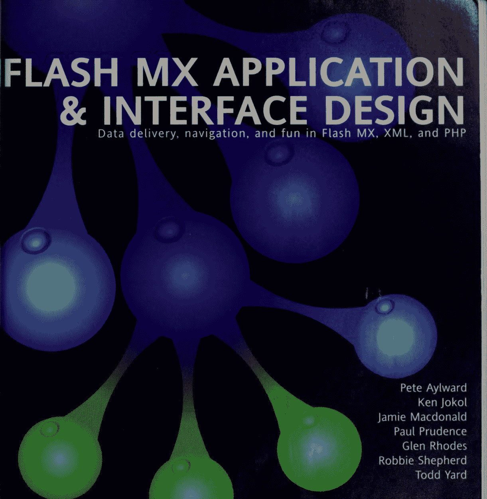


## 致谢

- 作者
  - Pete Aylward
  - Ken Jokol
  - Jamie Macdonald
  - Paul Prudence
  - Glen Rhodes
  - Robbie Shepherd
  - Todd Yard

- 委托编辑
  - Jim Hannah

- 技术编辑
  - Julie Clos

- 项目经理
  - Richard Harrison

- 附加材料
  - Peter Fletcher

- 设计师
  - Katy Freer

- 评审
  - Jason Anderson
  - Kristian Besley
  - Kim Christensen
  - Steve McCormick
  - Jon Steer
  - Michael Walton

- 索引编制
  - Fiona Murray

- 校对
  - Jon Bounds
  - Simon Collins
  - Richard Harrison
  - Chris Matterface
  - Fiona Murray
  - Catherine O'Flynn
  - Gavin Wray


## Ken Jokol

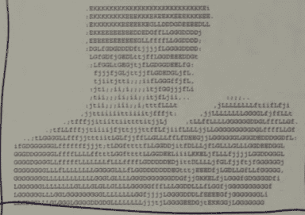

自上一本书（《Flash 数学创意》）以来，我任职的公司被一家更大的公司收购了，我决定成为自由职业者，而不是坐在大型办公楼里。所以如果你需要任何自由职业工作，请联系 kenj@pinderkaas.com。我最近给吉他调了音（过程中弄断了一根弦），现在正考虑加入一个乐队。如果不行，我乐意接受通过电子邮件制作音乐的邀请。先给我发一份音乐文件。MIDI 文件也接受。

## Jamie Macdonald

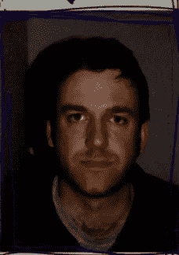

我自称是多学科设计师，基本上意味着我是个样样通样样松的人。我的时间在教本科生设计和照料一家知名出版社的网站之间分配。这几乎没有时间在 hypeteila.com 上发布任何内容，但我总有一天会这么做。

感谢 Peter Fletcher 展示了一些酷炫的空手道动作。

Jamie 生活和工作于伦敦。当他找到时间时，会更新他的网站 www.nooflat.nu

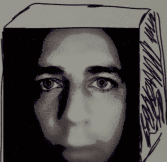

## Pete Aylward

我是一名艺术家。我过去常画复杂重复的有机形态，如放射虫，并一直认为这些形态非常美丽。自从发现 Flash 以来，我几乎没有时间画画，现在我培养简单的 ActionScript 例程来制作可配置的屏幕“绘画”，其中一些可以在 transphormetic.com 找到。当我不在 Flash 内部时，我靠做网页设计和创意开发谋生。希望不久我能抽出时间完成我这类作品的在线作品集，网址是 slightspace.com。


## Paul Prudence

## Glen Rhodes

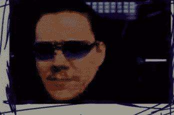

我从小就开始动脑筋，大约在 4 岁时。那个年纪，我开始弹钢琴，那架钢琴在我们家里闲置不用。从那以后我一直弹着。后来，在 1997 年，我合写了一部名为《Chrystanthia》的全长音乐剧。一路上，我把游戏编程当作业余爱好，最终开始为家用游戏机专业制作游戏。然后，在 1998 年，我发现我可以把所有经验结合起来，当我发现 Flash 时。剩下的就是历史了。我在我的网站 www.glenrhodes.com 上分享我的想法。

## Robbie Shepherd

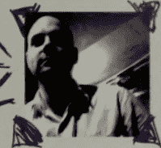

Robbie Shepherd 是一名自学成才的设计师/程序员，与大多数人相比，他在相当晚的年纪进入 IT 行业，这一职业选择导致大量脱发（学习 Flash 期间）和泪水（几次 dot-com 崩溃的受害者），但最终提供了他所有职业中最大的满足感。尽管 Robbie 一再强调自己是“Flash 程序员”，但他的父母坚持告诉每个他们遇到的人，他们的儿子是“一个 Flasher”。

在业余时间，Robbie 制作他喜欢称之为“Flash 东西”的东西。当他不这样做时，他要么在纹身，要么在观看 Leeds 在英超联赛中击败 Newcastle，这两件事无论如何都不嫌频繁。

## Todd Yard

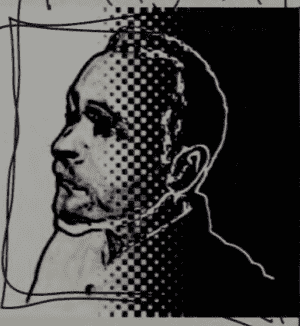

在伦敦学习戏剧，然后在美国当了几年演员后，Todd 在 2000 年接触了 Flash，并迅速被其如何同时允许惊艳的创造力和程序化逻辑应用所吸引——一种真正的左脑、右脑生产方法——此后一去不返。他现在在纽约市的 Daedalus Media 担任创意总监，该公司专门为投资银行行业的客户主要创建基于 Flash 的企业演示文稿。他更轻浮的工作和实验可以在他的个人网站 www.27Bobs.com 上找到。

## 排版

本书中的代码按其在最终文件中出现的方式编写，有一个例外：延续符号（↵）表示一行代码太宽而无法适合我们的页面。如果你在输入，应该只在同一行继续。

## 关于源文件和技术支持

你可以从以下网址下载本书的源文件：

http://www.friendsofed.com/books/flash__mx_titles/inspiring_interfaces/index.html

与所有 friends of ED 书籍一样，本书由我们的编辑提供免费、快速且友好的技术支持。如果您有疑问或问题，请发送邮件至 support@friendsofed.com，我们将尽快回复。

如果您对本书有任何评论，无论是好是坏还是丑陋，我们都很乐意听取您的意见。请发送邮件至 feedback@friendsofed.com，畅所欲言！

friendsofed.com 上有许多其他功能可能会引起您的兴趣——与顶级设计师的访谈、我们其他书籍的样本，以及一个留言板，您可以在那里发布您的问题、讨论和答案。

分享财富！

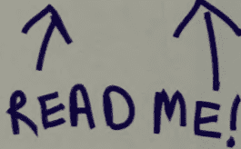

## 欢迎

## Flash 作为理想媒介

Flash 作为创意奢侈品的日子早已一去不复返。在数月的缩减之后，Flash 创造力经历了一个巨大的合理化计划。仅仅以数百万种颜色和一百种透明度呈现动画已不再足够。仅仅为了互动性和动态性本身而提供它们已不再充足。

本系列的目的是展示设计师如何采用 Flash 并使其为其服务。我们发现的是一系列将 Flash 置于前沿网络内容中心的作品。

最终结果是对 Flash 作为理想媒介的快照。

在这些惊人的示例中，我们看到软件被推向极限，以创造无与伦比的应用程序——一个可折叠的家谱树、一个交互式视频学习系统，以及一个能够在线运行的绘图工具！

除此之外，我们还深入了解后端功能，探讨如何进一步改进 Flash。一些常用的 XML 和 PHP 例程被引入增添一些趣味，而 Flash 神秘的 sharedObject 命令被追查并驯服，以创建一种混合的 Tamagotchi 风格室内植物——非常适合吸引冲浪者回到您的网站！

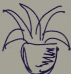


## 设计预加载器

老实地说，本章开始我们先来点真诚——我是个没耐心的人。我从来不是那种能耐心等待的人，因为我总觉得时间还可以用来做更有意义的事情。堵车、航班延误、超市收银台前找零钱的购物者——对我而言，这些都是极大的苦恼。关于这个话题我还能说更多，但你大概已经明白了，对不起，我真的没时间了...

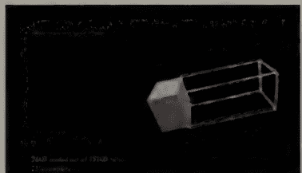

我的观点是，对我们大多数人来说，当有地方要去时，任何阻碍我们的事物都可能成为烦恼。面对堵车、航班延误和不体贴的购物者，除了等待我们别无选择。然而在网上，如果等待让人恼火，有无数的目的地可以探索，只需点击一下。所以，如果我们想保持受众的注意力，就必须确保他们没有机会感到无聊。如果网站加载时间过长，大多数用户可能永远看不到我们精心设计的内容。因此，我们需要通过提供预加载器来避免这种风险。

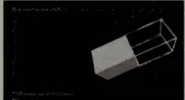

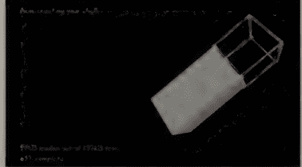

这是 27Bobs.com 上使用的一个 3D 预加载器。网站加载时，粗略的线框会被实心 3D 块取代，代表绘制主站点所用的“粉笔”。

稍后我们将看到更多来自 27Bobs 的内容。

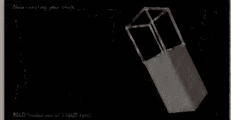

### 什么是预加载器？

在韦氏词典中查找“preloader”，你会发现……什么也没有。毫无疑问，它很快就会出现在参考手册中，但目前让我们自己制定定义。显然，这个词本身暗示预加载器出现在即将加载的任何主内容之前。由于网上的任何东西都需要加载才能看到，包括预加载器，我可以更进一步地说，预加载器的文件大小应比即将加载的主内容小得多。为了履行其功能，它必须几乎即时加载。

让我们修改预加载器的定义来表达这些观点。我们有：

预加载器是一小段内容，大小仅为主内容的一小部分，它在你的其余影片加载之前快速加载，并在加载主内容的过程中为用户提供反馈、信息和娱乐的结合。

所以我们有一段在主内容之前加载且大小仅为主内容一小部分的内容。这段较小的内容的目的是什么？嗯，在最基本的形式中，预加载器只是向用户提供有事情正在发生的反馈。如果没有预加载器，用户看到空白屏幕且没有内容，可能会觉得浏览器或电脑死机了。屏幕上出现一个简单的“加载中...”就能达到这个目的，尽管如果它停留太久，我们又面临同样的风险了。

DaedalusMedia.com 的预加载器使用已加载字节数来推进基于帧的动画。这个动画由慢慢覆盖雕像的裂缝组成，当网站完全加载时，最终以雕像爆炸成碎片告终。

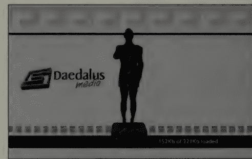

当然，预加载器可以并且应该更进一步，向用户持续提供正在发生的事情以及实际加载内容的信息。显示正在传输的数据的文本信息，或者显示已加载百分比的加载条，就能实现这一点。通过让用户了解正在发生的事情，他们对延迟的挫败感会减轻。如果有交通信息让你了解延误原因和等待何时结束，堵车也会更容易忍受。

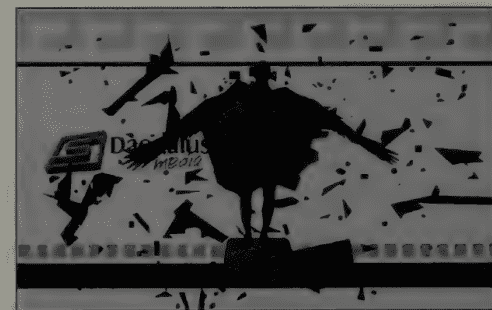

最后，为了帮助在车里等待时打发时间，还有什么比收音机播放音乐更好的选择呢？延迟期间的娱乐可以让时间过得快得多。就像那句陈词滥调所说，开心时光飞逝。为什么不把这个应用到你的预加载时间中呢？

重要的是要理解，预加载器与片头动画不同。前者在加载重要材料时提供信息和娱乐，理想情况下开销很小。然而，片头动画通常是一种广告或“炫技”式的技能展示，正如其名称所示，常被放置为网站主内容的引言。当 Flash 最初被用于增强网站时，片头动画文件过大且本身需要预加载的情况司空见惯。起初，新奇感证明了额外时间的合理性，但很快许多网络用户就觉得厌烦了，于是“跳过片头”按钮应运而生。除非你有充分理由提供片头动画，或者能制作出文件大小较小的动画，否则通常最好让用户直接进入网站的主内容。不过，如果你坚持使用大型片头动画，请务必在它之前包含一个预加载器，让用户知道有值得期待的内容即将到来。

好了！现在有了通过构建预加载器想要实现的目标的概念，让我们来看看将面临的一些常见陷阱。

### 预加载器的绊脚石

### 关于流媒体

Flash 的一大绝妙功能是其将信息流式传输到用户计算机的能力。这允许用户在内容可用时立即查看，而无需等待内容完全加载。通过规划网站或动画的布局来利用这一功能，预加载器可能变得不必要，因为用户不需要等待一两秒以上事情就会开始发生。对于长动画，或在主时间轴上分为许多帧的网站（随着 Flash MX 强大的新脚本功能，这种做法现在越来越少），这是通过保持初始帧的内容很小来实现的，以便它们可以立即看到，从而为时间轴后面较“重”的帧加载留出更多时间。

然而，现在将大部分（如果不是全部）内容放在单个帧中很常见。动画可以在电影剪辑中或通过代码创建，内容可以从电影的库或外部加载和卸载到舞台上。当电影以这种方式结构化，所有内容都在第一帧时，用户在内容完全加载之前将什么也看不到。正因为如此，预加载器成为必需，哪怕只是为了通知用户确实有东西即将到来，尽管屏幕上没有活动。

由于本章关注预加载器本身而非避免预加载器的方法，我们不会过多讨论流媒体。在本章中我呈现的示例里，我们将基于这样的假设：我们在几个帧中有大量内容，需要为其提供预加载器。

这并不意味着我们会完全忽略流媒体问题。实际上，正是 Flash 的流媒体功能让我们最初能够创建预加载器。通过在影片的第一帧中放置一个小预加载器，它可以几乎立即流式传输到用户的播放器中，并在其余网站加载时向用户提供反馈。

如果需要，你可以轻松地将预加载器的相同原则应用于流媒体文档，只需提供一个预加载器，在影片开始播放前加载一定量的内容（类似于其他流媒体中出现的缓冲）。

在 DaedalusMedia.com 的一个大板块的预加载器加载一定量的字节后，该板块将部分呈现，随着额外子板块的加载，它们将变得可用。这为用户提供了在板块完全加载前查看一些内容的机会。

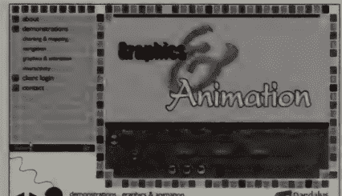


## 帧与字节

在 Flash 4 中，预加载器是通过使用电影剪辑的 _framesLoaded 和 _totalFrames 属性来实现的。通过将加载到播放器中的帧数与影片中的总帧数进行比较，你可以确定还剩下多少未加载。这种方法的问题是，当文件大小在各帧中分布不均时就会出现。因此，如果你在十帧电影的第十帧中存放了大量数据，预加载器可能会显示已加载 90%（因为 90% 的帧已加载），但实际上整个站点的总字节中只加载了一小部分，从而向用户提供了略有误导的信息。

确定加载到播放器中的数据量的一种更准确的方法是使用 Flash 5 中引入的电影剪辑的 getBytesLoaded() 和 getBytesTotal() 方法。这些方法分别返回已加载到播放器中的字节数和影片的总字节数。要将这些数字转换为千字节（这是受众更易理解的单位），你必须将结果除以 1024，即一千字节中的字节数。

在我们的示例中，我们将始终使用字节方法而非帧方法，因为它能为用户提供更准确的反馈，并让我们拥有更大的控制权。

## 压缩

Flash MX 在发布过程中引入了新的压缩功能，这为预加载器带来了一个小障碍。这个绝妙的新功能进一步压缩了本已很小的 SWF 文件，使它们更加精巧。包含大量文本和代码的影片将从中获益良多（我曾见过影片文件大小减少 25-50%，这绝非小事）。

那么问题出在哪里呢？呃，getBytesLoaded() 和 getBytesTotal() 方法实际上返回的是影片未压缩的文件大小。如果你只是使用这些方法来返回百分比，这不成问题，因为两者之间的关系保持不变。不过，如果你希望显示正在加载的实际字节数，或者将要加载的总字节数，未压缩值将不准确，因为加载到播放器中的是压缩后的大小。

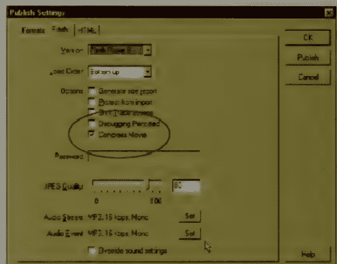

修复这个问题很简单，耗时很少，而且只有在更新影片时才真正变得麻烦。在第一个练习结束时，我会为你演示这个修复方法，以便你能将其应用到自己的预加载器中。是否需要使用压缩后的数值取决于你的具体情况。如果压缩和未压缩文件大小之间的差异仅为几千字节，那么使用未压缩值并省去麻烦可能更可取。我的个人网站 27Bobs.com，未压缩时为 200kb，压缩后变成了 150kb。这一巨大差异不是我能忽视的，因此我采用了该修复方法。

## 文件大小与导出的符号

还需要记住的最后一点是预加载器自身的文件大小。请记住，如果预加载器不能几乎立即向用户显示，其整个目的就失去了意义。这意味着必须保持预加载器的极小尺寸。使用简单矢量图、小位图、有限的声音和最少的代码，都有助于确保文件大小保持在所需范围内（而且，当然，*不*使用声音和位图会更有帮助）。你最不希望做的事情就是为自己的预加载器提供一个预加载器。

不过，有时在预加载器之前会加载其他数据，这可能会延迟影片首帧的显示。如果你从库中导出了任何符号，包括电影剪辑、声音或字体，这些符号默认会在影片的第一帧之前加载。只有在这些符号完全加载后，你的第一帧和预加载器才会被绘制出来。显然，如果你导出了大量符号（如果你打算通过代码将这些项目添加到舞台上，就需要这样做），这将对你的预加载器产生不利影响。

解决这个问题有几种方法。一种常见的解决方案是在预加载器加载后，让主内容加载到单独的层级中。通过将所有导出的符号保留在这个单独的影片中，你可以将预加载器几乎立即加载到基础层中，并在主内容加载时向用户提供反馈。相关的解决方案是将所有内容加载到主影片的电影剪辑中。这会变得有些麻烦，我通常会选择前者，即加载到层级中的方案。

Flash MX 引入的另一种解决方案是在创建新符号时取消选择“在首帧导出”默认选项。这意味着你的符号不会在首帧绘制之前自动加载，而是会在你手动将其放置在舞台上的那一帧加载。如果在发布影片之前没有在创作环境中将符号的实例实际放置在舞台上，那么你将无法通过代码访问它。使用此功能，你仍然可以导出符号，但不需要等待它们加载完毕才显示预加载器。

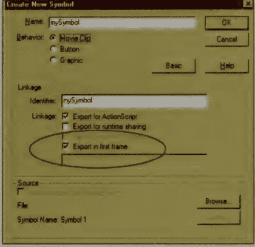

Flash MX 6.0 版本中导出的字体似乎存在一个错误。在字体链接对话框中取消选择“在首帧导出”，实际上并不能阻止字体在首帧加载。只要选中了“为 Actionscript 导出”，字体就会无论什么情况都自动在首帧导出。

此外，如果你在计划加载到层级或电影剪辑中的影片里导出了用于 TextFormat 对象的字体，那么除非你也从你的 _level0 影片中导出这些字体，否则这些字体将不会显示。这当然意味着，如果你的预加载器位于 _level0（通常情况），那么任何导出的字体都需要在预加载器出现之前加载。

解决此问题的一些可能方案包括：

- 将导出的字体保持在最少
- 不导出包含过多矢量信息的字体
- 不在加载的影片中将 TextFormat 对象与导出的字体一起使用

虽然无论何种情况都值得考虑前两种方案，但最后一种方案会严重限制你。Macromedia 已知晓此问题，希望很快能找到解决方案。

## 制作极佳的预加载器

对我来说，预加载器有三种类型。第一种是关于加载状态的文本信息。这可以是显示“加载中…”这样简单的内容，也可以是不断反馈报告加载统计信息的数字。在此基础上，你可以以图形方式表示加载进度，让用户了解状态。最常见的示例，也是最常见的预加载器，是加载进度条。最后，我们可以完全忽略加载状态，只是在加载期间让用户得到娱乐。实现此目的的两种有效方法是：为用户提供可观看的动画或可玩的游戏。

再次说明，大多数预加载器都是这些类型的组合，对于大多数人来说，这种区分相当模糊。例如，加载条在屏幕上动画显示已加载百分比这一行为本身，可以被视为一种基础的娱乐形式（这并不是说你应该把周六晚上这样度过，但这确实是一种娱乐）。添加一些相关数字以提供文本反馈，你就拥有了融合了三种类型的预加载器。当然，并没有规定你必须像其他人一样制作一个加载进度条……

## 激光标志

第一个练习是经典加载条的一种变体，利用了 Flash MX 绘制动态蒙版的新功能。其思路是在加载过程中逐渐揭示一个标志。可见的部分将等于已加载的总字节百分比。

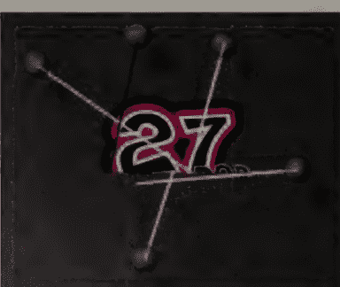

一个简单的蒙版擦过标志就能实现效果，但为了更有趣，我们将编写代码，让激光看起来像是在屏幕上绘制标志。打开 laserLogo.swf 文件查看最终效果。附带的 FLA 文件已完全添加注释。

让我们来回顾一下这个效果是如何实现的。

### 为标志添加蒙版

我们要做的第一件事是为标志创建并动画化一个矩形动态蒙版。这要归功于 setMask 方法和绘图 API，这是 Flash MX 为我们提供的新选项。让我们来看看它是如何工作的！

从下载文件中打开 laserLogo_start.fla 文件。该文件已经为你构建好了主时间轴。你会发现这是一个单帧影片，只有几个图层。基础图层只是一个垂直矩形轮廓。第二层包含放置在舞台中央的我们的标志。第三层有两个动态文本字段，两者都选择了 _sans 作为字体。两个文本字段的实例名称分别为 loaded 和 total。名为 code 的最后一个图层包含一个空白关键帧。我们将在此处完成所有工作。

使用你自己的文件名保存影片。

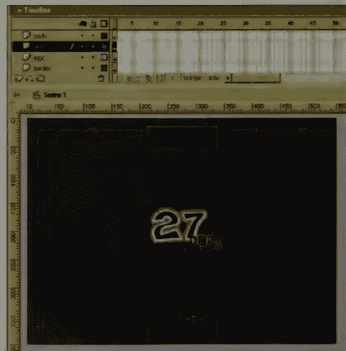


选择代码图层第一帧中的空白关键帧，并打开 ActionScript 编辑器。在代码中我们要做的第一件事是为影片设置几个变量。请输入：

```
stageWidth = 550;
stageHeight = 400;

moveWidth = stageWidth*.5;
moveHeight = stageHeight*.5;

totalY = logo._height;
totalX = logo._width;

totalLasers = 5;
```

stageWidth 和 stageHeight 是我们影片的尺寸。不直接硬编码这些值，你可能想使用新 Stage 对象的 width 和 height 属性。不过，我在测试过程中发现，有时这些值是错误的。如果你使用 _root_.width 和 _root_.height，你会得到舞台上所有对象周围边界框的宽度，而不是你在影片属性中设置的值（尽管当嵌入 HTML 页面时它可以正常工作），因此我倾向于在代码的前几行硬编码这些尺寸。

moveWidth 和 moveHeight 是我们的激光（发射光束的球体）在舞台上移动时所走的最大距离。我们实际上会让激光的运动围绕标志居中，因此这两个变量会让激光保持在屏幕中心附近。

totalX 和 totalY 将用于我们要在标志上绘制的遮罩。它将是一个矩形遮罩，这两个变量保存该矩形的最终尺寸。如果你在舞台上选择标志电影剪辑，你会发现我已经给它指定了实例名称 logo。

最后，totalLasers 是一个保存我们要添加到舞台上的激光数量的变量。我发现五是一个对我而言处理器友好的不错数字，但你可以在测试时随意调整这个数字。

下一步是创建我们将用于绘制标志遮罩的空电影剪辑。在前面的代码行之后输入以下代码：

```
this.createEmptyMovieClip("mask", 100);
mask._x = logo._x;
mask._y = logo._y;
logo.setMask(mask);
```

在这些行中，我们创建一个名为 mask 的电影剪辑并将其放置在标志的注册点（你会注意到它设置在符号的左上角）。然后我们使用新的 setMask 方法将其启用为标志电影剪辑的遮罩。

设置好这些基本变量和遮罩后，让我们编写一个函数，在每一帧调用它来监控加载状态：

```
assessLoad = function(clip) {
// var kbLoaded = Math.floor(clip.getBytesLoaded()/1024);
// var kbTotal = Math.floor(clip.getBytesTotal()/1024);

// delete these two lines and uncomment
// the above lines upon publishing
var kbLoaded = Math.floor(getTimer()/200) + 2;
var kbTotal = 150;}
```

这是预加载器的核心。我们创建了一个名为 assessLoad 的函数，并向它发送一个电影剪辑的引用（参数中的 clip）。这就是我们要检查加载状态的剪辑。它可以是主影片、电影剪辑或某个层级，这取决于我们向函数传递什么。被注释掉的前两行是在在线使用此文件时会使用的内容。为了测试目的，我在接下来的几行中伪造了一些变量，你在发布此文件的最终版本时会删除它们。让我们来看看被注释掉的行实际上为我们做了什么。

函数声明后的第一行创建了一个名为 kbLoaded 的局部变量，并在该变量中保存剪辑中当前已加载的千字节数（getBytesLoaded 返回字节，因此除以 1024 将其转换为千字节）。下一行将剪辑中千字节的总数存储在名为 kbTotal 的变量中。当此影片在线时，这些就是函数需要查看的数字。

为了在测试期间正常工作，我在接下来的两行中为这些变量创建了伪值。kbLoaded 从影片的当前毫秒数获取其值。kbTotal 只是一个硬编码数字。你在最终发布时会删除这些行。

通过输入以下行来完成此函数：

```
var percentOfLogo =
    Math.floor(kbLoaded/kbTotal * totalY);
loaded.text = kbLoaded + "KB";
total.text = kbTotal + "KB";
drawLogo(percentOfLogo);
if ((kbLoaded >= kbTotal) && kbTotal > 1) {
    endPreload(clip);
}
```

在这里，我们通过将已加载字节数除以总字节数来计算当前已加载字节的百分比。由于此数字在 0 到 1 之间，我们将其乘以 totalY 变量（标志的高度），以确定我们应该在标志上向下绘制遮罩多远（标志 totalY 的一个百分比）。调用 Math.floor 舍入方法将数字舍去到最接近的整数。

接下来的两行将我们的两个千字节值放入舞台上各自的文本字段中，并在数字后添加字符串 "KB"。然后我们调用一个名为 drawLogo 的函数，并向它传送要绘制的标志当前百分比。这个函数实际上会绘制遮罩并激活我们的激光。最后几行是在加载完成时结束预加载动作。if 语句检查已加载的千字节数是否大于或等于总千字节数，这意味着所有内容都已加载。if 语句的第二个条件只是我使用的一种保障措施，用于在进行此检查前确保已加载一些内容（偶尔，第一个条件可能是 undefined == undefined，这将求值为 true）。如果所有内容都已加载，我们会调用 endPreload 函数，我们稍后会编写它。

我们接下来要讨论的函数是上一段代码中调用的 drawLogo 函数。将这些行紧接在 assessLoad 函数之后放置：

```
drawLogo = function(percent) {
    mask.clear();
    mask.beginFill(0, 100);
    mask.lineTo(totalX, 0);
    mask.lineTo(totalX, percent);
    mask.lineTo(0, percent);
    mask.endFill();
    for (var i in lasers) {
        lasers[i].drawLaser(percent)
    }
}
```

如果你尚未使用过新的绘图 API（应用程序编程接口），它非常容易上手。在上述代码中，我们首先清除遮罩电影剪辑中之前绘制的任何内容。每次我们打算绘制新内容时都需要这样做。使用 beginFill 方法，我们设置遮罩的颜色和 Alpha 值。由于遮罩不会可见（就像你在创作环境中创建的遮罩一样），这两个值都不重要，所以我只是将颜色设置为黑色（值为 0x000000，即 0），Alpha 设置为 100。

此函数中的接下来三行使用 lineTo 方法绘制遮罩矩形的三条边。需要注意的是，每次对剪辑调用 clear 方法时，剪辑的“笔”都会移动到注册点 (0, 0)。第一个 lineTo 然后绘制一条线到标志的右侧，由 totalX 表示。第二个 lineTo 垂直向下绘制到当前加载百分比确定的 totalY 数量。第三个 lineTo 接着绘制一条线回到标志的左侧。调用 endFill 方法会自动通过绘制最后一条线返回注册点来关闭我们的矩形。

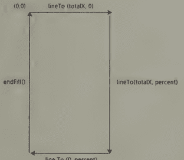

最后的 for in 循环遍历我们将在舞台上放置的每个激光。lasers 数组实际上将保存每个激光电影剪辑的引用。这些剪辑中的每一个都将保存一个名为 drawLaser 的方法。我们稍后会查看这个方法。

我们的最后一个通用函数在加载完成时被调用。将这些行放在 drawLogo 函数之后：

```
endPreload = function(clip) {
   clearInterval(preload);
   mask.removeMovieClip();
   for (var i in lasers) {
      lasers[i].leaveStage();
   }
   loaded.text = "";
   total.text = "";
}
```

请记住，在我们的 assessLoad 函数中，clip 是我们正在评估的电影剪辑。加载完成后，将调用此函数。我们会在这里添加在跳转到主内容、主页或其他我们要加载的内容之前需要清理的任何内容。

preload 将是不断调用我们上面 assessLoad 函数的间隔的标识符。我们将在代码稍后使用新的 setInterval 函数来创建它。在这里，我们通过调用 clearInterval 函数来删除该间隔。接下来，我们删除我们在代码顶部动态添加到舞台上的遮罩电影剪辑。接下来的 for in 循环遍历我们的 lasers 数组并调用每个激光的 leaveStage 方法，这会将激光赶出舞台右侧。最后，我们通过将两个文本字段的文本值设置为空字符串来清除它们的文本。如果你实际上想要将播放头发送到另一帧，这就是你会执行的地方（或者你可能会等待所有激光退出舞台）。

接下来的这段代码启动所有内容：

```
preload = setInterval(assessLoad, 40, this);
```

新的 setInterval 命令非常出色。在这种形式下（还有其他形式——我们将在本教程稍后使用另一种），它至少需要两个参数，但可以接受更多。第一个是要调用的函数的名称，在我们的情况中是 assessLoad。第二个参数是每次调用函数之间的毫秒数。我们每 40 毫秒调用一次 assessLoad 函数。我们发送的最后一个参数是传给 assessLoad 的参数，你会记得那是要观看的剪辑。我们发送 this，即 _root 主影片。如果你要加载到另一个层级或电影剪辑中，你可以简单地用 _level1 或 myMC 或你正在处理的任何层级或实例名称来替换它，代码就会正常工作。


## 制作激光动画

我们将间隔的标识符设置为 preload。这样我们可以在预加载完成后清除该间隔（我们在上面的 endPreload 函数中已经这样做了）。

现在去测试一下电影，看看遮罩是如何慢慢揭示标志的，并欣赏 Flash MX 为我们带来的这个出色新功能！（如果你想看遮罩本身是如何绘制的，请将代码中前面的 logo.setMask(mask); 行注释掉。）

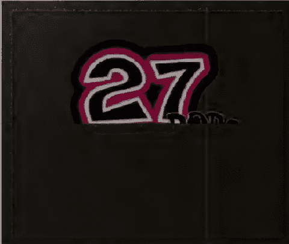

现在我们已经编写了揭示标志的函数，将添加激光，并使它们看起来仿佛正在将标志绘制到舞台上。我们将通过为激光创建一个自定义对象来实现这一点，该对象将包含每个激光电影剪辑的所有方法。这是 Flash 的类创建形式，它使我们能够将激光代码方便地放在一个整齐的代码块中。

在 endPreload 函数之后（setInterval 之前）键入这一行：

```
LaserClass = function() {
    this.init()
}

LaserClass.prototype = new MovieClip();
```

LaserClass 将是我们新电影剪辑类的名称。我们将要做的是扩展电影剪辑的基本功能，以执行我们要求的激光操作。将 LaserClass 的原型设置为新 MovieClip 的那一行使我们能够做到这一点。prototype 属性保存了一类对象的所有方法和属性。通过将 LaserClass 的原型设置为新 MovieClip，我们表示 LaserClass 的任何实例（我们放置在舞台上的每个激光）都将具有 MovieClip 类的所有功能，外加 LaserClass 的功能。这非常方便。

创建新激光时发生的唯一事情是调用其 init 方法（上面代码中的第二行），所以让我们接着编写它。

将此代码紧跟在上述行之后：

```
LaserClass.prototype.init = function() {
    if (this._parent.lasers == undefined) {
        this._parent.lasers = []
    };
    this._parent.lasers.push(this);
    this.direction = Math.random() > .5 ? 1 : -1;
    this.laserPace = Math.floor(Math.random() * 25) + 5;
    this.contactPointX = Math.floor(Math.random() * totalX);
}
```

请注意，我们正在将此方法附加到 LaserClass 的 prototype 属性上。这将使 LaserClass 的任何实例都能访问它。那么这个方法做什么呢？第一行是一个安全检查，用于确保我们已在父时间轴（在此例中为主时间轴）上创建了 lasers 数组。如果没有，我们将其创建为 Array 对象的新实例（将变量设置为方括号即可实现这一点）。下一行将当前实例（刚刚创建的任何激光）的引用推入 lasers 数组。你会回想起，在上面的函数中，我们遍历了这个数组以查找所有激光的引用。

接下来的三行设置每个实例的属性。direction 设置为 -1 或 1。这一行的工作原理是测试 0 到 1 之间的随机数（Math.random 返回的值）是否大于 0.5。如果是，则将 1 赋值给 direction。否则，将 -1 赋值给 direction 属性。direction 是激光移动的 x 轴初始方向。在下一行，laserPace（即每个激光的移动速率）设置为 5 到 30 之间的数字。同样，Math.random 返回 0 到 1 之间的数字。将其乘以 25 得到 0 到 25 之间的数字，我们使用 Math.floor 方法将其向下取整到最近的整数。为了确保没有激光以低于 5 的速率移动，我们向此值加 5。最后，在上面代码段的最后一行，我们将 contactPointX 设置为标志宽度范围内的随机数。contactPointX 将是激光束在标志上的 x 轴接触点。

要完成 init 方法，在前面的行下键入此代码：

```
this._x = Math.floor(Math.random() * moveWidth + stageWidth*.25);
this._y = Math.floor(Math.random() * moveHeight + stageHeight*.25);
this.setMoveWait();
this.onPress = this.dragMe;
this.onRelease = this.releaseMe;
this.onReleaseOutside = this.releaseMe;
this.useHandCursor = 0;
}
```

这里的前两行将我们激光的 _x 和 _y 位置设置为之前设置的 moveWidth 和 moveHeight 范围内的某个位置。请记住，这些变量限制了激光的移动范围。为了对这些值进行偏移以将范围居中于标志上，我们将这些位置乘以舞台宽度和高度的四分之一（moveWidth 和 moveHeight 将范围限制为舞台的 0.5，因此向 _x 和 _y 添加 0.25 可将范围居中于舞台和标志上）。

setMoveWait 是我们稍后将要创建的一个方法，用于设置激光在移动到新位置之前等待的时间量。接下来的两行将 onPress 事件处理程序设置为等于 dragMe 方法，将 onRelease 和 onReleaseOutside 事件处理程序设置为等于 releaseMe 方法。LaserClass 的这两个方法将允许用户将激光拖到舞台各处，我们将稍后编写它们。因为启用这些处理程序会使我们的激光充当按钮，所以我们在最后一行禁用默认的手形光标。

下一个方法（我们在前面的 init 方法中调用过它）简洁明了。

```
LaserClass.prototype.setMoveWait = function() {
    var wait = Math.floor(Math.random() * 5000) + 2000;
    this.wait = setInterval(this, "setDestination", wait);
}
```

setMoveWait 设置激光在移动到新目标之前等待的时间量。我们首先找到 2000 到 7000 毫秒（2 到 7 秒）之间的随机数。然后使用新的 setInterval 命令，我们告诉激光（this）在我们放入变量 wait 的毫秒数后调用其 setDestination 方法。setInterval 通常用于创建循环动作（事实上，我们将这样做来调用运行整个电影的 assessLoad 函数），但它也是在 Flash 电影中延迟操作的绝佳方式。waitInterval 是我们分配给该间隔的标识符。我们稍后需要它来清除该间隔。

那个方法很简单。这是我们在 setInterval 中刚刚调用的方法：

```
LaserClass.prototype.setDestination = function() {
    clearInterval(this.waitInterval);
    this.endX = Math.floor(Math.random() * moveWidth + stageWidth*.25);
    this.endY = Math.floor(Math.random() * moveHeight + stageHeight*.25);
}
```

setDestination 正是做这件事——它挑选一个随机目标来移动激光。不过，首先，我们清除创建以在延迟后调用此函数的间隔。然后，我们赋予 endX 和 endY 属性以保存激光的目标坐标。这些行几乎与上面 init() 方法中的原始坐标赋值完全相同。

完成函数：

```
this.moveCount = 0;
this.onEnterFrame = function() {
    this._x -= (this._x - this.endX)/5;
    this._y -= (this._y - this.endY)/5;
    this.moveCount++;
    if (this.moveCount > 20) {
        delete this.onEnterFrame;
        this.setMoveWait();
    }
}
```

首先，我们初始化一个变量。我们将使用它来限制激光移动的时间量。接下来，我们为激光创建一个在每个 enterFrame 时运行的新函数。任何在 Flash 电影中编写过移动脚本的人都应该对此代码很熟悉。我们只是在每一帧将 _x 和 _y 位置稍微靠近目标移动一点。一旦 moveCount 超过 20（我们每帧加 1），我们就移除 enterFrame 上的函数，并再次调用 setMoveWait 方法以准备下一次移动。之所以使用 moveCount 而不是像惯例那样测试是否到达目的地，是因为在这种情况下，激光是否到达确切目标并不重要。我宁愿将函数循环次数限制为固定次数，而不是不断调用 Math.abs 方法来检查激光位置。

下一个也很简单，所以我一次性全部给出。我知道你能处理好！

```
LaserClass.prototype.leaveStage = function() {
    this.clear();
    clearInterval(this.waitInterval);
    delete this.onPress;
    delete this.onRelease;
    delete this.onReleaseOutside;
    this.xRate = 10;
    this.onEnterFrame = function() {
        this._x += this.xRate;
        this.xRate += 10;
        if (this._x > stageWidth*1.5) {
            this.removeMovieClip();
        }
    }
}
```

我们在做什么？嗯，当此方法被调用时，我们清除其上的任何光束图形，移除任何残留的间隔调用，删除所有按钮事件处理程序函数，并将剪辑送到舞台右侧。一旦它足够远，我们就移除该剪辑。

以下是允许用户在舞台上拖动激光的两个 LaserClass 方法：

```
LaserClass.prototype.dragMe = function() {
    delete this.onEnterFrame;
    clearInterval(this.waitInterval);
    this.startDrag();
}
```

```
LaserClass.prototype.releaseMe = function() {
    stopDrag();
    this.setMoveWait();
}
```


一旦用户用鼠标点击一个激光，它就变得可拖动。我们会移除任何间隔调用以及它的 enterFrame 处理程序（以防它当前正在移动）。一旦激光被释放，我们停止拖动并调用它的 setMoveWait 方法来确定下次何时移动。下面这行代码将这个类定义与我们库中的符号关联起来。将其放在 releaseMe 方法之后：

```
Object.registerClass("laser", LaserClass);
for (i = 0; i < totalLasers; i++) {
this.attachMovie("laser", "l" + i, i);
}
```

如果你在库中右键点击激光符号并选择 Linkage，你会注意到我已将其导出为 laser。然后通过 Object 对象的 registerClass 方法将此符号与类定义 LaserClass 注册，我确保了我放置在舞台上的任何 laser 实例实际上都是 LaserClass 的实例。在接下来的 for 循环中，我将所有激光放置到舞台上。

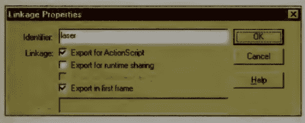

请预览你的影片，观看激光以各自随机的方式在标志周围移动，直到预加载完成，它们从舞台右侧滑出并消失。

## 绘制激光束

现在是时候通过从激光向标志绘制光束来完成效果了。这有点难度，但能产生极棒的效果，所以请继续跟我做！

我们的下一个方法在上面的 drawLogo 函数中被调用，用于在舞台上绘制实际的激光束。

将这些行放在 init 方法之后：

```
LaserClass.prototype.drawLaser =
function(percent) {
this.recursiveCount = 0;
this.beamY = logo._y + this._y + percent;
this.beamX = this.getContactX();
}
```

（事实上，你可以将其放在 LaserClass 定义中的任何位置，只要它在 LaserClass.prototype = new MovieClip() 之后且在 Object.registerClass 行之前。这也适用于 LaserClass 的所有后续方法。）

请记住，percent 是加载的千字节数百分比乘以标志的高度。我们将它传递给这个函数，以便激光知道在哪个 y 位置对准它们的光束。第一行初始化一个名为 recursiveCount 的变量。我们稍后将使用它作为安全检查，我会在那时更详细地解释它。接下来的两行找到激光束末端的 x 和 y 位置（光束的原点始终位于激光影片剪辑本身）。beamY 是通过获取标志的 _y 位置并减去激光的 _y 位置来找到的。这个偏移是必要的，因为我们将在激光影片剪辑内部绘制激光。然后我们加上标志总高度的当前百分比。找到激光的 x 位置更复杂一些，所以我将其放在另一个名为 getContactX 的方法中。我们稍后会讨论这个方法。

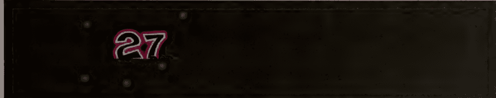

继续编写 drawLaser 方法，添加以下代码行：

```
for (var i in logo) {
    if (typeof logo[i] == "movieclip") {
        if (logo[i].hitTest(this.contactPoint.x,
            this.contactPoint.y, 1)) {
            var logoColor = new Color(logo[i]);
            var laserColor = logoColor.getRGB();
            break;
        }
    }
}
```

要理解这段代码，你需要了解我如何设置标志。进入符号编辑模式。你会发现标志被分成了图层，每个图层包含不同颜色的元素。如果你选择其中任何一个元素，你会发现每个图层包含自己的影片剪辑，并且该影片剪辑已在属性面板中着色。之所以这样设置，是为了我们可以使用 Color 对象的内置 getRGB 方法来确定激光悬停在其上时每个剪辑的颜色。因此，我们不仅需要将每种颜色分离到自己的影片剪辑中，还需要将该影片剪辑以 100% 的基色着色（再次查看属性面板以了解这一点的证据）。目前，Flash 无法确定剪辑或像素的颜色，因此我们必须创建这个变通方法来完成我们的任务。

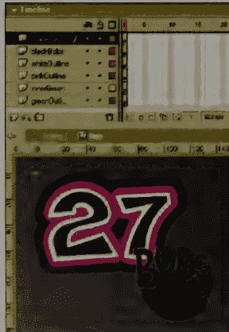

就代码而言，上面的 for in 循环遍历 logo 内部的每个属性。如果一个属性（可以是对象）是影片剪辑，则它会测试激光的接触点（存储在 this.contactPoint 中，将在我们稍后编写的 getContactX 函数中设置）是否命中该标志影片剪辑。如果命中，则它会创建一个临时 Color 对象，并使用 getRGB 方法查找该元素的颜色。它将该颜色存储在变量 laserColor 中。找到一种颜色后，我们就不再需要搜索，因此跳出循环。

如果你对 this.contactPoint 中存储的 x 和 y 值与 beamX 和 beamY 中存储的值之间的区别感到好奇，当我们设置 contactPoint 的值时你会发现它们相对于主时间轴，而 beamX 和 beamY 相对于激光影片剪辑。我们需要 contactPoint 值来调用 hitTest，但我们需要 beamX 和 beamY 值来在激光影片剪辑内部正确绘制激光图形。

这个函数的最后一部分小菜一碟。通过添加这些行来完成它：

```
this.clear();
this.lineStyle(2, laserColor, 100);
this.lineTo(this.beamX, this.beamY);
}
```

很简单。我们清除先前绘制的光束图形并重置 lineStyle（激光的厚度、颜色和 alpha），每次调用 clear 方法时都会清除它。然后我们从激光的原点 (0,0) 绘制一条线到我们分配给 beamX 和 beamY 的任何值。

下一个也是最后一个方法有点棘手，是本项目中最复杂的。让我们慢慢来讲解。

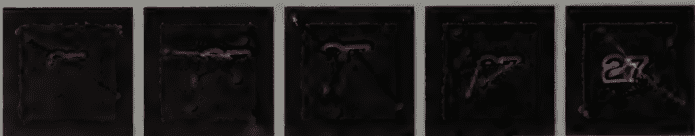

将其放在 drawLaser 方法之后：

```
LaserClass.prototype.getContactX = function() {
    this.recursiveCount++;
    if (this.recursiveCount > 100) {
        return totalX/2
    }
    this.contactPointX +=
        this.laserPace*this.direction;
}
```

getContactX 被调用以确定光束在 x 轴上在标志上的接触点。你稍后会看到，由于标志形状不规则，无法进行简单的来回扫描，因此我们必须稍微搜索一个发射光束的位置。因此，getContactX 是一个递归函数，这意味着它是一个可以调用自身的函数。只要你能确保函数被调用的次数不是无限的（这在递归循环中有时会发生），这样做就没问题。为了处理这个问题，我们每次告诉激光绘制自身时（在 drawLaser 方法中）都将激光的 recursiveCount 属性设置为 0。每次进入此方法时，我们都会给 recursiveCount 加 1。如果发现此方法需要调用自身超过 100 次，我们就“放弃”，并将 x 位置简单地设置为标志的正中心。

上面部分的最后一行代码会将我们的 contactPointX 属性（实际上是光束在标志上的 x 接触点）按激光的速率乘以方向（正或负）来递增。

现在我们需要做一些检查，以确保光束落在我们的标志上。在前面的代码之后键入这些行：

```
if (this.direction > 0) {
    if (this.contactPointX > totalX) {
        this.direction *= -1;
        this.contactPointX = totalX;
    }
} else {
    if (this.contactPointX < 0) {
        this.direction *= -1;
        this.contactPointX = 0;
    }
}
```

第一个 if 语句只是检查我们是否正在向正方向移动。如果是，我们再检查是否已移出标志的右侧。如果发生这种情况，我们会改变方向。else 语句只是检查标志的左侧。

以下是 getContactX 方法的最后一段代码（也是本教程的最后一段！）：

```
var beamX = this.contactPointX - (this._x - logo._x);
this.contactPoint = {x:beamX, y:this.beamY};
this.localToGlobal (this.contactPoint);
while (!logo.hitTest (this.contactPoint.x,
    this.contactPoint.y, 1)) {
    beamX = this.getContactX();
}
return beamX;
}
```

在这里，我们创建一个名为 beamX 的局部变量，并为激光源与标志之间的距离对其进行调整。我们需要这样做，因为 contactPointX 的值仅仅是 0 到标志宽度之间的一个数字。如果我们激光的 _x 位置等于标志的 _x 位置，那么这个值就没问题。然而，由于激光的位置是动态的，我们需要做这个调整。

contactPoint 是一个新对象，我们将 beamX 和 beamY 变量放入其中。这个对象对于下一行是必需的，我们在其中调用 localToGlobal 方法。localToGlobal 是一个非常实用的方法，它将坐标从一个坐标空间转换到另一个坐标空间。在此示例中，它将激光内部的 x 和 y 坐标值转换为主舞台上的坐标。如果我们要像上面的 drawLaser 函数中所做的那样，以及像我们即将在此函数的下一行中所做的那样，使用坐标点执行 hitTest，那么我们需要确保所有坐标都在同一个坐标空间中。由于与标志进行 hitTest 需要主时间轴上的坐标位置，因此我们必须将我们的激光接触点转换以使其合适。


接下来的 while 语句用于检查 x 和 y 接触点是否落在徽标内部。hitTest 调用中的第三个参数是一个布尔值，用于确定我们是使用对象的真实形状，还是仅使用其边界框。对于我们这种不规则形状的徽标，使用真实形状至关重要，因此我们将此值设置为 true。

如果接触点击中了徽标，则跳过 while 循环，并将 beamX 值返回到调用处。但是，如果接触点落在了徽标外部，我们会再次调用此函数，直到得到落在徽标内部的值。这正是该函数成为递归函数的原因。请记住，我们最多会运行此函数 100 次，每次稍微调整一下 contactPointX，并检查何时击中了我们的徽标。

现在测试你的影片并观看激光秀吧！这样作为加载条怎么样？所有这些仅 5KB。

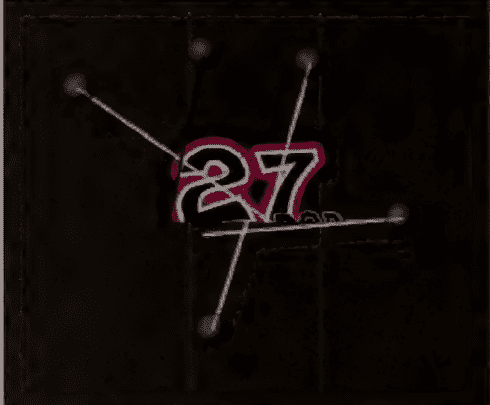

尝试将自己的徽标放入影片中（请记住以类似的分层方式设置符号）。尝试调整激光的数量及其变量，并可能修改其图形。我创建了一个变体，其中激光球体在掠过徽标时似乎会折射徽标，仿佛由“玻璃”制成，这是通过使用额外的遮罩技巧实现的。我已将文件作为 laserLogo_refract.fla 包含在下载文件中。使用此技术进行探索的可能性广泛多样。

## 准确的千字节

由于 Flash MX 中的新压缩功能，getBytesLoaded 和 getBytesTotal 方法调用返回的未压缩千字节数量有时会与压缩后的数量大相径庭，如前面所述。如果您希望准确显示正在加载的千字节数，只需几个步骤和几行代码即可实现。请记住，这样做的一个缺点是，您必须等到影片完成并发布后才能应用此修复。

- 1. 发布你的影片并记下其文件大小。在上面的示例中，让我们假设压缩后的文件大小为 125KB。

- 2. 在 assessLoad 函数中，在声明 kbTotal 之后，创建一个名为 offset 的新变量，并将其硬编码为压缩文件大小除以未压缩文件大小。

```
var offset = 125/kbTotal;
```

- 3. 现在，在任何显示千字节实际读数（而非百分比，因为百分比不受影响）的文本字段中，将千字节乘以 offset。

```
loaded.text = Math.floor
(kloaded*offset) + "KB";
total.text = Math.floor(kbTotal*offset)
+ "KB";
```

这是一个相当简单的解决方案。当然，如果您以后更新文件并且压缩文件大小发生变化，则需要重复此过程。

## 笑点

此预加载器包含一个动画，用户在主内容加载时可以欣赏。它采用与上一个预加载器相同的原理，即通过测试已加载字节数与总字节数来确定加载何时完成。在此过程中，用户会看到一系列敲门笑话和伴随动画，以防止他们变得不耐烦。从下载文件中打开 punchline.swf 文件以查看最终效果。同名的 FLA 文件包含完整注释的代码，供你查阅。

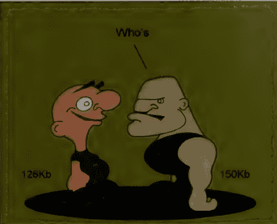

最初我让右侧的击打角色张开嘴，而笑话角色的嘴是闭上的。第三个标签 noTalk 中，两个角色的嘴都是闭上的，第四个也是最后一个标签 punch 中是击打动画。此电影剪辑中包含的唯一动作，以及主时间轴第一帧之外的唯一动作，是第一帧中的 stop() 动作（用于防止剪辑在影片开始时播放），以及最终帧中在击打动画完整播放后调用 gotoAndStop("noTalk")。每次发生击打时，电影剪辑会自动返回其 "noTalk" 状态并等待下一个笑话。

在开始编写代码之前，最后要查看的内容位于主时间轴上，所以请立即返回并选择 jokes 图层的第一帧。打开 ActionScript 编辑器，查看影片中笑话的设置方式。它以如下内容开始：

```
jokes = [ ];
joke = [ ];
joke.push("Knock knock.");
joke.push("Who's there?");
joke.push("Atch.");
joke.push("Atch who?");
joke.push("Gesundheit!");
jokes.push(joke);
```

第一行创建一个新数组，用于存储所有笑话。然后我们逐个创建笑话。我们通过创建另一个名为 joke 的数组来做到这一点。随后的每一行都会将一行对话推送到新的 joke 数组中。一旦笑话完成，我们就将 joke 数组推送到更大的 jokes 数组中。这为我们创建了一个整洁的二维数组，以便在讲笑话时访问。每添加一个笑话都遵循相同的结构（当然，不会从顶部重新初始化 jokes 数组）。

添加完最后一个笑话后，我们以以下几行结束：

```
delete joke;
randomSort = function () {
  return Math.round(Math.random());
}
jokes.sort(randomSort);
```

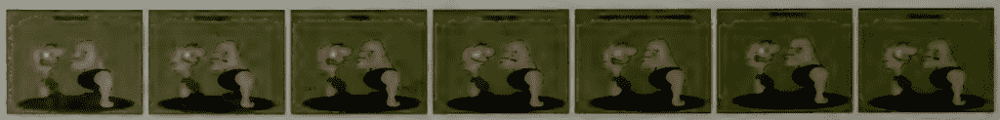

在此，我们删除一直用于单个笑话的最后一个 joke 数组。最后几行利用数组对象的内置排序方法来随机化我们的数组。我们向 sort 调用传递一个比较函数，该函数返回 0 或 1，sort 方法使用它来随机打乱数组。通常，当你使用比较函数时，sort 方法会使用它一次比较两个相邻的索引，并将它们放置在由比较函数返回的值（-1、0 或 1）决定的顺序中。在我们的示例中，我们只是发送 0 或 1，而不考虑索引本身的值。基于特定索引对的数字是 0 还是 1，sort 方法会交换这两个索引，或者让它们保持原位。当它在整个数组长度上这样做时，效果就是随机打乱。

设置说明完毕，让我们进入创建笑话对话的代码。选择 code 图层的第一帧，并将以下内容输入 ActionScript 编辑器：

```
jokeX = 200;
jokeY = 100;
currentJoke = 0;

jokeTF = new TextFormat();
jokeTF.font = "_sans";
jokeTF.size = 18;

this.createTextField("bubble", 0, jokeX, jokeY, 0, 0);
bubble.autoSize = "center";
bubble.setNewTextFormat(jokeTF);
bubble.selectable = 0;
```

前三行是我们将在代码中使用的变量。jokeX 和 jokeY 是笑话文本字段的中心坐标位置。currentJoke 是 jokes 数组中当前位置的索引编号。接下来，我们创建一个新的 TextFormat 对象，以便格式化笑话文本字段。我们为其指定系统字体 "_sans" 和字号 18。

最后一个块创建一个名为 bubble 的新文本字段（我在想小漫画对话气泡）。create 行将文本字段的深度设置为 0，将其 _x 和 _y 设置为上面设置的变量，并将宽度和高度设置为 0 像素。我们可以这样做，因为在下一行中，我们将其 autoSize 属性设置为 center，这意味着文本字段将从中心自动扩展以容纳我们放入其中的任何文本。在最后几行中，我们将 bubble 的文本格式设置为 jokeTF 格式，并禁用其 selectable 属性，以便用户将鼠标悬停在文本字段上时不会出现 I 形光标。

让我们继续。在之前的代码之后放置这些行：

```
this.createEmptyMovieClip("speechLine", 1);
jokePeople.gotoAndStop("noTalk");
continue_btn._visible = 0;
```

这三行非常直截了当。第一行创建一个新的电影剪辑，我们将在其中绘制每个角色的对话行（从角色引导至文本字段 bubble 的线）。接下来，我们将 jokePeople 电影剪辑（即舞台上 jokePeople 符号的实例名称）发送到其 "noTalk" 帧。最后，我们将 continue_btn 实例设置为不可见，因为在内容完全加载之前不应显示它。


如果你完成了上一个练习，接下来的两个函数应该对你来说非常熟悉——事实上，稍作修改，你就可以轻松地将这些函数添加到一个 ActionScript 库中，并在设计任何预加载器时引用它。暂时，我们只需将它们输入到我们的影片中。

```
assessLoad = function(clip) {
// var kbLoaded = Math.floor(clip.getBytesLoaded()/1024);
// var kbTotal = Math.floor(clip.getBytesTotal()/1024);

// delete these two lines and uncomment
// the above lines upon publishing
var kbLoaded = Math.floor(getTimer()/200) + 2;
var kbTotal = 150;

loaded.text = kbLoaded + "KB";
total.text = kbTotal + "KB";
if ((kbLoaded >= kbTotal) && kbTotal > 1) {
    endPreload(clip);
};
};

endPreload = function(clip) {
    clearInterval(preload);
    loaded.text = "";
    total.text = "";
    continue_btn._visible = 1;
    continue_btn.onPress = function() {
    //clip.gotoAndStop("main")
    }
};
```

由于 assessLoad 函数与 Laser Logo 中的完全相同，你可以在那里查看更详细的解释。简单来说，它记录已加载字节数和影片总字节数，将这些值放入文本字段，并检查影片何时完全加载。endPreload 函数包含几个值得你考虑的不同行。你可以看到，我们和之前一样清除了预加载间隔，擦除了文本字段，并使按钮可见。仅此而已。笑话将继续，直到用户感到厌倦并单击 continue_btn，此时播放头会被发送到另一帧，或者无论你需要做什么来到达主内容。

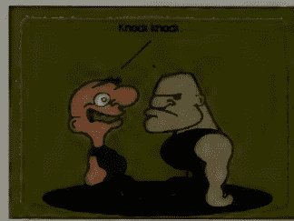

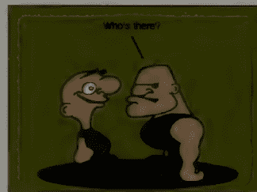

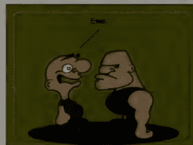

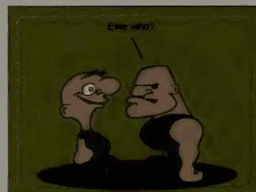

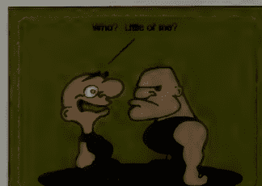

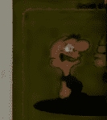

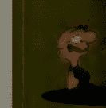

现在我们有四个函数来控制笑话的讲述。第一个启动整个过程。在 `endPreload` 函数之后输入这些行：

```
startJoke = function() {
  currentLine = 0;
  clearInterval(nextJokeInterval);
  startLine();
}
```

startJoke 首先将当前笑话的当前行设置为 0。请记住，jokes 数组中的每个索引包含另一个数组。我们上面设置的变量 currentJoke 表示 jokes 中的索引位置。currentLine 然后表示子数组中的索引，由于每个笑话都将从第一行开始，因此索引设置为 0。此函数中的下一行清除我们将设置的间隔，该间隔将在小丑开始下一个笑话之前创建一个暂停。最后，我们调用 startLine 函数，它将做 exactly that：在屏幕上开始显示该行。让我们现在编写该函数。

在上述代码之后输入以下内容：

```
startLine = function() {
  currentLetter = 0;
  clearInterval(nextLine);
  bubble.text = "";
  speechLine.clear();
}
```

在此函数调用开始时，我们将当前字母设置为 0（行中的第一个字母），清除用于延迟显示下一行的间隔，擦除 bubble 中的当前文本，并从 speechLine 影片剪辑中清除语音线绘制。

添加以下内容以完成 startLine 函数：

```
if (currentLine >=
    jokes[currentJoke].length) {
  jokePeople.gotoAndStop("noTalk");
  hitInterval = setInterval(hitJoker, 1000);
} else {
  speechLine.lineStyle(1, 0, 100);
  if (currentLine % 2 > 0) {
    speechLine.moveTo(hitterLine._x,
    hitterLine._y);
    jokePeople.gotoAndStop("response");
  } else {
    speechLine.moveTo(jokerLine._x,
    jokerLine._y);
    jokePeople.gotoAndStop("joke");
  }
  speechLine.lineTo(jokeX, jokeY + 30);
  letterInterval =
  setInterval(revealLetters, 50);
}
```

在显示任何文本之前，我们首先检查是否已到达笑话的最后一行。jokes[currentJoke] 包含一个存放笑话每一行的数组，因此如果 currentLine 等于或大于此数组的长度，我们就知道已到达末尾。如果是这种情况，我们将我们的小丑发送到 "noTalk"，并设置一个一秒延迟，然后调用我们将要创建的 hitJoker 函数。我们将此标识符命名为 hitInterval。

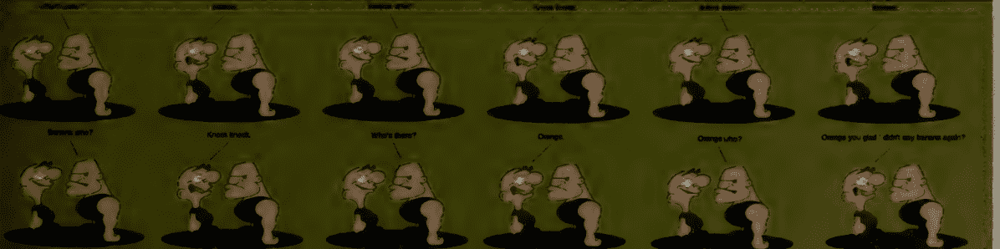

如果我们尚未到达笑话的最后一行，我们将继续显示该行。首先，我们将 speechline 影片剪辑的 lineStyle 设置为 1 像素黑色，100% 不透明度。然后我们查看 currentLine 是奇数还是偶数。由于笑话是一组来回的俏皮话，第一行总是由小丑说出，因此我们知道任何奇数索引都意味着击打者正在说话。取模运算符（%）是判断奇偶的简单方法，因为它返回两个操作数的余数。任何奇数除以二都会有余数 1，因此我们需要查看当前行索引是否发生这种情况。如果确实有奇数，我们将 speechLine 的起始绘制位置移动到 hitterLine 影片剪辑的坐标，并将动画发送到 "response" 帧。如果索引是偶数，我们知道小丑正在说话，因此将 speechline 移动到从 jokerLine 绘制，并将动画发送到 "joke" 帧。

最后，我们将 speechLine 从其当前起始位置绘制到气泡文本字段（加上 30 像素偏移量），并使用 setInterval 每 50 毫秒调用一次 revealLetters 函数。revealLetters 将逐个字母添加到气泡文本字段中。

那是其中最长的一个。这里有一个简短明了的函数，应放在 startLine 函数之后：

```
hitJoker = function() {
  if (Math.random() > .33) {
    clearInterval(hitInterval);
    jokePeople.gotoAndPlay("punch");
    nextJokeInterval =
      setInterval(startJoke, 3000);
    currentJoke++;
    if (currentJoke >= jokes.length) {
      currentJoke = 0
    }
  }
}
```

你会回想起，在给出笑话的最后一行后调用了 hitJoker（如上所述，在 startLine 函数中）。在此函数被调用之前有一秒钟的延迟。一秒钟过去后，我们测试 0 到 1 之间的随机数，看它是否大于 0.33。如果不是，则什么都不发生，我们再等待一秒钟，然后再次调用此函数。这会持续发生，直到出现一个大于 0.33 的随机数。我这样设置是为了让每个笑话的拳头不会以固定间隔发生，这提供了一点更多的乐趣（好吧，这让我发笑！）。

一旦随机数满足 if 条件的要求，我们就清除每秒调用此函数一次的间隔。然后我们将动画发送到播放拳击序列，并设置另一个间隔以延迟下一个笑话的开始。我们等待的三秒钟（3000 毫秒）足够让拳击发生，并在 "noTalk" 帧处进行简短暂停（请记住，我们在动画中有一个动作，在拳击序列结束时将播放头发送到 "noTalk"）。

最后几行递增我们的当前笑话索引。如果我们已到达 jokes 数组的末尾，我们就循环回到顶部。通过添加足够的笑话，你应该能够确保用户在内容加载之前不会到达序列的末尾。

影片的最后一个函数。在 hitJoker 函数之后输入这些行：

```
revealLetters = function() {
  var line = jokes[currentJoke]
    [currentLine];
  bubble.text += line.charAt
    (currentLetter);
  currentLetter++;
  if (currentLetter > line.length) {
    clearInterval(letterInterval);
    currentLine++;
    nextLine = setInterval(startLine, 2000);
  }
}
```

revealLetters 负责我们文本的实际动画。它每 50 毫秒调用一次（在 startLine 函数中设置）。我们首先将当前行放入变量中以便轻松访问。接下来，我们将当前字母添加到气泡文本字段，并递增 currentLetter 变量。如果我们已到达当前行的最后一个字母，我们就清除调用此函数的间隔，递增我们的行变量，最后创建一个新间隔，在经过 2 秒后调用 startLine 函数（你能看出我有多喜欢新的 setInterval 命令吗？）。2 秒的延迟应该足够让用户阅读整行。

最后是最后两行：

```
startJoke();
preload = setInterval(assessLoad, 20, this);
```

startJoke 调用第一个笑话并启动整个过程。最后一行应该让你想起上一个练习。它设置一个间隔，每 20 毫秒调用一次 assessLoad，并传递额外参数 "this" 以让函数知道我们正在加载主影片。

测试你的影片，看看它是如何工作的。尝试添加一些笑话，或者将结构改为对话。考虑一位教授提供网站导航说明，或者一位新闻播音员向用户通报公司近期的事件。请记住，如果你添加更长的行，你将需要考虑气泡文本字段中的多行和自动换行。

加载时间会在不经意间过去，仅仅为了区区 7KB！

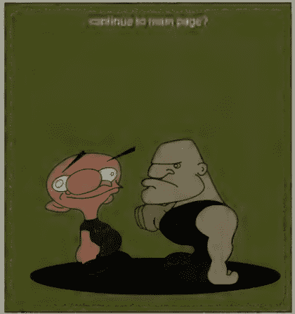


## 更多预加载器！

我为你准备了几个额外的预加载器，供你探索和在此基础上构建。你可以在下载文件中找到它们，全部都有详细注释，供你打开并查看内部实现。

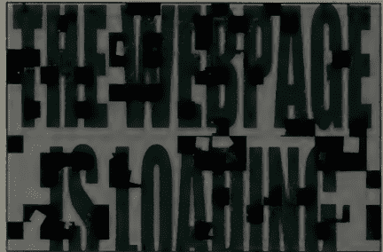

### 下落的瓦片 – 3KB

这个预加载器 fallingTiles.fla 允许你在屏幕上放置一张图片，这张图片看起来由许多瓦片组成。这些瓦片会根据已加载的网站内容比例，缓缓飘落到空间中。它的妙处在于，你可以轻松替换为自己的图片，无论是瓷砖图片还是背景，从而用于自己的项目。

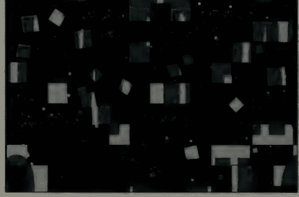

### 文本滚动 – 18KB

这个预加载器 textScroll.fla 文件体积稍大，因为动画需要嵌入字体。不过，它提供了一种简单、有趣且熟悉的效果，让用户在阅读你准备的内容时时间过得飞快。该效果取材于《星球大战》的开场序列，textScroll 效果既能传递一些有用信息，也能作为一种消遣。

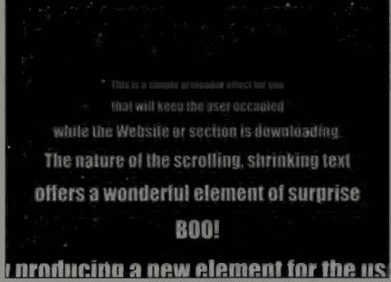

### 边界扫描 – 7KB

最后一个预加载器 perimeterSweep.fla 是一款功能完整的游戏，用户可以在网站后台加载时接受挑战。这是乒乓（Pong）的圆形变体，Perimeter Sweep 给玩家三个挡板，用于让多个球留在圆形边界内。经过少许调整，它本身也可以成为网站内容，但目前以 7KB 的体积，它是一个很好的消遣性预加载器。

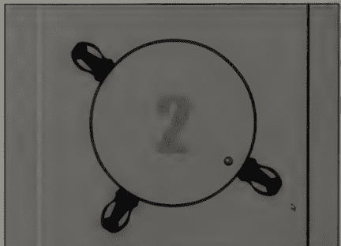

## 结论

只要我们的胃口大过肚子（或者说我们的想象力大过电话线），我们就会要求并产生超出带宽轻松承载能力的内容。只要你在主内容后台加载时，为用户提供一些有趣或有成效（或两者兼备）的东西，这都不是问题。千万不要让用户有任何闲暇时间，以便他们点击到某个不需要等待的地方。当然，如果能做得有风格，那就更好了。

## 使用绘图 API 创建界面

### 界面 – 美学、交互与易用性

人类一直使用图形来代表周围的世界。从洞穴壁画到技术图表，我们不断寻求以图形形式描绘信息的新方法。过去几十年计算机的普及带来了 GUI（图形用户界面）。在施乐（Xerox）进行前瞻性工作之前，大多数界面都要求用户记住并输入艰深的文本命令才能完成任务。但随着 GUI 的出现，计算机变得大众化，技术革命开始兴起。我们的文化现在已经如此充斥着信息和通信技术，以至于界面设计越来越成为文化中一个具有挑战性的关键问题。我认为，我们应该思考自己在呈现信息时试图传达什么，这可能对我们有益。

另一个问题是，在使用交互式界面多年之后，似乎出现了一种关于界面制作指南的标准思想流派。这些以功能为中心的模型常常偏向生产力语境，致力于完成工作，而不考虑设计师或用户的趣味性概念。结果，创新的魔力丧失了，设计师-开发者过分痴迷于其电子商务网站的易用性。虽然易用性和功能性很重要，但在某些时候，在边缘地带进行实验以实现突破并发现以新颖且美学有趣的方式表现信息是有价值的。

在界面设计方面，我们仍处于早期的演化阶段。在许多情况下，计算机界面仍然参照现实世界。它们模仿机械设备、仪表盘和控制系统。因此，我们发现计算机界面带有成排成列的斜边按钮，例如出现在飞机驾驶舱中。然而，试图让界面像现实世界中的事物一样的缺点在于，它在表现人类体验和主观性时失去了重点——它对所代表的信息一无所言。

为交互性设计意味着要问：“我们如何给用户一个体验？”以及“我们希望用户拥有什么样的体验？”我认为，易用性常常会在用户和体验之间制造鸿沟——我希望制作一个几乎可以被视为艺术品本身的界面，能够对用户输入做出创造性的回应。

### 自然界中的螺旋

任何对图案有敏锐洞察力的人都知道，大自然似乎偏爱重复、对称和几何精确性，这一点从艺术和哲学角度出发，一直是我很长一段时间以来的持续兴趣。从树木中看到的递归分支到飞蛾的翅膀上精致的镜像图案，从雪花的六角对称到云朵中混沌的分形几何，我们身处重复的形式之中。

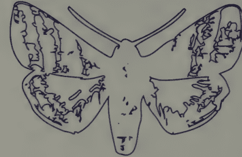

大自然似乎在每次机会出现时都乐于展示的一种特殊通用形式是谦卑的螺旋——我们几乎无处不在能找到它。在微观尺度上，所有生物中最小的一种是螺旋形的，即弯菌。生命的构建块 DNA 众所周知会呈现双链螺旋结构。继续往上看，我们发现大量螺旋形贝壳。鹦鹉螺（nautilus，唯一幸存的头足类动物）的壳是生长螺旋或对数螺旋的绝佳示例——它的祖先是众所周知的菊石。向日葵花盘显示出由单个小花形成的两组对向螺旋——每组对向螺旋的臂数是斐波那契数列中的两个相邻数字，34 和 55。斐波那契数列为 1,1,2,3,5,8,13,21,34,55 等等。该系列是通过将序列中的前两个数字相加来生成第三个数字。这个数字序列是几乎所有植物中花瓣和叶子螺旋生长形成的蓝图。继续向上扩展尺度，我们发现漩涡、飓风和龙卷风，最后，当我们展望太空时，可以看到星系拥有辐射状的手臂，螺旋向外延伸到宇宙中。

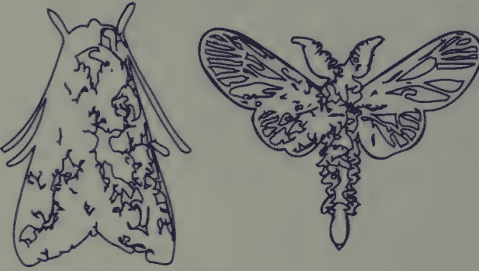

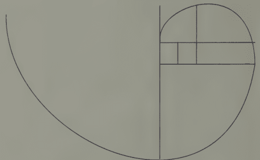

人类也受到螺旋的启发——大量古今文物都将螺旋作为装饰图案。建筑从实用和美学角度反复使用螺旋的构造特性。1919 年，伟大的哲学家和心理学家卡尔·荣格提出了集体无意识中符号共享的概念。他认为，螺旋是这些在基因层面共享、连接所有社会和所有文化（古今中外）的原型之一。

### 螺旋作为界面 – 概念

我利用螺旋作为灵感，使用 Flash MX 原生绘图 API 制作了一个界面。我选择螺旋原型有几个原因。首先，我想制作一个具有自身美感的界面。还有什么比借用大自然的原型更好的方式呢？网络上的大多数界面往往只不过是网格排列的按钮行，有点像电子表格的几行！

我将螺旋作为原型的第二个原因与空间利用有关。以螺旋为模型，大自然巧妙地充分利用其空间限制。DNA 是节省空间存储信息的绝佳示例，因为它将信息盘绕成紧密的双螺旋结构——如果采用其他方式，这些链会占用更大的体积。由于 Web 设计始终关注空间利用，借鉴大自然应对空间限制的一些答案可能对我们有利，因此螺旋是一个不错的结构模型，可以用于构建界面。

为了使这个界面具有完整性，我决定网站的内容也应为螺旋。当界面上的每个项目被鼠标悬停或点击时，将允许我们查看特定螺旋形式的图片，并提供有关螺旋的信息，例如其自然尺寸及其数学术语中的类型。我将数据结构保持为一层，因为本章更关注利用绘图 API 制作界面，而不是信息层级的微妙复杂性。

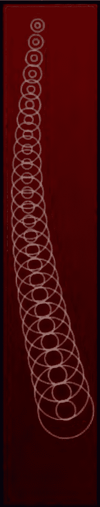

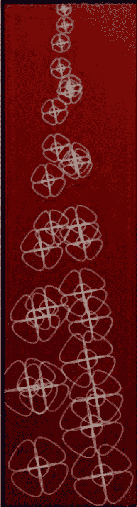


## Flash MX 绘图 API 及其在界面设计中的应用

绘图 API（应用程序编程接口）是 Flash MX 发布时新增到 Flash 中的功能，对许多人来说，这是此次升级的亮点。它包含一组优秀的电影剪辑方法，允许我们绘制线条和曲线来构建形状，然后为这些形状填充颜色。这里的关键是，这些线条和形状是在运行时绘制的，从而最大限度地减少了对库中符号的需求。这有明显的优势，即保持文件体积小巧和性能快速——这对于界面来说是非常理想的。

Flash MX 另一个绝佳的新功能是能够创建空电影剪辑，作为我们绘图 API 形状的容器。这实际上允许我们以与控制库中普通电影剪辑几乎相同的方式来控制使用绘图 API 方法创建的形状。

借助 Flash MX 中增强的事件方法模型，使用绘图 API 实现的界面互动性得到了最终的提升。基本上，它允许为使用绘图 API 绘制的任何形状添加按钮互动性。因此，如您所见，我们拥有使用绘图 API 制作交互界面所需的所有工具。在运行时生成的形状可以在屏幕上操作和动画化，而且这些形状还可以像按钮一样表现？在我看来，这就是一个界面。

## 界面

或许是时候在 Flash MX 中打开文件并尝试一下了。从下载文件中打开 API_spiral01redg6.swf。在深红色渐变之上，我们发现有两组按钮。在舞台右侧，有一列向下螺旋排列的按钮，按钮越靠近舞台底部，尺寸越大。这列按钮可根据鼠标指针的相对位置向任何方向扭转。将鼠标悬停在这些按钮上时，会出现一个带有螺旋名称的浮动标签。单击其中一个按钮时，一个类似装饰性的框架会出现在屏幕左侧，并在其中显示相应类型螺旋的插图，其名称位于上方（请注意，此框架的形状会带有一定随机性地改变）。

我们还可以看到另外两组同心定位的形状出现。螺旋列左侧的一组包含一个标签，用于描述我们正在查看的螺旋类型，例如对数螺旋或阿基米德螺旋。右侧的一组包含一个描述测量单位的标签，以及一个简单的拨号系统，用于指示所选螺旋的该特定测量单位的值。请注意，单击按钮时拨号系统的工作方式——拨号（一条简单的线）围绕中心点旋转到最终位置，就像时钟指针一样，并在线条末端出现一个指示值的标签。我不想过于担心关于螺旋类型和比例的信息，姑且说它们并非基于任何准确模型，而是用于在此界面演示的范围内显示相关信息。

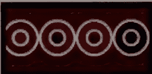

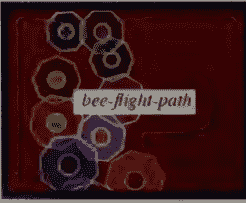

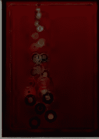

位于舞台左下角附近的第二组圆形按钮控制螺旋按钮的配置布局。这是一个界面中的界面！当按下这 12 个按钮中的任意一个时，螺旋按钮会被重新绘制为新配置，并重新塑形和重新着色。我喜欢这种递归功能的概念，界面本身可以根据用户偏好重新配置。

该界面位于尺寸为 660 x 400 的舞台上，运行速率为每秒 50 帧。通过单击任意按钮调用的 JPG 文件位于与 Flash 文件相同的根目录中。

快速查看代码即可发现，这是一个使用绘图 API 在运行时生成的完整界面，并配合 `CreateTextField` 方法与 `TextFormat` 对象。用于构建界面以及重新配置界面的信息，由几个多维数组提供。由于文件大小小于 3k，即使在 56k 拨号调制解调器上，该界面也能几乎瞬间加载。

现在让我们详细审视 3 帧中的代码——一次一段代码，从开头开始。

## 第一帧

我们先将电影的质量设置为中等，以此开始。

```
_quality = "medium";
```

在我的机器上，一台相当过时的 P3 500，这有助于提升动画的速度和流畅度。在 Flash 中设计交互式导航系统时，一个重要的考虑因素是用户计算机的平均目标规格。Flash 中图形元素的移动速度和流畅度在很大程度上取决于处理器速度。一旦超过处理器限制，性能就会受损，移动开始变得卡顿。通过降低质量级别，Flash 用于渲染动画的时间会减少——由此可见，质量和速度之间存在取舍。测试导航系统时，最好在一系列计算机上进行测试。拥有最新的高速机器固然很好，但我更喜欢在旧机器上工作，心满意足地知道自己是在为共同平台编码，我的文件在其他人机器上的表现很可能同样好，甚至更好。

接下来，我们初始化一些重要的配置变量：

```
cshape = 0.4786;
dshape = 0.4571;
rota = 45;
kolor = 5;
pha = 80;
```

cshape 和 dshape 是用于描述按钮形状的重要因子变量——它们用于名为 `drawshape` 的原型函数中，我们将在代码后面定义该函数。`rota` 定义一个旋转常量，用于按钮的绘制位置，该变量影响屏幕上按钮的最终配置。`kolor` 和 `pha` 变量影响每个单独按钮的着色和 alpha 值。

接下来，我们声明一个多维或嵌套数组（存储在数组内部的数组）的内容：

```
var link = [ [ "dna", "helical", 10, "nanometers" ], [ "dna02", "helical", 15, "nanometers" ],
	[ [ "particle-path", "root", 20, "nanometers" ], [ "spirillum", "helical", 30, "nanometers"] ],
	[ [ "rhodespirillum", "helical", 35, "micrometers" ], [ "rhodespirillum02", "bacteria", 40, "nanometers" ],
	[ [ "liquid-crystal", "growth", 45, "nanometers" ], [ "cochlea", "equiangular", 45, "millimeters" ],
	[ [ "shell", "logarithmic", 50, "millimeters" ], [ "shells", "growth", 60, "millimeters" ],
	[ [ "zebra-shell", "growth", 70, "millimeters" ], [ "nautilus", "logarithmic", 80, "millimeters" ],
	[ [ "sunflower", "fibonacci", 100, "millimeters" ], [ "horn", "logarithmic", 110, "millimeters" ],
	[ [ "pine-cones", "growth", 130, "millimeters" ], [ "ammonite", "logarithmic", 150, "millimeters" ],
	[ [ "bee-flight-path", "irregular", 160, "meters" ], [ "whirlpool", "vortex", 170, "meters" ],
	[ [ "artifact", "archimedian", 180, "centimeters" ], [ "fort", "equiangular", 210, "meters" ],
	[ [ "mosque", "archimedian", 230, "meters" ], [ "cyclone", "vortex", 240, "meters" ],
	[ [ "star", "unknown", 250, "kilometers" ], [ "galaxy02", "unknown", 270, "100lightyears" ],
	[ [ "galaxy03", "unknown", 290, "100lightyears" ], [ "galaxy04", "unknown", 300, "100lightyears" ] ] ];
```

这个二维数组存储了关于我们螺旋分类的所有数据。尽管远非存储数据最健壮或最通用的方法，但这是一种快速而简单的方式，用于组织由界面使用或调用的数据。在此示例中，我们的 link 数组包含 26 个嵌套数组，每个包含 4 个元素。每个数组中的 4 个元素按顺序代表螺旋的名称、其术语（螺旋类型）、比例数量及其比例测量单位。这些数组中的数据将用于多种目的——定位要加载到播放器中的特定 JPG，为屏幕元素提供标签，并在交互过程中影响界面部分的定位。如您所见，这是一种在列表中识别特定螺旋及其任何关联信息的有用方法。

接下来，我们声明一个类似定义的二维数组的内容，这次包含用于界面配置选项的数据：

```
var conf = [ [ 0.4786, 0.4571 , "reset", 45, 5, 80 ],
	[ 0.0086, 0.7071 , "config 01", 250, 4.1, 70 ],
	[ 0.4086, 0.9071 , "config 02", 120, 5.2, 40 ],
	[ 0.786, 0.6571 , "config 03", 15, 9.8, 130 ],
	[ -0.9086, 0.8071 , "config 04", 45, 12, 50 ],
	[ 0.0086, -0.7071 , "config 05", 210, 160, 90 ],
	[ 0.4086, 0.7071 , "config 06", 5, 260, 0 ],
	[ 0.1086, 0.7071 , "config 07", 30, 5, 80 ],
	[ 0.4086, 0.7071 , "config 08", 20, 4.4, 50 ],
	[ 0.2086, 0.9071 , "config 09", 45, 10.91, 100 ],
	[ -1.2086, -1.0071 , "config 10", 200, 5.4, 100 ],
	[ -1.2086, -0.0071 , "config 11", 270, 10.95, 0 ] ];
```


还记得舞台左下角那一排按钮吗？这里的嵌套数组包含了关于按钮的形状、颜色和透明度值以及螺旋形状整体结构的信息。还有一个元素，它为每个按钮提供了一个包含标签名称的字符串。

我们将在本章后面，通过按钮交互从这些数组中提取数据时，再次回到这些数组。

下一段代码定义了一个用于绘制形状的原型，本质上为我们提供了一个名为 drawShape 的新电影剪辑方法。这个原型基本上是我之前在另一本 friends of ED 出版的书《Fresh Flash – New design ideas with Flash MX》中出现的一组界面实验中使用的原型的扩展。调用该函数时会传递 10 个参数，这些参数用于生成一个八边形的形状——每个边可以在直线到斜线或钝角曲线之间变化。最初，这个原型函数用于绘制由 8 条曲线组成的完美圆形，而 Flash 使用标准的 4 条曲线绘制此类圆形并不太准确。

```
MovieClip.prototype.drawShape =
function(xpos,ypos,radius,lWidth,lColor,
fColor,fAlpha,distorta,distortb,kolor) {
x = xpos;
y = ypos;
r = radius;
u = r*distorta;
v = r*distortb;
this.lineStyle(lWidth,lColor,100);
this.beginFill(fColor, fAlpha);
this.moveTo(x-r, y);
this.curveTo(x-r, y-u, x-v, y-v);
this.curveTo(x-u, y-r, x, y-r);
this.curveTo(x+u, y-r, x+v, y-v);
this.curveTo(x+r, y-u, x+r, y);
this.curveTo(x+r, y+u, x+v, y+v);
this.curveTo(x+u, y+r, x, y+r);
this.curveTo(x-u, y+r, x-v, y+v);
this.curveTo(x-r, y+u, x-r, y);
this.endFill();
}
```

按顺序查看这 10 个参数，xpos 和 ypos 定义了所绘制形状相对于 _root 或其所在电影剪辑的 x 和 y 坐标。lWidth 描述了形状外框线的粗细，lColor 以十六进制值描述其颜色。fColor 和 fAlpha 分别描述了形状填充的颜色和透明度值。参数 distorta 和 distortb 是影响曲线角度的比率值——要产生完美圆形，它们分别需要为 0.4086 和 0.7071。最后一个参数 kolor，在调用 drawShape 方法时用于影响形状的最终输出颜色。注意使用 this 来定义绘制形状的范围——它将在调用 drawShape 方法的电影剪辑内部绘制（如果在主时间轴上调用，则形状将在 _root 级别绘制）。我们将在第二帧后面调用它时，详细查看新定义的 drawShape 方法的工作原理。

形状的实际绘制由 curveTo 绘图方法执行，该方法有四个参数。曲线从当前笔位置（在此例中由 moveTo 绘图方法定义）绘制到前两个参数表示的曲线终点的 x 和 y 位置。curveTo 方法中的后两个参数表示一个控制点，线条会向该点弯曲。这个原型中用于定义这些点的加减数学运算，生成了一个八边形的对称曲线形状。

第 1 帧中其余的代码涉及界面中出现的文本元素——静态标签和浮动标签，以及描述比例值的拨盘系统。Flash MX 引入了一组出色的新 ActionScript 对象和方法，用于满足我们各种文本需求。我们可以即时创建文本字段，并像控制其他任何电影剪辑一样控制它们，还可以为这些文本字段赋予一系列属性，并以类似于在 HTML 中使用样式表的方式应用格式。我本来可以使用创作环境将这些文本字段添加到舞台上，但那意味着另一组符号库，而到目前为止我们一直避免使用它们，既然为了纯粹起见，为什么不继续这样做呢！

首先，我创建了名为 Tformat 和 Uformat 的两个 TextFormat 对象：

```
Tformat = new TextFormat();
Tformat.color = 0x660000;
Tformat.align = "center";
Tformat.italic = true

Uformat = new TextFormat();
Uformat.color = 0x993300
Uformat.align = "center";
Uformat.italic = true
```

createTextField 方法的参数如下：

- 一个字符串标识符
- 放置文本字段的深度
- 文本字段的 x 和 y 位置
- 文本字段的宽度和高度

屏幕上实际效果是三个等待填充文本的不可见文本字段。

我们将以类似于在 HTML 文档中使用 CSS 样式表控制文本元素样式格式的方式，将我们的 TextFormat 对象应用到文本字段上。这有明显的优势，即以最小的麻烦对文本组进行更改的最高效方式。在两种情况下，我们都定义了文本的特定颜色，并将文本设置为在其文本字段内居中。然后我们将文本设置为斜体。

接下来的六行代码指示 Flash 为我们创建三个新文本字段，并将每个字段的 selectable 属性设置为 false：

```
_root.createTextField("titltext",
        700, 77, 83, 100, 20);
_root.titltext.selectable = false;
_root.createTextField("spiraltype",
        701, 237, 181, 100, 20);
_root.spiraltype.selectable = false;
_root.createTextField("measurement",
        702, 437, 81, 100, 20);
_root.measurement.selectable = false;
```

下面这段 ActionScript 也用于创建文本标签，但这个标签负责我们每次将鼠标悬停在按钮上时看到的浮动标题标签。

```
_root.createEmptyMovieClip('label', 1002);
_root.label.createTextField("insidelabel",
        1003, -20, -30, 85, 18);
_root.label.insidelabel.background = true;
_root.label.insidelabel.selectable = false;
_root.label.insidelabel.autosize = true;
_root.label.onEnterFrame = function() {
ysline = (_root._ymouse-this._y)*.2;
this._y += ysline;
xslide = (_root._xmouse-this._x)*.2;
this._x += xslide;
_root.label.insidelabel.text = _root.select;
_root.label.insidelabel.setTextFormat(Uformat);
};
```

这段代码的第一行在深度 1002 处创建了一个名为 label 的空电影剪辑实例。它位于深度 1002 处并没有什么神奇的原因，我只是喜欢将我的电影剪辑分布在一系列深度上，以防我需要在两个其他剪辑之间的中间深度放置一个新剪辑。

下一行代码在我们刚刚创建的空电影剪辑中嵌套了一个名为 insidelabel 的文本字段。

接下来的三行代码设置文本字段的一些属性，以开启或关闭。`background` 被开启，为我们提供一个默认的白色矩形来容纳文本。`selectable` 属性被设置为 `false`，这样如果光标不小心悬停在浮动标签上，它就不会从指针变为可选择文本。（试着注释掉这一行，你会发现如果我们保留默认开启设置，会引发各种问题。）接下来是 `autosize` 属性，我们通过将其布尔值设为 `true` 来开启它。这基本上使文本字段紧密贴合其包含的文本——它根据文本字段显示的字符数调整大小，调整我们白色矩形文本容器的大小。

接下来，我们看到下一行定义了一个 `onEnterFrame` 函数，用于在按钮被悬停时为浮动标签添加动画并更新其内容。回调函数中的前四行代码为标签提供滑动惯性移动，使标签在 x 和 y 轴上向指针浮动。行 `_root.label.insidelabel.text = _root.select;` 用值 `root.select` 填充文本字段，正如我们稍后将看到的，该值每次我们悬停按钮时都会更新。这段代码块中的最后一行代码将文本字段设置为我们之前定义的 Uformat 文本格式。

第 1 帧中的最后一段代码与前一段部分相似，专门处理“尺寸标签”——这次，当按钮被单击时，标签会沿圆形路径动画移动，其在路径上的最终位置取决于它显示的值，即 `_root.size`:

```
_root.createEmptyMovieClip('sizelabel', 993);
_root.sizelabel.createTextField("insidesize", 0, 0, 40, 30, 18);
_root.sizelabel.insidesize.selectable = false;
_root.sizelabel.onEnterFrame = function() {
    this._x = 470 + Math.cos(degrees / 180 * Math.PI) * 75;
    this._y = 140 + Math.sin(degrees / 180 * Math.PI) * 75;
    if (count*10 < _root.size) degrees+=7;
    count++;
    _root.dial.createEmptyMovieClip('indial', -387);
    with (_root.dial.indial) {
        lineStyle(1, 0xFFFFFF, 60);
        moveTo(486, 191);
        lineTo(this._x+20, this._y+50);
    }
    _root.sizelabel.insidesize.text = _root.size;
    _root.sizelabel.insidesize.setTextFormat(Tformat);
}
```


onEnterFrame 回调函数使用描述圆上点的公式在舞台上绘制大小标签的位置。公式是：

```
X position = Xposition of center point + Math.cos(degrees / 180 * Math.PI) * radius;
Y position = Yposition of center point + Math.sin(degrees / 180 * Math.PI) * radius;
```

接下来的条件语句检查名为 count 的变量是否已达到 _root.size 值的 10 倍。如果是，则围绕圆形路径的大小标签动画停止 – 因此它最终移动的距离取决于 _root.size 的值。每过一帧，标签就会沿圆形路径移动 7 度，并且变量 count 加 1。

此代码块中的接下来几行代码负责渲染指向大小标签的表盘“指针”。在名为 indial 的新建电影剪辑内，从中心点向外绘制一条 1 像素粗的线，指向与大小标签相对应的位置 – 最终结果是一个指向大小标签的动画指针。

行 `_root.sizelabel.insidesize.text = _root.size;` 使用 _root.size 的值填充文本字段 – 该值来自我们的维度数组，稍后将会看到。此代码块中的最后一行代码将文本字段设置为我们先前定义的 Tformat 文本格式。

## 第 2 帧

如果第 1 帧主要用于为生成界面做准备，那么第 2 帧则是实际生成完成的部分。在第 2 帧中的命令执行之前，屏幕上看不到任何内容。

第一个代码块指示 Flash 绘制一个舞台大小的矩形，并用深红色渐变填充它 – 这将为我们的界面提供背景。我们再次充分利用了绘图 API：

```
_root.createEmptyMovieClip("background", -2000);
with (_root.background) {
colors = [0xD83D3D, 0x990000];
alphas = [100, 100];
ratios = [0, 0xFF];
matrix = {matrixType:"box", x:100, y:100, w:200, h:200, r:(90/180)*Math.PI};
beginGradientFill("linear", colors, alphas, ratios, matrix);
moveTo(0, 0);
lineTo(660, 0);
lineTo(660, 400);
lineTo(0, 400);
lineTo(0, 0);
endFill();
}
```

首先我们在深度 -2000 处创建一个名为 background 的空电影剪辑，以确保稍后生成的任何内容都不会出现在其下方，然后我们定义四个数组，它们是应用于背景电影剪辑的 beginGradientFill 方法的默认参数。按顺序，这些数组为：

- 颜色数组 – 渐变经过的两种颜色
- 透明度数组 – 定义两种颜色的 alpha 值
- 比率数组 – 包含颜色分布
- 矩阵数组 – 包含字符串标识符、x 和 y 位置、宽度和高度以及渐变的相对旋转。

请注意，矩阵数组的最后一个元素（即旋转）是以弧度为单位的，因此我们必须除以 180 并乘以 PI，以便从更广泛理解的角度单位转换过来。

beginGradientFill 方法指示 Flash 开始填充该方法调用后出现的任何形状所围成的区域。该方法总共使用 5 个参数：一个表示渐变类型（线性或径向）的字符串，以及我们刚刚讨论的其他四个数组。然后使用 moveTo 和 lineTo 方法及舞台大小绘制一个矩形。渐变填充使用 endFill 终止。

好吧，这个深红色渐变本可以使用创作环境中的绘图工具制作，并转换为符号放置在舞台上。也许更简单、更快，没错，但使用 API 版本的好处在于，当用户与界面交互时，我们可以以多种方式动态更改渐变。也许我们希望用户做出新选择时更改渐变颜色？我们只需向颜色数组引入一个动态变量，这总比生成，比如说，十个渐变符号（每个选择一个）要好。事实上，这是使用 API 动态生成整个界面的重要原因之一。它使添加由几个变量控制的动态元素变得非常容易，而这些变量又受用户选择的影响。没有任何理由认为整个界面不能以这种方式构建，其中所有元素的属性都受用户交互影响。这样一来，我们就拥有一种变色龙界面，它在导航过程中会变形，希望能够吸引用户，因为他正直接参与界面的结构与重构。

第 2 帧中的以下代码行创建了一个名为 dial 的空电影剪辑，准备承载表盘系统：

```
_root.createEmptyMovieClip('dial', -88);
_root.dial._visible = false;
_root.size = "";
```


新创建剪辑的可见性设置为 false。代码块中的最后一行将变量 _root.size 设置为空字符串。

序列中的下一个代码块开始实际以螺旋形状生成按钮：

```
for (i=0; i<link.length; i++) {
	_root.createEmptyMovieClip('mc'+i, i);
	with (_root['mc'+i]) {
	drawShape(i*1.4, 0, 5+i/1.5, 1,
	0xffffff, 0x666699*i/kolor, pha,
	cshape, dshape);
	drawShape(i*1.4, 0, 2+i/4.5, 1,
	0xffffff, 0x999900*i/5, pha,
	cshape, dshape);
	_x = 375;
	_y = 20+i*13;
	_rotation = i*rota;
	_alpha = 80;
	}
}
```

首先，我们设置了一个 for 循环，循环次数等于 link 数组中第一级数组的数量。length 是数组的一个属性，返回数组中的元素数量，在此例中为 26。因此，我们将有 26 个按钮，每个按钮对应一个第二级数组，包含我们所有的螺旋数据。

下一行代码创建一个空电影剪辑作为生成按钮的容器。使用 with 语句，避免为每个应用的方法重写对象的完整路径，我们指示 Flash 调用两次 drawShape 方法，在新建的空“电影剪辑”中绘制两个同心图形（在此例中结果呈花形）。传递给原型函数的参数之前已讨论过 – 在这里，圆圈的大小、填充颜色和相对位置取决于 mc 生成序列的位置，即变量 i 的一个因子。按钮的 alpha 值取决于 pha 的值。这些按钮的最终形状也取决于变量 cshape 和 dshape。要绘制完美圆形，这两个变量的值应分别为 0.4086 和 0.7071。还值得指出的是，除了取决于 i 的因子外，第一个图形或圆圈的填充颜色还取决于变量 kolor。四个变量 cshape、dshape、pha 和 kolor 是左下角一排按钮用于重新配置界面外观的变量 – 但我们稍后会详细说明。

此代码块中的最后四行代码沿 x 和 y 轴定位 mc，并按 i*rota 的因子对其进行旋转。如我们将看到，变量 rota 也用于使用左下角一排按钮重新配置界面。最后，我们将 mc+i 的 alpha 设置为 80。

仍在 for 循环内，接下来要做的是定义我们的鼠标悬停回调函数：

```
_root['mc'+i].onRollOver = function() {
	this._alpha = 100;
	ref = Number((this.name).substring(2));
	_root.select = _root.link[ref][0];
	_root.label._visible = true;
}
```

首先，我们将鼠标悬停时的 mc alpha 设置为 100。此前，在生成按钮 mc 的代码块中我们将 alpha 设置为 80，这样做会让按钮在鼠标悬停时产生微妙高亮的效果。如稍后所见，当我们从特定按钮 mc 移开鼠标时，alpha 将恢复为 80。

接下来 – 随后的 onRollOut 函数简单地将按钮电影剪辑的 alpha 设回 80，并将标签的可见性设回 false。

```
_root['mc'+i].onRollOut = function() {
    this._alpha = 80;
    _root.label._visible = false;
};
```

接下来，我们将一个新变量 ref 的值设置为 Number((this._name).substring(2)) 的值。这相当于将该特定实例名称的字符串标识符中的第三个字符转换为数字数据类型。因此，这给我们提供了一个变量，表示按钮序列中哪个按钮被鼠标悬停，基本上是 0 到 25 之间的一个数字，这确实非常方便。

下一个代码块中的 onRelease 函数指示 Flash 做许多事情 – 首先它绘制形状：

```
_root['mc'+i].onRelease = function() {
    count = 0;
    degrees = -90;
    _root.dial._visible = true;
    _root.createEmptyMovieClip('shapes', -1000);
    with (_root.shapes) {
        drawShape(486, 191, 57, 1, 0xFFCCCC,
        0xFFCCCC, 40, cshape, dshape);
        drawShape(286, 191, 57, 1, 0xFFCCCC,
        0xFFCCCC, 40, cshape, dshape);
        drawShape(486, 191, 134, 1, 0xFFCCCC,
        0xFFCCCC, 40, cshape, dshape);
        drawShape(286, 191, 100, 1, 0xFFCCCC,
        0xFFCCCC, 40, cshape, dshape);
    }
}
```

接下来的一行，我们可以看到变量 _root.select 已被设置为 _root.link[ref][0] 的值。因此，我们使用 ref 来引用嵌套的 link 数组，在此例中引用第一个元素。例如，如果我们在序列中鼠标悬停于第 9 个按钮，我们将引用 link 数组中第九个嵌套数组的第一个元素，在此例中返回字符串 shell。

这种方法在本示例中被广泛使用，作为引用我们数组中与正在交互的按钮对应的数据的一种方式。

下一行将标签设置为可见，因此我们的按钮标签出现在屏幕上，并在指针所在处跟随它浮动，只要它位于按钮上方。在第 1 帧中为标签定义的 onEnterFrame 回调函数会在每一帧都使用 _root.select 的值更新其包含的文本，从而始终显示正确的标签。

变量 count 和 degrees 分别设置为 0 和 -90，这基本上在点击按钮时将表盘指针和大小标签的位置重置回 12 点方向。通过将表盘的可见性属性设置为 true 来使表盘可见。


然后，我们使用原型函数绘制两组同心图形，这些图形用于容纳螺旋类型标签和我们的拨盘系统。

下一步涉及将我们在帧 1 中定义的空标签设置为与相应点击按钮相关的文本数据：

```
_root.size = " "+_root.link[ref][2];
_root.titletext.text = select;
titletext.setTextFormat (Tformat);
_root.spiraltype.text = _root.link[ref][1];
spiraltype.setTextFormat (Tformat);
_root.measurement.text = _root.link[ref][3];
measurement.setTextFormat (Tformat);
```

既然我们已有被点击按钮的引用编号 ref，就可以像之前一样，用它从维度链接数组中检索对应元素。例如，`_root.size = ""+_root.link[ref][2];` 将 _root.size 设置为维度链接数组中对应数组第三个元素的值，并在开头添加一个字符空格。然后，sizelabel 电影剪辑使用这个值，在舞台最左侧生成一个指示螺旋大小的浮动标签。titletext、spiraltype 和 measurement 文本字段也同样使用我们的 ref 变量引用链接数组来赋值。

接下来，我们创建一个名为 jpgframe 的新空电影剪辑，并在其中使用 drawShape 方法生成一个由同心图形组成的帧容器，用于容纳我们的 JPG 图片：

```
_root.createEmptyMovieClip('jpgframe', 300);
with (_root.jpgframe) {
drawShape(130, 193, 82, 1, 0xFFCACA, 0xFFCCCC, 40,
Math.random(1)*1.3, 0.7071);
drawShape(130, 193, 52, 1, 0xFFCACA, 0xEF9790, 100,
0.4086, 0.7071);
}
```

请注意，这次我们将 Math.random(1)*1.3 作为参数传递给 distorta 参数，其效果是生成一个带有浅色边框的随机但略带装饰性的粉色框架。在这个框架内，我们绘制了一个简单的圆形，用于容纳相关的 JPG。


接下来是将特定 JPG 加载到其框架中的代码块：

```
toload = select+".jpg";
_root.createEmptyMovieClip("jpgholder", 301);
with (_root.jpgholder) {
  _x = 91;
  _y = 163;
  loadMovie(toload);
}
}
```

首先，我们设置变量 toload，将 select 的值（将被设置为我们其中一个螺旋的字符串名称）与 .jpg 相加。然后，在舞台正确位置上新创建的名为 jpgholder 的电影剪辑内部，加载由 toload 表示的 JPG。

继续往下，我们来到 onEnterFrame 函数：

```
_root['mc'+i].onEnterFrame = function() {
  this._rotation -= 6*(2-(_root._xmouse/200));
}
}
```

这行简单的代码负责我们螺旋界面的方向旋转，该旋转取决于鼠标指针的 x 位置。由于我们按钮的特定空间分布，剪辑的旋转为界面带来了令人愉悦的三维深度效果。它让我们能够旋转螺旋并触达远侧的按钮——按钮半透明，因此当螺旋移动时，我们可以看到另一侧的内容。

最后的右花括号关闭了我们的 for 循环，在不到一秒的时间内，所有生成的按钮都通过刚才描述的回调函数附加获得了完整功能。


## 配置界面

我本来打算到此结束，但随后我想到在界面内添加一个界面——即利用构造变量（还记得 cshape、dshape、pha、kolor 和 rota 吗？）来影响按钮的形状和颜色，以及主界面的螺旋配置：

```
for (j=0; j<conf.length; j++) {
    _root.createEmptyMovieClip('nc'+j, 100+j);
    with (_root['nc'+j]) {
        drawShape(0, 0, 7, 1, 0xffffff, 0x666699*j/3.5, 40, 0.4086, 0.7071);
        drawShape(0, 0, 3, 1, 0xffffff, 0x999900*j/kolor, 30, 0.4086, 0.7071);
        _x = 30+j*15;
        _y = 375;
    }
}
_root['nc'+j].onRollOver = function() {
    ref = Number((this._name).substring(2));
    _root.select = ""+_root.conf[ref][2];
    _root.label._visible = true;
    this._xscale = this._yscale=110;
}
_root['nc'+j].onRollOut = function() {
    _root.label._visible = false;
    this._xscale = this._yscale=100;
}
_root['nc'+j].onRelease = function() {
    cshape = _root.conf[ref][0];
    dshape = _root.conf[ref][1];
    rota = _root.conf[ref][3];
    kolor = _root.conf[ref][4];
    pha = _root.conf[ref][5];
    _root.jpgholder.unloadMovie(toload);
    jpgframe.clear();
    _root.titletext.text = ""; _root.spiraltype.text = "";
    _root.measurement.text = ""; _root.dial.visible = true;
    gotoAndPlay(2);
}
}
```

配置界面在本质上与螺旋界面非常相似——它依赖一个名为 conf 的二维数组来存储传递给这些构造变量的数据，并使用相同的引用方法。这一次，按钮排列在舞台左下角的一行中——同样，按钮是使用 drawShape 原型生成的。每个按钮在鼠标悬停时会赋予一个新标签名称，而且这一次，每个按钮的缩放比例增加 10%，在鼠标移出时恢复到原始大小。当单击其中一个按钮时，这五个构造变量将被设置为我发现能在形状、颜色和形成方面产生有趣效果的值。尝试在 conf 数组中试验不同的值，以观察出现的各种几何精确且有趣的形状。

在我们的 onRelease 函数中，在设置完配置变量后，我们要求 Flash 使用 unloadMovie 方法卸载 JPG，并使用 clear 方法清除 jpgframe 电影剪辑。我们已将 _root.dial 的可见性设置为 true，以便为下一次重新绘制“指针”做好准备，并且还将标签内容设置为空字符串，从而从舞台上移除所有内容，为界面按新选定的配置重新构建做准备——我们只需指示 Flash 执行 gotoAndPlay(2) 即可实现。因此，帧 2 将再次生成界面，这次使用一组新的构造变量来影响螺旋的最终颜色、形状和配置。

## 帧 3

帧 3 包含一个简单的 stop，因此我们的故事到此结束。


## 向前与延伸

在本示例中，我使用 Flash 绘图 API 在运行时生成了屏幕上的所有界面元素。我展示了如何通过原型扩展基本 API 方法，从而为我们提供绘制更复杂形状的方法。然后，我将这些形状用作按钮，通过向其附加一系列事件回调函数来提供用户交互性。我们的数据引用自几个简单的二维数组——事实上，界面本身的生成结构也源自这些数组。从数组中提取的文本信息被动态创建和更新的文本字段所使用。总的来说，我们有一段相当精简的代码，大约 2.68 千字节，而且没有一个多余的符号。

从审美角度来看，我认为我们有一个有趣的界面，或许只差几步就能充当动画数据库前端。我希望在扭转和旋转界面的过程中能带来一定程度的乐趣，同时具备重新配置最终界面列的形状、颜色和结构的能力。在信息展示方面，我认为提供体验式导航对我们有利——即带有一丝趣味性的界面。我鼓励你向此系统添加更多构造变量，并调整现有变量的值，添加随机变量，甚至将其推向超越功能的程度——因为只有这种实验才是突破用户交互和导航新理念的唯一途径。

从技术角度来看，这个简单的系统也有很大优势，因为更新网站将变得轻松——我们只需用包含新螺旋名称及其所有相关数据的新数组元素来更新 link 数组。然后将新的 JPG 放入根文件夹，一切就绪——螺旋中的按钮数量始终与我们数组中的元素数量相同。


就此界面模型的进一步发展而言，我认为有许多路径可供选择。例如，我们可以从更通用的系统（如 XML schema）中派生结构和数据，或者将其与活数据库链接。我们也许可以扩展构造变量的使用，允许在线用户重新配置界面，并为后续用户留下新配置。也许我们可以存储关于界面在线使用的信息，并根据该用途演变其结构——例如，根据最常访问的链接进行颜色编码。我认为有很多方法可以将实时动态数据链接到不断演变的界面结构中——任何能避免重复访问时一遍又一遍地看到同一排列按钮的做法，都是件好事。总之，一如既往，这个界面可以朝向的方向是无穷无尽的。实验本身就是目的。


## 向日葵

## 真实感界面

每款流行软件都带有一点“真实感”。Windows 之所以叫做 Windows，是因为它假装打开一堆窗口。这些窗口假装上面有按钮，而这些按钮在被点击时假装被按下。

这一切感觉非常真实，而且这是理解正在执行的所有代码执行的好方法。这种熟悉感带来了安慰。

在某种程度上，Web 代表了一个全新的、陌生的世界。信息正在以另一种媒介呈现，许多人还不熟悉或不习惯这种媒介。为了帮助缓解进入这种新媒介的过渡，设计师一直在利用所谓的“真实感”，即将现实世界的隐喻融入网站的设计元素中。

当 Web 还是纯文本媒介时，页面（注意我们已经如何将计算机显示器上的信息称为“页面”）的布局与杂志或报纸文章相似。脚注和参考文献变成了文本中的超链接，从而在熟悉的事物中引入了新概念。即使图形成为一种选择，期刊式布局仍然是常态，每个网站看起来都越来越像转移到你屏幕上的杂志。当然，使用 HTML 的早期 Web 设计师受限于该语言。

接着 Flash 出现了，随之而来的是在布局、导航和设计方面的新可能性。然而，我们现在必须小心，不要一次性用所有这些可能性和想法让观众感到不知所措。如果用户搞不懂，一个动态的新导航系统也是无用的。一个仅凭你的想象构建、基于你昨晚做的类似达利之梦的界面，看起来可能是奇迹，但如果用户太困惑（或害怕！）而无法与之交互，那么就无法传达任何进一步的信息。邀请用户与你的网站交互的好方法，是给他们一些他们已经熟悉的东西。这可以是简单的东西，比如看起来像 3D 按钮且点击时会下沉的图形，也可以是标准的东西，比如类似 VCR 控制面板的控制面板来管理电影播放，或者古怪的东西，比如一盒蜡笔来更改和自定义产品的颜色。通过提供这些用户已熟悉其功能的现实世界物品，你就可以引入用户能够识别和响应而不感到不知所措的新鲜想法。


## 拥抱隐喻

我坦诚承认，我不是一个抽象思维者。我更倾向于那些情节强劲的故事、具有现实描绘的绘画和雕塑，以及富有明显节奏和旋律的音乐。在创作时，当我有一个具体主题可以集中精力，并将其作为催化剂来产生更抽象的想法时，我更高效。正是这样，我创建了我个人网站 www.27Bobs.com 的当前版本，我们将在本章剩余部分对其进行剖析。

隐喻的一个很好例子是 www.marvel.com，它有一个部分使用……嗯，漫画书的隐喻来呈现在线漫画书。隐喻可以用于单个元素，也可以作为整个网站的主题。


就我个人而言，我喜欢在整个网站中贯穿一个隐喻，因为通过限制工作范围，这能激发更多创造力。例如，如果有人让我画任何东西，主题的完全自由不一定会迫使我进入创造性的死角，但如果让我画一座城堡，那么脑海里立刻就会开始玩转各种想法和变体：城堡是谁（或什么）的，它可能位于真实或虚构的土地上，或者城堡可能由什么元素构成。最终，我可能会画一座沙堡，一只幻想的螃蟹选择将其作为栖息地并抵御即将到来的潮水——如果没有给予限制，我是不会想出这个想法的。

## 创建隐喻

对于 27Bobs.com，我的想法是创建一个“未完成”的网站——它将展示实验、教程、游戏、图片、零碎物品以及任何我想放上去的东西，其理念是随着时间的推移，我会不断向其中添加更多内容。我希望布局和图形能唤起这种未完成的感觉，因此我立即开始寻找一个可以作为网站主题的隐喻。


之前的版本对我来说有点太“清晰”了，由直线矩形和平滑椭圆构成。我知道我想要一些看似更随意的东西，一时曾想过只用铅笔勾勒所有元素然后扫描进来，但随后 Flash MX 发布了，我在绘图 API 中找到了一个新玩具。


我最早的几个绘图 API 实验之一是构建一个 3D 引擎，其一个变体是用于生成 3D“草图”的引擎，其中几条线随机放置在多边形的边缘。我在下载文件中包含了文件 sketch3D.swf，所以你可以看看这个实验。


然后我改编了我另一个早期实验，一个用于动画化双足符号的智能剪辑，但用会在每个帧重新绘制多条草图线的电影剪辑取代了身体部件。你可以在文件 runner_sketch.swf 中看到结果。

我喜欢这种草图感，并决定这就是我想用于网站的做法：网站将由基本框组成，这些框会根据所选部分展开和收缩。然而，当框变换时，我想让它们使用我一直在玩的草图动画重新绘制，而不是调整比例，这样页面在用户做出选择时看起来就像是被重新绘制了一样。

但我的隐喻是什么呢？嗯，我有一种草图感，还有一个除了作为我的游乐场之外几乎没有目的的网站。找到草稿本的隐喻只是一小步。页面将是我 Flash“草图”的集合——有些完成，有些正在进行中，有些已被弃用——由两种颜色组成，正如我现实世界的草稿本大多数时候一样，不过我会让用户有能力更改这两种颜色。用户虽然面对的是（希望是）一种不同类型的网站，但由于可以将现实世界知识应用于隐喻性景观，他们会对这个领域感到有点熟悉。这让我可以自由地创建一个新颖且令人兴奋的界面，我相信用户会愿意探索。


## 27Bobs.com

在本章中，我将带你了解我用于创建本网站的大部分代码。如果从下载文件中打开 27Bobs_book_finished.swf，你将看到本教程的结果，随附的 FLA 文件也已对所有代码进行了注释。我将某些功能构建到了网站的完成版中，这些功能很难在一个章节中全部介绍，例如历史记录列表以及允许用户调整界面颜色的界面窗口，不过我已将这些添加内容包含在文件 27Bobs_further.swf 中，供你查看，并希望能从中获得一些灵感，了解如何推进此类项目。目前，我们有大量代码可供检查，那么让我们开始吧！

## 影片准备

本节中大部分工作我都留待讲解，但我提前准备了一些项目，以便我们可以直接进入正题。如果从下载文件中打开 27Bobs_start.fla，你将看到我为本练习所做的准备设置。

首先，你会注意到舞台是空的。整个网站将通过代码构建，外加一些我们将在运行时附加到舞台上的图形。打开库以查看这些图形是如何准备的。

标志电影剪辑（导出为 logo）及其关联的 PNG 位于各自的文件夹中。所有其他图像（将在每个部分打开时放置）位于“部分图像”文件夹中，导出的符号位于“部分图像导出”子文件夹，关联的 PNG 位于“部分图像 PNG”子文件夹中。这些图像（包括标志）在 Photoshop 中准备，呈现出粗略草图的效果，线条宽度与我们用于方框部分的线条宽度相同，然后导出为带透明度的 PNG，以便我们可以在 Flash 中更改图像的前景色，而无需担心背景。

库中的最后两个项目是我们的导出字体（名为 scriptFont）和一个名为 subButtonSymbol 的空电影剪辑，我们将使用它来扩展电影剪辑对象。我在完成版中选用的 scriptFont 字体是 QuillScript，不过如果你没有该字体或想使用其他字体，只需在库中双击字体符号，然后在下拉列表中选择另一种字体即可。请注意，文件中当前实际选择的导出字体是 Arial，以便未安装 QuillScript 的读者不会收到警告消息。在学习本教程过程中，请记住，使用不同的字体可能意味着需要调整几个变量以适应不同的字体大小。

本影片中唯一其他准备好的功能是主时间轴上的一个代码层（实际上，所有代码都将位于主时间轴的第一帧）。选择顶层“部分设置”，打开 ActionScript 编辑器即可查看文件中包含的代码。基本上，我使用包含所有部分信息的对象填充了一个数组。

```
sections = [];
```

此行用于创建数组，然后每个单独的部分都作为一个对象被推入此数组：

```
sections.push({name:"home and news", info:"", image:"home"});
```

这里我们创建了一个带有三个属性（name、info 和 image）的匿名对象，并将其推入 sections 数组。name 显然是部分的名称，info 是我们希望放置在舞台左上角文本框中的任何文本，而 image 是库中要与此部分一起使用的图像符号的链接标识符名称。然后我们为匿名对象添加一个或两个新属性。对于前两个部分，我们填充了一个名为 textBlock 的新属性，它将是舞台左下角的一个文本字段，包含以下文本：

```
sections[0].textBlock = "Welcome to the
new version of 27Bobs, updated to
utilize some of the new features of Flash MX. ";
sections[0].textBlock += "I thought the
theme of a sketchbook or a drawing
board for the new interface was appropriate ";
sections[0].textBlock += "given the
purpose of this site." + newline + newline;
sections[0].textBlock += "Keep an eye out
for Flash MX Studio, out in July from
friends of ED. I contributed three
chapters to this book in which I
discuss the drawing API and using it to
code 3D in Flash.";
```

对于后续部分，我添加了一个名为 links 的新属性，并用该部分的超链接信息填充了它。首先，创建一个临时数组来保存多个对象：

```
links = [];
links.push({title:"Cassie", url:"",
info:"My first Flash experiment and a
tribute to my favorite canine, who just
happens to be the cutest dog... ever."});
links.push({title:"Flupkets", url:"",
info:"I've always been a big Jim Henson
fan, so I was excited to attempt this
interactivity experiment."});
links.push({title:"MazeMaker", url:"",
info:"I don't recall what prompted this
experiment, but I used a variation as a
navigation tool in the first version of
my site."});
```

你可以看到，new.links 数组中的每个索引都包含另一个带有三个属性的匿名对象：title（链接名称）、url（包含 URL 本身）和 info（链接信息，将在鼠标悬停时显示）。当 links 被该部分的所有链接对象填充后，它会被赋值给该部分的 links 属性：

```
sections[3].links = links;
```

网站的所有部分都执行此操作，并且在需要更改时可以轻松更新。我想为你提供一个在 Flash 中完成所有工作的文件，以展示这是可行的。当然，还有其他方法可以实现相同的设置。下载文件中包含 27Bobs_further.fla，它会加载包含所有部分信息的 XML 文件 sections_27Bobs.XML。如果你有兴趣了解如何使用 XML 来实现相同状态，我鼓励你查看这些文件。

准备工作到此结束。我尽可能减少了预先完成的工作，以便我能真正带你了解创建此网站的过程。那么让我们开始吧！


## 影片变量

本教程剩余时间将在 ActionScript 编辑器中度过，所以活动一下你的打字手指，如果编辑器尚未打开，请立即打开它。选择变量图层的第一帧以开始。

我们需要设置一些在整个影片中都会用到的值。在 ActionScript 编辑器中输入以下内容：

```
stageWidth = Stage.width; //800
stageHeight = Stage.height; //400
sectionXPos = stageWidth*.8;
halfButtonWidth = (stageWidth*.8)/5;
buttonHeight = 25;
subButtonWidth = halfButtonWidth*1.2;
subButtonHeight = buttonHeight*1.2;
```

前两个变量是舞台的当前尺寸，我们通过 Stage 对象访问它们。sectionXPos 变量保存舞台右侧部分按钮的 _x 位置。接下来的四个变量保存部分按钮和子部分（或链接）按钮的尺寸。我尝试将这些都设为相对值，以便如果我想更改网站尺寸，可以快速修改单个数值。

继续向我们的代码中添加这些变量：

```
topSectionY = buttonHeight*1.5;
branchDown = halfButtonWidth*1.3;
extendedButton = halfButtonWidth*4.75;
windowHeight = 400;
windowWidth = extendedButton - branchDown;
sectionButtons = [];
```

topSectionY 是部分被选中时会移动到的 _y 位置。branchDown 稍微不那么明显，它是部分按钮中心到主部分窗口打开和下落位置的 _x 距离。extendedButton 是部分按钮在被选中时在舞台上延伸的距离。windowHeight 和 windowWidth 是我们打开的部分窗口的尺寸。最后，sectionButtons 是一个数组，将保存对所有部分按钮的引用，以便我们可以快速遍历每个按钮。接下来的代码包含尝试不同配色方案所需的所有信息。将此代码放在前面的代码之后：

```
colorSchemes = {};
colorSchemes.blackboard =
{foreground:0xFFFFFF, background:0x000000};
colorSchemes.chalkboard =
{foreground:0xFFFFFF, background:0x003300};
colorSchemes.blueprint =
{foreground:0xFFFFFF, background:0x000033};
colorSchemes.sketchpad =
{foreground:0x000000, background:0xDDDDDD};
colorSchemes.custom =
{foreground:0x000055, background:0xDDDAA};
currentColorScheme = colorSchemes.blackboard;
```

我最初尝试将白色作为背景色、黑色作为前景色，就像传统的素描本一样。随着网站的进一步开发，我发现它更像黑板，于是反转了颜色。这启发我为用户提供多种配色方案，以及选择自定义颜色的功能。如你所见，每个方案都是 colorSchemes 对象的一个属性（黑板、粉笔画、蓝图、素描本和自定义）。这些属性中的每一个都包含一个由前景色和背景色属性组成的对象。通过更改存储在 currentColorScheme 变量中的方案，你可以尝试自己的颜色和方案。


现在我们已经建立了变量和颜色方案，是时候在舞台上放置一些电影剪辑来保存实际图形了。这段代码仍然位于变量图层上：

```
this.createEmptyMovieClip("sectionHolder", 1);
```

sectionHolder 是将保存所有按钮本身的剪辑。我经常喜欢将附加的图形放入容器中，而不是直接添加到舞台上，因为如果需要，这样可以给整个组的放置、旋转和缩放带来更多自由。

下一个电影剪辑将充当我们舞台的背景。由于我们将动态更改颜色，因此不能依赖舞台颜色本身。相反，我们使用绘图 API 在舞台周围绘制一个矩形框，并根据需要对其着色：

```
this.createEmptyMovieClip("bg", 0);
bg.beginFill(currentColorScheme.background
    , 100);
drawBox(bg, 0, 0, stageWidth,
    stageHeight);
bg.endFill();
```

好吧，如果你使用过绘图 API，那么 beginFill（我们向其中发送颜色和 Alpha 值）和 endFill 行可能对你来说很熟悉，但 drawBox 从何而来？嗯，由于我们将在这个电影中绘制大量矩形框，因此最好将其放在另一个我们可以轻松反复调用的函数中。我们发送到这个新函数的内容是要绘制的剪辑，以及矩形框的左、上、右和下边界。现在让我们处理这个函数，这样你就可以看到我们是如何完成的。

转到代码的函数图层（应该为空），然后键入以下内容：

```
drawBox = function(clip, l, t, r, b) {
    with(clip) {
        moveTo(l, b);
        lineTo(r, b);
        lineTo(r, t);
        lineTo(l, t);
        lineTo(l, b);
    }
}
```

尽管这个函数看起来很简单，但它将大有帮助。使用发送的四个边界，该函数在给定剪辑中绘制一个矩形框。请注意，我们将填充方法（以及 clear 和 lineStyle）保留在函数之外，以便我们可以针对不同的剪辑来处理这些内容。处理完这些后，跳回变量图层，以便我们可以在那里完成工作。

回到变量图层，我们需要添加格式化所有文本字段的行。将这些行添加到背景图形（bg）的创建之后：

```
headingTF = new TextFormat();
headingTF.align = "right";
headingTF.font = "scriptFont";
headingTF.size = 18;
headingTF.color = currentColorScheme.foreground;

infoTF = new TextFormat();
infoTF.align = "left";
infoTF.font = "scriptFont";
infoTF.size = 15;
infoTF.color = currentColorScheme.foreground;

buttonTF = new TextFormat();
buttonTF.align = "center";
buttonTF.font = "scriptFont";
buttonTF.size = 16;
buttonTF.color = currentColorScheme.foreground;
```

这里我们使用新的 TextFormat 对象为我们的文本字段提供格式。每个格式对象都有相同的字体，因为我们只从库中导出了一种，尽管每个对象的大小和对齐方式不同。请注意，每个对象还通过查看 currentColorScheme 的 foreground 属性来建立其颜色（每个对象的颜色相同）。由于我们将 currentColorScheme 设置为 blackboard，那么该颜色将是白色。

如果你使用的导出字体不是 QuillScript，那么你可能需要返回此区域来调整字体大小。如果我的值不适合你选择的字体，只需更改每个文本格式的 size 属性即可。

这就处理完了我们所有的变量。现在是时候添加将在舞台上实际绘制按钮的代码了。

## 绘制按钮

输入大量代码却看不到任何结果是很令人沮丧的，所以让我们编写一些代码，快速向我们展示结果，并奖励我们迄今为止的努力。这将在舞台上添加新的电影剪辑，以表示界面右侧的部分按钮。

转到设置舞台图层（此时应该为空），然后键入以下内容：

```
for (i = 0; i < sections.length; i++) {
    clip = sections[i].clip =
    sectionHolder.createEmptyMovieClip
    ("sectionButton" + i, i);
    sectionButtons.push(clip);
    clip._y = ((i*2) * buttonHeight) +
    buttonHeight*2;
    clip._x = sectionXPos;
}
```

我们以一个 for 循环开始，以遍历我们在部分设置图层中已经建立的部分数量。对于这些部分中的每一个，我们创建一个新的电影剪辑，并将对该电影剪辑的引用放在该部分的新 clip 属性中。我们还将引用放入一个变量中，以便在我们的其余代码中更易于使用。剪辑创建后的下一行将对剪辑的引用推入我们之前创建的 sectionButtons 数组中。最后两行将剪辑放置在舞台上。虽然每个剪辑的 _x 位置相同，但 _y 位置会根据循环的当前迭代而改变。我是如何得到这个值的并不十分重要，因为这只是剪辑将下落（且永远不会重新分配）的起始位置。


接下来的代码片段（应紧跟在上一部分之后）在 sectionButton 电影剪辑中添加并格式化一个文本字段：

```
clip.createTextField("label", 0,
    halfButtonWidth*.75, -buttonHeight/2,
    0, 0);
label = clip.label;
label.setNewTextFormat(headingTF);
label.embedFonts = 1;
label.autoSize = "right";
label.selectable = 0;
label.text = sections[i].name;
label._y -= label.textHeight/2;
```

要了解 label 的放置方式，我们首先需要了解 sectionButton 图形将如何绘制。基本上，边框将从 sectionButton 剪辑的中心向左和向右（正和负 _x）绘制 halfButtonWidth，并在 _y 轴上从 0 到 -buttonHeight。因此，将 label 文本字段放置在 halfButtonWidth*.75 和 -buttonHeight/2，会将其放在 x 轴的最右侧和 y 轴的中间。我们将其高度和宽度设为 0，因为在几行之后我们将其 autoSize 属性设置为 right，这意味着它将根据我们放入其中的文本从右侧自动调整大小。我们还应用了 headingTF 文本格式并嵌入导出的字体，以便可以看到它。在禁用文本字段的 selectable 属性（这将允许用户选择文本）之后，我们将相应部分的名称放入 text 属性中，并根据 textHeight 调整 y 位置，以使文本保持在剪辑的中间。

下一段代码在我们的 sectionButton 内部添加一个新的电影剪辑，以保存我们使用绘图 API 进行的任何绘图。将其放在前面的代码之后：

```
drawing = clip.createEmptyMovieClip
("drawing", 2);
drawing.leftSide = halfButtonWidth;
drawBorders(drawing);
```

创建名为 drawing 的新剪辑后，我们为它提供一个变量来保存绘图的当前左侧（目前，仅仅是 sectionButton 中心到 sectionButton 宽度的一半）。随着部分打开时我们将按钮的左侧向左扩展，这将发生变化。下一行是我添加的另一个函数，用于封装我们将在整个过程中使用的代码。drawBorders 将为电影剪辑添加随机边框。让我们跳回我们的函数代码图层，现在添加这个新函数。

在函数图层中，紧跟在我们的 drawBox 函数之后，编写以下内容：

```
drawBorders = function(clip) {
  clip.clear();
  clip.lineStyle(1,
  currentColorScheme.foreground, 100);
  drawRandomBox(clip, -clip.leftSide, -
  buttonHeight, halfButtonWidth, 0);
}
```

在这个函数中，我们接受一个电影剪辑作为参数，清除其中的任何先前绘图，根据当前颜色方案的前景颜色重置 lineStyle，并调用一个新函数 drawRandomBox，向它发送剪辑及其四个边界。这个函数与我们之前的 drawBox 函数类似，但它将绘制带有随机边框的矩形框。让我们现在编写必要的代码。

在 drawBox 函数下方，添加以下新函数：

```
drawRandomBox = function(clip, l, t, r, b) {
  with (clip) {
    for (var i = 0; i < 3; i++) {
      moveTo(getRandom(10) + l,
      getRandom(10) + b);
      lineTo(getRandom(10) + r,
      getRandom(10) + b);
      lineTo(getRandom(10) + r,
      getRandom(10) + t);
      lineTo(getRandom(10) + t,
      getRandom(10) + t);
      lineTo(getRandom(10) + l,
      getRandom(10) + b);
    }
  }
}
```

在这个函数中，我们运行三次 for 循环，并在矩形框的边界附近从随机位置绘制到随机位置。getRandom 是什么？哎呀，这是我们即将编写的另一个函数。

将此添加到 drawBox 函数上方，仍然在函数图层上：

```
getRandom = function(range) {
  return Math.random()*range - range/2
}
```

很简单。我们调用这个函数并发送一个范围，以在其中查找随机数。该函数使用 Math.random 找到 0 到 1 之间的数字，将其乘以我们的范围，使我们得到 0 到范围最大值之间的数字，然后我们减去一半的范围，因此返回的最终数字落在指定范围内，但在 0 的两侧（因此范围为 10 将返回 -5 到 5 之间的数字）。现在我们的 drawBorders 函数调用已完成，我们可以返回到设置舞台图层来完成那里的脚本。

返回到设置舞台图层后，添加这些行以完成 for 循环：

```
btn = clip.createEmptyMovieClip("btn", 1);
btn.beginFill(0, 0);
drawBox(btn, -halfButtonWidth,
-buttonHeight, halfButtonWidth, 0);
btn.endFill();
btn.onRollOver = sectionOver;
btn.onRollOut = btn.onReleaseOutside =
btn.onDragOut = sectionOut;
btn.onRelease = function() {
selectMe.apply(this._parent) };
}
delete clip;
delete btn;
delete drawing;
delete labelHolder;
delete label;
delete i;
```


btn 将是我们 sectionButton 内部的最终电影剪辑。我们需要这个剪辑来实现所有实际的按钮功能，因为目前我们只有文本字段和线条绘制剪辑。btn 将作为用户鼠标单击的实心命中区域。为了实现这一点，我们调用 drawBox 函数，但只在将剪辑的填充 alpha 设置为 0 之后。这将为用户提供一个不可见的实心矩形命中区域。for 循环的最后几行分配按钮操作 sectionOver、sectionOut 和 selectMe，其中第三个我们将在下一节中编写（在那里我们将讨论 apply 的用法）。关闭 for 循环后，我们删除所有不再需要的不必要变量。

最后，在本节中，我们将编写控制鼠标悬停效果的函数。转到 sections 代码层（此时应该是空的），并键入以下内容：

```
sectionOver = function() {
    this.onEnterFrame = function() {
        drawBorders(this._parent.drawing);
    };
}

sectionOut = function() {
    delete this.onEnterFrame;
}
```

这两个简单函数在我们的分节按钮被鼠标悬停和移开时被调用。sectionOver 会让剪辑在每个 enterFrame 事件上调用 drawBorders 函数（发送相应的绘制剪辑，位于父级时间轴上，因为 onEnterFrame 位于 btn 时间轴上）。sectionOut 只是删除该处理程序。

好了！现在测试你的电影，查看放置在舞台上的分节按钮及其边框被绘制和重绘。一个相当不错的开端，而且之后会更有趣！


## 让按钮弹跳

下一部分代码将处理当某个 sectionButton 被选中时发生的弹跳效果。在这里你会发现我们有很多“逼真”的效果。界面假装是黑板，有些区域假装是按钮，而这些按钮现在将假装是弹跳的——这一切都是为了让用户感到舒适！

这可能是本教程中最难的代码，所以跟着我，我们一定能搞定。之后一切都会迎刃而解！

这段代码的概念是每个按钮都会有一个地面和天花板（通常是另一个按钮），在下降或上升时参考它们来确定何时需要反弹。当选择新部分时，被选中的按钮会从弹跳按钮堆栈中移除，因此需要确定新的顺序，包括新的地面和天花板剪辑。我们需要做的第一件事是在变量层添加一些变量，以处理驱动下降的值。

转到变量层，在我们的 colorSchemes 声明之前添加以下代码行：

```
gravity = .6;
bounceFactor = .1;
buttonEnergy = .5;
```

虽然我采用的全是“伪物理”（我练习了大量“看起来不错”的物理），但我尝试将变量命名为与其现实世界功能相匹配。因此，gravity 将控制部分下降的速度。bounceFactor 是按钮击中地面（或另一个按钮）后反弹的高度。buttonEnergy 控制按钮在下落和弹跳后停止的速度。

现在在 sectionHolder 电影剪辑创建之后添加以下代码行（仍在变量层上）：

```
windowBottom = sectionHolder.createEmptyMovieClip("ground", 500);
windowBottom._y = windowHeight*.95;
windowTop = sectionHolder.createEmptyMovieClip("ceiling", 501);
windowTop._y = 0;
```

在 sectionHolder 内部，我创建两个空电影剪辑，作为窗口顶部和底部的位置占位符。当 sectionButtons 寻找上下方的其他按钮时，这两个新剪辑将充当两端支撑，使每个 sectionButton 两侧都有剪辑，包括堆栈顶部或底部的 sectionButtons。

现在转到 sections 代码层，在 sectionOut 函数之后放置以下代码行：

```
selectMe = function() {
    delete this.btn.onEnterFrame;
    this.btn.enabled = 0;
    this.onEnterFrame = moveUp;
    for (var i in sections) {
        if (sections[i].clip == this) {
            currentSection = i;
            break;
        }
    }
}
```

当 sectionButton 被单击时，将调用 selectMe。它首先要做的是删除其 btn 上 onEnterFrame 中正在进行的 drawBorders 调用。然后它会禁用按钮，使其无法再次单击。分配给 sectionHolder onEnterFrame 的 moveUp 函数将正好做到这一点——将按钮移动到屏幕顶部。我们稍后会编写这个函数。最后，for in 循环遍历 sections 数组并找到被单击剪辑的引用，以便我们知道选择了哪个部分。我们将此索引号存储在 currentSection 变量中。

如果你回顾设置舞台层中代码（我们在其中通过 btn 的 onRelease 处理程序调用此函数），你会发现我们采用了一种相当奇怪的调用函数的方式：

```
btn.onRelease = function() {
    selectMe.apply(this._parent);
};
```

apply 是 Flash MX 中一个有趣的新增功能，允许你指定函数内部 this 所代表的剪辑。在上面的示例中，我将 selectMe 函数应用于 btn 的 _parent，即 sectionButton 本身。因此在 selectMe 的代码中，每次出现 this 时，它现在都指向传入的 sectionButton。此外，你可以在数组中发送参数，我稍后将演示这个过程。

接下来，我们需要找到 sectionButtons 数组中 sectionButton 的引用，我们将使用它来确定每个 sectionButton 的地面和天花板。在前面的代码行之后键入此代码：

```
for (var i in sectionButtons) {
    if (sectionButtons[i].selected) {
        sectionButtons[i].btn.enabled = 1;
        delete sectionButtons[i].selected;
    }
    if (sectionButtons[i] == this) {
        sectionButtons.splice(i, 1);
        sectionButtons.unshift(this);
        this.selected = 1;
    }
}
```

在查找该 sectionButton 的引用之前，我们首先找到先前选中的 sectionButton，以便重新启用它。完成此操作后，我们在 sectionButtons 数组中找到该 sectionButton 的引用，并使用内置的 unshift 方法将其从当前位置移除并放置到开头。我们还为其添加一个名为 selected 的新属性，该属性将作为标志，以便在单击另一个按钮时找到它（如上一个 if 语句所示）。

当选定的 sectionButton 安全地放置在 sectionButtons 数组的第一个索引中时，我们可以查看所有其他按钮并确定每个按钮的地面和天花板剪辑。在前面的代码行之后编写此代码：

```
for (var i = 1; i < sectionButtons.length; i++) {
    if (i == sectionButtons.length-1) {
        var params = [windowBottom,
            sectionButtons[i-1], i];
    } else if (i == 1) {
        var params = [sectionButtons[i+1],
            windowTop, i];
    } else {
        var params = [sectionButtons[i+1],
            sectionButtons[i-1], i];
    }
    initFall.apply(sectionButtons[i], params);
}
```

遍历我们的 sectionButtons 数组，跳过包含选定部分的第一个索引，我们为每个 sectionButton 调用 initFall 函数。然而，首先我们需要确定每个 sectionButton 上下两侧的剪辑，以便它知道其地面和天花板。如果你阅读了上面关于 apply 函数的说明，你会记得我提到过也可以在数组中发送参数。你可以看到，对于每个 sectionButton，我创建一个名为 params 的局部数组，包含三个索引。

第一个是 sectionButton 的地面剪辑，第二个是它的天花板，第三个只是它在数组中的索引位置。对于位于 sectionButtons 数组末尾的底部 sectionButton，其地面剪辑将是我们先前创建的、位于界面底部的 windowBottom 剪辑。对于顶部 sectionButton（不包括选中的按钮），我们发送 windowTop 作为它的天花板，以便它不能弹跳到屏幕之上。对于剩余的 sectionButtons，数组中它任一侧的 sectionButton 充当顶部或底部。一旦为每个按钮设置了 params，我们就可以应用 initFall 函数，将 params 作为第二个参数发送。

好的。通过这个函数，我们提到了三个需要处理的其他函数：moveUp、initFall 和 fall。先来处理最简单的 moveUp。

我们稍后会编写 initFall，但先完成 selectMe 函数。

仍在 sections 代码层中，在 selectMe 函数正下方添加这个新函数：

```
moveUp = function() {
    this._y -= (this._y - topSectionY)/2;
    if (Math.abs(this._y - topSectionY) < 1)
    {
        delete this.onEnterFrame;
    }
}
```

以下是最后几行：

```
buttonFallers = sectionButtons.slice(1);
clearInterval(buttonFall);
buttonFall = setInterval(this._parent._parent, "fall", 20);
}
```

这处理起来相当简单，不是吗？每帧，sectionButton 会移动剩余距离到舞台顶部的一半。当它足够接近时，onEnterFrame 会被删除。现在让我们处理 initFall 函数，我们将把它放在弹跳代码层中。

通过从 sectionButtons 的索引 1 切片到末尾，我们有效地将所有需要下落和弹跳的按钮放入名为 buttonFallers 的新数组中。设置好后，我们先清除可能仍在进行的任何先前调用，然后创建一个新的间隔调用，该调用将在 parent_parent 的时间轴上（即主时间轴）调用 fall 函数（尚未编写）。我们将每 20 毫秒调用一次此函数，并给此调用命名为 buttonFall 标识符，然后就可以用它来清除间隔调用（如前一行所示）。虽然你可能认为每 20 毫秒调用一次这个函数有点太频繁，但我发现即使在更改 gravity 变量和帧率后，它仍能产生最佳效果。

转到弹跳代码层，此时应该是空的，并键入以下代码：

```
initFall = function(ground, ceiling, place) {
    var finalVicinity = windowBottom._y - ((sectionButtons.length-1)-place) * (buttonHeight*1.5);
    if (this._y >= finalVicinity) {
        return false;
    }
    this.moving = 1;
    this.velocity = 0;
    this.energy = buttonEnergy;
    this.ground = ground;
    this.ceiling = ceiling;
}
```


尽管 initFall 传递的参数被放入了一个数组中，但由于 apply 函数的特性，我们不必以这种方式访问它们。相反，我们只是将它们分离为单独的参数。我们将 ground 和 ceiling（其他剪辑的引用）放在此 sectionButtons 的 ground 和 ceiling 属性中，并初始化一些变量：moving（一个布尔标志，用于确定按钮是否移动）、velocity（其当前速率）和 energy（等于我们之前设置的 buttonEnergy 变量）。

然而，在设置这些属性之前，我们首先确保按钮确实应该下落。基本上，任何已经处于最终静止位置的 sectionButtons 都不需要（也不应该）下落，因此我们快速确定该最终位置的大致位置。通过从 sectionButtons 栈的底部查找按钮的位置，并将此值乘以按钮高度的 1.5 倍（由于不规则边框，高度可能会变化），然后从由 windowBottom 表示的界面底部减去这个值，我们可以查看按钮是否位于它将停止的区域。如果是，则我们退出函数而不初始化任何内容，这将使其 energy 保持为 undefined。

fall 应该直接添加在 initFall 函数之后，仍然在弹跳代码图层上：

```
fall = function() {
  for (var i in sectionButtons) {
    var which = sectionButtons[i];
    if (which._yscale < 100) { which.
      _yscale++ } else { which._yscale = 100 };
    if (which._xscale > 100) { which.
      _xscale-- } else { which._xscale = 100 };
  }
}
```

这是我们 fall 函数的开头，你可能记得我们设置它在按钮点击后按固定间隔调用。这些前几行简单地遍历所有按钮并确保它们处于 100% 缩放，如果不是，则在每次间隔调用时稍微调整它们。

### 继续 fall 函数：

```
for (var i in buttonFallers) {
  var which = buttonFallers[i];
  which._y += which.velocity;
  which.velocity += gravity;
}
```

现在我们遍历所有正在下落的按钮。我们将当前按钮的引用放在变量 which 中，并按其当前速度（可能是正或负）调整其 _y 位置。然后我们按重力常数调整其速度。

这是此函数中最大的代码块，用于处理按钮碰到其 ground 剪辑的情况：

```
if (which._y > which.ground._y -
  which.ground._height) {
  squish(which, which.ground);
  which._y = which.ground._y -
  which.ground._height;
  which.velocity *= -which.energy;
  if (which.energy < .1) {
    delete which.moving;
    delete which.energy;
    delete which.velocity;
    which._xscale = which._yscale = 100;
    buttonFallers.splice(i, 1);
  } else {
    if (!which.ground.moving) {
      which.energy -= bounceFactor
    }
  }
}
```

如果 sectionButton 正在碰到其 ground 剪辑，它会挤压两者（我们稍后将编写一个函数），绝对定位其 _y 位置以使两者不重叠，并反转按钮的方向。然后我们检查 sectionButton 的能量是否耗尽，这意味着它应该停下来。如果它失去了所有能量，它会删除所有添加的属性，将其重置为 100% 缩放，并从 buttonFallers 数组中移除自己，因为它不再下落。但是，如果 sectionButton 中仍有能量，它会检查地面剪辑在碰撞时是否实际上正在向上移动。如果是这种情况，则不发生任何事情（无能量损失），但如果不是，则会移除一些能量。

现在我们处理了地面剪辑，需要为天花板剪辑做同样的处理。接下来放置此代码：

```
if (which._y + which.height < which.ceiling._y) {
  which._y = which.ceiling._y + which._height;
  which.ceiling.energy += bounceFactor;
}
```

这比前一部分简单得多。基本上，如果按钮正在碰到其上方的剪辑，它会重新调整位置并向天花板剪辑添加一些能量。

这最后一段代码完成了我们的 fall 函数：

```
if (buttonFallers.length < 1) {
  clearInterval(buttonFall);
}
```

每当 sectionButton 停下来时，它会从 buttonFallers 数组中移除自己。一旦所有剪辑都被移除，间隔调用就会被清除。

为了完成弹跳代码，我们需要编写最后一个函数 squish，这是一个容易添加的函数。

将这些行直接添加在 fall 函数之后，仍然在弹跳代码图层上：

```
squish = function(one, two) {
  var totalEnergy = one.energy + two.energy;
  one._yscale = two._yscale = 100 -
    (30*totalEnergy);
  one._xscale = two._xscale = 100 +
    (10*totalEnergy);
}
```

使用 squish 时，两个碰撞剪辑的总能量用于确定缩放这些剪辑的程度。剪辑实际上在 y 轴上被挤压并在 x 轴上被拉伸。fall 函数顶部的代码会慢慢将剪辑恢复正常。

难以置信的是，只剩一行代码就能让我们的弹跳部分运行起来。转到 set up stage 图层，在末尾添加这一行。基本上，这将是舞台第一次绘制之前的最后一行代码。

```
selectMe.apply(sections[0].clip);
```

电影开始时，这会自动选择第一个部分（主页）。如果你回头看 selectMe 代码，你会发现这里正是我们调用 initFall 和 fall 函数的地方，因此选择此剪辑会在电影开始时触发下落效果。

现在测试你的电影，看看富有弹性的动画粉笔部分。


## 添加内容

好了，我们现在有了一个不错的效果来增强右侧原本熟悉的菜单。当然，现在我们需要菜单实际加载它们正在宣传的内容。我们将通过四个函数来处理这个问题，这些函数不仅会附加内容链接，还会在每个部分被点击并移动到界面顶部后对其进行动画处理，以便以更吸引人的方式揭示内容。

我们需要解决的第一个问题是何时实际开始动画和内容加载。我选择在部分被点击后到达界面顶部时启动这些操作。在 sections 代码图层中，修改 `moveUp` 函数以读取（更改为粗体）：

```
moveUp = function() {
  this._y -= (this._y - topSectionY)/2;
  if (Math.abs(this._y - topSectionY) < 1) {
    this.onEnterFrame = extendLeftSide;
  }
}
```

现在，我们不只是删除 `onEnterFrame`，而是将一个名为 `extendLeftSide` 的另一个函数分配给它。现在让我们编写这个函数。

仍然在 sections 代码图层上，在 `moveUp` 之后直接添加以下函数：

```
extendLeftSide = function() {
  this.drawing.leftSide += (extendedButton - this.drawing.leftSide)/1.2;
  drawBorders(this.drawing);
  if (extendedButton - this.drawing.leftSide < 1) {
    addContent.apply(this);
  }
}
```

这里其实没有什么你没见过的东西，尽管你可能更熟悉此类缓动动画代码被用来调整舞台坐标（就像我们在 `moveUp` 中使用的那样）。这里我们缓动的是 `sectionButton` 的 `leftSide` 属性。通过在随后立即调用 `drawBorders` 函数，我们完成了按钮跨越舞台的延伸动画。一旦到达舞台左侧（由 `extendedButton` 表示），我们会调用另一个名为 `addContent` 的函数，我们稍后将编写它。首先，继续测试你的电影，看看这些添加是如何工作的。

显然，我们需要处理的一个事情是收回我们延伸的部分，所以让我们接下来编写这段代码。将这个新函数直接放在 `extendLeftSide` 之后：

```
retractLeftSide = function() {
  this.drawing.leftSide -= (this.drawing.leftSide - halfButtonWidth)/2;
  if (this.drawing.leftSide - halfButtonWidth < 1) {
    this.drawing.leftSide = halfButtonWidth;
    delete this.onEnterFrame;
  }
  drawBorders(this.drawing);
}
```

这与我们的 `extendLeftSide` 函数正好相反。现在我们只需要在点击新部分时调用它，因此明显的位置是在 `selectMe` 函数中。

按所示修改 `selectMe` 函数：

```
for (var i in sectionButtons) {
  if (sectionButtons[i].selected) {
    sectionButtons[i].onEnterFrame = retractLeftSide;
    sectionButtons[i].btn.enabled = 1;
    delete sectionButtons[i].selected;
  }
}


现在，当按下新部分时，之前选定的部分将收回其左侧。测试你的电影以查看其工作原理。


在 retractLeftSide 函数之后，开始我们之前调用的 addContent 函数：

```
addContent = function() {
    this.drawing.bottom = 0;
    this.onEnterFrame = extendBottomSide;
}
```

显然，这目前还没有添加任何内容，但我们稍后会处理这个问题。与此同时，让我们专注于我们刚刚设置为在 onEnterFrame 处理程序上调用的 extendBottomSide 函数。一旦部分按钮向界面左侧展开，这就是将负责将窗口向下扩展的函数。请注意，首先我们将表示底部边当前位置的 bottom 属性设置为 0。让我们来处理 extendBottomSide 以了解其工作原理。

将此代码紧跟在 addContent 函数上方放置：

```
extendBottomSide = function() {
    var mc = this.drawing;
    mc.bottom += ((windowBottom._y - topSectionY()) - mc.bottom)/1.2;
}
```

它开始时足够简单，使用与我们之前函数中相同的缓动代码，每次调用稍微调整一下底部边。接下来的代码将处理绘制本身。

将此代码放在前面几行之后：

```
with (mc) {
clear();
lineStyle(1, currentColorScheme.foreground, 100);
for (var j = 0; j < 3; j++) {
moveTo(getRandom(10) - leftSide, getRandom(10) - buttonHeight);
lineTo(getRandom(10) + halfButtonWidth, getRandom(10) - buttonHeight);
lineTo(getRandom(10) + halfButtonWidth, getRandom(10));
lineTo(getRandom(10) - branchDown, getRandom(10));
lineTo(getRandom(10) - branchDown, getRandom(10) + bottom);
lineTo(getRandom(10) - leftSide, getRandom(10) + bottom);
lineTo(getRandom(10) - leftSide, getRandom(10) - buttonHeight);
}
}
```

在这种情况下，我们不能调用 drawBorders 函数，因为现在我们处理的是六边形而不是四边形。然而，尽管有额外的边，概念仍然相同。我们循环三次，为窗口底部边向下扩展时的每一边绘制随机线条。现在，当然，我们需要检查何时到达底部。

键入以下行以完成 extendBottomSide 函数：

```
if ((windowBottom._y - topSectionY) - mc.bottom < 1) {
delete this.onEnterFrame
}
```

与之前一样，我们检查每次函数调用，以查看何时足够接近目的地以停止，此时将删除 onEnterFrame 处理程序。现在测试你的电影以查看结果。


好了，现在我们可以看到需要添加内容的位置了，因此让我们按照所示在 addContent 函数中添加以下行来处理它：

```
addContent = function() {
  this.drawing.bottom = 0;
  this.onEnterFrame = extendBottomSide;
  var content = this._parent.createEmptyMovieClip("content", 50);
  var margin = sectionXPoss - extendedButton;
  content.createTextField("info", 0, margin*1.6, windowHeight*.25, windowWidth*.45, windowHeight*.45);
  var info = content.info;
  info.setNewTextFormat(infoTF);
  info.embedFonts = 1;
  info.selectable = 0;
  info.wordWrap = 1;
  info.text = sections[currentSection].info;
  info._y -= info.textHeight/2;
}
```

content 是我们添加到主时间轴（this._parent）的一个电影剪辑，用于保存所有内容。margin 持存放在打开的窗口左侧的空间量，当我们开始放置项目时会有所帮助。我们添加的文本字段位于窗口左上角，下方四分之一处，宽度和高度大约为窗口本身的一半。我们为它提供了所有必要的格式，包括换行功能，并放置我们随部分包含的任何信息文本。

接下来，我们将为部分附加并上色合适的图像。将此代码紧跟在上面最后一行之后，但在 addContent 的闭合括号之前放置（此代码全部属于 addContent）：

```
var image = content.attachMovie(sections[currentSection].image, "image", 500);
imageColor = new Color(image);
imageColor.setRGB(currentColorScheme.foreground);
image.onRollOver = function() { info.text = sections[currentSection].info };
image.useHandCursor = 0;
image._x = windowWidth*.65;
image._y = windowHeight*.1;
```

这段代码都相当简单。我们附加一张图像，根据前景颜色为其上色，赋予其按钮动作以便在 rollOver 时将部分信息放回 info 文本字段，禁用手形光标，最后将图像放置在窗口右上角。


继续编写 addContent，将此代码放在前面的图像代码之后（同样在 addContent 的闭合括号之前）：

```
var midLine = content.createEmptyMovieClip("midLine", 250);
midLine.lineStyle(1, currentColorScheme.foreground, 100);
for (var i = 0; i < 4; i++) {
midLine.moveTo(getRandom(10) + margin, getRandom(10) + windowHeight/2);
midLine.lineTo(getRandom(10) + windowWidth + margin, getRandom(10) + windowHeight/2);
}
```

midLine 是绘制在窗口两半之间的线条。在这里，我们只是创建一个新的电影剪辑，并以与之前代码中绘制边框相似的方式，在窗口中间附近随机绘制线条总共四次。

这最后一段代码应紧跟在上面的 midLine 代码之后，并立即置于 addContent 的闭合括号之前：

```
content.createTextField("textBlock", 777, margin*1.4, windowHeight*.53, windowWidth*.95, windowHeight*.4);
var tb = content.textBlock;
tb.setNewTextFormat(infoTF);
tb.embedFonts = 1;
tb.wordWrap = 1;
tb.selectable = 0;
tb.text = sections[currentSection].textBlock;
```

为了结束 addContent，我们添加并格式化另一个文本字段来保存界面底部的文本。这是存储在部分的 textBlock 属性中的文本将显示的位置。现在就去测试你的电影以查看结果。


我们几乎完成了，但你可以看到出现了一些问题。首先，在窗口完全打开之前就能看到内容；其次，选择新部分时内容不会立即被移除。让我们通过添加遮罩来处理第一个问题，以揭示内容。我们将在 addContent 代码中执行此操作。

将这些行放在 addContent 函数的末尾，紧跟在 tb 的格式化之后：

```
this.createEmptyMovieClip("contentMask", 50);
content.setMask(this.contentMask);
```

这很简单，但我们实际上只有一个空剪辑。我们需要在其中绘制一些东西来作为遮罩区域。我们将在 extendBottomSide 函数中处理这个问题，这很合适，因为这是我们希望遮罩逐渐揭示内容的地方。

将这些行放在 extendBottomSide 函数中的最终 if 语句之前：

```
this.contentMask.clear();
this.contentMask.beginFill(0, 0);
drawBox(this.contentMask, -mc.leftSide, -buttonHeight, -branchDown, mc.bottom);
this.contentMask.endFill();
```

现在我们有东西了！contentMask 内部的框可以使用 drawBox 函数绘制，因为我们希望为内容创建一个矩形遮罩。随着 mc.bottom 每次函数调用稍微调整一点，遮罩将随绘制的边框一起扩展，以揭示更多内容。

最后一件需要处理的事情是移除之前的内容。这可以通过在 selectMe 函数中添加几行额外代码来完成，这是需要移除旧内容的位置。

将以下行添加到 selectMe 的开头（仍在部分代码图层上）。它可以添加在第一个 for 循环之前的任何位置。

```
this._parent.content.removeMovieClip();
```

这样就移除了内容。同时也要处理遮罩，请将以下新行添加到第二个 for 循环中：

```
for (var i in sectionButtons) {
    if (sectionButtons[i].selected) {
    sectionButtons[i].onEnterFrame = retractLeftSide;
    sectionButtons[i].contentMask.removeMovieClip();
    sectionButtons[i].btn.enabled = 1;
    delete sectionButtons[i].selected;
    }
}
```

有了这些添加，现在测试你的电影并看看我们取得了什么成就！


## 提供链接

在完成之前，只剩下最后一步，那就是向内容添加链接按钮。创建这些按钮的方式将与我们为网站其他部分所用的方式略有不同。借助这些按钮，我们将扩展电影剪辑，以将子部分按钮的所有功能作为附加方法来保存。这相当容易实现，并且对于未来的项目来说可以非常模块化。不过，在编写代码之前，让我们快速写出将这些新剪辑放置到舞台上的代码。当然，这同样是在 addContent 函数中完成的。

好了，做好心理准备，因为我要一次性把所有内容都告诉你。将这段代码放在 info 文本框的格式设置之后、图片附加之前，且全部位于 addContent 函数内部：

```
var linksNum = sections[currentSection].links.length;
var rows = Math.ceil(linksNum/2);
for (var i = 0; i < rows; i++) {
    var props = {};
    props._x = windowWidth*.25 + margin;
    props._y = windowHeight*.6 + subButtonHeight*i;
    props.num = i;
    content.attachMovie("subButtonSymbol", "b" + i, i+1, props);
}
for (var i = rows; i < linksNum; i++) {
    var props = {};
    props._x = windowWidth*.75 + margin;
    props._y = windowHeight*.6 + subButtonHeight*(i-rows);
    props.num = i;
    content.attachMovie("subButtonSymbol", "b" + i, i+1, props);
}
```

这看起来可能很多，但这两个 for 循环实际上几乎是一样的，所以其实也不算糟糕。顶部的前两行代码获取 currentSection 中的链接数量，并利用此数量来确定放置 subButtons 的行数。然后，这两个 for 循环分别遍历第一列行和第二列行。对于每个附加的 subButton，我首先创建一个名为 props 的新局部对象。我将要放置新 subButton 的坐标位置存入 props 中。我还包含一个名为 num 的属性，它保存了该特定 subButton 的链接索引位置（稍后需要这个数字来访问其信息）。在 props 全部设置好后，我附加 subButton，并将 props 作为 initObject 发送，这是 attachMovie 的可选第四个参数，允许你为新附加的电影剪辑提供和设置属性。通过这种方式，我的 subButton 会自动放置在我需要的位置。

好了，现在设置完成了，我们需要编写控制 subButtons 的代码。

转到 subButtons 图层（应该仍然是空的），并键入以下代码：

```
SubButton = function() {
    this.init();
}

SubButton.prototype = new MovieClip();
```

这是在 Flash MX 中扩展电影剪辑的方法。你只需像我在第一个代码行中所做的那样，创建一个新类的构造函数。然后，将新类的 prototype 设置为 MovieClip 对象的一个实例。这样，你新类的任何实例都将拥有 MovieClip 的所有属性和方法，以及你添加到新类中的任何内容。在构造函数中我唯一调用的方法是该类的 init 方法，那么让我们现在来编写它。

将此代码直接放在前面代码之后：

```
SubButton.prototype.init = function() {
    this.createTextField("label", 0, 0, 0, 0, 0);
    this.label.setNewTextFormat(buttonTF);
    this.label.autoSize = "center";
    this.label.embedFonts = 1;
    this.label.selectable = 0;
    this.label.text = sections[currentSection].links[this.num].title;
    this.label._y -= this.label.textHeight*1.25;
}
```

通过将此方法以及 SubButton 的所有后续方法附加到其 prototype 对象上，我使每个 SubButton 实例都能访问这些方法，而无需重复函数。这是 init 方法的开始，这些代码行的作用仅仅是创建并格式化一个将显示链接名称的文本字段。名称本身位于 sections 数组中，使用 this.num（通过 initObject 传递，还记得吗？）来访问正确的链接信息。

继续编写 init 方法，键入以下代码行：

```
this.width = this.label.textWidth/2 + 20;

this.onRollOver = this.rollOverScript;
this.onRollOut = this.onReleaseOutside = this.onDragOut = this.rollOutScript;
this.onRelease = this.releaseScript;

var fill = this.createEmptyMovieClip("fill", 1);
fill._x = buttonWidth/2;
fill.beginFill(0,0);
drawBox(fill, -this.width, -buttonHeight, this.width, 0);
fill.endFill();
```

这些代码行赋予了我们的 subButton 所有按钮功能。首先，我们根据文本量（加上 20 像素的缓冲）来设置其宽度。然后，我们将函数分配给其每个按钮处理程序——我们稍后会编写这些函数。最后，就像我们对待 sectionButtons 时所做的那样，我们需要为用户鼠标绘制一个点击区域。为此，我们创建一个名为 fill 的新电影剪辑并将其放置在按钮中心，使用 drawBox 在按钮周围绘制一个 0% 不透明度的方框。

以下代码行完成了我们的 init 函数：

```
if (sections[currentSection].visited[this.num]) {
    this.drawCrossOut();
}
```

当某个部分重新打开时，这将通过已经访问过的链接画一条线。visited 将是部分的一个数组属性名称，一旦在某个部分中点击过链接，就会创建该数组。创建数组后，它会在该部分已访问链接的索引处存储 true，因此下次打开该部分时，线会自动出现在先前访问过的链接上。我们稍后会查看 drawCrossOut 方法，但先让我们处理 rollOver 函数。

接下来的这两个方法实际上是一起使用的，因此我将它们都放在下一个代码块中。将这些代码放在 init 方法之后：

```javascript
SubButton.prototype.rollOverScript = function() {
    this._parent.info.text = sections[currentSection].links[this.num].info;
    this._parent.info._y = ((windowHeight*.5) - this._parent.info.textHeight)/2;
    this.clear();
    this.lineStyle(1, currentColorScheme.foreground, 100);
    drawRandomBox(this, -this.width, -buttonHeight, this.width, 0);
}

SubButton.prototype.rollOutScript = function() {
    this.clear();
}
```

rollOverScript 首先将其链接的信息放入 info 文本字段，并根据文本量调整该文本字段的位置。然后，它以与代码中绘制随机边框的相同方式在自身周围绘制随机边框。rollOutScript 只需移除这些边框。

将 releaseScript 紧接 rollOutScript 放置：

```javascript
SubButton.prototype.releaseScript = function() {
    if (sections[currentSection].visited == undefined) {
        sections[currentSection].visited = [];
    }
    if (sections[currentSection].visited[this.num] != true) {
        sections[currentSection].visited[this.num] = true;
        this.drawCrossOut();
    }
    if (sections[currentSection].links[this.num].url != undefined) {
        // getURL(sections[currentSection].links[this.num].url, "_blank");
    }
}
```

releaseScript 内部的第一行代码检查当前部分的 visited 属性是否已存在，如果不存在则创建它。然后，它检查该数组中相应索引的值是否为 true，即是否已经被访问过。如果发现尚未被访问，则将 true 值放入该索引并调用 drawCrossOut 方法来在链接名称上画线。最后，如果链接存在 URL，则打开该页面。请注意，我在此处注释掉了该行代码，因此在测试此文件时你不会收到路径不正确的错误消息。

终于到了编写我们已经提及两次的 drawCrossOut 方法的时间了，这也是 SubButton 的最后一个方法（也是我们教程中几乎是最后一个代码块！）。将此代码放在 releaseScript 之后：

```
SubButton.prototype.drawCrossOut = function() {
  var cross = this.createEmptyMovieClip("crossOut", 2);
  cross.lineStyle(1, currentColorScheme.foreground, 100);
  cross.moveTo(getRandom(10) - this.width, getRandom(10) - buttonHeight/2);
  cross.lineTo(getRandom(10) + this.width, getRandom(10) - buttonHeight/2);
}
```

这当然会创建一个新的空剪辑并在链接名称上绘制一条随机线。很简单。现在再加上最后一行代码，即可完成我们的 SubButton 代码。

将此行放在 subButtons 图层代码的末尾：

```
Object.registerClass("subButtonSymbol", SubButton);
```

Object.registerClass 将导出的库符号与特定类关联。在此示例中，作为 subButtonSymbol（库中的空剪辑）导出的符号与我们刚刚创建的 SubButton 类关联，该类是 MovieClip 对象的扩展。现在，任何放置到舞台上的 subButtonSymbol 实例都将自动成为 SubButton 的实例。

这就全部搞定了！测试电影以查看当前进度。


## 网站品牌化

当然，在页面完成之前，我需要添加的最后一件事就是我的标志，这样人们才知道自己在哪里（嘿，我总得为自己辛苦的工作*占*点功劳吧！）。我为标志留出了右上角一个不错的小空间。要实现这最后一段代码，请转到变量图层。

在创建 bg 电影剪辑后，添加以下代码行：

```
logo = sectionHolder.attachMovie("logo",
"logo", 12);
logo._x = 630 - sectionHolder._x;
logo._y = 64;
logo.onRelease = function() {
getURL("mailto:toddyard@27Bobs.com") };
logoColor = new Color(logo);
logoColor.setRGB (currentColorScheme.foreground);
```

只需这样就可以放置和着色标志，并赋予它电子邮件联系按钮功能。加上这个最后的点缀，页面就完成了。恭喜你！测试最终版本，看看你的辛苦工作是否得到了回报。

## 结论

我的目标是通过这个网站创建一个独特的界面，唤起一种“工作进行中”的感觉。粉笔涂鸦的草图感对此有所帮助，因为我们已经习惯了粉笔痕迹是临时的，并用于项目的规划阶段。在这里，现实世界的触觉隐喻得到了应用，使用具备真实感的界面来让用户熟悉其目的和主题，帮助我以一种轻松的方式传达我想要表达的内容，而不会让用户感到疏远或不知所措。

当你尝试界面和导航工具时，我邀请你探索融入隐喻，以更好地传达你的想法。有时，你为遵循某个主题而施加给自己的限制，会解锁你从未考虑过的创意想法，同时也让用户在沉浸于你的想象中时，有东西熟悉可抓。


## 一个 Flash 家族树

你几乎肯定在某个时候遇到过这个问题。你想画出自己的家谱，但就是画不对。然后你后悔一开始就用永久性钢笔开始整件事。

即便计算机谱系学出现了，事情看起来也有点方方正正。当然它有用，但所有那些方形数据存储中哪里有爱呢？我们需要的是美！一棵可以生长的树！随心所欲就能导入的数据。它需要直观，而 Flash 正是这样一个理想的媒介。

在本章中，我们将探讨如何使用 Flash 和分支结构来传达和说明大量相关信息，而不会让用户不知所措。Flash 具有便于代码与动画图形结合的创作环境，是动态显示信息的绝佳工具。让我们来看看一种利用它的激动人心的方式。


### 树的层级

我认为开始本教程的最佳方法是实际上从结尾开始，向你展示我们将在本章中构建的最终项目。从下载文件中打开 gods_tree.swf 文件，查看最终效果：一个用于展示希腊神话中诸神与泰坦的分支层级结构。享受探索结构的乐趣，通过旋转和展开节点，看看我们如何使用这样的系统来展示大量信息。注意节点之间延伸的粘稠连接线，以及如何绘制平滑渐变，让颜色从父节点平滑过渡到子节点。尝试打开一个节点以访问更多信息，然后使用组合框导航到另一个节点。一旦关闭界面，树结构就会更新到你的新位置。思考一下你可能会如何构建、绘制、展开和导航这样的系统——然后继续阅读，了解我是如何处理的。


### 过程

与项目和实验常发生的情况一样，最初的一个想法很快就变成了另一个，经历了无数阶段，最终到达你刚刚看到的产品。最初的想法碰巧是构建一个界面，让用户能够快速轻松地浏览家谱结构，就像这里展示的英国王室早几代人的家谱一样。

然而，我越是深入研究，就越意识到这种结构中可能出现的异常情况，例如多次婚姻（哦，那个亨利八世）、旁系通婚以及配偶祖先信息的存在或不存在。四处飞舞着大量的 if...then 语句，我意识到这样的章节将不得不是对条件的研究，仅此而已。相反，我想写一章关于此类数据的展示以及不同的呈现方式。

在我的工作中，我花了大量时间发明以图形方式显示数据的有趣方法。我们是一个视觉社会，“一图胜千言”这句俗语有道理。甚至可以说，“一图胜千数”——当数字被转化为图形形式时，更容易被理解。因此，我创建图表、图解、时间线和地图，以更清晰地传达信息。这就是我希望通过分支家谱结构来实现的东西。


我承认，我在过程中相当早的时候就想到了自己的隐喻，这有点幸运。如我在上一章关于具真实感界面中所解释的，我的创作过程全在于隐喻。如果找到一个至少能将我推向正确方向的隐喻，即使它仅仅存在于我的脑海中而不在最终项目中，我也很高兴。谈到家谱，首先浮现在我脑海的东西之一是分子结构——终极的核心家庭！任何在 Flash 中玩过 3D 的人都应该熟悉环绕的径向渐变球体。这是我从 Flash 5 就非常熟悉的一个主题，我最初的 Flash MX 3D 实验之一，就是使用绘图 API 构建一个分子引擎，绘制键合并给原子添加元胞着色。

不过，起初我不确定我的家谱是否真的需要涉及任何 3D。最初，我选择“伪造”3D，只需为每一代选择更小的比例，这与你在 Flash 中发现的分形实验类似。


我打算采用的想法是将所有节点放在一个电影剪辑中，每次为新一代附加额外节点并使用更小的比例时，我都会通过缩放父级电影剪辑来缩放视图。然而，我没有预料到一件事：如果继续缩放，我最终会达到一个过小的比例，导致 Flash 无法准确放置新的电影剪辑。很明显，如果我希望每一代都比上一代更小（我确实如此），我就不得不求助于 3D 来达到预期效果。

在此过程中，我也决定为树中每个节点之间的连接线或键合设计一些不同的东西。随着我越来越多地处理子节点从父节点的动画，节点开始更像是通过类似有丝分裂过程分裂的细胞。我觉得创造比我分子引擎中直线键合更具有机性的东西可能会很有趣。我一直对 H.R. Giger 的作品着迷，他将科幻中通常冰冷的直线转化为其生物力学愿景。我也想创造一些更流畅、更有机的东西，尤其是这似乎更符合数据的本质。既然有了绘图 API，为什么要满足于直线，而不同样轻松地绘制曲线呢？

作为该系统的最后一个功能，我想允许用户从每个节点访问更多信息。在计算机上显示数据（与纸张相比）的一个巨大优势是，你可以即时跳转到额外的信息页面，而不会在结构中迷失位置。在纸上，如果我在树中的每个家庭成员处包含额外信息，除了显示他或她与其他家庭成员的关系之外，那么任何阅读图表的人都会很快因提供的信息量而不知所措。相比之下，我希望 Flash 能够提供用户根据需要展开每个节点以显示更多信息的能力。这样，我就可以将用户可能需要的尽可能多的数据塞进一个图表中，而不会让他们信息过载。

不幸的是，本章教程没有足够的页面来介绍展开的界面，但带有完整注释的家谱最终版本已包含在下载文件中。完成本章后，如果你有兴趣进一步深入这个系统，我鼓励你打开 gods_tree.fla 文件，看看完成该效果需要什么额外代码。


## 并非真正的家谱树

如果你玩弄过完成的 SWF，你可能会注意到，有些东西会让这个系统脱离“真正家谱树”的范畴。首先，虽然我包含了配偶节点，但你无法直接访问它们。此外，配偶节点的存在并非生育子女所必需（尽管，仔细想来，单亲收养在现实中也会出现这种情况）。最后，我没有考虑多配偶情况（宙斯可是到处留情……）。

这些并非疏忽，而只是我选择的不同方向。我觉得创建单节点分支结构可能对更多项目更有用。事实上，我仍然（据我所见，成功地）展示了一棵家谱树，但你可以快速将此系统改编为菜单、游戏、画廊、索引等等。这全都是关于模块化的。

## 基础 FLA

你大可以想象，创建这个效果涉及相当多的代码（“相当多”是说“很多”时不那么令人生畏的说法），所以我准备了一个基础文件，其中包含我们开始所需的所有元素，包括一些已经为你准备好的代码（就像最好的烹饪节目一样！）。从下载文件中打开 gods_tree_base.fla 文件，让我们来看看这些元素，这样你就能了解我们正在处理的内容。

## 时间轴


影片的主时间轴相当简单，包含五个图层。最上面三个图层用于存放代码，而下面两个图层存放图形，这些图形已经绘制并就位。关键图层包含图表的关键信息（这显然特别适用于当前图表，因此如果你要绘制另一个家族图，它会是首先要更改的内容），以及左下角名为 rollOver_txt 的动态文本字段。该文本字段将 titleFont* 选为其字体，而它右侧的三个字段则选用了 sansFont*。星号表明这些是导出字体，稍后当我们查看库时，你会看到我是如何做到这一点的。最后，在我们的图层结构中，名为 back 的底层包含一个未命名影片剪辑实例中的背景图像（goo.jpg）。


## 库

| 名称 | 类型 | 链接 |
|---|---|---|
| book.background | 文件夹 | |
| back | 影片剪辑 | |
| book pg | 位图 | |
| libraryAssets | 文件夹 | |
| bevelBox | 影片剪辑 | 导出 bevelBox |
| bevelCenter | 影片剪辑 | |
| bevelCorner | 影片剪辑 | |
| bevelCorn | 影片剪辑 | |
| bevelFell | 影片剪辑 | |
| bevelMiddle | 影片剪辑 | |
| bevelNeck | 影片剪辑 | |
| Component | 组件 | 导出 FComponentSymbol |
| SoundBox | 组件 | 导出 FSoundBoxSymbol |
| 组件样式 | 文件夹 | |
| 实时资源 | 仅限开发者 | |
| 字体 | 文件夹 | |
| Arial | 字体 | |
| titleFont | 字体 | |
| 界面资源 | 文件夹 | |
| interfaceBack | 图形 | |
| jumpTo | 影片剪辑 | 导出 jumpTo |
| nodeInterface | 影片剪辑 | 导出 nodeInterface |
| 节点资源 | 文件夹 | |
| houseButtons | 图形 | |
| nodeBack | 影片剪辑 | |
| nodeGraphic | 影片剪辑 | 导出 nodeGraphic |
| nodeOpen | 按钮 | |
| nodeSymbol | 影片剪辑 | 导出 nodeSymbol |
| spouse | 影片剪辑 | 导出 spouse |

标准字体（Arial 和 Times New Roman），这样你可以为自己的项目版本选择字体。更改字体所需做的就是双击任意字体名称（或右键单击并选择“属性”），然后为自己的影片选择不同的字体。使用导出字体的一大优势就在于此。随时可以只需几次点击即更改整个影片中使用的字体，让你能花很少额外时间尝试不同的字体风格。我喜欢这种多功能性。

| 属性 | 值 |
|---|---|
| 名称 | sansFont |
| 字体 | Arial |
| 样式 | 粗体, 斜体 |

要查看的最后三个文件夹都包含一些有趣的内容，因此我们将花更多时间来检查这些项目。

接着在浏览基础文件的过程中，让我们看看库中我包含了哪些符号，因为在本章后面我们不会再添加更多符号了。

## 节点图形

背景文件夹包含背景符号和 JPG，所以那里没什么可看的（现在请往前走吧！）。Flash UI 组件文件夹随我使用的组合框组件一起出现，如果你曾使用过 MX 组件，那么你应该对它的外观很熟悉。对于这个项目，我没有触碰这些文件夹中的任何内容，除了向组合框的构造函数添加了三行代码（如果你想看看，我已用相当花哨的方式注释了这些行）。

首先，让我们看看你库中节点资源文件夹的内容。大多数是没有任何代码的简单符号，不过你会注意到 nodeSymbol、nodeGraphic 和 spouse 都已导出，以便我们可以用代码动态附加它们。最感兴趣的符号是 nodeBack，你应该进入符号编辑模式查看其内部。这个剪辑中仅有的代码由两个停止动作组成，它仅仅是从圆形到矩形再回到圆形的形状补间。这就是节点打开时发生的动画，它会变换并覆盖界面。如果你在舞台上选择矩形，会发现它是 110 x 80 像素，能够很好地缩放至 550 x 400，即我们将使用的观看窗口大小。多么方便！因此，当节点打开时，我们需要将其缩放至 500% 以完全覆盖窗口。到那时，我们将把 nodeInterface 附加到舞台上，这是我们接下来要看的下一个符号。


## 节点界面

查看一下界面资源文件夹内部。它只包含三个符号：一个名为 interfaceBack 的图形，一个名为 jumpTo 的影片剪辑（仅包含一个按钮和一个文本字段），以及影片剪辑 nodeInterface。进入这个最终影片剪辑的符号编辑模式。


这是每当在树中打开节点并访问其界面时附加到舞台上的影片剪辑（完成的文件允许这样做，但我们不会在本教程中涵盖）。这个影片剪辑非常简单，只有在其最后一帧的一个停止动作是唯一的代码。补间仅仅是 interfaceBack 符号（只是一个白色矩形）的 Alpha 运动补间。当节点打开时，你看到它的图形从圆形补间到矩形并缩放以填充舞台。正是在这个时候，这个符号 nodeInterface 会被附加到舞台上。Alpha 补间会产生短暂的白色闪光，然后逐渐淡出，以缓慢揭示我们附加的信息（以一系列组合框的形式）。如果你打算将此项目改编为自己的用途，实际上有两点需要注意。首先，这个剪辑包含的图形总共为 550 x 400 像素，这是我选择用来显示树的窗口大小（不一定是舞台大小）。正如我所说，这样一来，当节点打开时，这个界面将完全覆盖观看窗口。其次，由于这个剪辑是动态附加到舞台上的，它显然与节点图形和符号是分离的，因此你可以轻松创建不同的背景并将其用于你的界面，而不必担心它会对节点产生什么影响。这给了你一些发挥的自由。

## bevelBox

要检查的最后一个文件夹是 bevelBox 资源文件夹。bevelBox 是我在扩展界面窗口中使用的一个方便的小剪辑（因此我们不会在本教程中专门使用它，不过如果你想查看完成的项目，了解它会很有用）。我设置的方式是，我可以简单地附加它并给它一个大小，使用自定义的 setSize 方法，它会自动扩展到该大小（而不会缩放边框）。我设置的方式与 Macromedia 创建其不扭曲图形即可扩展的组件的方式类似。如果你进入符号 bevelBox 本身（你会注意到它也已导出）的符号编辑模式，你会看到这是如何完成的。

这个影片剪辑只包含两个图层，一个是图形，另一个是代码。代码显然完成所有工作，但由于本项目后面还有大量代码需要讲解，我不会在这里介绍包含的代码。简而言之，我所做的是通过扩展 MovieClip 对象创建一个自定义类。BevelBoxClass 实际上只做两件事：扩展到设定大小，并

使其可拖动。我们将在本章后面的代码中通过扩展 MovieClip 对象创建另一个自定义类，因此我建议你届时回来查看这段代码并运用你的知识。它与我们即将开始的编码实际上并无不同（而且简单得多），除了存在作为代码首尾的 #initclip 和 #endinitclip 行之外。这些行所做的只是允许我们将这段代码放在电影剪辑内，而不是放在主时间轴上，并且代码仍会在电影开始前运行，初始化我们的对象。

## 结构

本项目最后准备好的项目是主时间轴上名为 structure 的图层中的代码。如果你选择该图层中的帧并打开 ActionScript 编辑器，你将看到我用来填充树的代码。由于你可能希望为自己的项目修改此代码，因此我们需要更仔细地查看它，以便你了解我是如何实现的。

首先，我们有三个对象，用于存储节点的颜色值：

```
chaosCol = {params:{ra:50, rb:32, ga:50,
gb:-10, ba:50, bb:0}, connector:0x471D27};
titansCol = {params:{ra:50, rb:17, ga:50,
gb:34, ba:50, bb:36}, connector:0x38494B};
olympiansCol = {params:{ra:50, rb:32, ga:50,
gb:13, ba:50, bb:37}, connector:0x47344C};
```

每个对象包含两个属性：params 和 connector。params 包含另一个自定义对象，其中包含要发送给 Color 对象的 setTransform 方法的值。我们将使用 params 对象为节点本身着色。另一方面，connector 包含一个十六进制值，当我们使用绘图 API 绘制连接器时，会将该值发送给 beginGradientFill 方法。

结构图层中脚本的其余部分用于填充我们的树。让我们来看看这段代码的前两行：

```
chaos = {name:"Chaos", col:chaosCol};
chaos.info = "This is where I would put information on Chaos."
```

我们树中的每个节点都将是一个至少包含三个属性的对象。第一个属性是节点的名称，第二个是上面创建的自定义着色对象的引用，第三个是我们希望在节点的展开界面中关联的任何信息。

如果你不熟悉创建自定义对象的多种方式，那么你需要知道，以下所有方法都会实现完全相同的结果：

```
chaos = new Object();
chaos.name = "Chaos";

chaos = new Object();
chaos["name"] = "Chaos";

chaos = {};
chaos.name = "Chaos";

chaos = {};
chaos["name"] = "Chaos";

chaos = {name:"Chaos"};
```

我选择的方式是在第一行给对象赋予名称和颜色属性，在第二行赋予 info 属性。我认为这种方法清晰且易于更新，同时能将行数控制在可管理的长度。

现在基于这个第一个对象（它将是整个树的始祖），我添加了以下几行：

```
gaea = {name:"Gaea", col:titansCol};
gaea.info = "This is where I would put information on Gaea."
tartarus = {name:"Tartarus",
col:chaosCol};
tartarus.info = "This is where I would put information on Tartarus."
eros = {name:"Eros", col:chaosCol};
eros.info = "This is where I would put information on Eros."
erebus = {name:"Erebus", col:chaosCol};
erebus.info = "This is where I would put information on Erebus."
chaos.children = [gaea, tartarus, eros,
erebus];
delete tartarus;
delete eros;
delete erebus;
```

每个子节点的设置方式与其父节点相同。一旦父节点的所有子节点都被创建，我们就将它们添加到父节点的 children 数组中，这是我们创建的一个新属性，用于保存引用。一旦子节点的引用被存储，我们就可以删除不再使用的那些变量。在这里，我们删除所有子节点，但 gaea 对象除外，因为它很快将需要存储子节点。如果你继续向下阅读代码，你会发现这种模式一直贯穿到底。重要的是你要明白，我们使用的所有变量（例如 gaea、tartarus 和 eros）仅仅是——保存内存中对象引用的变量，而不是对象本身。一旦一个对象被存储在其父节点的 children 数组中，并且（如果需要）拥有自己的包含对象引用的 children 属性，

我们就可以安全地删除该变量。对象本身并未被删除，仅删除引用它们的变量。当我们完成整个家族的存储后，只会剩下一个变量 chaos，它将在其多个维度中保存所有对象的引用。还需要注意的一点是，如果一个节点有配偶，我会添加另一个属性，就像我在这里对 cronus 节点所做的那样：

```
cronus.spouse = {name:"Rhea", col:titansCol};
```

spouse 属性包含一个持有名称和颜色的对象。

如果你希望构建自己的树，只需修改这些属性，因为显示树的系统与信息是独立运行的。你还可以考虑在 XML 中构建树，并将其导入 Flash 进行解析，但这对于本篇已经篇幅颇长的章节来说内容过多。请查看本章之后 Jamie Macdonald 的章节，了解 XML 结构。你不妨尝试融合这些技术！在下载文件中，你会找到 gods_tree_XML.fla，它使用 XML。SWF 允许你在两棵树之间切换，即希腊诸神树和北欧诸神树，它们在点击按钮时从 XML 文件加载。存储信息的两个文件，即 Greek_gods.XML 和 Norse_gods.XML，展示了构建和设置要加载到界面中的自有文件是多么容易。通过向树中添加更多元素，你可以创建额外的功能。例如，图像元素可能包含要加载到界面中的 JPG 文件名。

## 现在，代码

现在进入精彩部分！生成和导航此界面的代码分为两部分——节点本身和其他所有部分。“其他所有部分”实际上非常简单，因为大部分功能都包含在节点本身中，所以让我们敲几行代码，立即处理好它。


## 其他所有部分

这是我们要为电影设置一些全局变量的地方，包括用于控制界面文本格式的对象、尺寸、动画速率以及控制节点 3D 外观的几个因素。我们还将创建用于容纳和遮罩树的电影剪辑。

在主时间轴的代码图层中选择第一帧，打开 ActionScript 编辑器，键入以下内容：

```
windowWidth = 550;
windowHeight = 400;
intervalTime = 40;
intervals = 10;
```

windowWidth 和 windowHeight 保存我们查看窗口的尺寸（实际上小于舞台）。intervalTime 是电影中间隔调用之间的毫秒数。树的几乎所有动画都是使用 setInterval 而不是 enterFrame 事件来完成的，因此在这里有一个变量可以快速修改以更改动画速率是件好事。最后一个变量 intervals 用于所有缓动运动补间函数。此界面使用经典（且简单）的芝诺悖论补间方法，这意味着我们只需将剪辑将要移动的距离除以每帧的某个数字。此变量包含该数字。使用 10 意味着剪辑每帧将移动其剩余距离的十分之一。

接下来，这里还有四个变量，你可以直接在前四行之后添加：

```
childDistance = 2;
childDepth = 100;
scaleFactor = .4;
pi = Math.PI;
```

childDistance 是一个数字，我们将乘以父节点的直径，以获取放置子节点的距离。childDepth 是父节点和子节点之间在 z 轴上的距离（记住，我们正在进行 3D 处理，因此 z 轴垂直于你的计算机屏幕）。scaleFactor 是我添加的一个变量，用于更好地控制节点的外观。通过更改此数字，你可以使节点在屏幕上变大或变小，而无需深入所有 3D 渲染代码。最后，我将 pi 的值放入了一个变量中，因为我们会在代码中频繁使用它，这样就不必每次都去查找 Math 对象，因为这会稍微减慢我们的速度。

接下来是我们电影的字体格式。键入以下行以跟在前面的代码之后：

```
nameTF = new TextFormat();
nameTF.font = "sansFont";
nameTF.align = "center";
nameTF.size = 12;

underlineTF = new TextFormat();
underlineTF.underline = 1;

infoTF = new TextFormat();
infoTF.align = "left";

titleTF = new TextFormat();
titleTF.font = "titleFont";
titleTF.size = 32;
```

我非常喜欢 TextFormat 对象，真的。一个相当不错的特点是，你可以将它们组合在一起。因此，如果我将一个 TextFormat 对象添加到已经应用了一个 TextFormat 的文本字段，它只会应用额外的格式而不会擦除之前的格式（除非所有属性值都不同）。这是我在这里使用的概念。nameTF 是我电影的主要 TextFormat。它使用我从库中导出的 sansFont，将其居中并将大小设为 12 磅。接下来的两个 TextFormat 只是在此基础上添加格式，一个添加下划线，另一个将文本左对齐（我用它在节点界面的信息框中）。最后一个 TextFormat 用于节点界面中节点的标题。


字体格式的最后一部分是我所使用组件所必需的：

```
globalStyleFormat.textFont = "sansFont";
globalStyleFormat.embedFonts = 1;
```

globalStyleFormat 会影响我电影中使用的任何组件，在这里是组合框。我希望文本与其他地方的文本匹配，因此我将其字体更改为从库中导出的字体。

现在变量都已设置好，是时候开始创建使界面运行所需的电影剪辑了。请在文本格式化代码之后直接添加这些行。

```
this.createEmptyMovieClip("window", 1000);
window.beginFill(0, 0);
window.lineTo(windowWidth, 0);
window.lineTo(windowWidth, windowHeight);
window.lineTo(0, windowHeight);
window.endFill();
```

window 是我们创建的一个电影剪辑，用于覆盖树的整个可视区域。我们将使用此剪辑将树居中，并对节点运行 hitTests，以确保它们位于 window 定义的可视区域内（如果不在，我们将使其不可见）。使用绘图 API，我们绘制一个黑色方框（0x000000 和 0 等效），不透明度为 0%，以覆盖可视区域。0% 的不透明度意味着用户看不到 window，但 Flash 会知道其尺寸。值得注意的是，我们只需绘制方框的三边，因为 endFill 方法会通过绘制一条线回到填充的起始位置来自动关闭开放图形。

接下来要创建的电影剪辑是树本身。在上述代码之后放置此代码：

```
this.createEmptyMovieClip("tree", 0);
tree._x = windowWidth*.5;
tree._y = windowHeight*.5;
tree.depth = 15000;
```

创建空电影剪辑后，我们将其放置在可视窗口的中心。tree.depth 是 tree 内部开始放置节点的深度级别。我们将从这个数字倒数，因此每个后续节点都将放置在先前放置的节点之下。最后，虽然我们稍后会为树添加更多功能，但让我们先通过放置第一个节点来启动节点功能：

```
tree.attachMovie("nodeSymbol", "rootNode",
tree.depth --, {node:chaos}));
delete chaos;
```

我们将库中的 nodeSymbol 附加到树上，将实例命名为 rootNode，位于树的当前深度，然后将其递减以便为下一个节点腾出位置。您还会看到，我们在 attachMovie 调用中作为第四个参数发送了一个额外的对象。这是 Flash MX 的一项新功能，允许我们包含一个对象，其中包含我们希望传递给新附加剪辑的属性和值。您可以使用它来设置预先存在的属性（例如 _x 或 _y），或创建一个全新的属性，我在这里通过创建名为 node 的属性并将其设置为结构层中 chaos 节点的值来实现这一点。一旦我将 chaos 的值传递给新节点，就可以在下一行删除该变量。

目前，除了 nodeSymbol 代码本身之外，我们需要的所有准备工作就是这些。现在，测试您的电影将什么都不会显示，因为我们只是在舞台上放置了几个空电影剪辑。我们要不要让这些电影剪辑做点什么呢？


## 节点代码

这个项目的几乎所有工作都依赖于节点本身那圆润的小肩膀。我们的处理方式是使用电影剪辑实现其基本功能，然后扩展它们以包含运行此系统所需的方法。让我们立即开始，这样您就可以看到具体是如何做到的。

我们首先要处理的是节点的构造函数，以及将必要信息传递给每个创建的节点，以便它能在舞台上正确显示自身。

转到 NodeClass 图层的第一帧，在 ActionScript 编辑器中键入以下内容：

```
NodeClass = function() {
   this.init();
}

NodeClass.prototype = new MovieClip();

NodeClass.prototype.focalLength = 600;
NodeClass.prototype.hither = -210;
NodeClass.prototype.yon = 210;
```

第一行代码看起来像您过去可能使用过的任何函数声明。这就是 Flash 中类构造函数的工作方式。我们所做的只是创建一个函数来容纳方法，我们调用的第一个方法——也是直接参与构造函数的唯一方法——是 `this.init`，我们稍后会编写它。需要理解的重要行是其后的那行代码，其中我们将 `NodeClass` 的 prototype 设置为等于一个新的 `MovieClip` 实例。这是 Flash 的继承形式，允许我们为 `NodeClass` 实例使用电影剪辑的所有属性和方法。`prototype` 属性是对象的一个特殊属性，用于保存其所有方法和属性。通过将 `NodeClass` 的方法和属性存储在其 `prototype` 中，`NodeClass` 的每个实例都可以访问这些方法和属性，而无需重复函数和不必要的代码。

选择使用以下哪行代码来创建函数纯粹是个人偏好：

```
NodeClass = function() {};

function NodeClass() {};
```

我选择前者，因为我喜欢将函数名放在行首——这样如果我有很多函数，更容易发现它们。

不过，我应该指出，后一种方法更为广泛使用，如果您来自其他编程语言的背景，可能不愿意为了 ActionScript 而更改。如果您选择以后一种方法的风格编写函数，代码运行效果完全相同。不过，无论您选择哪种方法，都应该在整个代码中保持一致。

接下来的三行代码为我们的 `NodeClass` 建立了三个属性。`focalLength` 将在渲染节点时的透视公式中使用，控制深度畸变程度，类似于更改相机镜头。`hither` 和 `yon` 用作我们使节点不可见的 z 位置。在绘制树时，只显示一定范围的节点是有道理的，因此使用这些值我们来确定哪些节点太大或太小。请再次注意，我们如何将这些属性附加到 `NodeClass` 的 `prototype` 上，以便任何实例都可以访问这些值。


接下来要编写的方法是我们在构造函数中调用的那个方法。它将设置节点初始运行所需的所有图形和值：

```
NodeClass.prototype.init = function() {
  if (this._parent.nodes == undefined) {
    this._parent.nodes = []
  }
  this._parent.nodes.push(this);

  this.attachMovie("nodeGraphic",
    "nodeGraphic", 10);
  this.diameter = this._width;
  this.radius = this.diameter/2;
  var col = new Color(this.nodeGraphic);
  col.setTransform(this.node.col.params);
```

这是我们 init 方法的开始，它将是 NodeClass 中最长的方法之一，因为在节点变为功能正常之前，我们需要建立许多内容。我们首先要做的是将对该节点（即刚创建的任何节点）的引用存储在位于父时间轴（在此情况下是 tree 的时间轴）上的数组中，因为我们正在将所有节点附加到 tree。不过，在此之前，我们需要确保数组存在，这一点在第一行中得到处理。如果数组未定义，我们就创建一个新数组实例。然后我们将对该节点的引用推入该数组。

以下代码行将 nodeGraphic 附加到剪辑上。我之所以这样做有两个原因。首先，如果我们愿意，可以轻松替换为另一个图形；其次，我们需要将图形放置在比将添加到该节点的其他剪辑（如连接器）更高的深度上。一旦图形被附加，我们就可以根据该图形找到直径和半径。我们将在以后的操作中用到这些值。

最后，我们根据存储在该节点的 node.col.params 属性中的任何颜色参数来为图形着色。请记住，在创建节点时（就像我们上面为 rootNode 做的那样），我们会随之发送一个名为 node 的额外属性，该属性将存储我们在结构层中建立的所有信息。因此，NodeClass 的实例将能够在其 node 属性中访问 name、col、info，有时还有 children 和 spouse。

既然我们已经放置并着色了节点，让我们添加一个文本字段来显示其名称：

```
this.nodeGraphic.createTextField
  ("name_txt", 0, 0, 0, 0, 0);
  var label = this.nodeGraphic.name_txt;
  label.setNewTextFormat(nameTF);
  label.border = 1;
  label.background = 1;
  label.autoSize = "center";
  label.selectable = 0;
  label.embedFonts = 1;
  label.text = "" + this.node.name + "";
  label._y -= label.textHeight/2;
```

此文本字段将保存我们节点的名称，并且我们将其放置在 nodeGraphic 电影剪辑的中心位置（0,0），即 createTextField 方法的第三个和第四个参数。请注意，我们还将其宽度和高度设置为 0 和 0（第五个和第六个参数）。之所以可以这样做，是因为在几行代码之后，我们将文本字段的 autoSize 属性设置为 center，这意味着文本字段将从中心自动扩展以适应我们放入其中的任何文本。在紧随文本字段创建的其他代码行中，我们打开其边框和背景；确保它不可选中，以免 I 形光标出现在其上方；并嵌入字体，以便获得我们包含在 TextFormat 中的字体（我们在 createTextField 之后的第二行应用了该 TextFormat）。最后，我们将节点的名称放入文本字段的 text 属性中（两侧各用空格缓冲），并根据文本大小调整其 _y 位置，以便文本字段在节点中看起来居中。

为一个文本字段做了这么多工作！那么让我们再添加一两行代码，以便查看目前创建了什么。使用以下代码完成 init 方法：


this.render();
}
```

render 是我们将要创建的下一个方法，它将根据节点的3D坐标正确定位和缩放我们的节点。现在让我们编写该函数，以便测试我们的电影。

将此方法直接放在 init 方法之后：

```
NodeClass.prototype.render = function() {
	var depthFactor = this.focalLength/
		(this.focalLength - this.z);
	this.x = this.x * depthFactor;
	this.y = this.y * depthFactor;
	this.xscale = this.yscale = this.z *
		depthFactor * scaleFactor + 100;
}
```

或许您会很高兴地知道，这就是本项目中涉及的3D计算的全部范围。我们没有时间深入探讨这里正在发生的事情，如果您在 Flash 中使用过任何3D，您可能已经遇到过类似的方法。只需说，这是一个将我们的3D坐标（x, y, z）转换为屏幕上2D坐标的方法。我们通过缩放电影剪辑并根据z 3D属性和 focalLength 调整 _x 和 _y 2D属性来模拟2D屏幕上的深度。使用这个我称为 depthFactor 的值，我们设置了剪辑的 _x、_y、_xscale 和 _yscale 属性，使z轴上更近的剪辑看起来更大，并且离3D消失点（0, 0, 0）更远。缩放本身由 z 值乘以 depthFactor 决定。添加 100 是为了将缩放提升到可工作的范围（因为我们处理的是负z深度）。scaleFactor 是我添加的，为了在如何显示节点方面多提供一点自由度（我们在代码顶部的代码图层上设置了这个变量）。

这是我们让 NodeClass 最初工作所需要的最后一行：

```
Object.registerClass("nodeSymbol",
	NodeClass);
```

registerClass 将库中的电影剪辑符号与代码中的类定义关联起来。如果您访问库中 nodeSymbol 的链接属性，您会看到我已经将其设置为导出为 nodeSymbol。有了上面的 registerClass 行，我们附加到舞台上的任何 nodeSymbol 都将自动成为我们 NodeClass 的实例。

好了！测试您的电影。您应该看到我们的第一个节点出现，一切就绪！虽然这可能看起来是为单个节点做了大量准备，但整棵树的基础工作已经完成。现在让树做一些非常酷的事情只需小步骤！


## 显示子节点

我们将要处理的下一部分是每当点击节点时显示其子节点。我们将创建几个新方法来处理这个功能。首先要考虑的是当点击节点时我们希望发生什么。除了仅显示节点的子节点之外，我们还需要让选定的节点移动到舞台中央。让我们先写那个方法。

将此方法直接放在 render 方法之后（确保它在 Object.registerClass 行之上，该行应始终保持为 NodeClass 代码中的最后一行）：

```javascript
NodeClass.prototype.center = function() {
    clearInterval(translateInt);
    this.showChildren();
    this._parent.tNodes = [];
    var x = -this.tX;
    var y = -this.tY;
    var z = -this.tZ;
    var i = 0;
    while (i < this._parent.nodes.length) {
        this._parent.nodes[i].setTranslate(x, y, z);
        i++;
    }
    translateInt = setInterval(this._parent,
        "translate", intervalTime);
}
```

此方法引入了一些我们稍后将要介绍的新项目。暂时跳过方法中的第一行代码，请注意我们正在调用一个名为 showChildren 的新方法，它将负责添加子节点所需的节点。然后我们在 _parent（树）时间轴上创建一个名为 tNodes 的新数组，用于存储我们需要转换的所有节点的引用。接下来的三行创建三个变量，用于存储此节点需要移动到（0, 0, 0）所需的距离。tX、tY 和 tZ 最终将保存转换后的坐标，即节点移动后的结束位置。如果节点位于（100, 100, -100），那么它需要在x轴上移动负100，在y轴上移动负100，并在z轴上移动正100才能到达（0, 0, 0）。这就是我们在 x、y 和 z 变量中存储的内容。现在，如果每个节点保持与其他每个节点的相同关系，那么每个节点将需要在每个轴上移动相同的距离。

在确定了这些值之后，我们为每个节点调用另一个名为 setTranslate 的新方法。使用while循环（比for循环稍快），我们遍历 _parent 的节点数组，该数组存储了所有节点的引用（我们在 init 方法中处理了此问题），并让每个节点设置其自身的转换。在接下来的一行中，我们使用 setInterval 在树时间轴上调用 translate 方法（我们尚未编写）。translate 是在每个间隔移动节点的方法。

让我们快速看一下 center 中刚刚调用的方法，以便您可以看到它们如何协同工作。

第一个要添加的方法是 NodeClass 的 setTranslate。在 center 方法之后添加这些行：

```javascript
NodeClass.prototype.setTranslate =
  function(x, y, z) {
      this.tX += x;
      this.tY += y;
      this.tZ += z;
      if (this.tZ > this.yon || this.tZ <
      this.hither) {
          this.x = this.tX;
          this.y = this.tY;
          this.z = this.tZ;
          this.render();
      } else {
          this._parent.tNodes.push(this)
      }
  }
```

setTranslate，就像我们在 center 方法中看到的那样，当树需要转换时会为每个节点调用。我们向此方法发送节点需要移动的 x、y 和 z 距离，并将其添加到节点当前的转换位置上。接下来的语句确保我们是否真的需要执行移动动画。基本上，我们测试该节点的结束 z 位置是否会超出我们指定的渲染范围（由 hither 和 yon 决定）。如果不在范围内，我们将 x、y 和 z 坐标设置为等于我们的转换坐标，并在最终位置渲染该节点（稍后，我们将添加一个可见性检查来关闭此节点，因为它不在范围内）。如果节点的 z 位置在渲染范围内，我们只需将节点引用推入 _parent 时间轴的 tNodes 数组，该数组将保存所有需要转换的节点。现在让我们处理那个方法。

对于这些行，您需要返回代码图层，因为它们不是 NodeClass 代码的一部分。在行 tree.depth = 15000; 之后放置此方法：

```
tree.translate = function() {
    var i = 0;
    while (i < this.tNodes.length) {
        this.tNodes[i].translate();
        this.tNodes[i].render();
        i++;
    }
    if (this.tNodes.length < 1) {
        clearInterval(translateInt);
    }
}
```

这部分非常不言自明。每次调用此函数时（由我们的 setInterval 决定），tree 会遍历其节点列表并告诉每个节点转换和渲染自身。节点一旦到达目的地，就会从 tNodes 数组中单独移除自身。一旦数组为空，我们就清除间隔，因为该函数不再需要被调用。

好了！要实现转换，还需要介绍一个方法。返回 NodeClass 图层，并在 setTranslate 方法之后放置这个新方法：

```
NodeClass.prototype.translate = function() {
    this.x -= (this.x - this.tX)/intervals;
    this.y -= (this.y - this.tY)/intervals;
    this.z -= (this.z - this.tZ)/intervals;
    if (Math.abs(this.x - this.tX) < 1 &&
        Math.abs(this.y - this.tY) < 1 &&
        Math.abs(this.z - this.tZ) < 1) {
        var i = 0;
        while (i < this._parent.tNodes.length) {
            if (this._parent.tNodes[i] == this) {
                this._parent.tNodes.splice(i, 1);
                break;
            }
            i++;
        }
    }
    this.x = this.tX;
    this.y = this.tY;
    this.z = this.tZ;
}
```

这里是我们的缓动动画代码。每次调用 translate 时，节点会在每个轴上移动一小段需要移动的距离。if 条件语句用于确定当前坐标是否足够接近结束坐标。当达到该点时，我们使用 while 循环查找节点在其 _parent.tNodes 数组中的位置。一旦找到，它就移除自身，并将当前坐标设置为等于结束转换坐标。如果您回头查看 tree 的 translate 方法，您会看到接下来发生的事情是渲染节点。之后，由于节点已从 tNodes 中移除，它就完成了转换。

这应该就处理了转换，但附加子节点呢？好吧，这就是本节中最后一个方法所做的。


将此方法直接放在 NodeClass 的 translate 方法之后：

```javascript
NodeClass.prototype.showChildren = function() {
  var childrenNum = this.node.children.length;
  if (childrenNum < 1) { return false };
  if (this.children != undefined) { return false };
  this.children = [];
}
```

showChildren 是我们在 center 方法中调用的，顾名思义——它会显示节点的子节点。在执行此操作之前，我们需要进行一些检查，以确保有内容可显示。首先，我们将节点的子节点数量存入变量 childrenNum。如果此数字小于 1，则表示没有子节点可显示，因此我们退出函数。其次，我们检查子节点是否已经展开。您会发现，一旦我们附加子节点，就会将这些子节点的引用存储在此节点的 children 数组中。如果此数组已存在，则表示子节点已附加，无需继续，因此我们退出函数。如果我们走到这一步，那么就继续创建 children 数组，并准备添加子节点。

我们必须在一开始就为子节点提供大量信息，而这正是我们在这里所做的。对于每个子节点，我们首先找到放置它的角度。我确定此角度的方法是：取 180 度（或 pi 弧度，即半个圆），除以子节点数量加 1（因此 3 个子节点会将 180 度分成 4 份，每个子节点 45 度），再乘以循环当前所处的迭代次数（加 1 以免将任何内容放在 0 度处），然后加上父节点的当前角度。好了！

其余部分就简单多了。在设置一个变量来保存节点在 x 和 y 轴上相对于父节点的距离后，我创建了一个新对象，将通过 attachMovie 方法传递，并将需要赋予子节点的所有属性都附加到该对象上，包括所有节点数据（name、col、info、children 和 spouse）、节点的父节点以及节点的角度。至于坐标，我将其放置在与当前节点（即其父节点）相同的 x 和 y 位置，但我也为它提供了平移后的坐标，这将是其结束位置，位于父节点之外，基于我确定的角度乘以我确定的距离。不过，我还将其最终 z 坐标设置为比父节点的 z 小 100（100 即为我们之前赋予 childDepth 的值）。由于我们给子节点的平移坐标与其当前坐标不同，因此它在创建后会立即移动到最终位置，从而产生不错的“出生”效果。

为启用此新功能，还需要添加最后一件事，即告诉 Flash 何时执行所有这些操作。回到 NodeClass 的 init 方法，按如下修改并添加额外行：

```actionscript
label.text = "" + this.node.name + "";
label._y = label.textHeight/2;

var nb = this.nodeGraphic.nodeBack;
nb.onPress = function() {
    this._parent.parent.center();
};
nb.onRollOver = function() {
    rollOver_txt.text = parent.node.name;
};
nb.onRollOut = function() {
    rollOver_txt.text = "";
};
nb.useHandCursor = 0;

this.render();
```

nodeBack 是 nodeGraphic 内部的背景图形。我们需要为这个内部电影剪辑添加按钮功能，因为我们需要为打开按钮提供单独的功能。由于电影剪辑的嵌套特性，在调用我们之前创建的 center 方法时，需要引用 _parent._parent 才能访问节点的时间轴和方法。我也趁此机会在界面底部的文本字段添加了一些滚入效果。

赶紧测试你的影片，看看我们到目前为止创建了什么。不错！我们已经有了一个可运行、带动画的结构！现在我们需要做的就是一些优化和增强。


## 幕后遮罩

在上一节之后，你可能注意到一个问题：当节点移出舞台或太小而无用时，我们仍然会继续显示它们。我们可以通过简单的可见性检查快速解决这些问题。我们已经通过 hither 和 yon 属性建立了可见性范围。

仍在 NodeClass 图层中，在 render 方法之后添加此方法：

```javascript
NodeClass.prototype.checkVisibility = function() {
   this._visible = (this.z < this.yon &&
   this.z > this.hither && this.hitTest(window));
   return this._visible;
};
```

还记得在代码开头添加 window 电影剪辑吗？它只是一个 alpha 填充为 0 的方框，因此看不见。我们最初用它将树居中于观看区域。不过，我们也可以用它来测试节点是否位于其边界内。在此方法中，我们快速检查节点不仅在 hither/yon 范围内，而且是否位于 window 电影剪辑内部。我们根据这些条件将节点的可见性设置为 true 或 false，并将此布尔值返回到调用函数的位置。现在，当然，我们需要调用该函数！在 NodeClass 的 render 方法中，添加以下行：

```javascript
this._xscale = this._yscale = this.z * depthFactor*scaleFactor + 100;
if (this.checkVisibility()) {
this.drawConnector();
}
```

我已经将此新行与我们稍后将编写的另一个方法合并在一起了。基本上，我们在 if 条件检查中调用 checkVisibility 方法。如果它返回 true，我们将为节点绘制连接器。如果它返回 false，意味着剪辑不可见，那么我们就不必在连接器上浪费处理能力了。

再次测试你的影片，观察可见性检查的效果！

我们的遮罩工作几乎完成了，但剪辑移出观看窗口时仍然可见。它们直到完全移出才变得不可见，因此让我们快速创建一个遮罩来清理此问题。

返回代码图层，将以下新行添加到我们的脚本中：

```javascript
this.createEmptyMovieClip("window", 1000);
window.beginFill(0, 0);
window.lineTo(windowWidth, 0);
window.lineTo(windowWidth, windowHeight);
window.lineTo(0, windowHeight);
window.endFill();
window.duplicateMovieClip("mask", 1);

this.createEmptyMovieClip("tree", 0);
tree._x = windowWidth*.5;
tree._y = windowHeight*.5;
tree.depth = 15000;
tree.setMask(mask);
```

由于我们已经有一个与观看区域大小相同的电影剪辑，因此我们快速复制它用于遮罩（alpha 为 0 并不重要，因为遮罩不考虑 alpha）。创建树后，我们使用 setMask 让遮罩电影剪辑遮罩树剪辑。简洁有效，效果极佳！再次测试你的影片以查看结果。


## 黏连

在上面的 render 方法中，我们调用了 drawConnectors 方法，我们将使用它将每个节点与其父节点连接起来。这是我最喜欢的项目部分，因为它为系统增添了真实的有机感，并利用了动态渐变填充。（我太喜欢这个新绘图 API 了——这么多新玩具！）为了实现此效果，我们需要在代码的其他部分添加一些变量来提供帮助。

转到代码图层，在 pi 变量声明之后添加以下行：

```javascript
connectorSin1 = Math.sin(-pi/3);
connectorCos1 = Math.cos(-pi/3);
connectorSin2 = Math.sin(-pi*2/3);
connectorCos2 = Math.cos(-pi*2/3);
```

每个节点都将使用这些值来查找连接器角的 x 和 y 位置（我们将使用绘图 API 来创建它们）。我们不必为每个节点计算这些值，而是将它们放在稍后可以访问的变量中。这些变量存储了 -60 度和 -120 度角的正弦和余弦值，即相对于节点图形中心放置连接器每个角的位置。

确定了这些值后，我们需要为每个特定节点查找 x 和 y 点。我们将在 NodeClass 的 init 方法中完成此操作。在 init 方法的末尾（但在 render 调用之前）添加以下行：

```javascript
this.createEmptyMovieClip("connector", 1);
this.connX1 = connectorCos1 * this.radius;
this.connY1 = connectorSin1 * this.radius;
this.connX2 = connectorCos2 * this.radius;
this.connY2 = connectorSin2 * this.radius;
this.render();
```

你可以看到，首先我们添加了一个名为 connector 的空电影剪辑，用于保存我们的绘图。接下来，我们根据正弦和余弦值乘以图形半径来计算连接器角的 x 和 y 位置。


现在是时候创建 drawConnector 方法了，它将负责绘制我们的黏连连接器。在 NodeClass 的 checkVisibility 方法之后放置此新方法的开头：

```javascript
NodeClass.prototype.drawConnector = function() {
var x = this._x - this.parent._x;
var y = this._y - this.parent._y;
this.connector.rotation =
Math.atan2(y, x) * 180/pi - 90;
var distance = Math.sqrt(x*x + y*y)*100/this._xscale - this.radius*.25;
this.connector.clear();
this.connector.moveTo(this.connX1, this.connY1);
```

x 和 y 是局部变量，保存了我们的节点相对于父节点在每个轴上的距离。使用这些值，我们可以将它们发送到 Math.atan2 方法来确定需要旋转连接器电影剪辑的角度（我们将其乘以 180/pi 转换为度数，并减去 90，因为 Flash 将 0 度视为东而不是北，而这正是我们需要的）。


距离是勾股定理在起作用，并根据我们节点的当前比例进行了调整。老实说，减去四分之一的半径是我偶然发现的一个值，结果完美奏效。我花了大量时间绞尽脑汁想弄明白原因，以便能向你解释，但有时你该庆幸自己的运气，用“因为它就是有效”来回答“为什么这有效？”这个问题。

不过，接下来的两行代码可以解释。我们清除连接器之前的绘图，并将“笔”移动到起始的x和y位置。

这两行代码有助于确定我们绘图的高度，我们将在渐变参数中用到它。请将这些行直接放在前面的代码之后：

```
y = -(distance + this.connY1);
var gradientHeight = y - this.connY1;
```

我们第二个y位置是通过将距离加到初始y位置来确定的。我们也将此值设为负，因为连接器的第二个角在第一个角的上方。

gradientHeight然后很容易通过计算第一个和第二个y值的差来得到。这将是渐变的总高度。

现在让我们使用以下代码创建渐变，该代码应紧跟在前面的行之后：

```
var colors = [this.node.col.connector,
this.parent.node.col.connector];
var alphas = [100, 100];
var ratios = [70, 220];
var matrix = {matrixType:"box",
x:this.connX1, y:this.connY1, w:50,
h:gradientHeight, r:pi/2};
```

```
this.connector.beginGradientFill("linear",
colors, alphas, ratios, matrix);
```

beginGradientFill接受若干参数。首先，我们发送渐变类型，在本例中为"linear"（你也可以使用"radial"）。接下来，我们发送三个值数组。colors数组保存我们节点和父节点的颜色，alphas数组保存每种颜色的不透明度。ratios数组是渐变中每个指定颜色达到100%的位置。这些值将在0到255之间（十六进制百分比）。我将节点颜色的值设置为在70处为100%，父节点颜色在220处为100%。这意味着渐变实际上只会在这两个值之间发生，这接近连接器的中间位置。

最后，matrix是一个包含我们需要传递给beginGradientFill方法的若干属性的对象。对于这种渐变方法，matrixType将始终是box（创建渐变的替代方法将是另一回事了），x和y是相对于电影剪辑注册点的渐变起点（我们将其设置为连接器的第一个角），w和h是我们渐变的宽度和高度（宽度对我们要创建的线性渐变影响不大），而r是我们希望旋转渐变的弧度，我将其设置为90度以将渐变转向侧面。

哇！这真是个方法！但等一切结束后，我们会得到一个绝佳的效果。说到结束，让我们完成这个drawConnector方法，这样我们就能看到它了！

最后几行绘制连接器的两侧：

```
this.connector.curveTo(-10, -distance*.5,
this.connX1, y);
this.connector.lineTo(this.connX2, y);
this.connector.curveTo(10, -distance*.5, this.connX2, this.connY2);
this.connector.endFill();
}
```

curveTo命令接受四个参数。最后两个参数是我们正在绘制到的实际坐标，你可以看到我们已经用connX1、connX2、connY2和y变量确定了它们。前两个参数是线条弯曲方向的坐标。在本例中，我们选择连接器中间位置的y坐标和与曲线相反中心一侧的x坐标，从而获得一个很好的凹形。


测试你的电影以查看我们制作的内容。有趣！

你可能会注意到从我们的rootNode Chaos伸出一个不需要的连接器。问题是，它没有可以连接的节点（可怜的Chaos！），所以我们需要确保它不会尝试。我们可以在init方法中非常快速地修复它。

将以下行添加到我们NodeClass的init方法中：

```
if (this._name == "rootNode") {
    this.render();
    return;
}

this.createEmptyMovieClip("connector", 1);
this.connX1 = connectorCos1 * this.radius;
this.connY1 = connectorSin1 * this.radius;
this.connX2 = connectorCos2 * this.radius;
this.connY2 = connectorSin2 * this.radius;
```

在这里，我们在添加连接器电影剪辑之前只是进行了一个快速检查。如果节点是rootNode，它会自行渲染并退出方法。

不过，即使rootNode没有连接器电影剪辑，它仍然会不必要地运行drawConnector代码，所以让我们在drawConnector方法中再添加一行：

```
NodeClass.prototype.drawConnector =
    function() {
    if (this._name == "rootNode") { return
    false };
    var x = this._x - this.parent._x;
    var y = this._y - this.parent._y;
```

现在rootNode会立即离开此函数而不运行代码。测试你的电影以查看所有效果。


## 一次一条分支

如果你稍微玩过一下，可能会注意到在舞台上放置的节点越多，系统运行就越慢。除此之外，当分支开始变得茂密时，有些节点可能会遮挡其他节点。为了解决这个问题，我决定删除被点击节点的任何“侄女”和“侄子”。这样，你就能看到直接血统，但看不到兄弟节点的子节点。我还觉得这可能会加快运行速度（Flash不喜欢舞台上同时移动太多电影剪辑）。


我们将向NodeClass添加另一个方法，以协助实现此额外功能。让我们将此新方法的调用放在center方法内。由于额外节点是在那里作为子节点添加的，因此在那里删除不必要的节点是有道理的：

```javascript
NodeClass.prototype.center = function() {
    clearInterval(translateInt);
    this.parent.removeSiblings(this);
    this.showChildren();
};
```

因此，一个节点实际上会告诉其父节点删除其兄弟节点的子节点，这很合理，因为一个节点实际上对其兄弟节点没有直接了解。让我们编写`removeSiblings`方法，看看我们如何实现这一点。

在`NodeClass`的`showChildren`方法之后，添加以下新代码行：

```javascript
NodeClass.prototype.removeSiblings =
function(skip) {
    var i = 0;
    while (i < this.children.length) {
    if (this.children[i] != skip) {
    this.children[i].collapseChildren()
    }
    i++;
    }
}
```

`removeSiblings`让父节点遍历其子节点数组（跳过调用该方法的子节点）。如果一个子节点拥有自己的`children`数组，这意味着子节点当前位于舞台上。它通过调用子节点的`collapseChildren`方法来告诉子节点删除这些子节点，我们现在就来编写该方法。

将此新方法放在我们的`removeSiblings`方法之前：

```javascript
NodeClass.prototype.collapseChildren =
function() {
    var i = 0;
    while (i < this.children.length) {
    if (this.children[i].children != undefined) {
    this.children[i].collapseChildren()
    }
    this.children[i].removeNode();
    i++;
    }
    delete this.children;
}
```

这是我们在前一个方法中调用的函数，用于删除节点的子节点。你可以看到，它遍历其子节点数组并调用removeNode方法（如果子节点本身有子节点，则也会删除那些子节点）。一旦所有子节点都被删除，子节点数组就会被删除，从而为如果节点被点击时重新附加子节点腾出空间。

剩下要编写的唯一东西是我们刚才调用的removeNode方法。将它放在removeSiblings方法之后：

```
NodeClass.prototype.removeNode = function() {
    var i = 0;
    while (i < this._parent.nodes.length) {
    if (this._parent.nodes[i] == this) {
    this._parent.nodes.splice(i, 1);
    break;
    }
    i++
    }
    this.removeMovieClip();
}
```

这个方法所做的只是遍历树的节点数组以查找自身引用。一旦找到，它就删除该引用，并使用removeMovieClip将自身从舞台上删除。就这些。

现在测试你的电影，看看删除兄弟节点的子节点有什么帮助。


## 旋转树

我们现在已经有一个相当不错的系统了。不过，不知足的我想给我们的树添加旋转功能。幸运的是，由于我们设置的方式，这相当容易。不需要使用任何3D旋转数学或变换矩阵——每个节点都包含在一个电影剪辑内，这意味着我们只需旋转树剪辑（谢天谢地！）。由于其注册点位于视图窗口中心（即点击节点正在前往的位置），树看起来将围绕节点旋转。

首先，我们需要决定在哪里调用旋转代码。将它添加到NodeClass内的center方法中是有道理的，因为当节点被点击时，旋转就需要从这里开始。下面是修改后的方法：

```
NodeClass.prototype.center = function() {
    clearInterval(translateInt);
    clearInterval(rotateInt);
    this.parent.removeSiblings(this);
    this.showChildren();
    this._parent.tNodes = [];
    var x = -this.tx;
    var y = -this.ty;
    var z = -this.tZ;
    var i = 0;
    while (i < this._parent.nodes.length) {
    this._parent.nodes[i].setTranslate(x, y, z);
    i++;
    }
    translateInt = setInterval(this.parent, "translate", intervalTime);
    this.parent.startRotate(-this.angle);
}
```

开始时很简单，对吧？在顶部，如果正在发生旋转，我们会清除任何间隔（请记住它将被命名为rotateInt）。在底部，我们告诉_parent（树）进行旋转，并发送此节点angle属性的负值，这基本上是树需要逆向旋转的角度。


转到我们编写 tree.translate 方法的代码图层，并将此方法放置在其下方：

```
tree.startRotate = function(amount) {
    this.rot = this._rotation;
    this.degrees = amount*180/Math.PI;
    while (this.degrees < -180) {
        this.degrees += 360 };
    while (this.degrees > 180) {
        this.degrees -= 360 };
    if (Math.abs(this.degrees - this.rot) > 180) {
        if (this.rot > 0) {
            this.degrees += 360
        } else {
            this.degrees -= 360
        }
    }
    rotateInt = setInterval(this, "rotate",
        intervalTime);
}
```

这段代码看起来比实际更令人困惑。基本上，我将树的当前旋转存储在 rot 中，因为我们会在动画过程中调整这个数字，并且它需要与实际属性保持分离。这是因为该值可能需要超过 180 或 -180，而 _rotation 永远不允许这样做（例如，-190 会自动转换为 170）。我将要旋转到的角度存储在变量 degrees 中（我将其从弧度转换而来）。如果 degrees 值超出 -180 到 180 的范围，我会对其进行调整。一旦 degrees 和 rot 都在同一范围内，我就会找出两者之间的最小旋转量，并在必要时再次调整 degrees。此调整是为了确保向正确方向旋转。例如，如果 degrees 是 170 而 rot 是 -170，那么旋转 20 度就是到达正确角度的最短距离，而不是 340 度。在这种情况下，将从 degrees 中减去 360，剩余量为 -190，这样就能让我们从 -170 旋转 20 度到 -190。将 rot 和 degrees 设置为我们需要的形式后，我设置一个间隔来调用 tree 的 rotate 方法，我们将立即编写该方法。

在前面的代码之后立即放置此方法：

```
tree.rotate = function(amount) {
    this.rot -= (this.rot -
        this.degrees)/intervals;
    this._rotation = this.rot;
    if (Math.abs(this.rot - this.degrees) < 1) {
        clearInterval(rotateInt);
    }
}
```

另一个带有缓动和运动补间的动画。我们只是在每次间隔调用时稍微调整一下树的旋转。一旦足够接近，我们就清除间隔。现在测试你的电影以查看结果。


看出问题了吗？通过旋转树，我们也在旋转每个节点，这反过来会导致文本旋转到无法阅读的位置。我们需要做的是将节点图形与树向相反方向旋转。我们将在 NodeClass 内创建一个最后的方法来处理此问题。

在 NodeClass 图层的 NodeClass drawConnector 方法之后添加此方法：

```
NodeClass.prototype.rotateGraphics = \
    function(degrees) {
        this.nodeGraphic._rotation = degrees;
    }
```

在这里，我们只是旋转节点的图形。很简单。现在要调用此方法，我们可以简单地在 tree 的 rotate 方法中放置一个循环来遍历其节点。这是最简单的做法。然而，我想向你展示一种处理此类情况的新方法，这在当前系统中可能不必要，但你以后可能会觉得非常有价值。我们将创建一个自定义事件。

Flash MX 中有一个未记录的功能，它允许我们在电影中创建自己的自定义事件（例如 onEnterFrame 或 onMouseMove），然后注册对象以接收这些自定义事件。例如，你知道每个电影剪辑实例在进入每一帧时都会自动接收通知，你可以编写一个处理程序来在该事件发生时运行函数：

```
mcInstance.onEnterFrame = function() {};
```

在这种情况下，事件已经定义，电影剪辑也已经设置为接收事件通知。现在想象一下，如果你可以定义自己的事件，并决定哪些对象应该在触发这些事件时接收通知。这现在是可能的，并且只需要几行代码。所以让我们试一下！

在代码图层中，将此新行添加到创建我们的 tree 电影剪辑后面：

```
this.createEmptyMovieClip("tree", 0);
tree._x = windowWidth*.5;
tree._y = windowHeight*.5;
tree.depth = 15000;
tree.setMask(mask);

ASBroadcaster.initialize(tree);
```

ASBroadcaster 是一个未记录的对象，它允许我们使新对象能够广播事件，这正是我们希望 tree 能够做到的。initialize 方法将此能力赋予 tree。现在 tree 可以定义新事件以向 Flash 电影广播。

现在我们需要实际广播我们的自定义事件，每次旋转树时都会执行此操作。将这些新行放入我们的 tree.rotate 方法中：

```
tree.rotate = function(amount) {
    this.rot -= (this.rot -
        this.degrees)/intervals;
    this._rotation = this.rot;
    if (Math.abs(this.rot - this.degrees) < 1) {
        clearInterval(rotateInt);
    }
    this.broadcastMessage("onRotate", -this._rotation);
}
```

由于我们已使用 ASBroadcaster 初始化了该对象，我们可以使用 broadcastMessage 来触发自定义事件。现在，每次调用 tree.rotate 函数时，它都会向任何已注册以接收该事件的对象发送自定义事件 onRotate。此外，我们还发送一个额外参数 this._rotation，可供接收事件的对象使用。

只需两行代码就能让我们的新事件正常工作。首先，我们需要有接收这个新事件并希望据此采取行动的对象。

转到 NodeClass 图层，并将以下行添加到 NodeClass 的 init 方法中：

```
this._parent.addListener(this);
this.onRotate = this.rotateGraphics;

if (this._name == "rootNode") {
    this.render();
    return;
}
```

addListener 将此对象（此节点）添加为 tree（this._parent）将广播的任何事件的侦听器。在下一行中，我们为这个自定义事件分配一个函数，即我们刚才编写的 rotateGraphics 方法。现在，除了接收所有标准电影剪辑事件（enterFrame、mouseMove、load 等）的通知外，我们的 NodeClass 实例在树旋转时也会接收通知，并且在发生此事件时将使用 onRotate 处理程序。

现在测试你的电影，看看节点如何知道何时旋转其图形。这种分配自定义事件的能力非常有用——而且玩起来也相当有趣！


## 进一步探索

在本章中，我向你展示了如何构建、操作和动画化分支结构。如果你想完整查看代码，本教程中展示的完成文件可以在下载文件中找到，名为 gods_tree_book.fla。正如你在初始 gods_tree.swf 中看到的那样，我通过允许用户单击节点以访问其他信息（此外，我还向系统添加了配偶节点）来为该系统构建了另一层功能。所有代码都有注释，我鼓励你打开它并了解某些事情是如何完成的。

此外，想象一下你可以将这个概念和文件带向何方。虽然它非常适合显示分支信息，而且确实是为此构建的，但我忍不住想到一些可以从此系统构建的精彩游戏，从更复杂的“打地鼠”到“选择你自己的冒险”类型的交互式故事。与其加载一个满载信息的单个界面，你或许可以将系统设置为一个画廊，在节点上选择低分辨率图片来加载高分辨率的全屏版本。画廊系统是否可以根据用户之前选择的图片类型进行响应，在下一代中加载类似或互补的图片？也许你可以完全移除用户，使用一些随机生成和古怪的数学来动画化节点和系统的颜色，创作一些超现实的 Web 艺术。或者，也许我应该停止透露我的想法，抢在你之前行动！


os
塔耳塔罗斯
盖亚
彭托斯
山脉
乌拉诺斯
盖亚

## 我的最终想法

数据。乏味，对吧？但它为什么非得如此呢？通常，所呈现的信息可能很有趣，但却被其呈现方式所拖累。我鼓励你尝试更好地传达信息的方法，以及更具创意和趣味性地浏览这些信息的方式。我们常通过探索来学习，而 Flash 提供了绝佳的选择，可以让用户在一个令人叹为观止且充满丰富性的环境中访问信息。善加利用！


## 让 XML 为你的界面服务

在研究了使用 Flash 以图形方式呈现数据之后，值得考虑其他技术如何帮助 Flash 达到这一目的。本章的全部内容是关于让你的界面与 XML（可扩展标记语言）充分融合——这将使其以更简单、更合乎逻辑的方式运行。

我最初为这个界面构想的想法是一种聚类应用程序。界面将导入一些 XML 数据，并将其显示为一系列簇，从而以图形方式呈现数据的结构。做类似事情的难点在于既要提供结构的准确表示，又要保持可读性。画一系列点簇来突出不同数据集中区域是一回事，但将其转化为有效的导航则是完全不同的事情。解决这个问题的一个方案是 Inxight 实现的方案，可以在 www.inxight.com/map/ 看到，其中树的各个分支在你拖动时会以一种鱼眼效果向外延展。我不确定是否能在 Flash 中制作出类似的东西，至少不能做到同样平滑，也不确定自己是否能掌握其中涉及的数学知识。


我最终决定采用的方案或许更简单一些，但希望更易读、更易用。我最初的基本前提是：XML 结构中的每个节点（可以说每个类别）都将形成一个簇的中心，而每个子类别则围绕周围分组。与一次性以分形模式显示所有节点不同，这将一次只显示数据中的一条路径。虽然这意味着我们不再拥有数据整体结构的图像，但它会向我们展示到达特定类别时本可以选择的所有备选路径。下面的图表应该能让过程变得有些清晰。它们展示了我抵达最终界面时的思考过程。

左侧的图表是我制作的第一个仅包含一个打开的簇的图表。我很快意识到文本定位会是一个问题。如果始终将文本放在节点图形的同一侧，文本将与连接节点及其父节点的线重叠。根据节点指向的方向不同定位文本是一种可能性，但显得有些笨拙。我提出的解决方案是将每段文本放在图形上方，并调整图形大小以适应文本的比例。


当用户想要查看某个子节点的内容时，他们点击该节点，该节点就会成为新簇的中心。首先遇到的问题是如何绘制这一点。如下图所示，两个独立的簇之间存在重叠。

查看下面的图表，你可能能预料到一个问题。如果在 Carpenter 簇上点击《火星幽魂》，那么该簇会弹回到原始簇中，遮挡那些原始选项。这最终只会变得一团糟。

解决这个问题的显而易见的方法是在打开之前将子类别从其父类别移开。这样两个类别就并排排列，没有任何重叠。

这问题的一个可能解决方案是，不将节点分布在整个周围，而是沿周围的一段跨度打开每个节点。例如，如果节点在其父节点的左侧，其子节点将在其左侧沿圆圈的一小段弧展开。这与上面讨论的树映射方法类似。虽然这可能可行，但我意识到重叠问题又会出现。如果节点绘制在周围较小的部分上，它们很快就会互相重叠。


与其选择那个方案，我决定采用不同的方法。我灵机一动，如果所有节点都朝同一方向打开，重叠就不是问题。可以通过旋转簇来实现，使要打开的节点始终位于右侧，然后再打开它。这不仅避免了重叠问题，还增强了方向感——一种朝着目标前进的方向感。在西方文化中，从左到右的移动可以被视为进步的象征，呼应了我们阅读和书写的方式。

在这种情况下，事件顺序如下：

- 1. 用户点击一个节点。
- 2. 所有节点旋转，使所选类别位于右侧。
- 3. 所选节点向右弹出，以便其子节点避开其父节点的子节点。
- 4. 所选节点的子节点出现在其周围。

我们稍后会更多地思考其精确机制——例如，如果一个节点的子节点已打开，然后我们点击另一个子节点该怎么办。首先，我们将查看导入 XML 结构以显示所需的代码。


## XML

在查看显示和浏览结构的机制之前，我们需要导入 XML 并将其转换为对象结构。以下是我们将使用的 XML 代码：

```xml
<cat name="Directors">
  <cat name="Carpenter">
    <cat name="Escape From New York">
      <cat name="Kurt Russell"/>
      <cat name="Lee Van Cleef"/>
      <cat name="Ernest Borgnine"/>
    </cat>
    <cat name="Assault on Precinct 13">
      <cat name="Austin Stoker"/>
      <cat name="Darwin Joston"/>
      <cat name="Laurie Zimmer"/>
    </cat>
    <cat name="The Fog">
      <cat name="Adrienne Barbeau"/>
      <cat name="Hal Holbrook"/>
      <cat name="Janet Leigh"/>
    </cat>
    <cat name="Ghosts of Mars">
      <cat name="Natasha Henstridge"/>
      <cat name="Ice Cube"/>
      <cat name="Jason Statham"/>
    </cat>
    <cat name="Vampires">
      <cat name="James Woods"/>
      <cat name="Daniel Baldwin"/>
      <cat name="Sheryl Lee"/>
    </cat>
    <cat name="They Live">
      <cat name="Roddie Piper"/>
      <cat name="Keith David"/>
      <cat name="Meg Foster"/>
    </cat>
    <cat name="The Thing">
      <cat name="Kurt Russell"/>
      <cat name="Wilford Brimley"/>
      <cat name="TK Carter"/>
    </cat>
  </cat>
  <cat name="Romero">
    <cat name="Martin">
      <cat name="John Amplas"/>
      <cat name="Lincoln Maazal"/>
      <cat name="Christina Forrest"/>
    </cat>
    <cat name="Dawn of the Dead">
      <cat name="David Emge"/>
      <cat name="Ken Foree"/>
      <cat name="Scott H Reininger"/>
    </cat>
    <cat name="The Crazies">
      <cat name="Lane Carroll"/>
      <cat name="WG McMillan"/>
      <cat name="Harold Wayne Jones"/>
    </cat>
    <cat name="Day of the Dead">
      <cat name="Lori Cardille"/>
      <cat name="Terry Alexander"/>
      <cat name="Joseph Pilato"/>
    </cat>
    <cat name="Night of the Living Dead">
      <cat name="Judith O'Dea"/>
      <cat name="Duane Jones"/>
      <cat name="Karl Hardman"/>
    </cat>
  </cat>
  <cat name="Argento">
    <cat name="Suspiria">
      <cat name="Jessica Harper"/>
      <cat name="Stephania Casini"/>
      <cat name="Flavio Bucci"/>
    </cat>
  </cat>
  <cat name="Deep Red">
    <cat name="David Hemmings"/>
    <cat name="Daria Nicolodi"/>
    <cat name="Gabriele Lavia"/>
  </cat>
</cat>
```


```xml
</cat>
<cat name="Tenebrae">
  <cat name="Anthony Franciosa"/>
  <cat name="John Saxon"/>
  <cat name="Guiliamo Gemma"/>
</cat>
<cat name="Phenomena">
  <cat name="Jennifer Connelly"/>
  <cat name="Daria Nicolodi"/>
  <cat name="Donald Pleasence"/>
</cat>
</cat>
</cat>
<cat name="Verhoeven">
  <cat name="Basic Instinct">
    <cat name="Sharon Stone"/>
    <cat name="Michael Douglas"/>
    <cat name="Jeanne Triplehorn"/>
  </cat>
<cat name="Starship Troopers">
  <cat name="Casper Van Dien"/>
  <cat name="Dina Meyer"/>
  <cat name="Denise Richards"/>
</cat>
<cat name="Showgirls">
  <cat name="Kyle MacLachlan"/>
  <cat name="Elizabeth Berkley"/>
  <cat name="Gina Gershon"/>
</cat>
<cat name="Robocop">
  <cat name="Peter Weller"/>
  <cat name="Nancy Allen"/>
  <cat name="Ronny Cox"/>
</cat>
<cat name="Total Recall">
  <cat name="Arnold Schwarzenegger"/>
  <cat name="Sharon Stone"/>
  <cat name="Rachel Ticotin"/>
</cat>
</cat>
<cat name="Fuller">
```

```xml
<cat name="Shock Corridor">
  <cat name="Peter Breck"/>
  <cat name="Constance Towers"/>
  <cat name="Gene Evans"/>
</cat>
<cat name="Pickup on South Street">
  <cat name="Richard Widmark"/>
  <cat name="Jean Peters"/>
  <cat name="Thelma Ritter"/>
</cat>
<cat name="Underworld USA">
  <cat name="Cliff Robertson"/>
  <cat name="Beatrice Kay"/>
  <cat name="Larry Gates"/>
</cat>
</cat>
</cat>
```

你会发现每个节点的节点名称为 cat，且有一个名为 name 的属性，它显然指的是类别的名称。如果一个类别中包含嵌套的节点，那么它们就是该类别的子类别。例如，Romero 有五个子类别：Martin、Dawn of the Dead、The Crazies、Day of the Dead 和 Night of the Living Dead。这五个子类别各自又包含三个子类别。我们将解析此结构，并为每个类别创建一个对象。这些对象中还会包含一个名为 kidsArray 的数组，用于存放指向其子类别的对象。你可以在下载文件中找到此内容，文件保存为 structure.xml，并需要将其放置与我们将使用的 Flash 文件相同的目录中。

## 导入和解析 XML

我首先创建了一个新电影剪辑，背景为白色。我将舞台尺寸设置为宽 750 像素、高 400 像素，帧率设置为 31 fps。背景颜色为深灰色 (#333333)。

接着，我开始在时间轴的第一帧中放置代码。

在做其他任何事情之前，添加以下代码行以关闭抗锯齿：

```
_quality="LOW"
```

这样可以提升性能，而且我更喜欢没有抗锯齿的线条外观。

现在我们可以开始编写正式代码了。首先，我为 spinnerNav 对象创建了一个构造函数，用于加载 XML、解析它，然后创建我们的第一个集群：

```
function spinnerNav() {
    this.init()
}

spinnerNav.prototype = new MovieClip()
Object.registerClass("spinnerNavSymbol", spinnerNav)
```

这段代码让 spinnerNav 继承自电影剪辑对象，并将其与 spinnerNavSymbol 关联。当 spinnerNavSymbol 的实例被添加到舞台时，它会自动成为 spinnerNav 类的实例。在此同时，我还创建了一个新的电影剪辑符号，将连接属性设置为导出为 ActionScript，并为其指定连接 ID spinnerNavSymbol。我们只需在库中保留这个剪辑，因为会将其动态添加。

接着，我添加了以下代码来创建 spinnerNav 的新实例：

```
var obj={
    filename:"structure.xml",
    clusterRadius:100,
    separator:210
}

_root.attachMovie("spinnerNavSymbol","spinnerNav",1,obj)
```

这里我创建了一个通用对象，在 spinnerNav 创建时将其传递过去。第一项是我使用的 XML 文档的文件名。然后还有两个其他参数：第一个是 clusterRadius，即任意特定集群的半径；第二个是 separator，即任意两个打开的集群之间的距离。当使用 attachMovie 创建 spinnerNav 时，obj 会被传递给它，并且 obj 中的所有值都会被复制过去。

现在我们继续编写 spinnerNav 类的方法。这些方法将放置在上述 Object.registerClass 代码行之后。你可能已经注意到，在上面创建的构造函数中，会调用一个 init 方法。该方法会调用另一个方法 importXml：

```
spinnerNav.prototype.init = function() {
    this.outputObject = {}
    this.importXml(this.fileName)
}
```

除了调用 importXml，init 方法还会创建一个名为 outputObject 的通用对象，用于存储解析 XML 时生成的对象结构。接下来，我创建了 importXml 方法，它紧跟在上述代码之后。该方法会创建一个名为 myStructure 的新 XML 对象，并为其赋予各种属性和方法：

```
spinnerNav.prototype.importXml = function(filename) {
    this.myStructure = new XML()
    this.myStructure.ignoreWhite = true
    this.myStructure.onLoad = this.triggerParse
    this.myStructure.parseNode = this.parseNode
    this.myStructure.parent = this
    this.myStructure.load(this.filename)
}
```

第一个属性是 ignoreWhite，它会让 XML 对象忽略 XML 文档中可能存在的任何空白符或格式。然后，triggerParse 方法被分配给 XML 对象的 onLoad 处理程序。当 XML 对象加载完成时会调用它。接下来的 parseNode 方法将被用于解析每个单独的节点，并为其赋予 parent 属性，以便它知道自己在哪里创建，并在解析完成时发送消息。最后，它会调用 myStructure 对象的 load 方法，并传入文件名。

接下来的 triggerParse 方法会在 XML 对象加载完成时调用：

```
spinnerNav.prototype.triggerParse=function(success) {
if(success) {
this.parseNode(this.firstChild,this.parent.outputObject)
this.parent.create()
}
}
```

由于它被分配给了 onLoad 处理程序，因此会接收一个参数，如果 XML 加载成功则为 true，否则为 false。在继续之前，会先检查该参数是否为 true。虽然我并没有实际这样做，但如果在加载失败时想显示一条消息，可以添加一个 else 语句。

文件加载成功后，我们会调用 parseNode 方法，并将其传入 XML 文档的 firstChild（在我们的示例中是 directors 节点）以及用于存放解析结果的对象名称。下面是完整的方法：首先存储类别名称，然后遍历子节点，为它们创建对象并将其存储在 kidsArray 中。

parseNode 方法被称为 **递归** 函数。基本上，这意味着它是一个会调用自身的函数。从实际操作来看，它会查看正在解析的节点的子节点，然后为这些子节点调用相同的方法，如此循环往复。当它遇到没有子节点的节点时，会返回到父节点并继续。这里的过程可能稍微难以概念化，因此逐步执行可以帮助理解。下面是一个小型 XML 文档：

```
<0>
<0_0>
</0_0>
<0_1>
<0_1_0/>
<0_1_1/>
</0_1>
<0_2>
</0_2>
</0>
```

下面是递归函数逐步执行的过程。你可以看到它如何自上而下遍历结构中的所有节点。

```
Parse node 0
Node 0 has 3 children.
Check node 0_0, the first child of node 0.
Node 0_0 has no children. Slip back to node 0.
Check node 0_1, the second child of node 0.
Node 0_1 has two children.
Check node 0_1_0, the first child of node 0_1.
Node 0_1_0 has no children, slip back to node 0_1
Check node 0_1_1, the second child of node 0_1.
Node 0_1_1 has no children. Slip back to node 0_1
Node 0_1 has no more children. Slip back to node 0
Check node 0_2, the third child of node 0.
Node 0_2 has no children. Slip back to node 0
Node 0 has no more children. End parse.
```

使用递归函数的好处是它能应对我们丢给它的任何内容。我们可以用它来处理任意 XML 结构，并将其解析为包含所需所有信息的对象结构。以这种方式解析 XML 时需要注意一点：所有活动都在同一帧中进行。Flash 会在该帧上停滞，直到循环执行完毕。对于大型数据结构，这可能会成为问题，通常的解决方法是将解析过程分散到多个帧中执行，但就我们目前的目的而言，这样做完全没问题。

基本上，每次调用 parseNode 方法时，都需要完成以下几件事：

- 从 XML 节点中检索类别名称，并将其存储在传递给我们的对象中。
- 检查 XML 节点是否有子节点。
- 如果有子节点，则在对象中创建一个新数组来存储它们。
- 然后遍历子节点。
- 对于每个子节点，创建一个空对象来存储信息，并将其放入子节点数组中。
- 然后针对 XML 结构中的下一个节点调用 parseNode，同时传入当前节点和我们创建的用于存储结果的新对象。

需要注意的是，我在循环中使用了 var i。这里的 var 非常重要，因为它意味着每次调用方法时，i 都是一个局部值，不会在调用之间共享。这充当了一个标记，这样在为其中一个 childNodes 调用方法后，i 的值仍然保持完整，循环会从中断处继续执行。


解析完成后，我们得到一个包含所需所有信息的对象结构——其中包括每个类别的名称以及哪些类别包含在其他类别之中。例如，在我们的原始 XML 文档中，outputObject 具有 catName directors，以及一个包含五个对象的数组。这五个对象各自拥有 catNames —— Carpenter、Romero、Argento、Verhoeven 和 Fuller。它们各自拥有子节点数组。

如果此时运行你的电影，或运行下载文件中的 spinner001.fla，并列出变量（Debug > List Variables），你将看到我们创建的嵌套对象结构。

## 创建集群

现在我已将所有相关信息以方便的格式整理好，需要开始显示它们。

解析完成后，我会调用一个 create 方法。该方法会从内存中删除 XML，然后附加一个新类 clusterNode 的实例。最终它会调用 clusterNode 的 addKids 方法，该方法会创建节点的子节点，并将它们围绕节点以圆形排列显示。

```
spinnerNav.prototype.create = function() {
	delete this.myStructure
	var obj = {
		myObject:this.outputObject,
		_x:120,
		_y:200,
		separator:this.separator,
		clusterRadius:this.clusterRadius
	}
	var base = this.attachMovie("nodeSymbol","baseNode",1,obj)
	base.addKids()
}
```

在附加 nodeSymbol 时，我们会向其传递若干参数。首先传递 this.outputObject，它将被放置在名为 myObject 的属性中。新节点将使用此信息来确定自己有多少个子节点。我们还会传递 _x 和 _y 位置、每个集群的半径值，以及之前传递给 spinnerNav 的各集群之间的距离。

接下来，我们需要创建 clusterNode 构造函数，并设置其从 MovieClip 对象继承。这与之前的做法基本相同：

```actionscript
function clusterNode() {
 this.init()
}
clusterNode.prototype = new MovieClip()
Object.registerClass("nodeSymbol",clusterNode)
```

我们还需要创建一个新的电影剪辑 nodeSymbol，它将作为我们类的实例附加。目前，你可以在其中绘制一个小正方形来表示节点。稍后我们将探讨如何为每个节点显示图形和文本，但首先我们要正确地绘制节点位置。

首先，我们创建 init 函数：

```actionscript
clusterNode.prototype.init = function() {
 this.catName = this.myObject.catName
 this.kidsArray = this.myObject.kidsArray
 this.segment = (2*Math.PI)/this.kidsArray.length
 this.kidMc = []
}
```

在这个函数中，我们从传递给它的对象中检索一些数据，以便更轻松地访问子节点数组和类别名称。我们创建了一个名为 segment 的属性，它指的是围绕节点绘制的每个类别之间的弧度数。弧度基本上是测量角度的另一种方式。当 Flash 计算角度的余弦和正弦时，它使用弧度，因此直接使用弧度比使用角度并来回转换更容易。一个圆包含 2 倍 pi 的弧度，因此要计算圆边缘 n 个节点之间的角度，我们使用 2*pi / n。最后，我们创建一个名为 kidMc 的数组，它将包含实例化我们创建的每个 clusterNode 的电影剪辑。

现在我们编写 addKids 方法，它将创建当前节点的所有子节点。稍后我们会调整此方法，使新节点动画移动到位置，但目前我们只需直接定位它们。

```actionscript
clusterNode.prototype.addKids = function() {
 for(var i =0;i<this.kidsArray.length;i++) {
 var obj = {
 _x:Math.cos(this.segment * i)*this.clusterRadius,
 _y:Math.sin(this.segment * i)*this.clusterRadius
 }
 this.attachMovie("nodeSymbol","kid"+i,i,obj)
 }
}
```

如果这样运行代码，你会看到它在中心绘制主节点，周围环绕着五个子节点。我们使用基本三角函数将节点绘制在边缘周围。每个点都位于半径为 clusterRadius 的圆边缘上，角度为 this.segment * i。因此，在 x 轴上，我们取角度的余弦并将其乘以半径；在 y 轴上，我们同样使用角度的正弦进行操作。新的电影剪辑附加在原始节点内，因此所有坐标都相对于原始节点的中心点。

虽然这样可以完成任务，但视觉效果不佳。我们想要的做法是一次创建一个节点，并让它们移动到围绕原始节点边缘的目标位置。我们需要编写更多方法来实现这一点。

- addKids – 触发子节点添加并初始化计数器变量。通知其父节点已打开。将 onEnterFrame 处理程序设置为 addNextKid。
- addNextKid – 如果尚未创建所有子节点，则调用 createChild 来创建下一个子节点。
- createChild – 创建一个新的 clusterNode 对象，并向其传递所有相关数据。为这个新节点调用 moveToPosition 方法，将目标半径传递给 moveto。
- moveToPosition – 存储目标半径。将 onEnterFrame 处理程序设置为 rotateMe。
- rotateMe – 每帧调用 moveToTarget。如果 moveToTarget 返回 true，则清除 onEnterFrame 处理程序。
- moveToTarget – 逐渐改变节点的弧度和半径属性，直到它们等于目标值，同时在舞台上移动节点的位置。当到达目标时返回 true。

这看起来像是很多方法，但每个方法都是机制中必不可少的一部分。通常，我们有一个方法来启动一个动作，然后有另一个方法每帧被调用，以便随时间执行该动作并创建运动和动画。

首先，我们有一个新的、改进过的 addKids 方法，用于替换我们之前编写的那个：

```
clusterNode.prototype.addKids = function() {
    this.kidCount = 0
    this._parent.kidOpen = this
    this.opening = true
    this.onEnterFrame = this.addNextKid
}
```

这相当简单——我们实际上只是初始化若干事项。我们有 `kidCount`，即到目前为止已创建的子节点数量；`kidOpen`，它在 `clusterNode` 的父节点中设置，用于指示其一个子节点已生长出自己的子节点；以及 `opening`，它表示节点正忙于创建其子节点。后两个属性的重要性稍后会变得明显，届时我们可以点击节点来打开它们——我们将根据父节点的状态执行不同的操作。例如，在父节点打开节点的所有兄弟节点之前，我们不希望能够打开子节点。最后，我们将 `addNextKid` 分配给 `onEnterFrame` 处理程序。

此方法将移到下一个子节点并创建它：

```
clusterNode.prototype.addNextKid = function() {
  this.g++
  if(this.g%2 ==0){
    if(this.kidCount<this.kidsArray.length){
      this.createChild(this.kidCount)
      this.kidCount++
    }else{
      delete this.onEnterFrame
      this.opening = false
    }
  }
}
```

这里的所有操作都包含在一个 if 语句中。我们正在递增计数器变量 g。如果 g 能被 2 整除，我们就创建下一个子节点。这只是为了在每个节点的创建之间制造微小延迟，即每隔一帧而不是每帧创建一个，纯粹是为了美观效果。然后我们检查是否已创建所有子节点，将 `kidCount` 与 `kidsArray` 的长度进行比较。如果还有子节点要创建，我们就调用 `createChild`；否则，删除 `onEnterFrame` 处理程序并将 `opening` 设置为 false。

然后我创建了 `createChild` 方法，该方法为新节点设置若干属性，然后创建它。创建完成后，我们调用其 `moveToPosition` 方法将其发送到正确位置：

```
clusterNode.prototype.createChild = function(num) {
  var obj = {
    myObject : this.kidsArray[num],
    separator : this.separator,
    clusterRadius : this.clusterRadius,
    kidNum : num,
    radianTarg : num * this.segment
  }
  var nooKid = this.attachMovie("nodeSymbol","kid"+num,num+1,obj)
  this.kidMcS[num]=nooKid
  nooKid.moveToPosition(this.clusterRadius)
}
```


我们使用 num 值（即传递给该方法的 kidCount 值）来指定 kidsArray 中哪个条目包含新节点的正确信息，并用于计算其目标弧度值 radianTarg。附加新的 clusterNode 电影剪辑后，我们将 newKid 的引用放入当前节点的 kidMCs 数组中。稍后我们会用到这个。moveToPosition 方法非常简单：

```
clusterNode.prototype.moveToPosition = function(radius) {
    this.radiusTarg = radius
    this.onEnterFrame = this.rotateMe;
}
```

这里我们所做的就是将传递给它的 radius 值存储为 radiusTarg，然后将 onEnterFrame 处理程序设置为 rotateMe。乍一看，存储 radius 似乎没有什么意义，因为这个值始终是一样的，但稍后当我们希望节点射出并形成其自身集群的中心时，我们会用到这个。我们可以重用已经编写的方法，只需提供不同的 radius 值即可。

现在，新节点将每帧调用 rotateMe。这是另一个简单的函数：

```
clusterNode.prototype.rotateMe = function() {
    if (this.moveToTarget(1)) {
        delete this.onEnterFrame;
    }
}
```

它基本上会调用 moveToTarget，直到节点达到目标弧度和半径值。该方法调用位于 if 语句中。这意味着，如果方法返回 true，则会执行 if 语句中的操作；否则不会执行。因此，当 moveToTarget 返回 true 时，onEnterFrame 处理程序将被删除，电影剪辑将停止移动。

你可能已经注意到，值 1 被传递给了 moveToTarget 方法。这个值用于容差。它表示电影剪辑在对齐到目标之前必须与目标的距离，达到该距离后方法才会返回 true。同样，这也是我们稍后会用到的东西，因为当集群关闭时所需的精度不如打开时高。

现在来看实际执行运动的方法：

```
clusterNode.prototype.moveToTarget = function(tolerance) {
    this.radian += (this.radianTarg - this.radian) / 3
    this.radius += (this.radiusTarg - this.radius) / 6

    this.xt = Math.cos(this.radian) * this.radius
    this.yt = Math.sin(this.radian) * this.radius

    this.x += (this.xt - this.x) / 6
    this.y += (this.yt - this.y) / 6
    this._x = Math.round(this.x)
    this._y = Math.round(this.y)

    if (Math.abs(this.xt - this.x) < tolerance && Math.abs(this.yt - this.y) < tolerance) {
        this.radian = this.radianTarg
        this.radius = this.radiusTarg
        this.x = Math.cos(this.radian) * this.radius
        this.y = Math.sin(this.radian) * this.radius
        this._x = Math.round(this.x)
        this._y = Math.round(this.y)
        return true
    }
}
```

你可以大致将此方法视为包含四个部分。首先，我们通过在节点的 `radian` 和半径值之间添加间隙的一小部分，将它们带向目标值。然后，我们基于这些值计算剪辑的 x 和 y 目标值。接下来，在同一部分中，我们将节点的 x 和 y 属性移向这些值。方法的最后一部分检查 x 和 y 值是否在 `xt` 和 `yt` 的容差范围内 – 如果是，则方法返回 `true`。

请注意，我们并不是直接使用 `_x` 和 `_y` 电影剪辑属性，而是使用 x 和 y，然后将 `_x` 和 `_y` 设置为这些属性的舍入值。这基本上是为了处理 Flash 在处理像素字体时的问题。如果包含文本字段的电影剪辑未放置在绝对像素上，字体会变得模糊，因此我们必须确保设置的 `_x` 和 `_y` 值是整数。你可以这样说，x 和 y 是每个节点的 **真实** 位置，而 `_x` 和 `_y` 是每个节点的 **呈现** 位置。


我们使用 Math.abs 将距离（可能是正数或负数）转换为正数（绝对值），以便进行正确的比较。还应该指出，通过修改此方法，我们也可以实现不同类型的运动。可以修改它，使节点以弹性方式移动到目标，或者使用从弧度和半径确定的值作为绘图点，而不是作为移动目标。此外，还可以让此方法接受额外参数，以在特定情况下更改运动速度。

如果你现在进行测试（它包含在下载文件中，文件名为 spinner002.fla），你应该会看到第一个节点的五个子节点从中心向外螺旋移动到位置，彼此之间有轻微的间隔。


下一阶段将是整理每个节点的图形，然后再进行交互元素的开发。


## 绘制节点图形

对于节点图形，我们将创建一个名为 bg 的新电影剪辑。我们可以使用绘图 API 来创建此图形，但我认为在创作环境中对图形进行更改并尝试各种效果通常更快。在 bg 中，我们将有三个独立的电影剪辑：left、right 和 mid。通过拉伸 mid 电影剪辑并将 right 电影剪辑定位在其右侧边缘，我们可以在不失真的情况下调整图形大小。

因此，我们有三个包含以下图形的新电影剪辑：

- left
  - 黑色矩形，1x19 px，左上角位于 0,0。
  - 黑色正方形，1x1 px，位于 1,0。
  - 浅绿色矩形 (#F1F4F0)，1x17 px，位于 1,1。
  - 黑色正方形，1x1 px，位于 1,18。

- right
  - 黑色矩形，1x19 px，左上角位于 1,0。
  - 黑色正方形，1x1 px，位于 0,0。
  - 中绿色矩形 (#CFDADC)，1x17 px，位于 0,1。
  - 黑色正方形，1x1 px，位于 0,18。

- mid
  - 黑色矩形，50x1 px，位于 0,0。
  - 浅绿色矩形 (#F1F4F0)，50x1 px，位于 0,1。
  - 白色矩形，50x15 px，位于 0,2。
  - 中绿色矩形 (#CFDADC)，50x1 px，位于 0,17。
  - 黑色矩形，50x1 px，位于 0,18。


将这三个电影剪辑放入 bg 中，并为它们指定实例名称 left、mid 和 right。如果你愿意，可以将它们紧密排列在 0,0 处，但因为我们将动态定位它们，所以这并不重要。

接下来，在 bg 内部添加另一个图层并创建一个文本字段，将其放置在 (0,0)。我使用了来自 minilm.com 的像素字体，设置为 8pt。如果你想使用设备字体，则应确保未嵌入字体轮廓（单击“字符”按钮，选择“仅为不存在的字符嵌入字体轮廓”），并将其设置为 9pt。嵌入的像素字体可能是最佳选择，因为使用设备字体时运动往往会稍微受影响。将字体设置为动态文本，并为其指定实例名称 tf。最后，将 bg 电影剪辑的实例放入 nodeSymbol 中，并将实例命名为 bg。

我们将创建一个新的 draw 方法，它将把类别名称放入文本字段，然后计算文本宽度以确定背景元素的大小和位置。draw 方法将从 init 方法中调用：

```
clusterNode.prototype.init = function() {
    this.catName = this.myObject.catName
    this.kidsArray = this.myObject.kidsArray
    this.segment = (2 * Math.PI) / this.kidsArray.length
    this.kidMCs = []
    this.draw()
}
```

这是 draw 方法，我稍后会逐节介绍：

```
clusterNode.prototype.draw = function() {
    this.bg.tf.autoSize = true
    this.bg.tf.text = this.catName
    var wid = this.bg.tf.textWidth + 10
    this.bg.tf._x = this.bg.left._width + 2
    this.bg.left._x = 0
    this.bg.left._y = 0
    this.bg.mid._x = this.bg.left._width
    this.bg.mid._y = 0
    this.bg.mid._width = wid - (this.bg.left._width + this.bg.right._width)
    this.bg.right._x = wid - this.bg.right._width
    this.bg.right._y = 0
    this.bg._x = Math.round(wid / 2) * -1
    this.bg._y = Math.round(this.bg.mid._height / 2) * -1
    this.bg.swapDepths(1000)
}
```


首先，我将文本字段的 `autoSize` 设置为 `true`，以便它可以扩展以容纳我们分配给它的任何文本。

然后我将 text 属性设置为 `this.catName`，以确保文本字段填充的是类别的名称。

我将局部变量 `wid` 设置为文本字段中文本的宽度加上 10 个额外像素作为文本边缘周围的缓冲区。

然后我将文本字段定位在 `left` 图形的右侧。

接下来，我根据 `wid` 变量定位和缩放左、中、右图形。

- 左图形位于 (0,0)
- 中图形放置在左图形的右侧边缘，并缩放以占据 `wid` 减去左图形和右图形宽度的整个空间。
- 右图形放置在中图形的右侧，位置为 `wid` 减去其自身宽度。

然后我定位 `bg` 本身，使其中心位于节点的中心点。请注意，我们使用 `Math.round` 来确保其位于整像素上。

最后，我使用 `swapDepths` 将图形定位在任何创建的子节点之前。当我们从子节点向父节点绘制线条时，这变得很重要，我们将在下一部分介绍。现在测试一下，或者查看下载文件中的 `spinner003.fla`，以查看我们的节点图形显示效果。


## 连接线条

绘制连接子节点和父节点的线条是表示其关系的重要视觉提示，而且实现起来非常简单。我们将创建一个新方法 connectToParent 来完成此操作。每当节点移动时都需要调用此方法，因此应在 moveToTarget 方法中放置对它的调用：

```
clusterNode.prototype.moveToTarget =
    function(tolerance) {
        this.radian += (this.radianTarg -
            this.radian)/3
        this.radius += (this.radiusTarg -
            this.radius)/6

        this.xt = Math.cos(this.radian) *
            this.radius
        this.yt = Math.sin(this.radian) *
            this.radius
        this.x += (this.xt - this.x)/6
        this.y += (this.yt - this.y)/6
        this._x = Math.round(this.x)
        this._y = Math.round(this.y)
        this.connectToParent()

        if(Math.abs(this.xt-this.x)<tolerance
            && Math.abs(this.yt-this.y)<tolerance) {
            this.radian = this.radianTarg
            this.radius = this.radiusTarg
            this.x = Math.cos(this.radian) *
                this.radius
            this.y = Math.sin(this.radian) *
                this.radius
            this._x = Math.round(this.x)
            this._y = Math.round(this.y)
            this.connectToParent()
            return true
        }
    }
```

connectToParent 需要做的就是清除任何以前的线条，设置 lineStyle，然后绘制一条线。我们使用一条粗绿线：

```
clusterNode.prototype.connectToParent =
    function() {
        this.clear()
        this.moveTo(0, 0)
        this.lineStyle(6, 0xbac9b8)
        this.lineTo(-this._x, -this._y)
    }
```

首先我们清除所有线条，然后将绘制位置移动到 0,0，然后设置 lineStyle。接着我们移动到节点当前 x 和 y 位置的相反值。之所以这样做，是因为如果节点位于 (100,100)，即在父节点右侧和下方 100 个单位处，那么父节点就在子节点左侧和上方 100 个单位处，即位于 (-100,-100)。如果你现在运行代码，或者测试下载文件中的 spinner004.fla，你将看到连接每个节点与其父节点的线条。如果你移除 clear 语句，你实际上会得到一个相当有趣的效果，线条会揭示运动轨迹。如果你接着移除 moveTo 语句，你会得到一个略有不同的效果。


## 构建交互功能

既然我们有了打开节点子节点并使用正确图形显示的基本机制，我们就可以开始构建交互功能了。这部分的基础会相当简单。当用户单击节点时，所有节点都将围绕其中心旋转，选中的节点会向右弹出。当我们需要处理关闭节点，特别是在打开另一个节点之前先关闭一个节点时，情况会变得更复杂，但首先我们只处理打开机制。

我们需要做的第一件事是为每个节点添加按钮动作。我们将在 init 方法中完成此操作：

```
clusterNode.prototype.init = function() {
    this.catName = this.myObject.catName
    this.kidsArray = this.myObject.kidsArray
    this.segment =
    (2*Math.PI)/this.kidsArray.length
    this.kidMcs = []
    this.draw()
    this.bg.onPress = function() {
        this._parent.clickMe()
    }
}
```

当 bg 被单击时，它会调用其父级（即节点本身）中的 clickMe。目前，这个方法只会调用另一个方法，但我们稍后会使用它在执行操作前检查几个条件：

```
clusterNode.prototype.clickMe=function() {
    this._parent.openChild(this)
}
```

这样会调用节点父级中的 openChild 方法，并将电影剪辑的名称作为参数传递。在 openChild 方法中，我们首先检查参数是否已经打开了其中一个子节点。如果是，我们将不执行任何操作（暂时如此）。如果不是，我们需要计算单击的节点需要旋转多少弧度才能移动到右侧，并相应地调整所有子节点的弧度目标。一旦弧度目标被调整，我们就为所有子节点调用 moveToPosition。请注意，被单击的电影剪辑 mc 将 separator 作为参数传递，这是我们在开头定义的集群间距变量。这意味着单击的节点会比其他节点移动得更靠右。

```
clusterNode.prototype.openChild=function (mc) {
    if(this.kidOpen) {
        //close kids first
    }else{
        this.redoRadians (mc)
        for(var i in this.kidMcs) {
            if(this.kidMcs[i]==mc) {
                this.kidMcs[i].moveToPosition
                (this.separator)
            }else{
                this.kidMcs[i].moveToPosition
                (this.clusterRadius)
            }
        }
    }
}
```

要计算需要旋转节点的弧度数量，我们调用另一个方法 redoRadians。此方法计算单击节点的弧度目标距离右侧有多远，然后将所有节点的目标增加相同的数量。

```
clusterNode.prototype.redoRadians=function(mc) {
var nearestHorizontal = Math.round(mc.radianTarg/(Math.PI*2))*Math.PI*2;
var difference = nearestHorizontal -
mc.radianTarg
for(var i in this.kidMcs) {
this.kidMcs[i].radianTarg +=difference
}
}
```

该方法的设置方式将查找最近的水平线——如果最近的水平线是顺时针方向，则所有节点都将顺时针旋转，否则它们将逆时针旋转。右侧的任何弧度都将是 2π 的倍数，例如 4π、8π 等。如果剪辑的当前目标是 4.5π，那么最近的水平线将是 4π，如果是 5.4π，那么最近的水平线是 6π。因此，要计算单击节点的最近水平线是什么，我们将当前弧度目标除以 2π，对数字进行四舍五入，然后乘以 2π。

一旦我们计算出这个数值，我们就遍历当前节点的所有子节点，并将该数值添加到它们的弧度目标 (radianTarg) 中，以便所有节点都旋转相同的数量。

如果你像这样运行代码，或者测试 spinner005.fla，你会看到当你单击任何节点时，它会旋转其父节点，向右弹出，然后停止。


我们可以添加一些额外代码，使子节点在达到目标时自动展开。要实现这一点，我们只需在控制运动的 rotateMe 方法中添加几行额外代码。基本上，我们只需添加一个条件判断，当节点到达目标时，检查其目标半径是否等于 separator，这表明它已被打开。如果是，我们就调用节点的 addKids 方法。我们可以添加一个单独的属性来指示剪辑正在萌发，但目前只需使用半径值应该就足够了：

```
clusterNode.prototype.rotateMe = function() {
if(this.moveToTarget(1)) {
delete this.onEnterFrame
if(this.radiusTarg==this.separator){
this.addKids()
}
}
}
```

如果你运行这里的代码，或者查看 spinner006.fla，你会发现每个节点向右萌发后会打开自己的子节点。你可以这样一直向下导航整棵树，但目前无法返回上一级。这是因为当某个子节点打开自己的子节点时，kidOpen 属性会立即在父节点中设置。接下来，我们将着手实现树的关闭功能，而不仅仅是打开。


## 入队操作

构建此界面的下一个阶段是允许用户向上返回树以选择备用路径，打开不同的分支集。这在某种程度上使事情变得复杂。到目前为止，我们可以调用 open 来打开该分支。我们需要在这里实现一种机制：单击节点后，它会检查是否有任何兄弟节点是打开的。如果它们是打开的，则必须先关闭它们，只有在它们关闭后，选定的节点才能打开。如果用户已经向下遍历了树的很深位置，然后单击打开不同的顶级类别，情况会更加复杂，因为界面可能需要先关闭两三个集群，然后才能打开新的顶级类别。

为了避免这种情况，我们必须构建一系列检查。当用户单击打开一个类别，而该类别已有一个兄弟节点打开时，我们将首先调用一个名为 closeKids 的方法来关闭打开的节点。我们还会在父节点中排队一个操作。当子节点移除了所有子节点后，它会调用父节点中等待的那个方法。调用 closeKids 方法时也适用同样的逻辑。如果打开的子节点本身也有子节点打开，则必须先关闭它，依此类推，直到到达没有打开子节点的节点。

那么，首先，我们需要对 openChild 方法进行修改：

```
clusterNode.prototype.openChild=function(mc) {
 if(this.kidOpen) {
 this.setWait(this,"openChild",mc)
 this.kidOpen.closeKids()
 }else{
 this.redoRadians(mc)
 for(var i in this.kidMCs) {
 if(this.kidMCs[i]==mc) {
 this.kidMCs[i].moveToPosition(this.separator)
 }else{
 this.kidMCs[i].moveToPosition(this.clusterRadius)
 }
 }
 }
}
```

现在，当一个节点被告知打开其子节点之一，而它已经有一个子节点处于打开状态时，它会做两件事。首先，它会调用 setWait 方法，并向其传递三个参数。这些参数分别对应一个对象、一个方法名和要传递的参数。我们稍后将编写此方法。在存储这些参数后，我们会调用已打开的子节点中的 closeKids 方法。


setWait 方法只是存储传递给它的参数，以便稍后使用：

```
clusterNode.prototype.setWait = function(obj,method,args) {
    this.waitObj = obj
    this.waitMethod = method
    this.waitArgs = args
}
```

为此，我们还创建一个 checkWait 方法。当节点关闭时，它会在其父节点中调用此方法。它基本上检查是否有待执行的方法（waitMethod），调用它，然后删除该方法及其对应的对象和参数：

```
clusterNode.prototype.checkWait = function() {
    this.waitObj[this.waitMethod](this.waitArgs)
    delete this.waitObj
    delete this.waitMethod
    delete this.waitArgs
}
```

关闭节点子节点的过程将与我们先前创建的 addKids 方法以类似的方式工作，即一个方法会调用一系列其他方法：

- closeKids – 启动关闭过程。检查其任何子节点是否已萌发自己的子节点。如果是，则为该节点调用 closeKids。如果不是，则检查它是否有子节点，然后将 onEnterFrame 设置为 closeNextKid。
- closeNextKid – 此方法递减一个计数器，并为下一个子节点调用 closeMe。
- closeMe – 为半径和弧度设置新目标，以便节点移回其父节点。将 onEnterFrame 设置为 goClose。
- goClose – 递减 alpha。将节点向其父节点移动。当足够接近时，调用父节点的 removeChild 方法。
- removeChild – 此方法接收一个数字，节点会移除数组中对应该条目的子节点。它会递减 kidCount。当 kidCount 为零时，所有节点都已关闭，然后调用 allClosed。
- allClosed – 删除节点父级中的 kidOpen。调用父节点的 checkWait 方法。

## 那么，首先，我们来编写 closeKids 方法：

```
clusterNode.prototype.closeKids =
  function() {
    if(this.kidOpen) {
      this.setWait(this,"closeKids")
      this.kidOpen.closeKids()
    }else{
      if(this.kidCount == 0) {
        this.allClosed()
      }else{
        this.removeCount = this.kidCount
        this.onEnterFrame =
          this.closeNextKid
      }
    }
  }
```

如你所见，第一个条件判断检查其任何子节点是否有子节点处于打开状态。如果是，则为该子节点调用 closeKids，并将 closeKids 存储为其自身的等待函数。当它的子节点关闭并移除了其子节点后，它将关闭并移除自己的子节点。

如果其子节点中没有子节点处于打开状态，我们首先检查当前节点是否有子节点处于打开状态，以防在节点开始打开与实际创建影片剪辑之间的间隙处点击。如果没有，则立即调用 allClosed。

如果该节点确实有子节点处于打开状态，且其子节点中没有子节点处于打开状态，那么我们可以继续关闭它，将移除计数器设置为 kidCount 的值，并将 closeNextKid 分配给 enterFrame 处理程序。

closeNextKid 方法很简单。它只是递减 removeCount，然后为 kidsArray 中的下一个节点调用 closeMe 方法。当 removeCount 小于零时，它会从 enterFrame 处理程序中移除该方法：

```
clusterNode.prototype.closeNextKid =
  function() {
    this.removeCount--
    this.kidMCs[this.removeCount].closeMe()
    if(this.removeCount < 0) {
      delete this.onEnterFrame
    }
  }
```

closeMe 方法将为每个要关闭的节点调用。它基本上为节点的弧度和半径值设置新目标。

```
clusterNode.prototype.closeMe =
  function() {
    this.radianTarg += 3
    this.radiusTarg = 0
    this.onEnterFrame = this.goClose
  }
```


设置 `radiusTarg` 是不言自明的，而我们向节点的 `radianTarg` 添加三（大约相当于 180 度），以便它在关闭时旋转——这纯粹是出于美观考虑。

设置新目标后，我们将 `onEnterFrame` 处理程序设置为 `goClose`，它将处理实际关闭过程：

```
clusterNode.prototype.goClose = function() {
    this._alpha-=10
    if(this.moveToTarget(5)||
    this._alpha<=10)
    this._parent.removeChild(this.kidNum)
}
```

在关闭每个节点时，我们也会降低 alpha，使效果更加平滑。接下来，我们调用 `moveToTarget` 来处理实际运动，与之前一样。请注意，现在我们向其传递的容差值为 5，这意味着当节点在 x 和 y 轴上距离目标 5 像素以内时，将被判定为已到达目标。一旦节点距离其父节点在 5 像素以内，或其 alpha 低于 10，我们就在父节点中调用 `removeChild` 方法，并传递当前节点的 `kidNum`。

`removeChild` 方法很简单。我们移除子节点的影片剪辑，并删除 `kidMCs` 数组中对应的条目。之后，我们递减父节点的 `kidCount` 值。当该值达到零时，其所有子节点都已被移除，因此我们随后调用该节点的 `allClosed` 方法。

```
clusterNode.prototype.removeChild =
    function(num) {
        this.kidMCs[num].removeMovieClip()
        delete this.kidMCs[num]
        this.kidCount--
        if (this.kidCount==0) {
            this.allClosed()
        }
    }
```

一旦节点的所有子节点都已关闭，我们就希望让节点的父节点知道它可以执行任何排队的操作。这就是 `allClosed` 方法所完成的功能：

```
clusterNode.prototype.allClosed =
    function() {
        delete this._parent.kidOpen
        this._parent.checkWait()
    }
```

在这里，我们做了两件事。首先，我们删除了父节点的 `kidOpen` 属性；其次，我们调用了父节点的 `checkWait` 方法，该方法执行任何排队的操作，要么打开不同的子节点，要么关闭自身。

此时，如果你测试电影，或者查看 `spinner007.fla`，你会发现它通常能正确运行。用户现在可以单击任何节点，无论其父节点是否已有打开的子节点，界面都会经过正确的一系列事件来打开该节点。


## 最终润色

虽然在大多数情况下这都能正常工作，但我们仍然需要解决一些问题。

首先，如果用户在所有子节点创建完之前点击了其中某个子节点，定位就会出错。

这是因为在最后一个子节点 / 多个子节点创建之前，旋转所有节点的指令就已经发送出去，因此最后一个子节点 / 多个子节点保持在原始位置。

实际上这很难做到，你必须在节点被创建后从父节点弹出的那一刻精确点击，但最好还是防范此情况。

目前，节点仅在其子节点关闭时才检查是否有排队的操作。

为了解决这个问题，我们需要再次调用 checkWait，这次是在节点创建完所有子节点之后：

```
clusterNode.prototype.addNextKid =
function() {
    this.g++
    if(this.g % 2 == 0) {
        if(this.kidCount <
            this.kidsArray.length) {
            this.createChild(this.kidCount)
            this.kidCount++
        } else {
            delete this.onEnterFrame
            this.opening = false
            this.checkWait()
        }
    }
}
```

第二个问题是我们尚未解决的问题：当节点的子节点处于打开状态且有人点击它时该如何处理。

目前如果你这样做，它会关闭子节点，然后立即再次打开它们——这有点多此一举。

更好的做法是让打开的节点关闭其子节点，并向其父节点方向移动。

我们也会实现这一点。

这两件事都很简单，只需在现有的例程中添加几个额外的条件语句即可。

这两项更改均在 clickMe 方法中实现。

为了解决第一个问题，我们添加一个检查，当点击子节点时查看父节点的 opening 属性是否为真。

如果为真，则不打开该节点，而是将父节点的排队方法设置为 openChild：

```
clusterNode.prototype.clickMe=function(){
    if(this._parent.opening){
    this._parent.setWait
    (this._parent,"openChild",this)
    }else{
    this._parent.openChild(this)
    }
}
```


第一个问题解决了。

为了解决第二个问题，我们需要向 clickMe 方法添加第二个条件语句。

这次我们需要检查该节点是否有子节点处于打开状态。

如果是，则需要关闭该节点，然后排队一个动作，使节点移回其父节点簇中。

我们还会添加另一个条件语句，以检查节点在最终调用 openChild 方法之前是否已经处于打开状态：

所以 `if` 语句检查节点是否有打开的子节点，如果有，则指示其关闭并移回。

`else` 语句确保在打开节点之前，它没有已经处于打开状态的子节点。

如果你现在运行电影，或检查 `spinner008.fla`，它应该大体上是牢不可破的。

```
clusterNode.prototype.clickMe=function() {
  if(this._parent.opening) {
    this._parent.setWait
    (this._parent,"openChild",this)
  }else{
    if(this.kidOpen) {
      this.setWait(this.kidOpen,
      "moveToPosition",this.clusterRadius)
      this.kidOpen.closeKids()
    }else if(this.kidCount == 1) {
      this._parent.openChild(this)
    }
  }
}
```


## 进一步思考

现在我们有一个完全可用的界面。此时，讨论其优缺点似乎很合适。

我可以说，作为导航设备，它在多个方面都取得了成功。

它使用方便，同时仍然具有新颖性。

虽然用户最初可能不确定点击某个标签时会发生什么，但很明显他们必须这样做。

点击后，随之而来的运动起初可能感觉很奇怪，但我认为其逻辑显而易见。

运动是关键。

状态之间的转换强调了界面的逻辑。

它感觉相当稳固且可预测，就像一台机器。

用户通常知道自己身在何处，以及本可以选择的替代路线。

在审视界面如何成功的同时，也要承认界面在哪些方面失败。

虽然界面可以处理大多数结构，但如果你需要在另一个类别中包含 20 个类别，你很快就会遇到标签重叠的问题。

已经可以在一些较长的类别名称中看到这一点了。

你可以尝试通过让每个节点在用户悬停其上时交换深度来规避这个问题，但这可能看起来有点奇怪，而且无法满足我们的可读性目标。

另外，如果界面在任何一点超过四层深度，它就会开始移出屏幕右侧。

解决这个问题的一个相当简单的方法是让当前打开的节点居中于舞台，这在视觉上也可能是一种相当悦目的效果，增加了进展感。

我在下载文件中包含了一个名为 spinner_centered.fla 的基本文件，演示了这一点，并在添加代码的地方都做了注释。

更大的担忧或许是界面的大小。

任何占用屏幕这么多空间的界面，都有可能削弱其中的内容。

如果要处理的内容在浮动窗口中，这可能可行；或者你可以在不使用界面时让它折叠起来。

例如，在不使用导航时，可以让未选中的子节点淡出或收回，保留选中的节点作为面包屑。

这个界面本身的美妙之处在于，你可以轻松地修改它以适应自己的目的，并且美学与数据内容是分离的。

它展示了如何使用 XML 将数据动态地引入你的界面，让你可以随意操纵结构。


## 创建文件浏览器

当今网站最大的问题之一是导航缺乏一致性。

当我们到达一个网站时，不能保证我们知道如何在其中导航。

如果你愿意探索，这没问题，但有些用户如果不能立即直观地理解如何操作我们的网站，就会尖叫着逃跑。

正是这个想法促使我创作了本章的内容。

我对自己说，“大多数人都知道如何在大多数操作系统中导航标准文件系统”。

显示图标，双击激活，上下滚动浏览项目，就搞定了。

很简单。

所以，我想，为什么不把这种简单性带入 Flash 电影中呢？

为什么不设置我的目录结构，使其逻辑清晰、直观明了呢？

然后，构建一个 Flash 电影，以某种方式加载目录结构，并让用户以自己习惯的方式自由导航。

我着手这样做，以下是最终结果：


这个文件夹恰好装满了 JPG 图片，双击时会在窗口中打开一个小型 JPG 查看器：


它配有放大 / 缩小和下载按钮。

或者，我们可以导航到包含 MP3 文件的位置：


如果双击 MP3 文件，将打开一个 MP3 播放器：


而且当然，如果我们找到任何文本文件（扩展名为 .txt），Flash 将在文本阅读器窗口中打开该文本文件：


对于任何其他文件类型，默认情况下，Flash 将通过 getURL 操作在空白浏览器窗口中打开它们。

导航当然是通过使用文件夹图标来实现的，例如：


双击文件夹，我们将进入该文件夹，其内容会填充窗口。


屏幕顶部是一个状态栏，包含多条信息，以及界面元素：


从左到右依次为：

- 向上导航按钮 – 向上返回一级。
- 当前位置 – 当前在网站中的位置。
- 项目数量 – 告诉当前窗口中有多少个项目（文件/文件夹）。
- 文件大小 – 告诉当前选定项目的大小，单位为字节。
- 文件类型 – 允许 Flash 显示的文件类型的筛选器。

实际上，这是一个完整的类文件系统导航界面，任何具备基本计算机知识的人都能直观理解。当然，你永远无法考虑到每一个潜在用户，但就我的目标受众而言，我确信它既自解释又简单。


## 规划界面

我设计这个界面，使得任何视觉方面都可以修改——背景图片的设计、文件类型图标、JPG 和 MP3 查看器以及文本查看器都可以更改，而不会影响界面的工作方式。添加处理新文件类型的功能也很容易。这就像将功能添加到双击处理例程中一样简单，我们稍后会介绍。这意味着我们可以创建自己的文件类型、图标和查看器，整个站点的功能都可以增强，而不会弄坏任何东西。

因此，我开始规划，思考为了实现所有这些功能，需要向 Flash 添加哪些功能点。

- 双击功能 – Flash 可以检测单击（按下并释放），但我需要找出什么时候发生了双击。

- 读取 Web 目录内容的能力 – 这需要使用 Web 服务器上的 PHP 脚本来完成。

- FileInfoComponent – 这是一个通用组件，包含处理特定文件类型的所有功能和代码。该对象需要提供文件名和位置，并且必须知道如何响应双击，以及如何处理该文件。

- 通用解析函数 – 该函数将获取文件夹的内容，并在父文件夹中的每个文件/子文件夹上创建一个 FileInfoComponent 实例。该函数必须让所有 FileInfoComponent 实例以某种方式响应滚动条，以便在文件超过一屏时方便滚动浏览。

- 文件类型功能 – 这需要创建，以便我们的文件类型可以在界面中处理。我将为 MP3、JPG 和 TXT 设计此功能。

## 双击

让我们直接进入主题，看看如何实现双击效果。这是一个通用的双击处理函数。

```
myMovieClip.onMouseDown = function()
{
   if (this.hitTest(_root._xmouse,
   _root._ymouse, true))
   {
   this.g = getTimer();
   if (this.firstclick != true || this.g >
   (this.clicktime + doubleclickspeed))
   {
   this.firstclick = true;
   this.clicktime = this.g;
   }
   else
   {
   if (this.g < this.clicktime +
   this.doubleclickspeed)
   {
   }
   this.firstclick = false;
   }
   }
}
```

如你所见，当用户按下鼠标按钮时会触发此函数，我们正在执行 hitTest，以确定按下鼠标按钮时鼠标是否位于影片剪辑上方。我们使用的是影片剪辑而不是按钮，因为我们点击的实际上不是按钮，而是一个图标（如文件），用影片剪辑来表示更合适。

当发生双击时，我们本质上测量第一次鼠标按下和第二次鼠标按下之间的时间。如果它们在某个范围内（由变量 doubleclickspeed 定义），则被视为双击。如果它们超出该时间范围，则不是双击，而是两次单击，不会执行任何操作。

然后我们确保这不是第一次点击该按钮，或者自上次点击该按钮以来已超过定义的时间量。如果是，则我们将标志 firstclick 设置为 true，并在 clicktime 中设置当前点击的时间。如果自上次点击以来超过 doubleclickspeed 毫秒，则必须认为双击已超时。

否则，如果这不是第一次点击，并且仍在 doubleclickspeed 范围内，那么我们可以执行在双击时发生的函数或代码。执行此代码后，我们必须将 firstclick 重新设置为 false，以便我们的图标重置为未点击状态，准备好进行下一次双击。

## 读取 Web 目录的内容

构建此界面的关键方面之一是实际读取目录或某一文件夹的内容。创建此界面时，我编写了一个 PHP 脚本，用于读取网站上文件夹的内容，然后将该信息作为变量返回给 Flash。没有这个至关重要的骨干，其他一切都无法运行。

你可以在下载文件中找到这个 PHP 脚本，名为 dirstuff.php，准备好放在你的服务器上使用，此外还有一个名为 script_expo.pdf 的文件，其中包含更详细的代码解释，如果你想深入了解 PHP 方面的内容。显然，对 PHP 进行非常详细的讨论略有超出本章范围，但要简要了解几个关键点：

首先，我们必须向脚本传递一些参数，它将返回一个包含文件名、类型和大小的变量字符串。

脚本期望的参数是：

- matchDir – 这包含一个相对目录，指定我们希望获取文件列表的位置。例如，如果我们指定 images，则脚本返回的所有文件都将来自 /images 目录。

- matchExt – 我们希望显示的文件扩展名。如果我们只想接收 GIF 文件，则会将 matchExt 发送为 gif。

例如，当我们调用脚本（名为 dirstuff.php）时，我们使用 LoadVars 对象传递参数，如下所示：

```
myLoadVars.load(base + "dirstuff.php?
matchDir=Tutorials&matchExt=");
```

如果我们想返回所有文件，则可以将 matchExt 设置为 *，或者完全省略。当文件返回时，它们将作为文本字符串发送回，该字符串分为名称/变量对，如下所示：

```
&file0=.&fsize0=512&file1=.&fsize1=
512&file2=High Score List.link&
fsize2=48&file3=Hi Score Files.zip&
fsize3=159583&file4=FlashintheCan Game
Talk.pop&fsize4=56&file5=Motion and
Collision slides.swf&fsize5=15499&
```

每个文件都作为一个名称（file0、file1、file2）和一个大小（fsize0、fsize1、fsize2）来传递。因此，在此示例中，文件 5 名为 Motion and Collision slides.swf，大小为 15499 字节。

完成此操作后，我们的目录内容和文件大小已成功传输到 Flash，用于我们的 FileInfoComponent 和 Flash 文件浏览器，我们现在将继续构建它。

## MX 特定项目

现在，既然我们可以加载 Web 目录的内容，我们需要在 Flash MX 方面做一些事情。我们将使用一些重要的、Flash MX 特定的项目——组件和 LoadVars 对象。

在我们的文件浏览器中，我们使用了一个名为 FFileInfoComponent 的自定义组件。一旦实例化并设置，该组件的每个实例都完全自给自足，并将通过执行基于附加文件扩展名的上下文相关操作来响应双击。

例如，如果我们点击的实例代表 Web 服务器上的 JPG 图像，则该组件将激活内置的 JPG 查看器。当双击 MP3 文件时，该组件将激活内置的 Flash MX MP3 播放器。事实上，我们可以扩展它以处理几乎任何我们希望的文件类型。默认情况下，如果文件类型未知，则它将在 Web 浏览器窗口中打开。

要查看 FFileInfoComponent，让我们打开 filebrowser.fla。在那里，打开库并向下滚动，直到看到 FileInfoComponent 组件。


在库中双击组件，或右键单击并选择编辑。我们将看到如下所示的内容：


我们的组件由四个图层组成：

- Actions 图层包含所有代码，这些代码将原本普通的影片剪辑变成一个组件。

- selected 图层包含一个半透明蓝色的影片剪辑，用于指示文件何时被选中。当单击文件时，它将变为选中状态，这个框将变为可见。

- label 图层包含实例名为 'label' 的文本字段。文件名将在此处绘制。

- icon 图层包含一个影片剪辑或资产，它只是一个多帧影片剪辑。如果你不想移动图层或查看库，就可以先锁定 selected 图层，然后双击图标。每个帧包含一个与文件类型对应的不同图标。随着对更多文件类型的支持增加，将向此影片剪辑添加更多帧。它的实例名为 fileInfIcon。


这个版本带有图标的文件类型包括 GIF、JPEG、MP3、PHP、HTML、XML、TXT、ZIP、FLA、SWF、AS（ActionScript 文件）以及目录，目录使用文件夹图标。任何其他文件类型都使用通用的未知图标。

主要功能来自附加到 Actions 层上的代码。读取目录并放置所有 FileInfoComponents 后，每个实例负责处理自身的行为。让我们先看看 FileInfoComponent 本身的功能，然后在下一节中，我们将了解它是如何组合在一起的，以及所有实例是如何从 PHP 脚本返回的目录信息中创建的。

## FileInfoComponent 操作

本节中的所有代码均来自 FileInfoComponent 组件本身的 Actions 层。由于我们要创建一个组件，需要定义一个基类来处理与每个实例关联的所有方法和属性。我们将把此类绑定到物理的 FileInfoComponent 电影剪辑，从而最终创建 FFileInfoComponent——请注意开头多出的 F，用于表示我们的整个组件，而不是实例。

代码如下所示：

```
#initclip
function FileInfoClass ()
{
    this.autoparse();
    this.update();
    this.amSelected = false;
    this.selectedBox._visible = false;
    this.doubleclickspeed = 300;
}
```

这是构造函数，同时也用于定义我们绑定到电影剪辑的类名。在这里，该类称为 FileInfoClass。可以把它想象成创建一个新的基对象，比如 String、Array 或 Math——这个类就是 FileInfoClass。我们使用 #initclip 动作来指定，仅当组件首次加载到库中时运行一次此定义代码，而不是在每次创建实例时都运行。

稍后我们会看到，在创建每个 FileInfoComponent 实例时，会向其传递几个变量。这些变量包括：

- xpos – 实例的 x 位置。
- ypos – 实例的 y 位置。
- filename – 文件的实际名称，例如 picture.jpg、mysong.mp3。
- filePath – 文件的绝对路径，例如 http://www.mysite.com/files/mysong.mp3
- fileSize – 文件的大小（字节）。

由于这些变量在创建实例时传入，因此在调用构造函数时它们已存在。另外还有一个变量 picFrame，它在创建实例时会被赋予默认值。事实上，如果我们再次查看库，右键单击 FileInfoComponent 并选择“组件定义”，可以看到默认定义了四个变量。

变量 filename、filePath、picFrame 和 fileSize 分别被设置为 default.txt、/、1 和 0。不过，通常不会使用这些值，因为它们会在用于创建每个实例的 attachMovie 代码中被覆盖。我们将在下一节中详细了解这一点。

因此，在创建 FileInfoComponent 实例时，我们必须执行几个初始化步骤，就像我们在构造函数中看到的那样。

首先，我们调用一个名为 autoparse 的内部方法。它负责分析关联的文件名，然后将 picFrame 参数的值设置为 fileInfoIcon 电影剪辑中正确的帧。

一旦获得 picFrame 的值，我们就会调用 update。这是一个简短的函数，它只是告诉 fileInfoIcon 在 picFrame 处执行 gotoAndStop。该函数还告诉实例将其 _x 和 _y 参数设置为初始化时设置的 xpos 和 ypos。这将在屏幕上物理移动实例。最后，update 将标签的值设置为存储在 fileName 变量中的文件名。

当单击 FileInfoComponent 实例时，它将成为所选文件。我们给每个实例附加了一个名为 amSelected 的标志。在这里，我们将其设置为 false，表示未选中。这段代码稍后会更清楚。接下来，我们将 selectedBox 的可见性设置为 false，并将 doubleclickspeed 参数设置为 300。selectedBox 用于指示当前选中的是哪个文件，而 doubleclickspeed 用于指示第二次单击紧随第一次单击之后所允许的最大时间，以便被视为成功的双击。

构造函数之后的下一行代码是：

```
FileInfoClass.prototype = new MovieClip();
```

这是必要的，以便类可以继承 MovieClip 对象的所有事件。如果不这样做，我们的类与 onMouseDown 和 onMouseMove 等事件之间将没有关联。

接下来是 autoparse 函数：

```
FileInfoClass.prototype.autoparse = function ()
{
    this.fTypes = new Object();
    this.fTypes["BAK"] = 10;
    this.fTypes["JPG"] = 2;
    this.fTypes["JPEG"] = 2;
    this.fTypes["GIF"] = 2;
    this.fTypes["HTM"] = 3;
    this.fTypes["HTML"] = 3;
    this.fTypes["XML"] = 3;
    this.fTypes["TXT"] = 4;
    this.fTypes["PHP"] = 5;
    this.fTypes["SWF"] = 6;
    this.fTypes["AS"] = 6;
    this.fTypes["FLA"] = 7;
    this.fTypes["MP3"] = 8;
    this.fTypes["ZIP"] = 9;
    this.fTypes["FOLDER"] = 1;

    var tExt = this.fileName.toUpperCase().
    split(".")[1];
    if (tExt == undefined &&
    (this.filesize % 512) == 0) tExt = "FOLDER";

    this.picFrame = this.fTypes[tExt];

    if (isNaN(this.picFrame) ||
    this.picFrame == undefined)
    this.picFrame = 10;
}
```

此函数创建一个名为 fTypes 的对象，其中包含多个属性。每个属性实际上是一个文件扩展名（例如 GIF、HTML、ZIP、MP3），每个属性都有一个与 fileInfoIcon 电影剪辑中的帧对应的值。（请注意，我已包含 BAK 以备将来兼容——我们稍后可能决定包含一个 BAK 图标）。在这里，我们将 tExt 设置为附加到此实例的文件名的大写扩展名。

如果文件没有扩展名，且其文件大小是 512 的整数倍，那么它很可能是一个文件夹。（这与文件夹的存储方式有关……它们不是文件，因此只需要固定大小的空间。在这种情况下，它们通常会被向上取整到最接近的 2 的幂次方，例如 128、256、512，以便存储占用整数个字节。）在这种情况下，我们将扩展名设置为 FOLDER，以便在 fTypes 对象中有可比较的内容。

然后我们使用以下代码根据扩展名设置 picFrame 属性：

```
this.picFrame = this.fTypes[tExt];
```

在没有匹配扩展名的情况下，我们将 picFrame 设置为 10，因为这是我们用于未知文件类型的通用图像。

接下来是我们之前提到的另一个函数 update：

```
FileInfoClass.prototype.update = function () {
this.fileInfoIcon.gotoAndStop(this.picFrame);
this._x = this.xpos;
this._y = this.ypos;
this.label.text = this.fileName;
}
```

如前所述，update 函数只是告诉 fileInfoIcon 执行 gotoAndStop(this.picFrame)，设置组件的 _x 和 _y 位置，并将标签设置为 this.fileName。

由于 #initclip 动作的原因，这些函数只会声明一次，因此所有函数都声明在 FileInfoClass 类的原型对象上，这就是每个函数名前面都有 FileInfoClass.prototype 的原因。

在这之后，下一行代码是：

```
Object.registerClass("FFileInfoComponent",
FileInfoClass);
```

在这里，我们将新类 FileInfoClass 绑定到库中的实际组件电影剪辑。在库中，我们的组件配置为使用链接 ID FFileInfoComponent 导出。在这里，我们使用 Object 对象的 registerClass 方法将类和电影剪辑绑定在一起。这是一行重要的代码。如果没有它，我们的任何实例都无法正常工作——它们的代码将无法运行。它们将仅仅是静态的电影剪辑。

接下来我们有两个函数，doSelect 和 doDeselect。你可能已经猜到，它们负责设置此实例的选中状态，或者通过取消选中来移除该状态：

```
FileInfoClass.prototype.doSelect =
function ()
{
this.amSelected = true;
this.selectedBox._visible = true;
_root.titleBar.fileSize.text =
(this.fileSize) add " bytes";
}
```

```
FileInfoClass.prototype.doDeselect =
function ()
{
this.amSelected = false;
this.selectedBox._visible = false;
}
```


我们只是让 selectedBox 可见或不可见，并设置一个名为 amSelected 的标志，其值为 true 或 false。还有一件事——当选中文件时，我们希望在窗口顶部显示其文件大小。为此，我们在主时间轴上有一个名为 titleBar 的影片剪辑。虽然组件依赖于自身之外的影片剪辑可能不是理想的做法，但这里这样做似乎是最简单的方法。如果我们愿意，可以在 _root 上编写一个名为 updateDisplay 的函数。该函数将文件大小作为参数。然后，一旦选中文件，我们就可以调用：

```
_root.updateDisplay(this.filesize);
```

我们的 updateDisplay 将按照特定应用程序认为合适的任何方式处理文件大小。我们必须编写 updateDisplay 函数，大致如下：

```
updateDisplay = function(passedSize)
{
titleBar.fileSize.text = passedSize;
}
```

这样一来，组件本身永远不需要引用自身之外的任何东西，除了 updateDisplay 函数。然而，这些改进由您自行决定是否采用。

在这个影片剪辑中，有一个实例名为 fileSize 的文本字段。我们将该文本设置为关联文件的大小，后跟单词 bytes。

接下来，我们有一系列的“getter”和“setter”。这些函数的唯一职责是设置某些属性的值，或获取并返回这些属性的值。它们如下所示：

```
FileInfoClass.prototype.setType = function (t)
{
    this.picFrame = t;
    this.update();
}

FileInfoClass.prototype.setFileName = function (n)
{
    this.fileName = n;
    this.update();
}

FileInfoClass.prototype.setFilePath = function (p)
{
    this.filePath = p;
    this.update();
}

FileInfoClass.prototype.getFileName = function ()
{
    return (this.fileName);
}

FileInfoClass.prototype.getFilePath = function ()
{
    return (this.filePath);
}

FileInfoClass.prototype.getType = function ()
{
    return (this.picFrame);
}
```

这些应该相当自解释。在大多数情况下，我们不会直接调用这些函数——相反，FileInfoClass 的方法仅在内部调用这些 getter 和 setter。它们本质上是私有函数。

下一个函数是 FileInfoComponent 的核心功能中心。这个名为 handleFile 的函数负责在双击时执行与每种文件类型相关的适当操作。本质上，当用户选择激活文件时，它决定了如何激活或处理该文件。

```
FileInfoClass.prototype.handleFile =
    function()
{
    stopDrag();
    if (this.picFrame == 1)
    {
        _root.parentdir[_root.dirlevel++] =
            _root.matchDir;
        _root.matchDir += this.fileName add
            "/";
        _root.loader2.load(_root.baseURL add
            "dirstuff.php?matchExt=" add
            _root.matchExt add "&matchDir="
            add _root.matchDir);
    }
    else
    {
        var tname = this.fileName.toUpperCase();
        if (tname.indexOf(".JPG") > -1)
        {
            _root.viewwindow.visible = true;
            var destfile = this.filePath add
                this.fileName;
            _root.viewwindow.blankmc.
                createEmptyMovieClip("holdermc", 0);
            _root.viewwindow.blankmc.holdermc.
                _y = 14;
            _root.viewwindow.blankmc.holdermc.
                loadMovie(destfile);
            _root.viewwindow.destfile =
                destfile;
            _root.viewwindow.jpgtitle.text =
                this.fileName;
            _root.busy = true;
        }
        else if (tname.indexOf(".TXT") > -1)
        {
            txt = new XML();
            txt.onData = function(dat)
            {
                _root.textfilecontentmc.
                    textfilecontent.text = dat;
                _root.textfilecontentmc._visible =
                    true;
                _root.busy = true;
            }
            var destfile = this.filePath add
                this.fileName;
            _root.textfilecontentmc.destfile =
                destfile;
            txt.load(destfile);
        }
        else if (tname.indexOf(".MP3") > -1)
        {
            _root.mp3player._visible = true;
            var destfile = this.filePath add
                this.fileName;
            _root.mp3player.streamSound
                (destfile);
        }
        else
        {
            var destfile = this.filePath add
                this.fileName;
            getURL (destfile, "_blank");
        }
    }
}
```

这个函数查看与此 FileInfoComponent 实例关联的文件类型，并相应地响应。

它首先查找的类型是文件夹。如果将实例设置为文件夹，则通过强制使用新路径重绘整个窗口来处理它。首先，我们检查文件类型是否为文件夹。

如果是，那么我们通过在当前路径（存储在变量 _root.matchDir 中）上添加 / 和 this.fileName 来指定新路径。我们还将前一个路径的名称（即我们正从中移动的路径）存储在名为 _root.parentdir 的数组中。在深入导航时，我们需要知道前一个路径的名称。因此，我们将其添加到这个数组中，然后递增名为 _root.dirlevel 的计数器。这样一来，我们就保留了之前位置的历史记录。

在导航四个级别后，_root.parentdir 的样子如下：

```
_root.parentdir[0] : http://www.mysite.com/siteroot/

_root.parentdir[1] :
http://www.mysite.com/siteroot/images/

_root.parentdir[2] :
http://www.mysite.com/siteroot/images/photos/

_root.parentdir[3] :
http://www.mysite.com/siteroot/images/photos/sunsets/
```

此时，_root.dirlevel 将为 4。

稍后，我们将看到，当按下“导航向上”按钮时，我们会递减 _root.dirlevel，然后获取新的 _root.dirlevel 对应的 _root.parentdir 中的目录内容。

一旦新路径确定并放置在 _root.matchDir 中，我们就调用 PHP 脚本，使用 matchExt 和 matchDir 参数，从服务器启动实际加载文件结构数据。

稍后我们将看到，loader2 是一个 LoadVars 对象，负责处理传入数据，然后完全格式化并布局新文件夹的 FileInfoComponent 实例。

接下来，我们有针对 JPG、TXT 和 MP3 文件的处理程序。

- JPG – 当我们处理 JPG 文件时，我们正在设置 _root 上名为 viewwindow 的影片剪辑的若干属性。这是一个简单的影片剪辑，具有缩放功能，以及在其窗口中平移图像的功能。我们正在使用 loadMovie 命令直接加载 JPG，因为 Flash MX 现在支持此功能。

- TXT – 当我们双击文本文件时，我们希望将整个文本文件加载到查看器窗口中。这个窗口实际上是名为 _root.textfilecontentmc 的影片剪辑。它包含名为 textfilecontent 的文本字段和一个滚动条，以便我们可以滚动查看。我们正在使用 XML 对象将整个文件作为原始文本加载，然后直接在文本字段中显示该文本，而无需任何解析或处理。

- MP3 – 我们有一个名为 mp3player 的简单影片剪辑，它是一个自包含的流式 MP3 播放器，内置停止和播放功能，以及时间、标题和位置显示。播放器可以拖动，还有一个小硬盘图标供人们单击以下载 MP3 文件。

在所有三种情况下，我们都将名为 _root.busy 的变量设置为 true。这样当 JPG、TXT 或 MP3 窗口打开时，我们就不会意外单击其下方的 FileInfoComponent 实例。_root.busy 标志将在 onMouseDown 函数中使用，如我们很快将看到的那样。

最后，有一个“兜底”处理，它通过将任何未知文件类型发送到空白网页浏览器来处理。

接下来在我们的代码中，我们有 onMouseDown 函数：

```
FileInfoClass.prototype.onMouseDown = function()
{
    if (!_root.busy)
    {
        this.offx = _root._xmouse - this._x;
        this.offy = _root._ymouse - this._y;

        if (this.hitTest(_root._xmouse,
        _root._ymouse, true))
        {
            this.startDrag();
            this.doSelect();

            _root.mousepressed = true;
            _root.mousestartx = _root._xmouse;
            _root.mousestarty = _root._ymouse;

            this.g = getTimer();

            if (this.firstclick != true ||
            (this.g > (this.clicktime
            + this.doubleclickspeed)))
            {
                this.firstclick = true;
                this.clicktime = this.g;
            }
            else
            {
                if (this.g < this.clicktime +
                this.doubleclickspeed)
                {
                    this.handleFile();
                }
                this.firstclick = false;
            }
        }
        else
        {
            this.doDeselect();
        }
    }
}
```

这处理了我们之前讨论过的双击操作。还有一些关键区别。

我们确保 _root.busy 标志不是 true——否则，这次单击必须被忽略。我们正在通过 hitTest 方法检查是否单击了文件本身，如果是，我们调用 doSelect 方法。我们还通过调用 startDrag 方法使其可拖动。当我们按下鼠标按钮时，我们还想抓住文件并随意移动它。最后，如果这是双击，那么我们调用 handleFile 方法。

如果 hitTest 为 false，那么我们调用 doDeselect。这意味着一次只能选中一个文件，因为除非我们单击文件，否则它会取消选择自己，并且由于屏幕上只有一个鼠标光标，我们每次只会与一个文件进行 hitTest（除非它们相互堆叠，但即便如此，startDrag 也一次只能拖动一个项目）。

然后我们还有一个函数：

```
FileInfoClass.prototype.onMouseUp = function()
{
    this.stopDrag();
    _root.mousepressed = false;
}
```

当释放鼠标时，我们希望停止所有拖动，并将 mousepressed 标志设置为 false。

最后，我们以此收尾：

```
#endinitclip
```

这表示类定义的结束。

现在我们已经看到了附加到 FileInfoComponent 的代码，以及如何使用 PHP 发送目录内容，让我们看看如何将一切结合起来，并解析变量以在屏幕上创建目录布局。


## 全部设置好

当文件浏览器首次启动时，我们会初始化多个变量，并设置某些影片剪辑的属性。我们的初始化代码位于主时间轴的 Actions 图层，如下所示：

```
numFilesLoaded = 0;
viewwindow._visible = false;
textFilecontentmc._visible = false;
mp3Player._visible = false;
parentdir = new Array();
dirlevel = 0;
filesPerRow = 7;
xspace = 75;
yspace = 80;
xadd = 8;
yadd = 49;
busy = false;
```

我们正在隐藏 JPG 查看器、文本文件查看器和 MP3 播放器。我们还创建了 parentdir 数组（在上一节中讨论过）。

除此以外，我们还设置了五个变量：

- filesPerRow – 屏幕上一行水平显示的文件图标数量。
- xspace – 每个 FileInfoComponent 实例之间的水平间距。
- yspace – 每行之间的垂直间距。
- xadd – 要添加到每个实例 _x 位置的数量。用于将文件偏离屏幕边缘。
- yadd – 与 xadd 类似，但用于 _y 轴。

然后我们将 busy 标志设置为 false。这用于确定何时忽略单击，或处理单击。

接下来，我们开始定义促进服务器通信所需的变量和对象：

```
if (baseURL == undefined) baseURL =
"http://www.mysite.com/";
rootDir = matchDir = "";
matchExt = "*";
loader2 = new LoadVars();
loader2.load (baseURL +
"dirstuff.php?matchExt=" +
matchExt +
"&matchDir=" +
matchDir);
```

在这里，我们正在设置网站的 baseURL，并定义要匹配的扩展名。当我们将 matchExt 默认设置为 "*" 时，这意味着我们想要请求所有文件。我们还创建了一个名为 loader2 的 LoadVars 对象。创建后，我们立即启动加载，调用我们的 dirstuff.php 脚本，传递必要的参数 – matchExt 和 matchDir。这些是本章中介绍 PHP 脚本的章节里提到的相同参数。

当服务器返回数据时，loader2 LoadVars 对象将触发回调函数 onLoad。所有组件实例的创建和布置都在此处进行。该函数如下：

```
loader2.onLoad = function (success)
{
for (var i = 0; i < numFilesLoaded; i++)
{
_root.anchor["file" + i].removeMovieClip();
}
var n = numFilesLoaded = 0;
var numpassed = 0;

while (this["file" + n] != null)
{
if (this["file" + n] != "." &&
this["file" + n] != "..")
{

anchor.attachMovie("FFileInfoComponent",
"file" + numpassed, numpassed + 10, {
xpos : (numpassed % filesPerRow) *
xspace + xadd, ypos : Math.floor
(numpassed / filesPerRow) * yspace +
yadd, fileName : this["file" + n],
filePath : baseURL + "site/" +
matchDir, fileSize : this["fsize" + n]});

numpassed++;
}
this["file" + n] = null;
n++;
}
numFilesLoaded = numpassed;

filescroll.setScrollProperties(400, 0,
Math.floor(numpassed / filesPerRow) *
yspace + yadd - 300);

anchor._y = 0;
filescroll.setScrollPosition(0);

titleBar.fileCount.text = numpassed +
" items";
titleBar.pathName.text = baseURL +
matchDir;
}
```

这个函数很简单，但它对 Flash MX 与 PHP 脚本之间的整个桥梁具有权威控制。我们首先要做的是删除之前创建的任何 FFileInfoComponent 实例，使用以下代码：

```
for (var i = 0; i < numFilesLoaded; i++)
{
_root.anchor["file" +
i].removeMovieClip();
}
```

numFilesLoaded 是一个变量，用于计算 PHP 脚本返回给我们多少个文件，之后方便地用于指示当前显示中有多少个文件。

完成之后，我们需要将几个计数器变量（包括 numFilesLoaded）归零。

此时，我们开始遍历返回的变量，如果你记得的话，它们将是 file0、file1、file2、file3 以及 fsize0、fsize1、fsize2、fsize3 等形式。

```
while (this["file" + n] != null)
{
```

然后，我们确保文件不是 "." 或 ".."——这些特殊文件分别表示自身和父目录，用于在 FTP 客户端、telnet 或命令提示符中进行导航。

```
if (this["file" + n] != "." &&
this["file" + n] != "..")
{
```

如果是这种情况，我们就继续执行大命令：

```
anchor.attachMovie("FFileInfoComponent",
"file" + numpassed, numpassed + 10, {
xpos : (numpassed % filesPerRow) *
xspace + xadd, ypos :
Math.floor(numpassed / filesPerRow) *
yspace + yadd, fileName : this["file"
+ n], filePath : baseURL + "site/"
+ matchDir, fileSize : this["fsize"
+ n]});
```

这一切是什么意思？其实很简单。主时间轴上有一个名为 anchor 的影片剪辑，我们使用 attachMovie 命令将所有 FFileInfoComponent 实例附加到它上面。这样，当我们在舞台上移动 anchor 时，所有文件都会随之移动——一个方便的滚动工具。

我们正在创建 FFileInfoComponent 的实例，命名为 file0、file1、file2、file3 等等。下一个参数是深度级别，我们将其设置为 numpassed + 10，这意味着深度将是 10、11、12、13 等等。

attachMovie 函数中的第三个参数是一个对象，包含要在新实例中设置的初始值。我们基本上将其初始 xpos 和 ypos 设置如下：

```
xpos = (numpassed % filesPerRow) * xspace + xadd;
ypos = Math.floor(numpassed /
filesPerRow) * yspace + yadd;
```

我们还传入了文件名、文件路径和文件大小。创建实例后，我们继续操作，直到所有传入的数据都被解析。然后，我们将 numFilesLoaded 设置为 numpassed，这实际上将是传入的文件数量。

然后，我们正在设置名为 filescroll 的滚动条的滚动属性，当文件列表超过一屏时，它将用于上下移动文件。setScrollProperties 方法接受三个参数：

- pageSize – 这定义了“滑块”的大小（我们上下滑动的那个方块）。它的大小取决于接下来两个参数的比率。
- minPos – 这是滚动条最小位置的值。通常，这是 0。这意味着当滚动条处于绝对顶部时，并且我们使用 getScrollPosition 方法，返回的就是这个值。
- maxPos – minPos 的相反值。这是滚动条绝对底部的值。

如果 minPos 是 0，maxPos 是 1，那么滚动条只有两个可能的值，0 或 1，具体取决于滑块的位置。在这种情况下，我们可以说滚动条本身的长度是“2”。因此，如果我们将 pageSize 设置为 1，则滑块将占据滚动条的整整 50%。另一方面，如果我们的 minPos 是 0，maxPos 是 100，而 pageSize 仍然是 1，那么滑块将是滚动条大小的百分之一。

因此，我们设置滚动属性如下：

```
filescroll.setScrollProperties(400, 0,
Math.floor(numpassed / filesPerRow) *
yspace + yadd - 300);
anchor._y = 0;
filescroll.setScrollPosition(0);
titleBar.fileCount.text = numpassed +
" items";
titleBar.pathName.text = baseURL +
matchDir;
```

然后我们将滚动位置设置为 0（这样滚动条就滚动到绝对顶部）。最后，我们在标题栏中设置两个东西：可见文件的数量（items）和该特定文件夹的路径，就像这张图片顶部显示的那样：


这就是 loader2.onLoad 函数的结尾。

当按下“向上导航”按钮以返回上一级时，附加到“向上导航”按钮的以下代码将被运行：

```
_root.matchDir = _root.parentdir[
    _root.dirlevel];
_root.loader2.load (_root.baseURL +
"dirstuff.php?matchExt=" +
_root.matchExt + "&matchDir=" +
_root.matchDir);
```

这段代码在 parentdir 数组中回退到上一个目录，然后重新调用 loader2.load 函数。

现在，回到滚动问题。为了实现这一点——使其活起来——我们使用以下代码：

```
filescroll.setChangeHandler ("scrolling");
scrolling = function()
{
    _root.anchor._y = -
    filescroll.getScrollPosition();
}
```

这非常简单，要归功于 anchor 的使用。我们告诉滚动条，每当滑块移动或“滚动”时，就调用 scrolling 函数。通过获取当前滚动位置（滚动条返回的值）并将其应用于 anchor 的 _y 参数，当滚动条移动时，所有文件都会上下移动。

## 其余部分

剩余的界面项目包括 JPG 查看器、文本文件查看器和 MP3 播放器。尽管它们很酷，但它们不是本章的重点；本章应展示酷炫的文件界面，而不是涉及播放器和查看器。欢迎随意探索和学习代码——一切都很简单。最复杂的代码是 MP3 播放器，它处理流媒体和时间显示以正确播放。另外两个——JPG 和文本文件——实际上大部分是由 FileInfoComponent 本身的 handleFile 函数控制的。

这个界面的一个好处是，我们可以非常容易地按需更改图形。如前所述，该影片剪辑的每一帧都对应不同的文件类型图标。

更改图片就像编辑库中 FileInfoComponent 资源文件夹内的 fileInfoIcon 影片剪辑一样简单。


界面可以根据需要进行扩展，并可能与舞台上的其他元素集成。要查看实际效果，请访问我的网站 www.glenrhodes.com。虽然引擎与这里展示的相同，但我最近对其进行了更新以改变美学效果，如所示。

与其制作让人联想到文件和计算机系统的图形，不如我们可以使用饼干罐或任何其他物品的图像来表示“文件夹”。在其中，与其使用文件图标，不如将图标更改为饼干，这样我们的文件浏览器就由饼干罐中的饼干组成。变化是无止境的——这是我构思的另一个版本。


## 规划网站粘性

我们已经了解了创建富有启发性的网站和界面的几种方法，但“启发性”在保持访客兴趣方面只能起到有限的作用。我们如何超越这一点？网页设计中最理想的技巧之一，就是如何让人们定期回访网站。在本章中，我们将探讨如何创建一个能响应每个单独用户的功能。

当然，在我们的Flash电影中，有很多很多种方式可以选择来表现这一点，例如显示一个写着“自您上次访问已过去X天”的文本字段这种简单而又有些枯燥的方法。但是，我决定在这里更有创意一些，使用一个有机概念，一种会根据环境条件生长和缩小的事物，来展示用户回访您的网站的频率。

我们将使用室内植物的想法，它一开始会有小棕色的叶子。如果用户每天访问网站，他们的植物就会生长并变成漂亮的健康绿色。在创建过程中，我们将了解Flash MX的一些令人兴奋的新功能，这些功能让我们的编程工作变得轻松得多，其中一些功能文档并不完善（哎呀，其中一些功能在最初的MX帮助文件中甚至根本没有提到！）。


### 用户信息和共享对象功能

那么，问题在于：我们需要追踪用户回访我们网站的频率。然后，我们可以使用绘图API来制作一个植物，根据网站被访问的频率，使其大小发生变化并改变颜色。

那么，我们如何追踪和存储这些信息呢？嗯，我可以向你提供一大堆可行的解决方案：PHP、ASP、ColdFusion MX、PERL或MySQL。虽然这些方案可以为眼前的问题提供非常稳固和强大的解决办法，但在大多数情况下，这需要大量的学习，并且可能需要安装和配置一些令人生畏的服务器软件，才能使这个想法实现。

既然有更简单的路可走，为什么要让事情变得复杂和困难呢？现在就跟随我，无畏的读者，进入那个被称为**共享对象**的神秘世界……

Flash MX这个很棒的新功能几乎无人知晓，更不用说有实用的文章介绍了。你在MX早期版本随附的文档中找不到它，正因如此，你也很难在网上找到关于如何使用它的示例。

共享对象允许您以多种不同的形式在用户计算机上的特定位置存储数据，以便日后轻松检索该信息。它与cookie相同，只不过强大得多，强大得多。

现在，有一点您应该注意：当用户首次访问您的网站时，Flash Player会提醒用户SWF希望通过共享对象将数据保存到其机器上，并提示用户允许或禁止此操作。如果用户禁止，您将无法在Flash电影中存储和检索任何信息。不建议让您的电影严重依赖共享对象——请确保，如果用户在其机器上禁止使用共享对象，您的电影仍能正常工作。

我们将要制作的电影在未获得使用共享对象的权限下也能正常运行，但植物不会变大或变小——用户始终只会在电影的舞台上拥有一株小小的棕色植物。而且，坦白说，经过我辛勤的工作后，这也是他们应得的。


### 使用共享对象保存信息

通过使用ActionScript创建共享对象，Flash Player会在用户计算机上保存一个带有`.sol`扩展名的小文件。该文件可用于以变量字符串和数字、数组甚至XML对象的形式存储各种信息。

乍一看，从共享对象保存和检索数据看起来非常相似。要将数据保存到共享对象文件中，我们编写如下所示的ActionScript：

```actionscript
savedObj = sharedObject.getLocal("myFirstFlashCookie");
savedObj.data.storedVariable = "hello world!";
savedObj.data.storedNumber = 123456;
savedObj.data.storedArray = myArray;
savedObj.flush();
```

您可以将`sharedObject`实例的名称替换为任何您喜欢的名称。在本例中，它是`savedObj`，您也可以替换`sharedObject`的每个属性名称，在本例中是`storedVariable`、`storedNumber`和`storedArray`。您无法更改的是`sharedObject`数据，它出现在每行的中间部分。如果您更改了这个，您的`sharedObject`将根本无法工作。

如上面所示的最后一行代码 – `savedObj.flush();` 告诉Flash Player将我们指定的属性及其值写入名为`myFirstFlashCookie`的`sharedObject`文件中。如您所见，您可以在共享对象中存储字符串、数字、数组，几乎任何您喜欢的东西。酷吧？

要使用前一段代码检索我们存储的信息，我们编写如下内容：

```actionscript
retrievedObj = sharedObject.getLocal("myFirstFlashCookie");
_root.myVar = retrievedObj.data.storedVariable;
_root.myNumber = retrievedObj.data.storedNumber;
_root.myArray = retrievedObj.data.storedArray;
```

很简单！首先，我们将名为`storedVariable`的共享对象属性保存到计算机上的`sharedObject`文件中，然后在从文件中检索信息时，我们创建一个名为`_root.myVar`的新变量，并将其值设为`retrievedObj.data.storedVariable`。


### 开始编写代码

作为一个很好的入门示例，我们将使用这个想法来存储用户上次访问网站的时间和日期，并根据用户访问我们网站的频率显示我们的植物图形变大或变小。

从下载文件中打开stickiness.fla文件，并选择舞台左上角名为**植物**的空白电影剪辑。进入就地编辑模式。这个电影剪辑（实例名称为plant或_root.plant）包含三个图层，其中两个实际上包含代码。让我们通过查看名为Date Actions的图层上的ActionScript来了解共享对象。这个图层是我们将用来存储所有发送和检索访客频率信息所需代码的图层。

我们从Date Actions图层上的以下代码片段开始：

```actionscript
myDate = new Date();
currentTime = myDate.getTime();
```

使用内置的Date对象，我们创建一个Date对象的新实例并将其命名为myDate。然后，我们创建一个名为currentTime的变量，并将其值设为Date对象的getTime方法。getTime方法获取当前UTC（协调世界时，或格林尼治标准时间）时间——即自1970年1月1日以来经过的毫秒数。我们将使用这个数字来比较任何两次连续访问之间的毫秒时间，从而得知用户两次访问之间经过了多长时间。

通常，您会先将数据保存到sharedObject文件，然后再检索它，但在我们的特殊情况下，我们希望在写入之前先从共享对象中检索信息，否则我们将在有机会比较两者之前，不断用新日期数据覆盖旧日期数据。首先，我们创建一个名为getLastVisit的函数，并执行它以查看用户上次是什么时候访问我们的网站：

```actionscript
function getLastVisit() {
 retrievedObj = sharedObject.getLocal("timeHolder");
 lastVisited = retrievedObj.data.lastVisit;
 plantSize = retrievedObj.data.plantSize;
 firstVisit = retrievedObj.data.firstVisit;
 timeDifference = Math.round((currentTime-lastVisited)/3600000);
 daysSinceLastVisit = Math.ceil(timeDifference/24);
}
```

该函数首先创建一个共享对象的新实例。该实例名为retrievedObj。因此，我们创建一个sharedObject对象的新实例，并从名为timeHolder的sharedObject文件中获取信息。

然后，我们创建一些变量来临时存储从检索到的sharedObject中获取的信息。这些变量是：

- `lastVisited` – 用于以毫秒为单位告诉我们上次访问的时间。
- `plantSize` – 一个数字，用于表示植物的大小。
- `firstVisit` – 一个布尔值，用于告诉我们是否是第一次访问。
- `timeDifference` – 给出自上次访问以来的总小时数。
- `daysSinceLastVisit` – 向上取整自上次访问以来的天数。

之后，我们调用函数getLastVisit：

```actionscript
getLastVisit();
```


现在，我们已使用函数从共享对象中检索了信息，是时候根据收到的数字进行一些计算了。

首先，我们需要检查共享对象文件是否存在，以确认用户之前是否访问过我们的网站。我们使用 if 语句来完成此操作：

```
if(!firstVisit) {
  plantSize = 0;
  daysSinceLastVisit = 0;
  firstVisit = 1;
}
```

它检查名为 firstVisit 的变量是否有任何值，而不是 undefined。在函数 getLastVisit 中，我们让 firstVisit 等于 retrievedObj.data.firstVisit。如果用户从未访问过该网站，则共享对象文件 timeHolder 不会存在于用户的计算机上，因此当我们尝试检索 retrievedObj.firstVisit 的值时，它将是 undefined。如果这是用户的首次访问，我们将变量 plantSize 设置为 0，将变量 daysSinceLastVisit 设置为 0，并将变量 firstVisit 设置为 1。

Date Actions 层中代码的第二个 if 语句检查距离用户上次访问已过去多长时间（如果他们之前访问过该网站）：

```
if((daysSinceLastVisit == 0) &&
  (plantSize < 50)) {
  plantSize ++;
} else if ((daysSinceLastVisit > 0) &&
  (plantSize > 0)) {
  plantSize -= daysSinceLastVisit;
}
```

这样我们就可以根据用户上次访问的时间，让植物生长或萎缩。如果自上次访问以来的天数为 0（意味着用户在过去 24 小时内访问过），我们会通过 plantSize++ 让植物体积以 1 的因子增长，最大体积为 50。否则，如果自上次访问以来的天数大于 0（意味着距离上次访问已超过一天或 24 小时周期），我们将因用户访问不够频繁而惩罚用户，使其植物在体积和颜色上萎缩，具体做法是将变量 plantSize 设置为自上次访问以来每过一天减少 1。

现在，我们已利用用户上次访问的所有信息相应地设置了植物大小，是时候将当前时间和一些其他变量保存到用户的 sharedObject 文件中，以便他们下次访问我们的网站时可以读取。我们通过编写一个名为 saveTime 的非常简短整洁的函数来完成所有这些操作：

```
function saveTime() {
  savedObj = sharedObject.getLocal
  ("timeHolder");
  savedObj.data.lastVisit = currentTime;
  savedObj.data.plantSize = plantSize;
  savedObj.data.firstVisit = firstVisit;
  savedObj.flush();
}
```

再次，就像我们在函数 getLastVisit 中所做的那样，我们创建了另一个 sharedObject 对象的实例。为了避免与在 getLastVisit 中创建的第一个实例混淆，我们将此实例命名为 savedObj。我们将为 savedObj 实例设置三个自定义属性：

- savedObj.data.lastVisit – 毫秒级的当前 UTC（协调世界时）时间。
- savedObj.data.plantSize – 表示植物新大小的数字。
- savedObj.data.firstVisit – 告诉我们用户之前访问过该网站。

函数内的最后一行：

```
savedObj.flush();
```

该行将数据保存到用户计算机上的 `sharedObject` 文件中，以供下次用户返回时检索。我们接着在下一行执行 `saveTime` 函数：

```
saveTime();
```

## 浇灌树叶（或：将 RGB 颜色转换为十六进制值）

此层上的最后一个函数 `convertColors` 是一段精巧的小代码，你可能在许多其他项目中也会发现它很有用。让我们先看看代码，然后再讨论它的作用：

```
function convertColors(varName, varR,
   varG, varB) {
   newR = varR.toString(16);
   if (newR == 0) { newR="00" };
   newG = varG.toString(16);
   if (newG == 0) { newG="00" };
   newB = varB.toString(16);
   if (newB == 0) { newB="00" };
   this[varName] = ("0x" + newR + newG + newB);
}
```

该函数允许我们动态创建值等效于十六进制值的变量——十六进制值是网页中引用颜色时使用的字母/数字组合。例如，#000000 是黑色，#FFCC00 是橙色，#FFFFFF 是白色。通过将要转换的颜色的 RGB 值传递给该函数，我们可以输出相同 RGB 数字的等效十六进制值，并在绘图 API 中使用它们。这样，我们就可以动态地将植物颜色从棕色改为绿色。真翠绿！

我们将向函数 `convertColors` 传递要创建的变量名，以及三个表示红色、绿色和蓝色值的数值（范围在 0 到 255 之间，构成我们想要的颜色）。在函数内部，我们为红色、绿色和蓝色值创建临时变量，并使用 `toString(16)` 方法将其转换为 16 进制。这样做会将数字转换为字符串。

例如，如果我们将数字 200 传递给变量 `newR` 的 `toString(16)` 方法，将返回字符串 `c8`；如果对 `newG` 也做同样的操作并传入数字 150，则返回字符串 `96`；最后，我们当然还需要蓝色的十六进制字符串值，因此我们将值 `0` 传递给 `newB`，并返回 `0`。现在，由于十六进制颜色需要一个六个字符的字符串，我们会对每个新变量进行一次小检查，看返回的字符串是否等于 0，如果等于，则将其设置为 `00`。

最后，我们动态创建变量来存储最终颜色。

我们希望植物开始时呈现相当不健康的棕色，而幸运的是，棕色的 RGB 值和明亮健康的绿色的 RGB 值可以轻松转换成一个巧妙的小公式，该公式允许我们根据用户访问的频率动态更改植物颜色。

我们将使用的棕色的 RGB 值为：

- 红色：200
- 绿色：150
- 蓝色：0

而健康明亮绿色的 RGB 值为：

- 红色：150
- 绿色：200
- 蓝色：0

正如你所见，随着用户访问网站，通过变量 `plantSize` 减少植物的红色值并增加绿色值，将方便地将植物从棕色变为绿色！

要执行该函数并创建一个值为代表颜色的十六进制字符串的变量（我们将使用该颜色为植物上色），我们编写：

```
convertColors("fillColor", (200-plantSize),
    (150+plantSize), 0);
```

最终得到一个名为 `fillColor` 的变量，其字符串值为 `0xC39B00`。接着我们再次执行相同操作，以存储植物轮廓的颜色：

```
convertColors("outlineColor", (150-plantSize), (100+plantSize), 0);
```

这给我们提供了一个名为 `outlineColor` 的变量，其字符串值为 `0x906A00`。

现在，我们已创建一些变量来存储植物轮廓和填充颜色的值，既然已经创建了这个巧妙的小函数，我们不妨使用它为植物所在的花盆创建颜色，具体方法是动态创建变量 `potFill` 和 `potColor`：

```
convertColors("potOutline", 0, 102, 255);
convertColors("potFill", 0, 153, 255);
```


## 为植物制作动画

现在我们已完成所有设置，可以开始为植物制作动画了。Date Actions 层上的最后一行代码告诉 Flash 使用名为 makeThePlant（名字还挺有趣的……）的函数来创建植物。代码如下：

```
makeThePlant();
```

这将调用 Plant Actions 层上的一个函数，该函数使用绘图 API 来绘制并为我们的植物制作动画。

现在，我们转到植物电影剪辑中 Plant Actions 层上的代码。这段代码看起来可能很复杂，而且……确实如此。有点复杂。部分代码看起来冗长的原因是，植物电影剪辑设计为可以简单地拖放到你正在制作的任何电影的主时间轴上，并且可以正常工作。不仅如此，你可以在极短的时间内添加或删除植物上的单个树叶，因此可以说该代码具有可扩展性和动态性——这些都是我们喜欢的高效代码的特点。这并不是说 Plant Actions 层上的 ActionScript 无法进一步优化（我相当确定可以），但我这样编写是为了使其能够以逻辑方式理解，并让你了解 MX ActionScript 中的一些很棒的新功能。

首先，在 Plant Actions 层内部，我们创建一个二维数组——一个由一系列其他数组组成的数组。如果你愿意，可以把它看作嵌套数组。我们的数组映射，即二维数组，如下所示：

```
leafMap = new Array( ["leaf0", "left", 1,
130, 300, 75, 200, 130, 230, 10], ["leaf1",
"right", 2, 130, 300, 180, 225, 130,
200,20], ["leaf2", "right", 3, 130, 300,
140, 170, 130, 200, 20], ["leaf3", "left",
4, 130, 300, 115, 180, 130, 200, 10],
["leaf4", "left", 5, 130, 300, 80, 200,
135, 155, 20], ["leaf5", "left", 6, 130,
300, 70, 230, 130, 200, 10],
["leaf6", "right", 7, 130, 300, 170,
200, 130, 200, 20] );
```

让我们拆解它，看看它是如何运作的。看一下数组的第一个元素。如果我们对第一个元素进行 trace，它看起来会是这样：

```
trace( leafMap[0] );
```

它将输出：

```
"leaf0", "left", 1, 130, 300, 75, 200,
130, 230, 10
```

由此可见，数组中第一个元素的值是……另一个数组！就是这样。如果我们想要获取构成数组第一个元素的子数组中的第一个元素，我们可以这样做：

```
trace(leafMap[0][0]);
```

它将输出：

```
leaf0
```

要获取第一个子数组中的下一个元素，我们输入：

```
trace(leafMap[0][1]);
```

它将输出：

```
left
```

实际上，我们在这里所做的是使用一个数组来存储许多其他子数组，这些子数组包含关于每个树叶的独特信息。这样一来，我们就拥有了植物外观的一个“地图”。主数组中的元素数量告诉我们将制作多少片树叶，每个元素都包含一个子数组，用于存储我们将要生成的每个树叶电影剪辑的名称，以及该树叶的起始位置、每条曲线的终点等等。


下一段代码将我们带入面向对象编程的领域。本章超出范围，无法深入探讨 Flash 中的 OOP。只需说，你可能已经习惯在 Flash 中使用内置对象了。你可能正在使用的更常见的内置对象之一是 MovieClip 对象，它具有“属性”，例如 `MovieClip._x` 和 `MovieClip._y` 和 `MovieClip._name`，以及自己的“方法”，例如 `MovieClip.gotoAndPlay` 和 `MovieClip.stop`。我们迄今为止在这部电影中使用过的一些其他对象是 `sharedObject` 对象，当我们说 `savedObj.data.firstVisit = “something”` 时，我们定义了它的属性。我们还在本章的开头使用了 `Date` 对象，当时我们通过调用日期方法 `myDate.getTime()` 获取了以毫秒为单位的时间。

为了进一步扩展 OOP 原则，我将再次使用 MovieClip 对象作为示例，来解释一些与 OOP 相关的更重要术语：

- 我们拥有预定义的对象本身，称为 MovieClip 对象。
- 当我们创建一个新的电影剪辑时，我们实际上是在创建该 MovieClip 对象的一个新实例（这就是为什么我们给电影剪辑赋予实例名称）。
- 当我们创建一个新的电影剪辑时，无论是通过复制已存在的剪辑，还是使用 `attachMovie` 命令或 `createEmptyMovieClip` 操作，用于创建新 MovieClip 实例的代码称为构造函数。
- 已内置在 Flash 中的 MovieClip 对象具有预定义属性，例如 `_x`、`_y`、`_name`、`_xscale` 和 `_alpha`。
- MovieClip 对象还具有自己的方法，例如 `play`、`stop`、`startDrag` 和 `loadMovie`。

除了 `MovieClip` 等内置对象（在 MX 中，按钮和文本字段现在也是对象，各自拥有自己的属性和方法）之外，我们还可以创建自定义对象作为存储容器。观察我们的植物，可以看到植物由七片叶子组成，每片叶子在其属性中都有自己独特的值。让我们看看如何采用面向对象的方法来存储特定叶子实例的信息。

我们首先要写下要为每片叶子存储的信息类型。我们想要存储诸如以下内容：

- 叶子实例的名称。
- 叶子卷曲的方向——向左或向右。
- 每片叶子电影剪辑所在的层级。
- 叶子的厚度。

现在，因为 Flash 中没有内置对象来存储每片叶子的这些特定信息，我们将创建自己的自定义对象。如何做到这一点？通过编写或定义我们自己的类，该类将充当我们正在创建的对象的构造函数。


查看 Plant Actions 图层上的 ActionScript，电影中接下来的一段代码会创建我们自己的自定义类 `Leaf`，进而当我们在代码后面调用类函数时，它会创建 `Leaf` 对象的自定义实例。在类构造函数内部，我们还定义哪些属性属于 `Leaf` 对象。让我们来看看代码：

```
Leaf = function ( name, dir, levelNum,
    originX, originY, stopX, stopY,
    controlX, controlY, thickness) {
    this.name = name;
    this.dir = dir;
    this.levelNum = levelNum;
    this.originX = originX;
    this.originY = originY;
    if (dir == "left") {
        this.stopX = stopX - plantSize;
    } else if (dir == "right") {
        this.stopX = stopX + plantSize;
    }
    this.stopY = stopY - plantSize;
    this.controlX = controlX;
    this.controlY = controlY;
    this.thickness = thickness;
    this.numStepsX = Math.abs(((originX-
    stopX)/100));
    this.numStepsY = Math.abs(((originY-
    stopY)/100));
    this.ID = setInterval(drawLeaf, 10,
    this.name, this.dir, this.levelNum,
    this.originX, this.originY, this.stopX,
    this.stopY, this.controlX,
    this.controlY, this.thickness);
};
```

尽管上面的代码第一行看起来像是一个函数，但它实际上是一个类定义，在调用类时，它会构建一个自定义对象。第一行代码启动将创建 `Leaf` 对象的类，其下方的 ActionScript 行声明并定义 `Leaf` 对象将具有的属性。我们在每个属性声明前都加上 `this`，以表示该属性存在于正在创建的每个唯一实例中——换句话说，就是这个正在被创建的实例。

看看类函数内部的参数（`name`、`dir`、`levelNum` 等等）。这些参数中的每一个都代表子数组中的一个元素，而子数组又构成了我们的 `leafMap` 数组。让我们再看看 `leafMap` 数组中的第一个元素：

```
["leaf0", "left", 1, 250, 400, 195, 300, 250,
    330, 10]
```

再看一下 `Leaf` 类构造函数中的参数（或形参）：

```
(name, dir, levelNum, originX, originY, stopX,
    stopY, controlX, controlY, thickness) {
```

你可能已经猜到，`leafMap` 子数组中的每个元素都严格对应 `Leaf` 类定义中的一个参数。`leaf0` 对应 `name`，`left` 对应 `dir`，依此类推。以下是所有这些参数的用途以及它们存在的原因。

- `name` – 我们将使用 API 在其中绘制的电影剪辑的名称。
- `dir` – 叶子是向左还是向右从其起始点卷曲。
- `levelNum` – 每片叶子电影剪辑将所在的层级。
- `originX` – 叶子电影剪辑的起始 x 位置。
- `originY` – 叶子电影剪辑的起始 y 位置。
- `stopX` – 每片叶子尖端的终止 x 点。
- `stopY` – 每片叶子尖端的终止 y 点。
- `controlX` – 每片叶子曲线轮廓控制点的 x 位置。
- `controlY` – 每片叶子曲线轮廓控制点的 y 位置。
- `thickness` – 用于使每片叶子变薄或变厚的数字。


我们将暂时离开 `Leaf` 类，跳到下一个名为 `makeThePlant` 的函数。这里正是我们调用 `Leaf` 类构造函数来创建 `Leaf` 对象新实例的地方：

```
function makeThePlant () {
 movieHeight = _parent._height;
 makePot ();
 for (x=0; x<(leafMap.length); x++) {
   temp = "leaf"+x+"Obj";
   this[temp] = new Leaf (leafMap[x][0],
   leafMap[x][1], leafMap[x][2],
   leafMap[x][3], leafMap[x][4],
   leafMap[x][5], leafMap[x][6],
   leafMap[x][7], leafMap[x][8],
   leafMap[x][9], leafMap[x][10]);
 }
}
```

`makeThePlant` 函数首先设置一个名为 `movieHeight` 的变量，我们将在电影的最后使用它，然后执行另一个名为 `makePot` 的函数，它创建植物所在的花盆。我们稍后会谈谈那个函数。如你所见，`makeThePlant` 函数内部接下来的几行 ActionScript 由一个简单的 `for` 循环组成，该循环执行或遍历 `leafMap` 数组中包含的元素数量。在这里，数组中有七个元素。我们可以通过访问名为 `length` 的数组方法来获知元素数量。如果我们对 `leafMap.length` 进行 `trace`，输出窗口中将显示值 6。

（请记住，数组从 0 开始计数，所以即使输出 6，数组的实际长度也是 7）。

`for` 循环内部的代码是面向对象方法开始变得连贯并 hopefully 有所理解的地方。首先，我们所做的就是创建一个临时变量来存储我们将要创建的 `Leaf` 对象的实例名称。为了避免我们正在创建的 `Leaf` 对象的实例名称 `leaf[x]Obj` 与我们需要创建以绘制叶子的电影剪辑名称 `leaf[x]` 之间的任何混淆，我们使用变量 `temp` 来存储一个字符串，该字符串在循环第一次运行时将看起来像 `leaf0Obj`，下一次像 `leaf1Obj`，依此类推。

下一行是我们通过调用 `Leaf` 类构造函数来创建 `Leaf` 对象实例的地方，并且我们使用变量 `temp` 为该实例命名。

总结一下，我们所做的就是创建 `Leaf` 对象的一个新实例，并在循环中将第一个命名为 `leaf0Obj`，第二个命名为 `leaf1Obj`，依此类推，直到我们拥有七个自定义 `Leaf` 对象的唯一实例。当我们在循环中声明：

```
this[temp] = new Leaf(leafMap[x][0],
```

我们实际上做的是创建一个名为 `leaf0Obj` 的 `Leaf` 对象新实例，并通过将 `leafMap` 数组中相应子数组的所有元素传递给 `Leaf` 构造函数，我们赋予 `Leaf0Obj` 一堆具有唯一值的属性。完成此操作后，我们可以像这样对任何或所有这些属性进行 `trace`：

```
trace(leaf0Obj.name + "," + leaf0Obj.dir);
```

这将输出：

```
leaf0, left
```


希望你现在能明白，将每个叶子的所有数据存储在数组中，并将相同信息传递给自定义类，这样我们就可以通过向leafMap数组添加更多信息，轻松创建每个具有独特属性的叶子新实例。为每个叶子添加新属性也只需修改类构造函数中几行代码。

要完成这部分代码，我们现在回过头来查看Leaf类构造函数的内部，看看它是如何工作的。这很简单。查看我们传入构造函数的第一个参数name，当我们创建Leaf对象实例时，我们通过类似以下方式为其赋予一个名为name的属性，并赋予唯一值：

```
this.name = name;
```

上述代码行的作用是：告诉Leaf对象实例为我（this——指当前实例）创建一个名为name的属性，并将其值设置为在创建实例时传入Leaf类构造函数的name参数。基于这一原理，Leaf类构造函数内部的其余代码应该非常容易理解和跟随。

请注意，我们还可以根据传入的各个参数通过数学计算来定义属性，例如：

```
this.stopX = stopX - plantSize;
```

稍后你会看到，我们将使用stopX属性来帮助确定每个叶子的大小。我们还会递增变量plantSize的值，这样当我们反复调用名为drawLeaf的函数时，植物就会增大，从而呈现出动画效果。

我要在Leaf类构造函数中讨论的最后一段代码是如下所示的代码：

```
this.ID = setInterval(drawLeaf, 10,
this.name, this.dir, this.levelNum,
this.originX, this.originY, this.stopX,
this.stopY, this.controlX,
this.controlY, this.thickness);
```

在setInterval函数的所有参数前都可以不指定this，但这样做可能会帮助你记住，这些属性现在实际上属于我们创建的Leaf对象实例，同时也表明setInterval函数内部的参数集在顺序和值上与我们最初传入Leaf类构造函数的参数略有不同。

上述代码行的作用是什么？它会创建一个setInterval动作，进而执行我们在setInterval参数中定义的函数，并且每隔x毫秒执行一次。

请记住，我们植物上的每个叶子实例都是调用Leaf类构造函数时创建的对象。我们可以看到，对于每个叶子实例，我们都会创建一个名为ID的属性，该属性的值是一个setInterval动作，它每隔10毫秒执行一次名为drawLeaf的函数，并向该函数传递一大堆参数。轻而易举！以这种方式使用setInterval的原因是，通过为其赋予名称或标识符，我们在不再需要它时可以将其销毁或停止。

我在这里使用setInterval而不是onEnterFrame，因为使用onEnterFrame方法时，你无法准确控制函数每次被调用的时间，并且在不再需要时也不总能轻松删除onEnterFrame动作。出于这些原因，使用setInterval可以节省处理器占用，确保代码尽可能流畅地运行。

接下来的大段代码就是实际在植物上绘制每个叶子的地方。我们知道我们现在有七个名为leaf0obj、leaf1obj，一直到leaf6obj的Leaf对象实例。这些实例中的每一个都具有一组属性（name、dir、levelNum等等），值在每个实例中都是唯一的。我们将在名为drawLeaf的函数中读取这些属性的值，以实际绘制每个叶子。

但我们不是直接深入drawLeaf函数，希望从相当复杂的代码中勉强看出些门道，我想我们先从植物电影中休息几分钟，制作另一个FLA文件，它将有两个用途：

- 演示我们使用绘图API制作叶子的简化版本。
- 制作一个小型应用程序，它将自动生成构成我们leafMap父数组中每个子数组的参数。

你难道真的认为我是一笔一划手动计算出所有这些数字的吗？


## 小型应用程序中的绘图API

我们现在将暂时离开植物，制作我们的小型应用程序来生成存储每个叶子数据的子数组，并了解绘图API的工作原理。从下载文件中打开名为leafmaker.fla的文件。在主时间轴的舞台上，你会看到三个颜色分别为红色、黄色和绿色的小电影剪辑——红色代表曲线的终止点，绿色代表起始点，黄色代表曲线的控制点。

函数内的第一行代码会在主时间轴的层级1上创建一个名为arc的空电影剪辑，这样我们就可以使用绘图API在其中绘制。要在Flash中使用ActionScript绘制任何东西，你都必须提供一个供Flash绘制的电影剪辑，而一个专门为此目的创建的空电影剪辑通常被认为是最佳实践。当你创建一个空电影剪辑时，其x和y会相对于其所在的时间轴设置为0,0。在我们的情况中，空电影剪辑所在的时间轴是_root，因此该电影剪辑也将位于主舞台的0,0处。

每个电影剪辑及其中按钮上的代码都相当基础，你应该很熟悉。简单来说，每个电影剪辑按钮内的代码就是：按下时拖动电影剪辑并通过setInterval动作运行drawCurve函数，释放时停止拖动动作。我们还确保每个电影剪辑在释放时位于整数像素上，只是为了让我们的数组输出看起来更整洁。leafmaker.fla内名为drawCurve的函数如下：

```
function drawCurve() {
_root.createEmptyMovieClip("arc", 1);
thickness = 10;
with (_root) {
beginFill(0x33CC00, 60);
lineStyle(1, 0x000000, 100);
moveTo(_root.startMov.x, _root.startMov.y);
curveTo(_root.ctrlMov.x,
_root.ctrlMov.y, _root.endMov.x,
_root.endMov.y);
curveTo( (_root.startMov.x-thickness),
(_root.startMov.y-(100+thickness)),
(_root.startMov.x), (_root.startMov.y));
endFill();
}
_root.myData = _root.leafName + "," +
_root.leafDir + "," + _root.leafNum + "," +
_root.startMov.x + "," + _root.startMov.y +
"," + _root.endMov.x + "," +
_root.endMov.y + "," + _root.ctrlMov.x +
"," + _root.ctrlMov.y + "," +
_root.thickness;
}
```

使用with动作（类似于旧的tellTarget动作），我们告诉_root.arc电影剪辑，我们将绘制一条宽度为1像素、颜色为黑色（0x000000是Flash表示#000000（黑色的十六进制值）的方式）的线条，且线条的alpha值为100%。然后我们告诉电影剪辑使用beginFill开始为叶子上色，指定填充的颜色和alpha值。

然后我们告诉绘图API从特定位置开始（相对于正在绘制的电影剪辑的0,0），方法是让它移动到舞台上绿色电影剪辑的x和y位置。

然后我们实际绘制第一条曲线。由于我们已经使用moveTo动作指定了绘制线条的起始位置，现在我们将使用curveTo动作中的前两个参数作为控制点，绘制一条曲线到最后两个参数指定的点。


我们接着使用一点数学，将控制点偏移任意量（你也许可以调整这一行以获得不同的结果）来绘制第二条曲线，并从终点（红色影片剪辑）绘制回起点（绿色影片剪辑）。之后，我们结束填充。

代码的最后一行将绿色、红色和黄色影片剪辑的 x 和 y 坐标，以及我们输入到输入字段中的其他信息串联起来，并将其输出到屏幕上的可选文本字段中。请务必在做出任何更改后点击标记为 Generate Array 的按钮。

一旦我们将叶子塑造成完全生长时希望看到的形状，只需复制文本字段的内容，并将其粘贴到 leafMap 数组的适当位置即可。这样一来，你就拥有了想要制作的每片叶子的坐标，而无需坐下来费心去琢磨每片叶子将如何、在哪里生长以及长什么样子。

我们在小应用程序中输出到屏幕的数组中的数值，即当植物完全生长时（变量 plantSize 等于 50）你所看到的叶子的数值。为了让我们的叶子从较小的大小开始，并生长到在小应用程序中看到的最终尺寸，你应该执行以下操作：

- 如果叶子向左卷曲，你必须手动将 50 加到 `_root.endMov.x` 的值上。例如，如果完全生长叶子中的 `_root.endMov.x` 为 200，你必须将其值更改为该叶子在 `leafMap` 数组中的 250。

- 如果叶子向右卷曲，你必须手动从 `_root.endMov.x` 的值中减去 50。例如，如果完全生长叶子中的 `_root.endMov.x` 为 350，你必须将其值更改为该叶子在 `leafMap` 数组中的 300。

我们将使用上述代码作为基础，在主植物影片中绘制并为每片叶子制作动画。


## 种植植物！

让我们回到 `stickiness.fla`，打开舞台上包含我们所有代码的影片剪辑。点击 Plant Actions 图层并查看那里的代码。现在来解释 `drawLeaf` 函数。它以以下内容开始：

```
function drawLeaf (name, dir, levelNum,
	originX, originY, stopX, stopY,
	controlX, controlY, thickness) {
```

还记得我们创建 `Leaf` 类的实例时，如何创建一个名为 `[objectName].ID` 的 `setInterval` 属性，它会每隔 10 毫秒调用一次 `drawLeaf` 函数，并在每次调用时将一大堆参数传递给该函数吗？每个叶子实例都会每隔 10 毫秒执行这个函数，并且每次都会将自己的值传递给该函数。这样一来，我们就可以复用这一个函数，让所有七片叶子根据传入的参数执行略有不同的操作。

函数内的第一行 ActionScript 只是简单地说：

```
clear();
```

这个动作告诉 Flash 清除使用 API 之前绘制过的任何内容。如果你注释掉了这一行，你会发现每次调用函数时，Flash 都会按预期继续绘制新线条，但它会将之前绘制的线条保留在舞台上。你最终会得到一些看起来非常奇怪的叶子，以及一个运行相当缓慢的 Flash 电影，因为它不断尝试渲染大量的矢量数据。

函数内的第二行代码执行了一个名为 `moveLeaf` 的函数，该函数位于 `drawLeaf` 之外：

```
moveLeaf((name+"Obj"));
```

我们将在章节末尾附近讨论 `moveLeaf` 的作用。

在这之后是两个非常相似的 `if` 语句，它们在各自的语句中执行几个数学计算，除此之外几乎相同：

```
if (dir == "left") {
	endX = originX - stepArray[0];
	endY = originY - stepArray[1];
	if ((endX <= stopX) || (endY <= stopY)) {
		temp = eval(name + "Obj").ID;
		clearInterval(temp);
		if(plantSize > 25) {
			makeFlower("flower" + name,
				levelNum, endX, endY);
		}
	}
}
if (dir == "right") {
	clear();
	endX = originX + stepArray[0];
	endY = originY - stepArray[1];
	if ((endX >= stopX) || (endY <= stopY)) {
		temp = eval(name + "Obj").ID;
		clearInterval(temp);
		if(plantSize > 25) {
			makeFlower("flower" + name,
				levelNum, endX, endY);
		}
	}
}
```

为了回顾前面提到的 OOP 理论，我们通过在创建 Leaf 对象实例时生成的 setInterval 动作将参数传递给 drawLeaf。我们创建的第一个实例名为 leaf00Obj。这个实例有一个名为 dir（在此示例中为 leaf00Obj.dir）的属性，其值来自 leafMap 数组中的一个元素。leaf00Obj 实例还有一个名为 ID（leaf00Obj.ID）的属性，它是一个 setInterval 动作。因此，通过回溯 drawLeaf 函数内部使用的参数和变量，我们可以看到：

- leafMap 数组的子数组元素被传递到 Leaf 类构造函数中。

- Leaf 类构造函数使用传递给它的这些元素作为参数，动态创建存在于每个唯一 Leaf 对象实例中的属性，这些实例是在调用类构造函数时创建的。

- 这些相同的属性随后作为参数传递给每个对象实例的 setInterval 动作，进而被传递到 drawLeaf 函数。

我为什么要解释这个？是为了让你知道，当名为 leaf00Obj 的对象实例调用 drawLeaf 函数，并将属于 leaf00Obj 的一大堆属性作为参数传递给 drawLeaf 时，drawLeaf 内部看起来像是一个名为 dir 的变量——例如：

```
if(dir=="left")
```

实际上指的真正是 leaf00Obj 的 dir 属性，也就是 leaf00Obj.dir——即最初通过 setInterval 动作调用 drawLeaf 函数的那个对象。理解这一点非常重要，以便了解函数的工作原理。

因为绘制向左卷曲的曲线所需的数学与向右卷曲的曲线略有不同，我们需要这两个 if 语句才能让一切正常工作。在每个 if 语句内部，我们声明两个新变量 endX 和 endY，它们用于创建曲线的终点（即小应用程序中红色影片剪辑对应的 x 和 y 所在的同一点）。每次调用 drawLeaf 函数时，它也会调用 moveLeaf 函数。这个新函数以包含两个元素的数组形式，将两个变量返回到 drawLeaf —— stepArray[0] 和 stepArray[1]。每次调用 moveLeaf 时，它都会增加返回数组的值，这样当我们在 drawLeaf 函数中从起点（originX）减去这些数字时，叶子看起来就会向左动画展开。对于向右方向的叶子，我们则将返回数组的值相加，这样叶子看起来就会向右动画展开。

在通过将 endX 和 endY 设置为 moveLeaf 函数返回的值来声明叶子的新终点后，我们有另一个 if 语句来检查曲线的终点（endX 和 endY）是否已到达曲线的停止点。如果到达了，我们就清除正在调用 drawLeaf 的叶子对象的 setInterval。

我们还在前面的 if 语句内部有另一个 if 语句，它在叶子停止动画后检查变量 plantSize 是否已达到大于 25 的值。如果是，我们会奖励那些坚持到底的用户，让我们的植物开出一些花朵。

在这里我们调用 makeFlower 函数并向其传递一些参数。本质上，我们所做的是 drawLeaf 的精简版，因为 makeFlower 函数也会创建一些空影片剪辑，并在每个中绘制一朵花。该函数还将花朵放在最初执行该函数的叶子曲线的终点处。


现在我们已经把所有那些 `if` 语句处理完了，来看看下一段代码：

```
createEmptyMovieClip(name, levelNum);
with (_root.plant[name]) {
    beginFill(fillColor, 100);
    lineStyle(1, outlineColor, 100);
    moveTo(originX, originY);
}
endFill();
}
updateAfterEvent();
}
```

这段代码看起来眼熟吗？本质上，这段代码与我们小型应用程序中 drawCurve 函数内部出现的代码相同，只有两处微小的差别。第一个区别是，我们不再为树叶的填充色和轮廓色进行硬编码，而是使用变量 fillColor 和 outlineColor——这些变量是我们在本章开头 Date Actions 图层上的 convertColors 函数中创建的。绘制每片树叶曲线所需的数学计算略有不同，因此我们有了一个 if/else 语句，根据树叶向左还是向右卷曲来以不同方式绘制曲线。该语句如下：

```
if (dir == "left") {
    curveTo(controlX, controlY, endX, endY);
    curveTo((originX+thickness),
    (originY-(100+thickness))),
    originX, originY);
} else if (dir =="right") {
    curveTo(controlX, controlY, endX, endY);
    curveTo((originX-thickness),
    (originY-(100+thickness))),
    originX, originY);
}
```

注意 updateAfterEvent(); 这一行——在我们的小型应用程序中并不需要它，但我们在这里使用它，原因如下。函数 drawLeaf 由每个树叶对象实例每 10 毫秒执行一次——这比我们电影的帧率快得多。内置函数 updateAfterEvent 告诉 Flash 在每次执行此行时更新屏幕，因此我们的动画将显示得更流畅。试着注释掉这一行，然后再次运行电影。你会发现它运行起来大不相同，很可能会快很多，但流畅度会大大降低，因为屏幕仅随电影帧率更新。在这个特定的电影中使用 updateAfterEvent 函数很可能会占用相当多的处理器性能，因此如果你担心用户在低端机器上观看此电影，你可能会想注释掉这一行代码，或者调整每个树叶的 setInterval 操作运行的频率。植物的动画会更不流畅，但你可以节省处理器性能。

这基本上就是项目的核心内容。以下是 Plant Actions 图层末尾出现的其他函数的简要概述。


继续在 drawLeaf 函数之后向下阅读代码，我们会遇到一个名为 moveLeaf 的小而非常重要的函数。代码如下：

```
function moveLeaf(leafObject) {
    this[leafObject].stepX +=
    this[leafObject].numStepsX;
    this[leafObject].stepY +=
    this[leafObject].numStepsY;
    stepArray = Array(this[leafObject].stepX,
    this[leafObject].stepY);
    return stepArray;
}
```

这个函数实际上是从 drawLeaf 内部调用的。执行 drawLeaf 并因此执行 moveLeaf 的树叶对象实例的名称（例如 leaf10bj）作为参数传入 moveLeaf。发生这种情况后，我们会修改树叶实例的一些属性，即 stepX 和 stepY（例如 leaf10bj.stepX 和 leaf10bj.stepY）。我们使用树叶实例的另一个属性（即 numSteps）的值来递增这些值中的每一个。回到我们创建每个树叶对象实例的时候，在 Plant Actions 图层的第 44 行，使用 Leaf 类，我们为每个实例添加了一些名为 numStepsX 和 numStepsY 的属性。这些变量的值实际上是树叶在最小时的 x 位置与树叶动画结束时终点 x 位置之间的比率，起始和结束终点的 y 位置也是如此。那么，numStepsX 和 numStepsY 的值允许我们每次执行 drawLeaf 函数时按比例移动树叶终点的 x 和 y，这样当树叶终点的 x 位置在动画结束时到达其最终位置时，树叶终点的 y 位置也会在正确的位置。

现在，因为我们要将树叶对象的新 stepX 和 stepY 属性传回 drawLeaf，因此我们将两个变量合并到一个名为 stepArray 的新数组中，并通过以下方式将值传回函数：

```
return stepArray;
```

为什么我们需要在将两个变量传回 drawLeaf 函数之前先把它们放入数组中？因为 return 操作一次只能传递或“返回”一个变量或对象。因此，我们不能写：

```
return this[leafObject].stepX;
return this[leafObject].stepY;
```

因为这样只会将 this[leafObject].stepX 返回给调用它的函数。我们通过将所有想要返回给 drawLeaf 的内容放入数组来绕过这个限制，数组毕竟只是一个对象。

我们在代码中遇到的倒数第二个函数是名为 makePot 的函数，它如下所示：

```
function makePot() {
    createEmptyMovieClip("pot", 10);
    with (pot) {
        beginFill(potFill, 100);
        lineStyle(1, potOutline, 100);
        moveTo(220, 360);
        lineTo(280, 360);
        curveTo(290, 390, 270, 400);
        lineTo(230, 400);
        curveTo(210, 390, 220, 360);
        endFill();
    }
}
```

当我们首次执行函数 makeThePlant 时，该函数中的下一行代码会执行函数 makePot。而该函数正是这样做的——它制作了我们植物所在的花盆。我们首先创建一个空电影剪辑，给它一个名为 pot 的实例名称，并将其放在第 10 层，以便它位于我们制作的七片树叶前面，那些树叶位于 1-7 层。然后，我们开始使用 Date Actions 图层上 convertColors 函数创建的颜色 potFill 来填充花盆。之后，我们绘制一组曲线和直线来形成花盆，并在函数结束时结束填充。

然后，我们使用绘图 API 来绘制花朵（请注意，此函数中的颜色是硬编码的——你可以同样轻松地回到 Date Actions 图层，创建一些变量来为花朵上色，就像我们为树叶和花盆所做的那样）。然后，我们将花朵缩小到 1%，以便在电影剪辑加载时使其生长，并随机旋转花朵电影剪辑，只是为了给最终的植物增添一些随机性。

我们代码中的最后一个函数用于绘制每片树叶末端的花朵，在变量 plantSize 达到大于 25 的值时使用。

之后，我们为刚刚制作的花朵电影剪辑创建一个 onLoad 方法：

尽管这个函数相当长，但如果将其分解为子组件，其中并没有太多我们之前没有讨论过的内容。我们首先创建一个空电影剪辑来绘制花朵，并将花朵的 x 和 y 位置设置为与调用此函数的树叶的终点相同：

```
function makeFlower(name, levelNum, xPos, yPos) {
    this.createEmptyMovieClip(name, 20+levelNum);
    this[name].xscale = this[name].yscale = 1;
    this[name]._x = xPos;
    this[name]._y = yPos;
    this[name].rotation = Math.round(Math.random()*360);
    with(this[name]) {
        beginFill(0xFFFFFF00, 100);
        lineStyle(1, 0xFFCC00, 100);
        moveTo(-2, -9);
        curveTo(-20, -17, -10, 1);
        curveTo(-19, 24, 0, 9);
        curveTo(22, 18, 8, -2);
        curveTo(18, -26, -2, -9);
        endFill();
    }
}
```

```
this[name].onLoad = function() {
    this.startX = this._x;
    this.num = 0;
    this.clicked = false;
}
```

这实际上是在告诉电影剪辑，当它加载时，创建一个名为 startX 的变量来记住花朵首次加载时电影剪辑的 x 位置，以及另一个名为 clicked 的变量，它被设置为 false 以表示花朵尚未被点击（我们将在点击花朵时让其做一些事情）。

在 Flash MX 中，你可以像对按钮一样向电影剪辑分配 onRelease 动作或 onRollOver 动作，因此我们接下来是这样做的：

```
this[name].onRelease = function() {
    this.clicked = true;
}
```

简而言之，这告诉电影剪辑在用鼠标点击电影剪辑时做一些事情——在此例中，将名为 clicked 的变量从 false（我们在电影剪辑首次加载时使用 onLoad 方法设置的值）更改为 true。


下面这段代码为花朵电影剪辑创建了一个 onEnterFrame 方法：

```
this[name].onEnterFrame = function() {
if(this._xscale < 50) {
this._xscale = this._yscale++;
}
}
```

在此 onEnterFrame 方法中，我们接着编写一个 if 语句，告诉花朵：如果电影剪辑的 _xscale 小于 50%，则让 _xscale 和 _yscale 都增大 1%，这样花朵在几秒钟内看起来就会逐渐变大。

使用 API 绘制花朵的原始代码会使花朵相当大，因为在非常小的比例下计算花瓣曲线实在太困难，所以我们让花朵从其实际大小的 1% 开始，然后在 onEnterFrame 方法中让它生长到 50%。

关于本示例中使用的 onEnterFrame 方法，简要说明一下：那些从 Flash 5 升级技能的人会记得，onEnterFrame 剪辑事件必须写在电影剪辑本身上。在 MX 中不鼓励使用这种方法，因为你现在可以更方便地将所有代码放在时间轴的单个帧中，而不是放在各个符号上。这样我们就可以将整部电影的所有 ActionScript 放在时间轴的一个位置，并免去在舞台上各种按钮和电影剪辑之间四处点击查找想要修改代码的麻烦。

回到我们花朵电影剪辑的 onEnterFrame 方法，我们接着有一个如下所示的另一个 if 语句：

```
if (this.clicked == true) {
this._x = xPos + (this.startX + (30 *
Math.sin(this.num)) );
this.num += 0.1;
this._y += 2;
this._rotation += 2;
}
```

这段小代码的作用是：等待花朵被点击，然后将花朵的 x 位置移动到其原始起始位置的左侧或右侧。这个 if 语句第二行中的代码会不断生成一系列介于负数和正数之间的数字，我们将这些数字加到花朵的原始 x 位置，从而使它左右摇摆。

在这过程中，我们每次将 y 位置增加 2 像素，使花朵看起来掉到舞台底部。我们还每次将花朵的 _rotation 属性增加 2 度，只是为了让花朵下落时的运动看起来更有机一些。

我们 makeFlower 函数中的下一个 if 语句如下所示：

```
if (this._y > (movieHeight-6)) {
this.clicked = false;
this.enabled = false;
}
}
```

这只是告诉花朵：如果它的 y 位置大于植物电影剪辑的高度，就应该停止下落并保持静止。它通过将 clicked 的值改回 false 来实现这一点。请记住，所有负责让花朵下落的代码都位于前一个 if 语句中，该语句仅在 clicked 设置为 true 时才执行。如果你制作的电影让植物看起来像是坐在架子或桌子上，而地面比电影剪辑的高度低得多，只需将架子到地面的额外距离添加到变量 movieHeight 中即可。通过在上面 if 语句的最后一行将 this.enabled 设置为 false，我们实际上阻止了花朵再次被点击，因此它无法尝试再次移动。一旦花朵停止下来，你会发现它再也无法被点击了。

makeFlower 函数之后，还有一个如下所示的动作：

```
stop();
```

现在让我详细讲讲 stop 动作……只是开个玩笑！就这样，我们完成了。我们的植物生长平滑、优雅，并根据我们访问网站的频率改变大小和颜色，我们以这种方式构建了它，这样我们可以轻松更改电影中所有部分的颜色，并按自己的意愿添加或删除树叶。我这么说，各方面都做得不错！


## 关于测试和调试本电影的说明

你可能注意到也可能没注意到，在包含我们所有代码的植物电影剪辑中，Plant Actions 图层和 Date Actions 图层之间有一个名为 debug 的图层，并且该图层已被转换为引导图层。为了更好地了解我接下来要谈论的内容，请右键单击/CTRL 单击该图层并取消选中“引导”选项，以取消选中引导图层选项。

如果你再次运行电影，会在舞台上看到几个显示一些相关信息的文本字段。当然，我知道 trace 动作可用于显示变量输出，MX 在创作环境的播放器中还内置了一些非常复杂的调试设备——但在浏览器窗口或 .exe 文件中查看 SWF 时，这些选项都不起作用。我喜欢将想要监视的变量输出到屏幕上的动态文本字段中，这样就可以在浏览器窗口中追踪变量。当我完成电影调试后，只需将带有文本字段的图层转换为引导图层，电影就会正常显示。这样，每次想要调试电影时，我就不必反复添加和删除文本字段了。

还有一点。如果你想避免反复打开、关闭和重新打开植物电影来查看其生长情况，Date Actions 图层第 55 行有一行代码（//plantSize=26;），你可以取消注释并将 plantSize 的值改为 0 到 50 之间，以查看植物开始时和完全生长时的样子。这不会影响你存储的 sharedObject 中的任何值，因为该行代码是在 sharedObject 数据存储到你的计算机之后编写的。

第 20 行还有一些代码（//daysSinceLastVisit = 2;），你可以取消注释并修改它，以强制植物缩小尺寸（这将影响写入你计算机上的 sharedObject 文件的数据）。这样做模拟了你指定天数内未访问网站的情况，天数由变量 daysSinceLastVisit 的值指定。如果这样做，请确保第 55 行被注释掉，否则你希望看到的效果可能会出现冲突。

## 这个概念的其他用途

这本书旨在为你设计界面时提供一些灵感。因此，请在读完本章后花些时间，让所有代码和概念深入脑海，并尝试构思一些关于如何在你的电影中表示用户粘性的想法。

我在为本书构建这个 FLA 时有个想法：不用植物来表示单个用户的粘性，而是将其作为一种图表，用来表示整体观众统计数据。Flash MX 有一些很棒的新内置功能，允许你轻松检测访问你网站的用户的各种信息。使用内置的 System Object，你可以检测以下内容：用户计算机上安装的语言（可让你大致了解用户来自哪个国家）、他们使用的操作系统、屏幕分辨率（非常实用），以及许多其他用户设置。

你也可以使用 PHP 脚本来比较轻松地获知用户运行的浏览器和版本，以及他们在访问你的网站之前来自的 URL，以及与收集你网站全球用户统计数据相关的大量其他信息。你的 Flash 电影可以调用 PHP 脚本来检索这些信息，并结合从 Flash System Object 收集的设置，然后将信息发送到数据库以在服务器端永久存储。然后，你的植物可以检索这些全球信息，并充当图表来显示统计数据。

如果你决定根据本章所学内容构建类似的东西，请告诉我，我很想看看你对这个概念做了什么。

## T恤设计师

所有人都可以富有创造力，但我认为很多人不敢发挥创造力。面对空白画布、画笔和一系列颜料时，很多人就会手足无措。白纸的纯洁性以及往上面涂颜料的持久性，某种程度上令人生畏。


我想创建一个应用程序，鼓励人们在非正式的环境中尝试设计。与其从一个白色正方形开始，我不如从熟悉的 T恤形状开始，用户可以在上面尝试绘制自己选择的设计。我选择 T恤是因为照片、图案和标志经常出现在上面，而且它碰巧也能拍出好看的照片。

最终结果是一个我引以为豪的应用程序，它为每个人提供创作能力，并提供一个不需要手册就能学会的界面（当然，我本可以附带一本手册……）。界面的简洁性是这里的关键考量因素之一，因为我希望它能吸引不同能力的广泛网页受众。


## 界面灵感

以下是一些对我 T恤应用程序产生灵感的喜爱程序和界面。

## 我 ♥ BBC

没错，这是真的。不是整个英国广播公司（虽然我也非常喜爱他们），而是他们作为计算机素养计划一部分于1982年发布的微型计算机型号“B”。这是我入门的众多早期计算机之一，并唤起许多美好回忆。虽然我当然大部分时间都在Wordwise +中努力工作，或者输入那些漂亮的BASIC程序，但我也不时玩一两个游戏。我在BBC上最喜欢的游戏系列之一是Superior Software的Repton。游戏本身是一个以奇怪的绿色蜥蜴为主角的上瘾解谜游戏，但这不是我在这里要谈的。系列中的每款游戏都附带自己的角色编辑器和地图设计器，仅凭这些就值回票价。像素网格施加的限制导致对复印机和可乐罐的一些相当奇怪的精灵解释，但不知何故，当你在游戏中看到它们时，它们总是看起来还行。当然，当时我们没有鼠标，所以截图中可见的光标完全由键盘控制。这只会带来更多乐趣：


Repton中另一件有趣的事是在地图设计器中绘制图片。你可以用巨石和钻石做一张自画像，并在玩关卡时实时看着整个东西分崩离析。美好的时光。

对于那些不想清理阁楼蛛网的各位，这里有一个现代Flash诠释（分辨率越来越高，诸如此类——参见SpecDraw.fla）：

不过，BBC微型计算机远不仅用于游戏。它还拥有一些相当复杂的图形命令和图像编程能力，这些能力甚至优于Flash仅刚刚实现的东西。PLOT、MOVE和GCOL是我初次接触矢量世界的经历，但老实说，我当时可能从未将它们称为矢量。对我来说，它们只是线条。我实际上做了一个相当复杂（对我来说）的绘图程序，既支持线条也支持像素功能——诚然，它最初是随鼠标附带的示例程序，但我对它做了足够多的修改，使其成为我自己的作品。不幸的是，我无法在这本书中获得它的截图，因为我的BBC如今只有在打开机箱并按住BASIC ROM开机时才能工作，即使如此，它有时也决定坐在那里发出蜂鸣声，而不是启动。如果外面有人有一台运行良好且想要处理掉的BBC，我将非常乐意给它一个好家。

## 我的绘图应用（Spectrum ZX+）

亲切地被称为Specy的这台机器在图形方面非常出色。本质上，它是低保真图形爱好者的梦想，拥有冲突的颜色和有限的调色板。

说我将这些图形能力发挥到了极限，那是胡说。我能想到的最好的（除了那些可疑的莫尔条纹）就是一个没有界面的绘图应用程序。这个绘图程序类似于经典的涂鸦板工具：笔落下……并且始终落下。不可能把笔从纸上拿开，但它同样有一种时髦的感觉，因为有时候限制是好的。

当你试图计算自己正在覆盖之前画过的线条的位置时，它还考验你的记忆力、猜测能力和按键操作。

```
### speccy draw by ken jokol / pinderkaos.com
### movieclip inits
_root.createEmptyMovieClip("root", 1);
lines.lineStyle(1, 0x000000, 100);
inc = 10;
rightBound = 250;
downBound = 190;
currentX = 130;
currentY = 80;
lines.moveTo(currentX, currentY);
### keys code
checkDir = new Object();
checkDir.onKeyDown = function() {
if (Key.isDown(Key.LEFT)) {
yAdd = 0;
xAdd = -inc;
}
if (Key.isDown(Key.RIGHT)) {
yAdd = 0;
xAdd = inc;
}
if (Key.isDown(Key.DOWN)) {
yAdd = inc;
xAdd = 0;
}
if (Key.isDown(Key.UP)) {
yAdd = -inc;
xAdd = 0;
}
currentX += xAdd;
currentY += yAdd;
if (currentX>rightBound) {
currentX = rightBound;
}
if (currentX<0) {
currentX = 0;
}
if (currentY>downBound) {
currentY = downBound;
}
if (currentY<0) {
currentY = 0;
}
lines.lineTo(currentX, currentY);
};
Key.addListener(checkDir);
```

Spectrum程序保存绘图的方式相当神奇，使用`SAVE "" SCREEN$`命令，将当前屏幕保存到磁带。然后图像会重新加载，并在加载过程中逐位重绘，伴随着惊人刺耳的Spectrum加载噪音。这为全家人带来了一场精彩的幻灯片表演。

“嘿，看妈妈，又是一幅建筑画，”我说。

“什么这是什么，儿子？”她在噪音中大喊道。

“别管了！”我尖叫道。

（重复，直到磁带需要翻面，或烤箱里晚餐烧焦的味道开始飘进客厅）


## Degas Elite（Atari ST 520FM）

大约在STOS时期，我的摇杆控制的文件管理系统，以及一位朋友（部分随机和循环的）向公共领域提供的INXS作品之中，Atari ST上有一款名为Degas Elite的绘图程序。


我最记得Degas Elite的不是界面本身，而是我和兄弟用它把OutRun的加载画面涂得面目全非。这真正定义了一个时代。

加载画面上遍布脏话和各种其他东西，因此当父母在场时，OutRun无法玩（毕竟ST游戏加载需要相当长的时间）。

“你们从哪里学到这样的话？”他们可能会问，或者更可能的是，“你们从哪里弄到这么糟糕的游戏？”从而制止今后的所有软件购买。

## Deluxe Paint（Amiga 1200）

Deluxe Paint因其逐帧动画功能而感觉独特，回想起来这功能基本上很差（无论如何都比不上Flash的强大功能），但在那个年代它很解放人。

让我印象深刻的一个亮点，纯粹因为付出了极大的努力并且非常完整，是我的朋友Mark的作品：他的狗Jess用30英寸长的舌头捕捉苍蝇。看着眼睛不断追踪苍蝇，然后舌头迅速伸出来，真是太棒了。

## MacPaint（Macintosh）

MacPaint在界面、疯狂的位图纹理填充以及黑白模式方面无疑是佼佼者（部分由于Mac System 6环境，但更多出于审美考虑——或我是这么认为的）。


它不仅定义了一代Mac用户（例如“The Grouch”垃圾扩展），而且拥有当时任何应用程序中最易用、最宽敞的界面（不过MacPaint v2没有同样的吸引力）。

我很惊讶这种文件类型至今仍然受支持，我偶尔在有空时打开它，用晦涩的纹理填充随机图形。

## 在Flash中制作T恤应用程序

除了上述技术的优点之外，这个应用程序还受到Flash MX能够动态导入JPG的启发。尽管该应用程序使用了MX更多的功能——例如绘图API——但最初的想法是允许即时操作JPG。

开始之前：是的，我知道如果你使用Photoshop、Illustrator，甚至Flash，可以做比这个更高级的东西。这个SWF不仅让普通网页用户更容易进行设计，还让我们摆脱了企业开发的应用程序的舒适区，回归到设计和构图是最重要资产的基础工具集。

这回归到了纸笔时代。


在选择工具方面，我一开始列了一个庞大的清单，并在时间允许的情况下不断精简。这个应用程序是在几个忙碌的日子里开发的，虽然看起来是一个不断变化的想法，但我从一开始就知道自己想要做什么。我认为创建这个应用程序的工具比较基础，但这也是其魅力所在——剥离任何复杂性，让用户能够发挥创造力，不受应用程序的限制。从应用程序的角度来看，它的美妙之处在于功能和复杂性始终可以扩展。

这个应用程序本身在构建时就考虑了模块化和可扩展性，但如果有更多时间，它本可以改进得更好。创建顺序如下：

- 我首先构建了绘图功能，因此拥有一个非常粗糙的绘图应用程序。
- 然后我添加了颜色、画笔和填充选项来完善它，并在必要时添加基本的界面元素。
- 接下来是添加JPG和遮罩功能，使所有创意功能都可用。
- 最后，我添加了T恤遮罩和界面功能来完成它。

结果正如你所见，已经成型，但在工具和其他选项方面高度可扩展。


## 制作应用程序

该应用程序由右侧的一个相当基础的界面和左侧的一个大型绘图空间组成，绘图空间上有一件 T 恤衫图形。界面下方还有一个'帮助'区域，用于显示你当前使用的工具的信息，并在你将鼠标悬停在界面上的按钮时显示该工具的用途。让我们快速看一下屏幕布局，以及每个按钮的功能。


- Pencil tool – the-standard free-draw tool for pencil lines. This is also the default tool.
- Line tool – similar to the pencil, but for drawing straight lines.
- Curve tool – for drawing Bezier curves, click and drag three points to define the shape.
- Fill draw tool – for drawing filled shapes. Rather than a paint bucket, if you want to fill a shape then you have to draw that shape as you would with the pencil, and then release the mouse to fill the shape. If you don't want a line around the fill, then either set the line to be the same color as the background, or set its alpha to zero.
- Mask draw tool – this is similar to the fill draw tool, but it defines the shape for the mask that you will see the JPG through. You can draw more than one shape with this tool to create numerous windows into your image. The color and alpha settings of this tool make no difference to its effect.
- JPG mask toggle button – this button simply toggles the JPG mask on and off. When it's on, only the masked parts of the image are shown, and when it's off, the complete image and mask are shown.
- Mask move tool – this allows you to click on your JPG mask and drag it around to another position.
- JPG move tool – this is similar to the mask move tool, but you move the JPG rather than the mask.
- JPG scale tool – this tool allows you to click and drag on a JPG to resize it. You can also hold the SHIFT key down while you're dragging to constrain the proportions of the image.
- Load JPG button – this button will open up another box that allows you to enter the URL of a picture that you want to load into your image. You can only load one image per picture. When they are loaded in, the pictures are automatically resized to a square in the center of the t-shirt. Use the JPG scale tool to alter their size and proportions if needs be.


- The color palette – this is where you choose the colors to draw with. Make sure the right color chip is selected first, then choose a color and start drawing.
- Toggle t-shirt mask button – this toggles the main t-shirt mask on and off, hiding any extraneous elements that may have strayed over the edge of the shirt.

了解应用程序制作方式的最佳方法是将界面的每个单独工具和元素分解开来。我们将从整个应用程序的几个基础知识开始。

- Brush size – allows you to change the size of the stroke/brush lines. 1 is normal, 100+ is big... very big
- Brush and fill alpha – both of these boxes allow you to enter a percentage of opacity for strokes or fills respectively. Try layering large brush strokes with low alphas... mmmm...


- Brush, fill, and t-shirt color chips – click once on these to select them (the selected one has a yellow center), and then click on a color in the palette to change to it. Changing the t-shirt color will have an immediate effect, the brush and fill colors will only come in to effect the next time you use one of the appropriate tools.


## 初始化电影

在查看电影的其余部分之前，需要先初始化一些基本变量和电影剪辑。

此绘图边界在整个代码开始时定义，并由所有绘图工具使用。以下是全局声明：

```
_global.tableleft = _root.square._x-(_root.square._width/2);
_global.tableright = tableleft+_root.square._width;
_global.tabletop = _root.square._y-(_root.square._height/2);
_global.tablebottom = tabletop+_root.square._height;
```

平板或绘图边界被定义为主舞台上方形电影剪辑所占据的空间。这里的公式只是计算方形的边界，并将其存储在四个全局变量中。你将在整个代码中看到这些变量的使用。

全局变量 tempLayer 引用了用于预览某些绘图工具的电影剪辑。

```
_root.createEmptyMovieClip("temporaryDrawLayer", 8000);
_global.tempLayer = _root["temporaryDrawLayer"];
```

我们使用全局变量来保存对主要对象的引用，以便我们可以在代码中快速轻松地引用它们，而无需每次都输入完整路径，并且如果我们随时更改图层结构的设置或其名称，则只需在代码中的一个位置进行更改，而不是每次引用图层时都更改。

drawPad 存储使用界面创建的所有绘制元素：

```
_root.createEmptyMovieClip("drawingPad", 45000);
_global.drawPad = _root.drawingPad;
```

hitArea 告诉 drawPad 使用舞台上的方形电影剪辑作为命中区域：

```
drawPad.hitArea = _root.square;
```


jamJar 存储对一个保存蒙版和 JPG 电影剪辑的电影剪辑的引用：

```
_root.createEmptyMovieClip("JPGAndMaskHolder", 501);
_global.jamJar = _root.JPGAndMaskHolder;
```

你可能会问，为什么叫 jamJar？嗯，jam 代表 JPG And Mask，而 jar 是容器。这有点深奥，但它最初叫 jamHolder，而 jamJar 听起来好多了。

JPGContainer 是加载 JPG 图形的电影剪辑的父级：

```
jamJar.createEmptyMovieClip("JPGHolderHolder", 502);
_global.JPGContainer = jamJar.JPGHolderHolder;
```

JPGHolderHolder 看起来可能是个愚蠢的名字，但从逻辑上讲，这个电影剪辑是容纳 JPG 电影剪辑的容器，所以它有点说得通。幸运的是，这个名字只在这里提到，从现在开始，它就是更令人愉悦的 JPGContainer。JPG 图形嵌套在这个电影中用于缩放和 JPG 操作。稍后再详细介绍。

JPG 是我们加载 JPG 图像的电影：

```
JPGContainer.createEmptyMovieClip("JPGHolder", 500);
_global.JPG = JPGContainer.JPGHolder;
```

JPGM 存储绘制蒙版的电影剪辑的引用：

```
jamJar.createEmptyMovieClip("masker", 503);
_global.JPGM = jamJar.masker;
```

稍后再详细介绍。


## 界面元素

### 按钮

界面中所有主要按钮都基于相同的模型，并且使用相同的代码来工作。每个按钮非常简单地由两个帧组成，第一个帧上有一个停止动作以防止其自动播放。第一个帧是按钮的正常状态，带有白色背景，第二个帧是按钮的'按下'状态，带有黄色背景。

所有按钮都使用相同的代码，因此在初始设置函数中将相同的函数附加到它们上更有意义，而不是为每个按钮在单独的函数中重复相同的代码。在 Flash 中做到这一点的方法是使用 call 动作。以下是自由绘制工具函数调用的示例：

```
mainButCall.call(mainButDraw,
  funcFreeDraw, undefined, "Click and drag
  to draw pencil lines", "Pencil Tool");
```

mainButCall 是按钮初始化函数的名称，我们稍后将看看它是如何工作的。然后我们向此函数传递五个参数 – 让我们快速看看它们的含义：

- mainButDraw – 这是将要附加函数的舞台上电影剪辑的名称。
- funcFreeDraw – 这是我们希望按钮被单击时运行的函数的名称。
- undefined – 这是一个额外参数，我们可以将其传递给按钮调用的函数。在此 FLA 的大多数情况下，这都是 undefined，我们实际上只将其与 fillDraw 函数一起使用，以告知其绘制位置。
- "Click and drag to draw pencil lines" – 这是使用工具时将在屏幕底部显示的帮助文本。
- "Pencil Tool" – 这是用户将鼠标悬停在按钮上时将显示的帮助文本。

现在我们知道要传递给函数的内容了，让我们来看看这个函数，看看我们如何处理每个参数。（请记住上面调用的第一个参数是 call 动作用于附加函数的电影剪辑的名称，因此该参数不会传递给函数本身）。

```
mainButCall = function (funcName, pass,
  helpText, rollText) {
  this.onRelease = function() {
    allButsOff();
    this.gotoAndStop(2);
    funcName(pass);
    _root.help.text =
      _root.help.prev=helpText;
  };
  this.onRollOver = function() {
    _root.help.prev = _root.help.text;
    _root.help.text = rollText;
  };
  this.onRollOut = function() {
    _root.help.text = _root.help.prev;
  };
};
```

当你单击按钮时，首先发生的是调用一个函数来关闭所有按钮。这只是一种懒惰的方法，不必存储先前使用的工具，我稍后会解释它是如何工作的。接下来发生的是，当前按钮转到其第二个帧（带有黄色背景）以显示它已被单击。然后它调用与之关联的相关函数，最后设置在工具使用期间将在屏幕底部显示的帮助文本。帮助文本只是一个动态文本框，每当按钮被单击或鼠标悬停时都会设置它。


我们还为每个按钮设置了 onRollOver 和 onRollOut 状态。当你将鼠标悬停在按钮上时，这些状态会在屏幕底部显示工具提示，以便你了解它的功能。原始帮助文本存储在临时变量中，当用户将鼠标从按钮上移开时会重置。

```
allButtonsOff = function () {
   mainButDraw.gotoAndStop(1);
   mainButLine.gotoAndStop(1);
   mainButCurve.gotoAndStop(1);
   mainButFill.gotoAndStop(1);
   mainButClear.gotoAndStop(1);
   maskDrawBut.gotoAndStop(1);
   mainButScale.gotoAndStop(1);
   applyMaskBut.gotoAndStop(1);
   moveMaskBut.gotoAndStop(1);
   moveJPGBut.gotoAndStop(1);
   mainMaskBut.gotoAndStop(1);
   loadJPGBut.gotoAndStop(1);
   tempLayer.clear();
   drawPad.onPress = drawPad.onRelease =
     drawPad.onReleaseOutside = undefined;
   _root.a1.removeMovieClip();
   _root.a2.removeMovieClip();
   _root.ctrl.removeMovieClip();
};
```

这基本上只是遍历每个按钮并将其设置为第 1 帧（即其关闭状态），然后清除临时绘图层，并确保 drawPad 上没有附加任何操作。它最后要做的就是从舞台中移除曲线工具将使用的三个点剪辑。

画笔、填充和 T 恤背景的颜色芯片的工作原理完全相同。点击它们时，它们会将自身打开，并将其他颜色芯片关闭。然后它们会在根上设置一个变量，以让颜色代码知道正在影响哪个芯片。

## 画笔尺寸


画笔尺寸、画笔透明度和填充透明度工具非常简单。每个工具基本上只是一个输入文本框的容器。每个文本框都附加了一个变量，因此每当在框中输入新值时，相应的变量就会更新。每当代码需要知道画笔尺寸或某个透明度值时，就会调用这个变量。

## 颜色调色板

这个绘图应用程序需要颜色用于三个方面——画笔颜色、填充颜色和 T 恤颜色。以最整洁且最直观的方式显示可用颜色的方法是绘制一个调色板。让我们来看看这里是如何实现的。

## 制作调色板

之前我以类似的方式处理颜色时，使用了位移运算，发现整个过程有点繁琐。所以，这次我决定“作弊”，使用一种我在使用 JavaScript 渲染的 HTML 表格时想出来的简单程序（灵感来自 graphic.com 2002 tableart 竞赛，www.graphic.com/tableart，我受邀担任评委）。

这种方法生成的完整颜色范围是标准的 216 色网页安全调色板。我不是说我一定始终遵循这个调色板，但这里的编码稍微简单一些，因为需要复现的颜色范围更小。

这是调色板（我总觉得这些挺好看的）：


让我们来看看生成这个调色板的代码。首先，在进入核心内容之前定义一个函数。

```
function setHex(hexColor) {
  this.col = new Color(this);
  this.col.setRGB(hexColor);
}
```

接下来我们设置一些变量：

```
rows = 0;
columns = 0;
count = 0;
columnCount = 24;
```

这个函数在整个代码中都用于设置上述工具的颜色。它非常简单，但几乎可以用于任何事情。这个函数与 call 命令一起使用，因此它适用于调用它的对象。我们将在下一部分代码中看到其实际用法。

该函数为请求它的对象设置一个新的 Color 对象，然后将其颜色设置为 hexColor。

那么 hexColor 从哪里来呢？嗯，这就是“作弊”所在，接下来的代码派上用场了。让我们逐段来看。

要理解这些变量，需要知道网格是如何生成的。它从左上角到右下角逐行绘制。columnCount 表示每行的列数或单元格数，稍后用于检查是否应该移到下一行。count 用作附加到每个附加方块实例名称的标准变量，而 columns 和 rows 用于绘制位置。

然后我们设置三个 for 循环：

```
for (redi=0; redi<colorLen; redi++) {
for (greeni=0; greeni<colorLen; greeni++) {
for (bluesi=0; bluesi<colorLen; bluesi++) {
```

好吧，我首先想做的是将颜色方案限制为网页安全调色板，将输入限制为某些十六进制值。对于不熟悉这些值的读者，这些值是 00、33、66、99、CC 和 FF，从中取任意三个组合，就能得到一个网页安全颜色。例如，纯红色的十六进制值为 #FF0000（由 FF 红、00 绿和 00 蓝组成）。

我们使用 colors 数组的长度，设置为 colorLen（在此例中每个为 6）作为最大数量。这三个循环将运行代码 6×6×6 次，从而得到神奇的数字 216。

考虑到这一点，我首先设置了一个包含所有网页安全十六进制值的数组：

```
colors = new Array("00", "33", "66", "99",
"CC", "FF");
colorLen = colors.length;
```

之后是在 for 循环中执行的代码：

```
attachMovie("sq", "sq"+count, count);
if (columns == columnCount) {
  columns = 0;
  rows++;
}
columns++;
```

这里的第二行代码只是获取数组中的元素数量。这与以下循环一起使用。

请记住，这段代码将运行 216 次——听起来很多，但它是瞬间完成的。


好吧，这里的第一行不需要太多解释——它只是从库中获取一个小方块。如果你想美化调色板的外观，或者只想要更大的图标，请务必更改这个形状。

下一行中的条件 if 语句执行检查，看当前的 columns 变量（即当前列位置）是否与 columnCount 相同。如果相同，则重置 columns，并递增 rows。这相当于打字机到达行尾，并在移到新行前听到那个令人愉快的“叮”声。最后，columns 会被递增。

然后我们有三行来执行当前方块的关键定位：

```
current = _root ["sq"+count] ;
current._x =columns* (current._width) +530 ;
current._y = rows* (current._height) +380 ;
```

x 和 y 位置根据 columns 和 rows 变量设置，乘以当前方块的宽度或高度。每个方程末尾添加的数字只是手动计算的量，用于将网格放置在舞台上的某个位置。

然后我们调用 getMeColor 函数将当前方块设置为按钮，并存储此方块的十六进制值：

```
getMeColor.call (current) ;
current.hexy = "0x"+colors [redi] +
colors [greeni] +colors [bluesi] ;
```

getMeColor 应用于调色板中的每个单元格，根据请求颜色的元素——无论是画笔、填充还是 T 恤——它只需更改该选项的芯片颜色，并将这些颜色存储在 _root 上。


下一行使用上述数组创建颜色，并将其存储在当前实例的名为 hexy 的变量中。一种颜色由红、绿、蓝值组成，每个值都从数组中提取，取决于嵌套 for 循环中的位置。颜色前面带有 0x 前缀，以将其定义为十六进制值。

稍后将重要地使用 hexy，从调色板中获取方块的颜色。

下一行使用 setHex 函数设置当前方块的颜色：

```
setHex.call (current , current .hexy ) ;
count++ ;
}
}
```

当所有 for 循环都运行完毕后，这段代码的整体就创建了我们的网页安全调色板。如你所见，这里的代码并不难，虽然调色板的创建非常简单，但也极其整洁高效。当然，这是“作弊”（因为更专业的方法是数值计算颜色，然后进行位移运算，而不是在数组中拼凑数字），但它省去了从一种格式到另一种格式的所有痛苦转换，以及那些讨厌的数学运算。


## 工具

### 铅笔工具


铅笔工具是标准的涂鸦工具——没有花哨功能，没有多余东西。把铅笔放在纸上，涂鸦，如果你能鼓起意志力，再把铅笔从纸上拿开。

我喜欢把这个铅笔工具想象成大多数人在电话旁边的便利贴上所做的事情——画一条连续线条的创意动作，这会创造出随机形状和日益增加的复杂度。

铅笔工具——又称 FreeDraw 工具——无疑也是最容易编码的工具，这不会让人惊讶。

从 Flash 和易用性角度来看，其一般原理是：

```
Press mouse button to begin drawing,
Draw a continuous line,
UNTIL...
The mouse button is released,
Stop drawing.
```

毫无疑问，这绝非火箭科学。

让我们把它分解成易消化的部分。从顶部开始：

```
funcFreeDraw = function () {
_root.freeDraw = function() {
if (_root.xmouse != oldX &&
_root.ymouse != oldY) {
```

在函数声明之后是一个条件语句，用于检查上次 xmouse（oldX）和 ymouse（oldY）读数是否与当前读数不同。执行此检查是以防用户继续按住鼠标按钮但未移动光标，这样可以避免 Flash 在同一个位置不必要地绘制。

如果上次和当前读数不同，则代码开始：

```
if (_root.penDown == 0) {
drawPad.moveTo(_root._xmouse,
_root._ymouse);
_root.penDown = 1;
} else {
```

这段代码首先检查铅笔是否未被按下。之所以执行此操作，是因为我们需要知道用户是否正在绘制，或者铅笔是否已从纸上拿开。如果铅笔不在纸上，则将从用户单击鼠标的位置开始绘制。之后，你可以进行自由绘制。

penDown 状态告诉 Flash 铅笔当前是否正在接触纸张。在单击绘制之前，它被设置为 0，单击后设置为 1。从现在起，只要铅笔按下，就会运行以下代码：

```
if (_root.xmouse>tabletleft &&
_root.xmouse<tableright) {
oldX = _root.xmouse;
}
if (_root.ymouse>tablettop &&
_root.ymouse<tabletbottom) {
oldY = _root.ymouse;
}
```

这里第 1 行和第 4 行的 if 语句检查铅笔是否在给定区域内绘制。（请记住，绘制边界的全局变量是在代码开头定义的。）

如果铅笔在这些限制范围内，则 oldX 和 oldY 会更新以反映两个轴上当前的鼠标位置。

如果读数表明位置在任一轴之外，则 oldX 和/或 oldY 不会更改。

然后我们需要绘制线本身：

```
drawPad.lineStyle(
_root.mainButBrushSize.bSize, _root.col,
_root.mainButBrushAlpha.bAlpha);
drawPad.lineTo(oldX, oldY);
}
};
```

这里的第一行只是设置绘制的 lineStyle，使用从画笔输入框写入的属性。

第二行从当前鼠标位置绘制一条线到上一条线的末端（oldX 和 oldY）。

代码的最后一部分设置在鼠标按钮活动时运行的函数：

```
drawPad.onPress = function() {
_root.penDown = 0;
freeDrawInterval = setInterval
(function() { freeDraw(); }), 10);
};
```

这里的 onPress 代码只是定义按下鼠标按钮时执行的代码。首先发生的是 penDown 标志被设置为 1，如果你还记得上面函数开头，这会告诉 Flash 执行移动到当前鼠标位置的 moveTo。

之后，设置了一个 setInterval 动作，告诉 Flash 每 10 毫秒运行一次 freeDraw 函数。之所以使用它而不是 onEnterFrame 代码，是因为它运行得更规律一些。有时 onEnterFrame 会受到帧率影响，而我们希望它定期运行。

这是铅笔工具的最后一段代码：

```
drawPad.onRelease =
drawPad.onReleaseOutside=function () {
clearInterval(freeDrawInterval);
};
};
```

此批代码设置为在 onRelease 或 onReleaseOutside 事件时运行。

此处有一句警告。当你编写类似这样的双重声明代码时...

```
me.onRelease = me.onReleaseOutside = function () {
doThis();
nowThis();
}
```

...请确保不要重新格式化代码，因为 Flash 倾向于将所有函数代码粘在一行，你最终会得到像这样的不可读代码：

```
me.onRelease = me.onReleaseOutside = function () {doThis();nowThis();}
```

这真的很烦人，相信我...

无论如何，回到代码。当鼠标释放时，setInterval 方法被清除，绘制停止。

铅笔工具就介绍完了，正如我所说，它不难理解。它不像线条或曲线工具那样使用预览实例，而是直接在垫子上绘制。如果说铅笔工具有什么特点，那就是它非常粗糙和不精致，但它是我更可能使用的工具之一。

当你调整画笔粗细和透明度时，它也非常好玩。

当你用完纸张，或者突然担心雨林消失时，你可能会发现自己在使用虚拟垫子。请参阅 post_it.fla 查看便利贴样式的铅笔工具。Paul Davis 吃醋去吧。


### 线条工具


绘图应用程序中有两种标准的线条绘制方法。第一种是单击某点以开始绘制线条，然后拖动并释放以确定线条的结束位置。第二种方法（有时称为橡皮筋法）是单击一次以固定第一个点，然后再单击一次固定第二个点，再单击一次固定第三个点，依此类推，绘制一条连续线。我们选择使用第一种方法，但如果你更喜欢，将代码更改为第二种方法也是一项简单的任务。


线条绘制工具在执行方式上与自由绘制工具类似，但有一个重要区别——我们不是直接在 drawPad 图层上绘制，而是先在预览图层上绘制，然后在鼠标释放时将线条固定到 drawPad 上。

主线条绘制函数分为两部分：按下并拖动鼠标在 drawPad 上时发生的情况，以及释放鼠标时发生的情况。让我们先看看 onPress 动作。

首先，我们记录鼠标的 x 和 y 位置，并将其存储为 startX 和 startY：

```
funcLineDraw = function () {
    drawPad.onPress = function() {
        _root.startX = _root._xmouse;
        _root.startY = _root._ymouse;
    };
```

然后，我们在根上设置一个 onEnterFrame 动作，以便每帧更新预览线条的位置。我们将事件处理程序放在根上，以确保它们会互相覆盖，并且不会同时运行两个。我们在代码前面定义了一个全局变量（tempLayer）作为临时图层的位置，因此我们将在整个函数中使用它。我们每帧需要做的第一件事是清除临时图层中之前的所有内容，以确保它上只有一条线：

```
_root.onEnterFrame = function() {
    tempLayer.clear();
};
```

如果你删除了这一行，可以创造一些可爱的图案，但它们并不是我们在这里想要的效果：

清除图层后，我们根据当前设置定义 lineStyle，并将绘制位置移动到单击鼠标时设置的原始坐标：

```
tempLayer.lineStyle(_root.mainButBrushSize.bSize,
    _root.col, _root.mainButBrushAlpha.bAlpha);
tempLayer.moveTo(_root.startX, _root.startY);
```

我们现在运行一些边界检查代码，以确保我们不会在 drawPad 之外绘制。这段代码与铅笔绘制工具中的代码相同——它检查我们是否超出了边界，如果没有，则将变量（_root.xM 和 _root.yM）设置为保存新的鼠标位置，但如果超出了边界，则保持旧位置。然后我们从原始坐标绘制一条线到新坐标：

```
if (_root._xmouse>tabletleft && _root._xmouse<tabletright) {
    _root.xM = _root._xmouse;
}
if (_root._ymouse>tablettop && _root._ymouse<tabletbottom) {
    _root.yM = _root._ymouse;
}
tempLayer.lineTo(_root.xM, _root.yM);
});
```


这条线每一帧都会被重新绘制，我们从起始点到鼠标移动到的任何位置都能得到一条漂亮平滑的线。

当我们释放鼠标时，会执行一组类似的操作，但我们是绘制到 drawPad 而不是 tempLayer。首先，我们清空 tempLayer 以删除之前使用的临时线：

```
drawPad.onRelease = drawPad.onReleaseOutside = function () {
    tempLayer.clear();
};
```

然后我们设置 drawPad 的 lineStyle，并从原始起始点绘制一条线到最后的鼠标位置。我们还将 _root.onEnterFrame 处理程序设置为 undefined，因为在下次单击鼠标之前我们已经用不着它了。

```
drawPad.lineStyle(_root.mainButBrushSize.bSize, _root.col, _root.mainButBrushAlpha.bAlpha);
drawPad.moveTo(_root.startX, _root.startY);
drawPad.lineTo(_root.xM, _root.yM);
_root.onEnterFrame = undefined;
```

线条工具就这么多。它很简单，但你可以用它创造出一些很棒的效果：


## 曲线工具


曲线工具比其他绘图工具稍微复杂一些，但仍然相当直观。实际的绘图方法与线条工具类似，即我们先在同一个临时图层上绘制，完成后再将其固定到 drawPad。主要区别在于 Flash 中绘制曲线的方式。对于直线，我们只有两个点，即起点和终点；但对于曲线，我们有三个点，即起始锚点、结束锚点和控制点。Flash 使用 Bezier 绘图系统，但为了便于理解，我们可以将其替换为轨迹比喻。

那么，这只鸟就是我们的控制点。每当它移动并再次开始叫唤时，你就再扔一个球，磁铁把它吸引过去，曲线的形状也随之改变。如我所说，这并不完全是 Flash 中发生的情况，但这应该能让你更好地理解曲线为何呈现这样的形状。真正理解它的最好方法就是运行程序并亲自尝试一下。

好了，理论部分讲完了，现在进入代码部分。我们要做的第一件事是定义几个函数，但我将按照事情发生的顺序来解释，而不是按照代码顺序，请见谅。当你单击曲线工具按钮时，首先发生的事情是系统要求你单击三个点，以设置锚点和控制点的初始位置。

想象一下，你站在一个大田野里，身边堆着无限多的金属球。大约在你 20 英尺远的地方有一个大而强大的磁铁，每当你扔出一个球，它就会被吸到磁铁上。你和磁铁代表曲线的锚点，而你扔出球时的轨迹描述了曲线的形状。现在，为了让这个例子更加离奇，想象空中有一只烦人的鸟在盘旋并对你叫唤。你以完美的力度和精度扔出一个球想击中鸟，但球还没到那里，磁铁就把球拉回了地面：

库中有三个电影剪辑，其链接名称分别为 a1、a2 和 ctrl——这些简单的圆圈将代表我们的锚点和控制点。我们首先将 clickedPoints 变量初始化为 0，然后在 drawPad 上设置一个 onRelease 处理程序。接着，我们通过一系列简单的 if 语句来检查我们是第一次、第二次还是第三次单击。针对每次单击采取的操作都非常相似，因此我只讲解第一次：

```
if (clickedPoints == 0) {
  _root.attachMovie("a1", "a1", 22220);
  _root.a1._x = _xmouse;
  _root.a1._y = _ymouse;
  clickedPoints++;
}
```

在这里，我们从库中附加相应的剪辑并设置其深度级别。然后我们根据鼠标位置对其定位，并递增 clickedPoints 变量以进入下一个。

接下来，我们在 tempLayer 上绘制初始调用，并更改帮助文本以说明下一步该做什么：

```
drawCurve.call(tempLayer, a1, ctrl, a2);
_root.help.text = "Drag green anchor
points to position curve, then drag and
release control point to fix curve and
color";
```

最后，我们再次递增 clickedPoints，这样我们在单击时就不会再创建任何圆圈了，并将 previewCurve 函数附加到每个电影剪辑上：

```
clickedPoints++;
previewCurve.call(_root.a1);
previewCurve.call(_root.a2);
previewCurve.call(_root.ctrl);
};
```

好了，所有的初始化工作都完成了——现在我们进入每帧更新预览曲线的阶段。这段代码大部分与线条工具代码相似，因此我将跳过其中一些部分，专注于发生变化的部分。我们将锚点设置为可拖动，但限制在方形绘图板内：

```
previewCurve = function () {
    this.onPress = function() {
        tempLayer.clear();
        if (this != ctrl) {
            this.startDrag(true, tabletleft,
            tablettop, tabletright,
            tablebottom);
        }
    }
}
```

不过控制点略有不同：

```
else {
    this.startDrag(true);
}
```

如果我们将其限制在方形内，你就无法绘制非常大的曲线了。为了解决这个问题，我们将允许控制点在舞台上的任何位置拖动。曲线本身仍将在方形内遮罩，以免其散落在界面各处，但现在你可以对曲线的形状有更多控制。稍后我们将说明释放时会发生什么。

不过首先，我们将在根上设置一个 onEnterFrame 处理程序来每帧重绘曲线：

```
_root.onEnterFrame = function() {
    tempLayer.clear();
    tempLayer.lineStyle(_root.mainButBrushSize.bSize, 0x000000, 100);
    _root.point1x = _root.a1._x;
    _root.point1y = _root.a1._y;
    tempLayer.moveTo(_root.point1x,
    _root.point1y);
    tempLayer.curveTo(_root.ctrl._x,
    _root.ctrl._y, _root.a2._x, _root.a2._y);
};
```

这段代码与我们用于线条工具的代码相同，唯一的区别是我们使用 curveTo 而不是 lineTo，并向其提供额外的一组坐标。我们将预览曲线始终设置为黑色且 100% 透明度，以便你能清楚地看到你正在绘制的曲线形状。

当我们释放鼠标时，我们还希望对各个点采取不同的操作。锚点将仅停止拖动，因为它们已经被限制在方形内，但控制点有一些额外的代码：

```
this.onRelease = this.onReleaseOutside = function () {
    this.stopDrag();
    if (this == ctrl) {
        drawCurve.call(drawPad, a1, ctrl, a2);
        tempLayer.clear();
        if (_root.ctrl._x > tabletright) {
            _root.ctrl._x = tabletright;
        }
        if (_root.ctrl._x < tabletleft) {
            _root.ctrl._x = tabletleft;
        }
        if (_root.ctrl._y < tablettop) {
            _root.ctrl._y = tablettop;
        }
        if (_root.ctrl._y > tabletbottom) {
            _root.ctrl._y = tabletbottom;
        }
    }
    _root.onEnterFrame = undefined;
};
```

```
drawCurve = function (clip1, control, clip2) {
    this.lineStyle(
    _root.mainButBrushSize.bSize,
    _root.col,
    _root.mainButBrushAlpha.bAlpha);
    this.moveTo(clip1._x, clip1._y);
    this.curveTo(control._x, control._y,
    clip2._x, clip2._y);
};
```

Flash 曲线绘图引擎中存在一个故障，你可能不时会遇到。如果锚点和控制点都在一条直线上，且两个锚点都在同一侧，那么绘制的线条通常会变得有点奇怪，如下图所示：


当我们释放控制点时，我们首先将曲线固定到 drawPad 并清空 tempLayer，但接着我们将电影剪辑的位置吸附回方形内部。我们做到这一点的方法是，简单地检查控制点在每个轴上是否超出方形范围，如果是，则将其设回方形边缘。最后，我们取消定义根的 onEnterFrame 处理程序。

不过，这通常不应该是什么大问题，因为你通常会使用线条工具绘制直线，而不是曲线工具。

曲线工具最后要解释的函数是实际的 drawCurve 函数。这个函数非常简单，只需获取三个点的位置，并在它们之间绘制曲线，并在绘制过程中将其设置为正确的 lineStyle：


## 填充绘制


填充绘制工具几乎与铅笔工具相同，额外的好处是有一个可爱的填充。当你更改其 alpha 时，填充效果会很酷，因此可以获得更多深度。

在策划阶段，我想出了以下结构：

```
Press mouse button to begin drawing,
Do a beginFill declaration,
Draw a continuous line,
UNTIL...
The mouse button is released,
Stop drawing,
End the fill and close the shape.
```

这个方法的问题是，当你在 Flash 绘制时调用 beginFill 方法，它会持续填充并创建一些奇特而不合理的形状。beginFill 和 endFill 方法的一般原理是，如果用 lineTo 绘制的形状未完成 – 不是完整的形状 – 那么 Flash 会按其认为最佳的方式完成该形状并进行填充。

实时绘制尝试的问题是，Flash 在每个间隔都会完成并填充形状，这产生了一些疯狂的尖锐几何形状，以及大量 Flash 自行完成形状时产生的丑陋额外线条。它生成的效果是奇特的线框和类 3D 风格，很有趣，但在绘图应用中实际上无法制作出任何有用的东西。当然，除非你制作一个完全不合理且随机的绘图应用（有点像 Auto-Illustrator！...）。

SpecDraw_fill.fla 展示了实时填充绘制的一般原理。

为了克服这种实时填充，我决定将 onPress 时的绘制例程存储在数组中，并在 onRelease 时绘制和填充形状。存储的绘制在临时影片剪辑中绘制，并在释放鼠标按钮时清除。

因此，该工具类似于铅笔工具，直到释放鼠标按钮并重新绘制和填充形状。顺便说一下，与其信任 Flash 完成形状的方式，不如我存储初始 xmouse 和 ymouse 位置，并在所有其他笔划之后执行 lineTo 返回它们。虽然 Flash 也会这样做，但有时最好不寄希望于运气。这种方法覆盖了任何可能的错误，让我心里踏实！

第一段代码与铅笔工具的代码非常相似：

```
funcFillDraw = function (layerToDraw) {
	_root.penDown = 1;
	draw = function (layerToDraw) {
	if (_root.xmouse != oldX &&
	_root.ymouse != oldY) {
	if (_root.penDown == 1) {
	_root.moveX = _root.xmouse;
	_root.moveY = _root.ymouse;
	drawPad.moveTo(moveX, moveY);
	_root.penDown = 0;
```

这里的主要补充是将初始 xmouse 和 ymouse 位置存储在变量 moveX 和 moveY 中。如前所述，这些变量在重新绘制线条时使用，我们需要正确完成形状，并且在开始重绘之前也用于移动到起始点。

下面几行设置 tempLayer 影片剪辑，准备绘制预览形状：

```
tempLayer.lineStyle (_root.mainButBrushSize
	.bSize, _root.col,
	_root.mainButBrushAlpha.bAlpha);
tempLayer.moveTo(_root.moveX, _root.moveY);
} else {
```

这里使用了相同的刷子样式，以提供最好、最真实的预览。其理念是不让用户知道这正在发生，因为他们可能会对自己的创意笔划被自动机复制这一想法感到恼火。

接下来是另一段代码，从研究铅笔工具中应该看起来很熟悉：

```
if (_root.xmouse>tabletleft &&
	_root.xmouse<tabletright) {
	oldX = _root.xmouse;
}

if (_root.ymouse>tablettop &&
	_root.ymouse<tabletbottom) {
	oldY = _root.ymouse;
}

tempLayer.lineTo(oldX, oldY);
_root.xStore[_root.count] =
	_root.oldX;
_root.yStore[_root.count] =
	_root.oldY;
_root.count++;
}

});
```

边界检查后，会在临时图层上绘制一条线，然后将 oldX 和 oldY 存储在 xStore 和 yStore 数组中。这些数组用于存储坐标，以便重新绘制用户做出的预览笔划。

然后我们设置用户按下鼠标按钮时发生的情况，放下笔：

```
drawPad.onPress = function() {
    _root.penDown = 1;
    _root.count = 0;
    _root.xStore = new Array();
    _root.yStore = new Array();

    layerToDraw.lineStyle
    (_root.mainButBrushSize.bSize,
    _root.col,
    _root.mainButBrushAlpha.bAlpha);
    fillInterval = setInterval(function ()
    { _root.draw(layerToDraw); }, 10);
};
```

其中大部分内容与铅笔工具类似，除了数组声明。基本上，每次选中此工具时按下鼠标按钮，数组都会重新初始化，删除之前的版本。这清除了上次存储的坐标，重新开始。

接下来是鼠标按钮释放时的代码：

```
drawPad.onRelease = drawPad.
onReleaseOutside=function () {
    _root.penDown = 0;
    clearInterval(fillInterval);
    tempLayer.clear();
};
```

同样，这是老生常谈，除了在临时图层上运行的 clear 方法。之所以运行它，是因为下一段代码将从存储的数组中复制笔划，因此我们不再需要临时图层。

现在是有趣的部分——这是该工具与铅笔工具的主要区别：

```
layerToDraw.beginFill(
    _root.fillCol,
    _root.mainButFillAlpha.fAlpha);
layerToDraw.lineStyle
    (_root.mainButBrushSize.bSize, _root.col,
    _root.mainButBrushAlpha.bAlpha);
layerToDraw.moveTo(_root.moveX,
    _root.moveY);
for (d=0; d<_root.xStore.length; d++) {
    layerToDraw.lineTo(_root.xStore[d],
    _root.yStore[d]);
}
layerToDraw.lineTo(_root.moveX, _root.moveY);
layerToDraw.endFill();
};
```

这些代码行获取所有存储的坐标，并绘制用户之前绘制的相同形状（但我们已经用 clear 方法恶意删除了它）。这里没有太复杂的内容，是标准的数组存储，使用 for 循环提取值。

第一行使用至关重要的 beginFill 方法设置填充样式，从用户在界面中设置的颜色和 alpha 获取值。紧接着是 lineStyle 设置，也从界面文本框中捕获。

下一行将绘制坐标移动到按下时定义并用 moveX 和 moveY 存储的初始位置。

然后运行一个 for 循环，遍历 xStore 数组的长度。该循环也可以从 yStore 数组运行，因为两者都会给出相同的数字。

循环中是绘制代码，从上一个位置（最初使用 moveTo 移动到 moveX 和 moveY）到 xStore 和 yStore 数组中取出的下一个位置，绘制一条连续线。

循环结束后，会绘制一条线到初始位置（moveX 和 moveY）以完成形状，并使用 endFill 结束填充。

## 导入和遮罩 JPG

回想起为什么会想到制作这个绘图应用，我想是 MX 的新 JPG 加载功能启发了我。虽然我认为能够实时加载 JPG 使 Flash MX 变得“成熟”，但它处理 JPG 的方式还有很大改进空间。在该应用程序的所有功能中，JPG 测试花费了最多时间——有时真是抓狂不已...

## 加载 JPG 工具


这个工具表面上没什么，但这里面有很多内容。

## 动态图像加载的问题

在进入加载 JPG 工具的代码之前，值得看看动态图像加载的一些问题。

- 1. Flash MX 只会加载非渐进式 JPG。

没错，Flash 拒绝使用渐进式 JPG——它会加载它们但不会显示它们——以及任何其他标准图像格式，例如 GIF 或 PNG。

我知道其原因在于 Flash 6 插件的大小。支持的格式越多，插件就越大，而 Macromedia 的意图是保持其小巧。对消费者来说很棒，对 Flash 开发者来说则有点令人失望。

绕过这一点的方法是使用服务器端脚本处理输入的 JPG 并将其重新导出为非渐进式 JPG 图像。不过这可能涉及一些版权问题，因为你需要从原始 URL 位置获取图像并将其放置在你的服务器上。

- 2. Flash MX 动态 JPG 加载似乎存在浏览器缓存问题。

在应用程序测试阶段，我注意到当 Flash 嵌入浏览器时，有时似乎会拒绝加载 JPG。

尽管 Flash 的“测试电影”模式和 Flash Player 似乎工作正常，但当 Flash SWF 嵌入 HTML 并在 Internet Explorer 中运行时，它似乎会加载一张图像，之后拒绝加载另一张图像。不过在测试中 Netscape 似乎工作正常。

我认为这可能是由 Internet Explorer 的缓存系统引起的问题，而且在 PC 上无法关闭缓存。之所以这么说，是因为我在 Mac IE 5 上将缓存设置为 0MB 测试了 SWF，整个东西工作正常，设置得更高问题就会再次出现。


但是，如果图片已经在缓存中——比如说另一个浏览器窗口已经打开了它——那么图片就会加载进来。考虑到这一点，JavaScript 弹出式窗口方案可以正常工作，也就是说，如果你喜欢窗口到处弹出的话...

你可以猜到，这全部造成了一种相当糟糕的局面。如果你在浏览器中测试 SWF，别指望还能看到第二张图片。

绕过这种缓存的已知方法是，向服务器端脚本发送带随机数的查询字符串，从而阻止 IE 显式地对其进行缓存。

## 工作原理

经历了所有那些“邪恶”之后，让我们来评估一下该工具的功能。加载 JPG 工具通过打开一个对话框来工作，该对话框请求 JPG 图像文件的 URL 或位置。该位置可以相对于 SWF 的位置，也可以是带 Web 前缀的绝对路径。


如果你离线测试 SWF，只需将一张 JPG 放在与 SWF 相同的文件夹中并调用它。这样可以节省一些输入和下载。

单击 GO 按钮后，图片会被获取（如果存在），并且已加载百分比会显示并更新。

当图片完全加载后，对话框消失，图片被调整为 200 x 200 像素，并位于 T 恤中央，与原始大小无关。JPG 缩放工具被加入是为了允许用户调整图片大小。

代码由两个主要函数组成——funcLoadJPG 和 loadImage。前者执行所有图形和进度职责，而 loadImage 函数负责加载和完成任务。

这里代码量不少，但没有我们搞不定的。

首先，我们声明函数并调用对话框：

```
funcLoadJPG = function () {
  _root.attachMovie("loadJPGBox",
    "loadJPGBox", 111111);
  _root.loadJPGBox._x = (Stage.width/2);
  _root.loadJPGBox._y = (Stage.height/2);
  Selection.setFocus
  ("_root.loadJPGBox.urlText");
}
```

loadJPGBox 从库中调入，并在舞台上被赋予相同的名称。然后它在屏幕上定位。

下一行使用 Selection 对象，将对话框的 urlText 输入字段设置为文本光标焦点。该对象对于任何输入情况都非常有用，通常用户必须先选择文本框才能继续。这提供了一定程度的自动化，并允许用户立即输入。

接下来这段代码为对话框的 GO 按钮设置初始代码：

```
_root.loadJPGBox.goBut.onRelease = function() {
  JPG.unloadMovie();
  _root.loadImage(_root.loadJPGBox.urlText.text);
  _root.loadJPGBox.loadJPGBoxText.text = "Please
  wait... loading JPG\rIf nothing
  happens for a long time,\rplease
  hit Cancel and try another image";
  _root.loadJPGBox.goBut._visible =
  false;
}
```

首先发生的是 JPG 被清除。JPG 稍后定义，但基本上是我们 loadMovie 调用的容器。下一行调用 loadImage 函数——稍后定义——并发送对话框文本框的输入。

之后，我们设置对话框的文本，向用户告知当前状态。顺便说一句，如果你曾经好奇这里的 \r 是什么，它基本上是一个换行符，相当于 HTML 中的 <br> 或众多其他脚本语言中的 \n。

最后一行隐藏 GO 按钮——因为我们不再需要它了。它已经实现了自己的目的和存在理由。

接下来这段代码会每帧检查图片是否已加载，然后再重置按钮、启用铅笔工具并移除对话框：

```
_root.loadJPGBox.onEnterFrame =
    function () {
    if (JPG.getBytesLoaded() ==
        JPG.getBytesTotal() &&
        JPG.getBytesTotal() != 0) {
        _root.allButsOff();
        _root.mainButDraw.gotoAndStop(2);
        _root.funcFreeDraw();
        _root.help.text = "Click and drag
        to draw pencil lines";
        removeMovieClip(_root.loadJPGBox);
    }
}
```

我们重置到铅笔工具仅仅因为它是默认工具，你可以轻松地将其更改为默认其他工具（例如 JPG 移动工具），如果你更喜欢的话。

条件语句之所以是这样，是因为：

```
if (JPG.getBytesLoaded() ==
    JPG.getBytesTotal() &&
    JPG.getBytesTotal() != 0) {
```

...其目的是检查图片是否已加载，以及 getBytesTotal 是否不等于零。Flash 通常对传入文件的响应会稍慢一些，可能会在一段时间内将此值保持为零，直到它意识到文件正在传输中。

我们还需要在对话框中设置 CANCEL 按钮：

```
_root.loadJPGBox.cancelBut.onRelease
    = function() {
    _root.allButsOff();
    _root.mainButDraw.gotoAndStop(2);
    _root.funcFreeDraw();
    _root.freeDraw("");
    _root.help.text = "Click and drag to
    draw pencil lines";
    removeMovieClip(_root.loadJPGBox);
    JPG.unloadMovie();
}
```

如果被点击，工具会被重置，铅笔工具被激活，对话框被移除，JPG 的内容被卸载。这里没有太复杂的内容，但对于用户来说是一个必要的功能。

现在我们进入最重要的函数——即实际加载 JPG 的那个函数：

```
loadImage = function (imageFileName) {
    JPG.loadMovie(imageFileName);
```

声明此处后，JPG 全局变量被告知使用参数 imageFileName 加载图片。将 JPG 加载到 Flash 时，使用 loadMovie 命令。

接下来是每帧运行的代码：

```
_root.onEnterFrame = function() {
if (JPG.getBytesLoaded() > 0) {
_root.loadBoxPerc.text =
(Math.floor((JPG.getBytesLoaded() /
JPG.getBytesTotal()) * 100)) + "%";
}
if (JPG.getBytesLoaded() ==
JPG.getBytesTotal() &&
JPG.getBytesTotal() != 0) {
```

它设置对话框中显示的已加载百分比文本，并检查图片是否已完全加载。这里执行相同的条件判断，以抵消 Flash 对文件的慢速读取。

当图片完全加载后，我们还需要一些代码将其放置在屏幕上：

```
JPG._width = 200;
JPG._height = 200;
JPG._x = -JPG.width/2;
JPG._y = -JPG._height/2;
JPG._visible = true;
JPGContainer._x = _root.square._x;
JPGContainer._y = _root.square._y;
JPGContainer._xscale = 100;
JPGContainer._yscale = 100;

_root.onEnterFrame = undefined;
duplicateMovieClip(_root.tshirt,
"newtee", 600);
JPGContainer.setMask(_root.newtee);
```

JPG 电影剪辑被调整为强制的 200 x 200 像素，图片被重新定位，使其居中于注册点（加载图片时，默认位于绝对位置 0,0）。这样重新定位是为了让 JPG 缩放工具能够从中心向外缩放它。


接下来的两行代码将 JPGContainer 定位到与 square 相同的位置。square 具有中心注册点，因此此操作将 JPG 图像居中于 T 恤中间。

然后 JPGContainer 被重置为 100% 的缩放比例，以重置之前的任何操作。

这里最后几行代码为 JPGContainer 设置了一个遮罩，以便图像在移动时不会覆盖界面。


JPG 加载部分就到这里。

本章后续将通过 JPG 缩放工具和动态遮罩扩展 JPG 元素...

## JPG 遮罩

本应用中 JPG 遮罩的吸引力超出了标准方形或形状遮罩。在此应用中，用户可以绘制自己的遮罩形状，然后将其应用于加载的 JPG。

此部分将分为两个部分——第一部分涵盖遮罩的绘制，第二部分将遮罩应用到 JPG 图像上。

### 绘制遮罩


你会很高兴地知道，我们已经介绍了绘制遮罩所需的工具。遮罩绘制使用填充绘制工具代码，但绘制到其自己的图层上。此工具的绘制电影剪辑在整个电影的初始化中设置：

```
jamJar.createEmptyMovieClip("masker", 503);
```

该电影剪辑在那里也被设为全局：

```
_global.JPGM = jamJar.masker;
```

将用户限制使用类似填充绘制的工具的原因是，描线不能用作遮罩，因此线条工具或铅笔工具几乎没用，所以我在开发期间决定将工具限制为此。

这不仅为我省了一些编码工作（制作新工具），还能让用户同时熟悉此工具和填充绘制工具。一举两得。

一旦你绘制了遮罩形状，你就需要一个让它去遮罩的东西...

### 将遮罩应用到 JPG


将遮罩应用到图像的开关是通过一个简单的函数来实现的。

这里的一般策略是使用 setMask 方法，并根据上一状态切换遮罩的开启或关闭。以下是第一段代码：

```
funcApplyMask = function () {
  _root.allButsOff();
  _root.mainButDraw.gotoAndStop(2);
  _root.funcFreeDraw();
  _root.help.text = "Click and drag to
  draw pencil lines";
}


## JPG 和蒙版移动工具

不，这不是印刷错误。按下此按钮时，除了执行蒙版操作外，还会默认选择铅笔工具。这几乎是所有按钮的标准操作。

在接下来的代码块中，我们实际上执行了一些蒙版操作：

```
if (_root.JPGMaskOn == false) {
JPG.setMask(JPGM);
_root.JPGMaskOn = true;
} else if (_root.JPGMaskOn == true) {
JPG.setMask(null);
_root.JPGMaskOn = false;
};
```

这才对头——有点实际意义了。这里的条件语句使用 JPGMaskOn 变量来检查蒙版是否已经应用。JPGMaskOn 初始状态为关闭。

无论哪种情况，蒙版都会被切换为开启或关闭（使用 JPG.setMask(null) 移除它），并且 JPGMaskOn 变量会被更改。

万一你没注意到，JPG 在加载 JPG 的上一节中已定义。

如你所见，这段代码并没有什么花哨的地方，只是切换操作，以及出色的 setMask 命令。

这两个工具非常相似，因此可以一起介绍。废话不多说，让我们来看看代码。我们首先将 jamJar 的深度与 drawPad 互换，使其位于绘图之上，这样你就能看到自己在做什么：

```
funcMoveJPG = function () {
jamJar.swapDepths(drawPad);
};
```

然后设置几个事件处理程序。点击时，开始拖动 JPG 或蒙版；释放时，停止拖动。就这么简单：

```
jamJar.onPress = function() {
JPGContainer.startDrag();
};
jamJar.onRelease =
jamJar.onReleaseOutside = function () {
JPGContainer.stopDrag();
};
```

最后这段代码只是将深度换回 drawPad，并将绘图工具重置为使用自由绘图选项：

```
jamJar.swapDepths(drawPad);
allButsOff();
_root.mainButDraw.gotoAndStop(2);
funcFreeDraw();
};
```

## JPG 缩放工具


JPG 缩放工具包含大量代码，但可以轻松分解成更易管理的部分。不过首先，让我们快速了解一下该工具的实际功能。使用缩放工具点击并拖动 JPG 时，你会得到一种自由形状的缩放效果。这意味着，如果你沿 x 轴拖动但不沿 y 轴，那么图像将仅沿 x 轴缩放，反之亦然：


这种缩放方式的一个不错的副作用是，你可以通过在相反方向拖动超过原点，沿任意轴翻转图像：


不过，如果你不想变形图像，可以按住 SHIFT 键来限制图像的比例：


这将保持图像最初点击时的比例，因此如果图像已经是一种相当奇怪的形状，那么在 SHIFT-拖动时它将保持该比例的形状。

好的，希望你大致了解我们想要创建的效果——现在只需要编写代码即可。

首先，与处理移动工具时类似，我们需要交换 jamJar 与 drawPad 的深度，以确保图像可见且易于缩放。然后设置一个 onPress 事件处理程序：

```
funcScaleTool = function () {
    jamJar.swapDepths(drawPad) ;
    jamJar.onPress = function() {
}
```

在此内部，我们存储鼠标坐标和 JPG 容器剪辑的缩放比例：

```
_root.origx = _xmouse;
_root.origy = _ymouse;
_root.oldxscale = JPGContainer._xscale;
_root.oldyscale = JPGContainer._yscale;
```

将 JPG 嵌套在比蒙版深一层的自身剪辑中的纯粹原因是为了能够正确地缩放它。当使用代码创建空电影剪辑时，该剪辑的注册点会自动设置为左上角。对于大多数情况这没问题，但当你想要缩放该剪辑时，这简直是噩梦。由于你只能修改加载 JPG 的电影剪辑，而不能修改 JPG 本身，最终会导致 JPG 随着增大而看起来正在远离你的效果。这是因为你是从左上角而非中心进行缩放，而且令人恼火的是，无法使用代码更改电影剪辑的注册点。绕过这个问题的方法是将 JPG 嵌套在另一个剪辑中，并在该剪辑内将其居中。这样你就可以缩放容器剪辑，并产生 JPG 从中心平滑缩放的效果。这个方法有点绕，但最终是有效的。

接下来要做的是在根时间轴上设置一个 onEnterFrame 事件处理程序。我们将使用它来每帧更新图像缩放。首先，我们创建变量来存储当前帧中的新 xmouse 和 ymouse 坐标，然后存储这些当前坐标与原始坐标之间的差值：

```
_root.onEnterFrame = function() {
  _root.newx = _xmouse;
  _root.newy = _ymouse;
  _root.xdiff = _root.newx-_root.origx;
  _root.ydiff = _root.newy-_root.origy;
}
```

现在我们检查 shiftTog 变量的状态。稍后会讲到 shiftTog，但基本上它告诉我们 SHIFT 键是否被按下。如果 SHIFT 键未按下，那么我们只是根据原始鼠标位置与当前鼠标位置之间的差值来缩放图像。我们还将此值加到原始图像缩放上。如果不这样做，那么每次点击鼠标时，缩放都会立即被设置为 0——它仍然可以工作，只是效果不那么好：

```
if (_root.shiftTog == false) {
  JPGContainer._xscale =
    _root.xdiff+_root.oldxscale;
  JPGContainer._yscale =
    _root.ydiff+_root.oldyscale;
}
```

如果按住 SHIFT 键，我们将执行一组稍微复杂一些的操作。为了限制比例，我们检查两个轴，看哪个的鼠标位置差值更大——也就是说，哪个当前的缩放比例更大——然后将另一个轴设置为等于它。让我们来看看 x 轴的代码以及会发生什么：

```
if (_root.shiftTog == true) {
  if (_root.xdiff>_root.ydiff) {
    _root.newx = _root._xmouse;
    JPGContainer._xscale =
      _root.xdiff+_root.oldxscale;
    JPGContainer._yscale =
      _root.xdiff+_root.oldyscale;
  }
}
```

我们首先检查 xdiff 是否大于 ydiff，如果是，则仅更新 newx 位置，并将 x 轴和 y 轴的缩放比例都设置为等于 x 差值。基本上，每当 x 轴缩放比例增长时，y 轴缩放比例也会被设置为完全相同的大小。y 轴的代码完全相同，只是将 x 轴限制住：

```
else {
  _root.newy = _root._ymouse;
  JPGContainer._xscale =
    _root.ydiff+_root.oldxscale;
  JPGContainer._yscale =
    _root.ydiff+_root.oldyscale;
}
```

当你对缩放比例满意时，释放鼠标，图像会被换回 drawPad 下方，并且绘图工具将重置为默认的铅笔工具：

```
jamJar.onRelease = jamJar.onReleaseOutside
  = function () {
    jamJar.swapDepths(drawPad);
    _root.onEnterFrame = undefined;
    _root.allButsOff();
    _root.mainButDraw.gotoAndStop(2);
    funcFreeDraw();
    _root.help.text = "Click and drag to
    draw pencil lines";
  };
```

最后我们需要做的是为 `SHIFT` 键设置 `Listener`。该 `Listener` 是一个名为 `shiftList` 的对象。我们使用 `shiftList` 对象执行两次检查。第一次是检测按键按下，如果是 `SHIFT`（定义为常量 `Key.SHIFT`），则将 `shiftTog` 设置为 true：

```
shiftList = new Object();
shiftList.onKeyDown = function() {
    if (Key.isDown(Key.SHIFT)) {
    _root.shiftTog = true;
    }
};
```

当检测到按键释放时，我们也会检查 `SHIFT` 键是否被按下。这可能看起来有点奇怪，但这只是一个额外检查，用于捕获在 `SHIFT` 键按下期间按下的任何键。如果没有这个检查，那么如果你按住 `SHIFT`，然后在 `SHIFT` 仍然按下的同时按下并释放另一个键，`shiftTog` 会被错误地设置为 false：

```
shiftList.onKeyUp = function() {
    if (Key.isDown(Key.SHIFT)) {
    } else {
    _root.shiftTog = false;
    }
};
```

在此处，我们只有在按键未按下时才会执行操作。现在我们只需要添加 `Listener`，并将 `shiftTog` 初始化为 false：

```
Key.addListener(shiftList);
_root.shiftTog = false;
};
```

这就完成了，缩放代码结束了，我敢打赌它并没有那么糟糕。值得注意的是，如果将图像缩放到巨大的比例，Flash 可能会开始明显变慢。不过，如果你缩放得当，这不应该成为问题。

## 通用工具

## T恤蒙版


对我来说，这个应用程序的一大乐趣在于能够预览我在制作 T恤时投入的辛苦（或不那么辛苦）的工作。如果你对我的“预览”含义感到有点困惑，我的意思是将其超级整理干净——删除所有不必要的线条，并将彩色的 T恤展示在纯净的白色背景上。

如果你无法看到我的热情并需要被说服，那么跟随宫先生一起奶酪之旅吧：

“蒙版开启……”：


“蒙版关闭……”：


希望你可以看到，经过蒙版处理的作品非常出色，已准备好打印。

好了，别那么激动了！现在进入技术部分……

蒙版过程涉及多个蒙版，最重要的是一个绘制的轮廓来保持形状。该轮廓位于舞台上，如下所示：


现在来看实际的遮罩。

首先，遮罩主 T 恤比 JPG 遮罩要复杂一些，仅仅是因为它需要遮罩的东西更多。主遮罩必须隐藏 drawPad、square 和 jamJar 的内容。

这可能看起来有些过度设计，但这里实际上有三个遮罩在工作。这样做的原因是 Flash 遮罩每次只能遮罩一个项目。当然，你可以通过嵌套来遮罩更多项目，但并不总是可行，而且你会失去少量控制。

虽然有三个遮罩，但你会很高兴地知道其中一个是复用的。当我们第一次加载 JPG 时（参见加载 JPG 代码），为它创建了一个名为 newtee 的遮罩，以防止它超出 T 恤区域并覆盖整个界面。应用主遮罩时，newtee 遮罩被指示遮罩整个 jamJar 电影剪辑——即 JPG 遮罩 (_global.JPGM) 和 JPG (_global.JPGContainer)。

另外两个遮罩隐藏在主舞台上，名为 tshirt 和 tshirt2。这两个都是 tshirt_mask 的实例：


## 主遮罩的代码如下：

```
funcMainMask = function () {
	if (_root.maskOn == false) {
		_root.square.setMask(_root.tshirt2);
		drawPad.setMask(_root.tshirt);
		jamJar.setMask(_root.newtee);
		_root.maskOn = true;
	} else if (_root.maskOn == true) {
		drawPad.setMask(drawPadMask);
		JPGContainer.setMask(_root.newtee);
		_root.square.setMask(null);
		_root.maskOn = false;
	}
};
```

其中大部分都很简单，与 JPG 遮罩脚本非常相似，使用一个切换开关来打开或关闭遮罩，并检查其当前状态。唯一的区别是，某些遮罩会根据状态发生变化。下面是发生的操作：

- 当遮罩打开时，drawPad 的遮罩会从 drawPadMask（一个与绘图区域大小相同的正方形）更改为 tshirt。
- square 由 tshirt2 遮罩，当遮罩关闭时取消遮罩（null）。
- 当遮罩打开时，newtee 用作 jamJar 父级的遮罩；当遮罩关闭时，它遮罩 JPGContainer。

遮罩代码就这些。其中没有什么我们之前没见过的。

### 清除工具


当一切出错时，你会用到清除工具。它会删除你目前所做的一切，并让你重新从空白画布和铅笔开始。这听起来有点极端，确实如此，因此与所有极端操作一样，你会获得第二次机会来确认是否真的是你想要的。这是通过一个警告框来完成的，该警告框会跳转到舞台中央，并提供以下选项：


按下按钮后发生的第一件事是，我们从库中附加 clearCheck 警告框并将其定位在舞台中央：

```actionscript
funcClearTool = function () {
    _root.attachMovie("clearCheck",
        "clearCheck", 111111);
    _root.clearCheck._x = (Stage.width/2);
    _root.clearCheck._y = (Stage.height/2);
}
```

然后我们为每个按钮设置操作。“yes”按钮会清除 drawPad，擦除所有绘图，还会擦除 JPG 遮罩层并卸载 JPG 图像。完成这次彻底的“吸尘”后，它会打开自由绘图工具，修正帮助文本，然后从舞台上删除警告框：

```actionscript
_root.clearCheck.yesBut.onRelease =
    function() {
    drawPad.clear();
    JPG.clear();
    JPG.unloadMovie();
    _root.allButsOff();
    _root.mainButDraw.gotoAndStop(2);
    _root.funcFreeDraw();
    _root.help.text = "Click and drag to
    draw pencil lines";
    removeMovieClip(_root.clearCheck);
};
```

“no”按钮会跳过前三行擦除代码，但之后与“yes”按钮完全相同。它只是将绘图工具重置为自由绘图模式，并从舞台上删除警告框：

```actionscript
_root.clearCheck.noBut.onRelease =
    function() {
    _root.allButsOff();
    _root.mainButDraw.gotoAndStop(2);
    _root.funcFreeDraw();
    _root.help.text = "Click and drag to
    draw pencil lines";
    removeMovieClip(_root.clearCheck);
};
```

如果你愿意，可以将之前的工具存储在临时变量中，这样如果你选择取消清除命令，就会回到按下清除按钮之前的确切状态。

### 结语

尽管这个应用程序已经完成，但仍有很大的改进空间。当我向各种人展示它时，他们都请求添加一些不存在的工具，从无处不在的撤销选项到文本工具，再到形状工具。现实是，这个应用程序的开发永无止境...

我的版本侧重于创建基本设计和构图。工具的限制鼓励人们更具创造力和足智多谋。

该应用程序的任何新闻和更新都将在线发布于 www.pinderkaas.com/foed_tshirt。如果你在自己的网站上使用它，或进行任何修改或改进，请通过网站上的联系方式告知我——我很乐意看到其他人对它的诠释！

享用吧...


### 互动视频：空手道！

掌握 Flash 的实用知识让我们处于有利地位。在那种深夜讨论你想做但一直没去做的事情的时候，一位朋友提到他希望通过某种教学影片向他人展示自己空手道的娴熟技艺。这让我开始思考。能否使用 Flash 帮助他实现这个目标？Flash MX 的新视频功能打开了无限的可能性，我的脑海中立即开始转动，思考如何将这个愿望变为现实。然而，我知道挑战不仅仅是把视频放到网上。该网站必须是教学性质的，而且，它还需要易于更新。毕竟，他想要最终的控制权。能否创建一个可扩展的界面，让他能够准备和添加额外内容，一旦基础工作完成，只需付出最小的努力？我不是退缩于挑战的人，于是开始工作。

小小的足位图固然不错，但我们当然希望通过加入一些硬核空手道视频动作来为这项技术增添额外的维度。利用 Flash MX 嵌入视频到 Flash 电影中的新功能，结合基于矢量动态图形的传统 Flash 技术，我们可以分析视频内容，并将 Flash 用作教育内容制作者，在这里用于演示型（kata）的表演。我通过创建两部 Flash 电影来着手这项工作。第一部可以让我记录型（kata）的动作，第二部则旨在将这些捕获的信息作为空手道教学电影进行播放。我们的第一部电影名为 *kata_record.fla*，第二部是 *kata_play.fla*。

空手道的基本技术包括站姿以及格挡、踢击、出拳和打击的方法。这些技术在练习中会被组合成称为 katas（发音为 KAH tahs）的编排动作。我们都见过使用大量足部符号和箭头来描绘舞蹈动作的图示。虽然 Flash 足以胜任制作一支“如何跳舞”的电影，但除了 *Strictly Ballroom* 或 *Billy Elliot* 这些炒作驱动的潮流之外，谁又想跳舞呢？不过，这种图示表现的想法似乎非常适合我的挑战，即找到一种有效的方式来演示空手道。

事情就是这样，一个周五晚上，当世界上其他上班族都在为周末收尾时，我和一个穿着白色睡衣的人发现自己身处一个废弃的踢拳健身房，只带着一台 DV 摄像机和一个三脚架。

我们多次录制了型（kata）的表演，既有正面也有侧面。我们认为这两个角度能为观众提供最多的信息。我们希望观众在观看完整电影时能选择视角，因此提前考虑并确保任何可能需要的画面都在这个时候拍摄下来很重要。

在我们的 kata side 电影中，敬礼（rei）发生在 2.2 秒处。


理想情况下，这两个角度本应使用两台 DV 摄像机同时录制——但我们不生活在理想世界里，而作为一个真正的专业人士，我习惯于在技术和财务限制下工作。我们将型（kata）的表演既对着镜头拍摄，又横跨视野拍摄。（顺便说一下，出于这个项目的目的，所表演的练习是 Pinan Yondan 型（kata），但我想你自己也看出来了。）

在 kata front 中，它发生在 1.15 秒处。


使用 iMovie 来捕获素材。它的优点是简单易用，而且当然，它对我们来说是免费的，因为它随所有当前 Mac 标配。（它是仅限 Mac 的软件，但如果你打算进行类似项目并需要使用 PC，Windows XP 的 Movie Maker 也能完成同样的工作。）

将每个角度的型（kata）表演素材导入 iMovie 后，（两个剪辑被富有想象力地命名为 katafront 和 kataside）需要进行一些编辑，因为我们需要检查两个剪辑在时间轴上的开始和结束点是否一致。

由于型（kata）是一套精心编排的动作，每次表演所需的时间几乎完全相同。我们需要将 kataside 与 katafront 同步。每个型（kata）的第一步是鞠躬，也就是 rei（这挺有教育意义的，不是吗？）。我们需要在两个电影中让 rei 在时间轴上的完全相同位置发生。

一点简单的数学告诉我，我需要从 kataside 中移除 2.2 减去 1.15 秒，即 1.05 秒。为此，我们将播放头定位在 1.05 秒处，然后拆分视频剪辑。编辑 > 在播放头处拆分视频剪辑，或使用 Cmd / Ctrl-T。


我现在有两个视频片段，它们在套路开始前恰好同时开始，并且由于编排紧凑，几乎在同一秒钟内结束。然后我修剪了视频的两端，使我得到两个长度完全相同的片段，时长为一分零二秒。

我不想用特效让影片过于复杂，但为了让最终成品看起来更专业一些，我在两个片段的开头和结尾都应用了简单的淡入和淡出效果。这意味着最终影片在静止与播放之间不会有那么生硬的外观变化。


iMovie 可以将电影导出为多种格式。我选择将两个片段导出为 QuickTime (.mov) 格式。Macromedia Flash MX 具有内置的高级视频压缩方法，即 Sorenson Spark。这意味着在将影片导入 Flash 之前，最好尽可能保持高画质。

这里值得注意的是，视频是以每秒 25 帧的速度导出的。这一点的重要性在我们将影片导入 Flash 后就会显现出来。


我现在有两个影片文件，katafrontfql.mov 和 katasidefql.mov，每个都高达 224MB 左右。（如果你想跟进开发过程，可以在下载文件中找到这些片段的低质量版本。）显然，这不是我们通常与 Flash 设计联系在一起的文件大小。幸运的是，Flash MX 可以帮助我们解决这个问题。

我们现在可以开始拼接我们的第一个 Flash 电影，kata_record.fla 了。

启动 Flash 后，首先要做的是将帧率设置为与我们要导入的视频一致。导出 QuickTime 电影时，我们特意记下了帧率为 25 fps，需要在 Flash 电影的属性中镜像此设置。启动 Flash 时，属性面板默认应该可见，可以在此处进行设置。我们也可以现在设置 Flash 电影的整体尺寸。为了拥有足够大的工作空间，请选择 700 x 420 像素的尺寸。请记住，Flash 始终从舞台的左上角点进行缩放——因此在开始 Flash 项目时，提前规划非常重要。

最后，让我们将一个视频片段导入 Flash 环境。转到 文件 > 导入到库（File > Import to Library），在目录中导航以找到 QuickTime 电影。由于两个片段基本上是同一段素材，只是拍摄角度不同，我们可以任选其一。我们的第一个电影将只使用其中一个视角。我选择了 katafrontfql.mov。将出现一个窗口，询问我们是希望将视频嵌入到 Flash 电影中，还是外部链接到它。我们希望将其嵌入。

随后，Sorenson Spark 将在 Flash 内部启动，并出现以下窗口：


在这里，我们将视频内容压缩到更易管理的尺寸。

我们可以将导入质量降低到大约 80%，因为这仍然能提供足够的细节来分析视频内容。

我们的视频确实包含相当程度的运动，尽管是运动在静态环境中进行。因此，我们采取了折中方案，选择了 24 的关键帧间隔。

这两个设置——质量和关键帧间隔——确实需要一定的试错才能获得理想结果，因为稍微调整一下就会产生非常不同的效果。

缩放滑块是我们将视频大小从从 iMovie 导出的“大”尺寸减小到最终观看尺寸的地方。视频将占据最终电影屏幕宽度的大约三分之一，因此考虑到最终屏幕分辨率为 1024 x 768 像素，40% 的缩放比例是合理的。

我们不需要将视频与文档帧率同步，因为我们已经调整了文档以匹配视频。

在这里，我们可以选择是否随视频一起导入声音。我包含了声音，因为这对我们的最终目标——空手道演示非常重要。在演练套路时，声音起着重要作用，练习者偶尔会发出一种叫做 kiai（发音为 KEE eye）的吼声。然而，众所周知，包含声音是以文件大小为代价的。也许对于网页展示，我们应该省略声音，但为了这个练习，我想包含它。谁知道呢，这最终可能成为一本畅销的空手道自学 CD-ROM。

点击确定按钮后，我们需要等待一段时间，让 Sorenson Spark 施展魔法。这可能是一个练习你梦寐以求的一寸拳的好时机。

导入应该会在你制定挑战 Chuck Norris 的计划之前完成，然后我们可以看看我们的新瘦身视频。双击库中的影片剪辑，显示 Sorenson 已将我的 224MB 视频缩减到仅 877KB。这真的很了不起！显然，如果你使用的是低质量版本，这些数字会有所不同，但这能让你了解 Sorenson Spark 压缩系统的强大之处。

在做其他任何事情之前，我们需要将嵌入的视频放入一个影片剪辑中。创建一个名为 video 的新影片剪辑，并将图层也重命名为 Video。从库中将 katafrontfql.mov 的副本拖到舞台上，将出现一个框，询问是否插入足够多的帧以显示整个视频。我们不想丢失任何视频，所以点击“是”。

在编辑视频影片剪辑期间，还有几件事要做。矩形的影片看起来有点生硬，也没有理由保持这样。在视频图层上方添加两个新图层。将最上面的那个命名为 frame，另一个命名为 mask。

选择填充并剪切它，在遮罩图层中选择第 1 帧，使用原位粘贴选项将其放回原处，但位于更下方的图层。然后应将此图层转换为遮罩图层，并将视频图层转换为被遮罩图层。


使用矩形工具，设置圆角半径为 15 点，线条粗细为 4，绘制一个与视频片段大小匹配的方框。不要担心方框的填充会遮挡视频，因为我们将使用该填充作为遮罩。

在 Flash 中遮罩视频内容可能是一个非常糟糕的主意，因为这通常会浪费带宽，但我们在这里很小心。我们只是裁剪视频的边缘，并且由于剪辑边缘周围的运动很少，Flash 不需要处理大量看不见的视频。


让我们偷偷预览一下我们的视频在华丽新边框下的效果。离开视频影片剪辑，转到场景 1。将 video 的一个实例拖到主舞台上，然后预览电影。


虽然我们可以看到视频编辑和遮罩的结果，但目前这一切都非常线性。当然，我们可以一遍又一遍地观看视频播放，但如果我们想停下来研究某个特定姿势，或者错过了某个部分并想再次观看而不必等待整个套路再次完整播放一遍，该怎么办呢？我们需要控制。


我们将为我们的电影添加一些基本的视频播放器样式控件，这将允许我们控制视频片段的播放，并在任何时间分析究竟发生了什么。

创建一个新的按钮影片剪辑，并将其命名为 generic button。（虽然在 Flash MX 中可以使用任何影片剪辑作为按钮，但对于这种简单的控件，我仍然使用旧式按钮，因为我觉得它们更容易快速创建。）在舞台中央绘制一个圆角正方形。（当然，你也可以随时从下载文件中完成的 FLA 库里直接“借用”。）


在“按下”帧中添加一个关键帧，并打开洋葱皮选项。


现在可以缩小“按下”帧中的按钮，可以使用变换工具拖动，也可以通过变换面板进行操作。洋葱皮选项允许我们监控按钮“弹起”和“按下”状态之间的差异。


为了在按下按钮时给用户另一种反馈，我们还可以添加一点声音。Flash 在其共享声音库中提供了多种多样的声音。

我决定 Switch Small Plastic 听起来感觉很合适。在按钮时间轴上添加第二个图层，并在“按下”状态插入一个空白关键帧。然后我们可以直接将 Switch Small Plastic 的一个实例拖入该帧中。按下按钮时，它现在会发出一声“咔哒”声。


我们将能够将新创建的按钮用于视频播放器的每个功能。缩放效果会使按钮在被按下时看起来稍微远一些，从而营造出深度感，而“咔哒”声则会增强这种真实感。

然后我们可以直接将所有需要的按钮拖到主舞台上，但让我们提前规划，考虑按钮将如何使用。如果按钮散落在舞台上，我们需要处理七个影片剪辑。但是，如果将这些按钮放入另一个新的影片剪辑中，我们就能一次性重新定位所有按钮，并在 ActionScript 中将它们作为单个元素来引用。

创建另一个名为 controller 的影片剪辑。它将成为我们的“控制面板”，并容纳所有我们需要用来处理视频片段的按钮。在这个新的影片剪辑中，创建一个名为 buttons 的图层，并将我们的 generic button 的一个实例拖到舞台上。我们现在需要使用 Cmd/CTRL-D 将此实例复制七次。


暂时不用太担心按钮的位置，简单地稍微分开它们，然后使用对齐和分布工具将它们整齐地定位，这样我们就可以单独访问每个按钮。


我们需要知道每个按钮的功能，所以是时候给它们添加一些标签了。创建一个新图层并将其命名为 text。在这个图层上创建一个静态文本框并输入 '4789;'。这目前还不是很有信息量的文本，但选中它并将其从默认的 'Arial' 字体更改为 'Webdings'，我们就有了即时通用的视频控制符号。


创建一个新的静态文本框，剪切并粘贴 'rewind' 符号到其中，用 'fast forward' 和 'rewind to start' 重复此操作。我们可以将 play 和 pause 留在同一个文本框中。这个可能需要稍微调整字符间距以使间距正确。


这些标签现在可以放在我们的按钮上了。为 slow motion、advance one frame 和 reverse one frame 创建更多。


我们本可以在库中创建七个按钮副本，并将文本直接添加到每个按钮，但我知道自己喜好变化，在项目推进过程中经常更改元素，所以最好保持选择的灵活性。例如，如果我们决定为标签使用绿色文本而不是黑色文本，我们将它们都放在一个地方，在一个图层上，这使得全选并转换它们变得容易。

在离开这些按钮之前，我们需要给每个实例命名，以便在添加功能时能够区分它们。

我们的按钮从左到右命名为 – homeBut、rewindBut、playBut、ffwdBut、backFrameBut、slomoBut 和 forwardFrameBut。

回到主舞台，将我们唯一的图层重命名为 video 并创建一个名为 controls 的新图层。将 controller 电影剪辑的一个实例拖动到主舞台。我们的电影现在包含一个 controller 实例和一个 video 实例。这些需要给予实例名称。我分别将它们命名为 controls 和 video。


我们现在准备开始为按钮添加一些功能。向主时间轴添加另一个新图层。将此图层重命名为 Actions。我们 Flash 电影的所有代码都将放置在该图层的第 1 帧上，这符合 Flash MX 的最佳实践。我们可以将函数直接附加到按钮，但将所有代码放在一个地方使得更容易了解发生了什么，并在需要时进行故障排除。

我们现在可以测试电影并检查我们的 play/pause 按钮是否成功启动视频、暂停它，并在每次按下时再次播放。

最重要的按钮是我们的 play/pause 按钮，所以让我们让它正常工作。

前进和后退单帧按钮的函数非常简单，所以我们接下来先处理它们。在第一段代码下方添加此 ActionScript：

确保选中了 Actions 图层上的第 1 帧，打开 Actions 窗口。

输入此 ActionScript：

```
controls.playBut.onRelease = function() {
  if (playing == false) {
    video.play();
    playing = true;
  } else {
    video.stop();
    playing = false;
  }
};
```

```
controls.backFrameBut.onRelease = function() {
  video.prevFrame();
  playing = false;
};

controls.forwardFrameBut.onRelease = function() {
  video.nextFrame();
  playing = false;
};
```

此代码允许我们的按钮同时用作播放和暂停按钮。我们所有的按钮都将位于名为 controls 的 controller 电影剪辑中，因此所有按钮脚本都将以类似的结构开始：

这两段代码只是告诉视频剪辑跳转到上一帧或下一帧。每个函数还包含我们在 play/pause 按钮中首先看到的一行（playing = false）。这一点很重要，以确保按钮使视频保持的状态一致。如果没有它，播放按钮需要点击两次才能按预期工作，因为没有任何东西告诉它视频实际上已经停止播放。

```
controls.nameBut.onRelease = function() {

```

接下来，我们将函数附加到我们的 rewind to start 按钮。ActionScript 的结构与我们的前进和后退单帧按钮类似：

当按钮被释放时，Flash 会检查视频是否正在播放，然后相应地采取行动。我们设置一个名为 playing 的变量，在视频剪辑播放时显示 true，在停止时显示 false。此变量在视频被指示播放或停止后立即设置，因此为下次按下按钮时设置脚本。当我们为其他按钮添加函数时，牢记这一点很重要。

```
controls.homeBut.onRelease = function() {
  video.gotoAndStop(1);
  playing = false;
};
```

但这次，我们不是只是后退一帧，而是告诉视频剪辑直接返回到第 1 帧的开头。


现在只剩下三个按钮了。接下来我们来处理 slow motion 按钮。这是 ActionScript：

```
controls.slomoBut.onPress = function() {
video.stop();
count = 0;
video.onEnterFrame = function() {
count++;
if ((count % 5) == 0) {
video.nextFrame();
}
};
};
controls.slomoBut.onRelease = function() {
video.onEnterFrame = null;
video.stop();
playing = false;
};
```

它分为两部分，因为我们要设置它仅在按钮实际被按住时才工作。因此，该函数设置为与 onPress 事件一起运行，而不是按钮迄今为止使用的 onRelease。

前几行告诉视频停止运行，然后将名为 count 的变量设置为零。接下来，代码将一个函数附加到视频电影剪辑。这个函数让视频每 5 帧只播放下一帧。它通过每帧给变量 count 加 1，然后计算 count 除以 5 的余数来实现。如果余数为零，它将视频移动到下一帧。由于零结果只有在 count 是 5 的倍数时才能实现，视频只能每隔 5 帧前进一次。将此设置为 5 对我们的一分钟长度电影工作良好，但取决于正在播放的视频，替代值可能更合适。

当按钮释放时，ActionScript 的第二部分运行。这会移除添加到视频实例的函数，并在当前位置停止视频。同样，我们需要记住使用 playing = false 行让代码的其余部分知道视频当前已停止。

rewind 和 fast forward 按钮的代码与 slow motion 按钮类似，它也分为两部分，一部分用于按下，一部分用于释放。

```
controls.rewindBut.onPress = function() {
video.onEnterFrame = function() {
video.gotoAndStop(video._currentframe-10);
};
};
controls.rewindBut.onRelease = function() {
video.onEnterFrame = null;
video.play();
playing = true;
};
```

同样，按钮按下通过 onEnterFrame 将一个函数附加到视频实例的每一帧。这个函数查看当前帧，然后转到并停止在视频剪辑时间轴上早 10 帧的位置，函数会在那里再次执行一遍。

当按钮释放时，函数从视频实例中移除，视频保持播放状态。

fast forward 的代码惊人地相似：

```
controls.ffwdBut.onPress = function() {
video.onEnterFrame = function() {
video.gotoAndStop(video._currentframe+10);
};
};
controls.ffwdBut.onRelease = function() {
video.onEnterFrame = null;
video.play();
playing = true;
};
```


它与 rewind 代码相同，但 -10 被 +10 取代，按钮实例名称从 rewindBut 更改为，你猜对了，ffwdBut。

好了，我们拥有一组漂亮的 ActionScript，让我们对视频剪辑有了完全控制。测试一下，确保你对 slow motion、fast forward 和 rewind 的速度满意。如果不满意，可以修改相关代码。随着进度推进，我们需要向一些按钮代码添加更多元素，但此时最重要的是基本视频控制按钮能正常工作。


我们希望能够用图形和文本来标注视频剪辑。文本将以字幕的形式出现，这些字幕将在审查视频时输入和记录，然后在回放视频时按正确顺序播放。要输入字幕，我们需要一个输入文本框。它将放置在 controller 电影剪辑内靠近按钮的位置。

我们很快就需要另外两个文本框，所以在 controller 电影剪辑中创建一个新图层并将其命名为 textboxes。在按钮行下方创建一个输入文本框，大小为 200 x 25 像素，并给它一个名为 caption 的实例名称。将其设置为接受 14pt Arial 字体，并确保左对齐。我们希望文本框与电影的美学相匹配。我们可以通过在现有代码末尾输入一小段代码来实现这一点。

```
controls.caption.border = true;
controls.caption.borderColor = 0x3399CC;
controls.caption.textColor = 0x000000;
controls.caption.backgroundColor =
 0x9CB5EF;
```

这段代码将给我们一个带有边框的输入文本框，以匹配我们的其他元素，黑色文本和一个与我们的整体配色方案相协调的背景。这些更改直到我们预览电影时才会显示出来。

现在我们来看看如何将视频与我们最初的图表式脚步符号想法集成起来。Flash 成为交付 Web 内容的相关工具的原因是它是基于矢量的。这意味着 Flash 电影中的所有元素都由一系列数字决定，例如坐标和旋转度数。这种数学方法可以减小文件大小，但在这种情况下，我们将使用该函数来帮助仅使用数字来记录和设置符号的位置。

每个姿势都要求脚在特定时间点处于固定位置。因此我们需要做的是计算 kata 过程中每只脚的位置和旋转，然后能够以图表形式表示这些数据。我们实际上不想自己处理坐标和旋转，也就是说，不想处理实际涉及的数字。我们需要一个前端来提供一个界面，帮助捕获我们所需的信息。


创建一个名为 foot 的新图形符号，并绘制一个风格化的脚。（或者如果你不太擅长艺术，同样，你也可以随时从下载文件中“偷”一个。）空手道是赤脚进行的，因此典型舞步图中使用的鞋印图形已被赤脚版本取代。图形需要保持足够小，我们示例中的网格是 18 x 18 像素，以便让你了解比例。


将此图形用于两个新电影剪辑，footleft 和 footright，footleft 使用绘制好的图形，footright 将其水平翻转。现在我们有了一副用于图表的脚。创建一个新图层，将其命名为 feet，并将每只脚的一个实例拖放到其中。


这些脚每个都需要分配一个实例名称，因此我分别将它们命名为 leftFoot 和 rightFoot。

我们的脚需要一个表演场所，可以称之为空手道垫，所以我们接下来来创建它。创建另一个名为 square 的新电影剪辑，并在其中绘制一个 400 x 400 像素的正方形。脚部电影剪辑需要与垫子的颜色形成对比，因此为填充色选择一种对比色。垫子的左上角应位于坐标 (0,0)，这样在我们将其定位到主舞台时会有所帮助。与我们创建的其他图形上的角一样，我们将正方形的角圆角化，这次圆角半径为 15 像素。


我们的脚需要站在垫子上，所以在 feet 图层下方创建一个图层，将正方形拖放到其中，并为其指定实例名 mat。你的舞台现在应该大致如下所示：


我们需要能够移动和旋转脚部符号，并在两者之间切换。因此，我们将在控制器中添加更多按钮：一个旋转按钮和一个移动按钮。这些按钮将是电影剪辑符号，而非我们用于视频控件的按钮符号。这两个按钮将并排放置，以呈现单个开关的印象，因此我们需要确保它们紧密契合。

在使用我们的电影时，需要先停止视频、摆好脚的位置并添加任何说明文字，然后再按下“插入说明”按钮。这可能看起来违反直觉，用户可能会忍不住过早地按下“插入说明”按钮。为了引导用户按正确顺序完成各个步骤（毕竟，我们的初衷是让这部电影对相对新手也易于使用），我们将在视频停止播放前隐藏“插入说明”按钮。这将通过即将添加的一段代码来实现。


打开控制器符号，将两个新按钮的实例拖放到 buttons 图层上。将它们移动到位置，并将实例命名为 moveBut 和 rotateBut。


在我们的控制器电影剪辑中，向 textboxes 图层添加一个动态文本框。它应命名为 buttonText，并定位在“插入说明”按钮的左侧。应将其设置为多行并右对齐。

我们将能够通过监控一个名为 i 的变量（我们即将创建）来跟踪已录制指令的数量。该数值将在控制器电影剪辑中显示为一个计数器。向 textboxes 图层添加一个实例名为 countDigit 的动态文本框。它应将变量名设为 i，并设置为显示 20pt Arial 字体。该文本框将位于“插入说明”按钮之上。两者不会同时可见，因此它们可以愉快地占据舞台上的同一位置。

在为这些按钮添加功能之前，我们需要思考最终电影将如何运行。我们将使用它来播放视频。当我们决定需要添加一个姿势时，我们会在正确的点停止视频。脚部需要被拖放到正确位置，并旋转到朝向正确的方向。然后将记录这些信息，接着将视频推进到需要添加另一个姿势的点，过程将重复。一旦所有姿势都已录制，它们需要被导出，以便在可播放的电影版本中使用。


在开始预览电影之前，定位这些文本框可能比较棘手，因此我们应做好稍微调整位置的准备。在开发电影的其余部分时，我们应该考虑按钮的布局。视频控件会一起使用，因此它们被分组。插入说明文字框、移动和旋转按钮也会配合使用，因此也被分组。插入说明按钮和导出按钮也可以靠近摆放。

然后还需要两个按钮：一个“插入说明”按钮和一个“导出”按钮。为此，我们可以使用与视频控件相同的按钮。向控制器的 buttons 图层添加两个通用按钮符号。将实例命名为 recordBut 和 exportBut。导出按钮在录制过程中只会使用一次，因此为了凸显其重要性，我们给它添加了红色色调，并为了防止误触，将其缩小了尺寸。还添加了描述性名称。


我们需要添加一些代码来使用我们的文本字段，并且在不想看到“插入说明”按钮时将其隐藏。我们将创建两个函数来完成此操作——setFocal 和 unsetFocal。以下是 ActionScript，应将其添加到代码的顶部：

```
setFocal = function () {
	controls.buttonText.text = "Insert
	Instruction";
	controls.recordBut._visible = true;
	controls.countDigit._visible = false;
	controls.caption.text = "Insert Caption
	Here";
	Selection.setFocus(controls.caption);
	Selection.setSelection(0,
		controls.caption.length);
};
unsetFocal = function () {
	controls.buttonText.text = "Number of
	Steps";
	controls.recordBut._visible = false;
	controls.countDigit._visible = true;
	controls.caption.text = "";
};
```

此代码将用于显示或隐藏描述性文本，并向“插入说明”按钮或指令计数器添加文本。它还会在文本输入框中添加并高亮显示默认文本“Insert Caption Here”。然后，我们应将这些函数添加到控制视频的代码中。新代码以粗体显示。

```
//play and pause
controls.playBut.onRelease = function() {
	if (playing == false) {
		video.play();
		playing = true;
		unsetFocal();
	} else {
		video.stop();
		playing = false;
	}
setFocal();
});
//back one frame
controls.backFrameBut.onRelease = function() {
	video.prevFrame();
	playing = false;
	setFocal();
};
//forward one frame
controls.forwardFrameBut.onRelease = function() {
	video.nextFrame();
	playing = false;
	setFocal();
};
//home
controls.homeBut.onRelease = function() {
	video.gotoAndStop(1);
	playing = false;
	unsetFocal();
};
//slow motion
controls.slomoBut.onPress = function() {
	video.stop();
	count = 0;
	video.onEnterFrame = function() {
		count++;
		if ((count%5) == 0) {
			video.nextFrame();
		}
	};
	unsetFocal();
};
controls.slomoBut.onRelease = function() {
	video.onEnterFrame = null;
	video.stop();
	playing = false;
	setFocal();
};
//rewind
controls.rewindBut.onPress = function() {
video.onEnterFrame = function() {
video.gotoAndStop
(video._currentframe-10);
};
unsetFocal();
};
controls.rewindBut.onRelease = function() {
video.onEnterFrame = null;
video.play();
playing = true;
unsetFocal();
};
//fastforward
controls.ffwdBut.onPress = function() {
video.onEnterFrame = function() {
video.gotoAndStop
(video._currentframe+10);
};
unsetFocal();
};
controls.ffwdBut.onRelease = function() {
video.onEnterFrame = null;
video.play();
playing = true;
unsetFocal();
};
```

所有按钮现在都已就位，以便我们设置 ActionScript，让电影按设计运作：记录信息。代码将紧跟在我们附加到 actions 图层第 1 帧的按钮代码之后。代码量相当大，但这主要是因为需要记录许多不同的变量。代码的第一部分列出了这些变量。发生这些情况的坐标、旋转角度和帧号将被写入一个数组，该数组将在播放电影中使用。

首先，我们定义收集数组所需所有信息的函数：

```
recordCurrent = function () {
```

然后记录指令发生的帧位置：

```
changeFrame[controls.i] = video._currentframe;
```

接着是记录右脚位置的代码：

```
rightPosX[controls.i] =
Math.round(rightFoot._x);
rightPosY[controls.i] =
Math.round(rightFoot._y);
```

然后是左脚：

```
leftPosX[controls.i] =
Math.round(leftFoot._x);
leftPosY[controls.i] =
Math.round(leftFoot._y);
```

然后记录每只脚的旋转角度：

```
rightRot[controls.i] =
Math.round(rightFoot._rotation);
leftRot[controls.i] =
Math.round(leftFoot._rotation);
```

以及来自输入文本框的说明文字：

```
caption[controls.i] = controls.caption.text;
```

代码的下一部分增加数组索引并将按钮重置为默认移动选项：

```
controls.i++;
resetButtons.call(controls.moveBut);
moveFoot.call(leftFoot);
moveFoot.call(rightFoot);
};
```


我们接着添加一行来定义将我们记录的详细信息导出为正确数组格式的函数：

```
exportAll = function () {
```

并将初始输出字符串设置为空：

```
exportStr = "";
```

这里的 if 语句确保有内容可导出。如果没有，Flash 会跳转到 else 命令之后的代码。

```
if (changeFrame.length>0) {
```

我们接着有一段代码，用于定义导出代码的格式：

```
exportStr += "\r// export code begins // \r";
exportStr += "changeFrame = new Array ();\r";
exportStr += "rightPosX = new Array ();\r";
exportStr += "rightPosY = new Array ();\r";
exportStr += "leftPosX = new Array ();\r";
exportStr += "leftPosY = new Array ();\r";
exportStr += "rightRot = new Array ();\r";
exportStr += "leftRot = new Array ();\r";
exportStr += "caption = new Array ();\r";
exportStr += "////////////////////////////////// \r";
```

`\r` 给我们换行，而 `+=` 运算符将新信息添加到导出字符串当前值的末尾。

我们接着需要一些代码来导出已记录的数据：

```
for (count=0; count<changeFrame.length;
count++) {
```


我们需要为每条已记录的指令导出不同数组的集合。for 循环通过创建 count 变量并将其与 changeFrame 数组的长度进行比较来实现这一点，导出数组直到 count 与数组长度相同。我们本来可以选择任何数组作为数组总长度的指示器，但我选择了 changeFrame。

我们接着添加一些代码，将记录的详细信息中的数组写出：

```
exportStr += "changeFrame ["+count+"] = "
+ "+changeFrame[count]+",\r";
exportStr += "rightPosX ["+count+"] = "
+ "+rightPosX[count]+",\r";
exportStr += "rightPosY ["+count+"] = "
+ "+rightPosY[count]+",\r";
exportStr += "leftPosX ["+count+"] = "
+ "+leftPosX[count]+",\r";
exportStr += "leftPosY ["+count+"] = "
+ "+leftPosY[count]+",\r";
exportStr += "rightRot ["+count+"] = "
+ "+rightRot[count]+",\r";
exportStr += "leftRot ["+count+"] = "
+ "+leftRot[count]+",\r";
exportStr += "comment ["+count+"] = "
+ "\""+caption[count]+"\"\r";
exportStr += "////////////////////////////////// \r";
}
```

caption 导出字符串需要在其导出内容周围加上引号，因此在 "+caption[count]+" 之前和之后添加了转义引号。

接着是一段代码，告诉影片：如果导出字符串与上面初始化时一样未改变，则向输出窗口发送 "No code"，但如果有代码，则导出它：

```
if (exportStr == "") {
	trace("No code.");
} else {
	trace(exportStr);
};
};
```

这是记录和导出将脚放在正确位置和正确时间所需信息的大部分代码。我们还需要一些初始化代码，但我们将首先处理我们创建的用于与记录和导出功能交互的按钮。

首先是将记录和导出功能附加到相关按钮的代码：

```
controls.exportBut.onRelease = function() {
	exportAll();
};
controls.recordBut.onRelease = function() {
	recordCurrent();
	video.stop();
};
```

接着是一些代码，用于创建一个新函数，在移动和旋转按钮未激活时保持其淡化状态。调用该函数的按钮随后将 alpha 设置为 100，以指示它是活动按钮。

```
resetButtons = function () {
	controls.moveBut._alpha = 50;
	controls.rotateBut._alpha = 50;
	this._alpha = 100;
};
```


moveBut 的初始状态将在代码后面设置。

一旦单击移动按钮，它将通过 resetButtons 函数被高亮显示：

```
controls.moveBut.onRelease = function() {
	resetButtons.call(this);
	moveFoot.call(leftFoot);
	moveFoot.call(rightFoot);
};
```


移动两只脚的功能也通过下面这段代码激活：

```
moveFoot = function () {
	this.onPress = function() {
		this.startDrag(true, mat._x, mat._y,
			(mat._x+mat._width),
			(mat._y+mat._height));
		this._alpha = 100;
	};
	this.onRelease = function() {
		this.stopDrag();
		this._alpha = 50;
	};
};
```

一旦脚被按下，就可以在垫子周围拖动 — startDrag 操作之后的代码将脚限制在垫子内。按住时每只脚的 alpha 值会增加。释放后，脚将恢复淡化状态。

脚还需要旋转功能 — 这就是这段代码的用途：

```
controls.rotateBut.onRelease = function() {
		resetButtons.call(this);
		rotateFoot.call(leftFoot);
		rotateFoot.call(rightFoot);
	};
```

这段代码与赋予脚移动功能的代码类似，但这次是赋予旋转功能：

```
rotateFoot = function () {
	this.onPress = function() {
		this._alpha = 100;
		myX = this._x;
		this.onEnterFrame = function() {
			this._rotation +=
				Math.round(_xmouse-myX);
		};
	};
	this.onReleaseOutside =
		this.onRelease=function () {
			this._alpha = 50;this.onEnterFrame =
				undefined);
	};
};
```

同样，一旦脚被按下，alpha 值就会增加到 100。旋转函数通过获取脚在 x 轴上的位置，然后根据鼠标相对于脚的位置进行旋转。如果鼠标向左移动，这可能导致负旋转；如果鼠标在右侧，则导致正旋转。由于我们只会看到任何旋转的静态结果，因此脚是以正还是负方向旋转并不重要。


我们接着有初始化其余代码的 ActionScript，通过创建空数组并将移动和旋转控件设置为默认状态：

```
video.stop();
playing = false;
unsetFocal();
changeFrame = new Array();
rightPosX = new Array();
leftPosX = new Array();
rightPosY = new Array();
leftPosY = new Array();
rightRot = new Array();
leftRot = new Array();
caption = new Array();
controls.i = 0;
```

```
leftFoot._alpha = rightFoot._alpha=50;
resetButtons.call(controls.moveBut);
moveFoot.call(leftFoot);
moveFoot.call(rightFoot);
gridvis = false;
grid._visible = false;
infovis = false;
info._visible = false;
```

这里还有一些额外代码。这将用于我们预备 Flash 电影的最终阶段。

这部电影的最终元素旨在使其更易于使用。第一个是网格，我们可以开启或关闭它，以帮助更轻松地将脚放置在正确位置。这个网格将位于垫子上方。

创建一个名为 grid 的新电影剪辑符号，并在其上绘制一个基本网格。最简单的方法是绘制一条发际线粗细的线条，并复制约 20 次。将最后一个复制项拖动到形成外部网格线的位置，与第一条线的距离至少 400 像素。使用对齐工具使它们等间距。全部选中，再复制一次，并将这一组新线旋转 90 度。（或者，如果你偷懒，也可以使用我库中的网格。）


将这个新剪辑拖到主舞台上，放在垫子层之上的新图层上，这个图层出人意料地命名为 grid。将实例命名为 grid，然后在其上方创建一个新图层，并将一个 square 实例拖到上面。将这个 square 实例精确定位在垫子上方，然后将该图层转换为遮罩层，并将网格图层设为被遮罩层。

我们现在需要创建一个按钮，用于同时激活和停用这个网格。方法是在控制器电影剪辑中添加另一个按钮，在文本图层上加上一些图形来指示其功能。将此按钮命名为 gridBut。


我们需要另一段 ActionScript 来为这个按钮添加功能。由于它与按钮相关联，我将其放在插入和记录模式之前。这只是为了保持整洁。代码检查网格是否已经可见 — 如果可见则将其关闭，如果不可见则将其打开：

```
controls.gridBut.onRelease = function() {
if (_root.gridvis == false) {
grid._visible = true;
gridvis = true;
} else {
grid._visible = false;
_root.gridvis = false;
}
};
```

我们希望它一开始是关闭的，这就是为什么我们在初始化所有内容的 ActionScript 底部代码中有

```
gridvis = false;
grid._visible = false;
```


我们希望空手道专家能够轻松使用这个影片，因此让我们以信息面板的形式提供一些基本说明。我们将以类似网格的方式来做，使用一个可以开关的符号。创建一个名为 information 的新影片剪辑符号，并在方框内提供有关使用此影片的基本说明。主题应包括如何导入新的视频剪辑，然后如何插入说明并导出它们。我们还可以使用通用按钮的另一个实例在窗口中添加一个关闭按钮。将其缩小，添加一个标准的 'x'，并将其实例名设置为 closeBut。

向控制器影片剪辑添加另一个通用按钮。将此按钮命名为 infoBut，并在文本图层上添加一个表示“信息”的 'i'。然后我们需要在代码主体中添加更多 ActionScript。


## 添加说明
- 1. 播放视频时，按下查找第一个姿势位置并停止视频。
- 2. 插入字幕，然后将脚移至新位置，按下释放并旋转脚。
- 3. 按下插入说明按钮。
- 4. 播放视频到下一步并重复过程。
- 5. 所有说明输入完成后，按下导出，然后从输出窗口复制代码。
- 6. 将代码粘贴到文本文档中并保存为 kata.as。

## 替换视频
- 1. 在库中双击当前的 .mov 文件。
- 2. 选择要导入的新视频。
- 3. 打开视频影片剪辑，将新导入的视频拖到舞台上。如果需要，延长时间轴。

```
controls.infoBut.onRelease = function() {
  if (_root.infovis == false) {
    info_.visible = true;
    infovis = true;
  } else {
    info_.visible = false;
    _root.infovis = false;
  }
}
info_.closeBut.onRelease = function() {
  info_.visible = false;
  _root.infovis = false;
};
```

此代码本质上与使网格正常工作的代码相同，只是将 grid 替换为 info。代码的第二部分激活信息框本身上的按钮。

在主时间轴上创建一个新图层并将其命名为 info。这应该是我们的最上层图层，因为它将出现在一切之上。在这个图层上，我们可以随心所欲地放置信息框。将其实例名设置为 info。

为我们的影片添加的最后一个功能是使控件和视频剪辑可拖动。这仅允许用户将内容放置在想要的位置。这只需要几行代码，有助于使界面可定制。


在控制器影片剪辑上再添加一个通用按钮，这次将其命名为 dragBut。也要为其创建一个图标，因为我们需要知道所有按钮的功能。


此代码仅允许在按住拖动按钮时将控制器拖来拖去，直到松开按钮：

```
controls.drag.onPress = function() {
    startDrag(controls);
};
controls.drag.onRelease = function() {
    stopDrag();
};
```

下面的代码允许我们拖动视频。不需要按钮，因为这是视频剪辑需要具有的唯一功能。

```
video.onPress = function() {
    startDrag(video);
};
video.onRelease = function() {
    stopDrag();
};
```

最后，我们可以让控制器看起来更流畅一些，添加一个主体来框住按钮，并总体上将其整理得更整洁。我也缩小了不太重要的按钮并降低了它们的透明度。


好了，就是这样。这是一个 Flash 影片，我们可以用它来生成一个数组，包含制作交互式空手道教程所需的所有信息。接下来需要制作播放影片，但首先我们应该使用录制影片来捕获一些要播放的空手道姿势。

录制影片在 Flash 的预览模式下使用——如果我们发布它并尝试播放生成的 SWF，将没有我们需要用来复制代码的输出窗口。


当我们到达视频剪辑的末尾，并在过程中插入说明后，可以按下导出按钮，在输出窗口中生成所需的数组。然后应将其复制到剪贴板。我们需要创建一个包含此信息的文件，以便播放影片能够使用它。保存 ActionScript 的推荐文件扩展名是 .as。在 Mac 上使用 TextEdit，或在 PC 上使用 Notepad，将剪贴板的内容粘贴到空白文档中，并将其保存为 kata.as。这应该与我们正在创建的 FLA 和 SWF 文件位于同一文件夹中。


播放影片可以利用我们为录制影片创建的一些元素。视频影片剪辑、垫子和脚都保持不变，控制器影片剪辑中的视频控制元素仍然需要用于播放我们现在已增强图表的视频。

我们有多种方法可以简化播放影片的构建。也许最简单的方法是将我们的第一个影片 kata_record 另存为 kata_play，然后删除不再需要的部分并调整其他部分。这是我们将在此记录的技术。

我们可以安全地删除与录制功能相关的按钮——即插入代码、移动、旋转和导出按钮，以及所有伴随它们的代码。快速倒带和向前按钮也将多余。我们也不需要信息框或拖动视频剪辑的功能，因此与之相关的任何符号或代码也可以移除。

我们确实需要在控制器影片剪辑中添加一些新按钮。这些按钮将使我们向前和向后移动一步，并在我们之前准备好的侧面视频和到目前为止使用的正面视频之间切换。这些按钮的实例名应分别为 forwardBut、backwardsBut 和 toggleBut。我们新的精简控制器应该大致如下所示。


我们需要导入侧面视图视频。我们通过文件 > 导入到库菜单选项，与导入原始视频相同的方式执行此操作。我们应该使用与最初导入 Flash 的视频相同的设置来导入此视频。

与正面视频一样，侧面视频也需要封装在一个符号中。如果我们复制当前的视频符号并将其命名为 video side，则可以在视频图层上用我们新导入的侧面视图视频替换现有视频。

回到主时间轴，在当前视频图层之上插入一个新图层。将 video side 的一个实例拖到舞台上，并使其与现有视频剪辑精确对齐。将此实例命名为 videoside。我们现在需要为切换按钮添加一个功能，以便查看其中一种视图。代码如下：

```
controls.toggleBut.onRelease = function() {
 if (_root.fvvis == false) {
 video._visible = true;
 videoside._visible = false;
 fvvis = true;
 } else {
 video._visible = false;
 videoside._visible = true;
 _root.fvvis = false;
 }
};
```

它一次只允许一个视频视图可见，每次按下切换视图按钮时都会切换另一个视图。

我们可以使用相同的视频控件来控制两个视频剪辑，但确实需要在现有控制代码中添加一些额外行。每次代码引用 video 时，我们都需要添加一行，以确保 videoside 也发生相同的操作。如果不这样做，我们的视频剪辑将不同步，一个将继续播放而另一个已停止。

以下是代码，基本上与之前相同，只是多了额外的行。

```
controls.playBut.onRelease = function() {
  if (playing == false) {
    video.play();
    videoside.play();
    playing = true;
  } else {
    video.stop();
    videoside.stop();
    playing = false;
  }
};
```

```
controls.backFrameBut.onRelease = function() {
  video.prevFrame();
  videoside.prevFrame();
  playing = false;
};
```

```
controls.forwardFrameBut.onRelease = function() {
  video.nextFrame();
  videoside.nextFrame();
  playing = false;
};
```

```
controls.homeBut.onRelease = function() {
  video.gotoAndStop(1);
  videoside.gotoAndStop(1);
  playing = false;
};

controls.slomoBut.onPress = function() {
  video.stop();
  count = 0;
  video.onEnterFrame = function() {
    count++;
    if ((count%5) == 0) {
      video.nextFrame();
    }
  };
  videoside.stop();
  count = 0;
  videoside.onEnterFrame = function() {
    count++;
    if ((count%5) == 0) {
      videoside.nextFrame();
    }
  };
};

controls.slomoBut.onRelease = function() {
  video.onEnterFrame = null;
  videoside.onEnterFrame = null;
  video.stop();
  videoside.stop();
  playing = false;
};
```


如果我们仔细查看播放/暂停按钮，可以看到 videoside.play 已添加至 video.play(); 之后，videoside.stop(); 则添加至 video.stop(); 之后：

```
controls.playBut.onRelease = function() {
  if (playing == false) {
    video.play();
    videoside.play();
    playing = true;
  } else {
    video.stop();
    videoside.stop();
    playing = false;
  }
};
```

此方法在代码中反复使用。现在我们可以测试电影，并看到使用切换按钮在正面视图和侧面视图视频之间切换。


接下来，我们需要使用先前创建的数组。此电影 ActionScript 的第一行应导入我们的数组。导入这些数组可确保它们可供其余代码引用。我们将其命名为 kata.as，因此请将此代码添加到代码的第 1 行。请确保 .as 文件与 Flash 电影位于同一目录中。

```
#include "kata.as"
```

我们录制的字幕将写入垫子底边的动态文本框中。在网格遮罩图层上方添加新图层并将其命名为 text。在垫子底部创建一个大的动态文本框，变量名为 captionText，并使其中的文本居中对齐。


现在我们可以添加代码，以传递在我们的第一部电影中录制并存储在 kata.as 中的信息。这将监视视频电影剪辑，并确保脚部图形和字幕在正确的时间播放。此代码添加在按钮代码上方，与录制代码类似，因为它使用了所有相同的位置和旋转变量，但这次是设置这些变量而不是录制它们。让我们来看看。

此函数在任何录制点设置脚部的位置和旋转，并动态放置字幕：

```
setFeetGraphic = function (changeNum) {
	rightFoot._x = rightPosX[changeNum];
	rightFoot._y = rightPosY[changeNum];
	leftFoot._x = leftPosX[changeNum];
	leftFoot._y = leftPosY[changeNum];
	rightFoot._rotation = rightRot[changeNum];
	leftFoot._rotation = leftRot[changeNum];
	caption = caption[changeNum];
}
```

它使用与录制电影相同的变量。

然后我们有以下代码来调用 positionLastFeet，这是在下一段代码中创建的函数：

```
positionLastFeet(changeNum);
```

我们想要显示当前位置之前的脚部位置，即 change-1。此代码会创建这些脚部，并使用低透明度，以便我们了解哪些是之前的姿态，哪些是当前姿态：

```
positionLastFeet = function (change) {
	if (change > 0) {
		lastrightFoot._visible = true;
		lastleftFoot._visible = true;
		lastrightFoot._alpha = 20;
		lastleftFoot._alpha = 20;
		lastrightFoot._x = rightPosX[change - 1];
		lastrightFoot._y = rightPosY[change - 1];
		lastleftFoot._x = leftPosX[change - 1];
		lastleftFoot._y = leftPosY[change - 1];
		lastrightFoot._rotation = rightRot[change - 1];
		lastleftFoot._rotation = leftRot[change - 1];
	} else {
		lastrightFoot._visible = false;
		lastleftFoot._visible = false;
	}
};
```

这样我们就可以看到脚部相对于彼此的移动方向和目的，而不是仅仅给出一对没有位置参考的脱离身体的脚。如果没有脚的前一个实例，则会使 lastrightFoot 和 lastleftFoot 实例不可见。无需知道上一个字幕，因此此指令从此函数中省略。


为了节省一点处理器使用量，此函数会停止 onEnterFrame 脚本的运行。它还会让 Flash 知道视频已停止播放：

```
stopPlayChecks = function () {
	_root.onEnterFrame = undefined;
	playing = false;
};
```

以下函数是我们的 backBut 和 forwardBut 按钮将调用的函数。previousInstruction 检查当前指令是否不是第一个，调用 stopPlayChecks 函数，然后从 currentInstruction 中减去 1。然后它根据此指令定位脚部，并将两个视频剪辑移动到正确的帧。

```
previousInstruction = function () {
	if (currentInstruction > 0) {
		stopPlayChecks();
		currentInstruction--;
		setFeetGraphic(currentInstruction);
		video.gotoAndStop(changeFrame[currentInstruction]);
		videoside.gotoAndStop(changeFrame[currentInstruction]);
	}
};
```

接下来是 singleCheck 和 playChecks 函数，它们协同工作，监视视频电影剪辑的当前帧号，如果需要，则使用 setFeetGraphic 函数更改脚部位置，然后向 currentInstruction 添加 1。

```
singleCheck = function (added) {
	toCheck = currentInstruction + added;
	if (video._currentframe == changeFrame[_root.toCheck]) {
		setFeetGraphic(toCheck);
		_root.currentInstruction += added;
	}
};
```

```
playChecks = function () {
	_root.onEnterFrame = function() {
		singleCheck(1);
	};
};
```

我们希望 playCheck 在视频播放时正常工作，因此需要将额外代码行附加到 PlayBut。

```
controls.playBut.onRelease = function() {
	if (playing == false) {
		video.play();
		videoside.play();
		playChecks();
		playing = true;
	} else {
		video.stop();
		videoside.stop();
		playing = false;
		stopPlayChecks();
	}
};
```

第二个函数 nextInstruction 的作用与 previousInstruction 相反。在执行操作时，我们必须将 -1 与 currentInstruction 一起使用，这是因为数组从 0 开始而不是从 1 开始。另一个区别是，currentInstruction 是相加而不是相减。

```
nextInstruction = function () {
	if (currentInstruction < changeFrame.length - 1) {
		stopPlayChecks();
		currentInstruction++;
		setFeetGraphic(currentInstruction);
		video.gotoAndStop(changeFrame[currentInstruction]);
		videoside.gotoAndStop(changeFrame[currentInstruction]);
	}
};
```

然后我们需要代码，将先前定义的函数附加到先前添加到控制器的按钮上。

```
controls.forwardBut.onRelease = function() {
	nextInstruction();
};
controls.backBut.onRelease = function() {
	previousInstruction();
};
```

我们需要添加一些最终代码来初始化电影。

我们还需要初始化电影，将其中一个视频设置为可见，另一个设置为不可见，因此此代码需要放在 ActionScript 的末尾。

首先，我们将初始视频设置为正面视图：

```
fvvis = true;
video._visible = true;
videoside._visible = false;
```

currentInstruction 设置为 -1，作为我们的计数器：

```
currentInstruction = -1;
```

电影开始使用 playChecks 函数检查每一帧的指令：

```
playChecks();
```

我们告诉 Flash 视频正在播放：

```
playing = true;
```

最后，四行代码确保之前的姿态深度低于当前姿态：

```
rightFoot.swapDepths(3);
leftFoot.swapDepths(4);
duplicateMovieClip("rightFoot", "lastrightFoot", 1);
duplicateMovieClip("leftFoot", "lastleftFoot", 2);
```

这使当前脚部更加突出。在尝试跟随步骤时，我们不希望自己绊倒。

然后我们需要将 singlecheck 函数添加到单帧前进和后退按钮代码中。

```
controls.backFrameBut.onRelease = function() {
	video.prevFrame();
	videoside.prevFrame();
	playing = false;
	singleCheck(-1);
};
controls.forwardFrameBut.onRelease = function() {
	video.nextFrame();
	videoside.nextFrame();
	playing = false;
	singleCheck(1);
};
```

电影现已准备好发布，我们也准备好进行下一课——学习我们的第一个 kata，但那又是另一本书的内容了。


那么下一步呢？这些影片模块化程度足够高，允许导入更多卡塔影片并应用相同的技术。这可以建立成一个完整的卡塔视频库，配有伴随的图示式脚步序列。这些 Flash 影片本身可能非常庞大，因为即使压缩后的视频也会占用相当大的文件大小，具体取决于视频质量，但这些 Flash 影片可以从 CD 运行，或者保存为投影机文件并由用户下载以作为独立应用程序运行。

本练习中使用的技术可以无限扩展，只需在录制影片中添加更多变量。我们可以添加另一组符号来表示手部动作，或者为已命名的站姿提供英文翻译。

许多活动都可以以类似的方式处理。许多涉及基于技术的方法的体育运动都可以录制成视频并导入 Flash 进行分析和可视化标注。

高尔夫挥杆可以被录制和分析，以改进技术。

足球比赛中的关键动作可以添加“专家意见”风格的涂鸦。

在体育领域之外，Flash 可用作字幕应用程序，用于翻译外语视频片段，或许可作为语言教学辅助工具。

这一概念甚至可以扩展到向视频片段中添加动画角色，采用 Mary Poppins 或 Scooby-Doo 的风格。

与 Flash 中的许多事物一样，可以轻松看出如何继续调整和扩展此处的技术，以适应各种不同的用途。


索引按层级排列，按字母顺序排序，符号位于字母 A 之前。许多二级条目也作为一级条目出现。这是为了确保无论您选择以何种方式搜索，都能找到所需信息。
下载文件列在索引的开头。

friends of Ed 特别欢迎对此索引的布局和结构提出反馈。如果您有任何评论或批评，请联系：
feedback@friendsofed.com

| 文件 | 页码 |
|------|------|
| download files | |
| 27Bobs_book_finished.swf | 50 |
| 27Bobs_further.swf | 50 |
| 27Bobs_start.fla | 50 |
| API_spiral01.redg6.swf | 28 |
| dirstuff.php | 139 |
| fallingTiles.fla | 24 |
| filebrowser.fla | 140 |
| gods_tree.swf | 74 |
| gods_tree_base.fla | 78 |
| gods_tree_XML.fla | 82 |
| Greek_gods.XML | 82 |
| kata.as | 231 |
| katafrontfql.mov | 213 |
| katasidefql.mov | 213 |
| kata_play.fla | 211, 231 |
| kata_record.fla | 211, 213 |
| laserLogo.swf | 6 |
| laserLogo_refract.fla | 16 |
| laserLogo_start.fla | 6 |
| leafmaker.fla | 166 |
| Norse_gods.XML | 82 |
| perimeterSweep.fla | 24 |
| post_it.fla | 190 |
| punchline.fla | 17 |
| punchline.swf | 17 |
| punchline_start.fla | 17 |
| runner_sketch.swf | 49 |
| script_expo.pdf | 139 |
| sections_27Bobs.XML | 51 |
| sketch3D.swf | 48 |
| SpecDraw_fill.fla | 196 |
| spinner001.fla | 114 |
| spinner002.fla | 120 |
| spinner003.fla | 123 |
| spinner004.fla | 124 |
| spinner005.fla | 126 |
| spinner006.fla | 127 |
| spinner007.fla | 131 |
| spinner008.fla | 133 |
| stickiness.fla | 156 |
| structure.xml | 109 |
| textScroll.fla | 24 |
| t-shirtapp.fla | 175 |

- % (取模) 运算符 22
- A
- ActionScript 编辑器 52
- addListener 方法 100
- 动画
  - 入场动画 3
  - 预加载器 2, 10
- 数组
  - 嵌套数组 30
  - sort 方法 19
- ASBroadcaster 对象 99
- B
- BBC 微型计算机 176
- beginGradientFill 方法 35
- 分支结构 73
- 字节 4
- C
- 类 10, 161
- clear 方法 9
- clearInterval 方法 9
- 簇接口 104-133
  - addKids 方法 114, 116
  - addNextKid 方法 116
  - allClosed 方法 129
  - attachMovie 方法 111
  - 背景电影剪辑 121
  - 节点的按钮操作 125
  - 类别节点 109
  - checkWait 方法 129, 132
  - clickMe 方法 125
  - closeKids 方法 128
  - closeMe 方法 129
  - closeNextKid 方法 129
  - 关闭节点 128
  - clusterRadius 参数 111
  - 条件语句 133
  - 连接线 124
  - connectToParent 方法 124
  - 将距离转换为正数 120
  - create 方法 114
  - createChild 方法 116
  - 创建电影剪辑 110
  - draw 方法 122
  - 执行排队操作 131
  - goClose 方法 129
  - ignoreWhite 属性 111
  - 导入 XML 结构 106, 111
  - 递增计数器变量 117
  - init 方法 111
  - 交互 125
  - kidMcs 数组 115
  - kidOpen 属性 127
  - kidsArray 用于存储解析结果 112
  - 左、中、右电影剪辑 122
  - load 方法 111
  - 加载文件 112
  - moveToPosition 方法 116
  - moveToTarget 方法 116
  - myStructure 对象 111
  - name 属性 109
  - 嵌套对象 114
  - 节点图形 121
  - 节点 105
  - nodeSymbol 电影剪辑 115
  - openChild 方法 125
  - 打开子节点 127
  - outputObject 111
  - parseNode 方法 111
  - 绘制节点 115
  - 定位图形 123
  - 半径值 118
  - redoRadians 方法 126
  - 节点关闭时降低 alpha 131
  - removeChild 方法 129
  - rotateMe 方法 116
  - 旋转节点 126
  - separator 参数 111
  - setWait 方法 128
  - spinnerNav 对象 110
  - 子类别嵌套 109
  - swapDepths 方法 123
  - 文本字段 123
  - 容差范围 119
  - triggerParse 方法 111
  - 用于绘制节点的三角函数 116
  - XML、解析和导入 110
- 颜色
  - 将 RGB 转换为十六进制 158
  - Web 安全色 186
- 组件 140
- 压缩 4, 214
- 构造函数 161
- Cookie 154
- createTextField 方法 32
- 曲线 193
- curveTo 方法 31, 194
- 自定义对象 81

## D

- DaedalusMedia.com 预加载器 2, 3
- Date 对象 156
- Degas Elite 178
- Deluxe Paint 178
- 多维数组 30
- 绘图 API 166
  - 特性 28
  - 界面创建 25
  - 原型 42
  - 螺旋界面 27
- drawShape 方法 31
- 动态图像加载 199

## E

- endFill 方法 9
- 事件处理程序 11
- 可扩展标记语言 参见 XML

## F

- 家谱树 73-101
  - 3D 计算 87
  - 添加按钮功能 91
  - 添加子项 90
  - addListener 方法 100
  - 动画 83
  - ASBroadcaster 对象 99
  - 附加节点 84
  - 背景层 78
  - 基础文件 78
  - beginGradientFill 方法 94
  - bevelBox 资源文件夹 80
  - broadcastMessage 方法 99
  - center 方法 88
  - chaosCol 对象 81
  - checkVisibility 方法 92
  - childDepth 变量 83
  - childDistance 变量 83
  - children 数组 82, 90
  - collapseChildren 方法 96
  - 节点的颜色值 81
  - colors 数组 94
  - 连接节点 93
  - connector 电影剪辑 93
  - createTextField 方法 86
  - curveTo 方法 95
  - 显示节点的子项 88
  - drawConnector 方法 93
  - Flash UI 组件文件夹 79
  - focalLength 属性 85
  - 字体格式 83
  - 字体文件夹 79
  - 全局变量 83
  - globalStyleFormat 对象 84
  - 渐变 94
  - hither 和 yon 属性 85
  - init 方法 86
  - 界面资源文件夹 80
  - intervalTime 变量 83
  - 主图层 78
  - 库 79
  - 主时间轴 78
  - 蒙版 92
  - 矩阵数组 94
  - 分子结构 76
  - 节点资源文件夹 79
  - 节点颜色 86
  - 节点图形 79
  - 节点可见性 92
  - nodeBack 符号 79
  - NodeClass.prototype 85
  - olympiansCol 对象 81
  - 策划 74
  - ratios 数组 94
  - registerClass 方法 87
  - removeNode 方法 97
  - removeSiblings 方法 96
  - render 方法 87
  - 旋转代码 97, 99
  - scaleFactor 变量 83
  - 缩放以模拟深度 87
  - setMask 方法 92
  - setTranslate 方法 88
  - showChildren 方法 88
  - spouse 属性 82
  - startRotate 方法 98
  - 结构层 81
  - 文本字段 78, 86
  - TextFormat 对象 83
  - titansCol 对象 81
  - tNodes 数组 88
  - translate 方法 89
  - tree 电影剪辑 84
  - 窗口电影剪辑 84
  - windowHeight 变量 83
  - windowWidth 变量 83
- FFileInfoComponent 140
  - 文件浏览器界面 135-151
  - #initclip 动作 141
  - Actions 图层 140
  - anchor.attachMovie 150
  - 将 FileInfoComponent 附加到时间轴 150
  - autoparse 方法 142
  - 更改图像 151
  - 检查文件类型 145
  - 单击和拖动文件 147
  - 计数器变量 149
  - doSelect 和 doDeselect 方法：143
  - 双击处理函数 138
  - 文件查看器 151
  - FileInfoComponent 电影剪辑 140
  - fileInfoIcon 电影剪辑 142
  - filename 变量 141
  - filePath 变量 141
  - fileSize 变量 141
  - filesPerRow 变量 148
  - fTypes 对象 142
  - handleFile 方法 145
  - hitTest 方法 138
  - 图标图层 140
  - 初始化代码 148


- 标签图层 140
- loader2.onLoad 148
- 从服务器加载数据 146
- LoadVars 对象 139
- mp3player 电影剪辑 146
- 在文件之间导航 145
- onMouseDown 处理程序 147
- parentdir 数组 148
- PHP 脚本 139
- picFrame 变量 141
- 规划 138
- MovieClip 对象原型设计 142
- 读取 Web 目录内容 139
- registerClass 方法 143
- _root.busy 变量 146
- 选定图层 140
- 选择实例 142
- 自身和父文件 149
- 服务器通信 148
- setScrollProperties 方法 150
- 状态栏 137
- 文本字段 144
- textfilecontentmc 电影剪辑 146
- 标题栏设置 151
- update 方法 142
- viewwindow 电影剪辑（用于 JPGs）146
- xadd/yadd 变量 148
- xpos/ypos 变量 141
- xspace/yspace 变量 148
- 文件大小 5

- Flash MX
  - 组件 140
  - 绘图 API 166
  - 共享对象 154
  - 视频 211
- 字体 5
- 帧 4

## G
- getBytesLoaded 方法 4
- getBytesTotal 方法 4
- 全局变量 182
- globalStyleFormat 对象 84
- GUIs（图形用户界面）
  - 另见 接口

## H
- hitTest 方法 16

## I
- 图像，动态加载 199
- iMovie 212
- init 方法 11, 111
- 实例 161
- 接口 另请参见 站点粘性
- 灵感 176
- 介绍动画
  - 预加载器与介绍动画 3
  - 跳过介绍按钮 3
- 真实感界面 45
- 用作界面的螺旋 27

## J
- JPGs，动态图像加载 199

## K
- 空手道视频 211-238
  - 按钮功能 218
  - 按钮交互 226
  - 按钮标签 217
  - 按钮名称 217
  - 按钮定位 222
  - 按钮声音 216
  - 字幕 220, 234
  - changeFrame 数组 225
  - controllerFrame 数组 225
  - controller 电影剪辑 216
  - 控件图层 217
  - 删除按钮 231
  - 可拖动控件和视频 229
  - 在 Flash 电影中嵌入视频 214
  - 导出按钮 222
  - exportAll 方法 225
  - 导出为 QuickTime 剪辑 213
  - 淡入淡出 213
  - 脚按钮 222
  - 脚图层 221
  - 足部图形符号 221
  - 脚部运动 226, 227, 235
  - 前进和后退单帧按钮 218
  - 帧图层 215
  - 通用按钮电影剪辑 216
  - 网格图层 228
  - 网格电影剪辑 228
  - 导入数组 234
  - 信息图层 229
  - 信息电影剪辑 229
  - 初始化电影 236
  - 说明按钮 222
  - kata.as 231
  - katafrontfql.mov 213
  - katasidefql.mov 213
  - kata_play 231
  - kata_record 电影 212
  - kata_record.fla 213
  - 遮罩图层 215
  - 播放按钮 218
  - 播放控制器 231
  - positionLastFeet 方法 234
  - recordCurrent 方法 224
  - 录制电影 230
  - resetButtons 方法 226
  - 调整电影大小 213
  - 倒带和快进按钮 219
  - 回到开头按钮 218
  - setFocal 方法 223
  - 设置属性 213
  - 显示/隐藏文本 223
  - 慢动作按钮 219
  - Sorenson Spark 编解码器 214
  - 声音 214
  - 正方形电影剪辑 221
  - 将 kataside 与 katafront 同步 212
  - 文本图层 217, 234
  - 文本框图层 220
  - unsetFocal 方法 223
  - 视频图层 217
  - 视频电影剪辑 214
  - 视频播放器控件 216
  - videoside 电影剪辑 231

## L
- lineTo 方法 9
- 监听器 100, 207
- 加载条
  - 动画 10
  - assessLoad 方法 7
  - beamX 和 beamY 变量 14
  - beginFill 方法 8
  - 计算已加载字节的百分比 8
  - clear 方法 9
  - clearInterval 方法 9
  - createEmptyMovieClip 方法 7
  - 创建新电影剪辑 10
  - drawLaser 方法 14
  - drawLogo 方法 8, 13
  - 动态遮罩徽标 6
  - endFill 方法 9
  - 事件处理程序 11
  - getContactX 方法 14, 15
  - hitTest 方法 16
  - if 语句 8
  - init 方法 11
  - 激光徽标 6
  - LaserClass 10
  - lineTo 方法 9
  - localToGlobal 方法 15
  - 遮罩电影剪辑 7
  - Math.floor 舍入方法 8
  - moveHeight 变量 7
  - moveWidth 变量 7
  - recursiveCount 属性 15
  - registerClass 方法 13
  - setDestination 方法 12
  - setInterval 方法 9
  - setMask 方法 7
  - setMoveWait 方法 12
  - 设置属性 11
  - stageHeight 变量 7
  - stageWidth 变量 7
  - totalLasers 变量 7
  - totalX 和 totalY 变量 7
  - LoadVars 对象 139
  - localToGlobal 方法 15

## M
- MacPaint 179
- Math.floor 方法 8
- 方法 161
- 模运算符 (%) 22
- Movie Maker 212
- MovieClip 对象 142

## N
- 导航 135
- 嵌套数组 30
- 节点，XML 105

## O
- Object 对象 13
- 对象
  - 创建自定义对象 81
  - 属性 161
  - 共享对象 154
- onEnterFrame 处理程序 34
- OOP（面向对象编程） 161

## P
- parseNode 方法 113
- PHP 139
  - 另请参见 文件浏览器界面
- 预加载器
  - 准确的千字节显示 16
  - 动画 2, 10
  - 压缩 4
  - DaedalusMedia.com 2
  - 定义 2
  - 难点 3
  - 导出字体 5
  - 落下的方块预加载器 24
  - 文件大小 5
  - 帧与字节 4
  - 介绍动画与预加载器 3
  - 加载条 6
  - 外围扫描预加载器 24
  - punchline 动画预加载器 17
  - 流媒体 3
  - 文本滚动预加载器 24
  - 预加载器类型 6
- 属性 161
- 原型 42
- punchline 动画预加载器 17-23
  - assessLoad 方法 20
  - 代码图层 19
  - currentJoke 变量 19, 21
  - currentLine 变量 21
  - 绘制对话框线 19
  - endPreload 方法 20
  - gotoAndStop 方法 18
  - hitJoker 方法 21
  - jokePeople 动画电影剪辑 18
  - jokes 数组 18
  - jokes 图层 18
  - jokeX 和 jokeY 变量 19
  - lineStyle 设置 22
  - 使用 模运算符 (%) 判断奇偶 22
  - noTalk 帧 22
  - 击打序列 22
  - revealLetters 方法 22
  - 使用 sort 方法打乱数组 19
  - startJoke 方法 21, 23
  - startLine 方法 21
  - TextFormat 对象 19

## R
- 真实感界面 45
- 主题网站 47
- www.27Bobs.com 47, 72
- 递归函数 112
- registerClass 方法，Object 对象 13

## S
- Selection 对象 200
- setInterval 方法 9
- setMask 方法 6
- 共享对象 154
  - 保存和检索数据 155
  - .sol 扩展名 155
- 站点粘性 153-174
  - 添加叶子属性 164
  - 动画植物 160
  - 计算访问间隔时间 157
  - convertColors 方法 158
  - Date Actions 图层 156
  - drawCurve 方法 166
  - 绘图 API 166
  - drawLeaf 方法 164
  - 花电影剪辑 172
  - getLastVisit 方法 156
  - if 语句 168
  - 增加花的旋转 173
  - Leaf 对象 162
  - leafMap 数组 160
  - length 方法 163
  - makeFlower 方法 169
  - makePot 方法 163, 171
  - makeThePlant 方法 160, 163
  - 绘制叶子的小应用程序 166
  - moveLeaf 方法 168
  - myDate 对象 156
  - onEnterFrame 方法 173
  - onLoad 方法 172
  - onRelease 动作 172
  - Plant Actions 图层 160
  - 植物电影剪辑 156
  - 记录访问 156
  - retrievedObj 对象 156
  - RGB 值 158
  - savedObj 对象 157
  - saveTime 方法 157
  - setInterval 方法 164
  - 共享对象 154
  - stepX 和 stepY 属性 171
  - stop 动作 173
  - 测试和调试 174
  - updateAfterEvent 方法 170
  - 浇水叶子 158
  - with 动作 166
- Sorenson Spark 编解码器 214
- sort 方法 19
- 声音 214
- Spectrum ZX+ 177
- 螺旋界面 26-41
  - 背景电影剪辑 35
  - beginGradientFill 方法 35
  - 按钮 31, 36
  - 圆形路径 34
  - conf 数组 41
  - 配置选项 30
  - 配置变量 29
  - 配置界面 40
  - createTextField 方法 32
  - cshape 和 dshape 变量 29
  - curveTo 方法 31
  - 拨号盘电影剪辑 35
  - 绘图 API 29
  - drawShape 方法 31
  - for 循环 36
  - 鼠标悬停时高亮按钮 37
  - indial 电影剪辑 34
  - jpgframe 电影剪辑 38
  - jpgholder 电影剪辑 39
  - 加载 JPG 39
  - mc 电影剪辑 36
  - moveTo 方法 31
  - 嵌套数组 30
  - onEnterFrame 处理程序 34
  - onRelease 处理程序 37
  - onRollOut 处理程序 37
  - onRollOver 处理程序 36
  - 质量设置 29
  - 矩形 35
  - 从数组引用数据 37
  - 从 link 数组检索元素 38
  - 旋转螺旋 39
  - sizelabel 电影剪辑 33
  - 螺旋分类 30
  - stop 动作 41
  - 文本字段属性 33
  - 文本标签 32
  - TFormat 对象 32
  - Uformat 对象 32
  - unloadMovie 方法 41
- Stage 对象 52
- 流媒体 3

## T
- T 恤应用程序 175-210
  - allButsOff 方法 185
  - 锚点和控制点 193
  - beginFill 方法 196, 198
  - 笔刷和填充透明度 181, 185
  - 笔刷大小 181, 185
  - 笔刷、填充和 T 恤颜色样片 181
  - 按钮 184
  - 居中 JPGs 202
  - 检查 JPG 加载 201
  - 清除工具 209
  - clickedPoints 变量 193
  - 颜色调色板 181, 185
  - 曲线工具 180, 193
  - curveTo 方法 194
  - draw 方法 197
  - drawPad 全局变量 182
  - endFill 方法 198
  - 填充绘制工具 180, 196
  - funcFillDraw 方法 197
  - funcFreeDraw 方法 188
  - funcLineDraw 方法 191
  - funcLoadjpeg 方法 200
  - funcMainMask 方法 208
  - funcMoveJpeg 方法 204
  - funcScaleTool 方法 205
  - getMeColor 方法 187
  - 全局声明 182
  - 初始化电影 182
  - jamJar 全局变量 183
  - JPG 遮罩切换按钮 180, 203
  - JPG 移动工具 180, 204
  - JPG 电影剪辑 202
  - JPG 缩放工具 181, 205
  - jpgContainer 变量 183
  - jpgM 变量 183
  - 直线工具 180, 190
  - 加载 JPG 工具 181, 199, 200
  - loadImage 方法 201
  - loadMovie 方法 201
  - mainButCall 方法 184
  - 遮罩绘制工具 180, 207
  - 遮罩绘制 203, 207
  - 遮罩移动工具 180
  - onPress 事件 189
  - onRollOver, onRollOut 状态 185, 189
  - 铅笔工具 180, 188
  - penDown 状态 188
  - previewCurve 方法 194
  - 预览填充绘制 198
  - 缩放和翻转图像 205
  - Selection 对象 200
  - setHex 方法 186, 187
  - setInterval 方法 189
  - setMask 方法 203
  - shiftList 对象 207
  - shiftTo 变量 206
  - tempLayer 全局变量 182
  - 工具创建 188
  - Web 安全颜色 186
- TextFormat 对象 32, 83
  - 导出字体和预加载器 5
  - 格式化文本 19

## U
- URLs
  - www.glenrhodes.com 152
  - www.inxight.com/map/ 103
  - www.marvel.com 47
  - www.pinderkaas.com/foed_tshirt 210
- 用户 154


## V
- 变量（全局）182
- 视频
- 字幕 220
- 裁剪边缘 215
- 导出为QuickTime片段 213
- 淡入淡出 213
- iMovie 212
- 空手道视频 211
- 遮罩视频内容 215
- 洋葱皮选项 216
- Sorenson Spark编解码器 214
- 声音 214
- 同步片段 212

## W
- Web安全颜色 186
- www.27Bobs.com 47-71
- addContent方法 63
- 添加链接按钮 68
- 添加标志 72
- 添加遮罩以显示内容 67
- 匿名对象 51
- 附加内容 62
- 附加图像 65
- 背景图形 53
- bounceFactor变量 57
- 跳动代码图层 59
- btn电影剪辑 56
- 按钮弹跳效果 57
- 按钮撞击地面片段 60
- 按钮移动、速度和能量 60
- buttonEnergy变量 57
- buttonFallers数组 59
- 天花板电影剪辑 57
- 为图像着色 65
- colorSchemes对象 52
- 内容电影剪辑 65
- contentMask电影剪辑 67
- currentColorScheme变量 52
- currentSection变量 57
- drawBorders方法 55
- drawBox方法 53
- drawCrossOut方法 70
- 绘制按钮 54
- drawRandomBox方法 55
- extendBottomSide方法 63
- extendLeftSide方法 62
- getRandom方法 55
- gravity变量 57, 60
- 地面电影剪辑 57
- headingTF文本格式 54
- initFail方法 58
- initObject 68
- links数组 51
- 标志电影剪辑 50
- 边距电影剪辑 65
- midLine变量 66
- moveUp方法 57, 59
- Object.registerClass 71
- params数组 58
- Photoshop图像 50
- props对象 68
- QuillScript字体 50
- 移除先前内容 67
- retractLeftSide方法 63
- rollOver函数 69
- sectionButtons数组 52, 58
- sectionHolder电影剪辑 53
- sections数组 50
- sections设置图层 50
- selectMe方法 57
- 设置舞台图层 54
- 草图 49
- squish方法 61
- 舞台变量 52
- subButtonSymbol电影剪辑 50, 68
- 测试电影 61
- TextFormat对象 53
- 未完成的网站构思 48
- unshift方法 58
- 变量图层 53
- 窗口尺寸 52
- XML文件 51

## X
- XML 103
- 簇界面 104
- 嵌套对象 114
- 节点 105
- 解析 110
- 递归函数 112
- var i 113

### XML object
- ignoreWhite属性 111
- onLoad处理程序 111
- parseNode方法 113

## FLASH优化小品集


- isbn: 1-904344-09-7
- price: $29.99
- 出版日期：2002年12月

本集向你展示了使用微小Flash文件可以实现的一切，邀请了一些最炙手可热的Flash设计师。这些作者从设计宝库中拿出作品，向你展示如何以最小的下载痛苦创建出色的SWF文件。


- isbn: 1-903450-50-0
- price: $49.99
- 出版日期：2002年1月

忘掉学校的数学课，**Flash Math**关乎乐趣。这是你在业余时间所做的事情——玩弄一些小想法，直到设计接管，最终你会得到某些**精美**、**怪异**或十足**出色**的东西。这是一本迭代实验、生成式设计的书；一本灵感之书，精美到可以放在茶几上，又足够**上瘾**，可以放在电脑旁，趁没人注意时偷偷拿出来，回到你昨晚一直到凌晨3点还在摆弄的那部Flash电影。


来自为你带来《Flash Math Creativity》的备受赞誉团队，这本鼓舞人心的著作充满了全新的效果，并探讨了Flash MX将为设计师带来什么——以及我们将走向何方。


本书为Flash MX设计师提供了关于ActionScript所有方面的丰富参考。它包含面向设计师的ActionScript语言A-Z参考，所有内容都在随附光盘的FLA文件中得到恰当演示。这些示例以语境中的ActionScript为例——即你在现实世界中可能遇到的组合。本书还包含大量叙述性章节，涵盖使用ActionScript解决常见设计问题的全局方法。本书以设计师为中心，旨在成为有史以来最丰富、最实用的ActionScript参考。


## 设计师对设计师

friends of ED为你编写图书。有关你希望在理想图书中如何获取信息的任何建议或想法，都将由我们的团队研究。你的意见始终受到friends of ED的重视。

如需技术支持，请联系support@friendsofed.com。

- 美国免费电话：800.873.9769
- 传真：312.893.8001
- 英国电话：0121.258.8858
- 传真：0121.258.8868

## Flash MX应用程序与界面设计 – 注册卡

姓名 ..........................................
地址 ........................................
城市 ........................ 州/地区 ................
国家 ....................... 邮编/邮区 ................
电子邮件 ...........................................
职业：[ ] 设计专业学生 [ ] 自由职业设计师 [ ]
[ ] 机构一员 [ ] 内部设计师 [ ]
其他（请注明）...........................
年龄：20岁以下 [ ] 20-25岁 [ ] 25-30岁 [ ] 30-40岁 [ ] 40岁以上 [ ]
你使用：Mac [ ] PC [ ] 两者都用 [ ]
你如何得知这本书？ .................
[ ] 图书评论（名称）...........................
[ ] 广告（名称）...........................
[ ] 推荐 ................................
[ ] 目录 ................................
[ ] 其他 ................................
你在哪里购买这本书？ .....................
[ ] 书店（名称）................. 城市.....
[ ] 计算机商店（名称）..............
[ ] 邮购 ................................
[ ] 其他 ................................

你如何评价本书的整体内容？
[ ] 优秀 [ ] 良好
[ ] 一般 [ ] 差
你打算在近期学习哪些应用/技术？ ...........
你觉得本书最有用的地方是什么？ ...........
你觉得本书最没用的地方是什么？ ...........
请添加任何其他意见 ...........
你近期还会购买哪些主题的计算机图书？ ...........
你今年使用过的最好的计算机图书是什么？ ...........
注：此信息仅用于让你了解friends of ED的新书动态，不会用于任何其他目的，也不会转交任何第三方。

## friendsof ED
设计师对设计师™

附注：如果你在英国寄回下方的回邮卡，请寄送至：

friends of ED Ltd.,
30 Lincoln Road, Olton,
伯明翰，B27 6PA，英国。

如果在美国寄送，无需邮资。

## 商业回邮
一等邮件许可证第64号，芝加哥，伊利诺伊州

邮资由收件人支付

friends of ED.
29 S. La Salle St.
520室
芝加哥，IL 60603，美国

## FLASH MX应用程序与界面设计

Flash MX、XML和PHP中的数据传输、导航与乐趣

### Flash作为理想媒介

如果你对Flash情有独钟，但在寻找用途的灵感，不妨看看这些界面。

本书融合了教学与启发性章节，探讨了Flash的优势——图形动态性、交互性、后端功效和多媒体传递。

- 使用绘图API在微小文件中创建精美网站
- 使用Flash家谱探索数据与美的结合
- 创建模拟不同媒体的逼真界面。
- 让XML在网站结构中承担繁重工作
- 使用PHP简化你的导航
- 创建一个完整的绘图应用程序
- 使用Flash传递视频并使其交互式

……以及更多！

### 本书适合谁？

本书适合希望提升Flash技能，让代码真正发挥作用的人。看一眼这些鼓舞人心的界面，你就会看到一切都为最终设计服务。它既巧妙又实用，将向你展示一些不可或缺的技巧。


### 现已发售

### Flash中级

书架分类：Flash网页设计

价格：US $49.99 CAN $77.99

可在www.friendsofed.com获得完全免费支持

ISBN 1-904344-07-0

