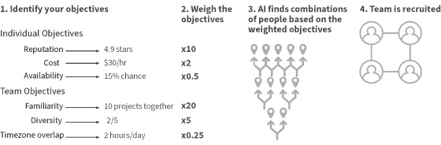
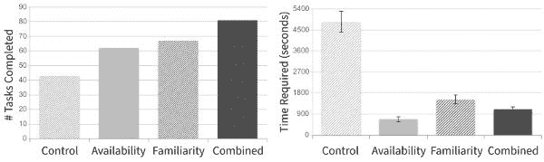
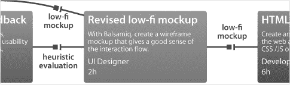
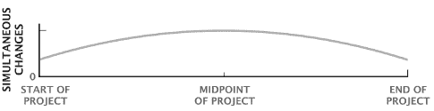
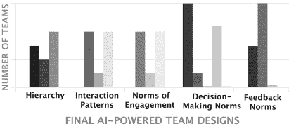
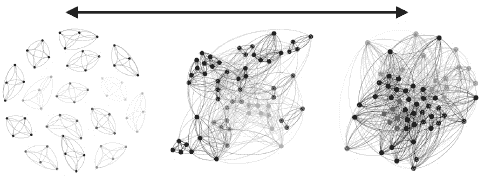
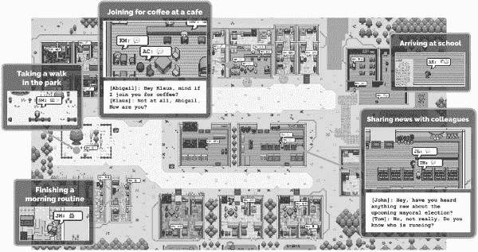
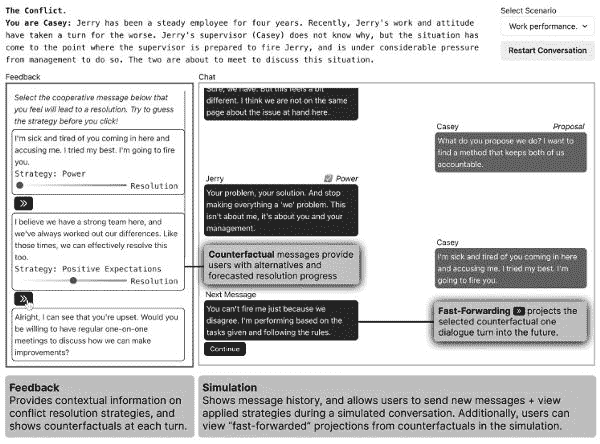

# Flash Teams：引领 AI 增强型按需工作未来

d_r0

致献给那些真正的合作者、使这项研究成为可能的才华学生

起初，Mark 只有一个想法。接着，在几周内，这个想法就变成了一个可以运行的应用程序——解决了他工作中的一个重大问题。

他集结了一支来自全球的三十多名设计师、用户研究人员和软件工程师组成的团队，让这个应用运行了。。你可能会猜，为了在几周内将他的想法变成功能完善且经过用户测试的软件，Mark 有能力从他的公司抽调一支顶尖团队投入项目。但事实并非，初并没有团队。相反，Mark 从零开始，根据项目需求组装了那三十位多元化的专家，每一个人都在他的召唤后几分钟内加入了团队。

Mark 既不是创业公司创始人，也不是高级高管。如果你追问他这件事，Mark 会承认他实际上完全没有工程或产品背景。他是一名急诊室的医生，当他注意到自己工作的医院存在一个令人担忧但可以解决的问题时，他决定创建一个按需团队：直到救护车的后门打开之前，急诊室的工作人员完全不知道会有什么种情况向他们袭来。

像我们中的许多人一样，他发现了一个问题并有了一个解决的想法：“我们难道不应该等救护车真的到达了，急诊室才采取行动吗？如果急救人员能提前让医院知道救护车上要送什么就好了呢？”Mark 设想了一个移动应用程序，救护车司机可以在去往医院的途中用它报告创伤病例，并在急诊室配备一个墙挂显示器，可视化显示即将到达的病例。

然而，Mark 并没有停留在想法上——这就是这本书故事的开始。相反，利用我们在斯坦福大学研究实验室开发的工具和技术，Mark 组建并领导了一个按需团队，在六周内制作了一个功能完全、经过用户测试的应用程序原型以及一个供医院使用的配套显示器。

Mark 是一个医生，所以他不知道如何在新产品上雇佣或管理软件开发人员。当他第一个原型的反馈显示他需要大幅地重新设计应用程序时，他也不知道该怎么办。当他意识到需要确保医疗数据符合 `HIPAA` 规定时，他也不知道该怎么办。甚至当他意识到需要营销材料来让资助者和用户了解这个应用程序时，他也不知道该怎么办。但他还是开始了，利用我们开发的方法，与全球专家团队协作并实现了他的目标。

我们将这些按需的、计算驱动的团队称为*闪电团队*（flash teams），它们对每位经理和工作的未来都有启示。直到现在，像 Mark 这样的问题解决者习惯于与受限过多、抵触变化且学习缓慢的团队合作。我们招募了 Mark 作为想要学习闪电团队的创业用户，像他一样，我们现在的目标是在书中向你展示如何利用全球远程劳动力和人工智能（AI）来创建完全相反的团队。闪电团队：

- 在几分钟内从全球远程劳动力中招募所需的人才
- 在出现突发情况时快速转型
- 应用 `AI` 来帮助招聘合适的人、进化并管理团队

这本书是一个关于“闪电团队”（flash teams）和管理前沿的故事。它也记录了我们在构建世界上首批闪电团队（包括支持这些团队的软件）时所学到的教训。但这本书并不是推销我们为实现闪电团队而开发的软件的广告。相反，这本书提炼了任何经理都可以学习的教训，即在这个按需、远程、全球化专家和 AI 的时代，招聘、组建、协作、适应、管理和学习的意味着什么。

作为渴望获得终身教职的助理教授，我们曾专注于自己的研究。这些研究被记录在《纽约时报》上，并在随后的几年里向数千人进行了演示。随着我们的工作触及的群体越来越广泛，人们在结束后不断走来找我们，告诉我们如果他们自己拥有闪电团队，会构建什么样的东西。这些想法各异、富有启发性，而且简直非常酷。这些人的故事激发了我们写下这本书。

明尼阿波利斯市车辆管理局的一名员工描述了他的想法：利用闪电团队开发一套新的数字系统，以解决他们在管理预约时间方面的一个主要痛点。一位女性企业家建议，闪电团队可以帮助女性创始人通过降低获取首个原型的成本，来解决风险投资资金中众为人知的差异。一位来自澳大利亚的心理治疗师设想建立心理健康专业人员的闪电团队，以应对不同的情况，克服澳大利亚地理距离遥远和心理健康劳动力有限的问题。研究生们设想召集移民律师和专家组成团队，帮助那些因旅行禁令而受困在机场的人。我们的一位创始人朋友在她的第一家公司成功退出后，设想了闪电团队如何使她能够从家里开始她的新消费品进行原型制作。在瓦伦丁（Valentine）之后

这些愿景也来自大公司。瓦伦丁向名为 `EY`（安永）的专业服务公司的高管们进行了演讲，领导们立即对创建审计师闪电团队来执行他们复杂的分布式审计表示出兴奋。我们遇到了来自 `Google` 内部的一位人士，她基本上是自力启动了一个类似的想法，从她部门内部现有的内部顾问中组建按需团队。我们收到一封来自军事领域联系人的邮件，他们看到了实验闪电团队模式的机遇，将他们内部劳动力中的团队汇聚在一起。`摩根大通` 的一位副总裁谈到了风险投资人如何帮助他们的创始人利用闪电团队来降低创建第一个最小可行产品（MVP）的成本。事实上，我们的首批合作者之一在 `Accenture` 的先进技术实验室工作，他们在那里创建了闪电团队来构建一个与 `Accenture` 的企业系统和品牌集成的工作站门户。

这场运动并不局限于我们的研究：自我们开始工作以来，我们看到其他公司和社区也在这一领域进行创新。我们与 `Gigster` 的创始人合作过，他们正在创建由智能软件系统召集和引导的设计师和工程师闪电团队。我们遇到了 `HourlyNerd`（后来明智地更命名为 `Catalant`）的创始人，他们创建了由 MBA 组成的闪电团队来制定商业计划。我们还遇到了一个名为 `Artella` 的社区的创始人，该社区策划了一个由动画师、设计师、艺术家和工程师组成的庞大网络，他们拥有协作软件，允许他们共同创作电影。人们可以看到现在正开始变得可能的潜力，我们想帮助你理解什么是可能的，以及你如何参与其中。

在讨论闪电团队时，人们很快就发现了它们的潜在应用。听到技术领导者和正式领导者如何设想在各种背景下使用按需专家团队是备受鼓舞的。他们能够轻松识别出如果有了正确的机会、技能和资源来领导闪电团队，他们可以解决哪些问题。

你可以通过解释闪电团队为何可能应生而获得诺贝尔奖。经济学家 `Ronald Coase`（罗纳德·科斯）就做到了。

在 20 世纪 30 年代，`Coase` 提出了现在著名的的问题，创立了经济学中被称为“公司理论”的领域。

今天，这些成本随着互联网和数据技术而发生了转移：搜索和招聘花费的时间、精力和金钱大大减少。这种转变是闪电团队以前不存在而现在可以存在的根本原因。突然，搜索变得几乎免费且即时：在线市场平台可以根据你的描述将你与工人匹配。签约也可以变得几乎免费且即时：这些相同的平台允许工人展示自己的费率，而平台提供了应用程序接口（APIs），允许雇主以极快的速度进行搜索、签约和招聘。当搜索和签约变得廉价时，`Coase` 的理论告诉我们，人们将使用市场来替代他们以前使用的组织。

当然，我们已经看到了这些变化。密歇根大学的管理学学者 `Jerry Davis` 已经观察了这些迹象十多年。在《正在消失的公司》（*The Vanishing Corporation*）中，他写道以下关键趋势：

- 从 1996 年到 2015 年，美国股市上市的上市公司数量从 8000 家减少到 4000 多家。
- 在 2015 年，“`Facebook`、`Yelp`、`Zynga`、`LinkedIn`、`Zillow`、`Tableau`、`Zulily` 和 `Box` 的员工人数少于 `Circuit City` 在 2009 年清算时。”

`Davis` 认为，传统公司的大规模减少与新的数字技术（如在线劳动力市场）以及相关的组织模式（如闪电团队）有关。像 `Sears`、`US Steel` 和 `General Motors` 这样的大公司在旧的技术假设下是合理的。但不断的技术格局正在改变组织的性质。正如 `Coase` 的工作所暗示的，使人们自然地进入组织的成本可能正在转向有利于闪电团队等替代组织的形式。

正如往常，第一批对这一洞察和趋势采取行动的者是个人、小型组织和初创公司。他们充满活力并乐于接受新想法。我们亲眼看到过初创公司利用在线劳动力市场进行商业计划、设计和工程。这是一个引人入胜的画面：想象你的小企业在关键时期弹性地扩展十个或更多贡献者。

尽管大型组织行动较慢，他们也意识到了这一机会。自由职业平台 `Upwork` 称，`Microsoft`、`Airbnb`、`Bissell` 和 `Nasdaq` 都与其平台签署了企业合同，使他们能够从 `Upwork` 的自由职业者那里招聘。我们自己的雇主斯坦福大学（`Stanford`）也有这样一份合同。`Stanford` 的律师与 `Upwork` 律师敲定的企业合同确保 `Stanford` 在通过平台招聘自由职业者时符合加州劳动法。我们的高管教育计划、校友办公室以及斯坦福大学的几个专业和行政部门都通过这种努力聘佣了自由职业者。

虽然人们对闪电团队（flash teams）有着令人向往的愿景，但他们也面临着一个明显的障碍：他们不知道如何执行。Valentine 最近在一次工作休养期间与一些中层职业人士交流，这些人在处理组织和职业生涯方面表现得令人印象深刻、深思熟虑且具有创新精神。当她谈论闪电团队时，其中一位首席执行官（她曾因其创新的联合办公空间融资方式而登上报纸）说：“那真的很酷……但我并不知道该怎么做。”我们一直回想起那一刻：我们没有考虑到，战术层面的理解可能会成为使用闪电团队的人的障碍——即使对于那些通常喜欢尝试新组织方式的人也是如此。

同样，我们的一位朋友曾抱怨她的定制网站无法与她的 `Shopify` 或 `Toast` 终端销售软件集成。她苦苦于每周抽出几个小时来试图解决这个问题。我们立即的反应是：“你你不应该把时间花在这些上面！有专家可以提供帮助。”我们第一次教了她如何在在线市场上进行搜索。我们很快找到了符合她预算的个人主页，这些人拥有 `Shopify`、`Toast` 和定制网站的经验。她大为震惊：“我怎么以前不知道这个？你们以前怎么没告诉我呢？” 这就是我们学到的：与大多数教授不同，我们应该在派对上谈论我们的工作。

由于闪电团队已经进入了我们的生活十年，我们可以很轻松地使用它们，但目前缺少一份说明书：一方面是人们对闪电团队的愿景，另一方面是实际运行闪电团队所需的技能和信心，之间存在差距。尽管并不是每个人都需要像我们在章节开头描述的那种大型、跨功能的按需闪电团队，但每个人都可以从闪电团队中学到一些技巧和技术。

闪电团队甚至改变了我们自己的生活。今天，Bernstein 正致力于一个开发新社交媒体平台的研究项目。按需软件工程师从第一天起就是该项目的一部分，填了他 `Stanford` 团队在经验和时间上的空白。另一个研究项目涉及在线艺术家的协作工具。因此，Bernstein 和他的博士生开始招聘在线艺术家每周对工具进行测试。闪电团队帮助我们学习了新的软件工具、修复了 Bug 并实现了功能。

我们写这本书是为了提供帮助。我们想帮助你，就像想要用闪电团队在医院拯救生命的医生 Mark 一样，成为这种新管理形式的专家。这本书代表了我们的观点：闪电团队是未来工作的关键，它们体现了每个经理都可以学习并应用的关键能力，无论他们的项目、公司或团队的规模和成熟度如何。全球网络劳动力队伍可以成为你想法的强大杠杆。

闪电团队可能由在线劳动力市场驱动，但你不能仅仅把人聚在一起就认为你会拥有一个成功的项目：你需要进行协调和协作。在我们这一领域工作十年期间，我们发现闪电团队的协调软件才是真正为闪电团队提供动力。传统上，团队大多数时候是在线下协作：你会拍拍同事的肩膀，会在午餐室见到彼此，或者定期面对面见面。但由于所有的闪电团队协调和管理都是通过互联网进行的，这些互动是无法获取的。闪电团队旨在将这个“酸柠檬”变成“柠檬水”：由于互动都在网上进行，软件可以支持闪电团队旅程的每一个环节。在本书书中，你将听到我们描述如何使用软件智能地招聘、设计和管理闪电团队，而这些方式在线下是无法实现的。许多工具都利用了人工智能的最新进展。

由于我们是该领域的首批实践者，我们必须自己构建这种闪电团队协调软件。在整书中，你会看到我们提到我们的软件，名为 `Foundry`，因为我们必须创建它来启用闪电团队。由于我们是该领域的首批实践者，我们必须自己构建这种闪电团队协调软件。（*注：此处原文存在重复，翻译时已按要求处理*）你将听到我们描述如何使用软件智能地招聘、设计和管理闪电团队，而这些方式在线下是无法实现的。许多工具都利用了人工智能的最新进展。（*注：此处原文存在重复，翻译，翻译时时按*处理*）

在 `Foundry` 的基础之上，这些工具也有其他名称，如 `Hler`、`Dream Team` 和 `Hive`。在书中，我们将所有这些工具统称为 `Foundry`，以保持简单。

自从我们构建了 `Foundry` 之后，如今使用闪电团队的公司也开发了实现许多相同目标的工具：

*   `Catalant` 开发了用于业务顾问的工具。
*   `A.Team` 和 `Manuel Pistner` 的 `Flash Hub` 创建了支持团队的工具。
*   `B12` 创建了用于团队分配、协作和管理项目的软件。
*   `Artella` 创建了用于创意资产的工具。

某些工具仅供内部使用；例如 `Gigster` 使用其工具进行内部团队招聘。`Google DeepMind` 将 AI 研究人员组织成突击队和前沿团队。其他工具是开源的，如 `B12` 的名为 `Orchestra` 的工具，它支持协作。你可以根据组织的要求选择自建还是购买。

但如果你只是想直接投入并开始，你可以在不需要任何特殊软件的情况下实现目标。当我们开始构建闪电团队时，我们与 `Accenture Technology Labs` 的团队进行了协作。他们的一位才华横溢的工程师 Taurean Dyer 意识到可以使用免费的项目管理工具来模拟我们的软件。他最近告诉我们：

> “`Foundry` 的革命性之处在于它就像一张蓝图。我发现你可以将这个蓝图应用到许多不同的工作工具组合中，这就是为什么它产生了如此影响。”

在领导一个成功的闪电团队结束后，Dyer 向公司领导层报告说，可以使用其他平台来模拟 `Foundry` 的功能作为基础，并展示了 `Basecamp`、`Trello`、`Freelancer`、`Accenture` 内部的 `Digital Talent Broker` 平台、`Share` 和 `Box`。我们同意他的结论：只要团队使用得当，这些工具可以让你走很远。软件变化很快，但截至我们写作时，`Asana` 或 `GitHub Projects` 可以帮助你跟踪任务，`Slack` 可以帮助你保持沟通，甚至普通的电子表格有时也能帮助招聘。如果你真的采纳了闪电团队的思维，你可以通过这些现成方案来实现目标，而无需学习新工具。然后，当你稳定下来，可以开始探索像我们那样的更高级或自定义的软件，以增强你的努力。

在书的前半部分，我们将分享关于我们认为你应该使用的软件的建议。我们将一切基于我们的 `Foundry` 软件以及它为我们实现的事情。

随后，在书的后半部分，我们将转过视角，展示闪电团队（flash teams）的一些尚未在产品中广泛应用的软件超级能力。这些超级能力包括：根据你对需求的描述自动构建团队、根据对团队进展的观察随时间调整团队管理、启用预测闪电团队可能失败的早期预警系统，以及为团队成员提供自我组织的工具。

如果你从今天开始构建闪电团队，我们的观点是，你将处于一个极其有利的地位，可以利用这些即将到来的超级能力。在短期内，你可以使用现在免费提供的通用工具，或者深入研究其他公司已经开始发布的一些工具。在中期内，如果你正在围绕闪电团队构建一个较大的组织，你可能会效仿 `B12` 和 `Gigster` 的做法，在内部构建一些自定义工具来帮助。而从长期来看，我们将描绘出软件领域未来的发展蓝图。

无论你使用何种基础设施，闪电团队都将改变世界。它们将被用于创造、构建和启发。它们将为需要快速专业知识的创业者、为寻求更敏捷的大型企业，以及任何其他需要解决重要问题的人提供机会。

Pat Petitti 需要一个团队。他的客户正在关闭零售店，但想找出如何每年继续销售他们品牌深受喜爱的玩具车的新模型。作为 `Catalant` 的创始人（该公司利用技术来形成、管理和赋能顾问及业务人士的按需团队），Petitti 利用了他公司的网络来召集他需要的团队。他找到了：

* 一位曾在管理咨询公司 `McKinsey` 担任零售业务副合伙人的专家，
* 一位曾在 `Toys R Us` 做过企业发展的专家，
* 以及一位曾在 `Amazon` 从过供应链的专家。

这就是一个解决该问题的完美团队。客户雇用了该团队，他们表现得极其出色——以至于客户询问 Petitti：“我们能直接留住这个团队来管理所有的工作执行吗？”他们重新聘雇了该团队来完成任务。这三位专家超出了所有预期——尽管他们从未见过面，也从未在同一个房间待在一起。

***

理解闪电团队要从这种简单的观念转变：*专家无处不在，随时在线*。在传统的美国劳动力市场中，我们被训练要接受专家稀缺的观念：你的公司可以雇佣的专家很少，如果你需要另一个，将需要几周或几个月的时间以及层层官僚的程序才能雇到他们。理解闪电团队意味着将这种观点彻底转过来，转变为专家丰富的观念：无论你需要什么种专业知识或技能，它可能都是有的，而且你可能快速获取。

在我们发布第一份闪电团队研究的同一年，一家典型的美国公司需要 14 到 25 天才能填补一个新职位。

我们都在课程中演示过这个想法。Valentine 在开始闪电团队课程时，会向学生小组说：“你们需要在这 80 分钟的课程结束前获得一个专业来源的团队 Logo。”随后，她向他们展示如何在一个拥有数百万承包者的在线劳动力市场中搜索和招聘。在单节课时间内从想法变成一个专业制作的团队 Logo，这在学生看来起初似乎是疯狂的，但在 Valentine 进行这项练习的几年里，每个学生小组都在他们在课程结束前轻松地雇佣了一位平面设计师，为他们创建了团队 Logo（使用课程资金）。

Bernstein 进行了另一个演示。他决定使用 `Cameo`（一个任何人都可以雇佣演员和名人录制短定制视频的在线市场）来雇佣演员 `Chris Diamantopoulos` 为班级录制个性化信息。Chris 曾在 HBO 的剧集《硅谷》中饰演亿万翁投资者 `Russ Hanneman`，Bernstein 雇佣他录制了一个视频，比较他在社交媒体上与 `Cameo` 上的粉丝互动。视频第二天就准备好了。

这些演示仅召集了单个专家，旨在生动地说明找到专家的速度，但在本书中，我们将向你展示，当你能够召集专业专家*团队*时，这些技术真正令人兴奋的潜力将会出现。

我们可以从深入研究在线劳动力市场作为闪电团队的专家来源开始，然后为经理提炼一些关键要点。让我们从简要浏览这些在线劳动力市场开始。将在线劳动力市场视为连接工作者和雇主的网站平台。工作者发布他们的简历和可用时间，雇主发布项目。工作者申请参与项目，雇主选择工作者，双方约定工资，然后就开始了。虽然市场可以添加许多额外功能，包括跟踪时间、在按小时和固定价格合同之间进行选择、通过平台提供的测试得分展示技能以及给工作者分配评分，但基本配方是关于工作者和雇主的匹配。

这些在线市场在某些方面与你可能熟悉的零工经济平台有关，例如 `Uber` 或 `DoorDash`。但现代的在线劳动力市场为许多不同项目提供了更多样化的专业知识获取途径。以下是几个例子：

* `Upwork` 在线劳动力市场拥有超过 1200 万注册自由职业者，将客户与多样化的专家连接起来，包括自由职业作家、平面设计师、网页开发者、翻译人员、虚拟助理、营销人员等。
* `Fiverr` 专攻创意专业知识，包括平面设计、写作和翻译、数字营销、编程、视频剪辑和音乐制作。
* 本章开头介绍的 `Catalant` 为业务顾问策划了在线劳动力市场。
* `A.Team` 组织了一个由技术人员、产品经理、设计师、营销人员、数据科学家和高级运营人员组成的团队驱动网络。
* `Artella` 是由皮克斯员工创建的创作者社区，聚集了能够制作皮克斯品质动画电影的自由职业者。

这些在线劳动力市场是如何运作的？它们提供的功能让数百万自由职业者和客户能够发布和申请工作、谈判和监控工作合同，并进行大规模的国际合规支付。通常，平台提供模板合同、一套规则和争议解决程序。当你创建一个项目时，描述它并指定所需的专业知识、大概的小时或总报酬，以及任何其他限制，如经验水平、语言技能、时区要求以及你预期的独立程度。如果你的公司有特定的合同条款（例如，要求的保密协议），平台通常也可以协助。

一旦你发布了职位，工作者就会在线申请。这通常在几小时内就会发生。我们还建议搜索平台并明确邀请几位合适的候选人申请该职位，因为最好的工作者可能根本看不到你的项目。工作者的背景、地点和收费标准各不相同。他们的申请可能会针对特定的职位需求，或者展示他们相关的作品集元素。

这些平台提供的关键服务之一是提供一组信号，帮助你在决定雇用某人时做出有效决策。最重要的信号通常是 `reputation score`（声誉评分），类似于你在 Yelp 或 Amazon 上看到的五星级评分。许多不同的统计数据和客户反馈信号都可以纳入这一评分，使其成为该平台的“秘诀”。它可能整合来自之前客户的评分，也可能考虑项目是否成功完成；它可能会更侧重于那些在平台上时间更长、更擅长比较承包商的客户的反馈；它可能会自动调整以关注最近的工作，而非陈旧的历史。关于评分的更多信息，请参见第 11 章。与此同时，平台还提供了许多其他信号。因此，如果你搜索 AI 工程师，你通常会看到：

* 他们的姓名、小时薪率和评分，
* 他们在平台上记录的小时，
* 来自之前客户的反馈评价精选，
* 他们的简历，以及
* 平台分配的勋章，用于证明工作者在特定专业领域的资质或作为该平台的高评分工作者。

我们鼓励你尝试在这些平台之一上创建一个客户账户，并搜索你所在领域的专业知识。你可能会对你的发现感到惊讶。

通过在线劳动力市场可以雇佣的技能多样性初看可能令人无应从。别担心。我们将遍历在线劳动力市场商城，列出我们通过这些劳动力市场通常可以（以及不能）找到的工作类型。需要强调的是，并非所有平台都已具备我们书中描述的“闪电团队（flash teams）”软件所需的组件——例如，某些平台无法通过 `API`（一种允许你使用程序而非网站进行雇佣的软件接口），这意味着我们的闪电团队 `Foundry` 软件尚无法自动雇用他们，你需要手动在网站上发布职位并自己进行雇佣。然而，这次之旅将让你领略到当前和未来平台可能提供的服务。我们将介绍我们与这类按需专家合作的各种经验。

我们之旅的第一站是软件工程。优秀的软件工程师遍布在线劳动力市场。只要说出任何一个现代软件平台，或几乎任何古老的软件平台，市场中都有能与之合作的人。`Upwork`、`Gigster`、`CloudDevs`、`We Work Remotely`、`Workana`、`Freelancer` 等平台都有许多细分领域的软件专家。

多年来，我们有幸能与许多才华横溢的软件工程师以按需且极其高效的方式合作。作为一个简单的例子，Bernstein 经常与斯坦福的本科生合作，他们非常有才——但还不是专业工程师，还不熟悉现代软件工具包。来自 `Upwork` 的专家工程师可以提供帮助。在一个项目中，Bernstein 和一组本科生正在开发一个需要 `React` Web 应用的工具，但学生们在 `React` 编程方面还处于新手阶段。Bernstein 雇佣了一位拥有数百小时 `React` Web 应用经验的 `Upwork` 承包商来支持开发团队。这位名为 `Lokesh Bansal` 的技能工程师进行了代码审查，帮助本科生掌握良好的风格和工程实践，并承担了紧迫或超出团队当前能力的功能和 Bug。他回答问题并提供建议。在几个月的时间里，他是该小组成功的核心支柱之一。Bernstein 也从他那里学习了知识，他们一起进行脑风暴，共同思考设计中特别困惑的部分。

在这一领域的雇佣凸显了使用在线劳动力市场的一个大要要求：你需要清楚自己想要什么。告诉软件工程师“给我做个应用”并不比告诉建筑师“给我盖一栋房子”包含更多信息。我们不断地吸取这个教训。我们曾多次发布过软件工程项目，然后很快发现其范围太开放了。“不，等一下，我想让你实现的是*我*告诉你的那个算法，而不是你认为更好的！”“等一下，你为什么要添加登录系统？”你在合同中指定的细节越详细（即使是到特定的示例行为或软件的用户界面原型图的程度），效果越好。但要以足够的细节描述你想要的东西是非常困难的！关于这点的更多信息，请参见第 6 章，标题为“适应是闪电团队的必要条件”。

## 设计

我们之旅的下一站是设计。设计通常是软件开发的上游，如果你需要用户界面设计、Logo 设计、平面设计或任何其他形式的软件设计，你可能很幸运。许多技能高超的设计师通过 `We Work Remotely`、`Upwork` 和 `Freelancer` 等平台提供服务。

有一次，一组设计师帮助 Bernstein 快速意识到他的一个想法实际上并不好。他曾想过，如果用户可以为某些帖子开发自定义模板，社交媒体是否会更有吸引力。他在想：“如果用户可以创建以他们正在评论的电视节目或 NBA 节目为主题的社交媒体帖子，会怎样？”他写下了这些概念，然后从 `Upwork` 雇佣了三个设计师来创建该概念的视觉原型。他很快得到了关于这种流可能是什么样的非常具体的视觉效果。

图 2.2 ¶ 设计师可以快速创建设计原型来帮助测试创意想法。Bernstein 获取这些设计是为了测试关于围绕电视节目的想法。

除了工程和设计，你还需要业务技能来创建有影响力的团队和解决方案。在线劳动力市场还将你与会计、财务、采购、战略、供应链管理以及许多其他领域的专家联系。根据你的项目，你可能不需要也负担不起全职负责这些问题的员工，或者你可能需要某个在组织只有通用人才的领域的深度专家抽出一些时间。你可以在 `Upwork` 等更通用的市场中找到这些专家，也可以在 `Catalant` 等更专业的市场中找到他们。

举例来说，我们咨询的一位初创创始人需要为她的消费包装品公司建立一个业务模型，并对闪电团队模式很感兴趣。寻找一个具有消费品经验且可用的兼职首席财务官似乎对画像要求太具体了。但她在在线市场上立即找到了匹配项：一位哥伦比亚大学的 MBA，他自诩为具有消费品经验的碎片化首席财务官。在一天之内，她进行了一场一小时的会议描述了她的需求，而的一周内，他就为她制作了用于测试产品和市场可行性的财务模型。

创意行业在在线劳动力市场上已建立了许多足点。诸如 `Upwork`、`Cameo`、`Dribbble` 等平台展示了作品集，并让你能够聘用艺术家、动画师和制作人。我们曾与许多包括创意专家在内的闪电团队合作，利用这些团队制作动画和视频。我们最早请求的一支团队制作一个动画视频，讲述我们在斯坦福的一位高级同事的故事——`Terry Winograd`，他的发型诡异地让人想起`阿尔伯特·爱因斯坦`——讲述他小时候在车库里建造电脑的故事。我们通过 `Upwork` 聘请了一位导演，他又请了另外四个角色：编剧、插画师、动画师和配音演员。尽管他们从未合作过，这支团队还是聚在一起；开发了剧本、分镜、角色设计和背景设计；制作了角色动画，然后添加了音乐和配音；混合了音频并剪辑了最终视频，这一切在几天内就完成了。生成的短动画令人印象深刻。

同样，通过召集一支类似的团队，我们介绍中的医生 `Mark` 为他们开发的一款平板电脑应用创建了一个营销视频，该应用用于提醒医院即将到达的救护车。该团队很快制作了一个动画营销视频，传达了系统的使用方法以及医生如何利用该应用程序。

当然，创意工作也是我们第一次学到“你得到的是你所要求的，但可能不是你预想的”。`Bernstein` 当时正在从事一个新的研究项目，一个电子邮件应用程序，该程序允许 `Upworkers` 访问你特定邮件子集的代客钥匙，以帮助你管理过载的邮件。

从某种意义上说，人工智能创造了第一个在线劳动力市场。`Amazon` 在 2005 年启动了其数据标注服务 `Amazon Mechanical Turk`，并称为“人造人工智能”。从那时起，标记数据以训练人工智能模型的按需人工数据标注服务已成长为整个行业，平台包括 `Appen`、`Scale AI`、`Clickworker` 和 `Samasource`。要务必格外注意付费数据标注——在这种工作中，特别容易压低工人工资或发生工资窃取，因为很难准确估算任务所需的时间，也很区分错误是由于工人失误还是真的由于你的指令不清晰。

不过，你可以做得更远：你还可以聘用人工智能专家来构建、训练和部署你的 AI 系统。传统组织需要组建整个 AI 团队来构建这些算法。现在，你可以找到专家来帮助你进行工程化，即使你的组织内部没有这些专业知识。你可能仍然需要准备和清洗你的数据集——再次，这里没有免费午餐——但这已经是最接近你可能获得的 AI 咨询服务了。

多年来，我们通过在线劳动力市场聘请的其他专家专业人士：

* 产品经理
* 质量保证
* 教学设计
* 客户支持
* 销售、营销和搜索引擎优化 (SEO)
* 语言翻译
* 行政辅助

当我们说“专家无处不在，无时不不在”时，我们确实是此意：这些平台上提供了令人惊叹的极其丰富的专业知识。

如果几乎任何可以在计算机上完成的工作将出现在这些市场中，那么反之亦然：如果工作无法在计算机上完成，那么它在网上就不太可能找到。例如，你不太会在这些平台上看到金属工、`HVAC`（暖通空调）专业人员或树艺师。人们更有可能通过访问 `Yelp` 或类似的平台查看本地列表来寻求咨询。

这不是一个硬性边界：`TaskRabbit` 平台提供此类服务，尽管由于需要人亲自出现在你家中或工作场所，它受限于本地专家。同样，我们可能会把像 `Etsy` 这样的在线手工艺市场视为在线劳动力市场。然而，`Etsy` 更多地是一个商店而非劳动力市场：这意味着，我可以在 `Etsy` 上购买物品，但要在 `Etsy` 上聘请某人担任合同职位可能并不直接。总而言之，对于需要面对面协作的组织，这是可行的，招聘本地帮助正是我们推荐的闪电团队领域。

最后一点：有几个平台本质上是在线招聘板，包括 `Indeed`、`LinkedIn` 和 `Monster`。你可以利用这些平台为闪电团队招聘专家，但它们并不是你的最佳选择。这些平台的工作专注于传统就业，而非闪电团队。

最初几个例子都是关于如何快速地从在线劳动力市场搜索和招聘，但意识到“专家无处不在，无时不不在”的思维转变要比这广泛得多。调用专业知识可能简单到只需看向公司内部。当我们在一家金山的科技公司观察一个数据科学团队时，`Valentine` 观察到他们随时创建许多微闪电团队。核心项目小组邀请了一位在其他小组的数据科学家，他是因果推断专家；然后是另一位公司数据模型专家；最后是位在用户界面设计方面有专业知识的人。所有这些合作者都是其他项目的全职员工，他们能够临时加入核心团队，利用他们的专业知识解决特定问题。

我们在一家学术癌症中心观察的一系列病例会议中注意到同样的模式。

你可以从“专家无处不在”的视角来看内部借调或职位轮岗。在内部借调中，公司临时将一名员工重新部署到一个新职位，要求他们专注于一个新的项目、客户或技能组。注意的是，员工可以保留原有的薪资福利并回到原始工作。例如，软件公司 `Atlassian` 为其部分员工提供借调机会。他们临时将一名产品营销人员重新部署到营销分析团队，她和团队都认为这是一次非常有宝贵的学习经历。

事实上，A.Team 的创始人兼 CEO `Raphael Ouzan` 认为，人们对于分享他们所关注的问题和项目的专业知识具有高度动力。他惊讶地发现，有许多高级领导申请加入这个专家网络，为他们的按需团队提供动力。其中许多领导者认为自己已经精通了公司规则，并看不到进一步晋升的路径。相反，Ouzan 指出，他们希望从事自己选择的项目，并与他们尊敬的合作者一起工作。通过吸引这么多渴望贡献有意义项目的专家，A.Team 网络的增长比 Ouzan 想象的要快。

这是一个更广泛的愿景：如果你认为专家无处不在，那么闪电团队（flash teams）的经验可以帮助任何项目的任何管理者，无论这些项目是如何定义的。你拥有一深厚的人才储备。利用它吧。

这是在曼谷拍摄一部间谍惊悚片的第二天，灾难降临了。一个关键设备——一个关键动作场面所需的摄像摇臂——在剧组正准备在拥挤的街道上拍摄高速追逐时发生了故障。剧组成员此前从未见过，才刚刚开始合作，但导演迫切需要解决方案和想法。摄影师刚从瑞士飞过来，迅速评估了情况，并提出了一个使用手持稳定器的替代方案。由一位泰国资深专家领导的场务组听取了这个想法，并想出如何调整他们的设备以适应新计划。灯光组预料到了变化，集脑风暴如何调整灯光架，以确保镜头仍然捕捉到预期的效果。摄影师、场务主管和灯光主管一起讨论了这些变化如何影响动作场面的摄像角度和动作调度。

***

闪电团队与电影剧组有什么共同点？这个问题听起来像是一个冷笑话的开场，但它实际上凸显了闪电团队的核心教训。也就是说：从一开始开始，最好的协作发生在专家们高度专业化但仍然知道如何将各自的努力整合在一起的时候。这种先专业化然后与团队中其他专家良好整合的能力被称为 `role clarity`（角色清晰度），它是闪电团队、电影剧组和其他为复杂工作而临时聚集的团队协调的主要引擎。当专家们非常清楚自己的专业任务和职责时，他们就可以专注于他们最高价值的贡献，并信任同样专注且专业的团队成员也在做同样的事情。

电影剧组作为一种组织形式的独特之处在于，尽管剧组中的许多人以前从未互相见过，但他们经常聚在一起完成高程度的专业化*和*整合。

我们经常忘记将角色清晰作为一种策略，因为传统团队已经学会了在没有它的运行：他们能够完成这种程度的专业化和整合，是因为成员随着时间的推移变得彼此熟悉。通过几个月或几年的互动，我学会了从你那里期待什么，你学会了从我那里期待什么，让我们能够有效地协作。即使在最坏的情况下，你也会随着时间学会如何绕过我的缺点来完成你的工作。这个过程正是为什么不断的人员流动对传统团队的性能和福祉是巨大破坏性的原因。为了闪电团队的成功，我们不能假设成员之间彼此熟悉。

那么，按需专家组如何变成功能性团队呢？从在线劳动力市场快速招聘的力量有时让我们直接进入“欢喜冤”的境地，充满了尴尬和不协调的协作。具有 `role clarity` 的小组项目是关键。

临时团队中角色清晰化的目标很明确：在可能从未合作过的人之间建立有效的、自适应的基于角色的团队建设。想象医院急诊室的一位危急患者。一群人跑了。第一个个人立即确保患者的气道畅通，第二个人开始胸按摩。第三个人冲进房间开始建立静脉。第四个人站在床头，向大家大喊要求他们将患者从担架上移到床床上。随着情况稳定，所有的工作人员都互相打招呼并介绍自己。他们以前从未见过。然而，他们每个人都拥有清晰的角色认知，知道自己的专业知识和职责如何融入那个救命时刻。

这里值得关注的一点是，我们人类社会已经针对许多类型的问题开发了如此多的专业角色——而且仅仅通过理解这些角色，一群陌生人就可以出现在某个情境中，并在瞬间知道自己个人可以如何做出贡献，以及他们可以相互依靠什么。急诊室（ER）是一个极端案例，但一旦你开始注意到角色和角色结构，你就会发现角色清晰化对于实现各种协作的威力。

正是这种角色清晰化的魔力让“闪电团队”（flash teams）真正运作了起来。Bernstein 一直试图从 `Upwork` 上汇集按需专家，但不确定如何让他们协调工作而互不干扰。Valentine 一直在研究角色清晰化作为医院快速组建团队的关键。我们中一个人手里有锁，另一个人手里有钥匙。有了这种对角色和角色结构的理解，我们开始发现我们设计的每个闪电团队项目似乎都有一套相同的角色：我们会有一个`UI 设计师`、一个`UX 设计师`、一个`前端开发人员`和一个`后端开发人员`。他们似乎总能以大致相同的顺序完成任务，并在跨项目中以相当一致的方式进行协作。即使在开始时没有软件工程项目的大量经验，我们也能通过理解涉及的通用角色和角色结构，学会如何成为这些团队精明的客户。

基于这种对角色清晰化的理解，创建闪电团队的第一步是从指定角色开始的。当我们把某人带入闪电团队时，我们会强调他们的角色：“你是这个功能的用户界面设计师。”“你是前端软件工程师，需要与后端工程师协调。”你负责质量保证——将你发现的任何问题与前端工程师分享。”

角色通常由专业知识领域来定义：你可能是团队中的一个`文档撰写员`、一个`QA 工程师`或一个`财务分析师`。定义角色结构意味着确保闪电团队中的每个人在他们到场时就能被告知自己的角色。不要只是把人聚在一起并让他们自己去解决——某个人（很可能是你）应该告诉每个人他们的角色。最好在招聘时这样做，这样人们就知道自己正进入了什么样的工作和什么样的人际关系中了。当我们构建用于召集和协调闪电团队的 `Foundry` 软件时，我们将每个团队结构化为一系列角色（例如`设计师`、`用户体验研究员`和两名`软件工程师`）。对于其中的每个角色，我们的软件都使用 `API` 从 `Upwork` 市场平台聘佣人员。

接下来，你需要指定角色之间应该如何相互作用。“你是负责该应用程序用户界面实现的前端工程师，你需要与后端工程师协调，以确保数据正确地发送到用户界面并从用户界面保存。当你对 UI 规范的细节有任何疑问时，你应该咨询用户界面设计师。”换句话之，你需要为这些陌生人绘制团队的组织架构图以便他们出现并执行。

结构化`角色`并不意味着结构化`任务`。这几乎恰恰相反：重点在于，如果某人理解自己的角色，他们就可以直接主张制定他们需要完成的任务。事实上，你不需要对一个理解自己的角色以及与其他角色关系的人进行微观管理。（注：原文此处存在大量重复，已按要求处理）。要点是，如果某人理解自己的角色，他们就可以直接主张制定他们需要完成的任务。（等等，文本中有些重复，让我们重新对齐）。

有了这些信息，每个工人都知道团队的目标是什么以及他们的角色是什么。领导者已经创建了所需的角色清晰化。（等等，让我们重新审视提供的文本）。

你可能需要对一个理解自己的角色以及与其他角色关系的人进行微观管理。（注：原文此处存在大量重复，已按要求处理）。重点是，如果某人理解自己的角色，他们就可以直接主张制定他们需要完成的任务。（实际上，我将遵循文本的内容但进行格式化）。

这个笑话中包含一个非常有用的观点：UI 设计师拥有他们擅长的专业知识和工具包，并希望使用这些技能。一旦你让他们进入设计角色，就很难让他们去做设计以外的任何事情了。对于闪电团队（flash teams）来说，一个有用的见解是：UI 设计师将会出现，并立即开始询问同一系列基础问题，以弄清楚他们需要做什么。他们问的问题与前端开发者问的问题非常不同。毕竟，开发者的首要任务就是开发。

未能有效利用角色结构会导致错误，这些错误往好了是好笑的，最坏的情况下是破坏性的。我们通过调查 Slack 上闪电团队的交互日志亲眼目睹了这一点。如果清晰度不够，新成员就会在自己的角色中四处寻找方向，试图获取任何能获得的信息，以弄清楚他们到底该做什么。事实上，这种经历并不仅限于闪电团队；开始新工作最具挑战性的部分往往是`弄清楚你的工作是什么`。如果刚开始时没有足够的角色清晰度，公共频道中就会出现大量不必要的额外信息、额外的会议和困惑。另一方面，如果团队结构过度化且工作流僵化，它就无法应对突发情况，无法在更好的机会出现时进行转型。

我们认为，当你开始构思自己的闪电团队时，你会开始看到在不同情况下相关的各种角色和角色结构。当人们在某个行业变得丰富时，他们会对相关任务以及通常由谁来完成产生直观的理解。写作有作者、编辑、插画师出版者；营销有品牌专家、视觉设计师、内容制作者和广告专家；记住，即使是《十一虎盗胆》，每个成员都贡献了特定的技能和角色。

在许多闪电团队中，我们的优势是所有工作都是通过在线协作平台完成的。当工作在网上进行时，你可以利用持续产生的工作、决策和文档轨迹来支持角色的清晰度。你不这样做，就会看到看到像我们观察到的这种频繁交流：

* • Chris：“有日期范围的搜索功能吗？”Mike：“有的，应该在文档里。”
* • 另一天。Chris：“我们需要一个删除或隐藏功能；有相应的路径吗？”Mike：“有的。我的意思是文档里有，没什么好补充的。”
* • 又是另一天。Frank：“PIA 上的统计实现了吗？”Mike：“有的，看文档。”

我们并不是真的在嘲笑可怜的 Mike 因为他不得不不断告诉别人去阅读已经包含问题答案的文档而感到沮丧。这就是“角色搜寻”（role foraging）的真相：关于人们`究竟`应该做什么的许多细节，都会包含在那些持续的文档轨迹中。

如果你建立了一个足够大的闪电团队，你就不能依赖于每个人都了解一切，因此你必须依靠文档来维护“单一事实来源”。尽管如此，实时的、有用且可搜索的文档并非理所当然。有时软件系统可以帮助自动完成这一过程，尤其是现在生成式 AI 工具提供了所有的会议记录转录和摘要功能。但即使有这些帮助，团队通常仍然需要坚持不懈地维护高质量的文档，并在命名、标记、日期标注和识别所有输入文档方面保持一致的惯例。

Taurean Dyer 的客户已经习惯了快速运作的团队。但尽管如此，他们仍然无法跟上他组建闪电团队并为他们构建新系统的速度。

Dyer 的客户是埃森哲的一个内部小组，他在那里是先进技术实验室的工程师。他们委托他组建并领导一个闪电团队，为他们构建一个用于组织客户工作坊的新平台，该平台需要与埃森哲的企业级软件系统和品牌进行整合。他做到了，招募了大约三十名专家跨越一系列闪电团队，负责工作讨会门户的设计、实施和测试，所有工作在几周内全部完成。

其中一位客户后来告诉 Dyer，他的闪电团队完成系统的速度，比他们如果重新招聘来构建该系统时，入职第一个员工的速度还要快。而且，客户说，Dyer 和闪电团队完成此任务的成本仅为预期的八分之一。

如果第一部分的标题是“专家无处不在”，那么它的子标题应该是“专家随时待命”。这些全球在线劳动力市场最令人惊讶的影响之一，就是你招聘的速度可以有多快。当领导我们基础闪电团队（flash teams）研究的博士生 Daniela Retelny Blum 回顾构建闪电团队的经历时，这种速度脱颖而出。她回忆道：“到为止最酷的时刻是产生想法并以创性的速度将其变为现实。我们可以为一个移动端 Web 应用或在线学习平台构思，并让经验丰富的专家团队在一天内完成，这种感觉就像我们真的生活在未来。”

但有不同的实践可以帮助按需招聘取得成功。快速招聘恰好是我们的专业研究兴趣之一，因此这里我们有一些从经验以及该领域许多其他领导者那里学到的具体建议。

在线劳动力市场的超级能力之一就是招聘的速度可以有多快。如果你有一个清晰且具有竞争力的职位发布，你可以在`分钟`内收到来自全球某些顶尖专家的报价。这如何可能呢？

这些平台规模巨大，许多平台拥有数千或数百万可用工作者。这种全球范围和规模是闪电团队能够如此快速招聘的独特能力关键。由于你的职位有数百或数千名合格候选人，如果你的职位发布描述清晰且价格合理，你可能会在几分钟内开始收到申请。在实践中，取决于你的紧急程度，你可能想等一两天收集申请后再继续进行。或者，正如我们在本章稍后描述的那样，你可能有一些自动化指南来确定谁超过了你的招聘标准，从而让你快速聘用第一个申请的合格人员。

你将在平台上创建一个帖子，以描述你正在招聘的角色和项目。你需要指定预计的工作时长、你愿意支付的金额以及你需要工作者具备多少经验。然后平台将接管，并开始将你的职位发布发送给合格的工作者。你可以搜索可用承包商列表并邀请某些人申请你的职位，平台也可能自己向承包商投放你的职位。

通常，我们会使用工作者在平台上的评分（第 11 章将详细介绍）以及对他们的作品集和之前的反馈的评估来筛选出几位候选人。在此阶段，我们倾向于进行传统的面试，以比较这几位顶级候选人。然后，选择一个，通过平台发送合同提议，比赛就开始了！

闪电团队的这个过程令人惊叹的是它的运行是如此之快。正如我们稍后将描述的，通过预审工作者，我们的 `Foundry` 软件能够在从发布到招聘的整个过程中在其中位数为十四分钟内完成。如果你有信心可以在十四分钟内引入几乎任何专家，想象这对你团队的敏捷性和灵活性会产生什么影响。

要快速且高质量地招聘，你需要能够创建有效的职位发布。招聘`可以`是一个重复且乏味的过程。必须有人编写并发布大量的职位描述，必须有人筛选大量相关性和质量各异的后续申请，必须有人审查有潜力的候选人。而`快速`招聘看起来似乎非常有风险，就像在第一次约会之前就系上戒指。如果他们没有出现怎么办？如果你们合不来怎么办？

如你所知，高质量的招聘是你建立团队时最重要的事情之一。我们遇到过其他从事闪电团队相关想法的人，他们发现了类似的挑战和策略。Roger Dickey 与联合创始人 Debo Olaosebikan 一起将 `Gigster` own 了一家公司，为客户提供按需、完全远程和数据驱动的专家闪电团队。Dickey 告诉我们，当他们首次发布一个宣传按需预审工程师的简单网站时，该服务火遍了，他们忙于应付需求。他们还很快学到，他们的主要挑战之一是帮助所有感兴趣的客户招聘优秀、高效的个人和团队。

如果你今天在 `Upwork` 市场开始发布职位，你将立即使用智能自动化，可能甚至没有注意到正在发生什么。职位发布页面会要求你输入标题，但在文本框上方会列出几个技巧和示例。进入页面，你会被要求指示职位类别（例如：网页设计、全栈开发），并从他们立即显示的技能中选择三到五项所需技能。

我们访问了位于加州山景城的 Upwork 办公室，并与数据科学家和工程师会了面。他们从数百万个帖子中学到，项目成功的关键因素是客户界定范围和沟通工作的程度，而不仅仅是承包商的质量。Upwork 的数据显示，客户精心设计的职位发布对项目结果的影响与承包商本身一样重要。接下来的几页将帮助你界定角色或项目（例如：30 小时以内？一次性？固定价格？一个月？）。你输入对想要聘用的自由职业者的偏好：专家还是新手？首选地点？首选语言？再次，这是一种深层的数据驱动功能，尽管它只需从菜单中选择。这可能是你工作过的最智能的职位发布系统。它让你更擅长招聘，因为它帮助

该领域的另一家公司首席 AI 工程师 Maxx Metti 描述了他们的愿景以及减少客户招聘过程中每个挑战或乏味方面的工作。他向我们强调了自动化或辅助招聘过程关键环节的潜力，将他们帮助客户的轻松程度比作 `autocomplete` 功能。一旦你开始理解底层的重复性任务，它们就可以变成结构，你可以在此积累数据并进行学习。客户可以重复使用他们的职位发布，并跨多个项目学习什么是有效的，什么样的招聘会导致成功的项目。

高质量的招聘对健康的社会也具有极其重要的意义，因为这是人们获得机会途径。了解自动化在哪里可以帮助，而在哪些地方你个人需要密切关注并自己做决定是有用的。亚马逊的两个知名例子突显了在线平台和自动化招聘的风险。在其中一种情况下，一种旨在简化招聘的算法歧视申请技术职位的女性，因为它经过训练，寻找与亚马逊现有工程师相似的申请者，而这些工程师大部分男性。简而言之，在思考和沟通你所需招聘的工作方面，你将得到很多帮助。你发布职位，根据市场情况，许多专家可以查看并响应。正如本书中的大多数机会一样，我们最好的建议之一就是尝试一下！

既然你已经可以配备一套智能职位发布系统，它可以帮助你预判所需的技能和理想的工作范围，你现在可以根据你所使用的市场和目标，考虑两种不同的模式进行闪电团队（flash team）招聘。

第一种模型可以被称为 `matchmaking`（匹配）模型，在该模型下，平台将自主完成招聘：你说明你的需求，等待短段时间，平台就会提供一个符合你的条款、已准备好开始工作的工人。这种模型对于 `Doordash` 和 `Uber` 等零工经济平台的用户来说非常熟悉：你请求一名工人，平台负责剩下的一切工作。

匹配模型速度很快，但它们也引入了风险。就像《屋顶上的小提琴》（*Fiddler on the Roof*）中泰维的女儿们一样，你无法直接控制自己将与谁匹配。你唯一能做的就是描述你想要的，然后期待最好的结果。然而，正如 `Amazon Mechanical Turk` 等平台上的客户发现的那样，仅仅希望可能够的：接单最快的工人可能是骗子。这类工人可能编写了计算机脚本来自动检测新的职位发布，并自动接单，无论他们是否合适或是否有意愿做好工作。这类骗子人数很少，但由于他们可以伤害许多人，因此具有巨大的影响。然而，如果平台算法有效并剔除了了这些骗子，匹配招聘可以在几分钟内完成。从提交到签署合同仅需几分钟，这种效率是令人惊叹的赋能。

第二种模型可以被称为 `application`（申请）模型，在该模型下，你会收到大量职位的申请，并由你选择雇用谁。正如 `Upwork` 一样，每份申请都可能包含关于申请人的许多细节。平台甚至可以向你推荐最强的候选人。它还建议你在聘用他们之前对顶级候选人进行面试。

申请模型反转了权衡：它们速度慢、工作量大，但你对招聘谁有更多控制权。通常，如果平台可以将范围缩小到三位顶级候选人，那么手动审查这三个人符合你的最大利益。这不需要花费长时间。也许你更愿意选择一个在你的工作时间内工作但价格较贵的候选人，而不是一个虽然便宜但工作时间与你不重叠的人；也许你愿意对一个潜力巨大但作品集项目较少的候选人承担风险。权力掌握在你手中。

我们开发的一种策略是使用“申请”来筛选一组合格的候选人池，然后从那里开始使用匹配模型。当我们意识到对某类专业知识将有重复需求时，我们使用申请模型来创建一个经过审核的工人小组，我们信任他们可以胜任我们所需的专业领域内的工作，并且他们已经同意对此感兴趣。然后，我们使用“公开招募（open call）”自动匹配模型。

对于我们大多数的闪电团队部署，我们通过构建定制软件使用了类似的方法。我们为不同的角色创建了精选且经过审核的专家小组。“经过审核的”意味着他们了解我们是谁以及我们提供的项目类型，而且我们知道他们是有兴趣的、一致的、有技能的，并且想要参与团队项目。基于这些经过审核的专家小组，我们在我们的 `Foundry` 软件中创建了某种数字招聘大厅。经过审核的专家小组将收到有关我们正在招聘的团队角色的消息，为闪电团队提供先到先得的机会。这种体验不像在线购买演唱会票。工人按照他们表达兴趣的顺序到达，并在接受或放弃之前有一段时间审阅工作内容及其时间表。一旦工人接受，他们就开始工作。

创建这些经过审核的专家小组需要时间，然后他们才准备好并可以随时加入闪电团队并开始贡献。在我们的某些部署中，我们有一个整个团队协助该过程（在此特别向 Alexandra To、Michael Kim、Corey Garff 和 Maxine Fonua 诚挚感谢）。但如果这对你来说花费了太多时间，你可以依靠平台内置的评分和功能。例如，`Upwork` 为付费客户提供了利用其高评分工人池的能力。一些较大的机构在他们所谓的“人才云”中提供经过审核的按需专家，在那种情况下你可以可靠地进行匹配模型和公开招募模式。

与我们的方法类似，上述的 `Gigster` 团队使用了较小的测试和筛选任务来创建准备好加入团队的精选专家池。他们聘佣了几个人执行试用任务，然后向那些最合适且最成功的人提供更深入的参与机会。Dickey 说，如果没有这些试用，可用的人池通常准备得不够充分，与项目的契也不够。我们的朋友、一位营销领袖 Sarah Brown 同样地表示，她的公司将聘用三四名设计师，付钱让他们创作图形，如果有持续的合作，就聘用他们喜欢的视觉效果的人。

`Catalant` 的 Pat Pettiti 描述了一种快速组装按需团队的相关策略。`Catalant` 拥有充满活力的市场，但 Pettiti 说他们也需要定期检查网络，看看谁仍然活跃、感兴趣且有空。通过他们精选的审核专家市场，Pettiti 想象在客户会议期间甚至实时显示，向客户展示一些可能的团队成员。

同样，`ATeam` 的 Metti 描述了深层次和定制化面试、评估和入职流程的重要性。他了解到，在帮助客户建立团队方面的主要挑战是预判客户与外部招聘人员之间工作风格的差异。例如，他看到一家风格正式的大型传统公司聘用了几个具有生成式 AI 相关知识的专家，但这些专家只在混乱的初创公司工作过，难以匹配客户更正式风格。Metti 帮助 `ATeam` 收集了更详细的专家简介，包括管理经验、自主性和对指南的遵循情况等因素。

这些招聘方法在手动操作程度以及手动操作发生的时间上各不相同。当然，你也可以聘佣一名招聘经理来代你招聘。如果你有持续的招聘需求，你可以聘佣一位你信任的、高标准的承包商，并指派他们审查申请以建立你的团队。

到目前为止，我们关注的是如何从平台招聘单个工人。但对于闪电团队的成功，还有许多可能且至关的事情。要组建一个传统团队，你需要翻阅贡献者的通讯录并逐一联系他们。但由于闪电团队是通过软件招募的，我们可以做得更智能。在我们的一项研究中，我们发现使用我们招聘大厅软件的闪电团队领导平均能够在 14 分钟内聘到他们所需的专家。

我们希望不仅自动招聘填补我们所需职位的专家，还要兼顾可用性、合作时长、时区重叠、多样性，或我们希望设置的任何其他招聘目标。这些每一个团队招聘目标都是闪电团队（flash teams）组装引擎的目标。而且你可能同时关注许多此类招聘目标。幸运的是，在这样的不确定性下结合多个目标是像闪电团队组装软件这样的 AI 非常擅长的一件事。第 12 章将帮助你做到这一点。

工作日下午 4:35，市医院急诊科的医生、护士和助手听起来就像是一支正在快节奏竞技比赛的运动队成员，他们互相大喊自己的位置和可用性：“我来！”“我的，我的，我的！”这边，我有空！”

一名护士喊道：“谁负责琼斯？”

一名医生回道：“我来！”

护士：“实验室说你必须重新安排她所有的检查。”

片刻，另一位医生大喊：“谁负责雷耶斯？该对他进行‘术后挑战（P.O. challenge）’了。”

另一名护士回答：“我负责。”

主治医生：“术后处理他。然后他就可以走了。”

这种快速沟通帮助急诊团队成员在为共同负责的许多患者提供急救时协调并优先考虑行动。这种快节奏的团队——为了执行相互依赖的工作而实时协调——确实与运动队有很多共同之处，但它发生在经过高度训练的专业知识工作者之间，这些人大多数时候之前还没有一起工作过，而且他们的班次在任何一天中只有部分重叠。

我们现在已经讨论了很多关于角色清晰度和自动招聘专家的方法，这对于闪电团队的运作至关重要。但同样关键的是要记住，闪电团队毕竟是团队。

作为社会群体的团队会发展出自己的群体级动态。被推入一个合作不佳的团队可能是你职业生涯中最痛苦的经历之一。当然，反面情况也是如此：我们所做的越来越多的影响力工作来自团队而非个人，而高效的团队可以成为我们最有成就感的工作体验。

当然，闪电团队也是一种特殊的团队。它们是一种临时团队。临时团队是各行业中组织工作的一种日益常见的方式，例如面对面的临时项目小组。临时团队之所以有趣，是因为它们的成员是相对陌生的人，但只有当这些成员共同参与积极且亲社会的协调时，他们才能成功。团队成员必须履行他们的特定角色，还要参与亲社会的团队协作行为，例如主动发现问题并通知他人、提问或回答问题、花时间共同整合观点或优先级，或者伸出手帮助完成对方的工作。

哈佛商学院的心理学家艾米·埃德蒙森（Amy Edmondson）将这些团队协作行为称为“有风险的”和“亲社会的”，这意味着团队成员将观察社会环境来决定是否参与这些行为。

[content]在本章中，我们将讨论如何为这些行为以及团队成功铺平道路。由于闪电团队具有按需、临时和转瞬即逝的特性，许多重要的团队设计决策可以在你点击“播放”开始招聘团队（而不只是个人）以及入职和启动团队之前发生、也应该发生。

在我们访问 Gigster 总部期间一次，我们还询问了联合创始人 Olaosebikan，他认为从运营 Gigster 中中学最重要的教训是什么。他的回答是：“你必须确保启动阶段是正确的。”

Olaosebikan 解释了在 Gigster 早期，他们会快速召集一个团队，但所有团队成员带着对平台的不同偏好（`Slack` 或 `Teams`，`Google Drive` 或 `Dropbox`）出现，花几天时间设置和集成各种软件工具，确定他们的协作工作流程，最后才开始工作。如果这在一个宣传闪电、按需开发项目的数百个团队中反复发生，那就是一个巨大的问题。因此，Gigster 在团队协作的启动阶段变得更专业。

启动的重要工作是确保每个人都理解团队的宗旨、目标、时间表、工具、沟通计划和决策流程。这说起来容易做起来难。但这是另一个闪电团队的计算特性可以大显身手的地方虽然闪电团队的大部分创意和兴奋感源于新颖性——与一群定制的专家一起创造新事物——但新项目启动的基础知识可以编码到经过验证的项目管理工具和沟通清单中。

为什么要将启动过程编码到软件中？为了理解这一点，我们需要深入了解如果不这样做会发生什么。闪电团队的新成员已经准备好立即投入工作。他们将立即开始尝试准确确定自己的角色是什么，以及他们如何融入大局。他们正在搜集信息，嗅探任何他们能找到的东西。这就是我们在第 3 章中讨论过的*角色搜寻（role foraging）*——它描述了如何弄清你在团队中的角色。

这种设计糟糕的启动的解决方案可能在于闪电团队软件中。因为它招聘了每个人，并且对他们的角色本应该是什么样有一个概念，它可以在不干扰你或其他团队成员的情况下大幅改进这种启动。我们通过在我们的 `Foundry` 软件中构建一个入职模块实现了这一点。在入职模块中，闪电团队软件首先向工人介绍他们的角色、职责和协作者。图 5.1 说明了这是如何运作的。它首先向工人展示闪电团队更广泛的背景：已经完成了哪些任务？即将要做什么？

然后向工人展示他们自己的任务，以及他们如何融入当前计划。由于闪电团队软件是基于角色的，它知道每个角色分配了哪些任务，因此它可以引导工人注意其角色的第一个任务。通过将工人的注意力吸引到自己的任务上，它帮助他们专注于应该寻找的工作。

点击任务，工人可以获得更多细节。他们所贡献的任务的交付物是什么？他们预计还要与谁就这项任务协作？他们任务可能需要的材料（如任何上游结果或数据）在哪里？他们应该把交付物放在哪里？

当工人到达时，他们的入职体验感觉更像是一次引导性课程，而不是被扔入深水。软件为他们指出将与谁协调，如果工人需要与他们交谈去哪里找到这些协作者，工人的第一个任务是什么，以及具体的交付物是什么。当然，作为回报，软件需要有人（工人或经理）将这些信息添加到系统中。

如果你更多地进行手动入职，那么电影剧组的思想实验可以帮你深彻思考：剧组到达了，但他们对电影应该是什么样需要有一个共同的预期，这样他们才能根据这些预期同步做出个人决策。他们还需要关于其角色职责的信息，以便他们能够投入工作并开始自主运作。他们不需要在每部新电影制作时都从头开始向他们解释所有这些。他们依靠一套工具和产物来帮助大家达成共识，例如分镜脚本和镜头清单，这些充当了“共享真理”的来源，他们可以参考它们来确保自己正在做正确的事。如果没有这种对共同愿景、共享工具以及各自角色和任务的共同理解，导演将需要花费整一天进行微观管理才能让事情运转。

那不是启动——那是一场惨败。
## 搭建舞台但要准备好改变

创建一个闪电团队（flash team）有点像构建一个团队形状的轻量级支架——包括为专业角色和指定经理提供的空位——然后迅速招聘新团队成员来填充这些空位并让他们的角色活跃起来。预先建立这些结构是关键，因为你是在`按需`召集团队，而这些人以前从未合作过。然而，尽管有了所有这些提前计划，你也必须准备好从第一天起动态地调整和改变这些结构。受益于按需团队的复杂项目涉及在过程中不断构思计划，并将团队的努力与这些计划相。

闪电团队表明，团队在适应新成员、新结构、新想法和新信息方面，可能比预期的要动态得多。这种更强的适应能力再次部分取决于良好的管理和团队协作实践，部分则取决于软件和工具。例如，对预先设计团队的关注，引入了管理实践，在这些实践中，你会深思熟虑地构想并设定人们将填充并在其中工作的结构和条件。

这种关注让我们想起我们在研究生期间听过的一句具有启发性的话。世界顶级团队专家之一理查德·哈克曼（Richard Hackman）会说：“只要条件对了，团队行为就会自然而然发生。”我们认真对待哈克曼关于确保条件正确的言论，但增加了一个关键的补充：确保条件正确，并准备好在情况变化时调整这些条件。
## 基于角色的团队协作条件
所以：起码要让正确的角色出现在现场。通过额外的设计和规划，你还可以帮助这组角色内聚成一个团队。在思考专门为团队协作设计时，同样很有用的是要意识到，许多团队协作行为是亲社会的（prosocial）——是为了集体的利益而不是个人利益。在加入团队后，人们会观察条件，只有当他们看到这样做会获得回报时，他们倾向于参与亲社会行为。

你`可以`通过团队设计来实现这一点。你作为闪电团队的设计者，需要创造这样的条件，让基于角色的专家进入现场，并以一种吸引人、成就感且公平的方式对他们的工作承担共同责任。除了闪电团队角色和层级更具结构性的设计外，你还有机会为闪电团队的凝聚力进行设计。考虑这些策略：

*   **奖励团队表现**：在适当的情况下，将责任从个人任务转向团队里程碑，让成员对他们的集体表现共同责任。
*   **认可团队协作行为**：模范并庆祝团队协作行为，如分享信息、协助角色之外的任务或积极沟通。营造一种文化，让成员有动力为了团队的成功而超出规定的角色。
*   **预定义通信协议**：强调并模范`闭环通信`（closed-loop communication），这是一种在急诊室（ER）等高风险环境中常用的技术。信息不仅被发送，还会被确认和澄清，创建持续的反馈循环，显著减少误解和错误。
*   **创建共享工作空间和工具**：就像物理布局（如急诊室的混合站）促进了团队协作一样，虚拟或物理共享空间可以增强协作。例如，创建一个在线枢纽，集中访问工具、资源和团队通信通道，成员可以在那里看到并支持彼此的工作，并进行即时沟通。

这些策略有助于闪电团队从个人的临时集合转变为凝聚、高效的团队。

为了让这些策略具体化：Valentine 研究了医院急诊室的一项团队设计计划，发现像仅仅是改变急诊室内医生和护士的位置这种简单的操作——将他们混合在共享工作站，而不是将工作站分在部门的两侧——就能导致团队行为和性能的巨大改进。

在设计闪电团队时，你会寻找人们作为队友相互识别和沟通的便利程度。你是否建立了一个等同于共享工作站的东西，还是他们感觉自己站在房间的对面，互相靠近并提问既费力又有风险？

尽管如此，为团队协作设计是具有挑战性的——有许多条件需要注意。在我们的研究中，其他急诊室采取了同样的干预措施，将护士和医生放在一起的小组中，让他们可以更容易沟通。

在失败的急诊室小组中，经理设置了一个`池化队列`（pooled queue）。这意味着小组只有在准备好接收时才会获得一个新患者。这意味着如果某些团队成员工作得慢一点，他们就可以缓冲团队免于接收另一个患者。这种惩罚出院患者的反向激励基本上分裂了团队。一些团队成员会拖延时间，而另一些则会绕过他们，试图让小组运作。

在成功的急诊室中，小组内的护士和医生内聚成了积极沟通和协作的团队，他们拥有专用的患者队列。也就是说，无论你工作多努力，无论你治疗病人多慢，无论病例有多困难，只要轮到你，你就会分配到下一个进门的患者。小组对不断增长的患者队列负有责任。他们必须合作才能成功。这些不同急诊室之间的团队行为差异是惊人的。

客户的初始描述与他们的实际需求不符，规格说明没有沟通清楚且需要重新配置，预算无法覆盖要求的工作范围，有人无故缺席，而锦上添花的是，某人极大地夸大了了自己的 JavaScript 能力。尽管制定了最周密的计划，拥有了一支强大的按需专家团队，并对角色结构和工作流作了合理的尝试，但整体计划从第一天起就需要进行调整。

***

无论你是在像我们大多数示例那样运行一个完全远程的团队，还是运行一个更传统的团队，我们都能从更具适应性的团队中受益。但该如何做呢？

在进入具体方法之前，多思考一下适应性团队的设计挑战是有帮助的。我们可以分享一些故事，讲述我们如何通过惨痛学会了如何设计能够适应的闪电团队（flash teams）。我们将从一个思想实验开始——如果你直接给团队成员提供`full instructions`，告诉他们`exactly` 要做什么，会怎样？

“不，爸爸！`Open` 打开果酱！”

在一个走红的 YouTube 视频中，一个小男孩写了一份关于如何制作花生酱果酱三明治的逐步指令，他的父亲正以令人疯狂的精确度遵循着这些指令。

发布指令是困难的，因为我们人类对世界上发生的事情有太多的解读，以至于我们仅仅将这些视为理所当然。这些解读和假设是隐性的——除非我们尝试用语言表述具体的指令，否则我们并不会注意到它们。我们理所当然认为，`of course`，一旦你打开果酱罐并把刀伸进罐里，下一条指令“把果酱涂在面包上”就意味着从罐里取出一团果酱并把它涂在面包上。`Of course`，你不会把整个果酱罐放在面包上。一个小孩已经知道要假设能从另一个人类那里获得这种理解。但这并不是指令上说的。要弄清楚如何提供这种特定程度的指令是困难的——这不是我们的思维方式，也不是我们假设他人的思维方式。我们假设指令中包含了某种程度的人类理解力，根据具体情况，它能将相当不错的指令转化为合理的行动。

这与适应性团队有什么关系呢？当我们有一个复杂的项目要完成时，我们根本无法`in advance`规定一个“足够好”到能完成项目的计划。这之所以不可能，有两个相关原因：第一，因为计划和指令很难在正确的细节水平上规定；第二，因为情况不可避免地会发生。想象一下，如果你必须向一个对三明治或餐具一无所知的外星人解释如何制作花生酱果酱三明治。或者，你必须考虑到花生酱结块或没有果酱可用时的每一种可能的备选计划。

当我们开始一个项目时，可以使用指令和计划来知道如何开始，但随着情况的发生（这是不可避免的）——我们会进行适应。我们不会盲目地继续遵循计划（如果真的那样了，那也许是我们我们心理治疗师的话题，而不是管理科学教授的话题）。

这种变化的不可避免性是管理学中的一个已知问题。职位描述、培训手册，甚至是最佳实践表，都只是人们为了完成工作实际需要做的事情的浅层描述。我可以给你一份关于我职位的详细描述，但你仍然不知道确切该做什么来执行我的工作。指令和计划可以是有用的资源，但永远无法提供如何实际完成某项工作的完整指令。

当我们最初开始创建闪电团队时，我们是在响应研究界众包的创新，这种创新当时在全球计算机科学部门正蓬勃发展。那时，许多研究人员——包括`Bernstein`——正在展示某些软件工作流，引导“群众”共同完成复杂任务。这些工作流就像是试图为项目提供完整的指令。它们试图在提前预测所有工作，是不可能适应的。

我们进行了一项概念验证研究，使用这些预定义的工作流来指导来自 Upwork 的专家团队创建软件。来自 Upwork 的专家被要求遵循软件工作流：用户界面设计师可以将设计交给软件工程师，软件工程师可以将原型交给用户体验研究员，然后一个网站就进入了制作。或者，为了制作一个教育视频，一位教育者和一位领域专家可以合作编写脚本，然后写一个测验来测试学习的掌握情况。简单的工作流、完整的指令、众包专家。在理论上，一切都是完好的。

但在实践中，当我们尝试使用这些预定义的工作流和提前指定的指令来运行真实的闪电团队时，团队陷入了挣扎，并迅速放弃了这些计划。在一种案例中，我们为专家团队提供了一个复杂的工作流，表现为一系列任务和相互依赖关系，一个环接于下一个。我们在理论上喜欢这个主意的一点是，任何一个团队成员都可以加入团队，点击平台，立即看到其他人的进展以及他们的第一个任务是什么。但我们在实践中看到的是，工作流几乎立即就过时了并在很大程度上被遗弃，因为团队成员转而高度依赖文字聊天来适应和协调新计划。

例如，一个团队成员登录并决定另一种编程语言更适合这项任务和他的技能。好吧，为什么不呢？我们喜欢好主意！但问题在于，在他那个（可能非常有用的）建议中，他已经为他的团队成员开启了一套全新的工作流，并带有不同的任务和相互依赖关系。整个工作流现在已经失效了。而且由于工作流是静态且不可更改的，该工作流在最好的情况下也是没用的，在最坏的情况下是过度限制的。团队必须绕过过时的工作流来协调和沟通他们的计划。

类似的复杂情况在几乎每个闪电团队都会出现。每个团队都很快遇到了意料之外的情况，导致工作流迅速过时；他们缺乏如何将集体努力适应到新工作流的结构。从那里继续下去感觉既低效又压力巨大。即使有大量的先验数据和推荐的工作流，每个闪电团队仍然需要适应其工作流。

没有方法可以规定所有的正确行动，没有完整的指令可以让这一切顺利运行。而且在工作过程中，事情会变化。再次想象一下，如果你的团队在项目开始时就写好计划，并且永远不能偏离它。在开始时，一切可能是好的，计划将成为一个可靠的指南。但迟早会发生意想不到的事：也许是开始时的轻微偏差在以后变成了更大的变化，或者一个错误扰乱了进度，但你无法更改计划来考虑到它。你走得越远，累积的变化就越多，原始计划看起来越像是一个幻梦。

我们遇到了一个复杂性局限。工作、协调和创造的活动本质上是复杂且具有适应性的。我们需要从一开始就根据这种预期来设计我们的团队、工作和软件。事情会变化。立即就会变化。但我们可以作为一个团队进行适应。

好消息是：与预定义的指令或工作流不同，人类和闪电团队*可以*长于适应。分配给专家角色的人员赋予了闪电团队（以及一般团队）使其能够擅长适应的能力。

首先，我们来谈谈人们如何能够适应变化的情况。作为人类，我们进化出以一种动态持续的方式接收环境的能力。我们的感官处理经过了精细调整，能够捕捉新声音、注意到某人面部表情的变化，或者看到天气状况变化的数据，并知晓这对我们的供应链意味着什么。与预先给出所有指令或指定某人应该采取的所有正确行动相反的方法，就是让一个人根据情况自行决定该做什么；即仅仅利用人类的创造力和智慧来即兴应对局面。与其提供步步渐进的字面指令，不如直接在桌上放上一包面包、几罐花生酱和果酱，相信某人根据他们过去对世界的经验就能解决。

但我们必须意识到，我们也可能不擅长适应，忽视变化或通过偏偏的过滤器来解释事物。这个概念的一个有趣的说明是 YouTube 上的一种视频类型叫做 `attentional challenge`（注意力挑战）。

其次，人的 `groups` 也能擅长适应变化的情况。（再次，强调“能够”）。当你拥有一个小组时，你就拥有了许多具有适应性的人类大脑，每一个大脑都是一个动态信息处理单元，从变化的情况中接收相关信息。在团队中，我们的信息处理可以是高度专业化的：某人负责望卫，而另一个人负责抢劫任务。让其他人担任望卫，意味着他们正在接收事环境中与被捕获相关的变化信息，而另一个人可以将全部注意力集中在手头的任务上。

在闪电团队（flash team）中，分工是基于更专业的专业知识。你拥有非常专业的团队成员，他们能够根据自己的角色和职位接收相关信息——他们能看到变化的情况中哪些部分与自己的计划有关。然后，理想情况下，所有这些变化的认知可以合并为对整个情况的协调认知。

但就像个人人类大脑会有已知的认知偏见一样，人类大脑也拥有所有这些个人偏见，再加上某些可能阻碍小组适应的社会过程。因此，事情可能会变得非常糟糕。一个非常常见的例子是一个被称为 `hidden profile exercise`（隐藏剖面练习）的团队建设活动，其中六个人每个人都拥有几条相关信息，成功取决于团队能否找出他们之间需要共享哪些信息以发现隐藏的联系。

如果你正在执行的任务非常容易理解且属于常规工作，你就不需要对变化保持警惕。另一方面，如果任务具有很多新颖性和不确定性，重新计划是不可避免的，团队需要准备好不断、持续地适应。哈佛大学的 Amy Edmondson 将这一切整合成了她所说的 `Process Knowledge Spectrum`（过程知识谱谱）。

总而言之，人类团队是一个强大的协调工具。人类的心脑擅长适应背景下的新信息，并对该做什么提出新主意。人类擅长即兴发挥。如果人类擅长即兴，那么人类小组也能擅长即兴和适应。但这要求团队成员积极地解读情况，更新他们对发生事情的心理模型，并将其良好地沟通给团队成员，同时要求团队成员从彼此处接收新信息并制定计划。这适用于任何团队，而闪电团队的额外优势在于，它们由某些可以帮助协调的软件工具赋能。

接下来，我们将展示更多关于软件如何帮助闪电团队变得动态适应。与预设计划和僵化工作流相反的失败模式，是过度依赖聊天工具中的持续沟通，因为没有相关的结构或计划，导致人们不可避免地错过正在变化和正在发生的事情。当然，没有人真的想成为那个维护团队文档的人，因为工作流在不断变动中。我们如何在不需要要求他们记录所采取每一步的情况下保持团队的适应性？我们将在下一章深入探讨这种方法。

Sabina 很高兴加入一个新的闪电团队，她点击了她的第一个任务。她的心沉了下去。她被分配了一个用户体验（UX）任务，但她是创建用户界面（UI）屏幕的专家，并准备好从事团队的 UI 设计工作。

不知为何，她的新经理 Brooke 聘请她担任 UI 设计师，但分配给她的工作偏了 UX 研究领域——这是 Sabina 无法胜任的。她不是在绘制用户界面，而是发现自己被要求弄清楚现有屏幕元素如何与前端开发人员的代码集成——这是一个她没有预料到的、偏 UX 的责任。

Sabina 迅速给 Brooke 发了消息。他们共同承认了 UI 和 UX 任务之间产生的常见困惑，而 Sabina 显然陷入了这种模糊性中。Brooke 立即发现了这种不匹配。Sabina 的技能仍然很有价值，但在最初分配的角色中并不如此。

Brooke 打开闪电团队仪表板，那里显示了整个团队遵循的共享工作流。她从当前任务创建一个新分支，并添加了一个新框——“设计 UI 屏幕”，并将其专门分配给 Sabina。在 Slack 公频道中，她发布了一条消息来澄清角色的转变：“Sabina 现在将帮助处理 UI 屏幕。”

在加入团队的一小时内，Sabina 的角色被重新配置了，她开始了她的第一个设计任务。这个过程是无缝的——她的经理实时重构了工作流，确保了项目和她的贡献保持一致。这种流动的调整反映了团队适应不断变化需求的能力，同时保持工作流对所有人可见，确保了清晰度和协作。

***

到目前为止，我们已经证明，要创建一个闪电团队，你首先要设计正确的角色结构，并通过智能、自动、按需的招聘来填充它。你采取了某些步骤来确保启动正确，并预先设计团队协作的条件。根据上一章，你从第一天起就准备并预期适应所有的计划、设计和招聘。本章将告诉你我们如何使按需的专家团队能够有效地读取变化的情况并即兴适应。

例如，想象一家全球性公司面临着影响多个市场的网络安全漏洞。一个危机管理小组立即组建，召集了来自网络安全、IT、法律、传播和合规领域的专家，他们分别来自不同的办公室和时区。这些团队成员中许多人从未合作过，而且所属组织也各不相同。尽管缺乏熟悉，团队仍围绕各自的专业职能迅速组织起来。网络安全负责人负责技术调查。法律团队监督监管合规，而传播团队则为关键利益相关者撰写信息。随后，小组根据需要进行调整。例如，如果某个地区出现了特定的法律要求，法律负责人会将特定任务分配给区域专家。同样，网络安全负责人会根据不断变化的技术问题调整分配，例如修复漏洞或与攻击者进行谈判。

角色结构和层级需要具有适应性，本章的核心观点是软件可以提供帮助。当我们设计“闪电团队（flash teams）”软件时，我们一直受这个问题引导：软件如何让复杂的专家小组能够灵活适应变化的情况？

我们知道，基础必须是让角色结构和层级变得具有适应性。我们寻找了编码了这些基础设计原则的软件设计。临时团队围绕一个新项目聚集，并立即开始贡献他们的专业知识。电影剧组和灾害响应小组可以快速适应，因为他们并不是专注于工作流——他们专注于调整自己的`roles（角色）`。

就像这些临时组织一样，自适应闪电团队的软件必须围绕`角色，而非工作流`来组织。当然，任务和工作流可以存在，但它们不能成为重点。相反，软件需要让进入小组的每人都立即知道自己的角色是什么；该角色与组织中其他角色的关系是什么；如何沟通；以及如何协调。简而言之，我们需要支持临时组织中人员执行的完全相同的常识决策。平台需要视觉化我的角色、我经理的角色、在哪里工作、如何与他人交流。我们如何如何让软件在缺乏面对面互动、共享物理环境和快速口头交流的情况下，依然支持临时组织所擅长的动态性和适应性呢？

`Foundry` 是我们为闪电团队开发的软件，它从角色导向开始：当我们在线聘用人员时，我们的软件根据职位头衔（如“动画补帧”）进行招聘，并明确该角色在整个角色层级中的位置（如“你向动画总监汇报”）。

我们不能只要求团队不断更新平台以适应这些角色或层级，因为没有人会去做的。（你上一次兴致勃勃地为你正在进行的项目填写文档是什么时候？）工作流程需要对齐激励——人们所需的任何信息都必须作为其工作的副产品而产生。我们还不能限制闪电团队一次只能由一个人编辑它。想象一下，如果工程团队需要调整交付物，而同时质量保证负责人正在更改依赖项，将会产生怎样的瓶颈。在任何规模不小道的组织中，很可能有多许多事情在同时发生演变。但如果任何人都可以随时编辑源代码，就像在共享的 Google Doc 中那样，可能会爆发混乱，你的协作反而会减少，而不是增加。

那么，我们该做什么？

将闪电团队的角色、层级、任务和工作流想象成闪电团队的`source code（源代码）`：团队的原始 DNA。在计算机中，`source code`是定义程序的计算机代码——它不是你看到的用户界面，而是正在运行的底层算法。当一个闪电团队（如消防队）需要适应时，它需要改变它自己的`source code`。我们需要做的是赋予团队成员编辑这些`source code`（角色、层级、任务和工作流）的能力，并在工作的同时将更改广播给整个小组。如果你需要新的团队成员，或者某个任务需要更多时间，或者你想建议团队暂停并重新制定部分策略，你就是在改变闪电团队的`source code`。

如果你认为闪电团队是由该`source code`定义的，那么我们就可以借鉴软件开发中的比喻来帮助闪电团队适应。在软件开发中，一种最佳实践涉及使用所谓的`version control（版本控制）`来保持`source code`同步，即使在巨大的代码库中也是如此。你可能听过 `Git` 等工具，或者其流行的托管版本 `GitHub`。

以下是 `GitHub` 等平台上的版本控制步骤。我们在这里详细描述它们，因为这是我们让闪电团队软件对团队中每个人都可适应且可编辑的心模型。传统的现代版本控制分为五个步骤：

1. **Branch（分支）**：创建当前代码库的副本，称为该代码库的`branch`（分支），你可以在对其进行编辑而不改变其他人的看到的内容。
2. **Edit（编辑）**：更改你`branch`上的`source code`，提出你认为应该进行的任何编辑建议。由于你有自己的`branch`，你的编辑不会破坏任何其他人的工作。
3. **Pull request（拉取请求）**：向你层级中的上级提交正式请求，以审查你在`branch`中做出的更改。
4. **Review（审查）**：审查`pull request`的人可以确切地看到你提议合并到`main branch（主分支）`的哪些更改，留下评论、迭代并最终批准。
5. **Merge（合并）**：将你`branch`中通过批准的更改应用回`main branch`，解决在此期间由其他人合并的任何冲突更改。

受到这种通过分支和合并方法来保持复杂的共享产物同步（即使每个人都在做出更改）的启发，我们设计让闪电团队能够遵循相同的流程。

记住，我们将他们的角色、层级、任务和工作流看作团队自己的`source code`。通过这种模型，我们可以允许团队中的任何成员编辑这些元素。他们会同样地对闪电团队的结构进行分支，并在自己的私有`branch`中对这些结构提出更改。然后，他们的`branch`可以与当前闪电团队的结构进行自动对比，软件将视觉化显示所提的差异。

在软件工程领域，这个过程被称为对`source code`发起`pull request`。你正在请求`main branch`“拉取”你的更改。每当有人编辑闪电团队并提交提案时，必须有人批准它。我们配置了闪电团队，使提案沿层级向上进行审批：例如，经理需要批准更改，他们的经理需要批准他们提出的任何更改，以此此类推。然后，当拉取请求获得批准后，软件会自动发布更改并更新所有人的界面和信息。

一旦更改获得批准，闪电团队软件会立即采取。

- 更改是否增加了新角色？那么软件将立即启动招聘流程并向人才市场发布需求。
- 更改是否影响了交付物或层级？软件将更新任何需要知道该更改的成员。

将操作与拉请求（pull request）联系起来还能更好地解决人们实际使用软件的激励问题：如果他们想让他们经理知道需要更多时间，或者需要额外的帮助，拉请求就是他们实现这一目标。这种方法既允许自上而下的组织变革，也允许由团队成员驱动的自下而上的变革。

使用软件来支持自适应团队是有真正力量的，而不是使用 `Slack`或其他非结构化通信工具来随性行事。这种力量部分源于动态用户界面。它可以提供一个根据角色定制的仪表板。事实上，如果你只是注册了一个像 `Asana` 这样的项目管理软件，你可能会发现，你首先要告诉它你所扮演的角色，然后整个仪表板就会进行定制，以支持你在该角色中的工作。

闪电团队软件也是同样的原理：我们在上面描述的所有结构和条件都可以以个性化的方式可视化。它可以传达你的角色、整体角色结构、你经理的角色以及整个组织结构。所有这些内容都可以被编辑以响应变化条件。UI 还可以编码实用的条件——例如谁在线且可用、在哪里可以汇合以进行快速通信、谁负责不同的任务，以及当前状态如何。

为了理解为什么拉请求风格的闪电团队适应性如此重要，我们将回到本章开头提到的那个 UI 团队的故事。我们这样做是为了让你真切地感受到成为一个快速适应的闪电团队的一员是什么感觉。

当我们上一次离开 Sabina 时，她意识到她的经理分配了她不知道如何完成的 UX 任务。Sabina 的经理 Brooke 现在需要调整团队以适应 Sabina 的意外限制，并聘佣一名能够完成那些需要 Sabina 所缺乏技能和经验的任务的前端开发人员。Brooke 创建了一个分支，画了一个新的任务框——“设计 UI 屏幕”——并将其分配给了 Sabina。拉请求被合并了，但又出了问题：当 Sabina 看到她新修订后的工作计划时，她看到大部分内容是合理的且在她的技能范围内，感到高兴，但同样担心她完成任务所需的时间比 Brooke 分配的要多。所以，这次轮到 Sabina 创建了拉请求：在她的分支中，她提议增加额外的时间。在几分钟内，她看到 Brooke 批准了该拉请求，因此工作流现在反映了她的任务框，并留出了更多时间让她工作。

与此同时，Sabina 的经理 Brooke 仍然需要完成 UX 开发工作。她创建了一个单独的拉请求，添加了一个 UX 开发任务，但由于团队中没有人可以胜这项工作，平台需要向 UI/UX 开发池中的所有人发送消息，以招募新的团队成员。

平台发送了消息，在 25 分钟内，来自斯洛文尼亚的 Martin 接受了工作并加入了团队。Martin 迅速进入状态并开始完成任务。他完成了 Brooke 设想的第一个任务，在 `Slack` 频道中与团队积极交流后，识别出了下一步他可以提供帮助的地方。现在变化是自下而上的：Martin 创建了一个新分支，并为自己画了一个新的任务框，建议了他下一步可以完成的任务，以及关于所需时间的相关参数、他提议的截止日期是何时等。他建议的任务出现在了远在埃及的 Brooke 屏幕上的一一个拉请求中，作为经理，她批准了该拉请求。这次批准将更改推送到其他所有人的界面上，Martin 开始了工作。

Sabina、Brooke 和 Martin 都在使用我们的闪电团队软件来根据情况的变化即时适应并相互保持同步。在后台，软件执行的是经典的版本控制，类似于 `GitHub` 的工作原理。闪电团队软件保留了该工作流和角色结构的 `main` 版本，并保持对所有人的一致性。当 Sabina 想做出更改时，她只需编辑她屏幕上的工作流。软件将她的编辑视为一个副本，直到 Brooke 有机会作为拉请求审核建议的编辑。当 Brooke 批准了拉请求时，软件随后将新版本推送到所有人。

虽然软件让适应变得更加顺畅、保留了记录并在其他方面让生活变得更好，在此期间你完全可以在没有自定义软件的情况下适应你的闪电团队。

在我们现在运行的一系列闪电团队中，适应几乎是普遍的。普遍程度如何？我们着手进行了衡量。我们招募了三个闪电团队的“CEO”——那些想要完成某个重要项目的人——我们给他们每个人我们的闪电团队软件、预算以及六周的截止日期来实现他们的目标。我们衡量工作的团队是：

- **EMS 创伤报告团队**：我们在书中介绍中提到过 Mark。Mark 是一位急诊医生，他构想了一种移动平板软件，可以在创伤病例到达医院之前就提醒急诊室。
- **True Story Gaming 团队**：这组播客想要创建并测试他们播客的卡牌游戏版本。
- **企业研讨会规划门户**：这是埃森哲的一个团队，他们想要创建一个自定义的企业品牌软件门户，用于组织内部研讨会。这就是我们在第 4 章开头描述的同一个埃森哲团队。

这些团队在开始时，除了 CEO 和我们的闪电团队软件外，空无一人。在完成目标的六周时间里，他们不断地进行调整。最有启发性的衡量是每日变化次数——每天合并的 `pull requests` 的中位数。这些组织的每日变化中数为 `four changes per day`。这意味着发生了数百次调整——在 `EMS Trauma Report` 的案例中超过了三百次——这些团队在六周内不断地重构自己。

调整来自整个团队层级的各个角落。大部分（68%）来自中层管理人员，由子团队负责人更新任务、角色和招聘。其中 22% 是来自项目一线工作人员的自下而上调整。其余部分（略于 10%）来自闪电团队 CEO 本身，他们设定了新的战略方向或改变了整体层级。

这些调整起什么作用？团队使用我们的闪电团队软件来增加人员、任务、团队和时间，并修订分组、层级和任务需求。以下是一些示例：

团队通常实施由团队成员自身发起的更改，展示了对任务重点和工作流的有机调整：

*   • 示例 1：在 `EMS Trauma Report` 团队中，营销人员意识到一个专注于创建招聘页面的任务可以更有效地转为推广 App 功能。在团队的支持下，他们协调了四个 `pull requests` 来调整页面内容。

图 7.2 ¶ 闪电团队成功产出了复杂的交付物，包括供应急响应人员向医院发送预信息的移动平板电脑软件、播客的牌游戏版本以及用于组织内部研讨会的的自定义软件门户。每个项目在开始时只有 CEO 和闪电团队软件，但每个项目在过程中都整合了多次更改和三十或更多团队成员。

*   • 示例 2：`Enterprise Workshop Portal` 的软件 QA 团队主动创建 `pull requests` 来添加质量测试任务，确保软件工程师的每个新功能都能符合标准，并随着工程团队进度的演变进行调整。

CEO 或高级领导者引入了结构性变化或创建了新角色，以引导和统一项目方向

*   • 示例 1：True Story 的 CEO 意识到为他们的游戏牌创建的诗歌需要统一的风格，促使他们建立了“首席诗歌官”（Chief Poetry Officer）的职位。

*   • 示例 2：在 `EMS Trauma Report` 中，CEO 认可了某后端工程师的卓越表现，通过正式的 `pull request` 产生了一个新的领导角色。

某些调整显著扩大了项目范围，或重新定义了团队结构和任务分配：

*   • 示例 1：True Story 在截止日期前仅一周决定为他们的卡牌游戏增加一个移动 App。为了执行这一复杂的转型，他们聘请了一个 Android App 经理，后者组建了一个新团队，在快速冲刺完成的过程中推动了 50 多个 `pull requests`。

*   • 示例 2：`Enterprise Workshop Portal` 的 CEO 通过根据团队需求和外部反馈调整角色和范围，不断重塑层级，实现了项目的动态调整。

新需求和监管需求有时会导致意料之外的组织变化：

*   • 示例 1：`EMS Trauma Report` 团队发现存储医疗数据需要符合 `HIPAA` 合规性。CEO 巧妙地从埃及聘请了一个网络安全工程师，并与大学合规官合作，为数据安全奠定基础。

*   • 示例 2：利益相关者的反馈促使 `EMS Trauma Report` 团队启动了用户研究和营销角色，根据严格的测试和市场研究调整 App 的功能。

当然，有些更改也发生在软件之外，这完全没有问题。想象一下，每个微小的调整都需要提交一个 `pull request`。这些微调（如轻微的 bug 修复）并不真的需要新的资源或向大群体广播信息以供周知，因此团队在这些情况下直接完成了。我们怀疑，与项目规划软件或问题跟踪软件集成可能有助于减轻负担，并保持一切更加同步。

在某些情况下，我们听到员工的反馈，认为适应能力几乎 `too` 强大了。你是否工作过一个无法前瞻超过几天的经理？接下我们将讨论领导者的角色。

想象有两个团队，Alpha 和 Bravo，负责为一家高知名客户构建新功能。

Alpha 团队准备好从一开始就开始进行调整。他们的项目经理 Elena 从第一天起就建立了清晰的沟通。她为所有人建立了共享项目看板和 `Slack` 频道以跟踪进度，并确保所有讨论都在公共线程中进行。从从开始，Elena 坚持坚持透明度。设计师和开发人员之间的交接得到了良好的协调。当前端团队完成设计时，它会立即连同详细文档发布，后端开发人员确切知道该接手。

当客户需求突然发生变化时，Alpha 团队并没有恐慌。Elena 迅速组织了一个会议，召集了相关专家。她听取了设计师的担忧（他们认为变化可能会影响用户体验），以及预见到技术挑战的开发人员。她平衡了这些观点，明确了新的优先级，并确保团队相应地调整角色和时间表。团队中的每个人都知道他们的下一步是什么，以及如果有进一步的问题该问谁。

相比之下，Bravo 团队的经理认为人们比实际情况更同步。她没有注意到从一开始就存在角色混乱。沟通是断续的，通常发生在私信或零散的电子邮件中。截止日期被错过了，bug 没有能及时修复，客户对有限的更新感到沮丧。Bravo 团队的项目经理虽然有能力，但忽略了大家之间存在多大的脱节，并且没有干预以同步努力或明确预期。团队成员之间的交接混乱且不清晰，传递的信息不完整。项目结束时，功能交付延迟了，并且未能满足客户预期，导致公司在客户处的声誉受了损害。

* * *

这些团队结果的关键区别在于经理的领导力。Elena 积极管理信息流，确保单一事实来源（`SSOT`）文档和无缝衔接。她总是提前思考，并预判不可避免出现的意外冲突和集成问题。

在上一章中，我们关注了闪电团队（flash teams）如何通过利用角色结构的动态性和一些真正的自适应软件实践，来实现动态自适应。在此过程中，我们暂时搁置了经理和层级在产生动态适应团队中的作用。但这正是本章的重点。

`Hierarchy`（层级）指的是一种团队或组织结构，其决策权和责任分布在不同层级，较高层通常监督并指导较低的行动。在实践中，层级提供了一个管理复杂任务的框架，通过明确谁负责什么、信息如何流转以及谁拥有决策权。

我们理解，当你听到“动态”或“适应”时，“经理”和“层级”可能不是你脑中浮出的第一个词。这没关系。我们可以从几个发人启发的愿景开始。在我们成长过程中最喜欢的电影之一——当时 20 世纪 90 年代的青少年——是《逃亡者》（*The Fugitive*）。

一个经典的例子是哈里森·福特从大坝上跳下的那场戏。在场景中，福特开着一辆被盗的救护车进入了隧道。一侧是开着警车的警察，另一侧降落了一架直升机。他被困住了，无路可逃。琼斯和团队走出直升机，开始在隧道中间汇合。

情况发生了变化：福特无踪了——他爬进了隧道里的管道。这已不再是“在隧道中围堵逃犯”的情况了。我们现在处于“管道中追逐”的情况：琼斯重新调整了他的方案，带领团队进入管道。到场景结束时，他在管道尽头持枪面对福特，那里通向大坝上方巨大的瀑布。

哈里森·福特开始跪下，被俘了。然后他从大坝上跳了下去。琼斯大吃一惊。情况再次发生了变化。他现在处于“下方河流中有逃犯者”的境地。他的即时转型是动态适应变化状况的大师级教程。他喊道：

> 我们需要直升机、潜水员……

> 关掉水流……

> 在那座桥上放两辆巡逻车……

> 在那里派四个巡逻队，让他们对那条河流上下进行搜索……

> 我想在这条河流上方百英尺处看到一架直升机……让他们注意这些电线……

> 我想在上下游两岸都派上猎犬……

> [对当地人说]你们有搜救队吗？让他们来这里清理那条河床……

> 这就是他多快地意识到自己处了新境地，以及他多快地集结起自己的团队和无数其他团队来应对不断变化的情况。剩下的电影我们就让你们自己看吧。（剧透：逃犯没有死，他其实并没有罪，并且给琼斯和团队带来了许多更多多变状况，而他们像冠军一样适应了这些变化。这是一部有趣的经典之！）

> 当《纽约时报》记者诺姆·谢伊伯（Noam Scheiber）报道我们关于闪电团队的工作时，他重点关注了团队经理在促进闪电团队良好运作方面的关键作用。在他写下那篇文章之前，我们还没有看得那么清楚。他预测道：“然而，闪电模型似乎具有革命性的潜力。至少，过去几十年来被淘汰的数百万个中层管理职位，有一天可能会转型为自由项目经理职位。”

> 我们将关注经理在协调动态自适应团队的两个主要功能。首先，经理负责一些协调工作：相当于汤米·李·琼斯在隧道里的戏份。其次，经理与其他经理之间的关系可以被激活的社交网络，以完成更复杂的变革。我们将在第 9 章讨论这一点。

## 整合视角：经理在协调中的全局角色

层级在协调中扮演着往往被低估的角色，这涉及到不同人的视角，或者说他们看到并关注的事物。当人们执行个人化且专业的角色时，他们必须关注眼前的任务细节：例如，在计算胸外按压次数的同时，仔细监控他们施加了多少压力。但运行急诊室的护士长拥有每个区域发生情况的视角，如果某人的工作滞后，他们可以在需要的地方派遣额外资源。组织层级提供了信息流转、谁拥有决策权和责任的模板，以及相互依赖小组如何协调其努力的地图：例如，确保你的网站前端开发人员与后端人员定期同步。

这种经理负责“剩余复杂性”的观点已经在多项研究中得到过调查。

## 经理拥有计划之外的一切（其中包含非常多事情）

经理最终拥有所有无法轻易归入每个人工作职责的复杂性。似乎，定义良好的、专业的角色应该是扩张且具有自适应性的，以容纳意外的任务。但事实证明，这种认为即使是简单的任务也能编写说明书的想法是不现实的。在实践中，一旦团队开始合作，要预见到出现的所有复杂性是非常困难的。

经理最终负责管理教授所说的 `剩余复杂性`（residual complexity）：即工作中工作中不可避免的日常突发状况。这些包括有人缺勤。或者解决角色之间的目标冲突：设计师想在设计上花更多钱，开发人员想在开发上花更多钱。这会升级到经理那里，由他们负责打破冲突。或者产生了人际冲突：某人抢夺了他人的成果，他们需要帮助解决问题。或者出现了一些没有人预料到并分配给某人的随机决策——比如在所有社交媒体账户上注册和登记。当你聘佣社交媒体营销人员时，他们预期的是创作内容而不是管理账户——谁来填补这个空白？很可能是经理。

我们在闪电团队（flash teams）的实验中反复看到这种情况，即我们最终需要一个整合、协调的管理角色。在早前的章节中，我们讨论过，我们的一个闪电组织创建了一种卡牌游戏，有一副牌，每张牌上都有一首诗。我们讨论了如何从 `Upwork` 雇佣十多人为这个卡牌游戏写诗，以及 `CEOs` 如何注意到诗歌的语调和风格不如他们那样连贯。事实证明这是一这是一需要层级的工作。层级并不总是关于权力动态和命令——它也可以仅仅是关于将许多不同的部分整合成一个连贯的整体。产生的“首席诗歌官”拥有 `CEOs` 最喜欢的诗歌风格，因此他们要求她管理许多许多有趣的创意诗歌，并在许多诗歌之间创造出连贯的风格。这个故事是更灵活、动态地对待层级的极佳案例。诗歌团队并没有持续存在，那位“首席诗歌官”在这个辅助岗位上可能只待了一天。层级角色更多是关于需要做什么，而不是某人以持久的方式管理某人。

根据我们的研究，我们也可以具体且详细地说明有效的经理在日常工作中做了什么，以帮助协调动态适应的团队。他们帮助定义目标和工作范围，通常是通过与客户交流。他们还帮助管理信息和资源的编排。

经理对于明确客户的目标和期望至关重要。在我们的研究中，一旦有人意识到自己是团队的经理，他们会立即开始提问，帮助客户清晰表达他们想要完成什么。这让我们想起了总承包商，他们往往非常了解自己的专业知识，包括如何帮助所有相关专家无缝地整合他们的计划和工作。我们的客户通常没有管理技术项目的经验；他们只有对想要创造的东西的愿景。在每个项目的开始阶段，经理团队通过提问来帮助这些客户更好地传达他们想要构建的内容。然后，他们执行了核心工作：将客户的愿景转化为团队的角色结构、实际任务和工作流。看着经理团队将客户模糊的愿景映射到团队的具体工作上，令人印象深刻。这些闪电团队的成功，取决于这些经理有多大有效地将客户愿景转化为具体的团队交付物——并协调他们之间如何让团队共同工作。

我们会见了一家公司的 CEO，该公司帮助为客户配备临时专家团队。`Stage 4 Solutions` 的 CEO `Niti Agrawal` 告诉我们，定义工作说明书（`SOW`）的过程是项目成功的最重要的关键之一。一个能够良好定义 `SOW` 的经理将拥有更成功的团队。她记得她的其中一个团队经理做得很好：客户是一家财富 500 软件即服务（`SaaS`）提供商的营销负责人。他们需要帮助为一个开发者大会建立新的策略和执行计划。`Agrawal` 的其中两位专家首先评估了开发者的需求，然后为会议制定了明确的目标。在制定 `SOW` 的过程中，他们意识到会议的重点必须放在开发者教育和实操培训上。他们制定了一个以这一目标为核心的会议议程，并确保营销材料包含了参与者将获得的学习收获。这种方法在出席人数和活动后调查结果方面导致了成功，并催生了开发者活动的新模式。如果经理没有意识到教育和培训是客户的底层需求，这次会议将成为一个没有重点的失败。

当经理将获取良好 `SOW` 所需的需求视为一种沟通练习时，他们往往很擅长引导需求。这类活动涉及阅读文档、采访利益相关者、主持会议、原型制作、观察。成功意味着通过沟通对客户想要什么达成清晰，即使客户本身在任何时刻可能并不完全清楚。它还包括通过指令和视觉效果清晰地传达新发现的清晰度，帮助团队成员知道要做什么。

经理通过帮助编排各种资源（如角色清晰度和信息）来影响团队的成功。`Lix` 在 `Gigster` 坐在前排，目观察了数百个闪电团队的工作。在她毕业论文的最终研究中，她仔细研究了六个不同闪电团队的所有书面记录，其中三个已经完成了项目并获得了顶级的客户反馈，另外三个没有。

成功团队的领导者使这些团队能够建立起角色清晰度和一种适应问题的集体韧性。一个有趣的主题是项目经理如何积极且敏捷地管理信息，以确保小组产出。他们不断将对话引入公共频道，建立了通信协议和渠道，建立了中央存储库，确保关于目标和流程有单一的事实来源，并引导特定专家关注公共频道中的相关信息。

例如，两名工程师在公共 `Slack` 频道中进行了一场长达数小时的调试，正如团队约定的那样。在对话结束时，团队领导没有积极参与对话，但他追踪了足够的信息以理解这些对团队的影响，他在 `Slack` 上标记了一位设计师，并列出了相关的待办事项，设计师随后在 `Slack` 的回复中确认了这些事项。

成功团队的项目经理还帮助确保了一个团队成员与下一个成员之间交接的成功，而不那么成功的团队的经理没有在帮助交接方面采取积极作用。有两个因素决定了交接的成功。首先，交接的时机至关重要。过早启动交接（即在一名团队成员的输出准备好传递进行进一步处理之前）或过晚通常会导致延误。其次，交接的有效性至关重要，特别是交接是否涉及有效的信息交换，从而使团队成员对下一步谁需要做什么达成共识。这些决策大部分由团队成员负责，但活跃的经理也会负责确保交接的时机和有效性。

这段引用短句展示了团队领导的一个微小瞬间：“@Engineer 如果你今天有空，能否和 @Designer 协调一下应用/视频设计中的闪闪（Sparkle）元素？这里（链接）是 @Designer 的最新[原型稿]。”

> 最终，在所有的这些协调工作中，项目经理帮助团队建立起角色的清晰度和专业化的心理支架，尽管每个人都在积极地协调。他们的信息管理工作有助于这种角色的清晰度，特别是他们在每个里程碑开始时在公共的 `Slack` 频道中分配任务，并为每项任务直接标记了负责责任人。团队成员之间职责的可见性让他们对彼此的专长和专业知识有了共同理解。这种意识帮助成员知道在就特定话题的问题时该向谁请。此外，团队成员现在已经意识到了彼此的专长（尽管是第一次一起工作），他们在 `Slack` 上分享相关信息时会主动标记对方，确保没有遗漏任何细节。

该项目面临着严峻的失败危险——闪电团队（flash team）的技术领导层未能交付成果，而且他们做了一些令人怀疑的决定。这时，作为一线软件工程师之一的 `Steve` 发起了一场成功的管理政变来营救项目。他接管了他加入的闪电团队中权力最大的管理职位，并与工程团队的紧密合作者一起，监督了所有职能并交付了一个成功的项目。

为了营救项目并接管闪电团队的管理，`Steve` 在为期四周的项目进行了一周多后，说服客户批准了技术框架的重大变更。这种改变并非绝对必要——团队可以使用任何一种方法来完成项目。但他是新框架的专家，而原始的几位经理中的几个却不是。

这一改变意味着原始经理们不再具备相关的专业知识来管理这个特定开发项目中的前端或后端团队，他们几乎在夜之间就变得过时了。因此，`Steve` 和他的主要团队合作者成为了整个闪电组织的领导者。他们与客户紧密合作，在剩余的短时间内交付了一个成功的项目。

***

对于新的领导团队团队和客户来说，这是一个好消息，但对于原始经理来说却是一次令人沮丧的经历。发生了什么？作为研究的赞助人，我们某种程度上意识到此类事情正在发生，但只有在研究结束后，当我们分析所有数据时，才真正理解了发生了什么。我们将分享这个故事，是因为它说明了我们的下一点：闪电团队中经理的网络可以成为一个实现动态适应和变革的强大结构。

当我们分析了这些项目的全量 `Slack` 消息时，我们看到许多团队成员会绕过他们的经理，直接向客户提出想法或投诉，但客户一律将他们引回给自己的经理。为什么在这种情况下，向客户提议改变整个技术框架的直接推销是成功的呢？`Steve` 的独特之处在于，他创建了管理专家所说的“连接销钉位置（linking pin position）”：他与自己的团队成员有紧固的联系，与客户有强有力的向上联系，并最终与其他团队的经理建立了强有力的横向联系。

他通过在每当有人需要帮助计划、执行或修复某项工作时简单地介入来建立这些联系的。如果有人提问一个问题，他会通过私信（`DM`）向他们提供想法和帮助。他对他自己的团队经理来说变得不可或缺，而且也积极响应客户和其他团队经理。当其他几个经理表现不佳，不回答他们团队成员或客户的问题时，他介入了，因此他意识到了用户界面团队和前端团队的问题和延迟。

通过所有这些互动，`Steve` 对项目和所有团队的状况有了广泛的理解。他还通过所有的后台协助赢得了客户的信任，在他们的私下 `DMs` 中，他曾多次向客户推销了这一变更。最初几次，客户坚持向其他经理提议这一变更（他们因为不熟悉该框架而拒绝了），但客户最终对表现不佳或不予响应的经理失去了信心，并信任 `Steve` 以 `Steve` 偏好的框架变更来交付整个项目的能力。框架变更后，通信网络发生了更剧的变化——大多数沟通流向了 `Steve` 并通过 `Steve` 进行，而他的原始经理并没有像 `Steve` 那样。

这种情况说明了正式权威的转变，事实证明这是我们观察到的经理如何发展影响力的基本模式。在我们分析了三个大型“组织”（团队的集合）后，我们根据 `Slack` 消息可视化了通信网络。我们看到，每个闪电组织中影响力最大的人处于相似的位置：他们与其他经理有最频繁、最强的联系（我们将“最有影响力”定义为他们所做的决策数量，将“联系强度”定义为基于 `Slack` 消息的数量）。在所有三个闪电组织中，都有许多经理在团队内部甚至与客户建立了很强的联系。但每个闪电组织最有影响力的人与其他经理之间也有很强的联系。

研究完成后，我们在获得经理许可的情况下分析了他们消息的内容，以查看我们可以获得哪些见解。我们审查了他们与客户、经理以及他们信任的团队成员的消息。

我们在另一种情环境下进行的一项研究说明了一个重要的观点：一个完整的管理者网络可以帮助组织进行动态适应。我们研究了某大型学术医疗中心两位领导及其团队的工作，他们正试图在癌症护理领域推动广泛的组织变革。

这两位领导——顾问凯特·苏尔曼（Kate Surman）和医疗中心执行官斯斯里·塞沙德里（Sri Seshardri）拥有他们信任的领导者网络。他们推动变革的策略被称为“连接这些点”（connecting the dots）——即确定谁需要参与规划讨论，以及在组织共同适应的过程中，由谁来管理特定的变化。这是一个虽小但典型的例子：苏尔曼和塞沙德里在一栋最近开放的新大楼地下室遇到了意外的漏水。漏水显然是一个紧急情况，因为即使是孤立的危机也可能影响组织内的众多群体。按照他们惯有的模式，他们立即开始确定需要通知谁。这个问题涉及许多经理，从挂号、运营到影像和建设等有部门，这些特定的经理需要到现场，在制定集体应对方案时发挥积极作用。

他们需要“连接这些点”，在几分钟内他们就做到了，相关的经理小组站在这间地下室房间里围成一圈，规划每个小组需要做什么来处理这种状况。

这种“连接这些点”的目的是什么？或者换句话说，为什么你需要找到相关的经理网络来帮助推动变革呢？

原因在于组织变革可能是多么复杂的。我们在这项癌症中心研究以及我们的闪电团队（flash teams）研究中反复看到，一个团队的变化将对许多其他团队产生上游、下游和邻近的影响。一个实验室大幅缩短了吞吐时间，但随后他们超过了诊所的进度，因为诊所还没有准备好让患者如此高效地出院。或者，一个 IT 团队改进了挂号团队软件中的一个功能，但没有考虑到他们修改的代码与自动为临床团队打印出院单的代码相连。

在所有这些例子中，必须有人能够找出完整的经理名单，他们的局部团队需要适应，整体的全局变革才能真正生效。回到在地下室聚在一起的经理们——运营经理就如何处理意外漏水提出了建议，而挂号经理在现场负责了解该想法将如何影响患者流。这就是“连接这些点”的力量。

在激活相关经理网络以变革的整个过程中，还有最后一步。一旦所有相关的经理都参与了进来（这很难做做到！），你就需要确定他们和他们的团队具体需要做什么来支持整体变革。

我们癌症中心研究中的顾问凯特·苏尔曼拥有一套问题框架，可以帮助经理在变化的情况下弄清楚他们正在承诺什么。她只是简单、清晰且直接地询问经理是否可以承诺一项新义务。例如：“你可以在不增加时间线的情况下，在移动应用程序上增加一个额外的筛选功能吗？”“你可以在不增加团队成员的情况下，增加机器学习分析吗？”关键在于直接要求他们承担一个非常具体的新目标。

当被要求承诺一个特定的新目标时，经理们真的开始思考了。他们开始深入、具体地构想实现该目标需要什么。“我绝不可能办到”（注：原文在括号中有碎片化的句子，我保留了其核心意图）。关键在于直接要求他们承担一个非常具体的新目标。

（注：源文本包含破碎的括号状句子；根据核心内容：“这种‘连接这些点’的目的是什么？或者换句话说，为什么你需要找到相关的经理网络来帮助推动变革？”仍然是关注焦点。）

我们在这项癌症中心研究以及我们的闪电团队研究中反复看到，一个团队的变化将对许多其他团队产生上游、下游和邻近的影响。一个实验室大幅缩短了吞吐时间，但随后他们超过了诊所的进度，因为诊所还没有准备好让患者如此高效地出院。或者，一个 IT 团队改进了挂号团队软件中的一个功能，但没有考虑到他们修改的代码与自动为临床团队打印出院单的代码相连。

关键似乎是将组织层级结构中出现的功能失调动态与核心功能解耦开来。我们将提到两种大失调。第一是，结构性层级——即组织架构图上的谁向谁汇报——可能会与人们受到尊重和对待的方式联系在一起。这是没有必要且打击士气的。第二是，结构性层级的执行方式可能会保护现状，并增加人们工作的难度。如果存在一条指挥链，且链条中的每一个环节都会为好主意的增加一次扼杀的非凡概率，那么确实：层级制度将会延续一个不理想的现状。

如何从层级结构的核心部分解耦出功能失调？当涉及到地位和尊重的问题时，意识似乎是关键所在。领导者是营造心理安全感和尊重文化的关键。
# 10

# 练习协作修复的艺术

“GPS 怎么了？”

第 1 章中制作急诊室/救护车 App 的医生 Mark 在获得看似像答案的回复之前，发送这条消息的次数得令人不安。

该 App 的 GPS 功能——通过屏幕可视化显示接近的救护车位置——是上线最具挑战性的功能。它需要新颖的跨团队合作，在大约一周的时间里，Mark 不断从其他似乎很精事的团队经理那里得到“我不知道，去问某某”。

在发送了一系列私信（DMs）后，他发现前端团队中一位勤奋但沉默的工程师承担了这项任务，并与一位后端工程师密切合作解决问题。Mark 开始主动与这个微型跨职能小组交流，他们解决了问题。很快，在葡萄牙的远程工程师就能在他的手机上看到一个蓝点，追踪着 Mark 开车前往犹他州某医院的急诊室。

在我们对这支闪电团队（flash team）的 Slack 私信进行的事后回顾时，发现他不得不询问同一个问题的次数之多，听起来简直有些滑稽（也让我们作为闪电团队的赞助者感到自卑）。然而，Mark 并没有变得专横、强求或无礼，而是专注于理解为什么会出现问题，提出侧重于理解而非指责的问题。通过这一波建设性的提问，Mark 找到了具备专业知识和职位来修复新颖 GPS 功能的团队成员。GPS 功能开始运行的那天，团队成员欢呼了，Mark 也帮助团队解决了他最迫切的问题。

* *

当你在闪电团队的世界中工作时，你应该预见到事情经常出错。程序会有 Bug，人们会有个人突发状况，网络会中断，而且你肯定会在 95% 的 Zoom 会议中说出“你静音了”。我们发现，我们参与或研究的每个项目至少涉及一个大问题和许多许多小问题。因此，为了让你适应闪电团队的未来，我们需要讨论这种在意识到事情出错时学习修复的人性化艺术。鉴于预期和修复问题的重要性，我们展示的接下来两项研究是关于闪电团队经理如何修复他们遇到的问题的。

你即将在本节中读到的内容可以归结为简单的观察：“不要做个混蛋”。你可能会奇怪这出现在一本关于闪电团队的书里有什么意义。遗憾的是，长期研究反复证明，我们经常会遇到这种情况。

成功项目与失败项目之间的区别实际上在于经理如何反应。在某些情况下，经理们利用平台功能来威胁自由职业者给他们差评、评价或提起纠纷。这些功能的设立是为了保护交易——如果工作没有完成，人们需要救济——但我们的分析显示，这些经理面临的问题并不比其他经理更严重。如果他们参与的是协作修复而非平台威胁，他们很可能会获得成功的结果。

# 威胁正式纠纷

这种强制性策略可能会适得其反，正如本例所示。该承包商感到受到了不公正对待，停止了响应，导致项目失败。纠纷的威胁营造了一个恐惧和怨恨的环境，破坏了项目成功所需要的协作精神。

客户经理还以强制性方式使用平台的评分和招聘系统。例如，一位经理警告承包商要发送更新，否则将面临负评和被替换。这种方法通常会导致挫败和项目失败，因为承包商在不公正的压力下难以满足需求。

在另一个案例中，一位客户经理雇佣了一个承包商负责软件工程项目。在没有收到预期的更新后，该经理威胁要聘佣别人，利用了对承包商未来工作的潜在影响。此类威胁损害了承包商的动力，并可能导致投入度下降和项目失败。

与这些强制性策略形成对比，某些客户经理采取了协作修复方法。通过关注特定任务的反馈、将批评与赞赏相结合以及对问题承担共同责任，他们追求相互且的理解与责任感。

提供具体的、非强制性的反馈鼓励承包商承担错误责任并保持投入。例如，一位经理在承包商提交的软件中发现了一个重大漏洞，但他仅仅是指出了问题而没有归咎责任。承包商迅速修复了问题并继续工作，确保了项目的进展和完成。

在另一个例子中，一位客户经理雇佣了一个承包商开发一个软件程序。在承包商提交了项目的一部分后，客户经理查看了他们的工作并说：“我尽量不无必要地打扰我的程序员。但有一个重大漏洞：用户数据无法更新。无论我运行多少次，`.xml` 文件都保持不变。而且 `History` 中只有一条记录。”

将批评与赞赏相结合减轻了负面反馈的影响，并维持承包商的士气。在一个案例中，一位客户经理在感谢承包商在移动应用程序上辛勤工作之前，提到了手机旋转至横屏模式时应用显示异常的问题。承包商解释了复杂性并提供了解决方案，导致了持续合作和项目的成功交付。

例如，一位客户经理在使用移动应用程序遇到严重问题并回复道：“非常感谢你的努力 :) . . . 但我注意到横屏模式有些问题。我想换一个网络服务器，应该在哪里替换网络服务的 `URL`？你能具体说明我必须更改哪个文件吗？另外，收到的消息是在哪里解析的？我应该找哪个文件？”

承包商通过回复详细说明了为什么客户经理在横屏模式下遇到了程序问题，并提供了解决额外问题的方法。承包商还承诺提供文档更清晰的代码。客户经理对回复表示感谢，回复道：“太棒了！谢谢 :) 请花你需要的时间。非常感谢你的辛苦工作!!”

随着对如何合作有了新的共同预期，承包商继续进行项目工作，经理最终对最终提交的作品表示满意。
## 共同责任

对问题承担共同责任可以促进相互尊重和协作。一位客户经理雇佣了一个承包商开发一个计算文本分析程序，该程序可以自动读取和处理某些文本。在查看了承包商的进度后，客户经理不仅询问并建议了解决问题的“替代方法”，还对“漏掉了某些内容”承担了责任。

你可能会认为，如果你所有的闪电团队（flash team）经理都在幕后相互协调，那么你的闪电团队可能存在沟通问题。但我们要分享的案例表明，后台修复中私下、坦诚的互动能让经理对进度和问题有更切实际的理解。这些互动还让参与后台修复对话的人员之间建立了团结感和信任。对这些互动的研究表明了，权力和权威在正式场合之外可以产生多大的增长，这通常是这种后台修复工作的副作用。我们看到，参与更多后台修复的经理在他们的闪电组织中发展并维持了更多的权威性。

以下是我们合作过的闪电团队的一些例子。在其中一个案例中，尽管他们尊重艺术家和艺术创造力的强烈价值观，但一个闪电团队的领导发现自己对团队内艺术家提供的内容并不满意。在与其中一位作者的私下讨论中，客户表达了他们的困境：他们不想公开管理艺术创作。于是，这位作者开始悄地调整其他艺术家的作品，使其能够在项目中使用，从而让她能够将工作分配给自己以及少数几个风格与客户愿景相符的作者。这种对流程的修复完全在没有公开讨论或冲突的情况下发生，确保了小组运行顺畅的感觉。另一个例子是，一名团队成员曾不小心在公共频道分享了错误信息。经理将对话转移到私有频道，建议团队成员删除信息。这种快速的后台修复维护了专业性，并防止了客户看到错误。

这些后台互动不仅确保了运营的顺畅，还在经理和团队成员之间建立了稳固的关系。我们在分析中看到，后台修复培养了团结精神——那些参与后台修复的人帮助彼此避免了失误、失败和公开批评。后台互动还涉及到更多的开玩笑和幽默。这类非正式的互动对于这些按需团队的凝聚力和团结力可能尤为重要。

# 如何成为一个糟糕的闪电团队经理（等等，原文在这里是 ##，保持了该结构）

## 如何成为一个糟糕的闪电团队经理

我们提出了“协作修复”的概念，以解释优秀的经理如何应对意外情况和惊喜。所有其他商业书籍都在教你如何成为一个好老板。我们理解这一愿景，但我们在实验闪电团队——利用他们的快速招聘、远程工作和 AI 管理工具——时，我们也看到了一些智慧，以便从短期内回顾你如何避免成为一个坏老板。在这里，我们将涵盖一些常见的陷阱。

最常见的错误是把工人视为一种遥远的服务。事实上，我们从某个运行闪电团队的人那里收到的最负面反馈是，这感觉很空虚，本质上是“设置好就不管了”。这位领导没有与工人沟通，也没有参与团队。这是错误的，它是一个导致糟糕结果和工人士气低落的配方。不要这样做。

这种做法在闪电团队中可能具有吸引力是有道理的：工人不在你同一栋大楼里，他们不会经过你的饮水机，而且他们可能不认识你团队的其他人。如果他们位于海外，他们甚至可能不在你同一时间工作。斯坦福大学的 Pamela Hinds 详尽地记录了远程工作者如何与团队的其他成员脱节。正如她所证明的，这甚至可能导致与其他团队成员之间的冲突增加。

相反，优秀的闪电团队经理会确保定期与工人交流。这并不是什么火箭科学，在传统组织中这会被视为门槛（table stakes）——在闪电团队中也要这样做。如果你想在问题升级之前发现它们，你就需要与工人建立沟通渠道和信任。如果你想确保你的研究论文最后读起来像汽车销售推销那样的白话（就像我们在第一章中描述的那样），你需要尽早沟通以确保预期达成一致。

第二个常见的错误是薪资过低。在某些平台上，这种问题严重到已经构成了工资盗取。最好的办法是从这样的观点出发的：工人正在诚实地努力完成你要求。如果一个工人表现不佳，请考虑这种观点。我们建议只有你有证据表明工人正在积极欺骗你时，才拒绝支付。如果工人付出了努力，他们就应该获得公平的报酬。

支付之所以是一个如此敏感的话题，是因为对于闪电团队工人的支付，还没有广泛共享的规范。这些平台上有一些工人以极低的薪资工作。`Upwork` 上支持的最低工资仅为每小时可怜的三美元。即使该工人的生活成本很低，你应该支付这些低薪资吗？你是否应该支付你所在司法管辖区的最低工资？还是介于两者之间的某个点？Six Silberman 和合作者们来一直在应对这些问题，因为地方和联邦政府都开始进行监管。

第三个常见的错误是不沟通。这些空间里的工人通常想要进行详细且仔细的沟通——即过度沟通——以确保他们做了他们想做的事。他们向上管理，是因为他们希望你开心。事实上，康奈尔大学的 Brian McInnis 和同事们研究了一个在线工人论坛，发现工人会避开任何感觉可能导致差评或未付报拒绝的任务。

这样想：想象你是一个厨师，刚刚收到一个汉堡订单。但你除了此之外还一无所知。也许这个汉堡应该是高级的，又也许它是给一个五岁孩子准备的，如果盘子里除了面包和肉还有任何东西，他会大哭叫。或者它可能是一个素食汉堡。他们想要全熟的还是五分熟？作为一名高级厨师，你知道有很多选择。订购汉堡的客户没有考虑到指定这些选项，他们可能甚至不知道这些选项的存在。但你清楚，如果你给客户提供的不是他们想要的东西，汉堡就会被退回，你也拿不到钱。那么你，这个厨师该怎么办？如果你收到的订单没有包含所有细节，你需要回去询问客户。这就是在线工人经常会做的事。

Adam Marcus 在公司内部全体会议上对专家们发表信息时感到压力。这些虚拟会议为文案人员、设计师和其他专业人士提供了一个与员工联系的机会，并了解最新的更新、工具和项目亮点。但今天，他的公司 B12 正在为客户设计的网站中推出机器草拟的博客文章，这意味着他们专家网络中的文案人员正在变成文案编辑，而他们在每个项目上花费的时间将会减少。

Marcus 是 B12 的创始人兼首席技术官（CTO）。B12 通过协调专家按需贡献来为客户构建网站。他们从庞大的自由职业专家网络中组建团队，并利用他们开发的名为 `Orchestra` 的智能平台系统通过大量的自动化手段来管理这些贡献。

Marcus 对他们的市政员会议（town halls）以及 B12 与专家网络之间保持的良好关系感到非常自豪。他们鼓励与自由职业专家进行双向沟通，并利用市政员会议展示成功项目，回答有关工作进展情况的问题。

他们知道，人们会对机器草拟的博客文章产生顾虑和疑问。他们努力将这种变化提炼为一张幻灯片，既对他们预期发生的情况了同理心，又符合事实。Marcus 和他的团队想要避免使用委婉的辞藻，因为他们知道人们能看穿这些辞藻。他们也不想主观地判断什么是好什么是坏。有些人可能更倾向于做文字编辑而不是文稿作家。

得益于大量的测试，他们能够提供一个清晰的答案，说明该流程将提高多少效率，以及每个项目将减少多少时间。他们已经对新的工作流进行了原型设计，因此可以很有信心地概述自由职业专家将经历的两个重大变化。Marcus 后来反思道：“如果你要引入这项技术，你就必须帮助人们理解并消化它。解释和传达技术的影响是公平部署这项工作更具挑战性的方面之一。”

***

闪电团队（Flash teams）提供了一个创造性且审慎地思考人与之间关系的机会。部分重点将放在动态的项目为基础的团队上。但部分重点也可以放在可能为任何此类项目汇聚在一起的专家网络上。这个社区有多健康、连接有多紧密？你可能是此类社区的领导、参与者或客户，但在任何情况下，你都会关注该社区是否繁荣。

在从事这项工作的多年里，我们遇到了许多不同的网络或社区。它们在规模、年龄、专业领域和位置上各不相同。这些贡献者网络中有些是志愿者倡议，例如 `Wikipedia`，它组织了一个庞大的国际编辑者、贡献者以及是的，机器人组成的社区。有些网络是付费市场，例如 `Upwork`，它在加利福尼亚州有一个大型总部，负责创建并监督由多元化专家组成的国际市场。我们发现，值得关注且重要的是，在许多许多案例中，这些大型群体会聚合成某种连贯的社会社区，具有显著的群体动态。

我们将向你介绍其中的几个例子，重点关注一个今天承包商非常感兴趣的话题——算法评分（algorithmic ratings），这些系统是由策划网络的平台所有者定义并管理的系统。

## 关怀支持闪电团队的社区

在我们的工作中，我们有机会遇到许多社区的领导者，对我们来说很有趣的是，他们最自豪的时刻往往来自于与更大社区的互动。例如，上文故事中的 Adam Marcus 强调了通过他们的专家市政员会议进行双向沟通的重要性。

市政员会议提供的不仅仅是信息传递。Marcus 指出，这些会议为可能感觉像计件制操作的工作增添了一层人味。每场会议都会展示专家完成的近期工作，认可他们的贡献，并提供了一个就哪些方面有效以及哪些方面可以改进进行反复讨论的机会。这种方法有助于在专家之间建立强烈的归属感和认可感，让他们感到与公司以及他们在公司成功中所扮演的角色联系得紧密。

咨询网络 `Catalant` 的联合创始人 Pat Petitti 在反思 Catalant 所做出的贡献时，也提出了社区支持的思想。Catalant 采取了刻意的转变，开始支持其策划的大型业务顾问网络内部较小的社区。他与联合创始人 Rob Biederman 从与社区的互动中汲取活力。他们还举办了市政员会议，为顾问提供了 Catalant 战略的透明视角、他们正在处理的项目以及公司的未来方向。他们利用市政员会议来培养社区感和伙伴关系，确保其顾问感到被重视和被包含，即使他们保持着吸引他们加入平台的独立性。

B12 和 Catalant 都意识到了直接沟通和反馈的力量。在市政员会议中，他们讨论了项目选择自主权与自动化之间的平衡。Marcus 分享了 B12 引入自动化分配后在市政员会议上引发的担忧。自由职业者对项目选择的自主权表示担忧，而另一些人则看重自动化的便利性。通过这一过程，B12 能够透明地解决这些问题，确保各方都能根据充分信息做出决策。

这些例子说明了在承包者网络中产生的社区魅力与灵活性。通过优先考虑沟通并建立强烈的联系，像 B12、Catalant、Flash Hub 和 Gigster 这样的公司使他们的专家网络得以繁荣。当社区繁荣时，闪电团队的成员可以以深度参与和赋权的方式聚集在一起开展项目。

## 在网络和劳动力市场中的算法评分

现在我们将深入探讨管理这些大型社区的常用工具——算法评分。这些评分系统对社区的工作环境有着巨大的影响。

算法评分是管理工作的一种核心数据驱动工具，特别是在零工经济和在线劳动力市场中。如果你用过 `Lyft` 或 `Uber` 打车，或者用 `DoorDash` 送餐，他们的系统可能要求你对工人进行评分。同样，`Upwork` 等在线专家劳动力市场会收集客户评分和其他数据，以计算并显示承包者简介上的算法评分。这些评分的影响在很大程度上取决于平台、经理和公司如何执行它们。

## 处理评分通胀

大多数平台上的平均分都很高。这是为什么呢？如果正如 Upwork 在其首页上宣称的那样，客户平均分为 5 分中的 4.9 分，那么如果每个人给出的都是 4.9 或 5.0 分，这种评分还有什么实际意义吗？

马省理工学院（MIT）的 John Horton 将这种现象称为`声誉通胀`（reputation inflation）。他研究了一个来自大型在线交易市场的十年期数据集，发现在此期间，1 分到 4.99 分之间的评分比例保持不变或下降，而 5 星好评的比例从该年代初的约 33% 增加到该年代末的近 90%。

这种情况可能经常发生在你身上：当你使用 `Instacart`、`Doordash`或其他配送平台时，软件可能会不断催促你评分。你心里想：“我为什么不给这个工人打个高分呢？”“他们把食物送得很好，我甚至无法定义什么是四星配送和五星配送的区别。我不想影响他们的职业生涯。给你们，五星。”如果真的发生了小问题，你更有可能根本不留评价，而不是通过向平台告状来伤害工人。

这是一个导致每个人都获得五星评价的完全合理的流程。问题在于，这种做一个好人并留下高分的亲社会倾向，随后会导致评分本身对未来客户的参考价值变得降低。这些平台变成了现实生活中的“沃伯波贡湖”（Lake Wobegon），那里“所有孩子都高于平均水平”。我们都知道每个人都高于平均水平在统计学上是不可能的，但当 90% 的评分都是最高分时，我们也无能为力。研究人员花费了多年时间试图改进这些平台的声誉系统。由全球学者合作开发的解决方案之一涉及某种“回旋镖效应”，即如果你给某人好评，他们就能更早获得你下一份工作的机会。

不过，取决于平台，你可能不需要太担心这一点。首先，在许多语境下，评分 4.6 分和 4.7 分之间的差异对你来说可能并不重要——例如，只要你的杂货准时送到就可以了。其次，平台通常会找到补偿评分通胀的方法。这就是为什么，例如像 `Upwork` 这样的平台会识别“专家审核”工人（其前 1%，经过人工筛选）或“顶级人才”，以进一步将顶尖精英与其他高分者区分开来。一些平台还会对评分进行平滑处理：如果某人只有一个评分且是一星，那么平台直接显示该评分可能没有意义——更有可能的情况是，该工人的水平略低于平均水平，但绝对没有那些反复只获得一星评价的人那么糟糕。

因此，最需要注意的是，你正在使用的平台是否实施了这些流程之一。如果没有，买方要留心：某人的评分可能是由极少数几次非常满意（或非常不满意）的合作所驱动的。

这与工人的话语权福祉有什么关系？事实证明，客户和平台对这一评分问题的应对可能会给工人带来严重后果。请继续阅读。

## 不透明或不可预测的算法评分的负面后果

西北大学的 Hatim Rahman 研究了一个最初使用简单且公开评分系统的在线劳动力市场，在该系统中，客户在技能、沟通和质量等维度上按 1 到 5 分的标准对项目进行评分。平台汇总客户在每个维度上的得分，为每个项目提供一个总体评估分，然后汇总项目分以创建每位承包商的总评分。

算法评分系统有几个方面导致了工人所经历的不可预测性。首先，尽管评估标准是不透明的，但工人也能明显看出评估标准在不断变化，这导致他们不确定哪些特定行为会影响他们的评分。例如，一个工人可能成功完成了多个项目，却在不理解原因的情况下看到评分出现波动。其次，平台没有明确说明新评估和评分计算发生的间隔；他们不知道自己的行为何时会被审查，或者分数的变化何时会显现。一位自由职业者描述说，他为了提高评分而完成了几项任务，但发现算法的更新是随机的，有时是几周或几个月之后。

评分变化的幅度对工人来说仍然不明确。例如，微小的错误可能导致评分不成比例的大跌，而重大的成功可能不会带来预期的改进。工人还不清楚来自各方的反馈是如何加权的。例如，一个工人可能收到客户的正面反馈，但看到自己的评分没有提高，这表明平台的内部指标的作用比他们意识到的要重要得多。

平台上的工人采取了各种策略来应对评分的不透明性。那些高度依赖平台收入且评分评分遭遇挫折的高表现者通常会增加在平台上的活跃度，尝试不同的方法来提高自己的可见度和评分。

另一方面，低表现者往往表现出更多样化的反应性行为。由于损失较少且对提高地位的需求更迫，他们更有可能尝试更广泛的策略。这可能包括接受通常类别之外的项目，或尝试不同的完成任务的方法，其目的是为了发现任何可能提高评分的手段。如果系统看起来是随机且随机的，那么你自己也变得随机且随机的就是一个合理的反应！

如果你正在招聘和管理闪电团队，那么教训是显而易见的：设定清晰透明的评估标准，并坚持执行。不这样做会导致你的工人以不可预测的方式做出反应，因为他们试图消除不确定性并深入了解评估是如何运作的。这对于你用于招聘的平台以及你个人如何给出评分都是的。

## 更好的做法：Karma 案例

上一部分研究了算法驱动评分系统的负面影响。然而，其他其他社区中基于 AI 的性能方法远超预期。Valentine 与当时的斯坦福大学博士生 Katharina Lix 合作研究了 `Gigster` 的 AI 评估系统。`Gigster` 从一个拥有 800 多名自由职业者的网络中构建闪电团队，为客户创建软件解决方案。

在 Gigster，每位员工都会获得一个名为“业力”（karma）的评分。为了获得开发工作，你需要提高自己的业力分。或许是因为我们在上一节描述的这种不透明评分系统中汲取了教训，Gigster 拥有一个内部公司百科，清晰地说明了什么行为会增加或减少业力：按时交付软件里程碑或获得高客户满意度评分会增加业力，而未能达到任何标准都会减少业力。员工还可以向同事授予业力，以感谢他们完成文档或实现软件中无聊部分等任务。计算业力的代码是开源的，公司的每位员工都能看到。政策也是公开记录的。公司有一个公开的业力排行榜，所有在那儿工作的人都能看到。

对于这些新员工来说，业力是他们的罗塞塔石，让他们能够理解公司正在发生什么，以及该信任谁。他们了解到，决定为每个职位招聘人员的人员会关注业力，发布每份工作的最低业力要求并根据业力进行招聘。正如其中一人告诉我们的，“[如何获得好工作]非常明确：你获得业力，你就获得了机会。[. . .] 你有一条清晰的前进道路。[. . .] 现在在一家科技公司全职工作，我没有那个。我真的不知道管理层是如何决定谁来做什么工作的。”

尽管取得了这些成功，Gigster 还是决定放弃业力。它给公司带来了很多麻烦。为了理解为什么，我们必须意识到，Gigster 的员工处于一个比传统工作不确定性得多的世界。员工告诉我们，当他们加入 Gigster 时，他们觉得自己是“孤军奋战”，处于“西部荒野”：他们完全不知道如何在新职位中具有竞争力。

最终，业力之所以起作用，是因为人们觉得它以一种他们可以理解的方式减少了不确定性。即使它存在不理想的行为，例如由于客户忘记将交付物标记为提交而偶尔扣除员工的业力，但总体来说，他们觉得它是根据清晰的规则运行的并平等对待所有自由职业者。工作的最低业力要求是可见的：招聘没有隐藏的标准。

业力系统证明，算法管理尽管有各种缺陷，但当它看起来比其他评估员工的方式更清晰、更公平时，它是具有吸引力的。正如一个员工所说，人类经理“不可信，因为他们有偏见，有青睐。他们会在不告诉你原因的情况下改变决策方式，而且不对所有人一视同仁。”

教训是：清晰、简单的算法是你最好的策略。清晰度让员工确切知道他们需要做什么才能获得良好的评价。它还为评估系统赋予了合法性。最后，它通过减少不确定性并赋予他们对结果的控制感，可以增强动力。只有当算法被隐藏、难以辨别或不一致时，问题才会出现。当然，你可能需要特殊情况来处理异常情况，但在其他条件均等的情况下，请选择简单清晰的算法。

然后，把眼光放远，算法评分是公司用来管理大型承包商网络的工具。这意味着它们是用于管理工作*关系*的工具，所有方对如何使用这些工具都有利益关系。算法技术可以支持大规模的协作，并能够实现灵活的劳动力。经验和结果取决于它们如何被界定、设计和使用。记住，所有这些工具都是相互互惠关系的一部分；当每个人在这些社区背景下以及在使用这些工具时感到被尊重、被看到并得到帮助时，这些工具才是最好的。

# II

# 闪电团队的未来：用 AI 增强你的团队

# 12

## 利用 AI 招聘极速组建正确的团队

Sal 需要一个围绕她的超级明星营销主管建立的团队。他很棒，Sal 想，但他无法独立完成整个项目。由于客户的关键需求，Sal 必须找到一种高质量且快速完成项目的方法。

Sal 打开 `Foundry` 并启动了一个新的闪电团队。她将营销主管加入团队，然后向团队添加了营销主管。随后，营销主管列出了总预算和期限。`Foundry` 焕发生机，建议包含了那些与营销主管合作良好、具有互补知识且符合预算的人员。`Foundry` 为每个人标注了可能性的百分比。

Sal 点击查看建议团队，然后向她的营销主管寻求任何反馈。根据他的反馈，Sal 选择了其中一个方案，并屏住呼吸点击了“招聘”。很快，建议的团队成员开始填充，加入了那些与营销主管合作良好的人员。在几小时内，团队就准备就绪了。

***

到目前为止，我们在书中论过，在分钟内招聘专家对于团队来说是改变游戏规则的。但我们一直在讨论一次一个地招聘专家。如果你的闪电团队平台可以一次性智能地招聘整个团队，并根据你对成员过去经验、可用性、知识和工作风格的优先级呢？一个团队优化且感知的招聘过程是一个更强大的视角，这通过正确的数据和 AI 工具是可能的。

这就是我们在第二部分转向的前瞻性思维和 AI 关注。闪电团队运行在软件上，这意味着每个闪电团队都会产生关于工作的价值数据——谁被招聘了、初始结构是什么、随时间如何演变以及小组的表现如何。这些数据可以非常精细，从单行聊天到项目级变量（如整体角色结构和团队表现）。观点在于：你的数据集变成了洞察的宝库，结合 AI 可以赋予你未来的团队超级能力。

书的第二部分描绘了闪电团队可能出现的未来，以及它们可能提供的协作和管理超级能力。这部分的机会将依赖于尚未广泛使用的软件；我们在斯坦福的实验室开发并测试了这些软件，或者遇到了正在开发和创新的公司。然而，尽管其中一些数据驱动的算法方法正在开发中，我们在第二部分的核心观点是：如果你今天就围绕闪电团队能力构建你的组织，你将比世界上任何地方都更有可能利用几年后出现的机遇。

*   如果你能确切地看到一个项目成功的关键因素——关键角色、工作流和协作风格——你会如何利用这些知识来构建一个更强大的团队？
*   如果你能准确指出导致某个挣扎项目出现延误或需要额外协作的任务，你将如何重新设计你的团队或流程，以避免下次再次出现这些问题？
*   如果你能在团队组建之前，就先“试驾”不同的团队结构——调整角色、工作流甚至性格——你对团队的成功会有多大的信心？

现在是时候仔细观察一下新兴的 AI 工具了，这些工具可以帮助领导者做出这类 AI 增强的招聘和设计决策，从而打造出能力超群“闪电团队（flash teams）”。我们将从章节开头的案例说起：AI 如何帮助你进行团队优化的招聘？

## 当 AI 帮助你招募整个团队时

你可以将“闪电团队组装软件”想象成类似于搜索引擎。我们希望自动招募能够填补所需职位的专家，但我们也希望关注可用性、合作过的时长、时区重叠、多样性以及我们关心的并设置的任何其他招聘目标。我们将这些每个目标称为闪电团队组装软件的 `objective`（目标）。对于闪电团队来说，你通常不仅仅只有一个目标。相反，你可能需要闪电团队组装软件同时平衡多个目标。幸运的是，AI 非常擅长在这样的不确定性下组合多个目标。

招募闪电团队的目标分为两类：围绕个人员工的目标，以及围绕集体团队的目标。`Individual objectives`（个人目标）是你在选择每个团队成员时关注的搜索标准：这些目标只关注该员工，而不关心团队中还有谁。`Team objectives`（团队目标）是你在决定哪些个人应该一起工作时关注的搜索标准。

由于所有这些目标和评分都可以自动获取，算法可以将它们整合在一起，找到你正在寻找的团队。你将目标交给 AI，剩下的由 AI 来处理。它看起来可能不像你在新闻中看到的生成式 AI，但在巨大的决策空间中进行高效搜索以找到最佳解决方案，这正是 AI 技术发展以来所擅长的领域。你可能还记得 AI 开始在国际象棋和围棋中击败大师大师的新闻头条——这些 AI 基本上是对一组可能的移动方案执行海量搜索。

## 个人目标

如上所述，个人目标是你招募单个成员时寻找的品质。对于招聘人员来说，最重要的三个目标通常是技能、成本和可用性。这个员工在我需要的技能方面表现如何？他们的成本是多少？在我需要的时候他们有空吗？

员工的技能水平通常由他们的声誉评分指示。平台认可这一点，并通常会集成某种类似于 Yelp 或 Amazon 等平台上星级评分的声誉系统。有些平台会将顶级人才标记为“高评分（Top Rated）”。回想第 11 章，`Gigster` 使用他们称为 `karma` 的声誉分来帮助决定为项目配备什么人员。这些声誉系统可能会让员工产生巨大的焦虑，因为他们将其视为决定自己命运的唯一因素；

第二个个人目标通常是成本。正如任何新自由经济学 101 课程的毕业生都会告诉的那样，在招聘时你有动力降低成本。在同等条件下，你想省钱。我们的经验是，成本较低通常意味着资历较浅或经验较少：试图建立声誉的市场新入者往往通过折扣服务来弥补经验的不足。你与他们合作可能会有良好的体验，发现一位处于职业生涯早期的优秀贡献者，但也可能结果不尽如意。这很难预知。拥有丰富经验、高评分且精通客户语言的员工往往能获得最高的薪水。

第三个个人目标是可用性：这个员工能在你需要的时候开始吗？可用性是使闪电团队独特性的核心特征之一：团队可以非常快速地组装。但当你准备好时，评分最高的员工可能已经日程排满。我们的闪电团队方法使用可用性评分来估算我们需要等待多久才能得到员工关于加入闪电团队邀约的回复。

## 团队目标

团队目标是整个团队的品质，而不是个人的品质。有助于成功的团队目标包括团队成员之间的熟悉程度、团队成员的多样性以及非常实用的时区重叠问题。这些团队目标在传统团队中往往被低估——但我们发现它们在闪电团队中是至关重要的。

尽管我们可能认为高 IQ 等个人品质会带来更强的团队表现，但研究表明，事实上，小组层面的因素对团队成功可能更为重要。卡内基梅隆大学的 Anita Woolley 和她的同事让实体团队执行了一系列不同的任务，试图理解表现最强团队的关键所在。

最有用的团队目标之一是熟悉程度。在闪电团队的世界里，员工将不断与新同事汇合。但管理研究人员观察到一种模式：团队成员合作的时间越长，团队的表现就越好。

第二个团队目标是多样性。我们不是第一批主张团队构成多样化的人，未来也不会是最后。整合了多样化观点的群体能为挑战性任务产生表现更好的解决方案。

我们发现的非常有实际的第三个目标是时区重叠。从不实时通信的团队在协作方面可能会遇到困难。因此，这个目标应该对每天至少共享、比如两个工作小时的团队给出更高的分数。许多员工会在平台上发布他们的时区可用性，因此这可以自动计算。

计算团队目标可以使用简单的电子表格完成。也可以使用 AI 进行更强大的处理；我们接下来将介绍该功能。

## 使用 AI 优化你的目标

“太棒了，”你可能会想，“你给了我一大堆目标。我该对这些目标怎么办？”现在是 AI 发光发热的时候了。如果你给 AI 你的目标，并让它对每个可能的个人和团队进行评分，它就能以超人类的速度找到最佳解决方案。

这正是你需要向 AI 传达的类型信息。实现这一目标有很多复杂的方法，但最常见的一种——也是许多科技公司采用的方法——是为每个目标分配百分比权重。例如，你希望你的主目标占据 65% 的权重。如果你非常看重员工的声誉评分，你可能会将其权重设定在合理的 20%。同样地，如果你愿意放弃时区重叠这一要求，你可能会将其权重降低至仅占 5%，甚至可能完全将其删除（设为 0%）。

在初开始招聘时，你可能需要对这些权重进行实验。尝试测试一些权重——例如，你可能希望单个因素占决策总权重的 75%——并让你的闪电团队软件（flash team software）根据这些数字为你展示它可能招募的示例团队。观察为什么这些团队会被招募——也许是因为尽管成本很高，但他们的评分极高——然后调整数字，使结果符合你的需求。

现在轮到 AI 发挥作用了。我们在这里不涉及算法细节，事实上这些算法一直在不断改进。但为了让你对算法在做什么有一个高层次的直观理解：理想情况下，它会查看人员组成团队的所有种可能的组合，并对该团队进行评分。例如，如果市场上只有 A、B、C 三个工人，而你需要一个两个人的团队，它会分别考虑所有组合：A+B、B+C 和 A+C。然后它会对每个团队的目标进行评分，根据你给出的权重对分数进行加权，并根据这些加权分对团队进行排名。

在理想世界中，算法检查了每种可能的团队组合。但是——这是人工智能和计算机科学中的经典问题之一——检查所有可能的组合将耗费算法非常非常长的时间。Upwork 拥有 1800 万活跃工人，三人的可能团队组合超过 971 京（971 quintillion）种。如果 AI 必须检查所有这些组合，那么在你不再需要该团队之后，你可能仍在等候。

因此，AI 将找到一些帮助它快速做出这些决策的技术。我们在自己的工作中使用过的一种技术是：首先为项目招募一名最优秀的个人贡献者作为团队的“锚点”——例如，声誉最高的工人，或者可能在项目中耗时最长的角色——然后根据目前已接受的人逐个添加团队成员。

我们使用的另一种技术是让算法探索几个它最初认为有前景的组合，然后撤回并多次尝试其他方向，以确保其已知的最佳方向确实比它能找到任何其他方向都要好

图 12.1 ¶ AI 可以帮助团队配比。经理可以实验他们认为重要的个人和团队目标，以及不同目标的偏好权重。

作为这种 AI 软件的用户，你还有最后一点需要了解：你的软件将面临拒绝和缺席的情况。无法保证你想要的工人会接受加入你团队的提议。也许他们已经接了太多工作；也许你提供的薪水不够；又也许他们正在休假。因此，组装软件不仅需要识别匹配你目标的最佳团队，还需要在不确定所识别的人员是否会答应的情况下完成任务。此外，有时工人在答应后会退出——例如，如果他们发生了紧急情况。

软件需要在不确定谁实际上可能接受提议的情况下工作。实现这一点的方法之一是让软件对每个工人接受你提议的概率保持动态预测。

表 12.1

| 双人团队的可能成员 | 个人目标 | 团队目标 | 总分 |
| --- | --- | --- | --- |
| 声誉（40%权重） | 成本（30%权重） | 团队熟悉度（15%权重） \| 团队多样性（15%权重） | 将每个目标分数乘以其权重，然后求和 |
| 工人 A 和 B | 工人 A: 95*4.9 星*工人 B: 93*4.7 星*团队整体平均声誉分: 94 | 工人 A: 35*$200/小时*工人 B: 95*$50/小时*团队整体平均成本分: 65 | 50*A 和 B 在之前的项目中合作过 30 小时* \| 30*A 和 B 具有高度重叠的职业人脉* \| 94 \* 40%权重+65 \* 30%权重+50 \* 15%权重+30 \* 15%权重=**69.1/100 团队分** |
| --- | --- | --- | --- --- |
| 工人 B 和 C | 工人 B: 93*4.7 星*工人 C: 43*3.9 星*团队整体平均声誉分: 68 | 工人 B: 95*$50/小时*工人 C: 95*$50/小时*团队整体平均成本分: 95 | 0*B 和 C 从未合作过* \| 75*B 和 C 具有大部分重叠的职业人脉* \| 68 \* 40%权重+95 \* 30%权重+50 \* 15%权重+30 \* 15%权重=**67.0/100 团队分** |
| 工人 A 和 C | 工人 A: 95*4.9 星*工人 C: 43*3.9 星*团队整体平均声誉分: 69 | 工人 A: 35*$200/小时*工人 C: 95*$50/小时*团队整体平均成本分: 65 | 100*A 和 C 在之前的项目中合作过 100 小时* \| 10*A 和 C 具有高度重叠的职业人脉* \| 69 \* 40%权重+65 \* 30%权重+100 \* 15%权重+10 \* 15%权重=**63.6/100 团队分** |

通过比较不同的工人组合——在本例中是 A、B、C——算法对每个组合计算评分，然后进行加权，得出每个团队的总体分。

组合目标是否带来了更好的性能？我们实际上在 Google 上投放了由团队撰写的 Kickstarter 众筹产品广告，这让我们能够衡量广告的点击率。目标再次发挥了作用：在该项研究结束时，使用“熟悉度”目标聘佣的团队，其点击率是控制组的`double` 倍，这证明了目标的力量。

工人本身对更强大的组装软件方案表现出了更高的热情。当软件考虑了熟悉度时，三分之二的工人非常感激随着时间的推移与相同的合作者一起工作。正如其中一人告诉我们的那样：“我们进入了状态，非常清楚自己在做什么。”

图 12.2 ¶ 一种招聘系统创建了闪电，其成员组成优化了成员的可用性、熟悉度或两者兼顾。

相比之下，不关注可用性和熟悉度的控制组简直是一场灾难：软件在每个团队中都要浪费二到三个报价名额给那些从不回应或拒绝的工人。结果是，控制组完成整个团队招聘所需的时间大约是其他的五倍，因此这些工人面临着漫长的等待时间，并且有约六分之一的概率团队在截止日期之前永远无法真正完成招聘。因此，随着时间的推移，整个系统崩溃了，工人的响应意愿也越来越低。

## AI 驱动的团队招聘的风险

然而，有理由相信，我们在这里讨论的 AI 组队可能会遇到重重障碍。原因之一是，人们几乎会对算法对“谁应该和谁合作”的优化产生分歧。例如，Diego Gómez-Zará 及其在西北大学的团队观察到，人们最终会试图塑造团队组建，以便他们能够只与先有的朋友一起。

为了解决这些问题，你需要就你的团队系统目标设定强有力的公共准则。你可能会说：“我们正在寻找汇了专业知识、强大协作能力和良好业绩记录的团队。”设定目标和权重的练习根结底是一项领导工作：你价值什么？价值多少？以及为什么？如果我们不决定并坚持我们的目标，就会出现上述问题。

我们从这一切中学到了什么？深思熟虑、以人为中心的 AI 可以产生强大的闪电团队组建工具。招聘需要同时平衡几个竞争性需求；例如，工人的技能水平、他们何时可用，以及他们与团队其他成员的协作程度如何。在过去，招聘经理必须兼顾这些竞争性目标。然而，利用 AI 的算法技术，我们可以设计出能够最大化团队成员之间熟悉度的算法，即使我们不确定每个人的可用性如何，并且处于严格的招聘时间限制下。最终效果是，你可以快速获得一个已经知道如何合作的团队。而且你可以依靠软件来实现这一点——你不需要成为 AI 专家也能获得这些收益。

# 13 在 AI 参与循环下设计闪电团队

你需要雇佣某人创建一个你在这个周末脑脑风出的移动应用程序。你拨打了 Gigster 销售的电话并开始描述你想要的。在与你通话时，销售开始在他们的标准化需求表单上勾选框，以指示你希望 App 具有的不同功能：

* 设置页面：已勾选
* 落地页：已勾选
* 照片上传：已勾选
* 需要在 iPhone 和 Android 上运行：已勾选 已勾选

所有这些功能都是 Gigster 团队多次为客户构建 App 时从收集的数据中的标签。他们拥有源代码库，根据客户的规范，这些功能标签帮助他们的系统识别出与新 App 源代码。它还标记了完成任务所需的特定技能。

那次销售电话和勾选框模板会自动部署源代码和团队结构，并推荐相关的专家。在这些系统的演示中，Gigster 将勾选框表单显示在窗口旁边的屏幕上，而另一个系统正对着窗口，定位用于创建这些功能的、供团队使用的起始代码。

一旦客户在销售电话结束时刷信用卡支付定金，系统会自动启动一个 `Slack` 频道以及一个 `GitHub` 仓库，其中包含宿主的所有相关代码，构建团队角色，邀请团队进入 `Slack` 频道，然后他们就开始了。团队成员立即开始根据这些功能标签部署的所有代码和结构进行协作。

***

汇聚和支持闪电团队的闪电平台对于他们见过的每个团队都学到了很多：谁在团队中？他们做了什么？团队是如何构建的，他们是如何分工的？团队对截止日期的遵循程度有多高？最终交付物的质量如何？

如果有足够的此类数据，AI 可以帮助你设计可能表现良好的团队。这些数据让你能够提问：你的闪电团队如何利用其他所有存在过的团队的见解？它能建议合适的人数、正确的专业知识以及正确的角色和职责划分吗？它甚至能帮助团队成员随时间推移而演变吗？

你不需要计算机科学博士学位。相信我们：我们中就有人有一个。但你需要的是数据。

## 闪电团队库

为了想象这种可能性，请想象一下对于世界上每一个闪电团队，以下内容都被输入到了全球团队库中：任务列表、计划和已完成的工作流、原始且变化的角色结构、聊天记录、里程碑时间戳、视频会议记录、交付物库。库里会有什么，我们可以从中学到什么？你可以浏览库，寻找与你正在解决的问题类似的条目。也许你可以结合几个条目的想法。你可以查看以前查阅该条目的人留下的备注，让你知道哪些是有效的，哪些是无效的。就像拥有所有闪电团队的机构知识触手可及一样。

我们如何建立这个库，我们如何确保我们（以及 AI）能够对其进行实际利用？否则，团队库可能会是一个巨大的混乱：如果没有有效的管理员和组织方式，整个东西可能是一堆堆在地板上的文件和笔记。

他说：“我们只是埋头研究规格书，问：‘当时最流行的产品有哪些？Uber、Amazon 之类的产品有哪些功能？…… 你们知道，我们标记了大约 120 个粒度水平相似的共同功能。’随后，他们能够将这些标签映射回各个团队，相关的专家会收到一条短信和一个链接，让他们在销售电话结束后就能立即加入某个项目，该项目识别出的正是他们具有经验且能够成长的技能。”

我们的团队还为“闪电团队（flash teams）库”开发了一个框架比喻。我们把闪电团队的不同结构想象成乐高积木：那些孩子们着迷的色彩鲜艳的积木。乐高是简单的形状，可以组合成复杂的结构。有些乐高很简单，旨在随处使用。这些形状有大有小，但它们是你构建的任何内容的结构骨干。其他的乐高则很奇特且形状诡异，用于非常特定的目的。

闪电团队也由小的类乐高组件组成。每个团队内部最显而易见的区块是 `task`（任务）。每个任务都描述了某人应该做什么、谁来做、需要多长时间、需要什么输入以及产生什么输出。在图 13.1 的闪电团队片段中有三个区块：一个提供对界面原型图的可用性评估；第二个获取该评估结果和原始原型图以生成修改后的原型图；最后一个获取修改后的原型图并输出将该原型转化为功能软件的 Web 应用程序。

这些区块的有用之处在于它们是可重用的——就像 `Gigster` 在组建团队为客户创建应用程序时重用它们一样。一旦世界上有任何人编写了可用性反馈区块并将其放入图库中，任何其他闪电团队都可以导入它。该区块包含了所有所需信息：应该招聘什么类型的人、他们应该期待输入以及他们应该产生什么样的输出。

像乐高积木一样，闪电团队区块可以组合成更大的结构。上述区块组接收用户界面设计、对其进行评估、对设计进行迭代，然后生成其粗略的 Web 实现，可以重新配置成许多其他组合。例如，也许前两个区块可以保持不变，但不是 Web 原型，而是将原型图交给营销团队，他们可以制作一段视频展示产品如何使用，以便你收集客户反馈。或者，你可以在 Web 原型构建完成后再次对 Web 原型本身应用可用性反馈区块。Web 原型区块本身非常通用，你可以将其应用于许多其他团队，例如为你的公司开发移动网站的团队，或为即将举行的活动创建公告的团队。

图 13.1 ¶ 闪电团队可以像由微小的类乐高组件构建一样，主要组件是任务。每个任务都规定了需要做什么、由谁做、持续时间、所需的输入和预期输出。闪电团队可能包括评估原型图、修改它以及根据修改后的原型图编写 Web 原型的任务。

除了任务区块外，还有许多其他信息可以添加到图库中。例如，角色：每当你向闪电团队招聘一个人时，图库都可能为该角色记录条目。也许世界上其他地方的闪电团队恰好需要同样的角色。或者你可能需要别人以前用过的角色。你需要为一个创意团队配备一个经理吗？查查图库。你需要一个具有 `React Native` 开发经验的人来做社交媒体应用吗？那个角色也在图库中。或者你可能为一个科学类视频需要一个配音员？那里也有。随着越来越多的人创建闪电团队，越来越多这些角色以及如何成功招聘这些角色的指南进入了闪电团队库。

图库也可以包含层级结构。为你的项目制作 `YouTube` 广告应该招聘多少人以及什么种类型的角色？如果需要十个人，他们应该被分成两个较小的团队，还是在一个更扁平的超级团队中工作？闪电团队库可以包含各种部署方式的团队层级示例。有些组织可能尝试将他们聚在一起；有些可能将他们拆分；有些可能在过程中调整了策略。闪电团队库将允许你浏览人们组织你这类任务的闪电团队层级的不同方式。

为了成功，你可能还需要闪电团队库中的最后一条信息：结果衡量。这个团队表现如何？员工开心吗？压力大吗？他们能准时完成任务吗？最终产品如何？理想情况下，贡献图库的人结合团队反馈和性能反馈作为结果。这些结果对于 `AI` 能够提供帮助至关重要，因为我们尽可能让 `AI` 关注结果良好的团队。

只有当人们觉得愿意分享数据时，图库才能存在。在内部，许多像 `Gigster` 和 `B12` 这样的闪电团队公司创建了这种内部库和历史，以便将其内部团队模板化。

我们两个设想了一种更具野心的东西，一种任何人都可以访问的闪电团队公共库，更类似于 `Wikipedia`。一种方法是让共享图库成为可选决定。一种可能的未来是由流行的代码库 `GitHub` 启发的模型，许多开发者故意让他们的代码对全世界开放。

在这个框架下，不是 `GitHub` 而是 `TeamHub`，闪电团队专家不断创建并发布区块和模板供他人使用。运行团队将变得点击下载所需的区块，然后点击 `Go` 那么简单。

## 让 AI 释放闪电团队库

利用闪电团队库，未来将看到 `AI` 模型帮助你构建更有效的团队。你想为新产品策划营销活动吗？这里是执行该任务最成功的闪电团队设计，以及成本估算。根据先前的营销闪电团队，这里是他们层级的各种不同方式、团队表现如何，以及我们预测这些层级结构下团队的满意程度。这种未来目前仅限于实验室和秘密计划原型，但它正在到来。

本质上，这种 AI 的目标是生成一个与你的目标匹配且表现良好的团队。一种可能性是 AI 可以帮助进行预测：如果你启动这支团队或那个团队，会发生什么？假设你用文字描述了你的目标，然后 AI 就会生成一个可能适用于该目标的团队配置。根据库中其他地方的团队区块、角色和层级先前的运行情况，AI 可能会预测该团队可能会发生什么。“你组建的这支团队很棒——但由于你正试图构建整个移动应用程序，这支团队花费的时间可能是目前预估的四倍。如果你尝试另一种团队结构，成本会更高，但速度会快一倍。”或者：“如果没有项目经理，这个团队很可能会交付低绩效的工作。如果你添加一个，这里是它如何影响成本和性能的。”或者：“我们见过很多团队尝试做这种事情。95% 的情况下，他们通常表现得很好。”

假设我们知道某个团队的网站开发区块需要一个用户界面原型（mockup）作为输入才能实施。假设另一个完全不同的团队（一个执行以人为中心的设计流程的团队）在最后一步产出一个基于脑风暴设计的用户界面原型。通过像乐高一样将这些区块连接在一起——将一个团队的设计流程区块的输出连接另一个团队的网站开发区块的输入——我们可以创建一个从未存在过、但恰恰符合我们需求的团队。

事实证明，搜索和将区块与区块链联是 AI 非常擅长的事情。因此，你可以告诉闪电团队（flash teams）AI 你正尝试构建什么，AI 就可以搜索并找到帮助你构建它的任务区块组合。闪电团队库中的团队越多，可能的新组合就越多。20 世纪 20 年代初，麻省理工学院（MIT）的 Tom Malone 和 Kevin Crowston 开发了一本手册，对组织遵循的几乎每一个过程进行了分类。

如果所有这些 AI 魔法术对你来说风险太大了呢？在这种情况下，我们建议使用世界上最成熟且经过实战检验的 AI 之一：搜索。目前，搜索已被学术界和 Google 等公司完善了几十年。（是的，搜索使用了 AI 算法。）搜索能如何增强闪电团队？嗯，当你拥有一个库时，一个好的搜索引擎可以大有作为。事实上，催生 Google 的斯坦福研究项目被称为“斯坦福数字图书馆项目”。当闪电团队库中有成千上万个闪电团队时，搜索可以帮助挖掘你正在寻找的那些。“我需要一个三人的团队来帮助我规划产品的进入市场（GTM）策略，”你可能会这样想。在闪电团队搜索引擎中搜索 `GTM 3 people`，搜索引擎就可以返回所有匹配团队的列表。你可以抓取你喜欢的，对其进行编辑以满足你的需求，并从那里启动团队。

最终，你将拥有多种选择，从雄心勃勃到相当保守不等。在雄心勃勃的一端，你将能够利用 AI 根据先有团队的碎片生成你恰切需要的团队；你还能够使用 AI 模拟你的团队可能运作如何，并据此做出更改。在更保守的一侧，以及在短期内，你可以简单地搜索库，找到你以前运行过的符合你目标的团队，编辑它们并启动它们。或者，更务实，你的组织可能会策划一套在你的语境下运行良好的团队模板，为每个人提供一个实用的起点。

# 14

# 使用 AI 改进你的团队

Joanne 的老板在会议前在走廊里住了她：“我计划问问你对路线图的看法，听起来好吗？”

看着会议室内大部分比她年长的领导者，Joanne 感到很感激，她的老板计划在这个房间里展示她的意见价值，而这个房间可能并不容易留出空间并认可她作为一个初级团队成员。

会议早早，她的老板随口问：“Joanne，你觉得呢？”她已经准备好了答案，帮助小组理解一些只有她（作为项目推动者）才拥有的深层背景信息（context）。在整个会议期间，她一直继续发言并提供她的专业知识。

她的老板并不总是主动在会议期间为她的声音留出空间。事实上，今天的这一举动是因为他收到了一条短信 `nudge`（提醒/推动），提醒他要通过包容性帮助他的团队变得更具创新性的目标。他有一个日历集成功能，提醒他在 `上午 11:00` 的会议上有一个初级人员，并且打算早早询问她的想法，因为研究显示，人们在会议的前 10 分钟内更容易尝试发言。

我们喜欢这个故事，一个经理受到一个 `nudge`，从而在自己的行为上做了一个微小的调整，这增强了一个初级团队成员的成功，并提升了他团队的整体氛围。但如果我们告诉你，这种一次性的 `nudge` 正在正如硅谷所说的“规模化”发生呢？那是 AI 驱动的职场学习。

在本章中，我们将描述此类几个促进团队和组织学习的 AI 引擎，包括我们原型化的一个。这些系统都共享一个共同结构，包括对进展情况的一些数据收集、基于这些数据的干预、对干预后进展情况的进一步数据收集，然后可能还有下一次干预。这些反馈循环很难做到，特别是因为它们涉及到人员和群体动态，而且因为系统构建者必须弄清楚如何收集有用数据并设计有影响的干预。但当它们上线时，这些组织学习系统可以建立起强大的反馈循环，代表组织的最佳状态。

事实上，如果你仔细考虑，那种略显轻率的“观察运行情况，根据这些信息做出决策，观察运行如何，根据这些信息做出决策”的描述实际上是假设组织运作的方式。经典的组织理论认为信息从一线员工和经理“向上”流动到领导那里，然后领导根据这些信息做出目标决策，并将决策“向下”发送到组织架构中指导未来的行为。这种经典的组织形象将经理视为主要的决策者，他们利用集中信息来识别问题并实施解决方案。

这些新的 AI 驱动的闪电团队 HR 学习系统同样寻求收集持续信息，以便经理做出旨在引导组织运行良好的决策。当然，传统组织和这些 AI 驱动系统之间也存在一些区别。反馈循环可以涉及更持续的参与，并在组织的不同层次展开。这些系统可以促进更即时、分布式和个性化的行为改变，将重点从自上而下的命令与控制转向参与式的、自下而上的组织学习。

## Perceptyx：通过 AI 实现规模化的个性化提醒

本章开头个性化提醒的公司名为 Perceptyx，他们喜欢的另一个突出的故事凸显了他们平台的影响力。

## 案例研究：Perceptyx 与规模化

他们的客户之一是一家价值 150 亿美元的财富 500 强企业，该公司正使用 Perceptyx 的引导系统（nudge system）来推动行为变革，重点关注提高员工参与、降低流失率和提高生产力。他们告诉我们，传统的学习与开发（L&D）系统无法有效扩展，而行业标准的经理参与率约为 7%。形成鲜明对比的是，该客户的员工参与率达到了 83%，显然远高于传统的 L&D 基准。结果是随着时间的推移形成了持续习惯，最终转化为更广泛的文化和组织转型。

## 个性化与扩展性的挑战

Perceptyx 首席产品官 Joseph Freed 解释道：“L&D 面临的挑战在于，你要么可以个性化，要么可以规模化。两者很难兼得。你可以从 `Better Up` 获得教练——这非常个性化，但很难规模化，对吧？或者你可以实现规模化，比如 `LinkedIn Learning` 或《哈佛商业评论》的订阅。嗯，那并不很个性化。”

## Perceptyx 的解决方案：AI 驱动的引导

他们的解决方案是什么？Perceptyx 创建了 AI 驱动的“引导”，这些引导是个性化的、嵌入工作流的，并旨在引导经理和团队转向积极的行为变革。`Perceptyx Activate AI Engine` 通过以下方式推动行为变革：

1. 分析问卷反馈并生成行动计划。
2. 向经理和团队发送个性化引导，以便在日常工作中执行行动。
3. 随着员工的参与，为个人角色量定制更具针对性的引导。
4. 衡量整个组织内的参与度和影响。

这些引导涵盖了个人和团队层面的目标，并专注于与心理安全和团队表现相关的基于的组织干预。

## Activate AI 引擎生态系统

`Activate AI Engine` 是 Perceptyx 提供的一个系统，它是以下公司之间看似优雅的结合结晶：

*   **Perceptyx**：由 John Borland 于 2003 年共同创立的公司，通过其全面的问卷和反馈系统，在员工声音方面取得了无与伦比的成功。Perceptyx 允许组织在多个触点收集详细的员工洞察。
*   **Cultivate**：由 Joseph Freed 于 2017 年共同创立的公司，开发出了一种复杂的个性化引擎，能够为经理和员工生成 AI 驱动的、特定场景的建议，实时并在工作流中实现行为变革。
*   **Humu**：由 Laszlo Bock 于 2017 年创立的公司，以其丰富的基于研究的引导库闻名，这些引导旨在通过针对不同组织角色定制的微小、可操作的提示来促进积极的职场行为。

这些能力由不同公司的创新团队开发，并在 Perceptyx 于 2022 年收购 `Cultivate` 并于 2023 年收购 `Humu` 后被统一起来。这些能力共同展示了 AI 融入组织学习的威力。AI 驱动的系统（如 `Perceptyx’s Activate AI Engine`）代表了组织促进学习、行为变革和反馈循环的变革性转变，强调了持续、参与和可扩展的组织学习。这些系统通过实现分布式、实时的反馈和大规模个性化干预，增强了传统的自上而下、集中的决策模型。

## 来自 Humu 的洞察

`Humu` 的创始人 Bock 与我们分享了另一个说明这种方法威力的案例。他曾担任 Google 人力资源分析高级副总裁，一直被介绍为“HR 领域最接近摇滚明星”。

*   生产力提高了 8%。
*   该系统还平滑了波动。

我们了解到，这些干预中的一个共同风险是，经理有时会将成功归功于自己的技能。

## 使用 AI 创建梦幻团队

Activate AI 引擎主要部署在大型企业中，但通过此我们看到了团队的潜力。因此，斯坦福大学的 Sharon Zhou 领导了我们之间的合作，询问：我们能否利用 AI 来提供帮助？

我们不能简单地把 AI 丢给这个问题并期望它起作用。我们必须设计 AI 与人们工作的方式良好契合，否则人们会把它扔掉。我们的目标是向你们展示什么是以人为本的 AI。

我们需要做的第一件事是教 AI 尊重人类的限制。例如，人们在有工作要做时，一次能吸收的变化是有限的。幸运的是，关于团队的研究可以告诉我们更多信息：它能告诉我们团队在*何时*对工作结构的变化最开放。事实证明，这个时间恰恰接近他们项目的中期。如果我们把它画出来，它看起来会像一个倒的 U 形，团队在项目开始和结束时对变化的接受度最低，而在中间阶段接受度最高。

为了工作得更好，我们还真的应该关注识别进行每项改变的时机优坏。再次强调，研究文献在这方面为我们提供了很多帮助：例如，团队决策结构的一些重大变化需要尽早确定，在团队固化为一种较不灵活的工作方式之前。其他重大变化在末尾其实最有用，因为那时团队处于高强度执行模式，而为了更好地沟通和协调的局部微调则更具价值。对于第三类变化，在实践中，它们在团队的整个生命周期内都具有同等的可变性：它们何时被改变并不重要。我们可以再次画出这一点：

现在，我们所做的就是让 AI 尊重这些非常人性化的限制和目标。基本上，我们需要放慢 AI 的探索速度，以便团队能够实际处理这些变化，并确保它在正确的时间做出正确的改变。这背后有一些有趣的数学原理。但本质上，你只需要知道我们对那些建议团队改变的 AI 算法“刹车”。首先，我们并行减慢它们的速度，以尊重第一条曲线，即在开始和结束时较少，在中间较多。其次，我们允许更符合团队当前阶段（例如开始或结束）的 AI 进行改变，同时减慢负责其他领域的 AI 的改变。

## 这种方法有效吗？AI 赋能的闪电团队表现更好吗？

为了测试这一点，我们将来自 Amazon Mechanical Turk 的 135 名工人分成了 35 个团队。我们赋予团队在 Slack 上协作的能力，并要求他们完成一系列十个挑战性的协作谜题，这些题目灵感来自一个名为 `Codewords` 的困难游戏。在十个谜题之间，团队可能会收到我们 AI 算法关于如何调整团队的建议。例如，他们可以选择成为扁平化组织，或者更具层次化，或者彼此之间更友好，或者也许彼此更加冷淡和直接。AI 需要一个分数来每轮更新它的建议，因此我们使用团队在该轮谜题中的得分作为信号，来判断团队的状况。

由于这是一个在线实验，并非所有团队都能使用 AI。有些团队完全没有获得指导，自己摸索如何管理自己。另一些团队获得了 AI 可以获得的所有选项，并集体决定每轮尝试什么。还有一些团队指派了一名经理，由经理代表他们做出尝试的决定。

使用我们 AI 的团队平均比其他组别优出 38% 到 46%。事实上，带有 AI 的团队是*唯一*优于没有指导的基准团队的条件。但不仅仅是 AI 的存在起作用。我们还包含了一个额外条件，即使用 AI，但关闭了我们实施的减慢 AI 探索的控制。也就是说，在这个 AI 增强条件下的团队被过多的选项所淹没，导致无法实施其中任何一项。这些团队的表现并不优于基准组。因此，AI 确实帮助了团队——极大地帮助了！但只有当它以以人为中心的设计，以适应团队真正能吸收的变化量时才有效。

## 为什么 AI 增强团队表现更好？

我们从数据中观察到的一点是，这些团队只是探索了更多的替代方案。拥有人类决策者（无论是经理还是集体）的团队陷入了经典的“探索不足”问题：他们尝试了几个替代方案，然后实际上说：“呃，看起来还不错，我们就坚持用这个吧。”同样，在给团队提供 AI 但没有减慢其建议的条件下，输入的信息量大到令人无法承受，团队开始忽略它。减速后的 AI 足以让团队走出舒适区，但又不至于让他们他们开始忽略它。

图 14.4 ¶ AI 驱动的 DreamTeam 系统帮助团队实验许多不同的团队结构。在这项研究中，团队并没有收敛到任何一组特定的结构。

以最佳学习速度与 AI 协作的另一个好处是，它帮助每个团队找到了自己的最佳设置组合。当我们观察每个 AI 增强团队最终拥有的设置组合时，发现存在很多变体：每个团队都找到了最适合自己的特定特质组合。当可能选项的组合如此巨大时，AI 在帮助探索选项方面比我们通常自己做的要更有效。

事实上，有理由相信 AI 的表现可能比这更好。我们研究中的 AI 对于哪些设计组合会有效完全没有背景信息。利用闪电团队库，我们可以预训练这些 AI，使其对设计有一个通用的理解。有了这些，你可以想象 AI 带领团队进入一小时的启动会议，尝试各种设计，然后以预配置的方案启动你的团队。

## 使用 AI 演变成员

AI 还可以帮助你演变成员，以追求更具创意和创新的思维。我们通过斯坦福大学博士生 Niloufar Salehi 开发的系统探索了这一额外功能。想法产生于视角碰撞——但在传统团队中，我们总是和这些人在一起，有时会错过这些新视角。Salehi 的想法是创建一个 AI 系统，让人们随着时间与更广泛、更多化的协作网络工作。事实证明，我们可以开发算法随时间编织协作网络——保持团队核心稳定，但缓慢演变团队成员以连接新成员。我们称之为`网络旋转`（network rotation），即协作网络随时间轮换成员。

这里的 AI 描述相对简单：我们希望 AI 根据当前的协作网络，找出谁最适合轮换到哪个其他团队，以保持团队的核心，但最有价值地与其他团队分享想法。我们所说的`网络旋转`（Network Rotation）系统的实现描述起来要复杂得多：它涉及到让 AI 尝试许多许多不同的组合，并跟踪哪些组合可能效果最好。

在图中，我们可以直化地看到协作网络，该网络可能会为团队产生不同的结果。在左侧，算法只优先考虑团队稳定性：人们应该继续与他们认识的人一起工作。因此，所有的线都留在现有团队成员之间，保持了他们的稳定性。在右侧，算法只优先连接协作网络中遥远的部分。因此，现在的图看起来像一团乱麻，这意味着团队旋转过于频繁，以至于几乎每个人都和许多不同的人一起过过，但没有人真正有时间与现有的团队稳定下来。我们可能更想要像中间的图那样，即协作网络确实连接了跨团队的人员，但也尝试保持团队的稳定。正如我们在第 12 章中所讨论的，这类算法在平衡多个目标时效果最好，而不是仅仅为了某一个目标而排除其他所有事情。

图 14.6 ¶ AI 驱动的网络旋转系统产生的提案在统计评分上高于“稳定团队”和“连接团队”条件。

这种网络旋转方法在实践中是有效的。我们的团队与技术非营利组织 `Mozilla` 合作，他们负责 `Firefox` 网页浏览器。`Mozilla` 有兴趣让他们的志愿者社区参与到 `Firefox` 更好的无障碍方案头脑风暴中：如何为盲人、视力低的人士、有运动障碍的人或其他残障的人士改善浏览体验？

`Mozilla` 与我们合作组织了这次在线设计研讨会，吸引了百多名残障专家、设计师和程序员。他们将这些志愿者组成若干小小组，并希望我们的网络旋转算法能帮助团队之间扩散头脑风暴对话。与我们的系统配合，参与者们头脑风暴了各种想法，从在手机上手指按住尺寸会放大的界面元素，到作为浏览器输入的信号语手势等。他们告诉我们，如果你愿意面对团队成员变更的缓慢流动，那么基于 AI 的成员轮换确实带来了一些实实在在的好处。一位参与者告诉我们：“我喜欢每天带来新鲜的想法。它提供了一个不同/新的视角[. . . . 但有时你与他人建立了良好的工作关系，又不想失去它们。”

`Mozilla` 的部署对于展示这种方法在现实世界的实用性很有帮助，但它并不能证明基于 AI 的网络旋转更好。要做到这一点，我们需要社会科学的“金标准”：实验。我们从 `Amazon Mechanical Turk` 劳动力市场招募了 115 人，将他们大致分成四人一组，并把他们随机分配到三个条件中，这三个条件反映了上述三个网络图。在`稳定团队`（`Stable Teams`）条件下，团队在整个过程中保持不变。在`连接`（`Connection`）条件条件下，我们的算法移动人员以使协作图的连通性最大化——建立了许多新连接，但团队可能会受到很大扰乱。在`网络旋转`（`Network Rotation`）条件下，我们的算法在保持团队稳定和连接协作图之间取得了平衡。我们要求所有团队对社区公共空间（`neighborhood common space`）的创意性用途进行头脑风暴。在研究的所有阶段结束时，我们请了一位设计专家对生成的各种方案进行质量评分，而不知道这些方案源自哪种条件。

与传统的`稳定团队`条件下的提案相比，我们 AI 驱动的`网络旋转`条件产生了统计评分更高的提案——但让 AI 在社会过程中拥有过多自由裁量权的`连接`条件并没有产生评分更高的提案。事实上，尽管专家不知道每个提案来自哪种条件，`网络旋转`团队仍然完全主导了高评分提案的竞争。

为什么会发生这种情况？我们的想法是，轮换团队成员会让团队从他们所陷入的任何头脑风暴僵局中解脱出来。在之后对研究参与者进行的调查中，我们确实看到了 AI 驱动的成员轮换产生了预期效果的证据。这是我们从控制组成员那里听到的这种反馈，他们抱怨小组变得太陈旧了：“我不认为这是一个很棒的团队，因为我们的风格太相似了[. . . .] 我认为到处迫切需要新鲜血液。”

我们从中中学到了什么？AI 驱动的团队设计工具可以提供即使是专家级人类经理也可能无法获得的“超级能力”。所以，如果你使用这些 AI 工具管理团队，你的表现会比不使用这些工具管理团队好得多。但是，你需要非常明确地说明你最关心哪些目标。而且你必须小心不要过度：过度依赖 AI 导致它扰乱了你的团队，这将导致大量努力却收获甚少。如果你找到了正确的平衡，AI 可以帮助你构建正所需的团队，帮助你模拟该团队可能如何成功（或失败），帮助你为团队寻找合适的人，并帮助你随时间更新团队成员。这一切都可以导致更少的协调问题和更多创意的想法。

# 15

## 用于闪电团队模拟的 AI

2 月 13 日，为了迎接情人节，Isabella 花了时间邀请客人、收集材料，并为 `Hobbs Cafe` 的派对征求帮助。她说服了朋友之一 `Maria` 帮她为活动装饰咖啡馆。`Maria` 是从 `Ayesha` 那里听说了派对的事，而 `Ayesha` 是从 Isabella 那里听说的。但 Isabella 并未于此：她告诉 `Sam` 关于派对，`Sam` 告诉了 `Jennifer`；她告诉了 `Klaus`，`Klaus` 告诉了 `Abigail`；她还告诉了 `Georgio`、`Eddy`、`John`、`Wolfgang` 和 `Sam`。总之，十二个人都收到了派对的消息。

五个人来了。三个人说他们忙——例如画家 `Rajiv` 说：“我正忙于即将举行的展览，真的没有时间。”另外四个人表示感兴趣，但最终没来。`Maria` 一直暗慕 `Klaus`，她邀请他一起参加派对，`Klaus` 接受了。

* *

这种事件链在一个小镇上并不寻常，但对我们来说却异常得多：上述每一个“人”实际上都是 AI 代理。它们在没有任何用户指令的情况下，自主在模拟环境中规划、协调并参加了派对。`Isabella Rodriguez` 是一个由大语言模型驱动的生成式 AI 代理，由 `Joon Park` 和 `Bernstein` 作为斯坦福大学和谷歌教职及人员团队的一部分开发。

我们甚至创建了一个由 AI 智能体组成的小镇，并创意地将其命名为“小镇（Smallville）”，让这些智能体在镇里过模拟的生活，以便我们观察它们的社交动态。智能体参与了各种活动：大学生去上学，店主照看店铺，智能体通常会互相认识。总而言之，这感觉就像是对人类行为的一种合理的模拟。

再次，请注意，这些智能体被分配了角色和人格，并利用这些理解来引导它们的行为和互动。以下是它的运作方式：

> “要直接命令其中一个智能体，用户需要扮演该智能体的‘内心声音’——这会让智能体更有可能将该声明视为指令。例如，当用户以约翰内心声音的身份告诉他‘你将在即将到来的选举中与萨姆竞争’时，约翰决定参加选举，并向他的妻子和儿子分享了他的参选候选意向。”

智能体约翰现在理解了自己作为市长候选人的角色，并在未来的互动中运用这种理解。人类用户也可以使用自然语言来交流角色，告诉智能体人类用户所扮演的角色，这样智能体就知道如何与他们互动了：

> “如果用户指定自己是新闻‘记者’，并通过询问‘谁在竞选？’来询问即将到来的选举，约翰智能体会回答道：我的朋友尤里科、汤姆和我一直在讨论即将到来的选举，并讨论候选人萨姆·摩尔。我们都同意投票投给他，因为我们喜欢他的政纲。”

图 15.1 ¶ 我们使用了现代大语言模型来模拟人类行为。我们编写了可以相互对话、记住过去互动并反思经验的 AI 智能体。人类评估者认为他们的行为具有高度的可信度。

这种互动之所以“有效”，是因为双方对角色结构以及其对预期知识和行为的意义都有着理解。

基于生成式智能体的工作，我们可以想象利用这些 AI 驱动的模拟，在动态的基于角色的环境中设计和测试闪电团队（flash teams）。想象创建一个充斥着智能体的模拟，这些智能体被了特定的角色，如 UI 设计师、UX 设计师、前端开发人员、后端开发人员和 QA 专家。通过让这些智能体运行假设的闪电团队项目，我们可以测试不同的团队配置和工作流——例如，比较团队有和没有项目经理时的表现。这种方法可以突出潜在的瓶颈、沟通不畅或知识缺口，为如何组织团队以获得最佳性能提供见解。重要的是，这些模拟可以反复运行，不仅提供一个快照，还提供对不同情景下可能结果的概率性理解。

这种模拟可以帮助发现潜在的失败模式。当我们与 Reddit 子版等在线社区的领导者一起评估这类模拟时，这些领导者利用模拟结果，在模拟中看到的任何负面事情在现实生活中发生之前，就改变了他们的社区规则。这就像是一个人际关系冲突的早期预警系统。

更进一步，为什么要只运行一次模拟呢？模拟的伟大之处在于，如果我们能运行一次，我们就可以运行百次或一千次。这让我们理解：哪些结果更有可能，哪些结果不太可能？大多数情况下事情是否进展顺利，并偶尔以一种可预测的方式出错？还是它们通常会崩溃，而这个团队按时完成任务是一件罕见的事？

当然，AI 对人的模拟并不等同于真人。因此，AI 可以——而且将会——出错。AI 后背的底层大语言模型可能存在某些盲点，以至于它模拟的人可能从分类上太好或太刻薄。事实上，从我们对这些模拟的工作中已经知道这种情况可能发生。这类错误可以在某种程度上得到修正，但真正的风险是那些*尚未*的错误。所以，不要把你的全部积蓄押在结果与模拟预测完全相同上。但是，这类 AI 模拟可以帮助我们理解可能发生的情况，并采取步骤设计出最佳结果。

## 通过 AI 模拟训练人际技巧

提到 AI 模拟，AI 能帮助你的闪电团队学习如何更好地合作工作吗？更好的协作意味着更好的体验和更好的结果。我们中很少有人接受过关于如何与人良好相处的有效培训。这些能力往往被贬低为“软技能”。但贬低这些技能没有比这更糟糕的主意了。现实中，互动技巧对团队表现有重大影响。科学已经对此做了充分记录——你可以查阅相关引用。（我们确实查过了。）

这一节概述了 AI 如何为闪电团队提供模拟，以训练他们并就重要的技能提供练习。人际技巧很难训练。当然，你可以读一本关于这方面的书。遗憾的是，这还不够。学习一项新技能需要教育研究者所说的*刻意练习*（deliberate practice）：你需要尝试一种技能，获得即时反馈，然后迭代并再次尝试。

AI 在此提供了极佳的机会。来自斯坦福大学的 Omar Shaikh 与 Diyi Yang（均在斯坦福）与 Bernstein 合作，开发了一个专门用于此类情况的 AI 演练平台。

创建一个以现实方式调解冲突的 AI 并不像开关那么简单。最初，我们将 `ChatGPT` 引入模拟场景时，它要么扮演固执的执行者，要么屈得太快。我们知道必须有一种方法注入更多复杂性，但单靠 AI 无法做到那里。

这时，Leah Gelfand 登场了。时机非常完美；斯坦福商学院刚刚聘请她担任谈判专家，她向我们介绍了一个强大的概念：利益-权利-权力框架（Interests–Rights–Power framework）。

图 15.2 ¶ 我们将利益-权利-权力框架整合到我们的 AI 中。在实验中，与我们的 AI 系统练习的人使用的竞争性策略较少，协作策略更多，比不使用 AI 训练的人处理冲突好得多。

为了验证这种混合模型的效果，我们进行了一项实验。我们邀请了 40 个人进入实验室，向他们介绍了“利益–权利–权力”（Interests–Rights–Power）框架，然后将他们分为两组。一组使用我们的 AI 演练工具与模拟人物进行冲突场景练习；另一组则没有接受此类练习。训练结束后，两组都与我们的一名研究生进行了一场实时文本冲突，这名学生不知道哪些参与者接受了额外的培训。

结果如何？令人惊叹。尽管两组人都了解该理论，但与 AI 练习过的小组在处理冲突时更加流畅且具有合作。对他们对话的人工分析显示，他们使用基于利益的缓解策略频率是对方的两倍，而使用基于权力的竞争策略频率只有三分之一。简而言之，与 AI 练习不仅教会了他们框架，还将其变成了他们的本能。

这两项研究共同描绘了一个未来：AI 模拟可以帮助团队在人际动态在现实世界发生之前对其进行设计、评估甚至排除故障，为构建更强大、更具凝聚力的团队提供了强大的工具。

# 16

## 使用 AI 预测闪电团队的结局

一组由五名远程工作者正在协作一个节奏快速的网页广告项目。他们刚刚开始：他们通过一个闪电团队（flash team）平台聚在一起，并明确了在周五前产出吸引人的 Kickstarter 广告的期限。表面上看，进展顺利：每个人都登录、互相打招呼并开始构思创意。但在寒暄之下，一个监控团队互动的 AI 系统标记了一个潜在问题。

一种 AI 以前见过的模式已经出现：其中一名成员奥莉维娅（Olivia）话很多，并使用了大量关注她想法和观点的语言。与此同时，内森（Nathan）对这些想法持怀疑态度——使用诸如“是的，但是……”和“你确定吗？”之类的短语。这种对话动态与团队长期发生冲突和破裂的高风险相关，即使团队在短期内表现良好。奥莉维娅自我为中心的关注和内森的消极批评是一颗定时炸弹。

AI 系统预测该团队在项目结束前有 85% 的概率经历人际冲突。它向团队经理露西（Lucy）发送了一条私信——“检测到潜在破裂”——并附上了行为示例以及可能产生的风险。它继续说道：“考虑进行开放团队讨论和检查，以鼓励更具包容性的对话。”

露西意识到闪电团队快速变化的特点，发起了一次非正式视频通话。她希望通过鼓励集体规划和建设性反馈来建立更具合作性的团队动态。

***

我们都有过这样的经历：身处团队中，仅仅*知道*这个团队正在薄冰上。团队的氛围感觉不对：人们的步调不一致，说话时不在一个频道上，虽然没有立即引起问题，但很可能在以后升级；或者你直觉上感到某人不适合这个团队。作为团队项目课程的讲师，我们经常看到有些团队等不及学期结束，这样他们就再也不需要和队友说话了。有时，这些团队表现不佳；有时，团队合作良好，但迫不及待想摆脱彼此：“谢谢，合作愉快，我希望我……”

如果 AI 能够在问题升级之前标记出问题，该有多好？为了让我们的 AI 算法运行，我们到底需要看到团队互动的多少细节？我们开始倒推算法的时间，使其在团队对话开始时访问越来越短的时间窗口。如果我们只让它访问团队互动的前半部分呢？前三分之一呢？

## 使用 AI 预测灾难

最初针对夫妇夫妇的研究仅使用了 15 分钟的互动片段。我们能推到多程度？事实证明，AI 算法只需要很少的互动数据就能做出预测。为了识别破裂风险最高的团队，算法只需要团队互动的前三分钟。换句话说，算法仅凭三分钟的数据表现就几乎与使用完整的十分分钟数据一样好。而要识别最佳团队——即破裂风险最低的团队——算法只需要团队互动的前 70 秒。

与斯坦福大学的曹汉成（Hancheng Cao）和 Mark Whiting 一起，我们建立了一个基于 AI 的预警系统。我们专注于群聊软件。算法捕捉了失望的表达，以及精力充沛或脾气暴躁的团队成员的存在。它还比较了“我”字语言（例如“我”、“我”、“我的”）与“我们”语言（例如“我们”、“我们”、“我们的”）的使用。通过这些数据，AI 能够以 88% 的准确率识别出风险最高的团队。事实证明，识别表现良好的团队甚至更容易：我们的算法达到了 92% 的更高准确率。

康奈尔大学的 Malte Jung 领导了一项研究，在观察 15 分钟互动后，他们能以 83% 的准确率进行预测。John 和 Gottman 仅使用 15 分钟的数据就能以 91% 的准确率预测十年内的情况。

这些 AI 预测可能会出错的，任何出色的经理都会记住这一点。它们是预测，而不是对未来的魔幻式洞察。也许算法被你们团队互动方式中的某种特殊之处所干扰了。也许你们的团队正处于临界点，但算法必须做出某种判断，而该团队处于风险中的概率略高于没有风险，因此它被归类为“有风险”，尽管该团队仍有很大机会能够独立解决问题。也许被标记为有风险实际上会以某种方式推动团队，导致情况进一步恶化——这种问题在以前本是可以避免的，但点破窗纸就像点燃了引线。重要的是，这些工具应该被视为“增强”而非“自动化”工具，这样受其影响的真实的人才能拥有自主权，并做出明智的决策。

## 启动你们团队的最佳版本

Mark Whiting 找到了一种将所有这些洞察整合到一种巧妙团队启动策略的方法，这种策略可以帮助闪电团队（flash teams）有一个良好的开端——并保持下去。

由于团队体验的很大程度上取决于早期的互动——看似微小且无关紧道的行为会产生连锁反应，导致成功或分裂——我们希望给团队一个机会摆脱坏运气，并利用有效的开端。为了做到这一点，我们创建了一个闪电团队孵化平台。我们将团队分裂项目背后的洞察推向了逻辑结论：想象一下，如果真的可以拨回到一个崩溃团队之前会怎样。在缺乏时空穿越车（Delorean）的情况下，回到过去似乎是痴思乱想。但通过巧妙的技术，我们可以说服人们这正是已经发生的事情。

想象你是一个参与在线互动的新闪电团队成员。当你到达时时，我们的孵化平台会给你分配一个随机代名：“Charlie-O”、“Sally-P”或类似的名字。你，即 Charlie-O，和你的团队合作了一段时间。平台告诉你，现在是时候尝试另一个团队了，你被随机分配到了另一个小组。于是，你作为 Charlie-O 与第二个团队一起工作，然后是第三个团队。最后，孵化平台说你将与之前合作最有效的团队重新汇合，你放弃了 Charlie-O 这个代名，你们的团队正式启动了。

秘诀在于，你在这三轮互动中并没有与三个不同的团队互动过。事实上，你一直都在和同一批人工作，他们的身份只是被平台掩盖了。虽然对你来说，你一直拥有 Charlie-O 这个代名，但对其他人来说，你看起来是一个完全陌生的人，因为你每一轮都有不同的代名：你不是 Charlie-O，在某一轮中你在他人看来可能是 Steve-O，在另一轮中可能是 Bobby-O。我们的孵化平台拦截了所有提到 Steve-O 或 Bobby-O 的消息，并对其进行了重写，使得对你来说，它们看起来就像你原始的昵号 Charlie-O。

实际上，你感知到自己每一轮都在与不同的团队工作，但其实是同一批人——只是匿名化并重新开始了。我们在每一轮结束后对团队进行调查，以确定大家最喜哪的一轮，然后告诉人们他们将再次与那个受喜的团队进行最后一轮工作。我们在与来自 Amazon Mechanical Turk 的 143 名参与者进行的实验中测试了这个孵化器发射台。

当一个团队认为他们是在与他们最喜欢的一轮中的团队工作，而不是一个全新的团队工作时，他们想要再次合作的意愿增加了标准差的五之六：这是一个巨大的效应。但请记住，由于实验设计，他们每一轮始终都是与同一组人工作。（顺便说一下，我们测试了参与者，看他们是否能认出原始团队中成员成员是谁——几乎没有人能做到。）

这一结果表明，通过对团队成员匿名化并重置他们的互动，平台为团队提供了“全新的开始”，这表明重构或重新互动可以帮助小组缓解早期的失误。这并不是说特定的个体作为一个小组是不可行的，而是关于他们的互动如何让他们开局不佳。

# 18

## 为“闪电团队（Flash Teams）”构建健康的生态系统

当你成为父母后，一切都发生了变化。以前在生孩子之前保持的作息似乎不再可行。你开始发现，自己正在内心最真实的自我之间进行权衡——一部分你想要陪伴那些比生命更重要的肉脸孩子，而另一部分你则渴望在最高水平上奋斗、工作并解决问题，对世界产生真实的影响。

对于 Catalant 的创始人 Rob Biederman 而言，消除这种权衡是他创建 `Catalant` 时最自豪的成就之一。他相信，他们的按需、远程、AI 增强团队业务模式，让女性、父母以及其他被僵化的面对面日程挤出去的人能够深度投入劳动力市场。

但他认为，要实现这种“哲学上的突破”，客户必须相信并意识到自由职业人才能够产生与传统咨询公司相同甚至更好的成果。`Catalant` 能够实现这一范式转移，因为它能为有才华、经验丰富的专家提供“完美契合他们理想生活、且能让他们以最高水平完成的工作”。

Biederman 告诉我们：“这并不是些差事，也不是那种为了完成任务而做的表面功夫。这是为财富 100 强公司的董事会提供的严肃咨询，为数十亿美元规模的战略决策提供支持。事实上，有一家由某人创立并以近 1 亿亿美元的价格卖出的企业，其收入很大程度上是在我们的平台上获取的。”

***

想象一下十年后的自己。你醒来，在家里或共享的物理办公空间打开笔记本电脑并登录工作。工作平台记录了你的技能和能力（例如视频制作），然后立即将你匹配到全球其他专家组成的团队。系统告诉今天的团队，一个客户需要帮助为新产品制定营销计划。你从未见过你的队友，但他们都拥有极佳的声誉，因此你通过视频会议、共享文件夹和在线团队室加入了其中。一周后，平台将你与另一个团队联系起来，合作一部纪录片。随着你职业的进步，一年后，你加入了一个拥有数百人但没有实体总部的数字组织——这个组织根据需要引入具备新技能的人才来应对市场。

多年来，你的电脑一直是完成工作的工具。当工作从经理或同事那里来时，你坐下来面对闪烁的光标，使用电脑写报告、创建电子表格或发送邮件。工作源于物理世界，但在电脑上完成。

这种关系（无论愉快还是不愉快）正在让位于一种更具变革性的关系。电脑不再仅仅是我们工作的工具：它正成为一种赋予我们工作的器。。在线、网络化的社会已经开启了一场巨大的转型，将工作带到线上。营销专业人士、程序员、家政清洁员、行政助理、表演者等已经可以按需提供，并通过算法和应用程序变得触可及。这种变化标志着 Web 端正在向大规模复杂的、相互依赖的工作模式转变。电脑是它的中介者和促进者。

我们一直在花时间讨论如何创建和管理闪电团队，但我们整个经济的基础已经发生了转移。如果你认同我们的基本前提——专家无处不在，随时随地——你已经知道工作无处不在。

## 寻找我们的北极星

我们可以从零工经济中似乎固有的问题中学习，这些问题通常涉及算法管理。我们将在接下来列出具体问题，但让我们从大局来看：零工工作破坏了工人、雇主和政府之间假设的社会契约。工人提供劳动力，雇主提供资金，政府确保每个人遵守规则。这种社会契约是在工业革命时期成典化的。在更近的时期——比如过去一百年——雇主还提供了各种类型的支持。这些可能包括医疗福利、退休储蓄、结构化的职业增长和工作场所安全标准。随着在线工作的未来到来，我们正在将工作与这些支持支柱分离。你确实可以在任何时间、任何地点灵活地工作，但你不再在两份工作之间拥有稳定的收入、医疗或退休福利、带薪休假或结构化的职业增长机会。

一些领导者，例如经济安全项目的 Natalie Foster 建议，我们应该反转这一局面：由政府为工人提供福利和保护，而公司支付工资并向大资金投入更多。Foster 的书籍《保障》（`The Guarantee`*）主张扩大美国的经济底线，包括保障住房、医疗保健、家庭护理、高等教育、体面工作、收入和遗产。这种提议为社会政策提供了一个北极星，既保护了工人，又为人们提供了灵活性成为可能所需的稳定性。

“这是‘蹦床式资本主义’，”Foster 在我们问她保障性的经济底线将如何影响灵活工作者时解释道，“当人们拥有经济稳定性时，他们更愿意承担风险，可以攻读大学或创业。他们更具创业精神。我们有一个自然的实验可以证明：在 20 世纪 20 年代疫情期间的政策下，人们口袋里的钱更多。到 2023 年，我们看到小型企业的创建数量增加了 59%，这是我们几十年来首次看到这种现象。投资美国人民将释放创造力和灵性。”

基于这一愿景，我们对零工工作中看似固有的问题能做些什么？也许我们可以将目标设定为反转下面列出的趋势。但这种感觉并不完整：我们是否只是在给破掉的水管打补丁，以至于它注定会以不同的方式再次损坏？我们能否识别出一个能更有效地激励我们的北极星目标？

这是关于该目标的一种愿景：我们是否能创造让工人 `prefer` 等于传统工作的机会，而不是让他们只在传统工作失败时才求助于平台？要达到什么目标才能创建一个既清晰又向往的职业发展在线工作生态系统？要达到什么目标才能激励世界上最有技能的工人去追求在线工作？在如今的营销中，这些平台推崇时间灵活、独立和工作与生活平衡的价值主张，但这些显然还不足以为许多熟练的工人提供足够的激励。你可能个人认识几位已经在在线工作平台上提供技能的早批采用者，但对许多人来说，传统的雇佣合同仍然是首选。

这颗“北极星”直接引导我们去解决在线工人所面临的风险。即使工人找到了工作，他们也需要立即开始为下一份做准备。此外，在线平台工人没有带薪病假、年假（PTO）或医疗福利。对于大多数工人来说，没有工作、没有收入的空窗期是令人恐惧的。我们天生倾向于最小化风险，在这种情况下，这样做似乎是合理的。需要什么条件才能让加入在线劳动力市场感觉不再是这样一种风险？

## 在线零工工作的潜在危害

目前，许多从事在线零工经济的工人面临许多已知问题。在考虑为闪电团队建立健康生态系统并使其成为一个都能繁荣发展的经济时，理解这些问题非常有帮助。

### 工资窃

专家合同工人主要担心的问题之一是工资窃。工资窃发生在你完成工作但雇主不支付报酬时。想象你为一个项目花了两周时间，为了赶截止日期而冲刺。你的个人生活受到了影响——为了完成任务，你暂时搁置了社交生活、运动，甚至牺牲了睡眠。但你完成了工作；你做到了！然后，客户花了几周时间查看，最后决定这并不是他们想要的。他们要求你在付钱之前，在紧迫的时间内修改你的作品。或者，他们让你在不获得任何额外报酬的情况下修改。或者更糟，他们直接拒绝支付。在问题解决期间，你失去了收入——如果问题真的能被解决的话。虽然平台通常承担识别和移除坏工人的责任，但即使付费客户行为不当，平台也没有特别的动力去追究并移除他们。

### 起步

合同工人的另一个挑战是在全球劳动力市场获得第一份工作的极其困难。这是获得第一份工作的经典“猫罗困境”：当你没有以前经验时，如何说服别人雇佣你？但如果没有人雇佣你，你又如何获得那些经验呢？当伯斯坦（Bernstein）年轻时，他想通过制作视频游戏生活。当他申请这些工作时，大型视频游戏公司提出的问题基本上是：“你为什么还没有在做游戏呢？”伯斯坦当时非常沮丧，想：“如果你不给我机会，我该如何开始做游戏？”或者更糟，想象你的第一份工作只给了你五分之三星，因为你还没有导师和培训。现在想象一下，当你与那些有经验的人竞争时，获得第二个项目的录取机会将有多困难。

### 职业阶梯

领域内的晋升又如何？在许多领域，你被预期能够成长。例如，人们必须活跃到什么程度才能获得投票？当工人和客户发生冲突时会怎样？如果工人和客户都想要对于平台开发者来说几乎无法实现的东西，这些群体制定的政策会导致可持续的平台吗？这将是一场巨大的民主实验。

### 员工士气

今天的零工工人倾向于感到疏离和无权。回溯更久以前，由于这些问题很多就像是计件经济的重演。

## 利用平台汇聚公司和工人

平台认真对待这些问题有着巨大的机会。一个专注于创造公平工作条件的平台示例是全球研究人员组成的集体——斯坦福众包研究小组（Stanford Crowd Research Collective）。该集体创建了一个名为 `Daemo` 的在线平台，处理了许多此类问题和想法。该集体创建了我们将要讨论的回旋式声誉系统和众包行会方法。

`Daemo` 还对政策采取了几个有趣的立场。首先，它受宪法治理：工人、客户和平台开发者在桌上都有席位。关于受宪法管理的平台应该如何运作，有很多困难的问题需要回答。例如，人们必须活跃到什么程度才能获得投票？

如果像 `Daemo` 这样的平台能够运作，它们就可以证明我们在未来工作中面临的许多挑战是想象力的失败，而不是工程的失败。事实上，一个名为 `SQuAD 2.0` 的流行机器学习数据集使用了 `Daemo` 进行数据收集。

### 支付保护与公平工资

在 `Upwork` 等平台上，有支付保护来防止工资窃——客户不能简单拒绝支付。`Upwork` 还设有针对支付的仲裁和上诉程序。然而，在 Amazon Mechanical Turk 上，并没有这样的保护。一个名为“We Are Dynamo”的在线组织小组处理了这个问题和其他问题，并产生了一份建议特定最低工资的文件。

斯坦福大学的马克·怀特（Mark Whiting）将这个问题推向了逻辑结论：你应该指定你的目标工资（即预期的时薪），而不是你的计件率（即根据估计时间为每个任务支付的金额）。他和团队建立了一个名为 `Fair Work` 的工具，工人在其中自行报告完成任务需要多长时间。

在像美国这样将福利与就业挂钩的国家，如果你在线工作，通常没有传统的安全网。当你作为独立承包工时，医疗保险、退休储蓄、病假、伤残假和其他“保障”实际上并无法落实。国家家政工人联盟（National Domestic Workers Alliance，简称 `NDWA`）是一个代表家政服务人员、清洁工和保姆的倡导组织，他们已开始针对这个问题寻求有趣的解决方案。`NDWA` 的公平护理实验室开始与斯坦福大学博士生 Ali Alkhatib 合作，调查可携带式福利的可能性。他们开发的系统 `Alia` 是一个面向家政工人的支付平台，会自动扣除部分付款用于缴纳工人的福利。

### 实习
职业增长呢？软件在这里也有机会提供帮助。其中一种机会就是我们所说的“微实习”（micro-internships）：通过接受短期的、有薪的、有导师指导的真实工作经验，来积累技能并完善简历。

微实习之所以成功是因为它们是双赢的。显然，劳动者获得了经验和报酬。而客户方面，他们通过雇佣实习生节省了资金：事实证明，即使实习生完成工作所需的时间更长，即使我们需要支付昂贵的专家几小时的时间对他们进行指导和监督，雇佣实习生通常也更便宜。在我们的实验中，我们招募了导师和实习生，在一周内完成了一项复杂的 Web 工程项目，即为一家公司的电子商务商店构建一个交互式 Web 应用。我们观察到，导师因指导实习生投入的时间获得的报酬与其平时广告的时薪相当；实习生获得了他们原本无法获得的工作机会，并在过程中从导师那里学到了许多技能。`Upwork` 上约有 25% 的任务符合微实习的必要标准：具有特定目标的入门级工作、具体的交付物以及不紧急的截止日期。

### 众包公会与认证
如果我们能为实习构建工具，也许我们也可以为认证构建工具。众包公会（Crowd guilds）允许工人聚集在一起，并彼此的专业知识背书。

众包研究（The Crowd Research Collective）进行了一项实实验，我们将众包公会的口碑信号与平台上的传统信号（如成功接受任务的百分比）进行了对比。我们专注于创建一个针对常见数据标注微任务的公会，在两周内，近 200 名工人作为众包公会的成员完成了超过 15,000 项此类任务。公会成员彼此之间的评估比平台上提供的传统信号更能预测工作质量——这表明这种方法不仅能让劳动者获益，还能产生更好的工作产出。

## 我们是 Dynamo：组织在线工人的案例研究
有些人认为，零工经济（gig economy）中存在着一个更广泛的问题，即工人确保公平工作条件的集体力量正在削弱。远程工作和某些类型的合同工作会增加工人通过集体力量进行组织和谈判的难度。《纽约时报》的劳工记者 Noam Scheiber 在报道我们关于“闪电团队”（flash teams）的研究时指出了这一点。在关于他的闪电团队文章的社交媒体讨论中，Scheiber 指出，好莱坞全是临时组织，但工人们表现得很好。

一群研究人员和组织者通过创建 `We Are Dynamo` 实现了类似的目标，这是首个专门为在线工人组织而设计的平台。

`Mechanical Turk` 发起了一场向 `Amazon` 首席执行官贝索斯写公开信的活动，旨在向公众展示他们的人性化形象，并引起人们对他们目标和需求的关注。该活动的介绍写道：“这是一场来自 Turkers 的写信活动，旨在让贝索斯（`Amazon` 负责人和 `mTurk` 的幕后推手）以及世界其他地方了解我们是谁。意在让贝索斯看到，Turkers 不仅仅是真实的人，更是值得尊重、公平对待和公开沟通的人。”他们的写信活动引起了包括《卫报》、《每日动物》和两个欧洲电台在内的国际媒体的关注。

`We Are Dynamo` 还压力学术研究人员建立更好的工作条件。为什么呢？事实证明，`Amazon Mechanical Turk` 对人工智能和社会科学的学术研究是一场革命。研究人员过去苦于为实验室实验寻找参与者并帮助他们标注 `AI` 训练数据，通常依赖他们认识的学生。但事实证明，`Amazon Mechanical Turk` 比许多学生群体更容易接触且更有包容性，使得数据收集更容易且更具代表性。

然而，许多执行这些研究的研究生并没有接受过如何成为良好管理者的培训。学者在 `Amazon Mechanical Turk` 的工人中声誉很差，因为他们薪水低、指令模糊，并倾向于在不解释的情况下拒绝工作。因此，`We Are Dynamo` 的工人共同起草了一份关于 `Mechanical Turk` 伦理研究的 23 页指南。他们的指南包含了建议薪资标准、如何处理不满意的工作以及如何尊重工人隐私。若干大学的机构审查委员会（`IRBs`，负责审查所有同行评审研究伦理的委员会）在审查涉及人类受试者的研究时，开始使用这些指南。

`We Are Dynamo` 的完整故事还需要承认，通过在线平台组织工人是多么困难。互联网确实让人们在网上聚集变得容易，但也让这些集体很容易消散。`We Are Dynamo` 上的许多努力往往在一方是极其激烈的斗争，另一方是缺乏进展。工人对于应该做什么以及如何做意见非常分歧，且没有预先约关于如何产生共识的规则。尽管如此，`We Are Dynamo` 为未来的小组如何高效地解决这些问题提供了模板。

## 政策可以（及不能）修复什么？
未来已经到来，但看起来分布并不均匀。`Upwork` 最近的统计估计，过去一年有 38% 的美国人参与了自由职业工作，为经济贡献了 1.25 万亿美元。

我们对未来工作进行十年研究得出的结论是：你可以构建任何你想要的向善技术，但没有任何规定要求公司使用它们。微实习、公平薪资工具和集体行动平台如果不能被广泛获取，就意义不大。而且传统的计算方法也行不通。

一个非营利组织曾建立了一个付费的众包视频标注平台，它是开源的，这意味着代码是公开的，任何人都可以运行。这个标注平台包含了确保工人获得公平报酬的功能和控制措施。开源软件通常被视为“对世界有利”的印章，因为软件免费发布供任何人使用和构建。但一家营利初创公司获取了这些开源代码，剥离了所有关于公平支付的功能和控制措施，并创建了一个闭源公司在价格上打击该非营利组织——这就是市场运作的方式。该非营利组织无法维持并最终倒闭了。

这正是政府政策可以介入的地方。代码本身无法解决问题。它可以创造机会，但无法强制人们使用它或采取共享行为。

到目前为止，在美国和欧洲，这种趋势很大程度上体现在劳动者分类上。传统上，劳动者主要分为两类：员工和自雇的独立承包者。员工通常享有各种福利和权利，而独立承包者并未被机构正式雇佣，但他们对所工作的内容和工作量有更多的控制权。这是一个至关重要的区别：员工（而非承包者）可以获得如退休金、医疗保险（在美国）和带薪假等福利。在我们写这些文字时，`美国劳工部`已提出了一项规定，将零工经济中的劳动者归类为员工而非承包者，这改变了他们享有的福利性质。同样，`欧盟`通过了一项《平台工作者指令》，有助于制定劳动者分类的决策。关于我们在这里需要什么，目前存在着合理的政策辩论：(1) 将劳动者归类为员工；(2) 重塑现有的自雇分类政策，以更好地适应现代零工者的需求和现实；或(3) 打造一种融合了两种经典模式的第三种分类。

回到起点，当技术和政策无法创造社会有益的结果时，创新就会受到阻碍。每一代创业者都对改变世界感到兴奋。事实证明，当他们无法描绘出积极未来的愿景时，他们就会去他处。如果能确定他们可以创造出新一代的好工作，会有很多人被吸引。但现在，我们的校园里对于对于构建零工经济软件是否会导致更美好的世界仍然存在许多不确定性。当我们与`斯坦福`的学生交流时，他们对自己将要创造的东西充满了恐惧。

让我们回到我们的“北极星”：创造劳动者优于同等传统工作的机会。我们是否可以要求平台将额外的支付投入到一个便携式福利池，以帮助我们雇佣的劳动者能够维持基本需求？我们是否可以创建新的劳动者分类类型，以承认这种新工作形式的流动性并对其给予适当的回报？我们是否可以对拒绝工作的条件提出更明确的要求，以避免工资盗窃？为了减少高素质人才在考虑加入这种未来工作时所看到的风险，我们还能做些什么？

如果我们无所作为，不可思议的机会将被过去计件工作的重演所抵消。创造创新政策的国家和地区在塑造未来工作方面将领先许多。如果我们想创建能够帮助我们汇聚合适合作者的系统；如果我们想创建帮助我们找到正确协作方式的系统；如果我们想创建赋能任何人——创业者、公民社会、志愿者组织——让他们在分钟内围绕自己汇聚一群人的系统，那么我们需要制定政策，承认这种事情令人兴奋并不是因为可以获得廉价劳动力，而是因为它实现了在线多样化参与者之间巨大的全新的协作形式。

# 18

# 结论：从这里到那里的桥梁

环顾四周，新闻和科技行业会让你相信，我们正在创造的未来是关于“身临现场”的：旨在重现与合作伙伴线下坐在在一起的体验。`Slack` 的营销材料宣称：“像面对面一样轻松地与团队在线协作。”

如今有太多的机构在追求“身临现场”。在我们看来，这种目标其好是误导性的，最坏则是有害的。通信技术实验室 `Bellcore` 的两位研究员 Jim Hollan 和 Scott Stornetta 在我们大多数人几十年前就意识到了这一事实。

问题在于，技术是否能达到“身临现场”的效果是有根本性限制的。首先，互联网从美国西岸到东岸传输信号通常需要约 75 毫秒。这种延迟是不可避免的：即使数据以光速传输，穿越这段距离也需要 40 毫秒。

这极其微小的延迟破坏了我们说话时的自然轮替。我们的大脑以各种令人混乱的方式解释这些额外的时间隙，要么暗示我们应该继续说下去，要么视为尴尬的沉默。如果我们真的殖民了月球，那种由距离引起的延迟将变成至少 1.3 秒——想象一下，当你对月球上的另一半说“我爱你”，在看到他们的反应之前，会有超过两个半秒令人无法忍受的张力。任何 VR 沉浸感都无法克服这一点。

## 重新想象工作

所以，停止尝试复制“身临现场”吧，也停止尝试让现代组织看起来像线下工作的在线版。你是否见过心心爱的书、节目或视频游戏被拍成一部糟糕的电影？大忌之一就是要求电影通过依赖那些让书籍吸引人的相同元素来获得成功。不同的媒体需要不同的艺术决策。彼得·杰金逊的《指环王》电影必须舍弃书中大量的背景世界设定，转而通过景观和视觉效果追求规模感。这正是 Hollan 和 Stornetta 的初衷：不要试图与线下协作跑同一场比赛——相反，要跑一场线下协作永远无法赢的比赛。

闪电团队（Flash teams）专注于哪些工作只能通过混合和远程办公完成。远程工作比线下工作做得好在哪里？什么样的团队和组织形式可以利用远程办公的优势和独特之处？远程工作赋予了组织什么样的超能力？

这被称为“超越身临现场”。超越身临现场意味着跑一场不同的比赛。线下组织将继续擅长他们擅长的领域：建立熟悉感和信任、快速的头脑风暴和决策，以及随意的饮水机聊天。在这些比赛中试图追赶或超越传统组织通常是注定失败的买卖：你可能记得 `Zoom` 欢乐时光、`Gather.town` 聚会以及视频通话中的共享白板，所有这些体验充其量是尴尬的，最坏则是笨拙。

因此，相反问问自己：远程办公在哪些维度上卓越，而传统组织永远无法比拟？我们认为闪电团队是该问题的答案之一，但让我们审视其中的原理。

| 闪电团队的能力 | 通过该能力“超越身临现场” |
| --- | --- |
| *专家无处不在* 瞬时触达全球劳动力 | 在需要的时候恰恰获得你需要的专业知识 |
| *弹性组织* 组织规模和边界的快速变化 | 在需要时，小组织也能以大组织的技能和规模运行 |
| *专家办公时间* 专业知识的微时刻 | 随时请求专家提供 15 分钟的帮助或建议 |
| *受信任的专家* 评分和反馈 | 引入外部专家的风险降低 |

让我们详细观察这些每一个赋能（affordances）。

***

### 专家无处不在。

这种赋能是闪电团队的关键——它是与全球网络化劳动力的连接，在那里，你寻找的几乎任何东西都能快速获得。`专家无处不在`是一种需要时间适应的心态：它要求从“专业知识短缺”心态转变为“专业知识丰裕”心态。

“专家无处不在”提供了许多机会，这些机会不仅限于我们描述的闪电团队。归根结底，核心赋能是：你可以在需要的时候，恰恰招募到你正在寻找的某类专业知识。我们通过闪电团队将这一概念推向了逻辑终点，构想了按需招聘的纯远程团队。但还有许多其他方法可以让你利用“专家无处不在”的优势。例如，当你有需求时，它可以帮助你的组织临时聘佣某人，同时进行更广泛的永久性人选搜索。或者，它可能允许你请一位兼职专家帮助你对永久招聘提供建议。它甚至允许你请该专家对你团队的工作进行外部评审。或者他们可能能帮助处理特定需求：也许员工之间的分歧变成了一场大纠纷，你可以请一位专家调解员来帮忙。

***

### 弹性组织。

在计算中，“弹性”资源是你可以在需要时按需请求的资源。例如，如果你的平台流量巨大，你可以从 `Amazon Web Services` 或 `Google Cloud` 启动弹性服务器资源来处理，而无需购买新服务器。

现在想象，你的组织也可以变得同样弹性。闪电团队专注于快速重构和增长，但同样有许多方法可以让你的组织变得更加灵活和可重构。通常，小组织招聘通用人才是因为他们需要人们扮演多种角色——但弹性组织可能允许你引入超专业的专家来完成工作的某一部分。尽管根据软件工程师 `Fred Brooks` 著名的格言——即向软件项目增加更多人往往会让进度更慢——你的团队可以获得按需扩张和收缩的超能力。

***

### 按需的专家。

你卡住了吗？如果专家触手可及会怎样？在一个典型的组织中，专家可能已经很忙。但在全球范围内，很可能有人有空。无论我们技能多么熟练，我们都能从同伴或导师的建议中受益。在写这本书时，我们咨询了资深同事。如果我们可以在写完几个段落或一个章节后，立即请一位按需编辑帮助评审会怎样？这不会取代我们主编编辑的价值，而且会让书变得更好。如果工程师在某些运行不畅时可以寻求快速建议会怎样？如果音乐家可以对他们的表演片段寻求快速反馈会怎样？

按需专家是快速、针对性强且直击要点的。如果你卡住了或想要反馈，去找他们即可。但与其局限于稀见的会议，这些按需专家原则上可以在你需要时被召唤。现在，存在一种风险，即向新专家解释问题花费的时间可能比你自己解决问题还要长，但优秀的导师知道该问哪些问题以快速直击问题核心。专家办公时间说明了远程协作如何可能让我们进入比线下工作更紧凑的协作循环。

***

# 可信赖的专家

公司在招聘方面投入了大量精力。它们也理应如此：是否投资某个人是组织面临的最重要决策之一。闪电团队（flash teams）的世界从根本上并没有改变这一计算逻辑，但它确实提供了一个降低风险的诱人机会。当我们开始与在线平台合作时，我们招聘了一些并不具备他们所宣传的专业知识的人。但现在，像 `Upwork` 这样的平台已经开发出了更好的信号——我们在使用它们时还没有遇到过劣次品。

如果你的组织对某人的专业知识有更强的信任，这会如何改变你的决策？在某些情况下，可能完全没有影响：招聘全职员工仍然应该是一个谨慎的决定。然而在许多情况下，在线平台提供的信号可能让你在聘用临时人员时承担更大的风险。如果你确实面临财务交易处理部门的人手短缺，能够招聘一组人而不必担心结果如何，这将是一个真正的优势。在线平台提供的审核可以让你确信，你雇佣的专家在合作之前已经为之前的客户提供过优秀的工作。

## 你需要更多更高质量的数据

除了组织认真对待这种远程办公的未来之外，我们认为要实现 AI 增强团队的愿景，必须跨越的第二个真正问题是数据。

考虑一下：为什么传统组织还没有利用这些设想的、AI 驱动且数据驱动的改进循环？人工智能需要数据，如果没有关于大量团队的高质量数据，AI 就无法轻松帮助我们。当我们的很多团队协作发生在算法的视野之外时，AI 无法为团队提供帮助。是的，你的组织可能拥有关于团队的信息，比如组织架构图或团队的季度目标和关键结果（OKRs）。但我们都知道，这些纸面文件在多大程度上反映了组织的日常现实。你最不希望的是算法根据团队在纸面上如何工作的理想化愿景做出建议，而不是根据它们的实际运作方式。

这种数据的缺乏从根本上是一个社会问题，而不是技术问题。这是因为，与大多数数据科学和 AI 已经成功的目标不同，关于团队的好数据并不充裕。相反，我们陷入了所谓的“格鲁丁悖论”（Grudin’s Paradox）：对团队情况最了解的人，为算法记录这些信息的动力最低。通常，是经理才在意团队信息是否保持更新。

在一个新世界里，我们需要新的角色。你的组织需要建立 HR 数据科学部门，以确保你的团队能够捕捉并利用他们的协作数据。这些数据科学家将成为某种组织档案员，帮助你从过去的成功和错误中学习。

## 你现在可以启动什么？

作为计算领域的研究人员是令人兴奋的，因为我们生活在未来。计算研究协会（Computing Research Association）偶尔分析创新从研究实验室向十亿美元产业的扩散模式。在移动网络、微处理器、个人计算、云计算和机器人等等领域，学术实验室开始研究某个课题到该课题成熟并成为十亿美元级产业之间，通常有 20 到 50 年的差距。

本书第二部分中的许多例子都是研究系统。它们不是你今天就能买到的产品。但也不意味着你必须等待 50 年。正如我们在这里展示的，利用今天的技术已经可以实现它们。但它们还没有现成的解决方案。

这为你提供了将 AI 整合到团队中的几条实用路径。一种是等待这些技术被初创公司或软件公司产品化，然后购买他们的软件即服务（SaaS）系统。这基本上是在玩等待游戏，正如霍·辛普森（Homer Simpson）所说，“等待太糟糕了。”

嘿，如果你财务独立并想通过资助我们的研究来加速其中的某些方向，我们不会拒绝的。你知道如何联系上我们。

# 致谢

如果没有一群优秀的学生社区所提供的无价支持、见解和鼓励，这本书的出版将是不可能的。首先，我们承认并感谢才华横溢且富有远见的 Daniela Retelny Blum，她在我们各自的工作中看到了“闪电团队”的愿景，并将我们联系在一起开启了这一切。我们对博士生们表示最深的谢意，他们的奉献和辛勤工作对这段旅程起了至关重要的作用：Beleicia Bullock, Carolyn Zou, Catherine Mullings, Dora Zhao, Joon Sung Park, Jordan Troutman, Lindsay Popowski, Michelle Lam, Omar Shaikh, Amanda Pratt, Adrienne Baer。我们对博士后研究人员表示由衷的感谢，他们创新的思维和对卓越的不懈追求极大地丰富了这项工作：Farnaz Jahanbakhsh, Quinn Waess, Tiziano Piccardi, 和 Zivvy Epstein。特别感谢我们的博士生校友，他们已经取得了卓越的成就，并继续通过他们的成果激励我们：Mitchell Gordon, Ranjay Krishna, Geza Kovacs, Niloufar Salehi, Ethan Fast, Justin Cheng, Joy Kim, Chinmay Kulkarni, Katharina Lix, Hatim Rahman, Rebecca Hinds, Abisola Kusimo。我们还要感谢我们的博士后校友的卓越贡献，他们已成为所在领域的领：Chenyan Jia, Joseph Seering, Amy X. Zhang, Mark Whiting, Jen Rhymer, 和 Nicolas Kokkalis。感谢 Eric Lupfer, Catherine Woods, Lisa Pinto 以及 Book Highlights 团队完善了这本书并赋予其生命。这项研究得到了美国科学基金会、斯洛恩基金会、埃森 ATL、微软、丰田研究院、斯坦福网络安全倡议、海军研究办公室、DARPA、Hasso Plattner 设计思维计划以及 Precourt 学院的支持。

6. 6. Melissa A. Valentine, Steven M. Asch, and Esther Ahn, “谁为癌症税买单？一场改变他们隐性工作的运动中的患者叙事，”*Organization Science* 34, no. 4 (2023)。

7. 7. Valentine 等人，“谁为癌症税买单？”

8. 8. Shannon Winter, “一位产品营销人员进入了营销分析团队，”LinkedIn, 2019 年 11 月 21 日，[`www.linkedin.com/pulse/product-marketer-walks-marketing-analytics-team-shannon-winter/`](https://www.linkedin.com/pulse/product-marketer-walks-marketing-analytics-team-shannon-winter/)

## 第 3 章

1. 1. B. A. Bechky, “场记、助理和场务人员：临时组织中基于角色的协调，”*Organization Science* 17, no. 1 (2006 年 1 月-2 月), [`doi.org/10.1287/orsc.1050.0149`](https://doi.org/10.1287/orsc.1050.0149)。

2. 2. M. A. Valentine and A. C. Edmondson, “团队脚架：中层结构如何实现临时小组中基于角色的协调，”*Organization Science* 26, no. 2 (2015), [`doi.org/10.1287/orsc.2014.0947`](https://doi.org/10.1287/orsc.2014.0947)。

3. 3. Katharina Lucia Maria Lix, “基于团队的在线零工工作中雇佣关系的混合方法研究”（博士论文，斯坦福大学，2021 年），68–69, [`purl.stanford.edu/rm124wf4080`](https://purl.stanford.edu/rm124wf4080)。

4. 4. Peter Pirolli, *信息觅食理论：与信息的自适应交互*, 人机交互系列, (牛津大学出版社，2009)。

5. 5. Jen Rhymer, “位置无关型组织：设计跨空间的协作，”*Administrative Science Quarterly* 68, no. 1 (2023), [`doi.org/10.1177/00018392221129175`](https://doi.org/10.1177/00018392221129175)。

## 第 4 章

1. 1. Jeffrey Dastin, “洞察——亚马逊丢弃显示出女性偏见的秘密 AI 招聘工具，”*路透社*，2018 年 10 月 10 日，<a href="https://www.reuters.com/article/us-amazon-com-jobs-automation-insight/amazon-scraps-secret-ai-recruiting-tool-that-showed-bias-against-women/" class="url">https://www.reuters.com/article/us-amazon-com-jobs-automation-insight/amazon-scraps-secret-ai-recruiting-tool-that-showed-bias-against-women/</a>>>

2. 2. Spencer Soper, “被亚马逊机器人开除：‘这是你与机器的对抗’，”*彭博社*，2021 年 6 月 28 日。[`www.bloomberg.com/news/features/2021-06-28/fired-by-bot-amazon-turns-to-machine-managers-and-workers-are-losing-out`](https://www.bloomberg.com/news/features/2021-06-28/fired-by-bot-amazon-turns-to-machine-managers-and-workers-are-losing-out)

3. 3. Melissa A. Valentine 等人，“闪电组织：通过将群众结构化组织来众包复杂工作，”*2017 年 CHI 计算系统人因素会议论文集*，丹佛，2017 年。计算机协会协会。

## 第 5 章

1. 1. “P.O.挑战”是一种医疗程序，涉及患者进食或饮水以判断其健康状况是否足以回家。

2. 2. S. Wuchty, B. F. Jones, and B. Uzzi, “团队在知识生产中主导地位的增强，”*Science* 316, no. 5827 (2007 年 5 月), [`doi.org/10.1126/science.113699`](https://doi.org/10.1126/science.113699)。

3. 3. Amy Edmondson, *团队协作：组织在知识经济中如何学习、创新和竞争* (Wiley，2012)。

4. 4. Melissa A. Valentine and Amy C. Edmondson, “团队脚架：中层结构如何实现临时小组中基于角色的协调，”*Organization Science* 26, no. 2 (2015): 405–422。

5. 5. Melissa Valentine, “当公平看起来不公时：临时协调中的公正角色，”*管理学杂志* 61, no. 6 (2018)。

6. 6. Ruth Wageman, J. Richard Hackman, and Erin Lehman, “团队诊断调查：工具开发，”*应用行为科学杂志* 41, no. 4 (2005)。

## 第 6 章

1. 1. Josh Darnit, “精确指令——这就是为什么孩子讨厌我，”YouTube 视频，5:45，2017 年 1 月 26 日,[`youtu.be/cDA3_5982h`](https://youtu.be/cDA3_5982h)。

2. 2. Daniela Retelny, Michael S Bernstein, and Melissa A. Valentine, “工作流永远不够：众包如何限制工作，”*ACM 人机交互论文集* 1, CSCW (2017)。

3. 3. Marissa Webb, “选择注意，”YouTube 视频，5:12，2018 年 1 月 11 日,[`youtu.be/_bnnmWY0lM`](https://youtu.be/_bnnmWY0lM)。

4. 4. Li Lu, Y. Connie Yuan, and Poppy Lauretta McLeod, “群体决策中的隐性画像：元分析，”*人格与社会心理学评论* 16, no. 1 (2012),[`doi.org/10.1177/1088683114243`](https://doi.org/10.1177/1088683114243)。

5. 5. Amy C. Edmondson, *团队协作：组织在知识经济中如何学习、创新和竞争* (Wiley，2012)。

## 第 7 章

1. 1. Melissa A. Valentine 等人，“闪电组织：通过将群众结构化组织来众包复杂工作，”*2017 年 CHI 计算系统人因素会议集*，丹佛，2017。计算机协会。

2. 2. “GitHub：从这里开始构建。”https://github.com/

## 第 8 章

1. 1. 这个片段是我们在看到的 Alpha 和 Bravo 两个团队为某知名客户构建新应用功能的匿名化版本。

2. 2. *逃亡者*，Andrew Davis 导演（华纳兄弟，1993）2:10。

3. 3. *逃亡者*。

4. 4. Noam Scheiber, “弹出雇主：组建团队，完成工作，告别，”纽约时报*，2017 年 7 月 12 日。

5. 5. Katharina Lucia Maria Lix, “基于团队的在线零工作中雇佣关系的混合方法研究”（博士论文，斯坦福大学，2021 年），68–69,[`purl.stanford.edu/rm124wf4080`](https://purl.stanford.edu/rm124wf4080)。

6. 6. Lix，“混合方法研究。”

7. 7. Lix, 69。

8. 8. Lix, 69。

9. 9. Lix, 69。

10. 10. Herbert A. Simon, “复杂性架构，”*美国哲学学会论文集* 106, no. 6 (1962):467–482,[`www.jstor.org/stable/98524`](https://www.jstor.org/stable/98524)。

11. 11. R. Gulati and H. Singh, “合作的架构：战略联盟中的协调成本和收益顾虑的管理，”*Administrative Science Quarterly* 43, no. 4 (1998),[`doi.org/10.2307/239316`](https://doi.org/10.2307/239316)。

12. 12. Lix，“混合方法研究。”

13. 13. Lix, 77。

14. 14. Lix, 81。

## 第 9 章

1. 1. Melissa A. Valentine, “重新协商义务领域：层级在组织学习中的作用，”*Administrative Science Quarterly* 63, no. 3 (2017),[`doi.org/10.1177/0001839217718547`](https://doi.org/10.1177/0001839217718547)。

2. Robert I. Sutton, *不混蛋规则：构建文明工作场所以及在不文明的环境中生存* (Grand Central Publishing, 2007)。
3. Robert I. Sutton, *好老板，坏老板：如何成为最棒的 . . . 并从最糟糕者中学习* (Grand Central Publishing, 2010)。
4. Bob Sutton, “层级是好的。层级至关重要。而且少并不总是更好，”Stanford Technology Ventures Program, 2016 年 4 月 7 日, [https://ecorner.stanford.edu/articles/hierarchy-is-good-hierarchy-is-essential-and-less-isnt-always-better/]。
5. Sutton, “层级是好的。”
6. Amy C. Edmondson, “工作团队中的心理安全与学习行为，”*Administrative Science Quarterly* 44, no. 2 (1999): 350–383, [http://www.jstor.org/stable/2666999]。

## 第 10 章

1. Jonathan P. Chang, Justin Cheng, 和 Cristian Danescu-Niculescu-Mizil, “不要让我被误解：在线讨论中的意图与感知比较，”*Proceedings of The Web Conference 2020*, 台北, 2020. 美国计算机学会。
2. Hatim A. Rahman 和 Melissa A. Valentine, “经理如何通过协作修复维持控制：来自平台中介的‘零工工’的证据，”*Organization Science* 32, no.5 (2021), [https://doi.org/10.1287/orsc.2021.1428]。
3. Emily D. Heaphy, “用规则修复违规：面对日常扰动时维护制度，”*Organization Science* 24, no. 5 (2013), [https://doi.org/10.1287/orsc.1120.0798]。
4. Rahman and Valentine, “经理如何通过协作修复维持控制，”16。
5. Rahman and Valentine, 16.
6. Rahman and Valentine, 17.
7. Rahman and Valentine, 17.
8. Rahman and Valentine, 18.
9. Rahman and Valentine, 19.
10. Pamela J. Hinds 和 Diane E. Bailey, “眼见却不同步：理解分布式团队中的冲突，”*Organization Science* 14, no. 6 (2003): 615–758, [https://doi.org/10.1287/orsc.14.6.615.24872]。
11. M. S. Silberman 等，“基于众包的负责任研究：为众包工人支付至少最低工资，”*Communications of the ACM* 61, no. 3 (2018), [https://doi.org/10.1145/3180492]。
12. Brian McInnis 等，“承受击击：针对拒绝、不信任、风险以及 Amazon Turk 中工人的体验进行设计，”*Proceedings of the 2016 CHI Conference on Human Factors in Computing Systems*, 圣何塞, 2016. 美国计算机学会。

## 第 11 章

1. Min Kyung Lee 等，“与机器合作：算法和数据驱动管理对工人的影响，”*Proceedings of the 33rd Annual ACM Conference on Human Factors in Computing Systems*, 韩国首尔, 2015. 美国计算机学会；Gray and Suri。
2. David Martin 等，“成为一名 Turker，”*Proceedings of the 17th ACM Conference on Computer Supported Work and Social Computing*, 马里兰州巴尔的摩, 2014. 美国计算机学会；Gray and Suri；Lilly C. Irani 和 M. Silberman, “Turkopticon：中断 Amazon Turk 中工人的不可见性，”*Proceedings of the SIGCHI Conference on Human Factors in Computing Systems*, 巴黎, 2013; McInnis 等，“承受击击：针对拒绝、不信任、风险以及 Amazon Turk 中工人的体验进行设计，”*Proceedings of the 2016 CHI Conference on Human Factors in Computing Systems*, 圣何塞, 2016. 美国计算机学会。
3. Apostolos Filippas, John Joseph Horton, 和 Joseph Golden, “声誉通胀，”*Proceedings of the 2018 ACM Conference on Economics and Computation*, 纽约州伊萨卡加, 2018. 美国计算机学会。
4. S. S. Gaikwad 等，“回旋：声誉反馈对众包产生的影响的反弹，”*Proceedings of the 29th Annual ACM Symposium on User Interface and Technology*, 纽约, 2016. 美国计算机学会。
5. Thomas Ma 等，“通过优先加权评分系统平衡生产者公平性与效率，”(2023), arXiv 预印本。
6. Hatim A. Rahman, “隐形的笼子：工人对透明算法评估的反应性，”*Administrative Science Quarterly* 66, no. 4 (2021), [https://doi.org/10.1177/0001839221101018]。
7. Rahman, “隐形的笼子：工人对透明算法评估的反应性，”957。
8. Rahman, “隐形的笼子，”957。
9. Katharina Lix 和 Melissa A. Valentine “机器人评价你的 Karma：平台零工工作中减少不确定性的算法排名系统，”(2020), 斯坦福大学，工作论文。[https://mvalentine.github.io/pdfs/karma.pdf]。
10. Lix and Valentine, “机器人评价你的 Karma，”21。
11. Lix and Valentine, 23。
12. Lix and Valentine, 25。
13. Lix and Valentine, 116, 117。
14. Lix and Valentine, 27。
15. Christina A. Pan 等，“内容审核过程感知合法性的比较：承包、算法、专家小组与数字陪审团，”*Proceedings of the ACM on Human-Computer Interaction* 6, no. 82 (2022). [https://doi.org/10.1145/3512929]。

## 第 12 章

1. R. Bohn，“从艺术到科学：技术知识的演变，”*Foundations and Trends in Technology, Information, and Operations Management* 1, no. 2 (2005)。
2. M. McInnis 等，“承受击击：针对拒绝、不信任、风险以及 Amazon Mechanical Turk 中工人的体验进行设计，”*Proceedings of the 2016 CHI Conference on Human Factors in Computing Systems*, 圣何塞, 2016. 美国计算机学会。
3. Lix and Valentine, “机器人评价你的 Karma：平台零工工作中减少不确定性的算法排名系统，”115。
4. Anita Williams Woolley 等，“人类群体表现中集体智能因素的证据，”*Science* 330, no. 6004 (2010), [https://doi.org/10.1126/science.1193147]。

5.  Diane Wei Liang, Richard Moreland, and Linda Argote，“小组与个人培训与团队表现：交互记忆的中介因素，”*Personality and Social Psychology Bulletin* 21, no. 4 (1995), [`doi.org/10.1177/0146167295214009`](https://doi.org/10.1177/0146167295214009); R. Reagans, L. Argote, and D. Brooks，“个人经验与共同工作经验：通过了解谁知道什么以及如何合作来预测学习率，”*Management Science* 51, no. 6 (2005), [`doi.org/10.1287/mnsc.1050.0366`](https://doi.org/10.1287/mnsc.1050.0366).

6.  Lu Hong and Scott E. Page，“多样化问题解决者小组可以优于高能力问题解决者小组，”*Proceedings of the National Academy of Sciences* 101, no. 46 (2004), [`doi.org/doi:10.1073/pnas.0403723101`](https://doi.org/doi:10.1073/pnas.0403723101); Scott E. Page, *The Difference: How the Power of Diversity Creates Better Groups, Firms, Schools, and Societies* (Princeton University Press, 2008).

7.  Hong and Page，“多样化问题解决者小组可以优于高能力问题解决者小组。”

8.  Niloufar Salehi 等人，“Huddler: 在可用性不可预测的情况下召结稳定且熟悉的群团队，”*Proceedings of the 2017 ACM Conference on Computer-Supported Cooperative Work and Social Computing* (ACM, 2017).

9.  Niloufar Salehi and Michael S. Bernstein，“Hive: 通过网络轮进行集体设计，”*Proceedings of the ACM on Human-Computer Interaction* 2, no. CSCW (2018), [`doi.org/10.1145/3274420`](https://doi.org/10.1145/3274420).

10. Salehi 等人，“Huddler。”

11. Salehi 等人，1709.

12. Salehi 等人，1710.

13. Diego Gómez-Zará 等人，“你想和谁一起工作？，”*Proceedings of the 2019 CHI Conference on Human Factors in Computing Systems*, Glasgow, Scotland, 2019. Association for Computing Machinery; Alexa M. Harris 等人，“在线联结：CSCW 学术研究在团队形成上的轨迹，”*Proceedings of the ACM on Human-Computer Interaction* 3, no. CSCW (2019), [`doi.org/10.1145/3359250`](https://doi.org/10.1145/3359250); Diego Gómez-Zará, Leslie A. DeChurch, and Noshir S. Contractor，“团队组装系统的分类法：理解人们如何利用技术组建团队，”*Proceedings of the ACM on Human-Computer Interaction* 4, no. CSCW2 (2020), [`doi.org/10.1145/3415252`](https://doi.org/10.1145/3415252).

14. Farnaz Jahanbakhsh 等人，“你想让我和谁一起工作？利益相关者对项目制课程中自动团队组的感知，”*Proceedings of the 2017 CHI Conference on Human Factors in Computing Systems*, Denver, 2017. Association for Computing Machinery.

15. Emily M. Hastings 等人，“构建团队构成：对教师当前算法团队形成实践的审查，”*Proceedings of the ACM on Human-Computer Interaction* 7, no. CSCW2 (2023), [`doi.org/10.1145/3610096`](https://doi.org/10.1145/3610096).

## 第 13 章

1. Thomas W. Malone, Kevin Crowston, and George Arthur Herman,*Organizing Business Knowledge: The MIT Process Handbook* (The MIT Press, 2003).

## 第 14 章

1. Simone Stolzoff，“在隐身模式下工作后后，谷歌人力资源负责人透露了他的新创业公司，”*Quartz*, 2018 年 10 月 8 日, [`qz.com/work/1415395/after-two-years-in-stealth-mode-the-former-head-of-hr-at-google-reveals-his-new-startup`](https://qz.com/work/1415395/after-two-years-in-stealth-mode-the-former-head-of-hr-at-google-reveals-his-new-startup).

2. Sharon Zhou, Melissa Valentine, and Michael S. Bernstein，“寻找梦之队：用于识别团队结构的时间约束多臂老虎机，”*Proceedings of the 2018 CHI Conference on Human Factors*, Montreal, Canada. Association for Computing Machinery.

3. Zhou, Valentine, and Bernstein，“寻找梦之队。”

4. Salehi and Bernstein，“Hive: 通过网络轮进行集体设计。”

5. Salehi and Bernstein，13.

6. Salehi，13.

## 第 15 章

1. Joon Sung 等人，“生成式代理：人类行为模拟，”*36th Annual ACM Symposium on User Interface*, San Francisco. Association for Computing Machinery.

2. Park 等人，“生成式代理。”

3. Park 等人，“生成式代理。”

4. Anita Woolley 等人，“群体智能，”*Science* 330, no. 6004 (2010), [`doi.org/10.1126/science.4`](https://doi.org/10.1126/science.4).

5. Robert I. Sutton, *The No Asshole Rule: Building a Civilized Workplace* (Grand Central, 2007).

6. Anders Ericsson，“刻意练习与技能获取，”*Academic Medicine* 15, no. 11 (2008), [`doi.org/10.1097/j.1553-2712.027`](https://doi.org/10.1097/j.1553-2712.027).

7. Omar 等人，“排练：模拟冲突，”*Proceedings of the CHI Conference on Human Factors*, Honolulu, HI, 2024. Association for Computing Machinery.

8. Anne L. Lytle, Jeanne M. Brett, and Debra L. Shapiro，“利益、权利和权力的策略使用，”*Negotiation Journal* 15, no. 1 (1999), [`doi.org/10.1111/1571-9979`](https://doi.org/10.1111/1571-9979).

## 第 16 章

1. John Mordechai Gottman and Robert Wayne Levenson，“离婚计时：预测 14 年内的离婚，”*Journal of Marriage and Family* 62, no. 3 (2000), [`doi.org/10.1111/j.1741-3737.2000.00737`](https://doi.org/10.1111/j.1741-3737.2000.00737).

2. Malte F. Jung，“耦合交互：通过冲突片段预测团队表现，”*Proceedings of the ACM on Human-Computer Interaction* 23, no. 3 (2016), [`doi.org/10.1145/2753767`](https://doi.org/10.1145/2753767).

3. Mark E. Whiting 等人，“一定要这样结束吗？理解团队破裂的一致性，”*Proceedings of the ACM on Human-Computer Interaction* 3, no. CSCW (2019), [`doi.org/10.1145/3359311`](https://doi.org/10.1145/3359311).

4. Jessica Nicole Cooperstein，“团队可行性测量量的初步开发，”DePaul University College of Science and Health Theses and Dissertations 202 (2017).

6. Katharina Lix 等人，“对齐差异：话语多样性与团队绩效，”*Management Science* 68, no. 11 (2022), [`doi.org/10.1287/mnsc.2021.4274`](https://doi.org/10.1287/mnsc.2021.4274)。

## 第 17 章

1. Alan Blinder，“美国有多少工作岗位可能被外包？，”*World Economics* 10, no. 2 (2009): 41, [`EconPapers.repec.org/RePEc:wej:wldecn:376`](https://EconPapers.repec.org/RePEc:wej:wldecn:376)。

2. Lee 等人，“与机器共事：算法和数据驱动管理对人类劳动者的影响。”

3. Gray 和 Suri，《幽灵工：如何阻止硅谷建立一个新的全球底层阶级》。

4. Aniket Kittur 等人，“众包工作的未来，”*2013 年计算机支持协作工作会议论文集* (ACM, 2013)。

5. Min Kyung Lee 等人，“与机器共事：算法和数据驱动管理对人类劳动者的影响，”*第 33 届 ACM 人机交互因素会议论文集*，韩国首尔，2015 年。美国计算机机器协会。

6. Ali Alkhatib, Michael Bernstein 和 Margaret Levi，“通过计件制的历史视角审视众包工作和零工经济，”*斯坦福大学计算机科学系与 CASBS 中心* (2017), [`doi.org/10.1145/3025453.3025974`](https://doi.org/10.1145/3025453.3025974)。

7. Gaikwad 等人，“回旋镖：反弹众包平台上声誉反馈的影响。”

8. Snehalkumar `Neil’ Gaikwad 等人，“原型任务：通过快速、迭代的任务设计改进众包结果，”ArXiv, [`doi.org/10.48550/arXiv.1707.05645`](https://doi.org/10.48550/arXiv.1707.05645)。

9. Pranav Rajpurkar 等人，“知道你不知道的：SQuAD 的不可回答问题，”arXiv 预印本，2018，arXiv:1806.03822。

10. Niloufar Salehi 等人，“我们是动力源：克服众包工人集体行动中的停滞与摩擦，”*第 33 届 ACM 人机交互因素会议论文集*，韩国首尔，2015 年。美国计算机机器协会。

11. Mark E. Whiting, Grant Hugh 和 Michael S. Bernstein，“公平工作：用一行代码实现众包工作最低工资，”*AAAI 人类计算与众包会议论文集* 7, no. 1 (2019), [`doi.org/10.1609/hcomp.v7i1.5283`](https://doi.org/10.1609/hcomp.v7i1.5283)。

12. Miranda Katz，“App 如何为某些零工劳动者提供安全网，”*Wired*，2018 年 7 月 9 日，[`www.wired.com/story/how-an-app-could-give-some-gig-workers-a-safety-net/`](https://www.wired.com/story/how-an-app-could-give-some-gig-workers-a-safety-net/)。

13. Ryo Suzuki 等人，“Atelier：将专家众包任务重新利用为微实习，”*2016 年 CHI 人机交互因素会议论文集*，加利福尼亚州圣何何塞，2024 年。美国计算机机器协会。[`doi.org/10.48550/arXiv.1602.06634`](https://doi.org/10.48550/arXiv.1602.06634)。

14. Mark E. Whiting 等人，“众包行会：众包平台上由工人领导的声誉与反馈，”*第 20 届 ACM 计算机支持协作与社交计算会议论文集*，加拿大阿尔伯塔省班夫夫，2016 年。美国计算机机器协会。

15. Noam Scheiber (@noamscheiber)，“同意。关键在于组织平台上的工人。好莱坞全是临时工。工会很强大，工人也是如此，””Twitter，2017 年 7 月 13 日，[`x.com/noamscheiber/status/88553296449868`](https://x.com/noamscheiber/status/88553296449868)。

16. Niloufar Salehi 等人，“我们是动力源。”

17. “自由职业 2023，”Upwork，2023 年，[`www.upwork.com/research/freelance-forward`](https://www.upwork.com/research/freelance-forward)。

18. Lawrence Lessig，《代码: 版本 2.0》，Basic Books, 2010。

## 第 18 章

1. José Barrero, Nicholas Bloom 和 Steven J. Davis，“远程工作的演变，”*经济展望杂志* 37, no. 4 (2023)。

2. Emanuele Colonnelli 等，“极化的公司，”工作论文，2023。

3. G.F. Davis，“消失的美国，”Harper Business, 2016。

4. Ray Dalio，“原则：生活与工作】，Simon and Schuster, 2017。

5. Yochai Benkler，《网络财富：社会生产如何改变世界】，Yale Press, 2006。

6. “团队聊天与频道，”Slack，访问于 2024-06-02,[`slack.com/resources/team-chat-and-channels`](https://slack.com/resources/team-chat-and-channels)。

1. Adams, Rich. “该网站显示美国东海岸/西岸之间约 70–80ms 的延迟是常态（例如从旧金山到纽约）。”`ServerFault` (2010)。

2. Alkhatib, Ali, Michael Bernstein, and Margaret Levi. “从计件制的历史视角审视众包工作与零工经济。”`斯坦福大学计算机科学系与社会与科学研究院`, 2017. [`doi.org/10.1145/3025453.3025974`](https://doi.org/10.1145/3025453.3025974)。

3. Anders Ericsson, K. “刻意练习与专家表现的获得：一般概述。”`学术急诊医学` 15, no. 11 (2008): 988–994.

4. Barrero, José María, Nicholas Bloom, and Steven J. Davis. “居家办公的演变。”`经济展望杂志` 37, no. 4 (2023): 23–50。

5. Bavor, Clay. “Project Starline：感觉身临其境，并肩作战。”`Google 博客`, 2021 年 5 月 18 日。

6. Bechky, B. A. “灯光师、助理与场记师：临时组织中基于角色的协调。”`组织科学` 17, no. 1 (2006): 3–21。

7. Benkler, Yochai. `网络财富：社会生产如何转型市场与自由`。耶尔大学出版社, 2006。

8. Bigley, G. A., and K. H. Roberts. “事件指挥系统：针对复杂且多变任务环境的高可靠组织化。”`管理学杂志` 44, no. 6 (2001): 1281–1299。

9. Blinder, Alan. “有多少美国美国工作可能被外包？”`世界经济` 10, no. 2 (2009): 41–78。

10. Bohn, R. “从艺术到科学：技术知识的演变。”`技术、信息与运营管理的基础与趋势` 1, no. 2 (2005): 1–82。

11. Brooks, Frederick P. `人月神话：软件工程论文`。艾迪逊-韦尔出版社, 1995。

12. `辛普森一家`。“普洛夫先生。”第 4 季第 9 集，1992 年。

13. Chang, Jonathan P., Justin Cheng, and Cristian Danescu-Niculescu-Mizil. “不要让我产生误解：在线讨论中意图与感知的对比。”发表于 2020 年网络会议（The Web Conference）论文。

14. Coase, Ronald H. “公司的本质。”`经济学杂志` 4, no. 16 (1937): 386–405。

15. Colonnelli, Emanuele, Timothy McQuade, Gabriel Ramos, Thomas Rauter, and Olivia Xiong. “极化中的公司：人才会流向‘好’公司吗？”工作论文 (2023)。

16. Colson, Eric. “好奇心驱动的数据科学。”`哈佛商业评论` (2018)。 [`hbr.org/2018/11/curiosity-driven-data-science`](https://hbr.org/2018/11/curiosity-driven-data-science)。

17. Cooperstein, Jessica Nicole. “团队可行性衡量标准的初步开发。”`科学与健康学院学位论文` 202 (2017)。

18. Council, National Research. `信息技术的持续创新`。美国国家科学院出版社, 2012. [`doi.org/10.17226/13427`](https://doi.org/10.17226/13427)。

19. Dalio, Ray. `原则：生活与工作`。西蒙与·舒斯特出版社, 2017。

20. Dastin, Jeffrey. “洞察——亚马逊弃用了显示女性歧视的秘密 AI 招聘工具。”`路透社`, 2018 年 10 月 10 日。

21. Davis, Andrew, director. `逃亡者`。华纳兄弟制片, 1993 年。2 小时 10 分钟。

22. Davis, G.F. `消失的美国公司：应对新经济的风险`。Berrett-Koehler 出版社, 2016。

23. Davis, Steven J., R. Jason Faberman, and John C. Haltiwanger. “职位空缺与招聘的层级级行为。”`经济学季度杂志` 128, no. 2 (2013)。

24. Edmondson, A. `团队建设：组织如何在知识经济中学习、创新与竞争`。Jossey-Bass, 2012。

25. Edmondson, Amy C. “工作团队中的心理安全感与学习行为。”`管理科学季刊` 44, no. 2 (1999): 350–383。

26. Edmondson, Amy C. “即兴团队合作。”`哈佛商业评论` 90, no. 4 (2012)。

27. Eyal, Gil. “专业能力的社会学：流行病的起源。”`美国社会学杂志` 118 (2013)。

28. Faraj, S., and H. Singh. “协调成本与获取担忧。”`管理科学` 52, no. 8 (2006): 1155–1169。

29. Filippas, Apostolos, John Horton. “声誉。”2018 年 ACM 计算机会议。美国计算机协会. 纽约。

30. “自由职业 2023。”[`www.upwork.com/freance-report`](https://www.upwork.com/freance-report)。

31. Gaikwad, S., D. Morina. “自由职业正向反馈。”[`www.upwork.com/freance-forward-report`](https://www.upwork.com/freance-forward-report)。

32. Gaikwad, S., S. Sehgal, A. Mullings. “原型设计众包。”[`doi.org/10.48550/arXiv.1707.0564`](https://doi.org/10.48550/arXiv.1707.0564)。

33. Gomez-Z, Leslie A. “在线加入：Cscw 学术轨迹。”`ACM 人机交互会报` 4, no. 181 (2020)。

34. Gomez-Z, Matthew Paras, Marlon Twyman. “你想和谁一起？”2019 年 CHI 人机交互会议。美国计算机协会. 格拉斯哥。

35. Gottman, John Mordechai, and Robert Wayne Levenson. “离婚的时间：预测离婚。”`婚姻与家庭杂志` 62, no. 3 (2000): 737–745。

36. Gray, M.L., and S. Suri. `幽灵工作：硅谷如何建立一个新阶级`。Harper Business, 2019。

37. Grudin, Jonathan. “群体软件与社会动态：八大挑战。”`ACM 会报` 37, no. 1 (1994): 92–105。

38. Gulati, R., and H. Singh. “合作的架构：战略联盟中的协调成本与获取担忧。”`管理科学` 43, no. 4 (1998): 781–814。

39. Harris, Alexa M., Diego Gómez-Zará, Leslie A., Noshir Contractor. “在线组队：团队组建的演变。”`ACM 人机交互会报` 3, no. 148 (2019)。

40. Hastings, Emily M., Vidushi Ojha, Benedict V. Austriaco, Karrie Karahalios, and Brian P. Bailey. “组合教师的算法团队形成实践考察。”`ACM 人机交互会报` 7, no. 305。

41. Heappy, Emily D. “用规则修复违反：在日常干扰中维持制度。”`组织科学` 24, no. 5 (2013): 1291–1315。

42. Hinds, Pamela J., and Diane E. Bailey. “眼不见，心不灵：理解分布式团队中的冲突。”`组织科学` 14, no. 6 (2003): 615–632。

43. Hinds, Rebecca. “远程优先公司的知识管理。”工作论文。2022。

44. Hollan, Jim, and Scott Stornetta. “超越现场。”SIGCHI 计算机人机因素会议。美国计算机协会. 蒙特利，加州，1992。

45. Hong, Lu, and Scott E. Page. “多样化解决者小组可以优于高能力解决者小组。”`美国科学院院报` 101, no. 46 (2004): 16385–16389。

46. Irani, Lilly C, and M. Silberman. “Turkopticon: 干扰 Amazon Mechanical Turk 中工人的不可见性。” *SIGCHI 计算机系统人机因素会议论文集*. 计算机与人机交互特别小组。纽约，2013 年。

47. Iriondi, Roberto. “亚马逊抛弃了一款对女性存在偏见的秘密 AI 招聘工具。” *Data Driven Investor* (Medium 博客), 2018 年 10 月 10 日. [`medium.datadriveninvestor.com/amazon-scraps-secret-ai-recruiting-engine-that-showed-biases-against-women-995c505f5c6f`](https://medium.datadriveninvestor.com/amazon-scraps-secret-ai-recruiting-engine-that-showed-biases-against-women-995c505f5c6f)。

48. Jahanbakhsh, Farnaz, Wai-Tat Fu, Karrie Karahalios, Darko Marinov, and Brian Bailey. “你想让我和谁一起工作？项目驱动型课程中自动化团队组的利益相关者感知。” 2017 年。

49. Jung, Malte F. “耦合交互与性能：从细微冲突片段预测团队性能。” *ACM 人机交互论文集*. 23, no. 3 (2016): 论文 18。

50. Katz, Miranda. “一个 App 如何为一些零工工作者提供安全网。” *Wired*, 2010 年 7 月 9 日。

51. Kirsner, Scott. “身临现场。” *Fast Company*, 2006 年 1 月 1 日。

52. Kittur, Aniket, Jeffrey V Nickerson, Michael Bernstein, Elizabeth Gerber, Aaron Shaw, John Zimmerman, Matt Lease, and John Horton. “众包工作的未来。” *2013 年计算机支持协作工作会议论文集*. 计算机协会协会。纽约，2013 年。

53. Klein, K. J., J. C. Ziegert, A. P. Knight, and Y. Xiao. “动态授权：极端行动小组中的分层、共享和去个体化领导。” *管理科学季刊* 51, no. 4 (2006 年 12 月): 590–621. [`doi.org/10.2189/asqu.51.4.590`](https://doi.org/10.2189/asqu.51.4.590)。

54. Kokkalis, Nicolas, Thomas Köhn, Carl Pfeiffer, Dima Chornyi, Michael S. Bernstein, and Scott R. Klemmer. “Emailvalet: 通过私有的、可负责的众包管理邮件过载。” 2013 年计算机支持协作工作会议论文报告. 计算机协会协会。纽约，2013 年。

55. Lee, Min Kyung, Daniel Kusbit, Evan Metsky, and Laura Dabbish. “与机器共工作：算法和数据驱动管理对人类工人的影响。” *第 33 届 ACM 计算机系统人机因素会议论文集*. 计算机协会协会。韩国首尔，2015 年。

56. Lessig, Lawrence. *代码：版本 2.0*. 第 2 版. SoHo Books, 2010 年。

57. Liang, Diane Wei, Richard L Moreland, and Linda Argote. “小组与个人训练与小组表现：交互记忆的调介因素。” *人格与社会心理学公告* 21, no. 4 (1995): 384–393。

58. Lix, Katharina, Amir Goldberg, Sameer B. Srivastava, and Melissa A. Valentine. “对齐差异：话语多样性与团队性能。” *管理科学* 68, no. 11 (2022): 8430–8448。

59. Lix, Katharina Lucia Maria. “基于团队的在线零工工作中雇关系的混合方法研究。” 博士论文，斯坦福大学，2021 年。 [`purl.stanford.edu/rm124wf4080`](https://purl.stanford.edu/rm124wf4080)。

60. Lix, Katharina and Melissa A. Valentine. “当机器人为你的声誉评分时：平台零工工作中作为不确定性减少器的算法排名系统。” 工作论文，斯坦福大学 (2020 年)。

61. Lu, Li, Y. Connie Yuan, and Poppy Lauretta McLeod. “小组决策中隐性配置的二十五年：元分析。” *人格与社会心理学评论述* 16, no. 1 (2012): 54–75。

62. Lytle, Anne L., Jeanne M. Brett, and Debra L. Shapiro. “解决争议的利益、权利和权力的策略性使用。” *谈判杂志* 15, no. 1 (1999): 31–51。

63. Ma, Thomas, Michael S Bernstein, Ramesh Johari, and Nikhil Garg. “通过优先权重评分系统设计平衡生产者公平性与效率。” 2023 年。ArXiv 预印本。 [`doi.org/10.48550/arXiv.2207.04369`](https://doi.org/10.48550/arXiv.2207.04369)。

64. Malone, Thomas W., Kevin Cutston, and George Arthur. *组织知识*. MIT Press, 2003 年。

65. Martin, David, Benjamin V. Hanrahan, Jack O'Neill, and Neha Gupta. “身临现场。” *计算机支持协作工作会议论文集*, 2014 年。

66. McInnis, Brian, Dan Cosley, Chaebong Nam. “Amazon Mechanical Turk 的体验。” *ACM 计算机系统人机因素会议论文集*. 计算机协会协会。加州圣何塞，2016 年。

67. Meyerson, D., K. Weick, and R. Kramer. *组织中的信任*, R. Kramer 和 T. Tyler 编. 1996 年。

68. Nehrlich, Eric. “计划与情境。” *Lucy Suchman 的不不从性行为*, 2005 年. [`medium.datadriveninvestor.com/amazon-scraps-secret-ai-recruiting-engine-that-showed-biases-against-women-995c505f5c6f`](https://medium.datadriveninvestor.com/amazon-scraps-secret-ai-recruiting-engine-that-showed-biases-against-women-995c505f5c6f)。

69. Page, Scott E. *差异：如何创造更好的小组、学校和社会*. Princeton University Press, 2008 年。

70. Pan, Christina A., Sahil Yakhmi, Evan Strasnick, and Amy Zhang. *ACM 人机交互论文集* 6, no. 82 (2022)。

71. Park, Joon Sung, Joseph O’Brien, Meredith Ringel, and Percy Liang. “生成式代理：人类行为的交互。” 计算机协会。

72. Pirolli, P. *信息采集理论*. 人类技术系列. Oxford University Press, 2009 年。

73. Rahman, Hatim A. “隐形笼子：对透明算法的反应。” *管理科学* 66, no. 4 (2021)。

74. Rahman, Hatim A., and Melissa A. Valentine. “管理者如何通过协作维护控制：平台中介零工的证据。” *组织科学* 32, no. 5 (2021)。

75. Rajpurkar, Pranav, Robin Jia, and Percy Liang. “知道你不知道：无法回答的问题。” 工作论文，斯坦福大学。2018 年。

76. Reagans, R., L. Argote, and D. Brooks. “个人经验与合作经验：通过了解谁知道什么以及如何合作预测学习率。” *管理科学* 51, no. 6 (2005 年 6 月): 869–881. [`doi.org/10.1287/mnsc.1050.0366`](https://doi.org/10.1287/mnsc.1050.0366)。

77. Retelny, Daniela, Michael S. Bernstein, and Melissa A Valentine. “工作流永远不够：众包工作流如何限制复杂工作。” *ACM 人机交互论文集* 1, no. CSCW (2017): 1–23。

78. Rhymer, Jen. “位置无关组织：跨越空间时间的协作。” *管理科学季刊* 68, no. 1 (2023): 1–43。

79. Salehi, Niloufar and Michael S. Bernstein. “蜂巢：通过网络旋转进行集体设计。” *ACM 人机交互论文集* 2, no. CSCW (2018 年 11 月): 151。

80. Salehi, Niloufar, Lilly Irani, Michael Bernstein, Ali Alkhatib, Eva Ogbe, Kristy Milliland, and Clickhappier. “我们是动力：克服众包集体行动中的停滞与摩擦。” *Proceedings of the 33rd Annual ACM Conference on Human Factors in Computing Systems*. Association for Computing Machinery. 韩国首尔, 2015.

81. Salehi, Niloufar, Andrew McCabe, Melissa Valentine, and Michael Bernstein. “Huddler：在可用性不可预测的情况下召集稳定且熟悉的众包团队。” *Proceedings of the 2017 ACM Conference on Computer Supported Cooperative Work and Social Computing.* Association for Computing Machinery. 俄勒冈州波特兰, 2017.

82. 加州大学旧金山分校。“如何（（）与亲临一样好的 Zoom 会议。”[`it.ucsf.edu/how-to/how-have-zoom-meeting-almost-good-being-there`](https://it.ucsf.edu/how-to/how-have-zoom-meeting-almost-good-being-there)。

83. Scheiber, Noam. “弹出式雇主：建立团队，完成工作，告别。” *纽约纽约时报*, 2017 年 7 月 12 日。

84. Scheiber, Noam (@noamscheiber)。“同意。关键是在平台上组织工人。好莱坞到处都是临时组织。但工会很强大，工人表现良好。” Twitter, 2017 年 7 月 13 日. [`x.com/noamscheiber/status/885532964498669568`](https://x.com/noamscheiber/status/885532964498669568)。

85. Shaikh, Omar, Valentino Emil Chai, Michele Gelfand, Diyi Yang, and Michael S. Bernstein. “排练：模拟冲突以教授冲突解决。” *Proceedings of the CHI Conference on Human Factors in Computing Systems*. Association for Computing Machinery. 夏威夷州檀香山, 2024.

86. Silberman, M. S., B. Tomlinson, R. LaPlante, J. Ross, L. Irani, and A. Zaldivar. “面向众包的负责任研究：为众包工人支付至少最低工资。” *Communications of the ACM* 61, no. 3 (2018): 39–41。

87. Simon, Herbert A. “复杂性架构。” *Proceedings of the American Philosophical Society* 106, no. 6 (1962 年 12 月 12 日): 467–482。

88. “使用 Slack 进行团队聊天和通道。” Slack. 访问于 2024-06-02, [`slack.com/resources/using-slack/team-chat-and-channels-with-slack`](https://slack.com/resources/using-slack/team-chat-and-channels-with-slack)。

89. Soper, Spencer. “在亚马逊被机器人解雇：‘你对抗机器’。” *Bloomberg*, 2021 年 6 月 28 日. [`www.bloomberg.com/news/features/2021-06-28/fired-by-bot-amazon-turns-to-machine-managers-and-workers-are-losing-out`](https://www.bloomberg.com/news/features/2021-06-28/fired-by-bot-amazon-turns-to-machine-managers-and-workers-are-losing-out)。

90. Stolzoff, Simone. “在隐身模式下两年后，前谷歌人力资源主管揭晓了他的新创业公司。” *Quartz*, 2018 年 10 月 8 日. [`qz.com/work/1415395`](https://qz.com/work/1415395/after-two-years-in-stealth-mode-the-former-head-of-google-reveals-his-new-startup)。

91. Suchman, Lucy A. *计划与情境行动：人机交互问题*. Cambridge University Press, 1987.

92. Sutton, Bob. “等级是好的。必要的。”斯坦福技术创业, 2016 年 4 月 17 日. [`ecorner.stanford.edu/articles/hierarchy-is-good-hierarchy-is-essential-and-less-is-always-better/`](https://ecorner.stanford.edu/articles/hierarchy-is-good-hierarchy-is-essential-and-less-is-always-better/)。

93. Sutton, Robert L. *好老板，坏老板：如何从糟糕中学习*. Grand Central Publishing, 2012.

94. —— *混蛋规则：建立文明的工作场所并存活*. Grand Central Publishing, 2007.

95. Suzuki, Ryo, Niloufar Salehi, Michelle S. Lam, Juan C. Marroquin, and Michael S. Bernstein. “工作室：将众包任务重新定义为‘微船’。” *Proceedings of the 2016 Conference on Human Factors in Computing Systems*. Association for Computing Machinery. 纽约, 2016. [`doi.org/10.48550/arXiv.1602.0634`](https://doi.org/10.48550/arXiv.1602.0634)。

96. Valentine, Melissa. “当公平看似不公：公正在临时协调中的作用。” *Academy of Management Journal* 61, no. 6 (2018)。

97. Valentine, Melissa A. “重新协商义务：等级在组织学习中的作用。” *Administrative Science* 63, no. 3 (2018)。

98. Valentine, Melissa A., Steven M. Asch, and Esther Ahn. “谁支付癌症税？减少他们工作的叙述。” *Organization Science* 34, no. 4 (2023): 1400–1421.

99. Valentine, M., and A. C. Edmondson. “团队脚架：结构如何使临时小组。” *Organization Science* 26, no. 2 (2015): 405–422.

100. Valentine, Melissa A., Daniela Retelny, Alexandra To, Negar Rahmati, and Michael S. Bernstein. “闪电组织：通过结构化众包进行众包复杂工作。” *Proceedings of the 2017 Conference on Human Factors in Computing Systems*. Denver, 2017.

101. Wageman, Ruth, J. Hackman, and Erin Lehman. “团队诊断调查：一种工具的设计。” *The Journal of Applied Behavioral Science* 41, no. 4 (2005): 373–398.

102. Webb, Marissa. “选择性注意。” YouTube 视频, 5:12, 上传于 2018 年 1 月 11 日.[`youtu.be/_bnnmWY0lM`](https://youtu.be/_bnnmWY0lM)。

103. Whiting, Mark E., Allie Blaising, Chloe Barreau, Laura Fiuza, Nik Marda, Melissa Valentine, and Michael S. Bernstein. “必须这样结束吗？理解团队破裂的一致性。” *Proceedings of the ACM on Human-Computer Interaction* 3, no. 209 (2019): 1–23.

104. Whiting, Mark E., Dilrukshi Gamage, Aaron Gilbee, Snehal Gaikwad, Shirish Goyal, Alipta Ballav, Dinesh Majeti, 等. “众包公会：众包平台上工人领导的声誉和反馈。” *Proceedings of the 20th ACM Conference on Computer Supported Work and Social Computing*. 俄勒冈州波特兰, 2017.

105. Whiting, Mark E., Irena Gao, Michelle Xing, N’godjigui Junior Diarrouba, Tonya Nguyen, and Michael S. Bernstein. “平行世界：通过重复初始化同一团队提高团队活力。” *Proceedings of the ACM on Human-Computer Interaction* 4, no. 67 (2020)。

106. Whiting, Mark E., Grant Hugh, and Michael S. Bernstein. “公平工作：用一行代码实现众包工作最低工资。” *Proceedings of the AAAI Conference on Human Computation and Crowdsourcing* 7, no. 1 (2019): 197–206.

107. Winter, Shannon. “一个产品营销人员进入营销分析团队。” LinkedIn, 2019 年 11 月 21 日, [`www.linkedin.com/pulse/product-marketer-walks-marketing-analytics-team-shannon-winter/`](https://www.linkedin.com/pulse/product-marketer-walks-marketing-analytics-team-shannon-winter/).

108. Woolley, Anita Williams, Christopher F. Chabris, Alex Pentland, Nada Hashmi, and Thomas W. Malone. “人类群体性能中集体智能的证据。” *Science* 330, no. 6004 (2010): 686–688.

109. Wuchty, S., B. F. Jones, and B. Uzzi. “团队在知识生产中日益增长的主导地位。” *Science* 316, no. 5827 (2007): 1036–1039.

110. Zhou, Sharon, Melissa Valentine, and Michael S. Bernstein. “寻找梦想团队：用于识别有效团队结构的时间约束多臂老虎。” *Proceedings of the 2018 CHI Conference on Human Factors in Computing Systems*. Association for Computing Machinery. 加拿大利, 2018.

# 索引

A/B 测试，141

# 埃森哲 (Accenture), 6, 11, 37, 71

# 认证 (Accreditation), 175–176

# 适应 (Adaptation)
- 自下向上, 71–72
- 层级结构与, 75–83
- 概览, 55–61
- 通过软件, 63–74
- 自上向下, 72–73

# 自适应能力 (Adaptive capability), 52

# 阿格瓦尔，尼提 (Agrawal, Niti), 81

# 算法评分 (Algorithmic ratings), 104, 105–112. *另参见* 因果分 (Karma scores; 声誉评分/等级 (Reputation scores/ratings)

# 阿莉亚 (Alia), 174–175

# 阿尔哈提布，阿里 (Alkhatib, Ali), 172, 174

# 亚马逊 (Amazon), 40

# 亚马逊众包平台 (Amazon Mechanical Turk), 23, 41, 124, 144, 148, 163, 169, 174, 177

# 应用 (Application), 23

# 应用模型 (Application model), 41–42

# 应用程序接口 (`APIs`), 7

# 阿特拉 (Artella), 6–7, 11, 15

# 人工智能 (Artificial intelligence)
- 数据需求与, 187–188
- 具有...的设计团队, 129–135
- 开发, 188–189
- 方面的专家, 23
- 团队模拟与, 151–157
- 管理的未来与, 116–117
- 招聘与, 115–127, 122, 123, 125
- 用...来改进团队, 137–149
- 对...的判断, 112
- 目标与, 117–123
- 基于招聘的风险, 126–127
- 预测结果, 159–165

# Asana (Asana), 68, 70

# 组装实验 (Assembly experiments), 124, 126

# 假设 (Assumptions), 56

# A 团队 (A.Team), 11, 15, 26, 40, 43, 168

# 阿特拉斯塔 (Atlassian), 25, 35

# 注意力挑战 (Attentional challenge), 59

# 可审计轨迹 (Auditable decision trails), 35

# 可用性 (Availability), 119, 124, 126

# 后台修复 (Backstage repair), 99

# 班萨尔，洛凯什 (Bansal, Lokesh), 18

# 贝尔核心 (Bellcore), 183

# 便携式收益 (Benefits, portable), 174–175, 179

# 贝克勒，约海 (Benkler, Yochai), 183

# 贝索斯，杰夫 (Bezos, Jeff), 177

# 偏见 (Biases), 59, 60

# 比尔曼，罗布 (Biererman, Rob), 105, 167

# 布姆，丹尼拉·雷特尼 (Blum, Daniela Retny), 4, 37

# 鲍克，拉斯斯洛 (Bock, Laszlo), 139, 140

# 伯兰德，约翰 (Borland, John), 139

# 分支合并方法 (Branch-and-merge method), 67, 69–70

# 分支 (Branches), 66

# 布鲁克斯，弗雷 (Brooks, Fred), 186

# 布朗，莎拉 (Brown, Sarah), 42, 11, 103–104, 105

# 兔尼工作室 (Bunny Studio), 22

# 商业专家 (Business experts), 20

# 坎梅 (Cameo), 14, 20

# 曹，汉诚 (Cao, Hancheng), 161

# 职业阶梯 (Career ladders), 172

# 卡塔兰 (Catalant), 11, 13, 15, 20, 43, 105, 167

# 改变 (Change)
- 数量, 71
- 层级结构与, 85–91
- 管理者的网络, 88–90
- 准备, 51–52

# ChatGPT, 155, 157, 188–189

# 众包工工人 (Clickworker), 23

# 客户愿景 (Client vision), 80–82

# 客户声音 (Client voice), 103–112

# 闭环通信 (Closed-loop communication), 53

# 云开发者 (CloudDevs), 18

# 科斯，罗纳德 (Coase, Ronald), 7–8

# 代码 (Codewords), 144

# 强制控制 (Coercive control), 95–96

# 协作修复 (Collaborative repair), 93–102

# 通信 (Communication)
- 发散的, 164–165
- 管理者的网络, 86–89
- 关于的陷阱, 101–102
- 协议, 53
- 工作的声明, 81–82
- 镇民大会, 103–104

# 社区支持 (Community support), 103–105

# 合规 (Compliance), 73–74

# 计算研究 (Computing Research), 188

# 连接这些点 (Connecting the dots), 88–90

# 协调软件 (Coordination software), 10–12

# 成本 (Cost, individual objectives), 118

# 创意写作/视频专家 (Creative writing/video experts), 20–21, 21, 22–23

# 批评 (Criticism, coupling with), 97–98

# 众行会 (Crowd guilds), 175–176

# 众研究集体 (Crowd Research Collective), 176

# 众包 (Crowdsourcing), 57

# 克罗斯顿，凯文 (Crowston, Kevin), 135

# 培养 (Cultivate), 139–140

# 达莫 (Daemo), 173

# 达利，雷 (Dalio, Ray), 183

# 数据服务 (Data services), 23

# 数据需求 (Data requirements), 187–188

# 数据科学专家 (Data science experts), 23

# 戴维，杰里 (Davis, Jerry), 8

# 下降 (Declines), 122

# 刻意练习 (Deliberate practice), 155

# 设计专家 (Design experts), 18–20, 19

# 迪曼塔普洛斯，克里斯 (Diamantopoulos, Chris), 14

# 迪基，罗杰 (Dickey, Roger), 39, 42, 54, 130–131

# 残障休假 (Disability leave), 174

# 灾害响应小组 (Disaster response crews), 28

# 纠纷，正式威胁的 (Disputes, threatening formal), 96

# 多样性 (Diversity), 119–120

# 分工 (Division of labor), 59

# 文档 (Documentation), 34–36, 61, 76, 82

# 梦幻团队软件 (DreamTeam software), 141, 142, 145

# 梦工工厂 (DreamWorks), 183

# Dribbble (Dribble), 20

# Dropbox (Dropbox), 35

# 迪尔，陶瑞安 (Dyer, Taurean), 11, 37, 98–99

赋能型自主决策，35

EMS 创伤报告团队，71–72, 72, 73

企业工作坊规划门户，71, 72, 73

急诊室团队，28, 29–30, 45, 53–54, 78

Etsy，24

“精确指令挑战”，56

缺乏经验，171–172

专家过剩，13–14, 24–26, 184

精选专家库，42–43

安永永 (EY)，6

Fair Care Labs，174–175

公平工作，174

熟悉熟悉，119, 124, 126

快报 (FastCompany)，183

以任务为中心的反馈，97

电影组人员，27–28, 51

金融专家，20

Firefox，147

Fiverr，15

Flash Hub，11

闪电团队库，130–135, 145

## 闪电团队 (Flash teams)

能力，184

适应与，55–61, 63–74

AI 招聘与，115–127

使用的障碍，9–10

为其构建健康的生态系统，167–180

协作修复与，93–102

用于其协调软件，10–12

描述，4–5

用 AI 设计，129–135

使用示例，3–4

层级制与，75–83, 85–91

招聘与，37–44

使用的影响，7–8

改进，137–149

预测结果，159–165

角色清晰度，27–36

模拟，151–157

团队行为，45–54

用于其，5–7

员工声音与客户声音，103–112

Foster (Foster, Natalie)，170

Foundry (Foundry)

招聘与，17, 38, 42, 115

入职与，47, 48, 49, 50

概述，10–12

拉取请求，68, 70

角色导向与，65

团队结构与，31

Freed (Freed, Joseph)，139

自由职业者（平台），18

自由职业者工人，8

逃亡者 (The Fugitive)，76–77

Gelfand (Gelfand, Michele)，155

生成式代理，152, 154

幽灵工作 (Ghost Work (Gray and Sur)),169

零工经济，15, 169, 170–173, 176, 179

Gigster (Gigster)

自动化与，11

闪电团队移动与，6, 39

招聘模型与，42–43

积分分与，110–111, 118

启动与，46–47

角色搜寻与，32

软件开发与，17–18, 51

涉及的研究，78, 82, 164

Git (Git)，66

GitHub (GitHub)，35, 66–67, 70, 133

GitHub 项目 (GitHub Projects)，70

Gómez-Z (Gómez-Z, Diego)，126

Google DeepMind (Google DeepMind)，11

Google 表格 (Google Sheets)，70

Gottman (Gottman, John)，160

Gottman (Gottman, Julie)，160

Gray (Gray, Mary)，169

贪婪算法 (Greedy algorithms)，121

Grudin 悖论 (Grudin’s Paradox)，188

保证 (The Guarantee (Foster)),170

Hackman (Hackman, Richard)，52

交接 (Handoffs)，75–76, 83

Hastings (Hastings, Emily)，126

医疗保健 (Health care)，174

隐藏档案 (Hidden profile)，60

层级制 (Hierarchies)，64, 75–83, 85–91, 132–133

Hinds (Hinds), 101

招聘，人工智能与 (Hiring, artificial intelligence and)，115–127, 122, 123

招聘模型 (Hiring models)，42–43

招聘策略 (Hiring tactics)，37–44

Horton (Horton, Jim)，183

每小时 (Hourly)，6

# 索引

- 组对模型，41
- McInnis, Brian, 102
- 合并，67
- Meta，25
- Metti, Maxx, 40, 43
- 微型实习，175
- Monster, 24
- 士气，172–173
- Mozilla，147–148
- 多臂老虎机，141
- 国家国内家工人联盟 (NDWA)，174
- 内部轮岗，146–148, 146, 147
- 经理网络，86–89
- 缺席，122
- 助推系统，137, 138–140
- 目标，117–124, 126–127
- 《十一运汉》，28, 34
- Olaosebikan, Debo, 39, 46, 54
- 入职，37–44, 46–51
- 按需派遣专家，184, 186–187
- 在线劳动力市场。另见个人评分以及在 105–106 可用的 17–23 概述，14–17
- 不透明评分，108–109, 40–42 开源软件，178
- 管弦乐乐队，11, 103
- 组织架构图，64
- 组织设计，182–183
- 组织学习，137–138, 140
- 组织理论，138
- 在线工人组织，176–178
- 结果测量，133
- Ouzan, Raphael, 26, 168–169
- 大规模改组，73
- Page, Larry, 91
- Page, Scott, 119–120
- Park, Joon, 151, 152
- 威胁付款，96
- 支付保护，174
- Perceptyx，138–140
- 团队奖励绩效，52
- Petitti, Pat, 13, 43, 105
- 计件工资，172–173
- Pinto, Lisa, 29
- 常见陷阱，100–101
- 平台工人指令，179
- 政策可能 own，178–180
- 赞誉结合批评，97–98
- 《原则》（达里奥），183
- 过程知识谱，60
- 项目经理 (PMs)
    - 客户愿景与，80–82
    - 重要性，78–79
    - 信息和资源流，82–83
    - 角色，79–80
- Project Starline，183
- 社会行为，52
- 原型任务，173
- 拉取请求，67–70, 68, 71
- Rahman, Hatim, 94, 108
- 铁路组织，182
- 评分通胀，106–108
- 评分，96
- React 应用，18
- 修复工作，87, 93–102
- 声誉分。另见 `Karma scores` [15748-0027.xhtml#p178]
- 声誉分/评分，16, 106, 118。另见 `Algorithmic ratings` [15748-0027.xhtml#p007]
- 请求，67
- 残留复杂度，79–80
- 资源流，82–83
- 共同责任，98–99
- 退休储蓄，174
- 评审，67
- Rhymer, Jen, 35
- 基于角色的模拟，151–152, 153, 154
- 基于角色的软件，65–66
- 基于角色的协作，29, 52–54
- 角色清晰度，27–36, 83
- 角色觅寻，32–34, 47
- 角色导向，65
- 角色结构定义，30–32
- Salehi, Niloufar, 124, 145–146
- Samasource，23
- Scale AI，23
- Scheiber, Noam, 77, 176
- 搜索引擎，135
- 派遣工作，25
- 自雇分类政策，179
- Seshardri, Sri, 88
- Shaikh, Omar, 155
- 共同责任，98–99
- Shpak, Anna, 6
- 病假，174
- Silberman, M. Six 101
- 单一事实来源 (SSOT)文档，35, 76, 82
- Slack，183
- 软技能，155, 157
- 软件开发，17–18
- 源代码，66, 70 AD2.0，173
- Stage 4 解决方案，81
- Stanford Crowd Research，173
- 工作声明 (SOW)，81–82
- 随机搜索，121–122
- Stornetta, Scott, 183–184
- 新战略方向，73–74
- 策略专家，20
- Suri, Sid, 169
- Surman, Kate, 88, 89
- Sutton, Bob, 90–91
- Suzuki, Ryo, 175
- 人才云，42
- 任务块，132, 133
- 专注于任务的反馈，97
- TaskRabbit，24
- 任务重构，73
- 团队行为，45–54, 64, 159–162
- 团队设计，客户愿景与，80–82
- 团队裂分分，161
- TeamHub，133
- 协作行为，52
- 团队学习，137
- 团队成员演变，145–148
- 团队目标，117–118, 119–120
- 团队结构，140–145, 142, 143, 145
- 临时团队，46
-  企业理论，7
- 时区重叠，120
- 共同工具，53
- 全员大会，103–105
- 跳蹦板资本主义，170

# 透明度, 75, 82

# True Story Gaming 团队, 71, 73

# 受信赖的专家, 184, 187

# 薪资不足, 101, 174

# Upwork

- 算法评分与， 106–107, 108
- 作者的使用情况， 19–20, 22
- 协作修复与， 94
- 平台可用专家， 15, 20
- 闪电团队流动与， 8
- 正式纠纷与， 96
- 自由职业统计数据来自， 178
- 层级结构与， 80
- 招聘模式与， 41, 42
- 职位发布与， 39
- 微实习与， 175
- 最低工资情况关于， 101
- 支付保护与， 174
- 角色清晰度与， 31
- 搜索接口用于， 16
- 软件开发与， 17–18
- 工作流与， 57
- 某的工作， 104

# 消失公司 (The Vanishing Corporation), 8

- 版本控制， 66–67, 69–70
- 审核小组， 40–42
- 兔子 (Voice), 22

# 公平工资, 174

# 薪资窃取, 101, 171, 174, 180

# 我们是动力 (We Are Dynamo), 176–178

- 目标加权， 120–121, 122, 123

# 我们远程办公 (We Work Remotely), 18

# 怀特·马克 (Whiting, Mark), 161, 162, 174

# 维基百科, 104

# 维诺格德·特里 (Winograd, Terry), 20, 21, 22

# 乌乌利·妮塔 (Woolley, Anita), 119

# Workana, 18

# 员工声音, 103–112

# 工作流

- 适应与， 57–58
- 角色对比， 65
- 居家办公安排， 181–182
- 共享办公空间， 53

# 杨迪迪 (Yang, Diyi), 155

# 张·艾米·X (Zhang, Amy X.), 112

# 周·莎朗 (Zhou, Sharon), 141

