# 金融应用强化学习基础


# 前言

我们（Ashwin 和 Tikhon）一生的教育和职业生涯都在数学与计算机科学的交叉领域运作——Ashwin 超过 30 年，Tikhon 超过 10 年。在此期间，我们通常怀有两种执念。第一是将（奇怪地）分离的数学与软件开发世界结合起来。第二是专注于数学与计算机科学各个主题的教学法。从根本上说，这本书源于我们深深的愿望，即释放我们的双重执念，不仅为了教育下一代科学家和工程师，还要以易于吸收和记忆的方式，呈现一些教授技术挑战性主题的新颖和创造性方法。

除了这些共同的执念之外，我们每个人都在几个主题上发展了一些专长，这些主题汇集于此书。Ashwin 的本科和博士教育是在计算机科学领域，专攻算法、离散数学和抽象代数。随后，他在金融和零售行业的职业生涯中，花了二十多年时间从事计算数学工作，最近专注于机器学习和优化。作为斯坦福大学的兼职教授，Ashwin 专攻强化学习和数学金融。本书的内容本质上是他教授的斯坦福课程 CME 241 内容的扩展。Tikhon 的教育背景是计算机科学，他专攻软件设计，强调将软件设计视为“要做什么”的数学规范，而非“怎么做”的计算机制。这是一种强大的软件开发方式，特别是对于数学应用，能显著提高可读性、模块化和正确性。这导致代码自然且清晰地反映数学结构，从而模糊了数学与编程之间的人为界限。他还倡导将编程作为学习数学概念的一种强大方式的理念。Ashwin 在这一理念上深受 Tikhon 影响，我们两人都非常成功地利用编程作为一种强大的教学工具，使学生深入理解各种数学主题。

事实上，本书的关键区别特征是通过 A) 对概念的直观理解、B) 数学严谨性和 C) 模型与算法的编程（具有反映数学规范的健全软件设计原则）的适当结合来促进学习。我们发现，这种独特的教学方法有助于学生牢固掌握概念，因为当学生编写他们所学的一切（以反映数学概念的方式）时，他们就是*主动学习者*。我们努力在内容的可访问性和直觉发展与技术严谨性和完整性之间取得健康的平衡。在整本书中，我们为各种模型和算法提供适当的数学符号、定理（有时还有正式证明）以及设计良好的可运行代码。但我们始终将这种形式化与使用简单示例和适当可视化的直觉发展相结合。

我们想强调，本书强调强化学习的*基础组成部分*——马尔可夫决策过程、贝尔曼方程、不动点、动态规划、函数逼近、采样、经验回放、批量方法、基于值与基于策略学习、平衡探索与利用、融合规划与学习等。因此，尽管我们在本书中涵盖了几个关键算法，但我们并不深入探讨算法的具体细节——相反，我们强调核心原则，并始终允许对这些算法进行各种灵活的调整（我们对算法的模块化软件设计投资促进了这种灵活性）。同样，我们将金融应用的内容保持相当基础，强调核心思想，并为这些金融应用的简化版本开发可运行代码。使这些金融应用在实践中有效是一项更加雄心勃勃的努力——我们不在本书中尝试这一点，但我们强调要使其在实践中发挥作用需要什么。本书的主题是理解核心概念，而不是解决人们在现实世界中通常遇到的所有细微差别（和摩擦）。本书中的金融内容占数学金融更广泛主题的很大一部分，我们希望本书能提供一个附带的好处，即对投资组合管理、衍生品定价和订单簿交易等关键主题进行相当快速而扎实的教育。


我们受到理查德·萨顿（Richard Sutton）的著作的启发，从而接触到现代强化学习，其中包括他与安德鲁·巴托（Andrew Barto）合著的开创性著作。还有其他几位作者的著作，其中许多包含更多数学细节，但我们发现萨顿的著作更易于学习这一主题。我们的书倾向于遵循萨顿不那么严谨但更直观的方法，但我们提供了更多的数学形式化/细节，并且使用精确的可运行代码，而不是教科书中常见的伪代码。我们也深受大卫·西尔弗（David Silver）在伦敦大学学院（University College London）的优秀强化学习讲座系列的影响，该系列在 YouTube 上可观看。我们努力遵循大卫·西尔弗讲座系列的结构，通常会对其进行更详细的补充。因此，有必要强调本书的内容并非我们的原创作品。相反，我们的贡献在于以更易于学习的方式呈现广泛且公开可用的内容（特别是由于我们采用的“通过编码学习”的增强方法）。同样，财务内容也并非我们的原创作品——它基于数学金融的标准材料，并基于少数将金融问题视为随机控制问题的论文。然而，我们发现这些论文的呈现方式对典型学生来说不易理解。此外，其中一些论文并未明确将这些问题建模为马尔可夫决策过程，有些论文也没有将强化学习视为解决这些问题的选项。因此，我们更详细地呈现了这些论文中的内容，特别是采用更清晰的符号和解释，并附有可运行的 Python 代码。值得注意的是，阿什温（Ashwin）在高盛（Goldman Sachs）和摩根士丹利（Morgan Stanley）任职期间曾研究过其中一些金融问题，但当时，这些问题并未从随机控制的角度来看待。在斯坦福大学（Stanford）设计 CME 241 课程内容时，阿什温意识到他过去金融职业生涯中的几个问题可以表述为马尔可夫决策过程，这引导他阅读了上述论文，进而促成了 CME 241 课程内容的创建，随后又扩展为本书中的财务内容。本书包含若干附录，用于简洁地提供适当的先修数学/财务内容。我们努力在各章和附录中提供参考文献，以便好奇的学生能够更深入地学习每个主题。然而，我们的参考文献列表并非详尽无遗，因为通常我们引用的每个参考文献本身所引用的论文/书籍也相当详尽。

我们有许多人需要感谢——那些为我们撰写本书提供支持和鼓励的人。阿什温想感谢他在塔吉特公司（Target Corporation）的经理帕里托什·德赛（Paritosh Desai）和迈克·麦克纳马拉（Mike McNamara），以及他在斯坦福大学（Stanford University）合作的所有教职员工，为 CME 241 提供了良好的环境和出色的支持，特别是乔治·帕帕尼科劳（George Papanicolau）、凯·吉斯克（Kay Giesecke）、彼得·格林（Peter Glynn）、詹卢卡·伊亚卡里诺（Gianluca Iaccarino）、因迪拉·乔杜里（Indira Choudhury）和杰斯·加尔维兹（Jess Galvez）。阿什温还想感谢所有隐式校对内容的学生，以及他的课程助理斯文·勒纳（Sven Lerner）和杰夫·古（Jeff Gu）。季洪（Tikhon）想感谢帕里托什·德赛（Paritosh Desai）在书中软件设计和概念方面的帮助，以及他在塔吉特公司（Target）的直接团队，他们教他马尔可夫决策过程如何应用于现实世界。

# 作者简介

`Ashwin Rao` 是 Wayfair 的首席科学官，Wayfair 是一家电子商务公司，他和他的团队在那里为供应链和物流、商品销售、营销、搜索、个性化、定价和客户服务开发数学模型和算法。`Ashwin Rao` 也是斯坦福大学（Stanford University）的兼职教授，其研究和教学集中在随机控制领域，特别是具有金融和零售应用的强化学习算法。此前，`Ashwin Rao` 是摩根士丹利（Morgan Stanley）的董事总经理和高盛（Goldman Sachs）的交易策略师。`Ashwin Rao` 拥有印度理工学院孟买分校（IIT-Bombay）的计算机科学与工程学士学位，以及南加州大学（University of Southern California）的计算机科学博士学位，专攻算法理论和抽象代数。

`Tikhon Jelvis` 是一名程序员，专注于将编程语言和函数式编程的思想引入机器学习和数据科学。作为塔吉特公司（Target）的首席科学家，他开发了库存优化、模拟和需求预测系统，并且是 Haskell 社区的演讲者和开源贡献者，在那里他担任 [`Haskell.org`](http://Haskell.org) 的董事会成员。

# 符号汇总

| ℤ || 整数集 |

| --- | --- |

| ℤ^+ || 正整数集，即 {1,2,3,…} |

| --- | --- |

| ℤ[ ≥ 0] || 非负整数集，即 {0,1,2,3,…} |

| ℝ || 实数集 |

| ℝ^+ || 正实数集 |

| ℝ[ ≥ 0] || 非负实数集 |

| `log(x)` || *自然对数*（以 *e* 为底）的 x |

| |`x`| || x 的 *绝对值* |

| `sign(x)` || 当 `x` > 0 时为 +1，当 `x` < 0 时为 -1，当 `x` = 0 时为 0 |

| `[a`,b] || 大于等于 `a` 且小于等于 `b` 的实数集。符号 `x` ∈ [`a`,`b`] 是 `x` ∈ ℝ 且 `a` ≤ `x` ≤ `b` 的简写 |

| [`a`,`b`) || 大于等于 `a` 且小于 `b` 的实数集。符号 `x` ∈ [`a`,`b`) 是 `x` ∈ ℝ 且 `a` ≤ `x` < `b` 的简写 |

| (`a`,`b`] || 大于 `a` 且小于等于 `b` 的实数集。符号 `x` ∈ (`a`,`b`] 是 `x` ∈ ℝ 且 `a` < `x` ≤ `b` 的简写 |

| ∅ || 空集（Null Set） |

| $\sum\limits_{i = 1}^{n}a_{i}$ || 项 `a`[1], `a`[2], …, `a`[`n`] 的和 |

| $\prod\limits_{i = 1}^{n}a_{i}$ || 项 `a`[1], `a`[2], …, `a`[`n`] 的积 |

| ≈ || 约等于 |

| `x` ∈ 𝒳 || `x` 是集合 𝒳 的一个元素 |

| `x` ∉ 𝒳 || `x` 不是集合 𝒳 的一个元素 |

| 𝒳 ∪ 𝒴 || 集合 𝒳 和 𝒴 的 *并集* |

| 𝒳 ∩ 𝒴 || 集合 𝒳 和 𝒴 的 *交集* |

| 𝒳 − 𝒴 || 集合 𝒳 和 𝒴 的 *差集*，即集合 𝒳 中属于 𝒳 但不属于 𝒴 的元素的集合 |

| 𝒳 × 𝒴 || 集合 𝒳 和 𝒴 的 *笛卡尔积* |

| 𝒳^(*k*) || 对于集合 𝒳 和整数 `k` ≥ 1，这指的是 *笛卡尔积* 𝒳 × 𝒳 × … × 𝒳，其中笛卡尔积中有 `k` 个 𝒳（注意：𝒳¹ = 𝒳） |

| `f`:`X`→`Y` || 定义域为 *X*、陪域为 Y 的 *函数 f* |

| `f`^(*k*) || 对于函数 `f` 和整数 `k` ≥ 0，这指的是 `f` 与自身的 *函数复合*，重复 `k` 次。所以，`f`^(*k*)(`x`) 是值 `f`(`f`(…`f`(`x`)…))，该函数复合表达式中有 `k` 个 `f`（注意：`f`¹ = `f` 且 `f`⁰ 是恒等函数） |

| `f`^(−1) || 双射函数 `f`:𝒳→𝒴的 *反函数*，即对于所有 `x` ∈ 𝒳，`f`^(−1)(`f`(`x`)) = `x`，且对于所有 `y` ∈ 𝒴，`f`(`f`^(−1)(`y`)) = `y` |

| `f`′(`x`[0]) || 函数 `f`:𝒳→ℝ 关于其定义域变量 `x` ∈ 𝒳的 *导数*，在 `x` = `x`[0] 处求值 |

| `f`^(′′)(`x`[0]) || 函数 `f`:𝒳→ℝ 关于其定义域变量 `x` ∈ 𝒳的 *二阶导数*，在 `x` = `x`[0] 处求值 |

| ℙ[`X`] || 随机变量 `X` 的 *概率密度函数*（PDF） |

| ℙ[`X` = `x`] || 随机变量 `X` 取值为 `x` 的概率 |

| ℙ[`X`|`Y`] || 随机变量 `X` 的 *概率密度函数*（PDF），条件是随机变量 `Y` 的值（即，`X` 的 PDF 表示为 `Y` 值的函数） |

| ℙ[`X` = `x`|`Y` = `y`] || 随机变量 `X` 取值为 `x` 的概率，条件是随机变量 `Y` 取值为 `y` |

| 𝔼[`X`] || 随机变量 `X` 的 *期望值* |


| `𝔼[X|Y]` || 随机变量 *X* 在随机变量 *Y* 的给定值下的 *期望值*（即，将 *X* 的期望值表示为 *Y* 的取值的函数） |

| `𝔼[X|Y = y]` || 随机变量 *X* 在随机变量 *Y* 取值为 y 时的 *期望值* |

| `x ∼ 𝒩(μ, σ²)` || 随机变量 *x* 服从均值为 *μ*、方差为 *σ*² 的 *正态分布* |

| `x ∼ Poisson(λ)` || 随机变量 *x* 服从均值为 *λ* 的 *泊松分布* |

| `f(x; w)` || 此处 *f* 指定义域为 𝒳（*x* ∈ 𝒳）的参数化函数，**w** 指控制函数 f 定义的参数 |

| **v**^(*T*) || *行向量*，其分量等于 *列向量* **v** 的分量，即 *列向量* **v** 的 *转置*（默认情况下，我们假设向量表示为 *列向量*） |

| **A**^(*T*) || *矩阵* **A** 的 *转置* |

| |**v**| || 向量 **v** ∈ ℝ^(*m*) 的 *L*² 范数，即，若 **v** = (*v*[1], *v*[2], …, *v*[*m*])，则 $|\\mathbf{\\mathbf{v}}| = \\sqrt{v\_{1}^{2} + v\_{2}^{2} + \\ldots + v\_{m}^{2}}$ |

| **A**^(−1) || *方阵* **A** 的 *矩阵逆* |

| **A** ⋅ **B** || 矩阵 **A** 和 **B** 的 *矩阵乘法*（注：向量记法 **v** 通常指列向量，即具有一列的矩阵，因此 **v**^(*T*) ⋅ **w** 只是同维向量 **v** 和 **w** 的 *内积*） |

| **I**[*m*] || *m* × *m* 单位矩阵 |

| `Diagonal(v)` || *m* × *m* 对角矩阵，其元素与 *m* 维向量 **v** 的元素相同（顺序也相同） |

| `dim(v)` || 向量 **v** 的维度 |

| `𝕀[c]` || `𝕀` 表示 *指示函数*，若条件 *c* 为真，则 `𝕀[c]` = 1，若 *c* 为假，则 `𝕀[c]` = 0 |

| `arg max[x ∈ 𝒳] f(x)` || 这指的是使 *f*(*x*) 达到最大值的 *x* ∈ 𝒳 的取值，即 max[*x* ∈ 𝒳]*f*(*x*) = *f*(arg max[*x* ∈ 𝒳]*f*(*x*)) |

| `∇[w] f(w)` || 函数 *f* 关于 **w** 的梯度（注：**w** 可以是任意数据结构，该梯度的数据类型与 **w** 的数据类型相同） |

| `x ← y` || 变量 *x* 被赋值（或更新为）y 的值 |

# 第 1 章 概述

DOI: [10.1201/9781003229193-1](https://doi.org/10.1201/9781003229193-1)

## 1.1 学习强化学习

强化学习（RL）正在成为一种实用且强大的技术，用于解决跨行业的各种复杂商业问题，这些问题涉及在不确定性下进行序列最优决策。尽管 RL 被归类为机器学习（ML）的一个分支，但它往往与其他 ML 分支（监督学习和无监督学习）有着截然不同的看待和处理方式。确实，`RL 似乎掌握着实现 AI 承诺的关键`——机器能够根据观测信息的变幻调整其决策，同时不断朝着最优结果前进。它在自动驾驶汽车、机器人技术和策略游戏等高知名度问题中的应用，预示着一个未来，届时 RL 算法将拥有远超人类的决策能力。

但是，当涉及到学习 RL 时，似乎存在一种不愿直接深入的心理，因为 RL 似乎已经获得了神秘和异域的名声。我们经常听到即使是技术人员声称 RL 涉及“高级数学”和“复杂的工程”，因此似乎存在一个进入的心理障碍。虽然现实世界中的 RL 算法和实现确实变得相当复杂和精细，以克服商业问题中众所周知的“最后一英里”，但 RL 的基础实际上可以在不需要大量技术机器的情况下学习。`本书的一个关键目标是通过在 A) 提供深度理解和 B) 保持技术内容基础之间找到平衡来消除 RL 的神秘感`。因此，我们现在列出本书的关键特性，这些特性使这种平衡成为可能：

* 关注支撑 RL 的基础理论。我们对该理论的处理基于本科水平的概率论、优化、统计学和线性代数。`我们在发展理论时强调严谨但简单的数学符号和公式`，并鼓励你写出方程，而不仅仅是从书中阅读。偶尔，我们会引用一些高级数学（例如，随机微积分），但本书的大部分内容基于易于理解的数学。特别是，两个基本理论概念——贝尔曼最优方程和广义策略迭代——在整本书中都被强调，因为它们构成了我们在 RL 中所做的几乎所有事情的基础，即使是在最先进的算法中。

* 与数学严谨性并行，我们通过简单的示例和非正式描述使概念生动起来，帮助你建立对数学概念的直观理解。`我们致力于创建适当的心理模型来可视化概念`。通常，这涉及将数学抽象转化为物理示例（强调视觉直觉）。因此，我们在严谨性和直觉之间、在抽象和视觉之间来回切换，以便将两者很好地融合，并获得两全其美的效果。

* 每次你学习一个新的数学概念或算法时，我们鼓励你编写小段代码（使用 Python）来实现该概念/算法。例如，如果你刚刚学习了一个令人惊讶的定理，我们会要求你编写一个模拟器来简单验证该定理的陈述。我们强调这种方法，不仅是为了通过动手实践来加强理论和直觉理解，而且因为看到来自自己代码的预期结果会产生强烈的情感效应，从而反过来促进概念的长期记忆。最重要的是，我们避免混乱和复杂的 ML/RL/BigData 工具/包，坚持使用精简的 Python/numpy，因为这些不必要的工具/包是核心理解的巨大障碍。我们相信 `从头开始编码并设计代码以反映数学结构/概念是真正理解概念/算法的正确方法`。

* 最后，重要的是要使用那些 A) 是商业领域中充满应用的现实问题的简化版本、B) 无需事先具备商业领域知识即可充分理解、C) 在智力上有趣且 D) 足够吸引雇主的示例。我们选择了金融交易应用。对于每个金融问题，我们首先介绍传统方法（包括里程碑论文中的解决方案），然后将问题以可用 RL 求解的方式表述。`我们付出了相当大的努力，使本书在所需金融知识方面自包含，以便导航这些问题`。

## 1.2 你将从本书中学到什么

以下是你将从本书中具体学到和获得的内容：

* 你将学习马尔可夫决策过程（MDP）的简单但强大的理论——这是一个在不确定性下进行序列最优决策的框架。你将牢固理解贝尔曼方程的力量，它是所有动态规划以及所有 RL 算法的核心。

* 你将掌握动态规划（DP）算法，它们是一类（在 AI 语言中）规划算法。你将学习策略迭代、值迭代、后向归纳、近似动态规划以及广义策略迭代这一至关重要的概念，它是所有 DP 以及所有 RL 算法的核心。


你将掌握多种强化学习（RL）算法的扎实理解，从 SARSA 和 Q-Learning 等基础算法开始，再进阶到几种在实际中表现良好的重要算法，包括梯度时序差分、深度 Q 网络、最小二乘策略迭代、策略梯度、蒙特卡洛树搜索。你将学习如何通过引导式学习、非策略学习以及基于深度神经网络的函数近似在这些算法中获得优势。你将学习如何利用多臂老虎机技术（如置信度上界、汤普森采样、梯度老虎机和信息状态空间算法）来平衡探索与利用。你还将学习如何融合规划与学习方法，这在实际中非常重要。

你将通过大量“从零开始”的 Python 模型和算法实现进行练习。全书中，我们强调健康的 Python 编程实践，包括接口设计、类型注解、函数式编程和基于继承的多态（始终确保编程原则反映数学原则）。本书带来的更大收获是一种罕见（且市场需求高）的能力，即能够将应用数学概念与软件设计范式相结合。

你将深入探讨重要的金融交易问题，包括：

*   （动态）资产配置以最大化消费效用
*   不完全市场中衍生品的定价与对冲
*   路径依赖美式期权的最优行权/停止
*   最优交易订单执行（管理价格冲击）
*   最优做市商（买卖价管理库存风险）

我们将上述每个问题视为 MDP（即，最优决策公式），首先介绍这些问题的经典/解析解，然后引入现实世界中的摩擦/考量因素，并使用 DP 和/或 RL 来解决。

作为额外内容，我们还加入了一些超出金融领域的应用，包括供应链和零售业清仓定价中的几个应用。

我们在一个 git 代码库中实现了广泛的算法并开发了各种模型，并在全书中对其进行引用和详细解释。这个代码库不仅对算法/模型提供了详细的清晰度，还旨在教授适用于 RL 以及更广泛的任何应用数学工作的健康编程模式。

总之，本书融合了理论/数学、编程/算法和现实世界的金融细微差别，同时始终保持简单直观。

## 1.3 阅读本书所需的预期背景

学习强化学习或学习金融应用内容没有捷径。你需要投入 100-200 小时的精力来学习这些材料（假设你对这些主题没有任何先前背景）。这种程度的努力包括在阅读本书过程中撰写方程/理论以及编写模型/算法所需的时间。请注意，虽然我们将数学、编程和金融内容保持在相当基础的水平，但这个主题仅适合技术倾向的读者。下面我们概述了跟随本书所涵盖材料所需的技术准备。

*   预期具备 `Python` 经验（但不一定是专家级），并且需要对 `numpy` 有相当程度的熟悉。请注意，本书中大部分 `Python` 编程是用于数学建模和数值算法，因此不需要从构建工程系统或用户界面的角度来了解 `Python`。所以你不需要成为专业的软件开发人员/工程师，但你需要对学习与数学建模、算法开发和数值编程相关的 `Python` 最佳实践有浓厚的兴趣（我们在本书中教授这些最佳实践）。我们不使用任何流行的（但混乱和复杂的）大数据/机器学习库，如 `Pandas`、`PySpark`、`scikit`、`Tensorflow`、`PyTorch`、`OpenCV`、`NLTK` 等（你只需要知道 `numpy`）。

*   推荐熟悉 `git` 和使用集成开发环境（`IDE`），例如 `Pycharm` 或 `Emacs`（带有 `Python` 插件），但不是必需的。

*   推荐熟悉用于编写方程的 `LaTeX`，但不是必需的（其他排版工具，甚至手写数学都可以，但如果你希望在应用数学的一般领域有所作为，`LaTeX` 是一项非常有价值的技能）。

*   你需要在本科水平的概率论方面有很强的基础，因为它是支撑 RL 的最重要基础。

*   你还需要在本科水平的数值优化、统计学、线性代数方面有一些准备。

*   不需要金融背景，但需要对数理金融有浓厚的兴趣。

## 1.4 消除与强化学习相关的行话

过去十年左右，机器学习迅猛发展，强化学习（`RL`）（被视为机器学习的一个分支，因此也是人工智能的一个分支）在学术界和工业界都已进入主流。重要的是要理解强化学习旨在解决什么问题，而不是将 RL 视为一种从数据中学习的技术的更晦涩的观点。RL 旨在解决涉及在不确定性下进行序列最优决策的问题。让我们分解这些行话，以便对 RL 所解决问题的特征形成直观（和高层次）的理解。

首先，让我们理解不确定性这个术语。这意味着所考虑的问题涉及随时间演变的随机变量。这个技术术语是随机过程。我们将在本书后面详细介绍这一点，但目前，重要的是认识到随机变量随时间的演变在自然界（例如，天气）和商业（例如，客户需求或股票价格）中非常普遍，但对这种随机演变进行建模和导航可能非常具有挑战性。

下一个术语是最优决策，指的是技术术语优化。这意味着有一个明确定义的需要最大化的量（“目标”）。需要最大化的量可能是财务性的（如投资价值或业务盈利能力），也可能是安全或速度指标（如客户健康或旅行时间），或者是更复杂的东西，例如将多个目标合并为单一目标的混合体。

下一个术语是序列，指的是随着时间推移，相关随机变量的值会演变，而最优决策必须根据“变化的情况”进行调整。由于最优决策的这种非静态性质，在涵盖此主题的文献中，动态决策一词经常被使用。

将不确定性/随机性、优化、序列/动态决策这三个概念结合起来，RL 所处理的这些问题具有共同特征，即需要通过持续朝着目标导航来克服不确定性。这引出了控制一词（指持续导航）。这些问题通常（恰当地）由技术术语随机控制来表征。所以你可以看到，这里确实有很多行话。在本书的前几章中，我们将开发数学形式化来精确理解这些概念（并编写大量代码来内化这些概念），所有这些行话都会变得非常清晰。目前，我们只是想让你熟悉与强化学习相关的各种行话。


这种术语过载是由于控制理论（源于工程学科）、运筹学以及人工智能（源于计算机科学）等领域术语的交汇造成的。为简单起见，我们倾向于将强化学习旨在解决的问题类称为 `stochastic control` 问题。强化学习是一类用于解决随机控制问题的算法。我们应当指出，除了控制理论、运筹学和人工智能之外，还有其他学科在随机控制的广阔领域内拥有丰富的理论和技术发展历史。Figure 1.1（我们在互联网上看到的一张流行图片，首次出现在大卫·西尔弗的强化学习课程幻灯片中）展示了随机控制的多种面貌，它常被称为“强化学习的多种面貌”。


Figure 1.1 Many Faces of Reinforcement Learning (Image Credit: David Silver's RL Course)

同样重要的是认识到，强化学习被认为是机器学习的一个分支。虽然 `Machine Learning`（ML）没有精确的定义，但 ML 通常指通过获取（“学习”）所呈现数据中的模式和属性知识来推断数学模型/函数的广泛技术集合。在这方面，强化学习确实符合这一定义。然而，与机器学习的其他分支（监督学习和无监督学习）不同，强化学习更具雄心——它不仅学习所呈现数据的模式和属性，还学习应采取的适当行为（应做出的适当决策），以推动实现优化目标。有时人们说，监督学习和无监督学习是关于“最小化”（即，它们最小化模型对所呈现数据的拟合误差），而强化学习是关于“最大化”（即，RL 识别应做出的适当决策以最大化一个明确定义的目标）。Figure 1.2 描绘了机器学习的流行分类。

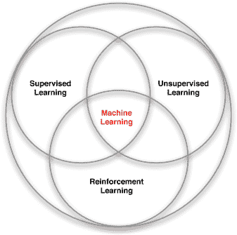

Figure 1.2 Branches of Machine Learning (Image Credit: David Silver's RL Course)

更重要的是，RL 旨在解决的问题类可以用一个简单而强大的数学框架来描述，即 `Markov Decision Processes`（缩写为 MDPs）。我们有一整章专门深入介绍 MDPs，但在下一节中我们将对 MDPs 进行快速的高层次介绍。

## 1.5 马尔可夫决策过程（MDP）框架简介

马尔可夫决策过程的框架在 Figure 1.3 中描绘。如图所示，`Agent` 和 `Environment` 在一个按时间排序的循环中进行交互。术语 `Agent` 指的是一个算法（AI 算法），术语 `Environment` 指的是一个向 Agent 提供不确定结果的抽象实体。需要注意的是，在这个框架中，Environment 确实是抽象的，可以用于建模各种现实世界的情况，例如金融市场提供随机股票价格，或公司客户提供随机需求，或国际象棋对手提供随机走法（从 Agent 的角度来看），或者你能想象的任何在每个时间步提供随机事物的东西（由我们来适当地建模 Environment 以适应 MDP 框架）。

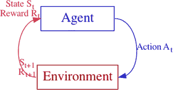

Figure 1.3 The MDP Framework

如图所示，在每个时间步 `t`，Agent 观察到一个抽象的信息片段（我们称之为 `State`）和一个数值（实数）量（我们称之为 `Reward`）。需要注意的是，`State` 的概念在这个框架中确实是完全抽象的，我们可以将 `State` 建模为任何数据类型，可以尽可能复杂或精细。这种对 `State` 建模的灵活性使我们能够将各种现实世界的情况建模为 MDP。在时间步 `t` 观察到 `State` 和 `Reward` 后，`Agent` 通过采取 `Action` 来响应。同样，`Action` 的概念是完全抽象的，旨在表示 AI 算法执行的活动。它可以是对市场股票价格波动做出的股票买卖，也可以是对商店大量销售做出的从仓库向商店移动库存，或者可以是对对手棋步做出的棋步（对手是 `Environment`），或者你能想象的任何对 `Environment` 提供的观察（`State` 和 `Reward`）做出响应的事物。

在时间步 `t` 接收到来自 `Agent` 的 `Action` 后，`Environment` 会响应（时间滴答滴答地跳到 `t` + 1），提供下一个时间步的随机 `State` 和随机 `Reward`。一个技术细节（我们将在后面详细解释）是，`State` 被假设具有 `Markov Property`，这意味着：

*   下一个 `State/Reward` 仅取决于当前的 `State`（对于给定的 `Action`）。

*   当前的 `State` 包含了 `Agent` 和 `Environment` 之间交互历史的所有相关信息。

*   当前的 `State` 是未来的充分统计量（对于给定的 `Action`）。

`Agent` 在任何时刻的目标是通过控制（在每个时间步）`Action` 作为观察到的 `State`（在该时间步）的函数，来最大化所有未来 `Reward`s 的 `Expected Sum`。任何时间步从 `State` 到 `Action` 的这个函数被称为 `Policy` 函数。因此，我们说代理人的工作是通过确定 `Optimal Policy` 函数来行使控制。因此，这是一个在不确定性下的动态（即，按时间排序）控制系统。如果上述描述过于简略，请不要担心——我们将在即将到来的章节中详细解释所有这些内容。目前，我们只是想快速了解 MDP 框架的样子。现在我们用一些（简略的）数学符号来勾勒上述描述，以提供 MDP 框架的更多概览。以下符号用于离散时间步（连续时间步符号类似，但在技术上更复杂，难以在此描述）：

我们将时间步表示为 `t` = 1, 2, 3, …。时间 `t` 的马尔可夫状态表示为 `S`[*t*] ∈ 𝒮，其中 𝒮 被称为 `State Space`（可数集）。时间 `t` 的动作表示为 `A`[*t*] ∈ 𝒜，其中 𝒜 被称为 `Action Space`（可数集）。时间 `t` 的奖励表示为 `R`[*t*] ∈ 𝒟，其中 𝒟 是 ℝ 的可数子集（表示 Environment 在每个时间步 `t` 提供的数值反馈，连同状态一起）。

我们用以下符号表示从一个时间步到下一个时间步的转移概率：

```
\begin{array}{r} {p(r,s^{\prime}|s,a) = {\mathbb{P}}\lbrack(R\_{t + 1} = r,S\_{t + 1} = s^{\prime})|S\_{t} = s,A\_{t} = a\rbrack} \\\\ \end{array}
```

`γ` ∈ [0, 1] 被称为折扣因子，用于在累积奖励时对奖励进行折扣，如下所示：

```
\begin{array}{r} {\text{Return~}G\_{t} = R\_{t + 1} + \gamma \cdot R\_{t + 2} + \gamma^{2} \cdot R\_{t + 3} + \ldots} \\\\ \end{array}
```

折扣因子 `γ` 允许我们建模未来奖励不如同等数量的当前奖励可取的情况。


目标是找到一个 `Policy` `π`:𝒮→𝒜，使其对所有 `s` ∈ 𝒮 都能最大化 𝔼[`G`[`t`]|`S`[`t`] = `s`]。在后续章节中，我们将阐明，MDP 框架实际上考虑的策略比这里描述的更为一般——即随机策略，也就是输入状态并输出动作概率分布（而非单一动作）的函数。然而，为了便于理解核心概念，在本章中，我们坚持使用确定性策略 `π`:𝒮→𝒜。

这里的直觉是，两个实体 `Agent` 和 `Environment` 在一个按时间顺序循环的过程中相互作用，其中 `Environment` 根据转移概率函数 `p` 提供下一个状态和奖励，而 `Agent` 则通过执行政策 `π` 来控制 `p` 的不确定性，以优化从任何状态开始的“累积奖励期望值”（即预期回报）。

值得指出的是，MDP 框架的灵感来源于婴儿（`Agent`）如何学习执行任务（即采取 `Action`s），以响应他们观察到的来自周围世界（`Environment`）的随机活动和事件（`State`s 和 `Reward`s）。Figure 1.4 说明了这一点——图的底部（标记为“World”，即 `Environment`）是房子里的一个房间，书架上放着一个花瓶。图的顶部是房间另一侧的一个婴儿（学习中的 `Agent`），她想要走到书架前，拿起花瓶并将其打翻——高效地做到这一点（即快速且安静）对婴儿来说意味着巨大的 `Reward`。在每个时间步，婴儿处于某种姿势（例如，躺在地板上，或坐起来，或试图走路等），并观察房间里的各种视觉信息——她的姿势和视觉信息构成了每个时间步婴儿的 `State`。婴儿的 `Action`s 是各种尝试到达房间另一侧的身体动作选项（假设婴儿还在学习走路）。婴儿尝试一种身体动作，但无法借此向前移动。这意味着一个负面的 `Reward`——婴儿很快就明白这个动作可能不是个好主意。然后她尝试另一种动作，也许是试图站起来开始走路。她向前迈出了几个好步子（正面的 `Reward`s），但随后摔倒并伤到自己（那将是一个巨大的负面 `Reward`）。因此，通过试错，婴儿了解了不同动作（不同动作）的后果。最终，婴儿学会了通过扶着沙发可以走过去，然后当她到达书架时，她又学会了（同样通过试错）一种既快速又安静爬上书架的技巧（这样她就不会引起妈妈的注意）。这意味着婴儿学会了最优策略（她所处的每个状态的最佳动作），这基本上是一种“试错”式的学习方法，用来学习什么有效、什么无效。这个例子在 MDP 框架中基本上得到了概括，而婴儿的“试错”学习方式本质上是强化学习这一通用技术的一个特例。


Figure 1.4 Baby Learning MDP

## 1.6 适合 MDP 框架的现实问题

如你现在所想象的，自然界和商业（以及我们个人生活中）的各种问题都可以建模为马尔可夫决策过程。以下是此类问题的示例：

*   自动驾驶车辆（动作构成速度/转向，以优化安全性/时间）。

*   象棋游戏（动作构成棋子的移动，以优化获胜机会）。

*   复杂的物流操作，例如仓库中的操作（动作构成库存移动，以优化吞吐量/时间）。

*   使人形机器人在困难地形上行走/奔跑（动作是行走动作，以优化到达目的地的时间）。

*   管理投资组合（动作是交易，以优化长期投资收益）。

*   足球比赛中的最优决策（动作是战略性比赛指令，以优化获胜机会）。

*   赢得选举的策略（动作构成政治决策，以优化赢得选举的机会）。

Figure 1.5 说明了自动驾驶汽车的 MDP。图的顶部是 `Agent`（汽车的驾驶算法），图的底部是 `Environment`（汽车驾驶时面临的一切——其他车辆、交通信号、路况、天气等）。`State` 包含汽车的位置、速度以及汽车传感器/摄像头获取的所有信息。`Action` 包含转向、加速和刹车。`Reward` 将是乘坐舒适度和安全性指标的组合，以及每个时间步的负值（因为最大化累积奖励就等于最小化到达目的地所需的时间）。

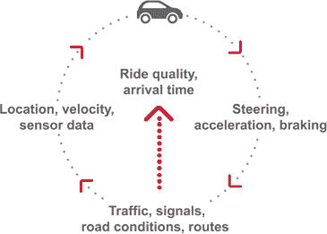

Figure 1.5 Self-driving Car MDP

## 1.7 求解 MDP 的固有困难

“求解”一个 MDP 指的是用算法识别最优策略。本节描绘了为什么求解一般 MDP 从根本上说是一个难题的直观图景。通常，挑战仅仅在于 `State Space` 非常大（涉及许多变量）或复杂（精巧的数据结构），因此在计算上难以处理。同样，有时 `Action Space` 也可能非常大或复杂。

但是，求解 MDP 之所以本质上困难，主要原因是对于给定的状态，没有直接的反馈来指示什么是“正确”的动作。我们的意思是，与监督学习框架不同，MDP 框架除了 `Reward` 反馈之外，不会给我们任何指示来判断一个动作是否是 `right one`。大奖励可能会鼓励 Agent，但不清楚是仅仅因为运气好得到了大奖励，还是如果 Agent 再次尝试该动作可能会有更大的奖励。动作与奖励之间的联系还因 MDP 中存在按时间顺序的复杂性而进一步复杂化，这意味着一个动作可以影响未来的状态，进而影响未来的动作。因此，我们有时会发现动作可能有延迟的后果，即一个好动作的奖励可能在许多时间步之后才到来（例如，在一场象棋比赛中，一个精妙的棋步在几步之后导致获胜）。

在现实世界中遇到的另一个问题是，Agent 通常不知道环境的 `model`。这里所说的模型，是指状态转移和奖励的概率（我们上面定义的函数 `p`）。这意味着 Agent 必须同时从现实世界数据流中学习模型，并求解最优策略。

最后，当动作很多时，Agent 需要尝试所有动作，以检查是否存在一些隐藏的宝藏（尚未尝试过的优秀动作），这反过来意味着可能会在“失败品”（糟糕的动作）上浪费精力。因此，Agent 必须在 `exploitation`（重复尝试迄今为止已产生良好奖励的动作）和 `exploration`（尝试要么还没有被尝试足够多次，要么根本没有被尝试过的动作）之间找到平衡。

这一切似乎都表明，我们无法以可靠且高效的方式求解 MDP 的希望不大。但事实证明，通过一些巧妙的数学，我们确实可以取得一些进展。我们将在下一节中概述这种“巧妙数学”的核心思想。

## 1.8 VALUE FUNCTION, BELLMAN EQUATIONS, DYNAMIC PROGRAMMING AND RL


# 值函数与贝尔曼方程

或许我们想在这整本书中强调的最重要概念是 `Value Function` 的概念，以及如何使用 `Planning` 或 `Learning` 算法高效地计算它。给定（固定）策略 `π` 的值函数 `V^π:𝒮→ℝ` 定义为：

$$
\begin{array}{r} {V^{\pi}(s) = \mathbb{E}_{\pi,p}\lbrack G_{t}|S_{t} = s\rbrack\text{~for~all~}s \in \mathcal{S}} \\ \end{array}
$$

理解值函数的直观方式是，它告诉我们从给定状态可以期望获得多少“累积未来奖励”（即 `Return`）。期望下的随机性来自于基于函数 `p`，Agent 在执行策略 `π` 规定的未来动作时将要看到的不确定的未来状态和奖励。评估给定策略的值函数的关键在于，它可以用下一时间步状态的值函数递�地表示。换句话说，

$$
\begin{array}{r} {V^{\pi}(s) = {\sum\limits_{r,s^{\prime}}p}(r,s^{\prime}|s,\pi(s)) \cdot (r + \gamma \cdot V^{\pi}(s^{\prime}))\text{~for~all~}s \in \mathcal{S}} \\ \end{array}
$$

这个方程表明，当 Agent 遵循确定性策略 `π` 时，在给定状态 `s` 下，它采取动作 `a = π(s)`，然后观察到一个随机的下一状态 `s'` 和一个随机奖励 `r`，因此 `V^π(s)` 可以分解为 `r`（即下一步的即时预期奖励）的期望以及未来预期累积奖励的其余部分（后者可以用 `V^π(s')` 的期望来表示）。本章我们不会深入探讨如何求解这个递�式（将在未来章节中详细介绍），但目前重要的是要认识到，这个递�式是评估给定策略的值函数的关键。

然而，评估给定策略的值函数并不是最终目标——它只是实现评估 `Optimal Value Function`（从中我们得到 `Optimal Policy`）这一最终目标的一种手段。最优值函数 `V*:𝒮→ℝ` 定义为：

$$
\begin{array}{r} {V^{*}(s) = \max_{\pi}V^{\pi}(s)\text{~for~all~}s \in \mathcal{S}} \\ \end{array}
$$

好消息是，即使最优值函数也可以递�地表示，如下所示：

$$
\begin{array}{r} {V^{*}(s) = \max_{a}{\sum\limits_{r,s^{\prime}}p}(r,s^{\prime}|s,a) \cdot (r + \gamma \cdot V^{*}(s^{\prime}))\text{~for~all~}s \in \mathcal{S}} \\ \end{array}
$$

此外，我们可以证明存在一个最优策略 `π*`，它对所有 `s ∈ 𝒮` 都能实现 `V*(s)`（证明是构造性的，它给出了一种从函数 `V*` 获得函数 `π*` 的简单方法）。具体来说，这意味着遵循最优策略 `π*` 所得到的值函数与最优值函数 `V*` 相同，即，

$$
\begin{array}{r} {V^{\pi^{*}}(s) = V^{*}(s)\text{~for~all~}s \in \mathcal{S}} \\ \end{array}
$$

这里有一些术语需要熟悉。计算 `V^π(s)`（给定策略的值函数）的问题被称为 `Prediction` 问题（因为这相当于在遵循策略 `π` 时，对从任何给定状态获得的预期回报进行统计估计）。计算最优值函数 `V*`（以及因此的最优策略 `π*`）的问题被称为 `Control` 问题（因为这需要引导策略，以便从任何状态获得最大预期回报）。求解 Prediction 问题通常是求解（更难的）Control 问题的垫脚石。这些针对 `V^π` 和 `V*` 的递�方程被称为（著名的）Bellman Equations（你将在未来章节中多次听到它们）。在连续时间公式中，Bellman Equation 被称为著名的 `Hamilton-Jacobi-Bellman (HJB)` 方程。

基于 Bellman 方程求解预测和控制问题的算法大致分为：

*   Dynamic Programming，一类（在 A.I. 术语中）`Planning` 算法。

*   Reinforcement Learning，一类（在 A.I. 术语中）`Learning` 算法。

现在让我们谈谈 Dynamic Programming 算法与 Reinforcement Learning 算法之间的区别。Dynamic Programming 算法（本书将大量介绍）假设 Agent 知道转移概率 `p`，并且算法利用这些概率的知识（利用 Bellman Equation 高效计算值函数）。Dynamic Programming 算法被认为是 `Planning` 而不是 `Learning`（在 A.I. 术语中），因为算法不需要与 Environment 交互，也不需要从 Environment 传来的（状态，奖励）数据流中学习。相反，凭借转移概率，算法可以推理未来的概率结果并执行必要的优化计算以推断最优策略。因此，它 `plans` 其成功之路，而不是 `learning` 如何成功。

然而，在典型的现实世界情况中，人们并不真正知道转移概率 `p`。这就是 Reinforcement Learning (RL) 的领域。RL 算法与 Environment 交互，从 Environment 接收到的每个新的（状态，奖励）对中学习，并逐步找出最优值函数（使用我们之前概述的“试错”方法）。然而，请注意，Environment 交互可以是 `real` 交互或 `simulated` 交互。在后一种情况下，我们确实有一个转移模型，但模型的结构非常复杂，以至于我们只能访问下一状态和奖励的样本（而不是概率的显式表示）。这被称为 Environment 的 `Sampling Model`。有了这样的环境采样模型（例如，机器人在模拟地形上学习），我们可以使用与在真实环境中交互时（例如，机器人在实际地形上学习）所使用的相同 RL 算法。事实上，大多数 RL 算法在实践中都是从环境的采样模型中学习的。如前所述，RL 本质上是一种“试错”学习方法，因此非常费力且从根本上效率低下。RL 的最新进展来自于更高效的学习最优值函数的方法，以及更好的近似最优值函数的方法。RL 未来的关键挑战之一是找到更好的方法来平衡动作的“探索”和“利用”。无论如何，RL 最近开始取得良好效果的关键原因之一是得到了 Deep Learning 的帮助（通常使用深度神经网络来近似值函数和/或近似策略函数）。使用这种深度学习近似的 RL 以现代术语 `Deep RL` 而闻名。

我们相信，当前 A.I. 的前景取决于 Deep RL 的成功。未来十年将令人兴奋，因为 RL 研究可能会产生改进的算法，并且它与 Deep Learning 的结合有望使我们能够解决相当复杂的现实世界随机控制问题。

## 1.9 章节大纲

本书的章节组织为 4 个模块，如下所示：

*   Module I: Processes and Planning Algorithms (Chapters 3 – 6)

*   Module II: Modeling Financial Applications (Chapters 7 – 10)

*   Module III: Reinforcement Learning Algorithms (Chapters 11 – 14)

*   Module IV: Finishing Touches (Chapters 15 – 17)


在介绍这 4 个模块中的章节内容之前，本书首先以 2 个预备章节开篇。其中第一个预备章节就是 `this chapter`（即你正在阅读的这一章），它作为 `Overview`，涵盖了学习强化学习（RL）（以及更广泛的应用数学）的教学方面、本书将要获得的学习内容概要、阅读本书所需的背景知识、随机控制、MDP、值函数、贝尔曼方程、DP 和 RL 的高层次概述，最后是本书章节大纲。第二个预备章节名为 `Programming and Design`。由于本书大量使用 Python 代码来开发数学模型和实现算法，我们将在本章中介绍所需的 Python 背景知识（具体来说，就是我们在 Python 代码中使用的设计范式）。需要说明的是，本章并非完整的 Python 教程——读者预期已经具备一定的 Python 基础。它是 Python 中一些关键技术和实践的教程（许多本书的读者可能不习惯这些技术），我们在本书中大量使用这些技术，它们在应用数学更广泛的编程领域也高度相关。我们将介绍 `Classes`、`Inheritance`、`Abstract Classes`、`Static Types`、`Generic Programming`、`Dataclasses`、`Immutability`、`First-class Functions`、`Lambdas`、`Iterators` 和 `Generators`。

本书剩余章节按照我们上面列出的 4 个模块进行组织。

## 模块 I：过程与规划算法

本书的第一个模块涵盖了马尔可夫决策过程（MDP）、动态规划（DP）和近似动态规划（ADP）的理论，内容跨越 第 3 章 – 第 6 章。

为了理解 MDP 框架，我们从 第 3 章 中的 `Markov Processes`（有时也称为马尔可夫链）的基础知识开始。马尔可夫过程没有奖励或动作，只有状态和状态转换。我们认为，花大量时间研究这个简化的马尔可夫过程框架，是进入 MDP 之前的绝佳准备。第 3 章 接着在马尔可夫过程的基础上引入奖励（但不包括动作）的概念——引入奖励后形成的框架被称为马尔可夫奖励过程。有了马尔可夫奖励过程，我们就可以讨论值函数和贝尔曼方程，这为以后在 MDP 的背景下理解值函数和贝尔曼方程提供了良好的准备。第 3 章 通过股票价格的例子和一个简单的库存示例来阐释这些概念，该示例既作为马尔可夫过程，也作为马尔可夫奖励过程。本章还包含大量编程内容，以培养对这些概念的熟悉度和深度。

第 4 章 关于 `Markov Decision Processes` 奠定了 RL 的基础理论——即用于表示在不确定性下处理序列最优决策问题的框架（马尔可夫决策过程）。你将学习马尔可夫决策过程与马尔可夫奖励过程之间的关系，以及值函数和贝尔曼方程。同样，本章包含大量编程练习。对这一理论的深入投入加上动手编程实践，将使你处于非常有利的位置，能够以非常清晰和快速的方式学习后续章节。

第 5 章 关于 `Dynamic Programming` 介绍了动态规划（DP）的规划技术，这是一类重要的基础算法，如果 MDP 不太大或不太复杂，它可以作为 RL 的替代方案。此外，学习这些算法为更深入地理解后续 RL 算法提供了重要基础。到本章结束时，你将了解几种重要的 DP 算法，并了解为什么 DP 在实践中变得困难，这引出了 RL 的动机。同样，我们介绍了大量快速实现的编程练习，这将大大有助于内化这些概念。最后，我们强调一种特殊算法——后向归纳——用于求解有限时域马尔可夫决策过程，这是本书所涵盖的金融应用的场景。

第 5 章 中介绍的动态规划算法面临着所谓的两个“诅咒”：维度灾难和建模诅咒。这些诅咒可以通过采样和函数近似的结合来治愈。模块 III 介绍采样治疗方法（使用强化学习）。第 6 章 关于 `Function Approximation and Approximate Dynamic Programming` 涵盖了函数近似的主题，并展示了一种中间治疗方法——近似动态规划（无采样的函数近似）——通常相当可行，并可适用于某些问题。作为本章的一部分，我们实现了线性函数近似和基于深度神经网络的近似（前向和反向传播算法），以便我们可以在近似动态规划算法以及后来的 RL 中使用这些近似方法。

## 模块 II：金融应用建模

本书的第二个模块涵盖了效用理论的背景知识以及随机控制的 5 个金融应用，内容跨越 第 7 章 – 第 10 章。

我们从 第 7 章 开始本模块，该章关于 `Utility Theory`，涵盖了一个非常重要的经济学概念，它是后续章节中我们所涵盖的大多数金融应用的先决条件。这是风险厌恶的概念（即人们希望如何因承担风险而获得补偿）以及相关的风险溢价和效用函数概念。本模块中剩余的章节不仅涵盖了 5 个金融应用，还详细介绍了如何将它们建模为 MDP、开发 DP/ADP 算法来求解它们，并编写大量代码来实现这些算法，这有助于很好地内化所学内容。请注意，在实践中，这些金融应用可能变得相当复杂，DP/ADP 算法的扩展性不佳，这意味着我们需要借助 RL 算法来求解它们。因此，当我们在模块 III 中介绍 RL 算法时，将重新回顾这些金融应用。

第 8 章 标题为 `Dynamic Asset Allocation and Consumption`。本章介绍了 5 个金融应用中的第一个。这个问题涉及如何根据金融市场的变化调整个人财富在各种投资选择中的分配。该问题还涉及在一生中每个时间段应消费多少财富，以便从财富消费中获得最佳效用。因此，这是一个关于在一段时间内将财富动态分配给金融资产并适当消费个人财富的联合问题。这个问题最好在默顿 1969 年的里程碑式论文的背景下理解，他在其中提出并求解了这个问题。本章主要集中在使用动态规划对默顿问题的数学推导上。你还将学习如何在简单环境下使用近似后向归纳（第 6 章 中介绍的一种 ADP 算法）来求解资产分配问题。


# Chapter 9

Chapter 9 涵盖了数学金融中一个非常重要的主题：*衍生品定价与对冲*。对衍生品定价与对冲进行全面且严谨的覆盖是一个相当复杂且高级的主题，超出了本书的范围。但我们提供了一种方法，通过考虑一个非常简单的设置——即单期、离散结果且没有对冲再平衡的设置（这在一般理论中很典型）来理解理论。在涵盖基础理论之后，我们涵盖了美式期权最优行权问题以及在*不完备市场*中衍生品最优定价/对冲问题（这两个问题都建模为 MDP）。在本章中，你将学习一些非常重要的金融基础，例如套利、复制、市场完备性以及至关重要的风险中性度量等概念。你将学习在这个简单设置下资产定价两大基本定理的证明。我们还提供了一般理论的概述（超出这个简单设置）。接下来，你将学习如何将最优停止的一般问题建模为 MDP，并特化到美式期权最优行权的情况。你将学习如何使用后向归纳（我们在 Chapter 5 中学习的一种 DP 算法）来解决这个问题，前提是状态空间不太大。最后，你将学习如何通过将此问题建模为 MDP 来对衍生品定价/对冲中包含现实世界摩擦。在本章结束时，你将在定价和对冲复杂衍生品方面发展出显著的专业知识，这是金融行业中非常抢手的技能。

# Chapter 10

Chapter 10 关于 *订单簿算法* 涵盖了剩余的两个金融应用，涉及算法交易领域。算法交易的当前做法是采用基于规则和启发式的技术。然而，算法交易正在迅速转变为基于机器学习的算法。在本章中，你将首先了解交易订单下放的机制（市价单和限价单），然后了解一个非常重要的现实问题——如何通过拆分要交易的股票并最优地安排拆分时机来提交大规模市价单，以克服“价格冲击”并获得最大收益。你将学习基于动态规划的经典方法。接下来，你将学习市场摩擦以及需要用 RL 来解决它们。在本章的后半部分，我们涵盖了最优执行问题的算法交易对应问题——即做市商需要提交动态变化的买入和卖出限价单，以便她能获得最大收益。你将了解做市商（一个庞大且蓬勃发展的行业）是如何运作的。然后你将学习如何将此问题建模为 MDP。我们将对 Avellaneda 和 Stoikov 的经典动态规划解决方案进行彻底的覆盖。最后，你将接触到此问题的现实世界细微差别，因此，需要使用市场校准的模拟器和 RL 来解决。

## 1.9.3 Module III: Reinforcement Learning Algorithms

本书的第三个模块涵盖了 Chapters 11 – 14 中的强化学习算法。

# Chapter 11

Chapter 11 关于 *蒙特卡洛和时序差分用于预测* 开启了本书的新阶段——我们进入 RL 算法的世界。为了理解 RL 的基础知识，我们在本章开始时将 RL 问题限制在一个非常简单的问题中——即状态空间小且可作为表格枚举来管理（称为表格 RL）且我们只需要计算固定策略下的值函数（这个问题称为预测问题，与称为控制问题的优化问题相对）。限制于表格预测很重要，因为它使得在这个简化设置中更容易理解蒙特卡洛（MC）和时序差分（TD）的核心概念。本章的后半部分将表格预测扩展到带函数近似的预测（利用我们在 Chapter 6 中在 ADP 背景下开发的函数近似基础）。剩余章节将基于本章，添加更多复杂性和细微差别，同时保留本章开发的许多关键核心概念。一如既往，你将通过从头开始编写大量 MC 和 TD 算法来学习。

# Chapter 12

Chapter 12 关于 *蒙特卡洛和时序差分用于控制* 从预测自然扩展到控制，同时最初保持在表格设置中。在 Chapter 11 中对 MC 和 TD 核心概念的理解投资在这里得到了回报，因为 SARSA 和 Q-learning 等重要控制算法现在可以以极大的清晰度来学习。在本章中，我们将在 Python 中从头开始实现 SARSA 和 Q-Learning。本章还介绍了一个对 RL 在现实世界中未来成功非常重要的概念：非策略学习（Q-Learning 是最简单的非策略学习算法，并且在各种应用中取得了良好的成功）。本章的后半部分将表格控制扩展到带函数近似的控制（利用我们在 Chapter 6 中开发的函数近似基础）。

# Chapter 13

Chapter 13 关于 *批量 RL、经验回放、DQN、LSPI、梯度 TD* 从基础和更传统的 RL 算法转向 RL 中的最近创新。我们从本章开始介绍 *批量 RL* 和 *经验回放* 的重要思想，这通过在数据到来时存储数据并在算法的学习过程中分批重复使用它，从而更有效地利用数据。我们强调了创新的深度 Q 网络算法，它利用经验回放和深度神经网络进行 Q-Learning。我们还强调了一种简单但重要的批量 RL 技术，使用线性函数近似——预测问题的算法称为最小二乘时序差分，其解决控制问题的扩展称为最小二乘策略迭代。我们在模块 II 的一个金融应用背景下讨论了这些算法。在本章的后半部分，我们提供了支撑 RL 算法的核心数学的更深入洞察（回到贝尔曼方程的基础）。理解 *值函数几何* 将使你在真正理解是什么让某些算法在某些情况下成功而在其他情况下失败方面处于非常有利的地位。本章还解释了如何摆脱所谓的致命三元组（当引导、函数近似和非策略一起使用时，RL 算法往往会失败）。最先进的梯度 TD 算法抵抗致命三元组，我们深入研究其内部工作原理以了解如何以及为什么。


# 第 14 章 策略梯度算法

第 14 章关于 *策略梯度算法* 介绍了一类非常不同的 RL 算法，这些算法基于使用策略函数近似的梯度来改进策略（而不是通常基于 Q-值函数的显式 argmax 的策略改进）。当动作空间较大或连续时，策略梯度往往是唯一的选择，因此，本章对于克服许多现实世界的挑战（包括许多金融应用中的挑战）非常有用，因为在这些挑战中动作空间确实很大。你将学习优雅的策略梯度定理的数学证明，并从头实现几个策略梯度算法。你将学习最先进的 Actor-Critic 方法以及一些在实践中表现良好的专门算法。最后，你还将学习进化策略，这是一种看起来与策略梯度算法非常相似，但从技术上讲不是 RL 算法的算法。然而，学习进化策略很重要，因为一些现实世界的应用，包括金融应用，确实可以用进化策略很好地解决。

## 1.9.4 模块 IV：收尾工作

本书的第四模块（第 15 章 – 第 17 章）提供收尾工作——涵盖平衡探索与利用的杂项主题，展示如何将模块 I 的规划方法与模块 III 的学习方法相结合，并提供关于现实世界中实际细微差别的视角。

第 15 章关于 *多臂老虎机：探索 versus 利用* 是对平衡探索和利用主题的深入探讨，这是 RL 算法中非常重要的一个主题。探索 versus 利用在多臂老虎机（MAB）问题的更简单环境下最容易理解。你将学习各种最先进的 MAB 算法，使用 Python 实现它们，并绘制各种图表以了解它们在各种问题设置中相互之间的表现。然后，你将接触到上下文老虎机，这是优化广告投放选择的一种流行方法。最后，你将学习如何在 RL 中应用 MAB 算法。

第 16 章关于 *融合学习与规划* 将本书中学习的各种规划和学习概念结合起来。你将学到，在实践中，人们需要在融合规划和学习概念方面发挥创造力（一种被称为基于模型的 RL 的技术）。在实践中，许多问题确实是使用基于模型的 RL 来解决的。你还将熟悉一种算法（蒙特卡洛树搜索），该算法在解决围棋游戏时广受欢迎，围棋曾被认为是当前 AI 技术无法克服的问题。

第 17 章是关于 *总结与现实世界考虑* 的结尾章节。本章的目的有两个：首先，总结本书的关键收获；其次，提供一些关于如何将本书的收获应用于实践（以解决现实世界问题）的评论。我们特别关注人们在现实世界中面临的挑战——建模困难、问题规模困难、运营挑战、数据挑战（访问、清洗、组织），以及当企业从旧系统转向 AI 系统时面临的变革管理挑战。我们还提供了一些关于如何基于 RL 构建端到端系统的指导。

## 1.9.5 简短附录章节

最后，本书末尾有 7 个简短的附录章节。第一个附录关于 *矩生成函数* 及其在本书各种计算中的应用。第二个附录关于 *投资组合理论*，涵盖了投资组合中平衡收益与风险的数学基础以及备受赞誉的资本资产定价模型（CAPM）。第三个附录涵盖了 *随机微积分* 的基础知识，因为我们需要其中的一些理论（*Itô 积分、Itô 引理* 等）用于模块 II 中几个章节的推导。第四个附录关于 *HJB 方程*，它是模块 II 中涵盖的 5 个金融应用中 2 个的闭式解推导的关键部分。第五个附录涵盖了著名的 *Black-Scholes 方程*（及其对看涨/看跌期权的解）的推导。第六个附录是关于 *作为仿射空间的函数近似* 的技术视角，这有助于更深入地理解函数近似的数学原理。第七个附录涵盖了高斯和伯努利数据分布参数的共轭先验分布的贝叶斯更新公式。

# 第 2 章 编程与设计

DOI: [10.1201/9781003229193-2](https://doi.org/10.1201/9781003229193-2)

编程是一种几乎没有约束的创造性工作：想象某事，你很可能就能构建它——以*许多*不同的方式。既解放又令人满足，但也具有挑战性。就像从空白页面开始写小说或从空白画布开始作画一样，一个新程序是如此开放，以至于有点令人生畏。从哪里开始？系统会是什么样子？你如何把它做*对*？你如何拆分问题？你如何防止代码演变成一团糟？

没有简单的答案。编程本质上是迭代的——我们很少一开始就得到正确的设计，但我们可以随时编辑代码并随着时间的推移进行重构。但是，仅仅迭代是不够的；就像画家需要技巧和构图一样，程序员需要模式和设计。

现有的教学资源往往淡化编程技术和设计。理论和算法密集的书籍将模型和算法显示为用伪代码编写的自包含过程，而没有真实代码库的更广泛背景（以及相应的设计考虑）。较新的 AI/ML 材料有时采取不同的方法，提供使用工业级框架的真实代码示例，但很少涉及软件设计问题。

在本书中，我们采取第三种方法。从*零开始*，我们构建一个反映本书所涵盖的关键思想和算法的 Python 框架。我们定义的抽象映射到我们引入的关键概念；我们构建代码的方式映射到这些概念之间的关系。

与伪代码方法不同，我们不是在真空中实现算法；相反，每个算法都建立在书中前面引入的抽象之上。通过从零开始（而不是使用现有的 ML 框架），我们保持代码相对简单，而不必担心特定示例过时。我们可以专注于本书中重要的概念，同时*就地*教授编程和设计，展示一种有意识的代码设计方法。

## 2.1 代码设计

我们如何将像强化学习这样复杂的领域转化为易于理解、调试和扩展的代码？我们如何将这个问题拆分为可管理的部分？这些部分如何交互？

这些问题没有简单的单一答案。没有两个编程挑战是相同的，同一个挑战有许多合理的解决方案。一个稳固的设计一开始不会完全清晰；心中要有明确的方向，但要预期会随着时间的推移重新审视特定的决定。这正是我们对本书代码所做的：我们对一个与我们所呈现的主题相匹配的 Python 强化学习框架有了愿景，但随着我们写了越来越多的书，我们随着想出更好的想法或发现之前的设计未涵盖的新要求而修订了框架代码。


我们可能没有简单的答案，但我们确实拥有模式和原则——根据我们的经验，这些模式和原则能持续产出高质量代码。将这些理念结合起来，就形成了一种面向代码设计的哲学，其核心在于定义和组合反映我们对领域认知的 `abstractions`。由于代码本身可以指向特定的设计理念和能力，因此存在一个反馈循环：扩展我们设计的编程抽象，可以帮助我们发现新的算法和功能，从而提升对领域的理解。

究竟什么是 `is` 抽象？这是一个恰如其分的抽象问题！抽象是一种“复合概念”：一个将多个独立概念合并为单一概念的整体。我们可以沿两个维度组合概念：

*   我们可以 `compose` 不同的概念，思考它们作为一个整体时的行为。汽车发动机有数千个以复杂方式相互作用的部件，但对于大多数目的，我们可以将其视为一个单一对象。

*   我们可以 `unify` 不同的概念，通过识别它们的相似之处。不同品种的狗可能看起来完全不同，但我们可以将它们全部视为狗。

人类大脑一次只能处理有限数量的独立概念——我们天生的工作记忆是有限的。一个相当简化的模型是，我们在工作记忆中只有少数几个“槽位”，无法同时跟踪更多独立的想法。我们克服这一限制的方式是提出 `new` 的想法（新的 `abstractions`），将多个概念合并为一个。

我们希望围绕抽象来组织代码，原因与我们使用抽象来理解更复杂概念相同。你如何理解代码？你会在脑海中运行程序吗？这是一个自然的起点，对于简单程序有效，但很快就会变得困难，然后变得不可能。计算机没有工作记忆限制，每秒可以运行 `billions` 条指令，我们无法跟上。计算机运行代码不需要结构或抽象，但我们需要它，才能有望编写或理解超出最简单程序的任何东西。代码中的抽象将信息和逻辑分组，使我们能够思考丰富的概念，而不是分别跟踪每个信息位和每条指令。

细节可能有所不同，但围绕与领域稳固心智模型相对应的抽象来设计代码，在任何领域和任何编程语言中都效果良好。这可能需要一些额外的前期思考，但如果做得好，这种设计风格会带来丰厚回报。我们的目标是编写让 `for ourselves` 生活更轻松的代码；这有助于从一次性的实验代码到大型团队的软件工程工作的方方面面。

## 2.2 环境设置

你可以通过从 GitHub 获取本书中所有示例所需的 RL 框架副本来跟进。

Python 代码依赖于多个 Python 库。一旦你拥有代码仓库的副本，就可以通过运行几个 shell 命令来创建包含正确库的环境。

首先，移动到包含代码库的目录：

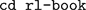

然后，创建并激活 Python 虚拟环境 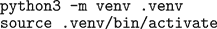

你只需要创建一次环境，但每次从新 shell 想要处理代码时都需要激活它。环境激活后，你可以安装每个 Python 依赖项的正确版本：

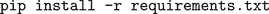

要访问框架本身，你需要以可编辑模式（`-e`）安装它：

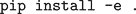

环境设置完成后，你可以通过运行框架的自动化测试来确认其正常工作：

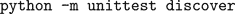

如果一切安装正确，运行此命令后，你应该在输出的最后一行看到“OK”消息。

## 2.3 类和接口

设计干净的抽象实际上包含什么？回答这个问题总是有两个部分：

1. 理解你正在建模的领域概念。

2. 弄清楚如何使用编程语言提供的功能和模式来表达该概念。

让我们跳入一个扩展示例，看看这到底意味着什么。强化学习——实际上所有统计学和机器学习——的关键构建块之一是概率。我们将如何在代码中处理不确定性和随机性？

一种方法是让概率保持隐式。每当我们有一个随机变量时，可以调用一个函数并获得随机结果（技术上称为 `sample`）。如果我们正在编写一个带有两个六面骰子的大富翁游戏，我们会这样定义它：

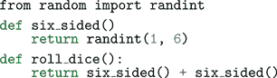

这有效，但相当有限。我们只能一次获得一个结果。更重要的是，这只捕捉了我们 `think` 关于概率的一部分：有 `randomness`，但我们甚至没有提到概率分布（在本章剩余部分简称为 `distribution`s）。我们有结果，也有一个可以反复调用的函数，但无法将该函数与与概率无关但碰巧返回整数的函数区分开来。

我们如何编写代码来获取分布的期望值？如果我们有一个参数化分布（例如，泊松分布或高斯分布，由参数表征），如果需要，我们可以获取参数吗？

由于分布在代码中是隐式的，代码的 `intentions` 不清楚，很难编写能够概括分布的代码。分布对机器学习至关重要，因此这不是一个很好的起点。

### 2.3.1 分布接口

为了解决这些问题，让我们为概率分布定义一个抽象。

我们如何在代码中表示分布？我们可以对分布 `do` 什么？这取决于我们正在处理的分布的具体类型。如果我们知道分布的结构——也许它是 `λ = 5` 的泊松分布，也许它是每个结果都有设定概率的经验分布——我们可以做很多事情：生成精确的概率分布函数（PDF）或累积分布函数（CDF），计算期望值并高效地执行各种操作。但并非我们处理的所有分布都是这样！如果分布来自复杂的模拟呢？在极端情况下，我们可能只能从分布中抽取样本，除此之外别无他法。

采样是最小公约数。我们可以对了解不足以做其他事情的分布进行采样，也可以对知道确切形式和参数的分布进行采样。我们为概率分布开始的任何抽象都需要涵盖采样，而任何要求超过采样的抽象都无法让我们处理所有我们关心的分布。

在 Python 中，我们可以用一个类来表达这个想法：

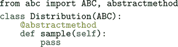

这个类定义了一个 `interface`：对某物要被视为分布所需条件的定义。我们将来实现的任何类型的分布都将至少能够生成样本；当我们编写采样分布的函数时，它们可以要求其输入继承自 `Distribution`。


该类本身并未实际实现 sample。Distribution 捕捉了我们可以采样的分布的 `abstract concept`，但我们需要指定一个具体分布才能实际采样任何内容。为了在 Python 中体现这一点，我们将 Distribution 设为 `abstract base class`（ABC），并将 `sample` 设为 `abstract` 方法——即没有实现的方法。抽象类和抽象方法是 Python 提供的功能，用于帮助我们为抽象定义接口。我们可以在定义任何具体分布之前，先定义 `Distribution` 类来构建其余概率分布代码的结构。

## 2.3.2 具体分布

既然有了接口，我们该如何使用它？接口可以从两个方面来理解：

* `requires` 接口的东西。这将是使用接口中指定的操作，并与满足这些要求的 `any` 值一起工作的代码。

* `provides` 接口的东西。这将是支持接口中指定的操作的某个值。

如果我们有一些代码需要接口，以及另一些代码满足该接口，我们知道可以将两者结合起来，使其正常工作——即使这两边在编写时互不了解或引用对方。接口管理着两边如何交互。

要使用我们的 `Distribution` 类，可以先提供一个 `concrete class` 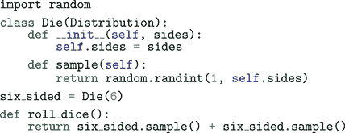

这个版本的 `roll_dice` 与前一节中 `roll_dice` 的行为完全相同，但为了达到目的，需要编写大量额外代码。这样做有什么意义？

关键区别在于，我们现在有一个值代表掷骰子的 `distribution`，而不仅仅是一次掷骰子的结果。代码更易于理解——当我们遇到 `Die` 对象时，其含义和意图非常明确——并且它为我们添加更多骰子特定功能提供了位置。例如，如果我们能打印掷骰子的 `outcome` 以及骰子本身，那将有助于调试——否则，我们怎么知道是否为给定情况掷出了具有正确面数的骰子呢？

如果我们使用函数来表示骰子，打印它就没有用处：

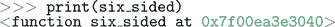

话虽如此，我们迄今定义的 `Die` 类也好不到哪里去：

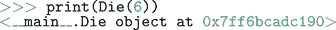

有了类——与函数不同——我们可以修复这个问题。Python 允许我们通过重写特殊方法来更改对象的一些内置行为。要更改类的打印方式，可以重写 `__repr__`： 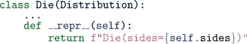

好多了：

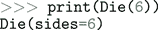

这看似微不足道，但能让调试 `much` 更容易，尤其是随着代码库变得更大、更复杂。

### 2.3.2.1 Dataclasses

我们编写的 `Die` 类是有意保持简单的。我们的骰子由单个属性定义：它拥有的面数。`__init__` 方法将面数作为输入，并将其放入类的 `attribute` 中；一旦创建了 `Die` 对象，就没有理由更改此值——如果我们需要不同面数的骰子，可以直接创建一个新对象。抽象不必复杂也能有用。

不幸的是，Python 类的一些默认行为不太适合简单的类。我们已经看到，需要重写 `__repr__` 才能获得有用的行为，但这并非唯一不便的默认设置。Python 默认用于比较对象相等性的方式——`__eq__` 方法——使用 `is` 运算符，这意味着它按 `by identity` 比较对象。这对于通常会随时间变化的类来说是合理的，但对于像 `Die` 这样的简单抽象来说却不合适。两个面数相同的 `Die` 对象具有相同的行为并表示相同的概率分布，但使用默认版本的 `__eq__`，分别声明的两个 `Die` 对象永远不会相等：

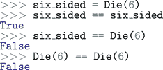

这种行为不便且令人困惑，是那种容易导致难以发现的 bug 的边缘情况。就像我们重写 `__repr__` 一样，可以通过重写 `__eq__` 来修复：

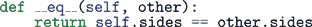

这修复了我们之前看到的奇怪行为：

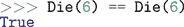

然而，如果使用 `==` 将 `Die` 与非 `Die` 值进行比较，这种简单的实现会导致错误：

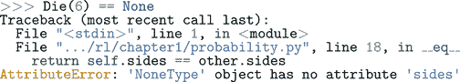

我们通常不会用 `==` 比较不同类型的值——对于 `None`，`Die(6) is None` 会更符合习惯——但 Python 的通常预期是，不同类型上的 `==` 会返回 `False` 而不是抛出异常。我们可以通过显式检查 `other` 的类型来修复：

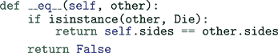

本书其余部分中我们定义的大多数类都遵循相同的模式——它们由少量参数定义，`__init__` 所做的只是设置一些属性，并且需要自定义 `__repr__` 和 `__eq__` 方法。为每个类手动定义 `__init__`、`__repr__` 和 `__eq__` 并不算 `too` 糟——这些定义完全是系统化的——但它确实带来了一些实际成本：

* 没有重要内容的额外代码使得在代码库中 `read` 和 `navigate` 变得更加困难。

* 错误很容易悄悄混入。例如，如果你向类添加了一个属性但忘记将其添加到 `__eq__` 方法中，你不会得到错误——`==` 只是会忽略该属性。除非你有明确检查 `==` 如何处理新属性的测试，否则这种疏忽可能会被忽略，并导致使用你的类的代码出现奇怪的行为。

* 坦白说，手动编写这些方法只是 `tedious`。

幸运的是，Python 3.7 引入了一种修复所有这些问题的功能：`dataclasses`。`dataclasses` 模块提供了一个装饰器 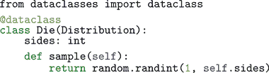

这个版本的 `Die` 以更易于编写的方式实现了我们想要的精确行为——更重要的是——`far` 更易于阅读。作为对比，以下是如果不使用 dataclasses 我们需要编写的代码：

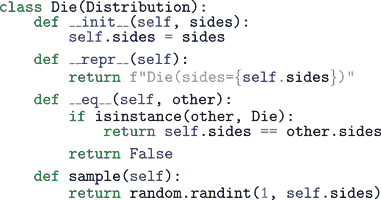

你可以想象，对于具有更多属性的类，差异会更加显著！

Dataclasses 为 Python 中的类提供了如此有用的基础，以至于本书中我们定义的 `majority` 类都是 dataclasses——除非我们有 `specific` 的理由不使用，否则我们都会使用 dataclasses。

### 2.3.2.2 Immutability

一旦创建了 `Die` 对象，更改其面数就没有意义了——如果我们需要不同骰子的分布，可以直接创建一个新对象。如果在代码的某一部分更改了 `Die` 对象的面数，它也会在代码库中使用该对象的每个其他部分发生变化，而这些变化很难追踪。即使更改在某个地方是合理的，在代码的其他部分可能也不是预期的。更改状态会在看似独立的代码部分之间创建不可见的连接，这使得在脑海中跟踪变得困难。这绝对是产生 bug 的配方！

通常，我们在 Python 中仅通过约定来避免这种问题：没有什么 `stops` 我们更改 `Die` 对象的面数，但我们知道不应该这样做。这可行，但远非理想；就像依赖安全带比单纯依赖驾驶技术更好一样，让语言阻止我们做错事比单纯依赖约定更好。普通的 Python 类没有方便的方法来防止属性更改，但幸运的是 dataclasses 有：

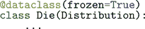

使用 `frozen=True`，尝试更改面数将引发异常：

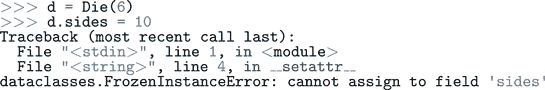

我们无法更改的对象称为 `immutable`。我们可以返回一个属性已更改的新副本，而不是 `in place` 更改对象；dataclasses 提供了一个 `replace` 函数来简化此操作：

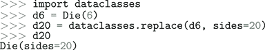


这个例子有点绕——对于这样一个简单的对象，我们只需写 `d20 = Die(20)` 即可——但 `dataclasses.replace` 在处理具有多个属性的更复杂对象时会更加有用。

返回数据的新副本而非原地修改是 Python 库中的常见模式。例如，Pandas 的大多数操作——如 `drop` 或 `fillna`——都会返回 DataFrame 的副本，而不是原地修改 DataFrame。这些方法有一个 `inplace` 参数作为选项，但这会导致足够多的混乱行为，以至于 Pandas 团队目前正在讨论彻底弃用 `inplace`。

除了帮助防止奇怪的行为和错误，`frozen=True` 还有一个重要的好处：我们可以将不可变对象用作字典键和集合元素。如果没有 `frozen=True`，我们会得到一个 `TypeError`，因为非冻结的 dataclasses 不实现 `__hash__`：

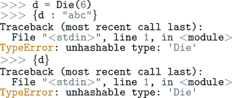

使用 `frozen=True` 时，字典和集合的工作方式符合预期：

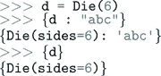

不可变的 dataclass 对象表现得像普通数据——与字符串和整数差别不大。在本书中，我们对 `frozen=True` 的做法与对 dataclasses 的一般做法相同：除非有特定理由不这样做，否则我们设置 `frozen=True`。

## 2.3.3 检查类型

骰子必须具有 `int` 类型的边数——0.5 个边或 `"foo"` 个边根本说不通。Python 不会阻止我们尝试 `Die("foo")`，但如果我们尝试对其进行采样，就会得到一个 `TypeError`：

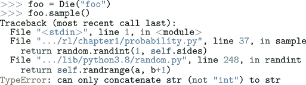

对象属性的类型是指示对象应如何使用的有用指标。Python 的 dataclasses 允许我们使用类型注解（也称为“类型提示”）来指定每个属性的类型：

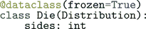

在普通 Python 中，这些类型注解主要用于文档——用户可以一目了然地看到每个属性的类型，但当对象以错误的类型创建属性时，语言不会引发错误。外部工具——集成开发环境（IDE）和类型检查器——可以在不运行代码的情况下捕获带注解的 Python 代码中的类型不匹配。使用类型感知编辑器时，`Die("foo")` 会带有错误消息下划线：

> 参数类型 "Literal\['foo'\]" 不能分配给函数 "\_\_init\_\_" 中参数 "sides" 的类型 "int"
>
> "Literal\['foo'\]" 与 "int" 不兼容\[reportGeneralTypeIssues\]

这个特定的消息来自通过语言服务器协议（LSP）运行的 pyright，但 Python 有多种不同的类型检查器可用

不需要调用 `sample` 来查看错误——然后我们还需要仔细阅读以追溯到错误的来源——错误会在不需要运行代码的情况下被高亮显示给我们。

#### 2.3.3.1 静态类型

能够在不运行代码的情况下找到类型不匹配称为静态类型。有些语言（例如，Java、C++）要求所有代码都必须是静态类型；Python 不是。事实上，Python 最初是一种没有类型注解的动态类型语言。只有在包含错误的代码运行时，类型错误才会出现。

Python 仍然主要是一种动态类型语言——大多数地方的类型注解都是可选的，并且没有针对注解的内置检查。在 `Die("foo")` 示例中，只有当我们运行将 `sides` 传递给需要 `int` 的函数（`random.randint`）的代码时，才会得到错误。我们可以使用外部工具进行静态检查，但即便如此，它仍然是可选的——即使经过静态检查的 Python 代码也会运行动态类型检查，我们可以自由地混合使用经过静态检查的代码和“普通” Python。在动态类型语言之上的可选静态类型称为渐进式类型，因为我们可以逐渐将静态类型添加到现有的动态类型代码库中。

Dataclass 属性不是唯一有用知道类型的地方；对函数参数、返回值和变量知道类型也很方便。Python 支持所有这些的可选注解；dataclasses 是唯一要求注解的语言结构。为了帮助混合带注解和未带注解的代码，类型检查器会报告明确带注解的代码中的不匹配，但通常不会尝试为未带注解的代码推断类型。

我们如何为示例代码添加类型注解？到目前为止，我们已经定义了两个类：

*   `Distribution`，一个定义概率分布接口的抽象类
*   `Die`，一个 n 面骰子分布的具体类

我们已经注解了 `Die` 中的 `sides` 必须是 `int`。我们还知道骰子投掷的结果是 `int`。我们可以通过在 `def sample(...)` 后添加 `-> int` 来注解这一点：

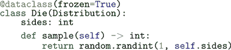

其他类型的具体分布会有不同类型的结果。硬币翻转要么是 `"heads"`，要么是 `"tails"`；正态分布会产生一个 `float`。在编写任何类型的数学建模代码时，类型注解尤其重要，因为我们确保代码中的类型规范与我们数学（符号）描述中的集合的精确规范清晰对应。

## 2.3.4 类型变量

为 `Die` 类注解 `sample` 很简单：骰子投掷的结果始终是数字，因此 `sample` 始终返回 `int`。但是 `sample` 一般来说会有什么类型呢？`Distribution` 类定义了任何分布的接口，这意味着它需要涵盖任何类型的结果。对于我们的第一个版本的 `Distribution` 类，我们没有为 `sample` 注解任何内容：

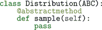

这可以工作——注解是可选的——但可能会令人困惑：我们编写的一些代码适用于任何类型的分布，一些代码需要返回数字的分布，其他代码则需要其他东西……在每个实例中，`sample` 最好返回某些东西，但这并没有明确注解。当我们省略注解时，我们的代码仍然可以工作，但我们的编辑器或 IDE 不能捕获那么多错误。

这里的困难在于，不同类型的分布——`Distribution` 接口的不同实现——会从 `sample` 返回不同的类型。为了处理这个问题，我们需要类型变量：代表在不同上下文中可以是不同类型的某个类型的变量。类型变量也称为“泛型”，因为它们让我们编写可以泛型地适用于任何类型的类。

要为抽象的 `Distribution` 类添加注解，我们需要为分布的结果定义一个类型变量，然后告诉 Python `Distribution` 在这个类型上是“泛型”的：

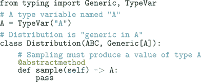

在这段代码中，我们定义了一个类型变量 `A` 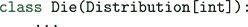

这让我们编写只适用于某些类型分布的专用函数。假设我们想要编写一个函数，通过重复采样并计算平均值来近似分布的期望值。这个函数适用于具有数值结果（`float` 或 `int`）的分布，但不适用于其他类型的分布（我们如何计算随机名称的平均值？）。我们可以通过使用 `Distribution[float]` 来明确注解这一点：

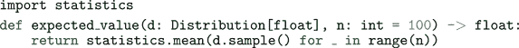

使用此函数：

*   `expected_value(Die(6))` 没问题
*   `expected_value(RandomName())`（其中 `RandomName` 是 `Distribution[str]`）会是类型错误

在具有非数值结果的分布上使用 `expected_value` 会在运行时引发类型错误。在编辑器中看到这一点可以节省我们的时间——我们立即看到错误，而不是等待测试运行——并且即使我们的测试套件没有捕获到问题，也能捕获问题。

## 2.3.5 功能

到目前为止，我们已经介绍了用于处理概率分布的两个抽象：

*   `Distribution`：定义概率分布接口的抽象类
*   `Die`：用于掷公平 n 面骰子的分布


这是一个示例性的例子，但它不能让我们做太多事情。如果我们只需要 n 面骰子，单独定义一个 `Distribution` 类就有些大材小用了。抽象是管理复杂性的手段，但我们定义的任何抽象本身也会给代码库增加一些复杂性——这又是程序员需要学习和理解的一个概念。我们始终值得考虑，定义和使用抽象所带来的额外复杂性是否值得其带来的好处。抽象如何帮助我们理解代码？它能防止哪种错误——又会鼓励哪种错误？它能为我们提供哪些额外的功能？如果我们对这些问题没有足够充分的答案，就应该考虑不引入这个抽象。

如果我们只关心骰子，`Distribution` 就不值得定义。不过，强化学习涉及多种具体的分布——任何给定的强化学习问题都可能有领域特定的分布——以及需要适用于所有这些问题的算法。这给了我们两个定义 `Distribution` 抽象的理由：`Distribution` 将统一不同的强化学习应用，并将我们的强化学习代码推广到不同的上下文中。通过针对像 `Distribution` 这样的通用接口进行编程，我们的算法将能够适用于本书中展示的不同应用——甚至能适用于我们在设计代码时未曾考虑到的应用。

在代码中定义通用抽象的一个实际优势是，它为我们提供了一个添加功能的位置，这些功能将适用于抽象的 `any` 实例。例如，对于我们可以采样的概率分布，最常见的操作之一就是绘制 `n` 个样本。当然，我们每次需要这样做时都可以写一个循环：

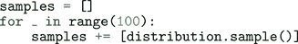

这段代码是 `fine` 的，但不算 `great`。Python 中的 for 循环可能几乎在做 `anything`；它用于重复几乎任何事情。乍一看很难理解循环在做什么，所以我们需要仔细阅读代码才能看出它正在将 100 个样本放入列表中。由于这是一个非常常见的操作，我们可以添加一个方法来替代它：

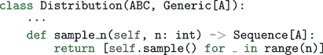

这里的实现不同——它使用了 `list comprehension` 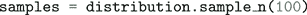

这行代码的含义——以及程序员背后的意图——乍一看就非常清晰。

当然，这个例子相当有限。用列表推导式构建一个包含 100 个样本的列表，比直接调用 `sample_n(100)` 稍微复杂一点，但差别不大——乍一看它仍然完全可读。当函数本身变得更加复杂时，在抽象上实现通用函数的这种模式会变得更加有用。

然而，定义像 `sample_n` 这样的方法还有另一个优势：某些类型的分布可能有更高效或更准确的方式来实现相同的逻辑。如果是这种情况，我们会覆盖 `sample_n` 以使用更好的实现。使用 `sample_n` 的代码将自动受益；而使用循环或推导式的代码则不会。例如，如果我们通过包装 numpy 随机模块中的函数来实现一个分布，就会发生这种情况：

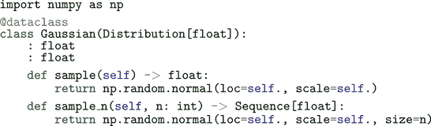

numpy 针对数组操作进行了优化，这意味着调用 `numpy.random.normal` `the first time` 时会有前期开销，但之后可以快速生成更多样本。性能影响是显著的

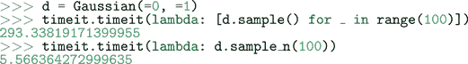

相差了 53 倍！

`Distribution` 及其几个实现 `Distribution` 接口的具体类（包括 `Gaussian`）的代码在文件 `rl/distribution.py` 中。

## 2.4 抽象计算

到目前为止，我们已经了解了如何通过定义接口（如 `Distribution`）和编写类（如 `Die`）来为我们的领域构建编程模型。类和接口为我们提供了一种建模领域中“事物”的方式，但在强化学习等领域，“事物”还不够：我们还需要一种方式来抽象我们正在采取的 `actions` 或正在执行的计算。

类确实为我们提供了一种建模行为的方式：`methods`。一个常见的比喻是，对象充当“名词”，而方法充当“动词”——方法是我们可以对对象执行的操作。这是一种有用的能力，它让我们能够对不同类型的对象执行相同类型的操作进行抽象。例如，我们的 `sample_n` 方法，凭借其默认实现，为我们提供了两点：

1. 如果我们为新类型的分布实现自定义的 `sample` 方法，我们就可以免费获得该分布的 `sample_n`。

2. 如果我们实现了一种新类型的分布，它有比调用 `sample` n 次更快地获取 n 个样本的方法，我们可以覆盖该方法以使用更快的算法。

如果我们将 `sample_n` 设为普通函数，我们可以得到 1. 但不能得到 2.；如果我们将 `sample_n` 保留为抽象方法，我们会得到 2. 但不能得到 1.。在抽象类上拥有一个非抽象方法，让我们两全其美。

那么，如果方法是我们的“动词”，我们还需要什么呢？虽然方法对行为进行抽象，但它们是 `indirectly` 实现的——我们可以将对象视为独立的值，但我们只能 `on` 对象上使用方法，无法谈论计算本身。从语法角度延伸这个比喻，这就像有动词却没有不定式或动名词——我们可以谈论“某人正在滑雪”，但无法谈论“滑雪”本身，或某人“计划去滑雪”！

在这个世界里，“名词”（对象）是 `first-class citizens`，但“动词”（方法）不是。在编程语言中，什么是“第一类”值是一个模糊的概念；一个合理的测试标准是，我们是否可以将值传递给函数或将其存储在数据结构中。我们可以对对象这样做，但对于方法来说，这样做意味着什么并不明确。

## 2.4.1 第一类函数

如果我们没有一种第一类的方式来谈论行为（与对象相对），一种绕过这个问题的方法是将函数表示为 `as` 只有一个方法的对象。我们就可以像普通值一样传递它们，当需要实际执行行为或计算时，只需调用对象的方法即可。这个解决方案表明，拥有一种第一类的方式来处理行为是有意义的，但它需要额外的抽象层（一个只为拥有一个方法而存在的对象），这本身并没有增加任何实质性内容，反而让我们的意图变得不那么清晰。

幸运的是，在 Python 中我们不必诉诸单一方法对象模式，因为 Python 拥有 `first-class functions`：函数本身就是可以传递和存储的值，不需要单独的包装对象。

第一类函数为我们提供了一种新的方式来抽象计算。方法让我们能够谈论不同对象的相同行为；第一类函数让我们能够对不同的行为做些 `with` 事情。一个简单的例子可能是重复同一操作 n 次。没有抽象，我们可能会使用 for 循环来实现：

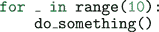

与其每次都写一个循环，不如将此逻辑提取为一个函数，该函数接受 n `and` `do_something` 作为参数：

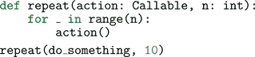

`repeat` 接受 `action` 和 `n` 作为参数，然后调用 `action` n 次。`action` 的类型是 `Callable`，在 Python 中，它涵盖函数以及任何可以使用 `f()` 语法调用的对象。我们还可以指定 `Callable` 应该具有的返回类型和参数；如果我们想要一个接受 `int` 和 `str` 作为输入并返回 `bool` 的函数的类型，我们会写 `Callable[[int, str], bool]`。


带有 repeat 函数的版本使我们在代码中的意图更加清晰。for 循环可以做很多不同的事情，而 repeat 始终只是重复。在这种情况下，这并不是很大的区别——for 循环版本足够易读，不构成重大障碍——但当涉及复杂或特定领域的逻辑时，这一点就变得更加重要。

让我们来看看之前定义的 `expected_value` 函数：

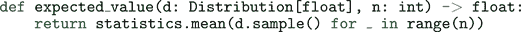

我们不得不将此函数限制为 `Distribution[float]`，因为只对数值结果求期望才有意义。但是，如果我们有其他东西，比如抛硬币呢？我们仍然希望能够以某种方式理解分布的期望，但要使其有意义，我们需要将结果（“正面”或“反面”）映射到数字（例如，我们可以说“正面”是 1，“反面”是 0.）。我们可以通过获取 Coin 分布，将其转换为 `Distribution[float]`，然后在其上调用 `expected_value` 来实现，但这可能效率低下，而且确实很别扭。另一种方法是将映射作为参数提供给 `expected_value` 函数：

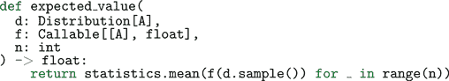

`expected_value` 的实现几乎没有改变——它仍然是之前的相同平均值计算，只是我们对每个结果应用 `f`。然而，这个小改变使函数变得更加灵活：我们现在可以对*任何*类型的 Distribution 调用 `expected_value`，而不仅仅是 `Distribution[float]`。

回到我们的硬币示例，我们可以这样使用它：

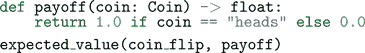

`payoff` 函数将结果映射到数字，然后我们使用该映射计算期望值。

我们将在本书的多个地方看到一等函数的使用；需要记住的关键思想是，*函数是值*，我们可以像处理任何其他对象一样传递或存储它们。

#### 2.4.1.1 Lambdas

`payoff` 本身是一个相当合理的函数：它有一个清晰的名称，并且作为一个独立的概念工作。然而，通常我们希望在某些特定上下文中使用一等函数，在这种情况下，给函数命名既不需要，甚至可能会分散注意力。即使在像 `payoff` 这样有合理名称的情况下，如果该函数只会在一个地方使用，引入额外的命名函数可能也不值得。

幸运的是，Python 为我们提供了一种替代方案：`lambda`。Lambda 是函数字面量。我们可以写 `3.0` 并得到一个数字而无需给它命名，我们可以编写一个 lambda 表达式来得到一个函数而无需给它命名。下面是与 `payoff` 函数相同的示例，但使用 lambda 而不是：

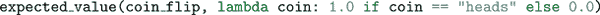

这里的 lambda 表达式的行为与早期版本中的 `def payoff` 完全相同。请注意，lambda 作为一个单一表达式且没有 return——如果你在函数中需要多个语句，你将不得不使用 `def` 而不是 lambda。在实践中，lambda 对于主体是*简短*表达式的函数非常出色，但任何太长或太复杂的东西作为独立函数 `def` 读起来会更好。

## 2.4.2 Iterative Algorithms

一等函数为我们提供了对*单个*计算的抽象：我们可以传递函数，给它们输入并获得输出，但输入和输出之间的计算是一个完全的黑盒。函数的调用者对函数内部发生的事情没有控制权。这种限制可能是一个真正的问题！

在强化学习——以及数值编程的其他领域——中一个常见的场景是*迭代收敛*到正确结果的算法。我们可以反复运行算法以获得越来越准确的结果，但每次迭代的改进会变得越来越小。例如，我们可以通过从某个初始猜测 `x[0]` 开始并反复计算 `x[n + 1]` 来近似 *a* 的平方根：

$$\\begin{array}{r} {x\_{n + 1} = \\frac{x\_{n} + \\frac{a}{x\_{n}}}{2}} \\\\ \\end{array}$$  

在每次迭代中，`x[n + 1]` 以越来越小的步骤接近正确答案。在某个时候，从 `x[n]` 到 `x[n + 1]` 的变化变得足够小，以至于我们决定停止。在 Python 中，这种逻辑可能看起来像这样：

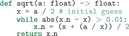

`while` 循环中硬编码的 `0.01` 应该引起怀疑。我们怎么知道 `0.01` 是正确的停止条件？我们如何决定何时停止？

这个问题的诀窍在于，当我们实现一个通用函数时，我们*无法*知道何时停止，因为我们需要的精度水平将取决于结果的用途！是函数的*调用者*知道何时停止，而不是*作者*。

我们可以做的第一个改进是将 `0.01` 转换为额外的参数：

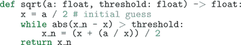

这比硬编码的 `0.01` 是一个明确的改进，但仍然有限。我们为函数的行为提供了一个额外参数，但控制权仍然根本上在函数手中。函数的调用者可能希望在方法收敛之前停止，如果它花费太多迭代或太多时间，但没有办法通过更改阈值参数来做到这一点。我们可以为所有这些提供额外参数，但我们很快就会发现，停止迭代的逻辑需要比迭代算法本身多得多的代码和复杂性！即使那样也不够；如果函数在某些特定应用中表现不符合预期，我们可能希望打印中间值或绘制随时间变化的收敛图——那么我们是否应该为此包含额外的控制参数？

那么，当我们有 *n* 个其他迭代算法时，我们该怎么办？我们是否要将相同的停止逻辑和参数复制粘贴到每个算法中？我们最终会得到大量冗余代码！

#### 2.4.2.1 Iterators and Generators

这种摩擦指向一个我们的代码不支持的概念区别：*每次迭代发生的事情*在逻辑上与*我们如何进行迭代*是分开的，但在我们的实现中，两者完全耦合。我们需要一种方式来抽象迭代，以便让我们分离*迭代生成*值和*消费*值。

幸运的是，Python 提供了强大的设施来做到这一点：`iterators` 和 `generators`。迭代器为我们提供了一种*消费*值的方式，生成器为我们提供了一种*生成*值的方式。

你可能没有意识到，但很可能你的 Python 代码一直在使用迭代器。Python 的 `for` 循环在底层使用迭代器来获取它正在遍历的每个值——这就是 `for` 循环对列表、字典、集合、范围甚至自定义类型工作的方式。试试看：

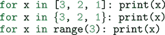

请注意，集合（`{3, 2, 1}`）的迭代器打印的是 `1 2 3` 而不是 `3 2 1`——集合不保留元素添加的顺序，因此它们按照某种内部定义的顺序遍历元素。

当我们遍历字典时，我们将打印*键*而不是*值*，因为这是默认迭代器。要获取值或键值对，我们需要分别使用 `values` 和 `items` 方法，每个方法返回不同类型的字典迭代器。

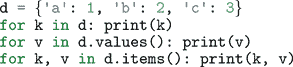

在这三种情况下，我们仍然在遍历同一个字典，只是每次得到不同的视图——迭代器为我们提供了以不同方式遍历同一结构的灵活性。

迭代器不仅仅用于 for 循环：它们为迭代提供了一种一等抽象。我们可以将它们传递给函数；例如，Python 的 `list` 函数可以将任何迭代器转换为列表。当我们想要查看专用迭代器的元素，而迭代器本身不打印其值时，这很方便：

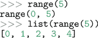


由于迭代器是一等公民值，我们也可以编写通用的迭代器函数。Python 标准库在 `itertools` 模块中有一组此类操作；例如，`itertools.takewhile` 允许我们在某个条件不再成立时立即停止迭代：


注意我们如何将 `takewhile` 的结果转换为列表——如果不这样做，我们会发现 `takewhile` 返回某种不透明的内部对象，该对象专门实现了该迭代器。这工作正常——我们可以在任何可以使用其他迭代器的地方使用 `takewhile` 对象——但在 Python 解释器中看起来有点奇怪：


现在我们已经看到了如何 *使用* 迭代器的一些示例，那么如何定义自己的迭代器呢？在最一般的意义上，Python 迭代器是任何实现 `__next__()` 方法的对象，但以这种方式实现迭代器非常笨拙。幸运的是，Python 提供了一种更方便的方法来创建迭代器，即使用 `yield` 关键字创建一个 *生成器*。`yield` 的作用类似于函数中的 `return`，不同之处在于它不完全停止函数，而是将生成的值输出到迭代器，并暂停函数，直到调用者消耗生成的元素。

这是一个有点抽象的描述，所以让我们看看这如何应用于我们的 `sqrt` 函数。我们将编写一个版本的 `sqrt`，它返回一个迭代器，算法的每次迭代作为一个值：


使用这个版本，我们在每次迭代中更新 `x` 然后生成更新后的值。调用者不再得到一个单一的值，而是得到一个包含无限次迭代的迭代器；由调用者决定评估多少次迭代以及何时停止。`sqrt` 函数本身有一个无限循环，但这不是问题，因为函数在每个 `yield` 处暂停执行，这让调用者随时可以停止它。

要对 `sqrt` 算法进行 10 次迭代，我们可以使用 `itertools.islice`：


固定次数的迭代对于探索很有用，但我们可能想要之前拥有的基于阈值的收敛逻辑。既然我们现在有了迭代的一等公民抽象，我们可以编写一个通用的 `converge` 函数，它接受一个迭代器并返回该迭代器的一个版本，该版本在两个值足够接近时立即停止。Python 3.10 及更高版本提供 `itertools.pairwise`，这使代码非常简单：


对于旧版本的 Python，我们还必须实现我们自己的 `pairwise` 版本：


这两个都遵循迭代器的常见模式：每个函数将迭代器作为输入 *并将迭代器作为输出返回*。这不一定总是如此，但当它是如此时，我们会获得一个巨大的优势：迭代器 → 迭代器操作 *可组合*。我们可以从一个迭代器（如我们的 `sqrt` 示例）开始，然后对其应用 *多个* 操作，从而获得相对复杂的行为。例如，调用 `sqrt` 的人可能希望在某个阈值处收敛，但以防算法因某种原因卡住，也希望在 10,000 次迭代时强制停止。我们不需要编写 `sqrt` 或 `converge` 的新版本来做到这一点；相反，我们可以将 `converge` *与* `itertools.islice` 一起使用：


这是一种强大的编程风格，因为我们可以分别编写和测试每个操作——`sqrt`、`converge`、`islice`——并通过以正确的方式组合它们来获得复杂的行为。如果我们 *不使用* 迭代器编写相同的逻辑，我们需要一个单一的循环来计算 `sqrt` 的每个步骤，检查收敛性 *并* 保持一个计数器以在 10,000 步后停止——并且我们需要为每个此类算法复制此模式！

迭代器和生成器将在本书中多次出现，因为它们为 *过程* 提供了一种编程抽象，使其成为支撑强化学习的 *数学* 过程的绝佳基础。

## 2.5 本章关键要点

*   本书中的代码设计不仅旨在说明每章涵盖的主题和算法，还旨在展示代码设计的一些一般原则。关注代码设计可以让我们拥有一个更易于理解、调试和扩展的代码库。

*   代码设计围绕抽象展开。抽象是一种将独立的信息片段结合起来或将不同概念统一为一个的代码结构。像 Python 这样的编程语言提供了不同的工具来表达抽象，但目标始终是一样的：使代码更易于理解。

*   类和接口（Python 中的抽象类）定义了数据上的抽象。同一概念的多个实现可以具有相同的接口（如 `Distribution`），使用该接口编写的代码将适用于 *任何* 兼容类的对象。传统的 Python 类有一些不便的限制，可以通过使用 `dataclasses`（带有 `@dataclass` 注解的类）来避免。

*   Python 具有类型注解，`dataclasses` 需要类型注解，但它们也有助于描述函数和方法中的接口。`mypy` 或 `PyCharm` 等附加工具可以使用这些类型注解在不运行代码的情况下捕获错误。

*   函数在 Python 中是一等公民值，这意味着它们可以存储在变量中，并作为参数传递给其他函数。类抽象数据；函数抽象计算。

*   迭代器抽象 *迭代*：按顺序发生、每次迭代后产生一个值的计算。强化学习主要关注迭代算法，因此迭代器成为处理不同强化学习算法的关键抽象之一。

## IProcesses and Planning Algorithms

# Chapter 3 Markov Processes

DOI: [10.1201/9781003229193-3](https://doi.org/10.1201/9781003229193-3)

本书关于“在序列不确定性下进行序列决策”。在本章中，我们将忽略“序列决策”方面，仅关注“序列不确定性”方面。

## 3.1 过程中的状态概念

为了温和地介绍 *状态* 的概念，我们从 *过程* 和 *状态* 的非正式概念开始（这将在本章后面正式化）。非正式地，可以将 *过程* 视为在离散时间步骤中产生一系列随机结果的过程，我们将用时间变量 *t* = 0, 1, 2, … 对其进行索引。过程产生的随机结果可能是我们关心的关键金融/交易/业务指标，例如金融衍生品的价格或投资者持有的投资组合的价值。为了理解和推理过程产生的这些随机结果的演变，关注过程在每个时间点 *t* 的内部表示是有益的，该内部表示从根本上负责驱动过程产生的结果。我们将过程在时间 *t* 的这种内部表示称为过程在时间 *t* 的（随机）*状态*，并将其表示为 *S*[*t*]。具体来说，我们有兴趣了解在给定当前状态 *S*[*t*] 和过去状态 *S*[0]、*S*[1]、…、*S*[*t* − 1] 的情况下，下一个状态 *S*[*t* + 1] 的概率，即 ℙ[*S*[*t* + 1] | *S*[*t*], *S*[*t* − 1], …, *S*[0]]。因此，为了澄清，我们区分了过程的内部表示（*状态*）和输出（结果）。*状态* 可以是任何数据类型——它可以是简单的单只股票的每日收盘价，也可以是非常复杂的东西，例如美国每家银行持有的每只公开交易股票的股数，如每周末所记录的那样。

## 3.2 从股票价格示例理解马尔可夫性质


## 马尔可夫过程与马尔可夫性质

我们将在本章中学习马尔可夫过程，这些过程具有被称为“马尔可夫性质”的 `States`。因此，我们现在将学习 `States 的马尔可夫性质`。让我们通过股票价格随时间随机演变的一些示例来对这一性质产生一些直观认识。

为了帮助理解，让我们假设股票价格仅取整数值，并且允许出现零或负股票价格。让我们将时间 `t` 的股票价格表示为 `X[t]`。让我们假设从时间步 `t` 到下一个时间步 `t + 1`，股票价格要么上涨 1，要么下跌 1，即 `X[t + 1]` 的唯二结果为 `X[t] + 1` 或 `X[t] − 1`。要理解股票价格随时间的随机演变，我们只需量化上涨概率 ℙ[`X[t + 1] = X[t] + 1`]，因为下跌概率 ℙ[`X[t + 1] = X[t] − 1`] = 1 − ℙ[`X[t + 1] = X[t] + 1`]。我们将考虑股票价格演变的 3 种不同过程。这 3 种过程将以 3 种不同的方式规定 ℙ[`X[t + 1] = X[t] + 1`]。

## Process 1

$$
\begin{array}{r} {{\mathbb{P}}\lbrack X_{t + 1} = X_{t} + 1\rbrack = \frac{1}{1 + e^{- \alpha_{1}(L - X_{t})}}} \\\\ \end{array}
$$

其中 `L` 是一个任意参考水平，`α[1] ∈ ℝ[≥ 0]` 是一个“拉动强度”参数。请注意，此概率定义为 `L − X[t]` 的逻辑函数，逻辑函数的陡峭程度由参数 `α[1]` 控制（参见 Figure 3.1）


Figure 3.1 Logistic Curves

解释 `L − X[t]` 的这个逻辑函数的方式是：如果 `X[t]` 大于参考水平 `L`（使得 ℙ[`X[t + 1] = X[t] + 1`] < 0.5），那么下行拉力大于上行拉力。同样，如果 `X[t]` 小于 `L`，那么上行拉力更大。拉力的程度由参数 `α[1]` 的大小控制。我们将这种行为称为 `mean-reverting behavior`，意味着股票价格倾向于回归到“均值”（即回归到参考水平 `L`）。

我们可以将 State `S[t] = X[t]` 建模，并注意下一个 State `S[t + 1]` 的概率仅取决于当前 State `S[t]`，而不取决于之前的 States `S[0], S[1], …, S[t − 1]`。非正式地，我们将此性质表述为：“给定当前，未来与过去独立”。正式地，我们可以将 states 的此性质描述为：

$$
\begin{array}{r} {{\mathbb{P}}\lbrack S_{t + 1}|S_{t},S_{t - 1},\ldots,S_{0}\rbrack = {\mathbb{P}}\lbrack S_{t + 1}|S_{t}\rbrack\text{~for~all~}t \geq 0} \\\\ \end{array}
$$

这是一种非常理想的性质，因为它有助于使此类过程的数学更加简单，计算更加可行。我们称这为 States 的 `Markov Property`，或者简单地说，这些是 `Markov States`。

让我们现在来编写代码。首先，我们创建一个 dataclass 来表示此过程的动态。如下面的代码所示，dataclass `Process1` 包含两个属性 `level_param: int` 和 `alpha1: float = 0.25`，分别表示 `L` 和 `α[1]`。它包含方法 `up_prob` 来计算 ℙ[`X[t + 1] = X[t] + 1`] 和方法 `next_state`，该方法从伯努利分布（其概率由方法 `up_prob` 获得）中采样，并从当前状态 `S[t]` 创建下一个状态 `S[t + 1]`。另外，请注意嵌套 dataclass `State`，它旨在表示 Process 1 的状态（其唯一属性 `price: int` 反映了状态仅由当前价格组成，而当前价格是一个整数）。


接下来，我们使用 Python 的生成器功能（使用 `yield`）编写一个简单的模拟器，如下所示：


现在我们可以使用此模拟器函数生成采样轨迹。在以下代码中，我们从价格 `X[0]` 的 `start_price` 开始，在 `time_steps` 个时间步上生成 `num_traces` 个采样轨迹。使用 Python 的生成器功能让我们可以使用 `itertools.islice` 函数“惰性地”（按需）执行此操作。


完整代码在文件 `rl/chapter2/stock_price_simulations.py` 中。我们鼓励你使用不同的 `start_price`、`level_param`、`alpha1`、`time_steps`、`num_traces` 来尝试此代码。你可以绘制股票价格采样轨迹的图表，或绘制不同时间点股票价格的终端分布图表（这两个绘图函数在此代码中均已为你提供）。

现在让我们考虑一个不同的过程。

## Process 2

$$
\begin{array}{l} {{\mathbb{P}}\lbrack X_{t + 1} = X_{t} + 1\rbrack = \left\{ \begin{array}{ll} {0.5(1 - \alpha_{2}(X_{t} - X_{t - 1}))} & {\text{if~}t > 0} \\\\ 0.5 & {\text{if~}t = 0} \\\\ \end{array}~ \right.} \\\\ \end{array}
$$

其中 `α[2]` 是闭区间 `[0,1]` 中的“拉动强度”参数。这里的直觉是，下一步移动 `X[t + 1] − X[t]` 的方向偏向于前一步移动 `X[t] − X[t − 1]` 的反方向，偏差的程度由参数 `α[2]` 控制。

我们注意到，如果将状态 `S[t]` 建模为 `X[t]`，则不会满足马尔可夫性质，因为 `X[t + 1]` 的概率不仅取决于 `X[t]`，还取决于 `X[t − 1]`。但是，我们可以在这里使用一个小技巧，创建一个由对 (`X[t]`, `X[t] − X[t − 1]`) 组成的增强状态 `S[t]`。在 `t = 0` 的情况下，状态 `S[0]` 可以取值 (`X[0]`, `Null`)，其中 `Null` 只是一个符号，表示到目前为止尚未发生股票价格变动。当状态 `S[t]` 为这对 (`X[t]`, `X[t] − X[t − 1]`) 时，我们可以看到马尔可夫性质确实得到满足：

$$
\begin{array}{r} {{\mathbb{P}}\lbrack(X_{t + 1},X_{t + 1} - X_{t})|(X_{t},X_{t} - X_{t - 1}),(X_{t - 1},X_{t - 1} - X_{t - 2}),\ldots,(X_{0},Null)\rbrack} \\\\ \end{array}
$$

$$
\begin{array}{r} {= {\mathbb{P}}\lbrack(X_{t + 1},X_{t + 1} - X_{t})|(X_{t},X_{t} - X_{t - 1})\rbrack = 0.5(1 - \alpha_{2}(X_{t + 1} - X_{t})(X_{t} - X_{t - 1}))} \\\\ \end{array}
$$

人们自然会好奇，为什么状态不仅仅由 `X[t] − X[t − 1]` 组成——换句话说，为什么 `X[t]` 也需要作为状态的一部分。确实，仅知道 `X[t] − X[t − 1]` 就能完全确定 `X[t + 1] − X[t]` 的概率。因此，如果我们在任何时间步 `t` 将状态设置为仅 `X[t] − X[t − 1]`，那么我们确实会得到一个仅具有两个状态 `+ 1` 和 `− 1` 的马尔可夫过程（它们之间有概率转移）。然而，这个简单的马尔可夫过程不能通过查看时间 `t` 的状态 `X[t] − X[t − 1]` 来告诉我们股票价格 `X[t]` 的值。在这个应用中，我们不仅关心马尔可夫状态转移概率，还关心从时间 `t` 的状态了解任何时间 `t` 的股票价格。因此，我们将状态建模为对 (`X[t]`, `X[t − 1]`)。

请注意，如果我们将状态 `S[t]` 建模为整个股票价格历史 (`X[0]`, `X[1]`, …, `X[t]`)，则马尔可夫性质将平凡地得到满足。如果我们将状态 `S[t]` 建模为 `t > 0` 时的对 (`X[t]`, `X[t − 1]`) 以及 `S[0]` 为 (`X[0]`, `Null`)，马尔可夫性质也将得到满足。然而，我们选择 `S[t] := (X[t], X[t] − X[t − 1])` 是“最简单/最小”的内部表示。事实上，在整本书中，我们为各种过程建模状态的努力，就是要用“最简单/最小”的状态表示来确保马尔可夫性质。Process 2 对应的 dataclass 如下所示：


生成股价采样轨迹的代码与我们为进程 1 编写的代码几乎完全相同。


现在让我们来看一个更复杂的进程。

**进程 3**：这是进程 2 的扩展，其中下一次移动的概率不仅取决于上一次移动，还取决于所有过去的移动。具体来说，它取决于过去上涨次数（记为 $U\_{t} = {\\sum\\limits\_{i = 1}^{t}\\max}(X\_{i} - X\_{i - 1},0)$）与过去下跌次数（记为 $D\_{t} = {\\sum\\limits\_{i = 1}^{t}\\max}(X\_{i - 1} - X\_{i},0)$）之间的关系，如下所示：

$$\\begin{array}{l} {{\\mathbb{P}}\\lbrack X\_{t + 1} = X\_{t} + 1\\rbrack = \\left\\{ \\begin{array}{ll} \\frac{1}{1 + {(\\frac{U\_{t} + D\_{t}}{D\_{t}} - 1)}^{\\alpha\_{3}}} & {\\text{if~}t > 0} \\\\ 0.5 & {\\text{if~}t = 0} \\\\ \\end{array}~ \\right.} \\\\ \\end{array}$$  

其中 *α*[3] ∈ ℝ[ ≥ 0] 是一个“拉力强度”参数。让我们将上述概率表达式视为：

$$\\begin{array}{r} {f(\\frac{D\_{t}}{U\_{t} + D\_{t}};\\alpha\_{3})} \\\\ \\end{array}$$  

其中 *f*:\[0,1\]→\[0,1\] 是一个 S 形函数

$$\\begin{array}{r} {f(x;\\alpha) = \\frac{1}{1 + {(\\frac{1}{x} - 1)}^{\\alpha}}} \\\\ \\end{array}$$  

其在 *x* = 0.5 处的陡峭程度由参数 *α* 控制（注意：*α* < 1 的值会产生反向 S 形函数，如 图 3.2 所示，该图展示了不同 *α* 值的单位 S 形函数 *f*）。


图 3.2 单位 S 形曲线

下一次上涨运动的概率本质上取决于量 $\\frac{D\_{t}}{U\_{t} + D\_{t}}$（函数 *f* 仅用于控制“反向拉力”的程度）。$\\frac{D\_{t}}{U\_{t} + D\_{t}}$ 是过去时间步中出现下跌运动的比例。因此，如果历史中的下跌次数多于历史中的上涨次数，那么下一次价格变动 *X*[*t* + 1] − *X*[*t*] 就会有更多的上涨拉力而非下跌拉力（反之亦然，当 *U*[*t*] > *D*[*t*] 时）。这种“反向拉力”的程度由“拉力强度”参数 *α*[3] 控制（由 S 形函数 *f* 管理）。

同样，请注意，如果我们将状态 *S*[*t*] 建模为 *X*[*t*]，我们将无法满足马尔可夫性质，因为下一个状态 *S*[*t* + 1] = *X*[*t* + 1] 的概率取决于股价变动的整个历史，而不仅仅取决于当前状态 *S*[*t*] = *X*[*t*]。然而，我们可以再次做一些巧妙的事情，创建一个足够紧凑的状态 *S*[*t*]，它仅由对 (*U*[*t*], *D*[*t*]) 组成。使用这种状态 *S*[*t*] 的表示，马尔可夫性质确实得到满足：

$$\\begin{array}{r} {{\\mathbb{P}}\\lbrack(U\_{t + 1},D\_{t + 1})|(U\_{t},D\_{t}),(U\_{t - 1},D\_{t - 1}),\\ldots,(U\_{0},D\_{0})\\rbrack = {\\mathbb{P}}\\lbrack(U\_{t + 1},D\_{t + 1})|(U\_{t},D\_{t})\\rbrack} \\\\ \\end{array}$$  

$$\\begin{array}{l} {= \\left\\{ \\begin{array}{ll} {f(\\frac{D\_{t}}{U\_{t} + D\_{t}};\\alpha\_{3})} & {\\text{if~}U\_{t + 1} = U\_{t} + 1,D\_{t + 1} = D\_{t}} \\\\ {f(\\frac{U\_{t}}{U\_{t} + D\_{t}};\\alpha\_{3})} & {\\text{if~}U\_{t + 1} = U\_{t},D\_{t + 1} = D\_{t} + 1} \\\\ \\end{array}~ \\right.} \\\\ \\end{array}$$  

需要注意的是，与进程 1 和 2 不同，进程 3 中的股价 *X*[*t*] 实际上不是状态 *S*[*t*] 的一部分。这是因为 *U*[*t*] 和 *D*[*t*] 共同包含足够的信息来捕捉股价 *X*[*t*]（因为 *X*[*t*] = *X*[0] + *U*[*t*] − *D*[*t*]，并且 *X*[0] 作为常数给出）。

进程 3 的相应数据类如下所示：


生成股价采样轨迹的代码如下所示：


如同进程 1 所建议的，你可以绘制股价采样轨迹的图表，或者通过在 rl/chapter2/stock\_price\_simulations.py 中修改代码，绘制进程 2 和 3 在各种终止时间点 *T* 的股价概率分布图表。

图 3.3 展示了 3 个进程中每个进程的单个股价采样轨迹。图 3.4 展示了在 1000 条轨迹上，终止时间 *T* = 100 时的股价概率分布。


图 3.3 单个采样轨迹


图 3.4 终止分布

在建立了对状态马尔可夫性质的直觉后，我们现在准备正式定义马尔可夫过程（部分文献将马尔可夫过程称为马尔可夫链，但我们将继续使用马尔可夫过程这一术语）。

## 3.3 马尔可夫过程的正式定义

本书中的正式定义将限于离散时间马尔可夫过程，其中时间以离散时间步 *t* = 0, 1, 2, … 向前推进。此外，为了便于阐述，本书中的正式定义将限于可计数的状态集。可计数集可以是有限集，也可以是与自然数集具有相同基数的无限集，即可枚举的集合。本书将涵盖连续时间马尔可夫过程的示例，其中时间是连续变量。

我们将 ℙ\[*S*[*t* + 1]|*S*[*t*]\] 称为时间 *t* 的转移概率。

这意味着时间齐次马尔可夫过程的动态可以通过以下函数完全指定：

$$\\begin{array}{r} \\left. \\mathcal{P}:(\\mathcal{S} - \\mathcal{T}) \\times \\mathcal{S}\\rightarrow\\lbrack 0,1\\rbrack \\right. \\\\ \\end{array}$$  

定义为：

$$\\begin{array}{r} {\\mathcal{P}(s,s^{\\prime}) = {\\mathbb{P}}\\lbrack S\_{t + 1} = s^{\\prime}|S\_{t} = s\\rbrack\\text{~for~time~steps~}t = 0,1,2,\\ldots,\\text{~for~all~}s \\in \\mathcal{S} - \\mathcal{T},s^{\\prime} \\in \\mathcal{S}} \\\\ \\end{array}$$  

使得

$$\\begin{array}{r} {{\\sum\\limits\_{s^{\\prime} \\in \\mathcal{S}}\\mathcal{P}}(s,s^{\\prime}) = 1\\text{~for~all~}s \\in \\mathcal{S} - \\mathcal{T}} \\\\ \\end{array}$$  

我们将函数 𝒫 称为时间齐次马尔可夫过程的转移概率函数，其中 𝒫 的第一个参数被视为 *源状态*，第二个参数被视为 *目标状态*。

请注意，上述规范中 𝒫 的参数不包含时间索引 *t*（因此，术语 *时间齐次* 意为“时间不变”）。此外，请注意，非时间齐次的马尔可夫过程可以通过将所有状态与时间索引 *t* 增广来转换为时间齐次马尔可夫过程。这意味着，如果非时间齐次马尔可夫过程的原始状态空间为 𝒮，那么相应的时间齐次马尔可夫过程的状态空间为 ℤ[ ≥ 0] × 𝒮（其中 ℤ[ ≥ 0] 表示时间索引的定义域）。这是因为每个时间步都有其自己唯一的（增广）状态集，这意味着 ℤ[ ≥ 0] × 𝒮 中的整个状态集可以由时间不变的转移概率覆盖，从而符合时间齐次马尔可夫过程的定义。因此，今后，每当我们说 *马尔可夫过程* 时，请假设我们指的是 *离散时间、时间齐次、可计数状态空间的马尔可夫过程*（除非另有明确说明），这反过来将由转移概率函数 𝒫 来表征。请注意，我们讨论的 3 个股价过程都是（时间齐次）马尔可夫过程的示例，即使不需要将状态与时间索引增广。


马尔可夫过程的经典定义和理论使用 `Absorbing States` 的概念来建模“终止”。如果 `𝒫(s, s) = 1`，则称状态 `s` 为吸收态。这意味着，一旦到达吸收态，我们就被“困”在那里，从而捕捉了“终止”的概念。因此，马尔可夫过程的经典定义和理论通常不包括将状态显式指定为终止态和非终止态。然而，当我们接触到马尔可夫奖励过程和马尔可夫决策过程（是马尔可夫过程的扩展框架）时，我们需要显式地将状态指定为终止态和非终止态，而不是使用吸收态来建模终止概念。因此，为了在定义和理论发展中保持一致性，我们将采用一个框架，其中马尔可夫过程中的状态被显式指定为终止态或非终止态。我们不会将吸收态视为终止态，因为当马尔可夫过程到达吸收态时，它会在时间上永远向前移动。我们将把 `𝒮 − 𝒯` 称为非终止态集合 `𝒩`（我们将把 `𝒩` 中的状态称为非终止态）。如果 `S[T] ∈ 𝒯`，则序列 `S[0], S[1], S[2], …` 在时间步 `t = T` 处终止。

### 3.3.1 起始状态

现在自然会问一个问题：我们如何“启动”马尔可夫过程（在股票价格示例中，这是起始状态的概念）？更一般地，我们希望指定起始状态的概率分布，以便我们可以进行模拟并（比如说）计算特定未来时间步的状态概率分布。虽然这是一个相关的问题，但我们希望将以下两个规范分开：

*   过渡概率函数 `𝒫` 的规范。

*   起始状态概率分布的规范（将其表示为 `μ: 𝒩 → [0,1]`）。

我们说，马尔可夫过程由 `𝒫` 完全指定，因为这给出了支配马尔可夫过程完整动态的过渡概率。理解这一点的一种方法是将 `𝒫` 的规范与游戏（如国际象棋或大富翁）中移动规则的规范相关联。这些游戏由一套有限（实际上相当紧凑）的规则指定，新手很容易理解。然而，当我们想要*实际玩*游戏时，我们需要指定起始位置（可以从任意但合法的起始位置开始这些游戏，而不仅仅是某个规范起始位置）。起始位置的规范基本上就是 `μ` 的规范。给定 `μ` 和 `𝒫` 使我们能够生成马尔可夫过程的采样轨迹（即，*玩*国际象棋或大富翁等游戏）。这些采样轨迹通常由于采样和马尔可夫过程的长时间运行而产生广泛的结果（与过渡概率的紧凑规范相反）。这些采样轨迹使我们能够回答诸如：给定某个起始概率分布 `μ`，特定未来时间步的状态概率分布或特定状态首次出现的预期时间等问题。

思考指定游戏规则与实际玩游戏之间的分离，有助于我们理解分离动态规范 `𝒫`（马尔可夫过程时间齐次性的基础）和起始分布 `μ`（执行采样轨迹所需）的必要性。因此，`𝒫` 和 `μ` 之间的关注点分离是马尔可夫过程概念化的关键。同样，我们在代码设计中也分离了关注点，这从我们如何将 `Process` 数据类中的 `next_state` 方法与模拟函数分开可以看出。

### 3.3.2 终止态

游戏是马尔可夫过程的示例，这些过程在特定状态下终止（基于赢或输游戏的规则）。一般来说，在马尔可夫过程中，终止可能在可变数量的时间步后发生（如游戏示例中），或者如我们将在许多金融应用示例中看到的，终止可能在固定数量的时间步后发生，或者如我们之前看到的股票价格示例中，实际上没有终止。

如果所有随机状态序列（采样轨迹）都到达终止态，那么我们说这些马尔可夫过程的随机序列是 `Episodic`（否则，我们称这些序列为 `Continuing`）。情节序列的概念在强化学习中很重要，因为某些强化学习算法需要情节序列。

当我们在本书后面介绍一些金融应用时，我们会发现马尔可夫过程在固定数量的时间步后终止，比如 `T`。在这些应用中，时间索引 `t` 是状态表示的一部分，每个时间索引 `t = T` 的状态被标记为终止态，所有时间索引 `t < T` 的状态都将转移到时间索引 `t + 1` 的状态。

现在我们准备好为马尔可夫过程编写一些代码，我们将说明如何指定某些状态为终止态。

### 3.3.3 马尔可夫过程实现

我们要做的第一件事是为非终止态 `𝒩` 和终止态 `𝒯` 创建单独的类，并为所有状态 `𝒮`（终止或非终止）创建一个抽象基类。在下面的代码中，抽象基类（ABC）`State` 表示 `𝒮`。类 `State` 由一个泛型类型（`TypeVar('s')`）参数化，代表通用状态空间 `Generic[S]`。

具体类 `Terminal` 表示 `𝒯`，具体类 `NonTerminal` 表示 `𝒩`。方法 `on_non_terminal` 在我们将为马尔可夫过程以及马尔可夫奖励过程和马尔可夫决策过程（是马尔可夫过程的扩展）编写的各种算法的实现中将非常有益。方法 `on_non_terminal` 使我们能够为 `𝒮` 中的所有状态计算一个值，尽管该计算仅为所有非终止态 `𝒩` 定义。传递给 `on_non_terminal` 的参数 `f` 通过从 `𝒩` 到任意值类型 `X` 的函数来定义这个值。参数 `default` 为终止态 `T` 提供默认值，以便 `on_non_terminal` 可以用于 `State` 中的任何对象（即对于 `𝒮` 中的任何状态，无论是终止态还是非终止态）。举个例子，假设你想计算在某个状态之后、在到达终止态之前会经过多少个状态。显然，这个计算对于非终止态是明确定义的，函数 `f` 可以通过某种分析方法或通过采样状态转移序列并对这些序列中经过的非终止态计数进行平均来实现这一点。通过将终止态的这个值定义为（默认）0，我们就可以对所有状态 `𝒮`（无论是终止态还是非终止态）调用这样的计算，并将此计算嵌入到算法中，而无需担心代码中针对终止态这种边缘情况的特殊处理。


现在我们准备好编写一个表示马尔可夫过程（Markov Processes）的类了。我们创建一个名为 `MarkovProcess` 的抽象类，该类由泛型类型（`TypeVar('s')`）参数化，代表通用状态空间 `Generic[S]`。该抽象类具有一个名为 `transition` 的抽象方法，用于指定给定当前非终止状态时，下一状态的转移概率分布。我们知道 `transition` 仅对非终止状态有定义，因此其参数明确地被类型标注为 `NonTerminal[S]`。`transition` 的返回类型是 `Distribution[State[S]]`，正如我们从 第 2 章 中了解到的那样，它代表下一状态的概率分布。我们还有一个名为 `simulate` 的方法，它使我们能够生成一个 `Iterable`（生成器）的采样状态，输入为 `start_state_distribution: Distribution[NonTerminal[S]]`（我们从中采样起始状态）。下一状态的采样依赖于 `transition` 方法生成的 `Distribution[State[S]]` 对象的 `sample` 方法的实现。

以下是抽象类 `MarkovProcess` 的完整代码 

## 3.4 作为马尔可夫过程建模的股价示例

因此，如果你拥有马尔可夫过程转移概率的数学规范，你所需要做的就是创建一个实现抽象类 `MarkovProcess` 接口的具体类（具体来说，通过实现抽象方法 `transition`），以捕捉你对转移概率的数学规范。让我们为过程 3（我们之前介绍过的第 3 个股价转移示例）编写这个类。我们将具体类命名为 `StockPriceMP3`。请注意，通用状态空间 `S` 现在被一个特定的状态空间所取代，该空间由类型 `@dataclass StateMP3` 表示。由于我们在前一节中将此过程作为独立实体实现，因此代码应该是不言自明的。请注意在 `transition` 方法中使用 `Categorical` 分布来捕捉下一状态的 2 种结果概率分布（即上涨或下跌的变动）。


为了生成采样轨迹，我们编写以下函数：


我们将类似地实现我们之前介绍过的股价过程 1 和 2 作为练习留给你。完整代码以及用于设置输入参数、运行所有 3 个过程并创建图表的驱动程序位于文件 `rl/chapter2/stock_price_mp.py` 中。我们鼓励你修改 `__main__` 中的输入参数，以直观地了解模拟结果如何随参数变化而变化。

## 3.5 有限马尔可夫过程

现在让我们考虑具有有限状态空间的马尔可夫过程。因此，我们可以将状态空间表示为 𝒮 = {*s*[1],*s*[2],…,*s*[*n*]}。假设非终止状态集 𝒩 有 *m* ≤ *n* 个状态。我们将具有有限状态空间的马尔可夫过程称为有限马尔可夫过程。由于有限马尔可夫过程是马尔可夫过程的子类，创建一个具体类 `FiniteMarkovProcess` 来实现抽象类 `MarkovProcess` 的接口（具体来说，实现抽象方法 `transition`）是有意义的。但首先，让我们思考一下指定 `FiniteMarkovProcess` 实例所需的数据结构（即我们将传递给 `FiniteMarkovProcess` 的 `__init__` 方法的数据结构）。一种选择是 *m* × *n* 二维 numpy 数组表示，即表示转移概率的矩阵元素

$$\\begin{array}{r} \\left. \\mathcal{P}:\\mathcal{N} \\times \\mathcal{S}\\rightarrow\\lbrack 0,1\\rbrack \\right. \\\\ \\end{array}$$  

然而，我们经常发现这个矩阵是稀疏的——从源状态出发的转移只落在小的目标状态集合上。因此，我们希望有一个稀疏表示，我们可以通过将 𝒫 概念化为等价的柯里化形式来实现这一点

$$\\begin{array}{r} \\left. \\mathcal{N}\\rightarrow(\\mathcal{S}\\rightarrow\\lbrack 0,1\\rbrack) \\right. \\\\ \\end{array}$$  

有了这种柯里化视图，我们可以将外部 → 表示为一个映射（在 Python 中，作为类型为 `Mapping` 的字典），其键是非终止状态 𝒩，并且每个非终止状态键映射到一个 `FiniteDistribution[S]` 类型，该类型表示内部 →，即从给定非终止状态转移到的下一状态的有限概率分布。

请注意，`FiniteDistribution[S]` 只包含以非零概率转移到的状态集合。为了使事情具体化，这里有一个玩具马尔可夫过程数据结构示例，描述了一个城市每天天气结果高度不可预测的情况（注意：`Categorical` 类型在 `rl/distribution.py` 的代码中继承自 `FiniteDistribution` 类型）：


通常将这种马尔可夫过程表示视为有向图，如 图 3.5 所示。节点是状态，有向边是概率状态转移，转移概率标记在边上。


图 3.5 天气马尔可夫过程

我们现在的目标是定义一个 `FiniteMarkovProcess` 类，它是抽象类 `MarkovProcess` 的具体类实现。这要求我们用适当的 `Terminal` 或 `NonTerminal` 包装来包装 `FiniteMarkovProcess` 字典中的键/值中的状态。让我们为这个包装的字典数据结构创建一个名为 `Transition` 的别名，因为我们将经常使用这个包装的数据结构：


要从上面的天气马尔可夫过程示例创建 `Transition` 数据类型，我们需要将每个“Rain”、“Snow”和“Nice”字符串用 `NonTerminal` 包装。

现在我们准备好编写 `FiniteMarkovProcess` 类的代码了。

## 3.6 简单库存示例

为了帮助概念化有限马尔可夫过程，让我们考虑一个商店库存变化的简单示例。假设你是商店经理，负责控制从供应商处订购库存。让我们关注特定类型自行车的库存。假设每天都有随机（非负整数）需求，需求概率遵循泊松分布（泊松参数 *λ* ∈ ℝ[ ≥ 0]），即对于每个 *i* = 0, 1, 2, …，需求 *i* 发生的概率为

$$\\begin{array}{r} {f(i) = \\frac{e^{- \\lambda}\\lambda^{i}}{i!}} \\\\ \\end{array}$$  

将 *F*:ℤ[ ≥ 0]→\[0,1\] 表示为泊松累积概率分布函数，即，

$$\\begin{array}{r} {F(i) = {\\sum\\limits\_{j = 0}^{i}f}(j)} \\\\ \\end{array}$$  

假设你的商店最多可存储 *C* ∈ ℤ[ ≥ 0] 辆自行车。每天晚上 6 点商店关门时，你可以选择从供应商处订购一定数量的自行车（包括某天不订购任何自行车的选项）。订购的自行车将在 36 小时后到达（即你订购后的第二天早上 6 点——我们将此称为 36 小时的 *交货前置时间*）。将每天商店关门时 6 点的 *State* 表示为 (*α*, *β*)，其中 *α* 是商店中的库存（称为 6 点现有库存），*β* 是供应商卡车上的库存（即你前一天订购的，将在第二天早上 6 点到达商店（*β* 称为 6 点在途库存）。由于最多 *C* 辆自行车的存储容量限制，你的订购策略是：如果 *α* + *β* < *C*，则订购 *C* − (*α* + *β*)；如果 *α* + *β* ≥ *C*，则不订购。24 小时周期内事件的精确顺序如下：

*   观察商店关门时 6 点的 (*α*, *β*) *State*（将此状态称为 *S*[*t*]）。
*   立即按照上述订购策略进行订购。
*   如果 36 小时前订购了，则在早上 6 点收到自行车。


*   在上午 8 点开店。

*   根据上述需求概率，体验客户的随机需求（当天售出的自行车数量将为当天需求与开店时库存中的较小值）。

*   在下午 6 点关店并观察状态（此状态为 `S[t + 1]`）。

如果让此过程运行一段时间，在稳态下，我们确保 `α + β ≤ C`。因此，为了将此过程建模为有限马尔可夫过程，我们将只考虑稳态（有限）状态集

$$
\begin{array}{r} {\mathcal{S} = \left\{ (\alpha,\beta)|\alpha \in {\mathbb{Z}}_{\geq 0},\beta \in {\mathbb{Z}}_{\geq 0},0 \leq \alpha + \beta \leq C \right\}} \\ \end{array}
$$  

因此，将我们限制在这个有限状态集中，当状态为 `(α, β)` 时，我们的订货量等于 `C − (α + β)`。

如果当前状态 `S[t]` 为 `(α, β)`，则只有 `α + β + 1` 个可能的下一状态 `S[t + 1]`，如下所示：

$$
\begin{array}{r} {(\alpha + \beta - i,C - (\alpha + \beta))\text{~for~}i = 0,1,\ldots,\alpha + \beta} \\ \end{array}
$$  

转移概率由需求的泊松概率控制，如下所示：

$$
\begin{array}{r} {\mathcal{P}((\alpha,\beta),(\alpha + \beta - i,C - (\alpha + \beta))) = f(i)\text{~for~}0 \leq i \leq \alpha + \beta - 1} \\ \end{array}
$$  

$$
\begin{array}{r} {\mathcal{P}((\alpha,\beta),(0,C - (\alpha + \beta))) = {\sum\limits_{j = \alpha + \beta}^{\infty}f}(j) = 1 - F(\alpha + \beta - 1)} \\ \end{array}
$$  

请注意，下一状态（`S[t + 1]`）的现货库存可能为零，这是由任何大于或等于 `α + β` 的无限可能需求结果导致的。

因此，我们现在准备好为这个简单的库存示例编写马尔可夫过程代码。我们所要做的就是创建一个继承自 `FiniteMarkovProcess` 的派生类，并编写一个方法来构建 `transition_map: Transition`。请注意，通用状态类型 `S` 在这里被 `@dataclass InventoryState` 取代，它由构成该有限马尔可夫过程状态的现货和在途库存数量对组成。


让我们利用之前编写的 `__repr__` 方法来查看简单情况下的转移概率，即 `C = 2` 和 `λ = 1.0`（此代码位于文件 `rl/chapter2/simple_inventory_mp.py` 中）


我们得到的输出显示如下：


要查看此马尔可夫过程的图形视图，请参阅 图 3.6。节点是状态，标记有其对应的 `α` 和 `β` 值。有向边是从当天下午 6 点到次日下午 6 点的概率状态转移，转移概率标记在边上。


图 3.6 简单库存马尔可夫过程

我们可以用这个简单的马尔可夫过程进行许多有趣的实验和计算，我们鼓励你尝试这段代码（特别是改变容量 `C` 和泊松均值 `λ`），运行模拟和概率计算，以满足店主自然的好奇心。

马尔可夫过程有着丰富而有趣的理论。然而，我们不会深入探讨这些理论，因为我们迄今对马尔可夫过程的介绍已经足够作为基础，带我们进入马尔可夫奖励过程和马尔可夫决策过程等递进主题。不过，在继续之前，我们想通过计算 `稳态概率` 并将其应用于上述简单库存马尔可夫过程，来展示丰富理论的一瞥。

## 3.7 马尔可夫过程的稳态分布

稳态分布 `π` 的直观观点是（在我们未在此列出的特定条件下），如果让马尔可夫过程永远运行，那么从长远来看，状态在特定时间步出现的相对频率（概率）由一个与时间步无关的分布 `π` 给出。在特定时间步（渐近地远在未来）出现特定状态 `s` 的概率，应该等于前一时间步所有状态出现概率与从这些状态转移到 `s` 的转移概率的乘积之和。但由于状态出现概率随时间不变，前一时间步的 `π` 分布与我们考虑的时间步的 `π` 分布相同。这一论点对所有状态 `s` 都成立，这正是上述正式定义的 `稳态分布` 的表述。

如果将 `稳态分布` 的定义特化为状态空间为 `𝒮 = {s[1],s[2],…,s[n]} = 𝒩` 的有限状态、离散时间、时不变马尔可夫过程，那么我们可以将稳态分布 `π` 表示如下：

$$
\begin{array}{r} {\pi(s_{j}) = {\sum\limits_{i = 1}^{n}\pi}(s_{i}) \cdot \mathcal{P}(s_{i},s_{j})\text{~for~all~}j = 1,2,\ldots n} \\ \end{array}
$$  

下面我们使用粗体符号来表示函数作为向量和矩阵（因为我们假设状态有限）。因此，`π` 是长度为 `n` 的列向量，`𝒫` 是 `n × n` 转移概率矩阵（行是源状态，列是目标状态，每行之和为 1）。那么，上述定义的表述可以简洁地表示为：

$$
\begin{array}{r} {\mathbf{\pi}^{T} = \mathbf{\pi}^{T} \cdot \mathcal{P}} \\ \end{array}
$$  

可以改写为：

$$
\begin{array}{r} {\mathcal{P}^{T} \cdot \mathbf{\pi} = \mathbf{\pi}} \\ \end{array}
$$  

但这仅仅是说 `π` 是 `𝒫^(T)` 的特征向量，特征值为 1。因此，从 `𝒫^(T)` 的特征向量和特征值计算中，应该很容易得到稳态分布 `π`。

让我们编写代码来计算稳态分布。我们将在 `FiniteMarkovProcess` 类中添加两个方法，一个用于设置转移概率矩阵 `𝒫`（`get_transition_matrix` 方法），另一个用于从该转移概率矩阵计算稳态分布 `π`（`get_stationary_distribution`）。请注意，`𝒫` 限制为 `𝒩×𝒩→[0,1]`（而不是 `𝒩×𝒮→[0,1]`），因为这些概率转移足以满足我们将对有限马尔可夫过程进行的所有计算。以下是这两个方法的代码（`FiniteMarkovProcess` 的完整代码在文件 `rl/markov_process.py` 中）：


我们跳过告诉我们稳态分布定义良好的条件，或者存在唯一稳态分布的条件的理论。相反，我们假设这个马尔可夫过程满足这些条件（它确实满足！），直接进行此计算。因此，我们只需寻找 `eig_vals` 向量中特征值等于 1（考虑浮点误差）的索引。接下来，我们提取 `eig_vecs` 矩阵在上述计算出的 `eig_vals` 索引处的列，并将其转换为实值向量（特征向量/特征值计算通常是复数计算——请参阅 `np.linalg.eig` 函数的参考）。这样，我们就得到了特征值等于 1 的实值特征向量。最后，我们需要归一化特征向量，使其值之和为 1（因为我们想要概率），并将概率作为分类分布返回。

对容量 `C = 2` 和泊松均值 `λ = 1.0` 的简单情况（`SimpleInventoryMPFinite` 的实例）运行此代码，得到稳态分布 `π` 的以下输出：


这告诉我们，当系统无限期运行时，现货库存为 0 且在途库存为 1 的状态出现频率最高（28% 的时间）。


让我们总结一下我们所涵盖的 3 种不同的表示方式：

*   **Functional Representation**：由转移方法给出，即，给定一个非终止状态，转移方法返回下一个状态的概率分布。当通过从返回的下一个状态概率分布中采样下一个状态来执行模拟时，这种表示很有价值。这适用于马尔可夫过程的一般情况（包括无限状态空间）。

*   **Sparse Data Structure Representation**：由转移映射 Transition 给出，这对于紧凑存储很方便，并且对可视化很有用（例如，`__repr__` 方法显示或作为有向图图形）。这仅适用于有限马尔可夫过程。

*   **Dense Data Structure Representation**：由 `get_transition_matrix` 2D numpy 数组给出，这对于执行线性代数很有用，而线性代数通常用于计算过程的数学属性（例如，计算平稳分布）。这仅适用于有限马尔可夫过程。

现在我们准备好进入下一个主题 `Markov Reward Processes` 了。我们想以此结束本节，指出马尔可夫性质的名字来源于一百多年前的一位数学家——安德烈·马尔可夫。虽然马尔可夫性质看起来是一个足够简单的概念，但该概念对我们在实践中计算或推理涉及时间序列不确定性的系统的能力产生了深远的影响。有几本好书可以了解更多关于马尔可夫过程的知识——我们推荐 Paul Gagniuc 的书 (Gagniuc 2017)。

## 3.8 马尔可夫奖励过程的形式化

如前所述，我们之所以涵盖马尔可夫过程，是因为我们希望通过向马尔可夫过程添加增量特性，最终达到马尔可夫决策过程（强化学习算法的框架）。现在我们介绍马尔可夫过程和马尔可夫决策过程之间的一个中间框架，即马尔可夫奖励过程。我们基本上只是在每次从一个状态转移到下一个状态时，向马尔可夫过程引入数值 `reward` 的概念。这些奖励是随机的，我们所需要做的就是在进行状态转移时指定这些奖励的概率分布。

马尔可夫奖励过程的主要目的是计算如果我们让过程无限期运行，我们能积累多少奖励（从每个非终止状态开始，期望值），同时要记住未来的奖励需要适当折扣（否则，奖励总和可能会增至 ∞）。为了解决从每个非终止状态计算预期累积奖励的问题，我们将首先为马尔可夫奖励过程建立一些形式化，发展一些关于计算奖励累积的（优雅）理论，编写大量代码（基于该理论），并将理论和代码应用于简单的库存示例（我们将用商店发生的成本的负值作为奖励来丰富该示例）。

再次强调（就像我们对马尔可夫过程所强调的那样），我们涵盖的马尔可夫奖励过程的定义和理论（默认情况下）是针对离散时间、可计数状态空间以及可计数的下一状态和奖励转移对集合的（并了解这些定义和理论可以类似地扩展到连续时间和不可计数空间/转移）。在更一般的情况下，即状态或奖励不可计数时，相同的概念适用，只是数学形式化需要更详细、更谨慎。具体来说，我们最终会得到积分而不是求和，以及概率密度函数（用于连续概率分布）而不是概率质量函数（用于离散概率分布）。为了记号的简便性，更重要的是，为了核心概念的易于理解（不被繁重的数学形式化所分散），我们选择默认坚持使用离散时间、可计数 𝒮 和可计数 𝒟。但是，本书中将会涉及连续时间和不可计数 𝒮 和 𝒟 的马尔可夫奖励过程示例（请相应调整定义和公式）。

我们将 ℙ\[(*R*[*t* + 1], *S*[*t* + 1])|*S*[*t*]\] 称为马尔可夫奖励过程在时间 *t* 的转移概率。

由于我们通常假设马尔可夫过程的时间齐次性，我们也将（默认情况下）假设马尔可夫奖励过程的时间齐次性，即，ℙ\[(*R*[*t* + 1], *S*[*t* + 1])|*S*[*t*]\] 与 *t* 无关。

在默认的时间齐次性假设下，马尔可夫奖励过程的转移概率可以表示为转移概率函数：

```
\begin{array}{r} \left. \mathcal{P}\_{R}:\mathcal{N} \times \mathcal{D} \times \mathcal{S}\rightarrow\lbrack 0,1\rbrack \right. \\ \end{array}
```

定义为：

```
\begin{array}{r} {\mathcal{P}\_{R}(s,r,s^{\prime}) = {\mathbb{P}}\lbrack(R\_{t + 1} = r,S\_{t + 1} = s^{\prime})|S\_{t} = s\rbrack\text{~for~time~steps~}t = 0,1,2,\ldots,} \\ \end{array}
```

```
\begin{array}{r} {\text{for~all~}s \in \mathcal{N},r \in \mathcal{D},s^{\prime} \in \mathcal{S},\text{~such~that~}{\sum\limits_{s^{\prime} \in \mathcal{S}}{\sum\limits_{r \in \mathcal{D}}\mathcal{P}\_{R}}}(s,r,s^{\prime}) = 1\text{~for~all~}s \in \mathcal{N}} \\ \end{array}
```

我们在马尔可夫过程中涵盖的 `Start States` 小节自然也适用于马尔可夫奖励过程。因此我们不会在这里重复该部分，而只是强调，在模拟方面，我们需要单独指定起始状态的概率分布。此外，通过继承我们的马尔可夫过程框架，我们通过明确指定状态为终止状态或非终止状态来建模“过程终止”的概念。序列 *S*[0], *R*[1], *S*[1], *R*[2], *S*[2], … 在时间步 *t* = *T* 处终止，如果 *S*[*T*] ∈ 𝒯，其中 *R*[*T*] 是序列中的最终奖励。

如果马尔可夫奖励过程中的所有随机状态序列都终止，我们将其称为 `episodic` 序列（否则，我们将其称为 `continuing` 序列）。

让我们编写一些代码来捕捉这种形式化。我们创建一个派生的 `@abstractclass MarkovRewardProcess`，它继承自 `@abstractclass MarkovProcess`。类似于 `MarkovProcess` 的 `transition` 方法（表示 𝒫），`MarkovRewardProcess` 有一个抽象方法 `transition_reward`，表示 𝒫[*R*]。请注意，`transition_reward` 的返回类型是 `Distribution[Tuple[State[S], float]]`，表示转移到的（下一个状态，奖励）对的概率分布。

此外，类似于 `MarkovProcess` 的 `simulate` 方法，`MarkovRewardProcess` 具有 `simulate_reward` 方法，它生成一个 `TransitionStep[S]` 对象的流。每个 `TransitionStep[S]` 对象由一个 3 元组组成：（状态，下一个状态，奖励），表示生成的采样轨迹中的采样转移。以下是实际代码：

```

```

所以，其想法是，如果有人想要建模一个马尔可夫奖励过程，他们只需创建一个实现抽象类 `MarkovRewardProcess` 接口的具体类（具体实现抽象方法 `transition_reward`）。但是请注意，`MarkovProcess` 的抽象方法 `transition` 也需要实现才能使整个东西具体化。但是，我们不必在实现 `MarkovRewardProcess` 接口的具体类中实现它——事实上，我们可以通过调用 `transition_reward` 方法，在 `MarkovRewardProcess` 类本身中实现它。以下是 `MarkovRewardProcess` 中 `transition` 方法的代码：

```

```

请注意，由于 `transition_reward` 方法在 `MarkovRewardProcess` 中是抽象的


现在让我们进一步发展一些理论。给定 `𝒫[*R*]` 的规范，我们可以提取：

*   隐式马尔可夫过程的转移概率函数 `𝒫:𝒩×𝒮→[0,1]`，定义为：

    $$\\begin{array}{r} {\\mathcal{P}(s,s^{\\prime}) = {\\sum\\limits\_{r \\in \\mathcal{D}}\\mathcal{P}\_{R}}(s,r,s^{\\prime})} \\\\ \\end{array}$$  

*   奖励转移函数：

    $$\\begin{array}{r} \\left. \\mathcal{R}\_{T}:\\mathcal{N} \\times \\mathcal{S}\\rightarrow{\\mathbb{R}} \\right. \\\\ \\end{array}$$  

    定义为：

    $$\\begin{array}{r} {\\mathcal{R}\_{T}(s,s^{\\prime}) = \\mathbb{E}\\lbrack R\_{t + 1}|S\_{t + 1} = s^{\\prime},S\_{t} = s\\rbrack = {\\sum\\limits\_{r \\in \\mathcal{D}}\\frac{\\mathcal{P}\_{R}(s,r,s^{\\prime})}{\\mathcal{P}(s,s^{\\prime})}} \\cdot r = {\\sum\\limits\_{r \\in \\mathcal{D}}\\frac{\\mathcal{P}\_{R}(s,r,s^{\\prime})}{{\\sum\\limits\_{r \\in \\mathcal{D}}\\mathcal{P}\_{R}}(s,r,s^{\\prime})}} \\cdot r} \\\\ \\end{array}$$  

我们在实践中遇到的大多数马尔可夫奖励过程的奖励规范可以直接表示为奖励转移函数 `ℛ[*T*]`（与更通用的 `𝒫[*R*]` 规范相对）。最后，我们想强调，我们可以将 `𝒫[*R*]` 或 `ℛ[*T*]` 中的任意一个转换为一个“更紧凑”的奖励函数，该函数足以执行涉及马尔可夫奖励过程的关键计算。这个奖励函数

$$\\begin{array}{r} \\left. \\mathcal{R}:\\mathcal{N}\\rightarrow{\\mathbb{R}} \\right. \\\\ \\end{array}$$  

定义为：

$$\\begin{array}{r} {\\mathcal{R}(s) = \\mathbb{E}\\lbrack R\_{t + 1}|S\_{t} = s\\rbrack = {\\sum\\limits\_{s^{\\prime} \\in \\mathcal{S}}\\mathcal{P}}(s,s^{\\prime}) \\cdot \\mathcal{R}\_{T}(s,s^{\\prime}) = {\\sum\\limits\_{s^{\\prime} \\in \\mathcal{S}}{\\sum\\limits\_{r \\in \\mathcal{D}}\\mathcal{P}\_{R}}}(s,r,s^{\\prime}) \\cdot r} \\\\ \\end{array}$$  

我们在这里制造了一点符号混乱。因此，建议你花几分钟时间暂停、反思并内化 `𝒫[*R*]`、`𝒫`（隐式马尔可夫过程的）、`ℛ[*T*]` 和 `ℛ` 之间的区别。当我们在第 4 章中学习马尔可夫决策过程时，这种记号将类似地再次出现，详见 第 4 章。此外，本书余下部分将大量使用此记号，因此熟悉其语义是有益的。

## 3.9 作为马尔可夫奖励过程的简单库存示例

现在我们回到简单库存示例，并为其添加奖励结构，将其转变为马尔可夫奖励过程（业务成本将被建模为负奖励）。假设你的商店业务会产生两种类型的成本：

*   每辆留在商店过夜的自行车的持有成本 `h`。可以将其视为“库存利息”——每天你的自行车未售出，你就失去了为购买自行车所支付的现金赚取利息的机会。持有成本还包括库存维护成本。

*   每单位“未满足需求”的缺货成本 `p`，即每位想要购买自行车但你无法用现有库存满足的客户，例如，如果白天有 3 位客户想要各买一辆自行车，而你在早上 8 点（商店开门时间）只有 1 辆自行车，那么你就损失了两单位的需求，产生 `2*p` 的成本。可以将每单位 `p` 的成本视为损失的收入加上客户的失望情绪。通常 `p ≫ h`。

让我们逐一梳理每个 24 小时周期中事件的精确顺序，现在加入奖励：

*   在下午 6 点商店关门时观察 `(α, β)` `State`（将此状态称为 `S[t]`）。

*   立即根据给定的订购政策进行订购：订购数量 `= max(C − (α + β), 0)`。

*   记录上述产生的任何过夜持有成本。

*   如果你 36 小时前订购了自行车，则在早上 6 点收到自行车。

*   早上 8 点开门营业。

*   根据指定的泊松概率经历客户的随机需求（泊松均值 `= λ`）。

*   记录上述因未满足需求产生的任何缺货成本。

*   下午 6 点关门，将奖励 `R[t + 1]` 记录为过夜持有成本和当天缺货成本的负之和，并观察状态（此状态为 `S[t + 1]`）。

由于任何一天的客户需求都可能是无限多种可能性（非负整数全范围上的泊松分布），从给定的当前状态我们可以转移到的下一个状态和奖励的对是无限的。让我们看看这些转移的概率是什么样子。对于给定的当前状态 `S[t] := (α, β)`，如果当天的客户需求为 `i`，那么下一个状态 `S[t + 1]` 为：

$$\\begin{array}{r} {(\\max(\\alpha + \\beta - i,0),\\max(C - (\\alpha + \\beta),0))} \\\\ \\end{array}$$  

奖励 `R[t + 1]` 为：

$$\\begin{array}{r} {- h \\cdot \\alpha - p \\cdot \\max(i - (\\alpha + \\beta),0)} \\\\ \\end{array}$$  

请注意，过夜持有成本适用于商店关门时的每单位现有库存（`= α`），而缺货成本仅适用于任何单位的“未满足需求”（`= max(i − (α + β), 0)`）。由于两个不同的需求值 `i ∈ ℤ[ ≥ 0]` 不会在任何唯一的 `(s′ , r)` 下一个状态和奖励对上发生冲突，我们可以将此简单库存示例作为马尔可夫奖励过程的转移概率函数 `𝒫[*R*]` 表示为：

$$\\begin{array}{r} {\\mathcal{P}\_{R}((\\alpha,\\beta), - h \\cdot \\alpha - p \\cdot \\max(i - (\\alpha + \\beta),0),(\\max(\\alpha + \\beta - i,0),\\max(C - (\\alpha + \\beta),0)))} \\\\ \\end{array}$$  

$$\\begin{array}{r} {= \\frac{e^{- \\lambda}\\lambda^{i}}{i!}\\text{~for~all~}i = 0,1,2,\\ldots} \\\\ \\end{array}$$  

现在让我们编写一些代码，按照上述描述实现这个简单库存示例作为马尔可夫奖励过程。我们所要做的就是创建一个实现抽象类 `MarkovRewardProcess` 接口的具体类（具体实现抽象方法 `transition_reward`）。下面 `SimpleInventoryMRP` 类中 `transition_reward` 方法的代码从泊松分布中采样客户需求，使用上述公式将客户需求样本作为函数计算下一个状态和奖励的对，并返回 `SampledDistribution` 的实例。请注意，泛型状态类型 `S` 在这里被 `@dataclass` `InventoryState` 替换，用于表示此马尔可夫奖励过程的状态，包含现有库存和在途库存数量。


上述代码可在文件 `rl/chapter2/simple_inventory_mrp.py` 中找到。我们将使用 `SimpleInventoryMRP` 继承的 `simulate_reward` 方法进行模拟并分析采样轨迹产生的统计数据作为练习留给你。

## 3.10 有限马尔可夫奖励过程

如果满足以下条件，马尔可夫奖励过程的某些计算可以轻松执行：

*   状态空间是有限的（`𝒮 = {s[1],s[2],…,s[n]}`），并且

*   来自 `𝒩` 中每个状态的下一个状态和奖励转移的唯一对集合是有限的

如果满足上述两个特征，我们将马尔可夫奖励过程称为有限马尔可夫奖励过程。那么让我们为有限马尔可夫奖励过程编写一些代码。我们创建一个具体类 `FiniteMarkovRewardProcess`，它主要继承自 `FiniteMarkovProcess`（一个具体类），并次要实现抽象类 `MarkovRewardProcess` 的接口。我们的第一项任务是思考指定 `FiniteMarkovRewardProcess` 实例所需的数据结构（即我们将传递给 `FiniteMarkovRewardProcess` 的 `__init__` 方法的数据结构）。类似于我们如何将马尔可夫过程的 `𝒫` 柯里化为 `𝒩→(𝒮→[0,1])`（其中 `𝒮 = {s[1],s[2],…,s[n]}` 且 `𝒩` 有 `m ≤ n` 个状态），这里我们将 `𝒫[*R*]` 柯里化为：


$$\\begin{array}{r} \\left. \\mathcal{N}\\rightarrow(\\mathcal{S} \\times \\mathcal{D}\\rightarrow\\lbrack 0,1\\rbrack) \\right. \\\\ \\end{array}$$

由于 $\mathcal{S}$ 是有限的，并且下一个状态与奖励转换的唯一对的集合也是有限的，因此这导致了有限马尔可夫奖励过程（名为 `RewardTransition`）的 Transition 数据类型的类似物，如下所示：


`FiniteMarkovRewardProcess` 类有 3 个职责：

*   它需要将输入到 `__init__` 的 Mapping 类型类似于 `RewardTransition`，只是简单地使用 `S` 而不是 `NonTerminal[S]` 或 `State[S]`，以便用户可以方便地将 FiniteRewardProcess 指定为简洁的字典，而无需将 `S` 包装为 `NonTerminal[S]` 或 `Terminal[S]` 类型。这意味着 `__init__` 方法（构造函数）需要适当地将 `S` 包装为 `NonTerminal[S]` 或 `Terminal[S]` 类型，以创建属性 `transition_reward_map:RewardTransition[S]`。此外，`__init__` 方法需要创建一个 `transition_map: Transition[S]`（从输入到 `__init__` 中提取），以便实例化其具体父类 `FiniteMarkovProcess`。

*   它需要实现 `transition_reward` 方法，类似于 `FiniteMarkovProcess` 中 `transition` 方法的实现。

*   它需要根据我们上面指定的期望计算，从转移概率函数 $\mathcal{P}[R]$（即来自 `self.transition_reward_map: RewardTransition`）计算奖励函数 $\mathcal{R}:\mathcal{N}\rightarrow\mathbb{R}$（如前所述，$\mathcal{R}$ 是我们即将对有限马尔可夫奖励过程进行的相关计算的关键）。为了使用奖励函数 $\mathcal{R}$ 进行进一步计算，我们需要将其作为类的 1 维 numpy 数组（即向量）属性生成（我们将其命名为 `reward_function_vec`）。

下面的代码实现了上述三个职责 

## 3.11 作为有限马尔可夫奖励过程的简单库存示例

现在我们想将简单的库存示例建模为有限马尔可夫奖励过程，以便我们可以利用适用于有限马尔可夫奖励过程的算法。如前所述，我们的订货政策确保在稳态下，现货（记为 $\alpha$）和在途（记为 $\beta$）的总和不会超过容量 $C$。因此我们限制状态集，使得满足该条件：$0 \leq \alpha + \beta \leq C$（即，有限数量的状态）。虽然状态集是有限的，但从任何给定的当前状态，可能的下一个状态和奖励结果的对有无限多个。这是因为任何给定一天的客户需求都有无限多种可能性（导致任何一天的缺货成本，即负奖励，有无限多种可能性）。为了符合有限马尔可夫奖励过程的条件，我们需要以一种方式进行建模，使得从给定的当前状态，下一个状态和奖励结果的对是有限的。因此，我们将不再将 $(S[t+1], R[t+1])$ 视为下一个状态和奖励的对，而是将下一个状态和奖励的对建模为 $(S[t+1], \mathbb{E}[R[t+1]|(S[t], S[t+1])])$（由于客户需求的泊松概率，我们知道 $\mathcal{P}[R]$，因此我们实际上可以计算这个奖励的条件期望）。因此，给定一个状态 $s$，下一个状态和奖励的对将是：对于从 $s$ 转移到的所有 $s'$，均为 $(s', \mathcal{R}T)$。由于可能的下一个状态 $s'$ 的集合是有限的，这些与转换相关的新建模奖励（$\mathcal{R}T$）也是有限的，因此，从任何当前状态的下一个状态和奖励的对的集合也是有限的。请注意，这种对奖励定义的创造性改变纯粹是为了将这个马尔可夫奖励过程简化为有限马尔可夫奖励过程。现在让我们计算奖励转换函数 $\mathcal{R}[T]$。

当下一个状态（$S[t+1]$）的现货大于零时，这意味着当天的所有需求都已由开店时可用的库存（$= \alpha + \beta$）满足，因此，每个这些下一个状态 $S[t+1]$ 对应于无缺货成本，仅有隔夜持有成本 $h\alpha$。因此，

$$\\begin{array}{r} {\mathcal{R}_{T}((\\alpha,\\beta),(\\alpha + \\beta - i,C - (\\alpha + \\beta))) = - h\\alpha\\text{~for~}0 \\leq i \\leq \\alpha + \\beta - 1} \\\\ \\end{array}$$

当下一个状态（$S[t+1]$）的现货等于零时，有两种可能性：

1.  当天的需求正好为 $\alpha + \beta$，意味着所有需求都已由可用的商店库存满足（因此无缺货成本，仅有隔夜持有成本），或

2.  当天的需求严格大于 $\alpha + \beta$，意味着除了隔夜持有成本外，还有缺货成本。确切的缺货成本是一个期望计算，涉及在需求超过 $\alpha + \beta$ 的相应泊松概率下未满足需求的单位数量。

此计算如下所示：

$$\\begin{array}{r} {\mathcal{R}_{T}((\\alpha,\\beta),(0,C - (\\alpha + \\beta))) = - h\\alpha - p({\\sum\\limits\_{j = \\alpha + \\beta + 1}^{\\infty}f}(j) \\cdot (j - (\\alpha + \\beta)))} \\\\ \\end{array}$$

$$\\begin{array}{r} {= - h\\alpha - p(\\lambda(1 - F(\\alpha + \\beta - 1)) - (\\alpha + \\beta)(1 - F(\\alpha + \\beta)))} \\\\ \\end{array}$$

现在我们有了 $\mathcal{R}[T]$ 的规范，但在我们的编码接口中，我们需要指定 $\mathcal{P}[R]$，因为这是我们用来创建 `FiniteMarkovRewardProcess` 的接口。别担心——一旦我们有了 $\mathcal{R}[T]$ 的规范，指定 $\mathcal{P}[R]$ 就很容易。我们只需为所有 $s \in \mathcal{N}, s' \in \mathcal{S}$ 创建 4 元组 $(s, r, s', p)$，使得 $r = \mathcal{R}T$ 且 $p = \mathcal{P}(s, s')$（我们知道 $\mathcal{P}$ 以及 $\mathcal{R}[T]$），所有这些 4 元组的集合（对于所有 $s \in \mathcal{N}, s' \in \mathcal{S}$）构成了 $\mathcal{P}[R]$ 的规范，即，$\mathcal{P}R = p$。这将我们奖励定义改变的有限马尔可夫奖励过程的数学模型转化为 `FiniteMarkovRewardProcess` 类的编程模型。这种奖励定义改变的模型使我们能够利用我们将为有限马尔可夫奖励过程编写的算法（包括一些基于线性代数求解器的简单而优雅的解决方案）。这种奖励定义改变模型的缺点是，它阻止我们生成从一个状态转移到另一个状态时遇到的特定奖励的样本（因为我们不再捕获单个奖励结果的概率）。请注意，我们确实可以生成采样轨迹，但采样轨迹中的每个转换步骤只会向我们显示“平均奖励”（具体来说，是条件于当前状态和下一个状态的预期奖励）。

事实上，你在实践中遇到的大多数马尔可夫过程都可以建模为 $\mathcal{R}[T]$ 和 $\mathcal{P}$ 的组合，你只需遵循上述从 $\mathcal{R}[T]$ 到 $\mathcal{P}[R]$ 的表示转换步骤，以 $\mathcal{P}[R]$ 的形式呈现这些信息来实例化 `FiniteMarkovRewardProcess`。我们设计接口以接受 $\mathcal{P}[R]$ 作为输入，因为这是指定马尔可夫奖励过程的最通用接口。

现在让我们为上面描述的简单库存示例编写一些代码，将其作为有限马尔可夫奖励过程。我们所要做的就是创建一个继承自 `FiniteMarkovRewardProcess` 的派生类，并编写一个方法来构建传递给 `FiniteMarkovRewardProcess` 构造函数（`__init__`）的 `transition_reward_map` 输入（即，$\mathcal{P}[R]$）。请注意，泛型状态类型 `S` 在这里被替换为 `@dataclass InventoryState`，用于表示库存状态，包含现货和在途库存数量。


上述代码位于文件 `rl/chapter2/simple_inventory_mrp.py` 中。我们鼓励你在 `__main__` 中尝试 `SimpleInventoryMRPFinite` 的输入，并查看构建的有限马尔可夫奖励过程的转移概率和奖励。

## 3.12 马尔可夫奖励过程的值函数

现在我们准备好正式定义涉及马尔可夫奖励过程的主要问题了。如前所述，我们希望计算从任何非终止状态开始的“预期累积奖励”。然而，如果我们简单地将时间步长 `t` 之后采样轨迹中的奖励相加，即 ${\sum\limits_{i = t + 1}^{\infty}R_{i}} = R_{t + 1} + R_{t + 2} + \ldots$，该和通常会发散到无穷大。因此，我们允许使用折扣因子 `γ` ∈ [0, 1] 进行奖励累积：我们定义（随机的）`Return G[t]` 为时间步长 `t` 之后的“未来奖励折扣累积”。正式定义如下，

$$
\begin{array}{r}
{G_{t} = {\sum\limits_{i = t + 1}^{\infty}\gamma^{i - t - 1}} \cdot R_{i} = R_{t + 1} + \gamma \cdot R_{t + 2} + \gamma^{2} \cdot R_{t + 3} + \ldots}
\\
\end{array}
$$

即使对于终止序列（例如在 `t` = `T` 时终止，即 `S[T]` ∈ 𝒯），我们也使用上述 `Return` 的定义，方法是将所有 `i` > `T` 的 `R[i]` 视为 0。

请注意，`γ` 可以从一端的 0 值（称为“近视”）到另一端的 1 值（称为“远见”）。“近视”意味着 Return 与 Reward 相同（Return 中不累积未来奖励）。对于“远见”（`γ` = 1），Return 计算对于继续（非终止）马尔可夫奖励过程可能会发散，但“远见”确实适用于情景马尔可夫奖励过程（其中该过程的所有随机序列都会终止）。除了 Return 发散的考虑之外，`γ` < 1 有助于使算法更易处理（我们将在后面讨论强化学习时看到这一点）。我们还应指出，设置 `γ` < 1 的原因不仅仅是为了数学方便或计算可行性——在累积到 Return 时对奖励进行折扣是有充分的建模理由的。当奖励被建模为金融数量（收入、成本、利润等）时，这将是大多数金融应用的情况，纳入货币的时间价值是有意义的，这是经济学/金融学的一个基本概念，即现在收到一美元比以后收到一美元更有益（这就是支付或赚取利息的经济原因）。因此，通常将 `γ` 设置为基于当前利率的折扣（$\\gamma = \\frac{1}{1 + r}$，其中 `r` 是单个时间步长的利率）。设置 `γ` < 1 的另一个技术原因是，我们的模型通常无法完全捕捉未来的不确定性，因此，使用 `γ` 进行折扣会削弱可能不准确的未来奖励（由于未来不确定性建模的局限性）。最后，从人工智能的角度来看，如果我们想要构建像人类一样行动的机器，心理学家确实已经证明，人类/动物行为更偏好即时奖励而非未来奖励。

请注意，我们（像往常一样）假设马尔可夫奖励过程是时间齐次的（状态转移和奖励的时间不变概率）。

正如你可能想象的那样，我们希望识别预期回报大的非终止状态和预期回报小的非终止状态。事实上，这就是涉及马尔可夫奖励过程的主要问题——计算马尔可夫奖励过程中每个非终止状态关联的“预期回报”。正式地说，我们有兴趣计算 `Value Function`

$$
\begin{array}{r}
\left. V:\\mathcal{N}\\rightarrow{\mathbb{R}} \right.
\\
\end{array}
$$

定义为：

$$
\begin{array}{r}
{V(s) = \mathbb{E}\lbrack G_{t}|S_{t} = s\rbrack\text{~for~all~}s \\in \\mathcal{N},\text{~for~all~}t = 0,1,2,\ldots}
\\
\end{array}
$$

在本书的其余部分，我们将假设，每当我们谈论值函数时，折扣因子 `γ` 都是适当的，以确保每个状态的预期回报是有限的。

现在我们展示理查德·贝尔曼的一段精妙数学。贝尔曼指出（Bellman 1957b），值函数具有递归结构。具体来说，

$$
\begin{aligned}
{V(s)} & {= \mathbb{E}\lbrack R_{t + 1}|S_{t} = s\rbrack + \gamma \cdot \mathbb{E}\lbrack R_{t + 2}|S_{t} = s\rbrack + \gamma^{2} \cdot \mathbb{E}\lbrack R_{t + 3}|S_{t} = s\rbrack + \ldots}
\\
& {= \mathcal{R}(s) + \gamma \cdot {\sum\limits_{s^{\prime} \in \mathcal{N}}{\mathbb{P}}}\lbrack S_{t + 1} = s^{\prime}|S_{t} = s\rbrack \cdot \mathbb{E}\lbrack R_{t + 2}|S_{t + 1} = s^{\prime}\rbrack}
\\
& {\,\,\, + \gamma^{2} \cdot {\sum\limits_{s^{\prime} \in \mathcal{N}}{\mathbb{P}}}\lbrack S_{t + 1} = s^{\prime}|S_{t} = s\rbrack{\sum\limits_{s^{\prime\prime} \in \mathcal{N}}{\mathbb{P}}}\lbrack S_{t + 2} = s^{\prime\prime}|S_{t + 1} = s^{\prime}\rbrack \cdot \mathbb{E}\lbrack R_{t + 3}|S_{t + 2} = s^{\prime\prime}\rbrack}
\\
& {\,\,\, + \ldots}
\\
& {= \mathcal{R}(s) + \gamma \cdot {\sum\limits_{s^{\prime} \in \mathcal{N}}\mathcal{P}}(s,s^{\prime}) \cdot \mathcal{R}(s^{\prime}) + \gamma^{2} \cdot {\sum\limits_{s^{\prime} \in \mathcal{N}}\mathcal{P}}(s,s^{\prime}){\sum\limits_{s^{\prime\prime} \in \mathcal{N}}\mathcal{P}}(s^{\prime},s^{\prime\prime}) \cdot \mathcal{R}(s^{\prime\prime}) + \ldots}
\\
& {= \mathcal{R}(s) + \gamma \cdot {\sum\limits_{s^{\prime} \in \mathcal{N}}\mathcal{P}}(s,s^{\prime}) \cdot (\mathcal{R}(s^{\prime}) + \gamma \cdot {\sum\limits_{s^{\prime\prime} \in \mathcal{N}}\mathcal{P}}(s^{\prime},s^{\prime\prime}) \cdot \mathcal{R}(s^{\prime\prime}) + \ldots)}
\\
& {= \mathcal{R}(s) + \gamma \cdot {\sum\limits_{s^{\prime} \in \mathcal{N}}\mathcal{P}}(s,s^{\prime}) \cdot V(s^{\prime})\text{~for~all~}s \in \mathcal{N}}
\\
\end{aligned}
$$

(3.1)

请注意，尽管转移到随机状态 `s′`、`s″` … 处于状态空间 𝒮 而非 𝒩，但上述右侧对状态 `s′`、`s″` … 的求和仅在 𝒩 中进行，因为转移到终止状态（在 𝒯 = 𝒮 − 𝒩 中）除了在 *到达* 终止状态之前产生的奖励之外，不贡献任何奖励。

我们将值函数的这个递归方程 (3.1) 称为马尔可夫奖励过程的贝尔曼方程。Figure 3.7 是这个重要方程的方便可视化辅助工具。在本书的其余部分，我们将描绘相当多的这种状态转移可视化，以帮助构建关键概念的心理模型。


Figure 3.7 Visualization of MRP Bellman Equation

对于有限马尔可夫奖励过程的情况，假设 𝒮 = {`s[1]`,`s[2]`,…`s[n]`}，并假设 𝒩 有 `m` ≤ `n` 个状态。下面我们使用粗体符号来表示函数作为列向量和矩阵，因为我们有有限的状态/转换。因此，`V` 是长度为 `m` 的列向量，𝒫 是一个 `m` × `m` 矩阵，ℛ 是长度为 `m` 的列向量（行/列对应于 𝒩 中的状态），因此我们可以用向量和矩阵表示法表示上述方程，如下所示：

$$
\begin{array}{r}
{\mathbf{V} = \mathcal{R} + \gamma\mathcal{P} \cdot \mathbf{V}}
\\
\end{array}
$$

因此，

$$
\begin{array}{r}
\left. \Rightarrow\mathbf{V} = {(\mathbf{I}_{m} - \gamma\mathcal{P})}^{- 1} \cdot \mathcal{R} \right.
\\
\end{array}
$$

(3.2)

其中 `I[m]` 是 `m` × `m` 单位矩阵。


让我们编写一些代码来实现方程 (3.2) 的计算。在 `FiniteMarkovRewardProcess` 类中，我们实现了方法 `get_value_function_vec()`，该方法根据隐式马尔可夫过程的奖励函数 `ℛ` 和转移概率函数 `𝒫` 对值函数 `V` 执行上述计算。值函数 `V` 作为一维 NumPy 数组（即向量）生成。代码如下：


在 `SimpleInventoryMRPFinite` 上调用此 `get_value_function_vec()` 方法，针对容量 `C` = 2、泊松均值 `λ` = 1.0、持有成本 `h` = 1.0、缺货成本 `p` = 10.0 和折扣因子 `γ` = 0.9 的简单情况，得到以下结果：


属性 `reward_function_vec`（即 `ℛ`）的对应值为：


这告诉我们，手头库存为 0 且在途库存为 2 时具有最高的预期奖励。然而，值函数在手头库存为 0 且在途库存为 1 时最高。

当状态空间不太大时，值函数的此计算是有效的（方程组的大小等于非终止状态的数量）。当状态空间很大时，直接求解线性方程组的方法将无法扩展，我们必须求助于数值方法来求解递归的贝尔曼方程。这是本书中我们将学习的动态规划和强化学习算法的主题。

## 3.13 本章关键学习要点总结

在结束本章之前，我们想强调本章学到的两个非常重要的概念：

*   马尔可夫性质：一个使我们能够在涉及序列不确定性的实际系统中有效推理并高效计算的概念。

*   贝尔曼方程：一种数学洞察，使我们能够递归地表达值函数——这个方程（及其在第 4 章中介绍的最优版本）实际上是所有动态规划和强化学习算法的核心思想。

# 第 4 马尔可夫决策过程

DOI: [10.1201/9781003229193-4](https://doi.org/10.1201/9781003229193-4)

我们之前说过，本书是关于“序列不确定性”下的“序列决策”。在第 3 章中，我们使用马尔可夫过程框架涵盖了“序列不确定性”方面，并扩展了该框架，以纳入每次状态转换时不确定的“奖励”概念——我们称这个扩展框架为马尔可夫奖励过程。然而，该框架没有“序列决策”的概念。在本章中，我们将进一步扩展马尔可夫奖励过程框架，以纳入“序列决策”的概念，正式称为马尔可夫决策过程。在深入研究马尔可夫决策过程的形式化之前，让我们先培养对需要这种框架的直觉和动机——以处理序列决策。让我们通过重新审视在第 3 章中介绍的简单库存示例来做到这一点。

## 4.1 简单库存示例：订购多少？

当我们在第 3 章中将简单库存示例作为马尔可夫奖励过程来介绍时，订购策略是：

$$\\begin{array}{r} {\\theta = \\max(C - (\\alpha + \\beta),0)} \\\\ \\end{array}$$  

其中 `θ` ∈ `ℤ[≥ 0]` 是订购数量，`C` ∈ `ℤ[≥ 0]` 是商店的空间容量（以自行车单位计），`α` 是手头库存，`β` 是在途库存（(`α`, `β`) 构成 `State`）。我们计算了遵循此策略所产生的马尔可夫奖励过程的值函数。现在我们问：这个值函数足够好吗？更重要的是，我们问：通过遵循不同的订购策略，我们能否改进这个值函数？也许通过订购少于上述 `θ` 公式所暗示的数量？这引出了一个自然问题——我们能否识别出产生 *最优* 值函数（即从每个状态获得最高预期回报，也就是最低预期累积成本）的订购策略？让我们通过考虑一个具体示例来对这个优化问题获得直观的认识。

假设我们要控制商店中特定类型牙膏的库存，而不是自行车。假设你有 20 个牙膏单位的货架空间分配给牙膏（假设商店后室没有空间）。假设客户需求遵循泊松参数 `λ` = 3.0 的泊松分布。每天晚上 6 点商店关门时，当你观察到 `State` 为 (`α`, `β`) 时，你现在可以选择从以下订购数量 `θ` 的任意值中订购一定数量的牙膏：{0,1,…,max(20−(`α`+`β`),0)}。假设星期一晚上 6 点商店关门时，`α` = 4 且 `β` = 3。因此，你可以从 0 到 (20 − (4 + 3) = 13) 的整数中选择订购数量（即 14 个选择）。以前，在马尔可夫奖励过程模型中，你会在星期一商店关门时订购 13 个单位。这意味着星期三早上 6 点，一辆载有 13 个牙膏单位的卡车将到达。如果你在星期二卖出了 2 个牙膏单位，那么星期三早上 8 点商店开门时，你的货架上将有 4 + 3 − 2 + 13 = 18 个牙膏单位。如果你继续遵循此策略，你通常每天商店开门时货架几乎都会满，这几乎可以满足一周的牙膏预期需求。这意味着你缺货的风险极低，但你将承担相当大的持有成本（你几乎每晚都会有满满一货架的牙膏放在那里）。因此，作为商店经理，你会想——“我可以通过订购少于 20 − (`α` + `β`) 公式所规定的数量来降低成本”。但少订多少呢？如果你订购太少，当天开始时库存太少，可能会面临缺货风险。由于缺货成本（我们称之为 `p`）通常远高于持有成本（我们称之为 `h`），这是你非常不愿意承担的风险。因此，你宁愿“宁可错多”多备一些库存。但多备多少呢？我们还需要考虑到，36 小时的提前量意味着大订单会在两天后产生巨大的持有成本。最重要的是，为了通过对值函数进行精确的数学优化来找到这个正确的平衡点，我们必须在计算中考虑需求的不确定性（基于每日泊松概率）。现在，这让你对序列不确定性下的序列决策问题（每天你都要决定订购多少）有了直观的了解。

为了处理“决策”方面，我们将引入 `Action` 的概念，以补充之前引入的 `State` 和 `Reward` 概念。在库存示例中，订购数量是我们的 `Action`。在观察到 `State` 后，我们从一组动作中进行选择（在此示例中，我们从集合 {0,1,…,max(`C`−(`α`+`β`),0)} 中选择）。我们注意到，在观察到状态后采取的动作会影响第二天的状态。这是因为第二天的在途库存正好等于今天的订购数量（即今天的动作）。这反过来可能会影响我们第二天的动作，因为动作（订购数量）通常是状态（手头和在途库存）的函数。还要注意，在某一天采取的动作会在几天后影响奖励（即订单到达后）。如果订购过多，可能会对持有成本产生不利影响；如果订购过少，然后遇到高需求，可能会对缺货成本产生不利影响。

## 4.2 不确定性下序列决策的困难


## 4.3 形式定义马尔可夫决策过程

这个简单的库存示例让我们一窥马尔可夫决策过程（Markov Decision Process）的世界，它通常具有两个不同（且相互依赖）的高级特性：

* 在每个时间步 *t*，根据观察到的 *State S*[*t*] 从指定的动作集合中选择一个 *Action A*[*t*]。

* 给定观察到的 *State S*[*t*] 和执行的 *Action A*[*t*]，下一时间步的状态和奖励（*S*[*t* + 1] 和 *R*[*t* + 1]）的概率通常不仅是状态 *S*[*t*] 的函数，也是动作 *A*[*t*] 的函数。

我们的任务是从每个状态最大化 *Expected Return*（即最大化值函数）。在一般情况下，这似乎是一个相当困难的问题，因为存在循环相互作用：

* 动作取决于状态，另一方面，

* 下一状态/奖励概率取决于动作（和状态）的另一方。

还存在这样的挑战：动作可能对奖励产生延迟影响，不清楚如何区分不同时间步的动作对未来奖励的影响。因此，在没有动作与奖励之间直接对应关系的情况下，我们如何控制动作以最大化预期累积奖励？为了回答这个问题，我们需要建立一些符号和理论。在正式定义马尔可夫决策过程框架及其相关（优雅）理论之前，让我们先建立一些术语。

使用 AI 的语言，我们说在每个时间步 *t*，*Agent*（我们设计的算法）观察状态 *S*[*t*]，之后 Agent 执行动作 *A*[*t*]，之后 *Environment*（在看到 *S*[*t*] 和 *A*[*t*] 后）产生一个随机对：下一状态 *S*[*t* + 1] 和下一奖励 *R*[*t* + 1]，之后 *Agent* 观察这个下一状态 *S*[*t* + 1]，循环重复（直到达到终止状态）。这种循环相互作用在 Figure 4.1 中描绘。注意，当环境看到状态 *S*[*t*] 和动作 *A*[*t*] 时，时间从 *t* 切换到 *t* + 1。


Figure 4.1 Markov Decision Process

MDP 框架由 Richard Bellman 在一篇论文中形式化（Bellman 1957a），MDP 理论在 Richard Bellman 的书 *Dynamic Programming* 中得到进一步发展（Bellman 1957b），以及在 Ronald Howard 的书 *Dynamic Programming and Markov Processes* 中得到进一步发展（Howard 1960）。

## 4.3 FORMAL DEFINITION OF A MARKOV DECISION PROCESS

与马尔可夫过程和马尔可夫奖励过程的定义类似，为了便于阐述，下面的马尔可夫决策过程定义和理论将针对离散时间、可计数状态空间以及可计数的下一状态和奖励转换对集合（并了解定义和理论可以类似地扩展到连续时间和不可计数空间，我们确实将在本书后面遇到）。

与马尔可夫奖励过程的情况一样，我们将非终止状态集 𝒮 − 𝒯 表示为 𝒩，并将 𝒩 中的任何状态称为非终止状态。序列：

$$\\begin{array}{r} {S\_{0},A\_{0},R\_{1},S\_{1},A\_{1},R\_{1},S\_{2},\\ldots} \\\\ \\end{array}$$  

在时间步 *T* 终止，如果 *S*[*T*] ∈ 𝒯（即，最终奖励是 *R*[*T*]，最终动作是 *A*[*T* − 1]）。

在更一般的情况下，其中状态或奖励是不可计数的，相同的概念适用，只是数学形式化需要更详细和更谨慎。具体来说，我们最终会得到积分而不是求和，以及概率密度函数（用于连续概率分布）而不是概率质量函数（用于离散概率分布）。为了符号的简便性，更重要的是，为了核心概念的理解（不被沉重的数学形式化分散注意力），我们选择坚持离散时间、可计数 𝒮、可计数 𝒜 和可计数 𝒟（默认情况下）。然而，本书中将会有涉及连续时间和不可计数 𝒮、𝒜 和 𝒟 的马尔可夫决策过程示例（请相应调整定义和公式）。

我们将 ℙ\[(*R*[*t* + 1], *S*[*t* + 1])|(*S*[*t*], *A*[*t*])\] 称为马尔可夫决策过程在时间 *t* 的转换概率。

与马尔可夫过程和马尔可夫奖励过程的情况一样，我们将（默认情况下）假设马尔可夫决策过程的时间齐次性，即 ℙ\[(*R*[*t* + 1], *S*[*t* + 1])|(*S*[*t*], *A*[*t*])\] 与 *t* 无关。这意味着马尔可夫决策过程的转换概率在最一般情况下可以表示为状态-奖励转换概率函数：

$$\\begin{array}{r} \\left. \\mathcal{P}\_{R}:\\mathcal{N} \\times \\mathcal{A} \\times \\mathcal{D} \\times \\mathcal{S}\\rightarrow\\lbrack 0,1\\rbrack \\right. \\\\ \\end{array}$$  

定义为：

$$\\begin{array}{r} {\\mathcal{P}\_{R}(s,a,r,s^{\\prime}) = {\\mathbb{P}}\\lbrack(R\_{t + 1} = r,S\_{t + 1} = s^{\\prime})|(S\_{t} = s,A\_{t} = a)\\rbrack} \\\\ \\end{array}$$  

对于时间步 *t* = 0, 1, 2, …，对于所有 *s* ∈ 𝒩, *a* ∈ 𝒜, *r* ∈ 𝒟, *s*^′ ∈ 𝒩，使得：

$$\\begin{array}{r} {{\\sum\\limits\_{s^{\\prime} \\in \\mathcal{S}}{\\sum\\limits\_{r \\in \\mathcal{D}}\\mathcal{P}\_{R}}}(s,a,r,s^{\\prime}) = 1\\text{~for~all~}s \\in \\mathcal{N},a \\in \\mathcal{A}} \\\\ \\end{array}$$  

今后，每当我们说马尔可夫决策过程时，假设我们指的是离散时间、时间齐次马尔可夫决策过程，具有可计数空间和可计数转换（除非另有明确说明），这反过来可以由状态-奖励转换概率函数 𝒫[*R*] 来表征。给定 𝒫[*R*] 的规范，我们可以构建：

* 状态转换概率函数

    $$\\begin{array}{r} \\left. \\mathcal{P}:\\mathcal{N} \\times \\mathcal{A} \\times \\mathcal{S}\\rightarrow\\lbrack 0,1\\rbrack \\right. \\\\ \\end{array}$$  

    定义为：

    $$\\begin{array}{r} {\\mathcal{P}(s,a,s^{\\prime}) = {\\sum\\limits\_{r \\in \\mathcal{D}}\\mathcal{P}\_{R}}(s,a,r,s^{\\prime})} \\\\ \\end{array}$$  

* 奖励转换函数：

    $$\\begin{array}{r} \\left. \\mathcal{R}\_{T}:\\mathcal{N} \\times \\mathcal{A} \\times \\mathcal{S}\\rightarrow{\\mathbb{R}} \\right. \\\\ \\end{array}$$  

    定义为：

    $$\\begin{aligned} {\\mathcal{R}\_{T}(s,a,s^{\\prime})} & {= \\mathbb{E}\\lbrack R\_{t + 1}|(S\_{t + 1} = s^{\\prime},S\_{t} = s,A\_{t} = a)\\rbrack} \\\\ & {= {\\sum\\limits\_{r \\in \\mathcal{D}}\\frac{\\mathcal{P}\_{R}(s,a,r,s^{\\prime})}{\\mathcal{P}(s,a,s^{\\prime})}} \\cdot r} \\\\ & {= {\\sum\\limits\_{r \\in \\mathcal{D}}\\frac{\\mathcal{P}\_{R}(s,a,r,s^{\\prime})}{{\\sum\\limits\_{r \\in \\mathcal{D}}\\mathcal{P}\_{R}}(s,a,r,s^{\\prime})}} \\cdot r} \\\\ \\end{aligned}$$  

我们在实践中遇到的大多数马尔可夫决策过程的奖励规范可以直接表示为奖励转换函数 ℛ[*T*]（与更一般的 𝒫[*R*] 规范相对）。最后，我们想强调，我们可以将 𝒫[*R*] 或 ℛ[*T*] 转换为一个“更紧凑”的奖励函数，该函数足以执行涉及马尔可夫决策过程的关键计算。这个奖励函数

$$\\begin{array}{r} \\left. \\mathcal{R}:\\mathcal{N} \\times \\mathcal{A}\\rightarrow{\\mathbb{R}} \\right. \\\\ \\end{array}$$  

定义为：

$$\\begin{aligned} {\\mathcal{R}(s,a)} & {= \\mathbb{E}\\lbrack R\_{t + 1}|(S\_{t} = s,A\_{t} = a)\\rbrack} \\\\ & {= {\\sum\\limits\_{s^{\\prime} \\in \\mathcal{S}}\\mathcal{P}}(s,a,s^{\\prime}) \\cdot \\mathcal{R}\_{T}(s,a,s^{\\prime})} \\\\ & {= {\\sum\\limits\_{s^{\\prime} \\in \\mathcal{S}}{\\sum\\limits\_{r \\in \\mathcal{D}}\\mathcal{P}\_{R}}}(s,a,r,s^{\\prime}) \\cdot r} \\\\ \\end{aligned}$$  

## 4.4 POLICY


理解了马尔可夫决策过程的动态后，我们现在转向根据当前状态指定 `Agent` 的动作。在一般情况下，我们假设 Agent 将根据当前状态 `S[t]` 的函数所定义的概率分布执行随机动作 `A[t]`。我们将此函数称为 `Policy`（策略）。形式上，`Policy` 是一个函数

$$\\begin{array}{r} \\left. \\pi:\\mathcal{N} \\times \\mathcal{A}\\rightarrow\\lbrack 0,1\\rbrack \\right. \\\\ \\end{array}$$  

定义为：

$$\\begin{array}{r} {\\pi(s,a) = {\\mathbb{P}}\\lbrack A\_{t} = a|S\_{t} = s\\rbrack\\text{~for~time~steps~}t = 0,1,2,\\ldots,\\text{~for~all~}s \\in \\mathcal{N},a \\in \\mathcal{A}} \\\\ \\end{array}$$  

使得：

$$\\begin{array}{r} {{\\sum\\limits\_{a \\in \\mathcal{A}}\\pi}(s,a) = 1\\text{~for~all~}s \\in \\mathcal{N}} \\\\ \\end{array}$$  

请注意，上述定义假设 Policy 是马尔可夫的，即动作概率仅取决于当前状态而不取决于历史。上述定义还假设 Policy 是 `Stationary`（静态的），即 ℙ\[`A[t]` = `a`|`S[t]` = `s`\] 在时间 `t` 上不变。如果我们确实遇到策略需要依赖于时间 `t` 的情况，我们只需将 `t` 包含为状态的一部分，这将使 Policy 变为静态（尽管代价是状态空间膨胀，从而增加计算成本）。

当我们拥有一个策略，使得每个状态的动作概率分布集中在单一动作上时，我们称其为确定性策略。形式上，确定性策略 `π[D]`:𝒩→𝒜 具有以下性质：对于所有 `s` ∈ 𝒩，

$$\\begin{array}{r} {\\pi(s,\\pi\_{D}(s)) = 1\\text{~and~}\\pi(s,a) = 0\\text{~for~all~}a \\in \\mathcal{A}\\text{~with~}a \\neq \\pi\_{D}(s)} \\\\ \\end{array}$$  

因此，我们将确定性策略简单地表示为函数 `π[D]`。我们将非确定性策略称为随机策略（stochastic 一词反映了 Agent 将根据由 `π` 指定的概率分布执行随机动作这一事实）。因此，当我们使用符号 `π` 时，假设我们处理的是随机（即非确定性）策略；当我们使用符号 `π[D]` 时，假设我们处理的是确定性策略。

让我们编写一些代码来掌握 Policy 的概念。我们从设计一个名为 `Policy` 的抽象类开始，它代表一个通用的 Policy，正如我们上面所阐述的那样。它包含的唯一方法是一个抽象方法 `act`，它接受状态作为输入：`NonTerminal[S]`（如前所述，在类 `MarkovProcess` 和 `MarkovRewardProcess` 中，`S` 是表示通用状态空间的泛型类型），并输出一个 `Distribution[A]`，表示随机动作作为输入非终端状态的函数的概率分布。请注意，`A` 表示表示通用动作空间的泛型类型。


接下来，我们实现一个用于确定性策略的类。


我们经常会遇到从每个非终端状态向所有动作分配相等概率的策略。我们按如下方式实现此类策略：


上述代码位于文件 `rl/policy.py` 中。

现在让我们编写一些代码，为我们熟悉的示例——简单库存示例创建一些具体策略。我们首先创建一个具体类 `SimpleInventoryDeterministicPolicy`，用于确定性库存补货策略，它是 `DeterministicPolicy` 的派生类。请注意，泛型状态类型 `S` 在这里被类 `InventoryState` 替换，该类表示库存示例中的一个状态，包含 On-Hand 和 On-Order 库存数量。还要注意，泛型动作类型 `A` 在这里被 `int` 类型替换，因为在这个示例中，动作是在店铺关闭时要订购的库存数量（这是一个整数数量）。调用 `SimpleInventoryDeterministicPolicy` 的 `act` 方法将运行以下确定性策略：

$$\\begin{array}{r} {\\pi\_{D}((\\alpha,\\beta)) = \\max(r - (\\alpha + \\beta),0)} \\\\ \\end{array}$$  

其中 `r` 是一个参数，表示“再订货点”（即，只有当库存位置低于“再订货点”时才订货），`α` 是店铺关闭时的 On-Hand 库存，`β` 是店铺关闭时的 On-Order 库存，库存位置等于 `α` + `β`。在 第 3 章 中，我们将再订货点设置为等于店铺容量 `C`。


我们可以实例化一个特定的确定性策略，再订货点为 8：


现在让我们编写一些代码，为库存示例创建随机策略。我们创建一个具体类 `SimpleInventoryStochasticPolicy`，它实现抽象类 `Policy` 的接口（具体实现抽象方法 `act`）。`act` 中的代码将随机策略实现为由泊松分布采样驱动的 `SampledDistribution[int]`。具体来说，再订货点 `r` 被视为具有指定均值（例如 `λ` ∈ ℝ[ ≥ 0]）的泊松随机变量。我们从该泊松分布（均值为 `λ`）中采样一个再订货点 `r` 的值。然后，我们创建一个样本订货数量（动作）`θ` ∈ ℤ[ ≥ 0]，定义为：

$$\\begin{array}{r} {\\theta = \\max(r - (\\alpha + \\beta),0)} \\\\ \\end{array}$$  


我们可以实例化一个特定的随机策略，再订货点泊松分布均值为 8.0：


在介绍完马尔可夫决策过程的代码后，我们将稍后再次回到简单库存示例，届时我们将展示如何模拟该简单库存示例的马尔可夫决策过程，其中 Agent 运行确定性策略。但在转向马尔可夫决策过程的代码设计（以配合上述 Policy 实现）之前，我们需要介绍一个重要的洞察，即连接马尔可夫决策过程、策略和马尔可夫奖励过程。

## 4.5 [MARKOV DECISION PROCESS, POLICY]: = MARKOV REWARD PROCESS

本节有一个重要的洞察——如果我们用固定策略 `π`（通常是固定随机策略 `π`）来评估马尔可夫决策过程（MDP），我们将得到由 MDP 和策略 `π` 的组合所 *隐含* 的马尔可夫奖励过程（MRP）。让我们用符号精确性来澄清这一点。但首先，我们需要指出 MDP 和 MRP 之间存在一些符号冲突。我们使用 `𝒫[R]` 来表示 MRP 的转移概率函数，也用于表示 MDP 的状态-奖励转移概率函数。我们使用 `𝒫` 来表示 MRP 中隐含的马尔可夫过程的转移概率函数，也用于表示 MDP 的状态转移概率函数。我们使用 `ℛ[T]` 来表示 MRP 的奖励转移函数，也用于表示 MDP 的奖励转移函数。我们使用 `ℛ` 来表示 MRP 的奖励函数，也用于表示 MDP 的奖励函数。我们可以通过注意 `𝒫[R]`、`𝒫`、`ℛ[T]` 和 `ℛ` 的参数来解决这些符号冲突，但为了更加清晰，我们将为 `π`-隐含 MRP 的每个函数 `𝒫[R]`、`𝒫`、`ℛ[T]` 和 `ℛ` 加上上标 `π`，以区分 MDP 与 `π`-隐含 MRP 中的这些函数。

假设我们有一个固定策略 `π` 和一个由其状态-奖励转移概率函数 `𝒫[R]` 指定的 MDP。那么，由用策略 `π` 评估 MDP 所得到的 MRP 的转移概率函数 `𝒫[R]^π` 定义为：

$$\\begin{array}{r} {\\mathcal{P}\_{R}^{\\pi}(s,r,s^{\\prime}) = {\\sum\\limits\_{a \\in \\mathcal{A}}\\pi}(s,a) \\cdot \\mathcal{P}\_{R}(s,a,r,s^{\\prime})} \\\\ \\end{array}$$  

同样，


$$\\begin{array}{r} {\\mathcal{P}^{\\pi}(s,s^{\\prime}) = {\\sum\\limits\_{a \\in \\mathcal{A}}\\pi}(s,a) \\cdot \\mathcal{P}(s,a,s^{\\prime})} \\\\ \\end{array}$$  

$$\\begin{array}{r} {\\mathcal{R}\_{T}^{\\pi}(s,s^{\\prime}) = {\\sum\\limits\_{a \\in \\mathcal{A}}\\pi}(s,a) \\cdot \\mathcal{R}\_{T}(s,a,s^{\\prime})} \\\\ \\end{array}$$  

$$\\begin{array}{r} {\\mathcal{R}^{\\pi}(s) = {\\sum\\limits\_{a \\in \\mathcal{A}}\\pi}(s,a) \\cdot \\mathcal{R}(s,a)} \\\\ \\end{array}$$  

每当我们讨论在固定策略下评估的马尔可夫决策过程（MDP）时，你应该知道，我们实际上是在讨论隐含的马尔可夫奖励过程（MRP）。这一洞察在设计用于表示马尔可夫决策过程的代码时将至关重要。

我们创建一个名为 `MarkovDecisionProcess` 的抽象类（代码如下），包含两个抽象方法——`step` 和 `actions`。`step` 方法至关重要：它旨在指定给定非终止状态和动作时，下一状态与奖励对的分布。`actions` 方法的接口规定，它以状态 `NonTerminal[S]` 作为输入，并输出一个 `Iterable[A]` 来表示输入状态允许的动作集合（由于动作集合可能是无限的——在这种情况下，我们将不得不返回一个 `Iterator[A]`——因此返回类型相当通用，即 `Iterable[A]`）。

`apply_policy` 方法以策略 `Policy[S, A]` 作为输入，并返回一个表示隐含 MRP 的 `MarkovRewardProcess`。让我们来理解 `apply_policy` 中的代码：首先，我们构建一个类 `RewardProcess`，它实现了 `MarkovRewardProcess` 的抽象方法 `transition_reward`。`transition_reward` 以状态 `NonTerminal[S]` 作为输入，通过在状态上应用给定策略来创建动作 `Distribution[A]`，最后使用 `Distribution` 的 `apply` 方法将动作 `Distribution[A]` 转换为 `Distribution[Tuple[State[S], float]]`（下一状态与奖励对的分布），使用抽象方法 `step`。

我们还编写了 `simulate_actions` 方法，它类似于我们为 `MarkovRewardProcess` 编写的 `simulate_reward` 方法，用于生成采样轨迹。在这种情况下，采样轨迹中的每个步骤涉及从给定策略中采样一个动作，然后在给定状态和采样动作的情况下采样下一状态与奖励对。每个生成的 `TransitionStep` 对象由 4 元组组成：(状态, 动作, 下一状态, 奖励)。以下是实际代码：


上述代码位于文件 `rl/markov_decision_process.py` 中。

## 4.6 无限容量的简单库存示例（无限状态/动作空间）

现在我们回到简单库存示例。与本示例的先前情况不同，这里我们假设牙膏没有空间容量限制。这意味着我们可以订购任意（无限）非负整数数量的牙膏单位。因此，动作空间是无限的。另外，由于订购数量会在第二天显示为“在途”，并在后天作为已交付库存，因此在手和在途数量也是无界的。因此，状态空间是无限的。由于状态空间和动作空间都是无限的，我们将无法利用所谓的“表格动态规划算法”（我们将在第 5 章中介绍，这些算法适用于有限状态和动作空间）。建模此类无限 MDP 仍然具有重要价值，因为我们可以进行模拟（通过从无限空间中采样）。模拟不仅有助于探索使用 MDP 建模的现实世界问题中相关的各种属性和指标，而且还能使我们设计近似算法来计算给定策略的值函数以及最优值函数（这是建模 MDP 的最终目的）。

我们将在书中后面介绍这些近似算法的细节——目前，重要的是让你简单熟悉如何建模此类无限 MDP。这个无限空间库存示例是介绍如何建模无限（但可计数）MDP 的绝佳学习案例。

我们创建一个具体类 `SimpleInventoryMDPNoCap`，它实现了抽象类 `MarkovDecisionProcess`（具体实现抽象方法 `step` 和 `actions`）。属性 `poisson_lambda`、`holding_cost` 和 `stockout_cost` 与我们在马尔可夫奖励过程中介绍的语义相同（见第 3 章中的 `SimpleInventoryMRP`）。`step` 方法以状态 `NonTerminal[InventoryState]` 和订单 `int`（表示 MDP 动作）作为输入。我们从客户需求的泊松概率分布中采样（将其称为 `demand_sample: int`）。使用 `order: int` 和 `demand_sample: int`，我们获得 `next_state: InventoryState` 和 `reward: float` 对的一个样本。这个样本对作为 `SampledDistribution` 对象返回。上述采样动态实际上通过这个 `step` 方法描述了 MDP。`actions` 方法返回一个 `Iterator[int]`，即非负整数的无限生成器，以表示任何状态的动作空间（订购数量）包含所有非负整数。


我们将运行各种模拟作为练习留给你，模拟我们先前创建的确定性和随机策略实例所隐含的 MRP（上述代码位于文件 `rl/chapter3/simple_inventory_mdp_nocap.py` 中）。请参阅该文件中的方法 `fraction_of_days_oos`，作为模拟计算由于商店开门时库存不足而无法满足部分牙膏客户需求的天数百分比的示例（当然，策略中的再订购点越高，缺货天数的百分比就越低）。这种模拟练习有助于建立直觉，了解我们必须在库存过少与库存过多之间做出的权衡（持有成本与缺货成本）——基本上导向我们最终确定最优策略的目标（稍后详述）。

## 4.7 有限马尔可夫决策过程

如果满足以下条件，马尔可夫决策过程的某些计算可以轻松执行：

*   状态空间是有限的（𝒮 = {*s*[1],*s*[2],…,*s*[*n*]}），

*   每个 *s* ∈ 𝒩 的动作空间 𝒜(*s*) 是有限的，

*   从每个当前非终止状态和动作对的下一状态与奖励转换的唯一对集合是有限的。

如果满足上述三个特征，我们将马尔可夫决策过程称为有限马尔可夫决策过程。让我们为有限马尔可夫决策过程编写一些代码。我们创建一个具体类 `FiniteMarkovDecisionProcess`，它实现了抽象类 `MarkovDecisionProcess` 的接口（具体实现抽象方法 `step` 和 `actions`）。我们的第一项任务是思考指定 `FiniteMarkovDecisionProcess` 实例所需的数据结构（即我们将传递给 `FiniteMarkovDecisionProcess` 的 `__init__` 方法的数据结构）。类似于我们如何将马尔可夫奖励过程中的 𝒫[*R*] 柯里化为 𝒩→(𝒮×𝒟→[0,1])（其中 𝒮 = {*s*[1],*s*[2],…,*s*[*n*]} 且 𝒩 有 *m* ≤ *n* 个状态），这里我们将 MDP 中的 𝒫[*R*] 柯里化为：

$$\\begin{array}{r} \\left. \\mathcal{N}\\rightarrow(\\mathcal{A}\\rightarrow(\\mathcal{S} \\times \\mathcal{D}\\rightarrow\\lbrack 0,1\\rbrack)) \\right. \\\\ \\end{array}$$  

由于 𝒮 是有限的，𝒜 是有限的，且每个当前状态和动作对的下一状态与奖励转换集合也是有限的，我们可以将 𝒫[*R*] 表示为如下所示的 `StateActionMapping[S, A]` 类型的数据结构：


`FiniteMarkovDecisionProcess` 的构造函数（`__init__` 方法）接受 `mapping` 作为输入，其结构本质上与 `StateActionMapping[S, A]` 相同，只是该 Mapping 是以 `S` 而非 `NonTerminal[S]` 或 `State[S]` 来指定的，以便用户能够轻松指定一个 `FiniteMarkovDecisionProcess`，而无需承担将 `S` 包装在 `NonTerminal[S]` 或 `Terminal[S]` 中的开销。但这意味着 `__init__` 需要进行包装以构建属性 `self.mapping: StateActionMapping[S, A]`。这代表了有限 MDP 的完整结构——它将每个非终止状态映射到一个动作映射，并将每个动作映射中的每个动作映射到下一个状态和奖励对的有限概率分布（本质上是 𝒫[*R*] 函数的结构）。除了属性 `self.mapping` 之外，我们还有一个属性 `non_terminal_states: Sequence[NonTerminal[S]]`，它是非终止状态的有序序列。现在让我们考虑 `MarkovDecisionProcess` 的抽象方法 `step` 的实现。它接受一个状态：`NonTerminal[S]` 和一个动作：`A`。`self.mapping[state][action]` 给我们一个 `FiniteDistribution[Tuple[State[S], float]]` 类型的对象，它表示下一个状态和奖励对的有限概率分布，这正是我们想要返回的。这满足了 `FiniteMarkovDecisionProcess` 在实现抽象类 `MarkovDecisionProcess` 的抽象方法 `step` 时的职责。另一个需要实现的抽象方法是 `actions` 方法，它通过调用 `self.mapping[state].keys()` 为给定的 *s* ∈ 𝒩 生成允许动作 𝒜(*s*) 的 `Iterable`。下面显示的 `__repr__` 方法非常简单。


既然我们已经实现了有限 MDP，现在让我们实现一个有限策略，它将每个非终止状态映射到有限动作集上的概率分布。因此，我们创建一个具体类 `@datasclass FinitePolicy`，它实现抽象类 `Policy` 的接口（具体实现抽象方法 `act`）。`FinitePolicy` 的实例通过属性 `self.policy_map: Mapping[S, FiniteDistribution[A]]` 指定，因为该类型捕获了 *π*:𝒩×𝒜→\[0,1\] 函数在柯里化形式下的结构

$$\\begin{array}{r} \\left. \\mathcal{N}\\rightarrow(\\mathcal{A}\\rightarrow\\lbrack 0,1\\rbrack) \\right. \\\\ \\end{array}$$  

适用于有限 𝒮 和有限 𝒜 的情况。`act` 方法很简单。我们还实现了一个 `__repr__` 方法，用于美观地打印 `self.policy_map`。


让我们还实现一个有限确定性策略，作为 `FinitePolicy` 的派生类。


有了 `FinitePolicy` 类，我们现在可以在 `FiniteMarkovDecisionProcess` 中编写一个方法 `apply_finite_policy`，它接受一个 `policy: FinitePolicy[S, A]` 作为输入，并通过处理 MDP 和策略的有限结构，返回一个 `FiniteMarkovRewardProcess[S]`，并产生隐含 MRP 的有限结构。


`FiniteMarkovRewardProcess` 的代码在 `rl/markov_decision_process.py` 中，而 `FinitePolicy` 和 `FiniteDeterministicPolicy` 的代码在 `rl/policy.py` 中。

## 4.8 作为有限马尔可夫决策过程的简单库存示例

现在我们想将简单库存示例建模为有限马尔可夫决策过程，以便利用专门针对有限马尔可夫决策过程的算法。为了实现有限状态和有限动作，我们现在重新引入空间容量 *C* 的约束，并应用限制：订购量（动作）不能超过 *C* − (*α* + *β*)，其中 *α* 是状态的现有库存组件，*β* 是状态的在途库存组件。因此，对于任何给定状态 (*α*, *β*) ∈ 𝒮，动作空间是有限的。接下来，请注意，这种订购策略确保在稳态下，现有库存和在途库存之和不会超过容量 *C*。因此，我们将状态集限制为有限状态的稳态集

$$\\begin{array}{r} {\\mathcal{S} = \\left\\{ (\\alpha,\\beta)|\\alpha \\in {\\mathbb{Z}}\_{\\geq 0},\\beta \\in {\\mathbb{Z}}\_{\\geq 0},0 \\leq \\alpha + \\beta \\leq C \\right\\}} \\\\ \\end{array}$$  

虽然状态集是有限的，但从任何给定的当前状态和动作对，都有无限多个可能的下一个状态和奖励结果对。这是因为任何给定一天的客户需求都有无限多种可能性（导致任何一天都有无限多种缺货成本，即负奖励的可能性）。要符合有限马尔可夫决策过程的要求，我们需要以一种方式进行建模，使得从任何给定的当前状态和动作对，都有有限个下一个状态和奖励结果对。因此，我们所做的是，不再将 (*S*[*t* + 1], *R*[*t* + 1]) 视为下一个状态和奖励的对，而是将下一个状态和奖励的对建模为 (*S*[*t* + 1], 𝔼\[*R*[*t* + 1]|(*S*[*t*], *S*[*t* + 1], *A*[*t*])\])（由于客户需求的泊松概率，我们知道 𝒫[*R*]，因此我们可以实际计算这种奖励的条件期望）。因此，给定状态 *s* 和动作 *a*，下一个状态和奖励的对将是：(*s*^′, ℛ*T*)，适用于从 (*s*, *a*) 转移到的所有 *s*^′。由于可能的下一个状态 *s*^′ 的集合是有限的，这些与转移相关的新建模奖励（ℛ*T*）也是有限的，因此，从任何当前状态和动作对，下一个状态和奖励对的集合也是有限的。请注意，对奖励定义的这种创造性更改纯粹是为了将这个马尔可夫决策过程简化为有限马尔可夫决策过程。现在让我们计算奖励转移函数 ℛ[*T*]。

当下一个状态的 (*S*[*t* + 1]) 现有库存大于零时，这意味着当天的所有需求都已通过商店开门时可用的库存（ = *α* + *β*）得到满足，因此，每个这些下一个状态 *S*[*t* + 1] 对应于无缺货成本，只有 *h**α* 的隔夜持有成本。因此，对于所有 *α*, *β*（满足 0 ≤ *α* + *β* ≤ *C*）和所有订购量（动作）*θ*（满足 0 ≤ *θ* ≤ *C* − (*α* + *β*))：

$$\\begin{array}{r} {\\mathcal{R}\_{T}((\\alpha,\\beta),\\theta,(\\alpha + \\beta - i,\\theta)) = - h\\alpha\\text{~for~}0 \\leq i \\leq \\alpha + \\beta - 1} \\\\ \\end{array}$$  

当下一个状态的 (*S*[*t* + 1]) 现有库存等于零时，有两种可能性：

1.  当天的需求正好是 *α* + *β*，意味着所有需求都已通过可用的商店库存得到满足（因此无缺货成本，只有隔夜持有成本），或

2.  当天的需求严格大于 *α* + *β*，意味着除了隔夜持有成本外，还有缺货成本。确切的缺货成本是一个期望计算，涉及在需求超过 *α* + *β* 的相应泊松概率下未满足需求的单位数量。

此计算如下所示：

$$\\begin{array}{r} {\\mathcal{R}\_{T}((\\alpha,\\beta),\\theta,(0,\\theta)) = - h\\alpha - p({\\sum\\limits\_{j = \\alpha + \\beta + 1}^{\\infty}f}(j) \\cdot (j - (\\alpha + \\beta)))} \\\\ \\end{array}$$  

$$\\begin{array}{r} {= - h\\alpha - p(\\lambda(1 - F(\\alpha + \\beta - 1)) - (\\alpha + \\beta)(1 - F(\\alpha + \\beta)))} \\\\ \\end{array}$$  


现在我们有了 $\mathcal{R}[T]$ 的规范，但在编程接口方面，我们需要指定 $\mathcal{P}[R]$，因为这是创建 `FiniteMarkovDecisionProcess` 的接口。别担心——一旦有了 $\mathcal{R}[T]$ 的规范，指定 $\mathcal{P}[R]$ 就很容易。我们只需为所有 $s \in \mathcal{N}$、$s' \in \mathcal{S}$、$a \in \mathcal{A}$ 创建 5 元组 $(s, a, r, s', p)$，其中 $r = \mathcal{R}T$ 且 $p = \mathcal{P}(s, a, s')$（我们知道 $\mathcal{P}$ 以及 $\mathcal{R}[T]$），所有这些 5 元组（对于所有 $s \in \mathcal{N}$、$s' \in \mathcal{S}$、$a \in \mathcal{A}$）的集合构成了 $\mathcal{P}[R]$ 的规范，即 $\mathcal{P}R = p$。这将我们奖励定义改变的有限马尔可夫决策过程数学模型转化为 `FiniteMarkovDecisionProcess` 类的编程模型。这种奖励定义改变的模型使我们能够利用我们将为有限马尔可夫决策过程编写的算法（具体来说，第 5 章中涵盖的经典动态规划算法）。这种奖励定义改变模型的缺点是，它阻止我们生成从一个状态转移到另一个状态时遇到的特定奖励的采样轨迹（因为我们不再捕获单个奖励结果的概率）。请注意，我们确实可以进行模拟，但采样轨迹中的每个转移步骤只会显示“平均奖励”（具体来说，是条件于当前状态、动作和下一个状态的期望奖励）。

事实上，你在实践中遇到的大多数马尔可夫过程都可以建模为 $\mathcal{R}[T]$ 和 $\mathcal{P}$ 的组合，你只需遵循上述从 $\mathcal{R}[T]$ 到 $\mathcal{P}[R]$ 的表示转换步骤，以 $\mathcal{P}[R]$ 的形式呈现这些信息来实例化 `FiniteMarkovDecisionProcess`。我们设计接口以接受 $\mathcal{P}[R]$ 作为输入，因为这是指定马尔可夫决策过程的最通用接口。

现在让我们为上面描述的简单库存示例编写一些代码，将其作为有限马尔可夫决策过程。我们所要做的就是创建一个继承自 `FiniteMarkovDecisionProcess` 的派生类，并编写一个方法来构建映射（即 $\mathcal{P}[R]$），`FiniteMarkovRewardProcess` 的 `__init__` 构造函数将其作为输入。请注意，这里将泛型状态类型 `S` 替换为 `@dataclass InventoryState` 来表示库存状态，包括现货和在途库存数量，泛型动作类型 `A` 替换为 `int` 来表示订购数量。


现在让我们用一些示例输入（如下所示）来测试。我们用这些输入构建一个 `SimpleInventoryMDPCap` 类的实例（下面命名为 `si_mdp`），然后构建一个 `FinitePolicy[InventoryState, int]` 类的实例（一个确定性策略，下面命名为 `fdp`），并将它们组合起来产生隐含的 MRP（一个 `FiniteMarkovRewardProcess[InventoryState]` 类的实例）。


上述代码位于文件 `rl/chapter3/simple_inventory_mdp_cap.py` 中。我们鼓励你在 `__main__` 中尝试输入，生成隐含的 MRP，并探索其特征（例如其奖励函数和值函数）。

## 4.9 MDP 值函数：固定策略

现在我们准备好讨论在固定策略 $\pi$ 下评估的 MDP 值函数（也称为 MDP 预测问题）了。*预测*一词指的是，这个问题涉及预测当代理遵循特定策略时的预期未来回报。就像在 MRP 的情况下一样，我们定义 MDP 在时间步 $t$ 的回报 $G[t]$ 为：

$$
G_t = \sum_{i = t + 1}^{\infty} \gamma^{i - t - 1} \cdot R_i = R_{t + 1} + \gamma \cdot R_{t + 2} + \gamma² \cdot R_{t + 3} + \ldots
$$

其中 $\gamma \in [0, 1]$ 是一个指定的折扣因子。

我们对终止序列（例如在 $t = T$ 时终止，即 $S[T] \in \mathcal{T}$）也使用上述 *Return* 定义，通过将所有 $i > T$ 的 $R[i] = 0$ 来处理。

在固定策略 $\pi$ 下评估的 MDP 值函数

$$
V^\pi: \mathcal{N} \rightarrow \mathbb{R}
$$

定义为：

$$
V^\pi(s) = \mathbb{E}_{\pi, \mathcal{P}_R}[G_t | S_t = s] \quad \text{for all } s \in \mathcal{N}, \text{ for all } t = 0, 1, 2, \ldots
$$

在本书的其余部分，我们假设每当我们谈论值函数时，折扣因子 $\gamma$ 都适当，以确保每个状态的预期回报是有限的——特别是，对于继续（非终止）MDP，$\gamma < 1$，否则回报可能会发散。

我们将 $V^\pi(s) = \mathbb{E}[\pi, \mathcal{P}[R]][G[t] | S[t] = s]$ 展开如下：

$$
\begin{aligned}
& \mathbb{E}_{\pi, \mathcal{P}_R}[R_{t + 1} | S_t = s] + \gamma \cdot \mathbb{E}_{\pi, \mathcal{P}_R}[R_{t + 2} | S_t = s] + \gamma² \cdot \mathbb{E}_{\pi, \mathcal{P}_R}[R_{t + 3} | S_t = s] + \ldots \\
& = \sum_{a \in \mathcal{A}} \pi(s,a) \cdot \mathcal{R}(s,a) + \gamma \cdot \sum_{a \in \mathcal{A}} \pi(s,a) \sum_{s' \in \mathcal{N}} \mathcal{P}(s,a,s') \sum_{a' \in \mathcal{A}} \pi(s',a') \cdot \mathcal{R}(s',a') \\
& \quad + \gamma² \cdot \sum_{a \in \mathcal{A}} \pi(s,a) \sum_{s' \in \mathcal{N}} \mathcal{P}(s,a',s') \sum_{a' \in \mathcal{A}} \pi(s',a') \sum_{s'' \in \mathcal{N}} \mathcal{P}(s',a'',s'') \sum_{a'' \in \mathcal{A}} \pi(s'',a'') \cdot \mathcal{R}(s'',a'') \\
& \quad + \ldots \\
& = \mathcal{R}^\pi(s) + \gamma \cdot \sum_{s' \in \mathcal{N}} \mathcal{P}^\pi(s,s') \cdot \mathcal{R}^\pi(s') + \gamma² \cdot \sum_{s' \in \mathcal{N}} \mathcal{P}^\pi(s,s') \sum_{s'' \in \mathcal{N}} \mathcal{P}^\pi(s',s'') \cdot \mathcal{R}^\pi(s'') + \ldots
\end{aligned}
$$

但是，从第 3 章中的公式 (3.1) 可知，上述最后一个表达式等于 $\pi$ 隐含 MRP 的状态 $s$ 的值函数。因此，在固定策略 $\pi$ 下评估的 MDP 值函数 $V^\pi$ 正好与 $\pi$ 隐含 MRP 的值函数相同。因此，我们可以在 $V^\pi$ 上应用 MRP 贝尔曼方程，即，

$$
\begin{aligned}
V^\pi(s) &= \mathcal{R}^\pi(s) + \gamma \cdot \sum_{s' \in \mathcal{N}} \mathcal{P}^\pi(s,s') \cdot V^\pi(s') \\
&= \sum_{a \in \mathcal{A}} \pi(s,a) \cdot \mathcal{R}(s,a) + \gamma \cdot \sum_{a \in \mathcal{A}} \pi(s,a) \sum_{s' \in \mathcal{N}} \mathcal{P}(s,a,s') \cdot V^\pi(s') \\
&= \sum_{a \in \mathcal{A}} \pi(s,a) \cdot (\mathcal{R}(s,a) + \gamma \cdot \sum_{s' \in \mathcal{N}} \mathcal{P}(s,a,s') \cdot V^\pi(s')) \quad \text{for all } s \in \mathcal{N}
\end{aligned}
$$

(4.1)


## 如第 3 章所见

如第 3 章所见，对于不太大的有限状态空间，方程 (4.1) 可以通过线性代数解法（即第 3 章中的方程 (3.2)）求解 `V^(π)`（即 MDP `Prediction` 问题的解）。更一般地说，方程 (4.1) 将是本书余下部分开发各种动态规划和强化学习算法以解决 MDP `Prediction` 问题的关键方程。然而，还有另一个值函数在开发 MDP 算法中也至关重要——它将一个（状态，动作）对映射到在固定策略下从该（状态，动作）对开始的预期回报。这被称为在固定策略 `π` 下评估的 MDP 的 `Action-Value Function`：

$$\\begin{array}{r} \\left. Q^{\\pi}:\\mathcal{N} \\times \\mathcal{A}\\rightarrow{\\mathbb{R}} \\right. \\\\ \\end{array}$$  

定义为：

$$\\begin{array}{r} {Q^{\\pi}(s,a) = \\mathbb{E}\_{\\pi,\\mathcal{P}\_{R}}\\lbrack G\_{t}|(S\_{t} = s,A\_{t} = a)\\rbrack\\text{~for~all~}s \\in \\mathcal{N},a \\in \\mathcal{A},\\text{~for~all~}t = 0,1,2,\\ldots} \\\\ \\end{array}$$  

为避免术语混淆，我们将 `V^(π)` 称为策略 `π` 的 `State-Value Function`（通常简称为 `Value Function`），以区别于 `Action-Value Function Q^(π)`。解释 `Q^(π)(s, a)` 的方式是：它是从给定非终端状态 `s` 出发，先采取动作 `a`，随后遵循策略 `π` 所获得的预期回报。基于对 `Q^(π)(s, a)` 的这种解释，我们可以将 `V^(π)(s)` 视为 `Q^(π)(s, a)`（对来自非终端状态 `s` 的所有可能动作 `a`）的“加权平均”，权重等于在状态 `s` 下采取动作 `a` 的概率（即 `π(s, a)`）。具体而言，

$$\\begin{array}{r} {V^{\\pi}(s) = {\\sum\\limits\_{a \\in \\mathcal{A}}\\pi}(s,a) \\cdot Q^{\\pi}(s,a)\\text{~for~all~}s \\in \\mathcal{N}} \\\\ \\end{array}$$  

(4.2)

结合方程 (4.1) 和方程 (4.2) 得到：

$$\\begin{array}{r} {Q^{\\pi}(s,a) = \\mathcal{R}(s,a) + \\gamma \\cdot {\\sum\\limits\_{s^{\\prime} \\in \\mathcal{N}}\\mathcal{P}}(s,a,s^{\\prime}) \\cdot V^{\\pi}(s^{\\prime})\\text{~for~all~}s \\in \\mathcal{N},a \\in \\mathcal{A}} \\\\ \\end{array}$$  

(4.3)

结合方程 (4.3) 和方程 (4.2) 得到：

$$\\begin{array}{r} {Q^{\\pi}(s,a) = \\mathcal{R}(s,a) + \\gamma \\cdot {\\sum\\limits\_{s^{\\prime} \\in \\mathcal{N}}\\mathcal{P}}(s,a,s^{\\prime}){\\sum\\limits\_{a^{\\prime} \\in \\mathcal{A}}\\pi}(s^{\\prime},a^{\\prime}) \\cdot Q^{\\pi}(s^{\\prime},a^{\\prime})\\text{~for~all~}s \\in \\mathcal{N},a \\in \\mathcal{A}} \\\\ \\end{array}$$  

(4.4)

方程 (4.1) 称为 MDP 状态值函数贝尔曼策略方程（图 4.2 作为此方程的可视化辅助）。方程 (4.4) 称为 MDP 动作值函数贝尔曼策略方程（图 4.3 作为此方程的可视化辅助）。注意，方程 (4.2) 和方程 (4.3) 也嵌入在 图 4.2 以及 图 4.3 中。方程 (4.1)、(4.2)、(4.3) 和 (4.4) 统称为 MDP 贝尔曼策略方程。


图 4.2 MDP 状态值函数贝尔曼策略方程可视化


图 4.3 MDP 动作值函数贝尔曼策略方程可视化

在本书余下部分，在这些 MDP 转移图中，我们将始终将状态描绘为椭圆形节点，动作描绘为矩形节点。注意，从状态节点到动作节点的转移与由 `π` 表示的概率相关联，而从动作节点到状态节点的转移与由 `𝒫` 表示的概率相关联。

注意，对于状态空间不太大的有限 MDP，我们可以以直接的方式求解 MDP 预测问题（即求解 `V^(π)` 和等价的 `Q^(π)`）：给定策略 `π`，我们可以使用 `FiniteMarkovDecisionProcess` 中的 `apply_policy` 方法创建由 `π` 隐含的有限 MRP，然后使用第 3 章中介绍的直接线性代数解法来计算 `π`-隐含 MRP 的值函数。我们知道，`π`-隐含 MRP 的值函数与 MDP 的状态值函数 `V^(π)` 相同，然后可以用它来得到 MDP 的动作值函数 `Q^(π)`（使用方程 (4.3)）。对于大状态空间，我们需要使用迭代/数值方法（动态规划和强化学习算法）来求解这个预测问题（本书后面将介绍）。

# 4.10 最优值函数和最优策略

最后，我们到达了马尔可夫决策过程的主要目的——识别一个（或多个）能产生最优值函数（即每个非终端状态的最佳可能 `Expected Return`）的策略。当我们识别出马尔可夫决策过程的最优值函数（连同其关联的最优策略，即产生最优值函数的策略）时，我们就说该马尔可夫决策过程已“求解”。识别最优值函数及其关联最优策略/策略的问题被称为 MDP `Control` 问题。术语 `Control` 指的是，这个问题涉及通过迭代修改策略来引导动作，使值函数趋向于最优。正式地，最优值函数

$$\\begin{array}{r} \\left. V^{\\*}:\\mathcal{N}\\rightarrow{\\mathbb{R}} \\right. \\\\ \\end{array}$$  

定义为：

$$\\begin{array}{r} {V^{\\*}(s) = \\max\_{\\pi \\in \\Pi}V^{\\pi}(s)\\text{~for~all~}s \\in \\mathcal{N}} \\\\ \\end{array}$$  

其中 `Π` 是在 `𝒩` 和 `𝒜` 空间上的静态（随机）策略集合。

阅读上述定义的方式是：对于每个非终端状态 `s`，我们考虑所有可能的随机静态策略 `π`，并在所有这些 `π` 的选择中最大化 `V^(π)(s)`。注意，对 `π` 的选择进行最大化是分别对每个 `s` 进行的，因此可以想象，不同的 `π` 选择可能为不同的 `s ∈ 𝒩` 最大化 `V^(π)(s)`。因此，从上述 `V^(\*)` 的定义，我们还不能谈论“最优策略”的概念。因此，目前让我们只关注最优值函数的概念，如上述定义。还要注意，我们尚未讨论如何通过算法实现上述定义的最大化——我们只是*定义*了最优值函数。

同样，最优动作值函数

$$\\begin{array}{r} \\left. Q^{\\*}:\\mathcal{N} \\times \\mathcal{A}\\rightarrow{\\mathbb{R}} \\right. \\\\ \\end{array}$$  

定义为：

$$\\begin{array}{r} {Q^{\\*}(s,a) = \\max\_{\\pi \\in \\Pi}Q^{\\pi}(s,a)\\text{~for~all~}s \\in \\mathcal{N},a \\in \\mathcal{A}} \\\\ \\end{array}$$  

`V^(\*)` 通常被称为最优状态值函数，以将其与最优动作值函数 `Q^(\*)` 区分开来（尽管，为了简洁，`V^(\*)` 也常被称为仅最优值函数）。要明确，如果有人说最优值函数，默认情况下，他们指的是最优状态值函数 `V^(\*)`（而不是 `Q^(\*)`）。


就像固定策略的值函数（Value Function(s)）具有递归表达式一样，Bellman 指出（Bellman 1957b），我们可以为最优值函数（Optimal Value Function(s)）创建递归表达式。让我们先从给定非终止状态 `s` 的最优状态-值函数 `V*(s)` 入手——我们考虑从状态 `s` 可以采取的所有可能动作 `a ∈ 𝒜`，并选择之后能产生最佳动作-值的动作 `a`，即产生最佳 `Q*(s, a)` 的动作 `a`。形式上，这给出了以下方程：

```
$$\begin{array}{r} {V^{\*}(s) = \max\_{a \\in \mathcal{A}}Q^{\*}(s,a)\text{~for~all~}s \\in \mathcal{N}} \\\\ \end{array}$$  
```

(4.5)

同样，让我们思考从给定非终止状态和动作对 `(s, a)` 开始达到最优意味着什么，即，让我们解析 `Q*(s, a)`。首先，我们得到即时预期奖励 `R(s, a)`。接下来，我们考虑可以转移到的所有可能随机状态 `s′ ∈ 𝒮`，并从其中每个非终止状态递归地采取最优行动。形式上，这给出了以下方程：

```
$$\begin{array}{r} {Q^{\*}(s,a) = \mathcal{R}(s,a) + \gamma \cdot {\sum\limits\_{s^{\\prime} \\in \mathcal{N}}\mathcal{P}}(s,a,s^{\prime}) \cdot V^{\*}(s^{\prime})\text{~for~all~}s \\in \mathcal{N},a \\in \mathcal{A}} \\\\ \end{array}$$  
```

(4.6)

将方程 (4.6) 中的 `Q*(s, a)` 代入方程 (4.5) 得到：

```
$$\begin{array}{r} {V^{\*}(s) = \max\_{a \\in \mathcal{A}}\left\\{ \mathcal{R}(s,a) + \gamma \cdot {\sum\limits\_{s^{\\prime} \\in \mathcal{N}}\mathcal{P}}(s,a,s^{\prime}) \cdot V^{\*}(s^{\prime}) \right\}\text{~for~all~}s \\in \mathcal{N}} \\\\ \end{array}$$  
```

(4.7)

方程 (4.7) 被称为 MDP 状态-值函数 Bellman 最优性方程，并在 图 4.4 中作为可视化辅助进行描绘。


图 4.4 MDP 状态-值函数 Bellman 最优性方程可视化

将方程 (4.5) 中的 `V*(s)` 代入方程 (4.6) 得到：

```
$$\begin{array}{r} {Q^{\*}(s,a) = \mathcal{R}(s,a) + \gamma \cdot {\sum\limits\_{s^{\\prime} \\in \mathcal{N}}\mathcal{P}}(s,a,s^{\prime}) \cdot \max\_{a^{\\prime} \\in \mathcal{A}}Q^{\*}(s^{\prime},a^{\prime})\text{~for~all~}s \\in \mathcal{N},a \\in \mathcal{A}} \\\\ \end{array}$$  
```

(4.8)

方程 (4.8) 被称为 MDP 动作-值函数 Bellman 最优性方程，并在 图 4.5 中作为可视化辅助进行描绘。


图 4.5 MDP 动作-值函数 Bellman 最优性方程可视化

请注意，方程 (4.5) 和方程 (4.6) 也嵌入在 图 4.4 以及 图 4.5 中。方程 (4.7)、(4.5)、(4.6) 和 (4.8) 统称为 MDP Bellman 最优性方程。我们应当强调，当有人说 MDP Bellman 方程或简单地 Bellman 方程时，除非他们明确另有说明，否则他们指的是 MDP Bellman 最优性方程（通常特指 MDP 状态-值函数 Bellman 最优性方程）。这是因为 MDP Bellman 最优性方程解决了马尔可夫决策过程的最终目的——识别最优值函数以及实现最优值函数的相关策略/策略集（即，使我们能够解决 MDP `Control` 问题）。

同样，值得强调的是，Bellman 最优性方程并不直接给出计算最优值函数或实现最优值函数的策略/策略集的配方——它们仅陈述了最优值函数的一个强大数学性质（正如我们将在本书后面看到的），这有助于我们提出算法（动态规划和强化学习）来计算最优值函数以及实现最优值函数的相关策略/策略集。

我们一直使用“实现最优值函数的策略/策略集”这一短语，但尚未对此类策略（或策略集）提供清晰的定义。事实上，如前所述，从 `V*` 的定义来看，并不清楚这样的策略（即能实现 `V*` 的策略）是否存在（因为可以想象，不同的策略 `π` 对于不同的状态 `s ∈ 𝒩` 实现 `V^(π)(s)` 的最大化）。因此，我们不妨定义一个 `最优策略` `π*: 𝒩×𝒜→[0,1]`，即在所有其他策略的值函数方面“支配”它们的策略。形式上，

```
$$\begin{array}{r} {\pi^{\*} \in \Pi\text{~is~an~Optimal~Policy~if~}V^{\pi^{\*}}(s) \geq V^{\pi}(s)\text{forall}\pi \in \Pi\text{andforallstatess} \in \mathcal{N}} \\\\ \end{array}$$  
```

最优策略 `π*` 的定义表明，它是一个“优于或等于”（在 `V^(π)` 度量上）所有其他静态策略的策略，适用于所有非终止状态（注意可能存在多个最优策略）。将此定义与最优值函数 `V*` 的定义结合起来，自然要问的问题是：是否存在一个最优策略 `π*`，使其最大化 `V^(π)(s)` 对于所有 `s ∈ 𝒩`，即，是否存在一个 `π*`，使得对于所有 `s ∈ 𝒩` 都有 `V*(s) = V^(π*)(s)`。乍一看，这似乎是一个强烈的陈述。然而，在大多数感兴趣的 MDP 设置中，答案是肯定的。以下定理和证明是针对我们默认的 MDP 设置（离散时间、可计数空间、时齐性），但下面的陈述和论证主题也适用于各种其他 MDP 设置。Martin Puterman 编写的 MDP 书籍（Puterman 2014](#chapter4.xhtml#theo4_10_1) 之前，我们先建立一个简单的引理。

现在我们准备好证明 定理 (4.10.1) 了。

方程 (4.9) 是设计各种动态规划和强化学习算法以解决 MDP 控制问题（即求解 `V*`、`Q*` 和 `π*`）时与 Bellman 最优性方程相辅相成的关键构造。最后，需要注意的是，与预测问题不同，预测问题对于小状态空间具有简单的线性代数求解器，而控制问题是非线性的，因此没有类似的简单线性代数求解器。控制问题的最简单解法（即使对于小状态空间）是我们将在 第 5 章 中介绍的动态规划算法。

## 4.11 MDPS 的变体与扩展

### 4.11.1 空间大小与离散 versus 连续

MDP 的变体可以按以下内容的大小和类型的变化来组织：

*   状态空间
*   动作空间
*   时间步

#### 4.11.1.1 状态空间


我们为 MRPs 和 MDPs 提供的定义是针对可数（离散）状态空间的。作为一种特例，我们考虑了有限状态空间，因为我们有相当直接的算法来对有限 MDPs 的预测和控制问题进行精确求解（我们将在 第 5 章 中学习相关内容）。我们强调有限 MDPs，因为它们有助于你建立对核心概念的扎实理解，并使编程算法变得容易（这些算法被称为“表格”算法，因为我们可以用“表”来表示 MDP，更具体地说，是像 `dict` 或 `numpy` 数组这样的 Python 数据结构）。然而，只有当有限状态空间不太大时，这些算法才实用。不幸的是，在许多现实问题中，状态空间要么是非常大的有限空间，要么是无限空间（有时是连续值空间）。大状态空间是不可避免的，因为自然界中的现象和商业指标会因一系列复杂因素随时间演变，并且通常取决于历史。为了捕捉所有这些因素并实现马尔可夫属性，我们最终不得不建模大状态空间，而这些状态空间会受到两种“诅咒”的影响：

*   维度灾难（状态空间 `𝒮` 的大小）
*   建模灾难（状态-奖励转移概率 `𝒫[*R*]` 的大小/复杂性）

维度灾难一词由理查德·贝尔曼在动态规划的语境下提出。它指的是，当状态空间中的维度数量增加时，算法要达到足够的精度水平所需的样本数量会呈指数级增长。考虑这个简单示例（改编自贝尔曼本人的示例）——在 0 到 1 的单维空间中，100 个均匀间隔的样本点足以在点间阈值距离为 0.01 的情况下对空间进行采样。在 10 维空间（`[0, 1]¹⁰`）中进行等效采样，且点间阈值距离为 0.01，将需要 `10²⁰` 个点。因此，10 维空间所需的点数比单维空间多出 `10¹⁸` 倍。状态空间中所需点数的这种爆炸式增长被称为维度灾难。

建模灾难指的是，当状态空间很大或状态-奖励转移概率的结构复杂时，显式建模这些转移概率非常困难，甚至往往不可能（概率集合可能会超出内存甚至磁盘存储空间）。即使可以将概率装入可用存储空间，在复杂的现实世界情况下，估计实际概率值也可能非常困难。

为了克服这两种诅咒，我们可以尝试通过一些降维技术来控制状态空间的大小，即在状态表示中仅包含最相关的因素。其次，如果未来结果取决于历史，我们可以在状态表示中仅包含过去几个时间步的值，而不是整个历史。这些状态空间大小的节省本质上是状态表示中的审慎近似。这种状态空间建模考虑通常需要对现实世界问题有深入的理解。无监督机器学习的最新进展也可以帮助我们控制状态空间的大小。我们不会在这里详细讨论这些建模方面——相反，我们现在只想强调，适当建模状态空间是现实世界强化学习中最重要的技能之一，我们将在本书后面通过一些示例来说明这些建模方面。

即使在进行这些减小状态空间大小的建模练习后，我们通常仍然会得到相当大的状态空间（以便捕捉现实世界问题的足够细微差别）。我们从根本上以两种（互补）的方式来应对这两种诅咒：

*   值函数近似——我们创建值函数的近似表示（例如，通过使用监督学习表示，如神经网络）。这使我们能够使用适当采样的状态空间子集，推断该状态空间子集中的值函数，并对状态空间的其余部分进行插值/外推/泛化值函数。
*   从状态-奖励转移概率 `𝒫[*R*]` 中采样——而不是使用显式转移概率，我们只是使用状态-奖励样本转换，并采用强化学习算法来逐步改进（近似）值函数的估计。当状态空间很大时，表示显式转移概率是不可能的（存储空间不足），而仅从这些概率分布中采样是我们唯一的选择（正如你将学到的，这出奇地有效）。

这种采样状态空间子集、近似值函数（使用深度神经网络）、采样状态-奖励转换以及巧妙的强化学习算法的组合，在打破维度灾难和建模灾难方面大有裨益。事实上，这种组合是应用数学更广泛领域中打破这些诅咒的常见模式。采样与函数近似（特别是随着深度学习的现代进步）的组合，很可能为现实世界人工智能和应用数学等更广泛领域的未来进步铺平道路。我们认识到，这部分讨论有些过早，因为我们甚至还没有开始教授强化学习。但我们希望本节能提供一些高层次的视角，并将本章的学习与本书后面将要介绍的技术/算法联系起来。我们在本书后面开始介绍强化学习算法时，也会再次提醒你采样和函数近似的共同重要性。

#### 4.11.1.2 动作空间

与状态空间类似，我们为 MDPs 提供的定义是针对可数（离散）动作空间的。作为一种特例，我们考虑了有限动作空间（连同有限状态空间），因为我们有相当直接的算法来对有限 MDPs 的预测和控制问题进行精确求解。如上所述，在这些算法中，我们使用像 `dict` 或 `numpy` 数组这样的 Python 数据结构来表示 MDP。然而，只有当状态空间和动作空间不太大时，这些有限 MDP 算法才实用。在许多现实问题中，动作空间最终会相当大——要么是有限但很大，要么是无限（有时是连续值动作空间）。动作空间的大尺寸会以几种方式影响 MDPs 的算法：

*   大动作空间使得策略 `π`、策略的动作值函数 `Q^(π)` 以及最优动作值函数 `Q^(*)` 的表示、估计和评估变得困难。我们不得不求助于函数近似和采样，以克服动作空间大尺寸带来的问题。


Bellman 最优性方程（Bellman Optimality Equation）在动态规划（Dynamic Programming）和强化学习（Reinforcement Learning）算法中引出了一个关键的计算步骤，即识别每个非终端状态下能最大化动作值函数（Action-Value Function）`Q` 的动作。当动作空间较大时，我们无法承担为遇到的每个状态评估每个动作的 `Q` 值（如简单表格算法所做的那样）。相反，我们需要利用优化算法，为每个遇到的状态在动作空间上对 `Q` 进行最大化。另外，还有一类特殊的强化学习算法，称为策略梯度算法（Policy Gradient Algorithms，我们将在后面学习），它们特别适用于大动作空间（其他类型的强化学习算法在这些情况下效率低下，甚至根本不可行）。然而，处理大动作空间的这些技术需要谨慎对待，因为它们有自己的缺点（稍后详述）。

### 4.11.1.3 时间步长

我们为 MRP 和 MDP 提供的定义是针对离散时间步长的。我们将离散时间步长区分为终止时间步长（称为终止或情节 MRPs/MDPs）和非终止时间步长（称为继续 MRPs/MDPs）。我们已经讨论了 `γ` 的选择在这些情况下的重要性（`γ` = 1 对某些继续 MDP 不适用，因为奖励累积可能会无限膨胀）。本书不会涵盖此内容，但存在一种替代的值函数（Value Function）表述，即预期平均奖励（而不是预期折扣累积奖励），在这种情况下即使是继续 MDP 也不进行折扣。我们之前也提到过，离散时间步长的替代方案是连续时间步长，这对于分析可处理性很方便。

有时，即使状态空间和动作空间的组成部分具有离散值（例如，以精细离散单位交易的证券价格，或在特定日买卖的证券股数），为了建模目的，我们有时发现将这些组成部分表示为连续值（即不可数状态空间）很方便。连续状态/动作空间表示的优势（尤其是与连续时间配对时）是我们可以从微积分以及连续概率分布的属性（例如高斯分布的便利性）中获得相当大的数学益处。事实上，连续状态/动作空间和连续时间在数学金融中非常流行，因为自 1960 年代和 1970 年代数学经济学的一些开创性工作以来——例如罗伯特·默顿（Robert Merton）的投资组合优化表述与求解（Merton 1969），仅举几例——都建立在随机微积分的基础上。

当状态空间、动作空间和时间步长这三者都被建模为连续时，本章中针对可数空间和离散时间所介绍的 Bellman 最优性方程会转化为微积分表述，并被称为著名的 `Hamilton-Jacobi-Bellman`（HJB）方程。

## 4.11.2 部分可观测马尔可夫决策过程（POMDPs）

你可能注意到，在 MDP 的定义中，实际上有两种不同的状态概念，而我们将它们合并为单一的状态概念。这两种状态概念是：

*   每个时间步长 `t` 的环境内部表示（我们称之为 `S[t]^((e))`）。环境的这种内部表示驱动着向下一个时间步长 `t` + 1 的概率转移，产生下一个（环境）状态 `S[t + 1]^((e))` 和奖励 `R[t + 1]` 的随机对。

*   每个时间步长 `t` 的智能体状态（我们称之为 `S[t]^((a))`）。智能体状态控制着智能体在时间步长 `t` 采取的动作 `A[t]`，即智能体运行一个策略 `π`，该策略是智能体状态 `S[t]^((a))` 的函数，从而产生动作 `A[t]` 的概率分布。

在我们对 MDP 的定义中，请注意我们隐含地假设在每个时间步长 `t` 时 `S[t]^((e))` = `S[t]^((a))`，并将其称为时间 `t` 的（共同）状态 `S[t]`。其次，我们假设这个状态 `S[t]` 是智能体 *完全可观测* 的。为了理解 *完全可观测性*，让我们（首先直观地）在比 MDP 框架中所假设的更通用的环境中理解 *部分可观测性* 的概念。在这个更通用的框架中，我们将时间步长 `t` 时智能体从环境获得的信息表示为 `O[t]`，如 图 4.6 所示。在这个更通用框架中，*部分可观测性* 的概念是：直到时间步长 `t` 的观察、动作和奖励的历史中，智能体并不完全了解环境状态 `S[t]^((e))`。这种对 `S[t]^((e))` 的不完全了解被称为 *部分可观测性*。另一方面，*完全可观测性* 意味着智能体可以将 `S[t]^((e))` 完全构造为直到时间步长 `t` 的观察、动作和奖励历史的函数。由于在这个更通用的框架中，我们有灵活性来建模表示观察、状态和动作的确切数据结构，完全可观测性的存在使我们能够将时间步长 `t` 的观察数据重新结构化为 `O[t]` = `S[t]^((e))`。由于我们还假设了 `S[t]^((e))` = `S[t]^((a))`，我们有：


图 4.6 部分可观测马尔可夫决策过程

```
\begin{array}{r}
{O_{t} = S_{t}^{(e)} = S_{t}^{(a)}\text{~for~all~time~steps~}t = 0,1,2,\ldots}
\\
\end{array}
```

上述陈述将框架特化为马尔可夫决策过程，我们现在可以更精确地将其命名为完全可观测马尔可夫决策过程（当从上述允许部分可观测性或完全可观测性的更通用框架视角来看时）。

在实践中，你通常会发现智能体不知道环境的真实内部表示（`S[t]^((e))`）（即部分可观测性）。想想要了解从时间步长 `t` 到 `t` + 1 驱动股价的因素需要什么——智能体需要能够访问整个世界几乎每一个细微的交易活动细节，甚至更多！。然而，由于 MDP 框架简单且方便，并且我们有可处理的动态规划和强化学习算法来求解 MDP，我们常常假装 `O[t]` = `S[t]^((e))` = `S[t]^((a))` 并继续解决假设/建模的 MDP。通常，`O[t]` = `S[t]^((e))` = `S[t]^((a))` 这一假设被证明是现实世界的一个合理近似模型，但确实存在这种假设过于牵强的情况。这些是我们关于环境内部状态表示（`S[t]^((e))`）的关键方面可获取信息太少的情况。结果发现，我们有一个针对这些情况的正式框架——这个框架被称为部分可观测马尔可夫决策过程（POMDP，简称）。默认情况下，缩写 MDP 将指完全可观测马尔可夫决策过程（即对应于本章前面给出的 MDP 定义）。那么，让我们现在定义一个 POMDP。

POMDP 具有 MDP 的通常特征（离散时间、可数状态、可数动作、可数下一状态-奖励转移概率、折扣因子，并假设时间齐次性），再加上每个时间步长 `t` 的随机观察 `O[t]` 的概念（每个观察 `O[t]` 都位于观测空间 𝒪 中）以及观测概率函数 𝒵:𝒮×𝒜×𝒪→[0,1]，定义如下：


$$\\begin{array}{r} {\\mathcal{Z}(s^{\\prime},a,o) = {\\mathbb{P}}\\lbrack O\_{t + 1} = o|(S\_{t + 1} = s^{\\prime},A\_{t} = a)\\rbrack} \\\\ \\end{array}$$  

值得注意的是，尽管 POMDP 使用状态 `S[t]` 的概念，但智能体并不知道 `S[t]`。它只知道观测 `O[t]`，因为 `O[t]` 是环境提供的全部信息。智能体需要在每个时间步 `t` 基本上“猜测”（概率上）状态 `S[t]` 可能是什么，以便采取动作 `A[t]`。智能体在 POMDP 中的目标与 MDP 相同：确定最优值函数并识别最优策略（实现最优值函数）。

正如我们拥有丰富的 MDP 理论和算法一样，我们也拥有 POMDP 的理论和算法。POMDP 理论建立在信念状态的概念之上。信念状态的非正式概念是，由于智能体在每个时间步 `t` 无法看到状态 `S[t]`（它只能看到观测 `O[t]`），因此智能体需要跟踪它认为状态 `S[t]` 可能是什么，即，它维护一个基于历史的状态 `S[t]` 的概率分布。让我们将其形式化一点。

让我们将智能体在时间 `t` 已知的历史 `H[t]` 称为其截至时间 `t` 收集的数据序列。形式上，此数据序列 `H[t]` 为：

$$\\begin{array}{r} {(O\_{0},A\_{0},R\_{1},O\_{1},A\_{1},R\_{2},\\ldots,O\_{t - 1},A\_{t - 1},R\_{t},O\_{t})} \\\\ \\end{array}$$  

时间 `t` 的信念状态 `b(h)[t]` 是基于历史 `h` 的状态概率分布，即，

$$\\begin{array}{r} {b{(h)}\_{t} = ({\\mathbb{P}}\\lbrack S\_{t} = s\_{1}|H\_{t} = h\\rbrack,{\\mathbb{P}}\\lbrack S\_{t} = s\_{2}|H\_{t} = h\\rbrack,\\ldots)} \\\\ \\end{array}$$  

使得对于所有历史 `h` 和每个 `t` = 0, 1, 2, …，都有 ${\\sum\\limits\_{s \\in \\mathcal{S}}b}{(h)}\_{t}(s) = 1$。

由于历史 `H[t]` 满足马尔可夫性质，信念状态 `b(h)[t]` 也满足马尔可夫性质。因此，我们可以将 POMDP 归约为一个 MDP `M`，其中 POMDP 的信念状态集作为 MDP `M` 的状态集。请注意，即使 POMDP 的状态集是有限的，MDP `M` 的状态集也将是无限的（即无限多的信念状态）。我们可以看到，这几乎总会导致一个巨大的 MDP `M`。因此，虽然这对于理论推理很有用，但实际上求解这个 MDP `M` 通常在计算上相当困难。然而，已经开发出专门的技术来求解 POMDP，但正如你所料，其计算复杂度仍然相当高。因此，在遇到 POMDP 时，我们面临一个选择——要么尝试使用 POMDP 算法求解（计算效率低下但捕捉了现实世界问题的真实情况），要么尝试将其近似为 MDP（假装 `O[t]` = `S[t]`^((`e`)) = `S[t]`^((`a`))），这可能在计算上更高效，但可能是对现实世界问题的粗糙近似，这反过来意味着其实际效果可能会受到影响。这就是我们经常面临的建模困境：我们需要在模型中捕捉现实世界因素的适当细节程度是什么？我们如何防止状态空间爆炸超出实际计算可处理性？这些问题的答案通常与对现实世界问题细微差别的深入理解以及以下试错过程有关：制定模型、求解最优策略、在实践中测试该策略的有效性（配有适当的测量指标来捕捉现实世界指标）、了解模型的缺点，并迭代回去调整（或完全更改）模型。

让我们考虑一个经典的纸牌游戏示例，例如扑克或二十一点，将其视为 POMDP，你作为玩家的目标是识别最优策略以最大化预期回报（最优值函数）。观测 `O[t]` 将是截至时间步 `t` 你所看到的全部信息（或足以预测转换和采取行动的这些全部信息的压缩版本）。状态 `S[t]` 将包括（但不限于）你持有的牌组、对手持有的牌组（你看不到的），以及玩家未持有的所有已暴露和未暴露牌组。因此，状态是部分可观测的。基于此 POMDP 结构，我们继续开发下一状态 `S[t + 1]` 和奖励 `R[t + 1]` 的转移概率模型，条件是当前状态 `S[t]` 和当前动作 `A[t]`。我们还开发下一观测 `O[t + 1]` 的概率模型，条件是下一状态 `S[t + 1]` 和当前动作 `A[t]`。这些概率是从各种游戏中收集的数据（捕捉对手行为）以及用于玩游戏的牌组（或多副牌组）的牌组结构知识中估计得出的。现在让我们思考一下，如果我们将这个纸牌游戏建模为 MDP 会发生什么。我们将不再将未见的牌作为状态的一部分。相反，状态 `S[t]` 将仅限于截至时间 `t` 看到的信息（即，`S[t]` = `O[t]`）。我们仍然可以估计转移概率，但由于在这种情况下估计要困难得多，我们的估计可能会相当嘈杂，远不如 POMDP 情况下的概率估计可靠。然而，将其建模为 MDP 的优势在于，求解最优值函数/最优策略的算法比求解 POMDP 模型的算法要可处理得多。因此，这是概率估计的可靠性与求解最优值函数/策略的算法可处理性之间的权衡。

本节关于 POMDP 的目的是强调，默认情况下，现实世界中的许多问题都是 POMDP，有时需要大量的领域知识、建模创造力和现实世界实验才能将其视为 MDP，并使建模的 MDP 的解决方案在实践中取得成功。

部分可观测性的概念是由 K.J. Astrom 在一篇论文中引入的（Åström 1965）。要了解更多关于 POMDP 理论的信息，我们向你推荐 Vikram Krishnamurthy 的 POMDP 书籍（Krishnamurthy 2016）。

## 4.12 本章关键学习总结

*   MDP 贝尔曼策略方程

*   MDP 贝尔曼最优性方程

*   关于最优策略存在性以及每个最优策略都能实现最优值函数的定理（4.10.1）(chapter4.xhtml#theo4_10_1)

# 第 5 章 动态规划算法

DOI: [10.1201/9781003229193-5](https://doi.org/10.1201/9781003229193-5)

提醒一下，本书大部分内容是关于求解 MDP 控制问题的算法，即计算最优值函数（及其关联的最优策略）。我们还将介绍 MDP 预测问题的算法，即当 AI 智能体执行固定策略 `π` 时计算值函数（正如我们从 第 4 章 所知，这等同于计算 `π` 隐含 MRP 的值函数）。我们的典型方法是先介绍求解预测问题的算法，再介绍求解控制问题的算法——不仅因为预测是求解控制问题的关键组成部分，还因为它有助于在更简单的预测环境中理解控制算法所采用技术的关键方面。

## 5.1 规划与学习


在这本书中，我们将从 AI 的视角来探讨预测与控制（我们将具体使用 AI 的术语）。我们将区分那些没有 MDP 环境模型的算法（无法访问 `𝒫[*R*]` 函数）与那些拥有 MDP 环境模型的算法（意味着 `𝒫[*R*]` 对我们来说要么以显式概率分布表示的形式可用，要么仅作为采样模型可用）。前者（无法访问模型的算法）被称为 *Learning Algorithms*，以反映 AI 代理需要与现实世界环境交互（例如，机器人在真实森林中学习导航）并从通过与环境交互接收到的数据（遇到的状态、采取的动作、观察到的奖励）中学习值函数的事实。后者（拥有 MDP 环境模型的算法）被称为 *Planning Algorithms*，以反映 AI 代理不需要与现实世界环境交互，事实上，它借助模型为各种动作选择投射未来状态/奖励的概率场景，并基于投射的结果求解所需的值函数。在学习和规划中，贝尔曼方程都是驱动算法的基本概念，但算法的细节通常会使它们看起来相当不同。本章我们将只关注规划算法，事实上，还将只关注规划算法的一个子类，即动态规划。

## 5.2 动态规划术语的使用

不幸的是，动态规划一词在不同领域往往以略有不同的方式使用。因此，有必要澄清该术语的历史和当前用法。*动态规划*一词是由理查德·贝尔曼本人创造的。以下是贝尔曼讲述的关于他如何以及为何创造该术语的一个相当有趣的故事。

> “我于 1950 年秋季在兰德公司度过。我的第一项任务是为多阶段决策过程找一个名字。一个有趣的问题是，‘动态规划这个名字是从哪里来的？’ 20 世纪 50 年代不是数学研究的好年头。华盛顿有一位非常有趣的先生，名叫威尔逊。他是国防部长，他实际上对‘研究’这个词有着病态的恐惧和憎恨。我不是随意使用这个术语；我是精确地使用它。他的脸会涨红，他会变得通红，如果有人在他面前使用‘研究’这个词，他就会变得暴躁。你可以想象他对‘数学’这个词的感受。兰德公司受雇于空军，而空军基本上以威尔逊为其老板。因此，我觉得我必须做些什么来保护威尔逊和空军，不让他们知道我实际上在兰德公司内部做数学研究。我可以选择什么标题，什么名字呢？首先，我对规划、决策制定、思考感兴趣。但出于各种原因，规划不是一个好词。因此，我决定使用‘编程’这个词。我想传达这样一个想法：这是动态的，这是多阶段的，这是随时间变化的——我想，一石二鸟。让我们选择一个具有绝对精确含义的词，即动态，在经典物理意义上。作为形容词，它还有一个非常有趣的特性，即不可能以贬义使用‘动态’这个词。试着想想有什么组合可能会赋予它贬义。这是不可能的。因此，我认为动态规划是一个好名字。这是连国会议员都无法反对的东西。所以我将其作为我活动的统称。”

贝尔曼创造了动态规划一词，用来指代 MDP 的一般理论，以及求解 MDP 的技术（即求解控制问题）。因此，MDP 贝尔曼最优性方程是这个涵盖性术语 *动态规划* 的一部分。动态规划一词的核心语义是，最优值函数可以递归地表示——也就是说，要从给定状态最优行动，我们需要从每个结果的下一个状态最优行动（这是贝尔曼最优性方程的本质）。事实上，贝尔曼使用“最优性原则”这一术语来指代“最优子结构”这一想法，并将其阐述如下：

> 最优性原则。最优策略具有这样的属性：无论初始状态和初始决策如何，剩余的决策必须构成关于第一个决策所产生的状态的最优策略。

因此，你可以看到，动态规划一词在其原始用法中不仅仅是一个算法。至关重要的是，贝尔曼提出了一种迭代算法来求解最优值函数（即求解 MDP 控制问题）。在接下来的十年里，动态规划一词与求解 MDP 控制问题的（多个）算法联系在一起。动态规划一词被扩展为也指代求解 MDP 预测问题的算法。在接下来的几十年里，计算机科学家开始将动态规划一词指代任何通过递归公式求解问题的算法，只要该算法对每个子问题的解进行重复调用（重叠子问题结构）。一个经典的例子是通过缓存斐波那契数并在算法执行过程中重复使用这些值来计算斐波那契序列的算法。计算图中最短路径的算法是另一个经典例子，其中每条最短（即最优）路径都包含最优子路径。然而，在这本书中，我们不会在这个更广泛的意义上使用动态规划一词。我们将使用动态规划一词，将其限制在求解 MDP 预测和控制问题的算法（尽管贝尔曼最初仅在控制的背景下使用它）。更具体地说，我们将在规划算法的狭义上下文中使用动态规划一词，针对具有以下两个特殊性的问题：

*   状态空间是有限的，动作空间是有限的，并且给定任何当前状态和动作对的下一状态和奖励对的集合也是有限的。

*   我们对模型概率有显式知识（以 `𝒫[*R*]` 的形式，或以 `𝒫` 和 `ℛ` 分别的形式）。

这是我们在 第 4 章 中介绍过的 `FiniteMarkovDecisionProcess` 类的设置。在这个设置中，动态规划算法 *精确地* 求解预测和控制问题（意味着随着算法迭代次数不断增加，计算出的值函数收敛到真实值函数）。存在被称为异步动态规划算法、近似动态规划算法等的动态规划算法变体。但没有这样的限定词，当我们仅使用动态规划一词时，我们将指代针对上述 `FiniteMarkovDecisionProcess` 类设置的“经典”迭代算法（我们很快将描述），以 *精确地* 求解 MDP 预测和控制问题。尽管这些经典动态规划算法无法扩展到大状态/动作空间，但它们对于发展对更高级算法（将使我们能够扩展，例如我们将在后续章节中介绍的强化学习算法）中关键概念的核心理解至关重要。

## 5.3 定点理论


## 固定点理论与动态规划简介

我们首先介绍 3 种经典的动态规划算法。这 3 种算法均基于我们在 第 4 章 中介绍的贝尔曼方程。每种算法都是迭代算法，计算出的值函数会随着迭代次数趋向无穷大而收敛到真实的值函数。每种算法都基于 *Fixed-Point* 的概念，并将计算出的值函数更新到固定点（在此情况下即真实的值函数）。固定点实际上是纯数学和应用数学更广泛领域（理论计算机科学中也很重要）中一个相当通用且重要的概念，我们相信理解固定点理论对本书主题之外的许多方面都有益处。更相关的是，动态规划的固定点视角是理解动态规划的最佳方式。我们不仅将通过固定点视角介绍动态规划理论，还将基于固定点概念在代码中实现动态规划算法。因此，本节将在介绍 3 种动态规划算法之前，先对一般固定点理论（及其代码实现）进行简要介绍。

请注意，对于某些函数，会有多个固定点；而对于其他函数，固定点可能不存在。我们将考虑具有唯一固定点的函数（这将是动态规划算法的情况）。

让我们通过一个具体的例子来熟悉上述抽象的固定点概念。考虑定义在 *x* ∈ ℝ（x 以弧度为单位，以明确）上的函数 *f*(*x*) = cos(*x*)。因此，我们想求解一个使 *x* = cos(*x*) 成立的 *x*。根据余弦函数的频率和振幅，我们可以看到余弦曲线与直线 *y* = *x* 只在一个点相交，该点应在 0 和 $\frac{\pi}{2}$ 之间。但没有简单的方法来求解这个点。这里有一个想法：从任意值 *x*[0] ∈ ℝ 开始，计算 *x*[1] = cos(*x*[0])，然后计算 *x*[2] = cos(*x*[1])，依此类推，即 *x*[*i* + 1] = cos(*x*[*i*]) 对于 *i* = 0, 1, 2, … 成立。你会发现随着 *i* 增加，*x*[*i*] 和 *x*[*i* + 1] 越来越接近，即对于所有 *i* ≥ 1，|*x*[*i* + 1] − *x*[*i*]| ≤ |*x*[*i*] − *x*[*i* − 1]|。因此，似乎 $\lim\limits_{i \rightarrow \infty} x_{i} = \lim\limits_{i \rightarrow \infty} \cos(x_{i - 1}) = \lim\limits_{i \rightarrow \infty} \cos(x_{i})$，这意味着对于足够大的 *i*，*x*[*i*] 将作为方程 *x* = cos(*x*) 解的近似值。但是，为什么无论从哪个 *x*[0] 开始，对函数 *f* 的重复应用方法会有效？为什么它不会发散或振荡？它收敛得有多快？如果存在多个固定点，它会收敛到哪个固定点（如果有的话）？我们能否刻画一类函数 *f*，使得该方法（从任意 *x*[0] 开始重复应用 *f*）在求解方程 *x* = *f*(*x*) 时有效？这些正是固定点理论试图回答的问题。你能否想到过去解决过的符合我们为 *f*(*x*) = cos(*x*) 所展示的这种方法模式的问题？很可能有，因为大多数根查找和优化方法（包括多变量求解器）本质上都基于固定点的思想。如果这听起来不够有说服力，请考虑简单的牛顿法：

对于可微函数 *g*: ℝ → ℝ，我们想求解其根，牛顿法的更新规则为：

$$
\begin{array}{r}
{x_{i + 1} = x_{i} - \frac{g(x_{i})}{g^{\prime}(x_{i})}}
\end{array}
$$

设置 $f(x) = x - \frac{g(x)}{g^{\prime}(x)}$，更新规则为：

$$
\begin{array}{r}
{x_{i + 1} = f(x_{i})}
\end{array}
$$

它求解方程 *x* = *f*(*x*)（求解 *f* 的固定点），即求解方程：

$$
\begin{array}{r}
\left. x = x - \frac{g(x)}{g^{\prime}(x)} \Rightarrow g(x) = 0 \right.
\end{array}
$$

因此，我们看到与上面对 cos(*x*) 所见的相同方法模式（从任何初始值开始重复应用函数）使我们能够求解 *g* 的根。

更广泛地说，我们的意思是，如果我们有一个函数 *f*: 𝒳 → 𝒳（对于某个任意定义域 𝒳），在适当条件下（我们很快将说明），*f*(*f*(…*f*(*x*[0])…)) 收敛到 *f* 的一个固定点，即方程 *x* = *f*(*x*) 的解（无论我们从哪个 *x*[0] ∈ 𝒳 开始）。现在我们准备正式陈述这一点。以下定理（由 Stefan Banach 提出）的陈述相当简洁，因此在陈述定理后，我们将提供大量关于如何解释和如何使用它的解释（我们跳过定理的证明）。

我们意识到这相当简洁，现在将以简单直观的方式揭开定理的神秘面纱。首先，我们需要解释 *complete metric* 是什么意思。让我们从 *metric* 这个术语开始。度量只是一个函数 *d*: 𝒳 × 𝒳 → ℝ，它满足通常的“距离”属性（对于任何 *x*[1], *x*[2], *x*[3] ∈ 𝒳）：

1. *d*(*x*[1], *x*[2]) = 0 ⇔ *x*[1] = *x*[2]（意味着两个不同点的距离严格大于 0）

2. *d*(*x*[1], *x*[2]) = *d*(*x*[2], *x*[1])（意味着距离是无方向的）

3. *d*(*x*[1], *x*[3]) ≤ *d*(*x*[1], *x*[2]) + *d*(*x*[2], *x*[3])（意味着满足三角不等式）

*complete* 这个术语是关于序列不逃离集合 𝒳 的一个技术细节（这是证明所需的）。由于我们不会进行证明，并且这个技术细节对直觉来说不太重要，我们跳过 *complete* 的正式定义。一个非空集合 𝒳 配备函数 *d*（以及 *complete* 的技术细节）被称为完备度量空间。

现在我们进入关键概念 *contraction*。如果函数 *f*: 𝒳 → 𝒳 使得 𝒳 中的两个点在被 *f* 映射后变得更近，则称其为收缩函数（陈述：对于某些 *L* ∈ [0, 1)，对所有 *x*[1], *x*[2] ∈ 𝒳，都有 *d*(*f*(*x*[1]), *f*(*x*[2])) ≤ *L* ⋅ *d*(*x*[1], *x*[2]))。

该定理基本上说，对于任何收缩函数 *f*，不仅存在唯一的固定点 *x*^(\*)，而且可以通过从任何初始值 *x*[0] ∈ 𝒳 开始重复应用 *f* 来到达 *x*^(\*)：

$$
\begin{array}{r}
\left. f(f(\ldots f(x_{0})\ldots)) \rightarrow x^{*} \right.
\end{array}
$$

我们使用符号 *f*^(*i*): 𝒳 → 𝒳 对于 *i* = 0, 1, 2, … 如下：

$$
\begin{array}{r}
{f^{i + 1}(x) = f(f^{i}(x)) \text{~for~all~} i = 0, 1, 2, \ldots, \text{~for~all~} x \in \mathcal{X}}
\end{array}
$$

$$
\begin{array}{r}
{f^{0}(x) = x \text{~for~all~} x \in \mathcal{X}}
\end{array}
$$

有了这个符号，固定点的计算可以表示为：

$$
\begin{array}{r}
{\lim\limits_{i \rightarrow \infty} f^{i}(x_{0}) = x^{*} \text{~for~all~} x_{0} \in \mathcal{X}}
\end{array}
$$

该算法的迭代形式为：

$$
\begin{array}{r}
{x_{i + 1} = f(x_{i}) \text{~for~all~} i = 0, 2, \ldots}
\end{array}
$$

当 *x*[*i*] 和 *x*[*i* + 1] 基于距离度量 *d* 足够接近时，我们停止算法。

Banach 固定点定理还给出了关于收敛速度的陈述，将 *x*^(\*) 和任何 *x*[*i*] 之间的距离与任何两个连续 *x*[*i*] 之间的距离联系起来。

这是一个强大的定理。我们需要做的就是识别要使用的适当集合 𝒳，识别要使用的适当度量 *d*，并确保 *f* 确实是一个收缩函数（相对于 *d*）。这使我们能够通过上述描述的迭代过程求解 *f* 的固定点，即从任何任意值 *x*[0] ∈ 𝒳 开始重复应用 *f*。


我们将验证 `f(x) = cos(x)` 是否为收缩函数作为练习留给你，其定义域为 `𝒳 = ℝ`，度量 `d` 定义为 `d(x[1], x[2]) = |x[1] − x[2]|`。现在让我们编写一些代码来实现上面描述的不动点算法。请注意，我们为任何泛型类型 X 实现此算法，以表示任意域 𝒳。


上述函数将一个函数（`step: Callable[[X], X]`）和一个起始值（`start: X`）作为输入，并反复应用该函数，同时以 `Iterator[X]` 的形式产生值，即作为值的流。这会产生一个无限流。我们需要一种方法来指定收敛性，即当流中连续值“足够接近”时。


上述函数 `converge` 将来自 `iterate` 的生成值（参数 `values: Iterator[X]`）和一个指示收敛性的信号（参数 `done: Callable[[X, X], bool]`）作为输入，并在 `done` 为 True 之前生成这些值。用户有责任编写函数 `done` 并将其传递给 `converge`。现在让我们使用这两个函数来求解 `x = cos(x)`。


这将打印一个跟踪，显示流的索引以及在反复应用函数 `cos` 时该索引处的值。当连续两个值在小数点后 3 位以内相同时，它将终止。


我们鼓励你尝试其他起始值（除了上面的 `x[0] = 0.0`）并查看跟踪。我们还鼓励你找出其他在适当度量下为收缩的函数 `f`。上述不动点代码位于文件 `rl/iterate.py` 中。在此文件中，你将找到另外两个函数 `last` 和 `converged`，用于在给定迭代器的值根据 `done` 函数收敛时产生最终值。

## 5.4 贝尔曼策略算子与策略评估算法

我们的第一个动态规划算法称为 *策略评估*。策略评估算法解决了在固定策略 *π* 下计算有限马尔可夫决策过程（MDP）的值函数的问题（即有限 MDP 的预测问题）。我们知道，这等同于计算 *π* 隐含的有限马尔可夫奖励过程（MRP）的值函数。为了避免符号混淆，请注意，符号上的上标 *π* 表示它指的是 *π* 隐含 MRP 的符号。预测问题的精确规范如下：

设 MDP 的状态（因此也是 *π* 隐含 MRP 的状态）为 `𝒮 = {s[1], s[2], …, s[n]}`，并且不失一般性，设 `𝒩 = {s[1], s[2], …, s[m]}` 为非终止状态。我们给定一个固定策略 `π: 𝒩 × 𝒜 → [0,1]`。我们还给定了 *π* 隐含 MRP 的转移概率函数：

$$
\begin{array}{r}
\left. \mathcal{P}_{R}^{\pi}: \mathcal{N} \times \mathcal{D} \times \mathcal{S} \rightarrow [0,1] \right.
\\
\end{array}
$$

以数据结构的形式（因为状态是有限的，并且从每个非终止状态转移的下一状态和奖励对也是有限的）。预测问题是计算使用策略 *π* 评估的 MDP 的值函数（等同于 *π* 隐含 MRP 的值函数），我们将其表示为 `V^(π): 𝒩 → ℝ`。

我们知道，从 第 3 章 和 第 4 章 可知，通过从 `𝒫[R]^(π)` 提取隐含马尔可夫过程的转移概率函数 `𝒫^(π): 𝒩 × 𝒮 → [0,1]` 和奖励函数 `ℛ^(π): 𝒩 → ℝ`，我们可以对值函数 `V^(π): 𝒩 → ℝ`（表示为列向量 `**V**^(π) ∈ ℝ^(m)`）执行以下计算来解决这个预测问题：

$$
\begin{array}{r}
{\mathbf{\mathbf{V}}^{\pi} = {(\mathbf{\mathbf{I}}_{\mathbf{\mathbf{m}}} - \gamma\mathcal{P}^{\pi})}^{- 1} \cdot \mathcal{R}^{\pi}}
\\
\end{array}
$$

其中 `**I**[**m**]` 是 *m* × *m* 单位矩阵，列向量 `ℛ^(π) ∈ ℝ^(m)` 表示 `ℛ^(π)`，而 `𝒫^(π)` 是表示 `𝒫^(π)` 的 *m* × *m* 矩阵（行和列对应于非终止状态）。然而，当 *m* 很大时，此计算无法扩展。因此，我们寻找一个数值算法来求解（针对 `**V**^(π)`）以下 MRP 贝尔曼方程（针对更多数量的有限状态）：

$$
\begin{array}{r}
{\mathbf{\mathbf{V}}^{\pi} = \mathcal{R}^{\pi} + \gamma\mathcal{P}^{\pi} \cdot \mathbf{\mathbf{V}}^{\pi}}
\\
\end{array}
$$

我们定义 *贝尔曼策略算子* `**B**^(π): ℝ^(m) → ℝ^(m)` 为：

$$
\begin{array}{r}
{\mathbf{\mathbf{B}}^{\pi}(\mathbf{\mathbf{V}}) = \mathcal{R}^{\pi} + \gamma\mathcal{P}^{\pi} \cdot \mathbf{\mathbf{V}}\text{~for~any~vector~}\mathbf{\mathbf{V}}\text{~in~the~vector~space~}{\mathbb{R}}^{m}}
\\
\end{array}
$$

(5.1)

因此，MRP 贝尔曼方程可以表示为：

$$
\begin{array}{r}
{\mathbf{\mathbf{V}}^{\pi} = \mathbf{\mathbf{B}}^{\pi}(\mathbf{\mathbf{V}}^{\pi})}
\\
\end{array}
$$

这意味着 `**V**^(π) ∈ ℝ^(m)` 是 *贝尔曼策略算子* `**B**^(π): ℝ^(m) → ℝ^(m)` 的不动点。请注意，贝尔曼策略算子可以推广到非有限 MDP 的情况，并且 `V^(π)` 仍然是各种感兴趣推广的不动点。但是，由于本章专注于开发有限 MDP 的算法，我们将使用上述较窄（方程 (5.1)）的定义。此外，为了证明本章中基于不动点的动态规划算法的正确性，我们将假设折扣因子 `γ < 1`。

请注意 `**B**^(π)` 是 `ℝ^(m)` 中向量上的仿射变换，应被视为简单 1-D（`ℝ → ℝ`）仿射变换 `y = a + b*x` 的推广，其中乘数 `b` 被矩阵 `γ𝒫^(π)` 取代，平移 `a` 被列向量 `ℛ^(π)` 取代。

我们希望找到一个度量，使得 `**B**^(π)` 是收缩函数，以便我们可以利用班赫不动点定理，通过反复应用贝尔曼策略算子 `**B**^(π)` 来解决这个预测问题。对于任何值函数 `**V** ∈ ℝ^(m)`（表示 `V: 𝒩 → ℝ`），我们将任何状态 `s ∈ 𝒩` 的值表示为 `**V**(s)`。

我们的度量 `d: ℝ^(m) × ℝ^(m) → ℝ` 将是 `L^∞` 范数，定义为：

$$
\begin{array}{r}
{d(\mathbf{\mathbf{X}}, \mathbf{\mathbf{Y}}) = \|\mathbf{\mathbf{X}} - \mathbf{\mathbf{Y}}\|_{\infty} = \max_{s \in \mathcal{N}} |(\mathbf{\mathbf{X}} - \mathbf{\mathbf{Y}})(s)|}
\\
\end{array}
$$

`**B**^(π)` 在 `L^∞` 范数下是收缩函数，因为对于所有 `**X**, **Y** ∈ ℝ^(m)`，

$$
\begin{array}{r}
{\max_{s \in \mathcal{N}} |(\mathbf{\mathbf{B}}^{\pi}(\mathbf{\mathbf{X}}) - \mathbf{\mathbf{B}}^{\pi}(\mathbf{\mathbf{Y}}))(s)| = \gamma \cdot \max_{s \in \mathcal{N}} |(\mathcal{P}^{\pi} \cdot (\mathbf{\mathbf{X}} - \mathbf{\mathbf{Y}}))(s)| \leq \gamma \cdot \max_{s \in \mathcal{N}} |(\mathbf{\mathbf{X}} - \mathbf{\mathbf{Y}})(s)|}
\\
\end{array}
$$

因此，调用班赫不动点定理证明了以下定理：

这为我们提供了以下迭代算法（称为固定策略 `π: 𝒩 × 𝒜 → [0,1]` 的 *策略评估* 算法）：

*   从任何值函数 `**V**[**0**] ∈ ℝ^(m)` 开始
*   对 `i = 0, 1, 2, …` 进行迭代，在每次迭代中计算：

    $$
    \begin{array}{r}
    {\mathbf{\mathbf{V}}_{\mathbf{\mathbf{i}} + \mathbf{1}} = \mathbf{\mathbf{B}}^{\pi}(\mathbf{\mathbf{V}}_{\mathbf{\mathbf{i}}}) = \mathcal{R}^{\pi} + \gamma\mathcal{P}^{\pi} \cdot \mathbf{\mathbf{V}}_{\mathbf{\mathbf{i}}}}
    \\
    \end{array}
    $$

*   当 `d(**V**[**i**], **V**[**i** + **1**]) = max[*s* ∈ 𝒩] |(**V**[**i**] − **V**[**i** + **1**])(*s*)|` 足够小时停止算法。


值得注意的是，Banach 定点定理不仅保证收敛到唯一解 `V`^(*π*)（无论我们从哪个值函数 `V`[`0`] 开始运行算法），还保证合理的收敛速度（取决于起始值函数 `V`[`0`] 和 `γ` 的选择）。现在让我们编写策略评估的代码。


代码应该相当自解释。由于策略评估问题适用于有限 MRP，函数 `evaluate_mrp` 以上接收 `mrp: FiniteMarkovDecisionProcess[S]` 和 `gamma: float` 作为输入，以产生表示为 `np.ndarray` 的值函数迭代器（用于快速向量/矩阵计算）。`evaluate_mrp` 中的函数 `update` 表示应用贝尔曼策略算子 `B`^(*π*)。函数 `evaluate_mrp_result` 为给定的 `mrp` 和给定的 `gamma` 产生值函数，返回迭代器上的最后一个值函数（该迭代器基于 `almost_equal_np_arrays` 函数终止，考虑所有状态的绝对值差的最大值）。请注意，`evaluate_mrp_result` 的返回类型是 `V[S]`，它是 `Mapping[NonTerminal[S], float]` 的别名，捕获了 𝒩→ℝ 的语义。请注意，`evaluate_mrp` 对于调试很有用（通过查看策略评估算法执行过程中的值函数轨迹），而 `evaluate_mrp_result` 产生所需的输出值函数。

请注意，虽然我们定义了贝尔曼策略算子 `B`^(*π*) 作用于 *π* 隐含 MRP 的值函数，但我们也可以将贝尔曼策略算子 `B`^(*π*) 视为作用于 MDP 的值函数。为了支持这种 MDP 视图，我们用 MDP 转移/奖励规范来表达方程 (5.1)，如下所示：

$$
\begin{array}{r} {\mathbf{\mathbf{B}}^{\pi}(\mathbf{\mathbf{V}})(s) = {\sum\limits_{a \in \mathcal{A}}\pi}(s,a) \cdot \mathcal{R}(s,a) + \gamma{\sum\limits_{a \in \mathcal{A}}\pi}(s,a){\sum\limits_{s^{\prime} \in \mathcal{N}}\mathcal{P}}(s,a,s^{\prime}) \cdot \mathbf{\mathbf{V}}(s^{\prime})\text{~for~all~}s \in \mathcal{N}} \\ \end{array}
$$

(5.2)

如果给定 MRP 的非终止状态数为 *m*，则每次迭代的运行时间为 *O*(*m*²)。请注意，要从给定的 MDP 和给定的策略构建 MRP，我们需要执行 *O*(*m*² ⋅ *k*) 次操作，其中 *k* = |𝒜|。

## 5.5 贪婪策略

我们之前说过，我们将介绍 3 个动态规划算法。第一个（策略评估），正如我们在上一节中看到的，解决 MDP 预测问题。另外两个（将在接下来的两节中介绍）解决 MDP 控制问题。本节是从 *预测* 到 *控制* 的垫脚石。在本节中，我们定义一个函数，其动机是用“贪婪”技术来 *改进值函数/改进策略* 的想法。形式上，*贪婪策略函数*

$$
\begin{array}{r} \left. G:{\mathbb{R}}^{m}\rightarrow(\mathcal{N}\rightarrow\mathcal{A}) \right. \\ \end{array}
$$

被解释为将值函数 **V**（表示为向量）映射到确定性策略 *π*[*D*]^′:𝒩→𝒜 的函数，定义为：

$$
\begin{array}{r} {G(\mathbf{\mathbf{V}})(s) = \pi\_{D}^{\\prime}(s) = \text{arg}\,\text{max}_{a \in \mathcal{A}}\left\{ \mathcal{R}(s,a) + \gamma \cdot {\sum\limits_{s^{\prime} \in \mathcal{N}}\mathcal{P}}(s,a,s^{\prime}) \cdot \mathbf{\mathbf{V}}(s^{\prime}) \right\}\text{~for~all~}s \in \mathcal{N}} \\ \end{array}
$$

(5.3)

请注意，对于任何特定的 *s*，如果两个或多个动作 *a* 实现了 $\mathcal{R}(s,a) + \gamma \cdot {\sum\limits_{s^{\prime} \in \mathcal{N}}\mathcal{P}}(s,a,s^{\prime}) \cdot \mathbf{\mathbf{V}}(s^{\prime})$ 的最大化，那么我们使用任意规则来打破平局并将单个动作 *a* 分配为上述 arg max 操作的输出。我们将在数学阐述中使用方程 (5.3)，但我们需要一个不同的（但等价的）表达式 *G*(**V**)(*s*) 来指导我们的代码，因为 `FiniteMarkovDecisionProcess` 的接口在 𝒫[*R*] 上操作，而不是 ℛ 和 𝒫。*G*(**V**)(*s*) 的等价表达式如下：

$$
\begin{array}{r} {G(\mathbf{\mathbf{V}})(s) = \text{arg}\,\text{max}_{a \in \mathcal{A}}\left\{ {\sum\limits_{s^{\prime} \in \mathcal{S}}{\sum\limits_{r \in \mathcal{D}}\mathcal{P}_{R}}}(s,a,r,s^{\prime}) \cdot (r + \gamma \cdot \mathbf{\mathbf{W}}(s^{\prime})) \right\}\text{~for~all~}s \in \mathcal{N}} \\ \end{array}
$$

(5.4)

其中 **W** ∈ ℝ^(*n*) 定义为：

$$
\begin{array}{l} {\mathbf{\mathbf{W}}(s^{\prime}) = \left\{ \begin{array}{ll} {\mathbf{\mathbf{V}}(s^{\prime})} & {\text{~if~}s^{\prime} \in \mathcal{N}} \\ 0 & {\text{~if~}s^{\prime} \in \mathcal{T} = \mathcal{S} - \mathcal{N}} \\ \end{array}~ \right.} \\ \end{array}
$$

请注意，在方程 (5.4) 中，因为我们必须处理 𝒫[*R*]，我们需要考虑到所有状态 *s*^′ ∈ 𝒮 的转移（与方程 (5.3) 中转移到所有状态 *s*^′ ∈ 𝒩 相比），因此，我们需要小心处理转移到状态 *s*^′ ∈ 𝒯（基本上是通过使用如上所述的 **W** 函数）。

现在让我们编写一些代码，根据方程 (5.4) 从给定的值函数创建这个“贪婪策略”。


如您上面所见，函数 `greedy_policy_from_vf` 遍历所有作为 `greedy_policy_dict: Dict[S, A]` 中键的非终止状态。在此循环中，我们遍历 𝒜(*s*) 中的所有动作，并计算 Q-值 *Q*(*s*, *a*) 作为所有 (*s*^′, *r*) 对上的和，即 𝒫*R* ⋅ (*r* + *γ* ⋅ **W**(*s*^′))，写作 𝔼[(*s*^′, *r*) ∼ 𝒫[*R*]][*r* + *γ* ⋅ **W**(*s*^′)]。最后，我们为所有非终止状态 *s* 计算 arg max[*a*]*Q*(*s*, *a*)，并将其作为 `FinitePolicy` 返回（这是我们的贪婪策略）。

请注意，`extended_vf` 表示方程 (5.4) 右侧使用的 **W**:𝒮→ℝ 函数，当其参数为非终止状态时是通常的值函数，当其参数为终止状态时是默认值 0。我们将在本章后面的其他动态规划算法中使用 `extended_vf` 函数，因为它们也涉及其控制方程右侧的 **W**:𝒮→ℝ 函数。

单词“贪婪”是对“贪婪算法”术语的引用，指的是一种采用由局部最优选择引导的启发式步骤的算法，希望朝着全局最优方向移动。这里，对 *贪婪策略* 的引用意味着，如果我们有一个策略 *π* 及其对应的值函数 **V**^(*π*)（例如使用策略评估算法得到），那么在 **V**^(*π*) 上应用贪婪策略函数 *G* 会给我们一个确定性策略 *π*[*D*]^′:𝒩→𝒜，它在 **V**^(*π*[*D*]^′) “大于” **V**^(*π*) 的意义上，可能比 *π* “更好”。我们现在将使这个陈述精确，并展示如何使用 *贪婪策略函数* 来执行 *策略改进*。

## 5.6 策略改进

诸如“更好”或“改进”之类的术语指的是值函数或策略（在后一种情况下，指的是用策略评估的 MDP 的值函数）。那么，说值函数 *X*:𝒩→ℝ 比值函数 *Y*:𝒩→ℝ “更好”是什么意思呢？答案如下：

如果我们处理的是有限 MDP（有 *m* 个非终止状态），我们将值函数表示为向量 **X**、 **Y** ∈ ℝ^(*m*)，并说 **X** ≥ **Y** 当且仅当对所有 *s* ∈ 𝒩 都有 **X**(*s*) ≥ **Y**(*s*)。


所以，每当你听到“更好的值函数”或“改进的值函数”这样的术语时，你应该将其理解为：值函数对于*每一个状态都不再更差*（与它被比较的值函数相比）。

那么，关于*π*[*D*]^′ = *G*(**V**^(*π*))比*π*“更好”的说法呢？理查德·贝尔曼（Richard Bellman）的以下重要定理（Bellman 1957b 的每次进一步应用如何改进值函数的角度来思考。阶段 0 是指你拥有值函数 **V**^(*π*)，在整个 MDP 中执行策略 *π*。阶段 1 是指你拥有值函数 **B**^(*π*[*D*]^′)(**V**^(*π*))，从每个状态 *s* 开始，在 *s* 之后的第一个时间步执行策略 *π*[*D*]^′，然后对所有后续时间步执行策略 *π*。这使得值函数从阶段 0（**V**^(*π*)）改进到阶段 1（**B**^(*π*[*D*]^′)(**V**^(*π*))）。阶段 2 是指你拥有值函数 (**B**^(*π*[*D*]^′))²(**V**^(*π*))，从每个状态 *s* 开始，在 *s* 之后的前两个时间步执行策略 *π*[*D*]^′，然后对所有后续时间步执行策略 *π*。这使得值函数从阶段 1（**B**^(*π*[*D*]^′)(**V**^(*π*))）改进到阶段 2 ((**B**^(*π*[*D*]^′))²(**V**^(*π*)))。依此类推……每个阶段将策略 *π*[*D*]^′ 用于多一个时间步，而不是策略 *π*，这使得值函数得到改进。请注意，“改进”意味着 ≥（实际上意味着值函数对于*任何*状态都不会变差）。这些阶段只是策略评估算法（使用策略 *π*[*D*]^′）的迭代，起始值函数为 **V**^(*π*)，构建了一个非递减的值函数序列 \[(**B**^(*π*[*D*]^′))^(*i*)(**V**^(*π*))|*i* = 0, 1, 2, …\]，这些值函数越来越接近，直到收敛到值函数 **V**^(*π*[*D*]^′)，且 **V**^(*π*[*D*]^′)  ≥ **V**^(*π*)（因此，术语*策略改进*）。

策略改进定理得出了我们的第一个动态规划算法（称为*策略迭代*）来解决 MDP 控制问题。策略迭代算法由罗纳德·霍华德（Ronald Howard）提出（Howard 1960）。

## 5.7 策略迭代算法

策略改进定理的证明向我们展示了如何从值函数 **V**^(*π*)（针对策略 *π*）开始，执行贪婪策略改进以创建策略 *π*[*D*]^′ = *G*(**V**^(*π*))，然后执行策略评估（使用策略 *π*[*D*]^′），起始值函数为 **V**^(*π*)，从而得到值函数 **V**^(*π*[*D*]^′)，它是对我们开始时的值函数 **V**^(*π*) 的改进。现在请注意，我们可以再次执行相同的过程，从 *π*[*D*]^′ 和 **V**^(*π*[*D*]^′) 进入改进的策略 *π*[*D*]^(′′) 及其相关的改进值函数 **V**^(*π*[*D*]^(′′))。我们可以继续这样做，创建进一步改进的策略及其相关值函数，直到没有进一步改进为止。这种以迭代方式（如图 5.1 所示）将策略改进与使用改进策略的策略评估相结合的方法论，称为策略迭代算法（如下所示）。


图 5.1 策略迭代循环

*   从任意值函数 **V**[**0**] ∈ ℝ^(*m*) 开始

*   对 *j* = 0, 1, 2, … 进行迭代，在每次迭代中计算：

    $$\\begin{array}{r} {\\text{~确定性策略~}\\pi\_{j + 1} = G(\\mathbf{\\mathbf{V}}\_{\\mathbf{\\mathbf{j}}})} \\\\ \\end{array}$$  

    $$\\begin{array}{r} {\\text{~值函数~}\\mathbf{\\mathbf{V}}\_{\\mathbf{\\mathbf{j}} + \\mathbf{1}} = \\lim\\limits\_{i\\rightarrow\\infty}{(\\mathbf{\\mathbf{B}}^{\\pi\_{j + 1}})}^{i}(\\mathbf{\\mathbf{V}}\_{\\mathbf{\\mathbf{j}}})} \\\\ \\end{array}$$  

*   当 *d*(**V**[**j**], **V**[**j** + **1**]) = max[*s* ∈ 𝒩]|(**V**[**j**] − **V**[**j** + **1**])(*s*)| 足够小时停止算法。

因此，当值函数没有进一步改进时，算法终止。当这种情况发生时，以下条件应成立：

$$\\begin{array}{r} {\\mathbf{\\mathbf{V}}\_{\\mathbf{\\mathbf{j}}} = {(\\mathbf{\\mathbf{B}}^{G(\\mathbf{\\mathbf{V}}\_{\\mathbf{\\mathbf{j}}})})}^{i}(\\mathbf{\\mathbf{V}}\_{\\mathbf{\\mathbf{j}}}) = \\mathbf{\\mathbf{V}}\_{\\mathbf{\\mathbf{j}} + \\mathbf{1}}\\text{~对于所有~}i = 0,1,2,\\ldots} \\\\ \\end{array}$$  

特别是，该方程对于 *i* = 1 应成立：

$$\\begin{array}{r} {\\mathbf{\\mathbf{V}}\_{\\mathbf{\\mathbf{j}}}(s) = \\mathbf{\\mathbf{B}}^{G(\\mathbf{\\mathbf{V}}\_{\\mathbf{\\mathbf{j}}})}(\\mathbf{\\mathbf{V}}\_{\\mathbf{\\mathbf{j}}})(s) = \\mathcal{R}(s,G(\\mathbf{\\mathbf{V}}\_{\\mathbf{\\mathbf{j}}})(s)) + \\gamma{\\sum\\limits\_{s^{\\prime} \\in \\mathcal{N}}\\mathcal{P}}(s,G(\\mathbf{\\mathbf{V}}\_{\\mathbf{\\mathbf{j}}})(s),s^{\\prime}) \\cdot \\mathbf{\\mathbf{V}}\_{\\mathbf{\\mathbf{j}}}(s^{\\prime})\\text{~对于所有~}s \\in \\mathcal{N}} \\\\ \\end{array}$$  

根据方程 (5.3)，我们知道对于每个 *s* ∈ 𝒩，*π**j* + 1 = *G*(**V**[**j**])(*s*) 是最大化 $\\left\\{ \\mathcal{R}(s,a) + \\gamma{\\sum\\limits\_{s^{\\prime} \\in \\mathcal{N}}\\mathcal{P}}(s,a,s^{\\prime}) \\cdot \\mathbf{\\mathbf{V}}\_{\\mathbf{\\mathbf{j}}}(s^{\\prime}) \\right\\}$ 的动作。因此，

$$\\begin{array}{r} {\\mathbf{\\mathbf{V}}\_{\\mathbf{\\mathbf{j}}}(s) = \\max\_{a \\in \\mathcal{A}}\\left\\{ \\mathcal{R}(s,a) + \\gamma{\\sum\\limits\_{s^{\\prime} \\in \\mathcal{N}}\\mathcal{P}}(s,a,s^{\\prime}) \\cdot \\mathbf{\\mathbf{V}}\_{\\mathbf{\\mathbf{j}}}(s^{\\prime}) \\right\\}\\text{~对于所有~}s \\in \\mathcal{N}} \\\\ \\end{array}$$  

但这实际上是 MDP 状态-值函数贝尔曼最优性方程，这意味着 **V**[**j**] = **V**^(\*)，即，当 *V*[*j* + 1] 与 *V*[*j*] 相同时，策略迭代算法已收敛到最优值函数。策略迭代算法收敛时的相关确定性策略（*π*[*j*]:𝒩→𝒜）是一个最优策略，因为 **V**^(*π*[*j*]) = **V**[**j**] ≊ **V**^(\*)，这意味着使用确定性策略 *π*[*j*] 评估 MDP 可以实现最优值函数（如图 5.2 所示）。这意味着策略迭代算法解决了 MDP 控制问题。这证明了以下定理：


图 5.2 策略迭代收敛


现在让我们为策略迭代算法编写一些代码。与策略评估不同，策略评估反复对值函数进行操作（并返回一个值函数），而策略迭代反复对值函数和策略的一对进行操作（并返回一个值函数和策略的一对）。在下面的代码中，请注意类型 `Tuple[V[S], FinitePolicy[S, A]]`，它表示一个值函数和策略的一对。函数 `policy_iteration` 反复将函数 `update` 应用于值函数和策略的一对。`update` 函数在将其输入 `vf_policy` 拆分为 `vf: V[S]` 和 `pi: FinitePolicy[S, A]` 后，从输入 `mdp` 和 `pi` 的组合中创建一个 MRP（`mrp: FiniteMarkovRewardProcess[S]`）。然后它对 `mrp` 执行策略评估（使用 `evaluate_mrp_result` 函数）以生成一个值函数 `policy_vf: V[S]`，最后从 `policy_vf` 创建一个贪婪（改进）策略，名为 `improved_pi`（使用之前编写的函数 `greedy_policy_from_vf`）。因此，函数 `update` 执行策略评估，然后执行策略改进。还要注意，`policy_iteration` 提供了一个选项，可以使用基于线性代数求解器的方法来计算给定策略的值函数（`mrp` 对象的 `get_value_function_vec` 方法），以防状态空间不太大。`policy_iteration` 返回一个迭代器，对该过程中由反复策略评估和策略改进产生的值函数和策略的一对进行迭代。`almost_equal_vf_pis` 是用于根据策略迭代产生的两个连续值函数之间的距离来决定终止的函数。`policy_iteration_result` 返回最终（最优）的值函数和策略的一对（来自 `policy_iteration` 产生的迭代器），基于 `almost_equal_vf_pis` 的终止标准。


如果给定 MDP 的非终止状态数为 *m*，动作数（|𝒜|）为 *k*，则策略改进的运行时间为 *O*(*m*² ⋅ *k*)，我们之前已经看到，策略评估的每次迭代也是 *O*(*m*² ⋅ *k*)。

## 5.8 贝尔曼最优性算子与值迭代算法

通过对方程 (5.3) 中贪婪策略函数的定义进行微小调整（将 arg max 改为 *max*），我们定义了 *贝尔曼最优性算子*

$$
\begin{array}{r}
\left. \mathbf{\\mathbf{B}}^{\*}:{\\mathbb{R}}^{m}\rightarrow{\\mathbb{R}}^{m} \right.
\\end{array}
$$

作为向量空间 ℝ^(*m*) 中向量（表示值函数）的以下（非线性）变换

$$
\begin{array}{r}
{\mathbf{\\mathbf{B}}^{\*}(\\mathbf{\\mathbf{V}})(s) = \\max\_{a \\in \\mathcal{A}}\\left\\{ \\mathcal{R}(s,a) + \\gamma{\\sum\\limits\_{s^{\\prime} \\in \\mathcal{N}}\\mathcal{P}}(s,a,s^{\\prime}) \\cdot \\mathbf{\\mathbf{V}}(s^{\\prime}) \\right\\}\\text{~for~all~}s \\in \\mathcal{N}}
\\end{array}
$$

(5.5)

我们将在数学阐述中使用方程 (5.5)，但我们需要一个不同的（但等价的）表达式来表示 **B**^(\*)(**V**)(*s*) 以指导我们的代码，因为 `FiniteMarkovDecisionProcess` 的接口操作于 𝒫[*R*]，而不是 ℛ 和 𝒫。**B**^(\*)(**V**)(*s*) 的等价表达式如下：

$$
\begin{array}{r}
{\mathbf{\\mathbf{B}}^{\*}(\\mathbf{\\mathbf{V}})(s) = \\max\_{a \\in \\mathcal{A}}\\left\\{ {\\sum\\limits\_{s^{\\prime} \\in \\mathcal{S}}{\\sum\\limits\_{r \\in \\mathcal{D}}\\mathcal{P}\_{R}}}(s,a,r,s^{\\prime}) \\cdot (r + \\gamma \\cdot \\mathbf{\\mathbf{W}}(s^{\\prime})) \\right\\}\\text{~for~all~}s \\in \\mathcal{N}}
\\end{array}
$$

(5.6)

其中 **W** ∈ ℝ^(*n*) 定义为（与方程 (5.4) 的情况相同）：

$$
\begin{array}{l}
{\\mathbf{\\mathbf{W}}(s^{\\prime}) = \\left\\{ \\begin{array}{ll} {\\mathbf{\\mathbf{V}}(s^{\\prime})} & {\\text{~if~}s^{\\prime} \\in \\mathcal{N}} \\\\ 0 & {\\text{~if~}s^{\\prime} \\in \\mathcal{T} = \\mathcal{S} - \\mathcal{N}} \\\\ \\end{array}~ \\right.}
\\end{array}
$$

请注意，在方程 (5.6) 中，因为我们必须处理 𝒫[*R*]，所以我们需要考虑到所有状态 *s*^′ ∈ 𝒮 的转换（与方程 (5.5) 中转换到所有状态 *s*^′ ∈ 𝒩 相反），因此，我们需要小心处理转换到状态 *s*^′ ∈ 𝒯 的情况（基本上是通过使用上面描述的 **W** 函数）。

对于每个 *s* ∈ 𝒩，在 (5.5) 中产生最大化的动作 *a* ∈ 𝒜 是由确定性策略 *π*[*D*] 在 (5.3) 中规定的动作。因此，如果我们使用贪婪策略 *G*(**V**) 对任何值函数 **V** ∈ ℝ^(*m*) 应用贝尔曼策略算子，它应该与应用贝尔曼最优性算子相同。因此，

$$
\begin{array}{r}
{\\mathbf{\\mathbf{B}}^{G(\\mathbf{\\mathbf{V}})}(\\mathbf{\\mathbf{V}}) = \\mathbf{\\mathbf{B}}^{\*}(\\mathbf{\\mathbf{V}})\\text{~for~all~}\\mathbf{\\mathbf{V}} \\in {\\mathbb{R}}^{m}}
\\end{array}
$$

(5.7)

特别是，值得注意的是，通过将 **V** 专门化为策略 *π* 的值函数 **V**^(*π*)，我们得到：

$$
\begin{array}{r}
{\\mathbf{\\mathbf{B}}^{G(\\mathbf{\\mathbf{V}}^{\\pi})}(\\mathbf{\\mathbf{V}}^{\\pi}) = \\mathbf{\\mathbf{B}}^{\*}(\\mathbf{\\mathbf{V}}^{\\pi})}
\\end{array}
$$

这是使用改进策略 *G*(**V**^(*π*)) 的策略评估第一阶段的简洁表示（注意贝尔曼策略算子、贝尔曼最优性算子和贪婪策略函数是如何在这个方程中结合在一起的）。

很像贝尔曼策略算子 **B**^(*π*) 是由 MDP 贝尔曼策略方程（等价地，MRP 贝尔曼方程）所激发的那样，贝尔曼最优性算子 **B**^(\*) 是由 MDP 状态-值函数贝尔曼最优性方程（如下重述）所激发的：

$$
\begin{array}{r}
{\\mathbf{\\mathbf{V}}^{\*}(s) = \\max\_{a \\in \\mathcal{A}}\\left\\{ \\mathcal{R}(s,a) + \\gamma{\\sum\\limits\_{s^{\\prime} \\in \\mathcal{N}}\\mathcal{P}}(s,a,s^{\\prime}) \\cdot \\mathbf{\\mathbf{V}}^{\*}(s^{\\prime}) \\right\\}\\text{~for~all~}s \\in \\mathcal{N}}
\\end{array}
$$

因此，我们可以将 MDP 状态-值函数贝尔曼最优性方程简洁地表示为：

$$
\begin{array}{r}
{\\mathbf{\\mathbf{V}}^{\*} = \\mathbf{\\mathbf{B}}^{\*}(\\mathbf{\\mathbf{V}}^{\*})}
\\end{array}
$$

这意味着 **V**^(\*) ∈ ℝ^(*m*) 是贝尔曼最优性算子 **B**^(\*):ℝ^(*m*)→ℝ^(*m*) 的一个不动点。

请注意，我们提供的贪婪策略函数和贝尔曼最优性算子的定义可以推广到非有限 MDP，因此我们可以推广方程 (5.7) 以及 **V**^(\*) 是贝尔曼最优性算子不动点的说法仍然成立。但是，在本章中，由于我们专注于为有限 MDP 开发算法，我们将坚持我们为有限 MDP 提供的定义。

很像我们证明了 **B**^(*π*) 是一个收缩函数一样，我们想要证明 **B**^(\*) 是一个收缩函数（在 *L*^∞ 范数下），以便我们可以利用班纳赫不动点定理，并通过迭代应用贝尔曼最优性算子 **B**^(\*) 来解决控制问题。因此，我们需要证明对于所有 **X**、 **Y** ∈ ℝ^(*m*)，

$$
\begin{array}{r}
{\\max\_{s \\in \\mathcal{N}}|(\\mathbf{\\mathbf{B}}^{\*}(\\mathbf{\\mathbf{X}}) - \\mathbf{\\mathbf{B}}^{\*}(\\mathbf{\\mathbf{Y}}))(s)| \\leq \\gamma \\cdot \\max\_{s \\in \\mathcal{N}}|(\\mathbf{\\mathbf{X}} - \\mathbf{\\mathbf{Y}})(s)|}
\\end{array}
$$

这个证明比我们为 **B**^(*π*) 做的证明要难一些。在这里，我们需要利用 **B**^(\*) 的两个关键属性。

1.  单调性属性，即，对于所有 **X**、 **Y** ∈ ℝ^(*m*)，


## 单调性与常数平移性质

Observe that for each state `s` ∈ `𝒩` and each action `a` ∈ `𝒜`,

$$
\begin{array}{r}
{\left\{ \mathcal{R}(s,a) + \gamma{\sum\limits_{s^{\prime} \in \mathcal{N}}\mathcal{P}}(s,a,s^{\prime}) \cdot \mathbf{\mathbf{X}}(s^{\prime}) \right\} - \left\{ \mathcal{R}(s,a) + \gamma{\sum\limits_{s^{\prime} \in \mathcal{N}}\mathcal{P}}(s,a,s^{\prime}) \cdot \mathbf{\mathbf{Y}}(s^{\prime}) \right\}}
\\
\end{array}
$$

$$
\begin{array}{r}
{= \gamma{\sum\limits_{s^{\prime} \in \mathcal{N}}\mathcal{P}}(s,a,s^{\prime}) \cdot (\mathbf{\mathbf{X}}(s^{\prime}) - \mathbf{\mathbf{Y}}(s^{\prime})) \geq 0}
\\
\end{array}
$$

Therefore for each state `s` ∈ `𝒩`,

$$
\begin{array}{r}
{\mathbf{\mathbf{B}}^{\*}(\mathbf{\mathbf{X}})(s) - \mathbf{\mathbf{B}}^{\*}(\mathbf{\mathbf{Y}})(s)}
\\
\end{array}
$$

$$
\begin{array}{r}
{= \max\_{a \in \mathcal{A}}\left\{ \mathcal{R}(s,a) + \gamma{\sum\limits_{s^{\prime} \in \mathcal{N}}\mathcal{P}}(s,a,s^{\prime}) \cdot \mathbf{\mathbf{X}}(s^{\prime}) \right\} - \max\_{a \in \mathcal{A}}\left\{ \mathcal{R}(s,a) + \gamma{\sum\limits_{s^{\prime} \in \mathcal{N}}\mathcal{P}}(s,a,s^{\prime}) \cdot \mathbf{\mathbf{Y}}(s^{\prime}) \right\} \geq 0}
\\
\end{array}
$$

### 2. 常数平移性质

i.e., for all `X` ∈ `ℝ`^`(m)`, `c` ∈ `ℝ`,

$$
\begin{array}{r}
{\mathbf{\mathbf{B}}^{\*}(\mathbf{\mathbf{X}} + c)(s) = \mathbf{\mathbf{B}}^{\*}(\mathbf{\mathbf{X}})(s) + \gamma c\text{~for~all~}s \in \mathcal{N}}
\\
\end{array}
$$

在上述陈述中，将一个常数（∈ `ℝ`）加到值函数（∈ `ℝ`^`(m)`）上，会将该常数逐点地加到值函数的所有状态上（即表示值函数的向量的所有维度）。换句话说，一个常数 ∈ `ℝ` 可以被视为一个值函数，该函数对所有状态都具有相同的（常数）值。因此，

$$
\begin{array}{r}
{\mathbf{\mathbf{B}}^{\*}(\mathbf{\mathbf{X}} + c)(s) = \max\_{a \in \mathcal{A}}\left\{ \mathcal{R}(s,a) + \gamma{\sum\limits_{s^{\prime} \in \mathcal{N}}\mathcal{P}}(s,a,s^{\prime}) \cdot (\mathbf{\mathbf{X}}(s^{\prime}) + c) \right\}}
\\
\end{array}
$$

$$
\begin{array}{r}
{= \max\_{a \in \mathcal{A}}\left\{ \mathcal{R}(s,a) + \gamma{\sum\limits_{s^{\prime} \in \mathcal{N}}\mathcal{P}}(s,a,s^{\prime}) \cdot \mathbf{\mathbf{X}}(s^{\prime}) \right\} + \gamma c = \mathbf{\mathbf{B}}^{\*}(\mathbf{\mathbf{X}})(s) + \gamma c}
\\
\end{array}
$$

有了 `B`^`(*)` 的这两个性质，让我们来证明 `B`^`(*)` 是一个收缩函数。对于给定的 `X`、`Y` ∈ `ℝ`^`(m)`，假设：

$$
\begin{array}{r}
{\max\_{s \in \mathcal{N}}|(\mathbf{\mathbf{X}} - \mathbf{\mathbf{Y}})(s)| = c}
\\
\end{array}
$$

我们可以将其改写为：

$$
\begin{array}{r}
{\mathbf{\mathbf{X}}(s) - c \leq \mathbf{\mathbf{Y}}(s) \leq \mathbf{\mathbf{X}}(s) + c\text{~for~all~}s \in \mathcal{N}}
\\
\end{array}
$$

由于 `B`^`(*)` 具有单调性，我们可以对上述双不等式应用 `B`^`(*)`。

$$
\begin{array}{r}
{\mathbf{\mathbf{B}}^{\*}(\mathbf{\mathbf{X}} - c)(s) \leq \mathbf{\mathbf{B}}^{\*}(\mathbf{\mathbf{Y}})(s) \leq \mathbf{\mathbf{B}}^{\*}(\mathbf{\mathbf{X}} + c)(s)\text{~for~all~}s \in \mathcal{N}}
\\
\end{array}
$$

由于 `B`^`(*)` 具有常数平移性质，

$$
\begin{array}{r}
{\mathbf{\mathbf{B}}^{\*}(\mathbf{\mathbf{X}})(s) - \gamma c \leq \mathbf{\mathbf{B}}^{\*}(\mathbf{\mathbf{Y}})(s) \leq \mathbf{\mathbf{B}}^{\*}(\mathbf{\mathbf{X}})(s) + \gamma c\text{~for~all~}s \in \mathcal{N}}
\\
\end{array}
$$

换句话说，

$$
\begin{array}{r}
{\max\_{s \in \mathcal{N}}|(\mathbf{\mathbf{B}}^{\*}(\mathbf{\mathbf{X}}) - \mathbf{\mathbf{B}}^{\*}(\mathbf{\mathbf{Y}}))(s)| \leq \gamma c = \gamma \cdot \max\_{s \in \mathcal{N}}|(\mathbf{\mathbf{X}} - \mathbf{\mathbf{Y}})(s)|}
\\
\end{array}
$$

因此，调用 Banach 定点定理证明了以下定理：

这给出了以下迭代算法，称为 `Value Iteration` 算法，由 Richard Bellman (Bellman 1957a) 提出：

*   从任何值函数 `V`[`0`] ∈ `ℝ`^`(m)` 开始
*   对 `i` = 0, 1, 2, … 进行迭代，在每次迭代中计算：

    $$
    \begin{array}{r}
    {\mathbf{\mathbf{V}}\_{\mathbf{\mathbf{i}} + \mathbf{1}}(s) = \mathbf{\mathbf{B}}^{\*}(\mathbf{\mathbf{V}}\_{\mathbf{\mathbf{i}}})(s)\text{~for~all~}s \in \mathcal{N}}
    \\
    \end{array}
    $$

*   当 `d`(`V`[`i`], `V`[`i` + `1`]) = max[`s` ∈ `𝒩`]|(`V`[`i`] − `V`[`i` + `1`])(`s`)| 足够小时停止算法。

值得注意的是，Banach 定点定理不仅保证收敛到唯一解 `V`^`(*)`（无论我们从哪个值函数 `V`[`0`] 开始算法），还保证合理的收敛速度（取决于起始值函数 `V`[`0`] 的选择和 `γ` 的选择）。

## 5.9 从最优值函数得到最优策略

请注意，策略迭代算法在每次迭代中都会产生一个策略及其对应的值函数。因此，在最终，当我们在第 `j` 次迭代中收敛到最优值函数 `V`[`j`] = `V`^`(*)` 时，策略迭代算法有一个与 `V`[`j`] 关联的确定性策略 `π`[`j`]，使得：

$$
\begin{array}{r}
{\mathbf{\mathbf{V}}\_{\mathbf{\mathbf{j}}} = \mathbf{\mathbf{V}}^{\pi\_{j}} = \mathbf{\mathbf{V}}^{\*}}
\\
\end{array}
$$

我们将 `π`[`j`] 称为最优策略 `π`^`(*)`，即产生最优值函数 `V`^`(*)` 的策略，也就是说，

$$
\begin{array}{r}
{\mathbf{\mathbf{V}}^{\pi^{\*}} = \mathbf{\mathbf{V}}^{\*}}
\\
\end{array}
$$

但是值迭代没有这样的关联策略，因为整个算法没有策略表示，仅操作值函数。那么问题来了：当值迭代在第 `i` 次迭代中收敛到最优值函数 `V`[`i`] = `V`^`(*)` 时，我们如何得到一个最优策略 `π`^`(*)`，使得：

$$
\begin{array}{r}
{\mathbf{\mathbf{V}}^{\pi^{\*}} = \mathbf{\mathbf{V}}\_{\mathbf{\mathbf{i}}} = \mathbf{\mathbf{V}}^{\*}}
\\
\end{array}
$$

答案在于贪婪策略函数 `G`。方程 (5.7) 告诉我们：

$$
\begin{array}{r}
{\mathbf{\mathbf{B}}^{G(\mathbf{\mathbf{V}})}(\mathbf{\mathbf{V}}) = \mathbf{\mathbf{B}}^{\*}(\mathbf{\mathbf{V}})\text{~for~all~}\mathbf{\mathbf{V}} \in {\\mathbb{R}}^{m}}
\\
\end{array}
$$

将 `V` 特化为 `V`^`(*)`，我们得到：

$$
\begin{array}{r}
{\mathbf{\mathbf{B}}^{G(\mathbf{\mathbf{V}}^{\*})}(\mathbf{\mathbf{V}}^{\*}) = \mathbf{\mathbf{B}}^{\*}(\mathbf{\mathbf{V}}^{\*})}
\\
\end{array}
$$

但我们知道 `V`^`(*)` 是贝尔曼最优算子 `B`^`(*)` 的定点，即 `B`^`(*)`(`V`^`(*)`) = `V`^`(*)`。因此，

$$
\begin{array}{r}
{\mathbf{\mathbf{B}}^{G(\mathbf{\mathbf{V}}^{\*})}(\mathbf{\mathbf{V}}^{\*}) = \mathbf{\mathbf{V}}^{\*}}
\\
\end{array}
$$

上述方程表明 `V`^`(*)` 是贝尔曼策略算子 `B`^`(*G(`**`V`**`^`(*)`))` 的定点。然而，我们知道 `B`^`(*G(`**`V`**`^`(*)`))` 有一个唯一的定点，等于 `V`^`(*G(`**`V`**`^`(*)`))`。因此，

$$
\begin{array}{r}
{\mathbf{\mathbf{V}}^{G(\mathbf{\mathbf{V}}^{\*})} = \mathbf{\mathbf{V}}^{\*}}
\\
\end{array}


这说明，使用确定性贪婪策略 `G(V*)`（由最优值函数 `V*` 通过贪婪策略函数 `G` 创建的策略）来评估马尔可夫决策过程（MDP），实际上实现了最优值函数 `V*`。换句话说，`G(V*)` 就是我们一直在寻找的（确定性）最优策略 `π*`。

现在让我们编写值迭代的代码。函数 `value_iteration` 返回一个值函数迭代器（类型为 `V[S]`），由值迭代算法生成。它使用函数 `update` 来应用贝尔曼最优算子。`update` 通过遍历状态的所有允许动作来准备状态的 Q-值，然后计算这些 Q-值（在动作上）的最大值。Q-值计算与我们在 `greedy_policy_from_vf` 中看到的相同：`𝔼[(s′, r) ∼ 𝒫[R]][r + γ ⋅ W(s′)]`，使用 mdp 对象映射属性中表示的 `𝒫[R]` 概率（本质上是方程 (5.6)）。注意使用先前编写的函数 `extended_vf` 来处理方程 (5.6) 中贝尔曼最优算子定义中出现的函数 `W:𝒮→ℝ`。函数 `value_iteration_result` 返回最终的（最优的）值函数，以及其关联的最优策略。它只需返回 `value_iteration` 返回的 `Iterator[V[S]]` 中的最后一个值函数，使用 `almost_equal_vfs` 中指定的终止条件。


如果给定 MDP 的非终止状态数为 `m`，动作数（`|𝒜|`）为 `k`，那么值迭代每次迭代的运行时间为 `O(m² ⋅ k)`。

我们鼓励你在自己选择的 MDP/策略上运行上述策略评估、策略迭代和值迭代的实现（代码在文件 `rl/dynamic_programming.py` 中），并观察算法的跟踪。

## 5.10 重新审视简单库存示例

让我们重新审视简单库存示例。我们将考虑带有空间容量的版本，因为我们想要一个 `FiniteMarkovDecisionProcess` 的示例。这将帮助我们测试策略评估、策略迭代和值迭代的代码。更重要的是，它将帮助我们识别此商店库存问题的最优订购策略的数学结构。所以让我们再看一下我们在第 4 章中编写的代码，以设置一个 `SimpleInventoryMDPCap` 实例和一个 `FiniteDeterministicPolicy`（我们可以用它进行策略评估）。


现在让我们编写一些代码，使用策略 `fdp` 来评估 `si_mdp`。


这将打印以下值函数。


接下来，让我们运行策略迭代。


这将打印以下最优值函数和最优策略。


如我们所见，最优策略是：如果库存位置（现有库存和在途库存之和）大于 1 单位，则不订购；如果库存位置为 0 或 1，则订购 1 单位。最后，让我们运行值迭代。


你会看到值迭代的输出与策略迭代产生的输出匹配——这是对代码正确性的良好验证。我们鼓励你调整 `user_capacity`、`user_poisson_lambda`、`user_holding_cost`、`user_stockout_cost` 和 `user_gamma`（代码在 `rl/chapter3/simple_inventory_mdp_cap.py` 的 `__main__` 中）。作为一项有价值的练习，使用此代码，发现上述输入作为函数的最优策略的数学结构。

## 5.11 广义策略迭代

在本节中，我们深入探讨策略迭代算法的结构，并展示如何将此结构推广。让我们先看看值函数在策略迭代中如何从起始值函数 `V[0]` 进展到最终值函数 `V*` 的二维布局。

$$\\begin{array}{r} \\left. \\pi_{1} = G(\\mathbf{\\mathbf{V}}_{\\mathbf{0}}),\\mathbf{\\mathbf{V}}_{\\mathbf{0}}\\rightarrow\\mathbf{\\mathbf{B}}^{\\pi_{1}}(\\mathbf{\\mathbf{V}}_{\\mathbf{0}})\\rightarrow{(\\mathbf{\\mathbf{B}}^{\\pi_{1}})}^{2}(\\mathbf{\\mathbf{V}}_{\\mathbf{0}})\\rightarrow\\ldots{(\\mathbf{\\mathbf{B}}^{\\pi_{1}})}^{i}(\\mathbf{\\mathbf{V}}_{\\mathbf{0}})\\rightarrow\\ldots\\mathbf{\\mathbf{V}}^{\\pi_{1}} = \\mathbf{\\mathbf{V}}_{\\mathbf{1}} \\right. \\\\ \\end{array}$$  

$$\\begin{array}{r} \\left. \\pi_{2} = G(\\mathbf{\\mathbf{V}}_{\\mathbf{1}}),\\mathbf{\\mathbf{V}}_{\\mathbf{1}}\\rightarrow\\mathbf{\\mathbf{B}}^{\\pi_{2}}(\\mathbf{\\mathbf{V}}_{\\mathbf{1}})\\rightarrow{(\\mathbf{\\mathbf{B}}^{\\pi_{2}})}^{2}(\\mathbf{\\mathbf{V}}_{\\mathbf{1}})\\rightarrow\\ldots{(\\mathbf{\\mathbf{B}}^{\\pi_{2}})}^{i}(\\mathbf{\\mathbf{V}}_{\\mathbf{1}})\\rightarrow\\ldots\\mathbf{\\mathbf{V}}^{\\pi_{2}} = \\mathbf{\\mathbf{V}}_{\\mathbf{2}} \\right. \\\\ \\end{array}$$  

$$\\begin{array}{r} \\ldots \\\\ \\end{array}$$  

$$\\begin{array}{r} \\ldots \\\\ \\end{array}$$  

$$\\begin{array}{r} \\left. \\pi_{j + 1} = G(\\mathbf{\\mathbf{V}}_{\\mathbf{\\mathbf{j}}}),\\mathbf{\\mathbf{V}}_{\\mathbf{\\mathbf{j}}}\\rightarrow\\mathbf{\\mathbf{B}}^{\\pi_{j + 1}}(\\mathbf{\\mathbf{V}}_{\\mathbf{\\mathbf{j}}})\\rightarrow{(\\mathbf{\\mathbf{B}}^{\\pi_{j + 1}})}^{2}(\\mathbf{\\mathbf{V}}_{\\mathbf{\\mathbf{j}}})\\rightarrow\\ldots{(\\mathbf{\\mathbf{B}}^{\\pi_{j + 1}})}^{i}(\\mathbf{\\mathbf{V}}_{\\mathbf{\\mathbf{j}}})\\rightarrow\\ldots\\mathbf{\\mathbf{V}}^{\\pi_{j + 1}} = \\mathbf{\\mathbf{V}}^{\*} \\right. \\\\ \\end{array}$$  

上面布局中的每一行代表特定策略的值函数进展。每一行首先使用贪婪策略函数 `G` 创建该行的策略，行的其余部分由使用该行策略的贝尔曼策略算子的连续应用组成，直到收敛到该行策略的值函数。因此，每一行都以策略改进开始，行的其余部分是策略评估。注意一行的末尾如何通过应用贪婪策略函数 `G` 与下一行的开头衔接。同样重要的是认识到，贪婪策略函数和贝尔曼策略算子都适用于 `𝒩` 中的*所有状态*。因此，实际上，整个策略迭代算法有 3 个嵌套循环。最外层循环遍历此二维布局中的行（此最外层循环的每次迭代创建一个改进的策略）。此最外层循环内的循环遍历每行中的列（此循环的每次迭代应用贝尔曼策略算子，即策略评估的迭代）。最内层循环遍历 `𝒩` 中的每个状态，因为在将贝尔曼策略算子应用于值函数时，我们需要遍历所有状态来更新值函数（我们也需要在应用贪婪策略函数以改进策略时遍历所有状态）。

策略迭代的更高级别视角是将策略评估和策略改进视为迭代地来回进行——策略评估接受一个策略并为该策略创建值函数，而策略改进接受一个值函数并从中创建一个贪婪策略（相对于前一个策略有所改进）。这在 图 5.1 中有所描绘。重要的是认识到，策略评估和策略改进的这个循环致力于使值函数和策略彼此越来越一致，直到我们达到收敛，此时值函数和策略彼此完全一致（如 图 5.2 所示）。


## Policy Iteration 与 Generalized Policy Iteration

我们还想分享一个关于 Policy Iteration 的可视化图表，该图表在动态规划（Dynamic Programming）的大量文献中非常流行，最初出现在 Sutton 和 Barto 的 RL 书籍中（Richard S. Sutton and Barto 2018 的可视化内容。这是一个有些模糊的图表，但在 Policy Iteration 的教学方面有其优势。该图像的核心思想是：下方的线代表“策略线”（policy line），表示 Policy Iteration 算法推进时策略的演进；上方的线代表“值函数线”（value function line），表示 Policy Iteration 算法推进时值函数的演进。

指向上方线（“值函数线”）的箭头表示给定策略 `π` 的策略评估（Policy Evaluation），得到上方线上的点（值函数）**V**^(*π*)。指向下方线（“策略线”）的箭头表示从值函数 **V**^(*π*) 进行贪婪策略改进（Greedy Policy Improvement），得到下方线上的点（策略）*π*^′ = *G*(**V**^(*π*))。这里的关键概念是：策略评估（指向上方线的箭头）和策略改进（指向下方线的箭头）是“竞争”的——即使它们旨在使值函数和策略相互一致，它们也“向不同方向推动”。这种同时试图竞争又试图保持一致的概念可能看起来令人困惑和矛盾，因此值得得到恰当的解释。通过注意到值函数 **V** 和策略 `π` 之间实际上存在两种一致性概念，事情就变得清晰了：

1. 值函数 **V** 与策略 `π` 的值函数 **V**^(*π*) 保持一致/接近的概念。
2. 策略 `π` 与值函数 **V** 的贪婪策略 *G*(**V**) 保持一致/接近的概念。

策略评估旨在实现第一种一致性概念，但在过程中，会使第二种一致性概念变差。策略改进旨在实现第二种一致性概念，但在过程中，会使第一种一致性概念变差。这也帮助我们理解在策略评估和策略改进之间交替进行的理由，这样上述两种一致性概念都不会滑落得太多（得益于两种一致性概念的交替支撑）。此外，请注意，随着 Policy Iteration 的推进，上方线和下方线越来越接近，“向不同方向推动”看起来越来越协作而非竞争（一致性的差距越来越小）。最终，两条线相交，此时策略评估或策略改进都不再需要推动，因为在收敛时，*π*^(\*) 和 **V**^(\*) 已经完全一致。

现在我们准备讨论一个非常重要的概念，即 *Generalized Policy Iteration*，这一概念在 Sutton 和 Barto 的 RL 书籍中（Richard S. Sutton and Barto 2018，而是仅执行例如 3 次贝尔曼策略评估。这意味着它会部分弥合第一种一致性概念的差距（接近 **V**^(*π*) 但不完全达到 **V**^(*π*)），但也意味着不会在第二种一致性概念上滑落太多。另一个例子，考虑仅更新 5 个状态（例如在大状态空间中）使用贪婪策略改进函数（而不是在所有状态上操作的常规贪婪策略改进函数）。这意味着它会部分弥合第二种一致性概念的差距（接近 *G*(**V**^(*π*)) 但不完全达到 *G*(**V**^(*π*))），但也意味着不会在第一种一致性概念上滑落太多。Generalized Policy Iteration 的一个具体例子实际上是值迭代（Value Iteration）。在值迭代中，我们在进行策略改进之前只应用一次贝尔曼策略算子。在二维布局中，值迭代的样子如下：

```
\begin{array}{r} \left. \pi_{1} = G(\mathbf{\mathbf{V}}_{\mathbf{0}}),\mathbf{\mathbf{V}}_{\mathbf{0}}\rightarrow\mathbf{\mathbf{B}}^{\pi_{1}}(\mathbf{\mathbf{V}}_{\mathbf{0}}) = \mathbf{\mathbf{V}}_{\mathbf{1}} \right. \\ \end{array}
```

```
\begin{array}{r} \left. \pi_{2} = G(\mathbf{\mathbf{V}}_{\mathbf{1}}),\mathbf{\mathbf{V}}_{\mathbf{1}}\rightarrow\mathbf{\mathbf{B}}^{\pi_{2}}(\mathbf{\mathbf{V}}_{\mathbf{1}}) = \mathbf{\mathbf{V}}_{\mathbf{2}} \right. \\ \end{array}
```

```
\begin{array}{r} \ldots \\ \end{array}
```

```
\begin{array}{r} \ldots \\ \end{array}
```

```
\begin{array}{r} \left. \pi_{j + 1} = G(\mathbf{\mathbf{V}}_{\mathbf{\mathbf{j}}}),\mathbf{\mathbf{V}}_{\mathbf{\mathbf{j}}}\rightarrow\mathbf{\mathbf{B}}^{\pi_{j + 1}}(\mathbf{\mathbf{V}}_{\mathbf{\mathbf{j}}}) = \mathbf{\mathbf{V}}^{\*} \right. \\ \end{array}
```

因此，贪婪策略改进步骤保持不变，但策略评估被减少到仅应用一次贝尔曼策略算子。事实上，强化学习中几乎所有控制算法都可以被视为 Generalized Policy Iteration 的特例。在一些简单的强化学习控制算法版本中，策略评估步骤仅针对单个状态进行（而不是像常规 Policy Iteration 或甚至值迭代中那样针对所有状态），策略改进步骤也仅针对单个状态进行。因此，这些强化学习控制算法本质上是单状态策略评估和单状态策略改进的交替序列（其中单状态是由采样产生的状态或在现实世界环境交互中遇到的状态）。Figure 5.4 说明了 Generalized Policy Iteration，表现为较短的箭头（与常规 Policy Iteration 算法中 Figure 5.3 看到的较长箭头相反）。请注意，这些较短的箭头并没有完全到达“值函数线”或“策略线”，但它们确实朝着算法在该阶段应当前进的线的方向前进了一段距离。


Figure 5.3 Progression Lines of Value Function and Policy in Policy Iteration (Image Credit: Sutton-Barto's RL Book)


Figure 5.4 Progression Lines of Value Function and Policy in Generalized Policy Iteration (Image Credit: Coursera Course on Fundamentals of RL)


我们甚至可以说，贝尔曼方程和广义策略迭代（Generalized Policy Iteration）的概念是强化学习研究中最重要的两个概念，需要内化掌握，我们强烈建议你在本书后面介绍几种算法时，围绕这两个思想进行思考。广义策略迭代（GPI）的概念的重要性你现在可能还无法完全体会，但我们希望在你读完本书时，GPI 会成为你的信条。目前，让我们先记下关于 GPI 的关键要点——它是任何求解 MDP 控制问题的算法，该算法在 `某种形式的` 策略评估和 `某种形式的` 策略改进之间交替进行。我们将在本书后面多次提到 GPI。

## 5.12 异步动态规划

本章中描述的经典动态规划算法属于 `同步` 动态规划算法。`同步` 一词指两件事：

1. 每次迭代中更新所有状态的值

2. 算法的数学描述对应于所有状态的值更新同时发生。然而，在代码中实现时（在 Python 中，计算是串行而非并行的），这种“同时更新”是通过创建值函数向量的新副本，并遍历所有状态，从旧副本的值为新副本赋值来实现的。

在实践中，动态规划算法通常实现为 `异步` 算法，其中上述两个约束（所有状态同时更新）被放宽。`异步` 这一术语提供了很大的灵活性——我们可以在每次迭代中更新一个状态子集，并且可以按任何喜欢的顺序更新状态。放宽同步约束的一个自然结果是，我们可以只维护一个值函数向量，并 `原地` 更新值。这有很大的好处——一个状态的更新后的值立即可用于其他状态的更新（注意：在同步情况下，由于有旧值函数向量和新值函数向量，必须等待整个状态遍历结束，更新后的状态值才可用于另一个状态的更新）。事实上，值函数的原地更新是求解 MDP 控制问题的算法实际实现中的常态。

实际异步算法的另一个特点是，我们可以优先安排状态值更新的顺序。算法分配优先级的方式有很多种，我们将只强调一种简单但有效的优先安排状态值更新的方法。它被称为 `优先扫描`。我们维护一个状态队列，按它们的“值函数间隙” `g`:𝒩→ℝ 排序（下面作为值迭代的示例说明）：

$$
\begin{array}{r}
{g(s) = |V(s) - \max\_{a \\in \\mathcal{A}}\\left\\{ \\mathcal{R}(s,a) + \\gamma \\cdot {\\sum\\limits\_{s^{\\prime} \\in \\mathcal{N}}\\mathcal{P}}(s,a,s^{\\prime}) \\cdot V(s^{\\prime}) \\right\\}|\\text{~for~all~}s \\in \\mathcal{N}}
\\\\
\end{array}
$$

每个状态的值使用贝尔曼最优算子更新后，我们会更新所有因该状态值更新而导致其值函数间隙发生变化的状态的值函数间隙。这些正是那些对刚刚更新值的状态具有概率转移的状态。这也意味着，我们需要在数据结构表示中维护反向转移动态。因此，每次状态值更新后，状态队列会重新排序（按其值函数间隙）。我们总是取出值函数间隙最大的状态（从队列顶部），并更新该状态的值函数。这优先更新了间隙最大的状态，并确保我们能快速达到所有值函数间隙都足够小的点。

这里值得提及的另一种异步动态规划形式是 `实时动态规划`（RTDP）。RTDP 意味着在 AI 代理与环境进行实时交互时运行动态规划算法。在实时交互中访问一个状态时，我们会更新该状态的值。然后，当我们因实时交互转移到另一个状态时，我们会更新该新状态的值，以此类推。还要注意，在 RTDP 中，动作的选择是由 AI 代理执行的实时动作，环境对此做出响应。这种动作选择由在实时交互的那个时间点遇到的状态所隐含的策略所控制。

最后，我们需要强调，MDP 的特殊类型结构通常可以从动态规划算法的特定定制中受益（通常是异步算法）。这种专门化的一个例子是：当 AI 代理执行 MDP 时，每个状态在每个随机状态序列中出现的次数不超过一次，并且所有此类 MDP 的随机序列都会终止。这种结构可以被概念化为有向无环图，其中有向无环图（DAG）的每个非终端节点表示一对非终端状态和动作，DAG 的每个终端节点表示一个终端状态（图边表示 MDP 的概率转移）。在这种专门化下，MDP 预测和控制问题可以以相当简单的方式求解——即从终端节点开始沿 DAG 向后遍历，并使用贝尔曼最优方程（用于控制）或贝尔曼策略方程（用于预测）设置访问状态（在 DAG 向后遍历中）的值函数。在这里，我们不需要策略评估或策略迭代或值迭代的“迭代至收敛”方法。相反，所有这些动态规划算法本质上都归结为在 DAG 上对值函数进行简单的反向传播。这意味着，状态的访问（及其值函数的设置）顺序由 DAG 上拓扑排序的逆序决定。我们将针对一种特殊的 DAG 结构——有限时域 MDPs，使这个 DAG 反向传播动态规划算法变得清晰，其中 MDP 的所有随机序列在固定数量的时间步内终止，并且每个时间步都有与其他时间步不同的状态集。有限时域 MDPs 的这种特殊情况在金融应用中非常常见，因此我们将在下一节详细介绍。

## 5.13 有限时域动态规划：后向归纳

在本节中，我们考虑上一节末尾描述的 DAG 结构 MDPs 的一种专门化——我们将其称为 `有限时域 MDPs`，其中每个序列在固定的有限时间步数 `T` 内终止，并且每个时间步都有与其他时间步不同的可计数状态集。因此，时间步 `T` 的所有状态都是终端状态，时间步 `T` 之前的某些状态也可能是终端状态。对于所有 `t` = 0, 1, …, `T`，表示时间步 `t` 的状态集为 𝒮[`t`]，时间步 `t` 的终端状态集为 𝒯[`t`]，时间步 `t` 的非终端状态集为 𝒩[`t`] = 𝒮[`t`] − 𝒯[`t`]（注意：𝒩[`T`] = ⌀）。如前所述，当 MDP 不是时间齐次时，我们会扩展每个状态以包含时间步的索引，使得时间步 `t` 的扩展状态为 (`t`, `s`[`t`])，其中 `s`[`t`] ∈ 𝒮[`t`]。整个 MDP 的（扩展）状态空间 𝒮 为：

$$
\begin{array}{r}
\\left\\{ (t,s\_{t})|t = 0,1,\\ldots,T,s\_{t} \\in \\mathcal{S}\_{t} \\right\\}
\\\\
\end{array}
$$

我们需要一个 Python 类来表示这个扩展状态空间。


终端状态集 𝒯 为：

$$
\begin{array}{r}
\\left\\{ (t,s\_{t})|t = 0,1,\\ldots,T,s\_{t} \\in \\mathcal{T}\_{t} \\right\\}
\\\\
\end{array}
$$

一如既往，非终端状态集表示为 𝒩 = 𝒮 − 𝒯。


## 有限时域马尔可夫决策过程（Finite-Horizon MDP）

我们将 AI 智能体在时刻 *t* 可获得的奖励集记为 𝒟[*t*]（ℝ 的可数子集），并将状态集 𝒩[*t*] 中的可允许动作记为 𝒜[*t*]。在更通用的设置中，正如我们将在代码中体现的那样，每个非终端状态 (*t*, *s*[*t*]) 都有其自身的可允许动作集，记为 𝒜(*s*[*t*])。然而，为了便于阐述，这里我们将特定时间步的所有非终端状态视为拥有相同的可允许动作集 𝒜[*t*]。令整个动作空间 𝒜 为 MDP 上所有 *t* = 0, 1, …, *T* − 1 的所有 𝒜[*t*] 之并集。

## 状态-奖励转移概率函数

状态-奖励转移概率函数由以下公式给出：

$$
\begin{array}{r} 
\left. \mathcal{P}_{R}:\mathcal{N} \times \mathcal{A} \times \mathcal{D} \times \mathcal{S}\rightarrow\lbrack 0,1\rbrack \right. \\\\ 
\end{array}
$$

$$
\begin{array}{l} 
{\mathcal{P}_{R}((t,s_{t}),a_{t},r_{t^{\prime}},(t^{\prime},s_{t^{\prime}})) = \left\{ \begin{array}{ll} {{(\mathcal{P}_{R})}_{t}(s_{t},a_{t},r_{t^{\prime}},s_{t^{\prime}})} & {\text{~if~}t^{\prime} = t + 1\text{~and~}s_{t^{\prime}} \in \mathcal{S}_{t^{\prime}}\text{~and~}r_{t^{\prime}} \in \mathcal{D}_{t^{\prime}}} \\\\ 0 & \text{~otherwise~} \\\\ \end{array}~ \right.} \\\\ 
\end{array}
$$

对所有 *t* = 0, 1, … *T* − 1, *s*[*t*] ∈ 𝒩[*t*], *a*[*t*] ∈ 𝒜[*t*], *t*′ = 0, 1, …, *T* 成立，其中

$$
\begin{array}{r} 
\left. {(\mathcal{P}_{R})}_{t}:\mathcal{N}_{t} \times \mathcal{A}_{t} \times \mathcal{D}_{t + 1} \times \mathcal{S}_{t + 1}\rightarrow\lbrack 0,1\rbrack \right. \\\\ 
\end{array}
$$

是每个时间步 *t* = 0, 1, …, *T* − 1 的独立状态-奖励转移概率函数，使得

$$
\begin{array}{r} 
{{\sum\limits_{s_{t + 1} \in \mathcal{S}_{t + 1}}{\sum\limits_{r_{t + 1} \in \mathcal{D}_{t + 1}}{(\mathcal{P}_{R})_{t}}}}(s_{t},a_{t},r_{t + 1},s_{t + 1}) = 1} \\\\ 
\end{array}
$$

对所有 *t* = 0, 1, …, *T* − 1, *s*[*t*] ∈ 𝒩[*t*], *a*[*t*] ∈ 𝒜[*t*] 成立。

因此，用每个时间步的独立状态-奖励转移概率函数 (𝒫[*R*])[*t*] 来表示有限时域 MDP 是很方便的。同样，用以下公式表示 MDP 的任何策略也是很方便的：

$$
\begin{array}{r} 
\left. \pi:\mathcal{N} \times \mathcal{A}\rightarrow\lbrack 0,1\rbrack \right. \\\\ 
\end{array}
$$

$$
\begin{array}{r} 
{\pi((t,s_{t}),a_{t}) = \pi_{t}(s_{t},a_{t})} \\\\ 
\end{array}
$$

其中

$$
\begin{array}{r} 
\left. \pi_{t}:\mathcal{N}_{t} \times \mathcal{A}_{t}\rightarrow\lbrack 0,1\rbrack \right. \\\\ 
\end{array}
$$

是每个时间步 *t* = 0, 1, …, *T* − 1 的独立策略。

本质上，我们将 *π* 解释为由序列 (*π*[0], *π*[1], …, *π*[*T* − 1]) 组成。

## 价值函数与贝尔曼策略方程

给定策略 *π* 的价值函数（等价于 *π* 隐含 MRP 的价值函数）

$$
\begin{array}{r} 
\left. V^{\pi}:\mathcal{N}\rightarrow{\mathbb{R}} \right. \\\\ 
\end{array}
$$

可以方便地用一系列价值函数表示

$$
\begin{array}{r} 
\left. V_{t}^{\pi}:\mathcal{N}_{t}\rightarrow{\mathbb{R}} \right. \\\\ 
\end{array}
$$

对每个时间步 *t* = 0, 1, …, *T* − 1，定义为：

$$
\begin{array}{r} 
{V^{\pi}((t,s_{t})) = V_{t}^{\pi}(s_{t})\text{~for~all~}t = 0,1,\ldots,T - 1,s_{t} \in \mathcal{N}_{t}} \\\\ 
\end{array}
$$

然后，贝尔曼策略方程（Bellman Policy Equation）可以写为：

$$
\begin{array}{ll} 
{V_{t}^{\pi}(s_{t}) = \sum\limits_{s_{t + 1} \in \mathcal{S}_{t + 1}}\sum\limits_{r_{t + 1} \in \mathcal{D}_{t + 1}}} & {{(\mathcal{P}_{R}^{\pi_{t}})_{t}}(s_{t},r_{t + 1},s_{t + 1}) \cdot (r_{t + 1} + \gamma \cdot W_{t + 1}^{\pi}(s_{t + 1}))} \\\\ 
& {\text{~for~all~}t = 0,1,\ldots,T - 1,s_{t} \in \mathcal{N}_{t}} \\\\ 
\end{array}
$$

(5.8)

其中

$$
\begin{array}{l} 
{W_{t}^{\pi}(s_{t}) = \left\{ \begin{array}{ll} {V_{t}^{\pi}(s_{t})} & {\text{~if~}s_{t} \in \mathcal{N}_{t}} \\\\ 0 & {\text{~if~}s_{t} \in \mathcal{T}_{t}} \\\\ \end{array}~ \right.\text{~for~all~}t = 1,2,\ldots,T} \\\\ 
\end{array}
$$

并且 (𝒫[*R*]^(*π*[*t*]))[*t*] : 𝒩[*t*] × 𝒟[*t* + 1] × 𝒮[*t* + 1] 对所有 *t* = 0, 1, …, *T* − 1 表示 *π* 隐含 MRP 的状态-奖励转移概率函数，定义为：

$$
\begin{array}{r} 
{{(\mathcal{P}_{R}^{\pi_{t}})_{t}}(s_{t},r_{t + 1},s_{t + 1}) = {\sum\limits_{a_{t} \in \mathcal{A}_{t}}\pi_{t}}(s_{t},a_{t}) \cdot {(\mathcal{P}_{R})_{t}}(s_{t},a_{t},r_{t + 1},s_{t + 1})\text{~for~all~}t = 0,1,\ldots,T - 1} \\\\ 
\end{array}
$$

因此，对于有限 MDP，这产生了一个简单的算法来计算所有 *t* 的 *V*[*t*]^(*π*)，只需从 *t* = *T* − 1 递减到 *t* = 0，并使用方程 (5.8) 从已知的 *W*[*t* + 1]^(*π*) 值计算所有 *t* = 0, 1, …, *T* − 1 的 *V*[*t*]^(*π*)（因为我们在时间索引 *t* 上递减）。

该算法是策略评估（Policy Evaluation）针对有限时域情况的改编，采用了这种简单的“回溯时间”技术（称为 Backward Induction）。

## 算法实现

让我们编写一些代码来实现这个算法。我们给定了一个关于增广（有限）状态空间 `WithTime[S]` 的 MDP，以及一个策略 *π*（也关于增广状态空间 `WithTime[S]`）。因此，我们可以使用方法 `apply_finite_policy` 在 `FiniteMarkovDecisionProcess[WithTime[S], A]` 中获取 *π* 隐含的 MRP，类型为 `FiniteMarkovRewardProcess[WithTime[S]]`。

我们的第一个任务是将这个 *π* 隐含 MRP 的状态-奖励概率转移函数 𝒫[*R*]^(*π*)“解包”为一个时间索引的状态-奖励概率转移函数序列 (𝒫[*R*]^(*π*[*t*]))[*t*]，*t* = 0, 1, …, *T* − 1。这是通过以下函数 `unwrap_finite_horizon_MRP` 完成的（`itertools.groupby` 按时间步对增广状态进行分组，函数 `without_time` 在将状态放入 (𝒫[*R*]^(*π*[*t*]))[*t*] 时去掉时间步，即 `Sequence[RewardTransition[S]]`）。


现在我们已将状态-奖励转移函数 (𝒫[*R*]^(*π*[*t*]))[*t*] 以 `Sequence[RewardTransition[S]]` 的形式排列，准备执行后向归纳以计算 *V*[*t*]^(*π*)。以下函数 `evaluate` 通过直接使用方程 (5.8) 来完成此操作，如上所述。注意使用了先前编写的 `extended_vf` 函数，它表示方程 (5.8) 右侧出现的 *W*[*t*]^(*π*):𝒮[*t*]→ℝ 函数。


如果 |𝒩[*t*]| 是 *O*(*m*)，则该算法的运行时间为 *O*(*m*² ⋅ *T*)。然而，请注意将 MDP 转换为 *π* 隐含 MRP 需要 *O*(*m*² ⋅ *k* ⋅ *T*)（其中 |𝒜[*t*]| 是 *O*(*k*））。

## 控制问题：最优价值函数与最优策略

现在我们转向控制问题——计算最优价值函数和最优策略。与迄今看到的模式类似，最优价值函数

$$
\begin{array}{r} 
\left. V^{*}:\mathcal{N}\rightarrow{\mathbb{R}} \right. \\\\ 
\end{array}
$$

可以方便地用一系列价值函数表示

$$
\begin{array}{r} 
\left. V_{t}^{*}:\mathcal{N}_{t}\rightarrow{\mathbb{R}} \right. \\\\ 
\end{array}
$$

对每个时间步 *t* = 0, 1, …, *T* − 1，定义为：

$$
\begin{array}{r} 
{V^{*}((t,s_{t})) = V_{t}^{*}(s_{t})\text{~for~all~}t = 0,1,\ldots,T - 1,s_{t} \in \mathcal{N}_{t}} \\\\ 
\end{array}
$$

因此，MDP 状态-价值函数贝尔曼最优性方程（MDP State-Value Function Bellman Optimality Equation）可以写为：


$$\\begin{array}{ll} {V\_{t}^{\*}(s\_{t}) = \\max\_{a\_{t} \\in \\mathcal{A}\_{t}}\\left\\{ \\sum\\limits\_{s\_{t + 1} \\in \\mathcal{S}\_{t + 1}}\\sum\\limits\_{r\_{t + 1} \\in \\mathcal{D}\_{t + 1}} \\right.} & \\left. {(\\mathcal{P}\_{R})}_{t}(s\_{t},a\_{t},r\_{t + 1},s\_{t + 1}) \\cdot (r\_{t + 1} + \\gamma \\cdot W\_{t + 1}^{\*}(s\_{t + 1})) \\right\\} \\\\ & {\\text{~for~all~}t = 0,1,\\ldots,T - 1,s\_{t} \\in \\mathcal{N}\_{t}} \\\\ \\end{array}$$

(5.9)

where

$$\\begin{array}{l} {W\_{t}^{\*}(s\_{t}) = \\left\\{ \\begin{array}{ll} {V\_{t}^{\*}(s\_{t})} & {\\text{~if~}s\_{t} \\in \\mathcal{N}\_{t}} \\\\ 0 & {\\text{~if~}s\_{t} \\in \\mathcal{T}\_{t}} \\\\ \\end{array}~ \\right.\\text{~for~all~}t = 1,2,\\ldots,T} \\\\ \\end{array}$$

相关的最优（确定性）策略

$$\\begin{array}{r} \\left. {(\\pi\_{D}^{\*})}\_{t}:\\mathcal{N}\_{t}\\rightarrow\\mathcal{A}\_{t} \\right. \\\\ \\end{array}$$

定义如下：

(*π*[*D*]^(\*))*t* = arg max[*a*[*t*] ∈ 𝒜[*t*]]{∑\_*s*[*t* + 1]∈𝒮[*t* + 1]∑\_*r*[*t* + 1]∈𝒟[*t* + 1] &(𝒫[*R*])*t*⋅(*r*[*t* + 1]+*γ*⋅*W*[*t* + 1]^(\*)(*s*[*t* + 1]))} & for all *t* = 0, 1, …, *T* − 1, *s*[*t*] ∈ 𝒩[*t*]\\end{align}

(5.10)

因此，对于有限 MDP，这产生了一个简单的算法来计算所有 `t` 的 `V[t]^*`，只需从 `t = T - 1` 递减到 `t = 0`，使用方程 (5.9) 计算 `V[t]^*`，并使用方程 (5.10) 计算所有 `t = 0, 1, …, T - 1` 的 `(π[D]^*)[t]`，基于已知的 `W[t + 1]^*` 值（因为我们正在递减时间索引 `t`）。

该算法是将值迭代适应于有限时域情况的算法，采用了这种简单的“时间回溯”技术（称为 `Backward Induction`）。让我们编写一些代码来实现这个算法。我们得到一个关于增广（有限）状态空间 `WithTime[S]` 的 MDP。因此，这个 MDP 的类型是 `FiniteMarkovDecisionProcess[WithTime[S], A]`。我们的第一个任务是将该 MDP 的状态-奖励概率转移函数 `P[R]` “解包”为一个时间索引的状态-奖励概率转移函数序列 `(P[R])[t]`，`t = 0, 1, …, T - 1`。这是通过以下函数 `unwrap_finite_horizon_MDP` 完成的（`itertools.groupby` 按时间步长对增广状态进行分组，函数 `without_time` 在将状态放入 `(P[R])[t]` 时去除增广状态的时间步长，即 `Sequence[StateActionMapping[S, A]]`）。


现在我们已经将状态-奖励转移函数 `(P[R])[t]` 按 `Sequence[StateActionMapping[S, A]]` 的形式排列好了，我们准备执行时间回溯算法来计算 `V[t]^*`。以下函数 `optimal_vf_and_policy` 通过直接使用方程 (5.9) 和 (5.10) 来完成此任务，如上所述。


如果对于所有 `t`，`|N[t]|` 是 `O(m)`，且 `|A[t]|` 是 `O(k)`，则该算法的运行时间为 `O(m² ⋅ k ⋅ T)`。

请注意，这些针对有限时域有限 MDP 的算法不需要像常规策略评估和值迭代那样进行“收敛迭代”。相反，在这些算法中，我们只需沿时间向后走，并立即从下一时间步长的值函数（由于我们是向后走，该值函数已知）得到每个时间步长的值函数。这种“值函数反向传播”技术被称为 `Backward Induction` 算法，在许多金融应用中非常常见（我们将在本书后面看到）。上述时间回溯代码位于文件 `rl/finite_horizon.py` 中。

## 5.14 产品生命周期终点/季节终点的动态定价

现在我们考虑一个相当重要的商业应用——动态定价。我们考虑的是产品达到生命周期终点或季节终点后，我们不再希望继续销售该产品的情况。我们需要根据产品库存量、距离生命周期终点/季节终点还有多少天，以及客户需求作为价格调整函数的预期，动态地上下调整价格。为了具体说明，假设你拥有一家超市，距离万圣节还有 `T` 天。你刚从供应商处收到 `M` 个万圣节面具，在最后的 `T` 天内不会再收到任何库存。你希望在每天开始时动态设定万圣节面具的售价，以最大化从今天到万圣节的万圣节面具 *预期总销售额* （假设万圣节后没有人会购买万圣节面具）。

假设对于 `T` 天中的每一天，在一天开始时，你需要从 `N` 个价格 `P[1]`、`P[2]`、…、`P[N] ∈ ℝ` 中选择一个作为当天的价格，你选择的价格将成为当天所有面具的售价。假设任何一天万圣节面具的客户需求遵循均值为 `λ[i] ∈ ℝ` 的泊松概率分布，如果你将当天的价格设为 `P[i]`（其中 `i` 是 1、2、…、`N` 中的一个选择）。请注意，在任何一天，需求可能会超过商店中万圣节面具的数量，在这种情况下，当天售出的面具数量将等于当天开始时拥有的面具数量。

该 MDP 的状态由一对 `(t, I[t])` 给出，其中 `t ∈ {0,1,…,T}` 表示时间索引，`I[t] ∈ {0,1,…,M}` 表示时间 `t` 时的库存。根据前一节的记号，对于所有 `t = 0, 1, …, T`，`S[t] = {0,1,…,M}`，因此 `I[t] ∈ S[t]`。对于所有 `t = 0, 1, …, T - 1`，`N[t] = S[t]`，且 `N[T] = ∅`。时间 `t` 的动作选择可以表示为从 1 到 `N` 的整数选择。因此，`A[t] = {1,2,…,N}`。

请注意：

$$\\begin{array}{r} {I\_{0} = M,I\_{t + 1} = \\max(0,I\_{t} - d\_{t})\\text{~for~}0 \\leq t < T} \\\\ \\end{array}$$

其中 `d[t]` 是第 `t` 天的随机需求，遵循均值为 `λ[i]` 的泊松分布，如果第 `t` 天的动作（价格选择索引）为 `i ∈ A[t]`。另外，请注意，第 `t` 天的销售收入等于 `min(I[t], d[t]) ⋅ P[i]`。因此，时间索引 `t` 的状态-奖励概率转移函数

$$\\begin{array}{r} \\left. {(\\mathcal{P}\_{R})}\_{t}:\\mathcal{N}\_{t} \\times \\mathcal{A}\_{t} \\times \\mathcal{D}\_{t + 1} \\times \\mathcal{S}\_{t + 1}\\rightarrow\\lbrack 0,1\\rbrack \\right. \\\\ \\end{array}$$

定义如下：

$$\\begin{array}{l} {{(\\mathcal{P}\_{R})}\_{t}(I\_{t},i,r\_{t + 1},I\_{t} - k) = \\left\\{ \\begin{array}{ll} \\frac{e^{- \\lambda\_{i}}\\lambda\_{i}^{k}}{k!} & {\\text{~if~}k < I\_{t}\\text{~and~}r\_{t + 1} = k \\cdot P\_{i}} \\\\ {\\sum\\limits\_{j = I\_{t}}^{\\infty}\\frac{e^{- \\lambda\_{i}}\\lambda\_{i}^{j}}{j!}} & {\\text{~if~}k = I\_{t}\\text{~and~}r\_{t + 1} = k \\cdot P\_{i}} \\\\ 0 & \\text{~otherwise~} \\\\ \\end{array}~ \\right.} \\\\ \\end{array}$$

对于所有 `0 ≤ t < T`

使用 `(P[R])[t]` 的定义，并使用边界条件 `W[T]^*(I[T]) = 0` 对于所有 `I[T] ∈ {0,1,…,M}`，我们可以执行时间回溯算法来计算 `V[t]^*` 及其相关的最优（确定性）策略 `(π[D]^*)[t]` 对于所有 `0 ≤ t < T`。

现在让我们编写一些代码来将这个动态规划问题表示为 `FiniteMarkovDecisionProcess` 并确定其最优策略，即任何可用库存水平 `I[t]` 时时间步长 `t` 的最优（动态）价格。类型 `N[t]` 是 `int`，类型 `A[t]` 也是 `int`。因此，我们创建一个类型为 `FiniteMarkovDecisionProcess[WithTime[int], int]` 的 MDP（因为增广状态空间是 `WithTime[int]`）。我们的第一个任务是构造类型为 `P[R]` 的：


## ClearancePricingMDP 类说明

在类 `ClearancePricingMDP` 下，`𝒫[*R*]` 是在 `__init__` 中制造的，并用于创建属性 `mdp:FiniteMarkovDecisionProcess[WithTime[int], int]`。由于 `𝒫[*R*]` 与时间无关，我们先创建一个单步（时间不变）MDP `single_step_mdp:FiniteMarkovDecisionProcess[int, int]`（可以将其视为构建块 MDP），然后使用函数 `finite_horizon_MDP`（来自文件 `rl/finite_horizon.py`）从 `self.single_step_mdp` 创建 `self.mdp`。构造函数参数 `initial_inventory: int` 表示初始库存 *M*。构造函数参数 `time_steps` 表示时间步数 *T*。构造函数参数 `price_lambda_pairs` 表示 `[(P[i], λ[i])|1 ≤ i ≤ N]`。


现在让我们为这个类编写两个方法：

*   `get_vf_for_policy`：为给定的策略 *π* 生成值函数，首先从 `mdp` 创建 *π* 隐含的 MRP，然后将 MRP 展开为一系列状态-奖励转移概率函数 `(𝒫[*R*]^(π[*t*]))[t]`，接着使用之前编写的函数 `evaluate` 进行后向归纳，计算值函数。

*   `get_optimal_vf_and_policy`：生成最优值函数和最优策略，首先将 `self.mdp` 展开为一系列状态-奖励转移概率函数 `(𝒫[*R*])[t]`，然后使用之前编写的函数 `optimal_vf_and_policy` 进行后向归纳，计算最优值函数和最优策略。


现在让我们为 *M* = 12、*T* = 8 和 4 个价格选择（“Full Price”、“30% Off”、“50% Off”、“70% Off”）创建一个简单的 `ClearancePricingMDP` 实例，其对应的平均日需求分别为 0.5、1.0、1.5、2.5。


现在让我们计算其对静态策略的值函数，该策略在库存小于 2 时选择“Full Price”，否则在库存小于 5 时选择“30% Off”，否则在库存小于 8 时选择“50% Off”，否则选择“70% Off”。由于我们有一个静态策略，可以将其表示为单步策略，并与上面创建的单步 MDP（属性 `single_step_mdp`）结合，创建一个 `single_step_mrp: FiniteMarkovRewardProcess[int]`。然后使用函数 `finite_horizon_mrp`（来自文件 `rl/finite_horizon.py`）创建整个（增强状态）MRP，类型为 `FiniteMarkovRewardProcess[WithTime[int]]`。最后，我们将此 MRP 展开为一系列状态-奖励转移概率函数，并执行后向归纳，计算该静态策略的值函数。运行以下代码告诉我们，`V[0]^(π)(12)` 约为 4.91（假设全价为 1），这是在 8 天内，从库存 12 开始并执行此静态策略（在假设的作为价格选择函数的需求分布下）所能获得的预期收入。


现在让我们确定此 `ClearancePricingMDP` 实例的最优策略和最优值函数。运行 `cp.get_optimal_vf_and_policy()` 并对时间步 0 和库存 12 的最优值函数进行评估，即 `V[0]^(*)(12)`，得到值为 5.64，这是如果我们在 8 天内执行最优策略所能获得的预期收入。

现在让我们绘制最优价格作为时间步和库存水平的函数。


Figure 5.5 显示了上述代码生成的图像。浅色表示“Full Price”，中等色调表示“30% Off”，深色表示“50% Off”。这告诉我们，在第 0 天，最优价格是“30% Off”（对应状态 12，即起始库存 *M* = *I*[0] = 12）。但是，如果起始库存 *I*[0] 小于 7，则最优价格是“Full Price”。这很符合直觉，因为库存越低，我们降价的意愿就越低。我们看到，随着时间推移（在图中水平移动），价格削减的阈值会发生变化。例如，在第 5 天，只有当库存低于 3 时（如果前 5 天销售情况良好就会发生这种情况），我们才设置“Full Price”；如果库存为 3、4 或 5，我们设置“30% Off”；如果库存大于 5，我们设置“50% Off”。因此，即使我们在前 5 天售出了 6 个单位，我们也会提供“50% Off”，因为现在只剩下 3 天，且还剩 6 个单位的库存。这很符合直觉。随着我们进入第 6 天和第 7 天，阈值会进一步移动。我们鼓励您通过更改 *M*、*T*、*N*、[(P[i], λ[i])|1 ≤ i ≤ N] 来尝试这个简单的动态定价应用，研究最优值函数如何变化，更重要的是，研究在不同价格选择下库存的阈值（在最优情况下）以及这些阈值如何随时间变化。


Figure 5.5 Optimal Policy Heatmap

## 5.15 Generalization to Non-Tabular Algorithms

本章介绍的有限 MDP 算法被称为“表格”算法。“表格”一词（意为“表”）指的是 MDP 以有限数据结构的形式指定，值函数也表示为非终止状态和值的有限“表”。这些表格算法通常在每次迭代中遍历所有非终止状态以更新值函数。对于大状态空间或无限状态空间，这不可能实现，我们需要对值函数进行函数近似。好消息是，我们可以修改每个表格算法，使其在每一步不再遍历所有非终止状态，而是仅采样适当的非终止状态子集，使用适当的 Bellman 计算计算这些采样状态的值（就像在表格算法中一样），然后使用采样状态的计算值创建/更新一个函数近似（用于值函数）。重要的是，当我们从这些表格算法推广到基于函数近似的算法时，算法的基本结构和基本原则（不动点和 Bellman 算子）仍然相同。在第 6 章中，我们将介绍这些动态规划算法从表格方法到函数近似方法的推广。我们称这些算法为 *Approximate Dynamic Programming*。

我们以推荐 Dimitri Bertsekas 的各种优秀论文和书籍来结束本章——(Dimitri P. Bertsekas 1981)，(Dimitri P. Bertsekas 1983)，(Dimitri P. Bertsekas 2005)，(Dimitri P. Bertsekas 2012)，(D. P. Bertsekas and Tsitsiklis 1996)——以全面了解 DP 的变体，包括异步 DP、有限时域 DP 和近似 DP。

## 5.16 Summary of Key Learnings from This Chapter

在结束本章之前，我们想强调本章学到的三个非常重要的概念：

*   函数的不动点和 Banach 不动点定理：函数不动点的简单概念在其应用中非常深刻，而 Banach 不动点定理使我们能够构建迭代算法来解决具有不动点公式的问题。

*   广义策略迭代：在 *任何* 策略评估方法和 *任何* 策略改进方法之间交替的强大思想，包括策略评估或策略改进的部分应用方法。这种广义视角统一了几乎所有解决 MDP 控制问题的算法。


*   Backward Induction: A straightforward method to solve finite-horizon MDPs by simply backpropagating the Value Function from the horizon-end to the start.

# 第 6 章 函数近似与近似动态规划

DOI: [10.1201/9781003229193-6](https://doi.org/10.1201/9781003229193-6)

在 第 5 章 中，我们介绍了动态规划算法，其中 MDP 被指定为有限数据结构的形式，而值函数被表示为状态和值的有限“表”。这些动态规划算法在每次迭代中遍历所有状态以更新值函数。但是，当状态空间很大时（如现实世界应用中的情况），这些动态规划算法将无法工作，因为：

1.  MDP（或值函数）的“表格”表示无法在存储限制内容纳。

2.  遍历所有状态及其转移概率将耗时过长（或者在无限状态空间的情况下，根本不可能）。

因此，当状态空间非常大时，我们需要求助于值函数的近似。动态规划算法需要适当修改为其近似动态规划（缩写为 ADP）版本。好消息是，修改每个（表格）动态规划算法并不难，使其不再在每次迭代中遍历所有状态，而是简单地采样适当的状态子集，计算这些状态的值（与表格情况相同的 Bellman 算子计算），然后使用采样状态的计算值创建/更新值函数的函数近似。此外，如果给定状态的转移集很大（或无限），我们可以从转移概率分布中采样，而不是使用这些转移的显式概率。算法的基本结构和基本原理（不动点和 Bellman 算子）将保持不变。

因此，在本章中，我们将快速回顾函数近似，编写几种标准函数近似方法的代码，然后利用这些函数近似方法开发近似动态规划算法（特别是近似策略评估、近似值迭代和近似后向归纳）。由于你正在阅读本书，你很可能已经熟悉简单而标准的函数近似方法，例如线性函数近似和使用神经网络监督学习的函数近似。因此，我们将以快速而简洁的方式介绍线性函数近似和神经网络监督学习的背景知识，目标是为这些方法开发一些代码，这些代码不仅可以用于本章的 ADP 算法，也可以用于本书后面的 RL 算法。请注意，除了状态值函数 𝒩→ℝ 和动作值函数 𝒩×𝒜→ℝ 的近似之外，这些函数近似方法还可用于基于策略的 RL 算法中随机策略 𝒩×𝒜→\[0,1\] 的近似。

## 6.1 函数近似

在本节中，我们将在相当通用的环境下描述函数近似（不特定于值函数或策略的近似）。我们将预测变量表示为 `x`，属于任意域 𝒳，响应变量表示为 `y` ∈ ℝ。我们将 `x` 和 `y` 视为未知随机变量，我们的目标是从以 (`x`, `y`) 对序列形式提供的数据中估计条件随机变量 `y`|`x` 的概率分布函数 `f`。我们将考虑参数化函数 `f`，其参数表示为 `w`。`w` 的精确数据类型将取决于函数近似的具体形式。我们将 `x` 条件下 `y` 的估计概率表示为 `f`(`x`; `w`)(`y`)。假设我们得到以 `n` 个 (`x`, `y`) 对序列形式的数据，如下所示：

$$
\begin{array}{r}
{(x_{i},y_{i})|1 \leq i \leq n} \\
\end{array}
$$

换句话说，我们将在最大似然估计框架下运行。我们说数据 [(`x`[*i*], `y`[*i*])|1 ≤ `i` ≤ `n`] 指定了 `y`|`x` 的 *经验概率分布 D*，而函数 `f`（由 `w` 参数化）指定了 `y`|`x` 的 *模型概率分布 M*。通过最大似然估计，我们本质上是在试图协调模型概率分布 `M` 与经验概率分布 `D`。因此，最大似然估计本质上是定义为概率分布 `D` 和 `M` 之间的交叉熵 ℋ(`D`, `M`) = −𝔼[`D`][log `M`] 的损失函数的最小化。*函数近似*一词指的是模型概率分布 `M` 作为某个真实概率分布的近似，该真实概率分布仅通过经验概率分布 `D` 部分观察到。

我们的框架将允许增量估计，在增量估计的每次迭代 `t`（`t` = 1, 2, …）中，形式为

$$
\begin{array}{r}
{(x_{t,i},y_{t,i})|1 \leq i \leq n_{t}} \\
\end{array}
$$

的数据用于将参数从 `w`[*t* − 1] 更新为 `w`[*t*]（参数在迭代 `t` = 0 时初始化为 `w`[0]）。该框架可用于使用梯度下降算法增量更新参数，可以是随机梯度下降（每次迭代的梯度计算使用单个 (`x`, `y`) 对）或小批量梯度下降（每次迭代的梯度计算使用可用数据的适当子集），也可以简单地重复使用每次迭代可用的所有数据（以及随之而来的参数更新）。此外，我们框架的灵活性，允许增量估计，对于强化学习算法尤其重要，因为我们需要根据与真实环境或模拟环境交互产生的每个状态转移所生成的新数据来更新函数近似的参数。

除此之外，估计 `f`（由 `w` 参数化）给出了 `x` 条件下 `y` 的模型期望值，即

$$
\begin{array}{r}
{\mathbb{E}_{M}[y|x] = \mathbb{E}_{f(x;w)}[y] = {\int_{- \infty}^{+ \infty}y} \cdot f(x;w)(y) \cdot dy} \\
\end{array}
$$

我们将 𝔼[`M`][`y`|`x`] 称为给定预测变量 `x` 的函数近似预测值。


为了近似动态规划（Approximate Dynamic Programming）和强化学习（Reinforcement Learning）的目的，函数近似（function approximation）的预测 `𝔼[y|x]` 对任何状态的值函数（Value Function）提供了估计（`x` 扮演 `State` 的角色，`y` 扮演该状态之后的 `Return` 的角色）。在针对（随机）策略（policies）的函数近似中，`x` 扮演 `State` 的角色，`y` 扮演该策略的 `Action` 的角色，而 `f(x; w)` 提供了状态 `x` 的动作概率分布（对应于该策略）。还值得指出的是，函数近似的更广泛理论涵盖了多维 `y` 的情况（其中 `y` 是实值向量，而非标量）——这使我们既能解决分类问题，也能解决回归问题。然而，为了便于阐述并充分覆盖本书中函数近似的应用，我们仅涵盖标量 `y` 的情况。

现在让我们编写一些捕捉此框架的代码。我们编写一个抽象基类 `FunctionApprox`，由 `X` 类型参数化（以允许任意数据类型 `𝒳`），代表 `f(x; w)`，并包含以下 3 个关键方法，每个方法都将处理通用可迭代类型（Iterable）的输入（`Iterable` 是我们可以遍历的任何数据类型，例如序列类型或迭代器类型）：

1. `@abstractmethod solve`：接收 `(x, y)` 对的可迭代对象作为输入，并求解最小化输入数据的 `(x, y) 对` 的经验概率分布与模型概率分布 `f(x; w)` 之间交叉熵的最优内部参数 `w*`。`solve` 的某些实现是迭代数值方法，需要额外输入 `error_tolerance` 来指定最佳拟合参数 `w*` 所需的精度。当 `solve` 的实现是不需要误差容差的解析解时，我们将输入 `error_tolerance` 指定为 `None`。`solve` 的输出是 `FunctionApprox f(x; w*)`（即对应于求解得到的参数 `w*`）。

2. `update`：接收 `(x, y)` 对的可迭代对象作为输入，并更新定义 `f(x; w)` 的参数 `w`。`update` 的目的是在当前迭代中，根据输入的 `(x, y)` 对数据，对参数 `w` 进行增量（迭代）改进。`update` 的输出是对应于更新后参数的 `FunctionApprox`。请注意，我们应当能够基于一系列适当的增量更新（直到指定的 `error_tolerance`）来求解。

3. `@abstractmethod evaluate`：接收 `x` 值的可迭代对象作为输入，并为每个输入的 `x` 值计算 `𝔼[M][y|x] = 𝔼[f(x; w)][y]`，并以 `numpy.ndarray` 的形式输出这些期望值。

正如我们所解释的，对参数 `w` 的增量更新涉及计算梯度，然后使用梯度来调整参数 `w`。因此，方法 `update` 由以下两个抽象方法支持。

* `@abstractmethod objective_gradient`：计算 `FunctionApprox` 的目标函数（称其为 `Obj(x, y)`）相对于 `FunctionApprox` 内部表示中的参数 `w` 的梯度。梯度以 `Gradient` 类型的形式输出。`objective_gradient` 方法的第二个参数 `obj_deriv_out_fun` 表示 `Obj` 相对于适当模型计算值（称其为 `Out(x)`）的偏导数，即 `∂Obj(x,y)/∂Out(x)`，在一系列 `x` 值和一系列 `y` 值（将从 `objective_gradient` 方法的第一个参数 `xy_vals_seq` 中获得）处求值。

* `@abstractmethod update_with_gradient`：接收一个 `Gradient` 作为输入，并使用梯度值更新内部参数（例如，对参数进行梯度下降更新），并返回更新后的 `FunctionApprox`。

`update` 方法的编写方式如下，对每个训练数据点 `(x[i], y[i])`，定义 `∂Obj(x_i,y_i)/∂Out(x_i)` 如下：

```
∂Obj(x_i,y_i)/∂Out(x_i) = E_M[y|x_i] - y_i
```

事实证明，对于我们想要实现的每个具体函数近似，如果目标 `Obj(x[i], y[i])` 是交叉熵损失函数，我们可以识别一个模型计算值 `Out(x[i])`（模型的输出或模型的中间计算），使得 `∂Obj(x_i,y_i)/∂Out(x_i)` 等于每个训练数据点 `(x[i], y[i])` 的预测误差 `𝔼[M][y|x[i]] − y[i]`，并且我们可以提出一个数值算法来计算 `∇[w]Out(x[i])`，这样通过链式法则，我们就有所需的梯度：

```
∇_w Obj(x_i,y_i) = ∂Obj(x_i,y_i)/∂Out(x_i) · ∇_w Out(x_i) = (𝔼_M[y|x_i] - y_i) · ∇_w Out(x_i)
```

`update` 方法实现了这种链式法则计算，将 `obj_deriv_out_fun` 设置为预测误差 `𝔼[M][y|x[i]] − y[i]`，并将 `∇[w]Out(x[i])` 的计算委托给抽象方法 `objective_gradient` 的具体实现。

请注意，`Gradient` 类包含一个类型为 `FunctionApprox` 的单个属性，以便 `Gradient` 对象可以以 `FunctionApprox` 属性的内部参数形式表示梯度值（因为每个梯度值只是相对于内部参数的偏导数）。

我们使用 `TypeVarF` 来指代将实现 `FunctionApprox` 抽象接口的具体类。


当实现 `FunctionApprox` 的具体类使用 `update` 方法来编写 `solve` 方法时，它们需要检查新更新的 `FunctionApprox` 是否与之前的 `FunctionApprox` “足够接近”。因此，它们都需要实现自己的版本：“两个 `FunctionApprox` 实例是否在某个 `error_tolerance` 之内？”。因此，我们需要在以下位置添加抽象方法：


任何实现此抽象类 `FunctionApprox` 的具体类都需要根据该具体类对 `f` 所做的特定假设，实现 `FunctionApprox` 的这五个抽象方法。

接下来，我们编写一些对继承自 `FunctionApprox` 的类有用的方法。首先，我们编写一个名为 `iterate_updates` 的方法，它接收一个流（`Iterator`）的 `(x, y)` 对的可迭代对象作为输入，并对参数 `w` 执行一系列增量更新（每个使用 `update` 方法），每个更新都针对输入流 `xy_seq: Iterator[Iterable[Tuple[X, float]]]` 中的每个 `(x, y)` 对的可迭代对象进行。`iterate_updates` 返回一个 `FunctionApprox` 的 `Iterator`，表示由于重复调用 `update` 而依次更新的 `FunctionApprox` 实例。请注意使用 `rl.iterate.accumulate` 函数（`itertools.accumulate` 的包装版本），它根据提供的函数在 `Iterable` 上计算累积结果（包括中间结果）。在下面的代码中，`Iterable` 是输入流 `xy_seq_stream`，控制累积的函数是 `FunctionApprox` 的 `update` 方法。


接下来，我们编写一个名为 `rmse` 的方法，用于计算 `x` 的预测（使用 `evaluate`）相对于相关的（监督）` y` 的均方根误差（Root-Mean-Squared-Error），输入为 `(x, y)` 对的可迭代对象。此方法在测试 `FunctionApprox` 估计的优劣时将很有用。


最后，我们编写一个名为 `argmax` 的方法，它接收一个 `x` 值的可迭代对象作为输入，并返回使 𝔼[*f*(*x*; *w*)]\[*y*\] 最大化的 `x` 值。


上述 `FunctionApprox` 和 `Gradient` 的代码位于文件 `rl/function_approx.py` 中。`rl/function_approx.py` 还包含一些便捷方法：`__add__`（用于将两个 `FunctionApprox` 相加）、`__mul__`（用于将 `FunctionApprox` 与实数标量相乘）以及 `__call__`（用于将 `FunctionApprox` 对象在语法上视为一个接收 `x: X` 作为输入的函数，本质上是对单个 `x` 值调用 `evaluate` 的简写）。`__add__` 和 `__mul__` 旨在对函数近似的内部参数 `w` 执行逐元素加法和标量乘法（有关将函数近似视为向量空间的说明，请参见 附录 F）。同样，它还为 `Gradient` 类包含 `__add__` 和 `__mul__` 方法，这些方法只是将调用委托给 `Gradient` 内部 `FunctionApprox` 的 `__add__` 和 `__mul__` 方法，并且它还包含 `zero` 方法，该方法返回一个 `Gradient`，该梯度对每个参数值均为零。

现在我们准备好介绍一种具体但简单的函数近似——线性函数近似的情况。

## 6.2 线性函数近似

我们定义一组特征函数

$$\\begin{array}{r} \\left. \\phi\_{j}:\\mathcal{X}\\rightarrow{\\mathbb{R}}\\text{~for~each~}j = 1,2,\\ldots,m \\right. \\\\ \\end{array}$$  

并定义 `ϕ`:𝒳→ℝ^(*m*) 为：

$$\\begin{array}{r} {\\phi(x) = (\\phi\_{1}(x),\\phi\_{2}(x),\\ldots,\\phi\_{m}(x))\\text{~for~all~}x \\in \\mathcal{X}} \\\\ \\end{array}$$  

我们将 `ϕ`(*x*) 视为所有 *x* ∈ 𝒳 的列向量。

对于线性函数近似，内部参数 `w` 表示为权重列向量 **w** = (*w*[1], *w*[2], …, *w*[*m*]) ∈ ℝ^(*m*)。线性函数近似基于以下假设：*y*|*x* 服从均值为

$$\\begin{array}{r} {\\mathbb{E}\_{M}\\lbrack y|x\\rbrack = {\\sum\\limits\_{j = 1}^{m}\\phi\_{j}}(x) \\cdot w\_{j} = \\phi{(x)}^{T} \\cdot \\mathbf{\\mathbf{w}}} \\\\ \\end{array}$$  

且方差 *σ*² 为常数的高斯分布，即，

$$\\begin{array}{r} {{\\mathbb{P}}\\lbrack y|x\\rbrack = f(x;\\mathbf{\\mathbf{w}})(y) = \\frac{1}{\\sqrt{2\\pi\\sigma^{2}}} \\cdot e^{- \\frac{{(y - \\phi{(x)}^{T} \\cdot \\mathbf{\\mathbf{w}})}^{2}}{2\\sigma^{2}}}} \\\\ \\end{array}$$  

因此，对于给定的数据点集合 \[*x*[*i*], *y*[*i*]|1 ≤ *i* ≤ *n*\]，交叉熵损失函数（忽略与 *σ*² 相关的常数项）定义为：

$$\\begin{array}{r} {\\mathcal{L}(\\mathbf{\\mathbf{w}}) = \\frac{1}{2n} \\cdot {\\sum\\limits\_{i = 1}^{n}{(\\phi{(x\_{i})}^{T} \\cdot \\mathbf{\\mathbf{w}} - y\_{i})}^{2}}} \\\\ \\end{array}$$  

请注意，此损失函数与线性（关于 **w**）预测 *ϕ*(*x*[*i*])^(*T*) ⋅ **w** 相对于与预测值 *x*[*i*] 关联的响应值 *y*[*i*] 的均方误差在所有 1 ≤ *i* ≤ *n* 上是相同的。

如果我们包含 *L*² 正则化（其中 *λ* 为正则化系数），则正则化损失函数为：

$$\\begin{array}{r} {\\mathcal{L}(\\mathbf{\\mathbf{w}}) = \\frac{1}{2n}({\\sum\\limits\_{i = 1}^{n}{(\\phi{(x\_{i})}^{T} \\cdot \\mathbf{\\mathbf{w}} - y\_{i})}^{2}}) + \\frac{1}{2} \\cdot \\lambda \\cdot |\\mathbf{\\mathbf{w}}|^{2}} \\\\ \\end{array}$$  

ℒ(**w**) 关于 **w** 的梯度为：

$$\\begin{array}{r} {\\nabla\_{\\mathbf{\\mathbf{w}}}\\mathcal{L}(\\mathbf{\\mathbf{w}}) = \\frac{1}{n} \\cdot ({\\sum\\limits\_{i = 1}^{n}\\phi}(x\_{i}) \\cdot (\\phi{(x\_{i})}^{T} \\cdot \\mathbf{\\mathbf{w}} - y\_{i})) + \\lambda \\cdot \\mathbf{\\mathbf{w}}} \\\\ \\end{array}$$  

我们之前曾说过，对于我们想要实现的每个具体函数近似，如果目标函数 `Obj`(*x*[*i*], *y*[*i*]) 是交叉熵损失函数，我们可以识别一个模型计算值 `Out`(*x*[*i*])（模型的输出或模型的中间计算结果），使得 $\\frac{\\partial Obj(x\_{i},y\_{i})}{\\partial Out(x\_{i})}$ 等于预测误差 𝔼[*M*]\[*y*|*x*[*i*]\] − *y*[*i*]（对于每个训练数据点 (*x*[*i*], *y*[*i*])），并且我们可以提出一个数值算法来计算 ∇[*w*]`Out`(*x*[*i*])，这样通过链式法则，我们就能得到所需的梯度 ∇[*w*]`Obj`(*x*[*i*], *y*[*i*])（不带正则化）。在线性函数近似的情况下，模型计算值 `Out`(*x*[*i*]) 简单地是预测变量 `x`[*i*] 的模型预测值，即，

$$\\begin{array}{r} {Out(x\_{i}) = \\mathbb{E}\_{M}\\lbrack y|x\_{i}\\rbrack = \\phi{(x\_{i})}^{T} \\cdot \\mathbf{\\mathbf{w}}} \\\\ \\end{array}$$  

这一点可以通过以下事实得到验证：当 `Obj`(*x*[*i*], *y*[*i*]) 设置为交叉熵损失函数 ℒ(**w**)，且 `Out`(*x*[*i*]) 设置为模型预测值 *ϕ*(*x*[*i*])^(*T*) ⋅ **w**（针对训练数据点 (*x*[*i*], *y*[*i*])）时，

$$\\begin{array}{r} {\\frac{\\partial Obj(x\_{i},y\_{i})}{\\partial Out(x\_{i})} = \\phi{(x\_{i})}^{T} \\cdot \\mathbf{\\mathbf{w}} - y\_{i} = \\mathbb{E}\_{M}\\lbrack y|x\_{i}\\rbrack - y\_{i}} \\\\ \\end{array}$$  

$$\\begin{array}{r} {\\nabla\_{\\mathbf{\\mathbf{w}}}Out(x\_{i}) = \\nabla\_{\\mathbf{\\mathbf{w}}}(\\phi{(x\_{i})}^{T} \\cdot \\mathbf{\\mathbf{w}}) = \\phi(x\_{i})} \\\\ \\end{array}$$  

我们可以通过梯度下降法（对 **w** 的变化与 ℒ(**w**) 关于 **w** 的梯度估计成比例）进行增量估计来求解 **w**^(\*)。如果在时间 *t* 时的 (*x*[*t*], *y*[*t*]) 数据为：

$$\\begin{array}{r} {\\lbrack(x\_{t,i},y\_{t,i})|1 \\leq i \\leq n\_{t}\\rbrack,} \\\\ \\end{array}$$  

那么在时间 *t* 时的梯度估计 𝒢[(*x*[*t*], *y*[*t*])](**w**[*t*]) 由以下公式给出：

$$\\begin{array}{r} {\\mathcal{G}\_{(x\_{t},y\_{t})}(\\mathbf{\\mathbf{w}}\_{t}) = \\frac{1}{n} \\cdot ({\\sum\\limits\_{i = 1}^{n\_{t}}\\phi}(x\_{t,i}) \\cdot (\\phi{(x\_{t,i})}^{T} \\cdot \\mathbf{\\mathbf{w}}\_{t} - y\_{t,i})) + \\lambda \\cdot \\mathbf{\\mathbf{w}}\_{t}} \\\\ \\end{array}$$  

这可以解释为迭代 *t* 中数据上的特征向量 *ϕ*(*x*[*t*, *i*]) 的平均值，这些向量由（标量）线性预测误差 *ϕ*(*x*[*t*, *i*])^(*T*) ⋅ **w**[*t*] − *y*[*t*, *i*] 加权（加上正则化项 *λ* ⋅ **w**[*t*]）。

然后，权重向量 **w** 的更新由以下公式给出：

$$\\begin{array}{r} {\\mathbf{\\mathbf{w}}\_{t + 1} = \\mathbf{\\mathbf{w}}\_{t} - \\alpha\_{t} \\cdot \\mathcal{G}\_{(x\_{t},y\_{t})}(\\mathbf{\\mathbf{w}}\_{t})} \\\\ \\end{array}$$  

其中 `α`[*t*] 是时间 *t* 时梯度下降的学习率。为了便于数值收敛，我们要求 `α`[*t*] 是时间 *t* 的适当函数。有许多数值算法可以实现 `α`[*t*] 的适当时间轨迹。我们将采用其中一种数值算法——ADAM（Kingma and Ba 2015），我们不仅将其用于线性函数近似，还将在后续用于深度神经网络函数近似。在编写线性函数近似的代码之前，我们需要先编写一些辅助代码来实现 ADAM 梯度下降算法。


我们创建一个 `@dataclass` `Weights` 来表示和更新函数近似的权重（即内部参数）。`Weights` 数据类有 5 个属性：`adam_gradient` 捕获 ADAM 参数，包括基础学习率和衰减参数，`time` 表示权重已更新的次数，`weights` 表示函数近似的权重参数，作为 numpy 数组（线性函数近似为 1-D 数组，深度神经网络函数近似中每一层为 2-D 数组），以及两个 ADAM 缓存参数。`@staticmethod` `create` 作为工厂方法用于创建 `Weights` 数据类的新实例。该 `Weights` 数据类的 `update` 方法生成一个更新后的 `Weights` 数据类实例，表示更新后的权重参数，连同递增的 `time` 和更新后的 ADAM 缓存参数。我们将遵循一种编程设计模式，即不原地更新任何内容——而是创建一个带有更新值的新对象（使用 `dataclasses.replace` 函数）。这确保我们不会得到意外/不希望的原地更新，这通常是数值代码中错误的原因。最后，我们编写 `within` 方法，该方法将在线性函数近似类以及深度神经网络函数近似类中实现 `within` 方法时需要。


有了这个 `Weights` 类，我们就可以编写线性函数近似的数据类 `LinearFunctionApprox`，它继承自抽象基类 `FunctionApprox`。它具有属性 `feature_functions`，表示所有 *j* = 1, 2, …, *m* 的 *ϕ*[*j*]:𝒳→ℝ，`regularization_coeff` 表示正则化系数 *λ*，`weights` 是我们上面编写的 `Weights` 类的一个实例，以及 `direct_solve`（我们将很快解释）。静态方法 `create` 作为工厂方法用于创建 `LinearFunctionApprox` 的新实例。方法 `get_feature_values` 接收一个 `x_values_seq`: `Iterable[X]` 作为输入（表示 *x* ∈ 𝒳 的序列或流），并为输入中的每个 *x* 生成相应的特征向量 *ϕ*(*x*) ∈ ℝ^(*m*) 作为输出。特征向量以 2-D numpy 数组的形式输出，每个特征向量 *ϕ*(*x*)（输入序列中的每个 *x*）作为输出 2-D numpy 数组的一行出现（此 numpy 数组的行数是输入 `x_values_seq` 的长度，列数是特征函数的数量）。请注意，通常我们希望在线性函数近似中包含一个偏置项，在这种情况下，我们需要将作为输入提供的特征函数序列前置一个人工特征函数 `lambda _: 1.` 以表示值为 1 的常数特征。这将确保我们有一个偏置权重，除了作为（非人工）特征函数系数的每个权重之外。

方法 `evaluate`（`FunctionApprox` 中的抽象方法）为每个输入 *x* 计算预测 𝔼[*M*]\[*y*|*x*] 为：$\\phi{(x)}^{T} \\cdot \\mathbf{\\mathbf{w}} = {\\sum\\limits\_{j = 1}^{m}\\phi\_{j}}(x) \\cdot w\_{i}$。方法 `objective_gradient`（来自 `FunctionApprox`）执行上述计算 𝒢[(*x*[*t*], *y*[*t*])](**w**[*t*]）：特征向量 *ϕ*(*x*[*t*, *i*]) 的平均值，由（标量）线性预测误差 *ϕ*(*x*[*t*, *i*])^(*T*) ⋅ **w**[*t*] − *y*[*t*, *i*] 加权（加上正则化项 *λ* ⋅ **w**[*t*]`）。变量 `obj_deriv_out` 扮演线性预测误差的角色，当 `objective_gradient` 通过方法 `update_with_gradient` 被 `update` 方法调用时。方法 `update_with_gradient`（来自 `FunctionApprox`）使用计算出的梯度连同 ADAM 缓存更新来更新权重（调用 `Weights` 类的 `update` 方法以确保没有原地更新），并返回一个包含更新权重的新 `LinearFunctionApprox` 对象。


我们还需要 `within` 方法，它只是委托给 `Weights` 类的 `within` 方法。


现在唯一剩下要编写的方法是 `solve` 方法。请注意，对于线性函数近似，如果特征函数的数量 *m* 不太大，我们可以直接求解 **w**^(\*)。如果提供的全部数据是 \[(*x*[*i*], *y*[*i*])|1 ≤ *i* ≤ *n*\]，则可以将基于此数据的梯度估计设为 0 来求解 **w**^(\*)，即，

$$\\begin{array}{r} {\\frac{1}{n} \\cdot ({\\sum\\limits\_{i = 1}^{n}\\phi}(x\_{i}) \\cdot (\\phi{(x\_{i})}^{T} \\cdot \\mathbf{\\mathbf{w}}^{\*} - y\_{i})) + \\lambda \\cdot \\mathbf{\\mathbf{w}}^{\*} = 0} \\\\ \\end{array}$$  

我们将 **Φ** 表示为 *n* 行 × *m* 列的矩阵，定义为 **Φ**[*i*, *j*] = *ϕ**j*，以及列向量 **Y** ∈ ℝ^(*n*)，定义为 **Y**[*i*] = *y*[*i*]。然后我们可以将上述方程写为：

$$\\begin{array}{r} {\\frac{1}{n} \\cdot \\mathbf{\\mathbf{\\Phi}}^{T} \\cdot (\\mathbf{\\mathbf{\\Phi}} \\cdot \\mathbf{\\mathbf{w}}^{\*} - \\mathbf{\\mathbf{Y}}) + \\lambda \\cdot \\mathbf{\\mathbf{w}}^{\*} = 0} \\\\ \\end{array}$$  

$$\\begin{array}{r} \\left. \\Rightarrow(\\mathbf{\\mathbf{\\Phi}}^{T} \\cdot \\mathbf{\\mathbf{\\Phi}} + n\\lambda \\cdot \\mathbf{\\mathbf{I}}\_{\\mathbf{\\mathbf{m}}}) \\cdot \\mathbf{\\mathbf{w}}^{\*} = \\mathbf{\\mathbf{\\Phi}}^{T} \\cdot \\mathbf{\\mathbf{Y}} \\right. \\\\ \\end{array}$$  

$$\\begin{array}{r} \\left. \\Rightarrow\\mathbf{\\mathbf{w}}^{\*} = {(\\mathbf{\\mathbf{\\Phi}}^{T} \\cdot \\mathbf{\\mathbf{\\Phi}} + n\\lambda \\cdot \\mathbf{\\mathbf{I}}\_{\\mathbf{\\mathbf{m}}})}^{- 1} \\cdot \\mathbf{\\mathbf{\\Phi}}^{T} \\cdot \\mathbf{\\mathbf{Y}} \\right. \\\\ \\end{array}$$  

其中 **I**[**m**] 是 *m* × *m* 单位矩阵。请注意，这种求解大小为 *m* 的方程组的直接线性代数解，只有在 *m* 不太大时才在计算上可行。

另一方面，如果特征函数的数量 *m* 很大，则通过反复调用 `update` 来求解 **w**^(\*)。`LinearFunctionApprox` 中的属性 `direct_solve`: `bool` 指定是执行直接求解（上述线性代数计算）还是对 **w** 执行一系列迭代（增量）更新，使用梯度下降。下面的方法 `solve` 的代码正是如此：


上述代码位于文件 `rl/function_approx.py` 中。

## 6.3 神经网络函数近似

现在我们将线性函数近似推广到使用简单的深度神经网络来容纳非线性函数，具体来说是前馈全连接神经网络。我们使用与线性函数近似情况相同的符号 *ϕ*( ⋅ ) = (*ϕ*1, *ϕ*2, …, *ϕ**m*) 来表示特征函数。假设神经网络中有 *L* 个隐藏层。编号为 *l* = 0, 1, …, *L* − 1 的层承载隐藏层神经元，而层 *l* = *L* 承载输出层神经元。

关于我们在执行线性代数运算时对向量和矩阵的符号，有几点需要注意：向量将被视为列向量（包括标量对向量的梯度）。维度为 *m* 的向量对维度为 *n* 的向量的梯度表示为具有 *m* 行和 *n* 列的雅可比矩阵。我们使用符号 `dim(v)` 来引用向量 **v** 的维度。

我们将层 *l_ 的输入表示为向量 **i**[**l**]，层 *l_ 的输出表示为向量 **o**[**l**]，适用于所有 *l* = 0, 1, …, *L_。将预测变量表示为 *x* ∈ 𝒳，响应变量表示为 *y* ∈ ℝ，并将神经网络表示为模型 *M_ 以预测 *y_ 给定 *x_ 时的期望值，我们有：


$$\\begin{array}{r} {\\mathbf{\\mathbf{i}}\_{\\mathbf{0}} = \\phi(x) \\in {\\mathbb{R}}^{m}\\text{~and~}\\mathbf{\\mathbf{o}}\_{\\mathbf{\\mathbf{L}}} = \\mathbb{E}\_{M}\\lbrack y|x\\rbrack\\text{~and~}\\mathbf{\\mathbf{i}}\_{\\mathbf{\\mathbf{l}} + \\mathbf{1}} = \\mathbf{\\mathbf{o}}\_{\\mathbf{\\mathbf{l}}}\\text{~for~all~}l = 0,1,\\ldots,L - 1} \\\\ \\end{array}$$  

(6.1)

我们将层 `l` 的参数表示为矩阵 `w[l]`，其行数为 `dim(o[l])`，列数为 `dim(i[l])`。请注意，层 `l` 中神经元的数量等于 `dim(o[l])`。由于我们将自己限制在标量 `y`，因此 `dim(o[L])` = 1，所以输出层中的神经元数量为 1。

层 `l` 中的神经元定义了从层输入 `i[l]` 到我们表示为 `s[l]` 的变量的线性变换。因此，

$$\\begin{array}{r} {\\mathbf{\\mathbf{s}}\_{\\mathbf{\\mathbf{l}}} = \\mathbf{\\mathbf{w}}\_{\\mathbf{\\mathbf{l}}} \\cdot \\mathbf{\\mathbf{i}}\_{\\mathbf{\\mathbf{l}}}\\text{~for~all~}l = 0,1,\\ldots,L} \\\\ \\end{array}$$  

(6.2)

我们将层 `l` 的激活函数表示为 `g[l]`:ℝ→ℝ，对所有 `l` = 0, 1, …, `L` 成立。激活函数 `g[l]` 逐点作用于向量 `s[l]` 的每个维度，因此我们对 `g[l]` 采用记号自由，写成：

$$\\begin{array}{r} {\\mathbf{\\mathbf{o}}\_{\\mathbf{\\mathbf{l}}} = g\_{l}(\\mathbf{\\mathbf{s}}\_{\\mathbf{\\mathbf{l}}})\\text{~for~all~}l = 0,1,\\ldots,L} \\\\ \\end{array}$$  

(6.3)

方程 (6.1)、(6.2) 和 (6.3) 共同定义了神经网络预测 `o[L]`（与响应变量 `y` 相关联）的计算，给定预测变量 `x`。这种计算称为 *前向传播*，并将定义我们即将编写的深度神经网络函数近似类的 evaluate 方法。

我们的目标是推导交叉熵损失梯度 ∇[`w[l]`]ℒ 的表达式，对所有 `l` = 0, 1, …, `L` 成立。为了便于理解，我们的后续阐述将用单个预测变量输入 `x` ∈ 𝒳 及其关联的单个响应变量 `y` ∈ ℝ 的交叉熵损失函数来表示（代码将适当地推广到给定数据点集 [`x[i]`, `y[i]`|1 ≤ `i` ≤ `n`] 的交叉熵损失函数）。

我们可以将计算交叉熵损失梯度的问题归约为计算 `P[l]` = ∇[`s[l]`]ℒ 的问题，对所有 `l` = 0, 1, …, `L` 成立，如以下链式法则计算所示：

$$\\begin{array}{r} {\\nabla\_{\\mathbf{\\mathbf{w}}\_{\\mathbf{\\mathbf{l}}}}\\mathcal{L} = {(\\nabla\_{\\mathbf{\\mathbf{s}}\_{\\mathbf{\\mathbf{l}}}}\\mathcal{L})}^{T} \\cdot \\nabla\_{\\mathbf{\\mathbf{w}}\_{\\mathbf{\\mathbf{l}}}}\\mathbf{\\mathbf{s}}\_{\\mathbf{\\mathbf{l}}} = \\mathbf{\\mathbf{P}}\_{\\mathbf{\\mathbf{l}}}{}^{T} \\cdot \\nabla\_{\\mathbf{\\mathbf{w}}\_{\\mathbf{\\mathbf{l}}}}\\mathbf{\\mathbf{s}}\_{\\mathbf{\\mathbf{l}}} = \\mathbf{\\mathbf{P}}\_{\\mathbf{\\mathbf{l}}} \\cdot \\mathbf{\\mathbf{i}}\_{\\mathbf{\\mathbf{l}}}{}^{T}\\text{~for~all~}l = 0,1,\\ldots L} \\\\ \\end{array}$$  

请注意，`P[l]` ⋅ `i[l]`^(*T*) 表示 `dim(o[l])` 大小的向量 `P[l]` 和 `dim(i[l])` 大小的向量 `i[l]` 的外积，得到一个大小为 `dim(o[l])` × `dim(i[l])` 的矩阵。

如果我们包含 `L`² 正则化（`λ[l]` 作为层 `l` 的正则化系数），则：

$$\\begin{array}{r} {\\nabla\_{\\mathbf{\\mathbf{w}}\_{\\mathbf{\\mathbf{l}}}}\\mathcal{L} = \\mathbf{\\mathbf{P}}\_{\\mathbf{\\mathbf{l}}} \\cdot \\mathbf{\\mathbf{i}}\_{\\mathbf{\\mathbf{l}}}{}^{T} + \\lambda\_{l} \\cdot \\mathbf{\\mathbf{w}}\_{\\mathbf{\\mathbf{l}}}\\text{~for~all~}l = 0,1,\\ldots,L} \\\\ \\end{array}$$  

(6.4)

以下是我们记号的摘要：

| **记号** || **描述** |

| --- | --- |

| `i[l]` || 层 `l` 的向量输入，对所有 `l` = 0, 1, …, `L` 成立 |

| --- | --- |

| `o[l]` || 层 `l` 的向量输出，对所有 `l` = 0, 1, …, `L` 成立 |

| `ϕ(x)` || 预测变量 `x` 的特征向量 |

| `y` || 与预测变量 `x` 关联的响应变量 |

| `w[l]` || 层 `l` 的参数矩阵，对所有 `l` = 0, 1, …, `L` 成立 |

| `g[l]`(⋅) || 层 `l` 的激活函数，对 `l` = 0, 1, …, `L` 成立 |

| `s[l]` || `s[l]` = `w[l]` ⋅ `i[l]`，`o[l]` = `g[l]`(`s[l]`)，对所有 `l` = 0, 1, …`L` 成立 |

| `P[l]` || `P[l]` = ∇[`s[l]`]ℒ，对所有 `l` = 0, 1, …, `L` 成立 |

| `λ[l]` || 层 `l` 的正则化系数，对所有 `l` = 0, 1, …, `L` 成立 |

现在我们已经将损失梯度计算归约为计算 `P[l]`，我们将在本节剩余部分推导 `P[l]` 的解析计算。以下定理告诉我们，`P[l]` 具有一个递归公式，它构成了前馈全连接深度神经网络 *反向传播* 算法的核心。

现在我们所要做的就是计算 `P[L]` = ∇[`s[L]`]ℒ，以便我们可以对 `P[l]` 运行这个递归公式，估计任何给定数据的损失梯度 ∇[`w[l]`]ℒ（使用方程 (6.4)），并执行梯度下降以得到所有 `l` = 0, 1, …`L` 的 `w[l]`^(\*)。

首先，请注意 `s[L]`、`o[L]`、`P[L]` 都是标量，因此让我们分别将它们写为 `s[L]`、`o[L]`、`P[L]`（不使用粗体），以便在推导中明确它们是标量。具体来说，梯度

$$\\begin{array}{r} {\\nabla\_{\\mathbf{\\mathbf{s}}\_{\\mathbf{\\mathbf{L}}}}\\mathcal{L} = \\frac{\\partial\\mathcal{L}}{\\partial s\_{L}}} \\\\ \\end{array}$$  

要计算 $\\frac{\\partial\\mathcal{L}}{\\partial s\_{L}}$，我们需要假设 ℙ\[*y*|*s*[*L*]\] 的函数形式。我们使用概率分布函数的相当通用的指数函数形式：

$$\\begin{array}{r} {p(y|\\theta,\\tau) = h(y,\\tau) \\cdot e^{\\frac{\\theta \\cdot y - A(\\theta)}{d(\\tau)}}} \\\\ \\end{array}$$  

其中 `θ` 应被视为概率分布的“中心”参数（与均值相关），而 `τ` 应被视为分布的“离散”参数（与方差相关）。`h`(⋅, ⋅)、`A`(⋅)、`d`(⋅) 是一般函数，它们的特化定义了可以用这个相当通用的指数函数形式建模的分布族（请注意，此结构采用自广义线性模型框架）。

对于我们的神经网络函数近似，我们假设 `τ` 是一个常数，并将 `θ` 设置为 `s[L]`。因此，

$$\\begin{array}{r} {{\\mathbb{P}}\\lbrack y|s\_{L}\\rbrack = p(y|s\_{L},\\tau) = h(y,\\tau) \\cdot e^{\\frac{s\_{L} \\cdot y - A(s\_{L})}{d(\\tau)}}} \\\\ \\end{array}$$  

我们要求神经网络的标量预测 `o[L]` = `g[L]`(`s[L]`) 等于 𝔼[*p*][`y`|`s[L]`]。那么问题是：什么函数 `g[L]`:ℝ→ℝ（用 `p`(`y`|`s[L]`, `τ`) 的函数形式表示）可以满足 `o[L]` = `g[L]`(`s[L]`) = 𝔼[*p*][`y`|`s[L]`] 的要求？为了回答这个问题，我们首先建立以下引理：

因此，为了满足 `o[L]` = `g[L]`(`s[L]`) = 𝔼[*p*][`y`|`s[L]`]，我们需要

$$\\begin{array}{r} {o\_{L} = g\_{L}(s\_{L}) = A^{\\prime}(s\_{L})} \\\\ \\end{array}$$  

(6.6)

上述方程很重要，因为它告诉我们输出层激活函数 `g[L]`(⋅) 必须设置为 `A`(⋅) 函数的导数。在广义线性模型理论中，`A`(⋅) 函数的导数作为给定响应变量条件于预测变量的概率分布的 *规范链接函数*。


现在我们已具备推导 *P*[*L*] 简单表达式的条件。

在梯度下降的每次迭代中，我们需要损失梯度的估计值，仅需保留常数因子即可。因此可以忽略常数 *d*(*τ*)，简单地认为 *P*[*L*] = *o*[*L*] − *y*（仅相差常数因子）。对于给定数据点 (*x*, *y*)，这是 *P*[*L*] 的一个相当方便的估计，因为它表示该数据点的神经网络预测误差。当给出迭代 *t* 中的一系列数据点 \[(*x*[*t*, *i*], *y*[*t*, *i*]) | 1 ≤ *i* ≤ *n*[*t*]\] 时，我们只需对这些呈现的数据点的预测误差求平均。然后，基于这个 *P*[*L*] 的估计，我们可以使用 **P**[**l**] 的递归公式（定理 6.3.1）来计算损失函数（方程 (6.4)）相对于神经网络所有参数的梯度（这被称为全连接前馈深度神经网络的反向传播算法）。

以下是条件概率分布 ℙ\[*y*|*s*[*L*]\] 的一些常见功能形式特例，以及作为输出层激活函数 *g*[*L*] 的对应规范链接函数：

*   正态分布 *y* ∼ 𝒩(*μ*, *σ*²):

    $$\\begin{array}{r} {s\_{L} = \\mu,\\tau = \\sigma,h(y,\\tau) = \\frac{e^{\\frac{- y^{2}}{2\\tau^{2}}}}{\\sqrt{2\\pi}\\tau},d(\\tau) = \\tau,A(s\_{L}) = \\frac{s\_{L}^{2}}{2}} \\\\ \\end{array}$$  

    $$\\begin{array}{r} \\left. \\Rightarrow o\_{L} = g\_{L}(s\_{L}) = \\mathbb{E}\\lbrack y|s\_{L}\\rbrack = A^{\\prime}(s\_{L}) = s\_{L} \\right. \\\\ \\end{array}$$  

    因此，输出层激活函数 *g*[*L*] 是恒等函数。这意味着前一节的线性函数近似正好等同于具有 0 个隐藏层（仅输出层）且输出层激活函数为恒等函数的神经网络。

*   用于二值 *y* 的伯努利分布，参数为 *p*:

    $$\\begin{array}{r} {s\_{L} = \\log(\\frac{p}{1 - p}),\\tau = 1,h(y,\\tau) = 1,d(\\tau) = 1,A(s\_{L}) = \\log(1 + e^{s\_{L}})} \\\\ \\end{array}$$  

    $$\\begin{array}{r} \\left. \\Rightarrow o\_{L} = g\_{L}(s\_{L}) = \\mathbb{E}\\lbrack y|s\_{L}\\rbrack = A^{\\prime}(s\_{L}) = \\frac{1}{1 + e^{- s\_{L}}} \\right. \\\\ \\end{array}$$  

    因此，输出层激活函数 *g*[*L*] 是逻辑函数。当我们将此框架推广到多变量 *y* 时，这进一步推广为 softmax *g*[*L*]，从而使我们能够将输入 *x* 分类为由 *y* 表示的有限类别集合，并采用 one-hot 编码。

*   参数为 *λ* 的泊松分布 *y*:

    $$\\begin{array}{r} {s\_{L} = \\log\\lambda,\\tau = 1,h(y,\\tau) = \\frac{1}{y!},d(\\tau) = 1,A(s\_{L}) = e^{s\_{L}}} \\\\ \\end{array}$$  

    $$\\begin{array}{r} \\left. \\Rightarrow o\_{L} = g\_{L}(s\_{L}) = \\mathbb{E}\\lbrack y|s\_{L}\\rbrack = A^{\\prime}(s\_{L}) = e^{s\_{L}} \\right. \\\\ \\end{array}$$  

    因此，输出层激活函数 *g*[*L*] 是指数函数。

现在我们准备编写一个类，用于基于上述深度神经网络框架进行函数近似。我们假设所有 *l* = 0, 1, …, *L* − 1（即隐藏层激活函数）的激活函数 *g**l* 相同，而激活函数 *g**L* 称为输出层激活函数。请注意，通常我们希望在层的线性变换中包含偏置项。要在层 0 中包含偏置项，就像在 `LinearFuncApprox` 的情况中一样，我们将要作为输入提供的特征函数序列前置一个人工特征函数 `lambda _: 1.`，以表示值为 1 的常数特征。这样可以确保在层 0 中除了作为（非人工）特征函数系数的每个权重之外，还有一个偏置权重。此外，我们允许指定一个布尔变量 `bias`，以便在每个层 *l* = 1, 2, … *L* 中启用偏置项。

在开发前向传播和反向传播的代码之前，我们先编写一个 `@dataclass` 来保存深度神经网络的配置（各层神经元数量、布尔变量 `bias`、隐藏层激活函数和输出层激活函数）。


`neurons` 是长度为 *L* 的序列，指定 *d**i**m*(*O*[0]), *d**i**m*(*O*[1]), …, *d**i**m*(*O*[*L* − 1])（注意不需要指定 *d**i**m*(*o*[*L*])，因为已知 *d**i**m*(*o*[*L*]) = 1）。如果 `bias` 设置为 True，则对于所有 *l* = 1, 2, … *L*，都有 *d**i**m*(*I*[*l*]) = *d**i**m*(*O*[*l* − 1]) + 1，因此在下面的代码中，当 `bias` 为 True 时，我们需要用全 1 向量前置表示 *I*[*l*] 的矩阵（以包含偏置项）。请注意，除了指定隐藏层和输出层激活函数 *g**l*（定义为 *g**l* = **o**[**l**]）之外，我们还以函数 *h**l* 的形式指定隐藏层激活函数导数（`hidden_activation_deriv`）和输出层激活函数导数（`output_activation_deriv`），定义为 *h**l*) = *h**l* = *g*[*l*]^′(**s**[**l**]）（众所周知，此导数在反向传播计算中是必需的）。我们很快将看到，在代码中，*h**l* 是比直接指定 *g*[*l*]^′(⋅) 更方便的规范。

现在我们编写 `@dataclass DNNApprox`，它实现抽象基类 `FunctionApprox`。它具有以下属性：

*   `feature_functions` 表示 *ϕ*[*j*]:𝒳→ℝ，适用于所有 *j* = 1, 2, …, *m*。

*   `dnn_spec` 指定神经网络配置（`DNNSpec` 的实例）。

*   `regularization_coeff` 表示所有层权重的通用正则化系数 *λ*。

*   `weights` 是一系列 `Weights` 对象（用于表示和更新所有层的权重）。

方法 `get_feature_values` 与 `LinearFunctionApprox` 的情况相同，生成一个矩阵，其行数等于输入 `x_values_seq: Iterable[X]` 中的 *x* 值数量，列数等于指定的 `feature_functions` 数量。

方法 `forward_propagation` 实现前面介绍的前向传播计算（结合方程 (6.1)（如上所述，可能针对偏置项进行调整）、(6.2) 和 (6.3)）。`forward_propagation` 接受与 `get_feature_values` 相同的输入数据类型（`x_values_seq: Iterable[X]`），并返回一个包含 *L* + 2 个 NumPy 数组的列表。返回列表的最后一个元素是一个 1-D NumPy 数组，表示神经网络的最终输出：对于输入 `x_values_seq` 中的每个 *x* 值，*o*[*L*] = 𝔼[*M*]\[*y*|*x*\]。返回列表的其余 *L* + 1 个元素各为 2-D NumPy 数组，包含对于输入 `x_values_seq` 中提供的每个 *x* 值的所有 *l* = 0, 1, … *L* 的 **i**[**l**]。

方法 `evaluate`（来自 `FunctionApprox`）返回 `forward_propagation` 返回的列表的最后一个元素（*o*[*L*] = 𝔼[*M*]\[*y*|*x*\]）。


## 反向传播方法

方法 `backward_propagation` 是 `DNNApprox` 最重要的方法，用于计算所有 `l = 0, 1, …, L` 的 ∇`w[l]`*`Obj`，其中 `Obj` 为某个目标函数。我们之前说过，对于每个我们想要实现的具体函数近似，如果目标 `Obj(x[i], y[i])` 是交叉熵损失函数，我们可以识别一个模型计算值 `Out(x[i])`（即模型的输出或模型的中间计算结果），使得 $\\frac{\\partial Obj(x_{i},y_{i})}{\\partial Out(x_{i})}$ 等于预测误差 𝔼[*M*]\[*y*|*x*[*i*]] − *y*[*i*]（每个训练数据点 (*x*[*i*], *y*[*i*])），并且我们可以提出一个数值算法来计算 ∇`w`*`Out(x[i])`，这样通过链式法则，我们就能得到所需的梯度 ∇`w`*`Obj(x[i], y[i])`（不含正则化项）。在本 DNN 函数近似的情况下，模型计算值 `Out(x[i])` 为 `s[L]`。因此，

$$
\\begin{array}{r} {\\frac{\\partial Obj(x\_{i},y\_{i})}{\\partial Out(x\_{i})} = \\frac{\\partial\\mathcal{L}}{\\partial s\_{L}} = P\_{L} = o\_{L} - y\_{i} = \\mathbb{E}\_{M}\\lbrack y|x\_{i}\\rbrack - y\_{i}} \\\\ \\end{array}
$$  

`backward_propagation` 接受两个输入：

1.  `fwd_prop`: Sequence[`np.ndarray`]，表示 `forward_propagation` 的输出（最后一个元素除外，即神经网络的最终输出），也就是一系列 `L + 1` 个 2-D numpy 数组，分别表示层 `l = 0, 1, …L` 的输入（针对作为神经网络输入提供的每个 Iterable 的 `x` 值）。

2.  `obj_deriv_out`: `np.ndarray`，表示任意目标函数 `Obj` 相对于任意模型产生值 `Out` 的偏导数，在作为训练数据提供的每个 Iterable 的 (*x*, `y`) 对上进行求值。

如果我们将目标函数从交叉熵损失函数 ℒ 推广到任意目标函数 `Obj`，并将 `P[l]` 定义为 ∇`s[l]`*`Obj`（推广自 ∇`s[l]`ℒ），那么 `backward_propagation` 的输出将等于 `P[l]`⋅`i[l]`^(*T*)（即不含正则化项），适用于所有 `l = 0, 1, …L`。

`backward_propagation` 的第一步是将 `P[L]`（代码中的变量 `deriv`）设置为 `obj_deriv_out`（在交叉熵损失作为 `Obj` 且 `s[L]` 作为 `Out` 的情况下，这简化为预测误差 𝔼[*M*]\[*y*|*x*[*i*]] − *y*[*i*])。当我们沿着 DNN 的各层向后遍历时，变量 `deriv` 表示 `P[l]` = ∇`s[l]`*`Obj`，针对 `fwd_prop` 提供的每个值进行求值（请注意，`deriv` 在循环的每次迭代中都会更新，反映了 定理 6.3.1：`P[l]` = (**w**[`l` + **1**]^(*T*) ⋅ **P**[`l` + **1**])^∘*g*[`l`]^′(**s**[`l`])）。还要注意，返回的列表 `back_prop` 中填充了方程 (6.4) 的结果：∇`w[l]`*`Obj` = **P**[`l`] ⋅ **i**[`l`]^(*T*)。

方法 `objective_gradient`（来自 `FunctionApprox`）接受一个 Iterable 的 (*x*, `y`) 对以及 $\\frac{\\partial Obj}{\\partial Out}$ 函数作为输入，调用 `forward_propagation` 方法（作为输入传递给 `backward_propagation`），然后调用 `backward_propagation`，最后将正则化项 *λ* ⋅ **w**[`l`] 添加到 `backward_propagation` 的输出中，以返回所有 `l = 0, 1, …L` 的梯度 ∇`w[l]`*`Obj`。

方法 `update_with_gradient`（来自 `FunctionApprox`）接受一个梯度（例如，∇`w[l]`*`Obj`）作为输入，更新所有 `l = 0, 1, …, L` 的权重 `w[l]` 以及 ADAM 缓存更新（调用 `Weights` 类的 `update` 方法以确保没有原地更新），并返回一个包含更新权重的 `DNNApprox` 新实例。

最后，方法 `solve`（来自 `FunctionApprox`）利用从 `FunctionApprox` 继承的方法 `iterate_updates` 以及方法 `within` 来执行最小化交叉熵损失函数的权重最佳拟合（基本上是一系列基于梯度下降的增量更新）。


上述所有代码均位于文件 `rl/function_approx.py`。

关于使用深度神经网络进行函数近似的全面论述，可参见 Goodfellow、Bengio、Courville 所著的《深度学习》一书（Goodfellow, Bengio, and Courville 2016 对（其中 `x` = (`x`[1], `x`[2], `x`[3]）的 Iterator 的代码：

$$
\\begin{array}{r} {y = 2 + 10x\_{1} + 4x\_{2} - 6x\_{3} + \\mathcal{N}(0,0.3)} \\\\ \\end{array}
$$  


接下来，我们将其包装在一个 Iterator 中，每次请求数据点时返回一定数量的 (*x*, `y`) 对。


现在让我们编写一个函数来创建 `LinearFunctionApprox`。


同样，让我们编写一个函数来创建一个带有 1 个隐藏层和 2 个神经元的 `DNNApprox`，并加入少量正则化，因为这个深度神经网络对于拟合来自带噪声的线性数据模型生成的数据来说有些过度参数化。


现在让我们编写一些代码，使用我们设置的数据模型的数据对 `LinearFunctionApprox` 进行 `direct_solve`。


运行上述代码，我们看到均方根误差（`direct_solve_rmse`）确实为 0.3，与线性数据模型中噪声的标准差相匹配（该标准差在上面用于生成训练数据和测试数据）。

现在让我们对 `LinearFunctionApprox` 和 `DNNApprox` 的实例执行随机梯度下降，并检查两个函数近似的均方根误差作为梯度下降迭代次数的函数。


`linear_model_rmse_seq` 和 `dnn_model_rmse_seq` 的图表显示在 图 6.1。


Figure 6.1 SGD Convergence

# 6.4 Tabular as a Form of FunctionApprox

现在我们考虑一个简单的情况，即我们有一个固定且有限的 `x` 值集合 𝒳 = {`x`[1],`x`[2],…,*x*[*n*]}，并且提供给我们的任何 (*x*, `y`) 对数据集都需要其 `x` 值来自这个有限集合 𝒳。对于每个 `x` ∈ 𝒳，预测 𝔼[`y`|`x`] 只需根据数据集中与此 `x` 关联的 `y` 值来计算。换句话说，与其他 `x` 关联的数据中的 `y` 值不应影响对 `x` 的预测。由于我们希望对 `x` 的预测为 𝔼[`y`|`x`]，因此将给定 `x` 的预测设为迄今在 (*x*, `y`) 对数据集中与此 `x` 关联的所有 `y` 值的*某种平均值*是合理的。这种简单情况被称为 *Tabular*，因为我们可以将所有 `x` ∈ 𝒳 及其对应的预测 𝔼[`y`|`x`] 存储在一个有限的数据结构中（松散地称为“表”）。

因此，Tabular 预测 𝔼[`y`|`x`] 的计算尤其简单。有趣的是，Tabular 预测实际上符合 `FunctionApprox` 的接口，体现在以下我们强调为 `FunctionApprox` 精髓的三个方法中：

*   `solve` 方法，它将简单地取给定数据集中每个 `x` 关联的所有 `y` 值的平均值，并将这些平均值存储在字典数据结构中。


*   `update` 方法，该方法将基于提供的 `(*x*, *y*)` 对的新数据集，更新字典数据结构中的当前平均值。

*   `evaluate` 方法，该方法将简单地在字典数据结构中查找与每个作为输入提供的 `*x*` 值关联的 `*y*` 值平均值。

将表格预测视为 `FunctionApprox` 的特例，也允许我们将动态规划和强化学习的表格算法视为算法函数近似版本的特例（使用下面开发的 `Tabular` 类）。

现在让我们编写 `@dataclass Tabular` 的代码，作为抽象基类 `FunctionApprox` 的实现。`@dataclass Tabular` 的属性如下：

*   `values_map` 是一个字典，将每个 `*x*` 值映射到与 `*x*` 关联的 `*y*` 值在迄今在数据中出现过的平均值。

*   `counts_map` 是一个字典，将每个 `*x*` 值映射到与 `*x*` 关联的 `*y*` 值在迄今在数据中出现过的计数。我们需要跟踪与每个 `*x*` 关联的 `*y*` 值的计数，因为这使我们能够在看到与给定 `*x*` 关联的新 `*y*` 值时适当地更新 `values_map`。

*   `count_to_weight_func` 定义了一个函数，将迄今看到的 `*y*` 值的数量（与给定 `*x*` 关联）映射到分配给最近 `*y*` 值的权重。这使我们能够对迄今看到的 `*y*` 值进行加权平均，控制对较近期 `*y*` 值相对于先前看到的 `*y*` 值（与给定 `*x*` 关联）所应放置的强调。

`evaluate`、`objective_gradient`、`update_with_gradient`、`solve` 和 `within` 方法现在应该不言自明。


这里有一个宝贵的洞察：这个 `Tabular` 设置实际上是线性函数近似的特例，方法是为每个 `x[*i*]` 设置特征函数 `ϕ*i*`，如下：`ϕ*i* = 1`，且对于每个 `x ≠ x[*i*]`，`ϕ*i* = 0`（即，`ϕ*i*` 是 `x[*i*]` 的指示函数，`Φ` 矩阵是单位矩阵），相应的权重 `w[*i*]` 等于给定数据中与 `x[*i*]` 关联的 `*y*` 值的平均值。这也意味着 `count_to_weights_func` 扮演学习率函数的角色（作为随机梯度下降中迭代次数的函数）。

当我们使用 `@abstractclass FunctionApprox`（本章稍后）实现近似动态规划（ADP）算法时，使用 `Tabular` 类（用于 `FunctionApprox`）使我们能够将 ADP 算法实现专门化为表格 DP 算法（我们在 第 5 章 中介绍过）。请注意，在表格 DP 算法中，有限状态集扮演 𝒳 的角色，给定状态 `x = s` 的值函数扮演与 `x` 关联的“预测” `*y*` 值的角色。我们还注意到，在表格 DP 算法中，在遍历所有状态的每次迭代中，状态 `x = s` 的值函数被设置为当前 `*y*` 值（而不是迄今看到的所有 `*y*` 值的平均值）。当前 `*y*` 值简单地是对应于表格 DP 算法的贝尔曼方程的右侧。因此，当使用 `Tabular` 类进行表格 DP 时，我们需要将 `count_to_weight_func` 设置为函数 `lambda _: 1`（这是因为当前 `*y*` 值的权重为 1 会将 `values_map[x]` 设置为等于当前 `*y*` 值）。

同样，当我们稍后在本书中使用 `@abstractclass FunctionApprox` 实现 RL 算法时，使用 `Tabular` 类（用于 `FunctionApprox`）将 RL 算法实现专门化为表格 RL。在表格 RL 中，我们对给定状态迄今看到的所有回报进行平均。如果我们选择进行简单平均（对与给定 `*x*` 关联的迄今看到的所有 `*y*` 值赋予同等重要性），那么在 `Tabular` 类中，我们需要将 `count_to_weights_func` 设置为函数 `lambda n: 1. / n`。

我们要强调，虽然表格算法只是带有函数近似的算法的特例，但本书对表格算法给予了特别覆盖，因为它们帮助我们在简单（表格）环境中概念化核心概念，而不会受到函数近似机制中某些细节和复杂性的干扰。

现在我们准备好编写近似动态规划（ADP）算法。在进入那里之前，值得强调的是，我们已经描述并实现了一个相当通用的框架，用于基于梯度的函数近似估计，给定任意训练数据。它可以用于任意目标函数和任意函数形式/神经网络（超出我们实现的具体类）。我们鼓励您探索为其他类型的目标和其他类型的函数形式/神经网络实现和使用此函数近似代码。

## 6.5 近似策略评估

我们介绍的第一个近似动态规划（ADP）算法是近似策略评估，即评估马尔可夫奖励过程（MRP）的值函数。近似策略评估在根本上与表格策略评估相同，即反复将贝尔曼策略算子 `B^(π)` 应用于值函数 `V:N→R`。然而，与表格策略评估算法不同，这里的值函数 `V(⋅)` 是作为 `FunctionApprox` 的实例进行设置和更新，而不是作为非终止状态值表。这是因为与在 `FiniteMarkovRewardProcess` 实例上操作的表格策略评估不同，近似策略评估算法在 `MarkovRewardProcess` 实例上操作。因此，我们没有 MRP 状态的枚举，也没有 MRP 的转移概率。这在许多现实问题中很典型，其中状态空间要么非常大，要么是连续值，转移可能太多或可能是连续值转移。因此，我们采取以下措施来克服这些挑战：

*   我们指定非终止状态的采样概率分布（下面代码中的参数 `non_terminal_states_distribution`），从中我们将采样指定数量（下面代码中的 `num_state_samples`）的非终止状态，并在每次迭代中构建这些采样非终止状态的列表（下面代码中的 `nt_states`）。非终止状态的这种概率分布的类型别名如下（此类型不仅用于近似动态规划算法，也用于强化学习算法）：


*   我们从给定的非终止状态 `s` 采样（下一状态 `s′`，奖励 `r`）对，并通过对采样对的 `r + γ ⋅ V(s′)` 进行平均来计算期望 `𝔼[r + γ ⋅ V(s′)]`。请注意，`Distribution` 对象的 `expectation` 方法执行采样期望。`V(s′)` 从在每次迭代中正在更新的 `FunctionApprox` 的函数近似实例中获得。值函数的函数近似类型别名如下（此类型不仅用于近似动态规划算法，也用于强化学习算法）。


*   采样的非终止状态 `s` 列表构成我们的 `x` 值，上述关联的采样期望构成我们的 `y` 值。这组 `(*x*, *y*)` 对用于在每次迭代中更新值函数的近似（使用其 `update` 方法生成新的 `ValueFunctionApprox` 实例）。


下面给出了完整的代码。`evaluate_mrp` 方法生成一个作用于 `ValueFunctionApprox` 实例的 Iterator，调用 `evaluate_mrp` 的代码可以自行决定何时以及如何终止近似策略评估的迭代。


请注意用于评估转移到的下一个状态的值函数的函数 `extended_vf`。不过，下一个状态可能是终止状态，也可能是非终止状态，而值函数仅定义于非终止状态。`extended_vf` 利用了我们在设计 `State` 类时在 第 3 章 中编写的 `on_non_terminal` 方法——对于终止状态，它求值为默认值 0（对于非终止状态，则求给定 `ValueFunctionApprox` 的值）。


`extended_vf` 不仅对近似动态规划算法有用，对强化学习算法同样有用。

## 6.6 近似值迭代

现在我们已经理解并实现了近似策略评估（用于求解预测问题），可以将相同的概念扩展到近似值迭代（用于求解控制问题）。下面 `value_iteration` 中的代码与上面 `evaluate_mrp` 中的代码几乎相同，区别在于：这里不是 `MarkovRewardProcess`，而是 `MarkovDecisionProcess`；这里不是贝尔曼策略算子更新，而是贝尔曼最优算子更新。因此，在值函数更新中，我们对每个非终止状态 `s` 最大化 `Q`-值函数（遍历所有动作 `a`）。此外，与 `evaluate_mrp` 类似，`value_iteration` 生成一个作用于 `ValueFunctionApprox` 实例的 Iterator，调用 `value_iteration` 的代码可以自行决定何时以及如何终止近似值迭代的迭代。


## 6.7 有限时域近似策略评估

接下来，我们进入有限时域环境下的近似策略评估，即使用后向归纳算法进行近似策略评估，这与我们对有限时域表格策略评估所做的后向归纳类似。我们当然会对表格到近似的适应进行与上面函数 `evaluate_mrp` 和 `value_iteration` 中相同类型的调整。

下面的 `backward_evaluate` 代码中，输入参数 `mrp_f0_mu_triples` 是一个三元组列表，每个三元组对应有限时域中的每个非终止时间步。每个三元组包含：

*   `MarkovRewardProcess` 的一个实例——注意，每个时间步都有其自身的 `MarkovRewardProcess` 实例，用于表示从时间步 `t` 中的非终止状态 `s` 到下一时间步 `t + 1` 中的（状态 `s`′，奖励 `r`）对的转移（下面代码中的变量 `mrp`）。

*   `ValueFunctionApprox` 的一个实例，用于捕获该时间步的近似值函数（下面代码中的变量 `approx0` 表示初始的 `ValueFunctionApprox` 实例）。

*   该时间步非终止状态的采样概率分布（下面代码中的变量 `mu`）。

下面的后向归纳代码应该相当自解释。请注意，在后向归纳中，我们不像在非有限时域情况下那样调用 `FunctionApprox` 的更新方法——在这里，我们调用 `solve` 方法，它在内部对给定时间步的 `FunctionApprox` 执行一系列更新（直到收敛到指定的 `error_tolerance` 级别）。在非有限时域情况下，每次迭代只做一次更新是可以的，因为我们会在后续迭代中重新访问同一组状态。在这里，一旦针对特定时间步收敛到可接受的 `ValueFunctionApprox`（使用 `solve`），我们就不会再对该时间步的值函数进行任何更新（因为我们会继续处理下一个时间步，按逆序进行）。`backward_evaluate` 返回一个从时间步 0 到时域时间步的 `ValueFunctionApprox` 对象的 Iterator。我们应当指出，在下面的代码中，我们特别注意处理终止状态（这些终止状态可能出现在时域末尾，甚至可能出现在时域末尾之前）——这是使用我们之前编写的 `extended_vf` 函数完成的。


## 6.8 有限时域近似值迭代

现在我们已经理解并实现了有限时域近似策略评估（用于求解有限时域预测问题），可以将相同的概念扩展到有限时域近似值迭代（用于求解有限时域控制问题）。下面 `back_opt_vf_and_policy` 中的代码与上面 `backward_evaluate` 中的代码几乎相同，区别在于：这里不是 `MarkovRewardProcess`，而是 `MarkovDecisionProcess`。对于每个非终止时间步，我们对每个非终止状态 `s` 最大化 `Q`-值函数（遍历所有动作 `a`）。`back_opt_vf_and_policy` 返回一个从时间步 0 到时域时间步的 `ValueFunctionApprox` 和 `DeterministicPolicy` 对象对的 Iterator（分别表示最优值函数和最优策略）。


## 6.9 有限时域近似 Q-值迭代

上面的有限时域近似值迭代代码扩展了 第 5 章 的有限时域后向归纳值迭代算法，将值函数视为函数近似而非精确的表格表示。然而，还有一种替代（且可以说更简单、更有效）的方法来求解有限时域控制问题——我们可以对最优动作-值（Q-值）函数进行后向归纳，而不是对最优（状态-）值函数进行后向归纳。一般来说，使用最优动作值函数的关键优势在于，它包含提取最优状态值函数和最优策略所需的所有信息（因为我们只需对任何非终止状态的所有动作执行最大值 / 最大值索引操作）。这与使用最优状态值函数的情况形成对比，后者需要我们同时利用转移概率、奖励和折扣因子才能提取最优策略。我们将在后面看到，强化学习中的控制算法之所以使用动作-值（Q-值）函数，正是出于这个原因。

对最优 Q-值函数进行后向归纳意味着，给定时间步 `t` 的最优 Q-值函数知识立即就能给出同一时间步 `t` 的最优状态值函数和最优策略。这与对最优状态值函数进行后向归纳形成对比——给定时间步 `t` 的最优状态值函数知识无法给出同一时间步 `t` 的最优策略（为此，我们需要时间步 `t + 1` 的最优状态值函数，并且还需要从 `t` 到 `t + 1` 的状态/奖励转移概率）。

因此，现在我们开发一个算法，该算法使用 Q-值函数的函数近似，并像我们之前对（状态-）值函数所做的后向归纳一样，在时间上向后推进。就像我们为状态值函数定义了别名类型 `ValueFunctionApprox` 一样，我们为动作值函数定义了别名类型 `QValueFunctionApprox`，如下所示：


下面的代码在 `back_opt_qvf` 中与上面的 `back_opt_vf_and_policy` 非常相似。关键区别在于，函数的输入是 `QValueFunctionApprox` 而不是 `ValueFunctionApprox`，以反映我们正在近似 *Q*[*t*]^(\*):𝒩[*t*]×𝒜[*t*]→ℝ（对有限时域内的所有时间步 *t* 都成立）。对于每个非终止时间步，我们用下一时间步的 *Q*-值函数近似来表示 *Q*-值函数（针对一组样本非终止状态 *s* 和所有动作 *a*）。这本质上是有限时域情况下的 MDP 动作-值函数贝尔曼最优方程（已适配函数近似）。`back_opt_qvf` 返回一个 `QValueFunctionApprox` 的迭代器（代表最优 Q-值函数），从时间步 0 到时域时间步。然后，我们可以通过对所有动作 *a* ∈ 𝒜[*t*] 的 *Q*[*t*]^(\*)(*s*, *a*) 进行最大值/极大值计算，从而得到每个 *t* 的 *V*[*t*]^(\*)（最优状态-值函数）和 *π*[*t*]^(\*)，其中 *s* ∈ 𝒩[*t*]。


我们还应当指出，在 ADP 的背景下使用最优 Q-值函数（而非最优状态-值函数）能很好地为 RL 做准备，因为 RL 算法通常使用最优 Q-值函数而不是最优状态-值函数。

上述所有近似动态规划（ADP）算法的代码都在文件 `rl/approximate_dynamic_programming.py` 中。我们鼓励你创建 `MarkovRewardProcess` 和 `MarkovDecisionProcess`（包括有限时域实例）的实例，并使用不同的函数近似选择、非终止状态采样分布和样本数量来尝试上述 ADP 代码。一个简单但有价值的练习是，通过使用 `FunctionApprox` 的 `Tabular` 实现（注意：此时 `count_to_weights_func` 需要设为 `lambda \_: 1`）来复现这些算法的表格版本。

## 6.10 如何构建非终止状态分布

上述每个 ADP 算法都以非终止状态的概率分布作为输入。你可能会想，如何构建非终止状态的概率分布，以便将其作为输入提供给这些 ADP 算法中的任何一个。这个问题没有简单、明确的答案。但本节将提供一些一般性指导，说明如何构建非终止状态的概率分布。

让我们从近似策略评估和近似值迭代算法开始。它们需要非终止状态的概率分布作为输入。对于近似值迭代算法，一个自然的选择是使用均匀策略（从任何状态出发，每个动作的概率相等）来评估马尔可夫决策过程（MDP），从而构建隐含的马尔可夫奖励过程（MRP），然后利用马尔可夫过程的一些特殊性质（例如，如果它是有限状态马尔可夫过程，我们可能能够执行在第 3 章中介绍的矩阵计算）来推断其马尔可夫过程的平稳分布。该平稳分布将作为近似值迭代算法使用的非终止状态概率分布。对于近似策略评估算法，我们对给定的 MRP 进行相同的平稳分布计算。如果无法利用给定 MDP/MRP 的任何特殊性质，则可以使用 `MarkovRewardProcess`（继承自 `MarkovProcess`）中的 `simulate` 方法运行模拟，并基于采样轨迹在足够大（但固定）的时间步数后到达的非终止状态创建非终止状态的 `SampledDistribution`（这本质上是平稳分布的估计）。如果上述选择不可行或计算开销过大，则一个简单且中性的选择是对状态使用均匀分布。

接下来，我们考虑有限时域 MDP/MRP 的后向归纳 ADP 算法。我们的任务是推断有限时域中每个时间步的非终止状态分布。有时，你可以利用底层马尔可夫过程的数学结构，为 MRP/隐含 MRP 的底层马尔可夫过程在任何时间步的非终止状态概率分布推导出解析表达式（精确或近似）。例如，如果马尔可夫过程由随机微分方程（SDE）描述，并且我们能够求解该 SDE，那么我们就能知道非终止状态概率分布的解析表达式。如果无法利用任何此类特殊性质，则可以通过在每个时间步从每个马尔可夫奖励过程的状态转移概率分布中逐步采样来生成采样轨迹（如果我们正在解决控制问题，则通过对给定 MDP 使用均匀策略来创建隐含 MRP）。这些采样轨迹在任何固定时间步到达的状态为该时间步提供了非终止状态的 `SampledDistribution`。如果上述选择不可行或计算开销过大，则一个简单且中性的选择是对每个时间步的非终止状态使用均匀分布。

我们将在第 8 章中编写一些代码，通过将每个时间步的状态转移样本拼接在一起，为有限时域问题的每个时间步创建非终止状态的 `SampledDistribution`。如果你现在对此感到好奇，可以先看看 `rl/chapter7/asset_alloc_discrete.py` 中的代码。

## 6.11 本章关键要点

*   函数近似接口涉及两个关键方法——A) 基于数据流中每次迭代可用的训练数据更新函数近似的参数，以及 B) 评估由函数近似建模条件概率分布的响应变量的期望。线性函数近似和深度神经网络函数近似是我们已实现并在本书其余部分将使用的两种主要函数近似。

*   `Tabular` 满足 `Function Approximation` 的接口，可以被视为线性函数近似的一种特例，其中特征函数被设置为每个 *x* 值的指示函数。

*   所有表格 DP 算法都可以推广为 ADP 算法，即用函数近似参数的更新替换表格值函数更新（其中函数近似表示值函数）。表格情况下对所有状态的遍历被 ADP 情况下的状态采样所取代。贝尔曼算子中的期望计算在 ADP 中被处理为转换样本上相应计算的平均值（与表格算法中使用显式转移概率进行计算相反）。

# II 建模金融应用

# 第 7 章 效用理论

DOI: [10.1201/9781003229193-7](https://doi.org/10.1201/9781003229193-7)

## 7.1 效用概念简介


# Module II: Financial Applications with Dynamic Programming and Reinforcement Learning

本章标志着 Module II 的开始，我们将介绍一系列可以使用动态规划或强化学习算法求解的金融应用。许多被表述为随机控制问题的金融应用的一个基本特征是，所建模 MDP 的 *Rewards* 是效用函数，以捕捉金融回报与风险之间的权衡。因此，本章专门讨论 *Financial Utility* 这一主题。我们首先从广义经济学角度阐述 *Utility* 的含义，然后将其缩小到金融/货币角度的效用概念，最后展示如何设计效用函数来捕捉个人在特定金融应用中关于“风险承担倾向”的偏好。

效用理论是经济学中一个庞大且重要的主题，本书不会详细介绍——相反，我们将关注效用理论中与本书所涵盖的金融应用相关的方面。但对经济学中效用的一般概念有一定了解是有益的。术语 *Utility*（在经济学中）指的是个人对产品、服务或活动选择（或者更广泛地说，对经济学中分析的某些抽象实体的选择）的偏好的抽象概念。假设你有三个选择来度过周六的下午：A) 躺在沙发上听音乐，B) 帮邻居照看孩子并赚一些钱，或者 C) 和朋友打一场网球。我们实际上并不知道如何以正式/分析的方式比较这三个选择。但我们倾向于在从这类截然不同的选项中做出选择时相当果断（出于本能）。效用理论旨在通过为每个呈现的选择分配一个实数，然后选择分配数值最高的选项，从而形式化选择过程。为每个选择分配的实数代表该选择的“价值”/“价值”，需要注意的是，“价值”/“价值”通常是一种隐含的/本能的价值，需要被明确化。在我们的例子中，每个选择的数值并不是像某个选择赚取的美元数量或在某个选择上花费的时间那样具体或精确的东西——相反，它是与选择相关的个人“幸福感”或“满意度”的更抽象概念。在这个例子中，你可能会说你更喜欢选项 A)，因为你今天觉得懒（所以不打网球），并且你更在乎在辛苦工作一周后享受一些舒缓的音乐，而不是通过帮邻居照看孩子赚几个额外的钱。因此，你正在比较金钱、放松和快乐等不同属性。如果你的朋友也被提供这些选项，并且假设你的朋友选择了选项 C)，情况会变得更加复杂。如果你看到你朋友的选择，你可能会改为选择选项 C)，因为你认为如果你们两个都选择选项 C)，那么“集体价值”（对你和你的朋友来说）将最高。

我们不会就抽象效用这一话题深入探讨，但我们希望上述例子能为经济学中效用的广义概念提供基本直觉，即通过为每个选择分配数值来表达对选择的偏好。如需深入研究效用理论，我们推荐参阅《效用理论手册》（The Handbook of Utility Theory）(Barbera, Hammond, and Seidl 1998)。在本书中，我们关注的是 *Utility of Money* 这一较窄的概念，因为在金融应用中，我们关心的是金钱。然而，金钱的效用并不那么简单直接，因为不同的人对不同金额的反应各不相同。此外，在许多金融应用中，效用函数帮助我们确定金融回报与风险之间的权衡，这涉及对各种结果发生概率的（具有挑战性的）评估。下一节将阐述这些概念的直觉。

## 7.2 A SIMPLE FINANCIAL EXAMPLE

为了熟悉与金融效用理论相关的概念，让我们从一个简单的金融示例开始。考虑一个赌场游戏，你的金融收益/损失取决于抛掷一枚公平硬币的结果（正面或反面）。假设如果硬币显示正面，你将获得 $1000，而如果硬币显示反面，你将需要支付 $500。现在的问题是：你愿意预付多少钱来玩这个游戏？你的第一反应可能是：“我愿意预付 $250 来玩这个游戏，因为基于结果的概率，这是我的预期收益”（250 = 0.5(1000) + 0.5(-500)）。但仔细思考后，你可能会改变答案，说：“我愿意支付略少于 $250”。当被问及为什么玩这个游戏的公平预付成本应该少于 $250 时，你可能会说：“我需要因承担风险而得到补偿”。

“风险”一词是什么意思？它指的是结果的变化程度（$1000 与 -$500）。但那么，为什么你会说需要因暴露于这种结果变化而得到补偿呢？如果 -$500 让你不开心，$1000 应该让你开心，那么，我们不应该将幸福感平均到 $250 左右吗？嗯，不完全是。让我们来理解“幸福感”（或称“满意度”）这个词——这就是结果效用的概念。假设你确实预付了 $250 来玩这个游戏。那么，硬币抛出正面的结果是净收益 $1000 - $250 = $750，而硬币抛出反面的结果是净收益 -$500 - $250 = -$750（即净损失 $750）。现在假设正面结果带来的 $750 收益给你带来了比如 100 单位的“幸福感”。如果反面结果带来的 $750 损失给你带来了 100 单位的“不幸”，那么“幸福感”和“不幸”的水平就会相互抵消，在这种情况下，预付 $250 来玩这个游戏是公平的。但事实证明，对于大多数人来说，“幸福感”/“满意度”的水平是不对称的。如果 $750 收益的“幸福感”是 100 单位，那么 $750 损失的“不幸”通常超过 100 单位（假设对你来说是 120 单位）。这意味着你会支付一个预付金额 *X*（少于 $250），使得 $1000 和 *X* 的效用差正好等于 *X* 和 -$500 的效用差。假设这个 *X* 为 $180。$70 的差额（$250 - $180）代表你承担风险的补偿，这实际上归结为你对结果分配效用的不对称性。

请注意，效用的不对称程度（相等收益与损失的“幸福感”对“不幸”）因人而异。你对结果的效用分配可能与你朋友的不同。你的朋友在评估两个结果的效用时可能更加不对称，他可能为收益结果分配 100 单位的“幸福感”，而为损失结果分配 150 单位的“不幸”。那么，你的朋友支付的预付金额 *X* 将低于你为玩这个游戏预付的 $180。假设你朋友的 *X* 为 $100，那么他承担风险的补偿就是 $250 - $100 = $150，远高于你承担相同风险的 $70 补偿。


因此我们看到，每个人对不同结果的效用分配存在非对称性，从而产生了“我需要因承担风险而获得补偿”这种心理。我们将这种个体化的“风险补偿”需求称为 `Risk-Aversion` 的态度。这意味着个人对承担风险的不适程度各不相同，并且希望因承担风险而获得相应的补偿。他们所寻求的补偿金额称为 `Risk-Premium`。个人越 `Risk-Averse`，其寻求的 `Risk-Premium` 就越多。在上面的例子中，你的朋友比你更风险规避。你的风险溢价是 70 美元，而你朋友的风险溢价是 150 美元。但你在这里学到的最重要的概念是，`Risk-Aversion` 的根本原因在于对正负号相反、幅度相同的结果分配效用的非对称性。我们以一种简单直观的方式介绍了“效用非对称性”这一概念，但我们很快将开始发展这一概念的正式理论，并为 `Utility Functions`、`Risk-Aversion` 和 `Risk-Premium` 引入一个简单而优雅的数学框架。

在进入数学框架之前，先快速说明一下——你可能会想，典型的赌场实际上会预先向你收取略高于 250 美元的费用来玩上面的游戏（因为赌场需要在预期基础上获利），而且人们在典型的赌场确实愿意支付这个金额。那么我们之前谈到的风险规避又如何呢？关键点在于，在赌场玩游戏的人寻求的是纯粹来自体验风险的心理层面的娱乐和刺激。他们愿意为此娱乐和刺激支付金钱，这种支付与我们上面描述的纯粹财务效用的成本是分开的。所以，如果人们知道我们上面描述的那种纯机会游戏的真实赔率，并且人们不在乎在这些游戏中承担风险的娱乐和刺激价值，而只关注财务效用，那么他们愿意预先支付多少钱来玩这样的游戏将基于我们上面概述的那种计算（也就是说，对于我们描述的例子，他们通常会预先支付少于 250 美元来玩这个游戏）。

## 7.3 效用函数的形状

我们寻求一种“估值公式”，用于计算我们愿意预先支付多少钱来报名参加像上面简单例子这样的情况，其中我们面临具有不同回报的不确定结果。直观地看，我们愿意支付的金额：

*   随着结果的均值增加而增加

*   随着结果的方差（即风险）增加而减少

*   随着我们个人的风险规避程度增加而减少

上述最后两个特性使我们能够建立 `Risk-Premium`。现在让我们了解 `Utility` 作为财务结果函数的性质。关键在于注意到 `Utility` 是财务结果的非线性函数。我们将这个非线性函数称为 `Utility function`——它代表了作为金钱函数的“幸福感”/“满意度”。你应该将 `Utility` 的概念理解为金钱的 `Utility of Consumption`，即财务收益在你的生活或商业中到底能为你带来什么。这就是从消费财务收益（或从货币损失中进行必要的财务恢复的负效用）中获得的“价值”（效用）的概念。所以现在让我们看另一个简单的例子来说明 `Utility of Consumption` 的概念，这次不是消费金钱，而是消费饼干（为了使概念生动直观）。Figure 7.1 显示了两条曲线——我们将较低的曲线称为边际满意度（效用）曲线，将较高的曲线称为累积满意度（效用）曲线。边际效用指的是我们从额外单位消费中获得的 `incremental satisfaction`，而累积效用指的是从一定数量的消费单位中获得的 `aggregate satisfaction`（在连续空间中，你可以将累积效用函数视为消费上边际效用函数的积分）。在这个例子中，我们正在消费（即吃）饼干。边际满意度曲线告诉我们，我们吃的第一块饼干为我们提供了 100 单位的满意度（即效用）。第二块饼干为我们提供了 80 单位的满意度，这很直观，因为吃完第一块饼干后，你不如吃第一块饼干前那么饿了。此外，咬第一块饼干的情绪因为体验的新鲜感而格外积极。当你吃到第 5 块饼干时，虽然你仍然享受饼干，但你不像享受前几块饼干那样享受它了。边际满意度曲线显示了这一点——第 5 块饼干为我们提供了 30 单位的满意度，而第 10 块饼干只为我们提供了 10 单位的满意度。如果我们继续下去，我们甚至可能会发现边际满意度变为负值（即，一个人可能会感到太饱，甚至可能想呕吐）。


Figure 7.1 Utility Curve

所以，我们看到边际效用函数是一个递减函数。因此，累积效用函数是一个凹函数。累积效用函数就是我们迄今一直在讨论的消费效用函数（称之为 `U`）。让我们将吃掉的饼干数量表示为 `x`，因此吃掉 `x` 块饼干后的总“满意度”（效用）被称为 `U(x)`。在我们的财务例子中，`x` 将是一个人可支配的金额，通常是一个不确定的结果，即 `x` 是一个带有相关概率分布的随机变量。我们之前看到的收益与损失之间效用分配的非对称程度表现为 `U(⋅)` 函数的凹度程度（正如我们之前讨论的，这决定了 `Risk-Aversion` 的程度）。

现在让我们用另一个说明性的例子来考察财务结果的 `Utility function` 的凹性。假设你必须在两种情况中选择一种：

*   在情况 1 中，你有 10% 的概率赢得一百万美元（以及 90% 的概率赢得 0）。

*   在情况 2 中，你有 0.1% 的概率赢得十亿美元（以及 99.9% 的概率赢得 0）。

情况 1 的预期收益是 100,000 美元，情况 2 的预期收益是 1,000,000 美元（即情况 1 的 10 倍）。如果你天真地将其分析为收益期望最大化，你会选择情况 2。但大多数人会选择情况 1。其原因是，十亿美元的 `Utility` 远远不到一百万美元 `Utility` 的 1000 倍（也许除了一些非常富有的人）。事实上，十亿美元的 `Utility` 与一百万美元的 `Utility` 的比率可能更像是 10。因此，选择情况 1 而不是情况 2 通常是非常明确的——这关乎 `Utility` 期望最大化。所以，如果 0 美元的 `Utility` 是 0 单位，一百万美元的 `Utility` 说是 1000 单位，十亿美元的 `Utility` 说是 10,000 单位（即一百万美元的 10 倍），那么我们看到财务收益的 `Utility` 是一个相当凹的函数。

## 7.4 计算风险溢价

请注意，`U(⋅)` 函数的凹性意味着：

```
$$\begin{array}{r} {\mathbb{E}\lbrack U(x)\rbrack < U(\mathbb{E}\lbrack x\rbrack)} \\\\ \end{array}$$  
```

我们将 `Certainty-Equivalent Value` `x[CE]` 定义为：

```
$$\begin{array}{r} {x_{CE} = U^{- 1}(\mathbb{E}\lbrack U(x)\rbrack)} \\\\ \end{array}$$  
```


确定性等价值代表我们为消费不确定结果而愿意支付的确定金额。这就是你愿意支付的 $180，用于玩上一节中的赌场游戏。

图 7.2 以图形方式说明了确定性等价值的概念。接下来，我们按两种不同的惯例定义风险溢价：

*   `Absolute Risk-Premium` `π[A]`:

    $$\\begin{array}{r} {\\pi\_{A} = \\mathbb{E}\\lbrack x\\rbrack - x\_{CE}} \\\\ \\end{array}$$  

*   `Relative Risk-Premium` `π[R]`:

    $$\\begin{array}{r} {\\pi\_{R} = \\frac{\\pi\_{A}}{\\mathbb{E}\\lbrack x\\rbrack} = \\frac{\\mathbb{E}\\lbrack x\\rbrack - x\_{CE}}{\\mathbb{E}\\lbrack x\\rbrack} = 1 - \\frac{x\_{CE}}{\\mathbb{E}\\lbrack x\\rbrack}} \\\\ \\end{array}$$  


图 7.2 确定性等价值

现在我们发展数学形式主义，以推导风险溢价 `π[A]` 和 `π[R]` 的公式，用风险厌恶程度和风险本身的程度来表示。为了简化记号，我们将 `𝔼[x]` 称为 `x̄`，将 `x` 的方差称为 `σ[x]²`。我们将 `U(x)` 写成围绕 `x̄` 的泰勒级数展开式，并忽略展开式中高于二次项的项，如下所示：

$$\\begin{array}{r} {U(x) \\approx U(\\overline{x}) + U^{\\prime}(\\overline{x}) \\cdot (x - \\overline{x}) + \\frac{1}{2}U^{\\prime\\prime}(\\overline{x}) \\cdot {(x - \\overline{x})}^{2}} \\\\ \\end{array}$$  

对上述公式中的 `U(x)` 求期望，我们得到：

$$\\begin{array}{r} {\\mathbb{E}\\lbrack U(x)\\rbrack \\approx U(\\overline{x}) + \\frac{1}{2} \\cdot U^{\\prime\\prime}(\\overline{x}) \\cdot \\sigma\_{x}^{2}} \\\\ \\end{array}$$  

接下来，我们将 `U(x[CE])` 围绕 `x̄` 的泰勒级数展开式写出，并忽略展开式中高于一次项的项，如下所示：

$$\\begin{array}{r} {U(x\_{CE}) \\approx U(\\overline{x}) + U^{\\prime}(\\overline{x}) \\cdot (x\_{CE} - \\overline{x})} \\\\ \\end{array}$$  

由于 `𝔼[U(x)] = U(x[CE])`（根据 `x[CE]` 的定义），上述两个表达式近似相同。因此，

$$\\begin{array}{r} {U^{\\prime}(\\overline{x}) \\cdot (x\_{CE} - \\overline{x}) \\approx \\frac{1}{2} \\cdot U^{\\prime\\prime}(\\overline{x}) \\cdot \\sigma\_{x}^{2}} \\\\ \\end{array}$$  

(7.1)

从方程 (7.1) 中，绝对风险溢价

$$\\begin{array}{r} {\\pi\_{A} = \\overline{x} - x\_{CE} \\approx - \\frac{1}{2} \\cdot \\frac{U^{\\prime\\prime}(\\overline{x})}{U^{\\prime}(\\overline{x})} \\cdot \\sigma\_{x}^{2}} \\\\ \\end{array}$$  

我们将函数

$$\\begin{array}{r} {A(x) = - \\frac{U^{\\prime\\prime}(x)}{U^{\\prime}(x)}} \\\\ \\end{array}$$  

称为 `Absolute Risk-Aversion` 函数。因此，

$$\\begin{array}{r} {\\pi\_{A} \\approx \\frac{1}{2} \\cdot A(\\overline{x}) \\cdot \\sigma\_{x}^{2}} \\\\ \\end{array}$$  

在乘法不确定性设置中，我们关注 `x/x̄` 的方差 `σ_{x/x̄}²`。因此，在乘法设置中，我们关注相对风险溢价：

$$\\begin{array}{r} {\\pi\_{R} = \\frac{\\pi\_{A}}{\\overline{x}} \\approx - \\frac{1}{2} \\cdot \\frac{U^{\\prime\\prime}(\\overline{x}) \\cdot \\overline{x}}{U^{\\prime}(\\overline{x})} \\cdot \\frac{\\sigma\_{x}^{2}}{{\\overline{x}}^{2}} = - \\frac{1}{2} \\cdot \\frac{U^{\\prime\\prime}(\\overline{x}) \\cdot \\overline{x}}{U^{\\prime}(\\overline{x})} \\cdot \\sigma\_{\\frac{x}{\\overline{x}}}^{2}} \\\\ \\end{array}$$  

我们将函数

$$\\begin{array}{r} {R(x) = - \\frac{U^{\\prime\\prime}(x) \\cdot x}{U^{\\prime}(x)}} \\\\ \\end{array}$$  

称为 `Relative Risk-Aversion` 函数。因此，

$$\\begin{array}{r} {\\pi\_{R} \\approx \\frac{1}{2} \\cdot R(\\overline{x}) \\cdot \\sigma\_{\\frac{x}{\\overline{x}}}^{2}} \\\\ \\end{array}$$  

现在让我们总结一下我们在这里学到的内容。我们已经证明，风险溢价与以下两项的乘积成正比：

*   风险厌恶程度：`A(x̄)` 或 `R(x̄)`

*   结果不确定性的程度（即风险）：`σ[x]²` 或 `σ_{x/x̄}²`

我们已经将风险厌恶程度表示为与以下两项的负比值成正比：

*   效用函数的凹度（在 `x̄` 处）：`- U''(x̄)`

*   效用函数的斜率（在 `x̄` 处）：`U'(x̄)`

因此，对于金融应用中的典型优化问题，我们最大化 `𝔼[U(x)]`（而不是 `𝔼[x]`），这反过来相当于最大化 `x[CE] = 𝔼[x] − π[A]`。如果我们将 `𝔼[x]` 称为我们的“预期投资回报率”（或简称“回报”），并将 `π[A]` 称为由于风险厌恶和结果不确定性而产生的“风险调整”，那么 `x[CE]` 可以被概念化为“风险调整后回报”。因此，在金融应用中，我们寻求最大化风险调整后回报 `x[CE]`，而不仅仅是回报 `𝔼[x]`。这里值得强调的是，最大化风险调整后回报的想法本质上就是最大化预期效用的想法，而效用函数是个人风险厌恶的表征。

请注意，线性效用函数 `U(x) = a + b*x` 意味着 `Risk-Neutrality`（即，一个人不要求为承担风险而获得任何补偿）。接下来，我们来看看通常使用的效用函数 `U(⋅)`，具有：

*   Constant Absolute Risk-Aversion (CARA)

*   Constant Relative Risk-Aversion (CRRA)

## 7.5 恒定绝对风险厌恶 (CARA)

考虑效用函数 `U`:ℝ→ℝ，由 `a` ∈ ℝ 参数化，定义为：

$$\\begin{array}{l} {U(x) = \\left\\{ \\begin{array}{ll} \\frac{1 - e^{- ax}}{a} & {\\text{~for~}a \\neq 0} \\\\ x & {\\text{~for~}a = 0} \\\\ \\end{array}~ \\right.} \\\\ \\end{array}$$  

首先，请注意，对于所有 `x` ∈ ℝ，`U(x)` 关于 `a` 是连续的，因为：

$$\\begin{array}{r} {\\lim\\limits\_{a\\rightarrow 0}\\frac{1 - e^{- ax}}{a} = x} \\\\ \\end{array}$$  

现在让我们分析函数 `U(⋅)` 对于任何固定的 `a`。我们注意到，对于所有 `a` ∈ ℝ：

*   `U(0) = 0`

*   `U'(x) = e^(−a*x) > 0` 对于所有 `x` ∈ ℝ

*   `U''(x) = −a ⋅ e^(−a*x)`

这意味着 `U(⋅)` 是一个单调递增函数，经过原点，其曲率与 `a` 的符号相反（注意：当 `a` = 0 时没有曲率）。

因此，我们现在可以计算绝对风险厌恶函数：

$$\\begin{array}{r} {A(x) = \\frac{- U^{\\prime\\prime}(x)}{U^{\\prime}(x)} = a} \\\\ \\end{array}$$  

我们看到，绝对风险厌恶函数是常数值 `a`。因此，我们说这个效用函数对应于 `Constant Absolute Risk-Aversion (CARA)`。参数 `a` 被称为 CARA 系数。正 `a` 的大小表示风险厌恶的程度。`a` = 0 是风险中性的情况。负值的 `a` 意味着一个人是“风险寻求型”，即，一个人会支付费用来承担风险（与风险厌恶相反），负 `a` 的大小表示风险寻求的程度。

如果随机结果 `x` ∼ `𝒩(μ, σ²)`，那么使用 附录 A 中的方程 (A.5)，我们得到：

$$\\begin{array}{l} {\\mathbb{E}\\lbrack U(x)\\rbrack = \\left\\{ \\begin{array}{ll} \\frac{1 - e^{- a\\mu + \\frac{a^{2}\\sigma^{2}}{2}}}{a} & {\\text{for~}a \\neq 0} \\\\ \\mu & {\\text{for~}a = 0} \\\\ \\end{array}~ \\right.} \\\\ \\end{array}$$  

$$\\begin{array}{r} {x\_{CE} = \\mu - \\frac{a\\sigma^{2}}{2}} \\\\ \\end{array}$$  

$$\\begin{array}{r} {\\text{Absolute~Risk~Premium~}\\pi\_{A} = \\mu - x\_{CE} = \\frac{a\\sigma^{2}}{2}} \\\\ \\end{array}$$  


对于优化问题，我们需要在概率分布之间进行选择，其中 `σ²` 是 `μ` 的函数，我们寻求使 $x_{CE} = \\mu - \\frac{a\\sigma^{2}}{2}$ 最大化的分布。这清楚地说明了“风险调整后回报”的概念，因为 `μ` 充当“回报”，而风险调整项 $\\frac{a\\sigma^{2}}{2}$ 与风险厌恶系数 `a` 和风险（即结果的方差）`σ²` 的乘积成正比。

## 7.6 CARA 的投资组合应用

假设我们有 1 美元用于投资并持有 1 年的期限。假设我们的投资组合投资选择如下：

*   风险资产，年回报率 ∼ 𝒩(`μ`, `σ²`)，`μ` ∈ ℝ，`σ` ∈ ℝ^+。

*   无风险资产，年回报率 = `r` ∈ ℝ。

我们的任务是确定分配 `π`（从给定的 1 美元中）投资于风险资产（因此，1 − `π` 投资于无风险资产），以最大化 1 年后投资组合财富消费的预期效用。请注意，我们允许 `π` 无约束，即 `π` 可以是从 −∞ 到 +∞ 的任何实数。因此，如果 `π` > 0，我们购买风险资产，如果 `π` < 0，我们“做空”风险资产。将 `π` 投资于风险资产意味着在 1 年后，风险资产的价值将服从正态分布 𝒩(`π`(1 + `μ`), `π²σ²`）。同样，如果 1 − `π` > 0，我们借出 1 − `π`（并在 1 年后收到 (1 − `π`)(1 + `r`)），如果 1 − `π` < 0，我们借入 1 − `π`（并在 1 年后偿还 (1 − `π`)(1 + `r`))。

1 年后的投资组合财富 `W` 由以下公式给出：

$$
\begin{array}{r}
{\left. W \right.\sim\mathcal{N}(1 + r + \\pi(\\mu - r),\\pi^{2}\\sigma^{2})}
\\\\
\end{array}
$$

我们假设 CARA 效用，且 `a` ≠ 0，因此：

$$
\begin{array}{r}
{U(W) = \\frac{1 - e^{- aW}}{a}}
\\\\
\end{array}
$$

我们知道，最大化 𝔼[`U`(`W`)] 等同于最大化财富 `W` 的确定等价值，在此情况下（使用 CARA 部分中 `x`[*CE*] 的公式）由以下公式给出：

$$
\begin{array}{r}
{1 + r + \\pi(\\mu - r) - \\frac{a\\pi^{2}\\sigma^{2}}{2}}
\\\\
\end{array}
$$

当 `a` > 0 时，这是关于 `π` 的二次凹函数，因此，对其关于 `π` 求导并令其为 0，即可得到风险资产的最优投资比例 (`π`^(\*))，如下所示：

$$
\begin{array}{r}
{\\pi^{\*} = \\frac{\\mu - r}{a\\sigma^{2}}}
\\\\
\end{array}
$$

## 7.7 恒定相对风险厌恶 (CRRA)

考虑效用函数 `U`:ℝ^+→ℝ，由 `γ` ∈ ℝ 参数化，定义为：

$$
\begin{array}{l}
{U(x) = \\left\\{ \\begin{array}{ll}
\\frac{x^{1 - \\gamma} - 1}{1 - \\gamma} & {\\text{~for~}\\gamma \\neq 1} \\\\
{\\log(x)} & {\\text{~for~}\\gamma = 1} \\\\
\\end{array}~ \\right.}
\\\\
\end{array}
$$

首先，请注意，对于所有 `x` ∈ ℝ^+，`U`(`x`) 关于 `γ` 是连续的，因为：

$$
\begin{array}{r}
{\\lim\\limits\\_{\\gamma\\rightarrow 1}\\frac{x^{1 - \\gamma} - 1}{1 - \\gamma} = \\log(x)}
\\\\
\end{array}
$$

现在让我们分析任何固定 `γ` 的函数 `U`(⋅)。我们注意到，对于所有 `γ` ∈ ℝ：

*   `U`(1) = 0

*   `U`^′(`x`) = `x`^(−`γ`) > 0 对于所有 `x` ∈ ℝ^+

*   `U`^(′′)(`x`) = −`γ` ⋅ `x`^(−1 − `γ`)

这意味着 `U`(⋅) 是一个通过 (1, 0) 的单调递增函数，且其曲率与 `γ` 的符号相反（注意：当 `γ` = 0 时无曲率）。

因此，我们现在可以计算相对风险厌恶函数：

$$
\begin{array}{r}
{R(x) = \\frac{- U^{\\prime\\prime}(x) \\cdot x}{U^{\\prime}(x)} = \\gamma}
\\\\
\end{array}
$$

我们看到，相对风险厌恶函数是常数值 `γ`。因此，我们说该效用函数对应于 *恒定相对风险厌恶 (CRRA)*。参数 `γ` 被称为 CRRA 系数。正 `γ` 的大小表示风险厌恶的程度。`γ` = 0 产生效用函数 `U`(`x`) = `x` − 1，即风险中性的情况。负值的 `γ` 意味着一个人是“风险寻求”的，即一个人愿意支付以承担风险（风险厌恶的相反情况），且负 `γ` 的大小表示风险寻求的程度。

如果随机结果 `x` 是对数正态分布，且 log(`x`) ∼ 𝒩(`μ`, `σ²`)，则通过代换 `y` = log(`x`)，将 𝔼[`U`(`x`)] 表示为 𝔼[`U`(`e`^(`y`))]，并使用 附录 A 中的公式 (A.5)，我们得到：

$$
\begin{array}{l}
{\\mathbb{E}\\lbrack U(x)\\rbrack = \\left\\{ \\begin{array}{ll}
\\frac{e^{\\mu(1 - \\gamma) + \\frac{\\sigma^{2}}{2}{(1 - \\gamma)}^{2}} - 1}{1 - \\gamma} & {\\text{for~}\\gamma \\neq 1} \\\\
\\mu & {\\text{for~}\\gamma = 1} \\\\
\\end{array}~ \\right.}
\\\\
\end{array}
$$

$$
\begin{array}{r}
{x_{CE} = e^{\\mu + \\frac{\\sigma^{2}}{2}(1 - \\gamma)}}
\\\\
\end{array}
$$

$$
\begin{array}{r}
{\\text{相对风险溢价}\\pi_{R} = 1 - \\frac{x_{CE}}{\\overline{x}} = 1 - e^{- \\frac{\\sigma^{2}\\gamma}{2}}}
\\\\
\end{array}
$$

对于优化问题，我们需要在概率分布之间进行选择，其中 `σ²` 是 `μ` 的函数，我们寻求使 $\\log(x_{CE}) = \\mu + \\frac{\\sigma^{2}}{2}(1 - \\gamma)$ 最大化的分布。就像 CARA 的情况一样，这清楚地说明了“风险调整后回报”的概念，因为 $\\mu + \\frac{\\sigma^{2}}{2}$ 充当“回报”，而风险调整项 $\\frac{\\gamma\\sigma^{2}}{2}$ 与风险厌恶系数 `γ` 和风险（即结果的方差）`σ²` 的乘积成正比。

## 7.8 CRRA 的投资组合应用

CRRA 的这一应用是默顿投资组合问题 (Merton 1969) 的一个特例，我们将在 第 8 章 中以其全部一般性来介绍。本节要求我们具备随机微积分（在 附录 C 中介绍）的一些基本知识，具体来说是伊藤过程和伊藤引理。在这里，我们考虑默顿投资组合问题的单决策版本，其中我们的投资组合投资选择如下：

*   风险资产，在连续时间中演变，在时间 `t` 时的值表示为 `S`[*t*]，其波动由以下伊藤过程定义：

    $$
    \begin{array}{r}
    {dS\\_{t} = \\mu \\cdot S\\_{t} \\cdot dt + \\sigma \\cdot S\\_{t} \\cdot dz\\_{t}}
    \\\\
    \end{array}
    $$

    其中 `μ` ∈ ℝ，`σ` ∈ ℝ^+ 是给定常数，`z`[*t*] 是一维标准布朗运动。

*   无风险资产，随时间连续增长，在时间 `t` 时的值表示为 `R`[*t*]，其增长由以下普通微分方程定义：

    $$
    \begin{array}{r}
    {dR\\_{t} = r \\cdot R\\_{t} \\cdot dt}
    \\\\
    \end{array}
    $$

    其中 `r` ∈ ℝ 是给定常数。

我们有 1 美元用于在 1 年期间投资。我们被要求在每个时间 `t` 保持财富的恒定投资比例（表示为 `π` ∈ ℝ）投资于风险资产（其中 1 − `π` 是每个时间 `t` 投资于无风险资产的比例）。请注意，为了保持在风险资产中的恒定投资比例，我们需要持续重新平衡风险资产和无风险资产的投资组合。我们的任务是确定使 1 年末财富消费的预期效用最大化的常数 `π`。我们允许 `π` 无约束，即 `π` 可以取从 −∞ 到 +∞ 的任何值。正 `π` 意味着我们在风险资产中持有“多头”头寸，负 `π` 意味着我们在风险资产中持有“空头”头寸。同样，正 1 − `π` 意味着我们以无风险利率 `r` 借出资金，负 1 − `π` 意味着我们以无风险利率 `r` 借入资金。

我们将时间 `t` 的财富表示为 `W`[*t*]。不失一般性，假设 `W`[0] = 1。由于 `W`[*t*] 是时间 `t` 的投资组合财富，因此时间 `t` 风险资产投资的价值需要为 `π` ⋅ `W`[*t*]，时间 `t` 无风险资产投资的价值需要为 (1 − `π`) ⋅ `W`[*t*]。因此，从时间 `t` 到时间 `t` + *d**t* 风险资产投资价值的变化为：


$$\\begin{array}{r} {\\mu \\cdot \\pi \\cdot W\_{t} \\cdot dt + \\sigma \\cdot \\pi \\cdot W\_{t} \\cdot dz\_{t}} \\\\ \\end{array}$$  

同样，从时间 `t` 到时间 `t + dt` 无风险资产投资价值的变化为：

$$\\begin{array}{r} {r \\cdot (1 - \\pi) \\cdot W\_{t} \\cdot dt} \\\\ \\end{array}$$  

因此，从时间 `t` 到时间 `t + dt` 投资组合财富的无穷小变化 `dW[t]` 由以下公式给出：

$$\\begin{array}{r} {dW\_{t} = (r + \\pi(\\mu - r)) \\cdot W\_{t} \\cdot dt + \\pi \\cdot \\sigma \\cdot W\_{t} \\cdot dz\_{t}} \\\\ \\end{array}$$  

请注意，这是一个定义投资组合财富随机演化的 Ito 过程。对 `log W[t]` 应用伊藤引数（见 附录 C）可得：

$$\\begin{aligned} {d(\\log W\_{t})} & {= ((r + \\pi(\\mu - r)) \\cdot W\_{t} \\cdot \\frac{1}{W\_{t}} - \\frac{\\pi^{2} \\cdot \\sigma^{2} \\cdot W\_{t}^{2}}{2} \\cdot \\frac{1}{W\_{t}^{2}}) \\cdot dt + \\pi \\cdot \\sigma \\cdot W\_{t} \\cdot \\frac{1}{W\_{t}} \\cdot dz\_{t}} \\\\ & {= (r + \\pi(\\mu - r) - \\frac{\\pi^{2}\\sigma^{2}}{2}) \\cdot dt + \\pi \\cdot \\sigma \\cdot dz\_{t}} \\\\ \\end{aligned}$$  

因此，

$$\\begin{array}{r} {\\log W\_{t} = {\\int\_{0}^{t}{(r + \\pi(}}\\mu - r) - \\frac{\\pi^{2}\\sigma^{2}}{2}) \\cdot du + {\\int\_{0}^{t}\\pi} \\cdot \\sigma \\cdot dz\_{u}} \\\\ \\end{array}$$  

利用伊藤积分 ∫[0]^(*t*)*π* ⋅ *σ* ⋅ *d**z*[*u*] 的鞅性质和伊藤等距（见 附录 C），我们得到：

$$\\begin{array}{r} {\\left. \\log W\_{1} \\right.\\sim\\mathcal{N}(r + \\pi(\\mu - r) - \\frac{\\pi^{2}\\sigma^{2}}{2},\\pi^{2}\\sigma^{2})} \\\\ \\end{array}$$  

我们假设 CRRA 效用函数，且 `γ ≠ 0`，因此：

$$\\begin{array}{l} {U(W\_{1}) = \\left\\{ \\begin{array}{ll} \\frac{W\_{1}^{1 - \\gamma} - 1}{1 - \\gamma} & {\\text{~for~}\\gamma \\neq 1} \\\\ {\\log(W\_{1})} & {\\text{~for~}\\gamma = 1} \\\\ \\end{array}~ \\right.} \\\\ \\end{array}$$  

我们知道，最大化 `𝔼[U(W[1])]` 等同于最大化 `W[1]` 的确定等价值，因此也等同于最大化 `W[1]` 的确定等价值的 `log`，在此情况下（使用 CRRA 部分中 `x[CE]` 的公式）由以下公式给出：

$$\\begin{array}{r} {r + \\pi(\\mu - r) - \\frac{\\pi^{2}\\sigma^{2}}{2} + \\frac{\\pi^{2}\\sigma^{2}(1 - \\gamma)}{2}} \\\\ \\end{array}$$  

$$\\begin{array}{r} {= r + \\pi(\\mu - r) - \\frac{\\pi^{2}\\sigma^{2}\\gamma}{2}} \\\\ \\end{array}$$  

对于 `γ > 0`，这是关于 `π` 的二次凹函数，因此，对其关于 `π` 求导并令其为 0，可得风险资产的最优投资比例（`π*`）如下：

$$\\begin{array}{r} {\\pi^{\*} = \\frac{\\mu - r}{\\gamma\\sigma^{2}}} \\\\ \\end{array}$$  

## 7.9 本章要点

*   个人的金融风险厌恶程度由其作为金融结果函数的效用函数的凹凸性质来表示。

*   风险溢价（个人为承担金融风险所寻求的补偿）大致与个人的金融风险厌恶程度以及金融结果的不确定性度量成正比。

*   金融中的风险调整后回报应被视为确定等价值，其效用是不确定（风险）金融结果的预期效用。

# 第 8 章 动态资产配置与消费

DOI: [10.1201/9781003229193-8](https://doi.org/10.1201/9781003229193-8)

本章介绍了本书中涵盖的五种随机控制金融应用中的第一种。这种金融应用涉及投资管理的主题，不仅适用于金融公司，更广泛地适用于任何公司或任何个人。特定公司和个人的细节可能有很大差异，但这些实体共有的需求是：

*   定期决定如何将个人的投资组合分配到各种投资资产选择中——关键在于将多少资金投入风险较高的资产（具有高投资回报潜力）与风险较低的资产（往往带来适度投资回报）。在不同风险回报特征的投资资产之间最优分配资本的问题，与我们在第 7 章中涵盖的效用理论主题相关（见 第 7 章）。然而，在本章中，我们处理的是随着时间推移调整资本在资产间分配的进一步挑战。我们将此特征称为 `动态资产配置`（动态一词指根据变化的情况调整资本分配）

*   定期决定将多少资本留在个人的投资组合中，以及将多少资金用于个人的需求/享受（或公司的运营要求），即从个人的投资组合中提取资金。从投资组合中提取资金可能意味着错失投资增长机会，但另一方面是公司/个人所期望的消费效用。鉴于我们的最终目标是在特定时间范围内最大化消费的总效用，投资与消费的这一决定实际上是关于在给定时间范围内安排个人资金消费时机的问题。

因此，这个问题构成了资产配置和消费的双重动态决策。为了直观理解这一双重动态决策问题的挑战，让我们从简化环境下的个人财务角度来考虑这个问题。

## 8.1 个人财务优化

对某些人来说，个人财务可以非常简单（每月领取工资，花光全部工资），而对另一些人来说则可能非常复杂（例如，那些在多个国家拥有多家企业并拥有复杂资产和负债的人）。在这里，我们将考虑一种相对简单但包含足够细微差别的情况，以向您提供动态资产配置和消费一般问题的基本要素。假设您的个人财务包括以下方面：

*   `接收资金`：这可能包括您的定期薪水，通常在一段时间内保持不变，但如果您获得晋升或找到新工作，可能会发生变化。这还包括您从投资组合中变现的资金，例如，如果您出售一些股票，并决定不将其再投资于其他投资资产。这还包括您从储蓄账户或您可能拥有的某些债券中获得的利息。有许多其他方式可以 `接收资金`，有些是固定的定期付款，有些在付款金额和时间上不确定，我们不会列举所有不同的 `接收资金` 方式。我们只是想在此强调，在不同时间点 `接收资金` 是一个人生活中的关键财务方面之一。


*   `Consuming money`: 单词“consume”指的是“花费”。请注意，人们需要定期`consume money`来满足住房、食物和衣物等基本需求。你为房屋支付的租金或按揭贷款就是一个例子——它可能每月是一个固定金额，但如果你的按揭利率是浮动利率，则可能会发生变化。此外，如果你搬到新房子，租金或按揭贷款可能会不同。你在食物和衣物上的花费也构成了`consuming money`。这通常从一个月到下一个月都比较稳定，但如果你有了新生儿，可能会产生额外的婴儿食品、衣物以及可能的玩具费用。然后还有超出“必需品”的`consumption of money`，例如周末在高档餐厅用餐、度暑假、购买豪车或昂贵手表等。人们从这种`consumption of money`中获得“满足感”/“幸福感”（即`Utility`）。这里的关键点是，我们需要定期决定每周或每月花费（`consume money`）多少钱。人们在动态决策中面临着`consuming money`（这给我们带来`Consumption Utility`）与`saving money`（即我们存入投资组合，希望资金增长，以便未来能花费潜在更大金额的钱）之间的张力。

*   `Investing Money`: 让我们假设有多种投资资产可供投资——简单的储蓄账户（利息较小）、交易所交易的股票（从价值股到成长股，各有其风险-收益权衡）、房地产（你购买并居住的房子确实被视为投资资产）、黄金、绘画等商品等。我们将投资于这些资产的资金组合称为一个人的投资组合（有关投资组合理论的快速介绍，请参见 附录 B），他于 1969 年在一篇里程碑式的论文中制定并解决了该问题。他制定的一个关键特征是时间是连续的，因此，`state`（基于资产价格）作为连续时间随机过程演变，而动作（资产配置和消费）是连续做出的。我们将在下一节介绍他论文的重要部分。请注意，我们下面的覆盖需要一些随机微积分（在 附录 C 从外部来源`receiving money`和 B) 非可选性质的`consuming money`的杂乱。


## 定义财富与投资假设

我们定义任意时刻 *t* 的财富（记为 *W*[*t*]）为投资资产的总市场价值。由于没有外部资金流入且所有消费均为可选，因此 *W*[*t*] 即为你的“净资产”。假设存在固定数量 *n* 的风险资产和单一无风险资产。假设每个风险资产的收益率服务于已知的正态分布。为了分析的可处理性，我们做出以下两个重大假设：

* 你可以在任何时间点买卖任何分数量的资产（即连续时间）。
* 任何资产的买卖交易均无交易成本。

你在时间 *t* = 0 时拥有财富 *W*[0]。如前所述，目标是最大化你的预期终身聚合消费效用，任何时间点的行为分为两部分：资产配置与消费（消费等于在任何时间点从投资组合中提取的资本）。由于没有外部资金来源，且从投资组合中提取的所有资本都会立即被消费，你永远不会向投资组合中追加资本。投资组合的增长只能来自投资组合中资产市场价值的增长。最后，我们假设消费效用函数为恒定相对风险厌恶（CRRA）效用函数，该内容已在 Chapter 7 中介绍。

为便于阐述，我们形式化问题设置，并推导 Merton 在 *n* = 1（即仅 1 个风险资产）情况下的优美解析解。该解可直接推广至 *n* > 1 风险资产的情况，因此保持符号和解释简单、强调直觉而非繁重技术细节是有价值的。

## 连续时间随机过程

由于我们在连续时间下运行，风险资产遵循随机过程（记为 *S*），具体为 Ito Process（Ito 过程及 Ito 引理的背景知识已在 Appendix C 中介绍），如下所示：

$$
\begin{array}{r}
{dS_{t} = \mu \cdot S_{t} \cdot dt + \sigma \cdot S_{t} \cdot dz_{t}}
\end{array}
$$

其中 $\mu \in \mathbb{R}$、$\sigma \in \mathbb{R}^+$ 为固定常数（注意，对于 *n* 个资产，我们将使用 $\mu$ 的向量和 $\sigma$ 的矩阵）。

无风险资产不存在不确定性，且在连续时间下具有固定增长率，因此时间 *t* 的无风险资产估值 *R*[*t*] 由以下公式给出：

$$
\begin{array}{r}
{dR_{t} = r \cdot R_{t} \cdot dt}
\end{array}
$$

假设 $r \in \mathbb{R}$ 为固定常数，代表货币的瞬时无风险增长。我们将单位时间的财富消费（等于从投资组合中提取的货币，在时间 *t*）记为 $c(t, W[t]) \geq 0$，以明确消费（我们在任何时间 *t* 的决策）通常同时取决于时间 *t* 和财富 *W*[*t*]。如前所述，我们讨论的是“时间上的消费率”，因为消费被假设为连续的。我们将时间 *t* 的财富记为 *W*[*t*]（注意 *W* 也是一个随机过程）。我们假设对于所有 $t \geq 0$，*W*[*t*] > 0。这是一个合理的假设，因为它体现在将消费（从投资组合中提取）约束在确保财富保持正的范围内。我们将时间 *t* 分配给风险资产的财富比例记为 $\pi(t, W[t])$。就像消费 *c* 一样，风险资产分配比例 $\pi$ 是时间 *t* 和财富 *W*[*t*] 的函数。由于只有一个风险资产，时间 *t* 分配给无风险资产的财富比例为 $1 - \pi(t, W[t])$。与约束 $c(t, W[t]) \geq 0$ 不同，$\pi(t, W[t])$ 被假设为无约束。注意，$c(t, W[t])$ 和 $\pi(t, W[t])$ 共同构成了时间 *t* 的决策（MDP 动作）。为了保持符号简洁，我们将写 *c*[*t*] 表示 $c(t, W[t])$，将写 $\pi$[*t*] 表示 $\pi(t, W[t])$，但在整个推导过程中请认识到两者都是时间 *t* 的财富 *W*[*t*] 以及时间 *t* 本身的函数。最后，我们假设消费效用函数定义为：

$$
\begin{array}{r}
{U(x) = \frac{x^{1 - \gamma}}{1 - \gamma}}
\end{array}
$$

其中风险厌恶参数 $\gamma \neq 1$。该效用函数本质上是 CRRA 效用函数（忽略常数项 $\frac{-1}{1 - \gamma}$），该内容已在 Chapter 7 中针对 $\gamma \neq 1$ 介绍。$\gamma$ 是 CRRA 系数，等于 $\frac{-x \cdot U''(x)}{U'(x)}$。我们不会介绍 $\gamma = 1$（即 $U(x) = \log(x)$）的 CRRA 效用函数情况，但鼓励你将 $U(x) = \log(x)$ 的推导作为练习。

## 财富演化与随机控制问题

由于我们假设不向风险资产 *S*[*t*] 和无风险资产 *R*[*t*] 的投资组合追加资金，且假设买卖任何分数量的风险及无风险资产均无交易成本，因此财富的时间演化应被概念化为分配 $\pi$[*t*] 的连续调整以及从投资组合中连续提取（等于连续消费 *c*[*t*]）。

由于时间 *t* 的风险资产投资价值为 $\pi$[*t*] $\cdot$ *W*[*t*]，因此从时间 *t* 到时间 $t + dt$ 的风险资产投资价值变化为：

$$
\begin{array}{r}
{\mu \cdot \pi_{t} \cdot W_{t} \cdot dt + \sigma \cdot \pi_{t} \cdot W_{t} \cdot dz_{t}}
\end{array}
$$

同样，由于时间 *t* 的无风险资产投资价值为 $(1 - \pi$[*t*]) $\cdot$ *W*[*t*]，因此从时间 *t* 到时间 $t + dt$ 的无风险资产投资价值变化为：

$$
\begin{array}{r}
{r \cdot (1 - \pi_{t}) \cdot W_{t} \cdot dt}
\end{array}
$$

因此，从时间 *t* 到时间 $t + dt$ 的财富无穷小变化 $dW$[*t*] 由以下公式给出：

$$
\begin{array}{r}
{dW_{t} = ((r + \pi_{t} \cdot (\mu - r)) \cdot W_{t} - c_{t}) \cdot dt + \pi_{t} \cdot \sigma \cdot W_{t} \cdot dz_{t}}
\end{array}
$$

(8.1)

注意，这是一个定义财富随机演化的 Ito 过程。

我们的目标是在任何时间 *t* 确定最优的 $(\pi(t, W[t]), c(t, W[t]))$ 以最大化：

$$
\begin{array}{r}
{\mathbb{E}\left[\int_{t}^{T}\frac{e^{-\rho(s - t)} \cdot c_{s}^{1 - \gamma}}{1 - \gamma} \cdot ds + \frac{e^{-\rho(T - t)} \cdot B(T) \cdot W_{T}^{1 - \gamma}}{1 - \gamma} \mid W_{t}\right]}
\end{array}
$$

其中 $\rho \geq 0$ 为效用折现率，用于考虑未来消费的效用可能低于当前消费的效用，而 $B(\cdot)$ 称为“遗赠”函数（可将其视为你在时间 *t* = *T* 时去世后留给家人的钱）。我们可以针对任意遗赠 *B*(*T*) 求解此问题，但为简单起见，我们将考虑 $B(T) = \epsilon^{(\gamma)}$，其中 $0 < \epsilon \ll 1$，表示“无遗赠”。我们要求遗赠为 $\epsilon^{(\gamma)}$ 而非 0 出于技术原因，这些原因将在后面变得明显。

我们应将此问题视为连续时间随机控制问题，其中 MDP 定义如下：

* 时间 *t* 的 *State* 为 $(t, W[t])$
* 时间 *t* 的 *Action* 为 $(\pi$[*t*], *c*[*t*])
* 时间 $t < T$ 时单位时间的 *Reward* 为：

  $$
  \begin{array}{r}
  {U(c_{t}) = \frac{c_{t}^{1 - \gamma}}{1 - \gamma}}
  \end{array}
  $$

  时间 *T* 的 *Reward* 为：

  $$
  \begin{array}{r}
  {B(T) \cdot U(W_{T}) = \epsilon^{\gamma} \cdot \frac{W_{T}^{1 - \gamma}}{1 - \gamma}}
  \end{array}
  $$

时间 *t* 的 *Return* 为累积折现 *Reward*：


$$\\begin{array}{r} {{\\int\_{t}^{T}e^{- \\rho(s - t)}} \\cdot \\frac{c\_{s}^{1 - \\gamma}}{1 - \\gamma} \\cdot ds + \\frac{e^{- \\rho(T - t)} \\cdot \\epsilon^{\\gamma} \\cdot W\_{T}^{1 - \\gamma}}{1 - \\gamma}} \\\\ \\end{array}$$  

我们的目标是找到 `Policy` :(`t`,`W`[*t*])→(`π`[*t*],`c`[*t*])，以最大化 `Expected Return`。请注意重要约束：`c`[*t*] ≥ 0，但 `π`[*t*] 是无约束的。

我们的第一步是写出汉密尔顿-雅可比-贝尔曼（HJB）方程（即连续时间中贝尔曼最优性方程的类比）。我们将最优值函数表示为 `V`^(\*)，使得时间 `t` 时财富 `W`[*t*] 的最优值为 `V`^(\*)(`t`, `W`[*t*])。请注意，与 第 5 章 中 第 5.13 节 不同，在那里我们将最优值函数表示为时间索引序列 `V`[*t*]^(\*)( ⋅ )，这里我们将 `t` 作为 `V`^(\*) 的显式函数参数。这是因为在连续时间设置中，我们关注最优值函数的时间微分。附录 D 提供了通用 HJB 表述的推导（附录 D 中的方程 (D.1)）——这个通用 HJB 方程在此特化为如下形式：

$$\\begin{array}{r} {\\max\_{\\pi\_{t},c\_{t}}\\left\\{ \\mathbb{E}\_{t}\\lbrack dV^{\*}(t,W\_{t}) + \\frac{c\_{t}^{1 - \\gamma}}{1 - \\gamma} \\cdot dt \\right\\} = \\rho \\cdot V^{\*}(t,W\_{t}) \\cdot dt} \\\\ \\end{array}$$  

(8.2)

现在对 `dV`^(\*) 使用伊托引数，去掉 `dz`[*t*] 项（因为它是鞅），并两边同时除以 `dt`，得到任何 0 ≤ `t` < `T` 的偏微分形式 HJB 方程，如下所示（这种变换的通用形式出现在 附录 D 中的方程 (D.2)）：

$$\\begin{array}{r} {\\max\_{\\pi\_{t},c\_{t}}\\left\\{ \\frac{\\partial V^{\*}}{\\partial t} + \\frac{\\partial V^{\*}}{\\partial W\_{t}} \\cdot ((\\pi\_{t}(\\mu - r) + r)W\_{t} - c\_{t}) + \\frac{\\partial^{2}V^{\*}}{\\partial W\_{t}{}^{2}} \\cdot \\frac{\\pi\_{t}^{2} \\cdot \\sigma^{2} \\cdot W\_{t}^{2}}{2} + \\frac{c\_{t}^{1 - \\gamma}}{1 - \\gamma} \\right\\} = \\rho \\cdot V^{\*}(t,W\_{t})} \\\\ \\end{array}$$  

(8.3)

这个 HJB 方程受以下终端条件约束：

$$\\begin{array}{r} {V^{\*}(T,W\_{T}) = \\epsilon^{\\gamma} \\cdot \\frac{W\_{T}^{1 - \\gamma}}{1 - \\gamma}} \\\\ \\end{array}$$  

让我们将方程 (8.3) 更简洁地写为：

$$\\begin{array}{r} {\\max\_{\\pi\_{t},c\_{t}}\\Phi(t,W\_{t};\\pi\_{t},c\_{t}) = \\rho \\cdot V^{\*}(t,W\_{t})} \\\\ \\end{array}$$  

(8.4)

值得再次强调的是，我们正在处理约束 `W`[*t*] > 0、`c`[*t*] ≥ 0，适用于 0 ≤ `t` < `T`。

为了找到最优 `π`[*t*]^(\*)、`c`[*t*]^(\*)，我们对 `Φ`(`t`, `W`[*t*]; `π`[*t*], `c`[*t*]) 分别对 `π`[*t*] 和 `c`[*t*] 求偏导数，并令其等于 0（Φ 的一阶条件）。Φ 对 `π`[*t*] 的偏导数为：

$$\\begin{array}{r} {(\\mu - r) \\cdot \\frac{\\partial V^{\*}}{\\partial W\_{t}} + \\frac{\\partial^{2}V^{\*}}{\\partial W\_{t}{}^{2}} \\cdot \\pi\_{t} \\cdot \\sigma^{2} \\cdot W\_{t} = 0} \\\\ \\end{array}$$  

$$\\begin{array}{r} \\left. \\Rightarrow\\pi\_{t}^{\*} = \\frac{- \\frac{\\partial V^{\*}}{\\partial W\_{t}} \\cdot (\\mu - r)}{\\frac{\\partial^{2}V^{\*}}{\\partial W\_{t}{}^{2}} \\cdot \\sigma^{2} \\cdot W\_{t}} \\right. \\\\ \\end{array}$$  

(8.5)

Φ 对 `c`[*t*] 的偏导数为：

$$\\begin{array}{r} {- \\frac{\\partial V^{\*}}{\\partial W\_{t}} + {(c\_{t}^{\*})}^{- \\gamma} = 0} \\\\ \\end{array}$$  

$$\\begin{array}{r} \\left. \\Rightarrow c\_{t}^{\*} = {(\\frac{\\partial V^{\*}}{\\partial W\_{t}})}^{\\frac{- 1}{\\gamma}} \\right. \\\\ \\end{array}$$  

(8.6)

现在将 `π`[*t*]^(\*)（来自方程 (8.5)）和 `c`[*t*]^(\*)（来自方程 (8.6)）代入 `Φ`(`t`, `W`[*t*]; `π`[*t*], `c`[*t*])（在方程 (8.3) 中），并令其等于 `ρ` ⋅ `V`^(\*)(`t`, `W`[*t*])。这给出了最优值函数偏微分方程（PDE）：

$$\\begin{array}{r} {\\frac{\\partial V^{\*}}{\\partial t} - \\frac{{(\\mu - r)}^{2}}{2\\sigma^{2}} \\cdot \\frac{{(\\frac{\\partial V^{\*}}{\\partial W\_{t}})}^{2}}{\\frac{\\partial^{2}V^{\*}}{\\partial W\_{t}{}^{2}}} + \\frac{\\partial V^{\*}}{\\partial W\_{t}} \\cdot r \\cdot W\_{t} + \\frac{\\gamma}{1 - \\gamma} \\cdot {(\\frac{\\partial V^{\*}}{\\partial W\_{t}})}^{\\frac{\\gamma - 1}{\\gamma}} = \\rho \\cdot V^{\*}(t,W\_{t})} \\\\ \\end{array}$$  

(8.7)

这个 PDE 的边界条件为：

$$\\begin{array}{r} {V^{\*}(T,W\_{T}) = \\epsilon^{\\gamma} \\cdot \\frac{W\_{T}^{1 - \\gamma}}{1 - \\gamma}} \\\\ \\end{array}$$  

在以下假设下，Φ 的二阶条件得到满足：对所有 0 ≤ `t` < `T`，均有 $c\_{t}^{\*} > 0,W\_{t} > 0,\\frac{\\partial^{2}V^{\*}}{\\partial W\_{t}{}^{2}} < 0$（我们将在后续推导的解中证明这些条件均满足），且对于凹函数 `U`( ⋅ )，即 `γ` > 0。

接下来，我们希望将 PDE (8.7) 简化为普通微分方程（ODE），以便求解（更简单的）ODE。为此，我们假设一个关于时间的确定性函数（`f`）的猜测解：

$$\\begin{array}{r} {V^{\*}(t,W\_{t}) = f{(t)}^{\\gamma} \\cdot \\frac{W\_{t}^{1 - \\gamma}}{1 - \\gamma}} \\\\ \\end{array}$$  

(8.8)

那么，

$$\\begin{array}{r} {\\frac{\\partial V^{\*}}{\\partial t} = \\gamma \\cdot f{(t)}^{\\gamma - 1} \\cdot f^{\\prime}(t) \\cdot \\frac{W\_{t}^{1 - \\gamma}}{1 - \\gamma}} \\\\ \\end{array}$$  

(8.9)

$$\\begin{array}{r} {\\frac{\\partial V^{\*}}{\\partial W\_{t}} = f{(t)}^{\\gamma} \\cdot W\_{t}^{- \\gamma}} \\\\ \\end{array}$$  

(8.10)

$$\\begin{array}{r} {\\frac{\\partial^{2}V^{\*}}{\\partial W\_{t}{}^{2}} = - f{(t)}^{\\gamma} \\cdot \\gamma \\cdot W\_{t}^{- \\gamma - 1}} \\\\ \\end{array}$$  

(8.11)

将猜测解代入 PDE，我们得到简单的 ODE：

$$\\begin{array}{r} {f^{\\prime}(t) = \\nu \\cdot f(t) - 1} \\\\ \\end{array}$$  

(8.12)

其中

$$\\begin{array}{r} {\\nu = \\frac{\\rho - (1 - \\gamma) \\cdot (\\frac{{(\\mu - r)}^{2}}{2\\sigma^{2}\\gamma} + r)}{\\gamma}} \\\\ \\end{array}$$  

我们注意到，遗赠函数 `B`(`T`) = *ϵ*^(`γ`) 在拟合 `t` = `T` 时的猜测解方面非常方便。这意味着这个 ODE 的边界条件是：`f`(`T`) = *ϵ*。因此，这个 ODE 连同这个边界条件有一个足够简单的解，如下所示：

$$\\begin{array}{l} {f(t) = \\left\\{ \\begin{array}{ll} \\frac{1 + (\\nu\\epsilon - 1) \\cdot e^{- \\nu(T - t)}}{\\nu} & {\\text{for~}\\nu \\neq 0} \\\\ {T - t + \\epsilon} & {\\text{for~}\\nu = 0} \\\\ \\end{array}~ \\right.} \\\\ \\end{array}$$  

(8.13)

将 `V`^(\*)（来自方程 (8.8)）及其偏导数（来自方程 (8.9)、(8.10) 和 (8.11)）代入方程 (8.5) 和 (8.6)，我们得到：

$$\\begin{array}{r} {\\pi^{\*}(t,W\_{t}) = \\frac{\\mu - r}{\\sigma^{2}\\gamma}} \\\\ \\end{array}$$  

(8.14)

$$\\begin{array}{l} {c^{\*}(t,W\_{t}) = \\frac{W\_{t}}{f(t)} = \\left\\{ \\begin{array}{ll} \\frac{\\nu \\cdot W\_{t}}{1 + (\\nu\\epsilon - 1) \\cdot e^{- \\nu(T - t)}} & {\\text{for~}\\nu \\neq 0} \\\\ \\frac{W\_{t}}{T - t + \\epsilon} & {\\text{for~}\\nu = 0} \\\\ \\end{array}~ \\right.} \\\\ \\end{array}$$  

(8.15)

最后，将 `f`(`t`) 的解（方程 (8.13)）代入方程 (8.8)，我们得到：

$$\\begin{array}{l} {V^{\*}(t,W\_{t}) = \\left\\{ \\begin{array}{ll} {\\frac{{(1 + (\\nu\\epsilon - 1) \\cdot e^{- \\nu(T - t)})}^{\\gamma}}{\\nu^{\\gamma}} \\cdot \\frac{W\_{t}^{1 - \\gamma}}{1 - \\gamma}} & {\\text{for~}\\nu \\neq 0} \\\\ \\frac{{(T - t + \\epsilon)}^{\\gamma} \\cdot W\_{t}^{1 - \\gamma}}{1 - \\gamma} & {\\text{for~}\\nu = 0} \\\\ \\end{array}~ \\right.} \\\\ \\end{array}$$  

(8.16)


注意 `f(t) > 0` 对于所有 `0 ≤ t < T`（所有 `ν`）确保 `W_t > 0`、`c_t^* > 0`、`∂²V*/∂W_t² < 0`。这确保了约束 `W[t] > 0` 和 `c[t] ≥ 0` 得到满足，且 `Φ` 的二阶条件也得到满足。求解默顿投资组合问题的一个非常重要的教训是，HJB 表述是关键，且这种求解方法为类似的连续时间随机控制问题提供了模板。

## 8.3 理解默顿投资组合问题解的直觉

`π*(t, W[t])` 和 `c*(t, W[t])` 的解出人意料地简单。`π*(t, W[t])` 是一个常数，即它与状态变量 `t` 和 `W[t]` 都无关。这意味着，无论我们拥有多少财富，也无论离时间终点有多近（即无论我们多大年龄），都应该将财富的相同比例投资于风险资产（`n` 个风险资产的情况亦然）。默顿投资组合问题陈述中的简化假设确实在解的简单性中发挥了作用，但 `π*(t, W[t])` 是常数这一事实仍然相当令人惊讶。解的简单性意味着资产配置是直接的——我们只需要不断再平衡，以保持财富在风险资产中的这一恒定比例。我们预期财富会随时间增长，因此风险资产中的资本也会按比例增长。

`c*(t, W[t])` 解的形式极具直觉性——风险资产的超额回报（`μ − r`）出现在分子中，这很合理，因为如果风险资产提供更高的超额回报，人们会预期将更高比例的财富投资于该资产。风险资产波动率 `σ`（平方）出现在分母中也很合理（波动率越大，我们分配给风险资产的比例就越小，因为我们通常是风险厌恶的，即 `γ > 0`）。同样，CRRA 系数 `γ` 出现在分母中也很合理，因为更风险厌恶的个体（`γ` 值更大）会希望在风险资产中投资更少。

最优消费率 `c*(t, W[t])` 应该从*最优消费率比例*的角度来概念化，即最优消费率 `c*(t, W[t])` 占财富 `W[t]` 的比例。请注意，最优消费率比例仅取决于 `t`（它等于 `1/f(t)`）。这意味着，无论我们的财富是多少，我们都应该按每日/每月/每年的基础提取仅取决于我们年龄的财富比例。还要注意，如果 `ε < 1/ν`，最优消费率比例会随时间推移而增加。这很符合直觉，因为当我们还有很多年可活时，我们希望消费更少、投资更多，以使投资组合有更多增长能力，而当我们接近死亡时，我们会增加消费（因为最优状态是“花光所有钱”，假设没有遗赠）。

现在让我们了解财富过程是如何演化的。让我们将 `π*(t, W[t])`（来自公式 (8.14)）和 `c*(t, W[t])`（来自公式 (8.15)）代入公式 (8.1) 中定义的财富过程。当我们进行最优资产配置和最优消费时，这得出了以下财富过程 `W*`：

```
\begin{array}{r} {dW_{t}^{\*} = (r + \frac{{(\mu - r)}^{2}}{\sigma^{2}\gamma} - \frac{1}{f(t)}) \cdot W_{t}^{\*} \cdot dt + \frac{\mu - r}{\sigma\gamma} \cdot W_{t}^{\*} \cdot dz_{t}} \\ \\end{array}
```

(8.17)

关于这个财富过程首先要注意的是，它是一个对数正态过程，形式在 附录 C 的 第 C.7 节 中有所介绍。这个财富过程的对数正态波动率（分数离散度）是常数（`= (μ - r)/(σγ)`）。对数正态漂移（分数漂移）与财富无关，但取决于时间（`= r + (μ - r)²/(σ²γ) - 1/f(t)`）。根据在 附录 C 的 第 C.7 节 中推导的一般对数正态过程的解，我们得出结论：

```
\begin{array}{l} {\mathbb{E}\lbrack W_{t}^{\*}\rbrack = W_{0} \cdot e^{(r + \frac{{(\mu - r)}^{2}}{\sigma^{2}\gamma})t} \cdot e^{- {\int_{0}^{t}\frac{du}{f(u)}}} = \left\{ \begin{array}{ll} {W_{0} \cdot e^{(r + \frac{{(\mu - r)}^{2}}{\sigma^{2}\gamma})t} \cdot (1 - \frac{1 - e^{- \nu t}}{1 + (\nu\epsilon - 1) \cdot e^{- \nu T}})} & {\text{~if~}\nu \neq 0} \\ {W_{0} \cdot e^{(r + \frac{{(\mu - r)}^{2}}{\sigma^{2}\gamma})t} \cdot (1 - \frac{t}{T + \epsilon})} & {\text{~if~}\nu = 0} \\ \end{array}~ \right.} \\ \\end{array}
```

(8.18)

由于我们假设没有遗赠，我们应该预期财富过程会一直增长到某个时间点，然后在时间耗尽时（即当 `t = T` 时）全部下降到 0。我们很快就会为公式 (8.18) 编写代码并绘制这种上升和下降的图形。一个重要的点是，虽然财富过程的增长随时间变化（预期财富增长率 = `r + (μ - r)²/(σ²γ) - 1/f(t)`，如公式 (8.17) 所示），但财富过程增长的时间变化仅仅是由于分数消费率随时间变化而引起的。如果我们忽略分数消费率（`= 1/f(t)`），那么我们得到的是预期投资组合年回报率 `r + (μ - r)²/(σ²γ)`，它是一个常数（既不取决于时间 `t`，也不取决于财富 `W[t]*`）。现在让我们编写一些代码来计算预期财富、分数消费率、预期财富增长率和预期投资组合年回报率的时间轨迹。

代码应该相当自解释。我们将只对代码中可能不完全明显的几个变量提供解释：`portfolio_return` 计算预期投资组合年回报率，`nu` 计算 `ν` 的值，`f` 表示函数 `f(t)`，`wealth_growth_rate` 计算作为时间 `t` 函数的预期财富增长率。`expected_wealth` 方法假设 `W[0] = 1`。


上述代码位于文件 `rl/chapter7/merton_solution_graph.py` 中。我们强烈鼓励你通过更改此代码中的各种输入（`T`、`μ`、`σ`、`r`、`ρ`、`γ`）并可视化结果如何变化来进行实验。这样做将有助于建立巨大的直觉。

一个相当有趣的观察是，如果 `r + (μ - r)²/(σ²γ) > 1/f(0)` 且 `ε < 1/ν`，那么分数消费率最初小于预期投资组合年回报率，并且随着时间的推移，分数消费率会大于预期投资组合年回报率。这说明了最优行为是：年轻时适度消费并多投资，随着年龄增长逐渐增加消费，最后在接近生命终点时大幅增加消费。图 8.1 展示了这一点（以及预期财富增长率）的可视化，使用上述代码，输入值为：`T = 20`、`μ = 10%`、`σ = 10%`、`r = 2%`、`ρ = 1%`、`γ = 2.0`。


图 8.1 投资组合回报率和消费率


Figure 8.2 显示了基于方程 (8.18) 的预期财富随时间变化的轨迹，输入值与上面列出的相同。请注意，预期财富在几年内呈凸形上升，因为这些年份的消费额都相当适度，然后预期财富曲线在大约 12 年时转为凹形，在大约 16 年时达到峰值（此时分数消费率上升至等于预期投资组合年回报率），并在最后几年急剧下降（因为消费越来越多地将财富耗尽至 0）。


Figure 8.2 预期财富时间轨迹

## 8.4 离散时间资产配置示例

在本节中，我们介绍了该问题的离散时间版本，该版本便于分析求解，类似于连续时间中的默顿投资组合问题。我们在时间 0 时拥有财富 `W[0]`。在每个标记为 `t = 0, 1, …, T − 1` 的离散时间步骤中，我们可以将时间 `t` 的财富 `W[t]` 以无约束且无交易成本的方式分配给一个包含风险资产和无风险资产的投资组合。风险资产在每个单时间步骤内产生随机回报 `∼ N(μ, σ²)`（给定 `μ ∈ ℝ` 和 `σ ∈ ℝ^+`）。无风险资产在每个单时间步骤内产生恒定回报，记为 `r`（给定 `r ∈ ℝ`）。我们假设在任何时间 `t < T` 时都不消费财富，并在时间 `T` 时变现并消费财富 `W[T]`。因此，我们的目标仅仅是通过在每个 `t = 0, 1, …, T − 1` 时动态分配投入风险资产的 `x[t] ∈ ℝ` 和剩余的 `W[t] − x[t]` 投入无风险资产，来最大化最终时间步骤 `t = T` 时的财富预期效用。假设单时间步骤折扣因子为 `γ`，且最终时间步骤 `t = T` 时的财富效用由以下 CARA 函数给出：

$$
\begin{array}{r} {U(W_{T}) = \frac{1 - e^{- aW_{T}}}{a}\text{~for~some~fixed~}a \neq 0} \\\\ \end{array}
$$

因此，问题是对于每个 `t = 0, 1, …, T − 1`，在 `x[t] ∈ ℝ` 的选择下，最大化以下值：

$$
\begin{array}{r} {\mathbb{E}\lbrack\gamma^{T - t} \cdot \frac{1 - e^{- aW_{T}}}{a}|(t,W_{t})\rbrack} \\\\ \end{array}
$$

由于 `γ^(T − t)` 和 `a` 是常数，这等价于对于每个 `t = 0, 1, …, T − 1`，在 `x[t] ∈ ℝ` 的选择下，最大化以下值：

$$
\begin{array}{r} {\mathbb{E}\lbrack\frac{- e^{- aW_{T}}}{a}|(t,W_{t})\rbrack} \\\\ \end{array}
$$

(8.19)

我们将此问题表述为一个 *连续状态* 和 *连续动作* 的离散时间有限时域 MDP，通过精确指定其 *状态转移、奖励* 和 *折扣因子*。该问题的求解即为求解 MDP 的控制问题，以找到最优策略。

有限时域 MDP 的终端时间为 `T`，因此时间 `t = T` 时的所有状态均为终端状态。我们将遵循在 第 5 章 的 第 5.13 节 中介绍的有限时域 MDP 记法。任何时间步骤 `t = 0, 1, …, T` 时的 *状态* `s[t] ∈ 𝒮[t]` 由财富 `W[t]` 组成。任何时间步骤 `t = 0, 1, …, T − 1` 时的决策（*动作*）`a[t] ∈ 𝒜[t]` 是投入风险资产的数量（`= x[t]`）。因此，时间 `t` 时投入无风险资产的数量将为 `W[t] − x[t]`。时间 `t` 的确定性策略（对于所有 `t = 0, 1, …T − 1`）记为 `π[t]`，因此我们写作：`πt = x[t]`。同样，时间 `t` 的最优确定性策略（对于所有 `t = 0, 1, …, T − 1`）记为 `π[t]^(*)`，因此我们写作：`π[t]^(*)(W[t]) = x[t]^(*)`。

将时间 `t` 到时间 `t + 1` 的风险资产单时间步骤回报的随机变量记为 `Y[t] ∼ 𝒩(μ, σ²)`，对于所有 `t = 0, 1, …T − 1`。因此，

$$
\begin{array}{r} {W_{t + 1} = x_{t} \cdot (1 + Y_{t}) + (W_{t} - x_{t}) \cdot (1 + r) = x_{t} \cdot (Y_{t} - r) + W_{t} \cdot (1 + r)} \\\\ \end{array}
$$

(8.20)

对于所有 `t = 0, 1, …, T − 1`。

MDP *奖励* 对于所有 `t = 0, 1, …, T − 1` 均为 0。由于上述简化目标 (8.19)，时间 `t = T` 时的 MDP *奖励* 为以下随机量：

$$
\begin{array}{r} \frac{- e^{- aW_{T}}}{a} \\\\ \end{array}
$$

我们将 MDP 折扣因子设置为 `γ = 1`（同样，由于上述简化目标 (8.19)）。

我们表示对于给定策略 `π = (π[0], π[1], …, π[T − 1])`，时间 `t`（对于所有 `t = 0, 1, …, T − 1`）的值函数为：

$$
\begin{array}{r} {V_{t}^{\pi}(W_{t}) = \mathbb{E}_{\pi}\lbrack\frac{- e^{- aW_{T}}}{a}|(t,W_{t})\rbrack} \\\\ \end{array}
$$

我们表示时间 `t`（对于所有 `t = 0, 1, …, T − 1`）的最优值函数为：

$$
\begin{array}{r} {V_{t}^{\*}(W_{t}) = \max_{\pi}V_{t}^{\pi}(W_{t}) = \max_{\pi}\left\{ \mathbb{E}_{\pi}\lbrack\frac{- e^{- aW_{T}}}{a}|(t,W_{t})\rbrack \right\}} \\\\ \end{array}
$$

贝尔曼最优方程为：

$$
\begin{array}{r} {V_{t}^{\*}(W_{t}) = \max_{x_{t}}Q_{t}^{\*}(W_{t},x_{t}) = \max_{x_{t}}\left\{ \mathbb{E}_{Y_{t}\sim\mathcal{N}(\mu,\sigma^{2})}\lbrack V_{t + 1}^{\*}(W_{t + 1})\rbrack \right\}} \\\\ \end{array}
$$

对于所有 `t = 0, 1, …, T − 2`，以及

$$
\begin{array}{r} {V_{T - 1}^{\*}(W_{T - 1}) = \max_{x_{T - 1}}Q_{T - 1}^{\*}(W_{T - 1},x_{T - 1}) = \max_{x_{T - 1}}\left\{ \mathbb{E}_{Y_{T - 1}\sim\mathcal{N}(\mu,\sigma^{2})}\lbrack\frac{- e^{- aW_{T}}}{a}\rbrack \right\}} \\\\ \end{array}
$$

其中 `Q[t]^(*)` 是时间 `t`（对于所有 `t = 0, 1, …, T − 1`）的最优动作-值函数。

我们对最优值函数的函数形式做出如下合理猜测：

$$
\begin{array}{r} {V_{t}^{\*}(W_{t}) = - b_{t} \cdot e^{- c_{t} \cdot W_{t}}} \\\\ \end{array}
$$

(8.21)

其中 `b[t]`、`c[t]` 对于所有 `t = 0, 1, …, T − 1` 均与财富 `W[t]` 无关。接下来，我们使用该最优值函数的函数形式来表达贝尔曼最优方程：

$$
\begin{array}{r} {V_{t}^{\*}(W_{t}) = \max_{x_{t}}\left\{ \mathbb{E}_{Y_{t}\sim\mathcal{N}(\mu,\sigma^{2})}\lbrack - b_{t + 1} \cdot e^{- c_{t + 1} \cdot W_{t + 1}}\rbrack \right\}} \\\\ \end{array}
$$

利用方程 (8.20)，我们可以将其写为：

$$
\begin{array}{r} {V_{t}^{\*}(W_{t}) = \max_{x_{t}}\left\{ \mathbb{E}_{Y_{t}\sim\mathcal{N}(\mu,\sigma^{2})}\lbrack - b_{t + 1} \cdot e^{- c_{t + 1} \cdot (x_{t} \cdot (Y_{t} - r) + W_{t} \cdot (1 + r))}\rbrack \right\}} \\\\ \end{array}
$$

该指数形式的期望（在正态分布下）计算结果为：

$$
\begin{array}{r} {V_{t}^{\*}(W_{t}) = \max_{x_{t}}\left\{ - b_{t + 1} \cdot e^{- c_{t + 1} \cdot (1 + r) \cdot W_{t} - c_{t + 1} \cdot (\mu - r) \cdot x_{t} + c_{t + 1}^{2} \cdot \frac{\sigma^{2}}{2} \cdot x_{t}^{2}} \right\}} \\\\ \end{array}
$$

(8.22)

由于 `V[t]^(*)(W[t]) = max[x[t]]Q[t]^(*)(W[t], x[t])`，从方程 (8.22) 我们可以推断出 `Q[t]^(*)(W[t], x[t])` 的函数形式，用 `b[t + 1]` 和 `c[t + 1]` 表示如下：

$$
\begin{array}{r} {Q_{t}^{\*}(W_{t},x_{t}) = - b_{t + 1} \cdot e^{- c_{t + 1} \cdot (1 + r) \cdot W_{t} - c_{t + 1} \cdot (\mu - r) \cdot x_{t} + c_{t + 1}^{2} \cdot \frac{\sigma^{2}}{2} \cdot x_{t}^{2}}} \\\\ \end{array}
$$

(8.23)

由于贝尔曼最优方程 (8.22) 的右侧涉及对 `x[t]` 的 *max*，我们可以说 *max* 内部项对 `x[t]` 的偏导数为 0。这使我们能够将最优分配 `x[t]^(*)` 用 `c[t + 1]` 表示，如下所示：


$$\\begin{array}{r} {- c\_{t + 1} \\cdot (\\mu - r) + \\sigma^{2} \\cdot c\_{t + 1}^{2} \\cdot x\_{t}^{\*} = 0} \\\\ \\end{array}$$  

$$\\begin{array}{r} \\left. \\Rightarrow x\_{t}^{\*} = \\frac{\\mu - r}{\\sigma^{2} \\cdot c\_{t + 1}} \\right. \\\\ \\end{array}$$  

(8.24)

接下来，我们将此最大化的 `x[t]^(*)` 代入贝尔曼最优性方程（方程（8.22））中：

$$\\begin{array}{r} {V\_{t}^{\*}(W\_{t}) = - b\_{t + 1} \\cdot e^{- c\_{t + 1} \\cdot (1 + r) \\cdot W\_{t} - \\frac{{(\\mu - r)}^{2}}{2\\sigma^{2}}}} \\\\ \\end{array}$$  

但由于

$$\\begin{array}{r} {V\_{t}^{\*}(W\_{t}) = - b\_{t} \\cdot e^{- c\_{t} \\cdot W\_{t}}} \\\\ \\end{array}$$  

我们可以为 `b[t]` 和 `c[t]` 写出以下递归方程：

$$\\begin{array}{r} {b\_{t} = b\_{t + 1} \\cdot e^{- \\frac{{(\\mu - r)}^{2}}{2\\sigma^{2}}}} \\\\ \\end{array}$$  

$$\\begin{array}{r} {c\_{t} = c\_{t + 1} \\cdot (1 + r)} \\\\ \\end{array}$$  

我们可以根据时刻 `t = T` 时的 MDP `Reward` $\\frac{- e^{- aW\_{T}}}{a}$（终端财富效用）的知识来计算 `b[T−1]` 和 `c[T−1]`，这将使我们能够对所有 `t = 0, 1, …, T−2` 的 `b[t]` 和 `c[t]` 展开上述递归。

$$\\begin{array}{r} {V\_{T - 1}^{\*}(W\_{T - 1}) = \\max\_{x\_{T - 1}}\\left\\{ \\mathbb{E}\_{Y\_{T - 1}\\sim\\mathcal{N}(\\mu,\\sigma^{2})}\\lbrack\\frac{- e^{- aW\_{T}}}{a}\\rbrack \\right\\}} \\\\ \\end{array}$$  

根据方程（8.20），我们可以将其写为：

$$\\begin{array}{r} {V\_{T - 1}^{\*}(W\_{T - 1}) = \\max\_{x\_{T - 1}}\\left\\{ \\mathbb{E}\_{Y\_{T - 1}\\sim\\mathcal{N}(\\mu,\\sigma^{2})}\\lbrack\\frac{- e^{- a(x\_{T - 1} \\cdot (Y\_{T - 1} - r) + W\_{T - 1} \\cdot (1 + r))}}{a}\\rbrack \\right\\}} \\\\ \\end{array}$$  

利用 附录 A 中方程（A.9）的结果，我们可以将其写为：

$$\\begin{array}{r} {V\_{T - 1}^{\*}(W\_{T - 1}) = \\frac{- e^{- \\frac{{(\\mu - r)}^{2}}{2\\sigma^{2}} - a \\cdot (1 + r) \\cdot W\_{T - 1}}}{a}} \\\\ \\end{array}$$  

因此，

$$\\begin{array}{r} {b\_{T - 1} = \\frac{e^{- \\frac{{(\\mu - r)}^{2}}{2\\sigma^{2}}}}{a}} \\\\ \\end{array}$$  

$$\\begin{array}{r} {c\_{T - 1} = a \\cdot (1 + r)} \\\\ \\end{array}$$  

现在，我们可以对所有 `t = 0, 1, …T−2` 的 `b[t]` 和 `c[t]` 展开上述递归，如下所示：

$$\\begin{array}{r} {b\_{t} = \\frac{e^{- \\frac{{(\\mu - r)}^{2} \\cdot (T - t)}{2\\sigma^{2}}}}{a}} \\\\ \\end{array}$$  

$$\\begin{array}{r} {c\_{t} = a \\cdot {(1 + r)}^{T - t}} \\\\ \\end{array}$$  

将 `c[t+1]` 的解代入方程（8.24）中，即可得到最优策略的解：

$$\\begin{array}{r} {\\pi\_{t}^{\*}(W\_{t}) = x\_{t}^{\*} = \\frac{\\mu - r}{\\sigma^{2} \\cdot a \\cdot {(1 + r)}^{T - t - 1}}} \\\\ \\end{array}$$  

(8.25)

对于所有 `t = 0, 1, …, T−1`。请注意，时间步 `t`（对于所有 `t = 0, 1, …, T−1`）的最优动作不依赖于时间 `t` 的状态 `W[t]`（它仅依赖于时间 `t`）。因此，对于固定的时间 `t`，最优策略 `π[t]^(*)(⋅)` 是一个常数确定性策略函数。

将 `b[t]` 和 `c[t]` 的解代入方程（8.21）中，即可得到最优值函数的解：

$$\\begin{array}{r} {V\_{t}^{\*}(W\_{t}) = \\frac{- e^{- \\frac{{(\\mu - r)}^{2}(T - t)}{2\\sigma^{2}}}}{a} \\cdot e^{- a{(1 + r)}^{T - t} \\cdot W\_{t}}} \\\\ \\end{array}$$  

(8.26)

对于所有 `t = 0, 1, …, T−1`。

将 `b[t+1]` 和 `c[t+1]` 的解代入方程（8.23）中，即可得到最优动作-值函数的解：

$$\\begin{array}{r} {Q\_{t}^{\*}(W\_{t},x\_{t}) = \\frac{- e^{- \\frac{{(\\mu - r)}^{2}(T - t - 1)}{2\\sigma^{2}}}}{a} \\cdot e^{- a{(1 + r)}^{T - t} \\cdot W\_{t} - a(\\mu - r){(1 + r)}^{T - t - 1} \\cdot x\_{t} + \\frac{{(a\\sigma{(1 + r)}^{T - t - 1})}^{2}}{2} \\cdot x\_{t}^{2}}} \\\\ \\end{array}$$  

(8.27)

对于所有 `t = 0, 1, …, T−1`。

## 8.5 移植到现实世界

我们已经介绍了连续时间设置和离散时间设置，这些设置包含简化假设，从而提供解析可处理性。使解析可处理性成为可能的具体简化假设如下：

*   资产收益服从正态分布

*   CRRA/CARA 假设

*   无摩擦市场/交易（无交易成本，价格/分配金额/消费量不受约束且连续）

但涉及动态资产配置和消费的现实问题并不那么简单和清晰。我们面临着任意且更复杂的资产价格波动。效用函数不符合简单的 CRRA/CARA 公式。在实践中，交易通常发生在离散空间中——资产价格、分配金额和消费量通常是离散量。此外，当我们改变资产配置或变现部分投资组合以进行消费时，我们会产生交易成本。而且，交易并不总是在连续时间中进行——通常有特定的时间窗口，在此期间无法交易或存在交易限制。最后，许多投资是非流动性的（例如，房地产），或者在达到特定期限（例如，退休基金）之前不允许变现，这对从投资组合中提取资金用于消费构成了重大限制。因此，即使价格/分配金额/消费可能接近连续变量，上述其他摩擦也意味着我们无法获得在我们所涵盖的简单示例中获得的微积分优势。

考虑到上述现实因素，我们需要利用动态规划——更具体地说，近似动态规划，因为现实问题具有大状态空间和大动作空间（即使这些空间不是连续的，它们也往往接近连续）。对值函数进行适当的函数逼近是解决这些问题的关键。实现一个完整的现实世界投资和消费管理系统超出了本书的范围，但让我们实现一个示例性示例，以提供足够的理解，了解如何实现一个完整的现实世界示例。我们必须保持事物足够简单，同时又足够通用。因此，我们将实现如下设置：

*   一种风险资产和一种无风险资产。

*   有限数量的时间步骤（类似于 第 8.4 节 的离散时间设置）。

*   在有限期结束前不进行消费（即，不从投资组合中提取资金），因此，不失一般性，我们将折扣因子设置为 1。

*   风险资产收益的任意分布，允许收益分布随时间变化（下面代码中的 `risky_return_distributions:Sequence[Distribution[float]]`）。

*   无风险资产的收益，随时间变化（下面代码中的 `riskless_returns: Sequence[float]`）。

*   任意效用函数（下面代码中的 `utility_func:Callable[[float], float]`）。

*   每个时间步骤中风险资产投资金额的有限选择数量（下面代码中的 `risky_alloc_choices:Sequence[float]`）。

*   初始财富 `W[0]` 的任意分布（下面代码中的 `initial_wealth_distribution:Distribution[float]`）。


下面的类 `AssetAllocDiscrete` 中的代码相当自解释。我们使用在 第 6 章 的 第 6.9 节 中介绍的函数 `back_opt_qvf` 对最优 Q-值函数进行逆向归纳。由于状态空间是连续的，最优 Q-值函数表示为 `QValueFunctionApprox`（具体来说，是 `DNNApprox`）。此外，由于我们处理的是控制该马尔可夫决策过程（MDP）状态转移的通用收益分布，我们需要使用抽象类 `MarkovDecisionProcess` 的方法（而不是类 `FiniteMarkovDecisionProcess`）。下面的方法 `backward_induction_qvf` 调用 `back_opt_qvf`。由于风险收益分布是任意的，且效用函数也是任意的，我们无法事先了解 Q-值函数的函数形式。因此，类 `AssetAllocDiscrete` 的用户还需要提供特征函数集合（下面代码中的 `feature_functions`）以及表示 Q-值函数的深度神经网络规范（下面代码中的 `dnn_spec`）。下面剩余的代码主要是关于准备传递给 `back_opt_qvf` 的输入 `mdp_f0_mu_triples`。如 第 6 章 的 第 6.9 节 所解释的，`mdp_f0_mu_triples` 是以下三元组的序列（每个时间步一个）：

*   一个 `MarkovDecisionProcess[float, float]` 对象，在下面的代码中由方法 `get_mdp` 准备。`State` 是投资组合财富（浮点类型），`Action` 是对风险资产的投资数量（也是浮点类型）。`get_mdp` 创建一个实现抽象类 `MarkovDecisionProcess` 的类 `AssetAllocMDP`。为此，我们需要实现 `step` 方法和 `actions` 方法。`step` 方法返回一个 `SampledDistribution` 的实例，该分布基于 `sr_sampler_func`，给定当前状态（当前财富）和动作（当前时间步对风险资产的投资数量），返回下一状态（下一时间步的财富）和奖励的样本对。

*   一个由 `get_qvf_func_approx` 准备的 `QValueFunctionApprox[float, float]` 对象。该方法设置一个 `DNNApprox[Tuple[NonTerminal[float], float]]` 对象，表示最优 Q-值函数的神经网络函数近似。因此，该神经网络的输入将是一个 `Tuple[NonTerminal[float], float]`，表示一个（状态，动作）对。

*   一个由 `get_states_distribution` 准备的 `NTStateDistribution[float]` 对象，它返回一个 `SampledDistribution[NonTerminal[float]]`，表示每个时间步非终止状态（投资组合财富分布）的分布。

`SampledDistribution[NonTerminal[float]]` 是由 `states_sampler_func` 准备的，它通过以时间增量方式（从时间 0 到给定时间步）采样状态转移（投资组合财富转移）来生成采样轨迹（调用风险资产收益 `Distributions` 的 `sample` 方法以及由 `risky_alloc_choices` 指定的动作选择上的均匀分布的 `sample` 方法）。


上述代码位于文件 `rl/chapter7/asset_alloc_discrete.py` 中。我们鼓励你通过变化其输入来创建几个不同的 `AssetAllocDiscrete` 实例（尝试不同的收益分布、不同的效用函数、不同的动作空间）。但是，我们如何知道上述代码是正确的？我们需要一种方法来测试它。一个好的测试是将输入特化以适应 第 8.4 节 的设置，对于该设置我们有一个闭式解来进行比较。因此，让我们编写一些代码来将输入特化以适应此设置。由于上述代码是出于教育动机而非高效计算动机编写的，逆向归纳 ADP 算法的收敛将会很慢。因此，我们将在少量时间步上对其进行测试，并提供一些帮助以实现快速收敛（利用闭式解中的有限知识来指定函数近似）。我们下面编写代码来创建一个 `AssetAllocDiscrete` 实例，时间步 `T = 4`，`μ = 13%`，`σ = 20%`，`r = 7%`，CARA 系数 `a = 1.0`。我们将 `risky_return_distributions` 设置为一系列相同的高斯分布，`riskless_returns` 设置为一系列相同的无风险回报率，并将 `utility_func` 设置为由 CARA 系数 `a` 参数化的 lambda。我们知道，根据闭式解，对于时间步 `t = 0, 1, 2, 3` 中的每一个，对风险资产的最优分配由以下公式给出：

$$
\begin{array}{r}
{x_{t}^{*} = \frac{1.5}{1.07^{4 - t}}}
\\
\end{array}
$$

因此，我们将 `risky_alloc_choices`（动作选择）设置在范围 `[1.0, 2.0]` 内，增量为 0.1，以查看我们的代码是否能在动作选择的 0.1 粒度内命中正确值。

要指定 `feature_functions` 和 `dnn_spec`，我们需要利用动作-值函数闭式解（即方程 (8.27)）的函数形式。我们观察到可以将其写为：

$$
\begin{array}{r}
{Q_{t}^{*}(W_{t},x_{t}) = - sign(a) \cdot e^{- (\alpha_{0} + \alpha_{1} \cdot W_{t} + \alpha_{2} \cdot x_{t} + \alpha_{3} \cdot x_{t}^{2})}}
\\
\end{array}
$$

其中

$$
\begin{array}{r}
{\alpha_{0} = \frac{{(\mu - r)}^{2}(T - t - 1)}{2\sigma^{2}} + \log(|a|)}
\\
\end{array}
$$

$$
\begin{array}{r}
{\alpha_{1} = a{(1 + r)}^{T - t}}
\\
\end{array}
$$

$$
\begin{array}{r}
{\alpha_{2} = a(\mu - r){(1 + r)}^{T - t - 1}}
\\
\end{array}
$$

$$
\begin{array}{r}
{\alpha_{3} = - \frac{{(a\sigma{(1 + r)}^{T - t - 1})}^{2}}{2}}
\\
\end{array}
$$

这意味着，`Q[t]^(*)` 的函数近似可以设置为一个没有隐藏层的神经网络，输出层激活函数为 `g(S) = -sign(a) * e^(-S)`，特征函数为：

$$
\begin{array}{r}
{\phi_{1}((W_{t},x_{t})) = 1}
\\
\end{array}
$$

$$
\begin{array}{r}
{\phi_{2}((W_{t},x_{t})) = W_{t}}
\\
\end{array}
$$

$$
\begin{array}{r}
{\phi_{3}((W_{t},x_{t})) = x_{t}}
\\
\end{array}
$$

$$
\begin{array}{r}
{\phi_{4}((W_{t},x_{t})) = x_{t}^{2}}
\\
\end{array}
$$

我们将 `initial_wealth_distribution` 设置为一个正态分布，均值为 `init_wealth`（下面设置为 1.0），标准差为 `init_wealth_stdev`（下面设置为一个小值 0.1）。


接下来，我们执行 Q-值逆向归纳，遍历返回的迭代器（从 `t = 0` 到 `t = T - 1` 获取每个时间步的 Q-值函数），并在 `init_wealth`（每个时间步）处对所有 `alloc_choices` 评估 Q-值。在 `init_wealth` 处对 `alloc_choices` 执行 `max` 和 `argmax`，为财富等于 `init_wealth` 的每个时间步给出最优值函数和最优策略。


这将打印以下内容：


现在让我们将这些结果与闭式解进行比较。


这将打印以下内容：


如前所述，这对 `AssetAllocDiscrete` 的实现正确性来说是一个很好的测试。


我们需要在此指出，大量风险资产的动态资产配置和消费的一般情况将涉及高维连续值动作空间。这意味着 ADP 算法在对这个庞大且连续的动作空间执行 max / arg max 计算时将面临挑战。即使是许多 RL 算法也发现处理非常大的动作空间具有挑战性。有时我们可以利用控制问题的具体特征来克服这一挑战。但在一般设置中，这些大型/连续动作空间需要特殊类型的 RL 算法，这些算法非常适合处理此类动作空间。其中一类 RL 算法是策略梯度算法（Policy Gradient Algorithms），我们将在 第 14 章 中学习。

## 8.6 本章关键要点

*   数学金融中的一个基本问题是共同决定 A) 最优投资配置（在风险资产和无风险投资资产之间）和 B) 最优消费，在有限期限内。Merton 在其 1969 年的里程碑式论文中，在连续时间、资产收益率正态分布、CRRA 效用和无摩擦交易的假设下，提供了优雅的解析解。

*   在上述问题的更一般设置中，我们需要将其建模为 MDP。如果 MDP 不太大且资产收益率分布已知，我们可以使用有限期 ADP 算法来求解。然而，在典型的现实世界情况中，动作空间可能非常大且资产收益率分布未知。这指向 RL，具体来说是那些非常适合处理大型动作空间（例如策略梯度算法）的 RL 算法。

# 第 9 章 衍生品定价与对冲

DOI: [10.1201/9781003229193-9](https://doi.org/10.1201/9781003229193-9)

在本章中，我们将介绍 MDP 控制在金融衍生品定价和对冲方面的两个应用（单词 `hedging` 指的是减少或消除与衍生品相关的市场风险）。第一个应用是在理想化市场环境中确定行使美式期权（一种金融衍生品）的最佳时间/状态（类似于 Merton 投资组合问题中“无摩擦”市场环境，见 第 8 章）。美式期权的最佳行使是确定其公允价格的关键。第二个应用是在现实世界中确定衍生品的最佳对冲策略（技术上称为 `不完备市场`，我们将很快定义这个术语）。衍生品的最佳对冲策略是确定其在现实世界（不完备市场）环境下公允价格的关键。这两个应用都可以表述为马尔可夫决策过程，其中最优策略分别给出相应应用中的最优对冲/最优行使，从而得到所考虑衍生品的公允价格。将这些衍生品应用表述为 MDP 意味着我们可以使用动态规划或强化学习算法来处理它们，为传统的衍生品定价方法提供了一种有趣且有价值的替代方案。

为了理解和欣赏将这些衍生品应用建模为 MDP，需要一些衍生品定价经典理论的背景知识。不幸的是，对该理论的全面覆盖超出了本书的范围，我们将您引向 Tomas Björk 关于连续时间套利理论的著作（Björk 2005）以全面理解该理论。我们将花费本章大部分时间来介绍该理论的基础知识，特别是以简单直观的方式解释关键技术概念（如套利、复制、风险中性度量、市场完备性等）。事实上，我们将介绍离散时间单期情况下的理论。虽然这远远不足以充分体现丰富的连续时间衍生品定价和对冲理论，但这是在单一章节中所能做到的最好。好消息是，我们想要解决的两个问题——美式期权的最优行使以及现实世界（不完备市场）环境下衍生品的最优对冲——的 MDP 建模并不要求对经典理论有深入的理解。相反，对关键技术和经济概念的直观理解应该就足够了，我们将在离散时间单期的简单设置中将其具体化。本章首先简要介绍衍生品，接着描述带有正式数学符号的单期简单设置，涵盖关键概念（套利、复制、风险中性度量、市场完备性等），并陈述和证明资产定价的基本定理（仅针对单期设置），最后展示如何将这两个衍生品应用表述为 MDP，以及求解 MDP 的相应算法。

## 9.1 衍生品简介

如果您正在阅读本书，您很可能已经对金融衍生品有一定了解（或者至少听说过它们，因为衍生品是 2008 年金融危机的中心）。在本节中，我们概述了金融衍生品，并将您引向 John Hull 的著作（[Hull 2010](#bib01.xhtml#refbib_33））以全面了解衍生品。“衍生品”一词基于“derived”一词——它指的是衍生品是一种金融工具，其结构和因此价值来源于基础实体或实体的 `performance`（我们将简单地称其为“基础资产”）。基础资产可以是几乎任何金融实体——它可以是股票、货币、债券、股票组合，或者更奇特的东西，如另一种衍生品。术语 `performance` 也指代相当通用的东西——它可以是股票或商品的价格，可以是债券产生的利率，可以是股票在一段时间内的平均价格，可以是市场指数，或者可以是更奇特的东西，如期权的隐含波动率（期权本身也是一种衍生品）。从技术上讲，衍生品是衍生品买方和卖方之间的法律合同，要么：

*   赋予衍生品买方在未来某个时间点获得现金流（我们将称其为衍生品 `payoff`）的权利，该现金流取决于基础资产的表现（即，现金流是基础资产表现的精确数学函数，例如，基础资产在未来某个时间点的价格的函数）。这种类型的衍生品被称为“锁定型”衍生品。

*   为衍生品买方在未来某个时间点提供选择，做出选择后，衍生品买方可以获得取决于基础资产表现的现金流（即，`payoff`）。这种类型的衍生品被称为“期权型”衍生品（“选项”一词指的是买方可以做出的触发或然现金流的选择或选择）。

尽管“锁定型”和“期权型”衍生品都可能变得非常复杂（合同可能包含几页的法律描述），我们现在通过介绍最基本的衍生品结构来说明这两种类型的衍生品。在以下描述中，当前时间（购买/出售衍生品时）表示为时间 `t = 0`。

### 9.1.1 远期合约

远期合约最基本的形式涉及指定：

*   未来某个时间点 `t = T`（我们将 `T` 称为远期合约的到期日）。

*   远期合约买方在时间 `t = T` 向卖方支付的固定付款 `K`。


此外，合同规定在时间 `t = T` 时，远期合约卖方需要将标的资产（例如，时间 `t` 时价格为 `S[t]` 的股票）交付给远期合约买方。这意味着在时间 `t = T` 时，买方的有效收益为 `S[T] - K`（同样，卖方的收益为 `K - S[T]`）。这是因为买方在从卖方处收到标的资产后，可以立即以 `S[T]` 的价格在市场上出售该标的资产，从而获得 `S[T] - K` 的收益（注意 `S[T] - K` 可能为负数，在这种情况下，买方的收益为负数）。

远期合约“定价”问题在于确定 `K` 的公允价值，使得该远期合约衍生品在合约创建时的价格为 0。随着时间 `t` 的推进，标的资产价格可能会波动，这会导致价格偏离初始的 0。如果标的资产价格上涨，远期合约的价格自然会上涨（如果标的资产价格下跌，远期合约的价格自然会下跌）。这是一种“锁定型”衍生品的示例，因为远期合约的买方和卖方在时间 `t = T` 时都不需要做出任何选择。相反，买方的收益直接由公式 `S[T] - K` 决定，卖方的收益直接由公式 `K - S[T]` 决定。

### 9.1.2 欧式期权

欧式期权最基本的形式是欧式看涨期权和看跌期权。最基本的欧式看涨期权合约涉及以下规格：

*   未来的时间点 `t = T`（我们将 `T` 称为看涨期权的到期日）。

*   标的资产价格 `K`，称为 `行权价`。

该合约赋予欧式看涨期权的买方（所有者）在时间 `t = T` 以 `K` 的价格购买标的资产的权利，但没有义务。由于期权所有者没有购买义务，如果时间 `t = T` 时标的资产的价格 `S[T]` 等于或低于 `K`，期权所有者的理性决定是不购买（以价格 `K`），这将导致收益为 0（在这种情况下，我们说该看涨期权是 `out-of-the-money`）。但是，如果 `S[T] > K`，期权所有者可以通过 `行使` 以价格 `K` 购买标的资产的权利，立即获利 `S[T] - K`。因此，在这种情况下的收益是 `S[T] - K`（在这种情况下，我们说该看涨期权是 `in-the-money`）。我们可以将两种情况合并，并说收益是 `f(S[T]) = max(S[T] - K, 0)`。由于收益始终为非负数，看涨期权所有者需要为这一特权付费。期权所有者需要支付以拥有该看涨期权的金额被称为看涨期权的公允价格。确定这个公允价格的价值是备受赞誉的 `Option Pricing` 问题（随着本章的推进，你将了解更多相关内容）。

欧式看跌期权与欧式看涨期权非常相似，唯一的区别在于欧式看跌期权的所有者有权（但没有义务）在时间 `t = T` 以价格 `K` `出售` 标的资产。这意味着收益是 `f(S[T]) = max(K - S[T], 0)`。这些看涨期权和看跌期权的收益被称为“曲棍球杆”收益，因为如果你绘制 `f(⋅)` 函数，它在 `out-of-the-money` 侧是一条平线，在 `in-the-money` 侧是一条斜线。这种欧式看涨期权和看跌期权是“期权型”（而不是“锁定型”）衍生品，因为它们涉及期权所有者需要做出的选择（选择在行权价 `K` 行使买入/卖出的权利）。但是，可以通过简单地在合同中写明期权所有者将在时间 `t = T` 时获得 `max(S[T] - K, 0)` 的付款（在看涨期权的情况下）或获得 `max(K - S[T], 0)` 的付款（在看跌期权的情况下），来构建与这些欧式看涨/看跌期权具有相同收益的衍生品。此类衍生品合同取消了期权所有者的行使选择，因此它们是“锁定型”合同。存在一个微妙的区别——将这些衍生品设置为“期权型”意味着期权所有者可能会表现得“非理性”——看涨期权所有者可能会错误地在 `S[T] < K` 时购买，或者看涨期权所有者可能出于某种原因忘记/忽视行使期权，即使在 `S[T] > K` 时也是如此。将此类合同设置为“锁定型”消除了期权所有者出现这些非理性行为的可能性。

更一般的欧式衍生品涉及任意函数 `f(⋅)`（从曲棍球杆收益推广），可以设置为“期权型”或“锁定型”。

### 9.1.3 美式期权

上述“欧式”术语是指行使期权的权利仅在固定时间点 `t = T` 可用。即使设置为“锁定型”，“欧式”术语通常意味着收益只能在固定时间点 `t = T` 发生。这与美式期权形成对比。美式期权最基本的形式是美式看涨期权和看跌期权。美式看涨期权和看跌期权本质上是相应的欧式看涨期权和看跌期权的扩展，允许美式期权的买方（所有者）在任何时间 `t ≤ T` 行使购买（在看涨期权的情况下）或出售（在看跌期权的情况下）期权的权利。允许在到期时间 `T` 或之前的任何时间行使，对期权所有者来说通常可能是一个棘手的财务决策。在美式期权处于 `in-the-money`（即行使时产生正收益）的每个时间点，期权所有者可能会想行使并收取收益，但也可能会想，如果她等待，期权可能会变得更加 `in-the-money`（即如果她等待一段时间，获得更大收益的前景）。因此，很明显，美式期权始终是“期权型”（而不是“锁定型”），因为在美式期权的情况下，行使决策（期权）的时机非常重要。这也意味着，定价美式期权（买方需要支付以拥有美式期权的公允价格）的问题比定价欧式期权的问题要困难得多。

那么衍生品有什么用途呢？不同市场参与者实际上有许多动机，但我们只列出两个关键动机。第一个原因是保护免受可能损害投资组合价值的不利市场波动（这被称为 `hedging`）。例如，购买看跌期权可以减少或消除与拥有标的资产相关的风险。第二个原因是为了在交易中表达对市场波动的投机观点，从而获得运营或财务上的便利。例如，如果有人认为一只股票在未来两年内将上涨 50%，那么他不必支付 100,000 美元购买股票（希望两年后赚取 50,000 美元），而可以简单地购买价值 100,000 美元股票的看涨期权（支付期权价格，例如 5,000 美元）。如果股票价格在两年后确实上涨了 50%，那么他将赚取 50,000 美元 - 5,000 美元 = 45,000 美元。虽然他赚取的比直接购买股票少 5,000 美元，但他只需支付 5,000 美元（而非 50,000 美元）即可进入交易，这意味着潜在的 `return on investment` 要高得多。


接下来，我们开始学习如何对衍生品进行定价，即如何确定在任何时间点，人们愿意买入或卖出该衍生品的公平价格。如前所述，衍生品定价的一般理论非常丰富且复杂（基于连续时间随机过程），本书不涉及该内容。相反，我们在一个简单的特殊情境下——即离散时间且为单周期的情境——提供了衍生品定价理论中核心概念的直观理解。我们将在下一节形式化这个简单的设定。

## 9.2 单周期简单设定的符号

我们的简单设定涉及离散时间，单周期从 `t = 0` 到 `t = 1`。时间 `t = 0` 只有一个状态，我们将其称为“现货”状态。时间 `t = 1` 有 `n` 个随机结果，由样本空间 `Ω = {ω[1],…,ω[n]}` 形式化。这个有限样本空间的概率分布由概率质量函数给出

```
\begin{array}{r} \left. \mu:\Omega\rightarrow\lbrack 0,1\rbrack \right. \\ \end{array}
```

使得

```
\begin{array}{r} {{\sum\limits\_{i = 1}^{n}\mu}(\omega\_{i}) = 1} \\ \end{array}
```

这个简单的单周期设定涉及 `m + 1` 种基本资产 `A[0], A[1], …, A[m]`，其中 `A[0]` 是无风险资产（即，其价格将从 `t = 0` 确定性地演变到 `t = 1`），而 `A[1], …, A[m]` 是风险资产。我们将 `A[j]` 在 `t = 0` 时的现货价格记为 `S[j]^((0))`，对所有 `j = 0, 1, …, m`。我们将 `A[j]` 在 `ω[i]` 时的价格记为 `S[j]^((i))`，对所有 `j = 0, …, m`，`i = 1, …, n`。假设所有资产价格都是实数，即在 `ℝ` 中（负价格通常不现实，但为了简化说明，我们仍然假设这一点）。为方便起见，我们将无风险资产 `A[O]` 在 `t = 0` 时的现货价格归一化为 1。因此，

```
\begin{array}{r} {S\_{0}^{(0)} = 1\text{~and~}S\_{0}^{(i)} = 1 + r\text{~for~all~}i = 1,\ldots,n} \\ \end{array}
```

其中 `r` 表示恒定的无风险增长率。我们应将这个无风险增长率解释为“货币的时间价值”，并将 `1/(1 + r)` 解释为与“货币的时间价值”相对应的无风险贴现因子。

## 9.3 投资组合、套利与风险中性概率度量

我们将投资组合定义为向量 `θ = (θ[0], θ[1], …, θ[m]) ∈ ℝ^(m + 1)`，表示持有资产 `A[j]` 的单位数，`j = 0, 1, …, m`。投资组合 `θ` 在 `t = 0` 时的现货价值，记为 `V[θ]^((0))`，为：

```
\begin{array}{r} {V\_{\theta}^{(0)} = {\sum\limits\_{j = 0}^{m}\theta\_{j}} \cdot S\_{j}^{(0)}} \\ \end{array}
```

(9.1)

投资组合 `θ` 在随机结果 `ω[i]`（在 `t = 1`）时的价值，记为 `V[θ]^((i))`，为：

```
\begin{array}{r} {V\_{\theta}^{(i)} = {\sum\limits\_{j = 0}^{m}\theta\_{j}} \cdot S\_{j}^{(i)}\text{~for~all~}i = 1,\ldots,n} \\ \end{array}
```

(9.2)

接下来，我们介绍数学经济学/金融学中一个极其重要的概念——`套利`的概念。套利投资组合 `θ` 是一种“凭空赚钱”的投资组合。形式上，套利投资组合是满足以下条件的投资组合 `θ`：

*   `V[θ]^((0)) ≤ 0`

*   `V[θ]^((i)) ≥ 0` 对所有 `i = 1, …, n`

*   存在 `i ∈ {1,…,n}`，使得 `μ(ω[i]) > 0` 且 `V[θ]^((i)) > 0`

因此，使用套利投资组合，我们在 `t = 0` 时永远不会比在 `t = 1` 时开始时拥有的价值更少，并且最终获得的期望值严格大于开始时的价值。这就是套利概念的形式化，即“凭空赚钱”。套利允许市场参与者获得无限回报。在有效市场中，套利一旦出现就会立即消失，因为市场参与者会立即利用它，并在利用套利的过程中立即消除套利。因此，金融理论通常假设“无套利”市场（即没有套利机会的金融市场）。

接下来，我们描述数学经济学/金融学中的另一个重要概念——`风险中性概率度量`的概念。考虑一个概率分布 `π:Ω→[0,1]`，使得

```
\begin{array}{r} {\pi(\omega\_{i}) = 0\text{~if~and~only~if~}\mu(\omega\_{i}) = 0\text{~for~all~}i = 1,\ldots,n} \\ \end{array}
```

那么，`π` 被称为风险中性概率度量，如果：

```
\begin{array}{r} {S\_{j}^{(0)} = \frac{1}{1 + r} \cdot {\sum\limits\_{i = 1}^{n}\pi}(\omega\_{i}) \cdot S\_{j}^{(i)}\text{~for~all~}j = 0,1,\ldots,m} \\ \end{array}
```

(9.3)

因此，对于每一种 `m + 1` 种资产，资产在 `t = 0` 时的现货价格是在 `t = 1` 时资产价格在 `π` 下的无风险率贴现期望。这里的“风险中性”一词与我们在第 7 章中使用的“风险中性”含义相同，指的是不需要为承担风险而获得补偿的情况（线性效用函数的情况）。然而，我们并不是说市场是风险中性的——如果那样的话，市场概率度量 `μ` 将是风险中性概率度量。我们只是将 `π` 定义为一个`假设性构造`，在该构造下，每种资产的现货价格等于在 `π` 下该资产在 `t = 1` 时价格的无风险率贴现期望。这意味着在假设性的 `π` 下，承担 `t = 1` 时概率结果的风险不会带来超过 `r` 的回报（注意：结果的概率由假设性的 `π` 管理）。因此，我们将 `π` 称为风险中性概率度量。这个假设性构造 `π` 的目的是帮助发展衍生品定价和对冲理论，正如我们即将看到的那样。`Ω` 中结果的实际概率由 `μ` 管理，而不是由 `π` 管理。

在介绍资产定价的两个基本定理之前，我们需要介绍一个重要的引理，该引理将用于证明资产定价的两个基本定理。

现在我们准备介绍资产定价的两个基本定理（有时也被称为套利的基本定理和金融的基本定理！）。我们从资产定价的第一个基本定理开始，该定理将无套利与风险中性概率度量的存在联系起来。

## 9.4 资产定价的第一个基本定理（1ST FTAP）

现在我们准备进入资产定价的第二个基本定理，该定理将衍生品的复制与唯一的风险中性概率度量联系起来。

## 9.5 资产定价的第二个基本定理（2ND FTAP）

在陈述和证明 2nd FTAP 之前，我们需要一些定义。

组件 (`θ[0], θ[1], …, θ[m]`) 的负值被称为 `D` 的`对冲`，因为它们可以用于抵消 `D` 在 `t = 1` 时的收益中的风险。

两个 FTAP 共同将市场分类为：

*   有套利的市场 ⇔ 无风险中性概率度量

*   完备（无套利）市场 ⇔ 唯一的风险中性概率度量

*   不完备（无套利）市场 ⇔ 多个风险中性概率度量

下一个主题是衍生品定价，它基于`衍生品复制`和`风险中性概率度量`的概念，因此与`套利`和`完备性`的概念相关联。

## 9.6 单周期设定中的衍生品定价

在本节中，我们介绍了针对我们简单的离散时间单周期设定的衍生品定价理论。为了发展如何定价衍生品的理论，首先我们需要定义`头寸`的概念。


因此，`Position` 是 `Portfolio` 概念的扩展，包含衍生品。因此，我们可以自然地将 `Portfolio Value` 的定义扩展到 `Position Value`，也可以将 `Arbitrage Portfolio` 的定义扩展到 `Arbitrage Position`。

我们需要考虑三种市场情况下的衍生品定价：

* 市场完备
* 市场不完备
* 市场存在套利

### 9.6.1 市场完备时的衍生品定价

现在让我们考虑 1 个风险资产（`m = 1`）和 2 个随机结果（`n = 2`）的特殊情况，我们将证明这是一个完备市场。为了简化记号，我们去掉风险资产价格上的下标 1。不失一般性，我们假设 `S¹ < S²`。无套利要求：

$$
\begin{array}{r}
{S^{(1)} \leq (1 + r) \cdot S^{(0)} \leq S^{(2)}} \\
\end{array}
$$

假设不存在套利并引用第 1 个基本定理（1st FTAP），存在一种风险中性概率测度 `π`，使得：

$$
\begin{array}{r}
{S^{(0)} = \frac{1}{1 + r} \cdot (\pi(\omega_{1}) \cdot S^{(1)} + \pi(\omega_{2}) \cdot S^{(2)})} \\
\end{array}
$$

$$
\begin{array}{r}
{\pi(\omega_{1}) + \pi(\omega_{2}) = 1} \\
\end{array}
$$

有 2 个线性方程和 2 个变量，这有一个直接的解，如下所示：

$$
\begin{array}{r}
{\pi(\omega_{1}) = \frac{S^{(2)} - (1 + r) \cdot S^{(0)}}{S^{(2)} - S^{(1)}}} \\
\end{array}
$$

$$
\begin{array}{r}
{\pi(\omega_{2}) = \frac{(1 + r) \cdot S^{(0)} - S^{(1)}}{S^{(2)} - S^{(1)}}} \\
\end{array}
$$

条件 `S¹ < S²` 和 `S¹ ≤ (1 + r) ⋅ S⁰ ≤ S²` 确保 `0 ≤ π(ω[1]), π(ω[2]) ≤ 1`。还要注意，这是 `π(ω[1]), π(ω[2])` 的唯一解，这意味着风险中性概率测度是唯一的，暗示这是一个完备市场。

我们可以使用这些概率来定价衍生品 `D`：

$$
\begin{array}{r}
{V_{D}^{(0)} = \frac{1}{1 + r} \cdot (\pi(\omega_{1}) \cdot V_{D}^{(1)} + \pi(\omega_{2}) \cdot V_{D}^{(2)})} \\
\end{array}
$$

现在让我们尝试为 `D` 构建一个复制投资组合 `(θ[0], θ[1])`：

$$
\begin{array}{r}
{V_{D}^{(1)} = \theta_{0} \cdot (1 + r) + \theta_{1} \cdot S^{(1)}} \\
\end{array}
$$

$$
\begin{array}{r}
{V_{D}^{(2)} = \theta_{0} \cdot (1 + r) + \theta_{1} \cdot S^{(2)}} \\
\end{array}
$$

求解此方程组得到复制投资组合 `(θ[0], θ[1])` 如下：

$$
\begin{array}{r}
{\theta_{0} = \frac{1}{1 + r} \cdot \frac{V_{D}^{(1)} \cdot S^{(2)} - V_{D}^{(2)} \cdot S^{(1)}}{S^{(2)} - S^{(1)}}\text{~and~}\theta_{1} = \frac{V_{D}^{(2)} - V_{D}^{(1)}}{S^{(2)} - S^{(1)}}} \\
\end{array}
$$

(9.14)

注意，衍生品价格也可以表示为：

$$
\begin{array}{r}
{V_{D}^{(0)} = \theta_{0} + \theta_{1} \cdot S^{(0)}} \\
\end{array}
$$

### 9.6.2 市场不完备时的衍生品定价

Theorem (9.6.1) 假设了完备市场，但不完备市场呢？回顾一下，不完备市场意味着某些衍生品无法被复制。缺乏衍生品的复制投资组合排除了通常的无套利论证。第 2 个基本定理（2nd FTAP）指出，在不完备市场中，存在多个风险中性概率测度，这意味着存在多个衍生品价格（每个都与无套利一致）。

为了发展对不完备市场衍生品定价的直觉，让我们考虑 1 个风险资产（`m = 1`）和 3 个随机结果（`n = 3`）的特殊情况，我们将证明这是一个不完备市场。为了简化记号，我们去掉风险资产价格上的下标 1。不失一般性，我们假设 `S¹ < S² < S³`。无套利要求：

$$
\begin{array}{r}
{S^{(1)} \leq S^{(0)} \cdot (1 + r) \leq S^{(3)}} \\
\end{array}
$$

假设不存在套利并引用第 1 个基本定理（1st FTAP），存在一种风险中性概率测度 `π`，使得：

$$
\begin{array}{r}
{S^{(0)} = \frac{1}{1 + r} \cdot (\pi(\omega_{1}) \cdot S^{(1)} + \pi(\omega_{2}) \cdot S^{(2)} + \pi(\omega_{3}) \cdot S^{(3)})} \\
\end{array}
$$

$$
\begin{array}{r}
{\pi(\omega_{1}) + \pi(\omega_{2}) + \pi(\omega_{3}) = 1} \\
\end{array}
$$

所以我们有 2 个方程和 3 个变量，这意味着 `π` 有多个解。`π` 的每个解都为衍生品 `D` 提供一个有效价格。

$$
\begin{array}{r}
{V_{D}^{(0)} = \frac{1}{1 + r} \cdot (\pi(\omega_{1}) \cdot V_{D}^{(1)} + \pi(\omega_{2}) \cdot V_{D}^{(2)} + \pi(\omega_{3}) \cdot V_{D}^{(3)})} \\
\end{array}
$$

现在让我们尝试为 `D` 构建一个复制投资组合 `(θ[0], θ[1])`：

$$
\begin{array}{r}
{V_{D}^{(1)} = \theta_{0} \cdot (1 + r) + \theta_{1} \cdot S^{(1)}} \\
\end{array}
$$

$$
\begin{array}{r}
{V_{D}^{(2)} = \theta_{0} \cdot (1 + r) + \theta_{1} \cdot S^{(2)}} \\
\end{array}
$$

$$
\begin{array}{r}
{V_{D}^{(3)} = \theta_{0} \cdot (1 + r) + \theta_{1} \cdot S^{(3)}} \\
\end{array}
$$

3 个方程和 2 个变量意味着对于某些 `D` 不存在复制投资组合。这意味着这是一个不完备市场。

那么，有多个风险中性概率测度（以及相应的多个衍生品价格），我们如何确定买卖多少衍生品呢？处理不完备市场衍生品定价的一种方法是称为 `Superhedging` 的技术，它为衍生品价格提供上下界。`Superhedging` 的思想是创建一个基本资产组合，其价值在 `t = 1` 的所有随机结果中都 `dominates` 衍生品收益。`Superhedging Price` 是所有此类衍生品收益主导投资组合中最小的投资组合即期（`t = 0`）价值。不深入探讨 `Superhedging` 技术的细节（超出本书范围），我们将简单地勾勒这种技术在我们简单设置中的轮廓。

我们注意到，对于我们离散时间单期的简单设置，这是一个约束线性优化问题：

$$
\begin{array}{r}
{\min_{\theta}{\sum\limits_{j = 0}^{m}\theta_{j}} \cdot S_{j}^{(0)}\text{~such~that~}{\sum\limits_{j = 0}^{m}\theta_{j}} \cdot S_{j}^{(i)} \geq V_{D}^{(i)}\text{~for~all~}i = 1,\ldots,n} \\
\end{array}
$$

(9.15)

让 `θ^(*) = (θ[0]^(*), θ[1]^(*), …, θ[m]^(*))` 成为方程 (9.15) 的解。让 `SP` 成为超复制价格 `∑_{j = 0}^{m} θ_{j}^{*} ⋅ S_{j}^{(0)}`。

在建立可行性后，我们定义拉格朗日 `J(θ, λ)` 如下：

$$
\begin{array}{r}
{J(θ,λ) = {\sum\limits_{j = 0}^{m}θ_{j}} \cdot S_{j}^{(0)} + {\sum\limits_{i = 1}^{n}λ_{i}} \cdot (V_{D}^{(i)} - {\sum\limits_{j = 0}^{m}θ_{j}} \cdot S_{j}^{(i)})} \\
\end{array}
$$

因此存在 `λ = (λ[1], …, λ[n])` 满足以下 KKT 条件：

$$
\begin{array}{r}
{λ_{i} \geq 0\text{~for~all~}i = 1,\ldots,n} \\
\end{array}
$$

$$
\begin{array}{r}
{λ_{i} \cdot (V_{D}^{(i)} - {\sum\limits_{j = 0}^{m}θ_{j}^{*}} \cdot S_{j}^{(i)}) = 0\text{~for~all~}i = 1,\ldots,n\text{(Complementary~Slackness)}} \\
\end{array}
$$

$$
\begin{array}{r}
\left. \nabla_{θ}J(θ^{*},λ) = 0⇒ S_{j}^{(0)} = {\sum\limits_{i = 1}^{n}λ_{i}} \cdot S_{j}^{(i)}\text{~for~all~}j = 0,1,\ldots,m \right. \\
\end{array}
$$

这意味着对于风险中性概率测度 `π: Ω → [0,1]` 的所有 `i = 1, …, n`，都有 `λ_{i} = π(ω_{i}) / (1 + r)`（`λ` 可以被视为“折扣概率”）。

定义拉格朗日对偶

$$
\begin{array}{r}
{L(λ) = \inf\limits_{θ}J(θ,λ)} \\
\end{array}
$$

然后，超复制价格


$$\\begin{array}{r} {SP = {\\sum\\limits\_{j = 0}^{m}\\theta\_{j}^{\*}} \\cdot S\_{j}^{(0)} = \\sup\\limits\_{\\lambda}L(\\lambda) = \\sup\\limits\_{\\lambda}\\inf\\limits\_{\\theta}J(\\theta,\\lambda)} \\\\ \\end{array}$$  

互补松弛性以及关于风险中性概率测度空间上的线性代数 `π`:`Ω`→\[0,1\] 使我们能够论证：

$$\\begin{array}{r} {SP = \\sup\\limits\_{\\pi}{\\sum\\limits\_{i = 1}^{n}\\frac{\\pi(\\omega\_{i})}{1 + r}} \\cdot V\_{D}^{(i)}} \\\\ \\end{array}$$  

这意味着超对冲价格是不完全市场中各风险中性概率测度下，衍生品收益无风险利率折现期望的最小上界，在多种风险中性概率测度环境下，这相当直观。

同样，子对冲价格 `SB` 定义为：

$$\\begin{array}{r} {\\max\_{\\theta}{\\sum\\limits\_{j = 0}^{m}\\theta\_{j}} \\cdot S\_{j}^{(0)}\\text{~such~that~}{\\sum\\limits\_{j = 0}^{m}\\theta\_{j}} \\cdot S\_{j}^{(i)} \\leq V\_{D}^{(i)}\\text{~for~all~}i = 1,\\ldots,n} \\\\ \\end{array}$$  

同样论证使我们能够建立：

$$\\begin{array}{r} {SB = \\inf\\limits\_{\\pi}{\\sum\\limits\_{i = 1}^{n}\\frac{\\pi(\\omega\_{i})}{1 + r}} \\cdot V\_{D}^{(i)}} \\\\ \\end{array}$$  

这意味着子对冲价格是不完全市场中各风险中性概率测度下，衍生品收益无风险利率折现期望的最大下界，在多种风险中性概率测度环境下，这相当直观。

因此，这种技术为衍生品价格提供了一个下界（`SB`）和一个上界（`SP`），意味着：

*   超出这些界限的价格会导致套利

*   有效价格必须在这些界限内确定

但通常这些界限并不紧，因此在实践中不太有用。

替代方法是识别能够最大化衍生品及其对冲组合预期效用的对冲策略，针对适当选择的市场/交易者效用函数（如第 7 章 = \\frac{1 - e^{- ax}}{a}$，其中 `a` ∈ ℝ 为风险厌恶程度）。设现实世界概率由 `μ`:`Ω`→\[0,1\] 给出。令 `V`[*D*] = (`V`[*D*]^((1)), …, `V`[*D*]^((`n`))) 为衍生品 `D` 在 `t` = 1 时的收益。假设你在 `t` = 0 时购买衍生品 `D`，并在 `t` = 1 时收取随机结果相关的收益 `V`[*D*]。令 `x` 为 `D` 的候选衍生品价格，这意味着你将在 `t` = 0 时支付现金数量 `x` 以获得在 `t` = 1 时收取收益 `V`[*D*] 的权利。我们将候选对冲组合称为 Portfolio `θ` = (`θ`[0], `θ`[1], …, `θ`[*m*])，表示持有的基础资产单位数。

请注意，在 `t` = 0 时，你为购买衍生品支付的现金数量 `x` 与为购买 Portfolio `θ` 支付的现金数量之和应为 0（注意：这两个现金数量均可为正或负，但必须相加为 0，因为“金钱不能凭空出现或消失”）。正式地，

$$\\begin{array}{r} {x + {\\sum\\limits\_{j = 0}^{m}\\theta\_{j}} \\cdot S\_{j}^{(0)} = 0} \\\\ \\end{array}$$  

(9.16)

我们的目标是基于预期效用考量（即将解释）求解 `x` 和 `θ` 的适当值。考虑在 `t` = 1 时随机结果 `ω`[*i*] 下，由衍生品 `D` 与组合 `θ` 构成的头寸的效用：

$$\\begin{array}{r} {U(V\_{D}^{(i)} + {\\sum\\limits\_{j = 0}^{m}\\theta\_{j}} \\cdot S\_{j}^{(i)})} \\\\ \\end{array}$$  

因此，该头寸在 `t` = 1 时的预期效用为：

$$\\begin{array}{r} {{\\sum\\limits\_{i = 1}^{n}\\mu}(\\omega\_{i}) \\cdot U(V\_{D}^{(i)} + {\\sum\\limits\_{j = 0}^{m}\\theta\_{j}} \\cdot S\_{j}^{(i)})} \\\\ \\end{array}$$  

(9.17)

鉴于 `S`[0]^((0)) = 1，且对所有 `i` = 1, …, `n`，`S`[0]^((`i`)) = 1 + `r`，我们可以将 $\\theta\_{0} = - (x + {\\sum\\limits\_{j = 1}^{m}\\theta\_{j}} \\cdot S\_{j}^{(0)})$（由方程 (9.16) 得出）代入上述预期效用表达式 (9.17)，从而将该预期效用表达式改写为仅关于 (`θ`[1], …, `θ`[*m*])（记为 `θ`[1 : *m*）的形式：

$$\\begin{array}{r} {g(V\_{D},x,\\theta\_{1:m}) = {\\sum\\limits\_{i = 1}^{n}\\mu}(\\omega\_{i}) \\cdot U(V\_{D}^{(i)} - (1 + r) \\cdot x + {\\sum\\limits\_{j = 1}^{m}\\theta\_{j}} \\cdot (S\_{j}^{(i)} - (1 + r) \\cdot S\_{j}^{(0)}))} \\\\ \\end{array}$$  

我们定义 `D` 的 `Price` 为“盈亏平衡值” `x`^(\*)，使得：

$$\\begin{array}{r} {\\max\_{\\theta\_{1:m}}g(V\_{D},x^{\*},\\theta\_{1:m}) = \\max\_{\\theta\_{1:m}}g(0,0,\\theta\_{1:m})} \\\\ \\end{array}$$  

这里的核心原则（称为 `Expected-Utility-Indifference Pricing`）是：引入 `t` = 1 时的收益 `V`[*D*] 以及在 `t` = 0 时的衍生品价格支付 `x`^(\*)，使得最大预期效用保持不变。

使 max[`θ`[1 : *m*]]*g*(*V*[*D*], `x`^(\*), `θ`[1 : *m*]) 达到最大值的 (`θ`[1]^(\*), …, `θ`[*m*]^(\*)) 以及 $\\theta\_{0}^{\*} = - (x^{\*} + {\\sum\\limits\_{j = 1}^{m}\\theta\_{j}^{\*}} \\cdot S\_{j}^{(0)})$ 是与衍生品价格 `x`^(\*) 相关的必需对冲。请注意，`V`[*D*] 的价格不会是 −`V`[*D*] 价格的负数，因此这些价格仅作为买入价或卖出价，具体取决于支付还是收取随机结果相关的收益 `V`[*D*]。

为了直观理解该解的形式，让我们为 1 个风险资产（即 `m` = 1）的情况编写一些代码。为了更有趣，我们将为风险资产在 `t` = 1 时的价格（记为 `S`）服从正态分布 `S` ∼ 𝒩(`μ`, `σ`²) 的情况编写代码。这意味着我们在 `t` = 1 时拥有风险资产价格的连续（而非离散）值集合。由于在 `t` = 1 时存在超过 2 个随机结果，这是不完全市场的情况。此外，我们假设 CARA 效用函数：

$$\\begin{array}{r} {U(y) = \\frac{1 - e^{- a \\cdot y}}{a}} \\\\ \\end{array}$$  

其中 `a` 为 CARA 风险厌恶系数。

我们将风险资产的投资单位称为 `α`，无风险资产的投资单位称为 `β`。令 `S`[0] 为风险资产在 `t` = 0 时的现货价格（`t` = 0 时无风险资产价值为 1）。令 `f`(`S`) 为衍生品 `D` 在 `t` = 1 时的收益。因此，衍生品 `D` 的价格是盈亏平衡值 `x`^(\*)，使得：

$$\\begin{array}{r} {\\max\_{\\alpha}\\mathbb{E}\_{S\\sim\\mathcal{N}(\\mu,\\sigma^{2})}\\lbrack\\frac{1 - e^{- a \\cdot (f(S) - (1 + r) \\cdot x^{\*} + \\alpha \\cdot (S - (1 + r) \\cdot S\_{0}))}}{a}\\rbrack} \\\\ {= \\max\_{\\alpha}\\mathbb{E}\_{S\\sim\\mathcal{N}(\\mu,\\sigma^{2})}\\lbrack\\frac{1 - e^{- a \\cdot (\\alpha \\cdot (S - (1 + r) \\cdot S\_{0}))}}{a}\\rbrack} \\\\ \\end{array}$$  

(9.18)

方程 (9.18) 左侧的最大化 `α` 值（记为 `α`^(\*））以及 `β`^(\*) = −(`x`^(\*) + `α`^(\*) ⋅ `S`[0]) 是与衍生品价格 `x`^(\*) 相关的必需对冲。

我们设置了一个 `@dataclass` `MaxExpUtility`，其属性用于表示风险资产现货价格 `S`[0]（`risky_spot`）、无风险利率 `r`（`riskless_rate`）、`S` 的均值 `μ`（`risky_mean`）、`S` 的标准差 `σ`（`risky_stdev`）以及衍生品的收益函数 `f`(⋅)（`payoff_func`）。


在编写代码来求解不完全市场的衍生品定价与对冲问题之前，让我们先编写代码来求解完全市场的问题（因为这将作为与不完全市场解决方案进行比较的良好参考）。对于完全市场，风险资产在 `t = 1` 时有两个随机价格：价格 `μ + σ` 和 `μ − σ`，各自的概率为 0.5。正如我们在 第 9.6.1 节 中所见，我们可以在这种完全市场情况下完美复制衍生品收益，因为这相当于求解 2 个未知数的 2 个线性方程（解如方程 (9.14) 所示）。所需对冲工具的单位数量仅仅是复制投资组合单位数量的负值。下面显示的方法 `complete_mkt_price_and_hedges`（`MaxExpUtility` 类的方法）实现了该解决方案，生成一个包含衍生品价格（`price`）和对冲单位 `α`（alpha）及 `β`（beta）的字典。


接下来，我们编写一个辅助方法 `max_exp_util_for_zero`（用于处理方程 (9.18) 的右侧），它计算在 `t = 1` 时所有随机结果下收益为 0 的衍生品这一特殊情况的最大预期效用，即，它计算：

$$\\begin{array}{r} {\\max_{\\alpha}\\mathbb{E}_{S\\sim\\mathcal{N}(\\mu,\\sigma^{2})}\\lbrack\\frac{1 - e^{- a \\cdot ( - (1 + r) \\cdot c + \\alpha \\cdot (S - (1 + r) \\cdot S_{0}))}}{a}\\rbrack} \\\\ \\end{array}$$  

其中 `c` 是在 `t = 0` 时支付的现金（因此，`c = −(α ⋅ S[0] + β)`）。

方法 `max_exp_util_for_zero` 接受 `c: float`（表示在 `t = 0` 时支付的现金 `c`）和 `risk_aversion_param: float`（表示风险厌恶系数 `a` 的 CARA 系数）作为输入。参考 附录 A 中的第 A.4.1 节 和 附录 A，我们得到了该极大化问题的闭式解：

$$\\begin{array}{r} {\\alpha^{*} = \\frac{\\mu - (1 + r) \\cdot S_{0}}{a \\cdot \\sigma^{2}}} \\\\ \\end{array}$$  

$$\\begin{array}{r} {\\beta^{*} = - (c + \\alpha^{*} \\cdot S_{0})} \\\\ \\end{array}$$  

将 `α*` 代入上述预期效用表达式，得到该特殊情况下预期效用的最大值如下：

$$\\begin{array}{r} {\\frac{1 - e^{- a \\cdot ( - (1 + r) \\cdot c + \\alpha^{*} \\cdot (\\mu - (1 + r) \\cdot S_{0})) + \\frac{{(a \\cdot \\alpha^{*} \\cdot \\sigma)}^{2}}{2}}}{a} = \\frac{1 - e^{a \\cdot (1 + r) \\cdot c - \\frac{{(\\mu - (1 + r) \\cdot S_{0})}^{2}}{2\\sigma^{2}}}}{a}} \\\\ \\end{array}$$  


接下来，我们编写一个方法 `max_exp_util`，用于计算 `t = 1` 时具有任意收益 `f(⋅)` 的衍生品一般情况下的最大预期效用（作为输入 `pf: Callable[[float, float]]` 提供），即，它计算：

$$\\begin{array}{r} {\\max_{\\alpha}\\mathbb{E}_{S\\sim\\mathcal{N}(\\mu,\\sigma^{2})}\\lbrack\\frac{1 - e^{- a \\cdot (f(S) - (1 + r) \\cdot c + \\alpha \\cdot (S - (1 + r) \\cdot S_{0}))}}{a}\\rbrack} \\\\ \\end{array}$$  

显然，由于 `f(⋅)` 是任意收益，因此没有闭式解。方法 `max_exp_util` 使用 `scipy.integrate.quad` 函数将期望计算为 CARA 效用函数 `f(S) − (1 + r) ⋅ c + α ⋅ (S − (1 + r) ⋅ S[0])` 与 `𝒩(μ, σ²)` 概率密度的积分，然后使用 `scipy.optimize.minimize_scalar` 函数对 `α` 的值进行极大化。


最后，是时候将所有内容整合在一起了——下面的方法 `max_exp_util_price_and_hedge` 计算方程 (9.18) 中的极大化 `x*`。首先，我们调用 `max_exp_util_for_zero`（将 `c` 设置为 0）来计算方程 (9.18) 的右侧。接下来，我们创建一个围绕 `max_exp_util` 的包装函数 `prep_func`，并将其作为输入提供给 `scipy.optimize.root_scalar` 以求解方程 (9.18) 右侧中的 `x*`。将 `x*`（下面代码中的 `opt_price`）代入 `max_exp_util` 可提供对冲 `α*` 和 `β*`（下面代码中的 `alpha` 和 `beta`）。


类 `MaxExpUtility` 的上述代码位于文件 `rl/chapter8/max_exp_utility.py` 中。与往常一样，我们鼓励你尝试各种 `S[0]`、`r`、`μ`、`σ`、`f` 的选择来创建 `MaxExpUtility` 的实例，分析获得的价格/对冲，并绘制一些图表，以直观了解结果如何随各种输入的变化而变化。

对于 `S[0] = 100`、`r = 5%`、`μ = 110`、`σ = 25` 且购买行权价为 `= 105` 的看涨期权（由于只有一个时间段，为欧式期权）运行此代码时，方法 `complete_mkt_price_and_hedges` 给出的期权价格为 11.43，风险资产对冲单位为 `−0.6`（即，我们通过卖出 60% 的风险资产来对冲持有看涨期权的风险）和无风险资产对冲单位为 48.57（即，我们取卖出所得的 $60 减去 $11.43 的期权价格支付 = $48.57 现金，并投资于赚取 5% 利息的无风险银行账户）。如前所述，如果我们拥有完全市场（即，两个随机结果），这是完美的对冲。对于相同的输入，在不完全市场中运行此代码（调用方法 `max_exp_util_price_and_hedge`，风险厌恶参数值为 `a = 0.3`、`0.6`、`0.9`）给出了以下结果：


我们注意到，当风险厌恶较低时（`a = 0.3`），看涨期权价格相当高（23.28）（相对于完全市场价格 11.43），但看涨期权价格下降到 `a = 0.6` 和 `a = 0.9` 时的 12.67 和 8.87。这是合理的，因为如果你更加风险厌恶（高 `a`），你就不太愿意承担购买看涨期权的风险，因此会希望支付更少的费用来购买看涨期权。请注意，与完全市场中 60% 的风险资产卖出相比，风险资产卖出量显著减少（约 47% – 49%）。无风险资产的不同投资（作为风险厌恶 `a` 的函数）基本上解释了期权价格（作为 `a` 的函数）的变化。图 9.1 提供了关于完全市场情况以及具有 3 种风险厌恶参数选择的不完全市场情况中对冲如何工作的极佳直觉。请注意，我们绘制了 `t = 1` 时对冲投资组合价值的负值，以便相对于看涨期权的收益适当地可视化它们。请注意，对冲投资组合价值是 `t = 1` 时风险资产价格的线性函数。请注意，对冲投资组合价值的斜率和截距如何随 3 种风险厌恶场景而变化，以及它们与完全市场对冲投资组合价值的比较。


图 9.1 购买看涨期权时的对冲

现在让我们考虑出售相同看涨期权的情况。在我们的代码中，唯一的更改是将收益函数 `lambda x: - max(x - 105.0, 0)` 而不是 `lambda x: max(x - 105.0, 0)`，以反映我们现在出售看涨期权，因此我们的收益将是看涨期权持有人收益的负值。

使用相同的输入 `S[0] = 100`、`r = 5%`、`μ = 110`、`σ = 25`，以及相同的风险厌恶参数值 `a = 0.3`、`0.6`、`0.9`，我们得到以下结果：


我们注意到，当风险厌恶程度较低时（`a = 0.3`），看涨期权的卖出价需求相当低（6.31）（相对于完全市场价格 11.43），但当 `a = 0.6` 和 `a = 0.9` 时，看涨期权的卖出价需求分别急剧上升至 32.32 和 44.24。这很合理，因为如果你更加风险厌恶（高 `a`），你就不太愿意承担卖出看涨期权的风险，因此会希望为看涨期权的卖出收取更高的价格。请注意，与完全市场情况下的风险资产对冲单位（60%）相比，风险资产对冲单位较少（52%–53%）。随风险厌恶程度 `a` 变化的无风险借款金额基本上解释了期权价格（作为 `a` 的函数）的变化。图 9.2 提供了对冲在 3 种风险厌恶参数选择下如何工作的直观理解（同时也提供了完全市场的对冲作为参考）。


图 9.2 卖出看涨期权时的对冲

请注意，每个买方和每个卖方可能有不同的风险厌恶程度，这意味着他们会有不同的买入出价/不同的卖出要价。如果买方的出价与卖方的要价匹配，买方和卖方（可能具有不同的风险厌恶程度）之间可以发生交易。

### 9.6.3 市场存在套利时的衍生品定价

最后，我们来到了市场存在套利的情况。这是不存在风险中性概率测度且可能存在多个复制组合（可能导致套利）的情况。因此，这是我们无法对衍生品进行定价的情况。为了提供市场存在套利时的直观理解，我们考虑 2 个风险资产（`m = 2`）和 2 个随机结果（`n = 2`）的特殊情况，我们将证明这是一个存在套利的市场。不失一般性，我们假设 `S[1]^((1)) < S[1]^((2))` 和 `S[2]^((1)) < S[2]^((2))`。让我们尝试确定一个风险中性概率测度 `π`：

```
\begin{array}{r} {S_{1}^{(0)} = e^{- r} \cdot (\pi(\omega_{1}) \cdot S_{1}^{(1)} + \pi(\omega_{2}) \cdot S_{1}^{(2)})} \\ \end{array}
```

```
\begin{array}{r} {S_{2}^{(0)} = e^{- r} \cdot (\pi(\omega_{1}) \cdot S_{2}^{(1)} + \pi(\omega_{2}) \cdot S_{2}^{(2)})} \\ \end{array}
```

```
\begin{array}{r} {\pi(\omega_{1}) + \pi(\omega_{2}) = 1} \\ \end{array}
```

3 个方程和 2 个变量意味着对于 `S[1]^((1))`、`S[1]^((2))`、`S[2]^((1))`、`S[2]^((2))` 的各种值集合，不存在风险中性概率测度 `π`。让我们尝试为衍生品 `D` 构建一个复制组合（`θ[0]`、`θ[1]`、`θ[2]`）：

```
\begin{array}{r} {V_{D}^{(1)} = \theta_{0} \cdot e^{r} + \theta_{1} \cdot S_{1}^{(1)} + \theta_{2} \cdot S_{2}^{(1)}} \\ \end{array}
```

```
\begin{array}{r} {V_{D}^{(2)} = \theta_{0} \cdot e^{r} + \theta_{1} \cdot S_{1}^{(2)} + \theta_{2} \cdot S_{2}^{(2)}} \\ \end{array}
```

2 个方程和 3 个变量意味着存在多个复制组合。每个这样的复制组合都为 `D` 产生一个价格，如下所示：

```
\begin{array}{r} {V_{D}^{(0)} = \theta_{0} + \theta_{1} \cdot S_{1}^{(0)} + \theta_{2} \cdot S_{2}^{(0)}} \\ \end{array}
```

选择两个具有不同 `V[D]^((0))` 的这样的复制组合。其中一个复制组合与另一个复制组合的负值的组合是一个套利组合，因为：

*   它们在每个 `t = 1` 状态下相互抵消对方的组合价值。

*   组合的组合价值可以在 `t = 0` 时为负（通过适当选择要否定的复制组合）。

因此，这是一个允许套利的市场（不存在风险中性概率测度）。

## 9.7 多期/连续时间衍生品定价

现在我们已经理解了单期离散时间简单设置下衍生品定价/对冲的关键概念，是时候对多期和连续时间完整设置下的衍生品定价/对冲理论进行概述了。虽然对该理论的充分覆盖超出了本书的范围，但我们将在本节中概述一个概况。在此过程中，我们将介绍两个可以建模为 MDP（因此可以使用动态规划或强化学习算法来解决）的衍生品定价应用。

好消息是，我们在单期设置中学到的许多概念都适用于多期和连续时间设置。从单期到多期的关键区别在于，我们需要在每个时间步调整复制组合（即调整 `θ`）。除此之外，套利、风险中性概率测度、完全市场等概念都适用。事实上，资产定价的两个基本定理也适用。确实，在多期设置中，无套利等同于存在风险中性概率测度，而市场完备性（即衍生品的复制）等同于存在唯一的风险中性概率测度。

### 9.7.1 多期完全市场设置

我们在单期设置中学到，如果市场是完全的，那么有两种等价的方式来概念化衍生品定价：

*   求解复制组合（即求解能够复制衍生品收益的基础资产单位），然后将衍生品价格计算为该复制组合在 `t = 0` 时的价值。

*   计算唯一风险中性概率测度下随机结果的概率，然后将衍生品价格计算为该风险中性概率测度下衍生品收益的无风险利率折现期望。

结果表明，即使在多期设置中，当市场完全时，我们可以使用上述两种（等价）方法中的任意一种来计算衍生品价格（不仅在 `t = 0` 时，而且在任何未来时间的任何随机结果下），只要我们在从一个时间步移动到下一个时间步时，根据随机结果适当调整复制组合中基础资产的单位。重要的是要注意，当我们在每个时间步改变复制组合中基础资产的单位时，我们需要遵守资金不能进入或离开复制组合的约束（即它是一个 `自融资复制组合`，在改变基础资产单位的过程中，复制组合的价值保持不变）。同样重要的是要注意，基础资产单位的变化取决于基础资产的价格（当我们从一个时间步向前移动到下一个时间步时，这些价格是随机结果）。因此，复制组合中基础资产的单位作为随机变量演变，同时遵守自融资约束。因此，多期设置中的复制组合通常被称为 `动态自融资复制组合`，以反映复制组合正在适应基础资产价格变化的事实。复制组合中基础资产单位的负值构成了衍生品的对冲。


为了确保在多周期设置中市场是完备的，我们需要假设市场是“无摩擦”的——即我们可以在任何基本资产中以实数数量进行交易，并且在任何时间步骤中任何交易都没有交易成本。从计算角度来看，我们从最终时间步骤（`t = T`）向后回溯到 `t = 0`，并以“后向递归方式”计算复制投资组合中基本资产的单位。与单周期设置的情况一样，从时间 `t + 1` 的结果到时间 `t` 的特定结果的每个后向递归步骤，仅涉及求解一个线性方程组，其中每个未知数是特定基本资产的复制投资组合单位，每个方程对应于时间 `t + 1` 特定结果下复制投资组合的价值（该值是递归建立的）。如果在这个后向递归计算中，每个线性方程组（对于每个时间 `t` 和时间 `t` 的每个结果）都有唯一解，则市场是完备的。这不仅为我们提供了每个时间步骤中每个结果下的复制投资组合（以及相应的对冲），还提供了每个时间步骤中每个结果下的价格（价格等于该时间步骤中该结果下计算出的复制投资组合的价值）。

等价地，我们可以使用风险中性概率测度进行后向递归计算，每个风险中性概率测度给出了从时间步骤 `t` 的结果到时间步骤 `t + 1` 的结果的转移概率。同样，在完备市场中，这相当于每个线性方程组都有唯一解。对于每个线性方程组，一个未知数是转移到时间 `t + 1` 结果的概率，一个方程对应于特定基本资产在时间 `t + 1` 结果下的价格。这种计算在二项期权定价模型的简单情境中被广泛使用（并且易于理解）。我们将 第 9.8 节 专门用于介绍原始的二项期权定价模型，并将其建模为有限状态有限时域 MDP（并利用 第 5 章 中开发的有限时域 DP 代码来求解 MDP）。

### 9.7.2 连续时间完备市场设置

要从多周期过渡到连续时间，我们只需使时间周期越来越小，并取时间周期趋于零的极限。在这样做的过程中，我们需要保持完备市场属性，这意味着我们可以在连续时间中以实数单位进行交易且没有交易成本。如前所述，在连续时间中操作使我们能够利用随机微积分，它构成了连续时间衍生品定价/对冲丰富理论的基础。基于这个非常粗略和高层次的概述，我们将你引荐至 Tomas Bjork 关于连续时间套利理论的著作（Björk 2005），以便深入理解这一理论。

为了让你一窥这一丰富的连续时间理论，我们在 附录 E 中概述了著名的 Black-Scholes 方程及其在欧洲看涨期权和看跌期权情况下的解的推导过程。

因此，总结一下，如果市场是完备的，我们就能很好地在多周期和连续时间设置中进行定价/对冲。但是，如果市场是不完备的（这在现实世界情况中很常见）呢？基于资产定价基本定理（该定理也适用于多周期和连续时间设置），确实有大量文献讨论如何在多周期/连续时间不完备市场中进行定价，其中包括超对冲方法以及我们在 子节 9.6.2 中针对单周期离散时间简单设置所介绍的 `Expected-Utility-Indifference` 方法。然而，在实践中，这些方法并未被采用，因为它们未能充分捕捉现实世界的细微差别。此外，这些方法中的大多数都会导致相当宽泛的价格区间，在实践中并不特别有用。在 第 9.10 节 中，我们将针对单周期设置所介绍的 `Expected-Utility-Indifference` 方法扩展到多周期设置。结果表明，这种方法可以建模为一个 MDP，其中每个时间步骤的对冲数量调整作为 MDP 的动作——计算最优策略为我们提供了最优衍生品对冲策略，而相关的最优值函数则为我们提供了衍生品价格。这种方法适用于现实世界情况，并且人们甚至可以将所有现实世界摩擦纳入自己的 MDP 中，以构建衍生品交易的实用解决方案（在 第 9.10 节 中介绍）。

## 9.8 将美国期权的最优行权建模为有限 MDP

在本节中，我们针对离散时间、多周期设置下美国期权的定价问题进行探讨，并假设市场是完备的。为了满足市场完备性，我们需要假设市场是“无摩擦”的——即我们可以在任何基本资产中以实数数量进行交易，并且在任何时间步骤中任何交易都没有交易成本。特别是，我们采用二项期权定价模型来求解美国期权的价格（和对冲）。原始的二项期权定价模型是为对价格按照对数正态随机过程演变的标的资产的期权（包括美国期权）进行定价（和对冲）而开发的，该随机过程被近似为一种简单的离散时间、有限时域、有限状态过程，从而实现了巨大的计算可行性。对数正态随机过程基本上与 Black-Scholes 模型（在 附录 E 中介绍）中标的资产价格的随机过程形式相同。然而，Black-Scholes 模型中的标的资产价格过程是在现实世界概率测度下指定的，而在这里我们是在风险中性概率测度下指定标的资产价格过程。这是因为在这里我们将采用无风险利率贴现期望（在风险中性概率测度下）的期权收益定价方法。回顾在单周期设置中，在风险中性概率测度下，标的资产价格的预期增长率被校准为等于无风险利率 `r`。这种校准在多周期和连续时间设置中同样适用。对于连续时间对数正态随机过程，对数正态漂移项在风险中性概率测度下将等于 `r`（而不是 Black-Scholes 模型中现实世界概率测度下的 `μ`）。精确地说，在风险中性概率测度下，标的资产价格的随机过程 `S` 为：

```
\begin{array}{r} {dS_{t} = r \cdot S_{t} \cdot dt + \sigma \cdot S_{t} \cdot dz_{t}} \\ \end{array}
```

(9.19)

其中 `σ` 是对数正态离散度（通常被称为“对数正态波动率”——在本节的其余部分我们将简单地称其为波动率）。如果你想深入理解概率测度变换这一更广泛的主题及其对漂移项的影响（超出本书范围，但却是连续时间金融定价理论中的一个重要主题），我们将你引荐至关于 Radon-Nikodym 导数和 Girsanov 定理的技术材料。


## 二项期权定价模型

二项期权定价模型作为一种离散时间、有限时域、有限状态的近似方法，用于模拟该连续时间过程，本质上是我们之前针对单一基本风险资产所介绍的单期模型的扩展。我们之前学到，在单一基本风险资产的单期情况下，要构成完整市场，需要恰好有两个随机结果。我们基本上将这种“两个随机结果”的模式扩展到每个时间步的每个结果，通过生长出一棵“二叉树”来实现。但有一个注意事项——使用二叉树，在 `i` 个时间步后，我们会得到指数级（`2^i`）数量的结果。为了控制这种指数增长，我们构建一棵“重组树”，这意味着“上涨”后跟随“下跌”最终得到的基础价格结果与“下跌”后跟随“上涨”相同（如 图 9.3 所示）。因此，在这棵“重组树”中，`i` 个时间步后会有 `i + 1` 个价格结果。我们将升序排列的 `i + 1` 个价格结果序列概念化为（时间步 `= i`）的状态 `S[i] = {0,1,…,i}`（因为价格波动构成一个离散时间、有限状态的马尔可夫过程）。由于我们建模的是对数正态过程，我们将离散时间价格波动建模为对价格的乘法。我们将 `S[i, j]` 表示为在状态 `j` 下经过 `i` 个时间步后的价格（对于任何 `i ∈ ℤ[≥ 0]` 和任何 `0 ≤ j ≤ i`）。因此，由 `S[i, j]` 产生的两个随机价格为 `S[i + 1, j + 1] = S[i, j] ⋅ u` 和 `S[i + 1, j] = S[i, j] ⋅ d`，其中 `u` 和 `d` 为某些常数（已校准）。重要的是，`u` 和 `d` 在时间步 `i` 之间以及每个时间步 `i` 的各个状态 `j` 之间保持不变（如 图 9.3 所示）。


图 9.3 二项期权定价模型（二项树）

设 `q` 为“上涨”的概率（通常，我们使用 `p` 表示现实世界概率，使用 `q` 表示风险中性概率），因此 `1 − q` 为“下跌”的概率。就像 `u` 和 `d` 一样，`q` 的值在时间步 `i` 之间以及每个时间步 `i` 的各个状态 `j` 之间保持不变（如 图 9.3 所示）。`q`、`u` 和 `d` 需要被校准，使得经过 `i` 个时间步后的对数价格比率 `{log(S_{i,0}/S_{0,0}), log(S_{i,1}/S_{0,0}), …, log(S_{i,i}/S_{0,0})}` 的概率分布（每个时间步间隔为 `T/n`，给定到期时间 `T ∈ ℝ^+` 且固定时间步数 `n ∈ ℤ^+`）能够很好地近似 `N((r - σ²/2) * iT/n, σ²iT/n)`（我们知道这是连续时间过程中 `log(S_{iT/n}/S_0)` 的风险中性概率分布，该过程由方程 (9.19) 定义，并在 附录 C 的 第 C.7 节 中推导），适用于所有 `i = 0, 1, …, n`。请注意，该离散时间近似过程的起始价格 `S[0, 0]` 等于连续时间过程的起始价格 `S[0]`。

对 `q`、`u` 和 `d` 的这种校准可以通过多种方式进行，并且确实存在几种二项期权定价模型的变体，它们对 `q`、`u` 和 `d` 的校准方式有不同的选择。我们将实施在 Cox、Ross、Rubinstein 的开创性论文 (Cox, Ross, and Rubinstein 1979) 中提出的原始二项期权定价模型所做的选择。他们的选择最好分两步来理解：

*   作为第一步，忽略对数正态过程的漂移项 `r ⋅ S[t] ⋅ dt`，并假设基础价格遵循鞅过程 `dS[t] = σ ⋅ S[t] ⋅ dz[t]`。他们选择 `d` 等于 `1/u`，并校准 `u`，使得对于任何 `i ∈ ℤ[≥ 0]`，对于任何 `0 ≤ j ≤ i`，两个等概率随机结果 `log(S_{i + 1,j + 1}/S_{i,j}) = log(u)` 和 `log(S_{i + 1,j}/S_{i,j}) = log(d) = -log(u)` 的方差等于任何 `t ≥ 0` 的正态分布随机变量 `log(S_{t + T/n}/S_t)` 的方差 `σ²T/n`（假设过程 `dS[t] = σ ⋅ S[t] ⋅ dz[t]`）。这得出：

    $$
    \begin{array}{r}
    \left. \log^{2}(u) = \frac{\sigma^{2}T}{n} \Rightarrow u = e^{\sigma\sqrt{\frac{T}{n}}} \right. \\
    \end{array}
    $$

*   作为第二步，`q` 需要被校准以考虑风险中性概率度量下对数正态过程中的漂移项 `r ⋅ S[t] ⋅ dt`。具体来说，`q` 被调整，使得对于任何 `i ∈ ℤ[≥ 0]`，对于任何 `0 ≤ j ≤ i`，两个随机结果 `S_{i + 1,j + 1}/S_{i,j} = u` 和 `S_{i + 1,j}/S_{i,j} = 1/u` 的均值等于任何 `t ≥ 0` 的对数正态分布随机变量 `S_{t + T/n}/S_t` 的均值 `e^{rT/n}`（假设过程 `dS[t] = r ⋅ S[t] ⋅ dt + σ ⋅ S[t] ⋅ dz[t]`）。这得出：

    $$
    \begin{array}{r}
    \left. qu + \frac{1 - q}{u} = e^{\frac{rT}{n}} \Rightarrow q = \frac{u \cdot e^{\frac{rT}{n}} - 1}{u^{2} - 1} = \frac{e^{\frac{rT}{n} + \sigma\sqrt{\frac{T}{n}}} - 1}{e^{2\sigma\sqrt{\frac{T}{n}}} - 1} \right. \\
    \end{array}
    $$

这种对 `u` 和 `q` 的校准确保，当 `n→∞`（即时间步间隔 `T/n → 0`）时，经过 `i` 个时间步后的二项分布的均值和方差与连续时间过程中（由方程 (9.19) 定义）正态分布随机变量 `log(S_{iT/n}/S_0)` 的均值 `(r - σ²/2) * iT/n` 和方差 `σ²iT/n` 匹配，适用于所有 `i = 0, 1, … n`。请注意，`log(S_{i,j}/S_{0,0})` 遵循一个随机游走马尔可夫过程（让人联想到 第 3 章 中的随机游走示例），状态空间中的每个移动都按 `log(u)` 的因子缩放。

因此，我们拥有完全指定二项期权定价模型的参数 `u` 和 `q`。现在我们来看这个模型的应用。我们有兴趣使用这个模型来对美式期权进行最优行权（从而定价）。这与黑-舒尔斯偏微分方程形成对比，后者只能让我们对在固定时间点具有固定收益的期权进行定价（例如，欧式看涨期权和看跌期权）。当然，美式期权的一个特例确实是欧式期权。重要的是要注意，这里我们正在解决美式期权理想行权时机这一更难的问题——二项期权定价模型非常适合用于此。


如前所述，我们希望将美式期权最优行权问题建模为一个离散时间、有限时域、有限状态的马尔可夫决策过程（MDP）。我们将终止时间设为 `t = T + 1`，即 `T + 1` 时刻的所有状态均为终止状态。在此，我们将使用二叉树期权定价模型给出的状态和状态转移（标的资产的概率性价格波动）作为 MDP 中的状态和状态转移。每个状态下的 MDP 动作为二选一——要么行权期权（并立即转移到终止状态），要么不行权期权（即继续进入下一时刻的随机状态，由二叉树期权定价模型给出）。若选择行权动作，MDP 奖励为期权收益；若选择继续动作，奖励为 0。折扣因子 `γ` 为 `e^{-rT/n}`，因为（如我们在单期情况下所学），价格（此处转化为最优值函数）被定义为在风险中性概率度量下的期权收益的无风险利率折现期望。在多期设置中，总的折现量等于每个时步折现量的复合（乘积），而总的风险中性概率度量等于每个时步风险中性概率度量的复合（由校准值 `q` 指定）。

现在让我们编写一些代码，通过将此问题建模为离散时间、有限时域、有限状态的 MDP，来确定美式期权的最优行权（进而确定美式期权的价格）。我们创建一个数据类 `OptimalExerciseBinTree`，其属性包括 `spot_price`（指定标的资产当前，即时刻 0 的价格）、`payoff`（指定行权时的期权收益）、`expiry`（指定美式期权的到期时间 `T`）、`rate`（指定无风险利率 `r`）、`vol`（指定对数正态波动率 `σ`）以及 `num_steps`（指定二叉树中的时间步数 `n`）。请注意，每个时间步的间隔为 `T/n`（在下面的方法 `dt` 中实现）。还请注意，收益函数相当通用，接受两个参数——第一个参数是行权时刻，第二个参数是行权时刻的标的资产价格。请注意，对于典型的美式看涨期权或看跌期权，收益不依赖于时间，对标的资产价格的依赖是我们现在相当熟悉的标准“曲棍球棒”收益（然而，我们设计了接口以允许更通用的期权收益函数）。

时间步 `i`（所有 `0 ≤ i ≤ T + 1`）的状态集 `𝒮[i]` 为：`{0,1,…,i}`，下面的方法 `state_price` 计算时间步 `i` 中状态 `j` 的价格为：

$$
\begin{array}{r}
{S_{i,j} = S_{0,0} \cdot e^{(2j - i)\sigma\sqrt{\frac{T}{n}}}}
\end{array}
$$

最后，方法 `get_opt_vf_and_policy` 计算 `u`（上行因子）和 `q`（上行概率），准备所需的状态-奖励转移（条件于当前状态和动作）以从一个时间步移动到下一个时间步，并将构建的时序转移传递给 `rl.finite_horizon.get_opt_vf_and_policy`（我们在 第 5 章 中编写过），以执行所需的后向归纳，并返回 `V[int]` 和 `FiniteDeterministicPolicy[int, bool]` 对的迭代器。请注意，任何时间步 `i` 的状态均为 0 到 `i` 的整数，因此表示为 `int`，而动作表示为 `bool`（True 表示行权，False 表示继续）。请注意，我们将提前终止状态（在期权到期前行权的情况）表示为 `-1`。


现在我们想在美式看涨期权和美式看跌期权上尝试此代码。我们知道，在期权到期前行权美式看涨期权从来不是最优的。原因如下：提前行权时（假设在时刻 `τ < T`），我们借入现金 `K`（用于购买标的资产）并拥有标的资产（价值为 `S[τ]`）。因此，在期权到期时刻 `T`，我们欠现金 `K ⋅ e^(r(T − τ))` 并拥有价值为 `S[T]` 的标的资产，在时刻 `T` 的总价值为 `S[T] − K ⋅ e^(r(T − τ))`。我们认为，这一价值始终小于如果我们选择不提前行权，在期权到期时刻 `T` 所能获得的价值 `max(S[T] − K, 0)`。如果看涨期权在到期时刻 `T` 处于价内（即 `S[T] > K`），则 `S[T] − K ⋅ e^(r(T − τ))` 小于在到期时刻 `T` 行权所能获得的价值 `S[T] − K`。如果看涨期权在到期时刻 `T` 不处于价内（即 `S[T] ≤ K`），则 `S[T] − K ⋅ e^(r(T − τ)) < 0`，这小于在到期时刻 `T` 所能获得的 0 收益。因此，我们总是等到期权到期更好（即无论在期权到期前有多少价内，提前行权看涨期权都不是最优的）。因此，美式看涨期权的价格应等于具有相同行权价和到期时间的欧式看涨期权价格。然而，对于美式看跌期权，提前行权有时确实是最优的，因此美式看跌期权的价格大于具有相同行权价和到期时间的欧式看跌期权价格。因此，提出这样一个问题很有趣：对于每个时刻 `t < T`，标的资产价格 `S[t]` 的阈值是多少，低于该阈值时行权美式看跌期权是最优的？将此阈值视为时间的函数很有趣（我们称此函数为美式看跌期权的最优行权边界）。人们会预期，随着接近期权到期时间 `T`，该最优行权边界会上升。但该最优行权边界究竟具有什么形状呢？我们可以通过分析每个时间步的最优策略来回答这个问题——我们只需找到每个时间步 `i` 中的状态 `k`，使得最优策略 `π[i]*(⋅)` 对于所有状态 `j ≤ k` 评估为 True（对于所有状态 `j > k` 评估为 False）。我们编写以下方法来计算最优行权边界：


`option_exercise_boundary` 以 `policy_seq` 作为输入，它表示每个时间步 `0 ≤ i ≤ T` 的最优策略序列 `π[i]*(*)`，并输出一对序列 `(iT/n, B_i)`，其中

$$
\begin{array}{r}
{B_i = \max_{j:\pi_{i}^{*}(j) = True}S_{i,j}}
\end{array}
$$

有一个小细节是，我们只考虑期权收益为正的那些状态 `j`。对于某些时间步 `i`，没有任何状态 `j` 符合 `π[i]*(j) = True`，在这种情况下，我们不将该时间步 `i` 包含在输出序列中。

为了将本二叉树期权定价模型下的美式看涨和看跌期权定价结果与相应的欧式期权价格进行比较，我们编写以下方法来实现 Black-Scholes 封闭式解（作为附录 E 中的方程 E.7 和 E.8 推导，见 附录 E）：


以下是定价美式看跌期权的代码（将 `is_call` 改为 True 将定价美式看涨期权）：


其输出如下：


所以我们可以看到，这种美国看跌期权的价格显著高于相应的欧洲看跌期权的价格。该代码产生的行权边界如 图 9.4 所示。行权边界曲线的局部锯齿状特性是由于二叉树节点处标的资产价格的“菱形状”局部结构造成的。我们可以看到，当距到期时间较长时，除非标的资产价格大幅下跌，否则行权并非最优。只有当距到期时间变得非常小时，最优行权边界才会急剧上升，趋向于行权价格值。


图 9.4 看跌期权行权边界

将 `is_call` 改为 `True`（且不改变任何其他输入）将输出：


这是对我们上述证明的数值验证，即在期权到期前行权美国看涨期权永远不是最优的。

上述代码位于文件 `rl/chapter8/optimal_exercise_bin_tree.py` 中。一如既往，我们鼓励你尝试各种输入选择，以直观理解美国期权定价如何随输入变化（以及美国看跌期权行权边界如何变化）。请注意，你可以将期权收益指定为时间和标的资产价格的任意函数。

## 9.9 推广到最优停止问题

在本节中，我们将美国期权最优行权问题推广到随机微积分中的最优停止问题，该问题在数学金融中有多种应用，包括异国衍生品定价。在定义最优停止问题后，我们展示如何将该问题建模为马尔可夫决策过程（MDP）（推广了美国期权最优行权的 MDP 建模），这使我们能够使用动态规划或强化学习算法来求解。

首先，我们定义停止时间概念。非正式地说，停止时间 `τ` 是一个随机时间（作为随机变量的时间），在该时间点给定的随机过程表现出某种行为。停止时间由停止策略定义，该策略根据随机过程的当前值和过去值来决定是继续还是停止随机过程。正式地说，它是一个随机变量 `τ`，使得对所有 `t`，事件 `{τ≤t}` 属于随机过程的 `σ`-代数 `ℱ[t]`。这意味着停止决策（即停止策略）是否满足 `τ≤t` 仅取决于截至时间 `t` 的信息，即，我们在任何时间 `t` 都拥有做出停止决策所需的全部信息。

停止时间的一个简单例子是过程 `X` 对集合 `A` 的首达时间。非正式地说，它是 `X` 首次取值在集合 `A` 内的时间。正式地，首达时间 `T[X[A]]` 定义为：

$$
\begin{array}{r}
{T_{X,A} = \min\left\{ t \in {\mathbb{R}}|X_{t} \in A \right\}} \\
\end{array}
$$

首达时间的一个简单而常见的例子是过程首次超过某个固定阈值水平的时间。例如，我们可以说当股票价格超过 100 美元时卖出股票。这个 100 美元的阈值构成了我们的停止策略，它决定了停止时间（首达时间），即我们何时想要卖出股票（即退出持有股票）。不同的人可能有不同的退出持有股票标准（你朋友的阈值可能是 90 美元），每个人的标准定义了他们自己的停止策略，因此也定义了他们自己的停止时间随机变量。

现在我们已经定义了停止时间，准备好定义最优停止问题了。随机过程 `X` 的最优停止是一个函数 `W(⋅)`，其定义域是随机过程的潜在初始值集合，值域是随机过程运行的时间长度，定义为：

$$
\begin{array}{r}
{W(x) = \max_{\tau}\mathbb{E}\lbrack H(X_{\tau})|X_{0} = x\rbrack} \\
\end{array}
$$

其中 `τ` 是 `X` 的停止时间集合，`H(⋅)` 是从随机过程值的定义域到实数集合的函数。

直观地，你应该将最优停止视为在许多停止时间（即许多停止策略）中搜索，并选出最佳停止策略——即使函数 `H(⋅)` 在停止时间时应用于随机过程的期望值最大化的策略。

毫不奇怪（考虑到与 MDP 中最优控制的联系），`W(⋅)` 被称为值函数，`H` 被称为奖励函数。请注意，有时可能有多个停止时间使 𝔼[*H*(*X*[*τ*])] 最大化，我们说最优停止时间是达到最大值的最小停止时间。我们上面提到过，美国期权最优行权是最优停止的一个特例。让我们更好地理解这一特例：

* `X` 是风险中性概率度量下标的资产价格的随机过程。
* `x` 是标的证券的当前价格。
* `τ` 是行权时间集合，每个行权时间对应一种特定的期权行权策略（即特定的停止策略）。
* `W(⋅)` 是作为标的资产当前价格 `x` 函数的美国期权价格。
* `H(⋅)` 是期权收益函数（无风险利率折现已内置于 `H(⋅)` 中）。

现在让我们将最优停止问题定义为马尔可夫决策过程（MDP）中的控制问题。

* 时间 `t` 的 MDP 状态是 `X[t]`。
* MDP 动作是布尔值：停止过程或继续过程。
* MDP 奖励始终为 0，但在停止时，奖励等于 `H(X[τ])`。
* MDP 折扣因子 `γ` 等于 1。
* MDP 概率转移由随机过程 `X` 管理。

特定策略对应于特定的停止时间随机变量 `τ`，最优策略 `π^(*)` 对应于产生最大值（在 `τ` 上）的停止时间 `τ^(*)`，即 𝔼[*H*(*X*[*τ*])|*X*[0] = *x*]，而最优值函数 `V^(*)` 对应于 𝔼[*H*(*X*[*τ*])|*X*[0] = *x*] 的最大值。

对于离散时间步，贝尔曼最优方程为：

$$
\begin{array}{r}
{V^{\*}(X_{t}) = \max(H(X_{t}),\mathbb{E}\lbrack V^{\*}(X_{t + 1})|X_{t}\rbrack)} \\
\end{array}
$$

因此，我们看到最优停止是上述贝尔曼最优方程的解（求解上述 MDP 的控制问题）。对于有限数量的时间步，我们可以从最终时间步向后运行到时间步 0 的后向归纳算法（本质上是我们用二叉树期权定价模型进行后向归纳以确定美国期权最优行权的推广）。


许多衍生品定价问题（实际上，更广泛的数学金融领域中的许多问题）都可以表述为最优停止问题，因此可以建模为马尔可夫决策过程（MDP，如上文所述）。这里的关键在于，这使我们能够采用动态规划或强化学习算法来识别异国衍生品的最优停止策略（这通常会产生异国衍生品的定价算法）。当状态空间很大时（例如，当收益取决于多个基础资产，或者当收益取决于基础资产价格的历史，例如具有美国行权特征的亚洲期权收益），金融行业用于异国衍生品定价的经典算法在计算上已不再可行。这指向了使用强化学习算法，这类算法往往擅长处理大状态空间，通过在求解贝尔曼最优方程的背景下有效利用采样和函数逼近方法。因此，我们提出将强化学习作为一种有前景的替代技术，用于定价某些可以表述为最优停止问题的异国衍生品。在介绍完强化学习算法后，我们将更详细地讨论这一点。

## 9.10 将不完全市场中的定价/对冲建模为 MDP

在 小节 9.6.2 中，我们开发了一种基于 `Expected-Utility-Indifference` 的定价/对冲方法，适用于离散时间、单期的简单场景，此时市场是不完全的。在本节中，我们将此方法扩展到离散时间、多期的情况。在单期设置中，解决方案相当直接，因为它相当于一个无约束的多变量优化问题，并结合一个单变量求根器。现在，当我们将此解决方案扩展到多期设置时，它相当于一个序列/动态最优控制问题。虽然这比单期设置复杂得多，但好消息是，我们可以将多期设置的此解决方案建模为马尔可夫决策过程。本节将致力于将此解决方案建模为 MDP，这为我们捕捉现实世界的细微差别提供了巨大的灵活性。此外，将此方法建模为 MDP 使我们能够利用深度学习和强化学习（即深度强化学习）的一些最新进展。由于我们尚未学习强化学习算法，本节不会涵盖算法方面（即，如何求解 MDP），而只是介绍如何为不完全市场中衍生品的 `Expected-Utility-Indifference` 定价/对冲方法建模 MDP。

在深入 MDP 建模细节之前，有必要提醒一下，在不完全市场中，我们有多个风险中性概率测度，因此有多个有效的衍生品价格（每个都符合无套利条件）。这意味着市场/交易员需要“选择”一个合适的风险中性概率测度（这相当于从许多有效的衍生品价格中选择一个）。在实践中，这种“选择”通常是以临时且不一致的方式进行的。因此，我们的建议是以一种数学上严谨的方式做出这种“选择”，即注意到交易员最终有兴趣最大化衍生品及其对冲的“风险调整后回报”（通过顺序/动态调整对冲数量）。一旦我们采取这种观点，它就让人联想到我们在 第 8 章 中介绍的 `Asset Allocation` 问题，其最大化目标是基于对交易风险与回报偏好的指定（这反过来相当于指定一个效用函数）。因此，类似于资产配置问题，每个时间步的决策是需要对对冲数量进行的一组调整。有了这个粗略的概述，我们现在准备为这种不完全市场中的多期定价/对冲方法形式化 MDP 模型。为了便于阐述，我们对问题设置进行了一些简化，尽管下面描述的方法和模型本质上也适用于更复杂、更多摩擦的市场。下面的阐述是对 Buehler、Gonon、Teichmann、Wood、Mohan、Kochems 的《Deep Hedging》论文中处理方法的改编（Bühler et al. 2018）。

假设我们有一个包含 `m` 个衍生品的投资组合，我们将该投资组合中 `m` 个衍生品的综合头寸称为 `D`。假设这 `m` 个衍生品均在时间 `T` 之前到期（即，它们的所有或然现金流均将在时间 `T` 之前发生）。我们将问题建模为一个离散时间有限时域 MDP，终端时间为 `t = T + 1`（即，时间 `t = T + 1` 的所有状态均为终端状态）。我们需要以下符号来建模 MDP：

*   将时间 `t` 的衍生品投资组合聚合 `Contingent Cashflows` 表示为 `X[t] ∈ ℝ`。

*   假设市场中有 `n` 种资产交易，可作为衍生品头寸 `D` 的潜在对冲工具。

*   将时间 `t` 的对冲头寸持有单位数表示为 `α[t] ∈ ℝ^(n)`。

*   将时间 `t` 每单位对冲工具的现金流表示为 `Y[t] ∈ ℝ^(n)`。

*   将时间 `t` 每单位对冲工具的价格表示为 `P[t] ∈ ℝ^(n)`。

*   将时间 `t` 的交易账户价值表示为 `β[t] ∈ ℝ`。

我们将使用之前用于离散时间有限时域 MDP 的符号，即，我们将在符号中使用时间下标。

我们将时间 `t`（对于所有 `0 ≤ t ≤ T + 1`）的状态空间表示为 `𝒮[t]`，时间 `t` 的特定状态表示为 `s[t] ∈ 𝒮[t]`。除其他外，`s[t]` 的关键要素包括：`α[t]`、`P[t]`、`β[t]`、`D`。在实践中，`s[t]` 将包含许多其他组件（一般来说，任何与对冲交易决策相关的市场信息）。但是，为了简洁（出于表述方便的考虑），我们假设 `s[t]` 只是一个 4 元组：

```
s_t := (α_t, P_t, β_t, D)
```

我们将时间 `t`（对于所有 `0 ≤ t ≤ T`）的动作空间表示为 `𝒜[t]`，时间 `t` 的特定动作表示为 `a[t] ∈ 𝒜[t]`。`a[t]` 表示在时间 `t` 交易的对冲工具单位数（即，在每个时间步需要对对冲进行的调整）。由于有 `n` 个对冲头寸（`n` 种需要交易的资产），`a[t] ∈ ℝ^(n)`，即 `𝒜[t] ⊆ ℝ^(n)`。请注意，对于 `n` 种资产中的每一种，其在 `a[t]` 中对应的分量如果在时间 `t` 买入该资产则为正，如果卖出该资产则为负。任何交易限制（例如，卖空限制）本质上都将体现在 `𝒜[t]` 作为 `s[t]` 函数的精确定义中。

状态转移本质上由构成潜在对冲工具的资产价格的随机波动定义，即 `ℙ[P[t + 1]|P[t]]`。在实践中，这要么作为显式的转移概率模型可用，要么更可能以 `simulator` 的形式可用，该模拟器在给定当前时间步价格的情况下，按需生成下一时间步价格的样本。无论哪种情况，`ℙ[P[t + 1]|P[t]]` 的内部机制都是从实际市场数据和现实交易/市场假设中估计的。如何估计这些内部机制的实际细节超出了本书的范围——只需在此说明，这种估计是一种监督学习形式，尽管由于需要捕捉市场价格行为的复杂性而相当微妙。对于下面的 MDP 描述，只需假设我们以 *某种形式* 可以访问 `ℙ[P[t + 1]|P[t]]`。

必须仔细关注每个时间步 `t = 0, …, T` 下面描述的事件顺序：


1. 观察状态 `s[t] := (α[t], P[t], β[t], D)`。

2. 执行动作（交易）`a[t]`，这会导致交易账户价值变化 `= −a[t]^T ⋅ P[t]`（注意：这是 `ℝ^n` 中的内积）。

3. 这些交易会产生交易成本，例如等于 `γ ⋅ abs(a[t]^T) ⋅ P[t]`，其中 `γ ∈ ℝ^+`（注意：`abs` 表示绝对值，逐点作用于 `a[t]^T ∈ ℝ^n`，然后我们将其与 `P[t] ∈ ℝ^n` 取内积）。

4. 更新 `α[t]` 为：

```
\begin{array}{r} {\alpha_{t + 1} = \alpha_{t} + a_{t}} \\ \end{array}
```

在终止时，我们需要强制平仓，这建立了约束：`a[T] = −α[T]`。

5. 实现来自衍生品头寸 `D` 以及（更新后的）对冲头寸的期末时间步现金流。这等于 `X[t + 1] + α[t + 1]^T ⋅ Y[t + 1]`（注意：`α[t + 1]^T ⋅ Y[t + 1]` 是 `ℝ^n` 中的内积）。

6. 更新交易账户价值 `β[t]` 为：

```
\begin{array}{r} {\beta_{t + 1} = \beta_{t} - a_{t}^{T} \cdot P_{t} - \gamma \cdot abs(a_{t}^{T}) \cdot P_{t} + X_{t + 1} + \alpha_{t + 1}^{T} \cdot Y_{t + 1}} \\ \end{array}
```

7. MDP 奖励 `r[t + 1] = 0` 对于所有 `t = 0, …, T − 1`，且 `r[T + 1] = U(β[T + 1])` 对于适当的凹效用函数（基于风险厌恶程度）。

8. 对冲价格从 `P[t]` 演变为 `P[t + 1]`，基于 `ℙ[P[t + 1]|P[t]]` 的价格转换模型。

假设我们现在想要进入衍生品组合 `D′` 的增量头寸，其中包含 `m′` 个衍生品。我们将组合头寸表示为 `D ∪ D′`。我们希望确定增量头寸 `D′` 的 `Price`，以及 `D ∪ D′` 的对冲策略。

将时间 `t`（对于所有 `0 ≤ t ≤ T`）的最优值函数表示为 `V[t]^(*): S[t] → ℝ`。`D′` 的定价基于以下原则：在 `t = 0` 时引入 `D′` 的增量头寸，同时伴随一个经过校准的现金支付/收取（`D′` 的 Price），应使 `t = 0` 时的最优值保持不变。精确地说，`D′` 的 Price 是值 `x*`，使得

```
\begin{array}{r} {V_{0}^{\*}((\alpha_{0},P_{0},\beta_{0} - x^{\*},D \cup D^{\prime})) = V_{0}^{\*}((\alpha_{0},P_{0},\beta_{0},D))} \\ \end{array}
```

这种定价原则被称为 `Indifference Pricing` 原则。`D ∪ D′` 在时间 `t`（对于所有 `0 ≤ t < T`）的对冲策略由相关的最优确定性策略 `π[t]^(*): S[t] → A[t]` 给出。

## 9.11 本章要点

* 套利、完备性和风险中性概率测度的概念。
* 资产定价的两个基本定理。
* 在完备市场中以两种等价方式对衍生品进行定价：A) 基于复制组合的构建，B) 基于风险中性概率测度下的无风险利率贴现期望。
* 将美国期权的最优行权（及其推广到最优停止问题）作为 MDP 控制问题。
* 将不完备（现实世界）市场中衍生品的定价和对冲作为 MDP 控制问题。

# 第 10 章 订单簿交易算法

DOI: [10.1201/9781003229193-10](https://doi.org/10.1201/9781003229193-10)

在本章中，我们将进入算法交易的世界，具体来说，我们将介绍几个涉及交易 `Order Book` 的问题，这些问题可以被建模为马尔可夫决策过程，并因此可以通过动态规划或强化学习来解决。我们首先介绍交易订单如何在 `Order Book` 上提交和执行的基础知识，`Order Book` 是一种允许金融资产买卖双方进行高效交易的结构。不失一般性，我们将在 Order Book 上交易的金融资产称为“股票”，将资产的单位数量称为“股”。接下来，我们将解释大额交易如何显著改变 Order Book，这种现象被称为 `Price Impact`。最后，我们将介绍两个可以被建模为 MDP 的算法交易问题。第一个问题是在有限期限内最大化销售所得效用的最优执行大量股票出售问题。这涉及将股票出售分解为适当的部分，并在合适的时间出售这些部分，以实现最大化销售所得效用的目标。因此，这是一个 MDP 控制问题，其中动作是每个时间步出售的股票数量。第二个问题是最优做市，即在 Order Book 上提交的最优 `bid`s（以特定价格购买特定数量股票的意愿）和 `ask`s（以特定价格出售特定数量股票的意愿）。同样，最优是指在有限期限内最大化做市商产生的收入效用（做市商通过点差产生收入，即他们提供的买入价和卖出价之间的差距）。这也是一个 MDP 控制问题，其中动作是每个时间步的买入价和卖出价，以及买入和卖出的股票数量。

为了更深入地研究订单簿、价格冲击、订单执行、做市（及相关主题）等话题，我们将您引向奥利维尔·格安（Olivier Gueant）的著作中关于这些主题的全面论述（Gueant 2016）。

## 10.1 订单簿和价格冲击基础

一些金融文献将订单簿称为限价订单簿（缩写为 LOB），但我们将使用更简洁的语言——订单簿，缩写为 OB。订单簿本质上是一种数据结构，用于促进股票买家与股票卖家的匹配（即电子市场）。Figure 10.1 描绘了订单簿的简化视图。在这个订单簿市场中，买家和卖家通过提交 `bid`s（买入意向）和 `ask`s（卖出意向）来表达其交易意图。这些买卖意向的表达被称为限价订单（缩写为 LO）。限价订单中的“限价”一词指的是，一方只愿意在低于某个价格水平时买入（同样，一方只愿意在高于某个价格水平时卖出）。每个 LO 由价格 `P` 和股数 `N` 组成。买入 LO（即买入限价订单 `(P, N)`）表示愿意以低于或等于 `P` 的价格购买 `N` 股。同样，卖出 LO（即卖出限价订单 `(P, N)`）表示愿意以高于或等于 `P` 的价格出售 `N` 股。


Figure 10.1 Trading Order Book (Image Credit: [`nms.kcl.ac.uk/rll/enrique-miranda/index.html`](https://nms.kcl.ac.uk))

请注意，多个交易者可能会提交相同价格的 LO。订单簿会汇总每个唯一价格下的股数，OB 数据结构通常以这种汇总视图的形式呈现用于交易。因此，OB 数据结构可以表示为两个排序后的 (价格, 数量) 对列表：

```
\begin{array}{r} {\text{Buy~LOs~(Bids):~}[(P_{i}^{(b)},N_{i}^{(b)})| 0 \leq i < m],P_{i}^{(b)} > P_{j}^{(b)}~for~i < j} \\ \end{array}
```

```
\begin{array}{r} {\text{Sell~LOs~(Asks):~}[(P_{i}^{(a)},N_{i}^{(a)})| 0 \leq i < n],P_{i}^{(a)} < P_{j}^{(a)}~for~i < j} \\ \end{array}
```


注意，买入限价单（Buy LOs）按降序排列，卖出限价单（Sell LOs）按升序排列，以表明每个列表的开头包含最重要（最佳价格）的限价单。

现在让我们来了解一些标准术语：

*   我们将 `P[0]^((b))` 称为 *The Best Bid Price*（简称为 *Best Bid*）以表明它是最高买入报价，因此是卖方交易的 *最佳* 价格。

*   同样，我们将 `P[0]^((a))` 称为 *The Ask Price*（简称为 *Best Ask*）以表明它是最低卖出报价，因此是买方交易的 *最佳* 价格。

*   `$\frac{P\_{0}^{(a)} + P\_{0}^{(b)}}{2}$` 被称为 *The Mid Price*（简称为 *Mid*）。

*   `P[0]^((a)) − P[0]^((b))` 被称为 *The Best Bid-Ask Spread*（简称为 *Spread*）。

*   `P[n − 1]^((a)) − P[m − 1]^((b))` 被称为 *The Market Depth*（简称为 *Depth*）。

尽管实际现实世界的交易订单簿有许多其他细节，但我们认为这种简化的覆盖足以用于核心理解订单簿交易，并应对最优订单执行和最优做市的问题。除了限价单（Limit Orders），交易者还可以用另一种类型的订单——*市价单*（Market Order，缩写为 MO）来表达买卖意向。市价单（MO）表示在 MO 提交时，以 OB 上可用的 *最佳可能价格* 买卖 *N* 股份的意图。因此，限价单（LO）关注价格而不太关注时间（愿意等待以获得想要的价格），而市价单（MO）关注时间（希望立即交易）而不太关注价格（将接受 OB 上的最佳限价单价格）。那么，现在让我们了解 LOs 和 MOs 之间发生的实际交易（买卖交互，以及 OB 如何因此变化）。首先，我们注意到在正常交易活动中，新提交的卖出限价单价格通常高于 OB 上最佳买入限价单的价格。但是，如果新卖出限价单的价格小于或等于最佳买入限价单的价格，我们说 *市场已交叉*（即买入价格范围和卖出价格范围相交），这会导致立即发生交易，从而侵蚀 OB 的买入限价单。

精确地说，新卖出限价单（`P`, `N`）可能会与（并因此移除）OB 上的最佳买入限价单进行交易。

```
\begin{array}{r} {\text{Removal:}\lbrack(P\_{i}^{(b)},\min(N\_{i}^{(b)},\max(0,N - {\sum\limits\_{j = 0}^{i - 1}N\_{j}^{(b)}}))\mid(i:P\_{i}^{(b)} \\geq P)\rbrack} \\\\ \end{array}
```

(10.1)

在此移除之后，它可能会将以下限价单添加到 OB 的卖出方：

```
\begin{array}{r} {(P,\max(0,N - {\sum\limits\_{i:P\_{i}^{(b)} \\geq P}N\_{i}^{(b)}}))} \\\\ \end{array}
```

(10.2)

同样，新买入市价单（`P`, `N`）可能会与（并因此移除）OB 上的最佳卖出限价单进行交易

```
\begin{array}{r} {\text{Removal:}\lbrack(P\_{i}^{(a)},\min(N\_{i}^{(a)},\max(0,N - {\sum\limits\_{j = 0}^{i - 1}N\_{j}^{(a)}}))\mid(i:P\_{i}^{(a)} \\leq P)\rbrack} \\\\ \end{array}
```

(10.3)

在此移除之后，它可能会将以下内容添加到 OB 的买入方：

```
\begin{array}{r} {(P,\max(0,N - {\sum\limits\_{i:P\_{i}^{(a)} \\leq P}N\_{i}^{(a)}}))} \\\\ \end{array}
```

(10.4)

当提交市价单（MO）时，情况更简单。卖出市价单（MO）的 `N` 股份将移除 OB 上的最佳买入限价单。

```
\begin{array}{r} {\text{Removal:}\lbrack(P\_{i}^{(b)},\min(N\_{i}^{(b)},\max(0,N - {\sum\limits\_{j = 0}^{i - 1}N\_{j}^{(b)}}))\mid 0 \\leq i < m\rbrack} \\\\ \end{array}
```

(10.5)

此 MO 的销售所得为：

```
\begin{array}{r} {{\sum\limits\_{i = 0}^{m - 1}P\_{i}^{(b)}} \cdot (\min(N\_{i}^{(b)},\max(0,N - {\sum\limits\_{j = 0}^{i - 1}N\_{j}^{(b)}})))} \\\\ \end{array}
```

(10.6)

我们注意到，如果 `N` 很大，此 MO 的销售所得可能会显著低于最佳可能销售所得（= `N` ⋅ `P[0]^((b))`），这仅在 `N` ≤ `N[0]^((b))` 时发生。还要注意，如果 `N` 很大，新的最佳买入价（`P[0]^((b))` 的新值）可能会显著低于 MO 提交前的最佳买入价（因为 MO “侵蚀”了 OB 上大量的买入限价单）。这种“侵蚀” OB 上的买入限价单以及随之而来的最佳买入价（因此，中间价）下降，被称为 MO 的 *价格冲击*（更具体地说，是 MO 的 *暂时价格冲击*）。我们使用“暂时”一词，因为在随后“侵蚀” OB 上的买入限价单（以及随之而来的“空缺”，即大买卖价差）后，市场参与者将在 OB 上提交“补充限价单”（买入限价单和卖出限价单）。这些补充限价单通常会缓解买卖价差，而最佳买入价/最佳卖出价/中间价的最终结算构成了我们所谓的 *永久价格冲击*——指相对于 MO 提交前对应价格的 OB 最佳买入价/最佳卖出价/中间价的变化。

同样，买入市价单（MO）的 `N` 股份将移除 OB 上的最佳卖出限价单

```
\begin{array}{r} {\text{Removal:}\lbrack(P\_{i}^{(a)},\min(N\_{i}^{(a)},\max(0,N - {\sum\limits\_{j = 0}^{i - 1}N\_{j}^{(a)}}))\mid 0 \\leq i < n\rbrack} \\\\ \end{array}
```

(10.7)

此 MO 的购买账单为：

```
\begin{array}{r} {{\sum\limits\_{i = 0}^{n - 1}P\_{i}^{(a)}} \cdot (\min(N\_{i}^{(a)},\max(0,N - {\sum\limits\_{j = 0}^{i - 1}N\_{j}^{(a)}})))} \\\\ \end{array}
```

(10.8)

如果 `N` 很大，此 MO 的购买账单可能会显著高于最佳可能购买账单（= `N` ⋅ `P[0]^((a))`），这仅在 `N` ≤ `N[0]^((a))` 时发生。我们上面关于暂时和永久价格冲击的所有内容，对于买入 MO 自然也适用相反的方向。

我们将上述描述的所有 OB 变动，包括暂时和永久价格冲击，统称为 *订单簿动态*（Order Book Dynamics）。关于建模订单簿动态有大量文献，其中一些模型可能相当复杂，以捕捉各种现实世界的细微差别。其中大部分文献超出了本书的范围。在本章中，我们将介绍几个简单的模型，说明卖出 MO 将如何移动 OB 的 *最佳买入价*（而不是模型说明它将如何移动整个 OB）。买入 MO 将如何移动 OB 的 *最佳卖出价* 的模型自然是相同的。

现在让我们编写一些代码，模拟 LOs 和 MOs 如何与 OB 交互。我们编写一个类 `OrderBook`，它表示订单簿上的买入和卖出限价单，每个都表示为 `DollarsAndShares` 类型的排序序列，这是我们创建的一个数据类，用于表示任何美元金额（`dollar: float`）和股份数量（`shares: int`）的对。有时，我们使用 `DollarsAndShares` 来表示一个限价单（价格和股份的对），如买入和卖出限价单的排序列表所示。在其他时候，我们使用 `DollarsAndShares` 来表示 MO 在 OB 上执行时的总交易美元金额和总交易股份数量的对。`OrderBook` 维护一个按价格降序排列的 `PriceSizePairs` 序列用于买入限价单（`descending_bids`）和一个按价格升序排列的 `PriceSizePairs` 序列用于卖出限价单（`ascending_asks`）。我们编写基本方法来获取 `OrderBook` 的最高买入价（方法 `bid_price`）、最低卖出价（方法 `ask_price`）、中间价（方法 `mid_price`）、最高买入价和最低卖出价之间的价差（方法 `bid_ask_spread`）以及市场深度（方法 `market_depth`）。


接下来，我们想要为 `LOs` 和 `MOs` 编写与 `OrderBook` 交互的方法。请注意，`Equation (10.1)`（新的 `Sell LO` 可能会移除 `OB` 上 `Buy LOs` 的开头部分）、`Equation (10.3)`（新的 `Buy LO` 可能会移除 `OB` 上 `Sell LOs` 的开头部分）、`Equation (10.5)`（`Sell MO` 移除 `OB` 上 `Buy LOs` 的开头部分）和 `Equation (10.7)`（`Buy MO` 移除 `OB` 上 `Sell LOs` 的开头部分）都执行一个共同的核心功能——它们会“侵蚀” `OB` 上（对侧）最重要的 `LOs`。因此，我们首先编写一个 `@staticmethod eat_book` 来实现这个共同功能。

`eat_book` 接收一个 `ps_pairs: PriceSizePairs`（代表 `OB` 的一侧）和要买卖的股数：`int` 作为输入。请注意 `eat_book` 的返回类型：`Tuple[DollarsAndShares, PriceSizePairs]`。返回的 `DollarsAndShares` 表示成交的美元金额和成交的股数（成交股数小于或等于输入股数）。返回的 `PriceSizePairs` 表示在成交的股数侵蚀了输入 `ps_pairs` 后，`ps_pairs` 的剩余部分。`eat_book` 首先会尽可能删除（即“吃掉”）`ps_pairs: PriceSizePairs` 数据结构的*开头*（基本上是将输入的股数与 `ps_pairs: PriceSizePairs` 输入开头处的适当股数进行匹配）。请注意，返回的 `PriceSizePairs` 是一个独立的数据结构，确保了输入 `ps_pairs: PriceSizePairs` 的不可变性。


现在我们准备好编写方法 `sell_limit_order`，它以 `Sell LO Price` 和 `Sell LO shares` 作为输入。如下面的代码所示，首先它可能会移除（如果“交叉”）`OB` 上 `Buy LOs` 侧的适当股数（使用 `@staticmethod eat_book`），然后可能会在 `OB` 上 `Sell LOs` 侧的 `Sell LO Price` 处添加适当数量的股份。`sell_limit_order` 返回一个 `DollarsAndShares` 类型和 `OrderBook` 类型的对。返回的 `DollarsAndShares` 表示与 `OB` 上 `Buy LOs` 侧成交的美元金额和成交股数（成交股数小于或等于输入股数）。返回的 `OrderBook` 表示在可能侵蚀 `OB` 上 `Buy LOs` 侧，然后可能在 `OB` 上 `Sell LOs` 侧的 `Sell LO Price` 处添加一些股份后的新 `OB`。请注意，返回的 `OrderBook` 是一个新创建的数据结构，确保了 `self` 的不可变性。我们敦促您仔细阅读下面的代码，因为代码中处理了许多微妙的细节。


接下来，我们编写更简单的方法 `sell_market_order`，它以要卖出的股数（作为市价单）作为输入。`sell_market_order` 与 `OB` 上 `Buy LOs` 侧的适当股数进行交易（从 `Buy LOs` 侧移除那么多股份）。它返回一个 `DollarsAndShares` 类型和 `OrderBook` 类型的对。返回的 `DollarsAndShares` 表示成交的美元金额和成交股数（成交股数小于或等于输入股数）。返回的 `OrderBook` 表示在成交的股数侵蚀了 `OB` 上 `Buy LOs` 侧后的 `OB` 剩余部分。请注意，返回的 `OrderBook` 是一个新创建的数据结构，确保了 `self` 的不可变性。


我们不会在此列出方法 `buy_limit_order` 和 `buy_market_order`，因为它们完全类似（您可以在文件 `rl/chapter9/order_book.py` 中找到 `OrderBook` 的完整代码）。现在让我们通过创建一个示例 `OrderBook` 并提交一些 `LOs` 和 `MOs` 来与 `OrderBook` 交互，以测试这段代码。


上面的代码在价格范围 `[91, 114]` 内创建了一个 `OrderBook`，买卖价差为 `5`。Figure 10.2 直观地描绘了这个 `OrderBook`。


Figure 10.2 初始订单簿

让我们提交一个 `Sell LO`，表示我们希望以大于或等于 `107` 的价格卖出 `40` 股。我们的 `Sell LO` 应该直接添加到 `OB` 的 `Sell LOs` 侧。


新的 `OrderBook ob1` 在价格水平 `107` 处增加了 `40` 股，如 Figure 10.3 所示。


Figure 10.3 卖出限价单后的订单簿

现在让我们提交一个 `Sell MO`，表示我们希望以“最佳价格”卖出 `120` 股。我们的 `Sell MO` 应该以 `100` 和 `99` 的“最佳价格”与 `120` 股进行交易（因为 `OB` 在 `100` 的价格上没有足够的 `Buy LO` 股份）。


新的 `OrderBook ob2` 在 `OB` 的 `Buy LOs` 侧减少了 `120` 股，如 Figure 10.4 所示。


Figure 10.4 卖出市价单后的订单簿

现在让我们提交一个 `Buy LO`，表示我们希望以小于或等于 `100` 的价格买入 `80` 股。我们的 `Buy LO` 应该添加到 `OB` 的 `Buy LOs` 侧。


新的 `OrderBook ob3` 在价格水平 `100` 处重新引入了一个 `Buy LO`（现在有 `80` 股），如 Figure 10.5 所示。


Figure 10.5 买入限价单后的订单簿

现在让我们提交一个 `Sell LO`，表示我们希望以大于或等于 `104` 的价格卖出 `60` 股。我们的 `Sell LO` 应该添加到 `OB` 的 `Sell LOs` 侧。


新的 `OrderBook ob4` 在价格 `104` 处引入了一个带有 `60` 股的 `Sell LO`，如 Figure 10.6 所示。


Figure 10.6 第二次卖出限价单后的订单簿

现在让我们提交一个 `Buy MO`，表示我们希望以“最佳价格”买入 `150` 股。我们的 `Buy MO` 应该在 `OB` 的 `Sell LOs` 侧以“最佳价格”与 `150` 股进行交易。


新的 `OrderBook ob5` 在 `OB` 的 `Sell LOs` 侧减少了 `150` 股，清空了价格水平 `104` 的所有股份，并几乎清空了价格水平 `105` 的所有股份，如 Figure 10.7 所示。


Figure 10.7 买入市价单后的订单簿

这对我们的代码进行了良好的测试（交易按我们期望的方式运行），我们鼓励您编写更多此类代码来与 `OrderBook` 交互，并绘制 `OrderBook` 演变的图表，这将有助于培养更强的直觉并内化我们上面学到的概念。上面的所有代码都在文件 `rl/chapter9/order_book.py` 中。

现在我们准备好开始处理大规模市价单最优执行的问题。

## 10.2 市价单最优执行


想象以下问题：你是一名股票交易员，你的老板指示你退出该股票的交易，因为该股票不再符合你公司的新投资目标。你必须在接下来的 `T` 小时内卖出你持有的该股票的所有 `N` 股，但你被指示只能通过提交市价单（Market Orders）来完成出售（不允许提交限价单 Limit Orders，因为限价单的成交时间具有不确定性）。你可以在每个小时开始时提交卖出市价单（数量任意）——因此你有 `T` 次提交任意数量市价单的机会。你的目标是最大化在 `T` 小时内所有 `N` 股出售所得款项的预期总效用（Expected Total Utility）。你的任务是将 `N` 拆分为 `T` 个合适的份额，以最大化预期总效用目标。如果你出售 `N` 股的速度过快（即前几个小时卖出太多），正如我们上面所学，每次（MO）出售都会大量吃掉买盘限价单簿（OB）上的买单（Temporary Price Impact），这将导致以低于最佳价格（Best Bid Price）的价格成交。此外，你还可能显著推低 OB 上的 `Best Bid Price`（Permanent Price Impact），这将影响你接下来几次出售的所得款项。另一方面，如果你出售 `N` 股的速度过慢（即前几个小时卖出太少），你可能会以好价格成交，但随后面临时间不足的风险，这意味着你将不得不在时间紧迫时大量抛售股份，进而导致以低于最佳价格的价格成交。此外，出售过慢会让你在更长的时间段内面临更多市场价格波动的不确定性，而所得款项的更多不确定性将损害预期效用目标。因此，股份拆分的精确时机和数量至关重要。你需要估计市价单的临时价格冲击和永久价格冲击，这有助于你确定每个小时开始时应出售的适当股数。

不出所料，我们可以将此问题建模为马尔可夫决策过程（MDP）控制问题，其中每个时间步（本例中为每小时）的动作是该时间步出售的股数，奖励是每个时间步出售所得款项的效用。为了保持简单和直观，我们将市价单的 `Price Impact` 建模为其对 `Best Bid Price` 的影响（而非对整个订单簿 OB 的影响）。换句话说，我们不会建模整个 OB 价格动态，仅建模最佳买价动态。我们将市价单（MO）立即“吃掉买盘限价单”（从而可能以低于最佳价格的价格成交）的 OB 活动称为 `Temporary` 价格冲击。如前所述，随后 OB 上买卖限价单都会补充（稳定 OB）——我们将任何最终（小时结束时）相对于提交市价单前的最佳买价的最佳买价下降称为 `Permanent` 价格冲击。分别建模临时和永久价格冲击有助于我们确定最优动作（即每个小时开始时应出售的最优股数）。

## 形式化

现在我们建立一些形式化描述来精确刻画此问题。如前所述，为了便于表述（同时不稀释最重要的概念），我们在建模 OB 动态时做了一些简化假设。我们用离散时间 `t = 0, 1, …, T` 进行索引。我们用 `P[t]` 表示时间步 `t` 开始时 OB 上的最佳买价（适用于所有 `t = 0, 1, …, T`），并用 `N[t]` 表示时间步 `t` 出售的股数（适用于所有 `t = 0, 1, …, T − 1`）。我们用 `R[t]` 表示时间步 `t` 开始时剩余待出售的股数（适用于所有 `t = 0, 1, …, T`）。因此，

```
R_t = N - sum_{i = 0}^{t - 1} N_i  for all t = 0, 1, ..., T
```

注意：

```
R_0 = N
```

```
R_{t + 1} = R_t - N_t  for all t = 0, 1, ..., T - 1
```

还需要注意，我们必须在时间 `t = T` 之前卖出所有股份，因此：

```
N_{T - 1} = R_{T - 1} => R_T = 0
```

从一个时间步到下一个时间步的最佳买价动态模型由以下公式给出：

```
P_{t + 1} = f_t(P_t, N_t, epsilon_t)  for all t = 0, 1, ..., T - 1
```

其中 `f[t]` 是一个任意函数，包含：

*   出售 `N[t]` 股的永久价格冲击。

*   从时间 `t` 到时间 `t + 1` 与价格冲击无关的最佳买价市场波动。

*   噪声 `ϵ[t]`，即最佳买价波动中的随机性来源。

对于所有 `t = 0, 1, …, T − 1`，时间步 `t` 的出售所得款项定义为：

```
N_t * Q_t = N_t * (P_t - g_t(P_t, N_t))
```

其中 `g[t]` 是一个建模临时价格冲击（即 `N[t]` 个市价单“吃掉” OB 上买盘限价单）的函数。`Q[t]` 应被解释为时间步 `t` 时 `N[t]` 个市价单成交的平均买盘限价单价格。

最后，我们将效用（出售所得款项）函数表示为 `U(⋅)`。

## MDP 模型

如前所述，求解每个时间步应出售的最优股数可以建模为离散时间有限时域马尔可夫决策过程，我们将其描述如下，即每个时间步 `t = 0, 1, …, T − 1` 中 MDP 活动的顺序（MDP 时域为时间 `T`，意味着时间 `T` 的所有状态均为终止状态）。我们遵循有限时域 MDP 的记号风格，这应该与之前章节中所学的内容一致。

对于所有 `t = 0, 1, …, T − 1`，时间步 `t` 的事件顺序：

*   观察 `State s[t] := (P[t], R[t]) ∈ S[t]`

*   执行 `Action a[t] := N[t] ∈ A[t]`

*   接收 `Reward r[t + 1] := U(N[t] ⋅ Q[t]) = U(N[t] ⋅ (P[t] − gt))`

*   经历价格动态 `P[t + 1] = ft` 并设置 `R[t + 1] = R[t] − N[t]` 以获得下一个状态 `s[t + 1] = (P[t + 1], R[t + 1]) ∈ S[t + 1]`。

注意，我们故意未指定 `P[t]`、`R[t]`、`N[t]` 是整数还是实数，或是否受限于非负等。这些精确规范将根据我们要求解的特定最优订单执行问题的细微差别/约束进行定制。默认情况下，我们将假设 `P[t] ∈ ℝ^+` 且 `N[t], R[t] ∈ ℤ[≥ 0]`（因为这些代表现实的交易情况），尽管我们在本章后面会考虑 `P[t], R[t] ∈ ℝ`（无约束实数，以便分析可处理）的特殊情况。

目标是找到最优策略 `π* = (π[0]*, π[1]*, …, π[T − 1]*)`（定义为 `π[t]*((P[t], R[t])) = N[t]*`），以最大化：

```
E[sum_{t = 0}^{T - 1} gamma^t * U(N_t * Q_t)]
```

其中 `γ` 是折扣因子，用于考虑未来出售所得款项的效用可能不如今天有价值。

## 实现

现在让我们编写一些代码来求解这个 MDP。我们编写一个类 `OptimalOrderExecution`，它建模了上述相当通用的最优订单执行 MDP，并使用我们在 第 6 章 中实现的后向归纳算法，通过近似值迭代求解控制问题。让我们先看看 `OptimalOrderExecution` 中的属性（输入）：

*   `shares` 指的是在 `T` 个时间步内要出售的总股数 `N`。

*   `time_steps` 指的是时间步数 `T`。


`avg_exec_price_diff` 指的是时间序列函数 `g[t]`，该函数返回市价单在时间 t 因吃掉买方限价单（Buy LOs）而导致的平均价格降低量。`g[t]` 的输入类型为 `PriceAndShares`，表示价格（float 类型）与股数（int 类型）的一对（在此情况下，价格为 `P[t]`，股数为时间 t 的市价单规模 `N[t]`）。如前所述，时间 t 的销售所得为：`N[t] ⋅ (P[t] − gt)`。

`price_dynamics` 指的是时间序列函数 `f[t]`，表示价格动态：`P[t + 1] ∼ ft`。`f[t]` 输出 `P[t + 1]` 的价格概率分布。

`utility_func` 指的是销售所得效用函数，包含任何风险厌恶因素。

`discount_factor` 指的是折扣因子 `γ`。

`func_approx` 指的是用于对每个时间步的值函数进行近似的 `ValueFunctionApprox` 类型（因为我们正在进行逆向归纳）。

`initial_price_distribution` 指的是时间 0 时价格 `P[0]` 的概率分布，用于生成每个时间步的状态样本（近似逆向归纳算法所需）。


执行逆向归纳需要的两个关键要素是：

*   一个方法 `get_mdp`，给定时间步 `t`，生成表示从时间 `t` 到时间 `t + 1` 转移的 `MarkovDecisionProcess` 对象。`get_mdp` 中的类 `OptimalExecutionMDP` 实现了抽象类 `MarkovDecisionProcess` 的抽象方法 `step` 和 `actions`。代码应当相当自解释——这里只需指出几点。首先，传入 `step` 方法的输入 `p_r: NonTerminal[PriceAndShares]` 表示时间 `t` 的状态 `(P[t], R[t])`，而变量 `p_s: PriceAndShares` 表示 `(P[t], N[t])` 这一对，作为 `avg_exec_price_diff` 和 `price_dynamics`（`OptimalOrderExecution` 的属性）的输入。其次，请注意，`actions` 方法在时间 `t = T − 1` 时返回一个单个 int 的迭代器，这是由于约束 `N[T − 1] = R[T − 1]` 所致。

*   一个方法 `get_states_distribution`，返回时间 `t` 时状态 `(P[t], R[t])` 的概率分布（类型为 `SampledDistribution[NonTerminal[PriceAndShares]]`）。此处的代码与 第 8 章 中 `AssetAllocDiscrete` 的 `get_states_distribution` 方法类似（基本上，从时间 0 向前遍历到时间 `t`，通过从状态转移概率分布中采样，并在每个时间步对所有动作进行均匀采样）。


最后，我们使用以下方法 `backward_induction_vf_and_pi` 为每个时间步生成最优值函数和最优策略：


上述代码位于文件 `rl/chapter9/optimal_order_execution.py` 中。我们鼓励你通过变化 `OptimalOrderExecution` 的输入来创建几个不同的实例（尝试不同的临时和永久价格冲击函数、不同的效用函数、施加一些约束等）。请注意，上述代码是出于教育目的而非高效计算目的编写的，因此逆向归纳 ADP 算法的收敛速度将会很慢。我们如何知道上述代码是正确的？嗯，我们需要创建一个简单的特例，产生一个闭式解，以便我们可以将 `OptimalOrderExecution` 生成的最优值函数和最优策略与之进行比较。这将是下一小节的主题。

### 10.2.1 无风险厌恶的简单线性价格冲击模型

现在我们考虑上述 MDP 的一个特例——一个简单的线性价格冲击模型，无风险厌恶。此外，为了分析上的可处理性，我们假设 `N`、`N[t]`、`P[t]` 均为无约束的连续值（即，取值 ∈ ℝ）。

我们假设简单的线性价格动态如下：

$$
\begin{array}{r} {P_{t + 1} = f_{t}(P_{t},N_{t},\epsilon) = P_{t} - \alpha \cdot N_{t} + \epsilon_{t}} \\\\ \end{array}
$$

其中 `α` ∈ ℝ，且对所有 `t` = 0, 1, …, `T − 1` 的 `ϵ[t]` 都是独立同分布（i.i.d.）的，且 𝔼[`ϵ[t]`|`N[t]`, `P[t]`] = 0。因此，永久价格冲击（作为期望）为 `α ⋅ N[t]`。

至于临时价格冲击，我们知道 `g[t]` 需要是 `N[t]` 的非递减函数。我们对 `g[t]` 假设一个简单的线性形式如下：

$$
\begin{array}{r} {g_{t}(P_{t},N_{t}) = \beta \cdot N_{t}\text{~for~all~}t = 0,1,\ldots,T - 1} \\\\ \end{array}
$$

其中 `β` ∈ ℝ[ ≥ 0] 为某个常数。因此，`Q[t]` = `P[t]` − `β⋅N[t]`。如上所述，我们假设无风险厌恶，即效用函数 `U(⋅)` 被假设为恒等函数。此外，我们假设 MDP 折扣因子 `γ` = 1。

请注意，所有这些假设都过于简单化，因此是对现实世界的不切实际的模型，但从这个简单模型入手有助于建立良好的直觉，并使我们能够通过从这个简单基础模型逐步增加复杂性/细微差别来开发更现实的模型。

与以往一样，为了求解控制问题，我们定义最优值函数并调用贝尔曼最优性方程。我们将使用我们现在非常熟悉的离散时间有限时域 MDP 的标准记号。

记策略 `π` 在时间 `t`（对所有 `t` = 0, 1, …`T − 1`）的值函数为：

$$
\begin{array}{r} {V_{t}^{\pi}((P_{t},R_{t})) = \mathbb{E}_{\pi}\lbrack{\sum\limits_{i = t}^{T - 1}N_{i}} \cdot (P_{i} - \beta \cdot N_{i})|(P_{t},R_{t})\rbrack} \\\\ \end{array}
$$

记时间 `t`（对所有 `t` = 0, 1, …, `T − 1`）的最优值函数为：

$$
\begin{array}{r} {V_{t}^{\*}((P_{t},R_{t})) = \max_{\pi}V_{t}^{\pi}((P_{t},R_{t}))} \\\\ \end{array}
$$

最优值函数对所有 `t` = 0, 1, …, `T − 2` 满足有限时域贝尔曼最优性方程，如下所示：

$$
\begin{array}{r} {V_{t}^{\*}((P_{t},R_{t})) = \max_{N_{t}}\left\{ N_{t} \cdot (P_{t} - \beta \cdot N_{t}) + \mathbb{E}\lbrack V_{t + 1}^{\*}((P_{t + 1},R_{t + 1}))\rbrack \right\}} \\\\ \end{array}
$$

以及

$$
\begin{array}{r} {V_{T - 1}^{\*}((P_{T - 1},R_{T - 1})) = N_{T - 1} \cdot (P_{T - 1} - \beta \cdot N_{T - 1}) = R_{T - 1} \cdot (P_{T - 1} - \beta \cdot R_{T - 1})} \\\\ \end{array}
$$

从上述内容，我们可以推断：

$$
\begin{array}{r} {V_{T - 2}^{\*}((P_{T - 2},R_{T - 2})) = \max_{N_{T - 2}}\left\{ N_{T - 2} \cdot (P_{T - 2} - \beta \cdot N_{T - 2}) + \mathbb{E}\lbrack R_{T - 1} \cdot (P_{T - 1} - \beta \cdot R_{T - 1})\rbrack \right\}} \\\\ \end{array}
$$

$$
\begin{array}{r} {= \max_{N_{T - 2}}\left\{ N_{T - 2} \cdot (P_{T - 2} - \beta \cdot N_{T - 2}) + \mathbb{E}\lbrack(R_{T - 2} - N_{T - 2})(P_{T - 1} - \beta \cdot (R_{T - 2} - N_{T - 2}))\rbrack \right\}} \\\\ \end{array}
$$

$$
\begin{array}{r} {= \max_{N_{T - 2}}\left\{ N_{T - 2} \cdot (P_{T - 2} - \beta \cdot N_{T - 2}) + (R_{T - 2} - N_{T - 2}) \cdot (P_{T - 2} - \alpha \cdot N_{T - 2} - \beta \cdot (R_{T - 2} - N_{T - 2})) \right\}} \\\\ \end{array}
$$

这简化为：

$$
\begin{array}{r} {V_{T - 2}^{\*}((P_{T - 2},R_{T - 2})) = \max_{N_{T - 2}}\left\{ R_{T - 2} \cdot P_{T - 2} - \beta \cdot R_{T - 2}^{2} + (\alpha - 2\beta)(N_{T - 2}^{2} - N_{T - 2} \cdot R_{T - 2}) \right\}} \\\\ \end{array}
$$

(10.9)

对于 `α` ≥ 2`β` 的情况，注意到 `N[T − 2]` ≤ `R[T − 2]`，我们有平凡解：

$$
\begin{array}{r} {N_{T - 2}^{\*} = 0\text{~or~}N_{T - 2}^{\*} = R_{T - 2}} \\\\ \end{array}
$$


将其中任何一个值代入方程 (10.9) 右侧的 `N[T-2]` 得到：

$$\\begin{array}{r} {V\_{T - 2}^{\*}((P\_{T - 2},R\_{T - 2})) = R\_{T - 2} \\cdot (P\_{T - 2} - \\beta \\cdot R\_{T - 2})} \\\\ \\end{array}$$  

以这种方式继续向后推演时间（对于 `α ≥ 2β` 的情况）得到：

$$\\begin{array}{r} {N\_{t}^{\*} = 0\\text{~or~}N\_{t}^{\*} = R\_{t}\\text{~for~all~}t = 0,1,\\ldots,T - 1} \\\\ \\end{array}$$  

$$\\begin{array}{r} {V\_{t}^{\*}((P\_{t},R\_{t})) = R\_{t} \\cdot (P\_{t} - \\beta \\cdot R\_{t})\\text{~for~all~}t = 0,1,\\ldots,T - 1} \\\\ \\end{array}$$  

因此，对于 `α ≥ 2β` 的情况，解是在任意一个时间步 `t = 0, 1, …, T − 1` 出售所有 `N` 股份（在其他时间步不出售），最优预期总销售所得为 `N ⋅ (P[0] − β ⋅ N)`

对于 `α < 2β` 的情况，对方程 (10.9) 中 max 内部的项关于 `N[T-2]` 求导，并令其为 0 得到：

$$\\begin{array}{r} \\left. (\\alpha - 2\\beta) \\cdot (2N\_{T - 2}^{\*} - R\_{T - 2}) = 0\\Rightarrow N\_{T - 2}^{\*} = \\frac{R\_{T - 2}}{2} \\right. \\\\ \\end{array}$$  

将 `N[T-2]` 的此解代入方程 (10.9) 得到：

$$\\begin{array}{r} {V\_{T - 2}^{\*}((P\_{T - 2},R\_{T - 2})) = R\_{T - 2} \\cdot P\_{T - 2} - R\_{T - 2}^{2} \\cdot (\\frac{\\alpha + 2\\beta}{4})} \\\\ \\end{array}$$  

以这种方式继续向后推演时间得到：

$$\\begin{array}{r} {N\_{t}^{\*} = \\frac{R\_{t}}{T - t}\\text{~for~all~}t = 0,1,\\ldots,T - 1} \\\\ \\end{array}$$  

$$\\begin{array}{r} {V\_{t}^{\*}((P\_{t},R\_{t})) = R\_{t} \\cdot P\_{t} - \\frac{R\_{t}^{2}}{2} \\cdot (\\frac{2\\beta + \\alpha \\cdot (T - t - 1)}{T - t})\\text{~for~all~}t = 0,1,\\ldots,T - 1} \\\\ \\end{array}$$  

向前推演时间，我们看到 `N[t]* = N/T`，即将 `N` 股份均匀地分配到 `T` 个时间步中。因此，最优策略是一个常数确定性函数（即与 `State` 无关）。请注意，均匀分配符合直觉，因为价格冲击和市场波动都是线性且可加的，并且不会相互作用。这种优化本质上等同于在约束条件下最小化 `∑_{t = 1}^{T}N_{t}^{2}`：`∑_{t = 1}^{T}N_{t} = N`。最优预期总销售所得等于：

$$\\begin{array}{r} {N \\cdot P\_{0} - \\frac{N^{2}}{2} \\cdot (\\alpha + \\frac{2\\beta - \\alpha}{T})} \\\\ \\end{array}$$  

`Implementation Shortfall` 是用来指代总销售所得相对于最大可能销售所得（= `N ⋅ P[0]`）的减少量的技术术语。因此，在这个简单的线性模型中，来自价格冲击的实施损失为 `N²/2 ⋅ (α + (2β - α)/T)`。请注意，即使拥有无限时间可用（`T→∞`），在 `α > 0` 的情况下，实施损失也非零。如果价格冲击纯粹是暂时的（`α = 0`，即价格完全回弹），那么如果拥有无限时间可用，实施损失为零。

现在让我们将类 `OptimalOrderExecution` 定制到这个简单的线性价格冲击模型，并将 `OptimalOrderExecution` 产生的最优值函数和最优策略与上述推导的闭式解进行比较。我们编写以下代码来创建 `OptimalOrderExecution` 的一个实例，时间步数 `T = 5`，待出售股份总数 `N = 100`，线性暂时价格冲击 `α = 0.03`，线性永久价格冲击 `β = 0.03`，效用函数为恒等函数（无风险厌恶），折扣因子 `γ = 1`。我们将价格动态概率分布的标准差设置为 0 以加快计算。由于我们知道最优值函数的闭式解，我们通过设置具有两个特征的线性函数近似来为 `OptimalOrderExecution` 提供一些帮助：`P[t] ⋅ R[t]` 和 `R[t]²`。`OptimalOrderExecution` 的任务是推断每个时间步这些特征的正确系数。如果系数与闭式解匹配，则为我们的代码工作正确提供了很大程度的信心。


接下来，我们对所有时间步的特定状态评估此最优值函数和最优策略，并将其与闭式解进行比较。我们用于评估的状态如下：


在上述状态上评估获得的最优值函数和最优策略的代码如下：


对于每个时间步的 100,000 个状态样本和仅 10 个状态转移样本（因为 `ϵ` 的标准差设置得非常小），这将打印以下内容：


现在让我们将这些结果与闭式解进行比较。


这将打印以下内容：


我们需要在此指出，涉及对整个订单簿动态进行建模的最优订单执行的一般情况将不得不处理大状态空间。这意味着 ADP 算法将遭受维度灾难，这意味着我们将需要采用 RL 算法。

## 10.2.2 Bertsimas 和 Lo 关于最优订单执行的论文

Bertsimas 和 Lo 关于最优订单执行的一篇论文 (Bertsimas and Lo 1998) 考虑了我们上面概述的简单线性冲击模型的一个特例。具体来说，他们假设无风险厌恶（效用函数为恒等函数）并假设永久价格冲击参数 `α` 等于暂时价格冲击参数 `β`。在同一篇论文中，Bertsimas 和 Lo 然后将此线性冲击模型扩展到包括对串行相关变量 `X[t]` 的依赖，如下所示：

$$\\begin{array}{r} {P\_{t + 1} = P\_{t} - (\\beta \\cdot N\_{t} + \\theta \\cdot X\_{t}) + \\epsilon\_{t}} \\\\ \\end{array}$$  

$$\\begin{array}{r} {X\_{t + 1} = \\rho \\cdot X\_{t} + \\eta\_{t}} \\\\ \\end{array}$$  

$$\\begin{array}{r} {Q\_{t} = P\_{t} - (\\beta \\cdot N\_{t} + \\theta \\cdot X\_{t})} \\\\ \\end{array}$$  

其中 `ϵ[t]` 和 `η[t]` 都是对所有 `t = 0, 1, …, T − 1` 均值为零的独立同分布随机变量，`ϵ[t]` 和 `η[t]` 也对所有 `t = 0, 1, …, T − 1` 相互独立。`X[t]` 可以被视为线性影响 `P[t]` 的市场因子。对最优值函数应用有限时域贝尔曼最优性方程（以及与之前相同的后向递归方法）得到：

$$\\begin{array}{r} {N\_{t}^{\*} = \\frac{R\_{t}}{T - t} + h(t,\\beta,\\theta,\\rho) \\cdot X\_{t}} \\\\ \\end{array}$$  

$$\\begin{array}{r} {V\_{t}^{\*}((P\_{t},R\_{t},X\_{t})) = R\_{t} \\cdot P\_{t} - (\\text{quadratic~in~}(R\_{t},X\_{t}) + \\text{~constant})} \\\\ \\end{array}$$  

本质上，串行相关可预测性（`ρ ≠ 0`）改变了均匀分割策略。

在同一篇论文中，Bertsimas 和 Lo 提出了一个更现实的模型，称为 `Linear-Percentage Temporary`（缩写为 LPT）价格冲击模型，其显著特征包括：

*   几何随机游走：与真实数据一致，并避免非正价格。

*   分数价格冲击 `g_t(P_t,N_t)/P_t` 不依赖于 `P[t]`（这已被真实数据验证）。

*   纯粹暂时价格冲击，即价格 `P[t]` 在暂时价格冲击后回弹（市场订单对未来价格没有永久影响）。

具体模型为：

$$\\begin{array}{r} {P\_{t + 1} = P\_{t} \\cdot e^{Z\_{t}}} \\\\ \\end{array}$$  

$$\\begin{array}{r} {X\_{t + 1} = \\rho \\cdot X\_{t} + \\eta\_{t}} \\\\ \\end{array}$$  

$$\\begin{array}{r} {Q\_{t} = P\_{t} \\cdot (1 - \\beta \\cdot N\_{t} - \\theta \\cdot X\_{t})} \\\\ \\end{array}$$  


where `Z[t]` are independent and identically distributed random variables with mean `μ[Z]` and variance `σ[Z]²`, `η[t]` are independent and identically distributed random variables with mean zero for all `t = 0, 1, …, T − 1`, `Z[t]` and `η[t]` are independent of each other for all `t = 0, 1, …, T − 1`. `X[t]` can be thought of as a market factor affecting `P[t]` multiplicatively. With the same derivation methodology as before, we get the solution:

$$
\begin{array}{r} {N_{t}^{\*} = c_{t}^{(1)} + c_{t}^{(2)}R_{t} + c_{t}^{(3)}X_{t}} \\\\ \end{array}
$$

$$
\begin{array}{r} {V_{t}^{\*}((P_{t},R_{t},X_{t})) = e^{\mu_{Z} + \frac{\sigma_{Z}^{2}}{2}} \cdot P_{t} \cdot (c_{t}^{(4)} + c_{t}^{(5)}R_{t} + c_{t}^{(6)}X_{t} + c_{t}^{(7)}R_{t}^{2} + c_{t}^{(8)}X_{t}^{2} + c_{t}^{(9)}R_{t}X_{t})} \\\\ \end{array}
$$

where `c[t]^(k)`, `1 ≤ k ≤ 9`, are constants (independent of `P[t]`, `R[t]`, `X[t]`).

作为练习，我们建议通过自定义 `OptimalOrderExecution` 来实现上述（LPT）模型，以比较获得的最优值函数和最优策略与闭式解（你可以在 Bertsimas 和 Lo 的论文中找到 `c[t]^(k)` 系数的确切表达式）。

### 10.2.3 引入风险厌恶和现实世界考量

Bertsimas and Lo 出于分析可处理性的目的忽略了风险厌恶。虽然获得闭式解具有价值，但忽略风险厌恶使得他们的模型不切实际。我们在 第 7 章 中详细讨论过，交易者对不确定收益的风险感到警惕，并愿意牺牲部分预期收益以换取收益方差的降低。这就要求在最大化目标中引入风险厌恶。Almgren and Chriss 撰写了一篇重要论文（Almgren and Chriss 2000），其中他们在这个风险厌恶框架下进行研究。他们考虑我们简单的线性价格冲击模型，并通过最大化 `E[Y] − λ ⋅ Var[Y]` 来引入风险厌恶，其中 `Y` 是总（不确定）销售所得 ${\sum\limits_{t = 0}^{T - 1}N_{t}} \cdot Q_{t}$，而 `λ` 控制风险厌恶的程度。引入风险厌恶会影响 `N[t]^(*)` 的时间轨迹。显然，如果 `λ = 0`，我们得到通常的均匀分割策略：$N_{t}^{\*} = \frac{N}{T}$。另一种极端假设是最小化 `Var[Y]`，这将产生：`N[0]^(*) = N`（立即卖出所有东西，因为我们想要避免的唯一事情是销售所得的不确定性）。在他们的论文中，Almgren and Chriss 接着为这个问题推导了*有效前沿*（类似于我们在 附录 B 中概述的有效前沿组合理论）。他们还为特定效用函数推导了解。

要模拟现实世界的交易情况，第一步是从我们之前描述的 MDP 开始，并为价格动态 `ft` 和临时价格冲击 `gt` 建立适当的模型（引入潜在的时间异质性、非线性价格动态和非线性冲击）。我们上面编写的 `OptimalOrderExecution` 类允许我们引入上述所有内容。我们还可以模拟各种现实世界的“摩擦”，例如离散价格、离散股数、价格和股数约束以及交易费用。为了使模型更贴近现实且更复杂，我们可以在 `State` 中引入各种市场因素，这必然会导致状态空间膨胀。我们还需要捕捉*跨资产市场冲击*。作为进一步的步骤，我们可以将整个订单簿（或订单簿大小/形状的紧凑摘要）作为状态的一部分，这会导致状态空间进一步膨胀。所有这些使得 ADP 不可行，需要采用强化学习算法。更重要的是，我们需要编写一个现实的订单簿动态模拟器，捕捉上述所有现实世界考量，RL 算法将从中学习。编写现实世界模拟器涉及大量实际和技术细节，我们不会在本书中涵盖这些细节。这里只需说，模拟器本质上是一个采样模型，它从市场数据中学习了订单簿动态（订单簿动态的监督学习）。使用这样的模拟器，并结合基于深度学习的值函数函数近似，我们可以用强化学习解决实际的最优订单执行问题。我们向你推荐几篇论文以供进一步阅读：

*   Nevmyvaka, Feng, Kearns 于 2006 年发表的论文（Nevmyvaka, Feng, and Kearns 2006）

*   Vyetrenko and Xu 于 2019 年发表的论文（Vyetrenko and Xu 2019）

为订单簿动态设计现实世界模拟器并使用强化学习进行最优订单执行，是未来研究和工程设计中一个令人兴奋的领域。我们希望本节为你进一步深入研究这一主题提供了足够的基础。

## 10.3 最优做市

现在我们进入本章的第二个问题，涉及在订单簿上进行交易——最优做市问题。做市商是一家公司/个人，定期在金融资产上报出买入价和卖出价（为了简化，我们将其称为“股票”）。做市商通常持有该股票的一些库存，总是希望以报出的买入价买入，并以报出的卖出价卖出，从而试图从报出的卖出价和买入价之间的价差中获利。做市商的业务类似于汽车经销商，后者维护一辆汽车库存，并提供购买和销售价格，试图从价差中获利，并确保汽车库存不会过大。在本节中，我们考虑一位做市商的业务，该做市商通过在 OB 上提交买入限价单来报出买入价，并通过在 OB 上提交卖出限价单来报出卖出价。做市商在市场中被称为*流动性提供者*，因为他们使股票的股份在 OB 上可供交易（买入方和卖出方都包括在内）。一般来说，任何提交限价单的人都可以被视为市场流动性提供者。同样，任何提交市价单的人都可以被视为市场*流动性获取者*（因为市价单会从在 OB 上可供交易的成交量中获取股份）。

流动性提供者（包括做市商）和流动性获取者之间通常存在相当复杂的相互作用。建模 OB 动态就是建模这种复杂的相互作用，预测市价单和限价单的到达，以响应市场事件和对 OB 上观察到的活动做出反应。在本节中，我们从单个做市商的角度来看待 OB，该做市商旨在通过适当的买卖价差和适当的股票数量（在其提交的限价单中指定）的买入/卖出限价单来赚钱。如果做市商能够很好地预测 OB 动态并动态调整其在 OB 上的买入/卖出限价单，她很可能会成功。做市商的目标是在合适的时间范围结束时最大化其*收益效用*。


## 最优做市

决定做市商买入和卖出限价单（LO）的价格和股数的核心直觉如下：如果做市商的买卖价差过窄，他们将拥有更频繁的交易，但每笔交易的收益更小（其限价单更有可能被市价单（MO）或相反方向的限价单成交）。另一方面，如果做市商的买卖价差过宽，他们将拥有较少频繁的交易，但每笔交易的收益更大（其限价单不太可能被市价单或相反方向的限价单成交）。同样重要的是，做市商需要仔细管理可能出现的大量库存积累（无论是多头还是空头），以避免在到达时间水平时出现不利的强制平仓场景。如果市场参与者持续地主要针对做市商提交的限价单的某一侧进行交易，就会发生库存积累。有了这个高层次的直觉，让我们将这些做市概念具体化。我们首先开发一些符号，以清晰地阐述最优做市问题。我们将重用为最优订单执行问题开发的一些符号和术语。一如既往，为了便于阐述，我们将简化最优做市问题的设置。

假设存在有限个时间步，索引为 `t = 0, 1, …, T`。假设做市商始终在每个时间 `t` 显示买入价和卖出价，以及相关的买入股数和卖出股数在订单簿（OB）上。同样，为了便于阐述，假设做市商可以从订单簿中*无成本*地添加或移除买入/卖出股数。我们使用以下符号：

*   记 `W[t] ∈ ℝ` 为时间 `t` 时做市商的交易账户价值。

*   记 `I[t] ∈ ℤ` 为时间 `t` 时做市商的股份库存（假设 `I[0] = 0`）。请注意，库存可以是正数或负数（负数表示做市商持有空头头寸，即卖出一定数量的股份）。

*   记 `S[t] ∈ ℝ^+` 为时间 `t` 时的订单簿中间价（假设 `S[t]` 为随机过程）。

*   记 `P[t]^((b)) ∈ ℝ^+` 为时间 `t` 时做市商的买入价。

*   记 `N[t]^((b)) ∈ ℤ^+` 为时间 `t` 时做市商的买入股数。

*   记 `P[t]^((a)) ∈ ℝ^+` 为时间 `t` 时做市商的卖出价。

*   记 `N[t]^((a)) ∈ ℤ^+` 为时间 `t` 时做市商的卖出股数。

*   我们称 `δ[t]^((b)) = S[t] − P[t]^((b))` 为做市商的买入价差（相对于订单簿中间价）。

*   我们称 `δ[t]^((a)) = P[t]^((a)) − S[t]` 为做市商的卖出价差（相对于订单簿中间价）。

*   我们称 `δ[t]^((b)) + δ[t]^((a)) = P[t]^((a)) − P[t]^((b))` 为做市商的买卖价差。

*   随机变量 `X[t]^((b)) ∈ ℤ[ ≥ 0]` 指截至时间 `t` 做市商买入股数被成交的总数（由市价单或卖出限价单成交）（`X[t]^((b))` 通常被称为截至时间 `t` 的累计“成交”，如“做市商的买入报价已被*成交*”）。

*   随机变量 `X[t]^((a)) ∈ ℤ[ ≥ 0]` 指截至时间 `t` 做市商卖出股数被成交的总数（由市价单或买入限价单成交）（`X[t]^((a))` 通常被称为截至时间 `t` 的累计“提成”，如“做市商的卖出报价已被*提成*”）。

有了这些符号，我们可以为所有 `t = 0, 1, …, T − 1` 写出交易账户余额方程如下：

```
\begin{array}{r} {W\_{t + 1} = W\_{t} + P\_{t}^{(a)} \cdot (X\_{t + 1}^{(a)} - X\_{t}^{(a)}) - P\_{t}^{(b)} \cdot (X\_{t + 1}^{(b)} - X\_{t}^{(b)})} \\ \end{array}  
```

(10.10)

请注意，由于时间 0 的库存 `I[0]` 等于 0，时间 `t` 的库存 `I[t]` 由以下方程给出：

```
\begin{array}{r} {I\_{t} = X\_{t}^{(b)} - X\_{t}^{(a)}} \\ \end{array}  
```

做市商的目标是最大化（对于适当形状的凹效用函数 `U(⋅)`）时间 `T` 的交易账户价值与时间 `T` 持有的股份库存价值之和，即，我们最大化：

```
\begin{array}{r} {\mathbb{E}\lbrack U(W\_{T} + I\_{T} \cdot S\_{T})\rbrack} \\ \end{array}  
```

如前所述，该问题可以表述为离散时间有限时域马尔可夫决策过程（折扣因子 `γ = 1`）。遵循离散时间有限时域马尔可夫决策过程的常规符号，每个时间步 `t = 0, 1, …, T − 1` 的马尔可夫决策过程活动顺序如下：

*   观察 `State` (`S[t]`, `W[t]`, `I[t]`) ∈ `𝒮[t]`。

*   执行 `Action` (`P[t]^((b))`, `N[t]^((b))`, `P[t]^((a))`, `N[t]^((a))`) ∈ `𝒜[t]`。

*   时间步 `t` 被成交的买入股数随机数（这等于 `X[t + 1]^((b)) − X[t]^((b))`）。

*   时间步 `t` 被提成的卖出股数随机数（这等于 `X[t + 1]^((a)) − X[t]^((a))`）。

*   `W[t]` 更新为 `W[t + 1]`。

*   `I[t]` 更新为 `I[t + 1]`。

*   `S[t]` 随机演化为 `S[t + 1]`。

*   接收 `Reward` `R[t + 1]`，其中

    ```
    \begin{array}{l} {R\_{t + 1}: = \left\{ \begin{array}{ll} 0 & {\text{~for~}1 \leq t + 1 \leq T - 1} \\ {U(W\_{T} + I\_{T} \cdot S\_{T})} & {\text{~for~}t + 1 = T} \\ \end{array}~ \right.} \\ \end{array}  
    ```

目标是找到一个 `Optimal Policy` `π^* = (π[0]^*, π[1]^*, …, π[T − 1]^*)`，其中

```
\begin{array}{r} {\pi\_{t}^{\*}((S\_{t},W\_{t},I\_{t})) = (P\_{t}^{(b)},N\_{t}^{(b)},P\_{t}^{(a)},N\_{t}^{(a)})} \\ \end{array}  
```

它最大化：

```
\begin{array}{r} {\mathbb{E}\lbrack{\sum\limits\_{t = 1}^{T}R\_{t}}\rbrack = \mathbb{E}\lbrack R\_{T}\rbrack = \mathbb{E}\lbrack U(W\_{T} + I\_{T} \cdot S\_{T})\rbrack} \\ \end{array}  
```

## 10.3.1 Avellaneda-Stoikov 连续时间公式

Avellaneda 和 Stoikov 的一篇里程碑式论文（Avellaneda and Stoikov 2008) 将这个最优做市问题公式化为其连续时间版本。他们的公式有利于分析可处理性，他们提出了一个简单、清晰且直观的解。在本小节中，我们将介绍他们的公式，在下一小节中，我们将展示他们解的推导。我们将上述离散时间符号调整为他们的连续时间设置。

`[X[t]^((b))|0 ≤ t < T]` 和 `[X[t]^((a))|0 ≤ t < T]` 被假设为连续时间 `Poisson processes`，其每单位时间的 `hit rate` 和每单位时间的 `lift rate` 分别表示为 `λ[t]^((b))` 和 `λ[t]^((a))`。因此，我们可以写出以下内容：

```
\begin{array}{r} {\left. dX\_{t}^{(b)} \right.\sim Poisson(\lambda\_{t}^{(b)} \cdot dt)} \\ \end{array}  
```

```
\begin{array}{r} {\left. dX\_{t}^{(a)} \right.\sim Poisson(\lambda\_{t}^{(a)} \cdot dt)} \\ \end{array}  
```

```
\begin{array}{r} {\lambda\_{t}^{(b)} = f^{(b)}(\delta\_{t}^{(b)})} \\ \end{array}  
```

```
\begin{array}{r} {\lambda\_{t}^{(a)} = f^{(a)}(\delta\_{t}^{(a)})} \\ \end{array}  
```

对于递减函数 `f^((b))(⋅)` 和 `f^((a))(⋅)`。

```
\begin{array}{r} {dW\_{t} = P\_{t}^{(a)} \cdot dX\_{t}^{(a)} - P\_{t}^{(b)} \cdot dX\_{t}^{(b)}} \\ \end{array}  
```

```
\begin{array}{r} {I\_{t} = X\_{t}^{(b)} - X\_{t}^{(a)}\text{~(note:~}I\_{0} = 0\text{)}} \\ \end{array}  
```

由于无穷小泊松随机变量 `dX[t]^((b))`（时间间隔 `t` 到 `t + dt` 内成交的股数）和 `dX[t]^((a))`（时间间隔 `t` 到 `t + dt` 内提成的股数）是伯努利随机变量（持续时间为 `dt` 的时间间隔内成交/提成的股数将为 0 或 1），`N[t]^((b))` 和 `N[t]^((a))`（提交的限价单中无穷小时间间隔 `t` 到 `t + dt` 内的股数）可以假设为 1。


这将时间 `t` 时的 `Action` 简化为如下一对：

$$
\begin{array}{r} {(\delta_{t}^{(b)},\delta_{t}^{(a)})} \\ \end{array}
$$

假设 OB 中间价动态为缩放的布朗运动：

$$
\begin{array}{r} {dS_{t} = \sigma \cdot dz_{t}} \\ \end{array}
$$

其中 `σ` ∈ ℝ⁺。

效用函数假设为：`U(x)` = −*e*^(−*γ**x*)，其中 `γ` > 0 为风险厌恶参数（该效用函数本质上是去除了相关常数的 CARA 效用函数）。

### 10.3.2 求解 Avellaneda-Stoikov 表述

以下解法如 Avellaneda-Stoikov 论文中所呈现。我们可以将 Avellaneda-Stoikov 连续时间表述表示为 Hamilton-Jacobi-Bellman (HJB) 表述（注：供参考，通用 HJB 表述在 附录 D 中介绍）。

我们将最优值函数表示为 `V* (t, S[t], W[t], I[t])`。请注意，与 第 5 章 中 第 5.13 节 不同，在该节中我们将最优值函数表示为时间索引序列 `V[t]* (•)`，而在此处我们将 `t` 作为 `V*` 的显式函数参数，并将 `S[t]`、`W[t]`、`I[t]` 各自也作为 `V*` 的独立函数参数（而不是通常的将状态作为元组的单个函数参数的方法）。这是因为在连续时间设置中，我们关注最优值函数的时间微分，并且我们希望将最优值函数对 `S[t]`、`W[t]`、`I[t]` 各自的依赖关系表示为显式的独立依赖关系。附录 D 提供了通用 HJB 表述的推导（附录 D 中的公式 (D.1)）——此通用 HJB 方程在此特化为以下形式：

$$
\begin{array}{r} {\max_{\delta_{t}^{(b)},\delta_{t}^{(a)}}\mathbb{E}\lbrack dV^{*}(t,S_{t},W_{t},I_{t})\rbrack = 0\text{~for~}t < T} \\ \end{array}
$$

$$
\begin{array}{r} {V^{*}(T,S_{T},W_{T},I_{T}) = - e^{- \gamma \cdot (W_{T} + I_{T} \cdot S_{T})}} \\ \end{array}
$$

对 `V* (t, S[t], W[t], I[t])` 的无穷小变化 `dV*` 包含 3 个分量：

*   由于时间纯粹流逝（`V*` 对 `t` 的依赖）。

*   由于 OB 中间价的随机性（`V*` 对 `S[t]` 的依赖）。

*   由于撞击/抬升做市商买卖价的随机性（`V*` 对 `λ[t]^(b)` 和 `λ[t]^(a)` 的依赖）。请注意，在区间 `t` 到 `t + dt` 内被撞击的概率为 `λ[t]^(b) ⋅ dt`，在区间 `t` 到 `t + dt` 内被抬升的概率为 `λ[t]^(a) ⋅ dt`，在此情况下，交易账户价值 `W[t]` 会相应变化，库存 `I[t]` 增加或减少 1。

在此基础上，我们可以展开 `dV* (t, S[t], W[t], I[t])` 并将 HJB 改写为：

$$
\begin{aligned} {\max_{\delta_{t}^{(b)},\delta_{t}^{(a)}}\{} & {\frac{\partial V^{*}}{\partial t} \cdot dt + \mathbb{E}\lbrack\sigma \cdot \frac{\partial V^{*}}{\partial S_{t}} \cdot dz_{t} + \frac{\sigma^{2}}{2} \cdot \frac{\partial^{2}V^{*}}{\partial S_{t}{}^{2}} \cdot {(dz_{t})}^{2}\rbrack} \\\\ & {+ \lambda_{t}^{(b)} \cdot dt \cdot V^{*}(t,S_{t},W_{t} - S_{t} + \delta_{t}^{(b)},I_{t} + 1)} \\\\ & {+ \lambda_{t}^{(a)} \cdot dt \cdot V^{*}(t,S_{t},W_{t} + S_{t} + \delta_{t}^{(a)},I_{t} - 1)} \\\\ & {+ (1 - \lambda_{t}^{(b)} \cdot dt - \lambda_{t}^{(a)} \cdot dt) \cdot V^{*}(t,S_{t},W_{t},I_{t})} \\\\ & {\left. - V^{*}(t,S_{t},W_{t},I_{t}) \right\} = 0} \\\\ \end{aligned}
$$

接下来，我们希望将 HJB 方程转换为偏微分方程 (PDE)。我们可以通过以下几点观察来简化上述 HJB 方程：

*   𝔼[*dz[t]*] = 0。

*   𝔼[(*dz[t]*)²] = *dt*。

*   通过一些代数运算，更好地组织涉及 `λ[t]^(b)` 和 `λ[t]^(a)` 的项。

*   全部除以 *dt*。

$$
\begin{aligned} {\max_{\delta_{t}^{(b)},\delta_{t}^{(a)}}\{} & {\frac{\partial V^{*}}{\partial t} + \frac{\sigma^{2}}{2} \cdot \frac{\partial^{2}V^{*}}{\partial S_{t}{}^{2}}} \\\\ & {+ \lambda_{t}^{(b)} \cdot (V^{*}(t,S_{t},W_{t} - S_{t} + \delta_{t}^{(b)},I_{t} + 1) - V^{*}(t,S_{t},W_{t},I_{t}))} \\\\ & {\left. + \lambda_{t}^{(a)} \cdot (V^{*}(t,S_{t},W_{t} + S_{t} + \delta_{t}^{(a)},I_{t} - 1) - V^{*}(t,S_{t},W_{t},I_{t})) \right\} = 0} \\\\ \end{aligned}
$$

接下来，请注意 `λ[t]^(b)` = `f^(b)(δ[t]^(b))` 且 `λ[t]^(a)` = `f^(a)(δ[t]^(a))`，并仅对相关项应用 `max`：

$$
\begin{aligned} & {\frac{\partial V^{*}}{\partial t} + \frac{\sigma^{2}}{2} \cdot \frac{\partial^{2}V^{*}}{\partial S_{t}{}^{2}}} \\\\ & {+ \max_{\delta_{t}^{(b)}}\left\{ f^{(b)}(\delta_{t}^{(b)}) \cdot (V^{*}(t,S_{t},W_{t} - S_{t} + \delta_{t}^{(b)},I_{t} + 1) - V^{*}(t,S_{t},W_{t},I_{t})) \right\}} \\\\ & {+ \max_{\delta_{t}^{(a)}}\left\{ f^{(a)}(\delta_{t}^{(a)}) \cdot (V^{*}(t,S_{t},W_{t} + S_{t} + \delta_{t}^{(a)},I_{t} - 1) - V^{*}(t,S_{t},W_{t},I_{t})) \right\} = 0} \\\\ \end{aligned}
$$

这与边界条件相结合：

$$
\begin{array}{r} {V^{*}(T,S_{T},W_{T},I_{T}) = - e^{- \gamma \cdot (W_{T} + I_{T} \cdot S_{T})}} \\ \end{array}
$$

接下来，我们对 `V* (t, S[t], W[t], I[t])` 的函数形式做一个 `educated guess`：

$$
\begin{array}{r} {V^{*}(t,S_{t},W_{t},I_{t}) = - e^{- \gamma \cdot (W_{t} + \theta(t,S_{t},I_{t}))}} \\ \end{array}
$$

(10.11)

以将问题归纳为关于 `θ(t, S[t], I[t])` 的偏微分方程 (PDE)。将此猜测的函数形式代入上述关于 `V* (t, S[t], W[t], I[t])` 的 PDE 得到：

$$
\begin{aligned} & {\frac{\partial\theta}{\partial t} + \frac{\sigma^{2}}{2} \cdot (\frac{\partial^{2}\theta}{\partial S_{t}{}^{2}} - \gamma \cdot {(\frac{\partial\theta}{\partial S_{t}})}^{2})} \\\\ & {+ \max_{\delta_{t}^{(b)}}\left\{ \frac{f^{(b)}(\delta_{t}^{(b)})}{\gamma} \cdot (1 - e^{- \gamma \cdot (\delta_{t}^{(b)} - S_{t} + \theta(t,S_{t},I_{t} + 1) - \theta(t,S_{t},I_{t}))}) \right\}} \\\\ & {+ \max_{\delta_{t}^{(a)}}\left\{ \frac{f^{(a)}(\delta_{t}^{(a)})}{\gamma} \cdot (1 - e^{- \gamma \cdot (\delta_{t}^{(a)} + S_{t} + \theta(t,S_{t},I_{t} - 1) - \theta(t,S_{t},I_{t}))}) \right\} = 0} \\\\ \end{aligned}
$$

边界条件为：

$$
\begin{array}{r} {\theta(T,S_{T},I_{T}) = I_{T} \cdot S_{T}} \\ \end{array}
$$

结果表明，`θ(t, S[t], I[t] + 1) − θ(t, S[t], I[t])` 和 `θ(t, S[t], I[t]) − θ(t, S[t], I[t] − 1)` 等于具有财务意义的量，称为 `Indifference Bid and Ask Prices`。

无差别买入价 `Q^(b)(t, S[t], I[t])` 定义如下：

$$
\begin{array}{r} {V^{*}(t,S_{t},W_{t} - Q^{(b)}(t,S_{t},I_{t}),I_{t} + 1) = V^{*}(t,S_{t},W_{t},I_{t})} \\ \end{array}
$$

(10.12)

`Q^(b)(t, S[t], I[t])` 是以 `guarantee of immediate purchase` 购买单股的价格，该操作使最优预期效用保持不变。

同样，无差别卖出价 `Q^(a)(t, S[t], I[t])` 定义如下：

$$
\begin{array}{r} {V^{*}(t,S_{t},W_{t} + Q^{(a)}(t,S_{t},I_{t}),I_{t} - 1) = V^{*}(t,S_{t},W_{t},I_{t})} \\ \end{array}
$$

(10.13)

`Q^(a)(t, S[t], I[t])` 是以 `guarantee of immediate sale` 出售单股的价格，该操作使最优预期效用保持不变。


为方便起见，我们将 `Q^(b)(t, S[t], I[t])` 缩写为 `Q[t]^(b)`，将 `Q^(a)(t, S[t], I[t])` 缩写为 `Q[t]^(a)`。接下来，我们用 `θ` 表示 `V*(t, S[t], W[t] − Q[t]^(b), I[t] + 1) = V*(t, S[t], W[t], I[t])`：

$$\\begin{array}{r} {- e^{- \\gamma \\cdot (W\_{t} - Q\_{t}^{(b)} + \\theta(t,S\_{t},I\_{t} + 1))} = - e^{- \\gamma \\cdot (W\_{t} + \\theta(t,S\_{t},I\_{t}))}} \\\\ \\end{array}$$  

$$\\begin{array}{r} \\left. \\Rightarrow Q\_{t}^{(b)} = \\theta(t,S\_{t},I\_{t} + 1) - \\theta(t,S\_{t},I\_{t}) \\right. \\\\ \\end{array}$$  

(10.14)

同理，对于 `Q[t]^(a)`，我们得到：

$$\\begin{array}{r} {Q\_{t}^{(a)} = \\theta(t,S\_{t},I\_{t}) - \\theta(t,S\_{t},I\_{t} - 1)} \\\\ \\end{array}$$  

(10.15)

使用方程 (10.14) 和 (10.15)，将 `Q[t]^(b)` 和 `Q[t]^(a)` 代入 `θ` 的偏微分方程中：

$$\\begin{array}{r} {\\frac{\\partial\\theta}{\\partial t} + \\frac{\\sigma^{2}}{2} \\cdot (\\frac{\\partial^{2}\\theta}{\\partial S\_{t}{}^{2}} - \\gamma \\cdot {(\\frac{\\partial\\theta}{\\partial S\_{t}})}^{2}) + \\max\_{\\delta\_{t}^{(b)}}g(\\delta\_{t}^{(b)}) + \\max\_{\\delta\_{t}^{(a)}}h(\\delta\_{t}^{(b)}) = 0} \\\\ \\end{array}$$  

$$\\begin{array}{r} {\\text{~where~}g(\\delta\_{t}^{(b)}) = \\frac{f^{(b)}(\\delta\_{t}^{(b)})}{\\gamma} \\cdot (1 - e^{- \\gamma \\cdot (\\delta\_{t}^{(b)} - S\_{t} + Q\_{t}^{(b)})})} \\\\ \\end{array}$$  

$$\\begin{array}{r} {\\text{~and~}h(\\delta\_{t}^{(a)}) = \\frac{f^{(a)}(\\delta\_{t}^{(a)})}{\\gamma} \\cdot (1 - e^{- \\gamma \\cdot (\\delta\_{t}^{(a)} + S\_{t} - Q\_{t}^{(a)})})} \\\\ \\end{array}$$  

要最大化 `g(δ[t]^(b))`，对 `δ[t]^(b)` 对 `g` 求导并令其为 0：

$$\\begin{array}{r} {e^{- \\gamma \\cdot (\\delta\_{t}^{(b)}{}^{\*} - S\_{t} + Q\_{t}^{(b)})} \\cdot (\\gamma \\cdot f^{(b)}(\\delta\_{t}^{(b)}{}^{\*}) - \\frac{\\partial f^{(b)}}{\\partial\\delta\_{t}^{(b)}}()(\\delta\_{t}^{(b)}{}^{\*})) + \\frac{\\partial f^{(b)}}{\\partial\\delta\_{t}^{(b)}}()(\\delta\_{t}^{(b)}{}^{\*}) = 0} \\\\ \\end{array}$$  

$$\\begin{array}{r} \\left. \\Rightarrow\\delta\_{t}^{(b)}{}^{\*} = S\_{t} - P\_{t}^{(b)}{}^{\*} = S\_{t} - Q\_{t}^{(b)} + \\frac{1}{\\gamma} \\cdot \\log(1 - \\gamma \\cdot \\frac{f^{(b)}(\\delta\_{t}^{(b)}{}^{\*})}{\\frac{\\partial f^{(b)}}{\\partial\\delta\_{t}^{(b)}}()(\\delta\_{t}^{(b)}{}^{\*})}) \\right. \\\\ \\end{array}$$  

(10.16)

要最大化 `h(δ[t]^(a))`，对 `δ[t]^(a)` 对 `h` 求导并令其为 0：

$$\\begin{array}{r} {e^{- \\gamma \\cdot (\\delta\_{t}^{(a)}{}^{\*} + S\_{t} - Q\_{t}^{(a)})} \\cdot (\\gamma \\cdot f^{(a)}(\\delta\_{t}^{(a)}{}^{\*}) - \\frac{\\partial f^{(a)}}{\\partial\\delta\_{t}^{(a)}}()(\\delta\_{t}^{(a)}{}^{\*})) + \\frac{\\partial f^{(a)}}{\\partial\\delta\_{t}^{(a)}}()(\\delta\_{t}^{(a)}{}^{\*}) = 0} \\\\ \\end{array}$$  

$$\\begin{array}{r} \\left. \\Rightarrow\\delta\_{t}^{(a)}{}^{\*} = P\_{t}^{(a)}{}^{\*} - S\_{t} = Q\_{t}^{(a)} - S\_{t} + \\frac{1}{\\gamma} \\cdot \\log(1 - \\gamma \\cdot \\frac{f^{(a)}(\\delta\_{t}^{(a)}{}^{\*})}{\\frac{\\partial f^{(a)}}{\\partial\\delta\_{t}^{(a)}}()(\\delta\_{t}^{(a)}{}^{\*})}) \\right. \\\\ \\end{array}$$  

(10.17)

方程 (10.16) 和 (10.17) 分别是 `δ[t]^(b)*(*)` 和 `δ[t]^(a)*(*)` 的隐式方程。

现在让我们用最优买卖价差来表示偏微分方程：

$$\\begin{aligned} & {\\frac{\\partial\\theta}{\\partial t} + \\frac{\\sigma^{2}}{2} \\cdot (\\frac{\\partial^{2}\\theta}{\\partial S\_{t}{}^{2}} - \\gamma \\cdot {(\\frac{\\partial\\theta}{\\partial S\_{t}})}^{2})} \\\\ & {+ \\frac{f^{(b)}(\\delta\_{t}^{(b)}{}^{\*})}{\\gamma} \\cdot (1 - e^{- \\gamma \\cdot (\\delta\_{t}^{(b)}{}^{\*} - S\_{t} + \\theta(t,S\_{t},I\_{t} + 1) - \\theta(t,S\_{t},I\_{t}))})} \\\\ & {+ \\frac{f^{(a)}(\\delta\_{t}^{(a)}{}^{\*})}{\\gamma} \\cdot (1 - e^{- \\gamma \\cdot (\\delta\_{t}^{(a)}{}^{\*} + S\_{t} + \\theta(t,S\_{t},I\_{t} - 1) - \\theta(t,S\_{t},I\_{t}))}) = 0} \\\\ & {\\text{~with~boundary~condition:~}\\theta(T,S\_{T},I\_{T}) = I\_{T} \\cdot S\_{T}} \\\\ \\end{aligned}$$  

(10.18)

我们该如何求解？步骤如下：

*   首先，我们求解偏微分方程 (10.18) 中的 `θ`，用 `δ[t]^(b)*(*)` 和 `δ[t]^(a)*(*)` 表示。一般来说，这将是一个数值偏微分方程解。

*   使用方程 (10.14) 和 (10.15)，并利用上述用 `δ[t]^(b)*(*)` 和 `δ[t]^(a)*(*)` 表示的 `θ`，我们得到用 `δ[t]^(b)*(*)` 和 `δ[t]^(a)*(*)` 表示的 `Q[t]^(b)` 和 `Q[t]^(a)`。

*   然后，我们将上述得到的 `Q[t]^(b)` 和 `Q[t]^(a)`（用 `δ[t]^(b)*(*)` 和 `δ[t]^(a)*(*)` 表示）代入方程 (10.16) 和 (10.17)。

*   最后，我们求解 `δ[t]^(b)*(*)` 和 `δ[t]^(a)*(*)` 的隐式方程（一般来说，采用数值方法）。

这就完成了最优做市商问题 Avellaneda-Stoikov 连续时间公式的（数值）求解。在经历了上面所有繁重的方程之后，现在让我们花些时间来建立直觉。

定义 `无差异中间价` `Q_t^(m) = (Q_t^(b) + Q_t^(a)) / 2`。为了对无差异价格建立直觉，考虑一个简单的情况：做市商在时间 `t` 之后不提供任何买入或卖出报价。这意味着时间 `T` 时的交易账户价值 `W[T]` 必须与时间 `t` 时的交易账户价值相同，且时间 `T` 时的库存 `I[T]` 必须与时间 `t` 时的库存 `I[t]` 相同。这意味着：

$$\\begin{array}{r} {V^{\*}(t,S\_{t},W\_{t},I\_{t}) = \\mathbb{E}\\lbrack - e^{- \\gamma \\cdot (W\_{t} + I\_{t} \\cdot S\_{T})}\\rbrack} \\\\ \\end{array}$$  

过程 `dS[t] = σ ⋅ dz[t]` 意味着 `S[T] ∼ 𝒩(S[t], σ² ⋅ (T − t))`，因此：

$$\\begin{array}{r} {V^{\*}(t,S\_{t},W\_{t},I\_{t}) = - e^{- \\gamma \\cdot (W\_{t} + I\_{t} \\cdot S\_{t} - \\frac{\\gamma \\cdot I\_{t}^{2} \\cdot \\sigma^{2} \\cdot (T - t)}{2})}} \\\\ \\end{array}$$  

因此，

$$\\begin{array}{r} {V^{\*}(t,S\_{t},W\_{t} - Q\_{t}^{(b)},I\_{t} + 1) = - e^{- \\gamma \\cdot (W\_{t} - Q\_{t}^{(b)} + (I\_{t} + 1) \\cdot S\_{t} - \\frac{\\gamma \\cdot {(I\_{t} + 1)}^{2} \\cdot \\sigma^{2} \\cdot (T - t)}{2})}} \\\\ \\end{array}$$  

但是根据方程 (10.12)，我们知道：

$$\\begin{array}{r} {V^{\*}(t,S\_{t},W\_{t},I\_{t}) = V^{\*}(t,S\_{t},W\_{t} - Q\_{t}^{(b)},I\_{t} + 1)} \\\\ \\end{array}$$  

因此，

$$\\begin{array}{r} {- e^{- \\gamma \\cdot (W\_{t} + I\_{t} \\cdot S\_{t} - \\frac{\\gamma \\cdot I\_{t}^{2} \\cdot \\sigma^{2} \\cdot (T - t)}{2})} = - e^{- \\gamma \\cdot (W\_{t} - Q\_{t}^{(b)} + (I\_{t} + 1) \\cdot S\_{t} - \\frac{\\gamma \\cdot {(I\_{t} + 1)}^{2} \\cdot \\sigma^{2} \\cdot (T - t)}{2})}} \\\\ \\end{array}$$  

这意味着：

$$\\begin{array}{r} {Q\_{t}^{(b)} = S\_{t} - (2I\_{t} + 1) \\cdot \\frac{\\gamma \\cdot \\sigma^{2} \\cdot (T - t)}{2}} \\\\ \\end{array}$$  

同理，我们可以推导出：

$$\\begin{array}{r} {Q\_{t}^{(a)} = S\_{t} - (2I\_{t} - 1) \\cdot \\frac{\\gamma \\cdot \\sigma^{2} \\cdot (T - t)}{2}} \\\\ \\end{array}$$  

无差异中间价和无差异买卖价差的公式如下：

$$\\begin{array}{r} {Q\_{t}^{(m)} = S\_{t} - I\_{t} \\cdot \\gamma \\cdot \\sigma^{2} \\cdot (T - t)} \\\\ \\end{array}$$  

$$\\begin{array}{r} {Q\_{t}^{(a)} - Q\_{t}^{(b)} = \\gamma \\cdot \\sigma^{2} \\cdot (T - t)} \\\\ \\end{array}$$


这些结果适用于时间 *t* 之后无做市的简单情形，可作为我们最优做市问题的近似。可将 *Q*[*t*]^((*m*)) 视为做市商的*伪中间价*，即对 OB 中间价 *S*[*t*] 的一种调整，该调整考虑了 *I*[*t*] 的幅度和符号。若做市商持有多头库存（*I*[*t*] > 0），则 *Q*[*t*]^((*m*)) < *S*[*t*]，这符合直觉，因为做市商有意降低库存积累的风险，因此更倾向于卖出而非买入，这会导致其报出的买卖价平均值低于 OB 中间价 *S*[*t*]。同样，若做市商持有空头库存（*I*[*t*] < 0），则 *Q*[*t*]^((*m*)) > *S*[*t*]，表明其更倾向于买入而非卖出。

有了这一直觉，我们回到最优做市问题，并从方程 (10.16) 和 (10.17) 中观察到：

$$\\begin{array}{r} {P\_{t}^{(b)}{}^{\*} < Q\_{t}^{(b)} < Q\_{t}^{(m)} < Q\_{t}^{(a)} < P\_{t}^{(a)}{}^{\*}} \\\\ \\end{array}$$  

将这组递增的价格序列 \[*P*[*t*]^((*b*))^(\*), *Q*[*t*]^((*b*)), *Q*[*t*]^((*m*)), *Q*[*t*]^((*a*)), *P*[*t*]^((*a*))^(\*)\] 视为相对于 OB 中间价 *S*[*t*] 随库存 *I*[*t*] 的幅度和符号共同上下滑动，并将 *P*[*t*]^((*b*))^(\*)、 *P*[*t*]^((*a*))^(\*) 视为其相对于*伪中间价* *Q*[*t*]^((*m*)) 的价差：

$$\\begin{array}{r} {Q\_{t}^{(b)} - P\_{t}^{(m)}{}^{\*} = \\frac{Q\_{t}^{(b)} + Q\_{t}^{(a)}}{2} + \\frac{1}{\\gamma} \\cdot \\log(1 - \\gamma \\cdot \\frac{f^{(b)}(\\delta\_{t}^{(b)}{}^{\*})}{\\frac{\\partial f^{(b)}}{\\partial\\delta\_{t}^{(b)}}()(\\delta\_{t}^{(b)}{}^{\*})})} \\\\ \\end{array}$$  

$$\\begin{array}{r} {P\_{t}^{(a)}{}^{\*} - Q\_{t}^{(m)} = \\frac{Q\_{t}^{(b)} + Q\_{t}^{(a)}}{2} + \\frac{1}{\\gamma} \\cdot \\log(1 - \\gamma \\cdot \\frac{f^{(a)}(\\delta\_{t}^{(a)}{}^{\*})}{\\frac{\\partial f^{(a)}}{\\partial\\delta\_{t}^{(a)}}()(\\delta\_{t}^{(a)}{}^{\*})})} \\\\ \\end{array}$$  

### 10.3.3 Avellaneda-Stoikov 公式解的解析近似

我们上面为 *θ* 推导的 PDE (10.18) 以及 *δ*[*t*]^((*b*))^(\*)、 *δ*[*t*]^((*a*))^(\*) 的相关隐式方程 (10.16) 和 (10.17) 相当复杂。因此，我们做一些假设，进行简化，并推导出解析近似（如 Avellaneda-Stoikov 论文中所示）。我们首先假设 *f*^((*b*)) 和 *f*^((*a*)) 采用相当标准的函数形式：

$$\\begin{array}{r} {f^{(b)}(\\delta) = f^{(a)}(\\delta) = c \\cdot e^{- k \\cdot \\delta}} \\\\ \\end{array}$$  

这将方程 (10.16) 和 (10.17) 归约为：

$$\\begin{array}{r} {\\delta\_{t}^{(b)}{}^{\*} = S\_{t} - Q\_{t}^{(b)} + \\frac{1}{\\gamma} \\cdot \\log(1 + \\frac{\\gamma}{k})} \\\\ \\end{array}$$  

(10.19)

$$\\begin{array}{r} {\\delta\_{t}^{(a)}{}^{\*} = Q\_{t}^{(a)} - S\_{t} + \\frac{1}{\\gamma} \\cdot \\log(1 + \\frac{\\gamma}{k})} \\\\ \\end{array}$$  

(10.20)

这意味着 *P*[*t*]^((*b*))^(\*) 和 *P*[*t*]^((*a*))^(\*) 到 *Q*[*t*]^((*m*)) 的距离相等。将这些简化的 *δ*[*t*]^((*b*))^(\*)、 *δ*[*t*]^((*a*))^(\*) 代入方程 (10.18)，将 PDE 归约为：

$$\\begin{aligned} & {\\frac{\\partial\\theta}{\\partial t} + \\frac{\\sigma^{2}}{2} \\cdot (\\frac{\\partial^{2}\\theta}{\\partial S\_{t}{}^{2}} - \\gamma \\cdot {(\\frac{\\partial\\theta}{\\partial S\_{t}})}^{2}) + \\frac{c}{k + \\gamma} \\cdot (e^{- k \\cdot \\delta\_{t}^{(b)}{}^{\*}} + e^{- k \\cdot \\delta\_{t}^{(a)}{}^{\*}}) = 0} \\\\ & {\\text{~with~boundary~condition~}\\theta(T,S\_{T},I\_{T}) = I\_{T} \\cdot S\_{T}} \\\\ \\end{aligned}$$  

(10.21)

注意，该 PDE (10.21) 涉及 *δ*[*t*]^((*b*))^(\*) 和 *δ*[*t*]^((*a*))^(\*)。然而，方程 (10.19)、(10.20)、(10.14) 和 (10.15) 使得能够将 *δ*[*t*]^((*b*))^(\*) 和 *δ*[*t*]^((*a*))^(\*) 表示为 *θ*(*t*, *S*[*t*], *I*[*t*] − 1)、 *θ*(*t*, *S*[*t*], *I*[*t*]) 和 *θ*(*t*, *S*[*t*], *I*[*t*] + 1) 的函数。这使我们得到一个仅关于 *θ* 的 PDE。求解该 PDE 以得到 *θ*，不仅能给出 *V*^(\*)(*t*, *S*[*t*], *W*[*t*], *I*[*t*])，还能给出 *δ*[*t*]^((*b*))^(\*) 和 *δ*[*t*]^((*a*))^(\*)（使用方程 (10.19)、(10.20)、(10.14) 和 (10.15)）。求解该 PDE 时，我们需要做几个近似。

首先，我们对 PDE (10.21) 中的 *e*^( − *k* ⋅ *δ*[*t*]^((*b*))^(\*)) 和 *e*^( − *k* ⋅ *δ*[*t*]^((*a*))^(\*)) 进行线性近似，如下所示：

$$\\begin{array}{r} {\\frac{\\partial\\theta}{\\partial t} + \\frac{\\sigma^{2}}{2} \\cdot (\\frac{\\partial^{2}\\theta}{\\partial S\_{t}{}^{2}} - \\gamma \\cdot {(\\frac{\\partial\\theta}{\\partial S\_{t}})}^{2}) + \\frac{c}{k + \\gamma} \\cdot (1 - k \\cdot \\delta\_{t}^{(b)}{}^{\*} + 1 - k \\cdot \\delta\_{t}^{(a)}{}^{\*}) = 0} \\\\ \\end{array}$$  

(10.22)

结合方程 (10.19)、(10.20)、(10.14) 和 (10.15) 得到：

$$\\begin{array}{r} {\\delta\_{t}^{(b)}{}^{\*} + \\delta\_{t}^{(a)}{}^{\*} = \\frac{2}{\\gamma} \\cdot \\log(1 + \\frac{\\gamma}{k}) + 2\\theta(t,S\_{t},I\_{t}) - \\theta(t,S\_{t},I\_{t} + 1) - \\theta(t,S\_{t},I\_{t} - 1)} \\\\ \\end{array}$$  

利用 *δ*[*t*]^((*b*))^(\*) + *δ*[*t*]^((*a*))^(\*) 的这个表达式，PDE (10.22) 采用如下形式：

$$\\begin{aligned} {\\frac{\\partial\\theta}{\\partial t} + \\frac{\\sigma^{2}}{2} \\cdot} & {(\\frac{\\partial^{2}\\theta}{\\partial S\_{t}{}^{2}} - \\gamma \\cdot {(\\frac{\\partial\\theta}{\\partial S\_{t}})}^{2}) + \\frac{c}{k + \\gamma} \\cdot (2 - \\frac{2k}{\\gamma} \\cdot \\log(1 + \\frac{\\gamma}{k})} \\\\ & {- k \\cdot (2\\theta(t,S\_{t},I\_{t}) - \\theta(t,S\_{t},I\_{t} + 1) - \\theta(t,S\_{t},I\_{t} - 1))) = 0} \\\\ \\end{aligned}$$  

(10.23)

为求解 PDE (10.23)，我们考虑 *θ* 在 *I*[*t*] 中的以下渐近展开式：

$$\\begin{array}{r} {\\theta(t,S\_{t},I\_{t}) = {\\sum\\limits\_{n = 0}^{\\infty}\\frac{I\_{t}^{n}}{n!}} \\cdot \\theta^{(n)}(t,S\_{t})} \\\\ \\end{array}$$  

因此，我们需要确定所有 *n* = 0, 1, 2, … 的函数 *θ*^((*n*))(*t*, *S*[*t*])。

为便于处理，我们将该展开式近似为前 3 项：

$$\\begin{array}{r} {\\theta(t,S\_{t},I\_{t}) \\approx \\theta^{(0)}(t,S\_{t}) + I\_{t} \\cdot \\theta^{(1)}(t,S\_{t}) + \\frac{I\_{t}^{2}}{2} \\cdot \\theta^{(2)}(t,S\_{t})} \\\\ \\end{array}$$  

我们注意到，最优值函数 *V*^(\*) 只能通过当前*库存价值*（即通过 *I*[*t*] ⋅ *S*[*t*]）来依赖于 *S*[*t*]，即它不能以其他任何方式依赖于 *S*[*t*]。这意味着 *V*^(\*)(*t*, *S*[*t*], *W*[*t*], 0) =  − *e*^( − *γ*(*W*[*t*] + *θ*^((0))(*t*, *S*[*t*]))) 与 *S*[*t*] 无关。这意味着 *θ*^((0))(*t*, *S*[*t*]) 与 *S*[*t*] 无关。因此，我们可以将其简单地写为 *θ*^((0))(*t*)，这意味着 $\\frac{\\partial\\theta^{(0)}}{\\partial S\_{t}}$ 和 $\\frac{\\partial^{2}\\theta^{(0)}}{\\partial S\_{t}{}^{2}}$ 均等于 0。因此，我们可以将 *θ*(*t*, *S*[*t*], *I*[*t*]) 的近似展开式写为：

$$\\begin{array}{r} {\\theta(t,S\_{t},I\_{t}) = \\theta^{(0)}(t) + I\_{t} \\cdot \\theta^{(1)}(t,S\_{t}) + \\frac{I\_{t}^{2}}{2} \\cdot \\theta^{(2)}(t,S\_{t})} \\\\ \\end{array}$$  

(10.24)

将近似式 (10.24) 中的 *θ*(*t*, *S*[*t*], *I*[*t*]) 代入 PDE (10.23)，我们得到：


$$\\begin{aligned} & {\\frac{\\partial\\theta^{(0)}}{\\partial t} + I\_{t} \\cdot \\frac{\\partial\\theta^{(1)}}{\\partial t} + \\frac{I\_{t}^{2}}{2} \\cdot \\frac{\\partial\\theta^{(2)}}{\\partial t} + \\frac{\\sigma^{2}}{2} \\cdot (I\_{t} \\cdot \\frac{\\partial^{2}\\theta^{(1)}}{\\partial S\_{t}{}^{2}} + \\frac{I\_{t}^{2}}{2} \\cdot \\frac{\\partial^{2}\\theta^{(2)}}{\\partial S\_{t}{}^{2}})} \\\\ & {- \\frac{\\gamma\\sigma^{2}}{2} \\cdot {(I\_{t} \\cdot \\frac{\\partial\\theta^{(1)}}{\\partial S\_{t}} + \\frac{I\_{t}^{2}}{2} \\cdot \\frac{\\partial\\theta^{(2)}}{\\partial S\_{t}})}^{2} + \\frac{c}{k + \\gamma} \\cdot (2 - \\frac{2k}{\\gamma} \\cdot \\log(1 + \\frac{\\gamma}{k}) + k \\cdot \\theta^{(2)}) = 0} \\\\ & \\text{with~boundary~condition:} \\\\ & {\\theta^{(0)}(T) + I\_{T} \\cdot \\theta^{(1)}(T,S\_{T}) + \\frac{I\_{T}^{2}}{2} \\cdot \\theta^{(2)}(T,S\_{T}) = I\_{T} \\cdot S\_{T}} \\\\ \\end{aligned}$$  

(10.25)

现在我们分别收集涉及特定幂次的 `I[t]` 的项，每一项都会产生一个单独的偏微分方程（PDE）：

*   不含 `I[t]` 的项（即，`I[t]`⁰）

*   涉及 `I[t]` 的项（即，`I[t]`¹）

*   涉及 `I[t]`² 的项

我们首先收集涉及 `I[t]` 的项：

$$\\begin{array}{r} {\\frac{\\partial\\theta^{(1)}}{\\partial t} + \\frac{\\sigma^{2}}{2} \\cdot \\frac{\\partial^{2}\\theta^{(1)}}{\\partial S\_{t}{}^{2}} = 0\\text{~with~boundary~condition~}\\theta^{(1)}(T,S\_{T}) = S\_{T}} \\\\ \\end{array}$$  

该偏微分方程的解为：

$$\\begin{array}{r} {\\theta^{(1)}(t,S\_{t}) = S\_{t}} \\\\ \\end{array}$$  

(10.26)

接下来，我们收集涉及 `I[t]`² 的项：

$$\\begin{array}{r} {\\frac{\\partial\\theta^{(2)}}{\\partial t} + \\frac{\\sigma^{2}}{2} \\cdot \\frac{\\partial^{2}\\theta^{(2)}}{\\partial S\_{t}{}^{2}} - \\gamma \\cdot \\sigma^{2} \\cdot {(\\frac{\\partial\\theta^{(1)}}{\\partial S\_{t}})}^{2} = 0\\text{~with~boundary~condition~}\\theta^{(2)}(T,S\_{T}) = 0} \\\\ \\end{array}$$  

注意到 `θ`^((1))(`t`, `S`[`t`]) = `S`[`t`]，我们求解该偏微分方程如下：

$$\\begin{array}{r} {\\theta^{(2)}(t,S\_{t}) = - \\gamma \\cdot \\sigma^{2} \\cdot (T - t)} \\\\ \\end{array}$$  

(10.27)

最后，我们收集不含 `I[t]` 的项：

$$\\begin{array}{r} {\\frac{\\partial\\theta^{(0)}}{\\partial t} + \\frac{c}{k + \\gamma} \\cdot (2 - \\frac{2k}{\\gamma} \\cdot \\log(1 + \\frac{\\gamma}{k}) + k \\cdot \\theta^{(2)}) = 0\\text{~with~boundary~}\\theta^{(0)}(T) = 0} \\\\ \\end{array}$$  

注意到 `θ`^((2))(`t`, `S`[`t`]) =  − `γ`**`σ`²** ⋅ (`T` − `t`)，我们求解如下：

$$\\begin{array}{r} {\\theta^{(0)}(t) = \\frac{c}{k + \\gamma} \\cdot ((2 - \\frac{2k}{\\gamma} \\cdot \\log(1 + \\frac{\\gamma}{k})) \\cdot (T - t) - \\frac{k\\gamma\\sigma^{2}}{2} \\cdot {(T - t)}^{2})} \\\\ \\end{array}$$  

(10.28)

至此，我们完成了对 `θ`(`t`, `S`[`t`], `I`[`t`]) 的偏微分方程求解，进而也完成了对 `V`^(\*)(`t`, `S`[`t`], `W`[`t`], `I`[`t`]) 的求解。最后，我们推导 `Q`[`t`]^((`b`))、`Q`[`t`]^((`a`))、`Q`[`t`]^((`m`))、`δ`[`t`]^((`b`))^(\*)、`δ`[`t`]^((`a`))^(\*) 的公式。

利用方程（10.14）和（10.15），我们得到：

$$\\begin{array}{r} {Q\_{t}^{(b)} = \\theta^{(1)}(t,S\_{t}) + (2I\_{t} + 1) \\cdot \\theta^{(2)}(t,S\_{t}) = S\_{t} - (2I\_{t} + 1) \\cdot \\frac{\\gamma \\cdot \\sigma^{2} \\cdot (T - t)}{2}} \\\\ \\end{array}$$  

(10.29)

$$\\begin{array}{r} {Q\_{t}^{(a)} = \\theta^{(1)}(t,S\_{t}) + (2I\_{t} - 1) \\cdot \\theta^{(2)}(t,S\_{t}) = S\_{t} - (2I\_{t} - 1) \\cdot \\frac{\\gamma \\cdot \\sigma^{2} \\cdot (T - t)}{2}} \\\\ \\end{array}$$  

(10.30)

利用方程（10.19）和（10.20），我们得到：

$$\\begin{array}{r} {\\delta\_{t}^{(b)}{}^{\*} = \\frac{(2I\_{t} + 1) \\cdot \\gamma \\cdot \\sigma^{2} \\cdot (T - t)}{2} + \\frac{1}{\\gamma} \\cdot \\log(1 + \\frac{\\gamma}{k})} \\\\ \\end{array}$$  

(10.31)

$$\\begin{array}{r} {\\delta\_{t}^{(a)}{}^{\*} = \\frac{(1 - 2I\_{t}) \\cdot \\gamma \\cdot \\sigma^{2} \\cdot (T - t)}{2} + \\frac{1}{\\gamma} \\cdot \\log(1 + \\frac{\\gamma}{k})} \\\\ \\end{array}$$  

(10.32)

$$\\begin{array}{r} {\\text{Optimal~Bid-Ask~Spread~}\\delta\_{t}^{(b)}{}^{\*} + \\delta\_{t}^{(a)}{}^{\*} = \\gamma \\cdot \\sigma^{2} \\cdot (T - t) + \\frac{2}{\\gamma} \\cdot \\log(1 + \\frac{\\gamma}{k})} \\\\ \\end{array}$$  

(10.33)

$$\\begin{array}{r} {\\text{Optimal~Pseudo-Mid~}Q\_{t}^{(m)} = \\frac{Q\_{t}^{(b)} + Q\_{t}^{(a)}}{2} = \\frac{P\_{t}^{(b)}{}^{\*} + P\_{t}^{(a)}{}^{\*}}{2} = S\_{t} - I\_{t} \\cdot \\gamma \\cdot \\sigma^{2} \\cdot (T - t)} \\\\ \\end{array}$$  

(10.34)

现在让我们回到构建直觉。将 `Q`[`t`]^((`m`)) 视为库存风险调整后的中间价格（对 `S`[`t`] 的调整）。如果做市商持有多头库存（`I`[`t`] > 0），则 `Q`[`t`]^((`m`)) < `S`[`t`]，表明倾向于卖出而非买入；如果做市商持有空头库存，则 `Q`[`t`]^((`m`)) > `S`[`t`]，表明倾向于买入而非卖出。将区间 \[`P`[`t`]^((`b`))^(\*), `P`[`t`]^((`a`))^(\*)\] 视为围绕伪中间价格 `Q`[`t`]^((`m`))（而不是围绕订单簿中间价格 `S`[`t`]）。区间 \[`P`[`t`]^((`b`))^(\*), `P`[`t`]^((`a`))^(\*)\] 随着 `Q`[`t`]^((`m`)) 的上升/下降而同步上升/下降（作为库存 `I`[`t`] 的函数）。从方程（10.33）可以看出，最优买卖价差 `P`[`t`]^((`a`))^(\*) − `P`[`t`]^((`b`))^(\*) 与库存 `I`[`t`] 无关。

一个有用的视角是：

$$\\begin{array}{r} {P\_{t}^{(b)}{}^{\*} < Q\_{t}^{(b)} < Q\_{t}^{(m)} < Q\_{t}^{(a)} < P\_{t}^{(a)}{}^{\*}} \\\\ \\end{array}$$  

价差如下：

$$\\begin{array}{r} {\\text{~Outer~Spreads~}P\_{t}^{(a)}{}^{\*} - Q\_{t}^{(a)} = Q\_{t}^{(b)} - P\_{t}^{(b)}{}^{\*} = \\frac{1}{\\gamma} \\cdot \\log(1 + \\frac{\\gamma}{k})} \\\\ \\end{array}$$  

$$\\begin{array}{r} {\\text{~Inner~Spreads~}Q\_{t}^{(a)} - Q\_{t}^{(m)} = Q\_{t}^{(m)} - Q\_{t}^{(b)} = \\frac{\\gamma \\cdot \\sigma^{2} \\cdot (T - t)}{2}} \\\\ \\end{array}$$  

至此，我们完成了对 Avellaneda-Stoikov 连续时间最优做市问题公式的解析近似。

### 10.3.4 现实世界做市

请注意，虽然 Avellaneda-Stoikov 连续时间公式及其解优雅且直观，但它远非现实世界模型。现实世界的订单簿动态是时间非齐次的、非线性的，并且复杂得多。此外，还有各种现实世界摩擦需要捕捉，例如离散时间、做市商提交的买/卖价格/股数的离散性、对买/卖价格和股数的各种约束，以及做市商需要支付的费用。此外，我们需要在 `State` 和订单簿动态中捕捉各种市场因素。这不可避免地导致了 `Curse of Dimensionality` 和 `Curse of Modeling`。这使我们走上了一条现在已经非常熟悉的道路——强化学习算法。这意味着我们需要一个模拟器来捕捉上述所有因素、特征和摩擦。这样的模拟器基本上是订单簿动态的 `Market-Data-learnt Sampling Model`。我们不会介绍如何构建这样的模拟器的细节，因为这超出了本书的范围（这是市场模式和行为监督学习范畴下的一个主题）。使用这个模拟器和基于神经网络的值函数（和/或策略函数）函数近似，我们可以利用强化学习算法（将在后续章节中介绍）的力量来解决实际中的最优做市问题。已有多篇论文介绍如何构建实用且有用的市场模拟器，并使用强化学习解决最优做市问题。这里向您推荐两篇这样的论文：

*   利物浦大学的一篇论文（Spooner et al. 2018）

*   J.P. Morgan Research 的一篇论文（Ganesh et al. 2019）


开发 OB 动态模型和用于实际做市的 RL 算法是未来研究和工程设计中令人兴奋的领域。我们希望本节已为你提供足够的基础，以便深入探讨该主题。

## 10.4 本章关键要点

*   订单簿、限价单、市价单、大额市价单的价格冲击以及订单簿动态的复杂性的基础。

*   将订单簿交易问题（如最优订单执行和最优做市）转化为马尔可夫决策过程，通过为高度简化的假设（例如，Bertsimas-Lo、Avellaneda-Stoikov 公式）推导闭式解来建立直觉，通过实现后向归纳 ADP 算法来深化理解，然后开发 RL 算法（及相关市场模拟器）以在现实环境中解决该问题，从而克服维度灾难和建模灾难。

## III 强化学习算法

# 第 11 章 用于预测的蒙特卡洛和时序差分方法

DOI: [10.1201/9781003229193-11](https://doi.org/10.1201/9781003229193-11)

## 11.1 强化学习方法概述

在模块 I 中，我们介绍了动态规划（DP）和近似动态规划（ADP）算法，用于解决预测和控制问题。DP 和 ADP 算法假设我们可以访问 MDP 环境的 `model`（这里的 `model` 是指由 `𝒫[*R*]` 定义的转移——引用自 第 4 章——即在给定当前状态和动作的情况下，下一个状态和奖励的概率）。然而，在现实世界的场景中，我们通常无法访问 MDP 环境的模型，因此需要直接访问实际（真实）的 MDP 环境。例如，机器人应用程序可能无法访问某种地形的模型来学习行走，因此我们需要访问实际（物理）地形。这意味着我们需要与真实的 MDP 环境进行 `interact`。请注意，真实的 MDP 环境不会给我们转移概率——它只是在我们在某个状态下采取动作时提供一个新的状态和奖励。换句话说，它给我们的是下一个状态和奖励的个体经验，而不是下一个状态和奖励出现的显式概率。因此，自然要问的问题是：在没有模型的情况下，我们是否可以推断出最优值函数/最优策略（在预测的情况下，问题是我们是否可以推断出给定策略的值函数）。这个问题的答案是 `Yes`，实现这一点的算法被称为强化学习算法。

但是，即使在我们拥有模型的情况下，强化学习通常也是一个很好的选择。在典型的现实世界问题中，状态空间很大，转移结构复杂，因此转移概率要么难以计算，要么无法存储/计算（在实际存储/计算约束内）。这意味着，即使我们可以 `theoretically` 通过与真实环境的交互来估计模型，然后运行 DP/ADP 算法，在典型的现实世界问题中通常也是不可行/不现实的。此外，典型的现实世界环境不是静态的（意味着概率 `𝒫[*R*]` 随时间变化），因此 `𝒫[*R*]` 概率模型需要定期重新估计（这使得进行 DP/ADP 变得麻烦）。所有这些都指向一个实际的替代方案，即构建一个 `sampling model`（一个提供下一个状态和奖励样本的模型）——这通常比估计 `probabilities model`（即显式转移概率的模型）要可行得多。然后，强化学习算法可以使用采样模型（我们将在稍后解释）。

所以我们要说的是，实际上我们只剩下以下两种选择之一：

1.  AI 代理与真实环境交互，既不关心显式转移概率的模型（`probabilities model`），也不关心转移样本的模型（`sampling model`）。

2.  我们创建一个采样模型（通过与真实环境的交互来学习），并将这个采样模型视为模拟环境（即，AI 代理与这个模拟环境交互）。

从 AI 代理的角度来看，无论哪种方式，都有一个环境接口，当代理在给定状态下执行某个动作时，它会在每个时间步提供一次（下一个状态，奖励）对的单个经验。所以本质上，无论哪种方式，我们所能访问的只是下一个状态和奖励的单个经验流，而不是它们的显式概率。那么问题就在于——在概念层面，RL 如何仅凭这种有限的访问权限（仅访问经验，而非显式概率）来解决预测和控制问题？随着我们深入模块 III，这会变得越来越清晰，但现在我们最好先简要地概述一下 RL 方法的直观视图（然后再深入实际的 RL 算法）。

为了理解 RL 工作原理的核心思想，我们带你回到书的开头，回顾婴儿如何学习走路。具体来说，我们希望你培养对人类和其他动物如何学习执行必要任务或以适当方式行为，从而被训练做出合适决策的直觉。人类/动物并不以 DP/ADP 算法所要求的方式在脑海中构建显式概率模型。相反，他们的学习本质上是一种“试错”方法——他们尝试一个动作，从环境中接收一个经验（即，下一个状态和奖励），然后采取新动作，接收另一个经验，如此反复……一段时间后，他们会发现哪些动作可能会带来好的结果（产生好的奖励），哪些动作可能会带来不好的结果（不好的奖励）。这个学习过程涉及提高被认为好的动作的优先级，降低被认为不好的动作的优先级。人类/动物并不完全将他们的动作与即时奖励联系起来——他们将他们的动作与执行动作后获得的累积奖励（`Return`s）联系起来。将动作与累积奖励联系起来是有挑战性的，因为多个动作有显著重叠的奖励序列，而且奖励通常以延迟的方式出现。确实，通过将好坏结果归因于特定的过去动作来学习，是人类/动物学习的强大之处。人类/动物本质上是在估计 Q-值函数，并且每次接收到新经验（基本上是下一个状态和奖励的一对）时都会更新他们的 Q-值函数。人类/动物如何高效地估计 Q-值函数尚不清楚（这是一个持续研究的重大领域），但 RL 算法有特定的技术，通过在从真实环境或模拟环境接收到的每个下一个状态和奖励的经验后，以微妙的方式更新 Q-值函数，从而以增量的方式估计 Q-值函数。

我们还应该指出人类/动物学习的另一个重要特征——即人类/动物擅长从经验中推广他们的推断，也就是说，他们可以插值和外推他们动作与从环境中获得的结果之间的联系。从技术上讲，这转化为 Q-值函数的合适函数近似。因此，在我们开始研究各种 RL 算法的细节之前，重要的是要认识到，RL 通过结合以下方式克服复杂性（具体来说，就是我们在前几章中提到过的维度灾难和建模灾难）：


1. 从在特定状态下执行动作后获得的下一个状态和奖励的个体经验中学习。

2. Q-Value 函数具有良好的泛化能力，配合合适的函数近似（确实，深度神经网络能力的最新进展对此帮助很大）。

这种以这种方式解决 MDP 预测和控制问题的想法（在 Q-Value 函数近似中具有适当泛化能力，从经验数据流中学习）源于 Chris Watkins 的博士论文（Watkins 1989 中解释的 `Generalized Policy Iteration` 的基本思想。但是，Bellman 方程和 Generalized Policy Iteration 思想在 RL 算法中的具体应用方式因算法而异，并且与它们在 DP 算法中的应用方式有显著不同。

一如既往，我们先从预测问题（本章）开始，然后再介绍控制问题（下一章）。

## 11.2 RL FOR PREDICTION

我们重复使用了在 Module I 中开发的大量符号。作为提醒，预测是针对给定策略 `π` 估计 MDP 的 Value Function 的问题。我们知道从 Chapter 4 这等同于估计 `π`-implied MRP 的 Value Function。因此在本章中，我们假设我们正在处理一个 MRP（而不是 MDP），并且我们假设 MRP 以接口的形式可用，该接口给定当前状态后提供一个 (next state, reward) 对的个体经验。该接口可能是真实环境或模拟环境。我们将给定当前状态时，代理接收到一个 (next state, reward) 的个体经验称为 `atomic experience`。连续与该接口交互（从状态 `S[0]` 开始）给我们一个由交替状态和奖励组成的 `trace experience`，如下所示：

$$
\begin{array}{r}
{S_{0},R_{1},S_{1},R_{2},S_{2},\ldots}
\\
\end{array}
$$

给定一个原子经验流或一个轨迹经验流，RL 预测问题是估计 MRP 定义的 `Value Function` `V`:𝒩→ℝ，定义如下：

$$
\begin{array}{r}
{V(s) = \mathbb{E}\lbrack G_{t}|S_{t} = s\rbrack\text{~for~all~}s \in \mathcal{N},\text{~for~all~}t = 0,1,2,\ldots}
\\
\end{array}
$$

其中，每个 `t = 0, 1, 2, …` 的 `Return G[t]` 定义为：

$$
\begin{array}{r}
{G_{t} = {\sum\limits_{i = t + 1}^{\infty}\gamma^{i - t - 1}} \cdot R_{i} = R_{t + 1} + \gamma \cdot R_{t + 2} + \gamma^{2} \cdot R_{t + 3} + \ldots = R_{t + 1} + \gamma \cdot G_{t + 1}}
\\
\end{array}
$$

即使对于终止的轨迹经验（假设在 `t = T` 终止，即 `S[T] ∈ 𝒯`），我们也使用上述 `Return` 定义，方法是对所有 `i > T` 处理 `R[i] = 0`。

我们即将开发的 RL 预测算法会消耗一个原子经验流或一个轨迹经验流来学习所需的 Value Function。因此，我们希望 RL 预测算法的输入要么是原子经验的 Iterable，要么是轨迹经验的 Iterable。现在让我们讨论一下单个原子经验的表示（在代码中）和单个轨迹经验的表示。我们带你回到 Chapter 3 中的代码，在那里我们设置了一个 `@dataclass TransitionStep`，它作为抽象类 `MarkovRewardProcess` 中方法 `simulate_reward` 的构建块。


`TransitionStep[S]` 表示一个单个原子经验。`simulate_reward` 产生一个 `Iterator[TransitionStep[S]]`（即以采样轨迹形式的原子经验流），但一般来说，我们可以将单个轨迹经验表示为 `Iterable[TransitionStep[S]]`（即原子经验的序列 *或* 流）。因此，我们希望 RL 预测算法的输入要么是：

*   一个 `Iterable[TransitionStep[S]]`，表示原子经验流

*   一个 `Iterable[Iterable[TransitionStep[S]]]`，表示轨迹经验流

让我们向 `MarkovRewardProcess` 添加一个方法 `reward_traces`，它产生由 `simulate_reward` 生成的采样轨迹的 `Iterator`（流）。

## 11.3 MONTE-CARLO (MC) PREDICTION

蒙特卡洛（MC）预测是一个非常简单的 RL 算法，它执行监督学习来预测 MRP 中任何状态的预期回报（即，它估计 MRP 的 Value Function），给定一个轨迹经验流。请注意，我们在 Chapter 6 中编写了抽象类 `FunctionApprox` 用于监督学习，它以 (*x*, *y*) 对的形式获取数据，其中 *x* 是预测变量，*y* ∈ ℝ 是响应变量。对于蒙特卡洛预测问题，*x*-值是输入轨迹经验流中遇到的状态，*y*-值是轨迹经验上的相关回报（从相应的遇到状态开始）。以下函数（在文件 `rl/monte_carlo.py` 中）`mc_prediction` 以轨迹经验的 Iterable 作为输入，每个轨迹经验表示为 `TransitionSteps` 的 Iterable。`mc_prediction` 以增量方式执行所需的监督学习，通过在从每个轨迹经验中提取的 (state, return) 对的 `Iterator` 上调用 `approx_0: ValueFunctionApprox[S]` 的方法 `iterate_updates`。作为提醒，方法 `iterate_updates` 迭代调用 `FunctionApprox` 的方法 `update`（在此情况下，每次调用 `update` 都会为单个 (state, return) 数据点更新 `ValueFunctionApprox`）。`mc_prediction` 产生 `ValueFunctionApprox[S]` 的 `Iterator` 作为输出，即每个轨迹经验结束时 Value Function 的更新函数近似（请注意，函数近似更新只能在每个轨迹经验结束时进行，因为轨迹经验回报只在每个轨迹经验结束时可用）。


上述 `mc_prediction` 函数的核心是对 `returns` 函数的调用（详细如下，可在文件 `rl/returns.py` 中找到）。`returns` 以以下内容作为输入：`trace` 表示一个轨迹经验（`TransitionStep` 的 `Iterable`）、折扣因子 `gamma`，以及一个 `episodes_length_tolerance`，它确定在 `γ < 1` 时每个轨迹经验覆盖多少时间步骤（直到 `γ^(steps)` 低于 `episodes_length_tolerance` 或轨迹经验在终止状态结束，以先发生者为准）。如果 `γ = 1`，每个轨迹经验需要以终止状态结束（否则 `returns` 函数会无限循环）。

`returns` 函数计算从轨迹经验中的每个状态 `S[t]` 开始的回报 `G[t]`（累积折扣奖励）。

我们在 `TransitionStep` 中添加了一个名为 `add_return` 的方法，以便我们可以将属性 `state`、`reward`、`next_state` 与额外的属性 `return_` 增强，该属性计算为 `reward` 加上 `gamma` 乘以下一个状态的 `return_`。


## 分段性与持续性轨迹

如果每个轨迹体验都以终止状态结束，以表示每个轨迹体验是一个分段，并在结束后进入下一个分段，则我们说该轨迹体验是 *分段性轨迹*。不终止的轨迹体验称为 *持续性轨迹*。如果输入的轨迹体验全部为 *分段性*，则我们说该强化学习问题是 *分段性* 的（同样，如果输入的轨迹体验中有部分为 *持续性*，则我们说该强化学习问题是 *持续性* 的）。

## 值函数逼近与损失函数

假设给定状态下回报的概率分布由函数逼近建模为（状态条件的）正态分布，其均值（值函数）表示为 `V(s; w)`，其中 `s` 表示正在评估函数逼近的状态，`w` 表示函数逼近中的参数集（例如，神经网络中的权重）。那么，值函数监督学习的损失函数是观察到的回报与函数逼近的值函数估计之间差值的平方和。对于在轨迹体验中时间 `t` 访问的状态 `S[t]` 及其在该轨迹体验中的关联回报 `G[t]`，对损失函数的贡献为：

$$
\begin{array}{r} {\mathcal{L}_{(S_{t},G_{t})}(\mathbf{w}) = \frac{1}{2} \cdot {(V(S_{t};\mathbf{w}) - G_{t})}^{2}} \\ \end{array}
$$

(11.1)

其对 `w` 的梯度为：

$$
\begin{array}{r} {\nabla_{\mathbf{w}}\mathcal{L}_{(S_{t},G_{t})}(\mathbf{w}) = (V(S_{t};\mathbf{w}) - G_{t}) \cdot \nabla_{\mathbf{w}}V(S_{t};\mathbf{w})} \\ \end{array}
$$

我们知道，参数的变化（对参数的调整）等于损失函数梯度的负值，乘以学习率（我们将学习率表示为 `α`）。那么参数的变化为：

$$
\begin{array}{r} {\Delta\mathbf{w} = \alpha \cdot (G_{t} - V(S_{t};\mathbf{w})) \cdot \nabla_{\mathbf{w}}V(S_{t};\mathbf{w})} \\ \end{array}
$$

(11.2)

这是监督学习中针对增量原子数据的标准参数变化公式，适用于响应变量具有条件正态分布的情况。但在将增量监督学习专门化为强化学习参数更新时，以直观方式理解此公式很有用。我们应将参数变化 `Δw` 解释为三个概念实体的乘积：

*   `学习率 α`
*   观察到的回报 `G[t]` 相对于估计的条件预期回报 `V(S[t]; w)` 的 `回报残差`
*   条件预期回报 `V(S[t]; w)` 相对于参数 `w` 的 `估计梯度`

将参数变化解释为这三个概念实体（学习率、回报残差、估计梯度）的乘积非常重要，因为这将是我们将要介绍的许多强化学习算法中的重复模式。

## 表格式蒙特卡洛预测

现在我们考虑蒙特卡洛预测的一个简单案例，其中 MRP 由有限状态空间组成，非终止状态为 `N = {s[1], s[2], …, s[m]}`。在这种情况下，我们在数据结构（字典）中表示 MRP 的值函数，该字典包含（状态，预期回报）对。这被称为“表格式”蒙特卡洛（更一般地称为表格式强化学习，以反映我们将计算出的值函数表示为“表”，即字典）。请注意，在这种情况下，蒙特卡洛预测简化为非常简单的计算，即对于每个状态，我们只需维护从该状态开始的轨迹体验回报的平均值（在跨轨迹体验的状态访问上平均），并且平均值以增量方式更新。回顾 第 6 章 的 第 6.4 节，这正是 `Tabular` 类（在文件 `rl/func_approx.py`）中所做的。我们还回顾 第 6 章 的 第 6.4 节，`Tabular` 实现了抽象类 `FunctionApprox` 的接口，因此，我们可以通过将 `Tabular` 实例作为 `mc_prediction` 函数的 `approx0: FunctionApprox` 参数来执行表格式蒙特卡洛预测。`Tabular` 中更新方法的实现正是我们所期望的：它对从每个状态开始获得的轨迹体验回报（在一系列轨迹体验上）进行增量平均。

让我们将 `Vn` 表示为在状态 `s[i]` 第 `n` 次出现后（在进行表格式蒙特卡洛预测时）状态 `s[i]` 的值函数估计，并让 `Y[i]^((1)), Y[i]^((2)), …, Y[i]^((n))` 成为状态 `s[i]` 的 `n` 次出现所关联的轨迹体验回报。让我们将 `Tabular` 的 `count_to_weight_func` 属性表示为 `f`。那么，状态 `s[i]` 第 `n` 次出现（及其关联回报 `Y[i]^((n))`）的表格式更新如下：

$$
\begin{array}{r} {V_{n}(s_{i}) = (1 - f(n)) \cdot V_{n - 1}(s_{i}) + f(n) \cdot Y_{i}^{(n)} = V_{n - 1}(s_{i}) + f(n) \cdot (Y_{i}^{(n)} - V_{n - 1}(s_{i}))} \\ \end{array}
$$

(11.3)

因此，我们看到状态 `s[i]` 的值函数的更新（变化）等于 `f(n)`（来自状态 `s[i]` 的最新轨迹体验回报 `Y[i]^((n))` 的权重）乘以最新轨迹体验回报 `Y[i]^((n))` 与当前值函数估计 `Vn − 1` 之间的差值。这是一个很好的视角，因为它告诉我们以直观的方式如何调整值函数估计。在 `count_to_weight_func` 的默认设置为 $f(n) = \frac{1}{n}$ 的情况下，我们得到：

$$
\begin{array}{r} {V_{n}(s_{i}) = \frac{n - 1}{n} \cdot V_{n - 1}(s_{i}) + \frac{1}{n} \cdot Y_{i}^{(n)} = V_{n - 1}(s_{i}) + \frac{1}{n} \cdot (Y_{i}^{(n)} - V_{n - 1}(s_{i}))} \\ \end{array}
$$

(11.4)

所以，如果我们有 9 次某个状态的出现，其平均轨迹体验回报为 50，而该状态第 10 次出现给出的轨迹体验回报为 60，那么我们考虑 $60 - 50$ 的 $\frac{1}{10}$（等于 1），并将该状态的值函数估计从 50 增加到 $50 + 1 = 51$。这说明了我们如何将值函数估计朝着从当前估计到最新轨迹体验回报的方向移动，其幅度为它们差距的 $\frac{1}{n}$。

将方程 (11.3) 中 `n` 值的增量更新展开，我们得到：

$$
\begin{aligned} {V_{n}(s_{i}) =} & {f(n) \cdot Y_{i}^{(n)} + (1 - f(n)) \cdot f(n - 1) \cdot Y_{i}^{(n - 1)} + \ldots} \\ & {+ (1 - f(n)) \cdot (1 - f(n - 1))\cdots(1 - f(2)) \cdot f(1) \cdot Y_{i}^{(1)}} \\ \end{aligned}
$$

(11.5)

在 `count_to_weight_func` 的默认设置为 $f(n) = \frac{1}{n}$ 的情况下，我们得到：

$$
\begin{array}{r} {V_{n}(s_{i}) = \frac{1}{n} \cdot Y_{i}^{(n)} + \frac{n - 1}{n} \cdot \frac{1}{n - 1} \cdot Y_{i}^{(n - 1)} + \ldots + \frac{n - 1}{n} \cdot \frac{n - 2}{n - 1}\cdots\frac{1}{2} \cdot \frac{1}{1} \cdot Y_{i}^{(1)} = \frac{\sum\limits_{k = 1}^{n}Y_{i}^{(k)}}{n}} \\ \end{array}
$$

(11.6)

这相当于来自该状态的轨迹体验回报的等权平均值。根据大数定律，我们知道样本平均值收敛到期望值，这是蒙特卡洛方法背后的核心思想。


请注意，`Tabular` 类作为抽象类 `FunctionApprox` 的实现，并非仅仅是软件设计上的偶然——这里存在一种形式的数学特化，这一点至关重要。这种表格表示实际上是线性函数近似的一种特例，即为每个 `x[i]` 设置特征函数 `ϕi`，使得：`ϕi = 1`，且对于每个 `x ≠ x[i]`，`ϕ(x) = 0`（也就是说，`ϕi` 是 `x[i]` 的指示函数，而 第 6 章 中的 `Φ` 矩阵退化为单位矩阵）。因此，我们可以将表格蒙特卡洛预测概念化为一种线性函数近似，其中特征函数等于每个非终止状态的指示函数，线性近似参数 `w[i]` 等于对应非终止状态的值函数估计。

从这个角度来看，更广泛地说，我们可以将表格强化学习视为具有值函数线性函数近似的强化学习的一种特例。此外，`Tabular` 的 `count_to_weight_func` 属性扮演着学习率的角色（作为随机梯度下降迭代次数的函数）。如果我们将方程 (11.3) 写成参数更新的形式，这一点就变得清晰了：将 `Vn` 写为参数值 `w[i]^((n))`，以表示状态 `s[i]` 对应的参数 `w[i]` 的第 `n` 次更新，并将 `f(n)` 写为 `w[i]` 第 `n` 次更新的学习率 `α[n]`。

$$
\begin{array}{r} {w_{i}^{(n)} = w_{i}^{(n - 1)} + \alpha_{n} \cdot (Y_{i}^{(n)} - w_{i}^{(n - 1)})} \\\\ \end{array}
$$

因此，状态 `s[i]` 的参数 `w[i]` 的变化量为 `α[n]` 乘以 `Y[i]^((n)) − w[i]^((n − 1))`。我们观察到，`Y[i]^((n)) − w[i]^((n − 1))` 表示数据点 `(s[i], Y[i]^((n)))` 的损失函数的梯度，前提是线性函数近似中特征为指示变量（针对每个状态）。这是因为数据点 `(s[i], Y[i]^((n)))` 的损失函数为 $\frac{1}{2} \cdot {(Y_{i}^{(n)} - {\sum\limits_{j = 1}^{m}\phi_{j}}(s_{i}) \cdot w_{j}^{(n - 1)})}^{2}$，它退化为 $\frac{1}{2} \cdot {(Y_{i}^{(n)} - w_{i}^{(n - 1)})}^{2}$，其在 `w[i]` 方向上的梯度为 `Y[i]^((n)) − w[i]^((n − 1))`，而在其他方向（对于 `j ≠ i`）上为 0。因此，我们可以看到，如果将特征设置为每个状态的指示函数（其中 `count_to_weight_func` 扮演学习率的角色），表格更新基本上是 `LinearFunctionApprox` 更新的一种特例。

既然你认识到 `count_to_weight_func` 基本上扮演着学习率的角色，并决定了对最新轨迹经验回报相对于过去轨迹经验回报的重要性，我们想指出，现实世界的情况并非静态，因为环境通常会随时间演变，因此强化学习算法必须适当地适应不断变化的环境。有效适应的方式是对过去具有一定的“遗忘”能力，因为如果在变化的环境中过于强烈地学习遥远的过去，我们的预测（以及最终的控制）将不会有效。那么，强化学习算法如何“遗忘”呢？嗯，可以通过在平均轨迹经验回报时对权重进行适当的时间衰减来“遗忘”。如果我们设置一个常数学习率 `α`（在 `Tabular` 中，这将对应于 `count_to_weight_func=lambda _: alpha`），我们将获得“遗忘”效果，即旧数据点的权重较低，最近数据点的权重较高。这是因为，使用常数学习率 `α` 时，方程 (11.5) 退化为：

$$
\begin{aligned} {V_{n}(s_{i})} & {= \alpha \cdot Y_{i}^{(n)} + (1 - \alpha) \cdot \alpha \cdot Y_{i}^{(n - 1)} + \ldots + {(1 - \alpha)}^{n - 1} \cdot \alpha \cdot Y_{i}^{(1)}} \\\\ & {= {\sum\limits_{j = 1}^{n}\alpha} \cdot {(1 - \alpha)}^{n - j} \cdot Y_{i}^{(j)}} \\\\ \end{aligned}
$$

这意味着，对于任何给定状态，轨迹经验回报的加权平均中具有指数衰减的权重。

请注意，对于 `0 < α ≤ 1`，当 `n` 趋于无穷大时，权重之和为 1，即：

$$
\begin{array}{r} {\lim\limits_{n\rightarrow\infty}{\sum\limits_{j = 1}^{n}\alpha} \cdot {(1 - \alpha)}^{n - j} = \lim\limits_{n\rightarrow\infty}1 - {(1 - \alpha)}^{n} = 1} \\\\ \end{array}
$$

值得指出的是，我们上面实现的蒙特卡洛算法被称为每次访问蒙特卡洛（Each-Visit Monte-Carlo），意指我们将轨迹经验中状态的每次出现都包含在内。因此，如果某个特定状态在给定的轨迹经验中出现了 10 次，我们就有 10 个（状态，回报）对，用于在该轨迹经验结束时进行更新（仅针对该状态）。这与首次访问蒙特卡洛（First-Visit Monte-Carlo）形成对比，后者仅将轨迹经验中状态的第一次出现包含在用于在轨迹经验结束时进行更新的（状态，回报）对集合中。因此，首次访问蒙特卡洛需要跟踪某个状态在轨迹经验中是否已经被访问过（轨迹经验中状态的重复出现将被忽略）。我们不会在本书中实现首次访问蒙特卡洛，而是将其作为练习留给你。

现在让我们编写一些代码来测试我们对蒙特卡洛预测的实现。为此，我们回到 第 3 章 中的一个简单有限 MRP 示例——`SimpleInventoryMRPFinite`。以下代码创建 MRP 的实例，并根据方程 (3.2) 计算其精确的值函数。


这将打印以下内容：


接下来，我们通过首先从 MRP 生成一系列轨迹经验（以采样轨迹的形式），然后使用 `Tabular` 及其等权重学习率（即 `count_to_weight_func` 的默认值 `lambda n: 1.0 / n`）调用 `mc_prediction` 来运行蒙特卡洛预测。


这将打印以下内容：


我们看到，使用 60000 个轨迹经验的表格蒙特卡洛预测计算出的值函数，对于每个状态都与精确值函数相差在 0.01 以内。

至此，我们完成了对第一个强化学习预测算法：蒙特卡洛预测的介绍。它的优点是算法非常简单、易于理解，并且能对值函数给出无偏估计。但蒙特卡洛收敛到正确的值函数可能较慢，另一个缺点是它需要完整的轨迹经验（或者当 `γ < 1` 时需要足够长的轨迹经验）。我们接下来要介绍的下一个强化学习预测算法（时序差分）克服了这些弱点。

## 11.4 时序差分（TD）预测

要理解时序差分（TD）预测，我们从其表格版本开始，因为它易于理解（然后我们可以推广到带函数近似的 TD 预测）。要理解表格 TD 预测，我们首先再次审视表格蒙特卡洛（MC）预测中使用常数学习率的值函数更新。

$$
\begin{array}{r} \left. V(S_{t})\leftarrow V(S_{t}) + \alpha \cdot (G_{t} - V(S_{t})) \right. \\\\ \end{array}
$$

(11.7)


where `S[t]` 是当前轨迹经验中时间步 `t` 访问的状态，`G[t]` 是从时间步 `t` 开始获得的轨迹经验回报，`α` 表示学习率（基于 `Tabular` 类中的 `count_to_weight_func` 属性）。从 MC 到 TD 的关键在于利用 MRP Bellman 方程（公式 (3.1)）给出的值函数的递归结构。虽然我们只能访问下一个状态 `S[t + 1]` 和奖励 `R[t + 1]` 的个体经验，而无法访问下一个状态和奖励的转移概率，但我们可以将 `G[t]` 近似为经验奖励 `R[t + 1]` 加上 `γ` 乘以 `V(S[t + 1])`（其中 `S[t + 1]` 是经验的下一个状态）。其思想是建立在（我们使用的术语是 `bootstrap`）当前估计的值函数之上。显然，这是对值函数的有偏估计，意味着对 `S[t]` 的值函数更新将是有偏的。但偏差的劣势被方差的减少（我们稍后会更多讨论）、收敛速度的加快（在这里，自助法是我们的朋友）以及我们实际上不需要完整/足够长的轨迹经验（同样，自助法是我们的朋友）所抵消。因此，表格 TD 预测的更新为：

$$
\begin{array}{r} \left. V(S_{t})\leftarrow V(S_{t}) + \alpha \cdot (R_{t + 1} + \gamma \cdot V(S_{t + 1}) - V(S_{t})) \right. \\ \end{array}
$$

(11.8)

注意我们只是将公式 (11.7)（表格 MC 预测更新）中的 `G[t]` 替换为 `R[t + 1] + γ ⋅ V(S[t + 1])`。

为了便于理解，在本书的其余部分，我们将解释 `V(S[t + 1])` 如果 `S[t + 1] ∈ 𝒯` 则等于 0（注意：从技术上讲，这种表示法是不正确的，因为 `V(⋅)` 是定义域为 𝒩 的函数）。同样，我们将函数近似表示法 `V(S[t + 1]; w)` 如果 `S[t + 1] ∈ 𝒯` 则解释为等于 0。

我们将 `R[t + 1] + γ ⋅ V(S[t + 1])` 称为 TD 目标，并将 `δ[t] = R[t + 1] + γ ⋅ V(S[t + 1]) − V(S[t])` 称为 TD 误差。TD 误差是关键量，因为它代表了“样本 Bellman 误差”，因此，TD 误差可以用来适当地移动 `V(S[t])`（如上述对 `V(S[t])` 的调整所示），进而有助于弥合 TD 误差（在期望基础上）。

TD 的一个重要实际优势是（与 MC 不同）我们可以在拥有不完整轨迹经验的情况下使用它（这在现实世界情况中经常发生，实验会被缩短/中断），并且，我们可以在永远不会达到终止状态的情况下使用它（*继续*轨迹）。TD 的另一个吸引人的地方在于它是在每个原子经验后进行学习（更新值函数）（我们称之为*持续学习），而 MC 则是在轨迹经验结束时进行学习。这也意味着 TD 可以在*任何*原子经验流上运行，而不仅仅是属于轨迹经验的原子经验。这是一个重大优势，因为我们可以将可用数据切分并以任何顺序提供，使我们摆脱数据到达的顺序。

现在我们了解了 TD 预测在表格情况下的工作原理，让我们考虑带函数近似的 TD 预测。在这里，每次我们从状态 `S[t]` 转移到带奖励 `R[t + 1]` 的状态 `S[t + 1]` 时，我们都会对函数近似的参数进行更新。为了理解函数近似的参数如何更新，让我们考虑 TD 的损失函数。我们从 MC 的单状态损失函数（公式 (11.1)）开始，并简单地将 `G[t]` 替换为 `R[t + 1] + γ ⋅ V(S[t + 1], w)`，如下所示：

$$
\begin{array}{r} {\mathcal{L}_{(S_{t},S_{t + 1},R_{t + 1})}(\mathbf{w}) = \frac{1}{2} \cdot {(V(S_{t};\mathbf{w}) - (R_{t + 1} + \gamma \cdot V(S_{t + 1};\mathbf{w})))}^{2}} \\ \end{array}
$$

(11.9)

与 MC 不同，在 TD 的情况下，我们不对该损失函数求梯度。相反，我们在梯度计算中“作弊”，忽略 `V(S[t + 1]; w)` 对 `w` 的依赖。这种“带作弊的梯度”计算被称为*半梯度*。具体来说，我们假设损失函数对 `w` 的唯一依赖是通过 `V(S[t]; w)`。因此，半梯度计算导致参数 `w` 变化的以下公式：

$$
\begin{array}{r} {\Delta\mathbf{w} = \alpha \cdot (R_{t + 1} + \gamma \cdot V(S_{t + 1};\mathbf{w}) - V(S_{t};\mathbf{w})) \cdot \nabla_{\mathbf{w}}V(S_{t};\mathbf{w})} \\ \end{array}
$$

(11.10)

这看起来类似于 MC 情况下的参数更新公式（将 `G[t]` 替换为 `R[t + 1] + γ ⋅ V(S[t + 1]; w)`）。因此，这在概念化参数变化为以下 3 个实体的乘积方面，与 MC 具有相同的结构：

*   `Learning Rate α`

*   `TD Error` `δ[t] = R[t + 1] + γ ⋅ V(S[t + 1]; w) − V(S[t]; w)`

*   `Estimate Gradient` 条件期望回报 `V(S[t]; w)` 相对于参数 `w` 的估计梯度

现在让我们编写一些代码来实现 TD 预测（带函数近似）。与将轨迹经验流作为输入的 MC 不同，TD 使用更细粒度的流：*原子经验*流。请注意，轨迹经验流可以分解为原子经验流，但我们也可以通过其他方式获得原子经验流（不一定来自轨迹经验流）。因此，我们下面编写的 TD 预测算法（`td_prediction`）将 `Iterable[TransitionStep[S]]` 作为输入。`td_prediction` 生成 `ValueFunctionApprox[S]` 的 `Iterator`，即输入原子经验流中每个原子经验后值函数的更新函数近似。与我们对 MC 的实现类似，我们对 TD 的实现基于 `(x, y)` 对流上的监督学习，但有两个关键区别：

1.  `ValueFunctionApprox` 的更新是在每个原子经验后进行，而 MC 则是在每个轨迹经验结束时进行更新。

2.  *y*-值取决于值函数估计，如上述更新公式 (11.10) 所示。这意味着我们不能使用 MC 预测使用的 `FunctionApprox` 的 `iterate_updates` 方法。相反，我们需要直接使用 `rl.iterate.accumulate` 函数（`itertools.accumulate` 的包装版本）。如下面的代码所示，累积是在输入转换 `Iterable[TransitionStep[S]]` 上执行的，控制累积的函数是下面代码中的 `step` 函数，它调用 `ValueFunctionApprox` 的 `update` 方法。请注意，传递给 `update` 的 *y*-值涉及对每个转换的 `next_state` 调用估计值函数 `v`。但是，由于 `next_state` 可能是终止状态或非终止状态，并且 `ValueFunctionApprox` 仅对非终止状态有效，我们使用我们在 第 6 章 中实现的 `extended_vf` 函数来处理下一个状态为终止状态或非终止状态的情况（终止状态评估为默认值 0）。


上述代码位于文件 `rl/td.py` 中。


现在让我们编写一些代码来测试我们对 TD 预测的实现。我们在与测试 MC 预测时相同的 `SimpleInventoryMRPFinite` 上进行测试。让我们看看我们能多接近真实的值函数（我们在测试 MC 预测时上面计算过）。但首先，我们需要编写一个函数，从给定的 `FiniteMarkovRewardProcess` 构造原子体验流（`Iterator[TransitionStep[S]]`）（以下代码在文件 `rl/chapter10/prediction_utils.py` 中）。请注意在以下函数 `unit_experiences_from_episodes` 中使用 `itertools.chain.from.iterable` 将轨迹体验流（通过调用方法 `reward_traces` 获得）链接为原子体验流。


有效使用表格 TD 预测要求我们创建一个合适的学习率调度表，通过适当降低学习率作为原子体验流中状态出现次数的函数（学习率调度表由 `Tabular` 类的 `count_to_weight_func` 属性指定）。我们在下面（代码在文件 `rl/function_approx.py` 中）编写以下学习率调度表：

$$\\begin{array}{r} {\\alpha\_{n} = \\frac{\\alpha}{1 + {(\\frac{n - 1}{H})}^{\\beta}}} \\\\ \\end{array}$$  

(11.11)

其中 `α[n]` 是给定状态在第 `n` 次值函数更新时使用的学习率，`α` 是初始学习率（即 `α` = `α`[1]），`H`（我们称之为“半衰期”）是学习率降至初始学习率一半所需的更新次数（如果 `β` 为 1），`β` 是控制学习率下降曲率的指数。我们通常将 `β` 设置为 0.5。


有了这些函数，我们现在可以编写代码来测试我们对 TD 预测的实现。我们使用相同的实例 `si_mrp`：`SimpleInventoryMRPFinite`，这是我们在测试 MC 预测时上面创建的。我们使用与测试 MC 预测时相同的回合数（60000）。我们设置初始学习率 `α` = 0.03，半衰期 `H` = 1000 和指数 `β` = 0.5。我们将回合长度（单个轨迹体验中的原子体验数量）设置为 100（与我们测试 MC 预测时的设置大致相同）。我们使用相同的折扣因子 `γ` = 0.9。


这将打印以下内容：


因此，我们看到，使用上述设置的 TD 预测实现，在 60,000 个回合后，估计的值函数与真实值函数的差距在 0.065 以内。

与往常一样，我们鼓励你尝试 MC 预测和 TD 预测的各种设置，以了解当你更改设置时结果如何变化。你可以在文件 `rl/chapter10/simple_inventory_mrp.py` 中尝试代码。

## 11.5 TD 与 MC

通常认为，TD 是强化学习领域发展中最重要、最具创新性的想法。TD 的关键在于它结合了动态规划（DP）和蒙特卡洛（MC）的优点。与 DP 一样，TD 通过从下一个经历状态的值函数估计进行自举来更新值函数估计（本质上，根据贝尔曼方程得出）。与 MC 一样，TD 从经验中学习，而不需要访问转移概率（MC 和 TD 更新是 *经验更新*，而 DP 更新是 *转移概率平均更新*）。因此，TD 克服了维度灾难和建模灾难（DP 的计算限制），并且具有不需要完整轨迹体验（MC 的实际限制）的优势。

TD 思想起源于 Harry Klopf 的一本开创性著作（Klopf and Data Sciences Laboratory 1972）。

### 11.5.1 TD 学习类似于人类学习

TD（与 MC 相比）最吸引人的地方或许在于它类似于人类的学习方式。让我们用一个足球运动员在进行多场足球比赛中如何提高自己的水平来说明这一点。让我们将足球比赛简化为“金球”足球比赛，即一旦某队进球，比赛结束。在这种足球比赛中，进球（并获胜）的奖励为 +1，对手进球的奖励为 0，在进球之前整个比赛过程的奖励也为 0。正在学习的足球运动员的 *状态* 包括她的位置/速度/姿势等，其他球员的位置/速度等，足球的位置/速度等。足球运动员的 *动作* 是她的身体动作，包括运球/踢球的方式。如果足球运动员以 MC 风格学习（一个回合是一场足球比赛），那么她会在比赛结束时分析比赛中发生的所有可能状态和动作，并评估每个状态下的动作如何影响比赛的最终结果。你可以看出这种动作-奖励关联是多么繁琐和困难，你甚至可能会认为，要将比赛中各种动作对最终进球的影响区分开来是不可能的。无论如何，你应该认识到，这绝不是足球运动员分析和学习的方式。相反，足球运动员是在 *比赛过程中* 学习——她不断评估她的动作如何改变进球的概率（这本质上就是值函数）。如果一次传球给队友没有直接导致进球，但大大增加了进球的机会，那么在那个状态下传球给队友的动作就是一个好的动作，会立即提升该动作的 Q 值，她很可能会再次尝试该动作（或类似动作），这意味着 Q 值更好的动作会被优先选择，从而推动更好、更快的进球机会，并最终很可能导致进球。这种基于比赛中主动学习、剔除不良动作并促进良好动作的进球，会被评论员誉为足球运动员“源于持续而热切的学习的成功”。这本质上就是 TD 学习。

如果你考虑我们生活中的职业决策和人际关系决策，MC 风格的学习是相当不可行的，因为我们根本没有足够的“回合”（对于某些决策，我们的一生可能只是一个回合），而且等到回合结束才分析和调整，在我们的一生中可能太迟了。相反，我们以类似 TD 的方式不断学习和调整对情况的评估。想想我们生活中做出的各种重要决策，你会发现我们通过不断调整估计来学习，并且我们能高效利用在生活中获得的有限经验。

### 11.5.2 偏差、方差与收敛

现在让我们讨论 MC 和 TD 预测估计的偏差和方差，以及它们的收敛特性。


假设我们在时间步 `t` 处于轨迹体验的状态 `S[t]`，且 `G[t]` 是从该状态 `S[t]` 开始在该轨迹体验中的回报。`G[t]` 是状态 `S[t]` 的真实值函数的无偏估计，这是 MC 在收敛性方面的一大优势，即使在值函数进行函数近似的情况下也是如此。另一方面，TD 目标 `R[t + 1] + γ ⋅ V(S[t + 1]; w)` 是状态 `S[t]` 的真实值函数的有偏估计。关于 TD 预测收敛性的正式证明有大量文献，我们在此不详细介绍，但这里有一个定性总结：表格式 TD 预测在恒定学习率下收敛于真实值函数的均值，如果学习率调度 `α[n]`，`n = 1, 2, …` 满足以下随机近似条件，则收敛于真实值函数，其中索引 `n` 指的是正在更新其值函数的特定状态的第 `n` 次出现：

$$
\begin{array}{r}
{{\sum\limits_{n = 1}^{\infty}\alpha_{n}} = \infty\text{~and~}{\sum\limits_{n = 1}^{\infty}\alpha_{n}^{2}} < \infty}
\\
\end{array}
$$

上述随机近似条件被称为 Robbins-Monro 调度，适用于在数据有噪声时用于根查找或优化的一般迭代方法类。这里的直觉是，步长应足够大（第一个条件）以最终克服任何不利的初始值或有噪声的数据，同时步长最终应变得足够小（第二个条件）以确保收敛。请注意，在方程 (11.11) 中，指数 `β = 1` 满足 Robbins-Monro 条件。特别是，表格式中我们默认选择的 `count_to_weight_func=lambda n: 1.0 / n` 满足 Robbins-Monro 条件，但我们其他常见的恒定学习率选择不满足 Robbins-Monro 条件。然而，我们想强调的是，Robbins-Monro 条件在实践中通常不那么有用，因为它不是关于收敛速度的陈述，也不是关于接近真实最优解的陈述（在实践中，目标通常只是以合理快的速度相当接近真实答案）。

TD 的坏消息（由于其更新中的偏差）是，带有函数近似的 TD 预测并不总是收敛于真实值函数。大多数 TD 预测收敛证明都是针对表格式情况的，然而有些证明是针对值函数的线性函数近似情况的。

MC 相对于 TD 的无偏优势的另一面是，TD 目标 `R[t + 1] + γ ⋅ V(S[t + 1]; w)` 的方差远低于 `G[t]`，因为 `G[t]` 依赖于许多随机状态转移和随机奖励（在轨迹体验的其余部分），其方差会累积，而 TD 目标仅依赖于下一个随机状态转移 `S[t + 1]` 和下一个随机奖励 `R[t + 1]`。

至于收敛速度和有限体验数据的使用效率，我们仍然没有正式证明 MC 是否比 TD 更好，或者 TD 是否比 MC 更好。更重要的是，由于 MC 和 TD 在数据使用、更新性质和更新频率方面存在显著差异，甚至不清楚如何在比较 MC 和 TD 的收敛速度或有限体验数据的使用效率时创建一个公平的竞争环境。MC 和 TD 之间的典型比较是使用恒定学习率进行的，并且已确定在实践中，TD 使用恒定学习率学习速度快于 MC。

文献中一个流行的简单问题（在比较 RL 预测算法时）是一个随机走行 MRP，状态为 {0,1,2,…,`B`}，其中 0 和 `B` 作为终止状态（可以将这些视为随机走行的终止屏障），其余状态作为非终止状态。从任何非终止状态 `i`，我们以概率 `p` 转移到状态 `i + 1`，以概率 1 − `p` 转移到状态 `i − 1`。每次转移的奖励为 0，除非我们从状态 `B − 1` 转移到终止状态 `B`，这将导致奖励为 1。对于 `p = 0.5`（对称随机走行），值函数由 $V(i) = \frac{i}{B}$ 给出，适用于所有 0 < `i` < `B`。我们想要分析 MC 和 TD 是否收敛于这个值函数，从中性初始值函数 `V(i) = 0.5` 开始，适用于所有 0 < `i` < `B`。以下代码设置了这个随机走行 MRP。


上述代码位于文件 `rl/chapter10/random_walk_mrp.py` 中。接下来，我们从 MRP 生成一系列轨迹体验，使用轨迹体验流进行 MC 预测，将轨迹体验流拆分为一系列原子体验以进行 TD 预测，使用各种学习率选择运行 MC 和 TD 预测，并绘制非终止状态平均值函数的均方根误差（RMSE）作为回合批次的函数（即，可视化值函数的 RMSE 随 MC/TD 算法进展的变化情况）。这是通过调用位于文件 `rl/chapter10/prediction_utils.py` 中的函数 `compare_mc_and_td` 完成的。

Figure 11.1 描绘了我们对 MC 和 TD 预测实现的收敛情况，针对恒定学习率 `α = 0.01`（较深曲线）和 `α = 0.05`（较浅曲线）。我们通过使用从随机走行 MRP 生成的 700 个回合的数据生成了此图，其中屏障 `B = 10`，`p = 0.5` 和折扣因子 `γ = 1`（单个回合指的是终止于状态 0 或状态 `B` 的单个轨迹体验）。我们在每批 7 个回合后绘制了 RMSE，因此图中显示的 4 条曲线每条都有 100 个 RMSE 数据点。首先，我们清楚地看到 MC 具有显著更大的方差，这由不规则的 MC RMSE 进展曲线所证明。其次，我们注意到 `α = 0.01` 是一个相当小的学习率，因此，较深曲线上的 RMSE 进展相当缓慢。另一方面，请注意 `α = 0.05`（较浅曲线）的快速学习。MC RMSE 曲线不仅不规则，而且很明显，它在最初几个回合批次中进展相当快（相对于相应的 TD），但在最初几个回合批次后变得缓慢（相对于相应的 TD）。这导致 TD 达到相当小的 RMSE 比相应的 MC 更快（这对于 TD 与 `α = 0.005`，即图中虚线较浅曲线，尤其明显）。TD 优于可比 MC（使用恒定学习率）的这种行为对于 MRP 问题来说是典型的。


Figure 11.1 MC and TD Convergence for Random Walk MRP

最后，重要的是要认识到 MC 对初始值函数不太敏感，而 TD 对初始值函数更敏感。我们鼓励你尝试此随机走行示例的初始值函数，并评估它如何影响 MC 和 TD 的收敛速度。

更一般地，我们鼓励你在其他 MRP 选择上尝试 `compare_mc_and_td` 函数（例如我们在本书前面创建的库存示例，或自行创建 MRP），以便你可以对 MC 和 TD 预测算法如何针对各种学习率调度选择、初始值函数选择、折扣因子选择等进行收敛形成良好的直觉。

### 11.5.3 Fixed-Data Experience Replay on TD versus MC


# TD 与 MC 学习内容的概念差异

我们之前讨论了 TD 学习与 MC 学习在“如何”学习方面的区别。在本小节中，我们将重点转向 TD 学习和 MC 学习分别学习“什么”内容，以揭示 TD 与 MC 之间深刻的概念差异。我们通过一种特殊设置来阐明这一差异——我们拥有一个固定的有限轨迹经验集（与本章迄今考虑的通常设置不同，后者拥有“无尽”的轨迹经验流）。代理可以无限次地利用这个固定的有限轨迹经验集，即 MC 或 TD 预测 RL 代理确实可以消费无尽的经验流，但该流中的所有经验最终都必须来源于给定的固定有限轨迹经验集。这意味着我们将反复利用轨迹经验（或其组成的原子经验）。我们将这种重复使用先前遇到的经验数据的技术称为 *Experience Replay*。我们将在 Chapter 13 中更详细地介绍 Experience Replay 技术，但目前，我们将通过在固定有限轨迹经验集的 *Experience Replay* 上运行算法，来揭示 MC 和 TD 学习内容之间的关键概念差异。

## 设置经验重放

让我们先通过一些代码来设置这个经验重放。首先，我们将给定的固定有限轨迹经验集输入数据表示为以下数据类型：

`Sequence[Sequence[Tuple[S, float]]]`

外层 `Sequence` 指的是轨迹经验序列，内层 `Sequence` 指的是轨迹经验中的 `(state, reward)` 对序列（用于表示轨迹经验中状态和奖励的交替序列）。我们编写的第一个函数是将此数据集转换为：

`Sequence[Sequence[TransitionStep[S]]]`

该数据类型可被 MC 和 TD 预测算法使用（因为它们的接口使用 `TransitionStep[S]` 数据类型）。以下函数完成此任务：

```

```

我们希望 MC 预测在由 `get_fixed_episodes_from_sr_pairs_seq` 生成的固定有限数据集中源源不断的 `Sequence[TransitionStep[S]]` 流上运行。因此，我们编写以下函数，通过从固定有限轨迹经验集中反复随机（均匀）采样来生成无尽流：

```

```

众所周知，TD 使用原子经验而不是轨迹经验。因此，我们需要以下函数将固定有限轨迹经验集拆分为固定有限原子经验集：

```

```

我们希望 TD 预测在由 `fixed_experiences_from_fixed_episodes` 生成的固定有限原子经验集中源源不断的 `TransitionStep[S]` 流上运行。因此，我们编写以下函数，通过从固定有限原子经验集中反复随机（均匀）采样来生成无尽流：

```

```

好了，现在我们准备好在给定的固定有限轨迹经验集的经验重放上运行 MC 和 TD 预测算法。MC 预测算法将学习什么内容显而易见。MC 预测本质上是对状态及其关联回报的数据集进行监督学习，在这里，我们拥有跨轨迹经验的固定有限状态集，以及与每个状态关联的相应轨迹经验回报。因此，MC 预测应返回一个值函数，该函数包含固定有限数据集中每个状态的平均回报。因此，让我们先编写一个函数来显式计算平均回报，然后我们可以确认 MC 预测会给出相同的答案。

```

```

为了便于比较，我们将对以下简单手动输入的数据集进行所有计算：

```

```

以下代码在该简单输入数据集上运行 `get_mean_returns_from_return_steps`：

```

```

这将打印：

```

```

现在，让我们对经验重放的 100,000 个轨迹经验运行 MC 预测，每个 `(state, return)` 对具有相同的权重，即将 `Tabular` 的 `count_to_weights_func` 属性设置为函数 `lambda n: 1.0 / n`：

```

```

这将打印：

```

```

如预期，对于 100,000 个轨迹经验，结果在标准误差范围内吻合。现在让我们转向 TD 预测。让我们在经验重放的 1,000,000 个原子经验上运行 TD 预测，使用初始学习率为 0.01、半衰期为 10000、指数为 0.5 的学习率调度：

```

```

这将打印：

```

```

我们注意到这个值函数与 MC 预测产生的值函数截然不同。代码中是否存在错误，或者是否存在更严重的概念问题？不，这里既没有错误，也没有更严重的问题。这正是在固定有限数据集上进行 Experience Replay 的 TD 预测所应产生的结果。那么，这个值函数对应于什么？结果表明，TD 预测驱动的是由给定固定有限经验集所 *暗示* 的 MRP 的值函数。术语 *暗示* 指的是从给定固定有限数据中估计的过渡概率 `P[R]` 的最大似然估计，即，

$$
\begin{array}{r}
\mathcal{P}_{R}(s,r,s^{\prime}) = \frac{\sum\limits_{i = 1}^{N}\mathbb{I}_{S_{i} = s,R_{i + 1} = r,S_{i + 1} = s^{\prime}}}{\sum\limits_{i = 1}^{N}\mathbb{I}_{S_{i} = s}}
\end{array}
$$

(11.12)

其中固定有限的原子经验集为 `[(S[i], R[i + 1], S[i + 1]) | 1 ≤ i ≤ N]`，`𝕀` 表示指示函数。

让我们编写一些代码，根据上述公式构建这个 MRP。

```

```

现在让我们打印它的值函数。

```

```

这将打印：

```

```

因此，我们的 TD 预测算法并不完全匹配数据隐含 MRP 的值函数，但它很接近。结果表明，TD 预测算法的一个变体与数据隐含 MRP 的值函数完全匹配。我们不会在本章中实现这个变体，但将在此简要描述。该变体如下：

* 值函数不是在每个原子经验后更新，而是在每个 *原子经验批次* 结束时更新。
* 每个原子经验批次由给定固定有限数据集中每个原子经验的单次出现组成。
* 在每个批次结束时执行的值函数更新会在每个原子经验后累积在缓冲区中，缓冲区的内容仅在批次结束时用于更新值函数。具体来说，这意味着方程 (11.10) 的右侧在每个原子经验结束时计算，这些计算值会累积在缓冲区中，直到批次结束，此时缓冲区的内容用于更新值函数。

TD 预测算法的这种变体称为 *Batch Updating*，更广泛地说，在批次结束时更新值函数的 RL 算法被称为 *Batch Methods*。这与 *Incremental Methods* 形成对比，后者是指在每个原子经验后（在 TD 的情况下）或在每个轨迹经验结束时（在 MC 的情况下）更新值函数的 RL 算法。我们在本章前面实现的 MC 和 TD 预测算法是 Incremental Methods。我们将在 Chapter 13 中详细介绍 Batch Methods。


虽然我们的 TD 预测算法是一种增量方法，但它确实相当接近数据隐含 MRP 的值函数。因此，让我们忽略我们的 TD 预测算法并未完全匹配数据隐含 MRP 的值函数这一细微差别，而应关注这样一个事实：我们的 MC 预测算法和 TD 预测算法指向了两个截然不同的值函数。MC 预测算法学习的是一个“相当天真”的值函数——该函数基于给定固定有限数据中（每个状态）观测回报的均值。TD 预测算法学习的是某种“更深层”的东西——它（隐式地）基于给定的固定有限数据构建一个 MRP（公式 (11.12)），然后（隐式地）计算所构建 MRP 的值函数。TD 预测算法的机制并不实际构建 MRP 并计算 MRP 的值函数——相反，TD 预测算法直接指向数据隐含 MRP 的值函数。然而，它能够达到这个“更细致”的值函数这一事实意味着，它（隐式地）试图从给定数据中推断转移结构，因此，我们说它学习的东西比 MC 学习的“更深层”。这具有实际意义。首先，TD 的这一学习特性意味着它利用环境中的马尔可夫性质，因此，在马尔可夫环境中，TD 算法更高效（学习速度比 MC 快）。另一方面，MC 的天真特性（不利用环境中的任何马尔可夫性质）在非马尔可夫环境中是有利的（比 TD 更有效）。

我们鼓励你在更大的输入数据集上尝试体验回放，并编写 MC 和 TD 预测算法的批量方法变体。作为起点，本章的体验回放代码位于文件 `rl/chapter10/mc_td_experience_replay.py` 中。

### 11.5.4 自举与体验

我们根据 MC、TD 和 DP 是否自举（或不自举），以及它们是否体验与真实/模拟环境的交互（或不体验）来对它们进行总结。

*   自举：通过“自举”，我们指的是对值函数的更新利用了值函数的当前或先前估计。MC *不自举*，因为其值函数更新使用实际轨迹体验回报，而不是值函数的任何当前或先前估计。另一方面，TD 和 DP *自举*。

*   体验：通过“体验”，我们指的是算法使用通过与真实或模拟环境交互获得的体验，而不是使用转移概率模型进行期望计算（后者不需要与环境交互，因此不“体验”）。MC 和 TD *体验*，而 DP *不体验*。

我们用一些非常流行的图示来说明这种自举（或不自举）和体验（或不体验）的视角，这些图示我们借用自 David Silver 的 RL 课程讲义以及 Richard Sutton 准备的教学内容。

第一个图示是 Figure 11.2，即 MDP 的 MC *备份*图示（尽管本章我们讨论的是预测，但这些概念也适用于 MDP 控制）。树的根是我们想要更新其值函数的状态。树的其余节点是可能被访问的未来状态和可能被采取的未来动作。树上的分支是由于 MDP 的概率转移以及每个时间步可能采取的多个动作选择。标记为“T”的节点是终止状态。从根节点（当前状态）到终止状态的树上高亮路径表示 MC 算法使用的特定轨迹体验。高亮路径是用于更新当前状态（根节点）值函数的未来状态/动作集合。我们说值函数沿着这条高亮路径“备份”（意味着值函数更新计算从高亮路径的底部向顶部传播，因为轨迹体验回报是从底部到顶部累积奖励计算的，即，从轨迹体验的末尾到开头）。这就是我们称此类图示为 *备份* 图示的原因。由于 MC “体验”，它只考虑任何节点的单个子节点（而不是所有子节点，如果我们考虑所有概率转移或考虑所有动作选择，情况将会如此）。因此，备份是窄的（不会在树上变宽）。由于 MC 不“自举”，它不使用其子节点/孙节点（下一时间步的状态/动作）的值函数估计——相反，它利用整个轨迹体验中所有未来状态/动作的奖励。因此，备份深入树内部（不像“自举”那样浅）。总之，MC 备份是窄且深的。


Figure 11.2 MC Backup Diagram (Image Credit: David Silver's RL Course)

下一个图示是 Figure 11.3，即 MDP 的 TD *备份*图示。同样，高亮适用于用于更新当前状态（根节点）值函数的未来状态/动作。值函数沿着树的这段高亮部分“备份”。由于 TD “体验”，它只考虑任何节点的单个子节点（而不是所有子节点，如果我们考虑所有概率转移或考虑所有动作选择，情况将会如此）。因此，备份是窄的（不会在树上变宽）。由于 TD “自举”，它使用其子节点/孙节点（下一时间步的状态/动作）的值函数估计，并且不利用超出下一时间步状态/动作的状态/动作的奖励。因此，备份是浅的（不深入树内部）。总之，TD 备份是窄且浅的。


Figure 11.3 TD Backup Diagram (Image Credit: David Silver's RL Course)

下一个图示是 Figure 11.4，即 MDP 的 DP *备份*图示。同样，高亮适用于用于更新当前状态（根节点）值函数的未来状态/动作。值函数沿着树的这段高亮部分“备份”。由于 DP 不“体验”并利用所有下一状态的概率知识，并考虑所有动作选择（在控制的情况下），它从根节点（当前状态）考虑所有子节点（所有动作选择）和所有孙节点（所有到下一状态的概率转移）。因此，备份在树上变宽。由于 DP “自举”，它使用其子节点/孙节点（下一时间步的状态/动作）的值函数估计，并且不利用超出下一时间步状态/动作的状态/动作的奖励。因此，备份是浅的（不深入树内部）。总之，DP 备份是宽且浅的。


Figure 11.4 DP Backup Diagram (Image Credit: David Silver's RL Course)


这种浅层与深层（是否进行“自举”）以及窄层与宽层（是否进行“体验”）的视角，是可视化并内化 `MC`、`TD` 和 `DP` 中核心思想的绝佳方式，它能帮助我们以简单直观的方式对比这些方法。我们必须感谢 Rich Sutton 作出的这一出色的教学贡献。这引出了下一个图表（Figure 11.5），它在单幅图中提供了 RL 的统一视图。该图顶部展示了“自举”方法（包括 `TD` 和 `DP`），底部展示了不“自举”的方法（包括 `MC` 以及被称为“穷举搜索”的方法，这些方法既深入树的深处又横向覆盖树的宽度——我们将在后续章节介绍其中一些方法）。因此，该图的垂直维度指的是备份的深度。该图左侧展示了“体验”方法（包括 `TD` 和 `MC`），右侧展示了不“体验”的方法（包括 `DP` 和“穷举搜索”）。因此，该图的水平维度指的是备份的宽度。


Figure 11.5 Unified View of RL (Image Credit: Sutton-Barto's RL Book)

## 11.6 TD(λ) PREDICTION

既然我们已经了解了 `TD` 和 `MC`（及其各自的优缺点）的对比性质，那么自然会想到，是否可以设计一个 RL 预测算法，结合 `TD` 和 `MC` 的特点，或许能获得两者优点的融合。事实证明，这确实是可能的，这也是本节的主题——一种被称为 `TD(λ)` 的创新 RL 预测方法。`λ` 是一个取值范围为 `[0,1]` 的连续值参数，其中 `λ = 0` 对应 `TD` 方法，`λ = 1` 对应 `MC` 方法。在 0 和 1 之间调整 `λ`，使我们能够跨越从 `TD` 方法到 `MC` 方法的光谱，本质上是一种被称为 `TD(λ)` 方法的混合方法。RL 预测中的 `TD(λ)` 方法为我们提供了 `TD(λ)` 预测算法。要介绍 `TD(λ)` 预测算法（在本节中），我们从之前编写的 `TD` 预测算法开始，将其推广为多步自举预测算法，进一步扩展为一种被称为 `λ`-Return 预测算法的算法，之后我们就准备好介绍 `TD(λ)` 预测算法了。

### 11.6.1 n-Step Bootstrapping Prediction Algorithm

在本小节中，我们将 `TD` 的自举方法推广为多步自举（我们称之为 `n`-step bootstrapping）。我们从表格预测开始，因为它非常容易解释和理解。为了理解 `n`-step bootstrapping，让我们再看一下表格情况下的 `TD` 更新公式（公式 (11.8)）：

$$
\begin{array}{r}
\left. V(S_{t}) \leftarrow V(S_{t}) + \alpha \cdot (R_{t + 1} + \gamma \cdot V(S_{t + 1}) - V(S_{t})) \right.
\\
\end{array}
$$

基本思想是，我们用估计值 `R[t + 1] + γ ⋅ V(S[t + 1])` 替换了 `G[t]`（在 `MC` 更新的情况下），通过使用轨迹体验中前 1 个时间步状态的值函数当前估计值。那么，自然地将此想法扩展为使用轨迹体验中前 2 个时间步状态的值函数当前估计值，这将产生以下更新：

$$
\begin{array}{r}
\left. V(S_{t}) \leftarrow V(S_{t}) + \alpha \cdot (R_{t + 1} + \gamma \cdot R_{t + 2} + \gamma^{2} \cdot V(S_{t + 2}) - V(S_{t})) \right.
\\
\end{array}
$$

我们可以将其推广为使用轨迹体验中前 `n ≥ 1` 个时间步状态的值函数当前估计值的更新，如下所示：

$$
\begin{array}{r}
\left. V(S_{t}) \leftarrow V(S_{t}) + \alpha \cdot (G_{t,n} - V(S_{t})) \right.
\\
\end{array}
$$

(11.13)

其中 `G[t, n]`（称为 `n`-step bootstrapped return）定义为：

$$
\begin{aligned}
G_{t,n} & {= {\sum\limits_{i = t + 1}^{t + n}\gamma^{i - t - 1}} \cdot R_{i} + \gamma^{n} \cdot V(S_{t + n})}
\\
& {= R_{t + 1} + \gamma \cdot R_{t + 2} + \gamma^{2} \cdot R_{t + 3} + \ldots + \gamma^{n - 1} \cdot R_{t + n} + \gamma^{n} \cdot V(S_{t + n})}
\\
\end{aligned}
$$

如果轨迹体验在 `t = T` 处终止，即 `S[T] ∈ 𝒯`，则上述公式仅适用于满足 `t + n < T` 的 `t,n`。本质上，每个 `n`-step bootstrapped return `G[t, n]` 都是对完整回报 `G[t]` 的近似，通过在 `n` 步处截断 `G[t]`，并使用状态 `S[t + n]` 的值函数估计值 `V(S[t + n])` 对余下部分进行调整。如果 `t + n ≥ T`，则无需截断，`n`-step bootstrapped return `G[t, n]` 等于完整回报 `G[t]`。

将这个 `n`-step bootstrapping 预测算法推广到值函数的函数近似情况也很容易。更新公式 (11.13) 推广为：

$$
\begin{array}{r}
{\Delta \mathbf{w} = \alpha \cdot (G_{t,n} - V(S_{t}; \mathbf{w})) \cdot \nabla_{\mathbf{w}} V(S_{t}; \mathbf{w})}
\\
\end{array}
$$

(11.14)

其中 `n`-step bootstrapped return `G[t, n]` 现在是用值函数的函数近似（而不是表格值函数）来定义的，如下所示：

$$
\begin{aligned}
G_{t,n} & {= {\sum\limits_{i = t + 1}^{t + n}\gamma^{i - t - 1}} \cdot R_{i} + \gamma^{n} \cdot V(S_{t + n}; \mathbf{w})}
\\
& {= R_{t + 1} + \gamma \cdot R_{t + 2} + \gamma^{2} \cdot R_{t + 3} + \ldots + \gamma^{n - 1} \cdot R_{t + n} + \gamma^{n} \cdot V(S_{t + n}; \mathbf{w})}
\\
\end{aligned}
$$

我们上面概述的关于轨迹体验何时终止的细微差别自然也适用于此。

公式 (11.14) 与我们之前介绍的 `MC` 和 `TD` 预测算法的参数更新公式相似，从概念上讲，参数的变化可以看作以下 3 个实体的乘积：

*   `Learning Rate α`。
*   `n-step Bootstrapped Error` `G[t, n] − V(S[t]; w)`。
*   条件预期回报 `V(S[t]; w)` 相对于参数 `w` 的 `Estimate Gradient`。

`n` 作为一个参数，使我们跨越从 `TD` 到 `MC` 的光谱。`n = 1` 是 `TD` 的情况，而足够大的 `n` 是 `MC` 的情况。如果轨迹体验的长度为 `T`（即 `S[T] ∈ 𝒯`），那么 `n ≥ T` 将不会有任何自举（因为自举目标超出了轨迹体验的长度），因此，这使其与 `MC` 相同。

我们注意到，对于较大的 `n`，在时间 `t` 访问的状态 `S[t]` 的值函数更新会以延迟的方式发生（在 `n` 步之后，即时间 `t + n`），这与我们之前开发的 `TD` 算法不同，后者的更新发生在下一个时间步。我们不会实现这个 `n`-step bootstrapping 预测算法，并将其作为练习留给你实现（重用本书中迄今开发的一些函数/类）。你实现时需要注意的关键点是：输入不会是原子体验的可迭代对象（就像我们实现的 `TD` 预测算法那样），而是轨迹体验的可迭代对象（即输入将与我们的 `MC` 预测算法相同：`Iterable[Iterable[TransitionStep[S]]]`），因为我们需要轨迹中的多个未来奖励来对当前状态进行更新。

### 11.6.2 λ-Return Prediction Algorithm


现在我们将 `n` 步自举预测算法扩展到 `λ` 回报预测算法。这种扩展背后的想法非常简单：由于 `n` 步自举中每个 `n` 的目标是 `G[t, n]`，一个有效的目标也可以是加权平均目标：

$$
\begin{array}{r} {{\sum\limits_{n = 1}^{N}u_{n}} \cdot G_{t,n} + u \cdot G_{t}\text{~where~}u + {\sum\limits_{n = 1}^{N}u_{n}} = 1} \\\\ \end{array}
$$  

注意，`u[n]` 或 `u` 中的任何一个都可以为 0，只要它们总和为 1 即可。`λ` 回报目标是权重 `u[n]` 和 `u` 的一个特例，并适用于情节问题（即，每个轨迹经验都会终止的问题）。对于给定状态 `S[t]` 且情节在时间 `T` 终止（即，`S[T] ∈ 𝒯`），`λ` 回报目标的权重如下：

$$
\begin{array}{r} {u_{n} = (1 - \lambda) \cdot \lambda^{n - 1}\text{~for~all~}n = 1,\ldots,T - t - 1,u_{n} = 0\text{~for~all~}n \geq T - t\text{~and~}u = \lambda^{T - t - 1}} \\\\ \end{array}
$$  

我们将 `λ` 回报目标表示为 `G[t]^(λ)`，定义为：

$$
\begin{array}{r} {G_{t}^{(\lambda)} = (1 - \lambda) \cdot {\sum\limits_{n = 1}^{T - t - 1}\lambda^{n - 1}} \cdot G_{t,n} + \lambda^{T - t - 1} \cdot G_{t}} \\\\ \end{array}
$$  

(11.15)

因此，更新方程为：

$$
\begin{array}{r} {\Delta\mathbf{w} = \alpha \cdot (G_{t}^{(\lambda)} - V(S_{t};\mathbf{w})) \cdot \nabla_{\mathbf{w}}V(S_{t};\mathbf{w})} \\\\ \end{array}
$$  

(11.16)

我们注意到，对于 `λ = 0`，`λ` 回报目标简化为 TD（1 步自举）目标，而对于 `λ = 1`，`λ` 回报目标简化为 MC 目标 `G[t]`。`λ` 参数为我们提供了一种从 TD（`λ = 0`）到 MC（`λ = 1`）的平滑调节方式。

注意，对于 `λ > 0`，方程 (11.16) 告诉我们，函数近似的参数 `w` 只能在情节结束时更新（术语 *情节* 指终止的轨迹经验）。在每个情节结束时，对所有状态 `S[t]`，`t = 0, …, T − 1`，根据方程 (11.16) 更新 `w`，这给我们带来了 *离线 `λ`*-回报预测算法。术语 *离线* 指的是我们必须等到情节结束才能对函数近似的参数 `w` 进行更新（而不是在情节中的每个时间步之后进行参数更新，我们称之为 *在线* 算法）。在线算法很有吸引力，因为原子经验的值函数更新可以立即被接下来的几个原子经验的更新所利用，从而促进连续/快速学习。因此，这里自然要问的问题是，我们是否可以将上述离线 `λ` 回报预测算法转换为在线版本。在线版本确实是可能的（它被称为 TD(`λ`) 预测算法），并且是本节其余小节的主题。但在我们开始介绍（在线）TD(`λ`) 预测算法之前，让我们先用这个离线版本（即 `λ` 回报预测算法）的实现来结束本小节。


上述代码位于文件 `rl/td_lambda.py` 中。

注意，这个 `λ` 回报预测算法不仅是离线的，而且由于每个轨迹经验中有两个循环，它也是一个效率极低的算法。然而，在转向（高效的）在线 TD(`λ`) 预测算法之前，它具有教学上的好处。

### 11.6.3 资格迹

现在我们准备开始开发 TD(`λ`) 预测算法。TD(`λ`) 预测算法建立在 *资格迹* 的概念之上。因此，我们首先介绍资格迹的概念（先针对表格情况，然后推广到函数近似），然后介绍 TD(`λ`) 预测算法（基于资格迹），最后解释为什么 TD(`λ`) 预测算法本质上是我们上面实现的 *离线 `λ`*-回报预测算法* 的 *在线* 版本。

我们从（暂且找不到更好的术语） *记忆* 函数的概念开始讲述资格迹的故事。假设我们有一个事件在特定时间点发生，例如在时间 `t[1]`、`t[2]`、…、`t[n] ∈ ℝ[ ≥ 0]` 且 `t[1] < t[2] < … < t[n]`，我们希望构建一个 *记忆* 函数 `M`：`ℝ[ ≥ 0] → ℝ[ ≥ 0]`，使得 *记忆* 函数（在任何时间点 `t`）记住事件发生的次数直到时间 `t`，但也具有一定的“遗忘”元素，即最近发生的事件比较早发生的事件被记住得更好。因此，函数 `M` 在记住事件发生次数时需要具有一定的记忆衰减元素。换句话说，我们希望函数 `M` 产生一个随时间衰减的事件发生次数。我们通过如下构建函数 `M` 来实现这一点（对于某个衰减参数 `θ ∈ [0, 1]`）：

$$
\begin{array}{l} {M(t) = \left\{ \begin{array}{ll} \mathbb{I}_{t = t_{1}} & {\text{~if~}t \leq t_{1},\text{~else~}} \\\\ {M(t_{i}) \cdot \theta^{t - t_{i}} + \mathbb{I}_{t = t_{i + 1}}} & {\text{~if~}t_{i} < t \leq t_{i + 1}\text{~for~any~}1 \leq i < n,\text{~else~}} \\\\ {M(t_{n}) \cdot \theta^{t - t_{n}}} & {\text{~otherwise~(i.e.,~if~}t > t_{n})} \\\\ \end{array}~ \right.} \\\\ \end{array}
$$  

(11.17)

其中 `𝕀` 表示指示函数。

这意味着每次事件发生时（在时间 `t[i]`，对于每个 `i = 1, 2, …n`），记忆函数都会增加 1，但在任何事件不发生的间隔 `Δt` 上，它会以 `θ^(Δt)` 的因子衰减。因此，记忆函数既捕捉了事件的频率，也捕捉了事件的近期性。

让我们编写一些代码来绘制此函数，以便可视化并获得一些直觉。


让我们为 `θ = 0.8` 和任意事件时间序列运行此代码：


这将生成 图 11.6 中的图表。


图 11.6 记忆函数（频率和近期性）

上述代码位于文件 `rl/chapter10/memory_function.py` 中。

这个记忆函数实际上非常有用，作为应用数学更广阔世界中各种建模情况的模型，在那里我们希望结合频率和近期性的概念。然而，在这里，我们希望将此记忆函数作为一种方式来建模表格情况下的 *资格迹*，这反过来将给我们带来表格 TD(`λ`) 预测算法（我们之前介绍的离线表格 `λ` 回报预测算法的在线版本）。

现在我们准备好为表格情况定义资格迹了。我们假设一个有限状态空间，非终止状态的集合为 `𝒩 = {s[1], s[2], …, s[m]}`。每个状态 `s ∈ 𝒩` 的资格迹被定义为记忆函数 `M(⋅)`，其中 `θ = γ ⋅ λ`（即折扣因子和 TD-`λ` 参数的乘积），事件时间是状态 `s` 在轨迹经验中出现的时间步。因此，我们为给定轨迹经验在任何时间步 `t`（在轨迹经验中）定义资格迹为函数 `E[t]`：`𝒩 → ℝ[ ≥ 0]`，如下所示：

$$
\begin{array}{r} {E_{0}(s) = \mathbb{I}_{S_{0} = s},\text{~for~all~}s \in \mathcal{N}} \\\\ \end{array}
$$  

$$
\begin{array}{r} {E_{t}(s) = \gamma \cdot \lambda \cdot E_{t - 1}(s) + \mathbb{I}_{S_{t} = s},\text{~for~all~}s \in \mathcal{N},\text{~for~all~}t = 1,2,\ldots} \\\\ \end{array}
$$  

其中 `𝕀` 表示指示函数。

然后，表格 TD(`λ`) 预测算法在每个轨迹经验的每个时间步 `t` 对值函数执行以下更新：


$$\\begin{array}{r} \\left. V(s)\\leftarrow V(s) + \\alpha \\cdot (R\_{t + 1} + \\gamma \\cdot V(S\_{t + 1}) - V(S\_{t})) \\cdot E\_{t}(s),\\text{foralls} \\in \\mathcal{N} \\right. \\\\ \\end{array}$$  

注意与我们之前看到的 TD 更新相似之处和不同之处。首先，这是一个在线算法，因为我们在每个时间步都会对一次轨迹体验进行更新。其次，我们在每个时间步更新所有状态的值函数（与仅更新在该时间步访问的特定状态的 TD 预测不同）。第三，每个状态 `s` ∈ 𝒩 的值函数变化量与 TD 误差 `δ`[*t*] = *R*[*t* + 1] + *γ* ⋅ *V*(*S*[*t* + 1]) − *V*(*S*[*t*]) 成正比，这与 TD 更新的情况类似。然而，这里的 TD 误差乘以每个时间步 *t* 中每个状态 *s* 的资格迹 `E`*t*。因此，我们可以将更新紧凑地写为：

$$\\begin{array}{r} \\left. V(s)\\leftarrow V(s) + \\alpha \\cdot \\delta\_{t} \\cdot E\_{t}(s),\\text{foralls} \\in \\mathcal{N} \\right. \\\\ \\end{array}$$  

(11.18)

其中 `α` 是学习率。

这就是——表格 TD(`λ`) 预测算法！现在问题是——这与表格 `λ`-Return 预测算法有何关联？事实证明，如果我们以离线方式（在每次轨迹体验结束时）进行方程 (11.18) 的所有更新，那么在整个轨迹体验过程中，任何特定状态 `s` ∈ 𝒩 的值函数变化之和，等于表格 `λ`-Return 预测算法中状态 `s` 的值函数变化，这是该算法对状态 `s` 进行离线更新的结果。具体来说，

如果在这个表格 TD(`λ`) 预测算法中设置 `λ` = 0，我们会发现 `E`*t* 简化为 𝕀[*S*[*t*] = *s*]，因此，表格 TD(`λ`) 预测算法在 `λ` = 0 时每个时间步 *t* 的更新简化为：

$$\\begin{array}{r} \\left. V(S\_{t})\\leftarrow V(S\_{t}) + \\alpha \\cdot \\delta\_{t} \\right. \\\\ \\end{array}$$  

这正是表格 TD 预测算法的更新。因此，TD 算法通常被称为 TD(0)。

如果在这个带有情节迹（即，所有轨迹体验都终止）的表格 TD(`λ`) 预测算法中设置 `λ` = 1，定理 11.6.1 告诉我们，在整个轨迹体验过程中，任何特定状态 `s` ∈ 𝒩 的值函数所有变化之和（$= {\\sum\\limits\_{t = 0}^{T - 1}\\alpha} \\cdot \\delta\_{t} \\cdot E\_{t}(s)$）等于每次访问 MC 预测算法中状态 `s` 的值函数变化（$= {\\sum\\limits\_{t = 0}^{T - 1}\\alpha} \\cdot (G\_{t} - V(S\_{t}) \\cdot \\mathbb{I}\_{S\_{t} = s})$），这是该算法对状态 `s` 进行离线更新的结果。因此，TD(1) 被认为与每次访问 MC“等价”。

为了澄清，TD(`λ`) 预测是一个在线算法，因此与离线 `λ`-Return 预测算法不完全等价。但是，如果我们将 TD(`λ`) 预测算法修改为离线模式，那么它们就是等价的。TD(`λ`) 预测的离线版本不会在每个时间步更新值函数——相反，它会将值函数的变化（根据 TD(`λ`) 更新公式）累积在缓冲区中，然后在轨迹体验结束时，用缓冲区的内容更新值函数。

然而，如前所述，在线更新是可取的，因为每个时间步对值函数的变化可以立即用于下一个时间步的更新，从而促进快速学习，而无需等待轨迹体验结束。此外，在线算法可以用于我们没有完整情节的情况。

在理解表格 TD(`λ`) 预测的基础上，我们可以以简单的方式将 TD(`λ`) 预测推广到函数近似的情况。在函数近似的情况下，资格迹的数据类型将与函数近似中参数 **w** 的数据类型相同（因此，这里我们将轨迹体验在时间 *t* 的资格迹简单地表示为 **E**[*t*]，而不是像上面表格情况中那样作为状态的函数）。我们在每次轨迹体验开始时将 **E**[0] 初始化为 ∇[**w**]*V*(*S*[0]; **w**)。然后，对于每个时间步 *t* > 0，**E**[*t*] 以递归方式根据前一个时间步的值 **E**[*t* − 1] 计算，然后用于更新值函数近似的参数，如下所示：

$$\\begin{array}{r} {\\mathbf{\\mathbf{E}}\_{t} = \\gamma\\lambda \\cdot \\mathbf{\\mathbf{E}}\_{t - 1} + \\nabla\_{\\mathbf{\\mathbf{w}}}V(S\_{t};\\mathbf{\\mathbf{w}})} \\\\ \\end{array}$$  

$$\\begin{array}{r} {\\Delta\\mathbf{\\mathbf{w}} = \\alpha \\cdot (R\_{t + 1} + \\gamma \\cdot V(S\_{t + 1};\\mathbf{\\mathbf{w}}) - V(S\_{t};\\mathbf{\\mathbf{w}})) \\cdot \\mathbf{\\mathbf{E}}\_{t}} \\\\ \\end{array}$$  

参数 **w** 的更新可以更简洁地表示为：

$$\\begin{array}{r} {\\Delta\\mathbf{\\mathbf{w}} = \\alpha \\cdot \\delta\_{t} \\cdot \\mathbf{\\mathbf{E}}\_{t}} \\\\ \\end{array}$$  

其中 `δ`[*t*] 现在表示基于值函数函数近似的 TD 误差。

资格迹的想法源于 Harry Klopf 的一本开创性著作 (Klopf and Data Sciences Laboratory 1972)，该著作极大地影响了 Richard Sutton 和 Andrew Barto，促使他们进一步探索资格迹的想法，随后他们发表了几篇关于资格迹的论文，其中大部分内容收录在他们关于强化学习的书中 (Richard S. Sutton and Barto 2018)。

### 11.6.4 TD(λ) 预测算法的实现

你可能已经观察到，TD(`λ`) 更新不像 MC 和 TD 更新那样简单，在那些情况下我们能够直接使用 `FunctionApprox` 接口。对于 TD(`λ`)，看起来我们似乎无法直接使用 `FunctionApprox` 接口，而需要为其实现编写自定义代码。然而，通过注意到 `FunctionApprox` 方法 `objective_gradient` 非常通用，并且 `FunctionApprox` 和 `Gradient` 支持方法 `__add__` 和 `__mul__`（向量空间操作），我们实际上可以使用 `FunctionApprox` 接口来实现 TD(`λ`)。

下面的函数 `td_lambda_prediction` 接受一个轨迹体验的可迭代对象（`traces`）、一个初始 `FunctionApprox`（`approx_0`）以及 `γ` 和 `λ` 参数作为输入。在每次轨迹体验开始时，我们需要将资格迹初始化为 0。资格迹的数据类型是 `Gradient` 类型，因此我们调用 `Gradient(func_approx)` 的 `zero` 方法将资格迹初始化为 0。然后，在每次轨迹体验的每个时间步中，我们首先将预测变量 `x`[*t*] 设置为状态，将响应变量 `y`[*t*] 设置为 TD 目标。然后我们需要更新资格迹 `el_tr`，并使用更新后的 `el_tr` 更新函数近似 `func_approx`。


幸运的是，`Gradient` 类的 `__mul__` 方法使我们能够方便地将 `el_tr` 与 `γ ⋅ λ` 相乘，并且它还使我们能够将更新后的 `el_tr` 与预测误差 `𝔼[*M*][y|x[t]] − y[t] = V(S[t]; w) − (R[t + 1] + γ ⋅ V(S[t + 1]; w))`（在代码中为 `func_approx(x) - y`）相乘，然后（作为 `Gradient` 类型）用于更新 `func_approx` 的内部参数。`Gradient` 的 `__add__` 方法使我们能够将 `∇[w]V(S[t]; w)`（作为 `Gradient` 类型）添加到 `el_tr * gamma * lambd`。唯一看似困难的部分是计算 `∇[w]V(S[t]; w)`。`FunctionApprox` 接口为我们提供了一个名为 `objective_gradient` 的方法，用于计算任何指定目标（称其为 `Obj(x, y)`）的梯度。但在这里，我们必须计算函数近似预测的梯度。幸运的是，`objective_gradient` 的接口相当通用，我们实际上可以选择构建 `Obj(x, y)` 为我们想要的任何函数（不一定是最小化目标函数）。我们通过 `obj_deriv_out_func` 参数来指定 `Obj(x, y)`，作为提醒，该参数表示 `∂Obj(x,y)/∂Out(x)`。请注意，我们假设在状态条件下回报服从高斯分布。因此，我们可以将 `Out(x)` 设置为函数近似的预测 `V(S[t]; w)`，并将 `Obj(x, y) = Out(x)` 设置，这意味着 `obj_deriv_out_func`（`∂Obj(x,y)/∂Out(x)`）是一个返回常数值 1 的函数（如下面的代码所示）。


上述代码位于文件 `rl/td_lambda.py` 中。

让我们使用上面测试 MC 和 TD 预测时创建的同一实例 `si_mrp`：`SimpleInventoryMRPFinite`。我们使用与测试 MC 预测时相同的回合数（60000）。就像测试 TD 预测的情况一样，我们设置初始学习率 `α = 0.03`、半衰期 `H = 1000` 和指数 `β = 0.5`。我们将回合长度（单个轨迹体验中的原子体验数量）设置为 100（与我们用于测试 TD 预测的设置相同，也与 MC 预测一致）。我们使用相同的折扣因子 `γ = 0.9`。让我们设置 `λ = 0.3`。


这将打印以下内容：


因此，我们看到，使用上述设置的我们的 TD(λ) 预测实现得到了一个相当接近真实值函数的估计值函数。一如既往，我们鼓励你尝试 TD(λ) 预测的各种设置，以了解当你更改设置（特别是当你更改 `λ` 参数）时结果如何变化。你可以在文件 `rl/chapter10/simple_inventory_mrp.py` 中尝试代码。

## 11.7 本章主要收获

*   TD 与 MC 的偏差-方差权衡。

*   MC 学习观察到的回报的统计均值，而 TD 学习某种“更深层”的东西——它隐式地从观察到的数据中估计一个 MRP，并产生隐式估计 MRP 的值函数。

*   从“自举”和“体验”的角度理解 TD 与 MC 与 DP（图 11.5 提供了很好的视图）。

*   `λ`-回报预测与 TD(λ) 预测的“等价性”，因此 TD 等价于 TD(0)，而 MC“等价”于 TD(1)。

# 第 12 章 蒙特卡洛与时序差分控制

DOI: [10.1201/9781003229193-12](https://doi.org/10.1201/9781003229193-12)

在 第 11 章 中，我们介绍了用于解决 *预测* 问题的 MC 和 TD 算法。在本章中，我们介绍用于解决 *控制* 问题的 MC 和 TD 算法。作为提醒，MC 和 TD 算法是强化学习算法，它们仅在 AI 代理在给定状态下执行动作时，才能访问下一个状态和奖励的单个体验（一次一个）。单个体验可能是与真实环境交互的结果，也可能由模拟环境提供（如 第 11 章 所述）。还值得提醒的是，RL 算法通过从单个体验流中学习值函数的适当函数近似，克服了维度灾难和建模灾难。因此，现实世界中常见的大规模控制问题通常由 RL 解决。

## 12.1 广义策略迭代（GPI）回顾

我们很快就会看到，所有 RL 控制算法都基于 *广义策略迭代*（最初在 第 5 章 中介绍）的基本思想，以下简称 GPI。GPI 思想在 RL 算法中的具体运用方式因算法而异，并且与 GPI 思想在 DP 算法中的运用方式有显著差异。因此，在深入 RL 控制算法之前，掌握 GPI 的抽象概念很重要。我们要求你重新阅读 第 5 章 中的 第 5.11 节。

总结一下，GPI 的关键概念是，我们可以使用 *任何* 策略评估方法来评估策略的值函数，并且可以使用 *任何* 策略改进方法来改进策略（不一定是经典策略迭代 DP 算法中使用的方法）。单词 *any* 并不仅仅意味着策略评估和/或策略改进的替代算法——单词 *any* 还指这样一个事实，即我们可以进行“部分”策略评估或“部分”策略改进。这里“部分”一词使用得相当通用——任何仅仅使我们 *朝向* 完整策略评估或 *朝向* 完整策略改进的一组计算都符合条件。这意味着 GPI 允许我们在不进行完整策略评估或完整策略改进的情况下，从策略评估切换到策略改进（例如，我们不必将策略评估计算一直进行到收敛）。图 12.1 将广义策略迭代说明为较短的箭头（与通常策略迭代算法中 图 5.3 看到的较长箭头相反）。请注意，这些较短的箭头并不一直延伸到“值函数线”或“策略线”，但这些较短的箭头确实在算法的该阶段朝着它们要去的线的方向走了一段路。


图 12.1 广义策略迭代中值函数和策略的进展线（图片来源：Coursera 强化学习基础课程）

如本书迄今一贯的做法，我们对 RL 控制算法的方法是先介绍表格式 RL 控制算法的简单情况，以简单直观的方式说明核心概念。在许多表格式 RL 控制算法（尤其是表格式 TD 控制）中，GPI 仅针对单个状态（而非通常策略迭代中的所有状态）包含策略评估步骤，策略改进步骤也仅针对单个状态完成。因此，这些 RL 控制算法本质上是单状态策略评估和单状态策略改进的交替序列（其中单状态是通过采样产生的状态，或是在现实世界环境交互中遇到的状态）。与预测的情况类似，我们先介绍蒙特卡洛（MC）控制，然后再转向时序差分（TD）控制。

## 12.2 以蒙特卡洛作为评估的 GPI


## 基于 GPI 思想的 MC 控制

让我们思考如何基于 GPI 思想进行 MC 控制。自然而然的想法是先进行基于 MC 的策略评估（这基本上就是 MC 预测），然后进行贪婪策略改进，接着再用改进后的策略进行 MC 策略评估，如此循环……这似乎是一个合理的想法，但进行贪婪策略改进存在一个问题。问题是，贪婪策略改进计算（公式 12.1）需要状态转移概率函数 $\mathcal{P}$ 和奖励函数 $\mathcal{R}$ 的模型，而在 RL 接口中这些模型是不可用的。

$$\\begin{array}{r} {\\pi\_{D}^{\\prime}(s) = \\text{arg}\\,\\text{max}\_{a \\in \\mathcal{A}}\\left\\{ \\mathcal{R}(s,a) + \\gamma{\\sum\\limits\_{s^{\\prime} \\in \\mathcal{N}}\\mathcal{P}}(s,a,s^{\\prime}) \\cdot V^{\\pi}(s^{\\prime}) \\right\\}\\text{~for~all~}s \\in \\mathcal{N}} \\\\ \\end{array}$$  

(12.1)

然而，我们注意到公式 12.1 可以更简洁地写成：

$$\\begin{array}{r} {\\pi\_{D}^{\\prime}(s) = \\text{arg}\\,\\text{max}\_{a \\in \\mathcal{A}}Q^{\\pi}(s,a)\\text{~for~all~}s \\in \\mathcal{N}} \\\\ \\end{array}$$  

(12.2)

这种贪婪策略改进的观点很有价值，因为我们不再需要为了计算 $V^{\pi}$（MC 预测）而进行策略评估，而是可以进行策略评估来计算 $Q^{\pi}$（使用针对 Q-值函数的 MC 预测）。通过对策略评估的这种修改，我们可以在策略评估和策略改进之间不断交替，直到收敛，从而获得最优值函数和最优策略。确实，这是一个有效的 MC 控制算法。然而，这个算法不实用，因为每次策略评估（MC 预测）通常需要很长时间才能收敛（如我们在 Chapter 11 中所指出的那样），并且直到 GPI 收敛的评估和改进迭代次数也会很多。更重要的是，这个算法只是通过用 MC Q-值策略评估替换 DP/ADP 策略评估来修改策略迭代 DP/ADP 算法——因此，我们最终只是得到了策略迭代 DP/ADP 算法的一个更慢版本。相反，我们寻求一个 MC 控制算法，它可以在不需要策略评估收敛的情况下从策略评估切换到策略改进（这基本上就是 GPI 思想）。

因此，这里的自然 GPI 思路是在每个回合结束时进行通常的 MC 预测更新（针对 Q-值估计），然后在该回合结束时改进策略，然后在下一个回合结束时使用改进后的策略进行 MC 预测更新，如此循环……让我们看看这个算法是什么样子。公式 12.2 告诉我们，在任何回合的任何时间步执行所需的贪婪动作（来自改进后的策略），只需要一个 Q-值函数的估计。为了便于理解，目前我们只限于表格式每次访问 MC 控制的情况，即对任何 (state, action) 对获得的每个 Return 数据点赋予相等权重。在这种情况下，我们可以简单地在每个回合结束时对回合中遇到的每个 ($S[t]$, $A[t]$) 对执行以下两个更新（注意，在每个时间步 $t$，$A[t]$ 是基于当前 Q-值函数估计推导出的贪婪策略）：

$$\\begin{aligned} {Count(S\_{t},A\_{t})} & \\left. \\leftarrow Count(S\_{t},A\_{t}) + 1 \\right. \\\\ {Q(S\_{t},A\_{t})} & \\left. \\leftarrow Q(S\_{t},A\_{t}) + \\frac{1}{Count(S\_{t},A\_{t})} \\cdot (G\_{t} - Q(S\_{t},A\_{t})) \\right. \\\\ \\end{aligned}$$  

(12.3)

需要注意的是，$Count(S[t], A[t]) 是迄今为止所见所有回合的累积值。注意，估计 $Q(S[t], A[t]$ 不是单个策略的 Q-值函数估计——相反，它随着我们在回合集合中遇到新的贪婪策略而不断更新。

那么，这就是我们的第一个表格式 RL 控制算法了吗？并非如此——还有另一个问题。这个问题更微妙，我们用一个简单的例子来说明。让我们考虑一个特定的状态（称之为 $s$），并假设状态 $s$ 只有两个允许的动作 $a[1]$ 和 $a[2]$。假设状态 $s$ 的真实 Q-值函数为：$Qtrue = 2$，$Qtrue = 5$。假设我们将 Q-值函数估计初始化为：$Q(s, a[1]) = Q(s, a[2]) = 0$。当我们第一次遇到状态 $s$ 时，在 $a[1]$ 和 $a[2]$ 之间选择动作是任意的，因为它们具有相同的 Q-值估计（意味着 $a[1]$ 和 $a[2]$ 在 $Q(s, a)$ 的两个选择中产生相同的最大值）。假设我们任意选择 $a[1]$ 作为动作选择，并且假设在状态 $s$ 的第一次遇到（使用任意选择的动作 $a[1]$）时，获得的回报是 3。因此，$Q(s, a[1]) 更新为值 3。所以，当状态 $s$ 第二次被遇到时，我们看到 $Q(s, a[1]) = 3$ 且 $Q(s, a[2]) = 0$，因此，将根据 Q-值函数估计所暗示的贪婪策略采取动作 $a[1]$。假设我们现在获得回报 -1，将 $Q(s, a[1]) 更新为 $\frac{3 - 1}{2} = 1$。当 $s$ 第三次被遇到时，再次将根据 Q-值函数估计所暗示的贪婪策略采取动作 $a[1]$。假设我们现在获得回报 2，将 $Q(s, a[1]) 更新为 $\frac{3 - 1 + 2}{3} = \frac{4}{3}$。我们看到，只要与 $a[1]$ 关联的回报不足以使估计 $Q(s, a[1]) 变为负数，$a[2]$ 就会被 $a[1]$“锁定”，因为 $a[1]$ 的前几次出现恰好产生的平均回报大于 $Q(s, a[2]) 的初始化。即使选择了 $a[2]$，也有可能 $a[2]$ 的前几次出现产生的平均回报小于 $a[1]$ 的前几次出现获得的平均回报，在这种情况下，$a[2]$ 可能会过早地被锁定。


这个问题超出了 MC Control 的范围，适用于更广泛的 RL Control 问题——更新可能会受到初始随机出现的回报（或回报估计）的偏差影响，进而可能阻止某些动作被充分选择（因此，不允许对这些动作的 Q-Values 进行准确估计）。虽然我们确实希望利用似乎能带来更高回报的动作，但我们也希望充分探索所有可能的动作，以便获得其 Q-Values 的足够准确估计。这本质上是著名的多臂老虎机问题（Multi-Armed Bandit Problem）中的探索-利用困境（Explore-Exploit dilemma）。在 Chapter 15 中，我们将详细介绍多臂老虎机问题，以及解决多臂老虎机问题的各种技术（这些技术本质上是解决探索-利用困境的创造性方法）。我们将在 Chapter 15 中看到，解决探索-利用困境的一种简单方法是使用一种称为 *ϵ*-greedy 的方法，这基本上意味着我们必须在一定的 (1 − *ϵ*) 时间比例内采取贪婪（“利用”）策略，而在剩余的 (*ϵ*) 时间比例内，我们探索所有可能的动作。“一定的时间比例”指的是选择动作的概率，这意味着由 Q-Value Function 估计生成的 *ϵ*-greedy 策略将是一个随机策略。为了简单起见，在本书中，我们将使用 *ϵ*-greedy 方法来解决所有涉及探索-利用困境的 RL Control 算法中的探索-利用困境（尽管你必须理解，我们可以用在 Chapter 15 中将要介绍的其他方法来替代任何遇到探索-利用困境的 RL Control 算法中的 *ϵ*-greedy 方法）。因此，我们需要对上面描述的 Tabular MC Control 算法进行调整，以使用 *ϵ*-greedy 方法进行策略改进。对于有限 MDP（因为我们专注于表格式 RL Control），从当前 Q-Value Function 估计得到的 *ϵ*-greedy 随机策略 *π*^′ 的正式定义如下：

$$\\begin{array}{l} {\\text{改进的随机策略~}\\pi^{\\prime}(s,a) = \\left\\{ \\begin{array}{ll} {\\frac{\\epsilon}{|\\mathcal{A}|} + 1 - \\epsilon} & {\\text{~如果~}a = \\text{arg}\\,\\text{max}\_{b \\in \\mathcal{A}}Q(s,b)} \\\\ \\frac{\\epsilon}{|\\mathcal{A}|} & \\text{~否则} \\\\ \\end{array}~ \\right.} \\\\ \\end{array}$$  

其中 𝒜 表示允许动作的集合，*ϵ* ∈ \[0, 1\] 是探索程度的指定。

这意味着，以 1 − *ϵ* 的概率，我们选择给定状态下最大化 Q-Value Function 估计的动作，并以 *ϵ* 的概率，我们均匀随机地选择每个允许的动作（包括最大化动作）。因此，最大化动作被选择的概率为 $\\frac{\\epsilon}{|\\mathcal{A}|} + 1 - \\epsilon$。请注意，如果 *ϵ* 为零，*π*^′ 将退化为我们之前定义的确定性贪婪策略 *π*[*D*]^′。因此，贪婪策略可以被视为 *ϵ* = 0 时 *ϵ*-greedy 策略的特例。

但我们尚未实际证明 *ϵ*-greedy 策略确实是一个改进的策略。我们将在下面的定理中证明这一点。请注意，在以下定理的证明中，我们重复使用了策略改进定理（Policy Improvement Theorem，定理 5.6.1）中使用的符号和归纳证明方法，该定理位于 Chapter 5。因此，在阅读以下定理的证明之前，重新阅读 Chapter 5 中 定理 5.6.1 的证明是个好主意。

我们注意到，对于任何 *ϵ*-greedy 策略 *π*，我们确实确保了对于所有 *s* ∈ 𝒩，所有 *a* ∈ 𝒜 的 $\\pi(s,a) \\geq \\frac{\\epsilon}{|\\mathcal{A}|}$ 条件成立。因此，我们只需要确保该条件对 *π* 的初始选择（在带 MC 算法的 GPI 中）成立。确保这一点的一个简单方法是将初始 *π* 选择为对动作的均匀选择（对于每个状态），即，对于所有 *s* ∈ 𝒩，所有 *a* ∈ 𝒜 的 $\\pi(s,a) = \\frac{1}{|\\mathcal{A}|}$。

## 12.3 GLIE MONTE-CONTROL CONTROL

因此，总结一下，我们解决了两个问题——首先，我们用动作值函数估计替换了状态值函数估计，其次，我们用 *ϵ*-greedy 策略改进替换了贪婪策略改进。因此，我们的 MC Control 算法按以下方式执行 GPI：

* 使用 Q-Value Function 进行策略评估，并在每个 episode 结束时进行 Q-Value 更新。

* 使用 *ϵ*-greedy 策略进行策略改进（可从任何 episode 的任何时间步的 Q-Value Function 估计中轻松获得）。

因此，我们现在准备好开发我们一直在寻找的 Monte-Control 算法的细节了。为了便于理解，我们首先介绍表格式版本，然后我们将使用函数近似实现通用版本。请注意，*ϵ*-greedy 策略能够实现对动作的充分探索，但我们还需要对状态进行充分探索，以便获得 Q-Value Function 的合适估计。此外，随着我们的 Control 算法的进行和 Q-Value Function 估计越来越好，我们减少探索量，并最终（当 episode 数量趋于无穷时），我们希望 *ϵ*（探索程度）趋于零。事实上，这种行为有一个朗朗上口的缩写词与之相关，我们如下定义：

使我们使用 *ϵ*-greedy 策略（用于策略改进）的方法变为 GLIE 的一种简单方法是将 *ϵ* 作为 episode 数量 *k* 的函数来减少，如下所示：

$$\\begin{array}{r} {\\epsilon\_{k} = \\frac{1}{k}} \\\\ \\end{array}$$  

因此，我们现在准备好描述我们一直在寻找的表格式 MC Control 算法了。我们确保该算法具有 GLIE 行为，因此我们将其称为 *GLIE Tabular Monte-Carlo Control*。以下是算法中每个 episode（终止轨迹体验）的过程概要：

* 使用在轨迹体验开始时可用的 Q-Value Function 估计所获得的 *ϵ*-greedy 策略 *π* 采样动作来生成轨迹体验（episode）。此外，从 𝒩 中的状态均匀分布采样轨迹体验的第一个状态。这确保了对状态和动作的无限探索。让我们将此轨迹体验的内容表示为：

    $$\\begin{array}{r} {S\_{0},A\_{0},R\_{1},S\_{1},A\_{1},\\ldots,R\_{T},S\_{T}} \\\\ \\end{array}$$  

    并定义与 (*S*[*t*], *A*[*t*]) 相关的轨迹体验回报 *G*[*t*] 为：

    $$\\begin{array}{r} {G\_{t} = {\\sum\\limits\_{i = t + 1}^{T}\\gamma^{i - t - 1}} \\cdot R\_{i} = R\_{t + 1} + \\gamma \\cdot R\_{t + 2} + \\gamma^{2} \\cdot R\_{t + 3} + \\ldots\\gamma^{T - t - 1} \\cdot R\_{T}} \\\\ \\end{array}$$  

* 对于轨迹体验中的每个状态 *S*[*t*] 和动作 *A*[*t*]，在轨迹体验结束时执行以下更新：

    $$\\begin{array}{r} \\left. Count(S\_{t},A\_{t})\\leftarrow Count(S\_{t},A\_{t}) + 1 \\right. \\\\ \\end{array}$$  

    $$\\begin{array}{r} \\left. Q(S\_{t},A\_{t})\\leftarrow Q(S\_{t},A\_{t}) + \\frac{1}{Count(S\_{t},A\_{t})} \\cdot (G\_{t} - Q(S\_{t},A\_{t})) \\right. \\\\ \\end{array}$$  

* 假设此轨迹体验是轨迹体验序列中的第 *k* 个轨迹体验。那么，在轨迹体验结束时，设置：

    $$\\begin{array}{r} \\left. \\epsilon\\leftarrow\\frac{1}{k} \\right. \\\\ \\end{array}$$  

我们不加证明地陈述以下重要定理。

从表格式到 Q-Value Function 的函数近似的扩展是直接的。Q-Value Function 近似 *Q*(*s*, *a*; **w**) 的参数 **w** 的更新（变化）如下：


$$\\begin{array}{r} {\\Delta\\mathbf{\\mathbf{w}} = \\alpha \\cdot (G\_{t} - Q(S\_{t},A\_{t};\\mathbf{\\mathbf{w}})) \\cdot \\nabla\_{\\mathbf{\\mathbf{w}}}Q(S\_{t},A\_{t};\\mathbf{\\mathbf{w}})} \\\\ \\end{array}$$  

(12.4)

where `α` 是随机梯度下降中的学习率，`G[t]` 是在时间 `t` 处于状态 `S[t]` 并采取动作 `A[t]` 时，来自轨迹经验的回报。

现在让我们编写一些代码来实现上述 GLIE Monte-Carlo Control 的描述，并将其推广以处理 Q-值函数的函数近似。如下面的代码所示，与上述算法大纲相比，还有一些其他推广。让我们先了解下面函数 `glie_mc_control` 的各个参数。

*   `mdp`: `MarkovDecisionProcess[S, A]`—这表示抽象马尔可夫决策过程的接口。请注意，该接口不提供访问转移概率或奖励功能。通过该接口可用的核心功能是两个 `@abstractmethods` `step` 和 `actions`。`step` 方法仅允许我们在给定当前状态和动作时访问下一个状态和奖励对的单个经验（因为它返回一个抽象 `Distribution` 对象）。`actions` 方法为给定状态提供允许的动作。

*   `states`: `NTStateDistribution[S]`—这表示非终止状态的任意分布，从而允许我们为每个轨迹经验采样起始状态（来自此分布）。

*   `approx_0`: `QValueFunctionApprox[S, A]`—这表示 Q-值函数的初始函数近似（旨在在算法过程中以不可变方式更新）。

*   `gamma`: `float`—这表示在估计 Q-值函数时使用的折扣因子。

*   `epsilon_as_func_of_episodes`: `Callable[[int], float]`—这表示探索程度（`ϵ`）作为迄今为止所做的轨迹经验数量的函数（允许我们从默认选择 $\\epsilon(k) = \\frac{1}{k}$ 推广）。

*   `episode_length_tolerance`: `float`—这表示 `tolerance`，它决定轨迹经验长度 `T`（使得 `γ`^(`T`) < `tolerance` 的最小 `T`）。

`glie_mc_control` 产生一个生成器（`Iterator`），即每个轨迹经验结束时的 Q-值函数估计。代码相当自解释。`mdp: MarkovDecisionProcess` 的 `simulate_actions` 方法创建一个单个采样轨迹（即，一个轨迹经验）。在每个轨迹经验结束时，`FunctionApprox` 的 `update` 方法使用轨迹经验中的每个回报（及其相关的状态-动作对）来更新 Q-值函数（创建一个新的 Q-值函数，而不改变当前的 Q-值函数）。`ϵ`-贪婪策略是通过使用下面所示的函数 `epsilon_greedy_policy` 从 Q-值函数估计中推导出来的，该函数也相当自解释。


`epsilon_greedy_policy` 的实现如下：


上述代码位于文件 `rl/monte_carlo.py` 中。

请注意，`epsilon_greedy_policy` 返回类 `RandomPolicy` 的一个实例。`RandomPolicy` 创建一个策略，该策略随机选择几个指定策略中的一个（在此情况下，我们需要在类型为 `DeterministicPolicy` 的贪婪策略和 `UniformPolicy` 之间进行选择）。`RandomPolicy` 的实现如下所示，其代码位于文件 `rl/policy.py` 中。


现在让我们在我们在 第 4 章 中编写的简单库存 MDP 上测试 `glie_mc_control`。


首先，让我们运行值迭代，以便我们可以确定真实的最优值函数和最优策略。


这将打印：


现在让我们使用以下参数运行 GLIE MC Control：


现在让我们获取 `num_episodes` 运行后的最优 Q-值函数的最终估计，并从中提取最优状态-值函数和最优策略的估计。


这将打印：


我们可以看到，这合理地收敛到值迭代产生的真实值函数（并达到真实的最优策略）。

上述代码位于文件 `rl/chapter11/simple_inventory_mdp_cap.py` 中。另请参见 `rl/chapter11/control_utils.py` 中的辅助函数，您可以使用它们来运行自己的实验和测试 RL 控制算法。

## 12.4 SARSA

就像在 RL 预测的情况下一样，自然的想法是用 TD 控制取代 MC 控制，使用 TD 目标 `R[t + 1] + γ ⋅ Q(S[t + 1], A[t + 1]; w)` 作为 `G[t]` 的有偏估计，以便在更新 `Q(S[t], A[t]; w)` 时使用。这意味着方程 (12.4) 中的参数更新被修改为以下参数更新：

$$\\begin{array}{r} {\\Delta\\mathbf{\\mathbf{w}} = \\alpha \\cdot (R\_{t + 1} + \\gamma \\cdot Q(S\_{t + 1},A\_{t + 1};\\mathbf{\\mathbf{w}}) - Q(S\_{t},A\_{t};\\mathbf{\\mathbf{w}})) \\cdot \\nabla\_{\\mathbf{\\mathbf{w}}}Q(S\_{t},A\_{t};\\mathbf{\\mathbf{w}})} \\\\ \\end{array}$$  

(12.5)

与 MC 控制不同，MC 控制在每个轨迹经验（即，episode）结束时进行更新，而 TD 控制算法可以在每个原子经验结束时进行更新。这意味着 Q-值函数近似在每个原子经验后更新（`continuous learning`），这反过来意味着 `ϵ`-贪婪策略将在每个原子经验结束时（自动）更新。在轨迹经验的每个时间步 `t` 中，当前的 `ϵ`-贪婪策略用于从 `S[t]` 采样 `A[t]`，并也用于从 `S[t + 1]` 采样 `A[t + 1]`。请注意，在 MC 控制中，相同的 `ϵ`-贪婪策略用于采样轨迹经验中所有状态对应的动作，因此在 MC 控制中，我们能够使用当前可用的 `ϵ`-贪婪策略生成整个轨迹经验。然而，在这里的 TD 控制中，我们需要逐步生成一个轨迹经验，因为从某个状态采取的动作取决于刚刚更新的 `ϵ`-贪婪策略（该策略由刚刚更新的 Q-值函数推导而来）。

就像在 RL 预测的情况下一样，TD 目标作为回报的有偏估计的缺点，被回报估计方差的减少所补偿。此外，TD 控制提供了更好的收敛速度（我们很快将加以说明）。最重要的是，TD 控制提供了在我们拥有不完整轨迹经验的情况下使用的能力（这在现实世界中经常发生，实验会被缩短或中断），并且，我们可以在永远不会达到终止状态的情况下使用它（`continuing trace`）。

请注意，方程 (12.5) 包含以下实体

*   `State S[t]`

*   `Action A[t]`

*   `Reward R[t]`

*   `State S[t + 1]`

*   `Action A[t + 1]`

这促使该 TD 控制算法被命名为 SARSA（即 **S**tate-**A**ction-**R**eward-**S**tate-**A**ction）。遵循我们从 第 4 章 的惯例，我们在 图 12.2 中描绘了 SARSA 算法，其中状态为椭圆形节点，动作为矩形节点，边缘为来自转移概率分布和 `ϵ`-贪婪策略分布的样本。


图 12.2 SARSA 算法可视化

现在让我们编写一些代码来实现上述描述的 SARSA 算法。让我们先了解下面函数 `glie_sarsa` 的各个参数。


## mdp: `MarkovDecisionProcess[S, A]`

这表示抽象马尔可夫决策过程的接口。我们要提醒的是，这个接口不提供任何访问转移概率或奖励函数的途径。通过此接口可用的核心功能是两个 `@abstractmethods` `step` 和 `actions`。`step` 方法仅允许我们在给定当前状态和动作的情况下访问下一个状态和奖励对的样本（因为它返回一个抽象的 `Distribution` 对象）。`actions` 方法为给定状态提供可执行的动作。

## states: `NTStateDistribution[S]`

这表示非终止状态的任意分布，进而允许我们为每个轨迹体验从该分布中采样起始状态。

## approx\_0: `QValueFunctionApprox[S, A]`

这表示 Q-值函数的初始函数近似（旨在在算法过程中，在每次原子体验后以不可变方式更新）。

## gamma: `float`

这表示在估计 Q-值函数时使用的折扣因子。

## epsilon\_as\_func\_of\_episodes: `Callable[[int], float]`

这表示探索程度（`ϵ`）作为集数的函数。

## max\_episode\_length: `int`

这表示我们将截断轨迹体验并开始新体验的时间步数。正如我们所解释的，TD 控制不需要完整的轨迹体验，因此我们可以在轨迹体验中进行尽可能少或尽可能多的时间步数（`max_episode_length` 为我们提供了这种控制）。

`glie_sarsa` 产生一个生成器（`Iterator`），即在每次原子体验结束时的 Q-值函数估计。`while True` 循环遍历轨迹体验。内部的 `while` 循环遍历时间步——这些步骤中的每一个都涉及以下内容：

* 给定当前状态和动作，我们获取 `next_state` 和 `reward` 对的样本（使用从 `mdp.step(state, action)` 获得的 `Distribution` 的 `sample` 方法）。
* 使用函数 `epsilon_greedy_action` 从 `next_state` 获取 `next_action`，该函数利用当前 Q-值函数估计（由 `q` 引用）推导的 `ϵ`-贪婪策略。
* 根据公式 (12.5) 更新 Q-值函数（使用 `q` 的 `update` 方法：`QValueFunctionApprox[S, A]`）。请注意，这是一个不可变更新，因为我们在每次时间步后生成 Q-值函数估计的 `Iterable`（生成器）。

在 `glie_sarsa` 的代码之前，让我们先了解 `epsilon_greedy_action` 的代码，它返回从 `ϵ`-贪婪策略概率分布中采样的动作，该分布由 Q-值函数估计推导，输入为非终止状态、Q-值函数估计、允许动作的集合以及 `ϵ`。


上述代码位于文件 `rl/td.py` 中。

让我们在我们之前测试 GLIE MC 控制的简单库存 MDP 上测试此方法（我们使用相同的 `si_mdp`：`SimpleInventoryMDPCap` 对象以及之前测试 GLIE MC 控制时设置的相同参数值）。


现在让我们获取 Q-值函数更新 `num_episodes * max_episode_length` 次后的最优 Q-值函数最终估计，并从中提取最优状态-值函数和最优策略的估计（使用我们之前编写的函数 `get_vf_and_policy_from_qvf`）。


这将打印：


我们可以看到，这合理地收敛到真实的值函数（并达到真实的最优策略），如值迭代所产生的（当我们测试 GLIE MC 控制时显示了其结果）。

上述代码位于文件 `rl/chapter11/simple_inventory_mdp_cap.py` 中。另请参见 `rl/chapter11/control_utils.py` 中的辅助函数，您可以使用它们来运行自己的实验和测试 RL 控制算法。

对于表格式 GLIE MC 控制，我们陈述了一个关于收敛到真实最优值函数（因此也是真实最优策略）的理论保证定理。对于表格式 GLIE SARSA 是否存在类似的东西？答案是肯定的，但附加条件是我们根据 Robbins-Monro 计划降低学习率。我们陈述以下定理，不作证明。

现在让我们比较 GLIE MC 控制和 GLIE SARSA。这种比较类似于 第 11 章 中 第 11.5.2 节 关于它们的偏差、方差和收敛特性的比较。与 GLIE MC 控制的无偏估计相比，GLIE SARSA 对 Q-值函数带有偏差的估计。另一方面，TD 目标 `R[t + 1] + γ ⋅ Q(S[t + 1], A[t + 1]; w)` 的方差远低于 `G[t]`，因为 `G[t]` 依赖于许多随机状态转移和随机奖励（轨迹体验的其余部分），其方差会累积，而 TD 目标仅依赖于下一个随机状态转移 `S[t + 1]` 和下一个随机奖励 `R[t + 1]`。GLIE SARSA 的坏消息（由于其更新中的偏差）是，在使用函数近似时，它并不总是收敛到最优值函数/策略。

如前所述 第 11 章，由于 MC 和 TD 在数据使用、更新性质和更新频率方面存在显著差异，因此在比较 MC 和 TD 的收敛速度或有限体验数据使用效率时，甚至不清楚如何创建一个公平的竞争环境。MC 和 TD 之间的典型比较是使用恒定学习率进行的，并且已确定在实践中，GLIE SARSA 在恒定学习率下比 GLIE MC 控制学习得更快。我们通过在 `SimpleInventoryMDPCap` 上运行 GLIE MC 控制和 GLIE SARSA，并绘制 Q-值函数估计的均方根误差（RMSE）作为批次集数的函数（即可视化 Q-值函数的 RMSE 随两种算法进展而演变的方式）来说明这一点。这是通过调用位于文件 `rl/chapter11/control_utils.py` 中的函数 `compare_mc_sarsa_ql` 完成的。

图 12.3 描绘了我们对 GLIE MC 控制和 GLIE SARSA 的实现的收敛情况，学习率恒定为 `α = 0.05`。我们使用从之前创建的同一个 `SimpleInventoryMDPCap` 对象生成的 500 个集数的数据生成了此图（具有相同的折扣因子 `γ = 0.9`）。我们在每批 10 个集数后绘制了 RMSE，因此图中显示的两条曲线都绘制了 50 个 RMSE 数据点。首先，我们清楚地看到 MC 控制的方差显著更大，这从断断续续的 MC 控制 RMSE 进展曲线中可以看出。其次，我们注意到 MC 控制 RMSE 曲线在最初几个集数批次中进展相当快，但在最初几个集数批次后收敛较慢（相对于 SARSA 的进展）。这导致 SARSA 达到相当小的 RMSE 比 MC 控制更快。GLIE SARSA 优于可比的 GLIE MC 控制（恒定学习率）的这种行为在大多数 MDP 控制问题中是典型的。


图 12.3 GLIE MC 控制和 GLIE SARSA 对 SimpleInventoryMDPCap 的收敛

最后，重要的是认识到 MC 控制对初始值函数不太敏感，而 SARSA 对初始值函数更敏感。我们鼓励您尝试此 `SimpleInventoryMDPCap` 示例的初始值函数，并评估它如何影响收敛速度。


更一般地，我们鼓励你在其他 MDP 选择（本书前面创建过的，或自行构建的 MDP）上尝试 `compare_mc_sarsa_ql` 函数，以便你能够对 GLIE MC Control 和 GLIE SARSA 算法在不同学习率调度、初始值函数选择、折扣因子选择等方面的收敛性建立良好的直觉。

## 12.5 SARSA(λ)

就像我们将 TD 预测扩展到 TD(λ) 预测一样，我们可以将 SARSA 扩展到 SARSA(λ)，这为我们提供了一种使用 λ 参数在 MC Control 和 SARSA 之间调谐光谱的方法。回顾一下，为了从 TD 预测发展出 TD(λ) 预测，我们首先开发了 n-step TD 预测算法，然后是 Offline λ-Return TD 算法，最后是 Online TD(λ) 算法。我们从 SARSA 到 SARSA(λ) 也开发一个类似的进展。

所以首先要做的是将 SARSA 扩展到 2-step-bootstrapped SARSA，其更新如下：

$$
\begin{array}{r} {\Delta\mathbf{\mathbf{w}} = \alpha \cdot (R_{t + 1} + \gamma \cdot R_{t + 2} + \gamma^{2} \cdot Q(S_{t + 2},A_{t + 2};\mathbf{\mathbf{w}}) - Q(S_{t},A_{t};\mathbf{\mathbf{w}})) \cdot \nabla_{\mathbf{\mathbf{w}}}Q(S_{t},A_{t};\mathbf{\mathbf{w}})} \\ \end{array}
$$

将其推广到 n-step-bootstrapped SARSA，更新如下：

$$
\begin{array}{r} {\Delta\mathbf{\mathbf{w}} = \alpha \cdot (G_{t,n} - Q(S_{t},A_{t};\mathbf{\mathbf{w}})) \cdot \nabla_{\mathbf{\mathbf{w}}}Q(S_{t},A_{t};\mathbf{\mathbf{w}})} \\ \end{array}
$$

其中 n-step-bootstrapped Return G[t, n] 定义为：

$$
\begin{aligned} G_{t,n} & {= {\sum\limits_{i = t + 1}^{t + n}\gamma^{i - t - 1}} \cdot R_{i} + \gamma^{n} \cdot Q(S_{t + n},A_{t + n};\mathbf{\mathbf{w}})} \\ & {= R_{t + 1} + \gamma \cdot R_{t + 2} + \ldots + \gamma^{n - 1} \cdot R_{t + n} + \gamma^{n} \cdot Q(S_{t + n},A_{t + n};\mathbf{\mathbf{w}})} \\ \end{aligned}
$$

与使用 G[t, n] 相比，一个有效的目标是加权平均目标：

$$
\begin{array}{r} {{\sum\limits_{n = 1}^{N}u_{n}} \cdot G_{t,n} + u \cdot G_{t}\text{~where~}u + {\sum\limits_{n = 1}^{N}u_{n}} = 1} \\ \end{array}
$$

u[n] 或 u 中的任何一个都可以为 0，只要它们总和为 1 即可。λ-Return 目标是权重 u[n] 和 u 的一个特例，定义如下：

$$
\begin{array}{r} {u_{n} = (1 - \lambda) \cdot \lambda^{n - 1}\text{~for~all~}n = 1,\ldots,T - t - 1} \\ \end{array}
$$

$$
\begin{array}{r} {u_{n} = 0\text{~for~all~}n \geq T - t\text{~and~}u = \lambda^{T - t - 1}} \\ \end{array}
$$

我们将 λ-Return 目标表示为 G[t]^(λ)，定义为：

$$
\begin{array}{r} {G_{t}^{(\lambda)} = (1 - \lambda) \cdot {\sum\limits_{n = 1}^{T - t - 1}\lambda^{n - 1}} \cdot G_{t,n} + \lambda^{T - t - 1} \cdot G_{t}} \\ \end{array}
$$

然后，Offline λ-Return SARSA 算法对在轨迹体验中遇到的每个 (S[t], A[t]) 进行以下更新（在每个轨迹体验结束时执行）：

$$
\begin{array}{r} {\Delta\mathbf{\mathbf{w}} = \alpha \cdot (G_{t}^{(\lambda)} - Q(S_{t},A_{t};\mathbf{\mathbf{w}})) \cdot \nabla_{\mathbf{\mathbf{w}}}Q(S_{t},A_{t};\mathbf{\mathbf{w}})} \\ \end{array}
$$

最后，我们创建 SARSA(λ) 算法，它是上述 λ-Return SARSA 算法的在线“版本”。每个轨迹体验在每个时间步 t 的计算/更新如下：

$$
\begin{array}{r} {\delta_{t} = R_{t + 1} + \gamma \cdot Q(S_{t + 1},A_{t + 1};\mathbf{\mathbf{w}}) - Q(S_{t},A_{t};\mathbf{\mathbf{w}})} \\ \end{array}
$$

$$
\begin{array}{r} {\mathbf{\mathbf{E}}_{t} = \gamma\lambda \cdot \mathbf{\mathbf{E}}_{t - 1} + \nabla_{\mathbf{\mathbf{w}}}Q(S_{t},A_{t};\mathbf{\mathbf{w}})} \\ \end{array}
$$

$$
\begin{array}{r} {\Delta\mathbf{\mathbf{w}} = \alpha \cdot \delta_{t} \cdot \mathbf{\mathbf{E}}_{t}} \\ \end{array}
$$

每个轨迹体验在时间 0 时的资格迹初始化为 E[0] = ∇[w]V(S[0]; w)。请注意，就像在 SARSA 中一样，ϵ-greedy 策略改进是自动的，来自每个时间步后更新的 Q-值函数估计。

我们将 SARSA(λ) 的 Python 代码实现留作练习，供你完成。

## 12.6 OFF-POLICY CONTROL

所有控制算法都面临着一种张力：既想要学习依赖于后续最优行为的 Q-值，又想要探索所有动作。这几乎看起来是矛盾的，因为探索的追求会阻碍最优行为。我们迄今采用的追求 ϵ-greedy 策略（可视为一种近乎最优的策略）的方法，是解决这种张力的一种权宜之计。一种更清晰的方法是为两个不同的目标使用两个独立的策略：一个目标是追求最优，另一个目标是追求探索。第一个策略是我们要学习的策略（最终将变成最优策略），我们称其为 Target Policy（表示控制的“目标”）。第二个策略以探索的方式行为，以便我们能够获得所有动作的足够数据，从而能够充分估计 Q-值函数——我们称其为 Behavior Policy。

在 SARSA 中，在给定的时间步，我们处于当前状态 S，采取动作 A，之后获得奖励 R 和下一状态 S′，接着采取下一动作 A′。从当前状态 S 采取的动作 A 应该来自探索策略（行为策略），以便对于每个状态 S，我们都有足够多的所有动作的出现次数，从而能够准确估计 Q-值函数。从下一状态 S′ 采取的动作 A′ 应该来自目标策略，因为我们追求后续的最优行为（Q*(S, A) 要求采取动作 A 后的后续行为是最优的）。然而，在 SARSA 算法中，从 S 产生 A 的行为策略和从 S′ 产生 A′ 的目标策略实际上是同一个策略——即 ϵ-greedy 策略。像 SARSA 这样行为策略与目标策略相同的算法被称为 On-Policy Algorithms，以表明用于生成数据（经验）的行为并未偏离我们所追求的策略（目标策略，它驱动向最优策略）。

将行为策略和目标策略分离为两个独立的策略，使我们得到被称为 Off-Policy Algorithms 的算法，以表明行为策略被允许“偏离”目标策略。这种分离使我们能够构建更通用、更强大的 RL 算法。我们将使用符号 π 表示目标策略，使用符号 μ 表示行为策略——因此，我们说 Off-Policy 算法在遵循行为策略 μ 的同时估计目标策略 π 的值函数。Off-Policy 算法在现实世界中非常有价值，我们可以通过观察遵循行为策略 μ 的人类或其他 AI 代理来学习目标策略 π。另一个巨大的实际好处是能够重复使用由旧策略（例如 π[1]、π[2]、…）生成的先前经验。另一个强大的好处是，我们可以在遵循一个行为策略 π 的同时学习多个策略 μ[1]、μ[2]、…。现在，让我们通过介绍最基本（也是最著名）的 Off-Policy Control 算法——即 Q-Learning——来使 Off-Policy Learning 的概念具体化。

### 12.6.1 Q-Learning


理解（Off-Policy）Q-Learning 算法的最佳方法是调整 SARSA 使其成为 Off-Policy。不再让动作 `A` 和下一个动作 `A′` 都由相同的 `ϵ`-贪婪策略生成，而是使用探索性行为策略 `μ` 生成（即采样）动作 `A`（来自状态 `S`），并使用目标策略 `π` 生成下一个动作 `A′`（来自下一个状态 `S′`）。行为策略可以是任何策略，只要它足够具有探索性，能够为所有动作获取足够的数据（以便获得 Q-值函数的充分估计）。请注意，在 SARSA 中，当我们滚动到下一个（新的）时间步时，新时间步的状态 `S` 被设置为等于前一个时间步的下一个状态 `S′`，新时间步的动作 `A` 被设置为等于前一个时间步的下一个动作 `A′`。然而，在 Q-Learning 中，我们只将新时间步的状态 `S` 设置为等于前一个时间步的下一个状态 `S′`。新时间步的动作 `A` 将使用行为策略 `μ` 生成，而不会等于前一个时间步的下一个动作 `A′`（后者本应使用目标策略 `π` 生成）。

Q-Learning 这一两个独立策略——行为策略和目标策略——的想法相当通用，可用于求解控制问题之外的算法。然而，在这里我们关注的是用于控制的 Q-Learning，因此我们希望确保目标策略最终成为最优策略。实现这一点的一种简单方法是，在每一步将目标策略设置为从 Q-值函数估计中推导出的确定性贪婪策略。因此，Q-Learning 控制算法的更新如下：

$$
\begin{array}{r} {\Delta\mathbf{w} = \alpha \cdot \delta_{t} \cdot \nabla_{\mathbf{w}}Q(S_{t},A_{t};\mathbf{w})} \\ \end{array}
$$

其中

$$
\begin{aligned} \delta_{t} & {= R_{t + 1} + \gamma \cdot Q(S_{t + 1},\text{arg}\,\text{max}_{a \in \mathcal{A}}Q(S_{t + 1},a;\mathbf{w});\mathbf{w}) - Q(S_{t},A_{t};\mathbf{w})} \\ & {= R_{t + 1} + \gamma \cdot \max_{a \in \mathcal{A}}Q(S_{t + 1},a;\mathbf{w}) - Q(S_{t},A_{t};\mathbf{w})} \\ \end{aligned}
$$

按照我们在 第 4 章 中的惯例，我们在 图 12.4 中描绘了 Q-Learning 算法，其中状态为椭圆形节点，动作为矩形节点，边为来自转移概率分布和动作选择的样本。


图 12.4 Q-Learning 算法可视化

虽然我们强调了 Q-Learning 的一些吸引人的特点（归功于其 Off-Policy 特性），但事实证明，当 Q-Learning 与 Q-值函数的函数近似相结合时，会导致收敛问题（稍后将详细介绍）。然而，表格 Q-Learning 在通常适当的条件下会收敛。关于表格 Q-Learning 收敛性有大量文献，我们不会在本书中介绍这些收敛定理——这里只需说明，表格 Q-Learning 的收敛证明要求对所有（状态，动作）对进行无限探索，并满足步长的适当随机近似条件。

现在让我们为 Q-Learning 编写一些代码。下面的函数 `q_learning` 与我们之前编写的函数 `glie_sarsa` 非常相似。以下是区别：

*   `q_learning` 将参数 `policy_from_q: PolicyFromQType` 作为输入，这是一个具有两个参数的函数——一个 Q-值函数和一个 `MarkovDecisionProcess` 对象——并返回从 Q-值函数推导出的策略。因此，`q_learning` 接受一个通用行为策略作为输入，而 `glie_sarsa` 使用 `ϵ`-贪婪策略作为其行为（和目标）策略。但是，你应该注意，RL 文献中典型的 Q-Learning 描述将行为策略专门化为 `ϵ`-贪婪策略（我们只是选择以更通用的形式描述和实现 Q-Learning，即使用任意用户指定的行为策略）。

*   `glie_sarsa` 将参数 `epsilon_as_func_of_episodes: Callable[[int], float]` 作为输入，而 `q_learning` 不需要此参数（即使其行为策略具有不变的 `ϵ`，Q-Learning 也可以收敛，`q_learning` 中的任何 `ϵ` 规范都将内置在 `policy_from_q` 参数中）。

*   如上所述，在 `q_learning` 中，状态中的动作是使用指定的行为策略 `policy_from_q` 获得的，而 `next_state` 中的“下一个动作”是隐式地使用从 Q-值函数估计 `q` 推导的确定性贪婪策略获得的。在 `glie_sarsa` 中，`action` 和 `next_action` 都是从 `ϵ`-贪婪策略中获得的。

*   如上所述，在 `q_learning` 中，当我们移动到下一个时间步时，我们将 `state` 设置为等于前一个时间步的 `next_state`，而在 `glie_sarsa` 中，我们不仅这样做，还将 `action` 设置为等于前一个时间步的 `next_action`。


上述代码位于文件 `rl/td.py` 中。就像我们在 `SimpleInventoryMDPCap` 上测试 GLIE SARSA 一样，文件 `rl/chapter11/simple_inventory_mdp_cap.py` 中的代码也在 `SimpleInventoryMDPCap` 上测试 Q-Learning。我们鼓励你利用 `rl/chapter11/control_utils.py` 中的辅助函数来运行你自己的 Q-Learning 实验和测试。特别是，`rl/chapter11/control_utils.py` 中的 Q-Learning 函数采用了常见的做法，即使用 `ϵ`-贪婪策略作为行为策略。

### 12.6.2 有风格网格

现在我们介绍一个在 RL 文献中非常流行的有趣控制问题——如何在“有风格网格”中导航。我们为这个问题添加了一些花哨的功能，使其更加有趣。我们想在这个问题上评估 SARSA 和 Q-Learning。以下是该问题的详细描述：

我们得到一个网格，由以 `m` 行和 `n` 列排列的单元格组成，定义为 `𝒢 = {(i,j)∣0≤i<m,0≤j<n}`。`𝒢` 的一个子集（记为 `ℬ`）是不可居住的单元格，称为 *块*。`𝒢 − ℬ` 的一个子集（记为 `𝒯`）称为目标单元格集合。我们需要从 `𝒢 − ℬ − 𝒯` 中的每个单元格找到到达 `𝒯` 中任何单元格的最小成本路径。在每一步，我们需要移动到一个非块单元格（我们不能保持静止）。在我们移动之后，随机的垂直风可能会将我们向上或向下移动一个单元格，除非受到块或网格边界的限制。


## Windy Grid MDP 问题规格说明

每个列都有其自身的随机风规格，由两个参数 `0 ≤ p[1] ≤ 1` 和 `0 ≤ p[2] ≤ 1` 给出，且满足 `p[1] + p[2] ≤ 1`。风以概率 `p[1]` 向下吹，以概率 `p[2]` 向上吹，以及以概率 `1 − p[1] − p[2]` 没有风。如果风使我们撞到方块或网格边界，则除了每次移动通常产生的 `1` 的成本外，还会产生 `b ∈ ℝ^+` 的成本。因此，这里的成本不仅包括移动所花费的时间，还包括撞到方块或网格边界（由于风）造成的成本。最小化预期总成本相当于以一种结合移动次数最小化和撞击造成的伤害最小化的方式找到目标状态（在最小化此预期总成本时，假设折扣因子为 1）。如果风使我们撞到墙壁或边界，我们会反弹并停留在被风吹动之前刚刚移动到的单元格（注意，风在我们移动后立即吹动）。风在两次连续移动之间永远不会将我们移动超过一个单元格，且风永远不是水平的。还要注意，如果我们移动到目标单元格，过程会立即结束，移动到目标单元格后不会有风吹动。所有列的随机风指定为序列 `[(p[1, j], p[2, j]) | 0 ≤ j < n]`。

让我们将在到达目标单元格的同时最小化预期总成本的问题建模为有限马尔可夫决策过程。

状态空间 `𝒮 = 𝒢 − ℬ`，非终止状态 `𝒩 = 𝒢 − ℬ − 𝒯`，终止状态为 `𝒯`。

我们将所有可能的移动 `{ UP, DOWN, LEFT, RIGHT}` 表示为：

`𝒜 = {(1,0),(−1,0),(0,−1),(0,1)}`。

对于给定的非终止状态 `s ∈ 𝒩`，动作 `𝒜(s)` 定义为：`{a | a ∈ 𝒜, s + a ∈ 𝒮}`，其中 `+` 表示整数二元组的逐元素加法。

对于所有 `(s[r], s[c]) ∈ 𝒩`，对于所有 `(a[r], a[c]) ∈ 𝒜((s[r], s[c]))`，如果 `(s[r] + a[r], s[c] + a[c]) ∈ 𝒯`，则：

```
P_R((s_r, s_c), (a_r, a_c), - 1, (s_r + a_r, s_c + a_c)) = 1
```

对于所有 `(s[r], s[c]) ∈ 𝒩`，对于所有 `(a[r], a[c]) ∈ 𝒜((s[r], s[c]))`，如果 `(s[r] + a[r], s[c] + a[c]) ∈ 𝒩`，则：

```
P_R((s_r, s_c), (a_r, a_c), - 1 - b, (s_r + a_r, s_c + a_c))
= p_{1, s_c + a_c} · I_{(s_r + a_r - 1, s_c + a_c) ∉ 𝒮} + p_{2, s_c + a_c} · I_{(s_r + a_r + 1, s_c + a_c) ∉ 𝒮}
```

```
P_R((s_r, s_c), (a_r, a_c), - 1, (s_r + a_r - 1, s_c + a_c)) = p_{1, s_c + a_c} · I_{(s_r + a_r - 1, s_c + a_c) ∈ 𝒮}
```

```
P_R((s_r, s_c), (a_r, a_c), - 1, (s_r + a_r + 1, s_c + a_c)) = p_{2, s_c + a_c} · I_{(s_r + a_r + 1, s_c + a_c) ∈ 𝒮}
```

```
P_R((s_r, s_c), (a_r, a_c), - 1, (s_r + a_r, s_c + a_c)) = 1 - p_{1, s_c + a_c} - p_{2, s_c + a_c}
```

折扣因子 `γ = 1`

## MDP 实现与求解算法

现在让我们编写一些代码来根据上述 MDP 规范建模该问题，并运行值迭代、SARSA 和 Q-Learning 作为解决此 MDP 控制问题的三种不同方法。

我们从以 Python 类 `WindyGrid` 形式的问题规范开始，并在进入 MDP 创建和 DP/RL 算法之前编写一些辅助函数。


接下来，我们编写一个方法来计算转移概率。下面的代码应该不言自明，并模仿了上述问题描述以及上述给出的转移概率的数学规范。


接下来，我们编写一个方法来为 Windy Grid 创建 `MarkovDecisionProcess`。


接下来，我们编写值迭代、SARSA 和 Q-Learning 的方法。


上述代码位于文件 `rl/chapter11/windy_grid.py` 中。请注意，该文件还包含一些有用的打印函数，可以美观地打印网格，以及计算出的最优值函数和最优策略。方法 `print_wind_and_bumps` 打印列风概率和撞到方块/边界的成本。方法 `print_vf_and_policy` 打印给定的值函数和给定的确定性策略——此方法可用于打印由值迭代、SARSA 和 Q-Learning 生成的最优值函数和最优策略。在确定性策略的打印中，“X”代表方块，“T”代表终止单元格，字符“L”、“R”、“D”、“U”分别代表“左”、“右”、“下”、“上”移动。

## 实验结果

现在让我们在 Windy Grid 的一个小实例上运行我们的代码。


这将打印以下内容：


值迭代应被视为基准，因为它在默认容差 `1e-5` 内计算最优值函数。我们看到，SARSA 和 Q-Learning 在仅 100,000 次更新（即跨各个情节的 100,000 次移动）后，都相当接近最优值函数。我们还看到，SARSA 和 Q-Learning 都获得了真正的最优策略，与值迭代一致。

## 收敛性分析

现在让我们探索 SARSA 和 Q-Learning 收敛到最优值函数的速度。

我们首先对上述撞击成本 = `4.0` 的设置运行 GLIE SARSA 和 Q-Learning，GLIE SARSA `ε(k) = 1/k`，Q-Learning `ϵ = 0.2`。Figure 12.5 描绘了相对于值迭代获得的 Q-值的 Q-值的均方根误差（RMSE）轨迹。RMSE 作为 10 个情节的渐进批次的函数绘制。我们可以看到，GLIE SARSA 和 Q-Learning 具有大致相同的收敛轨迹。


Figure 12.5 GLIE SARSA 和 Q-Learning 对 Windy Grid 的收敛性（撞击成本 = 4）

现在让我们将撞击成本设置为非常高的值 `100,000`。Figure 12.6 描绘了撞击成本为 `100,000` 的收敛轨迹。我们看到，Q-Learning 收敛速度远快于 GLIE SARSA（我们保持 GLIE SARSA `ε(k) = 1/k` 和 Q-Learning `ϵ = 0.2`）。那么 Q-Learning 为什么表现更好？Q-Learning 相对于 GLIE SARSA 有两个优势：首先，其行为策略以恒定的 20% 进行探索，而 GLIE SARSA 的探索在第 10 个情节后就下降到 10%。这意味着 Q-Learning 比 GLIE SARSA 更快地为整个（状态，动作）对集合获得足够的数据。其次，Q-Learning 的目标策略是贪婪的，而 GLIE SARSA 是下降 `ϵ`-贪婪的。这意味着 GLIE SARSA 的最优 Q-值估计因其目标策略中的动作探索而受到损害（而不是像 Q-Learning 那样对动作进行纯粹的 `max` 利用）。因此，Q-Learning 中行为策略和目标策略之间的分离使其获得两全其美的效果，并使其在此示例中优于 GLIE SARSA。


Figure 12.6 GLIE SARSA 和 Q-Learning 对 Windy Grid 的收敛性（撞击成本 = 100,000）


## SARSA 与 Q-Learning 的比较

SARSA 是一个更“保守”的算法，其含义是：如果最优路径附近存在较大负奖励的风险，SARSA 倾向于避开该危险的最优路径，并且只有在 *ϵ*（探索）足够减小时才会慢慢学习使用该最优路径。另一方面，Q-Learning 倾向于在探索过程中承担该风险，并通过“大失败”快速学习。这为我们提供了何时使用 SARSA 和何时使用 Q-Learning 的指导。大致来说，如果你在与真实环境交互的过程中训练 AI 代理，并且关心训练过程中消耗的时间和金钱（例如，你不希望机器人在靠近物理危险的最优路径附近行走而损坏），则应使用 SARSA。另一方面，如果你在模拟环境中训练 AI 代理，其中大负奖励不会造成实际的时间/金钱损失，但这些大负奖励有助于 AI 代理快速学习，则应使用 Q-Learning。在金融交易示例中，如果你在真实交易环境中训练 RL 代理，你会希望使用 SARSA，因为 Q-Learning 可能会造成巨大损失，而 SARSA（尽管学习较慢）会在学习过程中避免真实交易损失。另一方面，如果你在模拟交易环境中训练 RL 代理，Q-Learning 是首选，因为它会通过执行高风险交易过程中的“纸面交易”损失来快速学习。

请注意，Q-Learning（以及一般的 Off-policy Learning）每个样本的方差高于 SARSA，这可能导致收敛问题，尤其是在我们为 Q-Value Function 使用函数逼近时。已证明，当使用神经网络作为其 Q-Value 函数逼近时，Q-Learning 在收敛方面尤其成问题。

SARSA 算法由 Rummery 和 Niranjan 在论文中提出（Rummery and Niranjan 1994）。Q-Learning 算法由 Chris Watkins 在其博士论文中提出（Watkins 1989）。

## 12.6.3 Importance Sampling

现在我们对通过 Q-Learning 算法进行的 Off-Policy Learning 有了很好的掌握，我们展示了一种非常不同（可以说更简单）的 Off-Policy Learning 方法。这种方法被称为 Importance Sampling，这是一种相当通用的技术（不仅限于 RL），用于在只能访问不同概率分布样本的情况下估计特定概率分布的属性。将此技术专门化到 Off-Policy Control 时，我们在只能访问由行为策略概率分布生成的样本的情况下，估计目标策略（感兴趣的概率分布）的 Value Function。具体来说，Importance Sampling 使我们能够计算 𝔼[*X* ∼ *P*][*f*(*X*)]（其中 *P* 是感兴趣的概率分布），给定来自概率分布 *Q* 的样本，如下所示：

$$
\begin{aligned}
{\mathbb{E}_{X\sim P}[f(X)]} & = {\sum P}(X) \cdot f(X) \\
& = {\sum Q}(X) \cdot \frac{P(X)}{Q(X)} \cdot f(X) \\
& = \mathbb{E}_{X\sim Q}[\frac{P(X)}{Q(X)} \cdot f(X)]
\end{aligned}
$$

基本上，样本 *X* 的函数 *f*(*X*) 由概率 *P*(*X*) 和 *Q*(*X*) 的比率进行缩放。

让我们将此 Importance Sampling 方法用于 Off-Policy Monte Carlo Prediction，其中我们需要估计策略 *π* 的 Value Function，而只能访问使用策略 *μ* 生成的轨迹经验回报。想法很简单——我们只需根据策略 *π* 和 *μ* 之间的相似性对回报 *G*[*t*] 进行加权，即通过在整个 episode 中乘以 Importance Sampling 修正项。让我们定义 *ρ*[*t*] 为从时间 *t* 到时间 *T* − 1（假设 episode 在时间 *T* 结束）的两个策略（*π* 和 *μ*）上的动作概率比的乘积。具体来说，

$$
\begin{array}{r}
\rho_{t} = \frac{\pi(S_{t},A_{t})}{\mu(S_{t},A_{t})} \cdot \frac{\pi(S_{t + 1},A_{t + 1})}{\mu(S_{t + 1},A_{t + 1})}\cdots\frac{\pi(S_{T - 1},A_{T - 1})}{\mu(S_{T - 1},A_{T - 1})}
\end{array}
$$

我们在 Chapter 11 中学到，学习率 *α*（被视为更新步长）作为更新目标的权重（在 MC 的情况下，更新目标是回报 *G*[*t*]）。所以我们所要做的就是将更新步长 *α* 对于时间 *t* 的更新按 *ρ*[*t*] 进行缩放。因此，在进行带有 Importance Sampling 的 Off-Policy 时，MC Prediction 更新被调整为如下形式：

$$
\begin{array}{r}
\Delta\mathbf{w} = \alpha \cdot \rho_{t} \cdot (G_{t} - V(S_{t};\mathbf{w})) \cdot \nabla_{\mathbf{w}}V(S_{t};\mathbf{w})
\end{array}
$$

对于 MC Control，我们对 Q-Value Function 的更新做类似的调整，如下所示：

$$
\begin{array}{r}
\Delta\mathbf{w} = \alpha \cdot \rho_{t} \cdot (G_{t} - Q(S_{t},A_{t};\mathbf{w})) \cdot \nabla_{\mathbf{w}}Q(S_{t},A_{t};\mathbf{w})
\end{array}
$$

请注意，如果 *μ* 为零而 *π* 非零，则不能使用此方法（因为 *μ* 在分母中）。

带有 Importance Sampling 的 Off-Policy MC 的一个关键缺点是，它会显著增加 Value Function 估计的方差。为了控制方差，我们可以使用由 *μ* 生成的 TD 目标（而不是轨迹经验回报）来评估 *π* 的 Value Function。对于 Off-Policy TD Prediction，我们本质上用 Importance Sampling 对 TD 目标 *R* + *γ* ⋅ *V*(*S*′; **w**) 进行加权。这里只需要单个 Importance Sampling 修正项，如下所示：

$$
\begin{array}{r}
\Delta\mathbf{w} = \alpha \cdot \frac{\pi(S_{t},A_{t})}{\mu(S_{t},A_{t})} \cdot (R_{t + 1} + \gamma \cdot V(S_{t + 1};\mathbf{w}) - V(S_{t};\mathbf{w})) \cdot \nabla_{\mathbf{w}}V(S_{t};\mathbf{w})
\end{array}
$$

对于 TD Control，我们对 Q-Value Function 做类似的更新：

$$
\begin{array}{r}
\Delta\mathbf{w} = \alpha \cdot \frac{\pi(S_{t},A_{t})}{\mu(S_{t},A_{t})} \cdot (R_{t + 1} + \gamma \cdot Q(S_{t + 1},A_{t + 1};\mathbf{w}) - Q(S_{t},A_{t};\mathbf{w})) \cdot \nabla_{\mathbf{w}}Q(S_{t},A_{t};\mathbf{w})
\end{array}
$$

这比 MC Importance Sampling 的方差低得多。TD Importance Sampling 的一个关键优势是，策略只需要在单个时间步上相似。

由于从 On-Policy 算法到基于 Importance Sampling 的 Off-Policy 算法的修改只是对更新按 Importance Sampling 修正项进行缩放的小调整，我们不会用 Python 代码实现 Off-Policy Importance Sampling 算法。但是，我们鼓励你实现上述描述的基于 Importance Sampling 的 Prediction 和 Control MC 及 TD Off-Policy 算法。

## 12.7 DP 和 TD 算法之间的概念关联

将 RL 算法按其与 DP 算法的概念关系进行定位是有价值的。让我们从 Prediction 问题开始，其解决方案基于 Bellman Expectation Equation。Figure 12.8 描绘了 TD Prediction，它是 Policy Evaluation 的样本备份版本，而 Policy Evaluation 在 Figure 12.7 中被描绘为完整备份 DP 算法。


Figure 12.7 Policy Evaluation (DP Algorithm with Full Backup)


Figure 12.8 TD Prediction (RL Algorithm with Sample Backup)


同样，图 12.10 描绘了 `SARSA`，它是 `Q-Policy Iteration`（即基于 `Q-Value` 的 `Policy Iteration`）的样本备份版本，后者在 图 12.9 中作为完整备份的 DP 算法进行描绘。


图 12.9 Q-Policy Iteration（带完整备份的 DP 算法）


图 12.10 SARSA（带样本备份的 RL 算法）

最后，图 12.12 描绘了 `Q-Learning`，它是 `Q-Value Iteration`（即基于 `Q-Value` 的 `Value Iteration`）的样本备份版本，后者在 图 12.11 中作为完整备份的 DP 算法进行描绘。


图 12.11 Q-Value Iteration（带完整备份的 DP 算法）


图 12.12 Q-Learning（带样本备份的 RL 算法）

图 12.13 中的表格总结了这些 RL 算法，以及它们对应的 DP 算法，展示了 DP 算法更新的期望目标，以及 RL 算法更新的相应样本目标。


图 12.13 DP 与 RL 算法之间的关系

## 12.8 RL 算法的收敛性

现在我们对 RL 算法的收敛性进行概述。让我们从 RL 预测开始。图 12.14 提供了 RL 预测的概述。如您所见，无论是 On-Policy 还是 Off-Policy，无论是 Tabular 还是带有函数近似（即使是非线性函数近似），蒙特卡洛预测都具有收敛保证。然而，时序差分预测可能会出现收敛问题——其核心原因在于 TD 更新不是真正的梯度更新（如我们在 第 11 章 中解释过，它是 `semi-gradient` 更新）。如您所见，尽管我们对带有线性函数近似的 On-Policy TD 预测有收敛保证，但对于带有非线性函数近似的 On-Policy TD 预测则没有收敛保证。对于 Off-Policy TD 预测，情况更糟——即使是线性函数近似也没有收敛保证。


图 12.14 RL 预测算法的收敛性

我们想强调 RL 算法中出现收敛问题的一个共性模式。作为经验法则，如果我们同时做以下三件事，就会遇到收敛问题。

*   Bootstrapping，即使用涉及当前值函数估计的目标进行更新（如时序差分的情况）

*   Off-Policy

*   值函数的函数近似

因此，\[`Bootstrapping`, `Off-Policy`, `Function Approximation`\] 被称为 `Deadly Triad`，这一术语由 Richard Sutton 在多篇出版物和讲座中强调和推广。我们应该强调，`Deadly Triad` 现象不是定理——相反，它应被视为一种粗略的模式和经验法则。所以为了实现收敛，我们应避免上述三者中的至少一个。我们已经看到，\[`Bootstrapping`, `Off-Policy`, `Function Approximation`\] 中的每一项都有其好处，但当三者结合在一起时，我们就会遇到收敛问题。根本问题是，半梯度 bootstrapping 不遵循 *任何* 目标函数的梯度，这导致 TD 在离策略运行和使用函数近似时发散。

由于现实问题的规模，函数近似在现实问题中通常是不可避免的。因此，我们考虑避免半梯度 bootstrapping 或避免离策略。请注意，半梯度 bootstrapping 可以通过将 TD `λ` 参数调整到足够高的值来缓解。然而，如果我们想从根本上解决这个问题，可以通过使用一种称为 `Gradient Temporal-Difference`（或简称 `Gradient TD`）的方法来执行 *真梯度*，从而避免半梯度 bootstrapping 的核心问题。我们将在 第 13 章 中详细介绍 Gradient TD，但目前，我们只想分享：Gradient TD 使用适当损失函数的实际梯度（而非半梯度）来更新值函数近似的参数，且梯度公式涉及 bootstrapping。因此，它既能享受 bootstrapping 的优势，又能避免半梯度的劣势（我们在 第 11 章 中戏称为“作弊”）。图 12.15 在 图 12.14 的基础上，加入了 Gradient TD 的收敛特性。


图 12.15 RL 预测算法的收敛性，包括 Gradient TD

现在让我们转向控制算法的收敛性。图 12.16 提供了相关图示。（✓）表示它并未完全达到最优值函数，而是在最优值函数附近波动。Gradient Q-Learning 是 Q-Learning 与 Gradient TD 的结合。因此，该方法是离策略的，是 bootstrapped 的，但避免了半梯度。这使得它在线性函数近似下能够收敛。然而，当与非线性函数近似一起使用时，它会发散。因此，对于控制问题，即使有 Gradient TD，致命三元组 \[`Bootstrapping`, `Off-Policy`, `Non-Linear Function Approximation`\] 的组合仍然存在。在 第 13 章 中，我们将介绍 DQN 算法，这是一种创新且在实践中有效的方法，用于绕过 RL 控制中的致命三元组。


图 12.16 RL 控制算法的收敛性

## 12.9 本章要点

*   RL 控制基于广义策略迭代（GPI）的思想：

    *   基于 `Q`-值函数的策略评估（而非状态值函数 `V`）

    *   改进的策略需要具有探索性，例如 `ϵ`-greedy

*   On-Policy 与 Off-Policy（例如 `SARSA` 与 `Q-Learning`）

*   致命三元组：= \[`Bootstrapping`, `Off-Policy`, `Function Approximation`\]

# 第 13 章 批量 RL、经验回放、DQN、LSPI、Gradient TD

DOI: [10.1201/9781003229193-13](https://doi.org/10.1201/9781003229193-13)

在 第 11 章 和 第 12 章 中，我们分别介绍了预测和控制的基本 RL 算法。具体来说，我们介绍了基本的蒙特卡洛（MC）和时序差分（TD）技术。我们想强调这些基本 RL 算法的两个关键方面：

1.  体验数据以一次一个单位体验的形式到达（对于 MC，单个单位是 `trace experience`；对于 TD，单个单位是 `atomic experience`），该体验单位被算法用于值函数学习，之后在算法中不再使用（基本上，该体验单位一旦被消耗，在算法后续学习中就 *不会被重复消耗*）。情况不一定非得如此——可以开发重复使用体验数据的 RL 算法——这种方法被称为 `Experience-Replay`（事实上，我们在 第 11 章 的 第 11.5.3 节 中已经初步了解了 Experience-Replay）。


2. 学习以细粒度增量的方式进行，即在每个经验单元后更新值函数。情况不一定非得如此——可以开发 RL 算法，一次性处理整批经验（实际上，所有可能获得的经验），并直接针对该整批经验学习值函数。这里的关键思想是，如果我们预先知道拥有（或将拥有）哪些经验数据，并且收集并组织所有这些数据，那么就可以直接（即非增量地）估计该经验数据集的值函数。这种 RL 方法被称为 Batch RL（与我们在前面章节中介绍的基本 RL 算法相对，后者可称为 Incremental RL）。

因此，我们可以选择是否进行 Experience-Replay，也可以选择进行 Batch RL 或 Incremental RL。事实上，一些有趣且在实践中有效的算法同时结合了 Experience-Replay 和 Batch RL 的思想。本章首先介绍 Batch RL 和 Experience-Replay。接着，我们介绍一些关键算法（包括深度 Q 网络和最小二乘策略迭代），这些算法有效地利用了 Batch RL 和/或 Experience-Replay。随后，我们通过将值函数视为向量，更深入地探讨致命三元组（我们在 第 12 章 中曾提及）的问题（我们在 第 5 章 中已做过此处理），在几何直觉与数学严谨性之间平衡地理解值函数向量变换，从而为开发 RL 算法所使用的各种传统损失函数的收敛性问题提供洞察。最后，将值函数视为向量的这种处理方式，引导我们通过定义合适的损失函数来克服致命三元组，计算其梯度可提供一组更鲁棒的 RL 算法，称为梯度时序差分（缩写为梯度 TD）。

## 13.1 BATCH RL AND EXPERIENCE-REPLAY

让我们在固定有限经验数据的背景下理解 Incremental RL 与 Batch RL 的区别。为了简单易懂，我们首先关注 MC 预测（即使用蒙特卡洛计算 MRP 的值函数）的情况差异。事实上，我们在第 11 章的第 11.5.3 节中已经介绍过这种设置。

为了回顾这一设置，具体来说，我们可以访问一个固定有限的 MRP 轨迹经验序列/流（即 `Iterable[Iterable[TransitionStep[S]]]`），我们知道可以将其转换为形式为 `Iterable[Iterable[ReturnStep[S]]]` 的回报增强数据（使用回报函数

$$
\begin{array}{r}
{\mathcal{D} = \lbrack(S_{i},G_{i})|1 \leq i \leq n\rbrack}
\end{array}
$$

我们在第 11 章中学到，可以通过在每个 MRP 轨迹经验后更新 `w`，并对每个数据对 `(S[i], G[i])` 进行梯度计算 `∇[w]ℒ(w)`，来进行增量 MC 预测估计 `V(s; w)`，如下所示：

$$
\begin{array}{r}
{\mathcal{L}_{(S_{i},G_{i})}(\mathbf{w}) = \frac{1}{2} \cdot {(V(S_{i};\mathbf{w}) - G_{i})}^{2}}
\end{array}
$$

$$
\begin{array}{r}
{\nabla_{\mathbf{w}}\mathcal{L}_{(S_{i},G_{i})}(\mathbf{w}) = (V(S_{i};\mathbf{w}) - G_{i}) \cdot \nabla_{\mathbf{w}}V(S_{i};\mathbf{w})}
\end{array}
$$

$$
\begin{array}{r}
{\Delta\mathbf{w} = \alpha \cdot (G_{i} - V(S_{i};\mathbf{w})) \cdot \nabla_{\mathbf{w}}V(S_{i};\mathbf{w})}
\end{array}
$$

增量 MC 预测算法对数据对 `(S[i], G[i])`，`i = 1, 2, …, n` 依次执行 `n` 次更新，使用 `FunctionApprox` 的更新方法。我们注意到，增量 RL 对可用训练数据 `𝒟` 的利用效率低下，因为我们在使用每个训练数据单元进行更新后基本上就“丢弃”了它。我们希望通过 Batch RL 高效利用给定的数据。批量 MC 预测旨在估计 MRP 值函数 `V(s; w*)`，使得

$$
\begin{aligned}
\mathbf{w}^{*} & {= \text{arg}\,\text{min}_{\mathbf{w}}\frac{1}{2n} \cdot {\sum\limits_{i = 1}^{n}{(V(}S_{i};\mathbf{w}) - G_{i})^{2}}} \\
& {= \text{arg}\,\text{min}_{\mathbf{w}}\mathbb{E}_{(S,G)\sim\mathcal{D}}\lbrack\frac{1}{2} \cdot {(V(S;\mathbf{w}) - G)}^{2}\rbrack}
\end{aligned}
$$

事实上，这就是在训练数据 `𝒟` 上 `FunctionApprox` 的 `solve` 方法。这种方法被称为 Batch RL，因为我们首先收集并存储可用的整个（批量）数据集 `𝒟`，然后找到最适合该数据 `𝒟` 的参数 `w*`。请注意，与增量 RL 不同，这里我们在数据到达时并不更新 MRP 值函数估计，而是简单地在数据到达时存储数据，并在存储中准备好整个（批量）数据 `𝒟` 后再启动 MRP 值函数估计程序。正如我们从 `FunctionApprox` 的 `solve` 方法实现中所知，从批量 `𝒟` 中找到最佳参数 `w*` 涉及调用 `FunctionApprox` 的 `update` 方法，并反复使用存储数据集 `𝒟` 中可用的数据对 `(S, G)`。对参数 `w` 的每次更新如下：

$$
\begin{array}{r}
{\Delta\mathbf{w} = \alpha \cdot \frac{1}{n} \cdot {\sum\limits_{i = 1}^{n}{(G_{i} - V(}S_{i};\mathbf{w}))} \cdot \nabla_{\mathbf{w}}V(S_{i};\mathbf{w})}
\end{array}
$$

请注意，与增量 MC 不同（增量 MC 中对 `w` 的每次更新仅使用单个轨迹经验的数据），批量 MC 中对 `w` 的每次更新使用所有轨迹经验数据（所有批量数据）。如果我们反复进行这些更新，最终将收敛到所需的 MRP 值函数 `V(s; w*)`。在 `𝒟` 中反复使用可用数据意味着我们正在使用 Experience-Replay 进行批量 MC 预测。因此，我们看到，由于重复使用 `𝒟` 中的数据对，这种方法对可用训练数据 `𝒟` 的利用更加高效。

该批量 MC 预测算法（`batch_mc_prediction`）的代码如下所示。

现在让我们继续介绍批量 TD 预测。在这里，我们有固定有限的经验数据 `𝒟` 可用，形式为：

$$
\begin{array}{r}
{\mathcal{D} = \lbrack(S_{i},R_{i},S_{i}^{\\prime})|1 \leq i \leq n\rbrack}
\end{array}
$$

其中 `(R[i], S[i]′)` 是来自状态 `S[i]` 的奖励和下一状态的对。因此，经验数据 `𝒟` 以固定有限数量的原子经验形式呈现。这在代码中表示为 `Iterable[TransitionStep[S]]`。

就像批量 MC 预测一样，在批量 TD 预测中，我们首先在数据到达时收集并存储数据，一旦存储中准备好批量数据 `𝒟`，就启动 MRP 值函数估计程序。参数 `w` 通过反复使用存储数据 `𝒟` 中的原子经验进行更新。对参数 `w` 的每次更新如下：

$$
\begin{array}{r}
{\Delta\mathbf{w} = \alpha \cdot \frac{1}{n} \cdot {\sum\limits_{i = 1}^{n}{(R_{i} + \\gamma \cdot V(}S_{i}^{\\prime};\mathbf{w})) - V(S_{i};\mathbf{w}))} \cdot \nabla_{\mathbf{w}}V(S_{i};\mathbf{w})}
\end{array}
$$


请注意，与增量 TD 不同，增量 TD 中对 `w` 的每次更新都使用来自单个原子经验的数据，而批量 TD 中对 `w` 的每次更新都使用所有原子经验的数据（即所有批量数据）。在 `D` 中反复使用可用数据意味着我们正在使用 `Experience-Replay` 进行批量 TD 预测。因此，我们可以看到，由于重复使用 `D` 中的数据对，这对可用训练数据 `D` 的利用更加高效。

下面给出了此批量 TD 预测算法（`batch_td_prediction`）的代码。

同样，我们可以进行批量 TD(`λ`) 预测。这里我们给定了固定且有限数量的轨迹经验

$$
\begin{array}{r} {\mathcal{D} = \lbrack(S_{i,0},R_{i,1},S_{i,1},R_{i,2},S_{i,2},\ldots,R_{i,T_{i}},S_{i,T_{i}})|1 \leq i \leq n\rbrack} \\ \end{array}
$$  

对于轨迹经验 `i`，对于轨迹经验中的每个时间步 `t`，我们按如下方式计算资格迹：

$$
\begin{array}{r} {\mathbf{E}_{i,t} = \gamma\lambda \cdot \mathbf{E}_{i,t - 1} + \nabla_{\mathbf{w}}V(S_{i,t};\mathbf{w})\text{~for~all~}t = 1,1,\ldots T_{i} - 1} \\ \end{array}
$$  

轨迹经验 `i` 的资格迹在时间 0 时初始化为 `E`[`i`, 0] = ∇[`w`]*V*(*S*[*i*, 0]; `w`)。

然后，参数 `w` 的每次更新如下：

$$
\begin{array}{r} {\Delta\mathbf{w} = \alpha \cdot \frac{1}{n} \cdot {\sum\limits_{i = 1}^{n}\frac{1}{T_{i}}} \cdot {\sum\limits_{t = 0}^{T_{i} - 1}{(R_{i,t + 1} + \gamma \cdot V(}S_{i,t + 1};\mathbf{w}) - V(S_{i,t};\mathbf{w})) \cdot \mathbf{E}_{i,t}}} \\ \end{array}
$$  

(13.1)

## 13.2 体验回放的通用实现

在继续介绍涉及体验回放和/或批量 RL 的更多算法之前，必须认识到体验回放的概念本身独立于其在批量 RL 中的用途。事实上，体验回放是一个更广泛的概念，超出了其在 RL 中的应用。体验回放的思想是：我们有一个数据流进入，而不是在数据到达时立即在算法中消耗它，而是将每个传入数据单元存储在内存中（我们将其称为 `Experience-Replay-Memory`，缩写为 ER-Memory），并从 ER-Memory 中采样数据（有放回地）以满足算法的需求。因此，我们将传入的数据流路由到 ER-Memory，并从 ER-Memory 中获取算法所需的数据（通过有放回采样）。这使得传入数据流可以被重复使用。它还赋予我们灵活性，可以一次采样任意数量的数据单元，因此我们的算法不需要局限于一次只使用一个数据单元。最后，我们以这样的方式组织 ER-Memory 中的数据，以便根据数据的到达时间为不同的数据单元分配不同的采样权重。这对于许多希望给予最近到达的数据更多重要性并弱化/遗忘较旧数据的算法来说非常有用。

让我们现在编写一些代码来实现上述所有思想。下面的代码使用了一个任意数据类型 `T`，这意味着体验回放所处理的数据单元可以是任何数据结构（具体来说，不局限于我们关心的用于带体验回放的 RL 的 `TransitionStep` 数据类型）。

属性 `saved_transitions: List[T]` 是存储传入数据单元的数据结构，最近到达的数据单元位于列表末尾（因为我们是追加到列表）。属性 `time_weights_func` 允许用户指定一个函数，从数据单元的逆时间戳映射到分配给该单元的采样权重（“逆时间戳”意味着最近到达的数据单元的时间索引为 0，尽管在物理上它存储在列表末尾，而不是开头）。属性 `weights` 简单地存储 `saved_transitions` 中所有数据单元的采样权重，属性 `weights_sum` 存储权重之和（属性 `weights` 和 `weights_sum` 纯粹是为了计算效率而存在，以避免过多调用 `time_weights_func` 以及避免对长权重列表求和，这是将权重归一化为总和为 1 所必需的）。

`add_data` 将一个传入的数据单元（`transition: T`）追加到 `self.saved_transitions` 并更新 `self.weights` 和 `self.weights_sum`。`sample_mini_batches` 返回指定大小 `mini_batch_size` 的样本，使用 `self.weights` 中的采样权重。我们还有一个方法 `replay`，它接受一个 `Iterable` 的 transitions 和一个 `mini_batch_size`，并返回一个 `mini_batch_sized` 数据单元的 `Iterator`。只要输入 `transitions:Iterable[T]` 未耗尽，`replay` 就会将 `transitions` 中的每个数据单元追加到 `self.saved_transitions`，然后产出一个 `mini_batch_sized` 的数据样本。一旦 `transitions:Iterable[T]` 耗尽，它就简单地产出数据样本。由 `replay` 生成的 `Iterator` 可以管道到任何期望将数据单元的 `Iterable` 作为输入的算法，基本上使我们能够替换传输输入数据流的管道，改为传输从 ER-Memory 获取的数据流。


上述代码位于文件 `rl/experience_replay.py` 中。我们鼓励你使用此 `ExperienceReplayMemory` 类来实现批量 MC 预测和批量 TD 预测。

## 13.3 最小二乘 RL 预测

我们已经看到，批量 RL 预测是一个权重更新直到收敛的迭代过程——MRP 值函数使用提供的固定、有限（批量）数据反复更新。但是，如果我们假设 MRP 值函数近似 `V(s; w)` 是一个线性函数近似（关于状态空间的一组特征函数是线性的），那么我们可以使用直接且简单的线性代数运算来求解 MRP 值函数（即，无需进行直到收敛的迭代权重更新）。让我们看看如何实现。

我们定义一组特征函数 `ϕ[j]:𝒩→ℝ,j=1,2,…,m`，并假设参数 `w` 是一个权重向量 `w = (w[1], w[2], …, w[m]) ∈ ℝ^(m)`。因此，MRP 值函数近似为：

$$
\begin{array}{r} {V(s;\mathbf{w}) = {\sum\limits_{j = 1}^{m}\phi_{j}}(s) \cdot w_{j} = \phi{(s)}^{T} \cdot \mathbf{w}\text{~for~all~}s \in \mathcal{N}} \\ \end{array}
$$  

其中 `ϕ(s) ∈ ℝ^(m)` 是状态 `s` 的特征向量。

使用简单的线性代数运算直接求解 MRP 值函数的方法被称为最小二乘（缩写为 LS）解。我们从线性函数近似情况下的批量 MC 预测开始，这被称为最小二乘蒙特卡洛（缩写为 LSMC）。

### 13.3.1 最小二乘蒙特卡洛（LSMC）

对于线性函数近似的情况，带有数据 `[(S[i], G[i])|1 ≤ i ≤ n]` 的批量 MC 预测的损失函数为：

$$
\begin{array}{r} {\mathcal{L}(\mathbf{w}) = \frac{1}{2n} \cdot {\sum\limits_{i = 1}^{n}{({\sum\limits_{j = 1}^{m}\phi_{j}}(S_{i}) \cdot w_{j} - G_{i})}^{2}} = \frac{1}{2n} \cdot {\sum\limits_{i = 1}^{n}{(\phi{(S_{i})}^{T} \cdot \mathbf{w} - G_{i})}^{2}}} \\ \end{array}
$$  

我们将此损失函数的梯度设为 0，并求解 `w*`。这得出：

$$
\begin{array}{r} {{\sum\limits_{i = 1}^{n}\phi}(S_{i}) \cdot (\phi{(S_{i})}^{T} \cdot \mathbf{w}^{*} - G_{i}) = 0} \\ \end{array}
$$  

我们可以将解 `w*` 计算为 `A^(-1) ⋅ b`，其中 `m × m` 矩阵 `A` 在每个数据对 `(S[i], G[i])` 处累积为：


$$\\begin{array}{r} \\left. \\mathbf{\\mathbf{A}}\\leftarrow\\mathbf{\\mathbf{A}} + \\phi(S\_{i}) \\cdot \\phi{(S\_{i})}^{T}\\text{~(i}\\text{.e}\\text{.,~outer-product~of~}\\phi(S\_{i})\\text{~with~itself}) \\right. \\\\ \\end{array}$$  

and the *m*\-Vector **b** is accumulated at each data pair (`S`[*i*], `G`[*i*]) as:

$$\\begin{array}{r} \\left. \\mathbf{\\mathbf{b}}\\leftarrow\\mathbf{\\mathbf{b}} + \\phi(S\_{i}) \\cdot G\_{i} \\right. \\\\ \\end{array}$$  

要实现此算法，我们可以简单地调用之前编写的 `batch_mc_prediction`，将参数 `approx` 设置为 `LinearFunctionApprox`，并将 `approx` 中的属性 `direct_solve` 设置为 `True`：`LinearFunctionApprox[S]` 为 `True`。如果你阅读 `solve` 方法中 `direct_solve=True` 分支下的代码，你会发现它确实执行了上述描述的线性代数计算。矩阵 **A** 的逆是 *O*(*m*³) 复杂度。然而，我们可以通过不同的实现将算法加速到 *O*(*m*²)——我们可以在每次 (`S`[*i*], `G`[*i*]) 更新 **A** 后，通过应用 Sherman-Morrison 公式来维护 **A** 的增量逆矩阵（Sherman and Morrison 1950）。**A** 的 Sherman-Morrison 增量逆如下：

$$\\begin{array}{r} {{(\\mathbf{\\mathbf{A}} + \\phi(S\_{i}) \\cdot \\phi{(S\_{i})}^{T})}^{- 1} = \\mathbf{\\mathbf{A}}^{- 1} - \\frac{\\mathbf{\\mathbf{A}}^{- 1} \\cdot \\phi(S\_{i}) \\cdot \\phi{(S\_{i})}^{T} \\cdot \\mathbf{\\mathbf{A}}^{- 1}}{1 + \\phi{(S\_{i})}^{T} \\cdot \\mathbf{\\mathbf{A}}^{- 1} \\cdot \\phi(S\_{i})}} \\\\ \\end{array}$$  

其中 **A**^( − 1) 初始化为 $\\frac{1}{\\epsilon} \\cdot \\mathbf{\\mathbf{I}}\_{m}$，其中 **I**[*m*] 是 *m* × *m* 单位矩阵，*ϵ* ∈ ℝ^+ 是算法提供的一个小参数。$\\frac{1}{\\epsilon}$ 应被视为步长 *α* 的代理，而 *α* 对于最小二乘算法不是必需的。如果 *ϵ* 太小，**A** 的逆序列可能会相当不稳定；如果 *ϵ* 太大，学习速度会减慢。

这使得该算法的计算复杂度降低到 *O*(*m*²)。我们不会为 LSMC 实现 Sherman-Morrison 增量逆，但在下一小节中，我们将为时序差分最小二乘法（LSTD）实现它。

### 13.3.2 时序差分最小二乘法（LSTD）

对于线性函数近似的情况，带有数据 \[(`S`[*i*], `R`[*i*], `S`[*i*]^′)|1 ≤ *i* ≤ *n*] 的批量 TD 预测的损失函数为：

$$\\begin{array}{r} {\\mathcal{L}(\\mathbf{\\mathbf{w}}) = \\frac{1}{2n} \\cdot {\\sum\\limits\_{i = 1}^{n}{(\\phi{(S\_{i})}^{T} \\cdot \\mathbf{\\mathbf{w}} - (}}R\_{i} + \\gamma \\cdot \\phi{(S\_{i}^{\\prime})}^{T} \\cdot \\mathbf{\\mathbf{w}}))^{2}} \\\\ \\end{array}$$  

我们将该损失函数的半梯度设为 0，并求解 **w**^(\*)。这得出：

$$\\begin{array}{r} {{\\sum\\limits\_{i = 1}^{n}\\phi}(S\_{i}) \\cdot (\\phi{(S\_{i})}^{T} \\cdot \\mathbf{\\mathbf{w}}^{\*} - (S\_{i} + \\gamma \\cdot \\phi{(S\_{i}^{\\prime})}^{T} \\cdot \\mathbf{\\mathbf{w}}^{\*})) = 0} \\\\ \\end{array}$$  

我们可以将解 **w**^(\*) 计算为 **A**^( −  1) ⋅ **b**，其中 *m* × *m* 矩阵 **A** 在每个原子经验 (`S`[*i*], `R`[*i*], `S`[*i*]^′) 上累积为：

$$\\begin{array}{r} \\left. \\mathbf{\\mathbf{A}}\\leftarrow\\mathbf{\\mathbf{A}} + \\phi(S\_{i}) \\cdot {(\\phi(S\_{i}) - \\gamma \\cdot \\phi(S\_{i}^{\\prime}))}^{T}\\text{~(note~the~Outer-Product)} \\right. \\\\ \\end{array}$$  

和 *m*\-Vector **b** 在每个原子经验 (`S`[*i*], `R`[*i*], `S`[*i*]^′) 上累积为：

$$\\begin{array}{r} \\left. \\mathbf{\\mathbf{b}}\\leftarrow\\mathbf{\\mathbf{b}} + \\phi(S\_{i}) \\cdot R\_{i} \\right. \\\\ \\end{array}$$  

利用 Sherman-Morrison 增量逆，我们可以将计算复杂度从 *O*(*m*³) 降低到 *O*(*m*²)，如下所示：

$$\\begin{array}{r} {{(\\mathbf{\\mathbf{A}} + \\phi(S\_{i}) \\cdot {(\\phi(S\_{i}) - \\gamma \\cdot \\phi(S\_{i}))}^{T})}^{- 1} = \\mathbf{\\mathbf{A}}^{- 1} - \\frac{\\mathbf{\\mathbf{A}}^{- 1} \\cdot \\phi(S\_{i}) \\cdot {(\\phi(S\_{i}) - \\gamma \\cdot \\phi(S\_{i}^{\\prime}))}^{T} \\cdot \\mathbf{\\mathbf{A}}^{- 1}}{1 + {(\\phi(S\_{i}) - \\gamma \\cdot \\phi(S\_{i}^{\\prime}))}^{T} \\cdot \\mathbf{\\mathbf{A}}^{- 1} \\cdot \\phi(S\_{i})}} \\\\ \\end{array}$$  

其中 **A**^( − 1) 初始化为 $\\frac{1}{\\epsilon} \\cdot \\mathbf{\\mathbf{I}}\_{m}$，其中 **I**[*m*] 是 *m* × *m* 单位矩阵，*ϵ* ∈ ℝ^+ 是算法提供的一个小参数。

该算法称为时序差分最小二乘法（LSTD），由 Bradtke 和 Barto 提出（Bradtke and Barto 1996）。

现在让我们编写一些代码来实现此 LSTD 算法。函数 `least_squares_td` 以下的参数 `transitions`、`feature_functions`、`gamma` 和 `epsilon` 都相当自解释。这是一种批量方法，直接从批量数据计算估计值函数（而不是迭代权重更新），因此 `least_squares_td` 返回类型为 `LinearFunctionApprox[NonTerminal[S]]` 的估计值函数，而不是返回更新函数近似的迭代器（如增量 RL 算法中那样）。

下面的代码应该相当自解释。`a_inv` 指的是 **A**^( − 1)，它通过 Sherman-Morrison 增量逆方法进行更新。`b_vec` 指的是 **b** 向量。`phi1` 指的是 *ϕ*(*S*[*i*])，`phi2` 指的是 *ϕ*(*S*[*i*]) − *γ* ⋅ *ϕ*(*S*[*i*]^′)（除非 `S`[*i*]^′ 是终止状态，在这种情况下 `phi2` 简单地是 *ϕ*(*S*[*i*])）。临时变量 `temp` 指的是 (**A**^( − 1))^(*T*) ⋅ (*ϕ*(*S*[*i*]) − *γ* ⋅ *ϕ*(*S*[*i*]^′))，并在 Sherman-Morrison 公式中用于更新 **A**^( − 1) 的分子和分母。


上述代码位于文件 `rl/td.py` 中。

现在让我们在从我们在 第 11 章 中构建的 RandomWalkMRP 示例中采样的 transitions 数据上测试此算法。作为提醒，这个 MRP 包含在状态 {0,1,2,…,*B*} 之间的随机游走，其中 0 和 *B* 作为终止状态（可以将其视为随机游走的终止屏障），其余状态作为非终止状态。从任何非终止状态 *i*，我们以概率 *p* 转移到状态 *i* + 1，以概率 1 − *p* 转移到状态 *i* − 1。每次转移的奖励为 0，除非我们从状态 *B* − 1 转移到终止状态 *B*，这将导致奖励为 1。RandomWalkMRP 的代码位于文件 `rl/chapter10/random_walk_mrp.py` 中。

首先，我们设置一个 *B* = 20、*p* = 0.55 的 RandomWalkMRP 对象并计算其真实值函数（以便我们以后可以与增量 TD 和 LSTD 方法进行比较）。


假设我们只能访问 10,000 个 transitions（每个 transition 是 `TransitionStep` 类型的对象）。首先，我们从上面创建的 RandomWalkMRP 对象生成这 10,000 个采样的 transitions。


在运行 LSTD 之前，让我们先在 `td_transitions` 中的 10,000 个 transitions 上运行增量表格 TD，并获得结果值函数（下面代码中的 `td_vf`）。由于只有 10,000 个 transitions，我们使用激进的初始学习率 0.5 来促进快速学习，但我们让这个高学习率快速衰减，以便学习稳定下来。


最后，我们在 10,000 个转移上运行 `LSTD` 算法。请注意，`RandomWalkMRP` 的值函数，当 `p` ≠ 0.5 时，作为整数状态的函数是非线性的。因此，我们使用非线性特征来近似任意非线性形状——一个好的选择是（正交）拉盖尔多项式集合。在下面的代码中，我们使用前 5 个拉盖尔多项式（即，最高次数为 4 的多项式）作为值函数线性函数近似的特征函数。然后，我们调用上面编写的 `LSTD` 算法，根据这批 10,000 个转移来计算 `LinearFunctionApprox`。


图 13.1 描绘了 LSTD 值函数估计（针对 10,000 个转移）`lstd_vf` 与增量表格 TD 值函数估计（针对 10,000 个转移）`td_vf` 以及真实值函数 `true_vf`（通过基于线性代数求解器的 MRP 值函数计算获得）的对比情况。我们鼓励你修改上面代码中使用的参数，以查看它如何改变结果——具体来说，可以尝试调整 `this_barrier`、`this_p`、`gamma`、`num_transitions`、增量表格 TD 的学习率轨迹、拉盖尔多项式的数量以及 `epsilon`。上述代码位于文件 `rl/chapter12/random_walk_lstd.py` 中。


图 13.1 LSTD 和表格 TD 值函数

### 13.3.3 LSTD(λ)

同样，我们可以使用资格迹来进行 `LSTD(λ)`。这里我们给定了固定且有限数量的迹经验

$$
\begin{array}{r}
{\mathcal{D} = \lbrack(S_{i,0},R_{i,1},S_{i,1},R_{i,2},S_{i,2},\ldots,R_{i,T_{i}},S_{i,T_{i}})|1 \leq i \leq n\rbrack} \\
\end{array}
$$

将迹经验 `i` 在时间 `t` 时的资格迹表示为 **E**`[i, t]`。请注意，资格迹在每个迹经验中累积 ∇[**w**]*V*(*s*; **w**) = *ϕ*(*s*)。在累积时，前一个时间步的资格迹会被 `λγ` 折扣。通过将方程 (13.1) 右侧设为 0（即，将所有原子经验数据上的 **w** 更新设为 0），我们得到：

$$
\begin{array}{r}
{{\sum\limits_{i = 1}^{n}\frac{1}{T_{i}}} \cdot {\sum\limits_{t = 0}^{T_{i} - 1}\mathbf{\mathbf{E}}_{i,t}} \cdot (\phi{(S_{i,t})}^{T} \cdot \mathbf{\mathbf{w}}^{\*} - (R_{i,t + 1} + \gamma \cdot \phi{(S_{i,t + 1})}^{T} \cdot \mathbf{\mathbf{w}}^{\*})) = 0} \\
\end{array}
$$

我们可以将解 **w**^(\*) 计算为 **A**^(−1) ⋅ **b**，其中 *m* × *m* 矩阵 **A** 在每个原子经验 (*S*[*i*, *t*], *R*[*i*, *t* + 1], *S*[*i*, *t* + 1]) 上累积，如下所示：

$$
\begin{array}{r}
\left. \mathbf{\mathbf{A}}\leftarrow\mathbf{\mathbf{A}} + \frac{1}{T_{i}} \cdot \mathbf{\mathbf{E}}_{i,t} \cdot {(\phi(S_{i,t}) - \gamma \cdot \phi(S_{i,t + 1}))}^{T}\text{~(note~the~Outer-Product)} \right. \\
\end{array}
$$

而 *m*-向量 **b** 在每个原子经验 (*S*[*i*, *t*], *R*[*i*, *t* + 1], *S*[*i*, *t* + 1]) 上累积，如下所示：

$$
\begin{array}{r}
\left. \mathbf{\mathbf{b}}\leftarrow\mathbf{\mathbf{b}} + \frac{1}{T_{i}} \cdot \mathbf{\mathbf{E}}_{i,t} \cdot R_{i,t + 1} \right. \\
\end{array}
$$

利用 Sherman-Morrison 增量逆，我们可以将计算复杂度从 *O*(*m*³) 降低到 *O*(*m*²)。

### 13.3.4 最小二乘预测的收敛性

在进入控制问题的最小二乘方法之前，我们想指出，最小二乘预测算法的收敛行为与其对应的增量 RL 预测算法相同，例外是非策略 LSMC 没有收敛保证。图 13.2 显示了 RL 预测算法收敛性的更新摘要表（我们在 第 12 章 末尾展示过），现在还包括了最小二乘预测算法。


图 13.2 RL 预测算法的收敛性

至此，我们结束了对最小二乘预测的介绍。在进入最小二乘控制之前，我们需要介绍带有经验回放的增量 RL 控制，因为它是通往最小二乘控制的垫脚石。

## 13.4 带有经验回放的 Q 学习

在本节中，我们介绍带有经验回放的非策略增量 TD 控制。具体来说，我们重新审视了在 第 12 章 中介绍的 Q 学习算法，但我们对该算法进行了调整，使得用于 Q 学习更新的转移来自经验回放内存，而不是来自当前 Q 值估计导出的行为策略。在研究带有深度学习函数近似的非策略 TD 方法的挑战时，研究人员识别出两个挑战：

1. 通过迹经验提供给深度学习的状态序列高度相关，而深度学习算法的前提是数据样本是独立的。
2. 随着 RL 算法学习新行为，数据分布会发生变化，而深度学习算法的前提是固定的底层分布（即静态的）。

经验回放通过在许多过去行为上平滑训练数据分布，有效地解决了相关性问题以及非静态问题。因此，经验回放是非策略 TD 控制的一个强大理念。使用经验回放进行非策略 TD 控制的想法源于 Long Lin 的博士论文 (Lin 1993)。

为了清楚地说明带有经验回放的 Q 学习这一想法，我们对在 第 12 章 中编写的 `q_learning` 函数进行了几处修改，得到以下函数 `q_learning_experience_replay`。


我们在 第 12 章 中编写的 `q_learning` 算法与这个 `q_learning_experience_replay` 算法之间的关键区别在于，这里我们有一个经验回放内存（使用我们之前实现的 `ExperienceReplayMemory` 类）。在 `q_learning` 算法中，构成 `TransitionStep` 的（状态，动作，下一状态，奖励）4 元组（用于执行 Q 学习更新）是从行为策略（由当前 Q 值函数估计导出，例如 `ϵ`-贪婪）中采样动作的结果，然后使用 `mdp` 的 `step` 方法从（状态，动作）对生成 `next_state` 和 `reward`。在这里的 `q_learning_experience_replay` 中，我们不使用这个 4 元组 `TransitionStep` 来执行更新——相反，我们将这个 4 元组追加到 `ExperienceReplayMemory`（使用 `add_data` 方法），然后从 `ExperienceReplayMemory` 中采样 `mini_batch_sized` 个 `TransitionSteps`（给予最近添加的 `TransitionSteps` 更多的采样权重），并使用这些 4 元组 `TransitionSteps` 来执行 Q 学习更新。请注意，这些采样的 `TransitionSteps` 可能来自旧的行为策略（由旧的 Q 值估计导出）。关键在于，该算法重复使用了之前由算法准备的原子经验，这也意味着它重复使用了之前由算法构建的行为策略。

参数 `mini_batch_size` 指的是在每个步骤中从 `ExperienceReplayMemory` 中抽取的 `TransitionSteps` 的数量。参数 `weights_decay_half_life` 指的是用于采样 `TransitionSteps` 的权重的指数衰减函数的半衰期（最近添加的 `TransitionStep` 具有最高权重）。有了这个理解，代码应该是不言自明的。

上述代码位于文件 `rl/td.py` 中。

### 13.4.1 深度 Q 网络（DQN）算法


DeepMind 开发了一种基于 Q-Learning with Experience-Replay 的创新且实用有效的 RL Control 算法，他们将该算法命名为 Deep Q-Networks（缩写为 DQN）。除了利用上述 Experience-Replay 为 Q-Learning 带来的好处（使用深度神经网络来近似 Q-Value 函数）之外，他们还从使用第二个深度神经网络中受益（让我们将主 DNN 称为 Q-Network，其参数为 `w`，将第二个 DNN 称为 target network，其参数为 `w`^−）。目标网络的参数 `w`^− 不频繁更新，以使其等于 Q-Network 的参数 `w`。Q-Network 的目的是评估当前状态 `s` 的 Q-Value，而目标网络的目的是评估下一个状态 `s`^′ 的 Q-Value，进而用于获取 Q-Learning target（请注意，对于给定的原子经验 (`s`, `a`, `r`, `s′`)，当前状态的 Q-Value 为 `Q(s, a; w)`，而 Q-Learning target 为 `r + γ ⋅ max[a′]Q(s′, a′; w^−)`）。

深度学习的前提是监督学习目标（与预测值 `x` 对应的响应值 `y`）是预先生成的固定值。在 TD 学习中情况并非如此，因为目标依赖于 Q-Values。由于 Q-Values 在每一步都会更新，目标也会随之更新，当前状态的 Q-Value 估计与目标值之间的这种相关性通常会导致 Q-Value 估计的振荡或发散。通过不频繁地更新目标网络的参数 `w`^−（提供目标值），使其等于 Q-Network 的参数 `w`（在每次迭代中更新），Q-Learning 更新中的目标值基本保持固定。这在很大程度上解决了当前状态的 Q-Value 估计与目标值之间相关性的核心问题，对 Q-Learning 算法的收敛有很大帮助。因此，DQN 不仅获得了 Q-Learning 中 Experience-Replay 的好处（我们之前阐述过），还获得了拥有“固定”目标的好处。DNN 使用一个参数 `C`，使得将 `w`^− 更新为等于 `w` 的操作每 `C` 次对 `w` 的更新执行一次（对 `w` 的更新基于通常的 Q-Learning 更新公式）。

我们不会用 Python 代码实现 DQN 算法——不过，我们勾勒出算法的轮廓，如下：

在每个 episode 的每个时间 `t`：

*   给定状态 `S[t]`，根据从 Q-Network 值 `Q(S[t], a; w)` 提取的 `ϵ`-greedy 策略采取动作 `A[t]`。

*   给定状态 `S[t]` 和动作 `A[t]`，从环境中获取奖励 `R[t + 1]` 和下一个状态 `S[t + 1]`。

*   将原子经验 (`S[t]`, `A[t]`, `R[t + 1]`, `S[t + 1]`) 追加到经验回放内存 `𝒟` 中。

*   从 `𝒟` 中采样一个随机小批量的原子经验 (`s[i]`, `a[i]`, `r[i]`, `s[i]`^′) ∼ `𝒟`。

*   使用这批原子经验，基于目标网络“冻结”的参数 `w`^−，使用 Q-Learning targets 更新 Q-Network 参数 `w`。

```
\begin{array}{r} {\Delta\mathbf{\mathbf{w}} = \alpha \cdot {\sum\limits_{i}{(r_{i} + \gamma \cdot \max_{a_{i}^{\prime}}Q(}s_{i}^{\prime},a_{i}^{\prime};\mathbf{\mathbf{w}}^{-}) - Q(s_{i},a_{i};\mathbf{\mathbf{w}})) \cdot \nabla_{\mathbf{\mathbf{w}}}Q(s_{i},a_{i};\mathbf{\mathbf{w}})} \\ \end{array}
```

*   `S[t]`←`S[t + 1]`

*   每 `C` 个时间步，设置 `w`^−←`w`。

要了解 DQN 在 Atari 游戏中的有效性，请参阅 DeepMind 发表的原始 DQN 论文 (Mnih et al. 2013) 和 DQN Nature 论文 (Mnih et al. 2015)。

现在我们准备好介绍 Batch RL Control（具体来说是 Least-Squares TD Control），它结合了 Least-Squares TD Prediction 和 Q-Learning with Experience-Replay 的思想。

## 13.5 LEAST-SQUARES POLICY ITERATION (LSPI)

了解了 Least-Squares Prediction 之后，自然的问题是：我们是否可以将 Least-Squares（带有线性函数近似的批量）方法论扩展到解决 Control 问题。对于 On-Policy MC Control 和 On-Policy TD Control，我们采用 Generalized Policy Iteration (GPI) 的常规路径，包括：

1.  Policy Evaluation as Least-Squares `Q`-Value Prediction。具体来说，策略 `π` 的 `Q`-Value 近似为：

```
\begin{array}{r} {Q^{\pi}(s,a) \approx Q(s,a;\mathbf{\mathbf{w}}) = \phi{(s,a)}^{T} \cdot \mathbf{\mathbf{w}}\text{~for~all~}s \in \mathcal{N},\text{~for~all~}a \in \mathcal{A}} \\ \end{array}
```

使用策略 `π` 生成的批量经验数据，对线性函数近似权重 `w` 进行直接线性代数求解。

2. `ϵ`-Greedy Policy Improvement。

在本节中，我们专注于带有 Least-Squares TD 的 Off-Policy Control。该算法被称为 Least-Squares Policy Iteration，缩写为 LSPI，由 Lagoudakis 和 Parr (Lagoudakis and Parr 2003) 开发。LSPI 因其简单性和有效性，一直是 RL Control 历史上的重要首选算法。LSPI 的基本思想是，它以 `Q-Learning with Experience-Replay` 的形式执行 Generalized Policy Iteration (GPI)，关键在于：在每个原子经验后不执行通常的 Q-Learning 更新，而是在 GPI 的 Policy Evaluation 阶段执行 `batch Q-Learning`。我们将在本节余下部分详细描述 LSPI，然后用 Python 代码实现它。

LSPI 的输入是一个固定的有限数据集 `𝒟`，由一组 (`s`, `a`, `r`, `s′`) 原子经验组成，即一组 `rl.markov_decision_process.TransitionStep` 对象，LSPI 的任务是基于这个经验数据集 `𝒟`，使用下面描述的经验回放批量 Q-Learning 技术来确定最优 Q-Value 函数（进而确定最优策略）。假设 `𝒟` 包含 `n` 个原子经验，索引为 `i = 1, 2, … n`，原子经验 `i` 表示为 (`s[i]`, `a[i]`, `r[i]`, `s[i]`^′)。

在 LSPI 中，GPI 的每次迭代涉及访问：

*   经验数据集 `𝒟`。

*   一个 `Deterministic Target Policy`（称其为 `π[D]`），它来自 GPI 的上一次迭代。

给定 `𝒟` 和 `π[D]`，GPI 每次迭代的目标是求解权重 `w`^(\*)，以最小化：

```
\begin{aligned} {\mathcal{L}(\mathbf{\mathbf{w}})} & {= {\sum\limits_{i = 1}^{n}{(Q(}s_{i},a_{i};\mathbf{\mathbf{w}}) - (r_{i} + \gamma \cdot Q(s_{i}^{\prime},\pi_{D}(s_{i}^{\prime});\mathbf{\mathbf{w}}))^{2}}} \\ & {= {\sum\limits_{i = 1}^{n}{(\phi(}s_{i},a_{i})^{T} \cdot \mathbf{\mathbf{w}} - (r_{i} + \gamma \cdot \phi{(s_{i}^{\prime},\pi_{D}(s_{i}^{\prime}))}^{T} \cdot \mathbf{\mathbf{w}}))^{2}}} \\ \end{aligned}
```

权重 `w`^(\*) 的解是通过将 ℒ(`w`) 的半梯度设为 0 得到的，即：

```
\begin{array}{r} {{\sum\limits_{i = 1}^{n}\phi}(s_{i},a_{i}) \cdot (\phi{(s_{i},a_{i})}^{T} \cdot \mathbf{\mathbf{w}}^{\*} - (r_{i} + \gamma \cdot \phi{(s_{i}^{\prime},\pi_{D}(s_{i}^{\prime}))}^{T} \cdot \mathbf{\mathbf{w}}^{\*})) = 0} \\ \end{array}
```

(13.2)

我们可以将解 `w`^(\*) 计算为 `A`^( − 1) ⋅ `b`，其中 `m × m` 矩阵 `A` 对每个 TransitionStep (`s[i]`, `a[i]`, `r[i]`, `s[i]`^′) 累积为：

```
\begin{array}{r} \left. \mathbf{\mathbf{A}}\leftarrow\mathbf{\mathbf{A}} + \phi(s_{i},a_{i}) \cdot {(\phi(s_{i},a_{i}) - \gamma \cdot \phi(s_{i}^{\prime},\pi_{D}(s_{i}^{\prime})))}^{T} \right. \\ \end{array}
```

而 `m`-Vector `b` 在每个原子经验 (`s[i]`, `a[i]`, `r[i]`, `s[i]`^′) 处累积为：


$$\\begin{array}{r} \\left. \\mathbf{\\mathbf{b}}\\leftarrow\\mathbf{\\mathbf{b}} + \\phi(s\_{i},a\_{i}) \\cdot r\_{i} \\right. \\\\ \\end{array}$$  

利用 Sherman-Morrison 增量逆，我们可以将计算复杂度从 `O(m³)` 降低到 `O(m²)`。

这求解的 `w`^(\*) 定义了一个更新的 `Q`-值函数，如下所示：

$$\\begin{array}{r} {Q(s,a;\\mathbf{\\mathbf{w}}^{\*}) = \\phi{(s,a)}^{T} \\cdot \\mathbf{\\mathbf{w}}^{\*} = {\\sum\\limits\_{j = 1}^{m}\\phi\_{j}}(s,a) \\cdot w\_{j}^{\*}} \\\\ \\end{array}$$  

这定义了一个更新的、改进的确定性策略 `π`[*D*]^′（作为 GPI 下一次迭代的 `确定性目标策略`）：

$$\\begin{array}{r} {\\pi\_{D}^{\\prime}(s) = \\text{arg}\\,\\text{max}\_{a}Q(s,a;\\mathbf{\\mathbf{w}}^{\*})\\text{~for~all~}s \\in \\mathcal{N}} \\\\ \\end{array}$$  

`w`^(\*) 的这个最小二乘解（预测）被称为 Q-值的时序差分最小二乘法，缩写为 `LSTDQ`。因此，LSPI 是带有 LSTDQ 和贪婪策略改进的 GPI。请注意，LSTDQ 在每次迭代中都会重复使用相同的数据 𝒟，即 LSPI 进行经验回放。

我们应该在此指出，我们上面描述的 LSPI 算法应被视为 LSPI 的 `标准变体`。但是，我们可以根据经验数据的来源和使用方式，设计几种其他 LSPI 变体。首先，我们应该注意，经验数据 𝒟 本质上为 Q-Learning 提供了行为策略（连同相应的奖励和下一个状态转移）。在我们上面描述的 `标准变体` 中，由于 𝒟 来自外部来源，生成此数据 𝒟 的行为策略必须来自外部来源。情况不一定如此——我们可以从由 LSTDQ 产生的 Q-值估计值推导出的行为策略（例如，`ϵ`-贪婪策略）生成经验数据。这意味着算法中使用的经验数据不是固定的有限数据集，而是一个可变的、增量生成的数据集。即使行为策略是外部的，数据集 𝒟 也可能不是固定的有限数据集——相反，它可以作为按需、可变的数据流提供。此外，在 GPI 的每次迭代中，我们可以使用直到该时间点为止可用的经验数据的一个子集（而不是 LSPI 标准变体使用所有可用经验数据的方法）。如果我们选择对可用的经验数据进行子集采样，我们可能会给最近生成的数据更多的采样权重。如果经验数据是由从 LSTDQ 产生的 Q-值估计值推导出的策略生成的，情况尤其如此。在这种情况下，我们将利用我们之前编写的 `ExperienceReplayMemory` 类。

接下来，我们编写代码来实现我们上面描述的 LSPI 的 `标准变体`。首先，我们编写一个函数来实现 LSTDQ。如上所述，LSTDQ 的输入是经验数据 𝒟（下面代码中的转移）和一个确定性目标策略 `π`[*D*]（下面代码中的 `target_policy`）。由于我们正在进行线性函数近似，输入还包括一组特征，描述为状态和动作的函数（下面代码中的 `feature_functions`）。最后，输入还包括折扣因子 `γ` 和数值控制参数 `ϵ`。下面的代码应该相当自解释，因为它是 LSTD（在函数 `least_squares_td` 中实现）的直接扩展。关键区别在于，这是动作值（Q-值）函数的估计，而不是状态值函数，并且最小二乘计算中使用的目标是 Q-Learning 目标（由 `target_policy` 生成）。


现在我们准备好编写 LSPI 的标准变体了。下面的代码是对我们上面描述的直接实现，循环遍历 GPI 的迭代，在每次 GPI 迭代后产生 Q-值 `LinearFunctionApprox`。


上述代码位于文件 `rl/td.py` 中。

### 13.5.1 拯救你的村庄免受吸血鬼侵害

现在我们考虑一个想要测试上述 LSPI 算法的控制问题。我们称之为吸血鬼问题，可以描述为一个老式的睡前故事，如下：

> *一个村庄每天早上都会被一名吸血鬼拜访，吸血鬼进入村庄后随机吃掉 1 名村民，然后退回山区，计划第二天早上再来。村民们想出了一个计划。他们每晚会毒死一定数量的村民，直到吸血鬼第二天早上吃掉一个中毒的村民，之后吸血鬼会立即死亡（由于吸血鬼吃掉的村民体内的毒药）。不幸的是，所有被毒死的村民在服毒后的第二天也会死亡。如果村民的目标是最大化终止时预期的村民数量（终止是指吸血鬼死亡或所有村民死亡），最佳的毒杀策略应该是什么？换句话说，如果某天有 n 名村民，应该毒杀多少名村民（作为 n 的函数）？*

将此问题建模为 MDP 很简单。`State` 是任何给定夜晚处于危险中的村民数量（如果吸血鬼还活着，`State` 就是村民数量；如果吸血鬼死了，`State` 就是 0，这是唯一的 `终止状态`）。`Action` 是任何给定夜晚毒杀的村民数量。`Reward` 在吸血鬼活着时为零，如果吸血鬼死亡，则等于剩余村民的数量。让我们将初始村民数量称为 `I`。因此，

$$\\begin{array}{r} {\\mathcal{S} = \\left\\{ 0,1,\\ldots,I \\right\\},\\mathcal{T} = \\left\\{ 0 \\right\\}} \\\\ \\end{array}$$  

$$\\begin{array}{r} {\\mathcal{A}(s) = \\left\\{ 0,1,\\ldots,s - 1 \\right\\}\\text{~where~}s \\in \\mathcal{N}} \\\\ \\end{array}$$  

对于所有 `s` ∈ 𝒩，对于所有 `a` ∈ 𝒜(`s`),

$$\\begin{array}{l} {\\mathcal{P}\_{R}(s,a,r,s^{\\prime}) = \\left\\{ \\begin{array}{ll} \\frac{s - a}{s} & {\\text{~if~}r = 0\\text{~and~}s^{\\prime} = s - a - 1} \\\\ \\frac{a}{s} & {\\text{~if~}r = s - a\\text{~and~}s^{\\prime} = 0} \\\\ 0 & \\text{~otherwise~} \\\\ \\end{array}~ \\right.} \\\\ \\end{array}$$  

用动态规划（例如，值迭代）来解决这个问题相当简单，因为我们知道转移概率和奖励函数，并且状态和动作空间是有限的。但是，在不知道吸血鬼确切运作概率，并且我们只能获取特定日期的观察结果的情况下，我们可以尝试使用强化学习来解决这个问题（假设我们能够观察许多吸血鬼在许多村庄中运作）。无论如何，我们的目标是使用这个吸血鬼问题作为示例来测试 LSPI。因此，我们编写一些代码来首先按上述方式建模这个 MDP，使用值迭代求解它（以获得基准，即真实最优值函数和真实最优策略以供比较），然后从 MDP 生成原子经验数据，最后使用这组生成的原子经验数据流通过 LSPI 求解这个问题。


上述代码应该不言自明。LSPI 的主要挑战在于，我们需要构建状态和动作的特征函数，使得 Q-值函数关于这些特征是线性的。在此情况下，由于我们只是想测试 LSPI 实现的正确性，我们基于对动态规划解中真实最优 Q-值函数的了解来定义特征函数（在上述方法 `lspi_feature` 中）。LSPI 使用的经验数据 `D` 由原子经验组成，这些原子经验是通过对非终止状态采用均匀分布以及对给定状态的动作采用均匀分布生成的（在上述方法 `lspi_transitions` 中）。

Figure 13.3 显示了真实最优值函数（来自值迭代）与 LSPI 估计的最优值函数的对比图。


Figure 13.3 真实值与 LSPI 最优值函数

Figure 13.4 显示了真实最优策略（来自值迭代）与 LSPI 估计的最优策略的对比图。


Figure 13.4 真实值与 LSPI 最优策略

上述代码位于文件 `rl/chapter12/vampire.py` 中。与往常一样，我们鼓励你修改此代码中的一些参数（包括特征函数的选择、使用的原子转换的性质和数量、GPI 迭代次数、`ϵ` 的选择，甚至可能是吸血鬼行为的不同动态），并观察结果如何变化。

### 13.5.2 最小二乘控制收敛

我们通过在 RL 控制算法收敛的摘要表中包含 LSPI 的收敛行为来结束本节（该表在 第 12 章 末尾展示过）。Figure 13.5 显示了更新后的 RL 控制算法收敛摘要表，现在还包含了 LSPI。请注意，（✓）表示它并不完全达到最优值函数，而是在最优值函数附近波动。但在线性函数近似的情况下，这比 Q-Learning 更好。


Figure 13.5 RL 控制算法收敛

## 13.6 美国期权最优行权的 RL

我们在 第 9 章 中了解到，美国期权定价问题是一个最优停止问题，可以建模为 MDP，因此求解 MDP 的控制问题即可得到美国期权的公平价格。我们可以根据情况使用动态规划或强化学习来求解。

在金融交易行业，传统上并不常见将美国期权定价问题明确视为 MDP。已开发出专门的算法来定价美国期权。我们现在简要介绍金融交易行业中定价美国期权的常见做法。首先，我们应当注意，某些美国期权的价格等于相应的欧洲期权的价格，对于后者，在假设标的资产遵循对数正态过程的情况下，我们有封闭式解——这适用于普通美国看涨期权，其价格（如我们在 第 9 章 中证明的）等于普通欧洲看涨期权的价格。然而，对于普通美国看跌期权则并非如此。其次，我们应当注意，如果美国期权的收益仅取决于标的资产的当前价格（而非过去价格）——在这种情况下，我们说期权收益不是“历史依赖的”——且状态空间的维度不大，那么我们可以在二叉树上进行简单的后向归纳（如我们在 第 9 章 中展示的）。在实践中，为了更精确的后向归纳计算，通常会使用更详细的数据结构，如三叉树或格点。然而，如果收益是历史依赖的（即，收益取决于标的资产的过去价格）或收益取决于多个标的资产的价格，那么状态空间将过大，后向归纳无法处理。在这种情况下，金融交易行业的标准方法是使用 Longstaff-Schwartz 定价算法（Longstaff and Schwartz 2001`。如果我们将非终止状态 `s` 中的收益记为 `g(s)`，那么 `Q(s, e) = g(s)`。所以我们写

```
\begin{array}{l} {\hat{Q}(s,a;\mathbf{w}) = \left\{ \begin{array}{ll} {\phi{(s)}^{T} \cdot \mathbf{w}} & {\text{~if~}a = c} \\ {g(s)} & {\text{~if~}a = e} \\ \end{array}~ \right.~ \text{for~all~}s \in \mathcal{N}} \\ \end{array}
```

对于特征函数 `ϕ(⋅) = ϕ[i|i = 1, …, m]`，这些特征函数仅依赖于状态（而非动作）。


GPI 在 LSPI 算法中的每次迭代都从一个确定性目标策略 `πD` 开始，该策略作为从上一次迭代的 LSTDQ 求解的 `Q̂(s; a; w^(∗))` 推导出的贪婪策略提供。`w^(∗)` 的 LSTDQ 解基于预生成的训练数据，并将 Q-Learning 目标策略设置为 `π[D]`。由于我们只学习 `a = c` 的 Q-Value 函数，生成训练经验数据的行为策略 `μ` 是一个常数函数 `μ(s) = c`。还要注意，对于美式期权，`a = c` 的奖励为 0。因此，每个用于训练的原子经验的形式为 `(s, c, 0, s′)`。这意味着我们可以将每个用于训练的原子经验表示为一个 2 元组 `(s, s′)`。这将 LSPI 半梯度方程 (13.2) 简化为：

$$
\begin{array}{r} {{\sum\limits_{i}\phi}(s_{i}) \cdot (\phi{(s_{i})}^{T} \cdot \mathbf{\mathbf{w}}^{\*} - \gamma \cdot \hat{Q}(s_{i}^{\\prime},\pi_{D}(s_{i}^{\\prime});\mathbf{\mathbf{w}}^{\*})) = 0} \\\\ \end{array}
$$

(13.3)

我们需要考虑术语 `Q̂(s[i]^′, πD; w^(∗))` 的两种情况：

*   `C1`: 如果 `s[i]^′` 不是终止状态且 `πD = c`（即，`ϕ(s[i]^′)^(T) ⋅ w ≥ g(s[i]^′)`）：在方程 (13.3) 中用 `ϕ(s[i]^′)^(T) ⋅ w^(∗)` 替换 `Q̂(s[i]^′, πD; w^(∗))`

*   `C2`: 如果 `s[i]^′` 是终止状态或 `πD = e`（即，`g(s[i]^′) > ϕ(s[i]^′)^(T) ⋅ w`）：在方程 (13.3) 中用 `g(s[i]^′)` 替换 `Q̂(s[i]^′, πD; w^(∗))`

因此，我们可以使用指示符号 `𝕀` 对情况 `C1`、`C2` 重写方程 (13.3) 为：

$$
\begin{array}{r} {{\sum\limits_{i}\phi}(s_{i}) \cdot (\phi{(s_{i})}^{T} \cdot \mathbf{\mathbf{w}}^{\*} - \mathbb{I}_{C1} \cdot \gamma \cdot \phi{(s_{i}^{\\prime})}^{T} \cdot \mathbf{\mathbf{w}}^{\*} - \mathbb{I}_{C2} \cdot \gamma \cdot g(s_{i}^{\\prime})) = 0} \\\\ \end{array}
$$

提取 `w^(∗)`，我们得到：

$$
\begin{array}{r} {({\sum\limits_{i}\phi}(s_{i}) \cdot {(\phi(s_{i}) - \mathbb{I}_{C1} \cdot \gamma \cdot \phi(s_{i}^{\\prime}))}^{T}) \cdot \mathbf{\mathbf{w}}^{\*} = \gamma \cdot {\sum\limits_{i}\mathbb{I}_{C2}} \cdot \phi(s_{i}) \cdot g(s_{i}^{\\prime})} \\\\ \end{array}
$$

这可以写成熟悉的向量-矩阵表示法为：`A ⋅ w^(∗) = b`

$$
\begin{array}{r} {\mathbf{\mathbf{A}} = {\sum\limits_{i}\phi}(s_{i}) \cdot {(\phi(s_{i}) - \mathbb{I}_{C1} \cdot \gamma \cdot \phi(s_{i}^{\\prime}))}^{T}} \\\\ \end{array}
$$

$$
\begin{array}{r} {\mathbf{\mathbf{b}} = \gamma \cdot {\sum\limits_{i}\mathbb{I}_{C2}} \cdot \phi(s_{i}) \cdot g(s_{i}^{\\prime})} \\\\ \end{array}
$$

`m × m` 矩阵 `A` 在每个原子经验 `(s[i], s[i]^′)` 上累积为：

$$
\begin{array}{r} \left. \mathbf{\mathbf{A}}\leftarrow\mathbf{\mathbf{A}} + \phi(s_{i}) \cdot {(\phi(s_{i}) - \mathbb{I}_{C1} \cdot \gamma \cdot \phi(s_{i}^{\\prime}))}^{T} \right. \\\\ \end{array}
$$

`m`-向量 `b` 在每个原子经验 `(s[i], s[i]^′)` 上累积为：

$$
\begin{array}{r} \left. \mathbf{\mathbf{b}}\leftarrow\mathbf{\mathbf{b}} + \gamma \cdot \mathbb{I}_{C2} \cdot \phi(s_{i}) \cdot g(s_{i}^{\\prime}) \right. \\\\ \end{array}
$$

利用 `A` 的 Sherman-Morrison 增量逆，我们可以将时间复杂度从 `O(m³)` 降低到 `O(m²)`。

这求解的 `w^(∗)` 将 `Q`-Value 函数近似更新为 `Q̂(s, a; w^(∗))`。这定义了一个更新的、改进的确定性策略 `π[D]^′`（作为下一次 GPI 迭代的确定性目标策略）：

$$
\begin{array}{r} {\pi_{D}^{\\prime}(s) = \text{arg}\,\text{max}_{a}\hat{Q}(s,a;\mathbf{\mathbf{w}}^{\*})\text{~for~all~}s \in \mathcal{N}} \\\\ \end{array}
$$

Li, Szepesvari, Schuurmans (Li, Szepesvári, and Schuurmans 2009) 在他们的论文中建议使用 7 个特征函数，前 4 个是 Laguerre 多项式，是基础价格的函数，还有 3 个是时间的函数。精确地说，他们推荐的特征函数是：

*   `ϕ0 = 1`

*   $\phi_{1}(S_{t}) = e^{- \frac{M_{t}}{2}}$

*   $\phi_{2}(S_{t}) = e^{- \frac{M_{t}}{2}} \cdot (1 - M_{t})$

*   $\phi_{3}(S_{t}) = e^{- \frac{M_{t}}{2}} \cdot (1 - 2M_{t} + M_{t}^{2}/2)$

*   $\phi_{0}^{(t)}(t) = sin(\frac{\pi(T - t)}{2T})$

*   `ϕ[1]^((t))(t) = log(T − t)`

*   $\phi_{2}^{(t)}(t) = {(\frac{t}{T})}^{2}$

其中 $M_{t} = \frac{S_{t}}{K}$（`S[t]` 是当前基础价格，`K` 是美式期权行权价），`t` 是当前时间，`T` 是到期时间（即，`0 ≤ t < T`）。

### 13.6.2 美式期权定价的深度 Q-Learning

LSPI 数据高效且计算高效，但线性是函数近似的局限性。替代方案是（增量）Q-Learning 与神经网络函数近似，我们将在本小节中介绍。我们采用与 LSPI 相同的设置（包括经验回放）——具体来说，函数近似仅用于继续值。精确地说，

$$
\begin{array}{l} {\hat{Q}(s,a;\mathbf{\mathbf{w}}) = \left\{ \begin{array}{ll} {f(s;\mathbf{\mathbf{w}})} & {\text{~if~}a = c} \\\\ {g(s)} & {\text{~if~}a = e} \\\\ \end{array}~ \right.\text{~for~all~}s \in \mathcal{N}} \\\\ \end{array}
$$

其中 `f(s; w)` 是深度神经网络函数近似。

每个原子经验 `(s[i], s[i]^′)` 的 Q-Learning 更新为：

$$
\begin{array}{r} {\Delta\mathbf{\mathbf{w}} = \alpha \cdot (\gamma \cdot \hat{Q}(s_{i}^{\\prime},\pi(s_{i}^{\\prime});\mathbf{\mathbf{w}}) - f(s_{i};\mathbf{\mathbf{w}})) \cdot \nabla_{\mathbf{\mathbf{w}}}f(s_{i};\mathbf{\mathbf{w}})} \\\\ \end{array}
$$

当 `s[i]^′` 是非终止状态时，更新为：

$$
\begin{array}{r} {\Delta\mathbf{\mathbf{w}} = \alpha \cdot (\gamma \cdot \max(g(s_{i}^{\\prime}),f(s_{i}^{\\prime};\mathbf{\mathbf{w}})) - f(s_{i};\mathbf{\mathbf{w}})) \cdot \nabla_{\mathbf{\mathbf{w}}}f(s_{i};\mathbf{\mathbf{w}})} \\\\ \end{array}
$$

当 `s[i]^′` 是终止状态时，更新为：

$$
\begin{array}{r} {\Delta\mathbf{\mathbf{w}} = \alpha \cdot (\gamma \cdot g(s_{i}^{\\prime}) - f(s_{i};\mathbf{\mathbf{w}})) \cdot \nabla_{\mathbf{\mathbf{w}}}f(s_{i};\mathbf{\mathbf{w}})} \\\\ \end{array}
$$

## 13.7 VALUE FUNCTION GEOMETRY

现在我们更深入地探讨 `Deadly Triad`（我们在 第 12 章 中曾提及）的问题，将 Value Functions 视为 Vectors（我们在 第 5 章 中已这样做过），理解 Value Function Vector 转换，兼顾几何直觉与数学严谨性，为开发 RL 算法所使用的各种传统损失函数的收敛性问题提供洞察。一如既往，理解 Vector 转换的最佳方式是将其可视化，因此我们松散地将此主题称为 Value Function Geometry。几何直觉对于线性函数近似尤其有用。为了促进直觉，我们将针对 Value Function 的线性函数近似呈现此内容，并坚持 Prediction（而非 Control），尽管本节涵盖的许多概念可以很好地扩展到非线性函数近似和 Control 问题。


该处理最初由 Lagoudakis 和 Parr 在 LSPI 论文中提出（Lagoudakis and Parr 2003），并在 Sutton 和 Barto 的 RL 书中详细介绍（Richard S. Sutton and Barto 2018）。将值函数视为向量的这种处理方法，引导我们朝着克服致命三元组（Deadly Triad）的方向前进，即通过定义适当的损失函数，计算其梯度可提供一组更稳健的 RL 算法，称为梯度时序差分（Gradient Temporal-Difference，简称 Gradient TD），我们将在下一节中介绍。

除了视觉直觉之外，为值函数变换和近似编写精确的符号也很重要。因此，我们从一组正式定义开始，保持设置简单基础，以便于理解。

### 13.7.1 符号和定义

假设我们的状态空间是有限的，没有任何终止状态，即 𝒮 = 𝒩 = {`s[1]`, `s[2]`, …, `s[n]`}。假设我们的动作空间 𝒜 由有限数量的动作组成。这种覆盖可以扩展到无限/连续空间，但我们将在本节中坚持这种简单的设置。此外，如上文所述，我们将此覆盖限制为固定（可能是随机的）策略 `π`:𝒮×𝒜→[0,1] 的情况。这意味着我们将限制在预测问题的情况（尽管可以将部分覆盖扩展到控制问题的情况）。

我们将策略 `π` 的值函数表示为 `V`^(`π`):𝒮→ℝ。考虑 `n` 维向量空间 ℝ^(`n`)，每个维度对应 𝒮 中的一个状态。将值函数（通常表示为 `V`）：𝒮→ℝ 视为 ℝ^(`n`) 向量空间中的一个向量。每个维度的坐标是该维度状态的值函数评估。策略 `π` 的向量 `V`^(`π`) 的坐标为：[`V`^(`π`)(`s[1]`), `V`^(`π`)(`s[2]`), …, `V`^(`π`)(`s[n]`)]。请注意，这种处理与我们在动态规划覆盖中的处理相同，见 第 5 章。

我们的兴趣在于识别值函数 `V`^(`π`) 的适当函数近似。对于函数近似，假设有 `m` 个特征函数 `ϕ[1]`, `ϕ[2]`, …, `ϕ[m]`:𝒮→ℝ，其中 `ϕ(s)` ∈ ℝ^(`m`) 表示任何状态 `s` ∈ 𝒮 的特征向量。为了保持简单并促进对概念的理解，我们将自己限制在线性函数近似。对于带有权重 `w` = (`w[1]`, `w[2]`, …, `w[m]`) 的值函数线性函数近似，我们使用符号 `V`[`w`]:𝒮→ℝ，定义为：

```
\begin{array}{r} {\mathbf{\mathbf{V}}_{\mathbf{\mathbf{w}}}(s) = \phi{(s)}^{T} \cdot \mathbf{\mathbf{w}} = {\sum\limits_{j = 1}^{m}\phi_{j}}(s) \cdot w_{j}\text{~for~all~}s \in \mathcal{S}.} \\ \end{array}
```

假设特征函数独立，`m` 个特征函数在向量空间 ℝ^(`n`) 中给出了 `m` 个独立向量。特征函数 `ϕ[j]` 给出向量 `ϕ[j`, `ϕj`, …, `ϕj`] ∈ ℝ^(`n`)。这 `m` 个向量是 `n` × `m` 矩阵 **Φ** = `ϕ[j`] 的 `m` 列，1 ≤ `i` ≤ `n`，1 ≤ `j` ≤ `m`。这 `m` 个独立向量的张成是这个 `n` 维向量空间中的一个 `m` 维向量子空间，由所有 `w` = (`w[1]`, `w[2]`, …, `w[m]`) ∈ ℝ^(`m`) 的集合张成。这个向量子空间中的向量 `V`[`w`] = **Φ** ⋅ `w` 具有坐标 `V`[`w`, `V``w`, …, `V``w`]。向量 `V`[`w`] 由 `w` 完全指定（因此我们经常用 `w` 来表示 `V`[`w`]）。我们的兴趣在于识别适当的 `w` ∈ ℝ^(`m`)，它表示值函数 `V`^(`π`) 的适当线性函数近似 `V`[`w`] = **Φ** ⋅ `w`。

我们将策略 `π` 下状态出现的概率分布表示为 `μ`[`π`]:𝒮→[0,1]。按照我们在 第 4 章 中使用的符号，ℛ(`s`, `a`) 指的是在状态 `s` 下采取动作 `a` 时的预期奖励，𝒫(`s`, `a`, `s`′) 指的是在状态 `s` 下采取动作 `a` 时从状态 `s` 到状态 `s`′ 的转移概率。定义

```
\begin{array}{r} {\mathcal{R}^{\pi}(s) = {\sum\limits_{a \in \mathcal{A}}\pi}(s,a) \cdot \mathcal{R}(s,a)\text{~for~all~}s \in \mathcal{S}} \\ \end{array}
```

```
\begin{array}{r} {\mathcal{P}^{\pi}(s,s^{\prime}) = {\sum\limits_{a \in \mathcal{A}}\pi}(s,a) \cdot \mathcal{P}(s,a,s^{\prime})\text{~for~all~}s,s^{\prime}in\mathcal{S}} \\ \end{array}
```

分别表示 `π` 隐含 MRP 的预期奖励和状态转移概率。

ℛ^(`π`) 指的是向量 [ℛ^(`π`)(`s[1]`), ℛ^(`π`)(`s[2]`), …, ℛ^(`π`)(`s[n]`)]，𝒫^(`π`) 指的是矩阵 [𝒫^(`π`)(`s[i]`, `s[i`′`])]，1 ≤ `i`, `i`′ ≤ `n`。将 `γ` < 1（因为没有终止状态）表示为 MDP 折扣因子。

### 13.7.2 贝尔曼策略算子和投影算子

在 第 4 章 中，我们介绍了策略 `π` 的贝尔曼策略算子 `B`^(`π`)，它作用于任何值函数向量 `V`。作为提醒，

```
\begin{array}{r} {\mathbf{\mathbf{B}}^{\pi}(\mathbf{\mathbf{V}}) = \mathcal{R}^{\pi} + \gamma\mathcal{P}^{\pi} \cdot \mathbf{\mathbf{V}}\text{~for~any~VF~vector~}\mathbf{\mathbf{V}} \in {\mathbb{R}}^{n}} \\ \end{array}
```

请注意，`B`^(`π`) 是向量空间 ℝ^(`n`) 中的线性算子。因此，我们此后将 `B`^(`π`) 表示为并视为一个 `n` × `n` 矩阵，代表线性算子。我们在 第 4 章 中学到，`V`^(`π`) 是 `B`^(`π`) 的不动点。因此，我们可以写：

```
\begin{array}{r} {\mathbf{\mathbf{B}}^{\pi} \cdot \mathbf{\mathbf{V}}^{\pi} = \mathbf{\mathbf{V}}^{\pi}} \\ \end{array}
```

这意味着，如果我们从任意值函数向量 `V` 开始并反复应用 `B`^(`π`)，根据 Banach 不动点 定理 5.3.1，我们将到达不动点 `V`^(`π`)。我们在 第 4 章 中学到，这实际上就是动态规划策略评估算法。请注意，表格蒙特卡洛也收敛到 `V`^(`π`)（尽管速度较慢）。

接下来，我们介绍 **Π**[**Φ**] 投影算子，用于 **Φ** 的列向量（特征函数）所张成的子空间。我们定义 **Π****Φ** 为 **Φ** 的列向量所张成的子空间中，表示值函数向量 `V` 在 **Φ** 子空间上的正交投影的向量。为了使其精确，我们首先定义由 `μ`[`π`] 加权的值函数向量 `V`[`1`]、`V`[`2`] 之间的“距离” `d`(`V`[`1`], `V`[`2`])，跨越 `V`[`1`]、`V`[`2`] 的 `n` 个维度。具体来说，

```
\begin{array}{r} {d(\mathbf{\mathbf{V}}_{\mathbf{1}},\mathbf{\mathbf{V}}_{\mathbf{2}}) = {\sum\limits_{i = 1}^{n}\mathbf{\mathbf{\mu}}_{\mathbf{\mathbf{\pi}}}}(s_{i}) \cdot {(\mathbf{\mathbf{V}}_{\mathbf{1}}(s_{i}) - \mathbf{\mathbf{V}}_{\mathbf{2}}(s_{i}))}^{2} = {(\mathbf{\mathbf{V}}_{\mathbf{1}} - \mathbf{\mathbf{V}}_{\mathbf{2}})}^{T} \cdot \mathbf{\mathbf{D}} \cdot (\mathbf{\mathbf{V}}_{\mathbf{1}} - \mathbf{\mathbf{V}}_{\mathbf{2}})} \\ \end{array}
```

其中 **D** 是由对角元素 `μ``π`，1 ≤ `i` ≤ `n` 组成的方形对角矩阵。

有了这个“距离”度量，我们定义 **Π****Φ** 为 **Φ** 的列向量所张成的子空间中的值函数向量，由 arg min[`w`]`d`(`V`, `V`[`w`]) 给出。这是一个加权最小二乘回归，解为：


$$\\begin{array}{r} {\\mathbf{\\mathbf{w}}^{\*} = {(\\mathbf{\\mathbf{\\Phi}}^{T} \\cdot \\mathbf{\\mathbf{D}} \\cdot \\mathbf{\\mathbf{\\Phi}})}^{- 1} \\cdot \\mathbf{\\mathbf{\\Phi}}^{T} \\cdot \\mathbf{\\mathbf{D}} \\cdot \\mathbf{\\mathbf{V}}} \\\\ \\end{array}$$  

Since `ΠΦ = Φ ⋅ w*`, we henceforth denote and treat Projection Operator `Π[Φ]` as the following `n × n` matrix:

$$\\begin{array}{r} {\\mathbf{\\mathbf{\\Pi}}\_{\\mathbf{\\mathbf{\\Phi}}} = \\mathbf{\\mathbf{\\Phi}} \\cdot {(\\mathbf{\\mathbf{\\Phi}}^{T} \\cdot \\mathbf{\\mathbf{D}} \\cdot \\mathbf{\\mathbf{\\Phi}})}^{- 1} \\cdot \\mathbf{\\mathbf{\\Phi}}^{T} \\cdot \\mathbf{\\mathbf{D}}} \\\\ \\end{array}$$  

### 13.7.3 `Φ` 子空间中感兴趣的向量

在本节中，我们将介绍 `Φ` 子空间中 4 个感兴趣的值函数向量，作为值函数 `V*(π)` 的候选线性函数近似。为了简化记号，我们将通过其对应的权重 `w` 来引用 `Φ` 子空间中的值函数向量。这 4 个值函数向量均在 图 13.6 中描绘，该图片引用自 Sutton 和 Barto 的 RL 书籍 (Richard S. Sutton and Barto 2018)。我们将在本节余下部分详细介绍这 4 个值函数向量。


Figure 13.6 Value Function Geometry (Image Credit: Sutton-Barto's RL Book)

`Φ` 子空间中第一个感兴趣的值函数向量是投影 `Π[Φ] ⋅ V*(π)`，记为 `w[π] = arg min[w] d(V*(π), V[w])`。这就是我们寻求的值函数 `V*(π)` 的线性函数近似，因为它是 `Φ` 子空间中与 `V*(π)` “最接近”的值函数向量。带线性函数近似的蒙特卡洛方法将（缓慢地）收敛到 `w[π]`。Figure 13.6 提供了可视化。我们了解到蒙特卡洛收敛可能较慢，因此我们寻求基于时序差分（TD）的 `Φ` 子空间中的函数近似，即自举方法。`Φ` 子空间中剩余的三个值函数向量基于 TD 方法。

我们将 `Φ` 子空间中第二个感兴趣的值函数向量记为 `w[BE]`。缩写 `BE` 代表 `Bellman Error`（贝尔曼误差）。为了理解这一点，考虑在 `Φ` 子空间中的值函数向量 `V[w]` 上应用贝尔曼策略算子 `B*(π)`。对 `V[w]` 应用 `B*(π)` 通常会将 `V[w]` 投射到 `Φ` 子空间之外。其思想是找到 `Φ` 子空间中的一个值函数向量 `V[w]`，使得 `V[w]` 与 `B*(π) ⋅ V[w]` 之间的“距离”最小化，即我们最小化“误差向量”`BE = B*(π) ⋅ V[w] − V[w]`（Figure 13.6 提供了可视化）。因此，我们说我们正在最小化 `Bellman Error`（或简称最小化 `BE`），并将 `w[BE]` 称为 `Φ` 子空间中使 `BE` 最小化的值函数向量。形式上，我们将其定义为：

$$\\begin{aligned} \\mathbf{\\mathbf{w}}\_{BE} & {= \\text{arg}\\,\\text{min}\_{\\mathbf{\\mathbf{w}}}d(\\mathbf{\\mathbf{B}}^{\\pi} \\cdot \\mathbf{\\mathbf{V}}\_{\\mathbf{\\mathbf{w}}},\\mathbf{\\mathbf{V}}\_{\\mathbf{\\mathbf{w}}})} \\\\ & {= \\text{arg}\\,\\text{min}\_{\\mathbf{\\mathbf{w}}}d(\\mathbf{\\mathbf{V}}\_{\\mathbf{\\mathbf{w}}},\\mathcal{R}^{\\pi} + \\gamma\\mathcal{P}^{\\pi} \\cdot \\mathbf{\\mathbf{V}}\_{\\mathbf{\\mathbf{w}}})} \\\\ & {= \\text{arg}\\,\\text{min}\_{\\mathbf{\\mathbf{w}}}d(\\mathbf{\\mathbf{\\Phi}} \\cdot \\mathbf{\\mathbf{w}},\\mathcal{R}^{\\pi} + \\gamma\\mathcal{P}^{\\pi} \\cdot \\mathbf{\\mathbf{\\Phi}} \\cdot \\mathbf{\\mathbf{w}})} \\\\ & {= \\text{arg}\\,\\text{min}\_{\\mathbf{\\mathbf{w}}}d(\\mathbf{\\mathbf{\\Phi}} \\cdot \\mathbf{\\mathbf{w}} - \\gamma\\mathcal{P}^{\\pi} \\cdot \\mathbf{\\mathbf{\\Phi}} \\cdot \\mathbf{\\mathbf{w}},\\mathcal{R}^{\\pi})} \\\\ & {= \\text{arg}\\,\\text{min}\_{\\mathbf{\\mathbf{w}}}d((\\mathbf{\\mathbf{\\Phi}} - \\gamma\\mathcal{P}^{\\pi} \\cdot \\mathbf{\\mathbf{\\Phi}}) \\cdot \\mathbf{\\mathbf{w}},\\mathcal{R}^{\\pi})} \\\\ \\end{aligned}$$  

这是 `ℛ*(π)` 对 `Φ − γ𝒫*(π) ⋅ Φ` 的加权最小二乘线性回归，权重为 `μ[π]`，其解为：

$$\\begin{array}{r} {\\mathbf{\\mathbf{w}}\_{BE} = {({(\\mathbf{\\mathbf{\\Phi}} - \\gamma\\mathcal{P}^{\\pi} \\cdot \\mathbf{\\mathbf{\\Phi}})}^{T} \\cdot \\mathbf{\\mathbf{D}} \\cdot (\\mathbf{\\mathbf{\\Phi}} - \\gamma\\mathcal{P}^{\\pi} \\cdot \\mathbf{\\mathbf{\\Phi}}))}^{- 1} \\cdot {(\\mathbf{\\mathbf{\\Phi}} - \\gamma\\mathcal{P}^{\\pi} \\cdot \\mathbf{\\mathbf{\\Phi}})}^{T} \\cdot \\mathbf{\\mathbf{D}} \\cdot \\mathcal{R}^{\\pi}} \\\\ \\end{array}$$  

如果我们知道模型概率 `𝒫*(π)` 和奖励函数 `ℛ*(π)`，则可使用上述公式计算 `w[BE]`。但通常在实践中，我们不知道 `𝒫*(π)` 和 `ℛ*(π)`，在这种情况下，我们寻求 `w[BE]` 的无模型学习，具体来说是使用 TD（自举）算法。

让我们将

$$\\begin{array}{r} {{(\\mathbf{\\mathbf{\\Phi}} - \\gamma\\mathcal{P}^{\\pi} \\cdot \\mathbf{\\mathbf{\\Phi}})}^{T} \\cdot \\mathbf{\\mathbf{D}} \\cdot (\\mathbf{\\mathbf{\\Phi}} - \\gamma\\mathcal{P}^{\\pi} \\cdot \\mathbf{\\mathbf{\\Phi}})} \\\\ \\end{array}$$  

称为矩阵 `A`，并将

$$\\begin{array}{r} {{(\\mathbf{\\mathbf{\\Phi}} - \\gamma\\mathcal{P}^{\\pi} \\cdot \\mathbf{\\mathbf{\\Phi}})}^{T} \\cdot \\mathbf{\\mathbf{D}} \\cdot \\mathcal{R}^{\\pi}} \\\\ \\end{array}$$  

称为向量 `b`，使得 `w[BE] = A^(-1) ⋅ b`。

遵循策略 `π`，每次我们从 `s` 到 `s′` 进行单个转换并获得奖励 `r` 时，我们就得到 `A` 和 `b` 的样本估计。`A` 的样本估计是向量 `ϕ(s) − γ ⋅ ϕ(s′)` 与其自身的外积。`b` 的样本估计是标量 `r` 乘以向量 `ϕ(s) − γ ⋅ ϕ(s′)`。我们对许多此类单个转换的样本估计进行平均。然而，这要求 `m`（特征的数量）不能太大。

如果 `m` 很大，或者我们正在进行非线性函数近似或非策略学习，那么我们寻求基于梯度的 TD 算法。我们定义 `w[BE]` 为 `Φ` 子空间中贝尔曼误差最小化的向量。但对于某个状态，贝尔曼误差是在遵循策略 `π` 时该状态的 TD 误差 `δ` 的期望。因此，我们希望对期望 TD 误差平方的梯度进行随机梯度下降，如下所示：

$$\\begin{aligned} {\\Delta\\mathbf{\\mathbf{w}}} & {= - \\alpha \\cdot \\frac{1}{2} \\cdot \\nabla\_{\\mathbf{\\mathbf{w}}}{(\\mathbb{E}\_{\\pi}\\lbrack\\delta\\rbrack)}^{2}} \\\\ & {= - \\alpha \\cdot \\mathbb{E}\_{\\pi}\\lbrack r + \\gamma \\cdot \\phi{(s^{\\prime})}^{T} \\cdot \\mathbf{\\mathbf{w}} - \\phi{(s)}^{T} \\cdot \\mathbf{\\mathbf{w}}\\rbrack \\cdot \\nabla\_{\\mathbf{\\mathbf{w}}}\\mathbb{E}\_{\\pi}\\lbrack\\delta\\rbrack} \\\\ & {= \\alpha \\cdot (\\mathbb{E}\_{\\pi}\\lbrack r + \\gamma \\cdot \\phi{(s^{\\prime})}^{T} \\cdot \\mathbf{\\mathbf{w}}\\rbrack - \\phi{(s)}^{T} \\cdot \\mathbf{\\mathbf{w}}) \\cdot (\\phi(s) - \\gamma \\cdot \\mathbb{E}\_{\\pi}\\lbrack\\phi(s^{\\prime})\\rbrack)} \\\\ \\end{aligned}$$  


这被称为 *Residual Gradient* 算法，由 Leemon Baird 提出 (Baird 1995)。它需要 *s*^′ 的两个独立样本，这些样本从 *s* 过渡而来。如果我们确实拥有这些样本，它会稳健地收敛到 **w**[*B**E*]（即使对于非线性函数近似也是如此）。但这个算法很慢，并且不会收敛到理想的位置。另一个问题是，如果我们只能访问特征而无法访问底层状态，那么 **w**[*B**E*] 是不可学习的。这些问题促使研究人员考虑替代的 TD 算法。

我们将感兴趣的第三个值函数向量在 **Φ** 子空间中表示为 **w**[*T**D**E*]，并将其定义为 **Φ** 子空间中使 TD 误差 *δ*（在遵循策略 *π* 时）的期望平方最小化的向量。形式上，

$$
\begin{array}{r}
{\mathbf{\mathbf{w}}_{TDE} = \text{arg}\,\text{min}_{\mathbf{\mathbf{w}}}{\sum\limits_{s \in \mathcal{S}}\mathbf{\mathbf{\mu}}_{\mathbf{\mathbf{\pi}}}(s){\sum\limits_{r,s^{\prime}}{\mathbb{P}}_{\pi}}(r,s^{\prime}|s) \cdot {(r + \gamma \cdot \phi{(s^{\prime})}^{T} \cdot \mathbf{\mathbf{w}} - \phi{(s)}^{T} \cdot \mathbf{\mathbf{w}})}^{2}}}
\end{array}
$$

要执行随机梯度下降，我们必须通过采样来估计 TD 误差期望平方的梯度。随机梯度下降中每个梯度样本的权重更新为：

$$
\begin{aligned}
{\Delta\mathbf{\mathbf{w}}} & {= - \alpha \cdot \frac{1}{2} \cdot \nabla_{\mathbf{\mathbf{w}}}{(r + \gamma \cdot \phi{(s^{\prime})}^{T} \cdot \mathbf{\mathbf{w}} - \phi{(s)}^{T} \cdot \mathbf{\mathbf{w}})}^{2}} \\
& {= \alpha \cdot (r + \gamma \cdot \phi{(s^{\prime})}^{T} \cdot \mathbf{\mathbf{w}} - \phi{(s)}^{T} \cdot \mathbf{\mathbf{w}}) \cdot (\phi(s) - \gamma \cdot \phi(s^{\prime}))}
\end{aligned}
$$

这个算法被称为 *Naive Residual Gradient*，由 Leemon Baird 提出 (Baird 1995)。Naive Residual Gradient 收敛稳健，但同样，不会收敛到理想的位置。因此研究人员不得不进一步探索。

这使我们来到 **Φ** 子空间中感兴趣的第四个（也是最后一个）值函数向量。我们将这个值函数向量表示为 *w*[*P**B**E*]。缩写 *PBE* 代表 *Projected Bellman Error*。要理解这一点，首先考虑投影算子 **Π**[**Φ**] 和贝尔曼策略算子 **B**^(*π*) 的组合，即 **Π**[**Φ**] ⋅ **B**^(*π*)（我们将这个组合算子称为 *Projected Bellman* 算子）。可视化这个 *Projected Bellman* 算子在 **Φ** 子空间中的值函数向量 **V**[**w**] 上的应用。对 **V**[**w**] 应用 **B**^(*π*) 通常会将 **V**[**w**] 抛出 **Φ** 子空间，然后进一步应用 **Π**[**Φ**] 将其带回 **Φ** 子空间（将这个结果值函数向量称为 **V**[**w**^′]）。其思想是找到 **Φ** 子空间中的一个值函数向量 **V**[**w**]，使得 **V**[**w**] 和 **V**[**w**^′] 之间的“距离”最小化，即我们最小化“误差向量” *P**B**E* = **Π**[**Φ**] ⋅ **B**^(*π*) ⋅ **V**[**w**] − **V**[**w**]（Figure 13.6 提供了可视化）。因此，我们说我们正在最小化 *Projected Bellman Error*（或者简单地说，我们正在最小化 *PBE*），我们将 *w*[*P**B**E*] 称为 **Φ** 子空间中使 *PBE* 最小化的值函数向量。结果表明，PBE 的最小值实际上是零，即 **Φ** ⋅ **w**[*P**B**E*] 是算子 **Π**[**Φ**] ⋅ **B**^(*π*) 的不动点。让我们正式地写出这个陈述。我们知道：

$$
\begin{array}{r}
{\mathbf{\mathbf{\Pi}}_{\mathbf{\mathbf{\Phi}}} = \mathbf{\mathbf{\Phi}} \cdot {(\mathbf{\mathbf{\Phi}}^{T} \cdot \mathbf{\mathbf{D}} \cdot \mathbf{\mathbf{\Phi}})}^{- 1} \cdot \mathbf{\mathbf{\Phi}}^{T} \cdot \mathbf{\mathbf{D}}}
\end{array}
$$

$$
\begin{array}{r}
{\mathbf{\mathbf{B}}^{\pi} \cdot \mathbf{\mathbf{V}} = \mathcal{R}^{\pi} + \gamma\mathcal{P}^{\pi} \cdot \mathbf{\mathbf{V}}}
\end{array}
$$

因此，陈述 **Φ** ⋅ **w**[*P**B**E*] 是算子 **Π**[**Φ**] ⋅ **B**^(*π*) 的不动点可以写成如下形式：

$$
\begin{array}{r}
{\mathbf{\mathbf{\Phi}} \cdot {(\mathbf{\mathbf{\Phi}}^{T} \cdot \mathbf{\mathbf{D}} \cdot \mathbf{\mathbf{\Phi}})}^{- 1} \cdot \mathbf{\mathbf{\Phi}}^{T} \cdot \mathbf{\mathbf{D}} \cdot (\mathcal{R}^{\pi} + \gamma\mathcal{P}^{\pi} \cdot \mathbf{\mathbf{\Phi}} \cdot \mathbf{\mathbf{w}}_{PBE}) = \mathbf{\mathbf{\Phi}} \cdot \mathbf{\mathbf{w}}_{PBE}}
\end{array}
$$

由于 **Φ** 的列被假设为独立（满秩），

$$
\begin{aligned}
{{(\mathbf{\mathbf{\Phi}}^{T} \cdot \mathbf{\mathbf{D}} \cdot \mathbf{\mathbf{\Phi}})}^{- 1} \cdot \mathbf{\mathbf{\Phi}}^{T} \cdot \mathbf{\mathbf{D}} \cdot (\mathcal{R}^{\pi} + \gamma\mathcal{P}^{\pi} \cdot \mathbf{\mathbf{\Phi}} \cdot \mathbf{\mathbf{w}}_{PBE})} & {= \mathbf{\mathbf{w}}_{PBE}i} \\
{\mathbf{\mathbf{\Phi}}^{T} \cdot \mathbf{\mathbf{D}} \cdot (\mathcal{R}^{\pi} + \gamma\mathcal{P}^{\pi} \cdot \mathbf{\mathbf{\Phi}} \cdot \mathbf{\mathbf{w}}_{PBE})} & {= \mathbf{\mathbf{\Phi}}^{T} \cdot \mathbf{\mathbf{D}} \cdot \mathbf{\mathbf{\Phi}} \cdot \mathbf{\mathbf{w}}_{PBE}} \\
{\mathbf{\mathbf{\Phi}}^{T} \cdot \mathbf{\mathbf{D}} \cdot (\mathbf{\mathbf{\Phi}} - \gamma\mathcal{P}^{\pi} \cdot \mathbf{\mathbf{\Phi}}) \cdot \mathbf{\mathbf{w}}_{PBE}} & {= \mathbf{\mathbf{\Phi}}^{T} \cdot \mathbf{\mathbf{D}} \cdot \mathcal{R}^{\pi}}
\end{aligned}
$$

(13.4)

这是一个形式为 **A** ⋅ **w**[*P**B**E*] = **b** 的平方线性系统，其解为：

$$
\begin{array}{r}
{\mathbf{\mathbf{w}}_{PBE} = \mathbf{\mathbf{A}}^{- 1} \cdot \mathbf{\mathbf{b}} = {(\mathbf{\mathbf{\Phi}}^{T} \cdot \mathbf{\mathbf{D}} \cdot (\mathbf{\mathbf{\Phi}} - \gamma\mathcal{P}^{\pi} \cdot \mathbf{\mathbf{\Phi}}))}^{- 1} \cdot \mathbf{\mathbf{\Phi}}^{T} \cdot \mathbf{\mathbf{D}} \cdot \mathcal{R}^{\pi}}
\end{array}
$$

上述公式可用于计算 **w**[*P**B**E*]，如果我们知道模型概率 𝒫^(*π*) 和奖励函数 ℛ^(*π*)。但通常在实践中，我们不知道 𝒫^(*π*) 和 ℛ^(*π*)，在这种情况下，我们寻求 **w**[*P**B**E*] 的无模型学习，具体来说是使用 TD（自举）算法。

问题是，如何在没有模型的情况下构建矩阵

$$
\begin{array}{r}
{\mathbf{\mathbf{A}} = \mathbf{\mathbf{\Phi}}^{T} \cdot \mathbf{\mathbf{D}} \cdot (\mathbf{\mathbf{\Phi}} - \gamma\mathcal{P}^{\pi} \cdot \mathbf{\mathbf{\Phi}})}
\end{array}
$$

和向量

$$
\begin{array}{r}
{\mathbf{\mathbf{b}} = \mathbf{\mathbf{\Phi}}^{T} \cdot \mathbf{\mathbf{D}} \cdot \mathcal{R}^{\pi}}
\end{array}
$$

？


按照策略 `π`，每次我们从 `s` 进行一次单独的转移到 `s′` 并获得奖励 `r` 时，我们就得到 `A` 和 `b` 的一个样本估计。`A` 的样本估计是向量 `ϕ(s)` 和 `ϕ(s) − γ ⋅ ϕ(s′)` 的外积。`b` 的样本估计是标量 `r` 乘以向量 `ϕ(s)`。我们对许多这样的单独转移对这些样本估计进行平均。请注意，该算法正是我们在本章前面介绍过的最小二乘时序差分（LSTD）算法。因此，我们现在知道 LSTD 收敛到 `w[PBE]`，即最小化（实际上，将其降至 0）`PBE`。如果特征的数量 `m` 很大，或者我们正在进行非线性函数近似或离策略学习，那么我们就寻求基于梯度的 TD 算法。结果表明，在在策略线性函数近似的情况下，我们通常的半梯度 TD 算法收敛到 `w[PBE]`。请注意，在在策略线性函数近似的情况下，通常半梯度 TD 算法的更新如下：

```
\begin{array}{r} {\Delta\mathbf{\mathbf{w}} = \alpha \cdot (r + \gamma \cdot \phi{(s^{\prime})}^{T} \cdot \mathbf{\mathbf{w}} - \phi{(s)}^{T} \cdot \mathbf{\mathbf{w}}) \cdot \phi(s)} \\ \end{array}
```

它收敛到 `w[PBE]` 是因为在收敛时，我们有：𝔼[*π*]\[*Δ***w**\] = 0，可以表示为：

```
\begin{array}{r} {\mathbf{\mathbf{\Phi}}^{T} \cdot \mathbf{\mathbf{D}} \cdot (\mathcal{R}^{\pi} + \gamma\mathcal{P}^{\pi} \cdot \mathbf{\mathbf{\Phi}} \cdot \mathbf{\mathbf{w}} - \mathbf{\mathbf{\Phi}} \cdot \mathbf{\mathbf{w}}) = 0} \\ \end{array}
```

```
\begin{array}{r} \left. \Rightarrow\mathbf{\mathbf{\Phi}}^{T} \cdot \mathbf{\mathbf{D}} \cdot (\mathbf{\mathbf{\Phi}} - \gamma\mathcal{P}^{\pi} \cdot \mathbf{\mathbf{\Phi}}) \cdot \mathbf{\mathbf{w}} = \mathbf{\mathbf{\Phi}}^{T} \cdot \mathbf{\mathbf{D}} \cdot \mathcal{R}^{\pi} \right. \\ \end{array}
```

对于 `w = w[PBE]` 成立（如方程 (13.4) 所示）。

## 13.8 梯度时序差分（GRADIENT TD）

对于在策略线性函数近似，半梯度 TD 算法给出了 `w[PBE]`。但是，为了在非线性函数近似或离策略学习的情况下获得 `w[PBE]`，我们需要一种不同的方法。这种不同的方法是梯度时序差分（简称梯度 TD），即本节的主题。

原始的梯度 TD 算法由 Sutton、Szepesvari、Maei 提出（R. S. Sutton, Szepesvári, and Maei 2008），通常缩写为 GTD。研究人员随后提出了第二代梯度 TD 算法（R. S. Sutton et al. 2009），通常缩写为 GTD-2。同一批研究人员还提出了带有梯度修正的 TD 算法（R. S. Sutton et al. 2009），通常缩写为 TDC。

我们现在介绍 TDC 算法。为了表述简洁和易于理解，我们在下面对 TDC 算法的介绍中限制在线性函数近似的情况。但是，请记住，下面的许多概念也扩展到非线性函数近似（正是在那里我们获得梯度 TD 的好处）。

我们的第一项任务是设置适当的损失函数，其梯度将驱动随机梯度下降。

```
\begin{array}{r} {\mathbf{\mathbf{w}}_{PBE} = \text{arg}\,\text{min}_{\mathbf{\mathbf{w}}}d(\mathbf{\mathbf{\Pi}}_{\mathbf{\mathbf{\Phi}}} \cdot \mathbf{\mathbf{B}}^{\pi} \cdot \mathbf{\mathbf{V}}_{\mathbf{\mathbf{w}}},\mathbf{\mathbf{V}}_{\mathbf{\mathbf{w}}}) = \text{arg}\,\text{min}_{\mathbf{\mathbf{w}}}d(\mathbf{\mathbf{\Pi}}_{\mathbf{\mathbf{\Phi}}} \cdot \mathbf{\mathbf{B}}^{\pi} \cdot \mathbf{\mathbf{V}}_{\mathbf{\mathbf{w}}},\mathbf{\mathbf{\Pi}}_{\mathbf{\mathbf{\Phi}}} \cdot \mathbf{\mathbf{V}}_{\mathbf{\mathbf{w}}})} \\ \end{array}
```

因此，我们定义损失函数（将 `B^(π) ⋅ V[w] − V[w]` 表示为 `δ[w]`）为：

```
\begin{array}{r} {\mathcal{L}(\mathbf{\mathbf{w}}) = {(\mathbf{\mathbf{\Pi}}_{\mathbf{\mathbf{\Phi}}} \cdot \mathbf{\mathbf{\delta}}_{\mathbf{\mathbf{w}}})}^{T} \cdot \mathbf{\mathbf{D}} \cdot (\mathbf{\mathbf{\Pi}}_{\mathbf{\mathbf{\Phi}}} \cdot \mathbf{\mathbf{\delta}}_{\mathbf{\mathbf{w}}}) = \mathbf{\mathbf{\delta}}_{\mathbf{\mathbf{w}}}{}^{T} \cdot \mathbf{\mathbf{\Pi}}_{\mathbf{\mathbf{\Phi}}}{}^{T} \cdot \mathbf{\mathbf{D}} \cdot \mathbf{\mathbf{\Pi}}_{\mathbf{\mathbf{\Phi}}} \cdot \mathbf{\mathbf{\delta}}_{\mathbf{\mathbf{w}}}} \\ \end{array}
```

```
\begin{array}{r} {= \mathbf{\mathbf{\delta}}_{\mathbf{\mathbf{w}}}{}^{T} \cdot {(\mathbf{\mathbf{\Phi}} \cdot {(\mathbf{\mathbf{\Phi}}^{T} \cdot \mathbf{\mathbf{D}} \cdot \mathbf{\mathbf{\Phi}})}^{- 1} \cdot \mathbf{\mathbf{\Phi}}^{T} \cdot \mathbf{\mathbf{D}})}^{T} \cdot \mathbf{\mathbf{D}} \cdot (\mathbf{\mathbf{\Phi}} \cdot {(\mathbf{\mathbf{\Phi}}^{T} \cdot \mathbf{\mathbf{D}} \cdot \mathbf{\mathbf{\Phi}})}^{- 1} \cdot \mathbf{\mathbf{\Phi}}^{T} \cdot \mathbf{\mathbf{D}}) \cdot \mathbf{\mathbf{\delta}}_{\mathbf{\mathbf{w}}}} \\ \end{array}
```

```
\begin{array}{r} {= \mathbf{\mathbf{\delta}}_{\mathbf{\mathbf{w}}}{}^{T} \cdot (\mathbf{\mathbf{D}} \cdot \mathbf{\mathbf{\Phi}} \cdot {(\mathbf{\mathbf{\Phi}}^{T} \cdot \mathbf{\mathbf{D}} \cdot \mathbf{\mathbf{\Phi}})}^{- 1} \cdot \mathbf{\mathbf{\Phi}}^{T}) \cdot \mathbf{\mathbf{D}} \cdot (\mathbf{\mathbf{\Phi}} \cdot {(\mathbf{\mathbf{\Phi}}^{T} \cdot \mathbf{\mathbf{D}} \cdot \mathbf{\mathbf{\Phi}})}^{- 1} \cdot \mathbf{\mathbf{\Phi}}^{T} \cdot \mathbf{\mathbf{D}}) \cdot \mathbf{\mathbf{\delta}}_{\mathbf{\mathbf{w}}}} \\ \end{array}
```

```
\begin{array}{r} {= (\mathbf{\mathbf{\delta}}_{\mathbf{\mathbf{w}}}{}^{T} \cdot \mathbf{\mathbf{D}} \cdot \mathbf{\mathbf{\Phi}}) \cdot {(\mathbf{\mathbf{\Phi}}^{T} \cdot \mathbf{\mathbf{D}} \cdot \mathbf{\mathbf{\Phi}})}^{- 1} \cdot (\mathbf{\mathbf{\Phi}}^{T} \cdot \mathbf{\mathbf{D}} \cdot \mathbf{\mathbf{\Phi}}) \cdot {(\mathbf{\mathbf{\Phi}}^{T} \cdot \mathbf{\mathbf{D}} \cdot \mathbf{\mathbf{\Phi}})}^{- 1} \cdot (\mathbf{\mathbf{\Phi}}^{T} \cdot \mathbf{\mathbf{D}} \cdot \mathbf{\mathbf{\delta}}_{\mathbf{\mathbf{w}}})} \\ \end{array}
```

```
\begin{array}{r} {= {(\mathbf{\mathbf{\Phi}}^{T} \cdot \mathbf{\mathbf{D}} \cdot \mathbf{\mathbf{\delta}}_{\mathbf{\mathbf{w}}})}^{T} \cdot {(\mathbf{\mathbf{\Phi}}^{T} \cdot \mathbf{\mathbf{D}} \cdot \mathbf{\mathbf{\Phi}})}^{- 1} \cdot (\mathbf{\mathbf{\Phi}}^{T} \cdot \mathbf{\mathbf{D}} \cdot \mathbf{\mathbf{\delta}}_{\mathbf{\mathbf{w}}})} \\ \end{array}
```

我们基于 ∇[**w**]ℒ(**w**) 推导 TDC 算法。

```
\begin{array}{r} {\nabla_{\mathbf{\mathbf{w}}}\mathcal{L}(\mathbf{\mathbf{w}}) = 2 \cdot (\nabla_{\mathbf{\mathbf{w}}}{(\mathbf{\mathbf{\Phi}}^{T} \cdot \mathbf{\mathbf{D}} \cdot \mathbf{\mathbf{\delta}}_{\mathbf{\mathbf{w}}})}^{T}) \cdot {(\mathbf{\mathbf{\Phi}}^{T} \cdot \mathbf{\mathbf{D}} \cdot \mathbf{\mathbf{\Phi}})}^{- 1} \cdot (\mathbf{\mathbf{\Phi}}^{T} \cdot \mathbf{\mathbf{D}} \cdot \mathbf{\mathbf{\delta}}_{\mathbf{\mathbf{w}}})} \\ \end{array}
```


我们希望从单个转移数据中估计该梯度。因此，我们将梯度表达式中乘积的 3 项分别表示为关于单个转移 $s\overset{\pi}{\rightarrow}(r,s^{\prime})$ 的函数的期望。将 `r + γ ⋅ ϕ(s′)^(T) ⋅ w − ϕ(s)^(T) ⋅ w` 记为 `δ`，我们得到：

$$
\begin{array}{r} {\mathbf{\Phi}^{T} \cdot \mathbf{D} \cdot \mathbf{\delta}_{\mathbf{w}} = \mathbb{E}[\delta \cdot \phi(s)]} \\ \end{array}
$$

$$
\begin{array}{r} {\nabla_{\mathbf{w}}{(\mathbf{\Phi}^{T} \cdot \mathbf{D} \cdot \mathbf{\delta}_{\mathbf{w}})}^{T} = \mathbb{E}[(\nabla_{\mathbf{w}}\delta) \cdot \phi{(s)}^{T}] = \mathbb{E}[(\gamma \cdot \phi(s^{\prime}) - \phi(s)) \cdot \phi{(s)}^{T}]} \\ \end{array}
$$

$$
\begin{array}{r} {\mathbf{\Phi}^{T} \cdot \mathbf{D} \cdot \mathbf{\Phi} = \mathbb{E}[\phi(s) \cdot \phi{(s)}^{T}]} \\ \end{array}
$$

代入，我们得到：

$$
\begin{array}{r} {\nabla_{\mathbf{w}}\mathcal{L}(\mathbf{w}) = 2 \cdot \mathbb{E}[(\gamma \cdot \phi(s^{\prime}) - \phi(s)) \cdot \phi{(s)}^{T}] \cdot {(\mathbb{E}[\phi(s) \cdot \phi{(s)}^{T}])}^{- 1} \cdot \mathbb{E}[\delta \cdot \phi(s)]} \\ \end{array}
$$

$$
\begin{array}{r} {\Delta\mathbf{w} = - \alpha \cdot \frac{1}{2} \cdot \nabla_{\mathbf{w}}\mathcal{L}(\mathbf{w})} \\ \end{array}
$$

$$
\begin{array}{r} {= \alpha \cdot \mathbb{E}[(\phi(s) - \gamma \cdot \phi(s^{\prime})) \cdot \phi{(s)}^{T}] \cdot {(\mathbb{E}[\phi(s) \cdot \phi{(s)}^{T}])}^{- 1} \cdot \mathbb{E}[\delta \cdot \phi(s)]} \\ \end{array}
$$

$$
\begin{array}{r} {= \alpha \cdot (\mathbb{E}[\phi(s) \cdot \phi{(s)}^{T}] - \gamma \cdot \mathbb{E}[\phi(s^{\prime}) \cdot \phi{(s)}^{T}] \cdot {(\mathbb{E}[\phi(s) \cdot \phi{(s)}^{T}])}^{- 1} \cdot \mathbb{E}[\delta \cdot \phi(s)]} \\ \end{array}
$$

$$
\begin{array}{r} {= \alpha \cdot (\mathbb{E}[\delta \cdot \phi(s)] - \gamma \cdot \mathbb{E}[\phi(s^{\prime}) \cdot \phi{(s)}^{T}] \cdot {(\mathbb{E}[\phi(s) \cdot \phi{(s)}^{T}])}^{- 1} \cdot \mathbb{E}[\delta \cdot \phi(s)])} \\ \end{array}
$$

$$
\begin{array}{r} {= \alpha \cdot (\mathbb{E}[\delta \cdot \phi(s)] - \gamma \cdot \mathbb{E}[\phi(s^{\prime}) \cdot \phi{(s)}^{T}] \cdot \mathbf{\theta})} \\ \end{array}
$$

其中 `θ = (𝔼[ϕ(s) ⋅ ϕ(s)^(T)])^(−1) ⋅ 𝔼[δ ⋅ ϕ(s)]` 是 `B^(π) ⋅ V − V` 相对于 `Φ` 的加权最小二乘线性回归的解，权重为 `μ[π]`。

我们可以使用一种称为 `Cascade Learning` 的技术来执行此梯度下降，该技术涉及同时更新 `w` 和 `θ`（`θ` 收敛更快）。更新如下：

$$
\begin{array}{r} {\Delta\mathbf{w} = \alpha \cdot \delta \cdot \phi(s) - \alpha \cdot \gamma \cdot \phi(s^{\prime}) \cdot (\phi{(s)}^{T} \cdot \mathbf{\theta})} \\ \end{array}
$$

$$
\begin{array}{r} {\Delta\mathbf{\theta} = \beta \cdot (\delta - \phi{(s)}^{T} \cdot \mathbf{\theta}) \cdot \phi(s)} \\ \end{array}
$$

其中 `β` 是 `θ` 的学习率。请注意，`ϕ(s)^(T) ⋅ θ` 作为当前状态 `s` 的 TD 误差 `δ` 的估计。

重复我们在 第 12 章 中所说的，即使面临 `[Bootstrapping, Off-Policy, Non-Linear Function Approximation]` 的致命三元组，梯度 TD 对预测问题也能可靠收敛。对于控制问题，情况就不那么乐观了。梯度 Q-Learning（用于非策略控制的梯度 TD）对策略内和非策略线性函数近似都能可靠收敛，但对于非线性函数近似存在发散问题。对于具有非线性函数近似（尤其是带有非策略学习的神经网络近似）的控制问题，可以借鉴 DQN 算法的方法（经验回放配合固定目标网络有助于克服致命三元组）。

## 13.9 本章要点

*   批量 RL 能够高效利用数据。

*   DQN 使用经验回放和固定 Q-learning 目标，避免了时间相关性和变化的 TD 目标的陷阱。

*   LSTD 是批量 TD 预测的直接（无梯度）解。

*   LSPI 是一种非策略、使用经验回放的控制算法，使用 LSTDQ 进行策略评估。

*   美式期权的最优行权可以使用 LSPI 和深度 Q-Learning 算法来解决。

*   对于预测，`Φ` 子空间中感兴趣的 4 个值函数向量是 `w[π]`、`w[BE]`、`w[TDE]`、`w[PBE]`，其中 `w[PBE]` 是值函数 `V^(π)` 的关键所求函数近似。

*   对于预测，梯度 TD 能够高效且稳健地求解 `w[PBE]`，无论是在非线性函数近似的情况下，还是在非策略的情况下。

# 第 14 章 策略梯度算法

DOI: [10.1201/9781003229193-14](https://doi.org/10.1201/9781003229193-14)

是时候盘点一下我们迄今所学的内容，为本章设置背景了。迄今为止，我们已经介绍了一系列 RL 控制算法，它们都基于广义策略迭代（GPI）。所有这些算法都通过学习 Q-值函数，并通过识别每个状态下能获得最佳 Q-值（即动作值）的动作来改进策略，从而执行 GPI。请注意，我们实现这种“最佳动作识别”的方式是遍历每个状态下的所有动作。这仅在每个状态下的动作集合相对较小时才有效。但如果动作空间较大或连续，我们就必须采用某种优化方法来识别每个状态下的最佳动作，这可能既复杂又昂贵。


在本章中，我们将介绍采用截然不同方法的 RL Control 算法。这些 Control 算法仍然基于 GPI，但它们 GPI 中的 Policy Improvement 不再基于查询 Q-Value Function，这与我们在前两章中介绍的 Control 算法不同。相反，本章所介绍的算法类别的方法是直接找到能够获得“最佳预期回报”的 Policy。具体来说，本章的算法对“预期回报”执行梯度上升，梯度相对于 Policy 函数近似的参数定义。我们将使用形式为 `π(s, a; θ)` 的随机策略，其中 `θ` 表示 Policy 函数近似 `π` 的参数。因此，我们基本上是在学习这个参数化策略，它在不查询 Value Function 的情况下选择动作。请注意，我们在算法中仍然可能会使用 Value Function 近似（将其称为 `Q(s; a; w)`），但它的作用仅仅是帮助学习策略参数 `θ`，而不是为每个状态识别具有最佳动作值的动作。因此，两个函数近似 `π(s, a; θ)` 和 `Q(s, a; w)` 协作以通过梯度上升（基于相对于 `θ` 的“预期回报”的梯度）来改进策略。`π(s, a; θ)` 在这里是主要工作者（称为 *Actor*），而 `Q(s, a; w)` 是支持工作者（称为 *Critic*）。Critic 参数 `w` 通过最小化以 `Q(s, a; w)` 定义的合适损失函数来优化，而 Actor 参数 `θ` 通过最大化合适的“预期回报”函数来优化。请注意，我们仍然没有定义这个“预期回报”函数是什么（我们将很快说明），但我们已经看到，这个想法对于大型/连续动作空间很有吸引力，因为在这些空间中遍历动作是不可行的。我们将很快深入探讨这种新的 RL Control 方法（称为 *Policy Gradient*，缩写为 PG）的细节——目前，重要的是认识到大局，即 PG 基本上是 GPI，其中 Policy Improvement 作为 *Policy Gradient Ascent* 来执行。

前两章中介绍的 RL Control 算法与本章算法之间的对比，实际上是 Control 学习算法的以下更大图景分类的一部分：

*   Value Function-based：在这里，我们学习 Value Function（通常使用 Value Function 的函数近似），而 Policy 是隐式的，可以轻松地从 Value Function 中推导出来（例如，`ϵ`-greedy）。

*   Policy-based：在这里，我们学习 Policy（使用 Policy 的函数近似），不需要学习 Value Function。

*   Actor-Critic：在这里，我们主要学习 Policy（使用 Policy 的函数近似，称为 *Actor*），其次学习 Value Function（使用 Value Function 的函数近似，称为 *Critic*）。

PG Algorithms 可以是 Policy-based 或 Actor-Critic，而我们在前两章中介绍的 Control 算法是 Value Function-based。

在本章中，我们首先列举 Policy Gradient Algorithms 的优缺点，陈述并证明 Policy Gradient Theorem（它为 Policy Gradient Algorithms 提供了基础计算），然后讨论如何降低这些算法中的偏差和方差，介绍在实际应用中取得成功的 Policy Gradient 算法的特殊情况，最后描述 Evolutionary Strategies，虽然从技术上讲不是 RL，但它们类似于 Policy Gradient 算法，并且在解决某些 Control 问题方面非常有效。

## 14.1 Policy Gradient Algorithms 的优缺点

让我们先列举 PG 算法的优点。我们已经说过，PG 算法在大型动作空间中很有效，尤其是高维或连续动作空间，因为在这样的空间中，通过从更新的 Q-Value 函数推导出改进的策略来选择动作是不可行的。PG 的一个关键优势是它自然地 *探索*，因为 Policy 函数近似被配置为随机策略。此外，PG 找到最佳随机策略。对于 MDP 来说这不是一个因素，因为我们知道对于任何 MDP 都存在最优确定性策略，但我们在现实世界中经常处理部分可观测 MDP（POMDP），对于 POMDP，最优策略集可能全是随机策略。在 MDP 的情况下，我们也有优势，因为 PG 算法自然地收敛到确定性策略（策略分布中的方差会自动收敛到 0），而在 Value Function-based 算法中，我们必须手动降低 `ϵ`-greedy 策略的 `ϵ`，而 `ϵ` 的合适下降轨迹通常很难通过手动调整来确定。在 Policy 函数比 Value Function 更简单的情况下，我们自然受益于采用 Policy-based 算法而不是 Value Function-based 算法。也许 PG 算法最大的优势是，对最优策略函数形式的先验知识使我们能够在 Policy 的函数近似中构建已知的函数形式。最后，PG 提供了数值优势，因为 `θ` 的微小变化会导致 `π` 的微小变化，从而导致状态出现分布的微小变化。这使得 PG 算法相对于 Value Function-based 算法具有更强的收敛保证。

现在让我们了解 PG 算法的缺点。PG 算法的主要缺点是，由于它们基于梯度上升，通常收敛到局部最优，而 Value Function-based 算法收敛到全局最优。此外，PG 的 Policy Evaluation 通常效率低下，并且可能具有高方差。最后，PG 的 Policy Improvement 以小步骤进行，因此 PG 算法收敛缓慢。

## 14.2 Policy Gradient Theorem

在本节中，我们首先设置一些符号，然后陈述并证明 Policy Gradient Theorem（缩写为 PGT）。PGT 为 PG Algorithms 提供了关键计算。

### 14.2.1 符号和定义

将折扣因子表示为 `γ`，我们将假设要么是 0 ≤ `γ` ≤ 1 的 episodic 序列，要么是 0 ≤ `γ` < 1 的 non-episodic（continuing）序列。我们将使用我们惯常的离散时间、可计数空间、时间齐次 MDP 的符号，尽管我们确实可以将 PGT 和 PG Algorithms 扩展到更一般的设置。我们将 `𝒫(s, a, s′)` 记法简化为 `𝒫[s, s′]^(a)`，将 `ℛ(s, a)` 记法简化为 `ℛ[s]^(a)`，因为我们想在 PGT 推导的非常长的方程中节省一些空间。

我们将起始状态的概率分布表示为 `p[0]:𝒩→[0,1]`。Policy 函数近似表示为 `π(s, a; θ) = ℙ[A[t] = a|S[t] = s; θ]`。

PG 覆盖对于非折扣、非 episodic MDP 也非常相似，通过考虑平均奖励目标，但我们不会在本书中介绍它。

现在我们形式化“预期回报”目标 `J(θ)`。

$$
\begin{array}{r}
{J(\theta) = \mathbb{E}_{\pi}\left[\sum_{t = 0}^{\infty}\gamma^{t} \cdot R_{t + 1}\right]}
\\
\end{array}
$$

Value Function `V^(π)(s)` 和 Action Value function `Q^(π)(s, a)` 定义为：

$$
\begin{array}{r}
{V^{\pi}(s) = \mathbb{E}_{\pi}\left[\sum_{k = t}^{\infty}\gamma^{k - t} \cdot R_{k + 1}|S_{t} = s\right]\text{~for~all~}t = 0,1,2,\ldots}
\\
\end{array}
$$


$$\\begin{array}{r} {Q^{\\pi}(s,a) = \\mathbb{E}\_{\\pi}\\lbrack{\\sum\\limits\_{k = t}^{\\infty}\\gamma^{k - t}} \\cdot R\_{k + 1}|S\_{t} = s,A\_{t} = a\\rbrack\\text{~for~all~}t = 0,1,2,\\ldots} \\\\ \\end{array}$$  

`J(θ)`, `V^(π)`, `Q^(π)` 都是预期回报的度量，因此有必要明确说明它们之间的区别。`J(θ)` 是遵循策略 `π`（由 `θ` 参数化）时的预期回报，*对所有状态* `s` ∈ 𝒩 *和所有动作* `a` ∈ 𝒜 进行平均。其思路是将 `J(θ)` 作为目标函数执行梯度上升，梯度上升的每一步基本上都将 `θ`（因此也将 `π`）推向理想方向，直到 `J(θ)` 最大化。`V^(π)(s)` 是遵循策略 `π` 时特定状态 `s` ∈ 𝒩 的预期回报。`Q^(π)(s, a)` 是遵循策略 `π` 时特定状态 `s` ∈ 𝒩 和特定动作 `a` ∈ 𝒜 的预期回报。

我们定义 *优势函数* 为：

$$\\begin{array}{r} {A^{\\pi}(s,a) = Q^{\\pi}(s,a) - V^{\\pi}(s)} \\\\ \\end{array}$$  

优势函数捕捉了特定动作相对于动作平均值（对于给定状态）提供的额外价值。优势函数在降低 PG 算法的方差方面起着重要作用。

另外，`p(s→s′,t,π)` 将是 PGT 证明中我们的关键函数——它表示遵循策略 `π` 从状态 `s` 到 `s′` 在 `t` 步内转移的概率。

我们将“预期回报”目标 `J(θ)` 表示如下：

$$\\begin{array}{r} {J(\\mathbf{\\mathbf{\\theta}}) = \\mathbb{E}\_{\\pi}\\lbrack{\\sum\\limits\_{t = 0}^{\\infty}\\gamma^{t}} \\cdot R\_{t + 1}\\rbrack = {\\sum\\limits\_{t = 0}^{\\infty}\\gamma^{t}} \\cdot \\mathbb{E}\_{\\pi}\\lbrack R\_{t + 1}\\rbrack} \\\\ \\end{array}$$  

$$\\begin{array}{r} \\left. = {\\sum\\limits\_{t = 0}^{\\infty}\\gamma^{t}} \\cdot {\\sum\\limits\_{s \\in \\mathcal{N}}{({\\sum\\limits\_{S\_{0} \\in \\mathcal{N}}p\_{0}}(S\_{0}) \\cdot p(}}S\_{0}\\rightarrow s,t,\\pi)) \\cdot {\\sum\\limits\_{a \\in \\mathcal{A}}\\pi}(s,a;\\mathbf{\\mathbf{\\theta}}) \\cdot \\mathcal{R}\_{s}^{a} \\right. \\\\ \\end{array}$$  

$$\\begin{array}{r} \\left. = {\\sum\\limits\_{s \\in \\mathcal{N}}{({\\sum\\limits\_{S\_{0} \\in \\mathcal{N}}{\\sum\\limits\_{t = 0}^{\\infty}\\gamma^{t}}} \\cdot p\_{0}(S\_{0}) \\cdot p(}}S\_{0}\\rightarrow s,t,\\pi)) \\cdot {\\sum\\limits\_{a \\in \\mathcal{A}}\\pi}(s,a;\\mathbf{\\mathbf{\\theta}}) \\cdot \\mathcal{R}\_{s}^{a} \\right. \\\\ \\end{array}$$  

其中

$$\\begin{array}{r} \\left. \\rho^{\\pi}(s) = {\\sum\\limits\_{S\_{0} \\in \\mathcal{N}}{\\sum\\limits\_{t = 0}^{\\infty}\\gamma^{t}}} \\cdot p\_{0}(S\_{0}) \\cdot p(S\_{0}\\rightarrow s,t,\\pi) \\right. \\\\ \\end{array}$$  

是关键函数（针对 PG），我们将其称为 *折扣聚合状态访问度量*。请注意，`ρ^(π)(s)` 是非终止状态集合上的度量，但不是概率度量。可以将 `ρ^(π)(s)` 视为反映轨迹体验中状态出现相对可能性的权重（针对折扣进行调整，即，轨迹体验中较晚到达状态的重要性较低）。我们仍然可以讨论在度量 `ρ^(π)` 下的状态分布，但我们说该分布是 *不恰当的*，以传达 `∑_{s ∈ 𝒩} ρ^(π)(s) ≠ 1` 的事实（即，分布未归一化）。我们讨论在度量 `ρ^(π)` 下的这种不恰当状态分布，以便可以（作为一种便利）对任何随机变量 `f`:𝒩→ℝ 在该不恰当分布下使用“期望值”记法，即，我们使用记法：

$$\\begin{array}{r} {\\mathbb{E}\_{s\\sim\\rho^{\\pi}}\\lbrack f(s)\\rbrack = {\\sum\\limits\_{s \\in \\mathcal{N}}\\rho^{\\pi}}(s) \\cdot f(s)} \\\\ \\end{array}$$  

使用此记法，我们可以将上述 `J(θ)` 的定义重写为：

$$\\begin{array}{r} {J(\\mathbf{\\mathbf{\\theta}}) = \\mathbb{E}\_{s\\sim\\rho^{\\pi},a\\sim\\pi}\\lbrack\\mathcal{R}\_{s}^{a}\\rbrack} \\\\ \\end{array}$$  

### 14.2.2 策略梯度定理陈述

策略梯度定理（PGT）为 `J(θ)` 相对于 `θ` 的梯度提供了一个强大的公式，因此我们可以执行梯度上升。关键挑战在于，`J(θ)` 不仅取决于通过策略 `π`（由 `θ` 参数化）选择动作，还取决于状态出现的概率分布（也受 `π`，因此受 `θ` 影响）。了解 `π` 在 `θ` 上的函数形式后，评估动作选择对 `θ` 的依赖性并不困难，但评估状态出现概率分布对 `θ` 的依赖性很困难，因为环境一次只提供原子体验（而不是转移概率）。然而，PGT（如下）来解救我们，因为 `J(θ)` 相对于 `θ` 的梯度仅涉及 `π` 相对于 `θ` 的梯度，而不涉及状态出现概率分布相对于 `θ` 的梯度。精确地说，我们有：

如上所述，请注意，`ρ^(π)(s)`（表示折扣调整后的状态出现概率分布，忽略将 `ρ^(π)` 度量转换为概率度量的归一化因子）取决于 `θ`，但在 `∇[θ]J(θ)` 中没有 `∇[θ]ρ^(π)(s)` 项。

还要注意：

$$\\begin{array}{r} {\\nabla\_{\\mathbf{\\mathbf{\\theta}}}\\pi(s,a;\\mathbf{\\mathbf{\\theta}}) = \\pi(s,a;\\mathbf{\\mathbf{\\theta}}) \\cdot \\nabla\_{\\mathbf{\\mathbf{\\theta}}}\\log\\pi(s,a;\\mathbf{\\mathbf{\\theta}})} \\\\ \\end{array}$$  

`∇[θ]log π(s, a; θ)` 是得分函数（对数似然梯度），在统计学中常用。

由于 `ρ^(π)` 是 *折扣聚合状态访问度量*，我们可以通过在每个轨迹体验的每个时间步计算 `γ^(t) ⋅ (∇[θ]log π(S[t], A[t]; θ)) ⋅ Q^(π)(S[t], A[t])` 来对 `∇[θ]J(θ)` 进行样本估计（注意状态出现概率和动作出现概率隐含在轨迹体验中，并忽略概率度量归一化因子），并使用每个原子体验的 `∇[θ]J(θ)` 估计值更新参数 `θ`（根据随机梯度上升）。

我们通常使用条件概率分布 `a|s`（关于 `θ`）的分析上方便的函数形式来计算得分 `∇[θ]log π(s, a; θ)`，以便该函数形式的对数导数在分析上可处理（在下一节考虑 `a|s` 的几个规范函数形式示例时，这将变得清晰）。在许多 PG 算法中，我们使用函数近似 `Q(s, a; w)` 来估计 `Q^(π)(s, a)`。我们将稍后展示如何避免 `Q(s, a; w)` 的估计偏差。

因此，PGT 使 `∇[θ]J(θ)` 的数值估计成为可能，进而使 *策略梯度上升* 成为可能。

### 14.2.3 策略梯度定理证明

我们开始证明，注意到：

$$\\begin{array}{r} {J(\\mathbf{\\mathbf{\\theta}}) = {\\sum\\limits\_{S\_{0} \\in \\mathcal{N}}p\_{0}}(S\_{0}) \\cdot V^{\\pi}(S\_{0}) = {\\sum\\limits\_{S\_{0} \\in \\mathcal{N}}p\_{0}}(S\_{0}) \\cdot {\\sum\\limits\_{A\_{0} \\in \\mathcal{A}}\\pi}(S\_{0},A\_{0};\\mathbf{\\mathbf{\\theta}}) \\cdot Q^{\\pi}(S\_{0},A\_{0})} \\\\ \\end{array}$$  

通过其乘积部分 `π(S[0], A[0]; θ)` 和 `Q^(π)(S[0], A[0])` 计算 `∇[θ]J(θ)`。


$$\\begin{aligned} {\\nabla\_{\\mathbf{\\mathbf{\\theta}}}J(\\mathbf{\\mathbf{\\theta}})} & {= {\\sum\\limits\_{S\_{0} \\in \\mathcal{N}}p\_{0}}(S\_{0}) \\cdot {\\sum\\limits\_{A\_{0} \\in \\mathcal{A}}\\nabla\_{\\mathbf{\\mathbf{\\theta}}}}\\pi(S\_{0},A\_{0};\\mathbf{\\mathbf{\\theta}}) \\cdot Q^{\\pi}(S\_{0},A\_{0})} \\\\ & {+ {\\sum\\limits\_{S\_{0} \\in \\mathcal{N}}p\_{0}}(S\_{0}) \\cdot {\\sum\\limits\_{A\_{0} \\in \\mathcal{A}}\\pi}(S\_{0},A\_{0};\\mathbf{\\mathbf{\\theta}}) \\cdot \\nabla\_{\\mathbf{\\mathbf{\\theta}}}Q^{\\pi}(S\_{0},A\_{0})} \\\\ \\end{aligned}$$  

现在将 `Q`^(*π*)(*S*[0], *A*[0]) 展开为：

$$\\begin{array}{r} {\\mathcal{R}\_{S\_{0}}^{A\_{0}} + {\\sum\\limits\_{S\_{1} \\in \\mathcal{N}}\\gamma} \\cdot \\mathcal{P}\_{S\_{0},S\_{1}}^{A\_{0}} \\cdot V^{\\pi}(S\_{1})\\text{~(Bellman~Policy~Equation)}} \\\\ \\end{array}$$  

$$\\begin{aligned} {\\nabla\_{\\mathbf{\\mathbf{\\theta}}}J(\\mathbf{\\mathbf{\\theta}})} & {= {\\sum\\limits\_{S\_{0} \\in \\mathcal{N}}p\_{0}}(S\_{0}) \\cdot {\\sum\\limits\_{A\_{0} \\in \\mathcal{A}}\\nabla\_{\\mathbf{\\mathbf{\\theta}}}}\\pi(S\_{0},A\_{0};\\mathbf{\\mathbf{\\theta}}) \\cdot Q^{\\pi}(S\_{0},A\_{0})} \\\\ & {+ {\\sum\\limits\_{S\_{0} \\in \\mathcal{N}}p\_{0}}(S\_{0}) \\cdot {\\sum\\limits\_{A\_{0} \\in \\mathcal{A}}\\pi}(S\_{0},A\_{0};\\mathbf{\\mathbf{\\theta}}) \\cdot \\nabla\_{\\mathbf{\\mathbf{\\theta}}}(\\mathcal{R}\_{S\_{0}}^{A\_{0}} + {\\sum\\limits\_{S\_{1} \\in \\mathcal{N}}\\gamma} \\cdot \\mathcal{P}\_{S\_{0},S\_{1}}^{A\_{0}} \\cdot V^{\\pi}(S\_{1}))} \\\\ \\end{aligned}$$  

注意：∇[*θ*]ℛ[*S*[0]]^(*A*[0]) = 0，因此移除该项。

$$\\begin{aligned} {\\nabla\_{\\mathbf{\\mathbf{\\theta}}}J(\\mathbf{\\mathbf{\\theta}})} & {= {\\sum\\limits\_{S\_{0} \\in \\mathcal{N}}p\_{0}}(S\_{0}) \\cdot {\\sum\\limits\_{A\_{0} \\in \\mathcal{A}}\\nabla\_{\\mathbf{\\mathbf{\\theta}}}}\\pi(S\_{0},A\_{0};\\mathbf{\\mathbf{\\theta}}) \\cdot Q^{\\pi}(S\_{0},A\_{0})} \\\\ & {+ {\\sum\\limits\_{S\_{0} \\in \\mathcal{N}}p\_{0}}(S\_{0}) \\cdot {\\sum\\limits\_{A\_{0} \\in \\mathcal{A}}\\pi}(S\_{0},A\_{0};\\mathbf{\\mathbf{\\theta}}) \\cdot \\nabla\_{\\mathbf{\\mathbf{\\theta}}}({\\sum\\limits\_{S\_{1} \\in \\mathcal{N}}\\gamma} \\cdot \\mathcal{P}\_{S\_{0},S\_{1}}^{A\_{0}} \\cdot V^{\\pi}(S\_{1}))} \\\\ \\end{aligned}$$  

现在将 ∇[**θ**] 移入 ∑[*S*[1] ∈ 𝒩] 内，使其仅作用于 *V*^(*π*)(*S*[1])。

$$\\begin{aligned} {\\nabla\_{\\mathbf{\\mathbf{\\theta}}}J(\\mathbf{\\mathbf{\\theta}})} & {= {\\sum\\limits\_{S\_{0} \\in \\mathcal{N}}p\_{0}}(S\_{0}) \\cdot {\\sum\\limits\_{A\_{0} \\in \\mathcal{A}}\\nabla\_{\\mathbf{\\mathbf{\\theta}}}}\\pi(S\_{0},A\_{0};\\mathbf{\\mathbf{\\theta}}) \\cdot Q^{\\pi}(S\_{0},A\_{0})} \\\\ & {+ {\\sum\\limits\_{S\_{0} \\in \\mathcal{N}}p\_{0}}(S\_{0}) \\cdot {\\sum\\limits\_{A\_{0} \\in \\mathcal{A}}\\pi}(S\_{0},A\_{0};\\mathbf{\\mathbf{\\theta}}) \\cdot {\\sum\\limits\_{S\_{1} \\in \\mathcal{N}}\\gamma} \\cdot \\mathcal{P}\_{S\_{0},S\_{1}}^{A\_{0}} \\cdot \\nabla\_{\\mathbf{\\mathbf{\\theta}}}V^{\\pi}(S\_{1})} \\\\ \\end{aligned}$$  

现在将 ∑[*S*[0] ∈ 𝒩] 和 ∑[*A*[0] ∈ 𝒜] 移入 ∑[*S*[1] ∈ 𝒩] 内。

$$\\begin{aligned} {\\nabla\_{\\mathbf{\\mathbf{\\theta}}}J(\\mathbf{\\mathbf{\\theta}})} & {= {\\sum\\limits\_{S\_{0} \\in \\mathcal{N}}p\_{0}}(S\_{0}) \\cdot {\\sum\\limits\_{A\_{0} \\in \\mathcal{A}}\\nabla\_{\\mathbf{\\mathbf{\\theta}}}}\\pi(S\_{0},A\_{0};\\mathbf{\\mathbf{\\theta}}) \\cdot Q^{\\pi}(S\_{0},A\_{0})} \\\\ & {+ {\\sum\\limits\_{S\_{1} \\in \\mathcal{N}}{\\sum\\limits\_{S\_{0} \\in \\mathcal{N}}\\gamma}} \\cdot p\_{0}(S\_{0}) \\cdot ({\\sum\\limits\_{A\_{0} \\in \\mathcal{A}}\\pi}(S\_{0},A\_{0};\\mathbf{\\mathbf{\\theta}}) \\cdot \\mathcal{P}\_{S\_{0},S\_{1}}^{A\_{0}}) \\cdot \\nabla\_{\\mathbf{\\mathbf{\\theta}}}V^{\\pi}(S\_{1})} \\\\ \\end{aligned}$$  

$$\\begin{array}{r} \\left. \\text{请注意，}{\\sum\\limits\_{A\_{0} \\in \\mathcal{A}}\\pi}(S\_{0},A\_{0};\\mathbf{\\mathbf{\\theta}}) \\cdot \\mathcal{P}\_{S\_{0},S\_{1}}^{A\_{0}} = p(S\_{0}\\rightarrow S\_{1},1,\\pi) \\right. \\\\ \\end{array}$$  

$$\\begin{aligned} {\\nabla\_{\\mathbf{\\mathbf{\\theta}}}J(\\mathbf{\\mathbf{\\theta}})} & {= {\\sum\\limits\_{S\_{0} \\in \\mathcal{N}}p\_{0}}(S\_{0}) \\cdot {\\sum\\limits\_{A\_{0} \\in \\mathcal{A}}\\nabla\_{\\mathbf{\\mathbf{\\theta}}}}\\pi(S\_{0},A\_{0};\\mathbf{\\mathbf{\\theta}}) \\cdot Q^{\\pi}(S\_{0},A\_{0})} \\\\ & \\left. + {\\sum\\limits\_{S\_{1} \\in \\mathcal{N}}{\\sum\\limits\_{S\_{0} \\in \\mathcal{N}}\\gamma}} \\cdot p\_{0}(S\_{0}) \\cdot p(S\_{0}\\rightarrow S\_{1},1,\\pi) \\cdot \\nabla\_{\\mathbf{\\mathbf{\\theta}}}V^{\\pi}(S\_{1}) \\right. \\\\ \\end{aligned}$$  

$$\\begin{array}{r} {\\text{现在将}V^{\\pi}(S\_{1})\\text{展开为}{\\sum\\limits\_{A\_{1} \\in \\mathcal{A}}\\pi}(S\_{1},A\_{1};\\mathbf{\\mathbf{\\theta}}) \\cdot Q^{\\pi}(S\_{1},A\_{1})} \\\\ \\end{array}$$  

$$\\begin{aligned} {\\nabla\_{\\mathbf{\\mathbf{\\theta}}}J(\\mathbf{\\mathbf{\\theta}})} & {= {\\sum\\limits\_{S\_{0} \\in \\mathcal{N}}p\_{0}}(S\_{0}) \\cdot {\\sum\\limits\_{A\_{0} \\in \\mathcal{A}}\\nabla\_{\\mathbf{\\mathbf{\\theta}}}}\\pi(S\_{0},A\_{0};\\mathbf{\\mathbf{\\theta}}) \\cdot Q^{\\pi}(S\_{0},A\_{0})} \\\\ & \\left. + {\\sum\\limits\_{S\_{1} \\in \\mathcal{N}}{\\sum\\limits\_{S\_{0} \\in \\mathcal{N}}\\gamma}} \\cdot p\_{0}(S\_{0}) \\cdot p(S\_{0}\\rightarrow S\_{1},1,\\pi) \\cdot \\nabla\_{\\mathbf{\\mathbf{\\theta}}}({\\sum\\limits\_{A\_{1} \\in \\mathcal{A}}\\pi}(S\_{1},A\_{1};\\mathbf{\\mathbf{\\theta}}) \\cdot Q^{\\pi}(S\_{1},A\_{1})) \\right. \\\\ \\end{aligned}$$  

我们现在回到了开始计算 ${\\sum\\limits\_{a}\\pi} \\cdot Q^{\\pi}$ 梯度时的状态。按照同样的分部求导过程计算 *π* ⋅ *Q*^(*π*) 的梯度，然后对 *Q*^(*π*) 进行贝尔曼展开（以计算其梯度），并迭代。

$$\\begin{array}{r} {\\nabla\_{\\mathbf{\\mathbf{\\theta}}}J(\\mathbf{\\mathbf{\\theta}}) = {\\sum\\limits\_{S\_{0} \\in \\mathcal{N}}p\_{0}}(S\_{0}) \\cdot {\\sum\\limits\_{A\_{0} \\in \\mathcal{A}}\\nabla\_{\\mathbf{\\mathbf{\\theta}}}}\\pi(S\_{0},A\_{0};\\mathbf{\\mathbf{\\theta}}) \\cdot Q^{\\pi}(S\_{0},A\_{0}) +} \\\\ \\end{array}$$  

$$\\begin{array}{r} \\left. {\\sum\\limits\_{S\_{1} \\in \\mathcal{N}}{\\sum\\limits\_{S\_{0} \\in \\mathcal{N}}\\gamma}} \\cdot p\_{0}(S\_{0}) \\cdot p(S\_{0}\\rightarrow S\_{1},1,\\pi) \\cdot ({\\sum\\limits\_{A\_{1} \\in \\mathcal{A}}\\nabla\_{\\mathbf{\\mathbf{\\theta}}}}\\pi(S\_{1},A\_{1};\\mathbf{\\mathbf{\\theta}}) \\cdot Q^{\\pi}(S\_{1},A\_{1}) + \\ldots) \\right. \\\\ \\end{array}$$  

这个迭代过程得出：

$$\\begin{array}{r} \\left. \\nabla\_{\\mathbf{\\mathbf{\\theta}}}J(\\mathbf{\\mathbf{\\theta}}) = {\\sum\\limits\_{t = 0}^{\\infty}{\\sum\\limits\_{S\_{t} \\in \\mathcal{N}}{\\sum\\limits\_{S\_{0} \\in \\mathcal{N}}\\gamma^{t}}}} \\cdot p\_{0}(S\_{0}) \\cdot p(S\_{0}\\rightarrow S\_{t},t,\\pi) \\cdot {\\sum\\limits\_{A\_{t} \\in \\mathcal{A}}\\nabla\_{\\mathbf{\\mathbf{\\theta}}}}\\pi(S\_{t},A\_{t};\\mathbf{\\mathbf{\\theta}}) \\cdot Q^{\\pi}(S\_{t},A\_{t}) \\right. \\\\ \\end{array}$$  

$$\\begin{array}{r} {\\text{将}{\\sum\\limits\_{t = 0}^{\\infty}\\text{移入}}{\\sum\\limits\_{S\_{t} \\in \\mathcal{N}}{\\sum\\limits\_{S\_{0} \\in \\mathcal{N}}\\text{并注意}}}} \\\\ \\end{array}$$  

$$\\begin{array}{r} {{\\sum\\limits\_{A\_{t} \\in \\mathcal{A}}\\nabla\_{\\mathbf{\\mathbf{\\theta}}}}\\pi(S\_{t},A\_{t};\\mathbf{\\mathbf{\\theta}}) \\cdot Q^{\\pi}(S\_{t},A\_{t})\\text{与}t\\text{无关}} \\\\ \\end{array}$$  


$$\\begin{array}{r} \\left. \\nabla\_{\\mathbf{\\mathbf{\\theta}}}J(\\mathbf{\\mathbf{\\theta}}) = {\\sum\\limits\_{s \\in \\mathcal{N}}{\\sum\\limits\_{S\_{0} \\in \\mathcal{N}}{\\sum\\limits\_{t = 0}^{\\infty}\\gamma^{t}}}} \\cdot p\_{0}(S\_{0}) \\cdot p(S\_{0}\\rightarrow s,t,\\pi) \\cdot {\\sum\\limits\_{a \\in \\mathcal{A}}\\nabla\_{\\mathbf{\\mathbf{\\theta}}}}\\pi(s,a;\\mathbf{\\mathbf{\\theta}}) \\cdot Q^{\\pi}(s,a) \\right. \\\\ \\end{array}$$  

$$\\begin{array}{r} \\left. \\text{请记住，}{\\sum\\limits\_{S\_{0} \\in \\mathcal{N}}{\\sum\\limits\_{t = 0}^{\\infty}\\gamma^{t}}} \\cdot p\_{0}(S\_{0}) \\cdot p(S\_{0}\\rightarrow s,t,\\pi)\\overset{\\text{def}}{=}\\rho^{\\pi}(s)\\text{。因此，} \\right. \\\\ \\end{array}$$  

$$\\begin{array}{r} {\\nabla\_{\\mathbf{\\mathbf{\\theta}}}J(\\mathbf{\\mathbf{\\theta}}) = {\\sum\\limits\_{s \\in \\mathcal{N}}\\rho^{\\pi}}(s) \\cdot {\\sum\\limits\_{a \\in \\mathcal{A}}\\nabla\_{\\mathbf{\\mathbf{\\theta}}}}\\pi(s,a;\\mathbf{\\mathbf{\\theta}}) \\cdot Q^{\\pi}(s,a)} \\\\ \\end{array}$$  

$$\\begin{array}{r} {{\\mathbb{Q}}.\\mathbb{E}.\\mathbb{D}.} \\\\ \\end{array}$$  

此证明借鉴了 Sutton、McAllester、Singh、Mansour 撰写的关于带函数近似的强化学习策略梯度方法的著名论文的附录（R. Sutton et al. 2001）。

请注意，使用由折扣聚合状态访问度量 `ρ`^(*π*) 暗示的不当分布下的“期望值”记法，我们可以将策略梯度定理（PGT）的陈述写为：

$$\\begin{aligned} {\\nabla\_{\\mathbf{\\mathbf{\\theta}}}J(\\mathbf{\\mathbf{\\theta}})} & {= {\\sum\\limits\_{s \\in \\mathcal{N}}\\rho^{\\pi}}(s) \\cdot {\\sum\\limits\_{a \\in \\mathcal{A}}\\pi}(s,a;\\mathbf{\\mathbf{\\theta}}) \\cdot (\\nabla\_{\\mathbf{\\mathbf{\\theta}}}\\log\\pi(s,a;\\mathbf{\\mathbf{\\theta}})) \\cdot Q^{\\pi}(s,a)} \\\\ & {= \\mathbb{E}\_{s\\sim\\rho^{\\pi},a\\sim\\pi}\\lbrack(\\nabla\_{\\mathbf{\\mathbf{\\theta}}}\\log\\pi(s,a;\\mathbf{\\mathbf{\\theta}})) \\cdot Q^{\\pi}(s,a)\\rbrack} \\\\ \\end{aligned}$$  

如前文所述，由于状态出现概率和动作出现概率隐含在轨迹经验中，我们可以通过在每个轨迹经验的每个时间步计算 `γ`^(*t*) ⋅ (`∇[**θ**]log *π*(*S*[*t*], *A*[*t*]; **θ**)) ⋅ *Q*^(*π*)(*S*[*t*], *A*[*t*]) 来对 `∇[**θ**]*J*(**θ**)` 进行采样估计，并根据此计算更新参数 `**θ**`（根据随机梯度上升法）。

## 14.3 标准策略函数的得分函数

现在我们说明如何为条件概率分布 *a*|*s*（关于 `**θ**`）使用分析上方便的函数形式来计算得分函数 `∇[**θ**]*π*(*s*, *a*; **θ**)，使得该函数形式的对数导数在分析上可处理。我们对 *a*|*s* 的几个标准函数形式进行了说明，一个用于有限动作空间，一个用于单维连续动作空间。

### 14.3.1 有限动作空间的标准 `π`(*s*, *a*; **θ**)

对于有限动作空间，我们通常使用 Softmax 策略。假设 `**θ**` 是一个 *m* 维向量（`θ`[1], …, *θ*[*m*]），并假设特征向量 `ϕ`(*s*, *a*) 由 (`ϕ`1, …, `ϕ`*m*) 给出，适用于所有 *s* ∈ 𝒩, *a* ∈ 𝒜。

我们使用特征的线性组合对动作进行加权，即 `ϕ`(*s*, *a*)^(*T*) ⋅ `**θ**`，并将动作概率设置为与指数权重成正比，如下所示：

$$\\begin{array}{r} {\\pi(s,a;\\mathbf{\\mathbf{\\theta}}) = \\frac{e^{\\phi{(s,a)}^{T} \\cdot \\mathbf{\\mathbf{\\theta}}}}{\\sum\\limits\_{b \\in \\mathcal{A}}e^{\\phi{(s,b)}^{T} \\cdot \\mathbf{\\mathbf{\\theta}}}}\\text{~for~all~}s \\in \\mathcal{N},a \\in \\mathcal{A}} \\\\ \\end{array}$$  

然后得分函数由以下给出：

$$\\begin{array}{r} {\\nabla\_{\\mathbf{\\mathbf{\\theta}}}\\log\\pi(s,a;\\mathbf{\\mathbf{\\theta}}) = \\phi(s,a) - {\\sum\\limits\_{b \\in \\mathcal{A}}\\pi}(s,b;\\mathbf{\\mathbf{\\theta}}) \\cdot \\phi(s,b) = \\phi(s,a) - \\mathbb{E}\_{\\pi}\\lbrack\\phi(s, \\cdot )\\rbrack} \\\\ \\end{array}$$  

直观的解释是，对于给定状态 *s*，动作 *a* 的得分函数代表了动作 *a* 的特征向量相对于所有动作的平均特征向量的“优势”。

### 14.3.2 单维连续动作空间的标准 `π`(*s*, *a*; **θ**)

对于单维连续动作空间（即 𝒜 = ℝ），我们通常对策略使用高斯分布。假设 `**θ**` 是一个 *m* 维向量（`θ`[1], …, *θ*[*m*]），并假设状态特征向量 `ϕ`(*s*) 由 (`ϕ`1, …, `ϕ`*m*) 给出，适用于所有 *s* ∈ 𝒩。

我们将策略的高斯分布的均值设置为状态特征的线性组合，即 `ϕ`(*s*)^(*T*) ⋅ `**θ**`，并将方差设置为固定值，例如 `σ`²。我们也可以将方差参数化，但让我们使用固定方差以保持简单。

高斯策略为给定的 *s* ∈ 𝒩 选择动作 *a* 如下：

$$\\begin{array}{r} {\\left. a \\right.\\sim\\mathcal{N}(\\phi{(s)}^{T} \\cdot \\mathbf{\\mathbf{\\theta}},\\sigma^{2})\\text{~for~a~given~}s \\in \\mathcal{N}} \\\\ \\end{array}$$  

然后得分函数由以下给出：

$$\\begin{array}{r} {\\nabla\_{\\mathbf{\\mathbf{\\theta}}}\\log\\pi(s,a;\\mathbf{\\mathbf{\\theta}}) = \\frac{(a - \\phi{(s)}^{T} \\cdot \\mathbf{\\mathbf{\\theta}}) \\cdot \\phi(s)}{\\sigma^{2}}} \\\\ \\end{array}$$  

这可以很容易地扩展到多维连续动作空间，通过考虑策略的多维高斯分布。

直观的解释是，动作 *a* 的得分函数与给定状态 *s* 的特征向量成正比，并按动作 *a* 相对于平均动作的“优势”进行缩放（注意：每个 *a* ∈ ℝ）。

对于上述两个示例（有限动作空间和连续动作空间），可以将动作的“特征优势”视为梯度上升的指南。遇到的动作的梯度估计与动作的“特征优势”按动作的值函数缩放成正比。直觉是，梯度上升鼓励选择产生更有利结果的动作（*策略改进*），以便最终达到每个状态都选择最优动作的状态。

## 14.4 REINFORCE 算法（蒙特卡洛策略梯度）

现在我们准备好编写第一个策略梯度算法了。一如既往，最简单的算法是蒙特卡洛算法。在策略梯度的情况下，简单的蒙特卡洛计算为我们提供了一种名为 REINFORCE 的算法，由 R.J. Williams (Williams 1992) 提出，我们将在本节中介绍。

我们已经解释过，我们可以使用每个原子经验 (*S*[*t*], *A*[*t*], *R*[*t*], *S*[*t* + 1]) 的 `π`(*S*[*t*], *A*[*t*]; `**θ**`) 指定函数形式的解析导数来计算得分函数。剩下的就是为每个原子经验 (*S*[*t*], *A*[*t*], *R*[*t*], *S*[*t* + 1]) 获得 `Q`^(*π*)(*S*[*t*], *A*[*t*]) 的估计。REINFORCE 使用在遵循策略 `π` 时的轨迹经验回报 `G`[*t*] 作为 `Q`^(*π*)(*S*[*t*], *A*[*t*]) 的无偏样本。因此，在每个 episode 的每个时间步（即每个原子经验）中，我们通过计算 `γ`^(*t*) ⋅ (`∇[**θ**]log *π*(*S*[*t*], *A*[*t*]; `**θ**`)) ⋅ `G`[*t*] 来估计 `∇[**θ**]*J*(**θ**)`（注意状态出现概率和动作出现概率隐含在轨迹经验中），并在每个 episode 结束时根据随机梯度上升法更新参数 `**θ**`（使用每个原子经验的 `∇[**θ**]*J*(**θ**)` 估计），如下所示：


$$\\begin{array}{r} {\\Delta\\mathbf{\\mathbf{\\theta}} = \\alpha \\cdot \\gamma^{t} \\cdot (\\nabla\_{\\mathbf{\\mathbf{\\theta}}}\\log\\pi(S\_{t},A\_{t};\\mathbf{\\mathbf{\\theta}})) \\cdot G\_{t}} \\\\ \\end{array}$$  

where `α` 是学习率。

这个策略梯度算法是蒙特卡洛方法，因为它不是自举的（使用完整回报作为 `Q`^(*π*) 的无偏样本，而不是自举估计）。根据我们之前描述的将 RL 算法分类为基于值函数、基于策略或 Actor-Critic 的分类，REINFORCE 是一个基于策略的算法，因为 REINFORCE 不涉及学习值函数。

现在让我们编写一些代码来实现 REINFORCE 算法。在本章中，我们将把 Python 代码实现重点放在连续动作空间的策略梯度算法上，尽管根据迄今为止的讨论应该清楚，策略梯度方法适用于任意动作空间（我们已经见过离散动作空间的策略函数参数化示例）。为了保持简单，下面的函数 `reinforce_gaussian` 实现了单维连续动作空间（即 𝒜 = ℝ）的简单情况的 REINFORCE，尽管这可以轻松扩展到多维连续动作空间。因此，在下面的代码中，我们使用由 `TypeVar('s')` 给出的通用状态空间，而动作空间被特化为 `float`（表示 ℝ）。

如前面单维连续动作空间的标准示例所示，我们假设策略服从高斯分布。具体来说，策略由使用类 `FunctionApprox` 的任意参数化函数近似表示。作为提醒，`FunctionApprox` 的一个实例表示条件随机变量 `y`|`x` 的概率分布函数 `f`，其中 `x` 属于任意域 𝒳，`y` ∈ ℝ（给定 `x` 时 `y` 的概率表示为 `f`(`x`; **θ**)(`y`)，其中 **θ** 表示 `FunctionApprox` 的参数）。请注意，`FunctionApprox` 的 `evaluate` 方法以 `x` 值的可迭代对象作为输入，并为每个 `x` 值计算 `g`(`x`; **θ**) = 𝔼[`f`(`x`; **θ**)]\[`y`\]。在我们的情况中，`x` 表示 𝒩 中的非终止状态，`y` 表示 ℝ 中的动作，因此 `f`(`s`; **θ**) 表示给定状态 `s` ∈ 𝒩 时动作的概率分布，而 `g`(`s`; **θ**) 表示给定状态 `s` ∈ 𝒩 时（实数值）动作的 *期望值*。由于我们假设策略是高斯分布，

$$\\begin{array}{r} {\\pi(s,a;\\mathbf{\\mathbf{\\theta}}) = \\frac{1}{\\sqrt{2\\pi\\sigma^{2}}} \\cdot e^{- \\frac{{(a - g(s;\\mathbf{\\mathbf{\\theta}}))}^{2}}{2\\sigma^{2}}}} \\\\ \\end{array}$$  

为了澄清，我们下面的代码使用 `@abstractclass FunctionApprox`（意味着它是任意参数化函数近似），并假设给定状态下动作的概率分布是高斯分布，其方差 `σ`² 被假设为常数。假设我们有 `m` 个用于函数近似的特征，表示为 `ϕ`(`s`) = (`ϕ`1, …, `ϕ`*m*)，适用于所有 `s` ∈ 𝒩。

`σ` 在下面的代码中指定为 `policy_stdev`。输入 `policy_mean_approx0:FunctionApprox[NonTerminal[S]]` 指定我们用来初始化算法的函数近似（由 `reinforce_gaussian` 的用户负责将 `policy_mean_approx0` 配置为函数近似的适当函数形式、超参数值以及我们想要求解的参数 **θ** 的初始值）。

高斯策略（类型为 `GaussianPolicyFromApprox`）通过从由均值 `g`(`s`; **θ**) 和方差 `σ`² 定义的高斯分布中采样来选择动作 `a`（给定状态 `s`）。

评分函数由以下公式给出：

$$\\begin{array}{r} {\\nabla\_{\\mathbf{\\mathbf{\\theta}}}\\log\\pi(s,a;\\mathbf{\\mathbf{\\theta}}) = \\frac{(a - g(s;\\mathbf{\\mathbf{\\theta}})) \\cdot \\nabla\_{\\mathbf{\\mathbf{\\theta}}}g(s;\\mathbf{\\mathbf{\\theta}})}{\\sigma^{2}}} \\\\ \\end{array}$$  

`while True:` 的外层循环遍历由输入 `mdp` 的 `simulate_actions` 方法为给定输入 `start_states_distribution`（指定初始状态分布 `p`[0]:𝒩→\[0,1\]）和当前策略 `π`（由 **θ** 参数化，在每次迹象经验后更新）产生的迹象经验。内层循环遍历由每次迹象经验的 `returns` 方法产生的 `step: ReturnStep[S, float]` 对象的迭代器。

变量 `grad` 被赋予在迹象经验中遇到的 (`S`[*t*], `A`[*t*]) 的负评分值，即，它被赋予以下值：

$$\\begin{array}{r} {- \\nabla\_{\\mathbf{\\mathbf{\\theta}}}\\log\\pi(S\_{t},A\_{t};\\mathbf{\\mathbf{\\theta}}) = \\frac{(g(S\_{t};\\mathbf{\\mathbf{\\theta}}) - A\_{t}) \\cdot \\nabla\_{\\mathbf{\\mathbf{\\theta}}}g(S\_{t};\\mathbf{\\mathbf{\\theta}})}{\\sigma^{2}}} \\\\ \\end{array}$$  

我们对评分取负号是因为我们正在执行梯度上升而不是梯度下降（`FunctionApprox` 类是为梯度下降编写的）。变量 `scaled_grad` 将负评分（`grad`）与 `γ`^(*t*)（`gamma_prod`）和回报 `G`[*t*]（`step.return_`）相乘。代码的其余部分应该不言自明。

`reinforce_gaussian` 返回一个 `FunctionApprox` 的可迭代对象，表示更新后的策略 `π`(`s`, ⋅;**θ**) 的流，其中每个 `FunctionApprox` 都在每次迹象经验结束时（使用 `yield`）生成。


上述代码位于文件 `rl/policy_gradient.py` 中。

## 14.5 最优资产配置（重访）

在本章中，我们将在 第 8 章 的最优资产配置问题上测试我们实现的 PG 算法，具体是 第 8.5 节 中涵盖的类 `AssetAllocDiscrete` 的设置。作为提醒，在此设置中，我们有一个单一的风险资产，在固定有限数量的时间步中的每一个，都需要决定当前财富中投资于风险资产的数量（其余部分投资于无风险资产），目标是最大化有限期末财富的预期效用。因此，这个有限期 MDP 在任何时间 `t` 的状态是对 (`t`, `W`[*t*])，其中 `W`[*t*] ∈ ℝ 表示时间 `t` 的财富，时间 `t` 的动作是对风险资产的投资 `x`[*t*] ∈ ℝ。

我们在 第 6 章 中使用 `AssetAllocDiscrete`（代码在 `rl/chapter7/asset_alloc_discrete.py`）为这个问题提供了一个 ADP 后向归纳解决方案。现在我们想用 PG 算法来解决它，从 REINFORCE 开始。因此，我们需要一个新的接口，并实现一个新类 `AssetAllocPG`，对 `AssetAllocDiscrete` 进行适当调整。接口的关键变化是我们有输入 `policy_feature_funcs`、`policy_mean_dnn_spec` 和 `policy_stdev`（见下面的代码）。`policy_feature_funcs` 表示表示给定状态下平均动作的 `FunctionApprox` 的特征函数序列（即，`g`(`s`; **θ**) = 𝔼[`f`(`s`; **θ**)]\[`a`\]，其中 `f` 表示给定状态下动作的策略概率分布）。`policy_mean_dnn_spec` 指定用户希望为 `FunctionApprox` 使用的深度神经网络的架构。`policy_stdev` 表示任何状态下动作的策略概率分布的固定标准差 `σ`。与 `AssetAllocDiscrete` 的后向归纳解决方案不同，在该方案中我们需要为有限期中的每个时间步建模一个单独的 MDP（其中每个时间步 MDP 的状态是财富），在这里我们跨所有时间步建模一个单一的 MDP，状态为时间步索引 `t` 和财富 `W`[*t*] 的对。`AssetAllocState = Tuple[int, float]` 是状态 (`t`, `W`[*t*]) 的数据类型。


下面的方法 `get_mdp` 用于设置此 MDP（由于构建过程与 `AssetAllocDiscrete` 中单步 MDP 的构建非常相似，应该不言自明）。


下面的方法 `start_states_distribution` 和 `policy_mean_approx` 分别创建起始状态的 `SampledDistribution` 和表示给定状态下平均动作的 `DNNApprox`。最后，下面的 `reinforce` 方法简单地收集所有组件并将其传递给 `reinforce_gaussian` 来解决此资产配置问题。


上述代码位于文件 `rl/chapter13/asset_alloc_pg.py` 中。

让我们现在在一个具有闭式解的问题实例上测试此方法（这样我们可以将 REINFORCE 解与闭式解进行验证）。特殊实例是 第 8 章 中 第 8.4 节 所涵盖的设置。根据方程 (8.25)，我们知道在状态 `(*t*, *W[t])` 下的最优动作是关于单个特征 `(1 + r)^(t)` 的线性函数，其中 `r` 是不同时间步之间的恒定无风险利率。因此，我们需要将函数近似 `policy_mean_dnn_spec: DNNSpec` 设置为关于该单个特征的线性函数（无隐藏层，且输出层激活函数为恒等函数），并检查优化后的权重（该单个特征的系数）是否与方程 (8.25) 的闭式解相匹配。

让我们使用与在 第 8 章 中测试 `AssetAllocDiscrete` 时相似的设置。在下面的代码中，我们创建一个 `AssetAllocPG` 的实例，时间步数 `T = 5`，`μ = 13%`，`σ = 20%`，`r = 7%`，CARA 系数 `a = 1.0`。我们将 `risky_return_distributions` 设置为一系列相同的高斯分布，将 `riskless_returns` 设置为一系列相同的无风险回报率，并将 `utility_func` 设置为由 CARA 系数 `a` 参数化的 lambda 函数。我们将时间 `t = 0`（每次轨迹体验开始时）的财富概率分布设置为 `𝒩(1.0, 0.1)`，并将给定状态下动作的策略概率分布的恒定标准差 `σ` 设置为 0.5。


接下来，我们打印每个时间步状态下最优动作的闭式解（注意：最优动作的闭式解与财富 `W[t]` 无关，仅取决于 `t`）。


这将打印：


接下来，我们使用上述参数设置一个 `AssetAllocPG` 的实例。请注意，`AssetAllocPG` 构造函数的 `policy_mean_dnn_spec` 参数被设置为一个没有隐藏层且输出层激活函数为恒等函数的简单神经网络。还请注意，构造函数的 `policy_feature_funcs` 参数被设置为单个特征函数 `(1 + r)^(t)`。


接下来，我们调用此 `AssetAllocPG` 实例的方法 `reinforce`。在实际中，我们会像参数化策略概率分布的均值一样参数化其标准差，并以类似的方式更新这些参数（标准差将收敛到 0，即策略将收敛到由闭式解给出的最优确定性策略）。作为练习，扩展函数 `reinforce_gaussian` 以包含一个用于策略概率分布标准差的第二个 `FunctionApprox`，并与均值 `FunctionApprox` 的更新一起更新这个 `FunctionApprox`。但是，由于我们将策略概率分布的标准差设置为常数 `σ`，并且使用蒙特卡洛方法，策略概率分布均值估计的方差非常高。因此，我们对多次迭代的均值估计取平均值（下面我们对第 10000 次迭代到第 20000 次迭代的估计取平均值）。


这将打印：


因此，我们可以看到，我们实现的 REINFORCE 方法对 5 个时间步的平均动作估计与闭式解相当接近。

上述代码位于文件 `rl/chapter13/asset_alloc_reinforce.py` 中。一如既往，我们鼓励你调整参数并探索结果如何变化。

作为练习，我们鼓励你实现此问题的扩展。除了每个时间步的风险资产配置选择作为动作外，还应包含一个消费量（在每个时间步提取的财富，类似于默顿的动态资产组合与消费问题）作为每个时间步动作的一部分。因此，每个时间步的动作将是一对 `(*c*, *a*)`，其中 `c` 是消费量，`a` 是分配给风险资产的量。请注意，消费量受限于非负且不超过任意时间步的财富（`a` 不受约束）。每个时间步的奖励是消费效用。

## 14.6 Actor-Critic 和方差减少

如前一节所述，REINFORCE 的方差较高，因为它是一种蒙特卡洛方法。因此，REINFORCE 可能需要很长时间才能收敛。一种简单的减少方差的方法是使用 Q-值函数的函数近似，而不是使用轨迹体验回报作为 Q-值函数的无偏样本。方差减少源于一个简单事实：Q-值函数的函数近似是逐步更新的（使用梯度下降），因此不会像轨迹体验回报那样剧烈变化。让我们将 Q-值函数的函数近似表示为 `Q(s, a; w)`，其中 `w` 表示函数近似的参数。我们将 `Q(s, a; w)` 称为 *Critic*，并将 `π(s, a; θ)` 函数近似称为 *Actor*。两个函数近似 `π(s, a; θ)` 和 `Q(s, a; w)` 协作，使用梯度上升（由 PGT 指导，使用 `Q(s, a; w)` 代替真实 Q-值函数 `Q^(π)(s, a)`）来改进策略。`π(s, a; θ)` 被称为 *Actor*，因为它是主要工作者；`Q(s, a; w)` 被称为 *Critic*，因为它是支持工作者。直观地思考，Actor 更新策略参数的方向是由 Critic 建议的。

但请记住，使用 Critic 的高效方式是遵循 GPI 的精神，即我们不会将当前策略（当前 `θ`）的 `Q(s, a; w)` 一直更新到收敛（将给定策略下的 `w` 更新视为 GPI 的策略评估阶段）。相反，我们会在策略评估（更新 `w`）和策略改进（更新 `θ`）之间频繁切换。事实上，使用自举（TD）方法时，我们会在每次原子体验后同时更新 `w` 和 `θ`。`w` 的更新方式是使合适的损失函数最小化。这可以使用我们之前介绍的任何常规值函数近似方法来完成，包括：

*   蒙特卡洛，即使用轨迹体验回报 `G[t]` 更新 `w`。

*   时序差分，即使用 TD 目标更新 `w`。

*   TD(`λ`)，即使用基于资格迹的目标更新 `w`。

*   甚至可以是 LSTD，如果我们假设 Critic `Q(s, a; w)` 采用线性函数近似。

这种计算 `J(θ)` 梯度的方法可以被视为 *近似策略梯度*，因为 Critic `Q(s, a; w)`（作为 `Q^(π)(s, a)` 的近似）存在偏差，即，


$$\\begin{array}{r} {\\nabla\_{\\mathbf{\\mathbf{\\theta}}}J(\\mathbf{\\mathbf{\\theta}}) \\approx {\\sum\\limits\_{s \\in \\mathcal{N}}\\rho^{\\pi}}(s) \\cdot {\\sum\\limits\_{a \\in \\mathcal{A}}\\nabla\_{\\mathbf{\\mathbf{\\theta}}}}\\pi(s,a;\\mathbf{\\mathbf{\\theta}}) \\cdot Q(s,a;\\mathbf{\\mathbf{w}})} \\\\ \\end{array}$$  

现在让我们实现一些代码来执行策略梯度（Policy Gradient），其中评论家（Critic）使用时序差分（Temporal-Difference）进行更新（同样针对单维连续动作空间的简单情况）。在下面的函数 `actor_critic_gaussian` 中，关键变更（相对于 `reinforce_gaussian` 中的代码）如下：

*   Q-值函数近似参数 `w` 在每次原子体验后按以下方式更新：

    $$\\begin{array}{r} {\\Delta\\mathbf{\\mathbf{w}} = \\beta \\cdot (R\_{t + 1} + \\gamma \\cdot Q(S\_{t + 1},A\_{t + 1};\\mathbf{\\mathbf{w}}) - Q(S\_{t},A\_{t};\\mathbf{\\mathbf{w}})) \\cdot \\nabla\_{\\mathbf{\\mathbf{w}}}Q(S\_{t},A\_{t};\\mathbf{\\mathbf{w}})} \\\\ \\end{array}$$  

    其中 `β` 是 Q-值函数近似的学习率。

*   策略均值参数 `θ` 在每次原子体验后按以下方式更新：

    $$\\begin{array}{r} {\\Delta\\mathbf{\\mathbf{\\theta}} = \\alpha \\cdot \\gamma^{t} \\cdot (\\nabla\_{\\mathbf{\\mathbf{\\theta}}}\\log\\pi(S\_{t};A\_{t};\\mathbf{\\mathbf{\\theta}})) \\cdot Q(S\_{t},A\_{t};\\mathbf{\\mathbf{w}})} \\\\ \\end{array}$$  

    （代替 `α`⋅`γ`^(`t`)⋅(∇[`θ`]log`π`(`S`[`t`],`A`[`t`];`θ`))⋅`G`[`t`]）。


上述代码位于文件 `rl/policy_gradient.py` 中。我们将使用基于 TD(`λ`)（即带有资格迹）实现 `Q(s,a;w)` 更新的练习留给你。

我们可以通过从 `Q(s,a;w)` 中减去一个基线函数 `B(s)` 来减少此 Actor-Critic 方法的方差。这意味着我们按以下方式更新参数 `θ`：

$$\\begin{array}{r} {\\Delta\\mathbf{\\mathbf{\\theta}} = \\alpha \\cdot \\gamma^{t} \\cdot \\nabla\_{\\mathbf{\\mathbf{\\theta}}}\\log\\pi(S\_{t},A\_{t};\\mathbf{\\mathbf{\\theta}}) \\cdot (Q(S\_{t},A\_{t};\\mathbf{\\mathbf{w}}) - B(S\_{t}))} \\\\ \\end{array}$$  

请注意，基线函数 `B(s)` 仅是状态 `s` 的函数（而非动作 `a` 的函数）。这确保了减去基线函数 `B(s)` 不会引入偏差。这是因为：

$$\\begin{aligned} & {{\\sum\\limits\_{s \\in \\mathcal{N}}\\rho^{\\pi}}(s){\\sum\\limits\_{a \\in \\mathcal{A}}\\nabla\_{\\mathbf{\\mathbf{\\theta}}}}\\pi(s,a;\\mathbf{\\mathbf{\\theta}}) \\cdot B(s)} \\\\ = & {{\\sum\\limits\_{s \\in \\mathcal{N}}\\rho^{\\pi}}(s) \\cdot B(s) \\cdot \\nabla\_{\\mathbf{\\mathbf{\\theta}}}({\\sum\\limits\_{a \\in \\mathcal{A}}\\pi}(s,a;\\mathbf{\\mathbf{\\theta}}))} \\\\ = & {{\\sum\\limits\_{s \\in \\mathcal{N}}\\rho^{\\pi}}(s) \\cdot B(s) \\cdot \\nabla\_{\\mathbf{\\mathbf{\\theta}}}1} \\\\ = & 0 \\\\ \\end{aligned}$$  

一个良好的基线函数 `B(s)` 是状态值函数 `V`^(`π`)(`s`) 的函数近似 `V(s;v)`。因此，我们可以使用优势函数（Advantage Function）的估计来重写 Actor-Critic 策略梯度算法，如下所示：

$$\\begin{array}{r} {A(s,a;\\mathbf{\\mathbf{w}},\\mathbf{\\mathbf{v}}) = Q(s,a;\\mathbf{\\mathbf{w}}) - V(s;\\mathbf{\\mathbf{v}})} \\\\ \\end{array}$$  

在此基础上，∇[`θ`]*J*(`θ`) 的近似值由以下公式给出：

$$\\begin{array}{r} {\\nabla\_{\\mathbf{\\mathbf{\\theta}}}J(\\mathbf{\\mathbf{\\theta}}) \\approx {\\sum\\limits\_{s \\in \\mathcal{N}}\\rho^{\\pi}}(s) \\cdot {\\sum\\limits\_{a \\in \\mathcal{A}}\\nabla\_{\\mathbf{\\mathbf{\\theta}}}}\\pi(s,a;\\mathbf{\\mathbf{\\theta}}) \\cdot A(s,a;\\mathbf{\\mathbf{w}},\\mathbf{\\mathbf{v}})} \\\\ \\end{array}$$  

文件 `rl/policy_gradient.py` 中的函数 `actor_critic_advantage_gaussian` 实现了该算法，即使用两个评论家 `Q(s,a;w)` 和 `V(s;v)` 的策略梯度，两者均使用时序差分进行更新（同样针对单维连续动作空间的简单情况）。具体而言，在 `actor_critic_advantage_gaussian` 的代码中：

*   Q-值函数近似参数 `w` 在每次原子体验后按以下方式更新：

    $$\\begin{array}{r} {\\Delta\\mathbf{\\mathbf{w}} = \\beta\_{\\mathbf{\\mathbf{w}}} \\cdot (R\_{t + 1} + \\gamma \\cdot Q(S\_{t + 1},A\_{t + 1};\\mathbf{\\mathbf{w}}) - Q(S\_{t},A\_{t};\\mathbf{\\mathbf{w}})) \\cdot \\nabla\_{\\mathbf{\\mathbf{w}}}Q(S\_{t},A\_{t};\\mathbf{\\mathbf{w}})} \\\\ \\end{array}$$  

    其中 `β`[`w`] 是 Q-值函数近似的学习率。

*   状态值函数近似参数 `v` 在每次原子体验后按以下方式更新：

    $$\\begin{array}{r} {\\Delta\\mathbf{\\mathbf{v}} = \\beta\_{\\mathbf{\\mathbf{v}}} \\cdot (R\_{t + 1} + \\gamma \\cdot V(S\_{t + 1};\\mathbf{\\mathbf{v}}) - V(S\_{t};\\mathbf{\\mathbf{v}})) \\cdot \\nabla\_{\\mathbf{\\mathbf{v}}}V(S\_{t};\\mathbf{\\mathbf{v}})} \\\\ \\end{array}$$  

    其中 `β`[`v`] 是状态值函数近似的学习率。

*   策略均值参数 `θ` 在每次原子体验后按以下方式更新：

    $$\\begin{array}{r} {\\Delta\\mathbf{\\mathbf{\\theta}} = \\alpha \\cdot \\gamma^{t} \\cdot (\\nabla\_{\\mathbf{\\mathbf{\\theta}}}\\log\\pi(S\_{t};A\_{t};\\mathbf{\\mathbf{\\theta}})) \\cdot (Q(S\_{t},A\_{t};\\mathbf{\\mathbf{w}}) - V(S\_{t};\\mathbf{\\mathbf{v}}))} \\\\ \\end{array}$$  

一种更简单的方法是使用状态值函数的 TD 误差作为优势函数的估计。为了理解这一想法，令 `δ`^(`π`) 表示真实状态值函数 `V`^(`π`)(`s`) 的 TD 误差。那么，

$$\\begin{array}{r} {\\delta^{\\pi} = r + \\gamma \\cdot V^{\\pi}(s^{\\prime}) - V^{\\pi}(s)} \\\\ \\end{array}$$  

请注意，`δ`^(`π`) 是优势函数 `A`^(`π`)(`s`,`a`) 的无偏估计。这是因为

$$\\begin{array}{r} {\\mathbb{E}\_{\\pi}\\lbrack\\delta^{\\pi}|s,a\\rbrack = \\mathbb{E}\_{\\pi}\\lbrack r + \\gamma \\cdot V^{\\pi}(s^{\\prime})|s,a\\rbrack - V^{\\pi}(s) = Q^{\\pi}(s,a) - V^{\\pi}(s) = A^{\\pi}(s,a)} \\\\ \\end{array}$$  

因此，我们可以用 𝔼[`π`][`δ`^(`π`)|`s`,`a`] 来表示策略梯度：

$$\\begin{array}{r} {\\nabla\_{\\mathbf{\\mathbf{\\theta}}}J(\\mathbf{\\mathbf{\\theta}}) = {\\sum\\limits\_{s \\in \\mathcal{N}}\\rho^{\\pi}}(s) \\cdot {\\sum\\limits\_{a \\in \\mathcal{A}}\\nabla\_{\\mathbf{\\mathbf{\\theta}}}}\\pi(s,a;\\mathbf{\\mathbf{\\theta}}) \\cdot \\mathbb{E}\_{\\pi}\\lbrack\\delta^{\\pi}|s,a\\rbrack} \\\\ \\end{array}$$  

在实践中，我们使用 TD 误差的函数近似，并进行采样：

$$\\begin{array}{r} {\\delta(s,r,s^{\\prime};\\mathbf{\\mathbf{v}}) = r + \\gamma \\cdot V(s^{\\prime};\\mathbf{\\mathbf{v}}) - V(s;\\mathbf{\\mathbf{v}})} \\\\ \\end{array}$$  

这种方法只需要一组评论家参数 `v`，我们无需担心动作值函数 `Q`。

现在让我们实现一些基于 TD 误差的 PG 算法代码（同样针对单维连续动作空间的简单情况）。在下面的函数 `actor_critic_td_error_gaussian` 中：

*   状态值函数近似参数 `v` 在每次原子体验后按以下方式更新：

    $$\\begin{array}{r} {\\Delta\\mathbf{\\mathbf{v}} = \\alpha\_{\\mathbf{\\mathbf{v}}} \\cdot (R\_{t + 1} + \\gamma \\cdot V(S\_{t + 1};\\mathbf{\\mathbf{v}}) - V(S\_{t};\\mathbf{\\mathbf{v}})) \\cdot \\nabla\_{\\mathbf{\\mathbf{v}}}V(S\_{t};\\mathbf{\\mathbf{v}})} \\\\ \\end{array}$$  

    其中 `α`[`v`] 是状态值函数近似的学习率。

*   策略均值参数 `θ` 在每次原子体验后按以下方式更新：


$$\\begin{array}{r} {\\Delta\\mathbf{\\mathbf{\\theta}} = \\alpha\_{\\mathbf{\\mathbf{\\theta}}} \\cdot \\gamma^{t} \\cdot (\\nabla\_{\\mathbf{\\mathbf{\\theta}}}\\log\\pi(S\_{t};A\_{t};\\mathbf{\\mathbf{\\theta}})) \\cdot (R\_{t + 1} + \\gamma \\cdot V(S\_{t + 1};\\mathbf{\\mathbf{v}}) - V(S\_{t};\\mathbf{\\mathbf{v}}))} \\\\ \\end{array}$$

where `α`[`θ`] 是 Policy Mean 函数近似的学习率。


上述代码位于文件 `rl/policy_gradient.py` 中。

同样，我们可以使用资格迹（即 TD(`λ`)）实现 Actor-Critic 算法，既用于状态-值函数近似，也用于策略均值函数近似。每次原子体验后，状态-值函数近似的参数 `v` 和策略均值函数近似的参数 `θ` 的更新公式如下：

$$\\begin{array}{r} {\\Delta\\mathbf{\\mathbf{v}} = \\alpha\_{\\mathbf{\\mathbf{v}}} \\cdot (R\_{t + 1} + \\gamma \\cdot V(S\_{t + 1};\\mathbf{\\mathbf{v}}) - V(S\_{t};\\mathbf{\\mathbf{v}})) \\cdot \\mathbf{\\mathbf{E}}\_{\\mathbf{\\mathbf{v}}}} \\\\ \\end{array}$$

$$\\begin{array}{r} {\\Delta\\mathbf{\\mathbf{\\theta}} = \\alpha\_{\\mathbf{\\mathbf{\\theta}}} \\cdot (R\_{t + 1} + \\gamma \\cdot V(S\_{t + 1};\\mathbf{\\mathbf{v}}) - V(S\_{t};\\mathbf{\\mathbf{v}})) \\cdot \\mathbf{\\mathbf{E}}\_{\\mathbf{\\mathbf{\\theta}}}} \\\\ \\end{array}$$

其中，资格迹 `E`[`v`] 和 `E`[`θ`] 在每次原子体验后按以下方式更新：

$$\\begin{array}{r} \\left. \\mathbf{\\mathbf{E}}\_{\\mathbf{\\mathbf{v}}}\\leftarrow\\gamma \\cdot \\lambda\_{\\mathbf{\\mathbf{v}}} \\cdot \\mathbf{\\mathbf{E}}\_{\\mathbf{\\mathbf{v}}} + \\nabla\_{\\mathbf{\\mathbf{v}}}V(S\_{t};\\mathbf{\\mathbf{v}}) \\right. \\\\ \\end{array}$$

$$\\begin{array}{r} \\left. \\mathbf{\\mathbf{E}}\_{\\mathbf{\\mathbf{\\theta}}}\\leftarrow\\gamma \\cdot \\lambda\_{\\mathbf{\\mathbf{\\theta}}} \\cdot \\mathbf{\\mathbf{E}}\_{\\mathbf{\\mathbf{\\theta}}} + \\gamma^{t} \\cdot \\nabla\_{\\mathbf{\\mathbf{\\theta}}}\\log\\pi(S\_{t},A\_{t};\\mathbf{\\mathbf{\\theta}}) \\right. \\\\ \\end{array}$$

其中，`λ`[`v`] 和 `λ`[`θ`] 分别是状态-值函数近似和策略均值函数近似的 TD(`λ`) 参数。

我们鼓励你在代码中实现使用资格迹的 Actor-Critic 算法。

现在让我们在之前为测试 REINFORCE 而创建的 AssetAllocPG 实例上比较这些方法，即时间步 `T` = 5，`μ` = 13%，`σ` = 20%，`r` = 7%，CARA 系数 `a` = 1.0，每次迹体验开始时的财富概率分布为 𝒩(1.0, 0.1)，以及给定状态下策略概率分布动作的常数标准差 `σ` 为 0.5。`rl/chapter13/asset_alloc_pg.py` 中的 `__main__` 代码在每个 episode 后（共 50,000 个 episode）评估上述实现的每个 PG 算法的策略均值函数近似的起始状态（`t` = 0，`W`[0] = 1.0）的平均动作。然后它绘制了 50,000 个 episode 中起始状态评估平均动作的进度（每个点绘制为 200 个 episode 批次的平均值），以及来自已知闭式解的起始状态最优动作的基准。图 14.1 显示了该图表，验证了我们关于这些算法偏差和方差的上述观点。


图 14.1 PG 算法的进度

Actor-Critic 方法在 20 世纪 70 年代末和 80 年代开发，但在 90 年代未受到重视。在过去二十年中，Actor-Critic 方法出现了复兴。有关 Actor-Critic 方法的更详细内容，请参阅 Degris、White、Sutton 的论文（Degris, White, and Sutton 2012）。

## 14.7 使用兼容函数近似克服偏差

我们讨论了很多关于减少 PG 算法方差以加快收敛的内容。具体来说，我们讨论了以下作为 Actor-Critic 算法形式的 `Q`^(`π`)(`s`, `a`) 代理，以减少方差。

*   `Q`(`s`, `a`; `w`)

*   `A`(`s`, `a`; `w`, `v`) = `Q`(`s`, `a`; `w`) − `V`(`s`; `v`)

*   `δ`(`s`, `s`^′, `r`; `v`) = `r` + `γ` ⋅ `V`(`s`^′; `v`) − `V`(`s`; `v`)

然而，PG 算法中上述每个 `Q`^(`π`)(`s`, `a`) 代理都存在偏差。在本节中，我们讨论如何克服偏差。克服偏差的基础是一个重要的定理，称为兼容函数近似定理。我们陈述并证明该定理，然后解释如何在 PG 算法中使用它。

此证明最初发表在 Sutton、McAllester、Singh、Mansour 的著名论文《带函数近似的强化学习策略梯度方法》（R. Sutton et al. 2001）中。

这意味着，如果定理的兼容性假设得到满足，我们可以使用评论家函数近似 `Q`(`s`, `a`; `w`[`θ`]^(\*))，同时仍然拥有精确的策略梯度（即，由于使用 Q-值函数的函数近似而没有偏差）。但是，请注意，在实践中，我们遵循 GPI 的精神，不会让当前 `θ` 下的 `Q`(`s`, `a`; `w`) 收敛。相反，我们频繁更新 `w` 和 `θ`，结果证明这在降低偏差方面已经足够好。

启用兼容函数近似的一种简单方法是将 `Q`(`s`, `a`; `w`) 设为线性函数近似，其线性函数近似的特征等于策略函数近似的得分，如下所示：

$$\\begin{array}{r} {Q(s,a;\\mathbf{\\mathbf{w}}) = {\\sum\\limits\_{i = 1}^{m}\\frac{\\partial\\log\\pi(s,a;\\mathbf{\\mathbf{\\theta}})}{\\partial\\theta\_{i}}} \\cdot w\_{i}\\text{~for~all~}s \\in \\mathcal{N},\\text{~for~all~}a \\in \\mathcal{A}} \\\\ \\end{array}$$

这意味着线性函数近似的特征函数 `η`(`s`, `a`) = (`η`1, `η`2, …, `η``m`) 由以下公式给出：

$$\\begin{array}{r} {\\eta\_{i}(s,a) = \\frac{\\partial\\log\\pi(s,a;\\mathbf{\\mathbf{\\theta}})}{\\partial\\theta\_{i}}\\text{~for~all~}s \\in \\mathcal{N},\\text{~for~all~}a \\in \\mathcal{A},\\text{~for~all~}i = 1,\\ldots,m} \\\\ \\end{array}$$

这意味着特征函数 `η` 与得分完全相等。请注意，尽管这里我们假设 `Q`(`s`, `a`; `w`) 是线性函数近似，但策略函数近似 `π`(`s`, `a`; `θ`) 可以更灵活。所要求的只是 `θ` 包含恰好 `m` 个参数（与 `w` 的参数数量 `m` 匹配），并且每个偏导数 $\\frac{\\partial\\log\\pi(s,a;\\mathbf{\\mathbf{\\theta}})}{\\partial\\theta\_{i}}$ 都与线性函数近似 `Q`(`s`, `a`; `w`) 的相应特征 `η``i` 对齐。这意味着随着 `θ` 的更新（作为随机梯度上升的结果），`π`(`s`, `a`; `θ`) 更新，因此特征函数 `η`(`s`, `a`) = ∇[`θ`]log `π`(`s`, `a`; `θ`) 更新。这意味着对于给定的 (`s`, `a`) 对，特征向量 `η`(`s`, `a`) 不是常数。相反，对于给定的 (`s`, `a`) 对，特征向量 `η`(`s`, `a`) 随 `θ` 的变化而变化。

如果我们假设在 第 14.3 节 中描述的有限动作空间的 `π`(`s`, `a`; `θ`) 标准函数近似，则：

$$\\begin{array}{r} {\\mathbf{\\mathbf{\\eta}}(s,a) = \\phi(s,a) - {\\sum\\limits\_{b \\in \\mathcal{A}}\\pi}(s,b;\\mathbf{\\mathbf{\\theta}}) \\cdot \\phi(s,b)\\text{~for~all~}s \\in \\mathcal{N}\\text{~for~all~}a \\in \\mathcal{A}} \\\\ \\end{array}$$


注意特征向量 `η(s, a)` 对 `θ` 的依赖性。

如果我们假设针对单维连续动作空间的规范函数近似 `π(s, a; θ)`，正如我们在第 14.3 节中描述的那样，则：

$$
\begin{array}{r} {\eta(s,a) = \frac{(a - \phi{(s)}^{T} \cdot \theta) \cdot \phi(s)}{\sigma^{2}}\text{~for~all~}s \in \mathcal{N}\text{~for~all~}a \in \mathcal{A}} \\ \end{array}
$$  

注意特征向量 `η(s, a)` 对 `θ` 的依赖性。

我们注意到，任何兼容的线性函数近似 `Q(s, a; w)` 都可以作为优势函数的近似，因为：

$$
\begin{array}{r} {{\sum\limits_{a \in \mathcal{A}}\pi}(s,a;\theta) \cdot Q(s,a;w) = {\sum\limits_{a \in \mathcal{A}}\pi}(s,a;\theta) \cdot ({\sum\limits_{i = 1}^{m}\frac{\partial\log\pi(s,a;\theta)}{\partial\theta_{i}}} \cdot w_{i})} \\ \end{array}
$$  

$$
\begin{array}{r} {= {\sum\limits_{a \in \mathcal{A}}{({\sum\limits_{i = 1}^{m}\frac{\partial\pi(s,a;\theta)}{\partial\theta_{i}}} \cdot w_{i})}} = {\sum\limits_{i = 1}^{m}{({\sum\limits_{a \in \mathcal{A}}\frac{\partial\pi(s,a;\theta)}{\partial\theta_{i}}})}} \cdot w_{i}} \\ \end{array}
$$  

$$
\begin{array}{r} {= {\sum\limits_{i = 1}^{m}\frac{\partial}{\partial\theta_{i}}}({\sum\limits_{a \in \mathcal{A}}\pi}(s,a;\theta)) \cdot w_{i} = {\sum\limits_{i = 1}^{m}\frac{\partial 1}{\partial\theta_{i}}} \cdot w_{i} = 0} \\ \end{array}
$$  

将 `∇[θ]log π(s, a; θ)` 记为得分列向量 `SC(s, a; θ)`，并假设兼容的线性近似评论家：

$$
\begin{aligned} {\nabla_{\theta}J(\theta)} & {= {\sum\limits_{s \in \mathcal{N}}\rho^{\pi}}(s) \cdot {\sum\limits_{a \in \mathcal{A}}\pi}(s,a;\theta) \cdot SC(s,a;\theta) \cdot (SC{(s,a;\theta)}^{T} \cdot w_{\theta}^{*})} \\ & {= {\sum\limits_{s \in \mathcal{N}}\rho^{\pi}}(s) \cdot {\sum\limits_{a \in \mathcal{A}}\pi}(s,a;\theta) \cdot (SC(s,a;\theta) \cdot SC{(s,a;\theta)}^{T}) \cdot w_{\theta}^{*}} \\ & {= \mathbb{E}_{s\sim\rho^{\pi},a\sim\pi}[SC(s,a;\theta) \cdot SC{(s,a;\theta)}^{T}] \cdot w_{\theta}^{*}} \\ \end{aligned}
$$  

注意 `𝔼[s ∼ ρ^(π), a ∼ π][SC(s, a; θ) ⋅ SC(s, a; θ)^(T)]` 是关于 `s ∼ ρ^(π), a ∼ π` 的 Fisher 信息矩阵 `FIMρ^(π), π`。因此，我们可以更简洁地写出 `∇[θ]J(θ)` 为：

$$
\begin{array}{r} {\nabla_{\theta}J(\theta) = FIM_{\rho^{\pi},\pi}(\theta) \cdot w_{\theta}^{*}} \\ \end{array}
$$  

(14.1)

因此，我们可以在每个时间步 `t` 的原子经验后，通过计算 `J(θ)` 对原子经验的梯度来更新 `θ`，该梯度为 `SC(S[t], A[t]; θ)` 与其自身的外积（这给出一个 `m × m` 矩阵），然后将此矩阵与向量 `w` 相乘，并按 `γ^(t)` 缩放，即：

$$
\begin{array}{r} {\Delta\theta = \alpha_{\theta} \cdot \gamma^{t} \cdot SC(S_{t},A_{t};w) \cdot SC{(S_{t},A_{t};w)}^{T} \cdot w} \\ \end{array}
$$  

`w` 在每个原子经验后的更新是常规 Q-值函数近似更新，原子经验的 Q-值损失函数梯度计算如下：

$$
\begin{array}{r} {\Delta w = \alpha_{w} \cdot (R_{t + 1} + \gamma \cdot SC{(S_{t + 1},A_{t + 1};\theta)}^{T} \cdot w - SC{(S_{t},A_{t};\theta)}^{T} \cdot w) \cdot SC(S_{t},A_{t};\theta)} \\ \end{array}
$$  

这就完成了我们对基本策略梯度方法的介绍。接下来，我们将介绍几种在实践中效果良好的特殊策略梯度方法——自然策略梯度和确定性策略梯度。

## 14.8 实践中的策略梯度方法

### 14.8.1 自然策略梯度

自然策略梯度（缩写为 NPG）源于 Kakade 的一篇论文（Kakade 2001），该论文利用了 Amari 首先提出的自然梯度的思想（Amari 1998）。我们不会在此详细介绍自然梯度的理论，而是将您引向上述两篇论文。在这里，我们对相关概念进行高层次概述，并描述该算法。

自然梯度的核心动机在于，当参数空间具有某种底层结构时（就像在最大化 `J(θ)` 的上下文中 `θ` 的参数空间一样），通常的梯度并不代表其最陡下降方向，而自然梯度则代表。待最小化的任意函数 `f(θ)` 的最陡下降方向定义为向量 `Δθ`，它在约束长度 `|Δθ|` 为常数的条件下最小化 `f(θ + Δθ)`。一般来说，长度 `|Δθ|` 是相对于由 `θ` 参数空间的底层结构所控制的某个正定矩阵 `G(θ)` 定义的，即：

$$
\begin{array}{r} {|\Delta\theta|^{2} = {(\Delta\theta)}^{T} \cdot G(\theta) \cdot \Delta\theta} \\ \end{array}
$$  

我们可以证明，在由矩阵 `G` 定义的长度度量下，最陡下降方向为：

$$
\begin{array}{r} {\nabla_{\theta}^{nat}f(\theta) = G^{- 1}(\theta) \cdot \nabla_{\theta}f(\theta)} \\ \end{array}
$$  

我们将这个最陡下降方向 `∇[θ]^(nat)f(θ)` 称为自然梯度。我们可以沿着这个自然梯度方向更新参数 `θ`，以实现最陡下降（根据矩阵 `G`），如下所示：

$$
\begin{array}{r} {\Delta\theta = - \alpha \cdot \nabla_{\theta}^{nat}f(\theta)} \\ \end{array}
$$  

Amari 表明，对于监督学习问题，即使用函数近似来估计 `y|x` 的条件概率分布（即损失函数定义为数据分布与模型分布之间的 KL 散度），矩阵 `G` 是 `y|x` 的 Fisher 信息矩阵。

Kakade 将自然梯度的思想专门应用于策略梯度的情况（将其命名为自然策略梯度），其中目标函数 `f(θ)` 等于预期回报 `J(θ)` 的负值。这给出了自然策略梯度 `∇[θ]^(nat)J(θ)`，定义为：


$$\\begin{array}{r} {\\nabla\_{\\mathbf{\\mathbf{\\theta}}}^{nat}J(\\mathbf{\\mathbf{\\theta}}) = \\mathbf{\\mathbf{F}I}\\mathbf{\\mathbf{M}}\_{\\rho^{\\pi},\\pi}^{- 1}(\\mathbf{\\mathbf{\\theta}}) \\cdot \\nabla\_{\\mathbf{\\mathbf{\\theta}}}J(\\mathbf{\\mathbf{\\theta}})} \\\\ \\end{array}$$  

where `FIM`[*ρ*[*π*], *π*] 表示相对于 *s* ∼ *ρ*^(*π*),*a* ∼ *π* 的 Fisher 信息矩阵。

我们在前一节中已经指出，如果为 *Q*^(*π*)(*s*, *a*) 启用兼容函数近似（Compatible Function Approximation）并使用线性函数近似，则我们有公式 (14.1)，即：

$$\\begin{array}{r} {\\nabla\_{\\mathbf{\\mathbf{\\theta}}}J(\\mathbf{\\mathbf{\\theta}}) = \\mathbf{\\mathbf{F}I}\\mathbf{\\mathbf{M}}\_{\\rho^{\\pi},\\pi}(\\mathbf{\\mathbf{\\theta}}) \\cdot \\mathbf{\\mathbf{w}}\_{\\mathbf{\\mathbf{\\theta}}}^{\*}} \\\\ \\end{array}$$  

这意味着：

$$\\begin{array}{r} {\\nabla\_{\\mathbf{\\mathbf{\\theta}}}^{nat}J(\\mathbf{\\mathbf{\\theta}}) = \\mathbf{\\mathbf{w}}\_{\\mathbf{\\mathbf{\\theta}}}^{\*}} \\\\ \\end{array}$$  

这个紧凑的结果使得自然策略梯度（Natural Policy Gradient，NPG）拥有一个简单的算法：

*   每次原子体验（atomic experience）之后，根据评论家损失梯度更新评论家参数 `w`：

    $$\\begin{array}{r} {\\Delta\\mathbf{\\mathbf{w}} = \\alpha\_{\\mathbf{\\mathbf{w}}} \\cdot (R\_{t + 1} + \\gamma \\cdot \\mathbf{\\mathbf{S}C}{(S\_{t + 1},A\_{t + 1};\\mathbf{\\mathbf{\\theta}})}^{T} \\cdot \\mathbf{\\mathbf{w}} - \\mathbf{\\mathbf{S}C}{(S\_{t},A\_{t};\\mathbf{\\mathbf{\\theta}})}^{T} \\cdot \\mathbf{\\mathbf{w}}) \\cdot \\mathbf{\\mathbf{S}C}(S\_{t},A\_{t};\\mathbf{\\mathbf{\\theta}})} \\\\ \\end{array}$$  

*   每次原子体验之后，沿 `w` 的方向更新演员参数 `θ`：

    $$\\begin{array}{r} {\\Delta\\mathbf{\\mathbf{\\theta}} = \\alpha\_{\\mathbf{\\mathbf{\\theta}}} \\cdot \\mathbf{\\mathbf{w}}} \\\\ \\end{array}$$  

### 14.8.2 确定性策略梯度

确定性策略梯度（Deterministic Policy Gradient，缩写为 DPG）是对策略梯度的一种创造性改进。它不再为随机策略使用参数化函数近似，而是为连续动作空间中的确定性策略使用参数化函数近似。DPG 源自 Silver、Lever、Heess、Degris、Wiestra、Riedmiller 的论文（Silver et al. 2014 来表示（可能是多维的）连续值动作 *a*，其值等于确定性策略函数近似 *π*[*D*]（由 **θ** 参数化）在状态 *s* 下的输出。

DPG 的核心思想可以通过关注 GPI 的基础，特别是 GPI 中的策略改进（Policy Improvement）来直观理解。对于连续动作空间，贪婪策略改进（对每个状态对动作取 argmax）是有问题的。因此，一个简单且有吸引力的替代方案是，沿 Q-值函数梯度的方向移动策略（而不是在每一步全局最大化 Q-值函数）。具体来说，对于遇到的每个状态 *s*，策略近似参数 **θ** 按照 ∇[**θ**]*Q*(*s*, *π**D*) 进行更新。请注意，策略改进的方向对每个状态都不同，因此策略改进的平均方向由以下公式给出：

$$\\begin{array}{r} {\\mathbb{E}\_{s\\sim\\rho^{\\mu}}\\lbrack\\nabla\_{\\mathbf{\\mathbf{\\theta}}}Q(s,\\pi\_{D}(s;\\mathbf{\\mathbf{\\theta}}))\\rbrack} \\\\ \\end{array}$$  

其中 *ρ*^(*μ*) 是我们为 PG 定义的相同的折扣聚合状态访问度量（Discounted-Aggregate State-Visitation Measure）（现在用于探索行为策略 *μ*）。

使用链式法则，上述表达式可以写成：

$$\\begin{array}{r} {\\mathbb{E}\_{s\\sim\\rho^{\\mu}}\\lbrack\\nabla\_{\\mathbf{\\mathbf{\\theta}}}\\pi\_{D}(s;\\mathbf{\\mathbf{\\theta}}) \\cdot \\nabla\_{a}Q^{\\pi\_{D}}(s,a)|\_{a = \\pi\_{D}(s;\\mathbf{\\mathbf{\\theta}})}\\rbrack} \\\\ \\end{array}$$  

请注意，∇[**θ**]*π**D* 是一个雅可比矩阵，因为它对可能是多维的动作 *a* = *π**D* 相对于 **θ** 中的每个参数求偏导数。正如我们在介绍（随机）策略梯度时所指出的，当 **θ** 变化时，策略 *π*[*D*] 会发生变化，从而改变状态分布 *ρ*^(*π*[*D*])。因此，不清楚这个计算是否确实能保证改进——它没有考虑 **θ** 的变化对 *ρ*^(*π*[*D*]) 的影响。然而，就像在 PGT 中一样，确定性策略梯度定理（Deterministic Policy Gradient Theorem，缩写为 DPGT）确保不需要计算 *ρ*^(*π*[*D*]) 相对于 **θ** 的梯度，并且上述描述的更新确实遵循了期望回报目标函数的梯度。我们现在通过陈述 DPGT 来形式化这一点。

类似于为（随机）策略梯度定义的期望回报目标，我们为 DPG 定义期望回报目标 *J*(**θ**) 为：

$$\\begin{aligned} {J(\\mathbf{\\mathbf{\\theta}})} & {= \\mathbb{E}\_{\\pi\_{D}}\\lbrack{\\sum\\limits\_{t = 0}^{\\infty}\\gamma^{t}} \\cdot R\_{t + 1}\\rbrack} \\\\ & {= {\\sum\\limits\_{s \\in \\mathcal{N}}\\rho^{\\pi\_{D}}}(s) \\cdot \\mathcal{R}\_{s}^{\\pi\_{D}(s;\\mathbf{\\mathbf{\\theta}})}} \\\\ & {= \\mathbb{E}\_{s\\sim\\rho^{\\pi\_{D}}}\\lbrack\\mathcal{R}\_{s}^{\\pi\_{D}(s;\\mathbf{\\mathbf{\\theta}})}\\rbrack} \\\\ \\end{aligned}$$  

其中

$$\\begin{array}{r} \\left. \\rho^{\\pi\_{D}}(s) = {\\sum\\limits\_{S\_{0} \\in \\mathcal{N}}{\\sum\\limits\_{t = 0}^{\\infty}\\gamma^{t}}} \\cdot p\_{0}(S\_{0}) \\cdot p(S\_{0}\\rightarrow s,t,\\pi\_{D}) \\right. \\\\ \\end{array}$$  

是在遵循确定性策略 *π**D* 时的折扣聚合状态访问度量。

与 PGT 证明的推导类似，我们得到了 DPGT，如下所示：

在实践中，我们使用一个 Actor-Critic 算法，并使用函数近似 *Q*(*s*, *a*; **w**) 作为 Q-值函数的评论家。由于近似的策略是确定性的，我们需要解决探索问题——这通常通过离策略控制（Off-Policy Control）来完成，即我们使用一个探索性的（随机）行为策略，而被近似（并通过 DPG 学习）的策略是目标（确定性）策略。在离策略的情况下，期望回报目标略有不同——它是在遵循行为策略时，目标策略下的状态发生概率下的期望 Q-值，而离策略确定性策略梯度是一个近似（非精确）公式。我们在演员中避免使用重要性采样，因为 DPG 不涉及对动作的积分；我们在评论家中通过使用 Q-Learning 来避免重要性采样。因此，对于离策略 Actor-Critic DPG，我们在由行为策略生成的轨迹体验中，在每次原子体验后更新评论家参数 `w` 和演员参数 `θ`。


$$\\begin{array}{r} {\\Delta\\mathbf{\\mathbf{w}} = \\alpha\_{\\mathbf{\\mathbf{w}}} \\cdot (R\_{t + 1} + \\gamma \\cdot Q(S\_{t + 1},\\pi\_{D}(S\_{t + 1};\\mathbf{\\mathbf{\\theta}});\\mathbf{\\mathbf{w}}) - Q(S\_{t},A\_{t};\\mathbf{\\mathbf{w}})) \\cdot \\nabla\_{\\mathbf{\\mathbf{w}}}Q(S\_{t},A\_{t};\\mathbf{\\mathbf{w}})} \\\\ \\end{array}$$  

$$\\begin{array}{r} {\\Delta\\mathbf{\\mathbf{\\theta}} = \\alpha\_{\\mathbf{\\mathbf{\\theta}}} \\cdot \\nabla\_{\\mathbf{\\mathbf{\\theta}}}\\pi\_{D}(S\_{t};\\mathbf{\\mathbf{\\theta}}) \\cdot \\nabla_{a}Q(S\_{t},a;\\mathbf{\\mathbf{w}})|_{a = \\pi\_{D}(S\_{t};\\mathbf{\\mathbf{\\theta}})}} \\\\ \\end{array}$$  

Critic Bias 可以通过 DPG 的兼容函数近似定理来解决（有关详细信息，请参阅 Silver 等人的论文）。由函数近似的自举非策略学习引起的不稳定性可以通过梯度时序差分（GTD）来解决。

## 14.9 进化策略

我们以进化策略一节结束本章——这是一类用于解决 MDP 控制问题的算法。我们要首先强调，从技术上讲，进化策略并不是 RL 算法（原因我们将在解释进化策略技术后阐明）。然而，进化策略在解决 MDP 控制问题时有时非常有效，因此，作为解决 MDP 控制的广泛方法的一部分，我们给予了适当的覆盖。我们在本章中介绍它们，是因为它们与策略梯度算法表面上相似（同样，它们不是 RL 算法，因此也不是策略梯度算法）。

进化策略（缩写为 ES）实际上是指一种技术/方法，最好理解为一种黑盒优化。它在 20 世纪 70 年代作为 *启发式搜索方法* 而流行起来。它松散地受到生物自然进化的启发。我们专注于 ES 的一个子类，即自然进化策略（缩写为 NES）。

这种方法的原始设置非常通用，与解决 MDP 完全无关。让我们先了解这种通用设置。给定目标函数 *F*(**ψ**)，其中 **ψ** 指的是参数，我们考虑 **ψ** 上的概率分布 *p***θ**，其中 **θ** 指的是概率分布的参数。在这种通用设置中，目标是最大化平均目标 𝔼[**ψ** ∼ *p*[**θ**]]\[*F*(**ψ**)].

我们通过随机梯度上升来搜索最优 *θ*，如下所示：

$$\\begin{aligned} {\\nabla\_{\\mathbf{\\mathbf{\\theta}}}(\\mathbb{E}\_{\\mathbf{\\mathbf{\\psi}}\\sim p\_{\\mathbf{\\mathbf{\\theta}}}}\\lbrack F(\\mathbf{\\mathbf{\\psi}})\\rbrack)} & {= \\nabla\_{\\mathbf{\\mathbf{\\theta}}}({\\int\_{\\mathbf{\\mathbf{\\psi}}}p\_{\\mathbf{\\mathbf{\\theta}}}}(\\mathbf{\\mathbf{\\psi}}) \\cdot F(\\mathbf{\\mathbf{\\psi}}) \\cdot d\\mathbf{\\mathbf{\\psi}})} \\\\ & {= {\\int\_{\\mathbf{\\mathbf{\\psi}}}\\nabla\_{\\mathbf{\\mathbf{\\theta}}}}(p\_{\\mathbf{\\mathbf{\\theta}}}(\\mathbf{\\mathbf{\\psi}})) \\cdot F(\\mathbf{\\mathbf{\\psi}}) \\cdot d\\mathbf{\\mathbf{\\psi}}} \\\\ & {= {\\int\_{\\mathbf{\\mathbf{\\psi}}}p\_{\\mathbf{\\mathbf{\\theta}}}}(\\mathbf{\\mathbf{\\psi}}) \\cdot \\nabla\_{\\mathbf{\\mathbf{\\theta}}}(\\log p\_{\\mathbf{\\mathbf{\\theta}}}(\\mathbf{\\mathbf{\\psi}})) \\cdot F(\\mathbf{\\mathbf{\\psi}}) \\cdot d\\mathbf{\\mathbf{\\psi}}} \\\\ & {= \\mathbb{E}\_{\\mathbf{\\mathbf{\\psi}}\\sim p\_{\\mathbf{\\mathbf{\\theta}}}}\\lbrack\\nabla\_{\\mathbf{\\mathbf{\\theta}}}(\\log p\_{\\mathbf{\\mathbf{\\theta}}}(\\mathbf{\\mathbf{\\psi}})) \\cdot F(\\mathbf{\\mathbf{\\psi}})\\rbrack} \\\\ \\end{aligned}$$  

(14.2)

现在让我们看看如何将 NES 应用于解决 MDP 控制。我们将 *F*( ⋅ ) 设置为 MDP 的（随机）*回报*。 **ψ** 对应于确定性策略 *π*[**ψ**]:𝒩→𝒜 的参数。 **ψ** ∈ ℝ^(*m*) 从各向同性 *m* 变量高斯分布中抽取，即均值向量为 **θ** ∈ ℝ^(*m*) 且固定对角协方差矩阵 *σ*²**I**[**m**] 的高斯分布，其中 *σ* ∈ ℝ 保持固定，**I**[**m**] 是 *m* × *m* 单位矩阵。平均目标（*期望回报*）可以写成：

$$\\begin{array}{r} {\\mathbb{E}\_{\\mathbf{\\mathbf{\\psi}}\\sim p\_{\\mathbf{\\mathbf{\\theta}}}}\\lbrack F(\\mathbf{\\mathbf{\\psi}})\\rbrack = \\mathbb{E}\_{\\mathbf{\\epsilon}\\sim\\mathcal{N}(0,\\mathbf{\\mathbf{I}}\_{\\mathbf{\\mathbf{m}}})}\\lbrack F(\\mathbf{\\mathbf{\\theta}} + \\sigma \\cdot \\mathbf{\\epsilon})\\rbrack} \\\\ \\end{array}$$  

其中 **ϵ** ∈ ℝ^(*m*) 是生成 **ψ** 的标准正态随机变量。因此，从方程 (14.2) 开始，*期望回报* 的梯度（∇[**θ**]）可以写成：

$$\\begin{array}{r} {\\mathbb{E}\_{\\mathbf{\\mathbf{\\psi}}\\sim p\_{\\mathbf{\\mathbf{\\theta}}}}\\lbrack\\nabla\_{\\mathbf{\\mathbf{\\theta}}}(\\log p\_{\\mathbf{\\mathbf{\\theta}}}(\\mathbf{\\mathbf{\\psi}})) \\cdot F(\\mathbf{\\mathbf{\\psi}})\\rbrack} \\\\ \\end{array}$$  

$$\\begin{array}{r} {= \\mathbb{E}\_{\\mathbf{\\mathbf{\\psi}}\\sim\\mathcal{N}(\\mathbf{\\mathbf{\\theta}},\\sigma^{2}\\mathbf{\\mathbf{I}}\_{\\mathbf{\\mathbf{m}}})}\\lbrack\\nabla\_{\\mathbf{\\mathbf{\\theta}}}(\\frac{- {(\\mathbf{\\mathbf{\\psi}} - \\mathbf{\\mathbf{\\theta}})}^{T} \\cdot (\\mathbf{\\mathbf{\\psi}} - \\mathbf{\\mathbf{\\theta}})}{2\\sigma^{2}}) \\cdot F(\\mathbf{\\mathbf{\\psi}})\\rbrack} \\\\ \\end{array}$$  

$$\\begin{array}{r} {= \\frac{1}{\\sigma} \\cdot \\mathbb{E}\_{\\mathbf{\\epsilon}\\sim\\mathcal{N}(0,\\mathbf{\\mathbf{I}}\_{\\mathbf{\\mathbf{m}}})}\\lbrack\\mathbf{\\epsilon} \\cdot F(\\mathbf{\\mathbf{\\theta}} + \\sigma \\cdot \\mathbf{\\epsilon})\\rbrack} \\\\ \\end{array}$$  

现在我们提出了一种基于采样的算法来解决 MDP。上述公式有助于通过采样多个 **ϵ**（每个 **ϵ** 代表一个 *策略* *π*[**θ** + *σ* ⋅ **ϵ**]），并在大量（*n*）个 **ϵ** 样本上对 **ϵ** ⋅ *F*(**θ** + *σ* ⋅ **ϵ**) 进行平均来估计 *期望回报* 的梯度。

请注意，评估 *F*(**θ** + *σ* ⋅ **ϵ**) 涉及为给定的采样 **ϵ** 运行一个 episode，并获得该 episode 的 *回报* *F*(**θ** + *σ* ⋅ **ϵ**)。因此，我们有 *n* 个 **ϵ** 值，*nPolicies* *π*[**θ** + *σ* ⋅ **ϵ**]，和 *nReturns* *F*(**θ** + *σ* ⋅ **ϵ**)。

给定梯度估计，我们沿着这个梯度方向更新 **θ**，这反过来导致 **ϵ** 的新样本（新的 *Policies* *π*[**θ** + *σ* ⋅ **ϵ**] 集合），该过程重复直到 𝔼[**ϵ** ∼ 𝒩(0, **I**[**m**])]\[*F*(**θ** + *σ* ⋅ **ϵ**)\] 被最大化。

算法的关键输入是：

*   学习率（SGD 步长）*α*

*   标准差 *σ*

*   参数向量 **θ**[**0**] 的初始值

有了这些输入，对于每次迭代 *t* = 0, 1, 2, …，算法执行以下步骤：

*   采样 **ϵ**[**1**],**ϵ**[**2**],…**ϵ**[**n**] ∼ 𝒩(0, **I**[**m**])。

*   计算回报 *F*[*i*]←*F*(**θ**[**t**]+*σ*⋅**ϵ**[**i**])，其中 *i* = 1, 2, …, *n*。

*   $\\left. \\mathbf{\\mathbf{\\theta}}\_{\\mathbf{\\mathbf{t}} + \\mathbf{1}}\\leftarrow\\mathbf{\\mathbf{\\theta}}\_{\\mathbf{\\mathbf{t}}} + \\frac{\\alpha}{n\\sigma}{\\sum\\limits\_{i = 1}^{n}\\mathbf{\\epsilon}\_{\\mathbf{\\mathbf{i}}}} \\cdot F\_{i} \\right.$


从表面上看，这个 NES 算法看起来像 PG，因为它不是基于值函数的（它是基于策略的，就像 PG 一样）。此外，与 PG 类似，它使用梯度将策略推向最优。但是，ES 不与环境交互（不像 PG/RL 那样）。ES 在高层次上运行，忽略（状态，动作，奖励）的相互作用。具体来说，它不旨在为特定状态下的动作分配信用。因此，ES 没有 RL 的核心本质：`Estimating the Q-Value Function for a Policy and using it to Improve the Policy`。因此，我们不将 ES 归类为强化学习。相反，我们将 ES 视为 RL 算法的一种替代方法。

ES 与 RL 相比的有效性如何？传统观点一直认为 ES 不适用于高维问题。具体来说，ES 已被证明相对于 RL 是数据低效的。这是因为 ES 类似于基于有限差分的简单爬山法，每一步仅沿着几个随机方向进行。但是，ES 非常容易实现（不需要值函数近似或反向传播），并且具有高度的可并行性。ES 的好处在于它对奖励分布和动作频率不敏感，并且对长时域具有容忍度。OpenAI Research 的一篇论文（Salimans et al. 2017）展示了使 NES 更加健壮和更加数据高效的技术，并且他们证明 NES 比先进的 PG 算法具有更多的探索行为。

## 14.10 本章要点

*   策略梯度算法基于 GPI，其中策略改进作为“预期回报”目标 `J(θ)` 的随机梯度上升，`θ` 是策略函数近似的参数。

*   策略梯度定理为 `∇θJ(θ)` 提供了一个简单的公式，用策略函数近似的得分（即策略相对于策略参数 `θ` 的对数梯度）来表示。

*   我们可以通过使用评论家和使用 Q-值函数的优势函数估计来减少 PG 算法中的方差。

*   兼容函数近似定理使我们能够克服 PG 算法中的偏差。

*   自然策略梯度和确定性策略梯度是专门的 PG 算法，在实践中表现良好。

*   进化策略在技术上不是 RL，但它们类似于 PG 算法，有时在解决 MDP 控制问题方面可能非常有效。

# IV 收尾工作

# 第 15 章 多臂老虎机：探索与利用

DOI: [10.1201/9781003229193-15](https://doi.org/10.1201/9781003229193-15)

我们在 第 12 章 中了解到，平衡探索和利用在 RL 控制算法中至关重要。虽然我们想要利用看起来能获得良好回报的动作，但我们也希望充分探索所有可能的动作，以便能够获得它们 Q-值的足够准确的估计。我们提到过，这本质上是著名的多臂老虎机问题的探索-利用困境。多臂老虎机问题提供了一个简单的环境来理解探索-利用权衡并开发探索-利用平衡算法。多臂老虎机算法所遵循的方法可以很好地迁移到更复杂的 RL 控制环境中。

在本章中，我们首先指定多臂老虎机问题，然后介绍解决多臂老虎机问题（即有效平衡探索与利用）的各种技术。我们实际上已经在 RL 控制中见过其中一种算法——遵循 `ϵ`-贪婪策略，它自然适用于多臂老虎机的更简单环境。我们在 第 12 章 中提到过，我们可以简单地用任何其他探索-利用权衡算法来替代 `ϵ`-贪婪方法。在本章中，我们考虑了各种此类算法，其中许多比简单的 `ϵ`-贪婪方法复杂得多。但是，我们为多臂老虎机的简单环境介绍这些算法，因为这有助于促进理解和直觉的发展。在介绍了一系列多臂老虎机算法后，我们考虑一个称为上下文老虎机的扩展问题，它是多臂老虎机问题和 RL 控制问题之间的一个中间步骤（在问题复杂性方面）。最后，我们解释多臂老虎机的算法如何可以轻松地迁移到更微妙/扩展的上下文老虎机环境，并进一步扩展到 RL 控制。

### 15.1 多臂老虎机问题简介

在过去的章节的各个时间点，我们强调了在 RL 控制环境中探索-利用权衡的重要性——为任何给定状态选择动作，以平衡探索和利用的概念。如果你仔细想想，你会意识到商业（以及我们的生活！）中的许多情况都呈现出这种探索-利用困境，即人们必须做出的选择。`利用`涉及基于过去结果做出看起来最好的选择，而`探索`涉及做出尚未尝试过（或尝试得不够充分）的选择。

利用具有“贪婪”和“短视”的直观概念，过度利用可能会导致错过未探索的“宝藏”的遗憾。探索具有“获取信息”和“长远”的直观概念，过度探索可能会导致在“失败品”上浪费时间的遗憾。这自然导致平衡探索和利用的想法，以便我们能以最优的方式结合`信息增益`和`贪婪增益`。那么自然的问题是，我们是否可以以数学上严谨的方式设置这个探索-利用困境问题。在做那之前，让我们看看探索-利用困境的几个常见示例。

#### 15.1.1 探索-利用困境的一些示例

*   餐厅选择：我们喜欢去自己最喜欢的餐厅（利用），但我们也喜欢尝试一家新餐厅（探索）。

*   在线横幅广告：我们喜欢重复最成功的广告（利用），但我们也喜欢展示一个新广告（探索）。

*   石油钻探：我们喜欢在最知名的位置钻探（利用），但我们也喜欢在一个新位置钻探（探索）。

*   学习玩游戏：我们喜欢玩迄今为止对我们有效的动作（利用），但我们也喜欢玩一个新的实验性动作（探索）。

术语`多臂老虎机`（缩写为 MAB）是一个戏仿名称，代表“许多单臂老虎机”，而术语`单臂老虎机`指的是在赌场玩老虎机（有一个单杠需要拉动，据称会让我们上瘾并最终拿走我们所有的钱，因此称为“老虎机”）。多臂老虎机指的是玩多台老虎机（每台都有未知的固定赔付概率分布）的问题，以便我们可以通过多轮游戏获得最大累积收益（在每一轮中选择一台老虎机）。核心思想是，为了实现最大累积收益，无论采用哪种选择策略，都需要平衡探索和利用的概念。

#### 15.1.2 问题定义

AI 代理的目标是在一定数量的时间步 `T` 内最大化以下`预期累积奖励`：

```
$$\begin{array}{r} {\\mathbb{E}\\lbrack{\\sum\\limits\_{t = 1}^{T}R\_{t}}\\rbrack} \\\\ \end{array}$$
```


所以 AI Agent 有 `T` 次动作选择机会（按顺序进行），每次选择仅基于该时间步之前观察到的奖励（具体而言，AI Agent 并不知道概率分布 `ℛ^(*a*)`）。任何旨在最大化预期累积奖励的选择策略，既存在探索时浪费时间在“ dud”上的风险，也存在利用时错失未开发的“gem”的风险。

可以立即观察到，环境没有 `State` 的概念。当 AI Agent 选择一个 arm 时，环境只是从该 arm 的概率分布中采样。然而，AI Agent 可能会维护历史（已采取的动作和获得的奖励）的相关特征作为其 `State`，这将有助于 AI Agent 做出 arm-选择（动作）决策。arm-选择动作随后基于代理 `State` 的 `Policy` 函数。因此，代理的 arm-选择策略基本上就是这个 `Policy`。因此，即使 MAB 不被表述为 MDP，代理也可以将其建模为 MDP，并使用合适的规划或学习算法来求解。然而，许多 MAB 算法并不采用这种正式的 MDP 方法。相反，它们依赖于不旨在 `optimize` 的启发式方法——它们只是努力争取 `good` 的累积奖励（期望意义下）。请注意，即使在简单的启发式算法中，`A[t]` 也是一个随机变量，仅仅因为它是过去（随机）奖励的函数。

### 15.1.3 Regret

`Regret` 的概念在为 MAB 设计算法时非常基础。在本节中，我们阐明这一想法。

我们将 `Action Value` `Q(a)` 定义为动作 `a` 的（未知）平均奖励，即，

```
$$\begin{array}{r} {Q(a) = \mathbb{E}\lbrack r|a\rbrack} \\ \end{array}$$  
```

我们将 `Optimal Value V^*` 和 `Optimal Action a^*`（请注意可能存在多个最优动作）定义为：

```
$$\begin{array}{r} {V^{\*} = \max\_{a \in \mathcal{A}}Q(a) = Q(a^{\*})} \\ \end{array}$$  
```

我们将 `Regret l[t]` 定义为单个时间步 `t` 的机会损失，如下所示：

```
$$\begin{array}{r} {l\_{t} = \mathbb{E}\lbrack V^{\*} - Q(A\_{t})\rbrack} \\ \end{array}$$  
```

我们将 `Total Regret L[T]` 定义为总的机会损失，如下所示：

```
$$\begin{array}{r} {L\_{T} = {\sum\limits\_{t = 1}^{T}l\_{t}} = {\sum\limits\_{t = 1}^{T}\mathbb{E}}\lbrack V^{\*} - Q(A\_{t})\rbrack} \\ \end{array}$$  
```

最大化 `Expected Cumulative Rewards` 等同于最小化 `Total Regret`。

### 15.1.4 Counts and Gaps

设 `Nt` 为前 `t` 个时间步中动作 `a` 被选择的（随机）次数。我们将给定动作选择策略下的 `𝔼N[t]` 称为动作 `a` 在前 `t` 步上的 `Count`，记为 `Countt`。我们将动作 `a` 与最优动作 `a^*` 之间的值差称为 `a` 的 `Gap`，记为 `Δ[a]`，即，

```
$$\begin{array}{r} {\Delta\_{a} = V^{\*} - Q(a)} \\ \end{array}$$  
```

我们将 Total Regret 定义为（动作上的）`Count`s 和 `Gap`s 的乘积之和，如下所示：

```
$$\begin{array}{rlll} L\_{T} & {= {\sum\limits\_{t = 1}^{T}\mathbb{E}}\lbrack V^{\*} - Q(A\_{t})\rbrack} & {= {\sum\limits\_{a \in \mathcal{A}}\mathbb{E}}\lbrack N\_{T}(a)\rbrack \cdot (V^{\*} - Q(a))} & {= {\sum\limits\_{a \in \mathcal{A}}C}ount\_{T}(a) \cdot \Delta\_{a}} \\ \end{array}$$  
```

一个好的算法确保大 `Gap`s 对应小 `Count`s。然而，核心挑战在于 `we don't know the Gaps`。

在本章中，我们将（在代码中）实现几种不同的 MAB 问题算法。因此，让我们投资于一个抽象基类，其接口可以由我们开发的每个算法实现。这个抽象基类 `MABBase` 的代码如下所示。其构造函数接受 3 个输入：

*   `arm_distributions` 它是 `Distribution[float]`s 的 Sequence，每个 arm 对应一个。

*   `time_steps` 它表示时间步数 `T`

*   `num_episodes` 它表示我们可以运行算法的 episode 数量（每个 episode 有 `T` 个时间步），以生成指标来评估算法在期望意义下（跨 episode 平均）的表现。

我们想要编写的每个算法只需实现 `@abstractmethod get_episode_rewards_actions`，其旨在返回算法在 `T` 个时间步内采取的动作的一维 ndarray（针对单个 episode），以及对这些动作产生的奖励的一维 ndarray。


我们为抽象基类 `MABBase` 编写以下不言自明的方法：


上述代码位于文件 `rl/chapter14/mab_base.py` 中。

接下来，我们介绍一些简单的启发式算法。

## 15.2 Simple Algorithms

我们考虑对每个 `a ∈ 𝒜` 估计 Q-Value `Q̂t` 的算法，作为真实 Q-Value `Q(a)` 的近似。`Q̂[t]` 中的下标 `t` 指的是这是在 `t` 个时间步后的估计，考虑了直到 `t` 个时间步为止的所有可用信息。

估计 `Q̂t` 的一种自然方法是 `rewards-averaging`，即，

```
$$\begin{array}{r} {{\hat{Q}}\_{t}(a) = \frac{1}{N\_{t}(a)}{\sum\limits\_{s = 1}^{t}R\_{s}} \cdot \mathbb{I}\_{A\_{s} = a}} \\ \end{array}$$  
```

其中 `𝕀` 指示指示函数。

### 15.2.1 Greedy and ϵ-Greedy

首先，考虑一个 `never` 探索（即 `always` 利用）的算法。这被称为 `Greedy Algorithm`，它选择估计值最高的动作，即，

```
$$\begin{array}{r} {A\_{t} = \text{arg}\,\text{max}\_{a \in \mathcal{A}}{\hat{Q}}\_{t - 1}(a)} \\ \end{array}$$  
```

与往常一样，arg max 平局通过任意规则打破以优先处理动作。我们在 第 12 章 中指出，此类算法可能会永远锁定在次优动作上（次优 `a` 是 `Δ[a] > 0` 的动作）。这导致某些次优 `a` 的 `CountT` 是 `T` 的线性函数，这意味着 Total Regret 是 `T` 的线性函数（我们将其称为 `Linear Total Regret`）。

现在让我们考虑 `ϵ`-greedy 算法，它永远在探索。在每个时间步 `t`：

*   以概率 `1 − ϵ`，选择动作等于 arg max`[a ∈ 𝒜]Q̂t − 1`

*   以概率 `ϵ`，从 `𝒜` 中随机选择一个动作（均匀分布）

`ϵ` 的常数值确保最小遗憾与平均差距成正比，即，

```
$$\begin{array}{r} {l\_{t} \geq \frac{\epsilon}{|\\mathcal{A}|}{\sum\limits\_{a \in \mathcal{A}}\Delta\_{a}}} \\ \end{array}$$  
```

因此，`ϵ`-Greedy 算法也具有 Linear Total Regret。

### 15.2.2 Optimistic Initialization

接下来，我们考虑一个简单且实用的想法：对所有 `a ∈ 𝒜` 将 `Q̂0` 初始化为高值，并通过增量平均更新 `Q̂[t]`。从所有 `a ∈ 𝒜` 的 `N0 ≥ 0` 开始，每个时间步 `t` 的更新如下：

```
$$\begin{array}{r} {N\_{t}(A\_{t}) = N\_{t - 1}(A\_{t}) + 1} \\ \end{array}$$  
```

```
$$\begin{array}{r} {{\hat{Q}}\_{t}(A\_{t}) = {\hat{Q}}\_{t - 1}(A\_{t}) + \frac{R\_{t} - {\hat{Q}}\_{t - 1}(A\_{t})}{N\_{t}(A\_{t})}} \\ \end{array}$$  
```


其核心思想在于，通过为 Q-Values 的估计值设置较高的初始值（我们将其称为 `Optimistic Initialization`），来鼓励在早期进行系统性探索。另一种乐观初始化的方法是为所有 `a ∈ 𝒜` 设置较高的 `N0` 值，这同样能鼓励在早期进行系统性探索。然而，这些乐观初始化的想法仅能促进早期的探索，最终仍可能陷入次优动作。具体来说，贪婪算法（Greedy algorithm）结合乐观初始化，在一般情况下无法避免出现线性总遗憾（Linear Total Regret）。同样，`ϵ`-贪婪算法（`ϵ`-Greedy algorithm）结合乐观初始化，在一般情况下也无法避免出现线性总遗憾。但在实践中，这些简单的乐观初始化方法效果相当不错。

### 15.2.3 衰减 `ϵ[t]`-贪婪算法

自然会产生这样一个问题：是否有可能构建一个在一般情况下具有次线性总遗憾（Sublinear Total Regret）的算法？沿着这个思路，我们考虑一个随着时间推移 `ϵ` 衰减的 `ϵ`-贪婪算法。我们称这种算法为衰减 `ϵ[t]`-贪婪算法（Decaying `ϵ[t]`-Greedy）。

对于任何固定的 `c > 0`，考虑 `ϵ[1]`、`ϵ[2]`、… 的以下衰减计划：

```
\begin{array}{r} {d = \min\_{a|\Delta\_{a} > 0}\Delta\_{a}} \\ \end{array}
```

```
\begin{array}{r} {\epsilon\_{t} = \min(1,\frac{c|\mathcal{A}|}{d^{2}(t + 1)})} \\ \end{array}
```

可以证明，这种衰减计划能够实现对数总遗憾（`Logarithmic` Total Regret）。然而，请注意，上述计划需要事先了解间隙 `Δ[a]`（根据定义，AI 代理人并不知道这些间隙）。在实践中，实现 `some` 衰减计划能带来相当大的帮助。现在让我们编写一些代码，实现衰减 `ϵ[t]`-贪婪算法，并结合乐观初始化。

下面展示的类 `EpsilonGreedy` 实现了抽象基类 `MABBase` 的接口。其构造函数的输入 `arm_distributions`、`time_steps` 和 `num_episodes` 是我们之前见过的输入（用于传递给抽象基类 `MABBase` 的构造函数）。`epsilon` 和 `epsilon_half_life` 是用于指定 `ϵ[t]` 下降轨迹的输入。`epsilon` 指的是 `ϵ[0]`（`ϵ` 的初始值），而 `epsilon_half_life` 指的是指数衰减 `ϵ[t]` 的半衰期（在 `@staticmethod get_epsilon_decay_func` 中使用）。`count_init` 和 `mean_init` 分别指 `N[0]` 和 `Q̂[0]` 的值。`get_episode_rewards_actions` 实现了 `MABBase` 的 `@abstractmethod` 接口，其下面的代码应该不言自明。


上述代码位于文件 `rl/chapter14/epsilon_greedy.py` 中。

Figure 15.1 展示了在 500 个 episode 中运行上述代码 1000 个时间步的结果，其中 `N[0]` 和 `Q̂[0]` 均设置为 0。该图是通过（参见 `rl/chapter14/epsilon_greedy.py` 中的 `__main__`）创建 3 个 `EpsilonGreedy` 实例生成的——第一个实例将 `epsilon` 设置为 0（即贪婪算法），第二个实例将 `epsilon` 设置为 0.12 且 `epsilon_half_life` 设置为一个非常高的值（即 `ϵ`-贪婪算法，`ϵ` 不衰减），第三个实例将 `epsilon` 设置为 0.12 且 `epsilon_half_life` 设置为 150（即衰减 `ϵ[t]`-贪婪算法）。我们可以看到，贪婪算法产生线性总遗憾，因为它会锁定在一个次优值上。我们还可以看到，`ϵ`-贪婪算法最初由于探索而具有比贪婪算法更高的总遗憾，然后会稳定下来，表现出线性总遗憾，这与恒定的探索量相符（在此例中 `ϵ = 0.12`）。最后，我们可以看到，衰减 `ϵ[t]`-贪婪算法产生次线性总遗憾，因为初期花费在探索上的努力有助于识别最佳动作，并且随着时间的推移，探索量不断减少，从而不断降低单步遗憾。


Figure 15.1 Total Regret Curves

在 `rl/chapter14/epsilon_greedy.py` 的 `__main__` 代码中，我们鼓励你尝试不同的 `arm_distributions`、`epsilon`、`epsilon_half_life`、`count_init`（`N[0]`）和 `mean_init`（`Q̂[0]`），观察图表的变化，并对这些简单的算法培养更好的直觉。

## 15.3 下界

到目前为止，应该很清楚，我们致力于为任何多臂老虎机（MAB）问题寻找具有次线性总遗憾的算法（即，无需任何关于臂奖励分布 `ℛ^(a)` 的先验知识）。直觉上，任何算法的性能都由最优臂的奖励分布与其他臂的奖励分布之间的相似性决定。困难的 MAB 问题是那些具有相似分布臂但不同均值 `Q(a)` 的问题。这可以用 KL 散度 `KL(ℛ^(a)||ℛ^(a*))` 和间隙 `Δ[a]` 来正式描述。确实，Lai 和 Robbins（Lai and Robbins 1985）建立了渐近总遗憾（Asymptotic Total Regret）的对数下界，该因子用 KL 散度 `KL(ℛ^(a)||ℛ^(a*))` 和间隙 `Δ[a]` 来表示。具体来说，

这很容易理解，因为如果臂奖励分布的 KL 散度（相对于最优臂的奖励分布）较低（即，与最优臂在分布上看起来相似的臂），但间隙（臂相对于最优臂的预期奖励）并不小，那么算法很难实现低总遗憾——这些是算法仅从奖励样本中难以隔离最优臂的 MAB 问题实例（我们会得到相似的臂采样奖励分布），而次优臂的选择会增加总遗憾。

## 15.4 上置信度界算法

现在我们来探讨一个核心思想，它是许多 MAB 算法的基础。这个思想以 `Optimism in the Face of Uncertainty` 这个动听的名字而闻名。一如既往，这个思想最好先通过直觉来理解，再辅以数学严谨性。为了培养直觉，假设你得到了 3 个臂。你希望为每个臂 `a` 估计 `Q(a) = 𝔼[r|a]`。在玩了几次臂之后，你开始在脑海中形成关于每个臂的 `Q(a)` 可能是什么的信念。与我们迄今看到的简单算法不同，那些算法通过对每个臂的样本奖励取平均来为每个 `a` 维护一个 `Q̂(a)` 估计值，而在这里，我们维护每个 `a` 的平均奖励采样分布，这代表了我们对每个臂 `a` 的 `Q(a)` 可能是什么的（概率性）信念。


为了保持简单，让我们假设平均奖励的采样分布是高斯分布（对于每个 `a`），因此我们为每个臂 `a` 维护 `μ[a]` 和 `σ[a]` 的估计值，以表示 `a` 的平均奖励采样分布的均值和标准差。`μ[a]` 将计算为迄今为止臂 `a` 所见样本奖励的平均值。`σ[a]` 将计算为平均奖励估计的标准误，即迄今所见奖励的样本标准差除以样本数量的平方根（对于给定的臂 `a`）。假设在玩了几次臂之后，我们得到了 3 个臂的平均奖励高斯采样分布，如 图 15.2 所示。让我们将这三个臂称为红色、蓝色和绿色。图 15.2 中的正态分布显示红色臂为实线曲线，蓝色臂为虚线曲线，绿色臂为点划线曲线。蓝色臂具有最高的 `σ[a]`。这可能是因为样本标准差较高，也可能是因为我们只玩了几次蓝色臂（请记住，样本数量的平方根出现在标准误计算的分母中）。现在看这个图，我们必须决定接下来选择哪个臂。`Optimism in the Face of Uncertainty` 背后的直觉是，对于臂 `a`，我们对 `Q(a)` 越不确定，就越重要去玩那个臂。这是因为对 `Q(a)` 的更多不确定性使其更有可能成为最佳臂（在其他条件相同的情况下）。粗略的启发式方法是选择所有臂中 `μ[a] + c ⋅ σ[a]` 值最高的臂（对于某个固定的 `c ∈ ℝ^+`）。因此，我们正在比较（跨动作）比平均奖励估计高出 `c` 个标准误的值（即平均奖励适当置信区间的上端）。在这个图中，假设 `μ[a] + c ⋅ σ[a]` 对蓝色臂最高。所以我们玩蓝色臂，假设我们为蓝色臂获得了一个相当低的奖励。这可能对蓝色臂的采样分布产生两种影响——它可以降低蓝色的 `μ[a]`，也可以降低蓝色的 `σ[a]`（仅仅因为蓝色臂样本数量的增长这一事实）。有了蓝色臂的新 `μ[a]` 和 `σ[a]`，假设更新后的采样分布如 图 15.3 所示。随着蓝色臂平均奖励采样分布变窄，假设红色臂现在具有最高的 `μ[a] + c ⋅ σ[a]`，因此我们玩红色臂。这个过程会持续进行，直到采样分布足够窄，使我们对动作的平均奖励有足够的信心（即，获得 `Q(a)` 的可靠估计），以便我们能够锁定具有最高 `Q(a)` 的动作。


Figure 15.2 Q-Value Distributions


Figure 15.3 Q-Value Distributions

值得强调的是，`Optimism in the Face of Uncertainty` 是解决探索-利用困境的绝佳方法，因为无论由于乐观主义而产生的探索是否产生大奖励，你都会获益。如果它确实产生了大奖励，你会立即通过收集大奖励而获益。如果它没有产生大奖励，你仍然会通过获取某些动作（你已探索过的）可能不是最佳动作的知识而获益，这有助于你从长远来看，将注意力集中在其他动作上。

对 `Optimism in the Face of Uncertainty` 上述直觉的形式化是 `Upper Confidence Bounds`（缩写为 UCB）的概念。UCB 的思想是，除了估计 `Q̂t`（在 `t` 个时间步之后，对于每个 `a`）之外，我们还维护一个估计 `Ût`，它代表 `a` 的平均奖励的置信区间宽度上限（在 `t` 个时间步之后），使得 `Q(a) < Q̂t + Ût` 以高概率成立。这自然取决于 `a` 被选择的次数（称其为 `Nt`）。`Nt` 的小值意味着 `Ût` 的大值，因为平均奖励的估计相当不确定。另一方面，`Nt` 的大值意味着 `Ût` 的小值，因为平均奖励的估计相当确定。我们将 `Q̂t + Ût` 称为 `Upper Confidence Bound`（或简称 UCB）。其思想是选择最大化 UCB 的动作。形式上，为下一个（`t + 1`）个时间步选择的动作 `A[t + 1]` 如下：

$$
\begin{array}{r}
{A_{t + 1} = \text{arg}\,\text{max}_{a \in \mathcal{A}}\left\{ {\hat{Q}}_{t}(a) + {\hat{U}}_{t}(a) \right\}} \\
\end{array}
$$

接下来，我们开发著名的 UCB1 算法。为此，我们借鉴了统计学中一个重要的结果，即 Hoeffding's Inequality。

### 15.4.1 Hoeffding's Inequality

我们不加证明地陈述 Hoeffding's Inequality。

我们可以将 Hoeffding's Inequality 应用于奖励具有 `[0,1]` 支撑概率分布的 MAB 问题实例。在时间步 `t` 选择动作 `a` 的条件下，样本均值 `X̄_n` 特化为 `Q̂t`，我们设置 `n = Nt` 和 `u = Ût`。因此，

$$
\begin{array}{r}
{\mathbb{P}\lbrack Q(a) > {\hat{Q}}_{t}(a) + {\hat{U}}_{t}(a)\rbrack \leq e^{- 2N_{t}(a) \cdot {\hat{U}}_{t}{(a)}^{2}}} \\
\end{array}
$$

接下来，我们为 `Q(a)` 超过 UCB `Q̂t + Ût` 选取一个小概率 `p`。现在求解 `Ût`，如下：

$$
\begin{array}{r}
\left. e^{- 2N_{t}(a) \cdot {\hat{U}}_{t}{(a)}^{2}} = p\Rightarrow{\hat{U}}_{t}(a) = \sqrt{\frac{- \log p}{2N_{t}(a)}} \right. \\
\end{array}
$$

随着我们观察到更多奖励，我们减小 `p`，例如，`p = t^(−α)`（对于某个固定的 `α > 0`）。这确保了当 `t→∞` 时我们选择最优动作。因此，

$$
\begin{array}{r}
{{\hat{U}}_{t}(a) = \sqrt{\frac{\alpha\log t}{2N_{t}(a)}}} \\
\end{array}
$$

### 15.4.2 UCB1 Algorithm

这得出了由 Auer, Cesa-Bianchi, Fischer (Auer, Cesa-Bianchi, and Fischer 2002) 提出的 UCB1 算法，适用于任意分布且界限在 `[0, 1]` 内的臂：

$$
\begin{array}{r}
{A_{t + 1} = \text{arg}\,\text{max}_{a \in \mathcal{A}}\left\{ {\hat{Q}}_{t}(a) + \sqrt{\frac{\alpha\log t}{2N_{t}(a)}} \right\}} \\
\end{array}
$$

已证明 UCB1 算法在渐近意义上实现了对数总遗憾。具体来说，

现在让我们在代码中实现 UCB1 算法。下面的类 `UCB1` 实现了抽象基类 `MABBase` 的接口。我们为 `[0, B]` 范围的奖励实现了以下代码（将上述 UCB1 公式从 `[0, 1]` 范围适当调整到 `[0, B]` 范围）。`B` 作为构造函数输入 `bounds_range` 指定。构造函数输入 `alpha` 对应上述指定的参数 `α`。`get_episode_rewards_actions` 实现了 `MABBase` 的 `@abstractmethod` 接口，其下面的代码应该不言自明。


上述代码位于文件 `rl/chapter14/ucb1.py` 中。`__main__` 中的代码设置了一个具有 6 个臂的 `UCB1` 实例，每个臂都具有二项分布，`n = 10` 和 `p = {0.4,0.8,0.1,0.5,0.9,0.2}` 分别对应 6 个臂。当运行 1000 个时间步、500 个回合和 `α = 4` 时，我们得到如 图 15.4 所示的总遗憾曲线。


Figure 15.4 UCB1 Total Regret Curve


我们鼓励你修改 `__main__` 中的代码，以模拟其他分布的臂，检查所得结果，并对 UCB1 算法产生更多直觉。

### 15.4.3 贝叶斯 UCB

迄今为止我们所介绍的算法都没有对奖励分布 `ℛ^(*a*)`（除了奖励的范围之外）做出任何假设。现在我们假设奖励分布限制在一组可解析处理的概率分布家族中，这使我们能够对奖励分布做出分析上有利的推断。让我们将分布序列 `[ℛ^(*a*)|*a* ∈ 𝒜]` 称为 `ℛ`。为了明确起见，AI 代理（算法）不知道 `ℛ`，并旨在从执行动作后获得的奖励数据中估计 `ℛ`。贝叶斯多臂老虎机算法（缩写为 `Bayesian Bandits`）通过基于每个选定臂所见奖励数据，对 `ℛ` 上的概率分布进行估计来实现这一点。其思路是利用 `ℙ[ℛ]` 的先验知识来计算后验分布 `ℙ[ℛ|H[t]]`，其中 `H[t] = A[1], R[1], A[1], R[1], …, A[t], R[t]` 是历史记录。请注意，先验分布 `ℙ[ℛ]` 和后验分布 `ℙ[ℛ|H[t]]` 是概率分布上的概率分布（因为 `ℛ` 中的每个 `ℛ^(*a*)` 都是一个概率分布）。然后使用此后验分布来指导探索。这导致了两种类型的算法：

*   上置信界限（贝叶斯 UCB），我们将在下面给出一个示例。

*   概率匹配，我们将在下一节中以汤普森采样的形式介绍。

如果我们对 `ℙ[ℛ]` 的先验知识准确，则可以获得更好的性能。贝叶斯 UCB 的一个简单示例是建模独立高斯分布。假设奖励分布是高斯分布：`ℛ^(*a*)(r) = 𝒩(r; μ[*a*], σ[*a*]²)` 对所有 `a ∈ 𝒜` 成立，其中 `μ[*a*]` 和 `σ[*a*]²` 分别表示 *a* 的高斯奖励分布的均值和方差。其思路是对 `μ[*a*]`、`σ[*a*]²` 计算高斯后验，如下所示：

```
\begin{array}{r} {{\mathbb{P}}\lbrack\mu_{a},\sigma_{a}^{2}|H_{t}\rbrack \propto {\mathbb{P}}\lbrack\mu_{a},\sigma_{a}^{2}\rbrack \cdot {\prod\limits_{t|A_{t} = a}\mathcal{N}}(R_{t};\mu_{a},\sigma_{a}^{2})} \\ \end{array}
```

此后验计算可以以增量方式执行，即在每个时间步 *t* 后（在选择动作 `A[*t*]` 后观察 `R[*t*]`）更新 `ℙ[μ[*A*[*t*]], σ[*A*[*t*]]²|H[t]]`。这种带有超参数（控制 `μ[*a*]` 和 `σ[*a*]²` 的概率分布的参数）贝叶斯更新的增量计算在 附录 G 的 第 G.1 节 中有详细描述。

在每个时间步 *t* 后，给定所有 `a ∈ 𝒜` 的 `μ[*a*]` 和 `σ[*a*]²` 的此后验分布，我们选择使“平均值以上 *c* 个标准误差”的期望最大化的动作，即，

```
\begin{array}{r} {A_{t + 1} = \text{arg}\,\text{max}_{a \in \mathcal{A}}\mathbb{E}_{{\mathbb{P}}\lbrack\mu_{a},\sigma_{a}^{2}|H_{t}\rbrack}\lbrack\mu_{a} + \frac{c \cdot \sigma_{a}}{\sqrt{N_{t}(a)}}\rbrack} \\ \end{array}
```

## 15.5 概率匹配

如前一节所述，在每个时间步 *t* 后计算后验分布 `ℙ[ℛ|H[t]]` 也能够实现一种称为 `Probability Matching` 的不同方法。概率匹配背后的思路是按 *a* 可能是最优动作（基于迄今所见的奖励数据）的概率成比例地以概率方式选择动作 *a*。在正式描述概率匹配之前，我们用一个简单的例子来说明这一思路，以培养直觉。

假设我们只有两个动作 `a[1]` 和 `a[2]`。为了简单起见，假设后验分布 `ℙ[ℛ^(*a*[1])|H[t]]` 只有两个分布结果（称它们为 `ℛ[1]^(*a*[1])` 和 `ℛ[2]^(*a*[1])），并且后验分布 `ℙ[ℛ^(*a*[2])|H[t]]` 也只有两个分布结果（称它们为 `ℛ[1]^(*a*[2])` 和 `ℛ[2]^(*a*[2])`）。通常，`ℙ[ℛ|H[t]]` 会有无穷多（连续）的分布结果——这里我们仅为简单起见，假设每个动作的估计条件奖励概率只有两个分布结果，以便传达概率匹配背后的直觉。假设 `ℙ[ℛ^(*a*[1]) = ℛ[1]^(*a*[1])|H[t]] = 0.7` 且 `ℙ[ℛ^(*a*[1]) = ℛ[2]^(*a*[1])|H[t]] = 0.3`，并且 `ℛ[1]^(*a*[1])` 的均值为 5.0，`ℛ[2]^(*a*[1])` 的均值为 10.0。假设 `ℙ[ℛ^(*a*[2]) = ℛ[1]^(*a*[2])|H[t]] = 0.2` 且 `ℙ[ℛ^(*a*[2]) = ℛ[2]^(*a*[2])|H[t]] = 0.8`，并且 `ℛ[1]^(*a*[2])` 的均值为 2.0，`ℛ[2]^(*a*[2])` 的均值为 7.0。

概率匹配在每个时间步 *t* 计算每个动作 *a* 在所有动作中具有最大 `𝔼[r|a]` 的频率，范围涵盖后验分布 `ℙ[ℛ|H[t]]` 的所有概率结果，然后按此计算结果以概率方式选择该动作 *a*。让我们对两个动作且每个动作的后验分布各有两个概率结果的简单情况进行此概率计算。因此，在联合考虑两个动作时，我们有 4 个概率结果，如下所示：

*   结果 1：`ℛ[1]^(*a*[1])`（概率为 0.7）和 `ℛ[1]^(*a*[2])`（概率为 0.2）。因此，结果 1 的概率为 0.7 * 0.2 = 0.14。在结果 1 中，`a[1]` 在所有动作中具有最大的 `𝔼[r|a]`，因为 `ℛ[1]^(*a*[1])` 的均值为 5.0，而 `ℛ[1]^(*a*[2])` 的均值为 2.0。

*   结果 2：`ℛ[1]^(*a*[1])`（概率为 0.7）和 `ℛ[2]^(*a*[2])`（概率为 0.8）。因此，结果 2 的概率为 0.7 * 0.8 = 0.56。在结果 2 中，`a[2]` 在所有动作中具有最大的 `𝔼[r|a]`，因为 `ℛ[1]^(*a*[1])` 的均值为 5.0，而 `ℛ[2]^(*a*[2])` 的均值为 7.0。

*   结果 3：`ℛ[2]^(*a*[1])`（概率为 0.3）和 `ℛ[1]^(*a*[2])`（概率为 0.2）。因此，结果 3 的概率为 0.3 * 0.2 = 0.06。在结果 3 中，`a[1]` 在所有动作中具有最大的 `𝔼[r|a]`，因为 `ℛ[2]^(*a*[1])` 的均值为 10.0，而 `ℛ[1]^(*a*[2])` 的均值为 2.0。

*   结果 4：`ℛ[2]^(*a*[1])`（概率为 0.3）和 `ℛ[2]^(*a*[2])`（概率为 0.8）。因此，结果 4 的概率为 0.3 * 0.8 = 0.24。在结果 4 中，`a[1]` 在所有动作中具有最大的 `𝔼[r|a]`，因为 `ℛ[2]^(*a*[1])` 的均值为 10.0，而 `ℛ[2]^(*a*[2])` 的均值为 7.0。

因此，`a[1]` 在结果 1、3 和 4 中在两个动作中具有最大的 `𝔼[r|a]`，总结果概率为 0.14 + 0.06 + 0.24 = 0.44，而 `a[2]` 仅在结果 2 中在两个动作中具有最大的 `𝔼[r|a]`，该结果的概率为 0.56。因此，在下一个时间步（*t* + 1）中，概率匹配方法将以概率 0.44 选择动作 `a[1]`，以概率 0.56 选择 `a[2]`。

将此概率匹配方法推广到任意数量的动作以及每个动作的条件奖励分布的任意数量的概率结果，我们可以将时间步 *t* + 1 的动作概率选择写为：

```
\begin{array}{r} {{\mathbb{P}}\lbrack A_{t + 1}|H_{t}\rbrack = {\mathbb{P}}_{\mathcal{D}_{t}\sim{\mathbb{P}}\lbrack\mathcal{R}|H_{t}\rbrack}\lbrack\mathbb{E}_{\mathcal{D}_{t}}\lbrack r|A_{t + 1}\rbrack > \mathbb{E}_{\mathcal{D}_{t}}\lbrack r|a\rbrack\text{~for~all~}a \neq A_{t + 1}\rbrack} \\ \end{array}
```

(15.1)

其中 `𝒟[t]` 指的是从后验分布 `ℙ[ℛ|H[t]]` 中抽取的每个动作奖励分布的特定随机结果。与以往一样，动作之间的平局通过优先考虑动作的任意规则来打破。


注意，概率匹配方法同样基于“面对不确定性时的乐观”原则，因为一个在平均奖励上具有更多不确定性的动作，更有可能在所有动作中拥有最高的平均奖励（其他条件相同），因此更值得被频繁选择。

我们看到，概率匹配方法在追求累积奖励最大化的同时平衡了探索与利用，其数学基础是严谨的。然而，Equation 15.1 的右侧从后验分析解析计算可能比较困难。我们通过一种称为 `Thompson Sampling` 的概率匹配采样方法来解决这一难题。

### 15.5.1 Thompson Sampling

我们可以将 Equation 15.1 的右侧重新表述如下：

$$
\begin{aligned} {{\mathbb{P}}\lbrack A\_{t + 1}|H\_{t}\rbrack} & {= {\mathbb{P}}_{\mathcal{D}\_{t}\sim{\mathbb{P}}\lbrack\mathcal{R}|H\_{t}\rbrack}\lbrack\mathbb{E}_{\mathcal{D}\_{t}}\lbrack r|A\_{t + 1}\rbrack > \mathbb{E}_{\mathcal{D}\_{t}}\lbrack r|a\rbrack\text{for~all~}a \\neq A\_{t + 1}\rbrack} \\\\ & {= \mathbb{E}_{\mathcal{D}\_{t}\sim{\mathbb{P}}\lbrack\mathcal{R}|H\_{t}\rbrack}\lbrack\mathbb{I}\_{A\_{t + 1} = \text{arg}\mspace{2mu}\text{max}\_{a \in \mathcal{A}}\mathbb{E}_{\mathcal{D}\_{t}}\lbrack r|a\rbrack}\rbrack} \\\\ \end{aligned}
$$

其中 `𝕀` 指示指示函数。这种以 `Expectation` 为基础的重新表述非常方便，因为我们可以通过采样各种 `𝒟[*t*]` 概率分布来估计期望，并且对于每个 `𝒟[*t*]` 的样本，我们只需检查在分布 `𝒟[*t*]` 下某个动作是否具有最佳平均奖励（与其他动作相比）。这种基于采样的概率匹配方法被称为 `Thompson Sampling`。具体来说，Thompson Sampling 对时间步 `t + 1` 执行以下计算：

* 通过对每个动作的奖励分布参数的估计概率分布的超参数执行贝叶斯更新，来计算后验分布 `ℙ[ℛ|H[t]]`。

* 从后验分布 `ℙ[ℛ|H[t]]` 中 `Sample` 一个联合（跨动作）奖励分布 `𝒟[t]`。

* 使用样本 `𝒟[t]` 计算样本动作-值函数，如下所示：

    $$
    \begin{array}{r} {{\hat{Q}}\_{t}(a) = \mathbb{E}_{\mathcal{D}\_{t}}\lbrack r|a\rbrack} \\\\ \end{array}
    $$

* 选择（对于时间步 `t + 1`）最大化该样本动作-值函数的动作：

    $$
    \begin{array}{r} {A\_{t + 1} = \text{arg}\,\text{max}\_{a \in \mathcal{A}}{\hat{Q}}\_{t}(a)} \\\\ \end{array}
    $$

事实证明，Thompson Sampling 达到了对数总遗憾的 Lai-Robbins 下限。要了解更多关于 Thompson Sampling 的信息，我们向您推荐 Russo, Roy, Kazerouni, Osband, Wen (Russo et al. 2018) 关于 Thompson Sampling 的优秀教程。

现在我们通过假设每个动作的奖励服从高斯分布来实现 Thompson Sampling。每个动作的后验分布是通过对每个动作的高斯奖励分布参数的估计高斯-逆伽马概率分布的超参数执行贝叶斯更新产生的。附录 G 的 Section G.1 描述了超参数 `θ`、`α`、`β` 的贝叶斯更新，下面的代码在方法 `get_episode_rewards_actions()` 的变量 `bayes` 中实现了此更新（此方法实现了抽象基类 `MABBase` 的 `@abstractmethod` 接口）。样本平均奖励是通过调用 `Gaussian` 和 `Gamma` 类的 `sample` 方法获得的，并赋值给变量 `mean_draws`。变量 `theta` 指超参数 `θ`，变量 `alpha` 指超参数 `α`，变量 `beta` 指超参数 `β`。方法 `get_episode_rewards_actions()` 中的其余代码应该不言自明。


上述代码位于文件 `rl/chapter14/ts_gaussian.py` 中。`__main__` 中的代码设置了一个带有 6 个臂的 `ThompsonSamplingGaussian` 实例，每个臂都有一个高斯奖励分布。当运行 1000 个时间步和 500 个回合时，我们得到如 Figure 15.5 所示的总遗憾曲线。


Figure 15.5 Thompson Sampling (Gaussian) Total Regret Curve

我们鼓励您修改 `__main__` 中的代码，尝试臂的高斯奖励分布的其他均值和方差设置，检查获得的结果，并对高斯分布的 Thompson Sampling 发展更多直觉。

现在我们通过假设每个动作的奖励服从伯努利分布来实现 Thompson Sampling。每个动作的后验分布是通过对每个动作的伯努利奖励分布参数的估计贝塔概率分布的超参数执行贝叶斯更新产生的。附录 G 的 Section G.2 描述了超参数 `α` 和 `β` 的贝叶斯更新，下面的代码在方法 `get_episode_rewards_actions()` 的变量 `bayes` 中实现了此更新（此方法实现了抽象基类 `MABBase` 的 `@abstractmethod` 接口）。样本平均奖励是通过调用 `Beta` 类的 `sample` 方法获得的，并赋值给变量 `mean_draws`。变量 `alpha` 指超参数 `α`，变量 `beta` 指超参数 `β`。方法 `get_episode_rewards_actions()` 中的其余代码应该不言自明。


上述代码位于文件 `rl/chapter14/ts_bernoulli.py` 中。`__main__` 中的代码设置了一个带有 6 个臂的 `ThompsonSamplingBernoulli` 实例，每个臂都有一个伯努利奖励分布。当运行 1000 个时间步和 500 个回合时，我们得到如 Figure 15.6 所示的总遗憾曲线。


Figure 15.6 Thompson Sampling (Bernoulli) Total Regret Curve

我们鼓励您修改 `__main__` 中的代码，尝试臂的伯努利奖励分布的其他均值设置，检查获得的结果，并对伯努利分布的 Thompson Sampling 发展更多直觉。

## 15.6 Gradient Bandits

现在我们介绍一种与 MDP 的策略梯度相似的 MAB 算法。该 MAB 算法的动作选择是随机的，动作选择概率是通过梯度上升构建的（很像 MDP 的随机策略梯度）。该 MAB 算法及其变体被戏称为 `Gradient Bandits`。我们下面的介绍遵循 Sutton 和 Barto 的 RL 书中关于 Gradient Bandit 算法的介绍 (Richard S. Sutton and Barto 2018)。

基本思想是，我们有 `mScore` 个参数（待优化），每个动作一个，表示为 `{s[a]|a∈𝒜}`，这些参数定义了动作选择概率，进而定义了一个待最大化的 `Expected Reward` 目标函数，如下所示：

$$
\begin{array}{r} {J(s\_{a\_{1}},\ldots,s\_{a\_{m}}) = {\sum\limits\_{a \in \mathcal{A}}\pi}(a) \cdot \mathbb{E}\lbrack r|a\rbrack} \\\\ \end{array}
$$

其中 `π`:𝒜→[0,1] 指动作选择概率函数，定义如下：

$$
\begin{array}{r} {\pi(a) = \frac{e^{s\_{a}}}{\sum\limits\_{b \in \mathcal{A}}e^{s\_{b}}}\text{~for~all~}a \in \mathcal{A}} \\\\ \end{array}
$$


`Score` 参数旨在表示基于某个时间步之前所见奖励的动作相对价值，并在每个时间步后进行适当调整（使用梯度上升）。请注意，`π(⋅)` 是 `Score` 参数的 Softmax 函数。

梯度上升沿着目标函数 `J(s[a[1]], …, s[a[m]])` 相对于 `(s[a[1]], …, s[a[m]])` 的梯度方向移动 `Score` 参数 `s[a]`（因此也移动动作概率 `π(a)`）。为了构建 `J(⋅)` 的这个梯度，我们为每个 `a` ∈ 𝒜 计算 $\frac{\partial J}{\partial s_{a}}$，如下所示：

$$
\begin{aligned}
\frac{\partial J}{\partial s_{a}} & {= \frac{\partial({\sum\limits_{a^{\prime} \in \mathcal{A}}\pi}(a^{\prime}) \cdot \mathbb{E}\lbrack r|a^{\prime}\rbrack)}{\partial s_{a}}} \\
& {= {\sum\limits_{a^{\prime} \in \mathcal{A}}\mathbb{E}}\lbrack r|a^{\prime}\rbrack \cdot \frac{\partial\pi(a^{\prime})}{\partial s_{a}}} \\
& {= {\sum\limits_{a^{\prime} \in \mathcal{A}}\pi}(a^{\prime}) \cdot \mathbb{E}\lbrack r|a^{\prime}\rbrack \cdot \frac{\partial\log\pi(a^{\prime})}{\partial s_{a}}} \\
& {= \mathbb{E}_{a^{\prime}\sim\pi,r\sim\mathcal{R}^{a^{\prime}}}\lbrack r \cdot \frac{\partial\log\pi(a^{\prime})}{\partial s_{a}}\rbrack} \\
\end{aligned}
$$

根据标准 Softmax 函数微积分，我们知道：

$$
\begin{array}{r}
{\frac{\partial\log\pi(a^{\prime})}{\partial s_{a}} = \frac{\partial(\log\frac{e^{s_{a^{\prime}}}}{\sum\limits_{b \in \mathcal{A}}e^{s_{b}}})}{\partial s_{a}} = \mathbb{I}_{a = a^{\prime}} - \pi(a)}
\\
\end{array}
$$

因此，$\frac{\partial J}{\partial s_{a}}$ 可以重写为：

$$
\begin{array}{r}
{\frac{\partial J}{\partial s_{a}} = \mathbb{E}_{a^{\prime}\sim\pi,r\sim\mathcal{R}^{a^{\prime}}}\lbrack r \cdot (\mathbb{I}_{a = a^{\prime}} - \pi(a))\rbrack}
\\
\end{array}
$$

在每个时间步 `t`，我们使用 `(A[t], R[t])` 样本来近似梯度，如下所示：

$$
\begin{array}{r}
{R_{t} \cdot (\mathbb{I}_{a = A_{t}} - \pi_{t}(a))\text{~for~all~}a \in \mathcal{A}}
\\
\end{array}
$$

`πt` 是在时间步 `t` 选择动作 `a` 的概率，由时间步 `t` 的 `Score` `st` 得出。

我们可以使用与 `a` 无关的基线 `B` 来减少此估计的方差，如下所示：

$$
\begin{array}{r}
{(R_{t} - B) \cdot (\mathbb{I}_{a = A_{t}} - \pi_{t}(a))\text{~for~all~}a \in \mathcal{A}}
\\
\end{array}
$$

这不会在 `J(⋅)` 的梯度估计中引入任何偏差，因为：

$$
\begin{aligned}
{\mathbb{E}_{a^{\prime}\sim\pi}\lbrack B \cdot (\mathbb{I}_{a = a^{\prime}} - \pi(a))\rbrack} & {= \mathbb{E}_{a^{\prime}\sim\pi}\lbrack B \cdot \frac{\partial\log\pi(a^{\prime})}{\partial s_{a}}\rbrack} \\
& {= B \cdot {\sum\limits_{a^{\prime} \in \mathcal{A}}\pi}(a^{\prime}) \cdot \frac{\partial\log\pi(a^{\prime})}{\partial s_{a}}} \\
& {= B \cdot {\sum\limits_{a^{\prime} \in \mathcal{A}}\frac{\partial\pi(a^{\prime})}{\partial s_{a}}}} \\
& {= B \cdot \frac{\partial({\sum\limits_{a^{\prime} \in \mathcal{A}}\pi}(a^{\prime}))}{\partial s_{a}}} \\
& {= B \cdot \frac{\partial 1}{\partial s_{a}}} \\
& {= 0} \\
\end{aligned}
$$

我们可以使用 $B = {\overline{R}}_{t} = \frac{1}{t}{\sum\limits_{s = 1}^{t}R_{s}}$（直到时间步 `t` 所获得的所有奖励的平均值）。因此，对所有 `a` ∈ 𝒜 的分数 `st` 的更新为：

$$
\begin{array}{r}
{s_{t + 1}(a) = s_{t}(a) + \alpha \cdot (R_{t} - {\overline{R}}_{t}) \cdot (\mathbb{I}_{a = A_{t}} - \pi_{t}(a))}
\\
\end{array}

应该指出，这个梯度盗匪算法及其变体梯度盗匪算法只是基于策略梯度的强化学习算法的一个特例。

现在让我们编写一些代码来实现这个梯度算法。除了通常的构造函数输入 `arm_distributions`、`time_steps` 和 `num_episodes`（这些输入会传递给抽象基类 `MABBase` 的构造函数）之外，`GradientBandits` 的构造函数还接受 `learning_rate`（指定初始学习率）和 `learning_rate_decay`（指定学习率衰减的速度）作为输入，这些输入会影响每个时间步中变量 `step_size` 的设置方式。变量 `scores` 表示所有 `a` ∈ 𝒜 的 `st`，变量 `probs` 表示所有 `a` ∈ 𝒜 的 `πt`。下面的其余代码应该基于上述计算描述是不言自明的。


上述代码位于文件 `rl/chapter14/gradient_bandits.py` 中。`__main__` 中的代码设置了一个具有 6 个臂的 `GradientBandits` 实例，每个臂都具有高斯奖励分布。当以 1000 个时间步和 500 个回合运行时，我们得到如 图 15.7 所示的总遗憾曲线。


Figure 15.7 Gradient Algorithm Total Regret Curve

我们鼓励你修改 `__main__` 中的代码，尝试臂的高斯奖励分布的其他均值和标准差设置，检查获得的结果，并对这个梯度算法发展更多直觉。

## 15.7 马赛

我们已经为多臂盗匪问题实现了几种算法。现在是时候让它们之间进行一场比赛，我们将其称为 `Horse Race`。在这场马赛中，我们将比较各算法的 `Total Regret`，并检查不同臂被各种算法拉取的次数。我们期望一个好的算法具有较小的总遗憾，并且期望一个好的算法拉取具有高 `Gap`s 的臂的次数较少，而拉取具有低（和零）间隙的臂的次数较多。

文件 `rl/chapter14/plot_mab_graphs.py` 中的代码有一个函数，用于运行以下算法的高斯臂马赛：

* Greedy with Optimistic Initialization
* `ϵ`-Greedy
* Decaying `ϵ[t]`-Greedy
* Thompson Sampling
* Gradient Bandit

为 7 个高斯臂运行这场马赛，设置 500 个时间步、500 个回合以及文件 `rl/chapter14/plot_mab_graphs.py` 中指定的设置，我们得到了 Figure 15.8 中这些算法各自的总遗憾曲线。


Figure 15.8 Gaussian Horse Race—Total Regret Curves

Figure 15.9 显示了每个臂被拉取的次数（针对上述每个算法）。X 轴按臂的奖励分布均值排序。对于每个臂，臂拉取次数的从左到右顺序是上述 5 个 MAB 算法列出的顺序。正如我们所见，低均值的臂只被拉取几次，而高均值的臂被频繁拉取。


Figure 15.9 Gaussian Horse Race—Arms Count

文件 `rl/chapter14/plot_mab_graphs.py` 还有一个函数，用于运行以下算法的伯努利臂马赛：

* Greedy with Optimistic Initialization
* `ϵ`-Greedy
* Decaying `ϵ[t]`-Greedy
* UCB1
* Thompson Sampling
* Gradient Bandit

为 9 个伯努利臂运行这场马赛，设置 500 个时间步、500 个回合以及文件 `rl/chapter14/plot_mab_graphs.py` 中指定的设置，我们得到了 Figure 15.10 中这些算法各自的总遗憾曲线。


Figure 15.10 Bernoulli Horse Race—Total Regret Curves


Figure 15.11 显示每个拉臂被拉取的次数（针对每个算法）。X 轴按拉臂的奖励分布均值排序。对于每个拉臂，拉臂计数的从左到右顺序与上文列出的 6 个 MAB 算法的顺序一致。可以看到，低均值的拉臂仅被拉取几次，而高均值的拉臂被频繁拉取。


Figure 15.11 Bernoulli Horse Race—Arms Count

我们鼓励你尝试 `rl/chapter14/plot_mab_graphs.py` 中的代码：尝试不同的拉臂分布，尝试每个算法的不同输入参数，绘制图表，并尝试解释算法的相对性能（或许可以编写一些更多诊断代码）。这将有助于建立对这些算法优缺点的深刻直觉。

## 15.8 信息状态空间 MDP

我们在本章前面提到过，虽然 MAB 问题并未表述为 MDP，但 AI Agent 可以维护历史（已采取的动作和获得的奖励）的相关特征作为其 `State`，这将帮助 AI Agent 做出拉臂选择（动作）决策。因此，AI Agent 将 MAB 问题视为 MDP，而拉臂选择动作本质上是代理 `State` 的 (`Policy`) 函数。然后，可以通过使用适当的规划或学习算法求解该 MDP 的控制问题，从而得到最优拉臂选择策略。将 `State` 表示为历史的相关特征被称为 `Information State`（用于指示代理在建模 MDP 的 `State` 中捕获迄今所知的所有相关信息）。在更详细地解释这种 `Information State Space MDP` 方法之前，有必要先对 `Value of Information` 发展出直观的理解。

关键思想是，`Exploration` 使代理能够获取信息，进而使代理能够就其未来的拉臂选择策略做出更明智的决策。那么自然要问的问题是，我们是否可以量化通过 `Exploration` 可获取的信息的价值。换句话说，决策者在做出决策之前，愿意支付多少来获取信息（通过探索）？模糊地说，决策者应支付的金额等于获得信息后可获得的长期（累积）奖励增益，减去若选择利用而非探索本可获得的过量即时奖励的牺牲。我们可以看到，这种方法旨在通过建立 `Value of Information`，以数学严谨的方式解决探索-利用权衡。请注意，在其他条件相同的情况下，信息增益在更不确定的情况下更高。因此，更倾向于探索不确定的情况。通过形式化信息的价值，我们可以 `optimally` 地权衡探索和利用。

现在让我们形式化将 MAB 视为信息状态空间 MDP 的方法。在 MAB 的每个时间步之后，我们构建一个 `Information State` `s̃`，它包含直到该时间步为止的历史的相关特征。本质上，`s̃` 总结了迄今为止所有与预测每个动作的奖励分布相关的累积信息。每个动作 `a` 都会导致转移到新的信息状态 `s̃`^′（通过添加执行动作 `a` 后获得的奖励的信息），概率为 $\\widetilde{\\mathcal{P}}(\\widetilde{s},a,{\\widetilde{s}}^{\\prime})$。请注意，此概率取决于 MAB 的奖励概率函数 ℛ^(*a*)。此外，执行动作 `a` 时获得的 MAB 奖励 `r` 构成了该时间步的信息状态空间 MDP 的奖励。将所有这些结合起来，我们在信息状态空间中得到一个 MDP `M̃`，如下所示：

*   将 `M̃` 的信息状态空间表示为 $\\widetilde{\\mathcal{S}}$。

*   `M̃` 的动作空间是给定 MAB 的动作空间：𝒜。

*   `M̃` 的状态转移概率函数是 $\\widetilde{\\mathcal{P}}$。

*   `M̃` 的奖励函数由 MAB 的奖励概率函数 ℛ^(*a*) 给出。

*   折扣因子 `γ` = 1。

需要注意的是，由于在 MAB 问题中 ℛ^(*a*) 对 AI Agent 是未知的，因此信息状态空间 MDP `M̃` 的状态转移概率函数和奖励函数对 AI Agent 也是未知的。然而，在任何给定的时间步，AI Agent 都可以利用 `s̃` 中的信息来形成对 ℛ^(*a*) 的估计，进而得到信息状态空间 MDP `M̃` 的状态转移概率函数和奖励函数的估计。

请注意，`M̃` 通常是一个在无限数量的信息状态上的相当复杂的 MDP，因此不容易求解。然而，由于它毕竟是一个 MDP，我们可以使用动态规划或强化学习算法来得到最优策略，该策略规定了在该时间步应采取的最优 MAB 动作。如果采用动态规划方法，那么在每个时间步之后，当新信息到达（以对所采取动作的 MAB 奖励形式）时，状态转移概率函数和奖励函数的估计会发生变化，这意味着需要求解的信息状态空间 MDP 发生变化，因此 MAB 问题的动作选择策略（由信息状态空间 MDP 的最优策略规定）也会发生变化。一种常见的方法是将信息状态空间 MDP 视为 `Bayes-Adaptive MDP`。具体来说，如果我们有 `m` 个拉臂 `a`[1], …, `a`[*m*]，则状态 `s̃` 被建模为 $(\\widetilde{s\_{a\_{1}}},\\ldots,\\widetilde{s\_{a\_{m}}})$，使得对于任何 `a` ∈ 𝒜，$\\widetilde{s\_{a}}$ 表示在 ℛ^(*a*) 上的后验概率分布，在观察到拉臂 `a` 每次拉取的奖励后进行贝叶斯更新。这个贝叶斯自适应 MDP 可以使用著名的动态规划方法 Gittins Index 来解决，该方法由 Gittins 在 1979 年的一篇论文中提出（Gittins 1979）。Gittins Index 方法找到相对于先验分布的贝叶斯最优探索-利用权衡。

为了理解信息状态空间 MDP 的概念，让我们考虑一个带有 `m` 个拉臂的伯努利多臂老虎机问题，其中拉臂 `a` 的奖励概率分布 ℛ^(*a*) 由伯努利分布 ℬ(*μ*[*a*]) 给出，其中 *μ*[*a*] ∈ [0, 1]（即，奖励 = 1 的概率为 *μ*[*a*]，奖励 = 0 的概率为 1 − *μ*[*a*]）。如果我们将 `m` 个拉臂表示为 `a`[1], `a`[2], …, `a`[*m*]，则信息状态为 `s̃` = (*α*[*a*[1]], *β*[*a*[1]], *α*[*a*[2]], *β*[*a*[2]]…, *α*[*a*[*m*]], *β*[*a*[*m*]])，其中 *α*[*a*] 是拉臂 `a`（迄今为止）奖励为 1 的拉取次数，*β*[*a*] 是拉臂 `a`（迄今为止）奖励为 0 的拉取次数。请注意，根据大数定理，从长远来看，$\\left. \\frac{\\alpha\_{a}}{\\alpha\_{a} + \\beta\_{a}}\\rightarrow\\mu\_{a} \\right.$。

我们可以将其视为贝叶斯自适应 MDP，如下所示：我们将 ℛ^(*a*) 上的先验分布建模为未知参数 *μ*[*a*] 上的 Beta 分布 `Beta`(*α*[*a*], *β*[*a*])。每次拉臂 `a` 被拉取时，我们更新 ℛ^(*a*) 的后验分布为：

*   `Beta`(*α*[*a*] + 1, *β*[*a*]) 如果 `r` = 1

*   `Beta`(*α*[*a*], *β*[*a*] + 1) 如果 `r` = 0


注意，信息状态中的组件（`α[a]`、`β[a]`）为模型 `Beta(α[a], β[a])` 提供了关于 `μ[a]` 的概率分布。此外，请注意，每个状态转移（将 `α[a]` 或 `β[a]` 中的某一个加 1）本质上是一个贝叶斯模型更新（附录 G 中的 第 G.2 节 提供了关于伯努利参数 Beta 分布贝叶斯更新的详细信息）。

请注意，一般来说，贝叶斯自适应 MDP 的精确解通常是不可处理的。2014 年，Guez、Heess、Silver、Dayan（Guez et al. 2014 对作为输入。

我们不会详细介绍所有多臂盗贼算法到上下文盗贼算法的扩展细节。相反，我们只是简单地描述一个针对上下文盗贼问题的上置信界算法，以传达如何将多臂盗贼算法扩展到上下文盗贼问题的概念。假设每个 (上下文，动作) 对的平均奖励采样分布是高斯分布，因此我们维护两个函数近似 `μ(c, a; w)` 和 `σ(c, a; v)`，分别表示任何上下文 `c` 和任何动作 `a` 的平均奖励采样分布的均值和标准差。需要注意的是，对于多臂盗贼问题，我们只是简单地维护一组有限的估计值 `μ[a]` 和 `σ[a]`，即每个动作 `a` 两个参数。在这里，我们用函数近似 `μ(c, a; w)` 替换 `μ[a]`，并用函数近似 `σ(c, a; v)` 替换 `σ[a]`。在从环境接收奖励后，参数 `w` 和 `v` 会被适当更新。我们在更新这些函数近似参数时，本质上是以增量方式进行监督学习。需要注意的是，`σ(c, a; v)` 表示给定上下文 `c` 和给定动作 `a` 的平均奖励标准误差的函数近似。一个简单的上置信界算法将在时间步 `t` 为给定上下文 `C[t]` 选择动作，以最大化所有 `a ∈ 𝒜` 选项中的 `μ(C[t], a; w) + α ⋅ σ(C[t], a; v)`，其中 `α` 为某个固定值。因此，我们正在比较（跨动作）比平均奖励估计值高 `α` 个标准误差的动作（即平均奖励适当置信区间的上端），针对上下文 `C[t]`。

我们想强调，许多作者将上下文盗贼中的 `Context` 称为 `State`（状态）。我们避免在上下文盗贼中使用 `State` 这一术语，因为我们希望保留 `State` 来指代“转移”的概念（如在 MDP 中所见）。请注意，在上下文盗贼问题中，上下文不会在下一时间步“转移”到下一个上下文。相反，上下文在每个时间步从上下文概率分布 `𝒞` 中独立随机抽取。这与 MDP 中的 `State` 形成对比，MDP 中的状态根据 MDP 的状态转移概率函数在下一时间步转移到下一个状态。

我们通过简单指出，多臂盗贼算法的方法可以进一步扩展，以解决强化学习控制中的探索-利用困境，来结束本章。从这一扩展的角度来看，强调属于 `Optimism in the Face of Uncertainty`（面对不确定性的乐观）类别的多臂盗贼算法可以大致分为以下两类是有益的：

*   那些估计 `Q`-值（即，从观测数据中估计 `𝔼[r|a]`）和 `Q`-值估计不确定性的算法。在扩展到强化学习控制时，我们估计（未知）MDP 的 `Q`-值函数及其估计的不确定性。请注意，在从多臂盗贼转向强化学习控制时，`Q`-值不再仅仅是给定动作的预期奖励——相反，它们是给定状态和给定动作的预期回报（即累积奖励）。这种从预期奖励到预期回报的扩展，在计算 `Q`-值函数估计的不确定性时引入了显著的复杂性。

*   那些估计 MDP 模型，即估计 MDP 的状态-奖励转移概率函数 `𝒫[R]` 及其估计不确定性的算法。这包括贝叶斯盗贼、汤普森采样和贝叶斯自适应 MDP（用于信息状态空间 MDP）的扩展，其中在盗贼情况下用 `ℙ[ℛ|H[t]]` 替换为强化学习控制情况下的 `ℙ[𝒫[R]|H[t]]`。其中一些算法从估计的 `𝒫[R]` 中采样，并从样本中学习最优值函数/最优策略。其他一些算法是面向规划的。具体来说，面向规划的方法是使用估计的 `𝒫[R]` 运行规划方法（例如，策略迭代、值迭代），然后使用最优策略（由规划方法生成）生成更多数据，使用生成的数据改进 `𝒫[R]` 估计，然后再次运行规划方法以得出最优策略（基于改进的 `𝒫[R]` 估计的 MDP），并以这种方式循环直到收敛。作为面向规划方法的示例，我们将您引向 RMax 算法论文（[Brafman and Tennenholtz 2001](#bib01.xhtml#refbib_19））以了解更多信息。

## 15.10 本章要点

*   多臂盗贼问题提供了一个简单的环境，以理解和欣赏探索-利用困境的细微差别，我们通常需要在强化学习控制算法中解决这一困境。


*   在本章中，我们介绍了解决 Explore-Exploit（探索-利用）困境的以下几种广泛方法：

    *   Naive Exploration，例如，`ϵ`-greedy

    *   Optimistic Initialization

    *   Optimism in the Face of Uncertainty，例如，UCB, Bayesian UCB

    *   Probability Matching，例如，Thompson Sampling

    *   Gradient Bandit Algorithms

    *   Information State Space MDPs（结合信息价值），通常通过将其视为 Bayes-Adaptive MDPs 来求解

*   上述 MAB 算法可以很好地扩展到 Contextual Bandits 和 RL Control。

# Chapter 16 Blending Learning and Planning

DOI: [10.1201/9781003229193-16](https://doi.org/10.1201/9781003229193-16)

在上一章中介绍了探索与利用（Exploration versus Exploitation）的问题后，在本章中，我们将在解决 MDP 预测与控制（MDP Prediction and Control）问题的背景下，介绍规划与学习（Planning versus Learning）以及如何融合这两种方法的主题。在本章中，我们还将介绍备受赞誉的蒙特卡洛树搜索（Monte-Carlo Tree-Search，缩写为 MCTS）算法及其精神起源——自适应多阶段采样（Adaptive Multi-Stage Sampling，缩写为 AMS）算法。MCTS 和 AMS 是利用采样/强化学习（RL）技术解决规划算法的示例。

## 16.1 PLANNING VERSUS LEARNING

在 AI 语言中，我们使用 `Planning` 和 `Learning` 这两个术语来指代解决 AI 问题的两种不同方法。让我们从解决 MDP 预测与控制的角度来理解这些术语。让我们放眼大局。AI Agent 可以访问 MDP 环境 `E`。在与 MDP 环境 `E` 进行 `interacting` 的过程中，AI Agent 接收经验数据。每个单位的经验数据都以当前状态和动作的（下一个状态，奖励）对的形式存在。AI Agent 的目标是通过与 MDP 环境 `E` 进行交互的过程来估计所需的值函数/策略（对于预测，AI Agent 估计给定策略的值函数；对于控制，AI Agent 估计最优值函数和最优策略）。AI Agent 可以通过以下两种方式之一来实现这一点：

1.  通过与 MDP 环境 `E` 进行交互，AI Agent 可以构建一个 `环境模型`（称其为 `M`），然后使用该模型来估计所需的值函数/策略。我们将此称为 `基于模型`（`Model-Based`）方法。使用环境模型（即 `基于模型` 方法）来解决预测/控制问题，被称为 `规划`（`Planning`）解决方案。`规划` 这个术语来源于这样一个事实：AI Agent 借助模型 `M`，从特定状态出发，针对各种动作选择，预测未来状态/奖励的概率场景，并根据模型预测的未来结果求解所需的值函数/策略。

2.  通过与 MDP 环境 `E` 进行交互，AI Agent 可以直接估计所需的值函数/策略，而无需构建环境模型。我们将此称为 `无模型`（`Model-Free`）方法。不使用模型（即 `无模型` 方法）来解决预测/控制问题，被称为 `学习`（`Learning`）解决方案。`学习` 这个术语来源于这样一个事实：AI Agent 直接从与 MDP 环境 `E` 交互获得的经验数据中“学习”所需的值函数/策略（不需要任何模型）。

让我们现在深入探讨这两种方法，以便更好地理解它们。

### 16.1.1 Planning the Solution of Prediction/Control

在第一种方法（`规划` 预测/控制的解决方案）中，我们首先需要“构建一个模型”。这里的“模型”是指状态-奖励转移概率函数 `𝒫[*R*]`。这里的“构建模型”是指通过与 MDP 环境 `E` 交互获得的经验数据来估计 `𝒫[*R*]`。AI Agent 如何做到这一点？嗯，这是一个估计（下一个状态，奖励）对的条件概率密度函数的问题，条件是特定的（状态，动作）对。这是一个监督学习的练习，其中 `y` 值是（下一个状态，奖励）对，`x` 值是（状态，动作）对。我们在 第 6 章 中介绍了如何进行监督学习。另外，请注意，第 11 章 中的公式 (11.12) 提供了一种简单的表格计算方法，用于从固定的有限个（状态，奖励，下一个状态）三元组的原子经验中估计 MRP 的 `𝒫[*R*]` 函数。根据该公式，我们编写了函数 `finite_mrp` 来构建一个 `FiniteMarkovRewardProcess`（其中包含一个具有显式转换概率的表格 `𝒫[*R*]` 函数），输入为 `Sequence[TransitionStep[S]]`（即固定的有限个 MRP 原子经验）。这种方法可以轻松扩展以估计 MDP 的 `𝒫[*R*]` 函数。好了——现在我们有一个模型 `M`，形式为估计的 `𝒫[*R*]`。在 `规划` 预测/控制解决方案的这种方法中，下一步是使用模型 `M` 来估计所需的值函数/策略。有两种广泛的方法来做到这一点：

1.  通过将 `𝒫[*R*]` 构建为转换概率的显式表示，AI Agent 可以利用动态规划算法之一（例如，策略评估、策略迭代、值迭代）或树搜索方法（通过从给定状态/动作增长未来状态/奖励/动作树，例如，我们将在本章后面介绍的 MCTS/AMS 算法）。请注意，在这种方法中，*无需与 MDP 环境交互*，因为可用的转换概率模型可以用于投影任何所需的（概率性）未来结果（针对任何动作选择），以估计所需的值函数/策略。

2.  通过将 `𝒫[*R*]` 视为 `采样模型`，我们的意思是 AI Agent 将 `𝒫[*R*]` 仅视为一个（按需）接口，用于从给定的（状态，动作）对中采样一个（下一个状态，奖励）对。这意味着 AI Agent 将 `𝒫[*R*]` 的这种 `采样模型` 视图视为 `模拟 MDP 环境`（让我们将这个模拟 MDP 环境称为 `S`）。请注意，`S` 作为与真实 MDP 环境 `E` 交互的代理接口。与 `S` 而不是 `E` 交互的一个显著优势是，我们可以无限次采样，而不受真实 MDP 环境 `E` 所带来的任何现实世界交互约束。想想机器人在实际街道上学习走路与在街道活动模拟器中学习走路的区别。此外，用户可以在基于经验数据学习的模拟器基础上增强自己的观点。例如，用户可能会说，通过与 `E` 交互获得的经验数据不包括某些类型的场景，但用户可能了解这些场景会如何发展，从而创建一个“增强人类知识的模拟器”（更多内容请参见 第 17 章）。通过与模拟 MDP 环境 `S`（而不是真实 MDP 环境 `E`）交互，AI Agent 可以使用本书第三部分中介绍的任何 RL 算法来估计所需的值函数/策略。由于这种方法使用模型 `M`（尽管是采样模型），并且这种方法使用 RL，我们将此方法称为 `基于模型的 RL`（`Model-Based RL`）。为了总结这种方法，AI Agent 首先通过监督学习学习一个模型 `M` 作为真实 MDP 环境 `E` 的近似，然后 AI Agent 通过使用模型 `M` 作为模拟 MDP 环境 `S` 来规划预测/控制的解决方案，RL 算法与该模拟器进行交互。在这里，规划/学习术语常常让该主题的新学生感到困惑，因为这种方法是监督学习后跟规划（规划是通过与学习到的模拟器交互的强化学习算法来完成的）。


Figure 16.1 描述了上述 *Planning* 预测/控制解决方案的方法。我们从一个任意的 Policy 开始，该 Policy 用于与 Environment *E* 进行交互（图中向上指向的箭头）。这些交互生成 Experiences，用于执行 Supervised Learning（图中向右指向的箭头）以学习模型 *M*。该模型 *M* 用于规划所需的 Value Function/Policy（图中向左指向的箭头）。通过此 Planning 过程产生的 Policy 然后用于进一步与 Environment *E* 交互，进而生成一组新的 Experiences，进而用于更新模型 *M*（增量式 Supervised Learning），进而用于规划更新后的 Value Function/Policy，循环往复。


Figure 16.1 Planning with a Supervised-Learnt Model

### 16.1.2 Learning the Solution of Prediction/Control

在第二种方法（*Learning* 预测/控制的解决方案）中，我们不费心构建模型。相反，AI Agent 直接从与真实 MDP Environment *E* 交互获得的经验数据中估计所需的 Value Function/Policy。AI Agent 通过使用本书 Module III 中涵盖的任何 RL 算法来实现这一点。由于这种方法是“无模型”的，我们将此方法称为 *Model-Free RL*。

### 16.1.3 Advantages and Disadvantages of Planning versus Learning

在前两个小节中，我们介绍了两种不同的解决预测/控制的方法，即通过 *Planning* (subsection 16.1.1) 或通过 *Learning* (subsection 16.1.2)。现在让我们谈谈它们的优缺点。

*Planning* 涉及构建模型，因此其自然优势在于能够使用高效且鲁棒的 Supervised Learning 方法从经验数据中构建模型。*Planning* 的另一个关键优势是我们可以对模型不确定性进行推理。具体来说，当我们使用 Supervised Learning 学习模型 *M* 时，我们通常会获得模型参数估计的标准误差，然后可以使用这些误差为使用模型规划的 Value Function 和 Policy 创建置信区间。此外，由于对现实世界问题进行建模往往相当困难，因此创建一系列具有不同假设、不同函数形式、不同参数化等的模型，并推理 Value Function/Policy 将如何作为这一模型范围的函数而分散，是有价值的。这在典型的现实世界问题中非常有益，因为它使我们能够以 *robust* 的方式进行预测/控制。

*Planning* 的缺点是我们有两个近似误差来源——第一个来自使用 Supervised Learning 估计模型 *M*，第二个来自构建 Value Function/Policy（给定模型）。因此，*Learning* 方法（不诉诸模型，即 Model-Free RL）的优势在于没有第一个近似误差来源（即模型误差）。

### 16.1.4 Blending Planning and Learning

在本小节中，我们展示了一种相当创造性且在实践中强大的方法，用于解决现实世界的预测和控制问题。我们基本上将 Figure 16.1 扩展到 Figure 16.2。如您在 Figure 16.2 中所见，变化在于 *Experiences* 节点到 *Policy* 节点有一个向下指向的箭头。这个向下指向的箭头指的是 *Model-Free Reinforcement Learning*，即直接从与 Environment *E* 交互获得的经验中学习 Value Function/Policy，即 Model-Free RL。这意味着我们通过 *Planning*（使用模型 *M*）和 *Learning*（使用 Model-Free RL）的协作方法获得所需的 Value Function/Policy。


Figure 16.2 Blending Planning and Learning

请注意，当 Planning 基于使用与模拟 Environment *S*（基于模型 *M*）交互获得的经验进行 RL 时，我们从两个来源的经验（来自 *E* 和 *S*）中获得所需的 Value Function/Policy，这些经验被合并并提供给 RL 算法。这意味着我们同时进行 Model-Based RL 和 Model-Free RL。这很有创意且强大，因为它融合了两全其美的优点——Planning（使用 Model-Based RL）和 Learning（使用 Model-Free RL）。除了 Model-Free RL 和 Model-Based RL 在这里融合以获得更准确的 Value Function/Policy 之外，模型也在同时通过增量式 Supervised Learning 进行更新（Figure 16.2 中的向右指向的箭头），因为作为 Policy 与 Environment *E* 交互的结果生成了新的经验（Figure 16.2 中的向上指向的箭头）。

这种融合 Planning 和 Learning 的框架是由 Richard Sutton 创建的，他将其命名为 Dyna (Richard S. Sutton 1991)。

## 16.2 DECISION-TIME PLANNING

在本章的接下来两个部分中，我们介绍了几种基于采样的 Planning 方法（通过与采样模型交互获得的经验），并使用 RL 技术从模型采样的经验中求解所需的 Value Function/Policy。我们介绍了著名的 Monte-Carlo Tree-Search (MCTS) 算法，随后介绍了一种 MCTS 的精神起源算法——Adaptive Multi-Stage Sampling (AMS) 算法。

这两种算法都是 *Decision-Time Planning* 的示例。*Decision-Time Planning* 这个术语需要一些解释。在 Planning（带模型）方面，有两种可能性：

*   Background Planning: 这指的是一种 Planning 方法，其中 AI Agent 预先计算 *所有状态* 所需的 Value Function/Policy，当 AI Agent 需要为给定状态执行所需动作时，它只需参考预先计算的 Policy 并将该 Policy 应用于给定状态。基本上，在 *后台*，AI Agent 正在不断改进所需的 Value Function/Policy，无论 AI Agent 当前需要对哪个状态采取行动。因此，术语 *Background Planning*。

*   Decision-Time Planning: 这种方法与 Background Planning 形成对比。在这种方法中，当 AI Agent 需要识别当前遇到的特定状态的最佳动作时，该最佳动作识别的计算仅在 AI Agent *到达该状态时* 进行。这在状态空间中有大量状态导致 Background Planning 不可行的情况下是合适的。但是，为了使 Decision-Time Planning 有效，AI Agent 需要有足够的时间来执行计算以识别 *在到达给定状态时* 要采取的动作。这在国际象棋等游戏中是可行的，因为 AI Agent 在遇到棋盘的特定状态时确实有时间走棋（移动响应不需要立即）。但是，对于自动驾驶汽车来说，这不可行，因为加速/刹车或转向的决定必须是立即的（这需要 *Background Planning*）。


因此，借助决策时规划，AI Agent 会将所有可用的计算和内存资源集中用于唯一目的：识别 `a particular state`（即 AI Agent 刚刚到达的状态）的最佳动作。决策时规划通常能够取得成功，正是因为它专注于单个状态，进而专注于未来几个时间步内最可能到达的状态（本质上，避免在从给定状态不太可能到达的状态上浪费计算资源）。

决策时规划通常会深入到远超单个时间步的范围（动态规划算法仅向前看一个时间步），并评估在未来几个时间步内导致许多不同状态和奖励可能性的动作选择。之所以需要搜索超过单个时间步的范围，是因为这些决策时规划算法通常使用不完美的 Q-值。

决策时规划方法有时也被称为 `Heuristic Search`。启发式搜索是指从给定状态（作为树的根节点）生成未来状态/动作/奖励树的方法。在经典的启发式搜索中，在树的叶子节点处计算近似值函数，然后将值函数回传到树的根节点。知道树根节点处回传的 Q-值，就能够计算出根状态的最佳动作。现代启发式搜索方法在值函数的近似和回传方面非常高效。蒙特卡洛树搜索（MCTS）就是一种高效的方法，我们将在下一节中介绍。

## 16.3 蒙特卡洛树搜索（MCTS）

蒙特卡洛树搜索（缩写为 MCTS）是一种启发式搜索方法，它涉及从我们寻求最佳动作的状态生成搜索树（因此，它是一种决策时规划算法）。MCTS 于 2016 年由 DeepMind 的 AlphaGo 算法推广开来（Silver et al. 2016）。

对于搜索树中的每个状态，我们都维护从该状态出发的所有动作的 Q-值。基本思想是从树的根节点（即给定状态）形成若干条采样轨迹到终止状态。每条这样的采样轨迹穿过搜索树到达树的一个叶子节点，然后从叶子节点延伸到树之外的终止状态。将每条采样轨迹分为这两部分非常重要——第一部分在树内，第二部分在树之外。特别重要的是，各种采样轨迹的第一部分会穿过搜索树中那些从给定状态（根节点）很可能到达的状态。MCTS 受益于树中的状态被多次重新访问，因为这使得这些状态的 Q-值更加准确（进而，通过 Q-值的回传，使得树根节点处的 Q-值也更加准确）。此外，这些采样轨迹优先选择 Q-值好的动作。优先选择 Q-值好的动作需要与那些尚未被充分尝试的动作取得平衡，这本质上就是我们在第 15 章中详细介绍过的探索-利用权衡（Chapter 15）。

MCTS 的每轮采样轨迹包含四个步骤：

*   选择：从根节点 `R`（给定状态）开始，我们依次选择子节点，一直到达叶子节点 `L`。这涉及基于 `tree policy` 选择动作，并通过从状态转移模型中采样来选择下一个状态。Figure 16.3 中的树显示状态为白色，动作为灰色。该图显示了一个双人游戏（例如国际象棋）的 Q-Values，其中获胜时终止奖励为 1，失败时终止奖励为 0，游戏进行期间奖励始终为 0。因此，图中的 Q-Values 以每个节点处“游戏通过节点的胜率”形式显示（通过节点的游戏是指运行过该节点的采样轨迹数量）。因此，Figure 16.3 中“选择”部分第一张图中某个状态节点的标签“1/6”表示，我们从根节点出发的 6 条采样轨迹经过了标记为“1/6”的这个状态节点，其中 1 次游戏由我们赢得。对于动作节点（灰色节点），标签对应于通过该动作节点的游戏中对手获胜的比例。因此，某个动作叶子节点的标签“2/3”表示，我们从根节点出发的 3 条采样轨迹经过了这个动作叶子节点，其中 2 次导致了对手获胜（即，我们赢了 1 次）。

*   扩展：在某些轮次中，通过向 `L` 添加一个子节点 `C` 来扩展树。在图中，我们看到 `L` 是标记为“3/3”的动作叶子节点，我们向其添加一个标记为“0/0”的子节点 `C`（状态）（因为我们尚未有任何采样轨迹经过这个新添加的状态 `C`）。

*   模拟：从 `L`（或如果本轮涉及添加 `C`，则从 `C`）开始，我们完成采样轨迹（该轨迹从 `R` 开始并经过 `L`），一直到达终止状态 `T`。从 `R` 到 `T` 的整个采样轨迹被称为单个蒙特卡洛模拟轨迹，在树内选择动作时根据 `tree policy` 进行，在树外则根据 `rollout policy` 进行（“rollout”一词指的是从叶子节点“滚出”模拟直到终止）。树策略基于使用估计 Q-值的探索-利用权衡，而滚出策略通常是一个简单的策略，例如均匀策略。

*   回传：采样轨迹产生的回报被回传（“backpropagated”）以更新（或初始化）树中属于采样轨迹的节点上的 Q-值。请注意，在图中，滚出的模拟轨迹导致对手获胜（我们失败）。因此，回传的 Q-值反映了对手多了一次获胜（在灰色节点，即动作节点上）和我们多了一次失败（在白色节点，即状态节点上）。


Figure 16.3 Monte-Carlo Tree-Search (This wikipedia image is being used under the creative commons license CC BY-SA 4.0)

MCTS 中的选择步骤涉及为采样轨迹中的每个状态选择一个“最有希望”的子节点（动作）。这意味着优先选择 Q-值估计较高的动作。然而，这需要与那些尚未被充分尝试的动作取得平衡（即，那些 Q-值估计具有相当不确定性的动作）。这是我们在第 15 章中详细介绍过的常规 `Explore v/s Exploit` 权衡（Chapter 15）。游戏中的探索-利用公式最初由 Kocsis 和 Szepesvari 提出（Kocsis and Szepesvári 2006）。

## 16.4 自适应多阶段采样


# AMS 算法简介

MCTS 和 UCT 概念最初出现在 Chang, Fu, Hu, Marcus 的 Adaptive Multi-Stage Sampling 算法中（Chang et al. 2005）。Adaptive Multi-Stage Sampling（缩写为 AMS）是一种基于采样的通用算法，用于求解有限时域马尔可夫决策过程（尽管论文描述了如何将该算法扩展到无限时域 MDP）。我们将 AMS 视为 MCTS/UCT 的“精神起源”，因此本节专门介绍 AMS。

AMS 是一种规划算法——提供下一个状态的采样模型（基于给定状态和动作），同时也提供基于给定状态和动作的期望奖励模型。AMS 通过采样下一个状态来克服维度灾难。AMS 的关键思想是根据探索与利用之间的合适权衡自适应地选择动作。AMS 是第一个将多臂老虎机理论应用于推导求解有限时域 MDP 的可证明收敛算法的算法。此外，在状态空间非常大且动作空间相对较小的情况下，它的表现远优于求解有限时域 MDP 的典型后向归纳方法。

# 符号与定义

我们使用与 第 5 章 中 第 5.13 节 相同的记号来表示有限时域 MDP（时间步 `t = 0, 1, … T`）。我们假设所有 `t = 0, 1, …, T − 1` 的状态空间 `𝒮[t]` 都非常大（时间步 `T` 的状态空间 `𝒮[T]` 由所有终止状态组成）。我们假设所有 `t = 0, 1, …, T − 1` 的动作空间 `𝒜[t]` 都相对较小。我们将当前状态和动作（时间步 `t`）下的下一个状态概率分布表示为函数 `𝒫[t]:(𝒮[t]×𝒜[t])→(𝒮[t + 1]→[0,1])`，定义为：

$$
\begin{array}{r} 
{\mathcal{P}_{t}(s_{t},a_{t})(s_{t + 1}) = {\mathbb{P}}\lbrack S_{t + 1} = s_{t + 1}|(S_{t} = s_{t},A_{t} = a_{t})\rbrack} 
\\ 
\end{array}
$$

如上所述，对于所有 `t = 0, 1, …, T − 1`，AMS 只能访问 `𝒫[t]` 的采样模型，该模型可用于从 `𝒮[t + 1]` 获取下一个状态的样本。我们还假设每个时间步 `t = 0, 1, …, T − 1` 都给定了期望奖励函数 `ℛ[t]:𝒮[t]×𝒜[t]→ℝ`，定义为：

$$
\begin{array}{r} 
{\mathcal{R}_{t}(s_{t},a_{t}) = \mathbb{E}\lbrack R_{t + 1}|(S_{t} = s_{t},A_{t} = a_{t})\rbrack} 
\\ 
\end{array}
$$

我们将折扣因子表示为 `γ`。

问题是计算最优值函数 `V[t]^(*)(s[t])` 的近似值，适用于所有 `s[t] ∈ 𝒮[t]` 和所有 `t = 0, 1, …, T − 1`。仅使用状态转移概率分布函数 `𝒫[t]` 和期望奖励函数 `ℛ[t]` 的样本，AMS 旨在在 `𝒮[t]` 非常大且 `𝒜[t]` 较小的所有 `t = 0, 1, … T − 1` 的情况下，优于后向归纳。

# AMS 算法

AMS 算法基于每个时间步每个状态的动作选择次数的固定分配。将时间步 `t` 每个状态的动作选择次数表示为 `N[t]`。我们确保每个动作 `a[t] ∈ 𝒜[t]` 至少被选择一次，因此 `N[t] ≥ |𝒜[t]|`。在算法运行期间，我们将 `N[t]^(s[t], a[t])` 表示为特定动作 `a[t]`（针对给定状态 `s[t]`）直到算法中该点为止的选择次数。

将 `V̂[t]^(N[t])(s[t])` 表示为 AMS 算法对 `V[t]^(*)(s[t])` 的近似值，利用所有 `N[t]` 次动作选择。对于给定状态 `s[t]`，对于每个动作 `a[t]` 的选择，从概率分布 `𝒫t`（在状态空间 `𝒮[t + 1]` 上）中采样一个下一个状态。对于固定 `s[t]` 和固定 `a[t]`，让我们将下一个状态的第 `j` 个样本（`j = 1, …, N[t]^(s[t], a[t])`）表示为 `s[t + 1]^((s[t], a[t], j))`。每个这样的下一个状态样本 `s[t + 1]^((s[t], a[t], j)) ∼ 𝒫t` 都会导致对 `V̂[t + 1]^(N[t + 1])(s[t + 1]^((s[t], a[t], j)))` 的递归调用，以计算最优动作值函数 `Q[t]^(*)(s[t], a[t])` 的近似值 `Q̂t`，如下所示：

$$
\begin{array}{r} 
{{\hat{Q}}_{t}(s_{t},a_{t}) = \mathcal{R}_{t}(s_{t},a_{t}) + \gamma \cdot \frac{{\sum\limits_{j = 1}^{N_{t}^{s_{t},a_{t}}}{\hat{V}}_{t + 1}^{N_{t + 1}}}(s_{t + 1}^{(s_{t},a_{t},j)})}{N_{t}^{s_{t},a_{t}}}} 
\\ 
\end{array}
$$

现在让我们了解如何对给定状态 `s[t]` 进行 `N[t]` 次动作选择。首先，我们在 `𝒜[t]` 中的每个动作上各选择一次。这总共是 `|𝒜[t]|` 次动作选择。其余的 `N[t] − |𝒜[t]|` 次动作选择（索引为 `i`，范围从 `|𝒜[t]|` 到 `N[t] − 1`）是基于最大化以下 UCT 公式的动作进行的（从而平衡探索和利用）：

$$
\begin{array}{r} 
{{\hat{Q}}_{t}(s_{t},a_{t}) + \sqrt{\frac{2\log i}{N_{t}^{s_{t},a_{t}}}}} 
\\ 
\end{array}
$$

(16.1)

当给定状态 `s[t]` 的所有 `N[t]` 次动作选择完成后，`V[t]^(*)(s[t]) = max[a[t] ∈ 𝒜[t]]Q[t]^(*)(s[t], a[t])` 近似为：

$$
\begin{array}{r} 
{{\hat{V}}_{t}^{N_{t}}(s_{t}) = {\sum\limits_{a_{t} \in \mathcal{A}_{t}}\frac{N_{t}^{s_{t},a_{t}}}{N_{t}}} \cdot {\hat{Q}}_{t}(s_{t},a_{t})} 
\\ 
\end{array}
$$

(16.2)

# Python 实现

现在让我们编写一个 Python 类来实现 AMS。我们先编写其构造函数。为方便起见，我们假设每个状态空间 `𝒮[t]`（`t = 0, 1, …, T`）都相同（表示为 `𝒮`），并且所有时间步的允许动作也相同（表示为 `𝒜`）。


让我们了解构造函数 `__init__` 的输入。

*   `actions_funcs` 包含一个序列（适用于所有 `t = 0, 1, …, T − 1`）的函数，每个函数将 `𝒮[t]` 中的状态映射到 `𝒜` 中的一组动作，我们将其表示为 `𝒜t`（即 `Callable[[S], Set[A]]`）。
*   `state_distr_funcs` 表示所有 `t = 0, 1, …, T − 1` 的 `𝒫[t]`（仅可作为采样模型访问，因为每个 Callable 的返回类型是 Distribution）。
*   `expected_reward_funcs` 表示所有 `t = 0, 1, …, T − 1` 的 `ℛ[t]`。
*   `num_samples` 表示所有 `t = 0, 1, …, T − 1` 的 `N[t]`（每个状态 `s[t]` 的动作选择次数）。
*   `gamma` 表示折扣因子 `γ`。

`self.num_steps` 表示时间步数 `T`。

接下来，我们编写方法 `optimal_vf_and_policy` 来计算 `V̂[t]^(N[t])(s[t])` 和状态 `s[t]` 的相关推荐动作（注意输出类型，将此对表示为 `Tuple[float, A]`）。

在下面的代码中，`vals_sum` 构建了求和 ${\sum\limits_{j = 1}^{N_{t}^{s_{t},a_{t}}}{\hat{V}}_{t + 1}^{N_{t + 1}}}(s_{t + 1}^{(s_{t},a_{t},j)})$，而 `counts` 表示 `N[t]^(s[t], a[t])`。在 for 循环之前，我们通过对 `𝒜t` 中的每个动作 `a[t]` 各选择一次来初始化 `vals_sum`。然后，对于 for 循环的每次迭代 `i`（`i` 从 `|𝒜t|` 到 `N[t] − 1`），我们使用公式 (16.1) 的 UCT 公式计算 `𝒜t` 中每个动作 `a[t]` 的上置信度值（`ucb_vals`），并选择一个动作 `a[t]^(*)` 来最大化 `ucb_vals`。在 for 循环终止后，`optimal_vf_and_policy` 根据公式 (16.2) 返回 `s[t]` 的最优值函数近似值，以及 `s[t]` 的推荐动作，即最大化 `Q̂t` 的动作。


上述代码位于文件 `rl/chapter15/ams.py` 中。该文件中的 `__main__` 测试了 AMS 算法在动态定价问题（Dynamic Pricing problem）简单情形下的应用，我们在 第 5 章 的 第 5.14 节 中曾介绍过该问题，尽管动态定价问题本身并非 AMS 优于后向归纳（backward induction）的问题（因为其状态空间并不十分庞大）。我们鼓励你通过构建一个状态空间较大（且动作空间足够小）的有限时域 MDP 来尝试我们的 AMS 实现。此类问题的一个例子是最优停止（Optimal Stopping，特别是美式期权定价），我们在 第 9 章 中曾介绍过该问题。

现在让我们分析 AMS 的运行时间复杂度。令 `N = max(N[0], N[1], …, N[T − 1])`。在每个时间步 `t`，算法最多进行 `N` 次递归调用，因此运行时间复杂度为 `O(N^(T))`。请注意，由于我们需要在每个时间步的每个状态下至少选择一次每个动作，因此 `N ≥ |𝒜|`，这意味着运行时间复杂度至少为 |𝒜|^(*T*)。将其与后向归纳的运行时间复杂度 `O(|𝒮|² ⋅ |𝒜| ⋅ T)` 进行对比。因此，当 𝒮 非常大时（这在许多现实世界问题中很常见），AMS 更高效。在他们的论文中，Chang, Fu, Hu, Marcus 证明了值函数近似 `V̂[0]^(N[0])` 是渐近无偏的，即，

$$\\begin{array}{r} {\\lim\\limits\_{N\_{0}\\rightarrow\\infty}\\lim\\limits\_{N\_{1}\\rightarrow\\infty}\\ldots\\lim\\limits\_{N\_{T - 1}\\rightarrow\\infty}\\mathbb{E}\\lbrack{\\hat{V}}\_{0}^{N\_{0}}(s\_{0})\\rbrack = V\_{0}^{\*}(s\_{0})\\text{~for~all~}s\_{0} \\in \\mathcal{S}} \\\\ \\end{array}$$  

他们还证明了最坏可能偏差由一个收敛于零的量所界定，其收敛速率为 $O({\\sum\\limits\_{t = 0}^{T - 1}\\frac{\\ln N\_{t}}{N\_{t}}})$。具体来说，

$$\\begin{array}{r} {0 \\leq V\_{0}^{\*}(s\_{0}) - \\mathbb{E}\\lbrack{\\hat{V}}\_{0}^{N\_{0}}(s\_{0})\\rbrack \\leq O({\\sum\\limits\_{t = 0}^{T - 1}\\frac{\\ln N\_{t}}{N\_{t}}})\\text{~for~all~}s\_{0} \\in \\mathcal{S}} \\\\ \\end{array}$$  

## 16.5 本章关键学习要点总结

* 规划与学习，以及如何融合规划和学习。

* 蒙特卡洛树搜索（MCTS）：一种基于树搜索并基于采样/强化学习技术的规划算法示例。

* 自适应多阶段采样（AMS）：MCTS 的精神起源——它是一种针对状态空间非常大且动作空间相当小的有限时域 MDP 的高效算法。

# 第 17 章 总结与现实世界考量

DOI: [10.1201/9781003229193-17](https://doi.org/10.1201/9781003229193-17)

本章的目的有二：首先总结本书的关键学习要点，其次就如何将本书的学习成果应用于实践（以解决现实世界问题）提供一些评论。在后者方面，我们特别关注现实世界中面临的挑战——建模困难、问题规模困难、运营挑战、数据挑战（访问、清洗、组织）、产品管理挑战（例如，解决所解决的技术问题与待解决的业务问题之间的差距），以及当企业从旧系统转向 AI 系统时所面临的变革管理挑战。

## 17.1 本书关键学习要点总结

在模块 I 中，我们介绍了马尔可夫决策过程框架、贝尔曼方程、动态规划算法、函数近似和近似动态规划。

模块 I 从 第 3 章 开始，我们首先介绍了非常重要的 `Markov Property`，这一概念使我们能够在涉及序列不确定性的实际系统中有效推理并高效计算。此类系统最好通过非常简单的 `Markov Processes` 框架来处理，该框架涉及概率状态转移。接下来，我们发展了 `Markov Reward Processes`（MRP）、`MRP Value Function` 和 `MRP Bellman Equation` 的框架，后者以递归方式表达 MRP 值函数。我们展示了当状态空间有限且不太大时，这个 MRP 贝尔曼方程可以通过简单的线性代数计算求解。

在 第 4 章 中，我们发展了 `Markov Decision Processes`（MDP）框架。本章的一个关键学习点是，用固定策略评估的 MDP 等价于 MRP。计算用固定策略评估的 MDP 的值函数（即计算 MRP 的值函数）被称为 `Prediction` 问题。我们发展了 MDP 贝尔曼策略方程的 4 种形式（这些形式本质上等价于 MRP 贝尔曼方程）。接下来，我们将 `Control` 问题定义为计算 MDP 的最优值函数（及其关联的最优策略）。相应地，我们发展了 MDP 贝尔曼最优方程的 4 种形式。我们陈述并证明了关于最优策略存在性的重要定理，以及每个最优策略都能达到最优值函数。我们以对 MDP 变体和扩展的评论结束本章。在这里，我们在求解 MDP 预测和控制问题的背景下介绍了两个诅咒——维度灾难和建模灾难，可以通过对值函数进行适当近似以及从状态-奖励转移概率函数进行适当采样来应对这两个诅咒。在这里，我们还介绍了部分可观测马尔可夫决策过程（POMDP），它指的是 `State` 的所有组件都不可观测的情况（在现实世界中非常普遍）。通常，我们将 POMDP 当作 MDP 处理，因为 MDP 框架为我们提供了计算可行性。将 POMDP 建模为 MDP 确实是一项非常具有挑战性的现实世界任务。然而，有时部分状态可观测性不能被忽略，在这种情况下，我们必须采用（计算成本高昂的）算法来求解 POMDP。


## Chapter 5: 动态规划基础

在 `Chapter 5` 中，我们首先介绍了经典动态规划（DP）算法的基础——Banach 定点定理，它为我们提供了一种迭代求解收缩函数不动点的简单方法。接着，我们构建了 Bellman 策略算子，并证明它是一个收缩函数，这意味着我们可以利用 Banach 定点定理，从而得到一个求解预测问题的 DP 算法，即策略评估算法。随后，我们引入了贪婪策略和策略改进的概念，这产生了一个称为策略迭代的 DP 算法，用于求解控制问题。接着，我们构建了 Bellman 最优算子，并证明它是一个收缩函数，这意味着我们可以利用 Banach 定点定理，从而得到一个求解控制问题的 DP 算法，即值迭代算法。随后，我们介绍了至关重要的 `Generalized Policy Iteration`（GPI）概念——即在 `任何` 策略评估方法和 `任何` 策略改进方法之间交替进行的强大思想，包括策略评估或策略改进的部分应用方法。这一广义视角几乎统一了所有求解 MDP 控制问题的算法（包括强化学习算法）。本章最后介绍了用于求解有限时域 MDP 预测和控制问题的后向归纳算法——后向归纳是一种从时域末端向起点回传值函数的简单技术。需要注意的是，本章中的 DP 算法适用于状态数有限的 MDP，且只有当状态空间不太大时，这些算法在计算上才是可行的（下一章将这些 DP 算法扩展到处理大状态空间，包括无限状态空间）。

## Chapter 6: 函数近似与近似动态规划

在 `Chapter 6` 中，我们首先通过先对线性函数近似进行推导，再对前馈全连接深度神经网络进行推导，复习了函数近似的相关知识。我们还解释了表格预测可以被视为一种特殊的函数近似形式（因为它满足我们为函数近似设计的接口）。有了函数近似的工具后，我们以一种相当直接的方式将上一章的 DP 算法扩展为近似动态规划（ADP）算法。事实上，DP 算法可以被视为 ADP 算法的特例，只需将函数近似设置为表格形式即可。本质上，我们用函数近似参数的更新替代了表格值函数的更新（函数近似表示值函数）。表格（DP）算法中对所有状态的遍历被 ADP 算法中的状态采样所取代，而 Bellman 算子中的期望计算在 ADP 中则作为相应计算在转移样本上的平均值来处理（与 DP 算法中使用显式转移概率进行计算不同）。

## Module II: 将金融应用建模为 MDP

Module II 旨在将金融应用建模为 MDP。我们在 `Chapter 7` 中开始了对效用理论的基础介绍。效用概念至关重要，因为现金流的效用是许多金融应用中 MDP 的适当 `Reward`。本章中，我们解释了个人的金融风险厌恶程度由其效用作为金融结果函数的凹性来表示。我们表明，风险溢价（个人为承担金融风险所寻求的补偿）大约与个人的金融风险厌恶程度成正比，也与金融结果不确定性的度量成正比。金融中的风险调整回报应被视为确定性等价值，其效用是不确定（有风险）金融结果的期望效用。本章最后介绍了恒定绝对风险厌恶（CARA）和恒定相对风险厌恶（CRRA）效用函数，以及针对 CARA 和 CRRA 效用函数的简单资产配置示例。

## Chapter 8: 动态资产配置与消费

在 `Chapter 8` 中，我们介绍了动态资产配置与消费问题。这是数学金融中的一个基本问题，涉及在有限时域内共同决定 A) 最优投资配置（在风险资产和无风险资产之间）和 B) 最优消费。我们首先介绍了 Merton 1969 年的里程碑式论文，该文在连续时间、资产收益服从正态分布、CRRA 效用以及无摩擦交易的假设下，给出了一个优雅的解析解。在该问题的更一般设置中，我们需要将其建模为 MDP。如果 MDP 不太大且资产收益分布已知，我们可以使用有限时域 ADP 算法来求解。然而，在典型的现实世界场景中，动作空间可能非常大，且资产收益分布未知。这指向了 RL，特别是那些适合处理大动作空间的 RL 算法（如策略梯度算法）。

## Chapter 9: 衍生证券定价与对冲

在 `Chapter 9` 中，我们介绍了衍生证券定价与对冲问题。我们从套利、市场完备性和风险中性概率度量的基本概念入手。基于这些概念，我们在单个离散时间步的简单情况下陈述并证明了资产定价的两个基本定理。这些定理表明，在无套利且完备的市场中，衍生品定价可以通过两种等价方式进行：A) 基于复制投资组合的构建；B) 基于风险中性概率度量下的无风险利率折现期望。最后，我们介绍了两个可以建模为 MDP 的金融交易问题。第一个问题是美式期权的最优行权（及其推广到最优停止问题）。第二个问题是不完备（现实世界）市场中衍生品的定价与对冲。

## Chapter 10: 订单簿上的最优交易

在 `Chapter 10` 中，我们介绍了在订单簿上进行最优交易的问题。我们首先深入理解订单簿的核心要素：限价单、市价单、订单簿动态和价格冲击。本章余下部分介绍了两个可以建模为 MDP 的重要问题，即最优订单执行问题和最优做市问题。对于这两个问题，我们在高度简化的假设下（例如 Bertsimas-Lo、Avellaneda-Stoikov 公式）推导了解析解，这有助于培养直觉。由于这些问题被建模为有限时域 MDP，我们可以实现后向归纳 ADP 算法来求解。然而，在实践中，我们需要开发强化学习算法（及相关的市场模拟器）来在现实世界环境中求解这些问题，以克服维度灾难和建模灾难。


## Module III：强化学习算法

Module III 介绍了强化学习算法。Module III 首先阐述了强化学习（RL）的必要性。在现实世界中，我们通常无法获取状态-奖励转移概率模型。通常，我们只能访问一个环境，该环境在 AI 智能体与环境交互的每一步中，根据当前状态和动作提供下一个状态和奖励。环境可以是真实环境，也可以是模拟环境（后者来自对环境的学习模型）。用于预测/控制的 RL 算法通过与环境交互获取足够数据（`atomic experiences`）来学习所需的值函数/策略。这是一种“试错”学习，通过优先选择似乎能获得良好奖励的动作，并降低似乎能获得较差奖励的动作的优先级来实现。具体来说，RL 算法的任务是学习近似 Q-值函数，即对任何给定状态下任何给定动作的预期回报的估计。RL 算法的成功不仅取决于其通过与环境交互以增量方式学习 Q-值函数的能力，还取决于其使用适当的函数近似（通常使用深度神经网络，在这种情况下我们称之为深度 RL）对 Q-值函数进行良好泛化的能力。大多数 RL 算法都基于贝尔曼方程，而所有 RL 控制算法都基于 `Generalized Policy Iteration` 的基本思想。

## Chapter 11：RL 预测算法

在 Chapter 11 中，我们介绍了 RL 预测算法。具体来说，我们介绍了用于预测的蒙特卡洛（MC）和时序差分（TD）算法。本章的一个关键收获是 MC 与 TD 之间的偏差-方差权衡。另一个关键收获是，虽然 MC 预测学习观察到的回报的统计均值，但 TD 预测学习的是“更深层”的东西——TD 从观察到的数据中隐式估计一个 MRP，并生成隐式估计的 MRP 的值函数。我们强调从“自举”和“体验”的角度来看待 TD 与 MC 与 DP。我们通过介绍 `λ`-回报预测和 TD(`λ`) 预测算法结束了本章，这些算法通过调整 `λ` 参数，为我们提供了一种在 MC 到 TD 的光谱上权衡偏差与方差的方法。TD 等同于 TD(0)，而 MC “等同于” TD(1)。

## Chapter 12：RL 控制算法

在 Chapter 12 中，我们介绍了 RL 控制算法。我们再次强调，RL 控制基于广义策略迭代（GPI）的思想。我们解释了策略评估是针对 `Q`-值函数（而不是状态值函数）进行的，并且改进的策略需要具有探索性，例如 `ϵ`-贪婪。接下来，我们描述了一个重要概念——`无限探索下的极限贪婪`（GLIE）。我们的第一个 RL 控制算法是 GLIE 蒙特卡洛控制。接下来，我们介绍了两个重要的 TD 控制算法：SARSA（在策略）和 Q-Learning（非在策略）。我们简要介绍了重要性采样，这是一种不同的非在策略算法实现方式。我们以对 RL 预测和 RL 控制算法收敛性的一些评论结束了本章。我们强调了遇到收敛问题的情况的一个强烈模式——即当 [`Bootstrapping`, `Function Approximation`, `Off-Policy`] 这三者同时进行时。我们已经看到，这三者各自都有益，但当三者结合在一起时，就变成了“好事过多”，从而导致收敛问题。这三者的结合被称为 `致命三重奏`（例如，带有函数近似的 Q-Learning 就是一个例子）。

## Chapter 13：高级 RL 算法

在 Chapter 13 中，我们介绍了更微妙的 RL 算法，超越了我们在 chapters 11 和 12 中介绍的普通 MC 和 TD 算法。我们首先介绍了 `批量 RL` 和 `经验回放` 的新颖思想。接下来，我们介绍了最小二乘蒙特卡洛（LSMC）预测算法和最小二乘时序差分（LSTD）算法，后者是批量 TD 的直接（无梯度）解。接下来，我们介绍了非常重要的深度 Q 网络（DQN）算法，它使用经验回放和固定 Q 学习目标，以避免时间相关性和变化的 TD 目标的陷阱。接下来，我们介绍了最小二乘策略迭代（LSPI）算法，它是一种非在策略、使用经验回放的控制算法，使用 LSTDQ 进行策略评估。然后，我们展示了如何使用 LSPI 和深度 Q 学习算法来解决美式期权的最优行权问题。在本章的后半部分，我们通过将值函数视为向量，更深入地探讨了 `致命三重奏` 问题，以便在几何直觉和数学严谨性之间平衡地理解值函数向量变换，为开发 RL 算法所使用的各种传统损失函数的收敛性问题提供了洞察。最后，这种将值函数视为向量的处理方法引导我们通过定义适当的损失函数来克服致命三重奏，计算其梯度可提供一组更强健的 RL 算法，称为梯度时序差分（Gradient TD）。

## Chapter 14：策略梯度算法

在 Chapter 14 中，我们介绍了策略梯度（PG）算法，这些算法基于 GPI，将策略改进作为使用策略函数近似的 `预期回报目标` 的随机梯度上升。我们从策略梯度定理开始，该定理为我们提供了一个简单的公式，用策略函数近似的得分来表示预期回报目标的梯度。我们的第一个 PG 算法是 REINFORCE 算法，这是一种无偏差但高方差的蒙特卡洛策略梯度算法。我们展示了如何使用 REINFORCE 来解决最优资产配置问题。接下来，我们展示了如何通过使用评论家以及使用优势函数的估计来代替 Q-值函数，从而减少 PG 算法中的方差。接下来，我们展示了如何基于 `兼容函数近似定理` 来克服 PG 算法中的偏差。最后，我们介绍了两种在实践中效果良好的专用 PG 算法——自然策略梯度和确定性策略梯度。我们还介绍了进化策略，它们从技术上讲不是 RL 算法，但与 PG 算法相似，有时在解决 MDP 控制问题方面可能非常有效。

## Module IV：探索、利用以及学习与规划的融合

在 Module IV 中，我们通过详细介绍探索与利用以及学习与规划的融合这两个主题，提供了一些收尾内容。在 Chapter 15 中，我们对多臂老虎机（MAB）问题的算法进行了大量介绍，该问题提供了一个简单的环境，以便理解和欣赏探索与利用困境的细微差别，而我们通常需要在 RL 控制算法中解决这一困境。我们从简单的方法开始，例如天真探索（例如，`ϵ`-贪婪）和乐观初始化。接下来，我们介绍了基于 `面对不确定性的乐观` 广泛方法的方法（例如，上置信界）。接下来，我们介绍了概率匹配（例如，汤普森采样）这一强大且在实践中有效的方法。然后，我们还介绍了梯度老虎机算法，以及通过形成信息状态空间 MDP（纳入信息价值）来平衡探索与利用的一种有纪律的方法，通常通过将其视为贝叶斯自适应 MDP 来求解。最后，我们指出，上述 MAB 算法可以很好地扩展到情境老虎机和 RL 控制。


## 17.2 现实世界中的强化学习

在 第 16 章 中，我们讨论了规划与学习的问题，并展示了如何融合规划和学习。接着，我们介绍了蒙特卡洛树搜索（MCTS），这是一种基于树搜索和采样/强化学习技术的规划算法。最后，我们介绍了自适应多阶段采样（AMS），我们认为它是 MCTS 的精神起源——它是一种针对状态空间非常大且动作空间相对较小的有限时域马尔可夫决策过程（MDP）的高效算法。

虽然这是一本关于强化学习基础的学术著作，但我们（本书的作者）在利用应用数学的力量解决现实世界问题方面拥有丰富经验。因此，我们将本小节专门用于讨论在现实世界中应用强化学习的各种细微差别。

我们想要强调的最重要一点是，为了开发在现实世界中有效的模型和算法，不仅需要深厚的技术理解，还需要对业务领域有深入的理解。如果业务领域是金融交易，则需要精通所工作的特定市场的实际细节，以及交易中涉及的操作细节和交易摩擦。这些细节需要仔细地捕捉到正在构建的 `MDP` 中。这些细节对定义状态空间和动作空间时所做的选择有影响。更重要的是，定义奖励函数通常根本不是一个显而易见的选择——这需要相当多的思考，通常需要与业务负责人咨询，以确定经营业务的目标函数到底是什么，例如，效用函数的精确定义。还应牢记，典型的现实世界问题实际上是部分可观测马尔可夫决策过程（`POMDP`）而不是 `MDP`。在追求计算可行性的过程中，人们可能会将 `POMDP` 近似为 `MDP`，但要做到这一点，需要对业务领域有深入的理解。然而，有时部分状态可观测性不能被忽略，在这种情况下，我们必须采用（计算成本高昂的）算法来求解 `POMDP`。确实，控制状态空间爆炸是现实世界中最大的挑战之一。建模 `MDP` 的大部分工作是定义一个状态空间，在捕捉现实世界问题的关键方面和实现计算可行性之间找到适当的平衡。

现在我们想分享在遇到新问题时通常采取的方法，例如我们在模块 II 中介绍的某些金融应用。我们解决问题的第一个尝试是创建一个更简单的问题版本，使其具有分析可处理性，探索开发解析解的方法（就像我们为模块 II 中的一些金融应用所做的那样）。这通常需要去除现实世界问题中的一些摩擦和约束。对于金融应用，这可能涉及假设没有交易成本，也许假设连续交易，也许假设没有流动性约束。通过简化假设推导解析解有多种优势。首先，解析解立即提供了巨大的直觉，因为它展示了最优值函数/最优策略对问题输入和参数的解析依赖性。其次，当我们最终获得完整模型的解时，可以通过创建完整模型的一个特例来测试解，该特例归约为我们有解析解的简化模型。第三，解析解中的表达式为我们在求解完整模型时构建适合函数近似的特征提供了一些指导。

下一阶段将是引入一些现实世界的摩擦和约束，并尝试使用动态规划（或近似动态规划）来求解问题。这意味着我们需要构建一个状态-奖励转移概率模型。这样的模型将从与真实环境交互获得的现实世界数据中估计。然而，我们常常发现，由于建模的诅咒（即，难以构建转移概率模型），动态规划（或近似动态规划）不是一种选择。这使我们最终不得不采用强化学习技术。在大多数现实世界问题中，我们将使用强化学习，不是与真实环境交互，而是与模拟环境交互。这意味着我们需要构建一个从与真实环境交互获得的现实世界数据中估计的采样模型。事实上，在许多现实世界问题中，我们希望用人类知识/假设来增强从数据学习到的模拟器（具体来说，是人类专家可能了解但可能无法从电子数据中轻易获得的信息）。拥有一个环境模拟器非常有价值，因为我们可以无限期地运行它，并且可以创建各种场景（带有不同的设置/假设）来运行模拟器。基于深度学习的函数近似在强化学习算法的背景下非常成功（我们将其称为深度强化学习）。最后，值得再次强调的是，第 16 章 的经验对于现实世界问题非常重要。特别是，融合基于模型的强化学习与无模型强化学习的想法（[图 16.2](#chapter16.xhtml#fig16_2））是现实世界应用的一个有吸引力的选择，因为现实世界通常不是静态的，因此模型需要不断更新。


鉴于针对不同类型强化学习（RL）算法的选择众多，要确定哪种 RL 算法最适合特定的现实世界问题确实很难。与以往一样，我们建议从简单的算法开始，例如我们在第 11 章和第 12 章中使用的 MC 和 TD 方法。虽然简单的算法可能不足以应对许多现实世界的应用，但它们是尝试在实际问题较小规模版本上开始的好地方——这些简单的 RL 算法非常容易实现、推理和调试。然而，我们能给你的最重要建议是，在理解了你想要解决的特定现实世界问题的各种细微差别之后，你应该致力于构建一个针对你的问题定制的 RL 算法。必须认识到，RL 算法的集合并不是一个固定的菜单供你选择。相反，有各种 RL 算法的组件是可以修改的。事实上，我们可以结合不同算法的不同方面，以满足特定现实世界问题的特定需求。我们不仅要对函数近似中的特征和超参数进行选择，还要对算法方法的确切设计进行选择，例如，我们希望如何进行非策略学习，或者我们希望如何在控制算法中执行广义策略迭代的策略评估组件。在实践中，我们发现，由于典型的现实世界问题复杂性或状态空间/动作空间的大小，我们最终往往会采用更高级的算法。这里没有银弹，必须尝试各种算法，看哪种最适合给定的问题。然而，值得注意的是，在现实世界问题中对我们效果良好的算法是最小二乘策略迭代、梯度时序差分、深度 Q 网络和自然策略梯度。我们一直注意到理查德·萨顿关于避免致命三元组的格言。我们推荐 Hasselt、Doron、Strub、Hessel、Sonnerat、Modayil 的优秀论文（Hasselt et al. 2018），以了解在深度强化学习背景下致命三元组的细微差别。

重要的是要认识到，本书中开发的代码仅用于教育目的，我们几乎没有尝试使代码高性能。在实践中，这种教育性代码是不够的——我们需要开发高性能代码，并在可能的地方使代码可并行化。这需要投资于适合存储和计算的分布式系统，以便 RL 算法可以高效地进行训练。

在使 RL 算法在现实世界应用中取得成功方面，模型和算法的设计与实施只是整个拼图的一小部分。事实上，需要构建一个完整的数据管理、软件工程、模型训练基础设施、模型部署平台、易于调试的工具、测量/仪表以及结果可解释性的生态系统。此外，拥有强大的产品管理实践至关重要，以确保算法服务于正在构建的整体产品的需求。事实上，目标是构建一个成功的产品，而不仅仅是一个模型和算法。许多组织面临的一个关键挑战是用现代解决方案（例如，基于 RL 的解决方案）取代旧系统或手动系统。这需要投资于组织的文化变革，以便所有利益相关者都支持，否则变革管理将非常具有挑战性。

当承载 RL 算法的产品在生产环境中运行时，通过定义、评估和报告适当的成功指标来评估现实世界问题是否得到有效解决至关重要。如果发现这些指标不足，我们需要组织中适当的反馈系统来调查为什么产品（也许还有模型）没有提供所需的结果。可能是我们设计了一个不太适合现实世界问题的模型，在这种情况下，我们在该反馈系统的下一次迭代中改进模型。通常需要多次评估成功指标、提供反馈并改进模型（有时还包括算法）才能获得足够的结果。一个重要的一点是，通常在实践中，我们很少需要完全求解到最优——通常，接近最优就足以达到所需的成功指标。产品经理必须不断质疑我们是否在解决正确的问题，以及我们是否将精力投入到问题的最重要方面（例如，询问是否接近最优就足够了）。

最后，必须认识到，通常在现实世界中，我们会受到噪声数据、不完整数据，有时甚至是完全错误数据的困扰。模型的设计需要考虑到这一点。此外，不存在“完美模型”——在实践中，模型只是对现实的粗略近似。默认情况下应假设我们有糟糕的数据和不完美的模型。因此，构建一个能够推理数据不确定性和模型不确定性的系统至关重要。

一本书根本无法充分解释在开发和部署基于 RL 的现实世界解决方案时出现的各种细微差别和复杂性。在这里，我们只是触及了出现的各种问题的表面。只有进入现实世界并亲身体验，你才能真正理解和欣赏这些细微差别和复杂性。然而，首先要扎根于 RL 的基础知识非常重要，这正是我们希望你从本书中获得的。

# 附录 A 矩生成函数及其应用

DOI: [10.1201/9781003229193-A](https://doi.org/10.1201/9781003229193-A)

本附录的目的是介绍*矩生成函数（MGF）*并展示其在应用数学中的几种应用中的效用。

## A.1 矩生成函数（MGF）

随机变量 `x`（离散或连续）的矩生成函数（MGF）定义为函数 `f[x]`：ℝ→ℝ^+，使得：

```
\begin{array}{r} {f_{x}(t) = \mathbb{E}_{x}\lbrack e^{tx}\rbrack\text{~for~all~}t \in {\mathbb{R}}} \\ \end{array}
```

(A.1)

让我们将 `f[x]` 的 `n`^(*t**h*)-导数表示为 `f[x]`^((*n*)):ℝ→ℝ，对于所有 `n` ∈ ℤ[ ≥ 0]（`f[x]`^((0)) 定义为简单的 MGF `f[x]`）。

```
\begin{array}{r} {f_{x}^{(n)}(t) = \mathbb{E}_{x}\lbrack x^{n} \cdot e^{tx}\rbrack\text{~for~all~}n \in {\mathbb{Z}}_{\geq 0}\text{~for~all~}t \in {\mathbb{R}}} \\ \end{array}
```

(A.2)

```
\begin{array}{r} {f_{x}^{(n)}(0) = \mathbb{E}_{x}\lbrack x^{n}\rbrack} \\ \end{array}
```

(A.3)

```
\begin{array}{r} {f_{x}^{(n)}(1) = \mathbb{E}_{x}\lbrack x^{n} \cdot e^{x}\rbrack} \\ \end{array}
```

(A.4)

方程 (A.3) 告诉我们，`f[x]`^((*n*))(0) 给出了 `x` 的 `n`^(*t**h*) 阶矩。特别是，`f[x]`^((1))(0) = `f[x]`^′(0) 给出了均值，`f[x]`^((2))(0) − (`f[x]`^((1))(0))² = `f[x]`^(′′)(0) − (`f[x]`^′(0))² 给出了方差。请注意，这对于 `x` 的任何分布都成立。这非常方便，因为我们只需要 `x` 分布的函数形式。这将引导我们得到 MGF 的表达式（关于 `t`）。然后，我们对这个 MGF 求导，并在 0 处计算这些导数以获得 `x` 的矩。


Equation (A.4) helps us calculate the often-appearing expectation 𝔼[*x*]\[*x*^(*n*) ⋅ *e*^(*x*)\]. In fact, 𝔼[*x*]\[*e*^(*x*)\] and 𝔼[*x*]\[*x* ⋅ *e*^(*x*)\] are very common in several areas of Applied Mathematics. Again, note that this holds true for any distribution for *x*.

The MGF should be thought of as an alternative specification of a random variable (alternative to specifying its Probability Distribution). This alternative specification is very valuable because it can sometimes provide better analytical tractability than working with the Probability Density Function or Cumulative Distribution Function (as an example, see the below section on the MGF for linear functions of independent random variables).

## A.2 MGF FOR LINEAR FUNCTIONS OF RANDOM VARIABLES

Consider *m* independent random variables *x*[1], *x*[2], …, *x*[*m*]. Let *α*[0], *α*[1], …, *α*[*m*] ∈ ℝ. Now consider the random variable

```
x = α₀ + Σ(αᵢ * xᵢ)
```

The Probability Density Function of *x* is complicated to calculate as it involves convolutions. However, observe that the MGF *f*[*x*] of *x* is given by:

```
fₓ(t) = E[e^(t(α₀ + Σ(αᵢ * xᵢ)))] = e^(α₀t) · Π(E[e^(tαᵢxᵢ)]) = e^(α₀t) · Π(f_{αᵢxᵢ})(t) = e^(α₀t) · Π(f_{xᵢ})(αᵢt)
```

This means the MGF of *x* can be calculated as *e*^(α₀*t*) times the product of the MGFs of *αᵢxᵢ* (or of *αᵢ*-scaled MGFs of *xᵢ*) for all *i* = 1, 2, …, *m*. This gives us a much better way to analytically tract the probability distribution of *x* (compared to the convolution approach).

## A.3 MGF FOR THE NORMAL DISTRIBUTION

Here we assume that the random variables *x* follows a normal distribution. Let *x* ∼ 𝒩(*μ*, *σ*²).

```
f_{x~N(μ,σ²)}(t) = E_{x~N(μ,σ²)}[e^(tx)]
                = ∫(1/(√(2π)σ)) · e^(-(x-μ)²/(2σ²)) · e^(tx) · dx
                = ∫(1/(√(2π)σ)) · e^(-(x-(μ+tσ²))²/(2σ²)) · e^(μt + σ²t²/2) · dx
                = e^(μt + σ²t²/2) · E_{x~N(μ+tσ²,σ²)}[1]
                = e^(μt + σ²t²/2)
```

(A.5)

```
f'_{x~N(μ,σ²)}(t) = E_{x~N(μ,σ²)}[x · e^(tx)] = (μ + σ²t) · e^(μt + σ²t²/2)
```

(A.6)

```
f''_{x~N(μ,σ²)}(t) = E_{x~N(μ,σ²)}[x² · e^(tx)] = ((μ + σ²t)² + σ²) · e^(μt + σ²t²/2)
```

(A.7)

```
f'_{x~N(μ,σ²)}(0) = E_{x~N(μ,σ²)}[x] = μ
```

```
f''_{x~N(μ,σ²)}(0) = E_{x~N(μ,σ²)}[x²] = μ² + σ²
```

```
f'_{x~N(μ,σ²)}(1) = E_{x~N(μ,σ²)}[x · e^x] = (μ + σ²)e^(μ + σ²/2)
```

```
f''_{x~N(μ,σ²)}(1) = E_{x~N(μ,σ²)}[x² · e^x] = ((μ + σ²)² + σ²)e^(μ + σ²/2)
```

## A.4 MINIMIZING THE MGF

Now let us consider the problem of minimizing the MGF. The problem is to:

```
min_{t∈ℝ} fₓ(t) = min_{t∈ℝ} Eₓ[e^(tx)]
```

This problem of minimizing 𝔼[*x*]\[*e*^(*t**x*)\] shows up a lot in various places in Applied Mathematics when dealing with exponential functions (e.g., when optimizing the Expectation of a Constant Absolute Risk-Aversion (CARA) Utility function $U(y) = (1 - e^(-γy))/γ$ where *γ* is the coefficient of risk-aversion and where *y* is a parameterized function of a random variable *x*).

Let us denote *t*^(\*) as the value of *t* that minimizes the MGF. Specifically,

```
t* = arg min_{t∈ℝ} fₓ(t) = arg min_{t∈ℝ} Eₓ[e^(tx)]
```

### A.4.1 Minimizing the MGF When x Follows a Normal Distribution

Here we consider the fairly typical case where *x* follows a normal distribution. Let *x* ∼ 𝒩(*μ*, *σ*²). Then we have to solve the problem:

```
min_{t∈ℝ} f_{x~N(μ,σ²)}(t) = min_{t∈ℝ} E_{x~N(μ,σ²)}[e^(tx)] = min_{t∈ℝ} e^(μt + σ²t²/2)
```

From Equation (A.6) above, we have:

```
f'_{x~N(μ,σ²)}(t) = (μ + σ²t) · e^(μt + σ²t²/2)
```

Setting this to 0 yields:

```
(μ + σ²t*) · e^(μt* + σ²t*²/2) = 0
```

which leads to:

```
t* = -μ/σ²
```

(A.8)

From Equation (A.7) above, we have:

```
f''_{x~N(μ,σ²)}(t) = ((μ + σ²t)² + σ²) · e^(μt + σ²t²/2) > 0 for all t ∈ ℝ
```

which confirms that *t*^(\*) is a minima.

Substituting *t* = *t*^(\*) in $f_{x~N(μ,σ²)}(t) = e^(μt + σ²t²/2)$ yields:

```
min_{t∈ℝ} f_{x~N(μ,σ²)}(t) = e^(μt* + σ²t*²/2) = e^(-μ²/(2σ²))
```

(A.9)

### A.4.2 Minimizing the MGF When x Follows a Symmetric Binary Distribution

Here we consider the case where *x* follows a binary distribution: *x* takes values *μ* + *σ* and *μ* − *σ* with probability 0.5 each. Let us refer to this distribution as *x* ∼ ℬ(*μ* + *σ*, *μ* − *σ*). Note that the mean and variance of *x* under ℬ(*μ* + *σ*, *μ* − *σ*) are *μ* and *σ*², respectively. So we have to solve the problem:

```
min_{t∈ℝ} f_{x~B(μ+σ,μ-σ)}(t) = min_{t∈ℝ} E_{x~B(μ+σ,μ-σ)}[e^(tx)] = min_{t∈ℝ} 0.5(e^((μ+σ)t) + e^((μ-σ)t))
```

```
f'_{x~B(μ+σ,μ-σ)}(t) = 0.5((μ + σ) · e^((μ+σ)t) + (μ - σ) · e^((μ-σ)t))
```


注意，除非 `μ`∈ 开区间 (−`σ`, `σ`)（即均值的绝对值小于标准差），否则 `f`[`x` ∼ ℬ(`μ` + `σ`, `μ` − `σ`)]′(`t`) 对于任何 `t` 的值都不会为 0。因此，为了使这个最小化问题非平凡，我们今后将假设 `μ` ∈ (−`σ`, `σ`)。在此假设下，将 `f`[`x` ∼ ℬ(`μ` + `σ`, `μ` − `σ`)]′(`t`) 设为 0 得到：

$$
\begin{array}{r}
{(\mu + \sigma) \cdot e^{(\mu + \sigma)t^*} + (\mu - \sigma) \cdot e^{(\mu - \sigma)t^*} = 0}
\\
\end{array}
$$

由此得到：

$$
\begin{array}{r}
{t^* = \frac{1}{2\sigma}\ln(\frac{\sigma - \mu}{\mu + \sigma})}
\\
\end{array}
$$

注意

$$
\begin{array}{r}
{f_{x\sim\mathcal{B}(\mu + \sigma,\mu - \sigma)}^{\prime\prime}(t) = 0.5({(\mu + \sigma)}^{2} \cdot e^{(\mu + \sigma)t} + {(\mu - \sigma)}^{2} \cdot e^{(\mu - \sigma)t}) > 0\text{~for~all~}t \in {\mathbb{R}}}
\\
\end{array}
$$

这确认了 `t`^(`*`) 是一个极小值。

将 `t` = `t`^(`*`) 代入 `f``x` ∼ ℬ(`μ` + `σ`, `μ` − `σ`) = 0.5(`e`^((`μ` + `σ`)`t`) + `e`^((`μ` − `σ`)`t`)) 得到：

$$
\begin{array}{r}
{\min_{t \in {\mathbb{R}}}f_{x\sim\mathcal{B}(\mu + \sigma,\mu - \sigma)}(t) = 0.5(e^{(\mu + \sigma)t^*} + e^{(\mu - \sigma)t^*}) = 0.5({(\frac{\sigma - \mu}{\mu + \sigma})}^{\frac{\mu + \sigma}{2\sigma}} + {(\frac{\sigma - \mu}{\mu + \sigma})}^{\frac{\mu - \sigma}{2\sigma}})}
\\
\end{array}
$$

# 附录 B 投资组合理论

DOI: [10.1201/9781003229193-B](https://doi.org/10.1201/9781003229193-B)

在本附录中，我们对 `Portfolio Theory` 进行简要扼要的介绍。虽然本主题不是我们在各章中所涵盖主题的直接先修知识，但我们认为，在构建金融资产投资组合时，应该对风险与回报的考量有一定了解，并了解重要的结果。为了保持本附录的简洁，我们将提供理解关键概念 `essence` 所需的最小内容。我们不会进行严格的证明。我们还将忽略与边缘情况/不规则情况相关的细节，以便专注于核心概念。

## B.1 设置与记号

在本节中，我们将介绍投资组合理论的核心设置，以及所需的记号。

假设经济中有 `n` 种资产，其平均收益率表示为列向量 `R` ∈ ℝ^(`n`)。我们用一个 `n` × `n` 非奇异矩阵 `V` 表示 `n` 种资产收益率的协方差。

我们考虑由这些 `n` 种资产的投资数量组成的任意投资组合 `p`，这些投资数量归一化后总和为 1。将列向量 `X`[`p`] ∈ ℝ^(`n`) 表示为投资组合 `p` 在 `n` 种资产中的投资数量，我们可以用向量记法写出投资数量的归一性为：

$$
\begin{array}{r}
{X_{p}^{T} \cdot 1_{n} = 1}
\\
\end{array}
$$

其中 `1`[`n`] ∈ ℝ^(`n`) 是一个由全 1 组成的列向量。

当对投资组合 `p` 的引用清晰时，我们将省略 `X`[`p`] 中的下标 `p`。

## B.2 投资组合收益率

* 单个投资组合的平均收益率为 `X`^(`T`) ⋅ `R` ∈ ℝ。

* 单个投资组合收益率的方差为二次型 `X`^(`T`) ⋅ `V` ⋅ `X` ∈ ℝ。

* 投资组合 `p` 和 `q` 之间的协方差为双线性形式 `X`[`p`]^(`T`) ⋅ `V` ⋅ `X`[`q`] ∈ ℝ。

* `n` 种资产与单个投资组合的协方差为向量 `V` ⋅ `X` ∈ ℝ^(`n`)。

## B.3 有效前沿曲线的推导

一个其价值随时间演变没有方差的资产被称为无风险资产。有效前沿定义为没有无风险资产的世界。有效前沿是每个投资组合平均收益率水平下收益率方差最小的投资组合集合（我们将有效前沿中的投资组合称为 `Efficient Portfolio`）。因此，为了确定有效前沿，我们求解 `X` 以最小化投资组合方差 `X`^(`T`) ⋅ `V` ⋅ `X`，并受以下约束：

$$
\begin{array}{r}
{X^{T} \cdot 1_{n} = 1}
\\
\end{array}
$$

$$
\begin{array}{r}
{X^{T} \cdot R = r_{p}}
\\
\end{array}
$$

其中 `r`[`p`] 是有效投资组合 `p` 的平均收益率。我们建立拉格朗日函数并求解，以表示 `X` 关于 `R`、`V`、`r`[`p`]。代入 `X` 得到有效投资组合方差 `σ`[`p`]² 作为其平均值 `r`[`p`] 的函数的有效前沿抛物线：

$$
\begin{array}{r}
{\sigma_{p}^{2} = \frac{a - 2br_{p} + cr_{p}^{2}}{ac - b^{2}}}
\\
\end{array}
$$

其中

* `a` = `R`^(`T`) ⋅ `V`^( − 1) ⋅ `R`

* `b` = `R`^(`T`) ⋅ `V`^( − 1) ⋅ `1`[`n`]

* `c` = `1`[`n`]^(`T`) ⋅ `V`^( − 1) ⋅ `1`[`n`]

## B.4 全局最小方差投资组合 (GMVP)

全局最小方差投资组合 (GMVP) 是有效前沿抛物线顶点处的投资组合，即有效前沿上所有投资组合中方差最低的投资组合。以下是 GMVP 的相关特征：

* 它的平均值为 $r_{0} = \frac{b}{c}$。

* 它的方差为 $\sigma_{0}^{2} = \frac{1}{c}$。

* 它的投资比例为 $X_{0} = \frac{V^{- 1} \cdot 1_{n}}{c}$。

GMVP 与所有投资组合和所有资产均正相关。GMVP 与所有投资组合和所有资产的协方差是一个常数值，等于 $\sigma_{0}^{2} = \frac{1}{c}$（这也等于其自身的方差）。

## B.5 正交有效投资组合

对于每个有效投资组合 `p`（GMVP 除外），都存在一个唯一的正交有效投资组合 `z`（即 `Covariance`(`p`, `z`) = 0），其平均值为有限值

$$
\begin{array}{r}
{r_{z} = \frac{a - br_{p}}{b - cr_{p}}}
\\
\end{array}
$$

`z` 始终位于（有效前沿）抛物线上 `p` 的另一侧。如果我们将有效前沿视为平均值（y 轴）与方差（x 轴）的曲线，那么从 `p` 到 GMVP 的直线与平均轴（y 轴）在 `r`[`z`] 处相交。如果我们将有效前沿视为平均值（y 轴）与标准差（x 轴）的曲线，那么有效前沿在 `p` 处的切线与平均轴（y 轴）在 `r`[`z`] 处相交。此外，有效前沿一侧的所有投资组合彼此正相关。

## B.6 两基金定理

任何有效投资组合的 `X` 向量（资产的归一化投资数量）是另外两个有效投资组合的 `X` 向量的线性组合。记作：

$$
\begin{array}{r}
{X_{p} = \alpha X_{p_{1}} + (1 - \alpha)X_{p_{2}}\text{~for~some~scalar~}\alpha}
\\
\end{array}
$$

将 `α` 从 −∞ 变化到 +∞ 基本上描绘了整个有效前沿。因此，要构建所有有效投资组合，我们只需确定两个典型的有效投资组合。其中一个是 GMVP。另一个是我们称之为特殊有效投资组合 (SEP) 的投资组合，具有：

* 平均值 $r_{1} = \frac{a}{b}$。

* 方差 $\sigma_{1}^{2} = \frac{a}{b^{2}}$。

* 投资比例 $X_{1} = \frac{V^{- 1} \cdot R}{b}$。

SEP 的正交投资组合的平均值为 $r_{z} = \frac{a - b\frac{a}{b}}{b - c\frac{a}{b}} = 0$

## B.7 16 种资产的有效前沿示例

Figure B.1 显示了 16 种资产在 3 年期间收集的日均收益率与日收益率标准差的图表。该曲线是这 16 种资产的有效前沿。请注意有效前沿上的特殊投资组合 GMVP 和 SEP。此曲线是从代码 `rl/appendix2/efficient_frontier.py` 生成的。我们鼓励您尝试不同的资产选择（和数量），并尝试不同的时间范围，以及尝试每周和每月收益率。


Figure B.1 Efficient Frontier for 16 Assets

## B.8 CAPM: 协方差向量关于平均收益率的线性关系


**重要定理**：个别资产与投资组合的协方差向量（注意：协方差向量 = `V ⋅ X` ∈ ℝ^(*n*))当且仅当投资组合有效时，可以表示为个别资产均值收益率向量的精确线性函数。如果有效投资组合是 `p`（及其正交投资组合 `z`），则：

$$
\begin{array}{r} {R = r_{z}1_{n} + \frac{r_{p} - r_{z}}{\sigma_{p}^{2}}(V \cdot X_{p}) = r_{z}1_{n} + (r_{p} - r_{z})\beta_{p}} \\\\ \end{array}
$$

其中 $\beta_{p} = \frac{V \cdot X_{p}}{\sigma_{p}^{2}} \in {\mathbb{R}}^{n}$ 是回归的斜率系数向量，回归中解释变量为投资组合均值收益率 `r[p]` ∈ ℝ，*n* 个因变量为资产均值收益率 `R` ∈ ℝ^(*n*)。

`β[p]` 关于均值收益率 `R` 的线性关系广为人知，称为资本资产定价模型（CAPM）。

## B.9 CAPM 的有用推论

*   如果 `p` 是 SEP，`r[z]` = 0，这意味着：

    $$
    \begin{array}{r} {R = r_{p}\beta_{p} = \frac{r_{p}}{\sigma_{p}^{2}} \cdot V \cdot X_{p}} \\\\ \end{array}
    $$

*   因此，在这种情况下，协方差向量 `V ⋅ X[p]` 和 `β[p]` 只是资产均值向量的标量倍数。

*   给定个别资产的投资比例 `X` 沿着有效边界单调变化。

*   协方差 `V ⋅ X` 沿着有效边界也是单调的。

*   但是 `β` 不是单调的，这意味着对于每个个别资产，存在一对唯一的有效投资组合，使得该资产的 `β` 达到最大值和最小值。

## B.10 横截面方差

*   `β` 的横截面方差（固定有效投资组合下各资产 `β` 的方差）在有效投资组合为 GMVP 时为零，在有效投资组合具有无限均值时也为零。

*   `β` 的横截面方差在两个均值分别为 $r_{0} + \sigma_{0}^{2}\sqrt{|A|}$ 和 $r_{0} - \sigma_{0}^{2}\sqrt{|A|}$ 的有效投资组合时达到最大，其中 `A` 是由 *a,b,b,c* 组成的 2 × 2 对称矩阵。

*   这两个投资组合在有效边界两侧对称分布（它们的 `β` 相等且符号相反），并且是方差相同（= 2*σ[0]²）的唯二正交有效投资组合。

## B.11 包含无风险资产的有效集

如果我们有一个收益率为 `r[F]` 的无风险资产，那么 `V` 是奇异的。因此，我们首先构建不包含无风险资产的有效边界。有效集（包括无风险资产）定义为从点 (0, `r[F]`) 到该有效边界（不包含无风险资产）的切线，当有效边界被视为均值收益率（y 轴）与收益率标准差（x 轴）的曲线时。

假设切线在点（投资组合）`T` 处与有效边界相切，其收益率为 `r[T]`。则：

*   如果 `r[F]` < `r[0]`，则 `r[T]` > `r[F]`。

*   如果 `r[F]` > `r[0]`，则 `r[T]` < `r[F]`。

*   该有效集上的所有投资组合都完全相关。

# 附录 C 随机微积分基础简介与概述

DOI: [10.1201/9781003229193-C](https://doi.org/10.1201/9781003229193-C)

在本附录中，我们对 *随机微积分基础* 进行了快速介绍。明确地说，随机微积分是一个庞大的主题，需要一整门研究生水平的课程才能建立良好的理解。我们将只触及随机微积分的表面，即使是该学科的基础知识，我们也将更多地关注直觉而非严谨性，并让您熟悉与本书最相关的最重要结果。对于与金融相关的随机微积分的充分处理，我们推荐 Steven Shreve 的两卷本论著《金融随机微积分 I》（Shreve 2003）和《金融随机微积分 II》（Shreve 2004）。对于随机微积分的更广泛处理，我们推荐 Bernt Oksendal 关于随机微分方程的书籍（Øksendal 2003）。

## C.1 简单随机游走

开始学习随机微积分的最佳方式是先熟悉 *简单随机游走* 的关键属性，将其视为离散时间、可计数状态空间、时间齐次马可夫过程。状态空间是整数集合 ℤ。将时间 `t` 的随机状态表示为 `Z[t]`，状态转换由所有 `t` = 0, 1, … 的独立同分布（i.i.d.）随机变量 `Y[t]` 定义：

$$
\begin{array}{r} {Z_{t + 1} = Z_{t} + Y_{t}\text{~and~}{\mathbb{P}}\lbrack Y_{t} = 1\rbrack = {\mathbb{P}}\lbrack Y_{t} = - 1\rbrack = 0.5\text{~for~all~}t = 0,1,\ldots} \\\\ \end{array}
$$

关于符号的快速说明：我们将时间 `t` 的随机状态称为 `Z[t]`（即时间 `t` 的随机变量），而将这个简单随机游走的马可夫过程称为 `Z`（即没有任何下标）。

由于随机变量 {`Y[t]`|`t`=0,1,…} 是 i.i.d，随机游走状态中任何一组时间步骤 `t[0]` < `t[1]` < … < `t[n]` 的 *增量* `Z[t[i + 1]]` − `Z[t[i]]`（`i` = 0, 1, …*n* − 1）具有以下属性：

*   **独立增量**：增量 `Z[t[1]]` − `Z[t[0]]`、`Z[t[2]]` − `Z[t[1]]`、…、`Z[t[n]]` − `Z[t[n − 1]]` 彼此独立。

*   **鞅（即零漂移）属性**：任何增量的期望值为 0。

    $$
    \begin{array}{r} {\mathbb{E}\lbrack Z_{t_{i + 1}} - Z_{t_{i}}\rbrack = {\sum\limits_{j = t_{i}}^{t_{i + 1} - 1}\mathbb{E}}\lbrack Z_{j + 1} - Z_{j}\rbrack = 0\text{~for~all~}i = 0,1,\ldots,n - 1} \\\\ \end{array}
    $$

*   **任何增量的方差等于增量的时间步数**：

    $$
    \begin{array}{r} {\mathbb{E}\lbrack{(Z_{t_{i + 1}} - Z_{t_{i}})}^{2}\rbrack = \mathbb{E}\lbrack{({\sum\limits_{j = t_{i}}^{t_{i + 1} - 1}Y_{j}})}^{2}\rbrack = {\sum\limits_{j = t_{i}}^{t_{i + 1} - 1}\mathbb{E}}\lbrack Y_{j}^{2}\rbrack + 2{\sum\limits_{j = t_{i}}^{t_{i + 1} - 1}{\sum\limits_{k = j + 1}^{t_{i + 1}}\mathbb{E}}}\lbrack Y_{j}\rbrack \cdot \mathbb{E}\lbrack Y_{k}\rbrack = t_{i + 1} - t_{i}} \\\\ \end{array}
    $$

    对于所有 `i` = 0, 1, …, `n` − 1。

此外，我们有一个重要属性，即 **二次变差等于时间步数**。对于所有 `i` = 0, 1, …, `n` − 1，时间区间 [`t[i]`, `t[i + 1]`] 上的二次变差定义为：

$$
\begin{array}{r} {\sum\limits_{j = t_{i}}^{t_{i + 1} - 1}{(Z_{j + 1} - Z_{j})}^{2}} \\\\ \end{array}
$$

由于对于所有 `j` = `t[i]`, `t[i]` + 1, …, `t[i + 1]` − 1，(`Z[j + 1]` − `Z[j]`)² = `Y[j]`² = 1，因此二次变差

$$
\begin{array}{r} {{\sum\limits_{j = t_{i}}^{t_{i + 1} - 1}{(Z_{j + 1} - Z_{j})}^{2}} = t_{i + 1} - t_{i}\text{~for~all~}i = 0,1,\ldots n - 1} \\\\ \end{array}
$$

有必要强调增量方差属性与二次变差属性之间的重要概念差异。增量方差属性是关于 `Z[t[i + 1]]` − `Z[t[i]]` 增量平方的 *期望* 的陈述，而二次变差属性是关于离散步骤时间区间 [`t[i]`, `t[i + 1]`] 上 *原子* 增量 `Y[j]` 平方和的确定性陈述（注意：该陈述中没有 𝔼[⋯]）。二次变差属性源于对于所有 `t` = 0, 1, …，ℙ[`Y[t]`² = 1] = 1 这一事实。

我们可以将过程 `X` 在所有离散步骤时间区间 [0, `t`] 上的二次变差视为一个过程，记为 [`X`]，定义为：

$$
\begin{array}{r} {{\lbrack X\rbrack}_{t} = {\sum\limits_{j = 0}^{t}{(X_{j + 1} - X_{j})}^{2}}} \\\\ \end{array}
$$


因此，对于简单随机游走马可夫过程 *Z*，我们有简洁公式：[*Z*][*t*] = *t*，对所有 *t* 成立（即，这个二次变差过程是一个确定性过程）。

## C.2 Brownian Motion as Scaled Random Walk

现在让我们考虑简单随机游走过程 *Z*，并同时 A) 加速时间和 B) 缩小原子增量 *Y*[*t*] 的大小。具体地，定义对于任何固定的正整数 *n*：

$$
\begin{array}{r}
{z_{t}^{(n)} = \frac{1}{\sqrt{n}} \cdot Z_{nt}\text{~for~all~}t = 0,\frac{1}{n},\frac{2}{n},\ldots}
\end{array}
$$

很容易证明，简单随机游走过程的上述性质也适用于 *z*^((*n*)) 过程。现在考虑连续时间过程 *z*，定义为：

$$
\begin{array}{r}
{z_{t} = \lim\limits_{n\rightarrow\infty}z_{t}^{(n)}\text{~for~all~}t \in {\mathbb{R}}_{\geq 0}}
\end{array}
$$

这个连续时间过程 *z*，且 *z*[0] = 0，被称为标准布朗运动。 *z* 保留了我们上面列出的简单随机游走过程的相同性质（独立增量、鞅、增量方差等于时间间隔、二次变差等于时间间隔）。另外，根据中心极限定理，

$$
\begin{array}{r}
{\left. z_{t}|z_{s} \right.\sim\mathcal{N}(z_{s},t - s)\text{~for~any~}0 \leq s < t}
\end{array}
$$

我们将 *dz*[*t*] 表示为 *z* 在无穷小时间间隔 [*t*, *t* + *dt*] 上的增量。

$$
\begin{array}{r}
{\left. dz_{t} \right.\sim\mathcal{N}(0,dt)}
\end{array}
$$

## C.3 Continuous-Time Stochastic Processes

布朗运动 *z* 是我们第一个连续时间随机过程的例子。现在让我们定义一个一般的连续时间随机过程，尽管为了简单起见，我们将限制自己在一维实值连续时间随机过程。

我们可以将随机过程 *X* 视为两个变量的 ℝ 值函数：

*   *t* ∈ [0, *T*]
*   *ω* ∈ *Ω*

作为一个两变量函数，如果我们固定 *t*，那么我们就得到时间 *t* 的随机变量 *X*[*t*]:*Ω*→ℝ；如果我们固定 *ω*，那么我们就得到每个随机变量在时间上的单个 ℝ 值结果（给我们一个随时间的 *sample trace*，记为 *X*(*ω*））。

现在让我们回到布朗运动，将其视为一个连续时间随机过程。

## C.4 Properties of Brownian Motion Sample Traces

*   布朗运动 *z* 的样本轨迹 *z*(*ω*) 是连续的。
*   样本轨迹 *z*(*ω*) 几乎处处不可微，意味着：

    $$
    \begin{array}{r}
    {\text{Random~variable~}\lim\limits_{h\rightarrow 0}\frac{z_{t + h} - z_{t}}{h}\text{~is~almost~always~infinite}}
    \end{array}
    $$

    直觉是，$\frac{z_{t + h} - z_{t}}{h}$ 的标准差为 $\frac{1}{\sqrt{h}}$，当 *h* 趋近于 0 时趋于 ∞。

*   样本轨迹 *z*(*ω*) 具有无限总变差，意味着：

    $$
    \begin{array}{r}
    {\text{Random~variable~}{\int_{S}^{T}|}dz_{t}| = \infty\text{~(almost~always)}}
    \end{array}
    $$

二次变差性质可以表示为：

$$
\begin{array}{r}
{{\int_{S}^{T}{(dz_{t})}^{2}} = T - S}
\end{array}
$$

这意味着布朗运动的每个样本随机轨迹具有等于轨迹时间间隔的二次变差。 *z* 的二次变差表示为过程 [*z*]，在时间 *t* 时具有确定性值 *t*。用无穷小术语表示，我们说：

$$
\begin{array}{r}
{{(dz_{t})}^{2} = dt}
\end{array}
$$

这个公式推广为：

$$
\begin{array}{r}
{(dz_{t}^{(1)}) \cdot (dz_{t}^{(2)}) = \rho \cdot dt}
\end{array}
$$

其中 *z*^((1)) 和 *z*^((2)) 是两个不同的布朗运动，随机变量 *z*[*t*]^((1)) 和 *z*[*t*]^((2)) 之间的相关性为 *ρ*，对所有 *t* > 0 成立。

你应该直观地将公式 (*dz*[*t*])² = *dt*（及其推广）解释为一个确定性语句，事实上，这个语句被用作基于布朗运动的随机微积分中的代数便利，构成了 *Ito Isometry* 和 *Ito's Lemma*（我们稍后介绍，但首先我们需要定义 Ito 积分）的核心。

## C.5 ITO INTEGRAL

我们想要从随机过程 *X* 定义一个随机过程 *Y*，如下所示：

$$
\begin{array}{r}
{Y_{t} = {\int_{0}^{t}X_{s}} \cdot dz_{s}}
\end{array}
$$

为了关注直觉而非严谨性，我们跳过使上述积分合理的滤化和自适应过程的技术细节。相反，我们简单地说，只有当随机变量 *X*[*s*] 对于任何时间 *s* 不允许依赖于任何 *s*′ > *s* 的 *z*[*s*′]（即，随机过程 *X* 不能窥探未来）且时间积分 ∫[0]^(*t*)*X*[*s*]² ⋅ *ds* 对于所有 *t* ≥ 0 是有限时，这个积分才有意义。因此，我们将继续假设随机过程 *Y* 定义为上述指定的积分（称为 *Ito Integral*），即随机过程 *X* 相对于布朗运动的积分。等价记法为：

$$
\begin{array}{r}
{dY_{t} = X_{t} \cdot dz_{t}}
\end{array}
$$

我们不加证明地陈述 Ito Integral 随机过程 *Y* 的以下性质：

*   *Y* 是一个鞅，即，𝔼[(*Y*[*t*] − *Y*[*s*])|*Y*[*s*]] = 0（即，𝔼[*Y*[*t*]|*Y*[*s*]] = *Y*[*s*]）对于所有 0 ≤ *s* < *t*
*   **Ito Isometry**: 𝔼[*Y*[*t*]²] = ∫[0]^(*t*)𝔼[*X*[*s*]²] ⋅ *ds*。
*   二次变差公式：[*Y*][*t*] = ∫[0]^(*t*)*X*[*s*]² ⋅ *ds*

注意，我们已将记法 [*X*] 从离散时间过程推广到连续时间过程，定义为 [*X*][*t*] = ∫[0]^(*t*)(*dX*[*s*])²，对于任何连续时间随机过程。

Ito Isometry 推广为：

$$
\begin{array}{r}
{\mathbb{E}\lbrack({\int_{S}^{T}X_{t}^{(1)}} \cdot dz_{t}^{(1)})({\int_{S}^{T}X_{t}^{(2)}} \cdot dz_{t}^{(2)})\rbrack = {\int_{S}^{T}\mathbb{E}}\lbrack X_{t}^{(1)} \cdot X_{t}^{(2)} \cdot \rho \cdot dt\rbrack}
\end{array}
$$

其中 *X*^((1)) 和 *X*^((2)) 是两个不同的随机过程，而 *z*^((1)) 和 *z*^((2)) 是两个不同的布朗运动，随机变量 *z*[*t*]^((1)) 和 *z*[*t*]^((2)) 之间的相关性为 *ρ*，对所有 *t* > 0 成立。

同样，二次变差公式推广为：

$$
\begin{array}{r}
{{\int_{S}^{T}{(X_{t}^{(1)} \cdot dz_{t}^{(1)})(X_{t}^{(2)} \cdot dz_{t}^{(2)})}} = {\int_{S}^{T}X_{t}^{(1)}} \cdot X_{t}^{(2)} \cdot \rho \cdot dt}
\end{array}
$$

## C.6 ITO'S LEMMA

我们可以将上述 Ito 积分扩展到如下定义的 Ito 过程 *Y*：

$$
\begin{array}{r}
{dY_{t} = \mu_{t} \cdot dt + \sigma_{t} \cdot dz_{t}}
\end{array}
$$

我们要求随机过程 *σ* 满足与我们在 Ito 积分定义中对 *X* 要求相同的条件。此外，我们要求：∫[0]^(*t*)|*μ*[*s*]| ⋅ *ds* 对于所有 *t* ≥ 0 是有限的。

在上述描述的 Ito 过程 *Y* 的上下文中，我们将 *μ* 称为 *drift* 过程，将 *σ* 称为 *dispersion* 过程。

现在，考虑一个二次可微函数 *f*:[0,*T*]×ℝ→ℝ。我们定义一个随机过程，其在时间 *t* 的（随机）值为 *f*(*t*, *Y*[*t*])。让我们写出其关于变量 *t* 和 *Y*[*t*] 的泰勒级数。

$$
\begin{array}{r}
{df(t,Y_{t}) = \frac{\partial f(t,Y_{t})}{\partial t} \cdot dt + \frac{\partial f(t,Y_{t})}{\partial Y_{t}} \cdot dY_{t} + \frac{1}{2} \cdot \frac{\partial^{2}f(t,Y_{t})}{\partial Y_{t}{}^{2}} \cdot {(dY_{t})}^{2} + \ldots}
\end{array}
$$

代入 *dY*[*t*] 并简化记法，我们得到：


$$\\begin{array}{r} {df(t,Y\_{t}) = \\frac{\\partial f}{\\partial t} \\cdot dt + \\frac{\\partial f}{\\partial Y\_{t}} \\cdot (\\mu\_{t} \\cdot dt + \\sigma\_{t} \\cdot dz\_{t}) + \\frac{1}{2} \\cdot \\frac{\\partial^{2}f}{\partial Y\_{t}{}^{2}} \\cdot {(\\mu\_{t} \\cdot dt + \\sigma\_{t} \\cdot dz\_{t})}^{2} + \\ldots} \\\\ \\end{array}$$

接下来，我们使用规则：`(*dt*)² = 0`, `dt ⋅ dz[t] = 0`, `(*dz[t*])² = dt` 来得到 `Ito's Lemma`：

$$\\begin{array}{r} {df(t,Y\_{t}) = (\\frac{\\partial f}{\\partial t} + \\mu\_{t} \\cdot \\frac{\\partial f}{\\partial Y\_{t}} + \\frac{\\sigma\_{t}^{2}}{2} \\cdot \\frac{\\partial^{2}f}{\partial Y\_{t}{}^{2}}) \\cdot dt + \\sigma\_{t} \\cdot \\frac{\\partial f}{\\partial Y\_{t}} \\cdot dz\_{t}} \\\\ \\end{array}$$

(C.1)

`Ito's Lemma` 描述了关于 `Ito Process` `Y` 的函数 `f` 的随机过程，其表达式涉及 `f` 的偏导数，以及定义 `Y` 的漂移 `μ` 和分散 `σ` 过程。

如果我们将 `Y` 推广为 `n` 维随机过程（作为列向量），其中 `μ[t]` 为 `n` 维（随机）列向量，`σ[t]` 为 `n × m`（随机）矩阵，`z[t]` 为 `m` 个独立标准布朗运动组成的 `m` 维向量（如下所示）：

$$\\begin{array}{r} {d\\mathbf{\\mathbf{Y}}\_{t} = \\mathbf{\\mathbf{\\mu}}\_{t} \\cdot dt + \\mathbf{\\mathbf{\\sigma}}\_{t} \\cdot d\\mathbf{\\mathbf{z}}\_{t}} \\\\ \\end{array}$$

那么我们就得到了 `Ito's Lemma` 的多变量版本，如下所示：

$$\\begin{array}{r} {df(t,\\mathbf{\\mathbf{Y}}\_{t}) = (\\frac{\\partial f}{\\partial t} + {(\\nabla\_{\\mathbf{\\mathbf{Y}}}f)}^{T} \\cdot \\mathbf{\\mathbf{\\mu}}\_{t} + \\frac{1}{2}Tr\\lbrack\\mathbf{\\mathbf{\\sigma}}\_{t}^{T} \\cdot (\\Delta\_{\\mathbf{\\mathbf{Y}}}f) \\cdot \\mathbf{\\mathbf{\\sigma}}\_{t}\\rbrack) \\cdot dt + {(\\nabla\_{\\mathbf{\\mathbf{Y}}}f)}^{T} \\cdot \\mathbf{\\mathbf{\\sigma}}\_{t} \\cdot d\\mathbf{\\mathbf{z}}\_{t}} \\\\ \\end{array}$$

(C.2)

其中，符号 `∇` 表示函数的梯度，符号 `Δ` 表示函数的黑塞矩阵，符号 `Tr` 表示矩阵的迹。

接下来，我们介绍两种常见的 `Ito` 过程，并使用 `Ito's Lemma` 求解由这些 `Ito` 过程表示的随机微分方程：

## C.7 对数正态过程

考虑一个随机过程 `x`，其形式如下，描述为以下 `Ito` 过程：

$$\\begin{array}{r} {dx\_{t} = \\mu(t) \\cdot x\_{t} \\cdot dt + \\sigma(t) \\cdot x\_{t} \\cdot dz\_{t}} \\\\ \\end{array}$$

注意，这里 `z` 是标准（一维）布朗运动，`μ, σ` 是时间 `t` 的确定性函数。通过定义 `x[t]` 的适当函数并应用 `Ito's Lemma`，可以轻松求解，如下所示：

$$\\begin{array}{r} {y\_{t} = \\log(x\_{t})} \\\\ \\end{array}$$

对 `y[t]` 相对于 `x[t]` 应用 `Ito's Lemma`，我们得到：

$$\\begin{aligned} {dy\_{t}} & {= (\\mu(t) \\cdot x\_{t} \\cdot \\frac{1}{x\_{t}} - \\frac{\\sigma^{2}(t) \\cdot x\_{t}^{2}}{2} \\cdot \\frac{1}{x\_{t}^{2}}) \\cdot dt + \\sigma(t) \\cdot x\_{t} \\cdot \\frac{1}{x\_{t}} \\cdot dz\_{t}} \\\\ & {= (\\mu(t) - \\frac{\\sigma^{2}(t)}{2}) \\cdot dt + \\sigma(t) \\cdot dz\_{t}} \\\\ \\end{aligned}$$

所以，

$$\\begin{array}{r} {y\_{T} = y\_{S} + {\\int\_{S}^{T}{(\\mu(t) - \\frac{\\sigma^{2}(t)}{2})}} \\cdot dt + {\\int\_{S}^{T}\\sigma}(t) \\cdot dz\_{t}} \\\\ \\end{array}$$

$$\\begin{array}{r} {x\_{T} = x\_{S} \\cdot e^{{\\int\_{S}^{T}{(\\mu(t) - \\frac{\\sigma^{2}(t)}{2})}} \\cdot dt + {\\int\_{S}^{T}\\sigma}(t) \\cdot dz\_{t}}} \\\\ \\end{array}$$

`x[T]|x[S]` 服从对数正态分布，即，

$$\\begin{array}{r} {\\left. y\_{T} = \\log(x\_{T}) \\right.\\sim\\mathcal{N}(\\log(x\_{S}) + {\\int\_{S}^{T}{(\\mu(t) - \\frac{\\sigma^{2}(t)}{2})}} \\cdot dt,{\\int\_{S}^{T}\\sigma^{2}}(t) \\cdot dt)} \\\\ \\end{array}$$

$$\\begin{array}{r} {E\\lbrack x\_{T}|x\_{S}\\rbrack = x\_{S} \\cdot e^{{\\int\_{S}^{T}\\mu}(t) \\cdot dt}} \\\\ \\end{array}$$

$$\\begin{array}{r} {E\\lbrack x\_{T}^{2}|x\_{S}\\rbrack = x\_{S}^{2} \\cdot e^{{\\int\_{S}^{T}{(2\\mu(t) + \\sigma^{2}(t))}} \\cdot dt}} \\\\ \\end{array}$$

$$\\begin{array}{r} {Variance\\lbrack x\_{T}|x\_{S}\\rbrack = E\\lbrack x\_{T}^{2}|x\_{S}\\rbrack - {(E\\lbrack x\_{T}|x\_{S}\\rbrack)}^{2} = x\_{S}^{2} \\cdot e^{{\\int\_{S}^{T}2}\\mu(t) \\cdot dt} \\cdot (e^{{\\int\_{S}^{T}\\sigma^{2}}(t) \\cdot dt} - 1)} \\\\ \\end{array}$$

`μ(t) = μ`（常数）和 `σ(t) = σ`（常数）的特例是一种非常常见的 `Ito` 过程，广泛应用于金融/经济学（因其简单性、可处理性以及实用性），被称为几何布朗运动，以反映该过程的随机增量（`σ ⋅ x[t] ⋅ dz[t]`）与过程水平 `x[t]` 成倍数关系。如果我们考虑这个特例，我们得到：

$$\\begin{array}{r} {\\left. y\_{T} = \\log(x\_{T}) \\right.\\sim\\mathcal{N}(\\log(x\_{S}) + (\\mu - \\frac{\\sigma^{2}}{2})(T - S),\\sigma^{2}(T - S))} \\\\ \\end{array}$$

$$\\begin{array}{r} {E\\lbrack x\_{T}|x\_{S}\\rbrack = x\_{S} \\cdot e^{\\mu(T - S)}} \\\\ \\end{array}$$

$$\\begin{array}{r} {Variance\\lbrack x\_{T}|x\_{S}\\rbrack = x\_{S}^{2} \\cdot e^{2\\mu(T - S)} \\cdot (e^{\\sigma^{2}(T - S)} - 1)} \\\\ \\end{array}$$

## C.8 均值回归过程

现在我们考虑一个随机过程 `x`，其形式如下，描述为以下 `Ito` 过程：

$$\\begin{array}{r} {dx\_{t} = \\mu(t) \\cdot x\_{t} \\cdot dt + \\sigma(t) \\cdot dz\_{t}} \\\\ \\end{array}$$

与前一节中的过程一样，`z` 是标准（一维）布朗运动，`μ, σ` 是时间 `t` 的确定性函数。通过定义 `x[t]` 的适当函数并应用 `Ito's Lemma`，可以轻松求解，如下所示：

$$\\begin{array}{r} {y\_{t} = x\_{t} \\cdot e^{- {\\int\_{0}^{t}\\mu}(u) \\cdot du}} \\\\ \\end{array}$$

对 `y[t]` 相对于 `x[t]` 应用 `Ito's Lemma`，我们得到：

$$\\begin{aligned} {dy\_{t}} & {= ( - x\_{t} \\cdot \\mu(t) \\cdot e^{- {\\int\_{0}^{t}\\mu}(u) \\cdot du} + \\mu(t) \\cdot x\_{t} \\cdot e^{- {\\int\_{0}^{t}\\mu}(u) \\cdot du}) \\cdot dt + \\sigma(t) \\cdot e^{- {\\int\_{0}^{t}\\mu}(u) \\cdot du} \\cdot dz\_{t}} \\\\ & {= \\sigma(t) \\cdot e^{- {\\int\_{0}^{t}\\mu}(u) \\cdot du} \\cdot dz\_{t}} \\\\ \\end{aligned}$$

因此，过程 `y` 是一个鞅。使用 `Ito Isometry`，我们得到：

$$\\begin{array}{r} {\\left. y\_{T} \\right.\\sim\\mathcal{N}(y\_{S},{\\int\_{S}^{T}\\sigma^{2}}(t) \\cdot e^{- {\\int\_{0}^{t}2}\\mu(u) \\cdot du} \\cdot dt)} \\\\ \\end{array}$$

因此，

$$\\begin{array}{r} {\\left. x\_{T} \\right.\\sim\\mathcal{N}(x\_{S} \\cdot e^{{\\int\_{S}^{T}\\mu}(t) \\cdot dt},e^{{\\int\_{0}^{T}2}\\mu(t) \\cdot dt} \\cdot {\\int\_{S}^{T}\\sigma^{2}}(t) \\cdot e^{- {\\int\_{0}^{t}2}\\mu(u) \\cdot du} \\cdot dt)} \\\\ \\end{array}$$

我们称这个过程为“均值回归”，因为当 `μ(t)` 为负时，该过程会以与 `−μ(t)` 成正比的速度以及与距基准线距离成正比的速度被“拉”到基准水平 0（因此我们说该过程回归到基准 0，且距离基准越远，均值回归强度越大）。如果 `μ(t)` 为正，则我们说该过程是“均值偏离”，以表示它被拉离基准水平 0。

`μ(t) = μ`（常数）和 `σ(t) = σ`（常数）的特例是一种相当常见的 `Ito` 过程（同样因其简单性、可处理性以及实用性），被称为奥恩斯坦-乌伦贝克过程，其均值（基准）水平设为 0。如果我们考虑这个特例，我们得到：

$$\\begin{array}{r} {\\left. x\_{T} \\right.\\sim\\mathcal{N}(x\_{S} \\cdot e^{\\mu(T - S)},\\frac{\\sigma^{2}}{2\\mu} \\cdot (e^{2\\mu(T - S)} - 1))} \\\\ \\end{array}$$


# 附录 D 汉密尔顿-雅各比-贝尔曼 (HJB) 方程

DOI: [10.1201/9781003229193-D](https://doi.org/10.1201/9781003229193-D)

在本附录中，我们将快速介绍汉密尔顿-雅各比-贝尔曼 (HJB) 方程，它是贝尔曼最优方程的连续时间版本。尽管本书大部分内容在离散时间环境下介绍马尔可夫决策过程，但我们也介绍了一些连续时间下的经典数学金融随机控制公式。要理解这些公式，首先必须理解 HJB 方程，这也是本附录的目的。与本书附录的惯例一致，我们将在一定程度上牺牲严谨性，强调直觉，以便对 HJB 建立基本的熟悉度。

## D.1 HJB 作为贝尔曼最优方程的连续时间版本

为了建立连续时间环境，我们将考虑一个（不一定是时间齐次的）过程，其中时间 `t` 的状态集表示为 `S[t]`，时间 `t` 每个状态的允许动作集表示为 `A[t]`。由于时间是连续的，奖励被表示为一个 *奖励率* 函数 `R`，使得对于任何状态 `s[t]` ∈ `S[t]` 和任何动作 `a[t]` ∈ `A[t]`，`R(t, s[t], a[t]) ⋅ dt` 是在时间间隔 `(t, t + dt]` 中的 *预期奖励*，条件是状态 `s[t]` 和动作 `a[t]`（注意 `R` 对 `t` 的函数依赖，因为我们将对 `t` 对 `R` 进行积分）。与离散时间 MDP 中的折扣因子 `γ` 不同，这里我们采用一个 *折扣率*（类似于利率折扣）`ρ` ∈ `ℝ[ ≥ 0]`，因此在任何时间间隔 `(t, t + dt]` 上的折扣因子为 `e^( − ρ ⋅ dt)`。

我们将最优值函数表示为 `V*`，使得时间 `t` 时状态 `s[t]` ∈ `S[t]` 的最优值为 `V*(t, s[t])`。注意，与 第 5 章 中 第 5.13 节 不同，在那里我们将最优值函数表示为时间索引序列 `V[t]*(s[t])`，在这里我们将 `t` 作为 `V*` 的显式函数参数。这是因为在连续时间环境下，我们关注最优值函数的时间微分。

现在让我们以连续时间版本写出贝尔曼最优方程，即让我们考虑时间间隔 `(t, t + dt]` 上的过程 `V*`，如下所示：

```
\begin{array}{r} {V^{\*}(t,s\_{t}) = \max\_{a\_{t} \in \mathcal{A}\_{t}}\left\{ \mathcal{R}(t,s\_{t},a\_{t}) \cdot dt + \mathbb{E}\_{(t,s\_{t},a\_{t})}\lbrack e^{- \rho \cdot dt} \cdot V^{\*}(t + dt,s\_{t + dt})\rbrack \right\}} \\ \end{array}  
```

两边同时乘以 `e^( − ρt)` 并重新排列，我们得到：

```
\begin{array}{r} {\max\_{a\_{t} \in \mathcal{A}\_{t}}\left\{ e^{- \rho t} \cdot \mathcal{R}(t,s\_{t},a\_{t}) \cdot dt + \mathbb{E}\_{(t,s\_{t},a\_{t})}\lbrack e^{- \rho(t + dt)} \cdot V^{\*}(t + dt,s\_{t + dt}) - e^{- \rho t} \cdot V^{\*}(t,s\_{t})\rbrack \right\} = 0} \\ \end{array}  
```

```
\begin{array}{r} \left. \Rightarrow\max\_{a\_{t} \in \mathcal{A}\_{t}}\left\{ e^{- \rho t} \cdot \mathcal{R}(t,s\_{t},a\_{t}) \cdot dt + \mathbb{E}\_{(t,s\_{t},a\_{t})}\lbrack d\left\{ e^{- \rho t} \cdot V^{\*}(t,s\_{t}) \right\}\rbrack \right\} = 0 \right. \\ \end{array}  
```

```
\begin{array}{r} \left. \Rightarrow\max\_{a\_{t} \in \mathcal{A}\_{t}}\left\{ e^{- \rho t} \cdot \mathcal{R}(t,s\_{t},a\_{t}) \cdot dt + \mathbb{E}\_{(t,s\_{t},a\_{t})}\lbrack e^{- \rho t} \cdot (dV^{\*}(t,s\_{t}) - \rho \cdot V^{\*}(t,s\_{t}) \cdot dt)\rbrack \right\} = 0 \right. \\ \end{array}  
```

两边同时乘以 `e^(ρt)` 并重新排列，我们得到：

```
\begin{array}{r} {\rho \cdot V^{\*}(t,s\_{t}) \cdot dt = \max\_{a\_{t} \in \mathcal{A}\_{t}}\left\{ \mathbb{E}\_{(t,s\_{t},a\_{t})}\lbrack dV^{\*}(t,s\_{t})\rbrack + \mathcal{R}(t,s\_{t},a\_{t}) \cdot dt \right\}} \\ \end{array}  
```

(D.1)

对于在时间 `T` 终止的有限时域问题，上述方程受终端条件约束：

```
\begin{array}{r} {V^{\*}(T,s\_{T}) = \mathcal{T}(s\_{T})} \\ \end{array}  
```

对于某个终端奖励函数 `T(⋅)`。

方程 (D.1) 称为汉密尔顿-雅各比-贝尔曼方程——即贝尔曼最优方程的连续时间类比。在文献中，它通常以更紧凑的形式书写，基本上采用上述形式并“对 dt 进行除法”。这涉及随机微分算子的一些技术细节。为了保持简单，我们将坚持使用方程 (D.1) 的 HJB 公式。

## D.2 状态转移为伊藤过程的 HJB

尽管我们已经为 `V*` 表达了 HJB 方程，但除非我们知道状态转移概率（所有这些都埋藏在 HJB 方程中 `𝔼[(t, s[t], a[t])][⋅]` 的计算之中），否则我们无法用它做任何有用的事情。在连续时间中，状态转移概率被建模为状态（或其特征）的随机过程。让我们假设状态是实值向量，即任何时间 `t ≥ 0` 时状态 `s[t]` ∈ `ℝ^(n)`，并且 `s` 的转移由以下伊藤过程给出：

```
\begin{array}{r} {d\mathbf{\mathbf{s}}\_{t} = \mathbf{\mathbf{\mu}}(t,\mathbf{\mathbf{s}}\_{t},a\_{t}) \cdot dt + \mathbf{\mathbf{\sigma}}(t,\mathbf{\mathbf{s}}\_{t},a\_{t}) \cdot d\mathbf{\mathbf{z}}\_{t}} \\ \end{array}  
```

其中函数 `μ`（漂移函数）给出一个 `ℝ^(n)` 值过程，函数 `σ`（离散函数）给出一个 `ℝ^(n × m)` 值过程，而 `z` 是一个由 `m` 个独立标准布朗运动组成的 `m` 维过程。

现在我们可以对 `V*` 作为 `t` 和 `s[t]` 的函数应用多维伊藤引理（附录 C 中的方程 (C.2)）（我们通过写 `μ[t]` 和 `σ[t]` 而不是 `μ(t, s[t], a[t])` 和 `σ(t, s[t], a[t]))` 来简化记号）：

```
\begin{array}{r} {dV^{\*}(t,\mathbf{\mathbf{s}}\_{t}) = (\frac{\partial V^{\*}}{\partial t} + {(\nabla\_{\mathbf{\mathbf{s}}}V^{\*})}^{T} \cdot \mathbf{\mathbf{\mu}}\_{t} + \frac{1}{2}Tr\lbrack\mathbf{\mathbf{\sigma}}\_{t}^{T} \cdot (\Delta\_{\mathbf{\mathbf{s}}}V^{\*}) \cdot \mathbf{\mathbf{\sigma}}\_{t}\rbrack) \cdot dt + {(\nabla\_{\mathbf{\mathbf{s}}}V^{\*})}^{T} \cdot \mathbf{\mathbf{\sigma}}\_{t} \cdot d\mathbf{\mathbf{z}}\_{t}} \\ \end{array}  
```

将 `dV*(t, s[t])` 的这个表达式代入方程 (D.1)，并注意到

```
\begin{array}{r} {\mathbb{E}\_{(t,\mathbf{\mathbf{s}}\_{t},a\_{t})}\lbrack{(\nabla\_{\mathbf{\mathbf{s}}}V^{\*})}^{T} \cdot \mathbf{\mathbf{\sigma}}\_{t} \cdot d\mathbf{\mathbf{z}}\_{t}\rbrack = 0} \\ \end{array}  
```

并对两边同时除以 `dt`，我们得到：

```
\begin{array}{r} {\rho \cdot V^{\*}(t,\mathbf{\mathbf{s}}\_{t}) = \max\_{a\_{t} \in \mathcal{A}\_{t}}\left\{ \frac{\partial V^{\*}}{\partial t} + {(\nabla\_{\mathbf{\mathbf{s}}}V^{\*})}^{T} \cdot \mathbf{\mathbf{\mu}}\_{t} + \frac{1}{2}Tr\lbrack\mathbf{\mathbf{\sigma}}\_{t}^{T} \cdot (\Delta\_{\mathbf{\mathbf{s}}}V^{\*}) \cdot \mathbf{\mathbf{\sigma}}\_{t}\rbrack + \mathcal{R}(t,\mathbf{\mathbf{s}}\_{t},a\_{t}) \right\}} \\ \end{array}  
```

(D.2)

对于在时间 `T` 终止的有限时域问题，上述方程受终端条件约束：

```
\begin{array}{r} {V^{\*}(T,\mathbf{\mathbf{s}}\_{T}) = \mathcal{T}(\mathbf{\mathbf{s}}\_{T})} \\ \end{array}  
```

对于某个终端奖励函数 `T(⋅)`。

# 附录 E 黑-舒尔斯方程及看涨/看跌期权的解

DOI: [10.1201/9781003229193-E](https://doi.org/10.1201/9781003229193-E)


## E. 附录

在本附录中，我们勾勒出备受推崇的 Black-Scholes 方程及其对看涨期权和看跌期权的求解过程（Black and Scholes 1973 的 第 C.7 节 中介绍的对数正态过程的特例，其中漂移项 `μ(t)` 为常数（记为 `μ ∈ ℝ`），离散项 `σ(t)` 也为常数（记为 `σ ∈ ℝ^+`）：

    $$
    \begin{array}{r} {dS_{t} = \mu \cdot S_{t} \cdot dt + \sigma \cdot S_{t} \cdot dz_{t}} \\\\ \end{array}
    $$

    (E.1)

    该过程通常被称为 *几何布朗运动*，以反映该过程的随机增量（`σ ⋅ S[t] ⋅ dz[t]`）与过程水平 `S[t]` 成乘积关系这一事实。

*   衍生品在时间 `t = T` 时具有已知的收益，作为标的资产价格 `S[T]` 在时间 `T` 时的函数 `f:ℝ^+→ℝ`。

*   除了标的资产外，市场还包括一种无风险资产（可以将其视为以恒定的无穷小年化回报率 `r` 借入/借出资金）。无风险资产（其价格在时间 `t` 时记为 `R[t]`）的变动可以描述为：

    $$
    \begin{array}{r} {dR_{t} = r \cdot R_{t} \cdot dt} \\\\ \end{array}
    $$

*   假设我们可以在连续时间内以任何实数数量交易标的资产和无风险资产，且不产生任何交易成本（即典型的“无摩擦”市场假设）。

## E.2 Black-Scholes 方程的推导

我们将任意时间 `t` 下，标的资产价格为 `S[t]` 时的衍生品价格记为 `V(t, S[t])`。因此，`V(T, S[T])` 等于收益 `f(S[T])`。对 `V(t, S[t])` 应用伊托引数（见 附录 C 中的公式 (C.1)），我们得到：

$$
\begin{array}{r} {dV(t,S_{t}) = (\frac{\partial V}{\partial t} + \mu \cdot S_{t} \cdot \frac{\partial V}{\partial S_{t}} + \frac{\sigma^{2}}{2} \cdot S_{t}^{2} \cdot \frac{\partial^{2}V}{\partial S_{t}{}^{2}}) \cdot dt + \sigma \cdot S_{t} \cdot \frac{\partial V}{\partial S_{t}} \cdot dz_{t}} \\\\ \end{array}
$$

(E.2)

现在，关键的想法来了：构建一个由衍生品和标的资产组成的投资组合，以消除由布朗运动增量 `dz[t]` 产生的增量不确定性。从公式 (E.1) 和 (E.2) 中 `dz[t]` 的系数可以清楚地看出，这可以通过一个包含 $\frac{\partial V}{\partial S_{t}}$ 单位标的资产和 -1 单位衍生品（即卖出一份基于单位标的资产的衍生品合约）的投资组合来实现。我们将该投资组合在时间 `t` 时的价值记为 `Π[t]`。因此，

$$
\begin{array}{r} {\Pi_{t} = - V(t,S_{t}) + \frac{\partial V}{\partial S_{t}} \cdot S_{t}} \\\\ \end{array}
$$

(E.3)

在无穷小时间段 [`t`, `t + dt`] 内，投资组合价值 `Π[t]` 的变化量由以下公式给出：

$$
\begin{array}{r} {d\Pi_{t} = - dV(t,S_{t}) + \frac{\partial V}{\partial S_{t}} \cdot dS_{t}} \\\\ \end{array}
$$

将公式 (E.1) 和 (E.2) 中的 `dS[t]` 和 `dV(t, S[t])` 代入，我们得到：

$$
\begin{array}{r} {d\Pi_{t} = ( - \frac{\partial V}{\partial t} - \frac{\sigma^{2}}{2} \cdot S_{t}^{2} \cdot \frac{\partial^{2}V}{\partial S_{t}{}^{2}}) \cdot dt} \\\\ \end{array}
$$

(E.4)

因此，我们消除了由 `dz[t]` 产生的增量不确定性，因此这是一个无风险投资组合。为了确保市场不存在套利机会，该无风险投资组合的无穷小年化回报率必须与无风险资产相同，即必须等于 `r`。因此，

$$
\begin{array}{r} {d\Pi_{t} = r \cdot \Pi_{t} \cdot dt} \\\\ \end{array}
$$

(E.5)

从公式 (E.4) 和 (E.5)，我们推断出：

$$
\begin{array}{r} {- \frac{\partial V}{\partial t} - \frac{\sigma^{2}}{2} \cdot S_{t}^{2} \cdot \frac{\partial^{2}V}{\partial S_{t}{}^{2}} = r \cdot \Pi_{t}} \\\\ \end{array}
$$

将公式 (E.3) 中的 `Π[t]` 代入，我们得到：

$$
\begin{array}{r} {- \frac{\partial V}{\partial t} - \frac{\sigma^{2}}{2} \cdot S_{t}^{2} \cdot \frac{\partial^{2}V}{\partial S_{t}{}^{2}} = r \cdot ( - V(t,S_{t}) + \frac{\partial V}{\partial S_{t}} \cdot S_{t})} \\\\ \end{array}
$$

整理后，我们得出著名的 Black-Scholes 方程：

$$
\begin{array}{r} {\frac{\partial V}{\partial t} + \frac{\sigma^{2}}{2} \cdot S_{t}^{2} \cdot \frac{\partial^{2}V}{\partial S_{t}{}^{2}} + r \cdot S_{t} \cdot \frac{\partial V}{\partial S_{t}} + r \cdot V(t,S_{t}) = 0} \\\\ \end{array}
$$

(E.6)

此处有几个关键点需要注意：

1.  Black-Scholes 方程是关于 `t` 和 `S[t]` 的偏微分方程（PDE），它适用于任何在固定时间 `t = T` 时具有任意收益 `f(S[T])` 的衍生品，且衍生品价格函数 `V(t, S[t])` 需要对 `S[t]` 二次可微，对 `t` 一次可微。

2.  投资组合价值的无穷小变化（= `dΠ[t]`）仅包含标的资产和衍生品价格的无穷小变化，而不包含所持标的资产和衍生品单位数量的变化（意味着投资组合被假设为自融资）。不过，投资组合的构成会连续变化，因为在时间 `t` 时所持的标的资产单位数量需要为 $\frac{\partial V}{\partial S_{t}}$，而该数量通常会随时间推移和标的资产价格 `S[t]` 的变化而变化。请注意，$- \frac{\partial V}{\partial S_{t}}$ 表示在任何时间 `t` 下，对于任何标的资产价格 `S[t]`，标的资产中的对冲单位数量，它能够抵消衍生品价格 `V(t, S[t])` 变化带来的风险。

3.  标的资产价格变动的漂移项 `μ`（被解释为标的资产的预期年化回报率）并未出现在 Black-Scholes 方程中，因此任何衍生品的价格都与标的资产的预期回报率无关。不过，请注意 `σ`（被称为标的资产波动率）和无风险回报率 `r` 在 Black-Scholes 方程中有显著的出现。

## E.3 看涨/看跌期权的 Black-Scholes 方程求解


Black–Scholes 偏微分方程可以使用标准方法（如有限差法）进行数值求解。事实证明，对于欧式看涨期权和看跌期权，我们可以将该 PDE 求解为精确公式（闭式解），其收益函数分别为 `max(S[T] - K, 0)` 和 `max(K - S[T], 0)`，其中 `K` 为期权行权价。我们将时间 `t`、标的资产价格为 `S[t]` 时的看涨期权和看跌期权价格分别表示为 `C(t, S[t])` 和 `P(t, S[t])`（均为 `V(t, S[t])` 的特例）。下面我们推导看涨期权定价的解，看跌期权定价的推导过程类似。请注意，我们可以直接使用看涨看跌平价：`C(t, S[t]) - P(t, S[t]) = S[t] - K ⋅ e^(-r ⋅ (T - t))` 从看涨期权价格推导出看跌期权价格。看涨看跌平价成立是因为买入看涨期权并卖出看跌期权的组合收益为 `S[T] - K` —— 这意味着在时间 `t` 拥有标的资产并借入 `K ⋅ e^(-r(T - t))`，其价值为 `S[t] - K ⋅ e^(-r ⋅ (T - t))`。

为了推导 `C(t, S[t])` 的公式，我们执行以下变量变换：

```
\begin{array}{r} {\tau = T - t} \\ \end{array}
```

```
\begin{array}{r} {x = \log(\frac{S_{t}}{K}) + (r - \frac{\sigma^{2}}{2}) \cdot \tau} \\ \end{array}
```

```
\begin{array}{r} {u(\tau,x) = C(t,S_{t}) \cdot e^{r\tau}} \\ \end{array}
```

这将 Black-Scholes 偏微分方程化简为热方程：

```
\begin{array}{r} {\frac{\partial u}{\partial\tau} = \frac{\sigma^{2}}{2} \cdot \frac{\partial^{2}u}{\partial x^{2}}} \\ \end{array}
```

终止条件 `C(T, S[T]) = max(S[T] - K, 0)` 转化为热方程的初始条件：

```
\begin{array}{r} {u(0,x) = K \cdot (e^{\max(x,0)} - 1)} \\ \end{array}
```

使用求解具有初始条件 `u(0, x)` 的热方程的标准卷积方法，我们得到 Green 函数解：

```
\begin{array}{r} {u(\tau,x) = \frac{1}{\sigma\sqrt{2\pi\tau}} \cdot {\int_{- \infty}^{+ \infty}u}(0,y) \cdot e^{- \frac{{(x - y)}^{2}}{2\sigma^{2}\tau}} \cdot dy} \\ \end{array}
```

经过一些变形，这得出：

```
\begin{array}{r} {u(\tau,x) = K \cdot e^{x + \frac{\sigma^{2}\tau}{2}} \cdot N(d_{1}) - K \cdot N(d_{2})} \\ \end{array}
```

其中 `N(⋅)` 是标准正态累积分布函数：

```
\begin{array}{r} {N(z) = \frac{1}{\sigma\sqrt{2\pi}}{\int_{- \infty}^{z}e^{- \frac{y^{2}}{2}}} \cdot dy} \\ \end{array}
```

而 `d[1]`、`d[2]` 是以下量：

```
\begin{array}{r} {d_{1} = \frac{x + \sigma^{2}\tau}{\sigma\sqrt{\tau}}} \\ \end{array}
```

```
\begin{array}{r} {d_{2} = d_{1} - \sigma\sqrt{\tau}} \\ \end{array}
```

将 `τ`、`x`、`u(τ, x)` 替换为 `t`、`S[t]`、`C(t, S[t])`，我们得到：

```
\begin{array}{r} {C(t,S_{t}) = S_{t} \cdot N(d_{1}) - K \cdot e^{- r \cdot (T - t)} \cdot N(d_{2})} \\ \end{array}
```

(E.7)

其中

```
\begin{array}{r} {d_{1} = \frac{\log(\frac{S_{t}}{K}) + (r + \frac{\sigma^{2}}{2}) \cdot (T - t)}{\sigma \cdot \sqrt{T - t}}} \\ \end{array}
```

```
\begin{array}{r} {d_{2} = d_{1} - \sigma\sqrt{T - t}} \\ \end{array}
```

看跌期权价格为：

```
\begin{array}{r} {P(t,S_{t}) = K \cdot e^{- r \cdot (T - t)} \cdot N( - d_{2}) - S_{t} \cdot N( - d_{1})} \\ \end{array}
```

(E.8)

# 附录 F 作为仿射空间的函数近似

DOI: [10.1201/9781003229193-F](https://doi.org/10.1201/9781003229193-F)

## F.1 向量空间

向量空间定义为在加法运算（记作 `+`）下的交换群 `𝒱`，以及 `𝒱` 的元素与域 `𝒦`（称为标量域）元素的乘法，表达为二元中缀运算 `*`：`𝒦×𝒱→𝒱`，并具有以下性质：

*   `a * (b * v) = (a * b) * v`，对所有 `a`、`b` ∈ `𝒦`，对所有 `v` ∈ `𝒱`。

*   `1 * v = v` 对所有 `v` ∈ `𝒱` 成立，其中 `1` 表示 `𝒦` 的乘法单位元。

*   `a * (v[1] + v[2]) = a * v[1] + a * v[2]` 对所有 `a` ∈ `𝒦`，对所有 `v[1]`、`v[2]` ∈ `𝒱` 成立。

*   `(a + b) * v = a * v + b * v` 对所有 `a`、`b` ∈ `𝒦`，对所有 `v` ∈ `𝒱` 成立。

## F.2 函数空间

从任意通用定义域 `𝒳` 到向量空间共值域 `𝒱`（在标量域 `𝒦` 上）的所有函数集合 `ℱ` 构成一个向量空间（称为函数空间），在标量域 `𝒦` 上，其加法运算（`+`）定义为：

```
\begin{array}{r} {(f + g)(x) = f(x) + g(x)\text{~for~all~}f,g \in \mathcal{F},\text{~for~all~}x \in \mathcal{X}} \\ \end{array}
```

标量乘法运算（`*`）定义为：

```
\begin{array}{r} {(a*f)(x) = a*f(x)\text{~for~all~}f \in \mathcal{F},\text{~for~all~}a \in \mathcal{K},\text{~for~all~}x \in \mathcal{X}} \\ \end{array}
```

因此，函数空间的加法和标量乘法是按点定义的。

## F.3 向量空间的线性映射

向量空间的线性映射是一个函数 `h`: `𝒱→𝒲`，其中 `𝒱` 是标量域 `𝒦` 上的向量空间，`𝒲` 是同一标量域 `𝒦` 上的向量空间，并具有以下两个性质：

*   `h(v[1] + v[2]) = h(v[1]) + h(v[2])` 对所有 `v[1]`、`v[2]` ∈ `𝒱` 成立（即 `h` 的作用与加法运算交换）。

*   `h(a * v) = a * h(v)` 对所有 `v` ∈ `𝒱`，对所有 `a` ∈ `𝒦` 成立（即 `h` 的作用与标量乘法运算交换）。

然后，定义域为 `𝒱`、共值域为 `𝒲` 的所有线性映射集合构成一个函数空间（仅限于所有线性映射的这个子空间，而不是所有 `𝒱→𝒲` 函数的空间），我们将其表示为 `ℒ(𝒱, 𝒲)`。

将线性映射的函数空间特化为空间 `ℒ(𝒱, 𝒦)`（即将向量空间 `𝒲` 特化为标量域 `𝒦`），称为对偶向量空间，并表示为 `𝒱^(*)`。

## F.4 仿射空间

仿射空间定义为一个集合 `𝒜`，与一个向量空间 `𝒱` 和一个二元中缀运算 `⊕`: `𝒜×𝒱→𝒜` 相关联，并具有以下性质：

*   对所有 `a` ∈ `𝒜`，`a ⊕ 0 = a`，其中 `0` 是 `𝒱` 中的零向量（这称为右单位元性质）。

*   对所有 `v[1]`、`v[2]` ∈ `𝒱`，对所有 `a` ∈ `𝒜`，`(a ⊕ v[1]) ⊕ v[2] = a ⊕ (v[1] + v[2])`（这称为结合性性质）。

*   对每个 `a` ∈ `𝒜`，映射 `f[a]`: `𝒱→𝒜` 定义为对所有 `v` ∈ `𝒱` 的 `fa = a ⊕ v` 是双射（即一一且满射）。

仿射空间的元素称为 *点*，与仿射空间关联的向量空间的元素称为 *平移*。仿射空间背后的思想是，与向量空间不同，仿射空间没有零元素的概念，也不能将仿射空间中的两个 *点* 相加。相反，人们将来自关联向量空间的 *平移* 加到来自仿射空间的 *点* 上，以得到仿射空间中的另一个 *点*。术语 *平移* 用于表示我们“平移”（即移动）仿射空间中的一个点到另一个点，这种移动由关联向量空间中的一个 *平移* 实现。上面定义的双射性质意味着存在一种“减去”仿射空间中一个 *点* 与另一个 *点* 的概念（记为运算 `⊖`），从而得到关联向量空间中的一个 *平移*。正式地，`⊖` 定义为：


$$\\begin{array}{r} {\\text{对于每个}\\mathbf{\\mathbf{a}}\_{\\mathbf{1}},\\mathbf{\\mathbf{a}}\_{\\mathbf{2}} \\in \\mathcal{A},\\text{~存在唯一的}\\mathbf{\\mathbf{v}} \\in \\mathcal{V},\\text{~记作}\\mathbf{\\mathbf{a}}\_{\\mathbf{2}}\\ominus\\mathbf{\\mathbf{a}}\_{\\mathbf{1}},\\text{~使得}\\mathbf{\\mathbf{a}}\_{\\mathbf{2}} = \\mathbf{\\mathbf{a}}\_{\\mathbf{1}} \\oplus \\mathbf{\\mathbf{v}}} \\\\ \\end{array}$$  

可视化仿射空间的一种简单方法是考虑平面 `z = 1` 上所有 3D 点构成的仿射空间这一简单示例，即所有点 `(x, y, 1)` 的集合，其中 `x ∈ ℝ`，`y ∈ ℝ`。相关的向量空间是平面 `z = 0` 上所有 3D 点的集合，即所有点 `(x, y, 0)` 的集合，其中 `x ∈ ℝ`，`y ∈ ℝ`（配备逐元素加法和标量乘法运算）。`⊕` 运算是逐元素加法。我们可以看到，仿射空间上的任何点 `(x, y, 1)` 都会被向量空间中的平移 `(x′, y′, 0)` *平移* 到点 `(x + x′, y + y′, 1)`。请注意，平移 `(0, 0, 0)`（零向量）会使点 `(x, y, 1)` 保持不变。请注意，依次应用平移 `(x′, y′, 0)` 和 `(x′′, y′′, 0)` 等同于单次平移 `(x′ + x′′, y′ + y′′, 0)`。最后，请注意，对于任何固定点 `(x, y, 1)`，我们都有一个从向量空间 `z = 0` 到仿射空间 `z = 1` 的双射映射，该映射将任何平移 `(x′, y′, 0)` 映射到点 `(x + x′, y + y′, 1)`。

## F.5 仿射映射

仿射映射是一个函数 `h:𝒜→ℬ`，与线性映射 `l:𝒱→𝒲` 相关联，其中 `𝒜` 是与向量空间 `𝒱` 关联的仿射空间，`ℬ` 是与向量空间 `𝒲` 关联的仿射空间，并具有以下性质：

$$\\begin{array}{r} {h(\\mathbf{\\mathbf{a}}\_{\\mathbf{1}})\\ominus h(\\mathbf{\\mathbf{a}}\_{\\mathbf{2}}) = l(\\mathbf{\\mathbf{a}}\_{\\mathbf{1}}\\ominus\\mathbf{\\mathbf{a}}\_{\\mathbf{2}})\\text{~对于所有}\\mathbf{\\mathbf{a}}\_{\\mathbf{1}},\\mathbf{\\mathbf{a}}\_{\\mathbf{2}} \\in \\mathcal{A}} \\\\ \\end{array}$$  

这意味着：

$$\\begin{array}{r} {h(\\mathbf{\\mathbf{a}} \\oplus \\mathbf{\\mathbf{v}}) = h(\\mathbf{\\mathbf{a}}) \\oplus l(\\mathbf{\\mathbf{v}})\\text{~对于所有}\\mathbf{\\mathbf{a}} \\in \\mathcal{A},\\text{~对于所有}\\mathbf{\\mathbf{v}} \\in \\mathcal{V}} \\\\ \\end{array}$$  

将数据映射到“参数更新”函数（以改进函数逼近）的直观方式定义为：

$$\\begin{array}{r} {SGD(x,y)(\\mathbf{\\mathbf{p}}) = \\mathbf{\\mathbf{p}} \\oplus (\\alpha\\*((y - f(x,\\mathbf{\\mathbf{p}}))\\*G(x)(\\mathbf{\\mathbf{p}})))} \\\\ \\end{array}$$  

对于所有 `x ∈ 𝒳`, `y ∈ ℝ`, `p ∈ 𝒫`，其中 `α ∈ ℝ^+` 表示学习率（SGD 的步长）。

对于固定的数据对 `(x, y) ∈ 𝒳 × ℝ`，带有预测误差函数 `e:𝒫→ℝ`，定义为 `e(p) = y − f(x, p)`，（基于 SGD 的）参数变化函数

$$\\begin{array}{r} \\left. U:\\mathcal{P}\\rightarrow\\mathcal{G} \\right. \\\\ \\end{array}$$  

定义为：


$$\\begin{array}{r} {U(\\mathbf{\\mathbf{p}}) = SGD(x,y)(\\mathbf{\\mathbf{p}})\\ominus\\mathbf{\\mathbf{p}} = \\alpha\*(e(\\mathbf{\\mathbf{p}})\*G(x)(\\mathbf{\\mathbf{p}}))} \\\\ \\end{array}$$  

for all `p` ∈ 𝒫.

因此，我们可以将参数变化函数 `U` 概念化为以下各项的乘积：

*   学习率 `α` ∈ ℝ^+

*   预测误差函数 `e`:𝒫→ℝ

*   梯度算子 `G`(`x`):𝒫→𝒢

注意，上述函数 `e` 和 `G`(`x`) 的乘积在其共同定义域 𝒫 = `D`\[ℝ\] 上是逐点的，这导致在 𝒢 中对向量进行标量（ℝ）乘法。

在参数空间 𝒫 中将向量 `p` 更新为向量 `p` ⊕ `U`(`p`)，会导致在委托空间 ℛ 中将函数 `I`(`p`):𝒳→ℝ 更新为函数 `I`(`p`⊕`U`(`p`)):𝒳→ℝ。这非常方便，因为我们可以将参数空间 𝒫 中的 ⊕ 运算视为实际上就是委托空间 ℛ 中的 ⊕ 运算。

## F.8 线性函数近似的 SGD 更新

在本节中，我们限制讨论线性函数近似，即，对于所有 `x` ∈ 𝒳，

$$\\begin{array}{r} {f(x,\\mathbf{\\mathbf{p}}) = \\mathbf{\\mathbf{\\Phi}}{(x)}^{T} \\cdot \\mathbf{\\mathbf{p}}} \\\\ \\end{array}$$  

其中 `p` ∈ ℝ^(*m*) = 𝒫，`Φ`:𝒳→ℝ^(*m*) 表示特征函数（注意：`Φ`(`x`)^(*T*) ⋅ `p` 是 ℝ^(*m*) 中的通常内积）。

那么梯度函数 `G`:𝒳→(ℝ^(*m*)→ℝ^(*m*)) 可以写成：

$$\\begin{array}{r} {G(x)(\\mathbf{\\mathbf{p}}) = \\nabla\_{\\mathbf{\\mathbf{p}}}(\\mathbf{\\mathbf{\\Phi}}{(x)}^{T} \\cdot \\mathbf{\\mathbf{p}}) = \\mathbf{\\mathbf{\\Phi}}(x)} \\\\ \\end{array}$$  

对于所有 `x` ∈ 𝒳，对于所有 `p` ∈ ℝ^(*m*)。

当在参数空间 𝒫 = ℝ^(*m*) 中将向量 `p` 更新为向量 `p` ⊕ (*α* \* ((*y* − `Φ`(`x`)^(*T*) ⋅ `p`) \* `Φ`(`x`))) 时，应用仿射映射 `I`:ℝ^(*m*)→ℛ 会相应地更新 ℛ 中的函数。具体来说，一个定义为 `g`(`z`) = `Φ`(`z`)^(*T*) ⋅ `p`（对于所有 `z` ∈ 𝒳）的线性函数近似 `g`:𝒳→ℝ，将相应地更新为函数 `g`^((`x`, `y`)):𝒳→ℝ，该函数定义为 `g`^((`x`, `y`))(`z`) = `Φ`(`z`)^(*T*) ⋅ `p` + *α* ⋅ (*y* − `Φ`(`x`)^(*T*) ⋅ `p`) ⋅ (`Φ`(`z`)^(*T*) ⋅ `Φ`(`x`))（对于所有 `z` ∈ 𝒳）。

值得注意的是，在 `z` ∈ 𝒳 处的评估变化，即 `g`^((`x`, `y`))(`z`) − `g`(`z`)，简单地是以下各项的乘积：

*   学习率 `α` ∈ ℝ^+

*   更新数据 (`x`, `y`) ∈ 𝒳 × ℝ 的预测误差 *y* − `Φ`(`x`)^(*T*) ⋅ `p` ∈ ℝ

*   更新输入值 `x` ∈ 𝒳 的特征向量 `Φ`(`x`) ∈ ℝ^(*m*) 与评估输入值 `z` ∈ 𝒳 的特征向量 `Φ`(`z`) ∈ ℝ^(*m*) 的内积。

# 附录 G 高斯分布和伯努利分布的共轭先验

DOI: [10.1201/9781003229193-G](https://doi.org/10.1201/9781003229193-G)

本附录的设定是，我们接收增量数据 `x`[1], `x`[2], …，并假设每个 `x`[*i*], `i` = 1, 2, … 服从某个概率分布（例如，高斯分布、伯努利分布）。我们为假设的数据分布使用适当的共轭先验，以便可以推导出假设数据分布参数的后验分布。然后我们可以说，对于任何 `n` ∈ ℤ^+，共轭先验是在给定前 `n` 个数据点 (`x`[1], `x`[2], …`x`[*n*]) 的情况下，假设数据分布参数的概率分布；而后验是在给定前 `n` + 1 个数据点 (`x`[1], `x`[2], …, `x`[*n* + 1]) 的情况下，假设分布参数的概率分布。这相当于在接收每个增量数据 `x`[*i*] 时对超参数进行贝叶斯更新（超参数指先验分布和后验分布的参数）。在本附录中，我们将不涵盖从先验分布和数据分布推导后验分布的过程。我们将简单地陈述结果（推导过程的参考可在共轭先验维基百科页面上找到）。

## G.1 高斯分布的共轭先验

这里我们假设每个数据点在 ℝ 中服从高斯分布。因此，当我们接收第 `n` 个数据点 `x`[*n*] 时，我们假设：

$$\\begin{array}{r} {\\left. x\_{n} \\right.\\sim\\mathcal{N}(\\mu,\\sigma^{2})} \\\\ \\end{array}$$  

并且我们假设 `μ` 和 `σ`² 都是未知的随机变量，服从 `μ` 和 `σ`² 的高斯-逆伽马概率分布共轭先验，即，

$$\\begin{array}{r} {\\left. \\mu|x\_{1},\\ldots,x\_{n} \\right.\\sim\\mathcal{N}(\\theta\_{n},\\frac{\\sigma^{2}}{n})} \\\\ \\end{array}$$  

$$\\begin{array}{r} {\\left. \\sigma^{2}|x\_{1},\\ldots,x\_{n} \\right.\\sim IG(\\alpha\_{n},\\beta\_{n})} \\\\ \\end{array}$$  

其中 `IG`(`α`[*n*], `β`[*n*]) 指的是参数为 `α`[*n*] 和 `β`[*n*] 的逆伽马分布。这意味着 $\\frac{1}{\\sigma^{2}}|x\_{1},\\ldots,x\_{n}$ 服从参数为 `α`[*n*] 和 `β`[*n*] 的伽马分布，即，$\\frac{1}{\\sigma^{2}}$ 取值 `y` ∈ ℝ^+ 的概率为：

$$\\begin{array}{r} \\frac{\\beta^{\\alpha} \\cdot y^{\\alpha - 1} \\cdot e^{- \\beta y}}{\\Gamma(\\alpha)} \\\\ \\end{array}$$  

其中 `Γ`( ⋅ ) 是伽马函数。

`θ`[*n*], `α`[*n*], `β`[*n*] 是超参数，用于确定在给定数据 `x`[1], …, `x`[*n*] 的情况下 `μ` 和 `σ`² 的概率分布。

然后，后验分布由以下给出：

$$\\begin{array}{r} {\\left. \\mu|x\_{1},\\ldots,x\_{n + 1} \\right.\\sim\\mathcal{N}(\\frac{n\\theta\_{n} + x\_{n + 1}}{n + 1},\\frac{\\sigma^{2}}{n + 1})} \\\\ \\end{array}$$  

$$\\begin{array}{r} {\\left. \\sigma^{2}|x\_{1},\\ldots,x\_{n + 1} \\right.\\sim IG(\\alpha\_{n} + \\frac{1}{2},\\beta\_{n} + \\frac{n{(x\_{n + 1} - \\theta\_{n})}^{2}}{2(n + 1)})} \\\\ \\end{array}$$  

这意味着在接收数据点 `x`[*n* + 1] 后，超参数可以更新为：

$$\\begin{array}{r} {\\theta\_{n + 1} = \\frac{n\\theta\_{n} + x\_{n + 1}}{n + 1}} \\\\ \\end{array}$$  

$$\\begin{array}{r} {\\alpha\_{n + 1} = \\alpha\_{n} + \\frac{1}{2}} \\\\ \\end{array}$$  

$$\\begin{array}{r} {\\beta\_{n + 1} = \\beta\_{n} + \\frac{n{(x\_{n + 1} - \\theta\_{n})}^{2}}{2(n + 1)}} \\\\ \\end{array}$$  

## G.2 伯努利分布的共轭先验

这里我们假设每个数据点服从伯努利分布。因此，当我们接收第 `n` 个数据点 `x`[*n*] 时，我们假设 `x`[*n*] = 1 的概率为 `p`，`x`[*n*] = 0 的概率为 1 − `p`。我们假设 `p` 是一个未知的随机变量，服从 `p` 的贝塔分布共轭先验，即，

$$\\begin{array}{r} {\\left. p|x\_{1},\\ldots,x\_{n} \\right.\\sim Beta(\\alpha\_{n},\\beta\_{n})} \\\\ \\end{array}$$  

其中 `Beta`(`α`[*n*], `β`[*n*]) 指的是参数为 `α`[*n*] 和 `β`[*n*] 的贝塔分布，即，`p` 取值 `y` ∈ \[0, 1\] 的概率为：

$$\\begin{array}{r} {\\frac{\\Gamma(\\alpha + \\beta)}{\\Gamma(\\alpha) \\cdot \\Gamma(\\beta)} \\cdot y^{\\alpha - 1} \\cdot {(1 - y)}^{\\beta - 1}} \\\\ \\end{array}$$  

其中 `Γ`( ⋅ ) 是伽马函数。

`α`[*n*], `β`[*n*] 是超参数，用于确定在给定数据 `x`[1], …, `x`[*n*] 的情况下 `p` 的概率分布。

然后，后验分布由以下给出：

$$\\begin{array}{r} {\\left. p|x\_{1},\\ldots,x\_{n + 1} \\right.\\sim Beta(\\alpha\_{n} + \\mathbb{I}\_{x\_{n + 1} = 1},\\beta\_{n} + \\mathbb{I}\_{x\_{n + 1} = 0})} \\\\ \\end{array}$$  

其中 `𝕀` 指的是指示函数。

这意味着在接收数据点 `x`[*n* + 1] 后，超参数可以更新为：

$$\\begin{array}{r} {\\alpha\_{n + 1} = \\alpha\_{n} + \\mathbb{I}\_{x\_{n + 1} = 1}} \\\\ \\end{array}$$  

$$\\begin{array}{r} {\\beta\_{n + 1} = \\beta\_{n} + \\mathbb{I}\_{x\_{n + 1} = 0}} \\\\ \\end{array}$$  

# 参考文献

*   Almgren, Robert, and Neil Chriss. 2000. ‘Optimal Execution of Portfolio Transactions’. Journal of Risk 3 (2): 5–39.


*   Amari, S. 1998. ‘Natural Gradient Works Efficiently in Learning’. Neural Computation 10 (2): 251–76.

*   Åström, K. J. 1965. ‘Optimal Control of Markov Processes with Incomplete State Information’. Journal of Mathematical Analysis and Applications 10 (1): 174–205. [`doi.org/10.1016/0022-247X(65)90154-X`](https://doi.org/10.1016/0022-247X\(65\)90154-X).

*   Auer, Peter, Nicolò Cesa-Bianchi, and Paul Fischer. 2002. ‘Finite-Time Analysis of the Multiarmed Bandit Problem’. Machine Learning 47 (2): 235–56. [`doi.org/10.1023/A:1013689704352`](https://doi.org/10.1023/A:1013689704352).

*   Avellaneda, Marco, and Sasha Stoikov. 2008. ‘High-Frequency Trading in a Limit Order Book’. Quantitative Finance 8 (3): 217–24. [`www.informaworld.com/10.1080/14697680701381228`](http://www.informaworld.com).

*   Baird, Leemon. 1995. ‘Residual Algorithms: Reinforcement Learning with Function Approximation’. In Machine Learning Proceedings 1995, edited by Armand Prieditis and Stuart Russell, 30–37. San Francisco, CA: Morgan Kaufmann. [`doi.org/10.1016/B978-1-55860-377-6.50013-X`](https://doi.org/10.1016/B978-1-55860-377-6.50013-X).

*   Barbera, S., P. Hammond, and C. Seidl. 1998. Handbook of Utility Theory: Volume 1: Principles. Handbook of Utility Theory. Springer US. [`books.google.com/books?id=ksRgriIymBUC`](https://books.google.com).

*   Bellman, Richard. 1957a. ‘A Markovian Decision Process'. Journal of Mathematics and Mechanics 6 (5): 679–84. [`www.jstor.org/stable/24900506`](http://www.jstor.org).

*   ———. 1957b. Dynamic Programming. 1st ed. Princeton, NJ: Princeton University Press.

*   Bertsekas, D. P., and J. N. Tsitsiklis. 1996. Neuro-Dynamic Programming. Belmont, MA: Athena Scientific.

*   Bertsekas, Dimitri P. 1981. ‘Distributed Dynamic Programming’. In 1981 20th IEEE Conference on Decision and Control Including the Symposium on Adaptive Processes, 774–79. [`doi.org/10.1109/CDC.1981.269319`](https://doi.org/10.1109/CDC.1981.269319).

*   ———. 1983. ‘Distributed Asynchronous Computation of Fixed Points'. Mathematical Programming 27: 107–20.

*   ———. 2005. Dynamic Programming and Optimal Control, Volume 1, `3rd Edition`. Athena Scientific.

*   ———. 2012. Dynamic Programming and Optimal Control, Volume 2: Approximate Dynamic Programming. Athena Scientific.

*   Bertsimas, Dimitris, and Andrew W. Lo. 1998. ‘Optimal Control of Execution Costs'. Journal of Financial Markets 1 (1): 1–50.

*   Björk, Tomas. 2005. Arbitrage Theory in Continuous Time. 2. ed., reprint. Oxford \[u.a.\]: Oxford Univ. Press. [`gso.gbv.de/DB=2.1/CMD?ACT=SRCHA&SRT=YOP&IKT=1016&TRM=ppn+505893878&sourceid=fbw\_bibsonomy`](http://gso.gbv.de).

*   Black, Fisher, and Myron S. Scholes. 1973. ‘The Pricing of Options and Corporate Liabilities'. Journal of Political Economy 81 (3): 637–54.

*   Bradtke, Steven J., and Andrew G. Barto. 1996. ‘Linear Least-Squares Algorithms for Temporal Difference Learning.’ Machine Learning 22 (1–3): 33–57. [`dblp.uni-trier.de/db/journals/ml/ml22.html\\#BradtkeB96`](http://dblp.uni-trier.de).

*   Brafman, Ronen I., and Moshe Tennenholtz. 2001. ‘R-MAX - a General Polynomial Time Algorithm for Near-Optimal Reinforcement Learning.’ In IJCAI, edited by Bernhard Nebel, 953–58. Morgan Kaufmann. [`dblp.uni-trier.de/db/conf/ijcai/ijcai2001.html\\#BrafmanT01`](http://dblp.uni-trier.de).

*   Bühler, Hans, Lukas Gonon, Josef Teichmann, and Ben Wood. 2018. ‘Deep Hedging’. [`arxiv.org/abs/1802.03042`](http://arxiv.org).

*   Chang, Hyeong Soo, Michael C. Fu, Jiaqiao Hu, and Steven I. Marcus. 2005. ‘An Adaptive Sampling Algorithm for Solving Markov Decision Processes.’ Operations Research 53 (1): 126–39. [`dblp.uni-trier.de/db/journals/ior/ior53.html\\#ChangFHM05`](http://dblp.uni-trier.de).

*   Coulom, Rémi. 2006. ‘Efficient Selectivity and Backup Operators in Monte-Carlo Tree Search.’ In Computers and Games, edited by H. Jaap van den Herik, Paolo Ciancarini, and H. H. L. M. Donkers, 4630:72–83. Lecture Notes in Computer Science. Springer. [`dblp.uni-trier.de/db/conf/cg/cg2006.html\\#Coulom06`](http://dblp.uni-trier.de).

*   Cox, J., S. Ross, and M. Rubinstein. 1979. ‘Option Pricing: A Simplified Approach’. Journal of Financial Economics 7: 229–63.

*   Degris, Thomas, Martha White, and Richard S. Sutton. 2012. ‘Off-Policy Actor-Critic’. In `Proceedings of the 29th International Coference on International Conference on Machine Learning`, 179–86. ICML’12. Madison, WI: Omnipress.

*   Gagniuc, Paul A. 2017. Markov Chains: From Theory to Implementation and Experimentation. John Wiley & Sons.

*   Ganesh, Sumitra, Nelson Vadori, Mengda Xu, Hua Zheng, Prashant P. Reddy, and Manuela Veloso. 2019. ‘Reinforcement Learning for Market Making in a Multi-Agent Dealer Market.’ `CoRR` abs/1911.05892. [`dblp.uni-trier.de/db/journals/corr/corr1911.html\\#abs-1911-05892`](http://dblp.uni-trier.de).

*   Gittins, John C. 1979. ‘Bandit Processes and Dynamic Allocation Indices'. Journal of the Royal Statistical Society. Series B (Methodological), 148–77.

*   Goodfellow, Ian, Yoshua Bengio, and Aaron Courville. 2016. Deep Learning. Cambridge, MA: MIT Press.

*   Gueant, Olivier. 2016. The Financial Mathematics of Market Liquidity: From Optimal Execution to Market Making. Chapman; Hall/CRC Financial Mathematics Series.

*   Guez, Arthur, Nicolas Heess, David Silver, and Peter Dayan. 2014. ‘Bayes-Adaptive Simulation-Based Search with Value Function Approximation.’ In NIPS, edited by Zoubin Ghahramani, Max Welling, Corinna Cortes, Neil D. Lawrence, and Kilian Q. Weinberger, 451–59. [`dblp.uni-trier.de/db/conf/nips/nips2014.html\\#GuezHSD14`](http://dblp.uni-trier.de).

*   Hasselt, Hado van, Yotam Doron, Florian Strub, Matteo Hessel, Nicolas Sonnerat, and Joseph Modayil. 2018. ‘Deep Reinforcement Learning and the Deadly Triad’. `CoRR` abs/1812.02648. [`arxiv.org/abs/1812.02648`](http://arxiv.org).

*   Howard, R. A. 1960. Dynamic Programming and Markov Processes. Cambridge, MA: MIT Press.

*   Hull, John C. 2010. Options, Futures, and Other Derivatives. Seventh. Pearson.

*   Kakade, Sham M. 2001. ‘A Natural Policy Gradient.’ In NIPS, edited by Thomas G. Dietterich, Suzanna Becker, and Zoubin Ghahramani, 1531–38. Cambridge, MA: MIT Press. [`dblp.uni-trier.de/db/conf/nips/nips2001.html\\#Kakade01`](http://dblp.uni-trier.de).

*   Kingma, Diederik P., and Jimmy Ba. 2015. ‘Adam: A Method for Stochastic Optimization’. In `3rd International Conference on Learning Representations, ICLR 2015`, `San Diego, CA, USA`, `May 7-9, 2015, Conference Track Proceedings`, edited by Yoshua Bengio and Yann LeCun. [`arxiv.org/abs/1412.6980`](http://arxiv.org).


# 参考文献

*   Klopf, A. H., and Air Force Cambridge Research Laboratories (U.S.). Data Sciences Laboratory. 1972. *Brain Function and Adaptive Systems–a Heterostatic Theory*. Special Reports. Data Sciences Laboratory, Air Force Cambridge Research Laboratories, Air Force Systems Command, United States Air Force. [`books.google.com/books?id=C2hztwEACAAJ`](https://books.google.com).

*   Kocsis, L., and Cs. Szepesvári. 2006. ‘Bandit Based Monte-Carlo Planning’. In *ECML*, 282–93.

*   Krishnamurthy, Vikram. 2016. Partially Observed Markov Decision Processes: From Filtering to Controlled Sensing. Cambridge University Press. [`doi.org/10.1017/CBO9781316471104`](https://doi.org/10.1017/CBO9781316471104).

*   Lagoudakis, Michail G., and Ronald Parr. 2003. ‘Least-Squares Policy Iteration.’ Journal of Machine Learning Research 4: 1107–49. [`dblp.uni-trier.de/db/journals/jmlr/jmlr4.html#LagoudakisP03`](http://dblp.uni-trier.de).

*   Lai, T. L., and H. Robbins. 1985. ‘Asymptotically Efficient Adaptive Allocation Rules'. Advances in Applied Mathematics 6: 4–22.

*   Li, Y., Cs. Szepesvári, and D. Schuurmans. 2009. ‘Learning Exercise Policies for American Options’. In AISTATS, 5:352–59. [`www.ics.uci.edu/aistats/`](http://www.ics.uci.edu).

*   Lin, Long J. 1993. ‘Reinforcement Learning for Robots Using Neural Networks’. PhD thesis, Pittsburg: CMU.

*   Longstaff, Francis A., and Eduardo S. Schwartz. 2001. ‘Valuing American Options by Simulation: A Simple Least-Squares Approach’. Review of Financial Studies 14 (1): 113–47. [`doi.org/10.1093/rfs/14.1.113`](https://doi.org/10.1093/rfs/14.1.113).

*   Merton, Robert C. 1969. ‘Lifetime Portfolio Selection Under Uncertainty: The Continuous-Time Case’. The Review of Economics and Statistics 51 (3): 247–57. [`doi.org/10.2307/1926560`](https://doi.org/10.2307/1926560).

*   Mnih, Volodymyr, Koray Kavukcuoglu, David Silver, Alex Graves, Ioannis Antonoglou, Daan Wierstra, and Martin Riedmiller. 2013. ‘Playing Atari with Deep Reinforcement Learning’. [`arxiv.org/abs/1312.5602`](http://arxiv.org).

*   Mnih, Volodymyr, Koray Kavukcuoglu, David Silver, Andrei A. Rusu, Joel Veness, Marc G. Bellemare, Alex Graves, et al. 2015. ‘Human-Level Control Through Deep Reinforcement Learning’. Nature 518 (7540): 529–33. [`doi.org/10.1038/nature14236`](https://doi.org/10.1038/nature14236).

*   Nevmyvaka, Yuriy, Yi Feng, and Michael J. Kearns. 2006. ‘Reinforcement Learning for Optimized Trade Execution.’ In ICML, edited by William W. Cohen and Andrew W. Moore, 148:673–80. ACM International Conference Proceeding Series. ACM. [`dblp.uni-trier.de/db/conf/icml/icml2006.html\\#NevmyvakaFK06`](http://dblp.uni-trier.de).

*   Øksendal, Bernt. 2003. Stochastic Differential Equations. 6. ed. Universitext. Berlin; Heidelberg \[u.a.\]: Springer. [`aleph.bib.uni-mannheim.de/F/?func=find-b\\&request=106106503\\&find\_code=020\\&adjacent=N\\&local\_base=MAN01PUBLIC\\&x=0\\&y=0`](http://aleph.bib.uni-mannheim.de).

*   Puterman, Martin L. 2014. Markov Decision Processes: Discrete Stochastic Dynamic Programming. John Wiley & Sons.

*   Rummery, G. A., and M. Niranjan. 1994. ‘On-Line Q-Learning Using Connectionist Systems’. CUED/F-INFENG/TR-166. Engineering Department, Cambridge University.

*   Russo, Daniel J., Benjamin Van Roy, Abbas Kazerouni, Ian Osband, and Zheng Wen. 2018. ‘A Tutorial on Thompson Sampling’. Foundations and Trends in Machine Learning 11 (1): 1–96. [`doi.org/10.1561/2200000070`](https://doi.org/10.1561/2200000070).

*   Salimans, Tim, Jonathan Ho, Xi Chen, Szymon Sidor, and Ilya Sutskever. 2017. ‘Evolution Strategies as a Scalable Alternative to Reinforcement Learning’. *arXiv Preprint arXiv:1703.03864*.

*   Sherman, Jack, and Winifred J. Morrison. 1950. ‘Adjustment of an Inverse Matrix Corresponding to a Change in One Element of a Given Matrix’. The Annals of Mathematical Statistics 21 (1): 124–27. [`doi.org/10.1214/aoms/1177729893`](https://doi.org/10.1214/aoms/1177729893).

*   Shreve, Steven E. 2003. Stochastic Calculus for Finance I: The Binomial Asset Pricing Model: Binomial Asset Pricing Model. New York, NY: Springer-Verlag.

*   ———. 2004. Stochastic Calculus for Finance II: Continuous-Time Models. New York: Springer.

*   Silver, David, Aja Huang, Chris J. Maddison, Arthur Guez, Laurent Sifre, George van den Driessche, Julian Schrittwieser, et al. 2016. ‘Mastering the Game of Go with Deep Neural Networks and Tree Search’. Nature 529 (7587): 484–89. [`doi.org/10.1038/nature16961`](https://doi.org/10.1038/nature16961).

*   Silver, David, Guy Lever, Nicolas Heess, Thomas Degris, Daan Wierstra, and Martin A. Riedmiller. 2014. ‘Deterministic Policy Gradient Algorithms.’ In ICML, 32:387–95. JMLR Workshop and Conference Proceedings. JMLR.org. [`dblp.uni-trier.de/db/conf/icml/icml2014.html\\#SilverLHDWR14`](http://dblp.uni-trier.de).

*   Spooner, Thomas, John Fearnley, Rahul Savani, and Andreas Koukorinis. 2018. ‘Market Making via Reinforcement Learning.’ *CoRR* abs/1804.04216. [`dblp.uni-trier.de/db/journals/corr/corr1804.html\\#abs-1804-04216`](http://dblp.uni-trier.de).

*   Sutton, R. S., H. R. Maei, D. Precup, S. Bhatnagar, D. Silver, Cs. Szepesvári, and E. Wiewiora. 2009. ‘Fast Gradient-Descent Methods for Temporal-Difference Learning with Linear Function Approximation’. In *ICML*, 993–1000.

*   Sutton, R. S., Cs. Szepesvári, and H. R. Maei. 2008. ‘A Convergent O(n) Algorithm for Off-Policy Temporal-Difference Learning with Linear Function Approximation’. In *NIPS*, 1609–16.

*   Sutton, Richard S. 1991. ‘Dyna, an Integrated Architecture for Learning, Planning, and Reacting.’ SIGART Bull. 2 (4): 160–63. [`dblp.uni-trier.de/db/journals/sigart/sigart2.html\\#Sutton91`](http://dblp.uni-trier.de).

*   Sutton, Richard S., and Andrew G. Barto. 2018. Reinforcement Learning: An Introduction. Second. Cambridge, MA: MIT Press. [`incompleteideas.net/book/the-book-2nd.html`](http://incompleteideas.net).

*   Sutton, R., D. Mcallester, S. Singh, and Y. Mansour. 2001. ‘Policy Gradient Methods for Reinforcement Learning with Function Approximation’. Cambridge, MA: MIT Press.

*   Vyetrenko, Svitlana, and Shaojie Xu. 2019. ‘Risk-Sensitive Compact Decision Trees for Autonomous Execution in Presence of Simulated Market Response.’ *CoRR* abs/1906.02312. [`dblp.uni-trier.de/db/journals/corr/corr1906.html\\#abs-1906-02312`](http://dblp.uni-trier.de).

*   Watkins, C. J. C. H. 1989. ‘Learning from Delayed Rewards’. PhD thesis, King's College, Oxford.

*   Williams, R. J. 1992. ‘Simple Statistical Gradient-Following Algorithms for Connectionist Reinforcement Learning’. Machine Learning 8: 229–56.

# Index

*   `γ`, *see* discount factor

*   `π`, *see* policy

*   `π*`, *see* policy, optimal policy

*   `π[D]`, *see* policy, deterministic policy


# 索引

* `ABC`，见 `abstract classes`

* `abstract classes`，22

    * `abstract base class`，见 `abstract classes`

    * `abstract methods`，22

* `abstraction`，**20**

    * `computation`，32

* `abstractmethod`，见 `abstract methods`

* `ActionMapping`，83

* `actor_critic_advantage_gaussian`，397

* `actor_critic_gaussian`，396

* `actor_critic_td_error_gaussian`，398

* `affine map`，**482**

* `affine space`，**482**，483

* `AMS`，447

* `AssetAllocDiscrete`，200

* `AssetAllocPG`，391

* `atomic experience`，281，351

* `back_opt_qvf`，168

* `back_opt_vf_and_policy`，167

* `backward_evaluate`，166

* `backward induction`，见 `dynamic programming`，`finite-horizon`

* `batch_mc_prediction`，351

* `batch_td_prediction`，352

* `Bellman equations`，10–11，281

    * `Bellman equation of Markov reward process`，**70**，110

    * `Bellman optimality equation for finite-horizon`，**131**，196–198，238，258

    * `Bellman optimality equations`，**92**，119，475

    * `Bellman policy equation for finite-horizon`，**130**

    * `Bellman policy equations`，**89**

    * `Hamilton-Jacobi-Bellman equation`，11，98，190，267，**476**，475–476

* `Bellman error`，**375**

* `Bellman optimality operator`，**118**

* `Bellman policy operator`，**110**，111，374，375，377

* `bias-variance tradeoff`，289，294

* `bootstrapping`，293，302，304，346，379

* `Callable`，33

* `cardinality`，48

* `cascade learning`，379

* `central limit theorem`，469

* `ClearancePricingMDP`，134

* `code design`，19

* `commutative group`，**481**

* `concrete classes`，23

* `conjugate prior`，487–488

* `contextual bandits`，435–437

* `continuous learning`，289，293

* `curse of dimensionality`，95，275，315

* `curse of modeling`，95，275，315

* `@dataclass`，见 `dataclasses`

* `dataclasses`，**25**，24–27

* `decorators`，25

* `deep learning`，12

* `deep neural networks`，12，另见 `function approximation`，`neural network`

* `DeterministicPolicy`，78

* `dimensionality reduction`，96

* `directed acyclic graph`，128

* `discount factor`，69，88，196，238，254，383，434

* `discounting`，69

* `Distribution`，22

* `DNNApprox`，156

* `dynamic pricing`，133–137

* `dynamic programming`，11–12，104–137，456

    * `approximate`，164–170，456

        * `finite-horizon`，166–169，199–206，256

    * `asynchronous`，127–128

    * `finite-horizon`，128–137，196–198，233，267

    * `policy evaluation`，110，374

        * `approximate`，164–165

        * `convergence theorem`，110

        * `finite-horizon`，130

    * `policy improvement`，113

        * `policy improvement theorem`，113

    * `policy iteration`，115

        * `convergence theorem`，116

    * `value iteration`，120

        * `approximate`，165–166

        * `convergence theorem`，120

        * `finite-horizon`，132

* `eligibility traces`，308–312，314，352，358，399

* `epsilon_greedy_policy`，322

* `EpsilonGreedy`，416

* `evaluate`，131

* `evaluate_mrp`，111，164

* `evolutionary strategies`，406

    * `natural`，406–408

* `experience replay`，353–354，362

* `ExperienceReplayMemory`，353

* `exploration versus exploitation`，10，12，318，411–437

* `far-sighted`，69

* `finance`

    * `Almgren-Chriss order execution problem`，263

    * `arbitrage`，**211**，212，213，216，218，226

    * `arbitrage-free market`，211

    * `Arrow-Debreu securities`，**214**

    * `asset allocation`，185

        * `dynamic`，185–206，391–395，399

    * `Avellaneda-Stoikov market-making problem`，266–275


# 索引

* Bertsimas-Lo order execution problem, 262

* Black-Scholes equation, 229, **478**, 477–480

* Black-Scholes model, 229, 477

* cashflow, 208, 239

* complete market, **214**, 216, 229

* deep hedging, 239

* derivative, **208**

    * american option, **210**, 229, 369

    * asian option, 238

    * binomial options pricing model, 229–236

    * Black-Scholes price, 235, 480

    * call option, **209**, 225, 226

    * european option, **209**

    * exercise, **209**

    * forward, **208**

    * hedging, 207–241, 478

    * lock-type, **208**

    * optimal exercise, 229–236, 369–372

    * option-type, **208**

    * payoff, **208**

    * pricing, 207–241, 477–480

    * put option, **209**

    * replicating portfolio, 214, **214**, 216, 218, 219, 226, 228

    * riskless portfolio, 478

    * underlying, **208**, 209, 229, 232, 234, 237, 238, 369, 371, 477, 478

* frictionless market, 199, 477

* fundamental theorems of asset pricing, 212–215

* incomplete market, 215, 218, 222, 229, 238

* indifference pricing, 221, 240, 269, 271

* investment portfolio, 185, 186, 188

* limit order, **244**, 245, 264

* limit order book, *see* finance, order book

* market order, **244**, 245, 252

* Merton's portfolio problem, 182, 187–194

* order book, **244**, 243–275

    * ask, **244**, 265

    * bid, **244**, 265

    * depth, **244**

    * dynamics, **246**, 253, 265, 267

    * implementation shortfall, **259**

    * mid, **244**

    * optimal market-making, 264–275

    * optimal order execution, 252–264

    * spread, **244**

* portfolio, **211**, 213, 216

* price impact, **245**, 252

    * permanent, **245**, 252, 257

    * temporary, **245**, 252, 257, 263

* return, 179, 194

* risk, 174, *see also* utility theory, risk

* risk-adjusted return, 179–181, 239

* risk-neutral, 179, 181, *see also* utility theory, risk-neutral, 212

* risk-neutral probability measure, 212, **212**, 214, 216, 218, 219, 226, 229, 232

* riskless asset, 180, 182, 188–206, 211, 222, 466, 477

* risky asset, 180, 182, 188–206, 211, 222, 477

* subhedging, 220

* superhedging, 219

* time value of money, 69, 211

* utility of consumption, 185–206, 239, 254

* `FiniteDeterministicPolicy`, 85

* `FiniteMarkovDecisionProcess`, 83

* `FiniteMarkovProcess`, 53–55

* `FiniteMarkovRewardProcess`, 65–66

* `FinitePolicy`, 84

* fisher information, 403, 404

* fixed-point theory, 105–109

    * Banach fixed-point theorem, 106, 374

    * fixed-point of function, 105

* function approximation, 140–164, 346, 483–485

    * cross-entropy loss function, **140**, 151

    * feature functions, 144, 150, 203, 371, 373

    * generalization, 281

    * gradient descent, 140, 145, 284, 290, 378, 407, 483–485

        * ADAM, 145


*   `learning rate`, 145, 286

    *   `incremental estimation`, 140, 145, 281

    *   `linear`, 144–150, 346, 354, 370, 373, 485

    *   `loss function`, 284, 378

    *   `natural gradient`, 403

    *   `neural network`, 150–160, 200, 275, 362

        *   `activation function`, 150

        *   `back propagation`, `154`

        *   `forward propagation`, `150`

        *   `recursive gradient formulation`, 151

    *   `non-linear`, 346, 376, 378, 379

    *   `regularization`, 145, 151

    *   `semi-gradient`, 346, 377

*   `FunctionApprox`, 142

*   `functions`

    *   `affine`, 110

    *   `currying`, `53`

    *   `first-class`, 32

    *   `function space`, `481`

    *   `gamma function`, 487, 488

    *   `logistic function`, `42`

    *   `unit-sigmoid function`, `45`

*   `generalized linear models`, 153

*   `generalized policy iteration`, 124–126, 281, 315, 381

*   `glie_mc_control`, 322

*   `glie_sarsa`, 327

*   `GradientBandits`, 430

*   `greedy algorithm`, 113, *see also* `policy`, `greedy policy`

*   `greedy_policy_from_qvf`, 322

*   `greedy_policy_from_vf`, 112

*   `hadamard product`, 151

*   `HJB equation`, *see* `Bellman equations`, `Hamilton-Jacobi-Bellman equation`

*   `hyperparameter`, 487, 488

*   `immutability`, `26`

*   `interfaces`, 21, `22`

*   `inventory example`, 55, 63, 66, 73, 78, 81, 85, 122

*   `iteration`, 34

    *   `generators`, `35`

    *   `iterators`, `35`

*   `lagrangian`, 220

*   `lambda`, 34, *see also* `functions`

*   `lambda_return_prediction`, 307

*   `learning`, 11–12, 103, 439–449

*   `least_squares_policy_iteration`, 365

*   `least_squares_td`, 356

*   `least_squares_tdq`, 364

*   `linear regression`, 376

*   `LinearFunctionApprox`, 148

*   `list comprehensions`, `31`

*   `MABBase`, 414

*   `Markov chain`, *see* `Markov process`

*   `Markov decision process`, 5–8, `75`, 73–101, 413, 456

    *   `action`, 6–8, 74, `75`, 187, 232, 238, 239, 254, 266, 326, 370

        *   `continuous`, 190, 196

    *   `action space`, 10, 97, 373, 434

    *   `agent`, 5–8, `75`, 439

    *   `continuing`, 97

    *   `control`, 4, 11, 91, *see also* `value function`, `optimal value function`, 103, 131, 257, 315

    *   `environment`, 5–8, `75`, 103, 279, 439

        *   `real environment`, 12, 103, 280, 315, 439, 441, 442

        *   `simulated environment`, 12, 280, 315, 441, 442

    *   `episodic`, 97

    *   `evaluating with fixed policy`, 80

    *   `finite`, 83, 109, 113, 119, 229, 373

    *   `Markov property`, 7, `75`

    *   `non-terminal states`, `76`

    *   `policy`, *see* `policy`

    *   `prediction`, 11, 88, *see also* `value function`, `value function for fixed policy`, 103, 130, 281, 373

    *   `return`, 7, 74, `88`, 190

    *   `reward`, 6–8, 74, `75`, 187, 190, 196, 238, 239, 254, 266, 326, 370

    *   `reward function`, `77`, 383, 434

    *   `reward transition function`, `76`

    *   `state`, 6–8, 74, `75`, 187, 238, 239, 254, 266, 326, 370

        *   `continuous`, 190, 196

    *   `state space`, 9, `75`, 95, 373, 434


# 索引

## state transition probability function
- **76**
- 383
- 434

## state-reward transition probability function
- **76**

### terminal states
- **75**

### time-homogeneous
- **76**

### transition probabilities
- 7
- **76**
- 238
- 239
- 279

## variants and extensions of MDPs
- 95

## Markov process
- **48**
- 48–60

### continuing
- 50

### episodic
- 50

### finite
- 53

### Markov property
- 41–47
- **48**

### non-terminal states
- **49**

### representations
- 60

### start states
- **49**

### state
- 41
- **48**

#### destination
- **48**
- 53

#### source
- **48**
- 53

### state space
- **48**

### stationary distribution
- **58**

### terminal states
- **48**
- 50

### time-homogeneous
- **48**

### transition probabilities
- **48**
- 53

### transition probability function
- **48**
- 63
- 374

## Markov reward process
- **60**
- 60–71

### continuing
- **61**
- 284

### episodic
- **61**
- 284

### finite
- 65

### Markov property
- **61**

### non-terminal states
- 61

### return
- **69**
- 281

### reward
- 60
- **61**
- 281

### reward function
- 63
- 374

### reward transition function
- 63

### start states
- 61

### state
- **61**
- 281

### state space
- 61

### terminal states
- 61

### time-homogeneous
- **61**

### transition probabilities
- **61**

### transition probability function
- **61**

## MarkovDecisionProcess
- 80

## MarkovProcess
- 51

## MarkovRewardProcess
- 61

## MaxExpUtility
- 222

## maximum likelihood estimation
- **140**

## mc_prediction
- 283

## mean-reverting
- 42

## MertonPortfolio
- 193

## methods
- **32**

## model
- 10
- 103
- 187
- 196
- 279
- 439

### probabilities model
- 280
- 440

### sampling model
- 12
- 103
- 275
- 280
- 441

## moment generating function
- 459–460

### for normal distribution
- 460

## multi-armed bandits
- **412**
- 411–435

### action value
- **413**

### bayes-adaptive MDP
- 435

### bayesian ucb
- 423

### decaying *ϵ*[*t*]-greedy
- 416

### *ϵ*-greedy
- 415

### Gittins index
- 435

### gradient bandits
- 428–431

### greedy
- 415

### information state space MDP
- 434–435

### Lai-Robbins lower bound
- **418**

### linear total regret
- 415–417

### logarithmic total regret
- 418
- 421
- 425

### optimism in the face of uncertainty
- 418

### optimistic initialization
- 415

### probability matching
- 423

### regret
- **413**

### slot machines
- 412

### sublinear total regret
- 417

### Thompson sampling
- 425

### ucb1
- 421–422

### upper confidence bound
- **420**

## myopic
- 69

## NonTerminal
- 51

## optimal_vf_and_policy
- 133

## OptimalExerciseBinTree
- 233

## optimization
- 4

## OrderBook
- 246
- 255

## ordinary differential equation
- 191

## outer product
- 151
- 376

## partial differential equation
- 191
- 269
- 270
- 272

## partially observable Markov decision process
- 98–101
- 456

## planning
- 11–12
- 103
- 439–449

### background planning
- 443

### decision-time planning
- 443–444

### heuristic search
- 443

## planning versus learning
- 439

## Policy
- 78

## policy
- 7–8
- **77**
- 238

### behavior policy
- **332**
- 342

### deterministic policy
- 7
- **77**

### *ϵ*-greedy policy
- **318**
- 319
- 322
- 325
- 327

### existence of optimal policy
- 94

### greedy policy
- **112**
- 316

### Markovian policy
- **77**

### optimal policy
- 7
- 11
- 91
- **93**
- 116
- 121
- 189
- 190
- 192
- 198
- 204
- 233
- 238
- 240
- 254
- 256
- 266


## 索引条目

## policy
* optimal policy from optimal value function, 95, 121
* stationary policy, `77`, *see also* policy, Markovian policy
* stochastic policy, 7, `78`
* target policy, `332`, `333`, 342

## policy\_iteration
117

## POMDP
*see* partially observable Markov decision process

## portfolio theory
463–466
* capital asset pricing model, 465
* efficient frontier, 463, 465
* efficient portfolio, 463, 464, 466
* efficient set, 466
* two-fund theorem, 465

## principle of optimality
104

## probability
* Bernoulli distribution, 267, 426, 435, 488
* beta distribution, 435, 488
* binary distribution, 461
* binomial distribution, 232
* cumulative distribution function, 459
* empirical probability distribution, 140
* Gaussian distribution, *see* probability, normal distribution
* Hoeffding's inequality, 421
* improper distribution, 384
* inverse-gamma distribution, 487
* Kullback-Leibler divergence, 418
* normal distribution, 199, 388, 389, 407, 425, 460, 461, 487
* Poisson distribution, 55, 64, 67, 73, 79, 82, 86, 134, 267
* posterior distribution, 423–426, 435
* prior distribution, 423–426, 435
* probability density function, 459
* probability distribution, 140, 152, 164, 166, 169, 200, 383, 384, 387
* sampling, 22, 164, 166, 169, 200, 407
    * importance sampling, 342–344
* score, 428
* softmax distribution, 387, 428

## process
41, *see also* Markov process
* random walk, `467`

## projected Bellman error
377

## projection operator
374

## Q
*see* value function, action-value function, 280, 316–318

## Q^(\*)
*see* value function, optimal action-value function

## q\_learning
334

## q\_learning\_experience\_replay
360

## RandomWalkMRP
295

## reinforce\_gaussian
390

## reinforcement learning
11–12, 264, 275, 279–379, 381–406
* actor-critic, 382, 395
* adaptive multi-stage sampling, 445–449
* backup diagram, 302
* batch, 301, `349`, 350–353
* control, 315–348, *see also* Markov decision process, control
* convergence, 346–348, 359, 368
* deadly triad, `346`, 372, 379, 457
* deep reinforcement learning, 12, 362, 372, 391, 457
* dqn, 362
* dyna, 443
* experience replay, 296, `349`, 351, 352, 360
* incremental, 301, `349`, 360
* least squares, 354–359
    * lsmc, 355
    * lspi, 363–365, 370, 457
    * lstd, 355–358, 377
    * lstd(*λ*), 358
    * lstdq, 364
* model-based, 439, 441, 442
* model-free, 440–442
* monte carlo, 282, 316, 388–391
    * batch, 351
    * for control, 316–325
    * for prediction, 282–288
* monte carlo tree search, 444–445
* naive residual gradient, `377`
* off-policy, `333`, 342, 346, 360, 363, 376, 378, 379
* on-policy, `332`
* policy gradient, 206, 381–406
    * actor, 381
    * approximate, 395
    * bias, 400
    * compatible function approximation, 400–404, 406
    * convergence, 382
    * critic, 381


*   `deterministic policy gradient`, 404–406

    *   `natural policy gradient`, 403–404, 457

    *   `policy gradient theorem`, 384–387

    *   `REINFORCE`, 388–391

    *   `score`, 385, 387–388, 402

    *   `variance`, 382

*   `policy-based`, 382, 389

*   `prediction`, 279–314, *see also* `Markov decision process`, `prediction`

*   `residual gradient`, `376`

*   `tabular`, 285, 289, 291, 320

*   `temporal difference`, 396

    *   `batch`, 351

    *   `dqn`, 379, 457

    *   `for control`, 325–342

    *   `for prediction`, 288–292

    *   `gradient td`, 378–379, 406, 457

    *   `q learning`, 333–335, 360, 362, 372

    *   `sarsa`, 325–332

*   `temporal difference (*λ*)`

    *   `batch`, 352

    *   `for control`, 331

    *   `for prediction`, 309–314

*   `trial and error`, 280

*   `value function-based`, 382

* `Richard Bellman`, 104

* `sampling traces`, 43, 44, 46, 49, 50, 52, 62

* `self-driving car`, 9

* `sequential`, 4

* `sequential decisioning`, 41, 73

* `set`, 48

    *   `countable`, `48`, 61, 76

    *   `finite`, 48, 95, 97

    *   `infinite`, 48, 95, 97

    *   `uncountable`, `48`, 61, 76

* `Sherman-Morrison incremental inverse`, 355, 356, 364, 371

* `SimpleInventoryDeterministicPolicy`, 78

* `SimpleInventoryMDPCap`, 87

* `SimpleInventoryMDPNoCap`, 82

* `SimpleInventoryMPFinite`, 56

* `SimpleInventoryMRP`, 64

* `SimpleInventoryMRPFinite`, 68

* `SimpleInventoryStochasticPolicy`, 79

* `simulator`, 43, 62, 264, 275, 441

* `State`, 51

* `StateActionMapping`, 83

* `StateReward`, 83

* `stochastic approximation`, 294

* `stochastic calculus`, 48, 98, 229, 467–473

    *   `Ito integral`, `470`

    *   `Ito isometry`, 183, `470`, 473

    *   `Ito's lemma`, 182, 190, 471, `471`, 472, 473, 476, 478

    *   `martingale`, 183, `468`, 469, 470, 473

    *   `optimal stopping`, `237`

    *   `quadratic variation`, `468`, 469, 470

    *   `stopping time`, `237`

* `stochastic control`, 4, 190, 192, *see also* `Markov decision process`, `control`

* `stochastic process`, 48, *see also* `process`, 237, `469`

    *   `Brownian motion`, 182, 267, `468`, 469, 471, 472, 476

    *   `geometric Brownian motion`, 229, `472`, 477

    *   `Ito process`, 182, 188, 189, 471, `471`, 472, 476

    *   `lognormal process`, `471`

    *   `mean-reverting process`, `472`

    *   `Ornstein-Uhlenbeck process`, `473`

    *   `Poisson process`, 267

* `supervised learning`, 282, 441, 442

* `Tabular`, 162

* `tabular algorithms`, 137, 161–164

* `td\_lambda\_prediction`, 312

* `td\_prediction`, 290

* `Terminal`, 51

* `ThompsonSamplingBernoulli`, 426

* `ThompsonSamplingGaussian`, 425

* `time`

    *   `continuous-time`, 48, 61, 76, 97, 187–190, 192, 199, 229, 266

    *   `discrete-time`, 48, 61, 76, 97, 195, 196, 199, 216, 229, 254, 265

* `topological sort`, 128

* `trace experience`, 281, 297, 350

* `TransitionStep`, 62, 81, 282

* `types`

    *   `annotations`, 27

    *   `dynamic types`, `28`

    *   `gradual types`, `28`

    *   `hints`, *see* `annotations`

    *   `static types`, `28`

    *   `variables`, `29`

* `UCB1`, 421

* `uncertainty`, 4, 69, 174, *see also* `risk`


# 索引

## sequential uncertainty
- 41
- 73

## UniformPolicy
- 78

## utility theory
- 173–183
    - certainty-equivalent value, `177`, `180`, `183`
    - constant absolute risk-aversion, `179`–`180`, `196`, `222`, `267`
    - constant relative risk-aversion, `181`, `188`, `189`
    - diminishing marginal utility, `176`
    - risk, `174`
    - risk-aversion, `175`, `263`
        - absolute risk-aversion, `178`
        - relative risk-aversion, `178`
    - risk-neutral, `179`, `181`
    - risk-premium, `175`
        - absolute risk-premium, `177`
        - relative risk-premium, `177`
    - utility function, `175`, `220`, `239`

## V
- *see* value function

## V^(\*)
- *see* value function, optimal value function

## V^(*π*)
- *see* value function, value function for fixed policy

## value function
- `10`–`12`, `237`
    - action-value function, `89`, `280`, `316`–`318`, `383`
    - advantage function, `383`, `387`
    - optimal action-value function, `91`, `197`–`198`, `200`, `202`
    - optimal value function, `11`, `91`, `116`, `119`, `121`, `131`, `190`–`192`, `196`–`198`, `204`, `233`, `238`, `240`, `256`, `257`, `267`, `475`
    - state-value function, `89`, `383`
    - value function as vector, `372`
    - value function for fixed policy, `10`, `88`, `109`, `129`, `258`, `281`, `373`
    - value function geometry, `372`–`378`
    - value function of Markov reward process, `70`, `69`–`71`, `281`

## value_iteration
- `121`, `165`

## VampireMDP
- `366`

## variance reduction
- `395`

## vector space
- `481`
    - linear map, `481`

## windy grid
- `335`–`341`

## WindyGrid
- `336`

## yield
- `36`, *see also* iteration, generators

