# 从 5G 到 6G：技术、架构、人工智能与安全

Abdulrahman Yarali

Murray 州立大学

Murray, KY, USA

# 献辞

献我的孩子们

Fatemeh Zahra 和 Sadrodin Ali

**关于作者** xiii

**序言** xv

- 12.6 无线网络 190
- 12.6.1 超越 5G 迈向6G 190
- 12.6.2 可光通信 191
- 12.6.3 增强型移动宽带 (E-MBB+) 191
- 12.6.5 安全可靠低延迟通信 192

索引 203

# 关于作者

Abdulrahman Yarali 博士曾领导研究团队，致力于无线移动通信系统的设计、实施和优化，服务过的机构包括 AT&T、Nortel 和 Sprint PCS。他是美国肯塔基州墨瑞州立大学（Murray State University）工程学院的成员以及网络安全与网络管理专业的教职人员。

# 前言

技术的进步永不停歇，因为对改进互联网和通信连接性的需求在不断增长。随着数字电路和微处理器的进步使传感器变得更小、更轻、更强大，一架数字阶梯已经开启。随着无线技术在过去几十年中指数级增长，它正成为这场促进经济竞争的技术革命中规模最大、增长最快的行业之一，开启了新的视野，让该行业保持活力。

用于移动通信的无线通信。如今，5G 是一项密集开发的强大技术；然而，它包含了小区、自动驾驶汽车等等。与其他技术一样，世界已经开始飞跃。

每一代技术都在产生新的进展。这些改进极大地地改变了国际通信领域以及信息的传输方式。

通信始于五十年前，并已经极大地扩展。近年来，从 4G 到 5G 的过渡发生得很快。这种过渡在未来方面具有局限性。随着 5G 网络凭借其 MIMO、大规模小区和毫米波等关键技术正在部署，允许更多设备连接，从而为物联网（IoT）、自动驾驶汽车以及其他下一代网络（6G）方面铺平道路。4G 和 5G 的无线演进是迭代步骤，而非飞跃。在每次发布之间都有中间步骤。

在 5G 实施之前有了 LTE-Advanced Pro。在 6G 时代到来之前还会有 5G-Advanced。5G 开始为车辆通信和智能城市铺平道路，这应该为由多用户 XR、机器人和自主系统、脑机接口、区块链和数据分析等应用驱动的所有连接创建一个平台。6G 预计在多个技术规范上将超越 5G，例如延迟小于 1ms（C 平面和 U 平面均为 1ms），并具有更高的数据速率和 Tbps 吞吐量。它将支持高达几百公里/小时的移动速度和 100Gbps/Hz 的频谱效率。6G 不会取代 5G，但将为世界提供连接的新前沿——

新的高效技术如——增强型移动宽带（eMBB-Plus）、机器类通信（mMTC）以及安全可靠低延通信（URLLC）——支持跨越不同行业的一系列应用。6G 预计将在高可靠型通信等方向上扩展，用于完全沉浸式 3D 体验的非常规数据通信技术（UCDC），以及用于具有音频、视觉和触觉反馈的实时操作的触觉互联网、健康、自动驾驶汽车等领域。对更多数据带宽的持续需求促使研究人员探索亚 THz 频段中未充分利用的频谱。在相同的范围内，非对称波形将在 6G 技术中更加流行。无线接入网络（RAN）的增强将导致大量不同形式的基站，例如波段、FT、NFC、卫星、云端 WiFi 以及

在 6G 时代，诸如用于开发智能网络的 AI、大数据分析和计算等几项技术将汇聚，我们可能会看到安全凭据存储的替代形式以及全球服务覆盖的可信度的极端体验。由于公共移动网络预计将与更广泛的方交换信息，考虑到医疗服务、设备和用户的价值，安全控制在本质上必须通过机器学习（ML）和人工智能（AI）具有适应性和动态性。先进的 AI 系统可用于对系统进行更彻底的测试，以检测系统中的漏洞。为了解决 6G 网络的安全性，必须将密钥管理、公共安全以及通信网络的机密性、完整性和可用性考虑相结合。对于电信行业，全球范围内越来越多的案例对应的法规越来越少。优先级列表是全球范围内越来越多的案例。优先级列表是全球范围内越来越多的案例。优先级列表是全球范围内越来越多的案例。优先级列表是全球范围内越来越多的案例的行业和连接。

# 下一个时代的技术与发展

## 1.1 引言

技术的进步永不停歇，因为对改进互联网和通信连接性的需求在不断增长。随着数字电路和微处理器的进步使传感器变得更小、更轻、更强大，一架数字阶梯已经开启。随着无线技术在过去几十年中指数级增长，它正成为这场促进经济竞争的技术革命中规模最大、增长最快的行业之一，开启了新的视野，让该行业保持活力。

用于移动通信的无线通信。如今，5G 是一项密集开发的强大技术；然而，它包含了小区、自动驾驶汽车等等。与其他技术一样，世界已经开始飞跃。

每一代技术都在产生新的进展。这些改进极大地地改变了国际通信领域以及信息的传输方式。

通信始于五十年前，并已经极大地扩展。近年来，从 4G 到 5G 的过渡发生得很快。这种过渡在未来方面具有局限性。随着 5G 网络凭借其 MIMO、大规模小区和毫米波等关键技术正在部署，允许更多设备连接，从而为物联网（IoT）、自动驾驶汽车以及其他下一代网络（6G）方面铺平道路。4G 和 5G 的无线演进是迭代步骤，而非飞跃。在每次发布之间都有中间步骤。

在 5G 实施之前有了 LTE-Advanced Pro。在 6G 时代到来之前还会有 5G-Advanced。5G 开始为车辆通信和智能城市铺平道路，这应该为由多用户 XR、机器人和自主系统、脑机接口、区块链和数据分析等应用驱动的所有连接创建一个平台。6G 预计在多个技术规范上将超越 5G，例如延迟小于 1ms（C 平面和 U 平面均为 1ms），并具有更高的数据速率和 Tbps 吞吐量。它将支持高达几百公里/小时的移动速度和 100Gbps/Hz 的频谱效率。6G 不会取代 5G，但将为世界提供连接的新前沿——

新的高效技术如——增强型移动宽带（eMBB-Plus）、机器类通信（mMTC）以及安全可靠低延通信（URLLC）——支持跨越不同行业的一系列应用。6G 预计将在高可靠型通信等方向上扩展，用于完全沉浸式 3D 体验的规数据通信技术（UCDC），以及用于具有音频、视觉和触觉反馈的实时操作的触觉互联网、健康、自动驾驶汽车等领域。对更多数据带宽的持续需求促使研究人员探索亚 THz 频段中未充分利用的频谱。在相同的范围内，非对称波形将在 6G 技术中更加流行。无线接入网络（RAN）的增强将导致大量不同形式的基站，例如波段、FT、NFC、卫星、云端 WiFi 以及

在 6G 时代，诸如用于开发智能网络的 AI、大数据分析和计算等几项技术将汇聚，我们可能会看到安全凭据存储的替代形式以及全球服务覆盖的可信度的极端体验。由于公共移动网络预计将与更广泛的方交换信息，考虑到医疗服务、设备和用户的价值，安全控制在本质上必须通过机器学习（ML）和人工智能（AI）具有适应性和动态性。先进的 AI 系统可用于对系统进行更彻底的测试，以检测系统中的漏洞。为了解决 6G 网络的安全性，必须将密钥管理、公共安全以及通信网络的机密性、完整性和可用性考虑相结合。对于电信行业，全球范围内越来越多的案例对应的法规越来越少。优先级列表是全球范围内越来越多的案例。优先级列表是全球范围内越来越多的案例。优先级列表是全球范围内越来越多的案例。优先级列表是全球范围内越来越多的案例的行业和连接。

## 1.2 通往 6G 的路线图

电信行业由在全球范围内通信的公司组成。（此处根据原文翻译）

### 1.2 通往 6G 的路线

电信行业由在全球范围内通信的公司组成。这些机构涵盖了从移动手机、互联网服务、电缆到其他有线和无线设备。电信机构通过其改进的基础设施向世界引入了文字、视频、音频和语音的数据信息。电信行业由多个领域组成，如无线通信、通信设备、处理系统和产品。此外，如长途运营商、国内电信服务、国际电信服务和多样化通信服务等领域也构成了电信行业。

技术的进步永不停歇，因为对改进互联网和通信连接性的需求在不断增长。随着数字电路和微处理器的进步使传感器变得更小、更轻、更强大，一架数字阶梯已经开启。随着无线技术在过去几十年中指数级增长，它正成为这场促进经济竞争的技术革命中规模最大、增长最快的行业之一，开启了新的视野，让该行业保持活力。

## 1 下一个信息时代的技术与发展

无线通信的发展历程大约在51年前才刚刚开始。无线技术为经济发展提供了极佳的机会，确保服务能够交付到发展中国家。这种技术连接无论多快地促进人们获取更好的知识和信息，都能起着至关重要的作用。

由于技术的进步，该行业正在经历几个将改变整个行业格局的趋势。

- 从 4G 到 5G 的网络转变已经在世界部分地区实施。5G 的到来将确保更快的速度、更高的效率和更低的延迟。通过这一点，物联网（IoT）的创新得以绽放。
- 支持自动驾驶汽车的技术正在改进，这可能会改变世界的面貌。
- 未来存在监管的可能性，电信公司将面对更自由、竞争竞争的全球市场。
- 随着技术的进步，安全和隐私将成为许多用户关注的关键领域。
- 随着全球客户新体验和需求的演变，跨行业伙伴关系将会增加。

移动行业在过去十年中经历了指数级增长。无线通信给国际通信领域带来了巨大变化，形成了利用空间无线电波传输信息的信息基础设施。无线技术为经济发展提供了极佳的机会。确保服务交付到发展中国家无论多快地促进人们获取更好的知识和信息，都能起着至关重要的作用。

在五十年的里，无线网络发展出了各种类型：个人局域网（WPAN）、局域网（WLAN）、自地式（Adhoc）或无线网格网络、城域网（WOMAN）、广域网（WWAN）、从第一代 1G 到 5G 的小区网络以及空间网络。宽带通信在近几十年在全球范围内经历了持续且大规模的发展。无线技术的演进已成为应对终端用户需求的趋势。

全球移动通信系统（GSM）和通用移动通信（UMTS）等技术标准也提供了数据漫游服务。与2G相比，3G在传输数据带宽和传输速度方面是一个巨大的里程碑。它于世纪世纪90年代后期引入，具有更的带宽和更快的互联网连接。它也适用于语音服务、接入接入、无线互联网服务、视频通话和移动电视技术。该平台提供了更好的速度和更快的上行/下载数据包访问。它包含了进化的 HSPA（高速数据包接入）和长期演进（LTE-A）。先进的第三代 3G 蜂手机分组正朝着实现全面的第四代（4G）能力。

4G 网络旨在为动态数据、高清视频流媒体和全球漫游服务提供环境。这些服务在之前的移动电视网络中并不普及。4G 技术使用了 IEEE 制定的 IEEE 802.11 和 IEEE 802.16 无线技术组合。

无线通信以及商务和国内电信服务的进步极大地改变了世界，但为行业参与者带来了新的挑战和开放的视野。虽然 4G 只是更快，但 5G 和 6G 代表了无线连接的不同水平。许多专家预计 6G 将用于商业、军事和工业目的，部分消费者将其用于沉浸式娱乐。让每个设备都通过 6G 进行流传输是不行的——但其他的进步可能会改变面貌。1.1

多项新技术正在接受测试，以支持未来一代无线通信（5G 之后） 5G 或 6G，它们预计将为移动宽带提供高数据速率（eMBB）、超可靠和低延迟访问，并支持海量的连接。

5G 标准已经过了两个版本，Rel-15 和 Rel-16，这将促进 5G 通信的发展。标准将包含非正交接入（NOMA）、可靠低延迟通信、车物一切（V2X）、免许可信标运行、集成回传、节电和定位。图 1.2 显示了从 3GPP 到 6G 的演进。标准还将包含 NOMA，

### 1.2 通往 6G 的路线图

6G 将有助于填补2020之后的社会和业务需求与 5G（及其前身）所支持的内容之间的差距。

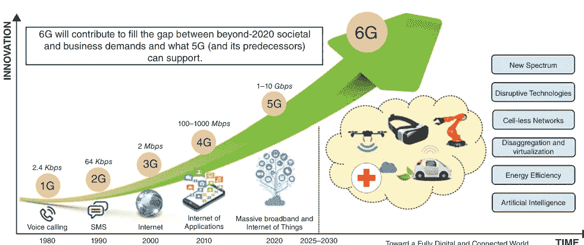

图 1.1 从 1G 到 6G 的无线技术演进 [2]。

2017 2018 2019 2020 2021 2022 2023 2024 2025

- Rel-14 5G 研究 + NB-IoT+eMTC
- Rel-15 框架，eMBB
- Rel-16 增强型 eMBB，URLLC
- Rel-17 增强型 eMBB/URLLC，mMTC，成熟的垂直领域
- Rel-18 5G Advanced：新的用例分类
- Rel-19 及 5G 之后的演进

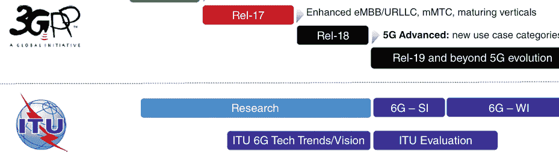

图 1.2 3GPP 发布版本的特性 [3]。

超低延迟通信、车物一切通信、免许可频段运行、集成接入和回传、终端节电和定位。

## 1.2 6G 路线图

AR（增强现实）是叠加在现实世界背景上的虚拟信息和物体。通过 AR 眼镜或智能设备等物品访问。这种体验通过图像、文本和动画等数字细节增强现实世界。下一个领域是 VR（虚拟现实），一种用户完全沉浸在模拟环境中的虚拟现实体验。这要求参与者佩戴 VR 头戴设备或头戴显示器，以获得人工世界的 360 度全景体验，欺骗大脑认为他们正处于该地或物体所在地。最后一个领域是 MR（混合现实），将现实、数字和真实物体混合，并在实时的同时进行交互。这是最新的技术，需要 MR 头戴设备以及比不先进的 VR 或 AR 设备更多的处理能力。

### 1.2.3 无线脑机交互

第三个话题是无线脑机交互，BrainGate 研究人员展示了无线脑机交互，这是人类首次使用无线传输器传输高带宽神经信号 [6]。有了它，就不再需要传统的电缆。无线信号可以以类似的保真度进行记录和传输，这意味着与有线系统使用了相同的算法。这对于必须连接到设备的人来说没有帮助。它为系统的使用方式开启了一个无限可能。这一发展将是向完全植入系统迈出一步，帮助失去运动能力的人恢复独立性。这是一项巨大的成就，表明大脑可以在没有任何复杂程序或连接电线的情况下与技术交互。

### 1.2.4 触觉通信

触觉通信也被称为触觉通信和3D 触摸 [7]。这是任何通过对用户施加力、振动或运动来创造触摸体验的技术。这种技术还可以通过 VR 进行增强，在计算机系统中创建虚拟物体控制物体，并增强对机器和设备的远程控制。触觉技术帮助人类触觉通过控制触觉虚拟物体。不同的实现方式列在此处并附有简要说明 [8; 9]：

- 振动。这是使用偏心质量 (ERM) 执行器创建的，它是一个安装在电机轴上的不平衡重量。当轴旋转时，不平衡的重量会导致设备抖动。
- 力反馈。设备使用电机来操纵用户手持物体的移动。这在赛车游戏中广为人知，赛车游戏使用方向盘，转方向盘时会提供反方向的阻力或拉力。这允许对游戏中的物体、纹理、反作用力、动量和物体感知物理存在进行触觉模拟。
- 气涡。由压缩的气流形成一个甜甜圈形状的气袋。这些气流可以从几码外吹出或移动纸张，并提供非接触的触觉反馈。
- 超声波。可以使用聚焦光束在不接触物体的情况下在手指上产生压力感。该光束可以产生振动感，并赋予用户感知虚拟 3D 物体的能力。

超声波技术的进步已整合到许多领域，如个人电脑 (PC)、移动设备、虚拟现实 (VR)、远程操作器和机器人、医学、牙科、艺术、航空、太空汽车和远程电子学。该技术已使用了一段时间，但对大多数客户来说一直被忽视 [9]。

### 1.2.5 智能医疗保健

第五个话题在数据时代数据传输方面最昂贵，而且随着 6G 的出现将增长最快。这是讨论的智能医疗保健话题。人口的增长和最近的 COVID-19 大流行处于技术时代的前沿。随着远程医疗和医院内部系统的扩展，工作量已变得不可承受。智能医疗保健涵盖了服务、医疗设备、连接技术、系统管理和终端用户。

当涉及到架构和需求时，系统存在巨大需求。更广泛的需求来自硬件和软件要求。因此，所有这些必须在性能能力上平衡。需要服务质量、低使用率、高效率、系统可靠性和外形、与其他系统的互操作性、卓越的连接、高速度、智能且充足的内存。还有整类部署需要增强。需要 Wi-Fi/WLAN、M BLE、RFID、WPAN/6LoWPAN、GPS 和 WSN。随着这些技术的实施，仍有改进空间 [10]。

必须提到智能医疗保健的物联网 (IoT)。它在许多方面与 IoT 共享一些属性。IoE（万物连接）如识别、定位、感知和与 IoT 连接，它是智能医疗保健系统的重要组成部分。随着智能传感器、社交网络和网络服务的增加，IoT 是智能医疗保健行业最重要的部分之一。大数据在智能医疗保健行业中处于强有力立场。移动设备以各种方式可用，每天产生的数据更多 [11]。这些由智能设备收集数据可以以多种方式使用。IoE 提供了利用云辅助帮助定位结果的机会。这为专业人员提供了从任何距离提供服务。随着良好的技术进步，也存在挑战和漏洞。由于智能医疗保健涉及大量个人数据，设置了更大的障碍。一些问题包括但不限于数据机密性、隐私、数据窃听、身份威胁、数据新鲜性、服务可用性、数据完整性、位置认证、自愈能力、访问控制、唯一标识和可靠性。最后一点是提到的最有趣的点之一。通过各种技术实施智能医疗保健以弥合外部差距。通过使用微处理器、处理器、封装电池、LED 灯光、天线、RF 和电泳，可以为患者制造一种胶囊摄像头，让医生无需传统方法即可进行内镜检查或结肠镜检查。

### 1.2.6 五感信息

第六个话题概述了五感信息。这是一种通过 6G 通信体验世界的方式。由于人类使用五感，系统将传输从感官获得的数据。这用于在没有环境和局部情况的情况下利用身体。

### 1.2.7 万物连接 (IoE)

本章的第七个话题是 IoE，它在许多方面与 IoT 共享某些属性。IoE 是由数十亿带有传感器以检测和评估环境状态的世界。它们都通过公共或私有网络连接。IoE 的主要特征是数据、过程和物体。IoT 是通过互联网访问的物理网络。主要区别是 IoE 有四个独特的特征，而 IoT 只有一个。

### 1.2.8 从 5G 到 6G

无线通信自 20 世纪 80 年代发展以来，每一代都有重大的变化和进步。我们已经达到了第五代无线通信 (5G)。这一新一代的采用和部署可能还需要三到五年才能实现全面部署。5G 带来了更多对软件定义网络云的改进，带来了按需、自动化的网络功能学习管理。但随着这些进步，研究人员已经开始考虑下一代 (6G) 以及在其实施后网络格局将发生什么变化。

通过各种技术，6G 网络预计将有助于视觉化 6G 的架构框架。异构云基础设施应该是 6G 的组成部分，正如现有的云基础设施和

未来世代并不会随着新基础设施组件的引入而简单消失。它们与现状产生区别的地方在于，子网专用网络的多样性和灵活性增加，以及如灵活的工作负载过载等技术。

正如下一步一样，6G 通信网络将面临其自身的安全和隐私问题。当每一代无线通信都试图随着每一次技术进步获取更多时，移动安全仍然是一个非常重要的问题。过去的几代处理了从身份验证到克隆的所有问题。随着计算资源的可用以及现在攻击者的可能出现，预计 6G 网络将看到某些攻击，例如零日攻击和物理层攻击，而且基于量子的攻击和基于 AI/ML 的代理等高级攻击也会增加。看来，AI 引入 6G 网络既可能对其安全产生作用，也可能产生不利。图 1.3 通过分析拟议的 6G 技术的风险，总结了潜在威胁、脆弱性以及安全机制 [13]。

我们必须在未来代安全的基础上进行构建，以洞察未来几代通信将面临什么。目前对于 6G 安全的整体图景的研究并不多。当前的移动数据网络（如 4G 和 5G）正在达到其物理极限，因为我们生活中越来越多的设备和人员依赖于互联网和移动连接网络。6G 的理念正成为我们社会可以赖的新理想。我唯一担心的是，“6G 通信系统”这一理念会变成一个商业和教育界竞相追逐的庞然大，以至于 6G 网络理念变成一种更加遥不可及或实际上本应立即实现的科幻概念。简单来说，6G 并不是某种即将到来的尖端技术，而是我们当前移动网络和无线连接的自然延伸技术集合。6G 的现实演进之快，以至于人们不得不埋头苦干。

在过去的几年里，移动数据网络的流量急剧增加，且没有停止迹象。这是由于需要连接到移动数据网络的应用程序日益增加。示例包括物联网（IoT）、智能汽车和智能城市等。由于这些对现有网络的新用途，我们目前的 3G/4G 网络难以跟上这些技术的需求，这些技术随时间推移变得越来越多且越“贪婪”。解决当前网络容量限制的方案是提供更宽的带宽以适应更高的速率。由于 5G 网络较少，带宽仍然是一个备受青崇的目标，但受限于 6GHz 以下的窄带宽。然而，多输入多输出（MIMO）天线等技术确实使 6GHz 以下的通信更加高效。

移动设备（如智能手机和可穿戴设备）往往在多个频段上运行，这部分增加了现有网络的压力，因为这些设备随时间推移越来越多，对数据的需求也越大。

移动设备由于使用频率极高，在移动和改变方向时难以保持持续通信，这使得实现完全满意的覆盖变得困难。这种通信困难导致了多种类型和配置的天线。

| 技术 | 风险水平 | 主要原因 | 时间范围 |
|---|---|---|---|
| AI | 中 | 对抗性操纵和恶意 AI 开发 | <3 年 |
| IT-OT 融合 | 高 | IoT 设备中缺乏网络安全设计和部署 | 刻刻 |
| 自防御网络 | 中 | 缺乏自动化和实时智能处理 | >5 年 |
| 量子计算机 | 高 | 破解复杂的加密非对称算法 | >10 年 |

图 1.3 潜在威胁和新奇事件，以及相应的安全措施 [12]。

移动设备由于其使用频率极高，在移动和改变方向时难以保持持续通信，这使得实现完全满意的覆盖变得困难。这种通信困难导致了多种类型和配置的天线。

5G 及相关网络在完全覆盖方面也面临困难。对于地面系统，5G 网络必须处理无法忍受的问题。这种尝试正通过将 5G 通信系统集成到空间 6G 系统来解决。这些基于卫星技术的空间单元将为全球农村和偏远地区提供新建或极大改进移动网络接入。

当我们转向 5G 技术和传输时，对人类健康存在一些担忧。一个事实是，许多现有用户使用了宽频，而这些技术没有证据证明对健康有害。尽管如此，由于 5G 作为现代网络缺乏许多标准，在连接性证明其安全之前，其影响将成为现实。

各种文章的共识是，6G 理念涵盖了现代网络的方方面面。这包括高速、高容量、高安全和广泛覆盖。6G 网络可以支持需要连接的海量不断增长的设备。预计跨不同线路的通信系统工作将非常快速。深度学习和 AI 将为 6G 网络提供洞察。6G 网络将足够快以支持直播和广播。预计它将比任何 5G 网络都大。最后，6G 网络将具有显著更高的带宽和传输速率。许多技术允许从现有的 5G 技术和新领域实现 6G 目标。

在一个高速数据传输不仅是奢侈品而且是种生活方式的社会中，我们意识到基础设施扩张面临着巨大的压力。我将涵盖移动行业中的几个特征和趋势，这些趋势显示从 5G 转向 6G 系统的需求已迫在眉睫。由于涉及的信息量巨大，这将是一个非常精炼的总结。我将简要概述前景、应用、规范以及实现增长的增长、行业标准化和未来挑战的挑战。所有主题都可以大幅扩展，并占据捕捉网络格局变化的页面空间。

我们将从 2010 年移动设备的全球流量量开始，当时每月消耗了 7.5 EB 的数据。这并不是预估的水平，到 2016 年，数据流量激增了 67%，达到每月 67 EB，并预计未来增长得更大。这将使在北美所有地区尚未完全运行的 5G 网络产生压力，如果网络结构不迅速变化，它将会发生崩溃 [9]。5G 网络是快速发展的，包括新的数据管理技术，但不限于少数频段。这些变化正在以足够的速度实施以跟上趋势。我们已经接近 5G 的极限，该极限将在 2030 年达到。尽管如此，6G 网络的发展将能够满足需求。

随着数据速率和通信速度的增加，新的 6G 网络将在工业制造领域引发一场新革命。一些关键前景和应用，例如超市系统，将通过智能 AI 通信加速人类的生活质量。扩展现实（XR）的引入包括增强现实（AR）和虚拟现实（VR），它们将使用现实环境中的 3D 对象。这将导致机器人、自动驾驶汽车、脑机接口、触觉通信、医疗保健、制造业中的全传感器信息以及不断增长的物联网技术的进步。物联网一直处于物联网的大伞下，它将连接世界。

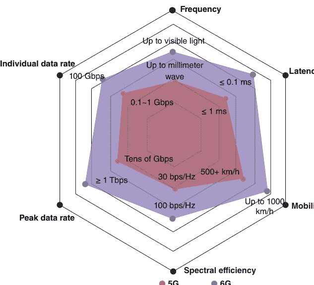

**图 1.4** 5G 和 6G 无线特性。

通过集成雷达技术、软件化与可视化技术，6G 预计在多个指标上将超越 5G。我们在图 1.4 中重点强调了其中的六点：

- 频率
- 单个数据速率
- 峰值数据速率
- 频谱效率
- 移动性
- 延迟

帮助推动这一高速时代的一些关键性技术包括：

- AI，其无需人类交互即可学习的能力
- 大数据传输所需的太赫兹容量
- 用于与设备和传感器进行持续通信的自由空间光 (FSO) 回传网络
- 用于减少延迟的同时增加数据数量的 MIMO 技术
- 不断增长的区块链账本及其去中心化数据系统
- 快速检索服务和量子通信

必须加入大数据分析，以向市场推广不断扩展的技术来处理日益增长的数据检索。协议和研究活动方面必须进行标准化。这已经从三星电子领先开始，芬兰的 6G 旗舰计划将有助于在快速变化环境中保持一致性。国际电信联盟 (ITU) 也在此同时行的会议上讨论了新的 6G 无线网络。

未来的挑战包括但不限于高传播领域以及 THz 的大气吸收，导致低频率在自由空间传输时出现损耗。在 3D 环境下复杂的资源管理需求，同时又要最小化硬件限制。所需的亚毫米波 (THz) 频率模型需要通过更高波长的能力进行管理。这将包括频谱管理以防止重叠或干扰，以及 THz 通信范围的光束管理。

## 1 下一个信息时代的技术发展

归结底，一个快速变化的技术环境即将到来。这让消费者对实现这一目标背后所付出的巨大变化毫无感知。从光明的一面来看，这将让我们未来的生活变得更轻松、更好。对于上这门课的学生来说，这将带来更多机会。

### 1.3 AI 与网络安全：为未来铺路

在 21 世纪，网络安全和 AI 为世界提供了许多机会，同时也面临着背后的挑战。应对网络攻击的手段转向了 AI 和机器学习。政府的方法是在完全不同的环境中对抗新型入侵的方法。虽然网络安全和 AI 似乎面临许多挑战，但在所有类型的技术进步方面也存在许多机会。

通过 AI 的近期进展，我们看到这确实是可能的。图像识别可以以极高的精度分析图像，而这种工作人类需要数小时才能完成。AI 将给社区带来以前未过的挑战。这些应用存在各种安全疑虑，且它们仍然很脆弱。

这些系统涉及许多复杂性，并且它们需要在所有环境中运行。AI 系统集成了四个组件：感知、学习、决策和执行。这些组件中的每一个都必须与其对应的部分独立管理，因为它们具有独特的脆弱性。

由于这些 AI 系统存在高风险，可靠性变得至关重要。需要解决的领域包括：使用性能指标进行决策、开发技术、使 AI 系统具有可解释性和问责性、改进特定领域的训练以及数据管理。

即使 AI 执行许多任务，由于受损坏的输入产生不准确的结果，仍然会产生脆弱性。目前社区面临的挑战是“AI 系统容易受到监视，攻击者查询系统并学习其内部逻辑、知识库或训练数据。这通常是攻击安全学习数据源或破解 AI 中嵌入的知识产权的前奏” [1]。

你可以看到网络安全如何受到 AI 的影响。网络安全可以利用 AI 来提高其意识、实时反应并提高其有效性。这意味着它在面对攻击时具有自适应和调整的能力以及改变行动路线的能力。它通过实时分析和反应，帮助发现攻击者策略中的弱点。

### 1.4 IoT、AI 与网络安全的融合

在物联网 (IoT) 世界中，由于安全担忧，人们不愿适应连接产品所带来的威胁。这些设备更容易受到安全威胁，因为它们连接在网络上，有许多可以被攻击的路径。目前使用的实践包括加强身份验证和集成 IoT 设备。然而，AI 和 5G 可能会增加人们对 IoT 设备的一些顾虑 [14]。

IoT 已应用于家居安全、媒体领域、公用事业、娱乐等等。随着我们日常生活的几乎每个方面都使用了技术，网络安全变得至关重要。要理解网络安全的重要性，你必须首先了解什么是网络安全以及如何进行保护。网络安全是保护网络、数据和设备免受未经授权的用户使用的实践。这些未经授权的用户可能试图访问数据以获取财务利益、勒索或身份盗窃。根据 TechJury 的统计，每天有 2.3 亿网站被破解。截至 2021 年 3 月，有 2000 万记录被泄露 [22]。统计数据每年显著增加 (1.5)。

不仅需要良好的安全实践，还需要了解攻击，以便更好地保护自己。

- 恶意软件攻击使用恶意软件下载到计算机系统中。这种攻击通常通过不安全的、欺骗性的链接进行。
- 密码攻击是黑客使用密码生成器破解用户密码时进行的攻击。

## NORSE 攻击来源

### 国家

- 中国
- 加拿大
- 香港
- 法国
- 中东/政府
- 台湾
- 意大利
- 土耳其

## 攻击目标

### 国家

- 美国
- 香港
- 泰国
- 阿根廷
- 挪威
- 澳大利亚
- 保加利亚

| 时间戳 | 组织 | 攻击者 | 位置 | 服务 | 端口 |
|---|---|---|---|---|---|
| 2016-04-23 20:23:58 | ULC Telecom | unknown, Russia | 105.77.19.282 | Saled Loot, United States | http | 80 |
| 2016-04-23 20:23:59 | ULC Telecom | unknown, Russia | 105.77.19.282 | Saled Loot, United States | http | 80 |
| 2016-04-25 20:23:56 | Beijing Softbank | 北京, China | 118.190.48.27 | Seattle, United States | https | 443 |
| 2016-04-25 20:23:57 | Beijing Softbank | 北京, China | 118.190.48.27 | Seattle, United States | https | 443 |
| 2016-05-03 18:31:15 | Shanghai Changcheng SOC | 上海, 中国 | 210.11.56.138 | Austin, United States | smb | 45 |
| 2016-05-03 18:31:16 | Shanghai Changcheng SOC | 上海, 中国 | 210.11.56.138 | Austin, United States | smb | 45 |
| 2016-05-03 18:31:17 | Glacier Hall | unknown, Netherlands | 92.148.103.192 | Eindhoven, United States | microsoft-ds | 445 |

## 攻击类型

| 服务 | 端口 |
|---|---|
| http | 80 |
| https | 443 |
| smb-services | 445 |
| ms-services | 1389 |
| microsoft-ds | 445 |
| snmp | 161 |
| ms-udp | 13 |
| icmp | 22 |

图 1.5 网络攻击者必须执行的攻击的实时显示； [2021]

# 1 下一代信息时代的技术发展

已证明其缺陷。5G 和物联网（IoT）设备的未来在很大程度上仍然未知，但工程师希望它能为创新能力铺平道路。

### 1.4.1 AI 从何开始？

在 1949 年之前，计算机缺乏智能的先决条件。当时的计算机无法存储命令，只能执行命令。它们非常昂贵。租赁计算机的平均成本相当于每月近 200,000 美元。从 1957 年到 1974 年，计算机技术飞速发展。计算机变得越来越廉价且易于获取。然而，许多问题仍然存在。在当时，计算机非常“软弱”，无法足够存储或处理信息。20世纪 80 年代，AI 的使用兴起，约翰·霍普尔德（John Hopfield）和大卫·鲁哈特（David Rumhart）普及了“深度学习”。

### 1.4.2 AI 的作用

AI 的使用涉及到人类智能。在某些概念中，AI 利用大量数据做出决策。为了实现目标，AI 必须处理大量数据。自动驾驶的一个例子是特斯拉（Tesla）。在自动驾驶中，AI 利用数据。这种技术允许乘客在不触碰方向盘的情况下行驶。AI 的另一个例子是人脸识别技术。人脸识别技术允许用户通过摄像头进行身份验证。这种技术。

### 1.4.3 AI 的缺点

尽管 AI 提供了许多功能，但它也有缺点。例如，AI 的实施成本高昂。由于复杂性，AI 面临着许多障碍。在某些情况下，AI 无法存储足够的数据。AI 的目标是消除人类交互。在某些情况下，AI 产生的数据结果可能会出现错误。根据麦肯锡（McKinsey）的研究，AI 将取代某些重复性任务。AI 的发展正在影响着未来的就业市场。

### 1.4.4 AI 的优点

AI 带来了许多优势，尽管它也有缺点。在长期来看，AI 的应用可以节省大量的资金。根据牛津经济学（Oxford Economics）的研究，AI 能够带来巨大的进步。AI 系统的机器人可以提高工作效率。根据世界卫生组织（WHO）的数据，在使用手机开车时，会增加发生事故的风险。

### 1.5 黑客带来的威胁

网络安全领域最大的问题之一是黑客。许多人意识到“黑客”一词的含义非常广泛。黑客分为三种。黑帽客是指违反法律、传播病毒和盗取信息的黑客。他们在电视和媒体上被描绘成入侵他人网络的人。灰帽客有时会越界黑暗面，但他们是中立的 [23]。

他们实施恶意行为，但其他人遵循规则且不违反任何法律。坦率地说，他们拥有“白黑客”，这正是伦理黑客大显身场的地方。他们利用技能帮助人们测试网络漏洞并进行修复。如果被描绘成黑客，某些人可能会意识到这可以成为一份有趣的事业。

伦理黑客可以获得认证，并在社区中作为渗透测试或安全防御专家获得工作 [24]。这个领域有很多机会，工作类型是无边际的。你可以到处旅行，在私营机构工作，让你看到职业的方方面面。伦理黑客对企业至关重要，因为事实上它可以为他们节省资金。当有人从底层开始帮助一家公司时，他们会发现一些问题。有些人可能会帮助他们的设计和网络，或者聘佣独立顾问。这导致了由可以合法攻击系统的机构认证的伦理黑客数量爆发。一个基于网络安全、合规性等的新领域已经兴起。

通过修复被利用的安全漏洞，每年可以节省数百万美元。在过去，许多公司因为黑客在他们的系统中发现了漏洞而损失了数十亿美元。没有任何系统能完全抵御黑客的访问。它可能防止了简单或复杂的攻击。为什么测试你安全的每个方面并聘请专业人员来这样做很重要呢 [25]？

公司和组织需要注意的另一个方面是安全工程。黑客的武器库中是最容易的工具之一，因为他们只需很少或不费吹灰就能访问你的系统。人们已经这样做多年了，而其他人并没有意识到这些并不像计算机那样难破解；人会犯错。这可以通过定义的技能来实现，例如尾部推（shoulder surging）、身份盗窃以及获取对服务器房等封闭区域的未经授权的访问。

随着技术的发展从未放缓，行业需要跟上安全的最新信息。每当系统打上补丁或添加新内容时，都可能为新的漏洞打开大门。这就是为什么保持安全领域的更新以学习新的漏洞和利用程序非常重要，这样他们才能防止入侵损害他们的网络。有了 AI，自动化系统可以在这些问题发生之前检测到这些问题 [26]。

## AI 如何帮助解决这些问题

随着 AI 引入网络安全，有多种方法来应对上述问题。世界在增长，连接的设备也在增加。物联网（IoT）正在改变连接设备的世界，并为我们周围的技术带来创新。许多公司正看到日益增加的威胁，因为必须管理更多的设备。这不仅损害了采用率，也是社区内的一个担忧。

人们已经提出了一种方法，涉及 5G 网络和 AI。一个示例是专注于用户认证的 AI。这提供了一层额外的安全保障，比应用程序或设备的传统安全更难破解。5G 网络带来了更快的速度和低延迟，为需要的设备提供了更好的管理。这两种实现都解决了了对物联网连接设备的担忧，并在未来有助于其采用 [27]。

另一种方法是分析模式并寻找可能被视为攻击的活动。一种防御攻击的 AI 类型称为检测树（detection tree）。决策树根据其训练数据创建一组规则。决策树的一个示例是通过分析流量速率、大小和时长来检测 DDoS 攻击。如果这些领域内出现异常情况，决策树将将其归类为对系统的攻击。另一个 AI 示例是 k-最近邻（k-NN）技术。k-最近邻从数据样本中“学习”，通过新数据点与已分类数据点之间的欧几里得距离来创建类别，以决定新数据点应该被放在哪类 [17, 22]。这种技术已用于检测诸如伪注入攻击等攻击。

1. 欧几里得距离定义为两点之间的距离（$d = \sqrt{(X_2 - X_1)^2 + (Y_2 - Y_1)^2}$）。

## 下一个信息时代的技术与发展

尽管如此，正如有好处一样，也会有风险。5G 网络协议缺陷可能会导致安全问题。安全专家认为，5G 网络的安全性比之前的版本更好，某些迁移到新 5G 的框架也容易受到我们在之前的版本中未关注的新攻击的影响。随着数据的增加，由于流量更大，攻击者可能不被察觉 [28]。

在我们所采用的所有实现中，都有一个巨大的因素；它们正在共同发力。5G、物联网和 AI 都在通过在同一个屋下实现所有功能来相互帮助。AI 曾是漫画里的东西，而现在我们每天都能看到它。物联网通过允许比任何时候都更高的效率共享和处理数据，这成为可能，并随着我们的进步而不断增长。这创造了本质上智能的智能设备。

这些技术正在为公司创造新的平台。它们为运输、娱乐、医疗和公共服务带来了新的功能。从技术角度来看，应用程序是无限制的，相互通信的设备数量也是如此。

这唯一的问题是数据将存储在何处我们将使用多少。到目前为止，这还不是大问题，但在未来需要得到解决。然而，利大于弊，并将对人们和世界产生持久的影响。创新将改变我们所做的简单事情。

我们已经在虚拟现实世界中看到了这一点。我们可以驾驶无人机，随心所欲地观察世界并在舒适的家中观看演唱会。这项技术正在为每个人创造一个光明的未来，并且只会变得更好。

物联网在 AI 中的应用将继续帮助我们使用技术以及我们连接的方式。

## 1.6 连接设备

物联网正在改变我们所知的世界。随着技术的发展，建立在数据之上的无限制应用也在增加。物联网为医疗保健行业、城市和社区、能源和建筑业带来了创新 [29]。

物联网对业务非常有利，但其实践的部署比预期要慢；原因是安全、可靠性和成本。物联网产品尚未经过处理，仍处于概念阶段。对于它们来说也很聘佣能够处理复杂项目的经验员工。目前，公司依赖于简单的物联网项目，因为它们可以快速产生价值，帮助公司留住客户。即使是物联网也在缓慢增长，制药行业已取得了伟大的创新。物联网解决方案可以跟踪从生产到患者的药品记录。引入这些新产品为消费者提供了竞争性的价格。这本质上将应用到更多案例。

这些只是物联网无限制应用和产品的少数例子。未来是使用物联网以及处理 AI 挑战的方案。我们将看到这个市场增长、扩展到其他行业，并创建更具竞争力的定价模型 [30]。

物联网连接产品应用于家庭、工作场所、国际互联网、连接城市和汽车中。在其生活中发挥巨大作用的一个产品是传感器的使用。它们可用于安全、优化和自动驾驶车辆。来自传感器的数据被用于确保急响应人员的安全。

## 1.7 网络安全中的数据管理解决方案

为了让物联网（IoT）顺利运行，必须有一套数据管理解决方案。物联网设备产生的数据难以处理，而且数据传输速度在网络延迟、带宽使用、安全和治理方面面临着 5G 带来的挑战。

`Cloudera Dataflow` 证明了它拥有解决这些问题的方案。它解决了物联网设备正在经历的主要问题。管理、处理和所有分析都使这一切成为可能。它是开源的，这对于物联网领域的产品来说是一个改变游戏规则的性因素。

随着所有设备的连接起来，必须对数据进行某些处理。这就是数据管理用武之地的地方，企业将提高生产力，加速物联网计划的实施，并提供物联网相关数据的全方位视图。

其他参与者也正在开发这一新市场并提供数据管理解决方案。谷歌、亚马逊和微软都提供了基于云和存储基础设施的数据管理解决方案。数据管理供应商正在不断发布开源项目，以便其他公司可以在这些技术基础上进行构建。几家硬件供应商已经为物联网设计了昂贵的系统。

## 1.8 结论

在数据的收集、操纵、组织和挖掘方面已经发生了巨大的扩张。这要求网络和连接设备在考虑安全问题时承担更大的责任。这不仅包括软件、密码和硬件安全，现在还涵盖了站点（site）。这将需要存储大量的数据，以及更多的冗余数据空间，以确保安全措施达到最大水平。

我们讨论了人工智能（AI）在网络安全中的作用及其对我们日常生活的影响。AI 有多种用途。网络安全中的大多数问题可以通过使用 AI 来解决。我们拥有可以防止黑客的入侵检测系统。数据管理是一个问题，在找到永久解决方案之前，它将持续被讨论。另一个问题是与智能设备和传感器的持续连接。随着现在所有事物都连接到互联网，在多个地方部署 AI 比以往任何时候都更为重要。

这项技术，例如用于应用程序和开发者的生态系统、数据安全与隐私，以及迈向政府数据的国家运动。

这项技术提供的收益大于其成本。起初，开发其中一些产品可能价格昂贵，但随着技术的进步，价格将更具竞争力，从而降低成本。物联网连接设备将长期存在，我们将在生活中看到许多应用，从而提高生活质量 [31]。

我们将设备识别为手机、电脑、虚拟助手、GPS 以及现在的射频识别器（RFIDs）。这带来了许多安全挑战。随着云运营时代的到来，挑战日益增加，使得数据分析的规模变得更大。

有了云计算，取证分析硬盘上的内容将变得困难得多，因为它们可能是无法触及的。要分析这类设备数据，有时并不是跨越数据变得困难，而是变得繁琐。因为数据量太大了，需要大量的额外工作。

某些连接的设备安全性较弱，因为它们并不是市场新产品。难点在于，如果漏洞没有实时公开，就很难检测所有的漏洞。随着所有新产品上市，黑客的攻击面变得越来越宽。所有的传感器、自动化系统和基础设施都因为其未知的漏洞而很容易成为目标。必须关注所有这些新设备，因为工作负载创建的方式以及它们所处理的数据。

这可以通过合理的数据规模化、数据存储、提取和分析来结合。目前，还没有一种能够覆盖整个物联网世界的程序。随着我们继续使用连接设备并构建物联网世界 [32]。

1. Yang, K. (2017, April). AI is a mechanism for creativity. Indeed: Spending the Arrival of a Super Smart Society. Hitachi: Inspire Next https://www.hitachi.com/rd/sc/ai/001.html.

2. Vaigardka, K., Boll, S.R., and Kane, R.K. (2021). A Survey on Generationless Communications-6G: Requirements, Challenges and Applications. International Journal of Advanced Trends in Computer Science and Engineering 10 (5): 3067-3076. doi: 10.30534/ijactcs.2021/22105002.

3. Soldani, D. (2021). EV evolution, vision security, and assurance. Weinar at AISA. https://youtube/_9S2U9S3l4

4. Powered by News Brand. Designing Reality 5.0 ROBOT (n.o.b.). https://www.japan.go.jp/abemonics/_userdata/abemonics/policy/5.0.html.

5. Marr, B. (2017). What is extended reality? A simple explanation for anyone. https://www.forbes.com/sites/bernardmartr/2018/09/12/what-is-extended-reality-a-simple-explanation-for-anyone/#7b2e2code047249.

6. Stacey, C. (2021, March). Researchers demonstrate the first use of a high-bandwidth wireless-computer interface. From Brown News from https://www.brown.com/news/2021-03-31/braingite-interface.

7. Haptic Communication (2018, November). Communication Theory: https://www.communicationtheory.org/haptic-communication/

8. Haptic Communication (2019). Psychology: https://en.wikipedia.org/wiki/Haptic_communication

9. Wikipedia contributors (2019, March). Haptic technology. https://en.wikipedia.org/wiki/Haptic_technology

... (其余参考文献略，保持格式一致)

## 2.1 引言

电信行业由允许全球范围内通信的公司组成。这些公司创建了我们今天所知的标准基础设施。它们由以下子行业组成：无线通信、通信工程、处理系统和远程运营商、国内电信服务、国际电信服务以及多元化电信。

电信领域的进步导致了全球范围内生活方式的巨大变化。这种变化也开启了新的大门，为未来带来了挑战和新机遇。另一个机遇是 2018 年 5G 的诞生，为未来提供了更高的速度、效率和更低的延迟。监管减少的可能性也为更自由的竞争开辟了市场空间。跨行业合作是另一个可能看到新增长的领域，因为它们依赖于电信业。随着需求的不断增长，安全和隐私将成为更高的优先级。

随着过去十年技术的指数级增长，它成为我们这一代人规模最大、增长最快的行业之一也并不意外；新的进展正层出不穷。这些改进给国际电信领域带来了巨大变化，使我们的转型方式得到了更大的改进。电视和广播的出现与新一代人的进步一样悠久。而电信的这段历程才经历了 50 年。在这段时间内，标准网络和无线网络经历了重大发展：无线个人局域网 (WPAN)、无线局域网 (WAN)、自组织或网格网络、城域网 (MAN)、无线广域网 (WWAN)、蜂窝网络和传感器。

宽带电信在过去十年中经历了巨大的发展，其宽带使用比以往任何时候都更高效。20 世纪 70 年代，第一代电信（称为 1G）仅向其用户提供语音服务。20 世纪 80 年代，2G 带来了各种功能，甚至开始了漫游数据服务。3G 也见证了手机短信的诞生，并带来了更大的数据带宽和更快的互联网连接。遗憾的是，实际的网络基础设施并没有按照营销的那样推出，但 3.5G 在 3G 网络中的出现使其比之前更高效，允许了更快速、更好的上行/下载速度。

然后是第四代 4G。它的目的是允许以高达 100 Mbps 的速度访问互联网。根据 4G 网络的标准，许多服务提供商和用户都可以接入。根据国际电信联盟无线电部门（ITU-R）创建的标准，数据速率也根据所使用的频率和设备而异。具有高移动性的人群（如汽车和火车上的人）将获得从 Mbps 到更高的数据速率，而低移动性的人群（如行人）将体验到 1Gbps 左右的速率。这些策略是由国际移动通信高级规范（IMT-Advanced）创建的。4G 网络还可以用于 WLAN 和 WAN 等网络基础设施中。

随着 4G 的出现，大量由 IEEE 批准的标准也随之生效，并与 ITU-R 协作以确保它们能够达到至少 100 Mbps 的峰值速度。这些目标如下：

- 成为一个完全基于 IP 的集成系统

- 提供室内通信以及从 100 Mbps 到 1 Gbps 的速度

- 通用使用 Wi-Fi 和 WMAX（全球互操作性微波接入）

- 建立第四代长期演进 (4G)

`LTE` 是一种标准化的移动技术，满足 4G 的最低要求，它由一系列以前版本的 LTE 和 3G 中不具备的设备和功能组成。为了让 4G 在所有位置运行，将网络类型与 3G 结合以满足特定需求。

最后，我们进入 5G，即创建它的技术。预计它将增加通信的范围和容量。5G 将不再限于宽带网络，因为它将为各种需要更高速度的需求而构建。由于 5G 尚未完全实施，必须针对潜在的安全威胁对政策和其他影响进行分析和考虑。安全和保障也是当前专家正在讨论和辩论的问题。

5G 旨在支持 4G 网络，但具有更高的带宽和速度容量。光谱也可能从 3 GHz 以下到 300 GHz 不等。虽然 5G 蜂窝网络与 4G 类似，但它的优势在于基于正交频分复用（OFDM）方案。这使得设备能够提高数据速率的质量和容量。5G 还具有许多功能，例如显著降低延迟、物联网 (IoT)、mM 和设备间通信的改进、降低能耗以及增加普通用户的电池寿命。该设备还具有适用于高性能应用程序的特性，包括改进的可靠性和安全性、网络流量优先级以及通过物联网 (IoT) 进行无缝通信。

这一代见证了许多技术变化，改变了我们的日常生活以及我们相互交流的方式。信息和通信技术（ICT）及其所有变体已融入到我们的社会生活中，我们在教育、研究和商业领域依赖于这项技术。在本章中，我们将讨论 Wi-Fi、LTE-A、4G、5G、HetNet（异构网络），并讨论第四代合作伙伴项目（3GPP）。读者将学习物联网的重要性及其对无线网络和通信的贡献。正如本章所讨论的，利用各种 ICT 用途、应用程序和移动通信网络的能量消耗，特别是对于通信系统的研究人员和服务提供商而言。

ICT 在第一个两个世纪引发了许多困境。在这些问题中，三个关注点集中在能源问题上。所有挑战都显示了能源问题的严重性，它们有一个共同的目标——减少二氧化碳的成本和能量。

- 全球变暖等环境问题

- 为了支持当前和未来 ICT 设备对电力的需求增加

- 能源价格上涨

- 国家安全意识的提高

## 2.2 向节能 ICT 迈进

一项研究表明，ICT 设备导致的能源利用增长和二氧化碳排放每五年增加一倍。ICT 设备所用能源的总成本已有列出，结果显示教育机构消耗了总能量的 30-50%。目前的 ICT 是家庭和商用领域最大的能源消耗者。许多研究人员发表了绿色网络的工作，为带宽效率、通信覆盖范围、用户动态信道分配、转换并删除以及文件共享场景的效率铺平了道路。

ICT 通过利用化石燃料电力间接产生二氧化碳，导致了 CO2 的排放。到目前为止分发的节能 ICT 产品集中在提高能源利用和管理 ICT 设备上。希望这些产品能够减少 ICT 对环境的影响，同时也可能帮助能源供应商、企业和用户在长期内提高盈利能力。电信基础设施和业务覆盖了全球近 3% 的人口，这一数字仍在增长，每年高达 16-20%。蜂窝网络利用了全球 0.5% 的电力，其中终端用户网络使用了高比例的能量。研究人员预测在未来七内，网络运行成本将增加近三倍，基站使用的能量占 80% [3]。互联网的使用也是用户之间浪费能量的主要因素。研究人员表示，与全球计算相关的 CO2 排放在 ICT 排放中所占比例比认为的更高 [4]。由于用户希望成为更多的提供者，且市场几乎无视时间与用户提供的服务竞争，蜂窝网络服务提供商正在竞争支持这种通信需求， 4G（第四代）和 5G 网络的发明也是能源消耗上升的因素。据估计 IoT 设备的大量消耗将增加约 30% 的能源消耗。随着未来 5G 和 6G 网络的完全部署，人工智能（AI）和机器学习（ML）的引入将使网络效率提高约 6%。

### 2.2.1 方法

多年来开发者一直致力于节能网络。随着互联网和有线网络使用的增加，导致了协议、网络及其运行平台能源效率的下降。人们发现了不同类型的能源相关问题，涵盖了媒体访问控制（MAC）、频谱分配和路由等大多数主题。本节描述了近期进展的几个例子，特别是在提高以太网和无线局域网等宽带网络的能源效率方面。

以太网是用于局域网（LAN）最突出且最受青的技术之一，被 30 亿人广泛使用。Lumen、AT&T、Spectrum Enterprise、Verizon、Comcast 和 Cox Business 是美国零售服务市场份额 4% 或以上的前六大公司。以太网主要用于商业区和住宅区。几乎每台个人电脑、笔记本电脑和服务器至少有一个网络适配器。如今，以太网接口也被用于家电器。

`gbe` 和无线 `802.11` 等许多相关技术进步促进了以太网在 IoT（物联网）行业中的使用的演进。数据速度在过去迅速增长；过去的 10 Mbps 现在已增加到 100 Gbps (Gbe)，取代了快速以太网。支持高数据速率的现代网络适配器消耗功率最大，例如，Gbe Base-T 收发器使用的功率几乎是快速速率的 10 倍。

在过去的五年里，研究人员和开发者对提高能源效率有浓厚兴趣。他们的努力工作促成了 2010 年引入的标准节能效率（EEE）的增长。EEE 的变化引入了低功耗空闲（LPI）。发送端发出信号，在不传输数据时保持从发送端到接收端的位置。使用传统的理想信号，我们可以节省这段期间使用的至少 50% 的能量。研究人员调查了在向接收端发送数据之前在发送端附近进行分组聚合的方法，并分批发送，这有助于减少 EEE 的能量消耗。同时，它们为基于互联网的应用程序将数据包保持在预测的跳转中。人们认为使用 EEE 已导致了节能并变得几乎全球化。

节省能量的另一个因素是目前以太网编码计划中使用的技术，以及一种更容易应用的更能源敏感的编码。这种建议的技术在编码和电路传输方面回了近 18% 和 60% 的性能提升。

最近的研究发现了关于 ICT 的积极反馈，它们将减少功率使用量并减少 CO2 排放，有利于保护环境。通过 ICT 可以获得的一些积极影响包括：

- 使电力程序更高效

- 使能够改进业务运营的技术可行

- 像光纤一样，促进低碳输出的发展

ICT 部门正在全球范围内发展，随着日常生活的各个领域使用更多的 ICT 设备，发展速度在未来几年内将增长。

高性能和最小化内存占用是 5G 的基本要求。它降低了成本并将网络连接扩展到几乎每个地方，网络接入是一种可负担且资源高效的方式。主要技术是控制面建模和无线接口上用户数据的分离。

与其他数据平台相比，5G 要快得多。它的运行模型与 3G 和 4G 不同。

5G 的结构在设备传输时的节能方面起着重要作用。在用户请求之前，设备不传输数据。这一概念节省了能量，蜂窝网络服务提供者正在支持这种通信需求：

- 需要传输时

- 需要传输时

这是为了满足数据传输的需求。5G 是为了实现极高速率和极低延迟的系统。

## 2.3 无线网络

无线移动是今天社会的很大一部分。手机，平板电脑和手表是连接我们到互联网的几个名称。我们需要互联网进行工作、学习、娱乐，有时用于监控生活的关键方面。

随着日常进步，蜂窝接入由于客户和用户的需求也变得普遍。2.1 [5] 根据 `ITU`（国际电信联盟），过去十年全球移动数据流量预计在 2020-2030 年间以 55% 的年增长率增长，到 2025 年达到 60 艾字节（`EB`），到 2030 年达到 516 艾字节。

旅程始于 `1G`（第一代），现在 `5G`（第五代）正在引入并进入更多区域。第二代通过 `2G`、`2.5G`- 引入，然后 `3G`（第三代）、`4G`（第四代）被引入。我们已经开始研究最新的一代 `6G`。虽然还没有批准的标准，但研究人员和科学家已经讨论了这种太兹技术的许多应用。

1979 年，日本公司推出了 `1G`（第一代），速度为 10 `MHz`，频率为 800 和 900 `MHz`。然而，由于模拟信号和技术限制，它并不非常成功。`GSM` 作为全球移动通信系统，在第二代中引入，是进一步进步的关键。

数字系统、元件和网络的开发是为了实现更高的质量，并包含了第二代的其他主要特征。2001 年，`3G` 在日本和美国推出。2002 年，`Verizon` 将范围扩展到 2.1 `GHz`频段，允许手机以更高的速率工作。

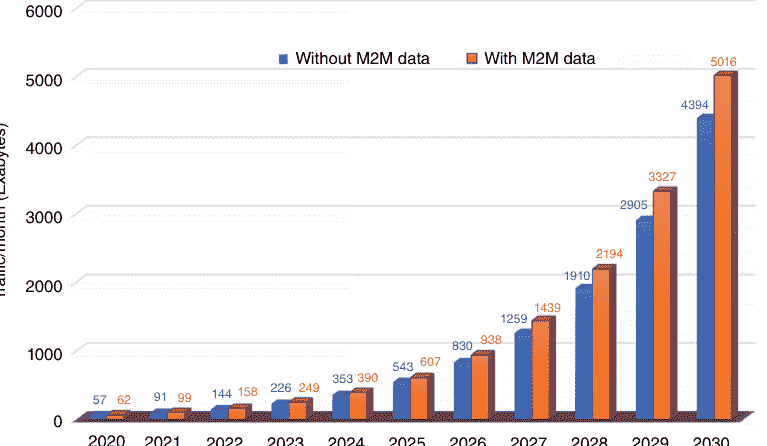

**图 2.1** 移动数据流量增长预测。

受限于设备限制 [7]，`3G` 理论上可以达到 40`Mbps`，其更快的信息传输率赋予了如今标准组件，如多功能网络、照片共享和 `GPS` 追踪器。

`4G` 于 2009 年发布，频率范围涵盖 600 `MHz`、700 `MHz`、1.7 `GHz`、2.1 `GHz` 和 2.5 `GHz`。考虑到优质的视频游戏、持续的视频通话和其他方法，`4G` 网络速度可能超过 400 `Mbps`。目前大多数用户使用 `4G LTE`（`LTE`，长期演进，开辟了通向 `4G` 的道路）。基于毫米波的 `5G` 预计将带来惊人的下行吞吐量执行速度，从低 4`Gbps` 到高质量的 20`Gbps`。这些速率满足了每个业务和垂直领域的紧迫需求。在不远的未来，偏远地区更常规的覆盖范围和低延迟通信将成为“城市地区”的优势。表 2.1 显示了移动网络技术的演进阶段 [8]。

这项移动技术基于 `LTE`，正处于发展的早期，旨在通过使用能够充分消除现有移动系统问题的系统来彻底变革通信。以下是 `5G` 比其前代能够更好地实现的其他功能：

- 减少电池消耗
- 增加小区内的覆盖范围和数据传输速率
- 高数量的并发数据传输和切换

**表 2.1** 五代移动通信技术的对比总结。

| 技术 | 1G | 2G | 3G | 4G | 5G |
|---|---|---|---|---|---|
| 部署 | 1970–1980 | 1990–2004 | 2004–2010 | 现 | 2020 |
| 吞吐量 | 2 kbps | 64 kbps | 2 Mbps | 1 Gbps | 高于 1 Gbps |
| 技术 | 模拟蜂窝 | 数字技术 | CDMA (1xRTT, EVDO) UMTS EDGE | Wi-Max LTE Wi-Fi | WWW (即将到来) |
| 服务 | 移动数字（语音） | 数字高容量分组 | 集成质量音频、视频和数据 | 可穿戴设备接入 | 带 AI 能力的动态接入 |
| 多路用 | FDMA | TDMA, CDMA | CDMA | 全数据包 | 全数据包 |
| 交换 | 电路 | 电路、分组 | 分组 | 互联网 | 互联网 |
| 核心网络 | PSTN | | | 包网 | |

- 交互式多媒体服务，如语音、通话、互联网和其他对双向流量统计更有效的服务
- 超过 1 `Gbps` 的移动数据速率和一次 65,000 个连接的更高带宽容量
- 改进的安全功能，例如更好的认知软件无线电 (`SDR`)
- 具有完全多媒体能力的全球维网 (`WWW`) 应用
- AI 辅助应用
- 用户的高分辨率和方向性宽带带

对于许多人来说，`Wi-Fi` 在我们的日常运营中起着非常重要的作用。只要我们到达任何地方，就会拿出移动设备寻找 `Wi-Fi`。大多数技术设备都配备了支持 `Wi-Fi` 的设备。手表、干燥机、锁、折射器、汽车等许多设备现在都配备了 `Wi-Fi` 功能。`Wi-Fi` 用于短距离无线和作为 `WLAN`（无线局域网）。`Wi-Fi` 基于 `IEEE 802.11` 标准。`Wi-Fi` 使用免许可的 2.4 `GHz` 和 5 `GHz` 无线频率，设备可以连接这些频率或两者，这具有双频能力。

`IEEE 802.11` 标准有不同的版本。在 `Wi-Fi` 中，第一个向世界展示卓越性能的是 `802.11a`，它使用 5 `GHz` 频率并于 1999 年引入。`802.11a` 提供高达 54 `Mbps` 的速度，`802.11b` 是引起家庭用户关注的 `Wi-Fi` 技术。`802.11b` 使用 2.4 `GHz` 频率，与 `802.11a` 同年引入。`802.11b` 在家庭用户中流行起来，实现了 11 `Mbps` 的速度。

当 `Wi-Fi` 创建时，个人设备（如笔记本电脑和个人数据辅助器 `PDA`）的所有权扩大了。消费者现在可以在家里拥有无线功能，他们非常喜欢这一点。尽管在 1999 年许多消费者已经达到了 11 `Mbps` 的高速度，但 `802.11` 技术被引入了。`802.11g` 带入了 `Wi-Fi` 的未来，消费者现在可以使用 2.4 `GHz` 频率享受 54 `Mbps` 的速度。对于 `Wi-Fi` 使用的频率，消费者总是倾向于选择 2.4 `GHz` 而非 5 `GHz`，因为后者的范围只有前者的的一半，但前者更有潜力避开墙壁、树木等障碍。

`802.11n` 于 2003 年引入。`802.11n` 选择了 `802.11b` 的范围而非 `802.11a` 的速度。现在，5 `GHz` 设备的价格比 2.4 `GHz` 设备贵得多。`Wi-Fi` 变得日益流行，设备也支持了这种增长。在 2003 年，当我们认为它永远不会出现时，2009 年，`802.11n` 引入了 `MIMO`（多输入多输出）技术。`Wi-Fi` 可以使用多根天线同时传输和接收数据，以增加 `Wi-Fi` 的吞吐量；`802.11n` 可以处理多达 8 根天线，但对于系统，使用 2 根天线。同时，`802.11n` 部署的速度高达 250 `Mbps`。最近部署的 `802.11` 技术总体能够支持 7 `Gbps`，具有更宽信道的正交幅度调制 (`QAM`)。`QAM` 是幅度调的缩写，在无线数据传输中，每个代表一个符号。表 2 2 描述了 `Wi-Fi` 标准在这些时期和其他因素中，`Wi-Fi` 不仅用于家庭，它已被用于世界。许多企业利用 `Wi-Fi`，`Wi-Fi` 对经济产生了巨大影响。正如文章提到的，预计到 2025 年，`Wi-Fi` 将负责增加 `GDP` 3000 亿美元。人们开始努力实施 `Wi-Fi` 以改善教育和经济。在停留期间，确定 62% 的企业表示，如果提供免费 `Wi-Fi`，人们会在那里待得更久。虽然只有少数企业提供免费 `Wi-Fi`，研究显示 50% 的人愿意使用它。`Wi-Fi` 代之间的最大速度对比。

| Wi-Fi 代 | IEEE 标准 | 频段 | 最高速度 | 年 |
|---|---|---|---|---|
| Wi-Fi 7 | 802.11be | 2-7 GHz | 46 Gbps | 2024 |
| Wi-Fi 6, Wi-Fi 6E | 802.11ax | 2.4, 5, 6 GHz | 9.6 Gbps | 2019–2021 |
| Wi-Fi 5 | 802.11ac | 5 GHz | 3.5 Gbps | 2014 |
| Wi-Fi 4 | 802.11n | 2.4, 5 GHz | 0.6 Gbps | 2008 |
| Wi-Fi 3 | 802.11g | 2.4 GHz | 0.05 Gbps | 2003 |
| Wi-Fi 2 | 802.11a | 2.4 GHz | 0.05 Gbps | 1999 |
| Wi-Fi 1 | 802.11b | 5 GHz | 0.01 Gbps | 1997 |

文章指出，当提供免费 `Wi-Fi` 时，客户更可能在餐厅或咖啡馆坐下。一项调查显示，如果服务是免费的，55% 的人乐意使用它，但研究显示，如果没有免费 `Wi-Fi`，每 10 个人中就有 1 人会离开企业。这种方法在人们停留时间较长的酒店更为有效。通过免费 `Wi-Fi`，企业还可以获得吸引客户查看的能力。当客户连接到企业的免费 `Wi-Fi` 时，他们可以重定向到显示优惠或折扣的网页。

在我看来，`Wi-Fi` 改变了技术世界，达到了我们从未想象过的水平。消费者的特点是永远是不够的，只要速度和技术进步，我们就会想要。这对社会产生了巨大影响，在技术和经济上满足了我们的需求。随着 `Wi-Fi` 的进步，我相信会有一天以太网线完全被无线 `Wi-Fi` 取代。虽然数据布线将被取代，但基础设施将继续进化。有了 `802.11ac`，支持这些无线速度的设备并不多，但很快就会增长。我们可以用教育设施作为我推理的例子。每个教室大约有 30 名学生，在很多情况下，每个学生都有一个无线设备。无线接入点的基础设施目前可以处理到接入接入点的 1 `Gbps`。随着越来越多的设备进入 `802.11ac`，这最终可能导致接入点拥堵。像极端网络这样的接入点具有 2 个端口，以访问到接入点的 2`Gbps` 链路。这有帮助，但每个接入点需要 10`Gbps` 的连接。主要的瓶颈是硬件停止了进步，基础设施始终需要升级以支持更快的连接。`Wi-Fi` 已经在增长，并在功能和潜力上继续增长。由于 `Wi-Fi 6` 基于与 6 `GHz` 频段的兼容，具有顶级的 `WPA3` 安全性和 9.6 `Gbps` 的高速率，`Wi-Fi 6E` 作为今年早些时候推出的 `Wi-Fi 6` 的改进版本，扩展了 6 `GHz` 操作的 `Wi-Fi`，指数级地增加了容量，减少了干扰，提高了可靠性，使性能翻倍并将延迟降低到 7`ms` 以下。

`Wi-Fi` 的下一个版本将是 `Wi-Fi 7`，它将基于 `802.11be`、高达 30 `Gbps` 的最大吞吐量和其他物理增强。`Wi-Fi 7` 将带来链路操作，允许在 `MAC` 层进行链路聚合。它通过并行使用多个链路来改善延迟，通过在多个链路上双倍数据包增加可靠性，并具有适应设备和网络应用的动态数据流。`Wi-Fi 7` 设计通过多接入点配置来实现优化工作，因此我们可以在企业中在大和小规模上使用 `MIMO`，因为它使用了多个链路和接入点，而不是单一，比 `Wi-Fi 6` 版本进一步优化。

与 `Wi-Fi` 一样，技术移动性是我们在日常生活中渴望的。当我们无法[利用]连接 `Wi-Fi` 的能力时，我们希望连接互联网。蜂窝数据的现象永远改变了我们的生活。从 20 世纪 70 年代的 `1G` 开始，经过几代蜂窝数据技术取得了巨大的进步。`2G` 随后于 90 年代引入，现在是 `GSM`。`2G` 通过短信、语音邮件、传真和寻呼机提供了更好的覆盖范围，`3G` 的速度是 `2G` 的四倍，高达 7.2`Mbps`。`4G` 技术引入了蜂窝世界，尽管我们尚未实现 `4G` 的全部能力。图 2.2 展示了蜂窝数据标准和技术。

我们现在处于 `4G LTE`，它代表长演进（`long-evolution`），是 `4G` 的第一代。日本的 `NTT DoCo` 在 2004 年首次引入了 `LTE`。虽然研究工作从 2005 年开始，但 `LTE` 的首次部署是 2009 年在奥斯陆和斯德哥尔摩以一种 `USB` 形式进行的。所有领先运营商都支持 `LTE`，大多数运营商在广告中使用“`LTE`”。有些公司在广告中交替使用“`LTE`”和“`4G`”术语，但“`4G`”并不是一个为下一级技术创建的准确的蜂窝数据标准。该标准旨在让在汽车或火车等高移动环境下的速度达到100`Mbps`。`4G` 的引入也是为了让慢速状态（如坐着或等待）的用户达到 1 `Gbps` 的速度。

`Verizon Networks LTE` 服务产生的平均速度为下行 31.1 `Mbps` 和上行 17.1 `Mbps` [13]。`LTE` 的前身 `GSM` 和 `CDMA` 传输的数据量较小，这是该技术及其速度的限制。`LTE` 使用更大的数据包传输数据。与两者相比，主要优势是它使用名为时延脉冲（`TDD`）的技术降低了延迟。我们的蜂窝设备使用频率和频谱运行。`LTE` 运行在 700 `MHz` 到 2.6 `GHz` 之间的频谱上。

许多看起来可以工作很远距离的手机是那些通过使用 900 `MHz` 基站进行互连工作的无线电话。根据波的基本原理，频率越低，对物体的穿透能力越强。虽然这提供了更好的速率，但数据传输可能较少。同样，对于 `LTE`，农村地区最可能使用 700 `MHz` 左右的低频。这将允许信号传输得更远，到达农村家庭和道路。是的，但居住在农村地区的消费者会告诉你，考虑到他们的位置，他们有什么就用什么。在像商业区和住宅密集的城市这样的区域，靠近 2.6 `GHz` 的频率将达到更高的速度。

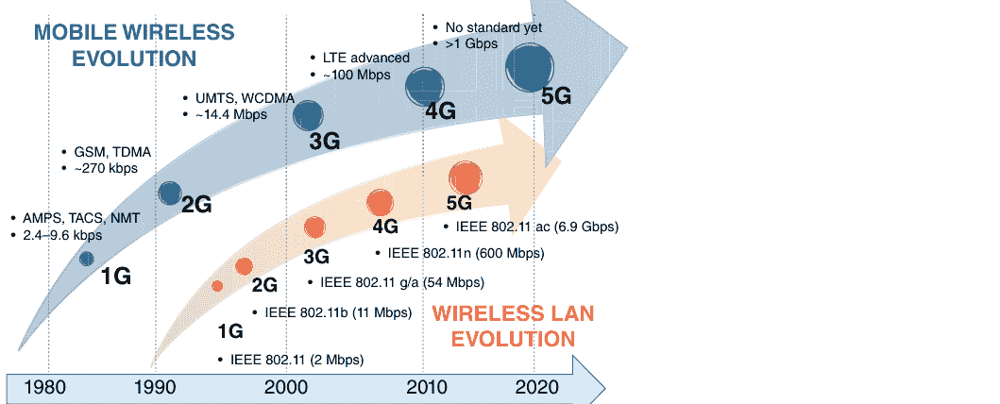

图 2.2 已部署的无线蜂窝技术的特性。

## 2.2 无线网络

频率较低，覆盖面积较小。在蜂窝业务中，这是对立的。消费者受限于技术和选择实施技术的运营商。当消费者使用 `3G` 时，他们购买蜂窝设备就像把它们放在货架上一样明智。随着 `LTE` 的出现，发生了另一场爆发。凭借 `LTE` 能产生的速度，运营商现在能够连接到家庭互联网。

第一款引入 `LTE` 能力的移动手机是 `Verizon` 的 `HTC` 公司 `Thunderbolt` 品牌，在美国和欧洲也称为 `T-Mobile G1`。它是 `HTC` 公司 `Desire HD` 的 `CDMA/LTE` 原生设备。`Thunderbolt` 引入了 `HTC` 的销量，据记载，在 `HTC` 发布的当季度，其表现比 `iPhone` 好出 28%。`LTE` 在有效销售数据上得到了体现。戴尔在 2012-2016 年间对 `LTE` 对美国经济的影响出现过下滑。研究显示，`4G` 为蜂窝数据的使用量贡献了 4% 的年增长。根据 [14] 中的描述，`4G` 贡献了 570 亿美元的 `GDP` 增长和 370 个新工作岗位。数据显示 `LTE` 已经改变了整个世界。美国在蜂窝技术方面是一个增长中的经济国家，因为他们部署了五种蜂窝设备操作系统中的三种。

`LTE` 真正改变了蜂窝技术领域。我们大多数人都在享受速度和低使用成本带来的收益。虽然大多数运营商都使用 `LTE`，但在其他国家，如果他们没有这种速度，也开始开始部署。我也相信 `LTE` 将在蜂窝设备中使用一段时间。虽然有些人总会要求更快的速度，但大多数人对 `LTE` 提供的平均速度感到满意。新技术预计不会比其前代快 40 倍。例如，在 `4G` 技术上的 3D 视频下载一部 3D 电影大约需要六分钟。随着 `5G` 的实施，大约需要六秒。主要的 `5G` 部署将实现，接近预计的 2025 年。

## 2.3 异构网络

异构网络也称为 `HetNet`，是蜂窝技术发展中一个非常重要的方面。`HetNet` 由不同类型的无线基站组成，声称为我们所有人提供高质量的服务。随着蜂窝服务用户数量和所需数据量的增加，对于未来必须做些什么。异构网络由宏基站、分布式天线系统 (`DAS`) 和小基站组成。基站有三种类型：

- 宏基站：覆盖大区域。
- 微基站：覆盖较小区域。
- 皮基基站：用于室内环境。

根据波的基本原理，频率越低，对物体的穿透能力越强。虽然这提供了更好的速率，但数据传输可能较少。同样，对于 `LTE`，农村地区最可能使用 700 `MHz` 左右的低频。这将允许信号传输得更远，到达农村家庭和道路。是的，但居住在农村地区的消费者会告诉你，考虑到他们的位置，他们有什么就用什么。在像商业区和住宅密集的城市这样的区域，靠近 2.6 `GHz` 的频率将达到更高的速度。

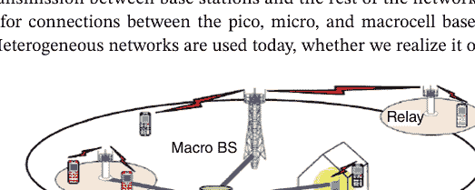

图 2.2 已部署的无线蜂窝技术的特性。

## 2.4 家庭基站

主要的 `5G` 部署将实现，接近预计的 2025 年。

异构网络也称为 `HetNet`，是蜂窝技术发展中一个非常重要的方面。`HetNet` 由不同类型的无线基站组成，声称为我们所有人提供高质量的服务。随着蜂窝服务用户数量和所需数据量的增加，对于未来必须做些什么。异构网络由宏基站、分布式天线系统 (`DAS`) 和小基站组成。基站有三种类型：

- 宏基站：覆盖大区域。
- 微基站：覆盖较小区域。
- 皮基基站：用于室内环境。

家庭基站是一种低功率基站，用于在家庭或办公室环境中提供蜂窝覆盖。它通过宽带连接到互联网。

### 2.3.5 5G 的黎明

在 20 世纪 70 年代中期，蜂窝技术变得流行。第五代是下一步。

## 2.3 无线网络

各行业的业务解决方案也将从单终端对应向多路 `XR` 连接演进，并在 2025 年后快速增长。由于业务流量和业务属性的影响，`XR` 服务对服务水平协议（`SLA`）将有更高的优先级，例如网络限制、部署和传输速度。同时，基础连接仍有巨大的改进空间。多媒体视频和虚拟会议减少了对差旅的需求。居家办公或通过“部分几天在线、其他几天居家办公”的混合模式将成为常态。目前的免费准入和视频模式将变为不同的多用户协作接入和富媒体持续通信。例如，企业代表可以在任何需要出现并与他们交流时，通过虚拟影像进入公司办公室。这将显著影响互动。`5G` 进进（`5G-Advanced`）需要满足当前的业务需求，使基于智能语音的战略策略发展为智能、独立且虚拟化的技术。它将帮助各种企业的客户——

其次，行业的业务环境将比消费市场更广阔。例如，工业物联网、能源物联网、矿山和医疗健康——需要网络为它们提供更好的业务消费环境，并获得确定性的 `SLA` 保证以实现业务结果。例如，工业物联网需要确定性的传输，这在此受到限制，并坚持延迟具有低云端同步修复能力以及高安全性。分钟需要深层洞察，而非远端起重机控制，以及这一切实时决策和处理、同步和安全。有必要考虑为工业服务提供确定性工程服务，包括持续的辅助洞察、预测、预约，最后构建一个通用的闭环中心。对于不同的场所，`5G` 要求采用接入网络、私有网络和不同的闭环运行模式来管理业务隔离和信息安全优先级。因此，`5G` 进进应侧重于组织的工程、组织计划、硬件结构以及与各种复杂业务环境相协调的服务。

任何技术领域都没有一劳永逸的解决方案，但许多共同且固有的威胁是可以解决的。随着技术的不断变化和增长，安全形势以及对既有标准的信任也在发生变化。事实上，安全规划的策略和最佳实践必须不断演进。在企业网络管理中，组织结构和文化往往影响安全缓解，它对安全系统来说可能是非常有效的，也可能是有害的。以积极的心态对待安全规划是重要的，这种心态可能会说“因为泄露并防止泄露的发生”。许多安全团队没有关注准备工作的正确方面。在评估时，人们会问诸如“我有能力吗”的问题，但这些问题太狭了，且属于反应心态。具有这些目标的组织战略会对发生的情况产生实际影响。诸如“我们有效吗？”或“我们如何提高这个系统的安全性？”等宽泛且细致的问题是安全规划更有效的方法。在攻击者利用它们之前，积极寻找提高效率系统和方法。随着 `5G` 网络的新发展，风险缓解技术是当今变化局势中唯一站得住脚的技术。

`5G` 技术允许数据系统具有极高的速度和效率，这对集成来说也是非常危险的。例如，低延迟允许攻击者更快地攻击他们的集群，而响应时间将防御的机会。这些能力正导致低功耗设备和物联网网络的快速扩张，它们需要更多的安全来保护。`5G` 功能允许更多使用这些技术。然而，这些低功耗、低功能设备具有高安全能力，并确保安全网络之外网关的安全。这是一个威胁，当鱼缸传感器被用作进入网络的后门时。虽然 `5G` 技术的价值不可没，但安全专家在设计新策略以及寻找保护网络的技术和方法时必须具备积极的心态。对于企业在新技术气候中有效运行，数字安全是绝对必须的。在一个不断变化的世界中，如何学会良好处理它。如果没有威胁缓解和安全文化的广泛转变，技术的增长将被中断。

`5G` 进进的发展被创新性地引入为 ICT 技术、现代现场工作和信息技术的深远协调。 `4G` 之后的通信网络呈现了其创新，而电信云在很大程度上被用作基础。在真实的电信云落地措施中，如 `NFV`（网络函数虚拟化）、容器、`SDN`（软件定义网络）和基于 `API`（应用程序接口）的框架开放等创新都具有真正的业务信心。再次，网络云是未来投资的焦点。总体而言，其部署计划、模型、活动和支持服务。质量资产可用性和生产力与集成分布式计算网络并不相同。Linux 社区指出边缘云原生（Edge to Cloud Native）结构的存在。通过这种方式，他们需要加入边缘元素来构建一个边缘本地（Edge Native）结构。`5G` 进进网络的发展需要云本地和可压缩的能力，实现这两种相似组织之间的关系，最后走向云网融合的延伸发展。

对于 CT（核心和漫游）创新整合了多个代和版本 NSA/SA 的协调，正如个人客户、接入和身份网络的混合。此外，随着卫星通信的发展，`5G` 进进中心网络也将为完全接入位于地面感知的网络做好准备。在物联网连接的扩展和后期活动中，OT（运营技术）将为通用服务带来新价值。例如，面向市场的物联网对于消费者购买来说是独特的。在谈判 `5G` 时具有更严苛的价格，因为对网络质量有高得的要求。在谈判网络服务时，考虑 `5G` 的潜力至关重要，这需要网络保持巨大的数据传输容量和低延迟。远程控制需要网络提供帮助。

## 2.4 认知网络

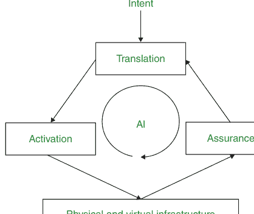

- *激活（Activation）*。此模块位于策略的意图和进度之后。该模块使用全网络自动化技术在设备部署之前对其配置进行身份验证。

-可以通过该图来理解这三个模块的功能。

意图网络（`IBN`）系统能够动态地跟踪并保护网络状态。在定义实现所需状态的最可行手段以及自动化实施必要的纠正措施时，机器学习和优化的改进将大大用用场。因此，与手动和僵化的技术相比，`IBN` 可以降低网络管理和维护的复杂性，提高性能，增强网络敏捷性，并减少故障和错误的风险。

`IBN` 的主要目标是提供一种实体的通用网络框架的操作抽象。`IBN` 允许全方位可见性，使其易于将意图层映射并解码到低级构造管理中，从基于 CLI 的命令式技术取代。然而，这并不意味着 `IBN` 没有障碍。尽管 `IBN` 是一种强大且高效的技术，但它并不适用于初学者。`IBN` 最适用于那些网络规模不断增长且对网络安全和性能有复杂要求的公司。

对于需要强效网络安全、让网络管理员专注于其他任务，或希望减少网络验证、配置和修复等例行事务的公司来说，`IBN` 证明了其价值 [25]。`IBN` 技术还可以为更快的故障排除以及改进的预测和分析铺平道路。

具有如此影响力的回报，`IBN` 是确保组织主动防止拥塞并增强性能、减少人为失误率和后果的合适手段。我认为，选择合适的工具是这些新采用者需要考虑的最重要的决策。然而，一种更符合现实的方法需要关注。采用 `IBN` 的挑战在于文化变革。随着这种平稳的转变，DevOps 和其他额外实践可以弥补这一差距，允许组织建立伙伴并创建基于 `IBN` 的有效 `CI/CD` 工作流。

`IBN` 可以通过各种应用实施。其中一个应用是服务，它通过 `ML` 和 `AI` 算法的支持提供了更高的安全性 [26]。另一个应用是性能测试，`IBN` 系统协助其他应用程序。帮助过滤网络流量也是 `IBN` 的应用之一。`IBN` 系统为 Web 应用提供防火墙，以识别流量并改进安全措施。

### 2.4 认知网络

最新一代蜂窝网络 `5G` 新无线电（`NR`）包含三个核心特性：支持海量物联网设备、每秒数比特吞吐量、超低延迟和极高的可靠性 [27]。面向消费者的 `5G` 网络部署在全球范围内已经。然而，这三个特征的结合仍处于初始阶段。全面 `5G` 的愿景是我们正在实现的特征。然而，这一愿景需要新层次的安排和自动化 [27]。

IEEE Xplore 2005 定义认知网络包含以下元素：网络能够关注状况，并利用从过去与网络交互中获得的知识，对网络进行计划、决策并采取行动 [27]。目标是让认知网络中的嵌入式智能考虑数据的端到端目标，有效地将消费者的端到端转化为全面的程序 [28]。

# 2 未来的网络

在 `5G` 系统设置中，企业用户可以接入成千上万的环境传感器。认知网络不再遵循链接、验证等功能的人工程序，它们不是“看到”设备，而是理解部署连接服务的目标并据此进行预测。认知网络随后使用来自整个网络的反馈进行优化分解。从根本上说，作为一种数据类型，认知网络由于在通信网络中的应用而显著增长。这种网络方法将来自机器学习、计算机网络知识和网络管理等多个领域的前沿技术引入。这种网络方法引入了来自多个领域的前沿技术。`IBN` 最适用于那些网络规模不断增长且对网络安全和性能有复杂要求的公司。对于需要强效网络安全、让网络管理员专注于其他任务，或希望减少处理例行事务（即需要网络验证、配置和修复）的公司来说，`IBN` 证明了其价值 [25]。 随着这种平稳的转变，DevOps 和其他额外实践可以弥补这一差距，允许组织建立伙伴关系并创建基于 `IBN` 的有效 `CI/CD` 工作流。

`IBN` 可以通过各种应用实施。其中一个应用是服务，它通过 `ML` 和 `AI` 算法的支持提供了更高的安全性 [26]。另一个应用是性能测试，`IBN` 系统协助其他应用程序。帮助过滤网络流量也是 `IBN` 的应用之一。`IBN` 系统为 Web 应用提供防火墙，以识别流量并改进安全措施。

### 2.4 认知网络

最新一代蜂窝网络 `5G` 新无线电（`NR`）包含三个核心特性：支持海量物联网设备、每秒数比特吞吐量、超低延迟和极高的可靠性 [27]。面向消费者的 `5G` 网络部署在全球范围内已经就绪。然而，这三个特征的结合仍处于初始阶段。全面 `5G` 的愿景是我们正在实现的特征。然而，这一愿景需要新层次的安排和自动化 [27]。

IEEE Xplore 2005 定义认知网络包含以下元素：网络能够关注状况，并利用从过去与网络交互中获得的知识，对网络进行计划、决策并采取行动 [27]。目标是让认知网络中的嵌入式智能考虑数据的端到端目标，有效地将消费者的端到端转化为全面的程序 [28]。

# 2 未来的网络

在 `5G` 系统设置中，企业用户可以接入成千上万的环境传感器。认知网络不再遵循链接、验证等功能的人工程序，它们不是“看到”设备，而是理解部署连接服务的目标并据此进行预测。认知网络随后使用来自整个网络的反馈进行优化分解。从根本上说，作为一种数据类型，认知网络由于在通信网络中的应用而显著增长。这种网络方法引入了来自机器学习、计算机网络知识和网络管理等多个领域的前沿技术。这种网络方法引入了来自多个领域的前沿技术。`IBN` 最适用于那些网络规模不断增长且对网络安全和性能有复杂要求的公司。对于需要强效网络安全、让网络管理员专注于其他任务，或希望减少处理例行事务（即需要网络验证、配置和修复）的公司来说，`IBN` 证明了其价值 [25]。 随着这种平稳的转变，DevOps 和其他额外实践可以弥补这一差距，允许组织建立伙伴关系并创建基于 `IBN` 的有效 `CI/CD` 工作流。

### 2.4.1 零信任网络

零信任网络（`Zero Trust Networking`）是一种安全框架，它不再信任任何实体，无论是在边界内部还是外部，而是持续进行持续验证。我认为，选择合适的工具是这些新采用者需要考虑的最重要的决策。然而，一种更符合现实的方法需要关注。采用 `IBN` 的挑战在于文化变革。随着这种平稳的转变，DevOps 和其他额外实践可以弥补这一差距，允许组织建立伙伴关系并创建基于 `IBN` 的有效 `CI/CD` 工作流。

零信任的核心原则包括：

- **最小特权访问**：仅授予用户完成其任务所需的最低权限。

- **持续验证**：对每次访问请求进行身份验证、授权和加密检查。

- **假设已泄露**：假设攻击者已经进入网络，并采取措施以限制潜在损害。

- **微隔离**：将网络划分为细小的区域，以限制攻击者的横向移动。

# 2 未来的网络

`ICN` 通过一种新颖的网络框架来改变互联网结构，该框架对命名数据对象提供原生支持。由于可以直接访问数据对象，可以实现廉价且无处不在的网络缓存和复制。在数据分发和网络带宽利用方面，效率和可扩展性得到了增强。为了获得最大的利益，`ICN` 面临着技术挑战，如定位命名对象并将其交付给消费者（消费者可以通过一种以信息为中心且与位置无关的方式进行移动）、如何命名数据对象以便标识，以及如何确保在网络中广泛传播的命名对象的安全 [33]。

### 2.4.1 ICN 的基本概念

- 命名机制是 `ICN` 名称的一个核心思想，允许无论数据对象所处位置如何进行标识。在 `ICN` 中，命名数据对象有两种主要技术：平化命名方案和分层命名方案 [33]。分层命名方案基于发布者运行，使得聚合路由数据和提高路由方案的可扩展性成为可能 [34]。平化命名方案采用类似内容的对象的哈希值。通过使用该哈希值，平化命名方案为每个数据对象使用固定长度的名称，提高了名称查找速度。

- 路由涉及三个阶段：解析、发现和交付。在名称解析期间，数据对象的名称被翻译为定位符。随后是请求数据对象的发现阶段。请求的对象在第三阶段被路由到消费者。依赖于这三个阶段，`ICN` 路由主要分为两类：按名称路由和通过名称进行路由。

- 安全对象（Sec objects）可以缓存在网络缓存中；因此，源头并非唯一的安全单元，而是一个安全单元 [33]。应当提供安全保护，以确保恢复的数据对象与真实发布者发布的内容相比没有发生任何改动。此外，源头验证（验证 `ICN` 对象及其发布者的完整性）也是 `ICN` 安全性的另一个衡量维度。此类技术的失败会导致网络极易受到通过向网络中插入篡改内容而进行的各种攻击。

- 移动性旨在让消费者在 `ICN` 应用中轻松获取内容，而不会发生不可预见的中断。由于 `ICN` 采用接收者驱动的内容恢复，物理位置的改变不会干扰内容的持续接收。另一方面，服务器端的移动性在提供支持方面面临挑战。具体而言，`ICN` 移动性需要与 `ICN` 路由紧密配合，以复制类似于已传递的数据对象。

### 2.4.2 网络内计算

提高应用性能最具前景的方法之一是网络内计算 [35]。网络内计算指的是特定的硬件加速类型，网络流量在到达主机之前会被交替设备中断，并在其中由网络设备执行计算，如网络化 `FPGA`（现场可编程门矩阵阵列）、智能网卡或可编程 `ASIC` [36]。可编程网络硬件可以运行传统上分分地在服务器上独立运行的服务，性能提升了几个数量级。对于这些增强的性能，网络运营商对网络内计算仍持怀疑态度。传统观点认为，高功耗带来的运营成本会抵消任何应用性能的收益。如果网络内计算无法证明其成本合理性，它将被斥为额外的学术练习。

网络内计算的主要缺陷之一是其高功耗的特性 [37]。每个应用在硬件和软件实现方面的消费者成本都包含电源单元等开销。不同的应用具有不同的功耗能力，服务器倾向于实现不同的单元。不同设备具有不同核心的功率效率优化，以达到峰值吞吐量。同样，智能网卡、`FPGA` 和可编程网络设备往往会导致不同的性能和功耗 [38]。

### 2.4.5 激活网络

当前激活网络领域的研究展示了这种新技术的前景。从服务的角度来看，激活网络允许在网络内部按每个包、每个流或每个服务的级别进行定制化的数据包处理。可以使用数据包过滤、应用感知路由、多方通信和信息缓存来实现定制化的数据包处理。从管理的角度来看，激活网络技术使得实现快速的服务部署和灵活的服务管理成为可能 [39]。激活网络模型允许组织以在计算机上设置和运行程序相同的方式，在网络中建立和运行服务。相比之下，网络承担了计算机的责任，而这种责任由消费者等许多方共同承担。

连接到网络的的终端保持开放状态，因此可以使用合适的语言和实现对其进行编程。相比之下，传统网络（如 `ATM`）的节点是 `IP` 路由器，其功能和接口通过标准化程序定义的集成框架。节点在没有系统的情况下传输数据包。网络内部对数据包的处理限制在对包头部的操作上，特别是路由。网络不更改数据包载荷。此外，节点功能是永久的，只能通过主尝试进行更改。激活网络打破了这一传统，允许网络对整个数据包（包括载荷）获取定制化计算。因此，激活网络技术为网络中针对特定服务和特定用户需求、以及监管、用户和管理数据包计算的最快数据包处理功能铺平了道路 [40]。

### 2.5 移动边缘计算

云计算对移动网络的重要性正在日益增长。像 Twitter 等社交网络服务的移动边缘计算提供了一个日益分布的计算环境，可以为更多的移动消费者设置应用和服务，并存储处理后的内容。应用可以被拆分为小任务，某些任务在区域和本地云中执行，以保持延迟和精度 [41]。在使用边缘和额外云分发应用子任务时，会出现一些挑战性问题。如果应用被拆分，移动边缘云解决低延迟问题，并在本地执行任务。

### 2.6 量子通信

（注：OCR 文本包含 2.5 和 2.6 部分的重复和碎片句子。我已根据提供的文本碎片重建了逻辑流。）

# 遗留移动网络的安全演进

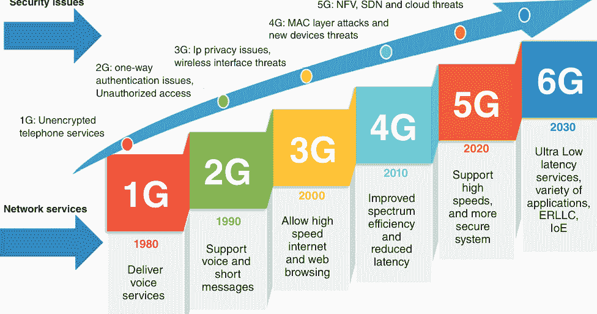

## 2.7 遗留移动网络的安全演进 [49]。

重点是保护系统资源高于其他任何内容。零信任假设入侵者可能处于网络边界内，且网络框架是不可信且对外部人员可访问的。

定期进行评估，并采取行动降低内部资产损失的风险。使用零信任理念的零信任框架涵盖了访问规则、协议程序和网络实体之间的关系。零信任应当成为 `6G` 安全框架的基础，某些安全需求可以通过使用零信任方法的安全 `6G` 网络来管理。

## 2.8 大规模机器类通信 (MTC)

机器类通信 (`MTC`) 的描述是抽象的。其定义必须涵盖许多新兴理念，如万物互联 (`IoE`)、`IoT`、智能 X 以及 4.0 等。这些新兴概念连接到一个具有多样假设和需求的新场景，从对无线通信可靠性和延迟有严格要求的无线工厂，到涵盖智能城市中大量传感器受限能耗的长期环境观测。`5G` 设计应当考虑这些场景，并满足新兴和前瞻性行业通用赋能者的角色 [50]。

FP7（第七次研发框架计划）METIS 项目（二十一世纪信息社会的移动和无线通信赋能器）在 `5G` 中采用了 `MTC` 术语，以涵盖可能的 `5G` 解决方案的所有应用需求。此外，`MTC` 可分为超可靠 `MTC` 和大规模 `MTC`。大规模 `MTC` 类型涉及许多设备的海量接入，为数以亿计的低复杂度、低功耗机器类设备提供连接。大规模 `MTC` 的经典示例是来自大量传感器（如智能抄表）的各种测量值。相比之下，超可靠 `MTC` 涉及为对可靠性、可用性和延迟有较严格要求的网络服务提供足够的无线链路 [50]。

# 6G 中的边缘智能与泛在人工智能

极具前景的 `AI` 动力推动了 `6G` 无线网络的进一步发展。据预测，`6G` 将把无线空间从“连接物体”转变为“连接智能”。然而，基于 `AI` 系统的先进深度学习和大数据分析需要大量的计算和通信资源，导致干扰和过程中出现严重的延迟、网络拥塞、能量消耗和隐私泄露。

边缘智能作为 `6G` 网络的一种突破性技术脱颖而出，能够轻松实现感知、计算、通信和智能。为了实现这一点，需要在网络边缘具备赋能的模型训练和推理能力。这将增强 `6G` 网络的效率、安全性和隐私 [51]。经济且可扩展的边缘系统的愿景包含了无线通信技术的集成设计和去中心化机器学习模型。无线网络的新颖设计原则包括整体的端到端系统架构和面向服务的资源分配方法，以支持边缘智能。

# 区块链：在 6G 中的功能与角色

最近，区块链技术和广义分布式账本技术已受到关注，并被全球研究社区和工业界采用。匿名性、消除单点故障（从而增强韧性和抗入侵能力）以及去中心化。这可以通过消除使用中心化第三方和中介、实现去中心化账本合约的不可篡改性和防篡性、交易的可追溯性和不可复制性以及减少处理和费用来实现 [52]。区块链被视为不可或缺的技术，为包括 `6G` 在内的机构建立了信任网络。

由于区块链被预计是 `6G` 网络的赋能技术之一，研究其利用带来的收益、挑战和前景是非常重要的。`6G` 网络中的区块链带来了各种收益；区块链在未来网络中的嵌入和无处不在可以提升性能、安全、去中心化和机密性。另一个收益是环境监测与保护。区块链允许利用 `6G` 网络实现去中心化的协作感知应用 [53]。

# 开源平台在 6G 中的作用

电信需要一个以上的通道来增强灵活和敏捷的网络部署。电信服务提供商不断寻找降低网络部署的方法。相比之下，`6G` 网络的需求将比 `5G` 网络大幅增加。目标是支持每秒太级的吞吐量和 0.1 毫秒或微秒级的延迟。需要协作的解决方案来满足这些需求。

运营商还发起了许多提供合适速率的计划。为此，重点已转向物理层。

`3GPP` 代（`5G`）蜂窝网络在全球范围内的引入使研究社区开始关注`6G` 系统的配置。考虑因素是利用高达 `Tbps` 的太比特通信和不超过 100 毫秒的延迟。`6G` 网络旨在提供更严格的服务质量和移动性需求。尽管无线技术和物理层可以在很大程度上实现此类目标，但由于现有传输层协议的限制，端到端应用在利用网络容量方面仍面临挑战。其中一些挑战源于：

- 高速和高比特率通信。

- 用户移动性。

- 传输协议的使用非常复杂，其服务通过 `API` 实现，这需要系统编程等多个领域的专业知识。

- 传输协议因其工作原理、机制基础的方法以及算法，其本质本质上是复杂的 [60]。

# 2 未来的网络

## 2.11.5 6G 无线的高容量回传连接

回传是连接核心网与接入网的网络。主流的回传网络通常有专用光纤、微波、卫星链路，有时还包括铜线和毫米波[61]。基于卫星链路的回传连接取决于选项可用可用。高容量回传网络是 5G 系统的重要部分。它为 5G 系统提供了在核心网和接入网之间交换大量数据流量的能力。如果没有高容量回传网络，即使接入网支持用户设备与接入网之间的 Gbps 通信，通信系统也无法运行。如果是低容量回传网络，系统将会出现瓶颈[62]。6G 的引入在某些方面承诺了几乎零瓶颈。

## 2.11.6 6G 无线网络的云原生方法

云原生框架规模化运行，利用来自机器学习算法的额外洞察和基于数据的方法。云原生方法还允许服务供应商控制开源监控工具。市场顶端运营商的良好案例展示了在云原生技术方面的能力，能够适应和进步以匹配企业和行业的需求。智能运营商还可以利用 Oracle 的结构化云功能[63]。

“云化”和软件定义网络需要运营商在态度和立场发生巨大的变化。生命周期管理、数据管理和基础设施等领域需要从云服务提供商那里进行全面采纳。大多数时候，自我转型或开辟领域的运营商可能无法承认来之不易的实践。这些实践中的大部分已编码在开源工具和工具链中，像 Oracle 的公司现在利用这些工具来实现运营商的部署。

## 2.11.7 6G 中的机器通信

6G 移动网络有望在 2030 年代部署。届时，自定义互联网联网机器的密度将发展到每立方米数百台设备。设备接入了复杂的 AI 服务，这些服务具有频繁的生成、海量的多感官信息，并在能量、延迟、计算能力和带宽方面存在巨大的差异限制。这些设备不受人类操作。设备可以使用网络边缘的远程服务器进行通信，从一台机器到另一台机器的无线通信被称为机器类通信。`MEC`（移动边缘计算）可以存在收集和处理多维数据的机器或依赖服务器的机器之间。随着 6G 的到来，将实现计算、通信和能量的融合，以实现设备和应用感知的通信[64]。

## 2.11.8 5G 和 6G 对健康和环境的影响

5G 的容量、速度和连接性为保护和维护环境提供了多种前景。5G 技术结合物联网（IoT）提高了能源效率以及可再生能源的利用，并减少了温室气体排放[65]。5G 有助于保护和减少水污染、空气污染以及食物和水的浪费。细胞网络的进步意味着扩大和增强有关食物浪费、废物减少、工业和农业的决策过程。可以引用印第纳州南本圣约瑟夫的案例。智能水技术有助于市政设施。智能水表减少了 70% 的溢流，为城市节省了超过 5 亿美元，并防止了超过 10 亿吨材料污染环境[65]。

联合国的数据，到 2050 年，全球 68% 的人口将居住在城市。城市管理部门依靠 5G 以及未来的 6G、IoT和 AI 来生成智慧城市，其中摄像头、传感器和智能手机通过此类网络之间的速度和连接连接起来，使城市实现改进的管理、额外的效率和可持续性。

6G 承诺了人类活动的效率，这反过来将有助于环境的可持续性。6G 网络将在多个领域提供提高的效率。农业就是一个例子。到 2050 年，主流农业生产将增加 70%，以满足整个人口的需求[66]。为了实现这一目标，高精度无线技术的普及发挥着重要作用。某些案例使用 AR 进行训练目标，使用自动驾驶车辆、传感器跟踪农场上的变量并进行信息处理。精准农业还可以通过自动灌溉控制实现[67]。精准农业，也称为智能农场，将通过使用无线传感器网络跟踪农场变量并实现智能控制来实现这一切。精准农业有特定的阶段：

- 数据收集
- 诊断
- 数据分析
- 精准农田作业和评估
- 农场作业在最后获得额外的效率，从而保护环境资源

## 2.12 AI 与 IoT 的集成以及 6G 路线图

很难相信互联网创建于 20 世纪 90 年代，我们已经处于第五代移动互联网了。每一代都为我们的生活增添了某些东西并发生了巨大的变化。1G 是一切的发生器，极其有限，与我们现在的拥有相比无无完。。它尝试对互联网将变成什么样进行探索。2G 为我们所处的地方奠定了基础。它带给我们短信以及互相发送图片等更多内容。3G 提高了互联网速度并连接到了世界的视频流。它赋予了客户从其他地方访问互联网的能力，让他们可以在漫游时使用互联网。4G 增加了速度，并更多地关注为客户提供高质量的视频流。这对游戏服务和高清录制有巨大的帮助。

5G 带给了我们很多，更高的速度和对全球更好的接入。此外，开放元素也连接到了我们的设备。

当人们谈论 AI 时，他们通常认为 AI 的集成将变得更加，它也将帮助 5G。AI 已经实施到某些网络中，意在优化性能。我们将使 5G 变得出色，特别是考虑到 AI 提供的处理能力。

这将允许许多设备和功能运行，并生存或超越障碍。有了 5G AI，我们能够更快地分析数据，并且随着 AI 能力的增强，它将使 5G IoT 网络更加可靠。

正如大家所见，5G 将是巨大的，但我们究竟如何获得它呢？转型正在发生。尽管 5G 尚未完全到来，但许多设备已经具有处理这种变化的能力。特别是由于我们正在经历持续的数据消耗。载波聚合、智能小区和多输入多输出接入正在发展，有助于向 5G 的过渡。

具体的预期将是渐进的，在无法访问 5G 的情况下，4G 仍被使用。这种双 G 共存的部署时期将两者具有某些局限性，例如它

# 2 未来的网络

需要带宽使用及其范围限制。当然，随着时间的推移和技术的进步，情况将会变得更好，这在实施阶段将变得明显。这些实施将在高密度地区开始。初期，5G 覆盖将局限于户外和频率可以轻松到达用户的区域。在初始阶段，它将留出时间监控 5G 如何与环境相互作用，然后他们将升级技术来处理这些新情况，随着覆盖范围的扩大，会产生更多的实施问题。5G 在范围和穿透方面仍然存在局限性；这是由于它对高频段的依赖。城市中也会出现移动车辆。

随着技术的进步和对 5G 更好的理解，这些问题将得到更好的解决，理想情况下，各种技术将在 5G 部署中协同工作，形成更好的网络架构，允许 5G 扩展并覆盖大部分地区，但由于技术障碍，广泛实施尚不可行；在很大程度上，5G 与之前的几代一样，将连接在密集的城市地区，直到技术和成本允许其更广泛的应用。

当然，5G 的实施还存在其他问题。设备——尤其是旧设备——在连接到新一代移动互联网时可能会出现问题。这可能涉及不同的服务；许多人可能会选择不启用 5G。行业向 5G 的过渡可能是困难的。虽然这种过渡无疑是一大收益，但进行这种改变可能没有成本效益。即使每个人都决定在 5G 一出现就立即加入，它仍然需要对每个阶段进行过渡。其实施过程以及行业将 5G 引入业务和运营的意图可能是一种利益，因为它为人们留了时间监控并更好地理解 5G 的能力。底线是，对于那些创造者未能适应的人来说，实施将需要时间。这不是一个通过协调努力就能完成的开关。

你可能还会意识到实施 5G 可能会很贵。在建设方面，我们将购买并安装新设备，如基站、站点和中继器。5G 将变得更强大，能够覆盖更多的世界。因此，当然，它需要比现在更好的设备。这些设备需要安装在更多的建筑和家庭中，以保持一致的速度并帮助密集地区。5G 的价格也会上扬。由于构建这些网络的成本非常高昂，运营商更有可能承担成本，而消费者可能认为认为值值。

还有许多顾虑，其中我发现极其重要的一点是 5G 和隐私的挑战。5G 提供的财富可能被恶意利用。人们必须小心如何使用他们的数据、身份验证和密钥如何工作，并且允许在不同网络之间建立信任。但在 5G 时代，那些可以进入安全系统进行追踪甚至监控他们的人可能会进行危险且可怕的网络攻击。他们可以黑入你的汽车，甚至与你身体部分的医疗设备联网。安全机构应该意识到我们的日常生活如何由于使用更多技术而紧密联系在一起。大多数运营商和网络所有者将负责通过其安全措施确保客户的安全，但你永远不会太谨慎为过。网络攻击可能会针对 5G 等新分领域的发展，并在人们意识到之前发现并弄清楚如何从负面使用它。这是这项技术开发可能很缓慢的原因之一，以确保不留任何漏洞。

尽管这些问题可能有些棘手，但我们仍然在论证并展望未来，而且技术还有许多其他将益于 5G 的有趣功能。最具影响力的应用之一是智能汽车。我们今天已经看到了智能汽车，其中许多新型号具有自动驾驶功能，但这仅仅是一个开始。随着 5G 提供的延迟降低，车辆的响应速度将快得多。能够在实际城市街道而非高速公路上使用自动功能。有了这些益处，5G 能够更准确地对面前的物体做出反应，甚至跟随人流。碰撞并不是终点；随着物联网（IoT）的未来，智能汽车将能够相互通信。它们将知道区域内所有其他汽车的位置，并能够保持轨迹并有效地行驶。它们还能与传感器通信，传感器将检测障碍并对其他运动做出反应。想象一下有了这些新技术，事故率和其他车辆损坏将会减少。

它们可以用于无人机；如果它们飞行时不会意外伤到自己或他人，将会有巨大的帮助。你将能够更好地完成它们的许多工作，例如将包裹递送到

### 2.1.2 5G 与 AI、IoT的集成以及 6G 路线图

正确的房屋，甚至在它们执行任务时能够选出正确的接收者。有了新的升级，它们可以执行其他对普通人来说可能危险的工作。它们已经开始用于监控、边境安全和救援任务。随着 AI 的新发展，它们可能以人类的智能执行这些任务。这可能会改变许多操作方式，并在过程中拯救许多生命。当然，这些发展许多在未来还有很遥日但它们是触手可及的。

我认为另一个应用是增强现实（AR）和虚拟现实（VR）。凭借亲身到场且无延迟的能力，这将是一种享受体验。这对于不同类型的培训也非常棒，例如针对飞行员和医学专家。他们必须更好地训练自己的技能以在工作期间提供帮助。如果他们中的某一个在工作期间出错，可能是致命的，但在 VR 的帮助下，他们可以在没有副作用的情况下获得更多经验。我必须承认，目前 VR 的延迟问题可以通过 5G 解决。5G 的体验将流畅得多，我等不及看到随着 5G 的新兴起将开发出什么样的电子竞技。

文中提到 5G 将凭借其优势极大地造福 IoT，但现在我将在这里提供关于它如何运作的细节。传输速度可以达到 15-25Gbps，大多数人意识到的这种极高速度就是 5G 的速度。速度进展快速且容易。这种速度将有助于解决内存问题，因为我们可以更快地向云端添加更多数据。考虑到我们将连接到 IoT 的设备数量，我们必须拥有网络能力来支持这种需求。

我之前提到过，5G 最大的优势之一是低延迟。由于它比 4G 低 10 倍，它赋予了我们实时远程操作的能力。这涉及到在工厂控制机器，在没有实际驾驶员的情况下控制飞机，而是由在自己家里休息的人来控制。它开启了许多不同的思路；能够可靠地跨全球执行操作是惊人的。由于 5G 提供的低延迟，我们能够控制所有连接到 IoT 的设备，并让它们按照我们的意愿反应。这并不意味着你正在控制某些东西，而是它是你的设备在尊重你的指令——比如早上醒来时让你的咖啡机准备一杯“咖啡”。如果你下楼时它它仍在处理你的指令，那就派不上用了。这就是低延迟发挥作用的地方。当你点击并做出决定时，你的设备应该无延迟地开始工作。图 2.8 显示了一些 5G 网络能力。

图 2.8 5G 网络能力 [68]。

# 2 未来的网络

想象一个拥有数百万个连接设备的城市，这些设备可以相互通信并共享信息，其中包括数千个装满连接设备的家庭，以及数百家运行着连接设备的企业。现在想象所有这些设备都在共享信息。这种潜力意味着城市将变得更加安全和高效，因为设备能够告诉你在城市中最佳路线，而且如果发生了 AI 未能预防的事故，也能做出应对。

在这些技术及其带来的发展帮助下，我们正在进入一个智能连接时代。你可能会问，这到底意味着什么？对于某些人来说，这是令人恐惧的——一个像《少数报告》那的世界，我们被根据指纹或面部图像定制的智能信息所轰炸。这是 AI、5G 和 IoT 之间既大胆又令人兴奋的结合。

我们已经讨论了它们的 5G，那么我们可能会聊些什么，它们何时会到来？更具体地说，这两项技术的辅助下，AI 在未来将做什么？先进的 AI 将能够以更有意义、更有用的方式分析并向用户呈现数据。改进的决策能力将帮助为用户提供完全个性化的体验。这将导致与连接到 IoT 的设备产生更多交互。为了解释我所说的，我将提到一个我在所有经历中都用过的 Apple 虚拟助手 Siri。对我来说，我遇到过要求 Siri 做某事时，她完全偏离目标或不理解我使用的词汇的情况。随着到来的 AI 将具备人类的智能，虚拟助手能够更好地理解用户，并能够了解你，而不仅仅是特定的个人。想象一下，在了解你的 AI 帮助下，它会早起提醒你，为你设定闹钟，并在醒来时正好准备好咖啡。当然，还有许多其他功能，但 AI 是否会针对个人进行调整以满足人的需求呢？

AI 处理信息的速度也将会快得多。考虑到我们使用的设备数量，我们需要 AI 来处理这些信息。它能够管理 IoT 并使其对我们变得更有用。它将是实现这一切的大脑。它将管理我们收集的信息。当然，这不会是一蹴而就的改变。这需要时间和努力才能变为现实，而且现实并非完美。即便如此，AI 也必须不断学习和适应以满足它需要实现的需求。无疑，这将是帮助 IoT 实现我们愿景的伟大大事之一。它将是特别是具有连接性的 IoT，而 AI 将用于管理具有网络切片的新、先进网络，5G 将在创建和确保信息生成方面提供巨大的帮助。数据将持续增长，而人类并不完美，我们需要一切能获得的帮助，幸运的是，我们将拥有 AI 来处理我们无法解决的问题。在智能连接中，我将 AI 视为大脑或心脏，将 IoT 视为身体，身体由大脑控制并心脏心脏，但所有其他部分都至关重要。

当我们展望未来时，尽管它是令人兴奋的，尽管有充足的时间让愿景实现，但这仍然是一个在未来几年内改变我们生活的兴奋过程。5G 是我们一直等待的，以帮助最终管理这些正在发明的设备。当它与 AI 和 IoT 集成时，5G 的真正力量和收益将显现。将 5G 引入世界并在我们的日常生活和工作场所充分实施，将面临许多挑战和方面。

在讨论完 5G 的弱点之后，6G 将在 2030 年左右出现，按照无线技术发展的常规所需时间。5G 才刚刚开始商业化使用，而 6G 研究已经开始，这让你不禁怀疑，我们是真的在解决人类问题，还是为了发明技术而发明新技术。

“愿景之物”（Vision Thing）是 AI/ML 进展领域的一个热门观点——正如已经讨论的，物理、数字和人类世界之间的交互增加，这得助于 AI/ML 的进展。这已经在 5G 中通过使用数字孪生得以实现这些物理世界的数字副本被用于工厂来预测可能的机器故障。三星将数字孪生推向进一步，它设想支持 6G 的用户能够使用 VR 设备或全息显示与数字孪生进行交互。还有可能，6G 世界中的多个设备将成为一种“直觉人机界面”，具有通过面部识别用户情绪的能力，以及监测压力水平的驱动传感器。

## 图 2.9 5G 与未来 6G 在需求方面的定量比较。

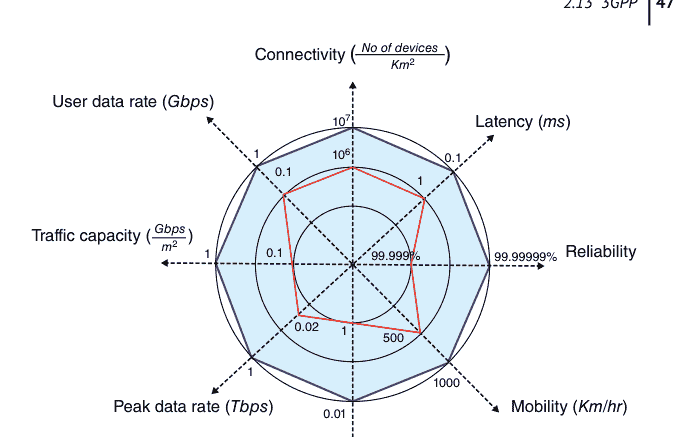

如果这些情况要发生，消耗大量带宽的应用必须满足更大的容量。2020 年，IMEC（智能制造中心）启动了先进 RF 平台，其目标是确保单链路数据速率达到 100Gbps，微秒级延迟，并且能量效率比每比特一个纳焦还要高。[29] 显示了 6G 与 5G 系统容量的愿景。先进 RF 平台将使用不同的材料开发新型半导体。传统上使用的是互补金属氧化物半导体 (`CMOS`)，但它将无法处理新的 6G 环境，因此他们计划使用铟。

## 结论

通过本章显而易见，这些技术进步为更美好、更高效的通信铺平了道路。当然，这是我们所知的——至少知道它是什么——并且我们已经在使用。Wi-Fi 演进到 Wi-Fi 7 的有趣之处在于它在提供 Wi-Fi 时如何影响业务。LTE 改变了我们使用移动互联网的方式。随着需求增加以及移动设备带我们的能力，LTE 和 4G 技术非常出色，通过运营商提供了我们以前梦寐以求的服务。凭借 LTE Advanced（版本 17），我们未来只将获得更快的连接。3GPP 对技术以及我们向 5G 和 6G 的迈进做出了巨大贡献。如果没有他们在标准化和实施方面的指导，移动互联网将不会有今天的模样。

异构网络（HetNet）是未来的愿景。尽管目前在大城市中使用，但异构网络是我们保证无线读取器可用性和覆盖范围所需要的。在全球范围内使用异构网络将使我们在从 A 点移动到 Z 点的过程中产生极少甚至没有“死角”。本章中的所有主题都是我们重要的组成。

## 参考文献

- 1. Khan, S., Sherali, Z., and Chilkamurti, N. (2021). 绿色网络. Springer Science+Business Media, LLC has.:://://doi.org/10.1007/s11227-011-0640-2.
- 2. Moon, S., Yi, Y., and Kim, H. (2015). 蜂窝网络中的高效用户关联：群体博弈方法。https://www.youtube.com/watch?v=FcJhXP5Qwy.
- 3. Jading, Y. (2015). 5G 系统的网络能量性能. Ericsson https://www.eth.se/fileadmin/fileadmin/report/71/2015/java_jading_17.pdf
- 4. Lancaster, E. (2021). 计算与 ICT 的排放以及我们之前可以如何做得更好。https://www.scientallly.com/releases/2021/09/2190121715.html
- 5. Tariq, F., Mehdikar, A., Wong, K., et al. (2020). 6G 的前瞻性研究：无线通信 27 (4): 118-125.
- 6. Cisco, V. (2016). Cisco 网络指数：预测与趋势，2017-2022. 白皮书。
- 7. Maier, G., and Reisen, H. (2019). 5G 时代黎明下的传输 SDN. 光交换与网络 33: 34–40.
- 8. Singh, R., Bish, D., and Prasad, R. C. (2017). 5G 移动网络技术的发展及其架构.国际工程与研究国际期刊 (IJER) 3: 196–210, 2017.
- 9. NewsTeam (2021). Wi-Fi 7 (802.11be) 比 Wi-Fi 6 更快。https://www.ktmdday.com/news

- 10. Jackson, T. (2016). 免费 Wi-Fi 的巨大增长正在改变非洲的生活。https://tenorweb.com/news/free-growth-wi-fi-transforming-life-africa.

- 11. Chaney, P. (2015). 为什么为客户提供免费 Wi-Fi 是有用的。https://www.smallbitredges.com/2015/11/small-businesses-need-offer-free-wi-fi-customers.html.

- 12. Deloitte (2014). 4G 对美国经济的影响。第一部分. CIO 期刊（2012年10月1日）。http://deloitte.com/us/en/pages/technology-media-/the-impact-of-4g-technology-on-the-us-economy-part-1.

- 13. Uyehara, L. (2015). SON、C-RAN 和 HetNet 有什么区别？https://electronicdevices.com/communications/what-difference-between-son-c-ran-and-hetnet.

- 14. Auer, G., Godler, L., Hevi, L., et al. (2010). 高能网络的赋能因素。https://www.researchgate.net/publication/231640959_Enablers_for_Energy_Efficient_Networks_fullTextContent

- 15. Auer, G., Godler, L., Hevi, L., et al. (2010). 高能网络的赋能因素。在：第38 届车辆技术会议.IEEE.

- 16. Ahlal, A., Bana, T., and Hu, P. (2020). 5G 黎明时的分布式车辆通信：预印本 arXiv:2001.07077.

- 19. Kumar, M.S. (2019). 5G 无线技术革命——未来方向.计算机工程期刊 (IOSR-CE) 21 (4): 36–42.

- 20. Boranis, Y., Salem, M., Sewerath, G. (2019). 5G 无线技术革命——未来方向。蜂窝网络中的高效用户关联：群体博弈方法。https://www.youtube.com/watch?v=FcJhXP5Qwy.

44 Lawler, D. (2022). 量子纠缠：物理学诺贝尔奖背后的“幽灵”科学。https://phys.org/news/2022-10-quantum-entanglement-spooky-physics.html.

45 Rahman, A., and Wang, C. (2021). 量子赋能的6G无线网络：机遇与挑战。https://www.arxiv.org/abs/preprint/Quantum_Enabled_6G_Wireless_Networks_Opportunities_and_Challenges/1478537/1

46 El-Latif, A., Bale, M., Banerjee, E., et al. (2022). 量子通信系统：应用、机遇与挑战。IEEE Wireless Communications（10月）。https://www.comsoc.org/publications/magazines/cf/quantum-technology-5g-wireless.

47 Yang, H., Alifiaons, A., Xiong, Z., et al. (2020). 人工智能赋能的智能6G无线网络。IEEE Access 7 (1): 17578-17588.

48 Huang, T., Wang, W., and Yu, J. (2019). 6G网络综：架构与技术。IEEE Access 7 (1): 17578-17568.

49 Hakeem, S., Hussain, H., and Kim, H. (2022). 6G技术与应用的安全性需求与挑战。Sensors 22 (24): 1. https://doi.org/10.3390/s22240205169

50 Bockmann, C., Pratas, N., Nikpour, H., et al. (2016). 5G中的大规模型通信：物理层和MAC层解决方案。IEEE Communications Magazine 54 (9): 59-65. https://www.researchgate.net/publication/305883263_Massive_Type_Communication_in_5G_and_MAC-layer_solutions.

52 Hwa, T., Gu, G., Kalla, A., et al. (2020). 区块链在6G中的角色：挑战、机遇与研究方向。https://digital-communication.zshaw.com/11475/2020/3/Hewa_6G-C%3%8BC-etal-The-Role-of-Blockchain-in-6g.pdf

54 Bhat, S., Gupta, N., and Thakur, J. (2021). 开源在6G无线网络中的作用：在《6G移动无线网络》（编辑：A. Khan, N. Gupta, J. Thakur, et al.），Springer International.

55 Sattiraju, R., Weiner, A., and Schon, H.D. (2019). 增强6G及以后网络的AI增强技术。在：第1届6G无线网络峰会，1-20页。https://doi.org/10.2298/0988523

56 Khalid, D., Wu, Y., Doh, N. S., and Ali, D. R. (2022). 6G无线通信的物理层技术。Sensors（特刊）：https://www.mdpi.com/journal/sensors/special_issues/PLT_6G

57 Pan, C., Wang, K., and Kof, J. (2021). 用于6G系统的可重构智能表面：应用、原理与研究方向。IEEE Communications Magazine 59 (6）：https://doi.org/10.1109/MCOM.001.2021.101076

58 Zhang, Y., Ding, L., and Han, B. (2021). 可重构智能表面赋能的6G。瑞士：Springer Cham https://doi.org/10.1007/978-3-030-72499-5

60 Oudmidi, C., Castro, and van Wameke, N. (2015). 传输协议：位置、演进以及互联网实际部署的解决方案。International Journal of Parallel, Emerging, and Distributed Systems 30 (6): 515-535.https://doi.org/10.1016/j.ijjed.2015.10.008.

61 Imran, M., Tafazoli, R., and Tukanov, A. (2016). 5G挑战与新兴研究方向：综述。IEEE Access 4: 11461-11463.

64 Branco, T., Chatopopoulos, D., and Hui, P. (2021). 6G中的机器类通信。在：6G移动无线网络（编辑：Y. Wu, S. Singh, A Roy, et al.），207页。Springer Cham：https://doi.org/10.1007/978-3-030-72277-2_7

65 Cho, R. (2020). 5G革命：它将如何影响环境？

66 Jawad, H., Nordin, R., Gharghan, S. et al. (2017). 用于精准农业的高能效无线传感器网络：综述。Sensors 17.

67 Sahota, H., Kumar, R., and Huang, J. (2020). 用于精准农业的高能效无线网络。在：IEEE.

68 Attaran, M. (2021). 6G对数字化的影响。Journal of Ambient Computing.

69 Kuamaki, K. (2018). 6G的演进。在：IEEE.

## 3.3 6G无线通信中的安全与隐私挑战

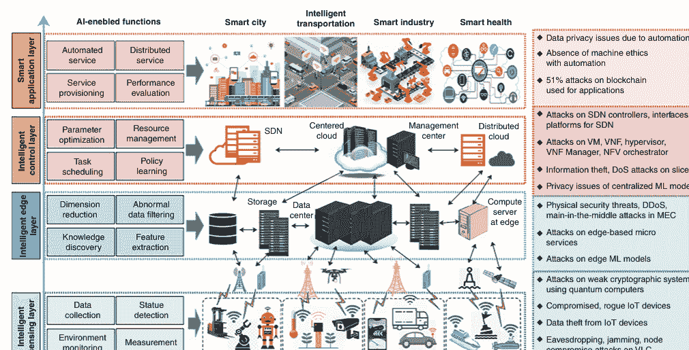

图 3.3 用于6G的AI驱动功能 [4]。

个人设备。在处理 6G [4] 时，一种能够区分子网和子网到广域网通信的分层方法可能是一个更好的方案。

由于 6G将依赖人工智能（AI）和机器学习（ML）来运行自主网络，这可能成为恶意攻击者可以攻击的另一个漏洞。用于执行更高效操作的AI和ML 6G系统，例如AI投毒和数据操纵（也称为对抗性ML攻击），可能会瘫AI系统 [5, 6]。例如，恶意攻击者可以向ML模型注入虚假数据，导致其认为安全泄露是正常现象而非需要报告。甚至存在攻击方法，例如通过在标志牌上贴胶带使其认为是限速标志，从而导致自动驾驶汽车向错误行驶 [6]。

区块链是一个使用安全技术连接的设备网络。区块链将数字信息（块）存储在公共数据库中，其中所有块之间通过加密相互链接 [7]。大多数公共区块链允许任何人创建和运行节点，使区块链成为去中心化、开放、许可的计算机硬件，用于管理加密以及后续请求中的货币交换。对于黑客来说，最弱的环节是访问区块链中批准欺诈交易的节点。在当今经济中，许多人认为交易是有问题的，但被认为是金融货币机构的良好选择。

去中心化、不可篡改性、不可否认性和透明性、可扩展性、监管、安全性和消耗也是必须解决的关注领域，以便使区块链成为可靠的分布式账本技术。

区块链的优势将消除6G中提出的任何挑战，例如可扩展性、吞吐量、信任以及DDoS（分布式拒绝服务）攻击的威胁。区块链可以：

- 确保资源完整性。
- 提高频谱安全性。
- 确保请求者与供应商之间的信任。
- 消除中间环节。
- 确保海量连接 [8]。

# 6G无线通信的未来

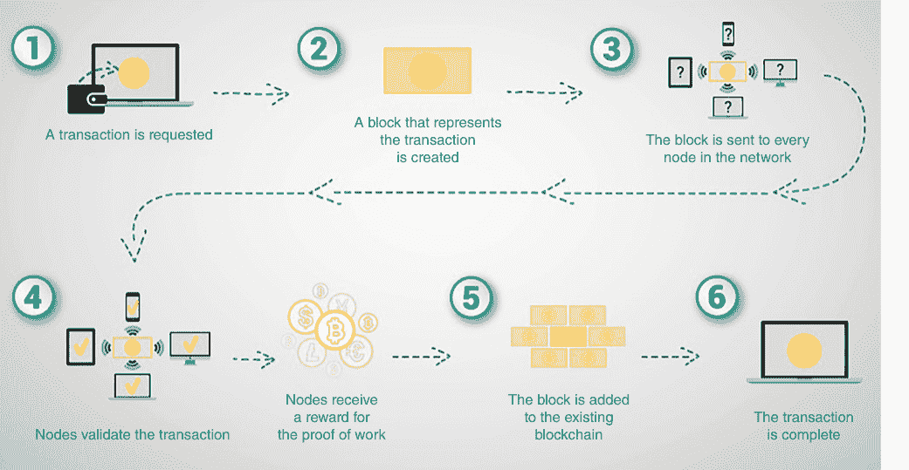

图 3.4 区块链与安全问题 [9]。

尽管在考虑6G与区块链的结合时，区块链也存在若干安全和隐私问题。已经出现过私钥或个人数字签名被盗窃的情况，导致数百万美元加密货币被盗。对区块链的其他少数类型攻击还包括51%攻击、路由攻击、钓鱼攻击、区块链终端漏洞和交易泄露。随着量子计算的出现，51%攻击可能是这些攻击中是最令人困扰的。在51%攻击中，恶意攻击者通过控制至少51%的计算能力获得控制权。成功的攻击可以通过允许攻击者阻止交易、反转其操作并更改交易顺序，从而使区块链失去稳定。图3.4和图3.5说明了AI如何被攻击者、犯罪者、防御者以及6G安全部门使用。

## 3.4 6G对医疗体系的影响

6G技术将通过创建一个智能医疗系统从根本上改变医疗行业。该领域有大量应用，6G技术可以改进或甚至使其成为可能。一旦6G可用，远程医疗、远程手术、远程健康监测等将成为现实。它将同时提高服务质量和患者体验质量。图3.6展示了智能医疗系统的可能性。

6G技术的一个主要优势将是开发可以护理患者的智能设备。这些设备将监测心率、血压和其他健康状况等身体功能 [10]。基础测试可以快速发送给医生或护士，而无需从家用诊所，并且可以利用AI和ML在患者发生轻微健康和身体问题/事件期间提供处理建议。这类设备对于老年患者和免疫功能低下的人群将特别有帮助。它将减少他们在医院或诊所环境中接触大量病人的需求。除了免疫功能低下的人之外，智能可穿戴设备将让每个人减少访问医院/诊所的次数并降低医疗成本。

远程健康服务（通常通过Zoom等会议软件进行远程医疗访问）在COVID-19疫情期间爆发式增长。这类服务使用量的增加

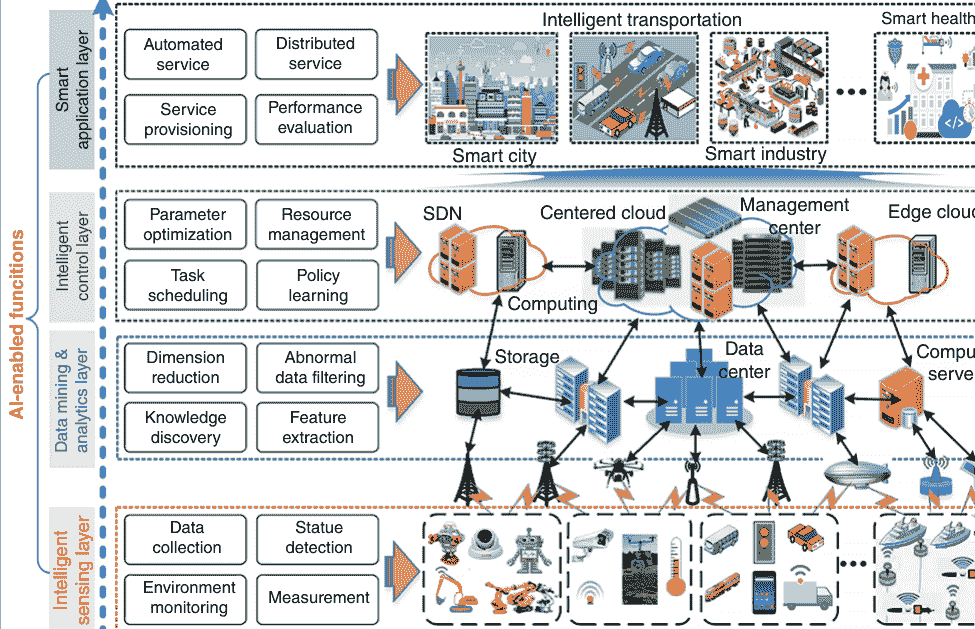

图 3.5 6G与AI的使用 [4]；

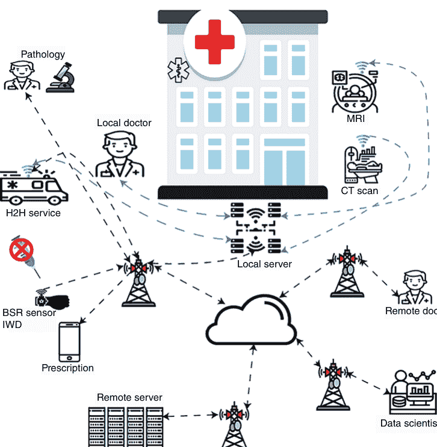

图 3.6 智能医疗的潜在6G连接 [10]。

凸显了5G的优势，但通过6G技术将实现的最令人兴奋的服务之一是远程手术，它需要机器人、护士和至少一名远程医生，由于5G的限制（因为需要持续的实时语音和视觉通信），这在5G下是不可能实现的。然而，6G可能实现的全息技术将成为远程手术的规则改变者，因为远程医生将提供指导并在“物理上”在区域内移动以获得更好的视野。此外，智能可穿戴设备将让每个人减少访问医院/诊所的次数并降低医疗成本。

6G将通过从数百英里外控制设备来辅助，虚拟现实以及触觉技术是医疗体系的另一个方面。6G可以改进的另一个方面是疫情和疫情控制。有了6G，我们可以预期全球范围内包括包括农村地区的连接。由于必要性，我们还需要更安全的努力。

自1957年发射第一颗卫星进入太空以来，空间技术一直在取得进步。从拥有4KB内存的阿波罗引导计算机到如今NASA使用的超级计算机，我们在技术上已经走了很长的路；6G可能是进一步探索太空的下一步。图3.7和图3.8展示了可能实现的空间集成计算网络布局。6G将是首个集成空间、地面、宽带、移动性和数据的网络。

## 3.5 6G对空间技术和卫星通信的影响

到2030年，我们预计看到一代移动通信6G。我们可以看到能够相互通信的天线和可穿戴设备。这些预计将带来我们目前拥有的极速下载速度。新的应用也需要开发。人们对互联网的使用比以往任何时候都频繁。为了满足这一点，我们需要为通信系统开发更高容量的架构。如果不这样做，旧技术将过时且无法使用。GEO（地球轨道）、MEO（中地球轨道）和LEO（低地球轨道）卫星都能实现极通信并与地面网络集成。6G卫星通过毫米波/太波段与无人机（UAV）通信，以维持宽带、位置自动化、建筑卫星、专业移动网络、航空宽带以及使用6GHz以上的MIMO。

许多人担心6G通信系统的安全隐私，例如毫米波和健康问题。然而，6G通信安全已经存在，例如毫米波频段。在其安全系统中，针对警察、卫星和移动传感器进行了研究。对这些技术已经进行了研究，没有证据表明它们会产生不利影响。通过6G，我们可以预期全球农村地区的连接。由于必要性，还会有更安全的努力。

自1957年发射第一颗卫星进入太空以来，空间技术一直在取得进步。从拥有4KB内存的阿波罗引导计算机到如今NASA使用的超级计算机，我们在技术上已经走了很长的路；6G可能是进一步探索太空的下一步。图3.7和图3.8展示了可能实现的空间集成计算网络布局。6G将是首个集成空间、地面、宽带、移动性和数据的网络。

空间集成网络可以在6G的帮助下，通过利用在不同轨道运行的卫星来实现。随着人类整体对网络的需求不断，未来地面网络可能会变得越来越不再有效 [15]。

## 3.5 6G对空间技术和卫星通信的影响

### 空天一体化网络

- 不受地球灾害影响的独立、自主空间基础设施
- 通过光技术实现的超低功耗、超高高速、高安全性网络

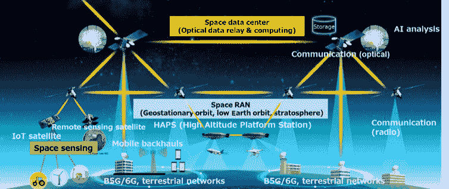

图 3.7 6G与空天一体化网络 [11]。

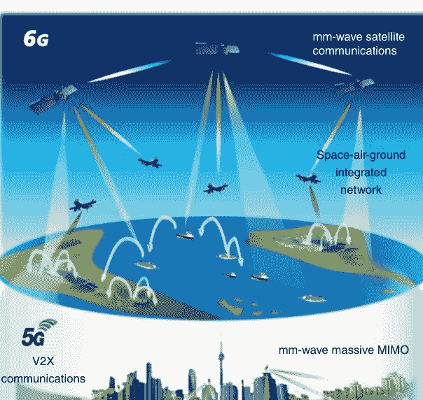

图 3.8 6G的三维覆盖 [12]。

空天地一体化网络（SAGIN）开始发挥作用。凭借6G预期的速度和可靠性，SAGIN网络可能为广阔地区和难以连接的人群提供互联网连接，并填补服务欠缺地区的数字鸿沟——由于其处理负载远高于地面网络，这还将允许城市地区拥有更高的网络流量。

6G也将有利于载人太空任务。在国际空间站进行研究的宇航员应该能够更容易地与其国家通信，并利用站内更多的IoT和IoE设备。未来还有可能的月球任务、载人火星任务，甚至是太空探险。6G技术将助力所有这些活动，并使它们更有可能实现。

## 3.6 6G对其他行业的影响

当6G实施时，医疗健康和空间产业将不是我们生活中受影响的唯一领域。从制造业到汽车行业甚至农业行业，我们生活的许多方面将受到6G的影响。可能我们现在还不知道随着6G的出现将带来多少变化，因为距离商业化至少还有十年时间。图 3.9阐释了6G系统的潜在用例。

行业对于采纳和接受技术变革通常很缓慢。社会往往认为它是“次要”，但没有它我们无法生存。随着世界人口的快速增长，农业业在未来几十年内的产量可能需要增加70% [15]。6G及其允许的技术将在增长方面发挥主要作用。无线传感器网络将允许对农场进行远程监控，AI根据传感器读取的数据做出决策。拖拉机和收割机等农用车辆可能被远程或自主控制，让现实世界训练新的农民和农工。

在COVID-19疫情期间，从幼儿园到大学都被迫进行远程学习，结果并不理想。6G将为通过在线同学学习提供更好的选择。在线学习可以通过增强现实设备和全息图来增强，以提高体验，甚至是物理教室体验 [15]。在非住校教育中，6G还可以通过在地震或活跃枪手事件等任何紧急情况下实现快速通信和响应来获益。

在制造业和运输/物流行业中，6G将产生巨大影响。6G将允许极低延迟的工厂自动化，传感器能够在零件在制造过程中移动时提供提供实时更新。在流程完成和发运方面，6G将通过改进库存管理、提供物流可行性分析机会、优化仓库通信、实现叉车自动化，并可能允许近乎自动驾驶的货车行驶来帮助物流部门。货运跟踪和实时交付更新等其他功能可能会通过6G得到改进。

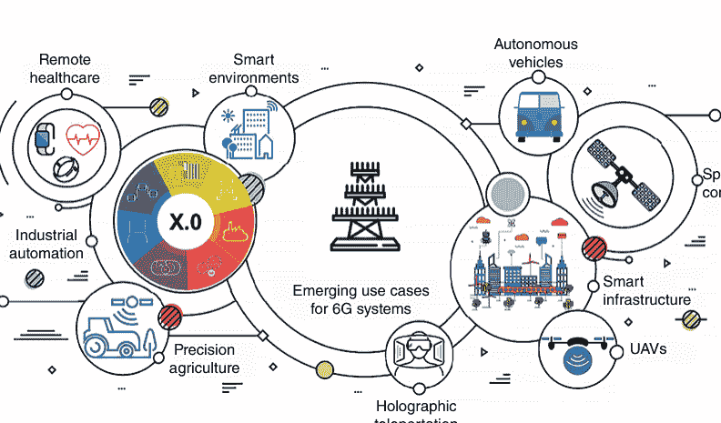

图 3.9 6G的各种潜在用例 [14]。

## 3.7 6G中的太赫无线系统与网络

在过去的十年中，由于对服务的需求增加以及广播、IoT、汽车、智能城市、能源、通信设备对快速和大数据传输速率的需求，全球移动数据流量剧增。这无疑给现有的移动通信系统带来了满足新的且不断的数据速率的压力。提高容量和数据速率有多种方法，包括增加带宽，带宽与数据速率成正比。高频段（或毫米波段）支持大规模MIMO（多输入多输出）和毫米波段的主要挑战包括可用空间有限、显著的路径损耗和覆盖区域。处于概念和开发阶段的6G通信被设为具有高数据速率能力以及超低延迟、极高容量、高安全性和更广的覆盖。6G可能是sub-6 GHz、毫米波和THz频段的结合。从5G到6G过渡的一些关键特征是超高数据速率应用、沉浸式全息图、直播、无处不在的覆盖区域和大数据。天线的可能性包括波束成形、可切换相位和双极化天线。6G正在考虑从100 GHz到300 GHz的THz频段，这将需要更复杂的天线设计，在材料、设计、制造和实验验证方面带来更多挑战。

无线可穿戴设备已非常先进，预计将继续高水平增长。2022年全球可穿戴技术市场规模为631亿美元，复合年增长率（CAGR）为14.4%。随着智能手机和IoT智能设备的扩展，全球互联网连接的快速扩张为连接任何有线或无线网络铺平了道路。由于人口快速老化，佩戴传感器的实时监控至关重要，这一领域将继续推动市场发展。可穿戴电子设备的元素如监测健康的智能手表、导航系统、身体摄像头、运动设备等。传统的微带天线设计在薄层基板上，用于5G应用，在5GHz附近运行，具有50dbi的增益和效率。可穿戴设备的高频率利用将导致更多传播损耗，因此可穿戴天线需要具有高度方向性的增益以确保。

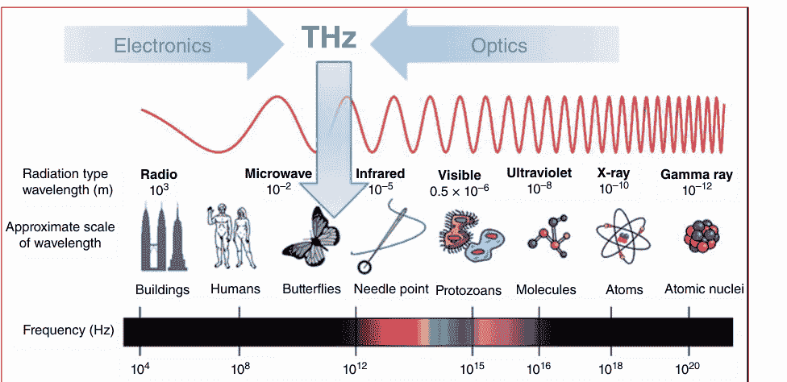

图 3.10 THz频段和相关应用。

# 6G无线通信的未来

毫米波在可接受范围内。由于6G的目标是60 GHz，THz将允许大量数据。从100 GHz到300 GHz的THz频段正被6G考虑，这将需要更复杂的天线设计，在材料、设计、制造和实验验证方面带来更多挑战。

## 3.8 6G对其他行业的影响

行业对于采纳和接受技术变革通常很缓慢。社会往往认为它是“较差的”，但没有它我们无法生存。随着世界人口的快速增长，农业业在未来几十年内的产量可能需要增加70% [15]。6G及其允许的技术将在增长方面发挥主要作用。无线传感器网络将允许对农场进行远程监控，AI根据传感器读取的数据做出决策。拖拉机和收割机等农用车辆可能被远程或自主控制，让现实世界训练新的农民和农工。

在COVID-19疫情期间，从幼儿园到大学都被迫进行远程学习，结果并不理想。6G将为通过在线同学学习提供更好的选择。在线学习可以通过增强现实设备和全息图来增强，以提高体验，甚至是物理教室体验 [15]。在非住校教育中，6G还可以通过在地震或活跃枪手事件等任何紧急情况下实现快速通信和响应来获益。

在制造业和运输/物流行业中，6G将产生巨大影响。6G将允许极低延迟的工厂自动化，传感器能够在零件在制造过程中移动时提供实时更新。在流程完成和发运方面，6G将通过改进库存管理、提供物流可行性分析机会、优化仓库通信、实现叉车自动化，并可能允许近乎自动驾驶的货车行驶来帮助物流部门。货运跟踪和实时交付更新等其他功能可能会通过6G得到改进。

14 Akyildiz, I.F., Kak, A., and Nie, S. (2020). 6G与无线通信系统的未来。IEEE Access 8: 133995-134030. https://ieeexplore.ieee.org/document/9145564.

15 Imoze, A., Adedeji, O., Tandiya, N., and Shetty, S. (2021). 6G赋能可持续社会的智能基础设施：机遇、挑战与研究路线图。Sensors 21: 1–57. https://doi.org/10.3390/s21051709.

16 Emergen Research (2023). 可穿戴技术市场，按产品（腕戴、头戴、鞋类、躯体及其他）、按技术、应用和地区预测至2032年，https://www.emergenresearch.com/industry-report/wearable-technology-market.

17 Alsharaif, M. (2021, 1月). 太赫兹频率挑战与开放研究问题。https://www.researchgate.net/publication/346204464_Terahertz_6G_Communication_Networks_Terahertz_Frequency_Challenges_and_Open_Research, Yaquib, M. 等. (2021, 9月9日)。

18 Boulegeorgos, A.-A., E., di Remzo, M. 等. (2021, 9月9日). 机器学习：无线网络的催化剂。Frontiers in Communications and Networks 2: https://www.frontiersin.org/articles/10.3389/fcmn.2021.704546/full.

19 Weissbergs, A. (2021, 9月28日). ITU-R 进展报告：100 GHz以上（甚至超过800 GHz）的IMT（可能是5G和6G）的使用，https://techblog.comsac.org/2021/09/28/itu-r-report-in-progress-use-of-imt-likely-5g-and-6g-above-100-ghz-even-800-ghz.

# 5G与6G技术时代的人工智能与机器学习

人工智能（AI）是一种模拟人类思维过程的系统或机器。大多数AI系统并没有意识，但它们使用算法像人类一样思考并进行计算。虽然这些初看起来可能很平庸，但它们实际上可以与另一种名为ML（机器学习）的突破技术结合使用。机器学习是利用模式识别让计算机编程以执行手头任务的过程。这正是让它们变得像人类的原因。凭借了从发生的事情中学习的能力，AI可以完成人们认为永远无法完成的任务。

当机器与物联网（IoT）结合时，真正的魔法就发生了，我们由此创造了一些最令人惊叹的技术突破，让工人之间能够进行通信。例如，当特斯拉公司决定升级其汽车的部分部件时，它可以远程完成。当特斯拉的Model S电动轿车遇到突然的转向故障时，加利福尼亚总部的技术人员迅速锁定了可能的原因——一个连接器在三天前被一名过度热心的员工使用标准气动枪移除胶水时损坏了。AI和IoT的结合创造了惊人的结果。有了这些技术，我们可以创造出以前被认为不可思的产品和功能。

那么，这项技术是如何影响我们的呢？为了弄清楚，我们必须回顾过去。在AI和IoT整合之前，工厂必须使用手动机器。每台机器都必须由一个人操作，这对于每个工人来说都是极其困难的。随着AI和IoT的整合，机器现在由机器自身操作，降低了人工成本。以亚马逊仓库为例，“这些仓库装满了机器人和传感器，以便进行维护和改进。如果出现问题，亚马逊不需要手动修理。使用这些技术而非人工维修，通过减少成本和劳动力，节省了时间（和金钱）。”

这不仅改变了我们的工作方式，还改变了标准。通过机器学习的方面，公司可以几乎最大限度地减少安全风险。通过分析数据，公司可以预测安全风险，例如盗窃或网络攻击的可能性。对此类威胁的响应可以实现自动化和加速，进一步增强安全性。

AI也是6G的一个组件。随着机器学习和深度神经网络的发展，AI由三个子功能组成。第一是业务智能，负责在复杂的动态环境中分配资源以实现高效运行。第二是环境智能，它将允许网络到复杂的自动驾驶车辆具备自组织和自愈特性。最后是服务智能，它通过使用深度学习技术调整以达到最佳效率，从而扩展人类应用并增加用户满意度。接着是对数据隐私和安全功能的关注。量子计算技术（如量子密钥循环）的优势对于改进5G和4G的安全性至关重要。

## 4.1 人工智能与机器学习：定义、应用与挑战

机器学习利用算法和统计模型分析数据结构来推断模式，而无需显式编程。ML已被证明是最具变革性的技术进展之一。机器学习帮助组织执行其数字化转型并进入……

要理解机器学习，我们必须首先掌握AI的基础。AI被定义为任何与人类认知能力相当的软件。

### 4.1.1 机器学习的应用

然而，机器学习与人工智能之间存在区别。深度学习是确定性的，而机器学习是概率性的。ML算法可以分析大量数据并提取有效信息。在这种方法中，它们从数据中学习并改进之前的版本。

### 4.1.2 机器学习的挑战

虽然AI具有巨大的潜力，但也存在偏见。性别、种族和意识形态偏见会被数据集反映或强化。当AI不可靠或存在偏见时（通过样本），可能会导致偏曲的结论。人类使用深度学习来选择谁获得贷款或工作。

## 4.2 人工智能：法律、法规与伦理问题

AI 正在渗透我们社会的每一个方面，从至关重要的领域到日常领域，例如医疗保健和人道主义援助。AI 和 ML 方法体现了对经济、社会和人权的增强。这些尖端技术可以帮助许多领域。与此同时，AI 也可能以意料之外或危险的方式被解读。因此，在管理 AI 时，理解法律、伦理与技术之间的交叉变得比以往任何时候都重要。AI 系统被应用于各种场景，其中大部分使用基于统计的学习技术来从海量数据中寻找模式并基于这些模式做出预测 [4]。由于 AI 在设计和控制上日益变得不可预测，可以利用哪些框架来实现这一点？以及如何实现？这是本特刊作者涵盖的主题之一。我们在构建建立 AI 治理框架时，对伦理、法律法规和技术问题进行了深度分析。

复杂且高风险的任务，如提供假释、检测疾病和处理金融交易正越来越多地分配给 AI 系统。这为这种自主责任带来了新的困难，包括现有法律框架在处理“大数据影响”或防止算法偏差方面的局限性，与执法或社会福利相关的社会正义问题，或在线媒体消费。鉴于 AI 的广泛影响，这些重大挑战只能通过多学科方法才能得到充分解决 [4]。

### 4.2.1 人工智能中的伦理治理

需要关于构建 AI 伦理、法律和技术治理的新观点。伦理治理的核心是 AI 突出的最紧迫的问题，包括公平性、完整性、隐私、服务和产品分配。清晰性和解释性是用于提高算法公平性、透明度和问责制的两个原则。在欧洲，算法选择的“解释权”概念正在被探索中 [5]。根据这一规则，如果算法做出了决定，个人有权获得解释。与其剖析开关的工作原理，运行算法系统的工具可以作为观点呈现，用于评估输入和输出是否存在偏差和伤害。

AI 的所有权是第三个对每个人都至关重要的伦理问题。谁对机器人的行为、责任和持有负责？例如，如果机器人由于疏忽导致某人受伤？是机器人的所有者还是机器人本身？进一步的伦理问题是法律上谁对刑事责任负责。这仍然是一个灰色地带，目前尚不清楚机器人在法律上会被视为真实的人。在多种多元文化背景下平衡许多利益相关者所持有的相对价值感、解释理由并确保透明度。机器人可以作为对其行为负责的伦理主体（或“自主代理”），这一概念是目前某些机器伦理讨论的领域。机器伦理正在进入实用机器人领域，而在该领域，很少假设这些机器在任何意义上都是人工代理。有人强调，设计为遵循伦理标准的机器人可能会被复制以遵循永恒的标准 [5]。

### 4.2.2 AI 监管的未来

全球范围内的人担心 AI 和机器人最终将取代人类劳动力。结果是需要更少的人披露个人信息，这些信息在媒体、在线社交平台和搜索引擎中被侵蚀。一些人认为，信任与技术之间的差距扩大是有原因的：在 AI 存在的大部分时间里，没有任何针对 AI 的监管。在世界变革之时，这些法规可能显得有些模糊和不明确。在没有 AI 护栏的情况下跳到结论是诱人的，而护栏可以帮助我们在日常生活中掌握主动权，并决定社会将由 AI 共同驾驶还是由 AI 指导。

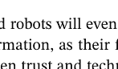

## 4 5G 和 6G 技术时代的人工智能与机器学习

### 4.3 人工智能在无线 5G 和 6G 中的潜力：优势与挑战

### 4.3.1 无线 5G 和 6G 中的人工智能

5G 蜂窝网络的推出通过提供高数据速率、低延迟和超可靠的连接来实现物联网（IoE）应用。为了促进 5G 中人、机、物之间的连接，随着连接边缘设备数量的增加，网络设备必须是软件驱动、智能化、虚拟化且节能的。网络还将支持各种服务，例如移动宽带、与连接设备的超可靠低延迟通信。

在网络层面，像 IoE 这样的新技术和应用正在产生海量数据。基于 AI 的模型经常从获取的数据创建，以协助检测、分类和预测未来事件。由于时间、延迟和存储考虑，将所有数据传输到一个地方通常是不切行的。联邦学习（FL）已被用于满足对去中心化日益增长的需求。5G 通信网络的部署在学术界和工业界达到了一个重大里程碑，业界现在的目标是超越 5G。在网络中使用 AI 借助高性能计算收集数据正获得关注。典型方法是以集中方式收集数据，然后将来自多个源的异构数据在服务器中聚合，从而提高通信效率。基于 AI 的联邦学习是一个瓶颈，它在面临隐私挑战的同时改进了 ML 工作流。

### 4.3.2 5G 和 6G 中的优势与 AI

- 增强移动宽带 (eMBB)。在恒定服务系统中产生更高数据速率的应用程序。
- 大多数类通信 (mMTC)。无线设备数量需要可扩展连接，在广覆盖区域有效传输小量数据是 5G 通信服务的一大特征。这种数据流量将受益于感知网络、智能家居、物联网和无人机等应用。
- URLLC（超可靠低延迟通信）在连接医疗保健、远程手术、关键任务应用、自动驾驶和智能工业应用中其优先级将高于数据速率。

### 4.3.3 如何利用 AI 增强 6G 服务？

尽管 5G 以其网络连接和基于微服务的设计而受到认可，但下一代技术（即 6G 代）与网络编排和管理密切相关。AI 将在演进中的 6G 中发挥巨大作用。然而，在许多情况下，6G 与 AI 的伙伴可能是一把双刃剑，因为 AI 具有保护或侵犯安全与隐私的潜力。未来网络的端到端自动化，特别需要主动威胁检测、潜在智能化的方法以及 6G 中自动网络系统的实现 [6]。尽管如此，由于应用并非真实，AI 驱动的网络受到网络诞生时传统架构局限性的限制。因此，对于分布式 AI 或智能代理没有提供帮助，因为这两个领域完全是 AI 的。

# 5. 人工智能在 5G 和 6G 中的潜力：优势与挑战

此外，5G 网络已经包含了实时智能体，例如车载网络，由于延迟问题，紧急情况无法在“实时”处理。相比之下，6G 网络可以

许多研究已经探索了 6G 无线峰会和研讨会的前沿。探索的主题包括太赫（TH）通信、量子通信、大数据分析、小区网络和无处不在的 AI。为了提供更高的速率和更低的延迟性能优势，需要一个高效的网络。网络必须能够在充满干扰的环境中动态分配资源、调整流量并解释信号。为了满足这些需求，无处不在的 AI 是一个至关重要的候选。AI 将通过优化网络和开发新波形在 6G 技术中发挥关键作用 [6]。

许多创新的网络切片和安全方法也得到了关注。所有这些计划都旨在让环境更加智能化。此外，6G 技术将允许更好的 AI/ML 突破，利用 6G 传感器本地的数据并推进 AI/ML 模型。尽管处于发展的早期阶段，6G 显示出可以拓宽用户体验并开启……的元素。

### 4.3.4 6G 时代的边缘智能与云化

由于 AI 和计算之间存在强有联系，将两者结合是自然而。在 6G 无线应用中，将处理移动到边缘至关重要。部署 AI/ML 算法在边缘获取、存储或处理数据被称为边缘智能（EI）。边缘服务器从许多网络设备中收集数据。数据在众多边缘之间共享以训练，并进行评估和预测，使设备能够从更快的反馈中受益，减少延迟并降低成本，同时增强其运行。然而，数据是从各种来源收集的，AI/ML 算法的结果取决于数据 [7]。

根据 Zhang 等人的观点，EI 面临一系列安全漏洞，因为数据是从某些来源收集的，且 AI/ML 算法的结果大多依赖于数据。在用户识别、账户控制和数据完整性方面，平台验证将需要对 EI所有的信任。事实证明，区块链可以用于保护边缘设备并从多个节点保护资源。区块链确保了实现 AI 所需构建任务和学习数据片段的一致性。边缘计算通过许多节点分布，这使得执行数据窃取等攻击变得困难。

黑客可能会利用边缘计算的离散特性及其相应的依赖性来执行数据投毒、数据逃逸或隐私攻击等攻击，损害 AI/ML 算法的结果并破坏 EI 的优势。此外，边缘服务可能需要安全的路由算法和信任架构。边缘设备可能携带敏感数据，如用户位置、健康记录或制造信息等，在 EI 中，安全和隐私是紧密相连。

在边缘模型中，联邦学习是实现隐私驱动的数据训练的本地模型的一种方法。专家还在使用安全计算和同态加密在关系中构建保护隐私的 AI 框架配置。6G 将是未来智能医疗服务的主要通信技术。因此，确保数十亿 IoT 设备和可穿戴设备的安全通信、设备认证和访问将是 6G 时代的主要挑战。用户数据或电子健康记录的伦理组成部分的隐私和保护将是医疗系统中的关键挑战。为了处理数十亿 IoT 设备并评估健康相关数据，AI 是必不可少的。

### 4.3.5 6G 安全中的分布式人工智能

6G 世界中快速发展的 AI 与 ML 紧密相关，并在两个方面具有更强的影响。在某些方面，在 6G 中正确使用 AI/ML 可以保护隐私。虽然 5G 网络已经为 IoT 准备就绪，但 6G 网络需要是 IoE（万物连接）。因此，6G 网络是一个是一个去中心化的系统，能够在多个层次进行智能决策。

此外，由于物联网连接互联网，分布式 AI 需要各种标准。训练数据集应该不均匀地分布在大多数边缘设备上，每个边缘设备都有访问控制的权限。

### 4.4 5G 与 6G 人工智能与机器学习

6G 世界中的快速 AI 与 ML紧密切相关，在两个方面具有更强的影响。在某些方面，在 6G 中正确使用 AI/ML 可以保护隐私。虽然 5G 网络已经为 IoT 准备就绪，但 6G 网络需要是 IoE。因此，6G 网络可能是一个高度去中心化的系统，能够在多个层次进行智能决策。

此外，由于物联网连接互联网，分布式 AI 需要各种标准。训练数据集应该不均匀地分布在大多数边缘设备上，每个边缘设备都有访问控制的权限。

为了提供更高的速率和更低的延迟性能优势，需要一个高效的网络。网络必须能够在充满干扰的环境中动态分配资源、调整流量并解释信号。为了满足这些需求，无处不在的 AI 是一个至关重要的候选。AI 将通过优化网络和开发新波形在 6G 技术中发挥关键作用 [6]。

许多创新的网络切片和安全方法也得到了关注。所有这些计划都旨在让环境更加智能化。此外，6G 技术将允许更好的 AI/ML 突破，利用 6G 传感器本地的数据并推进 AI/ML 模型。尽管处于发展的早期阶段，6G 显示出可以拓宽用户体验并开启……的元素。

### 4.3.4 6G 时代的边缘智能与云化

由于 AI 和计算之间存在强有联系，将两者结合是自然而。在 6G 无线应用中，将处理移动到边缘至关重要。部署 AI/ML 算法在边缘获取、存储或处理数据被称为边缘智能（EI）。边缘服务器从许多网络设备中收集数据。数据在众多边缘之间共享以训练，并进行评估和预测，使设备能够从更快的反馈中受益，减少延迟并降低成本，同时增强其运行。然而，数据是从各种来源收集的，AI/ML 算法的结果取决于数据 [7]。

根据 Zhang 等人的观点，EI 面临一系列安全漏洞，因为数据是从某些来源收集的，且 AI/ML 算法的结果大多依赖于数据。在用户识别、账户控制和数据完整性方面，平台验证将需要对 EI 所有的信任。事实证明，区块链可以用于保护边缘设备并从多个节点保护资源。区块链确保了实现 AI 所需构建任务和学习数据片段的一致性。边缘计算通过许多节点分布，这使得执行数据窃取等攻击变得困难。

黑客可能会利用边缘计算的离散特性及其相应的依赖性来执行数据投毒、数据逃逸或隐私攻击等攻击，损害 AI/ML 算法的结果并破坏 EI 的优势。此外，边缘服务可能需要安全的路由算法和信任架构。边缘设备可能携带敏感数据，如用户位置、健康记录或制造信息等，在 EI 中，安全和隐私是紧密相连的。

在边缘模型中，联邦学习是实现隐私驱动的数据训练的本地模型的一种方法。专家还在使用安全计算和同态加密在关系中构建保护隐私的 AI 框架配置。6G 将是未来智能医疗服务的主要通信技术。因此，确保数十亿 IoT 设备和可穿戴设备的安全通信、设备认证和访问将是 6G 时代的主要挑战。用户数据或电子健康记录的伦理组成部分的隐私和保护将是医疗系统中的关键挑战。为了处理数十亿 IoT 设备并评估健康相关数据，AI 是必不可少的。

### 4.3.5 6G 安全中的分布式人工智能

6G 世界中快速发展的 AI 与 ML 紧密切相关，并在两个方面具有更强的影响。在某些方面，在 6G 中正确使用 AI/ML 可以保护隐私。虽然 5G 网络已经为 IoT 准备就绪，但 6G 网络需要是 IoE。因此，6G 网络可能是一个高度去中心化的系统，能够在多个层次进行智能决策。

此外，由于物联网连接互联网，分布式 AI 需要各种标准。训练数据集应该不均匀地分布在大多数边缘设备上，每个边缘设备都有访问控制的权限。

### 4.4 5G 与 6G 人工智能与机器学习

### 4.5 5G 在网络安全中的优势与挑战：帮助还是伤害？

# 黑客如何利用 AI 攻击网络？

系统培养了网络安全专家，极大地提升了您的解决问题的能力。它通过检测计算机系统和企业网络中的弱点，帮助人们专注于关键的安全职责 [9]。

人工智能（AI）可以为组织提供与伦比的实时监控、威胁检测和响应速度。由 AI 驱动的网络安全系统对威胁的响应比任何人都都要更精确，它还可能让网络安全专家能够专注于更严苛的任务。通过使用这些策略，AI 可以理解各种趋势，并根据最新的数据或信息调整其算法。网络安全领域的 AI 熟悉复杂的数据网络，并能够以最少的人为干预快速检测并消除安全问题。AI 并会取代网络安全专的专业知识，它能帮助网络安全专家尽可能地检测并处理敌对行为。

## 4.6 黑客如何利用 AI 攻击网络？（注：此标题在原始 OCR 文本中重复）

网络安全专业人员可能利用 AI 促进网络安全最佳实践并减少攻击面，而不是不断监控有害行为。另一方面，网络犯罪分子也可以出于恶目的使用相同的 AI 系统。带有对抗性 AI 的模型可能会误导系统，并以有利于攻击者的方式做出反应。同时，攻击者利用 AI 及其衍生技术来发起更具自动化、强制性和协调性的攻击。

仅使用当今世界制造的自动化工具进行黑客是不够的；使用正确的工具和技术进行智能战斗至关重要。通过采用 AI 和 ML（机器学习），黑客可以更有效地理解公司是如何防止他们突破边界的 [10]。

如果你拥有控制权，操纵 AI 系统可能很简单。工具是构建在训练它们的数据集之上的，即使是微小的更改也可能导致 AI 产生假故障或泄露安全漏洞。黑客可以使用反向工程来访问训练 AI 的私有数据集。网络犯罪分子可能利用 AI 搜索并定位漏洞、数据和网络，以扩大其社交工程攻击的规模。在个人层面，AI 可以检测行为模式并在未经授权的情况下访问社交媒体账户。在 AI 的帮助下，骗子可以增强他们在社交媒体平台、电子邮件甚至电话中的欺骗手段。

创建深度伪造（deepfake）照片和分享链接可能会引导错误的路径，从而损害其安全 [10]。

网络犯罪分子利用社会工程来欺骗并说服他人提供个人信息或执行特定操作，例如进行转账或打开恶意文件。ML 通过利用犯罪分子的行为，使其更容易从来源、员工和伙伴处收集信息。换句话说，ML 放大了社会工程攻击。欺骗（Spoofing）和钓鱼是黑客试图启动入侵、欺诈或欺骗个人的策略。黑客可以使用深度学习技术检查目标的各种特征。

作为当今 AI 基础的 ML 系统有几个缺点。利用这些漏洞的攻击已经扩散到各处，而防御仅限于跟上黑客的速度。ML 攻击与传统的黑客攻击不同，因为它们需要通过利用网络产生漏洞。例如，ML 攻击很难像传统的软件缺陷那样被修复，为攻击者制造了可以利用的弱点。这些缺陷中的一些甚至不需要访问受害者的设备，这为攻击者提供了更多机会，并削弱了防御保护的能力。

由于网络安全领域是动态的，没有人能预见到一种能让他们永远保持安全的“银弹子”。回顾历史，网络安全技术和黑客一直都在追赶。因此，如果 AI 可以使用网络安全工具，它也可以发起攻击。即使由 AI 驱动的攻击目前并不常见，它们也可能很快变得普遍。钓鱼邮件通常是手动创建并分发给许多人的，而不针对每一个人。任何仔细关注内容的人都能看到可以有不同的处理方式。

首先，AI 可以通过自然语言处理理解并编写不同的语言。这使得 AI 参与讨论并对裁决做出反应。此外，AI 原型已经能够根据员工的 LinkedIn 个人资料或电子邮件签名自动识别其角色。高价值目标可能会被快速识别。

# 4 5G 和 6G 技术时代的人工与机器学习

## 4.7 结论

物理和虚拟通信都有助于缓解 COVID-19 疫情对健康、教育、交通和工业等多个部门的有害影响。如果没有这些通信技术，疫情的影响将更大，而且许多行业严重依赖电信网络来支持其日常运营。由于这些网络面临着前所未有的流量需求。因此，理解 AI 在 5G 和 6G 通信时代的作用至关重要。

## 参考文献

- 1. Venkateswaran, C., Manickam, R., Saravanan, V., and Tamil, T. (2021). 结合机器学习和深度学习技术的人工智能研究。In Data Analytics and Artificial Intelligence, 32–37. REST Publisher.
- 2. Chen, Z. and Li, B. (2018). 终身机器学习，第二版。Synthesis Lectures on Artificial Intelligence and Machine Learning 12 (3): 1–207. https://doi.org/10.2200/s00832e10y201802aim037.
- 3. Agrawal, A. (2020). 人工智能与进展。In Machine Learning and Artificial Intelligence 1 (1): 5. https://doi.org/10.33140/ai.0140.013.
- 4. Forrealadas, R. and Garcia Gallegueiro, L. (2021). 应用于业务的数字化转型与人工智能：法律、经济、社会影响及展望。Law 10 (3): 70.
- 5. Dadlich, A. (2018). 印度和中国的法律批判性视角。Kathmandu School of Law Review。
- 6. Zhang, S. and Zhu, D. (2020). 迈向人工智能支持的 6G。IEEE Network。
- 7. Petrov, I. and Janeski, T. (2020). 5G 的未来。European Journal of Engineering and Science。
- 8. Raj, A. and Ali, M. (2021). 5G 的探索。International Research Journal on Advanced Science。
- 9. Basnet, M. (2021). 即使 AI 驱动的攻击并不常见。International Research Journal on Applied Physics。
- 10. Ramachandran, K. (2019). AI 世界的网络安全问题。Deloitte。

# 6G 无线通信系统：新兴技术、架构与机遇

## 5.1 引言

# 5G 无线通信系统：新兴技术、架构、挑战与机遇

### 5.2.1 更高的数据传输率

技术报告显示，5G 将提供 20Gbps 的峰值速率和 100Mbps 的用户数据速率。相比之下，6G 的峰值速率估计约为 1000 Gbps。同样，用户数据体验预计将增加到大约 1 Gbps。因此，估计 6G 网络的频谱效率将是 5G 的两倍。这种先进的频谱改进将立即并同时改变多媒体服务的改进面貌。6G 网络的改造特征是更高的数据传输率。

### 5.2.2 更低的延迟

5G 基础设施预计将现有延迟降低1 毫秒。这种超低延迟率将增强实时应用的性能。另一方面，6G 通信技术预计将延迟降低到 0.1ms 以内。由于延迟的巨大下降，实时应用将实现功能和性能的提升。此外，低延迟已知有助于改善能量响应呼叫、工业自动化和远程手术。回溯来看，6G 网络预计将比 5G 网络好 100 倍。

### 5.2.3 网络可靠性与准确性

毫无疑问，6G 网络基础设施将比 5G 网络更可靠。5G 设计旨在支持移动设备约 500km/h 的最高速度，而 6G 将为每平方公里提供 10 个设备。这意味着许多设备能够有效地相互进行实时互作用。此外，6G 将通过提高网络可靠性来优化 M2M（机器机器）交互。

### 5.2.4 能量效率

6G 的核心是在无任何中断或扰动的情况下无缝促进实时交互。它为终端用户提供了极佳的体验，特点是高端和服务和设备的强电池。这意味着 6G 的目标是在促进环境可持续性的同时改善用户体验，因为其设计使用的能量更少。这增加了其优化能量效率，使其优于 5G 网络。

### 5.2.5 关注机器作为主要用户

5G 和 6G 都在改进 M2M 通信，但它们将在不同的水平和能力上实现。例如，5G 更多地关注移动和人类体验，而 6G 则将机器通信作为其主要用途。6G 网络功能旨在增强不同设备和机器（如机器人、无人机、家电器和智能传感器）之间的 M2M 交互。这些无线网络能够有效过渡到使用增强现实（AR）眼镜和全息等技术的下一代设备。

### 5.2.6 AI 无线通信工具

技术人员认为 6G 将改变无线通信，特别是那些使用人工智能的通信。与 5G 网络不同，6G 网络的设计旨在利用人工智能最实用的应用。人工智能是一种有助于降低基础设施成本和提高运营效率的技术。在连接设备和各种通信设备中收集的实时数据将改进服务。

### 5.2.7 个性化网络体验

OpenRAN 将 5G 描述为一种演进的技术，而 6G 则将利用 OpenRAN 作为一种成熟技术。根据技术工程师的说法，AI驱动的 RAN（无线接入网络）允许用户根据各种来源的实时数据获得个性化的网络体验。

基于 6G 网络的这些特征，可见可靠的连接对于无处不在的数字世界至关重要。多年来从 4G 到 6G 网络的发展展示了通信的活力以及技术在社会和物理世界中所扮演的角色。此外，技术研究预测，目前的 5G 部署无法满足现在未来的需求。因此，通信工程师正致力于开发和推出 6G 网络，因为它们在架构、可扩展性和可靠性方面更为优越。因此，通过增强技术和架构，从 5G 提升到 6G，对于利用各种通信范式至关重要 [2]。

移动技术通常设计用于支持所有终端和各种运营商网络。图 5.1 显示了网络代如何随着时间的推移以及人类和设备的需求而演变。的技术的需求是以数据为中心、部署和自动化的。因此，需要从 4G 和 5G 技术向 6G 等未来网络进行持续改进。自主系统的特征是，许多行业正拥抱传感器来运行一切，嵌入许多传感器的机器刻画了世界的道路、空域以及使用人工智能运行的系统。

尽管围绕 6G 的任务尚处于边缘，但仍应归功于其前者 5G，它为进一步的创新铺平了道路。例如，由于开发 6G 网络的需求带来了频率、延迟、流量使用和管理方面的改进。

因此，可以合理地认为，除非能够优化人工智能和物联网系统，否则 6G 网络的开发和推出是不可分割的。对智能数字世界动力的热炒，或者是对工程师关注 6G 网络架构的巨大压力。

图 5.1 跨越代的网络演变图 [3]。

# 6G 无线通信系统：新兴技术、架构、挑战与机遇

表 5.1 5G 到 6G 的参数和特征 [4]。

| 问题 | 4G | 5G | 6G |
| :--- | :--- | :--- | :--- |
| 设备数据速率 | 1 Gbps | 10 Gbps | Tbps |
| 端到端（E2E）延迟 | 100 ms | 10 ms | 1 ms |
| 最大频谱效率 | 15 bps/Hz | 30 bps/Hz | 100 bps/Hz |
| 移动支持 | 高达 350 km/h | 高达 500 km/h | 高达 1000 km/h |
| 卫星集成 | 无 | 部分 | 全面 |
| AI | 无 | 部分 | 全面 |
| 自主车辆 | 无 | 部分 | 全面 |
| XR | 无 | 部分 | 全面 |
| 触觉通信 | 无 | 部分 | 全面 |
| THz 通信 | 无 | 部分 | 全面 |
| 服务水平 | 视频 | AR | 触觉 |
| 架构 | MIMO | Massive MIMO | 智能服务 |
| 最大频率 | 6 GHz | 90 GHz | THz |

## 5.3 驱动 6G 的关键技术

最初，6G 网络主要构建在 5G 框架之上，获取了 5G 的进展。各种技术（图 5.2）进步将被引入，而 5G 的其他技术将升级到 6G。因此，各种技术将驱动 6G 基础设施。

### 5.3.1 人工智能

6G 自主网络的基本属性是智能。因此，AI 是 6G 通信网络最重要且最近发布的技术。部分或受限的 AI 将得到 5G 通信的支持。然而，AI 将显著协助 6G 实现自动化。无线通信的整个容量将通过 AI 实现，允许从智能无线电到智能无线电的转变。6G 实时连接系统的增加受益于机器学习（ML）的进步。

AI 可以通过各种统计数据确定如何真实完成任务。AI 提高了生产力并缩短了通信阶段处理的时间。AI 将用于快速处理传输和连接服务等耗时过程。M2M、人机和机机（H2M）通信将受益。AI 还将实现脑机接口。纳米结构、智能结构、直觉网络、通信技术、自适应认知无线电、无线系统和深度学习将用于启用 ML 通信系统。物理层使用了基于 AI 的编解码器、深度信道状态预测和自动调制分类。基于深度学习的资源分配和智能流量建模已密集研究，以满足 6G 数据链路层和传输层的需求 [6]。

通过大数据分析发现到达终端用户的最佳路径将大幅减少延迟。表 5.2 显示了用于不同服务的 6G 新兴技术。

# 赋能技术用例

| | 潜力 | 挑战 | 用例 |
| --- | --- | --- | --- |
| 太赫兹 | 高带宽、小天线尺寸 | 电路设计、高传播损耗 | 无处连接、4.0、全息传存在 |
| 视光通信 (VLC) | 低成本硬件、免授权干扰频谱 | 覆盖有限、需要射频上行 | 无处连接、医疗健康 |

# 新型物理层

| | | | |
| --- | --- | --- | --- |
| 全双工 | 同步收发与带外信道隔离 | 干扰管理、调度 | 无处连接、4.0 |
| 感知与定位 | 灵活的多多用户通信、新型服务和基于场景的控制 | 需要可靠的频率、空间定位的高效复用 | 无处连接、全息传存在 |

# 创新架构

| | | | | |
| --- | --- | --- | --- | --- |
| 多连接与小区架构 | 3D 网络架构 | 无缝移动和不同链路的集成、无处不在的覆盖、无缝服务 | 调度、针对新网络设备、优化效率 | 无处连接、无人移动、全息传存在、医疗健康 |
| 解耦与虚拟化 | 演进回传集成 | 大规模部署的低成本、灵活的中继选项 | 高物理层和 MAC 处理、扩展性、调度和干扰 | 无处连接、医疗健康、无人移动、无处连接、4.0、无人移动 |
| 能量采集与基于位置 | 高能效型网络运行、可靠性 | 需要整合节能与通信协议 | 无处连接、医疗健康 |

# 网络中的智能

| | | | | |
| --- | --- | --- | --- | --- |
| 用于信息价值评估的学习 | 待传输信息的智能自主选择 | 复杂的、无监督学习 | 无处连接、医疗健康、全息传存在、工业 4.0 |
| 知识共享 | 加快新场景下的学习 | 需要设计共享机制 | 无处连接、无人移动 |
| 以用户为中心的架构 | 网络终端的分布式智能 | 实时和高能效处理 | 无处连接、医疗健康、工业 4.0 |
| 5G 中未考虑 | | | 6G 的新特性/能力 |

**图 5.2** 6G 技术与相关用例的比较 [5]。

**表 5.2** 不同用例下的技术表描述 [4]。

| | uMB | uHSLLC | mMTC | uHDD |
| --- | ---: | ---: | ---: | ---: |
| 人工智能 | | | | |
| 太赫兹通信 | | | | |
| 光无线通信 (OWC) | | | | |
| 自由空间光波前传/回传 | | | | |
| 大规模 MIMO | | | | |
| 区块链 | | | | |
| 3D 网络化 | | | | |
| 量子通信 | | | | |

| 无人机 | | | | |
| 无小区通信 | | | | |
| 无线信息与能量传输集成 | | | | |
| 感知与通信一体化 | | | | |
| 接入-回传网络集成 | | | | |
| 动态网络切片 | | | | |
| 全息波束形 | | | | |
| 大数据分析 | | | | |
| 反射式通信 | | | | |
| 智能反射面 | | | | |
| 主动缓存 | | | | |
| 移动边缘计算 | | | | |

# 5G 无线通信系统：新兴技术、架构、挑战与机会

### 5.3.2 太赫兹通信

可以通过增加带宽来提高频谱效率。扩展带宽和增强多输入多输出（MIMO）是实现此点的两种方法。5G 使用毫米波（mmWave）频率来提高数据吞吐量并开启新可能。而 6G 希望将频率扩展到太赫兹（THz），以满足更大的需求。射频频段几乎已满，已不足以处理高密度流量的需求。对于 6G，太赫兹频段将至关重要。太赫兹频段被视为迈向无处不在的超密集小区的小一步。第六代（6G）网络将由具有巨大通信能力的太赫兹小区组成。在这方面，太赫兹无线传输是一种特别具有吸引力和适应性的方法。太赫兹光谱位于电磁家族的真实前沿。它们不仅比无线电或微波不为人知，而且产生和调制波的技术也较少。

除了文学中的光谱仪外，太赫兹领域是一个技术难题，通常被称为“太赫兹间隙”。太赫兹技术不够成熟，因此更加昂贵。然而，有充分的理由说明太赫兹是更好的选择。太赫兹的优势包括定向稳定性、对大气湍流的响应以及眼保护。它们增强了彼此在恶劣天气下的性能：在雨或或雾中，太赫兹的表现更好 [表 5.3 和 5.4 显示了 6G 无线通信的不同中、高频段]。

### 5.3.3 光无线技术

OWC 技术预计用于 6G 通信的任何潜在设备连接；例如实现稳健的网络接入。自 4G 通信网络以来，OWC 技术已经应用。然而，为了满足 6G 通信的需求，预计它们将被更广泛地采用。

表 5.3 6G 可能无线通信的毫米波、TH 和光子子频 [7]。

| 毫米波段-1 | 30-275 GHz | 10-1.1 mm | 毫米波 |
| --- | --- | --- | --- |
| --- | --- | --- | --- |
| --- | --- | --- | --- |
| 毫米波段-2 | 275-300 GHz | 1.1 nm | 光 |
| 红外段-1 | 0.3-30 THz | 1-0.1 nm | 红外 |
| 红外段-2 | 3-20 THz | 0.1-015 nm | |
| 热红外 | 20-37.5 THz | 0.015 nm | |
| 中波红外 | 37-100 THz | 0.008 nm | |
| 短波红外 | 100-214.3 THz | 0.003 nm | |
| 近红外 | 214.3-394.7 THz | 1400 nm | |
| 红光 | 394.7-491.8 THz | 760 nm | 可视 |
| 橙光 | 491.8-507.6 THz | 610 nm | |
| 黄光 | 507.6-526.3 THz | 591 nm | |
| 绿光 | 526.3-600 THz | 570 nm | |
| 蓝光 | 600-666.7 THz | 500 nm | |
| 紫光 | 666.7-833.3 THz | 450 nm | |
| UVA | 750.2-952.4 THz | 315 nm | 紫外 |
| UVB | 952.4-1071 THz | 280 nm | |
| UVC | 1071-3 THz | 100 nm | |
| NUV | 0.750-1 THz | 300 nm | |
| 中紫外 | 1-1.5 THz | 200 nm | |
| 紫外 | 1.5-2.459 THz | 122 nm | |
| 极紫外 | 2.479-30 THz | 121 nm | |
| 真空紫外 | 1.5-30 THz | 100 nm | |

### 5.4 6G 连接中的极端性能技术

| 参数 | 对频率的依赖性 | 对 6G 系统的影响 | 太赫兹对比微波和 FSO |
| --- | --- | --- | --- |
| 扩散损耗 | 随面积减小平方级增长，随恒定面积和频率增加平方级减少 | 距离限制 | 高于微波，低于 FSO |
| 大气损耗 | 频率依赖的路径峰值 | 随带宽变化的频率窗口 | 微波频率无明显影响，太赫兹下为氧分子和水分子，FSO 下为二氧化分子 |
| 扩散散射和镜面反射 | 随频率变化的散射；频率依赖 | 受限的多径和稀疏性 | 高于微波，低于 FSO |
| 可忽略的阴影和 LOS 概率 | 阴影随频率变化的损耗；频率无关的 LOS 概率 | 受限的多径、稀疏和密集复用 | 高于微波，低于 FSO |
| 天气影响 | 频率依赖的空气散射 | 太赫兹户外通信中的强雨衰减限制 | 高于微波，低于 FSO |
| 闪烁效应 | 随频率增加 | 太赫兹空间通信限制 | 微波无明显影响；太赫兹比 FSO 更易敏感 |

广泛而言，高保真可见光通信 (VLC)、FSO 光通信和基于光频的相机通信是适应良好的领域。研究重点集中在提高这些技术的性能并解决它们的局限性上。LiDAR 是 6G 网络中高分辨率 3D 绘图的革命性技术。OWC 认为 mMTC、hSLL、mUMB 和 HDD 技术将在 6G 通信网络中得到更好的支持。进展驱动 6G 中的 OWC 采用光二极管 (LED) 技术和复用技术。2026 年，微 LED 技术和空间复用技术预计将是稳定且具有效益的。

### 5.4 6G 连接中的极端性能技术

大量的带宽和极方向性天线将通过毫米波 (mmWave) 和太赫兹 (THz) 频用于 6G 手持设备，实现创新解决方案和无缝连接。在基础设施和智能对象两端对极高计算力的使用将显著降低 6G 的延迟 [9]。即将推出的平台设备将足够智能，能够感知环境并采取谨慎和预防性措施。为了实现 6G 的关键特性，应使用多种尖端技术 [10]。

#### 5.4.1 量子通信与量子机器学习

量子技术利用量子力学特征（原子、分子或粒子与电子之间的相互作用），利用超快速时钟、诊断成像和神经网络。然而，必须实现其最大潜力。量子互连连接量子计算机、模型和传感器，在全球范围内分配资源和信息。此类基础设施的服务将是量子密钥分发。它为加密消息的发送者和客户端提供本质上安全的密钥，防止攻击者窃听或控制系统。它将保护关键敏感通信免受未来智能计算机破解代码的影响。这将为信息、数字证书、数字提供安全的交换。

尽管 6G 只有在几年后到来，但很少有服务商正在考虑它。当我们向 5G 的里程碑迈进时，6G 的探索预计将加速。直到那些开始讨论它的力量出现，它才会真正开始，因为 6G 将反映 5G 不可避免的事实和缺陷。6G 网络将反映 5G 提供的所有内容，甚至是更优的增强版本。正如我们过去在 3G、4G 和 5G 中经历的那样，随着通道容量的增长，其应用也将产生巨大影响，因为新的产品和服务将利用 6G 的吞吐量和其他增强能力。

## 5.5 使用智能平台的 6G 通信

社会日益数字化，并在未来将继续保持这一趋势。世界正向 5G 无线网络的部署发展。无线连接无处不在，可以在无需人工干预的情况下连接人、物和机器；5G 新空无线 (NR) 网络应能够处理高连接密度和高用户延迟；3G Release 15 定义了 NR 的基本框架，通过极短的微时隙支持超低延迟。5G 的下一代将具有增强的 URLLC（超低延迟）、mMTC（海量机器类通信），此外，NB-IoT 和 LTE-M 将集成到 5G NR 中用于 MTC 服务。带有 Sigfox、LoRa 和 In 的 LPWAN 已经为 MTC 应用而开发。5G 网络可用于提供 MTC 和 URLLC 服务，尽管数据速率有限且场景较少见。为了确保稳健性，MTC 场景的连接解决方案可能需要多种无线接入技术。尽管 6G 仍处于探索阶段，但已经有很多关于 6G 将变成什么样的出版物。

MTC 预计是这一向更加自主和智能化物联网日益增长趋势的关键驱动力。6G 将在 2030 年实现连接 300 亿设备的智能城市。工业 5.0 创新将在促进增强/虚拟/混合现实的用户体验，以及实现新颖高效的机器接口方面发挥基础性作用。MTC 需要具备能效、低延迟和无错误以实现零触系统。在 6G 中，数据市场将需要数据供应商，消费者将需要类似于信息类型、隐私和位置精度的 API。4G 行业将是灵活、敏捷且可适应的，支持自主和人机交互。汽车服务将在 2050 年实现连接，需要稳健的连接解决方案。虚拟现实也将深度集成到 6G 时代。在物联网的边缘，机器将是低功耗传感器，可以保持事物运行。

通过超宽带和超可靠的连接进行无线能量传输。分布式账本技术 (DLT) 将用于传输数据和管理物联网设备之间的交互。随着 6G 变得更加普及，5G 将面临更严格的要求。在此背景下，目标是实现零 mMTC，通过高效的硬件设计和能量采集技术的结合来实现。AI 对于 6G 变得越来越重要，并与信息时代 (AI)、可解释性、可靠性和效率相关。为了能效 (EE) 愿景并为新兴应用提供可靠服务，需要将学习和 EE 接入技术无缝集成。6G 的能效将比 5G 更广、更严，涵盖 VR、URLLC（关键型）和 mMTC（大规模/密集型）MTC。

在未来的十年里，6G 必须是可扩展且多维的。为了实现成功的 6G 网络，需要设计设计的方法。MTC 网络架构需要协调整个网络的连接性并最大化性能。MTC 网络架构需要适应影响 MTC 网络架构的许多趋势，包括从小小区网络向无小区网络的演进、多个运营商在公共网络上的部署，以及日益增加的流量模式和服务案例。

未来的网络架构应该允许跨异构网络的应用编排以及使用技术自适应接口。对无线接入技术 (RAT) 的支持和 RAT 配置参数应使用机器学习方法处理。商家客户端可以跟踪不同地点的流量模式，这需要集中化或分布式的优化方法。在 MTC 架构内管理可控和能量流量信道，并确保新旧设备在同一代内的向后兼容，而不是产生零能量系统的幻象。后 5G MTC 网络的技术和技术方案需要开发统一的优化接口和程序。超低功耗 (ULP) 收发器对于 mMTC 的可持续运行至关重要。通过考虑 MTD 的能耗，可以实现能耗的大幅降低。通过改进更好的功率方案，可以降低收发器各个构建模块的功耗。

# 5G 无线通信系统：新兴技术、架构、挑战与机遇

#### 5.5.1 集成智能

与以前的无线通信技术不同，6G 将是革命性的，无线技术将从“设备连接”变为“连接的连接”。通信的任何步骤以及无线资源规划将实现自动化，AI 的广泛实施将开启通信网络的新时代 [11]。对于 6G 的超密集复杂网络，相比 5G，需要一个完整的 AI 系统，赋能智能电子设备获取并承担资源分配操作 [13]。

#### 5.5.2 基于卫星的集成网络

为了实现无缝连接，需要卫星通信。它几乎不受地理条件的限制。它可以为陆、海、空、天各种地理位置提供全球无缝覆盖。为了实现 6G 目标，预计将地面、卫星和空中网络连接成一个统一系统。每一代技术都有其优势，但其挑战极其严格，需要对现有基础设施进行推动。

从 5G 扩展到 6G，3D 网络和架构必须从开始就开始实施。增强现有系统并提升其能力，同时创建新的技术平台是至关重要的。这第一个问题是连接设备不断变化的特性。卫星基础设施在实现目标方面效率低下，2D 平可以简单地解释为已经在地面存在的网络。为了引入 3D 平，需要实施多种技术以实现低功耗、低延迟和高速的目标。这些技术将包括无人机 (UAV)、低轨/高轨卫星，以及桥接陆空差距。

这种架构被用于利用 5G 已经实现的网络切片技术。这种网络将通过分割网络并允许更多连接，以及使用组合计算资源来提供服务。网络系统存在标准化问题。例如，虽然世界上大部分地区使用 4G 网络并在并在方面实现了标准化，但美国使用的是 LTE 技术，这与 4G 不同，如果两者连接可能会产生干扰。为了让这种新代技术创造融合，并使其优势惠及所有人，上述标准化必须发生。没有标准化，6G 的所有连接将失败。

## 5.6 人工智能与数据驱动的网络方法

除了技术限制和资金投入外，创建这一新型 3D 网络层次结构面临的障碍将是干扰。卫星和低轨道信号产生设备必须不断应对干扰，随着更普及的设备网络成为 6G 的未来，干扰只会增加。为了应对这一问题，提议利用干扰分类系统以及其他技术，在干扰在精确时间改变功率之前对其进行检测，以避免干扰。

物联网、人工智能、各种速率的生成以及卫星都在我们技术谱的这一小角落开始。它们随着时间的推移而不断进步，它们共同开始，通过智能连接网络共存，并变得超越了自身。这些组合彻底改变了技术行业以及使用技术的工业领域——而技术基本上无处不在——通过将这些类型的进步压缩到微型卫星中，导致了通过上述所有技术进行管理和运行的星座的诞生。全球各国都依赖卫星来成功运行、生成信息、监管交通，并望向星空，先进卫星可能成为技术的技术的巅峰。

#### 5.5.3 无线信息与能量传输的无缝集成

6G 无线网络还将传输电力为智能手机和传感器等电池设备充电。因此，WIET（无线信息与能量传输）将被整合进来。通用超级 3D 网络：无人机和每个地球卫星将接入网络和关键功能，使 6G 的 3D 兼容性无处不在。

## 5.6 人工智能与数据驱动的网络方法

随着 6G 预计推动人类进一步向自主应用迈进，保护个人信息（PI）的问题也随之而来。数据是如何被使用的，谁在使用它？挑战在于量化数据的意义以制定适当的措施。这变成了隐私与建立信任之间的权衡。给予的信任越多，隐私泄露的风险就越大。 6G 需要更多的信任模型来在维护客户信任与隐私之间取得平衡。

在法律框架中，个人信息（PI）和个人身份信息（PII）被互换使用。被认为是 PI 而非 PII 的定义是它无法识别个人。这个问题需要回答：“多少特征可以识别一个数据集？”由于个人身份的定义非常宽泛，个人在生或死后哪些信息与个人有关？列出的 PI 越多，个人信息因子（PIF）就越大。超过特定阈值意味着足够的 PI 可以识别一个个人。当数据集增长时，没有办法明确确定何时，这已成为 AI 和 IoT 等许多不同技术的问题。这对整个所有智能服务产生了重大影响。这仍然是一个未解决的问题，对于 6G 的未来来说是不可能忽视的。

随着 5G 的演进，AI 智能应用的作用日益增加。由于无线应用未来面临许多挑战，分布式账本技术（DLT）得以实施。区块链等 DLT 技术提供了不可变性和匿名性等安全特性。在应对未来 6G 无线网络挑战时，使用防御个人隐私的隐私保护可能会出现，因为它通过数字服务保护实际数据来运行。

保护个人隐私一直是标准化的重点，因为各国在自己的领域有不同观点。诸如联合委员会 1（JTC）等国际社区正在研究不同的隐私框架，但还需要做更多工作。由于全球市场的互联性，“设计即隐私”（Privacy by Design）可能会在未来的网络和通信技术中占据主地位。

利用我们数字分身的未来还将带来健康和安全担忧。数字与物理世界的未来将与人类社会交织在一起，导致财产和生命的损失。

随着 2030 年 6G 的到来，人工智能已被提议完全集成到通信后端，处理诸如网络选择、切换或交付以及资源分配等许多耗时任务。这将允许网络动态适应不断变化的使用，同时为每个独立用户量身定制体验。改进的规格

## 5.5 人工智能数据速率和延迟特性 [13]。

| 特性 | 值 |
|------|||
| 峰值数据速率 | 100 Gbps 到 1 Tbps |
| 极超低延迟 | 0.1 ms |
| 密度 | 每立方米 100 个设备 |
| 极高可靠性 | 最多百万次一次故障 |
| 极广覆盖 | 海洋、天空、太空 |

以及 6G 的能力也将将改变我们世界的行业。更高的数据速率和用户密度有望为各种技术提供支持，例如扩展现实（增强现实的新侧面）、通过机器人和其他自主系统实现的生产自动化、脑机接口，以及我们国家的高性能实时医疗保健。6G 的新奇迹将促进无线功率传输。想象一下不需要充电垫的无线无线电。现在，当你在人行道上行走时，你的手机完全可以在口袋里充电。

人工智能正在从简单的工具成长到在专业开发社区内部使用以实现更高的智能。这些不同的组织可以使用 AI 来解决数据科学领域的现有差距，这可能是数据科学领域的巨大改变者！这也让消费者能够以他们偏好的任何方式带走他们的业务和个人数据。当然，这是在保留在线数据隐私的同时让终端消费者感到快乐这方面的一个良好例子。

当涉及到使用 5G 和 6G、AI 和 IoT 处理数据时，现代技术及其数据通常要求数据管理和处理能力将数据带到数据本身，而不是将收集的数据发送到其他地方进行离线处理。我们可能还会将数据处理和分布式数据存储包含在数据管理过程中，以确保在接收到关键数据的地方提供支持。表 5.5 显示了 AI 的一些特性。

#### 5.6.1 零触网络

信任延伸到所有协议，从 IP 到所有数据。为了解决诸如下问题：这可以在不附着或跟踪网络系统的情况下与远程方进行交互。通过感知、理解和编程，6G 将创造数字/物理世界的边界。结果是信息泄露可能会危及人的身体安全，并导致数据丢失、控制和财务损失。国际市场可能会部署外国网络战士对一个国家造成破坏，传统的手段不再需要防止受害者接受攻击者的要求。你可以使用网络访问 5G 网络或任何其他本地或国家分组中心（PDN）。PDN 服务可以提供给消费者。最后但并不重要，信任网络可以用于所有平台。用例的范围从简单的、单一管理处理整个信任设备网络，其中设备由不同方所有，不同的网络分段或子系统由具有潜在利益冲突的不同利益相关者所有。移动或 IP 网络采用零触要求对网络进行更改。这些更改应该在网络中实施。如果设备和服务器连接，它们只需要由单一管理员完成。当服务器可以连接软语音并反之时，它是单一管理员解决方案的良好示例。

随着 5G、智能设备和云等新技术的普及，网络变得越来越复杂。人类发现跟上日益复杂的困难，而且许多网络在日常服务所需的水平运行。我们已经沉浸在物联网中，这仅仅是一个开始。运行 5G 网络、提供物联网数据点，只有在利用 AI、机器人和大数据驱动网络运营时才可能是可能的。得益于数据驱动的过程，我们今天正在为“零触网络”的梦想取得进展。零触网络是一种使用自动化和人工智能来补充人类体验的网络应用服务。

运营。为了实现零触连接的理念，系统和能力必须协同工作。由于零触网络构建在智能之上，因此需要实现支持 AI 技术的网络元素和运营服务。系统的产品和服务必须从零开始就考虑到智能性进行设计。自动化是整体战略的关键组成部分。智能体是能够在复杂环境中工作并做出智能决策的软件 [10]。

### 5.6.2 内生 AI（AI by Design）

根据技术战略，AI 将作为系统架构所有组件中的服务或产品组合。目标是使人类和自动化系统演变为一个工程化且响应迅速的系统，成为满足客户需求的终身学习网络。AI 可以为电子商务公司解决特定挑战，在每件事都重要的领域创造价值。它并不是为每种想象的情况设计的泛用工具 [15]。AI 的发展旨在解决今天和未来的移动通信挑战。

- 在无需现场访问或需求新设备的情况下增加投资回报。
- 拥有始终在线网络的消费者。
- 为国家服务提供任务关键基础设施。
- 满足不断提高的客户预期，并为企业提供完美无缺的服务质量（QoS）。
- 通过提高灵敏性、降低成本并为其他技术奠定基础来承认云的重要性。
- 在保持运营成本的同时管理需求 [10]。基于实际使用创建灵活的基础设施，并确保将其降至最低。

### 5.6.3 零触系统的代际基础

通信系统中的 6G 需要从一开始就拥抱人工智能，以利用机器学习能够为技术进步注入的力量。自动化和战略规划解决方案包括自动化预见性运营、运营风险管理，以及针对会议、共识网络和创新布局的数据分析。基于 AI 的交换、感知 5G 的连接管理、上行链路的演进计算卸载、上行链路频谱移动、传输控制和增强型多输入多输出（MIMO）均都是蜂窝网络的特征 [16]。云核心的深度学习是一项高级功能。AI 是负载的关键组件。智能体是一种能够在动态环境中自主运行并做出明智决策的应用。

具有前瞻性的电信公司和网络运营商需要异步网络和商业企业平台，以便他们切换到由 5G、物联网（IoT）、网络虚拟化功能和应用网络创造的新业务现实。传统的机器学习为电信服务提供商提供了许多优势，特别是在维持有效质量水平方面。值得注意的是，在离开大型网络环境时，传统机器学习模型相关的高数据传输在数据保护背景下可能会出现问题 [16]。联邦学习（FL）通过“将编码到数据”而不是“将数据传输到编码”来解决这些问题。

使用创新 AI 的“智力目标管理”理念正变得流行。服务提供商及其终端用户将明确个人需要系统执行“什么”操作。随后，框架将通过查询闭环数字化和尽可能的用户干预来确定“如何”实现这一目标。我们正在大力投资高度机器人化的系统和企业，以促进这些价值主张中的产品功能的实现。

## 5.7 6G 感知

### 5.7.1 带宽作为载频的上升

6G 将延续 5G 开启的趋势。新无线（NR）网络继续推动更高的频率范围、更宽的带宽和更大的天线阵列。因此，具有精确频谱、谐波和方向分辨率以及厘米级精度定位的感知解决方案将成为可能。

网络运营商将能够通过定制化表面修复和操纵电磁场。同时，机器学习和人工智能将变得普遍，以解决数据可用性和计算资源来应对最困难、最复杂的问题。基于高频射频（RF）的感知将实现对周围环境更准确的测量，以及检测和识别。它提供了更大的频谱范围，用于监测和跟踪传统无线频谱方法中无法检测的新类型物体和参数 [17]：

随着蜂窝系统演变为 5G 的毫米波（mmWave）频段和 6G 可能的亚太赫兹（sub-THz）频段，小区将开始占据主导。部署在蜂窝网络架构中的宽带系统提供了利用数据进行感知的巨大潜力。6G 将是高度智能的无线平台，能够在广泛通信中实现极精定位和领先的服务。它们将通过引入一套全新的特性和服务能力，成为这场流行革命的驱动力。定位和感知还将与交互交织。它们能够不断在空间上共享可用资源 [18]：

我们确定了 6G 通信网络定位及传感器技术的四种新兴赋能因素：

- 1) 使用创新无线通信
- 2) 引入智能表面
- 3) 智能波束处理、AI
- 4) 深度学习技术

向 THZ 频率过渡在定位和感知方面具有显著优势。首先，在这些频率下，我们可以完善物体，从而使功率与传播环境之间产生更直接的关系。此外，在高频下可以获得更高的比特比特，从而在具有高反射组件的延迟域内产生更有效的多径。

不久，更短的波长意味着更小的天线，允许离散组件进行被动和主动感知。这在角度估计期间非常有用。为了获得所需的输出，必须提供支持成本的芯片技术。此外，还需要合适的通道设计来有效分类 6G 波在过频和空气中的扩散，以培养创新的方案和方法。

### 5.7.2 未来的芯片技术

现在迫切需要进一步的技术开发，以成本效益的方式支持上述频段。其中一个关键方面是识别必要的技术 [19]。无线系统设计为在许多不同的 100GHz 原生天线表面和信号处理能力范围内运行，这些能力正在增长到足以嵌入到卷积节点中的程度。当以前端和无线连接芯片有时间开发时，目前首选的处理方法已足够允许有效的传播、下变频和进一步的空间处理，即使在高频频段也是如此。

### 5.7.3 一致信道模型

电磁波传播模型对于蜂窝网络的正确设计、功能和效率至关重要。确实，当我们使用我们的启发式方法或新的架构设计时，管理可用无线复杂性和处理对于实现电信框架的整体有效性至关重要。即使在缺乏关于微波如何在理论空间传播的音频抑制的情况下难以构建声纳、感知、测距或方向算法，程序模型对于确保可靠性和对齐也同样重要。框架在预测和基准测试多种感知和定位技术的正确性方面也有效。通过标准信号测量，较大的系统极易受到大气条件的影响，并且不会通过材料广泛传播。这些特性对于感知也很重要。

尽管我们达到了更高的频率并进行了光谱评估，但我们必须更好地理解和模板化电磁场的渗透性以及各种物质的反射特性。识别用于高频的完美频段以最大化未来应用的任何用途是一项主要挑战。随着我们越来越接近数据丰富的 6G 时代，专家系统将变得极其重要。一个广泛的领域研究人工智能以及能够根据合理和预测实现现实目标和目标的智能体。

### 5.7.4 6G 的 X-Haul 与传输网络

网络在极高数据传输速率（每秒数十十比特）和低延迟（几毫秒）方面面临挑战。这些严苛的标准出现于电信运营商人均收入下降的背景下，这强调了需要能够将运营成本降低到竞争性水平的替代方案。“6G 网络的可选传输方法”旨在将前传（fronhaul）和回传（backhaul）基础设施以及它们的许多固定和无线技术，整合到基于 SDN 和 NFV（网络虚拟化）概念的单一基于数据包的传输系统中。

除了无处不在的数据需求外，6G 移动技术有望实现 100Gbps 或更高的数据吞吐量以及超低延迟。传输网络主要连接小区与网络核心，但未能跟上城市的需求。因此，它被确定为实现高性能、高效益网络的潜在障碍。结果是，需要满足 6G 甚至未来移动网络的多元化需求，这些需求是由大量的移动小区、密集型架构以及复杂的服务和应用所驱动的 [21]。

因此，识别新的创新平台以以智能、节能的方式促进不断增长的设备数量至关重要。为了实现这一点，5G 之后和 (6G) 移动系统将成为社会经济发展的游戏改变者。

## 5.8 应用

5G 的特征围绕延迟、吞吐量、可靠性、能量和成本展开。5G 网络的各种配置解决了移动宽带和延迟问题。然而，6G 的配置旨在从整体上满足更严苛的网络需求。在这里，它们的架构与 5G 网络大不同，因为它们追求可靠性并降低延迟。图 5.3 显示了 6G 的一些用例。

- 增强现实 (AR) 和虚拟现实 (VR)

  自 4G 网络诞生以来，网络和多媒体服务在不断发展的、“数据饥渴型”应用的频谱和需求上不断增加。因此，5G 部署了如毫米波（mmWaves）等系统来维持容量。然而，当需要 e-MBB（增强型移动宽带）的应用开发时，5G 网络仍存在“改进空间”。因此，5G 将为增强现实和虚拟现实的早期采用铺平道路。这些技术的全面采用将超越之前的 5G 频谱，因为它们需要大约 1Tbps 的容量。这一容量可以通过开发 6G 网络来实现，因为 5G 的限制为 20Gbps。然而，5G 的延迟无法有效压缩增强现实和虚拟现实。

  医疗领域将由于远程医疗和远程医疗技术而受益于 6G。在快速发展的的世界里，这些技术至关重要，医生可以远程为患者提供手术等服务。健康服务需要稳定且持续的连接、移动支持、可靠性和超低延迟。因此，开发能够满足此类要求的 6G 网络将增强电子健康服务的全面实现。这是因为 6G 网络增强的频谱和互联智能将确保频谱性能。

- 无处不在性 (Pervasivity)

  当移动流量上升时，移动流量程度非常高。研究估计到 2030 年将连接 1250 亿设备。基于如此高估计，6G 网络配置可能会支持这些极端情况。例如，6G 将连接所有智能和个人设备。因此，这些设备可能需要高能量频率来增强稳定性和更好的覆盖。

- 工业与机器人

  技术专家预计，6G 将通过 5G 转型实现 4.0 工业革命。工业 4.0 的特征是物理（信息）系统和物联网服务。对于架构建立旨在增加信息计算能力的行业来说，6G 将具有成本效益。此外，6G 将实现等时通信，这是至关重要的。

- 无人车辆

  5G 的特征围绕延迟、吞吐量、可靠性、能量和成本展开。5G 网络的各种配置解决了移动宽带和延迟问题。然而，6G 的配置旨在从整体上满足更严苛的网络需求。在这里，它们的架构与 5G 网络大不同，因为它们追求可靠性并降低延迟。图 5.3 显示了 6G 的一些用例。

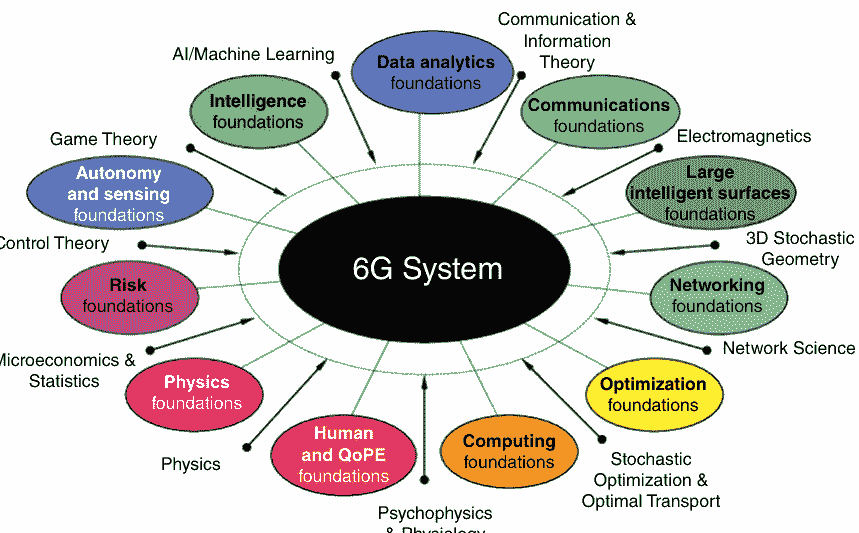

图 5.3 6G 技术案例 [22]。

## 5 无线通信系统：新兴技术、架构、挑战与机遇

图 5.3 6G 技术案例 [22]。

## 5.8 应用

推理、预防和有效的战略思维，在动态情况下是可能的。AI 系统通常构建在机器学习之上，它提供了基于数据驱动的协作学习方法，这种方法超越了形式上的预设假设 [20]。

## 高效且低功耗的运行

5G 的特征围绕延迟、吞吐量、可靠性、能量和成本展开。5G 网络的各种配置解决了移动宽带和延迟问题。然而，6G 的配置旨在从整体上满足更严苛的网络需求。在这里，它们的架构与 5G 网络大不同，因为它们追求可靠性并降低延迟。图 5.3 显示了 6G 的一些用例。

- 增强现实 (AR) 和 虚拟现实 (VR)

  自 4G 网络诞生以来，网络和多媒体服务在不断发展的、“数据饥渴型”应用的频谱和需求上不断增加。因此，5G 部署了如毫米波（mmWaves）等系统来维持容量。然而，当需要 e-MBB 的应用开发时，5G 网络仍存在“改进空间”。因此，5G 将为增强现实和虚拟现实的早期采用铺平道路。这些技术的全面采用将超越之前的 5G 频谱，因为它们需要大约 1Tbps 的容量。这一容量可以通过开发 6G 网络来实现，因为 5G 的限制为 20Gbps。然而，5G 的延迟无法有效压缩增强现实和虚拟现实。

  医疗领域将由于远程医疗和远程医疗技术而受益于 6G。在快速发展的的世界里，这些技术至关重要，医生可以远程为患者提供手术等服务。健康服务需要稳定且持续的连接、移动支持、可靠性和超低延迟。因此，开发能够满足此类要求的 6G 网络将增强电子健康服务的全面实现。这是因为 6G 网络增强的频谱和互联智能将确保频谱性能。

- 无处不在性 (Pervasivity)

  当移动流量上升时，移动流量程度非常高。研究估计到 2030 年将连接 1250 亿设备。基于如此高估计，6G 网络配置可能会支持这些极端情况。例如，6G 将连接所有智能和个人设备。因此，这些设备可能需要高能量频率来增强稳定性和更好的覆盖。

- 工业与机器人

  技术专家预计，6G 将通过 5G 转型实现 4.0 工业革命。工业 4.0 的特征是物理（信息）系统和物联网服务。对于架构建立旨在增加信息计算能力的行业来说，6G 将具有成本效益。此外，6G 将实现等时通信，这是至关重要的。

- 无人车辆

  5G 的特征围绕延迟、吞吐量、可靠性、能量和成本展开。5G 网络的各种配置解决了移动宽带和延迟问题。然而，6G 的配置旨在从整体上满足更严苛的网络需求。在这里，它们的架构与 5G 网络大不同，因为它们追求可靠性并降低延迟。图 5.3 显示了 6G 的一些用例。

## 极极连接

5G 的特征围绕延迟、吞吐量、可靠性、能量和成本展开。5G 网络的各种配置解决了移动宽带和延迟问题。然而，6G 的配置旨在从整体上满足更严苛的网络需求。在这里，它们的架构与 5G 网络大不同，因为它们追求可靠性并降低延迟。图 5.3 显示了 6G 的一些用例。

- 解构和虚拟化的接入网

  能量采集设备将不需要专用硬件

- 无小区架构

  UE 连接到接入 而不是单一小区

图 5.4 6G 的架构创新 [5]。

## 5.9 创新的 6G 架构

5G 的特征围绕延迟、吞吐量、可靠性、能量和成本展开。5G 网络的各种配置解决了移动宽带和延迟问题。然而，6G 的配置旨在从整体上满足更严苛的网络需求。在这里，它们的架构与 5G 网络大不同，因为它们追求可靠性并降低延迟。图 5.3 显示了 6G 的一些用例。

5G 的特征围绕延迟、吞吐量、可靠性、能量和成本展开。5G 网络的各种配置解决了移动宽带和延迟问题。然而，6G 的配置旨在从整体上满足更严苛的网络需求。在这里，它们的架构与 5G 网络大不同，因为它们追求可靠性并降低延迟。图 5.3 显示了 6G 的一些用例。

5G 的特征围绕延迟、吞吐量、可靠性、能量和成本展开。5G 网络的各种配置解决了移动宽带和延迟问题。然而，6G 的配置旨在从整体上满足更严苛的网络需求。在这里，它们的架构与 5G 网络大不同，因为它们追求可靠性并降低延迟。图 5.3 显示了 6G 的一些用例。

5G 的特征围绕延迟、吞吐量、可靠性、能量和成本展开。5G 网络的各种配置解决了移动宽带和延迟问题。然而，6G 的配置旨在从整体上满足更严苛的网络需求。在这里，它们的架构与 5G 网络大不同，因为它们追求可靠性并降低延迟。图 5.3 显示了 6G 的一些用例。

## 参考文献

- 1. Yazar, A., Tusha, S.D., 以及 Arslan, H. (2020). 6G愿景：一种超灵活的性能。ITU Journal on Future and Developing Technologies 1 (1): 121–140. https://doi.org/10.52953/IKVY91836.
- 2. Tariq, F., Chahoudry, M.R.A., Wong, K.-K. (2020). 关于 6G 的预测性研究。IEEE Wireless Communications 27 (4): 118–125. https://ieeplore.org/document/9107653
- 3. Alsharif, M.H., Kelechi, A.H., Albread, M.A. 等人. (2020). 第六代（6G）无线网络：愿景、研究进展、挑战和潜在解决方案。Symmetry 12 (6): 278. https://doi.org/10.3390/s120620476. http://www.mdpi.com/journal/symmetry
- 4. Chowduryry, M.Z., Shahalal, M., Ahmed, S., 以及 Yang, J. (2020). 6G 无线通信系统：应用、需求、挑战和研究方向。IEEE Open Journal on the Communications Society 1 (1): 957–975. https://doi.org/10.1109/JOOCS.2020.3010270
- 5. Giardi, F., Polise, M., Mazzavilla, M. 等人. (2019). 迈 6G 网络：用途与技术。https://gmoein.github.io/files/Toward6G.pdf
- 6. Gong, B., Fan, C., 以及 Wong, X. (2019). 6G 技术：关键驱动因素、需求、系统、架构和赋能技术。IEEE Wireless Communications 14 (3): 18–37.
- 7. Chowdury, H.Z., Hasan, M.T., Islam, A., 以及 Min, Y. (2018). 光无线无线架构与应用的比较研究。IEEE Access 6: 9819–10020.
- 8. Chang H, Yongzhi, Wu Zhe, 以及 Chen Xuxiao. (2020). 太赫兹通信（TeraCom）：无线系统中的挑战与展望。IEEE Access 8: 221602–221614.
- 9. Hoschek, M. (2021). 量子安全与 6G 关键基础设施。互联的 5G、6G 网络结合大数据、物联网和人工智能的独特性。Internetica 2: 5–50. https://doi.org/10.15409/internetica.2021.2.005
- 10. Gitsenko, V., Babak, O., 以及 Ortervic, S. (2020). 地面移动基站和通信的未来——5G 和 6G 的趋势、挑战和技术。China Communications 17 (12): 156–171. https://doi.org/10.23939/jcc.2020.12.011
- 11. Chen, S., Sun, S., 以及 Zhang, K. (2020). 地面基站和通信的系统智能——5G 和 6G 的趋势、挑战和技术。China Communications 17 (12): 156–171.
- 12. Lichenko, M., Urysky, L., 以及 Globa, L. (2021). 信息通信技术系统的进展。China Communications 22 (7): 21–29.
- 13. Zhu, J., Zhao, M., Zhang, S., 以及 Zhou, W. (2020). 探索 6G 的角色：ABC——智能移动网络框架。China Communications 17 (6): 51–67.
- 14. Hoole, P. (2021). 先进无线技术中的智能天线和电磁信号处理。Aalborg: 出版社。

- 15. Sergio, S., Lewis, M., Antonio, P. 等人. (2020). 面向 2020 年的机器学习网络视角调查。IEEE Access 8: 999070.
- 16. Slimani, A., Chibli, H., Cheheri, A. 等人. (2020). 迈 6G：理解网络需求和关键指标。Transactions on Emerging Telecommunications 33 (2).
- 17. Wild, T., Tran, V., 以及 Viswanathan, H. (2021). 超 5G 和 6G 通通感知联合设计。IEEE Access 9: 1.
- 18. Swaroop, A.S., Gori, J., 以及 Niaz, V. (2017). 用于 6G 网络连接的全双工无线电技术。International Journal of Research in Engineering, 3(7): 201–208.
- 19. Liu, R., Liu, Y., 以及 Zhang, X. (2022). 智能赋能蜂窝网络：通往超越 5G 的关键路径。IEEE Communications 27(2): 217–222.
- 20. Mathew, A. (2021). 人工智能能力的蜂窝网络。International Journal of Computer Science and Mobile Computing 10 (3): 26–31.
- 21. Yang, P., Xiao, Y., Miao, M., 以及 Li, S. (2019). 6G 无线系统的愿景：应用、趋势和开放问题。IEEE Network 34, 3: 134–142.
- 22. Saad, W., Bennis, M., 以及 Chen (2020). 6G 无线系统的愿景：应用、趋势和开放问题。IEEE Network 34, 3: 134–142.

# 6G：架构、应用与挑战

## 6.1 引言

5G 服务在北美和亚洲可用，欧洲仍在发布中。到 2022 年，我们应该看到欧洲的 5G 发布。有趣的是，中国实际上占据了全球一半以上的 5G。在 2021 年，发布了近千种 5G 设备，包括手机、模块、调制调器。

正如第 1 章所述，5G 已经经历了两个版本 Rel-15 和 Rel-16。5G 技术被认为将带来高数据率，从而增强移动宽带、可靠低延服务以及许多连接（包括波束管理）。

为了支持 IMT-2020 的性能需求，引入了诸如正交多接入、可靠低延通信、车车联网（V2X）、接入回传、终端节能等若干新技术，这有助于扩大 5G 的使用。与 1G、2G、3G 以及 4G 不同，5G 应用具有多种能力，包括三个主要特征：移动宽带的高 Gbps 速率、数十亿机器连接以及 99.9% 微秒级延迟，以满足未来十年的需求。

5G 网络预计对人类生活、全球经济和社会产生巨大影响。通信网络预计在 2020 年后进入演进路径，以实现特性的优化并扩展部署场景，如空天地一体（NTN）、飞行器以及预计将工作频段增加到 ~114 GHz。图 6.1 显示，5G 需求的实现将带来蜂窝架构和网络技术的巨大变化 [1]。

在这个智能技术时代，连接和自主性正迅速从 5G 转向 6G。在许多国家，5G 部署尚未完成，但世界已经在讨论 6G 网络。各个公共和私营部门目前正聚焦于研发（R&D），以应对 6G 网络的巨大需求。研究表明，6G 的商业化将在 2030 年开始。由于 5G 仍处于部署阶段，许多目标仍需实现和完成。这扩展了 6G 的架构和功能压力。图 6.2 显示了 6G 的展望时间线。

## 6G 架构、应用与挑战

- 深层覆盖：触达具有挑战性的位置
- 强安全性：例如政府/金融信任
- 超低功耗：10 年以上的电池续航
- 超高可靠性：每 100 亿个数据包少于 1 个
- 超低复杂度：每赫兹 10+ 比特
- 超低延迟：低至 1 毫秒
- 超高密度：每平方公里 100 万节点
- 极高移动性：或完全静止
- 极高容量：每平方公里 10 Tbps
- 极大数据量：峰值速率数 Gb 级；用户体验速率 100+ Mbps
- 深层感知：发现与优化

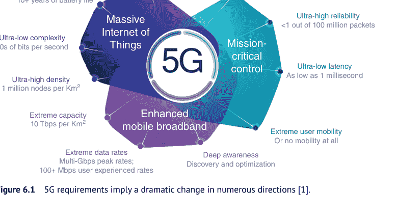

图 6.1 5G 需求意味着多个方向的转变 [1]。

## 科学出版与讨论

## 国际电信联盟 (ITU)

## 6G 展望

这标志着对 5G 网络技术真正感兴趣的开始，随着论文的发表，学者们对其进行了大量讨论。

ITU 射电部门完成了 IMT-2020 规划，制定了 2020–2030 年及此后的完整标准。

许多专家预测 6G 将在 2030 年左右正式发布，人工智能（AI）等关键技术将在 2030 年左右达到成熟。预计这些工作将在届时完成。

## 国际电信联盟 (ITU)

## IEEE 802.11

## 6G 通信

ITU-R M2715 重点小组于 2015 年成立，旨在为 2030 年制定一个框架，以回答关键问题并实现赋能技术。

局域网标准工作组目前正在开发 6G WiFi 之外的需求，包括光通信、网络定位、极高频等。

爱立信（Ericsson）在 2019 年的《移动性报告》中强调，5G 正以 27% 的年增长率增长，市场将在 2030 年左右达到极限。这为 6G 通信设定了事实基准。

## 第三代合作计划 (3GPP)

Rel-15 TR 3.9115 讨论了 V2X 通信、增强型 URLLC、工业物联网、虚拟服务的卫星接入以及更多 5G/6G 网络技术。

## 2019 年

## 2021–2025 年

## 6G 发展

## 通信与技术公司

## 2020 年（事件）

华为和三星在 2020 年宣布了 6G 研究，并与韩国科学技术研究院合作建立了 6G 研究中心。

首届此类会议在葡萄牙的尔本举行，由组织方讨论了未来愿景（如“未来 6G”），以及下一代 6G 网络的技术标准和教程。

随着技术公司的大量开发和理解，6G 开始形成最终雏形，例如日本在 6G 研究中的 289 个子项目，以及 SK、电信、爱立信、诺基亚等。6G 标准和基础设施将涉及 Rel-18 或更高版本。

## 第三代合作计划 (3GPP)

## 国际电信联盟 (ITU)

Rel-16 TR 3.9116 讨论了 V2X 通信、增强型 URLLC、工业物联网、虚拟服务的卫星接入以及更多 5G/6G 网络技术。

在 ITU-R M.2710 中，预计在 2021–2025 年，新技术将加速发展，影响无线接口、MIMO 应用服务和用户需求，以及 ITU-2030 6G 愿景。

图 6.2 6G 研究人员和制造商的时间线 [1]。

未来的发布也将是重点。由于技术公司的深度开发和理解，6G 开始形成其最终雏形，例如日本在 6G 研究中的 289 个子项目，以及 SK、电信、爱立信、诺基亚等。6G 标准和基础设施将涉及 Rel-18 或更高版本。

## 6G 架构

图 6.3 6G 网络 [1]。

未来的发布也将是重点。由于技术公司的深度开发和理解，6G 开始形成其最终雏形，例如日本在 6G 研究中的 289 个子项目，以及 SK、电信、爱立信、诺基亚等。6G 标准和基础设施将涉及 Rel-18 或更高版本。

## 6.2.1 用例、需求与指标

当前的 5G 技术是技术演进的重要一步。它支持着 25 Mbps 以上的数据速率，支持 VPN，并成为移动网络。6G 的实施并非易事，其成本是高昂的。安全性问题正在得到改善，6G 的可行性仍在研究中。

另一方面，6G 可能是人类文明和技术的下一个里程碑。

## 6G 架构、应用与挑战

| 国家 | 5G/6G 倡议 |
| :--- | :--- |
| 澳大利亚 | 澳大利亚数字经济战略：12 亿澳元 - 现代制造业倡议：13 亿澳元 - 5G & 6G 安全与测试平台：每年 3.17 亿澳元 |
| 美国 | “安全5G 及以后”：2020 年 3 月 - 国防部测试平台计划：6 亿美元 - 下一代 G 倡议：行业联盟 |
| 日本 | MIC “迈向 6G 路线图”：2020 年 6 月 - METI 支持：3.8 亿日 - MSIT 6G 计划：2020 年 9 月 - 2 亿美元公共支持 |
| 中国 | 工信部 6G 计划：成立 IMET 2030 推进委员会（2019 年） - 到 2035 年投入数十亿欧元，包括工业化 |
| 英国 | 2019 年 2 月启动 6G 旗舰项目 - 7 年 2.5 亿欧元 - 6G 智能网络与服务联合倡议提案 - 9 亿欧元 |

图 6.4 全球超越 5G (6G) 和 6G 倡议示例 [2]。

## 6.2 6G 网络架构愿景

(a)

- 视频
- 音频
- 网页浏览
- 社交网络
- 软件下载
- 其他
- 文件共享

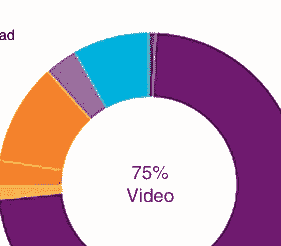

2016

8.5EB

每月按应用分类划分的移动流量（艾字节）

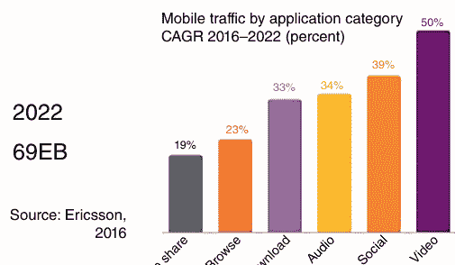

2022

69EB

来源：爱信，2016

(b)

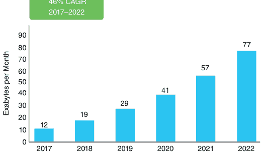

**图 6.5** (a) 数据量需求的增长和需求的多样性 [6]，(b) 数据量需求的增长和需求的多样性 [1]。

## 6.2.2 5G 目前的覆盖情况

约有 130 家运营商已获得频谱以启动 5G 服务。我们预计亚太地区和欧洲的 5G 连接将显著增长。中国将在 2025 年占据主导地位。根据全球移动终端设备协会 (GSA) [8]，公布的 5G 设备数量在 2023 年 1 月至 2 月之间增长了 1.3%，达到共 1840 台，自 2022 年 2 月底以来商业 5G 设备数量增加了 53.7% [8]；包括智能手机、智能手机、固定无线接入用户终端 (CPE)、热点设备、笔记本电脑和平板电脑。第三代移动计划小组 (3GPP) 5G 到 6G 高级路线图如图 6.6 所示。

## 6G 架构、应用与挑战

| 2007 | 2008 | 2009 | 2010 | 2011 | 2012 | 2013 | 2014 | 2015 | 2016 | 2017 | 2018 | 2019 | 2020 |
| :--- | :--- | :--- | :--- | :--- | :--- | :--- | :--- | :--- | :--- | :--- | :--- | :--- | :--- |
| | | | | | | | DOCOMO 5G 白皮书 | | | | | | |
| | DOCOMO 5G (FRA) 在早期概念会议上的演讲 | | | | | | 5G 演示实验 | | | | | | |
| | | | METIS 启动（欧洲）宣布开始实验 | | | | | | | | | | |
| | | | | ARIB 20B AH 启动 5GMF 启动 | | 3GPP 标准化 | | | | | | | |
| | | | 基础概念 | | | | 系统开发 5G 商业化 | | | | | | |
| | | | | | | | 项目启动 | | | | | | |
| | | | | | | | | 演示实验 | | | | | |

| 2017 | 2018 | 2019 | 2020 | 2021 | 2022 | 2023 | 2024 | 2025 | 2026 | 2027 | 2028 | 2029 | 2030 |
| :--- | :--- | :--- | :--- | :--- | :--- | :--- | :--- | :--- | :--- | :--- | :--- | :--- | :--- |
| DOCOMO B5G 在早期概念会议上的演讲 | 版本 1.0 版本 2.0 版本 3.0 DOCOMO 6G 白皮书 | | | | | WRC23 | | | WRC27 | | | | |
| 6genesis 启动（欧洲） | 5G 策略会议推广 | 下世代联盟（美国）超越 5G 推进联盟 | | | | | | | | | | | |
| 基础概念 | | | | | | | | | | | | | |
| 标准项目 | | | | | | | | | | | | | |
| | | | | | | | | | | 演示实验 — 系统开发 |

图 6.6 5G 发展历史进度 [9]

第十六和第十七版本的发布将定义 6G 的用例，并向 6G 演进。第 16 版本提供了 5G 和 6 GHz 频段的新无线，以及设备间的侧行通信。第 17 版本增加了物联网 (IoT) 支持、阶段 2、URLLC 增强、移动性增强以及增强的多输入输出 (MIMO) 接收能力。第 17 版本还将包括蜂窝物联网 (CIoT) 服务。它进一步支持先进网络、功耗节省和大机器通信 (mMTC)，以及无人系统、地球同步轨道 (GEO)、低地球轨道 (LEO) 和高空平台 (HAPS)。它们作为中继节点和基站可用于多种用途。基于窄带的长期机器通信 (LTE/MTC) 在 2025 年之前贡献了近 34%。第十六和第十七版本的发布将使 5G 网络的部署和运行变得更容易。第 18 版本预计发布以增强其能力。6G 仍在开发中，并将提供增强 5G 级网络的新接口或服务。虽然 6G 系统的部署尚远，但许多计划和项目将支持 6G 标准的加速。它正进入高实时（触觉通信）、触觉/触感通信、医疗/健康、垂直感知、环境传感、成像以及公共安全服务、交通的应用开发。

5G 的商业化正在图中迅速成型。5G 的商业化正在图中迅速成型。5G 的商业化正在图中迅速成型。5G 的商业化正在图中迅速成型。5G 的商业化正在图中迅速成型。5G 的商业化正在图中迅速成型。5G 的商业化正在图中迅速成型。5G 的商业化正在图中迅速成型。5G 的商业化正在图中迅速成型。5G 的商业化正在图中迅速成型。5G 的商业化正在图中迅速成型。5G 的商业化正在图中迅速成型。5G 的商业化正在图中迅速成型。5G 的商业化正在图中迅速成型。5G 的商业化正在图中迅速成型。5G 的商业化正在图中迅速成型。5G 的商业化正在图中迅速成型。5G 的商业化正在图中迅速成型。5G 的商业化正在图中迅速成型。5G 的商业化正在图中迅速成型。5G 的商业化正在图中迅速成型。5G 的商业化正在图中迅速成型。5G 的商业化正在图中迅速成型。5G 的商业化正在图中迅速成型。5G 的商业化正在图中迅速成型。5G 的商业化正在图中迅速成型。5G 的商业化正在图中迅速成型。5G 的商业化正在图中迅速成型。5G 的商业化正在图中迅速成型。5G 的商业化正在图中迅速成型。5G 的商业化正在图中迅速成型。5G 的商业化正在图中迅速成型。5G 的商业化正在图中迅速成型。5G 的商业化正在图中迅速成型。5G 的商业化正在图中迅速成型。5G 的商业化正在图中迅速成型。5G 的商业化正在图中迅速成型。5G 的商业化正在图中迅速成型。5G 的商业化正在图中迅速成型。5G 的商业化正在图中迅速成型。5G 的商业化正在图中迅速成型。5G 的商业化正在图中迅速成型。5G 的商业化正在图中迅速成型。5G 的商业化正在图中迅速成型。5G 的商业化正在图中迅速成型。5G 的商业化正在图中迅速成型。5G 的商业化正在图中迅速成型。5G 的商业化正在图中迅速成型。5G 的商业化正在图中迅速成型。5G 的商业化正在图中迅速成型。5G 的商业化正在图中迅速成型。5G 的商业化正在图中迅速成型。5G 的商业化正在图中迅速成型。5G 的商业化正在图中迅速成型。5G 的商业化正在图中迅速成型。5G 的商业化正在图中迅速成型。5G 的商业化正在图中迅速成型。5G 的商业化正在图中迅速成型。5G 的商业化正在图中迅速成型。5G 的商业化正在图中迅速成型。5G 的商业化正在图中迅速成型。5G 的商业化正在图中迅速成型。5G 的商业化正在图中迅速成型。5G 的商业化正在图中迅速成型。5G 的商业化正在图中迅速成型。5G 的商业化正在图中迅速成型。5G 的商业化正在图中迅速成型。5G 的商业化正在图中迅速成型。5G 的商业化正在图中迅速成型。5G 的商业化正在图中迅速成型。5G 的商业化正在图中迅速成型。5G 的商业化正在图中迅速成型。5G 的商业化正在图中迅速成型。5G 的商业化正在图中迅速成型。5G 的商业化正在图中迅速成型。5G 的商业化正在图中迅速成型。5G 的商业化正在图中迅速成型。5G 的商业化正在图中迅速成型。5G 的商业化正在图中迅速成型。5G 的商业化正在图中迅速成型。5G 的商业化正在图中迅速成型。5G 的商业化正在图中迅速成型。5G 的商业化正在图中迅速成型。5G 的商业化正在图中迅速成型。5G 的商业化正在图中迅速成型。5G 的商业化正在图中迅速成型。5G 的商业化正在图中迅速成型。5G 的商业化正在图中迅速成型。

[等待] - 第 16 和第 17 版本的发布将使 5G 网络的部署和运行变得更容易。第 18 版本预计发布以增强其能力。6G 仍在开发中，并将提供增强 5G 高级网络的新接口或服务。虽然 6G 系统的部署尚远，但许多计划和项目将支持 6G 标准的加速。它正进入高实时（触觉通信）、触觉/触感通信、医疗/健康、垂直感知、环境传感、成像以及公共安全服务、交通的应用开发。

5G 的商业化正在图中迅速成型。我们预计亚太地区和欧洲的 5G 连接将显著增长。中国将在 2025 年占据主导地位。根据全球移动终端设备协会 (GSA) [8]，公布的 5G 设备数量在 2023 年 1 月至 2 月之间增长了 1.3%，达到共 1840 台，自 2022 年 2 月底以来商业 5G 设备数量增加了 53.7% [8]；包括智能手机、智能手机、固定无线接入用户终端 (CPE)、热点设备、笔记本电脑和平板电脑。第三代移动计划小组 (3GPP) 5G 到 6G 高级路线图如图 6.6 所示。

# 6G：架构、应用与挑战

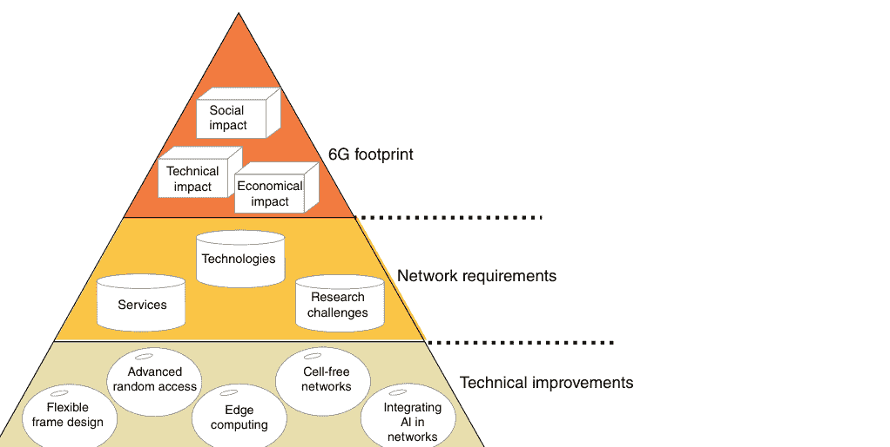

**图 6.8** 用于讨论 6G 各方面的分层化方法 [3]。

这些网络交付具有高可靠性和极低延迟的海量数据，对于增强同步服务交付（包括上行和下行）是至关重要的。运营商强调了显著的速率、延迟和可靠性，因为这为利用 GHz 范围以外的频率铺平了道路，最终改进无线网络。根据运营商及其关联公司的说法，6G 的出现将提高数据传输率、用户体验、延迟以及三维覆盖 [15]。例如，某些网络方法将包含感知、通信、定位、导航和计算。此外，量子系统可能会增强个人数据安全和隐私。

看看这些讨论的应用程序，网络必须采用一套新的需求。6G 的形式化仍在全球现有趋势的讨论中。因此，研究人员和学者正不懈地努力改变无线技术的面貌。例如，在该课程中合作的一些知名机构包括芬兰的奥卢大学和英国政府为 6G LIFT 项目提供的太比特双向多用户无线系统（TOWS）（一个专注于增加无线容量的研究小组）。此外，三星、AT&T、爱立信、诺基亚和 SK Telecom 等全球电信公司以及通信专家已开始关注 5G 之外。这种向 6G 网络的范式转移使得诸如大智能服务（LIS）、超大规模多入输出（SM-MIMO）、太赫通信、可见光通信（VLC）、定位和轨道动量复用（OAM）。

## 6.3.1 6G 及其基本特性

5G 需要更好的灵活性源于其在满足多样化需求和适应不同技术方面的需求和成功。为了实现网络的灵活性，我们需要三点：感知、选项的可用以及适应/优化。尽管 6G 在满足灵活性需求方面取得了成功，但由于新的应用和需求，适应将变得更加困难。为了 6G 做准备，需要通过人工智能对通信的各个方面进行更好的感知探索，扩展技术选项，并对现有选项进行合理利用。关于 6G 的大多数文献并没有遵循灵活性视角。

大多数 6G 研究工作的主要目标是识别未来的应用、服务和需求。这些项目主要分为三类：6G eMBB、极可靠低延迟通信（uRLL）和海量机器类通信（mMTC）。6G 还有一系列潜在应用列表，如无人机（UAV）、车万物（V2X）、虚拟现实（VR）、增强现实（AR）、全息会议、智能物体、医疗保健等。

多频段利用是 6G 利用新毫米波频谱的首要，尽管具有所有优势，但目前受到 IM 的限制。太赫（THz）频段通过提供更多通道提供了频谱灵活性。总结这些章节的结果可以分为三类：多频段灵活性、信息源灵活性和频谱共存灵活性。

超物理层（PHY）和介质访问控制（MAC）是多体制系统的层。为了 6G 的目的，单频内可以使用多种波形，作为多个网络的雷达感知。波形 NOMA 技术改进了 6G 的资源分配。MAC 层问题需要灵活性：波形分配和网络调度。

超异构网络是另一个关键赋能因素。飞行接入点允许不同应用实现灵活网络和无缝轨迹。卫星网络的改进也被考虑在内。切片和无小区网络允许以用户为中心的系统，并在一个框架下具有多个网络的灵活性。区块链技术和量子通信也可以为未来做出贡献。

感知一体化强调用于改进通信系统的观测数据。感知与认知、定位和上下文感知技术属于此类。无线环境地图（REM）用于获取环境信息，随着技术的发展，最终可能生成综合地图来格式化数据。这种方法的缺点是数据生成管理的巨大成本。

6G 中的智能通信包含了 AI 和 ML 的。AI 目前在 5G 中非常流行，但因为在 5G 中使用和处理海量数据的能量成本是关键因素，[文本裁剪]。

## 6.4 6G 的新兴应用

通常 5G 支持 eMBB、URLLC 和 mMTC。6G 还有一系列潜在应用列表，如无人机（UAV）、车万物（V2X）、虚拟现实（VR）、增强现实（AR）、全息会议、智能物体、医疗保健等。

多频段利用是 6G 利用新毫米波频谱的首要，尽管具有所有优势，但目前受到 IM 的限制。太赫（THz）频段通过提供更多通道提供了频谱灵活性。总结这些章节的结果可以分为三类：多频段灵活性、信息源灵活性和频谱共存灵活性。

### 6.4.1 虚拟、增强与混合

正如其名，虚拟现实指的是创建沉浸式环境的东西。从实用角度来看，2020 年新冠肺炎期间，许多公司、企业和人们拥抱在线平台。人类接触限制了病毒传播。因此，为了维持生活，世界选择了 Zoom 和 Microsoft Teams 等在线平台进行面对面交流。这种虚拟现实，新兴的 6G 将通过跟踪移动来引导人眼。

### 6.4.2 全息传传

很难说人类对技术有高度依赖性。无论是在商业领域还是社会生活中，技术目前占据了人类生活的中心。近期，影响技术的一项重大进展是全息传传；位于地地的物体或人物可能会出现在其感兴趣的主体面前。这种技术将极大地改变通信的性质。例如，媒体和新闻公司主要使用它。通过全息传传进行采访，对观众来说越真实越好。

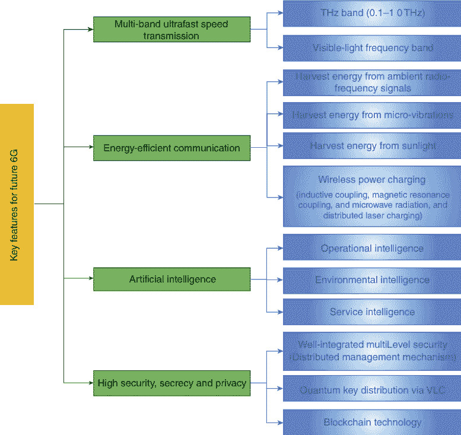

**图 6.9** 未来 6G 的关键特性 [16]。

## 6.4 自动化：工厂的未来

机器人技术、增强现实、物联网（IoT）、人工智能（AI）和机器学习（ML）的进步正在改变制造面貌。随着 AI 增强制造流程，工业 4.0 的概念正在逐渐被接受。2030 年的愿景是通过 6G 网络的帮助接受工业 5.0 的概念。例如，由于机器接管了自动化控制，工业中的人工干预正在逐渐减少。因此，工业将需要高标准的运行能力。这包括可靠性、准确性、安全性、维护和有效管理等。这种环境将严重依赖机器人和无人机来支持移动和运输。在 6G 网络下，机器人通信将面临不稳定性，影响各种流程。6G 旨在解决工业可靠性、延迟和安全等问题。

### 6.4.4 物联网集成带来的智能生活方式

人们一直在讨论智慧城市以及技术如何将世界改变为乌托邦/反乌托邦的格局。现在有数百万个应用程序通过互联网连接。6G 的部署已受益或将将从中巨额获益的领域包括交通、医疗保健、住宅和安全。智能城市正致力于部署飞行器，这将带来严苛的连接。因此，由于各种智能设备的无处不在的连接，生活质量将有望提高。

此外，智能机器正占据智能生活方式的中心位置。物联网通过家电的集成消除了障碍。例如，冰箱等家电器现在由智能机器操作。自然地，此类系统需要改进的数据和高安全性。因此，6G 的愿景是通过开发能够增强自主决策的更佳基础设施来实现这一目标。

### 6.4.5 自动驾驶与连接设备

由于 6G 的发展，交通行业将经历重大转型。智能驾驶、远程驾驶和智能道路等概念必将彻底改变运输部门 [19]。这意味着使用 6G 网络将极其可靠，具有低延迟、高精度和海量的 V2X 通信，以大规模地支持此类环境。路上的安全至关重要。这应该是 6G 在交通方面考虑的主要因素之一。例如，应该持续对实时交通和危险现实信息进行持续更新，以确保道路使用者的安全。在这里，6G应该支持高效的车辆通信以提高安全性。随着 6G 和 AI 的结合，交通控制系统将改善移动和通信。因此，6G 在自动驾驶中的目标是确保公共安全。

### 6.4.6 医疗保健

5G 网络支持的医疗保健领域的持续变化为进一步的改进铺平了道路。例如，远程医疗和远程医疗的概念正在彻底改变医疗保健的质量和服务交付。例如，通过 AI，患者可以远程接受治疗并获得药物。此外，由于基础疾病，老龄化人口需要密集的医疗护理。因此，这给医疗保健系统带来了巨大的负担，因为需要不断进行各种测试。为了控制医疗保健的流量，目前的 5G 技术已经建立了电子健康系统，患者可以在线发送样本并接收处方 [20]。

此外，6G 的发展将带来一个无处不在的健康系统，支持远程医疗和远程医疗系统。此外，它正致力于远程手术系统。结果，这将需要严苛的服务质量（QoS）要求。6G 的动力是实现远程医疗交付。

### 6.4.7 非地通信

灾害管理是一项帮助处理火灾爆发、龙卷风和洪水等自然灾害的关键工具。因此，网络 必须支持非地通信（NTC），以限制人员损失和财产损失。应该建立 NTN 以分流流量并到达遥远地区。支持 NTC 的技术包括无人机（UAV）、高空平台站（HAPS）、无人机和卫星，它们需要无处不在的连接和低延迟 [21]。

## 6 6G：架构、应用与挑战

结果，这些通信系统消除了拥塞信道，支持高速移动并增加了吞吐量。理想情况下，NTNs 将用于监控、气象和遥感。此外，6G 支持长距离通信至关重要。

### 6.4.8 水下通信

开发水下通信对于安全性至关重要，因为它有助于监测活动。与陆地或空中相比，水下需要声学通信来实现高数据传输速度。由于它们与地面网络集成，需要接入连接 [22]。

### 6.4.9 灾害管理

如前所述，6G 技术的主要目标是提高延迟、覆盖和可靠性等。由于 6G 的潜在巨大改进，灾害管理程序可能会实现快速的结果。例如，2019 年爆发的疫情，它改变了世界的整体展望。在全球范围内，人们能够获得安全信息和更新。因此，处于红区的人变得更加知情和准备充分。通过 Facebook、Twitter 和 CDC 等主要网站共享信息以减轻病毒传播。此外，无人机一直是灾管理的中心。无人机可用于远程监控灾害，帮助机构提供适当援助。最终，用于灾害管理的 6G 技术旨在促进公共安全。

### 6.4.10 环境

通过 NTN 和 UAV 卫星，6G 将极大提高遥远地区的覆盖和访问。因此，这对于监测天气和农业等环境状况至关重要。可以使用 NTN 和 UAV 定位即将的环境灾害和危险地点。此外，6G 网络架构将支持传感器实时检测毒气体污染。

## 6.5 6G的需求

未来的技术需要创建创新案例来改进现有的 6G 网络。因此，6G 网络的需求需要更严格、更多元的技术。6G 可能很大程度上携带与无线通信潜在应用相关的信息，例如分布式计算、缓存和 AI 决策 [23]。开发者需要意识到，5G 将无法满足所有需求。

在 5G 已经在毫米波频率上运行的地方，6G 将把这些频率提高到非常高的水平。因此，将实现峰值数据以及无缝、无处不在的连接。

### 6.5.1 极低延迟

新兴应用需要毫秒级或零延迟来实现有效的服务交付。这些实时应用如触觉互联网和虚拟现实需要极低延迟才能正常工作。此外，引入其他高科技系统如 THZ 通信和量子计算将确保满足理想的延迟需求。

### 6.5.2 低功耗

研究表明，使用 4G 和 5G 网络的智能设备和手机一直在充电。现有的计算系统消耗大量功率，导致电池耗尽。此外，未来 6G 网络的核心目标之一是降低功耗并延长电池寿命。问题是，这些网络如何

## 6.5 6G 的需求与 KPI 目标

**图 6.10** 5G 与 6G 的 KPI 对比研究 [23]。

| 关键性能指标 (KPI) | 5G | 6G |
|---|---|---|
| 峰值数据速率 | 20 Gb/s | 1 Tb/s |
| 体验数据速率 | 0.1 Gb/s | 1 Gb/s |
| 峰值频谱效率 | 30 b/s/Hz | 60 b/s/Hz |
| 体验频谱效率 | 0.3 b/s/Hz | 100 GHz |
| 最大带宽 | 1 GHz | 10 GHz |
| 区域容量 | 10 Mb/km² | 1 Gb/km² |
| 连接密度 | 10⁶ devices/km² | 10⁷ devices/km² |
| 能效 | 未给出 | 1 Tb/Joule |
| 延迟 | 1 msec | 100 micro sec |
| 抖动 | 未给出 | 1 micro sec |
| 可靠性 | 1-10⁵ | 1-10⁹ |
| 移动性 | 500 km/s | 1000 km/s |

如何实现这些？6G 将计算任务卸载到具有可靠电源供应和存储的智能基站。此外，其他 6G 能量采集技术将确保电池寿命的延长。例如，可以利用电磁信号和微波来实现。此外，无线电池的发展对于提高其寿命至关重要。

### 6.5.3 高数据速率

6G 的关注点之一是与现有 5G 网络相比提供极高的数据速率。预计每个用户的平均峰值数据速率将超过 1 Tbps。这意味着未来的网络将在 THz 波段需要极高的带宽。此外，它还需要 OAM 复用、用户通信和超过 1000 个天线单元。研究还侧重于整合量子通信以增加数据速率。因此，未来的创新技术将受益于此。

### 6.5.4 高频段

数据速率不断提高，特别是在蜂窝无线网络中。为了匹配不断增长的数据速率，需要更宽带宽和更高的频率。对于 6G，网络开发者和研究人员正专注于亚 THz 和 TH 波段，这些频段可以为电磁和光通信提供丰富的频谱。此类频率的使用将支持在室内和室外场景传输信息的多 THz 数据速率。THz 频率可能会解决小区间的干扰。其支持高频段的能力对于解决未来面临的挑战至关重要。

### 6.5.5 超可靠性

可靠性预计将比现有 5G 网络提高 100%。远程医疗、工业物联网和智能城市等应用需要极高的可靠性才能良好运行。因此，6G 网络应该满足效率和性能的 QoS 要求。

### 6.5.6 安全与隐私

所有网络（3G、4G、5G 和 6G）都需要安全和隐私。由于 6G 将支持海量数据速率，它对安全提出了更高要求。研究表明，量子计算可能保护这些网络。然而，由于其难以操纵可能带来的潜在挑战，区块链技术将派上用场。

## 6G：架构、应用与挑战

6.5.7 大容量连接密度主要关乎增加连接用户的数量。文献显示，数百万的人和设备将通过自主设备互联。万物互联 (IoE) 将成型，因为手机、无人机和车辆等智能设备将互联。这将增加 6G 网络的连接密度。然后，信者THz 通信和 VLC 等应用将满足预期连接的需求。

6.5.8 极广覆盖扩展目前，5G 部署正在大城市和城市地区进行。这些农村地区被忽视了，形成了 6G 尚未填补的空白。农村地区的许多人仍然无法接入互联网。因此，6G 将渗透到这些农村地区，其目标是实现全球连接。此外，它还希望通过开发有效的电磁信号来支持水下通信。

6.5.9 移动性 6G 网络预期特性之一是其动态性。预计速度将达到约 1000km/h 的极高速度。然而，需要注意的是，这种速度将需要频繁的切换。不过，AI 应用将派上用场，并支持可能挑战移动性的复杂决策过程。

## 6.6 G 应用

6G 无线网络的主导服务和应用将是 AI，感知和学习将是 6G 无线网络的主导服务和应用。万物的虚拟现实将为终端用户提供 VR、触觉反馈和 AI 服务。5G 毫米波网络的应用是为机器学习 (ML) 感知和收集大数据。毫米波网络的主要应用是收集数据并输入神经网络。AI 服务将通过神经边缘、深度神经节点和神经中心提供。量子密钥分发 (QKD) 将部署在神经边缘和神经中心之间的光纤链路上。6G 无线系统将使用卫星和前/回传、中传以及地面节点进行直接接入。6G 应用包括以下内容 [21]。

- 全息通信
- 触觉互联网
- 工业 4.0 及以后领域
- 远程操控驾驶
- 生物纳米物互联
- 多感官 XR 应用
- 区块链和分布式账本技术
- 连接的机器人与自主系统 (CRAS)
- 无线脑机接口 (BCI)
- 数字孪生副本

图 6.11 和表 6.1 显示了应用的细分，对其作用的简要描述以及它们与 6G 网络的关系。

## 6.7 6G 的挑战：标准化、设计与部署

在向 6G 和“连接智能”迈进的过程中面临着许多挑战。新机器的电力和能耗成本将继续上升，这将使我们重新思考当前的系统。当前网络的延迟需要改进。边缘设备的智能化需要提高。机器学习必须与

- 无人机应用
- 全息应用
- 扩展现实
- 自主汽车
- 工业 5.0
- 智能电网
- 数字医疗
- 数字孪生
- 脑机交互

**图 6.11** 最关键的应用 [24]。

**表 6.1** 6G 应用简述 [21]。

| 应用 | 简述 |
| --- | --- |
| 全息通信 | 通过空气中的全息图像实现人类通信，让我们拥抱无边界办公。延迟和带宽是全息通信的一些挑战。6G 将解决这些问题。 |
| 触觉互联网 | 实现人机交互和机机交互。支持物联网和云计算。此外，AI 超高速无线网络将驱动第四次革命。智能城市、工厂是 6G 的愿景之一。 |
| 工业 4.0 及以后 |  |
| 远程操控驾驶 | 远程控制。这些汽车也被称为半自动汽车，自动汽车需要快速且无处不在的无线网络。 |
| 生物纳米物互联 | 生物纳米物体（纳米机器）的互联。全息 6G 主要提供物联网所需的感知需求和超低延迟。 |
| 多感官 XR 应用 | AR/VR 创建感知支持。通过 URLLC 和 eMBB 支持感知因素。是提供更好游戏体验的绝佳候选。 |
| 区块链和分布式账本技术 | 区块链有望为 6G 网络提供安全性。它们还需要连接性和扩展性，6G 网络将提供这些。 |
| 连接的机器人与自主系统 (CRAS) | CRAS 需要通过使用机器人和自主系统进行工业操作来提高工业化。它们需要高可靠性和低延迟。 |
| 无线脑机接口 (BCI) | BCI 实现大脑与电子设备之间的通信。这需要超低延迟、高可靠性和高数据速率。 |
| 数字孪生 | 它们也被数字孪生，通过创建数字副本来替代地点、系统和物体。这需要极高数据速率，6G 将能够实现。 |

# 6 6G: 架构、应用与挑战

机器学习。这对我们生态系统的影响至关重要，降低温室气体和二氧化碳的影响是关键。我们正在从物联网（IoT）向大规模连接智能转型，这将产生更强安全性的需求。

安全是 6G 网络部署的下一个待改进领域。移动网络一直依赖 SIM 卡作为安全机制的一部分来识别设备。这种方法在物联网中引发了许多问题，从卡片的大小到它们使用的对称密钥加密都是。随着 6G 网络带宽的增加以及更多数据向云端迁移，端到端安全的需求将变得更加重要。软件定义网络、人工智能和网络功能虚拟化（NFV）需要在 6G 网络中协同工作以提供这种端到端安全。针对 6G 安全的一些建议方法包括远程终端身份验证、平台认证、支持远程身份验证以及安全属性。

# 6G 网络中的隐私与挑战

6G 网络中的隐私是另一个重要的关注点，许多人都在考虑这个问题。在 6G 网络上保护个人信息将是一项挑战。这是一个全球性问题，根据你所处世界的位置，其观点会有所不同。由于各国对什么应该是私隐私的观点不同，相关隐私法规的标准化将非常困难。

随着互联技术的不断改进，物理世界和数字世界将日益融合。当人们花费大量时间处于连接时，许多国家正在制定法律法规，规定他们预期工作多长时间以及所需的连接水平。责任归属只是与 6G 网络增长相关的另一个潜在问题，随着技术的发展，这些问题必须得到解决。

6G 的收益是巨大的。然而，不忽视挑战至关重要。因此，6G 的赋能技术被赋予了为这些挑战开发解决方案。6G 网络可能面临的一些问题包括：

- 全球覆盖
- 有限的系统容量
- 部署计算和 AI 能力面临的挑战
- 边缘 AI 的硬件限制
- 高智能与隐私之间的权衡
- 安全性
- 硬件和软件非线性的不可计算性

在 6G 的挑战和障碍方面，多频和利用需要先进的前端硬件，频谱共存产生了干扰问题，波形共存也产生了新的干扰问题。异构网络面临过载问题。`ISAC`（感知通信一体化）系统也面临需求过剩的问题。

超灵活框架有三个关键点。首先，新技术应该通过一个允许等待一秒的灵活框架结合到通信中。关键技术网络需要协同工作以满足各种需求，因此灵活的认知引擎可以优化不同方面。最后，在通过某种灵活性指标进行优化时，应该量化灵活性。

结论，5G 是由多样化的需求和应用定义的，6G 预计将继续其脚步。灵活性应该是 6G 的重点，通过使用关键赋能技术更好地构建 5G 已开发的内容。这些包括超灵活的物理层和 MAC 层、超灵活的异构网络、感知一体化、绿色通信和安全通信。

## 参考文献

- 1 El Hassani, S., Haidine, A., and Jebib, H. (2019). Road to 5G: key enabling technologies. Journal of Communications 14 (11).
- 2 Castro, C. (2021). 6G gains momentum with initiatives launched around the world. 6G World Exclusive https://www.6world.com/clusives/6g-gains-momentum-with-initiatives-launched-across-the-world.
- 3 Salameh, A. and El Tarhuni, M. (2022). From 5G to 6G – Challenges, technologies, and applications. Future Internet 14 (17).
- 4 Zhao, Y., Yu, G., and Xu, H. (2019). 6G mobile communication networks: vision, challenges, and key technologies. SCIENTIA SINICA Information 48 (9): 963–987.
- 5 Rastogi, R., Saxena, M., Chaturvedi, D. et al. (2021). Kirchian elemental analysis and IoT. International Journal of Reliable and Quality E-Healthcare 10 (2): 29–43. https://doi.org/10.3018/ijirq.2021.201010
- 6 Dixon, C. (2016). Social drives to dominate mobile traffic by 2022. ScreenMedia (Nov. 16): https://nscreenmedia.com/social-drives-to-dominate-mobile-traffic.
- 7 Soldani, D. (2020). On Australia’s cyber and technical engagement strategies – Australia could be a leader in cyberspace. (4): https://j.telesc.org/index.php/article/view/340.
- 8 G (2023). 6G-Ecosystem 2023 market report, https://gsma.com/technology/.
- 9 Shimizu, Y., Sumaga, S., and Nagata, S. (2021). Trends and target requirements for 5G evolution & 6G. NTT 19 (1): 20–25.
- 10 Al-Amin, A., Al-Ammi, A., Mathana, A. et al. (2021). Survey on edge computing in 6G: characteristics, potential use cases, and market. Future Internet 13 (5): 118. https://doi.org/10.3390/fi1305018
- 11 Ericsson (2019). Ericsson Mobility Report: 5G update ever than expected. https://www.ericsson.com/en/press-releases/2019/6/ericsson-mobility-report-5g-update-ever-expected.
- 12 Wu, Y., Singh, S., Tate, T. (2021). 6G vision for wireless networks. https://www.technology.com/.
- 13 Rowe, M. (2021). 5G, 6G: A roadmap to 5g-6g-a-future-of-two.
- 14 Letache, K., Chen, W., Shi, Y. et al. (2019). The roadmap to 6G: AI-enabled wireless networks. IEEE Communications Magazine 57(6): 84–90. https://doi.org/10.1109/mcm.2019.190033
- 15 Lopez, O., Mahmoud, A. et al. (2020). Ultra-low latency, low energy, and massiveness in the 6g era via efficient systems. IEEE Communications Magazine 58(1): 56–61. https://doi.org/10.1109/mcm.2020.100245
- 16 Alsharf, M., Kelei, A., Alreem, M. et al. (2020). 6G wireless networks: reality, opportunities, and potential solutions. Symmetry 12: 676. https://doi.org/10.3390/sym1204676.
- 17 Bastug, E., Benis, M., Medard, M., and Debabh, M. (2017). Toward interconnected reality: opportunities, challenges, and enables. IEEE Communications Magazine 55(6): 110–117. https://doi.org/10.1109/mcm.2017.161089.
- 18 Xu, X., Pan, Y., Lin, P., and Liang, X. (2021). 3D holographic display and its data transmission requirement. In:2021 IEEE International Conference on Communications and Optical Communications, 1–4. IEEE.
- 19 Ray, P., Kumar, N., and Guizani, M. (2021). A vision for Toward 6G networks: use cases and technologies. IEEE Communications Magazine 58(3): 55–61. https://doi.org/10.1109/mcm.2019.1900411
- 20 Giordani, M., Polese, M., Mezzavilla, M. et al. (2020). 6G enabled smart infrastructure for a sustainable society: opportunities, challenges, and research direction. Sensors 20 (5): 1709. https://doi.org/10.3390/s20051709.
- 21 Zheng, Z., S. S., Zhang, H. (2017). A survey of underwater optical wireless communications. IEEE Communications Surveys & Tutorials 19 (1): 204–238. https://doi.org/10.1109/COMSTUR.2017.2618841.
- 22 TechPlayon (2020). 6G wireless access – key performance indicators (KPIs) https://www.techplayon.com/6g-wireless-access-key-performance-indicators-pis.
- 24 Shima A. Abdel Habeek, Hasan Hussein, and HyunWon Kim. (2022). Security requirements and challenges of 6G technologies and applications. Sensors (Basel, Switzerland), 22(3), 99. https://doi.org/10.3390/s2203009.

# 数字转型时代的网络安全：风险与解决方案

## 7.1 引言

在线世界带来了利与弊。在观察世界时，没有人能否认互联网带来的变革性优势。但许多问题有待解决，全球专家每天都在寻找解决方案。在线通信已经渗透到人类意识中，以至于没有它的一天将看起来是难以承受的且改变世界的，因此必须考虑一些观点：互联网的无处不在、它的基础和定义特征、变化的快速本质，以及它与数字世界的内在关系。

最后一种观点考虑了网络攻击存在时个人数据的风险。这些威胁着人们的健康和利益。计算技术的原始影响之一——数据，正受到超出任何范围的影响、干扰和改变。从事世界研究的参与者之间的联系非常明智，在某些情况下是在一个旗号或概念下联系的。

## 7.2 数字转型与网格网络

应对数字世界的状态（包括在线能力和功能）是一项挑战。这主要是因为数字化是一个持续的困境，根据定义，它涉及“使用数字技术”来解决人类体验中已经存在的问题。然而，这种形式的“使用”可能不包括通过数字技术自动化来提高效率。创新和创造力的结果应该是数字化转型的指标，并最终随着传统模式的取代而成为标准。

数字化进程推动了数字化的发展；而数字化转型则涉及业务模式、消费性质、社会经济动态、法律与政策举措、组织认知、文化转型等许多方面。现在，数字化转型具有许多后果，其背后有相应的理论推理支持 [2]。`IoT`、工业4.0、电子支付、流程自动化和加密货币等技术有助于有效实现从“单体式”架构设计向微服务的转变，从而促进敏捷性、活性和迁移 [5]。应用程序正变得自给自足、功能强大且独具特色，这需要通过网络特性进行相应的转换。

软件身份及其能力在整体案例中的适用性和快速触达也不断产生大量的连接 [4]。这同时也导致了某些局限性，这些局限性可能需要克服。互联网不同部分或位置的不断变化或转换，指的是其对网络自身大量需求的反应相当缓慢。在网络的某个区域内有效整合一项特定变化可能需要几个月的时间，这对于数字领域的企业是无法负担的 [4]。向量需求还指网络本身变得“云化”，其各种功能被触发，而不是像图 7 所示以昂贵且负担重的方式加载整个定义的堆栈。

结果，数字化转型是在此前单体式应用转变的基础上发生的，这些应用是分布式的并根据需要促进的。这被称为网络中的网络或服务网格（`service mesh`） [6]。这种网络的特殊状态是一个存在了一段时间的概念，但只有在积累应用之后才变得显颖。这种布局本质上可以被称为：

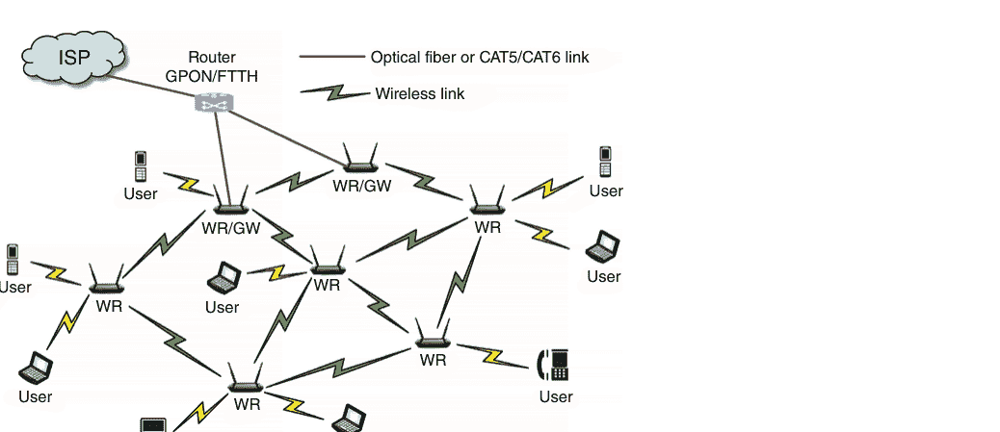

图 7.1 网格网络的通用图示所示 [7]。

一种自给自足的网络，运行在大型网络的边缘。在这种网络概念下，特定的节点或设备通过整个实体的有效功能传输所需信息，而不需要通过特定方式连接到网络 [1]。然而，这种“网格”方案的显著成功实施要求对互联网至少各有一个入口和一个出口。

但是，通过各种手段，人们可以看到这种网格的优势之一。之后，网络不必是一个如此巨大且无所不在的平台，在运行过程中出现的问题可能会减少，且运行良好。首要要求是使用此类工具的易用性以及对其进行高度定制的可能 [4]。这不仅导致了某些软件周围环境的改变，而且允许进行变化和适应，防止担忧变得非常现实。

此外，它还确保了一个长期以来的互联网问题得到了有效的纠正和解决：数据隐私。在过去的几年里，这一特定问题存在巨大的争议。在数字化增加之前，想要分享私有数据的人无法将其公开 [3]。数据丢失及其对现有社会世界的影响使得所有此类问题变得扑复杂 [8]。此外，相关措施正在增加在线设施到达以前无法想象的地方。然而，运行在互联网中的网格网络最有优势且影响深远的特征是它们根据定义是高度自适应的。此类措施应确保即使在内部发生故障或错误，完整有效的网络功能也能继续。

因此，通过定义为网格网络的拓扑结构运行网络功能在价值上几乎是肯定的。尽管处于瞬态，但它们关于网络犯罪状态的各种破坏性和受邀问题随处不在。根据定义，此类系统暴露的不仅是有效网络，还包括任何可能出现的任何威胁 [2]。这些攻击可能是破坏性的，并可能从多个角度影响整个网络状态。当数字化转型进行时，这种已建立的网络拓扑结构的整个状态有许多考虑因素，解释了为什么安全推向了对面。

## 7.3 安全作为数字化转型的敌人

物联网、工业 4 和加密货币等技术的出现并不意味着对以前技术的简单促进和改进。它们还预示了一种场景，即网络本身正在经历变化。这是上一节的结论，讨论网络能力的改变确实非常重要。由于这需要大量数据，显而易见存储在云端比传统的辅助内存存储模式更优。基本上，这些技术的存在标志着一个极其去中心化的、云环境的兴起，这将塑造未来存在的网络环境 [5]。尽管它们目前还没有压倒性地普及，但考虑到每天都会产生大量数据点，许多人将会这样做带来的优势。

随着上述技术的兴起，足迹只会不断增大，这需要更大程度的去中心化的各种云的应用。对互联网以及数字和在线世界的影响将是一个时刻。明确的是，通过转换实现的许多网络基础将成为关注的关键 [2]。此外，安全和保护措施与治理直到此时的在线技术的底层概念内在地相连，可以说，主流和现代的安全保护措施将变得完全过时。在此之后，这些安全措施失效的速度将比任何人想象的都要快 [6]。

在之后，

遭受网络攻击的第一个开放漏洞点完全取决于攻击的“表面”。高度去中心化领域内的所有应用程序、数据和过程都提供了许多攻击机会。网络安全措施一直建立在攻击“表面”这一事实之上。高度去中心化领域内的所有应用程序、数据和过程都提供了许多攻击机会。

网络安全措施一直建立在攻击“表面”这一事实之上。高度去中心化领域内的所有应用程序、数据和过程都提供了许多攻击机会。

遭受网络攻击的第一个开放漏洞点完全取决于攻击的“表面”。高度去中心化领域内的所有应用程序、数据和过程都提供了许多攻击机会。

## 7.4 网络犯罪的现状

风险管理是安全领域中存在问题的领域之一。组织规模越大，管理就越困难。企业需要考虑策略，并尽可能减少大量的离群值。

- 尽职调查由于缺乏关怀标准或准则而受到困扰。企业在运营和安全控制或目标方面通常采取保密策略。他们通常根据其运营情况或客户群来缩减其安全计划。监管指南仅为最低安全覆盖范围提供了基准，并且通常不会涵盖组织的每一个方面。尽职调查必须与风险管理协同工作，以跟踪漏洞的来源。
- 运营效率可以用多种方式分类。效率关系到安全控制“是否”是稳固的以及它们“是否”按预期运行。为了让组织评估效率，它们必须评估过程中的控制措施。分析测试控制是否充分、是否有助于降低风险以及是否按预期执行。与此同时还必须评估效率。然而，在不同的环境中，目标可能会根据安全计划或与安全控制相关的问题而异。必须确定并实施资源，以确保现有的控制措施不会影响整体效率。
- 在处理监管合规性和控制时，必须优先考虑并实施组织所需的任务。这由企业的安全控制和目标决定。
- 安全运营对许多组织来说是一个困难的领域，因为需要必要的资金且缺乏人员。在这些问题的影响下，安全运营（`SecOps`）部门在面对 `SecOps` 压力以维持一个稳定部门的同时，必须寻找所需的专业知识并为部门维持足够的资金。然而，这些部门还面临其他问题，如战略规划和业务规划，以维护安全的系统，这些系统直接或间接地地增加了收入。`SecOps` 面临着内部问题以及来自攻击者的外部问题。由于攻击者只需要找到一个突破口，`SecOps` 部门必须减少并防御每一个可能的切入点。

网络攻击（如多态攻击）日益复杂，这可以被看作是一种反馈循环，这种循环本身由数字转型推动，并影响了最初使此类攻击成为可能的理论选择 [10]。在这种情况下，人工智能（AI）技术被应用于攻击的发生，而且确实发生了。因此，数字转型的案例在带来巨大改进和优势的同时，引发了新的威胁和危险。攻击不仅使用了转型实际发生的特定技术set，还使用了其背后的整个逻辑和概念。如果企业在各个方面都要被瘫痪，那么他们可能会从根本上质疑数字转型的状态 [6]。此外，像医疗保健、交通和教育这样社交依赖性系统在任何方面都不能处于不安全状态，因为造成的损害与数字转型带来的价值无法比拟。

## 7.4 网络犯罪的现状

网络犯罪有许多形式，并在任何观察和分析层面都表现出显著且无序的偏差。也许网络犯罪现状最有影响力的表现是使用手机进行此类攻击的比例在增加。攻击者使用手机来优先考虑他们的目标，并尽可能地隐藏他们的花招 [11]。尽管如此，观测数据显示攻击发生的记录次数至少增长了 680% [12]。更具体地说，2018 年网络攻击的数量相当于所有实际发生攻击的 70% [13]。目前发生攻击最明显的应用是利用移动应用程序，分别通过老旧且原始的钓鱼和恶意软件攻击，利用设备有效欺骗消费者。

似乎大多数网络犯罪是在日常任务中持续使用手机的情况下发生的。随着人们增加手机的使用量，绝大多数攻击者和欺诈者也是如此。除了大众的暴露并延伸出的普通人的脆弱性外，这已成为现实。这种巨大增长的可能原因可能归因于过去十年手机技术前所未有的发展 [12]。结果是更高比例的人口在使用手机，但往往伴随着糟糕的安全和保护措施。除了所有这些发生的相当直接但附带的攻击之外，对跨渠道漏洞的特殊考虑正变得越来越模糊且突出。

随着用户要求提供产品和服务时只需进行最少的操作，跨渠道攻击已变得过于常见。数字渠道的增长并非偶然，而是一个非常明显的现实，因为公司和欺诈者促进了全范围内易于访问且完全开放的跨界连接 [6]。新的应用程序接口（API）经济从经济上推动了这种互联通道的明显增长，它涉及用户与多个平台或服务提供商共享个人和敏感信息 [2]。正如之前提到的，它阻碍了攻击策略的可能表面，导致压倒性的漏洞像以前一样泛滥。挑战是显而易见的，即一种适用于每个平台的跨平台保护策略。这种措施只能通过广泛且有影响力的政策来实现，使其得到有效执行。

当前网络安全的另一个模糊化因素还包括攻击者利用合法工具来保护和加强他们的活动。在所有可能的平台中最明显的是具有不可否认的全球影响力的流行社交媒体平台。诸如 Facebook、Twitter、WhatsApp 等平台观察到数亿甚至数十亿用户在线并相互互动 [14]。凭借这种压倒性的存在感，以及背后更大的欺诈，为什么网络攻击经常作为他们相互连接的借口显而易见。它也有助于他们盗取非法信用卡数据、交换从各种数据库中获得的身份，以及从其网络攻击中获得的许多其他非法手段。

如果一切都显然如此相关，那么意味着整个实体只会随着明智而增长。到 2018 年，通过社交媒体发生的欺诈活动激增了约 43%，其他通过社交媒体实施欺诈的方法不断涌现 [12]。自动运行机器人也被纳入了这个方程式中，使人们的脆弱性降为零。由于易用性、功能滥用以及许多其他原因，安全对于网络攻击者是必须的 [13]。这使得攻击者使用移动应用程序隐藏踪迹变得更容易。

这可以被看作这种全球范围内日益流行的云网络环境的缺陷。然而，其中的核心问题是安全措施究竟如何应对这种局面。正如已经指出的，威胁只会扩散并变得更有破坏性。上述的欺诈和恶意活动表明，这些活动很容易通过最合法的方式被察觉，且在知名平台上很难揭露 [12]。这使得整个平台的定位受到了质疑。然而，揭露系统的必要性至关重要。

区块链欺诈者的存在。正如之前提到的，它是近期最具影响力的技术创新之一，但除此之外一切的是，它为检测攻击者提供了迫切的努力 [13]。如果没有机会——无论它是多么众多或复杂——一切都会产生影响 [12]。此外，最后的链拥有攻击者需要来驱动其内部对话和其他任何形式非法活动的域名。主要是因为这些系统缺乏有效的努力。

目前，大多数人低估了网络犯罪的威胁。它不再仅仅是一个偶然案例，因为从长期来看，它还预示着一个人们正在进入的世界——由于其对每个人的生活和健康具有高度的影响可能 [15]。云环境的兴起，以及安全和保护措施的完全失效，带来了一系列他们无法掌握的问题。

## 7.5 数字化转型经济的安全与技术

首先，需要注意的是，在数字化转型的背景下，一些本质的安全考量往往是完全未被察觉的。因为数字化转型场景涉及许多关键技术，这些技术可能会彻底改变企业的运营方式，以及它们向消费者展示其服务和产品的方式 [15]。同样重要的是，导致愿景产生的问题是数字化转型的直接延伸，即企业及其他机构如何处理安全问题 [42]。这被称为“安全转型”，整个抽象规划的目标是彻底转变执行安全保护的战术和策略，以防止某些突破性且产生深远影响的创新。现在，估计全球所有公司都将安全挑战定义为妥善保障安全保护措施最突出且最具挑战性的问题 [8]。此外，同样比例的机构在阻碍 IT 安全专业人员达到其所需的帮助水平方面也面临着另一个巨大的压力的问题。

许多人将安全转型视为不仅仅是一个可以有效解决的问题。企业在寻求自身之外的优势时，正在学习如何让不同的团队合作，这不仅包括关注安全的团队，还包括应用技术和网络专家 [11]。它也可以指对安全措施在全范围内如何运行、架构和实施的认知完全转变 [12]。此外，另一个主要理念涉及为每个个体完成孤立式开发安全措施的理念。在以适当方式进行访问和识别方面保持统一性，是全面采取适当安全措施的最高优先级之一。

关于全方位这一理念的另一个热门观点是，机构和企业聚集在一起交换与数字化呈现所带来的安全威胁相关的信息 [4]。此外，建议是，如果要让政策制定和法律性充分参与整个安全过程，解决方案应当是此。数字化转型的信息交换将为所有人提供一个公平且公正的市场——即使是那些在财务上不安全的人也能意识到实际上发生了什么 [14]，并对这种可能性做好准备。它还将促进商业化 IT 安全成为一项事实，让任何购买其产品和服务的任何人都能通享使用 [8]，就像数字商品一样。

然而，不能说这种特定的解决方案在未在每个视角下被完全通知之前，没有任何待解决的问题。在涉及公司（尤其是大型公司）为了实现某个共同目标而努力时，存在着太多的紧急情况 [11]。不能否认，如果开放自由市场，那么那些目标是建立信息场所以证明并强化其责任的人就会产生需求。如果需要监督机构，将提出要求；然而，每个个体的有效性和机构声音将要求实践具备适当的措施和参考点 [12]。此外，没有任何比渗透者通过某种策略或违入策略进入每个人体内更毫无意义的。此外，如果个人或实体已经证明了他们能够在极端环境中生存，那么对于技术的账户和识别及其反应是否对双方可用，就应该保持持续的怀疑。

无论如何，在整个安全转型领域最受讨论的技术实施是自动化问题。自动化是技术存在于人类大脑工作者痴迷的主要原因之一，而如何工作得更快、更高效、容量更大的问题，可能是过去 70 年来技术领域所有重大创新的主要动力。但在在这个时代，有效的安全价值由于非常复杂的自动化，这种自动化变化并在某些情况下甚至超过了攻击者所使用的东西 [16]。许多专家完全相信，自动化是未来安全的驱动力——驱动所有可能性和操作的有效运行。

核心内容是人工智能（AI）和机器学习（ML）领域所出的改变格局的技术创新。这些新时代技术在过去只是幻想或虚构的来源，但这些“智能”程序即使在目前的状态也能完成许多事情 [12]。其首要任务之一是根据关于攻击方法和策略的价值在线阅读进行自我适应。此外，这些技术还可以跨越多个不同但仍互连的平台和软件支持进行工作 [17]。AI 在未来的有效潜力只会提高，它完全可以理解人类观点影响其生活的全部压力。

整个场景伴随着有效的安全规定，结合在一起或独立存在。尽管如此，但不能否认，事实上，对于所有此类考量的正反方面，确实存在着许多困惑 [8]。但似乎，在安全转型的旗帜下提出的所有此类考量，可以通过可能的自动化在恒定的速率内节省时间和提高效率。而且还需要相信，人类在这些自主运行的技术中需要扮演次要角色以便以便任何地方发生网络攻击时诊断并启动恢复措施 [16]。这一点使论点更有说服力，因为它符合所有证据箱明确指向的标准。

## 7.6 成功数字化转型的网络安全成熟度挑战

数字化转型带来的网络安全挑战整体是一个双头怪兽，一个非常有趣的故事。正如前面的章节指出的，对每个用例的需求增加以及对数字化环境的全支持是整个数字化转型有效传播的主要标准 [2]。但另一方面，能够保护和保护数据的全面且有效的促进问题已经在驱动企业回到核心。由此产生的有效安全结果的差距，可能是关于网络攻击同步化和复杂性最本质的讨论点。

然而，解决问题的正确方法取决于网络如何布局，以及其最终基础设施。在这种情况下，标准化应该是最高优先级之一。这可以通过有效的立法实现，所有关注都针对新和服务 [5]。不仅仅是调整“固化”安全产品和服务的需求，而是期望供应商直接提供某种程度的计划。更重要的是，应该采取这些措施和做法，以便在个人数据方面提供最佳隐私 [12]。标准化技术创新和蓝图的机构是必要的，需要提交更高质量和更高效的实践。

但是，尽管有广泛的措施来应对网络攻击的一般问题，但在某种程度上解决数字化转型的驱动因素也是重要的。因为技术现象在操作方面和可能取得的成就方面往往是复杂的 [6]。IoT 是一个典型的例子，其自身改进和创新的潜力需求非常高。但它也是最有潜力上升云网络拓扑的驱动因素之一 [4]。网中其他设备之间跨通信的有效问题可能受简单个人的指令和指导控制，但这在任何方面都不会降低它们受到网络攻击的敏感性。这些安全措施的现状需要达到一种保护规模，允许开发新的策略和干预措施以防止攻击的有效概率。

此类安全实践的标准化和对齐可以导致组织和企业的广泛采用。他们的产品和服务需要展示其措施的能力，以便将此类项目推向市场，或作为消费者购买的基准。在医疗技术的情况下，手头面临的威胁或危险的规模需要完全唤起某些组织良好且实施的创新型和创造性追求。因为，与理想的 IoT 环境不同（在那种环境中，一组设备提供了与其他设备及连接设备的预期），健康技术需要从云端托管它们。在提供安全和保护干预方面，“实例”仅仅是因为寻求服务的人以及他们的详细历史数据只会增加随着时间的推移[1]。结果，确保这些软件分配及其相关活动的措施变成了一个多级保障体系的问题。这些措施必须以不同的方式进行，并且不能以任何方式混淆他人的流程。基本上，在这些考量下，建设性的规划模式和关键信息的共享应该成为首要考虑的问题。

电子身份识别和信任服务的兴起，似乎正是未来在引发意外后果方面所引领的趋势，这无疑是电子时间戳、密钥证书以及关键策略在横向和纵向传播方面最显著的领域之一[26]。这些技术需要更具自动化、更具真实性，并依赖于只有其自身才能提供的唯一身份变量。然而，对于这些技术如何全面应用，目前仍然是一个未解决的挑战。

密码学是目前最可行的方法，其对安全潜在解决方案的整合对于最关键的流程具有着很大的分量[19]。加密算法的开发是为了在网络基础设施的扩展规模范围内有效运行[14]。它们主要参与了提供了可以认为是大规模可用的安全和保护分配的基准。

量子计算和加密算法的整合都指向有效且长期的解决方案。在这种情况下，安全干预和措施通过高且复杂的自调能力变得更加敏捷[44]。这将允许通过关键考量和全范围的攻击来解决有效问题[2]。与密码学相结合，可以提供应对和解决全范围内关键问题的机会，这将有效引发人们可能一直在寻求实际处理与自发变化和变革相关问题的局面[6]。要解决的问题必须通过多点视角进行处理和分析，最终结果将有效地为促进和利用当代数字化转型的情景提供机会。

## 7. 安全成熟度与优化：感知与现实

关于相关且已解释的信息案例说明了可以改变状态的最核心视角的广泛实施。这些压倒性的变化应该代表了为了应对网络攻击的成熟度而需要采纳并有效实施的可能性技术知识。这确实引发了“安全成熟度”或“安全转型”的有效性，这在其他所有地方已经得到了详细的解释[12]。然而，对于企业和组织来说，目前的情况代表了一个更为隐蔽的问题，需要在过程中进行处理和纠正。这完全关乎组织的感知——任何特定公司的感知安全与其实际代表的内容之间存在着巨大的鸿沟。

考虑到所有因素，问题的根源似乎在于他们对安全问题和长期攻击的知识处于定性评估之下。这导致安全基础设施和特定技术的成熟度被开发和评估为一系列在位的安全措施，这些措施在过程中提供了基本的安全分配[4]。一个观点客观地量化全范围内感知安全感与实际安全感之间的差异。当然，在涉及关键指标和未经授权攻击的问题上，应该涉及定量衡量[19]。这似乎是因为网络攻击比以往任何时候都具有更广泛的易受攻击渗透的区域。如果没有预料和做好准备，很可能出现严重的情况，即如果需要适当的检测和恢复措施，攻击的数量和覆盖范围可能将得不到解决。

这就是为什么组织需要关注多个点，以渗透它们的安全措施和基础设施。在这种情况下，妥善嵌入意味着安全和保护应该整合到数据框架和实施软件框架内组织之外的每一个其他环节，包括人员、追求和发展的文化、工具、控制措施、操作技术以及云保护[2]。只有通过安全和保护干预在所有这些领域中的渗透，才有实施恰当且有结果的策略的希望[20]。然而，对于那些声称是推出高端和新时代安全解决方案领域专家和领袖的组织来说，这种要求很难成为一个常见的方面。

## 7. 网络安全数字化转型：安全风险与解决方案

大多数人似乎将其归因于组织在处理安全威胁时缺乏主动态度的整体情况。只有约24%的组织实际上采取了方法，寻求通过可能发生的各种攻击处理安全问题[4]。与此相关的已实施的有效安全保护策略，大部分需要以有效的方式将主动方法与安全措施联系并整合在一起[14]。如果整个情景似乎持续存在，伴随着不断变化的份额，未能履行合同条款，以及与客户以及在适当规管方面与朋友之间的信任。

### 7.11 为什么网络安全成熟度在数字与现实中不是应有的样子

网络安全成熟度的表面感知与现实之间的差异已经过讨论。留下的原因并不完全在于他们做了什么，而是指出大多数组织和企业倾向于关注定性价值而非定量价值[19]。后者起着重要作用，因为它提供了威胁、风险以及其他犯罪活动的完整蓝图。为什么企业不关注定性评估而不是数据呢？

广泛且关键的安全挑战已变得复杂，例如最小特权原则以及“预防胜于治疗”这一事实的认知[20]。然而，随着数字化转型的发生且比以往任何时候都更高效，整个局面暴露了需要几项原则以全方位方式建立信任和韧性的安全展望[24]。这两个因素都是企业关注的终点，关于同类首首的特点是，许多公司基于清单方法来进行安全投资。然而，随着数字系统复杂性和规模的增加，因此安全基础设施的实施和传统格式是不可行的[22]。相反，这些应该建立在基于风险的决策之上，即在整个组织范围内考虑安全投资的整个案例，并对高风险区域和低风险区域进行有效分类[19]。这还将转化为第二个关键点——混淆的感知，即重点应从安全架构转向业务结果。应用这种变化将产生一个在自身能力上寻求改进和增强的系统。

缺乏基于结果的方法也导致了 IT 安全专业人员在组织内角色的定位问题。传统的观点将他们视为“防御者”，而实际上他们应该是“促进者”，其关注点应是组织的全方位利益[23]，维护保护需求与帮助业务实现其结果之间存在的微妙平衡面纱[6]。这还涉及到数据的持续流动，因为数字业务的推广增加了其日常可用性的数量和复杂性，以及我们看待和忽视的方式[12]。但是，企业必须放弃这种需要控制信息流的感知，这种控制可能正如他们认为的那样不可行。相反，这些组织应该将重点放在如何保护所有的核心流程和控制措施上。

通过这种方式，他们可以获得最好的结果，但如果他们希望拥有安全关切，能够以迭代和持续的方式成熟并解决攻击 [14]。数据可能是关键的区别因素，而开发一个能够分析海量信息并从中推导出意义的有效团队是眼下最重要的因素。

平衡的需求也应该被讨论，即在安全和保护背景下人们是如何被对待的。在适当组织管理的理论基础下，众所周知，必须考虑在没有任何强制性或迫性性质的情况下，激励和驱动人们完成工作 [24]。从每一个衡量标准来看，妥善应对网络安全的核心点向我们提出了关于平衡的问题。这直接意味着必须追求安全和保护应急措施的传统合规，以确保在此过程中充分实现识别、处理、开发和巩固新策略 [25]。这也意味着必须对应急措施进行适当分配，以完全保留和选择检测-响应机制。

理解安全转型的本质是复杂的，，很容易看出为什么各种企业和组织无法准确地感知它们。问题的核心源于必须采取什么的问题 [26]。鉴于当前网络犯罪的现状，显然旧的应急措施和手段已经过时了 [20]。但在许多情况下，这些措施也适用于应对那些可能以原生方式呈现但在功能上实际上更传统的问题 [21]。真正的安全成熟意味着，新旧应急措施应该保持平衡，使业务组织具有韧性并在各处投射一种信任感。

## 7.7.2 网络安全成熟度与策略滞后

在接下来的几节中，已经非常清楚网络安全成熟度及其策略究竟是什么。然而，尽管公开了事实以促进推理和逻辑推理，但事实仍然是：这些组织的大多数状态保持完全不变，措施是错误的，或者对网络安全成熟度的看法是偏颇的 [19]。在某些情况下，许多人现在开始理解导致此类措施达到预期普及或无处不在的实际因素。

造成这种情况的一个原因可能是由于组织文化的状态。在许多组织中，文化被定义为高度分层，实施了许多官僚措施，阻止了安全措施按照最佳方式实施 [27]。在文化未受培养的状态，必然存在扭曲且不健康的信息回溯。结果，从这种特定状态产生的主要后果可以定义为组织内部权的局限或缺陷。如果这种情况没有不到位，那就好了；即使他们到位了，负责的人也有自己的理由不采取行动 [28]。结果，安全措施和方法在成熟状态下的正确嵌入从未实现。

其他原因可能还包括特定组织可用资源的问题。这很容易归结为：中等规模的业务公司没有足够的资金和资源，他们认为有一套过时的安全系统是一种风险 [20]。在许多情况下，即使安全状况符合要求，他们也觉得其他地方更好 [2]。这种冒险态度在这些组织增长和扩大市场时，本身就会导致损害。这增加了它们的脆弱性。

然而，这最显而易见的原因可能由于“感知与现实”的差异。

但是，转型中最有趣的部分是缺乏意识。技术环境是如此复杂，而且是分布式的，这一特定因素在“纠正”现状方面发挥着很大作用。如果他们没有意识到并充分了解与安全相关的一切，那么将对整体产生负面影响。为了开展数据技术，信息流必须处于最高水平，并相应地进行。

## 7.8 安全参数的变化需要全方位方法

当前数据安全面临的主要要问题是它不是有效或有意识的。被考虑的信息是启动网络安全实施的基础原因，可能需要信号来后期干预以保护风险中的数据。在这种情况下，应急措施要求安全人员在尽可能短时间内识别、诊断并提出解决方案。如果意图如此，我们就可以看到实时数据将如何有效。

造成这种情况的首要原因之一是缺乏组织意识。技术环境是如此复杂，而且是分布式的，这一特定因素在“纠正”现状方面发挥着很大作用。

另一个重要的安全参数在实时数据的价值上发挥作用。整个过程由高层管理监管，以准确监督风险格局和业务基础设施的重要性。

识别和风险评估是要关注的第一点，通过四个阶段的风险缓解路径提供支持。这将导致一个完整的、模拟的风险列表，并需要潜在因素。

# 7.9 未来的网络安全挑战与数字风险 | 121

## 整体网络风险管理方法

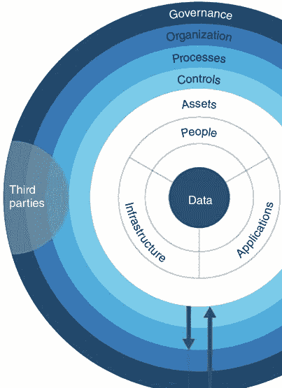

- **资产。** 清晰定义的关键资产
- **控制。** 平衡安全与灵活性的差异化控制措施
- **流程。** 侧重于有效响应的最先进网络安全流程
- **组织。** 适当的技能、高效的决策以及有效的跨企业协作
- **治理。** 基于对网络安全风险的深度透明化，优先考虑运营韧性的投资
- **第三方。** 涵盖整个链条，包括第三方服务

传统的网络安全关注点 vs. 整体性方法

**图 7.2** 整体解决方案模型可操作性的层级结构图 [32]。

分析或评估阶段标记了风险发生的阶段，根据各自的风险偏好，连同其发生的概率以及根据其整体影响的整体性进行衡量。

在完成对任何风险的评估和分析后，针对这些风险采取的可能干预措施应呈现为整体。如果仅关注对提出的监控或纠正措施的评估，将令人非常担忧，这些措施应当恰恰反映 [33] 中需要做的事情。风险缓解的最后一步涉及适当且有效的监控。这不仅应该依靠相关的技术增强来运作，还需要结合包括高层决策者在内的每个人所提供的完整信息 [11]。这种策略的整体有效性和设计只有在组织或企业完全准备好接受变化时才能实现。必须逐一考虑对网络安全的其他影响，即使它们最多仅仅是具有潜在性的，也需要进行纠正。

# 7.9 未来的网络安全挑战与数字风险

现状大多具有关键性，但如果无法有效预测哪些挑战可能会变得显而易见且处于关键，那么通常将面临危险。网络安全挑战似乎会凭空出现，而前瞻性的讨论是所有行业和个人在妥善应对时可能拥有的希望 [29]。然而，没有人能否认数字风险对整个困境的显性影响。

数字时代的网络安全挑战被证明是非常有趣的，因为最近大多数政策制定和这一特定关注领域本质上都是反应性的。此外，所有的数字化转型正以空前的速度在进行，不可否认，这只会放大并增加风险 [35]。然而，挑战仍然在于人们对政府和企业通过其在线身份对隐私进行干预日益增长的担忧。网络安全方面的另一个基本挑战是 [13] 的安全性。

在这种情况下，安全和保护的日益复杂化可能会导致社会大部分人群的幻灭，使得一些人能够保护自己的数据，而另一些人则不能。此外，具有不同安全和保护细节的工作网格网络也允许来自互联网的欺诈。

数字风险也是如此，它们可能与网络安全没有直接关系，但仍会上升到影响问题上。通过这样一个微小的窗口，这种技术可能会被实施或利用在某处，而该处可能不在作者的考虑范围内 [2]。在这种情况下，特别是如果实施在本质上是非法或违的，它会给开发者带来很多问题，且这些问题不会轻易消失。在数字技术快速转型的面对，面对资源不足的风险也是整个领域中需要解决的一个重大问题或风险 [34]。这些因素的结合会增加所有公共和开放在线世界中脆弱系统的出现率。结果是未来网络犯罪的发生率将提高。

# 7.10 结论

安全问题如果不仔细地开发正确的解决方案，将成为参与共享经济的用户和服务提供者的主要障碍。安全的整个问题是由大数据账户的出现引起的，这些账户在大量客户之间共享，而这些客户在任何情况下都有动机。人们认为新技术将去中心化，使得用户完全由个人、群体或较小的实体控制。新兴技术显示科学与社会、文化与经济因素之间的关系发生了变化。然而，政策制定者试图在市场中脱颖而出，以赢得客户的信任。这只有通过使用技术来实现，这为开发者之间提供了健康的竞争。

数字安全至关重要，并且在本章中讨论得比以往任何时候都多。由此可见，我们每天面临着许多类型的安全威胁，从简单的家庭设备到公司和政府。它与所有技术相关。例如，如果一个人使用被黑的计算机，攻击者就可以访问用户的信息，这些信息被用于欺诈或其他导致任何个人陷入危险的犯罪。购物时使用信用卡也让人们面临风险，当密码码被设置且个人信息丢失时。安全威胁都在侵犯人权，它们允许未知身份访问人们的隐私。

隐私和安全是交织在一起的——对其中之一的威胁就是对双方的威胁。破坏扰乱了信任是对伦理原则的严重违反。保护数据是紧迫且复杂的。确保安全受到保护以使协作管理不受损害是必要的。然而，随着社会的进步，针对黑客和其他安全威胁的过度努力也正在增长。

现在常见的数字世界和在线世界由于几个因素的汇聚，形成了整个未经请求或未关联的网络攻击场景。在数字技术存在的历史中，这是一个贯穿始终的故事。数字转型的现状导致了压倒性的转变，这增加了脆弱系统的存在并几乎达到了最终程度。然而，对于安全的挑战是非常现实的。这种情况涉及确保更好更高效的响应，网络安全挑战和数字风险将代表生活的每一个方面。

## 参考文献

1. Ciardhu, S. (2004). 扩展模型。International Journal of Digital Evidence 3: 1–22.
2. Assante, M. and Tobin, D. (2011). 劳动力。IT Professional 13: 5–15.
3. Craven, D., Thibault, N., and Purse, R. (2014). 定义网络安全。Technology 4: 10–21.
4. Barclay, C. (2014). 变化环境中的可持续优势：网络安全模型 (CM)。In: Proceedings of 2014 ITA: 汇聚的世界？275–282.
5. Gavas, E., Memon, N., and Britton, D. (2012). 赢得网络安全。IEEE Security & Privacy 20: 75–79.
6. Kane, G.C., Palmer, D., and Phillips, A. (2015). 策略而非技术。Sloan Management Review 14: 1–25.
7. Binh, L.H. and Truong, T. (2022). 解决网格网络问题的有效方法。Sensors 22: 5494. https://doi.org/10.3390/s2215494.
8. Berlin, S. (2012). 数字化转型：创建新业务模式的机会。Strategy & Leadership 40: 20–24.
9. Ali, S., McCarthy, A., and Ford, F. (2018). 网络安全是开启物联网的钥匙。Bank and Finance.
10. Norris, D., Ahi, and Finn, T. (2015). 国家和地方政府的网络安全挑战。In: 15th European Conference on Governance, 196–202.
11. Massacci, F., Ruppi, R., Colson, M., and Williams, L. (2016). 基于规则的基础设施法规的影响。IEEE Security & Privacy 34: 52–60.
12. Anderson, R., Harton, C., Bohme, R. et al. (2013). 衡量安全的成本。In: Information Management and Privacy (rev ed.), 265–300.
13. Khetri, N. (2010). 全球网络安全索引：经济与战略视角。Springer & Business Media.
14. Kaplan, J.M., Bailey, T., O'Halloran, D. (2015). 网络安全：保护你的数字业务。Wiley.
15. Miro, W. and Muda, K. (2014). 关键基础设施供应商的网络安全能力模型。Technology Innovation Management 40: 33–39.
16. Dunlay, D.M., Hendrickson, S. (2019). 网络安全挑战。Sandia Research, Report.
17. Yar, M. and Steinnetz, K.F. (2019). 网络安全：策略与安全。预期与现实。In: Advances in Cybersecurity (in. Bernik, and S. Shrvice), 5–22.
18. Aradao, C., Garcia-Guero, L., and Van Meer, J. (2008). 网络安全：策略、风险与政策：客座介绍。Discussion Language 39(2): 147–154. https://doi.org/10.1177/096710600608919
19. Matti, C., Hess, T., and Bentian, A. (2015). 数字化转型策略。Business & Information Systems Engineering 12: 1–16.
20. Paynette, J., Ecares, C., and Eugene, M. (2015). 由安全设计：关键基础设施项目管理模型的网络安全扩展。Technology Innovation Management 5: 26–34.
21. Path, P.H. and Dutta, R. (2020). 网格无线网络网络设计和设计方法调查。IEEE Communications & Surveys Today 13: 396–428.
22. Muttik, I. and Barton, C. (2009). 云端安全框架。Information Technology Security Research 14: 1–6.
23. Wirtkus, N. and Klein, H. (2017). 网络安全中的人工智能。Cyber Intelligence, and Security Journal 1: 21–23.
24. Moon, E. and Endocci, P. (2015). 数字不同吗？信息的构建、捕获和发现是如何被转化的。Springer Publishing.
25. Maughan, D., Bilandov, U., and Tudor, Z. (2013). “防御的价值”：将网络安全研究转化为实践。IEEE Security & Privacy 11: 12–24.
26. De Bruin, R. and Volons S.H. (2015, November). 网络安全成熟度建模。In: 2015 IEEE International Symposium on Technology and Security (ISTAS), 1–8.
27. Mehravari, N. (2013, November) 通过使用 CERT-RMM 相关成功案例进行弹性管理。In: IEEE International Conference on Technology of Homeland Security (HST), 119–125.
28. Tisidle, S.M. (2015). 从系统复杂性、知识管理和商业智能角度看网络安全挑战。Issues in Information 16: 191–198.
29. Pavone, V. and Esposti, S.D. (2012). 对新安全向技术的公众评估：安全与隐私之间的权衡。Public Understanding of Science 21: 556–572.
- 32 Broehhm, J., Merrath, P., Poppensicker, T., et al. (2018). Cyber measurement and the holistic cybersecurity approach: Comprehensive dashboards can accurately identify, size, and prioritize cyber threats. Here is how to build them. Risk Practice, November. 2018 McKinsey & Company: https://www.mckinsey.com-/media/McKinsey/Business%20Functions/Risk/Our/Insights/Cyber%20risk%20measurement%20and%20the%20holistic%20cybersecurity%20approach/Cyber-risk-measurement-and-the-holistic-cybersecurity-approach-vf.axhs
- 33 De Bruin, R. and Von Volms, S.H. (2016, May). Cybersecurity Governance: How can we measure it? In: 2016 IST-Africa Week Conference, 1-9. IEEE.
- 34 Mohammed, D., Mariani, R., and Mohammed, S. (2015). Cybersecurity challenges and compliance issues within the US healthcare sector. International Journal of Business and Social Research 5 (2): 55–66.
- 35 Oswald, G. and Kleinemeier, M. (2017). Shaping the Digital Enterprise. Cham: Springer International Publishing.

# 下一代网络：集成、信任性、隐私与安全

## 8.1 引言

自20世纪80年代以来，无线通信伴随着每一代技术的发展发生了着重大的变化和进步。我们最近进入了第五代无线通信（5G）。这一最新世代的采用和部署正在进行中，但可能还需要三到五年的完全实现。5G 推动了向云端迁移，实现了按需的软件网络以及网络功能的自动化学习。然而，尽管有了这些进展，研究人员已经开始关注下一代（6G）以及随着它的采用网络格局将如何发生变化。

通过各种技术，6G 预计将带来向完全智能的网络编排和管理的转变。5G 的异构云基础设施需要视觉化 6G 的架构框架。未来的网络可能不会因为 6G 作为一种新基础设施组件的加入而消失。它与现状产生差异的地方在于，个人子网络和无缝灵活工作负载的专用网络在多样性和灵活性上的增加。

每一代 6G 网络都将面临需要解决的隐私问题。移动安全一直是每一代无线通信中一个非常重要的问题，并且似乎随着每次技术的进步而变得越来越困难。过去的代际已经处理了从身份验证问题到攻击者担忧的各种问题，预计 6G 网络将看到类似的攻击，例如零日攻击和物理层攻击，但还会增加高级攻击，例如基于量子的攻击和基于人工智能/机器学习（AI/ML）的智能代理攻击。将 AI 引入 6G 网络将从通信方面为其安全性提供支持。

我们必须建立在安全研究的基础上，以洞察下一代通信带来的挑战。网络可能需要每秒太比特（Tbps）的连接速度，同时还要为物联网等大量设备提供连接，以及这些网络所使用的移动设备的灵活性。由于延迟敏感，网络的端到端攻击将要求延迟降低到毫秒。这些在速度、密度和延迟需求方面的极端跨跃，仍要求 6G 的能源效率比当前系统高100倍，这在某些情况下可以通过低功耗通信实现。

延迟敏感的应用必须考虑系统延迟需求增加的影响，而网络极高的带宽将为数据流动中的摄取和处理带来许多挑战。某些应用可能需要在本地进行处理以避免这些问题。由于这些网络具有给定网络上的多样化设备，并且能够频繁快速地更改其边缘网络。帮助解决这些问题的假设关键性能指标（KPI）包括保护级别、解决时间（TTR）、覆盖、平均成本水平、AI 鲁棒性、安全 AI 模型收敛时间、安全功能往返时间（RTT）以及部署安全功能的成本。

# 8 下一代网络：集成、信任性、隐私与安全

此外，智能无线电和网络接入核心（RAN-Core）融合的优势提供了进一步的考虑。这些技术能够通过无线网络实现更快速、更自动的无线网络管理和部署。

## 8.2 5G 网络现状

另一项将极大影响未来安全和实施的进展技术是量子计算。虽然抗量子硬件和加密领域正在进行积极开发，但这项技术本身可能会对网络被认为拥有的安全性和信任水平产生重大影响。

对于所有技术而言，在 6G 中必须高度重视并考虑用户的隐私。随着数据量和交互的不断增加，这些系统中收集和存储的数据量也将随之增加。由于连接性是 5G 的 100 倍，这些新系统将具有更严格的要求和性能指标。大批量安全地传输和保护私有数据将面临挑战，因为在大多数情况下，对这些信息的身份验证、识别、分析和保护将呈指数级增长。

研究人员已经在讨论的解决 6G 问题方面有许多发展途径——这些解决方案旨在解决顾虑，并帮助将 6G 通信安全发展为系统和应用程序。由于我们已经进入了 5G 技术和应用的实施阶段，6G 将很快到来，我们需要识别并开始考虑未来网络的安全框架将如何变化，因为进步带来新的攻击是不可避免的。

## 8.2 5G 网络现状

5G 网络已经开发了多年，开发阶段正逐渐结束。一旦 5G 网络完善，它将带来比第四代网络极高的性能提升。这些 5G 网络的出现还将带来新的网络技术与其他技术相结合用于应用，并实现物联网（IoT）的宏伟愿景 [1]。2022 年 5G 网络的状态实际上非常复杂。随着许多国家的接入，它正在增长，但实际上速度正在放缓。因此，随着 5G 连接性的增加，其全球性能将会下降：没有多少国家体验过“真正的” 5G。甚至有一项关于其如何放缓的研究；在 2020 年到 2021 年的一年里，全球 5G 下载速度下降到 166.3Mbps，低于 2020 年第三季度的 206.2Mbps。在增长和放缓的同时，许多国家无法使用 5G 网络。在所有国家中，美国的 5G 可用性最好，其次是中国，下载速度分别为 50.83Mbps 和 53.08Mbps。见图 8.1。在美国，三大主要运营商都有某种形式的高速标准网络。通过这些方法，运营商能够获得更好的吞吐量和数据速率。

考虑到这些 `5G` 的问题，如低延迟、高回报以及随时间推移的放缓，研究这些问题的解决方案以及所需的关键技术非常重要。优化部署 `5G` 网络和应用可以通过同步网络侧应用部署到 `RAN`（无线接入网）和 `UE`（用户设备）来改进。通过更强大的功率控制，`5G` 网络的部署将更加灵活，所实现的指标越好，`HD` 视频、`UHD` 视频等内容的可用性就越好。许多高带宽和缓存的服务可以处理带宽并减少延迟，提高整个网络的服务质量（`QoS`）。低延迟特性将允许管理员配置网络以供三方使用，从而为移动用户、企业和虚拟行业快速部署应用和服务。

`5G` 已经有了充足的时间，因为它是基于 `4G` 架构的，并且其关键技术已经确定。对 `5G` 很有帮助的一项主要关键技术就是物联网的使用。物联网是由许多设备组成的集合网络，这些设备收集数据并出于不同的原因使用。`5G` 的另一项关键技术是毫米毫米波。使用这五种网络还需要移动网络发生巨大的巨大变化，使其在连接极高流量的同时保持极高的移动性。`5G` 的开发还会有一些基础模型，而且已经部署了许多 `5G` 网络，但远未完美。图 8.1 是其中一个基础的图示。

2021 年，`5G` 网络的部署取得了相当的进展，其中很大一部分是全球标准化。`5G` 标准化始于 2016 年，在 2021 年产生了许多障碍。许多小组致力于结构、元素、网关、配置等的标准化。总而言之，2021 年是 `5G` 部署及其关键技术开发的一大年。

# 8. 下一代网络：集成、可信性、隐私与安全

| 国家 | 截至2021年第三季度 5G 可用性 (%) |
| :--- | --- |
| 美国 | 49.2% |
| 荷兰 | 46.1% |
| 韩国 | 43.8% |
| 科威特 | 35.5% |
| 卡塔尔 | 34.8% |
| 香港 | 31.7% |
| 瑞士 | 30.2% |
| 保尔加利亚 | 25.5% |
| 台湾 | 25.3% |
| 丹麦 | 24.5% |
| 澳大利亚 | 24.5% |
| 加拿大 | 23.7% |
| 沙特阿拉伯 | 23.0% |
| 阿联酋 | 20.1% |
| 希腊 | 20.1% |
| 芬兰 | 17.9% |
| 泰国 | 17.6% |
| 菲律宾 | 13.3% |
| 英国 | 11.7% |
| 法国 | 10.2% |
| 捷克克 | 10.1% |
| 奥地利 | 8.5% |
| 斯洛文尼亚 | 8.4% |
| 挪威 | 8.4% |
| 新加坡 | 7.9% |
| 阿曼 | 7.7% |
| 日本 | 7.6% |
| 罗马尼亚 | 7.3% |
| 意大利 | 7.3% |
| 波兰 | 6.5% |
| 德国 | 4.2% |
| 以色列 | 3.8% |
| 匈牙利 | 3.6% |
| 新西兰 | 2.9% |
| 南非 | 2.7% |
| 瑞典 | 1.5% |
| 巴西 | 0.8% |

**图 8.1** 2021 年第三季度 5G 速度智能数据。

## 8.2 5G 的应用与服务

`5G` 技术无疑比第四代技术更强大，由于这些新速度将带来覆盖从零售到教育、智能家居的广泛行业的应用和服务。这些技术和服务为许多人带来了收益。例如，`COVID-19` 疫情暴露了无线通信的价值。在办公室关闭、学校封锁期间，一家名为 Zoom 的公司股价飙升，其他公司也加入了其中。学生接受了虚拟教学——许多教学环境显示了差距。现在疫情已经结束，无法回头。`5G` 如果能涵盖生活的多个方面，我们需要无处不在高速移动网络。`5G` 网络已经显示出它们非常有创新性且快速。超低延迟结合高速互联网可以用于自动驾驶汽车等许多应用。通过 `5G` 网络，延迟可以达到毫秒级。`5G` 网络本应该是可靠的，而且有了 `5G`，下载速度将更快。`5G` 网络将提供的另一项服务是安全的云应用。这意味着我们可以以更快的速度执行更多任务。谈到 `5G`，`5G` 网络将为硬件和软件开发人员提供新机会，从而为人们创造更多工作机会。例如，`5G` 服务还应该包括更好的小区覆盖、最大的数据传输和低功耗等。

娱乐和媒体是 `5G` 网络的大因素。大部分流量用于流传输高清视频。由于第五代网络比第四代好得多，它们将允许高清视频。它能够以高速流传输 `HD` 视频，从而提高服务质量（`QoS`）。这也适用于不同的操作，从使用手机观看 `HD` 视频到大型公司能够流传输高分辨率和动态范围的视频。

在处理网络时，一个巨大的方面是增强现实（`AR`）和虚拟现实（`VR`）。它们通常需要资源密集型 `HD` 视频和低延迟，这正是 `5G` 网络能够提供的。视频游戏也将变得更加复杂，因为它们能够持有所有数据并通过高速互联网进行在线游戏。

物联网（`IoT`）是 `5G` 服务提供的另一个方面，至少是部分。物联网需要像 `5G` 这样的强大网络才能运行。它连接万物——每个物体、电器、传感器、设备和应用程序到互联网。所有这些传感器和设备将连接以收集大量数据，并各种方式分析和处理信息。通过物联网，`5G` 网络可以让智能家居网络更好地被应用和设备识别，并与你个人连接。

## 8.3 下一代网络：集成、可信性、隐私与安全

以合法且符合道德的方式收集这些数据至关重要。如果这些证据要在法庭上被考虑，其重要性不言而喻。`IoT` 取证有三个层次：

- 1. 设备层。调查人员可能会试图查找并使用来自本地内存的数据。
- 2. 网络层。调查人员可能会查看网络日志，以确定调查中被告的有罪或无罪情况。网络层由许多不同形式的网络组成，但可以从任何一种网络中提取关键证据。
- 3. 云端层。由于其按需可访问的海量容量，这层可能是最有帮助的。

尽管具有这些优势，但仍会产生阻碍 `IoT` 取证的挑战。影响 `IoT` 取证的问题包括：

- 无法确定数据的源头及其存储位置
- 在不恰宜的区域使用传统技术
- 确保监管链的完整

因此，`IoT` 将存在于每个人的生活中，但它的存在带来了 `IoT` 设备的多样性和复杂性。不同的公司使用不同的标准，并对连接到大量网络的不同设备客户提供不同的产品，使得 `IoT` 变得极其复杂。这些复杂性问题使得设备容易受到操纵和利用。在应对这种复杂性的努力，从取证的角度来看，其文件格式已适当地现代化，并且通常需要工程努力才能访问。在调查过程中还存在法律限制，即哪些设备可以访问，哪些不能访问。在考虑 `IoT` 设备的存储容量时还会出现另一个问题。这些设备大多数承载着沉重的数据存储负载，显而易见，可能会可能会且无法恢复。切换到云端似乎是解决这一问题的简单方法，但很难证明证据没有被篡改或修改。这导致了监管链的整体丢失。这是证据完整性的重要组成部分，因为监管链提供了证据在调查过程每个阶段的年代顺序历史。提供准确的监管链可以确保数据的有效性，并降低其被……的可能性。

`5G` 的另一个伟大应用是制造自动驾驶汽车。这是我们梦以求的，尽管实现起来困难且驾驶过程中可能发生的变量非常复杂。这就是为什么人工智能（`AI`）和机器学习（`ML`）被用于帮助汽车学习不同的位置以及如何反应。这需要大量的新技术、网络速度、数据吞吐量和带宽、机器学习，以及最重要的。如果汽车丢失连接并导致事故，那将非常糟糕。但如果 `5G` 网络表现良好，那就很好，因为它们具有良好的可靠性和低延迟。第四代延迟远高于 `5G` 延迟，这就是为什么对于我们需要快速反应的自动驾驶汽车来说，`5G` 会更好。总而言，`5G` 网络有许多用途，特别是当你考虑到 `IoT` 应用和服务时。

## 8.4 6G：关键技术

尽管 `5G` 很好，但人类及其对互联网的需求在不断演变并需要适应，因此 `6G` 网络已经在开发中并正在研究中，未来将实现更强大的网络。预计第六代网络将完全支持宽带服务、全球连接和强大的基础设施，并促进整个网络的发展。我们需要在人类生活的几乎每个方面提高移动性、网络化智能化，并改变各地的社会。随着这些新网络可能的出现，许多疯狂的技术将问世。这包括虚拟现实、增强现实、智能城市、超快速智能、全息通信、物联网、万物互联（`IoE`），甚至无线与计算机通信。所有这些创新都需要极高的网络性能。同时，还需要一些新的性能指标，例如接触感知、延迟抖动以及通信、感知、控制和功能的融合。`5G` 可能无法满足所有这些要求，因此我们需要超越 `6G` 网络。`5G` 主要使用 `sub-6GHz` 频段，因此可能无法满足所有预想要的应用。

### 表 8.1 6G 与 5G 通信系统的关键性能指标对比。

| 关键性能指标 | 5G 参数值 | 6G 参数值 | 提升能力 |
|---|---|---|---|
| 1 | 最大传输速率 | 20(DL)/ 10(UL) | >1Tbit/s | 100 倍 |
| 2 | 体验速率 | 0.1-1 | 10-100/ | 100 倍 |
| 3 | 连接密度 | 10 Tb/s/km² | 10²-10³ Tb/s/km² | 1000 倍 |
| 4 | 定位精度 | 1 m (室内) 1 m (室外) | 0.1 m (室内) 1 m (室外) | 10 倍 |
| 5 | 延迟 | 1 m (室内) 1 m (室外) | 0.1 m (室内) 1 m (室外) | 10 倍 |
| 6 | 误码率 | 500 ms | 1 ms | 1000 倍 |
| 7 | 移动性 | 450 km/h | 950 km/h | |
| 8 | 带宽 | FR1:100MHz FR2:400MHz | 20 GHz | 100 倍 |
| 9 | 频谱效率 | 30-300bps/Hz | 200-500 b/Hz | 5 倍 |
| 10 | 连接密度 | 10²/km² | | 100 倍 |
| 11 | 网络能耗 | 100 bits/J | 200 b/J | 2 次 |

# 8 下一代网络：可信性、隐私性与安全性

通信频谱。如果在广泛使用的 `RF` 波段短距离通信中使用 `VLC`（可见光通信），它将实现 `THz` 级别的超高带宽。由于它使用可见光，它将不会受到任何干扰。`VLC` 资源丰富且大多未被使用且免许可，并具有非常高的频率，这非常理想。目前对这项技术的研发进展较缓慢，因为它在小至 5 米的范围内传输速率仅达到 100 Mbps。现在有了创新的微型 `LED` 技术可以大幅改善这一点。通过使用这些微型 `LED` 二极管，数据已经达到了 10 Gbps 范围，并在实验室环境中验证了高带宽。这对 `6G` 网络的未来具有潜力且至关重要。等到 `6G` 网络实现时，保证 `VLC` 将突破每秒太比特的数据速率。

`6G` 网络的另一个关键实现技术是卫星通信。这是一项广泛的技术，并与第六代网络的基础设施一起。没有卫星通信，`6G` 网络可能无法实现。不仅是卫星通信，还有卫星与地面通信的结合以及它们覆盖全球的能力。在无线通信的历史中，卫星通信和地面通信一直没有真正协同工作。它们在第一代处于竞争状态。现在是它们携手为世界提供覆盖了。卫星通信非常复杂，主要用于宽带通信。在过去的 20 年里，它的成本变得更加容易，开发水平也在不断提高。许多不同国家拥有卫星网络，例如低地球轨道（`LEO`）卫星，它们更近地球且比其他卫星远。这些卫星可以提供低延迟覆盖。另一方面，`GEO`（地球同步）卫星可以用于多种方式的通信。地面通信可以覆盖人们家附近，而卫星将触及更远的地方。如果其中一个故障，其他的可以替代它，以确保许多不同技术所需的连接可靠性。然而，仅靠 `LEO` 和中轨道卫星配合 `GEO` 卫星是不够的。它们需要高吞吐量卫星通信来连接全球枢纽的覆盖，使一切相互和谐工作。这些卫星的集成将与 `5G` 网络兼容，并进入未来世代，以整合不同的网络，就像第五代用于电视广播一样。目前，像埃隆·马斯克的星链（`Starlink`）这样的巨大卫星网络似乎是成功的，因为它能够为全球许多地方提供互联网连接，并一直为乌克兰等处于战中的地区以及从美国在全球范围内提供互联网。

`5G` 卫星通信的一个问题是它并不非常独特。`5G` 在许多方面优于 `D2X`，例如上行同步、自适应混合重请求（`HARQ`）、控制信道、双工接收（`DRCP`）、无线资源管理（`RRM`）测量、移动性管理和核心网络，而且频谱效率也较低 [7]。在卫星实体上实现所有这些都是困难的。`5G` 与卫星集成的一个问题是信道传播。卫星通信的一个问题还包括天气和大气条件对它们的影响。它们还可以以高速移动，这会带来许多问题，包括时间同步和大量的多普勒频移。多普勒频移发生在移动速度快到足以影响接收或发送信号的频率时。由于卫星位于高空，它们的信号也必须经过很远的距离，导致信号产生巨大的路径损耗。然而，通过不同的技术，可以通过名为波束成形（`beamforming`）的方法提供解决方案，我们将作为关键技术进行讨论。卫星的半径比地面通信系统大许多，这对终端用户是不利的。所有这些挑战都有其自己的关键技术。天地一体化是使 `6G` 网络成为可能。

实现此的一项使能技术是波形形成（`wave forming`）。波形形成被提出一种利用电磁波天然多路传播进行教学的范式。它将无线信道中的每个组件视为虚拟的以探索光谱多样性。这将是对当前波束成形卫星合并的改进。卫星的主要问题之一是它们的速度和多普勒频移。地面卫星的现有补偿和调制将得到改进，特别是在 600km 高空，多普勒频移在 30 GHz 载波达到 ±720 kHz，多普勒频移变化达到 8.16 kHz/s [7]。然而，这项技术可以通过在多普勒频移发生前预测其影响并调整来实现。

## 8.3 6G 关键技术

走向天地一体化的 5G 开始变得有趣。使用这将为整个地球——天空、海洋，甚至太空区域提供覆盖。通过 `LEO`、`GEO` 和 `MEO`（中地球轨道）卫星的和谐工作，这是可以实现的。6G 背后的核心理念是提供随时随地的无缝通信。6G 应该是一个移动通信系统，将提供与卫星交互所需的兼容标准。这包括终端、频率和网络架构、平台以及资源管理的集成。然而，与实施 5G 网络的情况类似，在处理 6G 卫星与地面网络的集成时，仍然存在技术问题。当我们整合卫星和地面通信时，网络将是三维的，并将得到良好的管理。网络协调和管理在这个方面非常重要，并且将是多层的。这意味着它需要覆盖每一层的管理，从最高的地面到用户。卫星的容量也是有限的，这意味着必须在卫星容量和服务质量之间取得平衡，承载越多，获得的也越多。

卫星之间的通信也是一个问题，特别是路由方面。如果它们最终成为无法访问地面站的用户，那么它们的信息可能必须在许多不同的卫星之间跳跃，这可能是一个问题。这意味着需要研究卫星之间链路的优路由。仅靠卫星是不够的。还有高空平台（`HAPS`）、飞机和无人机将作为网络的基站和终端。图 8.2 显示了使用卫星、`HAPS` 和其他技术的 6G 网络架构的惊人描述。

6G 网络的另一个关键使能将是安全机制。6G 网络的愿景是实现万物互联，随之而来的是同一网络上有大量的个人数据。这引发了对网络安全性、隐私性和整体可信性的担忧。将要有创造性和创新的加密技术，以适应网络上海量的易感数据。允许网络在没有任何预防措施的情况下运行是完全不负责任的。还使用了区块链技术来帮助 6G 网络的安全性。区块链是一种分布式账本技术（`DLT`），使用加密和哈希函数形成数据块，在事件发生时创建 [9]，并使用共识算法进行去中心化的验证。区块链技术最初是为了加密货币设计的，以提供安全的交易。在 6G 网络中使用无疑证明是有用的，并允许数据的安全传输。区块链

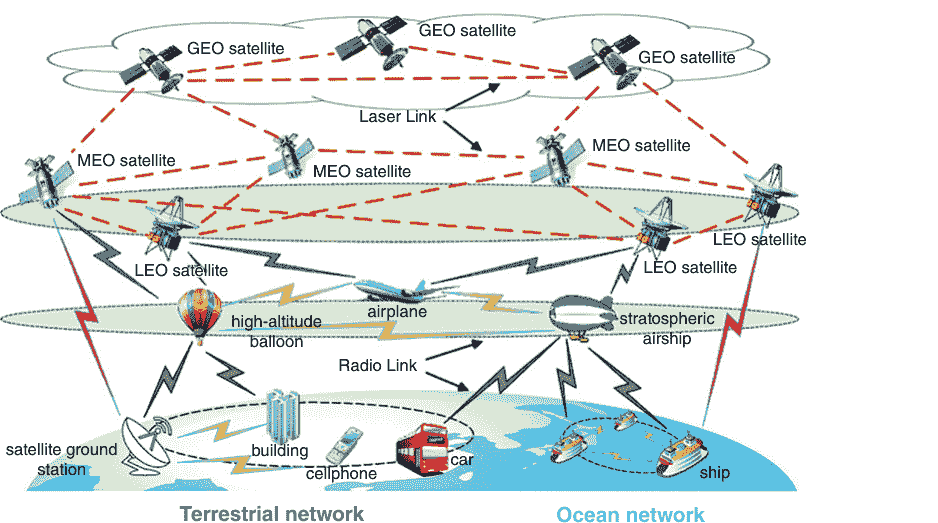

图 8.2 空天地海一体化网络架构 [8]。

技术将能够提供集成性、审计性和安全性。区块链允许基于 `PKI` 的非对称加密，并包含隐私保护框架，以获得更高的数据隐私与机密性 [9]。

6G 的另一项关键技术是轨道角角（`OAM`）技术，该技术最近得到了研究，并在 6G 网络中展现出前景。`OAM` 的主要优势在于其波形特性能够实现多通道，从而显著提高传输容量和频谱效率。这种激发这些特性的创新方法使其成为 6G 网络的良好选择。近期，亚太赫兹附近的高频波被认为可以结合 `OAM` 使用。关于该主题的近期实验证明了将 `OAM` 用于无线通信的可能性。

所提到的下一个关键技术无疑是下一代 6G 网络最重要的技术之一，甚至可能是最重要的一种。人工智能（`AI`）无处不在，而第五代网络仅是部分包含。从第五代跨越到第六代将需要 `AI` 的全面集成。6G 中的人工智能将能够实现大部分部分的自动化。这种自动化将简化许多方面，包括数据传输，并显著加速流程。通过对通过网络传输的海量数据进行分析，它可以实现配置等许多网络任务的自动化。通过自动化一系列无聊的任务，将节省大量时间。`AI` 将存在于几乎每一个地方，从配置到通信。

## 8.4 应用与服务

既然我们已经讨论了 6G 的关键赋能技术，我们终于可以讨论利用这些技术能做什么了！6G 网络构想了提供许多未来的应用和服务。

图 3 显示了 6G 技术可以提供的一些应用和服务。它还展示了网络本身不同方面的模型。研究最深入、最期待的设备之一将是自动驾驶汽车。6G 网络将让许多自动驾驶车辆成为现实。无人机送货 `UAV` 系统也是可行的，将节省大量的包裹运输时间并促进经济增长。这两项技术都使用了当前网络中的传感器和 `GPS` 位置，但它们还不够完善；6G 网络将改变这一点。智能设备还具有多种不同的用途，包括军事、商业、科学、农业、娱乐、法律执法执行、监控、航空摄影、灾害管理和无人机竞赛 [11]。

另一个可能的服务是虚拟现实/沉浸式体验。6G 网络能够提供更好的脑机通信与交互。这听起来像科幻电影。有一种被称为“脑机接口”（`BCI`）的界面，据认为允许控制所有方面。它的工作原理是通过实际上从大脑获取信号，在脑与智能设备之间建立直接通信。这些信号被传输到设备中进行分析并与命令整合。凭借从 5G 到 6G 的特性和疯狂改进，这应该是可能的。

6G 网络的另一个可能服务是触觉通信，即使用触觉进行通信。这将允许终端用户感知不同的纹理和温度，例如在经过表面时感知到其纹理。这都归功于 6G 网络能够传输的海量数据以及随之进步的新技术。

6G 服务的一个大应用是智能医疗。医疗将对世界产生巨大影响，6G 网络能够提供这种支持。它将允许从世界任何地方进行远程手术。随着医疗变得更容易获得，这将降低医疗成本并让更多人获得他们需要的帮助，特别是在偏远地区。当你需要医生时，先进网络会让触手可及。如果在进行手术等过程中信号中断，网络稳定性将至关重要，这可能是致命的。这就是为什么 6G 网络被认为是极其稳定的。

6G 网络可能提供的另一个令人兴奋的服务是五感沉浸传输。人类仅通过五感体验世界：触觉、味觉、嗅觉和听觉。6G 网络将允许五感的完全沉浸。之前提到的 `BCI` 技术将无疑有助于这一技术的繁荣。

## 8.5 6G 相比 5G 的优势：比较

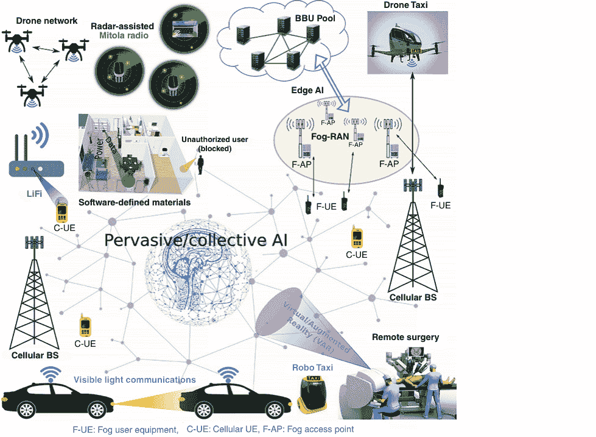

![无人机网络、无人机出租、无人机网络、雷达辅助的 Mitola 无电、BBU 池、边缘 AI、未授权用户（已拦截）、雾计算 RAN、LIFI、软件定义材料、泛在/集合 AI、C-UE、F-AP、F-UE、小区基站、虚拟/增强现实 (VR)、远程手术、机器人出租、可见光通信、F-UE: 雾用户设备、C-UE: 小区 UE、F-AP: 雾云接入点]

图 8.3 可能的 6G 通信架构场景 [11]。

来自 6G 另一个应用是万物互联（`IoE`）。它是物联网（`IoT`）的升级版本。`IoE` 是利用互联网基础设施，在大量连接的元素、传感器、物体、设备、人、流程和数据之间的无缝集成和自主协调。在 6G 网络和 `IoE` 之下，万物将仅由一个网络定义并连接。

6G 网络远超第五代网络。5G 网络在几乎每一个方面都毫无机会。6G 的速度将是 5G 的 50 倍，可靠性提高 100 倍，提供更广的覆盖范围并支持更多设备。

### 8.5.1 6G 中的人工智能：优势与挑战

- 它通过自动化一系列无聊的任务来节省时间。
- 它将简化许多方面，包括数据传输，并显著加速流程。
- 通过对通过网络传输的海量数据进行分析，它可以实现配置等许多网络任务的自动化。
- `AI` 将存在于几乎每一个地方，从配置到通信。

## 8.6 集成与路线图

尽管 5G 尚未成为货架上的新项目，但对这一新改进一代技术特样的推测是引人入胜的。5G 很少投入运行，但 6G 的理念再不过更迷人了。5G 遍布全球，计划在亚太地区和欧洲国家推出。考虑到 5G 将覆盖的所有地点，我们只能想象 6G 时代未来会是什么样。5G 安全的架构和设计在 6G 确定之前仍在不断演进。发布的 5G 有不同版本，例如第 16 版和第 17 版，以及 5G 的本意以及 6G 预期的超越目标，这些已经超出了所有预期以及对 6G 的设定预期。

安全和隐私是 6G 基础的主要关注点。安全确保用户的信任，同时将数据的机密性、完整性和可用性视为最重要的事项。创建一个让用户感到安全地使用正常设备的环境就是安全。涵盖核心功能的四个技术领域包括：物理安全、用于量子安全的区块链/`DID` 以及分布式 `AI`/安全。这些领域每个都有自己的优势，但在使用时也面临挑战。例如，量子计算可能会破坏“不可破解的安全性”，但网络设备中的处理能力成为了一项挑战。在 6G 引入之前的其他系统开发完成之前，这些挑战必须得到应对和解决。随着像 6G 这样革命性的技术改变我们通信和互交互的方式，将会有想要利用和黑入这些新系统的威胁源者。窃听、投毒攻击、隐私攻击等都是常见的攻击手段，今天未来必须计划并应对这些攻击，以尽可能地限制其影响。

## 8.7 保障 6G 的关键词

总的来说，从 5G 到 6G 的道路并不平坦。然而，这将是一段充实且值得的旅程。我们回顾了当前 5G 网络的优化部署和关键技术，包括它们提供的应用。我们还讨论了 6G 无线网络及其的服务，以及 6G 网络将达到多高的标准。鉴于 6G 网络如此强大，其与 5G 网络的对比简直如天壤之别。`AI` 将在确保 6G 网络安全、可靠方面发挥重要作用。

在考虑信任、安全甚至隐私的角色时，它们似乎是相互交织的，但不同因素取决于代际。讨论 6G 可信度时有三个关键领域，分别是：

### 8.7.1 信任

任何第六代网络都能够能够更高水平信息安全的信任。6G 的正常运行需要信任建模、信任策略和信任机制。6G 能够连接物理世界和数字世界，使得依赖信息安全更加可靠。

对于 6G，`IT` 和其他网络被视为国家安全的一部分——这意味着它是第五代情况的延续。对于云与边缘的发展，物理基础设施也必须到位。物理层拥有技术允许在第一道防线中保护较少网段时，有效的解决方案得以出现。

### 8.7.3 隐私

当消费者不再确定什么安全、什么不安全时，隐私就成了一个问题。无法知道任何关联或去标识化的数据何时会跨越阈值变为可个人识别的信息。遗憾的是，对于许多数字技术消费者来说，这更多是一个未解决的问题。另一种解决方案是创建区块链——一种技术和不同策略方法的分布式账本技术。

## 8.8 6G 中的可信度

在思考网络中的信任时，有些人可能觉得更多是关于对安全方面的预期，这并不完全错误。任何会话中与远程参与方的网络可信度。它解决了任何影响通信价值的所有可能结果。信任跨越了从 `IP` 层到应用层的所有协议层。信任网络中的任何系统都必须考虑这些主要问题 [13]：

- 这种交互会导致数据丢失吗？
- 在高负载下是否应该服务来自远程网络的流量？
- 丢弃流量并将资源分配给其他流量是否是最好的？
- 数据包中的源地址是否存在被伪造的可能性？
- 与远程参与方通信时，如何帮助尽量减少未来任何可能的攻击或长期的隐私损失？
- 各方如何保护其通信数据免受泄露？

### 8.8.1 需要信任网络吗？

回溯过去，6G 可能通过理解和编程世界来用于构建物理/数字世界。如果没有可信度，可能会发生数据丢失、设备控制丢失、信息泄露、资金损失等许多问题。Kantola [13] 指出：“最坏的情况下，在国际冲突期间，外国网络战可以使用传统战争给一个国家造成混乱，而受害者无需接受攻击的条款和条件。”

无论是 5G 还是 6G，国家安全始终是移动技术的问题。为了解决这些问题，6G 网络将能够支持任何嵌入信任，以便 6G 网络中产生的信息安全水平允许连接。

### 8.8.2 信任网络的益处

6G 的信任网络可能为远程参与方提供安全保障。任何会话中与远程参与方的网络可信度。它解决了任何影响通信价值的所有可能结果。信任跨越了从 `IP` 层到应用层的所有协议层。信任网络中的任何系统都必须考虑这些主要问题 [13]：

- 这种交互会导致数据丢失吗？
- 在高负载下是否应该服务来自远程网络的流量？
- 丢弃流量并将资源分配给其他流量是否是最好的？
- 数据包中的源地址是否存在被伪造的可能性？
- 与远程参与方通信时，如何帮助尽量减少未来任何可能的攻击或长期的隐私损失？
- 各方如何保护其通信数据免受泄露？

### 8.8.3 信任网络的限制

当消费者不再确定什么安全、什么不安全时，隐私就成了一个问题。无法知道任何关联或去标识化的数据何时会跨越阈值变为可个人识别的信息。遗憾的是，对于许多数字技术消费者来说，这更多是一个未解决的问题。另一种解决方案是创建区块链——一种技术和不同策略方法的分布式账本技术。

### 8.8.4 信任网络的原则

在 6G 中实施信任网络时，节点作为支持项，支持信任网络以收集所有可见远程实体的行为证据。这些收集到的证据可以用于为所有远程实体产生信誉度。“信誉”被用于做出某些决策，即请求更多信息、承认缺陷、拒绝通信，根据指定的负载情况为传入流量分配资源 [13]。

### 8.8.5 6G 信任网络的挑战

在实施新的信任网络时，总是存在挑战：

- 在各种需求的多种用例中验证信任网络
- 跨不同信任域的大区域信任管理

## 8 下一代网络：集成、可靠性、隐私与安全

- 针对 6G 移动网络的特定深度学习 (`DL`)
- 将信任网络扩展到整个端到端会话

这些是在在 6G 中实施信任网络理念时出现的一些挑战。

## 8.9 6G 网络安全架构

5G 已经遍布全球，预计 6G 的发布将超越此。第一个版本（第 15 版）极大地解决了了增强移动宽带体验的紧迫需求，而第 16 和 17 版本的发布则将 5G 推向未来。它平衡了移动宽带运营商的需求与市场扩张。

除了这些版本之外，第 16 版本通过引入针对基于服务的接口 (`SBI`)、基于令牌的安全 (`TLS`) 和基于信任的授权的新型安全特性，支持了完整的 5G 系统韧性。为了扩展网络自动化阶段，需要使用具有宽带无线接口的两种无线连接。对于第 16 和 17 版本的发布，它们可以产生生态扩张以利用第五代技术的优势。通过此，它将为新行业标准所需的全功能添加许多特性。

机器类通信 (`MTC`) 正成为支持多个技术行业的主要参与者之一。通过 5G，`MTC` 设计用于支持任何数字格局。这通过转型数字社会以及提高消费者和工业效率得到了帮助。5G 的新模型可以进行更多研究，从而提供更高效的网络方法。

### 8.9.1 6G 物联网中的隐私与安全

安全阶段已包含许多旨在改变格局的进展。“大数据”被推销为具有增强物联网设备“字母表”级安全的潜力。

现今的人们仍在运行旧版本的系统，这可能导致其系统出现漏洞，黑客可以访问其信息。大想法是，组织应该从开始而非结束通过对矛盾的处理来确保城市安全。在提供端融合安全可能会产生更多漏洞。

联邦委员会工作人员敦促国会确保更多的保护和安全立法，因为这可以保证物联网需要保持的技术，并理解其重要性。对于非分类信息，需求非常大，必须在物联网应用和云管理中进行编码，以避免他人信息的安全和安全发生信息泄露。决策应基于对计划应用的预期。

随着物联网使用的范围扩大并渗透到每个人的生活中，重要的是确保网络中的所有设备都通过关键元素得到保护，以增强设备的质量。这些关键元素是决定物联网有效性的重要元素：安全和隐私。

安全是一个关键元素，因为消费者解释了他们对大数据如何被处理的担忧。大多数出售给客户的设备带有未匹配的软件和过时的系统，这可能导致市场过度，使客户在购买设备后忘记更改原始模式。隐私也是一个关键元素，因为来自多个端点的收集和分析的数据传输可能会对敏感信息造成风险。

2018 年，国际电信联盟 (`ITU`) 重点小组技术网络 2030 成立，旨在探索 2030 年及以后系统技术的可能性。这一目标是为了讨论数字世界和 6G 的未来进展，6G 刚刚成为其概念之一。作为该计划的一部分，“6G 赋能的无线智能城市与生态系统”于 2018 年成立。该计划的重点是能够用于研究无线技术的未来以及设备间 6G 通信的标准开发。研究领域涵盖真实的、近时的、无限的无线连接；分布式计算和人工智能；最后，通过这些组织，6G 以及未来几代技术将受到密切观察，以促进技术进步以及消费者的利益。

## 8.10 6G 无线系统

6G 架构的愿景是满足十年后社会的需求，这将远超 5G 的能力。6G 愿景的主要类别是智能连接、深度连接、全息连接和无处不在的连接。连接必须同时满足以下要求：网络中的每个相关设备及其服务都被视为“智能”，且复杂的网络将需要更智能的管理。

有三个与未来十年的生活方式变化相关的重要特征。它们可以定义为高保真全息社会、万物互联和时间敏感/时间工程应用。高保真全息社会正日益成为主要的通信焦点，并大幅向增强现实（或 `AR`）移动。据预测，全息和多感官通信是虚拟通信世界的未来趋势。霍金曾在 2017 年通过全息投影在香港举行了演讲，展示了此类技术不断增长的力量。

系统需求将包括数据速率、延迟、同步、安全、韧性和计算。所有这些都共同工作，以确保图像和声音流畅流动，且不损害隐私。

万物互联本质上意味着它将包括社会顺利运行的基础设施。它将带来操作多种网络类型的必要需求，超越当今的标准领土。对于许多新兴的新应用（例如基于无人机的系统），需要用于移动平台的连接。

时间敏感/时间工程应用考虑信息的及时性。这意味着它被视为高度互联的社会。

### 8.10.1 进展

6G 的预期轨迹是在 10-20 年内连接人类与机器。目前的 `XR` 和 `VR` 设备无法满足客户对完全沉浸式体验的预期。以符合预期的方式将技术与人体结合需要 10 到 100 倍的改进，以确保“基础设施”能够处理该环境。

多家研究机构建议，6G 将使植入物、智能设备、嵌入式设备和其他互联设备与人类思维融合成为可能。连接 6G 的设备聚合将创造出更有沉浸感的体验。这是一个纯粹有帮助的方向，也是技术可能的方向。

`ITU-T` 讨论的第六代技术的重要驱动因素是高保真全息社会、万物互联和时间敏感或时间工程功能。高保真全息社会通过增加这些设备连接所需的速度，正在实施或集成视频通信和增强现实。

万物互联意味着在网络内部集成，以为各种设备提供连接。对于这些任务，设备需要在第六代网络中构建，并满足无线接入范围以便在网络上运行。第六代网络将为此类设备持续连接提供更高效、不间断的连接。

时间敏感和工程功能运行在一个基础上，即第六代网络将为这些类型的应用提供更快速的基础设施，以便为用户连接提供流畅无缝的过程。具体来说，专注于 `TCP/IP` 框架，第六代网络可能无法提供必要的 `QoS` 为所有应用提供最佳服务。

## 8 下一代网络：集成、信性、隐私与安全

6G 网络将寻求为其核心网和接入网提供开源支持和人工智能原生（`AI` native）设计。对新冠肺炎疫情的应对让我们意识到，企业网络和私有网络需要高速基础设施和安全保障，以使虚拟交互变得有效。

由于集成在网络中的设备数量极其巨大，第六代网络寻求提供一种更好的解决方案。

第六代网络网络将通过将卫星技术与网络相结合来实现全球化能力，为其设备基础提供更好的覆盖范围。

### 8.10.2 物理层安全作为机密性的手段

从 5G 迁移到 6G 时，第六代旨在增强第一代所提供的关键性能。它将能够实现比之前提到的增强现实和全息投影更具挑战性的应用，甚至扩展到超敏感应用领域。

在 6G 网络中集成机器学习（`ML`）的主要重点是无线通信。第六代无线通信被认为是数字转型的骨干，因为它将为人类和机器提供无处不在、可靠且近乎瞬时的无线连接（图 8.6）。

机器学习技术依赖于中央服务器，类似于人体中的中央神经系统。这导致它们容易受到如单点故障等安全威胁。传统的集中式机器学习技术可能不适用于第六代，而联邦学习（Federated learning）可以提供帮助。联邦学习充当了一种私有的、分布式的……

在 6G 世界中实现联邦学习需要遵循特定的程序。基于联邦学习的架构程序分为三个阶段：

- 1) 第一阶段初始化。设备评估服务请求，并能够根据需要决定是否向最近的云端注册。这种基于云的训练将能够预训练或初始化全局模型到所有选定的设备上。
- 2) 接下来是训练阶段。该阶段涉及每个设备的选择，并在本地数据集上训练全局模型。这意味着在每次迭代中获取更新的全局模型。
- 3) 在聚合阶段，云端更新设备模型以进行聚合。之后，将获得用于下次迭代的新型模型。

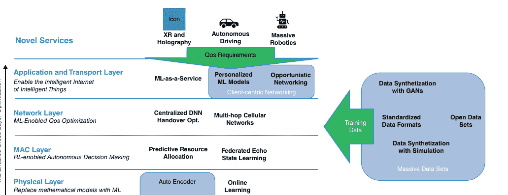

图 8.6 机器学习在 6G 网络中的作用 [15]。

### 8.10.3 实现联邦学习的挑战

进步总是伴随着挑战。联邦学习带来的几个挑战如下：

- 昂贵的通信：遗憾的是，联邦学习涉及成千上万个设备参与模型训练。这反过来导致通信成为一个关键瓶颈。
- 安全隐私：设备在网络中具有多种能力，在硬件、网络连接和能量方面存在差异。这些问题可能导致联邦学习模型和 6G 网络出现缺陷。
- 联邦学习保护设备隐私。这甚至包括模型更新等程序，导致原始数据被销毁。

### 8.10.4 六代连接的物理层安全

第六代网络将采取整体方法来实现应用，因此它必须应对大量的不同系统和平台。你可以将其类比为身体运作的方式，通过传感器网络、环境收集了大量数据，并结合了考虑到设备能力、网络环境和动态拓扑考虑的移动性（图 8.7）。

物理层特征结合人工智能算法的进步，可以被用于：

增强经典的加密技术，或在处理无法实施加密方法的敏感设备时满足安全需求，例如物联网中的设备和纳米设备，以及人体内部器官成为未来互联网节点的生物纳米物 [14]。

物理层安全解决了最重要的应用。这甚至包括模型更新等程序，导致原始数据被销毁。物理层安全处理了……利用 VLC 的特性……人体内部成为未来互联网的节点 [13]。

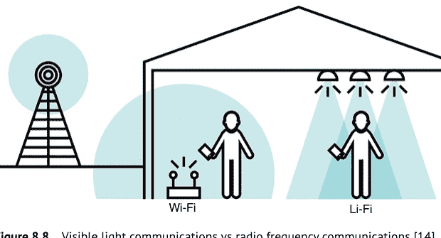

图 8.7 人体作为网络的一部分

# 8 下一代网络：集成、信誉、隐私与安全

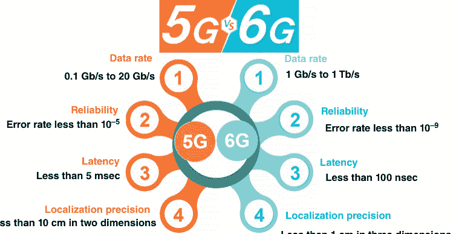

图 8.10 5G 与 6G 的对比 [17]

- 网络切片
- 云边计算
- 天线技术

6G 的支持者认为，这些特性将超过前几代的益处，并为未来几代技术设定基调。

## 8.12 结论

人们很容易陷入对 6G 能做什么、它可能如何比过去代更好，以及它为后代设定了何种标准的设想中。然而，在思考它能有多伟大时，记住可能出现的一些挑战和缺陷是非常重要的。关注大局没有错，但考虑细节对我们所有人来说都至关重要。

无线通信的需求每天都在增长，正如 COVID-19 疫情期间所预计的那样。现在疫情已经结束，没有回头路了。许多工作现在是虚拟的。人们意识到，他们认为需要面对面完成的事情可以通过虚拟方式更有效地完成。全息和多感官通信是下一步。这将允许人们在虚拟通信时获得更好的虚拟体验。它将让人们在虚拟世界的联系更加密切。医生可以进行手术，技术人员可以进行维修。全息需要传输大量数据。预计传输速率将 4-2 Tbps。这是 6G 目前无法提供的。使用五感的虚拟通信将显著改变世界。

6G 的发展对于帮助实现这些技术将非常重要。全息是 6G 可能需要的巨大带宽技术之一，并且需要极延迟来提供良好的体验。如果延迟过高，我们会感到模拟器症。同步对于这项技术太重要。这对于数据包的到达至关重要。拥有流的知识也同样重要。安全是所有技术的重要部分，随着全息等技术的实施，将变得更加重要。在某些情况下，如果一个人的脸可以被伪造，确保 CIA（机密性、完整性和可用性）变得至关重要。为了避免医院潜在的诉讼，在一切之前，安全和网络必须是完美的。另一个挑战是确保多个流的安全，因为攻击可能会影响所有其他流。这将网络安全和网络专业人员变得必不可少，因为需求和需要只会增长。韧性、可用性和可靠性都是全息通信中非常重要的部分。全息技术将消耗大量的计算机资源，因此计算是很大一部分。平衡计算、延迟、压缩和带宽将是全息通信正常运行的主要挑战。触觉和力觉通信是机器人自动化、自动驾驶和医疗保健的发展方向。延迟需要 1 ms，因为人类接收触觉信号需要 1 ms。数据速率需要达到 1 Gbps。由于人类大脑的反应时间，同步也很重要。安全将是这些应用的先瞻性考虑，就像未来的许多其他事情一样。网络应该能够根据其关键性程度对流量进行优先级排序。取决于应用，可靠性将非常重要，它可能需要 99.999% 的可靠性。

## 参考文献

1. McKetta, I. (2021). Growing and growing: The state of 5G world in 2021. Ookla Insights 1 (1): 3.
2. Thales (2022). A 5G Progress report: Launches, subscribers, devices & more. https://www.thales.com/en/world/digital-identity-and-security/5g-progress-report-launches-subscribers-devices.
3. Yuan, G. (2018). Key technologies and analysis of computer-based 5G mobile communication network. Journal of Physics: Conference Series 1 (1): 3. https://iopscience.org/article/10.1088/1742-6596/1992/4/pdf.
4. Rajvir (2023). Applications of 5G technology: https://www.rfpage.com/applications-5g-technology.
5. Zhou, J., Chen, G., Chu, Y., and Wang, J. (2021). Blockchain and security-management of URLLC based on artificial intelligence. IEEE Communications Magazine 5 32–43.
6. Strinati, E., Barbas, S., Gonzalez-Jimenez, J., et al. (2016). The next frontier: From holographic to intelligent interaction using reality and visible light communication. IEEE Vehicular Technology 14 (3): 42–50. https://ieexplore.ieee.org/stamp/879215.
7. Xu, X., Qi, C., Han, Y., et al. (2018). Beamforming: an overview. IEEE Communications Surveys & Tutorials 20 (1): 132–149.
8. Chen, Y., Liu, W., Ni., et al. (2020). Massive dense 6G wireless systems: Prospects and key technologies. Digital Communications and Networks 6 (3): 312–320. https://www.sciencedirect.com/science/article/pii/S2358264802302
9. Khan, A., Hussain, U., Yuan, C., et al. (2021). Blockchain and 6G: the future of secure and ubiquitous communication. IEEE Wireless Communications 20 (10): 673. https://arxiv.org/pdf/2106.05673
10. Tariq, F., Kander, M., Wong, K., et al. (2020). A Special Issue on 6G. IEEE Wireless Communications 27 (4): 118–125. https://doi.org/10.1109/MWC.2021.3001988
11. Mathews, M. (2023). 6G communication systems: applications, requirements, and research directions. IEEE Conference on Communications 2021 (1). https://arxiv.org/pdf/1911315
12. Mohamed, N. (2021). From 5G to 6G: What could it look like? https://www.research.com/from-5g-to-6g-what-could-it-look-like/6771
13. Kantola, R. (2020). Trust Networking for 6G. In: 2020 6G Wireless Summit (6G Summit), 1–6. Finland. https://ieexplore.ieee.org/document/930871
14. Yliantila, M., Kurto, R., Mus, L., (2020). 6G White paper: Research challenges for Security and Privacy. 6G Flagship. University of Helsinki https://arxiv.org/abs/2004.11635
15. Ali, S., Wang, Y., Rajesh, N., et al. (2020). 6G White Paper on Machine Learning in Wireless Communication. University of Helsinki http://cdn.helsinki.fi/files/7895226.pdf
16. Kumar, T., Liyanage, M., Braeken, A., et al. (2017). From gadget to hyperconnected world: Conceptual analysis of user privacy challenges. In: 2017 European Conference on Networks and Communications (EuCNC), 1–6. Oslo.
17. Abdel Hakeem, S.A., Hussein, H.H., and Kim, H.W. (2022). Security requirements and challenges of 6G Technologies and Applications. Sensors (Basel, Switzerland), 25: https://www.ncbi.nlm.nih.gov/PMC8914636

# 人工智能：网络安全与安全威胁

## 9.1 引言

我们在日常生活中使用的几乎每一种电子设备都需要某种形式的网络安全支持。今天数字世界的潜在漏洞不应引起任何恐慌，但对于每一个使用现代文明优势的人来说，学习数字安全的基础是有值的。随着技术多年来变得复杂，安全更新和补丁变得越来越重要。它们有许多益处，例如明显的安全补丁还可以为用户的设备添加新功能和新软件。现在对物联网（IoT）设备和人工智能（AI）软件的这些更新和补丁可以以革命性的速度进行，从而导致第五代网络技术。

人工智能、第五代数据网络（5G）、快速增长的物联网设备和 6G 世界对我们可能非常有帮助，但由于它们都是新型且快速发展的的技术，也呈现出许多隐私、安全和网络犯罪模式。需要注意的是，5G 网络比 3G 和 4G 网络具有安全性，但 3G 和 4G 网络中的一些经典漏洞和安全缺陷带到了正在开发的 5G 网络中，这从一开始就提供了额外的风险。人工智能和物联网都将从 5G 网络的发展中受益，此类设备将连接到不断增长的5G 网络，并可以在市场其他地方服务各种用途。

提到消费级电子设备时，它们对增长非常敏感。随着技术的改进，设备将消耗比以前更多的带宽和数据。新兴技术带来的数据和带宽增加可能包括 AI 即时解释人类语言、通过数据文档或移动设备识别各种模式。这甚至可以调整业务效率，为整体性能带来无限可能。这是下一代数据网络的发展，6G 网络将为当前和未来的数据网络提供带宽。

人工智能技术正在从普通科学家使用的工具发展到专业开发社区使用的智能化。这些各种组织可以利用人工智能技术来补当前数据科学领域的空白，这将是数据安全的重大变革！这还确保了消费者能够随心所欲携带并处理自己的数据。

在最近的无线代 5G、人工智能、物联网和现代技术的帮助下，数据处理，管理和处理能力还需要数据所有者带来数据本身，而不是将收集的数据发送到其他地方进行处理。这可能还包括数据处理和分布式数据包含在数据管理过程中，以确保在存储数据的地方提供支持。第五代网络技术对终端消费者以及全球数据中心都将是革命性的。

网络安全取得了重大进展。其中一个重大进展是利用人工智能和机器学习（ML）支持重新开发的技术和工具。随着人工智能与……的伙伴关系

# 9 网络安全：网络安全的未来应用可能性与安全威胁

以及网络安全，网络安全的当前和未来应用可能性是无限的。威胁检测是网络安全领域关注的重点之一，并得到了高度强调。官员、当局和组织都热于开发新型且更先进的方法来检测潜在威胁，或为可能发生的任何高级攻击做好准备。机器学习（ML）在网络安全的这一方面发挥了至关重要的作用，通过为网络安全威胁检测提供有效的方法和结果，加强了整体关联。它通过分析数据和在初始阶段识别威胁，在检测威胁方面发挥了作用。

每年网络攻击都在增加，与过去几的影响相比，情况日益恶化。网络攻击的剧增导致了越来越多的安全威胁，由于网络攻击中 AI 的演进或对 AI 的而变得更加复杂。结果是，复杂的网络攻击比以往任何时候都要复杂，尽管 AI 已经履行并并将交付许多承诺，但这仍然 AI 在网络安全中实施和应用所面临的最重大的挑战之一。

## 9.2 5G 与 6G

5G 是 4G LTE 的巨大改进，将带来带宽、容量和可靠性的增加，但与此同时，网络安全成了一个大问题。5G 供应链容易受到恶意软件、伪造组件以及糟糕的设计和制造的影响。这增加了风险，并可能对数据的机密性、完整性和可用产生负面影响。这也是旅行问题，即使美国的网络是安全的，在前往其他国家时也可能发生数据泄露。

与其它代无线网络相比，5G 拥有更大的攻击面。这使其特别脆弱。每天都会发现更多的漏洞。安全问题的风险增加了。一些 5G 网络将与具有遗留漏洞的 6G LTE 网络集成。

5G 网络的另一个问题是连接性。当每个人开始连接互联网时，安全问题就会随之出现。有人可能会接入智能设备并监听对话。这是对隐私的侵犯，也是许多人和政府关注的问题。它还给安全带来了可怕的担忧。这种攻击可能会接入自动驾驶汽车并导致事故。让 5G 网络尽可能安全至关重要。尽管技术可能被开发用于制造酷的 IoT 设备（如全自动发电厂和自动驾驶汽车），但在这些发生之前，需要解决安全和隐私问题。安全不仅是为了网络安全威胁。这是每个人的问题。每个人都需要意识到在线安全并采取措施保护自己。这包括提高人们的意识、关注在线共享的内容，以及关注我们正在交互的设备类型。我们必须对能够获取个人信息的潜在攻击者保持警惕。

关于网络安全的个人信息已经共享多年，但人们在不知道有趣的 IoT 设备发展的情况下仍在犯下这些错误。

它为亚洲、美国、欧洲和中国带来了显著增长。到 2021 年初，全球移动供应协会已在不同的电子设备中利用 5G 功能。在世界范围内利用 5G 服务之前，这些特性和功能仍在开发和探索中。1880 版本的进一步增强和改进将导致 2030 年 6G 的发布。所有这些版本的 5G 在保护数据和隐私方面都是非常可靠的。

6G 是一个具有更好通信和安全服务的新世代。互联网上的数十亿投资将导致这一无线系统的诞生。该系统的发明是为了在不涉及人类的情况下，增强呈现知识、执行和实施的能力。这项新发明对于数据安全和隐私非常有用。

6G 在通信方面的进展需要多年和大量的投资来加速。大多数先进技术都需要 6G 系统的出现。公共部门和行业必须投资 6G。欧盟委员会已宣布三个用于早期启动 6G 的项目，并向其他国家施加压力。澳大利亚错失了投资以锁定其数字经济价值的机会。数字经济需要网络安全、信任和安全来确保未来的未来，这需要 13 亿美元的投资以及 5G 和 6G 系统的可用性。

作者解释说，所有保险实体必须协作防御。5G 到 6G 的数字增长和协同将变得更易管理。他们将合作制定以下内容：

- 他们将致力于降低运营成本。
- 所有的网络安全功能必须放置在网络边缘。
- 机器学习需要适当的推理方法和架构引用以确保积极结果。
- 数字系统在减少二氧化碳和提高生产力方面非常有效。
- 技术必须是安全的，必须受到保护。

通信和信息系统将得到改进，知识处理将变得更容易。全球数字系统将采用 6G 服务作为其网络。它将具有各种设计的更安全、更私密的系统。这种设计可以通过将 5G 设备的能力提高 10 倍来实现。为了发布 6G 系统已采取了不同的倡议。想象未来的可靠性和安全水平是令人着迷的，这可以通过许多发明得以。

网络安全仍然是一个非常主观的话题，考虑到它是如此重要，它仍在不断改进。在未来 10 年或 5 年，它将继续变得更加必要和复杂。你所需要做的就是关注新闻和警报中的网络安全。

## 9.3 现状的网络安全

网络安全是一个非常重要的概念和因素。企业必须确保他们正在仔细研究网络安全问题以保护其企业。网络安全通常从功能角度管理。企业需要对网络安全进行分析，因为仅仅衡量覆盖和实用性已经不够了。这不仅仅是系列任务。企业必须分析行动的操作效率、人员和技术的韧性、实践的精通、所有成本、差距分析以及许多。尽管在网络安全领域这很复杂，但有方法可以帮助接入。

企业应该仔细考虑其安全系统的每一个方面，并确定每个方面是否符合标准。这具有许多好处，例如在降低成本的同时增加收益、优化资源利用、做出更明智的决策并在预算方面具有优势。

企业面临的一些挑战包括风险管理、运营效率、技能组合与培训、预算编制以及优先级排序。通过解决这些问题，企业可以获得更多收益。许多企业没有正确地进行风险管理，因此通过审视这一方面并学习可以做什么，公司可以改进这一环节。企业需要意识到自己的尽职调查，以防止问题的发生。他们实际上需要专业人士对他们的系统进行分析。这从雇佣过培训能够识别这些问题的人员开始。

网络安全并没有一个领域内所有人都能认同的身份。在我对该主题的研究中，发现这个术语有许多不同且往往是主观的定义，这些定义真正捕捉到了行业所努力捕捉的所有内容。当我深入观察时，我发现了一个满意的答案。这是由一个研究小组给我的，他们提供的定义正是我寻找的内容，他们将该定义称为：“网络安全是资源、过程和结构的组织与集合，旨在保护网络空间和网络支持的系统免受对事实财产权的错当剥夺。”尽管没有哪个定义甚至没有任何一个得到了所有专业人士的支持，但我将在本章中以这种方式论述网络安全。

参与网络安全的所有方包括从个人、私人组织到政府的一系列人员，其目标是保护自己的网络资产、攻击他人，甚至是保护自己。这些攻击源于财务、政治或军事目的，因此充分开发网络安全措施符合每个人的利益 [2]。

改进网络安全的需要不容忽视，特别是当网络威胁本身成为全球范围内经济的最高风险时，当我们涉及到经济时 [3]。网络安全可能对国家的经济产生不利影响。然而，当你观察到银行、医院、发电厂和智能设备等实体时，风险要高得多，并可能导致企业遭受数百万美元的损失而破板。

随着网络安全社区的演进，心态也随之演变；不再有“我们是否会被攻击”的问题，而是“何时”被攻击的问题，因为攻击者想要这样做并且有能力这样做。在许多连接的系统中，攻击面非常广阔且分散，以至于漏洞和缺陷几乎无法防御。并没有强行进入网络的攻击这种说法，因为任何攻击者都会利用系统中的漏洞进入。攻击者需要及时发现一个漏洞进行利用以获得成功，而防御者如果承担高风险，则必须始终保持警惕。准备好面对不切实际并认为网络攻击是完全可以避免的，随着意识到这些是不可避免的，注意力转移到了其他地方 [4]。网络安全的主要关注在于暴露这些可以反击的威胁和漏洞。防御需要可靠的数据来进行解释和有效利用。

数据处理的自动化已经存在了一段时间，这很大程度上是因为人类没有感官能力来管理网络进出的海量数据，这些数据由软件和硬件产生并提醒系统管理员；自动化是唯一行得通的解决方案。我们主要通过引入使用入侵检测的防病毒软件看到了这一点。这些程序检查附着在机器上并造成危害的已知恶意软件签名。多年来，我们看到恶意软件的增加，以及对蠕病毒、木马、间谍软件、勒索软件、根内核和过度利用软件的防御。过去，新的多态和变态恶意软件不断出现，它们每秒都可以改变自己的外貌，如果没有东西将它们与不断更新的检测数据库进行匹配，那么识别这些威胁就至关重要。

现在我们讨论安全领域一个棘手问题的可能解决方案。基于异常的能力正在开发中，它们进入网络流量寻找任何看似不寻常的内容，然后提醒管理员进行审查。但这让我们带回了原始问题。人类的认知和组织能力将是警报增加的因素，以及可能放过恶意内容的确定性。情况只会变得糟糕。

人工智能（AI）作为一种概念

## 9 人工智能：网络安全与安全威胁

“一种在知识和资源不足的情况下运行以适应其环境的信息处理系统” [11]。这简单地执行了理解 AI 的重要要点，并定义了一个明确的目标，实现了我对 AI 在网络安全中更广泛用途的研究设定的目标。

### 9.5 AI：网络安全的解决方案

最近，AI 在许多科学和技术领域的进展中起着决定性作用，包括机器人、认知、自然语言、专家系统等。然而，AI 为网络安全带来的进步将是最深远的。AI 增强的网络安全将提高意识，实现实时反应，并为这个迫切需要保护的连接世界提供一个有效的保护系统。

众周知，即使是一个小小的网络安全专业人员团队也能有效保护用户的支持网络。而 AI 如何能扩展这种能力呢？使用网络安全技术生成并实现算法需要大量的时间和精力。此外，培训和聘用专家不仅昂贵，而且困难。特别是在未来几年，考虑到科技领域的发展速度与加入劳动力的人数相比，该领域将面临紧张；目前已经存在令人担忧的人才短缺，如果不采取行动，情况只会变得更糟 [12]。基于 AI 的方法有望解决这些这些担忧。

AI 在网络安全中最相关的应用是用于抵消某些攻击组织必然看到的未来攻击性 AI 的。如前提到的，基于异常的检测似乎是 AI 增强防御最能接受且最有效的接收方式。在充分应对低级威胁以及检测足以迷惑人类分析师的高级威胁方面，我们现在正在研究 AI 模仿技能分析师技术的能力，进而引导能够复制这些技术的学习算法，并塑造 AI 网络安全实体 [13]。在组织内部拥有少数个人将使他们能够学习防御技能，并从组织的正常性中检测出它们，当异常出现时，它们将更容易被发现 [14]。AI 还可以监控系统上访问的变异，将其标记为威胁并防止恶意行为。如果 AI 越复杂，它对发生的情况就变得越来越敏感，从而更好地准备检测威胁。随着网络安全性的演变，它变得越来越强大，并对网络安全的未来具有广阔前景。

我们主要讨论了机器学习（ML）中的监督子类型，这与无监督学习大不同。假设监督学习在学习之前由程序员涉及了参数和数据集。在这种情况下，无监督学习算法将自行完成所有的分类和标记，减少了程序员的偏见。这些系统的成功在很大程度上取决于大量数据。传统上，大量的数据使得难以确定相关性并建立联系。然而，机器学习利用了每一比特数据，赋予了它巨大的优势。AI 必须引用的数据越多，它建立联系和区分模式的能力就越好。机器学习是网络安全中最有效的基于 AI 的解决方案，特别是检测网络入侵。但由于更高级、更复杂的攻击方法是不可避免的，AI 解决方案需要进一步探索以显现其真实潜力。在不确定性和威胁的世界中仍有许多需要解决的问题，这些将在下一阶段被处理。

### 9.6 AI：网络安全面临的新挑战

尽管 AI 有其积极方面，但在这样一个充满前景的领域中也涉及许多挑战和担忧。在涉及 AI 的对话中，存在着不确定性以及信任、安全和控制的透明等固有问题，这在网络安全领域也不例外。事实是，AI 和 ML 给网络安全带来的所有优势，也为防止这些系统被恶意利用提供了同等的优势。这一担忧以及其他突出的问题将在这里得到解决。

AI 处理过程的设计目的是在没有太多人类互动的情况下做出决策，但它们并不是完全自主的。由于它们无法取代人类认知，人类仍然需要密切关注 AI 系统，以确保工作正在执行，并且在此过程中没有发生问题。如前所述，人类控制着机器学习所需的学习算法的应用，并确保其有效性。

数据隐私是 AI 的另一个大忧虑。维护网络网络安全的很大一部分是通过信息共享。这就是为什么我们需要形成集体知识和经验数据库，以更好地理解网络威胁。这种共享无疑在全球范围内削弱了网络安全，但考虑到数据隐私时，这是一场噩梦。在无数的存储点中，这如何可能保持安全且不发生跨越式的变化呢？[15] 特别具有挑战性在使用大量数据时，AI 的意图开始产生并可能拒绝透露其信息。使用了什么数据、为什么使用，以及缺乏质量监控使得 AI 所做的决策，即使被检测到，AI 在执行其操作时也可能保持不透明且不给出任何原因。

特别令人担忧的是，AI 无法识别任何方面的道德，因此将做出歧视伦理的决策。AI 可能会犯人类永远不会犯的错误。算法失败的错误可能是由于在学习过程或算法开发中缺乏围绕他们的数据而导致对群体的可能歧视 [16]。 加上 AI 决策的不确定性，这可能导致外部动荡。

总的来说，网络安全缺乏质量。人类对输出和结果的控制保护，由于 AI 的未知性质，是法律可能尚未准备好的。这门科学的快速发展将扰很多很多事情产生积极和负面的影响；需要对法律进行经过思考的更新。许多类型的攻击会影响 ML 性能 [17]。

- 投毒 (Poisoning)：这在训练数据中插入敌对代码，并确保 AI 攻击者可以更容易规避安全性。
- 反转 (Inversion)：这导致现有学习系统使用伪造标签进行错误分类。
- 反转 (Inversion)：使用 API（应用程序接口）收集系统的基本信息并泄露，以获取访问权限。

新的攻击不是 AI 和 ML 对抗阶段唯一的发展。机器学习将用于训练识别系统漏洞以获取访问权限。由于 AI 算法采用了自学习，它们在每次尝试中都会变得越来越聪明，无论成功还是完全失败；正如网络安全将继续变好，威胁也是如此。人类社区可能会成为攻击的目标并以同样的方式体验 AI，随着其的发展，情况会更糟。

这里讨论的挑战仅仅是一个开始。AI 的通用安全将实现，我并将讨论更多的潜在解决方案。在增长的 AI 时代，立法者关注所有潜在问题至关重要，以便避免许多头恼。某些公司将通过让 AI 算法处理数据从中获益，并可能让另一个 AI 甚至分析师检查第一个 AI 的安全性以确保系统的完整性。这无疑需要额外的成本，但为了避免隐私和伦理困境，这无法防止这些问题的所有挑战性方面，但它将为组织的系统提供更多安全。

### 9.7 结论

我希望这一章为更广泛地理解人工智能铺平了道路，尽管 AI 还有其他相关问题。考虑到我们过去 5 到 10 年里讨论它的方式，认为人工智能自 20 世纪 50 年代起就存在并不寻常。在过去的十年里，创新取得了长足进步，这无疑是为什么人工意识在目前成为如此有说服力的话的关键之一。目前，进展比以往任何时候都要快，而机器脑力的发展在 19 世纪就经历了了如电力革命般的改进。审视 AI 假设无疑表明，相关机构刚刚开始理解人工智能的潜在优势。在本世纪初，人工推理单元还微不足道，这令人惊讶。当我们考虑到过去十年事物的发生的变化时，我们发现热烈的创新不再仅仅是某些人的专利。最巨大的变革和动荡将在未来几年到来。中国和美国正在推动 AI 领导地位并建立组织，这是一件令人的事。芬兰和其他欧盟其他国家也已表示，他们希望成为 AI 竞赛中的主要国家。

人工智能对英国自动化的影响显示，有 800,000 份低技能工作被消除，但每年产生的新工作比流失的多出 350 万份。然而，事实上，自动化与工作之间存在着重要的联系。自动化可以催生更具智力和创造力的劳动力来解决任务，从而提高我们的水平 [18]。

在体育分析中，分析可以将性能提升至最佳。能够改进游戏的进展对于视频游戏玩家、运动员和体育组织来说是极好的消息。再现的知识将关系中的每种倾向都带到最佳使用场景中。体育运动需要屏幕角色产生更好的结果以及定期的经验支付。正如我所说的，这种建议表明了目前事务如何利用人工推理，以展示人工智能如何改变整个未来。对于我们观察者来说，随着生命时代随新发展演变，AI 的非凡对未来产生的影响确实非常有趣。

人工智能是信息时代最有前景的发展之一，而机器学习是 AI 最显著的发展。在这项研究中，我们研究了网络安全领域传统安全措施的缺陷和局限性。我们还涵盖了 AI 带来的风险和担忧，以及可以以及应该如何解决这些问题。

与传统解决方案相比，AI 提供了一种更具动态性、自适应且有效的替代方案。面对网络攻击，这正是技术领域以及整个世界所需要的。在 AI 频谱中，机器学习方法是最可能、最强大的元素，将把我们推向更高的新阶段。

AI 的风险对人类生存构成了全球性威胁，因为缺乏 AI 复杂的自主性、数据隐私问题、法律框架，以及机器不遵守任何道德准则的事实。世界运行如此快，解决这些担忧的性对于关注未来完整的人来说是首要任务。尽管如此，在此之前，保持负责任是最佳行动方案。

随着世界的增长和新技术的出现，我们不能忘记涉及其中的敌对势力，他们也在做着记录并开发他们的攻击手段。AI 和 ML 能力将用于对抗立法机构，而这些因素带来的挑战也将产生新的漏洞。

## 参考文献

- 1 Cragen, D., Diakun-Thibault, N., and Purse, R. (2014). Defining Cybersecurity, 13–21. Technology Innovation Management Review (re.p.).
- 2 Rehman, A. and Saba, T. (2014). Evaluation of artificial intelligence techniques to secure information in enterprises. Artificial Intelligence review https://dl.acm.org/doi/10.1007/s10462-012-9372-9.
- 3 Taddedo, M. and Bosco, F. (2019). We Must Treat Cybersecurity as a Public Good. Here’s Why. World Economic Forum https://www.weforum.org/agenda/2019/08/we-must-treat-cybersecurity-as-public-good.
- 4 Libicki, M.C., Ablon, L., and Webb, T. (2015). The Defender's Dilemma. RAND Corporation https://www.rand.org/pubs/research_reports/RR1024.html.
- 5 Libicki, M.C. (2009). Cyberdefense and Cyberwar. RAND Corporation https://www.rand.org/pubs/monographs/MG877.html.
- 6 SAS (2018). Deep learning: What it is & why it matters. https://www.sas.com/en_us/insights/analytics/deep-learning.html?technical.
- 7 Rouse, M. (2021, October). Artificial intelligence. https://www.techopedia.com/division/190/artificial-intelligence-ai.
- 8 Newell, A. and Simon, H. (1976). Symbols and physical systems. In Computer Science as Empirical Inquiry and Search. Associations for Computing Machinery, Inc https://iii.library.cmu.edu/file/Newell_book00024_fd01660_doc00024.pdf.
- 9 Minsky, M. (1967). The Society of Mind.
- 10 McCarthy, J. (2007). What is Artificial Intelligence? Stanford, CA: Leland Stanford University (tech.). Indiana University.
- 11 Wang, P. (1995). Non-Automaton Learning Systems: Exploring the Essence of Intelligence. PhD thesis. Bloomington: Indiana University.
- 12 Otslik, J. (2020). The Cybersecurity Shortage Is Getting Worse. CSO Online https://www.csoonline.com/article/3571374/the-cybersecurity-skills-shortage-is-getting-worse.
- 13 Breminer, K., Gavrilvska, A., Holt, J. et. (2019). Grand challenge: applying artificial intelligence and machine learning to cybersecurity. Computer 52 (12) 45–52. https://doi.org/10.1109/mc.2019.2942584
- 14 Darktrak, E. (n.d.). Autonomous Response. https://www.dartrace.com/en/autonomous-response.
- 15 Buckner, B. D. (2019). How We Trust Decisions by AI? https://www.leidos.com/insights/how-can-we-trust-decisions-made.
- 16 Mittelstadt, B., et al. (2016). The ethics of algorithms. Big Data & Society https://doi.org/10.1177/20539476.
- 17 Belfer Center for Science and International (2019). Attacking Artificial Intelligence: What Policymakers Can Do. https://www.belfercenter.org/publication/Attacking
- 18 Deloitte (2015). From brain to brains: The impact of technology. https://www.sas.com/en_us/insights/analytics/deep-learning.html?technical.

网络安全侧重于缓解因技术进步带来的更重大威胁。此外，还关注了涉及 AI 的网络安全及流程。然而，与此相关的存在一些优点、缺点、潜在风险和结果。本章重点关注人工智能的不同方面，例如 AI 的变革性以及网络安全与 AI 之间的关系。

本文讨论了 AI 对网络安全的风险。在 AI 及其活动下，AI 对网络安全以及网络安全实施或使用的领域产生了什么影响？本章强调了在国家、地区和国内实施层面的威胁和影响。我们的讨论包含了预测、预防和保护的要求。我们还将讨论预测和预防在从识别风险中识别受保护威胁方面可以发挥的作用。

本文还将讨论网络安全格局中 AI 的广泛领域。这一格局包括社会、政治、法律和伦理安全领域。将重点关注每一个领域，为确保与 AI 和网络安全之间良好未来愿景所相关的风险提供重要信息。

技术不断适应，其环境已涵盖社交媒体和网络安全的使用等领域。这包括对全球 AI 安全的威胁。全球隐私正面临风险。因此，必须分析全球方面。本章讨论了全球受到影响或很快将受到影响的经济、政治、物理、数字、伦理、数据权利和隐私方面。

## 10.2 什么是人工智能 (AI)？

技术已经存在了世纪，随着新发明的扩展其应用范围，它被用于不同的生活目的。例如，我们在 1714 年发明的打字机极地改变了通信，影响了生活的方方面面，从业务使用到向朋友发送信件的政府运作 [13]。

随着科学的进步和全球需求的增加，产生了更先进、更有效且高效的技术，技术确保了各种变体。打字机、智能手机和计算机等突破性进展能够以最高可能的速度执行任务和操作，彻底改变了生活的各个方面，包括通信、教育、工程和科学操作 [14]。

AI 是这十年最重大的突破之一。人工智能是由不同的计算机系统和机器模拟及处理的人类智能。它包含三个主要过程：学习、推理和自我修正。学习方面涉及为特定目的获取数据信息和相关规则。

推理依赖于规则，包括获取最相关的内容；它在所需信息或给定指令方面是确定的。自我修正则纠正无关的信息或所提供的过程或信息中的任何缺陷 [15]。技术进步并没有止于人工智能；它们已经进入了四类人工智能的发展和改进中。

### 10.2.1 反应式机器

反应式机器是最基础的人工智能类型。它们无法利用过去的经验，也不会为未来的决策形成记忆 [16]。一个例子是 IBM 的国际象棋超级计算机 [17]。

### 10.2.2 记忆记忆

自动驾驶汽车是人工智能有限记忆最大的例子，包括对环境的观察、其他车辆的速度、方向和路径。这种记忆的局限性防止了车辆存储和搜索过去的记忆 [18]。

### 10.2.3 心理理论

另一种类型是 AI 机器更具心理学 true方面，涉及人们对机器发展的感受以及他们对的直觉，而这种直觉一直是人类的特征。这包括对人、生物、目标和人类表达的检测。因此，它涉及心理理论，即在交互、第一人称和第二人称下理解人类社会动态和规范，而不是传统的第三人称情景，这在未来是无法实现的 [19]。

### 10.2.4 自意识

上述讨论的第 III 类 AI 包含在此类型中。这种类型是 III 类 AI 更理智、更广泛的形式。它由一个自意识系统组成，不仅对世界形成表示，还对其他实体形成表示，以理解我们每个人都有思想、期望和感受，他们必须应对这些并相应地调整自己的行为 [20]。

## 10.3 AI 的变革力量

将人工智能视为一种基于认知能力、机器学习和自动化的先进技术，AI 包含着巨大的变革力量，可以塑造人们执行任务的方式，并培养一个基于人工智能、自动化和认知参与的未来。因此，通过评估当前的进展、变化，以及它在生活的不同方面以及企业和组织要素中的增强，展示了 AI 的变革力量。机器人技术的认知自动化导致了制造工艺中显著的自动化。这种应用被称为**机器人流程自动化 (RPA)**，用于完成不同的物理任务和数字任务 [21]。大数据分析已得到处理，并通过认知洞察有效地得以实现 [22]。例如，算法被用于大数据分析。这种大数据分析提高了检测数据特征和在海量数据中检测模式的效率。人工智能将改变员工执行操作的方式，并使工作场所比现在更具自主性。

人工智能不会通过不同任务的自动化来取代人类，因为人工智能只能为操作或工作带来自动化，而不是完全取代它们。尽管如此，它仍然需要人类互动。但这种变革力量仍然可以显著减少员工或执行任务所需的时间。它将使员工能够更高效地执行任务并提供更有产出的结果 [23]。

AI 将改变工作环境，并培养一个员工可以自由做出更好决策的环境。机器与客户和顾客的互动。主要的性能增强将导致组织背景下人类与机器协作方面的性能增益 [24]。

AI 的变革可以从几个全球案例的流程看到。格物大师 Oscar 是基因组学领域的先驱。他已经在阿里巴巴的业务和涉及流程中实施了人工智能。结果表明，阿里巴巴在变革性人工智能方面领先 [25]。

已经启动了研究项目，以识别和预测 AI 实施对业务产生的结果。通过调查、分析，以及对全球公司和组织当前进展进行的报告和研究，提供了关于人工智能在未来结果方面力量的重要信息。

普华道估计了国内生产总值，并在报告中指出，到 2030 年，它将比现在高 13.99%。这种增长是因为相关部门实施了 AI 以及自动化流程带来的生产力增益。技术增强提供的需求、服务和产品将对这一变革做出重大贡献 [26]。

## 10.4 理解人工智能与网络安全之间的关系

网络安全已经取得了重大发展。技术和工具将通过 AI 和 ML 重新开发。这种集成促进并深化了 AI 与网络安全之间的关系。

威胁检测是网络安全领域关注的重大问题之一，这一点已得到了高度重视。官员、当局和机构一直致力于开发更新、更先进的方法来检测潜在威胁，或为可能发生的任何高级威胁和攻击做好准备。机器学习（ML）在网络安全的这一方面发挥了至关重要的作用，由于其在网络安全威胁检测方面提供了有效的成果，加强了整体关联 [27]。

它在通过分析数据和在初始阶段识别风险来检测威胁方面起着辅助作用。人工智能使得在威胁影响系统或在系统中产生漏洞之前对其进行检测成为可能 [28]。机器学习使计算机更加高效，并使它们能够识别、适应并接收/感知数据、检测算法、从数据和算法中学习，并在必要时进行更改。这些更改包括改进。这使得系统能够在威胁出现之前对其进行检测，或者观察到其优势，包括在安全性方面比人类更具优势 [27]。

密码保护和身份验证也是网络安全的主要关注点之一。人工智能在密码保护和身份验证方面开启并促进了更安全的环境。在这一方面，生物识别已得到广泛应用。人工智能已用于执行生物识别。例如，苹果 iPhone 设备的脸部识别包含了基于 AI 的生物识别认证。传感器和神经引擎被用于检测用户的脸部 [27]。人工智能在此中的作用是创建一个更复杂的用户面部模型，它可以识别模式并关联身份 [29]。

此外，这种人工智能正在帮助网络安全管理钓鱼攻击，人工智能在检测和预防主动钓鱼以及追踪它们方面正发挥着重要作用。它对钓鱼源的反应比任何人类都要快得多。这显著地实现了钓鱼攻击的预防和控制。AI-ML 塑造的一个重要方面以及其发展趋势是识别虚假网站和其他相关来源 [27]。

人工智能通过贡献两个主要部分增强了整体网络：安全策略的制定和组织的识别。尽管这些过程非常耗时，但人工智能切中了要害，因为这两个过程都可以被轻松加速。这是通过观察和识别网络流量模式实现的。通过这种识别和观察，人工智能保证了高效的安全策略。结果是组织节省的时间、资源和精力可以投入到其他创新或技术开发中 [27]。

## 10.5 人工智能对网络安全的承诺与挑战

随着技术进入生活的各个方面，人们对于人工智能如何增强或侵入个人和商业生活的担忧也日益增加。人工智能已成为一项路径性技术，它是几乎每个组织（无论大小大小、非营利组织、政府）以及个人在不同方面和形式下生活的内核。

带有人工智能的手机（如苹果 iPhone）已在可能范围内将其包含在功能和规格中。但由于人工智能对于当前时代和世代的人们意味着什么呢？

根据人们的预期和需求，也做出了许多关于人工智能将很有用的承诺。这归功于对网络安全不同方面的适应以及对其运行的增强。然而，在生活的某些领域和方面，人工智能和网络安全已经从中受益：

目前在组织和企业不同应用中使用人工智能已提供了有益的成果。这些成果可以归于许多基于 AI 的应用程序和软件，例如 Google 使用了深度学习，这被认为是人工智能的创新领域。这包括图像识别和语音学习。它被用于不同方面，为企业的业务表现提供客户建议和支持 [30]。

人工智能和机器学习的实施在过去几年中剧增。同样，在过去几年于网络安全不同领域实施机器学习和人工智能的过程中，还有许多期待。预计基于机器学习的产品将由于其增强和效率的提高而提供显著且富有成效的结果。

机器学习和人工智能的采用将带来比人类操作员能完成的更准确、更精确、更快、更有效的整体结果。这将导致成本节约，以及相关员工领域的缩减。

网络安全和拥有有效的保护措施将是几乎每个人的关注点。我们需要确保它能够履行对网络安全的承诺，因为人工智能和机器学习正在无情地破解用户的行为，并分析由 AI 和机器学习使用的模式和记录的信息。

在用户模式或行为出现任何异常的情况下（例如可疑活动和相关因素），这使得检测变得更容易。通过分析和追踪此类数据以及与之相关的各种模型，基于人工智能的系统可以快速检测任何威胁或漏洞，从而记录与该威胁或发生相关的整个模式和行为。结果是更复杂的系统被证明更有效，并在任何可疑活动或威胁发生之前获得更快、更及时的警报。人工智能在网络安全中的承诺包括更有效、更高效、更复杂的安全，这履行了它的承诺 [31]。

AI 网络安全给出的承诺是，由于使用数据机器学习效率的提高，AI 可以处理海量数据 [32]。机器学习使得 AI 中的行为表现为恶意攻击，且其行为可以被识别。然而，在拥有优势并实现的同时，人工智能在网络安全中也面临许多主要挑战和威胁。AI 正在被网络安全采用，也被攻击者采用 [33]。

每年，网络攻击都在增加并比以前几年严重。在这种情况下，网络威胁和漏洞不断发生。网络攻击的剧增导致由于 AI 在网络攻击中的演变或攻击者对 AI 使用产生了越来越多的安全威胁。结果是更复杂的网络攻击正在发生，这是人工智能面临的最大挑战之一，而它的实施将守护它已履行并并将要交付的所有承诺 [1]。

2016 年，识别出 390 万次网络攻击 [31]。物联网（IoT）和连接到网络的海量设备的发展增加了复杂性和漏洞。发生了越来越多具有复杂性的攻击。沙箱越来越被认为用于检测和规避恶意软件攻击。然而，随着人工智能的不断进步和适应，随着安全方面变得复杂，网络攻击源于对最新技术的采用。国家支持攻击的增加是一个严峻的挑战，技术是几乎每个生活的一部分。这个问题不仅威胁到个人，还威胁到入口，这是网络安全及相关元素最受关注的方面 [33]。

除了上述之后，还缺乏技术人才和设备来实施先进的网络安全设备。地理分布广泛的基础设施在跟上需求、要求和安全系统的同时，为采用、实施和利用此类技术制造了重大挑战。这些是人工智能网络安全承诺所面临的主要挑战 [33]。

### 10.5.1 人工智能对网络安全的风险与影响（威胁与解决方案）

网络安全也有许多方面可以通过人工智能来解决。人工智能在企业中的升级在各自的关注领域也日益增长。

通过眼睛进入或指纹保护设备进行生物识别访问已从科幻小说的页面走向现实。当用户只需触摸手机即可打开时是令人印象深刻的，现在他们只需看着它，脸识别软件已增强了此前被黑客破解的多个级别的安全性。这些极大的进步增强了组织的安全性，并使网络安全框架运行更加安全。这些是人工智能对更安全的系统框架带来的优势。

系统。这些步骤将确保网络世界的进一步安全。通过这种方式，将增强关联的紧密性，从而对勒索软件和恶意病毒产生更好的保护。

#### 10.5.1.1 国内风险

受人工智能削弱的网络安全国内风险和影响在于，将 AI 充当“看门狗”的影响，使平民在国家安全中处于受监控状态。人们正经历着一种感到不平等的局面——他们不知道政府或公司保留了多少关于他们个人生活的信息。必须有一种解决方案，使法律的执行不忽视人们的隐私。此外，关于监控摄像头以及将其捕捉的图像作为证据的考虑也引发了隐私担忧，最近还出现了向公司自愿提供海量 DNA 数据以追溯祖源的隐私问题。随着技术的不断进步，这些担忧正日益增长。

#### 10.5.1.2 局部风险

在局部辩论中，许多人感到隐私受到了侵犯。从智能应用到像 Alexa 和 Siri 这样的虚拟助手，监控正以以前所未有的方式强加在我们身上。这是当前正在塑造的人工智能进步中最负面的方面之一。能力与发展的关联性增强也为我们带来了一系列需要处理的问题。随着人工智能的发展，将出现与这些担忧相关的问题。

法律学者正在评估某些问题的法律影响。在这一方面已经出现了一些案例，例如与监控摄像头和人工智能相关的案例，另一些则引发了法律的变革以保护个人。

#### 10.5.1.3 国家风险

AI 的智能程度仅取决于其输入的数据，这被称为数据可行性。当涉及国家层面时，数据输入可能会产生网络安全风险。训练因素或数据质量可能导致虚假信息，从而影响到一些主要参与者。在这种情况下，AI 和网络安全在国家安全中的应用可能会根据数据的漏洞开启新的攻击向量。微软 AI 聊天机器人的崩溃（或损坏）是此类风险及其对国家层面和安全影响的最好证明 [34]。

根据已识别的国家安全因素，用于训练 AI 和基于 AI 的系统的数据必须是可靠。这可以通过在适当的时间范围内对数据进行测试、检测和仿真来实现，以识别并消除任何漏洞因素以及任何风险的底层因素。

#### 10.5.1.4 预测预测与预防

通过访问、模拟和反复测试来预测威胁会反复进行，以识别结果。这种预测是必要的，因为处于新引入的自动化时代，可能会产生潜在的严重和灾难性后果。通过强调预测、预防预测的问题以及底层因素、风险和影响，预防措施对于确保基于 AI 的系统执行健康和安全的实践是至关重要的。AI 与网络安全在更安全的方式下融合，将充分利用自动系统的性能。这应该包括对创新的义务，因为情报安全机构（SIAs）需要关注此点。预测并保护公众对隐私的预期是必要的，否则可能给公众和国家带来灾难性的后果 [35]。

网络攻击正在以更大的规模发生，预测报告已经表明，如果不关注预防措施和方面，攻击将以更激进的方式发生 [36]。因此，有必要在网络钓鱼检测和预防中关注 AI 和 ML（机器学习），并在企业和组织的网络安全管理中控制 AI 和 ML 的受控使用，以及在局部尺度上，即基于 AI 的密码保护和身份验证 [27]。

## 10.6 AI 安全的广泛领域（AI 格局中的主要主题）

AI 在当今世界以不同的方式和系统进行交互。这包括经济体系、政治体系和社会体系。基于这种交互，AI 安全可以定义为 AI 系统的韧性和稳健性。

### 10.6.1 数字/物理

AI 的物理领域多年来不断扩大，并取得了重大进展。这包括自动驾驶 Uber 汽车和会说话的机器人。然而，这个数字和物理领域也包含了潜在威胁。这些威胁是关键的，可能导致人员死亡。

2018 年，自动驾驶 Uber 车辆在测试中导致了致命事故。由于传感器故障，Uber 车辆没有检测到正在步行的 Herzberg。另一个案例是关于深圳 的机器人相关活动。2017 年，Facebook 揭露了他们的 AI 机器人正在相互交流。机器人被关闭了 [37]。

机器人突然自动运行并自我重复，导致玻璃破碎。他进入了医院。

### 10.6.2 防御恶意利用 AI 和自动化网络攻击

正如讨论过的，随着 AI 的发展，网络安全由于其适应而有所进步，但攻击和攻击者也获得了显著优势，导致了潜在的影响和结果。基于 AI 的工具和设备为破解安全协议提供了便利，机器学习的使用使他们以更加密的方式进行攻击。这在 DARPA 大赛中执行攻击的情况下得到了证明 [38]。

基于 AI 的防御系统比以往任何时候都要强大，但网络攻击变得更加强大和复杂。因此，有必要建立正确的通信渠道和流程，以确保基于 AI 的服务的完整。

### 10.6.3 AI 与其他技术的整合

随着不同技术的发展以及 AI 与这些技术的交互，融合提供了更多的机遇和相关威胁，例如军事及相关方面。例如，军事决策变得更加有效高效，具有潜在且有益的结果。然而，AI 在决策中的应用可能会影响核战略基准。

AI 的其他进展及其与其他技术的整合包括区块链、各种尺寸、类型和性质机器人、航空航天和生物工程。在这些技术领域使用 AI，整体结果更加整合且有利。但由于技术水平的提高，它们难以控制且更加危险 [39]。

### 10.6.4 政治

在政治领域，有各种 AI 以某种方式参与的领域。

### 10.6.5 操纵和虚假信息保护

社交网络和任何其他通信渠道包含了大量的误导性信息或虚假信息和操纵。虚假信息运动可以通过 AI 技术和系统的支持。它们可以被开启并变得更具生产力、以目标为中心、以更有力的方式缩小结果，并且整体规模可以增加。民主方面的损害可能由于此类运动，它们还可以通过包含更有效高效的过程针对一个国家的整体少数群体。由于虚假信息的传播，这种过程可能会导致许多有害后果，并导致大众媒体信任的进一步丧失 [40]。

## 10 人工智能与机器学习对网络安全的影响

已经有了一些例子，例如2016年的总统大选。研究发现，使用社交媒体机器人产生了大量的票数，且该比例高得惊人。在这种情况下，特朗普近三分之一的推文被识别为虚假信息，而五分之一支持克林顿的推文是伪造产生的结果，《大西洋报》于2016年11月1日进行了相关报道 [41]。

基于所讨论的民主和政治方面，人工智能技术的影响可能会破坏个人或国家之间的整体关系。人工智能技术在检测和保护其获得的合法、有效且所需信息方面做出了巨大贡献。因此，有必要关注利用人工智能来增强参与，并促进公民与政府之间积极、真实的关系，因为人工智能系统正在帮助管理不同的合同。监管和行政措施等约束鼓励了更稳健的行为，并以积极的方式和方面获得了关注。

### 10.6.6 基于人工智能的基础设施与数字政府

全球政府对人工智能技术及其政府领域的应用日益增加。事实证明，资源的投入、约束的消除、行政职责的减轻以及此类努力都得到了加强和改进。规划和调度的优化是支持政府机构的主要成果，并导致了更好、更有效的客户服务以及更快速、更好的支持。任何此类增强和改进都是相关政府运营和客户服务中的自动化体现。

基础设施基于人工智能和数字技术，政府更加关注如何平衡目标与从技术进步中获益；然而，由于此类基础设施的特质，它更加数字化且基于人工智能。对人工智能及相关技术的威胁无处不在，政府也在考虑制定标准和政策以确保环境安全。

#### 10.6.6.1 经济

人工智能安全的经济需求包括一些收益，也包括应对来自威胁的挑战。

#### 10.6.6.2 劳动力替代及其缓解

人工智能机器学习的使用增强了工作环境的安全性。遗憾的是，基于人工智能的技术和系统已经影响了主要的安全领域之一，即工作安全，并影响了经济密度。随着人工智能技术在不同组织和公司中的应用，许多需要更多劳力的复杂任务现在可以更轻松地用更少的人力完成。这也包括复杂流程的自动化。

业务流程和操作中自动化的引入增强了劳动力市场并增加了就业增长。经济合作与发展组织（OECD）估计，通过技术进步和基于人工智能的机器人将导致发达经济体失去13.9%的就业 [43]。牛津大学的一项研究认为自动化将在未来几十年内促进增长，但表示46.9%的工作将面临风险。肯锡的一份预测未来几年经济状况的报告指出，到2030年底，将有7900万工作受自动化影响 [44]。世界经济论坛预计会有8500万工作消失，但同时会创造9700万新工作；AI将创造领域领域，人工智能初创公司Satytic的CEO Sean Choue表示，随着越来越多的工作变得自动化，“你必须担心高科技对实际帮助创造技术的影响。当你观察人工智能时，存在对培训、数据、维护的需求，处理所有正在发生的预期 [46]。” 监控和培训人工智能至关重要，以确保它不会“失控”。这可能是为了给人工智能创造新工作。

### 10.6.6.3 促进人工智能研发

基于人工智能的技术及其进步被认为是实现实质性经济增长的希望和动力。然而，必须投入大量资金才能获得此类优势成果。在这种情况下，研发被认为是这种经济增长发生的基础。中国大幅增加了对人工智能研发的投资。人工智能投资的总额增长了200%。这种从2000年到2015年的投资增加和增长预计将超过美国的投资 [47]。

### 10.6.6.4 更新的教育与培训

为了推动人工智能及相关技术的发展，各国已成为教育和培训中心，以便更有效地开发和实施人工智能及相关技术。因此，各方面越来越多地关注提供人工智能方面的机会，并与不同的教育领域建立了深层次的联系：科学、技术、工程和数学，亦被称为STEM。

人工智能的教育和学习不仅限于STEM，还关注人文科学和社会科学，并且变得变得更加透明和能力更强，这现在被称为“软技能”。在开展人工智能研究和将其纳入教育方面存在局限性，即缺乏人工智能研究人员和专家。因此，政府讨论了多年接受人工智能培训的人才以及相关领域专家的重要性，以帮助教育课程和项目。

正如所讨论，当使用自动化系统进行工作时，工作的消除将在更大规模上发生，因此更需要根据人工智能及相关领域的需求来保留和调整工作。在这些领域的教育和培训是至关重要的 [48]。

## 10.7 人工智能的透明度与问责社会方面

与其他领域一样，人工智能在社会方面也被证明是有益的。随着人工智能系统应用的日益增加，整合已导致了社会的各个领域。在这种情况下，决策和整合是一个案例。例如警察的个人筛选、医疗诊断、不同的贷款申请及其审核。人工智能在社会中的问责得到了证明，因为决策的透明度得到了提高。

作为人工智能的决策问责有多种原因。它们的编程使得以更快速、更易理解的方式感知决策变得更容易。因此，人工智能和基于人工智能系统的整体问责变得更加重要。但这不仅是责任问题，还需要加强考量。然而，在社会领域也存在一些复杂性和挑战。

社会领域包含的主要挑战之一是方面，因为人们对法律标准、政策和法规方面的人工智能问责提出了问题。政策和法规的目标如何对齐？这些是关注的重要方面，并被考虑到人工智能的未来。

除了所讨论的人工智能方面，人工智能决策没有人类的偏见。人工智能的每一个决策都是正确的，不基于宗教、颜色、规范和文化差异。然而，对人工智能方面的怀疑影响了整体决策和结果。人工智能的主导机制也减轻了行政负担。只有当社会开始信任人工智能的决策及其结果时，基于人工智能系统的这种用途才能变得有用且高效。

### 10.7.1 权利与数据的隐私

当数据流经组织和Facebook等在线平台时，数据隐私和数据权利一直是备受关注的问题。随着人工智能系统在这些组织中的应用，近年来制定了一些法律法规，以确保权利得到保护，免受数据盗取和滥用。

一项欧洲法律；通用数据保护条例（GDPR）使人们能够访问公司和组织信息以及数据如何使用的权利，以及根据什么逻辑监管流程自动化。

## 10 人工智能与机器学习对网络安全的影响

权利和权限包括要求公司删除个人信息或拒绝向第三方出售数据。在任何情况下，都不得发生排斥这些权利或因使用和行这些权利而产生的歧视。AI 导致了更复杂的攻击和威胁；然而，它也被用于通过在法规、法律和政策中保障权利来增强社会保护，提高整体安全性。

## 10.8 全球 AI 安全优先事项

美国咨询公司麦肯锡对跨 19 个行业和 9 个职能的 400 多个用例进行的分析，凸显了 AI 技术的广泛应用及其巨大的经济潜力，预计每年可创造 35 亿至 58 亿美元的价值 [49]。预计对激励和业务的额外激励措施将带来 2.6 万至 5 万亿美元的库存、商店和改进。人工智能将使汽车行业的收入增加 11.6%，收入波动最高达 10.2%。在零售业，AI 将使估值和客户管理的价值增加 1000 亿美元。麦肯锡报告称，AI 的评估并非基于模型本身，而是基于组织使用它们的能力。尽管使用 AI 策略可能会引发潜在担忧，例如数据安全、保护和潜在的偏斜问题需要得到解决 [49]。

### 10.8.1 全球经济

AI 及其安全效益已成为全球经济的格局改变者。AI 方面的主要方面之一就是全球经济。普华道（PwC）分析了 AI 安全及其在全球经济中的优先级。AI 被视为全球经济格局改变者的原因是其价值潜力。AI 通过经济的不同方面对全球经济做出贡献，预计到 2030 年可能达到 15.8 万亿美元。

研究显示，AI 将产生经济的副作用，而 6.7 万亿美元将源于生产力的提高和增长。然而，AI 对经济的影响在不同国家将不同，取决于其相对于其他国家的获收益潜力。在这种情况下，北美将获得 GDP 的 14.5%，估计为 3.7 万亿美元，而北欧受的影响将增加 GDP 的 10%。这一估计值为 3.8 万亿美元。

中国受影响将获得 7 万亿美元，占其 GDP 的 26%。亚洲、大洋洲和非洲市场的影响将接近 5 万亿美元并产生 12.2 万亿美元。研究显示，到 2030 年，全球经济都将从 AI 的适应和安全中受益，在这种情况下，中国和北美将通过 AI 适应、增强和改进获得更大的收益。

AI 的全球影响可能超过工业革命。机器人和廉价先进技术将通过加速工作流、降低成本、提高准确性和精度以及增强业务的效率和性能来改变经济。图 10.1 [50] 和图 10.2 [51] 显示了 AI 的潜力，特别是在医疗保健领域（医疗保健、支付方和制药），其中北美是 AI 医疗保健的先进地区和主要贡献者。

### 10.8.2 全球隐私和数据权利

对先进技术的消费者和用户的隐私担忧已使其成为一个更具争议的全球性问题。因此，GDPR（通用数据保护条例）备受关注并于 2018 年生效 [52]。该法案关注消费者隐私并使保护授权合法化。同样，2020 年实施的《加州州隐私法案》允许人们管理组织在其自动化过程中使用的个人信息，并指定数据的使用用途 [53]。

全球范围内关注的问题是确保全球范围内的数据和隐私保护，包括 AI 系统在执行操作时保持透明的方面。对于 AI 收集的信息必须拥有权利。此外，AI 系统必须对将收集的信息拥有权利。另一方面，消费者也将获得拒绝其不希望从系统中提供的任何信息的权利。

# AI 与双倍增长率

2035 年基准年总增加值增长率 (%) 与 AI 吸收后的场景的比较。

图 10.1：2035 年基准年总增加值增长率 (%) 与 AI 吸收后的场景的比较。

| 地区 | GDP 影响 (%) | 估值 (美元) |
| :--- | :--- | :--- |
| 北美洲 | 14.5% | 3.7 万亿美元 |
| 北欧 | 10% | 3.8 万亿美元 |
| 中国 | 26% | 7 万亿美元 |
| 亚洲、大洋洲和非洲 | - | 12.2 万亿美元 |

图 10.1：2035 年基准年总增加值增长率 (%) 与 AI 吸收后的场景的比较。

图 10.2：AI 的评估并非基于模型本身，而是基于组织使用它们的能力。

全球范围内关注的问题是确保全球范围内的数据和隐私保护，包括 AI 系统在执行操作时保持透明的方面。对于 AI 收集的信息必须拥有权利。此外，AI 系统必须对将收集的信息拥有权利。另一方面，消费者也将获得拒绝其不希望从系统中提供的任何信息的权利。

## 10.8.3 网络攻击的自动化

随着机器学习的增加，人类与 AI 的交互在过去几年得到了增强。自主系统增加了小型攻击者小组可以造成的破坏。例如，无人机（UAV）和无人机的使用在全球范围内增长并被视为技术的突破。

研究显示，全球无人机的预计使用量将增加并价值 12499 亿美元 [57]。

## 10.8.4 基于机器学习的目标优先级排序

在使用互联网时，在线行为被用于识别个人兴趣，以提供相关的产品、广告和价格范围。这种做法被用于提高客户满意度、改善体验并增加组织和企业的销售。

## 10.9 网络安全攻击中的服务自动化

AI 技术及其技术被显著用于自动化网络安全攻击中的流程和服务。网络攻击及其对 AI 技术的实现被用于自动化构成攻击流水线的任务。这包括处理与勒索软件受害者的支付生成对话。

随着全球范围内配备 AI 系统的主流无人机广泛使用，无人车辆已变成杀手机器人。

随着自动驾驶车辆的发展，很快一些积极方面被发现并被认为是有益的；但，随着更大的利益出现，其缺点和缺陷可能超过益处。在这种情况下，AI 系统的可用性可以以不同的方式利用。2022年2月的一份报告预测，恐怖分子将使用自动驾驶车辆运送用于攻击的爆炸物。技能较低的恐怖分子将接触到基于此的高端技术和产品，人类实施的攻击将导致全球范围内更多的物理破坏 [58]。

## 在不同场景下使用 AI 如何证明有利于增强军事整体方面

无人机的使用使得更容易识别、追踪和捕获罪犯并打击恐怖主义。然而，并非所有无人机和系统都是基于 AI 的。因此，在某种程度上，人机交互需要一个更大的自主游戏，包括更高的智能性以提高安全性和其他应用 [59]。

## 10.10 AI 在网络安全中的未来

网络攻击是企业、政府和机构的主要威胁之一。数据泄露在当今世界已成为常态，大多数误用暴露的发生是因为过度依赖防火墙作为防御。由于防火墙无法看到有针对性的黑客，只有人工智能才值得用于防御黑客。网络攻击可以记录在系统中，以学习和检查模式并识别它们的特异性 [60]。

要保持安全非常困难，这就是为什么人工智能在未来几年内将取代网络安全。AI 智能将消除门禁过程中的人为因素，它将成为控制网络网络安全的技术。这似乎是一场躲迷猫游戏，其竞争对手是网络威胁的原因以及为网络站点和网页提供安全保障的人员。然而，人工智能可以对网络攻击和泄露提供更好的识别。每当人们将设备连接到互联网时，网络攻击的风险就会增加。如果威胁针对单个工作场所，攻击者更难实施泄露，但整个组织都会受到影响 [61]。

大部分网络攻击在某种程度上需要人工交互或配置。尽管如此，由于威胁的增加，计算不仅可以由工具和 IoT 设备完成。这些大量的事件和事故报告可能是在没有技术的情况下完成的。在未来几年里，防火墙将拥有机器学习技能，利用软件识别网络上记录的代码模式，并在识别出某种威胁或偏离时自动进行拦截 [62]。

AI 在未来将发挥重要作用。许多研究人员已经提出了跨互联网海量数据的扫描理论，只有智能才能知道生成网络攻击的方法。理论者认为，AI 可以通过框架为组织的决策者提供支持，而人工智能的安全产品并非不可触及且易于获取 [63]。对于小型或中企业组织来说，这是一个问题，因为他们很难聘佣到构建网络安全的专家。这将投入巨资来购买嵌入人工智能技术的工具。

## 10.11 结论

本章涵盖了关于 AI 和网络安全及其相互影响的几个方面。这包括社会、国内、局部、经济和政治方面。AI 与网络安全的融合有助于提高和增强生产力和效率。它已被证明对组织是有益的，因为它们执行或已执行过的操作更具时间效率、成本效益且更具生产力。例如，产品处理和包装的自动化。

一些人担心 AI 有更多的网络安全风险，并对全球经济、社会、局部和政治方面产生重大影响。它已经实现了车辆、流程和日常生活中活动的自动化，例如具有增强和增加的安全性的智能手机，以及基于 AI 的人脸检测、身份验证和生物识别密码保护。许多带有 AI 的平台已经存在了很久。例如，Google，因为它包含了深度学习并识别在线行为，在考虑个人利益的同时具有整体经验，并涵盖了其他相关过程。

深度学习的使用是 AI 在此类领域（如图像识别和语音学习）的尖端技术。由于机器学习的存在，AI 与网络安全之间的关系产生了更高效、更有效的结果。组织和企业将随着效率和准确性的提高节省更多成本，并拥有更多的保护措施。AI 承诺将增强网络安全，因为它将在流程和活动中包含自动化。结果是，威胁检测将在非常早阶段进行，并在每天之前预防。这是通过将自动化引入网络安全流程，并为当前的安全协议、措施和框架提供更复杂的安全防护实现的，使得网络攻击无效且失败。

已识别出 AI 对网络安全的一些风险和影响。这些影响在社会、国内和国家层面进行了讨论。在个人层面或当地或国内社区也存在这些担忧。由于 AI 和网络安全防御自动化的增加，国家安全可能面临风险。结论是，尽管目前为止取得了显著的改进和有利成果，AI 和网络安全仍具有威胁性，并在所讨论的每个领域笼罩着恐惧的阴云。

AI 与网络安全的关系具有巨大的前景，在国家、局部、国内和社会安全方面被认为并被重点关注。预测的关键作用将能够在威胁和风险发生之前进行预防，或对其进行缓解。这里讨论的 AI 和网络安全的未来表明，重大的有益进展仍将到来；随着这种伙伴关系在未来十年内产生生产力并增加数十亿收入，其中部分收入可以投入到更安全、更完善的基础设施中。

## 参考文献

- 1 Rouse, M. (2019, July). Cybersecurity. https://securitytarget.com/target/cybersecuritytarget
- 2 Cisco (2019). What is cybersecurity? https://www.cisco.com/c/en/us/products/what-is-cybersecurity.
- 3 Abohamada, M. (2015). Cybersecurity and the intelligence of threats: vulnerabilities, threats.
- 4 Kharraz, A., Watanabe, B., & Dill, D. al. (2015). Cutting the gordian knot: A look at the hidden side of ransomware.
- 5 Everett, C. (2016). Ransomware: to pay or not to?
- 6 Porter, K. (2019). Malware. https://www.norton.com/ransomware-malware-101-how-do-it-
- 7 Kromhol, K., Huber, M., and Weppi, E. (2015). Advanced social engineering attacks.
- 8 Akins, B. and Huang, W. (2013). A study of social engineering in online frauds.
- 9 Palmer, D. (2019, 23rd July). These are the most common types of phishing emails reaching your inbox. https://www.znep.com/article/what-are-the-common-types-of-phishing-emails-reaching-your-inbox.
- 10 SAS (2019). What is neural networks? https://www.sas.com/en_us/insights/analytics/neural-networks.html.
- 11 Marr, B. (2018). What is deep learning simple guide with 8 practical benefits. https://www.forbes.com/sites/bernardmarr/2018/10/01/what-is-deep-learning-a-simple-guide-with-8-practical-examples/
- Daley, S. (2019). 人工智能改变业务常态的19个案例。Builtin（9月24日）：https://builtin.com/artificial-intelligence/examples-ai-in-industry.
- Xavier (2019). 打字机简史。https://site.xavier.com/poly/typewriters/tw-history.html.
- Mousse, R. (2016). 超级计算机。https://whatistechart.com/definition/supercomputer.
- Burns, E., Laskowski, N., and Rose, M. (2019). AI（人工智能）。https://searchenginepricetearget.com/definition/AI-Artificial-Intelligence.
- Granda, J.M., Donna, L., Dragone, V. et al. (2018). 开发具有机器学习能力的有机系统机器人以寻找新反应性。Nature 559 (7714):374–381.

- Sharples, J. (2017). 国际棋手、机器与怪物的文化史。曼彻斯特大学出版社。

- Joshi, N. (2019). 7种人工智能类型。6月（19）：https://www.forbes.com/sites/cognitiveworld/2019/06/19/7-types-of-artificial-intelligence/#226cc3b23ee.

- Hinto, A. (2016). 四种人工智能类型。https://www.govtech.com/computing/Understanding/The-Four-Types-of-Artificial-Intelligence.

- School, S. (2018). 机器展现出自我意识。https://humanmachine.ai/machines-demonstrate-self-awareness-b80dc8066.

- Lehr, S. (2012). 数据时代。《纽约时报》。

- Franklin, T. (2015). AI 不会取代人类；它会让我们更聪明。https://hackernon.com/5-reasons-ai-wont-replace-humans-it-will-make-us-smarter-43c94ce68.

- Moreno, A. and Rojo, T. (2016). 技术分析：大数据与人工智能的联系。IJMAI, 3, 大数据与人工智能特刊（6）：5–7.

- Lancefield, D. (2019). 人工智能的变革性力量。https://www.strategyand.pwc.com/uk/en/transformative-power-transformative-power-artificial-intelligence.html

- PWC (2019). 人工智能的变革性力量。https://www.strategyand.pwc.com/uk/en/transformative-power-transformative-power-artificial-intelligence.html.

- Ramachandran, R. (2019). 人工智能正在改变网络安全格局并防止网络攻击。https://www.entrepreneur.com/article/3390599.

- Ahmed, N. (2019). 网络安全的工具还是威胁？https://readym.com/2018/09/21/artificial-intelligence-a-tool-or-a-threat-to-cybersecurity.

- Madhav, R. (2019). 分析与安全业务应用中的 AI。https://www.ai.com/sector-overviews/ai-in-security-business-applications

- Mart, B. (2019). 实践中的人工智能：50个使用 AI 和机器学习解决问题的成功案例。

- Ghanchi, G. (2019). 用于网络安全的人工智能与机器学习的政治学。https://www.thenstack.io/politics-of-ai-and-machine-learning-for-cybersecurity.

- West, D.M. and Allen, J.R. (2018). 人工智能如何改变世界。https://www.brookings.edu/research/artificial-intelligence-is-transforming-the-world.

- Banaf, A. (2018). 网络安全面临的 AI 挑战。https://www.bvavaopend.com/en/artificial-intelligence-challenges-using-ai-in-cybersecurity.

- Oslee, O. and West, S. (2017). 人工智能的面相：AI 时代的国家安全与监控。https://rusi.org/comment/new-generation-intelligence-national-security-and-surveillance-age-of-ai.

- Dickson, W. and Egan, N. (2019). AI 改变网络安全本质的三种方式。https://www.weforum.com/agenda/2019/06/ai-powering-a-new-generation-of-cyberattacks-our-best-of-defense.

- Hellberg, P. (2017). 当 Facebook 机器人 Bob 和 Alice 创建自己的语言时会发生什么。https://www.analyticsjam.com/chatbots-created-their-own-language.

- Solon, O. (2016). 工程师们正在开发人工智能黑客。https://www.theguardian.com/technology/artificial-intelligence-security-attacks-autonomous-machine-learning

- Sharikov, P. (2019). 人工智能、网络攻击与核武器：危险的结合。https://www.eastnews.org/idea/artificial-intelligence-cyber-attacks-and-nuclear-weapons-dangerous-combination.

- Felstein, S. (2019). 人工智能系统如何威胁民主。https://www.govtech.com/products/How-Artificial-Intelligence-Systems-Could-Threaten-Democracy.html.

# 人工智能与机器学习对网络安全的影响

41 Guilleault, D. and Woolley, S. (2016), Twitter 机器人如何动摇选举。《大西洋月》（11月1日）：https://www.theatlantic.com/technology/archive/2016/11/election-bots/506072.

42 Eggers, W.D., Schatzky, D., and Weiner, D.P. (2017). AI 增强。https://www.deloitte.com/us/en/insights/focus/cognitive-technologies/artificial-intelligence-government.html.

43 OECD (2019). 就业展望：工作的未来。OECD 出版社。

44 Meyer, D. (2017). 机器人在 2030 年代可能夺走高达 8 亿份工作。https://www.fortune.com/2017/11/29/robots-automation-replacement-jobs-mckinsey

45 World Economic Forum (2020). 工作的未来。世界经济论坛 https://www.weforum.org/docs/WEF_Future_of_Work.pdf.

46 Thomas, M. and Powers, J. (2023). 机器人正在接管工作：需要了解的 AI。https://www.builtin.com/artificial-intelligence/taking over-jobs

47 Vincent, C. (2019). 中国在人工智能方面将超越美国。https://www.thege.com/13/china-is-about-overtake-america.

48 European Council for Foreign Relations (2019). 利用人工智能。https://www.ecfr.org/publications/harnessing_intelligence

49 Choi, M., Chung, R., Henka, N. et al. (2018). AI 的前沿：深度学习。https://www.mcksey.com/features/deep-learning

50 Williams, S. (2017). 经济增长在 2035 年可能是致命的，由于人工智能。https://www.statista.com/economy-growth-could-deadly

51 Bajaj, N. (2019). 价值 3610 亿美元的人工智能医疗。https://www.businessinsider.com/healthcare-361-billion

52 Satiano, A. (2019). GDPR 对你意味着什么。《纽约时报》（5月6日）。https://www.nytimes.com/2018/05/6

53 Morgan Lewis (2019). 加州消费者隐私法及其他法律。https://www.morganlewis.com/ccpa-and-state-laws

54 Forbes (2019). 反思 AI 时代。https://www.forbes.com/sites/insights/2019/03/rethinking-for-ai/

55 Daly, A., Hathaway, T. et al. (2019). 人工智能、治理与伦理。香港大学学院。

56 World Economic Forum (2019). AI 增加了网络攻击风险以及最佳防御。https://www.weforum.org/agenda/how-ai-raises-the-risk-of-cyberattack-and-the-best-defense

57 Choudhary, M. (2019). 无人机的用途是什么？https://www.geopolitical.net/article/what-are-uses-of-drones

58 Ware, J. (2019). 恐怖组织、人工智能与网络。https://www.reuters.com/2019/09/terrorist-groups-artificial-intelligence-and-cyber

59 Brijande, A., Wang, S., Clark, J. et al. (2019). 用于安全的人工智能：保护与防御。https://doi.org/10.1016/j.future.2019.10872

60 Dilek, S., Karter, H., and Aysin, M. (2015). 应对网络攻击的人工智能技术应用。15:19。https://arxiv.org/abs/1502.0352

61 Link, J., Wang, Z.I., and Lou, X. (2019). 安全与网络安全的联合决策挑战及其对组织的影响：如何管理 RAMS（可靠性可用性安全性）。2019 年国际可靠性、维护性与安全性会议 (ICMS)，185–199。中国上海：IEEE https://ieee.ieplore.org/document/8871942

62 Demeyer, V., and Mattsson, L. (2017). 网络安全的人工智能框架：计算、密码学与网络安全，16–193。夏莱姆：Springer。https://link.springer.com/chapter/10.1007/978-3-312-38275-9_7

63 Wang, A., Wang, and Ericsson, R.F. (2015). 网络防御与态势感知，卷 62。Springer。https://link.springer.com/book/10.1007/978-3-319-11399-3

64 Rehman, A. and Saba, T. (2019). 确保信息安全的人工智能技术评估。《人工智能》42 (4):1029–1044。https://link.springer.com/article/10.1007/s10462-012-9372-9

# AI 与网络安全：为未来铺路

## 11.1 引言

在二十一世纪，网络安全与人工智能（AI）在为世界带来许多机遇的同时，暗中也面临着挑战。一场对抗网络威胁的战斗正在进行，人们正转向人工智能和机器学习（ML）。美国政府正在采用各种方法，在完全不同的环境中对抗一种新型的恐怖主义。虽然网络安全和 AI 似乎面临许多挑战，但各技术领域的进步也带来了许多机会。

随着技术的增长并与物理世界的联系日益紧密，对网络安全的需求呈指数级增长。从普通人到政府，每个人都需要关注网络安全。网络安全增长在全球范围内战争与和平的冲突地带中。AI 和机器学习将用于协助解决这一问题。这使得网络安全成为武装门槛以下的灰色地带冲突。各国正利用互联网从其他国家收集信息。通过互联网，AI 和机器学习被计划成为处理网络安全威胁的关键解决方案。AI 可以帮助识别并修复漏洞。

网络安全的关键方面是监控数据的访问和保护，尤其是当物联网（IoT）等设备变得越来越普遍时。攻击面剧增。如果一个设备在设计时存在网络安全问题，可能会对所有相关人员造成灾难性影响。因此，确保设备在设计时将网络安全放在首位至关重要。虽然漏洞可以通过补丁修复，但某些人并不更新设备。因此，实施强制更新或自动更新非常重要。这对于政府来说尤为重要，如果其信息泄露，可能会非常危险并可能引发战争。

网络安全的一个部分是使漏洞和威胁可见化，以便进行应对。人类的认知能力无法处理海量数据来识别问题，这将非常不利。从基于特征的检测向基于异常的检测转变，是跟上新漏洞的重要部分。AI 将成为对抗威胁的助力，但也可以用于进攻。这是政府所担心的问题。而 AI 目前正处于善用与恶用之间的斗争中。

AI 将解决压倒性的担忧，同时缩短决策速度。它将为组织和终端提供更好的保护。它改变了运营效率。AI 和机器学习有望在没有人工干预的情况下检测并停止攻击。这让人类能够专注于机器无法完成的重要事项，如编写代码或执行体力活动。AI 的另一个优点是，它可以发现人类可能会忽略的因素。AI 系统能够学习威胁环境以及它们所监控的组织。重要的一点是，随着 AI 的持续使用，它会变得更好。它将开始学习模式。AI 将结合人类大脑的能力和决策能力。

许多国家现在认为 AI 是其战斗员的关键。如果一个国家不使用 AI，它就落后了。英国正在开发人机学习，以将 AI、机器人和人类引入战争系统。美国正在使用“半人马”技术专家。AI 在战争中既有优势也有劣势。AI 有可能消除人类战争，因为机器战斗得可能更好。我们可能会看到一场谁能创造战争 AI 战斗员的竞赛。这可能拯救生命，因为人们不再需要在战争中进行肉搏。但不将士兵送上战场并不意味着 AI 战争不会造成破坏性影响。无人机投下的炸弹同样致命。政治家和将军有责任意识到这一点，不能仅仅因为拥有了技术就找任何借口。

网络安全有一点：没有数据它就无法进行。数据的访问和保护是网络安全的关键实践。随着物联网世界的增长，每天都有更多设备被连接。这为黑客获取关键数据创造了入口。正如 Libicki [1] 所述，网络安全中没有强制侵入；谁通过网络路径进入，谁就赢了。每个系统都有漏洞，而且不缺寻找利用方式的黑客。网络安全就是发现漏洞和威胁并进行应对。

从早期开始，AI 就贯穿于网络安全之中，但直到最近才为人知。AI 部署现在是世界各国政府军备竞赛的一部分。它们还被创建用于检测目标系统中的漏洞并加以利用。网络安全领域担心，某些军事力量和政府可能会为了自己的目的使用进攻性 AI。

AI 在网络安全格局中发挥着巨大的作用。许多通往不同技术算法的路径正在建立，以彻底改变数据收集的方式。这将带来挑战，例如军方和其他机构想要使用进攻性 AI。未来几十年里，世界将变得不同，AI 和网络安全的角色将涉及许多领域。

人工智能的最新进展展示了它的真实能力。图像识别可以识别人类需要数小时才能完成的异常。AI 应用为社区带来了以前未面对过的挑战。由于这些应用程序不稳定，因此存在各种安全忧虑。安全将是未来人工智能和系统最重要的因素。

由于这些系统具有许多复杂性，并且需要在所有环境中运行。AI 系统集成了四个组件：感知、识别、决策和行动。这些组件中的每一个都必须与其对应项保持独立，每个组件都有独特的漏洞。

由于这些 AI 系统具有高风险，必须确保其可靠性。在提供这种保证时，有许多领域需要解决。决策方面的领域包括性能指标、确保训练 AI 系统具有可解释性和可责性、领域特定训练以及数据管理。

即使 AI 能胜任许多任务，但错误的输入仍会产生漏洞，导致不准确的响应。这些是社区面临并需要解决的挑战。现代 AI 系统容易受到监视，对手会查询系统并学习内部决策逻辑、知识库或训练数据。这通常是攻击的前奏，用于提取相关数据和来源，或获取嵌入 AI 中的知识产权。

通过这些，你可以看到网络安全受到 AI 的影响。网络安全可以使用 AI 来提高其意识、及时反应并提高有效性。这意味着它利用自适应来应对攻击，并具有改变行动路线的能力。通过实时分析和反应，它可以帮助削对手策略中的弱点。

## 11.2 IoT 安全与 AI 的角色

在我们传统战争与和平并存的全球数字连接前景下，我们处于网络安全的持续冲突灰色地带。在“网络战”环境中，从政治、战略和经济价值中可以获得很多收益，世界的增长不应被忽视。想想互联网在日常生活中的地位；电子设备分享着我们的生活。否认网络犯罪的力量将是一个巨大的误区。面对这种威胁，人工智能和机器学习正作为解决所有网络安全问题的解决方案被应用。本章介绍了目标，并探讨了演变、人类面临的威胁以及维护网络安全安全的智能方面。

网络安全从特征到异常的演变，取决于一个事实：数据的访问和保护是关重要的。随着物联网变得越来越现实，它们在某些方面被攻击和利用的基础……

### 11.2 物联网安全与 AI 的角色

全球信息正在不断扩张。因此，要防止一个由众多漏洞组成、由业余或专业人员监管的系统在各个方面不被利用，几乎是不可能完成的任务 [2]。因此，正如引言中所述，网络安全的一个关键方面是让漏洞和威胁可见，以便对其进行应对。

这引引入了自动化的概念，它一直一直是网络世界的一部分；由于人类认知和感官的局限，数据一直是由机器自动化的。考虑到人类在网络安全领域的表现如此糟糕，将这些过程自动化似乎是一个合理的解决方案。我们目前部署的检测和告警恶意软件的系统是基于已知恶意实体的特征的，因此无法防御这些没有特征识别的变异威胁。直接考虑到，能够扫描流量以检测正常行为的异常检测能力正被纳入考虑。随着需要人类关注的告警数量不断增加，我们又回到了偏见问题——系统呈现的假阳性和假阴性。AI 能够以动态的方式进行学习和适应，这种可能性使得机器学习成为一种极具吸引力的适应性措施。

AI 是一种认知技术，能够处理具有不同基础、价值观的大量数据，并允许健康、经济、政治和社会领域的应用取得更大的进展。AI 与基础、价值观不同，取决于它们可能提供帮助的领域。

AI 是数据驱动的，而非驱动型工具，它不是解决每个问题的方案；它是适用于高度可扩展网络的方法。这项技术被用于监控网络、政府机构、协议以及从中创造利润的公司。当 AI 用于发现漏洞时，它们将倾向于让黑客通过拆解软件，利用不复杂但仍然有效的方法来利用系统中的漏洞和缺陷。即使是现在，这些软件已经变得更加安全并更擅长防御恶意软件；威胁已经转向通过网页、移动设备和多样化 App 等多种路径进行渗透。

AI 还是分布式的，其实现可能是复杂的、隐藏的且专有的。对于任何公司或组织来说访问都太容易了；如果没有关于 AI 合理使用和原则的强制执行的国际协议，治理将是不可能的。AI 优先考虑利益而非终端用户的利益，而 AI 的构建是为了利润而非人类。伦理行为可能很难定义，在不断演变的宇宙和全球文化中，将其构建到 AI 中更加困难。

一个事实是，AI 可能会带有伦理意图进行开发和使用。美国、欧洲和中国政府、硅谷对于什么是伦理有不同的看法。AI 如何被用于定义经济发展、国际竞争力以及政府对社会影响的价值层级。功能性背后有两个动机：想要收集越来越多的个人数据，以及在对匿名性缺乏控制的情况下进行竞争。所有者和开发者主要的驱动力是地缘政治和经济竞争，几乎没有动力去解决伦理问题，或担心 AI 隐私和个人财产。

尽管 AI 及其机器学习（ML）、深度学习（DL）网络安全处于起步阶段，但它们已被公司用于从收入生成的角度评估任务，这可以提高生产力、创造经济价值和效率。当这些工具变得自主并违背社会利益工作时，它们可能会失去控制。这可能导致隔离、歧视、画像分析和不平等。AI 和机器人对人类生活的影响并不显著，但在变化的过程中，

AI 伦理的标准化是一项主要关注点。AI 伦理必须以人为中心，并进行全球协作、标准化的透明化。AI 在许多方面都是充满前景的，当对手一无所知时更是如此，这在网络攻击者和防御者之间引发了某种竞赛。回到异常检测，如果你将其与机器学习相结合，它就变成了一种根据我们想要变成的样子而生长和演化的免疫系统。我们可以手动使用它并调整事物，或者加速过程以获得更好的整体系统。一个有趣的方面是，AI 可以从网络安全专业人士那里学习，并告诉他们是如何使用网络的。

对异常的搜索将网络安全的重点从预防威胁转移到预测和预防未知威胁。这引出了一个问题：如果 AI 正在从人类学习，我们难道不是在掉进我们一直在同样的同样的陷阱和偏见吗？这就是无监督学习理念出现的地方，它的观点如果我们让算法自己进行标记和分类，它们可能不受特定位置偏见的束缚。但同时，你不能让机器决定适当的网络安全，由于以下三个原因，算法推理中嵌入了不确定性：

- 1) 基于异常分析的产生的是可操作的信息，而不是良好或真实的信息。
- 2) 异常是偏离常态的表现，而不是固定的规则。
- 3) 类别可以根据相似性比较事物，将许多事物置于不可见的领域。

考虑到 AI 的所有这些可疑资质，唯一的解决方案就是加倍投入 AI，或者找出 AI 决策的突破口。在混合系统中，人类和非人类专家贡献专家知识，以分布式而非个人化的形式存在，在那时，如果选择是基于机器的行动路径，那么我们就是这个过程的一部分。另一方面，让机器在无监督的情况下学习，人类将无所事事。无论何种方式，这只是一场与时间的赛跑。

事实是 AI 在监管人们平庸的生活和为每个人提供安全环境方面发挥着作用；然而，当你从政治和经济规模考虑它时，你会得到某种毁灭性的破坏和影响。考虑这些新系统构成了新的影响和控制途径，例如监控资本主义。另一个关注领域是未来系统与 ML 的集成程度，以及将人类和机器能力与可以相互超越的大型系统相结合的前景。当我们考虑网络安全时，AI 关注攻防的角色是，在一个高数据传输不仅是奢侈品而是生活方式的社会中，我们需要意识到基础设施所面临的巨大压力以跟进

我们将从全球移动流量开始，2010 年的移动设备数据计数为 7.5 EB。这并不是一个开始，而是未来十年将实现的巨大飞跃。2020 年的预测流量将增长 62%，预计未来还会进一步增加。这只会给 5G 网络带来压力，如果网络结构不改变，并在所有地区无法完全运行。5G 网络需要新的管理技术，包括数据以跟上新的频段。我们已经达到了 5G 的极限——预计在 2030 年达到顶点，就在几个月后。然而，6G 将利用 5G 网络的所有优点，例如网络密集化、更高的吞吐量、更高的可靠性、更低的能耗和连接。这将是和服务设备自动化我们大部分生活的方式。

随着数据速率和通信速度的增加，6G 系统将为工业制造数字时代催生新的革命。6G 最重要的方面是其处理海量数据和高速率连接的能力。关键特征和应用，例如超级智能城市，将通过智能 AI 通信加速人类生活质量。增强现实（AR）、混合现实（MR）和虚拟现实（VR）的使用，这些都是在现实环境中使用 3D 对象、智能医疗保健、制造业的自动化、全感知信息传输，以及不断增长的物联网（已被置于机器人和自动驾驶领域）、脑机接口，这是一个被称为 IoT 的伞伞术语。

在新的地平线上发生改变的一些规格和要求是 6G 网络的服务需求。这将包括增强移动宽带（eMBB）、极低延迟通信、更高的吞吐量、更大的网络容量、AI 大量机器通信（mMTC）、AI 机器效率、低回传拥塞，以及过去几年热门话题——增加的数据安全，这还将包括新的集成网络和无线连接

信息以及 3D 连接的能量传输。这将对网络特性提出进一步的通用需求，包括小小区网络、超密集异构网络、高容量回传，以及与雷达、技术和软件可视化集成的移动技术。

有助于实现这种高速 AI 及其学习能力的一些赋能技术包括：用于大数据传输的太赫通信、用于与设备和传感器进行持续通信的自由空间光（FSO）回传、降低延迟的 MIMO 技术、不断增长的区块链账本系统（具有去中心化数据系统和快速检索）以及量子通信。数据分析也被加入其中，以标记不断扩展的技术，以便公司能够处理数据检索。

协议和研究活动将实现标准化。这已经从三星电子的领先开始，芬兰的 Giga 项目也参与了，它们将在快速变化的环境中保持一致性。国际电信联盟也为同名的新 6G 无线网络做好了准备。

未来的一些挑战和方向包括但不限于 THZ 的高频段传播以及向低频段的放大，因为后者的限制较少。3D 环境所需的资源管理增加了复杂性，同时还需尽可能地减少硬件限制。需要管理亚毫米波（THz）频率以具有更高的波长能力。这将包括必要的频谱管理，以防止 THZ 通信范围内出现重叠或干扰。

最终构成威胁的是即将很快到来的快速变化的技术环境。消费者能够改变需求，使这些事物成为重点。从好的一面来看，这将让我们未来的生活变得更加简单和更好。对于今天写文章的学生来说，这个行业提供了更多机会。

在物联网（IoT）的世界中，人们由于安全问题而担心产品的安全性。由于设备连接到具有许多可攻击路径的网络上，它们更容易受到安全威胁。相关实践涉及强效身份验证和物联网设备跟踪。人工智能（AI）和 5G 可以解决人们对物联网设备的疑虑。

5G 对物联网设备安全的一个积极影响是其提供的低延迟和更快的速度。开发者对 5G 感到担心的一点是：协议焦点。黑客发现他们可以找到 5G 网络上特定区域的连接设备。我们可以看到 5G 有许多优势，但也也被证明存在缺陷。5G 和物联网设备的未来在很大程度上仍然未知，但工程师们将继续为创新能力铺平道路。

AI 和物联网中有一点让所有人惊讶，那就是它们在过去十年中的发展。三十年前，人们无法想象我们今天能取得的成就。然而，有一件以某种方式阻碍进步的问题必须解决，那就是自动驾驶汽车行业。这些汽车的运行需要处理和存储大量数据。如果我们想让道路上布满自动驾驶汽车，实施方案需要解决这些问题。

物联网、5G 和 AI 的融合还有很长的路要走，技术的发展将有助于其未来。我们将生活在一个由连接设备驱动的世界里，而 AI 将指引这条道路 [5]。

## 11.3 网络安全与安全防护

如果网络中隐藏着缺陷，未来将面临许多问题。当企业需要伦理黑客时，通常渗透测试可以发现其网络中的漏洞 [6]。他们拥有一独特的工具箱，可以对网络进行完全测试和观察。

第一个渗透测试员将对网络进行侦测。侦测有两种类型：被动和主动。当你处于被动状态时，你不会留下痕迹，也不会让网络意识到自己正受到攻击。这包括嗅探和信息收集。

主动扫描包括探测网络以获取信息，如开放端口、操作系统详情、主机和路由器的位置。侦察允许测试人员获取系统信息，他们稍后可用这些信息寻找针对主机系统漏洞的利用程序。通过侦察，测试人员发现了这些信息，因此它是该过程的关键部分。

### AI 与网络安全：为未来铺路

这是扫描过程的下一步。测试人员利用在侦察中收集的特定信息对网络进行扫描。这是扫描器大显作用的时候；当扫描开放端口时，你可以收集信息。一旦你看到哪些端口容易受到攻击，就可以计划如何利用这些漏洞。

在测试人员完成扫描步骤后，目标就可以被访问了。数据可以通过互联网、局域网（LAN）、本地甚至离线被攻击。渗透测试员将发现任何安全问题，并尝试获得尽可能高的访问权限。这就是黑客可能入侵他们网络的方式。

测试人员有许多可以使用在网络上的不同攻击方法——溢出、拒绝服务（DoS）、注入、强制密码，甚至社会工程学。他们的武器库是无穷无尽的，这使得他们有很大机会在你的系统中发现漏洞并对其进行利用 [6]。测试人员在系统中活跃时还必须保持访问权限。此时测试人员将尝试在被发现之前在网络上创建后门或安装恶意软件，这在某些网络上可能永远不会发生。在保持访问期间，文件和文档可以发送到所属系统。之后是最重要的部分：掩盖你的踪迹。优秀的黑客会掩盖踪迹，而测试人员需要知道寻找什么。

这将隐藏任何关于他们连接到服务器的信息。黑客会编辑日志以删除他们的痕迹，以防止他们追究法律责任。测试人员将预测黑客会做什么，并能够阻止该行动的发生。

此外，对于企业或组织来说，聘佣顾问测试网络至关重要。这导致了伦理黑客的爆发式增长，他们获得机构认证并可以合法地黑入系统 [7]。一个专门针对网络安全的新领域兴起了，随着时间的推移变得越来越先进。

每年有数百万美元浪费在可能被利用的固定安全补丁上。过去，像索尼、Target 和多个交易所都遭受了损失，大多数黑客在他们的系统中发现了漏洞——无论黑客获取访问权限有多困难。这可能是一个简单的操作，也可能是复杂的攻击。这就是为什么测试系统的每一个方面并聘用专业人员这样做至关重要。

公司和组织需要关注的另一个大问题是社会安全（此处可能指社会工程学）。这是黑客武器库中最容易的工具之一，因为他们无需费力即可访问你的系统。人们几个世纪以来一直在这样做，其他人也是容易被攻破的目标，他们很难被破解。这可以通过定义的技能组合、社会工程学、身份盗窃以及未经授权访问封闭的区域（如服务器房）来实现。

黑客会通过窥视（shoulder surfing）等手段查看他们输入的密码。你会惊讶地发现有多少人只使用密码或将其写在纸条上留在办公桌上。人们会意识到他们有机会寻找任何人的密码来获取关键信息 [8]。

另一种方法是使用他人的身份。他们可以访问你工作的组织，或者向你发送攻击邮件或带有病毒的邮件链接，或者将你引导至此类网站。这是许多人犯错的地方，因为他们没有注意网站是否是加密网站。

### AI 如何解决这些问题？

随着人工智能在网络安全领域的发展，有多种方法来应对我们面临的问题。世界正在发生变化，设备连接的方式也是如此。物联网（IoT）正在改变连接设备的世界。连接设备产生的一个问题是技术背后的安全性问题。由于更多的设备需要管理，许多公司面临的威胁正在增加。尽管如此，但这无疑是社区内关注的问题。

目前已经提出了一种解决方案，即 5G 网络和人工智能。例如，一家专注于身份验证的 AI 公司。它提供了一个额外的安全层，比应用程序或设备的传统安全防护更难破解。5G 网络带来了更快的速度和低延迟，为超出用户身份验证的设备提供了更好的管理。这两种实施方案都解决了对 IoT 连接设备的担忧，并将有助于未来的采用。

然而，正如收益一样，成本也随之而来。5G 网络存在可能导致安全漏洞的缺陷。一些专家认为，5G 的安全性比之前的版本更好，但也将一些旧的缺陷带到了新网络中。5G 还容易受到我们在以前版本中未关注的攻击的影响。随着数据量的增加，攻击者可以攻击流量更大的未被察觉的网络。

随着这些实施方案相互促进，增长是一个巨大的因素；它们正在获得关注。通过在一个平台下实施这些功能，AI 曾仅仅是书本上的东西，而现在我们每天都在更多地使用它。物联网通过允许数据共享成为可能。AI 还能够以比以前高得效率处理数据，并将持续增长。这正在创造本质上能够学习的智能设备。

技术的创新为个人和组织创造了新平台。它为交通、娱乐、音乐和公共服务带来了新功能。从技术角度来看，应用是有限的，能够相互通信的设备数量也是有限的。

我看到的唯一问题是数据将存储在何处以及我们将如何存储它。到目前为止这并不是什么问题，但未来需要解决这个问题。然而，收益大于成本，将对人类和世界产生积极影响。我们已经在虚拟现实世界看到了这一点。我们可以在舒适的家里到处飞翔并观看直播。这项技术正在为每个人创造一个美好的未来，并且只会变得更好。

物联网及其在 AI 中的应用将继续扩展我们使用技术以及与世界连接的方式。虽然存在一些安全担忧，但这项技术正在帮助收集有关如何解决这些问题的数据。IoT、5G 和 AI 提供的应用是有限的，但它们将比以往任何时候都更快地看到改变生活的。

## 11.5 网络空间领域

随着网络安全成为技术革命的前沿，他们面临许多必须克服的挑战。越来越多的卫星正在被部署，它们也面临着网络安全威胁。这些威胁对于网络空间格局来说是现实，因为越来越多的人正在发现卫星的漏洞。威胁包括发射系统、通信、遥测、跟踪与指挥以及任务控制。因此，安全性是卫星通信及其网络的一个非常大的方面 [9]。

卫星主要有三大类型：科学卫星、应用卫星和通信卫星。正如其名所示，科学卫星（也称为空间卫星）携带仪器来研究某个物体或现象。应用卫星对地球资源、地面、领界水域以下或内部水进行勘测。通信卫星中继通话并将信号传回地球，并用于在地球轨道运行的穿梭机上的天文学设备与任务控制之间进行语音通信。

卫星提供了许多普通人可能永远没想过的益处。它们提供了地球资源信息、提供通信、医疗用途、远程工作以及等许多功能。目前正在进行研究以解决有关非卫星的担忧，以便它们在整个完成过程中保持完整性。最近，Turla 黑客组织利用基于卫星的网络链路攻击了卫星。

### 182 AI 与网络安全：为未来铺路

这引发了关于这些攻击背后国际法律的问题。这些攻击通过干扰信号和破坏引导系统对地面和卫星造成了物理损坏。一些新国家发射了卫星，例如朝鲜，也发起了一些攻击。

网络支持的卫星及其信号的破坏会导致严重中断。这些卫星通信控制着关键基础设施，如军事系统、银行和金融系统、交通控制、电网、运输和交通系统，以及预警系统。有人说太空环境正在变得——使用的卫星越多，它们面临的威胁就越多。

在未来的几十年里，随着技术的不断进步和越来越多的卫星进入轨道，我们将继续面临针对卫星的攻击。需要一种新方法来保护我们的网络空间，联合国正试图制定未来法律的标准。由于这些威胁现在就存在，反措施也必须是合理的。对于违反这些法律的国家已准备了制裁。

敌意干扰的范围可以从动能到虚拟。即使在建造之初，卫星也容易受到威胁。敌意干扰可以在任何时候发生，从发射前测试阶段到进入轨道，在卫星的寿命期间，直到其被毁。攻击可以区分是出于敌意，还是仅仅由于错误和疏忽。

一种敌意意图可能是对卫星产生直接影响以使其失效。另一种意图是阻塞或干扰卫星的通信信号。它们还受到电磁脉冲（EMP）的攻击，这将干扰卫星电子设备对受影响卫星的响应。如果发现了攻击者且证据支持这一发现，将产生法律后果。

公司必须跟上当前的漏洞，并在规划和整个生产阶段保护它们的卫星。开发 AI 来应对这些威胁是必要的。数据管理将由 AI 程序进行。一切都围绕着 AI的使用和部署。

## 11.6 连接设备与网络安全

物联网正在改变我们所知的世界。随着技术的进步，建立在其上的无限应用也在增加。数据正从成千上万的传感器中收集。物联网为医疗、城市、能源建筑以及保险行业带来了创新。物联网对企业非常有益，但由于安全、互操作性和成本问题，其部署较慢。许多物联网产品尚未投入生产，处于概念阶段。对于他们来说，招聘能够处理这些复杂项目的人也很困难。现在公司依赖于快速产生价值的简单物联网项目，这有助于公司留住客户群。

## 11.8 结论

当前技术正迅速向未来状态发展。未来技术将通过宽带互联网连接，拥有多媒体/补充数据，并提供情境感知。对于这种未来技术有许多考虑因素，例如面向应用程序和开发者的生态系统、数据安全与隐私，以及迈向开放数据的运动。

这项技术提供的收益远大于成本。首先，开发其中一些产品可能价格昂贵，但随着技术的进步和竞争力的增强，物联网（IoT）连接设备将长期存在，我们将看到许多应用，从而带来更好的生活质量 [10]。

在物联网设备领域，安全挑战是显而易见的。传感器几乎连接到每一个地方。我们都使用移动设备和电脑，但现在我们还有了自动汽车和射频识别（RFID）。这在安全领域带来了许多挑战。随着云端业务的出现，挑战也在增加，使得数据处理变得更加困难。

云计算使得分析硬盘上的内容变得更加困难，因为这些内容可能是不可控的 [11]。必须使用更复杂的调查程序，因为分析这类设备更加困难。有时并不是访问数据变得更困难，而是变得繁琐。需要分析的数据量巨大，需要投入大量的额外工作。

由于这些设备是市场上的新产品，它们的安全性较弱。很难测试它们是否没有针对实时测试进行过设计。随着所有新产品上市，黑客的攻击面正在大幅增长。传感器、自动化系统和基础设施由于其未知的漏洞而很容易成为攻击目标。由于它们报告的数据产生了极大的工作负荷，必须关注所有新设备。

这一切都将通过确保数据安全、存储数据、提取和分析数据来解决。目前，还没有一种能够覆盖整个物联网世界的程序。随着我们不断发布连接设备并构建物联网世界，这种状况必须发生改变。

## 11.7 网络安全中的数据管理解决方案

为了物联网的运行，物联网设备需要一种数据管理解决方案。目前，设备产生的数据难以处理，且速度可能很慢。5G 在网络延迟和带宽使用方面存在问题。它还必须使用数据安全技术并跟踪数据血缘。

Cloudau 数据为这些问题提供了一种解决方案。它解决了大多数物联网设备正在经历的主要问题。管理、处理和分析都有助于实现这一切。它还是开源的，这在物联网领域是一个游戏规则的改变者。

随着所有设备的相互连接，必须为此采取措施。数据管理随之介入，其重点在于关注。通过使用数据管理，企业将变得更加高效，加速物联网的发展，并帮助提供物联网相关数据的全面视图。

许多供应商正在开发这一新市场并已经提供了数据管理解决方案。谷歌、亚马逊和微软利用庞大的计算和存储基础设施提供了所有数据管理解决方案。数据管理供应商不断发布开源项目，其他人可以在这些技术基础上进行构建。几家硬件供应商已经为物联网设计了系统。

## 11.8 结论

我们讨论了人工智能在网络安全中的作用以及它对我们日常生活的影响。从安全智能设备开始，AI 有许多用处。网络安全中的大多数问题都可以通过使用 AI 来解决。我们讨论了入侵检测系统如何为我们的网络提供更多安全，以及 AI 如何防止和威慑黑客。在处理卫星以及 GPS 等其他系统时，人工智能被应用于网络安全中。结合讨论的所有要点，我们探讨了一些忧虑。数据管理是一个在找到永久解决方案之前将持续被讨论的问题。它所面临的另一个问题是与智能设备和传感器的持续连接。由于现在连接到了互联网，在更多地方部署人工智能比以往任何时候都至关重要。

## 参考文献

- 1 Libicki, M. (2009). 网络安全与网络战争. RAND Corporation. https://www.rand.org/content/dam/rand/pubs/monographs/2009/RAND-MG877.pdf

- 2 Gupta, S. (2019). 伦理黑客 -学习基础。视频。https://link.springer.com/video/10.1007/978-1-4842-4348-0_

- 3 Ramachander, V. (2021). 6G 网络 - 第六代网络技术的详细指南。expertsinsight.com/cg-network-detailed-guide-to-sixth-generation-network-technology.

- 4 Porter, M.E., and Heppelmann, J.E. (2014). 智能连接产品如何改变竞争。哈佛商业评论。https://hbr.org/2014/11/how-smart-connected-products-are-transforming-competition.

- 5 Yarifi, A. (2021). 智能连接：AI、物联网和 5G。IEEE Press. ISBN: 978-1-119-68521-0. https://www.wiley.com/en-us/Intelligent+4+Connectivity,+AI,+IoT+and+5G-w-9781196885180.

- 6 Asher, O. (2020). 伦理黑客。TutorialsPoint: http://www.academia.edu/3243262/Ethical_Hacking_tutorial.

- 7 EC-Cics, S. (n.d.). 伦理黑客。https://report-network-security.com

- 8 Deepika, S. and Pandari, P. (2013). 确保隐私。在 IEEE 计算与嵌入式系统国际会议 (ICICES) 上。https://doi.org/10.1109/ICICES.2013.6058

- 9 Housen, D. (2016). 卫星通信的安全威胁。Acta Astronautica, 128: j.actastro.2016.07012. https://doi.org/10.1016/j.actastro.2016.07012

- 10 Yarifi, A., Ramage, M., and May, S. (2019). 物联网的未来。在 IEEE 全球电信研讨会 (WTS)，纽约。https://doi.org/10.1109/WTS.2019.87185

- 11 MacDermott, A., Baker, T., and Shi, Q. (2018). 物联网取证。在第9届 IFIP 新技术、移动与安全会议 (NTMS)，法国巴黎。https://doi.org/10.1109/NTMS.2018.83287

- 12 Cloudera. (2019). 从边缘到云的数据管理。https://www.cloudera.com/content/dam/marketing/resources/analyst-reports/forrester-now-iot-data-management.pdf

- 非 IP 网络协议：拥有十年的 IPv6 长期一直在进行升级研究，随着 6G 连接社会的到来，让超过 50% 的网络流量不源于或终止于无线边缘，将变得更加合理。

- 以内容为中心的网络 (ICNs) 和意图驱动网络 (IBNs)：与下一代协议 (NGP)相比，ICN 正处于活跃研究中。它们是将内容与其起源位置分离的一步。为了将网络设计与运营管理结合起来，意图驱动网络和服务设计应运而生。它是一种网络基础设施的生命周期管理框架，通过持续的网络监控和实时优化过程，以适应网络/服务状态的任何变化。

- 360 度连接与工程隐私：6G 要求端到端解决方案不仅是自上而下的，而且是全方位的。工程隐私将确保消息原生构建在协议和架构中，防止预测数据包的出售。

- 新兴技术的前瞻性：随着技术日益进步，6G 必须适应未来发明的技术，以便它们更快速、更高效地嵌入架构中。这些技术包括但不限于人工智能 (AI)、分布式账本技术 (DLT) 和量子计算。

## 12.2 未来 6G 愿景、挑战和关键特性

我们将电信行业细分为如下部分：

- 无线

- 通信设备

- 处理系统和产品

- 长途运营商

- 国内电信服务

- 国外电信服务

- 多样化通信服务

该行业已经带来并将继续带来的巨大变化改变了全球人口格局，建立了新的问题和利益。作为最快和增长最快的行业之一，未来几年进步将在数量和质量上大量出现。它随着每一代新技术不断演进，提供了消费者在通信中迫切追求的灵活性可靠性。

现在回想一下无线通信是如何提供的。看看收音机和电视；它们为人们提供了娱乐、本地新闻、全球新闻等。随着智能手机的出现，这在过去几年中变得便宜得多，而且现在可以通过使用固定式收音机或电视来实现。这种优势的影响是言而喻的，并带到发展中国家以促进经济发展。

想起来无线通信本身只有 50 多年的历史，这很奇怪。如今，无线网络已经经历了许多特定发展：无线个人区域网 (WPAN)、局域网 (WLAN)、自形网络 (Ad hoc) 或大域网 (WOM)、无线广域网 (WAN)、跨越第一代 (1G) 到 5G 的细胞网络以及空间网络。作者详细说明了每种技术的特定特性，如表 12-1 所示。

1G 于 1970 年提供通话和使用能力，直到 20 世纪 90 年代初 2G 发布。2G 与 1G 相比有所先进，主要是实现了信号数字化。2G 的效率使其能够利用频谱和穿透力提供数据服务。不仅如此，还实现了短信息 (SMS)，允许人们通过文本进行通信。

3G 通过在所有可能的方面都表现更好，标志着通信领域重大的里程碑：更宽的数据带宽、更快的互联网连接和数据传输。它实现了无线电话、接入互联网、无线互联网服务和流媒体。然而，它没有实现承诺，并最终失败了。

3.5G 用于通过更高效的运行和提供上行/下载数据包访问来纠正 3G 的某些问题。

4G 于 2010 年通过国际电信联盟无线电部门 (ITU-R) 通过广泛的研究和测试出现。它的发布主要是为了移动蜂窝网络连接，意图是持续到未来的许多代。它可访问的原因有很多，第一是它所触及的网络频率范围非常广，从 MHz 到 GHz 不等。其次，带宽从 1 Mbps 到 2 Gbps。4G 的一个非常有趣的特性是，其网络带宽被分配给不同的技术。例如，100 Mbps 或更高的带宽包括汽车和火车，而 1 Gbps 传输则用于行人和固定设备等移动连接。4G 的总体目标设定为：

- 成为一个完全基于 IP 的系统

- 在任何地方提供 100 Mbps 到 1 Gbps 的通信

- 结合 Wi-Fi 和 WiMAX（宽带互操作微波分址接入）技术的利用

### 12.2.1 第四代长周期演进 (4G-LTE)

4G LTE 适用于移动设备，与 3G 和早期的 LTE 相比，它包含许多先进技术和特性，提供了它们正常运行所需的速率和功率。它仅在大都市地区具有这种大集成。为了克服这一点，设计了一种结合 3G 和 4G LTE 的巧妙想法来满足这些需求：

- 高先进的带宽和高达 1 Gbps 的数据传输速度

- 更快的响应（更短的往返延迟）

- 增强的服务质量控制

- 由于架构简单而降低的移动性实现成本

- 下行链路的正交频分复用 (OFDM)

- 上行链路单载波频分多址 (SC-FDMA)

- 用于增强吞吐量的多输入多输出 (MIMO)

- 降低功耗

- 更高的射频 (RF) 放大器效率（手机使用的电池电更少）

- 增加 ARPU（每用户平均收入）

5G 与我们目前看到的不同。它旨在彻底变革电信行业，不仅如此，它还将适用于需要更高速度、无限宽带世界的其他系统。它的首要目标是为网络和互联网连接开拓道路。它具有以下特性：

- 用于大型云部署的无缝连接

- 提高信号效率

- 与 4G 相比显著降低延迟

- 增强频谱可靠性和效率

- 改进在任何地方浏览、下载和上传文件

- 降低网络能量消耗，反过来延长电池寿命

- 单位面积用户密度增加，有助于用户在长时间内使用高带宽

- 改进物联网 (IoT)、机器间通信和设备间通信

- 增加面向对象的工作和数据管理

通过部署 5G 技术，用户将开发用于机器间通信系统的框架。这种架构的出现将增加业务并满足消费者需求。它将始终建立这些特性：

- 提高可靠性和安全性：随着汽车和飞机等通过 5G 连接，对可靠性和安全的需求显而易见。

- 流量优先级：在密集人口区，紧急电话将优先于用户。

- 物联网：这是一个主要点，各种设备之间的无缝通信是 5G 的一部分。

- 无线互操作性能：对现有 4G 无线的改进。

第六代 (6G) 无线需要 5G 蜂窝通信。6G 网络旨在使用比 5G 网络更高的频率。6 网络还将提供更大的容量并降低延迟 [1]。6G 网络的目标之一是支持微秒级延迟通信。这种通信比毫秒快近 1000 倍。

在多个方面，技术专家认为 6G 意在对 5G 提供提供补充。6G 将提供不同的设备、更高的数据速率、沉浸式扩展现实（XR）、无线感知的增加以及电子医疗健康 [1]。在其他方面，这些专家还预见了将从以人为本的通信向以机器为中心的通信转变。通过人工智能（AI）和机器学习（ML），感知技术取得了进展。这些进展以及感知与通信的集成，确保了 6G 网络能够做出满足改进人类思维模式的决策 [1]。从长远来看，这将基于各种应用进行优化。

全球范围内的几家公司已投入到实现 6G 梦想之中。仪器（National Instruments）就是其中这样一家公司的示例。该公司正积极致力于与 6G 研究相关的多个领域的工作 [2]。该公司正在进行空中接口（OTA）测量、更宽带宽测试、ML 训练任务以及频率增加的研究。该公司的研究还认为，部署未来 6G 网络所需的频谱主要涉及亚千赫兹（sub-GHz）频率，特别是使用的中频段 [2]。与此同时，部署和采用率将提高。即使是亚太赫兹（sub-THz）频段也受到了关注，但目前还不清楚哪些频段在商业和技术上是可行的。

## 12.3 6G 网络的原理以及 5G 的预测与未来成功

6G 技术市场未来可能实现成像、位置感知和存在技术的重大增强：6G 网络可能会与人工智能（AI）相契合。因此，6G 网络的计算基础设施将独立决定最佳计算位置。此类决策将包括数据处理、存储和共享 [1]。从那里开始，6G 服务极有可能利用各种频率来测量对这些频率的吸收情况，并对其进行必要的调整。这是因为大量的分子也会在特定频率上释放和吸收金属辐射，而释放和吸收频率对于任何一种需求来说都是理想的。

6G 将对工业、政府技术、关键资产保护和公共安全等领域产生巨大影响。这些影响关系到健康监测、空气质量测量、任何威胁检测以及人脸识别、特征识别技术、感知任务，并在社会信用系统和执法中做出关键决策 [2]。利用 6G 网络提高上述部门的性能意味着移动技术的进步。此外，还需要自动驾驶汽车、智能城市、增强现实和虚拟现实等新兴技术。6G 网络旨在将过去不方便的技术集合（包括大数据分析和深度学习边缘计算）整合在一起，以实现通用吞吐量并降低延迟；超实时通信将成为 6G 发展的的关键动力 [2]。此外，6G 网络发展的另一个动力是物联网中回到机器对机器（M2M）通信的必要性。高性能计算与 6G 网络之间的可靠性关系是显而易见的。

通过 6G，我们对全球全连接充满期待，其中物理对象在数字领域中以高细节进行映射，以便进行分析和处理。网络将通过在平台和数字领域中嵌入 AI 的传感器和设备，建立领域之间的连接。人类通过连接躯体以及对这种信息物理连接的认知将处于中心位置，我们的身体和智能都将连接在一起。如图 12.1 所示，三种类型的交互——人类、物理和数字将在系统在领域间的转换中收敛：

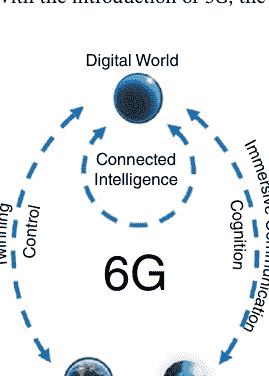

-   传感器和执行器可以创建城市、工厂甚至我们身体的数字孪生。这将实现丰富的数据挖掘和高效的控制，但必须确保数据的完整性和安全性。

图 12.1 个人领域、数字领域与物理世界的汇聚 [3]。

## 12.4 LTE 和 5G 中将集成的缺失单元

6G 旨在提供每秒数太比特的数据速率。通过正交频分多用接入（OMA）同时访问更多用户，这种容量和延迟程度将减轻 5G 应用的压力。从长远来看，在游戏、感知和无线连接方面具有优势。6G 将提供更高的采样率，并提升吞吐量和数据速率。6G 网络将利用亚赫兹波和频率选择来允许各种吸收，这在无线技术方面具有潜力。当边缘计算无缝集成到 6G 网络框架中时，6G 将具有许多优势 [1]。其中一个优势是改进人工智能的应用。

## 12.5 6G 网络的特性

-   连接智能。这提供了高容量、端到端延迟和安全功能。AI 功能可以在网络内外部运行。沉浸式通信是人类通过数字领域扩展其感官的方式。

-   认知：人类作为数字领域中的物理对象，但感知他们的意图、愿望和情绪也是重要的 [3]。

### 12.5.1 大带宽

6G 将具有使用高定向天线、太赫兹频段和海量带宽的优势。因此，应用将从无缝覆盖 [4]。联邦通信委员会（FCC）最近重新分配了频段。由于高端成像和寻迹传感器，高精度定位在 6G 中将变得可行。可以使用带有智能算法和机器人的移动手机 [5]。

获得一种具有增强范围且无功耗的安全流量基础设施是一个可行的解决方案。带宽的可访问性可以改变特别增强的覆盖方案的影响 [6]。功率效率、频谱性能和在新频谱中覆盖的权衡决定了设备的发展。结果将是单载波系统的现代接口。6G 通信网络应该覆盖 3 到 60GHz 的大带宽 [6]。当在该带宽内进行通信时，硬件电路的完备性必须增加。

### 12.5.2 人工智能

随着智能终端和基础设施的快速发展——结合远程手术、增强现实和全息投影等多种应用——目前的网络发现难以跟上足够的分率。4G 和 5G 难以匹配日益增长的需求 [7]。

## 12.5.3 作战情报

作战情报是实时情报，在大多数情况下，它通过技术手段获取并传输给处理力量的地面部队。作战情报的寿命很短。作战情报的实时性需要对系统的立即访问，并能在压力日益增长的环境中带来财务情报 [8]。尽管如此，仍有更新作战情报的需要，6G 网络需要这样做。作战情报的修改会显著影响资源分配。

## 12.6 无线网络

智能手机和物联网贡献了 Wi-Fi 和蜂窝设备生成流量的 54% [9]。2022年的预测显示这一数字将上升到 59%。通过无线网络，利用网络状况的时空数据可以提供端到端的智能和判别。对长期网络动态的理解得到了加强。无线网络允许对用户位置进行获取和解码 [10]。这些功能实现了用户画像分析和异常检测。如所述，可以开发额外的和主动的网络。

通过机器学习可以实现无线网络的使用。使用机器学习产生了一种被称为 Wi-Fi 分析的广泛视角 [11]。在 6G 从环境因素获取的大数据网络流量中，这种表征在为户外和室内环境下的设备提供解决方案时可以帮助。同样，通过跟踪接入点和频谱对网络拓扑进行表征。

在大多数情况下，利用热门用户来收集数据是非常重要的。在无线网络中，由于其动态特征和无限量的数据，流式处理是大数据最优的模型 [11]。在某种场景下，研究和知识出现了新的前景。然而，数据管理也伴随着更多的障碍。个人的处理能力无法匹配数据系统的增长 [12]。在这种情况下，计算集群框架运而生，旨在处理更多的工作负载。

### 12.6.1 5G 演进与 6G

实现 6G 努力吸引了各业的关注。如所述，有许多项目正在实现这一梦想。这些公司之一是优利科技（Keysight Technologies）。在没有相同愿景的国家，迈向 6G 的竞争可能会更容易。关于 6G 网络的发展，有许多重大项目正在进行中。例如，芬兰的奥卢大学（University of Oulu）最近启动了一个以 2030 年为时间线推进 6G 愿景的项目。此外，该大学与 5G Beyond 联盟签署了合作伙伴关系，以同步 6G 技术的标准。

实现 6G 网络梦想的努力在其他国家也可见一斑。中国信息部、瑞典爱立信（Ericsson）和芬兰诺基亚（Nokia）组成了一个位于欧洲的联盟。该联盟由工业和学术界领袖组成，他们共同形成了一个研究观点。韩国芬兰电信研究所正在研究 6G 网络的频段。该研究还涉及比 4G LTE 网络快100倍、比 5G 网络快5倍的数据速率。2020年，美国 FCC 启动了6G 频率，测试 95 GHz 至 3THz 以上频率的频谱 [1]。各大供应商对 6G 有承诺，包括诺基亚、华为和三星等大型基础设施公司也参与了其中。

### 12.6.2 可见光通信

在智能城市、家庭和下一代无线框架中考虑物联网正成为一种快速增长的趋势。预计将有大量传感器、摄像头、机器、平板电脑等许多其他设备进行连接 [14]。当这种情况发生时，目前使用的射频频谱证明不足以满足数据密集型无线应用的需求。在射频频谱上运行将因损坏和干扰而失败。为了消除频谱不足的挑战并通过 5G 框架满足高数据速率要求，通过在 VLC 代码中有效路由数据，用于室内环境物联网应用的可见光通信（VLC）将是一个很有前景的解决方案。

在可见光区域的无限制频段运行使用发光二极管（LED）。LED 是一种友好健康的通信技术；VLC 具有提供超高带宽、内在物理性和对电磁干扰具有鲁棒性的优点。缺点是，VLC 存在通信距离短和视距限制的缺陷 [14]。

6G 网络有望显著增加容量并满足新兴应用的需求。现有的频段可能是是不的 [15]。虽然 6G 将通过陆、水下、空间和空中维度提高覆盖，但它无法为存在地球空间之外的网络提供高速数据速率。VLC 是一种高速通信方法。VLC 具有 400 到 800 THz 的无限制频率范围。VLC 将作为 6G 的重要部分被采用，考虑到其高速传输和处理上述挑战的能力。前景显示 VLC 将与其他技术共同工作以改善生活。

尽管 VLC 尚未成熟，但在它许多情况下可能是更好的，包括水下通信、V2X 以及对高安全性和低延迟的需求。VLC 被认为是一种极具前景的短距离连接技术。VLC 的品质是通信所提供的部分 [17]。

除了为频谱提供巨大的无限制带宽外，VLC 技术还具有许多优点，例如无电磁干扰和辐射。自由空间光（FSO）通信系统也可以作为光纤的可行替代方案，因为它们的部署需求较小 [18]。此外，FSO 可以部署在布线面临挑战的地方。

## 12.6.3 E-MBB Plus

6G 承诺推出 E-MBB Plus，它将作为 5G 中现有 E-MBB 的替代品，具有高质量的数据体验 [19]。此外，卓越的通信通过优化网络、干扰和切换如何使用大数据的思想来实现此类操作。然而，这应该是一种针对 E-MBB Plus 的策略，意味着要损害网络用户的机密性、安全隐私 [19]。

## 12.6.4 通信

5G 通信主要在 2019 年开始部署。通信科学现在关注 6G [20]。然而，随着 5G 数据和通信技术的快速发展，很难接受全球有 37 亿人口处于未连接或完全没有连接状态 [21]。因此，ICT 研究认为行业利益应该服务全世界，而不仅仅服务于发达和城市地区。

大通信（Big Communications）旨在提供一个框架，以共享 ICT 行业的利益，并通过 6G 实现全球互联。到 2030 年代，ICT 行业希望大通信在实现若干目标方面发挥重要作用 [1]。目标之一是在全球范围内共享 ICT 的优势，并致力于缩小数字鸿沟。另一个目标是连接全球未连接的人口，同时关注在人口、经济和地理方面处于劣势的资源匮乏群体。第三个目标是作为联合国可持续发展目标（SDGs）的一部分，实现全球范围内的通用连接；

大通信并非解决技术挑战的唯一解决方案。除此之外，它还提供了一个全面的框架，用于评估特定领域的需求、技术、社会经济可行性以及长期应用。从价值工程、政治经济、技术、环境和法律因素以及额外的业务模式，大通信可以作为一种自下而上的结构发挥作用 [21]。这一框架将帮助生活在财务资源和基础设施受限的不完全发达地区的人。

实现大通信结构要求消费者能够通过更好的理解来获得分析 [21]。之后将指出未能从电信业务中获益的持有者。通过价值工程和提供非本地及技术解决方案的利益也可以实现同样的效果。基于这些信息，全面的（政治、经济、社会、技术、技术、政策、环境）和法律（PESTEL）分析也可以帮助找到社会挑战、经济、政策和环境的解决方案。第二种全位的服务有助于增强繁荣，产生高层次的机会。在此之前，可以定义一种可持续的业务模型，以提供更好的效用、盈利能力并匹配利益相关者的利润。在近期的基础上，工程师和研究人员可以深入研究并实践新的通信技术，以实现全球和通用连接 [21]。

为了实现互联，提供适当的技术和营销策略也很重要。商业机构可以使用目前关于实现 6G 互联的内容 [21]。凭借其全面的结构和包含性，技术因素被认为是关键的。从长远来看，实现通用连接以缩小数字差距更容易。将大通信付实践并非易事。在内容、营销和服务提供商方面存在主要的挑战。这些挑战是复杂的并存在于配置文件中。由于互联网访问的需求，这些挑战必须被解决。

## 12.6.5 超可靠低延迟通信

在 5G 及以后，超可靠低延迟通信是医疗保健、工业和智能交通等多种关键任务服务的主要推动者 [23]。然而，超可靠和低延迟通信的这两个严格要求在系统设计中仍然面临重重障碍。

在展望的 6G 网络中，超可靠低延迟通信将为具有端到端可靠性和交付要求的关键任务服务铺路。超可靠低延迟通信的进展来自于理论框架和假设 [24]。发现的解决方案提供了见解。然而，实现简单的方向是不可能的。为了应对此类挑战，开发一种允许设备智能、云智能和边缘智能以实现超可靠低延迟通信的多层级架构是至关重要的。其基本概念是将理论框架与实际数据结合，以评估深度神经网络中的可靠性和延迟 [24]。深度迁移学习被引入到架构中，以推进移动网络中预训练深度网络的发展。考虑到每个用户和在限制运行的边缘移动计算服务器的计算能力，联邦学习将增强学习效率 [24]。

## 12.6.6 三维一体化通信

5G 网络的实施在全球许多城市取得了进展，这一进展归功于网络维持通用需求的能力。然而，6G 的前景表明，技术演进和社会需求需要研究人员探索 6G 之外的领域。目前，地面通信是 5G 网络中主要网络之一 [25]。然而，地面通信在 6G 网络中将增长。这一进展将从地面通信扩展到空中和水下。

6G 承诺提供通用连接所需的自由度，这将使各种创新出现，如人机关系、飞行汽车、水下娱乐和全息呈现。然而，这些创新也带来了严峻挑战。通过智能化的通信，有一种方法可以解决这些挑战。智能化意味着提高带宽、连接和高数据率 [26]。现有的 5G 网络无法维持这些需求。在 6G 时代，将出现具有集成性能的新 KPI [27]。远程手术需要超低延迟、连接和高敏感数据率。

图 12.2 显示，6G 网络将通过多个垂直领域连接，处理大数据和各种 QoS（服务质量） [28]。这需要优化、分析和决策能力来应对相同的问题。在系统的每个层级，都需要扩展增强以满足端到端服务。

6G 网络最重要的需求之一（使其区别于过去代际网络）是在地面空间、高空和水下方面实现全面连接 [29]。根据这一愿景，6G 网络旨在延长智能设备与人之间的持续通信。在十年或二十年后，通信将变得无处不在且显而易见 [26]。6G 将通过增加用户终端的数量逐渐影响网络密度。正如消费者在同一层级与其他终端联网，例如在地面空间通过不同的层级从地面到水下或空中。图 12.3 展示了 6G 的三维通信场景 [28]。

集成通信的三维视角可以通过解释水下通信、空间通信和代表地面通信的无人机（UAV）通信来理解。

## 12.6 水下通信

集成通信的这一可以通过深海探测的存在来解释。这种规模的探测需要视频内容传输到地面。某些情况下，救援和战争等关键情况下的通信效率失效；然而，由于距离海岸远，不可预测性和挑战性的通信可以通过可见光通信（VLC）、射频（RF）和声学信号来实现。6G 网络的到来有望将上述解决方案集成到地面通信应用中。

| 要求 | | KPI |
|---|---|---|
| 连接智能 | 网络架构与控制 | 能源效率 |
| 可编程 | 边缘与泛在计算 | 吞吐量（例如 Tps） |
| 确定性 | 射频技术与信号处理 | 可靠性（例如 1-10⁻¹） |
| 集成感知 | 光网络 | 延迟（例如亚毫秒） |
| 可持续性 | 网络与服务安全 | 定位（例如厘米级） |
| 可信赖度 | 非地面通信 | 密度 |
| 可负担且可扩展 | 设备与组件 | 成本 |

图 12.2 不同技术下的不同 6G 要求和 KPI [3]。

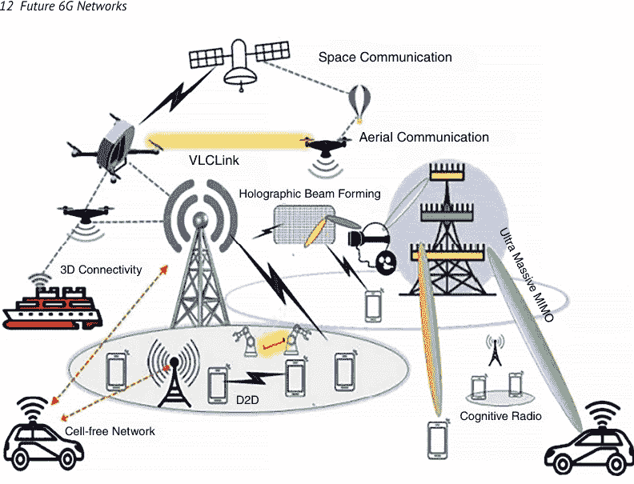

图 12.3 6G 中的三维通信场景。

## 12.6.8 空间通信

空间通信具有三个主要特征：

- 无人机（UAV）、6G 基站和飞机
- 低地球轨道（LEO）与地球卫星传输器之间的对应关系
- 6G 基站、无人机和蜂窝用户

目前的通信大多属于地球静止轨道，导致地面移动通信存在大量的积压。因此，理论研究显示了移动宽带与 GEO 卫星的集成性 [31]。随着 6G 的到来，一些国家已经制定了卫星远征计划。美国、中国和英国是正在制定此类计划的国家。

## 12.6.9 基于无人机的通信

近期，无人机已被广泛用作中继节点，以推进蜂窝网络的覆盖。由于基站漂浮在空中，无人机的工作高度比卫星低。这种能力使它们能够覆盖更多的地面移动客户端足迹，并作为热点推进基站覆盖，特别是在移动基础设施具有挑战性的地区 [27]。随着 6G 网络的发展，无人机通信将以更低的成本提供农村连接。

## 12.6.10 非常规数据通信

非常规通信存在于各种技术进步中。一个例子是智能传感器的使用。智能传感器主要用于跟踪和调节不同应用领域的网络。这类设备的主要特征是它们可以使用无线通信信道发送数据 [32]。有多种标准和技术可以实现数据传输，这些进展体现在不同的协议、频段和调制方式中。通信技术的选择取决于网络对延迟、带宽、基础设施部署成本和覆盖范围的要求。可以选择采用

## 12.6 无线网络

考虑到智能设备传感器位于线网附近的应用场景，采用一种不同的技术 [32]。这些非常规的数据通信通过战术通信、人机交互通信和全息通信等各种场景得到了体现。

### 12.6.11 战术通信

战术通信主要存在于国防领域。随着 6G 网络有望提高连接性和通信质量，可以确定战术通信也将得到改进。通过原型来展示 6G 网络如何有助于增强战术通信。该原型的主要目标是利用材料汇聚网络能力，以满足现代电信和互联设备以及军事及战术无线通信的需求，如宽频（WBHF）、NATO 窄带（NBWF）和弹幕中继网络（barrage relay networks）。

预期的实现涉及将军事战术通信与现代支持技术相结合。应当实际探索软件定义边界（SDP），以实现面向多级安全服务的防护网络、核心网络服务以及黑红加密隔离。军事无线通信提供了发展目标，它们与改进的无线通信解决方案的融合至关重要，而 6G 网络为此提供了前景。

在人类方面，我们需要实时获取精确数据并置于现场。在某些时刻，我们通过无线感知意识来解决这一问题。一项新的互联网工程任务 RFC 8175 描述了一种用于桥接无线电和 IP 路由器的动态链路交换协议。这种集成改进了延迟敏感任务的性能、无线电流量感知和高效路由选择。像 WBHF、NATO、NBWF 和单通道无线电系统（SINGARS）等网络服务是在创新者出现之前开发的。随着项目的成功，指挥官可以将数据服务管理到集成的基于 IP 的战术网络，从而利用融合技术。

战术项目可以分阶段开发。在第一阶段，目标是实现一份描述如何利用军事战术无线电和 6G 蜂窝技术实现基于 SDN 网络的全面文档 [33]。第二阶段将涉及使用 Radical 平台并提供可操作的技术 [33]。这两个阶段的目标是为支持行动提供原型解决方案。我们将用陆军战术无线电系统演示原型，记录原型的运行亮点，提交定期进度报告，并提供带有解决方案报告的测试报告。

在第三阶段，将开发并完善解决方案，提供可行的技术以插入到基于 SDN 的配置中。该阶段的目标包括：使用新兴或陆军拥有的无线电系统演示原型、关于实施和设计挑战的产品准备就绪报告、定期进度报告、支持陆军行动的原型解决方案、带有功能和操作亮点的产品文档以及关于解决方案性能的测试报告 [33]。

### 12.6.12 全息通信

全息术是一种利用电磁（EM）领域的方法，其信号最终扩散到物体上，基于电磁波的干涉原理。记录的衍射代码。可以通过光学全息的连续孔径来重建无线通信。全息通信过程处于上升阶段，其中从射频（RF）区域产生训练信号。训练信号将分束器分成两部分：参考光和效应物体。波到达物体，部分反射波与参考光混合，而后者并不施加于物体上。随后，物体波进入了全息 MIMO（HMIMOS）。除了训练阶段外，还有一个通信阶段，其中传输信号通过 HMIMOS 的空间恒定特性转换为目标消费者所需的波束。

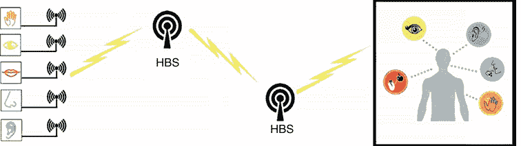

**图 12.4** HBC 系统架构。

### 12.6.13 人机交互通信

在未来，人类感知感觉的能力将通过在信息中融入五感特征并可能通过通信方法增加表达性和健康的感知交换得到改进。人机交互（HBC）只是一个愿景，但科学家们希望它是可以实现的。

对于 HBC，提出了一种基础架构。HBC 包括诱导器（感觉换能器），负责将刺激的感觉转换为电信号。HBC 的第二个组件是人类感知传输器，负责数据转换。第三个组件是人机交互感觉中心，负责收集、处理和传输数据。

## 12.7 6G 网络面临的挑战

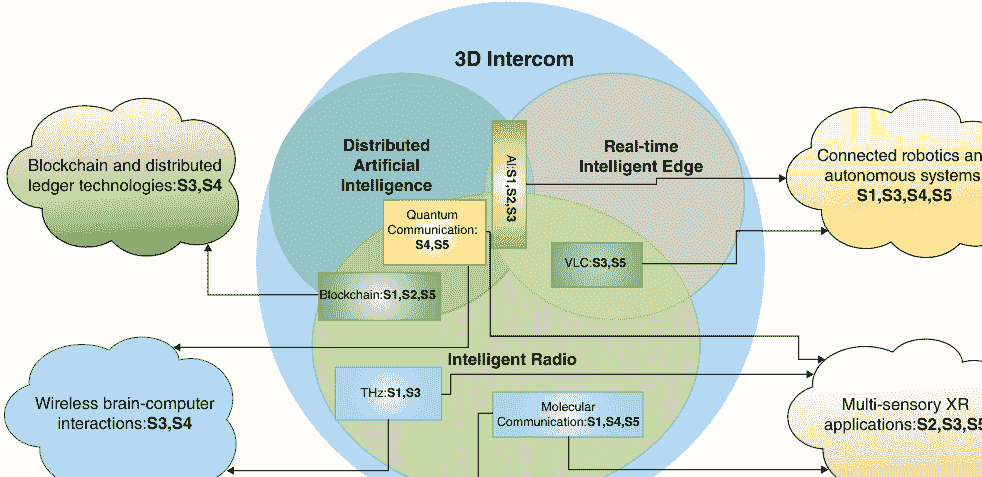

**图 12.5** 6G 网络的安全与隐私问题。

### 12.7.2 安全与隐私关注

图 12.5 显示了受五大安全隐私挑战影响的领域：身份认证（S1）、访问控制（S2）、恶意行为（S3）、加密（S4）和数据传输（S5）。图的大部分显示出对恶意行为、身份认证和访问控制的敏感性 [39]。某些技术对上述某些挑战具有特定的敏感性。在某些情况下，可见光通信（VLC）在面对恶意活动和数据传输程序时，需要实时智能边缘和智能无线电的支持 [39]。分子通信和太兹（THz）技术都指向智能无线电。分子通信技术涉及与加密、身份认证和通信相关的隐私与安全问题。另一方面，太兹技术特别容易受到恶意行为和身份认证安全挑战的影响 [39]。量子通信和区块链技术与 AI 和智能无线电重叠。隐私和安全考虑涵盖了访问控制、加密、身份认证和数据传输。

6G 应用可能会表现出特定的敏感性。机器人和自动系统（如特斯拉的自动驾驶汽车）的 AI 以及结合加密、数据传输和恶意行为的 VLC 可能会带来挑战。多感官 XR 应用采用了分子通信技术、太兹技术和量子通信技术，这些技术容易受到恶意行为、控制和数据传输的影响 [39]。无线脑机接口与多感官 XR 应用采用相同的方法。然而，它们面临着安全和隐私挑战。

### 12.7.3 研究活动与趋势

5G 网络已经商业化。6G 研究初始阶段的利益相关者需要在研究活动中与大多数代际动力建立伙伴关系，以协助下一代技术的发展 [40]。政府、学术界和工业界需要在初始阶段汇聚。6G 尚未建立其标准和产品。相反，6G 需要一个漫长的跑道，留出足够的空间供其成熟、讨论和调查 [40]。从长远来看，在初始阶段聚集力量至关重要。

在其他情况下，看到利益相关者即使不考虑共享行业标准也相互竞争是正常现象。然而，对于 6G，如果利益相关者未能参与相互讨论和努力，且没有公开出版，其他利益相关者将花费资源，使同样的尝试变得毫无意义 [40]。企业应当产生动力并在初始阶段回归 6G 研究。在后后的阶段，不同的公司可以选择特定的技术和产品进行进一步开发。

多个国家已经向 6G 研究迈出一步。欧洲就是一个例子。2021 年 12 月，欧洲明智地建立了涵盖 6G 的智能网络与服务联合体 [41]。这项新工作启动了 2021 年至 2022 年的初始计划，公共资金约为 2.4 亿欧元 [41]。2021-2022 年的工作旨在资助支持 5G 演进的所有活动，并涵盖垂直领域的大型试点项目以及向 6G 系统的领先研究的发展。

欧洲网络与服务的合作由委员会发起，成员国紧密参与。该联合体承担了欧洲的研发路线 [41]。这项风险投资利用了欧盟在几年内投入的 70 亿欧元预算，并计划由市场提供等额资金。其目标是使欧洲利益相关者能够加强对 6G 系统的创新能力，并为绿色和数字化转型培养 5G 基础设施的领先市场。

影响目标网络和服务研究的许多主要因素包括未来的应用和用途、时空的动态变化以及深层技术。

6G 系统中的安全性必须探索新的范式和阶段，例如虚拟化（从基础功能到端到端系统的无缝安全）、编排安全的灵活性和编程性（与编排系统和服务紧密集成）、如移动目标防御、云化（服务交付）、基于服务的整体架构以及涵盖整个生命周期的整体方法（从组件开发到技术引入，如 AI 量）。6G 背景下的安全性量化应该处理复杂性和碎片化，并要求探索识别、评估和监控安全水平的机制。基于这种量化，可以对提供和服务给予信任，通过满足从大众市场到 B2B 垂直领域的多元化需求推动行业增长 [3]。图 12.6 显示了主要目标。

## 12.8 结论

第六代无线系统将支持许多功能，如机器类通信（MTC）、高可靠低延迟通信、高保真全息、沉浸式现实以及基于触觉的通信。6G 系统需要新的物理层和高层能力。

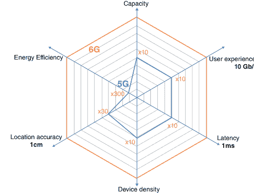

**图 12.6** 6G 的主要目标，以及 6G 将改进 5G 的 KPI [3]。

| 6G 的主要目标 |
| :--- |
| 改进 5G |
| 连接智能 |
| 可编程 |
| 确定性 |
| 集成感知 |
| 可持续性 |
| 可信赖 |
| 负担得起且可扩展 |

200 12 未来 6G 网络

## 参考文献

- 1. Kranz, A., and Christensen, G. (2021). 什么是 6G？6G 网络与技术概览。https://www.techart.com/searchnetworking/definition/6g
- 2. Tomas, J. P. (2021). 软件化将如何成为未来 6G 网络的关键：国家仪器。IEEE Wireless News (2020年12月20日)。https://www.rcwireless.com/20211220/5g/softwareization-play-key-future-6g-national-instruments.
- 3. 6G 网络生态系统的欧洲愿景 (2021). 白皮书-6G-欧洲: 新 6G 永不停歇。5G 基础设施愿景，https://doi.org/10.5281/5280.500761
- 4. Raja, A., Janshed, M., Perervais, H., and Hassan, S. (2020). THz 异构网络中 UAV 辅助回传解决方案的性能分析。在 IEEE INCOM 2020-IEEE 通信会议论文，6228–6332。

- 5. Vielegas, M., and Mogensen, P. (2020). 6G 时代的挑战。IEEE Access 8 (1): 5706–57074。

- 6. Akhtar, M. W., Hassan, S., Ghafar, R., et al. (2020). 向 6G 转变：通信与需求。人机交互与信息系统 10 (53): https://doi.org/10.1186/s41673-020-00258-2.

- 7. Yang, H., Alifano, A., Xiong, Z., et al. (2020). 人工智能驱动的 6G 网络。IEEE Network 34 (6): 272–280。https://doi.org/10.1109/MWN.2020.1990011

- 8. Lisa, A. (2019). 什么是 6G？智能驱动的法律安全政策（A. Liska 编）。纽约：Elsevier。

- 9. Cisco, V. (2019). 全球移动数据流量预测白皮书 1-33。https://www.cisco.com/c/en/us/solutions/collateral/white-/mobile-internet-report-c111490.html

- 10. Alendrossia, A., Cioffi, S., et al. (2017). Wi-Fi 定位与大数据管理全球范围内的人流。欧洲导航会议 (ENC), 322–338。洛洛昂：IEEE。

- 11. Meideiros, D.S., Neto, H.N., Lopez, M.A. et al. (2020). 大规模无线网络综述：在线流趋势与挑战。互联网服务与应用期刊 11 (6): 1–8。https://doi.org/10.1186/s41074-020-0017-2

- 12. Zaharia, M., Das, T., Li, H., et al. (2012). 离散流：一种用于流聚类的高效且容错的模型。在第 4 次 IEEE 云计算主题会议论文集中，1–10。波士顿：ACM。

- 13. Dean, J. and Ghamwat, S. (2008). MapReduce：大规模集群的可扩展数据处理。ACM 通信杂志 51 (1): 10–113。

- 14. Faisala, A., Ahmed, R., Rahrou, H., et al. (2021). 6G 网络多跳可见光通信的多样性。计算机科学评论 15(1): 140–149。https://doi.org/10.1016/j.csci.2021.02.019

- 15. Chi, N., Zhou, Y., and Wei, H. (2020). 6G 中的可见光通信：进展、挑战与展望。IEEE Vision Magazine 35(4): 92–103。https://doi.org/10.1109/MVM.2020.307153

- 16. Molteni, M. and Sinha, S. (2021). 用于 6G 的可见光通信：移动通信：网络与 6G 愿景（Molteni 和 S. Sinha 编），155–188。https://doi.org/10.1007/978-3-030-69273-5_4

- 17. Marcos, I and Icar, A. (2020). 6G 中可见光通信的机遇与挑战。在：2020 6G 无线峰会 (6G SUMMIT)，1–5。利维：https://doi.org/10.1109/GSUMMIT49458.2020。

- 18. Gupta, A., Sharma, N., Garg, P., and Alumni, M. (2017). 可扩展 FSO 通信。IEEE Wireless Letters 1–4。https://doi.org/10.1109/WWL.2017。

- 19. Gui, G., Liu, M., Kato, N., et al. (2022). 6G：开启安全、舒适与智能融合的新愿景。IEEE Networks 7(6): 21–29。https://doi.org/10.1038/s42256-022-19

- 20. Dang, S., Alumni, O., Shibaida, B., and Alumni, M. (2020). 什么是 6G？地面单元与网络：21–29。https://doi.org/10.1038/s42256-019-355

- 21. Loven, L., Partala, J., and Pirtkangas, S. (2020). 6G 的隐私感知区块链创新：挑战与机遇。

- 22. Zahro, Y., Yu, G., and Xu, H. (2019). 6G移动通信：愿景、挑战与技术。Scientia Information。

- 23. Dang, S., Amin, O., Shihada, B., and Alou, M. (2020). 从以人为中心的视角：6G 可能是什么？Nature Electronics 3 (1): 20–29。

- 24. Bhat, J.R. and Qahtani, S. (2020). 6G 架构综述。

## 索引

**主动**通道，16

**增强现实**，74

**人工智能**，61

**应用**，32

**自动驾驶**，92

**架构**，11

**攻击**，84

**区块链**，55

**带宽**，21

**通信**，21

**连接设备**，182

**网络**，70

**网络安全**，69

**数字**，14

**经济**，66

**加密**，67

**加密技术**，68

**数据**，140

**部署**，166

**教育**，39

**能源**，53

**生态系统**，34

**期望**，164

**边缘**，15

**框架**，11

**未来**，15

**历史**，12

**基础设施**，166

**全球 AI**，70

**全球网络攻击**，170

**全球经济**，66

**全球隐私与数据权利**，168-170

**全景**，9

**如何**，161

**创新**，165

**集成**，165

**信息**，114

**创新型**，165

**智能**，162

**智能驱动**，61

**IoT 安全**，作用的，176-179

**劳动部署与缓解**，166

**有限内存**，160

**操纵与保护**，165

**领域**，164

**差异性**，10

**风险**，164

**本地风险**，164

**国家风险**，164

**预测与预防**，164

**作用的**，12

**反应性机器**，170

**自我意识**，161

**服务自动化**，在网络攻击中，165

**解决问题**，181

**安全**，69

**状态**，151

**策略**，21

**技术**，120

**技术与集成**，165

**理论**的，160-161

**威胁**，来自，14-15

**转型力量**，61

**传输**，167-168

**愿景**，35-34

**无线**，5G 和 60 68

**无线安全**，68-69

# 204 索引

- 基于 CLI 的命令性技术 33

- 云计算 183

- Cloudera 数据流 17, 183

- 云化 42

- 云原生框架 42

- 码分多址 (CDMA) 27

- 认知网络 33

- 激活性网络 36–37

- ICI 35–36

- 网络内计算 36

- 零信任网络和服务管理 34–35

- 零信任网络

  - 通信服务供应商 (CSP) 126

  - 互补金属氧化物 (CMOS) 47

  - 联网自动驾驶车辆 (CAV) 安全框架 126

  - 联智能 104

  - 万物互联 185

  - 核心网与终端 (CT) 48

  - 关键物联网 (IoT) 业务 96

  - 跨信攻击 114

  - 密码学 117

  - CSP 通信服务供应商 (CSP)

  - 定制用户设备 (CPE) 设备 95

  - 网络犯罪 113

  - 网络犯罪分子 71

  - 网络安全 1, 10, 11

  - 联网设备 16–17, 182

  - 现状 151–153

  - 5G 和 6G 154–155

    - 新挑战 154–155

    - 17 中的数据管理解决方案

  - 数字化转型

    - 挑战与数字权利 121–122

    - 成熟度挑战 116–117

    - 未来收益与挑战 70–71

    - 涉及的问题以及 5G 和 6G 70

  - 数字化 110

  - 断续体验 (DRX) 132

  - 分布式天线系统 (DAS) 29

  - 分布式拒绝服务 (DDOS) 攻击 14, 126, 180

  - 去中心化账本技术 (DLT) 83

- 偏心质量现实 (EMR) 执行器 5

- 边缘智能 (EE) 69

- EEE 系列高效以太网 (EEE)

- 电子健康 (ehealth) 88

- 高能以太网 (EEE) 23

- 增强移动宽带 (EMB) 2, 68, 197

- 激活用户身份模块 (eSIMs) 96

- 激活的车联网万物 (V2X) 97

- 以太 23

- 白黑客案例 15

- 欧几里得距离 15

- 欧洲委员会 (EC) 93

- 欧洲电信标准协会 ETSI 47

- 欧洲电信标准协会 (ETSI) 零信任网络 34

- 360 度安全与隐私设计型工程 186

- 网络安全 176

- DAS 分布式天线系统 (DAS)

- 数据节律漏洞 164

- 数据管理，在 183

- 数据隐私 155

- 数据技术 (IoT) 32

- 去中心化账本技术 (DLT) 83

- 决策树 15

- 深度学习 66

- 数字化转型 109, 110

  - 网络的，现状 113–114

  - 网络安全

    - 挑战与数字权利 121–122

    - 成熟度挑战 116–117

    - 网格网络 109–111

    - 安全

      - 成熟度与 117–120

      - 参数与网络密钥 120–121

      - 风险 111–113

    - 以及技术 115–116

- 联邦通信委员会 (FCC) 189

- 联邦学习 68, 85

- 小基站中继器 29–30

- 第五代 (5G) 与第六代 (6G) 145–146

- 金融科技 (FinTech) 4

- 五感信息传输 1

- 灵活双工 (FDD) 80

- 飞行器 77

- 四代 (4G) 蜂系统 73

- 四代长度演进 (4G-LTE) 22, 188

- 双双工 15

- 自由空间光学 (FSO) 179

- 回传网络 9

- 新兴技术的前瞻性 186

- 通用数据保护条例 (GDPR) 167

- 地球同步 (GEO) 58

- 全球移动用户协会 (GSA) 95

- 全球移动通信系统 (GSM) 2

- GSM 无线接入网 (GERAN) 48

- 触感通信

- 异构网络 29

- 高保真触感社会兴趣 185

- 高速数据包接入 (HSPA) 2, 48

- 全息半径 3

- hspa 空中高速数据包接入 (HSPA)

- 以人为本的移动通信 143

- 人类狩猎采集社会 (IoT) 1.0 4

- 混合自动重复请求 (HARQ) 132

# I

- 加拿大 ICT 标准咨询委员会 (ISACC) 48

- 工业物联网 (IoT) 23

- 工业社会 (3.0) 4

- 工业 4.0 88

- 信息通信技术 (ICT) 22

- 内部中心网络 (ICNs) 35, 186

  - 概念 36

  - 移动通信时代 25

  - 移动边缘计算 37

  - MTC 类型通信 (MTC) 30

  - 多接入边缘计算 (MEC) (CD-CDMA) 30

  - 多输入输出 (MIMO) 7, 24, 78

  - 复用方法 79

- 信息社会 (4.0) 4

  - 网络计算 36

  - 集成接入 2

  - 激活 SIM (eSIMs) 126

  - 基于意图的网络 (IBNs) 32, 33, 186

  - 国际先进移动通信 (IMT-Advanced) 21

  - 国际移动通信 (IMT-2020) 91

  - 国际电信联盟无线通信 (ITU-R) 21, 186

  - 国际电信联盟 (ITU) 3, 24

  - 物联网 (IoT) 1, 68, 73

  - 物联网 (IoT) 10, 58, 68

  - 互联网协议 (IP) 38

  - 互联网服务供应商 (ISP) 70

  - 入侵检测系统 (IDS) 152

  - 万物 (ioE)

  - 物联网 (iot) 79

- 国家高速交通安全管理局 (NHTSA) 13

- 美国国家标准与技术研究院 (NIST) 126

- 自然语言处理 (NLP) 159

- 网络功能 (NFV) 32

  - 网络，区块链， 6, 40

  - 认知网络 33

  - 激活网络 35, 86

  - 联合技术委员会 1 (JTC 1) 83

  - 零信任网络和服务管理 34–35

  - 零信任网络 35

  # k

- 关键性能指标 (KPIs) 14, 97, 125

- 运动表面 5

- 高能 ICT 23–24

- 智能，带有 AI 和 IoT 43–47

# l

- 大码分 (CDNA) 30

- 大智能服务 (LIS) 3, 98

- 层通信 98

- 延迟敏感应用 125

- 光电二极管 (LED) 79

- 局域网 (LAN) 30

- 本地服务 (LMS) 30

- 长期演进 (LTE-A) 2

- 长期演进/机器类型通信 (LTE) 96

- 低地球轨道 (LEO) 55, 132

- 低空闲 (PLI) 23

# m

- 千兆波 44

- RIS

- 学习 (ML) 23, 55, 65

- 人机通信 76

- 机器机器 (M2M) 通信 1

- 机器类型通信 (MTC) 198

- 恶意软件攻击 10

- 大规模机器类型通信 (mMTC) 8, 68, 91, 178

- 大规模机器类型学习 99

- 泛在 AI 60

- 进阶，5G 到 6G 网络 32–33

- 5G 无线系统 30–32

- 异构网络 29

- LTE: 28–29

- 介质访问控制 (MAC) 23, 99

- 中轨道 (MEO) 58

- 网格网络 21, 186

- 微尺度网络 4

- ML 见机器学习 (ML)

- 二十信息社会 (METIS)

  - 保护 60

  - 安全 60

  - 应用与服务 134–135

  - 对 5G 135–137

  - 集成与指南 137

  - 物联网中的隐私与安全 140–141

  - 可信度 138–140

  - 网络状态 55

  - 无线系统 60

  - 机构 142

# o

- 正交频复用 (OFDM) 30, 73

- 基础特性 98–99

- 开源平台 60

- 云原生方法 42

- 5G 和 6G 影响，健康与环境 42–43

- 高容量回传连接 42

- 机器类型通信 42

- 服务设备、服务系统架构 (SA) 48

- 服务等级协议 (SLA) 30

- 多核 44

- PHY 技术 40–41

- 第七代计划 (FP7) 37

- 太赫兹频谱 41

- 短消息服务 (SMS) 186

- 传输层，用于太赫通信 41

- 单通道空中无线系统 (SINCGARS) 195

- 光无线 (OAM) 78–79

- 轨道角量 (OAM) 78, 134

- 通信系统 7

- 正交频复用 (OFDM) 30, 73

# p

- 密码攻击 10

- 5G 6–10

- 五信息 6

- 个人数据分析 (PDA) 26

- 个人信息因子 (PIF) 83

- 个人身份信息 (PII) 83

- 智能助手 6

- 泛在连接 88

- 物理 (PHY) 40

- 无线脑机 5

- 高数据密集型应用 97

- 5G 开发 95–97

- 六代 (6G) 网络，未来的挑战

  - 针对 144 的挑战

  - 潜在健康问题 196

  - 机密手段 142

  - 研究活动与趋势 197–198

  - 针对六代 143

  - 安全与隐私考量 197

  - 使用光通信 144

  - 特性 185

  - 微基站 29

- 关键且原则的方法 185–186

- 政治、经济、社会、技术和法律 AI 18

- 点对点协议 (PPP) 48, 152

- 大带宽 189

- PPP 见点对点协议 (PPP)

- 国家情报 190

- 过程管理 35

- LTE 缺失单元 189

# q

- 服务质量 (QoS) 73, 101

- 视觉与关键特性 166–186

- 量子攻击 7

- 量子通信 37–38

- 量子计算与 6G 190

- 大通信 191–192

- 量子信息处理 (QIP) 38

- 量子技术 79

# r

- 无线接入网 (RAN-Core) 126

- 无线接入网 (RAN) 48

- 无线环境图 (REM) 99

- 射频识别 (RFID) 173

- 无线资源管理 (RRM) 132

- 重构智能表面 (RIS) 41

- 无人机通信 194

- 非规数据通信 194–195

# 208 索引

- 5G 6

- 6G 的影响

- 对医疗保健系统 56-58

- 对其他行业 60

- 对空间技术和卫星通信 58-60

- 与 6G

- 块链 55-56

- 5G 与 6G 特特性对比 54

- 在 IT 领域的未来和角色 62

- 安全与隐私 53-56

- 技术演进 53

- 太赫兹 (THz) 无线系统和网络 61-62

- 无线能量传输 81

# 术语表

- 无线信息与能量传输 (WIET) 83
- 无线局域网 (WLAN) 2, 21, 26, 186
- 无线网格网络 2
- 无线城域网 (WMAN) 2, 21, 186
- 无线个人局域网 (WPAN) 2, 21, 186
- 无线广域网 (WWAN) 2, 21, 186
- WLAN 参见无线局域网 (WLAN)
- WMAN 参见无线城域网 (WMAN)
- 基于全球万维网 (WWW) 的应用 26
- WPAN 参见无线个人局域网 (WPAN)
- AI 与数据驱动方法，用于网络-社会 5
- 设计原生 AI 85
- AI 无线通信工具 74
- 应用 87-89
- 兴起应用：
  - AR 99–100
  - 自动化 101
  - 自动驾驶与连接设备 101
  - 区块链 80
  - 面未来协作的生态系统 80
- 通信技术
  - 空天地一体化网络 (SAGIN) 58–59
  - 空天地一体化通信 4
  - 能效， 74
  - 频谱 21
    - 分配 23
  - 低延迟 74
  - 共享 80–81
  - 机器，主用户 74
  - 网络可靠性与准确性 74
  - 亚毫米波 (THz) 192
  - 个性化 74–76
  - 超收敛 185
  - 极性能
    - 超多输入多输出 (MIMO) 980
  - 超级社会 4
  - 监控与数据采集 (SCADA) 192
  - 自由双工 80–81
  - 可持续发展目标 (SDG) 192
  - 内部网络运行 80
- 创新 6G 网络架构 89
- 6G 技术
  - 带宽与频率范围 85–86
  - 芯片技术 86
  - 一致信道 86–87
  - 远程手术 92
  - X-haul 与传输网络 87
  - 太比特双向多用户光无线系统 (TOWS) 98
  - 每秒太赫兹 (THz) 125
  - OWC 77–79
  - 太赫兹频率 (THz) 3, 9, 98
  - 太赫兹通信 78
  - 太赫兹隙 78
  - 使用智能平台
    - 终端节电 88
  - 5G 新射电 (NR) 81
  - 第三代 (3G) 蜂窝系统 73
  - 集成智能 102
  - 卫星集成化网络 82–83
  - 时间敏感/沉浸式体验 185
  - Wi-Fi 83
  - 六代 (6G) 无线通信系统 1
  - 智能社会 4
- 六代 (6G) 无线网络
  - 应用 104, 105
  - 挑战 104–106
    - 方面的挑战 139
    - 约束 138
    - 原则 139
  - 无人机系统 (UAS)
    - 灾害管理 102
  - 无人机 (UAV)
    - 环境 102
  - 无处不在 97
  - 远程医疗 101
  - 超灵活物理层 (PHY) 99
  - 超低灵活性连接 81
  - 结合物联网的智能生活 101
  - 超低功耗 (ULF) 太赫兹学 81
  - 水下通信 193
  - 高可靠低延迟通信 (URLLC) 2, 3, 6, 88, 77, 98, 170
  - 要求与 KPI 104
  - 超声波技术 5
  - 极广覆盖 104
  - 通用用户识别模块 (USIM) 96
  - 极低延迟 102
  - 通用地面无线接入/演进UTRA (UTRA/E-UTRA) 48
  - 高数据 103
  - 高频段 103
  - 功耗 102–103
  - 海量连接密度 104
  - 移动性 104
  - 基于无人机 (UAV) 的通信 193
  - 无人机 (UAV) 58, 91, 99, 126
  - 无人机系统 (UAS) 96
  - 无人移动 88
  - 车万物 (V2X) 99
  - 车联网通信 2, 3
  - 虚拟现实 (VR) 8, 87-88
  - 可见光通信 (VLC) 3, 79, 98, 131, 191
  - VR 参见虚拟现实 (VR)
  - 宽带高频 (WHHF) 网络 195
  - 无线蜂窝技术 28
  - 无线通信 2, 6
  - T-Mobile G2 29
    - 优势: 138
  - 软件定义网络 (SDN) 32
  - 触感网络 84-85
  - 软件无线电 (SDR) 92
  - 软件原生 42
  - 量子通信 79–80
  - 触感网络 80
  - 量子机器学习 79–80
  - TDD 时延双工 (TDD)
    - 频谱共享 80–81
  - 技术规范小组 (TSG) 48
  - 触感互联网 80
  - 通信 21
  - 电信行业联盟 (TIA) 48
  - 电信标准发展协会, 21
    - (TDSDI) 48
  - 日本电信技术委员会 (TTC)
  - 时延双工 (TDD) 28
  - 零信任网络 35
