# 从概念到代码：数据科学入门指南

数据科学能够解决的问题范围之广令人惊叹，而这本书为广大读者提供了所需的工具和技能。读者将开启一段探索数据与模型的形式、用途及误用之程，并学习如何批判性地审查每一个步骤。Python 编码和数据分析技能将从零开始构建，不假设读者具有任何编程经验。计算机科学、数学和统计学所需的背景知识将以通俗易懂的方式提供。

本书详细讨论了机器学习生命周期的每一个步骤，从业务目标规划到生产环境中的模型监控。这种端到端的方法对于规避许多导致数据科学项目失败的陷阱至关重要。书中提供了广泛应用和领域的详细示例，从银行业的欺诈检测到医疗保健领域的乳腺癌分类。读者将学习完成各项任务的技术，包括预测结果、解释观察结果和检测模式。对数据和模型的不当使用可能会给社会带来意外的后果和损害。关于模型风险的章节提供了一个框架，用于对模型进行全面挑战并减轻弱点。当数据被收集、存储和使用时，它可能会歪曲现实并引入偏差。《数据科学导论》中处理偏差的策略利用了作者为一门适合高级高中生或本科生的全年度数据科学课程所开发的课程。该课程免费提供，并包含每周的教学计划。

Adam P. Tashman 在数据科学领域已工作 20 多年。他是弗吉尼亚大学数据科学学院的数据科学副教授。他目前担任毕业项目（Capstone）主任，曾担任数据科学硕士项目主任。他是 2023–2024 学年数据科学学院 Capital One 项目的负责人。Tashman 博士曾获得 Amazon Web Services 颁发的多个奖励，在那里为教育和政府技术公司提供机器学习和人工智能最佳实践的建议。他与美丽的妻子 女 和女儿 Callie 住在弗吉尼亚州夏洛茨维。

设计图像：Adam P. Tashman

感谢

感谢我的父亲 Steven M. Tashman，他教会了我数据科学。

我的母亲 给予了我的支持。

## 序言

## 符号

## 1 引言

### 1.1 什么是数据科学？

### 1.2 数据科学的重要性

### 1.3 数据的形式

### 1.4 数据的用途与误用

#### 1.4.1 数据风险

#### 1.4.2 模型风险

### 1.5 方法论

### 1.6 本书的结构

### 1.7 目标读者

### 1.8 Python 编码与数据分析

### 1.9 计算机科学、数学和统计学背景

## 2 有效沟通与信任

### 2.1 掌握技巧

### 2.2 技术能力

### 2.3 目标读者

### 2.4 讲述故事

### 2.5 你的需求

### 2.6 你的需求

### 2.7 掌握技巧

### 2.8 总结

### 2.9 总结

## 3 数据规划

### 3.1 掌握技巧

### 3.2 技术能力

### 3.3 目标读者

### 3.4 讲述故事

### 3.5 你的需求

### 3.6 你的需求

### 3.7 总结

### 3.8 练习

## 4 数据概览

### 4.1 数据类型

### 4.2 统计数据

### 4.3 数据集与状态

### 4.4 真实性

### 4.5 输入

#### 4.5.1 速度与规模

#### 4.5.2 流式

#### 4.5.3 爬虫与 API

### 4.6 数据集成

### 4.7 处理层级

#### 4.7.1 可信数据

#### 4.7.2 数据标准化

#### 4.7.3 自然语言处理

#### 4.7.4 身份保护

#### 4.7.5 精炼区

### 4.8 静态数据结构

#### 4.8.1 结构化数据

#### 4.2 半结构化数据

#### 4.3 非结构化数据

### 4.9 元数据

### 4.10 代表性与偏差

### 4.11 数据绝非中立

### 4.12 总结

### 4.13 练习

## 5 计算准备工作与设置

### 5.1 硬件

#### 5.1.1 处理器

#### 5.1.2 内存 (RAM)

#### 5.1.3 存储

#### 5.1.4 主板

### 5.2 软件

#### 5.2.1 模块

### 5.3 输入/输出

#### 5.3.1 目录与路径

#### 5.3.2 文件格式

### 5.4 Shell、终端与命令行

### 5.5 版本控制

#### 5.5.1 Git

#### 5.5.2 GitHub

#### 5.5.3 GitHub 设置与课程仓库下载

### 5.6 探索代码仓库

### 5.7 编程工具

#### 5.7.1 IDE

### 5.8 云计算

### 5.9 本章总结

### 5.10 附录：深入学习 Git 和 GitHub

#### 5.10.1 与上游仓库同步

#### 5.10.2 初始化 Git 仓库

#### 5.10.3 跟踪变更

### 5.11 练习题

# 6 数据处理 81

### 6.1 加州山火

#### 6.1.1 使用 CLI 运行 Python

#### 6.1.2 设置相对路径

#### 6.1.3 变量

#### 6.1.4 字符串

#### 6.1.5 导入数据

#### 6.1.6 文本处理

#### 6.1.7 获取帮助

### 6.2 统计豹子数量

#### 6.2.1 提取 DataFrame 属性

#### 6.2.2 子集

#### 6.2.3 创建并添加新列

#### 6.2.4 排序

#### 6.2.5 保存 DataFrame

### 6.3 患者血压

#### 6.3.1 数据验证

#### 6.3.2 填补

#### 6.3.3 数据类型转换

#### 6.3.4 极值观测

### 6.4 本章总结

### 6.5 练习题

# 7 数据存储与检索 105

### 7.1 关系型数据库

#### 7.1.1 主键

#### 7.1.2 外键

### 7.2 SQL

### 7.3 音乐查询：单表

### 7.4 音乐查询：多表

### 7.5 房屋、湖泊与湖仓 (Lake Houses)

#### 7.5.1 数据仓库

#### 7.5.2 数据湖

#### 7.5.3 数据湖仓 (Data Lakehouse)

### 7.6 本章总结

### 7.7 练习题

# 8 数学基础 127

### 8.1 集合论

### 8.2 函数

### 8.3 微积分

### 8.4 概率

### 8.5 矩阵代数

### 8.6 本章总结

### 8.7 练习题


# 9 统计学基础
## 9.1 描述性统计
## 9.2 推断统计
### 9.2.1 单样本均值检验
### 9.2.2 置信区间
## 9.3 本章总结
## 9.4 练习题

# 10 数据转换
### 10.1.1 移动平均
### 10.1.2 限制极值
## 10.2 尺度转换
### 10.2.1 数量级与对数的使用
### 10.2.2 标准化
### 10.2.3 归一化
## 10.3 处理数据表示的转换
### 10.3.1 计数向量化
### 10.3.2 独热编码
## 10.4 创建预测变量的其他常用方法
### 10.4.1 二值化
### 10.4.2 离散化
### 10.4.3 其他常用转换
### 10.4.4 存储转换后的数据
## 10.5 本章总结
## 10.6 练习题

# 11 探索性数据分析
## 11.1 支票欺诈
## 11.2 世界幸福
## 11.3 汇总统计的使用与局限性
## 11.4 可视化卓越性
## 11.5 总结
## 11.6 练习题

# 12 机器学习概述
## 12.1 用于决策的简单工具
## 12.2 监督学习
## 12.3 无监督学习
## 12.4 半监督学习
## 12.5 强化学习
## 12.6 泛化
## 12.7 损失函数
## 12.8 超参数调优
## 12.9 评价指标
## 12.10 总结
## 12.11 练习题

# 13 使用线性回归进行建模
## 13.1 数学框架
### 13.1.1 线性回归的参数估计
## 13.2 审慎考虑预测变量
## 13.3 预测房价
### 13.3.1 数据划分
### 13.3.2 数据缩放
### 13.3.3 模型拟合
### 13.3.4 解释参数估计值
### 13.3.5 模型性能评估
### 13.3.6 模型比较
### 13.3.7 计算 R 方方
## 13.4 总结
## 13.5 附录：矩阵形式的参数估计
## 13.6 练习题

# 14 使用逻辑回归进行分类
## 14.1 数学框架
### 14.1.1 逻辑回归的参数估计
## 14.2 检测乳腺癌
### 14.2.1 解释参数估计值
### 14.2.2 重新复习梯度下降
### 14.2.3 模型性能评估
## 14.3 总结
## 14.4 练习题

# 15 使用 K-Means 进行聚类
## 15.1 聚类概念
## 15.2 K-Means
### 15.2.1 K-Means 计算
### 15.2.2 性能评估
## 15.3 聚类评价
## 15.4 总结
## 15.5 练习题

# 16 可复现数据科学的要素
## 16.1 代码共享
## 16.2 测试
## 16.3 容器
### 16.3.1 安装 Docker
### 16.3.2 常用 Docker 命令
### 16.3.3 机器学习应用的 Docker 化
## 16.4 总结
## 16.5 练习题

# 17 模型风险
## 17.1 模型文档
## 17.2 概念合理性
## 17.3 数据与输入
## 17.4 结果分析
## 17.5 模型基准测试
## 17.6 敏感性分析
## 17.7 压力测试


# 17.8 持续模型性能监控 330
## 17.8.1 深入探讨监控 332
## 17.9 案例研究：公平信贷风险 334
### 17.9.1 公平信贷背景 334
### 17.9.2 数值示例 335
## 17.10 总结 339
## 17.11 练习题 341

# 18 下一步阶段 343
## 18.1 基础构建 343
## 18.2 进阶技术：正则化 345
## 18.3 进阶机器学习模型 347
### 18.3.1 基于树的模型模型 347
### 18.3.2 人工神经网络 349
## 18.4 其他语言 351
## 18.5 资源 352
## 18.6 应用 353
## 18.7 结语 355

## 致谢

我感谢我的妻子 Elle Tashman 审阅了早期章节并提供了大量的支持与鼓励。非常感谢 Philip D Waggoner 和 J Gavin Wu 对手稿提供的周心反馈。Efrain Olivares 在可重复数据科学方面提供了有帮助且详细的意见和反馈。弗吉尼亚州大学数据科学学院为这项工作提供了一个极具支持且丰富的环境。特别地，我要感谢 Philip Bourne、Jeffrey Blume、Don Brown、Raf Alvarado、Brian Wright、Jon Kropko、Pete Alonzi、Siri Russell 和 Emma Candelier。Boris Deychman 和 Judy Penn 对模型风险提供了无足价值的洞解，Greg van Inwegen 慷慨地分享了建模和量化金融的知识。非常感谢 Lara Sjaeger 鼓励我写这本书，并在整个过程中为它提供庇护。最后，我感谢 Chapman and Hall/CRC 的支持团队。我想感谢 Devin Chandler、Lavel Davis Jr. 和 D'Sean Perry 对本书的影响。在他们经历了令人心碎的悲剧后，我被迫写下这本书作为一种回应。向他们的家人致以爱意。

## 前言

世界上产生的数据量以及根据这些数据需要做出的决策数量前所未有。人类每天产生超过 2.5 兆亿字节的数据 [1]，新的衡量单位正在路上，用于量化未来的数据。从医疗保健到零售、保险、金融，每一个非技术领域的领域都在直接使用技术，或者可能应该使用技术。这些许多领域正在产生带有后缀的新领域：金融是 FinTech（金融科技），保险是 InsurTech（保险科技），以及 WealthTech（财富科技）、MarTech（营销科技）和 AITech（广告科技）。

这令人兴奋，但要找到既熟悉底层领域又精通技术的人极其困难。在数据科学早期，有一些拥有强大量化和编程技能的稀有独角兽，可以在这些行业中施展魔法。IT 部门提供帮助，或者他们本身就是数学家或统计学家。一次性的项目证明了理解组织的数据可以产生奇效。简单的分析，或者可能是回归分析，引起了管理层的注意。然而，随着关联和产生数据资产的欲望增长，这变成了一项全职工作，或者可能需要整个部门的人。数据变成了战略性资产，而挖掘这种资产的人需求非常巨大。

截至 2024 年，对这类工作以及带来魔法的人的需求是前所未有的。AI 驱动的世界的工作职能被更好地理解，它们的名称为数据科学家、数据工程师和机器学习工程师。这些幸运的人是世界上最受欢迎的知识工作者之一。然而，他们存在严重短缺。

从供应侧

作为一个热情项目，我与 Matt Dakilios 一起创建了一个高中数据科学课程，他是弗吉尼亚州大学（UVA）数据科学学院的学生。正如你可能猜到的，创建一个高中课程是一项巨大的工作量。对我来说的是，我似乎无法选择那些轻松的热情项目。我所能的最大期望就是项目不要失败。Matt 和我热切地跟进试行课程的学生，发现它激发了以前不存在的兴趣。其中一些人想在大学学习数据科学，而另一些人对科学或数学的兴趣达到了顶点。

鉴于这些积极反馈，我一直在努力让其他学校采用这门课程。“销售”产品的棒之处在于，棘手的问题会让你思考和反思（尽管最好提前这样做！）。在与一家声誉良好的多元化学校的校长的一次会议上，他问了一个直接的问题：

> “我们学校目前有 59 项举议。我们为什么要考虑这一项？”

这是一个合理的问题，我想，尤其是当我们面对一个持续一年的疫情时。我说：

> “如果能吸引广泛的学生，赋予他们技能集，在世界范围内产生重大影响，提供一条有意义的职业道路，让你在数据科学领域过上不错的生活，你对此感兴趣吗？”

这本书旨在填补数据科学领域的人才缺口，并扩展你对事物运作方式的理解。UVA 数据科学学院的院长 Phil Bourne 提供了帮助。

## 符号

## 集合论

| 符号 | 描述 |
| :--- | :--- |
| $\mathbb{Z}$ | 整数 |
| $\mathbb{R}$ | 实数 |
| $\mathbb{R}^+$ | 正实数 |
| $[a, b]$ | 包含 $a$ 和 $b$ 的闭区间 |
| $(a, b)$ | 不包含 $a$ 和 $b$ 的区间 |
| $\{ \}$ 或 $\emptyset$ | 空集 |
| $A \cap B$ | 集合的交集 |
| $A \cup B$ | 集合 $A$ 和 $B$ 的并集 |
| $A^c$ | 集合 $A$ 的补集 |
| $A - B$ | $A$ 中不在 $B$ 中的元素 |
| $|A|$ | 集合 $A$ 中元素的个数 |
| $Y \subset X$ | $Y$ 是 $X$ 的子集 |
| $Y \subsetneq X$ | $Y$ 是 $X$ 的真子集 |

# 微积分

$\frac{\partial y}{\partial x}$ $y$ 对 $x$ 的导数

$\frac{\partial y}{\partial x}$ $y$ 对 $x$ 的偏导数

$\nabla y$ $y$ 的梯度

## 概率

$\Omega$ 样本空间（所有可能的结果）

## 运算

$\sum_{i=1}^n$ 从 $1$ 到 $n$ 的项之和

$\prod_{i=1}^n$ 从 $1$ 到 $n$ 的项之积

$\mathcal{A}$ 所有事件的集合

$P(A)$ 事件 $A$ 的概率

$P(A|B)$ 在 $B$ 条件下事件 $A$ 的概率

### 函数与指标

$f(x)$ 在 $x$ 处的函数值

$P(X=x)$ 随机变量 $X$ 取值为 $x$ 的概率

| 符号 | 描述 |
| :--- | :--- |
| $\mathbf{A}^T$ | 矩阵转置 |
| $\mathbf{I}_n$ | $n \times n$ 单位矩阵 |
| $\mathbf{A}^{-1}$ | 矩阵 $\mathbf{A}$ 的逆 |
| $\mu$ | 总体均值 |
| $\bar{x}$ | 样本均值 |
| $\sigma$ | 总体标准差 |
| $s$ | 样本方差 |
| $s^2$ | 样本协方差 |
| $s_{ij}$ | 样本相关 |
| $H_0$ | 原假设 |
| $H_A$ | 备择假设 |
| $\hat{\theta}$ | 参数估计 |
| $\mathcal{L}(\beta)$ | 似然函数 |

### 线性代数

| 符号 | 描述 |
| :--- | :--- |
| $f^{-1}$ | 函数 $f$ 的逆函数 |
| $f \circ g$ | 函数 $f$ 和 $g$ 的复合 |
| $\ln(x)$ | $x$ 的自然对数 |
| $\sigma(x)$ | Sigmoid 函数 |
| $d(x,y)$ | $x$ 和 $y$ 之间的距离 |
| $f'(x)$ | 序列或函数的极限 |

## 数据集

| 符号 | 描述 |
| :--- | :--- |
| $\{\mathbf{x}_i\}_{i=1}^n$ | 数据集 |
| $\{(\mathbf{x}_i, y_i)\}_{i=1}^n$ | 标记数据集 |
| $(\mathbf{x}, \mathbf{y})$ | 标记数据点 |
| $\mathbf{x}_i$ | 第 $i$ 个数据点 |

# 1 引言

## 1.1 什么是数据科学？

对数据科学家有巨大的需求，但同时，人们对理解该领域也有巨大的需求。对于许多人来说，数据科学是一个完全陌生的术语。许多教育者和大学好奇它与计算机科学和统计学等更成熟的领域何不同。这部分解释了为什么有些学校将数据科学放在计算机系，而另一些学校可能放在统计系、工程系、信息学院或作为一个独立的学院（如 UVA）。

我不会通过规定数据科学应该位于大学的什么位置或应该如何实施来找麻烦，但我想为该领域提供一个定义，提供一些理解的基础。

> *数据科学是一门多学科领域，探索数据中的趋势和关系，并利用数据中的信息解决问题。它大量吸收了统计学、数学和计算机科学。*

数据科学与计算机科学交织在一起：计算由计算机完成，数据通常存储在数据库和类似的结构中，并使用算法来自动化任务。

## 1.2 重要的关系

数据科学探索、识别并利用变量之间持久的关系。这些关系被用于解释和预测（后续称为预测；这将予以澄清）。被预测的量被称为目标变量（target variable）。用于预测的变量被称为预测变量（predictors）。由于数据科学有许多领域的参与者使用特定的术语，在其他地方，目标也可能称为响应变量（response variable）或因变量（dependent variable）。预测变量也可以称为解释变量、独立变量、因子或特征（feature）。

## 1.3 建模与不确定性

今天使用的许多机器学习模型，如回归模型，其起源追溯到统计学。1885年，弗朗西斯·加尔顿爵（Sir Francis Galton）在研究父亲与儿子身高之间的关系时引入了回归的概念[2]。统计学建立在概率理论的基础上，而概率理论是数学的一个分支。

这引出了我想说明的重要点：

数据科学很大程度上建立在内在不确定性的系统和方法之上。

当使用预测建模时，模型会做出假设。它会将变量作为输入。输入可能会受到测量不确定性和采样误差的影响。例如，再次从总体中抽可能会产生具有不同属性和关系的数据。最后，当我们无法用方程解释某种关系时，我们会转向仿真。仿真将面临不确定性。这并不是说我们不应该进行仿真、建模或数据科学。而是说我们必须谨慎地进行，必须理解这些假设，并且我们需要适当测试和监控结果。

## 1.4 流线

### 1.4.1 数据流水线

为了让数据在系统中发挥，通常需要对其摄取、处理和存储。处理步骤通常包括：

- 数据提取：从大量摄取的数据中解析出有用部分
- 数据清洗：例如检测并修复问题值
- 合并数据集：为主题内容提供更全面的视图
- 数据转换：例如转换测量单位和归一化数值

处理这一端到端过程的结构被称为*数据流水线*（data pipeline）。将这一想法扩展到不仅仅是处理数据的蓝图需要开发代码……通常是大量的代码。由于构建和运行可靠、高效的流水线是一项巨大的工程，因此为此开发了专门的软件应用程序。例如，Amazon Kinesis 可以实时摄取并处理数据。

### 1.4.2 数据科学流水线

数据科学中的第二种流水线是*数据科学流水线*。一种可能的步骤序列如图1.1所示，它松散地基于 AWS 良好架构框架的机器学习视角。数据移动通常从左向右流动，但数据科学家为了构建更好的模型会进行多次循环。这些步骤包括：明确地定义和理解目标、将目标确定为分析性问题、收集适当的数据、为建模准备数据、迭代地构建和评估模型、部署胜出的模型、监控性能、传达结果以及调整模型以满足目标。如果模型不符合目标，将重复这些步骤。随着建模的进行，过程中的步骤可能会重复多次，例如收集更多数据、准备并探索数据、构建额外的模型并对其进行评估。

数据科学流水线更像是一个独立的过程，其目的是产生一个有用的模型。数据科学家通常会花费大量时间处理数据、测试不同的预测变量、评估结果并分析错误。

## 1.5 表示

为建模和分析准备数据的一项关键步骤是将数据表示为有用的形式。数据表示需要包含足够的细节来解决当前的问题。它还需要一个与算法兼容的数据结构。

以自然语言为例，我们可能希望对评论的情感进行分类，例如：

- “他们的酒吧调出的马天尼很有味道”

为了进行这项计算，我们需要将单词转换为数字，但正确的数字是什么？良好的表示将在保留重要信息和丢弃无关信息之间取得平衡（例如，单词），并且这种表示是易用的。

## 1.6 适用于所有人

数据科学适用于所有人，它可以从中受益。

- 数据素养

由于机器学习领域非常广阔且发展迅速，而本书是一本入门读物，因此它不会涵盖所有的流行模型。例如，它将不会深入介绍神经网络，尽管在最后一章中对其进行了简要讨论。对于深入研究，将提供相关参考文献。关于机器学习模型的详细回顾，请参阅 [4]。

## 1.12 习题

带有答案的习题用 § 标记。你可以在此处仓库的 `book_materials` 文件夹中找到答案：

`https://github.com/PredictionNN/intro_data_science_course/`

1. 用你奶奶能听懂的语言解释什么是数据科学。
2. 你的奶奶问数据科学和统计学有什么区别。请用简单的语言解释这种区别。
3. 学习数据科学中最让你感到兴奋的事情是什么？
4. 举一个你认为是随机且不可预测的例子。
5. 举一个你认为是随机但至少可以部分被预测的例子。你会用什么来预测结果？
6. 解释数据科学流水线（data science pipeline）与数据流水线（data pipeline）有什么不同。
7. 数据科学流水线中的步骤之一是准备数据。请举一个数据准备的例子。
8. 说出一个你认为没有使用数据科学的行业。搜索网络以确认或否定你的断言。
9. 解释为什么数据素养很重要。
10. 你能想出一个为了误导读者而刻意歪曲数据的例子吗？

## 2. 有效沟通与赢得信任

当你不再仅仅把数据科学当成一种个人爱好时，你就需要与他人交流你的工作。数据科学家具有产生变革影响和高可见度的潜力，他们向领导层、董事会成员、风险投资者和客户展示工作并不罕见。有效沟通是如此本质重要，以至于如果你不掌握它，没有哪个付费客户或雇主会长期聘用你的技术服务。这就是为什么这一章出现在技术话题之前。学习沟通技巧的副作用是能够更好地建立人际关系，这与获得更大的幸福感和成就感有关 [5]。

我在一家医疗 IT 公司的面试之一是面对一位经验丰富的临床医生，我称她为 Janice。她对于我是否有能力加入并领导一个数据科学家团队来开发他们的电子健康记录系统感到担忧。令我惊讶的是，她以前曾与许多科学家合作过，他们曾开发过神经网络来预测健康结果。深入调查发现，Janice 曾经在数据科学上“栽过头”，这种痛苦蔓延到了整个组织。不幸的是，这非常常见，因为数据科学的结果具有高度的不确定性，而且该领域已经让人应接不暇。要赢得 Janice 的心，你需要赢得并维持信任。你需要表现出你是胜任且负责的，并且你尊重并重视他人。

### 2.1 主主自我

在赢得他人的心和认同之前，你首先需要说服自己你正在为了正确的原因做正确的事。如果你正在上一门入门数据科学课程，并计划不再在该领域进一步深造，那么你有一个非常有说服力的理由，不需要深挖：为了满足某项要求。然而，我希望你能够爱上数据科学，并将其视为一项长期事业。在这种情况下，拥有一个“为什么”并不断回顾和强化它将是无价的 [6]。当我们对某事有一个强烈的理由时，它会推动我们度过逆境，并为他人提供仰慕我们工作的切入点。这就是伟大的领导者影响他人的方式。此外，当面试官说“介绍一下你自己”时，你的“为什么”将完成讲述你那独特且重要的故事这一工作。


除了“为什么”，你还需要对自己有坚定的信念。你可能会担心该领域的计算机科学要求、公开演讲或其他其他类型的数据科学。从开始，保持开放的心态，保持积极的态度，列一份探索主题清单，并逐步攻克挑战。即使对于有成就的专业人士来说，觉得自己不配“坐在谈判桌旁”的自我怀疑也非常常见。这种现象非常普遍，以至于有一个名字：冒充者综合（imposter syndrome）。《通用内医学杂志》（Journal of General Internal Medicine）上的一项元分析显示，在 62 项研究和 14,161 名参与者中，冒充者综合的流行率从 9% 到 82% 不等 [7]。

在你所在的领域取得一些成功有助于建立信心。对于需要改进的领域，制定一个前进计划。你可能会获得导师或资深同事的指导。诚实面对自己不知道的事情并寻求帮助完全完全可以。最后，导师可以提供巨大的帮助。在大型组织的高层，人们使用导师来分享想法、识别弱点并发现增长机会。

想象一下你已经在数据科学领域工作了几年，并且对编码、准备和构建机器学习模型等工作感到自信。虽然这些功能可能不会改变，但底层的工具和技术会不断变化。我提到这一点是因为我希望你对这种确定性做好准备。数据科学是一个不断演变的领域，它受技术和不断变化的客户需求的驱动。如果你能接受学习新事物的挑战，以及“学习永无止境”的想法，这将使你保持竞争力并投入其中。为了获得支持，请参加你喜欢的活动，加入数据科学社区，参加会议或阅读博客。最后，这是我萨尔克（Salk，一种成功的小髓质疫苗的开发者）最喜欢的引言之一：

> 想象中存在希望，在那些将梦想变为现实的人身上也有希望。

## 2.2 技术能力

当我们评审他人的工作时，我们倾向于寻找逻辑错误。演示初的方法论问题会迅速消除观众的兴趣。“等等……这个数据集缺少了关键群体。在这种情况下，请他们他们这项分析。”亚马逊在开发新产品时使用的一种有效策略是编写一份 PR/FAQ（即新闻稿和问题问答部分），这种方式能够周全考虑并预判读者的问题。

在美林（Merrill Lynch）的第一份工作中，我的经理在观察数字和发现错误方面非常有天赋。他不需要看代码或细节。一个伟大的科学家需要成为一个明智的引导者。任何技术领域一样，数据科学使用抽象、复杂的概念和术语。数据和模型具有局限性，可能会使你的分析失效。为了赢得信任，要让你的观众清晰。统计学和局限性至关重要。解释为什么要使用这种方法。

但我们不会在这个小组中讨论这些细节。首先，这可能不是回答*如何做*的正确团队；其次，晚些时候进行头脑风暴并思考*如何做*通常更有效。

在确定了正确的项目后，我将支持一个了解数据和流程的技术团队。这可能包括一个工程经理、一个数据科学经理，以及首席数据科学家和数据工程师。在这个层面上，我们可以详细讨论*如何做*，例如数据的细微差别、各种模型的优劣势以及性能指标。并不是每个技术团队都有科学家，我将根据需要对每个小组进行恰当的解释和科普。

在完成 POC（概念验证）后，我将向领导层汇报，技术负责人也将加入这一讨论。此时，我已经了解了我们正尝试解决的问题、POC 采用的方法以及我们努力的结果。详细讨论方法和性能指标是可行的，但对于这个小组来说可能不太合适。如果我觉得讨论中可能会涉及这些细节，我会将幻灯片放在附录中。

与领导层会面时，将*执行摘要*放在开头是非常有用的。这些会议有时会在开始时引发激烈的讨论，演示者可能无法深入到幻灯片中。摘要将使所有要点清晰可见。在展示结果时，最好保持简洁，并提供清晰的定义。帮助观众从业务角度（如果可能的话）理解为什么结果是有价值的。如果论证用新模型替换现有模型，最好尽可能用金额来量化影响。请记住，领导们可能直接使用过未能实现承诺的*“新型、改进型”*模型。

会议和演示的指导原则是对议程达成一致。在可能的情况下提前就主题达成共识。在活动之前了解听众成员也有很有帮助：他们的背景、角色和职责。这将使讨论更具参与感、更有价值。

## 2.4 讲好故事

如果你曾发现自己处于一个被大量数字堆砌淹没的演示中，你就能理解适当背景的价值。数字的堆砌不能指望它自能自足，仅此不足以做出决策。沟通数据科学发现的更有效的方法是构建一个基于数据、具有叙事性和视觉化的故事。我们将看一个一个例子，但首先让我们从使用产品团队的有效讲故事方法开始。

讲好故事

产品团队将故事作为其流程的核心部分。一个常见的模板如下：

| 一个 [用户描述] 想要 [功能]，以便她可以 [获益]。 |

这明确了所涉及的用户画像以及这项工作将如何产生帮助。具体的例子可能是：

### 内容发现：用户故事

| 一位七年数学老师想要一种可以轻松搜索相关内容的方法，以便她快速规划课程。 |

数据科学通常可以提供产品所需的功能。对于内容发现的故事，可能会添加一个推荐系统来帮助老师。由于听众可能很广泛，我们将提到模型的类型，但将避免进入细节。让我们为故事增加关于数据和模型的层级。

### 内容发现：数据

| 我们可以利用关于老师和内容的信息数据库。内容包括文章、课程和视频。内容被标记了合适的年级、学习目标和学科领域等标签。我们将知道老师教授哪些年级和学科。我们还拥有所有的交互数据：老师每次选择某内容时，我们都有教师标识符、内容标识符和时间戳。我们知道谁在什么时候选择了什么。 |

此时，我应该提到，这对于这类系统来说是理想的数据。正如你所想象的，许多学校可能还没有这类信息。让我们继续模型层。

### 内容发现：模型

| 我们根据过去一年的所有数据训练了一个推荐系统。模型经过了严格测试，我们衡量了延迟（获取推荐所需的时间）和推荐质量。该模型在生产环境中是安全的。老师可以在网页浏览器中点击按钮查看有用内容的列表。 |

这一层涉及了重要的考虑因素，如数据安全、速度和输出的相关性。听众可能会对结果看起来合理好奇，故事应该包含这样的例子：

### 内容发现：使用和结果

Jamie 教七年级数学。她的学生学习了用小数表示数字。她正在计划下节课，要求学生学习用百分比表示数字。她用凭据登录学习管理系统并点击*获取下一课*按钮。

推荐系统返回了一个包含关键词和学习成果的20个建议标题列表。以下是前三个标题：

- 1. 翼龙百分比 (Pterodactyl Percentages)
- 100%! 转百分比
- 3. 蓝马蹄热爱百分比 (Blue Horseshoe Loves Percentages)

注意这只是一个小例子，我选了一个推荐示例。故事可以根据听众的需求构建，并根据需要添加额外的层级。让我们把所有层级放在一起，看看一个引人入胜的故事：

### 内容发现：完整故事

#### 用户故事

*一位七年级数学老师想要一种可以轻松搜索相关内容的方法，以便她更快速地规划课程*

#### 数据

我们可以利用关于老师和内容的信息数据库。内容包括文章、课程和视频。内容被标记了合适的年级、学习目标和学科领域等标签。我们将知道老师教授哪些年级和学科。我们还拥有所有的交互数据：老师每次选择某内容时，我们都有教师标识符、内容标识符和时间戳。

#### 模型

我们根据过去一年的所有数据训练了一个推荐系统。模型经过了严格测试，我们衡量了延迟（获取推荐所需的时间）和推荐质量。该模型在生产环境中是安全的。老师可以在网页浏览器中点击按钮查看有用内容的列表。

陈述你的需求

#### 使用和结果

Jamie 教七年级数学。她的学生学习了用小数表示数字。她正在计划下节课，要求学生学习用百分比表示数字。她用凭据登录学习管理系统并点击*获取下一课*按钮。

推荐系统返回了一个包含关键词和学习成果的20个建议标题列表。以下是前三个标题：

- 1. 翼龙百分比
- 100% 小数转百分比
- 3. 蓝马蹄百分比

## 2.5 陈述你的需求

无论你是如何以及你对自己有多有多了解，总会有一些你在数据科学家角色上取得成功需要的东西。只要工作持续追随你，这些需求就会随之而来。即使在没有人要求你做事的空闲时间，主动、探索、学习和观察也将非常有帮助。

如果你是公司或团队的新人，你会有一些基础需求，如硬件、软件和网络访问。你需要了解团队的沟通模式。可能对于快速更新，Slack 更好，而对于详细信息则鼓励使用电子邮件。有些公司有会议文化，而另一些公司则尽可能避免会议。你需要知道同事在哪里存储代码、数据和文档。

在工作中遇到困难可能会令人恐惧，特别是对于新员工来说。数据科学家经常会壳，因为代码问题和数据问题经常出现。只要可能，我鼓励你自己解决问题，

这很令人欣慰，也展现了独立性。然而，如果你觉得自己在苦苦挣扎或遇到了瓶颈，请不要羞于寻求帮助。这实际上会帮助你信任自己，因为他们会接收到一个信息：如果你卡住了，你会去完成工作，而不是一直卡在原地。这比依赖他人完成工作、在沉默中挣扎并等上几周，最后却无所产出要好得多。

在我职业生涯的早期，我面临着陡峭的学习曲线，而我的经理们都是非常忙碌的人。他们通常无法在需要时立即帮助，因此我让他们建议我该如何获得帮助。答案自然是有的，但其中有一点是：收集所有的阻碍因素，或者我卡住的地方，并对它们进行思考。我发现，对于某些问题，我可以将它们拆解为子问题，然后解决整体问题。对于另一些问题，我需要某些信息才能继续进行。这有助于我的阻碍清单并让我变得更加独立。当人们空闲提供帮助时（通常在金融市场收盘后），我们就有事情可以处理。第二件大事是建立一个由相似角色的人组成的内部网络。很有可能某个与我水平相近的人会主动提供帮助。

目前的环境是众包你的提问。像 Slack 或 Teams 这样的即时消息板有利于向小组提问并及时获得答案。如果你有编程问题，Stack Overflow 等网络资源很有可能会给出答案。反过来说，我鼓励你在能力允许的情况下分享知识并帮助他人。

除了为自己寻求帮助和在项目中保持高效工作外，你还应该思考你想做的事情，并热爱你的工作。这可能包括具有挑战性的项目、名额、晋升或加薪。无论结果如何，都要确保那是你真正想要的，确保你已经做好了准备，并且能够记录你为什么值得上。其中一些事情可能会伴随着更多的责任，或不同的责任。例如，从个人贡献者（IC）转变为经理将需要不同的技能组合。IC 需要产出工作，而经理需要激励和指导他人来产出工作。并不是每个 IC 都会喜欢当经理？有些数据科学家在整个职业生涯中一直都是 IC。

## 2.6 假设积极意图

要了解人们在任何时刻的想法是非常困难的。远程工作以及电子邮件、即时消息等通信渠道让这变得更有挑战性。我们可能会丢失关键信息，包括肢体语言、语调和起伏。同时，许多数据科学职位涉及到在充满时间压力、不确定性和需求不断变化的等挑战性条件下与人合作。这些因素在我们努力与同事维持良好关系时都造成了困难。

作为一个数据科学在线硕士项目的负责人，我目睹了许多学生在平衡学业繁重的学位、家庭责任和全职工作之间挣扎。几个项目涉及小组合作，团队成员之间很难以恒定的速度工作。这是我第一次听到*积极意图*（positive intent）这个术语，它建议学生们假设他人正在尽力而为并无恶意，特别是在情况模糊的情况下。人们可以想象，很容易对一条 Slack 消息产生负面解读（尤其是当它缺少合适的表情包时）。此外，一旦情况向负面方向发展，局面就会迅速升级。这个建议非常有力量，假设积极意图可以过滤掉那些可能毫无意义的纠结。它意味着给对方留疑疑的空间，并能引发共情。

在《对话》（*Conversations* [5]）中，作者建议我们编写一个故事来解释行为。当事情与我们的预期不符时，故事往往是负面的。我们假设经理对我们的能力评价很低，或者同事不喜欢我们。悲剧在于，那个具有破坏性的故事可能并不正确。例如，我曾有一个非常优秀的实习生，她非常有动力且以结果为导向。我叫她 Christine。当夏季结束时，一位同事提到 Christine 在我的团队工作，由于她没有获得留任的选择所以要离开——（注：原文此处表述为 "Christine working for my team and that she was leaving since she wasn't offered the option to return" 似乎原文逻辑有跳跃，此处按意译翻译）……（注：此处原文逻辑似乎存在部分跳跃或重复，已按字意翻译）。悲剧在于，那个具有破坏性的故事可能并不正确。

## 2.8 承担所有翁

这一节并不是关于征服领土、违背他人意愿控制他人或经营一个暴政帝国。它是关于通过对结果承担全部责任来赢得管理和领导的特权。管理意味着确保事务顺利运行，通常是通过遵循既定实践；领导则意味着开辟新领域并为未来提供愿景。管理和领导都至关重要，且它们都需要所有翁。

一个需要记住的指导原则是：你的老板想要晋升，而晋升意味着交付出色的成果。当你与招聘经理面试时，以及当你入职后，经理在心里问自己：“这个人会成为团队的资产吗？”如果答案是“否”，那么获得这份工作或晋升的概率就会很低。当老板将项目分配给某个人或某个团队时，她需要确保该项目会在规定时间内以专业的水平和良好的态度完成。项目管理的基本原则适用于：项目成员需要了解任务、角色、交付物和截止日期。你不需要事事事都主动请揽，但你需要兑现你的承诺。

要进入所有者的心态，你可能需要采用一些思维方式。首先，你可以从这样开始思考：如果你不去做某事，它就无法完成。如果你是唯一具备所需技能的人，这可能是准确的。其次，当出现问题时，要承担责任。如果一名同事犯了错导致客户投诉，你能责备自己吗？经理没有给出清晰的指令；难道没有要求更清晰的指令是你的错吗？这合理吗？也许吧，而承担责任会比指责他人更有可能赢得认可。没有人喜欢被指责。如果你试图表现出所有翁精神并赢得他们，这将是一种有效的方法。关于所有翁这一主题的一本优秀书籍是 [9]。

当你越来越多地像一个所有者一样行动、精通自我、建立技术能力并提高我们学习过的其他技能时，你会感到自己已经准备好承担某些事务了。主动承担所有翁吧。你可能会获得管理小项目或指导初级同事的机会。当你看到成功后，你可能会展示更大的角色，例如建立和管理一个团队或一个产品。这将带来责任，并可能带来成就感。

一旦你成为了一个所有者，你就需要做一些事情来保持这个身份。你可能需要他人的帮助。要充分利用他人的价值，他们需要理解你的愿景，并信任任务将会成功。你需要尽自己的努力，清晰地沟通需要什么以及为什么，培养你直属下的人才，并展现出公平，等等许多方面。

有效沟通与赢得信任

关于领导策略、有效的假设和局限性，有很多优秀的书籍，我非常推荐阅读 [10] 以进行深入学习。

## 2.9 章节总结

数据科学家需要成为出色的沟通者，因为他们的努力可以驱动领导层感兴趣的高价值项目。面临的挑战之一是，你的团队受众可能是技术人员和非技术背景人员的混合。赢得信任超越了技术上的精通，它必须包括有效的故事讲述、为多样化的受众拆解材料，以及清晰地说明假设和局限性。

影响他人的前提是相信你所带来的价值。你需要感到自己属于这里，并且被这项工作所激励。在进行演示时，了解听众会有帮助。如果可能，提前研究参会者的背景。这将使你能够根据合适的内容和技术材料水平来传递你的信息。

在报告结果时，仅显示一个数字表格或图表是不够的。这些虽然很重要，但一个整合了数字和图表的故事效果更好。数据科学家应该构建一个叙事，从正在解决的问题及其将交付的价值开始。然后可以转向对适当技术细节进行讨论：数据、模型和指标。利益相关者希望看到清晰、准确的结果。

在你的职业生涯中，会有你需要的东西。它可能是简单的东西，比如一个额外的显示器，也可能是更大的东西，比如持续的培训。当某种需求能让你在工作中变得更高效时，你应该有权提出它。如果是像晋升这样的事情，你应该能够提供理由。

工作关系需要定期的沟通来保持健康和高效。在缺乏对话的情况下，或者当缺少声音和肢体语言等社交线索时（例如在 Slack 上发送消息时），很容易产生误解。为了避免误解并减轻压力，假设他人意图良好会有帮助。一种常见的模式是，人们会避免解释负面结果产生的具有伤害性的个人故事。与其编造故事，不如尝试进行交流并努力理解情况的原因。

人们交流想法和提供支持的环境是丰富的。我鼓励尽可能进行协作和帮助他人。不要捍卫和囤积知识，而要致力于终身学习和分享知识。这将使团队变得更好，并为组织创造价值。

对事务负责是非常有力量的。为了获得责任的特权，你需要证明你可以掌控某些事务。向人们证明你可以被信赖地履行承诺。假设如果你不完成任务，其他人就不会完成。随着你责任的增加，你将需要他人的帮助。为他们提供适当的背景和动力来帮助你。这意味着表现出你真正关心他们，并且你想要帮助他们成长。

我鼓励你建立和完善你的沟通技巧，这将在你的职业和个人生活中带来丰厚的回报。在下一章中，我们将转向规划数据科学项目的大局。规划有助于增加项目成功的概率。这是至关重要的，因为数据科学项目通常很复杂，需要跨职能团队。

带有答案的练习标记为 ✎。答案可以在仓库的 book 文件夹中找到：

```
https://github.com/Predictio/intro_datascience_course
```

1. 什么让你起床？
2. 讨论一次你犯错误的经历。发生了什么？你重新赢得了信任吗？
3. ✎ 举出一个应该包含给工程领导者但不需要包含给 CEO 的例子。
4. ✎ 解释为什么在演示开头包含执行摘要是重要的？
5. ✎ 数据科学故事应该包含哪些内容？
6. ✎ 是或否：数据科学故事应该以数字表格开始。
7. ✎ 判断以下产品故事是否良好，并解释你的理由：James 是一名放射科。他需要一个快速、准确的检查肿瘤的系统。
8. 你刚刚开始一份新的数据科学工作。卡住了时的最佳方法是什么？选择最佳答案。
- a) 等别人来提供帮助。
- b) 继续尝试直到找到解决方案。最好不要浪费同事的时间。
- c) 看看自己能否快速解决问题，如果需要的话寻求帮助。
- d) 每次有问题时询问你的经理或最近的同事。在需要时寻求帮助并不羞耻。
9. ✎ 以下哪些选项是阻塞因素（blockers）？选择所有适用。
- a) 项目所需的数据尚未可用。
- b) 另一个工程团队需要构建一个功能，下一个团队才能开始他们的部分。
- c) 开发团队每天开会讨论项目状态并计划当天工作。
- d) 经理需要批准项目，但他没有对请求做出回应。

# 3 数据科学项目规划

本章讨论了数据科学流水线中最早的阶段，这些阶段由规划活动组成。第一步是明确需要解决的问题、需求以及限制条件。该问题的描述通常被表述为一个业务目标，例如提高产品的利润率。

接下来，数据科学团队需要在一个分析框架内表述该问题。例如，某种特定的机器学习技术结合损失函数和指标可能会产生良好效果。高管层不需要这种程度的细节，但负责执行的团队将使用这幅蓝图来推进工作。

最后，需要制定出一份数据收集计划。数据可能已经存在，也可能需要收集或购买。如果没有办法获取所需的数据，项目将无法进行，因此，尽早发现这一问题至关重要。


## 3.1 定义项目目标

在传统的软件开发项目中，软件团队习惯于花费大量的时间和精力来编写需求。在这一阶段完成之前，开发工作不会开始。数据科学应该遵循类似的严谨流程。直接投入分析可能很具吸引力，但如果没有流程，项目可能会偏离需要解决的问题。初始规划可以帮助明确目标并识别所需的资源，例如数据、工具和关键人员。

数据科学家既从事公司的内部项目，也从事客户的外部项目。无论何种情况，确保目标对所有利益相关者定义且清晰都是至关重要的。例如，在初创公司，我的团队被要求构建一个能够检测图像中对象的系统。当我们询问客户所需的性能水平时，他们回答说要求的预测准确率为 75%。我们开始工作，构建计算机视觉模型和海量的图像数据集。随着项目的进行，准确率目标不断增加…… 80%， 85%。更糟糕的是，当我们明确指标时，发现准确率并不是他们关心的！客户坚决认为，当模型检测到对象时，它必须是正确的。他们并不关心模型没有检测到对象的情况。这意味着该指标实际上是精确率（`precision`），而不是准确率（`accuracy`）。最终，我的团队与客户不在同一个频道，我们没有达成共识。在经历了六个月的工作和对需求的额外修改后，项目停止了。

我分享这个故事是因为这是一次痛苦且普遍的经历。它本是可以被避免的。根据经验和其他教训，我为数据科学项目开发了一份问卷。我要求在项目开始之前，以团队的形式填写这份问卷。这要求请求我团队工作的人提供一些公平投入。事实证明，这种努力是非常值得的。前期的规划和共同语言的开发有助于提高数据科学项目的成功概率。接下来，让我们看看问卷中的一些内容。

## 3.2 定义目标的问卷

这组问题通常在与关键利益相关者的会议上讨论。参与者通常来自产品、工程、数据、当数据团队是一支独立团队时、数据科学和业务部门。

- Q1：需要解决的问题是什么？它为什么有价值？

这应该让问题变得非常清晰，并帮助请求者理解这是否真的是一件值得做的事情。示例目标可能是增加旗舰产品的收入，或降低获取客户的成本。

- Q2：需要哪些数据？哪些数据是可用的？

如前提到的，如果数据可用以支持该计划，它将永远无法启动。这个问题对于对数据进行盘点以及就可能收集哪些必要数据制定策略至关重要。

- Q3：谁是合适的利益相关者？他们的角色是什么？

为了让数据科学项目成功，它需要许多团队的支持。对人员、他们的角色以及他们贡献的程度需要有明确的定义。

- Q4：模型性能需要达到什么程度？哪些指标是重要的？

这有助于明确性能的衡量标准，并帮助请求者判断模型是否达到了预期目标。指标可能包括准确率、召回率或 F1 分数。

- Q5：需要哪些数据？哪些数据是可用的？

如前提到的，如果数据可用以支持该计划，它将永远无法启动。这个问题对于对数据进行盘点以及就可能收集哪些必要数据制定策略至关重要。

- Q6：数据中是否有敏感信息？

如果数据中存在敏感信息，则需要额外的步骤和谨慎。例如，数据可能需要进行脱敏或掩码。数据所有者应该能够回答这个问题。

- Q7：模型需要具有解释性吗？

在某些用例中，模型可以被视为黑箱。也许只要预测误差很小，没有人关心模型如何工作或它为什么得出该结果。这种情况越来越少见，因为在某些情况下，利益相关者会希望对结果合理解释。

- Q8：合规性要求有哪些？

某些行业受到严格监管，例如金融和保险。为了保护消费者，法律规定了模型应如何开发和测试，以及数据应如何收集和处理。利益相关者应该了解相关法律以保持合规。模型不合规可能会导致财务损失、声誉损害和工作损失。在金融行业，例如，贷款模型会经常审查，以确保它们不会系统性地歧视受保护群体。我们将在书中稍后讨论这个主题。

## 3.3 分析框架

在用业务术语理解了项目目标后，需要将其转化为一个分析框架。考虑这样一个例子：领导层和产品部门设定明年的目标是增加其流媒体服务的收入。为了支持该项目，成立了一个工作组并完成了问卷。

下一步，分步回顾整个过程是有价值的。这可以包括绘制用户体验。了解客户如何与系统交互，以及从哪里收集数据是非常重要的。还应该理解重要的事件，例如大型的产品折扣可能会暂时影响行为。根据这些信息，可以创建一个高层流程图进行讨论。这个过程将暴露复杂性和理解上的空白。

接下来，数据科学团队的成员可以开始构思一种方法。假设公司有一份交易数据集，包含每笔过去五年内每位客户购买的产品。根据这些信息，可以根据他们的购买情况找到相似的用户。在相似用户群体中，某些人购买了特定的产品，而另一些人则对这些产品感兴趣。这暗示了相关的产品推荐。我们正在概述的方法是一种被称为`协同过滤`的推荐算法，它属于机器学习领域。鉴于这些知识，该项目变得非常具有操作性，因为在具有此类专业知识的人之间可以更容易进行讨论和研究，并且有现成的代码来实现该算法。非技术人员需要了解算法的细节，但这有助于教育利益相关者了解其工作原理、假设和局限性。

这个简短的示例说明了数据科学团队致力于将问题纳入已知且有现成解决方案的框架中。理想的结果是，当问题已经解决且代码可用时，可以节省时间。当然，情况并非总是如此。可能要解决的问题以前没有解决过，可能没有算法，也可能没有可用代码。无论哪种，数据科学团队都应该与利益相关者同步，讨论哪些工具可用，并估计项目的工作量。如果预计投资回报率很高，领导层可能会投入大量的研究精力来解决新问题。或者，可能是一个更容易解决、略有不同的问题。数据科学团队应该考虑不同的方法，并尝试估计每种方法的工作量可行性。

在确定了可行的分析框架后，数据科学团队就可以规划数据的收集和使用。我们接下来审查这一步骤。

## 3.4 数据收集与使用的规划

高质量数据对于任何数据科学项目都是至关重要的。所需的数据类型取决于要解决的问题。在这里，我们将讨论涉及预测的问题。例如，如果我们需要预测股价趋势，时间是一个重要的维度。在这种情况下，我们需要随时间收集并分析数据，这遵循时间序列框架。特定的数据元素应包含目标变量以及任何我们认为可以预测该目标的变量。这可能包括宏观经济变量和财务变量。还应该考虑数据的频率，因为较短期的预测可能需要更高频率的数据。

对于之前向用户推荐产品的案例，我们需要三类数据：

- `用户数据`：至少需要用户标识符（`userids`）来区分用户。年龄和兴趣等元数据也可能有所帮助。

- `产品数据`：至少需要产品标识符（`productids`）。类别和简介等元数据也可能有所帮助。

- `用户-产品交互数据`：这捕获了用户的每一次购买。我们需要每次购买的 `userids`、`productids` 和时间戳（日期和时间）。


## 3.5 数据数量与覆盖范围

另一个需要回答的问题是需要多少数据。这取决于许多因素，我将提供一些定性指南。首先，在某些情况下，数据永远是不够：

- **没有可以解释目标变量的可用预测因子**

如果任何预测因子与目标之间没有关系，那么增加数据量无法解决问题。

- **标签（目标变量值）不准确**

如果标签不可信，这将导致结果不准确。收集更多坏数据不会改进模型。

- **预测因子不准确**

这与坏标签的问题相同，坏数据导致坏模型。接下来，我们假定数据是准确的，并且有可以预测目标的变量。重要维度的数据覆盖范围至关重要。例如，涉及时间的问题涉及时间、位置或子群体。金融市场在牛市和熊市之间交替。电子商务平台在假日期间更加繁忙。一个只在低迷市场中训练的股价预测器在市场转折时将表现不佳。用于这些问题的数据应该涵盖几个完整周期，以便模型能够学习这些模式。

房地产定价部分由每平方英尺的价格解释，但该值会随时间和位置而变化，例如靠近海滩（极美）或高速公路（嘈杂）。价格还受季节和一年中月份驱动。数据应该涵盖感兴趣区域的几个完整周期。

为了让模型预测某个范围内的值，在该范围内必须有目标数据的实例。房地产定价部分由每平方英尺的价格解释，但该值会随时间和位置而变化，例如靠近海滩（极美）或高速公路（嘈杂）。价格可能受季节和一年中月份驱动。

为了让模型预测某个范围内的值，在该范围内必须有目标数据的实例。

带有答案的练习标记为 `$\S$`。答案可以在课程仓库的 `book.materials` 文件夹中找到，位置如下：

`https://github.com/PredictionNN/intro_data_science_course/`

- 1. `$\S$` 以下哪项是业务目标？

   a) 最小化召回率（`recall`）

   b) 最大化产品收入

   c) 消除代码中的 bug

   d) 缩短过程的运行时间

- 2. `$\S$` 哪些是预示数据科学项目可能成功的红旗（警告信号）？选择所有适用项。

   a) 明确的目标和领导层的承诺

   b) 关键利益相关者不参加会议

   c) 缺少必要的数据

   d) 项目缺乏紧迫感

- 3. `$\S$` 一位同事请你为一项重要计划建立一个模型。他坚持要求你在规划项目之前开始。以下哪些操作是最好的？

   a) 你应该开始该项目。如果你快速完成，将会给他留下深刻印象。

   b) 你应该向你的老板汇报。你的同事越界了。

   c) 你应该解释规划过程的重要性。一旦规划完成，你们都可以确信项目将是成功的。

   d) 你应该解释规划过程的重要性。这将增加项目成功的概率。

- 4. 如果客户不提供基准（`benchmark`）或性能指标，你会怎么办？

- 5. `$\S$` 解释为什么延迟（`latency`）和可用性（`uptime`）非常重要。

# 数据科学项目规划

- 6. 某服务声称其可用性为“五个九赖”。这意味着今年有多少秒的停机时间？

- 7. 假设你已经花六个月时间为客户开发一个预测模型。突然客户增加了一个新需求。请举出一个可能危及整个项目的需求示例，并提供简要解释。

- 8. 什么是分析框架（`analytical framing`）？为什么它是必要的？

- 9. 什么是用户-产品交互数据？为什么它对推荐系统很重要？

- 10. 客户要求你建立一个模型来预测某人是否会更改手机套餐。列出一些可能有变量并解释你的理由。

- 11. 以下预测建模任务中哪一个最困难？

   a) 在已知该社区过去三年销售价格和物业信息的情况下，预测海边别墅的售价。

   b) 在金融经济衰退开始时，且已知牛市市场历史销售信息的情况下，预测海边别墅的售价。

   c) 在新促销活动开始时，预测开设的支账户数量。已有过去三年类似促销活动的数据。

   d) 在给定期中考试、测验和作业的情况下，预测学生在期末考试的表现。

- 12. 你被要求建立一个模型来预测客户是否会流失（转向竞争对手）。你被问需要多少行数据。哪种是最好的回答？

   a) 千行数据。给出明确的结论是最好的。

   b) 五百行数据，涵盖客户流失和未流失两种情况。这将涵盖每种结果。

   c) 你应该指出你需要客户流失和未流失的案例。很难说需要多少行，但你确实需要具有预测性的变量。

   d) 你应该参考你预测股票上涨或下跌的项目。那个项目中使用的行数应该是足够的。

- 13. 什么是数据溯源（`data provenance`）？为什么它很重要？

- 14. 你的公司没有项目所需的数据，你决定从供应商处购买。在使用供应商数据时，有哪些必须考虑的关键点？

- 15. 举一个整合不同数据集可以帮助项目的例子。

# 4 数据概述

我们对数据的运行定义来源于《柯林斯词典》：

*数据是可以被计算机程序存储和使用的信息。*

《剑桥词典》给了一个类似的、稍长的定义：

信息，特别是事实或数字，被收集起来以供检查和考虑，并用于帮助决策；或者以电子形式存在的、可以被计算机存储和使用的信息。

现在几乎所有数据都是数字化的，书籍所占世界数据不到 10%。图书馆正在紧密工作，将它们的物理文档数字化并从中提取信息。数字化导致了搜索和检索能力的提高，在 AI 时代，它实现了许多功能，包括分类、翻译和个性化。数据可能由人类或代理（如机器人、传感器、设备和服务器）产生。它可能看起来：

- 社交媒体推文形式的文本

- 数字相机拍摄的照片

- TikTok 视频

- 血压计测得的数值测量值

- 由数字音频工作站（DAW）录制的声波

现在我们对数据有了这种广泛的认识，我们将从许多不同的角度对其进行研究。这包括理解不同类型数据的属性、数据可以采取的形式、数据在系统和应用程序中如何被处理，以及数据如何代表（或误导）事物。

## 4.1 数据类型

每条数据都将有一个关联的数据类型，该类型允许一组可能的值和操作。例如，像 121.5 这样的数值测量可以使用 `>` 和 `=` 运算符与另一个数值测量进行比较。这些测量值还可以取平均值。例如社交媒体推文中的单词“Love”。

在任何时刻，我们都可以认为数据集处于以下三种状态之一 [12]：

- **静态（At Rest）**：数据存储在存储中，例如文件、数据库或数据湖

- **使用中（In Use）**：数据正在被系统更新、处理、删除、访问或读取

- **传输中（In Motion）**：数据正在移动位置，例如在计算机系统内部或通过无线连接传输

一个系统或应用程序可能包含几十个或更多数据集。在任何时刻，这三种状态中的每都可能存在数据集：新数据被摄取到系统中，变动数据存储在数据库中，而用户正在更新部分数据。可能是一个非常动态的过程。我们在稍后讨论存储和处理时，将更多地学习这些状态。

在这些状态中，一个重要的考虑因素是恶意攻击的风险。静态数据的受攻击风险最低。当然，数据在任何存储设备上都可能损坏或破坏，因此应该始终采取预防措施，例如备份数据。

当数据移动时，黑客可能会拦截它，特别是在通过互联网等公共网络传输时。在传输之前对数据进行加密（静态加密）、加密连接或两者兼顾都会降低这种风险。安全超出本书的涵盖范围，但感兴趣的读者可以查阅 [13]。当数据在使用中时，它是可以直接访问的，风险最高。通过使用加密、用户验证和权限控制可以降低这种风险。

## 4.4 数据源与数据真实性

数据可能源自组织内部，也可能从外部源收集。内部数据可能来自广泛的来源。对于任何数据集（内部或外部），理解数据是如何被收集和处理的并确保其质量至关重要。可靠、实用的数据可以丰富分析和建模。坏数据会使应用程序失效并导致输出无效。

某些数据集只需要收集一次，而另一些则需要持续收集。在第一种，数据集可能是为了研究项目或学术项目下载的。在第二种情况下，数据可能需要供给运行在生产环境中的应用程序。例如，摄取到金融风险管理应用程序中的每日股价。在这种情况下，数据以持续、及时的方式到达至关重要。

鉴于互联网上海量的数据源，找到可靠的数据可能具有挑战性。高引引和高使用的作品会更理想。列举几个一次性下载的数据集，UCI 机器学习仓库维护着超过 500 个免费的数据集，而 Kaggle 拥有超过 50,000 个公共数据集。

以下是验证数据源时需要问的一些问题，来自 [14]：

- 来源的声誉如何？

- 作者的声誉如何？

- 是否有内容看起来可能是不真实的？

- 这些数据可以通过交叉引用来验证准确性吗？

## 4.5 数据摄取

摄取（`Ingestion`）是从一个或多个源收集数据以供立即使用或存储在中央仓库中的过程。数据可以是实时（在到达时）或批量摄取的。数据摄取步骤的复杂性从为学术项目下载的一个小文件到来自交通摄像头的流视频视频不等。

当需要持续的数据摄取时，可以对作业进行调度。例如，系统可能会在东部时间凌晨 2 点从供应商处收集每日批数据。Linux 操作系统中名为 `cron` 的实用程序允许用户输入命令来在特定时间调度任务。在 `cron` 中调度的任务被称为 `cron job`。在每年某天凌晨 2 点运行的任务可以使用此命令调度：

```
0 * * * *
```

其中

- 第一个值 (`0`) 表示分钟

- 第二个值 (`2`) 表示小时

- 第三个值 (`*`) 表示该任务在每月每天运行

- 第四个值 (`*`) 表示该任务在年的每个月运行

- 第五个值 (`*`) 表示该任务在每周的每天运行

### 4.5.1 数据速度与量

数据的*速度*（`velocity`）指的是数据进入系统并必须被处理的速度。高速度数据的示例是证券交易所的电子交易和 TikTok 帖子。假设这些交易所都在持续运行，这些数据的流动是非常快速的。低速度数据的示例是单个患者在医院留院一周期间的实验室测量记录。

我们可以将*数据量*（`data volume`）看作数据的行数，例如交易次数、股票交易量和患者出院人数。证券交易所和 TikTok 示例中的数据量可以被视为无限。对于实验室测量的案例，数据量非常低。

现在让我们思考数据量和速度之间的关系，并以下雪为例说明其中任何一者的高水平如何带来挑战。当我住在渥太华郊时，一个极寒的冬天带来了大量的雪，无论从量还是速度上，以至于市公交车在街道中间接乘客。城市需要增加倍动力来移雪，并且快没有地方放雪了。在这种情况下，处理（工人数量）和存储（放雪的地方）是一项挑战。接下来，想象一场高速度但仅持续几小时的降雪。如果提前知道持续时间，经过规模化的劳动力就会出去清理公交站和繁忙街道之间的路径。在这种有利的情况下，雪花从不会积聚，并且有充足的地方移动雪雪。在这些条件下，处理将是较长时间一段时间内缓慢但大量的积聚。在这种情况下，存储将成为瓶颈。

从这些不同的雪天气中，我们学到唯一简单的情况是降雪的量和速度都很低。也许这解释了为什么我在冬天后搬到了加利福尼亚！回到数据，高速度、高量或两者兼备的情况都会给存储和处理带来挑战。为了应对数据洪流，出现了诸如 `map reduce` 和 `Spark` 等新方法。

40

# 数据概述

```python
# send a GET request to fetch webpage data
response = requests.get(url)
```

```python
# create BeautifulSoup object and input the webpage data
soup = BeautifulSoup(response.content, "html.parser")
```

```python
# extract the title from the page
title = soup.find("title")
```

`title`

OUT:

`<title>Representational state transfer - Wikipedia</title>`

导入了 `requests` 和 `Beautiful Soup` 模块以实现所需的功能。发送了一个 GET 请求来从 Wikipedia 页面获取数据。接下来，创建了一个 `BeautifulSoup` 对象，并将页面内容作为输入。使用 `find()` 函数提取页面标题。输出显示在 OUT 行下方：标记 `<title>` 和 `</title>` 是 HTML 标签，表示其内的文本是标题。HTML 是一种用于网页的标准标记语言，页面元素使用各种标签。这些标签被 `BeautifulSoup` 和其他爬虫程序用于从中提取信息。我们将在书的后续部分学习更多关于模块、变量和函数的知识。

接下来，我们对对 API 进行简要概述。API 是一套约定的指令set的协议。为了帮助开发者理解如何使用特定的 API，通常会提供 API 参考文档。这将包含关于支持的方法的细节、发送请求所需的预期参数（传递标识符）、响应交付格式和内容，以及状态码的含义。状态码将告知用户请求的结果。例如，成功的请求可能返回状态码 200，而未经授权的请求可能返回状态码 401。深入理解 API 将有助于高效且正确的数据收集。

出于安全考虑，许多 API 要求用户为请求或操作提供凭据。在编写本书时，一种广泛使用的 API 身份验证标准是 `OAuth 2.0`。它为用户提供了一种安全且方便的方法，无需共享密码即可访问资源。

大多数 Web API 都符合 REST 架构风格。此类 API 称为 REST API，其中 REST 代表状态转移（representational state transfer）。REST 遵循以下指南以实现可扩展、安全、简单的 API：

- 客户端-服务器分离：客户端发送请求，服务器对请求做出响应。

## 数据摄取

- 统一接口：所有请求和响应都使用 HTTP 通信协议。服务器响应遵循一致的格式。

- 无状态性：客户端与服务器的交互是独立的。每个请求都包含成功完成所需的足够数据。

- 缓存性：可能时，资源应该是可缓存的（存储以备后检索和使用）。响应必须将其定义为可缓存或不可缓存。

- 分层系统架构：请求和响应通过分层系统架构传递。分层系统的一个用处是可扩展性，即处理大量工作负载的能力。

许多应用程序都提供 API，在尝试爬取数据之前，始终建议检查是否存在 API。某些 API 对公众免费，而另一些则需要付费。对于付费 API，合同规定了条款，例如在规定时间内可以进行多少次请求。可以使用软件包通过 API 数据集，例如 Python 的 `wikipedia` 包。该包可以方便地访问和解析来自 Wikipedia 的数据，如下代码示例所示。有关 REST API 的更多细节，请参见 [13]。

```python
# Wikipedia API

import wikipedia

entity = 'New York (state)'

# use API to fetch webpage data
page = wikipedia.page(entity)

# extract the content from the page
page.content
```

OUT:

'New York, 被称为纽约州，是美国东北部的一个州。拥有 2020 万居民，它是美国人口第四多的州...'

为了实现功能，导入了 `wikipedia` 模块。使用该 API 获取纽约州的网页数据。然后通过 `page.content` 从页面中提取内容。有关该模块的更多信息，包括如何安装它，请参见 [16]。

Python 和 R 等脚本语言促进了数据摄取。由于存在现有的模块，所需的代码量通常很小。

42 数据概述

## 4.6 数据集成

*数据集成*是准备和合并已摄取数据源的过程。例如，考虑一个需要判断某公司是否可能破产的金融分析师。有很多潜在的数据源可能有用，包括新闻、财务报表、历史股票价格数据、分析师报告以及来自彭博的视频。在摄取了各种来源后，需要对它们进行处理和合并。视频数据可以转换为文本，然后可能被转换为数字。财务报表可能包含数字表格，这些数字需要存储在更有用的结构中。数据集成实现所有这些工作的过程。为了在大规模上有效，它需要准确、快速。在适当的系统中，数据处理通常会通过触发，并由 Python 或 Bash 等计算机代码实现。

提取（`extract`）步骤将原始数据移动到暂区（`staging`）。转换（`transform`）步骤应用各种函数使数据更有用。加载（`load`）步骤将数据存储到存储库中，例如数据仓库或数据湖。ETL 流水线是实现这些操作的主力。这种序列非常常见，以至于被称为 ETL（提取 Extract、转换 Transform、加载 Load）的缩写。具体的处理步骤将取决于数据如何收集、数据可能存在哪些缺陷、数据将如何被使用，我们回顾了数据摄取和数据集成的过程。数据根据其处理水平分类。

## 4.7 处理级别

根据处理水平分类。*原始数据*是未经过任何处理的数据。原始数据的潜在来源和类型多种多样，可能包括视频片段、ECG 波形、调查结果和扫描文档。捕获和存储原始数据的用处是所有数据都将可用，用户根据需要追溯到原始状态。

考虑一个摄影师在晚上光光条件下拍摄时代广场的照片。图像被存储起来，稍后通过调整对比度和亮度、裁剪框架以及将其改为黑白进行修改。修改后的图像保存为新文件。由于存储了原始照片，她可以追溯到原始数据的局限性是它可能无法对分析、预测建模或报告等任务立即有用。一个原因是原始数据是有噪声的。在 ECG 波形的情况下，由于运动和电源干扰等伪影，波形无法准确检测心律失常。在回答数据之前需要处理。

### 什么是 Bash？

`Bash` 是一种 Unix Shell 和命令行界面（CLI）。它是处理文件的强大且高效的工具。我们将在第五章计算机基础中学习更多关于 shell 和 CLI 的知识。

特定的数据处理步骤包括：

- 分段数据，例如将段落分成句子，将 ECG 波形分成心跳，逗号分隔的行分成列

- 修复转录错误的外国字符

- 通过应用规则和逻辑验证数据，例如标记包含意外列数的行

- 检测超出预定义范围的值

### 4.7.1 可信区

在原始数据经过处理后，输出数据可能会被存储在一个或多个计算机的不同区域。不同组织对区域的命名可能不同；我们称为*可信区*。具体来说，可能有一个包含原始数据的文件夹，以及另一个包含可信数据的独立文件夹。

# 数据概述

使用可信数据文件的分析师遇到坏人或其他问题性数据的概率较小。然而，错误仍然可能发生，其中原因之一是不一致性。例如，某个变量的离群值定义可能会发生，而这种变化可能没有在数据中得到体现。在这种情况下，分析师需要修订数据以重新构建可信数据。


可信区域通常不是数据的最后一步。可能会有在可信数据上运行的处理步骤，例如数据标准化、自然语言处理以及敏感信息的检测和掩码。这些步骤应该支持组织的目标。一个复杂性问题在于，不同的用户可能需要不同版本的数据，例如隐私需求的情况。考虑到这一点，组织在决定如何处理、保护、存储和管理数据时需要具有战略性。如果所有用户都需要某个步骤，那么它应该作为主流程的一部分进行；而不应由多个团队完成，因为这可能会引入不一致性和重复性工作。

## 4.7.2 数据标准化

数据通常是杂乱的，当这些数据来自多个源时，可能会是不一致的。假设有一个系统正在从不同的实验室收集实验记录。即使是单次实验室测试，也会出现名称的变体。以下是 COVID 测试可能名称的示例：

- COVID-19
- COVID19
- COVID-19 (Lab X)
- Covid-19

在 X 情况下，实验室提供者在测试名称中包含了其名称。这些数据差异在实践中发生过，它们使得系统和用户难以从不同对象中区分相同的对象。这种`entity resolution`具有挑战性且普遍存在，机器学习等技术可以提供帮助。

这只是数据标准化的一个例子。可能每条数据都需要一个标准化步骤。这是一项大量的工作，这就是为什么自动化这些步骤至关重要的原因。

## 4.7.3 自然语言处理

为了使数据更有用，通常需要一系列处理语言的步骤。这可能包括确定文本的主导语言、将文本拆分为句子和单词、提取关键词、分类文档（例如，它是执照吗？它是关于运动的吗？）、检测仇恨言论以及寻找人物、组织和地点等实体。这是一个非常深入且活跃领域。参见 [17] 的精彩详述。

## 4.7.4 保护身份

个人身份信息（PII）和受保护健康信息（PHI），如电话号码和社会安全号码，可能会存储在系统中。为了保持匿名性，这些数据通常需要被检测和掩码。某些用户可能没有处理 PII 和 PHI 的权限。掩码数据的一种方法是将敏感信息（如患者姓名）替换为随机字母。

## 4.7.5 精炼区域

在处理可信数据后，最佳实践是将输出存储在一个单独的区域中。在这里，我将其称为精炼区域（`refined zone`）。不同的组织可能以不同的方式需要这些数据，将其分为几个区域，或将其放置在不同的结构中。

精炼区域中的数据可能会根据不同的假设、算法等受到非常特定的处理。如果一切顺利，那么这些数据对于解决问题将非常有用。如果出现弱点，适当的用户需要识别出来并改进它们，并在必要时回溯到可信区域和原始区域。

下表按处理程度和可靠性总结了数据区域：

| 区域 | 处理程度 | 可靠性 |
|---|---|---|
| 精炼 | 最高 | 最高 |
| 可信 | 中等 | 中等 |
| 原始 | 无 | 最低 |

## 4.8 静态数据的结构

当数据处于静止状态时，它可能采取三种不同形式之一，通常称为结构化、半结构化或非结构化数据。

## 4.8.1 结构化数据

对于某些数据，对其施加结构是有意义的。结构可以带来益处，例如更容易检索和下游处理。数据可能存储在一个或多个具有行（也称为记录或元组）和列（也称为属性或字段）的表中。下面显示了示例产品的记录。这些表可以存储在数据库中，以获得控制、效率和扩展性等优势。设计数据库的一个重要步骤是开发模式（`schema`），它是详细说明如何构建数据库的蓝图。我们稍将学习更多关于数据库的知识。

| product_id | product_name | product_color | manuf.id |
|---|---|---|---|
| 11112 | Wham-O Hoops Hoop | 紫色 | 1768 |
| 11113 | Original Sinky | 银色 | 6587 |

事务数据是此很好的候选对象，因为它通常由共同属性组成。电子商务网站上的产品购买可能包括尺寸、重量、价格和买家详情。一个糟糕的候选对象是像 Yelp 和 NFL.com 等不相关网站的内容。虽然它们都是网站，但 Yelp 页面包含营业时间、地点地址和价格，而后者可能包含球队记录和比赛比分。接下来，我们将查看结构化程度低的形式。

## 4.8.2 半结构化数据

回到 Yelp 和 NFL.com 的例子，让我们一些可能感兴趣的示例数据。从 Yelp，我们可能对餐厅的地址和评分感兴趣。

200 E Main St

Charlottesville, VA 22902

- 5 星评价数：10
- 4 星评价数：5
- 3 星评价数：3
- 2 星评价数：1
- 1 星评价数：1

我们可以这样结构化 Yelp 数据：

```
{'address' : {
  'street number': 200,
  'street name': 'E Main',
  'street type': 'St',
  'city': 'Charlottesville'
}
```

```
'state': 'VA',
  'country': 'United States',
  'zipcode': 22902,
  'reviews': {
  'num_5_star' : 10,
  'num_4_star' : 5,
  'num_3_star' : 3,
  'num_2_star' : 1,
  'num_1_star' : 1
}
```

注意这里有一个层次结构，地址和评论是顶层的两个独立对象。在地址内部，有相同层级的组件，例如街道号和州。这是一个键值对。在这种格式中，它与它的值相关联。来自 NFL.com/standings，我们可能关注分区的排名，如下：

| 分赛区 | 球队 |
|---|---|
| 西区 | Chiefs |
| 西区 | Chargers |
| 西区 | Raiders |
| 西区 | Broncos |
| 东区 | Bills |
| 东区 | Dolphins |
| 东区 | Patriots |
| 东区 | Jets |

这种数据可能结构如下：

```
{
  'division': {
    'AFC West': {'rank':['Chiefs', 'Chargers', 'Raiders', 'Broncos']},
    'AFC East': {'rank':['Bills', 'Dolphins', 'Patriots', 'Jets']}
  }
}
```

事务数据是此很好的候选对象。例如，西区排名第一的球队是 Chiefs。手动形成这些结构可能是困难的，但计算机可以。

这种半结构化格式被称为 JavaScript 对象表示法，简为 `JSON`，由于其易用性和灵活性而非常受欢迎。换句话说，当应用程序向另一个系统发送数据或从系统检索数据时，我们使用这种格式。对于每个支持的方法，将使用一个 `JSON` 对象发送请求，并另一个 `JSON` 对象返回响应。

测试和编辑 `JSON` 的优秀网站是：

`https://jsoneditor.org/`

稍后我们将，`Python` 有一种名为字典的数据类型，支持类似于 `JSON` 的键值对。

## 4.8.3 非结构化数据

电子书、网页、视频转录和临床笔记是一些无法易输入表格格式信息的源示例。因此，非结构化数据的收集、处理和分析比结构化数据更具挑战性。想象一个出版社希望从成千上万个视频中提取关键词和主题列表。这是一项具有挑战性的任务，可以完成，但需要转录和机器学习。

当摄入非结构化数据时，它们通常直接存储在文件中而不进行修改。这对于高速度、海量的非结构化数据尤为如此。常见的做法是将这些数据存储在数据湖中，将在以后讨论。如果从数据中需要特定信息，那么最佳实践是设计模式，提取数据并存储在数据库中以便检索。

## 4.9 元数据

元数据是关于数据的数据。关于书籍的元数据可能包括标题、出版者、作者、国际标准书号（ISBN）。电影元数据如片长、制片人、类型和演员告诉我们关于电影的信息，也许我们是否对其感兴趣。特别是，当我们淹没在超过可能审查的数据中时，元数据对于寻找非常有用。

建议，以及理解数据的语境和血缘。通过提取和存储元数据，可以使数据变得更有用。

## 4.10 代表性与偏差

当我们思考一个物体或事件（后文称为“事物”）时，无论是扑牌、一朵花还是火箭发射，我们都会将其简化为某些属性以产生理解。我们可能识别出某副是扑牌，是因为它有52张形状相同且符合特定要求的纸片，并标有熟悉的颜色、数字和图案。但如果扑牌是木头制成的呢？如果多了一个红心皇后，或者少了一张皇后呢？

我们通过对事物的数据进行推理来理解事物，反之，我们也可以对数据进行推理并尝试重构事物。当数据表示充分时，这种方法非常有效；但当关键信息缺失时，就会产生偏差。数据的表示应当对其试图表示的事物具有代表性。

偏差是统计学中的一个大问题，原因之一是采样方法会从感兴趣总体中推断属性。如果数据存在偏差，它将系统性地无法代表整体总体。当偏差与自动化结合时，后果可能是灾难性的。

以下是偏差可能导致有害后果的一些示例：

- 某学区对父母进行网络调查，以了解他们是否需要人负担午餐。该学区位于一个农村城镇，那里许多居民无法接入互联网。

这是一个选择偏差的例子，其中个体样本不能代表总体。其风险在于，调查结果可能无法满足父母的需求。

- 某县想通过开设一个大型购物场来筹集额外资金。购物场将建立在一个原第住民的安葬地上。为了了解居民对该项目的看法，他们抽取了一个随机样本并邀请参与调查。该县原第住民的比例小于1%，而恰好他们中没有人被邀请参加。

在这种情况下，少数群体非常小，且恰好被排除在调查之外。由于原第住民没有被代表，这导致了采样误差。

偏差的挑战在于它很容易在无意中发生，并可能源于技术缺陷。为了帮助避免偏差，请思考：

- 我们是否漏掉了重要的时间段？
- 我们是否漏掉了重要的群体（例如人口统计细分）？
- 我们是否漏掉了重要的地点？
- 样本中的组比例是否与总体的比例相匹配？

最后，所有处理数据的人都应该问这些问题——而不只是数据科学家。

## 4.11 数据永不中性

正如我们在偏差讨论中学到的，数据永远不是中性的。数据的构思、收集、处理、存储、分析、可视化方式会因人而异。这意味着我们在处理数据时，必须学会批判性地看待每一步。我们应该提问这样的问题：

- 这些数据来自哪里，是如何创建的？
- 这些数据可能存在哪些偏差？
- 这些数据的局限性是什么？
- 我们能用这些数据做什么，不能做什么？
- 我们可以如何改进这些数据？
- 该分析是否正确解释了数据？

对数据、分析和结果提出挑战。对数据及其产品应用批判性思维始终具有价值且重要。

## 4.12 章总结

数据是计算机存储和使用的信息。每条数据都有一个关联的数据类型，例如`*string*`（字符串），和一个统计数据类型，例如`*categorical*`（分类）。数据类型定义了数据可能的值和操作，例如值是否可以被排序或相加。

## 练习

数据摄取是从一个或多个源收集数据的过程。数据可以立即使用，也可以存储起来供以后使用。数据摄取的两种重要方法是使用 API 和网络爬虫。API 以约定的格式输送数据。网络爬虫可以是收集数据的有效方法，但它可能会遇到许多挑战，例如网页的结构。

数据集成由准备和合并摄取的数据组成。常见的流水线包含一个提取步骤、一个转换步骤和一个加载步骤。这被称为 ETL 流水线。在某些情况下（例如当重要数据元素尚不可知时），数据在不经过处理的情况下被存储。

原始数据是未经处理的，随着它不断被清洗和处理，它对下游应用变得更有用。元数据是关于数据的数据，例如电影的类型和时长。这些信息在搜索相关对象时可能很有帮助。

数据可以是静态的，也可以是动态的。数据的流速是数据进入系统进行处理的速度。我们将数据量测量为数据的行数。高速和海量数据需要相应的存储和处理工具。

某些数据集是有限的，可以大批量进行处理。这被称为批处理。无限的数据（例如来自传感器的视频）被称为流式数据。这类数据需要决策，例如存储哪些数据（因为无法存储所有数据）以及何时计算（因为数据没有尽头）。

静态数据可能是结构化的、半结构化的或非结构化的。结构化数据可以存储在表中，事务就是一个例子。半结构化数据通常是层次化的，以键值对的形式存储。家庭地址是非结构化的。非结构化数据来自各种来源，例如音频文件和图像。这种格式无法轻易存储到表格格式中。

为了有用，数据需要是可信且可靠的，并且必须忠实地代表总体。在数据不具代表性的情况下就会产生偏差。需要小心防止和减轻偏差，因为它可能导致糟糕的决策。

在下一章中，我们将简要讨论每个数据科学家需要的准备知识。这包括硬件、软件和版本控制。

## 4.13 练习

带有答案的练习用 `$` 标记。答案可以在课程仓库的文件夹中找到：

`https://github.com/PredictionNN/intro_data_course/`

- 1. 以下哪些是数据？选择所有适用项。
  - a) 尺子
  - b) 尺子的尺寸
  - c) 一本书
  - d) 书的内容
  - e) 日气
- 2. REST API 的替代方案是简单对象访问协议，即 SOAP API。解释它们之间的主要区别。为什么通常优选 REST API？
- 3. API 摄取优于网络爬虫。解释原始数据和可信数据的区别。
- 4. 解释收集并处理以去除噪声测量值。存储清洗后的数据并删除原始数据。这是一个好做法吗？请解释原因。
- 5. 对于给出的每个示例，指示数据是静态的 (R)、使用的 (U) 还是动态的 (M)：
  - a) Yelp 上的餐厅评论
  - b) 正在下载到笔记本电脑的文件
  - c) 正由护士更新的数据表
  - d) 从相机传输到服务器的视频组
- 6. 假设你开发了一个报告客户股票组合风险的系统。你有一个自动每日数据馈，在东部标准时间1 点向你的系统传输数据。有时某些价格会延迟 24 小时到达。客户期望每天获得报告。解释你会如何计算和报告这些统计数据以满足客户。
- 7. 你在 Netflix 上寻找要和朋友一起看的电影。元数据如何帮助做出正确的选择？
- 8. 用简单的语言解释选择偏差。
- 9. 提供一个你在现实生活中可能会遇到的半结构化数据的例子。
- 10. 数据集中偏差的危险是什么？
- 11. 假设数据流通过以下步骤的流水线：
  步骤 1：传感器捕捉数据
  步骤 2：算法处理数据
  第 3 步：由机器学习模型进行预测
  第 4 步：在网页端仪表板上报告结果
  鉴于这些步骤都是自动化的，说数据是中性的是否正确？请解释你的理由。


# 5 计算基础与设置

我们已经涵盖了许多关于数据和数据科学项目规划的信息。进行数据科学需要计算，本节将涵盖入门的基础知识。机器学习模型正在不断突破计算极限，这需要最新的硬件。我们将讨论科学家们在处理操作系统差异、文件路径、输入/输出以及终端时所苦恼的关键硬件。

许多新科学家在操作系统的差异上感到困扰。大多数公司运行 Linux 系统，而许多新科学家从未用过 Linux。对于初学者来说，终端可能会令人生畏，因为它只是一块空白屏幕。我们将深入学习并如何在终端中运行命令。

之前提到过“云端”。本章将概述云计算、该领域的主要参与者以及他们提供的服务。公司看到数据科学家在云端进行协作，因此这是一项重要的技能。

数据科学是以团队形式进行的，代码协作是日常必需。我们将讨论如何使用 `Git` 进行版本控制，以及使用 `GitHub` 协作进行编码项目。作为附带收益，这将为使用本书的代码库提供背景知识。

最后，我们将涵盖使用 `Python` 进行计算的基础知识。这包括运行 `Python` 代码的不同方法，以及使用现有代码。在本章之后，将会有很多机会来练习和加强 `Python` 技能。

## 5.1 硬件

硬件由计算机的物理组件组成。我们将关注帮助我们进行数据科学的核心组件：处理器、内存、硬盘和主板。

### 5.1.1 处理器

中央处理单元（`CPU`）是计算机的大脑。它由数百万个晶体管组成，并由一个或多个核心组成。每个核心接收来自单个计算任务的指令，处理信息并将其临时存储在随机存内存（`RAM`）中。然后将结果发送到相关组件 [18]。

`CPU` 决定程序运行的速度至关重要。决定处理速度的主要因素是处理器核心数、时钟频率和字长。时钟频率是 `CPU` 每秒执行的周期数，以吉赫兹（GHz）衡量。字长是一次性传输到 `CPU` 的数据量。对于今天的机器，良好的时钟频率是 4 GHz，字长为 32 到 64 位，其中位是计算机存储的最小数据单位。每个位可以取 0 或 1 的值。对于时钟频率和字长，值越大处理速度越快。

图形处理器单元（`GPU`）是一种专用核心的处理器。与 `CPU` 不同，它是一个特定的计算引擎。然而，它的架构不同，因为其目的是加速 3D 渲染任务 [19]。它通过执行并行计算来实现，这恰好对机器学习负载非常有用。今天，某些 `GPU` 是为机器学习设计的，某些学习算法和框架——深度学习（机器学习的一个子领域）是为 `GPU` 设计的。

`CPU` 和 `GPU` 技术正在快速改进，这支持了数据科学的重大进展。今天，`GPU` 可能会集成到 `CPU` 中。资源密集型任务（如计算机视觉）受益于 `CPU` 和 `GPU` 的结合。数据科学家考虑手头的任务，并选择一台具有理想数量 `CPU` 和 `GPU` 的机器是常见的做法。

### 5.1.2 内存 (RAM)

随机存内存（`RAM`），通常称为内存，为 `CPU` 提供了一个存储数据的地方。在任何给定时间内，操作系统通常运行着几个应用程序，如浏览器、电子邮件应用程序和设计工具。内存提供短期存储，以便在 `CPU` 之间快速移动数据。

`RAM` 比我们接下来要回顾的硬盘存储快得多，但要昂贵得多。因此，计算机配备的内存容量比硬盘少。典型的笔记本电脑有 8 GB 或 16 GB 内存（高端机器为 32 GB），而硬盘价格可能在 500 GB 到 1 TB（1000 GB）。

在进行数据科学时，8 GB 内存足够处理相对较小的数据集。将数据分成更小的部分（即分块，`chunking`）允许处理更大的数据集。然而，有时需要处理一个数据集，但它无法放入内存中。在这种情况下，需要另一种选择，这就是云计算大显身的地方。云提供了对额外计算资源的访问，包括更多的内存、`CPU` 和 `GPU`。我们将在本章稍晚些部分详细讨论云计算。

### 5.1.3 存储

硬盘（也称为磁盘空间或磁盘）是数据存储的另一种选择。磁盘用于存储支持操作系统的文件、运行应用程序的文件以及各种杂文件。磁盘的费用比内存低得多，但文件访问速度慢得多，这意味着处理速度较慢。


磁盘存储有两种主要类型：旧的硬盘（`HDD`）和较新的固态硬盘（`SSD`）。`HDD` 由一个旋转的盘片（磁盘）和一个包含几个磁头的臂组成。臂在盘片上移动以读写数据。`SSD` 快得多，且没有运动部件。

### 5.1.4 主板

主板是一个带有集成电路的板，连接了所有硬件组件。

## 5.2 软件

软件是用于操作计算机的指令集。它可以存储在磁盘或内存中。最重要的软件是操作系统，或 `OS`。

### 5.2.1 模块

编程语言提供了通过模块（也称为库或包）保存和发布软件的能力。对于常用功能，如矩阵计算、数据处理和统计建模，这可以节省大量的时间精力。

特别是 Python 使用了许多模块，这些模块将函数和结构组织在文件中。`Anaconda` 预装了许多本质模块，安装其他模块也很简单。要使用模块，需要运行 `import` 语句。可以导入整个模块，也可以只导入需要的部分（例如特定函数）。例如，用于操作系统功能的 `os` 模块可以通过运行此命令来导入：

```python
import os
```

如果用户想使用 `os` 模块中的特定函数，例如 `chmod()`，可以通过运行来实现：

```python
os.chmod()
```

## 5.3 I/O

输入/输出（I/O）是指信息处理系统之间的通信。在本书中，最常见是从文件中读取数据（即输入），并使用 Python 代码作为计算机的一组处理指令。当计算机完成数据处理时，它会将结果作为输出。输出可能是包含数据的新文件、精美的图表或其他形式。

### 5.3.1 目录和路径

操作系统以目录结构组织文件。目录由文件夹组成，文件夹可以包含额外的文件夹；这被称为嵌套。文件保存在这些文件夹中。为了指定输入在哪里找到以及输出应该保在哪里，需要提供文件路径。

I/O 59

位置，或路径。新的数据科学家可能会惊讶地发现，路径在不同操作系统上的看起来不同。例如，Windows 上的文件路径可能看起来如下：

```
C:\Users\user_name\project\datasets\file.txt
```

而在 Mac 上可能看起来如下：

```
/home/user_name/project/datasets/file.txt
```

路径处理可能是困惑的一个主要来源，因此本节将概述其工作原理。路径的外观上有两个区别：驱动器器号和斜杠。Windows 操作系统为每个驱动器使用目录。在这里，`data.csv` 存储在 `C:` 上，它是硬盘。相比之下，Mac 操作系统将所有内容存储在单一目录中。

其次，Windows 在路径中使用反斜杠 `"\`”，而 Mac 使用正斜杠 `"/"`。在 Python 中编写代码时（在任何操作系统上），路径都需要使用正斜杠。

> 提示：Python 使用反斜杠作为转义字符，这是一种特殊字符，用于调用其后字符的另一种含义。

指定文件路径有两种选择。绝对路径说明了完整路径，而相对路径提供从工作目录开始的位置。工作目录是系统开始搜索文件的地方。

我们目前的示例使用了绝对路径。一个快速的判断标准是路径开头出现了驱动器器号。使用相对路径有优点：第一，如果文件深层嵌套在层次结构中，绝对路径可能会很长。第二是极其重要的一点，相对路径使代码具有可移植性。绝对路径通常不可移植的，因为不同的机器会使用不同的路径。

例如，考虑一个带有主目录 `/home/aptc/project/datasets/file.txt` 绝对路径的代码段。如果另一个用户在不同的机器上运行此代码，它将会报错，因为在路径路径找不到该文件。可以在代码中指定相对路径。假设工作目录是 `/home/aptc/project/`。这就是系统开始搜索文件的地方。我们提供从该位置开始路径，包括文件名，如下：

```
./datasets/file.txt
```

点表示当前位置，`/datasets/`引导进入 datasets 文件夹。如果另一个用户从工作目录 project 运行此代码，则相对路径将成功。这避免了不同机器目录开头路径不同的问题。总结这一重要点：

# **为了可移植性，请在代码中始终使用相对路径。**

在书的后面，我们需要使用返回返回一个目录的相对路径。例如，这意味着从

```
/home/user_name/projectx/datasets/
```

导航到

```
/home/user_name/projectx/
```

Linux 命令 `..` 会后退一个目录。命令 `../..` 会后退两个目录，这种模式可以扩展。

## 5.3.2 文件格式

文件格式是文件中数据的结构。格式可以使处理变得更容易，因为它可以遵循某些约定，例如使用指定字符分隔列，或有策略地压缩数据。对于特定类型的数据有许多种格式，例如视频的 `MP4`、图像的 `JPG`，以及文件的 `CSV`、`TXT` 或 `DOCX`。

我们对数据最常使用的格式是 `CSV` 和 `TXT`。`CSV` 格式使用逗号分隔符分隔列。当每行包含相同数量的 `CSV` 列时，它非常有用。这里是 `CSV` 文件前几行的简单示例：

```
year,location_captured,females,males,cubes,unknown_sex,total
2014,China,14,11,2,0,27
2014,Russia,25,21,3,2,5
```

该数据集包含一个表头，为每个字段提供名称。表头并不总是包含的，在深入进行分析之前最好检查这一点。

当数据不遵循结构时（例如网页内容或文档），`TXT` 格式非常有用。

在大数据中一种越来越实用的格式是 `Parquet` 格式，它按列存储数据集，并带有其元数据。它提供了高效的数据压缩，以实现快速存储和检索。

Python 提供了轻松保存和加载文件格式的函数。不需要花费时间编写代码来遍历数据行并将其加载到内存中。这意味着会有更多时间做数据科学，而花更少的时间解析数据。

当我们调用 Python 函数加载数据时，数据集被保存在 `RAM` 中。验证计算机内存中是否有足够的 `RAM` 存储这些数据是重要的。例如，拥有 `16 GB` 内存的机器将无法加载 `100 GB` 的视频文件；此类尝试将导致*内存溢出异常（out of memory exception）*。

## 5.4 Shell、终端和命令行

`shell` 提供了与计算机操作系统交互的能力。`shell` 是一个计算机程序，它接收命令，为操作系统解释它们，并输出结果。它被称为 `shell`，因为它包裹在操作系统周围。

大多数 Linux 和 Mac 操作系统使用 *Bash* 作为默认 `shell`。Windows 机器预装了两个 `shell`：*cmd* 和 *PowerShell*。还有其他几个 `shell`，但在基础层面，它们

## 计算基础知识与设置

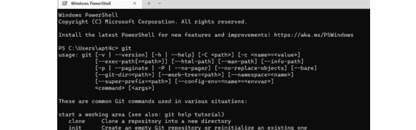

通常将 Git 作为其日常工作流的一部分，通过实践可以变得精通。本章末尾可选附录讨论了更多可以使用 Git 完成的操作。这些任务在本书的范围内并不是必要的。

### 5.5.2 GitHub

接下来，我们将回顾 GitHub，它是一个基于 Git 的流行的软件开发和版本控制托管服务。GitHub 还提供了用于软件功能请求、任务管理、持续集成和项目组件的工具。有关 GitHub 的更多细节，请参见 [22]。

GitHub 和 Git 经常被混淆，这里需要说明。Git 可以独立于 GitHub（或 GitLab 等类似服务）用于版本控制。然而，要在网络上与其他用户协作版本控制软件，则需要像 GitHub 这样的工具。许多用户选择 GitHub 是因为它提供了良好的用户界面和许多实用的功能。

### 5.5.3 GitHub 设置和课程仓库下载

在本节中，你将创建一个 GitHub 账户，创建课程仓库的独立副本（派生仓库/fork），并将仓库下载到你的计算机（克隆派生的副本）。这将提供对所有材料的持续访问。图 5.1 展示了仓库对象。当仓库克隆时，计算机上的本地副本与 GitHub 账户中的远程副本之间会链接。箭头显示了该链接。

### 创建 GitHub 账户

如果你没有 GitHub 账户，请访问 GitHub 网站创建一个：https://github.com/

注册过程会要求邮箱地址、用户名和密码。

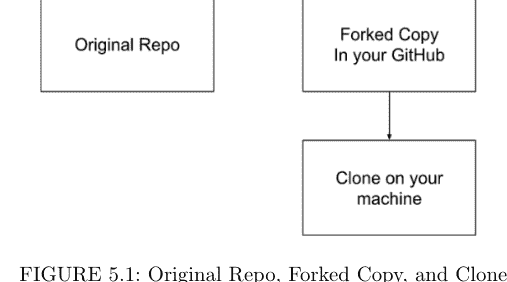

接下来，创建一个个人访问令牌（personal access token），它是使用密码进行验证的替代方案。按照以下步骤操作：

1. 在右上角，点击你的头像，然后点击 Settings（设置）

2. 在左侧边栏，点击底部的 Developer settings（开发者设置），然后点击 Personal access tokens

3. 点击 Tokens (classic)，然后点击 generate new token (classic)

4. 在 Note 字段中，为令牌输入描述符，例如 main.token

5. 输入过期日期

6. 点击顶部的 repo 按钮，并滚动到底部

7. 点击 Generate token

8. 将令牌复制并粘贴到文件中并妥善保存

现在你准备好派生课程仓库了。

### 将仓库派送到你的 GitHub 账户

打开另一个标签页并访问这里的 GitHub 课程仓库：

https://github.com/PredictionNN/intro_data_science_course/

课程仓库的首页（如图 5.2 所示）包含每个学期的文件夹、说明以及一个作为教学大纲的 README 文件等内容。

要派生仓库，请点击右上角的 Fork 按钮。

> 注意，随着时间的推移，这些步骤可能会发生变化。你可以搜索 GitHub 关于创建个人访问令牌的文档以获取获取的步骤。

## 计算基础知识与设置

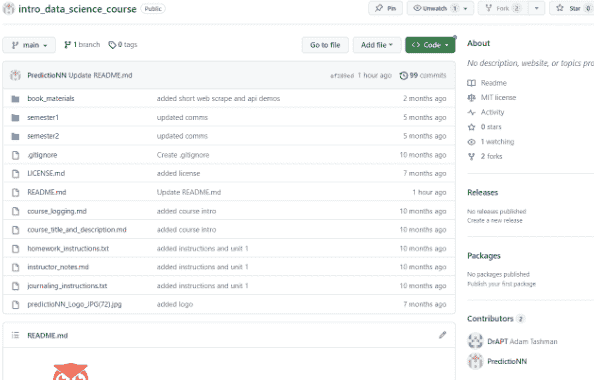

图 5.2：课程仓库首页

接下来，向下滚动并创建 **Fork**。

然后访问你的个人 **GitHub** 页面。仓库应该出现在你的账户中。

> 提示：用户可以对派生的副本进行更改，例如添加帮助笔记和文件。这不会影响原始课程仓库。此外，用户可以从原始课程仓库获取更新，并通过 pull request（拉请求）提交更改进行审核。

### 将派生的副本克隆到你的计算机

在本节中，你将仓库从你的 GitHub 账户克隆到计算机。要克隆仓库，点击 **Code** 按钮。

接下来，在选中 HTTPS 标签的情况下点击复制图标，这将复制仓库的 URL。注意，在图 5.3 所示的框中，**PredictionNN** 处将显示你的用户名。

版本控制

HTTPS SSH GitHub CLI

```
https://github.com/PredictionNN/intro_data_sci
```

使用 Git 或通过 web URL 使用 SVN 进行 checkout。

### 图 5.3：克隆仓库

接下来，打开终端并更改（使用 `cd` 命令）到课程仓库文件夹的目标目录。

图 5.4 展示了将目录更改为

```
C:\Users\apt4c\Documents\repos
```

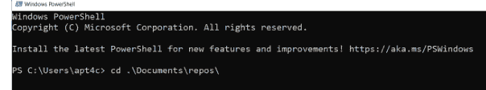

图 5.4：克隆仓库

接下来，使用此命令克隆仓库：

- > git clone [在此处粘贴复制的仓库 URL]

在此例中，命令是：

- > git clone http://github.com/PredictionNN/intro_data_science_course.git

图 5.5 显示了目录更改和克隆命令。注意提示符如何更新更改后的目录。

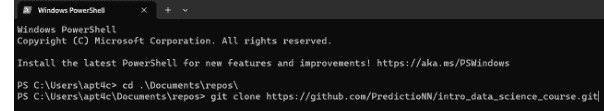

### 图 5.5：克隆仓库

运行 `git clone` 会提示用户输入用户名和密码。可以使用个人访问令牌作为密码。

一旦验证通过，文件夹和全套文件应该复制到特定路径。图 5.6 显示了此示例的输入和输出。如果成功了，请自己祝贺自己吧！

```
git clone intro_data_science_course/
remote:
  Cloning objects: 100% (5/5),
Receiving objects: 100% (5/5), delta 56 KB received
Delta objects: 100% (5/5), reused 0 deltas
Resolving objects: 100% (5/5), done
Total size: 5 KB (delta 56), received 56 KB (delta 56), packed-reused 0
Checked out 11 files from 'github.com/username/intro_data_science_course'
```

图 5.6：克隆过程日志

如果你遇到困难或发现这些步骤中的任何一步令人困惑，请花时间查看网页上的 Git 和 GitHub 帮助页面。

### 5.6 探索代码

我们将使用 JupyterLab 来运行笔记本，因此启动它。

JupyterLab 将在浏览器中打开。左侧面板会出现文件管理器窗口，右侧面板会出现一个工作区（图 5.8）。可以在管理器中导航到不同的文件夹。对于下面的插图，我们导航到课程仓库并打开笔记本：

```
what_kinds_of_problems_can.ipynb
```

文件打开后，我们看到内容是单元格排列的。

单元格可以包含 Markdown（带有特定格式的富文本）或代码。可以使用此处显示的下拉菜单在 Markdown 和代码之间进行切换：

[后续内容逻辑延续...]

页面右上角的部分显示笔记本内核（kernel），例如 Python 3 (ipykernel)。笔记本内核是执行笔记本中代码的计算引擎。对于本书而言，它不需要更改，但关于内核，此时有几点是值得知道的：

- (1) 有时内核会崩溃（这通常很少见），或者计算会停滞

...或者长时间运行。可以通过选择顶部主菜单中的“Kernel（内核） > Restart Kernel（重启内核）”来重启内核。

(2) 可以为不同的目的准备并加载不同的内核。例如，用户可能拥有一个运行深度学习框架的内核。

提示：尽管 Jupyter 运行在浏览器中，但它实际上运行在你的本地机器上，而不是互联网。事实上，运行应用程序和笔记本并不需要互联网连接。

如果你已经到了这一步，并且可以在 JupyterLab 中运行 Jupyter Notebook，我向你推荐它！你已经完成了本书所需的所有设置。

## 5.7.1 IDEs

交互式开发环境（简称 IDE）为代码的开发、调试和测试提供了一个丰富的环境。它们包含多个面板，用于实现各种功能，如编写代码、浏览文件和交互式运行代码。

许多 IDE 具有先进的省时功能，包括代码补全、文本高亮和变量探索。Anaconda 自带了一个支持 Python 的 IDE Spyder。图 5.9 显示了 Spyder 的默认多面板显示，左侧是用于编辑文件的记事本，右上角是对象浏览器，右下方是交互式 Python 控制台。用户可以在控制台的命令行中运行代码。也可以从单独的标签页访问命令历史。

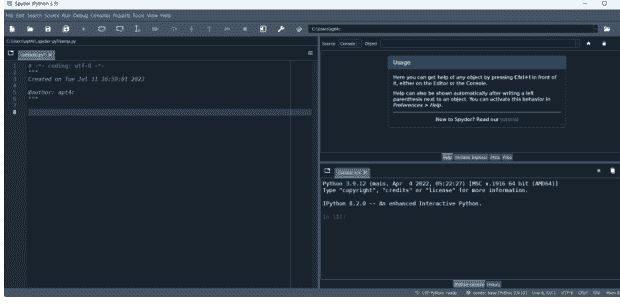

图 5.9：Spyder IDE

另一个流行的 IDE 是 PyCharm。它拥有许多实用功能，包括对多种语言和框架的支持。它有免费版和付费专业版。更多详情，请参阅 https://www.jetbrains.com/pycharm/

虽然 IDE 对软件开发非常有用，但我们将在本书中使用 JupyterLab。JupyterLab 对于交互式脚本和演示非常有用。

## 5.8 云计算计算

云计算是通过互联网提供计算服务。与在本地机器上计算相比，它提供了巨大的灵活性。优势包括：

- 各种处理器和存储器，包括先进的 GPU。

- 硬件的自动伸缩以匹配需求。通过购买匹配峰值需求的机器并在一年的剩余时间里让其闲置，可以非常具有成本效益。

- 高持久性的数据存储，降低了数据丢失的风险。

- 用于自动部署服务（如模型预测）的功能。

- 高级安全功能。

云服务提供通常分为若干类别，这些类别经常相互作用：

- IaaS，或基础设施即服务，提供对服务器、存储和网络的访问。这是运行应用程序和工作负载所需的后端基础架构。

- PaaS，或平台即服务，是一个云环境，包含了构建、运行和管理应用程序的所有内容。

- SaaS，或软件即服务，是按需对云托管应用程序的访问。

云提供商拥有并维护硬件仓库，客户可以通过互联网连接虚拟地访问这些资源。在这一设置中，安全性至关重要，因为组织的数据会被传输并放置在他人共享的外部服务器上。客户仅需他们使用的部分付费，这被称为基于消耗的定价。提供商为不同的用例和模式提供各种各样的硬件和软件。

> 注意，忘记关闭服务器（这种问题被称为“忘了关灯”）会产生账单费用。

例如计算密集型任务和存储密集型任务。仓库是安全且受气候控制的，分布在世界各地，以提供快速的响应和高可用性。数据可以复制到多个位置以减少数据丢失的概率。这种做法提高了数据的持久性；请注意，每份数据副本都会产生成本。计算任务可以设置为随着所需资源的增加或减少自动伸缩。例如，如果客户需求激增，可以增加额外的服务器。

云提供商的服务数量在过去几年迅速增长。早期服务包括计算（用于用 Python 处理批数据）、文件存储。云提供商有亚马逊云 (AWS)、微软 Azure、谷歌云平台 (GCP)、阿里巴巴云和甲拉文云。安全性至关重要，其中许多是机器学习。目前的市场竞争非常激烈。下表列出了三个主流云提供商的服务。数据和关系型（SQL），前者用于非结构化数据，而后者用于结构化数据。

| 服务 | AWS | Azure | GCP |

|---|---|---|

| 计算 | Amazon EC2 | Virtual Machines | Compute Engine |

| 数据 | Amazon S3 | Blob Storage | BigQuery |

| SQL 数据库 | Amazon RDS | SQL Database | Cloud SQL |

| ETL | AWS Glue | Data Factory | Cloud Fusion |


| 机器学习 | SageMaker | Machine Learning | Vertex AI |

## 5.9 章节总结

硬件由计算机的组件组成，而软件是操作计算机的指令。`CPU` 是计算机的大脑，负责处理信息并将其临时存储在内存中。`GPU` 是一种专用核心处理器，非常擅长并行计算。对于机器学习，内存（`RAM`）比硬盘存储快得多，但也更贵。因此，计算机的存储空间通常大于内存。固态硬盘在集成电路中存储数据，使其更小、更快。主板连接了所有主要组件。

计算机上最重要的软件是操作系统。操作系统将文件组织成目录结构。这种结构在 Windows 和非 Windows 操作系统之间，看起来可能有所不同。

文件格式是数据文件的结构。常见的数据格式有 `CSV`、`DOCX` 和 `TXT`。还有许多特殊格式，如用于媒体的 `MP4`、`WAV` 和 `PNG`，以及用于列式数据的 `Parquet`。以合适的格式保存数据可以显著提高速度。

版本控制对于跟踪文件更改至关重要。常用的版本控制系统是 `Git`。`GitHub` 是一个流行的软件开发和版本控制互联网服务，它是基于 `Git` 的。`Shell` 支持与计算机交互。它是一个接收命令、为操作系统解释命令并输出结果的计算机程序。用户通过图形界面 (`GUI`) 或命令行界面与 `Shell` 交互。命令行界面 (`CLI`) 的使用通过终端完成。用户在提示符处输入命令。

云技能对于数据科学和相关职位至关重要。以下是数据科学家 Carla 在云端工作的简图：Carla 到办公室测试她的团队构建的新预测器。她登录 `AWS` 管理控制台并启动 `SageMaker`。完成后，她关闭了实例。

> 提示：避免合并冲突。如果对现有文件进行了更改，在保存之前将其重命名是个好主意。如果在未重命名的情况下进行更改，将会发生合并冲突。这是因为 `Git` 会看到原始仓库和分支（fork）之间的差异，并且它不知道应该保留哪个版本。如果真的发生了，一种解决方案是将更改的文件移动到仓库外并重新运行同步。

从你 `GitHub` 账户上的分支副本，找到图 5.11 所示的同步（Sync）按钮。点击更新（Update）按钮将触发更改。


图5.11：同步分支

通过同步，分支副本将变为最新（图 B）。最后，返回终端，进入仓库目录并运行命令：

```
> git pull
```

这将从分支副本提取更改到你的计算机。这完成了同步（图 C）。

## 5.10.2 初始化 Git 仓库

为了对新项目进行版本控制，必须将其初始化为 Git 仓库。图 5.12 展示了这些步骤。

`mkdir` 命令创建一个新目录（文件夹），名为 `new.project`。

`cd` 命令进入该文件夹。

最后，`git init` 命令将项目初始化为 Git 仓库（图 5.12）。

## 附录：深入使用 Git 和 GitHub


图5.12：初始化仓库

## 5.10.3 跟踪更改

在本节中，我们跟踪仓库中名为 `test.txt` 的新文件的更改。要检查状态，可以输入 `git status` 命令，如图 5.13 所示。为了跟踪文件，运行 `git add` 命令。


图5.13：检查状态

文件显示为绿色，意味着 Git 现在正在跟踪它。Git 管理暂存区（staging area）中的文件。一个或多个文件可以添加到暂存区。例如，带有 `txt` 扩展名的通配符模式可以这样使用：

```
> git add *.txt
```

暂存区中的更改可以使用 `git commit` 命令完成，如图 5.14 所示。该命令包含 `-m` 标志以及提交消息，例如：'added_file'。

## 计算基础知识与设置

```
Windows PowerShell
PS:\Users\name\new_project> git commit -m 'added_file'
[master 8b8cf2d] added test_file
1 file changed(+),0 deletions(-)
create mode 10644 test_file.txt
```

图5.14：运行提交

有用的消息将描述提交了什么。最后，运行 `git status` 将显示暂存区为空，提交完成，如图 5.15 所示。

```
Windows PowerShell
PS:\Users\name\new_project> git status
branch master
nothing to commit, working tree clean
```

图5.15：清理工作目录

用户经常需要运行 `add` 和 `commit` 命令。`add` 命令用于标记要提交的文件，这被称为暂存（staging）。可能并不是所有文件都会被暂存。一旦用户准备就，`commit` 命令将保存并跟踪更改。使用飞行类比，`add` 命令让人登上飞机，而 `commit` 命令相当于起飞。

## 5.11 练习

带有答案的练习可以在以下位置找到：https://github.com/PredictionNN/intro.datascience_course/

1. 解释硬件和软件的区别。

2. 解释 `CPU` 和 `GPU` 的区别。

3. 为什么硬盘上的数据检索比 `RAM` 慢？

4. 什么是核心？

5. 阅读关于管道分隔的文件。为什么有时使用它们而不是 `CSV` 文件？

6. 解释使用命令行界面而不是图形用户界面（`GUI`）的另一个好处。

7. 计算机最重要的软件是什么？

8. 解释 `ls` 和 `ls -la` 的区别。

9. 解释版本控制及其重要性。

10. 正错：你正在独立完成一个项目。为了跟踪更改，你需要使用 `GitHub`。

11. 你正在 `GitHub` 上操作仓库。克隆（clone）和分支（forking）仓库有什么区别？

12. 你打开终端并进入目录。接下来，你在命令行输入 `git clone`。成功克隆仓库需要包含什么？

13. 你创建了 `GitHub` 账户并分支了仓库。你接下来应该预期什么？

    - 仓库将保存在你的本地硬盘上

    - 仓库将复制到你的账户

    - 你将与其他用户面临合并冲突

    - 你需要更新密码

14. 以下哪些是使用 `Anaconda` 用于 Python 的好处？选择所有适用项。

    - 它直接提供 `GPU` 无限计算

    - 它包含了许多使用的模块

    - 它支持不同的操作系统

    - 它是免费的

15. Jupyter notebook 文件具有什么扩展名？

    - `.ipynb`

    - `.PDF`

    - `.JSON`

    - `.CSV`


# 6 数据处理

数据采集并整合后，需要从原始格式进行处理以变得有用。处理有许多方式。某些任务是作为开发功能的一部分完成，例如作为数据科学流水线一部分的交互式处理。例如，数据科学家可能会从文件或数据库加载数据并运行机器学习代码。由于工作是实验性的且不需要实时完成，处理速度可能不是关键的。这种工作通常是开发环境的一部分。

另一方面，处理是对时间敏感的，因为数据可能为一个为客户提供实时建议的模型。如果客户需要等待几秒才能得到响应，她可能会放弃应用程序。此负载运行在生产环境（prod）中。生产环境中的数据处理需要自动化并针对速度进行优化。员工在生产环境中测试是不明智的，因为他们可能会中断交付给客户的产品。

用于处理数据的方法和工具取决于数据的结构化、使用的环境以及其他因素。在本章中，我们将建立处理数据的编码技能。

# 加州野火灾

## 6.1.2 设置相对路径

我们需要告诉计算机去哪里寻找数据。早些时候，我们学习了从工作目录指定一个相对路径。要检查工作目录，可以在单元中运行以下代码：

```python
import os
s.getcwd()
```

这导入了 `os` 模块并使用 `getcwd()` 函数找到当前工作目录。我们稍后会详细介绍 Python 函数，但现在一个简单的定义就足够了：

- *Python 函数接收零或多个输入，运行一组指令，并返回零或多个输出。在理想情况下，它们可以执行很有用的工作，并且易于复用。*

以下是输出：

```
C:\Users\apt4c\Documents\PredictionNN_LLC\repos\intro_data_science_course\semester1\week_03_04_data_types
```

由于笔记本保存在 `week_03.04_data.types` 中，这个工作目录是合理的。路径将用引号括起来，使用单引号或双引号均可。

> 提示：出现双反斜杠是因为我的 Windows 机器使用单个反斜杠作为路径，但 Python 将该字符作为转义字符。为了强制反斜杠的含义，它每次使用时都会添加第二个反斜杠。

为了找到数据，我们从 `week_03.04.data.types` 这样移动：

1. 返回上一目录

2. 在 `datasets` 文件夹中搜索 `california.wildfire.txt` 文件

命令 `..` 将返回上一目录。文件夹和文件之间需要用正斜杠分隔，我们像这样组装相对路径：

```python
PATH_TO_DATA = './../datasets/california_wildfire.txt'
```

在加载数据之前，我们还需要涵盖两个概念：变量和字符串。

## 6.1.3 变量

我们将路径赋值给名为 `PATH_TO_DATA` 的变量。

变量在计算机科学中用于存储程序将使用的信息。它们从根本上与数学中的变量不同，这可能会让初学者感到困惑。在数学中，变量是未知的量。在计算机科学中，变量是已知的，它们的值存储在内存地址中。如果我们想使用内存地址，可以这样使用 `id()` 函数：

```python
id(PATH_TO_DATA)
OUT:
234078058544
```

输出是一个内存地址，其本身并没有特别的启发性。然而，有时这个函数对于检查两个变量是否真的很有用。如果它们指向同一个内存地址，那么它们就是相同的。

Python 变量的命名需要遵循以下规则：

- 名称必须以字母或下划线字符开头

- 名称必须仅包含字母、数字和下划线字符

- 不能使用如 `return` 等保留关键字

另外需要注意的是：名称是大小写敏感的。`VAR`、`VaR` 和 `var` 是不同的变量。让我们尝试打破规则看看会发生什么：

```python
4badvar = 5
OUT:
Input In [11]
4badvar = 5
SyntaxError: invalid syntax
```

Python 抛出了语法错误，因为变量名不合法。在这种情况下，它不喜欢变量以数字开头。

## 6.1.4 字符串

当我们赋值路径变量时，我们执行了：

```python
PATH_TO_DATA = '../datasets/california_wildfire.txt'
```

# 加州野火灾

变量的值为 `'../../datasets/california.wildfire.txt'`。

这种用引号括起来的数据类型是字符串。字符串是我们在之前遇到的四种原始数据类型之一。字符串通常表示文本。Python 允许在字符串周围使用单引号、双引号或三引号。

一旦创建了字符串，就无法修改。如果需要不同的字符串，则必须将其赋值一个新的变量。不能更改的变量被称为不可变对象。这个属性很重要，在我们之后讨论其他数据类型时将会遇到。

## 6.1.5 导入数据

下面的代码设置了数据的完整路径，并使用函数打开文件并从中读取内容。首先，一个快速观察：有些行包含这个字符：`#`

`#` 之后的文本是被计算机忽略的注释。然而，思维注释对人类来说无价，因为它们传达了代码的意图。

```python
# 设置数据文件的路径
PATH_TO_DATA = '../datasets/california_wildfire.txt'

# 打开文件并读取到变量
f1 = open(PATH_TO_DATA, 'r')
data = f1.read()
```

现在，如果进展如预期，`data` 包含了文件中的文本。让我们对 `data` 使用 `print()` 函数来打印其内容。为了简洁起见，我们显示输出的前几行。

```python
print(data)

OUT:
2021年加州野火灾季节是一系列烧过美国加州的火灾。到2021年底，总共记录了8,835次火灾，在全州范围内烧了2,568,948英亩（1,039,616 公顷）。约有3,629 结构建筑被火灾损坏或破坏，至少有七名消防员和两名平民受伤。

数据处理

加州的野火灾季节在持续干旱以及历史性低雨量和水库水位的情况下，经历了异常早的开始。

这令人兴奋，我们能够使用 Python 从文件中读取数据到变量并将其打印到控制台。让我们深入了解 `open()` 和 `read()` 函数。不同的文件格式可以使用不同的函数打开和处理。对于这种 TXT 格式，内置的 `open()` 函数接收一个文件路径和一个模式，并返回一个文件对象。此代码使用读取模式 `'r'`。要打开文件并写入其末尾，可以使用追加模式 `'a'`。接下来，`read()` 返回所有文件内容作为字符串。有关 `open()` 和其他内置函数的更多细节，请参 Python 文档。

```

https://docs.python.org/3/library/functions.html

```

验证对象的类型始终是一个好主意。当错误发生时，通常是因为我们的预期与现实不符：数据类型不同，矩阵的形状与我们想的不同。

```python

type(data)

OUT:

str

```

我们看到 `data` 是一个字符串，这是预期的。

## 6.1.6 文本处理

接下来，让我们处理文章使其更有用。我们可以将数据分成句子。我们将结果保存到名为 `sent` 的变量中并打印。

```python

sent = data.split('.')

print(sent)

```

OUT:

['2021年加州野火灾季节是一系列烧过美国U', '州的加州', ' 到2021年底，总共记录了8,835次火灾，在全州范围内烧了2,568,948英亩（1,039,616 公顷）', ' 约有3,629 结构建筑被火灾破坏，至少有七名消防员和两名平民受伤']

# 加州野火灾

对句号进行分割会删除它们，我们看到了一些新东西：

- 第一，文本片段被引号括起来，这表明它们是字符串。
- 第二，有一个 `'\n\n'` 字符串吗？`'\n\n'` 字符表示换行。回原始文本，第6行和第8行之间有一个间隔。第一个 `'\n\n'` 结束了第6行，第二个 `'\n\n'` 跳过了第7行。
- 第三，输出以 `[` 开始。如果我们查看所有的分割文本，我们会看到它以 `]` 结束。让我们检查 `sent` 的数据类型以理解发生了什么。

```python

type(sent)

OUT:

```
list
```

证明 是一个字符串列表。我们刚刚发现一个新的数据类型。与字符串不同，列表的内容是可以更改的。也可以对列表进行子集操作（索引），以从中提取元素。

让我们从 `sent` 中选择第一个字符串，或元素。

```python
sent[]
```

OUT:

> '2021年加州野火灾季节是一系列烧过美国U'

这返回了第一个字符串。

注意第一个字符串存储在位置零。Python 对所有存储集合的数据类型都使用这一点。`sent[1]` 将包含第二个元素，如果有10个元素，最后一个将存储在 `sent[9]` 中。

此外，`[]` 是子集操作符。我们将使用它对其他数据类型进行子集操作。

接下来，让我们做一些定量分析。列表中有多少个字符串，或句子片段？我们可以使用 `len()` 函数计算列表中元素的数量。

88

数据处理

len(sent)

OUT:

21

运行 `type()` 将返回 `int`，这意味着该值是一个整数。

将文档拆分为单词，或者称为分词（word tokenization），是语言处理中一个常见且有效的步骤。例如，这有助于推断主题。接下来，我们将对 `sent` 中的第一个字符串进行分词。我们可以使用 `split()` 函数按照空格进行分割。

```
tokens = sent[0].split(' ')
print(tokens)
```

OUT:

```
['2021', 'California', 'wildfire', 'season', 'was', 'a', 'series', 'of', 'wildfires', 'that', 'burned', 'across', 'the', 'U']
```

注意这段操作：它产生了一个字符串列表，其中每个字符串都是单词。Python 数据类型可以通过其标点符号来识别；字符串被引号包围，列表被方括号包围。

接下来，我们想要将每个单词与其在句子中的位置关联。如果我们想在模型中加入文本数据，这将非常有用。我们无法直接将文本输入模型，因此需要将其数值化表示。

以下是我们想要构建的内容：

```
word_index = {'2021': 0, 'California': 2, 'wildfire': 3, 'season': 4, 'was': 5, 'series': 7, 'of': 8, 'wildfires': 9, 'that': 10, 'burned': 11, 'across': 12, 'the': 13, 'U': 14}
```

这种名为字典（dictionary）的 Python 对象存储了键值对。在这种情况下，键是字符串，值是表示位置的整数（从零开始）。下面的代码片段提供了解决方案。

```python
# 空字典
word_index = {}
```

```python
for ix, token in enumerate(tokens):
    word_index[token] = ix
```

```python
print(word_index)
```

OUT:

# 加利福尼亚野火


{'The': 0, '2021': 1, 'California': 2, 'wildfire': 3, 'season': 4, 'was': 5, 'a': 6, 'series': 7, 'of': 8, 'wildfires': 9, 'that': 10, 'burned': 11, 'across': 12, 'the': 13, 'U': 14}

字典使用括号来封装其数据，第一条命令创建一个空字典。

接下来，`for` 循环遍历列表中的每个单词。`enumerate()` 函数为循环的每一步产生两个结果：

- 变量 `ix` 充当计数器。在第一步中，它持有值 0。在下一步中，它将是 1、2，依此类推。`ix` 的名称是任意的。

- 变量 `token` 将持有每一步的数据。在第一步中，它持有 'The'；在第二步中，它持有 '2021'，依此类推。`token` 的名称也是任意的。

让我们看看循环的第一步。在这一步，`ix = 0`，`token = 'The'`。

接下来发生的是将值存储在字典的精确位置。

这条简短的语句：

```python
word_index[token] = ix
```

给出了指令将值 0 存储在键为 'The' 的字典中。

如果我们想检查键为 'The' 时字典中的值，可以运行：

```python
word_index['The']
```

输出为 0。

随后循环对其他每个单词执行相同的工作，将单词作为键，将计数器作为值。

在 `for` 循环处理完列表中的每个单词后，它会停止。在继续之前，请确认这段代码运行有效并运行它。打印中间结果通常很有帮助。这里有一个测试代码片段，它将打印每次迭代的计数器和值：

```python
for ix, token in enumerate(tokens):
    print(ix, token)
    word_index[token] = ix
```

本练习的最后一个任务是提取包含重复单词的字符串，并运行命令来确定唯一的单词。一种名为 *set*（集合）的 Python 数据类型可以帮助我们完成任务。*set* 存储一个对象集合。如果对象不是唯一的，它会去重以使其唯一。这在数据科学中处理唯一对象（如唯一用户和唯一产品）非常有用。

现在，让我们对列表进行子集处理并产生单词标记：

```python
sent[9].split(' ')
```

```python
['\nThe', 'long', 'term', 'trend', 'is', 'that', 'wildfires', 'in', 'the', 'state', 'are', 'increasing', 'due', 'to', 'climate', 'change', 'in', 'California']
```

注意这个列表不是唯一的，因为 'in' 出现了两次。

解决方案是：在语句周围套上 `set()`：

```python
set(sent[9].split(' '))
```

```python
['\nThe', 'California', 'are', 'change', 'climate', 'due', 'in', 'increasing', 'is', 'long', 'state', 'term', 'that', 'to', 'trend', 'wildfires']
```

这个对象是一个集合，且顺序是不保证的。

## 6.2 统计豹数量

数据代表了通过中国和俄罗斯的相机陷阱捕到的东北洲豹的数量和性别。在某些情况下，中国和俄罗斯的总数超过了总量，这是因为有些豹在两个国家都被观察到。

| 年份 | 捕获地点 | 雌性 | 雄性 | 幼崽 | 未知 | 总计 |
|---|---|---|---|---|---|---|
| 2014 | 中国 | 14 | 11 | 2 | 0 | 27 |
| 2014 | 俄罗斯 | 25 | 21 | 3 | 2 | 51 |
| 2014 | 中国与俄罗斯 | 33 | 24 | 5 | 2 | 64 |
| 2015 | 中国 | 10 | 12 | 0 | 0 | 22 |
| 2015 | 俄罗斯 | 24 | 20 | 8 | 3 | 55 |
| 2015 | 中国与俄罗斯 | 31 | 25 | 8 | 3 | 67 |

理解数据含义的重要性无论如何强调都不为过。

### 统计豹子

```python
list(df.columns)
```

OUT:

```
['year','location_captured','females','males','cubs', 'unknown_sex','total']
```

`dataframe` 的第一行是一组被称为索引（indexes）的值。这些值由 `pandas` 生成。索引列可以用于引用行，可以通过运行以下代码提取它们：

```python
df.index
```

OUT:

```
RangeIndex(start=0, stop=6, step=1)
```

我们可以像这样对第一行进行子集：

```python
df.loc[0]
```

```
year 2014
location_captured China
females 14
males 11
cubs 2
unknown_sex 0
total 27
Name: 0, dtype: object
```

当返回单行或单列时，其数据类型实际上不是 `pandas` `dataframe`，而是 `pandas` `Series`。

#### 6.2.2 子集

对多行进行子集会产生一个 `dataframe`。在这里，我们选择了从 0 到 2 的行：

```python
df.loc[0:2]
```

| year | location_captured | females | males | cubs | unknown_sex | total |
|---|---|---|---|---|---|---|
| 2014 | China | 14 | 11 | 2 | 0 | 27 |
| 2014 | Russia | 25 | 21 | 3 | 2 | 51 |
| 2014 | China & Russia | 33 | 24 | 5 | 2 | 64 |

选择 `year` 列：

```python
df['year']
```

OUT:

| | |
|---|---|
| 0 | 2014 |
| 1 | 2014 |
| 2 | 2014 |
| 3 | 2015 |
| 4 | 2015 |
| 5 | 2015 |

Name: year, dtype: int64

使用列表选择多个列：

```python
df[['year','location_captured']]
```

OUT:

| index | year | location_captured |
| 0 | 2014 | China |
| 1 | 2014 | Russia |
| 2 | 2014 | China & Russia |
| 3 | 2015 | China |
| 4 | 2015 | Russia |
| 5 | 2015 | China & Russia |

接下来，让我们变得稍微高级一点。我们将对数据应用一些过滤。选择 `location_captured` 为 `China` 的所有行：

```python
df[location_captured == 'China']
```

OUT:

| year | location_captured | females | males | cubs | unknown_sex | total |
|---|---|---|---|---|---|---|
| 2014 | China | 14 | 11 | 2 | 0 | 27 |
| 2015 | China | 10 | 12 | 0 | 0 | 22 |

让我们拆解一下。表达式 `df.location_captured == 'China'` 验证了 `dataframe` 中每行的 `location_captured` 值是否等于 'China'。结果是一系列布尔值（Boolean），即 True/False。这些数据类型（bool）对我们来说是新事物。

```
0 True
1 False
2 False
3 True
4 False
5 False
```

布尔值用于过滤 `dataframe` 的行。这意味着只有值为 True 的行才会被返回，这解释了为什么第 0 和第 3 行被输出了。我们如何确定 2015 年女性数量少于 15 的地点？由于我们对 `females` 和 `year` 应用了标准，我们可以对多个条件进行过滤来回答这个问题：

```python
df[(df.females < 15) & (df.year == 2015)]
```

OUT:

| year | location_captured | females | males | cubs | unknown_sex | total |
|---|---|---|---|---|---|---|
| 2015 | China | 10 | 12 | 0 | 0 | 22 |

注意 `&` 是 AND 运算符（注意 `|` 是 OR 运算符）。这得到的结果是正确的，但它返回了不必要的列。让我们调整语句只选择 `location_captured` 列。

```python
df[(df.females < 15) & (df.year == 2015)]['location_captured']
```

OUT:

```
China
```

这得到了所需的答案。我们用于对行和列进行子集的语法为：

```python
dataframe[row_condition][column_condition]
```

列条件很简单；它就是列名。如果我们需要几列，可以把它们放入列表中。我们使用 `dataframe` 方法对数据进行划分。对于更复杂的子集操作，使用 SQL 是有意义的，SQL 是结构化查询语言的缩写。我们将在书的后面部分深入 SQL。

#### 6.2.3 创建新列

接下来，我们想要进行简单的计算并将结果存储在 `dataframe` 中：对于每一行，女性和男性的数量（这些是已知性别的成年人）。由于操作简单，我们可以写一个涉及必要列的表达式，并使用等号将结果赋值给新变量，如下：

```python
df['f_and_m'] = df['females'] + df['males']
```

或者，我们可以在右侧使用点符号，这样更短且更受青睐：

```python
df['f_and_m'] = df.females + df.males
```

OUT:

| year | location_captured | females | males | cubs | unknown_sex | total | f_and_m |
|---|---|---|---|---|---|---|---|
| 2014 | China | 14 | 11 | 2 | 0 | 27 | 25 |
| 2014 | Russia | 25 | 21 | 3 | 2 | 51 | 46 |
| 2014 | China & Russia | 33 | 24 | 5 | 2 | 64 | 57 |
| 2015 | China | 10 | 12 | 0 | 0 | 22 | |
| 2015 | Russia | 24 | 20 | 8 | 3 | 55 | 44 |
| 2015 | China & Russia | 31 | 25 | 8 | 3 | 67 | 56 |

> * females and unknown_sex 是缩写。index 被抑制了。

`Pandas` 对每行执行了此操作，这非常方便。对于更复杂的行操作，我们可以定义一个函数并使用 `apply()` 函数。我们稍后会讨论。

创建新变量时不能使用点符号；这是无效语法。看发生了什么：

```python
df.f_and_m = df.females + df.males
```

OUT:

```
UserWarning: Pandas't allow columns to be created via attribute - see https://pandas.pydata.org/pandas-docs/stable/indexing.html#attribute-access
```

除非我们将结果赋值给变量。我们将对这个数据集做两件事：排序数据并保存。

#### 6.2.4 排序

我们可以通过传递列名列表给 `sort_values()` 对一列或多列进行排序。从高到低（降序）设置参数 `ascending=False`。

```python
df.sort_values(['f_and_m'], ascending=False, inplace=True)
```

OUT:

| year | location_captured | females | males | cubs | unknown_sex | total | f_and_m |
|---|---|---|---|---|---|---|---|
| 2014 | China & Russia | 33 | 24 | 5 | 2 | 64 | 57 |
| 2015 | China & Russia | 31 | 25 | 8 | 3 | 67 | 56 |
| 2014 | Russia | 25 | 21 | 3 | 2 | 51 | 46 |
| 2015 | Russia | 24 | 20 | 8 | 3 | 55 | 44 |
| 2014 | China | 14 | 11 | 2 | 0 | 27 | 25 |
| 2015 | China | 10 | 12 | 0 | 0 | 22 | |

#### 6.2.5 保存 DataFrame

现在我们有了最终表格，可以将其保存到文件中以避免重复工作。作为提醒，`./` 前缀表示保存到当前目录。`to_csv()` 函数将 `dataframe` 保存到 CSV 文件。

```python
PATH_TO_OUTPUT = './leopard_final.csv'
df.to_csv(PATH_TO_OUTPUT)
```

## 6.3 患者血压

### 6.3.1 数据验证

探索和验证数据始终很重要。可能隐藏着错误，在进行重要分析之前解决它们至关重要。在这个练习中，我们将分析一些虚拟的血压数据。它包含了对多个患者收缩压和舒张压的重复测量。正如我们将发现的，有一些问题需要处理。文件 是 CSV 格式。让我们读取文件并查看前几记录。

```python
import pandas as pd

# 设置数据文件路径
PATH_TO_DATA = '../datasets/blood_pressure.csv'

# 读取 CSV 文件并打印数据
df = pd.read_csv(PATH_TO_DATA)
df.head()
```

OUT:

| index | patientid | date | bp_systolic | bp_diastolic |
|---|---|---|---|---|
| 0 | 1 | 02/01/22 | 120 | 76.0 |
| 1 | 1 | 02/02/22 | 127 | 75.0 |
| 2 | 1 | 02/03/22 | 127 | 70.0 |
| 3 | 1 | 02/04/22 | 127 | 76.0 |
| 4 | 1 | 02/05/22 | 120 | 74.0 |

注意数据类型上存在一些不规则之处。收缩压列包含整数，而舒张压列看起来是浮点值。为了一致性并避免以后出现问题，我们应该进一步调查数据，思考什么类型合理并进行相应的转换。

通过获取 `dtypes` 来检查 `dataframe` 的类型：

```python
df.dtypes
```

OUT:

```
patientid    int64
date         object
bp_systolic  int64
bp_diastolic float64
```

这证实了我们的怀疑。需要注意的是，列中的缺失值会导致整个列变为浮点类型。让我们通过调用 `describe()` 来汇总数据，这是计算列计数、位数、平均值和标准差（std）的快速方法。

```python
df.describe()
```

| | patientid | bp_systolic | bp_diastolic |
|---|---|---|---|
| count | 98.000000 | 98.000000 | 98.000000 |
| mean | 2.595960 | 124.171717 | 75.653061 |
| std | 0.978537 | 16.744198 | 5.143512 |
| min | 1.000000 | -26.000000 | 70.000000 |
| 25% | 2.000000 | 122.000000 | 73.250000 |
| 50% | 3.000000 | 128.000000 | 74.000000 |
| 75% | 3.000000 | 128.000000 | 77.000000 |
| max | 4.000000 | 200.000000 | 120.000000 |

### 患者血压

```python
df[df.bp_diastolic.isnull() == True]
```

这会对行设置一个过滤条件：对于任何 `bp_diastolic` 缺失的行，结果将为 `True`。然后，根据生成的布尔值对数据框进行过滤，并返回所有条件为 `True` 的行。

输出：

| index | patientid | date | bp_systolic | bp_diastolic |
|---|---|---|---|---|
| 6 | 1 | 02/07/22 | 121 | NaN |

这分离出了包含缺失值（编码为 `NaN`）的行，并解释了为什么该列是浮点型。接下来，我们应该决定如何插补（或填充）此此值。

#### 6.3.2 插补


Pandas 提供了多种插补值的方法，例如用中位数、平均值、自定义值或上一个缺失值进行替换。与数据科学中的所有工作一样，考虑概念上的合理性至关重要。对于任何被插补的变量，分析师都需要询问什么是合适的。可能每个患者都需要其特定的插补方法。

对于此数据集，有多个患者，每个患者有多个观测值。使用每个患者的数据进行插补可能比跨所有患者计算统计量更有意义。这里选择的方法是使用上一个非缺失值进行插补，或者说“最后观测值向前填充”（LVCF）。这可能不是该时间点的真实测量值，但可能是合理的。pandas 的 `ffill()` 函数可以实现这一点，通过传递参数 `inplace=True` 将直接更新数据框中的值。

```python
df.bp_diastolic.ffill(inplace=True)
```

再次检查缺失值将不再返回记录，意味着插补成功。

```python
df[df.bp_diastolic.isnull() == True]
```

输出：

| index | patientid | date | bp_systolic | bp_diastolic |
|---|---|---|---|---|

查看之前缺失行周围的记录确认了 LVCF 的效果。

> 唯一患者的数量可以通过 `len(df.patientid.unique())` 计算。

## 6.3.3 数据类型转换

接下来，让我们使血压的数据类型匹配。在这种情况下，由于我们不测量带小数精度的血压，收缩压和舒张压都可以是整数。这意味着将 `bp.diastolic` 转换为整数，可以如下操作：

```python
df = df.astype({'bp_diastolic':np.int32})
```

我们使用了 `astype()` 函数，传递了一个以列名为键、以所需数据类型为值的字典。如果需要，我们还可以传递额外的键值对来转换多个列。

现在我们检查数据类型，发现 `bp.diastolic` 已经具有理想的整数类型。

```python
df.dtypes
```

`patientid`    `int64`
`date`          `object`
`bp_systolic`  `int64`
`bp_diastolic`  `int32`

数据类型转换会产生一个新的数据框。我们可以通过在赋值之前调用 `id()` 并注意到数据框的内存地址不同来证明这一点。

```python
id(df)
264196136432
```

```python
df = df.astype({'bp_diastolic':np.int32})
```

```python
id(df)
2641537679264
```

| index | patientid | date | bp_systolic | bp_diastolic |
|---|---|---|---|---|

| 5 | 1 | 02/06/22 | 129 | 75.0 |
| 6 | 1 | 02/07/22 | 121 | 75.0 |
| 7 | 1 | 02/08/22 | 125 | 74.0 |

## 总结

## 6.3.4 异常观测值

从 `describe()` 产生的统计摘要来看，收缩压包含一个负值和一个 200 的极大值。负血压不符合逻辑，而 200 这个值虽然可能但令人担忧。处理负值有不同的方案。在这里我们设置了一条规则，将负值替换为缺失值，然后用之前的值填充。

```python
df.loc[df.bp_systolic < 0, 'bp_systolic'] = np.nan
df.bp_diastolic.ffill(inplace=True)
```

接下来，让我们转向“十分分钟 Pandas”指南。

## 6.4 总结

我们在构建方面取得了巨大进展。在下一章中，我们将学习数据的存储和检索。

## 6.5 练习

带有答案的练习标记为 **S**。

- 解释绝对路径和相对路径之间的区别。为什么优先使用绝对路径？

- 你正在处理一个路径为 `C:\Users\abc\Documents\some_file.csv` 的文件。这是运行 Windows 操作系统吗？解释你的答案。

- 在我们的文本分析中，我们通过句号分割。你认为按句号分割有什么问题吗？

- 对于列出的每个类型转换，说明它们会成功还是失败：

    - a) 将字符串转换为整数

    - b) 将字符串转换为浮点

    - c) 将整数转换为字符串

    - d) 将整数转换为浮点

- 对于野火灾文章，按空格进行分词并计算标记的平均长度。例如，由“california wildfire”组成的文章将产生“california”（长度为 10）和“wildfire”（长度为 8），平均长度为 9。

- 提供一个应该存储在字典而不是列表的数据示例。

- 错误或正确：pandas 数据框最适用于非结构化数据。

- 野火灾文章包括创建了一个名为 `word_index` 的字典，它以字符串为键，位置值为值。编写一个函数接收 `word_index` 作为输入，并返回一个键值反转的新字典。即，键应该持有位置，值应该持有字符串。

)

# 7 数据存储与检索

在本章中，我们将学习数据库以及如何使用它们来存储和检索数据。我们可以将数据库认为是一种支持数据创建（C）、检索（R）、更新（U）和删除（D）的工具。这些操作被称为 CRUD 操作，它们对数据库提出了最基本的要求。例如，根据这个定义，我们的大脑符合数据库的定义。遗憾的是，大脑倾向于忘记使用不充分的内容。为了让一个数据库变得可信且有用，它需要提供：

- 完美的检索，以便每条数据都能被访问

- 速度，以便所有操作都是快速的……即使在大规模下也是如此

- 一致性，以便如果两个用户同时发出相同的请求，他们会看到相同的结果

- 易于纠错

不同的数据库系统提供不同的功能。对于大规模数据密集型应用程序，无法完美地满足所有特性，必须进行权衡。然而，在心中记住 CRUD 以及对一个实用数据库的考虑因素是有用的。

我们没有足够的空间来对数据库进行详细处理，也没有空间讨论适当的设计。关于这方面，一本很好的书籍是 [25]。在这里，我们将从一个新加入组织的数据科学家的视角来接触数据库。在这种情况下，一个数据库（或一组数据库）已经就绪。结构可能由数据架构师设计，并由数据工程师构建。数据可能由自动化过程保存。然后，数据科学家将需要访问数据并开始检索。如果需要实现这一点，数据科学家必须学习一种编程语言来查询数据。

数据库类型分为关系型数据库和非关系型数据库。在编写时，大多数数据库仍然关系型数据库。关系型数据库的语言是 SQL。非关系型数据库被称为 NoSQL 数据库，表示不使用 SQL 进行查询。关系型数据库要求数据按照预定义的模式（schema）结构化。现代世界的许多数据——包括文档、图像和视频——并不适用于模式

例如，Callie 在平板电脑上使用了 Sharpen 30 次，所有设备共使用 52 次。根据她的活动，她被归类为中度用户。假设在接下来的周里，她在平板电脑上又有 15 次使用。让我们进一步假设，在所有设备上使用 Sharpen 达到60 次或更多的用户被归类为高级用户。在这种情况下，Callie 的状态应该更新为高级用户。想象一下这一操作仅针对表的第二条记录，而不是第一条记录。这会导致数据不一致，使得数据库变得不那么有用。问题的核心是数据的重复。如果我们在单独的表中维护用户状态，每个用户只有一条记录，就可以避免这个问题。这里是使用两个表的数据库看起来可能像这样：

### 学生 App 记录

| name | device | app | sessions |
|---|---|---|---|

| Callie | phone | Sharpen | 22 |
| Callie | tablet | Sharpen | 30 |
| James | laptop | PebbleGo | 40 |
| Avery | phone | Duolingo | 2 |

### 学生状态

| name | status |
|---|---|

| Callie | Moderate User |
| James | Power User |
| Avery | New User |

鉴于这种新结构，用户状态不再重复。这减少了数据不一致的概率。事实上，第一张表可以拆分为更小的表。我们在这里不会这样做，但重要的点是，每个概念都应该存储在单独的表中。用户的状态是一个概念，这些数据应该存储在一张表中。另一个概念是设备，唯一的设备应该存储在另一张表中。这样，结构更整洁且更不容易出错。

当将数据拆分为每个概念一个表时，需要处理复杂度；当所需数据跨越多个表时，就需要对表进行连接（join）。如果所需数据在 A、B、C 三张表中，我们需要在 A 和 B 之间进行连接，并在 B 和 C 之间进行第二次连接。这是关系型数据库的基础——它让它们被称为“关系型”。当无法进行连接或不需要连接时，那么关系型数据库就不是该任务的正确工具。

图 7.1 显示了一个包含两个表的数据库。Customer 表存储所有客户数据，Invoice 表存储所有发票。这遵循关系型数据库“每个概念一个表”的原则。如果我们想合并信息，可以通过在共同字段上连接记录来完成。在这种情况下，该字段出现在两个表中，并可以被用于连接。

### 7.1.1 主键

`ssn` 字段是 Customer 表中的主键 (PK)。主键：

- 必须具有唯一值以区分不同的记录

- 可用于连接其他表

| Customer |
|---|---|

| ssn (primary key) |
| first_name |
| last_name |
| email |
| Invoice |
|---|---|

| order_number |
| price |
| quantity |
| ssn |

图 7.1: 包含两个表的数据库

数据存储与检索

示例 1：社会安全号码作为主键

| ssn | first_name | last_name | email |
|---|---|---|---|

| 123-45-6789 | Sarah | Connor | sconnor@gmail.com |
| 544-25-4764 | Sarah | Connor | sjconnor@gmail.com |
| 112-37-9680 | Rob | Frey | bfrey@gmail.com |

示例 2：复合键

| ticker (PK) | date (PK) | adjusted_close |
|---|---|---|

| XYZ | 2012-01-03 | 0.85 |
| XYZ | 2012-01-04 | 0.78 |
| XYZ | 2012-01-05 | 0.79 |

```
SELECT
product_id,
product_name
FROM my_table
ORDER BY product_name;
```

此查询从表中所有行的 `product_id` 列和 `product_name` 列中检索数据，并按 `product_name` 排序。

实际问题

作为一名数据科学家，建立 SQL 技能至关重要，因为数据操作是工作的很大一部分。许多公司包含技术面试，他们期望你能编写正确的 SQL 代码来管理数据。精通 SQL 的方法是对具有挑战性的代码示例进行练习，将其拆解直到变得显而易见。对于被复杂查询感到沮丧的学生来说，后退一步思考如何将其分解为子问题会有帮助。然后这些子问题就可以重新组合。

所有的 SQL 都应该被存储和版本化，因为它是代码。例如，构建表和插入数据的命令可以保存在 GitHub 的文件中。这使得利益相关者了解做了什么，并在需要时复制工作。

背景介绍足够了，现在开始工作吧！在下一节中，我们将使用 SQLite。我们将从下载并安装 SQLite 开始。然后我们将启动 Python 并与之交互。具体来说，我们将在 Python 中编写并执行 SQL 来完成以下操作：

- 创建表

- 将记录插入到表中

- 查询数据

# 音乐查询：单表

并从终端与 SQLite 操作。最后，我们将从 Python 与 SQLite 操作。在下一节中，我们将将其扩展到对多个表的操作。课程仓库包含使用不同数据以丰富多样性的笔记本（notebooks）演示。这些笔记本位于此处：

```
semester2/week_09_11_relational_databases_and_sql/
```

# I. 下载与安装

从 `https://www.sqlite.org/download.html` 下载 SQLite。

Windows 用户将安装：

```
sqlite-tools-win32-x86-[some_number].zip
```

Mac 用户将安装：

```
sqlite-tools-osx-x86-[some_number].zip
```

其中 `[some_number]` 是随时间变化的版本号。

如果 sqlite 文件夹名称很长，可以将其缩短为 `sqlite`，例如。注意数据库保存的位置很重要。该位置就是数据库路径。

在 Windows 机器上，路径可能看起来像：

```
C:\Users\apt4c\Documents\database\sqlite
```

在 Mac 上，它可能看起来像：

```
/user/apt4c/Documents/database/sqlite
```

# II. 启动终端并与 SQLite 操作

安装后的下一步是启动终端。Windows 用户将按 START 键并输入 CMD。

在终端中，需要切换目录到数据库路径：

```
> cd C:\Users\apt4c\Documents\database\sqlite
```

其中：

`'>'` 是提示符，`cd` 是切换目录的命令。

接下来，我们使用此命令创建一个名为 musicians 的数据库：

```
> sqlite3 musicians.db
```

输出将看起来像这样：

```
SQLite version 3.39.4 2022-09-29 15:55:41
Enter ".help" for usage hints.
```

提示符将变为：

```
sqlite3>
```

接下来，使用此命令列出数据库：

```
sqlite> .databases
```

输出（OUT）：

main: C:\Users\apt4c\Documents\database\sqlite\musicians.db r/w

```输出，输出应该包含 `musicians.db`。在 `musicians` 文件夹中，应该有一个名为 `musicians.db` 的文件，用于存储数据库。

可以在终端中与数据库交互，但在这里我们将切换到 Python。

# III. 从 Python 与 SQLite 操作

Python 拥有用于处理数据库的 API。在这里我们使用 SQLite API。该 API 使用特定的代码封装 SQL 查询以进行执行。为了区分 SQL 代码和封装器，查询将在每个代码段中定义。我们开始导入模块并设置数据库的相对路径。这假设工作目录是：

C:\Users\apt4c\Documents\database

```python
#  SQLite API
import sqlite3
```

```python
# 设置数据库的相对路径
PATH_TO_DB = "./sqlite/musicians.db"
```

接下来，我们创建数据库的连接，游标（cursor）允许我们定义一组行并对它们执行复杂的逻辑。

```python
# 创建数据库连接
conn = sqlite3.connect(PATH_TO_DB)
```

```python
# 创建游标
cur = conn.cursor()
```

接下来，我们定义一些艺术家数据。对于这个小示例，我们创建了一个包含艺术家名称和流派的元组组列表。例如，泰勒·斯威夫（Taylor Swift）的音乐可以被类为乡村和流行。

```python
artists = [
    ('Taylor Swift', ['country', 'pop']),
    ('Chris Stapleton', ['country', 'soul', 'rock', 'bluegrass']),
    ('Bono Hewson', ['rock', 'pop'])
]
```

要在数据库中创建表，我们需要提供模式（schema）。对于每个字段，模式需要提供：

- 字段名称
- 字段类型
- 可选属性，例如字段是否允许为空

（注：此处原文逻辑似乎有重复或错乱，已按逻辑翻译）在数据库中创建表，我们需要提供模式。对于每个字段，模式需要提供：

- 字段名称
- 字段类型
- 可选属性

```python
query = 'CREATE TABLE artists (artist_name string, genre string);'
```

```python
泰勒·斯威夫的音乐可以被类为乡村和流行。

（注：后续部分原文文本可能存在重复或逻辑断裂）接下来，我们使用此命令插入多条记录。对于每一行记录，占位符 `?,?` 将被填充数据。

```python
query = 'INSERT INTO artists VALUES (?,?);'
cur.executany(query, artists)
conn.commit()
```

```python
query = 'SELECT * FROM artists;
for row in conn.execute(query):
    print(row)
```

输出（OUT）：

('Taylor Swift', 'country')
('Chris Stapleton', 'country')
('Bono Hewson', 'rock')

# 音乐查询：多表

- 按分组变量 `venue.state` 对记录进行分组

- 统计每个组的记录数量

- 汇总每个状态的计数总和

可以通过以下方式进行聚合：


```python
query = 'SELECT venue_state
```

```python
for row in conn.execute(query):
  print(row)
OUT:
  ('CA', 2)
  ('CD', 1)
  ('NY', 1)
```

`SELECT venue_state, count(*)` 这行代码将返回每个状态及其对应的计数。

`GROUP BY venue_state` 这行代码将执行分组操作。

从结果集中，我们将获得包含每个状态及其相应场馆数量的元组。`GROUP BY` 命令非常强大，可以跨多个分组变量进行聚合。

在下一节中，我们将介绍关系型数据库的主要目的：数据集连接。这将允许我们能够跨数据库提取信息的查询。

# 7.4 音乐查询：多表

在进行数据科学研究时，所需的数据可能分布在两个或多个表中。在这种情况下，我们可以根据共同字段一次连接两个表。

连接（Joins）会带来一些复杂性，因此我们首先学习一些连接示例。然后，我们将继续构建音乐艺术家的示例。

## 连接

常见的连接类型有 `INNER`（内）、`OUTER`（外）、`LEFT`（左）和 `RIGHT`（右）。这些选项为连接包含缺失数据的表提供了灵活性。当连接两个表 `L` 和 `R` 时，我们称 `L` 为左表，`R` 为右表。让我们来看一些示例数据以理解不同连接的工作原理。

表：L

| id | first_name | favorite_pet |
|---|---|---|
| 0 | Taylor | rabbit |
| 1 | Chris | cat |
| 2 | Bono | dog |

表：R

| id | first_name | favorite_number |
|---|---|---|
| 1 | Chris | 314 |
| 2 | Bono | 5 |
| 3 | Cher | 12 |

假设我们根据 `id` 字段连接表 `L` 和 `R`，并选择所有唯一列。两张表都有 `id = 1` 和 `2` 的记录；我们说这些记录是匹配的。然而，`id=0` 只在 `L` 中，`id=3` 只在 `R` 中。我们应该使用的连接类型取决于我们想要保留哪些记录。

`LEFT join`（左连接）将返回左表中的所有记录，以及右表中仅匹配的记录。结果如下：

| id | first_name | favorite_pet | favorite_number |
|---|---|---|---|
| 0 | Taylor | rabbit | None |
| 1 | Chris | cat | 314 |
| 2 | Bono | dog | 5 |

由于我们使用了 `LEFT join`，所以只包含了来自表 `L` 的记录，因此 `Cher` 被排除了。由于 `Taylor` 不在表 `R` 中，我们没有她的最喜数字。

`RIGHT join`（右连接）将返回右表中的所有记录，以及左表中仅匹配的记录。结果如下：

### RIGHT JOIN

| id | first_name | favorite_pet | favorite_number |
|---|---|---|---|
| 1 | Chris | cat | 314 |
| 2 | Bono | dog | 5 |
| 3 | Cher | None | 12 |

由于我们使用了 `RIGHT join`，所以只包含了来自表 `R` 的记录，因此 `Taylor` 排除了。由于 `Cher` 不在表 `L` 中，我们没有她的最喜宠物。

`INNER join`（内连接）将仅返回两个表中匹配的记录。这意味着任何不匹配的记录都将在连接中被排除。结果如下：

### INNER JOIN

| id | first_name | favorite_pet | favorite_number |
|---|---|---|---|
| 1 | Chris | cat | 314 |
| 2 | Bono | dog | 5 |

内连接产生更简单的数据集，因为没有需要处理的缺失值。然而，这意味着记录可能会丢失。抱歉，`Taylor` 和 `Cher`！

`OUTER join`（外连接）将返回表中的所有记录。结果如下：

### OUTER JOIN

| id | first_name | favorite_pet | favorite_number |
|---|---|---|---|
| 0 | Taylor | rabbit | None |
| 1 | Chris | cat | 314 |
| 2 | Bono | dog | 5 |
| 3 | Cher | None | 12 |

外连接可能会产生带有缺失数据的记录，如这种情况所示。

## 连接音乐人表

接下来，我们回到音乐艺术家数据上。我们将在数据库中创建一个名为 `hometown` 的表并传递模式（schema）。这将存储艺术家的家乡。

```python
query = 'CREATE TABLE hometown \
    (artist_name string, hometown_name string);
```

```python
cur.execute(query)
conn.commit()
```

为 `hometown` 表创建一些数据：

```python
data_hometown = [
('Taylor Swift', 'West Reading, Pennsylvania'),
('Chris Stapleton', 'Lexington, Kentucky'),
('Bono Hewon', 'Dublin, Ireland'),
('Rihanna', 'Saint Michael, Barbados')
]
```

注意，`Rihanna` 在这个数据集中，但不在艺术家表中。这将在稍后演示的连接中产生影响。以下代码将家乡记录插入到表中：

```python
query = 'INSERT INTO hometown VALUES (?,?,);'
cur.executemany(query, data_hometown)
conn.commit()
```

接下来，我们查询该表以验证数据已加载：

```python
query = 'SELECT * FROM hometown;
for row in conn.execute(query):
  print(row)
```

OUT:

  ('Taylor Swift', 'West Reading, Pennsylvania')

  ('Chris Stapleton', 'Lexington, Kentucky')

  ('Bono Hewon', 'Dublin, Ireland')

  ('Rihanna', 'Saint Michael, Barbados')

这是正确的。接下来，让我们尝试在 `hometown` 和 `artist` 表上进行一些连接。我们可以使用共同字段 `artist_name` 进行连接。首先，我们运行一个 `INNER JOIN`：

```python
query = 'SELECT hometown.artist_name, hometown.hometown_name \
FROM hometown JOIN artist \
ON hometown.artist_name = artist.artist_name;'

for row in conn.execute(query):
  print(row)
```

OUT:

  ('Taylor Swift', 'West Reading, Pennsylvania')

  ('Chris Stapleton', 'Lexington, Kentucky')

  ('Bono Hewon', 'Dublin, Ireland')

由于没有匹配，`Rihanna` 也被排除了。


内连接产生更简单的数据集，因为没有需要处理的缺失值。然而，这意味着记录可能会丢失。抱歉，Taylor 和 Cher！

`OUTER join`（外连接）将返回表中的所有记录。结果如下：

# OUTER JOIN

| id | first_name | favorite_pet | favorite_number |
|---|---|---|---|
| 0 | Taylor | rabbit | None |
| 1 | Chris | cat | 314 |
| 2 | Bono | dog | 5 |
| 3 | Cher | None | 12 |

外连接可能会产生带有缺失数据的记录，如这种情况所示。

## 7.5.1 数据仓库

数据仓库是存储数据的中心位置。它整合了来自一个或多个源的数据，包括交易系统和关系型数据库。数据仓库存储结构化数据。`ETL`过程定期运行。数据仓库的目的是企业级报告、即席查询、数据分析和决策支持。这是业务智能（`BI`）的一个关键功能。业务分析师将大量使用 `SQL`。`BI` 和数据科学团队有不同的经理，且是分开的。特别是，`BI` 团队对数据的可用性、血缘和可读性非常熟悉。市场上有很多商业云端数据仓库，例如 `Amazon Redshift`、`Google BigQuery` 和 `Snowflake`。在这些系统中工作类似于在 `RDBMS` 中。界面提供了浏览对象（如表和视图）、编写 `SQL` 代码和查看结果集等基本功能。

### 数据湖

考虑到现代数据源和格式的多样性，需要一种半结构化和非结构化数据的存储解决方案。数据湖允许以各种格式存储数据。对于某些文件如视频，数据无法存储在湖中。对于其他文件如文档，可能倾向于先以原始格式存储数据，然后再确定适当的模式。这是因为理解隐含数据及其相互关系可能需要大量时间。最后，预定义的模式对于某些数据来说过于严格。

数据湖允许在不定义模式的情况下存储数据。像数据仓库一样，数据湖可以作为存储的中心位置。与数据仓库不同，不需要为了提取和准备数据的 `ETL` 工作。对于数据湖中经过清洗和处理的数据，可以存储在不同的区域，以便于识别和检索。

一些早期的数据湖是由公司构建并在本地管理的。这需要 `IT` 专家团队来管理软件、硬件、气候控制等。随着数据堆积超出本地服务器，需要添加新的昂贵机器。简而言之，这是一项资源密集型工作，扩展性较差，往往不符合组织的价值主张（例如，一家制药

数据存储与检索

（公司需要做这一点吗？）今天，组织外包这项功能通常更具效益，这意味着使用云供应商提供的数据湖之一。如前所述，数据湖的示例包括 `Amazon S3`（简单存储服务）、`Azure Data Lake` 和 `Google Cloud Storage`。

虽然数据湖的目的是快速摄取、存储和集中管理各种数据，但一个新问题也随之产生：湖可能会被不当和错误的数据所污染。这种现象的流行术语是数据变成了“数据沼泽”（`data swamp`）。人们担心数据沼泽会导致数据湖失去实用性，这确实是一个现实担忧。

## 7.5.3 数据湖仓 (Data Lakehouse)

数据湖仓是数据湖和数据仓库的混合体。它为任何数据结构提供了一个中心化的数据存储，并具有根据需要使用表格形式的能力。通过这种方式，用户可以对数据湖的部分实施结构化，从而利用数据仓库的优势。这有助于降低数据湖变成沼泽的风险。

除了数据湖很好地扩展到各种数据集外，一个强大的产品还提供了构建数据目录的功能。这允许用户轻松地浏览数据集，从而改进项目并鼓励新项目的产生。最后，管理员可以管理用户的访问权限，从而促进安全、高效的数据共享。

数据湖仓经常被推崇为现代数据架构。几家云供应商提供了商业数据湖仓产品，包括 `Databricks` 和 `AWS`。

## 7.6 本章总结

数据库支持数据的创建、检索、更新和删除，或 `CRUD` 操作。关系型数据库可将概念分离到表中，以最大化效率并最小化冗余。可以通过连接表来将数据汇在一起。`SQL` 用于处理关系型数据库。市场上有很多关系型数据库管理系统（`RDBMS`），有些是免费提供的。非关系型数据库或 `NoSQL` 数据库支持半结构化和非结构化数据。

表由行和列组成。行也被称为记录（`records`）和元组（`tuples`），列也被称为属性（`attributes`）和字段（`fields`）。主键是区分记录的唯一标识符；它可能由多个字段组成。外键是一个一个表中引用另一个表中主键的字段。

## 练习题

我们回顾了一些用于创建表、插入数据、检索数据、计数和聚合以及连接表的 `SQL` 命令。我们在 `API` 的帮助下在 `Python` 内部使用了 `SQLite`。该 `API` 包含了用于处理 `SQL` 的函数，其代码与直接编写 `SQL` 略有不同。我们讨论了数据科学家了解 `SQL` 的重要性，因为它会被经常使用。

对于组织的一个完整的存储解决方案，通常一个数据库是不够的。一个健壮的存储策略应该是可扩展的、处理各种数据并允许轻松、透明的数据索引和访问。数据仓库是整合来自多个源数据的中心。它只存储结构化数据，这限制了它的有效性。数据湖可以是半结构化和非结构化数据的中心数据存储。它可以扩展，但由于没有强制实施结构，其质量可能会受到损害。湖仓是数据湖和数据仓库的混合体。它提供了扩展和存储数据的能力，被誉为数据存储解决方案的未来。

在下一章中，我们将花时间构建我们的数学工具箱。从那里开始，我们将从概率的基础上建立统计知识。这将使分析能力更加稳健。

## 深入学习

本节介绍了许多数据存储工具。以下是进一步研究的起点：

- 数据库、数据仓库和数据湖的概述与对比：https://aws.amazon.com/data-warehouse/
- 键值数据库：https://redis.com/nosql/key-value-databases/
- 图数据库：https://neo4j.com/developer/graph-database/
- 文档数据库：https://www.mongodb.com/document-databases

## 7.7 练习题

带有答案的练习标记为 `S`。答案可以在课程仓库的文件夹中找到，位置如下：

https://github.com/PredictionNN/intro_data_science_course/

- 1. Excel 表格可以被视为数据库吗？解释你的答案。
- 2. 对或错：对于任何关系数据库表，必须有一个具有唯一值的字段。
- 3. 数据库表的行也被称为 `$x$` 和 `$y$`。数据库表的列也被称为 `$a$` 和 `$b$`。`x`, `y`, `a`, `b` 分别是什么？
- 4. 数据库管理员希望防止用户向表中插入无效值。可以做什么来支持这一需求？
- 5. 解释主键和外键之间的区别。
- 6. 数据库使用多个表。解释这种方法的至少优点。
- 7. 什么时候应该使用关系型数据库？什么时候不应该使用？
- 8. 针对 `artist` 表，编写并执行一个 `SQL` 查询，选择唱流行音乐的音乐人。
- 9. 针对 `venues` 表，插入两个带有名称和州的额外音乐会馆。接下来，按州计算场馆数量，并按计数排序。
- 10. 左连接（`left join`）会合并两个表。需要什么这样做？
- 11. 对或错：外连接（`outer join`）会产生一个新的表。
- 12. 内连接（`inner join`）与左连接（`left join`）有何？
- 13. 对比数据库和数据仓库。
- 14. 使用数据湖是否更好？
- 15. 讨论数据湖的挑战。
- 16. 数据湖的优势是什么？

# 数学基础

## 集合论

集合是对象的集合。集合经常出现在数据科学中。

集合包括：

- 整数集
- 实数集

### 集合表示法

集合表示法为 `{x ∈ R : x > 0}`。

### 子集

对于集合 `A` 和 `B`，如果 `B` 包含 `A` 的所有元素，我们称 `A` 是 `B` 的子集。记作 `A ⊆ B`。

### 空集

空集记为 `Ø`，不包含任何元素，是任何集合的子集。

### 基数

集合的大小或基数 `|A|` 是集合元素的数量。这里有一个创建空集并计算其基数的例子：

```python
empty = {}
print(empty)
print(len(empty))
```

输出：

{}

### 集合运算

对于全集 `U` 及其子集 `A` 和 `B`，寻找：

- `A` 的补集，`A^c`
- 属于 `A` 和 `B` 的元素；它们的交集 `A ∩ B`
- 属于 `A`、`B` 或两者的元素；它们的并集 `A ∪ B`
- 属于 `A` 但不属于 `B` 的元素；它们的差集 `A - B`

这里有一个小例子：

```python
$U = \{'a', 'b', 'c', 'd', 'e', 'f', 'g'\}$
X = \{'a', 'c', 'e'\}$
Y = \{'a', 'c'\}$
Z = \{'b', 'c', 'd'\}$
```

根据这些集合，`Y` 是 `X` 的真子集，因为 `Y` 包含了 `X` 的所有元素但它们并不相等。记作 `Y ⊂ X`.

```python
$X^c = \{b, d, f, g\}$
```

```python
$X ∩ Z = \{'c'\}$
X ∪ Z = \{'a, b, c, d, e'\}$
```

```python
$X - Y = \{'e'\}$
```

# 函数

```
print('X_complement:', U - X)
print('X intersection Z:', X.intersection(Z))
print('X union Z:', X union(Z))
print('X minus Y:', X - Y)
```

输出:

- - X_complement: {'g', 'b', 'f', 'd'}
- X intersection Z: {'c'}
- X union Z: {'b', 'd', 'e', 'c', 'a'}
- X minus Y: {'e'}

注意，要确定 `X` 的补集，有必要相对于全集 `U` 进行计算。

检查一个元素是否在集合中是有用的。以下是代码示例：

```
print('g' in Z)
print('g' not in Z)
print('b' in Z)
print('b' not in Z)
```

输出:

False

True

True

False

结果源于 `g` 不属于 `Z` 且 `b` 属于 `Z` 的逻辑。

## 8.2 函数

对于集合 `A` 和 `B`，函数是一种规则或映射，它接受 `A` 的一个元素作为输入并将 `B` 的一个元素作为输出。对于函数 `f`，通常写成 `f: A -> B`。输入空间 `A` 称为定义域，输出空间 `B` 称为值域。函数在点 `x` 处的值可以写为 `f(x)`。注意对于每个输入值，只能有一个输出值。垂直线判法是一种检查曲线是否为函数的图形方法。如果垂直线与曲线相交于一个一点，则它不是函数。注意，我们可能使用像 `y = 2x` 的 `y` 符号或使用像 `f(x) = 2x` 的 `f(x)` 符号来定义函数，以明确对 `x` 的函数依赖。

函数将两个或多个输入映射到同一个输出是完全有效的。图 8.1 显示了函数 `f(x) = x^2` 的图像。对于所有的 `x`，`-x` 和 `x` 将映射到相同的值 `f(-x) = f(x)`。例如，`f(-2) = f(2) = 4`。

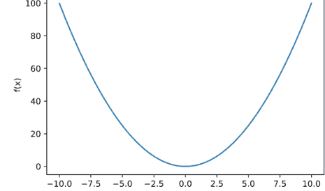

图 8.1：函数 `f(x) = x^2`

## 复合

**函数复合**是一种运算 `∘`，它接受两个函数 `f` 和 `g` 并产生一个新的函数 `h = g ∘ f`，使得 `h(x) = g(f(x))`。先应用函数 `f`，然后应用函数 `g`。对于两个以上函数复合的情况，例如 `k ∘ g ∘ f`，我们从右到左应用这些函数，每次处理两个函数。例如，通过应用方程 `h(x) = g(f(x))`，`k ∘ g ∘ f = k(g(f(x))) = k(h(x))`。这种嵌套复合的求值是由函数复合的结合律（或结合律）支持的。

考虑一个有两个函数 `f(x) = x+1` 和 `g(x) = sqrt(x)` 的例子，它们都定义在集合 `x ≥ 0` 上。我们形成复合函数 `h(x) = g(f(x)) = sqrt(x+1)`。我们可以计算 `h(3)` 和 `h(-2)`。第一种情况是可能的，`h(3) = sqrt(3+1) = 2`。第二种情况未定义，因为 `h(-2) = sqrt(-2+1) = sqrt(-1)`。因此，复合仅在 `h` 的定义域范围内有效。在这种情况下，定义域 `x ≥ -1`。

函数复合在数据科学中特别重要，因为机器学习模型对数据应用一系列函数。在计算机视觉中，图像像素可以分层排列并进行多次聚合平均，以推断是否可以找到感兴趣的对象。

# 函数

## 反函数

反函数 `f(x) = y` 用于抵消函数的作用。如果将 `y` 引入反函数 `f^{-1}` 能产生输出 `x`，那么它本身就是一个函数。这可以写为 `f^{-1}(f(x)) = x`。我们可以使用函数复合来证明 `f(f^{-1}(y)) = y`。并不是每个函数都有反函数，所以接下来我们将讨论必要条件。具有反函数的函数被视为*可逆的*。

我们来自图 8.1 的抛物线有反函数吗？反函数本身是一个函数，这意味着每个输入必须映射到一个输出。记住反函数是反向工作的，所以 `y` 被视为输入，`x` 被视为输出。我们想要确认每个可能的 `y` 值是否只映射到一个值。

让我们选择 `y` 轴上的值 60 并检查它是否映射到 `x` 轴上的一个点。我们可以在 60 处画一条水平线，直线与图形相交，并在这些交点处向 `x` 轴画垂直线。结果有两个 `x` 值 `-sqrt(60)` 和 `sqrt(60)`。事实上，由于对称性，每条水平线都会返回两个值。由于我们无法为 `f^{-1}(y)` 唯一确定一个 `x`，因此反函数不存在。这种*水平线判法*可以是

## 单调性

如果一个函数是完全递增或完全递减的，则该函数是单调的。一个函数 `f` 是严格递增的，如果……（此处原文不完整，按语境翻译）。

## 准备知识

一个函数是单调的，如果它完全是递增的或完全是递减的。一个函数 `f` 是严格递增的，如果对于 `x1 < x2`，`f(x1) < f(x2)`。同样，一个函数 `f` 是严格递减的，如果对于 `x1 < x2`，`f(x1) > f(x2)`。

一个函数是单调的，如果它在定义域内是单调的。严格单调函数是单射的，这意味着它有反函数。

## 准备知识

函数 `f` 是单射，如果定义域内的每个输入都有唯一的输出。函数的定义域是所有可能的输入值。函数的值域是所有可能的输出值。

函数是连续的，如果它可以不抬笔画出。形式上，函数 `f` 在点 `c` 处连续，如果 `x` 趋于 `c` 的极限存在并等于 `f(c)`。

函数在一点是可微的，如果在该点有导数。导数 `f'(x)` 代表图形在该点的切线斜率。

## 凸性

函数 `f` 是凸的，如果任意两点的线段位于图形上方或其上。几何上，凸函数“向上开口”。形式上，对于定义域内的任意 `x1, x2` 以及 `t ∈ [0, 1]`，`f(tx1 + (1-t)x2) ≤ tf(x1) + (1-t)f(x2)`。

函数 `f` 是凹的，如果 `-f` 是凸的。或者，如果任意两点的线段位于图形下方或其上。几何上，凹函数“向下开口”。形式上，对于定义域内的任意 `x1, x2` 以及 `t ∈ [0, 1]`，`f(tx1 + (1-t)x2) ≥ tf(x1) + (1-t)f(x2)`。

## 极值

函数 `f` 在 `x` 处有局部极值，如果对于 `x` 邻域内的所有 `x*`，`f(x) ≤ f(x*)`。它在 `x` 处有局部极大值，如果对于 `x` 邻域内的所有 `x*`，`f(x) ≥ f(x*)`。全局极小值是整个定义域内最小的局部极值。全局极大值是整个定义域内最大的局部极大值。

为了找到可微函数的极值，我们找到导数为零的点，`f'(x) = 0`。这些点被称为临界点。找到临界点后，我们可以使用二阶导数判法来确定它们是极小值还是极大值：如果 `f''(x) > 0`，`x` 是局部极小值；如果 `f''(x) < 0` 是局部极大值。

## 函数类型总结

接下来我们将讨论不同类型的函数：*有理函数、代数函数、三角函数、指数函数*和对数。每种函数类型在数据科学中都很有用。

134 数学基础

有理积分函数（通常称为多项式）是最简单的函数。它们通过重复应用基本运算：加法、减法和乘法得到。给定常量 `a0, a1, …, an`，多项式可以表示为：

```
$$y = a0 + a1x + … + anx^n$$
```

示例 `y = 3x+4` 和 `y = 1+x^2`；前者是线性函数，后者是二次函数。

有理函数是分子和分母均为多项式的分数。示例包括 `y = 1/(1+x^2)`。

代数函数可以定义为多项式方程的根。为了说明，我们从 `y = x^n`（一个多项式）开始。我们需要 `x ≥ 0` 并找到函数的反函数。这可以通过求解 `x` 来完成。然后我们可以交换 `x` 和 `y`，产生 `y = x^{1/n} = sqrt[n]{x}`。例如，`n=2` 的情况产生了有理函数 `y = sqrt(x)`。

初等超越函数——三角函数、指数函数和对数——源于几何。考虑图 8.5 中的半径为 1 的圆，或单位圆。角度 `θ` 以弧度测量，弧度测量该角度扫过的圆周弧长。对于单位圆，周长 `C=2πr=2π`。这意味着一个扫过整个周长（或 360 度）的角度测量为 `2π`，而扫过半个圆（或 180 度）的角度测量为 `π`。


图 8.5：单位圆

# 函数

注意图中形成的直角三角形。由 `x` 轴形成的水平边边称为**邻边**，从圆垂下到 `x` 轴的垂直边称为**对边**，形成半径的边称为**斜边**。三角函数正弦、余弦和正切定义为这些三角形边的比例值：


$$\sin(\theta) = opposite/hypotenuse$$
$$\cos(\theta) = adjacent/hypotenuse$$
$$\tan(\theta) = \sin(\theta)/\cos(\theta) = opposite/adjacent$$

由于单位圆的斜边长度为 1，在这个例子中，邻边等于 $\cos(\theta)$，对边等于 $\sin(\theta)$。图 8.6 显示了正弦和余弦函数的周期性，这对于建模周期性数据（例如销售周期、季节性变化）非常有用。它们的模式相同，但平移了一个固定量。

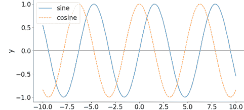

图 8.6：正弦和余弦函数

底数为 $a$（对于任何 $a>0$）且有理数 $x$ 的指数函数可以写为 $y = a^x$。指数函数的反函数是以 $a$ 为底对数，可以写为 $x = log_a(y)$。对数通过回答问题“$y$ 是底数的几次方？”来确定。例如，求解 $log_2(8)$，我们问 2 的几次方等于 8？答案是 3。

一个非常特殊的底是 $e$，可以这样理解：

对于某些 $n$，计算和 $S_n = 1 + \frac{1}{1!} + \frac{1}{2!} + \dots + \frac{1}{n!}$。

表达式 $n!$ 读作“阶乘”，为 $n \times (n-1) \times \dots \times 1$。例如，$3! = 3 \times 2 \times 1 = 6$。随着 $n$ 的增加，该和将趋近、收敛于一个小于 3 的数。这是一个近似值为 2.71828 的无理数。让我们来看几个和：

- ¹有理数可以写成分数，例如 2 或 2/3。

$S_2 = 1 + \frac{1}{1!} + \frac{1}{2!} = 2.5$

$S_3 = 1 + \frac{1}{2!} + \frac{1}{3!} \approx 2.67$

$S_4 = 1 + \frac{1}{2!} + \frac{1}{3!} + \frac{1}{4!} \approx 2.71$

更正式地，$e$ 可以用使用*极限*的陈述来定义，其中极限将在下一节微分积分中定义。

```
$e = \lim_{n\to\infty} (1 + \frac{1}{n})^n$
```

指数函数 $y = e^x$ 非常常见，出现在我们很快会遇到的概率中。该函数的反函数是对数函数；它有一个特殊的符号 $ln(x)$，表示**自然对数**。底数通常不写出，因为理解为 $e$。例如，$ln(e^3) = 3$，因为 $e$ 的 3 次方是 $e^3$。另一个例子是 $ln(1) = 0$，因为 $e$ 的 0 次方是 1。

图 8.7 显示了函数 $e^x$ 和 $ln(x)$。随着 $x$ 增大，$e^x$ 增大到 $+\infty$。随着 $x$ 减小，$e^x$ 趋于零（它在零处有一个*渐近线*）。因此它的域是 $(-\infty,+\infty)$，而值域是 $(0,+\infty)$。函数 $ln(x)$ 随着 $x$ 增大而增大，但上升速度比 $e^x$ 慢得多。随着 $x$ 减小到零，$ln(x)$ 趋于 $-\infty$。域是 $(0,+\infty)$，而值域是 $(-\infty,+\infty)$。e^x$ 和 $ln(x)$ 是反函数，它们的域和值域是反的。

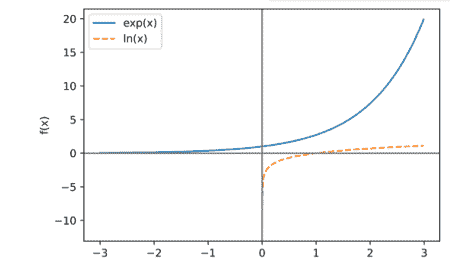

图 8.7：指数和自然对数

## 向量化函数

一次性将函数应用到多个值通常很有用，这由*向量化*支持。这里有一个使用 *numpy* 计算列表平方根的示例：

### 微积分

```
x=[1,4,9,16]
np.sqrt(x)
```

```
OUT:
array([1., 2., 3., 4.])
```

在这种情况下，函数被应用到列表中的每个元素：$(\sqrt{1}, \sqrt{4}, \sqrt{9}, \sqrt{16})$。注意每个模块都支持单独处理。如果我们用 math 包尝试，它会产生一个错误：

```
x=[1,4,9,16]
math.sqrt(x)
```

```
OUT:
TypeError: must be real number, not list
```

该错误表明来自 math 包的 `sqrt()` 应该应用于单个值。

## 8.3 微积分

极限的概念对于微积分是基础。函数的极限是输入接近某个值时它所趋向的值。如果我们通过让 $x$ 足够接近 $c$（但不等于 $c$）来让 $f(x)$ 任意接近 $L$，则说 $f(x)$ 在 $x$ 靠近 $c$ 的极限为 $L$。这表示为 $\lim_{x\to c} f(x) = L$。

接下来，考虑序列。序列 $a_n$ 收敛于极限 $L$，如果对于每个 $\epsilon > 0$，存在一个整数 $N$，使得对于所有 $n > N$，|a_n - L| < \epsilon$。这表示为 $\lim_{n\to\infty} a_n = L$。

极限的概念对于分析是重要的。它允许我们定义连续性、导数和积分。例如，函数 $f(x)$ 的导数定义为差商的极限：

$$f'(x) = \lim_{h\to 0} \frac{f(x+h)-f(x)}{h}$$

### 微分

我们可以用以下数学方式来表述：

函数 $f(x)$ 在点 $x_0$ 处连续，当且对于每一个正数 $\epsilon$，都存在另一个正数 $\delta$，使得对于所有满足 $|x - x_0| < \delta$ 的 $x$，都有 $|f(x) - f(x_0)| < \epsilon$。

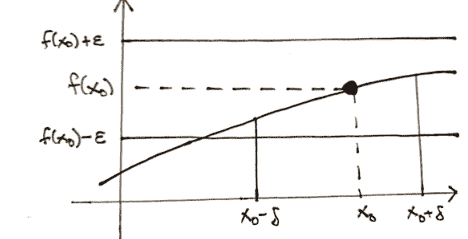

图 8.8：点的连续性

我们定义了点的连续。一个函数要在区间上连续，它必须在该区间内的每个点上都连续。

### 导数

我们使用函数来对行为进行建模：给定输入 $x$，输出 $f(x)$ 是什么？另一个问题关于对变化的敏感性：当我们改变 $x$ 某个“微小”量时，$f(x)$ 会发生多大的变化？如果我们用力地踩油门，在给定的时间增量内位置会发生多大的变化？*导数*衡量了输出相对于输入变化的变化率：

我们从讨论单变量函数的导数开始，然后到多变量函数的情况。在前者情况下，给定值处的导数是该函数图像在该点处*切线*的斜率。图 8.9 显示了一个例子。在点 $x=1.5$ 处，导数大约是 $0.408$（我们很快会讨论如何计算它），它等于该函数在该点处切线的斜率。为了使该点存在切线（或导数），函数必须在该点是连续的。如果我们沿着曲线移动该点，导数将根据函数的行为而变化。

让我们快速确定一些简单函数的导数。常数函数 $f(x)=1$ 是一条水平线，水平线的斜率为零。因此，导数在处处为零。作为第二种情况，直线 $f(x)=2x$ 的斜率为 2。因此，导数在处处均为 2。最后，$f(x) = 2x^2$ 在某点 $x$ 处的导数是什么？该曲线的切线斜率会随 $x$ 的变化而变化，因此这比前面的情况更复杂。我们很快会回到这个例子。

当一个函数在点 $x$ 有导数时，我们说 $f(x)$ 在 $x$ 处可微。在定义域内每个点上都可微的函数称为可微函数。由于微分需要连续性，意味着某个定义域上的可微函数在该域上是连续函数。然而，反之并不成立：如果一个函数在某个定义域上连续，并不意味着该函数在该域上可微。一个例子是绝对值函数 $f(x) = |x|$，定义为 $x<0$ 时为 $-x$，$>0$ 时为 $x$。该函数在其定义域上是连续的，但在顶点 $x=0$ 处不可微的，因为那里的斜率发生了突然变化。特别是，在 0 的左右，斜率（和导数）分别为 $-1$ 和 $1$。

因此对导数的讨论相当充分。接下来，我们考虑形式定义，它与极限密切相关。$y = f(x)$ 在点 $x$ 处的导数用拉格朗日记法记作 $y' = f'(x)$，或者用莱布尼兹记法记作 $\frac{dy}{dx}$ 或 $f'(x)$。对于常数 $h > 0$，导数的定义为：

```
$f'(x) = \lim_{h\to 0} \frac{f(x+h) - f(x)}{h}$
```

分解这个定义，等式右侧的分式是函数值（或输出）的变化与输入的变化率，其中 $h$ 表示变化。这个变化 $h$ 在极限中趋于 0，该比率趋于点 $x$ 处的切线率。为了使这个导数存在，必须通过让 $h$ 任意接近 0 来任意接近 $f(x)$。这意味着 $f(x)$ 必须在 $x$ 处是连续的。

让我们应用这个定义来计算 $f(x) = x^2$ 的导数：

```
$f'(x) = \lim_{h\to 0} \frac{f(x+h)-f(x)}{h}$
=\lim_{h\to 0} \frac{(x+h)^2-x^2}{h}$
=\lim_{h\to 0} \frac{x^2+2xh+h^2-x^2}{h}$
=\lim_{h\to 0} \frac{2xh+h^2}{h}$
=\lim_{h\to 0} (2x+h)$
=2x
```

当一个函数在点 $x$ 有导数时，我们说 $f(x)$ 在 $x$ 处可微。在定义域内每个点上都可微的函数被称为可微函数。由于微分需要连续性，意味着某个定义域上的可微函数在该域上是连续函数。但事实相反：如果一个函数在某个定义域上连续，并不意味着该函数在该域上可微。一个例子是绝对值函数 $f(x) = |x|$，定义为 $x<0$ 时为 $-x$，$>0$ 时为 $x$。该函数在其定义域 $(-x, x)$ 上是连续的，但在顶点 $x=0$ 处不可微，因为那里的斜率发生了突变。特别是，在 0 的左右，斜率（和导数）分别为 $-1$ 和 $1$。

### 微分规则

#### 常数乘法

对于常数 $c$ 和函数 $f(x)$，$cf(x)$ 的导数是：

```
$\frac{d}{dx}[cf(x)] = cf'(x)$
```

#### 加法

对于函数 $f(x)$ 和 $g(x)$，$f(x) + g(x)$ 的导数是：

```
$\frac{d}{dx}[f(x) + g(x)] = f'(x) + g'(x)$
```

#### 乘法法则

对于函数 $f(x)$ 和 $g(x)$，$f(x)g(x)$ 的导数是：

```
$\frac{d}{dx}[f(x)g(x)] = f(x)g'(x) + g(x)f'(x)$
```

#### 商法法则

对于函数 $f(x)$ 和 $g(x)$（其中 $g(x) \neq 0$），其导数是：

```
$\frac{d}{dx}\left[\frac{f(x)}{g(x)}\right] = \frac{g(x)f'(x) - f(x)g'(x)}{[g(x)]^2}$
```

#### 幂法则

对于实数 $n$x^n$ 的导数是：

```
$\frac{d}{dx}[x^n] = nx^{n-1}$
```

#### 链法则

对于复合函数 $h(x) = f(g(x))$，其导数是：

```
$\frac{d}{dx}[f(g(x))] = f'(g(x))g'(x)$
```

### 微分

示例 3：

```
$h(x) = \ln(1+e^{2x})$$$
$$h'(x) = \frac{1}{1+e^{2x}} \frac{d}{dx}(1+e^{2x})$$
$$h'(x) = \frac{e^{2x}}{1+e^{2x}} \frac{d}{dx}(2x)$$
$$h'(x) = \frac{2e^{2x}}{1+e^{2x}}$$
```

针对各种函数（如三角函数）还有若干额外的导数规则。它们超本书的讨论范围。

### 偏导数

现实世界中的问题涉及多变量函数。衡量函数对输入微小变化的敏感性非常有价值。在金融领域，股票的风险将取决于广义股市市场表现（例如标普500指数）和利率等变量。风险管理人员会对当这些变量发生微小变化时，股票价格预期的变化感兴趣。

当我们考虑一个多变量的函数时，例如 $z=f(x,y)=2x+xy+3y$，我们可以在保持其他变量不变的情况下，对每个变量求导。这些导数被称为*偏导数*，它们代表特定方向上的切线。偏导数的记法与单变量导数略有不同。让我们计算 $z$ 的偏导数：

```
$$\frac{\partial z}{\partial x} = 2+y$$
$$\frac{\partial z}{\partial y} = x+3$$
```

二阶偏导数的计算方式类似，并记为：

```
$$\frac{\partial^2 z}{\partial x^2}, \frac{\partial^2 z}{\partial x\partial y}, \frac{\partial^2 z}{\partial y^2}$$
```

高阶导数遵循类似的记法。*梯度*是一个重要的对象，它包含了函数在某一点的偏导数。例如，这里是 $z$ 的梯度：

```
$$\nabla z(x,y) = \left(\frac{\partial z}{\partial x}(x,y), \frac{\partial z}{\partial y}(x,y)\right)$$$$$$\nabla z(x,y) = (2+y, x+3)$
```

梯度是一个向量，是一个既有方向又有大小的量。早些我们学过导数可以用于寻找极值，极值出现在导数为零或未定义的地方（临界点）。对于多变量函数，可以以类似的方式使用梯度寻找极值，我们稍后将会看到。

想深入学习微积分，一对精良的书是 [26] 和 [27]。

## 8.4 概率

我们的数据将包含受不确定或随机影响的变量，可以使用概率工具进行有效处理。随机实验的输出是无法确定预测的。当实验重复多次时，平均输出会表现出可预测性。掷一个均匀的六面骰子其结果是不可预测的，但在大量掷之后，每个数字出现的概率应该是 17% 左右。

概率论中有三个基本要素：

- * 样本空间*是实验所有可能结果的集合。它通常记为 $\Omega$。对于一个掷硬币的实验，$\Omega=\{hh, ht, th, tt\}$，其中 $h$ 和 $t$ 分别代表正面和反面。

- * *事件*是实验的结果。它们是 $\Omega$ 的子集。我们可以将所有事件的集合记为 $\mathcal{A}$。此示例中的特定事件是 $\{hh\}$。

- * 概率*是与每个事件 $A$ 关联的一个数字，写作 $P(A)$ 并落在 $[0,1]$ 之间。随着事件发生可能性增加，其概率趋于 1。频率主义的思想提供了直观解释：对于大量的重复试验，一个事件的概率是该事件发生的次数除以试验次数。

随机变量是一个受随机事件影响的量，它取决于实验的结果。在数学上，它是从 $\Omega$ 到可测空间（通常是 $\mathbb{R}$）的映射。这里是一些例子：

- 令 $X$ 为掷两次均匀硬币正面的次数

- 令 $Z$ 表示超级碗中获胜队的得分

### 离散和连续随机变量

随机变量要么是离散随机变量，要么是连续随机变量，这取决于它可以取的值个数。注意，原理与我们之前遇到的离散和连续数据相同：离散随机变量取有限或可数的值，而连续随机变量取不可数个数的值。代表掷骰子总和的随机变量是离散的，任何时刻的累计访人数也是如此。离散随机变量取决于取长度和体积等实值测量的量。例如，公民距离警察站的距离。大多数问题现在由计算机解决，计算机具有有限的内存。

将高基数的变量视为连续是非常有效的。计算离散变量的最简单概率是等可能的结果。当掷六面骰子时，有六种等可能的结果。例如，掷出五的概率等于成功的次数除以次数。

### 条件概率

当我们根据可用信息计算概率时，我们称之为*条件概率*。在数学上，这记作 $P(Y|X)$，读作“给定 $X$ 的 $Y$ 的概率”。在上面的例子中，$Y=5$ 代表两个骰子之和为 5，其中至少有一个为 1。此外，公式为：

```
$P(Y|X) = \frac{P(X \cap Y)}{P(X)}$
```

其中 $P(X \cap Y)$ 表示 $X$ 和 $Y$ 同时发生的概率。对于我们的示例，分子代表两次掷之和为 5 的概率，限制是至少有一个为 1。我们看到 36 个可能结果中有两种结果，概率为 2/36。分母涉及 36 个可能结果中的 12 个，概率为 12/36。计算如下：

```
$P(Y=5|X=1) = \frac{(2/36)}{(12/36)} = \frac{2}{6}$
```

当 $X$ 的结果不影响 $Y$ 的结果时，我们说 $X$ 和 $Y$ 是*独立的*。这可以写为 $P(Y|X) = P(Y)$。在数据中，目标是寻找预测 $Y$ 的随机变量 $X_1, X_2, \dots, X_p$。与 $Y$ 独立的预测变量将没有帮助。我们稍后会看到，预测高度依赖于条件概率。

有时我们处于幸运的境，能够说明随机变量取每个可能值的概率。离散随机变量的*概率质量函数*（pmf）是一个函数，它接受每个可能值作为输入并将其概率作为输出。对于等于均匀六面骰子显示数值的随机变量 $Y$，其 pmf 所示：

## 概率


```
f(y) = P(Y = y) = \begin{cases} 1/6, & \text{if } y = 1 \\ 1/6, & \text{if } y = 2 \\ 1/6, & \text{if } y = 3 \\ 1/6, & \text{if } y = 4 \\ 1/6, & \text{if } y = 5 \\ 1/6, & \text{if } y = 6 \end{cases}
```

$Y$ 表示随机变量，而 $y$ 表示所取的特定值。给定每个结果的概率相等，该分布是*离散均匀分布*的一个例子。

离散随机变量的*累积分布函数 (cdf)* 是一个以可能值为输入并返回该值或更低值的概率作为输出的函数。骰子的 cdf 如下：

```
F(y) = P(Y \leq y) = \begin{cases} 1/6, & \text{if } y = 1 \\ 2/6, & \text{if } y = 2 \\ 3/6, & \text{if } y = 3 \\ 4/6, & \text{if } y = 4 \\ 5/6, & \text{if } y = 5 \\ 1, & \text{if } y = 6 \end{cases}
```

例如，掷出 2 *小*的概率是 $P(Y \leq 2) = P(Y = 2) = 2/6$。为了快速理解随机变量，将 pdf 和 cdf 以 x 轴为输入、y 轴为输出进行通常有用。

为了将这些概念与我们的数据工作起来，我们认为各种数据列都是随机变量。观测值是性别的特定实现。例如，我们可能会对一组数据样本收集性别实现。这是一个离散随机变量，每个性别的百分比构成了概率质量函数 (pmf)。

# 概率分布：连续型

对于连续随机变量，其达到任何特定值的概率为零。从直观上来说，考虑有 $n$ 个等概率 $1/n$ 的结果的情况。当 $n=6$ 时，每个结果的概率为 $1/6$。在取极限 $n\to\infty$ 后，每个结果的概率为 $1/\infty=0$。与其测量特定值的概率，不如说测量连续随机变量处于某个范围内的概率，例如 $P(0 < Y < 1)$。

由于连续随机变量取无限多个值，因此概率质量函数不再适用。相反，使用的是*概率密度函数* (pdf)。pmf 和 pdf 之间的根本区别在于 pdf 在单点上的值没有意义。对于计算累积概率 $F(y) = P(Y \le x)$，求和将没有意义；相反，通过积分计算 pdf 曲线下方的面积。我们在这里不讨论积分，而是回顾一些不需要显式积分的连续随机变量。首先，我们从一些离散随机变量的示例开始。

# 伯努利分布

*伯努利分布*是随机变量的离散概率分布，该变量以概率 $p$ 取值为 1（代表成功），以概率 $1-p$ 取值为 0（代表失败）。由于只有两种可能的结果，它可以模拟硬币投掷的结果。对于遵循伯努利分布的随机变量 $Y$，其 pdf

```
$f(y) = \begin{cases} p, & \text{if } y = 1 \\ 1-p, & \text{if } y = 0 \end{cases}$
```

# 二项分布

*二项分布*是一种离散概率分布，用于计算在 $n$ 次成功概率为 $p$ 的伯努利分布试验中成功的次数。该分布可以紧凑地写为 $Y \sim \text{Bin}(n, p)$。例如，我们可以计算在十次硬币投掷中掷一次面的概率，其中正面的概率为 0.75。这可以这样计算：

```
$f(1) = \#(\text{ways to flip 1 head}) \times (\text{prob of 1 success}) \times (\text{prob of 9 failures})$
```

pmf 对于 $y$ 次成功的更通用的表达式为：

```
$f(y) = \binom{n}{y} p^y (1-p)^{n-y} \text{for } y = 0, 1, \dots, n$
```

其中 $\binom{n}{y}$ 是 $y$ 发生的方法数。例如，如果 $n = 10$ 且 $y = 1$，则成功可以在任何试验中发生，且 $\binom{10}{1} = 10$。

# 均匀分布

*均匀分布*是区间 $(a, b)$ 上的连续概率分布。它记为 $U(a, b)$ 并具有 pdf：

```
$f(y) = \begin{cases} \frac{1}{b-a}, & \text{if } a < y < b \\ 0, & \text{if otherwise} \end{cases}$
```

我们可以将 pdf 想象为一个长度为 $b-a$、高为 $1/(b-a)$ 面积为 1 的矩形。cdf $F(y)$ 是通过计算从 $Y=a$ 开始到 $Y=x$ 结束的矩形下方面积得到的：

```
$F(y) = \begin{cases} 0, & \text{if } y \le a \\ \frac{y-a}{b-a}, & \text{if } a < y < b \\ 1, & \text{if } y \ge b \end{cases}$
```

# 正态分布

*正态分布*或*高斯分布*是区间 $(-\infty, \infty)$ 上的连续概率分布。这是一个具有钟形 pdf 的著名分布。许多独立同分布 (i.i.d.) 随机变量遵循正态分布。正态分布由两个参数定义：均值 $\mu$ 和方差 $\sigma^2$，通常记为 $N(\mu,\sigma^2)$。均值衡量数据的中心，方差衡量数据的离散程度。正态分布的 pdf 为：

```
$f(x) = \frac{1}{\sigma\sqrt{2\pi}} \exp\left(-\frac{(x-\mu)^2}{2\sigma^2}\right), -\infty < x < \infty$
```

正态分布的解是通过数值计算的，在实践中可以通过软件获得。

# 标准分布是源自正态分布的连续概率分布。正态分布变量 $X$ 可以可以通过公式转换为随机变量 $Z$：

```
$Z = \frac{X-\mu}{\sigma}$
```

这个过程被称为*标准化*。值 $Z$ 称为 *z 分数*，代表 $X$ 离均值的距离（以标准差为单位）。标准正态分布的均值和方差分别为零一。

# 关于 numpy

`numpy` 模块也支持随机变量；它是 Python 中数值计算的一个重要包。我们将在整个书中使用 NumPy 数组。

```python
from scipy import stats

# 当 z=0 时计算 cdf
print('(Z < 0):', stats.norm.cdf(0))

# 计算 1 - F(0)
print('(Z > 0):', 1-stats.norm.cdf(0))

# 计算 F(1) 并减去左尾 F(-1)
print('P(-1 < Z < 1):', round(stats.norm.cdf(1) - stats.norm.cdf(-1), 3))

print('P(-2 < Z < 2):', round(stats.norm.cdf(2) - stats.norm.cdf(-2), 3))

print('P(-3 < Z < 3):', round(stats.norm.cdf(3) - stats.norm.cdf(-3), 3))
```

输出：

nP(Z < 0): 0.5

nP(Z > 0): 0.5

nP(-1 < Z < 1): 0.683

nP(-2 < Z < 2): 0.954

nP(-3 < Z < 3): 0.997

输出了关于标准正态分布的一些有趣事实。首先，由于对称性，一半的概率在 Z=0 以下，一半以上。大约 68% 的概率位于 -1 到 1 之间，即均值的一个标准差范围内（均值为零）。两个标准差范围内有约 95% 的概率，三个标准差范围内有 99.7%（几乎所有）。这些数字在概率和统计中很常见，值得记住。

对于模拟和其他应用，从各种分布生成随机变量是有价值的。这可以通过软件轻松实现，软件使用与伪随机数器配合。对于给定的种子，它将生成一个固定序列。这里有一个生成正态分布的示例，在单独运行中每次取两个值 (size=2)。每次运行的值完全不同。

```python
print('run 1:', stats.norm.rvs(size=2))
print('run 2:', stats.norm.rvs(size=2))
```

```
run 1: [ 0.8522509 -0.7070709]
run 2: [-0.9316579 0.8866088]
```

在重复运行中重新生成相同的值通常所需的。这个示例提供了演示：

```python
import numpy as np

np.seed(seed=314)
print('run 1:', stats.norm.rvs(size=2))
np.seed(seed=314)
print('run 2:', stats.norm.rvs(size=2))
```

```
run 1: [0.1660854 0.7819644]
run 2: [0.1660854 0.7819644]
```

图 8.10 显示了基于从标准正态分布抽取的 100,000 次样本的直方图。注意钟形和大多数值所在的域（-3 和 3）。源代码是极简。

```python
import seaborn as sns
sns.histplot(stats.norm.rvs(size=100000))
```

# 中心极限定理

对于大量独立同分布 (i.i.d.) 随机变量 $X_1, X_2, \dots, X_n$，其均值为 $\mu$，方差为 $\sigma^2$，它们的平均值 $X_n$ 收敛于正态分布。正如名称所示，这是一个极其重要的结果，因为对任何分布的独立同分布随机变量进行平均处理都会产生正态分布的结果。特别是，当从未知分布中收集数据样本时，这非常有用。更进一步，如果我们通过减去均值并除以对 $X_n$ 进行标准化，

154

数学基础知识

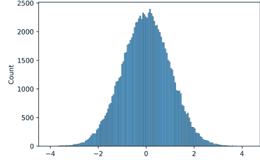

图 8.10：标准正态抽样的直方图

其标准差为 $\sigma/\sqrt{n}$，变量将收敛于标准正态分布。让我们给出*中心极限定理*：

当 $n \to \infty$，

$\sqrt{n}\left(\frac{X_n-\mu}{\sigma}\right)\to\mathcal{N}(0,1)$

概率是一个巨大的学科，我们仅是浅尝。关于该主题更广泛的探讨，请参见 [28]。

## 8.5 矩阵代数

### 矩阵、向量与标量

矩阵 **A** 是具有 $m$ 行 $n$ 列的数字矩形数组，写作：

$$\begin{matrix} a_{11} & a_{12} & a_{13} & \dots & x_{1n} \\ a_{21} & a_{22} & a_{23} & \dots & x_{2n} \\ \vdots & \vdots & \vdots & \vdots & \vdots \\ a_{m1} & a_{m2} & a_{m3} & \dots & a_{mn} \end{matrix}$$

当我们组织数据进行计算时，矩阵（matrix 的复数）将非常有用。它们还为求解方程组提供了紧凑的表示法，我们在后续回归建模中会遇到。

### 矩阵代数

矩阵的行数 $m$ 和列数 $n$ 组矩阵的维度：$m \times n$。维度是矩阵极其重要的属性，因为它们定义了哪些操作是可能的。

这是一个 $2 \times 3$ 矩阵：

```
X = \begin{bmatrix} 1 & 5 & 0 \\ 2 & 12 & -1 \end{bmatrix}
```

只有行的矩阵称为*行向量*，而只有列的矩阵称为*列向量*。只有一个元素的向量是*标量*。

以下是长度为 3 的行向量和长度为 4 的列向量：

```
\mathbf{r}^T = [1 \ 5 \ 0] \quad \mathbf{c} = \begin{bmatrix} 2 \\ 7 \\ 3 \\ -1 \end{bmatrix}
```

### 矩阵加减法

如果两个矩阵的维度匹配，则可以对它们进行加减法。在加减矩阵 **A** 和 **B** 时，它们对应的元素以逐元素的方式相加或相减，如下所示：

```
\mathbf{A} = \begin{bmatrix} 1 & 5 & 0 \\ 2 & 12 & -1 \\ 4 & 12 & 3 \end{bmatrix} \quad \mathbf{B} = \begin{bmatrix} 1 & 4 & 0 \\ -1 & 0 & 6 \\ 0 & 1 & 0 \end{bmatrix}
```

```
\mathbf{A} + \mathbf{B} = \begin{bmatrix} 1 & 5 & 0 \\ 2 & 12 & -1 \\ 4 & 12 & 3 \end{bmatrix} + \begin{bmatrix} 1 & 4 & 0 \\ -1 & 0 & 6 \\ 0 & 1 & 0 \end{bmatrix}
n= \begin{bmatrix} 1+1 & 5+4 & 0+0 \\ 2+(-1) & 12+0 & -1+6 \\ 4+0 & 12+1 & 3+0 \end{bmatrix}
```

```
= \begin{bmatrix} 2 & 9 & 0 \\ 1 & 12 & 5 \\ 4 & 13 & 3 \end{bmatrix}
```

### 矩阵乘法

对于 $m \times n$ 矩阵 **E** 和 $n \times p$ 矩阵 **F**，可以形成两个积 **EF** 和 **FE**，它们通常是不同的。**E** 和 **F** 的维度决定了积是否有效，如果有效，则是积的维度。可以使用一个简单的记忆法：如果 $X$ 是 $a \times b$ 且 **Y** 是 $c \times d$，那么 **XY** 将是 $(a \times b) \times (c \times d)$。内部维度必须匹配，积才有效。外部维度将是 $a \times p$。

对于 **E** 和 **F** 的情况，计算类似于 $(m \times n) \times (n \times p)$。内部维度均为 $n$，因此积是有效的。外部维度的行数与左矩阵相同，列数与右矩阵相同。

回到我们的数值示例，**C** 可以按如下形成：对于 **C** 的每个元素（写作 $c_{ij}$），取 **A** 的第 $i$ 行和 **B** 的第 $j$ 列，计算这两个向量的*内积*，如下：

```
$c_{ij} = \sum_{k=1}^{p} a_{ik}b_{kj}$
```

对于这个例子，

$c_{11} = \sum_{k=1}^{p} a_{1k}b_{k1} = (a_{11} \times b_{11}) + (a_{12} \times b_{21}) + (a_{13} \times b_{31}) = (1 \times 1) + (5 \times (-1)) + (0 \times 0) = 1 - 5 + 0 = -4$

计算其余元素的积产生

**AB =** $\begin{bmatrix} -4 & 30 & 6 \\ -10 & 72 & 12 \\ 4 & -8 & 19 \end{bmatrix}$

接下来，让我们看一个例子。我们用 NumPy 数组创建矩阵 **A** 和 **B**。@ 运算符支持矩阵乘法。注意，* 运算符是逐元素的，它返回一个不同的输出。

```python
A = np.array([[1,5,0], [2,12,-1], [4,12,3]])
B = np.array([[1,4,0], [-1,0,6], [0,1,0]])

print('A: \n', A)
print('B: \n', B)
print('AB: \n', A@B)
```

输出：

```
A:
[[ 1  5  0]
 [ 2 12 -1]
 [ 4 12  3]]

B:
[[ 1  4  0]
 [-1  0  6]
 [ 0  1  0]]

AB:
[[ -4 30  6]
 [-10 72 12]
 [  4  -8 19]]
```

让我们定义另一个与 A 不支持乘法的矩阵 D。然后可以看到 Python 如何处理这种情况。

```python
D = np.array([[1,4,0],[-1,0,6]])

print('D: \n', D)
print('A dimensions:', A.shape)
print('D dimensions:', D.shape)
print('AD: \n', A@D)
```

输出：

```
D:
[[ 1  4  0]
 [-1  0  6]]

A dimensions: (3, 3)
D dimensions: (2, 3)

ValueError: matmul input has a mismatch in its core dimension 0, func signature (n,k),(k,m)->(n,m) (size 2 is different from 3)
```

`shape` 属性检索矩阵的维度。由于 A 有 3 列而积 AD 将无效，Python 抛出一个 ValueError（@ 运算符是此方法的简写）。维度不匹配是矩阵代数错误的常见来源。建议检查每个矩阵的维度。

### 转置

矩阵 A 的转置是写作 A^T 的矩阵，A.T 通过取 A 的行（或列）作为 A^T 的列（或行）得到。这是一个示例：

```
A = \begin{pmatrix} 1 & 5 & 0 \\ 2 & 12 & -1 \\ 4 & 12 & 3 \end{pmatrix}
```

```
A^T = \begin{pmatrix} 1 & 2 & 4 \\ 5 & 12 & 12 \\ 0 & -1 & 3 \end{pmatrix}
```

例如，A 的第一行 [1, 5, 0] 变成了 A^T 的第一列。注意 [1, 5, 0] 是行向量，转置使其变为列向量。列向量转置变为行向量。

当矩阵 M 等于它的转置 M^T 时，称为对称矩阵。一个例子是：


```
M = \begin{pmatrix} 1 & 2 & 4 \\ 2 & 12 & 12 \\ 4 & 12 & 3 \end{pmatrix}
```

对称矩阵由于重复值可以减少存储量。

### 对角线

`n n` 矩阵的对角线包括对角线 1，其他地方为 0。也就是说，它们从左上角到右下角。

### 单位

单位矩阵 `I_n` 是对角线上为 1 的方阵 `n` 矩阵。下标有时省略。将适当大小的矩阵乘以 `I_n`（左侧或右侧）将还原 `M`。

## 总结

它在乘法中起到与数字 1 的作用。这是一个 `$3 \times 3$` 的示例：

```
$I_3 = \begin{bmatrix} 1 & 0 & 0 \\ 0 & 1 & 0 \\ 0 & 0 & 1 \end{bmatrix}
```

### 零向量与零矩阵

*零向量*和*零矩阵*包含所有的零。以下是各者的示例：

```
\mathbf{0}^T = \begin{bmatrix} 0 \\ 0 \\ 0 \end{bmatrix}
```

```
\mathbf{0} = \begin{bmatrix} 0 & 0 & 0 \\ 0 & 0 & 0 \\ 0 & 0 & 0 \end{bmatrix}
```

### 逆矩阵

方阵 **M** 的逆矩阵 `$M^{-1}$` 是一个满足 `$MM^{-1} = M^{-1}M = \mathbf{I}$` 的矩阵。逆是唯一的，它的作用与算术相同。寻找矩阵的逆是高效计算的（例如，Python 有一个函数 `numpy.linalg.inv()`），它涉及求解线性方程组。*高斯消元法*是矩阵逆的一种流行方法。具有逆的矩阵称为*可逆矩阵*；否则称为*不可逆矩阵*。更多详细信息，一本优秀的书籍是 [29]。

## 8.6 章总结

我们从集合论的介绍开始本章。集合是对象的集合，在数据科学中无处不在，从产品集到推荐集。比较和组合集合是非常重要的；讨论了包含、并和交集操作。

函数是一种映射，分配集合中的每个元素并分配一个元素作为输出。在数据科学中，我们使用函数将输入数据转换为（希望）更有用的输出。我们还可能执行一系列变换，这是函数复合的一个示例。函数的逆函数的作用是撤销函数。我们讨论了判断曲线是否为函数（每个输入必须映射到一个输出），以及函数是否具有逆（它必须是单射且满射）。

# 160

## 数学基础知识

接下来，我们研究了函数的单调性和凸性。单调函数要么完全是非递减的，要么是非递增的。凸函数呈杯状形状。凸性简化了在区域内寻找全局最小值的任务。

关于函数的最后一个主题是对不同函数类型的介绍。多项式包括线性函数，线性函数在回归分析中非常重要。初等函数包括三角函数、指数函数和对数。

机器学习中使用的许多函数都是可微函数。为了建立概念上的理解，我们简要回顾了微积分中极限、连续性和导数的重要概念。极限是通过改变输入值，使得结果无限接近某点 `$f$` 的概念。如果通过使 `x` 靠近某个点 `$\xi$` 能够无限接近该点，则该函数在点 `$\xi$` 处是的。如果一个函数在区间内的每个点都是连续的，则该函数在该区间上是连续的。

导数衡量了函数输出随输入变化的变化率。在取极限后，它等同于函数在给定点的切线。在定义域内每个点都可微的函数称为可微函数。

导数有许多实用的应用，它可以帮助我们理解底层函数。可微性意味着连续性，但反之则不然。可以通过临界点（导数为零或未定义的点）帮助寻找极值。求导法则应用定义更快；我们回顾了其中一些规则。偏导数衡量多变量函数的特定目标。

由于我们的数据具有随机性，我们简要回顾了概率论，概率论建立在严密的数学框架之上。其核心要素是样本空间、事件和概率三元组。随机变量是一个从样本空间映射到可测空间的量。随机变量可以是离散的（有限或可计数的结局），也可以是连续的（不可计数的结局）。

一个事件发生的概率是成功的方法除以所有可能的结果数。当提供信息时，可以将其纳入概率计算中；给定的概率是条件概率。当一个变量不影响另一个变量的概率时，它们是独立的。

我们回顾了离散随机变量（离散均匀、伯努利分布）和连续随机变量（均匀、正态和标准正态分布）的示例。离散随机变量使用概率函数来指定每个可能值的概率。连续随机变量使用概率密度函数来指定值范围内的概率，因为任何特定值的概率为零。累积分布函数是一个以可能值作为输入并返回实现该值或更低概率作为输出的函数。

## 练习

许多变量遵循正态分布或近似正态分布。根据中心极限定理，大量独立同分布随机变量之和遵循近似正态分布。通过标准化将正态分布随机变量转换为标准正态分布通常是有用的。可以通过软件轻松计算随机变量的概率。

矩阵是数字的矩形数组。矩阵的行和列数（维度）在执行操作时非常重要。我们回顾了矩阵的加、减、乘。矩阵乘法不满足交换律（`AB` 不总是等于 `BA`）。加、减法是逐元素进行的，而乘法是通过行列交叉（或反之）完成的。单位矩阵是对角线为1、其他位置为0的方阵。方阵 `M` 的逆矩阵在左乘或右乘 `M` 时产生单位矩阵。当一个矩阵存在逆时，被称为可逆矩阵。矩阵的逆最好通过软件实现。

本章为书的其余部分提供了数学准备。在下一章中，我们将简要回顾所需的关键统计概念。我们将看到统计学以概率为基础。

## 8.7 练习

带有答案的练习标记为 `(S)`。答案可以在课程仓库的材料文件夹中找到，路径如下：

https://github.com/PredictionNN/intro_data_science_course/

- 1. 考虑两个集合 `A` 和 `B`。你如何证明它们是相等的？

考虑下面的集合 `U`, `X`, `Y` 和 `Z`，其中 `U` 是全集。

```
U = {a, b, c, d, e, f, g}
X = {a, b, c}
Y = {d, e, f}
Z = {b, c, g}
```

- 2. `(S)` `X` 和 `Y` 的并集是什么？

- 3. `X` 和 `Z` 的交集是什么？

- 4. `(S)` `X` 相 `U` 的补集是什么？

- 5. `(S)` `Y` 和 `Z` 的并集是什么？

- 6. `Y` 相 `U` 的补集是什么？

- 7. `(S)` `X` 和 `Y` 的对称差是什么？

- 8. `(S)` `X` 的幂集是什么？

- 9. 为 `U`, `X`, `Y` 和 `Z` 画韦恩图。

- 10. 如果 `$A = \{1, 2, 3\}$` 且 `$B = \{3, 4, 5\}$`，求 `$A \cup B$` 和 `$A \cap B$`。

- 11. `(S)` 设 `X` 为一个离散随机变量，`$P(X=1)=0.2, P(X=2)=0.5, P(X=3)=0.3$`。计算期望值 `$E[X]$`。

- 12. `(S)` 设 `X` 为一个密度密度为 `$f(x) = 1/2$` (`$0 \le x \le 2$`) 的连续随机变量。计算 `$P(1 \le X \le 1.5)$`。

- 13. `(S)` 定义标准正态分布并查找到 `$P(Z < 1.96)$`。

- 14. 已知 `$A = \begin{pmatrix} 1 & 2 \\ 3 & 4 \end{pmatrix}$` 且 `$B = \begin{pmatrix} 5 & 6 \\ 7 & 8 \end{pmatrix}$`，计算 `AB` 和 `BA`。

- 15. `(S)` 求矩阵 `$A = \begin{pmatrix} 4 & 7 \\ 2 & 6 \end{pmatrix}$` 的逆。

- 16. `(S)` 用一个例子解释线性无关的概念。

- 17. `(S)` 求 `$f(x) = x^3 - 2x^2 + 5x$` 的导数。

- 18. `(S)` 求 `$f(x, y) = x^2y + xy^2$` 对 `x` 和 `y` 的偏导数。

- 19. `(S)` 使用链式法则求 `$f(x) = \sin(x^2)$` 的导数。

- 20. `(S)` 用一个例子解释中心极限定理。


# 9 统计学基础

为了节省资源（时间、金钱等），我们从规模为 `$N$` 的总体中抽取数据样本。统计量是从数据样本中计算出的数值。我们希望统计量具有总体的代表性。由于数据科学基于对数据样本的收集和分析，因此我们非常需要处理统计学。本节将提供描述性统计和推断统计的概述。描述性统计有助于理解数据样本的属性。推断统计则允许根据样本对总体得出结论。例如，推断中的一个常见问题是预测变量的系数是否显著异于 0；如果是，则表明该预测变量是重要的。

## 9.1 描述性统计

我们的样本将从离散或连续的随机变量中抽取。每个变量在一个极端可能只取一个值，而在另一个极端可能取数量难以置信的巨大值。随着样本量的增加，我们无法查看所有数据并理解其分布。计算统计量有助于汇总这些数据，我们在下文中概述了不同的统计量。

### 频数计数

对于低基数的数据（例如低于 50 个唯一级别），我们可以统计每个值被取值的次数。这些出现次数可以称为频数计数或简单的计数。计算每个值被取取的百分比也是很有用的。这些值及其百分比等同于概率质量函数。例如，给定观测数据 `S = (1, 1, 1, 2, 3, 5000)`，值和对应的计数为 `F = (1 : 3, 2 : 1, 3 : 1, 5000 : 1)`。这些值、计数和百分比可以汇成如下表：

| 值 | 计数 | 百分比(%) |

|---|---|---|

| 1 | 3 | 50.0 |

| 2 | 1 | 16.7 |

| 3 | 1 | 16.7 |

| 5000 | | 16.7 |

| **总计** | **6** | **100** |

对于高基数的数据，可以将值放入分箱（bins），然后计算每个分箱的计数和百分比。这就是创建直方图时所做的。下表汇总了测量到千分位的大量值（如 0.412 和 15.749）的计数和百分比。分箱将包含左端点 0 且不包含右端点 5。

| 分箱 | 计数 | 百分比(%) |

|---|---|---|

| [0,5) | 525 | 40 |

| [5,10) | 173 | 25 |

| [10,15) | 298 | 15 |

| [15,20) | 97 | 18 |

| [20,25) | 45 | 2 |

| **总计** | **1138** | **100** |

对于大量的分箱，可以通过 x 轴为分箱、y 轴为出现次数的图表（如垂直柱状图）来更好地理解数据分布。

### 集中趋势

数据的集中趋势或中心是最常见且实用的属性之一。可以通过变量：众数、位数或平均值来衡量。众数是变量取的最常见值。根据 `F` 中的频数计数，众数等于值最大的键（在本例中为 1）。众数不受离群值的影响，因为根据定义，它们是稀缺的。众数的缺点是它是完全基于频率的。

位数是数据“中间”的值。为了更精确，我们可以定义数据的第第 `p` 百位数。中位数定义为数据的第 50 百位数；一半的值在中位数上方和下方。对于奇数个数据点，可以通过对值进行排序并取中间点找到它。对于偶数个数据点，中数的计算方法是取两个中间值的中点。对于示例 `S`，中位数将是 1.5，即 1 和 2 的中点。与众数一样，位数不受离群值的影响。由于位数使用了值的排名，因此它提供了更好的中心估计。

## 描述性统计

数据的平均值或样本平均值在估计数据“平衡”位置时，对每个观测值赋予了相同的权重。它是一个估计总体均值（记作 `$\mu$`）的统计量。样本平均值通过对值求和并除以观测次数 `n` 来计算。对于从随机变量 `X` 中抽取的值 `x_1, x_2, \dots, x_n`，公式为：

$$\bar{x} = \frac{\sum_{i=1}^{n} x_i}{n}$$

极端离群值会对样本平均值产生很大影响；在这种情况下，衡量中心时位数更好。根据我们的示例 `S`，由于存在巨大的离群值，样本平均值约为 85。虽然这个值可能让我们感知到数据平衡的位置，但它并不代表大部分数据。当我们同时看到一个数据集的中位数和样本平均值时，它们的相似性或差异提供了额外信息。当这两个统计量相似时，说明分布对称。

### 离散程度

数据的离散程度或波动描述了数据围绕中心值的分布情况。离散度衡量了不确定性。常用的统计量包括：极差、四分位距（IQR）、方差和标准差。极差是最大值和最小值之间的差。它是简单直观的，但受离群值影响，正如我们看到数据 `5000 - 1 = 4999` 那样。

为了测量四分位数，我们首先对数据进行排序并将其分为四个等份，即四位数。第一四位数从最小值到 `Q1`（25 百位数），第二四位数从 `Q1` 到 `Q2`（50 百位数），第三四位数从 `Q2` 到 `Q3`（75 百位数），第四四位数从 `Q3` 到最大值。四分位距计算为 `$Q3 - Q1$`，代表了中间 50% 数据的范围。因为它排除了最高和最低的 25% 数据，因此对离群值不敏感。对于我们的数据样本，`IQR(S) = 2.7 - 1.0 = 1.7`。这远小于极差。

五位数非常常见且有用，可以将数据分布简化为五个统计量，即最小值、`Q1`、中位数、`Q3` 和最大值。这些数字可以通过图 9.1 中的箱线图可视化。示例箱线图是遵循标准正态分布随机生成的数据。注意中位数并不一定位于箱线图的中间。

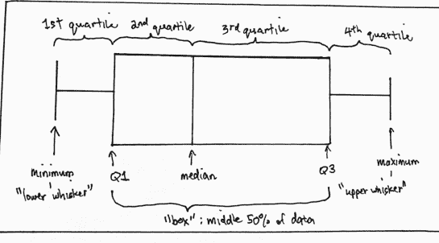

以下是箱线图组件列表：

- 左侧垂直线（下须）代表最小值

- 箱的左侧代表 `Q1`

- 从最小值到 `Q1` 的范围代表数据的最低 25% 数据，即第一四位数

- 箱的左部分代表第二四位数

- 箱内的垂直线代表中位数

- 箱的右部分代表第三四位数

- 箱的右侧代表 `Q3`

- 箱代表中间 50% 的数据

- 上须代表最大值

- 从 `Q3` 到最大值的范围代表第四四位数

箱线图的另一种变体在距离 `Q1` 和 `Q3` `$1.5 \times IQR$` 处绘制须。这些须之外的数据是离群值，并以点的形式画出。这在 Python 中是可以实现的。生成数据和箱线图的代码在如下代码段所示。参数 `*whis*` 被设置为高水平，以创建与第一种方法类似的在最小值和最大值处有须的箱线图。

## 描述性统计

```
z = stats.norm.rvs(size=200)
sns.boxplot(z, orient='v', whis=1000)
```

标准差是基于每个数据点 `x_i` 与样本均值偏差的离散度量；离差的计算方法为 `$x_i - \bar{x}$`。为了聚合离差，选择的是平方离差和 `$(x_i - \bar{x})^2$`；直接相加离差会由于相互抵消而产生零。样本标准差记为 `s`，定义为：

```
$s = \sqrt{\frac{\sum_{i=1}^n(x_i-\bar{x})^2}{n-1}}$
```

样本标准差是总体标准差（`$\sigma$` 的估计值。标准差的平方得到样本方差，记为 `$s^2$`，定义为：

```
$s^2 = \frac{\sum_{i=1}^n(x_i-\bar{x})^2}{n-1}$
```

方差在合并多个变量的离散程度时特别有用，因为方差可以直接相加；而标准差并非如此，因为它们涉及平方根。除数 `n-1` 提供了 `$s^2$` 的无偏估计。这意味着如果我们从总体中抽取随机样本，`$s^2$` 的平均值将等于 `$\sigma^2$`，即总体方差。

## 协方差

理解两个变量如何共同变化非常有用。给定两个随机变量 `X` 和 `Y` 的等大样本，我们可以计算它们的移动。`X` 和 `Y` 之间的协方差记为 `$s_{xy}$`，其计算方式与样本方差相似。样本方差使用了项 `$(x_i-\bar{x})(y_i-\bar{y})$`，其中 `$\bar{x}$` 和 `$\bar{y}$` 分别代表 `x` 和 `y` 的样本均值。样本协方差可以定义为：

```
$s_{xy} = \frac{\sum_{i=1}^n(x_i-\bar{x})(y_i-\bar{y})}{n-1}$
```

样本协方差 `$s_{xy}$` 是总体协方差（`$\sigma_{xy}$` 的估计值）。协方差的正负号和幅度表示变量向相同方向移动的平均倾向，较大的负协方差表示向相反方向移动。协方差为零表示变量之间没有关系。对于两个预测变量 `X` 和 `Z`，我们可以分别计算它们与目标 `Y` 的协方差为 `$s_{xy}$` 和 `$s_{zy}$`。由于协方差未根据底层变量的离散程度进行调整，因此无法直接进行比较；然而，通过变量标准差的积对协方差进行归一化或缩放是有用的。如果 `$s_x$` 和 `$s_y$` 分别是 `X` 和 `Y` 的样本标准差，则 `X` 和 `Y` 之间的样本相关系数记为 `$r_{xy}$`，定义为：

```
$r_{xy} = \frac{s_{xy}}{s_xs_y}$
```

给定这种缩放，样本相关范围落在 `[-1,1]`。相关性的解释与协方差相同：较高的正值表示变量平均上向相同方向移动，而负值表示向相反方向移动。相关系数为零表示没有关系。预测变量与目标之间的相关性估计对于为模型识别良好的预测候选者至关重要。我们现在已经有了理解数据所需的关键统计量：趋势和离散度量，以及关联量。给定一个或多个数据集，可以计算这些统计量以获得更好的洞察。将统计数据与图表相结合提供了稳健的数据分析。我们将在书中后续详细讨论这一主题。

## 9.2 推断统计

推断统计的主题非常广泛。针对我们的目的，我们将回顾一些观点和具体示例。假设我们试图对总体参数 `$\theta$` 提供一个备择假设（记为 `$H_A$`）。当前的信念是零假设，记为 `$H_0$`。当前的信念可能是 `$\theta$` 等于某个值 `$\theta_0$`，而备择假设是 `$\theta$` 不同于 `$\theta_0$`。这可以正式表述为：

```
$H_0: \theta = \theta_0$
$H_A: \theta \neq \theta_0$
```

例如，我们可能假设棒球球员的平均击球率为 0.300。在这种情况下，感兴趣的参数是总体 `$\mu$`，零假设是 `$H_0: \mu = 0.300$`，备择假设是 `$H_A: \mu \neq 0.300$`。为了提供拒绝零假设 `$H_0$` 的证据，我们可以收集总体样本并计算检验统计量的估计。根本挑战在于，由于采样误差，每个样本可能会产生略微不同的估计。增加样本量会减少这种采样误差，但并不总是能够包含更多数据。因此，我们在决策时需要考虑估计值的变异性。

估计值将遵循一个名为“抽样分布”的分布，对于大样本（`$n \ge 30$`），根据中心极限理，这将越来越类似于正态分布。在数据科学中，可以预期样本量远超 30。对估计值进行标准化后，它将遵循正态分布，可以使用软件（现代方法）或表格（早期方法）计算概率。


计算该统计量或更极端情况出现的概率是有意义的，“观测到此值或比 `$H_0$` 更极端值的概率是多少？”“更极端”的表述由 `$H_A$` 决定。这种概率被称为 `p-value`。当 `p-value` 足够小时，我们拒绝 `$H_0$`；否则我们无法拒绝 `$H_0$`。我们将考虑下一个例子，其中

## 统计基础知识

我们现在拥有了假设检验的所有必要要素。样本标准差是总体标准差（`$\sigma$` 的估计值）。标准差的平方得到样本方差，记为 `$s^2$`，定义为：

```
$s^2 = \frac{\sum_{i=1}^n(x_i-\bar{x})^2}{n-1}$
```

方差在合并多个变量的离散程度时特别有用，因为方差可以直接相加；而标准差并非如此。除数 `n-1` 提供了 `$s^2$` 的无偏估计。这意味着如果我们从总体中抽取随机样本，`$s^2$` 的平均值将等于 `$\sigma^2$`，即总体方差。

标准差是基于每个数据点 `$x_i$` 与样本均值 `$\bar{x}$` 偏差的离散度量；离差的计算方法为 `$x_i - \bar{x}$`。为了聚合离差，选择的是平方离差和 `$(x_i - \bar{x})^2$`；直接相加离差会由于相互抵消而产生零。样本标准差记为 `$s$`，定义为：

```
$s = \sqrt{\frac{\sum_{i=1}^n(x_i-\bar{x})^2}{n-1}}$
```

样本标准差是总体标准差（`$\sigma$` 的估计值）。标准差的平方得到样本方差，记为 `$s^2$`，定义为：

```
$s^2 = \frac{\sum_{i=1}^n(x_i-\bar{x})^2}{n-1}$
```

## 单样本均值检验

接下来，我们将对总体均值 `$\mu$` 进行特定检验。假设形式如下：

```
$H_0: \mu = \mu_0$
$H_A: \mu \neq \mu_0$
```

给定备择假设，这是一个双侧检验，我们必须考虑参数小于 `$\mu_0$` 或大于 `$\mu_0$`。我们计算 `p-value`，即计算统计量在某一方向上更极端值的概率。例如，如果检验值为 `t=-1`，`p-value` 是 `t < -1` 或 `t > 1` 的概率，即 `P(|t| > 1)`。

样本均值 `$\bar{X}$` 用于估计 `$\mu$`。由于其分布取决于样本量 `n`，我们将该随机变量标记为 `X_n`。中心极限理对均值的抽样分布得出了以下结论：当 `n → ∞`，

```
$\sqrt{n}\frac{X_n - \mu}{\sigma}\to \mathcal{N}(0,1)$
```

在标准化之前，这表示随着 `n` 的增加，`X_n` 服从均值为 `$\mu$` 标准差为 `$\sigma/\sqrt{n}$` 的正态分布。量 `$\sigma/\sqrt{n}$` 称为样本均值的标准误差 `SE`。通常情况下，统计量的标准误差是其抽样分布的标准差。一个复杂问题是，我们通常不知道总体标准差 `$\sigma$`。在这种情况下，我们可以将其替换为样本标准差 `s`。现在让我们来看这个量

```
$\frac{\bar{X}_n - \mu}{s}$
```

| 决策 | `$H_0$` | `$H_A$` |
|---|---|---|
| `$H_0$` | 第一类错误 | 第二类错误 |
| `$H_A$` | 正确 | 正确 |

## 推断统计学

这是 `X_n` 的标准化形式，用于衡量其以标准误为单位距离 `$\mu$` 的距离。当 `n ≥ 30` 时，该量近似服从标准正态分布，否则服从 `t` 分布。`t` 分布在高低值以及尾部具有更大的概率；其形状取决于一个名为*自由度*（`$\nu$`）的参数。与标准正态分布一样，`t` 分布关于零对称。图 9.2 展示了不同 `t` 分布的概率密度函数；`$\nu=\infty$` 的情况描述了标准正态分布。请注意，标准正态分布在尾部的概率小得多，即 `P(X < -2)` 和 `P(X > 2)`。

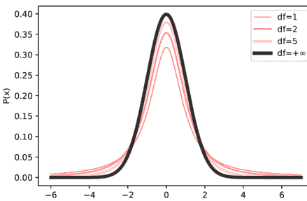

图 9.2：学生 `t` 分布

为了我们的目的，我们将假设 `n > 30` 并将 `z = \frac{\bar{X}-\mu}{s/\sqrt{n}}` 视为标准正态分布。给定数据，我们可以计算样本均值、样本标准差和检验统计量 `z`。`p-value` 是在双尾检验下计算的，这意味着它反映了两个尾部的概率。最后，将 `p-value` 与 `$\alpha$` 进行比较以做出决策。

让我们考虑一个具体的例子，测试总体均值在统计学上是否与零不同。

```
$H_0 : \mu = 0
$H_A : \mu \neq 0$$
```

参数为 `n = 1000` 和 `$\alpha = 0.05$`，样本统计量（从数据样本中计算）为 `X_{1000} = -0.5` 且 `s = 10`。从该样本来看，均值不同零，但问题是这种差异在统计学上是否显著。我们计算检验统计量为：

`z = \frac{X_n - \mu}{s/\sqrt{n}} = \frac{-0.5 - 0}{10/\sqrt{1000}} ≈ -1.581`

接下来，我们可以计算标准正态分布下该值或更小值的概率。这代表左尾概率。然后我们可以将此值翻倍以包含右尾概率。通过 Python，我们可以调用函数 `stats.norm.cdf(z)`，它计算标准正态分布的左尾累积分布函数。概率翻倍得到约为 0.1138 的 `p-value`。由于 `p-value` 大于 `$\alpha = 0.05$`，我们不能拒绝 `$H_0$`，因为犯第一类错误的风险会太大。因此，根据样本数据，均值 `$\mu$` 在统计学上与零无差异。

下面显示的 Python 代码用于实验不同的值，并测量其对结论的影响。例如，将样本均值从 -0.5 改为 -1.0 将产生 0.00157 的 `p-value` 并导致拒绝 `$H_0$`。

```python
from scipy import stats
import numpy as np
n = 1000
alpha = 0.05
xbar = -0.5
mu = 0
s = 10

test_stat = (xbar - mu) / (s/np.sqrt(n))

# p-value for two-tailed test
pval = stats.norm.cdf(test_stat) * 2

print('test-stat:', round(test_stat, 4))
print('p-value (two-tailed):', round(pval, 4))
```

输出：

test-stat: -1.5811

p-value (two-tailed): 0.1138

单样本 `t` 检验

为了我们的目的，我们将假设 `n > 30` 并将 `z = \frac{\bar{X}-\mu}{s/\sqrt{n}}` 视为标准正态分布。给定数据，我们可以计算样本均值、样本标准差和检验统计量 `z`。`p-value` 是在双尾检验下计算的，这意味着它反映了两个尾部的概率。最后，将 `p-value` 与 `$\alpha$` 进行比较以做出决策。

让我们考虑一个具体的例子，测试总体均值在统计学上是否与零不同。

```
$H_0 : \mu = 0
$H_A : \mu \neq 0$$
```

参数为 `n = 1000` 和 `$\alpha = 0.05$`，样本统计量（从数据样本中计算）为 `X_{1000} = -0.5` 且 `s = 10`。从该样本来看，均值不同零，但问题是这种差异在统计学上是否显著。我们计算检验统计量为：

`z = \frac{X_n - \mu}{s/\sqrt{n}} = \frac{-0.5 - 0}{10/\sqrt{1000}} ≈ -1.581`

接下来，我们可以计算标准正态分布下该值或更小值的概率。这代表左尾概率。然后我们可以将此值翻倍以包含右尾概率。通过 Python，我们可以调用函数 `stats.norm.cdf(z)`，它计算标准正态分布的左尾累积分布函数。概率翻倍得到约为 0.1138 的 `p-value`。由于 `p-value` 大于 `$\alpha = 0.05$`，我们不能拒绝 `$H_0$`，因为犯第一类错误的风险会太大。因此，根据样本数据，均值 `$\mu$` 在统计学上与零无差异。

下面显示的 Python 代码用于实验不同的值，并测量其对结论的影响。例如，将样本均值从 -0.5 改为 -1.0 将产生 0.00157 的 `p-value` 并导致拒绝 `$H_0$`。

```python
from scipy import stats
import numpy as np
n = 1000
alpha = 0.05
xbar = -0.5
mu = 0
s = 10

test_stat = (xbar - mu) / (s/np.sqrt(n))

# p-value for two-tailed test
pval = stats.norm.cdf(test_stat) * 2

print('test-stat:', round(test_stat, 4))
print('p-value (two-tailed):', round(pval, 4))
```

输出：

test-stat: -1.5811

p-value (two-tailed): 0.1138

### 9.2 置信区间

为了我们的目的，我们将假设 `n > 30` 并将 `z = \frac{\bar{X}-\mu}{s/\sqrt{n}}` 视为标准正态分布。给定数据，我们可以计算样本均值、样本标准差和检验统计量 `z`。`p-value` 是在双尾检验下计算的，这意味着它反映了两个尾部的概率。最后，将 `p-value` 与 `$\alpha$` 进行比较以做出决策。

表 9.1：回归结果

| 变量 | 系数 | 标准误 | t | p 值 |
| :--- | :--- | :--- | :--- | :--- |
| 截距 | 1.744 | 0.250 | 6.976 | 0.000 |
| alcohol | 0.3093 | 0.079 | 3.915 | 0.002 |
| ph | 0.277 | 0.128 | 2.164 | 0.035 |

置信区间（CI）是一个可能包含总体参数的范围。对于 95% 置信区间，如果我们构建许多区间，95% 会包含真实参数。

对于参数 `$\theta$`，区间以点估计 `$\hat{\theta}$` 为中心，通过减去加上标准误形成边界。该倍数被称为*临界值*（cv），它用于构建具有所需水平的置信区间。具体而言，它是在区间内放置 `1-\alpha`，在每个尾部放置 `$\alpha/2$` 的值。对于 `$\alpha = 0.05$`，这会在区间内放置 0.95，每个尾部放置 0.025。置信区间如下：

$$\hat{\theta} \pm cv \times SE$$

或者等效于：

```
$$\hat{\theta} - cv \times SE, \quad \hat{\theta} + cv \times SE$$
```

接下来，让我们考虑这种特定情况：我们为总体均值 `$\mu$` 构建一个 95% 置信区间，总体标准差 `$\sigma$` 未知，且我们抽取了一个大小为 `n=20` 的小样本。我们可以使用 `$\bar{X}$` 作为 `$\mu$` 的点估计，并将样本标准差 `s` 作为 `$\sigma$` 的点估计。假设 `$\bar{x}=15$` 且 `s=2`。

由于样本较小，`$\bar{X}$` 的抽样分布服从自由度为 `$\nu=n-1=19$` 的 `t` 分布。那么置信区间可以表示为：

$$\bar{x} - t_{n-1,\alpha/2} \cdot \frac{s}{\sqrt{n}}, \quad \bar{x} + t_{n-1,\alpha/2} \cdot \frac{s}{\sqrt{n}}$$

### 推断统计学

在该公式中，我们代入了 `$\hat{\theta} = \bar{x}, SE = \frac{\sigma}{\sqrt{n}}$` 以及 `cv = t_{n-1,\alpha/2}`。最后一项是在给定 `$\nu$` 和右侧概率 `$\alpha/2$` 的情况下，t 分布的临界值；它可以通过软件计算，或在 t 分布表中找到。

要使用 Python 确定临界值，我们可以运行下面的代码。`scipy.stats.t.ppf()` 函数将计算带有两个参数的 t 分布临界值。第一个参数代表临界值以下的概率，需要为 97.5%。这是因为在 95% 置信区间右侧需要有 2.5% 的概率。第二个参数代表自由度，为 19。

```python
import scipy.stats
# t 分布的临界值
scipy.stats.t.ppf(0.95, df=19)
```

输出:

2.093024504408263

将该值代入置信区间表达式：

`$(15 - 2.093 \cdot \frac{2}{\sqrt{20}}, 15 + 2.093 \cdot \frac{2}{\sqrt{20}})$`

简化后得到总体均值的 95% 置信区间：

`$(14.060, 15.9360)$`

置信区间可用于进行双侧假设检验。如果假设检验 `$H_0$` 不在置信区间内，则我们可以在显著性水平 `$\alpha$` 下拒绝 `$H_0$`。重现表 9.2 中的参数估计，标题为 `[0.025` 和 `0.975]` 的最右侧列分别显示了 95% 置信间的下限和上限。例如中，酒精参数的 95% 置信区间为 `$(0.291, 0.328)$`。零假设假设每个参数检验的值为零。由于零不在置信区间内，因此在每个检验中都可以拒绝零假设。

### 表 9.2：回归参数估计表

| 系数 | 标准误 | t | `$P > |t|$` | 0.025 | 0.975 |
|---|---|---|---|---|---|---|
| 截距 | 1.744 | 0.250 | 6.996 | 0.000 | 1.252 | 2.233 |
| alcohol | 0.3093 | 0.009 | 33.207 | 0.000 | 0.291 | 0.328 |
| pH | 0.2770 | 0.076 | 3.649 | 0.000 | 0.128 | 0.426 |

## 9.3 章节总结

在研究总体时，通常无法进行普查。我们抽取样本并计算统计量，目的是让统计量告诉我们一些关于总体的有意义的信息。描述性统计学帮助我们理解总体。推断统计学允许我们根据样本得出关于总体的结论。

当我们拥有数据样本时，有几种统计量可以计算来理解其分布。频数计数告诉我们每个值出现的次数。我们研究了几种趋势度量：均值、中位数和数。众数是出现频率最高的值。它解释起来简单，但完全基于频率。中位数是数据的第 50 分位数。均值不受离群值的影响，并且能更好地识别数据的中心。数据的平均值或样本均值是数据总和除以观测值的数量。每个数据点对总体均值的估计都做出贡献。

我们研究了数据的离散程度或离散度量。范围是最大值和最小值之间的差值。它计算简单，但可能受离群值的影响。四分位距是排序后数据中间 50% 部分所覆盖的范围。通过修剪最低和最高的 25% 数据，去除了离群值。五数总结有助于将数据分布简化为几个值：最小值、25% 分位数、中位数、75% 分位数和最大值。箱线图有助于以图形方式描述具有五数总结的分布。样本标准差根据每个数据点与样本均值的偏差来衡量离散程度。样本方差是标准差的平方。

协方差衡量两个变量共同移动的平均倾向。较大的正协方差表示两个变量沿相同方向移动，而负协方差表示沿相反方向移动。如果协方差为零，则表示变量之间没有关系。协方差除以变量标准差的乘积得到样本相关系数。相关系数通常以协方差的形式报告，因为它们落在 `[-1, 1]` 范围内。

点估计是近似参数的单一值，例如用样本均值 `$\bar{x}$` 估计总体均值 `$\mu$`。置信区间是一个范围，通过变异性测量补充了点估计。它也可以用于进行双侧假设检验。我们回顾了总体均值置信间的构建方法。

## 9.4 练习

- 描述性统计与推断统计学有什么区别？
- 五数总结在某种程度上是单一统计量与直方图之间的折中。这意味着什么？
- 在什么情况下，中位数优于均值作为中心趋势度量？
- 对于右偏的数据分布，这告诉了我们关于均值和中位数之间关系的什么？
- 解释相关性与协方差有什么不同。
- 随机变量 `X` 服从标准正态分布。随机变量 `Y` 服从自由度为 5 的 t 分布。`X` 大于 2 的概率是多少？`Y` 大于 2 的概率是多少？
- 营销人员观察到活动 A 的响应率为 40%，活动 B 为 50%。解释为什么假设检验对于判断这些比率是否存在差异很有用。
- 什么是采样误差？增加样本量如何影响采样误差？
- 解释 `p-value` 代表什么。
- 对或错：95% 的置信水平意味着对于给定的区间，总体参数落在区间内的概率为 95%。
- 一位数据科学家建立了一个具有预测变量均值 `b` 的模型，在 1000 次观测中，均值为 5.5，样本标准差为 2。在 0.05 的显著性水平下，新均值是否与旧均值不同？给出你的理由。

# 10

## 数据转换

我们已经将原始数据摄取并处理为清洗数据，这些数据对于进一步的分析非常有用。最终目标可能是将数据可视化以供领导层审查、生成与客户共享的定量总结，或者构建一个用于预测结果的机器学习模型。目前还缺少一个大步骤，即最大化清洗后数据中的信号。具体而言，我们可能想知道两个变量之间是否存在性。了解一个或多个变量是否随时间呈现趋势（即它们的均值在增加或减少）可能是非常重要的。

遗憾的是，某些因素会阻碍我们识别数据中的信号，其中主要的因素是噪声、尺度和数据表示。我们将从探索处理这些挑战的转换（transforms）开始。为了空间考虑，我们将涵盖一些常见且实用的转换方法。

还可以创建新的预测变量，这可能会产生见解并改进模型。这一活动是一个有趣且富有创意的过程。我们将考虑一些示例来进行说明。

## 10.1 处理噪声的转换

许多变量受到不同类型的噪声或误差的影响。测量误差可能来自系统中的随机误差，例如电干扰。人为错误可能导致传输错误的数据，例如允许数字或多输入一个零。这在金融交易市场也被称为“手指失误”（fat finger）。采样误差可能源于数据样本未能准确代表所研究的总体。


当我们思考一个波动剧烈且受信号和噪声影响的过程时，可能会想到股市。股票价格的波动原因包括基本面、经济事件以及不同时间尺度上的随机性。图 10.1 显示了一个模拟的随时间变化的股票价格示例。我们看到许多峰值、谷值和锯齿状的运动。在现实股票数据中，锯齿状运动通常是由充满噪声的市场微观结构引起的。这种噪声会使识别趋势变得困难，并使数据序列作为模型预测器的用性降低。

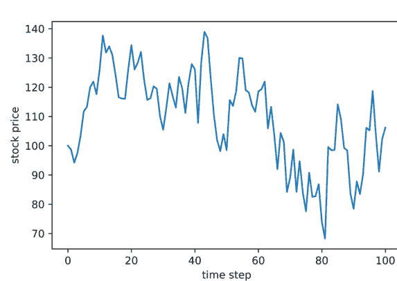

### 10.1.1 移动平均

数据去噪的一种常用技术是使用移动平均对其进行平滑。例如，二十期移动平均将计算滚动20天窗口内的平均价格。通常，前20天组成第一个窗口，第21到40天组成第二个窗口，依此类推。

`pandas` 模块提供了一个方便执行此操作的函数，我们将价格存储在 `dataframe` 中并这样调用 `rolling()` 函数：

- `steps = 100`

```python
# 创建一个 dataframe，将数据作为字典传递
df = pd.DataFrame({'time':range(steps), 'price':prices})

# 添加移动平均列
df['ma20'] = df.price.rolling(20).mean()
```

图 10.2 显示了股票价格和移动平均的轨迹。移动平均曲线比价格更平滑，有助于观察趋势。移动平均表现出滞后性，会对波动做出反应。当股票价格在时间60左右急剧下降时，移动平均的下降要缓慢得多，这一点显而易见。最后，移动平均曲线直到时间步20才开始，这与计算平均值使用的点数相匹配。通常，较长期的移动平均需要更多点才能开始，并且对原始数据的平滑效果较小。

处理噪声的转换

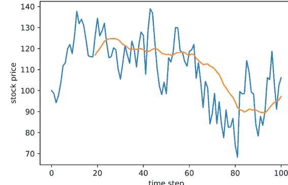

### 10.1.2 限制极值

限制由噪声产生的极值影响的两种流行方法是缩尾（winsoring）和修剪（trimming）。在使用这些方法时需要小心，因为离群值也可能是合法数据。例如：

在缩尾法中，离群值被设置为数据的给定的百分位数。80%的缩尾保留了中间80%的数据不变。低于第10分位数的值将被下调至第10分位数，高于第90分位数的值将被限制在第90分位数。以下代码对包含离群值的数据进行缩尾处理。数据的底部10%被下调为1（第10分位数），而顶部10%被限制在第90分位数。

```python
from scipy.stats import winsorize
data_win = [1, 2, 3, 4, 5, 6, 7, 8, 9, 1000]
winsorize(data_win, limits=[0.1, 0.1])
```

修剪与缩尾不同，因为它丢弃了离群值。在这种情况下，我们移除了最低和最高百分比的数据。

```python
from scipy.stats import trim_mean
data_win = [1, 2, 3, 4, 5, 6, 7, 8, 9, 1000]
trim_mean(data_win, 0.1)
```

缩尾是一种稳健统计方法。如果我们想理解数据的中心，可能会计算均值。如果我们在计算中包含离群值，它们将产生很大影响。在本节中，我们查看了滤波器。还有许多实用的滤波器，例如低通、卡尔曼（Kalman）和伯特沃（Butterworth）。在本节中，我们看了数据去噪。滤波器的选择取决于数据以及我们面临的噪声类型。

## 10.2 尺度的转换

### 10.2.1 数量级和对数

当我们考虑尺度时，考虑的是在 $[0, 10]$ 间取值的变量 $X$，以及另一个通常取较大值（如 10,000）的变量 $Y$。一个值的数量级是该值表示为10的幂次。它可以用科学计数法写为 $1 \times 10^4$。接下来，让我们思考两个数字之间数量级的差异。100和200（或 $1 \times 10^2$）之间的数量级差异很大。数量级的巨大差异在数据可视化和为数据拟合模型时会引起问题。让我们考虑一个简单的例子，`x` 和 `y` 分别包含一个值值列表：

- `x = [0, 1, 2, 3, 4, 5]`
- `y = [10, 10, 20, 20, 10000]`

我们期望的 `y` 值为10,000。图 10.3 绘制了数据。正如我们预期的，10,000使得较小的 `y` 值看起来是零或接近于零。取决于语境，这可能是问题的。如果问题是某一年有多少死亡人数，而 `y` 代表这些死亡人数，那么答案为零与答案为二十完全不同。

由于我们正试图更好地理解所有这些数据，我们正在寻找一种更好地表示它的方法。当面对数量级数值时，一种常用技术是取数据的以10为底对数。这与衡量数量级是一致的，这意味着值为10的对数为1，而值为10,000的对数为4。图 10.4 展示了`log(y)`转换更好地表示了全量数据。

图 10.3：`x` 与 `y`

图 10.4：`x` 与 `log(y)`

### 10.2.2 标准化

在本节中，我们将花费更多时间研究标准化，这是我们在处理从正态分布的随机变量时遇到过的。想象两个不同的语言班参加了同一场考试。每个班的成绩大致遵循正态分布，标准差均为2。在第一个班中，均值为90，而第二个班的均值为75。假设每个班各有一个学生都得了90分。

## 哪个学生的表现更好？

1 级的学生得分处于平均水平，而 2 级的学生表现优异。为了进行公平比较，我们通过 `z = (x - μ)/σ` 计算 z 分数对分数进行标准化。1 级的 90 分相当于 z 分数 `(90 - 90)/2 = 0`，而 2 级的成绩等同于 z 分数 `(90 - 75)/2 = 7.5`。注意，z 分数 7.5 是极高的，回想 99.7% 的情况下，标准正态分布随机变量的 z 分数在 -3 到 3 之间。

在这个示例中，我们每个班级有一个值。在数据科学中，我们经常对一或多列数据进行标准化，每一列作为一个变量。这使得每个值处于相似的尺度上并保留了离群值。可以使用 `StandardScaler()` 函数来标准化一或多列。以下是一个示例代码示例：

```python
from sklearn.preprocessing import StandardScaler
import numpy as np

# 创建一个四行两列（变量）的数组
data = np.array([[4, 4], [6, 0], [0, 2], [1, 1]])

# 设置适配器
scaler = StandardScaler()

# 计算 z 分数
scaled_data = scaler.fit_transform(data)

print(data)
print(scaled_data)
```

OUT:

```
[[4 4]
[6 0]
[0 2]
[1 1]]

[[0.52414242 1.52127766]
 [1.36277029 -1.18321596]
 [-1.53111332 0.16903085]
 [-0.73379939 -0.50709255]]
```

默认情况下，适配器计算每列的平均值和标准差并产生 z 分数。对于这些数据，每列的值范围在 [-3, 3] 之间，这对于具有标准正态分布的变量是常见的。此外，每列的平均值将为零，标准差为一。我们可以“手动”计算每列的平均值和标准差来检查其中一个 z 分数。

```python
data.mean(axis=0)
OUT: [2.75 1.75]
```

```python
data.std(axis=0)
OUT: [2.384848 1.47901995]
```

`Axis=0` 参数允许在计算统计量时跨行进行选择。对于参数 4，其 z 分数为 `(4-2.75)/2.384848=0.52414242`，这与缩放后的数据项匹配。

## 10.2.3 归一化

尺度数据的另一种方法是归一化。这种方法将数据压缩到一个通常选择为 [0, 1] 或 [-1, 1] 的范围内。与名称暗示的不一样，这种变换与正态分布无关，数据不需要服从正态分布。离群值被过滤到下限并在上限处截断。这种变换在缩放数据方面是有效的，但当数据近似于正态分布时，建议使用标准化以保留关于原点的对称性并保留离群值。归一化数据的公式如下：

$x_{norm} = \frac{x - x_{min}}{x_{max} - x_{min}}$

以下是归一化之前示例数据集的代码片段。默认情况下，`MinMaxScaler()` 使用 0 作为下限，1 作为上限。

```python
from sklearn.preprocessing import MinMaxScaler
import numpy as np

# 设置适配器
scaler = MinMaxScaler()

# 对数据进行归一化
norm_data = scaler.fit_transform(data)

print(norm_data)
```

OUT:

```
[[0.66666667 1. ] [1. 0. ] [0. 0.5 ] [0.16666667 0.25 ]]
```

对于每一列，原始的最小值和最大值分别映射到 0 和 1。由于这些列处于相同的 [0, 1] 范围内，实现了缩放。

## 10.3 数据表示的变换

回想关于野火的文章。我们处理了数据，将文档分词为单词。假设我们想根据单词频率自动确定并分类文章的主题，但模型无法直接接受字符串。我们需要将数据转换为适当的定量形式。在接下来的章节中，我们将回顾表示分类数据的常用变换。

### 10.3.1 CountVectorizer

为了在自动化分类方面进展，我们可以将每个文档表示为单词及其频率的集合。`sklearn` 中的 `CountVectorizer()` 可用于此任务。这是一个短代码示例，它处理了两个文档；第一个摘自野火文章，第二个关于体育。默认情况下，每个文档都将被分词为单词，并计算一个矩阵。第 $i$ 行第 $j$ 列的元素将显示单词 $j$ 在文档 $i$ 中出现的次数。

```python
from sklearn.feature_extraction.text import CountVectorizer
docs = ['The 2021 California wildfire season was series of wildfires.', 'Golden State Warriors team is located in California.']

countvec = CountVectorizer()
# 拟合分词计数
X = countvec.fit_transform(docs)

# 输出特征名称
print(countvec.get_feature_names_out())

# 输出矩阵
print(X.toarray())
```

OUT:

```
['California' 'Golden' 'State' 'Warriors' 'and' 'wildfires' 'is' 'located' 'of' 'season' 'series' 'team' 'the']
[[0 0 0 0 1 1 1 1 1 1 1 0 1]
 [1 1 1 1 0 0 0 1 0 0 0 1 1]]
```

### 10.3.2 独热编码

分类数据可能具有离散值，此时直接计算是没有意义的。婚姻状况（例如‘单身’、‘已婚’）、教育程度（例如‘高中’、‘大学’）和邮政编码（例如 11787）都是例子。为了将这些变量引入模型，可以使用独热编码（OHE）。

考虑以下包含各种品种的数据：

`breeds`: `['persian', 'persian', 'siamese', 'himalayan', 'burmese']`

为了编码这种分类变量，我们可以为每个独特品种创建一个列：缅甸、喜马拉雅、波斯和西斯猫。每行将引用一个记录，每个元素将取 0 或 1 来指示品种。可能如下：

| 记录 | 缅甸猫 | 喜马拉雅 | 波斯 | 西斯 |
| :--- | :--- | :--- | :--- | :--- |
| 1 | 0 | 0 | 1 | 0 |
| 2 | 0 | 0 | 1 | 0 |
| 3 | 0 | 0 | 0 | 1 |
| 4 | 0 | 1 | 0 | 0 |
| 5 | 1 | 0 | 0 | 0 |

前两个记录是波斯猫，这通过波斯列中的 1 来表示。写为向量，记录 1 被编码为 `[0, 0, 1, 0]`。我们可以通过观察来压缩这种情况：对于具有 $n$ 个级别（或唯一值）的分类变量，我们只需要 $n-1$ 个列来表示它们。在这种情况下，我们将删除缅甸猫列并更新矩阵。

| 记录 | 喜马拉雅 | 波斯 | 西斯 |
| :--- | :--- | :--- | :--- |
| 1 | 0 | 1 | 0 |
| 2 | 0 | 1 | 0 |
| 3 | 0 | 0 | 1 |
| 4 | 1 | 0 | 0 |
| 5 | 0 | 0 | 0 |

5 取值为‘缅甸猫’，这体现在剩余每种猫品种的值都均为 0。

# 创建预测器的其他常用方法

191

```python
prefix='breed'
print('\n--one hot encoded categorical data')
print(cats)

OUT:
--categorical data
0 persian
1 persian
2 siamese
3 himalayan
4 burmese

--dummified categorical data
breed_himalayan breed_persian siamese
0 1 0
1 1 0
2 0 1
3 1 0
4 0 0
```

## 10.4 创建预测器的其他常用方法

### 10.4.1 二值化 (Binarization)

数据二值化通常用于构建反映某事件是否发生的变量（例如，用户是否查看了视频，患者是否康复）。二值化变量有时比原始变量是更好的预测器，因为它能够压缩高频计数。例如，在一个电影观众的数据集中，大多数观众只看了一次《泰坦尼克号》，或者根本没看这部电影。可能有少数观众看了它十次或更多次。为了整合这些数据的信息内容，将变量二值化为“观众”和“非观众”可能会很有用。

二值化的第二个用例是对预测概率进行阈值处理，以分配可能的结果。我们稍后会详细讨论阈值处理，但基本上，如果模型预测某个结果的概率为 0.80（例如），则需要将该值与截止值进行比较，以给出是/否的回答。

从数学角度来说，二值化是一个阶跃函数。例如，给定输入 `x` 和截止值 `c`，函数 `f(x)` 定义如下：

```python
f(x) = \begin{cases} 0 & x \le c \\ 1 & x > c \end{cases}
```

以下是一个使用 `sklearn` 进行数据二值化的代码片段。`Binarizer()` 接收一个阈值，默认零。小于或等于阈值的值将设置为零，否则设置为一。

```python
from sklearn.preprocessing import Binarizer

bin = Binarizer() # 设置缩放器
bin_data = bin.fit_transform(data)

print(data)
print('')
print(bin_data)
```

```python
OUT:
[[4 0]
 [6 0]
 [0 2]
 [1 1]]

[[1 1]
 [1 0]
 [0 1]
 [1 1]]
```

### 10.4.2 离散化 (Discretization)

将连续变量离散化为桶（buckets）有时可以产生更强大的预测器。特别是当变量范围很大且用于回归模型时，这种方法非常有效。`pandas` 的 `cut()` 函数可以根据排名或位数将数据离散化为等大小的桶。

下面的示例创建了 1000 个从标准正态分布中抽取的随机值。这些值经过乘法和缩放以扩大其范围。数据被分为十分位数（deciles），其中分位数 0 是最低的 10% 数据值，分位数 1 是接下来的 10%，以此此类推。原始数据和分位数在图 10.5(a) 和 10.5(b) 中绘制，以展示离散化的效果。

```python
data = 100*np.random.normal(size=1000)
data.sort()
```

# 离散化为十分位数

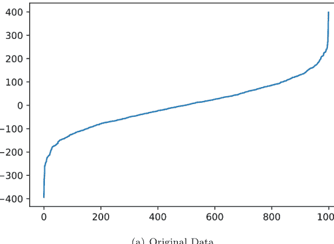

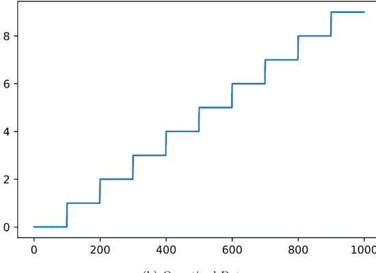

图 10.5：原始数据与量化数据

```python
data_dec = pd.qcut(data, q=10, labels=False)

plt.plot(data)
plt.plot(data_dec)
```

注意量化数据中的锯齿状模式。随着数据被分为十分位数，这产生了一系列阶跃函数，其中在每个分位数内值是恒定的，然后在下一个分位数处发生跳跃。这种效果是将许多值映射到相同的输出，从而将数据范围缩小到 0, 1, \dots, 9。

### 10.4.3 其他常用变换

许多其他变换可能有助于构建实用的预测器。问题的背景可以指导变换的使用。下表提供了一些示例。

| 变换 | 示例 |
|---|---|
| 变量比例 | 资产负负债率 |
| 变量差值 | 长期利率减短期利率 |
| 滞后变量 | 上个月的药物剂量 |
| 变量累积和 | 总学习时间 |
| 变量的幂 | 时间的平方 |

### 10.4.4 存储转换数据

创建转换后的数据可能耗时。与存储清洗数据类似，存储转换后的数据以避免重新构建是有益的。如果其他授权用户可能发现这些数据有用，建议提供访问权限和文档。特征存储（feature store）是此类数据的专用存储器。某些云应用程序（如 Amazon SageMaker）提供了此功能，使特征可以被复用并让授权用户轻松访问。

## 10.5 章节总结

原始数据在使用之前通常需要进行转换。（注：根据提供的 OCR 文本，正在此处结束）。

# 11

## 探索性数据分析

处理新数据集时应该完成的任务之一是对数据有一个直观的感受。我们在预处理步骤中已经进行了一些工作，例如寻找缺失值和异常值，以及进行变量转换。每个数据集都是不同的，并可能包含惊喜；理解这些细微差别以及处理它们的工具，将有助于进行准确且具洞察力的分析。


我们将探索的两个活动是数据的统计摘要和可视化。随着数据集的规模扩大，审查所有数据点可能变得困难甚至不可能，这正是统计学派上用场。统计摘要提供了一个或多个变量分布的快速概述。聚合可以在一个或多个轴上对数据进行总结，例如对高频数据计算每日平均值。我们将在本章看到统计应用的示例。

良好的图表将引导你发现数据的重要特征，引发进一步的调查。Python 包含了几个可视化模块，其中 `matplotlib` 和 `seaborn` 最受欢迎。我们将展示 seaborn 的示例，让你感受到它的强大和易用性。Seaborn 基于 matplotlib，它提供了一个高级接口，用于绘制美观且信息丰富的统计图表。对于 seaborn 的自定义，本书有时无法对该模块进行全面介绍，因此接下来的示例将作为一个起点。关于 seaborn 的介绍，请参见 [32]。要开始使用 matplotlib，请参见 [33]。这两个包都会随 Anaconda 预安装。

探索性数据分析（EDA）可以单独对变量进行，但当我们考虑一个变量如何变化或与另一个变量协变时，会获得许多有趣的见解。这说明了理解变量之间关系的重要性，这对于预测至关至关重要。为了强调这一点，请考虑：每当选择一个变量时，数据就从一个大型系统中抽离了上下文。如果数据列是一组期中成绩，那么被排除的数据可能是当天身体不舒服的学生。对于一系列股票价格，底层的经济环境被排除在外。在每情况下，这些被排除的变量可能对于真正理解数据至关重要。通过彻底研究每个变量以及它们的组合，将有助于对数据所包含的见解建立更完整的理解。

当我们对单个变量进行分析时，这通常被称为单变量分析。对两个变量共同进行的研究则被称为双变量分析。每个分析都需要不同的统计方法和图表，它们对于完整的研究都是必须的。在接下来的两个章节中，我们将分别对二分类目标和连续目标进行 EDA。第一个练习将考虑一个来自银行的合成数据集，其中记录代表客户的支票存款，目标变量是支票是否欺诈。第二个练习将研究人口幸福感。这些练习应该让你对数据探索过程和方法有良好的感。

## 11.1 支票欺诈

在本节中，我们将研究为客户提供支票账户的银行面临的问题。支票欺诈通常很罕见，但总损失可能是巨大的，因此检测坏票具有巨大的动力。

用于此分析的合成数据集存储在这里的课程仓库中：

```
semester1/datasets/check_deposit_fraud.csv
```

包含执行 EDA 代码的 Jupyter notebook 位于这里：

```
semester1/week_11_12_visualize_summarize/check_deposit_eda.ipynb
```

我们导入数据并显示前几行：

```python
df = pd.read_csv('../datasets/check_deposit_fraud.csv')
df.head(3)
```

| checkkid | check_amount | check_signed | is_fraud |

| :--- | :--- | :--- | :--- |

| 0 | 9076.51 | 1 | 0 |

| 1 | 2148.38 | 1 | 0 |

| 2 | 604.52 | 1 | 0 |

我们可以通过以下命令查看数据的模式：

```python
df.info()
```

| Column | Non-Null Count | Dtype |

| :--- | :--- | :--- |

| 0 | checkid | 1100 non-null | int64 |

| 1 | check_amount | 1100 non-null | float64 |

| 2 | check_signed | 1100 non-null | int64 |

| 3 | is_fraud | 1100 non-null | int64 |

真实世界的数据集会包含额外的属性，如银行名称、账户、路由号码、支票等。在这里，我们关注了一些有趣属性的样本，因为它们表现出了历史性的预测能力。对于二分类变量 `check_signed` 和目标变量 `is_fraud`，我们应该计算每个值的频率和百分比。我们统计欺诈支票和非欺诈支票的数量：

```python
df.is_fraud.value_counts()
0    1096
1    4
```

行按观测次数从高到低排序。在这种情况下，有 1096 行 `is_fraud` 为 0（无欺诈；负标签），有 4 行 `is_fraud` 为 1（欺诈；正标签）。包含 `normalize=True` 参数将计算它们的百分比：

```python
df.is_fraud.value_counts(normalize=True)
0    0.996364
1    0.003636
```

超过 99% 的支票是合法的；欺诈相当罕见。

我们对 `check_signed` 遵循相同的步骤：

```python
df.check_signed.value_counts()
1    1096
0    4
```

```python
df.check_signed.value_counts(normalize=True)
1    0.996364
0    0.003636
```

大多数支票都签名了。

### 探索性数据分析

这表明 75% 的无签名支票是欺诈性的，而只有 0.09% 的签名支票是欺诈性的。0.75 / 0.00092 = 822 的比例强烈暗示无签名支票具有更高的欺诈风险。如果我们构建一个预测模型，`check_signed` 将是一个很好的候选预测变量。

接下来，让我们探索 `check_amount` 以了解金额如何随欺诈结果变化。图 11.2 中的散点图可能会澄清它们的关系。

```python
sns.scatterplot(x='check_amount', y='is_fraud', data=df)
plt.grid() # 由 matplotlib 调用
```

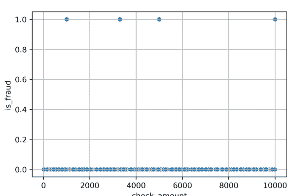

图 11.2：按欺诈指标分类支票金额

网格线整合自 matplotlib。对于双变量图（也称为联合图），常用的指定的参数是 x、y 和 dataframe。x 和 y 的值是作为字符串输入的变量名，而 data 指的是 dataframe 对象。与单变量情况类似，可以通过交换图类型并包含相关参数来更改图形类型。

大多数支票都不是欺诈性的，它们的点被绘制在底部的水平网格线上。我们在 `is_fraud=1` 的顶部的水平网格线上看到了四张欺诈支票。支票金额似乎大致为 1000、4500、5000 和 10000。我们还可以检查数据集中的欺诈记录：

```python
df[df.is_fraud=1]
```

# 世界幸福报告

| checkid | check_amount | check_signed | is_fraud |

| :--- | :--- | :--- | :--- |

| 101 | 10000.00 | 1 | 1 |

| 510 | 5000.00 | 0 | 1 |

| 778 | 1000.00 | 0 | 1 |

| 901 | 4615.59 | 0 | 1 |

该表格确认了一个关键观察：在四个欺诈案例中的三个中，支票金额是 1000 的倍数。鉴于此，创建一个预测变量来指示每个支票金额是否为 1000 的倍是有意义的。我们可以将其命名为 `check_amount_mult_1000`。

从我们的探索性工作中，我们发现 `check_signed` 和 `check_amount` 是支票欺诈的有用预测变量。在得出这些见解时，我们产生了统计摘要、过滤了数据并创建了图表。我们需要创意并尝试不同的方法，因为预测变量并不是一而易见的。

## 11.2 世界幸福报告

《世界幸福报告》是对 117 个国家全球幸福状况的年度调查。我们将查看 2018 年报告的数据 [34]。更多信息可以在此处找到：

https://www.happiness.report/ed/2018/

数据集可以在此处找到：

https://www.kaggle.com/unsdsn/world-happiness

2018 年的数据保存在课程仓库中，我们将从那里加载它。

```python
import pandas as pd
import seaborn as sns
import matplotlib.pyplot as plt

d = pd.read_csv('./datasets/Country_Happiness.csv')
df.head(2)
```

输出：

| Country | Happy | WH | WL | Dys | GDP | Social | Health | Free |

| :--- | :--- | :--- | :--- | :--- | :--- | :--- | :--- | :--- |

| Finland | 7.632 | 7.695 | 7.569 | 2.595 | 1.305 | 1.592 | 0.874 | 0.681 |

| Norway | 7.594 | 7.657 | 7.530 | 2.383 | 1.465 | 1.582 | 0.861 | 0.686 |

每行代表一个唯一的国家，列名是缩写，某些列由于边距限制被隐藏。我们将关注作为目标的幸福评分（Happy），以及有助于提高生活的六个因素：经济生产（GDP）、社会支持（Social）、预期寿命（Health）、自由（Free）和对腐败的感知（Corruption）。受访者被要求从 0（最差）到 10（最好）对他们的幸福进行评分。假设是这六个因素有助于幸福评分，无论是直接地（它们同步上升）还是反地（它们相反移动）。

首先，让我们生成幸福评分和因素的直方图以了解其分布。代码所示，并带有直方图示例。

```python
## 排除我们不会绘制的变量
vars_exclude = ['Country','Whisker-high','Whisker-low']

# 遍历 dataframe 中的每个变量
for var in df.columns:
    # 如果变量不在排除列表中则执行
    if var not in vars_exclude:
        # 绘制变量的直方图
        sns.histplot(df[var])
        plt.show()
```

幸福评分范围从 2.91 到 7.63，大多数分数落在 4.5 到 6.5 之间。最低分远高于零，最高分远低于 10。

图 11.3：幸福评分分布

社会支持因素范围从 0 到 1.64，且向左偏。这意味着分布在峰值的左侧较长，峰值出现在 1.3 左右。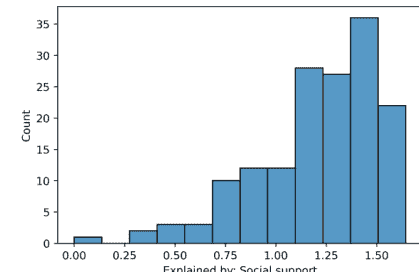

图 11.4：社会支持因素分布

腐败因素从 0 到 0.46。75% 的值低于 0.14，且向右偏。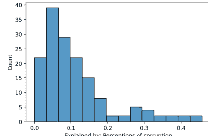

图 11.5：腐败因素分布

可视化数据分布另一个有用图是箱线图。图 11.6 显示了幸福评分的箱线图，带有五个数值：

- 最大值出现在顶部的水平线（7.63）

- 第 75 分位数形成箱体顶部（6.17）

- 中位数，或第 50 分位数，是箱体中的水平线（5.38）

- 第 25 分位数形成箱体底部（4.45）

- 最小值出现在底部的水平线（2.91）

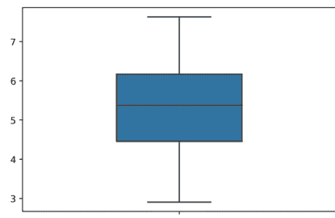

图 11.6：幸福评分箱线图

箱线图提供的细节比直方图少，但更容易解释。此外，几个箱线图可以很容易比较。

```python
sns.boxplot(data=df['Happiness score'], width=0.4)
```

接下来，让我们查看数据的双变量图以理解因素与目标之间的关系。我们创建一个幸福与社会支持的散点图：

```python
sns.scatterplot(x='Explained by: Social support', y='Happiness score', data=df)
```

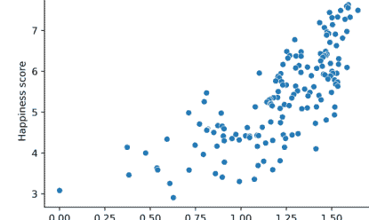

图 11.7：幸福评分与社会支持

# 世界幸福报告

图 11.7 显示了社会支持与幸福之间的直接关系；它们倾向于共同移动。相关性为 0.76，表明存在强正（线性）相关。

接下来，我们创建一个幸福与腐败的散点图：

```python
sns.scatterplot(x='Explained by: Perceptions of corruption', y='Happiness score', data=df)
```

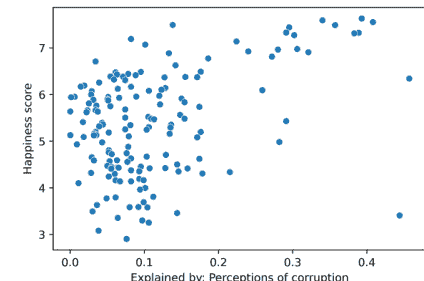

图 11.8：幸福评分与腐败

这里没有明显的直接关系，右侧有一些离群值。0.41 的相关性表明直接关系较弱。

我们分别为基础变量了单变量图和散点图以查看它们的协方差。联合图（图 11.9）将散点图与基础变量的直方图相结合：

```python
sns.jointplot(x='Explained by: Social support', y='Happiness score', data=df)
```

注意我们通过将子图更改为 jointplot 将散点图改为联合图。seaborn 接口使得这非常简单。

使用 pandas 计算相关性非常直接。所有的两两相关性都可以在 `df.corr()` 命令在 dataframe 中计算。如果我们只需要目标列的相关性，可以对列进行子集：

```python
df.corr(['Happiness score'])
```

输出：

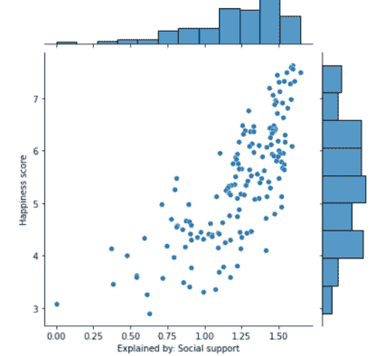

图 11.9：幸福评分与腐败的联合图

| | Happiness score |

| :--- | :--- |

| Happiness score | 1.000000 |

| Whisker-high | 0.999553 |

| Whisker-low | 0.999571 |

| Dystopia (1.92) + residual | 0.473606 |

| Explained by: GDP per capita | 0.807338 |

| Explained by: Social support | 0.764656 |

| Explained by: Healthy life expectancy | 0.777484 |

| Explained by: Freedom to make life choices | 0.562290 |

| Explained by: Generosity | 0.142030 |

| Explained by: Perceptions of corruption | 0.408650 |

这显示相关性性因素是 GDP，而慷慨的相关性最弱。

最后，seaborn 可以通过 `pairplot` 分别绘制所有两两和每对关系的联合及边缘分布。图 11.10 中的图数据密度很高，无法快速理解整体模式。由于列名很长，首先通过传递的“旧名：新名”对对它们进行缩写。

```python
# 缩写列名
df.rename(columns={
'Country' : 'country',
'Happiness score' : 'happy',
'Whisker-high' : 'wh',
'Whisker-low' : 'wl',
})
```

# 汇总统计的使用与局限性

```python
'Dystopia (i.92) + residual' : 'dys',
'Explained by: GDP per capita' : 'gdp',
'Explained by: Social support' : 'social',
'Explained by: Healthy life expectancy' : 'exp',
'Explained by: Freedom to make life choices' : 'freedom',
'Explained by: Generosity' : 'generous',
'Explained by: Perceptions of corruption' : 'corrupt',
},
inplace=True

# 生成所需尺寸的矩阵图
sns.pairplot(data=df, height=1.25)
```

对角线上的直方图（例如，幸福得分位于左上角）和散点图是对角分布的。x轴和y轴上的变量名称标识了特定的散点图（例如，第5行第1列显示了幸福与GDP的关系）。向上斜的图表表明之间存在强烈的直接关系。

## 11.3 汇总统计的使用与局限性

在本节中，我们通过绘制散点图和计算相关性研究了许多变量。更通俗地说，我们常用的两种组合对是预测变量-目标对以及预测变量-预测变量对。在预测变量 $X_1$ 和目标 $Y$ 之间发现强关系（直接或间接）非常有意义，因为这表明该预测变量在模型中可能是有效的。现在考虑另一个与 $X_1$ 有强直接关系的预测变量 $X_2$。在这种情况下，对于已经包含 $X_1$ 作为预测变量的模型，$X_2$ 可能没有用，因为预测变量在某种程度上是冗余的。变量选择的关键在于添加与目标有强关系但它们彼此之间没有强关系的预测变量。

我们将涵盖的回归和分类模型假设预测变量与目标之间存在线性关系。回想一下相关系数衡量的是线性关系，这对于模型是合适的。有许多机器学习模型不假设线性关系，例如随机森林和梯度提升树。这些方法在处理具有复杂关系的预测变量时提供了灵活性。这意味着，虽然两个变量之间可能没有强线性关系，但它们可能存在更复杂的关系，可以通过更灵活的模型来解释。这强调了针对特定任务使用正确统计方法，以及理解统计方法用途局限性的概念。让我们来看两个例子：


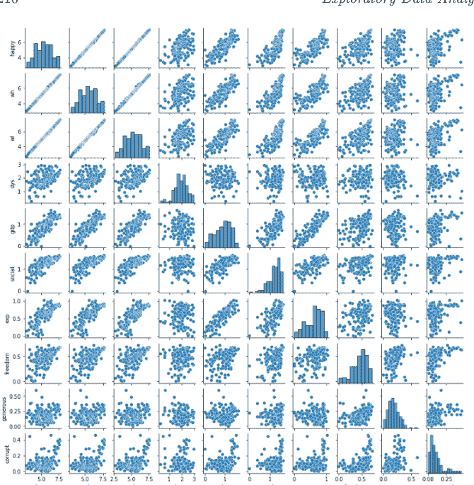

# 图 11.10：世界幸福矩阵图

- 1. 预测变量 $X$ 与目标 $Y$ 之间的相关性不能告诉我们 $X$ 是否导致了 $Y$。这在观测数据中尤为如此，因为它不是在研究人员控制下收集的。正相关表明 $X$ 的增加与 $Y$ 的增加有关，但我们无法确认因果关系。例如，在一项关于咖啡 $X$ 是否降低某组人群血压 $Y$ 的研究中，运动 $E$ 或压力 $S$ 等额外变量可能与 $X$ 和 $Y$ 都相关并起到因果作用。这些额外变量被称为*潜伏变量*（lurking variables），它们在研究中可能会产生*混杂影响*（confounding effect）。

- 2. 平均值不是一种稳健的中心趋势度量量。对于包含大离群值的数据集，平均值会受到这些值的极大影响，无法代表数据的中心。作为替代，当数据存在包含离群值的风险时，应该使用中位数代替平均值。例如房地产中的财务交易，某栋离群值房屋的出售可能会扭曲整个社区的定价水平。

## 11.4 图表设计的卓越性

在前面的章节中，我们使用 Python 模块生成了似乎对探索变量有帮助的图表。让我们花时间研究什么是好的图表，以及应该避免什么。本节中的许多观点可以在优秀的书籍 [35] 中找到。图形会引入额外的开销，因为它们可能包含曲线、坐标系和必须由读者理解的标签。对于小型数据集，图表可能不是必要的；使用表格会更好。

当我们决定生成图表时，诚实反映数据至关重要。这听起来显而易见，但有很多撒谎数据的方法，无论是故意的无意的。在第一种情况下，视觉效果可能被故意误导读者。在第二种情况下，使用的技术可能会误导读者。无论何种情况，制图者都对数据的准确清晰报告负责。这意味着需要相应的伦道德和技能。如果某个包无法生成正确的图表，应该使用其他方法。

接下来，我们将查看几个数据绘图的示例，以理解哪里会出错以及如何改进数据的描述。饼图在显示数据方面非常流行，特别是在显示股票和债券等资产投资的财务领域（这被称为资产分配）。图11显示了资产分配的示例。如果你能猜出较大的部分大于 50% 且小于 75%，对的。然而，要得出正确答案可能很难：较大的部分为 65%，而较小的部分为 35%。为什么要让读者费力得到错误的答案？图表可以为了清晰而标记，但对于这种数据，表格会更好：

| 65% | 35% |

|---|---|

| 股票 | 债券 |


# 图 11.11：资产分配

下一个例子，考虑绘制点 (1,5), (2,8), (3,10) 和 (5,12)。假设我们运行这段代码生成折线图：

```python
xval = [1, 2, 3, 5] # x坐标列表
yval = [5, 8, 10, 12] # y坐标列表
sns.scatterplot(x=xval, y=yval)
```

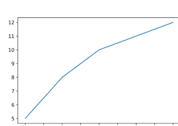

# 图 11.12：误导性的折线图

生成图11.12所示的图表很容易，但它极具误导性。看起来x值在 1 到 5 之间有连续数据，y值在 5 到 12 之间也是如此。例如，存在一个点 (4,11)。事实上，并没有这样的点，图表插值了该值。使用显示实际点的散点图甚至是一个小表格会更好。

在使用 seaborn 创建柱状图时也需要注意。这里有一个例子：

```python
xval = ['a', 'b', 'c', 'd']
yval = [5, 8, 10, 12]
sns.barplot(x=xval, y=yval)
```

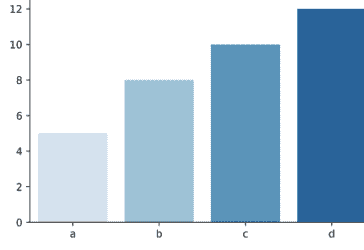

# 图 11.13：误导性的柱状图

默认行为是为每个数据点分配不同的颜色，如图11.13 所示。这实际上创建了一个虚假维度。我们可以通过对所有柱子使用同一种颜色来改进：

```python
sns.barplot(x=xval, y=yval, color='grey')
```

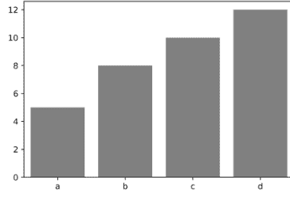

# 图 11.14：更好的柱状图

图11.14 更好地传达了数据。为了确保起见，这些点在表格中报告可能更好，但这个小例子说明了以下建议：

- 避免虚假维度
- 为数据选择正确的图表
- 质疑统计软件的输出。默认设置并不总是合适的。

## 探索性数据分析

记住不同的读者可能会以不同的方式感知同一张图。颜色有时被用作变量，特定的颜色映射可能暗示严重性。某些读者可能有某种类型的色盲，颜色可能会产生误导。对于其他人来说，他们可能难以理解其解释。

视觉效果是一把双刃剑：感兴趣的点可以吸引注意力，也可能误导。在下一个例子中，我们在它们上方绘图。读者将遵循趋势并看到最右侧的值下降了。这里有一个陷阱：2023年的值是基于上半年的。事实上，2023年可能是最好的一年。明确这一点以避免误导读者很重要；可以在图表上添加注释来指出半年。

```python
year = ['2020', '2021', '2022', '1H2023']
revenue = [5, 8, 10, 7]
sns.barplot(x=year, y=revenue, color='grey')
```

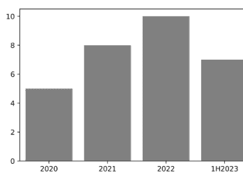

# 图 11.15：带有半年的柱状图

向图表中添加层应该在它们有助于理解数据时才进行。考虑图11.16中过度绘制的网格线直方图。网格线太深了，占据了图表。如图11.17所示的较浅层可以让数据显出来。

## 章节总结

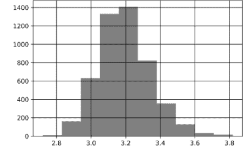

图 11.16：带有明显网格线的直方图

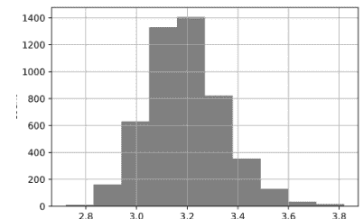

图 11.17：带有较软网格线的直方图

- 是否有更好的标记图形的方法？
- 是否有更好的展示这些数据的方法？

## 11.5 章节总结

在本章中，我们讨论了用于仔细探索数据的线性技术和工具。数据集通常太大，无法进行全面的人工审查，而这正是统计分析、聚合和过滤可以派上用场的地方。统计有其局限性，我们讨论了在什么情况下中位数是平均值更好的统计。相关性衡量两个变量之间的线性关系，它可以帮助理解变量是否倾向于以相同或相反的方向移动。然而，我们得出的结论是存在强因果关系。

我们回顾了一个支票存款数据集，包含了支票金额以及支票是否签名和欺诈的指标。通过双向分类表，我们发现未签名的支票比签名的支票更有可能是欺诈。此外，通过查询欺诈支票，我们了解到它们的支票金额更有可能是1000的倍数。虽然数据是合成的，但它说明我们在寻找预测因子时需要详尽且具有创新性。不同的可视化也可以产生见解。

第二个练习来自《世界幸福报告》。除了一百国家的幸福得分外，它还包含了可能解释幸福的六个因素。我们创建了二变量并并计算相关性，以理解因素与幸福之间的关系。

最后，我们讨论了创建有用图表的几个重要实践。至关重要的是，图形必须反映数据的真实。通过人工手段和技术手段，观众都可能被图形误导。图形的创建者必须小心展示什么、省略哪些内容，并清晰、准确且高效地表示数据。在本章中，图形将服务于理解。

在下一章中，我们将从高层级回顾机器学习（ML）。机器学习令人兴奋的特性是赋予算法从数据中学习的能力。这将允许我们正式地构建预测模型并发现数据中的结构。

## 11.6 练习

带有答案的练习标记为 (S)。答案可以在此处仓库的 book_materials 文件夹中找到：

https://github.com/PredictNN/intro_data_science_course/

- 1. 根据支票欺诈练习，在支票未签名的情况下，支票为欺诈的概率是多少？
- 2. 下面的 `crosstab()` 函数生成一个双向表，显示在地址有效或无效的情况下，欺诈或票或支票的数量。根据计数，在地址无效的情况下，支票为欺诈的概率是多少？

```python
pd.crosstab(index=df['invalid_address'],
columns=df[is_fraud])
```

| | is_fraud | 0 | 1 |

||---|---|---|

| invalid_address | 2 | 99 |

| 0 | 2050 | 1 |

## 练习

- 3. 对于给定的每个场景，指出平均值、中位数或众数哪个是最合适的中心趋势度量。
    a) 你想计算某个社区内房屋销售额的中心趋势。这些房屋由20栋近乎相同的平层式三卧室房屋组成。
    b) 你想计算某个社区内房屋销售额的中心趋势。这些房屋由20栋近乎相同的平层式三卧室房屋和一栋海滨别墅组成。
    c) 一个数据集集包含一个带有某些缺失值的分类变量。
- 4. 根据支票欺诈练习，在支票未签名的情况下，支票为欺诈的概率是多少？
- 5. 假设地址无效，支票为欺诈的概率是多少？（注：此处可能根据上下文逻辑微调）
- 6. 支票金额是1000的倍数。
- 7. 正确或错误：你想使用中心趋势来填充缺失值。
- 8. 正确或错误：你想展示数据。
- 9. 你展示变量之间的关系。这违反了哪项原则？
    a) 图形必须漂亮
    b) 不要显示完整数据
    c) 统计输出
    d) 观察
- 10. 正确或错误：散点图显示了变量之间的弱相关性。
- 11. 从世界幸福报告中，使用 seaborn 创建一个散点图，其中幸福变量位于x轴，幸福得分位于y轴。
- 12. 从世界幸福报告中，删除异常值，然后计算幸福变量与幸福得分的相关性。对于这个练习，异常值应该被标记为。

# 12 机器学习概述

在本章中，我们将回顾机器学习分支。每种方法都提供解决问题的方法，但它们是根本不同的。以下是我们将探索的分支：

- 监督学习
- 无监督学习
- 半监督学习
- 强化学习

## 12.1 决策的简单工具

我们可能使用了优缺点列表。在创建列表时，我们建立了一个*优点*列来包含路径的优势，以及一个*缺点*列。然后我们思考认为相关的属性，这些属性是什么。

# 一个简单的决策工具

这意味着以某种方式将这些数据聚合成一个“是”或“否”的决策。这是最困难的部分。我们是计算优点的数量并减去缺点的数量吗？这假设每个属性都是同等重要的。我们是否说家庭比其他每个属性重要十倍？还是说数字是二十？还是百？看起来某种加权机制可能起了作用，或者每个项目都带有相同的权重。在这一点上，有些人会改变权重来为他们做决定。这也许是显而易见的：增加其中一个权重，直到达到决策为止。

让我们总结并反思我们学到的内容。在做出决策时，我们收集了相关的属性而不是所有属性，否则可能会做出错误的决策。我们可能收集了一些数据并进行了一些研究。我们可能反思了过去的经验，但这样做很麻烦，因为我们的记忆可能会误靠谱。此外，实验要求我们预测自己在不同环境中如何感知相关的经历。过去的经历追溯已远，它们可能已经没有用了。数据的时效性非常有价值，因为世界可能从很久以前就发生了变化。最后，在将每个属性归类为优点和缺点之后，我们遵循如何权重的决策。

我希望你能理解这项任务有多困难。同时，我希望你能开始看到机器学习可能提供的帮助。现在，机器学习不会告诉我们感受什么，但它可能帮助我们理解自己的感受，并且以与我们的目标一致的方式。我们如何做到这一点？我们需要收集数据，并且只保留相关的数据。我们仍然需要选择预测器。然而，机器学习可以用于确定任何数量预测器的最优权重。这需要数据、一个数学目标函数、一个算法以及一种算法从数据中学习的方法。根据算法的不同，学习方式会有所不同，但通常在我们将讨论的监督学习中，它遵循这条路径：

1. 从某些权重开始，这些权重可能是随机分配的。
2. 使用权重和预测器，将它们结合以做出预测。每个预测器可能会乘以它的权重，然后对这些项求和。
3. 将每个预测与正确答案进行比较。例如，可以计算差异。这返回误差。
4. 改变权重以减少总误差的衡量。例如，衡量可以是误差平方和。
5. 重复 2-4，直到我们用完允许的迭代次数或实验达到边际状态。

现在，让我们详细讨论监督学习。这是一种具有广泛适用性的经典机器学习方法。

# 监督学习

监督学习 (SL) 使用 $n$ 对数据 $(x_1, y_1), (x_2, y_2), \dots, (x_n, y_n)$ 来学习一个函数，该函数可以在给定 $x$ 的情况下预测目标 $y$。我们将标记数据集表示为 $\{(x_i, y_i)\}_{i=1}^n$。在分类问题中（我们稍后会讨论），将目标值称为*标签*或*地面真值值*是常见的。对于给定的观测值 $i$，数据对 $(x_i, y_i)$ 与 $d$ 维预测器向量 $x_i$ 相关，并与标签 $y_i$ 相关。当每个观测值都有标签时，我们说该数据集是有标记的。

退后一步，我们可能会问是否可以避免学习函数而采取更简单的方法：为什么不使用数据作为查找表呢？也就是说，如果我们给一个新的新的 $x$，我们能否查找到正确 $x$ 的数据对并返回它的 $y$？这种方法存在一些问题。首先，$x^*$ 的特定值可能不在数据集中。其次，如果 $x^*$ 带有噪声，会导致产生错误的 $y$。第三，对于一组具有可能高维 $x^*$ 的大量数据对，这促使我们需要一个函数来为我们处理映射。


# 为什么需要学习函数而非查找表

退后一步，我们可能会问是否可以避免学习函数而采取更简单的方法：为什么不使用数据作为查找表呢？也就是说，如果我们给一个新的 $x$，我们能否查找到正确 $x$ 的数据对并返回它的 $y$？这种方法存在一些问题。首先，$x^*$ 的特定值可能不在数据集中。其次，如果 $x^*$ 带有噪声，会导致产生错误的 $y$。第三，对于一组具有可能高维 $x^*$ 的大量数据对，这促使我们需要一个函数来为我们处理映射。这需要数据、一个数学目标函数、一个算法以及一种算法从数据中学习的方法。根据算法的不同，学习方式会有所不同，但通常在我们将讨论的监督学习中，它遵循这条路径：

1. 从某些权重开始，这些权重可能是随机分配的。
2. 使用权重和预测器，将它们结合以做出预测。每个预测器可能会乘以它的权重，然后对这些项求和。
3. 将每个预测与正确答案进行比较。例如，可以计算差异。这返回误差。
4. 改变权重以减少总误差的衡量。例如，衡量可以是误差平方和。
5. 重复 2-4，直到我们用完允许的迭代次数或实验达到边际状态。

# 监督学习

现在，让我们详细讨论监督学习。这是一种具有广泛适用性的经典机器学习方法。

监督学习 `SL` 使用 $n$ 对数据 $(x_1, y_1), (x_2, y_2), \dots, (x_n, y_n)$ 来学习一个函数，该函数可以在给定 $x$ 的情况下预测目标 $y$。我们将标记数据集表示为 $\{(x_i, y_i)\}_{i=1}^n$。在分类问题中（我们稍后会讨论），将目标值称为`标签`或`地面真值值`是常见的。对于给定的观测值 $i$，数据对 $(x_i, y_i)$ 与 $d$ 维预测器向量 $x_i$ 相关，并与标签 $y_i$ 相关。当每个观测值都有标签时，我们说该数据集是有标记的。


# 监督学习

监督学习 (SL) 使用 $n$ 对数据 $(x_1, y_1), (x_2, y_2), \dots, (x_n, y_n)$ 来学习一个函数，该函数可以在给定 $x$ 的情况下预测目标 $y$。我们将标记数据集表示为 $\{(x_i, y_i)\}_{i=1}^n$。在分类问题中，将目标值称为`标签`或`地面真值值`是常见的。对于给定的观测值 $i$，数据对 $(x_i, y_i)$ 与 $d$ 维预测器向量 $x_i$ 相关，并与标签 $y_i$ 相关。当每个观测值都有标签时，我们说该数据集是有标记的。

退后一步，我们可能会问是否可以避免学习函数而采取更简单的方法：为什么不使用数据作为查找表呢？也就是说，如果我们给一个新的 $x$，我们能否查找到正确 $x$ 的数据对并返回它的 $y$？这种方法存在一些问题。首先，$x^*$ 的特定值可能不在数据集中。其次，如果 $x^*$ 带有噪声，会导致产生错误的 $y$。第三，对于一组具有可能高维 $x^*$ 的大量数据对，这促使我们需要一个函数来为我们处理映射。这需要数据、一个数学目标函数、一个算法以及一种算法从数据中学习的方法。根据算法的不同，学习方式会有所不同，但通常在我们将讨论的监督学习中，它遵循这条路径：

1. 从某些权重开始，这些权重可能是随机分配的。
2. 使用权重和预测器，将它们结合以做出预测。每个预测器可能会乘以它的权重，然后对这些项求和。
3. 将每个预测与正确答案进行比较。例如，可以计算差异。这返回误差。
4. 改变权重以减少总误差的衡量。例如，衡量可以是误差平方和。
5. 重复 2-4，直到我们用完允许的迭代次数或实验达到边际状态。

现在，让我们详细讨论监督学习。这是一种具有广泛适用性的经典机器学习方法。


# 监督学习

监督学习 (SL) 使用 $n$ 对数据 $(x_1, y_1), (x_2, y_2), \dots, (x_n, y_n)$ 来学习一个函数，该函数可以在给定 $x$ 的情况下预测目标 $y$。我们将标记数据集表示为 $\{(x_i, y_i)\}_{i=1}^n$。在分类问题中，将目标值称为`标签`或`地面真值值`是常见的。对于给定的观测值 $i$，数据对 $(x_i, y_i)$ 与 $d$ 维预测器向量 $x_i$ 相关，并与标签 $y_i$ 相关。当每个观测值都有标签时，我们说该数据集是有标记的。

退后一步，我们可能会问是否可以避免学习函数而采取更简单的方法：为什么不使用数据作为查找表呢？也就是说，如果我们给一个新的 $x$，我们能否查找到正确 $x$ 的数据对并返回它的 $y$？这种方法存在一些问题。首先，$x^*$ 的特定值可能不在数据集中。其次，如果 $x^*$ 带有噪声，会导致产生错误的 $y$。第三，对于一组具有可能高维 $x^*$ 的大量数据对，这促使我们需要一个函数来为我们处理映射。这需要数据、一个数学目标函数、一个算法以及一种算法从数据中学习的方法。根据算法的不同，学习方式会有所不同，但通常在我们将讨论的监督学习中，它遵循这条路径：

1. 从某些权重开始，这些权重可能是随机分配的。
2. 使用权重和预测器，将它们结合以做出预测。每个预测器可能会乘以它的权重，然后对这些项求和。
3. 将每个预测与正确答案进行比较。例如，可以计算差异。这返回误差。
4. 改变权重以减少总误差的衡量。例如，衡量可以是误差平方和。
5. 重复 2-4，直到我们用完允许的迭代次数或实验达到边际状态。

现在，让我们详细讨论监督学习。这是一种具有广泛适用性的经典机器学习方法。

## 12.5 强化学习

在强化学习 (RL) 中，代理体必须决定最佳动作序列以最大化目标。代理体从状态 $s_0$ 开始，采取动作 $a_1$，获得奖励 $r_1$，并转移到下一个状态 $s_1$。这个过程持续到遇到停止条件，生成 $(s_t, a_{t+1}, r_{t+1}, s_{t+1})$ 元组，可以被收集并用于训练系统。对于导致良好结果的动作，奖励将是正的，而坏的结果将产生

### 强化学习

将负奖励视为惩罚。需要确定的重要组件包括：

- `S` 代表重要变量的状态空间

探索策略鼓励智能体采样每个动作以学习最优策略。在 `$\epsilon$`-贪婪方法中，智能体在极小比例的时间内进行探索，而在大多数时间内采取价值最高的动作。在智能体探索的时间内，它会从所有可用动作中随机选择。这使得智能体通常能从其学习中获益，同时也有时间去探索可能更有价值的动作。

与监督学习相比，强化学习方法具有几个优势：

- 模拟了我们从经验中学习的方式
- 不需要标记数据。对于某些问题，例如治疗败毒症等危及疾病患者的最佳方法，正确答案是未知的。强化学习可以根据观察到的奖励帮助患者获得好。
- 它为复杂过程的动作序列建模
- 学习可以在动态环境中进行

根据问题的不同，还存在若干挑战，例如：

- 环境需要是知的、准确建模的或模拟。在某些情况下，无法进行测试和学习，例如在医学领域，不能对患者随机分配不同的操作。
- 在采取动作与观察状态变化之间可能存在延迟。由于在看到变化之前可能会采取多个动作，这使得很难将变化归因于特定的动作。
- 对于某些问题，状态空间 `S`、动作空间 `A` 或两者都可能是连续的。这增加了计算成本，并使得不同的算法方法变得必要。

强化学习问题的示例：

- 医生为患者提供一系列药物剂量，以使实验室指标进入参考范围。状态空间是实验室指标值，动作空间可能是增加剂量、减少剂量或保持不变，而奖励函数可能会对将指标值移入范围或接近该范围的动作给出正值。对于使指标值偏离范围的动作，将分配惩罚。如果患者面临死亡，则触发终止条件。
- 投资组合经理随时间选择财富比例投资到股票池中以实现收益最大化。状态空间是投资在每只股票上的比例，动作空间可能是增加每只股票的分配、减少分配或保持不变。为了简化动作空间，投资者可能只允许在每个时间步按固定比例更改分配。奖励可以是累计收益，即投资组合自开始以来价值的百分比变化。终止条件可能是投资期结束或投资组合价值归零中的较早者。
- 引导无人机飞向安全降陆区同时避开障碍。状态空间是无人机在三维空间的位置，动作空间是用遥控器的方向。奖励可能是到降陆区的负直线距离。如果无人机撞击障碍，训练可以终止。

这个概述应该提供关于强化学习方法的概念，以及它与监督学习和无监督学习的区别。这是一个非常活跃的研究领域，已取得丰硕成果。对强化学习的更深入讨论超出了数据科学入门文本的范围。要学习更多，请参见 [37]。

## 12.6 泛化

我们将建模重点放在监督学习方法上。监督学习（SL）的一个关键假设是，从训练集中到的模式将泛化到额外数据。额外数据可能是已经收集的独立数据段，也尚未收集的数据。

数据科学家最大的恐惧之一是，模型在某些数据上进行了训练、拟合了数据并被部署，但在生产环境中的表现并不理想。这意味着模型从训练集中学习了预测变量和目标之间的关系，但这些关系在生产数据中并不存在。这种情况会发生，而且一旦发生，将是一个巨大的遗憾。

我们如何避免这种泛化能力的缺失？遗憾的是，这无法完全消除，但数据科学家可以采取一些步骤来提高泛化的机会。首先，区分两种情况非常重要：

1. 模型从一开始就失败了。
2. 模型在生产环境中运行了一段时间后才失败。

在第一种情况下，问题是由过拟合引起的。例如，想象通过做练习题来为考试复习。如果我们完美地学习了练习题，那么真实考试只有在与练习题匹配时我们才能通过。假设存在一些不测试核心概念的奇葩练习题。我们可能会学习这些题目，并产生一种已经掌握了材料的虚假自信。然而，这些题目不太会在真实考试中重复出现。

模型过拟合产生与死记奇葩题目相同的效果。当模型在学习某些模式时，它也在记忆可能不会再次出现的特异效应。这可能会欺骗我们，让我们高估了模型的能力。例如，考虑图 12.1。在 $x=3.5, y=9$ 处有一个数据点，它与呈现清晰线性关系的其他数据点分离。一个良好的模型将拟合线性趋势并忽略离群值。假设它继续遵循关系 $y=2x$，它将对新数据进行良好泛化。过拟合模型会拟合离群值。


防止过拟的一种有力方法是将数据分为若干部分：

- 训练集用于训练。
- 验证集用于调优。
- 测试集用于评估模型。

将数据拆分的过程是数据划分，它是机器学习过程中的一个基本步骤。这些独立的部分应保存到单独的文件，如 `train.csv`、`validation.csv`、`test.csv`。

划分数据时需要小心。由于数据块之间需要相互独立，我们需要考虑每行代表了什么。例如，假设每行代表患者在某一时间快照时的测量值。这使得一个或多个患者可能在数据集中拥有记录。如果我们通过随机选择行来划分数据，就会遇到一个称为“数据泄露”的问题，即一个或多个患者的数据可能同时出现在训练集和测试集中。这是一个问题，因为模型将在训练数据上进行学习。

通过使用唯一的患者标识符列表并随机将它们的比例分配给每个子集，可以避免这个问题。例如，我们可能决定将 60%的数据分配给训练集，20%分配给验证集，20%分配给测试集。在操作上，我们将构建唯一的患者标识符列表，按比例将患者标识符随机分配到三个集合，并将它们与其关联的数据一起移动以创建数据集。这样，每个患者的记录完全属于训练集、验证集或测试集，没有泄露风险。

最后，让我们回到这一点：即使模型在训练集上训练并在独立测试集上表现良好，它以后也可能失效。这是一个模型最初泛化到未见数据，但随后性能退化的案例。实际上，数据科学家应该预料到这种情况。数据的价值随着时间的推移而下降，因此，模型的价值也会随之下降。模式会由于多种原因而改变，包括：

- 大流行
- 机器学习概览
- 经济的结构性变化
- 地缘政治因素
- 消费者偏好的变化
- 业务策略的变化

作为一个业务策略变化的一个快速示例，考虑商业银行用于决定是否批准某人抵押贷款的模型。违约的最强预测因素之一是借款人的信用状况。假设在模型开发时，银行的目标是信用分在 750 分以上的借款人。在收集训练集时，大多数借款人都符合这一信用分要求，模型能够准确预测该子群的违约情况。一年后，银行发现难以找到足够的信用更良好的借款人，于是将信用标准降低至最低 700 分。请记住，在开发期间，低于此分数的申请人并不是优先考虑的对象；事实上，在新策略下，许多这类代表性不足的借款人获得了贷款，并且他们的违约率远高于预测。这并不意外，因为训练集中的信用分分布与新策略下的借款人分布不同。为了应对这些影响，建立模型监控策略并用更新的数据定期更新模型将至关重要。

## 12.7 损失函数

回想监督学习使用训练数据 $\{(x_i, y_i)\}_{i=1}^n$ 来学习一个预测目标变量的函数。真实值 $\{y_1, y_2, \dots, y_n\}$ 的预测值 $\{\hat{y}_1, \hat{y}_2, \dots, \hat{y}_n\}$ 可能不同，产生误差 $\{\epsilon_1, \epsilon_2, \dots, \epsilon_n\}$。

我们需要一种有效的方法来衡量每个误差的成本，并通过改变参数来结合这些误差改进模型。`损失函数`将用于此目的。它取决于观测值 $x_i$ 的实际值 $y_i$ 及其预测值 $\hat{y}_i$。损失表示为 $L(y_i, \hat{y}_i)$，我们必须选择合适的形式。由于 $f$ 由模型或函数 $f$ 生成，且 $f$ 取决于预测变量 $x_i$ 和参数 $\theta$，我们可以将损失函数写为 $L(y_i, f(x_i, \theta))$，以显示对待优化参数的显式依赖。

由于损失函数衡量的是单个观测值的误差成本，且 $y$ 被视为从某种分布的随机变量，我们希望计算其期望值。该量被称为`期望损失`或风险。在实践中，可以通过对所有训练观测值的损失取平均值来经验地估计期望损失。目标随后变为最小化定义如下的 $R_{emp}$：

```python
$R_{emp}(\theta) = \sum_{i=1}^{n} L(y_i, f(\mathbf{x}_i, \theta))$
```

这一过程被称为`经验风险最小化`。该操作产生合适的估计器是机器学习中的一项重要结果。细节可以在 [38] 中找到。

选择损失函数具有灵活性，但某些属性是重要的：

- 误差不应被测量为距离，因为对它们求和会导致相互抵消。
- 函数最好是连续可微的。这是因为在关于函数参数进行以最小化期望损失的过程中，我们需要计算它的梯度。在函数不可微的点上，梯度将无法定义。

除此之外，损失函数的选择取决于监督学习（SL）任务是回归还是分类。`平方误差`或 L2 损失是回归任务的热门选择。由于需要衡量期望损失，可以在训练集上对平方误差取平均，产生`均方误差`（MSE），如下：

```python
$MSE = \sum_{i=1}^{n} (y_i - \hat{y}_i)^2$
```

由于误差 $y_i - \hat{y}_i$ 被平方了，它们在 -1 到 1 之间的贡献较小，但对于较大的值，它们呈二次增长。这意味着离群点会对 MSE 产生影响。它不是一个稳健的指标。从数学上讲，MSE 是连续可微的，使其相对于参数容易最小化。

接下来，让我们来看通过代码计算 MSE 的小示例。

```python
import numpy as np

y_actual = np.array([1.1, 0.5, -1.2])
y_hat = np.array([1.2, 0.3, -1.3])

def mse(y, hat, logging=True):
    # 计算误差
    error = y - yhat

    # 平方误差
    sq_error = error ** 2

    mse = sq_error.mean()

    if logging:
        print('error:', error)
        print('sq_error:', sq_error)
        print('mse:', mse)
    return mse
```

首先，我们定义了一个实际值和对应预测值的 numpy 数组。我们定义了 `mse()` 函数，它接收实际值、预测值以及一个名为 `logging` 的可选参数，允许逐步输出；`logging` 的默认值为 `True`，这意味着除非作为第三参数传递 `False`，否则该日志块将运行。以下是函数调用和输出：

```
mse(y_actual, y_hat) # 函数调用
error: [-0.1  0.2  0.1]
sq_error: [0.01 0.04 0.01]
mse: 0.020000000000000004
```

由于误差 $y_i - \hat{y}_i$ 被平方了，它们在 -1 到 1 之间的贡献较小，但对于较大的值，它们呈二次增长。这意味着离群点会对 MSE 产生很大影响。它不是一个稳健的指标。从数学上讲，MSE 是连续可微的，使其相对于参数容易最小化。

## 超参数调优

## 12.8 超参数调优

如之前，某些模型使用超参数，且它们的最佳值并非提前已知。某些超参数是整数值，例如增长的决策树数量，而另一些是实值，例如对使用大超参数值的惩罚。学习最优超参数的常用方法是`网格搜索`。这是一种穷举方法，其工作原理：

- 1. 为每个超参数提供一个值列表，并拟合模型
- 2. 对于每种超参数值的组合
- 3. 评估每种超参数组合的模型性能
- 4. 确定哪种超参数组合产生了最佳性能。这些就是最优超参数。

网格搜索的优点是它是全面的，因为它尝试了列出的值的所有组合。然而，它存在一些缺点：

- 对于实值超参数，无法尝试所有值。常用方法是尝试不同数量级的值，例如 `0.01, 0.1, 1, 100`
- 由于必须评估超参数值的笛卡尔积，这种方法的开销很大。例如，如果

```python
H1: [0.01, 0.1, 1, 100]
H2: [1, 2, 3]
```

网格搜索将通过尝试每个组合进行：


```
(0.01, 1), (0.1, 1), ..., (100, 3)
```

有 5 x 3 = 15 种组合需要尝试，这会导致拟合和评估15个模型。

- 该方法会继续评估搜索空间中看起来并不大区域。这是因为它没有利用关于性能的信息。

网格搜索的替代方案包括贝叶斯方法和随机搜索。贝叶斯方法关注搜索空间中有前景的区域，同时避免无法产生强劲性能的区域。

机器学习概述（注：此行似乎是文本中间的页眉/页脚）

之前，我们回顾了将数据分为训练/验证/测试的评估方案。我们讨论了在训练集上进行训练、在验证集上调优，并在做出所有决策后在测试集上评估模型。

评估模型性能的一种彻底方法是*k折交叉验证*。其核心思想是将数据分成 *k* 个等份，并轮流在每个部分上评估模型性能。图12.4 展示了 *k = 5* 典型值的步骤。对于每次迭代，4/5 的数据被随机分配到训练集，1/5 被随机分配到验证集。验证集中的数据部分在迭代中都是不同的。模型在训练数据上训练，并在验证数据上计算 MSE 等指标。这产生了 5 次 MSE 测量（每个验证集一次），并对它们进行平均处理以得到整体 MSE。

| 迭代 | 折 1 | 折 2 | 折 3 | 折 4 | 折 5 | MSE |
|---|---|---|---|---|---|---|
| 迭代 1 | validation | train | train | train | train | MSE1 |
| 迭代 2 | train | validation | train | train | train | MSE2 |
| 迭代 3 | train | train | validation | train | train | MSE3 |
| 迭代 4 | train | train | train | validation | train | MSE4 |
| 迭代 5 | train | train | train | train | validation | MSE5 |

图 12.4：K折交叉验证插图

K折交叉验证是模型评估和超参数调优的最佳实践，但它的成本可能很高。在我们之前15种超参数组合的示例中，考虑运行十折交叉验证。每个组合将需要拟合和评估10个模型，总共150个模型。对于大规模数据集，使用 $k = 5$ 甚至 $k = 3$ 可能足够了。

`sklearn` 模块通过 `GridSearchCV` 函数提供了网格搜索功能。重要的输入之一是包含超参数的网格。这是一个简单的示例：

```python
from sklearn.model_selection import GridSearchCV
from sklearn.linear_model import LogisticRegression
```

```python
grid = {'C': [0.01, 0.1, 10], 'penalty': ['l1', 'l2']}
model = LogisticRegression()
model_cv = GridSearchCV(model, grid, cv=10)
model_cv.fit(xtrain, ytrain)
```

`grid` 是包含两个超参数的字典：'C' 和 'penalty'。实例化逻辑回归模型²，并将模型、网格以及划分策略参数 'cv' 传递给 `GridSearchCV` 对象。

稍后我们将详细学习逻辑回归。

'cv' 参数可以用于指定交叉验证中使用的折数（本例中为10）。`fit()` 函数将使用每种超参数组合训练模型，并计算性能指标。最终模型将使用产生最佳指标的最优超参数。

## 12.9 指标

我们检查了损失函数，它旨在衡量误差并优化模型参数。为了理解模型的性能有多好，并不是所有函数都能被人类理解。例如，交叉熵损失是一个数字，随着正确标签的预测概率的增加，该数字趋于零。出于这个原因，我们使用指标来衡量和报告模型性能，且相关的指标取决于选择。

对于回归问题，MSE 和 MAE 都是合理的指标。由于 MSE 代表平方误差之和，通常会取平方根，产生均方根误差 (RMSE)。RMSE 衡量平均误差，而不考虑误差的方向。

增加模型中预测变量的数量会膨胀 R² 而不增加复杂性。为了解决这个问题，可以计算调整后 R²（Adjusted R-squared）。我们将在下一章讨论 R² 和调整后 R² 的详细计算。

让我们引入一些符号和分类指标：

- P: 正值，可用于实际或预测标签
- N: 负值，可用于实际或预测标签
- TP (*真阳性*):预测为正标签，且该标签为真实标签
- FP (*假阳性*):预测为正标签，但实际标签为负标签
- TN (*真阴性*):预测为负标签，且该标签为真实标签
- FN (*假阴性*):预测为负标签，但实际标签为正标签

总结一下，TP、FP、TN 和 FN 是混淆矩阵的组成部分。混淆矩阵用于评估分类性能。

| | 预测 P | 预测 N |
|---|---|---|
| 实际 P | TP | FP |
| 实际 N | FN | TN |

混淆矩阵可计算若干指标：

- 准确率 (Accuracy): $\frac{TP + TN}{TP + TN + FP + FN}$
- 精率 (Precision): $\frac{TP}{TP + FP}$
- 召回率 (Recall): $\frac{TP}{TP + FN}$
- F1 分数 (F1 Score): $2 \times \frac{precision \times recall}{precision + recall}$

例如，如果一个分类器的 TP=85, TN=7, FP=5 且 FN=3，则：

- 准确率：$\frac{85+7}{85+7+5+3} = \frac{92}{100} = 0.92$
- 精率：$\frac{85}{85+5} = 0.944$
- 召回率：$\frac{85}{85+3} = 0.966$
- F1 分数：$2 \times \frac{0.944 \times 0.966}{0.944 + 0.966} = 0.955$

混淆矩阵显示了每个类别被正确和错误分类的数量。在上面的示例中，分类器正确识别了 85 个正样本和 7 个负样本，但它将 5 个正样本误分类为负样本，并将 3 个负样本误分类为正样本。

## 机器学习概述

> **提示**：在二分类问题中，准确预测正标签和负标签通常非常重要。我们可以考虑一种标签的数量多于另一种标签的情况，在不失一般性的情况下，我们假设正标签是稀缺的。在这种情况下，数据是不平衡的，大多数观测值将具有负标签。分类器可能通过预测所有观测值均为负标签来获得很高的准确率。这种行为将无法识别任何正标签，这意味着它它将不是一个有用的分类器。这就是为什么对于二分类来说，F1 分数比准确率是一个更有有用的指标。

## 12.10 章总结

我们从一个简单的决策工具开始学习本章：优缺点列表。我们学到，要做出决策，我们需要列出所有重要的预测变量并确定它们的权重。确定最佳权重并非易事，而这正是机器学习可以派上用场的地方。

接下来，我们回顾了机器学习的分支，从监督学习开始。这种方法将预测变量与标签配对，以便学习一个函数，将新的预测变量值作为输入并预测目标。收集标签数据并不总是容易的甚至是可能的，这也是采用其他方法的动机之一。

无监督学习用于理解未标记数据的结构。给定一组包含预测变量值的观测值，我们可以尝试识别数据点的深层聚类。我们还可以预测新数据点的分组归属。对于只有一小部分标记数据和大部分未标记数据的情况，半监督学习是一种很有用的方法。一种方法是在标记数据上训练并预测未标记数据的标签。强化学习采取了不同的方法，智能体采取一个动作并接收来自环境的状态和奖励。为了最大化长期奖励，智能体学习从每个状态采取动作的价值。

接下来，我们关注了监督学习及其最大的风险之一：无法生成新数据。过拟合是一个大魁祸，我们讨论了作为在留出数据上评估性能的方法。

为了衡量预测误差，我们定义了一些常见的损失函数。为了衡量跨训练数据集的误差，我们将风险定义为期望损失。

## 练习

最优参数值将最小化，可以使用优化技术来寻找这些值。我们讨论了超参数调优和 k折验证。模型通常包含未知的超参数，必须进行微调。当搜索空间很大且使用网格搜索时，这可能是昂贵的步骤。k折验证提供了一种评估留出数据性能的详尽方法，超参数调优可以与网格搜索相结合，这是机器学习中的最佳实践。

指标用于报告模型性能。我们讨论了回归的重要指标，如 RMSE 和 F-squared，以及二分类问题的召回率和精确率。我们将在回归和分类模型中看到这些指标。

本章概念非常密集。在下一章中，我们将详细介绍线性回归。许多概念将通过代码和示例进行强化。

## 11.11 练习

带有解答的练习位于以下位置的 book_materials 文件夹中：

```
https://github.com/PredictionNN/
```

- 1. 讨论你列出的优缺点列表，或者你可以做的列表。你想做的决策是什么？优缺点是什么？你最终是如何结合它们得出答案的？
- 2. 讨论监督学习和无监督学习之间的主要区别。为什么使用无监督学习？
- 3. 给定一个数据集，如何将监督学习问题分类为回归问题或分类？
- 4. 对于每个问题，指示它是回归问题 (R)、分类问题 (C) 还是聚类问题 (S)。
  - a) 夏营者正在报名参加活动。每个夏营者将选择的活动取决于兴趣和谁在教活动。被要求预测夏营者参加每个活动的概率。
  - b) 老师希望根据阅读能力将学生分成三组。
  - c) 工程师需要根据发动机尺寸和气缸数量预测原型车的马力。
- 5. 定义一个函数，接收1) 正类预测概率和2) 标签作为输入并返回交叉熵损失。使用 e 表示对数。接下来，调用该函数并将 0.5 作为正类预测概率，1 作为标签。显示你的代码和结果。
- 6. 数据科学家有一个拥有 10,000 个观测值的数据集。只有 500 个观测值有标记。概述使用半监督学习标记剩余观测值的方法。
- 7. 解释探索与利用。只利用而不探索的智能体的缺点是什么？
- 8. 解释过拟合。为什么过拟合是数据科学家和数据科学用户主要关注的问题？
- 9. 数据科学家防止过拟合的一种方法是什么？
- 10. 解释这些数据集的功能：
  - a) 训练集
  - b) 验证集
  - c) 测试集
- 11. 正确或错误：在所有可用数据上训练模型是最佳实践。
- 12. 正确或错误：预计模型性能会随时间提高。
- 13. 正确或错误：考虑一个在数据集上训练的监督学习模型。如果未来数据中出现新模式，模型将无法有效利用它们。
- 14. 机器学习中损失函数的目的是什么？
- 15. 数据科学家开发了一个预测个人破产的模型。她在500到820分之间的信用评分上训练了模型，平均值为700。在接下来的一年里，信用评分在在450到750分之间，平均值为650。是否应该重新训练模型？解释你的答案。
- 16. 考虑一种计算目标值 $y$ 与预测值 $\hat{y}$ 之间差异的损失函数。这是一个有用的损失函数吗？解释你的理由。
- 17. 与均绝对误差相比，均方误差的优点和缺点是什么？

## 练习

- 18. 你希望对一个实值超参数运行超参数调优。你正在考虑两种方法，第一种随机选择值进行评估，第二种使用网格搜索。每种方法的优点和缺点是什么？
- 19. 在 k折交叉验证中增加折数的成本和收益分别是什么？
- 20. 在衡量和报告模型性能时，为什么通常不使用交叉熵？
- 21. 对于二分类问题，用精确率足够衡量模型性能吗？解释你的理由。
- 22. 某种诊断测试对每个假阳性产生 25 个真阳性。该测试的精确率是多少？
- 23. 正确或错误：对于任何机器学习问题，80% 的召回率都被认为是优秀的。
- 24. 一个二分类器在每个实际目标为 1 的实例上都正确预测了目标。
- 25. 针对下面的混淆矩阵，计算准确率、召回率、精确率和 F1 分数。

| | predicted | P | N |
|---|---|---|---|
| actual | | | |
| P | | 102 | 7 |
| N | | 12 | 65 |


# 13 线性回归建模

我们已经学习了如何清洗和准备数据、如何对数据进行汇总和可视化，以及如何转换为有效的预测变量。我们刚刚学习了机器学习的构建模块。在本章中，当目标变量是连续值时，我们将数据拟合监督学习模型。这就是回归任务，我们将使用线性回归来解决问题。

本章将从讨论重要的概念和数学开始，然后通过 Python 代码进行实现。我们将使用 `sklearn` 进行建模。由于本章仅提供一个大纲，鼓励进行进一步探索。可以在课程仓库 `semester1/week_13_14_model/` 中找到更多资源。

> 提示：在训练模型之前，务必确认任何数据的有效性。在这里通过统计摘要和可视化来描述数据将非常有帮助。

## 13.1 数学框架

回到我们的标记数据 $\{(x_i, y_i)\}_{i=1}^n$，我们想要学习一个函数，给定 $X$ 时可以预测目标 $y$。线性回归模型规定了 $X$ 与目标 $y$ 之间的线性关系。这比非线性模型的结构更简单，更容易解释和拟合数据。权衡是，对于预测变量和目标之间复杂的关系，线性模型可能拟合得不好。在本章中，我们将精确规定“拟合良好”的含义。为了直观，考虑单个预测变量 $X$，其相关的响应 $Y$， 以及一组观测值 $(x_1, y_1), (x_2, y_2), \dots, (x_n, y_n)$。最拟合数据的线性模型将最小其到这些点的距离，实际上如图 13.1 所示，“穿过”了大部分点。

对于每个观测值 $i$，线性回归中测量目标的误差为 $\epsilon_i$。线性回归中的一个常见假设是误差遵循均值为零、方差为 $\sigma^2 > 0$ 的正态分布。这通常写为：

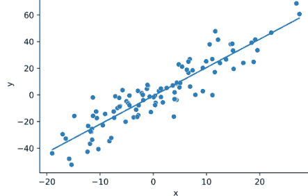

图 13.1: 带有拟合线的散点图

$\epsilon_i \sim \mathcal{N}(0, \sigma^2)$

正态假设对于拟合模型不是必需的，但在统计检验中是。

接下来，让我们线性回归的数学形式，它针对每个观测值 $i$ 和 $p$ 个预测变量给出：

$y_i = \beta_0 + \beta_1 x_{i1} + \dots + \beta_p x_{ip} + \epsilon_i, \quad i=1, \dots, n$

其中

- $y_i$ 是观测值 $i$ 的目标
- $\beta_0$ 是截距参数
- $\beta_1, \dots, \beta_p$ 是斜率参数或*权重*
- $x_{i1}, \dots, x_{ip}$ 是观测值 $i$ 的预测变量
- $\epsilon_i$ 是观测值 $i$ 的误差

在这一设置下，我们假设目标可以通过预测变量的线性组合来建模。每个观测值都有一个线性方程，总共 $n$ 个方程。有 $p+1$ 个未知数，由权重 $\beta_0, \beta_1, \dots, \beta_p$ 表示，应用于每个预测变量。预测变量的加权组合尝试匹配目标值。

作为一个小例子，假设我们收集了三个观测值 $(1,2), (2,3), (3,5)$。有一个预测变量，第一个观测值的预测变量值为 1，目标值为 2。给定这些数据，我们可以写出带有两个未知数的线性方程：

```
$$2 = \beta_0 + \beta_1(1) + \epsilon_1$$
$$3 = \beta_0 + \beta_1(2) + \epsilon_2$$
$$5 = \beta_0 + \beta_1(3) + \epsilon_3$$
```

现在假设 $\beta_0 = 0$ 且 $\beta_1 = 2$。这产生了：

```
$$2 = 0 + 2 + \epsilon_1$$
$$3 = 0 + 4 + \epsilon_2$$
$$5 = 0 + 6 + \epsilon_3$$
```

对于第一个方程，预测变量的加权组合完全匹配目标。然而，对于接两个方程，存在误差。事实上，这个系统的方程数量多于未知数，无法求解。这被称为*超定系统*（overdetermined system）。超定系统优于*欠定系统*（underdetermined system），后者在未知数多于方程的情况下产生。欠定系统无法求解。

在代数课上，你可能见过方程数量等于未知数数的系统。这些系统可以精确求解，这很棒。在实践中，方程和未知数相等是不可能的；我们收集的观测值通常多于预测变量：$n > p$。求解超定系统，我们将建立一个指标和一个目标，例如最小化平方误差。该过程将为每个参数 $\beta_j$ 产生估计值 $\hat{\beta}_j$。然后可以使用拟合方程估计预测值：

$$\hat{y}_i = \hat{\beta}_0 + \hat{\beta}_1 x_{i1} + \dots + \hat{\beta}_p x_{ip}$$

在简单预测变量的情况下（$p=1$），我们可以省略下标并写出拟合方程：

$$\hat{y}_i = \hat{\beta}_0 + \hat{\beta}_1 x_i$$

这种模型是*简单线性回归*。在多预测变量的情况下（$p>1$），模型称为*多元回归*。预测 $\hat{y}_i$ 称为*拟合值*。目标与拟合值之间的差 $y_i - \hat{y}_i$ 称为*残差*。拟合线性回归的常用方法是*普通最小二乘法*（OLS回归），使用了平方损失函数。OLS 回归的目标是建立参数 $\beta_0, \beta_1, \dots, \beta_p$，使得残差和 $SS_{res}$ 最小，定义为：

$$SS_{res}(\beta) = \sum_{i=1}^n (y_i - (\beta_0 + \beta_1 x_{i1} + \dots + \beta_p x_{ip}))^2$$

对 $\beta$ 最小化 $SS_{res}$ 可以通过微积分完成，这将产生每个参数 $\beta_i$ 的估计值 $\hat{\beta}_i$。接下来我们将回顾简单回归的情况。

### 13.1.1 回归的参数估计

使用残差和对于简单变量：


$$SS_{res}(\beta) = \sum_{i=1}^n (y_i - (\beta_0 + \beta_1 x_i))^2$$

该模型有两个参数：$\beta_0$ 和 $\beta_1$。我们的策略是简化方程并找到极点。通过对每个参数求偏导（即计算梯度）、将方程置零并求解方程组来实现。

$$SS_{res}(\beta) = \sum_{i=1}^n (y_i - (\beta_0 + \beta_1 x_i))^2 = \sum_{i=1}^n (y_i^2 - 2y_i\beta_0 - 2y_i\beta_1x_i + 2\beta_0\beta_1x_i + \beta_1^2x_i^2)$$

接下来，对 $\beta_0$ 求偏导并置零：

$$\frac{\partial SS_{res}(\beta)}{\partial \beta_0} = \sum_{i=1}^n (-2y_i + 2\beta_0 + 2\beta_1x_i) = 0 = -\sum_{i=1}^n y_i + n\beta_0 + \beta_1\sum_{i=1}^n x_i \quad (\text{同除以 } n) = 0 = -\bar{y} + \beta_0 + \beta_1\bar{x} \quad (\text{除以 } n)$$

我们在最后一行使用了平均值的定义：$\bar{z} = \sum_{i=1}^n z_i/n$。

现在求解估计参数 $\beta_0$：

$$\hat{\beta}_0 = \bar{y} - \hat{\beta}_1\bar{x}$$

接下来，我们需要确定估计参数 $\beta_1$。我们对 $S$ 关于 $\beta_1$ 求导并使其等于零：

$$\frac{\partial S_{res}(\beta)}{\partial \beta_1} = \sum_{i=1}^n (-2x_iy_i + 2\beta_0x_i + 2\beta_1x_i^2)$$

$$0 = \sum_{i=1}^n (-x_iy_i + \beta_0x_i + \beta_1x_i^2) \quad (\text{除以 } 2)$$

$$0 = \sum_{i=1}^n (-x_iy_i + (\bar{y}-\hat{\beta}_0)x_i + \beta_1x_i^2) \quad (\text{代入 } \hat{\beta}_0)$$

$$0 = -\sum_{i=1}^n x_iy_i + \sum_{i=1}^n x_i\bar{y} - \hat{\beta}_0\sum_{i=1}^n x_i + \hat{\beta}_1\sum_{i=1}^n x_i^2 \quad (\text{求和})$$

$$0 = -\sum_{i=1}^n x_i(y_i-\bar{y}) + \hat{\beta}_1\sum_{i=1}^n x_i(x_i-\bar{x}) \quad (\text{合并项})$$

求解估计参数 $\hat{\beta}_1$：

$$\hat{\beta}_1 = \frac{\sum_{i=1}^n x_i(y_i-\bar{y})}{\sum_{i=1}^n x_i(x_i-\bar{x})}$$

这等价于 $\beta_1$ 的常用方程，将其留作练习题：

$$\hat{\beta}_1 = \frac{\sum_{i=1}^n x_i(y_i-\bar{y})}{\sum_{i=1}^n x_i(x_i-\bar{x})^2}$$

我们现在已经知道如何微积分推导简单线性回归的估计。虽然这在软件中完成，但仍然是一个有意义的练习。对于更一般的情况，我们可以使用矩阵。这将处理我们刚刚完成的简单回归情况，以及多元回归情况。这涉及到创建：

- 一个设计矩阵 $X$，用于存储预测数据。$n$ 行代表观测值，$p+1$ 列代表截距项（在第一列）以及剩余列中的 $p$ 个预测变量。例如，元素 $x_{12}$ 是观测值 1 的预测变量 2 的值。

# 使用线性回归建模

250

```
X = \begin{bmatrix} x_{11} & x_{12} & \dots & x_{1p} \\ x_{21} & x_{22} & \dots & x_{2p} \\ \vdots & \vdots & \ddots & \vdots \\ x_{n1} & x_{n2} & \dots & x_{np} \end{bmatrix}
```

- 参数 $\beta$、目标 $y$ 和误差 $\epsilon$ 的向量

```
\beta = \begin{bmatrix} \beta_0 \\ \beta_1 \\ \vdots \\ \beta_p \end{bmatrix} y = \begin{bmatrix} y_1 \\ y_2 \\ \vdots \\ y_n \end{bmatrix} \epsilon = \begin{bmatrix} \epsilon_1 \\ \epsilon_2 \\ \vdots \\ \epsilon_n \end{bmatrix}
```

将这些部分结合，就可以用紧凑的矩阵表示写方程组：

```
$y = X\beta + \epsilon$
```

在理论上，可以解析法求解该方程组以获得参数向量。这得到了以下方程，该方程在本章的附录中：

```
$\beta = (X^T X)^{-1}X^T y$
```

符号 $X^T$ 和 $(X^T X)^{-1}$ 分别表示 $X^T$ 的转置和逆矩阵。在实践中，对于海量数据集，计算逆矩阵可能是不可行的。在这种情况下，可以采用梯度下降（GD）等迭代方法。我们将在下一章关于逻辑回归的内容中讨论 GD。像 Apache Spark 等大数据软件包也将遵循这种迭代方法。

给定参数估计后，就可以计算拟合值。拟合问题可以用矩阵形式写为：

```
$\hat{y} = X\hat{\beta}$
```

矩阵表示法与我们组织计算数据的方式保持一致。**pandas** dataframe 将以行和列的形式排列数据。在 **sklearn** 中拟合模型时，预测变量矩阵 **X** 和目标向量 **y** 将传递给函数。没有必要在 **X** 中包含列。现在我们已经简要涵盖了线性回归模型的概念和数学框架，可以考虑预测变量和代码实现。对线性回归进行深入探讨，[39] 和 [40] 是很好的参考文献。在下一节中，我们将简要学习预测变量的选择实践。

## 关于预测变量的考虑

在选择模型预测变量时，可能会将所有可用变量纳入模型。然而，对于预测变量需要注意：

- 它们应该符合直觉。在实践中，数据科学家必须与业务部门、产品经理和其他利益相关者讨论预测变量。

- 它们不应该向模型引入偏差或伦理问题。在使用人口统计变量时需要小心，因为可能会导致导致：

- 年龄、性别、种族、残障、颜色、出生地

- 就业类型（如护理工作）可能会引入性别偏差

- 薪资可能会引入种族/族裔偏差

总之，模型的预测变量应该被仔细考虑。仅仅改进模型是不够的；它们还必须符合常理且不造成伤害。

## 13.3 预测房价

在练习中，我们将对来自卡内基梅大学 StatLib 仓库的加州房价数据集拟合线性回归模型。数据源于 1990 年美国人口普查，包含了人口、收入中位数和每个区块的房价中位数等变量。区块是最小地理单位（通常为 600 到 3000 人）。我们将通过导入相关模块并探索图 13.2 中的数据开始。

# 使用线性回归建模

```python
from sklearn.datasets import fetch_california_housing
from sklearn.model_selection import train_test_split
from sklearn.preprocessing import StandardScaler
from sklearn.linear_model import LinearRegression
from sklearn.metrics import r2_score # R方

import pandas as pd

housing = fetch_california_housing()
```

```python
['data': array([[41., 6.9841, ..., 2.555556], [8.3904, 12.123, ..., 2.190418], [6.238137, 8.288159, ..., 2.8025989], [7.2574, 12.224, ...], [1.7, 5.256473, ..., 2.325391], [1.4672, 5.329518, ..., 2.13085]], 'frame': {'target': ['MedHouse'], 'target_names': ['HouseAge', 'Avenue', 'Population', 'latitude', 'longitude']}, 'DESC': 'California Housing Dataset...\Number of Attributes: 8, predictive attributes and the target is:\n区块房价 - 每户收入\n每户房屋年龄 - 平均位置\n每户人口 - 平均'}]
```

图 13.2：加州房价数据

通过 housing 显示这种特殊类型：sklearn.utils.Bunch。该对象似乎包含键值对，请求：

```python
housing.keys()
```

```python
dict_keys(['data', 'frame', 'target_names', 'DESC'])
```

键 DESC 提供关于数据集的描述性数据。目标的名称是 MedHouseValue，是以 100K 为单位的房屋房价。前两个值是 4.526 和 3.585。预测变量包括房屋年龄（HouseAge）、平均房间数（AveRooms）和平均卧室数（AveBedrms）。目标值和预测值都存储在 NumPy 数组中。

检查预测数据的形状：

```python
housing['data'].shape
```

返回 (20640, 8)

有 20640 行（或区块）和 8 列预测变量。注意，对于这些数据，可以通过两种方式引用属性：

```python
housing['data']
```

或者

```python
housing.data
```

### 13.3.1 数据划分

在实践中，我们会花费额外的时间探索数据以理解其属性和缺点。为了简便，假设这已经完成。接下来，由于我们想要训练模型并评估其在未见数据上的泛化能力，我们将在训练集和测试集上训练模型。我们在训练集和测试集上训练模型，并评估其在前者上的表现更好，因为模型将学习该集合中的模式。希望模型在测试集上的表现相似。对于划分数据，我们将使用 sklearn 中的 `train_test_split()` 函数。它接受四个参数并返回四个数据集。

```python
x_train, x_test, y_train, y_test = train_test_split(housing.data, housing.target, train_size=0.6, random_state=314)
```

输入：

- `housing.data` - 预测数据

- `housing.target` - 目标数据

- `train_size` – 用于训练集的数据比例（剩余部分用于测试集）

- `random_state` – 用于复制将行随机划分到训练集和测试集的种子

输出：

- `x.train` - 预测训练数据

- `x.test` - 预测测试数据

- `y.train` - 目标训练数据

- `y.test` - 目标测试数据

`train_test_split()` 函数将数据划分为 60% 训练集和 40% 测试集，产生四个 NumPy 数组。我们可以通过打印它们的长度来检查每个部分的记录数：

```python
len(x_train), len(x_test), len(y_train), len(y_test)
```

```python
(12384, 8256, 12384, 8256)
```

考虑到训练集中有 12384 行，这代表了总数的 12384/(12384+8256) = 60%，这是正确的。

### 13.3.2 数据缩放

接下来，我们使用 `StandardScaler` 对训练数据和测试数据进行缩放。这样做是在划分之后之后，因为预测变量的标准差需要在训练集上测量。测试集被视为独立的数据集，在标准差测量中使用该数据将是不正确的。

以下代码将实例化 `StandardScaler` 对象并缩放训练数据。具体而言，将为每列计算均值和标准差。接着，每列将减去其均值，并除以该列的标准差。

```python
scaler = StandardScaler()
x_train_s = scaler.fit_transform(x_train)
```

我们可以检查缩放后的数据：

# 预测房价

x_train_s

```
array([[-5.41768936e-01, 8.9274139e-01, -1.85640214e-02, ...,
-4.28510666e-02, -2.20840635e-02, 5.77185876e-02],
       ...,
       -6.70406776e-02, -1.40562124e+00, 1.25411953e+00]])
```

列均值：

```
x_train_s.mean(axis=0)
```

输出:

```
array([[-4.39298549e-05, -1.02774522e-16, -1.06658763e-14,
-5.55920472e-15, -1.52942545e-17, -7.06353754e-16,
9.44804814e-15, -8.41492753e-14]])
```

列标准差：

```
x_train_s.std(axis=0)
```

输出:

```
array([1., 1., 1., 1., 1., 1., 1., 1.])
```

正如我们预期的，列均值近似于零，标准差为一。

# 13.3.3 模型拟合

接下来，我们在训练数据上训练（或拟合）一个线性回归模型。可以使用 sklearn 中的 `LinearRegression()` 函数实现 OLS 回归。我们用一行代码实例化模型并将其拟合到训练数据。默认情况下包含一个截距项。参数的顺序很重要：`fit()` 函数接收 X 紧接着是 y，如如下代码段所示：

```
reg = LinearRegression().fit(x_train_s, y_train)
```

`reg` 对象持有训练好的回归模型，我们可以探索其内容。我们可以像这样列出它的属性和方法：

```
dir(reg)
```

```
OUT:
['__abstractmethods__',
 '__class__',
 '__delattr__',
...]
```

```
'fit',
'fit_intercept',
'get_params',
'intercept_',
...
'score',
'set_params',
'singular_']
```

这些是使用 `fit()` 拟合模型并提取截距估计的方法列表。接下来，让我们提取截距估计值：

```
reg.intercept_
```

输出:

2.06008804490497

以及斜率估计：

```
reg.coef_
```

输出:

array([0.8140301, 0.11883616, -0.260123, 0.31025271,

-0.00178077, -0.04600269, -0.91689468, -0.88930004])

让我们为参数估计的数学公式编写代码。然后我们可以验证计算结果是否与 sklearn 的估计值匹配。作为提醒，公式如下：

> $$\beta = (X^TX)^{-1}X^T y$$

在代码段中，@ 符号用于执行矩阵乘法：

```
import numpy as np
```

```
# 设计矩阵，为截距项添加全 1 列
# 截距项
# hstack() 水平堆叠两个数组
X = np.hstack((np.ones((x_train.shape[0], 1)), x_train_s))
```

```
XtX = X @ X
```

```
# 计算矩阵逆
XtXi = np.linalg.inv(XtX)
```

```
betas = XtXi @ (X.T @ y_train)
betas
```

# 预测房价

```
OUT
array([[ 2.06008880e+00, 8.14031008e-01, 1.18836164e-01,
-2.60123003e-01, 3.10252714e-01, -1.78067696e-03,
-4.60026851e-02, -9.16839468e-01, -8.8930037e-01]])
```

该向量包含第一个元素的截距项，其余元素为斜率。这与 sklearn 的估计值相符。通常我们不需要使用该公式，但了解软件在做什么是有处的。接下来，列出预测变量列表以理解斜率的含义：

```
housing.feature_names
OUT:
['MedInc',
'HouseAge',
'AveRooms',
'Population',
'AveOccup',
'Longitude']
```

由于预测变量的顺序与斜率估计对应，变量 'MedInc' 的取入后值为 0.814。正号表示更高的位数收入与更高的房价相关。参数估计可以解释为预测变量每变化一个单位目标值的变化。对于每个单位的收入，房价增加 $0.814 \times 100$，假设其他变量保持不变。回归截距为 2.06，当所有预测变量为零时（这对于平均房间数和卧室没有意义，所以这个没意义）。接下来，我们在测试集上进行预测。首先，我们将使用 `StandardScaler` 对数据进行标准化：

```
x_test_s = scaler.fit_transform(x_test)
```


现在我们将标准化后的数据通过模型来预测目标值 $\hat{y}$。`predict()` 函数用于拟合方程 $\hat{y} = \mathbf{X}\mathbf{\beta}$。

```
y_test_predicted = reg.predict(x_test_s)
```

# 13.3.4 解释参数估计

`sklearn` 包允许拟合模型并处理参数估计，但没有告诉我们哪些估计在统计上异于零。`statsmodels` 包可以拟合相同的线性回归模型并运行样本 t 检验来回答这个问题。由于我们已经完成了数据准备工作，代码如下：

```
# import statsmodels
import statsmodels.api as sm

# 为截距项添加 1 列
X = sm.add_constant(x_train_s)

# 拟合 OLS 模型
results = sm.OLS(y_train, X).fit()

# 打印模型摘要
print(results.summary())
```

表 13.1 显示的参数估计和置信区间表明，除了 `x5` `('Population')` 之外的所有变量都是显著的。对于 `x5`，p 值大于 0.05，且置信区间包含零。下一步是删除该变量并重新拟合模型。表 13.1：房价参数估计表

| coef | std err | t | P >|t| | 0.025 | 0.975 |
|---|---|---|---|---|---|
| const | 2.0601 | 0.007 | 315.640 | 0.000 | 2.047 | 2.073 |
| x1 | 0.8114 | 0.010 | 79.647 | 0.000 | 0.794 | 0.834 |
| x2 | 0.1188 | 0.007 | 16.417 | 0.000 | 0.105 | 0.133 |
| x3 | -0.2601 | 0.020 | -12.777 | 0.000 | -0.300 | -0.220 |
| x4 | 0.3103 | 0.019 | 16.379 | 0.000 | 0.273 | 0.347 |
| x5 | -0.0018 | 0.007 | -0.256 | 0.7998 | -0.015 | 0.012 |
| x6 | -0.0496 | 0.007 | -7.086 | 0.000 | -0.029 | 0.053 |
| x7 | -0.9169 | 0.026 | -46.580 | 0.000 | -0.955 | -0.878 |
| x8 | -0.8893 | 0.019 | -46.003 | 0.000 | -0.927 | -0.851 |

## 13.3.5 模型评估

由于我们知道测试集 `y_test` 的目标值，我们可以将其与预测值进行比较以评估模型性能。我们将使用 $R^2$ 作为指标。作为提醒，$R^2$ 衡量了预测变量解释 $Y$ 的比例。$R^2$ 计算的细节在本节末尾。`sklearn` 中的 `r2_score()` 函数将计算 $R^2$。它接收实际值数组和预测值数组，顺序如下。

```
print(r2_score(y_test, y_test_predicted))
```

输出:

```
0.6078396738987
```

### 预测房价

这表明房价变异的 61% 被预测变量解释了。这是很有用的，但仍有很大比例的未解释的变异。绘制数据也有助于理解巨大的差异，所以让我们画一个散点图。

```
import seaborn as sns
import matplotlib.pyplot as plt

sns.scatterplot(x=y_test, y=y_test_predicted)
plt.plot((-2,7),(-2,7))
plt.xlabel('actual')
plt.ylabel('predicted')
```

在图 13.3 的预测值与实际值图上叠加的是一条 45 度线。理想情况下，数据点应该落在这条 45 度线上，这表明实际值和预测值之间存在很强的相关性。这种模式大致遵循了，但有一些需要讨论的影响。第一个是图右侧的垂直堆叠点。这反映了实际目标达到约五，而预测值范围从一到十。模型在许多这些高值预测上都失了了，预测值是负值，这不符合逻辑。图上的最低点（实际值接近四而预测值为负二）是一个明显的例子。该点可能代表坏数据或异常模式，可以对其进行探索。查看预测值与目标值差异最大的观测值也有帮助。

常见的诊断图显示残差位于 y 轴，预测值（拟合值）位于 x 轴，如图 13.5 所示。零水平线有助于理解模型在不同预测值处是否存在偏差。这很重要，因为假设之一是误差均值为零。数据中不应出现模式。趋势线或曲线的存在将是有问题的，因为这表明缺少一个或多个预测变量。这里的残差图存在问题，因为残差没有围绕零线聚类，并且存在一组向负方向倾斜的点。这些倾斜的点是由于目标最大值为五而导致的。

在此阶段，分析师可能会花费大量时间进行上述误差分析。以不同的方式创建、过滤和排序数据可以提供深入的见解。可能会发现并修复数据中的缺陷，例如错误的预测值或目标值。当需要对数据进行更新时，最好在代码中进行更改并将调整后的结果保存到单独的文件。这将使更改变得透明且可重复的，并在必要时可以撤销更改。为了进一步改进模型，可能还有额外的预测变量可以进行工程处理并包含。也可能收集更多数据，并重点关注模型薄弱的地方。

#### 13.3.6 比较模型

尝试不同的模型并比较它们的性能至关重要。图表方法和指标对于这些比较非常有价值。由于我们在构建模型时已经使用了所有提供的预测变量，让我们构建一个包含预测变量子集的第二个模型。我们将选择预测变量子集，然后重复早期的步骤。这段代码片段从训练数据中选择了前三个预测变量：

```
x_train_subset = x_train[:3]
```

### 预测房价

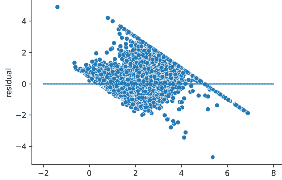

图 13.4：加州住房：残差与预测值的对比

符号 `:,3]` 分别引用行和列。冒号表示选择所有行，而 `:3` 表示选择从0到2的列（包含在）。

由于我们正在更改训练数据，我们需要创建一个新的 `StandardScaler` 对象并转换数据：

```
scaler2 = StandardScaler()
x_train_subset_s = scaler2.fit_transform(x_train_subset)
```

接下来，我们创建一个 `LinearRegression` 对象并将其拟合到数据：

```
reg2 = LinearRegression().fit(x_train_subset_s, y_train)
```

我们现在有了了模型。为了评估性能，我们将首先对测试集进行子集划分并进行标准化。

```
x_test_subset_s = scaler2.fit_transform(x_test[:,:,:])
```

接下来，我们使用我们的 `reg2` 模型对测试集进行预测：

```
y_test_predicted2 = reg2.predict(x_test_subset_s)
```

$R^2$ 对于衡量预测变量所解释的方差比例很有用，但在比较模型时，*调整 $R^2$（adjusted $R^2$）更为合适*。调整 $R^2$ 是 $R^2$ 的改进版本，它对模型复杂度进行惩罚，而复杂度会随着模型中包含额外参数而增加。它的计算方式如下：

$adjusted R^2 = 1 - (1 - R^2) \left(\frac{n-1}{n-p-1}\right)$

其中

- $n$ 是观测值的数量
- $p$ 是模型参数的数量（不包括截距项）

`sklearn` 没有计算调整 $R^2$ 的函数，因此我们可以自己定义：

```
def adj_squared(X, y, y_pred):
    r2 = r_score(y, y_pred)      # 计算 R-squared
    n = len(y)                    # 观测值的数量
    p = X.shape[1]               # 参数的数量
    adj_r2 = 1 - (1 - r2) * (n - 1)/(n - p - 1)
    return adj_r2
```

接下来，让我们计算这个较小模型的 $R^2$ 和调整 $R^2$：

```
print('R2:', r_score(y_test, y_test_predicted))
```

```
print('adj R2:', adj_squared(x_test_subset_s,
    y_test,
    y_test_predicted))
```

```
OUT:
R2: 0.5206094971517826
adj R2: 0.52043521558264
```

为了比较，计算较大模型的 $R^2$ 和调整 $R^2$：

```
print('R2:', r_score(y_test, y_test_predicted))
```

```
print('adj R2:', adj_squared(x_test_s,
    y_test,
    y_test_predicted))
```

```
OUT:
R2: 0.6078399673839887
adj R2: 0.607459552650509
```

有两个重要的观察：首先，较小模型的调整 $R^2$ 低于较大模型，这告诉我们删除的预测变量对于解释目标是有重要的。其次，对于每个模型，调整 $R^2$ 都接近 $R^2$。如果我们观察调整 $R^2$ 的公式，会注意到调整因子 $(n-1)/(n-p-1)$。当 $n$ 相对于 $p$ 增加时，该因子接近1，这意味着调整 $R^2$ 接近 $R^2$。对于这个例子，$n=2566$，$p_{small} = 3$，，$p_{large} = 8$。小和大模型的调整因子分别为 $(2566-1)/(2566-3-1) = 1.00036$ 和 $(2566-1)/(2566-8-1) = 1.00097$。由于复杂度，较大模型的调整更大，但在每种情况下调整量都很小。

#### 13.3.7 计算 R 平

$R^2$ 在软件中可以很容易计算，但理解它的含义和计算方法很重要。概念上，我们得出一个关于平方和的等式，它与目标数据的方差正比：总平方和 = 解释平方和 + 残差平方和

- $SS_{tot}$ = 总平方和
- $SS_{exp}$ = 解释平方和
- $SS_{res}$ = 残差平方和
- $R^2 = SS_{exp}/SS_{tot}$

得到

$SS_{tot} = SS_{exp} + SS_{res}$

除以 $SS_{tot}$ 得到：

$1 = \frac{SS_{exp}}{SS_{tot}} + \frac{SS_{res}}{SS_{tot}}$

代入 $R^2$ 得到：

$1 = R^2 + \frac{SS_{res}}{SS_{tot}}$

最后，解出 $R^2$：

$R^2 = 1 - \frac{SS_{res}}{SS_{tot}}$

这为 $R^2$ 提供了一个简洁的公式和一个很好的解释：解释了目标大部分变异的模型将产生相对于总平方和较小的残差和，反之会导致较大的 $R^2$。如果模型完美拟合数据，$SS_{res}$ 将为0，$R^2$ 将为1。如果模型没有解释目标的任何变异，$SS_{res}$ 将等于 $SS_{tot}$，$R^2 = 1 - 1 = 0$。接下来，我们需要解释如何计算 $SS_{res}$ 和 $SS_{tot}$。

如前所示，$SS_{res}$ 的计算方法为：

- 1. 计算每个数据点的残差 $y_i - \hat{y}$
- 2. 将残差平方
- 3. 求平方残差的和

公式为：

$$SS_{res} = \sum_{i=1}^{n} (y_i - \hat{y})^2$$

$SS_{tot}$ 的计算方法为：

- 1. 计算数据的平均值 $\hat{y}$
- 2. 计算每个数据点的偏差 $y_i - \hat{y}$
- 3. 将偏差平方
- 4. 求平方偏差的和

公式为：

$$SS_{tot} = \sum_{i=1}^{n} (y_i - \hat{y})^2$$

再次，通常没有必要手动或通过表格进行这些计算，因为 $R^2$ 已经在软件中实现。然而，对平方和的概念理解和推理是有价值的。

## 13.4 章节总结

当目标变量是连续的时，可以将线性回归用于监督学习。它使用了预测变量与目标之间存在线性关系的强假设，但这在实践中非常有用。简单线性回归使用单个预测变量，而多元线性回归使用多个预测变量来解释目标。

为了使模型运行，需要从数据中估计参数。我们使用普通最小二法回归进行估计，它选择使目标与预测值之间平方和最小的值。这些差异被称为残差。

作为预测变量的变量应该是直观的，并且应该避免向模型中引入偏差和伦理问题。虽然人口统计变量可能会增加解释力，但它们可能会系统性地歧视某些群体。

我们对加州房价建立了线性回归模型以预测房价。在练习过程中，我们划分了数据，对预测变量和模型进行了标准化，并评估了性能。我们衡量了测试集的 $R^2$，它代表模型解释的目标方差比例。此外，我们绘制了残差图和拟合图来诊断零模式和随机分布，但实际上，这些数据存在模式且并非随机。这表明还需要更多工作，即包含额外的特征。最后，我们对数据拟合了第二个模型并比较了模型性能。

下一章中，我们将处理数据以预测只有两个可能的目标。这是一个二分类问题，我们将学习一种解决它非常有用且流行的模型：*逻辑回归*。

## 13.5 附录：矩阵形式的参数估计

我们回到紧凑矩阵表示的方程组：

```
$y = X\beta + \epsilon$$
```

接下来，我们写出残差和的方程：

```
$SS_{res}(\beta) = (y - X\beta)^T(y - X\beta)$
```

现在我们对 $SS_{res}$ 关于 $\beta$ 求导。这类似于对二次函数 $(y - X\beta)^2$ 求导。结果是 $(y - X\beta)^T$ 关于 $\beta$ 求导的 2 倍：

```
$$\frac{dSS_{res}(\beta)}{d\beta} = -2X^T(y - X\beta)$$
$0 = -2X^T(y - X\beta)$ (令零)$
```

```


注意 0 是零向量。接下来，我们重新排列：

```

$$X^T y = X^T X \beta$$

```

这产生了*正法方程*，最后一步是解出 $\beta$。我们将左侧乘以矩阵 $X^T X$ 的逆矩阵。对方程的两边进行此操作：

```

$$$\beta = (X^T X)^{-1} X^T y$$

```

这一部分需要线性代数和矩阵导数的知识。非常有用的参考是 [42]。重要的部分是记住参数估计的矩阵公式。该公式解决任意数量参数的线性回归问题成为可能。

## 13.6 练习

带有答案的练习用 ($\S$) 标记。可以在课程仓库的 materials 文件夹中找到答案：

https://github.com/PredictionNN/intro_data_science_course/

- 1. 线性回归模型中做了哪些假设？
- 2. 正确或错误：你有一个方程个数多于未知数的线性方程组。该系统可以精确求解。
- 3. 正确或错误：线性回归模型使用预测变量的加权组合来密密匹配目标值。
- 4. 正确或错误：截距项为线性回归模型增加了灵活性。
- 5. 解释回归背景下残差（residuals）和误差（errors）的区别。
- 6. 解释如何估计线性回归模型的参数。讨论应包含临界点的概念。
- 7. 正确或错误：在估计简单线性回归模型的参数时，必须计算偏导数。
- 8. 考虑一个预测变量与响应变量不相关的简单线性回归模型。你预计斜率参数的值将会是多少？

## 练习

- 9. 在线性回归模型中如何解释截距系数？直观地说，
- 10. 正确或错误：你有一个包含数万个潜在预测变量的数据集。最佳实践是模型包含所有具有统计显著性的预测变量。
- 11. 验证简单线性回归参数估计的两种形式的等价性：

```

$$\hat{\beta}_1 = \frac{\sum_{i=1}^n x_i(y_i - \bar{y})}{\sum_{i=1}^n x_i(x_i - \bar{x})}$$

```

```

$$\hat{\beta}_1 = \frac{\sum_{i=1}^n (x_i - \bar{x})(y_i - \bar{y})}{\sum_{i=1}^n (x_i - \bar{x})^2}$$


提示：展开后，你可能会发现涉及 $\sum_{i=1}^n (x_i - \bar{x})$ 的项。直观地说，这个表达式的值是多少？

- 12. 在调用 `train.test_split()` 模型时设置种子（seed）有什么好处？
- 13. 解释 $R^2$ 如何与相关性相关。
- 正确或错误：如果回归预测变量未能解释目标变量的所有变异，则永远不应该使用该模型。
- 14. 残差图的目的是什么？
- 15. 残差图显示出明显的模式。这意味着什么？
- 16. 比较回归模型的有用指标是什么？解释你的答案。
- 17. 使用 `sklearn` 模块对数据集拟合线性回归模型：{(3, 6), (3, 5, 9), (4, 8)}。显示你的代码并打印截距、斜率系数估计和 R 平方。
- 18. 使用电子表格或计算器，根据给定的数据集 {(3, 6), (3, 5, 9), (4, 8)} 从线性回归模型中计算截距和斜率系数估计。整理并显示所有计算过程。


# 14 逻辑回归分类

在上一章中，我们学习了目标变量为连续时的建模方法。在本章中，我们将学习目标为二元时的模型。这种任务非常广泛，例如生存预测、股价波动或赛事结果。逻辑回归是一个极吸引人的模型，因为它在实践中运行良好，且结果具有可解释性。

我们将通过概述数学框架开始，这使用了之前涵盖的微积分概念。高水平的理解就足够了。逻辑回归中参数的估计无法通过闭式完成，我们将使用梯度下降作为迭代解。Python 包将帮助我们完成模型拟合。额外的资源可以在课程仓库的此文件夹中找到：`week03_04_classification_and_logistic_regression/`

## 14.1 数学框架

在回归任务中，可用标记数据集 $(x_i, y_i)_{i=1}^n$，目标是学习一个可以预测目标 $y$ 的函数。我们将事件发生 $(y=1)$ 的概率视为 $p$，不发生 $(y=0)$ 的概率为 $1-p$。给定这种设置，我们需要一个接受预测变量作为输入并产生事件概率的函数。预测变量可能具有域 $(-\infty, \infty)$。

第一个想法可能是用线性回归方法，它由预测变量的线性组合组成。这种方法的麻烦在于范围可以是 $(-\infty, \infty)$，这与概率不。相反，我们从 sigmoid 函数开始建模概率，形式为：

$p(t) = \sigma(t) = \frac{1}{1+e^{-t}}$

图 14.1 显示了一个 sigmoid 函数。该函数是有用的，因为它的域为 $(-\infty, \infty)$ 且范围为 $(0,1)$。给定这个范围，输出可以视为事件发生的概率。注意当输入分别趋于 $-\infty$ 和 $\infty$ 时，$S$ 形状的水平渐近线。


图 14.1：Sigmoid 函数

事件的几率（odds）是事件发生的概率除以其不发生的概率的比率，$p/(1-p)$。我们首先简化 $1-p$，显示其对 $t$ 的依赖关系：

```
$1-p(t) = 1 - \frac{1}{1+e^{-t}} = \frac{1+e^{-t}}{1+e^{-t}} - \frac{1}{1+e^{-t}} = \frac{e^{-t}}{1+e^{-t}}$
```

然后几率形式为：

```
$$\frac{p(t)}{1-p(t)} = \frac{1/(1+e^{-t})}{e^{-t}/(1+e^{-t})} = \frac{1}{e^{-t}} = e^t$$
```

这把几率表示为 $t$ 的指数函数。我们可以对两边取对数，得到对几率（log odds）的表达式：

```
$$ln \frac{p(t)}{1-p(t)} = t$$
```

这是由于 $exp()$ 和 $ln()$ 相反。我们现在假设 $t$ 是预测变量的线性组合：

```
$$t = \beta_0 + \beta_1 x_1 + \dots + \beta_k x_k$$
```

事实上，右侧是线性模型的规范。在单个预测变量（k=1）的情况下，我们可以去掉预测变量的下标并将其写为：

```
$$ln \frac{p(t)}{1-p(t)} = \beta_0 + \beta_1 x$$
```

这是逻辑回归的方程。它假设预测变量与事件概率的对几率之间存在线性关系。

### 14.1.1 逻辑回归的参数估计

形式确定后，我们需要每个参数 $\beta_i$ 的参数估计 $\hat{\beta}_i$，其中 $i=0,\dots,k$。我们的技术是将观察一系列结果的概率写成参数的函数（这称为似然函数），并应用梯度下降来最大化似然。

> 注意：这一部分的数学性比早期部分大。尝试这一部分并查看预备材料（如微积分）的应用将会很好，但不是要求的。

每个结果都是伯努利随机变量，其成功概率为 $p(t)$，它是数据和参数的函数。给定这些信息，结果序列可以被视为独立的伯努利试验。观察结果的似然用 $\mathcal{L}(\beta)$ 表示，如下：

```
$$\mathcal{L}(\beta) = \prod_{i=1}^n p(x_i|\beta)^{y_i} (1-p(x_i|\beta))^{1-y_i}$$
```

## 逻辑回归分类

术语 $p(x_i|\beta)$ 表示给定参数值时事件 $i$ 发生的概率，而项 $1-p(x_i|\beta)$ 表示结果 $i$ 未发生的概率。指数 $y_i$ 和 $1-y_i$ 允许对伯努利试验进行紧凑表达式。例如，如果事件在结果 $i$ 上发生，则 $y_i = 1$ 且 $1-y_i = 0$。由此：

```
$p(x_i|\beta)^{y_i}(1-p(x_i|\beta))^{1-y_i} = p(x_i|\beta)^1 (1-p(x_i|\beta))^0\n= p(x_i|\beta)$
```

代表结果 $i$ 事件发生的概率。同样，如果事件在结果 $i$ 上未发生，则 $y_i = 0$ 且 $1-y_i = 1$。由此：

```
$p(x_i|\beta)^{y_i}(1-p(x_i|\beta))^{1-y_i} = p(x_i|\beta)^0 (1-p(x_i|\beta))^1\n= 1-p(x_i|\beta)$
```

该项代表结果 $i$ 事件未发生的概率。

最后，乘积符号 $\prod_{i=1}^n$ 表示了事件的似然性。对于三次试验 $(n=3)$ 均发生事件的情况，似然性将是

```
$\mathcal{L}(\beta) = \prod_{i=1}^n p(x_i|\beta)^{y_i}(1-p(x_i|\beta))^{1-y_i}\n= = \prod_{i=1}^3 p(x_i|\beta)\n= = p(x_1|\beta)p(x_2|\beta)p(x_3|\beta)$
```

使用**对数似然性**（log-likelihood），即似然性的对数来处理更容易，因为乘积变成了和。应用对数是有效的，因为使似然性最大化的参数也会使对数似然性最大化。这是因为 $log(\cdot)$ 是单调递增函数。对数似然性的形式为：

```
$l(\beta) = \sum_{i=1}^n y_i \ln p(x_i|\beta) + (1-y_i) \ln (1-p(x_i|\beta))$
```

这使用了对数的两个性质：

```
$log(ab) = log(a) + log(b)\nlog(a)^b = b log(a)$
```

## 数学框架

填充步骤：

```
$l(\beta) = \ln \prod_{i=1}^{n} p(x_i|\beta)^{y_i}(1 - p(x_i|\beta))^{1-y_i}$

= \sum_{i=1}^{n} \ln p(x_i|\beta)^{y_i}(1 - p(x_i|\beta))^{1-y_i}$$\n= \sum_{i=1}^{n} \ln p(x_i|\beta)^{y_i} + \ln (1 - p(x_i|\beta))^{1-y_i}$$\n= \sum_{i=1}^{n} \ln p(x_i|\beta) + (1 - y_i) \ln (1 - p(x_i|\beta))$
```

> 注意：在机器学习的导论章节中，我们对二分类交叉熵损失定义如下：
$H(\hat{p}_i, y_i) = -y_i \ln(\hat{p}_i) + (1 - y_i) \ln (1 - \hat{p}_i)$
如果对 $n$ 个观测值求交叉熵损失，将等同于负对数似然。我们可以应用对数性质 $log(a/b) = log(a) - log(b)$ 得到：

```
$l(\beta) = \sum_{i=1}^{n} \ln (1 - p(x_i|\beta)) + y_i \ln \frac{p(x_i|\beta)}{1 - p(x_i|\beta)}$
```

右侧项是特殊的，可以用线性项 $\beta_0 + \dots + \beta_k$ 替换，如下：

```
$I(\beta) = \sum_{i=1}^{n} \ln (1 - p(x_i|\beta)) + \sum_{i=1}^{n} y_i (\beta_0 + \dots + \beta_k)$
```

替换 $1 - p(x_i|\beta)$ 得到：

```
$l(\beta) = \sum_{i=1}^{n} -ln (1 + exp(\beta_0 + \dots + \beta_k)) + \sum_{i=1}^{n} y_i (\beta_0 + \dots + \beta_k)$
```

## 梯度下降

现在我们有了似然性的表达式，我们想要最大化它。不幸的是，无法直接求解（求偏导并令其为零），因为没有解析解。相反，我们使用数值方法来寻找近似解。优化中的惯例是将化似然性重构为最小化负对数似然。有很多算法可以完成此任务，我们将使用梯度下降，因为它根据以下方程同时更新参数：

```
$\beta^{(t+1)} = \beta^{(t)} - \alpha \frac{\partial l(\beta)}{\partial\beta}$
```

其中：
- $\beta^{(t)}$ 是 $t$ 次迭代时的参数估计
- $\alpha$ 是学习率
- $\partial l(\beta)/\partial\beta^{(t)}$ 是似然性的梯度

理解梯度下降的一个有用比喻是远步者在山中寻找最低点。想象她沿着最下降的方向（梯度）移动。对于给定的步数（学习率），算法通过初始化参数估计 $\beta^{(0)}$ 开始。参数更新沿梯度移动，使估计值接近最优值。较大的步长可以更快收敛，但可能会错过最小值。当达到最优时，算法被称为收敛。在实践中，可能无法达到最优（由于起始点不好）或花费很长时间（由于 $\alpha$ 太小）。停止标准用于防止算法无限运行：(1) 提供最大迭代次数，2) 设置容差以确定目标函数的变化何时足够小停止。

我们需要似然性对每个参数 $\beta_j$ 的导数公式。这包含了对函数 $ln(1+exp(\beta_1 + \dots + \beta_k))$ 求导。回顾对数的微分法则如下：

## 数学框架

在这里，我们有复合函数，因此可以使用链式法则。例如：

```
$\frac{d}{dx}ln(x) = \frac{1}{x}$

$\frac{d}{d\beta}ln(1+\beta x) = \frac{1}{1+\beta x}\frac{d}{d\beta}(1+\beta x)$

= \frac{x}{1+\beta x}$
```

我们要微分的函数还包含指数项。作为提醒，指数的微分法则如下：

```
$\frac{d}{dx}e^x = e^x$
```

我们有指数的复合函数，因此再次可以使用链式法则。例如：

```
$\frac{d}{d\beta}e^{\beta x} = e^{\beta x}\frac{d}{d\beta}(\beta x)$

= xe^{\beta x}$
```

现在我们有了所有的部分，对数似然性的方程在这里重复：

```
$l(\beta) = \sum_{i=1}^n -ln(1 + exp(\beta_0 + \dots + \beta_kx_k)) + \sum_{i=1}^n y_i (\beta_0 + \dots + \beta_kx_k)$
```

将对数的微分法则结合链式法则得到参数 $j$ 的偏导：

```
$\frac{\partial l(\beta)}{\partial \beta_j} = -\sum_{i=1}^n \frac{exp(\beta_0 + \beta_ix_{i1} + \dots + \beta_kx_{ik})}{1 + exp(\beta_0 + \beta_ix_{i1} + \dots + \beta_kx_{ik})}x_{ij} + \sum_{i=1}^n y_ix_{ij}$
```

该项

```
$\frac{\exp(\beta_0 + \beta_ix_{i1} + \dots + \beta_kx_{ik})}{1 + exp(\beta_0 + \beta_ix_{i1} + \dots + \beta_kx_{ik})}$
```
（等等，上面的 OCR 分母有一个拼写错误，我根据标准逻辑回归进行了修正）等同于 $p(x_i|\beta)$（这将留待练习），因此我们可以简化方程为：

```
$\frac{\partial l(\beta)}{\partial \beta_j} = \sum_{i=1}^{n} (y_i - p(x_i|\beta))x_{ij}$
```

## 数学框架

```python
# 在设计矩阵前部添加一列 1
X = np.hstack((cnes, X))
# 初始化参数估计
betas = np.zeros(X.shape[1])
for it in np.arange(n_iter):
    # 变量的线性组合
    t = np.dot(X, betas)
    # 每个观测值的事件预测概率
    p = sigmoid(t)
    # 对每个观测值求和：
    # 预测变量与预测误差 y-p 的乘积
    # 这给出了负对数似然的梯度
    grad_neg_ll = -np.dot(X.T, y - p)
    # 参数更新方程
    betas = betas - alpha * grad_neg_ll
    # 每1000次迭代，
    # 打印迭代次数并记录对数似然
    if it % 1000 == 0:
        print('iter', it)
        ll.append(log_likelihood(X, betas))
return betas,
```

让我们过一下梯度下降算法。为了理解计算并进行矩阵代数，观察形状（shapes）很有帮助。我们将选取一个特定的数据集，并在下一节中进行详细研究。预测数据 `x.tr` 具有 341 个观测值和 2 个预测变量，形状为 (341,2)。标签 `y.tr` 在一个长度为 341 的向量中。创建一个空列表来存储对数似然。创建一个用于截距项的列 `ls`。使用 `hstack()` 将其置于设计矩阵的第一列；此时 `x.tr` 的形状变为 (341,3)。参数估计值 (`betas`) 初始化为长度为 3 的零列向量。它将包含截距项和两个预测变量。如果我们检查 `betas` 的形状，报告将为 (3)。

代码随后进入循环，迭代地更新 `betas`。预测变量的线性组合通过计算形状为 (341,3) 的预测值与形状为 (3) 的 `betas` 之间的矩阵乘积来实现。由于乘积的内部维度匹配，这是一个有效操作，将产生一个长度为 341 的列向量。接下来，sigmoid 函数计算 341 个观测值中每个事件的概率。它可以不使用循环完成完成，因为它是一个向量化函数。

接下来，我们需要计算负对数似然的梯度。在数学上，这提供了参数向量的更新方向，其值为：

```
\sum_{i=1}^{n} (y_i - p(x_i|\theta))_{ij}
```

可以使用矩阵操作紧凑地计算：

```
-np.dot(X.T, y - p)
```

让我们来解解它。$y$ 和 $p$ 具有相同的形状，我们可以计算它们的差。$y - p$ 代表每个观测值的预测误差。对于每个参数 $j$，我们需要计算预测误差与第 $j$ 个预测变量值之间的点积；这是对所有观测值进行求和。结果是一个长度为 $j$ 的列向量，其中元素 $j$ 被计算出来后，我们根据参数 $j$ 更新参数。

现在迭代估计沿着负梯度的方向迈出 $\alpha$ 步长，预计这将最小化对数似然（或最大化对数似然）。每 1000 次迭代，我们报告迭代次数（进度）并存储对数似然。如果我们绘制对数似然随迭代次数变化的图，会看到它收敛于某个值或极限。对于适当的 $\alpha$ 和迭代次数，参数估计应该收敛到真实值。

在下一节中，我们将考虑一个数值示例。我们首先使用 `sklearn` 拟合一个模型，然后调用 `gradient_descent_logistic()` 显示参数的收敛。

## 14. 检测乳腺癌

接下来，我们将拟合一个逻辑回归模型来预测肿瘤是良性还是恶性。该模型是合理的，因为目标变量可以取两个值。数据集 [43] 来源于 UCI：

```
https://archive.uci.edu/datasets/breast+cancer+wisconsin (diagnostic)
```

该 notebook 可以在课程仓库中找到：

```
semester2/week_0304_classification_and_classification
```

### 14.2.1 数据准备与模型拟合

目标变量名为 `diagnosis`，1 代表恶性，0 代表良性。我们使用以下代码设置实验：

```python
import numpy as np
import pandas as pd
```


```python
from sklearn.model_selection import train_test_split
from sklearn.linear_model import LogisticRegression
```

## 加载数据集

```python
datapath = 'breast_cancer.csv'
df = pd.read_csv(datapath)
```

## 将数据分为训练集和测试集

```python
X_train, X_test, y_train, y_test = train_test_split(
    df.drop('diagnosis', axis=1), df['diagnosis'], test_size=0.2, random_state=42
)
```

## 初始化并拟合模型

```python
model = LogisticRegression()
model.fit(X_train, y_train)
```

## 预测概率

```python
probabilities = model.predict_proba(X_test)
print("First 5 probabilities:")
print(probabilities[:5])
```

输出显示了前五个患者每个类的概率。为了对患者进行分类，我们使用一个阈值。

```python
# 使用阈值进行分类
threshold = 0.5
predictions = (probabilities[:, 1] > threshold).astype(int)
print("First 5 predictions:")
print(predictions[:5])
```

我们还可以使用混淆矩阵评估模型：

```python
from sklearn.metrics import confusion_matrix
cm = confusion_matrix(y_test, predictions)
print("Confusion Matrix:")
print(cm)
```

## 表 14.1: 乳腺癌参数估计表

| coef | std err | z | P > | 0.025 | 0.975 |
|---|---|---|---|---|---|
| const | -20.7540 | 2.381 | 8.716 | 0.000 | -25.421 | -16.087 |
| x1 | 1.1042 | 0.134 | 8.215 | 0.000 | 0.841 | 1.368 |
| x2 | 0.2289 | 0.049 | 4.655 | 0.000 | 0.133 | 0.325 |

可以考虑两个主体 A 和 B，它们的数据相同，只有一个预测变量的值相差了 1 个单位。假设数据如下：

| subject | x1 | x2 |
|---|---|---|
| A | v+1 | w |
| B | v | w |

在这种情况下，`x1` 变量在两个主体之间相差一个单位。这可以通过任何预测变量来实现，从而产生类似的解释。现在我们来写一个公式来比较这两个主体及其数据。回顾事件几率（odds）的公式，代入预测变量的线性组合：

```
$$\frac{p(x)}{1-p(x)} = exp(\beta_0 + \beta_1 x_{i1} + \dots + \beta_k x_{ik})$$
```

将主体 A 标记为 `$x_A$`，主体 B 标记为 `$x_B$`。接下来，形成这两个主体的几率比例，称为几率比（odds ratio，简称 OR）：

> `$OR = \frac{p(x_A)/(1-p(x_A))}{p(x_B)/(1-p(x_B))}$`

现在我们将使用每个主体的预测变量线性组合并代入数据，建立几率比的方程：

```
$$\frac{p(x_A)/(1-p(x_A))}{p(x_B)/(1-p(x_B))} = \frac{exp(\beta_0 + \beta_1(v + 1) + \beta_2 w)}{exp(\beta_0 + \beta_1 v + \beta_2 w)}$$
```

我们可以使用指数函数的性质：

```
$exp(a)/exp(b) = exp(a-b)$
```

这将极大地简化比例，例如：

```
$exp(\beta_0)/exp(\beta_0) = exp(\beta_0 - \beta_0)$
= exp(0)
= 1$
```

## 检测乳腺癌

更通地说，分子和分母中的相同项会产生一个乘法因子 1。

同时同时回顾以下指数函数的性质：

`$exp(a + b) = exp(a)exp(b)$`

这允许在分子和分母中编写简单的因子，这些因子可以抵消。回到几率比，方程变为：

```
$p(X_A)/(1-p(X_A)) = exp(\beta_0 + \beta_1(v+1) + \beta_2w)$
$p(X_B)/(1-p(X_B)) = exp(\beta_0 + \beta_1v + \beta_2w)$
$= exp(\beta_0) \times exp(\beta_1(v+1)) \times exp(\beta_2w)$
$= exp(\beta_0) \times exp(\beta_1v) \times exp(\beta_2w)$
$= exp(\beta_1)$
```

几率比具有非常简单的形式和解释：预测变量 `$j$` 的值增加一个单位将把事件的几率乘以因子 `$exp(\beta_j)$`。回到参数估计表，`x1` 的系数是 `1.1042`。`x1` 增加一个单位将把恶性几率的几率乘以 `$e^{1.1042} = 3.017$` 倍。

为了理解参数估计是会使几率增加、减少还是保持不变，我们可以考虑值为零的情况。在这种情况下，`$e^0 = 1$`，这意味着几率被乘以一个因子为 1（即保持不变）。正的参数估计将增加事件的几率。

## 14.2.2 重新审视梯度下降

使用包拟合模型，我们找到参数估计为：

```
$[-20.7540, 1.1042, 0.2289]$
```

让我们看看梯度下降是否产生类似的结果。我们将设置一个较小的 alpha 和较大的迭代次数：

```
betas, 11 = gradient_descent_logistic(x_tr,
y_tr,
alpha=1e-4,
n_iter=2e6)
```

## 逻辑回归分类

梯度下降得到的 betas `[-20.75395723, 1.1041736, 0.22893847`

保留四位小数，结果匹配。图 14.2 画了对数似然与迭代次数的关系。曲线很快增加到一个稳定值。希望这个插图能更好地理解如何计算参数估计。机器学习中有许多模型，通常使用某种形式的梯度下降来估计参数。

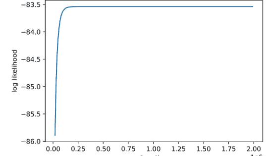

图 14.2: 梯度下降的收敛

## 14.2.3 模型性能评估

在本节中，我们将测试集的预测值与实际标签进行比较。从预测概率产生预测标签时，需要应用阈值。`sklearn` 的默认阈值是 0.50。不同的阈值有时可以产生更好的结果，我们将在考虑这一点。我们使用的指标是准确率（accuracy）、召回率（recall）、精确率（precision）和 F1 分。这些在第 11 章中介绍过。有多种方法计算指标：根据定义使用 sklearn 中的单个函数（如 `recall()`），或使用批量计算指标的 `classification_report()` 函数。让我们先运行 `classification_report()` 并审查。

```python
classification_report(y_test, y_pred)
```

| | precision | recall | f1-score | support |
|---|---|---|---|---|
| 0 | 0.87 | 0.91 | 0.89 | 228 |
| 1 | 0.93 | 0.75 | 0.84 | 151 |
| avg | 0.90 | 0.83 | 0.86 | 379 |

## 练习

https://github.com/PredictionNN/intro_data_science_course/

- 1. 解释为什么直接使用预测变量的线性组合对于逻辑回归模型是不合适的。
- 2. 当 `$t = 0$` 时，sigmoid 函数 `$\sigma(t)$` 的值是多少？
- 3. 如果事件的几率（odds）为 1/3，那么该事件的概率是多少？
- 4. 解释似然函数代表了什么。
- 5. 正确或错误：最大化似然的参数也会最大化对数似然。
- 6. 在逻辑回归模型中，事件的对数几率（log odds）与预测变量线性组合之间的假设关系是什么？
- 7. 是否可以通过寻找临界点来估计逻辑回归模型的参数？请解释你的答案。
- 8. 在梯度下降中，步长代表什么？
- 9. 在梯度下降中，使用大步长总是合理的吗？请解释你的答案。
- 10. 在计算对数似然的梯度时，我们对事件概率进行了替换。请证明以下表达式是等价的。

表达式 I

```
$$\frac{\exp(\beta_0 + \beta_1x_{i1} + \dots + \beta_kx_{ik})}{1 + \exp(\beta_0 + \beta_1x_{i1} + \dots + \beta_kx_{ik})}}$$
```

表达式 II

```
$$\frac{1}{1 + \exp(-(\beta_0 + \beta_1x_{i1} + \dots + \beta_kx_{ik}))}$$
```

11. 运行以下代码的结果将是什么：

```
import numpy as np
a = np.array((1,2,3))
b = np.array((1,2,3),(1,2,3))
np.hstack((a,b))
```

288 逻辑回归分类

- 12. 在函数 `gradient.descent.logistic()` 中，解释这一行代码的作用：

`betas = betas - alpha * grad_neg_ll`

- 13. 正确或错误：当使用梯度下降计算逻辑回归参数估计时，我们应该预期这些值与通过 statsmodels 之类的统计包得到的估计值大不同。
- 14. 你拟合了一个具有单一二分类预测变量的逻辑回归模型。预测变量的系数估计值为零。考虑一个预测变量值为 0 的受试者和一个预测变量值为 1 的受试者。两者之间的事件几率会有何不同？
- 15. 使用 sklearn 模块对此数据集拟合逻辑回归模型：`{(3,0), (3.2,0), (4,1)}`。显示你的代码并打印截距和斜率系数估计值。对于预测值为 6，预测的目标是什么？
- 16. 解释 sklearn 函数 `predict()` 和 `predict_proba()` 之间的区别。具体来说，什么情况下使用它们各是有意义的？
- 17. 一个逻辑回归模型产生了 100 个真正例，精确率（precision）为 0.2。有多少个假正例？
- 18. 一个逻辑回归模型被应用于真实数据集。产品领导层认为得到的精确率太低。对概率阈值进行什么操作可以产生更高的精确率？

# 15
## K-Means 聚类

我们并不总是拥有用于监督学习的有标签数据。更常见的情况是数据集 `\{x_i\}_{i=1}^n` 没有标签，但我们希望识别出子结构作为分组。聚类技术在发现离群值方面也有帮助；这些点可能位于孤立或较小的组中。我们将从学习聚类的概念开始本章。然后，我们将学习 k-means 聚类并解决一个小例子。最后，我们将把 k-means 应用于一个包含约 9000 种食物的营养数据集。

## 15.1 聚类概念

让我们从一个非常小的例子开始来说这些思想。假设一位老师希望根据某种评估性能衡量对学生进行分组。评估可能包括测验或考试等。在学生分组后，可以给他们提供具针对性的指导。实现这种分组的最佳方法是什么？我们面临一些需要早期回答的问题，包括：

- 哪些学生应该被用于分组计算？我们可能会在分析中包含特定班级的所有当前学生，或者使用课程的当前和历史学生。
- 应该包含哪些变量？我们可能一次包含一次评估、特定课程中进行的所有评估，或仅包含期末考试之前的评估。例如，如果我们使用一个识别在近期学习中需要支持学生的系统，那么聚类可以基于最后一次考试。
- 我们如何衡量组的质量？为了理解组的质量，我们可能尝试将分组与另一个变量相关联。同样重要的是，教师和助教能够支持组的数量是有限制的。

290 K-Means 聚类

对于这些问题没有单一的规定性答案。相反，正确的选择取决于聚类信息将如何被使用。还需要一些迭代才能得到满意的答案。

让我们关注缩小到三个参加了两次考试的学生。他们的得分如下：

| exam1 | exam2 |
|---|---|
| A | 70 | 82 |
| B | 75 | 80 |
| C | 95 | 90 |

对这些学生分组合理方法是什么？首先，我们使用距离。在这个例子中，我们将使用欧几得距离，如 15.1 所示：


图 15.1：计算欧几得距离

309 聚类概念

注意水平线和垂直线的交叉点，它形成了一个直角：

- 学生 A 在考试 1 中得了 70 分
- 学生 B 在考试 2 中得了 80 分

A 和 B 之间的距离将是形成的直角三角形的斜边。根据勾股定理（你可能记得 `$c = \sqrt{a^2+b^2}$`），`$\sqrt{(75-70)^2+(82-80)^2} = \sqrt{29} \approx 5.39$`。

欧几得距离可以表示为向量 `$x$` 和 `$y$` 的公式，长度均为 `$p$`：

```
$d(x, y) = \sqrt{\sum_{i=1}^{p} (x_i - y_i)^2}$ \quad (15.1)
```


这是我们将示例扩展到 $p$ 维情况。其他学生之间的距离可以以类似的方式计算。注意，一种方法涉及计算所有对距离 $d(A,B), d(A,C), d(B,C)$。对于大量的数据点，这可能是一个巨大的计算。由于我们稍将在 k-means 算法中看到，一种简化方法是停止开平方根。相反，我们计算平方距离 $d^2$，因为对 $d^2$ 的排序与基于 $d$ 的排序是相同的。因为平方根函数是一个单调递增函数。

另一个考虑因素是要形成的组数 $k$。单一组将阐明相似性或差异，所以我们会帮助两者，因为这把每个学生都放在了单独。在 $n$ 个对象的通用情况下，我们要求 $k$ 大于 1 且小于 $n$。有不同的衡量分组的方法，我们很快将学习一种特定的指标。从概念上说，组内的点应该“接近”，而不同组之间的点应该“相距遥远”。接近性可以通过点之间的平方距离之和来衡量。

在下一节中，我们将讨论流行的 k-means 聚类算法。该算法可以扩展到海量的观测值和变量，并且只需要一个参数。我们已经引入了 k-means 使用的许多重要概念，所以让我们深入研究。

## 15.2 K-Means

k-means 算法通过将 $n$ 个对象（点）分为 $k$ 个聚类，并将每个点放置在距离其质心所在的类中。图 15.2 显示了三个学生示例的 k-means 聚类。该聚类使用了两个簇，$x$ 标记表示质心。为了理解质心是如何决定的，我们需要学习算法的步骤，我们将在下文中介绍。

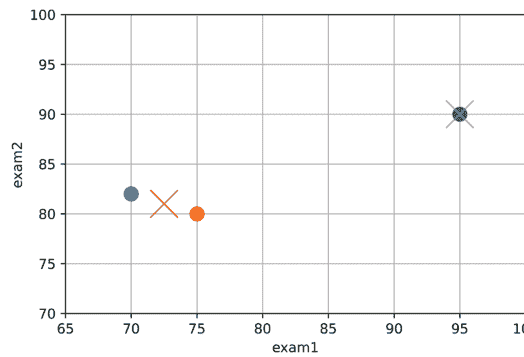

图 15.2：数据点与 K-Means 质心

给定聚类数量 $k$，有不同的方法初始化质心。一种常用方法是随机选择 $k$ 个点并将它们作为质心。

根据欧几里得距离将每个点分配给最近的质心。这就是*分配步骤*。

接下来，通过选择分配给每个质心的点并计算每个变量的平均值来重新计算每个质心。对于 $p$ 个变量，每个质心将是一个 $p$ 维向量，其中第 $i$ 个元素是第 $i$ 个变量的平均值。例如，如果一个簇由点 $(1, 2)$ 和 $(3, 4)$ 组成，则质心为 $(1+3)/2, (2+4)/2 = (2,3)$。这一步被称为*更新步骤*。

重复这对步骤（分配、更新），直到没有分配变化或算法运行了允许的迭代次数为止。

k-means 算法试图最小化类内平方误差和 (WSSE)。这满足了同一簇中的点“彼此靠近”的需求。遗憾的是，k-means 并不保证能达到目标，结果取决于初始质心。因此，算法应该运行多次，并使用最佳结果。这在软件中是可以实现的的，我们将使用 `sklearn`。

### K-Means 的假设与局限性

K-means 有几个需要理解的假设和局限性：

- 1) 由于算法使用欧几里得距离，数据的聚类模式将非常重要。具体来说，当簇呈球形时，它的效果良好。如果存在同心环数据或复杂形状，它的效果将不佳；对于这些情况，像 DBSCAN 等替代方法会更好。
- 2) 由于聚类中使用了距离测量，确保变量在相同的尺度上至关重要。可以使用归一化或缩放来实现此目的。
- 3) 变量需要是数值型的。分类变量通常进行独热编码（one-encoded）。
- 4) K-means 总是会给出一个答案。评估结果、迭代并理解簇是否有用可能需要大量时间。
- 5) 结果可能高度依赖于所使用的变量和观测值。例如，包含或删除一个变量可能会产生不同的聚类结果。这应该作为测试的一部分进行探索。

### 15.2.1 K-Means 手算计算

为了清晰地理解一个算法，手动计算非常有帮助。我们可以为这个小示例手动计算 k-means。注意，由于点数和变量数较少，我们可以尝试每次初始化，选择最好的一个，并保证达到最优解。对于我们的目的来说，说明单一初始化即可。由于配置数量巨大，大规模案例将不允许进行穷举搜索（尝试每次初始化）。

提醒一下，这里是学生数据：

| student | exam1 | exam2 |
|---|---|---|
| A | 70 | 82 |
| B | 75 | 80 |
| C | 95 | 90 |

#### 初始化

令 $k = 2$。通过将质心 0 放在 A，质心 1 放在 C 来初始化过程。这些点被用作初始平均值。

| centroid | exam1.avg | exam2.avg |
|---|---|---|
| 0 | 70 | 82 |
| 1 | 95 | 90 |

#### 迭代 1：分配

根据质心，我们需要将点分配给它们最近的质心。为了做到这一点，我们首先需要如下所示测量每个点 P 到质心的距离：

| | dist(P,centroid0) | dist(P,centroid1) |
|---|---|---|
| A | 0 | 26.2 |
| B | 5.4 | 22.4 |
| C | 26.2 | 0 |

例如，$d(A,centroid1) = \sqrt{(95-70)^2 + (90-82)^2} = 26.2$。现在我们可以进行分配：

| student | exam1 | exam2 | centroid |
|---|---|---|---|
| A | 70 | 82 | 0 |
| B | 75 | 80 | 0 |
| C | 95 | 90 | 1 |

学生 A 和 C 位于质心处，因此它们的分配没有变化。学生 B 比簇 1（距离=22.4）更接近簇 0（距离=5.4）。

#### 迭代 1：更新

现在我们通过选择每个簇中的学生并计算每次考试的平均值来更新质心。对于质心 0，我们计算学生 A 和 B 考试的平均值。

| centroid | exam1.avg | exam2.avg |
|---|---|---|
| 0 | 72 | 81 |
| 1 | 95 | 90 |

#### 迭代 2：分配

根据质心，我们需要将点分配给它们最近的质心。为了做到这一点，我们首先需要如下所示测量每个点 P 到质心的距离：

| | dist(P,centroid0) | dist(P,centroid1) |
|---|---|---|
| A | 0 | 26.2 |
| B | 5.4 | 22.4 |
| C | 26.2 | 0 |

例如，$d(A,centroid1) = \sqrt{(95-70)^2 + (90-82)^2} = 26.2$。现在我们可以进行分配：

| student | exam1 | exam2 | centroid |
|---|---|---|---|
| A | 70 | 82 | 0 |
| B | 75 | 80 | 0 |
| C | 95 | 90 | 1 |

学生 A 和 C 位于质心处，因此它们的分配没有变化。学生 B 比簇 1（距离=22.4）更接近簇 0（距离=5.4）。

#### 迭代 2：更新

现在我们通过选择每个簇中的学生并计算每次考试的平均值来更新质心。对于质心 0，我们计算学生 A 和 B 考试的平均值。

| centroid | exam1.avg | exam2.avg |
|---|---|---|
| 0 | 72.5 | 81 |
| 1 | 95 | 90 |

### 15.2.2 性能评估

k-means 算法试图最小化给定聚类数量 $k$ 的类内平方和。问题仍然在于选择最佳 $k$。选择最小 WSSE 的 $k$ 是不可行的，因为可以通过设置 $k=n$ 来最小化该指标。在这种情况下，每个点都是自己的簇且 WSSE=0，但这并没有告诉我们任何关于子结构的信息。需要其他方法。

一种常用方法是绘制不同 $k$ 的 WSSE，如图 15.3 所示。随着 $k$ 的增加，WSSE 通常会下降。有时会出现剧降，然后 WSSE 趋于平缓，形成一个“肘部”模式。对于这张特定的图，肘部并不明显，但 $k$ 为 3 或 4 是合理的。超过底层簇数量增加 $k$ 将将本属于的点拆分开，WSSE 变化很小。

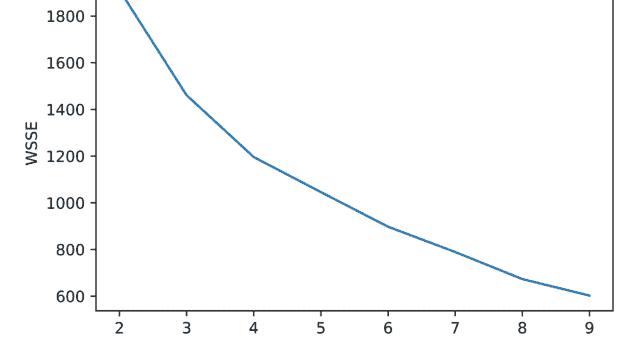

图 15.3：WSSE 与聚类数量的关系

选择 $k$ 的另一种更定量的方法是计算轮廓系数。轮廓系数衡量了每个数据点在其簇内与其它簇相比的凝聚性。该指标落在 $[-1, 1]$ 范围内，值越高表示凝聚性越好。因此，该指标可以用于比较不同的 $k$ 并选择最佳值。我们将注意力限制在 $k > 1$ 的情况。

给定点到簇的分配，轮廓系数的计算如下：

# 按营养价值对食物进行聚类

1) 对于每个数据点 $i$，计算它与其簇中所有其他点的平均距离，记为 $a(i)$。这衡量了该点在所属簇中的对齐程度。
2) 对于每个数据点 $i$，计算它与不同簇中所有点的平均距离。对每个不同的簇重复此平均值计算，并识别出平均值最小的簇。这便是点 $i$ 的*邻近簇*，因为它是次优的簇。到邻近簇点的平均距离表示为 $b(i)$。
3) 对于每个数据点 $i$，计算其*轮廓系数*（silhouette）

```
$s(i) = \frac{b(i) - a(i)}{max(a(i), b(i))}$
```

$b(i)-a(i)$ 的较大差异表示点 $i$ 与其簇之间的拟合良好良好。在簇中每个点都相同的极端情况下，这些点的 $a(i) = 0$。分母将值归一化到 $[-1, 1]$ 范围内。在极端情况下，分子为 $b(i)-a(i) = b(i)$，分母为 $max(a(i),b(i)) = b(i)$。轮廓系数为 $s(i) = b(i)/b(i) = 1$。
4) 轮廓系数通过计算所有 $i$ 的 $s(i)$ 平均值得到。对于簇中每个点相同的情况，所有 $i$ 的 $s(i) = 1$，轮廓系数将为 1。

可以使用 Python 中的 `sklearn` 计算轮廓系数，我们将在下一节中介绍。

## 15.3 按营养价值对食物进行聚类

接下来，我们将 k-means 聚类应用于一个包含约 9000 种食物和产品的营养数据集。食物种类非常多样，包括桃子、苔麦（一种谷物）、橙色雪芭冰和茄子。数据可以免费获取：

https://www.kaggle.com/datasets/trolukovich/nutritional-values-for-common-and-products/resource=download

此演示的 Jupyter notebook 可以在课程仓库中找到：

```
/book_materials/kmeans_demo.ipynb
```

为了专注于新材料，我们不会对这些数据进行全面处理并对结果进行大量迭代。相反，我们将使用食物和营养变量的子集。首先导入必要的模块并设置数据路径：

```
# import modules

import numpy as np

import matplotlib.pyplot as plt

import pandas as pd

import re

import seaborn as sns

from sklearn.preprocessing import StandardScaler

from sklearn.cluster import KMeans

from sklearn.metrics import silhouette_score
```

# 设置数据集路径
`data_path = '/path_to_data/nutrition.csv'`

`re` 提供了正则表达式的功能，我们将用它来从数据集中删除字符串。特别是营养值以带有单位的形式出现——例如 "10 mg"，我们需要保留数据的数值部分。我们还导入了 `sklearn` k-means 聚类的函数。

接下来，我们读取 CSV 文件并指定变量列表。我们将使用变量子集来快速显示一些结果。

```python
# import data
df = pd.read_csv(data_path)
```

```
# specify variables
vars = ['calories', 'total_fat', 'saturated_fat', 'cholesterol', 'sodium', 'choline', 'folate', 'folic_acid', 'niacin', 'pantothenic_acid', 'riboflavin', 'thiamin', 'vitamin_a', 'vitamin_a_rae', 'carotene_alpha']
```

查看数据并进行探索性分析是非常重要的。对于这些数据，存在具有相同值的列，例如 `serving_size`。这可以通过计算每个变量的标准差在统计上进行检测。如果一个变量的标准差为零，则它在所有记录中都是常数，应该将其从后续分析中删除。

接下来，我们将只选择感兴趣的列。这由变量和存储食物名称的 `name` 列组成。注意列表可以通过 `list1 + list2` 的形式添加。

# 按营养价值对食物进行聚类

`df = df[['name'] + vars]`

彻底的分析可能会对每个变量单独插值缺失值。异常值也应该被处理。在这里，我们删除了任何包含缺失值的行，并且不处理异常值。

```
# drop rows with any missing values
df = df.dropna(axis=0)
```

卡路里（calories）包含整数，而其他变量由于包含了如 "10.5mg" 或 "10.5 mg" 等单位而包含字符串。注意，在正确的数据库中，单位会与值在单独字段中，但现实中的数据具有复杂性。我们的策略是遍历每个字符串类型的变量，只保留数值部分，并将值转换为浮点数。然后 "10.5mg" 或 "10.5 mg" 就会变成 10.5。我们在此使用的正则表达式模式 `regex` 为：`[\d]+`。对于初学者来说，正则表达式可能很难，但通过接触和练习就能掌握。加号 (+) 表示一个或多个，它允许允许保留所有的点 (.) 和斜杠 (/)。对于小型任务，只需搜索正则表达式即可得到正确的格式。一个用于构建、测试和调试的绝佳工具是 https://regex101.com/

我们遍历每个字符串类型的变量，只保留数值部分，并将值转换为浮点数。

```python
# convert strings to floats
df[var] = df[var].str.replace(r'[^\d.]', '', regex=True).astype(float)
```


表 15.1：清洗后的数据

|  | calories | total_fat | saturated_fat | cholesterol | sodium | choline | folate | folic_acid | niacin | pantothenic_acid | riboflavin | thiamin | vitamin_a | vitamin_a_rae | carotene_alpha |
| :--- | :--- | :--- | :--- | :--- | :--- | :--- | :--- | :--- | :--- | :--- | :--- | :--- | :--- | :--- | :--- |

轮廓系数通过计算所有 `i` 的 `s(i)` 平均值得到。对于簇中每个点都相同的情况，所有 `i` 的 `s(i) = 1`，轮廓系数将为 1。

可以使用 Python 中的 `sklearn` 计算轮廓系数，我们将在下一节中介绍。

```
：. . 错误：
```


# 按营养价值对食物进行聚类

1) 对于每个数据点 `i`，计算它与其簇中所有其他点的平均距离，记为 `a(i)`。这衡量了该点在所属簇中的对齐程度。

2) 对于每个数据点 `i`，计算它与不同簇中所有点的平均距离。对每个不同的簇重复此平均值计算，并识别出平均值最小的簇。这便是点 `i` 的*邻近簇*，因为它是次优的簇。到邻近簇点的平均距离表示为 `b(i)`。

3) 对于每个数据点 `i`，计算其*轮廓系数*（silhouette）

```
s(i) = (b(i) - a(i)) / max(a(i), b(i))
```

`b(i)-a(i)` 的较大差异表示点 `i` 与其簇之间的拟合良好。在簇中每个点都相同的极端情况下，这些点的 `a(i) = 0`。分母将值归一化到 `[-1,1]` 范围内。在极端情况下，分子为 `b(i)-a(i) = b(i)`，分母为 `max(a(i),b(i)) = b(i)`。轮廓系数为 `s(i) = b(i)/b(i) = 1`。

4) 轮廓系数通过计算所有 `i` 的 `s(i)` 平均值得到。对于簇中每个点都相同的情况，所有 `i` 的 `s(i) = 1`，轮廓系数将为 1。

可以使用 Python 中的 `sklearn` 计算轮廓系数，我们将在下一节中介绍。

# 15.3 按营养价值对食物进行聚类

接下来，我们将 k-means 聚类应用于一个包含约 9000 种食物和产品的营养数据集。食物种类非常多样，包括桃子、苔麦（一种谷物）、橙色雪芭和茄子。数据可以免费获取：

https://www.kaggle.com/datasets/trolukovich/nutritional-values-for-common-and-products/resource=download

此演示的 Jupyter notebook 可以在课程仓库中找到：

```
/book_materials/kmeans_demo.ipynb
```

为了专注于新材料，我们不会对这些数据进行全面处理并对结果进行大量迭代。相反，我们将使用食物和营养变量的子集。首先导入必要的模块并设置数据路径：

```python
# import modules
import numpy as np
import matplotlib.pyplot as plt
import pandas as pd
import re
import seaborn as sns
from sklearn.preprocessing import StandardScaler
from sklearn.cluster import KMeans
from sklearn.metrics import silhouette_score
```

# 设置数据集路径
`data_path = '/path_to_data/nutrition.csv'`

`re` 提供了正则表达式的功能，我们将用它来从数据集中删除字符串。特别是，营养值以带有单位的形式出现——例如 "10 mg"，我们需要保留数据的数值部分。我们还导入了 `sklearn` k-means 聚类的函数。

接下来，我们读取 CSV 文件并指定变量列表。我们将使用变量子集来快速显示一些结果。

```python
# import data
df = pd.read_csv(data_path)
```

```python
# specify variables
vars = ['calories', 'total_fat', 'saturated_fat', 'cholesterol', 'sodium', 'choline', 'folate', 'folic_acid', 'niacin', 'pantothenic_acid', 'riboflavin', 'thiamin', 'vitamin_a', 'vitamin_a_rae', 'carotene_alpha']
```

查看数据并进行探索性分析是非常重要的。对于这些数据，存在具有相同值的列，例如 `serving_size`。这可以通过计算每个变量的标准差在统计上进行检测。如果一个变量的标准差为零，则它在所有记录中都是常数，应该将其从后续分析中删除。

接下来，我们将只选择感兴趣的列。这由变量和存储食物名称的 `name` 列组成。注意列表可以通过 `list1 + list2` 的形式添加。

```python
df = df[['name'] + vars]
```

彻底的分析可能会对每个变量单独插值缺失值。异常值也应该被处理。在这里，我们删除了任何包含缺失值的行，并且不处理异常值。

```python
# drop rows with any missing values
df = df.dropna(axis=0)
```

卡路里（`calories`）包含整数，而其他变量由于包含了如 "10.5mg" 或 "10.5 mg" 等单位而包含字符串。注意，在正确的数据库中，单位会与值在单独字段中，但现实中的数据具有复杂性。我们的策略是遍历每个字符串类型的变量，只保留数值部分，并将值转换为浮点数。然后 "10.5mg" 或 "10.5 mg" 就会变成 10.5。我们在此使用的正则表达式模式 `regex` 为：`[\d]+`。对于初学者来说，正则表达式可能很难，但通过接触和练习就能掌握。加号 `+` 表示一个或多个，它允许保留所有的点 `.` 和斜杠 `/`。对于小型任务，只需搜索正则表达式即可得到正确的格式。一个用于构建、测试和调试的绝佳工具是 https://regex101.com/

我们遍历每个字符串类型的变量，只保留数值部分，并将值转换为浮点数。

```python
# convert strings to floats
df[var] = df[var].str.replace(r'[^\d.]', '', regex=True).astype(float)
```

表 15.1：清洗后的数据

|  | calories | total_fat | saturated_fat | cholesterol | sodium | choline | folate | folic_acid | niacin | pantothenic_acid | riboflavin | thiamin | vitamin_a | vitamin_a_rae | carotene_alpha |
| :--- | :--- | :--- | :--- | :--- | :--- | :--- | :--- | :--- | :--- | :--- | :--- | :--- | :--- | :--- | :--- |

# 使用 K-Means 进行聚类

查看按簇分组的变量均值将是非常有趣的。这可以使用 `groupby()` 和 `agg()` 函数来计算。下表显示了每个簇中食物的平均热量和脂肪含量。例如，如果我们查看簇 0 中的所有食物并计算它们的平均热量，结果为 245.111。与其他簇相比，簇 1 包含的食物平均热量和总脂肪含量更高。

```python
df_sub.groupby(df_sub.cluster).agg(func=np.mean).round(3)
```

| 簇 (cluster) | 热量 (calories) | 总脂肪 (total_fat) | 饱和脂肪 (saturated_fat) |
|---|---|---|---|
| 0 | 245.111 | 9.659 | 2.738 |
| 1 | 721.091 | 78.273 | 27.909 |
| 2 | 296.500 | 8.750 | 1.550 |

图 15.5 和 15.6 显示了按簇划分的营养变量箱线图。簇 1 从其他簇脱颖而出，大多数食物具有较高的热量和总脂肪。图 15.5：按簇划分的热量箱线图

最后我们可以打印每个簇的食物列表。出于空间考虑，我们显示了每个簇最多十种食物。

```python
# 显示最大行数
pd.set_option('display.max_rows', None)
```

```python
# 为每个簇打印食物名称
for clus in np.arange(k_best):
    print(f'cluster {clus}')
    print(df_sub.name[df_sub.cluster==clus])
    print('')
```


图 15.6：按簇划分的总脂肪箱线图

| 簇0 | 簇1 | 簇2 |
|---|---|---|
| 苔麦 (Teff) | 核桃 (nuts) | 辣椒粉 (chili powder) |
| 橙味雪冰淋 (Sherbet, orange) | 干燥松果 (dried pine nuts) | 冷干韭菜 (freeze-dried chives) |
| 生西蓝花 (Cauliflower, raw) | 无水油 (Butter, anhydrous) | |
| 生芋叶 (Taro leaves, raw) | 大豆磷脂油 (soybean lecithin) | |
| 生碎羊肉 (Lamb, raw, ground) | 新鲜蛋黄 (Egg, fresh yolk) | |
| 奶酪 (Cheese, cam) | 干燥核桃 (Nuts, dried pecans) | |
| 素肉排 (Vegetarian fillets) | 无盐油 (Butter, without salt) | |
| 烤吐干 (Crackers, roast toast) | 香蕉片 (banana chips) | |
| 煮鸡肉 (Chicken, boiled, feet) | 玉米油和菜籽油 (Oil, corn and canola) | |
| 生鹌肉 (Quail, raw meat) | uchuilla baer |

簇 0 很大且多样化。簇 1 包含了坚果、油和黄油，这些都是肥胖食物。这些食物被分在一起很有趣。簇 2 非常小，可能包含异常值。它包含了冷干韭菜，其热量大约是生韭菜的10倍。通过努力，可以从这些数据中提取更好的簇。

## 15.4 章节总结

无监督技术如 K-Means 聚类可以发现子结构和异常值。K-Means 将 $n$ 个点划分为簇，目标是最小化簇内误差和。每个簇都有质心，它是簇中点所在的坐标向量。

K-Means 从质心的初始化开始，有几种方法可以。初始化之后，算法根据欧式距离将每个点分配给最近的质心。根据簇中的点，更新每个质心以反映每个维度的平均值。重复分配和更新步骤直到不再变化。

用户应该注意 K-Means 的几个优点和局限性。算法不能保证收敛到全局最优。为了找到最优解，应该多次运行 K-Means。由于算法使用欧式距离，确保变量处于相同尺度是重要的。距离度量也意味着适用于 K-Means 的数据模式：球形簇将产生良好的结果，而同心圆等复杂模式则不会。K-Means 需要数值数据；类别变量通常需要编码。

K-Means 要求的参数是簇的数量 $k$。使用不同的技术来确定 $k$，我们研究了轮廓系数（silhouette score）。轮廓系数衡量每个点与其所属簇相对于下一个最近簇的拟合程度。轮廓系数范围是 [-1,1]。

我们从各种食物中获得了一个大型营养值数据集。数据集需要一些清理，我们使用正则表达式（regex）删除了不需要的字符串。对数据的 K-Means 聚类分析发现了一个高热量、高脂肪的簇。插图只需努力就得到了有趣的结果，但更稳健的解决方案需要更深入的调查。

本章及之前的章节重点是机器学习技术。在下一章节中，我们将学习一些让数据科学项目更具可重复性的技术。这将减少将模型从开发转移到生产所需的时间。

## 15.5 练习

带有答案的练习标记为 (S)。答案可以在代码库的 `book_materials` 文件夹中找到：

## 练习

https://github.com/PredictionNN/intro_data_science_course/

- 1. 解释质心的概念。
- 2. 解释如何使用 K-Means 算法检测 K-Means 聚类的异常值。
- 3. 提供一个不利 K-Means 聚类的数据模式示例。
- 4. 你认为存在 K-Means 可以无限运行的情况吗？解释你的答案。
- 5. 在执行 K-Means 聚类时，你正在决定 $k$ 的适当值。解释为什么增加 $k$ 直到不是一个好的方法。
- 6. 当使用多个变量运行 K-Means 时，你发现结果不同。解释这为什么会发生。
- 7. 在运行多个变量的 K-Means 后，你发现结果与一个变量非常吻合。你随后意识到错过了一个导致该变量主导的步骤。缺失的步骤是什么？
- 8. 为了增加 K-Means 找到全局最优的机会，应该多次运行。为什么不使用穷举搜索？
- 9. 选择一个数据集并使用 `sklearn` 拟合 K-Means 并计算轮廓系数。接下来，通过自己计算来验证。你可能会写一个 Python 函数来完成。
- 10. 本章的营养示例使用了部分预测变量和轻量处理形成三个簇。尝试进一步清理和增加预测变量以产生更好的聚类。你的结果可能会发现额外的簇。

308 可复数据科学的要素

软件。第三种实践是使用容器技术创建临时的、可重复的环境。还需要注意的是，数据科学的可重复性在广义上是指允许任何人轻松地运行代码。示例包括工程团队、另一位数据科学家或一组在环境中运行 Python 的学生。

由于这这是一本关于数据科学的入门书籍，持续集成/持续部署（CI/CD）和数据版本控制等高级主题不在范围内。感兴趣的读者可以咨询 [44] 来了解 CI/CD。模型监控将在下一章讨论。

## 16.1 共享代码

共享代码最简单、安全的方法是使用像 GitHub 这样的工具，我们在书中一直在使用它。妥善地记录和维护项目的代码仓库可以确保代码向工程端的迁移。仓库中应该存在一个 README 文件，以提供代码目的和用途的概述。这可以包括重要函数的摘要及其输入和输出。README 可以包含测试程序，我们将在下一节中讨论。代码文件应包含文档，以便理解重要变量和函数的目的以及文件的整体逻辑。

代码在发布给下游用户（包括工程和客户）后可能会发生变化。例如，跟踪每个代码包以备将来参考是非常重要的。这种做法被称为软件版本化。不同的代码格式（如 GitHub）提供了管理从仓库中发布代码的功能。具体步骤不在本文范围内，并且随着时间的推移而变化，但对这一过程的认识是重要的。不同的客户可能会使用、甚至需要不同版本的项目代码。拥有一种发布不同代码版本、跟踪它们并随时间推移维护它们的方法是至关重要的。

## 16.2 测试

软件开发中有很多种测试，我们将简要回顾一些与数据科学相关的测试。单元测试让开发者对代码按预期执行充满信心。该过程包括编写单元测试，这些测试用于测试作为函数的离散代码单元。为每个小代码段编写测试可以实现快速测试、故障的隔离以及意外结果的显现。由于这些原因，数据科学家在开发代码时编写单元测试是一种良好的做法。同时，对每个测试的作用包含清晰的注释也是重要的。这将允许验证测试是否符合预期。

我们也强烈建议对数据和模型输出进行测试。这种做法有助于识别在收集新数据、代码演进或模型更新时出现的问题。特别是在机器学习中，模型可能会接收到格式错误或间歇性的数据，并返回错误的结果。在这种情况下，除非发生崩溃，否则错误的结果可能无法被发现。

测试模型输出的稳定性也是至关重要的。例如，数据科学家可能会训练一个性能良好的模型。她可能会继续精炼用于工程的应用代码，同时保持模型不变。确认模型对测试用例产生相同的预测将是重要的。可以创建一组带有模型输入和输出（例如预测概率）的测试，并与代码一起保存。它们的仔细设计至关重要，因为它们的覆盖范围定义了测试范围。测试可能包括：

- 常见情况，例如频繁的输入组合
- 缺少不同输入值的情况
- 所有输入缺失的情况
- 对模型可能具有挑战性的边缘情况
- 当任务是分类时，每个预测标签对应的情况

在模型输出上编写测试的实践允许数据科学家断言模型预测在现在和未来都符合已知值。此外，这允许其他人作为质量保证（QA）工程师来测试应用程序。由于 QA 工程师与数据科学项目隔了一层，他们很难检测出问题；测试将提供一层支持。

Python 有用于测试的模块，其中一个模块是 `unittest`。它提供了一套用于构建和运行测试的丰富工具。这包括一组用于布尔验证的方法，例如 `assertEquals()`，它检查两个值是否相等。例如，我们断言给定的模型输入将产生预期的输出。该输出可能从之前调用模型时已知。对于预测不匹配预期值的情况，测试将失败并抛出 `AssertionError`。下面的代码说明了两个简单的单元测试。第一个测试通过，第二个测试失败。代码后面有随后的解释。

310 可复数据科学的要素

```python
from unittest import TestCase
```

```python
# 检查两个语句是否相等
actual1 = 100 % 2 == 0
expected = True
```

```python
# 创建 TestCase 对象
tc = TestCase()
```

```python
# 运行测试以断言相等，打印结果
# 测试，返回 None
tc.assertEqual(actual1, expected)
```

```python
# 运行第二个测试，答案不同
# 这将失败并抛出错误
actual2 = 100 % 2 == 1
tc.assertEqual(actual2, expected)
```

`unittest` 模块包含 `TestCase` 类，它提供了许多检查和报告失败的方法。在第一个测试中，我们计算了一个评估为 True 的实际值（100 除以 2 余数为 0）。预期值是 True。`assertEquals()` 方法检查实际值是否匹配预期值。由于这些值匹配，测试通过。对于第二个测试，我们计算了一个评估为 False 的实际值。断言检查 False 是否等于 True，这是一个虚假的陈述。输出包括：

```
raise self.failureException(msg)
AssertionError: False! = True
```

在查看输出后，数据科学家可以识别错误。在许多情况下，数据科学家可以修复错误并重新运行测试。这个过程确保了代码在演进过程中保持健壮。

329

## 16.3 容器

数据科学团队完成模型后，它将交付给工程部门。它将在测试环境中进行阶段准备以确保一切正常工作。从那里，模型将被到生产环境。通常在另一台机器上运行代码时，可能会出现导致失败的兼容性问题。

容器是为了维护一致、隔离的项目环境。它是一个独立的、可执行的包，包含了运行应用程序所需的所有内容。这将包括软件、配置和变量。该包可以发送到另一台机器并在其上运行。单台机器运行多个不同版本的容器也是可能的。例如，一台云服务器可能同时运行多个机器学习模型。

虚拟化技术允许软件模拟硬件功能，创建一个虚拟计算机系统。容器的设计旨在共享宿主的操作系统，而不是需要它们自己的副本。这当多个容器在同一台机器上运行时特别有用。

容器化是轻量级的。

通用的开源容器化工具是 Docker。入门 Docker 包括学习一些术语和基本命令，我们在下面列出。Docker 镜像是一个包含创建指令的只读文件。我们可以认为镜像是一个模板。可以创建新的镜像，也可以共享。在线仓库 DockerHub 为社区提供了大量的 Docker 镜像（见 dockerhub.com）。

Docker 容器是 Docker 镜像的运行时实例。正如我们很快看到的，它是通过运行 `docker run` 命令创建的。容器可以在任何安装了 Docker 的机器上运行。这实现了极大的移植性，因为 Docker 可以运行在包括笔记本电脑、本地服务器或云服务器在机器上。Docker 运行在 Linux、Windows 和 Mac 等操作系统上。

### 16.3.1 安装 Docker

有关 Docker 安装说明和其他详情，请参阅这里的官方文档：https://www.docker.com/。许多组织会选择在运行 Linux 的机器上安装 Docker。

cloud。此路径需要在命令行中运行步骤。详情可以在 Linux 安装页面上找到。为了演示演示，我们将安装并运行 Windows 版 Docker。这些步骤涉及下载可执行文件并按照向导中的配置步骤进行。在 Mac 安装步骤非常相似。

Docker 安装完成后，我们可以打开终端并在命令行中输入 `docker` 来测试其已安装。图 16.2 显示了 PowerShell 中的某些输出。它显示找到了 Docker，并列出了一些常用命令。如果没有找到 Docker，则安装可以

```
PS C:\Users\aptvc> docker
Usage: docker [OPTIONS] COMMAND
Self-sufficient runtime for containers
Common Commands:
run      Create and run a new container from an image
exec     Execute a command in a running container
ps       List containers
build    Build an image from a Dockerfile
pull     Download an image from a registry
push     Upload an image to a registry
images   List images
login    Log in to a registry
logout   Log out from a registry
search   Search Docker Hub for images
version  Show Docker version information
info     Display system-wide information
```

> 图 16.1: 检查 Docker

### 16.3.2 常用 Docker 命令

使用 Docker 工作需要在 CLI 中使用各种命令。以下是对某些命令的简要描述。我们稍后将在构建和运行 Docker 容器的过程中练习这些命令。

| 命令 | 目的 |
|---|---|
| docker build | 从 Dockerfile 构建镜像 |
| docker run | 从镜像运行容器 |
| docker images | 列出所有已下载的镜像 |
| docker ps | 列出所有运行中的容器 |
| docker stop | 停止正在运行的容器 |
| docker rm | 移除已停止的容器 |

### 16.3.3 机器学习应用的 Docker 化

在本节中，我们将逐步介绍从 Docker 容器中运行机器学习模型的步骤。作为前提条件，我们需要一个用于应用程序的 Python 脚本。然后我们可以通过遵循以下步骤将应用程序 Docker 化：

- 创建 `requirements.txt` 文件
- 创建 `Dockerfile`
- 构建 Docker 镜像

`requirements.txt` 文件标识了运行应用程序所需的模块及其版本。这消除了依赖项的歧义。如果不使用 Docker，则项目中应包含该需求文件。

此演示将使用一个名为 `housing_script.py` 的 Python 脚本。代码取自之前的线性回归建模章节，如下所示。步骤包括将数据分为训练集和测试集、拟合线性回归模型以及在测试集上打印 R 平方值。

```python
# load the modules
from sklearn.datasets import fetch_california_housing
from sklearn.model_selection import train_test_split
from sklearn.preprocessing import StandardScaler
from sklearn.linear_model import LinearRegression
from sklearn.metrics import r2_score
import pandas as pd
housing = fetch_california_housing()
x_train, x_test, y_train, y_test = train_test_split(
    housing.data,
    housing.target,
    train_size=0.6,
    random_state=314)
reg = LinearRegression().fit(x_train, y_train)
y_test_pred = reg.predict(x_test)
r2 = r2_score(y_test, y_test_pred)
print('R-squared: ', r2)
```

我们可以通过打开终端、导航到脚本所在的目录并运行命令来测试该脚本：

```
python housing_script.py
```

输出包含了预期的 R 平方值：

R-squared: 0.6092160009090456

对于这个简单模型，使用的唯一模块是 scikit-learn。我们在 `requirements.txt` 文件中包含了它及其对应的版本：

```
scikit-learn==1.0.2
```

接下来，我们创建 `Dockerfile` 来为运行脚本设置 Python 环境。注意文件名没有扩展名。`Dockerfile` 使用特定的命令，下文将解释。

```
FROM python:3.9
WORKDIR /src
COPY requirements.txt .
RUN pip install --no-cache-dir -r requirements.txt
COPY .
CMD ["python","housing_script.py"]
```

- 第 1 行指定 Python 3.9 为基础镜像。
- 第 2 行将工作目录设置为 `/src`。
- 第 3 行将 `requirements.txt` 文件复制到工作目录。
- 第 4 行使用 `pip` 安装 `requirements.txt` 中的 Python 包。
- 第 5 行将当前目录中的文件复制到工作目录。
- 第 6 行使用 Python 运行 `housing_script.py` 文件。

最后，我们将构建 Docker 镜像。我们可以先通过打开终端并运行此命令来验证 Docker 是否正在运行：

```
docker info
```


如果 Docker 没有运行，输出中可能会出现类似这样的错误：

```
Server:

ERROR: error during connecting: this error may indicate that the docker daemon is not running...
```

一旦验证 Docker 正在运行，我们就可以导航到包含 `Dockerfile` 的目录并运行此命令：

```
docker build -t housing
```

## 容器

其中 `housing` 是赋予镜像的名字。注意命令末尾的点 `.` 表示在当前目录构建。随着镜像的构建，日志将流式传输到控制台。这是一个成功的构建消息示例：

```
[+] Building 8s (1/10) FINISHED
```

我们可以通过打开终端并运行此命令来验证 Docker 正在运行：

```
docker images
```

输出包含了所有镜像：

| REPOSITORY | TAG | IMAGE ID | CREATED | SIZE |
|---|---|---|---|---|
| housing | latest | 3038c4147f | 44 seconds ago | 1.3GB |

我们可以使用以下命令从镜像运行一个新的容器：

```
docker run
```

输出包含了预期的 R 平方值：

`R-squared: 0.6092160009090456`

我们可以通过运行此命令查看所有容器：

```
docker ps -a
```


显示了基于镜像创建的容器：

| CONTAINER ID | IMAGE | CREATED | NAMES |
|---|---|---|---|
| 2eb864701 | housing | About a minute ago | practical_blackburn |
| 4fa0261c64 | housing | 3 minutes ago | frosty_jespen |
| e35c5b68ba7 | housing | 20 minutes ago | intelligent_lederberg |

图 1.2：容器列表

在实践中，镜像创建后可以发送到其他地方运行。例如，工程师可能会在云服务器上使用我们查看过的命令运行模型。

随着机器学习应用程序数量的增加，支持它的容器数量可能会随之增加。管理和编排容器成为一项重要需求，并且可能带来挑战。Docker Compose 是用于定义和共享多容器应用程序的工具。它允许在一个文件中管理 Docker 镜像。此外，还有用于容器调度和编排的云工具，例如 Amazon Elastic Service (ECS)。

## 16.4 章节总结

部署模型并使其具有复现性可能是挑战性的。这需要许多步骤，但有一些实践和工具可以提供帮助。本章概述了代码、数据和输出的测试流程。它介绍了容器。

共享代码的最简单、安全的方法是使用 GitHub 这样的工具。仔细记录和维护项目的代码库有助于促进代码到工程的任务。随着时间的推移，代码会 way，不同的用户可能有不同的版本。跟踪每个代码包以备后用很重要。

编写全面的测试集需要时间和精力。错误的测试和缺失的测试会损害整个练习。应该检查测试的覆盖范围执行情况。它们应该包含常见情况和边界情况等。

为数据科学项目提供容器可以让其他人轻松地复制工作。容器包含了应用程序的所有依赖和配置。它们可以用于建立、运行和销毁临时隔离环境。这可以加速通往生产。Docker 目前是最流行的容器软件。有关更多细节和示例，请参见来源 [44]。

现在我们已经涵盖了模型部署和复现性的一些重要步骤，我们将回顾模型风险管理和模型监控。模型风险应该是整个模型生命周期内考虑考虑的，从模型概念开始。

## 16.5 练习

带有答案的练习题标记为 (S)。答案可以在课程库的 `book_materials` 中的以下位置找到：

## 练习

https://github.com/PredictionNN/intro_data_science_course/

1. 列出将模型投入生产环境必须完成的三件事。
2. 解释为什么为数据科学应用提供单元测试是有帮助的。
3. 研究健全性测试（sanity tests）并解释其价值。
4. 研究回归测试（regression tests）并解释其价值。
5. 解释 Docker 镜像和 Docker 容器之间的区别。
6. 一位数据科学家用 Python 开发了一个机器学习应用，并希望让其他人轻松运行它。请提供应该采取的步骤大纲。
7. 是否为容器命名？如果可以，如何操作？
8. 一位数据科学家运行了一个容器，该容器使用模型快速进行预测然后停止运行。她通过运行 `ps` 命令检查容器列表，但没有看到该容器。这合理？请为你的答案提供理由。
9. 修改 `housing.script.py` 文件并在 Docker 容器中运行它。可以自由使用完全不同的模型，但务必打印出结果。
10. 在运行 Docker 时，日志中提到了一个守护进程（daemon）。研究什么是守护进程并提供简要总结。


# 17

## 模型风险

我们投入了大量精力收集数据、建立模型、为数据拟合参数以及解释结果。可能会出现什么问题？
事实证明，问题很多。让我们从联邦储备体系委员会理事会（Board of Governors of the Federal Reserve System）《模型风险管理指南》中的定义开始。

模型的使用不可避免地会带来模型风险，即基于错误或误用模型输出及报告的决策可能产生不利后果的风险。

查看完整报告，请访问：

https://www.federalreserve.gov/supervisionreg/srlletters/sr1107.htm

我们可以将整个过程视为模型。通过这种方式，我们不仅考虑了来自数学或统计模型带来的风险，还考虑了运行模型的系统和输入数据带来的风险。这些组件每一个都可能引入需要管理的风险。

某些部门或整个公司根据运行生产环境的模型做出决策。错误的预测可能导致决策失误和财务损失。偏偏的数据和模型可能会对个人造成声誉损害和语义伤害。版权侵权可能导致内容所有者的诉讼。一本充满关于模型风险硬核案例的启发性书籍是《数学毁灭武器》（Weapons of Math Destruction）[46]。

有些公司从未从糟糕的模型中恢复。人们不需要寻找太久就能找到关于问题模型导致财务崩溃、歧视对待、法律风险和声誉损害的新闻。以下是一些例子：

- 长期资本管理（Long-Term Capital Management）成立于1994年的一家对冲基金，开局良好且领导层地位显赫。当市场背离他们的量化策略和高杠杆时，该公司面临了数十亿美元的损失并崩溃。
- Zillow 使用预测模型来推动其 Zillow Offers 计划中的房屋购买和转卖。在新冠肺炎期间，他们的预测非常不准确，导致了超过 4 亿亿美元的损失和 25% 的员工裁员。
- Stability AI 开发了一个根据文本描述创建图像的模型。该公司目前正与 Getty Images 陷入诉讼，后者声称 Stability AI 不公平地从其网站上爬取了数百万图像。Getty Images 认为 Stability AI 在训练模型时使用了这些图像。

本章的目的显然不是为了让读者远离数据科学，而是让他们意识到可能出现的问题以及如何防止。我在职业生涯早期曾作为一名量化师为投资银行和资产经理构建模型。稍后，我的角色之一是模型验证，我在那里审查、测试并挑战某家大型商业银行的一系列模型。我的小组独立于模型开发，受联邦政府授权，旨在提供防止模型风险的另一有效防线。我的团队的工作让我成为了一个更好的模型开发者。它让我开启了模型中隐藏的“陷阱”，例如可能导致不公平对待的预测因子、在实践中可能不成立的假设以及消失的模式。

模型验证是一项基本功能，并不局限于银行或金融领域。任何使用模型的地方都会引入需要衡量和管理的风险。执行这项工作的人必须仔细审查模型，确保正确的使用、准确的设计和逻辑、适当的数据处理、稳健的性能衡量和测试以及完整的文档。从模型开发者的角度来看，虽然验证增加了额外工作，但它带来了新视角的好处。有效的验证会挑战模型并可能加强它。

## 17.1 模型文档

模型文档对于交流开发过程、所进行的分析以及所做出的决策信息至关重要。模型开发者应该创建一个*模型开发文档*（model development document）或 devdoc，以记录过程中的重要元素，包括：

- 模型目的
- 利益相关者的姓名和职称
- 数据假设和局限性
- 模型假设和局限性
- 数据描述：时间段、变量背景
- 模型描述
- 流程图
- 数据处理，包括创建预测因子的步骤
- 数据收集大纲
- 模型中包含的预测因子的合理性
- 模型中排除的预测因子的合理性
- 模型结果（如回测）
- 模型敏感性测试
- 模型基准测试
- 监控计划
- 实验总结

模型验证者会发现在一个地方总结高层细节是有帮助的。在模型的整个生命周期内，文档将不断增长并反映最新状态。从历史上看，开发模型的组织是使用它们的唯一者。情况已不再如此。越来越多的模型在 Hugging Face (https://huggingface.co) 等平台上免费提供。复用适当的模型可以促进并加速开发。一个重要问题是模型是否适用于特定的用例，这正是模型卡可以提供帮助的地方。在实践中，模型卡提供的深度从空白到完整不等，模型卡可能包含：

- 模型描述：高层目的
- 模型背景信息
- 模型用途和局限性
- 模型架构（例如逻辑回归）
- 技术注释
- 模型使用说明
- 模型大小（通常以参数数量衡量）
- 关于偏差和毒性的警告
- 关于训练数据的信息
- 在定义的基准数据集上的性能
- 支持论文的引用

除了从社区平台模型外，用户也可以理解自己的模型。强烈建议随模型提供详细的模型卡。无论模型源自组织内部还是外部，模型卡都是沟通模型适用性、优势和风险的快速方式。

接下来，我们将逐步介绍验证的重要领域。这将回顾上面列的一些项目，并解释为什么它们对于缓解和管理模型风险如此重要。

## 17.2 概念合理性

当我们考虑一个用数据解决问题的系统时，验证每个组件至关重要：数据收集过程、逻辑、模型、步骤顺序、假设和局限性。创建一个详细的流程图来理解每一步、可能的漏洞、瓶颈、冗余和反馈循环是启发性的（见图 17.1）。分析师应该提问，诸如：

- 为什么这样做合理？
- 这符合逻辑吗？
- 这是解决问题的最佳方法吗？
- 是否应该考虑其他备替代方案？
- 这个假设/局限性合理吗？以后可能会导致问题吗？
- 什么可能会导致这个崩溃？

## 概念完备性


图 17.1：示例推荐流程图

模型通常是复杂性和风险的主要来源。这是因为模型是现实的抽象；这涉及到一种权衡。考虑算法：它们能识别略有不同的风格吗？模型并不尝试匹配每一个像素，而是学习一种表示形式或简化的结构。模型本质上是将信息浓缩到一个子集中，这个子集可能足以解决当前的任务。这在转换压缩格式的图像时就会发生；这种做法有效吗？在某些情况下，它是有效的。

然而，对于低质量的数据，机器学习中使用的模型通过假设来抽象掉细节。我们假设某个变量遵循正态分布，尽管这可能并不完全真实。变量不是正态分布重要吗？如果研究的变量是股价的百分比变化，且模型将用于交易系统，那么它就很重要。假设现实行为比正态分布所暗示的要大，可能会导致严重损失。

每个模型都带来程度的复杂性，这取决于架构和预测变量的数量等因素。我们应该努力只使用解决问题所需的复杂性水平。人们可能会受到线性回归等最先进方法的诱惑，但如果预测变量与目标之间存在非线性关系，那么可能需要更灵活（更复杂）的模型。数据应该是指南，而不是趋势——趋势虽然增加了灵活性，但也增加了复杂性。

## 模型风险

当我向从业者提出这些模型时，许多人对在生产环境中使用它们表示犹豫。经过几次讨论后，我发现了一个共同的困难：对于某些类型的数据，参数估计非常不稳定。随着时间的推移，它们会发生波动波动导致模型生成的预测不准确。这让我意识到，在引入复杂模型时需要谨慎处理和测试。

这引出了模型开发者需要对其建模决策给出合理的理由。这应该通过分析和测试来。应该考虑多个模型以便进行比较。最终模型不需要是模型宇宙中的最优模型，但它需要符合逻辑、提供可证明的价值，并带有可接受的风险特征。

## 17.3 数据与输入

用于模型考虑的数据以及模型输入对性能至关重要。首先，需要理解数据的含义。在理想情况下，数据字典会描述每个变量以提供背景。遗憾的是，数据字典可能并不可用。在这种情况下，数据科学家可能需要花时间寻找线索、文档以及可以询问的人员。

在一次咨询项目中，我的团队构建了一个没有包含所有变量的模型。我们注意到模型拟合得非常完美，这是一个说明情况不对劲的红旗。结果证明，其中一个预测变量本质上就是目标变量。这种情况发生的频率比你想象的要高。

假设数据现在已经被理解并记录下来。重要的是什么？如果一个变量将作为模型的输入或预测变量，我们必须确保：

- 该变量在未来是可用的。如果该变量需要实时处理，但系统需要两个小时才能处理，那么我们不应该将该变量包含在模型中。
- 该变量不会引入偏差。
- 该变量在模型中符合直觉。
- 数据是准确的。可能的情况下，应该进行交叉引用。
- 我们被允许使用这些数据。例如，未经授权使用版权材料可能会引发诉讼。

在审查数据和模型输入后，确保数据集是充分也很重要。例如，如果我们正在构建一个风险模型，那么数据应该包含风险上升期间的观测。对于周期性数据，在数据集中包含至少一个周期是很。

## 17.4 结果分析

在这个阶段，我们已经审查了模型组件、数据以及模型中的预测变量。接下来，我们将理解模型输出的效用。*结果分析*步骤将模型输出与实际结果进行比较。我们可能会调查频繁出现的特定案例。或者，我们可以对批量数据进行预测并计算一个指标，正如我们在评估回归性能时所的那样。

*回测*过程是结果分析的一种形式，它将实际结果与未包含在训练数据样本期间的模型预测进行比较。我们可以使用同一期的历史数据作为训练数据来评估性能，这有时被称为*样本外测试*。我们可能使用最近收集的数据来衡量样本外测试的模型性能。表 17.1 显示了包含模型 `$m_1$` 的预测值和实际结果的样本外测试结果。

#### 表 17.1：样本外测试结果

| 索引 | 预测值_$m_1$ | 实际值 |
| :--- | :--- | :--- |
| 0 | 0.20 | 0.06 |
| 1 | 0.10 | 0.04 |
| 2 | 0.70 | 0.45 |
| 3 | 0.45 | 0.63 |
| 4 | 0.15 | 0.11 |

## 模型基准测试

模型验证中的*基准测试*术语是指所考虑的模型与替代模型或指标进行比较。基准模型通常是复杂性最小的模型，可以用较少的精力开发出来。事实上，我们学习过的监督模型——线性回归和逻辑回归——都是很好的基准模型。如果我们正在验证像神经网络这样更复杂的模型，查看其性能与相应的回归模型相比是有意义的。我们之前讨论过的指标可能很有用。对于逻辑回归，精确率、召回率和 F1 分可能很有用。这些也应该随着时间收集，以便进行*持续模型监控*。根据此案例，RMSE 为 0.15。

# 敏感性分析

表格 17.2: 模型基准测试：样本外测试结果

| 索引 | prediction_$m_i$ | prediction_$m_{im}$ | 实际值 |
|---|---|---|---|
| 0 | 0.20 | 0.05 | |
| 1 | -0.10 | -0.03 | -0.04 |
| 2 | 0.70 | 0.50 | 0.45 |
| 3 | 0.45 | 0.61 | 0.63 |
| 4 | 0.15 | 0.09 | 0.11 |

# 17.6 敏感性分析

《美国新闻与世界报道》是美国最关注的大学排名系统之一。在2021年至2022年间，哥伦比亚大学的排名从第2名跌落至第18名。这在很大程度上是由数据不准确引起的，并引发了人们对具有如此大敏感性的系统有效性的质疑。该模型是否有缺陷？在没有对模型和数据进行审计的情况下很难说，我来这里并不是为了批评这种方法。但我指出，确保建模假设的微小变化不会导致输出的巨大变化是非常重要的。参数的微小变化或增加预测变量将导致剧烈的变化，从而可能引发反弹。

模型验证的一项重要实践是进行敏感性分析，它量化了建模假设的变化如何转化为输出的变化。反之，变化会影响性能指标。我有两点希望详细说明：建模假设和输出的测量。让我们逐一讨论这些内容。

当我们思考建模假设时，这可能包括诸如使用的系统动力学、随机变量的分布、参数之间的关系以及超参数。深思熟虑的开发者会考虑这些每一个元素，做出决策并构建模型来表达这些决策。例如，我们决定某个超参数的值应为10，并测试了接近10和远离10的数值。开发者可能考虑了预测变量 `$X$` 的不同分布，认为正态分布比 `$t$` 分布更合适。让我们列出我们目前为止遇到的一些选择：

- 当我们将数据划分为训练集和测试集时，我们使用种子对行进行随机选择。不同的种子可能会导致不同的数据划分。
- 我们有多种方法来填充缺失数据。例如，我们可能会使用变量的位数或平均值进行填补。
- 当我们使用线性回归模型时，我们假设误差呈正态分布。
- 当我们使用线性回归模型时，这假设预测变量与目标变量之间存在线性关系。

为了说明一个现实世界的建模假设，我将结合我的第一份工作——担任信用衍生品研究员。为了研究不同的结构，我们构建了金融模型，将各种类型债券的违约概率作为输入。通过仔细的测试，我们了解到违约假设的微小变化可能会产生预测的巨大变化。事实上，一个微小的变化可能是丰厚投资与财务困境之间的区别。

在衡量对输出的影响时，我们需要准确地决定应该衡量什么。这可能意味着在某些重要案例上运行模型，例如预设场景的利率预测。它可能意味着在整个测试集上运行模型。决定将取决于对利益相关者和业务案例重要的内容。

一旦分析师确定了应该更改的内容（例如种子、变量的分布、假设值）以及应该衡量的输出，我们就可以设计测试。运行测试将产生输出，这些输出可能会用指标、可视化和告警进行补充。例如，如果任何测试导致任何指标变化了10%或更多，可能会触发告警。结果可以报告给相应的利益相关者。

表格 17.3 在给定模型变化后对 m 进行敏感性测试。基准情况显示了预测。种子变化和中位数列显示了使用不同种子和方法时的预测。请注意，预测输出的特征是微小的。

表格 17.3 敏感性测试：在某些模型变化下的 m 

| 索引 | 基准情况 | 种子变化 | 中位数 |
|---|---|---|---|
| 0 | 0.20 | 0.21 | 0.20 |
| 1 | -0.10 | -0.11 | -0.10 |
| 2 | 0.70 | 0.71 | 0.70 |
| 3 | 0.45 | 0.44 | 0.45 |
| 4 | 0.15 | 0.14 | |

#压力测试

17.7 测试

对于某些场景，这可能更像是压力测试而非敏感性分析。这可以解释排名的变化。

17.8 持续模型监控

模型需要被监控，以确保运营和预测性能符合预期。运营性能包括响应时间和可用性，例如。响应时间是从发出请求到客户端接收到第一个字节的时间。可用性是系统可用且正常运行的时间百分比。预测性能将使用召回率和精确率等指标量化预测误差。召回率将衡量检测到的正标签比例，而精确率将衡量预测正例的比例。数据科学家通常关注预测性能。

在模型投入生产环境之前，应该起草性能监控计划并获得关键利益相关者的同意。应该有一个治理机构来提供监督，并在需要时执行该计划。该计划应包括但不限于以下元素：

- 需要监控的指标
- 对于每个指标，触发告警的阈值
- 越阈值后的后续步骤。这应该提到利益相关者的责任。
- 评审频率
- 模型评审委员会每个成员的姓名、职位和投票权限

这里是一个小的虚构示例，详细阐述了上述的元素：

# 性能监控计划开始

| 模型 ID | 123 |
| 模型名称 | 学生贷款违约模型 |
| 报告日期 | 2023-04-15 |
| 覆盖期间 | 2023-01-01 至 2023-03-31 |
| 评审频率 | 每季度 |

持续模型性能监控

## 指标、状态与阈值

| 指标 | 告警级别 | 阈值 |
|---|---|---|
| F1 分数 | 黄色 | < 0.8 或 下降超过 10% |
| F1 分数 | 红色 | < 0.7 或 下降超过 20% |
| ... | ... | ... |

## 措施与升级策略

当超过黄色阈值时，将向以下利益相关者发送告警：

| 产品经理 |
| 工程师经理 |
| 数据科学经理 |

模型开发团队和工程团队将审查模型组件和数据。模型可能会被重新训练以包含最新数据。

当超过红色阈值时，将向以下利益相关者发送告警：

| 产品副总裁 |
| 工程师副总裁 |
| 数据科学副总裁 |
| 产品经理 |
| 工程师经理 |
| 数据科学经理 |

模型将从生产环境中移除以便进行重新开发。模型开发团队和工程团队将审查模型组件和数据。

## 角色与职责

| 角色 | 姓名 | 职称 |
|---|---|---|
| 模型开发者 | John Smith | 数据科学家 |
| 模型开发经理 | Jane Cooper | 数据科学经理 |
| 模型验证员 | Xie Xu | 模型验证副总裁 |
| 模型验证经理 | Carlos Juarez | 模型验证高级副总裁 |
| ... | ... | ... |

332

模型风险

## 模型治理委员会

| 姓名 | 职称 | 部门 | 投票权 |
| --- |---|---|---|
| Dan Johnston | 经理 | 助学贷款 | 是 |
| Cindy Oh | 模型治理高级副总裁 | 模型验证 | 是 |
| Monica Swift | 风险负责人 | 风险管理 | 是 |

## 性能监控计划结语

为了实现有效监控，需要及时计算并报告各项指标。理想情况下，应该有一个可靠的自动化系统。在模型最初发布时，可能尚不清楚理想阈值。这可能需要通过实验，因为过于严格的阈值可能会触发虚假告警。监控计划和系统应具有灵活性，以便进行调整。

最后，对模型用户进行访谈以了解运行情况是否符合预期非常重要。例如，如果模型似乎犯了常见的错误，模型用户将用人类判断覆盖模型结果。如果这些信息被捕获，则可能改进模型并消除覆盖操作。

### 17.8.1 深入监控

我们学到指标将随时间进行监控，以理解预测性能的质量。当指标大幅下降并触发审查时会发生什么？分析师深入调查至关重要，有几项内容可以审查。

监控中应实施的两个重要事项是使系统具有可观测性并提供相关的基准。可观测系统会捕获或记录重要的步骤和中间值以便日后审查。例如，日志可以反映模型输入和输出的样本。它可能反映发生代码分支的步骤，以便分析师理解代码是否发生了意料之外的转向。所有内容都是实时捕获的。这种级别的观测性将使数据科学家和数据工程师更容易发现问题，因为这意味着更少的后期追踪和测试。

为了长期监控性能，首先建立基准是很有用的。基准可能包括在测试集上测量的 F1 分数等。此外，基准中可能包含预测器的重要统计数据，例如五数摘要。这里是一个存储特定日期基准统计数据的 JSON 对象示例。基准数据包含一个指标（F1 分数）和一个变量 `age` 的五数摘要。

## 持续模型性能监控

```


```
{
  'baseline_date': {
    '2023-01-31': {
      'metrics': {
        'F1 score': 0.68
      },
      'predictors': {
        'age': {
          'min': 25,
          'q1': 30,
          'median': 37,
          'q3': 55,
          'max': 95
        }
      }
    }
  }
}
```

基准信息可以存储在数据湖中，或使用 `AmazonMaker` 等云供应商服务进行。可以通过编程方式访问和使用。

当指标触发告警时，数据科学家可以开始利用日志和基准。他们首先检查日志是否存在问题指示。接下来，他们可以调查预测器的分布是否发生了变化，例如。要统计上检验变量分布在 `$t_1$` 和 `$t_2$` 之间是否变化，双样本柯尔莫哥夫-斯米尔诺夫检验（K-S 检验）可能本书的范围之外，但更多细节可以在 `[30]` 中找到。

预测器分布随时间的变化被称为因子漂移（factor drift），可能会导致问题。由于该模型从训练集中学习了预测器与目标之间的特定关系，如果预测器的分布发生变化，它与目标的关系也可能发生变化。我们需要保留新数据以捕获这种变化。然而，无法保证预测器将继续提供相同的预测能力。

其他潜在的调查区域发生在数据管道的早期阶段。处理后的数据、原始数据或数据馈可能存在缺陷。也许在某个步骤期望整数但输入了字符串。如果代码没有正确编写以处理这种情况，就会出现问题。

352

### 17.9 案例研究：公平贷款

本节将提供一个详细示例。

#### 17.9.1 公平贷款背景

在金融领域，银行和其他贷款者通常使用机器学习模型来做出贷款决策。审核决策可能使用逻辑回归模型。在批准后，定价决策可能使用线性回归模型。

模型预测器应该捕捉借款人的还款能力和意愿。预测器不使用保护群体信息，因为这会导致歧视并促进不公平贷款。

联邦监管机构（如货币监理专员办公室）开发了应对不公平和欺骗行为的方法。《公平住房法》和《平等信贷法》通过禁止基于以下因素的信贷和房地产交易歧视来保护消费者：

- 种族或颜色
- 宗教
- 性别
- 年龄（申请人具有合同能力）

保护群体是指受反……保护的群体，例如：

- 65 岁以上的人
- 黑人、西班牙裔和印第族

当贷款人根据公平贷款法律涵盖的一个多个歧视因素做出决策时，就发生了非法差异待遇。例如，银行使用的贷款流程为女性提供的汽车贷款利率高于男性，这将违反公平贷款法律。

#### 17.9.2 数值示例

我们将使用合成抵押贷款数据集探索公平贷款风险。可以在此处找到：

```
semester2/datasets/mortgage_lending.csv
```

公平贷款笔记本可以在此处找到：

```
semester2/week_15_16_fair_lending_application/
IDS_hw4_fair_lending_intro.ipynb
```

该数据集包含了典型文件的子集。它包括：

- 人口统计变量：性别
- 信用因子：`fico`（用于 FICO 分数）
- 信用因子：贷款期限
- 贷款属性：利率类型
- 目标变量：拒绝，其中1=拒绝，0=批准

较高的 FICO 分数反映了较低的违约风险。贷款价值比（Loan-to-value ratio）是贷款金额与资产价值的比率。比例越高被认为风险越大，因为这意味着付款越少。

让我们从导入模块并查看一些数据开始：

```python
import numpy as np
import pandas as pd
import statsmodels.api as sm
syn = pd.read_csv('../datasets/mortgage_lending.csv')
syn.head()
```

输出：

| id | fico | ltv | gender | occupation | denied | loan.term | rate_type |
|---|---|---|---|---|---|---|---|
| 0 | 696 | 62 | m | salesperson | 0 | 30 | fixed |
| 1 | 752 | 61 | m | salesperson | 0 | 30 | fixed |

注意，由于空间限制，`loan_to_value` 被缩写为 `ltv`。

我们进行了一些探索性数据分析以更好地理解数据并发现潜在的预测变量。例如，了解职业和性别的记录组成将有所帮助。我们可以构建一个双向表来探索这一点。例如，数据集中 12 名会计师中，5 名是女性，7 名是男性。

```python
pd.crosstab(syn.occupation, syn.gender)
```

输出：

| occupation | f | m |
|---|---|---|
| accountant | 5 | 7 |
| contractor | 1 | 4 |
| ... | ... | ... |
| lawyer | 7 | 5 |
| librarian | 0 | 1 |
| mason | 0 | 1 |
| mechanic | 0 | 2 |
| nurse | 10 | 0 |
| ... | ... | ... |

一个重要的观察是，某些职业由单一性别组成。例如，有 10 名护士，他们都是女性。假设在银行的数据集中，护士的历史贷款违约率很高。如果将职业用作贷款模型的预测变量，模型将学习到

# 案例研究：公平贷款风险

即护士具有高违约风险。这将导致模型在未来拒绝护士的贷款请求，从而实际上拒绝了更多女性的贷款。在这种情况下，职业变量充当了歧视变量，它不应包含在模型中。

让我们检查被拒绝和通过申请人的 `fico` 和 `loan_to_value` 分布。这些在图 17.2 和 17.3 的箱线图中总结。被拒绝的申请人往往具有较低的 FICO 分数和较高的贷款价值比，这是合理的。

```python
boxplot(x='denied', y='fico', data=syn)
boxplot(x='denied', y='loan_to_value', data=syn)
```

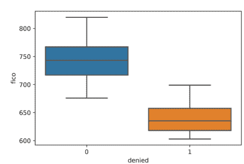

图 17.2：根据 FICO 分数被拒绝

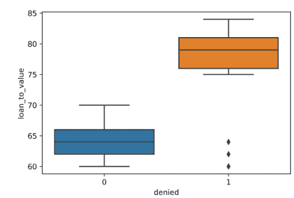

图 17.3：根据贷款价值比拒绝

模型风险

假设我们在核保模型 `$M_U$` 中使用的预测变量为

`$L_U = ['fico', 'loan_to_value', 'loan_term', 'nurse']$`

我们接下来将使用这些预测变量来构建模型，但首先：这些预测变量中应该使用哪些？变量 `fico` 和 `loan_to_value` 衡量信用状况和还款能力，因此它们应该被使用。变量 `loan_term` 是贷款属性，也应该被使用。正如之前讨论的，`nurse` 会引入歧视女性的风险，因此**不应**被使用。

现在让我们在合成数据上训练核保模型。

```python
# 构建护士指示变量
syn['nurse'] = syn.occupation.apply(lambda x: 1 if x == 'nurse' else 0)
```

```python
X = syn[['fico', 'loan_to_value', 'loan_term', 'nurse']]
```

```python
# 包含截距项
X = sm.add_constant(X)
```

```python
# 目标变量
y = syn['denied']
```

```python
# 训练逻辑回归模型
result_uw = sm.Logit(y, X).fit()
```

```python
print(result_uw.summary())
```

表 17.5：核保模型参数估计

| coef | std err | z | P >|z| | 0.05 | 0.075 |
|---|---|---|---|---|---|---|
| const | 11.088 | 0.057 | 0.002 | 0.999 | -9.52e+04 | 9.1e+04 |
| fico | -0.1400 | 0.057 | -2.455 | 0.014 | 0.252 | -0.028 |
| loan_to_value | 0.075 | 0.113 | 0.706 | 0.480 | -0.141 | 0.300 |
| loan_term | 0.4942 | 1552.666 | 0.000 | 1.000 | -3042.675 | 3043.664 |
| nurse | 2.7672 | 1.892 | 1.462 | 0.144 | -0.942 | 6.476 |

参数估计如表 17.5 所示。模型中唯一的显著预测变量是 `fico`，其 p 值小于 0.05 所示。-0.14 的负系数估计表明，较高的 FICO 分数与较低的拒绝概率相关，这是合理的。

# 本章总结

接下来，我们训练公平贷款模型 `$M_{FL}$` 以理解性别是否是一个显著的预测变量。模型将包含截距项、信用因素、贷款属性和性别。如果性别在 `$M_{FL}$` 中是一个显著预测变量，则说明它被用于做出贷款决策，这是一种歧视性行为。

```python
# 将分类性别转换为指示变量
syn['gender_female'] = syn.gender.apply(lambda x: 1 if x == 'f' else 0)
```

```python
X = syn[['fico', 'loan_to_value', 'loan_term', 'gender_female']]
X = sm.add_constant(X)
```

```python
y = syn['denied']
result_fl = sm.Logit(y, X).fit()
```

```python
print(result_fl.summary())
```

# 17.11 练习

带有答案的练习题标记有 `$\S$`。你可以在课程仓库的 `materials` 文件夹中找到答案：

https://github.com/PredictionNN/intro_data_science_course/

- 1. `$\S$` 你被要求验证一个线性回归模型。在检查模型的概念合理性时，你可能会验证哪些内容？
- 2. `$\S$` 你发现了一个强大的预测变量，它与目标变量的相关性为 1。你的下一步是什么？
- 3. `$\S$` 为什么基准模型（benchmark model）是重要的？
- 4. 你发现一个逻辑回归模型的预测性能优于冠军网络模型。在其他条件相同的情况下，你应该选择哪一个？
- 5. 一家科技初创公司开发了一个复杂的模型来预测欺诈。该初创公司认为 F1 分数是目标客户最重要的指标，通过测试，该模型的 F1 分数很高。假设 F1 分数是客户唯一的因素，他们可能会使用这个模型吗？解释你的答案。
- 6. `$\S$` 解释压力测试（stress testing）与敏感性分析（sensitivity analysis）有何不同
- 7. 一家对冲基金正在设计一组压力测试。选择所有可能这些测试。
   a) 标普指数下降 1%
   b) 标普指数下降 25%
   c) 小行星撞击公司总部
   d) 通胀飙升 10%
- 8. 你想对 Lasso 回归模型进行敏感性分析。列出你可以运行的一些敏感性测试。
- 9. `$\S$` 解释监控（monitoring）与可观测性（observability）之间的区别。提示：它们之间是否存在依赖关系？
- 10. 为什么为监控建立基准（baselines）很重要？
- 11. `$\S$` 你如何检测因子漂移（factor drift）？你如何缓解因子漂移？
- 12. 访问 http://huggingface.co/ 并查看一些模型的卡。一个很好的例子是 bert-base-uncased。记录任何你觉得有趣的内容。
- 13. 一位数据科学家在公司的生产服务器上发现了一个预测信用卡损失的模型。她的团队需要一个信用卡模型，于是她在没有阅读文档的情况下就开始使用它。这种行为最大的风险之一是什么？
- 14. 什么是红线政策（redlining）的做法？
- 15. 在做出贷款决策时，哪些变量是合理的？选择所有适用项。
   a) 薪水
   b) 信用评分
   c) 宗教
   d) 贷款目的
- 16. 一个公平贷款模型显示性别是一个显著的预测变量。这意味着什么？
- 17. 一位定量分析师构建了一个抵押贷款审批模型来决定谁应该获得贷款。解释贷款违约的最佳变量之一是邮政编码。从公平贷款的角度来看，这个变量是否有问题？为什么有或为什么没有？

# 18 下一步工作

恭喜你，你已经完成了本书的内容！你现在应该对数据科学领域、重要的数据素养主题以及如何实现数据科学流水线有了良好的理解。数据科学特别是机器学习，是广阔且发展迅速的。本章的意图是为下一步提供一些想法和建议。随着时间的推移，我们可以看到新的活动领域、应用和工具。

## 18.1 基础

为了给更高级的模型和应用做准备，有必要增加你在数学、统计、计算、数据分析和交流方面的技能。这一部分将像一份清单，我预先向此道歉。我不期望你能在一个月内建立所有这些技能；需要更长时间来完全吸收这些思想并具备应用它们的能力。某些主题可能适用于某些职位，当你看到职位启事或参加面试时，你就会知道这一点。

### 数学

我们对微积分的处理止于幂级数和积分演算。这些主题对于学习是至关重要的。对积分的理解将为更好地理解概率论中的连续随机变量提供基础。例如，连续随机变量的期望就是一个积分。

机器学习中的许多加载模型在概率方面有深层基础，因为它们模拟了受随机性影响的事件序列。随着时间的推移，你需要学习高级的概率概念和技术。我们学习了使用梯度下降来拟合机器学习模型的参数。一些更复杂的模型将使用更专门的优化技术，例如随机梯度下降。

有必要深入学习线性代数，以理解范数（norms）、对角化、特征值和特征向量、矩阵分解以及矩阵逆计算等课题。理解这些主题背后的概念非常重要，用软件实现也同样重要。

### 统计

我们触及了统计推断，但你的工作可能需要更专门的方法，包括额外的假设检验、非参数检验、分类数据分析、时间序列分析和贝叶斯推断。了解如何正确取样并避免偏差非常重要。一些数据科学家会发现自己正在设计实验来确定某种影响是否显著。这些主题涵盖在实验设计中。

### 计算机科学

数据科学家应该熟悉常见的数据结构和算法，并理解何时应用它们。良好理解时间复杂和空间复杂度将帮助你写出更好的算法。时间复杂度是运行算法所需的时间相对于输入长度的函数。算法的空间复杂度是消耗的内存相对于输入长度的函数。在比较两个算法时，复杂和空间越低的那个会更优。

我们简要地介绍了数据库和 SQL。精通 SQL 将非常有价值。我应该指出的是，大型科技公司非常喜欢 SQL。数据科学家使用 Python、R 或类似的语言进行编程至关重要。对于机器学习职位，需要很强的技能。

### 数据分析

与提高编码水平一样，提高数据分析需要大量的练习。像 Kaggle 这样的在线社区提供了完整的代码 Notebook。还有大量充满了代码的书籍。

### 交流

提高沟通技巧可以通过经常练习和寻求反馈来完成。这种练习可能来自会议、聚会、研讨会以及正式和非正式活动。观察一些优秀的演讲者并学习他们的习惯和表达方式。TED 演讲可以是很好的灵感来源。尝试获得向技术和非技术观众进行演示的机会。记录每个观众提的问题，以便未来做出更好的准备。

Lasso 回归中的惩罚项由两部分组成：参数估计绝对值的值的和（它对参数的大小进行惩罚），以及一个标量 `$\lambda$`，它用于控制惩罚项与残差平方和项之间的相对重要性。`$p$` 个参数的正则化项所示：

```
$$\lambda \sum_{j=1}^p |\beta_j|, \quad \lambda \ge 0$$
```

具有 `$p$` 个预测变量的 Lasso 回归的损失函数将这两项结合如下：

```
$SS_{res}(\beta) = \sum_{i=1}^n (y_i - \beta_0 + \beta_1 x_{i1} + \dots + \beta_p x_{ip})^2 + \lambda \sum_{j=1}^n |\beta_j|, \quad \lambda \ge 0$
```


第一项可以通过选择使预测变量接近响应 $y_i$ 的参数估计来最小化。同时，第二项增加了一个正值，该值随参数估计大小之和而增加。具体而言，增加任何系数 $|\beta_j|$ 都会增加惩罚。此外，增加 $\lambda$ 会增加损失函数的值。最终，最优参数估计必须在这两项之间取得平衡。

早些，我们遇到了参数，它们是模型配置中的重要数量。此外，它们值是预先知的。$\lambda$ 项是超参数的一个示例，通过 k 折验证估计其取值的常用方法。以下是可能步骤的轮廓：

- 1. 提供 $\lambda$ 的可能取值列表。我们可以从 10 开始，因为我们正处于数量级的右侧。这就是超参数网格。将此集合称为 $\Lambda$，我们可能会使用 $\Lambda = \{1 \times 10^{-4}, 1 \times 10^{-3}, \dots, 1 \times 10^3, 1 \times 10^5\}$。
- 2. 决定折数 $k$。
- 3. 留出部分数据集用于最终评估（测试集）。
- 4. 对于每个可能的 $\lambda_i \in \Lambda$，重复这些步骤：
  对于迭代 $1, \dots, k$，在 $k-1$ 折上训练模型，并在留出的折上评估如 MSE 等指标。每次迭代应留出不同的折。
  为了获得最终估计 $MSE_i$ 的平均 MSE。
- 5. 从对对 $(\lambda_i, MSE)$ 中选择 $MSE$ 值最低的 $\lambda_i$。这产生了最优值 $\lambda^*$。
- 6. 最终模型是正则值为 $\lambda^*$ 的版本。

为了获得更准确的 $\lambda^*$，在从原始课程网格观察到 MSE 后，可以在第一步中使用更精细的网格。现代软件库支持 Lasso 回归，以及流行的岭回归（Ridge regression）和弹性正则化。关于正则化的更多细节，你可以查阅 [4]。

## 18.3 高级机器学习模型

在加强构建组件的同时，我鼓励你探索并学习更多类别的模型。我们研究了回归模型是因为它们常见、具有可解释性且架构相对简单。对于某些数据集和用例，其他模型的表现会得更好。两类极其重要的模型类是*基于树的模型*和*人工神经网络*。接下来将提供简要概述，我建议参考其他来源以获取细节，如 [4] 和 [49]。后者提供了带有 Python 实现的应用处理。

### 18.3.1 基于树的模型

基于树的模型是从*决策树*的直观结构构建的。每棵树形成一个层次结构，根位于顶部，分支从根以及树中的每个节点向外延伸。对于由分支连接的一对节点，存在父子关系，父节点在树中的位置较高。树底部的终止节点是叶节点。这些叶节点代表有用的预测变量，而分支代表这些预测变量的条件（例如，如果*age<20*，则向左走）。如果一个预测变量能将观测目标值分离到增加*纯度*的组，那么它就是有用的，纯度由*熵*等指标定义。50/50 的分离将具有最高的熵（最低的纯度）。

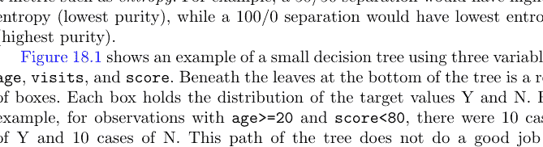

沿着相关路径。例如，一个年龄=19且访问次数=10的观测值将先向左走再向右走，得到预测 N。

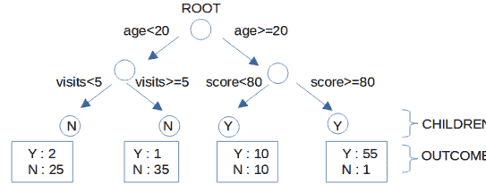

图 18.1：示例决策树

在训练数据上拟合决策树时，重要的考虑因素包括使用的预测变量、树的深度以及每个预测变量的切分点（例如，我们是在 age<20 时还是 age>21 时向左移动？）。决策树的一个主要缺点是它可能会过拟合训练数据。减少过拟合的一种有效技术是构建多个决策树，然后将结果聚合为预测。遵循这种方法的流行且有效的模型是随机森林 (RF) 和梯度提升树 (GBT)。GBT 的变体 XGB 非常高效，并赢得了许多数据科学竞赛。

RF 和 GBT 之间的区别在于，前者构建了一组独立的树，而后者构建了一个旨在纠正预测误差的小树序列。随机森林中的“随机性”反映了在构建每棵树时抽取数据的子集。在每棵树构建完成后，对其输出进行加权以产生预测。这种组合多个树的技术被称为集成方法。随机森林的一个主要优势是树的构建可以并行进行以加速处理。GBT 模型顺序构建树，因此无法并行。

从架构上看，基于树的模型不假设预测变量与目标之间存在线性关系。正如逻辑回归模型，有很多数据违反了线性假设。例如，预测变量与目标之间的关系可能表现出这种分段线性行为。

## 机器学习模型

```
$y = \begin{cases} 2x & x \le c \\ 3x & x > c \end{cases}$
```

在这种，当 $x$ 超过 $c$ 时斜率变得更陡。线性回归无法正确处理这种关系，但基于树的模型可以从数据中学习非线性模式。

回归模型需要用户确定最佳预测变量集。基于树模型会自动确定有用的预测变量。回归需要对缺失值进行插值。在某些基于树模型的实现中，缺失值被视为每个预测变量的一个独立类别。这样做，基于树模型是不需要插值的。

基于树模型引入的一个挑战是与线性和逻辑回归模型相比，其解释性较差。这主要是因为基于树的模型在做出预测时结合了多个树。虽然有专门的方法衡量这些模型的重要性，但它们仍然比回归模型中的参数估计更难以理解。

因此，一个节点就可以提供正类别的概率 $p$，负类别的概率将是 $1-p$。

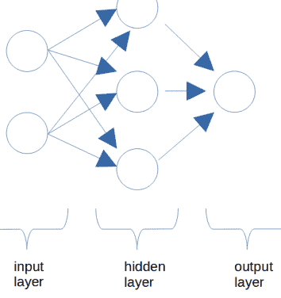

图 18.2: 示例神经网络

神经网络使用的计算策略是对节点层中的值应用一组权重，并加上偏置项 $b$；偏置项的作用与回归中的截距项相同。结果是一个这样的表达式：$b_i + w_1x_1 + \dots + w_nx_n$。这个表达式可能会让你想起回归中预测变量的线性组合。区别仅在于符号表示，尽管 $\hat{y}_i$ 的作用与回归非常不同，但对该表达式应用了非线性*激活*函数。有几种常用的激活函数，其目的是目的是赋予模型灵活性，以捕捉输入与目标之间的非线性关系。在输入经过加权、通过偏置项调整并通过激活函数后，中间量可能会经过这些步骤一次或多次。这是函数的复合，网络中的每一层都使用不同的权重和偏置集合。为了组织计算，权重存储在矩阵 $\mathbf{W}$ 中，偏置存储在向量 $\mathbf{b}$ 中。由于参数数量的增加、有用激活函数以及许多其他特征，神经网络可以拟合数据中极其丰富、复杂的模式。

学习神经网络所需的数学知识大多是你已经掌握的。将输入推过模型并获得预测的*前向*阶段使用了算术算符、矩阵代数和函数复合。更复杂的部分是优化权重和偏置，使预测值接近目标值。优化使用损失函数和梯度下降的变体（最常见）。为了决定参数应如何变化，需要计算损失函数对每个参数的偏导数。大部分复杂性源于架构中的层：必须在复合函数上计算一序列的导数。当你回想起要计算复合函数的导数时，可以使用链式法则。链式法则结合矩阵代数对于优化网络层的参数至关重要。实现这些计算的突破被称为反向传播。当你学习神经网络时，我强烈建议你花时间理解反向传播是如何运作的，因为这是拟合神经网络的基础。

所描述的模型是全连接神经网络，因为每个节点都连接到下一层中的每个节点。在计算机视觉等领域，领先节点使用的是非全连接网络。具体来说，连接可能被放置在相邻的位置或时间点。这些架构显著减少了连接数量，从而减少了计算。例如，用于检测物体的计算机视觉模型可能不需要从图像到另一个角落的像素信息。这些模型还包含了其他改进，以提高性能并适应不同形状的输入。然而，你已经学习了深入研究神经网络所需的许多概念。

## 18.4 其他语言

Python 和 SQL 会带你走远。我鼓励你精通这两种语言。数据科学的另一种流行语言是 R，它根于统计计算，提供了大量的先进模型和精美的图表。你可能会发现，为了某个项目或工作你需要学习 R 或另一种语言。

保持灵活性并学习新工具对你的职业有所帮助。在消化编程语言的重要概念后，学习额外的语言会变得更容易。

如果你需要处理超过机器内存的海量数据集，Python 和 R 将是不够的。大数据计算最流行的编程语言是 Spark。Spark 的优点非常多：它是开源的，提供包括 R 和 Python 在内的多种语言 API，可以轻松将数据和代码分发到计算机集群，并支持各种任务。特别是，Spark 拥有模块

> 在分布式计算范式中，数据被切分并发送到每个工作节点。完成的工作可以收集回一个名为驱动程序（driver）的单机上。

支持分析、SQL、机器学习、图处理，并将结果向下发送到处理。它可以摄各种格式和仪表板。Spark 是如此有用，以至于我在弗吉尼亚大学和加州大学圣塔芭拉分校围绕它开发了大数据课程。你可以在这里找到 UVA 的大数据系统课程：https://github.com/UVADS/ds5110。学习 Spark 的一本优秀书籍是 [50]。


## 18.5 资源

### 证书和学位课程

除了书中的教科书外，还有其他地方可以学习数据科学。来自包括 Coursera、Udemy、Udacity 和 Codecademy 在内的供应商提供了大量的在线课程。YouTube 上也有几门免费课程。我在数据科学职业中发现的一门特别有价值的课程是吴达恩教授的斯坦福 CS229 机器学习课程。这门课程对许多本质模型和技术进行了详细的数学处理。

一些公司提供训练营、证书课程和学位课程。有几个在线硕士项目，例如我在 UVA 数据科学学院任教时所属的那个项目。在决定投入大量资源时，最好了解成本、课程内容、支持、人脉机会和职场退出机会。

### 云计算

云计算有许多免费和低成本的资源。AWS 提供了免费层来尝试他们的服务：AWS 免费层级：https://aws.amazon.com/free/。

他们的端到端机器学习服务 Amazon SageMaker 包含一个在浏览器中运行的免费笔记本环境：SageMaker Studio Lab：https://studiolab.sagemaker.aws/。

Google Colab 是在浏览器中计算的另一个免费选项。用户可以访问 CPU 和 GPU。笔记本保存在 Google Drive 中以便于共享。可以在此处访问 Colab：https://colab.research.google.com/。

补全三大云提供商，微软还提供了对其某些服务的免费访问。某些服务始终免费的，而其他服务在前 12 个月内免费。你可以在此处浏览服务：https://azure.microsoft.com/en-us/pricing/free-services/。对于这些服务，最好提前确认定价结构。

### 社区

Kaggle 是数据科学和机器学习学生及从业者的在线社区。加入并使用其资源是免费的。Kaggle 举办竞赛、项目、数据集和笔记本。这可以是开发技能的好方法。我的许多学生在 Kaggle 上找到有趣的数据集并用于小组项目。

还有许多在线数据科学竞赛网站（我还没有尝试过），例如 DrivenData、Devpost 和 Numerai。

## 18.6 应用

数据科学和机器学习的应用范围之大令人震惊。如果你命名一个问题，可能有一个相应的模型，或者有创建模型的机会。下面，我提供了几个活跃的广泛且令人兴奋的领域。深度学习是这些领域的主流方法。

## 推荐

我们在整书中都遇到过推荐系统的元素。提到这个话题，首先想到的可能是 Netflix 或 Amazon 的推荐，但这仅仅是一个开始。在最广义的，只要有可能感兴趣的产品或服务，推荐系统就是用的。随着产品目录的增长，寻找相关材料变得越来越困难。教育技术公司希望让老师更容易找到有帮助的教学计划。政府实体希望帮助公民找到相关文件。深入学习推荐的一本优秀书籍是 [51]。

# 计算机视觉

计算机视觉被用于检测图像和视频中的感兴趣对象。这些模型可以提供发现的项目列表、它们的位置以及相关属性。例如，模型可能会指出照片中有一个成年人和一个孩子，成年人戴着眼镜，而孩子闭着眼睛。模型可能会将考试中出现的意外人员标记为潜在作弊的迹象。交通信号灯可能会计算公交车交汇处的车辆数量，以帮助缓解拥堵并提高安全性。这项技术的应用前景是巨大的。提取的信息可以作为元数据和标签与底层数据一起存储。富化后的数据集可用于改进搜索和推荐。

# 自然语言处理与理解

最早的语言模型之一是“词袋模型”，它通过统计文档中每个单词的次数来提供关于文档的信息。一篇包含多次“足球”一词的文章可能被归类为体育类文章。为了更稳健地理解文本，需要结合每个词的语境。语言模型面临的挑战之一是理解文本中距离较远的词或短语之间的关系。例如，考虑以下：

> “Jacqui喜欢访问巴塞罗那。她喜欢弗拉明戈吉他手在街头演奏的样子。昨天，当我问她明年夏天想做什么时，她提到了她多么想回到那里。”

如果我们要求词袋模型识别“那里（there）”的意思，它将无法将其与巴塞罗那联系起来。

更高级的模型通过被称为“嵌入（embeddings）”的对象建立对上下文的理解。几十年的工作促成了由处理模块堆叠而成的先进Transformer模型。目前领先的模型使用了数百亿个参数，可以完成多种语言任务，包括语言翻译、文本摘要和感兴趣实体的检测。

# 语音识别

语音转文本识别服务支持将口语识别并翻译成文本。如 Siri和Alexa等个人助手可以识别用户的声音，处理语音并提供个性化的响应。语音识别背后的技术是处理文本序列的深度学习模型。挑战包括对各种口音和方言的理解。

# 蛋白质折叠

几十到数百个氨基酸链决定了人体蛋白质复杂的3维形状。形状决定了蛋白质的功能，对这种形状的了解可以帮助研究人员设计有效的药物 [52]。氨基酸的数量及其可能的相互作用产生了一个巨大的组合问题，自20世纪60年代以来一直困扰着科学家们。2021年，DeepMind交付了一个名为AlphaFold的模型。它使用一个在数据仓库上训练的深度学习模型来预测蛋白质的3维形状。2022年，该团队向科学界发布了几乎所有目录中蛋白质的结构预测。

# 生成式AI

前提到的Transformer模型是深度学习模型的基础，这些模型可以接收用户的提示（prompt）并生成完全全新的内容，包括文本、代码和图像。Stable Diffusion模型可以根据文本描述创建详细图像。GPT-4模型可以接受输入并产生文本输出。ChatGPT是一个强大的聊天机器人，它凭借对用户提示的流畅回答而席靡全球。生成式AI的应用非常广泛，包括起草文档、总结内容、开发代码以及提供教育辅助。

正像突破性技术一样，生成式AI为加速工作提供了一个强有力的工具。同时，目前的模型仍存在需要解决的缺点。训练数据可能包含偏见或毒性内容，这些内容可能会被模型传播。如果模型没有足够的信息来回答问题，它可能会产生*幻觉*或伪造错误的响应。包括数据科学家在内的人类审核员可以帮助改进这些模型，使它们更安全、更有用。

# 18.7 结语

我希望这一章为你接下来的方向提供了一些好点，并激发了对该领域发展方向的兴奋。最后，我诚地希望你喜欢阅读这本书，就像我喜欢写下它一样。请随时在LinkedIn上与我联系，并附上说明你读过这本书的笔记。

```
https://www.linkedin.com/in/adam-tashman-93a8272
```

你可以通过以下网址了解我的公司PredictioNN，并浏览数据科学资源：

```
http://prediction-n.com/
```


PredictioNN网站包含了数据科学课程链接、本书的辅助材料以及其他学习数据科学资源。

# 参考文献

[1] 我们每天产生多少数据？每个人应该阅读的惊人统计。https://tinyurl.com/2s35wxd4. 访问于2022-11-28。

[2] 回归均值。https://en.wikipedia.org/wiki/Regression_toward_the_mean. 访问于2022-11-28。

[3] 机器学习视角。https://tinyurl.com/2p8wb69. 访问于2022-11-28。

[4] Trevor Hastie, Robert Tibshirani, Jerome H Friedman, and Jerome H Friedman. 统计学习方法：数据挖掘、推理和预测（第2版）., 2009.

[5] Kerry Patterson, Joseph Greenny, Ron McMillan, and Al Switzler. 压力环境下的对话工具. McGraw-Hill Education, 2012.

[28] Joseph K Blitzstein and Jessica Hwang. 概率论入门. CRC Press, 2019.

[29] Stefan Friedberg, Arnold Insel, and Lawrence Spence. 线性代数，第4卷. Prentice Hall, 2002.

[30] George W Snuedor and William G Cochran. 统计方法. Iowa State University Press, 1989.

[31] Richard Wesley Hamming. 数字滤波器. Courier Corporation, 1998.

[32] seaborn 简介. https://seaborn.pydata.org/tutorial/introduction.html. 访问日期: 2023-02-01.

[33] matplotlib 入门. https://matplotlib.org/stable/users/getting_started. 访问日期: 2023-02-01.

[34] John F Hellriell, R Layard, and J Sachs. 世界幸福2018. Sustainable Development Network New York, 2018.

[35] Edward R Tufte. 量化信息的视觉显示，第2卷. 半监督学习. 马萨诸塞州剑桥: MIT出版社, 2006.

[36] Olivier Chapel, Bernhard Scholkopf, and Alexander Zien. 强化学习，第二版：绪论. MIT出版社, 2018.

[37] Richard S Sutton and Andrew G Barto. 强化学习，第二版：绪论. MIT出版社, 2018.

[38] Vladimir N Vapnik. 统计学习理论. Wiley, 1998.

[39] Norman R Draper and Harry Smith. 应用回归分析，第326卷. John Wiley & Sons, 1998.

[40] Douglas C Montgomery, Elizabeth A Peck, and G Geoffrey Weiner. 回归分析简介. John Wiley & Sons, 2021.

[41] Kelley Pace and Ronald Barry. 稀疏自回归，第33卷. EConPapers, 1997.

[42] Kaare Brandt Petersen, Michael Skyseld Pedersen, 等人. 矩阵食谱. 丹麦理工大学, 7(15):510, 2008.

[43] Matjaz Zwitter and Milan Siklic. 乳腺癌. UCI 机器学习库, 1988. DOI: https://doi.org/10.24432/C51iP4M.

[44] CI/CD 概念. https://docs.gitlab.com/ee/ci/introduction/. 访问日期: 2023-07-19.

- [45] 数据科学中的 Docker：简介. https://www.datacamp.com/tutorial/docker-for-data-science-introduction. 访问日期: 2023-07-19.
- [46] Cathy O'Neil. 毁灭性武器：大数据如何加剧不平等并威胁民主. Crown, 2017.
- [47] 这种土日预报与气候历史. https://www.ncei.noaa.gov/news/groundhog-day-forecasts-and-climate-history. 访问日期: 2023-02-01.
- [48] Amazon Sagemaker Clarify. https://aws.amazon.com/sagemaker/clarify/. 访问日期: 2023-04-19.
- [49] Sebastian Raschka. Python 机器学习. Packt publishing ltd, 2015.
- [50] Jules S Damji, Brooke Wenig, Tathagata Das, and Denny Lee. 学习 Spark. O'Reilly Media, Inc., 2020.
- [51] Kim Falk. 实用型推荐系统. Simon and Schuster, 2019.
- [52] 游戏规则了。AI 在解决蛋白质结构方面取得胜利. https://tinyurl.com/99cwkyr4. 访问日期: 2023-04-05.

# 索引

`abs()`, 234
`accuracy`, 239, 287
动作速度, 227
`add_constant()`, 283
`agg()`, 304
算法, 1
分析
  双变量, 200
  单变量, 204
分析框架, 26
API, 25, 39
  REST, 40
`apply()`, 49
`argmax()`, 303
人工神经网络, 351
资产配置, 213
`astype()`, 100
反向传播, 355
基准测试, 327
词袋, 358
基线, 334
Beautiful Sum 模块, 39
基准测试, 328
偏差, 49
  选择, 49
二值化, 191
`Binarizer()`, 192
阻塞器, 16
布尔, 34, 99
`boxlet`, 167
商业智能, 123
基数, 127
中心极限定理, 154
中心趋势, 166
冠军模型, 328
ChatGPT, 359
检查点, 70
分块, 56 evenclass, 224
  负向, 224
  正向, 298
`classification_report()`, 286
时钟频率, 56
克隆, 64
云计算, 72
聚类, 292
  邻近, 299
  凝聚力, 298
协同过滤, 27
命令行接口, 61
`commit`, 78
复合键, 108
计算机视觉, 355
概念合理性, 324
置信区间, 176
混杂, 212
混淆矩阵, 240
基于消费的定价, 73
容器, 313
连续性, 138
收敛, 135
`corr()`, 209
相关性, 209
  样本, 170
  计数, 224
`CountVectorizer()`, 188
协方差
  总体, 169
  样本, 169
CPU, 55
关键点, 141
临值, 176
  cron, 37
  作业, 37
`crosstab()`, 203
CRUD 操作, 105
累积分布函数, 149
`cursor()`, 113
`data`, 33
  批次, 38
  类别, 34
  连续, 35
  离散, 35
  分布, 166
  摄入, 37
  集成, 42
  序数, 34
  来源, 29
  定性, 34
  定量, 34
  原始, 43
  半结构化, 46
  结构化, 46
  表格, 91
  非结构化, 46
  速度, 38
  卷, 38
数据字典, 326
数据湖, 123
数据仓库, 124
数据泄漏, 231
数据科学, 1
数据划分, 231
数据沼泽, 124
数据数据库, 105
连接, 113
`curs`, 113
  非关系, 105
SQL, 105
  关系, 105
表格, 126
`dataframe`
  追加列, 95
  提取属性, 92
  保存, 97
  排序, 36
决策树, 351
深度学习, 353
深度神经网络, 353
  自由度, 173
导数, 129
  链式法则, 144
  高阶, 142
  偏导, 145
  幂法则, 143
  乘法法则, 143
  除法法则, 144
`describe()`, 98
描述性统计, 165
设计矩阵, 251
微分, 88
可微性, 140
离散化, 192
差异对待, 337
分布, 166
(同上)
伯努利, 150
二项分布, 150
  正态, 151
  标准正态, 151
Student's, 173
  均匀, 150
容器, 313
图像, 313
领域, 129
驱动, 57
硬盘, 57
固态, 57
ELT, 42
嵌入, 358
经验风险, 233
空集, 127
实体消解, 44
`enumerate()`, 89
环境, 81
误差, 234
绝对, 234
  胖, 181
  均值, 234
  均值, 171
均方, 233
测量, 181
根方, 233
(同上)
类内, 294
激活, 35
代数, 133
凸, 132
复合, 130
指数, 133
逆, 131
倒置, 132
期望, 131
频率, 165
计数, 227
格式, 234
CSV, 81
频繁, 217
`float`, 89
`for`, 63
循环, 64
外键, 109
`fork`, 64
生成式 AI, 359
`feature_names`, 189
特征存储, 227
前馈, 354
`fill()`, 99
五数摘要, 167
拟, 257
拟合方程, 249
拟, 249
假数据, 215
假阴性, 240
假阳性, 240
特征, 115
`info()`, 200
填充, 99
冒充者, 10
不可变, 84
指示变量, 190
推理, 25
推断统计, 170
期望, 232
L1, 234
内积, 156
L2, 233
`isnull()`, 98
平方误差, 235
混杂变量, 212
`join`
  内, 118
`markdown`, 70
左, 118
左, 118
`matplotlib` 模块, 205, 261, 300
外, 118
矩阵, 154
右, 118
对角线, 158
联合图, 204
恒等, 158
JSON, 254
逆, 159
跳间间点, 138
对称, 158
JupyterLab, 69
零, 159
k折交叉验证, 238
k-均值, 225, 293
总体, 167
键值对, 47
样本, 167
`keys()`, 254
`mean()`, 182
`labels`, 224
`median`, 166, 213
最后值向前填充, 99
`metadata`, 49

- `MinMaxScaler()`, 187
- 运维, 332
- 模式, 166
- 预测, 332
- 模型卡片, 323
- 性能监控计划, 332
- 模型开发文档, 322
- 模型风险, 321
- 个人身份信息, 45
- 主板板, 57
- 移动平均, 182
- 流水线数据, 3
- 数据科学, 376
- 自然语言处理, 4, 358
- 点估计, 176
- 自然对数, 136
- 可携的, 59
- 正规方程, 268
- 正向意图, 17
- 归一化, 187
- 精率, 241, 282
- NumPy
    - 数组, 92, 255
    - 模块, 152, 186, 187, 233, 258, 201, 338
- `predict_proba()`, 282
- 预测因子, 2
- 定价决策, 336
- 主键, 107
- `print()`, 85
- 可观测性, 334
- 概率, 146
- 几率, 272
- 条件, 144
- 独热编码, 189
- 概率密度函数, 149
- 单样本 t 检验, 174
- 概率质分布函数, 148
- 单样本均值检验, 172
- 概率阈值, 286
- 问题
    - 一对一, 131
    - 二分类, 224
    - 持续模型性能监控, 327
    - 多类分类, 224
    - 回归, 224
    - `open()`, 86
- 处理
    - 操作系统, 57
    - 批处理, 38
    - 极优选择, 227
    - 流, 39
    - 数量级, 184
    - 处理器核心, 56
    - `os` 模块, 83
    - 优势列表, 221
    - 样本外测试, 327
    - 受保护类别, 336
    - 时间外测试, 327
    - 蛋白质折叠, 358
    - 结果分析, 327
- Python 模块, 58
- 过拟合, 229
- p 值, 171
- `qcut()`, 192
- Pandas, 72
    - `pandas` 模块, 91, 182, 205, 253, 281, 300, 338
- 查询, 109
- 路径
- R 方方, 239, 263
    - 调整后的, 239, 263
    - 绝对, 59
    - `r2score()`, 261
    - 相对, 59
- 内存 (RAM), 566
- 性能, 366
- 索引
- 随机森林, 352
- 随机变量
    - 连续, 147
    - 离散, 147
    - `random.normal()`, 192
- 范围, 129, 167
- 四分位距, 167
- 关系型数据库系统 (RDBMS), 109
- `re` 模块, 300
- `read()`, 85, 86
- `read.csv()`, 91, 281, 300, 338
- 真实值, 241, 282
- 回召率(), 26
- 引用完整性, 109
- 回归
    - 线性, 247
    - 逻辑, 271
    - 多元线性, 249
    - 普通最小二乘法, 249
    - 简单线性, 249
- 正则表达式, 300
- 正则化, 349
- `requests` 模块, 40
- 响应时间, 25, 332
- 风险, 232
- 稳健统计量, 183, 233
- `rolling()`, 182
- `round()`, 174
- Sas, 273
- 样本空间, 146
- 采样分布, 171
- 采样误差, 2, 50
- 锯齿模式, 193
- 标量, 155
- 散点图, 204
- 模式, 105
- `scipy` 模块, 174, 183
- 评分, 226
- `seaborn` 模块, 205, 261, 300
- 种子, 153
- 敏感性分析, 329
- 序列, 137
- 集合, 90
    - 补集, 128
    - 差, 128
    - 留存, 230
    - 交集, 128
    - 数学的, 127
    - 测试, 230
    - 训练, 230
    - 并集, 128
    - 全集, 128
    - 验证, 230
    - 集合构建器, 127
    - `set()`, 90
    - 壳, 61
    - 显示(), 206
    - 显著性水平, 171
    - 轮廓系数, 298
- `sklearn` 模块, 186, 187, 253, 300, 338
- 软件, 57
- `sort()`, 192
- `values()`, 96
- 语音识别, 358
- `split()`, 86
- 分割-应用-合并, 116
- 传播, 167
- SQL, 110
- SQLite, 110
- `sqlite3` 模块, 112
- `sqrt()`, 174
- 阶段, 78
- 标准差, 167
- 总体, 169
- 样本, 169
- 标准误差, 172
- 标准化, 151
- `StandardScaler()`, 186, 256, 302
- 状态空间, 227
- 统计量, 165
- `statsmodels` 模型, 338
- `statsmodels`, 260
- `statsmodels` 模块, 283
- 压力测试, 331
- 字符串, 34
- 子集, 87
- 属性, 127
- 确定的, 127
- `summary()`, 283, 340
- 支持, 287
- 系统
    - 决定的, 249
    - 欠定的, 249
- t 统计量, 175
- 切线, 139
- 目标变量, 2
- 终端, 55
- 统计量, 170
- 阈值化, 97
- `to_csv()`, 189
- `toarray()`
- `train.test_split()`, 256
- Transformer器, 358
- 树结构模型, 351
- `trim.mean()`, 184
- 修剪, 183
- 真负例, 240
- 真例, 239
- 元组, 46
- 双侧检验, 172
- 二向分类表, 203
- I 类错误, 171
- II 类错误, 171
- 不可数的, 224
- 承销决策, 336
- `unique()`, 99
- 单位圆, 134
- 单位测试, 310
- `unittest`, 311
- 运行时, 25
- `value_counts()`, 201
- 变量, 83
- 随机, 146
- 方差, 151, 167
- 总体, 169
- 样本, 169
- 向量, 146
- 列, 155
- 行, 155
- 零, 159
- 向量化, 136
- 版本控制, 63
- 版本控制, 310
- 垂直线, 129
- 网络爬虫, 41
- 维基百科模块, 41
- `winorize()`, 183
- 修剪, 183
- 单词大小, 56
- 工作目录, 59
- XGBoost, 352
- z 评分, 151, 186
- 区域
- 精炼的, 45
- 信任的, 44
