# 从数据到发现：金属有机框架中机器学习的最新趋势

在线阅读

ACCESS | 指标与更多 | 文章推荐

**ABSTRACT:** 以其高孔隙率和结构多样性而闻名，金属有机框架（MOFs）是一类适用于广泛应用的有前景的材料。近几十年来，随着大规模数据库的发展，MOF 社区见证了数据驱动机器学习方法带来的创新，这些方法加深了对 MOFs 化学本质的理解，并推动了新型结构的发展。值得注意的是，随着新方法、架构和数据表示的积极研究，机器学习持续快速发展，其在材料发现中的实施也积极推进。在这种情况下，密切关注近期研究趋势并识别正在引入的技术非常重要。在本述评中，我们重点关注 MOF 领域机器学习的出现趋势、它们面临的挑战以及其发展的未来方向。

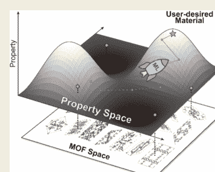

**KEYWORDS:** 机器学习，金属有机框架，数据驱动，回归模型，生成模型，机器学习势，数据挖掘，自主实验室

## 1. 引言

金属有机框架（MOFs）由金属离子/簇和有机连接体的有序网络组成，近几十年来已成为一类创新的晶体材料。鉴于其宽敞的孔隙和化学多功能性，MOFs 在广泛的应用中受到关注，包括气体储存、1–4 催化、5–7 传感器、8,9 和药物递送。10,11 特别是源于其构建单元无数组合而产生的高结构多样性，是 MOFs 最显著的特征。12,13 已鉴定出具有独特结构和新颖功能的大量 MOFs，实验报道的结构数量超过 100,000 个。14,15 此外，MOFs 相对简单的合成基元使其能够在计算机中生成，提供无限数量的假设结构。如此高的结构多样性和庞大的搜索空间不断推动 MOFs 的应用边界进入未探索的领域。13

矛盾的是，高结构多样性赋予 MOFs 无限潜力，同时也给确定特定应用的最佳结构带来挑战。虽然实验上检查大量结构存在明显局限，但分子模拟提供了可行的替代方案。包括密度泛函理论（DFT）计算、巨正则蒙特卡洛（GCMC）模拟和分子动力学（MD）模拟在内的各种模拟类型在此背景下被积极使用。尽管模拟包含一定误差，但它们能够更快地评估结构，从而促进新型 MOFs 的发现。然而，在 MOFs 庞大的材料空间中采用分子模拟仍面临若干局限。即使与实验评估相比分子模拟相对较快，对数据库中每个结构进行评估（即所谓的 高通量筛选16,17）也是低效的或通常不可行的。13 更重要的是，解释大量模拟数据并非易事，因此需要有效的方法来分析积累的数据并从中提取有意义的信息。

以机器学习为代表的数据驱动方法已成为材料设计中不可或缺的工具，能够成功解决上述挑战。通过有效捕捉大量数据中的固有模式，机器学习模型成功揭示了各种结构-性能关系，为材料化学提供了全面理解。18 这些方法提供的化学见解已被积极用于规划未来实验或设计具有所需特性的新材料。19–22 材料设计中的另一个最新趋势是采用深度生成模型，该模型直接生成化学结构作为输出，且其搜索空间不受训练数据库的限制。23,24 此外，诸如机器学习势（MLPs）25,26 或不同领域之间的知识迁移27 等近期出现的方法引起了极大兴趣，它们在材料科学各个领域的整合现在令人鼓舞。在本述评中，我们概述了材料科学中机器学习方法的最新趋势和未来方向，特别关注 MOFs（见图 1）。

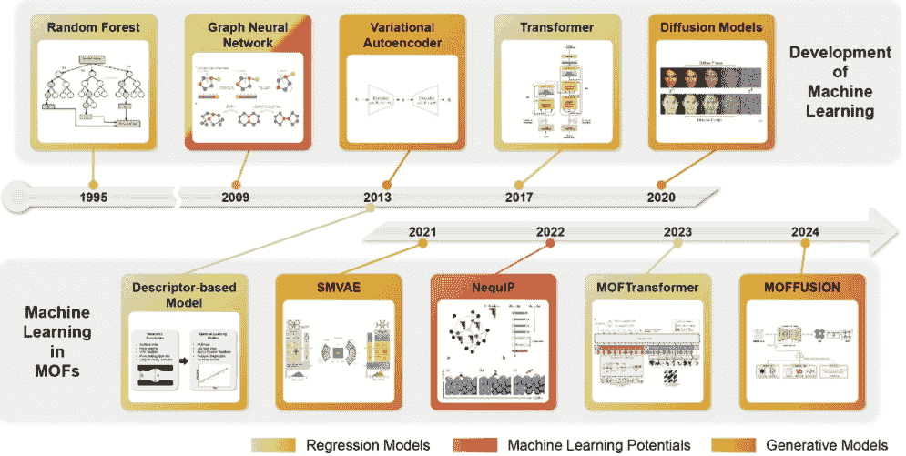

**Figure 1.** 机器学习的发展及其在 MOFs 中的应用。显著的机器学习架构或方法及其在 MOFs 中的代表性意义按时间顺序呈现。与回归模型、机器学习势和生成模型相关的元素分别用黄色、红色和橙色着色。图神经网络作为一类基础的人工神经网络，同时用黄色和红色着色，因为它在开发各种机器学习模型（包括回归模型和机器学习势）中被积极使用。经许可转载自参考文献 28–36，版权和许可如下。版权 2019 Springer Nature（ref 28）。版权 2024 Springer Nature（ref 29）。版权 2021 Springer Nature（ref 30）。版权 2021 Springer Nature（ref 31），许可采用 CC BY 4.0（ref 32）。版权 2021 Springer Nature（ref 33）。版权 2022 Springer Nature（ref 34）。版权 2023 Springer Nature（ref 35），许可采用 CC BY-NC（ref 36）。

## 2. 结构-性能关系与回归模型

### 2.1. 结构-性能关系的重要性

阐明结构特征如何影响材料的微观/宏观性质（即所谓的 结构-性能关系）是材料科学领域的主要任务之一。37,38 基于这些关系提供的化学直觉，研究人员建立设计原则，从而能够构建具有针对目标性能所需特性的材料。此外，阐明结构-性能关系可提供材料行为背后机制的见解，从而可能导致超越现有知识的新现象的发现。

在机器学习技术出现之前，材料科学中结构-性能关系的阐明很大程度上依赖于实验表征和理论建模。研究人员通常会假设材料内部原子或分子排列与宏观目标性质之间的关系，然后通过大量实验和/或理论分析验证这些假设。然而，机器学习方法的快速发展和广泛采用为分析大量数据中的复杂关系提供了强大的工具。在各种算法和架构的帮助下，揭示结构-性能关系的过程在过去几十年中变得更加系统和高效。具体而言，回归模型39 是一种用于理解和量化一个或多个自变量与因变量之间关系的统计方法，在此目的中被广泛使用。

由于材料空间庞大且结构复杂，MOFs 的结构-性能关系通常复杂且不直接。因此，与其他材料领域相比，阐明 MOFs 的结构-性能关系可能更具挑战性，这也是利用先进数据驱动方法变得更加重要的原因。在本节中，我们重点关注使用回归模型对 MOFs 的研究。我们首先简要总结迄今为止 MOFs 性能预测是如何进行的，并特别关注最近利用 Transformer 架构进行准确性能预测的尝试。

### 2.2. 传统机器学习方法

就预测材料性能的数据驱动方法而言，输入表示对于确定模型的整体性能至关重要。早期针对 MOFs 的机器学习方法侧重于使用

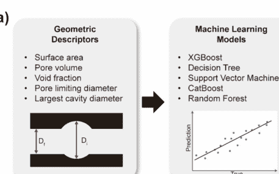

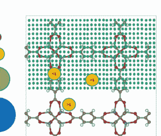

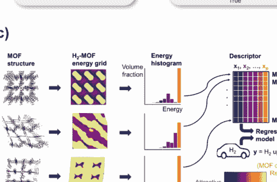

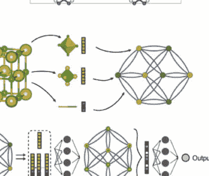

图2. MOF中的各种机器学习模型。(a) 使用几何描述符的传统机器学习方案。(b) 用于计算平均玻尔兹曼因子的能量面示例，显示不同探针原子与骨架相互作用。经参考文献44许可转载。版权所有2019年美国化学学会。(c) 使用能量网格直方图预测H2工作容量的模型。经英国皇家化学学会许可，引自参考文献45。(d) CGCNN概述，将原子表示为图节点，键表示为图的边，并使用卷积神经网络预测性质。经参考文献50许可转载图片。版权所有2018年美国物理学会。

几何描述符是将MOF转化为机器可解释向量的最简单方式。这些描述符通常使用传统机器学习模型（如支持向量机（SVM）40、XGBoost41和随机森林42）进行处理（图2a）。例如，Fernandez等人43利用孔隙率和体积表面积等几何描述符，建立了MOF中CH4吸附量的定量结构-性质关系（QSPR）。

随后，机器学习模型在MOF中的进展涉及考虑依赖经验直觉的其他相关化学描述符。Fanourgakis等人44使用源自势能面的描述符进行CH4吸附预测（图2b）。他们通过考虑不同探针原子与骨架的相互作用计算平均玻尔兹曼因子，并观察到准确性的显著提升。Bucior等人45使用能量网格直方图预测MOF的H2工作容量（图2c）。这里的能量网格表示每个网格点上探针气体与MOF之间的Lennard-Jones势能和库仑势能。使用最小绝对收缩和选择算子（LASSO）模型，他们实现了高精度（R2得分为0.96），并成功识别出51个H2工作容量大于45 g L−1的有前景的MOF候选材料。这些尝试凸显了选择合适且创新的描述符对于提升机器学习模型识别高性能MOF的预测能力的重要性。除上述工作外，还有大量研究利用固有描述符进行MOF性质预测。46–48

近年来，图神经网络（GNN）49已成为包括无机化合物和类药分子在内的多种材料领域中使用最广泛的输入抽象之一。通过将原子表示为节点、键表示为边，图表示可以有效捕获局部原子环境和远程结构信息。这些模型也已扩展到周期性（即晶体）材料，其中晶体图卷积神经网络（CGCNN）50是最具代表性的例子，成功解决了周期性边界条件问题（图2d）。为此，Rosen等人51构建了`QMOF`数据库，包含超过20,000个在DFT水平上计算的MOF带隙数据，`CGCNN`模型在预测这些结构的带隙时取得了R2得分为0.876的成绩。在后续工作中，52他们使用另一种基于GNN的预测模型——材料图网络（`MEGNET`）53，实现了更高的性能。近期，Shoghi等人54基于`GemNet-OC`55应用了联合多域预训练方法（`JMP`），在预测MOF带隙方面取得了最先进的性能。这些进展表明，使用GNN模型通过有效捕获结构内的复杂相互作用，能够显著提高MOF性质的预测准确性。

### 2.3. 基于Transformer的回归模型

近来，基于Transformer的机器学习模型的实施推动了材料性质预测的发展。35,56–58 Transformer主要在自然语言处理中研究，以利用注意力机制高效处理序列数据而闻名。59其大量的超参数提供了巨大的潜力和多功能性，促进了它们在计算机视觉和音频处理等领域的广泛应用。

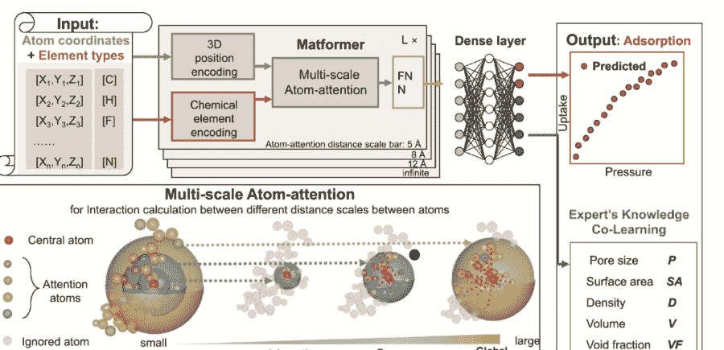

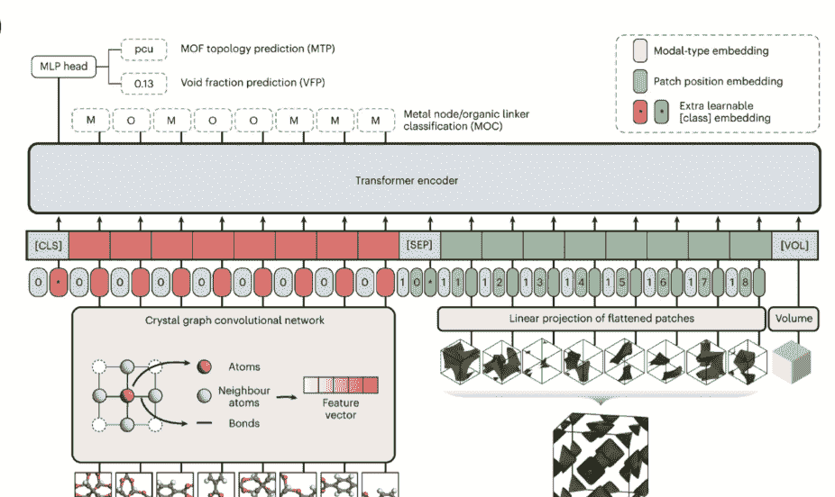

图3. 使用Transformer的MOF性质预测模型示例。(a) DeepSorption模型概述，将原子坐标和元素类型输入Transformer，与吸附专家知识共同学习。转载自参考文献57。版权2023作者。(b) MOFTransformer架构，在Transformer中同时考虑两种不同类型的输入（局部特征：原子图，全局特征：能量网格）。该模型在100万个虚拟MOF上预训练，并微调以预测所需性质。经参考文献35许可转载。版权2023 Springer Nature。

基于这种巨大潜力，使用基于Transformer的模型进行MOF性质预测的研究激增，利用了它们捕获数据中复杂关系的能力。对于MOF，Cao等人58开发的`MOFormer`以MOF的上下文表示作为输入，并通过自监督学习预训练Transformer和`CGCNN`。预训练模型针对带隙和气体吸附进行了微调，比化学计量-12060和使用修正自相关描述符（RACs61）等模型（这些描述符是启发式原子性质之间的离散相关性）的准确率高出多达48%。在`DeepSorption`中，Cui等人57开发了一个以原子坐标和原子类型为输入的Transformer模型（图3a）。该模型考虑了全局结构和局部

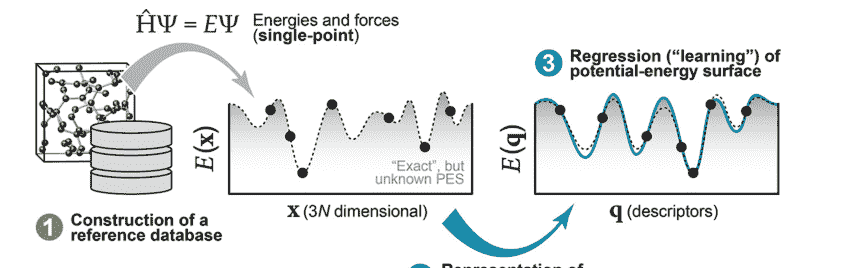

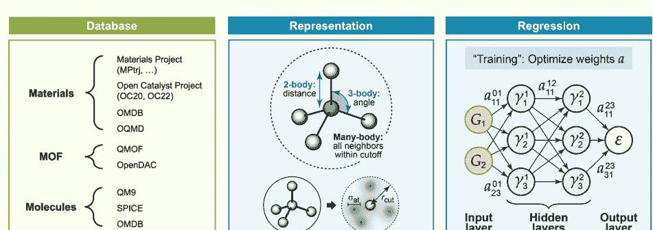

图4. 构建MLP的示意图。它包括三个步骤：通过从头计算构建数据库、用描述符表示原子环境，以及训练回归模型。经John Wiley & Sons许可，引自参考文献70。

使用多尺度原子注意力（5、8、12和无穷大）的空间原子相互作用。此外，在训练过程中，除了目标值外，还预测了各种几何描述符，从而提高了准确性和时间效率。在预测吸附曲线时，该方法与`CGCNN`和其他基于描述符的模型相比，平均绝对误差（MAE）降低了20–35%。Wang等人56利用631,000个MOF和COF在Transformer模型上采用自监督学习开发了`Uni-MOF`。他们通过从噪声数据预测原子的三维位置和预测掩蔽原子来预训练模型。然后，该模型使用从各种MOF数据库、气体类型、温度和压力中随机采样的多系统性质进行微调，实现了R²值稳定在0.83至0.98的气体吸附预测。

近期的研究集中在使用多模态学习来提高MOF的预测性能，这种方法同时考虑不同类型的输入。Kang等人35开发的`MOFTransformer`同时考虑了全局特征（如几何和拓扑描述符）和局部特征（如特定键和构建块的化学特性），以针对可能与某种机制或另一种机制相关的各种不同性质（图3b）。他们使用100万个假设的MOF执行了三种预训练任务：拓扑预测、孔隙率预测以及金属团簇/有机连接体分类。微调后，他们的模型成功预测了H₂吸收量、H₂扩散率和带隙，且性能优于基线模型。多模态学习是一个尚未在MOF中进行深入探索的新分支，但在提高性质预测的准确性和鲁棒性方面具有巨大潜力。

### 2.4. 潜在弱点与改进

尽管机器学习为性质预测带来了显著进步，但仍存在若干挑战。回归模型高度依赖于数据，且由于大多数性质数据是通过分子模拟获得的，模拟方法的准确性会显著影响模型的性能。目前，已有多个MOF数据库，如`CoREMOF`62和`QMOF`51，但与材料领域的其他方向相比，它们包含的数据量仍然相对较少。特别是带隙等需要DFT计算的性质，获取时需要花费大量时间，因此难以获得大型数据集。此外，在MD模拟（包括气体扩散率或体积模量计算）中，数据的可重复性通常较低，导致机器学习预测不准确。这些问题凸显了持续开发更稳健的数据库和改进模拟技术以提高机器学习模型可靠性和准确性的必要性。

从基于描述符的模型到多模态Transformer模型，MOF性质预测已取得了重大进展。展望未来，开发创新的MOF表示方法和采用先进的机器学习技术对于进一步提高这些方法的准确性和效率至关重要。此外，为了利用回归模型获得具有所需性质的MOF，训练好的模型通常被集成到高通量筛选（HTS）方案中，取代传统的分子

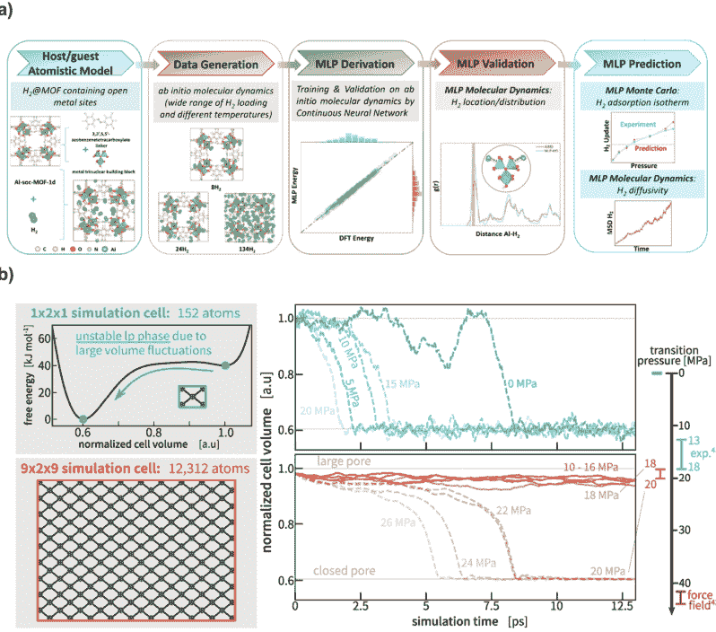

**图 5.** 在 MOFs 背景下使用 MLPs 的示例。(a) 使用 MLP 对 H₂ 分子与 Al-soc-MOF-1d 进行分子模拟的拟议方案。训练好的 MLP 用于获得 H₂ 吸附等温线和扩散系数。所得性质与实验结果进行了比较。转载自 ref 92，获 Royal Society of Chemistry 许可。(b) MIL-53 (Al) 两种不同超胞的体积随时间的变化。包含超过 10k 个原子的较大模拟胞使用 MLP 进行模拟。虽然小超胞没有大孔 (lp) 相，但大超胞中观察到了 lp 相，因此转变压力与实验结果吻合良好。转载自 ref 96，获 Copyright 2023 Springer Nature 许可。

模拟。经常在这些工作中，诸如遗传算法¹³,⁶³,⁶⁴、主动学习⁶⁵和强化学习⁶⁶等方法被同步使用以高效探索 MOF 空间。然而，仍然存在对更准确和高效探索的需求，凸显了开发新型搜索算法日益增长的需求。

## 3. 机器学习势

### 3.1. MLPs 简介

原子模拟能够积累各种材料性质数据，但准确性与计算成本之间的权衡长期以来一直是探索大化学空间的挑战性方面。广泛使用的 DFT 计算被认为相对准确但速度慢。为了降低计算成本，经典（经验）原子间势被用于模拟分子动力学，其中库仑势⁶⁷和伦纳德-琼斯势⁶⁸是广泛使用的例子。反应性力场 (`ReaxFF`)⁶⁹是另一个显著例子，可以模拟灵活的键断裂和形成，但尽管如此，这些原子间势的准确性不足，且与量子水平模拟相比适用于更窄的化学领域。在这一点上，机器学习势 (`MLPs`) 通过使用在从头计算数据上训练的预测机器学习模型来克服准确性与计算成本之间的权衡，使其能够在量子力学水平上学习势能面。使用 MLPs 的这些方法在各种材料领域获得了显著关注，最近的 MLP 工作正接近于用单一可转移模型覆盖广泛化学空间的水平。²⁵,⁷⁰,⁷¹

构建 MLP 模型需要表示原子环境并训练模型从选定的数据库学习势能面（图 4）。在开发原子环境的描述符以及训练能够学习原子间势的模型方面付出了大量努力。历史和详细示例超出了本文的范围，因此可以参考引用的论文来了解模型架构和概念。截至本文撰写时，`MACE`⁸³,⁸⁴（具体为 `MACE-mp-0`）在 `Matbench Discovery` 基准测试⁸⁵中展示了公开可用的 MLPs 中最高的准确性，该基准测试评估模型预测固态热力学稳定性质的性能。`MACE` 架构结合了原子簇展开⁷³和消息传递神经网络⁸⁶,⁸⁷，其中 `MPTrj` 数据集⁸¹用于训练。随着神经网络架构的快速发展以及新的从头数据以兼容的方式被整合，原子模拟中 MLPs 的领域正在迅速增长。

MLPs 在 MOFs 中的利用也非常令人鼓舞，因为庞大而复杂的化学环境导致其原子模拟困难。在以下章节中，将展示用于建模 MOFs 的 MLP 实现示例以及潜在的未来方向。

### 3.2. MLPs 在 MOFs 中的使用：从头水平能量计算

在许多 MOF 系统中，通用力场参数无法准确模拟各种吸附性质，因为这些力场并非专门为 MOFs 开发，而 MOFs 通常含有独特的化学基团，如开放金属位点 (OMS)。在这一点上，MLPs 可以是在合理时间尺度内计算吸附能的最佳方法，从而与基于力场的计算相比显著提高准确性。

特别是，Zheng 等⁹⁰利用 MLP 模拟了单个 CO₂ 分子插入 Mg-MOF-74 时的势能面，Mg-MOF-74 含有 5 配位的 Mg–O 簇，在框架内诱导 OMS。由于四极矩在 CO₂ 中起作用，CO₂ 的氧部分与带正电的 OMS 表现出强相互作用。尽管经典力场可以提供合理的自由能曲线，但它们仍然显著低估了 OMS 与 CO₂ 分子之间的相互作用。然而，本工作中训练的 MLP 通过预测分子间相互作用远强于经典力场的预测，准确地考虑了 OMS 与 CO₂ 分子之间的化学吸附。

除了单分子情况外，Goeminne 等使用来自 DFT 计算的包含不同数量客体分子（本例中为 CO₂）的快照训练了 MLP。⁹¹通过此程序，他们有效地考虑了整个框架内的主-客体相互作用，并捕捉到由于 MOFs 的限域效应导致的主-客体或客体-客体相互作用的细微变化。遵循广泛使用的常规 GCMC 的基本假设，他们使用静态框架和刚性吸附质收集数据，并从单点计算中提取相互作用能量和力。他们将该方案应用于 ZIF-8 并确认 MLP 可以再现实验吸附等温线。然而，他们研究中遇到的一项限制是 MLP 的可转移性有限。用 ZIF-8 训练的 MLP 不能直接用于具有相同组分但表现出不同拓扑的多形 MOFs。从这个角度来看，MOFs 的独特特性可能成为 MLPs 在 MOFs 中可转移性的障碍。同样，Liu 等尝试运行 GCMC 模拟以借助 MLP（图 5a）⁹²准确再现 Al-soc-MOF-1d 的实验 H₂ 吸附等温线。鉴于 MLP 是使用从从头分子动力学 (AIMD) 收集的构型训练的，可以预期通常被忽略的框架的客体诱导柔性可能在吸附模拟期间被隐式考虑。

最后，Yu 等尝试使用 MLP 确定 Pt 簇在 MOF-808 中的稳定位置。⁹³他们用几个能够代表整个系统的代表性片段训练了 MLP，并证明训练好的 MLP 能够准确预测 Pt 簇的最佳位置及其相应能量，与 DFT 计算结果密切一致。此外，与常规 DFT 计算相比计算成本相对较低，他们能够轻松探索迁移路径，而迁移路径通常由于初始态和最终态之间存在大量过渡态而计算密集。

### 3.3. MLPs 在 MOFs 中的使用：从头水平分子动力学

鉴于 MLP 输出相互作用能量和原子力，它理论上允许以 DFT 准确性水平模拟 MD 模拟。此外，与广泛用于 MOFs 的常规通用力场不同，MLPs 可以模拟键断裂和形成，从而能够模拟关于温度、压力和气体吸附等各种外部刺激的不可预测的内在结构柔性。因此，MLPs 可能有助于模拟使用常规 DFT 计算或基于力场的计算无法再现的实验中观察到的现象。此外，它们可能通过揭示与 MOFs 相关的先前未发现的行为为实验人员提供新的见解。

在 MOFs 中 MLP 开发的早期阶段，结构被分解为分子片段，MLP 基于这些单元进行训练。⁹⁴,⁹⁵这些训练好的模型能够准确预测平衡晶格常数，并可应用于诸如机理和热行为等更复杂的应用。⁹⁵然而，该方法从根本上存在一个限制：周期性在训练水平上无法明确考虑。为解决此问题，几项后续研究使用了整个晶胞作为 MLPs 的训练集。Vandenhaute 等⁹⁶使用增量学习方法训练了名为 NequIP 的 MLP 模型，该方法使用了元动力学的概念来高效采样构型以训练模型。在这项工作中，UiO-66 (Zr) 和 MIL-53 (Al) 分别被选为代表性刚性和柔性 MOFs。凭借 MLPs 的优点，其能够以高精度模拟大胞，他们将 MIL-53 (Al) 的模拟胞扩展到 9 × 2 × 9（包含超过 10 000 个原子）并成功再现了实验转变压力数据（图 5b）。在这项工作中，他们研究了框架对外部压力的柔性响应，但客体诱导的柔性尚未使用 MLP 进行研究。因此，这将是一个未来研究课题的绝佳建议。同样，Fan 等⁹⁷合理设计了可能由于酒架基序而表现出相变的二维 MOFs，并使用 MLP 模型观察了机理行为。虽然之前的研究将模拟结果与实验结果相匹配，但同一组的最新研究利用 MLPs 在分子水平上揭示了实验中未观察到的现象。⁹⁸他们研究了 CALF-20 的动力学并观察到负面积压缩性 (NAC) 和负热膨胀 (NTE)，这些是与 CALF-20 实验观察不一致的反直觉现象。

除了晶体框架内的形变外，Castel 等²⁶使用 MLP 在分子水平上研究了 MOFs 的非晶相。他们选择 ZIF-4 作为基准 MOF，实验表明其具有多种非晶相。非晶相是通过熔融淬火方法获得的，这可以直观地用分子动力学体现。由于在常规通用力场中键应保持完整，涉及可逆键断裂和形成的 MOFs 晶格破坏无法模拟。然而，正如前文所述，键断裂和形成可以使用 MLP 模拟，类似于 DFT 计算，从而能够研究晶格性的丧失。

### 3.4. 机器学习势（MLPs）在金属有机框架（MOFs）中的潜在应用

考虑到MOFs因其高度可调性和模块化而形成的广阔化学空间，用于训练MLPs的公开量子计算数据有限。因此，MLPs在MOFs中的应用进展比其他材料缓慢，这使得探索MLPs在不同领域中的应用并将其适配到MOF上显得很有价值。

由于计算成本，大多数涉及量子计算的MOF模拟仅限于考虑固态框架。然而，固定框架假设可能无法完全捕捉真实行为，因此这种方法与实验相比会产生差异。另一方面，MLPs已被证明能够准确模拟多种液体体系和非均相固-液体系的物理化学性质。99–102 鉴于MOFs通常与水或其他溶剂等液体体系相互作用，利用MLPs模拟包含MOFs的非均相体系是未来研究的一个重要方向。同样，MLPs可以为MOFs在多相催化中的研究提供有吸引力的解决方案。在其他材料中，MLPs已被用于预测反应路径、多相催化剂的自由能图以及表面化学环境。103–108 鉴于人们对将MOFs用作潜在多相催化剂的兴趣日益浓厚，部署MLPs可以加速这一研究领域的发展。

此外，MLPs扩大了可模拟体系的规模。通过MLPs，可以模拟MOFs的非晶相或含缺陷的MOFs，而这些用传统方法一直难以实现。70,109–112 同时，MLPs有望模拟MOFs的自下而上生成过程，这将有助于更深入地理解MOFs及其合成过程。

尽管MLPs在MOFs中具有潜在用途，但主要瓶颈仍然是缺乏系统化的量子计算数据。QMOF数据库51（包含20,000多种MOFs的量子级计算化学性质）和最近发布的OpenDAC数据库113（包含4000万（40 M）次DFT计算，针对利用MOFs进行直接空气捕集）为在MOFs中部署MLPs提供了巨大的帮助和支持。尽管如此，要加速MLPs在MOFs中的发展，还需要更多高质量的数据。量子计算数据可用性的提高将推动面向MOFs的MLPs的发展，从而增强介观尺度原子模拟的能力，这对MOFs至关重要。

## 4. 用于MOF设计的生成模型

### 4.1. 生成模型及其在材料设计中的应用

近年来，深度生成模型的出现给计算机科学领域带来了巨大成功。与传统判别模型不同，生成模型通过学习数据的内在概率分布，能够生成与给定数据集相似的新数据点。多种生成模型架构已被开发出来，包括变分自编码器（VAEs）114、生成对抗网络（GANs）115和扩散模型116，并在各个领域取得了显著进展。尤其值得注意的是，计算机视觉117,118和自然语言处理119,120是生成模型成功尤为突出的领域。它们在生成逼真图像方面的卓越表现催生了DALL-E121,122和Midjourney123等图像生成器，而ChatGPT124等大型语言模型已成为各种应用中不可替代的工具。

生成模型在其他领域取得的巨大成功推动了它们在材料科学领域的应用。值得注意的是，这些模型的生成过程通常从在潜在空间中采样随机噪声或随机向量开始。114,116 因此，它们提供了理论上无限的搜索空间，不受给定数据集的限制，这是生成新型化学结构的一个引人入胜的特点。此外，这些模型的生成过程可以有意地偏向于获取所需样本，这被称为条件生成。125,126 通过这样的过程，可以有选择地生成具有用户期望性质的材料，从而实现材料的逆向设计。

生成模型已在多个领域得到广泛研究，包括类药分子、127,128 蛋白质、129,130 和小晶体。131 然而，如前几节所讨论的，新技术在多孔材料中的引入往往相对缓慢。这是因为多孔材料的结构复杂性，其通常包含相对较多的原子，涵盖更广泛的原子类型。13,132 此外，多孔材料的周期性是处理晶体结构时的另一个主要瓶颈，这减缓了前沿方法的引入。

尽管如此，多孔材料的工业重要性促使研究人员不断对其进行探索，已有少数开创性研究报道了生成模型在这些材料中的应用。Kim等人133将GAN架构应用于沸石的生成，沸石是一类在工业上受到广泛关注的多孔材料。GAN是一种具有代表性的生成模型，由生成器和判别器两个组件组成，它们相互竞争以生成真实数据并评估其真实性。他们将沸石表示为三个网格通道，分别包含硅原子位置、氧原子位置以及探针气体分子能量的信息。他们成功生成了训练集中未出现的结构，并验证了生成具有用户期望性质的结构的能力。Park等人134的后续研究沿用了前者的表示方法，但将GAN替换为扩散模型。扩散模型是最新的生成模型架构之一，它通过模拟扩散过程，迭代地细化噪声数据以生成高质量样本。相应地，Park等人观察到生成性能提升了2000倍，验证了扩散模型在材料生成中表现出卓越的性能。条件生成的目标是孔隙率、吸附热和亨利系数，并已成功生成了具有所需化学性质的结构。

### 4.2. 用于MOFs的生成模型

与沸石相比，MOFs的结构和化学复杂性要高得多。已知构成MOFs的原子类型超过100种135，且晶胞中的平均原子数要大得多。因此，实验合成的MOFs数量超过100,000种14，而经实验验证的沸石结构仅约200种。136 因此，将MOFs应用于生成模型更具挑战性，可能需要替代的输入表示，而不是将它们表示为整体图，也不是在三维坐标中逐一指定每个原子的坐标。Yao等人33利用VAE进行MOFs的生成，命名为SMVAE，这标志着首次将生成模型应用于MOFs（图6a）。借助MOFs的模块化特性，他们将MOFs表示为拓扑结构和构建单元（即金属节点、有机节点和连接边）的组合，这是表示复杂MOF结构的一种简单而有效的方法。SMVAE由两部分组成：边编码器/解码器和网状框架编码器/解码器。

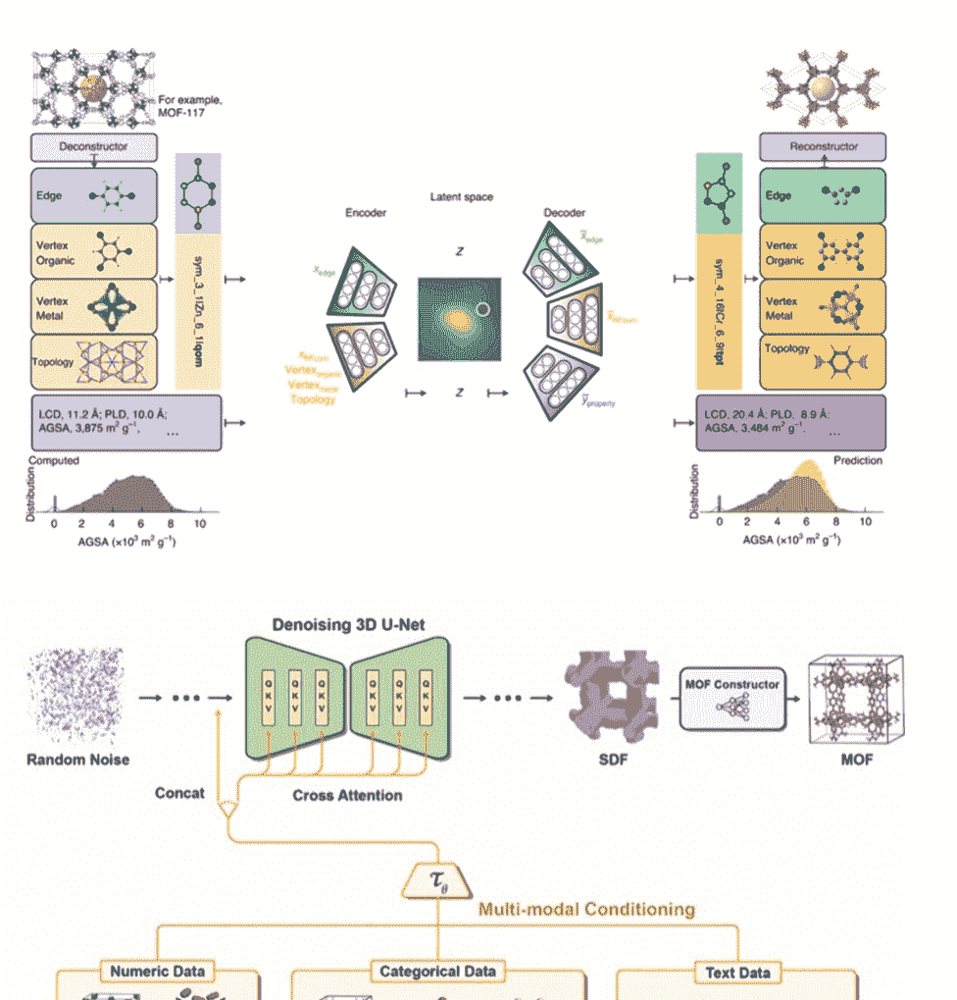

图6. 用于MOFs的生成模型。(a) SMVAE架构。训练了一个变分自编码器用于生成MOFs。MOFs被表示为其构建组件（拓扑、金属节点、有机节点和连接边）的组合。经参考文献33许可转载，版权归2021 Springer Nature所有。(b) MOF FUSION架构。使用符号距离函数（SDF）作为输入表示，训练了一个扩散模型用于MOF生成。转载自参考文献36，采用CC BY-NC许可。

编码器组件将给定的MOF结构映射为降维后的潜在向量，而解码器则将其映射回原始的MOF结构。整个架构经过联合训练，在生成阶段，训练好的解码器能够根据随机采样的潜在向量生成新结构。SMVAE的结构有效性为61.5%，以采样向量的先验有效性衡量。（在随机对采样的潜在向量，61.5% 生成了有效的 MOF 结构。）通过训练一个额外的性质预测模型，该模型可从潜在向量预测 MOF 的化学性质，他们能够生成具有期望性质的结构。聚焦于 CO₂ 吸附，他们证明了该模型能够控制 CO₂ 吸附容量和选择性。

在各种生成模型架构中，扩散模型因其在生成逼真样本和多样化条件能力方面的卓越性能而获得了巨大关注。¹¹⁶,¹¹⁸ 将扩散模型应用于 MOF 生成最近已被尝试，采用了多种不同的方法来处理 MOF 的结构复杂性。Park 等人¹³⁷ 专注于生成 MOF 配体（而非整个结构），并将生成的配体插入具有固定金属节点类型（Cu 桨轮、Zn 桨轮和 Zn 四聚体）的 pcu 拓扑中。他们利用了 DiffLinker，¹²⁸ 这是一种预先开发的扩散模型，用于基于化学片段生成配体分子。他们将 0.1 bar 下 CO₂ 容量高于 2 mmol/g 的结构定义为高性能 MOF，并从现有数据库中这些高性能 MOF 中获得了 540 个独特的分子片段。利用这些片段，他们获得了 12,305 个配体，并据此获得了 120,000 个 MOF 结构。他们使用单独的预测模型筛选了 MOF 空间，并验证了六种 CO₂ 容量高于 2 mmol/g 的 MOF。

Fu 等人¹³⁸ 通过引入构建模块的粗粒化表示，巧妙地处理了 MOF 的结构复杂性。他们认为基于模板的方法会限制搜索空间并排除可行的材料，因此他们通过在三维坐标中直接定位粗粒化构建模块来生成 MOF。作为后处理步骤，需要额外的 MOF 组装过程，以对齐构建模块的取向并确定它们之间的连接性。他们训练了一个额外的回归模型，该模型可从潜在向量预测 CO₂ 工作容量，并利用其选择性生成具有高 CO₂ 容量的结构。

最近，Park 等人³⁶ 开发了一种用于 MOF 生成的扩散模型，特别关注在条件生成期间处理数据的多样化模态（图 6b）。他们指出，孔隙材料逆向设计研究中考虑的目标性质在灵活性方面迄今受到限制，并声称在条件生成期间处理多样化数据模态的必要性。值得注意的是，他们使用了符号距离函数（SDFs）作为输入表示，以精细描述 MOF 的孔隙结构，其模型实现了 81.7% 的高结构有效性。此外，他们展示了对多样化数据模态进行条件化的能力，包括数值、类别、文本数据，甚至它们的组合。

### 4.3. 优势与劣势

使用生成模型进行材料生成相比其他材料设计方法具有若干优势。一般而言，生成模型的训练过程遵循无监督学习，其中模型在没有显式标签或注释的数据上进行训练。生成模型可以通过捕捉潜在分布从未标记数据中学习；因此，在标记数据稀缺或获取成本高昂的情况下，生成模型是有益的。此外，生成模型可以探索庞大（通常在理论上无限）的搜索空间，这在生成多样化和新颖的化学结构时是一个有吸引力的特性。最后，如前研究所述，具有目标性质的材料可通过条件生成进行设计。

随着更具多样性和多功能性的条件化方法被研究，一个有趣的研究方向是将自然语言处理作为条件之一纳入其中。最近，大型语言模型已被部署来构建材料设计的友好用户平台。¹³⁹ 特别针对 MOF，Kang 等人开发了一个名为 ChatMOF¹⁴⁰ 的模块，使用户能够使用自然语言与该模块进行交流。同样，在条件生成期间处理文本数据是生成模型正在追求的方向。¹⁴¹ 这使用户能够以自然语言表达其期望特征，显著降低了使用这些模型的门槛，尤其对于没有领域知识的人而言。

然而，在材料设计的生成模型方面仍然存在若干根本性挑战。如前所述，生成模型通过学习给定训练数据的概率分布来工作，这从根本上使生成模型高度依赖其训练数据，其中训练数据集中存在的偏差会导致生成样本中出现相同的偏差。这种依赖性会给材料生成带来重大挑战，因为构建完全无偏的数据集通常难以实现。因此，在训练生成模型时，应在准备多样且分布均匀的训练数据集方面付出 considerable 努力。

另一个值得分享的方面是，生成模型不太适合外推。由于这些模型利用了来自训练数据的学习模式，它们能够生成与训练数据相似的新样本（即插值）。然而，生成超出训练数据范围的数据点具有挑战性。例如，生成具有前所未有的高 H₂ 容量的 MOF 等任务对这些模型来说可能具有挑战性。尽管如此，针对外推的生成模型研究正在积极进行中，¹⁴² 通过此，预计将出现此类任务的更根本的解决方案。

## 5. 未来方向与新兴趋势

### 5.1. 提高速度和效率

虽然传统的机器学习模型约有 10,000 个参数，但使用 Transformer 架构的回归模型可多达 1 亿个参数。³⁵,⁵⁶⁻⁵⁸ 参数数量的增加提高了模型学习更复杂模式和关系的能力，从而提高了其准确性和灵活性。然而，随着参数数量的增加，训练过程变得显著更长，且训练所需的数据量呈指数级增加。¹⁴³,¹⁴⁴ 这在计算资源和数据获取方面带来了挑战，突出了对高效训练策略和稳健数据获取方法的需求。

在此背景下，迁移学习被认为是一种有前景的方法，可减少训练时间和所需数据量。迁移学习是一种机器学习技术，其中预先开发的模型作为可应用于其他任务的基础模型。¹⁴⁵ 它通常涉及在大型数据集（称为预训练模型）上训练模型，然后为特定感兴趣的任务（称为微调）初始化训练过程，通常使用较小的学习率。当数据量相对较少时，该方法可能有效。因此，迁移学习对提高 MOF 性质预测模型的效率和准确性具有重要前景，而 MOF 通常表现出复杂的数据分布和数据不足。35,146,147 在类似背景下，不同领域之间的知识转移也是一种有前景的方法，这将在下一节中讨论。

此外，可以考虑轻量级深度学习模型以提高其在材料科学中的使用效率。模型的轻量化是指在保持性能的同时设计参数较少的模型。148 这种做法对于处理大量数据特别重要，因为它可以减轻缓慢的推理速度和资源密集型的预训练步骤。在此背景下，MLP 值得注意，因为最近的进展导致了准确性的提高，149 但也导致了更大的模型复杂性和规模，从而导致更大的内存使用和计算成本。虽然 MLP 具有巨大的潜力，但为了开发具有高适用性的方法，研究人员还应考虑模型准确性之外的较大模型规模的负担。正在探索各种技术来轻量化机器学习模型，例如知识蒸馏，150,151 其中较小的模型被教导较大模型所学到的知识，以及修改模型架构以减小其规模。152–155 尽管轻量化在材料科学中尚未得到广泛研究，但在模型参数增加的趋势中关注研究工作对模型效率，可能会导致开发出学习时间更短同时保持高性能的模型。

### 5.2. 融合来自其他材料的工具/数据集

由于结构复杂且需要高保真数据，数据稀缺是数据驱动方法经常面临的主要瓶颈，尤其是在多孔材料研究中。156 特别是在感兴趣的性质难以模拟从而需要实验评估的领域（例如质子电导率157,158），或模拟数据昂贵的领域（例如电子结构计算159）中，该问题尤为突出。对于特定任务数据有限的情况，如果可以访问来自其他领域的大型数据集，则将该数据转移到特定任务将是一种可行的补救数据稀缺问题的方法。特别对于多孔材料，由于多孔材料的各种类别（例如沸石、MOF、COF、PPN 等）已被研究数十年，利用多孔材料领域（甚至来自非多孔材料）的积累数据可以为使用数据驱动方法对其进行研究提出新范式。

利用跨领域知识的代表性示例之一是 He 等人160 的工作。以验证电导性 MOF 为目标，他们开发了一个二元分类模型，该模型基于带隙对结构是否具有导电性进行分类。当时，没有专门针对 MOF 带隙的数据库。（然而，QMOF 数据库，51 现在提供了 MOF 结构的 DFT 计算带隙。）为克服这一限制，他们利用了无机化合物积累的数据。开放量子材料数据库（OQMD）161 包含 ~52,300 种无机化合物的 DFT 水平计算的带隙信息。他们在该数据集上训练了分类模型并将其应用于 MOF 数据库，以识别可能具有导电性的结构。他们的研究方法预测了九种导电 MOF，随后的计算验证证实其中六种为金属。这是一个使用来自其他领域的数据来解决 MOF 研究领域数据稀缺问题的适当示例。

迁移学习是不同领域之间知识转移的广泛使用方法。Cai 等人162 探索了在异质多孔材料背景下实施迁移学习的可能性。他们的重点是解决计算就绪实验（CoRE）数据集大小之间的不平衡，其中 CoRE COF 结构相对较少（约 1,000 个结构），而 CoRE MOF 超过 10,000 个结构。14 为了实现用 CoRE COF 预测 Xe/Kr 选择性的高准确性，研究人员采用了迁移学习。具体而言，他们使用 CoRE MOF 数据库对模型进行预训练，并用 300 个 COF 结构进行微调。他们证实，与仅使用 COF 数据库的直接学习相比，迁移学习始终实现了更高的准确性。

Park 等人163 提出了多孔材料中迁移学习的另一个引人注目的应用。他们在多孔材料的各个领域训练了 Transformer 架构，涵盖 MOF、COF、沸石和 PPN。在不同材料类别之间的协同效应推动下，他们旨在通过迁移学习解决数据不平衡问题。他们的方案涉及提出跨材料少样本学习方案。通过转移从 MOF 获得的知识，他们观察到在少样本学习场景中预测 COF 带隙的准确性得到提高。此外，作者还进一步探索了零样本学习方案的可行性，其中仅在材料 A 上训练的模型可用于预测未见的材料 B。

作为多孔材料之间知识转移的另一个代表性示例，Sun 等人27 利用元学习方案寻求最佳 H2 存储条件。元学习和迁移学习都是旨在通过使用先验知识提高训练效率的方法。然而，元学习的目的是略有不同，因为它旨在训练一个模型，使其能够很好地推广到各种任务。通过利用沸石、MOF 和超交联聚合物的高通量数据，他们开发了一个元学习模型，能够在广泛的压力和温度范围内联合预测各种材料的吸附容量。已验证，使用元学习方法训练的模型与为每种材料单独训练的模型相比表现出更高的准确性。

本节涵盖了利用跨材料领域知识转移来解决数据稀缺问题的若干先例工作。随着更多数据迅速积累和新数据库的构建，不受感兴趣材料类别限制地利用数据正成为一种常见方法。即使在处理数据稀缺之外，来自其他领域的化学直觉也可以提高目标领域模型的性能。因此，随着未来大量数据继续积累，适当利用其他领域知识和数据将成为越来越重要的策略。

### 5.3. 从文献中提取数据

数据的质量对于开发可靠的机器学习模型至关重要。在本节中，我们关注现实世界数据与模拟数据之间的差异。

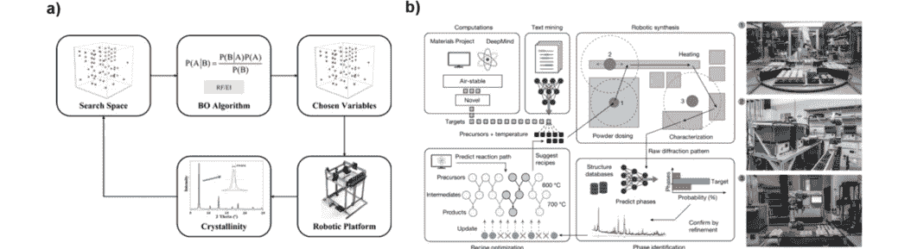

**图 7** 自主材料发现。 (a) 示意图展示通过将机器人平台与贝叶斯优化算法集成来合成结晶度提高的 ZIF-67 的过程。经 ref 21 许可转载。版权 2021 美国化学学会。 (b) 利用自主实验室进行自主材料发现。粉末投料、样品加热和产物表征已实现自动化，而这些站点之间的转移则使用机械臂完成。经 ref 172 许可转载。版权 2023 Springer Nature。

大多数现有的 MOF 数据库都是通过模拟生成的，这使得它们能够以较高的时间效率覆盖广阔的化学空间。然而，模拟方法并不完全准确，会引入微小或较大的误差。此外，模拟通常在诸如完美结晶性等假设下进行，这可能导致与真实材料存在差异。为了克服这些局限，研究人员尝试从实验文献中提取数据（通常称为数据挖掘），以便实验数据可以直接用于模型训练。

在 MOF 数据挖掘的早期阶段，采用了基于规则的提取方法和相对简单的自然语言处理（NLP）技术。Park 等人开发了一种文本挖掘算法，可从 HTML 格式输入中捕获表面积和孔体积的单位。Nandy 等人使用 NLP 和图像分析技术从实验文献中挖掘 MOF 的溶剂去除稳定性及热降解温度。数据挖掘的范围后来扩展到 MOF 的合成信息，其中 MOF 的合成条件从实验程序中提取并进一步处理以对其合成进行更深入的理解。最近，大型语言模型已成为数据挖掘中不可或缺的工具。与基于规则的算法相比，使用大型语言模型使挖掘过程更灵活、更准确。这些模型也影响了 MOF 社区，Yaghi 小组采用 ChatGPT 进行 MOF 数据的数据挖掘。

数据挖掘是一个不断发展的领域，预计将在构建高质量实验数据库中发挥关键作用。鉴于大量正在进行的实验工作，MOF 领域特别适合主动挖掘。推动该领域快速进展的一个因素是建立数据报告和管理方面的标准化实践。如果研究人员在科学文献中采用统一的数据报告格式，数据挖掘的准确性将得到显著提高。此外，由于研究人员通常只报告最佳实验结果，如果他们还发表失败或部分成功的成果，实验数据的数量将大幅增加。

### 5.4. 实验自动化与自主实验室

最后，在本节中，我们重点介绍了数据获取的有前景且具有前瞻性的方法。实验过程的自动化是材料发现中一个新兴的概念，近年来获得了巨大的关注。这是通过使用机器人系统实现的，其中机械臂和其他机械系统处理诸如样品制备、混合化学品和操作仪器等任务。与人类进行的实验相比，这种自动化具有巨大的优势。自动化实验可以连续运行（即每天 24 小时/每周 7 天），效率更高，从而使研究人员能够以高效的方式获得更多实验数据。此外，它最大限度地减少了实验程序中人为错误的风险，从而获得更可靠、可重复的结果。由于这些益处，实验过程的自动化是获取大量高质量数据的有吸引力的方法。

自主实验室（也称为自主驾驶实验室）是一个更先进、更具前瞻性的概念，其中实验室流程和实验在没有人工干预的情况下进行（[图 7b](...)）。¹⁷²,¹⁷³ 该设施通常配备机器人、人工智能（AI）和多个传感器，其中复杂的 AI 算法管理并优化实验参数、实时分析数据，并根据预定义目标自主做出决策。在此背景下，主动学习经常被提及，因为它有助于选择下一组实验，从而使整个过程更高效。包括有机半导体激光器（OSLs）在内的少数材料领域正在测试自主实验室的引入，但仍存在若干障碍，包括机械和软件方面的挑战。¹⁷¹ 据我们所知，尚未报道在完全自主的实验室中实现零人工干预的 MOF 合成，但我们认为研究人员的努力将在不久的将来使其成为可能。

## 6. 结论

在本述评中，我们介绍了 MOF 中机器学习研究的最新趋势以及研究人员追求的未来方向。首先介绍了用于阐明结构-性能关系的回归模型，从传统方法到最近表现出卓越性能的基于 Transformer 的模型。随后，我们介绍了机器学习研究的最新趋势，特别关注 MLP，其在广泛的应用中具有巨大的潜力。MLP 现在在 MOF 领域受到关注，预计它们将为以有效的方式处理 MOF 的复杂化学铺平道路。生成模型是另一个新兴分支，为材料设计提供了一种新范式。我们分享了在 MOF 中实施它们的最新尝试，以及使用生成模型进行材料设计的某些方面。最后，讨论了使用机器学习方法遇到的若干挑战以及解决这些挑战的努力。

机器学习在材料领域的研究范式转变中发挥了关键作用。MOF 是一个成就特别显著的领域，通过引入基于机器学习的方法已见证了重大进展。通过持续的研究工作，机器学习有望释放 MOF 的全部潜力，推动材料科学的进一步进步和创新。

## ■ 作者信息

### 通讯作者

**Jihan Kim** — *化学与生物分子工程系，韩国科学技术高等研究院（KAIST），大田 34141，大韩民国*; [orcid.org/0000-0002-3844-8789](https://orcid.org/0000-0002-3844-8789); Email: jihankim@kaist.ac.kr

### 作者

**Junkil Park** — *化学与生物分子工程系，韩国科学技术高等研究院（KAIST），大田 34141，大韩民国*; [orcid.org/0000-0003-1770-7291](https://orcid.org/0000-0003-1770-7291)

**Honghui Kim** — *化学与生物分子工程系，韩国科学技术高等研究院（KAIST），大田 34141，大韩民国*; [orcid.org/0000-0002-1527-8641](https://orcid.org/0000-0002-1527-8641)

**Yeonghun Kang** — *化学与生物分子工程系，韩国科学技术高等研究院（KAIST），大田 34141，大韩民国*; [orcid.org/0000-0001-5191-5735](https://orcid.org/0000-0001-5191-5735)

**Yunsung Lim** — *化学与生物分子工程系，韩国科学技术高等研究院（KAIST），大田 34141，大韩民国*; [orcid.org/0000-0002-6327-9286](https://orcid.org/0000-0002-6327-9286)

完整的联系信息可在以下网址获得：[https://pubs.acs.org/10.1021/jacsau.4c00618](https://pubs.acs.org/10.1021/jacsau.4c00618)

### 作者贡献

稿件由所有作者共同贡献完成。所有作者均已批准稿件的最终版本。

### 声明

作者声明无竞争性财务利益。

## ■ 致谢

本项目由韩国国家研究基金会（NRF）资助，资助号为 RS-2024-00337004。

## ■ 参考文献

1. Zhang, X.; Lin, R. B.; Wang, J.; Wang, B.; Liang, B.; Yildirim, T.; Zhang, J.; Zhou, W.; Chen, B. Optimization of the pore structures of MOFs for record high hydrogen volumetric working capacity. *Advanced materials* 2020, 32 (17), 1907995.

2. Nguyen, T.; Shimizu, G.; Rajendran, A. Post-Combustion CO2 capture by vacuum swing adsorption using a hydrophobic metal-organic framework (MOF), CALF-20: Multi-objective optimization and experimental validation. *ChemRxiv*, 2022.

3. Li, B.; Wen, H.-M.; Zhou, W.; Xu, J. Q.; Chen, B. Porous metal-organic frameworks: promising materials for methane storage. *Chem. 2016*, 1 (4), 555–580.

4. Park, J.; Suh, B. L.; Kim, J. Computational design of a photoresponsive metal–organic framework for post-combustion carbon capture. *J. Phys. Chem. C* 2020, 124 (24), 13162–13167.

5. Wang, Q.; Astruc, D. State of the art and prospects in metal–organic framework (MOF)-based and MOF-derived nanocatalysis. *Chem. Rev.* 2020, 120 (2), 1438–1511.

6. Doonan, C. J.; Sumby, C. J. Metal–organic framework catalysis. *CrystEngComm* 2017, 19 (29), 4044–4048.

7. Shan, Y.; Zhang, G.; Shi, Y.; Pang, H. Synthesis and catalytic application of defective MOF materials. *Cell Reports Physical Science* 2023, 4 (3), 101301.

8. Jo, Y. M.; Jo, Y. K.; Lee, J. H.; Jang, H. W.; Hwang, I. S.; Yoo, D. J. MOF-based chemiresistive gas sensors: toward new functionalities. *Adv. Mater.* 2023, 35 (43), 2206842.

9. Small, L. J.; Henkelis, S. E.; Rademacher, D. X.; Schindelholz, M. E.; Krumhansl, J. L.; Vogel, D. J.; Nenoff, T. M. Near-zero power MOF-based sensors for NO2 detection. *Adv. Funct. Mater.* 2020, 30 (50), 2006598.

10. Mallakpour, S.; Nikkhoo, E.; Hussain, C. M. Application of MOF materials as drug delivery systems for cancer therapy and dermal treatment. *Coord. Chem. Rev.* 2022, 451, 214262.

11. Suresh, K.; Matzger, A. J. Enhanced drug delivery by dissolution of amorphous drug encapsulated in a water unstable metal–organic framework (MOF). *Angew. Chem., Int. Ed.* 2019, 58 (47), 16790–16794.

12. Colón, Y. J.; Gómez-Gualdrón, D. A.; Snurr, R. Q. Topologically guided, automated construction of metal–organic frameworks and their evaluation for energy-related applications. *Cryst. Growth Des.* 2017, 17 (11), 5801–5810.

13. Lee, S.; Kim, B.; Cho, H.; Lee, H.; Lee, S. Y.; Cho, E. S.; Kim, J. Computational screening of trillions of metal–organic frameworks for ...

高性能甲烷存储。*ACS应用材料与界面* **2021**, *13* (20), 23647–23654.

- (14) Chung, Y. G.; Haldoupis, E.; Bucior, B. J.; Haranczyk, M.; Lee, S.; Zhang, H.; Vogiatzis, K. D.; Milisavljevic, M.; Ling, S.; Camp, J. S.; 等. 计算驱动、实验性金属有机框架数据库CoRE MOF 2019的进展、更新与分析。*化学与工程数据杂志* **2019**, *64* (12), 5985–5998.

- (15) Moghaddam, P. Z.; Li, A.; Wiggin, S. B.; Tao, A.; Maloney, A. G.; Wood, P. A.; Ward, S. C.; Fairen-Jimenez, D. 剑桥结构数据库子集的开发：面向过去、现在和未来的金属有机框架集合。*材料化学* **2017**, *29* (7), 2618–2625.

- (16) Ahmed, A.; Seth, S.; Purewal, J.; Wong-Foy, A. G.; Veenstra, M. J.; Matzger, A. J.; Siegel, D. J. 通过筛选近五十万种金属有机框架实现优异的氢气存储。*自然通讯* **2019**, *10* (1), 1568.

- (17) Colón, Y. J.; Snurr, R. Q. 金属有机框架的高通量计算筛选。*化学学会评论* **2014**, *43* (16), 5735–5749.

- (18) Chang, S.; Lee, S.; Kim, B.; Kim, J. 机器学习在金属有机框架中的应用。*配位化学评论* **2020**, *423*, 213487.

- (19) Wei, J.; Chu, X.; Sun, X. Y.; Xu, K.; Deng, H. X.; Chen, J.; Wei, Z.; Lei, M. 材料科学中的机器学习。*信息材料* **2019**, *1* (3), 338–358.

- (20) Moosavi, S. M.; Chidambaram, A.; Talirz, L.; Haranczyk, M.; Stylianou, K. C.; Smit, B. 在金属有机框架合成中捕捉化学直觉。*自然通讯* **2019**, *10* (1), 539.

- (21) Xie, Y.; Zhang, C.; Deng, H.; Zheng, B.; Su, J.-W.; Shutt, K.; Lin, J. 通过机器人平台和贝叶斯优化加速金属有机框架的合成。*ACS应用材料与界面* **2021**, *13* (45), 53485–53491.

- (22) Zuluaga, M.; Krause, A. e-pal：一种针对多目标优化问题的主动学习方法。*机器学习研究杂志* **2016**, *17* (104), 1–32.

- (23) Fuhr, A. S.; Sumpter, B. G. 用于材料发现和机器学习加速创新的深度生成模型。*材料前沿* **2022**, *9*, 865270.

- (24) Sanchez-Lengeling, B.; Aspuru-Guzik, A. 使用机器学习的逆分子设计：物质工程的生成模型。*科学* **2018**, *361* (6400), 360–365.

- (25) Behler, J. 观点：用于原子模拟的机器学习势。*化学物理杂志* **2016**, *145* (17), 170901.

- (26) Castel, N.; André, D.; Edwards, C.; Evans, J. D.; Coudert, F.-X. 非晶沸石咪唑酯框架的机器学习原子间势。*数字发现* **2024**, *3*, 355–368.
- (27) Sun, Y.; DeJaco, R. F.; Li, Z.; Tang, D.; Glante, S.; Sholl, D. S.; Colina, C. M.; Snurr, R. Q.; Thommes, M.; Hartmann, M.; 等. 利用元学习为不同纳米多孔材料确定最佳储氢条件。*科学进展* **2021**, *7* (30), eabg3983.
- (28) Lakshmanaprabu, S.; Shankar, K.; Ilayaraja, M.; Nasir, A. W.; Vijayakumar, V.; Chilamkurti, N. 基于最优特征的物联网大数据分类随机森林。*国际机器学习与控制论杂志* **2019**, *10* (10), 2609–2618.
- (29) Corso, G.; Stark, H.; Jegelka, S.; Jaakkola, T.; Barzilay, R. 图神经网络。*自然综述：方法入门* **2024**, *4* (1), 17.
- (30) Pinheiro Cinelli, L.; Araújo Marins, M.; Barros da Silva, E. A.; Lima Netto, S. 变分自编码器。载于《机器学习变分方法及其在深度网络中的应用》；施普林格，2021；第111–149页。
- (31) Aurpa, T. T.; Sadik, R.; Ahmed, M. S. 使用基于Transformer的深度学习模型检测Facebook上的攻击性孟加拉语评论。*社交网络分析与挖掘* **2022**, *12* (1), 24.
- (32) Lyu, Z.; Xu, X.; Yang, C.; Lin, D.; Dai, B. 通过扩散过程的早停来加速扩散模型。*arXiv*:2205.12524, 2022.
- (33) Yao, Z.; Sánchez-Lengeling, B.; Bobbitt, N. S.; Bucior, B. J.; Kumar, S. G. H.; Collins, S. P.; Burns, T.; Woo, T. K.; Farha, O. K.; Snurr, R. Q.; 等. 利用深度生成模型逆向设计纳米多孔晶态网状材料。*自然机器智能* **2021**, *3* (1), 76–86.
- (34) Batzner, S.; Musaelian, A.; Sun, L.; Geiger, M.; Mailoa, J. P.; Kornbluth, M.; Molinari, N.; Smidt, T. E.; Kozinsky, B. 用于数据高效且精确的原子间势的E(3)等变图神经网络。*自然通讯* **2022**, *13* (1), 2453.
- (35) Kang, Y.; Park, H.; Smit, B.; Kim, J. 用于金属有机框架通用迁移学习的多模态预训练Transformer。*自然机器智能* **2023**, *5* (3), 309–318.
- (36) Park, J.; Lee, Y.; Kim, J. 使用3D建模技术的金属有机框架生成多模态条件化。*ChemRxiv*，2024。DOI: 10.26434/chemrxiv-2024-w8fps.
- (37) Canivet, J.; Bonnefoy, J.; Daniel, C.; Legrand, A.; Coasne, B.; Farrusseng, D. 金属有机框架中水吸附的结构-性质关系。*新化学杂志* **2014**, *38* (7), 3102–3111.
- (38) Wu, D.; Yang, Q.; Zhong, C.; Liu, D.; Huang, H.; Zhang, W.; Maurin, G. 揭示金属有机框架用于烟气捕集CO2的结构-性质关系。*朗缪尔* **2012**, *28* (33), 12094–12099.
- (39) Fahrmeir, L.; Kneib, T.; Lang, S.; Marx, B. 《回归模型》；施普林格，2013.
- (40) Hearst, M. A.; Dumais, S. T.; Osuna, E.; Platt, J.; Schölkopf, B. 支持向量机。*IEEE智能系统及其应用* **1998**, *13* (4), 18–28.
- (41) Chen, T.; Guestrin, C. XGBoost：一种可扩展的树提升系统。*第22届ACM SIGKDD国际知识发现与数据挖掘会议论文集* **2016**, 785–794.
- (42) Breiman, L. 随机森林。*机器学习* **2001**, *45*, 5–32.
- (43) Fernandez, M.; Woo, T. K.; Wilmer, C. E.; Snurr, R. Q. 金属有机框架中甲烷储存的大规模定量结构-性质关系（QSPR）分析。*物理化学杂志C* **2013**, *117* (15), 7681–7689.
- (44) Fanourgakis, G. S.; Gkagkas, K.; Tylianakis, E.; Klontzas, E.; Froudakis, G. 一种用于预测纳米多孔材料中甲烷吸附的稳健机器学习算法。*物理化学杂志A* **2019**, *123* (28), 6080–6087.
- (45) Bucior, B. J.; Bobbitt, N. S.; Islamoglu, T.; Goswami, S.; Gopalan, A.; Yildirim, T.; Farha, O. K.; Bagheri, N.; Snurr, R. Q. 基于能量的描述符用于快速预测金属有机框架中的储氢性能。*分子系统设计与工程* **2019**, *4* (1), 162–174.
- (46) Wu, X.; Xiang, S.; Su, J.; Cai, W. 基于机器学习理解金属有机框架甲烷储存能力与特征性质之间的定量关系。*物理化学杂志C* **2019**, *123* (14), 8550–8559.
- (47) Burner, J.; Luo, J.; Luo, H.; Miranir, A.; Kwon, O.; Boyd, P. G.; Maley, S.; Gibaldi, M.; Simrod, S.; Ogden, V.; 等. ARC–MOF：具有DFT推导的部分原子电荷和机器学习描述符的多样化金属有机框架数据库。*材料化学* **2023**, *35* (3), 900–916.
- (48) Yuan, X.; Li, L.; Shi, Z.; Liang, H.; Li, S.; Qiao, Z. 分子指纹机器学习辅助设计与预测用于从空气中捕集NMHC的高性能MOF。*先进粉末材料* **2022**, *1* (3), 100026.
- (49) Zhou, J.; Cui, G.; Hu, S.; Zhang, Z.; Yang, C.; Liu, Z.; Wang, L.; Li, C.; Sun, M. 图神经网络：方法与应用的综述。*AI开放* **2020**, *1*, 57–81.
- (50) Xie, T.; Grossman, J. C. 用于材料性质准确可解释预测的晶体图卷积神经网络。*物理评论快报* **2018**, *120* (14), 145301.
- (51) Rosen, A. S.; Iyer, S. M.; Ray, D.; Yao, Z.; Aspuru-Guzik, A.; Gagliardi, L.; Notestein, J. M.; Snurr, R. Q. 机器学习金属有机框架的量子化学性质以加速材料发现。*物质* **2021**, *4* (5), 1578–1597.
- (52) Rosen, A. S.; Fung, V.; Huck, P.; O’Donnell, C. T.; Horton, M. K.; Truhlar, D. G.; Persson, K. A.; Notestein, J. M.; Snurr, R. Q. 金属有机框架电子性质的高通量预测。
- (95) Tayfuroglu, O.; Kocak, A.; Zorlu, Y. 一种针对IRMOF系列的神经网络势及其在热和光化学行为中的应用。 *Phys. Chem. Chem. Phys.* **2022**, *24* (19), 11882–11897.
- (96) Vandenhaute, S.; Cools-Ceuppens, M.; DeKeyser, S.; Verstraelen, T.; Van Speybroeck, V. 利用增量学习方法为金属有机框架开发的机器学习势。 *npj Computational Materials* **2023**, *9* (1), 1–8.
- (97) Fan, D.; Ozyan, A.; Liu, P.; Maurin, G. 通过机器学习势分子动力学揭示二维金属有机框架的非正常面内拉伸性。 *Nanoscale* **2024**, *16* (7), 3438–3447.
- (98) Fan, D.; Naskar, S.; Maurin, G. MOF CALF-20的非常规力学和热学行为。 *Nat. Commun.* **2024**, *15* (1), 3251.
- (99) Balyakin, I.; Rempel, S.; Ryltsev, R.; Rempel, A. 液态二氧化硅的深度机器学习原子间势。 *Phys. Rev. E* **2020**, *102* (5), No. 052125.
- (100) Quaranta, V.; Behler, J.; Hellström, M. 基于机器学习势模拟的液水/氧化锌界面结构与动力学。 *J. Phys. Chem. C* **2019**, *123* (12), 1293–1304.
- (101) Schran, C.; Thiemann, F. L.; Rowe, P.; Müller, E. A.; Marsalek, O.; Michaelides, A. 使复杂水体系的机器学习势变得简单。 *Proc. Natl. Acad. Sci. U. S. A.* **2021**, *118* (38), e2110077118.
- (102) Yao, N.; Chen, X.; Fu, Z.-H.; Zhang, Q. 将经典、从头算和机器学习分子动力学模拟应用于可充电电池的液体电解质。 *Chem. Rev.* **2022**, *122* (12), 10970–11021.
- (103) Goldsmith, B. R.; Esterhuizen, J.; Liu, J. X.; Bartel, C. J.; Sutton, C. 机器学习在非均相催化剂设计与发现中的应用。 *AIChE J.* **2018**, *64*, 2311.
- (104) Mou, T.; Pillai, H. S.; Wang, S.; Wan, M.; Han, X.; Schweitzer, N. M.; Che, F.; Xin, H. 用机器学习弥合计算非均相催化中的复杂性差距。 *Nature Catalysis* **2023**, *6* (2), 122–136.
- (105) Stocker, S.; Jung, H.; Csányi, G.; Goldsmith, C. F.; Reuter, K.; Margraf, J. T. 利用机器学习势和伞形积分估算非均相催化反应的自由能垒。 *J. Chem. Theory Comput.* **2023**, *19* (19), 6796–6804.
- (106) Chen, D.; Shang, C.; Liu, Z.-P. 用于非均相催化的机器学习原子模拟。 *npj Computational Materials* **2023**, *9* (1), 2.
- (107) Chang, L.; Chaus, L.; Das, A.; Goyal, S.; Lavril, T.; Shuaibi, M.; Riviere, M.; Tran, K.; Heras-Domingo, J.; Ho, C.; Hu, W.; et al. 开放催化剂2020（OC20）数据集与社区挑战。 *ACS Catal.* **2021**, *11* (10), 6059–6072.
- (108) Tran, R.; Lan, J.; Shuaibi, M.; Wood, B. M.; Goyal, S.; Das, A.; Heras-Domingo, J.; Kolluru, A.; Rizvi, A.; Shoghi, N.; et al. 开放催化剂2022（OC22）数据集及氧化物电催化剂的挑战。 *ACS Catal.* **2023**, *13* (5), 3066–3084.
- (109) Sivaraman, G.; Krishnamoorthy, A. N.; Baur, M.; Holm, C.; Stan, M.; Csányi, G.; Benmore, C.; Vázquez-Mayagoitia, A. 通过主动学习得到的机器学习原子间势：非晶态和液态二氧化铪。 *npj Computational Materials* **2020**, *6* (1), 104.
- (110) Deringer, V. L.; Csányi, G. 非晶碳的基于机器学习的原子间势。 *Phys. Rev. B* **2017**, *95* (9), No. 094203.
- (111) Xu, N.; Shi, Y.; He, Y.; Shao, Q. 晶态和非晶态锂硅合金的深度学习势。 *J. Phys. Chem. C* **2020**, *124* (30), 16278–16288.
- (112) Freitas, R.; Cao, Y. 用于晶体缺陷的机器学习势。 *MRS Commun.* **2022**, *12* (5), 510–520.
- (113) Sriram, A.; Choi, S.; Yu, X.; Brabson, L. M.; Das, A.; Ulissi, Z.; Uyttendaele, M.; Medford, A. J.; Sholl, D. S. 直接空气捕获中吸附剂发现的Open DAC 2023数据集与挑战。 *ACS Central Science* **2024**, *10* (5), 923–941.
- (114) Kingma, D. P.; Welling, M. 自编码变分贝叶斯。 *arXiv*, 1312.6114, 2013.
- (115) Goodfellow, I.; Pouget-Abadie, J.; Mirza, M.; Xu, B.; Warde-Farley, D.; Ozair, S.; Courville, A.; Bengio, Y. 生成对抗网络。 *Communications of the ACM* **2020**, *63* (11), 139–144.
- (116) Ho, J.; Jain, A.; Abbeel, P. 去噪扩散概率模型。 *Advances in Neural Information Processing Systems 2020*, *33*, 6840–6851.
- (117) Wang, Z.; She, Q.; Ward, T. E. 计算机视觉中的生成对抗网络：综述与分类。 *ACM Computing Surveys (CSUR)* **2022**, *54* (2), 1–38.
- (118) Dhariwal, P.; Nichol, A. 扩散模型在图生成上击败GAN。 *Advances in Neural Information Processing Systems 2021*, *34*, 8780–8794.
- (119) Chowdhary, K.; Chowdhary, K. 自然语言处理。 *Fundamentals of artificial intelligence 2020*, 603–649.
- (120) Miao, Y. *用于自然语言处理的深度生成模型*. 博士学位论文，牛津大学，2017.
- (121) Ramesh, A.; Pavlov, M.; Goh, G.; Gray, S.; Voss, C.; Radford, A.; Chen, M.; Sutskever, I. 零样本文本到图像生成。 In *International Conference on Machine Learning*, 2021; PMLR: pp 8821–8831.
- (122) Ramesh, A.; Dhariwal, P.; Nichol, A.; Chu, C.; Chen, M. 基于CLIP潜在变量的层次化文本条件图像生成。 *arXiv*, 2204.06125, 2022.
- (123) *Midjourney*. 2022. https://www.midjourney.com (accessed 28 Aug, 2024).
- (124) Bubeck, S.; Chandrasekaran, V.; Eldan, R.; Gehrke, J.; Horvitz, E.; Kamar, E.; Lee, P.; Lee, Y. T.; Li, Y.; Lundberg, S. 通用人工智能的火花：gpt-4的早期实验。 *arXiv*, 2303.12712, 2023.

- (125) Zhang, L.; Rao, A.; Agrawala, M. 为文本到图像扩散模型添加条件控制。 *Proceedings of the IEEE/CVF International Conference on Computer Vision 2023*, 3836–3847.

- (126) Kang, S.; Cho, K. 基于深度生成模型的条件分子设计。 *J. Chem. Inf. Model.* **2019**, *59* (1), 43–52.

- (127) Hoogeboom, E.; Satorras, V. G.; Vignac, C.; Welling, M. 用于3D分子生成的等变扩散。 In *International Conference on Machine Learning*, 2022; PMLR: pp 8867–8887.

- (128) Igashov, I.; Stärk, H.; Vignac, C.; Schneuing, A.; Satorras, V. G.; Frossard, P.; Welling, M.; Bronstein, M.; Correia, B. E. 用于分子连接子设计的等变3D条件扩散模型。 *Nature Machine Intelligence* **2024**, *6*, 417.

- (129) Wu, K. E.; Yang, K. K.; Berg, R. v. d.; Zou, J. Y.; Lu, A. X.; Amini, A. P. 通过折叠扩散生成蛋白质结构。 *arXiv*, 2209.15611, 2022.

- (130) Hawkins-Hooker, A.; Depardieu, F.; Baur, S.; Couairon, G.; Chen, A.; Bikard, D. 用变分自编码器生成功能性蛋白质变体。 *PLoS computational biology* **2021**, *17* (2), e1008736.

- (131) Xie, T.; Fu, X.; Ganea, O.-E.; Barzilay, R.; Jaakkola, T. 用于周期材料生成的晶体扩散变分自编码器。 *arXiv*, 2110.06197, 2021.

- (132) Freund, R.; Zaremba, O.; Arnauts, G.; Ameloot, R.; Skorupskii, G.; Dinçă, M.; Bavykina, A.; Gascon, J.; Ejsmont, A.; Goscianska, J.; et al. MOF和COF应用的现状。 *Angew. Chem., Int. Ed.* **2021**, *60* (45), 23975–24001.

- (133) Kim, B.; Lee, S.; Kim, J. 利用人工神经网络对多孔材料的逆向设计。 *Science advances* **2020**, *6* (1), eaax9324.

- (134) Park, J.; Gill, A. P. S.; Moosavi, S. M.; Kim, J. 多孔材料的逆向设计：扩散模型方法。 *Journal of Materials Chemistry A* **2024**, *12*, 6507.

- (135) Rappé, A. K.; Casewit, C. J.; Colwell, K.; Goddard, W. A., III; Skiff, W. M. UFF：用于分子力学和分子动力学模拟的全周期表力场。 *Journal of the American chemical society* **1992**, *114* (25), 10024–10035.

- (136) *IZA数据库*. https://www.iza-structure.org/databases/ (accessed 28 Aug, 2024).

- (137) Park, H.; Yan, X.; Zhu, R.; Huerta, E.; Chaudhuri, S.; Cooper, D.; Foster, I.; Tajkhorshid, E. GHP-MOFassemble: 用于理性设计的扩散建模、高通量筛选和分子动力学.

- (137) 用于大规模碳捕获的新型金属有机框架的发现。 *arXiv*, 2306.08695, 2023.

- (138) Fu, X.; Xie, T.; Rosen, A. S.; Jaakkola, T.; Smith, J. MOFDiff：用于金属有机框架设计的粗粒化扩散。 *arXiv*, 2310.10732, 2023.

- (139) M. Bran, A.; Cox, S.; Schilter, O.; Baldassari, C.; White, A. D.; Schwaller, P. 用化学工具增强大型语言模型。 *Nature Machine Intelligence* **2024**, 6, 525.

- (140) Kang, Y.; Kim, J. ChatMOF：用于预测和生成金属有机框架的自主人工智能系统。 *arXiv*, 2308.01423, 2023.

- (141) Liu, S.; Nie, W.; Wang, C.; Lu, J.; Qiao, Z.; Liu, L.; Tang, J.; Xiao, C.; Anandkumar, A. 用于基于文本的检索和编辑的多模态分子结构-文本模型。 *Nature Machine Intelligence* **2023**, 5 (12), 1447–1457.

- (142) Besserve, M.; Sun, R.; Janzing, D.; Schölkopf, B. 生成模型中外推的独立机制理论。 In *Proceedings of the AAAI Conference on Artificial Intelligence* **2021**, 35, 6741–6749.

- (143) Thompson, N. C.; Greenewald, K.; Lee, K.; Manso, G. F. 深度学习的计算极限。 *arXiv*, 2007.05558, 2020.

- (144) Villalobos, P.; Sevilla, J.; Besiroglu, T.; Heim, L.; Ho, A.; Hobbahn, M. 机器学习模型规模与参数差距。 *arXiv*, 2207.02852, 2022.

- (145) Weiss, K.; Khoshgoftaar, T. M.; Wang, D. 迁移学习综述。 *Journal of Big Data* **2016**, 3, 1–40.

- (146) Lim, Y.; Kim, J. 迁移学习在预测金属有机框架扩散性质中的应用。 *Molecular Systems Design & Engineering* **2022**, 7 (9), 1056–1064.

- (147) Ma, R.; Colon, Y. J.; Luo, T. 金属有机框架中气体吸附的迁移学习研究。 *ACS Appl. Mater. Interfaces* **2020**, 12 (30), 34041–34048.

- (148) Wang, C.-H.; Huang, K.-Y.; Yao, Y.; Chen, J.-C.; Shuai, H.-H.; Cheng, W.-H. 轻量级深度学习：概述。 *IEEE Consumer Electronics Magazine* **2024**, 13, 51.

- (149) Yang, H.; Hu, C.; Zhou, Y.; Liu, X.; Shi, Y.; Li, J.; Li, G.; Chen, Z.; Chen, S.; Zeni, C. MatterSim：跨元素、温度和压力的深度学习原子模型。 *arXiv*, 2405.04967, 2024.

- (150) Jiao, X.; Yin, Y.; Shang, L.; Jiang, X.; Chen, X.; Li, L.; Wang, F.; Liu, Q. TinyBERT：用于自然语言理解的BERT蒸馏。 *arXiv*, 1909.10351, 2019.

- (151) Sanh, V.; Debut, L.; Chaumond, J.; Wolf, T. DistilBERT，BERT的蒸馏版本：更小、更快、更便宜、更轻。 *arXiv*, 1910.01108, 2019.

- (152) Lan, Z.; Chen, M.; Goodman, S.; Gimpel, K.; Sharma, P.; Soricut, R. ALBERT：用于语言表示自监督学习的轻量级BERT。 *arXiv*, 1909.11942, 2019.

- (153) Sun, Z.; Yu, H.; Song, X.; Liu, R.; Yang, Y.; Zhou, D. MobileBERT：面向资源受限设备的紧凑型任务无关BERT。 *arXiv*, 2004.02984, 2020.

- (154) Xu, C.; Zhou, W.; Ge, T.; Wei, F.; Zhou, M. BERT-of-Theseus：通过渐进式模块替换压缩BERT。 *arXiv*, 2002.02925, 2020.

- (155) de Wynter, A.; Perry, D. J. BERT的最优子架构提取。 *arXiv*, 2010.10499, 2020.

- (156) Nandy, A.; Duan, C.; Kulik, H. J. 大胆的庞大：克服计算材料发现中机器学习的数据稀缺性和数据质量挑战。 *Current Opinion in Chemical Engineering* **2022**, 36, 100778.

- (157) Lim, D.-W.; Kitagawa, H. 质子导电金属有机框架的理性策略。 *Chem. Soc. Rev.* **2021**, 50 (11), 6349–6368.

- (158) Sarango-Ramírez, M. K.; Park, J.; Kim, J.; Yoshida, Y.; Lim, D. W.; Kitagawa, H. 金属有机框架中质子传导的孔隙空间与表面官能化。 *Angew. Chem., Int. Ed.* **2021**, 60 (37), 20173–20177.

- (159) Mancuso, J. L.; Mroz, A. M.; Le, K. N.; Hendon, C. H. 金属有机框架的电子结构建模。 *Chem. Rev.* **2020**, 120 (16), 8641–8715.

- (160) He, Y.; Cubuk, E. D.; Allendorf, M. D.; Reed, E. J. 由机器学习方法与从头计算相结合预测的金属金属有机框架。 *Journal of Physical Chemistry Letters* **2018**, 9 (16), 4562–4569.

- (161) Kirklin, S.; Saal, J. E.; Meredig, B.; Thompson, A.; Doak, J. W.; Aykol, M.; Rühl, S.; Wolverton, C. 开放量子材料数据库（OQMD）：评估DFT形成能的准确性。 *npj Computational Materials* **2015**, 1 (1), 1–15.

- (162) Cai, Z.; Li, W.; Chung, Y. G.; Li, S.; Liang, T.; Wu, T. 迁移学习辅助的金属有机框架和共价有机框架用于Xe/Kr惰性气体分离的计算筛选。 *Sep. Purif. Technol.* **2024**, 348, 127752.

- (163) Park, H.; Kang, Y.; Kim, J. 通过迁移学习和跨材料小样本学习增强多孔材料的结构-性能关系。 *ACS Appl. Mater. Interfaces* **2023**, 15 (48), 56375–56385.

- (164) Park, S.; Kim, B.; Choi, S.; Boyd, P. G.; Smit, B.; Kim, J. 金属有机框架论文的文本挖掘。 *J. Chem. Inf. Model.* **2018**, 58 (2), 244–251.

- (165) Nandy, A.; Duan, C.; Kulik, H. J. 利用机器学习和数据挖掘利用社区知识进行稳定金属有机框架的工程设计。 *J. Am. Chem. Soc.* **2021**, 143 (42), 17535–17547.

- (166) Glasby, L. T.; Gubsch, K.; Bence, R.; Oktavian, R.; Isoko, K.; Moosavi, S. M.; Cordiner, J. L.; Cole, J. C.; Moghadam, P. Z. DigiMOF：通过文本挖掘生成的金属有机框架合成信息数据库。 *Chem. Mater.* **2023**, 35 (11), 4510–4524.

- (167) Park, H.; Kang, Y.; Choe, W.; Kim, J. 从科学文献文本中挖掘金属有机框架合成的见解。 *J. Chem. Inf. Model.* **2022**, 62 (5), 1190–1198.

- (168) Zheng, Z.; Zhang, O.; Borgs, C.; Chayes, J. T.; Yaghi, O. M. 用于文本挖掘和MOF合成预测的ChatGPT化学助手。 *J. Am. Chem. Soc.* **2023**, 145 (32), 18048–18062.

- (169) Zheng, Z.; He, Z.; Khatab, O.; Rampal, N.; Zaharia, M. A.; Borgs, C.; Chayes, J. T.; Yaghi, O. M. 由GPT-4V驱动的网状化学中的图像和数据挖掘。 *Digital Discovery* **2024**, 3 (3), 491–501.

- (170) Xie, Y.; Sattari, K.; Zhang, C.; Lin, J. 面向自主实验室：人工智能与实验自动化的融合。 *Prog. Mater. Sci.* **2023**, 132, 101043.

- (171) Seifrid, M.; Pollice, R.; Aguilar-Granda, A.; Morgan Chan, Z.; Hotta, K.; Ser, C. T.; Vestfrid, J.; Wu, T. C.; Aspuru-Guzik, A. 自主化学实验：建立自驾实验室的挑战与展望。 *Acc. Chem. Res.* **2022**, 55 (17), 2454–2466.

- (172) Szymanski, N. J.; Rendy, B.; Fei, Y.; Kumar, R. E.; He, T.; Milsted, D.; McDermott, M. J.; Gallant, M.; Cubuk, E. D.; Merchant, A.; et al. 用于新型材料加速合成的自主实验室。 *Nature* **2023**, 624 (7990), 86–91.

- (173) Vriza, A.; Chan, H.; Xu, J. 用于聚合物电子学的自驾实验室。 *Chem. Mater.* **2023**, 35 (8), 3046–3056.
