# 从深度学习到理性机器：哲学史能教我们关于人工智能的未来什么

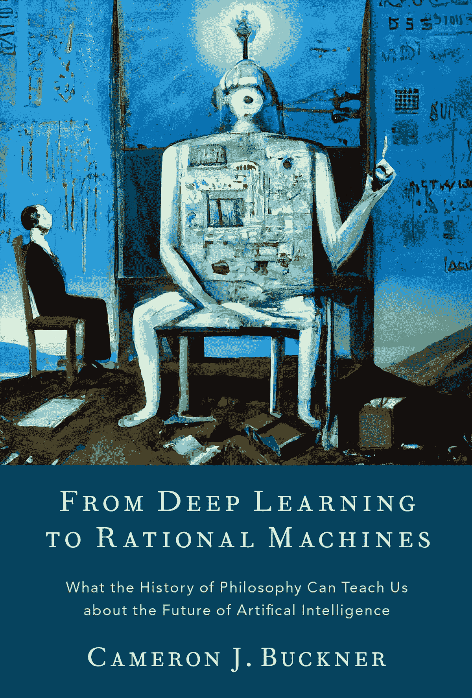


*本书献给我的祖父 Roland J. Melinsky，我们在本书创作期间因 COVID-19 失去了他。他是我遇到过的最好的人。*

## 前言

如今试图写一本关于当代深度学习哲学意义的书，有点就像试图在野马全速奔跑时为其上鞍。我从 2015 年就开始计划这本书，当时已经很明显，深度神经网络从根本上改变了计算机视觉的游戏规则。尽管在成年后的大部分时间里，我对人工智能（`AI`）以及人工神经网络的哲学意义有着专业兴趣，但我一直认为，距离实现 `AlexNet` 及其后续模型在图像标记任务上取得的成功还有几十年的路程。正当我开始觉得自己理解了像 `AlexNet` 等深度卷积神经网络在计算机视觉领域成功的基本原理时，我意识到我在另一个完全不同的领域已经落后了好几年。

本书的核心目标是探索深度学习的哲学意义，特别是它如何影响我们对人类认知和社会相互作用的理解。我认为，深度学习的快速进展提供了一个独特的机会，让我们重新审视经验主义与天赋论之间长期以来的哲学争论。在此过程中，我将引入“领域通用模块化架构”（`DoGMA`），这是一个植根于温和经验主义观点的框架，它强调了主动能力和感官经验在复杂神经架构发展中的作用。

在整个章节中，我将建立哲学、心理学和计算机科学历史之间的联系。我的目标是超越当前 `AI` 讨论中常见的简单极端观点，而是提出一种更细致的方法，以考虑到人类智能的复杂性。我希望这项工作为哲学家和工程师在寻求理解和应对人工智能未来时，提供一条富有成效的路线图。

本书的剩余章节采用了“每周一位哲学家”的格式，聚焦于一位历史经验主义者的观点，他们对某种能力拥有一种特别有趣且实用的理论，并展示了他们关于该能力的一些最宏大的想法是如何在近期的深度学习研究中实现的。

在`第 3 章`中，我关注了`约翰·洛克（John Locke）`对感知能力的观点。`约翰·洛克`在试图解释我们如何通过与示例交互获取通用类别表示时，提出了几种形式的感知抽象，我阐述了他的某些想法是如何在深度卷积神经网络中实现的，这种神经网络正是`AlexNet`等类架构的基石。

在`第 4 章`中，我关注了`伊本·西那（Ibn Sina / Avicenna）`对记忆的见解。`伊本·西那`对情感在记忆中的作用有种有趣的看法，认为这种能力在强化学习和理性决策中起着关键作用。我将`伊本·西那`关于记忆的思想与利用深度强化学习的深度学习成功模型联系起来，例如`DeepMind`的`Episodic Controller`（情节控制器）架构，它能够以超人类的性能水平玩`Atari`游戏。

在`第 5 章`中，我探索了`大卫·休谟（David Hume）`关于想象能力的观点。`大卫·休谟`对想象力持有一种特别丰富且宏大的看法，将其视为一种心理实验室，在实验室里，可以通过创造性的方式融合旧思想来创造出新的复合思想。我解释了`大卫·休谟`的理论如果成功，如何反驳如`杰里·福多（Jerry Fodor）`等批评者对经验主义提出的某些最严重的反对意见。然后，我讨论了生成对抗网络如何被视为实现了`大卫·休谟`的一些最具推测性和宏大的想法。我还讨论了更近期、更强大的生成架构，如`DALL-E 2`和`MidJourney`背后的架构。我回顾了此类架构如何通过修改以提高其输出的新颖性，从而模拟更像人类的创造力，甚至可以用于离线学习的模拟输入或对未来结果的规划，正如`DeepMind`的`Imagination-Augmented Agents (I2A)`（想象增强智能）架构中所发现的。

在`第 6 章`中，我回顾了`威廉·詹姆斯（William James）`的注意力理论。我回顾了认知心理学赋予注意力的各种角色和功能，认为`威廉·詹姆斯`的理论最有机会解释单一能力如何胜任所有这些角色。我解释了`威廉·詹姆斯`的观点为何与机器学习中日益兴起的预测性方法契合得如此完好。我解释了名为`self-attention`（自注意力）的机制在`transformer`架构中是如何运作的，这些架构在自动翻译、文档摘要以及创作类类论文和文章等语言处理任务上展示了巨大的成功。我还论证了，注意力需要在建模认知控制方面发挥重要作用，以调节和协调其他能力的操作。

在`第 7 章`中，我讨论了`索菲·德·格鲁希（Sophie de Grouchy）`关于社会认知和道德的观点。`德·格鲁希`对共情的起源（婴儿期的早期经验）持有一种特别有趣的经验主义观点。我认为，人工社会认知的研究面临着吸纳过多理性主义假设并走入死胡同的危险，我建议对人类的道德和社会认知的准确建模将需要回溯，以开发更佳的人类情感反应和学习模型。

我也感谢国家科学基金会提供的学者资助（#2020585），该资助为本专著提供了支持；并感谢勒弗霍姆智能未来中心以及剑桥大学克雷尔学院在我在 2022 年夏天期间提供的奖学金资助。

## 关于历史著作缩写引用的说明

### 对亚里士多德的引用

免费在线版见：[`classics.mit.edu/Browse/browse-Aristotle.html`](http://classics.mit.edu/Browse/browse-Aristotle.html)

对亚里士多德的引用将提到作品名称（例如 *De Anima*）、卷数和贝克尔页码（Bekker numbers）。

### 对洛克的引用

免费在线版见：[`www.gutenberg.org/`](https://www.gutenberg.org/)

#### E

Locke, J. 1690. *An Essay Concerning Human Understanding*. Edited by P. H. Nidditch. Oxford: Oxford University Press, 1979.

注：对 `Essay` 的引用将包含 `BigRoman.smallroman.arabic` 格式的 `Book.Chapter.Paragraph` 数字（例如 II.ii.2）。

### 对休谟的引用

免费在线版见：[`davidhume.org/`](https://davidhume.org/)

#### T

*A Treatise of Human Nature*. Edited by D. F. Norton and M. J. Norton. Oxford: Clarendon, 2007.

注：对 `Treatise` 的引用将包含阿拉伯数字形式的 `Book.Part.Section.Paragraph` 数字，后接 SBN 码。

#### EHU

*An Enquiry Concerning Human Understanding*. Edited by T. L. Beauchamp. Oxford: Clarendon, 2000.

注：对 `Enquiry` 的引用将包含阿拉伯数字形式的 `Book.Part.Section` 数字，后接 SBN 码。

### 对伊本·西那（阿维森）的引用

目前没有伊本·西那著作的标准本，这使得引用变得复杂。除非另有说明，对伊本·西那著作的引用将采用 Rahman 的译本：

Rahman, Fazlur (trans.) (1952). *Avicenna’s Psychology.* Westport, CT : Hyperion.

注：引用将提到原作的阿拉伯语名称（例如 *Najãt*）。

### 对詹姆斯的引用

#### PP

James, W. (1890). *The Principles of Psychology, Vol 1.* New York: Henry Holt and Co. [`doi.org/10.1037/10538-000`](https://doi.org/10.1037/10538-000)

### 对德格鲁西的引用

对 De Grouchy 的引用均采用 Sandrine Bergès 翻译的最新版本：

De Grouchy, S. Sophie de Grouchy’s “Letters on Sympathy”: A Critical Engagement with Adam Smith’s “The Theory of Moral Sentiments.” Translated and edited by Sandrine Bergès and edited by Eric Schliesser. Oxford New Histories of Philosophy. New York: Oxford University Press.

注：对 De Grouchy 的引用将包含罗马数字。

## 温和经验主义与机器学习

## 玩火？

### 1.1. 天性与培养

在人类探究中，引入宏大的二元对立——善与恶、凡俗与神圣、情感与理性——可能具有如同发现火一般的至关重要的意义，并伴随着随的危险。“天性与培养”的区别就是一个典型的例子。这种对立数千年来一直激励着人类的智力，促使几乎每个学科都对竞争性的风格进行系统性的探索。对于人类知识是通过向内挖掘我们的先天禀，还是通过向外解读经验的密码产生的，我们往往有强烈的直觉，而这些直觉提供的能量推动了各种科学技术的创新。然而，正如其他普罗米修斯式的交易一样，这些进步是以产生新的且持续的危险为代价的。剧烈地摩擦这些对立的直觉可能会产生摩擦而没有启示，导致理论学家在实证前景早已冷淡多年后继续追求某项研究计划，或在误解和夸张的迷雾中迷失了彼此观点的细节。当然，火烧得太大可能会危险地失控。为了不被灼伤，这些区别必须被持续观察和仔细照料——特别是当一种强大的新燃料源被投入火焰之中时。我们现在正处于这样的大火之中，而这种新的燃料源被称为“深度学习”。事实上，深度学习的资金和研究目前正如火如荼；截至 2023 年，每家主要科技公司的旗舰研发小组都专注于深度学习，并为顶尖人才展开了激烈的争夺。《科学》和《自然》等权威期刊的大多数文章介绍了这些小组的最新实验。这些出版报告了人工智能（`AI`）的一系列转型突破，包括能够像人类甚至更好地识别自然照片中复杂对象的系统；在象棋、围棋、将棋或《星际争霸 2》等策略游戏中击败人类大师；创造有时与人类作品无法区分的新颖图像和文本；筛选最微弱的无线电回波以发现数千光外恒星轨道的新外行星；处理粒子加速器产生的海量数据以试图寻找物理学标准模型的反例；以及比致力于此项任务的人类微生物更准确地预测蛋白质的折叠方式。[¹]

简而言之，深度学习目前的进展正如火如荼；但正如所有知识获取系统一样，我们对其持续繁荣的预期，取决于我们对“先天与后天”二元对立观的看法。因此，深度学习的现状和未来发展深受哲学立场的深刻影响，特别是那些在具有历史基础但仍在持续的经验主义与天赋主义之辩论中提出的观点。

初看之下，这场辩论关乎人类知识的起源：经验主义者认为知识源于感官经验，而天赋主义者倾向于理性主义者，他们看重我们的推理能力——这种能力通常由对世界基本结构的内在理论和/或对理性心灵的内在理论驱动——作为真正知识的来源。²² 当被视为一种 `AI` 方法时，深度学习已被识别为一种倾向于后天培养的经验主义风格理论，尽管我认为它的成就证实的了一种中度经验主义的认知方法，这种方法比在对深度学习潜力评估中通常调查的经验主义更为微妙且资源丰富。这种中度经验主义方法通过对影响力的经验主义哲学家著作中哲学辩论历史起源的调查，以及将其观点应用于机器学习模型与心灵之间的关系而获得了合法性，它表明，今天深度学习的成就极大地增加了理性认知可以实现的可能性——而且在人类、许多动物以及（如果我们希望成功的话）人工智能体中已经实现——无需那些对立的、倾向于先天的理性主义理论派所通常推荐的内在理论或概念。

当经验主义者和天赋主义理论者为深度学习系统开发的过去、现在和未来争论时，工程和商业领域目前对经验主义的热热正威胁着要失控——尽管这种特定的经验主义有时从对深度学习系统成功与人类动物实际解决问题方式之间关系的简单理解中获得氧气。研究进展如此迅速，一篇具有影响力的深度学习论文在发表仅两三年后就可能获得 20,000 次引用——其中许多是在它仅在预印本存档上时，这意味着它尚未通过其他学术人员的正常同行评审，而这些人员可以以怀疑的态度评估其主张。

与此同时，领先的天赋主义者正口嘶力竭地呼叫消防队。这些天赋主义者担心，深度学习在没有充分理解其工作原理或为何有效的情况下，被应用于广泛的问题，并且深度学习智能体发现的解决方案是脆弱的，对新情况的泛化能力不如人类和动物部署的策略。取决于你问经验主义者还是天赋主义者，深度学习系统可能已经如此有效地处理输入数据，以至于它们至少具有意识，并正处于实现全球超智能逃逸速度的边缘；或者，它们所做的仅仅是通过大量的统计数据和线性代数来猛击问题，这可以模仿人类智能的外表，但由于缺乏人类心灵内在启动软件所提供的底层结构，它们永远无法捕捉到人类心理即使是最基本的方面。

尽管在先天与后天的二元对立之外，可以从纯技术术语来理解深度学习，因此在经验主义-天赋主义的辩论之外，但很难评估其作为通 `AI` 路径的前景，除非通过它的光芒及其伴随的所有前景和危险。这场辩论无疑有古老的起源，但富有影响力的科学家经常引用其术语。例如，在《Nature` 杂志的一篇文章中，来自 `DeepMind` 的团队介绍了 `AlphaZero`——它可以在围棋中轻松击败人类棋大师，围棋在某些方面比国际象棋更复杂——称它是以 `tabula rasa`（白板）状态运行的（Silver et al. 2017）。心灵的隐喻通过一系列经验主义哲学家变得经典化，从亚里士多德的继承者 `Ibn Sina`（阿维森纳）和`圣托马斯·阿奎那`（后者用亚里士多派格言总结了它，即 `nihil est in intellectu quod non sit prius in sensu`，或“心灵中没有感官中先不存在的东西”——`De Veritate` 2.3.19），到现代早期的经验主义者`约翰·洛克`和`大卫·休谟`，这种观点今天通常与他们联系在一起。³

深度学习的爱好者并不是唯一一个在这一背景下召唤哲学历史的人。当代的天赋主义者也渴望将当前的辩论与历史立场对齐。在他对 AlphaZero 论文的批判中，天赋主义心理学家 `Gary Marcus` 将 Silver 等人的白板语言与洛克联系起来，洛克写道“所有观念都来自感觉或反思”（`E` II.ii.2）。Marcus 完全可以将其与休谟联系起来，休谟宣称“我们所有的简单观念在初次出现时都是源于感官印象”（通常被称为他的拷贝原理——`T` 1.1.7/4）。然而，休谟更频繁地成为 `Judea Pearl` 的目标。最有影响力的在世计算机科学家之一以及深度学习的频繁批评者，帕尔最近担心深度学习理论者将一种“激进经验主义”视为理所当然，根据这种观点，所有知识“可以通过检查数据中条件概率的模式来分析”（2021）。⁴

哲学史确实说明了深度学习的成就，但并非像这些对话者暗示的那么简单。在他们看到鲜明二元对立的地方，`洛克`和`休谟` 将他们的核心格言发展成了复杂的经验主义人类认知理论，这种理论更为微妙和灵活。事实上，深度学习的大多数研究是源于一组与这些哲学家对经验主义较不激进的更一致的假设，而本书的主要任务之一就是阐明究竟哪种版本的经验主义最受到近期进展的支持。

识别并澄清这种在冲突性辩论中经常被忽视的中度经验主义方法，可以为理解深度学习目前的方法以及规划未来突破的最优路线释放未开发的解释力。

不出所意料，即使是今天最著名的天赋论者和经验主义者，对上述口号的解读也截然不同。倾向于天赋论的理论者倾向于将“白板”与最后一场伟大的经验主义大火——美国心理学中的行为主义运动联系起来，这场运动在上世纪中叶达到了权力的巅峰，随后迅速消灭为余烬。此类理论者通常将经验主义的白板理论与对人类学习极度不足的解释联系起来。斯蒂芬·平金克（Steven Pinker）在其著作《白板》（*The Blank Slate*）中清晰地阐述了这一观点。根据平克的说法，如今的经验主义者恢复了行为主义者那注定失败的任务，他们“在整个 20 世纪的大部分时间里……试图通过诉几种简单的关联和条件反射机制来解释所有的人类行为”(Pinker 2003, p. 2)。⁵

Lake 等人还指出了“现代连接主义模型的强有力经验主义”，他们将其等同于“过度简化的行为主义”，而这种主义在世纪后半叶被认知革命所“否定”了（2017, p. 4）。这种据报道的废除发生在诺姆·乔姆斯基（Noam Chomsky）用他的“笛卡尔语言学”浪潮淹没行为主义之时，这种理论明确援引了法国哲学家勒内·笛卡尔（René Descartes）的理性主义天赋论（Chomsky 1966），以此激发他的论点，即通过一套复杂的先天规则来解释人类能力。⁶ 马库斯（Marcus）甚至通过将认知定义为跨越四个变量的函数，使这种经验主义的行为主义解释形式化：

```
cognition = f(a, r, k, e)
```

其中 `a` = 算法，`r` = 表示格式，`k` = 先天知识，`e` = 经验。马库斯对经验主义方法的解读——如前所述，马库斯将其归因于洛克——“会将 `k` 和 `r` 设为零，将 `a` 为某个极小值（例如，相对于强化信号调整权重的操作），并将其余部分留给经验”(Marcus 2018, p. 4)。[⁷


在这一点上，天赋论者实践了某种他们所批判的激进简化，假设为了让心灵在出生时是“白板”的，它必须从几乎完全没有先天结构开始。更为宽容的天赋论哲学家 Laurence and Margolis (2015) 最近担心，将当前认知科学的辩论总结为“心灵是否具有任何先天结构”的问题会导致一个不幸的后果，即“实际上并没有任何经验主义者”。⁸09_chapter.xhtml#oso-9780197653302-chapter-1-note-8 事实上，一个完全没有结构的心灵，就像一块惰性的矿物板，无论受到多少刺激都无法学到任何东西。这似乎是几乎所有有影响力的经验主义者都承认的一点。在行为主义统治的黄昏时期，经验主义哲学家威尔德·范·奥曼·奎因（Willard van Orman Quine）观察到，即使是最激进的行为主义者，如约翰·华特（John Watson）和 B. F.斯金纳（B. F. Skinner），也“有意而快乐地深陷在先天机制中”（引自 Laurence and Margolis 2015(17_bibliography.xhtml#oso-9780197653302-bibliography-1-bibItem-399)）；Quine 1969:95–96)：他们必须假设存在丰富的生物需求、感官机制、注意偏偏和反射行为，这些因素在最简单的关联学习形式开始之前就可以相互关联。该列表上的项目使有机体适应其进化生态位，而无需诉诸于先天知识，这说明了为什么需要对哲学和计算机科学中带有经验主义标签的理论进行更详细的检查。对经验主义理论历史的更系统性的检查很快发现，对先天因素的诉诸比这个列表要广泛得多。因此，虽然马库斯的经验主义形式化模型在影响上比经验主义格言更尖锐，但它的用性也较低，特别是如果我们目标是对深度学习的前景进行宽容的评估。

上述关于经验主义-天赋论二分法的阐述（它影响了深度学习系统的开发），为“天性与培养”二分法对人类思想的持久影响提供了一个范范示例。这两种区分往往被归结为截然对立的二进制，而这场辩论用微妙的连续体和解释风格之间的差异来表示更好。尽管天性与培养之间对立的持续表明知识获取核心存在一个不可解决的哲学谜题，但只要留心，它对我们是有用的。经验主义-天赋论二分法也是如此。当从哲学历史及其精确应用背景进行解读时，它可以鼓励不同研究方法之间进行更有用、更有原则的辩论。

事实上，在科学家付力理解这场辩论历史的情况下，可以看到它促进了上世纪显著的科学发现，例如阿尔伯特·爱因斯坦的狭义相对论，或数字计算机和人工智能网络的发明。科学哲学家约翰·诺顿（John Norton）认为，爱因斯坦的狭义相对论灵感源于他在 1902-1903 年间与数学家康拉德·哈比特（Conrad Habicht）和哲学家莫里斯·索洛文（Maurice Solovine）参加的一个关于《人类性的性的》研读小组，爱因斯坦从中获得了对休因经验主义的深切尊重。在 1946 年的自传笔记中，爱因斯坦写道他发现了同时性的相对性（相对于惯性参考系），这一发现是狭义相对论的基础：“这一核心点在我身上通过阅读大卫·休因和恩斯特·马赫的哲学著作得到了决性的推进”（引自 Norton 2010）。尽管像像伊曼努尔·康德（Immanuel Kant）这样的理性主义哲学家认为绝对同时性是我们先验空间概念必然要求的，但爱因斯坦推理认为，如果这些基础概念是从经验中学习的，那么在极端情况下（例如物体以光速运动时），它们可能会例外。

同样巨大的成就归功于听从缪斯的科学家；神经科学家格蕾丝·林西（Grace Lindsay）讲述了早期神经网络先驱 麦库洛克和皮茨（McCulloch and Pitts, 1943), 第 3 章）。麦库洛克和皮茨认为，这些复杂的逻辑和数学操作可以通过组织在正确网络中的大量简单组件来计算，这一观点直接启发了约翰·冯·诺曼（John von Neumann, 1993）（17_bibliography.xhtml#oso-9780197653302-bibliography-1-bibItem-501）和弗兰克·罗森布特（Frank Rosenblatt, 1958）（17_bibliography.xhtml#oso-9780197653302-bibliography-1-bibItem-602），他们的作品分别产生了负责数字微处理器架构和深度神经网络的对立研究传统。

在这里，我认为 AI 领域天赋主义与经验主义之争的现状，为我们提供了一个类似的黄金机会，我们可能会尝试实现一种极其罕见的智力炼金术：将一个永恒的哲学谜题转化为一个可测试的实证问题。因为，如果我们能够在不混乱或漫画化的情况下将这种区分引入深度学习争论，那么我们只需要根据天赋主义原则构建一些人工智能智能体，根据经验主义原则构建另一些，然后看看哪种最终最成功或最像人类即可。具体而言，我们可以手动为天赋主义系统编写先天的抽象知识，并赋予经验主义系统从感官经验中学习抽象知识的通用能力，然后比较系统在系列重要任务上的表现。然而，关键在于，如果我们旨在举办一场公平且富有启发性的竞赛，必须允许这场竞赛中的经验主义者比马库斯（Marcus）的形式规范拥有更多的原材料。

如果我们能完成这种转化，哲学家和计算机科学家都将获益。在哲学方面，经验主义者经常被指控在理性认知理论的关键点诉诸“魔术”。例如，洛克和休谟经常断言，心灵执行了某些操作，使其能够从经验中提取出某些特定的抽象知识，但——考虑到当时对大脑运作的理解非常有限——他们无法解释具体是如何做到的。仔细研究近期深度学习成就的细节可能会弥救其中一些最大的这类“期票”，通过展示了根据经验主义原则构建的物理系统实际上是如何执行这些操作的。将哲学争论索引到这些系统中，可以进一步提高其清晰度；当哲学口号模糊且具有可解释性时，计算模型是精确的，其所有假设都暴露在哲学审视和实证验证之下。如果获得成功，经验主义理性认知路径的合理性将大大增加。在计算机科学的益处方面，哲学家们一直长期深入地思考如何提供一个与经验主义限制一致的完整的人类心灵方法这一挑战，包括心灵的各个组件如何相互作用，并扩展到最高形式的抽象知识和理性认知。深度学习直到现在才在它的建模雄心上触及这些高度（例如，Goyal and Bengio 2020），因此从经验主义哲学历史中可能仍有可以挖掘的见解，这些见解可以转化为下一个工程创新。

为了这些目标，我在此对近期深度学习成就的前景和意义开展了跨学科调查，结合了计算机科学和哲学的见解。这样做既可以用经典哲学争论的温暖和智慧为当前的工程研究注入活力，同时使该争论的术语比其漫长而卓越的历史中的任何时候都得更加清晰。尽管如此，我知道这样的跨学科项目面临着其独特的风险。理查德·埃文斯（Richard Evans）——是 DeepMind 的一名跨学科研究人员，他试图通过从康德的《纯理性批判》（*Critique of Pure Reason*）中提取逻辑格言（包括康德上述的同时性格言）来增强深度学习系统，以创建更强大的系统；他对带着此类雄心启动的项目提出了一个有益的警告：

> 这是一个跨学科项目，因此时刻面临着“两头落空”的危险，既在哲学上不忠于康德的意图，又对 AI 研究做出有意义的贡献。康德本人曾给出：“不要同时从事两项在处理方式上截然不同的工作，因为每项工作可能都需要专门的天赋，而将这两者结合在一个人身上只会产生笨脚蛋。” [AK 4:388] 这种部分是 AI 又是哲学的跨学科项目的危险在于，两个潜在受众都将无法满意。（Evans 2020:18）

我们把埃文斯（以及康德）的警告记在心上。然而，我们也必须承认，部分由于深度学习涉及天性与培养的区别，哲学家们特别适合承担这个项目。无论我们的其他失误如何，我们都有处理这团特定火的经验。然而，要继续下去，我们必须完全放弃“凳子”。通过建立一个更具包容性的平台（为各种背景和专业知识留出充足空间），我们将更好地衡量深度学习目前和未来的成就。鉴于目前应对深度学习潜力的理论者之间的讨论非常激烈，最高效的方法是降低争论的温度直到烟消云散，并邀请来自各种背景、具有独特专长的理论家耐心工作。

## 1.2 如何冷静情绪：从形式和石板到学习风格

感谢几个学科的严谨研究，我们今天知道几乎所有知识都源于先天和经验因素的结合。简之，激进的天赋主义和激进的经验主义都是错误的。尽管如此，对经验主义与天赋主义区别的细致阐述仍然是例外，并且几乎没有出现在关于深度学习的讨论中。⁹, 2015）。根据他们对历史和近期文献的综述，将行为主义黄金时代前后的天赋主义-经验主义之争解释为两种不同的基于学习的解释风格是更有成效且通用的：

> 对于当代哲学和认知科学领域的理论者来说，分歧围绕着构成概念获取的先天心理结构的特征展开……根据经验主义方法，很少有（如果有的话）先天概念，而概念获取在很大程度上受少数反复参与的先天通用认知系统的控制……与此相反，天赋主义方法认为，先天的概念和/或先天的特殊用途认知系统（具有不同程度的专门化）与通用认知系统一起，在概念发展中起着关键作用。（2015, p. 4）

激进行为主义者禁止对内在心理表征和功能进行理论化，因为他们担心无法为它们的存在提供客观的经验证据。这种对内在心理实体的理论化禁令应该被拒绝，因为无论是此前的经验主义哲学，还是今天的大多数深度学习理论者都是反对这一点的。事实上，正如早些时候过的，今天双方都同意：心灵起始于大量强大的先天结构，认知涉及内部表征与功能之间复杂的交互，而且绝大多数概念是从经验中学习或获取的。然而，双方对于究竟什么是先天的仍然存在分歧。天赋主义者认为，领域特定的抽象只能从大量先天的、特殊用途的概念或学习系统中高效推导出，这些系统是进化为特定类型的问题设计的；而经验主义者认为，通用学习程序可以与较少的领域通用认知资源协作，解决广泛的问题类型。

### 领域通用 vs 领域特定系统

以这种方式处理问题，将天赋主义与经验主义方法之间区别的权重置于领域通用与领域特定认知系统或表征之间的相应区别上。这种对比反过来可以根据先天资源所响应的输入范围来索引：高度领域特定的先天资源只会被少数非常精确的刺激或情境触发，而高度通用的资源可以灵活地应用于广泛的刺激或领域。

例如，一个只控制舌头弹射动作且仅由苍蝇触发的先天捕食检测模块，比一个可以记录任意经验的先天记忆库更具有领域特定性。领域特定心理构念的范式例子是动物学家康拉德·洛伦茨（Konrad Lorenz）提出的“先天释放机制”。他用锁和钥匙的比喻解释了这些系统：进化通过先天的刺激模式（“标志性刺激”）准备有机体，这些模式独特地适用于解锁适应于响应这些特定刺激以提供适应度优势的行为反应 (Lorenz 1935; Ronacher 2019)。相比之下，全能记忆库可以对任意输入执行其存储和检索功能。

### 天赋主义的连续体

领域通用与领域特定认知系统之间区别的问题在于，如何计算输入。虽然之前的舌头弹射例子是一个被广泛接受的说明性起点，但通过通过探索一些特定的天赋主义和经验主义观点，我们可以更好地体会到这种区别的实质。让我们从天赋主义开始。和经验主义一样，天赋主义可以被理解为一个连续体，并相应地以更严格或不严格的形式表现。

光谱最激进的一端是柏拉图和杰里·福多（Jerry Fodor）的观点，根据这些观点，心灵拥几乎每一个简单概念都是先天的，包括——正如福多特别暗示的那样——高度领域特定的概念，如化油器、波士顿和夸克 (Fodor 1975; Laurence and Margolis 2015)。

在连续体更下游的位置，也许是乔姆斯基语言学的一些最广泛草案，这些草案假设了数百个被认为人类语言通用的先天语法原则和调节参数——“普遍语法”，用以解释人类如何在有限经验的情况下高效定位其母语的精确语法 (Chomsky 1986; Dąbrowska 2015; Lasnik and Lohndal 2010)。根据乔姆斯克的观点，这些原则的大多数只会被非常特定的语法结构激活，因此这种版本的普遍语法似乎是一个高度领域特定的先天系统。

#### 进化心理学视角

其他天赋主义者从进化心理学中获得灵感；例如，Laurence 和 Margolis 勾勒了一个仍然庞大但偏向生物的特殊系统列表，用于处理“物体、物理因果、距离、运动、空间、时间、几何、代理、目标、感知、情感、思想、生物种类、生命阶段、疾病、工具、捕食者、猎物、食物、危险、性别、亲属、群体成员、支配地位、地位、规范、道德、逻辑和数字” (Laurence and Margolis 2015):120)。Laurence 和 Margolis 认为这个列表可能意味着每一类都有先天概念，或者是从经验中获取这些概念的先天学习模块。然而，对于他们以及其他相似的天赋主义者来说，关键在于：心灵需要一套相当复杂且高度专门化的启动软件，以类人类的方式学习这些情境。

其他被归为天赋主义的当代观点，在天赋禀赋的假设上倾向于光谱中更具领域通用性的一侧。马库斯（Marcus）列出的机制比劳伦斯（Laurence）和马戈利斯（Margolis）更短且更具通用性；而斯佩尔克（Spelke）和凯瑞（Carey）等核心知识发展心理学家——他们是人工智能领域中较为温和的天赋主义者的喜爱，如 Mitchell (2019) 和弗朗索瓦·Chollet (2019)](#17_bibliography.xhtml#oso-9780197653302-bibliography-1-bibItem-121)——仅要求少数非常通用的先天概念，如物体、代理、社会实体、因果、数字和空间 (Carey and Spelke 1996; Spelke 1994)。无论在这里如何计算输入的数量，“物体”和“数字”所应用的刺激和情况几乎都比疾病或亲缘关系广泛得多，它们应该被视为更具领域通用性。乔姆斯基（Chomsky）计划的后期版本——在他 20 世纪 90 年代初采用“极简主义”之后——旨在将特定的语言特定原则列表减少到可能仅剩一项，即连接不同类型结构化表示的规则，被称为 `Merge` (Berwick and Chomsky 2016; Chomsky 1993)。最近，乔姆斯似乎已经接受了 `Merge` 也可能有效适用于一系列非语言领域的可能性，转而关注于结论：人类必须拥有某种先天的认知机制，允许我们（且仅我们）学习完全递归语言 (Berwick and Chomsky 2017)。

至此，我们可以看到天赋主义和经验主义立场之间的差距已经大幅缩小——在这里被一位裁判判为“轻微的天赋主义”，在另一处可能被另一个人判为“大部分是经验主义”。但我们不应该让计分上的细微纠葛掩盖了在关于连续体极端情况的不合理性上已经形成的共识程度。¹³

转向经验主义，它同样（如前所述）包含各种变体。然而，经验主义者通常旨在是将先天的领域特定学习机制列表——特别是那些调用先天概念或思想的机制——消灭于无形。值得注意的是，之前提到的洛克（Locke）和休谟（Hume）的经验主义格言只涉及心灵初始思想或概念的起源（以及它们的表示内容）。从背景来看，很明显，当洛克谈论心灵在经验之前是空白的时，他指的是它的表征结构（洛克术语中的“思想”），而不是它的架构或基本功能。正如《斯坦福哲学百科书》（*Stanford Encyclopedia of Philosophy*）关于洛克的条目所巧妙描述的那样：

> 虽然心灵在内容方面可能是一块白板，但显而易见，洛克认为我们出生时就具有各种功能来接收内容，并在一旦获得内容后对其进行操纵或处理的能力。例如，心灵在组合简单思想时可以进行三种不同类型的操作 .…… 除了这些能力之外，还有如记忆之类的功能，它们允许思想的存储。（Uzgalis 2020)

由于必须将这种温和的经验主义与行为主义解释区分开来，我此后将这一理论称为“起源经验主义”。重要的是，起源经验主义并不禁止在从经验中提取思想的过程中涉及其他活跃的、先天的因素，也不禁止先前获得的思想在引导抽象过程中起的复杂作用；事实上，洛克和休谟都大量地调用记忆、想象和反思等先天的通用功能，以及先验获得的思想之间复杂的相互作用，尽管他们强调用于构建这些抽象的简单思想源于感官。¹⁴

在人工智能的背景下，经验主义极简主义自人工智能的前史就开始了，本章开头引用的图灵引言证明了这一点，这句话本身可以被看作洛克和休谟经验主义格言的延续。然而，当天赋主义将历史经验主义与神经网络建模联系起来，他们仍然倾向于将经验主义人物解读为原始行为主义者，尽管行为主义具有上述的例外地位。这反过来导致天赋主义者在经验主义者在其抽象解释中调用先天功能时感到困惑。例如，在面对休谟频繁诉诸先天的想象功能时，福德（Fodor）和皮利申（Pylyshyn）指责他“作弊”，因为这种功能显然是`他`没有权利使用的（1988:50）。这种指控给休谟背上了一个严格受限且几乎没有解释力的观点；但重要的是，休谟的“复制原则”（Copy Principle）仅说明“初次出现时的简单思想”必须源于经验。它并没有说像想象这样的通用功能也必须被学习。只要休谟的想象可以在不调用先天思想的情况下完成它的工作，只有当我们坚持桥牌赛规则要求他缺席这一轮时，休谟才是在“作弊”，而他发出的打印邀请函显然提议的是一场黑黑牌游戏。换句话说：也许是福德对休谟的解读出了问题，而不是休谟对想象的诉诸。¹⁵

许多像福德这样的天赋主义者倾向于字面上地解释像复制原则之类的格言——就好像概念只是印象完全相同的复制——但像劳伦斯和马戈利斯这样更宽容的读者允许经验主义者在制造心灵的思想或概念时，调用比仅仅复制印象更丰富的心理过程。这就是为什么我遵循劳伦斯和马戈利斯的观点，认为对辩论进行更有成效解释的方式（特别是在人工智能未来的背景下）仅涉及为了实现类人认知而必须手动编程到心灵中的先天概念和学习系统的数量及其领域特定性。

事实上，最近的深度神经网络（DNN）模型提供了一套标准的变换操作工具箱，可以在不调用任何先天概念的情况下进行强大的计算工作，这暗示了一种解释存在于休谟等人身上的经验主义精神的替代方法。也就是说，心灵在构思其概念或思想时，可能会更有创造性地按摩和操纵源自感官的信息。¹⁶ 虽然我认为洛克和休谟等经验主义者从一开始就认为经验主义与机械复制是一致的，但为了清晰起见以及为了我们的研究，我建议将经验主义的基本准则——复制原则完善为我所说的“转换原则”（Transformation Principle）：

```
复制原则：“我们所有初次出现的简单思想都源于简单的[感官]印象。”
```

```
转换原则：心灵的简单概念（或构想）在初次出现时源于感官印象系统性的、领域通用的转换。”¹⁷
```

# 转换原则与经验主义


转换原则明确指出，经验主义学习方法包含了多种默认操作，这些操作可以通过系统性的转换（例如拓扑学中所研究的转换）来改变输入内容的结构。最初，这些默认方法应该是领域通用的，这意味着它们并非天生地锁定到特定领域中的某一组特定特征（例如面部、部落归属或生物学分类）。根据经验主义，这种领域特定的转换可以在稍后通过学习，对这些通用操作进行特化来推导出来。

这种提炼使我们能够理解我认为从深度学习的成就中得出的最大教训：一组通用的层次化转换方法可以经过训练，以解决直到最近一直困扰着大多数天赋主义启发 AI 进展的广泛问题。转向“转换”这一术语也强调了，经验主义方法的基础工具箱在计算能力上远强于激进行为主义所推崇的元素刺激反应学习形式（例如经典条件反射和操作性条件）。

## 评价近期争议

用这些术语重新设定关于 AI 的辩论，可以使近期关于著名模型经验主义含义的争议变得清晰。如果没有这种重设定，通过起源经验主义视角来理解深度学习进展的洞察将继续受阻。这种障碍源于 Marcus 的指控，认为 `Silver et al.` 过度解读了 `AlphaZero` 系统在围棋上胜利的经验主义含义 (Silver et al. 2017)。为了支持他的指控，Marcus 特别指出：(1) `AlphaZero` 依赖蒙特卡洛树搜索 (`MCTS`) 来探索可能的移动的影响；(2) 它的某些神经网络参数（如卷积层的大小）在训练开始之前专门针对该游戏进行了微调。^(18

然而，根据前述论点，如果该机制同样适用于广泛的其他领域，那么使用 `MCTS` 探索移动与起源经验主义是一致的（而将 `AlphaGo` 的卷积参数专门针对围棋进行配置确实更令人怀疑）。本着类似的精神，Marcus 在 2017 年于纽约大学与深度学习先驱 `Yann LeCun` 的公开辩论中，指出 `LeCun` 人关于深度卷积神经网络“最著名”且“极具价值”的作品与其自己的经验主义不一致，因为它涉及“天生嵌入的平移不变性”，或者假设重要属性倾向于在系统输入维度（如尺寸、位置、取向或持续时间）的变化中保持不变 (Marcus 2018b)。Marcus 引用 `LeCun 等人 (1989) 对平移不变性的描述为“对任务的先验知识”，并认为这是一个揭示性的“破绽时刻”。但如果对平移不变性的偏好被构建在模型中，使其能够默认应用于非空间领域的各种其他刺激和任务中，那么这种偏好显然与起源经验主义是一致的。^(19

## 天赋主义 vs 深度学习

Marcus 将深度学习近期向更复杂架构和归纳偏置的趋势解释为对理性主义天赋主义的证明，但即使是 Marcus 也必须承认，这些通用的、基于结构的偏置与天赋主义传统上推荐的更多、更具体的先天表类型大相径庭。例如，`Descartes` 和 `Leibniz` 假设所有的欧几里得几何都包含在我们内在的思想中 (Janiak 2020, Ch. 5)。

然而，根据上述论点，深度卷积神经网络 (`DCNN`) 对平移不变性的偏好比这种先天的几何性更谦虚且应用更广；它涉及的欧几里得几何假设少得多，同时更广泛地适用于任何具有正确类型模式的非空间数据。^(20 此时至关重要的一点是承认，这不是偏置的原始或主要进化功能的问题；经验主义者可以自由同意进化考虑对于理解大脑组织是重要的——并且也许空间推理的需求构成了一种重要的适应压力，有利于施加了如平移不变性等约束的动物大脑。深度学习面临的核心问题在于，如何在人工系统中最好实现这些偏置。

## 归纳偏置的未来

因此，向领域通用归纳偏置的近期趋势反映的并非理性主义天赋主义的证明，而是发现了更灵活、领域通用、受神经启发的建模方法，在那些配备了领域特定、手动编码符号假设的系统已经可靠且反复失败的问题上，可以带来巨大的性能提升。

为了理解这一实证和概念上的进步，关注归纳偏置在头脑中的表达方式更有用。天赋主义者倾向于将这些归纳偏置手动编码为符号格式，使其解释具有透明性并将其应用限制在特定领域；而经验主义者则倾向于使用更全局的网络结构来实现它们——如果这些结构具有独立的神经解剖支持，则会加分。这里的网络理论家强调，后者方法将偏置应用于更广泛的领域和情况，允许领域特定的表征出现，并在非常不同类型的输入之间以潜在的不可预测和偶然的方式建立联系。简而言之，无论哲学立场如何，领域通用归纳偏置对于深度学习而言都是至关重要的。这解释了为什么今天大多数深度学习理论者不仅不隐藏他们对领域通用归纳偏置的诉求（仿佛这些是对其天赋主义批评者的尴尬妥协），反而公开拥抱它们，将其作为自己研究计划的最大成就和未来方向。

我们在 DeepMind 的主流观点中看到了这一点——正如 Demis Hassabis 和 Matthew Botvinick 等资深人物在小组立场论文中所述的那样(Botvinick et al. 2017; Hassabis et al. 2017)——这种观点与我们此处推荐的温和起源经验主义更为相似。²¹ 例如，在对 Lake 等人（2017 年） 批评的回应中，他们认为 AI 应该致力于设计能够“自主学习和思考”的智能体，摒弃“人类手工工程”和“表征结构”，转而采用“更大规模的架构和算法因素”，让智能体能够自主获取领域特定知识(Botvinick et al. 2017)。深度学习的另一位核心人物 Yoshua Bengio 也支持需要更复杂的神经网络架构，这些架构应具有多个结构，以实现一组领域通用的归纳偏置(Goyal and Bengio 2020；请参见 表 1.1)。因此，今天相关的问题不在于是否允许经验主义者拥有任何先天结构或架构，而是如何利用带偏的领域通用转换方法，从传入的感官经验中提取出多少领域特定知识，又有多少需要领域特定的编程——无论是通过基因进入大脑，还是通过计算机科学家进入硅片——以便类人学习和经验能够真正开始。²²)

#### 表 1.1 Goyal 和 Bengio (2020 年) 推荐的领域通用归纳偏置列表，旨在允许基于 DNN 的系统跨越多个领域提取领域特定正则性

| 归纳偏置 | 对应属性 |
| --- | --- |
| 分布式表征 | 特征模式 |
| 卷积 | 群的等变性 |
| 深度层架构 | 复杂函数是更简单函数的复合 |
| 图神经网络 | 实体和关系的等变性 |
| 递归连接 | 时间的等变性 |
| 软注意力 | 排列等变性 |

虽然双方似乎已经中和会合，但我们不应忽视这样一个事实：他们仍然从不同的来源汲取灵感，并为未来的 AI 进展推荐不同的方法论。例如，DCNN 背后的关键结构灵感来源于神经解剖学研究而非天赋主义发展心理学(Hubel and Wiesel 1967)，而且它首先由神经网络建模者实现，这些建模者至少认为自己受经验主义准则的驱动(Fukushima and Miyake 1982)。此外，许多当代的天赋主义者仍然想要更具体、更广泛的先天知识，并强调完全不同的证据来源。例如，Evans 旨在赋予深度学习智能体以康德关于空间先验直觉原理或“感性的主观条件”，建议为基于 DNN 的系统一组至少六个 Prolog 公理，这些公理是他从康德的《纯理性批判》中推导出来的(Evans 2020, 第 6 章)；Marcus 仍然正式推荐“混合”系统，将神经网络与手动编程的符号规则和知识结构相结合，这些结构并非从经验中提取的，而是从天赋主义发展心理学的显性理论中提取的。因此，当前经验主义者和天赋主义者所推荐的研究计划之间存在明显的实践对比，而深度学习近期对通用归纳偏置的倾向并无滑入滑坡效应滑向柏拉图天堂的危险。

### 1.3 从二元对立到连续体

无论如何，根据我们早的讨论重新构想当前的天赋主义和经验主义立场，可以使更多样化的观点沿着连续体排开，并让个体理论者根据目前的实证证据，决定连续体中的哪个区域最能捕捉智能或理性大脑的组织。然而，为了进一步协助这种构想，我们必须明确当前辩论中其最激进的对立点。一方面，让 Marcus 和 Pearl 担忧的激进经验主义体现在 DeepMind 附属人员 Rich Sutton 在 2019 年的一篇广传的博客文章《痛苦教训》（The Bitter Lesson）中。²³ Sutton 认为，七年的 AI 研究应该让我们所有人担心，“长期来看只有利用计算是重要的”(Sutton 2019)。根据这种怀疑的观点，之前模型中的领域特定知识编程可能是无关甚至是适得其反的，因为它阻碍了向其他任务的泛化。在这种观点下，从 Deep Blue 到 AlphaGo，真正提升 AI 成就的唯一因素是将越来越多的计算应用于越来越大的数据集。即使是目前最大的深度学习模型——拥有 1750 亿参数和超过 400 亿 token 训练集的 GPT-3，或者拥有 5400 亿参数的 PaLM——也被某些人认为其参数少于人类大脑（后者估计有 10 万亿个可调节突触连接）(Hasson, Nastase, and Goldstein 2020)。《痛苦教训》的支持者假设，只要我们停止以任何形式手动将人类知识编写进机器，而只需将更多数据和计算应用于问题的解决，通用智能就会自然产生。这种激进经验主义是由不断扩大的网络和数据集的“扩展研究”结果驱动的；这项研究旨在表明，通过将现有技术扩展到数量级更多的训练或计算，可以产生质的新行为形式 (T. Brown et al. 2020](#17_bibliography.xhtml#oso-9780197653302-bibliography-1-bibItem-81))。尽管我不认为这是《痛苦教训》的正确解释（甚至不是 Sutton 建议的教训），但这种极端的经验主义解释——结合光谱另一端的极端天赋主义解释（这可能对应于之前讨论过的中后期乔姆斯基或福多的观点）——将形成我们用来描绘书中捍卫的温和起源经验主义发展的有用斯基拉海礁和卡里比斯礁。²⁴。

当我们不仅考虑连续体的激进端点，还考虑其连续性时，我们可能会注意到手动编程到 AI 系统中的表征结构程度构成了一个中心轴，在过去的七十年里，AI 方法沿着这一轴来回摆动。20 世纪 60 年和 70 年代，在乔姆斯（Chomsky）以及 AI 先驱艾伦·纽维尔（Allen Newell）和赫伯特·西蒙（Herbert Simon）的指导下，摆钟向高度的手动编程结构倾斜，并在 AI 的“专家系统”方法中找到了其最高表现（Newell and Simon 1976）。在这种方法上——约翰·Haugeland (1985) 著名地称为“GOFAI”，即老式人工智能——进步的实现是通过对人类专家进行汇报，以提取抽象的“启发式”知识，这些知识允许他们高效地搜索问题的解决方案，然后将这些知识以显式规则和符号的形式手动编程到机器中（当然，他们并不认为这一切都是先生的；但他们不知道如何创建能够自己学习这些启发式知识的系统）。^25IBM 的深蓝系统在 1997 年国际象棋中击败了加里·卡斯帕罗夫（Campbell 1999），以及它的 Watson 系统在 2011 年的《危险一答》中击败了人类冠军肯·詹宁斯（Ferrucci et al. 2010），都是这一传统的产物，^26 位于德克萨斯州奥斯汀 Cycorp 的 Cyc 系统也是如此，它可以被视为最顽强且持久的典范（Matuszek et al. 2006）。然而，今天大多数人认为关于先验知识程度和领域特定性的哲学辩论所得出的连续体，与 AI 中关于手动编程到人工大脑的符号知识表征的数量和特定性的相应方法论辩论是对齐（图 1.1）。^27

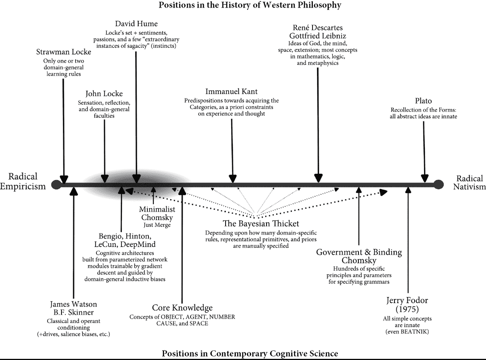

**图 1.1** 根据哲学史和当代认知科学中认同的先验观念的数量和领域特定性，各种思想家和立场的分布。连续体左侧的阴影部分表示经验上仍然可能的观点空间。将贝叶斯方法放在此类连续体是困难的，因为它们的范围可以从非常通用的领域到非常特定的领域，具有数千个手动指定的表征原语和先验概率估计。这种困难通过“贝叶斯丛林”被凸显，它表明这些方法涵盖了今天提供的从某些最经验主义到某些最超天赋论的选择。要决定一个贝叶斯模型是更具经验主义还是更具天赋论，必须仔细审查构建它时所选的学习规则、表征原语和先验概率估计。（当然，神经网络也是如此，尽管神经网络中手动指定参数的低效率使得这成为一个普遍不受欢迎的选择。）

### 1.4 论能力与公平：引入新的经验主义 DoGMA](#05_Contents1.xhtml#n0007)

为了有效调查统一中和天赋主义者与经验主义者的相似之处以及继续分歧的差异，有必要反驳辩论常见框架的两个特定方面。首先，我回顾了主要经验主义哲学家的著作，以强调他们对能力心理学的频繁诉求。换句话说，在放弃天赋观念的情况下，这些经验主义者将导出抽象概念的负担推给了一组活跃的、通用的心理能力。因此，经验主义模型下的理性认知需要涉及多种强大天赋能力协作的认知架构，例如感知、记忆、想象力、注意力、反思和同情/共情。并非巧合，机器学习的许多近期突破是通过添加计算模块实现的，这些模块实现了哲学家和心理学家归于这些能力中某一个的角色。这些跨学科的联系在计算机科学中经常被含蓄地提及，但将它们提取出来并接受进一步审查，可以为下一轮创新的机器学习模型建模者提供进一步的灵感。

从哲学史中回顾这些思想对于当前处于转折点的工程师来说可能特别有用。近期受能力启发的网络模型大多是“一次性的”，仅关注记忆或想象力等单一能力。然而，我们知道，一个完整的认知架构将涉及许多此类能力的相互作用并竞争共享资源。这种竞争将为深度学习模型建模者创造新问题，因为他们的目标是将自己的架构引导到更高形式的理性认知。虽然工程师经常关注下一个基准或技术微调，但哲学家通常在考虑细节之前考虑大局，因此他们完善了关于经验主义认知架构的丰富思想，预了工程师在构建人工大脑的下一步中将面临的问题。

其次，为了促进更公正的跨学科交流，我偶尔会对天赋主义者从其他认知科学领域引入的关于领域特定天赋结构的证据的狂热总结提供一个反作用力。例如，Marcus、Mitchell、Lake 等以及 Chollet 的写法就好像对极幼婴儿中存在天赋性“核心知识”的经验案例几乎是不可否认的。一个公正的评估会注意到，这些立场在各自的学科中处于活跃的经验辩论中，并且有一份同样著名的经验主义发展心理学家和生物学家名单，对相同的经验提供了替代性的——我认为往往更有说服力的解释。在许多情况下，我建议天赋主义者依赖于对独特人类认知的可靠性、透明性或稳健性的过度乐观或知识化的观点，或者依赖于我们目前对人类独特性的经验理解程度。简而言之，他们经常犯了一个被我称为“人类拟构”（anthropofabulation）的错误，这种错误结合了人类中心主义与对我们自身能力的虚构性观点（Buckner 2013）。我的经验主义反评估经常引用质疑人类判断可靠性的证据，并削弱我们目前对内省和“常识”的理解水平。简而言之，虽然深度学习模型经常低于预期，但人类认知也充满了尴尬的错误，我们不应该让对自己的不准确评价或双重标准偏偏我们对人工智能体的评估。

为了使其更易记忆，我将此处支持的温和经验实主义称为“新经验实主义 DoGMA”。这个缩写捕捉了这样观点：经验实主义者的（`Do`）通用模块化架构（General Modular Architecture）是 AI 模拟理性认知的最佳希望。该缩写词的字面意义也旨在作为悬在我们头顶的“达摩克利斯之剑”，作为对傲慢的警告。这个名字应该不断提醒经验实主义者，`DoGMA` 必须被视为一个经验假设，只有当它与经验证据的平衡保持一致并继续支持富有成果的研究计划时，才应该被保留。

`DoGMA` 还显著以现实主义态度对待能力心理学（faculty psychology），这种态度有时被认为是经验实主义的禁区。这可能被视为违背了对洛克和休谟能力心理学的标准解读。例如，`Millican (2009)` 认为，这些经验实主义者频繁诉诸“能力”仅仅是一种“说话方式”，归根结底是更基础关联操作的简写。洛书中有一处著名的斥责将能力视为“如此多不同的主体”的段落通常被解释为支持这一观点（`E` II.xxi.20）。`Demeter (2021)` 反对对休谟能力心理学的这种反现实主义解读，认为休谟的意图是从第三人科学视角来研究能力（就像解剖学家研究内脏一样），洛克和休谟那些被解读为建议对能力采取反现实主义态度的评论，仅仅是为了将他们的能力心理学方法与理性主义者推崇的内省法进行对比。根据 Demeter 的解读，经验实主义对能力心理学的保留，源于笛卡尔等理性主义者将能力视为可内省的独特证据来源和心理力量，而不是像只能通过经验观察和推理才能揭示其操作的理论假定。正如 `Demeter (2021)` 所说：

```
如此构想的能力并非直观可及的因果源，也不是用于解释经验的框架中某种预设假设的公设；它们是实验推理的结论，其身份取决于对相关观察的分析是否正确。（`T` 1.2.5.19）休谟并不是*从*能力推论，而是*向*能力推论；它们不是恰当的实验查询的起点，而是揭示能力特征活动的终（5364）。
```

基于这种对休谟的解读，`DoGMA` 与休谟的项目完全一致且连续。在这种解释下，能力类似于“心理器官”，具有通过经验推理而非内省或功能性定义来揭示的独特操作。通过基于 `DNN` 的建模来发现那些使其产生独特操作的能力关键方面，是 `DoGMA` 的核心目标。

`DoGMA` 可以从负面和正面两个方面进一步进一步表征。负面方面禁止诉诸先生观念或概念。正面方面要求我们通过体现领域通用归纳偏置的活跃认知能力的操作（及协作），从经验中推导出特定领域的抽象知识。作为机器学习的“待办事项”，`DoGMA` 建议我们使用具有多个半独立神经网络模块的架构来对这些能力建模，这些模块以独特的布线模或或学习算法为特征。我在这里对“模块”一词的使用应明确与 Fodor 对该词的使用（`Fodor 1983`）区分开来，因为 Fodor 模块的特征是领域特定的且严格信息封装的；尽管 `DoGMA` 的模块与 Fodor 的列表共享其他共同属性，例如执行它们自有的独特操作、表现出更高程度的内部而非外部信息共享，并拥有固定的神经架构。这些模块可能（但并不不必）对应于神经解剖学上不同的脑区域；事实上，我们可以预见到，虽然这些能力执行不同的心理功能，但它们在大脑中竞争共享资源，且它们的神经相关物可能在空间上重叠，甚至共享许多组件。一旦阐明，我们将会发现用不同的神经网络架构对不同能力建模的项目在深度学习研究中已经进展得非常顺利，而且正是这种温和的经验实主义 `DoGMA`——而非行为主义——启发了并因其近期成就而得到了相应的加强。


即使是那些最终拒绝 `DoGMA` 的天赋主义者和更激进的经验主义者，也可能通过考虑其宽容的描述和辩护而受益。事实上，倾向于天赋主义的读者可能会发现，他们与著名的深度学习理论者之间比预想的更多的共同点。首先，他们可能会发现许多传统上由天赋主义者支持的观点——如模块化（尽管遗憾的是，不是 `Fodor 1983` 所主张的领域特定或大规模版本）、基于模型的学习（尽管遗憾的是，没有天赋概念）以及组合性（尽管遗憾的是，没有无限的生产力）——被 `DoGMA` 证明是正确的。其次，大多数天赋主义者可能会乐意从更强大的学习算法和架构中借鉴，将深度学习的近期成就整合到他们自己的理论中（正如 `Marcus` 等批评者建议的那样）。对 `DoGMA` 的宽容考虑甚至有助于天赋主义者收集经验证据，以确定究竟哪些想法或概念必须被假设为先天的。因此，希望即使是天赋主义者也能系统地与最具影响力的经验主义者经过深思的、宽容解读的观点进行接触。

我旨在展示著名的经验实主义方法比许多人所认为的更合理、更强大，如果读者读完后感到类人类 AI 是否需要先天特定领域结构是一个开放的经验问题，而非显而易见的需要，我就认为这本书是成功的。质疑诸如 `Core Knowledge` 等著名天赋主义假说的证据强度是实现这一目标的途径之一，但出于空间和新颖性的考虑，我在这里侧重于说明从近期深度学习模型中的领域通用结构中可以得出多少认知灵活性，特别是由于其中许多证据对于这场辩论来说是新的，而且研究速度如此之快。

那些想要就天赋主义的实证支持进行激烈争论的读者，可以参考其他一些作品，这些作品对对其进行了更直接的批判性评估 (Christiansen and Chater 2016; Elman, Bates, and Johnson 1998; Griffiths and Tabery 2013; Mameli and Bateson 2006; McClelland et al. 2010)）。然而，大家必须承认，心理学的可重复性危机严重打击了发展心理学领域，甚至一些心理学中著名的天赋主义者也（令人赞叹地）承认他们最广知的实证结果和标准实验实践近期因系统性的重复失败而受到质疑 (Kampis et al. 2020; Kulke et al. 2018; Salvadori et al. 2015)。目前发展心理学内部正在进行一场改革运动（例如，Frank et al. 2017; Oakes 2017; Rubio-Fernández 2019; The ManyBabies Consortium 2020)；天赋主义者可能希望在这些领域尘埃落定后，再对深度学习的批评中坚持“核心知识”的特定组成部分。

## 1.5 关于模型与心灵

为了防止对此处所理解的 AI 研究目标产生某些显而易见的担忧，澄清深度学习模型与人类大脑之间所谓的本质将有所帮助。我在这里不会假设或论证这种认为当前的深度学习模型本身具有智能、认知、理性或意识等重要心理属性的观点。我们能够通过检查当前的神经网络模型来对智能或理性心灵的天生禀赋得出结论，但这种能力立即遭到了阻碍，因为这些系统是智能的非常局部的模型，在大多数细节上与我们以及的大脑不同（这一点可能会被目前的炒作程度所掩盖）。这些差异之处是显而易见的；这些系统缺乏身体、发育历史、个性和社交网络。如果因为 `AlphaGo` 击败 `Lee Sedol` 就给它颁奖，那是混乱的，因为它并不在乎是否获胜，而且即使它赢了，它也没有可以庆祝的朋友或家人。这些系统充其量也只是理性智能体的碎片。通过底层的检查还揭示了进一步的差异。人类和动物大脑——这些驱动唯一深度理性机器的生物学引擎——是化学相互作用的丰富交响乐，在多个时间尺度上表现出神经动态，并使用神经胶质和髓鞘等其他相关的非神经组件构建。我们并不知道这些特征中哪些对于支持我们丰富的生活至关重要，而当前的 `DNN` 并没有尝试捕捉所有的复杂性。尽管 `DNNs` 可以产生适应性行为，但这些只是人类在类似情况下可能表现出的行为灵活性的笔触，而底层的计算模型仅是这种灵活性的印象派画。

然而，由于这些差异就得出 `DNNs` 与智能或理性所需的先天软件无关的结论就太草率了。至少，这些模型作为概念证明，说明遵循经验主义限制的系统可以从特定类型的数据中提取知识。更实质地说，如果神经网络结构与人类大脑或心灵之间存在抽象对应关系，那么对计算模型的研究可能会揭示人类是如何做到的，更具体地说是在没有先天知识的情况下做到的。

计算模型与人类心灵之间的抽象对应问题处于深层哲学领域，我们在继续之前需要抛一些救命稻。我在这里概述了开发“实际如何”方法的方法，特别是借鉴了 Gualtiero Piccinini、Catherine Stinson、Lisa Miracchi、Rosa Cao 和 Dan Yamins 提出的解释理论，关于人工神经网络模型如何教我们人类心灵中关键的实际操作，即使这些模型仅为我们提供了局部的图像。尽管这些理论在解释的总体观点上密切相关，但我试图强调每种理论如何阐明 `DNN` 模型可能教会我们心灵组织的独特之处。

例如，Piccinini 提供他所谓的“神经计算”解释，说明模型可能如何解释心理能力 (Piccinini 2015, 2020a)。他观点的核心是：人工神经网络模型可以识别神经机制的某些，这些机制以正确的方式排列时会产生人类的某些方面。“方面”在这里是一个技术术语；系统的一个方面是它拥有的某种属性，该属性既不同于它的底层构成基础，又由底层组件的安排同步决定。至关重要的是，系统方面所拥有的因果属性是其总因果属性的一个子集。如果一个人工神经网络系统仅重现产生目标系统中这些方面的组织结构，就可以用来对目标系统进行推理，即使它没有实现其全套因果属性。从这个意义上说，人工神经网络可以被视为实证假设，关于哪些抽象组织特征使大脑中的某些计算成为可能。Piccinini 的神经计算解释不仅仅是一个概念证明——在机制术语中，它优先考虑“实际如何”的解释，而仅仅是“可能如何”的解释 (Piccinini and Craver 2011)——因为模型能够解决任务的方面必须与人类大脑真实且相关的方面相对应。

凯瑟琳·斯汀森（Catherine Stinson）提出了类似的观点，她将其称为对人工神经网络模型解释相关性的“通用机制”（generic mechanism）解释（Stinson 2020）。斯汀森的观点源于多年来著名的神经网络模型建模者提供的许多自我解释性评论，尤其是那些强调他们希望产生“生物学合理”（biologically plausible）模型的观点（Stinson 2018）。

斯汀森还寻求一个概念框架，以证明从人工模型向生物目标系统的推理是合理的——在这种情况下，推理逻辑是：因为某些属性对于 `DNN` 来是真实的，那么它对于人类大脑或脑脑也应该是真实的。在斯汀森看来，这种推理不能基于模型模拟目标系统的某些行为来证明其合理，因为这两个系统可能通过不同的方式实现这些结果。此外，我们需要的一个原则，能够证明在两个系统的行为尚不为人对应的情况下进行推理是合理的，这样模型就可以用来教我们一些我们尚未关于关于智能、理性或认知的知识。

斯汀森认为，这里的正确关系不是简单的行为模仿，而是对一种抽象的机制结构的共同成员关系，她将这种结构称为“通用机制”（generic mechanism）。换句话说，我们需要识别一种抽象的机制结构——从组件类型和它们之间的连接等结构属性类型来说——这种结构可以在大脑和 `DNN` 之间共享，并凭借于这种结构，它们表现出了一系列相似的行为（Fig. 1.2）。这种方法对建模者提出了更高的要求，因为他们必须识别出尽管存在某些显著的结构差异和（通常的）理想化形式，但在两种情况下都实例化的通用机制类型；但我们将在书的后部分考虑一些通用机制候选者。

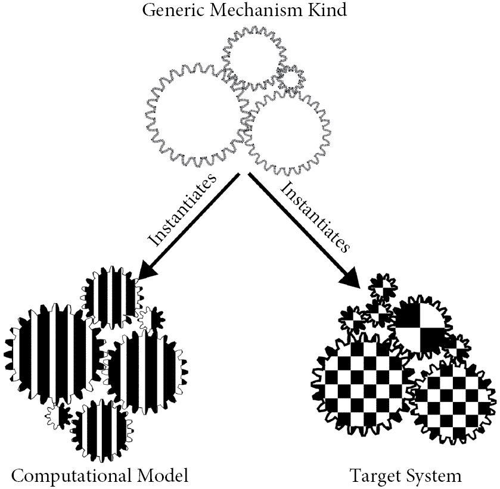

**图 1.2** 斯汀森的“通用机制”观点认为，如果计算模型（如深度神经网络）都实例化相同的抽象机制类型，那么它们就可以帮助解释由目标系统（如大脑）实现的现象。因为它们都是同一种通用机制的实例，关于计算模型的推理可以推广到目标系统。当然，理论者应该根据它们共享的抽象结构来确保从计算模型到目标系统的推理，而不是根据它们具体的差异（该图改编自 Stinson 2020）。

最后，莉莎·米拉奇（Miracchi 2019；Miracchi 2017）。米拉奇的观点可能是对哲学上要求最高的；她的方法要求理论者在决定它们如何连接之前开发三个模型：一个代理模型，一个用计算、物理或非心理行为术语描述的基础系统模型，以及一个解释基础模型特征如何产生代理模型差异的生成模型（Table 1.2）。

这种第三种模型可能解决了对深度学习“黑箱”性质的主要担忧之一：尽管它们在很大程度上重现了人类或动物行为，但由于缺乏将处理与人类思维联系起来的联系，我们无法从模型中获得关于认知的任何新知识（Sullivan 2022）。值得将这种观点与 Cao and Yamins (2021a) 的三模型方法进行比较，后者建议开发一个目标系统模型、一个计算系统模型，以及一种“变换相似性”映射，显示如何将计算和目标模型的粗粒度特征相互映射，以便根据一个系统抽象动力学的变化预测另一个系统抽象动力学的影响（Fig. 1.3）。

**表 1.2** 米拉奇（2019） 生成式差异者解释法推荐的三类模型及其各自的作用

| 模型类型 | 在解释中的作用 |
| --- | --- |
| 代理模型（agent model） | “一个关于智能相关解释对象的模型（可能包括意识、规范性或其他属性），便于预测和测量” |
| 基础模型（`basis model`） | “一个用计算、物理或非心理行为术语描述人工系统的模型，便于操纵和测量” |
| 生成模型（generative model） | “解释基础模型特征如何产生代理模型差异的模型” |

**图 1.3** Cao 和 Yamins (2021a) 对计算模型与底层系统之间解释关系的“3M++”视角。与 Miracchi 的观点相似，他们的方法需要第三种理论，来规定一种“变换相似性”（transform similarity），这种相似性允许人们将计算模型中产生行为的状态转换映射到目标系统中产生行为的状态转换上。他们注意到，一个生物行为产生目标系统实例（例如人类）与另一个实例（例如另一个人类或不同物种的成员，如猴子）之间的低级实现细节，在它们最底层的组织上（例如特定的脑部活动或神经状态转换）也会存在差异，并且需要使用相同的变换相似性方法相互映射。（图表内容改编自 Cao and Yamins 2021a。）

在一个典型的深度学习研究计划中，这些理解形式中的每一种都只是部分已知或处于初级阶段。Miracchi 特别担心，计算机科学家往往规定心理现象的定义，将它们还原为计算术语（也许是 Piccinini、Stinson、Cao 或 Yamins 所建议的那些），而这些还原将遭到许多理论学者的断然拒绝。因此，Miracchi 认为，这里的进展可以通过跨学科的分工来实现：一个由哲学家和心理学家组成的团队为各种心理类型提供智能体模型，这些模型完全针对心理或心理层面的描述（无论目标是“智能”、“推理”、“分类”、“记忆”、“想象”等），而一个由计算机科学家组成的团队则为他们创建的人工系统提供基础模型，从这些架构的计算属性角度解释其网络架构的功能。在这种情况下，团队们随后协作形成一个生成模型，用解释基础特征的变化如何引起智能体的变化。Miracchi 注意到，在大多数情况下，计算机科学家为他们讨论的现象所指定的智能体模型往往仅仅是由于没有实证或哲学论证而所约定的定义。出乎意料的是，这些被约定的定义经常受到显而易见的反例的挑战，并抵制受经验驱动的修正。

本书通过汇集来自不同学科思想者的许多线索，对这种跨学科方法提供了回应和说明。本书后续章节中回顾的哲学和心理学研究可以被解释为为心理功能概述智能体模型，而回顾的计算研究则被解释为为计算机科学家认为可能理解这些心理属性的目标提供基础模型。连接其他两者的第三类模型（无论是“生成性”还是“变换相似性”）在很大程度上仍然未知，但本书的后续章节可以被看作是为研究小组应对这一跨学科挑战铺平了道路。

### 1.6 理性主义-经验主义争论的其他维度

我早些时候论证过，经验主义与天赋论之间的主要争论点涉及天赋观念学说和变换原则（Transformation Principle）。许多理性主义者是天赋论者，而许多经验主义者是反天赋论者，但在过去的两千年里，这些竞争性联盟之间又产生了许多其他分歧。让我们简要考虑并定位其他四个维度。首先，关于如何正确地 `evaluate` 行为背后的心理过程存在争论，特别是在合理性的方面（Taylor 2003）。理性主义者倾向于“内部主义者”也就是说，他们认为如果心理过程遵循一套规则（如逻辑或决策理论），那么它们就是正确的。相反，经验主义者倾向于“外部主义者”，根据心理过程在特定环境中的可靠性或成功率来进行评估。其次，关于思维的“格式”存在争论；理性主义者倾向于认为思维发生在符号或类语言介质中，通常被称为思维语言 (Fodor 1975，这可以与符号编程相比。另一方面，经验主义者倾向于认为，抽象推理是在源于感知的图像表示上进行的(Barsalou 1999)）。这些图像表示可以以各种方式进行抽象和重新组合；但根据经验主义者的观点，它们永远不会完全丢失经验内容。第三，关于信念的辩护存在争论——经验主义的一”要求所有经验知识必须通过可观察的感知证据来辩护(BonJour and Sosa 2003)）。这种经验主义学派导致像 Watson 这样的行为主义者排除了所有对内在实体的诉求，因为这些理论实体在实验中是无法被观察到的(Greenwood 1999)）。第四，关于意义主张的语义内容存在争论，逻辑经验主义者坚持所有有意义的主张要么根据本身正确（例如“所有单身汉都是未婚”），要么无损地翻译成“观察句子”，如果该主张是正确的(Quine 1951)。这种“语义”派经验主义使维也纳圈的逻辑实证主义者将大多数形而学问题视为无意义的——例如灵魂是否不，或者所有事件是否有原因——因为这些问题无法转化为可实证检验的假设。

在书中，我们将在某种程度上探索理性主义-经验主义争论的前两个额外维度，但完全排除后两个。因此，我在这里不会尝试复兴 Skinner 或 Carnap 的经验主义；我赞赏 Quine ([1951] 在上世纪中期对这些先“经验主义两大教条”的驱逐。正如前面提到的，我们将探讨关于评估认知正确方式的争论，因为这与衡量人工智能向类人类处理的进展有关。关于思维格式的争论将在书中多处出现。这一争论维度在书中将得到细致处理，因为虽然我同意表示和表示结构必须从感觉经验中提取，但它们在处理过程中可能会被大幅转换，以至于在处理的最后阶段，信号可能与概念理论批评者所青睐的无模式符号无法区分(Machery 2006)。

### 1.7 DoGMA 与近期经验主义复兴的关系

最近，其他几本书也在当前的认知科学背景下，特别是针对神经网络建模，辩护了历史经验主义。特别是，杰西·普林茨（Jesse Prinz，2002, 2004, 2007) 在当代认知科学中复兴并宽当地应用了历史经验主义者的观点，在许多方面，“经验主义教条”（DoGMA）与这一使命是一脉贯的。然而，普林茨主要关注心理学学科中出现的关于洛克式和休谟论点的证据，他更核心地处理了关于思维形式的辩论（尽管他也支持关于观念的反天赋论——2005:679）。然而，本书是第一部根据深度学习的最新进展来更新这一经验主义框架的作品。在心理学和计算神经科学领域，杰弗里·埃尔曼（Jeffrey Elman）及其合著者也利用神经网络建模的证据挑战了天赋论，特别是强调了领域通用归纳偏置的潜力（Elman et al. 1998）。本书在许多方面都是该方法在深度学习时代的延续，同时也指出了神经网络建模在过去五年中，在证明甚至更具野心的经验主义提议方面取得了多大的进展。比尔·贝赫尔（Bill Bechtel）和阿德尔·阿布拉罕森（Adele Abrahamsen，Bechtel and Abrahamsen 2002)）也写过神经网络建模与经验主义的相关性，尽管这不是他们的主要关注点，且他们是从更偏科学哲学的角度处理这一问题的。帕特里亚·丘奇兰（Patricia Churchland (1989)）和保罗·丘奇兰（Paul Churchland (2012)）也拥护神经网络建模以对抗各种版本的天赋论和理性主义，尽管他们倾向于对历史经验主义者引用和 DoGMA 强调的传统心理范畴（如记忆、想象和注意力）采取更消灭主义的态度。结合这些其他近期对经验主义的辩护来考虑 DoGMA，将有助于将其置于更完整的历史和哲学背景中。

### 1.8 本书的基本策略：通过经验主义天赋心理学理解深度学习

目前还有其他优秀的书籍利用计算机科学的方法论来分析深度学习架构的技术结构（例如，Chollet 2021；例如，Goodfellow, Bengio, and Courville 2016; Zhang et al. 2021）。本书的目标与之不同：为这些网络先前的成就提供跨学科的解释，对尚待实现的内容进行公平评估，并对它们下一步可能获益的方向给出有见地的见解。深度学习的成功是否表明 `DNNs` 可以对理性决策建模？它们的缺陷是否表明它们不能？是否某些架构可以模拟某些形式的理性，但不能模拟其他的？在探索这些问题时，我的目标不仅是让读者理解尖端 `DNN` 设计中的技术细节或架构选择，还提供一个跨学科的、基于哲学的基础，对这些网络可以或不能被公平地建模的心智天赋进行说明。


AI 应该关注模块化认知架构的观点并不新鲜。事实上，多年来一直被几个不同影响力的研究小组追求，特别是 `ACT-R`、`SOAR`、`Sigma` 和 `CMC` 背后的团队（Anderson and Lebiere 2014; Laird 2019; Laird, Lebiere, and Rosenbloom 2017; Rosenbloom 2013）。然而，此处提出的经验主义 DoGMA 在几个方面与这些其他方法不同。其一，这些方法通常是经典与连接主义方法的混合；而此处提出的 DoGMA 旨在让所有模块都基于网络并摒弃特定领域的编程。另一方面，值得赞的是，这些方法大多已经实现。明确的是，这些提出的认知架构（包括此处建议的）都不应被视为心灵的完整终稿。在这里，我强调领域通用策略是理解和追求经验主义侧的最佳方式。

### 1.9 剩余章节的结构：天赋、哲学家与模块

下一章将概述深度学习及其优缺点。本书剩余章节将对一种心智天赋提供经验主义解释，并尝试将其整合到深度学习架构中。在探索过程中，我们将解释每个天赋的活动如何改进人工智能智能体的性能。我们将询问加入天赋是否能使生成的架构实现新型理性决策。第 2 章 概述了该任务的一些方法论准备，包括特定的理性层级和公平评估原则。第 3 章 关注感知天赋，以及 `DCNNs` 如何通过部署历史经验主义者强调的从感官体验中进行多种形式抽象的结构，揭示人类感知中的生成性因素。第 4 章 回顾了深度学习系统中记忆作用的建模尝试，重点关注情境控制器（`EC`）等架构。第 5 章 讨论了使用 `GANs` 和变分自编码器（`VAEs`）等架构建模想象的尝试，第 6 章 强调了受注意力机制方面启发的各种改进，如 `transformers`。第 7 章 回顾了对人类社会和道德认知的更早期的尝试——特别关注共情/同情天赋——最后对未来研究如何在经验主义的、基于 `DNN` 的智能体中模拟文化和社会学习给出了一些推测性建议。

每一章的安排反映了本书的跨学科目标。由于我的目的是在仲裁当前关于深度学习的辩论时，重新审视历史经验主义的价值，我回顾了经验主义哲学家针对这些心理功能提出的理论。虽然我可以轻松地综述数十位经验主义者对每种功能的观点，但为了叙述的简单性，每个功能章节都聚焦于一位具有突出经验主义倾向的著名哲学家，他们对该章节所强调的功能有特别丰富且相关的见解。这些哲学家包括 `John Locke`、`Ibn Sina`（伊本西那）、`David Hume`、`William James` 和 `Sophie de Grouchy`。这种“每周哲学家”的结构被用作一种叙述手段，以便我们对广泛的经验主义哲学家的观点进行深入探讨。这说明了经验主义哲学作为工程灵感来源的普遍效用，同时让我们能够避免陷入特定解释性争议的细节中。在勾勒出哲学和心理图谱后，每一章随后将回顾 `DNN` 架构中归属于该功能的当前及未来实现，这些实现通常是基于 `DNN` 建模者的显式比较。我们还将定期回顾迄今为止努力的生物学合理性，通过讨论架构结构与假设在生物脑中实现该功能的神经电路之间的相似性。

尽管我认为 `DoGMA` 已经启发了深度学习的各种近期成就，并反过来受到这些成就的加强，但这些近期成就背后的模型大多只实现了一个或两个额外的功能模块；当我们开始尝试协调具有多个半独立功能的复杂 `DNN` 架构时，新问题将会出现。在这里，我们将在“控制问题”（`Control Problem`）的标题下研究这些问题。目前没有任何基于 `DNN` 的系统试图模拟此处探索的所有功能；大多数系统包含一形式或多种形式的记忆模块，有些系统模拟了注意力资源，但很少有人探索过想象力或社会认知，且没有一个系统同时包含此处涵盖的所有功能的组件。这有时是过去 AI 项目的目标——例如，`ACT-R` 的某些实现就包含了与此处讨论的许多功能对应的组件。我们可以预计，随着包含的功能增加和智能体架构变得复杂，协调和控制问题将变得更加紧迫。进化通过数百万年自然选择中的迭代参数搜索平衡了这些控制问题，我们可能预计 AI 领域也需要长期的探索。我希望激励 AI 研究人员更积极地考虑这些控制问题，并开始致力于设计和实现更具雄心的功能架构，以模拟整个理性智能体的整合决策，而不是一次只关注一或两个组件。我们将在结束前的最后一章中回来，重新评估这一挑战和行动号召。因此，开始吧。

***

[¹] 详情请参阅 `[Baldi, Sadowski, and Whiteson (2014)]`、`T. [Brown et al. (2020)]`、`[Chowdhery et al. (2022)]`、`[Jumper et al. (2021)]`、`[Krizhevsky, Sutskever, and Hinton (2012)]`、`[Ramesh et al. (2022)]`、`[Shallue and Vanderburg (2018)]`、`[Silver et al. (2017)]` 以及 `[Vinyals et al. (2019)]`。

[²] 为了防止混淆，归属于 `Descartes`（笛卡尔）、`Leibniz`（莱布尼茨）和 `Spinoza`（斯宾莎）等思想家的哲学理性主义，不应与 `LessWrong` 或 `Slate Star Codex` 等博客相关的新“理性主义”相混，因为对于后者，传统的哲学区分是正交的。

[³] 其他哲学传统也拥有根据本辩论标准来看具有明显经验主义色彩的观点；例如，一些 `Yogācāra`（瑜伽行）佛教哲学家如 `Dharmakīrti`（法称）被解释者视为经验主义者（`[Powers 1994]`），甚至有人好奇过像 `Hume` 这样的西方经验主义者是否受到了佛教哲学的影响。然而，其他评论者对这种联系持怀疑态度。无论如何，可以借鉴这些传统来指导发展，写一本与本书类似的有趣书。

[⁴] 总的来说，`Pearl` 在此并不那么关注天赋主义与反天赋主义的辩论，而是更多地参与经验主义方法与现实主义因果方法之间的战斗。

[⁵] 另参见 `Childers, H and Meyer (2023)`，他们也辩护了一种完全不同的联系深度学习的方法。

[⁶] 虽然也支持一套丰富的“启动软件”（在他们青睐的模型中，这些通常以符号形式编程，包括手动指定的表示原语和先验估计），但 `Lake et al. (2017)` 对于该软件是先天的还是早期学习的在官方上持中立态度。

[⁷] 此处的“先天”意味着什么？科学哲学的一个整个子领域一直围绕如何最好定义先天性问题而展开（`[Ariew 1996]`、`[Griffiths and Machery 2008]`、`[Khalidi 2001, 2016, 2016]`、`[Mallon and Weinberg 2006]`、`Mameli and Bateson 2006`、`[Northcott and Piccinini 2018]`、`[Samuels 2004, 2007]`）。对于目前的目的，我们可以使用一个至少意味着“非习得”的极简概念进行下去。

# 引言

倾向于经验主义的发展心理学家林达·史密斯（Linda Smith）在她的文章《当你真正讨厌行为主义时避免产生关联》（[Smith 2000]）中也对这种框架提出了批评。

在目前的辩论中，人们能找到这种激进经验主义的最清晰的例子，大多出现在社交媒体网站上的博眼帖子中；或许我们都应该松口气，感谢笛卡尔、洛克和贝克莱等人物没有用过 Twitter。

目前的辩论主要涉及人类大脑的学习系统，或者至少涉及我们最亲近的灵长类动物的系统，可能还包括其他一些认知上权力和灵活性的成功进化通才者，例如海豚和乌鸦科。一些灵活性较低、生态位更可预测的动物（如昆虫或两栖动物），其大脑可能受到极少数先验表征和行为的支配，但这并不意味着关于人类知识或更广泛的智力的经验主义是错误的或毫无希望的。

在这里，我将遵循哲学文献中的一种常用惯例，将概念名称设为小大写（small caps）。福多（Fodor）的激进概念天赋论并没有像在这里看起来那么荒谬，而且他在关于所有这些概念都是先天的这一大胆主张中，可能在很大程度上是在调弄大家的玩笑。福多在说所有这些简单概念都是先天的时，其实真实意思是：如果大脑拥有他所认为的那种计算架构，那么它需要从符号占位符开始，这些占位符可以通过正确的经验或语言标签被触发，随后作为指针指向将该类别的基于学习的知识汇编的文件。后来的评论者已经找到了方法，能够宽容地救出福多在该主题上的大部分观点，而无需认同他最主要的结论（Cowie 1998; Laurence and Margolis 2002; Sterelny 1989）。由于这可能是引发了至少与启发同等摩擦的哲学辩论的典型案例（且福多本人在后期的著作中某种程度上收回了这种极端的概念天赋论——Fodor 2008），我将不再对此进行进一步评论。

## 估计的变异性

关于具体需要多少原则和参数来规定最华丽形式的普遍语法，其估计值存在显著的差异。1986 年，乔姆斯基（Chomsky）建议它至少包括 `X-bar theory`、`binding theory`、`case theory`、`theta theory`，等等……以及某些覆盖性原则，如 `projection principle`、`FI`（完全解释）和许可原则（Chomsky 1986）。福多（2001）估计规定语法大约需要二十个参数，而且还有许多其他估计值（browska 2015）。帕尔（Pearl 2019）提出的可能是理性主义派中最谦和的要求，仅要求对因果这一特别宽泛的领域拥有丰富的表示和推理机制（其中某些可能与我们在后续章节中探讨的领域通用方法兼容）。

有关有用的讨论，请参见 Millican (2009)。有关对福多解读休谟观的系统性反驳，请参见 Demeter (2021)。关于对休谟经验主义更具建设性的看法的书籍防御，请参见 Landy (2017)。

## Transformer 与复制

对一些最复杂的深度学习架构——Transformer 的近期实证分析表明，字面复制与顶尖深度网络所展示的一些最抽象、最令人印象深刻的行为（如翻译）之间可能存在深层的数学相似性。正如 AnthropicAI 初创公司的一个团队（包括几位哲学家）在对 Transformer 的分析中所述：

```
我们再次强调，我们上面描述的注意力头同时实现了我们描述的抽象行为[...]但]为什么同样能够归纳地复制随机文本的头也会表现出这些其他行为呢？一个提示是，这些行为可以被看作与复制在“精神上相似”。记得，当归纳头被定义为实现类似 [A][B] . . . [A] -> [B] 的规则时，我们观察到的头也执行了类似 [A*][B*] . . . [A] -> [B] 的操作，其中 `A*` 和 `B*` 在某些高级别的表征中与 `A` 和 `B` 相似。这些相似的行为有几种联系方式。例如，注意第一种行为是第二种行为的特例，因此归纳头可能执行一种更一般的算法，在给定重复序列时回到复制的特例。另一种可能是，当归纳头通过仅包含自身的残差流路径时，它们执行字面复制；但在处理创建了更抽象表征的早期层输出时（例如英语和法语中相同单词嵌入在相同位置的表征），它们则执行更抽象的行为。
```

(Olsson et al. 2022)

我在这里使用“构想”（conceptions）一词是为了强调 `Transformation Principle` 所描述的表征本质上可以是主观的；两个代理对同一个目标类别可能有不同的构想，同一个代理也可以随着时间改变对该类别的构想。在哲学中，关于概念的弗雷格传统要求它们是供逻辑学而非心理学进行妥当研究的客观实体，而我在这里刻意避免了这些哲学负担（Buckner 2018a; Gauker 2013; Machery 2009; Woodfield 1991）。然而，我认为保持主观构想与客观指涉之间的紧密关系是有充分理由的；关于我在神经网络表征背景下对构想与概念之间关系的完整观点，请参见 Buckner (2022)。

公平地说，这些参数需要设置为某些特定值，而且并不清楚卷积层的大小能否转化为理性主义者传统上推崇的那种先验知识。

Marcus 在这场辩论的问答环节中强调了一个观点，LeCun 似乎暗示，理想情况下，甚至平移不变性也可以从经验中学习。LeCun 的观点可能是，当前 `DCNNs` 实现平移不变性的某些方式在生物学上是不可能的，如果可能的话，应该被某种对神经结构具有更高保真度的东西所取代。在进一步的澄清意见中，LeCun 支持将局部连接视为一种生物学上合理的结构参数，这种参数在深度神经网络的后续版本中可能不需要学习。如果对这一问题感兴趣，鼓励读者在辩论后观看整个问答：`https://www.youtube.com/watch?v=vdWPQ6iAkT4`。

从形式上，它可能会在任何表现出群结构的数据模式上产生效率收益（[Achille and Soatto 2018]；[Bruna and Mallat 2011]）。表现出群结构的数据模式可以在远超空间领域找到。

James McClelland 在预判当前深度学习热潮的作品中表达过这种态度。例如，Rogers 和 McClelland 断言，“领域通用机制可以发现在年幼儿童行为中显而易见的领域特定原则”（2004:369）。他在其他处辩道，那些更倾向于天赋主义的模型所假设的透明符号和表示是“有时有用但往往具有误导性的抽象”，而它们所被援用来解释的数据，可以通过“为了在各种领域和内容类型中促进对结构发现（无论这种结构是什么）的泛指性约束”来得到更好的解释（[McClelland et al. 2010]:353）。

例如，Marcus 表示，先天的、领域特定的表征内容的神经基质“在个体之间是一致定位的，这表明其神经组织在很大程度上受到遗传的影响”；尽管他们并未完全支持天赋主义选项，但 [Lake et al. (2017)] 特别指出，人类可能“遗传上编程了等同于高度工程化的认知表示或算法的机制”。`Zador (2019)` 基于神经科学证据提供了一些论点，解释了为什么领域特定知识不太可能以这种方式遗传编码；更有可能的是基因指定了更通用的布线基元，限制了神经元广泛自组织的方式，这种方法与书中捍卫的适度经验主义是一致的（更多讨论和示例，请参见 [Zaadnoordijk, Besold, and Cusack 2022]）。

DeepMind 本身就是一个大熔炉机构，雇用了许多像 Richard Evans 这样的准理性主义人物，他推荐一种混合方法，将手动编程的关于空间、时间和因果关系的康德式假设与深度神经网络相结合（Evans et al. 2020, 2021）；正如我们之前看到的，David Silver 曾援引洛克，试图在精通围棋时完全摒弃人类知识。

“苦涩的教训”（The Bitter Lesson）更好的解释是：机器学习中正确的结构微调应该是那些能够通过增加计算和表征资源来换取性能提升的调整。这被许多机器学习研究人员视为判断某些架构创新可能产生回报的一种启发式方法。

Pearl 的广为人知的研究属于这一传统（[Pearl 1984]）。

在这种背景下，Watson 被称为一种“混合”系统，因为它将手动编程的符号知识与各种机器学习方法整合在一起。

`图 1.1` 中贝叶斯建模的位置得到了生成语言学家 Norbert Hornstein 在 [Perfors, Tenenbaum, and Regier (2011)] 中对贝叶斯语言学习模型关注的支持：

> “目前还不清楚他们的结论有多大的启示意义，因为他们的学习场景假设了正是 `POS` [刺激贫乏论] 通常旨在建立的那种具有丰富结构的、领域特定的先天假设空间。因此，如果你认为 `PTR` 能让你摆脱丰富的领域特定先天结构，请重新考虑一下。事实上，如果说有什么的话，`PTR` 在先天假设空间中填充的内容比生成主义者通常的还要多”（[Hornstein 2012]）。

这个缩写词是对 Quine 所拒绝的（逻辑）经验主义前两个教条的调侃——即分析性与综合性的对分（即认为主张可以分为根据其意义为真的陈述和根据经验事实为真的陈述）以及语义还原论（即认为所有在经验上有意义的陈述都可以翻译成能够证实或否定它们的感官观察术语的假设——[Quine 1951]）。

这里有理由反对对“心理解剖”采取简单的方法，因为“心理器官”可能需要比物理器官更高程度地共享资源并相互作用。Neil [van Leeuwen (2013:223)] 这样表达了这种担忧：

> 感知、信念、情感、误感知、理性推理系统、非理性偏见、记忆项目等，都是新颖想法的部分来源，因此它们都是建构性想象的潜在组件。换句话说，人类的想象是由组件构建的，其中许多组件也承担其他用途；它不是单一的“功能”。伟大的古代解剖学家盖伦发现他分析的每块骨头都有多个生物学目的；我认为想象的基石也存在类似的情况：记忆和感知等能力同时服务于现实追踪和建构性想象（下文将详细介绍）。想象在某种程度上是指将它们用于多种用途的能力。

尽管如此，创建能够模拟这种能力的人工系统，需要赋予它们具有独特生成性计算操作的子系统；一个具有感知识别和记忆存储系统的架构，如果没有进一步补充，永远无法模拟这些生成能力。事实上，经验主义功能心理学一直有一种论调，可以追溯到亚里士多德和伊本·西那，认为功能存在于某种层次中，“高级”功能会利用并反过来调节底层功能；这并不意味着每个功能都缺乏独特的计算操作，而这正是书中推荐的适度经验主义建模方法的重点。

因此，我在此援用了一个特别弱的“模块”概念，即使按照最近较宽泛的标准来看（Robbins 2009）也是如此。此处引用的概念与 Carruthers (2006) 建议的最相似，尽管他也强调了我在此处明确拒绝的领域特定性。我对于大脑是否是大规模模块化的，还是包含习得的领域特定模块不持立场——我在此仅建议深度学习研究中一条实用的进展方法是：显式地对具有独特操作的计算模型进行理论化，这些操作在内部连接多于外部连接，并且在连贯的认知架构中实现归属于领域通用心理功能的作用。


虽然我将这些功能作为不同的模块引入，但在经过反思后，我们可能会认为某种功能可以还原为其他功能的一种模式或相互作用，或者两种功能的操作如此交织，以至于在它们之间做出区分是人为的。事实上，一些理论学家认为记忆和想象力仅仅是同一功能的两个不同方面，或者注意力仅仅是其他功能的一种模式（De Brigard 2014; Mole 2011a）。关于功能精确分类的辩论可能反映了经验主义理论化的健康成熟，而不会威胁到基本观点，即经验主义者可以诉诸领域用的心理操作，这些操作超越了最基础的关联学习。DoGMA 确实反对更激进的经验主义形式，后者试图完全消除传统的功能分类，例如神经科学家 Luiz Pessoa 所建议的消除主义（Pessoa, Medina, and Desfilis 2022）。虽然 Pessoa 认为标准的功能列表源于民间心理学且缺乏说服力的实证支持，但我在此将它们更多地视为解决基于网络的理性认知方法所面临的计算问题的解决方案。计算机科学的一项经验发现是，基于网络的系统需要诸如独特的记忆系统和注意力控制等机制，以便在挑战性环境中高效灵活地做出决策。

即使深度神经网络（`DNNs`）不能提供关于“实际上是如何”的解释，它们也可能帮助我们理解人类认知。概念证明——例如，物理系统仅使用某种类型的输入数据就能学会做某事——可以帮助击败通用论点，即某种类型的数据对于类人类的能力是必要的（Warstadt and Bowman 2022）。“可能是如何”模型在发现的语境下，各种其他角色中也可能间接发挥作用（Gelfert 2016:79–97）。尽管如此，我在此关注“实际上是如何”的策略，因为我想尽可能做出由近期进展支持的最强有力的论证。我感谢 Alfredo Vernazzini 在这一点上对我的推动。

在此处援用自然种的语言时，Stinson 可能比 Piccinini 稍微过了一步，因为这些种类必须显示出稳定的归纳规律簇，以证明它们纳入科学实践的合理性（Boyd 1991, 1999; Khalidi 2013）。然而，在识别机制的自然种（Craver 2009）方面可能存在持续的困难，特别是在恰的抽象层次上（Boone and Piccinini 2016; Craver and Kaplan 2020）。另一种方法可能是使用从神经科学中借鉴的一些基于变换的抽象工具（并在此处第 3 章后期开发），以在计算系统与目标系统之间建立“变换相似性”的概念，从而使抽象比较具有合法性（Cao and Yamins 2021a, 2021b）。

这些替代架构的作者通常认可这一点。例如，Laird, Lebiere, 和 Rosenbloom 最近写道，他们的模型“在许多方面仍不完整……例如，关于元认知、情感、心理想象、直接通信和跨模块学习、语义记忆与情节记忆之间的区别，以及社会认知所需的机制”（2017:23）。

# 2 什么是深度学习，我们应该如何评估它的潜力？

特别是“什么是椅子”的概念很难被简单地刻画。确实没有一种 AI 视觉程序可以在任意图像中找到任意的椅子…… 这种问题从不是通过向 AI 系统展示场景照片来提出的。一个人（即使是小孩子）可以对照片做出正确的解释并建议行动计划。但这种抽象是智能的本质，也是他们所解决的问题中最困难的部分。在目前的方案下，抽象是由研究人员完成的，留给 AI 程序做的搜索之外几乎无事可做。一个真正的智能程序会研究照片、执行抽象并解决问题。

—Rodney Brooks (1991:143)

## 2.1 直觉推理作为深度学习的独特优势

在确立了相关天赋主义与经验主义争论的基础术语后，我现在将简要刻定“深度学习”，并强调它对这一对话的独特贡献。我认为，这种贡献在于它能够阐明各种中层认知过程，而这些过程直到那时一直都规避了经验主义和天赋主义建模的范畴。之前的经验主义研究浪潮对最基本的关联学习形式产生了坚实的理解，而之前的天赋主义研究浪潮则创建了许多关于最抽象的规则思维的强大模型，例如显性的逻辑、数学或类比推理。然而，直到现在，这一连续体中的任何一方在建模处于这种简单性与抽象性极端之间的认知“模糊地带”方面都没有取得过太大成功（Buckner 2018b; Nagel 2012）。这种处理我们在执行以下操作时所进行的：根据一系列细微的面部和行为线索察觉某人的情绪；尝试猜测每年死于鲨鱼的人多还是蚊子多；沿着熟悉的路线“自动驾驶”地开车上班（尽管能灵活地对动态交通状况做出响应并遵守复杂的交通规则）；或者因为怀疑对手在虚张而决定在扑克牌中“全下”。这些决策是灵活且复杂的，但很难将它们强行放入显性规则或算法的模具中，而且决策的可反省依据往往终结于一种毫不费力的直觉或预感。在本章中，我认为，建模这种直觉处理——这可能构成了我们日常认知和决策的大部分，如果不是人类抽象的最高峰——是深度学习的独特优势。事实上，DoGMA 观点认为，这种很大程度上无意识的处理驱动了许多日常的理性决策行为，而通过对各种心理能力的建模来利用和引导它，可以使人工智能体达到理性主义抽象的高度。

在提出这一论点之前，我们应当将深度学习与早期的经验主义建模区分开，特别是那些缺乏深度和独特力量的早期人工神经网络建模。与那些早期的浪潮一样，深度学习是机器学习的一个分支，试图创建人工计算系统来让它们自己发现解决问题的解决方案。正如前章所述，这一目标通常灵感于经验主义的评估，该评估认为，模拟类人认知的最有前景的途径是赋予系统通用的学习过程和架构，使其能够在各种领域和内容类型中获取针对问题的灵活的、上下文敏感的解决方案。由于大脑是唯一能够进行这种灵活学习的自然物理系统，经验主义者从一开始就从大脑的结构和功能中获得灵感。根据这些类脑原则构建的计算学习系统被称为人工神经网络（`ANNs`），正如前一章在讨论与 Piccinini、Stinson、Miracchi、Cao 和 Yamins 的解释方法时所提到的那样。

`ANNs` 的灵感源于一种洞察：许多并行工作的简单处理节点可能比单个（或一小组）中央处理单元（`CPUs`）更高效、更强大，后者是为了实现现代数字计算机执行一系列专门的逻辑和数学操作而设计的。¹ 事实上，复杂的问题解决可能源于对大量非复杂处理节点进行微调，这种信念几乎与计算机科学领域一样古老。图灵本人就是这种方法的早期支持者：他推测，设计为“具有随机排列神经元的、神经系统最简单模型”的“无组织机器”可能被训练成“当单元数量很大时表现出非常复杂的方式”（Copeland and Proudfoot 1996; Sterrett 2012; Turing 1948）。在 20 世纪，这一主思想以各种方式被探索——经历了具有影响力的里程碑，如 McCulloch and Pitts (1943), Rosenblatt (1958), 以及 McClelland et al. (1986)——尽管在实践中，只能训练出较小且浅层次的 `ANNs`，即在输入和输出之间只有少数几层节点（“人工神经元”）在处理信号。

主要的，“深度学习”中青睐的深度神经网络（`DNNs`）与早期的 `ANNs` 的区别在于，输入和输出信号之间插入了更多数量的层（Buckner and Garson 2018; Schmidhuber 2015）。虽然早期的基于 `ANN` 的建模大多涉及不到四层，但近期的概念和硬件突破使得研究人员能够训练具有极大量节点和连接的 `ANNs`——通过许多层处理层（通常至少五层，有时是数百或数千层）转换输入和输出之间的信号。这些全面/庞大的 `DNNs` 称得上“深度学习系统”之名。

这种深度本身是深度学习架构最重要的计算方面；因为在较早层执行的计算可以在组合后期更复杂的计算时递归地复用，因此一个 `DNN` 在计算相同内容时的效率比浅层网络高几个数量级（Bengio 2009; Buckner 2019a; Goodfellow et al. 2016）。今天，某些深度学习系统的规模——例如 OpenAI 拥有 1750 亿参数的 `GPT-3` 系统，或者 Nvidia 拥有 5300 亿参数的 `Megatron-Turing`——开始接近简单大脑的大小。“深度”在这里具有双重含义，既指在输入和输出之间设置的层数，也指这些分层网络从输入中获取的丰富的、分层结构化的模式。

根据该假设，AlphaGo 击败人类围棋大师李世石是一项里程碑式的成就，因为它使得 `DNNs` 有可能与人类直觉决策能力竞争的可能性变得真实。为了让这一成就具有背景，让我们回到 1997 年 `GOFAI` 系统 `Deep Blue`（深蓝号）击败加里·卡斯帕罗夫的时刻。尽管这场胜利令人印象深刻，但我们应该担心 `Deep Blue` 战胜卡斯帕罗夫仅仅依靠对非智能蛮力计算的压倒性应用。`Deep Blue` 的专用硬件使其每回合搜索的步数远超人类在整个一生中能显式考虑的步数——每秒超过 2000 万次（Campbell 1999）。诚然，`Deep Blue` 确实使用了一些由专家设计的启发式算法来剪枝其搜索空间，这种方式被 `GOFAI` 先驱纽厄尔和西蒙认为是“智能的本质”（Newell and Simon 1976）。例如，它的程序库中内置了诸如“尝试控制棋盘中心”和“避免丢掉皇后的计划”等经验法则，以及一个引导其对弈的精选开局库（如“西西利亚防御”）。然而，它在对阵卡斯帕罗夫时取得的微弱胜利（3.5 比 2.5）仍被广泛认为是原始处理速度的胜利，而非类人智能或理性的展示。与 `Deep Blue` 的方法不同，人类的象棋策略更多依赖于整体的、直觉的模式匹配，这允许我们只考虑极少数极有可能获胜的走法。事实上，像 `Deep Blue` 这样的专家系统在处理其他各种定义不那么清晰的问题时往往会失效，而这些问题对人类来说是容易的或者可以通过直觉自动完成的。

在 1997 年卡斯帕罗夫被 `Deep Blue` 击败后，人工智能（AI）研究人员开始寻找更难通过穷举计算解决的游戏。他们特别被围棋所吸引。象棋每回合只有 15 到 30 种可能的走法，而围棋每回合约有 300 种可能的走法，使得人工系统无法简单地通过蛮力搜索所有可能的攻击与应对组合来获胜。为了给这一观点提供背景，平均局围棋中可能的游戏轨迹（10³⁶⁰）远多于整个宇宙中的原子总数（估计为 10⁷⁸–10⁸²；Koch 2016）；考虑每秒 2000 万步仅是围棋复杂性海洋中的杯水车薪。因此，高水平的围棋被认为需要直觉，这一假设得到了人类专家选手的支持，他们使用“势力”、“稳定性”和“连接”等灵活的抽象来解释自己的策略，而这些是无法被纳入透明符号算法模具的。

尽管如此，基于 `DNN` 的系统 `AlphaGo` 在 2016 年的一场备受瞩目的比赛中 4–1 击败了人类围棋大师李世石。`AlphaGo` 的表现被认为比之前的围棋专家系统更像人类，因为它直接从棋盘位置的经验中学习自己的抽象。这种经验包括了在精选库的人类对局记录上进行训练，以及通过与不断增强的自我版本进行数百万次对弈。为了评估 DoGMA，`AlphaGo` 处理中最令人兴奋的方面通过后续实验得以揭示：`AlphaGo` 能够好围棋的能力并不完全取决于它每回合考虑比人类对手更多走法的能力。尽管击败李世石的 `AlphaGo` 版本包含一种树搜索算法使其能够每回合考虑许多不同的走法，但当关闭网络的这一功能并强制 `AlphaGo` 仅根据其在神经网络中学到的抽象模式来选择走法时，它仍然能够达到大师级别的对弈（Silver et al. 2016）。此外，`AlphaZero`——一个随后的、完全从自我对弈中学习的简化系统，通过在训练方案中排除人类对局库消除了专家系统方法的最后残迹（Silver et al. 2017）——比 `AlphaGo` 强大得多，在比赛中以 100–0 的完美战绩击败了先前的系统（Fig. 2.1）。这两个结果共同表明，`AlphaGo/AlphaZero` 优秀的围棋能力取决于其 `DNNs` 从对弈经验中提取抽象模式的能力，而非蛮力搜索或手动编码的人类知识。

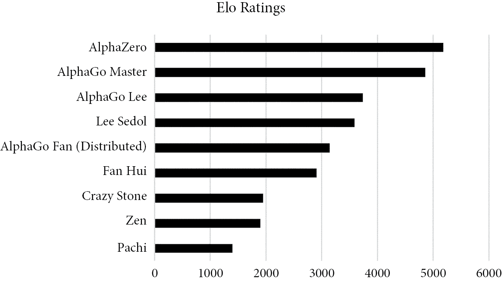

**图 2.1** 各种计算围棋程序和两位人类（李世石和范辉）的 Elo 积分（DeepMind 在比赛中计算）（Silver et al. 2016, 2017)）。李世石的最高 Elo 分为 3590；相比之下，截至 2020 年的人类最高分由申镇获得，为 3814。

我之前主张，基于此类模式的人类和动物的理性空间很大，包括在时间限制的低风险情况以及更审慎的高风险语境下的复杂灵活的决策（Buckner 2018, 2019b)）。在人工智能的背景下，我们可以通过观察底层结构，比较 `DNNs` 的结构和功能特征与相关神经回路，将论证聚焦在这些系统与生物大脑之间的相似性上。用 Miracchi 的话来说，这些比较可能会揭示生物大脑产生此类决策的关键生成性差异因素。为了平衡这些比较，我还回顾了关于生物大脑处理与 `DNN` 系统之间明显差异的待解决问题。仔细观察这些结果发现，虽然这些差异应被视为可以克服的未来机会，而非阻碍 DoGMA 进一步发展的不可越障碍。

### 深度学习：其他重大成就

`DNN` 的突破性成就展示了人工智能在过去十年取得的巨大进步。这些成就作为使用经验主义方法建模理性能力的案例非常有用，部分因为它们展示了 AlphaGo/AlphaZero 中所示直觉处理的基本优势如何引导更高层次的抽象和灵活决策。我在这里预览了这些成就，并用它们来组织 DoGMA 论证的剩余章节，以说明通过建模归属于人类功能的作用可以获得的当前和未来收益。

#### 自然照片中的物体标记与识别

## 自动化图像分类（“计算机视觉”）

自动化图像分类（“计算机视觉”）是其中的成就之一。尽管物体分类是儿童甚至某些动物都能相对轻松完成的任务（Jitsumori and Delius 2001），但对于基于 GOFAI（早期符号人工智能）的系统来说，这一任务被反复证明是难以攻克的。自然图像中描述的对象在姿态、旋转、大小、位置、光照、纹理和遮挡方面表现出过大的变异，而且类别往往包含太多的模糊边界和例外，无法用规则进行精确定义（Matsuyama 1993）。即使是像“椅子”这样看似基础的类别，为了构建一个相当可靠的椅子检测器，也需要涵盖极其广泛的材料、风格、朝向、遮挡、角度和边缘情况。就在二十年前，像罗德尼·布鲁克斯（Rodney Brooks——节选于本章题言）这样的主流 AI 怀疑者还对我们在没有研究方法发生根本性范式转移的情况下解决此类计算机视觉相关问题的能力感到绝望。

然而，深度神经网络（`DNNs`）的出现使得计算系统能够以人类或超越人类的准确率解决某些图像识别任务，并可能模拟人类视觉和听觉等感知能力中的重要抽象形式。这一成就归功于大规模精选的数据集（如 `ImageNet`，它包含数百万张带有 20,000 个目标类别标签的图像）与日益加深的神经网络，这些网络强大到可以提取跨越如此海量训练数据的细微模式。`AlexNet` 是第一个在 `ImageNet` 上性能大幅优于其他计算识别方法的基于 `DNN` 系统，这一成就通常被视为当前深度学习热潮的起点（Krizhevsky, Sutskever, and Hinton 2012）。尽管此后许多其他基于 `DNN` 系统取得了更高的基准分，但 `AlexNet` 的结构包含了深度卷积神经网络（`DCNN`）的所有独特组件，而 `DCNN` 已成为最可靠成功且研究最广泛的 `DNN` 架构（见图 2.2 和 2.3）。² 对该架构的分析有助于展示此类网络如何执行执行类似于感知抽象的操作，特别是通过对人类视觉的关键方面建模。

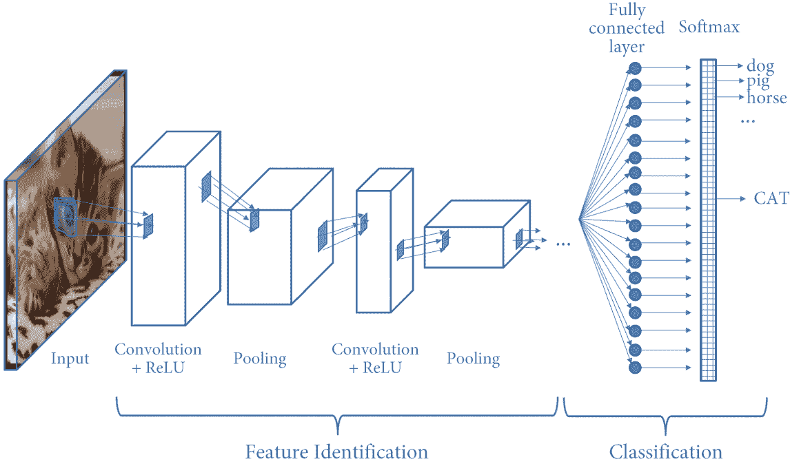

**图 2.2** 深度卷积神经网络的通用处理流程，其架构涉及通过许多层局部连接节点对输入信号进行变换。

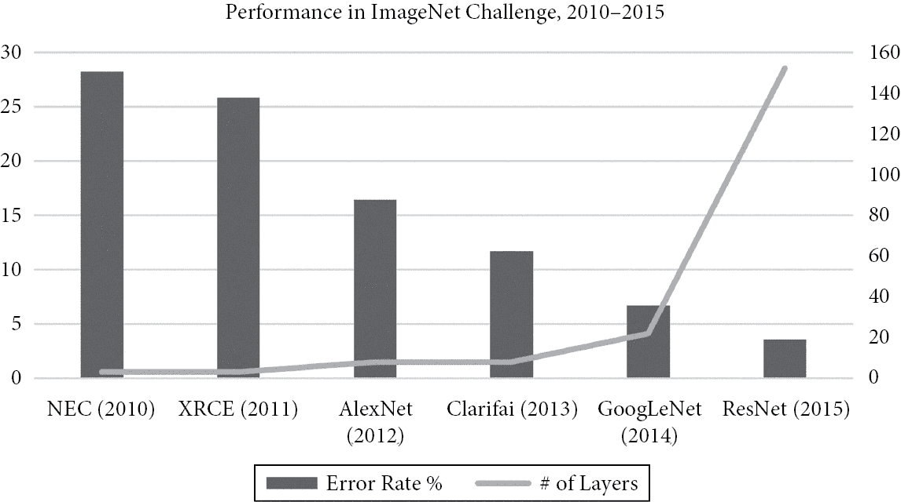

**图 2.3** 不同深度学习系统在 `ImageNet` 分类上错误率随时间变化的改进。

### 2.2.2 以超人类水平玩电子游戏

`DNNs` 也展现了玩电子游戏的卓越能力。其中一种系统（基于 Mnih et al. 2015）基于强化学习（使用指示成功或失败的 `reward` 信号进行学习），能够与专家级走法匹敌，这些系统经过了数万小时的训练。该架构的创建者通过添加一个存储特别有效序列的“情节回放缓冲区”（episodic replay buffer）解决了这个问题。这个内存模块的灵感源于哺乳动物自传体记忆的工作方式，在这种情况下，“重要”的记忆可以被召回进行比较（McClelland, McNaughton, and O’Reilly 1995）。经验主义哲学家长期以来强调这种排练在理性决策中的重要性，因此该架构证明了 DoGMA 在 AI 中的价值。

### 2.2.3 生成真实的图像、视频和音乐

除了通过记忆回放更有效地利用以往经验而取得的进展外，深度学习中更具雄心的创新还探索了将先前的经验重新混合，形成对未来可能性的新颖模拟。经验主义哲学家和心理学家长期以来假设，我们想象虚构场景中会发生什么的能力使了我们大部分的创造能力和洞性的问题解决能力。现在已经存在 `DNN` 系统可以创建从未发生过的事件的合理、高分辨率表示——包括照片、语音、视频和音乐。这就是媒体中以“深度伪造”（deepfakes）为标题涵盖的功能。深度伪造通常被讨论为安全问题，它们代表了一种可以用于创建从未发生过的事件的误导性记录的能力。例如，坏分子可以创建一段视频，其中受信任的权威人物似乎在真实地讲述由深度伪造创建者选择的脚本——导致误信息或恐慌。演员兼喜剧演员乔丹·皮尔（Jordan Peele）生动地说明了这种可能性，他在 2018 年展示了如何利用该技术让奥巴马总统似乎在使用皮尔想要的脚本发表公益公告。自那以后，该技术不断改进，引发了关于“AI 军备竞赛”的担忧，即构建不断更好的检测深度伪造攻击的方法，以及能够规避这些检查的更好的深度伪造。深度伪造通常由一种称为生成对抗网络（`GANs`）的 `DNN` 架构创建，该架构执行与如 `AlexNet` 等 `DCNN` 中的变换操作近乎逆向的操作。事实上，这种架构的发现者从人类认知中归于想象功能的作用中汲了明确灵感，这种功能同样允许创建和探索真实但新颖的刺激。

### 2.2.4 生成与人类编写无异的文本


最近最令人印象深刻的深度学习成就，或许是那些利用 `DNNs` 的生成能力来建模人类最灵活且复杂的行为的系统：即生成语法正确且语义连贯语言的能力。这些大语言模型（`LLMs`），例如 OpenAI 的 `GPT-3` 和 Google 的 `PaLM`，可以生成整个文档——涵盖几乎任何体裁和几乎任何主题——人类受试者无法可靠地将其与其他人类写的文本区分来。鉴于人类语言语法规则的复杂性，这是另一项直到最近似乎 `AI` 还无法触及的成就。事实上，像 `GPT-3` 和 `PaLM` 这样最大的语言模型在规模上较之前的模型有了惊人的飞跃——如前所述，`GPT-3` 的完整版本包含 1750 亿参数，并在超过 4200 亿 token 的文本上进行训练，这一海量数据集反映了当前互联网上可用文本的广泛采样（T. B. Brown et al. 2020），而 `PaLM` 拥有约 540 亿参数（Chowdhery et al. 2022）。³ 为了利用如此庞大且多样的数据集的组合模式，这些大语言模型部署了一种名为 `transformer` 的新型 `DNN` 架构。关于这些模型的影响一直存在激烈争论，观点从极其乐观的评估（认为它们已经“解决”了语法处理并“理解”了自然语言语法和语义）到怀疑的评估（认为这些模型只是盲目地“鹦鹉”在大量训练集中观察到的模式）。⁴ 这些模型在传统的语言模型基准测试任务中表现良好，但仍然容易受到困惑的错误和文本对抗攻击的影响。更严谨地评估这些说点的尝试导致了基准测试方法的革命，可能最终发展成了 `BIG-Bench`，这是一组包含 200 多个自动化问答任务的任务，涵盖了从语法处理到故事理解、因果推理到新概念组合的所有领域。⁵ 注意的是，`PaLM` 在这些大多数任务上的表现优于人类，这一成就在几年前看起来简直是不可思议的。

`transformers` 与目前提到的其他架构相比有几个关键创新，而且所有这些都值得在此进一步研究。然而，可能最重要的区别在于它使用了一种名为“自注意力”（self-attention）的机制，用以确定近期语言语境中的哪些元素对于决定下一个应该输出什么词相关。虽然“自注意力”指的是一系列可能与人类注意力能力似乎几乎没有共同之处的数学操作，但我们将看到它如何被用于实现归因人类推理中一些最复杂的自上而下注意力形式的角色，例如言语自教，这允许我们在尝试发现正确答案时，专注于数学或因果推理问题的相关部分。

### 2.3 深度学习：问题与忧虑

尽管有了这些（以及许多其他）令人印象深刻的近期成就，人们对 `DNNs` 建模这些人类认知方面的能力产生了质疑。这些忧虑得到了支持理性主义和天赋主义理论的理论者的强调，并一直作为与著名的深度学习模型者辩论的焦点，它们是可以追溯到柏拉图的一种普遍担忧的现代体现：即经验没有提供足够的信息来解释独特人类思维的力量、效率和清晰度，至少在没有天赋思想的情况下是这样。因此，天赋主义者预计，从经验中学习所有抽象的系统所部署的解决方案，与人类使用的解决方案相比，将是不透明、低效、脆弱的，并且无法很好地泛化到新情况。这种典型的忧虑列表在上一章讨论的所有倾向于天赋主义的理论者身上以不同形式的形式表现出来，特别是在 Marcus (2018a)、Fodor (2003)、Mitchell (2019)以及 Lake et al. (2016) 中。这些天赋主义者认为，这反映了更一般的经验主义方法特别是神经网络的根本缺陷，并且人类性能与基于 `DNN` 的系统之间目前的差异证明了，人类式的从经验学习需要大量的先天表征。

我同意这些深度学习怀疑者的观点，对 `DoGMA` 的系统性辩护应该对这些忧虑给出答案，因此在这里我对它们给出我自己的回顾。虽然这些忧虑反映了对某些特定基于 `DNN` 系统的有效批评，但我认为这些忧虑加起来并不构成了一个针对深度学习本身或更广泛的经验主义的有力归纳论点。目前深度学习研究正在判定的关键问题是，是否以及在多大程度上可以通过利用额外的领域通用资源和更像人类的训练数据来缓解这些忧虑。许多现有系统在这方面显示了潜力，通常通过向系统添加更多领域通用结构和/或通过减少这些系统与人类在训练和测试环境之间的差异。`DoGMA` 强调，许多在这些问题上取得进展的系统依赖于实现归因人类认知中领域通用能力色的模块，以便更高效、更有效地处理训练数据。

#### 2.3.1 不透明性

关于深度神经网络（`DNNs`）与人类之间所谓差异，最常见的担忧或许是：这些复杂但强大的模型是“黑箱”，不具有“可解释性”（Lipton 2018）或“不够透明”（Marcus 2018a）。即使是今天规模中等的 `DNN` 也包含数百万个参数——特别是节点之间的连接权重（这些权重在训练过程中会被修改），以及许多更全局的超参数，例如特定层中的节点数量或控制这些节点的激活函数类型——而且很难判断哪些因素对其决策最重要，或者特定因素在某些决策过程中起了什么作用。这与 `DNN` 在可解释性方面经常被比较的系统不同。许多专家系统、线性模型和贝叶斯方法部署了具有直观解释的符号和规则（Rudin 2019）。⁶例如，在深蓝（`Deep Blue`）中，如果我们想知道它为什么决定移动某枚棋子，我们可以查看系统内部，看看在每回合中考虑了哪些可能性，以及哪些启发式算法建议该走法最可能获胜。诚然，我们找到的答案将极其长且复杂——可能包括数十亿次可能的移动和反击——但对每个场景的描述和评分将用直观易懂的因素来表述，例如被捕特定棋子的分值、获得或失去的棋盘控制力，以及导致将面的数量。同样，很容易看出深蓝何时犯了意料之外的失误。当深蓝在 1997 年与卡斯帕罗夫对战的第一局中因代码 Bug 犯下著名的错误时（这导致当其内部计数器以某种方式耗尽时间时，它会做出随机移动），程序员可以很容易地识别出这一错误的来源。因此，他们可以更改代码以避免未来再次发生此类错误（Sayer 2017）。

当我们将这种相对透明性与 `AlphaGo` 这样基于 `DNN` 的系统进行对比时，发现驱动其评估的模式并不那么清晰。尽管我们可以检查 `AlphaGo` 的树搜索历史，查看它在做出某移动时考虑了哪些棋盘局面，甚至可以看到附加在每个选项上的评估分，但我们无法轻易解释为什么给这些位置分配这些排名。我们可以提供该运行过程中激活最频繁节点的说明，或许还可以提供在选择该走法而非其他走法时最重要的棋盘特征；但如果没有大量的解释性工作，我们无法领会 `AlphaGo` 在这些局面中看到的模式的意义。这涉及到像笛卡尔等理性主义者传统上对关联表达了近十五分钟的担忧。然而，在又过了十或二十回合后，这一走法被证明是比赛中的关键转折点，`AlphaGo` 轻松地赢得了比赛。

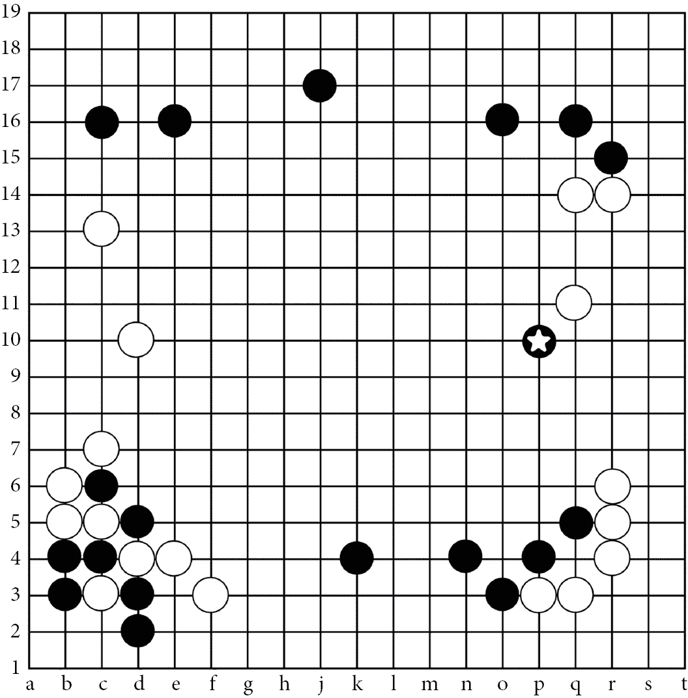

**图 2.4** `AlphaGo` 反直觉的（对人类而言——至少对当时的人类而言）第 37 手（用黑圈上的白星标出）。这个令人惊讶的“顶肩”似乎加强了黑方的局面，而这个局面直到游戏晚些时候才变得重要。

可能出乎意料的是，在棋类这种娱乐性的、低风险的领域，这种不可捉摸性是可以接受的，甚至带有某种吸引力。事实上，对 `AlphaZero` 惊棋法的思考引发了策略游戏理论的一场小型革命，通过逆向工程 `AlphaZero` 走法背后的见解，帮助人类改进了游戏理论（Sadler and Regan 2019）。然而，在其他高风险或需要审计的领域，透明问题变得更加严重。例如，`DNN` 已经被赋予社交媒体图像标记任务、精准投放广告、通过医学影像诊断癌症等疾病、预测贷款申请的风险，以及分析科学研究中的数据以发现蛋白质折叠的新方法并创造新药。这些应用通常给用户带来更大的风险，相应地要求在不断变化的法律权利义务中部署这些技术的开发者和企业承担更高程度的责任。

### 2.3.2 训练效率

另一种推动创新的不同之处源于一种观察：早期深度神经网络（`DNN`）为了达到同等性能所需的训练数据比人类多得多，这引发了人们的问题：它们学习的内容或方式是否与人类相同？例如，用于图像标记的 `DNN` 的标准训练方法涉及在 `ImageNet` 数据库上进行监督反向传播学习，该数据库包含 1400 万张图像，并对超过 20,000 种物体类别进行了人工标注。或者，考虑另一个例子，`AlphaGo` 的网络是在超过 160,000 局从人类棋大师对弈中记录的游戏上进行训练的，随后又在其不断增强的自我对弈中数百万局进行了进一步训练；相比之下，`AlphaGo` 的人类对手李世石在一生中过的比赛可能不超过 50,000 局。我们可能还会注意到，与许多 `DNN` 不同，人类依赖于“快速映射”（fast-mapping）和“单次学习”（one-shot learning），这使得我们能够从极量的经验中进行泛化。考虑一个特定案例，Lake 等人 (2016) 认为，人类即使只见过一张新手写字符的照片，也能学会识别并画出该字符的组成部分。他们认为人类之所以能够进行这种单次学习是因为他们理解如何利用可以容易重新组合的笔画和形状的小库来生成新图形。考虑到许多模型所需的数据规模和复杂性，我们可能会想，`DNN` 是否永远能够从更少、更类人类的经验中掌握这些稀疏但丰富的组合表示。我们在后续章节中考虑的大多数创新将以某种方式或另一种方式为基于 `DNN` 学习的效率和稀疏性提供提升，特别是涉及组合表示时，并且通常通过尝试执行更多归因人类心理学研究功能的作用来实现。

### 2.3.3 对抗攻击

另一个可能被认为揭示人类与 `DNN` 观察世界方式之间根本差异的相关谜团，核心在于后者对“对抗样本”（adversarial examples）的敏感性。对抗样本是由一个“对抗性”`DNN` 创建或选择的异常刺激，用于欺骗攻击目标的另一个 `DNN`。最初的对抗样本是“扰动图像”，由 `GAN` 通过轻微修改易于分类的样本创建（类似于深度伪造），这种修改对人类来说是不可察的，但似乎会导致遭受攻击的 `DNN` 发生严重的分类错误 (Goodfellow et al. 2014)）。扰动方法最常见的是修改整个图像的许多像素，但也可以像单像素攻击那样聚焦 (Su, Vargas, and Sakurai 2019)）。虽然用于扰动图像的像素向量通常通过训练对抗性 `DNN` 对特定判别 `DNN` 对特定图像的响应来发现，但某些方法还可以创建“通用扰动”（universal perturbations），从而破坏任何自然图像上的广泛分类器 (Moosavi-Dezfooli et al. 2017)。

在 Goodfellow 等发现对抗攻击几年后，Xu 等人表明许多攻击可以通过简单的预处理（如旋转、平滑去噪）来干扰。特征压缩（feature squeezing）作为防御措施的有效性表明，`DNN` 在本质上与人类感知并不不同，而是因为它们的输入过于锐利。

除了质疑深度神经网络（`DNN`）观察世界的方式与我们相同之外，我们可能还会怀疑基于 `DNN` 的系统是否以一种完全不同的方式构建问题的“解决方案”。之前强调的 `DNN` 许多令人印象深刻的成就都是强化学习方法产生的（关于该领域的概述，请参阅 [Sutton and Barto [2018]](#oso-9780197653302-bibliography-1-bibItem-697)），该方法最初是类比人类和动物基于奖励的学习而提出的。这种方法使用网络程序员设计的奖励信号来训练网络，该信号告诉网络上一次决策是成功还是失败。`DNN` 的许多备受目的成就涉及围棋、象棋或《星际争霸 II》等游戏，正是因为游戏得分提供了一个易于量化的奖励信号。在其他领域，创建一个有效的奖励信号要困难得多。

例如，在人工运动研究中，许多开发者奖励智能体在虚拟环境中简单向前移动，也许只需其数字化身消耗的能量最少即可。在“半猎豹”（Half-Cheetah）测试平台环境中训练的一个深度强化学习模型——在该环境中模型学习通过操控两条腿的几个自由度来让一个理想化的二维猎豹化身向前移动——它学会了可以通过向前倒下然后在空中挥动腿，从而让化身以背部向前翻滚 (Irpan 2018)。另一篇由 OpenAI 研究小组撰写的广为的博客讲述了他们的 `DNN` 如何学习玩一种 Atari 赛船游戏《海岸跑者》（Coast Runners），通过在紧凑的偏离轨道的圆圈内不断转动，而从未完成比赛，因为这样做让它不断收集补充性的“涡轮”奖励组件，这些组件为它的游戏得分提供了快速且无休止的提升 (Amodei and Clark 2016)。批评者担心，这些例子表明模型缺乏人类在处理这些任务时会具备的“常识”，而且 `DNN` 学习到的解决方案是脆弱的“奖励黑客行为”（reward hacks），它们只优化了强化信号，而对 `DNN` 训练要解决的问题没有任何真正的理解。虽然这种担心是合理的，但结合 `DoGMA`（我将在后续章节中转向它）对强化学习方法进行更细致的审查指出，可以通过增加情感和社会价值信号来使方法更强大、更像人类的策略。

### 2.3.5 糟糕的迁移学习

许多深度学习模型与人类认知之间的另一个重要不同在于将从一个问题背景下学习到的解决方案迁移到另一个问题的能力。`DNN` 学习到的策略通常无法很好地泛化到与其训练任务特征略有不同的任务上。例如，在 Atari 游戏《打破砖块》（Breakout）中，基于 `DNN` 的系统可以学习到比人类更有效的玩法，通常是通过采用人类青睐的策略，例如在方块中挖掘一个“隧道”，让游戏球在天花板和顶层方块之间快速跳动以实现得分最大化 (Mnih et al. 2015)。然而，在面对人类认为微不足道的游戏环境变化时，此类 `DNN` 的游戏表现往往并不健壮（Fig. 2.5）。例如，当挡板的位置沿屏幕 y 轴向上移动一小段，或者同时释放多个球（“杂耍”）时，一种原本成功的基于 `DNN` 的系统现在无法很好地玩，必须从头重新训练 (Kansky et al. 2017)。相比之下，人类玩家被认为能更快地适应这些微小的干扰性变化。这种迁移失败表明，`DNN` 学习的策略对环境的要求是不切实际的稳定性，需要一种不同的范式来使系统具有真实智能特征的、环境灵活的健活性。

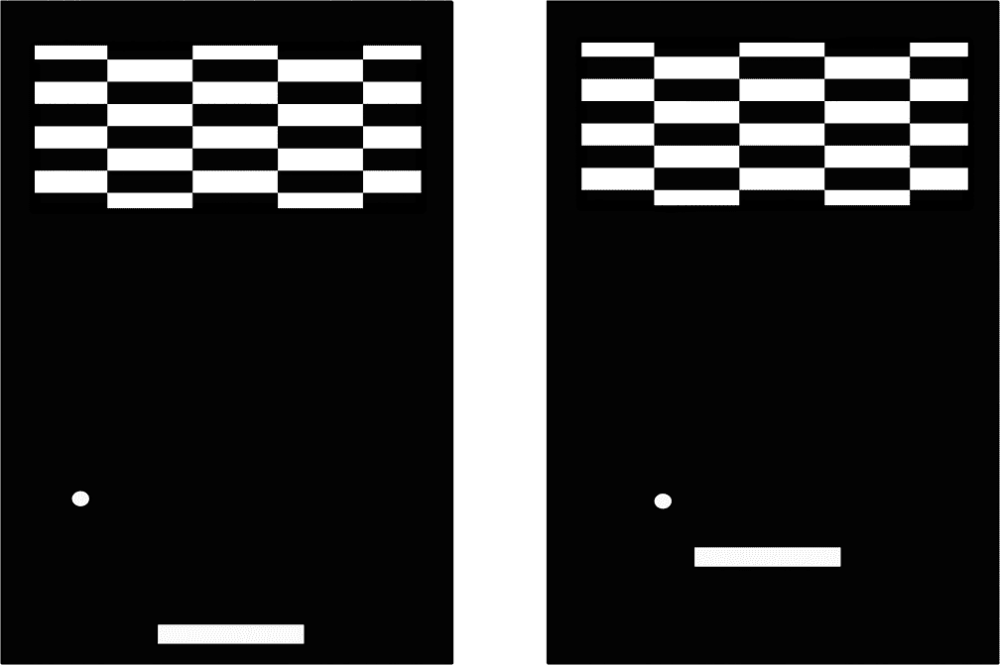

**图 2.5** 标准《打破砖块》（左）对比扰动情况（右），右图中挡板已沿 y 轴向上移动。丰富的人类玩家可以快速适应这种变化，但一些通过强化学习训练的深度神经网络需要大量的重新训练才能成功应对变体。

这种迁移失败的准确范围是一个微妙的问题，我们将在书中反复提到它。它的微妙之处在于有两点：(1) 因为这些系统通常只旨在模拟人类认知的一个方面，而其他方面可能涉及人类受试者卓越的迁移能力，特别是人类在许多其他类似的物理推理问题上拥有的丰富背景经验，而这些问题并不在 `DNN` 的训练集中；(2) 因为匹配人类性能所需的迁移的性质往往没有规定得足够充分。坦率地说，许多 `DNN` 对微小的小任务变体确实表现出惊人的糟糕迁移能力，但在机器学习的几乎每一个实验中，都会评估对新颖情况的某种程度的泛化。标准的评估方法是交叉验证（cross-validation），其中单个数据集被反复划分为训练部分和测试部分，系统从训练集中学习，但其性能在留出的测试集上进行评估（Fig. 2.6）。由于折中的数据点并不相同，深度学习文献中报告的准确率提升反映了某种程度的——对于大多数问题来说是以前无法实现的程度——成功泛化。然而，人们经常声称，`DNN` 的解决方案只能可靠地迁移到独立同分布（i.i.d.）数据——即具有相同统计结构但以无偏方式采样的数据——而不能迁移到分布外（o.o.d.）数据。我们已经讨论的几个弱点——例如对抗性示例和《打破砖块》变体——可以被视为 o.o.d. 数据的实例，而人类策略被认为可以毫不地迁移。这些弱点意味着 `DNN` 并没有从经验中获得与人类那样的可迁移的环境表征，它们可能需要更多的内在机制来实现这一点 (Marcus 2018b)。然而，这个问题可以被视为一个开放的经验挑战：必须增加人类认知的哪些其他方面以实现更好的迁移？如果通过增加更多领域通用组件或更像人类的背景经验就能实现更像人类的迁移，那么经验主义的原则仍然是稳固的。

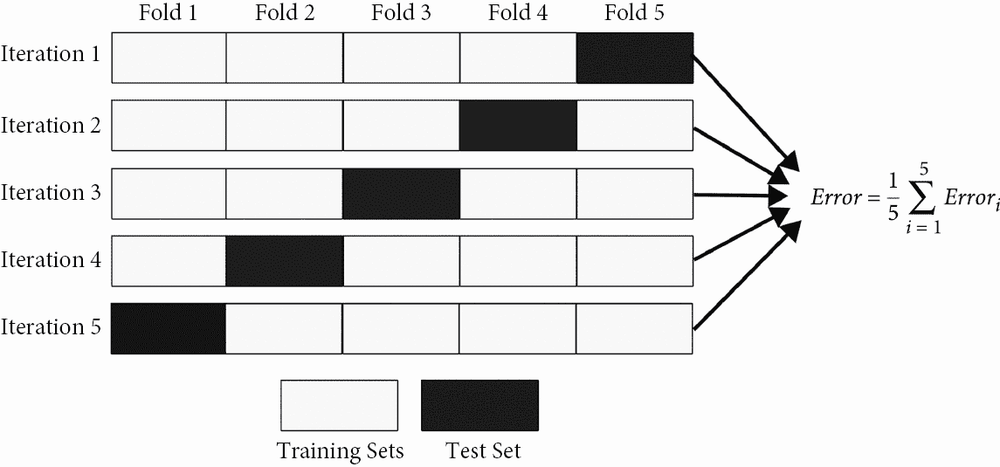

**图 2.6** k 折交叉验证方法的图——这是最简单且最常用的方法之一，尽管还有许多其他方法。数据被分成 x 个箱（“折”——在图中 x = 5），模型进行 x 次训练，每次使用 x - 1 折进行训练，并将最后一折留出不参与训练并作为测试集以评估训练后模型的准确率。模型的交叉验证准确率是其 x 次运行中错误率的平均值。

### 2.3.6 组合性与系统性

在早期天赋论与经验主义之间关于人工神经网络（`ANNs`）影响的辩论中，作为冲突爆发点的最大潜在差异之一是关于神经网络是否能够表现出人类思维特征的组合性（compositionality）和系统性（systematicity）的问题(Fodor and Pylyshyn 1988; Smolensky 1988)）。问题的在于，`DNN`是否能基于有限数量的心理表征产生可能无限的新颖且连贯的想法。如果一个人可以认为“猫在垫子上”，那么他应该能够认为“垫子在猫子上”，或者“猫身上的垫子上有一块垫子”；如果我们加入逻辑连接词、介词和从句等组件，我们就可以在此基础上构建出无限数量更复杂的思想（“蓝猫在红垫子上，而红猫在蓝垫子上……”）。这种组合结构长期以来被认为是解释人类思维特殊能力的关键，这种能力使得人类在仅接触到有限经验的情况下，就能将思维扩展到可能无限多样化的主题上。


## 2.3.7. 因果理解

神经网络与人类之间最大的差异之一是，`DNN`是否能有效区分因果关系与简单的相关性，并在推理中部署因果知识。区分相关性与因果关系的能力适用于广泛的领域，包括已讨论的几个。它对感知、预测干预结果、解释、反事实思维以及向其他领域的迁移具有意义(Danks 2009)。特别是朱迪·珀尔（Judea Pearl）强调了因果推理对人类认知的核心作用，并指出机器学习技术在得出正确因果推理方面的局限性（Pearl 2009, 2019）。尽管`DNN`擅长从复杂数据中提取预测模式，但在尝试干预世界时可能会失败。`DNN`会注意到公鸡叫和日出之间的相关性，但如果没有这种关系的因果模型，基于`DNN`的机器人可能会试图通过戳公鸡来让太阳升起。迁移学习也是如此，例如当游戏的几何结构发生变化时（如之前讨论的 Breakout 场景）。如果系统理解因果关系，它可能灵活地调整策略以适应变化的情况；否则，它可能只是尝试重复在变化之前有效的动作，就像出于迷信一样(Dubey et al. 2018; Kansky et al. 2017)。这种误解在农场或游戏机房中问题不大，但在医疗护理或企业招聘等情境下就会非常严重，这些正是珀尔等因果理论者所强调的决策场景。

当前的或未来的 `DNN` 架构能否成功区分相关性与因果关系仍然是一个开放的实证问题（Battaglia et al. 2018; Lake 2014; Russin et al. 2019），这一问题希望在未来的研究中获得更多关注。特别是学习和推理因果关系的能力，被认为是人类认知的区分特征，也是实现更类人 AI 的关键目标（Hespos and VanMarle 2012; Penn and Povinelli 2007a）。诚然，大多数神经网络并没有经过训练来诊断因果关系，而且许多人类经常混淆相关性与因果关系（Lassiter et al. 2002）。当神经网络被训练用于诊断因果关系时，它们已经取得了一些成功，特别是生成式架构，如变分自编码器（Kusner, Paige, and Hernández-Lobato 2017; Zhang et al. 2019）、transformers（Ke et al. 2022）以及使用深度强化学习的模型（Zhu, Ng, and Chen 2019）。如何在基于 `DNN` 的系统中最好地模拟因果理解，可能是该领域最重要且未解决的问题，也是最可能需要标准 `DNN` 架构中引入一种全新的结构才能解决的问题。这一反对意见值得用整本书来专门讨论，但我们将在后面的章节中适时对其进行评论。

## 2.4. 我们能（公平地）衡量成功吗？人工智能与人工理性

上述的忧虑是否意味着深度学习已经停滞，必须采用另一种方法才能在理性认知建模方面取得进一步进展？还是说，它们表明深度学习正在以健康的方式进行，通过持续的与 DoGMA（通用大模型范式）一致的领域通用创新，仍有许多进步可以实现？机器学习研究中标准的衡量标准对这些问题保持不沉默。虽然在标准化基准测试上获得进一步的增量收益可能会让你在 NeurIPS 或 ICPR 等顶级机器学习会议上发表论文，但在 ImageNet 标记任务的最优错误率上再削减 0.5%，并不能解决质性差异的问题。如果我们要确定经验主义方法在 AI 领域是否正在取得进展，我们需要一种更具概念基础且质性丰富的方式来衡量成功。

例如，我们可以关注在不使用先验观念的情况下、可以在神经网络中建模的理性决策类型。然而，这种举措可能只会引发另一个问题：如果这本书讨论的主题被称为“人工智能”，那么为什么在这里关注的是“理性”而不是“智能”呢？简单的答案是，我们不应该过度解读这个学科的名称，因为这个术语在某种程度上是一个历史性的偶然。⁸; Hernández-Orallo et al. 2017）。为了评估深度学习在适度经验主义方面的论点，我们可能希望回顾并重新评估这一比较性争议的基础，以避免 Miracchi 在上一章中警告过的那种术语规定。

评估 AI 智能的方法可以围绕两种不同的途径组织，我称之为定量和定性方法。定量方法通过在仔细校准的测试套件上的得分来衡量 AI，其假设是自然智能和人工智能可以在数值尺度上相互进行系统性的排序。在这种方法下，当 AI 超过了该分布上大多数或所有人类智能得分的范围时，它就产生了“人类水平”的智能。这种方法的灵感来自人类心理测量学科，该学科将智能视为一个很大程度上固定且可量化的变量，表征个体的心理能力。意料之中，将智能视为一个固定的、先天的、遗传的或精确量化的变量有许多理由怀疑，即使只考虑人类也是如此（Block 1995; Shalizi 2007）。西方社会心理测量的历史令人不安，因为 IQ 分一直被用来证明关于人口统计群体或文化之间内在差异的缺乏依据且带有种族倾向的信念（Glymour 1997; Gould and Gold 1996; Winston 2020）。流行的心理测量测试倾向于来自具有历史特权人口统计背景的受试者，可能部分是因为这些测试的创建和校准方式（Richardson 2002）。在算法信息理论领域，适应心理测量方法以评估人工系统已取得一些进展（Hernández-Orallo 2017）；但该领域没有任何东西能说服地消除对支撑人类心理测量的统计方法（如因子分析）可靠性的基础性疑虑。在这些疑虑被消除之前，很难依赖于来自人工 IQ 测试的比较作为 AI 成功的衡量尺。

另一方面，智能的定性方法关注特定的知识类型或推理任务。例如，一种流行的定性方法将拥有“常识”视为智能的依据（Davis and Marcus 2015; Mitchell 2019; Shanahan et al. 2020a）。我们在这里应该担心，“常识”通常被视为一个笼统术语，很少被定义。此外，当提供了定义时，它们往往是多样的、模义的且具有特定文化的。例如，Davis 将“常识”定义为：

> 一个典型的七岁儿童对世界的认知，包括时间和空间等基本类别，以及特定领域，如物理对象和物质；植物、动物和其他自然实体；人类、他们的心理以及相互互动；以及整个社会。(Davis 2017:652)

我们在这里应该担心，这部分知识甚至对人类并非通用的，而是表现出由于教育背景和语言导致的个体差异和相对性（Davis 承认这一点“并不感到羞愧”）。此外，基于常识的智力方法的支持者很少考虑人类日常判判中那些令人困惑的错误和系统性非理性所包含的比较意义。这些错误会持续到成年，而且往往很难通过进一步的教育来消除。例如，在哈佛大学理论物理课程中表现优异的本科生，在课堂外接受测试时，在常识物理推理中仍然会犯各种（那些基于规则的理性主义者看来应该是）低级错误（Kaiser, Jonides, and Alexander 1986）。即使是受过统计学训练的研究人员，也著名地会犯基础统计推理错误，例如在低风险环境或不确定情况下被提问时，会忽略基率并违反概率理论的基本公理（Tversky and Kahneman 1974）。这些错误更容易被解释为统计学习系统产生的启发式法和偏差的结果，而不是基于规则和符号的常识推理系统的失败（Gilovich, Griffin, and Kahneman 2002.⁹

最终，尽管定量和定性的智力方法在学术界和工业界仍被广泛用于学术和职业目的的人类排分，但由于对其实验有效性的担忧、对夸大人类典型能力的倾向以及对文化偏见指控的脆弱性，这些方法仍然存在争议。出于这些原因，我更倾向于依靠“理性”这一概念来评估 AI 的进展。考虑到刚才对智力的担忧，作为对经验主义方法论的辩护，这似乎似乎是一个令人惊讶的选择，因为理性这一概念在哲学和心理学中也有一段臭迹斑斑的历史。然而，我认为，关注理性——特别是一种独特的、经验主义理性观，这种构想可能更容易与这些历史负担剥离开来——具有若干益处。

相比之下，Poole、Mackworth 和 Goebel 在他们关于基于逻辑的 AI 方法的有影响力的教科书中也采取了“理性优先”的策略。他们那里将智能体定义为一种以“符合其处境和目标的方式行动、对变化的环境和变化的目标具有灵活性、从经验中学习，并在感知限制和有限计算的情况下做出恰当选择”体（Poole, Mackworth, and Goebel 1998:1）。他们书的目标是尝试勾勒一个可靠满足这些属性的基于逻辑的“表示与推理系统 (RRS)”的架构。这一目标定义了一种广泛、实用且注重效率的 AI 进展评估策略，其针对的是比 IQ 测试更具日常问题解决代表的任务。这些理性标准与其符号推理模型并不绑定，我们同样可以很容易看到神经网络方法在这些标准上的表现如何。

为了决定这种“理性优先”的方法是否比“智力优先”的策略更有前景，让我们回顾一下理性概念的历史负担。诚然，理性概念也曾显式和隐式地支持过各种性别歧视和民族中心主义观点。热内维夫·Lloyd (1993)在她开创性的著作《理性的人》（*The Man of Reason*）中，记录了西方哲学经典长期以来如何根据带有性别色彩的理性概念运作。她引用了许多来源，这些来源称理性需要抑制情感和想象力，以便基于“冷酷的计算”做出决策。通常，理性的对面——更感性、基于关怀、富有想象力的决策方法——在这种传统中与女性、少数群体或非西方文化联系在一起。¹⁰ 在调查“智力”和“理性”的许多误用时，我们可能会对寻找任何道德上可接受、有历史依据的方法来评估当前 AI 研究的进展感到绝望。

然而，这些“冷酷”的描绘是可选理性主义假设的结果，而经验主义者倾向于一种更感性、更投入、结果导向的理性观。休谟在他的《人性论》中花费了大量篇幅来“揭示他在许多理性主义哲学中发现的理性与情感对立之间的谬误，那种哲学赞美理性的“永恒性、不变性和神圣起源”，而贬低情感的“盲目性、无常和欺骗性”（*T* III.III.iii）。这种对立直到今天在许多理性主义圈子里仍然存在。“冷酷计算”的形象自然源于经典的、基于规则的理性标准与基于逻辑和决策理论的 AI 方法的结合。根据经典理性主义的观点，如果你通过正确遵循规则得出决策，那么这个决策就是理性的。这种推理概念是论证式的；推理是通过接受某些前提为真，并在将这些前提和结论在句法上契合正式规则的模式中（例如演绎逻辑规则，如 `modus tollens`，或决策理论规则，如 `Bayes’s theorem`），判定相应的结论为真的过程。然而，这种经典方法回避了将可靠成功作为理性的衡量。回到上一章提到的关于辩护的讨论，它是一种*内在主义*标准；人的决策过程即使从未产生任何外部利益（如正确的信念或成功的行动），在内部也是理性的。这一传统的巅峰或许体伊曼努尔·康德身上，他的道德理论建立这样一个观点之上：拥有善意的人仅基于通用的规则考虑行动，例如对道德法则的尊重（他的“定言命令”）。¹¹ 科幻小说中的一个常见主题——从机器人在发现其预设道德行为准则不一致时发生故障，到类人因为容易被诈骗欺骗而在扑克比赛中惨遭失败——即在混乱、不可预测且充满欺性的环境中，不计代价地遵循规则很容易导致实践和伦理上的灾难。¹²

对冷酷方法的某些批评者认为，经验主义的理性方法避免了这些担忧。例如，安妮·雅各布（Anne Jacobson）指出，尽管这些影响力的经验主义者有其他道德缺陷，但他们对理性本身往往有更有前景的观点（`Jacobson 2010`）。与亚当·斯密（Adam Smith）和索菲·德·格鲁（Sophie de Grouchy）等其他经验主义者一起，休谟是“情感主义”传统的核心，该传统将情感、想象力和特定的投入置于理性决策的核心。与其动机仅受抽象道德规则指令支配的笛卡尔或康德式理想代理不同，情感主义传统将理性解释服务激情和情感的工具。例如，安妮特·拜尔（Annette Baier, 1993）有力地论证了，休谟和其他经验主义者实质上改革了他们最初从理性主义者借来的证明性理性概念，将理性重新定义为一种特定的、反思和社会认可的关联习惯，这种习惯能够有效且持续地平衡不同的激情和情感（一种“通过自身标准标准的习惯”）。这种方法与一些当代女性主义学者推荐的基于美德和关爱的伦学更加兼容——而且我们稍后看到的，它也与经验主义 DoGMA 推荐的强化学习和上下文敏感建模策略更加直接地兼容。

尽管这些特定的历史经验主义者关注的是在其西方文化中突出的情感——尤其是同情心和公平——但我们也可以探索非西方传统中强调的情感，例如儒家传统中的怜悯、羞耻感和尊重（`Liu 2021`）。在东方和西方传统中，情感主义者都倾向于建议发展某些美德，使人们能够在决策中平衡和校准自己的激情，而培养情感的文化差异可能倾向于产生不同的美德组合。因此，其他传统为我们探索广义智能和理性提供了新途径，特别是在尝试对人工代理的道德和合作决策进行建模时，提供了新的成功愿景。

那么，我并不对从理性的角度来定义“智能”采取立场——毕竟，历史提供了许多才华横溢的例子，他们在专业领域之外采取理性行动的能力充其量是力不从心——我围绕着这种经验主义的、理性优先的 AI 方法来组织我对 DoGMA 的论证。一旦我们采用了一种通俗的、生态学的、情感主义的推理说明，强调在多样环境中的成功行动以及对情感和社会目标的满足——即哲学家所说的 `externalist`（外部主义）方法——我们就有了一个衡量 AI 进展的更有用的尺子。最终，经典 AI 方法的问题不在于它对理性和推理的强调，而在于它使用了一种冷酷的、基于规则的计算方法来构建和评估这些推理。

我们现在可能会担心，在放弃规则后，我们失去了仅仅通过观察其是否成功来判断特定推理是否恰当的能力——这对于未来的决策评估没有帮助。这一问题可以通过采用与经验主义和机器学习更自然契合的替代理性范式来避免，具体来说就是本质上是生态学的而非基于规则的范式。在这种方法下，如果用于评估目标类别成员身份的特征在该语境下具有高度有效性，那么推理就是生态理性的，在这里，“有效性”衡量的是在给定所评估线索的情况下，选择属于目标类别的条件概率（`Gigerenzer, Todd, and ABC Research Group 1999`）。对于任何给定的分类问题，目标需要保持稳定，但代理是否评估了“正确”特征的问题可以也应该适应语境。理性的决策者必须在正确的线索和符合语境的环境模式上运行才能通过测试，并且推理在很大一部分时间内必须产生真实的信念和/或成功的行动。从这个角度来看，理性的评估部分涉及代理对其环境信息结构所做出的“赌注”，如果这个赌注与环境情况良好契合，那么这个赌注就是合理的。

至关重要的是，这并不是一种“全有全无”的后果论，在那种论点中，推理只要成功就是生态理性的，只要失败就是非理性的。只有当推理给定环境结构的基础上有效利用先验证据时，它们才是生态理性的。这些赌注通常由对统计信息的结构化处理来指导。

### 理性的层级

* **第一层级：灵活应对**。在各种不同的语境下自适应地追求稳定目标。
* **第 2 层：学习与抽象**。学习追求目标的新方法；发现允许将解决方案迁移到新语境的抽象模式；根据错误证据纠正策略，以避免未来再次犯同样的错误。
* **第 3 层：工具性决策**。根据选项与目标的匹配性，在多个选项中选择其一。
* **第 4 层：经验模拟**。在通过试错之前想象行动的结果，并基于模拟的经验或行动做出选择。
* **第 5 层：社会决策**。将其他智能体表现为对世界拥有独特的视角；设身处地；从其他智能体处学习新的表征和策略；阐明自身策略背后的原理并与他人分享，并在未来更一致地遵守这些原则；以及对管理与其他智能体进行实际合作的社会规范保持敏感。

这些特征从“最本质”的理性决策，再到更像“锦上添花”类型的能力列出，或许不是最低理性性的先决条件，但它们可以从许多方面使决策过程变得更加强大、灵活和高效，从而显著增强其可靠的生态效度。相应地，模型在应对此列表中较高层次的任务时所取得成就，应被视为支持了经验主义立场，即类人的理性决策可以在这种特定的、受生态动机驱动的框架内进行建模，而不是基于理性的、基于规则的替代方案。这就是为什么在随后的章节中，我们费力展示受 DoGMA 启发的建模如何帮助实现这些形式的控制，允许基于 `DNN` 的人工智能智能体登上这些理性决策层次。

## 2.5. 避免比较偏差：比较心理学对机器行为科学的启示


任何试图衡量 `DoGMA`（或更广泛的 AI 进展）实证进展的尝试，都面临许多与比较不同类型的智能体的性能和处理能力相关的方法论挑战。鉴于其他比较科学的历史，这些挑战中的许多是可以预见的；特别是比较心理学告诉我们，即使是受过良好教育、意图良好的人类研究人员，也很难公平地评估非人类智能体的心理能力。一方面，我们过度被非人类智能体与人类之间的表面相似性所误导。当我们看到一只黑猩猩张嘴露齿大大笑时，大多数人会认为它非常开心。事实上，这通常是黑猩猩信号它们害怕的方式——灵长类学家将其识别为“恐惧性表情”。另一方面，我们可能过度被表面的差异性所误导，导致我们否定非人类具有类人的心理能力。例如，我们可能会认为蝙蝠无法创建其狩猎领地的认知地图，因为它们使用回声定位而非视觉来导航环境。这两种推论都太草率了——对于心理比较来说，重要的是底层的心理能力，而这些能力在系统性评估时更为棘手，因为它们可能以我们无法立即识别的方式在行为上表现。

这两类错误都会威胁到我们对人工智能智能体的评估。例如，一些关注人机交互的机器人工程师制造了模仿令人信服的人类面部表情的机器，但背后没有任何认知或情感处理（Berns and Hirth 2006; Kędzierski et al. 2013）。即使知道这一点，当这些机器人模仿微笑时，也很难避免产生感染性的愉悦，或者当它们模仿攻击性的皱眉时，也很难避免感到警觉。这种偏差被称为“拟人化”，即人类根据不足的证据，在非人类实体中看到类人特征的倾向。这种倾向在人类中是一种极其强大的心理倾向，Heider-Simmel 动画证明了这一点——我敦促所有读者如果以前没看过，现在就在网上停下来看看（Heider and Simmel 1944）。尽管这只是一系列在矩形图形及其周围移动的几何形状，人类也轻易地赋予了该动画一个心理和情感上丰富的叙事。

在试图控制这些比较偏差时，AI 应该从比较心理学和认知生态学中学习。这些学科自起源查尔斯·达尔文和 C·洛德·摩根的作品以来，一直在与比较偏差作斗争（Darwin 1871; Morgan 1903）。今天，这些学科拥有了大量关于方法论原则的文献，旨在帮助科学家控制这些偏差。一个典型的例子是摩根法则（Morgan’s Canon），它规定：

> 如果一项动物活动可以公平地解释为心理演化和发展中处于较低水平的过程，则不应用高级心理过程来解释它。（Morgan 1903:59）

比较心理学中大量的文献探讨了这一准则的含义及其正确应用（Buckner 2017; Karin-D’Arc 2005; Sober 1998）。幸运的是，目前 AI 中拟人化的危险已经得到了广泛重视和理解（Proudfoot 2011; Złotowski et al. 2015）。随着深度学习产生愈发可信的人类行为拟态，我们可能需要更加警惕地防范拟人化（Shevlin and Halina 2019）——甚至可能为机器人引入一套摩根法则，并配一组更适用于计算系统的“较低”替代假设，例如包含一系列静态 `if-then` 结构中响应的查找表（Block 1980）——但这里的危险已经得到了广泛重视。

然而，还存在各种不受关注的人类中心主义偏见，这些偏见会对非人类产生不利影响。人类中心主义是一种倾向，即认为只有那些具有人类表现表象的行为才是有价值或智能的。在过去的三十年的动物认知研究中，人们已经逐渐意识到了人类中心主义的危险（Boesch 2010; Buckner 2013; Burghardt 2007; Staddon 1989; de Waal 2000），但研究人员最近才开始在人工智能领域考虑这些因素（近期例外请参见 Buckner 2020a; Canaan et al. 未发表作品; Firestone 2020; Funke et al. 2021; Zerilli et al. 2019）。

在这里我们将面对的一种特定形式被称为“语义”人类中心主义。这种倾向是指根据人类拥有认知能力的独特方式来定义认知能力——例如，将认知制图的标准设定为对视觉地标的追踪，这将不公正地排除回声定位的蝙蝠。语义人类中心主义通常是一个错误，但并非总是如此；在某些特征确实是人类特有的情况下——例如具有递归语法的语义组合性语言（Berwick and Chomsky 2016; Fitch 2010）——语义人类中心主义可能是不可避免的。

然而，有一种人类中心主义注定是错误的：即“人类虚构”（anthropofabulation）偏见（Buckner 2013）。人类虚构将语义中心主义与对人类表现的夸大观点结合在一起。人类虚构源于对人类认知的错误认知。然而，大量的社会心理学对这种人类认知画像表示怀疑（Carruthers 2011; Gilovich et al. 2002; Nis and Wilson 1977; Samuels, Stich, and Bishop 2002; Tversky and Kahneman 1974）。

在比较心理学中，人类虚构导致怀疑者假设人类的表现可能依赖于此类支架（Boesch 2007）。结果，假设人类表现是人类特有的评估可能是误导性的。幸运的是，比较心理学也开始制定针对人类虚构的纠正措施。历史背景再次发挥了作用；比较心理学家最近引用了休谟称为“金石”的原则（Baier 2010; Buckner 2013; de Waal 2000）：

```
当提出任何假设来解释人类和野兽共有的心理操作时，我们必须对两者应用相同的假设；既然每一个真实的假设都能经受住这种考验，我敢断言，没有任何一个虚假的假设能够经受住它。

哲学家们用来解释心灵行为的那些体系，其共同缺陷在于，它们假设这种思维的精妙和精炼不仅超过了普通动物的能力，甚至超过了我们物种中儿童和普通人的能力。(T 1.3.16.3/177)
```

可能违反公平竞争原则的一个重要例子是这样一种假设：人类并不容易受到对抗样本的影响，或者人类看到这些样本的方式不像 `DNNs` 那样。这种假设经常被认为是理所当然，但很少受到彻底的调查。一些研究声称，人类和其他灵长类动物同样受到适用于 `DNNs` 的对抗攻击方法的影响，并得出结论 `DNNs` 中的许多表示已经像灵长类大脑中的表示一样稳健（Elsayed et al. 2018; Guo et al. 2022）。其他研究通过实验评估了人类对旨在欺骗 `DNNs` 的对抗样本的反应，发现人类识别出机器偏好的“错误”标签的概率远高于随机水平（Dujmović, Malhotra, and Bowers 2020; Zhou and Firestone 2018）。实证研究还表明，导致 `DNNs` 为对抗样本分配“错误”标签的特征是真实的、有效的，这些特征存在于真实的自然数据集中并预测类别标签，因此如果人类能看到它们，他们可能会使用它们（Buckner 2020b; Engstrom et al. 2019; Ilyas et al. 2019）。简而言之，我们必须确保对 `DNNs` 对异常刺激的反应进行惩罚时，我们有原则性的理由来决定哪些反应是正确的、哪些是错误的，并且这些决定在人类和机器双方都经过充分的实证审查。

### 天赋主义主张

为了提供另一个快速例子，让我们重申天赋主义的主张，即当代的 `DNNs` 缺乏“常识”。据认为人类在对物理和社会情况进行推理时表现出常识，此时假设人类能正确且稳健地将其判断推广到新情况，而人工智能则不会。然而，常识物理心理学发现，人类的判断往往隐性地遵循错误的物理理论，这导致即使是刚完成哈佛物理课程的成年人也会犯低级错误（Kaiser et al. 1986; Kubricht, Holyoak, and Lu 2017; McCloskey, Caramazza, and Green 1980）。

例如，受试者预计沿圆柱滚动的球会获得一种“冲力”，使其在离开圆柱后仍保持旋转（Fig. 2.7）。事实上，我们这种拟人化的倾向本身就是常识在这一情况下失灵的另一个例子。

### 常识与智能

回到将常识作为智能衡量标准的话题，可以说明我们定义能力的方式与我们使用这些能力之间的张力。一方面，我们可能会倾向于说，当 `DNNs` 无法从其训练过的问题中泛化时，它们就不具备常识的资格。另一方面，人类在从熟悉转移到不熟悉的领域时也会犯类似的令人困惑的错误，正如 Kahneman 和 Tversky 等许多社会心理学家那样（Kahneman and Tversky 1996; Wason and Johnson-Laird 1972）。事实上，最先进语言模型在这些经典范式上犯的错误与人类犯的错误是相似的（Dasgupta et al. 2022）。

考虑到人类推理的缺陷，我们可以通过将冲力原理或人类启发式方法设定为智能的标准来适应常识优先的方法，尽管事实众所周知这些方法会导致错误的推理。然而，这种路线似乎是不合理地以人类为中心的——我们允许且仅允许人类会犯的错误，而不允许其他任何错误，甚至在 `DNNs` 判断比人类更准确时还对它们进行惩罚。然而，如果我们允许所有智能体都犯某些错误，我们需要决定哪些正确推理是智能的标准，哪些错误是取消资格的，且完全不依赖不合理的以人类为中心的衡量尺。

**图 2.7** 人类在简单物理问题上犯的常见错误。正确答案用实线标记，常见的错误答案（通常根据统计学习原理解释）用虚线表示。在问题 (A)–(C) 中，受试者被问球将向哪个方向移动。在倒水问题 (D) 中，受试者被问倾斜后哪个容器会先倒出水。

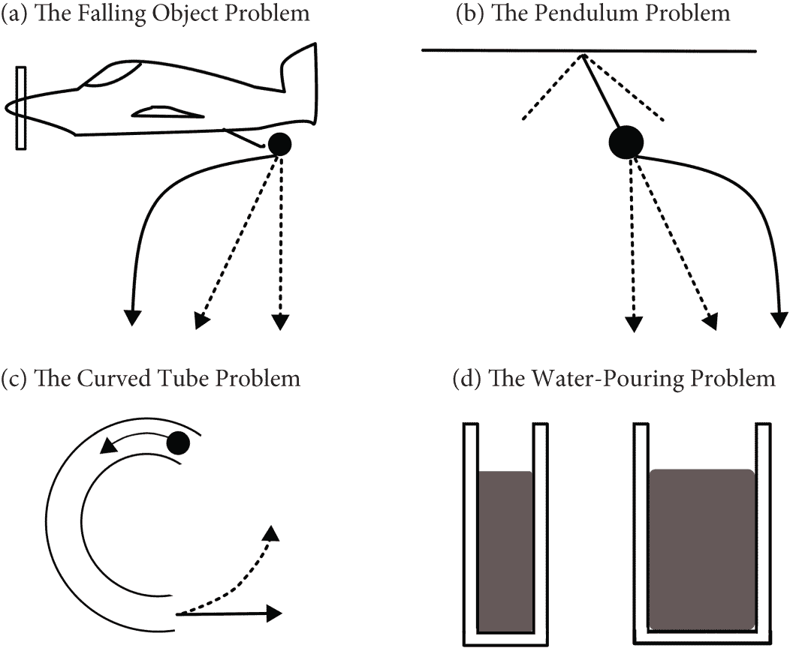

为了对这些紧张关系的关注，此处对 AI 智能体的评估充斥着与动物心理能力标准测试的比较，以及对人类弱点基于经验的评估。与动物的比较是有用的，因为动物认知研究中的方法论辩论更加成熟，而且显式地反思评估动物认知的挑战，可以帮助 AI 研究人员理解其自身学科辩论中的其他视角。AI 研究人员开始注意到，在开发评估 AI 的新指标和测试基准应用时，直接考虑动物认知具有实用价值——因为经常观察到，与其直接针对人类水平智能，不如从动物水平智能开始并据此构建可能更有用（Dennett 1978; Webb 2009），甚至有著名的学者呼吁开发一种类似于动物行为学的机器科学（Rahwan et al. 2019）。最近，专门评估的研究人员开始从动物认知中引入基准测试，并系统地将其应用于 AI 智能体（Crosby, Beyret, and Halina 2019; Hernández-Orallo 2017; Shanahan et al. 2020b）。在决定将某项能力的哪些方面视为拥有该能力标准时，必须对人类认知进行审慎考量，以抑制“人类拟构”（anthropofabulation）中的虚构性方面。特别是在任何 AI 因犯错而受到惩罚的情况下，我们必须仔细且公平地使用经验方法来评估：在类似的背景训练和任务下，典型人类是否会犯同类错误。正如我们在书中所看到的，这些公平竞争的基本原则在实践中的执行比最初看起来要困难得多。

## 2.6 总结

总结本章的观点，深度学习近期在 AI 领域取得了一系列突破性成就，在许多任务上达到了媲美人类的水平，特别是那些需要“直觉性”抽象的任务，而这些任务是此前几波经验主义和天赋论建模所规避的。尽管如此，这些系统与人类行为仍然存在一些重要的不同之处，对于这些差异应在多大程度上削弱“在模拟人类认知关键方面已取得快速且惊人进展”的感觉，仍存在重大争论。调解这场争论需要一个清晰且通用的衡量尺来评估成功，但基于智能和理性的传统指标具有方法论上的缺陷和存在问题的历史包袱。未来的最佳道路是关注系统在追求目标时表现出的控制和灵活性方面的质性飞跃，其中增加“理性等级”（Tiers of Rationality）可以在信息挑战性环境中赋予更大程度的生态理性。尽管对这些等级的进展的评估仍受拟人化和人类拟构偏见的困扰，但比较心理学可以为新兴的机器行为领域提供有用的方法论原则，以缓解这些偏见。记住所有这些点，我们现在可以将注意力转向理解深度学习的最新成就，视为在 `DoGMA` 引导下迈向 AI 进步的步骤，特别是通过观察实现了哲学家和心理学家赋予的各种心理功能的特定模型，如何在系统的生态理性中提供这些质性的增益。

***

¹ Piccinini 指出，通过“许多简单处理器对比一个（或几个）复杂处理器”来对比人工神经网络（`ANNs`）与经典计算系统的常用方法可以改进，因为 `CPU` 也可以被认为是由并行运行的更简单的处理器——逻辑门——组成的。关于并行与串行计算概念的详细讨论，请参阅 Piccinini (2015, Ch. 13)。

² 这一主张带有前提：`transformers`——一种将在稍后的章节中讨论的架构——可能正在取代 `DCNNs` 成为深度学习中最广泛采用和最成功的架构。

³ Megatron-Turing 的发布版本现在也包含了 5300 亿参数，他们构建了一个超过 1 万亿参数的版本，但报道它在训练中未能收敛。

⁴ 对于大语言模型（`LLMs`）近期进展的过热评估进行审慎调查，请参阅 Bender et al. (2021) 和 Bender and Koller (2020)。Bowman (2022) 反则警告说，其中一些悲观评估已被最新的语言模型所消解。对于理解此类 `LLM` 处理过程的一些最复杂尝试，请参阅 Elhage et al. (2021) 和 Olsson et al. (2022)。

⁵ [`github.com/google/BIG-bench`](https://github.com/google/BIG-bench)

⁶ 在某些情况下，这些替代方案表面的透明度可能会具有误导性。降维和线性分析有时可以减少决策涉及的因素数量，但通过将这些有限的维度或因素映射到常识概念来解释它们可能是具有误导性的。关于这一反驳的进一步讨论，请参阅 Lipton (2018)。

⁷ 关于这种可能性的进一步讨论，请参阅 Firestone (2020)。

⁸ 该标签的持久影响可能是由于几位 AI 先驱在 1955 年于达特茅提出的著名的夏季研究计划书（McCarthy et al. 2006）。

⁹ 最近出现了一些更有前景的智能方法，它们假设人类表现也容易出错，并将错误视为两个不同系统共享相同过程的诊断——通过寻找“签名限制”（Taylor et al. 2022）或在大量多样化任务上比较性能（Hernández-Orallo et al. 2021）。

¹⁰ 这种情感与理性的对立在某些其他文化中不仅被避免，甚至被反转了；例如，日本的 AI 愿景长期以来强调情感灵活性和与人的互动（Katsuno and White 2023）。

康德认为，对道德律的尊重构成了一种特殊的感情或情感。尽管康德认为，源自纯粹实践理性的义务的理性欣赏在动机上是充分的，但其情感组成部分的动机意义仍然是一个解释上存在分歧的问题（McCarty 1993；Reath 1989）。

这甚至是康德研究文献中的一个主题；读者至少被敦促，如果被杀手追杀，应该考虑一下躲在康德学者的家里（Korsgaard 1986）。

此类道德失败的例子包括：洛克对美洲殖民政府奴隶贸易政策的虚伪支持（Glausser 1990


经验主义者通常在此处进一步推火加厉，指出如果所有判断都必须符合某种规则才能是理性的，那么我们就陷入了恶性循环；因为我们还需要找到一个规则来认可我们对上一个推理符合规则的判断，并找到更进一步的规则来认可这种评估，以此类推无限（Carroll 1895；Stroud 1979）。在这种方法下，“规则”被视为一种文化技术，是逻辑学家和数学家为了系统化理性模式而开发的，这些与我们在特定决策语境下识别出的经反思认可但特定情境的相似性一致，而不是（如理性主义者所认为的）硬编码在我们脑中的、导致我们以那种方式进行推理的先天符号结构（Lowe 1993）。

一个赌注需要多成功才能被认为是生态理性的？这可能取决于获胜获得的收益价值或从各种失败中获得的成本。例如，想象一只猴子试图判断某种噪音是否意味着蛇即将攻击它；“虚假报警”的成本可能很低（没必要向树上跳得太高），但“错误拒绝”的成本可能很高（死亡）。信号检测理论分析了这种权衡，而深度学习理论可能会从对其洞察的更密切检查中受益（Macmillan 2002；Spackman 1989）。

对节约强调也意味着许多基于`DNN`的系统在评估证据量方面可能是浪费的，这为辛西娅·鲁丁（Cynthia Rudin）的论点提供了燃料，即在大多数环境中，一旦`DNN`证明了解决方案是可能的，它通常被一个简单得多且透明的决策程序取代，该程序只需考虑证据的一小部分（Rudin 2019）。

关于“最小理性”的相关的影响性观点，请参见 Cherniak (1990)。

某些读者可能奇怪为什么名单上没有提到意识，因为意识可能被认为是理性的至关重要的。一个问题是，不同的意识理论会认为意识出现在已经讨论的理性层级中不同的断点上。另一个复杂之处是，某些理论者认为意识是非物理的。例如，“现象意向性”运动中的哲学家可能认为，意向性（或独特的心理“关于性”）是理性所必需的（为了拥有可以被理性地结合的信念，或可以被追求的目标），而现象意识是意向性所必需（Kriegel 2013；Mendelovici 2018）。然而，这些理论者通常会承认非意识代理在功能上是等同的，因此在行为上与意识代理不可区分的——换说是理性或认知方面的“僵尸”（Smithies 2012）——这可能已经给了人工智能研究人员他们想要的一切。

理性主义者通常认为推理是他们的天然领域，认为推理所需的高层抽象概念无法通过经验主义手段获得。理性主义者倾向于强调那些似乎在感知上难以处理的最抽象概念，包括像质数或千边形之类的数学概念，或者像 `and` 和 `not` 这样的联言词逻辑概念。虽然说人类大脑*能够*表征这些抽象是容易的，但要说*如何*表征则要困难得多。尽管理性主义心理学家可能会从演化理论中汲取支持（而理性主义机器人则依赖于程序员提供的手动编码知识），但经验主义者旨在通过解释代理体如何利用其从潜在无限范围的感官经验中进行抽象的能力，来推导出这些抽象概念，从而提供一种更具优势的方案。人工智能（AI）领域中，专家系统方法的标准瓶颈始终是手动编码代理所有抽象知识的成本。正如经典困境所说的：授人以鱼，不如教机器人自己捕鱼。

然而，深度学习的成就表明，从经验主义视角关注在感知上更易于处理的中等抽象概念（如`chair`或`triangle`），可以使人类感知抽象的机制与近期在深度学习中成功的类别获取方法进行直接比较。同样重要的是，强调允许从经验中提取此类中等类别的机制，使我们能够对人类抽象中那些可以被深度神经网络（`DNNs`）有效建模的方面采取有原则的立场，特别地通过将当前关于深度学习的辩论与经验主义哲学历史上影响影响力的抽象理论联系起来。

由于这些经验主义的抽象解释是为了削弱对经典理性主义推理说明的支持而开发的，它们旨在解释基础关联学习与通用领域能力的结合如何使我们能够从经验中提取抽象概念。因此，将 `DNNs` 中的抽象与经验主义哲学中的抽象联系起来，暗示了深度学习的当前方法如何通过通用领域能力进行扩展或引导，以达到更高层次的抽象。特别是，这些经验主义解释强调了记忆、想象和注意力如何引导和引导更基础的感知抽象形式，使其达到理性主义推理说明所推崇的更高程度的灵性和控制。这些比较表明，通往更类人人工智能的一条充满前景的路径，涉及到在这些更基础的感知抽象形式之上叠加更具功能性的处理，正如 `DoGMA` 所建议的那样。

### 关联学习的基本原理

让我们因此自底向上开始攀登，从关联学习的基本原理开始。经验主义者通常通过关联的链链来解释推理；感官印象通过关联链接相互联系起来，并与动作联系起来（`Clatterbuck 2016`; `Mandelbaum 2016)`）。因此，从亚里士多德到奎因，任何经验主义心理学通常从一组基础的通用关联学习原则开始。这些原则决定了哪些思想将产生关联——从而在从一个红色浆果到另一个红色浆果的转换中建立联系；这仅仅是重复。如果从红色浆果泛化到橙色浆果，这种印象并不深——这可能更有用，但可以用刺激泛化来解释，因为红色光和橙色光在视觉光谱中占据相似的频率。当鸽子学会将从像奈特这样的印象派画家那里获得的啄食反应，泛化到其他技术略有不同的印象派画家（如塞尚和雷诺阿）的作品中，并区分印象派作品与立体派或传统日本风格的作品的作品时，人们确实往往会印象更深刻——据报道，在日本饲养的一些敏锐鸽子能够掌握这些辨别（`Watanabe 2011)`）。

在经验主义框架下，解释这些更为复杂的关联的负担主要落在“相似性原则”上——尽管相似性必须比单纯的聚合性刺激泛化更为复杂。人类通常基于狗、椅子、三明治、咖啡、正方形、金钱、假期和美德等类别进行推理。如果关联原则真的能带引我们走得那么远，那么我们需要某种方式来理解此类类别的多样化实例是如何被视为相互相似的。如果感知到的相似性本身并非先天的（这将违背了我们经验主义对先天领域特定特定表征结构的禁止，更不用说对鸽子的审美天赋寄予了过高的期望）——那么就必须存在某种能力，能够让我们从混乱且不可预测的经验交付中理解并学习相关的相似性。我建议，这种能力就是**感知**。

感知实际上是一种“原始能力”，它涵盖了多种更基础的感官能力，包括视觉、味觉、触觉、听觉和嗅觉（见图 3.1](#11_chapter3.xhtml#oso-9780197653302-chapter-3-figureGroup-11)）。许多历史经验主义者还将“内部”感觉作为类似于感知的概念理念来源，例如内感官（对自身身体状态的感知）、情绪（或“激情”）以及带有情感色彩的反应谱，如欲望、厌恶、恐惧、悲伤和喜悦。关键在于，为了完成分配给的任务，经验主义者认为感知具有强大的能力，不仅能够报告低级感官输入——例如眼睛中颜色锥细胞的活动，或内耳中特定频率调谐毛细胞的振动——还能将这些简单印象系统化，转化为对形状、物体、场景、单词或旋律更抽象的敏感性，以及像爱、恨和羞愧这样丰富且定向的情感状态。然而，要让经验主义对感知的诉求取得成功——并让 DoGMA 对感知的中度经验主义方法推进传统辩论——我们不能简单地断言感知可以完成这一壮，而必须实际上定位人类心灵和/或大脑特定的特定方面，这些方面既符合“转换原则”，又能将简单感知系统化为对抽象类别的高级感知。为此，本章的其余部分阐明了此类抽象方法，并展示了深度卷积神经网络（`DCNNs`）如何实现大脑的差异化处理方面，使其能够从高维感官输入中提取中级抽象类别。

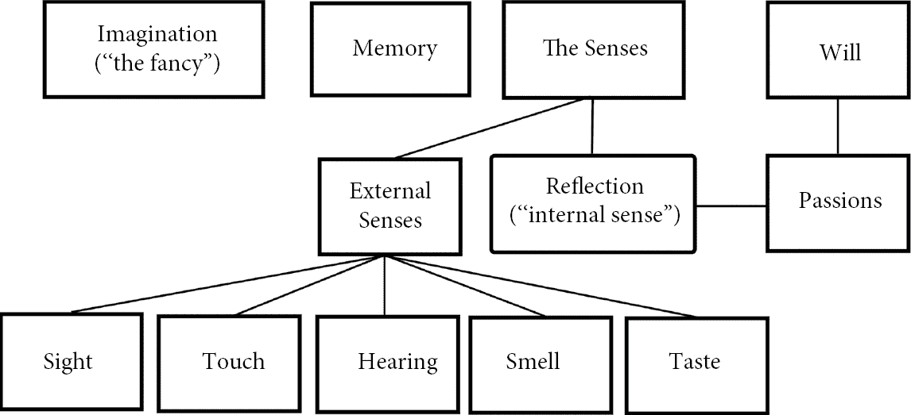

**图 3.1** Millican (2009) 提供的休谟式能力架构简图，它提供了一个相当典型的经验主义关于能力及其组织的解释。

## 3.2. 源自历史经验主义的四种抽象方法

本书所辩护的中度经验主义 DoGMA 是起源经验主义的一个版本，但它强调了主动心理能力所起的作用——即同名的“领域通用模块”（Domain General Modules）——它们在产生通用表征的过程中对感官经验的原材料进行操作。特别是，这些能力主动重塑了支配类别成员身份的相似感，从而在推理中实现了更灵活的泛化。洛克和休谟等历史经验主义者在理论中频繁引用此类能力，但他们并没有假设这些操作的细节是可以被内省的，并且很少尝试解释它们究竟是如何运作的。休谟多次将这些运作称为“魔法”，而是将其论证重点转向建立它们的存在及其在认知中的关键作用。几个世纪以来，理性主义者一直很有理据地抱怨经验主义论证在关键点上的这些空白。这是当代机器学习研究可以为经验主义心灵哲学提供回报的地方——通过提供可实现的网络模型，可能帮助解释此类能力如何在遵循“转换原则”等经验主义约束的情况下，在生物大脑中运作。为了启动这一项目，我们从一个最关键的经验主义能力之一开始，这种能力可能是心灵主动处理和重塑经验原材料以形成捕捉更深层、更具泛化相似性的表征的核心：感知。

感知抽象是心灵从不那么通用的表征构建更通用表征的最基本方法。非正式地说，它允许我们将类别成员的感官经验提炼为它们的“要旨”（gist）。我们可以通过将其与具体性联系起来开始理解它的运作。作为一个测试案例，让我们考虑学习如 `triangle`（三角形）之类的中级抽象属性的困难性。这个类别很有趣，因为人们可能通过理解一组示例共享的相似性来学习识别三角形，但该类别也可能在更抽象的推理中发挥作用，例如三角形三角形理（三角之和为 180 度）或勾股定理（两条直角边的平方和等于斜边的平方）。我们可以假设，三角形最抽象的表征是对特定三角形示例（例如画在纸上的一个三角形）的整体感知。这种感知在各方面都是具体的：它有特定的尺寸、特定的颜色和特定的光照程度；它的角有精确的度数；它的边有特定的长度（即使我们无法说出它们的精确数值）；而且它在视野中有一个特定的位置。如果我们我们要使用经验主义机制学习更通用的三角形概念，那么所有三角形共有的属性必须某种程度上从一组具有不同参数值的特定示例中外推出来（见图 3.2）。

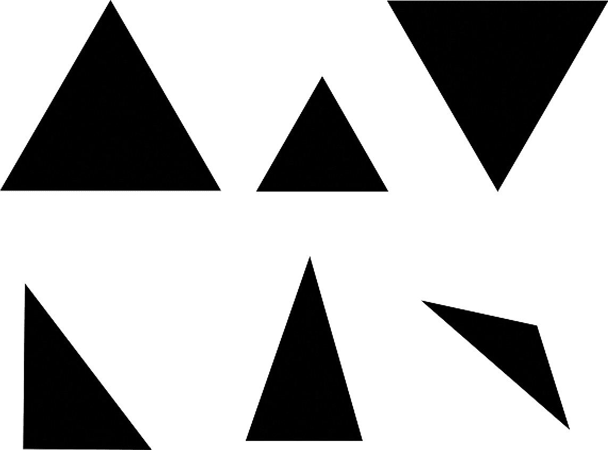

**图 3.2** 显示出互不一致特征的三角形示例。

洛克在《人类理智论》（`Essay`）的一段著名的文字¹中说明了获取三角形通用概念的困难：

```
The ideas first in the mind, it is evident, are those of particular things, from whence, by slow degrees, the understanding proceeds to some few general ones . . . For when we nicely upon them, we shall find, that general ideas are fictions and contrivances of the mind, that carry difficulty with them, and do not so easily offer themselves, as we are apt to imagine. For example, does it not require some pains and skill to form the general idea of a triangle (which is yet none of the most abstract, comprehensive, and difficult), for it must be neither oblique, nor rectangle, neither equilateral, equicrural, nor scalenon; but all and none of these at once. In effect, it is something imperfect, that cannot exist; an idea wherein some parts of several different and inconsistent ideas are put together. (*E* IV.vii.9)
```


关于这段非凡的文字，有三点需要注意。首先，洛克似乎违反了哲学中反对自相矛盾的金科律，这导致这段文字成为哲学史上最受讽刺的段落之一。一个概念如何能关于一个既是斜角又是直角、或者既是等边又是不等边的三角形呢？同样作为经验主义者的`乔治·伯克莱`在批评这段文字时尤其毫不留情，他认为“如果任何人有能力在脑海中构思出这样一个三角形的概念……那么试图通过辩论让他放弃这一想法是徒劳的，”而且，“设想几个孩子能不能聚在一起谈论他们的糖果和铃铛…………直到他们先把无数个不一致之处结合在一起，这难道不是件困难的事吗？”(Berkeley 1710，引言 13–14)。因此，抽象理论可能面临的第一个困难在于如何在不陷入显而易见的矛盾的情况下理解这种表。

然而，段落中提出的挑战与机器学习的基础问题之间存在着显著的契合——因为成功机器学习的目标是从有限数量的样本中学习到类别的通用表示，而这些样本展示了该类别核心属性的特异性表现。这一观察表明，我们可以将伯克克的反对意见视为一个需要用技术技巧解决的工程问题，而不是洛克抽象理论已经偏轨的证据。洛克的观点是，三角形的通用概念必须以某种方式包含并包纳这些相互矛盾的配置。我通过以下建议来调前两点：洛克在这里试图阐述一种超越他时代数学词汇所能达的表示形式，但这种形式在现代机器学习话语中是完全契合的。

第三，在这段经典的经验主义段落中，我们发现了进一步的证明，与`福多`和`马库斯`等天赋主义者相反，范式经验主义者理论化了：心灵在从特殊经验中提取通用概念方面做出了积极的贡献。这些天赋主义者试图将经验主义理论限制在对感觉印象的机械复制和对少数关联原则的机械应用上，而我认为，经验主义者通常理论化了更广泛的活跃功能，这些功能对心理表征执行领域通用的操作。这段文字（以及周围的讨论）并未暗示产生这些表征的过程可以还原为简单的关联模式，也没有暗示它们必须对内省现象学是可见的；事实上，考虑到伯克莱担心描绘这样的通用表示似乎涉及不连贯性，很难想象它们如何能是如此易于获取的。

遗憾的是，洛克在整部《论人类》中讨论了几种看似截然不同的抽象方法，但没有非常清晰地将它们相互联系起来。这为洛克学者制造了某种阐释上的困境，后来的思想者通常将它们视为解决抽象问题的替代方案，并可以将它们相互并置作为竞争的方法进行对立——但深度学习的最新进展表明情况并非如此。事实上，洛克的不同抽象方法比以前认为的更具相互依赖性。研究洛克提供的三种重要的抽象方法以及`休谟`提供的第四种方法，构成了在`DCNNs`中可能实现的不同抽象形式之间进行分工的经验主义基础。在探索它们的相互关系之前，让我们先回顾洛克作品中的三种抽象方法，然后是对休谟等其他经验主义者的抽象叙述产生影响的第四种方法。这种哲学导向的讨论应该对更多计算导向的读者也感兴趣，因为在章节末尾，我展示了这些不同形式的抽象如何有助于阐明当代`DCNNs`的成功。

## 3.2.1. 减法式抽象

我们的第一个洛克式抽象机制遵循 Christopher `Gauker (2013)`，被称为“减法式抽象”。根据其基本思想，心灵可以通过简单地减去类别成员之间变化的所有特殊性形式，从不那么抽象的表示创建一个更抽象的表示。如果我们注意到一个三角形是不等边而另一个是直角三角形，我们可以从通用三角形表示中减去具体的角度数，并保持角度未指定。如果我们注意到一个三角形的边等长而另一个的边长不等，我们可以减去三角形边的具体长度，以此类推。通过这种方式，心灵可以“不创造任何新东西，只是从复杂概念中……去掉每个所特有的部分，并保留所有所共有的部分”(`E` III.iii.7)，从而使我们不被特定三角形之间可能差异的众多方式所分心。

然而，正如 Gauker 指出的，这种理论立即引发了一些自身的谜题。具体来说，在减去之前我们如何知道将哪些特殊情况归为类，在发现差异时我们如何知道要减去多少？例如，我们如何知道在过程中排除一个三边不汇于一点的边形图形？在得知它们的角度数可能都不同时，我们是否会避免无意中抽掉关于角度的所有相关信息？我们可能会想，在这些删除之后是否还剩下足够进行严肃的认知工作——因为如果我们删除了所有关于特定角度角度的信息，似乎就没有留下足够的信息来证明像`三角形公设`这样的关于三角形的通用原理。正如 Gker 沮丧地指出，“心灵如何形成这样的通用概念[如在恰好的抽象水平上的角度] 正是减法式抽象理论应该回答的问题”(Gauker 2013:27)。因此，很难看出减法式抽象本身如何成为解决洛克三角形问题的完整方案。

## 3.2.2. 组合式抽象

在《论人类》的第二卷中可以找到另一种截然不同的抽象方法（再次遵循 `Gauker`），我们在此称之为“组合式抽象”。根据这种方法，更抽象的概念通过将不那么抽象的概念结合在一起形成。例如，我们可能认为通过正确的方式将三角形、角和边这三个具体的概念融合在一起来形成一个三角形的通用概念会更简单，而不是通过从混乱的样本中减去特异性来发现这些共同点。许多抽象概念可以被认为是这样组合而成的——洛克特别描述了铅的概念是通过结合“某种暗淡白色的色的简单概念，以及重量、硬度、延展性和熔融性的某些特定程度”而形成的（II.xii.6，在 Gauker 2013:20 中讨论）。我们可能会假设，任何复杂概念都可以以这种方式形成。

然而，作为一种关于我们如何从经验中导出抽象表示的完整理论，“作为组合的抽象”也有明显的缺点。一个主要的复杂性问题在于，它似乎已经预设了一组更基础的抽象概念，从这些概念可以形成更抽象的概念，并且具备关于如何正确将它们结合的知识。也许我们认为后一种形式的知识来自于显式定义，例如“三角形是一个有三条边三个角的图形”。然而，这种方法对“三”、“角”和“边”等概念施加了更大的压力，因为我们在理解这个定义之前就必须拥有这些概念了。记住，原初经验主义者试图避免在大脑中充斥无数的先天观念，但“作为组合的抽象”似乎将许多基础构建块视为所当然，而这些构建块本身就具有非凡的抽象程度。如果我们考虑到奎恩（Quine）等较晚期的经验主义者所提出的完整学习问题——或者说它是今天 `DNN` 模型建模者面临的问题——它的起点并非以角度和线的形式经过预处理的输入，而是通过“各种频率的特定辐射模式”对“感觉受体的原始、未处理的刺激”（1971:82–83）。再次，我们似乎预设了一种先天的抽象能力，使我们能够从经验中提取这些更基础的表示，以便让“作为组合的抽象”得以实现。

## 3.2.3. 作为表示的抽象

第三种抽象方法可以在洛克（Locke）那里找到，贝克莱和休谟后来也倾向于这种第三种方法。鉴于前两种抽象方法带来的困难，贝克莱和休谟试图通过提供一种更（我们现在称之为）基于示例（exemplar-based）的抽象推理方法，来完全避免对抽象概念的需求——这种方法被 Gauker (2013) 解释为“作为表示的抽象”。² 如休谟所言，“心中的形象始终是特定对象的形象，尽管它在我们推理中的应用是相同的，仿佛它是通用的一样。”（*T* 1.1.7.6/20）。在发展这一观点的一种方向上，当我们推理抽象原理（例如毕股哥定理）时，并不是在反映某个不具备特定属性、或特定属性组合不一致的三角形性抽象表示，并利用该表示来推导定理。相反，我们考虑一系列特定的三角形（带有它们独特的尺寸、角度、旋转等），并以各种方式将其视为整个范畴。然后，我们通过考虑这些特定示例的相关方面（例如，它们的三角形性，或更具体说是三边性，而不是它们的各种尺寸或角度的具体程度）来评估一般命题的真伪，并观察该命题在这些基础上对它们是否成立。对于经验主义者来说，这种观点的优点在于，它至少将某些形式的论证推理还原为在心理象上进行的一系列结构适当的感知辨别。

虽然这种解释在论证推理的过程方面有其正确之处，但它在泛化性上引发了进一步的问题。首先，我们如何确保自己只考虑了样本图中与其三角形性相关的方面？另一方面，我们如何知道我们所考虑的示例集足够广泛，能够代表整个类别的特征分布呢？我们必须已经拥有一种将抽象与示例联系起来的方法，以确保只考虑了它们的相关属性；而且我们需要某种方法以代表性的方式从抽象类别中采样示例，以避免对类别的错误假设。我们再次面临着一种溯归问题，这种问题预设了对抽象的早期掌握，以确保这些任务能够以可靠且成功的方式完成。

贝克莱和休谟都认为语言在回答这些问题中起着重要作用，但即使为抽象类别提供显式定义也并非万能药。举一个极端例子，几个世纪以来，人们认为欧几里得几何的原理（例如两条平行线永远不相交）根据定义必然为真；是黎曼（Bernhard Riemann）构想出了平行线的一致排列（在投影几何中），打破了这一假设——并以此为广义相对论的数学奠定了基础。

休谟意识到选择合适示例的困难，他这样描述：

```
One would think the whole intellectual world of ideas was at once subjected to our view, and that we did nothing but pick out such as were proper for our purpose. There may not, however, be any present, beside those very ideas, that are thus collected by a kind of magical faculty in the soul, which, tho’ it be most perfect in the greatest geniuses . . is however inexplicable by the utmost efforts of human understanding. (*T* 1.1.7.15/23–24)
```

不幸的是，在我们最需要透明度的地方，这种经验主义推理说明的枢纽再次被笼罩在魔法的迷雾中。当然，我们不应该读成休谟在这里是在论证这是字面意义上的魔法；他在其他地方对奇迹的可能性采取了明确的反立场，并通常希望培养一种对心灵的科学方法，用普遍规律来解释其运作。然而，这种总体的倾向可能被认为让休谟的这一逻辑缺口显得更加尴尬。虽然我们应该同意贝克莱和休谟的观点，即我们无法有意识地形成或推理具有不一致属性的心理图像——无论这是否是洛克的本意——我们可能会抱怨说，他们基于示例的替代方案只是将谜团推到了另一个地方。

天赋论者或许正确地指责原初经验主义者，在被要求解释大脑如何运作此类通用类别时诉诸此种“魔法”。如果经验主义者希望在处理比简单条件反射更复杂的认知形式时优于天赋论者，他们必须在这里提供更多内容。当然，这里的利益远不止是修辞上的优势。当今的教条经验主义者（DoGMAtic empiricist）不仅认为符合转换原则的抽象形式解释更有可能解释我们学习抽象类别的大脑结构方面，而且认为以此获取的知识形式比许多天赋论者推荐的硬编码、领域特定的符号结构更灵活、更有适应地面对新领域。在第 5 章中，我们将看到经验主义对这类知识的方法包含了大量的“潜在”信息，这些信息可以灵活地重新用于对可能无限数量的新场景进行想象性模拟，这种灵活性是符号认知方法一直回避的。然而，现在，让我们回到在休谟等晚期经验主义者那里找到的第四种抽象形式，这可能与理性主义者苦候的抽象高度更为相关。

## 3.2.4. 作为不变性的抽象

第四种也是最后一种抽象形式——经验主义者特别是在处理物理、逻辑和数学等最抽象的艺术时应用它——诉诸“不变性”（invariance）的概念。在这种意义上，如果一个属性在空间或定义域的某些系统变换下保持不变，那么它就是不变的。在物理学中，对`invariance`的寻找提供了一种揭示自然规律的方法；例如，角动量守恒定律可以从`momentum`在旋转下保持不变的观察中推导出（即物理定律不依赖于参考点的角度）。³）。因此，作为不变性的抽象可能被认为对于达到我们在前一节中搁置的数学和逻辑抽象高度尤为重要。

这些将抽象与不变性联系起来的思想的影响力来源是休谟的`Treatise`（论文集）（以及后期`Cantor`、`Frege`和`Boolos`的作品——[Antonelli 2010; Shapiro 2004]），在书中他推测数学是最完美的科学，因为基数概念可以从两个集合之间完美不变的一一对应关系（`bijection`）中推导出来：

```
Algebra and arithmetic [are] the only sciences, in which we can carry on a chain of reasoning to any degree of intricacy, and yet preserve a perfect exactness and certainty. We are [possessed] of a precise standard, by which we can judge of the equality and proportion of numbers; and according as they correspond or not to that standard, we determine their relations, without any possibility of error. When two numbers are so combin’d, as that the one has always a unite answering to every unite of the other, we pronounce them equal. (*T* 1.3.1.5/71)
```


后一句话的提法——继 `Frege` 在其试图数学还原为逻辑和集合论的过程中对其产生影响力的使用之后——被称为“休谟原则”，类似的策略在今天已被用于定义抽象逻辑属性和抽象对象的概念（Fine 2002）。这种相似性的模态概念甚至在认知心理学中作为逻辑推论的来源受到了实证研究，可能延伸到了逻辑连接词和论证形式（Vigo 2009, 2011）。

这种最终的抽象形式似乎与其他者完全不同——例如，并不清楚人类在正常认知发育过程中，获取数字概念时是否真的通过了任何此类证明来工作。它可能比前三种抽象形式更像是一种调节性理想或辩护程序，因为它诉诸一种变换的极限——在所有排列下的恒等性，或在所有 `homeomorphisms` 下的不变性——而人类认知只有在接受了形式化证明技术的训练后，才能对其近似或证明。然而，正如我们所看到的，它是本对话中对其他抽象形式的重要补充，因为它提供了一种可以用于接近天赋论者在他们关于先天启动软件的论点中所强调的最抽象概念的程序。

总结本节的观点，我们最后留下了（至少）四种性质截然不同的抽象形式，这些形式在最具影响力的经验主义者的观点中占据显著地位：(1) 作为减法的抽象、 (2) 作为复合的抽象、 (3) 作为表表的抽象、以及 (4) 作为不变性的抽象（Fig. 3.3）。传统上，许多理论者在最好的情况下认为这些不同的方法是联，在最坏的情况下将其视为理论上的竞争者。一种抽象形式中发现的缺陷往往被视为经验主义者内部辩论中支持其他形式的论据。

在下一节中，我们通过回顾深度卷积神经网络的关键组件来质疑这种对立性的框架，认为它们提供了一条跳出这种解释和论证泥潭的新颖途径。特别是，我展示了这些抽象方法虽然在概念上是不同的，但可以结合成单一的分工模式，从而解决大部分之前的争论。以前，我们可能将“抽象”视为命名一个应该根据充分必要条件定义的运算——从而对源头经验主义者施压，让他们说明四种抽象的共同点，或者为了某些形式而拒绝其他形式——相反，我们可以解释一种执行所有抽象形式所归的操作的自然机制。这种抽象方法可能被认为与认知科学中近期基于模型的方法更为一致（Boyd, 1999; Craver, 2007; Godfrey-Smith, 2006; Weiskopf, 2011），并可能被认为解决了困扰过去几个世纪经验主义哲学家的争议。

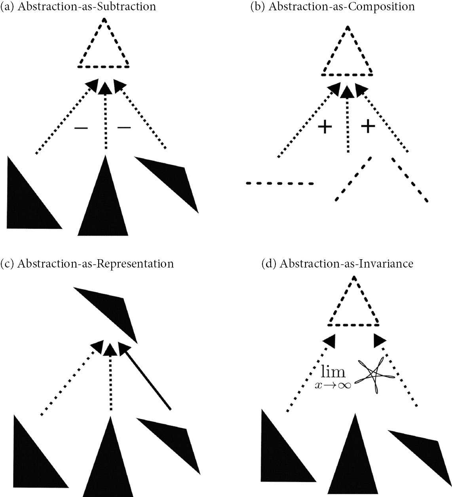

**图 3.3** 四种抽象方法的视觉总结。虚线框图形表示抽象的概念，点线箭头表示抽象过程。作为减法的抽象（A）从具体的印象开始，并减去它们之间的差异以创建一个通用概念。作为复合的抽象（B）从抽象部分开始，并将它们组合成一个新的抽象整体。作为表表的抽象（C）从一组具体概念中选择一个来代表整个类。作为不变性的抽象（D）通过观察在变换集合的极限（用螺旋线表示）下保持的属性，从具体概念中推导出抽象概念。

### 3.3 变换抽象：概念基础

在本节中，我提出了一个理解抽象的框架，该框架与之前讨论的所有四种形式都有某些相似之处；在随后的章节中，我将展示 `DCNNs` 如何突出哺乳动物脑中执行这些抽象形式的方面，且这种方式与 `Transformation Principle` 保持一致，从而为经验主义兑现了一份重大的承诺票。为了将这一框架与我们之前的讨论联系起来，`Fodor` 和其他天赋主义者将经验主义（尤其是休谟的经验主义）解释为仅限于在推导一般类别表示时复制感官印象；而变换抽象则允许对这些原始材料进行更广泛的“复合、传输、增强或削减”，同时仍被视为一种溯源性经验主义的形式。尽管洛克和休谟都未尝试解释这些过程是如何运作的，但当代神经科学和机器学习研究人员在理解大脑如何进行物体识别方面取得了显著进展，这些进展可以帮助我们解释大脑如何从感官经验中创建一般类别表示，而无需诉诸魔法。

这一研究传统的核心思想是：类别成员之间的差异方式并不像我们最初考虑洛克关于学习一般类别表示的问题时所想的那样随机或混乱。事实上，变异来源并非随机噪声，而是表现出可以利用的对称性和模式，从而降低任务难度。机器学习研究人员将这些系统参数称为 `nuisance variables`（干扰变量），它们捕捉了共同类别的示例之间的差异方式通常可以划分为常见的形式，这些形式可以通过适当的领域通用变换来克服（表 3.1）。此外，这些来源对于许多不同类型的判别问题是相同的，因此，在一种判别问题中开发控制它们的对策可以为许多其他问题提供益处，即使在不同的领域中。三角形产生差异的干扰参数示例包括旋转角度、尺寸、在视野中的位置和颜色。其他感知模态中的判别任务也具有高度的干扰变异性特征；例如，要成功进行语音识别，必须控制不同的人用不同方言说出相同音素时的音高、音调和时长个体差异。

### 表 3.1 视觉和听觉感知模态的干扰变量

| 感知任务 | 干扰参数 |
| --- | --- |
| 视觉物体识别 | 视野中的位置、缩放、平面旋转、深度旋转、取向角度、遮挡、阴影、颜色 |
| 听觉单词识别 (Stephenson et al. 2019) | 音调、音高、时长、音量、重音 |

通过意识到许多许多这些 `nuisance variables` 变量在某些数学上方便的方式上表现良好，可以取得进展。特别是，它们在空间或时间维度上表现出对称性，可以通过操纵这些对称性来重新调整示例之间的感知相似性。回到洛克那些杂乱的三角形上，例如，位于视野中不同位置的两个三角形可以通过空间位移（让它们相互靠近）而变得更加相似。两个除了底边取向角度不同外完全相同的三角形可以旋转，直到它们的底边平行。一个较大的三角形可以缩小到与较小的三角形一样大，以此类推。此类操作被称为 `affine transformations`（仿射变换）；在这种情况下，它们保留了与三角形相关的某些关键属性（如线条数量和平行性），同时使我们能够控制一系列对三角形性至关重要但会阻碍基于主观感知相似性分类的特异性。使用这种系统变换，任何三角形都可以转换为具有与任何其他三角形相同干扰参数组合的图形，而不会丢失任何本质特征。一个能够学习正确的系列系统变换以完成这一壮举的智能体将拥有一种解决洛克问题的可行方法，至少在很大程度上如此。⁴

我将这种解决一般类别获取问题的方案称为“变换抽象”（Buckner 2018a）。为了获得更高的精确性，我们可以转向一个数学框架，该框架将类别表示解释为特征空间中的流形（开发和批判性审查请参见 P. M. Churchland 1989; Gärdenfors 2004; Gauker 2013）。特征空间是一个多维坐标系——每个维度代表一个感知上可区分的特征——将智能体对每个示例的感知经验绘制到唯一的向量上（图 3.4）。每个示例的向量是一个有向箭头，其端点取决于它在特征空间中展示每个特征的程度。该空间中向量之间的距离（由 `cosine similarity` 或 `Euclidean distance` 等度量确定）被用以标记不同示例之间感知相似性的程度。⁵ “流形”是该向量空间的一个区域，可以被用作标记类别表示的边界。⁶

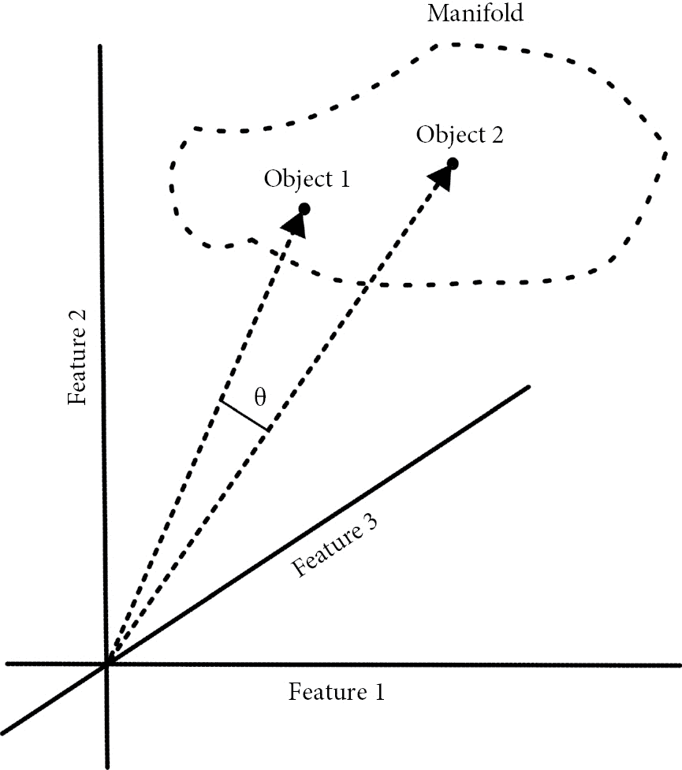

**图 3.4** 由三个特征定义的相似空间中的两个向量示例。向量由相应物体展示所考虑的三个特征的程度定义。这些物体在该空间中的相似性由它们在该空间中距离的量定义，例如它们之间角度 `θ` 的余弦值。类别可以表示为该空间中的一个流形，如虚线包围区域所示。

通过这种方式构思，感知分类面临的问题是，正如 DiCarlo、Zocolan 和 Rust 所言，干扰变化（nuisance variation）导致“对应不同[抽象类别的]流形‘缠绕’在一起，就像被揉成一团的纸”（2012:417）。大脑和人工智能体的任务是找到一系列操作——即对该空间的系统性变换——能够可靠地“展开”对应不同类别的纸张，以便它们能更容易被区分。该文献的另一个发现是，向量并不需要变换到完全相同才能被归类为同一类别的成员；变换只需要在不同类别之间留出足够的空间，以便在它们之间轻松画出判别边界。

更具体地说，智能体必须学习感知相似空间的系列变换，将不同三角形的向量映射到变换后的 `triangle` 流形中邻近的点，并确保该流形标记了一个与 `square`（方形）或 `rhombus`（菱形）等对类别流形分离的区域（DiCarlo and Cox 2007）。这种方法既确保了面对干扰变化时分类问题的解决办法，又通过将单个向量映射到变换流形中略微不同的位置，保留了部分干扰信息。

与大多数视觉皮层处理过程一样，假设是这些变换以及它们创建的流形是无法通过意识内省获取的。因此，我们不应假设——正如关于内省的人类化幻想可能误导我们相信的那样——它们所包含的信息是熟悉的或直觉上容易理解的。尽管如此，通过考虑视觉艺术中的示例，我们可能会对其组织获得某种类比性的理解。艺术家长期以来思考从多个角度和更高层次的抽象来表现主体的困难。例如，马蒂斯的《背部系列》（Fig. 3.5）由四件抽象程度逐渐增加的浮雕雕塑组成（在 Patel, Nguyen, and Baraniuk 2016 中也有过讨论）。从左到右，这些雕塑对从背后观察的女性提供了日益模糊的表示，逐渐调整了肢体和髋部的特异性位置。到第四件雕塑时，我们得到了一个看起来可能不像任何从背后观察的特定女性的表示，但与该人物可能占据的所有不同位置具有更强的聚合相似性。这为这种经过变换、精简的、后期阶段提供了一个视觉示例，这种表示经常被认为是艺术和科学创造力中抽象的本质（Camp 2015; Chatterjee 2010）。

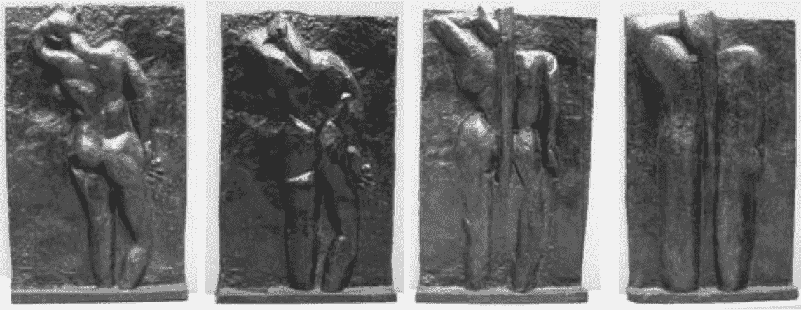

**图 3.5** 马蒂斯的《背部系列》，在 Patel et al. (2016) 中也有过讨论。

在艺术史上，人们可能会在从印象派到原始立体主义再到分析立体主义的过渡中发现类似的趋势，这种趋势通过一系列发现进展，即日益抽象的主体可以用一系列旋转的笔触、从不一致角度观察的几何形状，最后作为处于不一致姿态的异质特征的杂烩来表示。最抽象的表示很难被识别为形象，且不像任何特定的范例；然而，它们以某种方式捕捉到了类别的精髓，例如毕加索 1912 年的斗牛粉丝肖像（`l’Aficionado`），它由来自斗牛的各种视觉主题的多样组合组成，排列在大致合适的位置上（Fig. 3.6a–c）。这类图像可能是我们接近视觉化抽象子个人类别流形结构最像的方式；如果我们尝试描述它们，最终得到的将只是伯克莱会嘲笑的那种言语杂烩。尽管这目前仅仅是推测，但或许这些专家艺术家通过对各种变换的审美反应进行实验，反向工程了由其子个人感知系统创建的抽象表示中间形式。

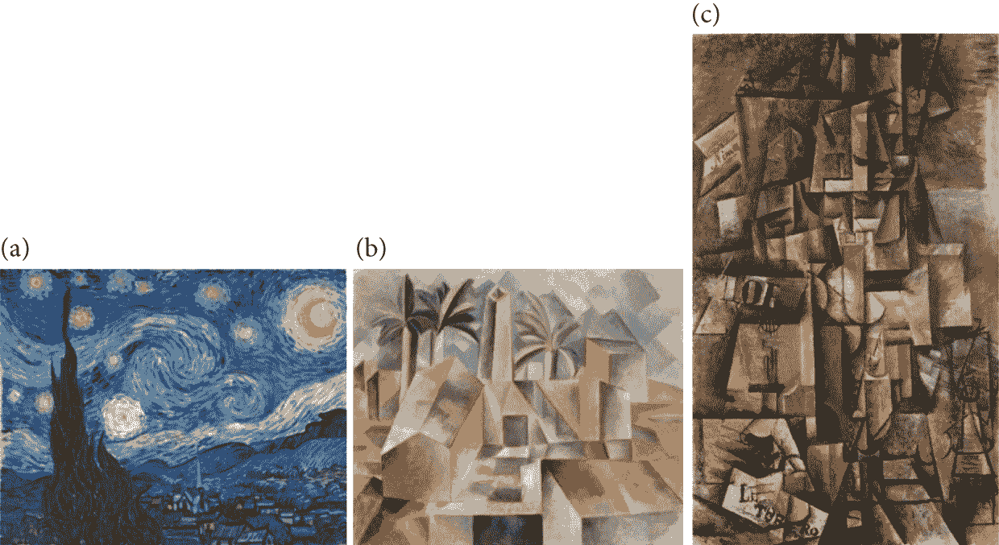

**图 3.6** 从“少”到“多”抽象的系列作品：(A) 梵高，《星夜》，1889 年；(B) 毕加索，《托尔托萨的砖厂》，1909 年；以及 (C) 毕加索，《L’Aficionado》，1912 年。

我们现在有了一个更坚实的概念基础来支持洛克那段令人棘手的三角形段落。相对于伯克莱和休谟，洛克的观点不需要被解释为在这里暗示三角形的泛指类别表示是一个具有不一致属性的可内省心理图像。相反，三角形的般概念可能是更具子个人的东西，类似于一个变换后的流形，如果它能被连贯地成像，看起来会像刚才讨论的抽象艺术品。这就是洛克式的 `triangle` 表示可能包含所有且不包含那些变化的意义所在；它通过将特异性范例转换为一种可以调整变化的抽象表示格式来控制这些变化。然而，这个泛指流形本身包含了一个整个相似性区域，就像毕加索的 `L’Aficionado` 一样——不应被解释为描绘具有特定干扰参数配置的单一连续范例。洛克努力表达一种超越当时哲学和数学词汇范围的抽象理论。在这里需要注意的是，我们可以区分出两种不同的变换方法，考虑到它们以后组合成新复合体的差异潜力，这将是重要的。我们将其中一种称为“隐式解耦”，另一种称为“显式解耦”。在隐式解耦中，我们仅仅是发现了一系列变换，在需要区分的类别流形之间留出足够的距离，以便分类器可以在它们之间画出线性决策边界。这就像梳理纠结的头发，直到梳子通过为止停止。第二种显式解耦方法涉及识别干扰变化的特定参数，将它们相互分离，并在不同的通道中独立表示。这更像是将发丝分离成小辫子，然后可以灵活地重新组合许多不同的发型。两种方法允许在需要区分的不同类别流形之间画出边界，但更具系统性的解耦方法对于灵活泛化以及在后期更具创造性的任务中重用干扰信息具有重要的益处。

为了理解大脑中允许我们进行转换抽象的方面，并将转换抽象与之前讨论的四种抽象过程联系起来，让我们转向分析我们的第一种深度学习神经网络架构：深度卷积神经网络（`DCNN`）。这种架构或许是深度学习迄今取得瞩性成功的头号功臣。值得注意的是，它是 `AlexNet` 采用的架构，其惊人的强大性能在很大程度上引发了当前 `DNN` 研究的热潮。`DCNN` 进一步作为 `AlphaGo` 和 `AlphaFold`（涉及对非模态棋盘位置中模式的发现）的核心组件出现，因此其应用范围远超计算机视觉领域。

作为一种模拟心理处理的方法，`DCNN` 可以广义地归类为连接主义或神经计算主义；然而，它们的特征结构与 20 世纪 80 年代和 90 年代无处的浅层人工神经网络（`ANN`）有本质区别，因此对许多读者来说可能更加熟悉。在下一节中，我将认为，这些差异使得 `DCNN` 能够模拟哺乳动物大脑中抽象的核心方面。这一论点取决于三个共同将 `DCNN` 与其他神经网络架构区分开来的特征：深度、卷积和下采样。⁷ 与缺乏这些特征的网络相比，这些特征在部署于某些特定任务时，在计算效率和表示资源消耗方面提供了显著收益。在本节中，我们将探索这三个将深度卷积网络与其先驱区分开来的特征，并刻画它们擅长的任务类型。

#### 神经网络的研究浪

回溯过去，我们可以将神经网络的研究进展分为三波，每一波都通过在人工神经网络中增加层数（通常还有更多受神经解剖启发的结构）来利用更多的计算能力和效率。

##### 第一波：基础模型

第一波始于 20 世纪 40 年代，McCulloch 和 Pitts (1943) 的基础工作显示了简单的神经功能阈值模型可以计算基本的逻辑运算。这种方法被 Rosenblatt (1958) 很有影响地扩展，他建议人工神经元可以组成网络，并使用受神经科学发现启发的学习规则（例如 Donald Hebb 对学习后突触修改的研究）进行训练以执行功能。Rosenblatt 因此将被称为“感知器”的人工神经元排列成单层可学习权重的网络，这些权重旨在模拟突触连接。这些链接可以通过正或负权重进行修改；当一个感知器响应其输入而“触发”时，它可以沿着其链接向输出传输激活值，激活值的幅度由这些链接的权重进行修改。

这是一种很有前景的方法，证明了简单单元可以使用简单的学习规则学习解决某些感知判别问题；但由于 Minsky 和 Papert (1969) 证明存在感知器网络无法学习但人类可以轻松掌握的重要非线性函数（例如异或门，`XOR`），这第一波神经网络研究的热潮便消退了，Rosenblatt 也于 1971 年在一次船事故中去世。众所周知，可以在输入和输出之间增加额外的可学习权重层来计算 `XOR` 函数 ([Rosenblatt 1958]:404)，但当时的神经网络研究人员还没有能够有效应用于训练具有两层以上可学习权重网络的学习规则 ([Minsky and Papert 1969]:232)。

##### 第二波：反向传播

这种情况在 20 世纪 70 年代后期随着误差反向传播算法的兴起而改变（独立被发现了多次，但可能是 Werbos 在 1974 年首次发现），它可以通过跨多个层迭代反向传播训练信号来训练多层网络。这一发现引发了 `ANN` 研究的第二波，允许研究人员训练层数更多（通常只有三四层）的网络来解决更困难的判别问题（如 `XOR`）。为了与我们即将讨论的 `DCNN` 进行对比，让我们从两个特征来描述第二波网络：浅层性（仅三到四层）和统一性（仅包含一种处理节点，通常涉及 sigmoid 激活函数）。这些网络在工程上的成功导致了心灵哲学和认知科学创新的爆发。这一浪潮为当代讨论引入了许多对于其旨在取代的更经典、基于规则的方法而言具有革命性的思想：软约束、分布式表示、渐进式学习、优雅降级，以及在学习中复制受试者错误的重要性，例如过度泛化（回顾和讨论请参阅 Clark, 1989，并见表 3.2）。

##### 第三波：深度学习

今天，这些属性的吸引力在很大程度上被认知科学认为是理所当然的——而且它们直接被 `DCNN` 继承了。然而，与之前的基于逻辑的 AI 一样，“浅层”连接主义的早期承诺随着此类网络局限性的显而易见逐渐开始淡化——特别是在尝试训练网络解决多个任务时关于灾难性干扰和迁移学习的问题，我们将在下一节中详细讨论这些问题。⁸

### 表 3.2 归属于第二波网络并转移到当代深度学习的属性

| 属性 | 定义 |
| --- | --- |
| 并行处理 | 与符号人工智能（`GOFAI`）强调串行计算相反，连接主义强调人工神经网络同时处理许多不同语义输入的能力 ([McClelland, Rumelhart, and Hinton 1986])。 |
| 优雅降级 | 连接主义网络在关键资源受损时并非完全失效，而是当节点受损时倾向于优雅地失败，就像大脑受伤后保留了部分技能和表示的人类一样 ([McClelland, Rumelhart, and Hinton 1986])。 |
| 分布式表示 | 连接主义网络中的表示载体通常分布在许多节点上，当类别共享特征时，这些节点会相互重叠。与必须显式计算此类泛化的经典方法相比，这通常作为网络存储信息方式的副作用提供了“自由泛化”和其他理想属性 ([Elman 1992])。 |
| 渐进式学习 | 连接主义网络通常像人类儿童一样逐渐获取解决方案，在整个学习过程中往往会产生类似于人类的过度泛化错误（例如，在动词变位时，从“goes”变为过度泛化的过去式形式“goed”，再变为正确的不规则变化形式“went”；Plunkett and Juola 1999）。 |

长期以来一直推测，正如感知器的主要缺陷可以通过增加另一层可学习权重来克服一样，增加更多的层数可以使这些网络表现得优异。这种推测得到了神经科学发现的有力支持，即腹侧流中的视觉处理是层级化地通过一系列皮层区域的：从检测抽象程度较低的特征开始（例如 `V1` 中的对比度差异和边界，如方向和对比度），一直过渡到 `V2` 中的线条和边缘，`V4` 中的角度和颜色，`TEO/PIT`（后下颞叶）中的形状，最后是 `TE/AIT`（前下颞叶）中的图形和物体。这一基础理论在今天仍然成立（参见 Khaligh-Razavi and Kriegeskorte 2014; Yamins and DiCarlo 2016; 以及 Fig. 3.7a–d）。换句话说，可能的问题在于，这些“第二波”网络仍然不够深，无法复制哺乳动物皮层特征的层级化处理。

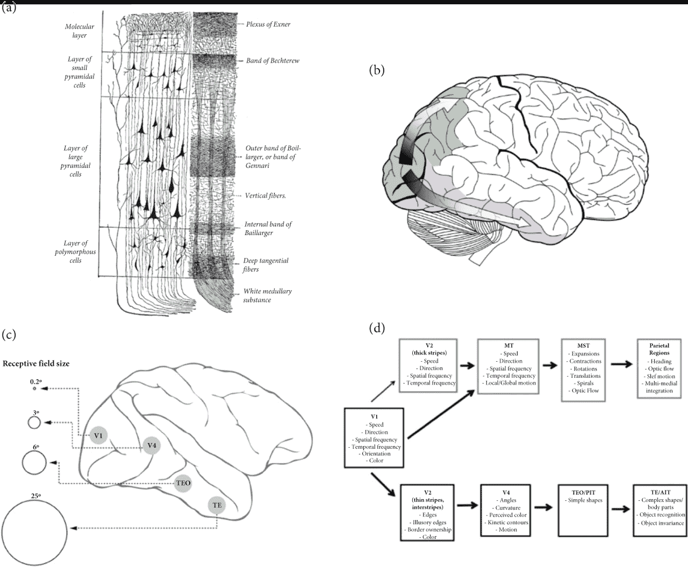

**图 3.7** 详细展示了背侧和腹侧流中层状皮层结构和层级处理流的图像。哺乳动物新皮层具有著名的六层层状结构 (A)，来自视觉和听觉源的感官信息通过从 `V1` 早期前感觉区域的处理级联，流到 `TE/AIT` 的晚期处理区域 (B)。随着层级结构的推进，区域的感受野尺寸逐渐变大 (C)，处理更大、更具配置性的特征，并专注于日益抽象的信息 (D)。（图 3.7A 来自自 Gray [1918] 的公有领域，3.7B 可从 Selket 处根据知识共享 3.0 相同许可协议获得，3.7C 来自 [Vidyasagar [2013]](#17_bibliography.xhtml#oso-9780197653302-bibliography-1-bibItem-725) 并遵循知识共享署名许可协议，图 3.7D 来自 [Perry and Fallah [2014]](#17_bibliography.xhtml#oso-9780197653302-bibliography-1-bibItem-540) 并遵循知识共享署名许可协议。）

#### 层级处理与视觉皮层

事实上，20 世纪 70 年代网络研究中的一个独特传统已经证明了加深网络可以实现的计算收益，这种传统的灵感源于 Hubel and Wiesel (1962) 对猫视觉皮层的一项解剖发现。通过对早期视觉区域 `V1` 和 `V2` 进行单细胞记录，他们识别出两种细胞类型，并根据其发放模式将其命名为“简单”细胞和“复杂”细胞。简单细胞似乎检测特定方向的低级特征（如边缘或光栅），而复杂细胞则接收许多简单细胞的输入，对相同特征产生反应但具有更大的空间不变性。当时的神经科学家们推测，视觉处理中可能交织着许多此类简单和复杂细胞，它们的相互作用可能解释我们识别日益抽象特征的能力。

#### 神经认知层

为了在人工模型中捕捉这种解剖学分工的力量，Fukushima (1979) 设计了一种新型神经网络，称为神经认知层（`Neocognitron`）。`Neocognitron` 可能是第一个真正“深度”的网络（取决于计数方式，从四到十层），但它最强大的创新在于在一个网络中结合了两种操作——线性卷积滤波和非线性下采样。尽管在某些描述层面上这些只是矩阵代数中的数学运算，但将它们概念化为发生在两种不同的节点中是有用的，这旨在重现 Hubel 和 Wiesel 对简单与复杂细胞的区别。Fukushima 的“简单”节点执行卷积（一种线性代数运算），以检测特定位置和姿态的特征；而他的“复杂”节点接收来自许多相邻简单细胞的输入，聚合它们的活动，以检测跨越位置或姿态微小偏移的特征。成对卷积和下采样的层层级迭代，使得处理过程能够在更广泛的视觉空间范围内检测出越来越多抽象的特征。

当然，视觉感知中许多方面是 `Neocognitron` 以及后续大多数 `DCNN` 甚至没有尝试建模的，例如递归和顶层控制；大多数使用通用 `DCNN` 建模视觉的模型都会谨慎地指出，他们只试图建模视觉感知的前 100 毫秒左右，并且需要额外的结构来建模递归或顶层对处理的影响 (Bonnen, Yamins, and Wagner 2021; Nayebi et al. 2022)。尽管如此，凭借这些创新，`Neocognitron` 能够通过建模哺乳动物皮层处理流的层级处理级联，在困难的感知识别任务（如手写数字识别）上优于当时的感知器网络。

这些操作中的每一个都值得详述，因为深度卷积神经网络（`DCNN`）独特的计算潜力的源头已经存在于任何以这种方式将它们结合的网络。让我们从卷积开始。感知输入通常以网格结构传递到此类网络中——图像处理任务是二维网格，听觉处理任务则是音频信息的时间切片。为了方便说明，我们在接下来的内容中关注视觉示例。视觉网格中最小的信息单元通常是像素，它本身通常是一个在特定位置检测到的红、绿、蓝颜色通道强度的多维向量。卷积可以在矩阵上执行，以变换空间像素块（通常是矩形）的向量值，这种方式可以增强某些值并削小其他值。在实践中，对图像识别有用的卷积操作是那些倾向于放大给定块中某些特征的存在，并最小化其他其他信息的操作。这些卷积节点被称为“滤波器”；对于垂直边缘滤波器，有用的卷积会最大化对应于垂直边缘的值，同时最小化其他所有内容。随后，每个卷积操作通常会被传递给修正线性单元（`ReLU`）——这有时被称为滤波的“检测器”阶段——如果卷积输出超过特定阈值，它将使用修正函数进行激活。换句话说，只有在在该位置检测到特征时，卷积的输出才会向上层级传递。将此垂直边缘滤波器跨越整个图像的最终效果就像在整个图像上移动一个垂直边缘的模板，并记录下方的图像对模板的填充程度，然后将此信息放置在一个单独的空间组织的图谱（称为“特征图”）上，该图谱记录了所有垂直边缘的位置。

然而，通常对通用类别的识别不仅仅是识别垂直边缘；我们需要检测更多样化的呈现形式，例如不同方向的边缘，并将这些更广泛的呈现组合成形状或数字等有用的组合。福岛（Fukushima）的“复杂”单元通过从下方许多相邻的卷积节点获取输入并使用下采样技术，有助于实现这一更宏大的目标。`Neocognitron` 使用空间平均，但现在名为 `max-pooling`（最大池化）的操作更为常见；如果其任何一个输入单独超过了特定的激活阈值，`max-pooling` 节点就会激活，随后它只传递来自最活跃单元的信息。通过使用下采样，我们现在可以有效地表达这样一个事实：边缘在大致出现在这里且具有大致的方向，从而控制了其精确位置和方向的变化。全局地将输入与多种边缘检测滤波器相乘并使用下采样组合它们的输出的最终效果，就像在数字照片编辑程序中全局应用边缘检测滤波器；结果是一个简化的图像表示，它揭示了无论位于何处、无论方向如何的所有边缘（现在是所有边缘的“聚合特征图”），并“减去”了所有其他信息（图 3.8）。


**图 3.8** *21 世纪*，由 Viktor Romanov 创作，带有和不带 Sobel 边缘检测滤波器，这是一种流行的卷积边缘检测算法。（操作由作者在 Gimp 2.0 免费图像编辑程序中完成。图像来源：Yugra News Publishing，Wikimedia Commons CC 许可协议。）

### 3.5 `DCNN` 中的变换抽象

如所述，`DCNN` 的特征是，每个“层”通常实现按顺序组织的若干操作——具体来说是卷积、修正和池化。这种操作序列在某种程度上是一种“抽象三明治”。这些三明治堆叠在深层层级结构中，形成了从“双层”、“三层”到“n 层”的抽象三明治，且其功能更加强大。一旦第一个三明治从原始输入中提取了某种程度上抽象的特征，另一个三明治就可以堆叠在其上方，将其计算资源集中在从上一个已经变换的输出中提取更抽象的特征上。从原则上讲，这个过程可以无限重复，许多三明治层分层地进行迭代，使得处理在不断扩大的输入变异范围内逐渐检测到越来越多、抽象的特征。这些三明治在计算分工中统一了各种操作的优势，这些优势结合在一起，至少在某种程度上同时执行了在前几节中审查的抽象形式。

现在可能已经很清楚了，这些抽象三明治中的单个操作可以映射到之前描述的前两种抽象形式。简而言之，卷积滤波器可以理解为执行了一种“作为组合的抽象”，而 `max-pooling` 下采样器可以被认为执行了一种“作为相减的抽象”。⁹ 结合这两种操作创建了比任何一种单独操作都更强大的抽象形式。同一层的不同滤波器可以探索多种不一致的方法从三明治不抽象的输入中组合特征，然后这些多个选项可以传递给下采样器，它聚合并减去池化特征图中的变异形式，然后将该图传递给层级中的下一层三明治处理。例如，考虑数字识别任务；几个卷积节点可以学习如何通过略微不同的方式组合线条组件，在不同的字体中构建特定的字母（例如小写“a”），然后 `max-pooling` 节点可以聚合不同字体构建该字母的所有不同方式。随后的层可以专注于从字母组合音素的任务，不再需要投入资源来克服不同字体之间的干扰变异（图 3.9）。随着这种抽象的变换过程在深层层级中迭代，生成的变换信号甚至可能接近“作为不变性的抽象”的理想，因为后续层已经探索了越来越多系统性的变换，并在更高程度上控制了干扰参数的影响。

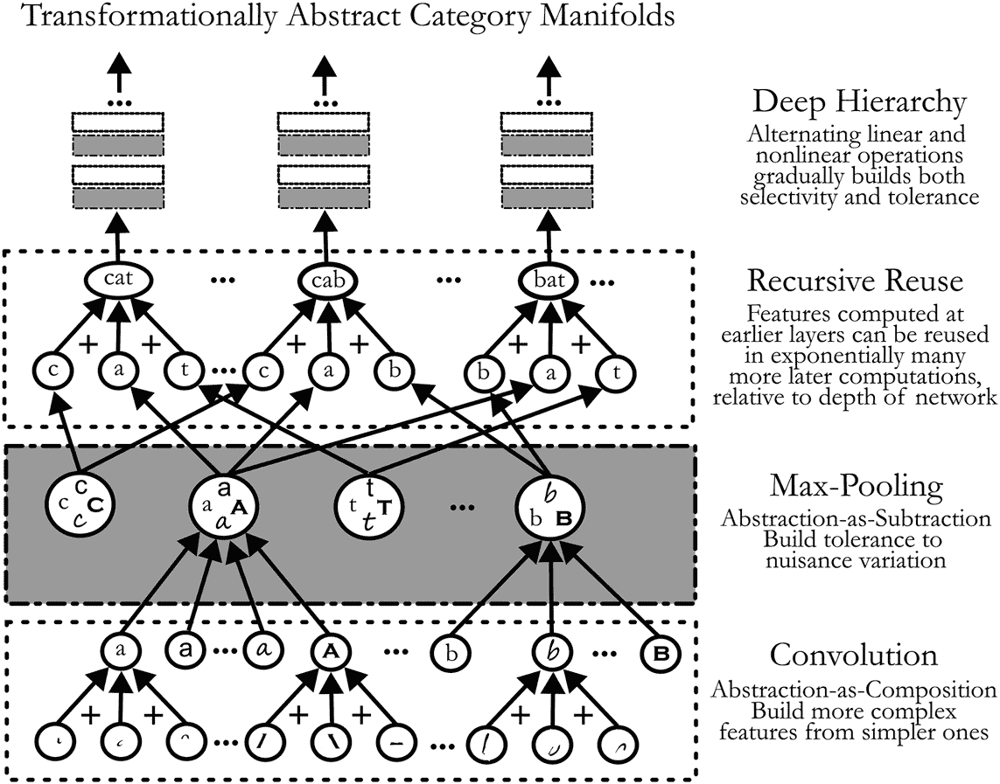

**图 3.9** 描述了交替线性和非线性操作的深层“抽象三明治”如何计算对干扰变异具有鲁棒性的变换类别流形。（图改编自 DiCarlo et al. 2012）。

甚至更好——这可能为“抽象即减法”这一简单解释提供了一种新的视角——虽然这些扰动参数可能被认为在某一个处理通道中被消除，但其他通道可以专门用于检测和系统地解耦扰动参数的表示，使得在需要时，我们能够直接表示样本的位置和旋转角度（这类似于假设在腹侧流和背侧流处理之间存在更大规模的物体与位置信息的表示分工——Goodale and Milner, 1992）。结果形成了一种处理形式：它始于原始纠缠信号的“繁茂、嗡嗡作响的混乱”，并以一系列经过转换的、高度抽象的专门的信息通道结束，这些通道可以在输出层进行混合和匹配，以灵活地为各种分类和决策问题提供答案。

这些操作共同构结成一种分工机制，实现了一种强大的变换抽象形式。总而言之，相比于缺乏这些特征的神经网络，`DCNNs` 表现得如此出色，是因为在训练过程中，它们的权重参数收敛于一系列变换序列，这些序列通过增加必须区分的类别之间流形在相似空间中的网络距离，最好地解决了网络经过训练处理的最广泛的分类和决策问题。这种变换能力解释了 `DCNNs` 如何能够识别如椅子或三角形等类别中样本之间共享的抽象相似性——令人惊讶的是，它们实现这一点并不涉及或需要任何先天的表示原语或显式定义。此外，网络本身会发现执行所需的正确变换序列；正如 Goodfellow 等人所说，对于某些范围的分类任务，“对单独参数化的卷积输出进行 `pooling` 允许网络 学习对哪些变换保持不变性” (2016:337)。只要这些变换以及它们揭示的中间特征对于其他类别的识别是有用的——例如用于识别椅子的变换可能与识别桌子或床等其他对象的变换非常相似——网络在这些相关类别上也将获得加速学习，而无需任何魔法。

`DCNNs` 的成功或许为支持新经验主义的 `DoGMA` 提供了最有力的既有经验证据。首先，这些网络可以被认为模拟了某些先验假设，尽管这些假设具有领域通用的特征。具体而言，`convolution`、`max-pooling` 以及层与之间的局部连接（直到最后的决策层）可以被视为实现了领域通用的先验概率假设，即特征之间的依赖关系倾向于局部的。无论这种局部性是空间上的（例如，读取一个人的面部表情不取决于其脚的位置）、时间上的（音素的身份通常只取决于时间上邻的声音），还是某些更抽象的概念空间（如分类分类或社会分层制度），这种假设都成立。它还强制了特征身份具有平移不变性的假设（例如，即使微笑者倾斜着，微笑也具有相同的意义）。换句话说，在解决满足这些假设的领域的分类问题时，`DCNNs` 比具有单一类型激活函数的全连接网络高效得多，因为 `DCNNs` 不会浪费时间和表示资源去探索其备选方案。同时，在解决违反这些假设的问题时，`DCNNs` 的效率可能并不比传统的 `ANN` 架构更高，甚至更低。

其次，在 3.2 节中回顾的至少两种抽象形式可以统一在单一架构中，这一事实本身就是一个有趣的结果，并提供了一种替代视角。我们不再需要将这些先验上截然不同的抽象形式视为必须相互斗争的理论替代方案。事实上，我们现在可以观察单一机制如何在结构上与（至少）皮层实现的所有操作保持相似。因此，我们有理由相信，与每形式相关的属性由于共同机制的操作而聚集在一起——DiCarlo 及其合著者将这种机制称为“线性-非线性解码器”（简称 `LN decoder`）（`DiCarlo and Cox 2007`;`DiCarlo et al. 2012`;`Yamins and DiCarlo 2016`）。这符合科学哲学中流行的更基于机制的解释方法（`Bechtel 2008`;`Machamer, Darden, and Craver 2000`;`Piccinini and Craver 2011`），特别是 `Stinson (2018)` 详细阐述的连接主义网络“通用机制”解释方法。简之，`DCNNs` 在这些感知抽象任务上如此高效，恰是因为它们共享了几个允许大脑如此高效运行的结构方面，满足了第 1 章中提出的心理计算建模的关键解释目标。

### 3.6 作为变换抽象模型的 `DCNNs` 面临的挑战

到目前为止，本章介绍了具有深厚哲学渊源的重要抽象形式如何在 `DCNNs` 中进行建模的基本说明。具体而言，这些形式表明，我们定位了大脑的某些重要方面，使其能够执行此前几代计算建模和 AI 曾规避的感知抽象，而且这些方面与起源经验主义显著一致。但这个故事中存在波折——特别是有证据表明 `DCNNs` 中的抽象方法与人类大脑中发生的学习或表示形式不同。现在回顾这些差异的证据，为在后续章节中对其他 `DoGMAtic` 功能进行建模做了准备。事实上，根据第 2 章引入的理性层级，记忆、想象力和注意力也可以被视为工具，使 AI 模型中抽象的搜索和使用变得更加理性。

#### 3.6.1 抽象搜索的效率

许多深层神经网络（`DNNs`）学习与人类学习之间最明显的差异在于——为了达到相同的结果准确率，`DNNs` 所需的训练实例似乎比人类学习者多得多，这与“作为减法的抽象”、“作为组合的抽象”以及“作为表示的抽象”所引发的认识论关注直接相关。特别是，我们如何学会从有限的样本中进行可靠的泛化？我们如何知道应该减去什么，或者组合哪些特征，以构建允许我们做出正确推断的类别表示？对于深度学习来说，目前这些问题的答案很大程度上是：在训练过程中进行大量的尝试与错误。这一答案威胁了“`DCNNs` 揭示了人类感知抽象的关键方面”这一论点，因为尽管这些网络在许多不同情况下最终可能给出与人类判断相同的裁决，但效率上的巨大差异使人们怀疑它们是否是通过与人类相同的过程得出这些裁决的。对效率低下的担忧也呼应了早期连接主义者的指控，即 `Deep Blue` 击败 `Garry Kasparov` 反映的是蛮力穷计算的胜利，而非智能或理性；因此，今天的深度学习理论者如果想避免陷入对天赋论 `GOFAI`（传统符号人工智能）的标准经验主义批判的窘境，就有特殊责任以令人信服的方式驳这些担忧。

关于策略的学习方式以及在推理时的应用方式，可以引发效率方面的担忧。首先，如今深度神经网络的（不）效率是因为它们几乎都是使用 `error backpropagation algorithm` 的变体训练的，这通常需要巨大的训练集，以便在每次尝试中对网络进行非常微小的调整。自 1980 年以来，该算法一直是神经网络成功的基石，但人们对其生物学合理性存在许多担忧。该方法依赖于误差函数，该函数会为输入网络的训练集中的每一项，计算网络最后一层激活值与训练集中被认为“正确”的答案之间的距离。然后算法计算该误差函数在该位置的梯度（或斜率），并微小地调整网络连接权重（由网络的“学习率”调制），以便网络在未来再次接收到相同输入时，性能能向误差降低的方向迈出一小“步”。

形象地比，误差景观像一个具有山峰、高原和山谷的地形图，而 `gradient descent algorithm` 试图通过不断向山迈小步，逐渐规划一条通往最低海拔的路线。最终，通过足够的微调，网络性能倾向于收敛到广泛分类和决策问题的解决方案上。尽管算法有时会“卡在局部最优解”，人类和动物也会卡住，因此这不一定是与差异相关的担忧。相反，目前主要的担忧是，为了让 `backpropagation algorithm` 通过极小的训练调整掌握解决问题的复杂方案，网络可能需要数百万次训练才能收敛。正如前面提到的，怀疑者认为这比人类完成同一任务以达到相同可靠性所需的学习数据多出几个数量级。他们还指出，要消除如此大量的暴露并不易事，因为如果建模者尝试过快地调整权重，算法就会变得不稳定。

其次，关于 `DCNNs` 的效率担忧也可以从推理时间上提出。例如，通用的 `DCNNs` 通过在整个输入上平铺卷积滤波器来搜索特征。这意味着它们会系统地在图像的每个区域搜索每个特征，即使这些位置中的大部分区域极不可能包含这些特征的大部分。除了像《沃尔找在哪里？》书籍这类追求完全的方法外，人类和动物通常不会以这种方式搜索特征。这是一种劳累的搜索策略，绝大多数探索的特征/位置将导致计算浪费。人类和动物而是将搜索限制在可能特别有前景的区域，以及与当前任务相关且可能出现在所搜索位置的特征上。

当我们在随后的章节中考虑为更基础的 `DNN` 架构添加领域通用模块时，我们将看到这样做如何以某些方式提高训练和推理的效率，且这些方式与上述担忧直接相关。鉴于这些模块重演了记忆、想象和注意力等功能被认为在人类学习和推理中所起的作用，它们同时也使得这些系统的处理在生物学上更加合理。这些模块增强系统的能力，特别是结合对经验结果的审查（结果表明通过实施这些额外的主动过滤和控制形式可以获得显著的性能提升），表明这些系统发现的抽象与人类感知系统发现的抽象在本质上可能不同。值得注意的是，这些额外的模块不需要任何先天的特定领域知识，因此它们与适度的经验主义 `DoGMA` 一致。事实上，这些模块提供的许多主动过滤和控制可以被视为这些经验主义哲学家讨论的抽象的进一步自上而下的形式，进一步加强了当前 `DNN` 建模与 `DoGMA` 所强调的经验主义哲学史之间的联系。

#### 3.6.2 作为表示的抽象——规格三明治

然而，经验主义抽象理论中一个尚未与 `DCNNs` 建立联系的重要方面是“作为表示的抽象”。作为表示的抽象是 `DoGMA` 对天赋主义推理解释进行反驳的关键组成部分，因为我们考虑一般原则是否适用于特定实例的能力，在贝克莱和休谟等经典经验主义者关于演绎推理的经验主义叙述中表现得非常突出。到目前为止，我们仅尝试解释 `DCNNs` 如何执行被归因于“作为组合的抽象”、“作为减法的抽象”以及至少在某种程度上的“作为不变性的抽象”的操作。那么，作为表示的抽象——即使用单个示例作为整个通用类别的代表又是怎样的呢？休谟认为想象力发挥着至关重要的作用，特别是它使我们能够创造和考虑新颖的想法。令人迷的是，机器学习研究人员发现，关于可能的干扰配置的大量信息仍然潜存在通过变换抽象所解耦的后期流形中，因为从具有特定干扰参数组合的渲染示例中提取抽象类别表示所需的变换是可以（近似）逆转的，从而从变换流形上的任意位置渲染出高度合理的示例（`Goodfellow 2016`）。回到 DiCarlo 等人的折纸比喻，如果一个学习了如何“展开”不同类别流形的系统也能以类似的方式将它们“折叠”起来，那么抽象类别中的每个向量都可以重新映射回其原始感知表示，并赋予其原始干扰参数（如姿态、位置、比例等）适当的值。此外，如果我们在解缠流形上选取一个新的位置，然后使用相同的程序折叠流形，我们就可以产生新干扰参数组合的高度真实的示例，而网络在训练中从未观察过这些组合（`Gatys, Ecker, and Bethge 2016a`）。

这种方法的优之处，特别是对于那些目标是在抽象推理中最有效地利用经验的经验主义者来说，其意义远超那些吸引大众关注的光学写实刺激和“深度伪造”。从认知角度来看，这种方法非常有前景，因为生成的示例可以与感知感知分类的相同判别性抽象形式重新结合，这可能允许智能体挖掘自身的潜空间，产生关于先前获得类别所具有抽象属性的新假设，即使训练经验从未直接将类别成员与该抽象属性联系起来。事实上，正如我们将在后面的章节中详细探讨的那样，这种关于潜空间折叠、展开和重新折叠的讨论可能有助于解释人类和动物中归于想象力的洞性思维和创造性问题解决模式，而这一切不需要理性主义者推崇且被 `DoGMA` 排斥的天生观念。

#### 3.6.3 作为不变性的抽象作为理想极限

即使接受了上述观点，我们可能仍然担心将这些对经验主义友好的抽象形式扩展到理性主义推崇的最高级数学或逻辑类别，例如千边形（chiliagon）或“与”。变换抽象似乎有助于神经网络相对于网络深度表示越来越具有不变性的属性。事实上，系统地控制干扰变化形式的能力似乎是这些最抽象学科（如物理、逻辑和数学）中所研究的抽象技术中不可分割的一部分。然而，理性主义者可能不会对 `DCNN` 实现的作为不变性的抽象的程度感到满意，即使他们最终承认这在某种程度上是相关的。这部分是因为理性主义者通常假设他们所强调的抽象形式是人类独有的，尽管动物——尤其是哺乳动物，尤其是灵长类动物——似乎拥有类似的变换抽象能力。根据理性主义者的观点，独特性取决于理性主义者所看重的不变性的类型或程度，这种不变性（无论是几何的、数值的、逻辑的还是模态的）被认为比任何有限变换抽象能实现的完美。这些学科中的抽象趋向于理想极限的不不变性——跨越所有可能的排列或跨特定类别内的所有几何变换——而神经网络只能对其近似，而人类可能只有在形式证明技术的帮助下才能实现。

理性主义者在这里表示担心是正确的；但如果这个谜题的独特人类的解决方案是由我们学习和部署形式证明技术的能力提供的——正如经验主义者从洛克以来一直所强调的那样——那么这种解决方案并不涉及任何天生观念，因此对 `DoGMA` 不构成根本性挑战。当我们观察更复杂的 `DNN` 架构可能学习并操纵语法结构化语言的潜力时，我们将回到这一点。这种人类独有的特质可能帮助我们通过语言和社会脚手架来实现作为不变性的抽象，而不是通过单一大脑的天生赋能。简而言之，这里缺失的可能是掌握与形式证明技术相关的语言工具和社会线索的领域通用能力，而不是天生的数学或逻辑概念。

### 3.7 总结

`DCNNs` 允许智能体开始迈向理性的第二阶段，可能学习使智能体能够泛化到新情况的抽象模式。虽然理性主义和其他批评者担心，基于 `DNN` 的解决方案在迁移到新情况方面并不总是像人类和动物那样良好，但即使是他们也承认 `DCNNs` 已经实现了经验主义方法以前所未有的迁移学习程度。正如我们在上一章中提到的，标准的交叉验证方法已经包含了对泛化能力的某些测试，并且本章报告的所有模型已经使用交叉验证或其他类似方法进行了评估。

这项测试是必须的，因为“过拟合”是机器学习研究中的一个标准担忧。过拟合发生在模型学习了关于训练集过多的特有结构时，导致它提取的模式无法泛化到新数据上。事实上，我们知道在深度学习中，过拟合的危险性比在较浅的网络中要大得多。多项技术结果表明，深度学习神经网络包含了足够的表征能力，足以记住即使是高度复杂数据的细节。

这种形式最具戏剧性的证明来自 Zhang 等人 (2017)，他们展示了一个规模适中的 `DCNN` 仅就能简单地为一个包含数百万张图像的大型高度复杂数据集记住“正确”的标签，即使训练集中的标签是随机分配的——这意味着训练不可能提供任何关于将示例统一为一般类别的真实抽象模式的信息。换句话说，这些网络在训练集上可以达到近乎完美的准确率——尽管当然，它们在交叉验证测试上的表现并不比随机猜测更准确。

这是分层结构、无纠缠数据表示表征能力的有力证明——可能，这些网络记忆随机标签与复杂示例之间关系的能力归功于特征的分层重用；理论上，相对于网络的深度，深度网络能够在在层级结构中，将早期阶段提取的特征指数级多次地重用，以组合后几层学习的更抽象的特征 (Bengio and Delalleau 2011; Buckner 2019a; Krueger et al. 2017)。这将即使是对数百万示例-标签映射的死记硬背变得高效，因为每个示例都可以以压缩的形式表示。然而，这也说明这种巨大的力量可能并不总是被用于获取建模者希望其网络获取的那些泛化模式和抽象类别（C. Zhang 等人 2021）。这就是为什么在当代深度学习方法论中，细致的交叉验证测试和其他泛化衡量是如此至关重要。

尽管如此，正如我们在上一章中提到的，理性主义者经常反驳说，这些网络仅在来自独立同分布（`i.i.d.`）数据的泛化测试上取得成功。他们假设，只有当测试集中的特征与训练集中的特征具有相同的统计分布时，`DCNNs` 才能良好泛化。这种局限性在玩具示例中可以清楚地看到，并已成为机器学习中某种被接受的信条，尽管当将其应用于在海量数据集上训练的更大型模型时，这一主张及其影响很少被精确化。例如，当声称像 `ImageNet` 这样的大型标准化数据集的分类 `DCNNs` 仅在 `i.i.d.` 数据上泛化良好时，这类数据集的分布并没有被精确表征，而像 `GPT-3` 的互联网规模训练集这样更大的测试集，其分布涵盖了大多数公开的人类书面语言的统计特征。

此外，这种不精确性邀请了理性主义的拟人化幻想倾向渗透到 `DCNNs` 与人类的比较中。人类认知并非魔法：我们可能比动物或当前的人工智能更好地泛化到更广泛的新颖情况，但人类仍然需要一些环境线索和脚架来对隐藏或不可观测的特征进行推断。例如，理性主义者经常声称人类在观察一张图片时，不仅根据表面特征进行推理，还会考虑隐藏的、甚至是不可观测的特征 (Keil 1992; Penn, and Povinelli 2008)。

然而，人类只能根据观察到的线索来学习或推理这些特征的存在。我们注意到，这里的进步最好通过从相同统计分布到完全不同分布的转换，而不是简单的分类。人类在许多任务上可能仍然更领先，但最先进的 `DCNNs` 在这些任务上取得了显著进展，尽管它们在完全没有规律的上下文之间无法进行泛化。¹³ 甚至可能，这些网络学习的某些泛化——正是如果我们不受人类性能限制将会学习的真实模式。有大量证据表明，基于 `DNN` 的系统可能通过放宽生物限制（例如拥有更大的数据集或更深的分层网络），将这些抽象形式推向人类的极限。例如，它们可能能够识别人类认为太复杂或高维的模式，但这些模式在自然数据上是有效的 (Ilyas et al. 2019)。这进一步解释了为什么这些网络能在 `Go` 这样需要直觉的游戏中击败人类，或者预测那些致力于该任务的人类几十年直在破解的蛋白质折叠模型 (AlQuraishi 2019; Gainza et al. 2019; Honig 1999)。学习此类特征将是人工智能的一项重大成就，尽管它也会带来新的风险。例如，人类可能发现这些增强型网络学习的抽象模式是不可理解的，而且 `DNNs` 的处理可能会引入难以预测或控制的独特伪迹 (Buckner 2020b)。¹⁴

与此同时，当前的深度卷积神经网络（`DCNNs`）在处理简单的数学任务时仍不从心，例如物体的精确计数，而年幼儿和某些动物可以做得相当好 (Rugani et al. 2015; Zhang, Hare, and Prügel-Bennett 2018)。¹⁵ 这使得经验主义者和理性主义者在评估神经网络的抽象能力时都面临着令人困惑的张力：一方面，显而易见的是，`DCNNs` 在某些方面与我们一样进行抽象（并且事实上可能在这些方面超过了人类的抽象能力），但目前 `DCNNs` 遗漏了一些对人类认知至关重要的抽象关系——我们在本章开头提到的数值、社会或因果关系。Chollet 为这种紧张关系提供了一种极具吸引力的缓解方案：认知科学中的双系统或双加工理论 (Chollet 2019)¹⁶ 系统 I 通常被与连接主义系统类比（其操作是关联的、并行的直直的），而系统 II 则被认为是一种意识的规则解释器，限制为一次只评估一条指令 (Sloman 1996)¹⁷ 神经网络（`DNNs`）所擅长的领域被归因于人类的系统 I 处理，而那些持续规避基于神经网络系统的关系则被归因于系统 II 的独特处理方法，例如计数或演绎推理。

尽管双系统解决方案颇具吸引力，但它提出了一个令人困扰的工程问题：如果它们在本质上不同，那么如何将系统 II 与系统 I 整合？特别是，我们必须决定系统 II 是否可以用人工神经网络的基础经验主义工具箱来构建，还是说它必须实现为经典的符号系统。虽然最近批评深度学习的混合理论者（如 Marcus）推荐了后者这种混合方法的新变体，但我支持神经网络建模第二波浪潮的关键人物（他们许多人仍活跃在第三波浪潮中），他们主张前者——即更彻底的基于网络的方法的益处。特别是 Paul Smolensky，长期以来一直试图证明在 `ANN` 架构中实现类似于系统 II 处理的益处 (Russin et al. 2021; Smolensky 1988; Smolensky et al. 2022)。为了将这些思想与 `DoGMA` 联系起来，归于系统 II 的某些关键功能属性可能源于经验主义的、模块化的基于神经网络的系统，这些系统利用想象力和注意力等能力来实现增强认知控制，我们将在后面的章节中探索这种可能性。事实上，我们将考虑这些能力如何使以往经验的记忆在决策中被更有效地使用，组合成新的复合体，促进对结果的考虑，并促进知识的传递。

我们现在转向

¹ 洛克是否是经验主义者尚待争议，但他无疑是经验主义者 (Locke 1965)

² 尽管双系统解决方案极具吸引力，目前基于样本的理论假设抽象发生在对一组样本进行评估时，这些样本被组合在一起。对于基于样本的理论，请参考 1992 和 1992。

³ 埃米·诺特推广了这一观点（通常被称为“诺特定理”），该定理认为作用中的每一个对称性都有一个对应的守恒定律。许多守恒定律可以认为是从诺特定理推导出来的。

⁴ 这里的困难在于，某些常见的干扰（例如遮挡或杂乱）缺乏这种对称性，因此可能需要额外的资源 (Attiya and Chollet 2018)。

⁵ 计算这种距离有许多替代方法，不同的方法可能会产生不同的结论。这在方法中产生了一个重大问题，因为实验者的距离选择引入了主观性。

⁶ Gärdenfors (2004) 要求流形是凸区域。我将不再讨论此。

⁷ Chollet and Courville 2014 认为隐式或显式的正则化对于神经网络的性能至关重要（为了防止它们仅仅记忆训练集中的每个样本），但由于正则化程序具有多样性且该想法较为初步，我将不再进一步讨论。

⁸ 出于空间，我们在这里快速回顾历史；欲了解更多背景和讨论，请参考 Buckner and Garson 2018; Piccinini 2015; 以及 Schmidhuber 2015。

⁹ 值得注意的是，基于注意力的 Transformer 架构通常不使用池化。然而，它通过“注意力”迭代关注特别相关的输入子集，可以看作是通过其他方式实现了减法式的抽象；我们将在第 6 章 再次讨论这个问题，在那里直接讨论注意力。

¹⁰ “繁茂的、嗡嗡的混乱”出自威廉·詹姆斯 James (1890:488) 对新生婴儿经验的描述。詹姆观点将在第 6 章 中进行更详细的考虑，在那里我们在处理注意力时。

关于误差反传播（`error backpropagation`）的生物学合理性存在广泛争论，我们在此不再进行深入探讨。一个主要的担忧是神经元无法跨突触反向发送错误信号 (Fitzsimonds, Song, and Poo 1997; Stork 1989)。上一波浪中的许多连接主义者建议，存在反传播的简单替代方案，这些方案在功能上是等，但不需要这种解剖学上的不合理性 (Hinton and McClelland 1988; O’Reilly 1996; Rogers and McClelland 2014)。最近，深度学习研究人员重新燃起了对反传播的热情，认为它可以被更具生物学合理性的替代方案所取代，例如在需要的地方随机误差信号或脉冲时间依赖可塑性（`STDP`）机制 (Lillicrap et al. 2016; Scellier and Bengio 2017)。关于这一点的辩论是复杂且持续的，而且还提出了数十种替代学习规则族（对比学习目前很有前景，尽管它也面临着一些类似的效率问题——Wu et al. 2018）。这些替代方案在这里不会进行详细探讨。

期望当前的基于 `DNN` 的系统能够解决此类数学推理问题听起来可能过于心勃勃，但这是一个活跃的研究领域，并取得了前景良好的早期结果。例如，Google 开发的 `MINERVA` 系统能够正确回答近三分之一的困难的本科水平定量推理问题，涵盖了物理、生物、化学、经济学和其他科学领域 (Lewkowycz et al. 2022)。当然，`MINERVA` 不可能以人类相同的方式解决这些问题，而添加额外的功能模块——例如用于“记忆”关键变量或对“想象”的物理或几何模拟进行推理——可能会进一步提高这些系统的性能。

与动物在这些任务上的表现进行比较，可能有助于观察在缺乏语言的情况下，归纳学习能在多大程度上泛化到感知差异的情况 (Bugnyar, Reber, and Buckner 2016; Phillips, Shankar, and Santos 2010; Santos, Flombaum, and Phillips 2007)。

处理伪影的常见示例包括多普勒频移和镜头光晕。这些伪影包含了关于信号源的预测有用信息，但在对其源被正确理解之前，它们也具有误导性。

一些最近基于 Transformer 的模型甚至可能通过精确基数和计数等任务克服这些局限性。有人推测，早期基于 Transformer 的模型中计数的困难是依赖特定语言模型（如 `CLIP`）的产物，而不依赖 `CLIP` 的新系统（如 `Imagen`）可能会表现更好。更多细节请参阅 Saharia et al. (2022)。

在此诉诸双系统理论也是像 Anderson 和 Laird 等在上一章提到的其他认知架构理论学家经常采取的做法 (Anderson and Lebiere 2014; Laird 2019)。还有许多对双系统观点的批评，其中一些倾向于单一系统，另一些则倾向于多个统一的系统 (Keren and Schul 2009; Pessoa et al. 2022)。

## 4 记忆

感官感知的是个体。记忆和想象保留了感官传递的内容。想象保留了形式，而记忆保留了推导出的含义。

### 4.1 量化人类感知经验的困难

理性的问题解决——无论是大脑还是人工神经网络——关键取决于高效有效地利用证据。理性学习者不仅记录数据中的随机相关性，还高效处理这些数据以提取抽象模式，使其能够在不同的背景和任务中灵活成功。我们在上一章结束时提出了疑问，基于深度卷积神经网络（`DCNN`）的学习表现出的效率低下和脆弱是否使其成为建模理性学习过程的糟糕候选者。当我们考虑将深度学习系统作为理性认知模型时，我们希望机器不仅能模仿人类的问题解决行为，而且——仿照 Lake、Ulman、Tenenbaum 和 Gershman (2017) 标题的话——能够基于人类水平的交互量和类型来做到这一点。如果不能，这可能会动摇我们认为它们与允许人类学习和理性行为的大脑差异化方面的信念，从而挫败了研究人员最初采用人工神经网络（`ANN`）方法研究人工智能（`AI`）的动机。

这些效率对比要求我们对典型人类经验中的可用数据量进行量化。如果没有一个估计，很难将人类经验的规模与深度神经网络（`DNN`）训练集的大小进行有意义的比较。尽管这是一个显而易见的事实，但对人机相似性的怀疑者很少很少花大量精力来描述或辩护严谨的估计程序。我们认真对待这项任务非常重要，因为关于“刺激贫乏”的默认假设——这种观点曾认为终结了此前经验主义人类认知研究方法的宏大抱负，例如行为主义（Chomsky 1980; Skinner 1957）——被后来的实证研究发现是夸大或错误的。乔姆斯基曾提出著名的论点，认为儿童接受的练习和反馈量不足以解释他们后来的语言表现，除非借助大量的先天语法规则（Chomsky 1986）。然而，新的、更强大的关联理论以及对刺激丰富性的重新评估表明，这些结论应该被拒绝，因为事实上儿童拥有的语言经验比乔姆斯基想象的要丰富得多（Christiansen and Chater 2016; Reali and Christiansen 2005）。这并不是说斯金纳特定的言语行为理论在提供更真实的人类语言经验后就会可行，而是说在今天，新的、更强大的、避开先天语法知识的关联主义模型或统计学习模型是极具竞争力的实证选择。

在某些情况下，著名的 `DNN` 系统显然获得的训练数据比它们所竞争的人类多出几个数量级。例如，`AlphaGo` 在与李世石对弈之前已经进行了近 3000 万局独特的自我对弈，某些版本的 `AlphaZero` 则从 1 亿局模拟自我对弈中学习。正如我之前指出的，李世石一生中下过的比赛不会超过 5,000 局。类似的结论也适用于图像分类或文本生成领域的著名系统。`ImageNet` 包含超过 1400 万张带有超过 20,000 个类别标签标记的图像，而像 `GPT-3` 这样的大语言模型是在涵盖互联网上可用文本大部分内容的数据集上训练的。没有任何一个人类读过如此大量的文本；在产生语法正确且语义明确的话语之前，他们也不需要这样做。因此，让我们承认，至少在某些时候 `DNNs` 是在多得的数据上训练的。但需要注意的是，许多系统并非显式旨在模拟人类表现；`DeepMind` 制作 `AlphaGo` 的目标并不是模拟具有当前或内在局限性的人类水平，而是超越它，因此放宽对生物认知的某些限制可能被视为符合他们的目标。

回到 `DNNs` 作为真实认知模型的角色，天赋主义者通常为经验主义者提供了一个有序的退缩到一个更安全的后备位置：即 `DNN` 的训练重复了整个生物或文化进化的过程，而不是单个个体的学习和发展。换句话说，虽然一个围棋高手不可能下过 3000 万局独特的比赛，但也许这个人类围棋手接受了基于数亿局对局启发的围棋理论训练——即在推导出该理论策略或教学法的文化传统中进行的所有对局。也许一个人类没有与 1400 万个独特的类别范例进行过交互，但天赋主义者向我们暗示，我们的进化祖先集体接触的信息远多于此，也许其中某些知识已经以先天规则或表征的形式遗传到了基因组中 (Lake et al. 2017)。这种退缩的邀请应该被礼貌地拒绝（至少倾向于经验主义的 `DeepMind` 已经拒绝了——Botvinick et al. 2017）。

更好的经验主义反应是加倍努力认真对待人类学习数据的收集和量化，并为机器提供这种符合生物学特征的数据。然而，这需要面对这种背景下拟人化（`anthropofabulation`）的危险，因为我们可能会对人类学习所需的数据量或质量做出过度乐观的低估（Buckner 2020a; Smith and Slone 2017）。回到感知判别的语境，拟人化会导致我们低估学习常见类别的儿童应得的训练实例数量。有两个因素在这样的计算中经常被忽视：
1. 同一个对象的许多不同视角可以为训练提供独特的快照，以及
2. 睡眠和白日梦期间的离线记忆固化允许智能体从多次暴露于之前经历的快照——甚至是从这些暴露生成的模拟新颖范例中获益。²

让我们考虑第一个被忽视的问题，即关于同一对象的不同视角。这一经验维度经常会被忽视，因为当我们的感知系统正常运行时，我们主观上将所有这些不同的视角视为同一个物体。然而，这种统一的感知本身就是一种计算成就，而且不同的视角仍然为训练提供了有用的信息。

为了开始在负责任的计数方面取得进展，我们可以回顾一下感知心理学的一些相关结果。对电影感知的研究表明，人类视觉的帧率大约为每秒十到十二帧（低于此帧率，我们就无法将运动感知为连续的）。我们还可以考虑对刺激产生意识或受到其影响需要长时间；虽然对刺激的意识感知通常需要 200 到 400 毫秒，但注意力向新刺激的转移最早只需 20 毫秒即可开始，而类别结构可能会受到短至 1 毫秒的无意识暴露的隐含影响（Kunst-Wilson and Zajonc 1980；Murphy and Zajonc 1993；Schacter 1987）。

上一章回顾了人类和机器在感知识别中由于干扰变化（nuisance variation）带来的困难；`DCNNs` 为了应对姿态、朝向、遮挡和阴影的变化需要如此大量的训练数据，这一事实表明人类的经验也必须包含同样大量的信息，提供了来自各种干扰参数的窥一视角。如果这些独特的视觉片段中的每一个都构成了一次不同的经验“帧”，那么——即使在与单个新物体的单一交互期间只关注视觉输入——与单个物体的长时间交互或许应该被归功于数千个不同的快照，并可以用于皮层训练，而不是像常识认为的那样只有一个。

除了这些对计数不足的担忧外，我们还应该担心提供给 `DNN` 的数据与提供给人类的数据之间存在定性的不相似（qualitative disanalogies）。例如，婴儿与新玩具的互动通常涉及从许多不同角度和干扰参数组合对其进行连续感知。这种经验可能比提供给 `DCNNs` 的不连续静态图像更可靠地作为类别边界的指南。对连续变换的暴露可以让智能体开发出更健壮且不易受到分布外攻击的表示，例如（Kong and Norcia 2021；Sullivan et al. 2022；Wood et al. 2016）。

此外，研究人员发现 `ImageNet` 充满了标记错误，这可能会影响在其上训练的网络的健壮性；尽管研究人员通常认为 `DCNNs` 对面对少量标记错误具有韧性，但最近的分析表明，这些错误如此普遍，以至于使用这些数据集可能导致通用基准偏向能够更好地拟合标签的大模型。此外，婴儿对新物体的经验通常比 `DCNN` 更具结构化。当提供一个新物体时，婴儿会进行长时间的探索，这种探索似乎适合从各种角度对其进行采样（通过旋转它、将其撞击地面，事实上，还有尝它）——这一事实已由实证研究揭示（Smith and Slone 2017）。这种多模态交互在不给基于 `DNN` 的智能体配备机器人的情况下很难复制。

其他研究发现，这种结构化的交互允许 `DNNs` 很快学习到理性主义者推荐的领域特定归纳偏置（`inductive biases`），但是通过使用领域通用机制而非先天的领域特定知识。例如，`Feinman and Lake (2018)` 的研究发现，为 `DCNNs` 提供更符合发育规律的经验允许它们获得一种人类常见的偏置，即通过形状对新物体进行分类（即“形状偏置”），这只需要看到三个示例即可，而且这种偏置可以提高学习新类别的效率。

其他研究还证明了发育时期的学习率变化的力量，正如在“关键期”观察到的那样，鸟类通常会对母亲的脸部进行印记，或者人类儿童学习语言（Versace et al. 2018）。尽管天赋主义者（`nativists`）通常将这种印记或关键语言期视为先天领域特定机制的证据，但根据第 1 章中建议的领域特定/领域通用的“输入范围”方法，它们是领域通用的。

事实上，研究表明印记机制对其响应的输入具有高度的开放性；例如，新出生的鸟类可以对高阶的相似性和差异关系或抽象的多模态模式进行印记（Martinho and Kacelnik 2016；Versace et al. 2017）。这些研究远不是揭示一种先天的、领域特定的“母亲脸部检测器”，而是展示了在提供生态合理的经验序列时，全局微调如何有效地让领域通用学习机制自主提取领域特定模式（如 Lee, Pak, and Wood 2021）。环境规律的正确定时和有顺序的呈现，而非任何先天知识，确保了这些机制通常会导致学习脸部和语言。

除了输入计数不足和定性不相似的问题外，`DCNNs` 与理性学习过程之间的比较也因为向 `DCNNs` 和人类提出问题的方式存在结构性差异而被掩盖。例如，`DCNNs` 的训练通常是强制它们在训练期间从图像的 20,000 个标签中选择一个，而没有给它们区分“某物仅仅看起来像什么”与“它实际上是什么”的选项（Firestone 2020; Zhou and Firestone 2019）。为了说明这种区别，我们可能会认为云看起来像一条鲸鱼，但并不认为它实际上是一条鲸鱼；云看起来像鲸鱼但实际上看起来是鲸鱼，这之间并不存在矛盾。⁴ 事实上，心理学研究表明，许多常见的对抗样本在人类眼中与 `DNNs` 为它们分配的“错误”类别标签有些相似；当人类被问及不是他们认为某个对抗图像描绘了什么，而是计算机会给该图像分配什么标签时，他们预测这些图像“错误”标签的准确远高于随机概率（Zhou and Firestone 2019）。这表明，人类的低级感知与 `DCNNs` 的处理可能并不那么不同。

当然，如前面指出的，大多数目前的 `DCNN` 模型并没有训练为与训练对象进行动态交互，或在表层相似性与深层类别成员关系之间做出区分；而且要让它们做到这一点可能并非易事。特别是与类别范例的交互，似乎需要机器人身体或至少是虚拟环境中的虚拟身体（Crosby 2020; Crosby et al. 2019; Kim et al. 2020）。尽管如此，在对未来的研究工作做出押注时，我们需要区分当前训练方案的偶然局限性与经验主义建模的内在局限性。在这一更具成效的方向加强研究，需要更多关于人类在任务成功上需要多少以及什么种经验的实证研究（而不是依赖常识估计），需要为人类和机器提供更具相似性任务的训练方案，以及可以供机器训练的更具生态真实的多模态数据集（Zaadnoordijk, Besold, and Cusack 2020）。

幸运的是，许多 `DNN` 建模者已经开始尝试更像人类的训练方案，以说明这样做可能如何帮助克服那些可能被视为经验主义建模内在局限性的问题。最有前景的研究方向之一是在视频而非静态图像上训练 `DNNs`。例如，当深度学习模型在视频的连续帧而不是静态范例上训练时，同一对象的许多不同视角可以被独立的训练实例，以提高模型性能（Lotter, Kreiman, and Cox 2017; Luc et al. 2017; Orhan, Gupta, and Lake 2020）。在大多数情况下，这需要比标准监督方法不同的学习算法，因为对视频的每一帧进行监督学习标注是一个非常耗费人力的过程，通常在满足某些连续性假设的情况下，标签可以简单地延续到后续帧。预测性的“自监督”网络——试图通过从过去预测未来、从现在预测过去、从可见部分预测物体的遮挡部分等来学习——被 `DNN` 先驱们（如 LeCun (2018)）崇为实现深度学习下一阶段效率和灵活性的最佳途径。

对于这种方法，由教师或智能体本身分配给视频某一帧的标注，如果它们满足与前帧相似的某些条件，就可以简单地延续到后续帧。通过这种方式，一个标注就可以提供数千个标注用于额外的监督训练，而无需产生额外成本。这一方向最令人印象的进展之一是使用参与任务的人类婴儿佩戴头摄像头的视频创建新数据集，例如 `SAYCam` (Sullivan et al. 2022)。`DNN` 系统可以直接在这些视频上进行训练，视频通常具有与其他数据源不同的统计特性——例如新物体占据大部分视野并被婴儿系统地操纵（Orhan et al. 2020）。在 `ImageNet` 上预训练与在 `SAYCam` 上预训练的模型实证比较表明，后者能有效地恢复理性主义者强调的、也是以往 `DNN` 模型弱点的抽象关系，例如根据物体位于上方、下方、之间还是外部进行分类（Davidson and Lake 2021）。即使 `DNNs` 尚未直接引导这些操纵，这些数据集为掌握单个对象的许多可能的干扰属性提供了比静态视频更丰富的针对性训练源。目前尚没有证据表明，从这种受生物启发的创新中可以获得的效率提升已经达到了瓶颈。

然而，正如我们将看到的，即使是这些更真实的数据集，在平衡人类与 `DNNs` 的比较方面仍然做得不够；如果没有进一步基于功能的增强，大脑仍然将是更高效的学习者。尽管如此，我们还有其他方法可以更好地利用经验——这些方法不仅取决于学习者接触了多少视角，还取决于相同的视角在额外的训练轮次或预测性决策中可以被有效地重复利用多少。在这方面，记忆和想象功能在抽象的学习和利用中起着至关重要的作用——这一事实几乎所有关于抽象的经验主义解释都得到了承认。

### 4.2 泛化与灾难性干扰

在我们回顾关于记忆的早期经验主义者（在下一章中，我们将回顾密切相关的想象能力）之前，我们应该介绍另一个在基于神经网络的 AI 方法中被广泛认可的障碍：`灾难性干扰`（`catastrophic interference`）。简单来说，灾难性干扰是指神经网络在接受新任务的训练时，倾向于“忘记”之前对任务的解决方案。McCloskey and Cohen (1989) 通过训练一个简单的神经网络，使其与单词列表中的词对建立联系（例如，“机车-抹布巾”、“桌子-街道”、“地毯-想法”），证明了这种效应。当网络被要求记忆第二个列表时，该列表包含一些相同的单词但配对方式不同（例如“机车-篮子”、“桌子-湖泊”、“地毯-鱼”），网络在掌握新的新关联之前，必须先忘记之前的关联。这就像一个孩子学习下国际棋，然后在又学习了跳跳棋后，在被要求移动棋子时，完全忘记了如何移动国际棋，或者混淆了两种游戏的规则。这种现象似乎解释了为什么 20 世纪 80 年代连接主义 AI 的许多成功无法扩展到更通用的问题解决者。通用智能需要掌握多个任务的能力，并在它们之间灵活切换，而无需从头重新学习每个任务，因此许多批评者将灾难性干扰视为基于 `ANN` 神经网络的通用 AI 在原理上的计算障碍。

问题的产生是因为，`ANN` 中的技能和知识存储在它们的连接权重中，而这些权重会被未来的学习不断地修改。换句话说，在大多数网络中，短期学习和长期存储涉及相同的表示资源。在简单的 `ANN` 中，后期的训练阶段可能会修改当前存储从早期训练阶段获取的表示的权重，导致旧任务和新任务混淆，或者完全覆盖旧信息。这种混淆和遗忘可以在人类记忆中发生，但要罕得多，而且人类可以在没有显式复习的情况下保留高度熟练的技能和知识数十年。通过在每次对新任务进行训练时添加新的内存资源，可能会避免这个问题，但这似乎需要一种生物学上不可行的机制来将新任务标记为新颖，并为精通这些任务分配空内存资源。它似乎也阻止了对具有抽象相似性的新任务进行加速学习的可能性。大脑似乎能更灵活地整合，并随着时间的推移使用相同的通用关联记忆资源将新技能与旧技能存储在一起。这不像是一个串行的天才，而更像是一个通才音乐家，比完全学者更快学会新曲目或新乐器，尽可能总结抽象的音乐知识和技能，并在需要时分离不可比较的技能和知识。

该问题的一种建议被称为“交替学习”（`interleaved learning`）。交替学习发生在不同任务的训练阶段随时间交错在一起时。通过这种方式，多个任务被同时获取，并且随着新技能的获取，旧技能不断得到刷新。通过交替不同任务或知识的训练阶段，网络被迫学习更深层次的抽象和上下文敏感的策略，这些策略不会与解决其他任务所需的知识混淆或被覆盖。这在人类学习中某种程度上是有意为之——音乐家学习新曲目时经常会练习旧曲目或乐器——但人类对交替学习的依赖程度远没有神经网络那么高。因为这些系统采用通用的学习方法，它们对灾难性干扰具有通性的脆弱性。正如我们将很快看到的，由于计算建模的灵感来自大脑，对大脑如何避免这一问题的探索可以为未来的创新奠基础。

### 4.3 关于记忆作用的经验主义者

从经验主义最早的论述开始，记忆能力被看作心灵从经验中学习的能力至关重要。亚里士多德播下了经验主义许多基础性思想的种子，他在这一方面尤为强调。5 他甚至说，在感知信息被反复恢复并结晶为记忆之前，它甚至不能被视为可以推导出抽象的经验。

这一思想包含在亚里士多德《后分析》（`Posterior Analytics`）著名的“战斗比喻”中，其中他将心灵从混乱的感知输入中提取有序抽象的斗争，比作一支军队试图从溃败中恢复阵线：

```


## 从感知到知识

虽然感知能力是所有动物与生俱来的，但在某些动物中，感知印象会持久保留，而在另一些动物中则不会。那些感知印象无法持久保留的动物，完全没有感知行为之外的知识，或者对没有留下持久印象的对象毫无所知；而那些能够保留感知印象的动物则拥有感知能力，并能在灵魂中保持这些印象：当这种持久保留频繁重复时，会立刻产生一个进一步的区别——即那些能够从这种感知印象的持久保留中发展出系统化能力的动物，与那些不能的动物之间的区别。

因此，记忆产生于感知；而同一事物的记忆频繁重复则发展出经验；因为多个记忆构成单一的经验。……我们得出结论：这些知识状态既不是以确定形式与生俱来的，也不是从其他更高级的知识状态发展而来的，而是从感知发展而来的。这就像战场上的溃败，先由一个人坚守阵地，然后另一个人也坚守，直到原有的阵型得以恢复。（《后分析篇》第二卷第十九章）


特别值得注意的是，亚里士多德发展其关于记忆和想象等功能的学说，专门是为了解释非语言动物的灵活决策能力。这些能力在亚里士多德派和经院哲学中被称为“内感”。

内感（inner senses）理论认为，存在某些机能专门创建和维持内部表征。这些表征类似于感知的，因为它们是从感知中提炼出来的，但与特定的感知不同，它们更具通用性和抽象性。内感最突出的包括一种“共感”（common sense）——这与我们在第 1 章中讨论的常识知识有着严格的区别。

亚里士多德的“共感”是一种高阶的内部感官机能，它监控感官的输出，并将信息整合为更多模态的形式，例如可以通过视觉或触觉感知的形状（这包含了我们今天可能归于内嗅脑皮层和其他皮层其他多模态关联区域的功能）。内感理论还包括记忆和想象等机能，它们专门负责处理更抽象的表征格式，据认为，这些格式允许人类和动物通过提供某种内部比较标准，识别多个感官细节之间的共同点。这些内部标准允许心灵通过将混乱的感知输入系统化为更有秩序的类别和分类，从而抵御这些投入的冲击。

### 伊斯兰教的影响

尽管“战斗比喻”（Battle Metaphor）在古典和中世纪思想中影响巨大，但它并没有提供关于抽象究竟是如何发生的有效过程模型。后来的注释者对内感在抽象中的作用提供了更具机械性的解释，其中最著名的是伊本·西纳（Ibn Sina，也被称为“阿本·西那”或西方化的“阿维森纳”）。伊本·西纳是一位波斯哲学家和医生（通常被认为是现代医学之父），他写了许多具有影响力的学术著作，特别是填补了他在亚里士多德心理学中发现空白的注释。

当伊本·西纳的文本在欧洲翻译并传播时，它们对直到 17 世纪一直主导欧洲思想的经院传统产生了巨大影响。⁶ 伊本·西纳的哲学心理学与此处提出的 DoGMA 特别相关，因为他的机能心理学专门设计用于解释亚里士多德关于从感觉感知中抽象的描述。

### 脑室理论

尽管伊本·西纳的机能心理学灵感源于一种我们现在认为完全错误的脑运作理论并以此组织，但在此回顾它有助于更好地理解他分配给不同心理机能的分工。特别是，伊本·西纳是脑功能“脑室”（ventricular）理论的重要来源，该理论主导了欧洲和阿拉伯思想几个世纪。

作为一名对人体解剖有深入了解的医生，伊本·西纳理解大脑对心理功能至关重要。也许由于解剖观察的结果，他假设脑室——大脑中心主要充满脑脊液的空腔——容纳了发生抽象的“内感”。伊本·西纳观察到脑室按顺序相互连接的，这使他假设不同的机能在一个信息处理的迭代过程中与不同的脑室相关联（图 4.1）。

每个机能被认为随着感官信息从大脑前部的感官器官向后脑室（他将其与记忆联系起来）推进而比上一个机能推进一步。正如`Kemp and Fletcher (1993)`指出的，这一理论与 20 世纪后半叶认知心理学发展的层级信息处理理论具有惊人的相似性。这些正是启发前几章讨论的深度学习关键架构特征的理论。

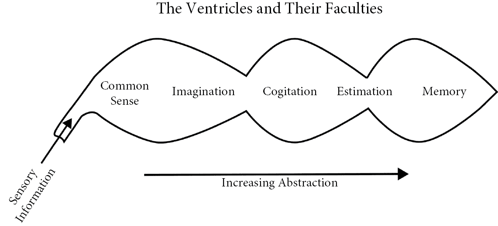

**图 4.1** 伊本·西纳图中脑室及其相关机能的示意图。（图改编自 `Kemp and Fletcher 1993`）

在这张图中，感官信息从感官器官流入前脑室，按顺序通过与想象、思考、估算和记忆相关的区域。伊本·西纳详述了每个机能的操作，以回答在亚里士多德抽象描述细节中出现的问题。

不同感官机能的操作差异是根据它们在处理流中的位置以及解剖中观察到的脑室差异来解释的，例如某些区域更湿润（因此更容易接收快速且瞬逝的印象）或更干燥（因此能够在较长时间内保留印象——这也许正预示了今天对短期记忆和长期记忆的这种区分）。更抽象的任务，如判断和高级推理，被认为发生在理智机能中，这是灵魂的一个非物理部分，它与内感的操作相互作用并指导它们（梦境和幻觉被认为是内感失去了理智的指导并乱跑的实例）。⁷

### 估算（Estimation）

估算在关于记忆在抽象作用的故事中特别值得注意，因为伊本·西纳认为估算对于解释非人类动物思维的灵活性至关重要，而亚里士多德的抽象方案最初正是为此设计的。因此，估算是记录与抽象感官印象相关的“意图”（intentions）的内感。“意图”在这里是一个没有中世纪阿拉伯语精确翻译的专业术语，它的意思类似于感官印象的内涵。⁸对于伊本·西纳来说，估算解释了即使感知刺激的情感意义本身并不是那些感觉印象的可感知属性，过去事件的经验如何在动物决策中产生激励作用。

为了说明这一点，伊本·西那（Ibn Sina）引导读者考虑一只在感知到狼时避开它的羊。狼的邪恶或危险本身并不是狼的一种可感知的属性。相反，狼应该被避开是一个结论，它是通过估计功能根据过去的经验将感官印象相结合得出的。在伊本·西那的工作流中，意图（感官印象的内涵）并不存在于之前的内部感觉中。通用感觉是工作流中超越视觉和触觉等特定感觉的步骤，它能发现关系并创建内容超越单一感官模态的表征。想象力是通用感觉之后的另一个步骤，它不需要原始对象的当前存在场即可激活与其相关的感官印象。由于工作流中的每一步都创造了对特定感官呈现依赖程度越来越低的表征形式，因此每一步都被认为建立了更高程度的抽象。正如伊本·西那所说，“估计在抽象化上比[想象力]更远一点点，因为它接收了其本身是非物质的意图……[因为]善与恶、愉悦与不愉悦……其本身是非物质的实体”（伊本·西那 *Najãt*:39，引用自 [Kemp and Fletcher [1993]](#17_bibliography.xhtml#oso-9780197653302-bibliography-1-bibItem-344)）。估计之后是记忆，它是伊本·西那内部感觉中最抽象的一种，充当长期存储库，用于存储经常反复出现的、最抽象且多模态的感官印象，至关重要的是，这些印象已与其估计所提供的意图相结合了。这解释了内部感觉如何支持动物认知中最灵活的实例：像羊这样的动物不仅能识别感知输入中的抽象模式，还能通过利用记忆识别出这些模式的动机意义（Müller 2015）。⁹

诚然，仍然存在一些与记忆相关的认知功能是这种形式的记忆无法让非人类动物实现的。亚里士多德和伊本·西那都强调，虽然动物可以记忆中检索多种与动机相关的抽象内涵，但它们不能像人类那样刻意地提醒自己记得。这两位哲学家都认为，刻意提醒自己和在主观时间中进行心理“旅行”需要一种显性推理（*logos*），而动物缺乏这种能力。因此，基于记忆的动物决策仍然依赖于外部（或内感）线索来检索记忆。这仍然是关于动物记忆和“心理时间旅行”的当代理论化中的一个流行观点（Suddendorf et al. 2009; Suddendorf and Corballis 2008; Tulving 2005；关于这一辩论的近期观点，请参见 Hoerl and McCormack 2019）。无论如何，如果我们只关注其功能结构而忽略解剖学方面，伊本·西那的理论预示了当代的感知和神经科学叙述。

尽管如此，如果我们只关注其功能结构而忽略解剖学方面，伊本·西那的理论预示了当代的感知和神经科学叙述。伊本·西那提供了一个分层处理模型，其中感官信息被处理并转化为日益抽象的形式，这 [Kemp and Fletcher (1993)] 指出“与 20 世纪心理学中流行的离散阶段处理模型是一致的”（568）。Kemp 和 Fletcher 还指出，想象、记忆中不同回忆形式之间的区别，与分别存储短期、长期和语义记忆的多重记忆理论具有某些相似之处 (Eichenbaum and Cohen 2004; Schacter and Tulving 1982)）。我们或许进一步补充，伊本·西那对记忆情感内涵的强调被近期关于强化学习和连接主义模型目标输入的叙述所证实，例如 Gluck and Myers (1993) 的模型包含了源自无条件刺激的特殊训练信号（例如对生物具有先天情感意义的奖励或惩罚线索）。这种相似性甚至延伸到了近期在基于 DNN 的架构中对记忆的尝试，正如下来的章节将所示。

### 4.4 记忆巩固的人工神经网络模型

有了这种关于记忆在灵活的以目标为导的决策中作用的理解，让我们检查神经网络模型中记忆在学习中作用的细节。令人惊讶的是，伊本·西那所表达的经验主义见解在近期的基于 DNN 的架构中具有相似之处，这些架构增加了一个执行某些相同计算作用的“记忆”模块。特别是，极具影响力的 McClelland, McNaughton and O’Reilly (1995) 模型假设了对应于短期和长期记忆的两个 ANN 模块之间存在相互。通过这种方式，他们的模型强调了巩固过程在有效利用以往经验以在未来的学习轮中提取抽象，同时避免灾难性干扰方面所起的关键计算作用，为本文推荐的经验主义 DoGMA 提供了进一步的支持。

McClelland、McNaughton 和 O’Reilly 模型整合了心理学、神经科学和计算建模的广泛发现。关于其功能和神经解剖分工的大部分证据源于病变研究——包括对因手术或脑外伤导致内侧颞叶病变（`MTLs`，包含海马体、齿状回、内嗅脑皮层和下托）的人类患者的研究，以及对动物实验主体进行的人工病变研究。`MTL` 病变是一种相对常见的选择性脑损伤形式，通常由中风、疾病、疱疹病毒或大脑突然缺氧（缺氧或低氧）引起。`MTL` 与记忆之间联系的有力证据源于此类病变最常见的症状：遗忘，即记忆的丧失。遗忘有两种形式：逆行性和前向性；逆行性遗忘涉及事故前记忆的丢失，而前向性遗忘患者在创伤后形成新记忆的能力降低。完全性逆行性遗忘极其罕见；遗忘症很少像好莱坞电影中那样完全忘记自己的身份（这种现象被称为`解离症`）。相反，受试者通常能保持对受伤前已获得的所有记忆（陈述性记忆、语义记忆、情节记忆）的正常提取能力。

严重但选择性海马体病变患者最常见的症状特征是完全的前向性遗忘，并伴有直到创伤前的有限逆行性遗忘，这表明记忆在关键的固化期间会逐渐从短期存储迁移到长期存储。这在某体现在逆行性遗忘中，这种遗忘通常表现出一种模式：在创伤前的一段时间记忆丢失非常轻微，在创伤前的几小时和几天内逐渐增加到几乎完全的记忆丢失。工作记忆和一般的问题解决能力似乎不受选择性海马体病变的影响，但在急性前向性遗忘中，从工作记忆中消失的想法将永远丢失。记忆患者 `HM` 在试图缓解其严重癫痫发作的神经外科手术中切除了 `MTLs`，他生动且富有影响地展示了这种症状。`HM` 可以回忆起童年和手术前生活的许多方面，但在手术前的几个月里他丢失了几乎所有记忆，并表现出完全无法形成特定事件和片段的新记忆的能力。尽管如此，术后 `HM` 仍保留了某些新技能和习惯的学习形式，例如通过镜子倒着读单词或学习进行新的视觉判别。然而，他获得这些习惯的能力非常低下，通常需要数百上千次的尝试。由于这些观察结果，神经科学家假设海马体在一种独特形式的片段快速记忆（“情节记忆”）中起着作用，并在情节记忆从快速且脆弱的短期存储到大脑皮层中更稳健的长期存储的转换过程中，充当至关重要的“缓冲区”和“闸门”功能。

这一假设启发了今天在许多心理学和神经科学教科书中看到的具有影响力的记忆系统分类法。根据这种划分，长期记忆可以分为陈述性和非陈述性形式；陈述性记忆是可言语化且显性的，而非陈述性记忆是非叙述的、隐性和自动的。陈述性记忆进一步细分为用于通用事实和抽象知识的语义记忆，以及用于特定事件的、以自我为中心的“什么、何时、何地”信息的情节记忆，这些信息按主观时间线排列。海马体在情节记忆中扮演此类作用是不言置疑的，但最近的研究表明，其功能远超其在情节记忆中的作用，扩展到了许多其他形式的关联学习。海马体和其他 `MTL` 结构不仅仅是自传体记忆的专门系统，似乎在更广泛的关联学习中扮演着各种更通用的角色，特别是在空间、时间和社交领域。

事实上，带有 `MTL` 病变的人类和动物在许多其他关联学习范式中也表现出异常特征（综述请参见 `Gluck and Myers 2001a`）。这些任务以某种方式反映了关联到与训练背景不同的不同的情境中的灵活性和迁移性，这种能力在比较心理学中通常被认为是理性认判的标准（`Buckner 2015`）。例如，潜抑制通常被解释为“过滤掉”无关背景线索并关注新颖且有用线索的能力。在潜抑制实验中，动物暴露于一种一段时间内预测不会产生任何显著结果的线索中（例如在背景中随机播放音调），随后测试它们学习新关联的能力（例如音调与食物可用性之间的偶然性）。如果动物对之前被证明不能预测结果的线索的学习能力减弱，则认为它们表现出了潜抑制效应。潜抑制显示了一种认知控制和灵活性，因为它反映了动物学习特定语境下哪些线索可能提供有用信息，并忽略那些没有信息的线索的能力。

感觉预条件实验提供了 `MTLs` 在实现更受控、更灵活的关联学习方面可能的另一个例子。在这些实验中，首先对两种刺激（如光和音调）的结合对动物进行训练，没有强化或无条件刺激（`US`，如眼睑反射）。在学习的第二阶段，训练动物其中一种刺激（条件反射 `CS`，例如音调）预测一个 `US`。在学习的第三阶段，单独测试动物对另一种刺激（例如光）的反应。大脑完好的动物通常会对另一种刺激表现出某些条件反射（称为“迁移”）；然而，患海马体病变的动物的迁移能力显著降低。这说明了对关联学习的另一种灵活控制形式，即将从一种刺激配置中学到的信息导入到另一种配置中的能力，即使这些线索在生物体之前的经验中从未共同出现过。

负模式识别任务构成了第三个例子。动物首先接受训练，使其知道两个刺激单独可以预测奖励（如食物）；然后它们被训练为这两个线索的组合并不预测奖励。与具有完整内颞叶（MTL）的动物相比，MTL 损伤的动物掌握负模式识别设计需要更多的试验。因此，且引人深思的是，我们可以注意到，在前一章中针对深度卷积神经网络（DCNNs）的关于效率和迁移能力的抱怨，似乎同样适用于 MTL 损伤的动物。它们的表现似乎类似于与行为主义相关的、学习缓慢的刺激-反应自动机。这提供了证据，证明 MTL 包含了产生差异的结构性方面，这些方面执行了计算角色，允许人类和动物实现更高效、更灵活的关联学习形式，特别是通过允许它们获取更复杂、更抽象的关联表征。

另一个支持 MTL 结构在将多种元素关联整合为更整合的整体方面发挥独特计算作用的关键证据，可以从其在空间导航中的假设作用中获得。20 世纪 70 年代，O’Keefe、Dostrovsky 和 Nadel (O’Keefe and Dostrovsky 1971; O’Keefe and Nadel 1978) 进行了一系列研究，在执行空间导航任务的大鼠海马中植入了电极。他们发现海马包含大量的 `place cells`（位置细胞），这些神经元在大鼠位于测试室的特定位置时会选择性放电。这些位置细胞似乎将特定位置的各种特异视图结合成该位置的以自我中心的表征。随后的研究发现，此类位置细胞可以通过与内嗅皮层中的另一类细胞（称为“网格细胞”）相互作用，在各种空间尺度上组织成拓扑网络，形成动物环境的嵌套认知地图（Moser, Kropff, and Moser 2008）。简而言之，位置细胞将特定位置的多个视图结合成复合表征，而网格细胞帮助将这些位置细胞表征组织成按空间维度组织的地图。认知神经科学的大多数研究支持这一结论：空间导航受到 MTL 损伤的严重影响（Morris 1983），这进一步支持了计算假设，即将这些自我中心位置表征结合为有机体环境的整合、嵌套空间表征的整合工作是由 MTL 的子区域完成的。

关于 MTL 在构建更具配置性和抽象表征方面作用的进一步间接证据，来自于关联学习任务，这些任务专门设计用于评估动物从一种问题迁移到另一种问题的能力，例如“易-难迁移”学习范式 (Moustafa, Myers, and Gluck 2009)）。在典型的“易-难”设计中，动物在较简单的感官判别任务版本上被训练达到标准，然后被推入相同感官连续体更困难的任务版本。例如，动物可能首先被训练区分两个频率差异很大的色调，然后在第二阶段区分两个频率接近得多的色调。完整动物学习后期阶段的效率远高于具有 MTL 损伤的动物。MTL 损伤的动物所表现出的另一个相关缺陷是难以抑制先已习得的反应。具有 MTL 损伤的动物通常表现出过度活跃和冲动，并且在抑制和/或遗忘先前的条件性反应方面存在困难。例如，判别反转任务——其中 `US-CS` 方案被反转（例如，从线索 A 与强化物关联而 B 不关联，切换到 B 与强化物关联而 A 不关联）——在 MTL 损伤后需要多得试验。对这一发现的合理解释是，损伤动物拥有的抽象表征比完整动物少，因此在表现出正确反应之前必须通过硬背来遗忘简单的关联。

尽管对海马功能的这种简要定性描述远非完整——该大脑区域有一整本专门的期刊，以及几十本书——但它对于目前的目的可能足够了。尽管完整动物在许多任务上的表现似乎不如损伤的动物，但可以强有理由地认为完整反应是更灵活且高效的。例如，在潜伏抑制中获得的“习得无关性”当生物必须节省有限注意力资源时将具有适应性；当过去的频繁相关性可能在未来重复时，感官预条件化将具有适应性。在每种情况下，读者都会发现 MTL 损伤的动物行为更接近行为主义对关联学习的漫画化描述（而这种描述经常被天赋论的批评者贴在基于神经网络的 AI 之上），这表明实现归于 MTL 的角色可以帮助深度神经网络（DNNs）克服与这些批评相关的局限性，而无需诉诸天赋生观念。

为了容纳这一长串现象——在有无 MTL 损伤动物的比较中观察到的遗忘模式、效率、灵活性和可迁移性——ANN 建模者建议，基于网络的认知架构至少需要两个相互作用的不同网络模块。McClelland、McNaughton 和 O’Reilly 具有影响力的理论建议，未来的模型应该拥有一个对应于皮层中缓慢获取的长期记忆的网络，另一个对应于内颞叶中快速、短期事件记忆的网络。这种方法的一个核心原则是两个网络具有不同的学习率（Fig. 4.2)）。MTL 网络具有快速学习率（在其 `backpropagation learning algorithm` 中），允许较少量的最近项目被快速完美记录，而皮层网络则允许大量的项目整合到更抽象、更持久的长期记忆库中。他们方法的另一个关键原则是，在 MTL 中获取的短期模式在交叉学习期间通过较长时间逐渐转移到皮层网络，这被认为对应于哺乳动物睡眠和白日梦期间发生的记忆巩固。通过在较长时间内让学习缓慢的皮层网络重新暴露于短期缓冲区记录的相同学习事件，并通过交叉涉及不同任务和主题的暴露，学习缓慢的皮层网络可以以避免灾难性干扰的方式将新知识逐渐整合到旧知识中，并促进可以应用于一系列不同任务的更灵活、更抽象知识的提取。

这种洞察实际上在人类与机器体验的定量比较中增加了另一个重要的倍数。在对人类进行评分时，可以认为他们在离线记忆巩固过程中，为了皮层学习额外回放了数百或数千次相同的训练回合。这并非仅仅是空想臆测；构建了情节缓冲区和记忆巩固阶段的神经网络模型，比缺乏这些特征的模型能更有效地利用训练经验。

McClelland、McNaughton 和 O’Reilly 的基本创新可以扩展到许多其他方式，以使皮层-海马学习能够更有效地利用经验。例如，Gluck 和 Myers (1993) 认为，内侧颞叶（MTL）系统不应被建模为另一个使用标准监督学习学习的通用 ANN 模块，而是一个具有不同架构和学习机制的模块，具体来说是通过某种自监督预测策略学习的预测性自动编码器。简而言，在预测性自动编码器中，神经网络的输入和输出连接到同一个经过高度处理的刺激输入流，网络根据其先验状态预测刺激输入的未来状态的能力进行训练。输入可以包括标签，以及如奖励或惩罚等具有情感意义的结果；网络使用误差反向传播进行训练，但误差是基于预测未来输入刺激的成功或失败生成的，而不是基于对标注训练集中标签的预测。这种模块化的、预测性的学习方法可以解释我们之前调查的大量关联学习和病变数据，而且由于系统可以从已标记和未标记的数据中学习，它在训练数据的利用上比其他网络架构更高效。

该方案可以通过许多其他方式变得更具生物学合理性且更高效，例如，根据 MTL 网络检测到的预测失败程度来调节皮层网络的学习率。这种调节被认为对应于哺乳动物大脑中“惊喜（surprise）”的作用，惊喜会触发基底底核释放神经调节质——乙酰胆碱到皮层组织中，导致皮层组织的塑性发生短期增加（[Hasselmo 2006](https://example.org/hasselmo-2006#17_bibliography.xhtml#oso-9780197653302-bibliography-1-bibItem-289)）。这使得网络能够根据当前感知刺激的可预测性或不可预测性来加速学习。有机体可以快速获得新任务的基础知识，然后切换到较慢的学习模式，以便在长时间的技能完善过程中发现更细微、更抽象的关联。此外，当先先获得的关联导致了严重的错误预测时，有机体可以通过加速修正过程来逃避错误的假设，允许模型在再次切换回更安全、更慢的爬山策略之前更快地“跳”出局部最小值，这种策略可以减少灾难性干扰的概率（[注(14)](https://example.org/12_chapter4.xhtml#oso-9780197653302-chapter-4-note-84)）。这种以及对学习率等超参数的其他自适应调节在深度学习模型仍然是一个未被充分利用的技巧；但我们不再在此进一步探索这些影响，而是转向深度强化学习，看看这些关于记忆在理性决策中作用的洞察（一直追溯到伊本·西那）是如何在深度学习研究中实现的。

### 4.5 深度强化学习

我们现在几乎可以回顾近期进展如何将这些关于记忆作为第一步的洞察应用于实践了。然而，我们应该首先回顾强化学习的细节，特别是深度 Q 学习，它是近期深度学习中最广采用的常用版本。强化学习本身是一个巨大的研究领域，它可以应用于经典方法，也可以应用于网络方法。监督学习依赖于标记的正确答案来产生误差，而强化学习则涉及通过试错来对解决方案进行无监督搜索。有机体只需尝试各种策略以实现目标，并根据通常为“好”或“坏”的奖励信号接受训练。这通常与生物大脑中的多巴胺学习进行比较，多巴胺是我们在获得生物学奖励性结果（如食物、快乐或社会赞誉）时释放的“感觉良好”的神经递质（[Botvinick et al. 2020](https://example.org/17_bibliography.xhtml#oso-9780197653302-bibliography-1-bibItem-74); [Glimcher 2011](https://example.org/17_bibliography.xhtml#oso-9780197653302-bibliography-1-bibItem-250)）。[注(15)](https://example.org/12_chapter4.xhtml#oso-9780197653302-chapter-4-note-85) 人工强化学习的真正技巧在于创建一个有效的价值函数。在监督学习机制中，数据集的标记往往是限制因素，而在 ANN 中，生成一个稳健的价值函数通常是成功强化学习中最困难的部分。

到为止，强化学习在 DNN 中的许多备受目的的成就涉及围棋、象棋或《星际争霸 2》等游戏，因为游戏得分提供了易于量化的奖励信号。在其他研究领域（如人工运动），创建一个有效的奖励信号更为困难。许多价值函数仅奖励智能体在人工环境中简单向前移动，也许其数字化身消耗的能量极小。我们已经在[第 2 章](https://example.org/10_chapter2.xhtml#oso-9780197653302-chapter-2) 中考虑过对“奖励黑客（reward hacking）”的担忧；一个设计糟糕的奖励信号会产生只追求目标代理而没有实现最终目标进展的智能体。这些系统与真实有机体之间一个明显的类比差异在于，生物系统拥有身体，进化已将其调节为丰富的多维的奖励评估和情感反应来源，这些可以被用于塑造和引导学习。

人工智能强化学习的另一个主要区别是算法是“无模型的”（model-free）还是“基于模型的”（model-based）。虽然这种区别在认知科学中非常普遍，但要定义出一种能够对近期深度强化学习方法的微妙变化进行清晰分类的方法是非常困难的。尽管如此，但其基本区别如下：在基于模型的强化学习中，智能体构建计划及其预期未来结果的表示，以便在不同的策略之间进行选择。也就是说，某些特定动作的评估策略涉及对该动作及其他未来动作的环境动态结果进行模拟。基于模型的强化学习方法的一个范式示例是 AlphaGo，它使用 `Monte Carlo Tree Search` 来探索可能的移动和反击的可能结果，并对它们通向理想目标（例如控制局面和赢得比赛）的可能性进行评分。无模型的强化学习则尝试直接估计特定动作的奖励值，而不对这些动作的未来影响进行建模。这通常涉及对动作的奖励值进行持续计数，或以其他方式进行预计算，因此在执行动作时不需要通过模拟未来后果来计算强化值。一些流行的方法跨越了这种区别限，例如“后继表示”理论（该理论在理论上专门被用于解释多任务学习 MTLs 中未来事件奖励值的计算），尽管我们在此不再对该方法进行进一步评论(Momennejad et al. 2017)）。

无模型与基于模型学习之间的区别直接涉及到本章及后续章节关于“想象”的主题，因为纯基于从记忆中演练以往关联的方法通常被归类为无模型，而基于模型的学习通常涉及动物构建并利用它们对环境偶然性的自身模型，通过咨询未来结果的想象性模拟，在选项之间进行灵活选择。

### 4.6 深度 Q 学习与片段式控制

我们现在可以探索一些基于 `DNN` 的片段式记忆模型，并解释它们如何（通过实现伊本·西那（Ibn Sina）关于内在感官抽象描述的一些核心思想，尽管可能是通过独立发现）对人类心理的关键方面进行建模，从而实现更灵活、更高效的决策。这可以被看作帮助智能体提升到理性决策的第 3 级，即根据选项对于实现某些预期目标的适用性进行选择。

为了说明起见，我将关注 `DNN` 中一种特别流行的强化学习方法：深度 Q 学习。¹⁶ 在 `Q-learning` 方法中，实现某些未来目标或奖励的动作估计值由一个名为动作 `Q-value` 的参数表示（`Q` 代表“Quality”——在开始我们就应该注意到它与伊本·西那的“意图”之间的相似性）。动作的 `Q-values` 可以由程序员指定，但在机器学习中，我们通常对那些通过训练学会自己估计 `Q-values` 的智能体感兴趣。`Q-learning` 的一种朴素方法可能是让智能体构建一个表格，记录在各种环境情况（`states`）下执行各种动作的 `Q-values`，并在在各种语境下尝试动作时更新该表。然后，它会在每次观察到动作的后果时持续更新表格，以持续统计该选项在特定语境下的成功或失败情况（见 Fig. 4.3）。例如，如果智能体在状态 `S1` 下跳转并获得了预期目标，它可能会通过略微增加表格位置的 `Q-value`，或将刚刚获得的奖励金额与之前在该状态下获得的 `Q-values` 取平均值来更新它（Table 4.1)）。由于奖励值在每次动作后都会更新，且表格中不包含动作预期未来影响的表示，因此这被认为是明确的无模型强化学习形式。

**表 4.1** 针对一组状态（S[1]–S[4]）及其在这些状态下可执行动作的示例 Q 表格

| | 动作 | | | |
| :--- | :--- | :--- | :--- | :--- |
| | | 搜索 | 跳跃 | 等待 |
| | S[1] | 3 | 0 (+1) | 1 |
| **状态** | S[2] | 1 | 2 | 0 |
| | S[3] | 0 | 1 | 1 |
| | S[4] | 1 | 2 | 0 |

*注：* 该表描述了当在 `S[1]` 情况下跳跃产生成功结果时，增加动作“跳跃”的 `Q-value` 的。

随后需要添加一个决策程序，告诉智能体如何在每个状态下选择动作。如果智能体仅仅是在探索环境的奖励结构，它可以随机选择动作；如果我们希望最大化当前尝试的性能，则可以简单地程序智能体选择当前状态下奖励值最高的动作（Fig. 4.3）。然而，始终选择最高 `Q-value` 的动作可能会以错过其他更高回报策略为代价，因此决策程序可能还需要考虑对替代方案的探索。

| 位置 | ← | → | ↑ | ↓ |
| :--- | :--- | :--- | :--- | :--- |
| 开始 | 0 | 1 | 0 | 0 |
| 正确路径 | 0 | 17 | 0 | 17 |
| 偏离路径 | 5 | 0 | 2 | 3 |
| 目标 | 0 | 1 | 0 | 0 |

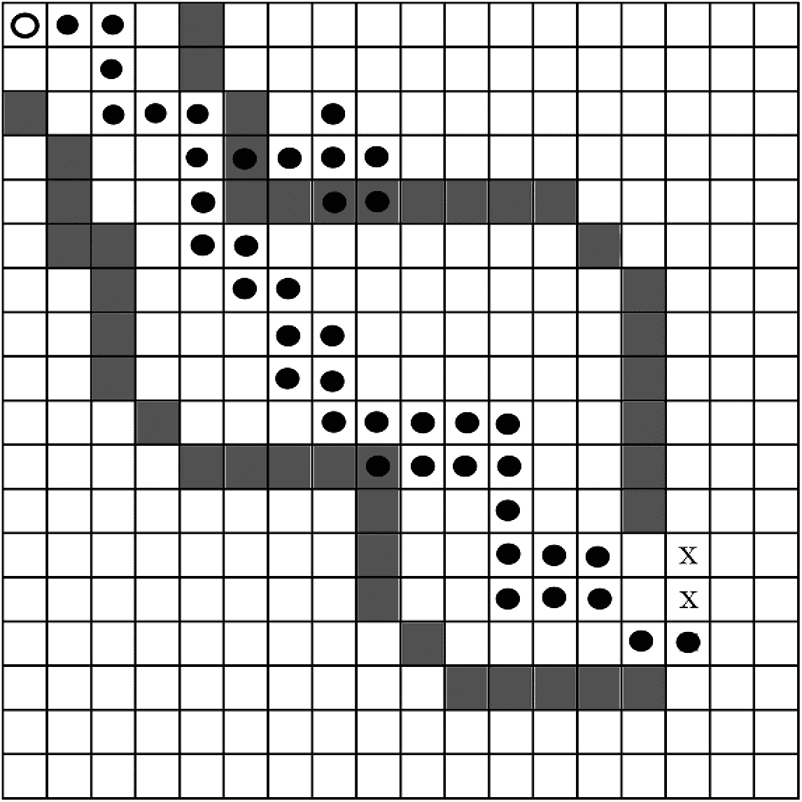

**图 4.3** 将 `Q-learning` 算法应用于导航任务的可能。相应的 `Q-table` 在整个探索阶段使用贝尔曼方程（根据学习率、观测奖励和折扣因子等参数迭代更新 `Q-table` 中的先前奖励值）。`Q-learning` 是一种强化学习的无模型方法，因为它并不尝试预测预期动作的结果。在路径图中，空心表示起始位置，点表示经过的路径，阴影块表示障碍，x 表示目标状态。

在 `deep-q learning` 中，`Q-table` 的角色由 `DNN` 完成。¹⁷换句话说，当智能体探索环境时，`DNN` 的输出（它接受智能体当前状态的信息作为输入）被用于估计当前动作选项的 `Q-value`，并根据之前获得的奖励值通过 `梯度下降` 对该网络进行训练。网络通过使用预期与实际奖励之间的差异作为误差信号，通过反向传播调整连接权重，因此随着时间的推移，`Q-value network` 能够更好地预测特定语境下特定动作的实际奖励值。对比的关键点在于，这种价值估计网络将状态变量映射到动作值对。换句话说，动作的情感价值被构建在网络的输出表示中，而输出表示是从智能体当前状况的抽象表示计算出来的。

这种基础类型的深度 Q 学习产生了令人着人的早期结果。例如，由 DeepMind 开发的这种方法的变体 `DQN` 能够以超越人类的成功水平玩 Atari 游戏（Mnih et al. 2013）。这种特定方法使用深度卷积网络，直接从高维屏幕输入图像数据获取输入，并针对各种 Atari 游戏输出动作-Q 值对，包括《光轮战者》（Beam Rider）、《炸块》（Breakout）、《Enduro》、《Pong》、《Q\*bert》、《Seaquest》 和《星际入侵者》（Space Invaders）。这种方法在人工智能强化学习领域取得了进展，因为以前的方法通常必须为 Q 学习方法手工设计有效特征。而这种方法利用了 `DCNN` 直接从高维输入中提取抽象高层特征的能力，直接从数据本身学习有效的策略。结果，`DQN` 网络在大多数 Atari 游戏上的性能超过了之前所有的人工机器学习模型，并在某些游戏上超过了人类专家水平，而更近期基于 `DQN` 的模型在此类游戏上仍然保持着顶尖的竞争力。

即使是早期版本的 `DQN` 架构也整合了关于长期和短期记忆区别的见解，因为这种理念的一些早期实现会遭受灾难性干扰，并经常陷于糟糕的局部最优解。DeepMind 的 Mnih et al. (2013) 受到龙劲（Long-Ji Lin）Lin (1992)早期工作的启发，在他们的 `DQN` 模型中添加了经验回放（experience replay）元素来解决这些问题（Fig. 4.4）。¹⁸ 在此情况下，“经验”被定义为四元组 `s[t]`, `a[t]`, `r[t]`, `s[t] [+] [1]`，它由某个时刻 `t` 的状态输入变量（`s[t]`，例如来自 Atari 游戏截图的像素信息）、在 `t` 时采取的动作（`a[t]`）、在时间 `t` 选择动作 `a` 获得的强化值（`r[t]`）以及时间 `t + 1` 时网络的后续状态（`s[t] [+] [1]`）。这些经验被存储在一个名为“回放内存”（replay memory）的长期记忆存储器中。在 `DQN` 学习算法中，Q 学习算法应用于从该回放内存存储器中随机采样的批量（minibatches）经验。这就像是从更长时间的洗牌的游戏经验序列中学习，在深度强化学习的背景下有效实施了交织记忆巩固的想法，通过定期刷新较旧且更远的经验集来避免灾难性遗忘。¹⁹ 正如读者已经注意，带有有效标签的经验可以解释灵活决策的想法，与伊本·西那（Ibn Sina）在之前过的内在感觉理论中提出的观点惊地相似。该记忆存储器与 McClelland、McNaughton 和 O’Reilly 的 MTL 网络共享一些特征，因为它具有有限的缓冲区大小，当缓冲区满时，旧经验会被重写。值得注意的是，这种经验引导的 Q 学习已经比没有经验回放的基于 `DNN` 的 Q 更新效率得多，而且这可能是第一个可以被认为同时利用了 `DCNN` 直接从原始感知输入中提取抽象特征的能力，以及利用经验回放进行高效的、结果敏感型决策的神经网络模型。

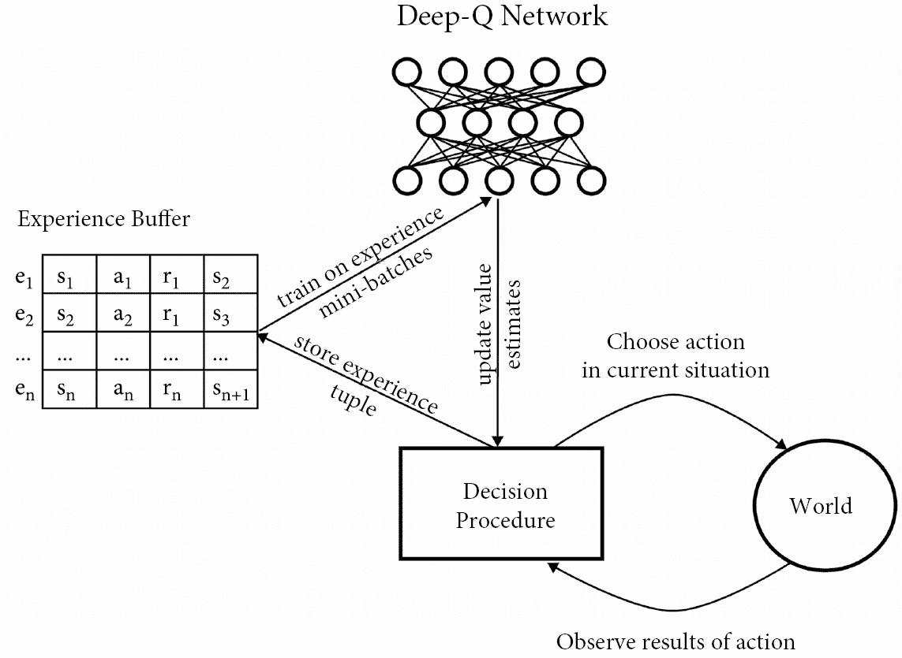

**图 4.4** 基于 Mnih et al. (2013) 的深度 Q 网络架构示意图。

早期研究甚至在此类网络学习的抽象表示与接受过类似游戏训练的人类表示之间进行了比较。正如揭示 `DCNN` 学习的表示与腹侧流（ventral stream）之间相似性的研究路线（Lindsay 2021），研究发现 `DQN` 网络层中构建的表示与玩 Atari 游戏时从人类背侧流不同位置记录的功能磁共振成像（fMRI）数据之间存在惊人的相似性，尽管在中间层中并没发现相同程度的对应关系（Cross et al. 2021）。背侧流（dorsal stream）长期以来被认为为后期的决策系统提供抽象的、干扰控制的、任务相关的信息，这表明 `DQN` 网络和背侧流可能在解决同一个问题，尽管方式不完全相同。目前正在进行研究以提高背侧流和 DQN 网络中中间表示的拟合度，同时不违反端到端训练的经验主义目标（Köster and Chadwick 2021）。

尽管取得了这些惊人的结果，早期的 DQN 网络为了获得相似的分数仍然比人类主体需要多出一个数量级的游戏经验。例如，Mnih et al.’s (2013) `DQN` 网络提供了 1000 万帧游戏画面（以及一个 100 万帧的片段式缓冲区）来达到其基准分，相当于数百小时的游戏时间。相比之下，人类在几小时内就能达到不错的表现水平。Mnih 等人建议的进一步改进片段式回放缓冲区使用的想法之一，是从那些特别令人惊讶或具有奖励性的经验中进行选择性学习，因为这些经验特别可能具有启发性（Moore and Atkeson 1993）。另一个建议涉及对回放缓冲区中有限的经验本身进行推理，同时在主策略网络中训练更抽象、更具泛化性的表示。

后者的这一思想在 Blundell 等（2016） 的“情境控制器”（Episodic Controller）架构中得到了阐述，并与一些受多任务学习（MTL）启发的想法相结合。Blundell 等人从一个观察开始：`DQN`学习需要智能体通过尝试偶然发现高回报的动作序列，然后仅使用梯度下降学习法非常缓慢地更新这些有效动作的 `Q-values`。这要求网络在权重调整到足以让网络输出捕获这些动作的真实奖励值之前，必须多次“偶然”发现这些高回报动作。他们注意到，人类和动物在短记忆学习中能更快速地锁定特别成功的策略，如果情境回放只关注高回报体验以及此前产生过高回报的体验，那么这种效率的可能会被赋予情境回放。他们进一步推测，这一过程类似于动物模型在学习阶段后，在海马区域 `CA3` 的位置细胞中观察到的状态-动作序列的重现，而且回放奇奇地以时间反向顺序发生，这表明了一个评估过程 (Foster and Wilson 2006）。Blundell 等人进一步建议，这些快速学习的状态-动作-值绑定可以更直接用于决策，而巩固过程则像 `DQN` 系统描述的那样，训练皮层中较慢但通用的决策系统。他们将生成的系统称为“情境控制器”架构。

这种方法类似于在 `DQN` 模型的决策过程中重新添加一个显式的 `Q-table`，以允许在短期的、确定性的语文中进行决策；在这些语文中，只需通过选择在当前情况下产生过最高奖励的动作即可做出良好的选择。这一想法的灵感来自：海马中的 `CA3` 绑定可能像一个表格一样，记录在该情况下最高回报的动作序列。当发现在该情况下具有更高奖励值的动作序列时，它会简单地覆盖该位置之前的绑定。正如 Blundell 等人所指出的，这重新引入了强化学习中表格方法的某些缺点，即它扩展性较差，且对不同情况的泛化能力差。第一个问题通过情境控制器架构的有限尺寸得到了解决。因为情境缓冲区尺寸较小且经常被重写（当缓冲区满时，会丢弃最久未使用策略以为新信息留空间），它不需要记录所有需要考虑的可能动作序列。遗忘机制自然有助于优先考虑近期且成功的动作序列记忆，而不是更旧且较不那么成功的记忆。尽管 Blundell 等（2016） 论文没有这样做，但关于泛化性的第二个担忧可以通过允许智能体逐渐训练一个具有更抽象表示的、较慢的 `DQN` 系统来解决。²⁰ 这更符合 McClelland、Rumelhart 和 O’Reilly (1995) 的原始见解，我之前一直追溯到伊本·西那（Ibn Sina）。尽管如此，较简单的情境控制器架构仅需 `DQN` 架构所需的一部分训练经验就能实现高分表现。

还应该注意的是，这种方法允许一种在通用 `DQN` 架构中无法实现的单次学习（one-shot learning）。因此，每当从单次体验中学习最优策略时，预计它将优于更密集的学习策略。Blundell 等人提出的一个示例涉及鸦类物种的缓存行为（例如松鸦——[Dally, Emery, and Clayton 2006)，这种行为依赖于能够维持大量的单次“食物-位置-时间”绑定（某些鸦类物种跨越数年的时间跨度回想起数千个独立位置）。他们进一步建议，这两种学习可以与更基于模型的规划方法相结合，后者涉及对未来经验轨迹的模拟。我们将在下一章详细讨论这种可能性。

然而，我们应该停下来，并注意到我们在攀登 第 2 章 中概述的理性层级时取得的距离。上一章描述的简单 `DCNNs` 决策架构仅通过允许某种程度的抽象上升到第 2 级，它尚未明确实现工具性决策（这涉及根据选项对目标的适用性来选择选项）。`DQN` 和情境控制器架构开始在第 3 级取得进展，因为强化值的加入允许根据估计奖励这一“通用货币”中对目标的适用性来选择选项。智能体可能仅根据单一形式的强化值（如游戏得分）来比较选项；但这仍然属于后果敏感决策的形式。此外，智能体可以根据自身与环境的交互，学习各种情况下对选项的排名。在 `DQNs` 的情况下，它们进一步学习将结果与情况的抽象表示相关联，以便它们的策略可以泛化到一系列新情况。

这可能被认为符合理性选择的一些关键标准。例如，哲学家 Bermúdez 认为，“选择特定的行动方案……必须在后果敏感的基础上做出”是一个“最低要求”，这包括“将该结果与其他可能的行动方案的可能结果进行比较”（2003:124）。我们在理性选择这一标准中可能还需要其他形式的活性；例如，我们可能希望智能体具有更大的灵活性来选择追求哪些目标（而不是依赖单一的奖励值函数），或者能够控制它们认为比较的哪些方面是决定性的。这些思想将在以后考虑在 `DNNs` 中对注意力和执行控制进行建模时进行探讨。但目前，至少，这样将 `DCNNs` 与 Q 学习相结合的智能体已经在模拟理性决策方面迈出了重要一步。

### 4.7 关于记忆建模的剩余问题

从心理学、神经科学和记忆哲学的近期趋势中，可以提取出与当前经验主义项目相关的若干剩余关注。一种思路削化了记忆与想象之间的区别，认为这两种功能之间的联系比我们通常认为的要密切得多。另外两个关注点强调了在实现以内侧颞叶（MTL）为中心的表示以支持更灵活、高效的迁移学习方面，我们还有很长的路要走，重点关注先验知识在塑造学习中的作用，以及位置编码和网格编码的作用。虽然这些关注将在后面的章节中进行更深入的讨论，但在此强调这些关于回顾性记忆与创造性想象在实现理性决策方面类似关注的哲学渊源，以支持评估 `DoGMA` 证据的更广泛计划。

### 4.7.1 回放，还是创造性重构？

心理学、神经科学和记忆哲学的一个近期趋势是削化想象与记忆之间的区别，相应地，也削化了记忆主要是导向过去还是导向未来的功能区别（De Brigard 2014; McClelland 1995; Robins 2019; Schacter and Addis 2007）。换句话说，这项研究表明，即使正常的回忆也涉及某种程度的创造性重构，这种重构似乎倾向于未来的决策，而非对过去的准确还原。

对于回顾性记忆与创造性想象之间界限的关注也具有深厚的哲学背景；洛克和休谟都认为记忆与想象密切相关，并担心两种功能的产物之间会产生混乱。他们倾向于将这种混乱视为心理功能障碍，休谟甚至强烈警告不要沉溺于过度活跃的想象：

```


值得说的是，正如生动的想象力往往会退化为疯狂或愚蠢，且在运作上与此有很大相似之处；它们也以同样的方式影响判断，并根据同样的原理产生信念。当想象由于血液和精气的异常发酵，获得了足以扰乱其所有能力和功能的活力时，就没有办法辨别真伪；但每一个松散的虚构或想法，由于与记忆印象或判断的结论具有相同的影响力，会在相同的地位被接受，并对情感产生等强度的作用。（`T` 1.3.10.9/123）


霍布斯对这种现象持有不同态度，他认为“想象和记忆只是同一件事，只是出于不同的考虑而有不同的名称”（Malcolm 1996:1.2）。这种观点——基于记忆涉及重组的观察——也出现在过多处地方（Bartlett 1932; Neisser 1967; Rubin and Uman 2015; Werning 2020）。

这种构建性方法将大量的记忆错误实验说明作为证据，证明记忆并非容易发生故障，而是自适应重构可以提供帮助。失真可以在压缩阶段或重构阶段引入。我们后来还得知，记忆在被回想起时会再次变得具有弹性（Nader and Hardt 2009）。这是通过反复提问产生虚记忆的一种方式（Loftus 1996）。

在神经网络中为记忆的这些创造性方面建模有多种方法。即使是一些使用赫布学习（即“一起放电的神经元会连在一起”，`Hebbian learning`）来重构部分模式的最简单神经网络，也会在某种程度上显示出这些效应；每当模式被重新激活时，它都会增加新的关联被引入该模式的可能。今天，某些方法为 `DNNs` 增加了结构性创新，以便它们发现可以更灵活重新组合的稀疏表示。变分自编码器（在下一章描述）旨在将事件的核心特征从其干扰变化中分离，并独立地表示它们。此外，其他系统可能允许访问记忆不仅用于抽象决策，还用于创建新的模拟，这些模拟本身可以成为反思的主体。其他建模者受到理解腹侧流感知处理与海马体回顾功能之间相互作用尝试的启发，创建了一种基于 `DNN` 的模块化系统，通过生成先前类别成员的新颖模拟来发现更抽象的表示，他们将其称为“类别重放”（Barry and Love 2023）。

#### 4.7.2. 对任务变体的迁移能力较弱

我们在第 2 章中提到的另一个关注点是，通过强化学习训练的游戏方法往往无法很好地迁移到任务的变体中。回顾一下，Kansky 等人 (2017) 探索了深度强化学习智能体在 Atari 游戏变体上的性能，例如对 `Breakout` 进行修改，如将挡板抬高几像素，或将其长度设为原来的一半或两倍。脚注(21)。他们发现，这些智能体在任务变体上的表现糟糕，而且几乎没有从之前的任务版本迁移技能的证据，似乎需要从头重新学习游戏。这让他们得出结论：这些智能体在之前的 Atari 游戏训练中并没有真正学会有意义的抽象，而仅仅是过拟合游戏的表层特征。因此，他们认为，如果我们希望接近人类玩这些游戏的方式，就需要新的学习方法。

这一论点的假设是：人类不会受到这些任务变体的困扰，并能够在修改后的任务上灵活地重新部署之前的知识，这再次将注意力集中在人类比较中那些尚未在基于 `DNN` 的智能体中建模的方面。然而，很少有批评者提供关于人类在游戏变体上表现的详细实证证据。出于多种原因，实证地调查人类在这些特定任务上的迁移细节至关重要：我们必须验证他们确实不受这些特定变体的困扰；调查游戏的哪些特征对于成功迁移至关重要；并确定人类可能带入任务的背景知识，以促进他们据称优越的迁移。例如，人类可能对通用物理原理（如球的弹跳）、游戏规则或梯子、门等对象的可用性具有丰富的经验，可以借此快速将先的游戏策略适应新环境。关于这些问题的研究还太少，但值得注意的是，Dubey 等人 (2018) 对人类进行了相关实验，使用掩码设计来评估 Atari 游戏变体的哪些特征影响了人类的表现。在这种设计中，他们系统地改变了游戏部分的区域（通过改变颜色或精灵，例如，使威胁[如尖刺]看起来像一个彩色方块[`“掩码语义”`]，或看起来像具有不同含义的东西，如冰淇淋[`“反向语义”`]）。当这些特征被改变时，人类在游戏中的花费明显更长，表现也明显更差。实验人员甚至研究了更剧烈的游戏更改，例如改变其基础物理特性或游戏中对象的恒定性；这些版本的游戏对人类来说更加难以解决。这种实验设计显然无法确定促进人类迁移的知识是先天的还是后天的，但它可以为深度学习智能体在未来的迁移任务中提供目标，并且进一步暗示了一种可以通过进一步建模来针对的“先验分类法”。在这一分类法中，对对象行为的预期在发育过程中获得得越早，对迁移行为就越关键，基础物理原理等非常低层的内容首先出现，而高层的对象相似性判断最后出现。

虽然本章稍后讨论的基于 `DNN` 模型展示了通过在人工智能体中模拟人类记忆方面已取得的显著灵活性改进，但与人类记忆心理学和神经科学的比较表明，`DNN` 模型建模仍有许多未开发的领域有待探索——但这样做可能会遇到学习理论中可靠性与灵活性之间的内在张力。值得注意的是，在这里，赋予智能体将之前的知识重新映射到游戏变体中新表层变化的灵活性，与本章提到的灾难性遗忘威胁之间存在张力，因为允许过多的表征灵活性可能会导致网络覆盖其对游戏之前变体的解决方案。深度学习中的这种张力需要更多工作，但已经有一些极具前景的发展。特别是，“渐进式神经网络”（`progressive neural network`）的概念由 Rusu 等人 (2016) 开发。渐进式神经网络由输入和输出之间许多不同的权重“列”组成。每一列都可以认为是一组独立的策略，可以为特定的任务变体量身定制。这些列是逐个训练的，第一列就像普通的 `DNN` 一样训练。渐进式神经网络的关键变化在于，当系统移动到新的任务变体时，它会存档之前的权重并开始训练一列新的权重。然而，新列的训练不需要从头开始，因为之前的列的隐藏层与新列之间存在水平连接。因此，新列的学习可以通过之前列的表征来引导和加速，同时在需要时允许学习全新的表征。由于旧权重始终被归档，渐进式神经网络在设计上免疫于灾难性遗忘。

虽然渐进式神经网络采用的策略似乎与人类学习具有某些相似性，但它也可以被认为依赖某些人工因素。大脑如何知道新任务开始了，以便其需要切换到新的神经连接列？大脑是否真的无限期空置着未使用的表征资源，直到它们被投入新任务的服务？一旦列训练完成，大脑如何决定使用哪一列来解决任务，它又如何在列与列之间导航？神经科学中一些初步证据表明，用于在空间领域进行导航的网格编码也可以用于导航更抽象的概念分类法（Constantinescu 等人 (2016)；在此背景下的讨论请参见 Hassabis 等人 (2017):252; Moser 等人 (2008)）。然而，这一想法仍然具有高度推测性。

#### 4.7.3. 用于迁移深度学习的网格编码

另一条可以从进一步发展受益的研究涉及人类迁移学习中位置细胞（`place cells`）与网格细胞（`grid cells`）之间的相互作用。虽然这些细胞的计算作用是在空间导航中被发现的，但对于 DoGMA 而言，重要的是强调它们此后被发现在许多其他领域中组织关联方面起着至关重要的作用，神经科学家还明确对时间、分类和社会位置细胞提出了理论假设（Constantinescu et al. 2016; Duvelle and Jeffery 2018; Eichenbaum 2014; Omer et al. 2018）。²² 最近提出了一些模型来为 `DNN` 模型实现位置-网格细胞编码，而另一些人则好奇这种行为是否可以在无需添加进一步结构方面的情况下在基于 `DNN` 的系统中自发出现（Banino et al. 2018; Cueva and Wei 2018; Saxe, Nelli, and Summerfield 2020)。这些细胞在沿单调维度（无论在哪个领域）放置更基础的关联方面可能是至关重要的，从而允许产生一个半独立的表征系统，智能体可以通过该系统进行新决策。例如，一个能够在共享空间维度上定位位置表示的基于 `DNN` 的智能体，可能利用网格中该维度上的中间位置节点，在两个位置之间规划一条新路线，或者通过在时间网格维度上将事件定位在两个其他事件之间，从而将事件设定为发生在另外两个事件之间。这类灵活的推理被认为是比较心理学中迁移学习最令人印象深刻的实例之一，反映了儿童在达到某些发育里程碑后（或可能，某些极具洞察力的动物）利用先习的知识，在关联学习术语中的新颖情况下得出正确推理的能力（例如在迷宫中寻找新路线，或对两个从未重叠的事件的相对时间进行排序）。

## 4.8. 总结

考虑到这些记忆方面作为未来建模努力的目标，让我们总结本章的论点，以服务 DoGMA 的开发和维护。前章节认为建模方面已经取得了显著进展。然而，本章指出，此类模型仍然容易受到灾难性遗忘的影响。在这里，我们回顾了引入一个独立的内存模块——它可以快速存储重要序列用于离线学习（如 `experience replay`）——如何帮助解决这些缺点。通过使用 `experience replay`，我们可以减轻灾难性遗忘并更灵活地-

尽管亚里士多德在“战斗隐喻”中似乎是一个坚定的溯源经验主义者，并播种了许多经验主义的核心思想，但根据第 1 章中提到的经验主义-理性主义划分的其他维度来看，很难将他归类为纯粹的经验主义者或纯粹的理性主义者（Sorabji 1993）。他有时被描述为“理性经验主义者”，因为尽管他坚持知识源于经验，但他倾向于使用类似于规则的推理准则来评估类人的理性认知，他认为这些准则仅适用于使用语言的人类。我们稍后讨论的伊本·西那（Ibn Sina）可能也属于这一类经验主义者（Zarepour 2020）。

这种将心灵划分为物理和非物理层面的二元论划分影响并持续于笛卡尔的理性主义，而理性主义又启发了现代形式的理性主义以及至今存在的双过程理论。在这种方案中，智力在完全抽象的形式上做出判断并进行高级推理。事实上，这种观点可以被视为马库斯（Marcus）等当代理性主义者所推荐的混合架构的概念祖父。这引发了一个问题：伊本·西那的方案是否被正确地视为经验主义的？Gutas (2012)详细论证了，这确实属于我们此处所说的“溯源经验主义”的一种，因为在该方案下，即使是在纯粹智力活动中运作的抽象形式也是通过内部感觉从经验获得的。

我们在此注意到，对动机相关结果的强调预示了认知神经科学中关于海马功能的一些前沿观点，这些观点从根本上将海马理解为一种“预测地图”（Stachenfeld, Botvinick, and Gershman 2017）。

对比（Müller 2015:498）：“首先应该注意，通过将记忆变成意图库，伊本·西那大大扩展了亚里士多德概念范围：它不仅可以容纳关于形状、颜色和声音之前的感官经验，还能容纳对象的其他内涵属性，这些属性构成了与恐惧、悲伤、愤怒和忧愁概念相关的更复杂的情感记忆的基础。此外，记忆指向了关于伤害和用处的更一般的概念，这些是运动和行动的基础。在伊本·西那那里，记忆仍然附属于于感官印象及其心理表征，但与亚里士多德对感觉记忆的描述相比，它已经更具‘抽象性’或‘精神性’（即脱离了肉体）。然而，它仍然是一种内部感觉，因此仍留在感觉心理学的通用框架内，这意味着我们处理的仍然具体的经验。伊本·西那描述中存储的意图不是普遍性的，而是特殊性的；它们并不是内部感觉拥有的某种知识，而是‘一个指向与该指示连接的内部图像意义的指示’。”

维萨里（Vesalius）对脑室理论并不友好，他将该理论原理描述为“那些从未观察过造物主在构建人体方面巧思之处的人的发明”（Singer 1952:6）。

如果我们将这种记忆意图理论与第 7 章中推荐的情感主义强化学习方法相结合，该理论看起来更具预见性——它建议了一种比当前实现中所探索的更具维度的强化学习估值方法。

关于这一现象的近期实证研究，请参阅 Kitamura et al. (2017)。

这更接近 `Tulving (1972)`（#17_bibliography.xhtml#oso-9780197653302-bibliography-1-bibItem-712）对情节记忆的原始定义。最近，Tulving 等人将情节记忆与自我认知意识（`autonoetic consciousness`）以及现象学更紧密地联系在一起，这是在回忆情节记忆时一种主观的重体验感（Klein 2016; Tulving 2001）。我认为将情节记忆与某种现象学等同是错误的，因为它使得在非人类身上研究情节记忆变得困难，且不是数据的最佳解释（Clayton and Russell 2009; Gentry 2023）。

还探索了许多其他神经解剖启发的方法；例如另一种近期很有前景且完全符合内在经验主义的思想强调了活跃树触在任务切换中的作用（Iyer et al. 2021）。

过去几十年关于多巴胺学习的一项关键见解是，多巴胺的不仅受奖励调节，而是受奖励预测误差（Glimcher 2011）。获得超出预期奖励产生高于基准的多巴胺，获得预期奖励提供基准多巴胺，而获得低于预期的奖励产生低于基准的多巴胺。仅仅考虑奖励结果就能提高多巴胺水平，考虑失败就能降低水平，因此这种神经递质不仅在强化学习中起作用，也起动机作用。

我们这里不回顾许多其他流行方法；演员-评论（`actor-critic`）方法作为 `DQN` 的特别流行的替代方案脱颖而出，值得感兴趣的读者阅读（Mnih et al. 2016）。

该元素由 Lin 引入，旨在解决 McClelland、McNaughton 和 O’Reilly 在其 1995 年的作品中以“灾难性干扰”为标题描述的同类问题：“在训练网络期间，如果某个输入模式很长时间没有出现，网络通常会忘记它为该模式所学到的东西，因此当以后再次看到该模式时，需要重新学习它。这个问题被称为重学习问题” ([Lin 1992]:28)。尽管 McClelland、O’Reilly 和 Lin 几乎在同一时期就职于卡内基梅隆大学，但我无法确定这一想法的原始来源。

这项研究的许多发现可能会让首次接触它的读者感到惊讶。例如，`Mnih et al. (2013)` 发现，从顺序样本中学习是低效的，因为相邻帧之间存在大量冗余。随机选择时间上相较远的经验被证明更加有效。

`Blundell et al. Episodic Controller` 模型则通过添加一种对 `k-nearest-neighbors`（在这种情况下他们使用了 11 个最近邻）进行平均的决策策略来解决泛化问题。这是一种尝试在不构建更具泛化表示的情况下进行即时泛化的方法。然而，他们指出在大脑中，海马系统会将已经由腹流处理抽象的表示进行结合，这种处理类似于 `Chapter 3` 中描述的 `DCNNs`。

他们并没有使用 `DQN`，而是测试了一种名为 `Asynchronous Advantage Actor-Critic (A3C)` 学习的邻近方法（`Mnih et al. 2016`），因为它在仿真中运行效率更高。

我感谢 Mariam Aly 对此点的讨论。

# 5

## 想象

没有什么比[人类]的想象力更自由了；尽管它无法超过由内部感官和外部感官所提供的原始思想储备，但它在混合、复合、分离和划分这些思想方面具有无限的力量，可以幻出各种虚构和幻象的形象。

—Hume, *EHU* 5.2.10/47

## 5.1 想象：心灵的实验室

创造力是理性智能的关键组成部分。我们在之前的章节中已经注意到人类和某些动物如何以表现出“洞察飞跃”的方式行动，以及这些飞跃中的某些可能如何通过诉诸感知和记忆等通用领域功能操作发现的更抽象关联表示来解释。然而，即使是这些形式的抽象似乎不足以解释最新颖的思想活动。在人类中，我们经常通过对新颖类别或过去从未观察过的模拟场景的表示进行推理，来解释这些更具创造力的心理运作。这些新颖表示对经验主义的理性方法构成了显而易见的挑战，后者试图通过从先经验中学习来解释问题的解决。当经验主义者讨论此类创造性洞察时，他们通常使用想象力功能中的心理成像、白日梦或幻想来解释它们。

在这个背景下，对想象力有许多见解的经验主义者是 David Hume。正如我们已经观察到的，当涉及到这种诉诸经验主义功能时，`Fodor` 与 `Hume`（以及其他关联主义者、连接主义者和经验主义者）不同意。我们在之前的章节中反驳了 `Fodor` 的某些担忧——特别是反驳了 `Fodor` 在之前章节中的某些担忧。

然而，即使为了辩论起见允许 Hume 接触功能心理学，`Fodor` 仍然并不满意。他指出 `Hume` 没有解释想象力实际上是如何执行这些任何操作的，因此 `Hume` 的解释被认为是不完全的。另一方面，如果深度学习可以解释遵循转换法则的物理系统如何执行这些过程中的某些，那么我们可能有另一个案例，即深度学习可以从经验主义的历史中救回一张有价值的期票。这张期票在我们目前新 DoGMA 发展的当前阶段具有特殊价值，因为 Fodor 列表上的操作对人类大脑确实至关重要。

可能由于相关的原因，“想象力”在过去几年中在深度学习领域独立地变成了一个热词，建模者声称通过在网络模型中引入在人类心理学和神经科学中归于想象力的各种角色组件，取得了各种突破性成果。这些突破包括人工智能（AI）领域最令人兴奋的结果：深度伪造（`deepfakes`）和其他写实级刺激的创建；`style transfer` 可以非常快速地将手机拍摄的照片渲染成梵高或蒙奇风格的高分辨率图像；在自生成数据集上使用离线学习；以及利用可能的未来场景的规划和决策方法。这些成就与 Hume 在其独特的经验主义理性观中分配给想象力的工作直接相关。

通过将这些类想象力组件的功能与经验主义哲学心理学联系起来，我们可以使它们对我们理解认知和人工理性所具有的意义变得易懂。

让我们轮流考虑福德（Fodor）提出的两组反对——首先是针对休姆经验主义和联想主义的普遍反对（以及休姆对想象力的诉诸是如何被认为反驳了这些），其次是专门针对休姆关于想象力学说本身的反对意见。在随后的章节中，我们可以检查近期添加到基于 `DNN` 模型中的类想象力组件，用以探索它们是否以及如何应对了福德的关切。这种比较使我们能够对想象力在更广义的理性决策中所起作用的作用进行更深层次的评估，特别是从经验主义的视角来看。我们发现，深度学习中“生成式”建模近期取得的巨大成功，可能会将历史记录中看似经验主义教条中一个令人尴尬的空白，转变为其最大的优势之一。

重申第一章中的一个主题，对“拷贝原则”（`Copy Principle`）的严格解读表明，想象力就像比理球台的表面，心灵可以通过联想主义的“心理物理学”将先经历过的想法相互碰撞——形成简单的连接和并列。如果我们认为认为经验主义功能心理学的恰当比喻是“心理化学”（遵循 Demeter 2021），那么想象力更像是一个实验室，心灵可以在其中配制出更大胆的新颖事物——这些化合物和杂交物具有超过其心理反应物的新属性，并借此，心灵可以表征在先感官经验中尚未见过的未来、虚构和幻想。

## 5.2. 福德的挑战与休姆的想象力回答

让我们接着探索福德对休姆的批判，从福德对联想主义提出的三个通用问题（休姆在很大程度上预见到了这些反对）开始，然后转向福德对休姆关于想象力本身提出的进一步反对。

### 5.2.1. 为思维和推理合成类别标记以供

福德对联想主义提出的第一个主要问题是，仅凭休姆的三条联想定律并不能解释心灵合成想法标记（tokens）的能力。这一主张需要稍微详细说明。这里的要点是，心理表征是类型，只有通过“标记化”（tokened）才能具有因果效力——换句话说，通过该心理表征类型的特定成员在特定场合作为特定的心理事件（无论是在神经系统中还是在 `ANN` 中）被激活。只有通过这种标记化事件，关于心理因果关系的解释才能在联想主义的基础上得以开展。

假设我们要解释一个由条件反射引起的特定行为示例；这种行为并不是由生物拥有“铃铛”的类别表征（这导致它拥有“食物”的类别表征，进而触发寻找食物的行为）的——因为主体一直拥有这些类别表征，无论它目前是否正在思考铃铛或食物。相反，铃铛类别表征的一个标记（例如，由对特定音调特定铃铛响起的感知引起）导致了食物的标记表示（例如，对应某些特定食物的心理图像）。不同的铃铛和食物会触发这些概念的不同标记。这是关于因果关系的一个普遍观察，即引起世界中事件的是标记而非类型；我们有一个普遍观察，即石头可以砸碎窗户，但这种概括仅在特定的（标记）石头砸碎了特定的（标记）窗户时才成立。

这个问题对休姆来说尤为紧迫，因为他避开了洛克对广义观念的诉诸，并强调了特定范例的表征在论证推理中所起的作用。回顾第三章:122），因此我们发现了想象力为我们新的经验主义可能可能的首项核心工作：根据需要合成通用类别的适当标记，用于思维和推理。

休姆注意到，合成适当想法并以准确表征广义类别分布的方式进行抽样的能力对于智能至关重要。因此，我们在第三章

```


再次，在 21 世纪，我们应该超越休谟的挫败感。与休谟在这里最后的评论一致，我们应该能够对合成适当且具代表性的范例的能力差异发表见解，具体来说就是为什么某些人可能比其他人更成功。

### 5.2.2. 思维的生产性

一般的理性主义者，特别是福多，往往对人类思维的生产性留下了深刻印象。这里的“生产性”是指心灵通过系统地重新组合旧想法来创造潜在无限数量新想法的能力。事实上，这里确实涉及到某种独特的、甚至可能是人类特有的问题，解释了人类思维和文化看似是开放的潜力。当我在心灵哲学课程上教授福多时，我使用一个奇幻的例子向学生说明这一点：“假设教室后方有一只穿着芭蕾舞裙的小粉色大象，拿着伞挂在天花板上，唱着海歌。”这句话的奇之处在于，我的学生都知道它所描述的情景是什么样子，尽管他们过去从未考虑过这些概念和短语的组合（我希望如此）。福多对休谟承认思维生产性的中心性给予了最高的赞誉。休谟将“奇幻”的想法，如独角兽（带角的马）和新耶路撒冷（黄金街道和镶嵌宝石的墙壁）视为其联想主义的潜在反例；因为如果经验主义心灵过去从未经历过这些想法，它是如何构思这些的呢？休谟对这一挑战的回答涉及另一个对想象力的诉诸。

休谟明确地依赖想象力来解释新颖复杂观念的起源。洛克在某种程度上也承认了思维的生产性，他注意到心灵“能力”的首要特征是能够“重复、比较和统一[观念]，甚至可以达到近乎无限的多样性，从而……在愉悦中产生新的复杂观念”（*E* II.ii.2）。休谟在此处进一步深化了洛克的观点，他明确赋予想象力自由，使其不再仅仅遵循先有联想模式的陈旧路径，而是“不再受限于与原始印象相同的顺序和形式”（*T* 1.1.3.2/9），转而拥有一种“随心所欲……转置和改变其观念的自由”（*T* 1.1.3.4/10）（另见 Costelloe 2018:16）。在这个背景下，我们也发现了一些关于支持“转换原则”最重要的文本证据，因为休谟坚持想象力能够“混合、复合、分离和划分这些观念，以虚构和幻象的所有各种形式”（*EHU* 5.2.10/47）。想象力可以将观念分解为最简单的组成部分，并灵活地重新排列它们，呈现出“有翼马、火龙和巨型巨人”的形状（*T* 1.1.3.4/10）。福多认为，这一切听起来很像是对休谟功能心理学的一种极佳推销；但正如我们后将看到的，他坚持魔鬼隐藏在细节中，而休谟拒绝提供这些细节。

## 5.2.3. 区分思维之间的因果关系与意图关系

或许福多对休谟联想主义最关心的问题——至少在补充了想象力之前——是，正如他所说，联想主义者“无法区分思维内容之间的意图关系与思维本身之间的因果关系”（Fodor 2003:113–14）。简而言之，联想律擅长为我们观念之间的因果关系——告诉我们根据先前的邻近、优先和相似性模式，为什么一个观念会出现在另一个之后——但它们无法区分关联这些序列化的观念的不同方式。这为情境之间的比较判断带来了问题，正如我们在概率推理中发现的那样。为了说明这个问题，考虑掷一个六面的公平骰子；假设骰子有四面是三角形，两面是圆形。问题在于，一个受经验主义原则支配的心灵能否得出结论：掷出三角形的可能性高于掷出圆形。正如福多简洁地描述问题那样，一个朴素的联想主义者在解释“为什么在这种情况下，人们预期掷出三角形比预期掷出圆形更多”方面没有问题；但解释为什么人们“预期掷出三角形比圆形更多”则是完全不同的工作了（Fodor 2003:114）。

换句话说：

```
需要解释的不是你以 1:1 的比例预期出现三角形和圆形；而是你以 2:1 的比例产生“将出现三角形”的想法
```

（Fodor 2003:114）。

值得注意的是，这一挑战不仅是经验主义哲学家面临的谜题，对旨在创建能以这种方式推理的代理的建模者来说也是一个实际问题。这种因果/意图的区别为我们的代理提升理性判断层级的能力构成了重大障碍，因为这标志着一个仅仅为了的代理之间的区别。

休谟重视这个问题，并再次诉诸想象力（在休谟那里也可以交替称为“幻想”，即 fancy）来解决它。正如他在《人性研究》的一个重要段落中所述：

```
当我们把相反的实验转移到未来时，我们只能按照特定的比例重复这些实验；这无法在任何单一事件中产生保证……除非幻想将所有契合的意象融合在一起，并从中提取出一个单一的观念或像，其强度与其源自的实验次数成比例……显而易见，信念的产生不仅仅仅是从过去到未来的转移，而且源于幻想与这种转移相结合的操作。
```

（*T* 1.3.12.22/139–40）

因此，这种观点是：想象力能够对结果的可能性进行某种比较，这种比较基于关联意象强度的比较，而这些关联意象是由想象力合成的，而非从经验中复制的。这为其他类型的理性推理提供了模型——在这种情况下，想象力合成了个人层面可用的信号（观念的相对生动性），这可以作为更精确定量比较（两个事件的比较概率）的启发式标记，这种信号可以完全从经验的原材料中可靠地制造（休谟借此预言了由特沃斯基和卡尼曼在当代著名的概率推理启发式方法的核心思想，1974）。

## 5.2.4. 福多对休谟想象力学说提出的问题

现在让我们转向福多对休谟想象力说明本身所发现的问题。福多对休谟想象力说明提出的第一个且最基本的问题是，他从未解释过该功能是如何运作的；它是一个“我不知道是什么的东西”（Fodor 2003:115）。福多指称，休谟甚至没有解释支配该功能的基本原则，更不用说这些原则在内部是如何被遵守的（例如，该功能对其输入执行的以产生输出的算法）。

这一指控的前半部分有些不公平；休谟确实以多种方式刻画了想象力的行为，至少在“输入-输出”的功能规范层面上。休谟将想象力描述为同时具有“模仿性”和“生成性”模式；在模仿方面，它可以以或多或少的准确性复制先前的印象（正如一位专家艺术家可能模仿他人的作品，正如 Costelloe 形象地指出的那样），并利用它们来代表更广泛类别的成员；在生成方面，它可以组合观念以创造出新的观念。休谟经常将想象力刻画为享乐主义的，寻求“在观念之间进行容易且平滑的过渡，以形成统一或完成一个整体，并从中获得快乐”（Costelloe 2018:1）。它的运作具有某种惯性；休谟说想象力“像一艘被船桨驱动的画船……延续着对其对象之间均匀性的观察序列，并自然地持续下去，直到使这种均匀性变得尽可能完整”（`T` 1.4.2.22/198 [Costelloe 2018:22]）。这种完成主义倾向在神经网络模型的语境下具有特殊意义，因为我们今天可能将其读为：在给定先前经验的情况下，以一种最大化结果表示的主观概率的方式来重建部分模式的倾向。与他的许多同时代人一样，休谟也担心将想象力的产出与当前的感官印象或回忆的记忆混淆的可能性，因此他规定，想象力产生的观念通常（在非病理情况下）比其他来源的观念更“模糊”，且“生动性”较低。

为了强调想象力的运作并非狭隘地遵循联结原则，想象力被描述为同样对新奇性感到乐趣，“它不受控制地奔向时空中极其遥远的部分，以避开那些因习惯而对它来说过于熟悉的物体”（`EHU` 12.3.25/162）。同时，休谟认为联结原则在某些方面确实限制了它，因为他认为“即使在我们最狂野、最漫游的幻想中……如果我们反思，也会发现想象力并非完全随心所欲，而在相继出现的不同观念之间仍然维持着一种联系”（`EHU` 3.1/23 [Costelloe 2018:17]）。想象力无论在模仿模式还是生成模式下，必须“从印象中借用[其]简单观念，并且永远无法超越这些原始感知”（`T` 1.3.5.5.3/85），尽管在后期功能中，它在组合异质简单观念和填充复合体细节方面拥有更大的自由（`EHU` 5.12/49）。我们无法想象违反逻辑法则或可能性法则的事物，例如“没有山谷的山峰”这种观念（`T` 1.2.2.8/32）。通过尝试填充其他背景细节来平滑表面上的不一致，并使复合体更加合理。我们可以推测，这就是为什么独角兽被想象为额头中心长出一只角（因为这与其他动物长角的位置更相似），而不是从眼眶或耳朵出来。

然而，福多指控的后半部分确实切中了要害；休谟多次描述该功能的运作像“魔法”一样，在组合选择上具有不受限制的自由，并在多处公开推测，其运作对于人类理解来说必然是无法解释的。福多对休谟将该功能负面刻画为担忧，即它完全不受联结原则的支配——事实上，福多指责休谟每当需要解释一种会构成其观点反例的心智运作时，就诉诸该功能作为一种特权宜（ad hoc）的补救。这让休谟本人以及整个经验主义看起来都变得糟糕了。我们需要对想象力解决问题的通用原则给出某种解释，以应对休谟要求它回答“特权宜性”的指控，否则经验主义的 DoG 在立场上将不如那些调用天赋观念但不解释其来源的天生主义者。重要的是，如果没有对这些来源的理解，经验主义建模者无法创建一个可以部署这些方法的系统。

福多对休谟想象力描述的第二个主要反对是：很难想象它如何在不引发某种循环问题的情况下运作。具体来说，这适用于想象力在抽象思维（使用“抽象即表示”）中应扮演的角色。请记住，休谟与洛克不同并不认为通用观念；他认为每当我们认为自己在思考一个通用观念（如抽象的“球”）时，我们实际上是在考虑一系列特定的球以及它们相似或不相似的方式（例如它们的光滑度或缺乏角度等）。为了开发这种“抽象即表示”的解释，我们需要解释想象力如何从许多可能的相似性中关注某一个特定方面——正如古德曼所观察到的，任何两个观念都以无限方式相似（Goodman 1972）。假设我们正使用黑球和白球的观念来思考形状；如果我们考虑到这些范例在不同方面的相似性，我们也可以使用同一对球来思考位置或大小。

福多指控这种解释性债务威胁了某种循环或回归。正如他所说：

```
如果我们还没有关于“形状”本身的概念，休谟就必须解释我们如何“转过目光”看向白球和黑球之间的相似性。显然，“关注它们的相似性”仅仅是注意到这些球在颜色上不同，但形状是相同的。但除非你拥有一个能从球的颜色中抽象出来仅根据其形状就应用于球的概念，即“球”本身的概念，否则你无法这样做。（Fodor 2003:149）
```

福多利用这一问题来推荐他针对休谟影像化抽象思维理论的更具无模态、经典的方法。然而，我们可以通过在休谟认知架构中重新激活洛克式的抽象观念解释，来探索另一种出路（或许还能通过下一章概述的詹姆斯式的注意力功能描述得到进一步增强）。简而言之，也许福多对休谟想象力描述的批评表明，我们的 DoGMA 确实需要某种洛克式的抽象观念——尽管可能是为了解释那些无法完全通过内省获取的处理过程。

然而，如果我们我们在休谟的想象力解释中重新引入`Lockean`的抽象观念，这将为我们当代的计算偏好带来额外的问题。例如，我们需要在这些抽象观念层面上重新审视 `type/token`（类型/标记）以及 `content/vehicle`（内容/载体）的考量。我一直认为特定观念的表征状态是没有问题的，但这些问题可能在抽象观念层面显现（这可能也是休谟避开它们的原因之一）。认知科学哲学领域已经产生了大量文献，讨论心理或神经状态需要满足什么条件才能被视为一种表征；总结这些充满争议的文献，它必须以某种方式处于因果泛化之中，因为它带有表征内容，但同时也需要根据非语义属性进行分类，这些属性赋予了它在系统中的因果效力。在当前背景下，如果这些抽象观念要用于解决福多对想象力的担忧（例如，解释想象力如何关注相似性的特定方面），我们需要说明为什么它们被认为代表了它们所代表的相似性，同时解释它们在系统中的实例化，以及它们对适用于这些内容的下游认知操作所做出的贡献。

福多对休谟想象力解释提出的最后一个问题是关于其在合成新颖观念方面的生产性作用。福多问，是什么“胶水”将这些合成的观念结合在一起？在说明这个问题时，我们可以将（恰当的）合成独角兽观念与角和马的简单串联进行对比。独角兽，同样，并不是马和角的简单堆砌，而是这些特征的一种特别合的融合。我将认为，这与休谟归于想象力的“完成主义”原则有关，因为它寻求通过在基于过去印象被认为最可能的方式上解决谜团和不一致性，来获得“愉悦”。这里的挑战在于解释想象力如何解决这些问题，并以一种合理的方式将抽象观念的新组合融合在一起。当然，这正是生成式 `DNN` 模型建模者在试图创建能够产生如 `deepfakes` 等合理人工表征的系统时，经常面临的实践挑战。深度学习理论者可能会或不会惊讶地发现，这些问题至少从洛克和休谟时代起就一直伴随我们。

#### 5.2.5. 关于生物学性的警告

我在开头必须承认的一点是，我即将回顾的架构与生物大脑认知之间的任何结构性联系，都比之前的研究更具推测性。我们正处于探索想象力人工模型的早期，我们还没有时间去考虑可能产生这些结果的、更多或更神经生物学合理的布线原理。神经生物学对应性的证据在 `DCNNs` 中最为有力，随着我们移动到后续章节，这种证据会减弱。因此，我们可能可以将很快后回顾的组件视为功能性替代品或机制模式；它们表明，休谟和其他经验主义者归于想象力的功能可以由物理可实现的网络结构来执行，但这些结构可能只是大脑中实际实现这些功能的结构的简单替代品。或者，那些倾向于使用抽象的非机械论抽象方法（如功能主义或数学解释）的人，可能不会因为这些人工模型的细节与大脑解剖学之间缺乏已知的结构对应而感到困扰。在人工模型和生物大脑的表征组织中可能仍然存在重要的相似性——特别是对分级结构和抽象信息的需求，以及基于源自以往经验的背景概率对那些表征结构进行新颖组合的处理 (Chirimuta 2018; Weiskopf 2011)。

至少，这些模型将作为“概念证明”，证明基于网络的机制可以以长期以来建议的方式解决这些问题。在我们回顾了特定模型后，将在章节结束回到这个问题。

### 5.3. 想象力在合成观念中的作用：自动编码器与生成对抗网络

让我们对类想象力人工模型的探索，从想象力被认为在合成新观念中起的作用开始。我们现在针对福多所探索的论点是：大脑在论证推理中意识地表征单个类别范例（与休谟一致），并且（与休谟不同）它以转换后的类别流形的形式无意识地表征类似于洛克式的一般观念。在第 3 章中，我讲述了转换抽象如何通过结合“作为组合的抽象”和“作为减法的抽象”的操作允许大脑从特定范例移动到一般类别流形。深度卷积神经网络 (`DCNNs`) 为这种在大脑中的运作方式提供了一个机械草图，通过交替执行卷积（组合特征配置）和池化（使对这些特征的检测对干扰参数的特异性更具不变性）的操作。然而在本章中，我还需要解决福多对经验主义想象力提出的问题。在这里，我将从福多的第一个挑战开始，关于大脑在推理和决策过程中合成新颖观念以供使用的。为了解决这个问题，我还需要一条从转换后的类别流形回到完全渲染的个体的路径——并为所有必要的干扰参数指定详细值。换句话说，我们还需要解释大脑相反方向的运动，即从一般的类别表征回到具体的观念。

令人惊讶的是，深度学习已经产生了几种形式的“生成式”架构，它们在将抽象转换为示例方面，与 `DCNNs` 等判别式网络从示例转换为抽象的能力不相上下。让我们从回顾这种技术的第一种且最具影响力的形式开始：生成对抗网络（或 `GANs`）。一个 `GAN` 是一个由成对网络组成的架构——其中一个是判别网络（通常是我们在第 3 章中讨论的那种 `DCNN`），另一个是生成式网络，稍后将详述（图 5.1）。`GAN` 架构在一种竞争性游戏中让这两个网络相互对抗。具体而言，判别网络将看到一些真实输入和一些由生成网络创建的“伪造”输入，判别网络试图区分真实输入和伪造输入。同时，生成网络也接受训练以产生与真实输入非常相似的输出，以至于判别网络无法完成这项任务。最初，判别网络可以轻松过滤掉生成网络创建的模拟输入；但随着时间的推移，生成网络在制作伪品方面变得如此精良，在许多情况下，先进的判别网络在识别伪造数据时仅凭运气（50/50）。

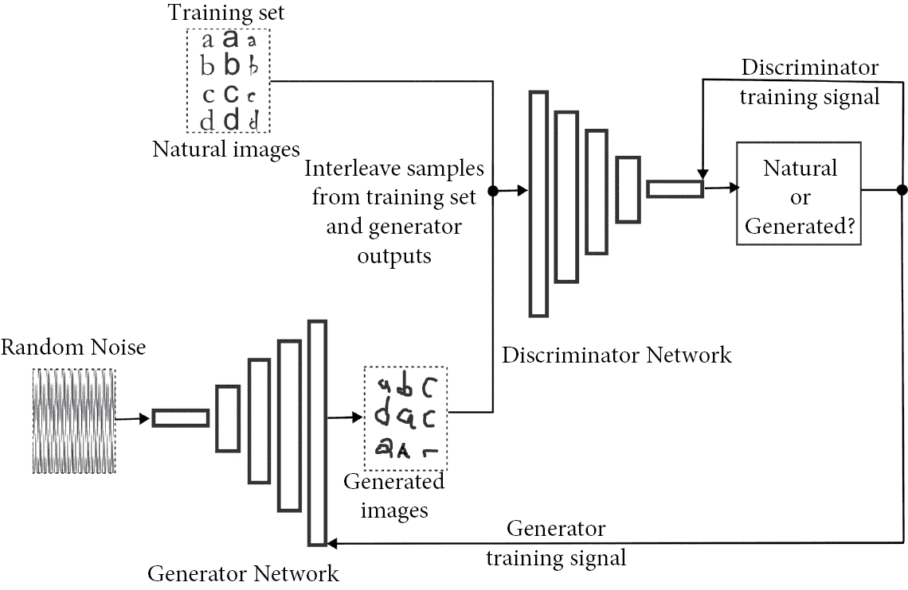

**图 5.1** 生成对抗网络 (`GAN`) 架构图，下方是生成器网络，上方是判别网络。生成器网络从随机潜空间代码开始，使用一系列分层的“规格化”操作（如转置卷积和反池化），将抽象的潜代码编码精细化为特定的高分辨率示例。判别网络通常是标准的深度卷积神经网络，如在第 3 章中描述的那样。然而，通过训练来区分其自然训练集中的图像与生成网络生成的图像，判别网络还发展出了更稳健的表示，使其不易受到对抗攻击的影响。

`GANs` 具有明显的安全影响，这主导了关于此类架构的大部分讨论。安全影响源于事实：某些伪造品是如此之好以至于机器或人类无法将其与真实数据区分开来。我们在之前的章节中已经提到过其中两个安全应用：对抗攻击和深度伪造（deepfakes）。对抗攻击源于一种发现：伪造品不仅可以做到人类无法察觉，而且伪造品的制作方式可以被设计成导致判别网络可靠地为图像应用某个特定的、看似错误的标签，而人类可能察觉不到发生了任何修改。深度伪造是具有更特定且新颖属性混合的伪造品，同样可以操纵人类感知——例如，通过创建一个视频，将演员的面部和声音替换为冒充目标（如国家首脑或名人）的面部和声音。

生成网络是如何完成这些成就的？值得探索该方法的细节，以看看它们与人类和动物的想象操作相比如何。生成网络的基本结构通常类似于 `DCNN`，具有许多节点层，通过顺序分层应用各种激活函数，逐步将输入转换为输出。然而，存在一些关键差异。首先，虽然 `DCNN` 的输入通常是某些感知示例的高维信息（例如，图像的巨大像素数据数组），但 `GAN` 的输入是来自低维特征空间的信号混合——由于我们稍后将回顾的原因，这通常被称为“潜空间”——这些信号可以以下方式组合：要么以随机方式组合，要么以特定的方式组合（稍后详述）。其次，对于“规格化三明治”，`DCNNs` 中使用的层操作通常是卷积和池化的变体，我们在第 3 章中讨论过抽象-作为组合和抽象-作为减法。由于 `GANs` 需要向反方向移动——从抽象到具体——它们将诉诸于这些操作的反向函数，其中最流行的选项是转置卷积（尽管这个名称具有误导性）和反池化。潜空间的概念和这些操作都值得进一步详述。


让我们从 `GANs` 中有趣的“潜空间”概念开始，回顾它在 `GANs` 生成网络中的作用。通常，`GAN` 中的生成网络从层间的随机权重开始，通过向其输入随机组合进行训练。随机输入采样自生成网络的潜空间，这是一个遵循标准概率分布（例如高斯分布）的变量集合。潜空间本身具有复杂的结构但没有含义；然而，通过训练，生成器学习了将来自潜空间的输入向量映射到能够欺骗判别网络的特定输出图像。这是一种了不起的技巧——本质上是从无意义的正态分布空间中挖掘有意义的特征，并学习灵活地将这些特征组合成真实的示例。

这种技巧之所以有效，是因为与判别网络的竞争。最初的随机输入被转换为输出并发送到判别网络，判别网络的任务是判断输出是真实数据还是伪造品。这种情况不像真实的银行与造钞者之间的关系，银行试图拒绝非法产生的钞票，而造钞者则试图制作在细节上越来越接近真实钞票的复制品，根据银行对之前钞票的接受或拒绝情况对之前的伪造尝试进行调整。只不过在 `GAN` 中，造钞者获得了大量的机会来制作不断更好的复制品（建模者希望没有执法部门的干预）。在每次尝试欺骗后，都会根据判别网络是否识别出伪造品为生成网络创建一个错误信号；每当判别网络认为生成器的输出是产生的数据时，生成网络就赢得了这场游戏。生成网络最初产生的输出也是随机的，但随着时间的推移，生成网络学会了如何映射潜特征空间，使其包含关于意义特征的丰富信息，这些特征可以组合成合理的示例。生成网络中的链路权重反过来学习了灵活组合这些特征的方法，以产生一系列与真实数据相似到判别网络无法区分的输出。

生成器从潜空间中的向量学习到示例的具体映射关系并不重要——而且每次训练 `GAN` 时，即使对于相同的示例，这些映射也将是不同的。然而，为了可靠地生成出能够欺骗判别器网络的示例，生成器网络必须学会使用这些映射以高效的方式将潜空间中的点组合在一起，具体来说，是以一种捕捉真实示例中出现的特征参数之间相关性的方式。如果用于构建潜空间的维度数少于判别器目标域的特征数量，那么生成器就必须学习将特征空间压缩到少数潜空间维度的方法，以涵盖判别器领域内最广泛的方差。本质上，这种方法是从一个具有随机复杂结构的数据表示开始，并学习如何将其视为从初就包含了有意义特征的有效表示和干扰参数，而这些要素可以灵活地组合成特定示例中高分辨率且合理的混合体。生成式和判别式网络可以使用相同的潜空间表示——例如，在深度卷积自动编码器中就是这种情况——但在典型的 `GAN` 中，生成式网络有其专有的潜空间。同时，判别式网络试图不被欺骗，因此试图寻找构建其特征空间表示的方法，以抵抗生成器的伪造。

让我们接着转向故事的另一部分，允许生成式网络产生这些映射的激活函数。如果卷积和池化协作从底层输入产生一个迭代生成的、越来越抽象且越稀疏的特征图，那么转置卷积（`transpose convolution`）和反池化（`unpooling`）则从一个稀疏、高度抽象的特征图开始，迭代地、分层地将其转换为放大的、渲染的高分辨率描绘，对应于该抽象特征图的底层细节。在此过程中，这些操作必须用合理的数值“填补”抽象特征图中未指定的某些细节，而这些合理性估计会在对抗训练的过程中逐渐被校准。

转置卷积是一种线性代数操作，它将滤波器内核应用于矩阵输入（就像卷积所做的那样），而不是从较大的矩阵移动到较小的特征图，而是使用内核将较小的特征图详化为较大的矩阵。具体来说，内核被迭代地应用于每个矩阵元素，内核在详化的输出图像上滑动，就像一个打印头根据特征图提供的指令（`instructions`）渲染细节一样，而这些指令正被内核所翻译。内核随着时间的推移而学习，以响应来自判别器网络竞争的反馈，而获取有效内核是生成器网络随时间提高渲染伪造能力的主要手段。依赖转置卷积完成这项工作的一个不良副作用是，当“打印头”在输出图像上滑动渲染细节时，由于转置卷积窗口步长（`stride length`）之间的重叠，同一个特征可能会在一个位置被“双打印”。这产生了早期 `GAN` 产品所特征的“棋盘伪影”（`checkerboard artifacts`）现象，必须采取应对措施来避免它们（Odena, Dumoulin, and Olah 2016）。

反池化（`Unpooling`）是许多生成式网络（尤其是生成式自动编码器）部署的另一个重要工具；它用于执行类似于池化逆过程的操作。可以采用多种方案，但我将关注最大反池化（`max-unpooling`），因为我们在第 3 章中强调了最大池化（`max-pooling`）。最大反池化仅是从池化图中提取最大的激活值，并将其打印到上采样输出的相同位置。这需要网络具有某种形式的反向连接（`backward connection`）或内存——它需要访问获取最大值位置的信息。当然，这种反向信息在大多数 `GAN` 架构的竞争设置中没有意义，因此生成式网络通常避开反池化操作，转而使用转置卷积层。

回到早前的讨论，这些操作为网络提供了合成与遇到示例相似的示例的强大能力。这些操作与我们之前在判别式网络抽象背景下讨论过的操作相似，但现在是向另一个方向移动——通过规格化层将我们从抽象推向示例。这些示例既可以是遇到的特定数据样本的重构（正如我们仅仅通过将自动编码器中从遇到的示例提取的编码向量传递到网络的生成部分那样得到），也可以是与遇到的示例相似的新颖构建。例如，通过对某类别中遇到的成员的抽象向量取平均值，来合成该类别“典型”成员的表示是非常简单的，然后通过自动编码器或 `GAN` 的生成层级结构渲染这种平均后的潜空间表示（Radford, Metz, and Chintala 2015）。在潜空间表示提供的高层次抽象上，这些流形上的新颖点可以被渲染为合理的示例（Bengio et al. 2013）。这些合成示例随后可以代表该类别的其他部分，并参与进一步的分类或推理过程，正如贝克莱和休谟的抽象表示理论所建议的那样。

`GAN` 还可以帮助 `DoGMA` 回答福多（`Fodor`）对休谟提出的下一个挑战：解释一个经验主义系统如何不仅能重建与过去遇到的相似的示例，还能合成新复合类别的概念，例如独角兽和“新耶路撒冷”。事实上，生成网络研究中某些引人入胜的发现涉及对潜空间更具野心的探索，即提供给生成网络的输入不是随机的，而是通过外部操作定制，以产生某些特征的组合或干扰参数（`nuisance parameters`）。这可以通过获取两个具有所需属性的示例从潜空间映射的向量，并在它们之间的潜空间中规划一条新路线来实现。这种方法被称为“插值（`interpolation`）”。

### 插值机制

插值背后的思想是，在潜空间沿给定的维度移动距离，等同于定位一个在该特征维度上被修改过的示例的抽象向量。当从该路径选择一个新向量，并通过生成网络层的光规范操作对其进行逐步渲染时，就会添加细节，为新示例的特征组合和干扰参数填充出真实的高分辨率值。

如果插值方向是随机选择的，建模者就可以创建各种新的特征和干扰参数组合，就像通过不断刷新“此人不存在”或“此猫不存在”工具一样，这些工具使用了 `StyleGAN` 的后代版本（图 5.2）。然而，如果沿着可以赋予意义的维度遍历距离，就可以获得更具针对性的结果。例如，如果建模者在抽象特征空间中找到一个对应于示例旋转角度的维度，沿着该维度跨越抽象流形移动一段距离，就可以产生使抽象表示按特定幅度旋转的效果（Chen et al. 2016; Radford et al. 2015）。

将此旋转示例的向量通过规范层，将创建一个尝试保留原始示例许多其他特征和干扰参数的结果，因为这些参数将从这个新的旋转角度被看到。一旦被识别为变换特征空间中的维度，就可以根据建模者的意愿使用插值来添加、删除或修改特征或干扰参数。⁶

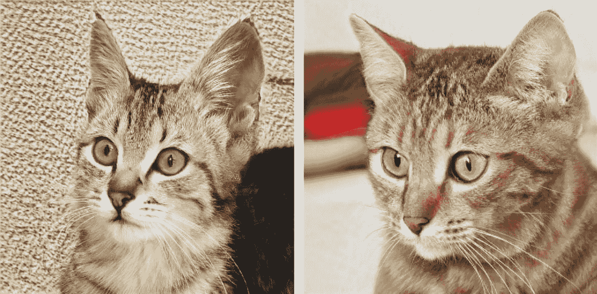

**图 5.2** 作者使用 `StyleGAN` 生成的某些遗憾的是并不存在的猫的图片：Karras et al. 2020。

### 图 5.3 变分自动编码器（`VAE`）架构图。

在 `VAE` 中，网络的判别部分首先发生，生成部分最后发生。与大多数生成对抗网络（`GANs`）不同，这两个网络共享一个潜空间的共同表示。此外，潜空间因素的表示被分解为均值和方差，使得相比 `GAN` 能够对潜空间进行更具控制的采样。`VAE` 中的潜因素既可以通过学习获得，也可以由程序员手动定义。

#### 显式解耦与操纵

强制网络以这种方式显式地分离潜因素的一个方面是，它使得系统（或与系统一起工作的建模人员）在创建新示例时，更容易混合和操纵这些因素。这一点涉及到第 3 章中提出的隐式解耦流与显式解耦流之间的区别，我们当时用“编织头发”的比喻简单地带过：隐式解耦流就像是梳理头发，只需让梳子顺畅滑过即可；而显式解耦则更像是将发丝分离成独立且稳定的辫子，这些辫子可以灵活地重新组合多种发型。

我们现在可以尝试让这个比喻更精确。引用 `VAEs` 以更显式的方式表示这些潜因素的观点可能会引发一些问题的直觉，因为我们对“显式性”的概念暗示了某些属性——如局部性、可移动性、意义的确定性和可用性——这些属性不仅在神经网络表示中，在任何计算系统中都难以同时满足（Kirsh 1998）。通常，当机器学习研究人员或计算神经科学家引用显式表示的概念时，他们是参考了某种衡量信息从信号中恢复以用于其他操作的难易程度的指标，特别是通过如线性可解码性等简单的方法（Ritchie, Kaplan, and Klein 2019）。⁷

#### 概率分布与鲁棒性

这为潜因素表示的显式程度的评分留下了很大的回旋地，因为得分取决于参考了哪种可解码方法。显然，在某些维度上，潜因素在 `VAE` 中的表示比在标准 `GAN` 中更显式。[⁸] 具体而言，通过强制网络在单个参数变量中表示潜因素，并单独表示每个因素的概率分布，操作更容易以连贯的方式从这些分布中采样一组新的干扰参数。这有助于系统估计每个潜因素的完整概率分布；结果是，它学习到了更“平滑”的潜空间表示，涵盖了更广泛的有意义的特征和干扰参数组合（Grover, Dhar, and Ermon 2018）。

在基础 `VAE` 架构之上还实现了其他几种技巧，以使提取的潜因素更加鲁棒，并类似于人类部署的方式，特别是所谓的 `β-VAE` 方法，它在模型中引入了一个新的超参数 `β`，使其瓶颈编码偏向于发现更稀疏、更鲁棒的潜因素（Higgins et al. 2022）。这往往使学习到的潜因素更像人类学习的因素，因此对使用模型的人类来说更具解释性。

#### 回应经验主义者的担忧

这些进展都直接适用于 `Fodor` 提出的担忧，即经验主义心理方法在解释产生新概念能力方面的不足。上述讨论的生成网络在不同程度上都能够超越仅仅重构与其过去见过的完全相同的表示。它们之所以做到这一点，是基于在其潜空间表示中学到的强大抽象，并通过学习学习了这些潜空间表示与生成层中特征及干扰参数的合理组合之间的映射程序。

此外，网络构建这些潜空间表示和映射的过程在某种意义上都是基于共现的，它们应该被限制在经验主义工具箱的范围内。诚然，这些系统局限于产生其在训练中接触的模态和由特征组合成的示例；`StyleGAN` 无法产生合理的音乐（尽管毕加索可能也无法，而某些在音乐上训练的生成系统可以——Dhariwal et al. 2020; Yang et al. 2017），且插值方法只能以已知类别作为起点进行操作。然而，对于网络几乎或没有任何训练经验的潜空间区域，可以渲染出特征和干扰参数的新组合示例。

#### 对 Fodor 辩护的反驳

`Fodor` 的辩护提供了另外两个反驳：很大程度上取决于插值方法的细节以及这些细节是否完全是经验主义的；以及到目前为止讨论的系统输出虽然令人印象深刻，但尚未达到人类心灵具备的新颖组合程度。然而，在逐一考虑时，我们发现它们并没有理由对基于深度神经网络（`DNN`）的模型捕捉想象能力感到悲观。

首先，这里的古典主义可能会承认，生成网络将抽象转化为真实的底层细节的能力是一项令人深刻且真正的技术进步，但指出这些模型中真正的组合性源于插值程序的经典方面。例如，应用于 `DCGAN` 的向量数学创建的新组合可能被认为源于插值的组合特征，而不是源于生成网络将插值向量渲染为合理的细节。在某种意义上这是正确的，但在另一个意义上，它错过了技术进步的重点。组合性的困难之处一直不在于异异特征的组合（这可以通过简单的拼接实现，一种完美的关联机制），而在于如何将异异特征放置并融合成一个语义上有意义的整体。语义组合性的这方面从未被 `Fodor` 那种经典处理方法所解释，他们倾向于关注谜图中更容易的语法部分。此外，许多思考者——即使是赞同 `Fodor` 观点的人——也质疑经典程序是否真的解释了（而非仅仅假设了）插值方法所假设的那些语法组合性（Aizawa 2003; Cummins 1996; Johnson 2004）。

这里熟悉的福多尔式（`Fodorian`）反驳可能是声称，这些生成式模型只能通过在插值过程中假定经典的句法组合性来解决语义组合性问题（见引文 Fodor and Pylyshyn 1988），但使用经典编程来执行向量算术仅仅是程序员为了便利的考虑。值得注意的是，系统的生成部分并不依赖于以经典的方式处理插值指令；例如，它不需要将输入和操作符解释为经典符号。相比之下，这些系统只需要给定潜空间中目标位置的激活向量。尚待争论的是，没有任何仅依赖于关联主义/经验主义机制的系统，能够在生成规范过程应用之前，将系统“推”到潜空间的正确区域。对推进经验主义路线感兴趣的 `DNN` 建模者现在应该探索本身具有领域通用性且由经验驱动的插值方法，而不必依赖或实现经典系统。第二波连接主义者可能已经有很多想法可用（见 Smolensky 1987）。

## 第二，对福多表示同的批评者可能会担心，虽然当前生成式方法产生的输出质量令人印象深刻，但它们的范围尚未比拟人类认知。例如，`DCGAN` 限于潜空间的某些区域以及在经过广泛训练的类别上运行的插值程序。`VAEs` 可以为更新的潜空间区域生成具有解释性的特征和干扰变量的组合，但即使是它们也需要接触潜变量组合的概率分布，以便用于生成它们的显式潜空间编码。回想我在心灵哲学课程中提到的“穿芭蕾舞裙的粉色大象”的例子。班里可能没有学生曾经构思过这样的想法，但他们几乎所有人都能在某种可接受的波动范围内，瞬间想象出那种情况的样子。我们可能担心，如果没有显式关系来将组件潜因素融合在一起，这些基于 `DNN` 方法生成的表示将仍然缺乏福多和其他古典主义者理论认为用于维持人类思维中组合性表示的“胶水”，而这种胶水能够以一种连贯的方式融合真正新颖潜因素组合。这种日益复杂的特征的看似无限的组合，超出了我们刚刚讨论的系统的范围，它们可能被认为是人类认知中基于 `DNN` 的系统无法触及的方面。

或者这曾被认为是人类认知的一种独特特征，直到基于 transformer 的生成模型（如 `DALL-E`，艺术家萨尔瓦多·达利和皮克斯 `WALL-E` 的合成词）、`DALL-E 2`、`Parti`、`MidJourney` 和 `Imagen` 展示了更令人震惊的潜力。我们将在下一章回顾 transformer 架构，因为它们也包含了受注意和语言能力启发的机制，但这些系统展示了以系统化且具有关系意义的方式组合类别的、令人印象深刻且看似开放的潜力。它们可以接受英文表述的文本提示词，并将其转换为描述提示词中所物体和关系的合理图像。预示的是，这些基于 transformer 的图像模型生成的潜空间表示关键上是文本和图像的融合，这允许区分出更多具有关系意义的组合。

## 为了进一步说明这一点，我们可以回到休谟的一些例子。在对这些方法的早期探索中，程序员兼艺术家 `Ryan Murdock`（网名 `@Advadnoun`）发布了若干种融合了 OpenAI `CLIP` 和 Taming Transformers 技术的实现。该系统接收文本提示词，将其翻译为文本和图像组成的多模态潜空间编码，然后将其传递给生成式 transformer（下一章将进行更彻底的解释）。`Dall-E 2` 和 `MidJourney` 现在也可用。

这些系统在本章之前讨论的粉色大象例子上产生了非常令人满意的结果，对于对应休谟例子的提示词也是如此。回想休谟赞美想象力让我们能够构思出“带翅膀的马、火红的龙和怪的巨人”（*T* 1.1.3.4/10）；以及他使用“新耶路撒冷，其路面是金子做的，墙壁是红宝石，尽管我从未见过这样的地方”（*T* 1.1.1.4/3）作为心灵组合新想法能力的例子。

这些例子触及了天赋论者和经验主义者关于基于神经网络的 AI 前景争议的核心：神经网络只能进行插值，而真正的智能需要外推。例如，Gary `Marcus (2003)` 指责深度学习的支持者忽视了这一简单的区别。为了支持这一指责，Marcus 给出了一个仅在偶数上训练神经网络，然后要求它泛化到奇数的例子。Marcus 实验的神经网络可以泛化到比训练集更大的新偶数，但它对奇数的泛化效果很差。这种观点认为，插值涉及对训练集统计范围内的数据点做出判决（用更精确的话说是在“训练集的凸包内”），而外推则涉及对训练集统计范围之外的数据点进行泛化。

然而，这种指控很少能精确到足以被认为是决定性的。它经不起推加细致的推敲，特别是在我们刚刚考虑的插值示例背景下。插值（`interpolation`）与外推（`extrapolation`）之间看似简单的区分，其问题在于：定义什么是训练集统计分布的内部或外部本身需要指定各种参数。这需要对如何划分特征空间以及如何衡量其中的距离做出决定，这两者都可能受到确认偏误等因素的影响。例如，如果我们根据图像输入统计数据定义训练集的凸包，那么即使是第 3 章中讨论的较简单的图像分类 `DCNNs`（深度卷积神经网络），其在测试集上做出的大多数决策，在标准的交叉验证方法中显然都被归类为外推（Yousefzadeh 2021）。因为输入是非常高维且复杂的，测试集中的项位于训练集统计数据凸包内的概率非常低。此外，许多相关数据集如此庞大且复杂，以至于怀疑者很少尝试精确地刻画输入统计数据；对于 `ImageNet` 已经是如此，更不用说像 `GPT-3` 这样语言模型的专利及互联网级数据集了。


像 Marcus 这样的怀疑者通常倾向于根据训练集显式包含的抽象特征来对输入统计数据进行概念化；Marcus 的例子中，输入统计数据在这一意义上包含了所有偶数但不包含任何奇数。然而，这种概念化输入统计数据的方法对神经网络来说可能是不可行的——这是一种存在于评估该模型的建模者眼中的概念化方式。相比之下，如果我们尝试根据 `ANN`（人工神经网络）发现的抽象特征来定义训练集的凸包，我们可能会根据神经网络在最后一层提取的特征来定义它，甚至更进一步，根据通过多尺度缩放得出的输入空间的某些低维编码来定义。然而，在这种指定训练统计数据凸包的方法上，网络通过输出层可能做的任何事情都不会被视为外推。这将惩罚网络，因为它恰恰做了我们在理想情况下希望它们做的事情——学习从高维输入数据中提取抽象、可泛化的特征，而对于某些数据集，网络可能做得比人类好得多，或许通过发现我们缺乏敏锐度去检测的预测性特征（Buckner 2020b）。因此，以任何一种方式定义插值都会导致我们对神经网络的评估产生不偏见，这种偏见与“人类拟构”（anthropofabulation）直接相关，因为它要么听凭理论者的随性来决定输入统计数据中显式指定了哪些抽象特征，要么通过规定让神经网络处于不利地位：即即使它们在训练期间确实发现了一个抽象特征，在判断中使用它也仅仅是插值。

出于类似的原因，像 `LeCun` 这样的 `DNN`（深度神经网络）支持者指责，随着输入数据维度和网络深度的增加，插值与外推之间的区分变得不再有意义（Balestriero, Pesenti, and LeCun 2021）。事实上，假设某些神经网络架构在最后一层提取的特征是怀疑者所认为人类特有的特征——例如那些足够抽象的、基于持久对象实体的或基于因果关系的特征。那么，看起来怀疑者们必须在这一点上认为神经网络的行为是真正智能的，尽管事实是，根据最后一层特征空间划分所决定的指标，测试集项位于训练集数据统计的凸包内（因为它们共享相同的抽象、本体论或因果结构）。即使是人类的认知，在这一种构想事物的方式上，可能也会被视为仅仅是插值。这正是 `LeCun` 反驳的依据。

唯一的出路是再次承认插值与外推之间存在一个连续体，并且如果怀疑者想要认为某些基于 `DNN` 的系统未能表现出指示智能的外推程度，那么他们必须为其划分输入空间统计分布的选择提供辩护。允许怀疑者在没有对这些选择给出明确正当的情况下提供此类论点，无异于邀请隐性的人类中心主义——因为他们可以简单地将外推阈值设定为人类据称能跨越的任何距离，而最新的 `DNNs` 迭代却不能（尽管是 `DNN` 的狂热者也承认这里还有更多工作要做——Bahdanau et al. 2020; Bengio, Lecun, and Hinton 2021）。如果怀疑者强加了一个连人类无法跨越的指标，那么这些判断很容易陷入“人类拟构”——正如 Marcus 在他的奇偶案例中显然做的那样，因为他没有给读者任何理由假设人类儿童在只接触偶数的情况下就能外推到奇数（我希望数学老师能向我们保证，这通常不是这些学科的教学方法）。

上述论点将天赋主义与经验主义的辩论重新构建为以下术语：

- 神经网络对某些数据的决策属于插值还是外推，取决于我们如何划分空间；具体来说，取决于用于定义统计数据的特征选择、采用的距离度量和划分方法，以及是否以及哪些降维技术来使距离更有意义。
- 插值/外推最好被视为一个连续体。
- 关于作为“真正”理性或智能标准的统计数据距离阈值的判断，需要给出明确的正当理由。
- 当这些判断没有明确说明时，存在“人类拟构”扭曲人机之间比较的风险；而且在进行此类比较时，应提供经验证据证明典型人类可以使用允许网络使用的相同输入解决外推任务。

一旦这一切变得明确，那种认为深度学习理论者忽略了某种简单区分的论点就消失了；而诸如 `Dall-E 2`、`Parti` 和 `Imagen` 等近期系统的惊人成就，将克服“仍然存在某类人类具备但原则上神经网络无法实现的外推”的观点。¹⁰

## 5.5. 想象力在创造中的作用：创造对抗网络

另一个密切相关的话题是想象力如何在人类思维中辅助创造力，以及基于深度神经网络（`DNN`）的 AI 智能体能否利用其生成能力来产生创造力。人工机器是否具有创造力这个问题本身就是一个巨大的课题，可以追溯到 20 世纪 60 年代人工智能的早期，计算机科学中有一个专门研究该主题的领域，被称为“计算创造力”（Colton and Wiggins 2012）。我们并不打算回顾整个领域，而是关注休谟关于支配想象力的原则的评论。请记住，休谟强调了想象力追求新颖性的倾向。这一观点在艺术理论和创造力认知科学的研究中占据重要地位，并且最近开始启发机器学习领域的一个新的研究领域（Mahadevan 2018）。让我们将关注缩小在艺术创造力上，这是一个既丰富又具有挑战性的课题，但已经在深度学习背景下得到了研究，并具有巨大的潜力。

与休谟的态度一致，艺术理论家 Martindale 认为创造性艺术家“试图增加其艺术的唤醒潜力以对抗习惯化”，这种艺术理论观点启发了深度生成建模方面的一些尝试（Elgammal et al. 2017）。对艺术专业知识的研究发现，专家艺术家会刻意追求风格和主题的新颖性，特别是为了诱发新颖的感知体验。例如，Gaines (1975) 进行的一系列访谈发现，与儿童和非艺术家控制组相比，艺术家对环境的感知更具灵活性，最不容易陷入僵化的感知模式。该研究中的其中一位艺术家将他们的过程描述为不断“[尝试]以一种别人没有猜到或见过的的方式来看待”（1975:993——另请参见 [Mag Uidhir and Buckner [2014]](#17_bibliography.xhtml#oso-9780197653302-bibliography-1-bibItem-435) 的讨论）。也许如果 `DNN` 建模者能够在艺术创造力领域实现这些追求新颖性过程的形式，可能会点明其他重要领域（如游戏策略或科学发现）的人工创造力模型。有趣的是，这里涉及的新颖性是自由与限制的奇妙结合。最高程度的新颖性可能仅仅通过最大化低层感知统计中熵的随机刺激来实现；但网格上随机排列的像素在美学上并没有趣味之处。有趣的新颖形式既是可理解的，又是令人惊讶的；它们既受到以前经验的影响，又以某种方式突破了根据这些经验可能被认为可理解或有价值的边界。

事实上，已经有多项工程创新受到了对感知和风格新颖性建模的启发。为了将我们刚刚讨论的模型扩展到这一领域，模型需要某种方法来估计示例的新颖性。我们在之前的章节中讨论的许多模型都缺乏这种机制。这种特征的结合长期以来一直被视为创造活动的核心（Newell, Shaw, and Simon 1962）。

如果网络具有某种方法来估计描绘过程的审美成分，对于艺术目的将特别有用。我们可以从两个方向考察这些创新：首先，我们可能需要能够估计审美响应的系统；其次，它们能够在生成示例描绘的形式上寻找新颖性。

### 神经美学

启发 `DNN` 研究人员模拟人类创造或感知艺术能力的一个研究领域是“神经美学”交叉学科，它是神经科学与美学的结合。神经美学的一些核心结果支持了这样观点：大脑独立地通过多途径表示多种特征维度，并且这些独立特征在处理流的后期被整合为高层次的审美判断（Chatterjee 2011）。特别是 Zeki (2002) 认为，大脑并行处理我们之前讨论过的作为特征或干扰变化的许多属性，而艺术家试图通过寻找这些属性的新颖组合来揭示和操纵这些属性，以最大化或最小化某些审美评估的响应。这些属性包括颜色、亮度、饱和度、运动和对称性。

建模者试图通过创建一系列专门检测这些图像属性的并行深度卷积神经网络（`DCNN`），来重现关于大脑处理流的这些想法，并将并行网络的输出整合到对示例的整体审美评估中。例如，Deep Chatterjee Machine（`DCM`）架构包含了一系列卷积神经网络，每个网络都经过训练以评估审美属性，然后将其组合成对示例的整体审美评估（Fig. 5.4）。然后可以将这些评估结果与从人类评估者处请求进行对比，结果表明网络不仅能够根据单个审美属性对留照片进行良好分类，还能根据其整体美学程度对图像进行良好评分。

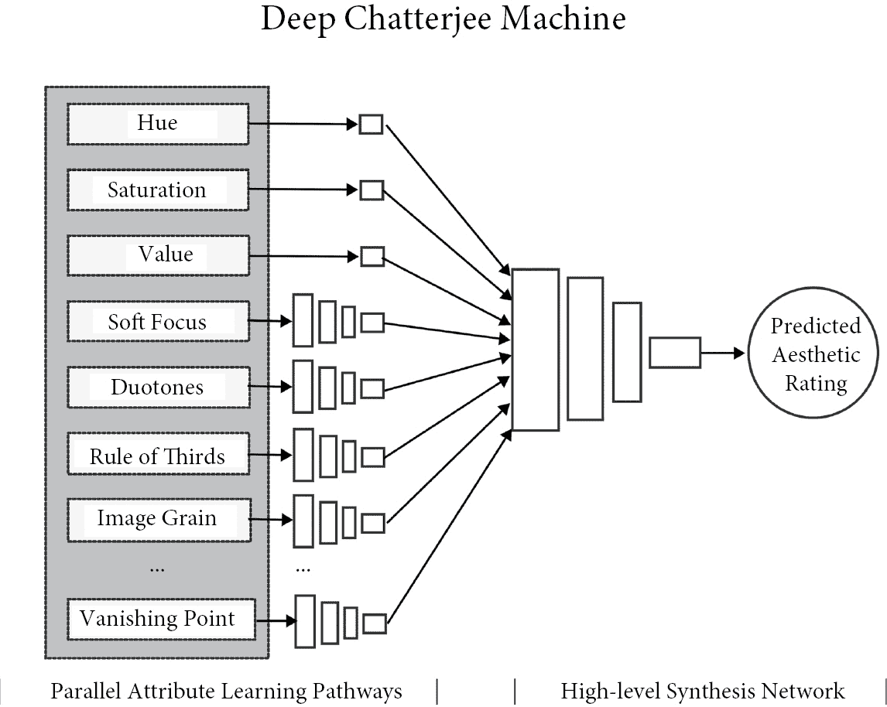

**图 5.4**

来自 Wang 等人 (2017) 的深度 Chatterjee 架构。许多并行的深度卷积神经网络学习与美学评估相关的特定属性，然后这些评估由一个高层合成网络进行整合，以产生最终的美学评分。令人惊讶的是，这些评分对于照片的人类美学评分具有惊人的预测准确性。虽然由并行网络进行标注的属性是人工选择的，但当然，我们并不假设这些属性是人类天生的，而且关注哪些属性是可以学习的，并会在美学判断中表现出文化差异性。这种架构展示了如何利用所学习的模块化来利用更细粒度的细节，以获取对更抽象属性的表示，例如 `美感` 或 `优雅`。

让我们接下来考虑示例在描绘形式或风格上的新颖性。生成与判别的分离过程为这种追求新颖的行为提供了有趣的途径，因为系统可以在生成过程中寻求新颖性的最大化，同时在判别过程中保持相同的目标标签。事实上，这种技巧一直是生成对抗样本的基础 `GAN` 方法的核心，对抗样本寻求在相似空间中保持相同目标标签的同时，最大化与目标流形之间的距离。为了利用更有用的其他形式的新颖性，我们只需要改变所应用的距离度量，以在一个新颖的方向移动示例的表示。已经讨论过的风格迁移是这种追求新颖行为的另一种形式，并且已经存在于艺术领域中；如果我们寻求将示例的表示从最大化一种风格的表示转变为另一种，这可以被看作一种新颖的美学行为。创建完全新的风格甚至更有趣，因为它可能涉及在风格属性之间寻找训练集中未曾出现的相关性集合，然后在生成过程中使用那组新颖的相关性来渲染示例。这明确是 Elgammal 等人 (2017) 的创意对抗网络 (`CAN`) 所采用的方法，这种 `GAN` 架构试图从训练集的标签中学习风格表示，并在对抗训练过程中通过学习新颖的风格表示，创建出显式偏离这些标签的示例。在不进一步探讨这一思路之前，这些例子可能说明，尽管 `DNN` 的行为在某种程度上受到其训练集分布的限制，但在基于 `DNN` 的系统中实现追求新颖的程序仍有丰富的机会。

## 5.6. 想象在模拟经验中的作用：想象增强智能体

作为此处所考虑的基于 `DNN` 的 AI 中休谟式想象的终极角色，让我们探索想象在模拟经验中的作用。模拟经验可以用于多种目的，特别是通过在模拟数据上进行离线学习来发现新颖的表示，并思考未来和反事实情况，这些情况有助于对比决策和因果推理。在这个领域，想象的作用最显著地融入了情景记忆（episodic remembering），因为通过可能的经验空间生成模拟数据和轨迹需要受到先验探索的引导，这一想法与近期人类和动物情景性思维研究的趋势相接（De Brigard and Parikh 2019）。这种基于想象的规划的一个直白例子在 `AlphaGo` 和 `AlphaZero` 中表现突出；这些系统都使用蒙特卡洛树搜索来构建未来可能性的分支模型，然后用它来评估在某回合中采取的各种动作对于获胜的适用性。然而，`AlphaGo` 的那种规划并不适合纳入我们经验主义的 DoGMA 中；首先，它对 `MCTS` 的实现完全是经典的、且是天生的，而不是从经验中学习的；其次，它的应用领域非常有限：围棋游戏，这允许了详尽且定义良好的搜索空间。我们在这里寻求的基于想象的规划将改为由经验引导，会更有效（例如，仅以启发式地考虑几种极可能成功的场景），并适用于刻画现实世界问题解决的更混乱、定义更不明确的搜索空间。

想象在从模拟数据中学习中所起的作用，受到了这种观察的启发：人类和动物在经过睡眠或白日梦后往往会突然产生洞察。一个实证支持的理论假设，在白日梦和睡眠期间，大脑探索模拟数据以寻找问题的新解决方案。支持这一假设的最有力的证据来自于对在迷宫探索中训练的大鼠内侧颞叶植入电极的观察（Dragoi and Tonegawa 2013; Pfeiffer and Foster 2013）。通过在在线训练期间将网格细胞放电与迷宫位置相关起来，研究人员可以看到神经元在迷宫的哪些区域放电。在睡眠和休息期间，这些大鼠的内侧颞叶表现出的放电模式与之前探索过的迷宫轨迹对应（如第 4 章）。

然而，`GAN` 和其他生成模型允许基于 `DNN` 的智能体重复这种技巧，并获得类似的样本效率增益。例如，Apple 开发的 `SimGAN` 就尝试这样做。`SimGAN` 使用基础 `GAN` 方法创建大量的模拟数据，以便在不需要收集额外大量标注数据的情况下进一步提高判别网络的准确性。

在利用模拟经验进行决策时，想象力所扮演的角色稍微复杂一些。这项研究与我们目前讨论的内容相比仍具初步性，但对于在第 2 章中引入的“理性分级”上引导更高层次的对比决策，它可能是最重要的。这一研究方向主要发生在强化学习模型的背景下；一种理解方式将其视为尝试执行类似于 `AlphaGo` 中通过 `Monte Carlo Tree Search`（蒙特卡洛树搜索）实现的以结果为导向的规划和决策。然而，系统不应使用经典规则来穷尽探索和比较的可能树，而应该使用基于 `DNN` 的生成方法更高效地填充一组较小的未来轨迹集以待考虑。这里的一个挑战是找到一个良好的测试场。围棋——凭借其庞大且巨大的搜索空间——对于这一方向的第一步来说挑战性太大；而像 `Breakout` 或 `Coast Runners` 这样简单的游戏，不需要复杂的规划，只需专注于下一步得分的持续增加就能很好地解决。DeepMind 的建模者则提出，推箱子策略游戏 `Sokoban` 恰恰提供了这种挑战，因为它要求规划未来五到七步，某些错误是撤销的（例如将箱子推入角落导致其卡住），并且在所有箱子到达正确的目标位置之前无法获得奖励。

`想象力增强智能体 (I2A)` 架构是由 DeepMind 为了玩 `Sokoban` 而开发的（Racanière 等人，2017）。该架构非常复杂，但简单来说，它用经验空间中一系列自生成的探索性轨迹取代了 `AlphaGo` 的树节点填充方法，在规划术语中，这些被称为“展开”（rollouts）（图 5.5）。该系统的巧妙之处在于它是端到端训练的，且不假设对搜索空间的先验知识。每个展开由一系列动作及其预测效果、以及后续动作及其效果组成，计算深度为建模者可以调整的预定深度。系统每次需要做决策时，都会生成此类展开，并根据标准的深度强化学习方法（同样基于之前的游戏经验）为每个展开计算奖励值。该架构还存在“无模型”强化学习路径，该路径不考虑展开。每当系统需要决定一个动作时，想象模拟路径会聚合所有展开并确定哪个动作与最大的奖励相关，无模型路径也执行相同的操作，这两条路径被加权并纳入系统的最终决策中。通过使用这些展开，系统能够可靠地解决需要提前规划数十次移动的 `Sokoban` 谜题。这是一项令人深刻的成就，因为 `Sokoban` 谜题是随机生成的具有许多可能性，系统不太可能通过蛮力记忆学习到许多解决方案。

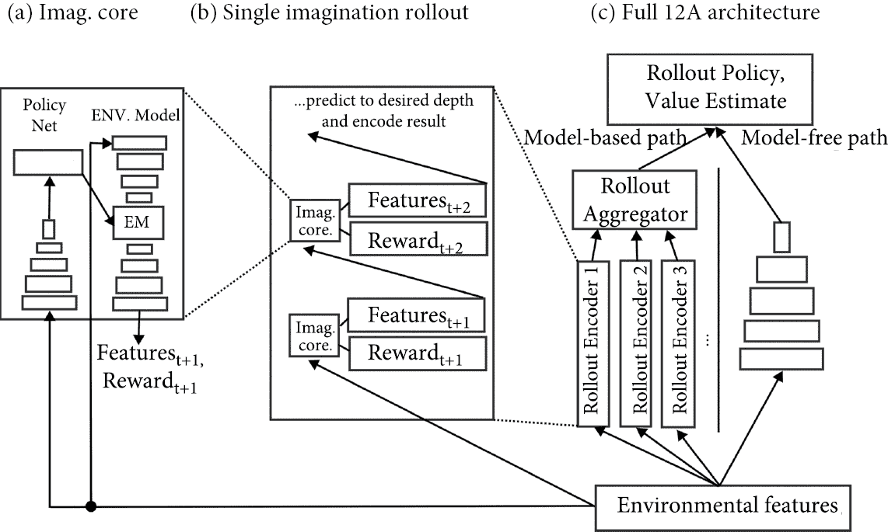

**图 5.5** `I2A` 架构上的展开策略示例，改编自 Racanière 等人 (2017)。该模型同时包含基于模型和无模型的路径，它们可以决定决策。在想象增强的基于模型的路径中，使用多个“展开”来预测动作序列和环境后果，然后对其进行聚合以估计它们的组合奖励值。预测结果和奖励值是使用包含策略网络和环境模型的“想象核心”估计的，其中预期的策略会影响未来的预测。展开可以追溯到所需的“深度”（或未来动作的数量和估计的后果），更深层的展开可以预测更远的未来后果，代价是更多的计算量（并且可能增加不可靠性）。

现在，让我们反思一下 Fodor 对联想心灵无法区分想法之间的因果关系和语义关系的担忧。在 Fodor 式骰子的案例中，这种架构是否赋予了基于 `DNN` 的智能体一种认为“三角形出现的概率比圆大”的能力，而不仅仅是产生“骰子出现三角形的想法”比“骰子出现圆的想法”更频繁？它似乎是做；在架构中可以根据预测的强化值比较多个展开，在学习后将更倾向于更有可能的结果，因为根据这一指标，涉及选择三角形的展开将比涉及选择圆的展开获得更多奖励。这并不是一种完全模拟可能性空间的分析方法（例如在 `MCTS` 中找到的那种）；相反，有限数量的展开是按需自生成的，其轨迹和强化值完全从经验中学习的。Fodor 派者可能会声称，这里的架构超越了朴素联想主义所假设的内容；但如果为 Fodor 提供一个反驳，那也将是一个得不偿胜的胜利，因为他的朴素联想主义始终是一个稻草人，既不像真实的洛克也不像真实的休谟；而且通过端到端训练，`I2A` 模型是为满足起源经验主义的约束而定制的。¹¹

目前已经探索了其他几种在对比规划和决策中使用经验模拟的类似架构（例如，Hamrick 2019; Hamrick 等人 2017）；目前的共识是，虽然它们比 `MCTS` 等经典替代方案更能处理噪声较大的环境且规划更高效，但到目前为止成功仍限于特定任务，如游戏，这些任务提供了清晰的奖励信号和广泛的训练。DeepMind 创始人 Demis Hassabis 认为，这一研究方向将是通向更通用的 `DNN` 问题解决器的最重要的之一。他在这里表达了经验主义的情绪，指出这项研究尚未捕捉赋予人类规划能力的某些特征。特别是，我们认为解决这个问题的通用方法将需要如何通过经验学习丰富的内部模型（这些模型在实践中必须是近似的但足够准确以支持规划），而不是由实验者在网络中手工构建强先验。（Hassabis 等人 2017:282）

在这里，我只想进一步建议，继续挖掘洛克、休谟和詹姆斯等经验主义哲学家的见解（他们对这一问题进行了深思），将为工程师提供更多关于如何通过对经验进行具创造力的处理来引导更高层次理性的想法。¹²

## 5.7. 生物学合理性与未来道路

未来的研究无疑会对本文综述的基于 `DNN` 的想象模型在生物学上的合理性提出严谨的问题。目前的证据仍然匮乏：与感知抽象相比，神经解剖学与模型结构特征之间的联系要少得多，而且还没有脑成像研究来比较生成模型获取的表征与人类想象之间的相似性。这部分部分是因为本文讨论的生成模型太新了，另一部分是因为我们对负责人类想象的神经回路了解较少。尽管如此，已经出现了一些值得关注的知情推测尝试（如 Gershman 2019; Hamrick 2019; Hassabis et al. 2017; Lau 2019; Mahadevan 2018）。


## 5.7 生成模型与感知认知

例如，大量的实证证据表明，人类和动物的常规感知和认知涉及大量的生成模拟。感知“填充”（filling in）是讨论得最多的现象之一；尽管人类只能从每个视网膜中心的一个小凹点区域接收高分辨率信息，且视网膜神经附着导致视觉中心出现盲点，但我们在视觉体验上，却对整个视野范围（直到边缘）具有连续且高分辨率的视觉感知体验（图 5.6）。感知系统的许多奇特性和其他明显的异常也表明，我们的大脑拥有感官经验的预测模型，并不断生成关于世界样子的前向模型，这与我们的意识感官经验相对应。幻觉和虚构是很好的证据，证明我们意识上感知到的是生成建模的结果，而非原始的感知输入。另一个生动的例子是人很难自己挠痒；关于这一事实，最流行的科学解释之一是，自身运动产生的感觉已经是个人生成模型的一部分，而痒痒的感觉只有在触觉刺激产生“意外性”时才会发生，即这种刺激与自身生成的经验前向模型不一致（Blakemore, Wolpert, and Frith 2000）。


**图 5.6** 读者可以通过将此图放在脸部一英尺处，闭上左眼，盯着点，然后缓慢地向后移动，直到十字交叉消失，从而找到右眼的视网膜盲点（但注意，人并不会在视野中体验到空白，而是一个被背景颜色或图案填充的区域）。

几位感知科学家已经开始显式地理论化，大脑中产生这些前向模型的机制在重要方面可能与我们刚刚综述的某些深度学习生成模型相似，特别是 `GANs`（如 Gershman 2019; Lau 2019）。Gershman 特别指出，认知心理学中经常用来解释这些现象的贝叶斯模型认为，大脑学习了一个显式的概率空间模型，并从中采样潜在的经验。虽然有多种实证证据表明大脑会生成此类前向模型，但这些贝叶斯观点在计算上是不可行的，因为它们利用了计算成本极高的低效采样操作，如 `Monte Carlo` 算法。因此，这里的贝叶斯建模者通常寻求这些采样操作的启发式近似。Gershman 建议，像 `GANs` 提供的隐式分布模型可能为解决这一困境提供了一种替代方案。虽然 `GANs` 学习的隐因子表示缺乏显式性从计算机科学的 `XAI` 问题角度来看是一个缺点，但在感知认知科学中，它可能被视为一种有用的计算效率小技巧。Gershman 提出，这种基于 `GAN` 的方法适用于预测处理中皮层功能的系统级解释，其中内侧前额叶皮层通过比较感知输入的判别模型和生成模型来产生判别信号。在元认知和意识的背景下，Lau 进一步建议 `GANs` 可能有助于解决意识感知的高阶和生成性解释中的进化问题，通过解释自上而下的生成模型如何可能可行地被训练，并强调元认知意识可能起的适应性作用，即帮助我们在感官输入的不同潜在原因之间进行区分和决策。

诚然，这些只是初步的系统级建议，要确定基于 `DNN` 的生成模型中的潜空间表征与生物大脑前向模型构建的表征之间的相似程度，仍有大量工作要做。此外，该假设可以利用从基于网络模型衍出的通用神经合理性，而且大多数 `GAN` 架构整合了许多受生物学启发的 `DCNNs` 特性，如局部连接以及线性与非激活函数之间的分工。

### 5.8 总结

## 总结

在本章中，我回顾了如何通过想象力的运作来增强理性决策，特别是通过在基于 `DNN` 的架构中添加类似于生成式想象力的能力，如何使它们能够满足对心理经验主义方法的传统反对意见。具体而言，诸如 `GANs`、`VAEs` 和 `生成式变换器 (generative transformers)` 等生成式架构可以合成抽象类别的新颖标记，通过融合之前的类别来组合新类别，并模拟未来或反事实经验以用于决策和离线训练。

我考虑了对这些建议的天赋主义反对意见，特别是这些架构仅能够进行插值而不能进行类人类的推断，并发现这种批评充满了“拟人化（anthropofabulation）”，且比深度学习怀疑者所认为的更缺乏决定性。

我进一步回顾了这些生成式能力更具野心的用途，可能通过创建主动寻求新颖性的智能体将计算创造力的追求推向前所未有的高度，例如 `Elgammal 等人` 的 `创意对抗网络 (CAN)`。我们最后回顾了诸如 Google 的 `想象力增强智能体 (I2A)` 之类的架构如何整合这些教训，以解决更具挑战性的问题（如 `推箱子游戏`），通过对可能的未来行动方案进行前瞻性模拟，并在结果敏感的基础上选择最佳方案——而这一切都是通过其与问题的交互进行端到端训练完成的。此类创新不仅能让智能体达到 `Tier 2` 理性（结果敏感型决策）的高度，还能达到 `Tier 3`，涉及对未来和反事实事件进行前瞻性模拟以用于决策和离线学习。

## 控制问题

尽管如此，此时变得日益明显，增加更多的半独立功能会带来日益增加的 `控制问题`。我提出了感知、记忆和想象的模块；关于智能体如何在感知、记忆和想象处理模式之间切换，以及在不同子系统竞争共享资源或建议备选行动方案的情况下如何协调表示和动作，这些问题层出不穷。

`情境控制器 (Episodic Controller)` 智能体（在上章中讨论过）具有基于短期经验缓冲区查找和从长期抽象表示中来做决策的独立路径，而 `I2A` 架构具有用于感知类决策和模拟引导的前瞻性决策的独立路径。在两种情况下，最终决策程序都必须选择遵循哪种策略建议。随着 `DoGMA` 添加更多功能和模块，这些问题只会变得更加复杂，因此工程师应该制定进一步策略的计划——也许基于有助于下调和协调其他功能的进一步功能——以便在这些新兴的 `控制问题` 变得无法无法复杂之前解决它们。

***

## 注释

[¹] 就像所有这些对“丰富”心理学词汇的诉诸一样，我们在这里应该怀疑这些设计的工具是否与人类心理学中研究的功能具有显著相似性（`Shevlin and Halina 2019`）。这些诉求可能由底层处理支持，这种处理与人类心理学中的想象力非常相似，因此被视为对人类和动物中这些功能的建模；或者这些对想象力的诉求可能仅仅为独立的工程发现提供了一些松散的灵感。

[²] 开头必须提到一点：在考虑提供推理的关联主义解释的困难时，`Fodor` 倾向于将 `Hume` 的关联原则限制为两个，即邻接性和顺序性，忽略了相似性原则（2003, fn. 9:119）。在我看来，相似性原则在理性推理中承担了大部分工作，而且这是理所当然。

[³] 尽管在 `Descartes` 对上帝存在的可设性证明中有一个没有山谷的山的例子，以及 `Hume` 对想象力局限性的描述……像 `乞力马扎罗山` 或 `马纳洛亚山` 这样的火山是没有山谷的山的著名例子。看来可设性并不是可能性的良好指南，即使在像 `Descartes` 和 `Hume` 这样的“伟大天才”中也是如此。（感谢 `Dan Kirchner` 指出这个例子一直很愚蠢，即使它的失败为我的经验主义磨坊提供了更多燃料。）

[⁴] 要考虑我对这些问题的某些回答，请参见 `Buckner (2022)`。

[⁵] 反卷积 (Deconvolution) 试图消除卷积的操作，其历史可以追溯到 20 世纪 40 年代的 `Norbert Wiener`。这实际上大多数生成网络中使用的操作，它实际上是 `转置卷积 (transpose convolution)` 的形式，也称为 `上采样卷积 (upsampling convolution)`，这个名称更符合其功能。此处对反卷积的误用在机器学习社区引发了热烈的讨论。

[⁶] 注意，`GANs` 中的插值通常是不可逆的，其逆操作只能通过各种手段估计。基于流的模型（如 OpenAI 的 `Glow`）是非常理想的，因为它们是完全可逆的，因此产生更准确的结果（`Kingma and Dhariwal 2018`）。

[⁷] 可以进行更复杂的显性测量；例如 `Bernardi 等 (2020)` 推荐了一种名为 `交叉相关泛化性能 (CCGP)` 的衡量方法，用于衡量线性解码器如何泛化训练期间上下文。

[⁸] 此时人们可能会想，为什么我们不采用非线性的解码性概念，这种概念会将深度判别网络也归类为有效的解码方法。担心的是，根据这种强大的推理方法，极大范围的特征可能从某些数据中解码，导致显式表示的概念过于宽松而毫无用。

[⁹] 即使在确定了组成数据的特征后，确定训练集 `凸包` 内部的内容本身也是一个复杂的话题。通常的想法是它是数据空间中包含所有训练点的最小凸闭合（经常使用“橡皮筋环绕点”的类比），但在高阶空间中，仍有多种计算该空间的算法和技术，它是计算几何中的一个基础问题。

[1⁰] 就像针对语言模型的 `BIG-Bench` 一样，现在有一名为 `Draw-Bench` 的努力，旨在开发一套自动化基准测试，以评估 `DALL-E 2` 和 `Imagen` 等图像生成模型掌握传统智能和创造力基准的能力（`Saharia et al. 2022`）。

诚然，I2A 智能体仍然无法显式地对自己进行比较，说明某个结果出现的概率是另一个结果的两倍；但它可以在 100% 的时间内选择更有可能的结果，而不是进行概率匹配——尽管像第 6 章中描述的那种语言模型如果能够访问 I2A 的聚合展开表示，是否能够制定这种显式的陈述，仍然是一个未解决的问题。

也请对比 `Nanay (2016)`。

# 第 6 章 注意力

每个人都知道什么是注意力。它是心灵以清晰生动的形式，在几个看似同时可能的对象或思维中占据其中一个。

—威廉·詹姆斯（*PP* 第 381 页）

### 6.1 引言：引导控制

在 DoGMA 开发的这一阶段，我们已经了三种不同的能力：感知（包含感知抽象）、记忆和想象。这些能力被赋予了执行各种心理操作的任务，这些操作符合转换原则与理性认知相关，包括：在丰富的感知输入中区分不同抽象类别的成员；存储之前的经验序列以供离线学习或后决策参考；合成新类别成员的真实感知表示；以及在通过试错探索选项之前，模拟新经验以实现结果敏感的决策。我们还探索了使用不同的深度神经网络（`DNN`）架构对这些能力的某些方面进行建模尝试。这些努力帮助人工智能克服经验主义方法在人工理性方面面临的计算挑战——即样本效率、可迁移性和脆弱性之间相互关联的问题。因此，我们在解释过去十年基于 `DNN` 的建模成就如何提高了经验主义的整体可行性，特别是提高了新经验主义 DoGMA 中重点强调的这种以能力为导向的方法方面，已经取得了相当的进展。

然而，到为止开发的基于能力的架构的复杂性带来了自身的问题，我们在之前的章节中将其描述为“控制问题”。这里的一个特殊之处在于，我们目前讨论的几乎所有基于 `DNN` 的能力模型都是“一次性”的——也就是说，它们一次只尝试建模一种能力（且通常只是该能力的一个方面）。当我们尝试在更完整的认知架构中建模多个半独立的能力时，我们将越来越多地需要将控制问题作为一个实际问题来对付。更多执行不同计算操作的半独立模块将越来越多地竞争共享资源和决策影响力，而它们输出之间的冲突和混乱问题在复杂性和重要性上只会不断增长。`DNN` 建模者现在就可以开始准备应对这些问题，因为还有时间在下一代更复杂的智能体架构中建立防御措施。

在规划此类防御措施之前，我们应该首先回顾这个问题，因为它涉及认识论哲学。`DNN` 建模者才刚刚开始探索控制问题，但它一直是几乎每个经验主义者关注的焦点。正如凯瑟琳·塔布（2018 年）最近指出的，洛克的《探原》（*Enquiry*）充满了“疯狂”，洛克通常将此归因于思想的错误组合。这些错误的关联源于 `幻想`（Fancy）或 `白日梦`（Reverie），当它们与记忆混淆时，会导致病态行为。例如，洛克担心一个心不在焉的人幻想自己是国王，并（正确地）从此推导出他应该得到“注意力”和“服从”。休姆同样担心将想象的交付物误认为是记忆。他担心“只要我们能让一个想法接近当前起作用的、具有生动活力的印象，它也会同样模仿它们。”与我们目前为止的叙述一样，休姆承认了信念的三个基本来源：感官、记忆和想象。他认为，心灵通过注意这些印象的“力量”和“生动力”来区分这些系统交付的印象；当前的感官印象应该是最生动的，其次是感官印象的记忆，最后想象的想法则是最“微弱”且“倦怠”的。当记忆或幻想变得过于生动时——正如我们可能认为创伤后应激障碍患者在接触触发因素后重温痛苦的记忆，或者受幻幻剂影响的人无法区分幻觉与现实一样——就会导致严重的错误。因此，像洛克一样，休姆警告不要产生“退化为疯狂和愚蠢的生动想象”，这可能让人“无办法辨别真伪”。

我们在之前的章节中开发的模块化架构的复杂性已经为我们呈现了这些认识论和控制理论的困境。能够考虑现在、过去或未来场景的智能体需要根据其来源区分场景表示，以避免决策中的错误。在更基础的层面上，它们还需要能够根据情况在不同的“模式”之间有效切换——例如，在基于存储抽象的任务导向型问题解决、在情节存储中查询成功行动的个人记忆、离线记忆巩和缓慢交替学习，或对可能场景的想象性模拟之间切换。我们还看到，即使是单一能力也可能被可能性所淹没——正如休姆列举了我们在感知抽象过程中可能根据形状、颜色、大小或位置比较两个球体的不同方面的数量——以至于如果不先忽略不相关的比较，就无法得出结论。

最终，我们最好考虑在 DoGMA 中增加一种新机制，帮助它以高效且有效的方式解决这些分配问题。正如之前已经反复暗示的那样，注意力机制长期以来一直被认为是这项工作的正确工具。将处理模式之间的切换问题被视为对不同类型心理表征的关注问题——例如，向外关注预期的感官体验，或向内关注在想象模拟中搜索特定的记忆或预期结果——这是理所当然的。但注意力在许多方面都是一个理论上棘手的话题，在尝试将其编织进不断发展的蓝图之前，我们应该承认它的错综与障碍。在当今的哲学和心理学中，关于注意力的基本功能存在多种观点和分歧。多年来，许多不同的影响和操作被归因于注意力，我们将看到它所启发的神经网络架构中也反映出相应的多样性。关于注意力到底是一个实体还是多个实体，与它相关的心理现象是因还是果，以及它是否应该被理解为一种独特的能力，都存在争论。这些理论上的张力可以在对注意力进行理论化的不同历史经验主义者之间的辩论中找到。正如我们将看到的，这些多元观点甚至出现在威廉·詹姆斯（William James）的作品中，这位哲学家恰好表现出经验主义倾向，通常被认为是现代经验心理学的奠基人。他的《心理学原理》为注意力主题提供了大量的章节，其中表达的许多观点直到今天仍然具有预见性。

詹姆斯的观点在这里特别肥沃，因为他没有为了简化而忽视注意力的复杂性。事实上，他的观点如此复杂，心理学和计算建模尚未充分探索他的见解。詹姆斯归于注意力的操作数量和多样性导致一些评论者担心他实际上并没有一个关于该能力操作的一致理论。反对这种态度，我引用经验主义者杰斯·普林茨（Jesse Prinz）的作品，他认为詹姆斯确实有一个可以解释这种表面异质性的注意力理论——事实上，詹姆斯的理论比哲学和心理学中其他流行的替代方案具有重要优势。² 然后，我回顾了深度神经网络架构中注意力的各种实现方式，特别是它在 `transformer` 架构中用于语言处理的方式。最后，我关注了这种注意力带给我们的额外处理和控制形式对理性决策的影响，特别是考虑到在它实现语言之前和之后，注意力处理可以调度模块之间在效率、处理能力、控制和信息共享方面的收益。这些比较表明，通过生成式 `DNN` 实现的詹姆斯式注意力方法，可以进一步增强经验主义启发的人工智能体对高层理性决策建模的能力，而且可能在哲学和心理学的现有理论中具有最大的潜力，在一个单一通用机制的保护下，将注意力看似不相关的方面和影响统一起来。

### 6.2 哲学和心理学中的当代注意力理论

当代的哲学和心理学理论几乎将注意力视为一种选择性。然而，对于究竟为什么需要这种选择性、它是如何实现的、它在认知处理中何处表达，以及它是需要一个独立的能力还是通过其他能力有机实现，仍然存在很大分歧。为了回顾 20 世纪心理学中注意力的理论化历史，让我们快速考虑四种最有影响力的风格。

#### 选择理论传统：信息过滤与瓶颈

第一种风格关注计算系统中过滤信息的重要性。

具体来说，唐纳德 `Broadbent (1958)` 指出，早期计算和信息技术中的一个严峻工程挑战是从一个组件传输到另一个组件的大量信息（例如从输入传感器到内存，或从处理单元到屏幕）的成本。特别是受到电话交换机早期计算机化的启发，他注意到早期通信理论中花费了大量精力应对传输信道的容量限制（`Mole 2011b`）。这种担忧通过过滤输入、尽可能压缩输入信号以及仔细安排从一个组件到另一个组件的信息传输来解决。这些思想被构建到一个分层多阶段内存存储和处理模型中，感官输入从感官缓冲区传递到高级处理，最后到达工作记忆，在每个存储器之间的传输线上施加了瓶颈和过滤器以节省带宽。注意力在这一模型中通过存储和处理层次中不同阶段之间发生的过滤和选择过程体现。被注意的信息被选择传输到更高阶段以进行后续处理和存储，而未被注意的信息被阻塞并丢失，无法进行后续处理。选择理论传统的工作最终分裂为“早期选择”理论者（他们像 `Broadbent` 一样认为信息瓶颈发生在感知较早阶段）和“后期选择”理论者（他们认为瓶颈是在处理后期施加的，例如在信息进入工作记忆或意识感知之前，`Deutsch and Deutsch 1963`、`Driver 2001`、`Prinz 2005`）。

#### 特征整合理论 (FIT)

认知心理学中关于注意力的第二种且不同的理论传统是安妮·特雷曼（Anne Treisman）及其同事建立的特征整合理论（`FIT`）。`FIT` 基于一种不同的、更具并行性的神经处理概念（Treisman and Gelade 1980）。特雷曼的观点灵感源于对腹流处理的一些工作，这些工作也启发了福岛对早期深度卷积神经网络（`DCNNs`）的研究，同时也受到了当时认知科学中日益盛行的更普遍（或“大规模”）模块化思想的影响。

在 20 世纪 80 年代，像布罗登（Broadbent）假设的那种串行认知处理概念——信息通过一系列计算操作逐一通过——开始不再青睐。相反，新方法假设大脑（尤其是感觉处理系统）包含了大量的专门模块，它们可以并行执行不同类型的计算操作。根据这一框架，感知皮层包含许多不同区域，专门用于检测刺激的不同特征——例如形状、颜色、位置、运动和朝向（我们在第 3 章）。为了重申我个人观点的核心主张，我在这里既支持也不反对这种“大规模”模块化——`DoGMA` 只需要少数稀疏的模块，这可能规避了后来困扰大规模模块化观点的某些批评（Fodor 2000; Frankenhuis and Ploeger 2007; Machery 2008; Samuels 2000）。

#### 绑定问题


并行且大规模模块化的架构消除了克服感觉处理瓶颈的需求——因为并行系统具有大得多的容量——但它产生了一个新问题：如何有效地整合所有这些半独立操作的结果。这被极具影响力地命名为“绑定问题”（Binding Problem）——大脑需要某种方式将同一对象的独立特征绑定在一起，形成一个单一的连贯表征。

注意力为这个问题提供了一个潜在的解决方案。具体来说，注意力被认为提供了一个引导绑定的空间参考系。根据特雷曼和其他 `FIT` 理论者所阐述的理论，持续的空间注意可以在智能体对其环境的空间表示中移动（类似于滑动窗口），而在该位置被表示为同时发生的各种特征可以粘合在一起，形成一个特定对象的复合表征。为了从历史回顾中跳出来并阐明稍后将探讨的影响，值得注意的是，这种注意力理论可以解决第 1 章中提到的问题。这种观点的版本（包括 Neisser (1976) 和 Allport (1993)）倾向于强调注意力在代理性和理性选择中所起的作用。

## 模块间的竞争

第四种也是最后一组观点将注意力仅仅解释为其他功能之间竞争的结果。这种结果可以通过主动或被动的方式实现。

基于主动竞争的观点认为注意力是其他功能的一种通用资源增强器（例如增加感觉信号特定组成部分的“精度”或“增益”）。基于被动的竞争观点可能认为“注意力”简单地标记其他过程竞争的获胜者，或者是大脑的某种自发协调活动。

被动观点可以被认为是神经启发的，因为大脑动力学通常以激活和抑制的复杂平衡为特征——激活过多，神经放电就会变得无组织混乱；抑制过多，大脑就会变得惰。因此，大脑子网络之间为了对信息处理和决策资源的协调主导而产生了自然的竞争，而“注意力”仅仅是这一过程稳定到稳定状态。Christopher Mole 在“认知统一理论”（2011a）的名下辩护了这种观点的某种版本。

这种观点对人工智能（`AI`）具有架构上的影响，因为对这种“稳定”的被动解释可能认为，不需要独立的模块来执行归属于人工神经网络系统的注意力角色。然而，还有更主动的方式来实现这种观点，这些方式假设了可能会偏向竞争过程以达到特定结果的各种机制，因此可能会建议一个额外的模块，可以像法官或裁判一样施加影响，帮助竞争向特定结果推进。

从心理学中注意机制的基础分类法可以明显看出，每种类型的视角——无论是瓶颈型、绑定型、相干型还是基于竞争型——都必须解释大量被归因于注意处理的效应。注意力已被以多种方式研究，其能力在于通过等方式增强性能，例如：为其他形式的处理提供更多细节、准确性、精确性、生动性或错误检测。它还被视为意识感知的必要条件，是短记忆和长期记忆编码的先决条件，是涉及未关注信息源的任务导致性能下降的原因，是受负载限制和过度使用导致的疲劳影响的有限资源，也是受脑损伤形式、药物干预或心理病理影响的因素。它直接关系到高阶抽象和关系认知的实现，例如根据高阶关系（如相同性或差异）对项目进行分类的能力，而不取决于具体的类别或相似或不同的特征；理性主义者认为，这为基于相似性的关联处理理论构成了根本性的限制（Delius 1994; Fodor and Pylyshyn 1988; Logan 1994; Marcus 2003; Ricci, Cadène, and Serre 2021）。

在涵盖这些许多多样角色的更高级架构层面上，注意力被视为区分“系统 II”风格认知处理（这种处理被认为捕捉了当前 `DNN` 模型的特征性弱点）与“系统 I”类型关联处理（目前的 `DNN` 架构通常被认为在这方面表现优异——Chollet 2019; Goyal and Bengio 2020; Kahneman and Frederick 2005; Sloman 1996）。我不会在这里对不同理论风格之间的分歧进行仲裁，也不会为一种将所有这些方面整合为连贯整体的新颖注意力理论而辩护。然而，我将探索认知心理学和哲学中归因于注意的各种观点，如何与后续章节中回顾的 `DNN` 相关微调产生共鸣。这种探索将帮助我们更好地理解为什么深度学习社区日益认为注意力至关重要。

### 6.3 詹姆斯关于作为表征准备的注意力

虽然詹姆斯的观点可以被泛地归入目前讨论的“选择性”理论家族，但它比那些要丰富得多。事实上，Prinz (2022) 最近反驳了这些解释，认为詹姆斯的章节实际上提供了一种注意力的理论。事实上，詹姆斯有时被指责提供了一系列杂乱无章的思想，或者一种等同于多元元论或消除主义的混乱状态。然而，正如前文提到的，詹姆斯暗示注意力“几乎没有受到心理学关注”，对于他来说，这包括洛克、休谟和斯宾塞。

詹姆斯观点的三个独特方面，使其对探索 AI 特别有用。首先，詹姆斯认为注意与想象之间存在紧密的关系，这使得该功能与前面的章节讨论的思想联系起来。其次，他对兴趣的看法处理了经验主义和天赋论之间的边界，特别是一种适用于基于 `DNN` 学习的方式。第三，詹姆斯理论中一些更具推测性的可能会被我们在 6.4 和 6.5 节中回顾的非常新的机器学习想法所证实。事实上，詹姆斯理论的核心元素——`表征准备`（ideational preparation）概念被二十世纪大多数关于注意力的心理理论忽略了，也许是因为当时我们不知道如何使用当天的计算隐喻来实现它。然而，正如我们将看到的，机器学习中的生成性和预测性架构现在展示了它们如何实现这一想法。

继续本章开头的引言，詹姆斯说注意力是心灵以清晰且生动的形式，从似乎同时存在的多个对象或思维思绪中占据一个。它意味着从某些事物中撤回，以便有效地处理其他事物，这种状态有一个真实的对立面，即混乱、迷然、注意力分散的状态，在法语中被称为 *distraction*，在德语中被称为 *Zerstreutheit*。

本章继续探讨了早期心理学家之间关于准经验主义辩论的长期争议，涉及人类同时可以关注多少个活动过程。他对这一讨论得出的结论是：答案是“不容易多于一个，除非这些过程是非常习惯；但如果是那样，在注意力没有剧烈波动的情况下，会有两个甚至三个”（`PP` 409）。随后，詹姆斯提供了一份与注意力相关的效应列表，他认为这些效应是指比我们通常情况下更好地“感知、构想、辨别[以及]记忆”刺激的能力，以及“缩短”对所关注刺激或动作的“反应时间”（`PP` 425）。詹姆斯进一步指出，注意力向复杂场景的转移如何改变我们对其的分类，他富有诗意地写道：“每个艺术家都知道如何根据设定注意力的方式，让眼前的场景在色彩上显得更暖或更冷……如果为了暖，他很快就会看到红色从万物中显现出来；如果为了寒，则是蓝色”（`PP` 425）。在这里，我们已经获得了一个暗示：注意力不仅能选择信息，还能对分类和预期施加自上而下的控制，因为我们可以通过改变关注的细节，在“鸭兔图”或“鲁宾花瓶”等双稳刺激之间切换（图 6.1）。

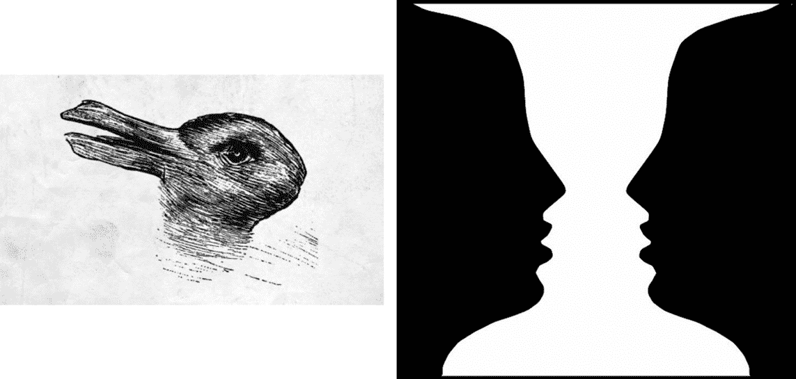

**图 6.1** 注意我们如何通过关注图像的不同区域来改变对这些图形的范畴感知……例如第一张图中鸭子的“嘴”或兔子的“鼻子”，或者第二张图中两个脸的“鼻子”或花瓶的底部。

为了将注意力与已经讨论的其他功能区分开来，詹姆斯强调注意力并不是一种观念的创造或或的系统，像“想象、辨别和记忆”那样。然而，它确实与这些其他功能存在着“亲密的联系”（`PP` 446）。詹姆斯说，注意力“不创造任何观念；在我们关注它之前，观念必须已经存在了”（`PP` 450），这强调了注意力的模仿性和（再次）选择性。然而，正如我们将看到的，对于詹姆斯来说，注意力与想象之间有着特别亲密的关系，甚至比与感知或记忆的关系更为密切。

詹姆斯提供的这种感觉仅仅是杂烩而非理论，这种观点在章中的一个章节得到了支持，在该节中，詹姆斯对不同的注意力亚类进行了分类（`PP` 416）。这些不同的注意力亚类往往表现出互不一致的属性。詹姆斯注意到，注意力行为可以根据其对象进行划分——是对“感官对象”（他称为“感官注意力”）还是对“理想或表征对象”（他称为“智力注意力”）。他还注意到，注意力行为可以根据其方向是“直接的”还是“派生的”进行划分，这取决于主题是否是“本身就有趣，与任何其他事物无关”，还是“它的趣味性源于与某些其他直接感兴趣的事物的联想”（`PP` 416）。这种分类法对于本章稍后提出的天赋论问题将特别相关，因为它似乎取决于主题对于某些主体来说是否在与经验无关的情况下是有趣。詹姆斯还注意到，注意力可以是“被动的且毫不费力的”，也可以是“主动且自愿的”（`PP` 416）。他随后探索了哪些划分组合是可能的。例如，詹姆斯假设直接的自愿注意力是不可能的，因此自愿注意力必须总是派生的，或者是为了某些其他目标或兴趣服务的。一组这些划分的组合——附带示例——可以在表 6.1 中找到。

**表 6.1** 詹姆斯注意力分类中的各种可能性

| | 直接 | 派生 |
| :--- | :--- | :--- |
| **被动** | | **自愿** |
| **感官** | 反射性地向噪音方向转头 | 不可能（`PP` 418） | 初学者关注脚 |
| **智力** | 当我们思考时（`PP` 418） | 不可能（阿基米德沉浸于几何冥想（`PP` 419）） | 学生考虑论文 |

虽然该分类为我们提供了许多素材，但其中并未概述注意力的积极理论。它列出了注意力表达的不同方式，但并没有告诉我们它是如何实现的。詹姆斯坚持这些不同的注意力行为还原以下两种机制：1) 感官器官的`有机调整`，2) `观念准备`。尽管被引入为两个事物，但我们不应假设它们是完全独立的——詹姆斯甚至认为，“感觉调整和观念准备这两个过程可能共存”（`PP` 434）。

前者——有机调整——相对简单，也许是注意力研究中最常见的评估变量之一。感官器官的调整包括转向感知到的声音或视觉刺激方向、眼动、为了适应光强度而眯眼、瞳孔放大、向热源移动以测量温度等。这些调整可以是自愿的，也可以是不自意的，因为我们的眼睛或头部可能会反射性地转向声音方向。然而，我们也可以在有机调整上获得习惯，例如扑克玩家可能会学会关注对手细微的表情，或者网球运动员在准备接发时会自动关注身体具有战术意义的区域（如手部位置和下肢动作）Rosker and Majcen 2021。

虽然有机调整似乎总是涉及感官注意力，但詹姆斯认为有机调整与许多形式的智力注意力之间存在密切的生理关系。例如，他建议当我们试图关注记忆中的观念时，我们感受到的“收缩”主要是由睡眠时那种眼球实际向后向上转的感觉所构成的（`PP` 436）。这更广泛地符合詹姆斯的情绪和现象学理论，这些理论认为与各种心理状态相关的感受实际上是对身体生理变化的内感受——这种方法在今天继续吸引新的支持者（Mandler 1990; Prinz 2004）。当代心理学主要测量智力注意力的生理成分，例如在心理数字线上进行运算时眼睛的左右跳动，这可以通过眼动追踪方法进行评估（Ranzini, Lisi, and Zorzi 2016; Schwarz and Keus 2004）。

第二种机制——观念准备（ideational preparation）是詹姆斯注意力理论中微妙且更有趣的一面，特别是在近期感知与认知理论的背景下。

詹姆斯的观点挑战了注意力仅仅是像“心理聚光灯”一样指向对象的观点——即注意力要么自动转向强刺激，要么像在搜索模式中主动地在物理或心理空间内移动——相反，他认为注意力会积极地建模并预测那些聚光灯可能投射的对象。此外，这种预测——无论它是得到满足还是受挫——都能解释许多聚光灯产生的原因和结果。它的运作，可以由源自先前经验的背景知识和预期所驱动。因此，观念准备观点相比上一小节回顾的容量限制理论或特征结合理论，为注意力提供了更丰富、更具认知色彩的图景。正如 Prinz (2022:3) 所指出的，这种观点将非常契合对心理（尤其是注意力）的预测性方法，这些方法在心理学中仅在过去一二十年间才流行（Clark 2013; Griffiths, Kemp, and Tenenbaum 2008; Hohwy 2013）。

詹姆斯提供了多条证据来支持这一观点。为了考虑一个超越有机调节的例子，詹姆斯提出了边缘视觉的案例。当我们眼睛固定在特定目标上时，这并不会防止注意力移动到视觉意识边缘的对象上，是因为我们注意到了某些惊讶的事，或是作为一种自意志的行为。詹姆斯注意到，这种边缘视觉是可以训练的，而且持续关注边缘的某个对象（“边缘对象”）是费力的。尽管边缘对象从未变得“完美清晰”，但关注它会使我们比以前在某种程度上对它产生更“生动的意识”。詹姆斯接着问：如果我们对边缘对象的关注并不包含感觉器官的运动，那么它包含什么呢？为了回答这个问题，他说“对图像边缘区域注意的努力，无多不少，正是对那里所描绘的内容形成尽可能清晰的观念的努力”（`PP` 438）。他进一步将其描述为对我们试图关注的事物进行“强化性”和“预测性”的想象。这种行为涉及在脑中创建一个“对象的想象性副本，它将像在矩阵中一样准备好接收外部印象”（`PP` 439）。因此，对詹姆斯来说，一个完整的“注意力行为”包含了对某些对象形成预测表征，并验证预期的信号是否与来自目标的信号相匹配。

詹姆斯回顾的许多关于注意力效应的早期实验（例如冯德特、埃克斯纳和亥姆霍兹的）都是通过测量受试者对指示刺激的反应时间。例如，亥姆霍兹发明了一种分光盒，受试者可以在其中观察，每个视网膜上可以显示不同的图像，这些图像结合在一起时就形成了立体图。图像仅在偶尔的电闪光期间被照亮，这使得亥姆霍兹能够测量受试者感知显示图像所需的闪光次数和持续时间。他在盒的每侧中心钻了小孔，以便眼睛可以在黑暗中聚焦在外部光的光点上，为火花做好准备。正如预期的那样，他发现就火花数量而言，简单图形比复杂图形更容易被感知。与本研究更相关的是，他还发现受试者可以“自愿地将注意力保持在黑暗场中他们喜欢的任何特定部分，以便当火花来临时，仅从这些图像中位于该区域的部分接收印象”（亥姆霍兹引自 `PP` 438）。詹姆斯认为，当受试者以这种方式投入预测性注意力时，他们更容易感知这些图像的某些区域，因为当他们没有已经在想象该区域的内容时，“时间就流失了，因为在那种情况下，无法预先形成稳定的图像”（`PP` 438）。对于詹姆斯来说，这解释了想象处理的许多促进方面——大脑在形成它即将接收的感官刺激模型方面具有“领先优势”，因此当刺激到达时，它不需要从零开始构建这样的模型。此外，对已存在的刺激的意识注意力方向，可以理解为投入更多资源在对这些感官刺激的预测性想象中建立一个更丰富的模型，从而增强它们的处理。

正如 Prinz (2022) 所指出的，意外或惊讶刺激吸引我们注意力的能力可能被认为是这一理论的反例。事实上，如果认为一个意外的声音吸引我们的注意力是因为我们预见到了它，可能是概念上的混乱。尽管如此，詹姆斯坚持即使在这些情况下也涉及这种观念准备或预测。为了维护这一观点，詹姆斯描述了一个学习识别鸟的孩子；他注意到，除非孩子已经被教过预测那些鸟的某些特征，否则无论投入多少精力或时间，孩子都不可能注意到鸟身上的这些特征：

```
他们很容易命名已经知道的特征，例如叶子、尾巴、喙、脚。但他们可能观察几个小时也无法区分鼻孔、爪、鳞片等，直到他们的注意力被引导这些细节；之后，他们每次都能看到它们。简而言之，我们通常看到的只有我们预先感知到的东西。 (`PP` 444)
```

因此，我们可能会假设，为了使注意力被意外刺激所吸引，它在某种意义上必须能够预先对其建模。

为了解释注意力是如何被此类刺激吸引的，我们可以遵循当代认知预测方法的方法，这可以帮助我们理解生成式 `DNN` 模型在我们不断发展的 `DoGMA` 中可能扮演的独特作用。预测在学习中的作用在心理学的某些领域早已被强调；例如，它是具有影响力的 `Rescorla-Wagner` 学习模型的基本特征（`Rescorla 1972`；Wagner 和 Rescorla 1972`），并且一直是最早的 `ANN` 架构之一——`autoencoder`的关键方面（`Gluck and Myers 1993; Kramer 1991`）。这种方法最近在计算神经科学和哲学中变得格外流行；这里的理论学家提供了独特的注意力预测理论，这些理论认为注意力被吸引到那些预期刺激的自上而下的前向模型与实际低层输入刺激之间缺乏匹配的刺激上——用通俗的话说，这些不匹配引发了“惊讶”（`Clark 2015; Hohwy 2013`）。这种惊讶反映了预期与接收到的感官输入之间的某种不协调，这反过来产生了下游的认知后果。这种不协调会导致注意力启动并寻找来源——然后尝试对其进行建模。正如 `Prinz (2022:6)` 所说：“感知体验在轻微延迟后产生 . . . 在这个短暂瞬间，我们获得了一种反馈循环：首先，刺激介入了我们的构念中心，它们产生一个表征，作为我们从环境中对刺激进行采样的模板。”通过对感官器官的有机调整和对感知前模型的修订，注意力随后变得集中在令人惊讶的刺激上，差异通过一个确认性反馈循环得到解决。尽管预测处理方法通常为预期刺激的前向模型建议不同的数学框架（`Friston 2010`），但生成式 `DNNs`（如 `GANs`）也可能在这一注意力方法中扮演前向模型的角色（`Gershman 2019`）。

构念准备观点也可以解释所谓的对感知的自上而下类型的注意力效应，例如通过关注其细节的不同子集来切换模糊图形的分类的能力。将注意力引向模糊刺激的不同子集可以使感知前模型偏移，以倾向于不同的稳定端点，使得这些刺激子集更有可能或更彻底地与输入输入保持协调。这也开始解释特征结合观的某些方面，因为我们看到，关注环境（或其空间表示）中刺激的不同位置可能会偏置感知前过程，使其倾向于以不同的方式将低层刺激结合成高层表征对象，因为它正试图构建一个对于预期的感官输入的分层模型，以协调该机能输入和输出。它还可以解释注意力的某些进一步的促进和抑制作用。受到强烈关注的刺激似乎变得更清晰、更生动，这是基于感知前想象力在以越来越高的保真度对其进行建模时投入的资源数量所决定的。它也可以解释为什么某些刺激似乎被完全忽略了——当我们已经参与于一项耗费构念准备资源的注意力任务时，其他刺激可能完全从模型中被遗漏，剥夺了它们进入记忆和意识的机会，就像变化盲实验中所示（`Simons and Levin 1997`）。`Prinz (2022)` 进一步认为，詹姆斯的理论可能解释其他更现代观点归因于注意力的全效应；鼓励感兴趣的读者参考他的完整讨论。

尽管詹姆斯的理论早于上述观点一个半多世纪，但它在计算上仍然比上一节讨论的观点更具野心。这引发了对可能实现此类预测模型构建、与感官输入平衡以及根据错误进行修订的机制的神经合理性的担忧。基于他那个时代匮乏的神经理论，詹姆斯对此并没有什么可说，但他所说的内容在认知科学当前的生成式建模和预测编码方法的背景下具有启示意义：


理解这一切的自然方式是在脑细胞的符号形式下从两个方向受到作用。当物体从外部刺激它时，其他脑细胞……从内部唤醒它。后一种影响是“注意力的适应”。脑细胞的总能量需要这两个因素的协作；不仅当存在时，而且当既存在又被关注时，物体才被完全感知（PP 441）。

这段摘录提供了一个鲜明的陈述，即注意力无非一种参与预测刺激的特定想象形式，并建议了一个脑细胞的玩具神经模型，用于平衡这些预期和实际的输入。

这种解释詹姆斯理论的方法可能会引起对智力注意力类别的担忧，该类别在当代心理学理论中相对被忽视。如果注意力仅仅是为了预测刺激，那么它是如何指向思维的？然而，如果我们把这种担忧与我们在叙述目前阶段理解的控制问题联系起来，这里就没有什么大秘密。正如当代心理学面临外部输入过多或行动机会过多的问题，工程师也面临模块化架构的问题，即不同的模块子系统可能会提供过多的内部表征。此外，这些表征在表征上可能相互不一致，或者建议不同的学习或行动轨迹。正如 Prinz 所说：

> 我们拥有过量的思想，就像我们拥有极其复杂的感官输入流一样……在两种情况下……我们都能以一种更不线性的方式思考某件事，尽管大脑中包含了海洋的想法，其中任何一个都可能竞争当前的注意力。解决方案之一是重新表征所选的思维线。（`Prinz 2022`:11）

这直接将智力注意力与控制问题联系起来。构念准备对于内源性生成的想法进行选择在计算上可能是用的，就像它对于外部生成的刺激一样。选择问题的解决方案可以通过对那些内部表征进行建模，并将其与特殊想象模式生成的其他表征进行比较，检查其合理性、一致性或与目标目标的相关性来探索。

詹姆斯理论中最后一个关键的组成部分是兴趣在引导注意力方面的作用。本小节之前的注释提供了关于注意什么是理论——即一种针对传入的感官或智力信号的特殊预备性想象——但它并不能预测或解释注意力的走向。在这里，詹姆斯说，注意力总是指向那些引起兴趣的物体。在詹姆斯看来，所有兴趣要么是内在的，要么是衍生的。对于每一个物种，某些刺激是内生有趣的，并且会自动吸引注意力，除非通过努力来抑制它。在这一类中，我们可以根据现代心理学的术语将其分类为几乎所有物种成员都尤为显著的事物，例如巨大的噪音或明亮的光[⁷]。

这种内在兴趣很大可能仅仅源于感官接收器的解剖结构或其连接；大眼睛的夜行性动物可能比昼性动物对暗光更感兴趣，詹姆斯还讨论了一只在梵蒂冈闲逛的狗可能发现，那些雕塑的气味比它们（对人类而言）优雅的形式更有趣。

当然，兴趣也可以通过学习获得，因为专家会自动适应那些以前在高度练习的任务中预示过成功的刺激。詹姆斯进一步指出，自发的衍生兴趣可能涉及最耗费的注意力，尽管它在人类教育中起着至关重要的作用。詹姆斯写道，儿童必须长时间利用这种兴趣才能在学校期间保持注意力，他们招募兴趣去关注那些他们认为枯燥或无味的物体，源于他们将这些物体与更有趣的刺激（如奖励或社会认可）联系起来的能力。

值得注意的是，兴趣解释智力注意力的走向与解释感官注意力一样有效；在这两种情况下，观念的准备都将指向根据当前或之前的目标而感兴趣的表征。我们将在本章晚些时候回到兴趣作为注意力驱动力的话题，探索它可能被用于解决控制问题（以及长期存在的问题，如样本效率和泛化性）的具体方法。在某些情况下，我们将面临触及经验主义起源的风险，正如詹姆斯和许多其他当代认知科学家——“当进化的灵感降临他们身上”（借用詹姆斯某些动人文字的说法）——假设许多具有生物学意义的兴趣是先天的。然而，在这些情况下，它们将成为其他地方需要纪律的合理理由，因为在理解了底层机制的完整细节后，注意力偏差通常比它们最初看起来更具领域通用性，或者是由感知器官的解剖特异性产生的，这是任何经验主义者都不需要否认的。这两种情况都不需要先天概念或特定领域的学习规则。

## 6.4. DNN 架构中的类注意力机制

当我们转向基于 DNN 的系统中类注意力机制的实现时，我们既可以看到目前取得的进展，也可以将完整詹姆斯框架的实现设定为一个具有抱负的目标。尽管注意力机制在过去几年深度学习的一些最著名成就中产生了影响，但作为人类注意力的模型，它们最终将比上一章讨论的对想象的建模更具局部性和临时性。尽管如此，看到这些小小的脚步带我们走了多远是有用的，并且——鉴于詹姆斯框架帮助我们预测即将到来的控制问题并准备适当对措施的潜力——阐明建模詹姆斯注意力的其余方面如何构成深度学习研究议程中有价值的补充。

在回顾了这些工程进展后（讨论将广泛遵循 `Lindsay 2020` 年的一篇优秀的近期综述），我进一步讨论了我们在基于 DNN 的 AI 中开始探索的注意力的下游效应，特别关注兴趣和内在语言在引导人工智能体注意力走向中的作用，这可能允许我们在詹姆斯框架中模拟某些最宏大的自顶向下注意力形式。

在基于 DNN 处理中，类注意力机制最直接的应用是选择输入或输出数据的子集进行处理，排除输入或输出流的其他部分。正如第 3 章和第 5 章讨论的，默认的 `DCNN` 部署了一种不符合生物学逻辑的筛选策略，这涉及到在整个输入图像上系统地滑动滤波器窗口。正如之前的章节中提到的，这就像一个人在《寻找华多》的图片中，通过机械地扫描图像的每个部分（从左到右，然后从上到下）来寻找特定特征。如果能让系统将资源导向图像中最有可能匹配所寻特征的区域，这种视觉搜索的效率将得到极大提高。由于效率的提高，时间或处理限制下的准确性也可以得到提高，因为有限资源的更多份额可以用于处理有前景的输入，而不是浪费在没有前景的输入上。

确实，通过整合此类注意力机制，已经在图像标记任务中实现了最先进的基准结果。`Lindsay (2020)` 以“硬特征注意力（hard feature attention）”的名字探讨了这种机制。一种常见的实现是将图像的某些区域标记为“目标提议框（object proposal boxes）”，这些区域是目标物体或特征极有可能出现的地方，处理资源被用于标记这些区域内的物体。通过突出目标提议框中的某些信息进行更密集的扫描以进行标记或分类，它们在处理过程中充当了瓶颈，在此发生了类似于注意力的选择性。这类方法被称为 `基于区域的卷积神经网络（R-CNNs）`（`Girshick et al. 2014`），它们在 2013 年到 2015 年的标准图像标记竞赛中在效率和精度上取得了显著进展。

“Faster R-CNN”是该方法的一种特别高效的应用：它使用第二个网络模块来计算区域——即一个较小的 `区域提议网络 (RPN)`，其本身是一个与网络其他部分共享特征的 `CNN`——来计算区域提议框，然后这些框引导另一个更大、更深的 `CNN` 注意进行更密集的特征检测和图像标记（`Ren et al. 2015`; `Fig. 6.2`）。这一创新允许 `Faster R-CNN` 能够在标准硬件上实时对标准数据集计算出高精度的分类。值得注意的是，该架构中的 `RPN` 和主 `DCNN` 共享了一些卷积层，因此共享特征表示；这些计算可以被重用以引导瓶颈并增强分类，从而提高计算效率。基于区域的瓶颈在 `R-CNN` 模型族的不同成员的各个处理阶段施加，这可能允许进行实证比较，以确定注意力瓶颈的影响是在人类感知何时施加的。

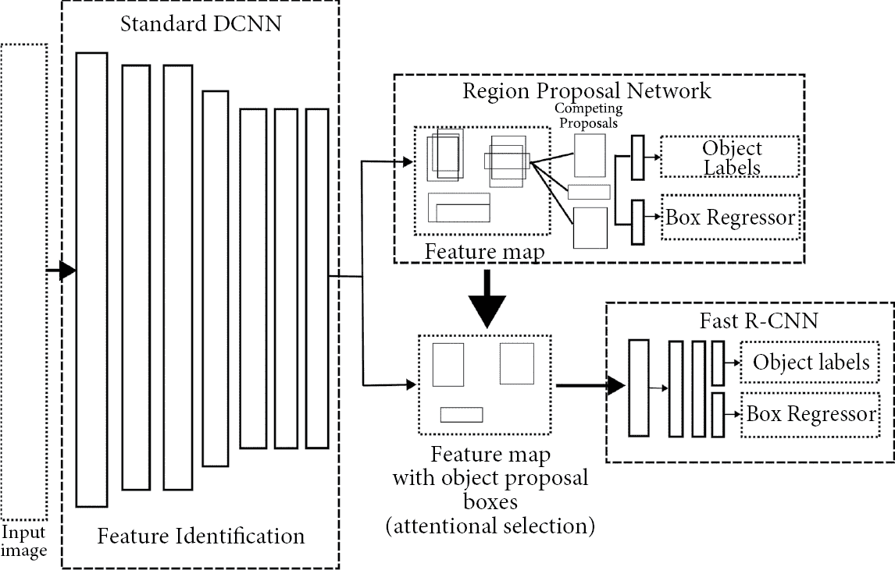

**图 6.2** Faster R-CNN 架构图。（图表改编自 `Deng et al. 2018`。）

这种方法还整合了 Treisman 的一些见解，即注意力为特征绑定问题提供了解决方案。`R-CNNs` 在行为能力上超越了基础的 `DCNNs`，特别是它们不仅根据照片中出现了哪些物体进行分类，还根据图像内部物体的位置进行分类，而这些位置也被识别了。这可以促进提议框内识别出的物体进行分级组合。例如，当在同一个框内的多个抽象层级识别出特征时，系统可以引入一种假设，认为这些特征被绑定为一个单一复合体。`Faster R-CNN` 甚至拥有机制，允许它在这些框被合并时修订物体提议框的边界。例如，如果一个框切掉了另一个框捕捉到的脸部的一半，则丢弃前面的提议而采用后者。

这里甚至有一丝思想准备的迹象，因为这里的“注意力”机制通过执行一项预测任务来完成此操作：即预测在区域提议框内发现符合其一个目标标签物体的概率。然而，这就是该架构中“思想准备”的局限性，因为网络随后并没有对该区域的物体构建生成式模型来验证其假设的正确性。值得注意的是，`Faster R-CNN` 是从问题数据进行端到端训练的，再次强调了受领域通用能力启发的机制在原始经验主义的限制内提高效率和计算能力的能力。`R-CNN` 的版本经常在 `PASCAL VOC（视觉物体类）` 挑战中获得最高分，该基准测试旨在超越 `ImageNet 挑战` 的全图标签，实现更具野心的物体定位和识别目标。

尽管取得了这些成功，但仍有几个有机调整方面未被 `R-CNN` 模型捕捉。特别是，`R-CNN` 模型缺乏递归性，且对一个区域提议框的处理不会影响其他框，因此在输入窗口位置的控制与处理结果之间没有往复交互，就像人类视觉中的眼动一样。一种尝试更直接参与这种有机调整方面的模型是由 `Mnih et al. (2014)` 创建的循环注意力模型 (RAM)。`RAM` 的开发者显式地将注意力瓶颈窗口的移动作为计算机视觉控制问题的解决方案。类似于深度学习爆发之前的一些工作（例如参见 `Larochelle and Hinton 2010` 的综述），`RAM` 利用从之前的“窥视”获取的信息来决定下一个引导输入窗口的位置，以便从环境中获取最有用的信息（`Fig. 6.3`）。与人类注视类似，“窥视传感器”被建模为一系列分辨率递减的重叠窗口，高分辨率输入仅在传感器的中心小位置可用。该模型还使用强化学习算法来学习控制窥视器的策略，代理可以在窥视之间与环境进行交互以影响其真实状态。由于传感器控制和代理动作控制都是基于系统的先前动作和窥视通过强化学习对序列问题进行训练，它不仅可以用于静态计算机视觉问题，还可以用于玩游戏等持续任务。在这种情况下，当前窥视是从视频游戏的当前帧中提取的，网络根据当前的动作和窥视计算下一个动作和窥视位置（针对下一帧）。作者甚至实验允许网络将其运行从“信息收集”阶段切换到“决策”阶段；在前者，只要其策略网络估计这样做能为决策提供更有用的信息，系统就会继续对环境进行受控窥视。再次，由于整个模型都是端到端训练的，它进一步证明了领域通用注意力类机制在原始经验主义边界内解决控制问题的潜力。

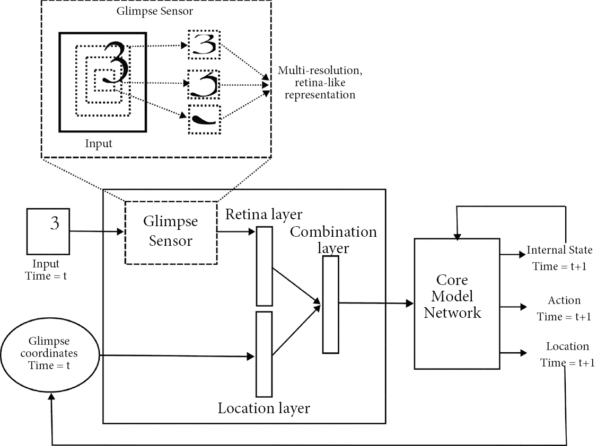

**图 6.3** 来自 `Mnih et al. (2014)` 的循环注意力模型 (RAM)。该模型通过显式尝试模拟类视网膜输入（由循环神经网络控制），整合了詹姆斯分类分类法（Jamesian taxonomy）中的一种“有机调整”注意力。“窥视传感器”（glimpse sensor）从源图像的几个不同重叠分辨率上捕捉输入，并将这些不同的分辨率整合为单一的类视网膜表示。随后，窥视网络将时间 `t` 信息的类视网膜表示与该传感器在时间 `t` 网络中的位置表示相结合。该表示随后被传递给模型的内核网络（其中包含若干其他不同层，在此处作为黑盒处理），核心网络输出输入图像的更新后内部表示、一个动作以及下一步移动窥视传感器的位置。该网络在两个方面具有循环性：输入的上一个内部表示始终作为输入传回给核心模型网络的下一步，而位置表示则被传回给窥视网络的下一次迭代。因此，RAM 试图对眼睛在图像上有机调整的几个不同方面进行建模，包括视网膜表示的细节以及视网膜目标的迭代式、目标驱动的移动。（图片改编自 `Mnih et al. 2014`。）

到目前为止讨论的“硬注意力”模型解决了詹姆斯分类法中的“有机调整”部分；这是因为在深层神经网络（DNNs）的输入过滤与心理学实验中观察到的注意力转移行为伴随物之间进行直接比较可能更容易。然而，詹姆斯框架中最引人且最有前景的方面，只有通过解决注意力转移中某些较难观察的内部效应才能实现。这些内部效应中的许多可以归类为“软注意力”（soft attention），它涉及对输入或中间特征表示的不同方面进行重新加权。这就像当我们试图在眼睛固定在一个标准点上，专注于视觉输入的某部分时发生的注意力，正如我们在上一节中回顾的詹姆斯对边缘视觉的讨论。基于 DNN 的早期软注意力模型推动了过去五年深度学习领域一些最令人瞩目的进展。

这种想法的一个特别有趣的应用来自 `Jetley et al. (2018)`，他们添加了一个独立的软注意力加权模块，用以将标准 `DCNN` 的性能提升到更高的效率、准确性和鲁棒性水平。在 `Jetley` 等人的模型中，一个独立的“注意力估计器网络”被应用于 `CNN` 中的中间层特征表示。注意力估计器网络学习评估这些中间层特征对当前决策任务的重要性。然后，这种估计被用于对层次结构中多个层级的中间特征图进行重新加权，以产生所谓的针对每个任务进行校准的加权“显著性”（salience）图。重要的是，只有经过显著性加权的特征表示被用于决策；这具有削弱被认为对该任务不重要（未被“关注”）的特征的效果，同时强调了重要的（被“关注”）的特征。这种注意力机制的应用直接解决了在第 1 章和第 2 章中预示的通用性和迁移问题。再次，架构的所有方面（包括注意力加权模块）都是端到端训练的。

多年来，DNN 中有多种软注意力的实现方式。例如，“软空间注意力”模型根据特征在输入字段中的位置对输入区域进行重新加权，而“软特征注意力”模型根据语义身份或重要性（无论它们出现在输入中的什么位置）对特征进行重新加权。这些模型的各种形式在抽象和关系推理任务上取得了比通用 `DCNN` 更好的性能，而这些任务曾被认为对于基于相似性的关联模型是困难的，例如图像标注、视觉问答 (VQA) 任务，甚至是同异判别（`Ben-Younes et al. 2017`; `Ricci et al. 2021`; `Xu et al. 2015`）——尽管即使是更成功的模型，可能仍无法与人类某些动物相同的抽象水平上表现出这些能力（`Barrett et al. 2018`; `Kim, Ricci, and Serre 2018`）。然而，类似软注意力的最有影响力的应用体现在 Transformer 模型族中，我们现在转向这类模型。

## 6.5. 语言模型、自注意力与 Transformer

Transformer——可能是迄今为止开发的最强大、最瞩目的深度学习架构——部署了一种名为自注意力的技术，以确定输入的哪些方面将影响输出的预测。这是“语言模型”类别中最成功的 DNN，语言模型通常尝试根据上下文对语言标记序列中下一个标记（token）的概率。这些模型的许多关键创新最初是为了机器翻译而开发的；但研究人员很快发现，根据源语言的上下文预测某些单词最佳翻译的机制，可以迅速用于许多其他语言生成任务。这些机制甚至在语言领域之外也被证明有用；多模态 Transformer 模型（例如结合了文本和图像表示的模型）现在也被用于许多其他用途，例如上一章中来自 CLIP 和 DALL-E 的图像创建示例。考虑到 Transformer 和人类大脑中注意力和语言处理之间可能的相似性，对詹姆斯式构念准备的全面探索必须考虑语言处理如何受到内部注意力控制的影响，反之又是如何影响它。我们可以通过考虑 Transformer 模型首次描述于 `Vaswani et al. (2017)` 的一篇标题为“Attention is all you need”的论文中如何使用注意力机制解决此类预测任务的细节，来开始建立这些联系。然而，我们需要说明，Transformer 模型中的自注意力通常被认为是 DNN 中生物相关性最低的注意力处理类型，尽管我们将回顾可能被认为支持这些模型具有某种生物学合理性的神经科学证据。

虽然自注意力（self-attention）可以被理解为一种复杂的、层次化的软注意力（soft attention），但它源于与之前讨论的其他注意力模型完全不同的传统。这种形式的注意力始于序列到序列（`seq2seq`）语言模型。`seq2seq` 模型是循环神经网络，以文本序列作为输入并训练生成另一个文本序列作为输出。该模型的基本形式结合了一个 `encoder`（编码器）和一个 `decoder`（解码器）网络；`encoder` 将输入序列转换为隐藏表示向量，而 `decoder` 将此隐藏向量转换为一系列输出。具体来说，这个隐藏向量是顺序构建的；输入中的每个 token（单词或音素）都是被逐一处理的，`encoder` 获取上一个隐藏向量，并根据序列中的下一个 token 对其进行修改。因此，它迭代地生成一个复合隐藏状态，该状态反映了输入中出现的 token 以及它们出现的顺序。`encoder` 的最终隐藏状态被用作 `decoder` 的上下文表示，然后 `decoder` 以一种类似于 `encoder` 反向的方向转换输出序列，一次处理一个单词（以及修改后的隐藏状态）。

当人们发现，如果要求 `encoder` 将每个输出单词的所有相关信息压缩为单个隐藏上下文向量以供 `decoder` 使用会造成极其严重的瓶颈时，这些模型就被引入了“注意力”机制。简而言之，`seq2seq` 模型在处理长句时非常困难，因为长句可能包含更复杂的句法关系，且语义关系会被长长的中间单词序列取代。对于模型来说，将这种长距离依赖压缩到单个隐藏状态向量是太困难了。模型可以尝试将 `encoder` 的每一个中间隐藏状态传递给 `decoder`，这可以解决瓶颈问题，但这种方法会产生其他问题，因为所需的隐藏状态数量随输入上下文的大小而变化。因此，注意力的引入作为一种对 `encoder` 网络中间隐藏状态进行加权的方法，同时产生单个固定长度的向量（`Bahdanau, Cho, and Bengio 2014`）。

注意力 `seq2seq` 模型使用注意力选择来学习输入单词中哪些单词对于确定下一个可能出现的输出单词最重要。这种机制可以被视为软注意力的一种形式，它对输入序列的子集赋予不同的权重，尽管注意力指向的是内部内存或表示编码，而不是特定的空间位置或特征。这种注意力机制的一个说明性用途是处理像“bank”这样具有语义歧义的词。注意力机制可以通过强调“fishing”（钓鱼）和“water”（水）等上下文词，为“bank”的向量表示提供更多上下文细节，从而将 bank 的向量推向对应河流岸边的语义空间区域，并远离对应金融机构的空间部分。这灵感大致源于人在阅读句子并遇到歧义词时，可能会关注周围文中其他的上下文线索来解释句子的含义。虽然许多早期的语言模型可以进行这种语义“推挤”，但如果上下文线索与歧义词之间距离很远，它们就会力不从心。我们需要的是一种机制，允许模型通过出现在输入序列中任何位置的相关上下文，来高效地调节单词含义的表示。


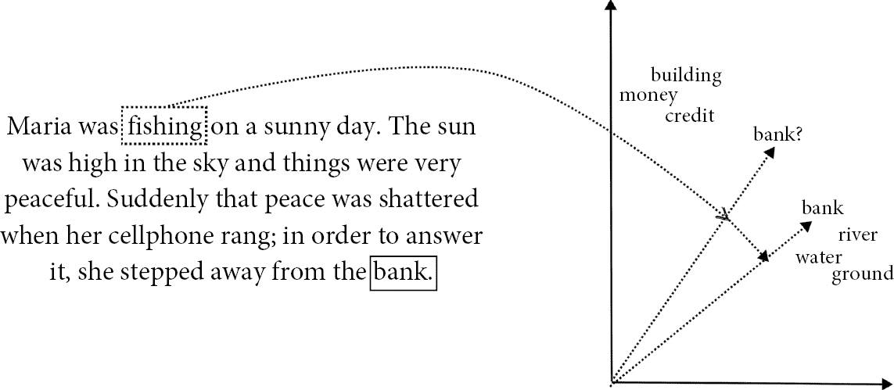

**图 6.4** 长距离消歧的问题。单词“bank”在英语中是歧义的，最后一句的局部上下文既符合“金融机构”，也符合“岸边的土地”。语言模型需要一种方法，让遥远的上下文线索将歧义词的向量表示推向语义空间的正确位置，以做出正确的推理。注意力机制已成为一种青青的解决方案。该图展示了单词在语义空间中的位置，并展示了如何通过使用单词“fishing”提供的信息，将单词“bank”的无上下文向量表示推入语义空间中歧义较小的区域。

这种洞察——即语言处理可以使用较少距离限制的软注意力来提升效率和灵活性的高度——这里的软注意力被理解为一种完全植根于詹姆斯主义理论（Jamesian theory）和经验主义范式的通用领域增强器——为 Transformer 的突破性进展提供了关键。第一批 Transformer 衍生于一种直觉：如果语言模型 `encoder` 的所有中间隐藏状态都被传递给 `decoder`，那么没有真正理由要求这些网络是循环的来捕捉长距离依赖。“注意力是你所需要的（attention is all you need）”这一格言是基于这样一个想法：这种循环性（以及添加到 `seq2seq` 模型中的其他一些花哨）现在可以被抛弃，通用的注意力机制可以更高效地完成它们的所有工作。

对于那些努力向感兴趣的读者解释 Transformer 的哲学家来说，遗憾的是，取消循环也要求注意力机制本身变得更加复杂和多样化。顺序循环允许 `seq2seq` 模型逐步构建输入序列的表示，通过一次处理一个单词并将越来越多的信息整合到复合表示中，从而考虑了该序列中的全局依赖。在没有循环的情况下捕捉整个序列和上下文信息，需要两项创新：将每个单词的隐藏状态表示拆分为三个向量（称为 `query`、`key` 和 `value` 向量），并添加位置编码（positional encodings），这使得单词在序列中的顺序能够反映在传递给 `encoder block` 的每个单词表示中。query、key 和 value 的分离为注意力选择引入了可训练参数，使其能够在不使用循环的情况下，学习长输入序列中术语之间更灵活的上下文关系。术语在这里的使用方式与其在数据库理论中的出现大致相似。在键值数据库中，数据值存储在带有键标记的位置。通过将查询与特定的键结合，可以从这些数据库中检索信息，从而允许获取存储在该键位置的值作为查询的答案。在基于 Transformer 的语言模型中，目标不是从数据库位置查找值，而是理解输入序列中的每个元素如何影响输入序列中每个其他元素的“含义”。Transformer 并不是像经典关系数据库那样通过显式查找操作来实现这些点的，而是通过对 query、key 和 value 向量的矩阵运算完成这些成就。

换句话说，“查询”（query）对应于我们试图在语境中理解或修改的术语；“键”（keys）对应于输入序列上下文中可能影响其含义的其他每个术语；而所查找的“值”（values）则是查询术语在这些术语影响下含义的表示（例如，对于 `[river]` “岸岸”和 `[financial]` “银行”，其含义是不同的）。矩阵运算被用于修改系统对查询术语含义的初始表示，其方法是根据这些上下文影响（`values`）并以适当的方式对其进行加权。这被称为“自注意力”（self-attention），因为此处执行的操作是在系统对输入序列项的内部表示上进行的。

在 Transformer 中，可训练参数与查询、键、值对相关，这允许系统学习如何根据上下文对其表示进行加权——这种方式可以被视为一种复杂的抽象、内部、自动软注意力形式。这些带有已训练参数的操作单元（block）被称为“自注意力头”（图 6.5）。

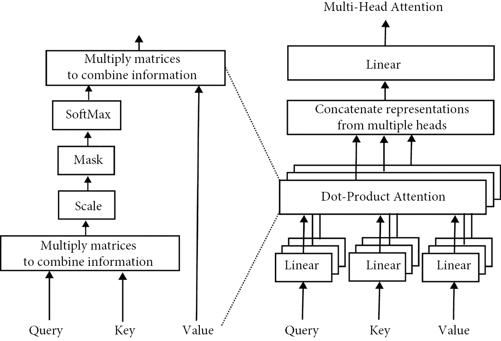

**图 6.5** Transformer 中多头注意力涉及操作的标准描绘（改编自 Vaswani et al. 2017）。每个 token 的查询、键、值向量通过每个自注意力头通过一系列复杂的矩阵运算组合，以便根据其上下文对每个 token 的表示进行加权（缩放操作用于调整点积的幅度，以确保梯度具有适合训练的尺度；掩码操作用于防止注意力头在训练期间通过前瞻下一个 token 来通过“作弊”；`SoftMax` 用于归一化 token 序列上注意力分数的和，使其总和为 1）。多个头同时开发出术语含义的并行表示（通常通过关注其上下文的不同方面），随后通过拼接和线性运算将它们合并为统一的表示。合并后的多头注意力表示随后被用于预测序列中的下一个 token。在最先进的 Transformer 中，许多多注意力头可能会按顺序堆叠，以开发出关于上下文如何修改术语在预测下一个 token 中角色的越来越复杂的表示。分析表明，在 Transformer 中观察到的某些复杂现象（例如 AnthropicAI 研究的“归纳头”induction heads）可能源于多个堆叠注意力头之间复杂的运算组合（Olsson et al. 2022）。

正如我们所见的，这种形式的“注意力”已经相当复杂，且与生物学注意力的相似性尚待商榷。坦率地说，如果我们试图在大脑的语言处理方面与 Transformer 的注意力机制方面之间建立直接联系，这可能会让我们的立足点变得不稳固（尽管可以参见 Whittington, Warren, and Behrens 2021）。

Transformer 中的自注意力需要许多专门参数来为整个范围推导出正确的嵌入。在最先进的 Transformer 中，情况更加复杂，每个注意力块由堆叠的层组成，允许迭代且分层地构建更多的上下文嵌入。此外，Transformer 经常有多个在相同术语上并行运行的自注意力头（Lindsay (2020) 在她的综述中指出了几处不同，特别是 Transformer 中的自注意力缺乏递归和任何自上而下的影响）。由于这些原因，Lindsay 建议自注意力最接近的心理学类比实际上是启动（priming，这可以被视为学习注意力的形式），而不是更具自主性的注意力——尽管可以参见 16; Cordonnier, Loukas, and Jaggi 2019），或者在给定类似的大规模预训练方案下，纯卷积 `DNN` 在相同任务上的效果可能与 Transformer 一样有效（Tay et al. 2021）。一个整个研究领域已经围绕尝试解释 Transformer 的活动建立，特别是自注意力头的显著性以及它们在处理句子时产生的表示。由于 `BERT` 在这一热潮早期发布，该领域被称为 `BERTology`，因为许多实验和可视化都是在 `BERT` 上进行的（Rogers, Kovaleva, and Rumshisky 2020）。

尽管存在这些不同之处和不确定性，我们仍然无法得出结论，认为 transformer 与生物学注意力或语言理解没有关系。特别是，实证研究——直接灵感于我们在第 3 章; Caucheteux, Gramfort, and King 2021; Goldstein et al. 2021; Schrimpf et al. 2021; Toneva and Wehbe 2019）。这些实验将各种语言模型变体（包括各种 transformer 架构）的隐藏单元激活值、处理时间和下一个词预测输出，分别与人类的神经活动（采集自功能磁共振成像和皮层电图）、阅读时间以及下一个词判读进行了比较。

特别是，在比较缺乏递归结构和左颞叶语言处理区域的 transformer 模型时，实验人员发现，其对应程度与 DCNN 和腹流之间发现的程度同样令人印象深刻。最好的模型预测了人类数据中近 100% 的方差（达到了其模型估计的噪声极限）。他们认为这些结果提供了强有力的支持，证明至少这些左颞叶正在执行与 transformer 相似的计算任务，即下一个词预测，特别是为了提取含义而服务。

特别是 `GPT` 系列模型——一种完全依赖单向注意力机制的 transformer 架构（其中自注意力只能关注被预测标记左侧的标记，而双向自注意力则可以关注单词右侧或左侧的单词）——在他们评估的模型中，是对人类神经数据和语言行为最好的预测器。¹⁷ 当然，这些左颞叶区域的注意力过程组件或神经结构与自注意力背后的算法组件之间，保持高程度的对应关系仍然是不可能的。然而，这些实验发现，即使是未经过训练的 `GPT` 架构也能获得良好的预测——尽管从具有相同特征数量的随机嵌入无法获得——这表明这些 transformer 架构中某些某些特殊之处，能够对应于人类大脑中的左颞叶语言区域。因此，transformer 与人类大脑在注意力处理和语言处理之间的相似性仍然是一个活跃且具有争议的研究领域，且几乎每周都有重要发现。¹⁸ 至少，它们支持詹姆斯（Jamesian）的主题：注意力选择和预测是紧密相关的，即使在语言处理领域也是如此。

此外，基于 transformer 的系统最近在“通用智能”和新任务的少样本解决方案方面取得了一些最令人瞩目的进展，这些任务曾被认为需要符号处理，而天生主义者认为这些将是基于深度神经网络（DNN）的 AI 无法实现的。例如，`GPT-3` 能够在各种挑战性的文本理解和新符号操作任务上展示零样本和少样本学习，其中许多任务似乎需要从少数（甚至更少）示例中学习新规则和抽象模式（Brown et al. 2020）。

它可以解决各种单词洗乱和符号操作任务，例如在单词中循环字母（“lyinevitab” → “inevitably”）以及在单词字母间随机插入标点符号或空格（“s.u!c/c!e.s i/o/n” → “succession”），在提供少量示例的情况下，不同任务的准确率在 30% 到 65% 之间。此外，模型似乎确实在测试时“学习”了这些任务，因为其单样本和零样本性能远低于其少样本性能。提供少量示例的益处似乎也能帮助 `GPT-3` 处理许多其他自然语言处理和问答数据集，例如 `LAMBADA`，这是一种句子补全任务，要求模型预测句子中最可能的最后一个词（例如，“Alice was friends with Bob. Alice went to visit her friend \_\_\_\_\_ → Bob”）。在提供少量示例的情况下，`GPT-3` 在该任务上的性能跃升至 86.4%，而此前语言模型的最水平为 18%。作者假设，提供少量示例有助于系统学习其被要求执行的任务结构。

尽管这一切都令人印象深刻，特别是在将大脑中的理性决策方面与基于 DNN 的模型联系起来，但我们对这些大型 Transformer 模型如何解决这些任务以及它们似乎在测试时如何学习了新的符号操作规则的理解仍然处于初级阶段。尽管 `GPT-3` 的规模与人脑的标准相比十分不足（根据计算方法的不同，估计包含 100 万亿参数），但其 1750 亿参数和互联网规模的数据集使得任何试图理解这些注意力头究竟学习了什么的尝试都成为了一项艰巨的任务。

将注意力头得出的权重可视化有时在人类眼中极具暗示性，暗示了复杂的语法处理（例如图 6.6），它似乎显示某一个注意力头专门用于特定的句法或语义角色，例如指代消解或主谓一致（Clark et al. 2019）。然而，此类示例通常是精挑细选的且仅进行了定性分析，还有许多其他注意力头的可视化结果难以直接解释。

对注意力头的消融实验似乎也表明，许多注意力头是冗余的，或者对于广泛的任务的准确性并非必不可少（Voita et al. 2019）。就像对 `DCNNs` 进行显著性映射一样，对 Transformer 注意力选择的分析可能会告诉我们模型可以使用哪些信息，但不能告诉我们它是如何使用的（Jain and Wallace 2019）。

重现此类结果的尝试受到进一步阻碍，因为语言模型的性能似乎对提示词中的细节敏感，以至于对于人类看来微不足道的标点符号或用词变化，也可能对语言模型在测试中的表现产生巨大影响（Alzantot et al. 2018; Li et al. 2020; Talmor et al. 2020）。这导致了“提示词工程”的出现——即对给语言模型的文本提示词进行临时性的调整以产生更好的性能——但缺乏关于哪些提示词选择具有原则性或可重复性的系统性指导（Reynolds and McDonell 2021）。甚至有针对标准化提示词的研究，这些提示似乎能提高 `GPT-3` 在许多任务中的性能，例如“让我们一步步思考”（Kojima et al. 2022）。此外，与 `BERT` 相比，`GPT-3` 的数据和对 `GPT-3` 的访问直到最近一直是私有的，研究人员很难为其性能开发出系统的、严谨的标准（[14_chapter6.xhtml#oso-9780197653302]）。

**图 6.6** 一个可能执行指代消解的注意力头示例。


表 6.2 通用提示对 Text-davinci-002 影响的稳健性研究

| 序号 | 提示词 (Prompt) | 准确率 (Accuracy) |
| :--- | :--- | :--- |
| 1 | Let’s think step by step. | 78.7 |
| 2 | First, | 73.3 |
| 3 | Let’s think logically. | 74.5 |
| 4 | Let’s solve this problem by splitting it into steps. | 72.2 |
| 5 | Let’s be realistic and think step by step. | 70.8 |
| 6 | Let’s think like a detective step by step. | 70.3 |
| 7 | Let’s | 57.5 |
| 8 | Before we dive into the answer. | 55.7 |
| 9 | The answer is after the proof. | 45.7 |
| - | (Baseline zero shot) | 17.7 |

我们试图系统地揭示此类模型局限性的尝试，由于更大、更强大的系统的开发速度而变得更加复杂。`BIG-bench` 项目是由 400 多位作者共同开发的，旨在通过自动化 200 多项被认为与 AI 相关的任务来识别大语言模型的性能（Srivastava et al. 2022）。这些任务涵盖了从语法处理、常识推理、生物和物理知识、数学能力、社会偏见等许多领域。虽然现成的 `GPT-3` 在许多任务上的表现不佳，但几乎在 `GPT-3` 的评分发布后，更大的模型（如 Google 的 540 亿参数 `PaLM` 模型）就在许多任务上成功，包括一些更令人意料和困难的任务，如数学应用题和逻辑推理（Chowdhery et al. 2022）。我们几乎可以看到球门在被实时移动，AI 进展的怀疑者认为，最近被用来反对 `GPT-3` 建模能力的某些标准，在 `PaLM` 满足这些标准后，立即被认为支持其优势的不充分证据，这导致一些评论员对缺乏固定标准来裁决这场辩论感到无奈（Alexander 2022）。更更新、更强大的系统，例如 `OpenAI` 的 `ChatGPT` 和来自 `AnthropicAI` 的模型（均通过基于人类反馈的强化学习进行训练），在更系统性的测试评估中给出了更令人惊的性能（Liang et al. 2022）。

与此同时，我们才开始从机械性的角度构建对这些模型组件（例如 `attention heads`）如何允许它们实现令人印象深刻的语法和语义灵活性的理解。一些令人鼓舞的证据表明，尽管这些模型的规模巨大，但这种理解是有可能的。多项分析表明，某些 `attention heads` 可能在执行可解释的句法处理作用（Htut et al. 2019; Voita et al. 2019）。这些调查中的一些研究利用了标准连接主义工具箱中的“人工病变研究”方法，通过删除特定的 `attention heads` 来观察哪些类型的处理过程受到了抑制或得以维持；另一些先进的新方法则通过直接操纵语言模型中的表示，以改变模型预测的句法或语义属性来验证假设（Abdou et al. 2021; Li, Nye, and Andreas 2021; Ravfogel et al. 2021）。

也许最透彻的机械性证据是由初创公司 `AnthropicAI` 提供的，其使命正是帮助我们更好地理解基于 Transformer 的大模型的内部工作机制。`AnthropicAI` 对简单 Transformer 模型的初步调查表明，它们令人深刻的上下文学习能力是由一种特殊的训练过的 `self-attention head` 赋予的，他们将这种头命名为“感应头”（induction head）（Elhage et al. 2021; Olsson et al. 2022）。他们声称，`induction head` 的主要操作类似于简单的上下文复制；它通过对提示词（prompt）中特定单词进行注意力选择，将当前 token 与上下文早之前的相似位置对齐，然后简单地从该位置复制最可能的后续 token。例如，这可以实现形式为 `[a][b] . . . [a] →[b]` 的复制规则，它将简单地复制早期上下文中的 `[a][b]` 模式。然而，在某些情况下，`induction heads` 可以执行一种近似复制，实现形式为 `[a][b] . . . [a]→[b’]` 的更抽象规则，其中 `b’` 和 `b` 之间仅具有抽象的相似性（在更复杂的 `attention heads` 中，`[a]` 和 `[b]` 在提示词中可能隔一段距离）。`AnthropicAI` 团队汇集了各种观察和实验证据认为，`induction heads` 的这种复制和近似复制解释了这些大语言模型的大部分上下文学习能力。


值得注意的是，在本文考虑的“注意力”应用列表中，仍然缺失了詹姆斯分类法中更多关于“智力注意力”的例子，以及利用注意力在不同任务或不同模块之间进行切换的案例。例如，具有记忆存储器的架构可以使用内部注意力在不同的记忆之间进行选择（Graves, Wayne, and Danihelka 2014）。然而，同时实现多个功能模块的系统太少，对此进行讨论还为时过早。为了完成对詹姆斯式注意力对于增强经验主义教条（DoGMA）之承诺评估，我们转而关注詹姆斯关于兴趣与注意力之间关系的观点对 AI 研究中天赋论与经验主义之争产生的影响。詹姆斯对兴趣的处理有助于解释许多被认为支持心理学中天赋论假设的行为证据，而这种解释又没有违反经验主义者反对领域特定先天观念的限制。

## 6.6. 兴趣与先天性

正如詹姆斯所说，所有的注意力都取决于兴趣；我们只能关注那些引起我们兴趣的、无论是自愿还是无意的物体。詹姆斯甚至认为兴趣是意识的本质，是差异化、受控思维所：“只有兴趣能提供重音与强调、光亮与阴、背景与前景；简而言之，提供了可理解的视角”（*PP* 402）。他的立场呼应了理性主义者的关注，他们拒绝了他（错误地）从洛克和休谟那里所读出的激进反天赋论，并主张兴趣是学习的前提条件——因为没有兴趣，经验将仅仅是一片“灰色、混乱且无差别的状态”（*PP* 403）。同样，该教条的威力在某种程度上取决于对兴趣的圆满处理，以解释注意力如何引导智能体走向经验的适当方面。

现在，这种将兴趣视为学习前提的关注，似乎带我们回重新审视第 1 章）。¹⁹

在这里，我们应该谨慎行事。一方面，我们必须承认物种典型反应的显而易见的现象；另一方面，我们也应该探索允许此类反应在没有先天表征的情况下表现出来的广泛机制。幸运的是，产生物种典型反应的替代机制的多样性，可以受益于“发育连接主义者”（Elman et al. (1998)）。追求天赋论方法更有可能导致研究结果在面对不符合工程师预想的真实世界环境时变得脆弱——换句话说，未能确保那些本应赋予先天行为生物学价值的底层环境稳定性。

我们可以很容易地花掉一整本书的时间来讨论恰当其时的例子，但让我们简要回顾一下在基于 `DNN` 的系统中，不使用先天的领域特定规则和表征来模拟生物准备的工具箱。这种准备的首要且最明显的来源是更多的经验——特别是产前经验。虽然天赋论者经常将他们对反射和本能的观点呈现为生物学和心理学的共识，但 AI 研究人员应该知道事实并非。在对立的发育系统理论传统中存在另一种解释此类行为的方法，对 AI 研究人员特别有用。该传统中的经典著作是丹尼尔·莱曼对康拉德·洛伦茨本能理论的批判（Lehrman 1953），这对任何对 AI 感兴趣的人都是必读的。在书中，莱曼回顾了当时行为学传统中许多流行的先天或本能行为案例，通过严密的实证工作证明这些实际上是细微且未预见的学习或发育支撑的结果。

为了评判先天性行为的示例，莱尔曼（Lehrman）借用了洛伦兹（Lorenz）和廷伯根（Tinbergen）的标准。这些标准包括：“（1）行为的形式是定型且恒定的；（2）它是物种的特征；（3）它出现在被隔离饲养的动物中；以及（4）它在被阻止练习的动物中发育成完全体”（341）。特别是，莱尔曼探讨了初化小鸡的啄食反射，并注意到这种反射似乎满足了所有这些标准。他随后指出了郭振阳（Zing-Yang Kuo）迷人的工作（Kuo 1933；郭 1932a, 1932b, 1932c），这似乎揭示了这种行为的各个方面取决于蛋内的胚学习。例如，通过操纵蛋内条件并观察其结果，郭提供了证据，证明这种反射的头部冲刺部分取决于胚发育过程中蛋内心跳和黄囊收缩产生的触觉刺激。胚胎发育仅四天后，头部就开始对这种心跳刺激做出主动弯曲。几天后，喙和头部的动作将胚液挤入喉咙，导致吞咽。最终，啄食反射的所有行为组件通过几乎完全由蛋内狭窄发育条件诱发的关联经验，主动地链结在一起。莱尔曼进一步从其他案例中进行泛化，推测这种反射从触觉刺激到视觉刺激的转变可能是胚胎发育过程中视神经解剖生长导致的感官等效性的结果（Coghill 1929; Maier and Schneirla 1964）。这种反射的最终结果是：这种行为在某种意义上受到遗传本质资源的限制和保护；但如果试图通过手动编程控制运动及其相互关系的先天规则或表征，在“人工小鸡”中对其进行建模，那将是完全困混乱的——或者充其量，只是一种权宜之计。

在其他据认为显而易见的领域特定或先天的表征示例中，也可以发现类似的结果，例如从印记。在多种鸟类物种中，小鸡在出生后不久似乎会对母亲的感知模板进行印记。然后，它们在发育早期的很一段时间内都会忠实地跟随任何符合该模板的对象。这可以被视为另一种领域特定的先天性行为机制的形式，例如“追母”规则。当然，即使是这种规则也必须表现出某种塑性；母亲可能会以各种不同的干扰配置出现，例如在昼夜循环的不同时间点处于不同的角度或不同的光照条件下。即使是洛伦兹对印记的经典研究也证明，雏的印记模式匹配机制足够灵活，能够获取洛伦兹本人的表征，正如那些著名的德国行为学家被一群小鹅跟随的图片所示。更近期的研究表明，印记反映了一种比我们可能想象的要灵活多的学习形式；它不仅可以泛化到其他物种的成员，甚至可以泛化到高度抽象的关系，如相同或差异关系，正如 Martinho and Kacelnik (2016) 所所示的，小鸭可以可靠地印记仅共享某种抽象高阶关系（如相同性或差异性）的刺激模式。尽管似乎仍然需要某种程度的“定向反应”——目前尚不知道其中有多少比例可以归结为胚胎发育，正如郭或莱尔曼所做的那样——在这里似乎是在高塑性关键期内提供的环境结构将小鸭锁定在“正确”的具有生物学相关的刺激上，因为小鸭的母亲是出生时最可能存在的感知刺激（Versace et al. 2018）。

事实上，这种机制可以在基于 `DNN` 的系统中建模，通过在塑性关键期修改网络的 `learning rate` 来实现。这正是埃尔曼（Elman）等“发展连接主义者”推荐的解决方案（并被之前的基于 `ANN` 的印记模型采用——Bateson and Horn 1994），而如今的 `DNN` 研究人员在诉诸先天表征之前，应该先尝试连接主义建模工具箱中的此类标准工具。简而言之，一旦印记的时间维度得以实现——通过神经系统的通用参数，如可以通过激素或神经递质的时性释放修改的 `learning rate`——环境就会处理困扰詹斯的输入选择性问题。

通常情况下，经验主义的神经网络建模者可以采用任何可能在神经系统中实现的、无需领域特定表征或规则的兴趣调节机制，特别是那些我们拥有独立解剖或遗传证据的机制。关键在于，由于这些兴趣调节机制在其响应的输入范围内是领域通用的，因此它们符合第一章（09_chapter1.xhtml#oso-9780197653302-chapter-1）中所述的 DoGMA，因此先天的和发育时性的偏偏强化了起源经验主义的观点，而非削弱它。全局架构限制、对激活函数种类或数量的调整、`learning rate` 的定时增加或减少、与模块之间连接的强弱变化，以及感知预处理方法的差异（旨在模拟感觉器官执行的感知转换），都与第一章（09_chapter1.xhtml#oso-9780197653302-chapter-1）中概述的起源经验主义相一致。回到那里提到的观点，核心深度学习研究人员已经习惯将他们最重要且符合生物学的创新总结为领域通用的先验概率假设（“先验”），这些假设可以通过架构手段在 `DNNs` 中建模（参见表 1.1）。正如 Goyal and Bengio (2020 总结的，尽管 `DCNN` 层之间的局部连接表达了对局部属性的一种默认选择性——一种先天的兴趣——但这些先天的选择性形式是领域通用的。`convolution` 和 `max-pooling` 激活函数的使用，是对空间和几何变换不变属性的先天偏好。`Recurrent loops` 可以对时间尺度施加等变性，而 `attentional mechanisms` 可以引发对序列排列的程度不变性。

今天，经验主义态度的支持基于对这些通用领域架构解决方案的实际效益的归纳论证，而不是基于定制的、手动编程的符号化或混合方法。事实上，如今的控制饲养研究允许我们从经验上对这两种关于早熟行为（precocial behavior）的对立态度进行裁决，其中几项近期研究为起源经验主义提供了迄今为止最有有力的证据。这种人工控制饲养研究可以直接将生物动物——通常是在严格控制的虚拟环境中饲养的刚出生的小鸡或小鸭——与基于 `DNN` 的人工智能进行对比，后者可以以相同的序列暴露于相同的自然结构化输入刺激。通过允许实验人员在实验中实现此前无法想象的控制程度和统计效力，控制饲养研究旨在克服阻碍以往发展心理学方法的重复性问题。生物小鸡和人工小鸡都可以以相同的模式接触相同的外部刺激，而且由于饲养、暴露和观察方法都是自动化的，因此可以以几乎完全控制实验者偏误的方式运行大量试验。实验还提供了一种直接的方法来控制第 4 章中提出的某些“经验量”问题，因为生物和人工小鸡都接收了相同数量的训练数据（尽管在人工模型中，如内感受和情感等内部刺激的程度将极其有限）。

这些研究的早期结果发现，当面对与生物有机体相同的刺激时，由通用 `DCNNs` 驱动的人工小鸡可以快速学习许多领域特定模式，这些模式此前被发展心理学中的天赋论者认为需要 `核心知识`（Core Knowledge）——包括物体成员身份、永恒性、视角不变性以及能够快速构建社会认知架的“动物性”偏偏（Hauser and Wood 2010; Lee, Gujarathi, and Wood 2021; Lee, Pak, et al. 2021; Lee, Wood, and Wood 2021; Wood et al. 2016）。除非该研究计划的经验结果开始转向不同的方向，否则它似乎为新经验主义教条（DoGMA）推荐的通用领域归纳偏置提供了有力且明确的证据，认为这是准备性学习在生物学上最合理的方法。

如果在考虑了所有此类架构解决方案后，学习仍然需要向特定结果进行更坚定的推力，那么经验主义工具箱提供了其他建模工具供考虑——特别是对输入信号权重的调整。这些调整对应于动物感官器官在解剖上可观察的差异，这些差异对感官经验本身具有明显的影响。我们可能会认为这涉及到某种领域特异性，从而会违反起源经验主义的限制，但经验主义者从未否认不同物种对不同类型的刺激可能具有不同的敏感性，以适应它们的生态位。感官受体的分化也许是进化使动物适应环境重要方面的主要机制，这种方式引导了后期学习的过程。回想詹姆斯关于一个人类和一只狗走过梵蒂冈并感知其雕塑的讨论。由于视觉是人类最敏锐的感官，人类可能会欣赏雕塑的视觉美感，而狗可能对雕塑上存在的大量且细微的气味线索更感兴趣，因为其嗅觉探测器具有更高的敏感性和数量。解释这些基于解剖构造的感官偏误不需要任何先验观念。

因此，我们可以通过寻找关联学习的底线来对人类天赋知识的说法提出质疑，看看那些看似是天赋知识的内容是否可以通过感官器官的先天差异来解释。在那里，我们可能会发现像厌恶苦味这样的基本反应是一个具有启发性的例子。对苦味的厌恶被认为反映了所有哺乳动物中与俱来的对毒性物质的规避反应（Mura et al. 2018; Rosenstein and Oster 1988）。哺乳动物常见的环境毒素来源是含氰化合物，如杏仁科植物的种子。确实存在一系列针对苦味的特殊探测器——口中的特殊味蕾——以及脑干中控制规避反应的机制。此外，这些苦味受体的存在和数量似乎受到很大程度的遗传控制（A. Bachmanov et al. 2014），这是基因组投入了大量资源的内容。最近的一项研究估计，虽然只有两三种甜味受体，但有二十五种不同的苦味受体（Mennella and Bobowski 2015）。这种对“内在”兴趣的先天偏置因此反映在输入受体的解剖结构中，并与基因之间有直接的联系。

然而，苦味检测并非最初看起来那样经验主义的例外。即使在投入了大量的遗传资源以确保对毒性物质进行专门且强大的编码后，对苦味的反应即使在新生儿身上仍然保持高度的塑性，表现出显著的个体差异，并仍然受到宫内学习的显著影响。例如，这些受体存在相当程度的遗传变异；许多人在第一次给家人做泥煮芜萝卜后发现，人们对于认为这种味道好吃还是极苦存在高度的个体差异。这种个体差异可以通过这些基因中的共同突变来解释，这种突变决定了十字花科（*brassica*）蔬菜如芜萝卜是否会引发极性的苦味（Wieczorek et al. 2018）。在对味觉受体刺激的行为反应中也存在相当程度的塑性，任何喜欢啤酒花味啤酒或黑巧克力的人都可以佐证这一点。

此外，个体婴儿中苦味检测与厌避反射之间联系的初始起源尚不清楚。即使是新生儿，对`bitter`味道的反应也已经受了显著学习的塑造。

出生后的首次味觉体验可能会将`sweetness`与`卡路量摄入`（来自`初乳`、`乳清`或`婴儿配方）结合在一起，而首次尝到任何`bitter`味道很可能是新奇的，并且由于`苦味受体`提供的高程度激活，相比之下会令人震惊。儿童中广为人知的、对新味道的通用性厌恶——新奇恐惧症——可能解释了这种厌避反应。升(20)

与`Kuo`对未化小鸡的实验一致，研究表明，婴儿已经从子宫内几个月的味觉经验中学习了知识，这可能通过饮食诱发的`羊水`变化，促进味觉偏好从母体到胎儿的习得传递，胎儿在怀孕最后阶段会不断吞咽和吸入羊水（Mennella 2014; Podzimek et al. 2018)）。尽管一些研究表明，口味偏好在胎儿发育更早就已经存在——例如，一项研究显示在`羊水`中引入`bitter`味后，`羊水吞咽频率`有所降低（Liley 1972)——但人类苦味检测与厌避反应之间联系的初始因果起源仍不清楚。

当`input receptors`的微调甚至更早的发育经验无法在几乎或没有训练经验的情况下，为学习实现特定的适应结果提供所需的推动时，我们可以转向动物的基本物理形态作为解释。

例如，近期对人类`gaze-tracking`的研究——这是我们所谓的独特的“心理理论”系统的基石（Penn and Povinelli 2007b; Povinelli and Eddy 1996)——可能取决于眼睛中`pupils`与`sclera`之间的对比程度。人类的特征是拥有几乎普遍的白色`sclera`，这与大多数最接近的灵长类亲属的深色的`pupil`形成了鲜明对比。“协作眼睛假设”认为，这种眼睛颜色的形态变化促进了我们发展出一套追踪`gaze`和`eye direction`的特殊系统（Tomasello et al. 2007; Yorzinski and Miller 2020）。

这可能会促进一个跨多个领域的追踪`gaze`和`eye direction`的通用系统。升(21)

对于詹姆斯（James）来说，注意的影响从最基础的、生物学上的感知形式，一直延伸到最有意识且受内源控制的心理活动。在考虑了注意的下限后，我们现在可以考虑其在理性认知中的上限。特别是在回顾了某些 `DNN` 架构（如 `transformers`）产生语法和概念上都复杂语言的能力后，我们可能会考虑在 `DoGMA` 中添加语言模块是否能为其他模块之间提供额外形式的控制与协调。

著名的深度学习研究者——特别是 `Bengio`（Goyal and Bengio 2020）和 `Chollet`（Chollet 2019），甚至是上一波连接主义研究的主要参与者，如 Smolensky (1988)——都前瞻性考虑过语言模型如何帮助在基于 `DNN` 的架构中实现“系统 II”（我们在第 3 章结尾引入的概念）。这参考了人类心理学文献中的双系统或双过程架构（Sloman 1996）。在这一标准划分中，`System II`（或“2”）在推理方面具有更多被归类为经典计算机的属性，它位于顶部并指导许多不同 `System I` 模块的作用。与 `System I` 自动、不费力、快速、并行且大多是无意识的操作相比，`System II` 是受控的、需要费力的、缓慢的、串行的且有意识的。因此，我们预计自上而下的注意与 `System II` 之间存在着紧密的关系。`System II` 与意识之间也应该存在密切联系。这种关系通常通过这样观点来体现：意识经验反映了共享“全局工作空间”的内容，该空间允许不同模块化子系统之间的信息共享（Baars 2005；Dehaene, Kerszberg, and Changeux 1998；Dehaene, Lau, and Kouider 2017；Prinz 2012；Van Gulick 2004）。

这一系列影响性观点有许多变体，也有许多怀疑的理由。在这里在崎岖的地形上快速跳过——不必担心意识的其他方法，也不必担心两个系统之间独特性或相互作用的怀疑性担忧，例如（Keren and Schul 2009）——我们现在可以考虑一个朝这一长期且广泛共享目标的明确且具体的进展，即在基于 `DNN` 的架构中添加一个有意识的、串行的规则解释器类型的系统。具体来说，我们可以添加一个对应于语言模型的模块，该模型产生“内心语言”。该模型产生的语言可以用于调节和协调其他模块的行为，模拟内心语言在有意识的、受控思维中的作用。这可能不是实现系统 II 类思维的唯一方式——有些人声称他们思考时使用的图像多于文字——但在许多人类中，内心语言在这类思维中确实扮演着这样的角色（Carruthers 2002，2011，2018；Martínez-Manrique and Vicente 2010；Morin 2005）。特别是，内心语言模块可以通过以低维格式全局广播信息，以一种高效的、类似注意的方式影响其他模块的处理，从而引导它们的行为（Antonello et al. 2021）。²³

任何养过或观察过孩子成长的父母都会熟悉语言在开发和引导儿童资源方面所扮演的重要协调作用（Berk 1992；Clark 1998；Vygotsky 2012）。儿童很难对某项任务保持持续注意或记住复杂的多步骤活动的组成部分。学习系鞋是世界范围内常见的发育里程碑。孩子通常首先通过照护者提供的显性指令并结合身体演示来学习。这种复杂多步骤运动活动的指令通常以韵律或歌曲的形式提供，内容是孩子内在感兴趣的话题，例如兔子和蝴蝶。这里有一个美国常用的变体：


Bunny ears, Bunny ears, playing by a tree.
Criss-crossed the tree, trying to catch me.
Bunny ears, Bunny ears, jumped into the hole,
Popped out the other side beautiful and bold.

语言在这里扮演了许多角色；它帮助孩子引导注意力关注感知输入的方法（识别结的交叉和环是关键特征），记住顺序，并保护他们的注意力不受外界干扰直到活动完成。它最终还有助于将对韵律主题的内在兴趣和朗诵诗歌的乐趣转化为对系鞋带这项枯燥活动的兴趣。在背下韵律后，孩子会在执行活动时大声地对自己朗读。对大多数父母来说，更惊讶的转变是许多孩子会经历的所谓“低声阶段”，在这个阶段，他们不再显性地发出这种语言，而是开始自言自语，最后只是静静地动嘴。最后，当他们意识到自己在练习“内心语言”时，通常没有外显的语音迹象，但这种内部模拟的语言（现在认为仍涉及许多负责产生语音的运动区域以及负责感知实际外部语音的听觉区域的激活）仍然继续发挥相同的功能。

值得注意的是，这种语言模型仅通过其标准的运行模式就能产生许多与`System II`和注意意识相关的效应。它的输出是顺序化且串行的。从定义上讲，这些输出是通过语言载体的，并在语法上是结构化的，这种方式可以被其他系统所利用，即使产生它们的`transformer`在生成过程中本身缺乏显性的语法生成规则。它可以将“具身的”模拟与存储在其他模块中的关于这些对象、其属性及其关系的丰富表示进行协调，即使`transformer`本身缺乏具身表征（Patel and Pavlick 2021），并且当这些表示的指称不存在于当前输入时（Piccinini 2020b）。当与`DCNNs`连接时，感知输入可以以一种方式表示，不仅记录了刺激抽象特征的位置，还记录了这些特征之间存在的远距离、整体性和组合性的关系；这种抽象的、关系标注的图像反过来可以在与`GAN-like`模块配对时用于生成更连贯的新颖刺激（Colas et al. 2020; Esser, Rombach, and Ommer 2021）。当作为输入时，内部言语的产生反过来可以由其他模块影响之间的“优胜者通吃”竞争来引导，或者更有野心地通过进一步的强化学习或元强化学习算法，使其参数偏向于产生与当前目标相关或被其他说话者认为适当的语言²⁴。需要说明的是，目前这一切仍具有高度的推测性，但我们可以预见到在未来五到十年内看到更多系统尝试此类模块。将`transformers`（或其他序列学习架构）用于并结合强化学习目前是研究的热点话题（Chen et al. 2021; Parisotto et al. 2020），正如使用元强化学习来控制和稳定智能体架构的认知活动也是如此，即通过引导过去、现在或未来经验的内部模拟轨迹，来实现执行归因于内部意识经验的角色（Langdon et al. 2021）。通过文本瓶颈强制模型进行中心化处理，它还将诱导一种对于表征“稀疏性”的通用领域偏置，像`Bengio`这样的著名研究人员已经强调这种偏置是基于`DNN`的认知架构中意识的作用（Bengio 2017）。

将文本生成`transformer`与前一章描述的一些高质量文本到图像生成对抗网络（`GAN`）技术相结合，甚至可能让AI接近詹姆斯（James）关于注意作为“感知前想象”的最具野心的想法之一。具体来说，可以将语言标记序列输入到多模态`GANs`中，以生成关于全局工作空间内容的演化的、电影般的体验。爱好者和计算艺术家已经通过这种方法产生了许多引人注目的演示，例如，将诗歌或著名文学片段输入多模态`GAN`，并将其模型潜空间持续探索的结果视觉化为一部不断演化的电影。感知判别和识别模块随后可以指向这种模拟，为了其他目的对其内容进行分类，并将其输出与当前的感知信号进行比较（Gershman 2019; Lau 2019）。

虽然由于内部言语在许多人类中扮演着这样的作用，但这种迷人的提案提出的问题与它回答的问题一样多。一个主要的担忧是如何将内部言语的表征格式转换为其他模块的表征格式，并使这种转换对控制认知有用（Langland-Hassan 2014）。幸运的是，深度学习最近一直在探索各种“多模态”文本模型，这些模型可以在单个编码中结合感官和语言表征的信息（Xu, Zhu, and Clifton 2022）。系统也可以开发自己的解码器，将全局广播的言语翻译成自己的向量空间。关于如何建模这些言语的功能来实现对`DNN`架构控制的研究刚刚开始（Goyal and Bengio 2020; Granato et al. 2021; Granato, Borghi, and Baldassarre 2020），但由于我们现在有了能够产生大量结构化言语的模型，未来无疑会有更多研究追求这一迷人的想法²⁵

#### 6.7.1. 注意事项：心游

在进入最后一章之前，我们应该对詹姆斯式的受控认知的热情持保留态度。特别是心理学、神经科学和哲学领域的最新经验研究表明，心游（mind-wandering）可能在认知经济中起着重要作用。这与詹姆观点相反，他似乎将心游视为一种与理性和智能对立的弱点。

詹姆斯（James）认为，天才是通过在抽象主题中发现更深层次的内在兴趣来管理这一点的，而对于普通人来说，“这些系列在很大程度上是不连贯的，对象之间没有逻辑联系，我们称注意力是游移且不固定的”（*PP* 424）。考虑到我们之中的非天才者，詹姆斯建议，这种对抽象主题缺乏内在兴趣的现象可以通过习得的注意力习惯来补偿。他赞扬这种自愿地将游移的心智不断带回同一主题的能力，将其誉为“判断、性格和意志的根源”（*PP* 424）。他似乎只对那些无法兼顾自愿或自动持续注意力的人感到遗憾，并注意到他们的工作“直到终，都是在心智神游的间隙中完成的”（*PP* 417）。这可能给我们留下一种印象：心智神游是智能和理性的敌人，是一种人工理性代理最好不要的生物学缺陷。

相反，最近的研究表明，心智神游可能在解决控制问题（Control Problem）方面发挥着重要作用，而这个问题在人工智能研究中一直被忽视。新一波实证研究表明，“并非所有游离的心智都是迷失的”（Smallwood and Andrews-Hanna 2013）。换句话说，心智神游——可能占据我们意识思维的一半（Klinger and Cox 1987)——在协调理性认知活动中起着核心作用。它允许我们连接过去和未来的自我，处理多个任务和目标，并揭示无法通过更集中的搜索而获得的创造性洞察。在心智神游期间出现的特定想法虽然与当前任务无关，但通常与过去或未来的其他重要目标相关。例如，心智神游时，我们可能会想：是否回答了那封重要的邮件、是否锁了前门，或者在上班路上是否会撞上那个危险的坑洼（Smallwood et al. 2011）。尽管詹姆斯列出了定向性的处，但也可以收集许多同样引人入胜的名人轶事，记录在心智神游期间自发产生问题见解解决方案的情况，包括牛顿、达尔文和爱因斯坦等精神上的“旷工者”（Baird et al. 2012）。在神经学上，心智神游与“默认模式网络”有关，这是一个大脑区域之间相互作用的系统，似乎在调节大规模脑部活动中起着关键作用（Buckner, Andrews-Hanna, and Schacter 2008）。白日梦——通常与心智神游重叠——长期以来与记忆巩固有关（Dudai, Karni, and Born 2015; O’Callaghan, Walpola, and Shine 2021），这可能帮助我们通过在第4章中描述的离线交替学习来发现新的表征。尽管詹姆斯分类了定向性的处，也可以收集许多同样引人入胜的名人轶事，记录在心智神游期间自发产生问题见解解决方案的情况，包括牛顿、达尔文和爱因斯坦等精神上的“旷工者”（Baird et al. 2012）。

在哲学上，Irving (2016) 最近提出，心智神游应被理解为无引导的注意力。这种观点为心智神游的难题提供了解决方案：一方面，它似乎是无目的的（心理学家经常将其定义为“与任务无关的思想”），但另一方面，它似乎是有目的的，因为这种方式能够推进我们的目标和项目。Irving 消解了这种张力，指出心智神游之所以无目的，是因为神游期间后续的想法之间没有明显的语义或逻辑关系；但它是有目的，是因为探索的想法与目标相关。确实，心智神游期间出现的想法通常能为我们承担的任务提供关键的提示或发现，特别是当持续注意力被证明徒劳时。这种方法可以为这里的AI建模者提供指导。

将心智神游视为无引导的注意力也有助于将其与本章的其他詹姆斯式建议结合起来。特别是，我们可能希望代理架构提供“旋钮”，以便在对搜索感到“挫败”时放松对注意力资源的控制程度。长期以来人们已经知道，动态调整网络超参数以适应任务特征可以比集中的搜索更广泛地探索激活空间，从而为问题发现新的解决方案（Duchi, Hazan, and Singer 2011; Ruder 2017)），这种通用见解也适用于注意力。允许心智在空闲期间游离还可以让代理同时处理多个目标和任务，例如回想被忽略的目标或预防执行当前策略可能产生的问题。因此，它通过释放各个模块以无协调的方式并行运行，有助于解决控制问题，并在产生足够有趣的输出时（例如对棘手问题提供解决方案）允许人们重新控制注意力资源并主导后续循环。进一步的元强化学习可以帮助代理学习如何调整这些旋钮，以产生更成功、抽象和理性的行为模式——发展了詹斯的观点，即注意力控制是一种可以通过学习和刻意练习来培养的“习惯”。

### 6.8. 总结

在本章中，我论证了当更多基于感知、记忆和类想象的神经网络模块组合到一个连贯的架构时，控制问题可能会出现，而且额外的注意力类模块可能有助于解决这些问题。我回顾了认知心理学中的注意力选择理论以及威廉·詹姆斯（William James）的作品，他将注意力视为意念准备（ideational preparation）的理论系统化了这些心理学理论归于注意力的许多作用，并很好地契合了神经科学和人工智能中预测性学习方法的趋势。我解释了深度学习中建模注意力的许多尝试如何被视为该理论的实现，并建议通过使用基于注意力的语言模型来捕捉人类思维中的内心独语，很快可能会取得更大的突破。最后，我警告说，在解决人工智能复杂的协调问题时，不应忽视无引导注意力（如心智神游）的益处。

在注意到语言模型在解决控制问题方面的潜力时，我们也会很快意识到，此类控制系统的许多语言输入和训练信号将来自其他语言使用者——这涉及到社会认知。然而，如何以类人类的方式与其他语言使用者进行成功交互，即使对于最先进的语言模型来说仍然具有挑战性——部分可能是因为这些模型通常仅在非交互式文本输入上进行训练，缺乏对应其他功能的模块（例如记忆——尽管参见 Ryoo et al. 2022），但也因为它们没有对人类社会知的某些方面进行建模，例如心理理论、道德情感和情感反应。在最后一章中，我将探讨这些主题，通过勾勒深度学习走向更具类人类社会认知的未来研究轨迹，为 DoGMA 论证完成结论。

***

¹ 休谟在这里遵循了贝克莱，正如我们可能记得的，贝克莱拒绝了洛克的抽象理念学。贝克莱利用注意力来解释抽象；他认为理念总是具体的，但注意力可以自由地仅关注这些理念的抽象方面：“必须承认，人可以仅仅将一个图形视为三角形，而不关注角度的特定性质或边与之间的关系”（1710 年，第二版《引言》第 16 节，相关讨论请参见 Mole 2021）。

² 另另 Carolyn Dicey Jennings，她对与现象学和代理级控制更直接相关的詹姆斯理论有类似的见解（Jennings 2012）。

³ 布罗登特这样表达了这种担忧：“也许如果通信理论的热潮消退，留在心理学中具有永久价值的观点将是对容量问题的强调。[ . . . ] 任何给定通道都有限制这一事实对于通信工程师来说至关重要，并相应强加于使用这些术语的心理学家的注意力”（1958:5；也引用自 Mole 2021）。

⁴ 特雷斯曼通过一系列巧妙的实验捍卫了这一观点，反对早期选择理论，证明了受试者确实处理了任务中本应被忽略的感官通道中的语义特征。例如，在一个影响力的范式中，她同时向受试者展示两个不同的听觉流，每个耳朵一个，并告诉他们只关注一只耳朵中的信息。当与正在处理的消息相关的语义信息从关注的耳朵切换到“被拒绝”的耳朵时，受试者可以灵活地提取出那些单词并无缝地回到被关注的耳朵，而且往往甚至没有察觉（Treisman 1960）。

⁵ 为什么 Mole 2021 建议任何给定通道都有限制这一事实对于通信工程师来说至关重要，并相应强加于使用这些术语的心理学家的注意力？我们还应该记住，模型没有对人类社会知的某些方面进行建模，例如心理理论、道德情感和情感反应。这是因为它们通常仅在非交互式文本输入上进行训练，缺乏对应其他功能的模块。

⁶ 总的来说，与深度学习中更类人的社会认知相比，注意力建模仍然处于早期阶段。我们将在下一章回到这个问题。

⁷ 詹姆斯假设注意力是物种特异的，并提供了一系列例子：“奇特的事、移动的事物、明亮的事物、漂亮的事物、词汇等等等等。”

⁸ 提高第一个 R-CNN 效率的主要创新之一是在图像通过许多卷积层后引入区域建议框（region proposal boxes）。简而言之，许多卷积操作每张图像只执行一次，然后在简化的特征图上提出建议区域。这反映了一次复用特征的效率，这是 Jackendoff 1987 所强调的；Prinz 2000, 2012）。这种计算复用将每张图像的处理时间从大约 45 秒缩短到大约 2 秒，使该架构的下一次迭代获得了“fast R-CNN”的名字。

⁹ 这一领域紧迫的“选项过多”问题之一涉及可能的物体建议框过多。早期的 R-CNN 受困于即使在简单的图像中也需要考虑的物体建议框数量的计算爆炸。R-CNN 的原始实现默认考虑 2000 个。拥有一个专用网络来绘制较少物体建议框的主要功能之一，是限制最后检测步骤中需要考虑和分类的位置数量。

¹⁰ 一些深影响深度学习理论家认为结合问题（binding problem）仍未解决（Greff, van Steenkiste, and Schmidhuber 2020）。然而，他们也建议进一步使用注意力机制将对其最终解决发挥关键作用。

¹¹ 这是通过一种名为“边界框回归”（bounding box regression）的方法实现的，其中网络本身代表区域建议框的边界，并通过回归训练方法学习如何在潜在物体周围更准确地绘制边界。在每个训练步骤之后，网络都会学习为它已训练用于标记和检测的类别更准确地绘制物体建议边界（既不画得太宽以至于包含干扰信息，也不画得太紧以至于排除有用信息）。

¹² 感谢 Grace Lindsay 在私人通信中强调这一点。

专家表现可能并非源于显性知识和规则，而是源于习得的自动注意力模式（(Dayer and Jennings 2021; Fridland 2017)）。事实上，Meta 正在征集大规模的自我中心注意力模式数据集，这些数据是从人类在执行熟练动作时佩戴头头摄像头收集的（包括第一称视角和眼视轨迹数据），注意力模型可以在这些数据上进行预训练（(Grauman et al. 2022)）。

正如这些作者所说，表中的提示（prompt）可以增加模型使用“思维链”推理回答的概率，从而提高性能。

感谢 Yuri Balashov 对本节提供的意见。

对比 Jurafsky and Martin (2020)：“因为隐藏状态的数量随输入的大小而变化，我们无法直接使用编码器隐藏状态向量的张量作为解码器的上下文”（10.4）。

归纳头（induction heads）产生的上下文学习也可能挑战启动效应（priming）的类比，因为驱动启动的关联关系通常是在更长的时间尺度上获得的，并涉及更多的重复（(Brown et al. 2020; Olsson et al. 2022))）。

Transformer 研究社区对于双向性还是单向性是更好的选择存在着争论。单向性的支持者认为它更符合生物学逻辑，因为大多数自然语言都涉及单向阅读。双向性的支持者则认为双向注意力具有同样的理由，特别是在填空或摘要等任务中，人类可能会为了回答问题而在上下文中向前或向后看。BERT 是双向的，而 GPT-X 系列是单向的，因为后者放弃了编码器块而仅使用解码器块，在预测下一个词时仅咨询序列中之前的词。

这一领域之所以仍然充满争议，很大程度上是因为 Transformer 的激活模式与大脑语言处理区域的神经元放电模式之间的比较涉及了相对新且认识论属性尚不清楚的统计测量方法，例如 RSA 和 Brain Score。关于依赖这些指标进行比较的正反方论点的总结，请参阅 Bowers et al. (2022); Kieval (2022); 以及 Roskies (2021)。一些研究人员也开始探索更动态和干预性的比较方法（(Abdou et al. 2021; Ravfogel et al. 2021)）。

更多经验主义的发展研究表明，其他各种统计影响被非常年幼的婴儿所利用（例如，Smith and Yu 2008）。

例如，在大鼠中，“Garcia 效应”（即条件性厌恶）很大程度上是由味觉刺激的新颖性塑造的，这部分由脑脑旁核控制（(Reilly and Trifunovic 2001)）。

这里存在一些争论，是因为人眼白的白度导致了更明显的关注，还是瞳孔与眼白之间的对比？如果是后者，黑猩（眼白颜色但瞳孔与眼白的对比度相同）也可能表现出视线追踪。

对比 Smolensky et al. (2022)。

对比 Piccinini (2020b:268–84)，关于语言系统如何实现离线心理表示。关于相关想法的早期实践探索，请参阅 Huang et al. (2022)。

事实上，训练 Transformer 最前景的范式之一是基于人类反馈的强化学习，即 RLHF（(Bai et al. 2022; Ouyang et al. 2022; Stiennon et al. 2020))）。根据斯坦福人类中心 AI 组的“整体”分析，RLHF 训练的模型在各项标准上都优于其他技术（(Liang et al. 2022)）。我在第 7.4 节详细讨论这一点。

关于试图捕捉内部语言与认知关系的早期模型，请参阅 Cangelosi, Greco, and Harnad (2000); Garagnani and Pulvermüller (2013); 以及 [Lupyan (2005)]。


在脚注中，James 提供了将注意力与天才联系起来的历史和文学观点：“赫尔维修斯说，‘天才’无非是持续的注意力[. . . ] 冯布封说，‘天才’仅仅是延长的耐心[. . . ] 而且切斯特尔德也观察到，‘将注意力集中在单一物体上且不分散的能力，是卓越天才的可靠标志’”（*PP* 423）。

转向社会认知——在这里广义地涉及与其他理性代理进行思考以及共同思考的活动——对于我们关于新经验主义教条（DoGMA）的总体论证来说是及时的，因为之前的章节中尚未解决的剩余抽象知识和理性决策形式，都是社会和文化支架支撑的。示例包括：对数学、逻辑或科学等不同领域中不可观察的假设和关系的显性理论化（包括逻辑上有效论证形式的逻辑概念，如`选言三段论`，以及科学假设，如`夸克`）；技术的发现、传播和维护（从箭镞到化油器）；特别是对其他代理的推理，这涵盖了涉及遵循规范和规则（包括信念和欲望）的**道德决策**，以及涉及**政治协调**（后者涉及理解他人目标和信念并与他人合作以实现规范化理想（如道德价值、美德或理性本身）的能力）。这些概念本质上是理论性的或社会性的，它们通常被认为是人类特有的本质——即超出了非人类动物的学习能力。这些概念中的大多数是通过与其他代理的直接互动学习的，因此它们本身并不是先天性知识的可能候选。它们通过同伴或教师的显性指令进行学习，而许多理论或技术概念是通过刻意的科学理论化和实验发现的，这关键地涉及到与其他理论者之间的批判性互动。

天赋主义者经常认为，通过社会互动学习的能力预设了至少一套用于追踪其他理性代理心理状态的、特定领域的机制基础启动包，尽管这些主张也受到了经验主义者的强力反驳。与其他天赋主义假设一样，对于这个社会启动包中究竟必须包含什么，也存在分歧；一些人认为它将由一系列法则或概括组成（例如关于不可观察心理关系的先天理论心理学，即所谓的`理论理论`；Penn and Povinelli 2007b），而更温和的天赋主义观点则只需要对有生命或社会代理的偏向（例如对脸部或生物运动的注意力偏向），系统的其余部分可以通过学习来引导（Versace et al. 2018）。一些观点区分了隐性和显性社会推理系统，其中隐性系统专门用于追踪和记录他人感知状态的能力，而次要的显性系统则涵盖了基本的理论原则，如归因错误信念的能力（Apperly and Butterfill 2009）。在道德认知领域，研究人员强调共情等利他性情感反应，我们可能与动物共享这些也可能不共享（De Waal 2012; Preston and De Waal 2002），或者区分帮助性和有害代理的能力（Hamlin 2013）。在文化和技术传播领域，人们对模仿他人的先天能力产生了兴趣（Meltoff and Moore 1983）。值得注意的是，所有这些发现都因为复制失败或竞争性的经验主义“神经建构主义”解释而引发争议，这些解释认为，先天偏向（如果存在的话）比天赋主义者所认为的更具领域通用性且依赖经验（Kulke et al. 2018; Margoni and Surian 2018; Ray and Heyes 2011; Simion and Leo 2010）——并参见图 7.1。

```
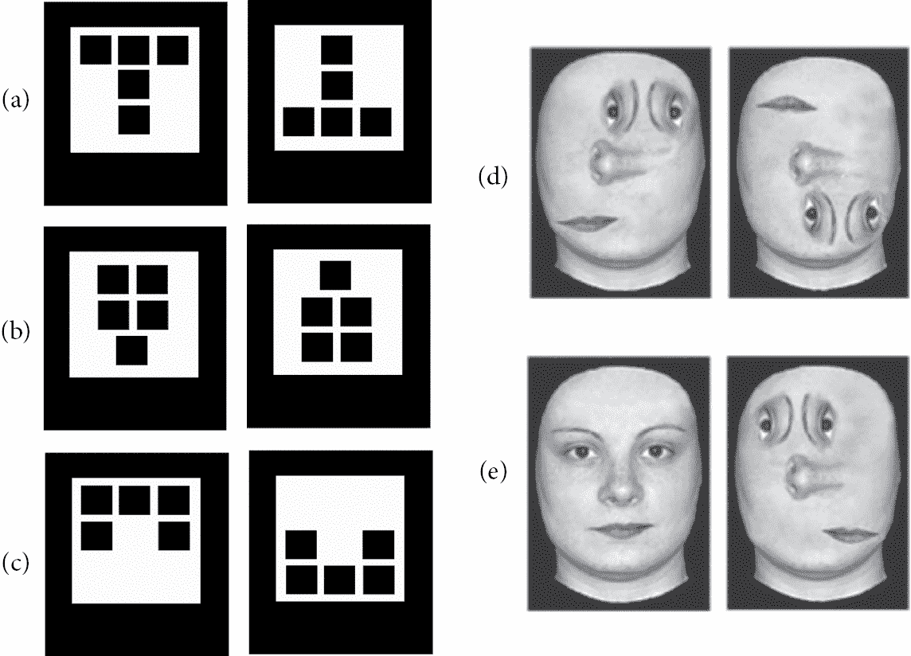
```

**图 7.1** 用于评估新生婴儿面部偏好的刺激。Simion et al. (2011) 汇集了多条心理学和神经学证据，得出结论：对头重刺激的普遍偏好解释了较大婴儿对类脸优于非类脸刺激的偏好。即使在刺激是示意性的且不是特别像脸的情况下，新生婴儿也偏好上重而非下重，在 (a)–(c) 中表现出向左侧而非右侧注视时间的偏好（作者从 Simion et al. 2002 重现）。新生婴儿也表现出对头重脸而非下重脸的偏好，即使这些特征是不规则或杂乱的（在 d 中偏好左图而非右侧图像），并且对头重脸与真实脸之间没有偏好，在 e) 中观察到左、右图像的注视时间没有显著差异（Macchi Cassia, Turati, and Simion 2004）。Simion et al. (2006) 进一步发现，新生婴儿倾向于看顶部加载但杂乱的脸部而非真实的脸部。作者认为，对于被用来支持婴儿先天面部表征的结果模式，最简洁的解释是对头重刺激的更具领域通用性的注意力偏向（如上一章中讨论的那种），这种偏向是由上丘对视觉视野上半部分更强的处理引起的（上丘负责协调视线转移和头部运动等功能）。（图片由作者重绘，或经此处引用的原始来源许可复制。）

计算机科学中的几个既有领域研究了社会认知各个方面的人工模型，但这些领域的研究尚未很好地整合到深度学习研究中。例如，“感知人类的 AI”领域广泛地尝试创建能够追踪并响应他人心理状态的人工智能体，这通常通过为心理状态添加显式符号以及对其进行推理的规则（即“心理模型”）来实现，而这些模型是明确源自心理学中的“心智理论”传统（Kambhampati 2019; Zahedi, Sreedharan, and Kambhampati 2022）。

相比之下，“群体智能”方法研究的是相对简单的人工智能体在较大群体（如鸟群或蚁群）中动态交互时可能涌出的集体决策形式（Kennedy 2006）。“情感计算”领域则关注人类社会性的情感方面，通过尝试创建能够检测、对人类情感状态做出恰当响应并模拟它们的机器人（Picard 2000）。

这些既有领域的见解并不常见于整合到基于深度神经网络（`DNN`）的智能体中，也许是因为深度学习在如此短的时间内发展得太快，也可能因为在其他领域中，许多社会认知建模方法更类似于基于规则和符号的 GOFAI（早期符号人工智能）方法，而这种方法更难与经验主义的深度学习建模技术相结合。无论如何，我认为从技术和哲学两个方面的原因来看，情感计算是经验主义 DoGMA 下一轮突破最有前景的领域——特别是因为它符合经验主义情感主义关于社会认知的理论传统。

## 对基于 `DNN` 智能体的乐观态度

在转向这一论点之前，重要的是指出，DoGMA 为乐观提供了一些理由，即经过情感增强的 `DNN` 智能体可以克服以往基于规则和符号的社会智能方法的行为局限性。具体而言，我将解释像视线追踪、行为预测、模仿和遵循规范等行为（可以借此构建更复杂的社会认知），可能很快在不使用先天特定领域概念的情况下，被基于 `DNN` 的智能体所掌握。

这种乐观源于历史情感主义者（如亚当·斯密 Adam Smith 和 索菲·德·格鲁什希 Sophie de Grouchy）关于社会认知的观点。当然，探索这些观点将发现一些担忧的理由，即某些深度学习研究者正走在错误的方向上，也许是因为他们接受了太多关于社会认知本质的理性主义假设，而没有对它们进行充分的审查。理性主义者倾向于对社会认知问题设定唯我主义框架；具体来说，许多理性主义者假设智能体出生之初是自私的利己主义者——对自己的心灵只有可靠的内省知识，并对自己的利益过度关注。这些唯我主义的智能体随后需要某种形式的理论推理来跨越自我与他人的鸿沟，从而转化为独特的人类形式和社会与社交。

事实上，跨越这种自我与他人的鸿沟——无论是通过一套先天的心理原则（如心智理论 `ToM`），还是通过一种普遍的道德规则（如康德的定言命令）——都被一些理性主义者视为人类认知的定义特征（McCarty 1993; Penn et al. 2008）。再次，只要问题是以这种方式定义的，一个配备了先天特定概念的理性主义模型似乎是获得类人认知的不可避免的代价。

### 情感主义替代方案

许多经验主义者甚至接受了这种问题的唯我主义框架，以至于在几个世纪以来，道德哲学的大部分领域一直致力于理解人类道德发展如何克服对自私关注与利他关注之间的鸿沟。结果，许多经验主义者将先天的社会认知机制视为他们唯一的领域特定天赋赋予——通常是一种同情/共情机制，使我们能够设身处地理解他人如何对我们的共同环境思考和感受。

索菲·德·格鲁希的作品可以作为通往更有前景且独特的经验主义议程的有用指南，因为她的理论通过一个极其简单且大胆的想法规避了对天赋主义的妥协：即对他人的关注可能在婴儿期的早期阶段出现，在我们发展出独特的自我概念之前，因此在自我与他人的鸿沟存在之前。

从这个角度来看，自私利己主义是需要特殊解释的独特理论态度，因为它要求区分我们自己的身体、信念和价值观与他人的。在格鲁希的蓝图中，新生婴儿从平等的开始重视自身和照顾者情感状态的线索，随后才发展出独特的自我感，然后是自我关注感，最后将他们指向他人的情感反应整合到一个更成熟的、代表对自我和他关注系统中，并具备平衡两者之间紧张关系的能力。[^1]

这个更成熟的系统是由我们已经审查过的其他领域通用能力构建而成的——特别是感知、记忆和想象力。格鲁希对问题的简单反转因此为长期困扰理性主义者和经验主义哲学者的难题提供了一个极具吸引力的替代方案。它还表明，自和他人的关注都可以通过基础强化学习系统获得，且这种方式与经验主义 DoGMA 和转换原则完全一致，挑衅性地暗示了在深度强化学习方面的潜在实现。[^2]

这种“格鲁什式”（Grouchean）的社会认知视角在发展心理学层面上是否正确，或作为工程研究的基础是否有用，仍然是一个开放的实证问题，但近期有一些理由让我们充满信心。特别是，深度学习目前的突破是通过为相对通用的 `DNN-based` 智能体提供与新生动物类似的结构化早期经验实现的，这使得它们对社会行为表现出某些相同的归纳偏置，而理性主义者曾认为这些偏置必须是先天的（Lee, Gujarathi, et al. 2021; Lee, Wood, et al. 2021）。进一步追求这一假设的益处仍然是多方面且跨学科的：它可以帮助我们更准确地理解人类特有的社会认知形式中产生差异的方面，但也可以帮助我们创建更好的人工智能智能体，使它们更高效，并以更成功、更自然的方式与我们互动。我们已经知道，继续这种“头重脚轻”、唯我主义的传统会付出沉重的代价：通过创建不具备情感基础和社会道德推理系统的智能体，我们创造了一个社会性的空洞仿真品，这与 `GOFAI` 在其他研究领域面临的落地问题类似，更接近于精神病态者的推理。他们可能正确识别道德违规行为，但不会以正确的方式受到这些行为的影响（Aharoni, Sinnott-Armstrong, and Kiehl 2014）。

格鲁什式的视角反而建议在人工智能智能体中复制人类社会认知的早期发展阶段，这将允许它们更成功地与我们以及彼此相互互动——更好地预测我们的行动和关注点，从我们身上学习并教导我们一些见解，并以独特的道德方式对我们的福祉进行推理——因为它们的其他机能和表征将更自然地与它们所支架的更复杂的社会能力联系起来。为了论证这一观点，我在本章开头回顾了更具马基雅维利式的传统，该传统将社会认知视为唯我主义利己者之间的竞争。然后，我勾勒了一个基于德鲁什（De Grouchy）更具前景的实证主义基础的社会人工智能计划。最后，我回顾了支持后一种方法的早期证据，并对进一步追求这一传统的实际益处提出了推测性评论。

## 7.2 作为马基雅维利斗争的社会认知

在考虑更优方案之前，让我们先回顾传统的唯我主义方法。根据这种观点，心理生活中的主要发展转变之一是能够理解其他理性生物也是具有内在心理生活和内在道德价值的智能体。这一转变允许智能体不再将其他智能体仅仅视为另一种复杂的物理事件（即根据常规规律根据外部情况预测其行为），而是将其视为具有自己复杂且独特内部组织的独立心理智能体。特别是，这些其他智能体被认为是理性的、表征的系统；它们感知、相信和欲望，而这些心理状态的内容预测了它们将执行的行为。与同一物理类别的对象的两个成员（它们在置于相同情境时通常表现得相同）不同，两个智能体由于对该情境有不同的内部“看法”，可能会对相同的外部情况产生截然不同的反应。这不仅有助于预测不同智能体的行为，对欺骗目的也有用，因为一个智能体可能利用另一个智能体的错误信念为自己牟利，无论是通过隐藏信息还是在故意欺骗中产生误导性证据。“马基雅维利智能假设”假设这种社会竞争是人类认知复杂性的普遍驱动力，该假设认为，为了形成和维持联盟，以及欺骗和操纵他人以击败社会竞争者的军备竞赛不仅导致了我们最亲的灵长类祖先 `ToM` 复杂程度的增加，还导致了整体认知资源的增加（Byrne and Whiten 1994）。

`ToM` 甚至被认为是人类独特的特征，或至少仅与我们最亲的灵长类亲属（如黑猩）共有。这种人类独特性主张对人工智能（AI）具有重要意义，因为如果是正确的，`ToM` 可能是许多其他人类认知成就的核心，如语言使用、技术、政治组织和文化。例如，一些认知科学家假设，没有 `ToM` 就不可能学习语言，因为我们必须知道其他说话者在想什么，以消除他们使用的新词的指代歧义。例如，假设我在一个杂乱的环境中说 `blicket` 这个词；我可能用这个未知词指代无限不同的物体、属性或动作，如果没有对说话者心理状态的某种假设，很难或无法消除其指代歧义。同样，`ToM` 与技术的创造之间存在明显的联系；如果不理解长序列执行的精细物理动作的意图目标，仅仅通过观察很难学会如何制造复杂工具。在政治中，如果没有对其他智能体的需求、欲望、恐惧、希望和不满的深层理解，复杂的联盟或长期关系将难以维持。我们对世界的大部分人类理解——包括我们在[第 1 章](#09_chapter1.xhtml#oso-9780197653302-chapter-1)和[第 2 章](#10_chapter2.xhtml#oso-9780197653302-chapter-2)中开始的“常识”——可能被认为是人类文化传递的产物，而这种传递建立在一种代社会生物能够将其新颖认知成就传递给下一代的基础上。有效的文化教学涉及之前所有提到的组件——语言交流、学生理解教师的教学意图、教师理解学习者的无知或错误信念，等等。如果这些都是正确的，那么 `ToM` 可能会被认为是解锁人类独特认知的钥匙，如果我们希望人工智能智能体实现人类水平的智能，那么在这些智能体中构建 `ToM` 模块将具有重要意义。

在过去的二十年中的大部分时间里，心理理论（ToM）一直是人类先天性、领域特定模块的最有力候选者之一。将心理状态归因他人被认为是神经发育典型儿童能够可靠达到的一个发展里程碑。特别是对错误信念的归属，被认为是衡量心理理论成熟的尤为重要的实证衡量标准。

这一研究传统可以追溯到灵长类学家 Premack 和 Woodruff 在*行为与脑科学*杂志上发表的一篇具有影响力的文章，他们质疑了黑猩猩是否也拥有心理理论，以及这一问题是否可以通过实验来回答（1978 年）。三位哲学家对该文章发表了评论回应，认为错误信念的归属在这里尤为重要（Bennett 1978; D. Dennett 1978; Harman 1978），这一洞察被 Wimmer and Perner (1983) 转化为实验范式。问题在于，很难通过实验来确定像黑猩猩这样的非人类动物是否能向其他主体归因信念，除非它们认为这些信念是错误的；因为在实验设计中，将真实信念归因于另一个主体以及根据自己的信念预测该主体的行为，这两种假设似乎总会产生相同的预测。这导致人们强调所谓的“错误信念任务”是判断是否拥有心理理论判标准。

### 莎莉-安妮任务（Sally-Anne Task）

一种源自这一直觉的标准实验设计被称为“莎莉-安妮任务”（Baron-Cohen, Leslie, and Frith 1985）。在该设计中，儿童观察一个实验者用两个木偶（或演员）讲述故事，其中一个介绍为“莎莉”，另一个为“安妮”。任务涉及一个像弹珠这样的玩具物体以及两个可以隐藏玩具的地点，例如篮子或盒子。

在设计中，儿童看着实验者解释说，莎莉在安妮的注视下将玩具放在第一个位置。随后，莎莉离开了现场，安妮将玩具从第一个位置移动到第二个位置。接着莎莉回了，实验者问儿童莎莉会在哪里开始寻找玩具。这一设计中涉及错误信念的方面可以通过考虑另一种替代的混淆情景来理解：即如果莎莉在场目睹了玩具被移动；在这种情况下，无论儿童是在为莎莉归因信念，还是仅仅根据他们知道弹珠真实所在来回答，都会给出同一个地点。然而，当莎莉没有目睹玩具被移动时，错误信念的归因会产生不同的预测；如果实验中的儿童说莎莉会去她最后看到玩具的地方寻找，那么他们必须抑制住认为莎莉会去玩具真实位置寻找的倾向。这项测试（以及许多变体）被认为是神经发育典型儿童心理理论发展的基准，几乎所有此类儿童无论语言、文化和教育背景如何，都能在四到六岁之间可靠地通过该测试（Wellman, Cross, and Watson 2001）。

### 早期发育与天赋论

神经发育典型儿童倾向于在四到六岁之间达到这一标准的发展里程碑，这使得它是先天机制还是习得能力悬而未决；然而，在过去的十年里，天赋论心理学家引入了创新的实验设计，将心理理论的出现推早到了婴儿期。这些设计依赖于非语言错误信念任务和非语言衡量来判断婴儿是否通过测试。注视时间是这些婴儿研究中最常用的指标；在更简单的错误信念任务中，据报道，六个月大的婴儿先关注预期结果（例如莎莉会去她上次看到的地方），或者更久地关注“意外”结果（例如莎莉去玩具实际所在地寻找）。一系列实验失败表明，即使是与我们最亲近的黑猩猩也缺乏类似的能力（Penn et al. 2008; Penn and Povinelli 2007）。这项研究在人工智能背景下经常被天赋论者推崇，因为它似乎将人类认知（通常被认为是核心知识系统之一）的起源推回了通过经验、语言或文化进行学习之前的年龄（Skerry, Carey, and Spelke 2013, Marcus 2018b, Mitchell 2019, Spelke 1998）。

### 深度学习与逆向规划

可能由于这些原因，简单的错误信念测试是使用深度学习代理研究的社会认知领域之一。DeepMind 的所谓的 `ToM-Net` 系统直接灵感于这一发展心理学传统（Rabinowitz et al. 2018），以及另一种将心理理论视为逆向规划问题的传统。

“逆向规划”方法暗示了一种类似于深度卷积神经网络（`DCNNs`）中的抽象与生成对抗网络（`GANs`）中的规格的操作——也许一种将他人的行为作为输入并输出其心理状态假设的推理程序，可以通过简单反转观察主体已经用于从自身计划产生自身行为的过程来实现。这种方法已从贝叶斯规划（Baker, Saxe, and Tenenbaum 2009, Baker and Tenenbaum 2014）和强化学习理论（Jara-Ettinger 2019）的角度进行了探索。

[^1]: 译者注：原文此处有锚点链接 `](#15_chapter7.xhtml#oso-9780197653302-chapter-7-note-133)`，已转为脚注标记。
[^2]: 译者注：原文此处有锚点链接 `²](#15_chapter7.xhtml#oso-9780197653302-chapter-7-note-134)`，已转为脚注标记。


这些方法通常在简单的玩具问题上进行测试，例如 Baker 等人的“食物餐车”任务。在“食物餐车”设置中，观察者代理人获得有关感知输入（例如“视线”）以及在二维景观中移动的被观察代理体的瞬时行为的信息（见**图 7.2**）。该景观包含几类“食物餐车”中的一种——被标记为“韩国的”、“黎巴嫩”或“墨西哥的”，以及阻挡视线的不透明遮挡物。

在贝叶斯方法上，观察者代理人从不同代理体的运动和食物偏好的某些表示原语选项开始，使用逆贝叶斯建模来假设使观测输出概率最大的代理体感知和目标状态。观察者代理人似乎显示它建立了关于被观察代理体动机和目标状态的假设，当代理体产生与假设目标兼容或不兼容的行为时，这些假设会随之修正（例如，观察到代理体在转过遮挡物转角并检测到韩国食物餐车为另一个选项后返回黎巴嫩食物餐车，导致观察者代理人修正了被观察代理体偏好黎巴嫩食物而非韩国食物的假设）。

逆强化学习（IRL）采用了类似的技巧，但它依赖于旨在根据观察产生特定系列行为的算法。例如，在观察到上段描述的行为后，它会尝试设计一个奖励函数，在该函数下，根据观察者代理人看到其收集的证据，这种返回将由观测代理体预测为奖励最高的策略。这两种方法在“食物餐车”型任务中都能产生很有前景的结果，但贝叶斯推断和逆强化学习都被认为计算成本过高，不足以模拟实现社会认知的神经机制。

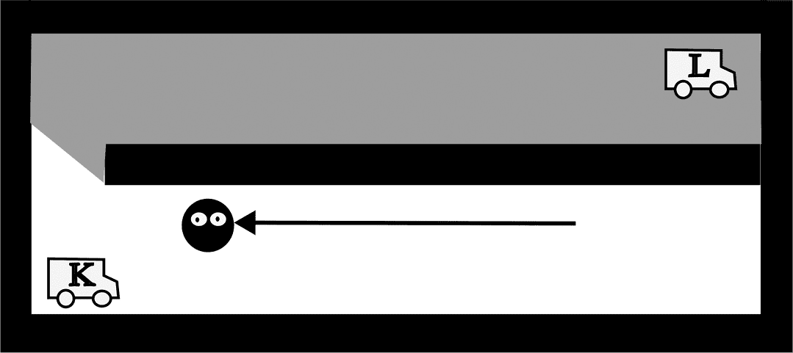

**图 7.2** “食物餐车”心理理论推理任务中训练输入的示例（作者从 **Baker et al. 2009** 复制）。观察者代理人提供了目标代理体（带有“眼睛”的圆圈）的连续移动信息，其在遮挡障碍周围寻找所需的食物餐车时移动；阴影区域表示被观察代理人视线之外的内容，标记为 `K` 和 `L` 的“餐车”分别对应韩国和黎巴嫩食物餐车。通过观察代理人的去向和行为方式（例如，在转过转角并观察到“错误”的餐车后返回），观察者代理人可以对被观察代理体的欲望（它偏好哪种食物）和信念（它认为每种食物相对于遮挡屏障的位置）建立假设。逆规划或逆强化学习可用于开发关于感知输入和目标状态偏好的假设，这些假设可以预测（并溯及）被观察代理体的行为。

受“食物餐车”实验启发的玩具任务的最先进结果由 Rabinowitz 等人的 ToMNet 实现，这是一种基于 DNN 的架构，计算需求上比贝叶斯或 IRL 模型更具生物学合理性。该架构包含了两个并非源于学习的新“先天”DNN 模块：“性格状态网络”和“心理状态网络”（见**图 7.3**）。

性格状态网络通过观察和压缩该代理体与其环境交互的先前轨迹，为每个被观察代理体建立通用模型（称为“性格嵌入”）。心理状态网络将这些性格嵌入与当前情况的信息相结合，形成特定于当前回合轨迹的嵌入。模型的作者假设，这使得架构能够根据代理体在当前回合中的稳定性格和近期行为，对当前回合中的代理体进行“心理化”（mentalize）处理，并输出该代理体在当前轨迹中的心理状态嵌入。性格嵌入、心理状态嵌入以及来自当前环境的输入被传递给整体预测网络，由该网络预测代理体的未来行为。

与基于贝叶斯和 IRL 的任务解决方案类似，ToMNet 的学习轨迹似乎显示出在观察到不一致的行为轨迹时，对心理状态假设进行了修正。作者们甚至创造了一种情境，通过引入基于萨莉-安任务（Sally-Anne task）建模的“交换事件”（当“所需”物体位于被观察代理体视线之外时移动物体），使得观察者代理人只能通过归因错误信念来正确预测被观察代理体的行为。ToMNet 成功完成了这项任务，尽管尚未达到最佳的可靠性水平。

根据关键的经验主义需求，ToMNet 比更具天赋论的心理理论方法好得多。特别是，该系统不包含将其他代理体视为理性规划者的手工模型；相反，代理人纯粹通过观察其过去的行为来学习预测其他代理体的行为模式。此外，如前所述，它对 DNN 进行心理化归因的依赖比其他算法方案在计算上更可行。它还展示了“学习学习”（learning to learn）的效应，即随着时间的推移，它在预测一般代理体特别是个体代理体（考虑到其独特的“性格”）的行为方面变得更好。

至关重要的是，这意味着它最终学会了根据极少观测行为来预测新代理体的行为，这通常被认为是类人心理理论的关键效率收益。这种方法作为可解释人工智能（XAI）中的一种解释性方法可能非常有前景，因为配备了心理理论的基于 DNN 的解释器可能为解释其他 DNN 代理体的行为提供最佳工具。然而，它需要两个新的先天模块，这些模块在社会归因的应用上比我们目前考虑的任何内容都具有领域特定性。

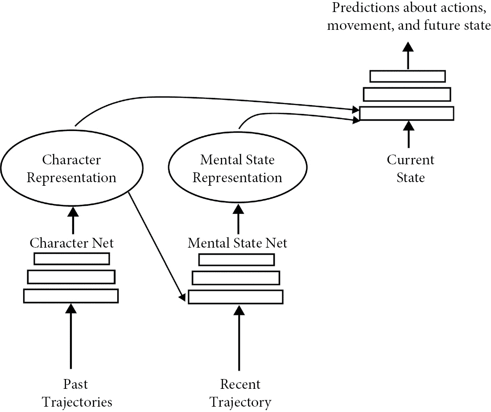

**图 7.3** ToMNet 架构图，改编自 **Rabinowitz et al. (2018)**。该架构包含三个基础网络：根据多个过去轨迹为个体归因稳定性格的“性格网络”、根据当前回合的观测结果为代理体归因当前心理状态的“心理状态网络”，以及一个整合性格、心理状态和当前状态表示以生成对代理体下一个行为预测（以及关于其后续状态的后继表示）的“预测网络”。

尽管一些深度学习批评者倾向于将其视为认知科学中的共识发现，但错误信念理解的先验性及其在人类社会认知中的核心地位仍未无定论且存在争议。第一个问题是，早期婴儿研究中评估的主要因变量之一——`looking times`（注视时长）因极难解释而闻名。表现出相同偏好或更长注视行为模式的婴儿，可能由不同的底层认知过程驱动——较长的注视可能表示对熟悉的检测，也可能表示对新颖的检测，实验人员必须对注视的微结构进行历程监测，以确定正确的解释（Aslin 2007）；Westra 2017）。

此外，发展心理学中的复制危机对其非语言错误信念设计的打击最为严重，出现了大量的复制失败，该领域的几位著名研究人员报告称他们未能重现自己一些最著名的结果（Baillargeon, Buttelmann, and Southgate 2018；Kampis et al. 2020；Kulke et al. 2018；Powell et al. 2018；Sabbagh and Paulus 2018）。甚至是 ToM 在神经发育正常的人类中四至六岁之间普遍出现的这一标准观点，最近也受到了文化变异性新证据的挑战。特别相关的一个发现是：显性心理归因在更强调个性和自主性的西方文化中似乎更为常见且出现得更早（Moore 2021；Warnell and Redcay 2019）。

一种更具建设性的经验主义回应也在背景中酝酿。这种反论强调了婴儿所拥有的（被低估的）社会经验和数量（Smith and Slone 2017）。研究人员认为，这种经验足以在没有先验知识的情况下获得认知任务的能力，他们通常基于婴儿头戴摄像头记录的数据，这些数据随后可以作为输入来训练评估特定社交技能的关联模型（Smith et al. 2015；Yu and Smith 2013）。许多其他研究在非人类动物中发现了类似的 ToM 非语言证据，甚至包括乌鸦之类的灵长类动物（Bugnyar, Reber, and Buckner 2016；Karg et al. 2016；Krupenye et al. 2016；Tomasello, Call, and Hare 2003）。

### 7.3 Smith 和 De Grouchy 的情感主义社会认知方法

上述讨论的“餐车式”玩具问题的实验人员完全会承认，这些任务反映了社会认知的一种简化且理想化的方法。我们可能在此处想知道，这一传统的进一步完善是否会收敛于类人的社会认知，还是说（相反）基于深度神经网络的社会认知正走在错误的道路上。然而，存在另一种路径可以探索。在本节中，我为 DoGMA 勾勒了一条路线，建议回溯引导练习中更早的节点——情感话题。回到前几章捍卫的经验主义传统，可以产生通用能力（如记忆、想象力和注意力）的有用见解，而这些能力通常被理性主义者忽视或贬低。事实上，经验主义者强调，特定情况下的特定情感反应而非抽象的认识推论，首先让我们意识到其他人类也是具有丰富意义的内心世界的代理。根据这种观点，个人依恋和特定的情感（如爱、友谊、羞愧和遗憾）——而非无感情的命题态度归属或通用规则——构成了人类社会理解的基石。

当然，成熟的道德和社会决策还涉及平衡情感反应与正义、公平等更抽象的考量。因此，社会认知的双系统观点在近期的道德心理学中非常流行，特别是那些认为成年人可以使用直觉的、情感的、慢学习的、自动情感系统，以及反思的、抽象的、快速学习的基于规则的推理系统来解决问题的观点(Greene 2014)。但这种简单概括这两个系统的方法很快产生了问题，尤其是它划分了我们肩上类似“柯克式”天使与“斯波克式”天使之间的鸿沟，使得它们在实际决策中的互动和加权权衡变得扑朔莫测 (Cushman 2020; Pessoa 2008)。在亚当·斯密和索菲·德·格鲁中发现的一种特定的经验主义流为提供解决方案非常合适。例如，Sarah Songhorian (2022) 认为，斯密（以及后来的德·格鲁）发展的“反思性情感主义”可以通过对道德认知采取历时的发展视角来弥合这一鸿沟，让我们看到基于规则的系统是如何从情感系统中发展而来的，从而能够用共同的语言与其互动和交流，特别是在较长的时间尺度上。

在斯密反思性情感主义的基础上，主体通过反思性地引导其抽象能力，投向在参与各种化情境中使用其初始情感反应时产生的紧张关系和特质，从而主动地发展出一种更具规则性的社会认知能力。正如位置干扰变量挑战我们对三角形和椅子等抽象物体类别的检测一样，我们最终可能会从这些个人依恋和社会地位的特质中抽离出来，形成关于情感特征、心理状态和社会情境的更通用的概念。与之前的章节一样，感知、记忆、想象和注意等领域通用能力在抽象化过程中起着关键作用。正如我们的想象力使我们能够探索视觉感知中抽象类别干扰参数的新颖价值一样，我们可能学会通过在社会情境的槽位中插入不同的主体或态度，来构想新的社会情境，让我们看到“置于他人的位置”是什么样子的 (Buckner 2018b)。然而，这种抽象练习的起点位于那些更谦卑的、领域通用的起始，这些起点帮助我们应对非社会世界，例如我们的基本情感反应和强化学习。

当然，还有其他的经验主义起点，但遵循早期章节的策略，我重点关注经验主义领域中一条与 DoGMA 开发最密切相关的特定路径，并以亚当·斯密和索菲·德·格鲁的作品作为路标。斯密和德·格鲁很大程度上是在前几章节讨论的洛克/休谟式的经验主义功能心理学框架内并进行扩展。两者都将成年社会认知的根源位于童年早期的形成性学习经验。考虑到我们在前面的章节中强调了结构化早期经验对于实现类人机器学习的重要性，这一点显得尤为重要。这种发展性方法并非对我们社会理解起源的陈旧观点，它在今天被认为是社会心理学中前沿的理论选择 (Theriault, Young, and Barrett 2021)。事实上，斯密和德·格鲁之间的主要争议点在于我们必须追溯到童年的多久才能找到第一个脚手架经验。虽然这两位思想家都强调“同情”是关己与关他心理能力之间的首要桥梁，但斯密将同情的起源定位于童年被他人评判的经历，而德·格鲁则将其起源定位于生命的最初几天，即婴儿与其最初照顾者之间特定的依恋和互惠互动。

情感主义传统认为，我们最早期的一些情感反应至少对于我们自己的痛苦和快乐是不具特异性的，因此可以推广到他人。这种方法有许多优点。首先，它将道德推理的起源定位于自然的心理属性，例如一般强化学习中追求快乐和规避痛苦的倾向。与康德等更具理性的方法不同，情感主义不需要纯粹理性或先天道德规则的特殊贡献；相反，道德感和道德推理的起源可以位于我们在观察他人的快乐或痛苦时感受到的情感中 (Prinz 2007)。情感主义方法也有利关于社会认知和道德起源的进化叙事，因为我们可以在最近的灵长类亲属中找到道德情感的前驱 (De Waal 2012; Piccinini and Schulz 2018; Preston and De Waal 2002)。然而，情感主义者倾向于认为只有人类能够完全的道德反思和推理，因此在我们灵长类亲属中发现的利他情感中，仍然缺失某些东西。

对于反思性情感主义者来说，这正是反思性同情进入故事之处，用以引导这些社会情感走向成熟的道德决策。这些情感主义者强调“同情”（我们今天称为“共情”）是关己与关他认知之间的基础桥梁。对于休谟而言，同情以何种方式涉及到感受他人所感受到的，就像通过某种情感感染 (Fleischacker 2019; Wilson and Sober 1998)。休谟通过物理耦合系统的比较来描述它：“正如等距离绕在一起的弦，一个运动会传给其他的；所有的情感很容易从一个人传递到另一个人，并在每个人类生物中产生相应的运动” (`T` 3.3.1.7)。这种传染为我们归纳性学习他人思维提供了桥梁；我们会学会他人与石头不同，因为前者会在我们身上产生同情情感，而后者不会，这对行为的预测、解释和评估提供了良好的证据。然而，评论者观察到，休谟似乎是在假设而非解释我们的情感反应是如何与人的反应耦合的，这似乎在他社会和道德心理学中心留下了一个空缺 (Kim 2019)。斯密在《道德感情论》中很大一部分理论阐述正指向这一空白。

即使在经验主义传统之外，哲学家和心理学家也在思考，我们究竟是如何找到证据来跨越“卢比康河”，从相信自己拥有具有意义思想的内在心理生活，转变为相信他人也拥有具有意义内在思想的心灵。长期以来，这一直被视为哲学的基础问题之一（Sober 2000）。

理性主义传统——通常以笛卡尔为首——假设我们必须从“我们自己拥有心灵”这一知识出发（例如著名的“我思故我在”），然后寻找某种证据，以支持推导出“他人也拥有心灵”的结论。情感主义传统中的经验主义者则将对他人情感状态的感知视为一种更接近于非推论的即时感知，是由同情等情感触发的。然而，这给他们留下了解释这些及人情感起源的负担。20 世纪哲学中一些最为华丽的论证试图绕过或反转这一问题——例如塞尔斯（Sellars）的“琼斯神话”，他推测对自身心理状态的反省性意识可能源于一种理论：即他人拥有内在心理片段的心灵，而这些片段预测并解释了他们复杂的行为（Sellars 1956）。

亚当·斯密（Adam Smith）和德格鲁西（De Grouchy）都被认为继承了休谟的情感主义，但他们都试图为这个发展之谜提供更好的答案。对于斯密来说，同情的起源在于我们童年早期与他人的互动。正如 Fleischacker (2019)所提到的，斯密提供了一种更具“投影性”的情感解释（与休谟的传染论形成对比），这种解释利用想象力来模拟如果我们处于他人境地会有什么感受。根据斯密的观点，这种能力产生于童年早期对他判断和被他人判断的经历，在过程中，我们必须学会理解并近似他人对特定情况的情感反应，以判断其恰当性。通过观察儿童和成人对我们及同伴表现出的愤怒或善良行为的反应，我们意识到某些情感反应是恰当的而另一些不是。

借鉴早期章节的观点，我们可以将这一过程或道德抽象比作通过感知中的抽象来控制“性扰性变异”的过程。正如我们在解决物体分类任务时，学会识别并从视觉领域中姿态或位置的差异中抽象出来一样，我们在社会认知中也学会了我们的某些态度和起点是特异的，或是不被社区所赞纳的，因此试图将它们从实践判断的变异来源中抽象。斯密在情感主义话语中最重要的贡献是，他的观点：这种抽象过程最终会在与他人的视角达成一种“和谐”（concord），使得社会主体“不断地”且“恒久地”尝试设身处地——因为如果我们试图用偏颇的标准来判断自己或他人，他人会指责我们并指出偏差。

在这种平衡的极限，这种和谐应该允许我们每一个人都获得其所属文化的“公正旁观者”视角，由其来判断某些情况下的情感反应是否被普遍认为是恰当的（Songhorian 2022）。社会行为——无论是涉及道德问题还是非道德问题（如礼仪）——源于我们隐含或显性的尝试培养公正旁观者认为恰当的性格特质和情感习惯。从本质上说，斯密在这里描绘了一种方法，通过反思性抽象的迭代过程（如已讨论的那些），利用情感和想象认知的形式来学习理性主义者所推崇的抽象性和公正性。


德格鲁西在她对《道德情感论》的权威译本中对斯密的观点进行了评论，为这种情感主义的共情方法提供了更进一步的发展基础，特别是通过将其起源追溯到婴儿时期的最早经历。虽然她通常在斯密的休谟式经验主义心理学范围内工作，但德格鲁西记录了若干处分歧。其一，对于德格鲁西来说，同情是一种复杂的情感：它包含了她所说的对他人情感的自然“感性”（这更接近休谟的情感传染），但随着它在道德教育和经验的连续阶段中发展，它也包含了更抽象和理论性的成分，例如斯密式的抽象反思和谐。

对德格鲁西来说，同情的早期根源于新生婴儿应对愉快或痛苦刺激时经历的情感状态。根据德格鲁西的观点，这些情感状态既有局部维度也有非局部维度；既有感知为发生在特定受伤部位的疼痛，也有一种通用的、非局部的负面情感。她认为，即使没有局部成分，这种非特异性的情感成分在动机上仍然具有重要性；这就是为什么仅仅是对痛苦的记忆或想象在情感上仍然具有意义，尽管通常程度较低。这种非特异性的情感成分是德格鲁西在早期发展认知中跨越“自我-他人”鸿沟的桥梁基石——因为她认为，由于新生婴儿和护理者之间缺乏明确的界限，这种非特异性成分也可以被护理者的遭遇所触发。

德格鲁西捍卫一种自然的经验主义演进，正如斯利塞尔所解释的（De Grouchy 2019; Schliesser 2019），这种进展可以通过经验和教育来培养，从婴儿对自身痛苦快乐的天然感直到最抽象的道德命题。这种进展始于婴儿对护理者的完全依赖；因为护理者可见的情感与其对依赖婴儿反应之间的联系，婴儿很快学会了护理者的障碍就是自己的障碍，护理者的快乐就是自己的快乐。婴儿起初与护理者处于耦合依赖状态；正如发展心理学家观察到的，只有在后来通过一个重要的认知里程碑，他们才能设想自己是独立的个体。新生儿甚至没有发育完全的身体图式来确定自己的身体在哪里结束、护理者的在哪里开始——最近的神经科学研究甚至表明婴儿自身的身体地图可能与他人的身体地图同时发育，这可能与模仿的出现有关（Rochat 2009; Rochat and Botto 2021）。

正如新生婴儿父母经常学到的那样，这种发展是非常缓慢的，从分离焦虑开始，这种焦虑通常出现在六个月到一岁之间（Battaglia et al. 2017），并在皮亚杰“前运算”发展阶段的自私自我中心主义达到顶点，该阶段发生在两岁到七岁之间（Steinbeis 2016）。在这个阶段之后，我们开始看到与成熟心理理论（`ToM`）相关的更典型的人类心理化模式。在该阶段，也许为了更具理论性的社会认知能力，可能会引入更多的推理机制；但在情感主义的描述，这些机制将建立在深得的情感利他支架框架之上，而这一框架是从出生后的第一天就开始逐渐构建的。

此外，婴儿学会了通过交流来改变照顾者的情感，这在婴儿能够将自己视为一个独立的自我之前，进一步加强了婴儿与照顾者福祉之间的互惠耦合。例如，哭泣或咯咯叫会导致照顾者变得忧心或亲切，反过来有助于婴儿缓解饥饿或疼痛。因此，对他人的依赖和情感互动是社会认知的感性起源，而非理论论证的结论。

## 情感链接的发展

随着婴儿对自身身体的理解，她进一步学会了将自己身体部位的疼痛和快乐与照顾者身体中疼痛和快乐的原因联系起来。这些链接足以在看到照顾者的喜悦或忧伤时触发情感感官能的非特异性成分，就像我们自身快乐或痛苦的记忆或想象情景在缺乏局部化感知的情况下也能触发非特异性情感成分一样。正如 De Grouchy 所说：

> 所有的身体快乐，正如所有的身体疼痛一样，在我们身上产生一种感觉，它由直接接收这种感觉的器官产生的特定快乐感以及一种一般的幸福感组成。后者在看到快乐时可以重新产生，就像痛苦的感觉在看到疼痛时产生一样。因此，我们很容易对他人所经历的身体快乐产生同情心，就像我们对他们的痛苦那样。（De Grouchy 2019

### 向道德推理的转变

一般而言，经验主义者特别是 De Grouchy，对于从这些泛化的情感反应到更成熟的道德推理的转变有许多话要说。我们在前几章中讨论的能力在这些解释中起着关键作用。

总而言之，德格鲁（De Grouchy）情感主义方法的天才之处之处在于，它通过将社会认知的起源定位于鸿沟出现之前的发育阶段，干涸了阻碍其他理论的“自我-他者”卢比孔河。此外，该方法本身就包含了某种程度的社会或文化变异性。因为我们的情感反应受其成长和教育文化塑造的影响，因此它们可以通过学习，被定制成适应不同文化和传统的各种精细情感与美德。例如，接受自主和个人责任美德教育的西方儿童，预计将围绕同情、公平和正义等美德来构建其道德推理，而其他文化传统可能会培养其他的情感和价值观。事实上，刘（Liu）曾认为，尽管儒家道德传统也可以从情感主义的角度来理解，但它强调了不同的情感，如怜悯、羞耻/厌恶以及尊重/顺从（Liu 2017）。我们可能还会预见到，格鲁式的伦理方法比基于正式规则的方法更具活性且具有自我修正能力，因为代理会根据他们所敏锐感知的其他代理的情感反应来自我修正其道德行为。因此，这种方法在经验主义道德心理学理论中似乎具有许多吸引力，而这些理论与其作为发育严谨 AI 框架的前景直接相关。

## 7.4. 一种用于人工智能体社会认知建模的格鲁式发育框架

虽然反思情感主义方法为当代道德心理学带来了许多好处，但它为如何利用深度学习方法模拟更类人类的社会认知提供了富有成的指导。在实践中，这可以允许基于 `DNN` 的代理更成功地与人类互动，特别是通过以更具响应且敏感的方式从人类身上学习并对其进行推理。该方法在初始阶段将与那些更以错误信念为中心的马基雅维利式方案有显著区别；具体来说，我们应该在认知发育上进一步回溯，溯到婴儿早期情感主义者所强调的情感和情绪反应的出现，并从那里开始用一种更具发育性的机器人方法重新启动——这种方法最近被伦理学家 Peter `Railton (2020)`、发育心理学家（`Smith and Slone 2017`）以及发育机器人领域的工程师们（`Cangelosi and Schlesinger 2015`）曾给出过极有说服力的推荐。这一修订后的计划可以借鉴社会机器人学和情感计算领域几个更成熟的传统，尽管这些教训将被应用于新的环境并服务于新的目标。特别是，我们必须重新审 `第 4 章` 中关于强化学习的观点，以考虑情感主义情感方法如何为更多维的估值方法提供启发。重申一下，强化学习中最大的挑战之一是缺乏单一目标（如 `score`）。情感主义方法允许我们对人类（及动物）情感背后的足够重要的差异因素进行建模，使我们能够能够以类人类方式与其他代理学习和交互的人工代理。

情感主义深度学习方法可以挖掘的第一个领域是“情感计算”传统，它与罗莎琳·皮卡德（Rosalind Picard）的工作联系密切。情感计算的目标通常比我们关注的要广泛得多；该领域涵盖了创建能够“识别、表达、建模、通信和响应情感信息”的机器的各种尝试（`Picard 2000`:55）。这些努力中的许多虽然没有显式实现在基于人工神经网络（`ANN`）的情景中，但可以被借鉴或为 `DoGMA` 的类似性能微调提供灵感。正如 `第 1 章` 中提到的某些警告一样，目标通常是“建模”情感和情感检测，而不是创建实际上能够“感受”情感的人工代理——皮卡德本人对这一目标经常表示怀疑。即使这在物理上是可能的，可能也存在伦理原因要避免尝试创建能够体验情感色彩的意识状态的人工代理，因为实验过程可能涉及大量不可避免的 `人工痛苦 (Metzinger 2021)`。

为了让人工智能代理能够以类人类的方式学习这些情感和社会认知形式，为它们提供具有人类和动物发育特征的生态结构化经验再次至关重要。这表明，对于人工智能道德主体，存在与过去采用的方法截然不同的途径。

我们不应该通过使用皮肤电检测器等特殊传感器或符号推理规则来编写智能体以识别情绪，而应该创建仅使用人类可获得的同类线索就能识别情绪的智能体；与其使用标注训练集训练机器为了识别情绪本身而识别情绪，不如让它们作为依赖他人来满足基本目标的副作用，学会识别他人的情感状态，而这些基本目标通过识别潜在合作者和竞争者的情绪来实现得最好；与其目标是创建能够“开箱即用”地适应社会线索的智能体，不如这些人工智能代理应该像人类和其他智能动物一样，拥有较长的“人工幼态”（artificial neoteny），在此期间它们是无助的，并花费大量时间仅仅观察照顾者的行为和互动（Bufill, Agustí, and Blesa 2011）。

我们可能需要为智能体提供如目光方向、面部表情和手势等人工社会线索，但我们可能不需要为它们提供先天的特定领域表示，以便它们通过类人类学习集表现出适当的行为。回到早期对人脸偏好的例子，正如本章开头讨论的对头重型视觉模式的偏好等领域通用偏见，如果与对人脸的早期且结构化的接触相结合，可能就足以构建起对人脸的偏好（Macchi Cassia, Turati, and Simion 2004）。这并不是说我们应该用人类领养父母抚养机器人婴儿，而是说我们需要认真对待早期互动在构建人类和动物社会认知方面所起的作用，并尝试在人工环境和结构化训练课程中复制这些早期经验的重要方面。

至关重要的是，原生的 `DNNs` 可以补充以与经验主义者“激情”相对应的各种多维度情感和情绪反应，以增强强化学习训练的智能体的性能。根据情感神经科学和心理学中的一个强大观点，情绪反应充当“躯体标记”，帮助生物体检测并从基本生物情境的动机意义中学习（Damasio 1996）。Antonio Damasio 特别认为，这些躯体标记仅仅通过对结果的前景考虑就能引发，并能引导决策和规划。这一理论与早期章节中关于类似伊本·西西纳式的意图在引导基于强化学习的决策方面可能发挥的作用观点完美契合。与威廉·詹姆斯经验主义中的内在兴趣相似，对痛苦、快乐、无聊、好奇、恐惧、饥饿和身体舒适等情境的基本情感反应序列，一直被视为“激情”的一部分，经验主义者利用这些激情来解释天赋主义者可能认为由天赋观念驱动的更复杂的情绪反应。最近一些经验主义者认为，即使这些基本的躯体标记，受先前经验的影响也我们想象的要大（Maia and McClelland 2004）。无论如何，即使我们认为一组躯体标记是基本的，只要它们不需要天赋观念来触发，它们就符合转换原则，并且不会在经验主义的情感主义传统中显得突兀。

然而，深度学习领域在有效利用这些见解方面面临着挑战。特别是，智能体可能需要复杂塑造的身体来有效地计算响应。在这里，天赋主义再次具有特殊的吸引力，因为支持者优先考虑进化在确保生物体倾向于高效产生良好适应自然环境的行为方面所起的作用。但经验主义者没有也没有需要否认进化的重要性，也不需要否认生物体通常会良好地适应其环境。重申第一章）。

将这些见解应用于以深度学习为中心的研究计划，可能从受控培养研究的延续开始，其中由基于 `DNN` 架构驱动的人工智能体可以通过相互发送社交信号，在模拟环境中互动以追求目标。这种计划可以始于赋予这些智能体更健壮的人工感官器官和身体，使其根据相对通用的环境情况产生情感反应。随后，智能体可以通过社交学习在更特定的社会情境中进行微调。这种方法的变体可能通过将上一章提到的伍德式（Wood-style）人工小鸡实验支架化到更丰富的虚拟环境中更高的发育水平来实现，或许还与在虚拟环境中培养基于强化学习或自监督学习的研究相结合。事实上，这种在虚拟环境中使用社交学习智能体的两种方法已经在 DeepMind 的不同研究团队中得到了实践（Christiano et al. 2017; DeepMind Interactive Agents Team et al. 2022）。将这些努力与婴儿和动物认知研究领域的早期社交认知测试相结合，并作为虚拟环境中系统性测试的增强，例如动物-AI 奥运会平台（Beyret et al. 2019; Crosby et al. 2019），可能会产生进一步的见解。

我们可能会回到理性主义者强调的一些最先进的社会行为，但现在有了一个包含更强大建筑材料的工具箱可供利用。`ToMNet` 建模的错误信念归因可以被设定为一个目标，我们预期这种目标会出现在此类智能体，但在人工智能发育的后期，可能是由于被欺骗的情感体验，或者看到他人对受欺骗状况和智能体的欺骗做出的反应。早期婴儿 `ToM`（心理理论）研究中的复制危机表明，错误信念归因确实在人类儿童四到六岁左右才出现，此时他们大约掌握了描述心理状态的显性语言资源（Rakoczy 2017）。换句话说，我们预计这些能力只能通过许多早期能力所提供的支架来学习，例如情感识别、三元注视，甚至可能涉及包含“信念”、“欲望”和“意图”等命题态度词的语言交流。

归结底，之前建议的社交认知方法建立了一种经验主义的回应，用以应对“创造像人类一样学习的人工智能体”的天赋主义挑战。天赋主义者希望通过植入更多的先天理论或领域特定的学习规则以及表示原语来创造更具人性的学习；而经验主义观点则认为，这种高层知识源于与其他智能体的互动，特别是通过模仿和文化传授。诚然，经验主义者认为，显性符号在支架类人类学习中起着重要作用；然而，正如休谟和洛克等经验主义者长期坚持的那样，这些显性符号是由语言和文化互动提供的，而非先天的赋予。能够引导追踪他人视线、情感和心理状态的人工智能体，可能利用其互动通信为对新表示的深层理解提供支架。根据这种经验主义观点，解释我们能够说复杂的语言、发现并不断改进科学理论、创造复杂技术以及形成大型社会群体和政治结构的独特人类知识库，并非先天赋予的产物，而是我们对文化进行情感调适、获取和扩展的独特能力。

这种关于社交认知文化起源的经验主义建议引发了一系列其他问题。特别是，我们最亲的非人类亲属（如黑猩猩）是否具有类似的文化学习能力（Toth et al. 1993）？如果没有，是什么让人类在文化学习上如此与众不同？人类文化在这种背景下被描述为拥有一种独特且强大的“棘轮效应”；每一代人类都可以利用他们的关联学习能力，改进由照顾者和老师传给他们的概念和策略；这种提升可以像棘轮扳一样锁定，并转而传递给下一代进行进一步改进（Tennie, Call, and Tomasello 2009）。一项相关的研究计划广泛关注人类独特文化传授的某些早期案例，例如通过石器加工制造箭头和石刀，以确定这些技能是否能被非人类动物获得，以及我们制造这些技术的技能（如果有）哪些方面是人类独特的。这些作者最近推荐的“人工石器加工”模型使用 `GANs` 来建模人类石器加工的关键方面，是这种关注及其延伸的例证。尽管这些实验也处于早期阶段，但已经在三维虚拟环境中开发了概念证明；通过对石器加工过程中涉及的关键变量进行编程，基于 `GAN` 的模型准确预测了在实际加工过程中去除的石片的长度、宽度、体积和形状（Orellana Figueroa et al. 2021）。这些初步步骤为更具雄心的人工文化传递实验指明了方向，这些实验符合并反过来进一步支持教条（DoGMA）进入最抽象的人类文化传递知识领域。

这里的赌注很高。

如果我们能够创造出以文化、棘轮式（ratchet-like）相互学习并向人类学习的人工智能体，那么我们可能能够创建不仅像人类孩子那样向我们学习，还能反转学习方向的智能体——它们利用卓越的感知抽象能力超越人类知识的局限，并教我们看到根本性的新模式。某种程度的现象已经通过 `AlphaZero` 和 `MuZero` 间接地发生了：人类正在对这些系统击败人类策略进行逆向工程，以推导出根本性的新策略，并将其整合到围棋和象棋的文化理论中（Sadler and Regan 2019）。

尽管我们本质上已经在使用这种涡轮驱动的棘轮了，但这种应用深度学习来增强我们自身文化衍生知识的方法，仍然依赖于人类棘轮机制的灵活性创造性的逆向工程。想象一下，如果这些网络能够模拟我们对问题的理解，将我们的注意力引导向局面中对于获取新的、更强大的问题解决策略最显著的方面。事实上，我们已经可以想象如何用现有技术实现这种方法的简单版本：`AlphaGo` 较小的策略网络在某种意义上模拟了人类玩家做出特定移动的可能性；估计人类可能的移动与 `AlphaGo` 认为的最优策略之间的差异是轻而易举的，或者在其上方添加一个教练子程序，引导人类玩家的注意力转向更具前景的移动。从游戏原则的角度上实际解释为什么这些移动更优，已经超出了当前技术的限制，但随着近期大语言模型（如 `GPT` 系列和 `PaLM`）的进展，假设为新策略提供合理的口头解释可能近在咫尺已不再荒谬的。

### 思维链的突破

特别是，“思维链”（chain-of-thought）提示在 `PaLM` 在多种被认为对 `DNNs` 困难或不可能完成的语言任务中取得突破性表现的作用，表明我们正处于突破的边缘。特别是，在提供思维链提示时，`PaLM` 在处理这类给小学生做的那类算术应用题时表现明显好得多。

例如，当模型在没有任何任何提示或结构性建议的情况下给出算术应用题时，它倾向于给出错误答案。然而，当给它的提示建议哪些数量相关，并结构化解决问题的运算顺序时——就像引导人类孩子使用早期课程中简单问题的脚手架来完成更复杂的数学题一样——它的答案变得准确得多。更令人印象深刻的是，模型在随后的实验中可以为答案生成自己的新颖思维链提示，并继续从中获得随后的准确性益处。重要的是，如果这一过程可以复制到其他类型的问题解决中——甚至可能建立在另一个使用记忆或想象力类模块来解决问题的认知模型之上——那么这些模型可能具有以棘轮方式、通过显性语言指导来为人类提供脚手架的能力。

### 基于人类反馈的强化学习

更具启发性的是在本章节写作时，性能最强的语言模型是通过基于人类反馈的强化学习（`RLHF`）进行微调的。这包括来自 `OpenAI` 的 `ChatGPT` 以及来自 `AnthropicAI` 的新的 `RLHF` 训练系统，两者在许多指标上都优于此前令人印象深刻的语言模型（Bai et al. 2022; `Glaese et al. 2022`; `Liang et al. 2022`; `Stiennon et al. 2020`）。

尽管模型训练的反馈来源比我提议的简单得多且维度更低——它们倾向于依赖简单的`点赞`或`踩`——但性能的提升（特别是在与人类代理对话时）令人印象深刻。这些突破表明，开发 AI 的下一步将是利用更广泛的人类反馈。例如，我们可能希望直接从文本中提取这些形式的反馈的系统——可能通过某些词触发特定的情感标记，反过来调节学习——将拥有一个无尽且强大的数据源。

### 结论


最后，通过考虑我们对独特道德决策建模的能力来总结：经验主义者希望被赋予了一系列情感反应、通过语言中介的文化参与以及之前章节讨论的其他领域通用能力的智能体，能够很好地启动它们自己的抽象、规则式决策。具体而言，偏好、起源或人口统计因素的差异将被视为必须在抽象社会模拟中抽象并控制的社会干扰，从而使人工智能智能体能够模拟斯密所强调的人类“客观观察者”类型的判断。

长期以来，我们构建人工智能智能体的方式就好像它们是孤立成长的唯我论者，将道德推理作为事后补充。然而，社会学习应该被视为推导出道德抽象的经验基石。

为了总结这种人类道德发展方法，Songhorian 精辟地描述了斯密的观点：

> 如果一个人在孤立中长大，她的原始情感和欲望——尽管存在（TMS, III.1.3））将不会占据她的思想，她既没有发展良心的需要，也没有动力。只有在一个特定的社区内，人类才能既对他产生同情（TMS, I.i.1.3–4），又能理解他人以同样的视角来看待自己（TMS, II.ii.2.2）。正如我们看到的，从这些经验中，人们开始抽象并根据真实的观察者如何判断她来判断自己。正是通过抽象，客观观察者作为良心的形象才出现的。然而，抽象并对情感进行推理的能力并不像情感本身那样原始。（2022:671）

换句话说，之前讨论过的其他通用领域能力——如记忆、想象力和注意力——已经提供了足够的资源，帮助完成迈向最后的“引导”，即实现道德立场的“解耦”，并获得对道德情境的公正视角。道德哲学家 `Annti Kauppinen` 特别认为，`Smith` 反映性情感主义中的中立观察者视角应该被理解为想象能力的一种特化，即一种习得的技能，能够将注意力重新聚焦在情境中那些被中立观察者认为具有道德相关性的方面（`Kauppinen [2010, 2017]`）。如果一个代理能够在代表对情境中情感意义层面的特定依恋的同时，也学会将其注意力资源调节到中立观察者认为具有道德相关性的情境抽象方面，那么可以说它以非常丰富的方式模拟了我们的直觉和反思道德决策系统之间的张力。

### 7.5. 总结

在最后一章中，我回顾了心理学和人工智能领域和社会道德认知的辩论，对比了在理性主义圈中流行的马基雅维利式的“冷计算”方法与实证主义阵营中更流行的情感主义方法。我回顾了理性主义方面取得的进展，但认为回归情感建模并使用更多维的强化学习，可能是在基于 `DNN` 的代理中模拟更多类人化和社会道德推理方面更具前景的方法。我论证，`Adam Smith` 尤其是 `Sophie de Grouchy` 的情感主义理论非常适合为此类研究计划提供灵感和思想指导，并回顾了早期迹象，即在 `chain-of-thought prompting`（思维链提示）和 `RLHF` 中发现的人类文化反馈已经展示了这种受实证主义启发的研究议程的潜力。尽管这些只是从人类社会互动和文化指令中学习的早期且简单的形式，但它们应该激发人们的乐观情绪，即实证主义方法在未来几年将继续在建模即使是最复杂的人类社会文化认知方面取得稳定且令人惊讶的进展。

¹ 与此地一样，对于发展心理学的证据存在天赋论和实证主义的观点。例如，`Rochat` 汇集了证据证明自我感的发展分阶段出现，并依赖于发展经验（`Rochat 2009`），而天赋论者提供了证据，证明某些最基本的自我意识形式（如身体所有权）是从出生起就存在的（`Filippetti et al. 2013`）。如果婴儿在子宫内就能接触身体感觉与感知之间不变关系的发展经验，那么这两种观点最终可能并不冲突。

² 因此，这可能被视为解决了 `Julia Haas` 的关注，她也试图在强化学习的基础上将社会认知构建到基于 `DNN` 的代理中。`Haas` 担心情感主义建立了理性与情感之间的对立，而基于强化学习的方法提供了一种桥接这一差距的第三种方法（`Haas 2019, 2020`）。在我看来，`Smith/De Grouchy` 的观点以一种与深度学习特别是 `DoG` 一致的方式桥接了这一差距，通过使用通用领域能力来控制共情模拟中的社会干扰。

³ 对于这个稍显不全的画面，我们还可以加上对性格特质和情感状态的归因（`Westra 2018`）。

⁴ 并且，即使人们同意长远观察指示了新颖性，对于如何解释非语言信念任务中被违反的规律性仍存在分歧（`[Apperly and Butterfill 2009; Heyes 2014]`）。我感谢 `Evan Westra` 对本段落中这一点及其他点的讨论。

⁵ 对比 `Gordon (2021)` 关于 `agent-neutral coding` 的观点。

⁶ 当代研究中还有许多其他对实证主义友好的趋势。社会认知研究中，作为天赋类 `ToM` 的传统替代方案之一是“模拟理论”，它基于这样假设：我们通过使用模拟资源来预测其他代理的行为。在这些模拟中，我们简单地将别人的感知和情境输入到自己的动机架构中，并想象处于他们的处境会怎么做（`Goldman 2006`）。这导致了“理论派”和“模拟派”之间的标准辩论（`[Stich and Nichols 1992]`）；尽管最近的评估表明，人类社会认知实际上是模拟理论元素的复杂混合（`[Nichols and Stich 2003; Spaulding 2018b]`）。另一类批评认为，解释别人的行为可能与预测行为同样重要，建议不要对马基雅维利式的竞争框架痴迷（`[Andrews 2005, 2012]`）。另一种但相关的视角强调了社会认知更具参与性和协作性的方面，认为我们指向他认知能力更多是关于以合作和互动的方式“塑造”或介入式地参与思维（`[Gallagher 2001; Martens and Schlicht 2018; Zawidzki 2008, 2013]`）。

⁷ 感谢 `Olivia Bailey` 和 `Eric Schliesser` 对这些话题的讨论。

⁸ `Prinz` 著名或臭名地将休谟式的情感方法引入规范理论领域，假设通过正确的实证方法，我们可以从功能磁共振成像 (`fMRI`) 扫描数据中读取出正确的规范理论。在放弃规范情感主义的情况下，我在这里迈出最后一步。

⁹ 关于与公正观察者观点存在某些分歧的观点，请参阅 `Maibom (2022)`。

这种基于学习的叙述，就其价值而言，也带来了一个关于道德错误的极具吸引力的解释——当我们试图想象那些我们的学习历史并未准备好去进行想象性模拟的社会变异形式的处境时，反思性同情很可能会出错。

关于应用于 AI 伦理的理性主义方法的最新版本，请参阅 Leben (2017, 2018)。

感谢我的学生 Martin Wally Wallace 在此话题上与我的讨论。

感谢 Susanne Riehemann 对这些观点所提供的讨论。

心理学和神经科学的近期研究表明，动物和人类可能通过重用一些相同的心理或神经结构来代表他们以及他人在“社会空间”中的抽象位置，而这些结构在之前的章节中讨论过被赋予了感知、空间导航和情景记忆的角色 (Gordon 2021; Omer et al. 2018; Schafer and Schiller 2018)。这些结构在空间、时间、记忆和社会推理中的多功能性，是领域通用计算可以完成许多特定领域特定功能的另一个证据。

## 结语

深度学习的怀疑者认为，经验主义者在尝试模拟理性思维时，有权仅从一两条学习规则开始，他们的模型必须从经验中学习其他一切。无论这种激进的经验主义观点有何优点，我希望已经说明了它并没有捕捉深度学习研究人员的主流观点。相反，深度学习中许多最成功的研究是由一种更温和的经验主义观点的驱动，并反过来加强了这种观点——这种观点是哲学史上大多数哲学经验主义者共同拥有的——它认为抽象知识是通过活跃的、领域通用能力的协作和交互得出的。与历史上的经验主义者一样，他们规避的是天赋观念，而非天赋能力。事实上，在今天的深度学习研究中，这种温和经验主义的例子如此之多且依然活跃，多到可以填满一整本书。

我希望也说明了，通过这种受能力启发的模型，所捕捉到的抽象程度和理性决策比我们可能想象的要多得多。事实上，它们可以模拟人类理性最高境界的某些方面，我们应该期待在未来几年取得更快速的进展。然而，书中回顾的大多数受能力启发的模型示例都是一次性的——它们只证明了通过向架构中引入一或两个类能力能力的模块所能获得的收益。人工智能的下一步可能并不是更多特定领域的先天知识，而是接的突破更有可能通过将更多此类领域通用能力模块整合到一个连贯且协作的能力架构中来实现，就像历史上的经验主义者所构想的那样。当我们尝试这样做时，应该预计 `Control Problems`（控制问题）将变得更加紧迫，工程师现在应该开始准备应对措施了。我特别在第 6 章和第 7 章关于注意和社会认知的讨论中，讨论了这一方向的一些早期想法。

这一切都不应意味着我认为我们正处于实现完全智能的边缘。虽然我们不应该忽视过去十年取得的快速进展，但我还有两个尚未解决的根本性关注原因。首先，我们可能认为深度学习需要根本性的路线转变来模拟因果推理，这是 Judea Pearl 强烈强调的。尽管如此，我认为经验主义的判决尚未下定。事实上，我认为可以写一整本相似的书专门讨论 `DNNs` 中的因果推理，因此我在这里避免给出强有定论。

其次，我在第 7 章中强调，准确模拟社会和认知将需要深度学习回溯到模拟更多的情感和影响。关于社会和认知的主流经验主义路线一直倾向于情感主义，强调影响和情绪在引导成熟同情能力方面的作用。在我们不先模拟具身性和反应的情况下，我们不太可能以完全灵活地模拟这个系统。在我们能够更准确地模拟这些过程之前，对于将这些机器部署在高风险语境或与人类互动的情况下的某些最宏大的想法，应该存在安全和对齐方面的顾虑。我在这里没有关注这些实际的安全和对齐问题，但我希望第 6 章和第 7 章中的讨论将对想要关注更具体的用例和危险性的研究人员是有帮助的。

总的来说，我希望这本书说明了，深度学习并不是在耗尽创意并撞上墙，而是刚刚进入良好状态。我希望还向工程师说明了，哲学史如果能仔细地解读并应用于当前的辩论，可以成为下一代技术成就的挑战和灵感的有用来源。许多哲学家的观点可能被驳斥为狂野的推测，但我在书中提供了许多例子，在这些例子中，历史上第一次我们似乎拥有了工程实力将他们最疯狂的幻想变成实用的工具。尽管我在这里主要关注西欧哲学家，因为从他们的经验主义到现代机器学习理论有直接的血缘关系，而且他们的名字在计算机科学辩论中出现频率最高，但我期待这种对话的循环，并特别希望学者能从其他哲学传统中挖掘未来工程成就的教训。

Aharoni, Eyal, Walter Sinnott-Armstrong, and Kent A. Kiehl. 2014. “哪里错了？精神变态犯罪犯的道德理解”。《人格研究杂志》 53:175–81. doi: 10.1016/j.jrp.2014.10.002.

Aizawa, Kenneth. 2003. *系统性论证*. 阿姆斯特丹：Kluwer Academic。

Alexander, Scott. 2022. “我的赌注：AI 规模解决了失误”。《Astral Codex Ten》。检索于 2022 年 6 月 20 日。[`astralcodexten.substack.com/p/my-bet-ai-size-solves-flubs`](https://astralcodexten.substack.com/p/my-bet-ai-size-solves-flubs)。

Allport, Alan. 1993. “注意与控制：我们一直在问错误的问题吗？对二十五年的批判性回顾”。《注意与表现》 14:183–218。

AlQuraishi, Mohammed. 2019. “CASP13 中的 AlphaFold”。《生物信息学》 35(22):4862–65. doi: 10.1093/bioinformatics/btz422.

Alzantot, Moustafa, Yash Sharma, Ahmed Elgohary, Bo-Jhang Ho, Mani Srivastava, and Kai-Wei Chang. 2018. “生成自然语言对抗样本”。《ArXiv 预印本 ArXiv:1804.07998》。

Amodei, Dario, and Jack Clark. 2016. “野外错误的奖励函数”。《OpenAI》。检索于 2019 年 10 月 14 日 ([`openai.com/blog/faulty-reward-functions/`](https://openai.com/blog/faulty-reward-functions/))

Anderson, John R., and Christian J. Lebiere. 2014. *思维的原子组成*. 纽约：Psychology Press。

Anderson, Michael L. 2010. “神经复用：大脑的基本组织原则”。《行为与脑科学》 33(4):245–66; 讨论 266–313. doi: 10.1017/S0140525X10000853.

Anderson, Michael L. 2014. *在颅相学之后：神经复用与交互大脑*. 马萨诸塞剑桥：MIT Press。

Andreoli, Jean-Marc. 2019. “卷积、注意力与结构嵌入”。《ArXiv 预印本 ArXiv:1905.01289》。

Andrews, K. 2005. “黑猩猩的心理理论：在完全错误的领域寻找吗？”《心灵与语言》 20(5):521–36。

Andrews, K. 2012. *猿类能读心吗？：迈向新的民间心理学》。MIT Press。

Antonelli, G. Aldo. 2010. “抽象原理的不不变性概念”。《数学哲学》 18(3):276–92.

Antonello, Richard, Javier S. Turek, Vy Vo, and Alexander Huth. 2021. “语言表示空间中的低维结构反映在脑反应中”。《神经信息处理系统进展》第 34 卷，第 8332–44 页。Curran Associates。[`proceedings.neurips.cc/paper_files/paper/2021/hash/464074179972cbbd75a39abc6954cd12-Abstract.html`](https://proceedings.neurips.cc/paper_files/paper/2021/hash/464074179972cbbd75a39abc6954cd12-Abstract.html)。

Apperly, Ian A., and Stephen A. Butterfill. 2009. “人类拥有两个系统来追踪信念和类信念状态吗？”《心理学评论》 116(4):953–70. doi: 10.1037/a0016923.

Ariew, Andre. 1996. “先天性与途径化”。《科学哲学》 63:S19–27.

Aronowitz, Sara, and Tania Lombrozo. 2020. *通过模拟学习*. 安安斯斯堡：密歇根大学。

Aslin, Richard N. 2007. “看中包含什么？”《发育科学》 10(1):48–53。

Baars, Bernard J. 2005. “意识的全局工作空间理论：走向人类经验的认知神经科学”。《脑研究进展》 150:45–53。

Bachmanov, Alexander, Natalia P. Bosak, Cailu Lin, Ichiro Matsumoto, Makoto Ohmoto, Danielle R. Reed, and Theodore M. Nelson. 2014. “味觉受体的遗传学”。《当前药物设计》 20(16):2669–83.

Bahdanau, Dzmitry, Kyunyun Cho, and Joshua Bengio. 2014. “通过联合对齐和翻译的神经机器翻译”。《ArXiv:1409.0473》。

Bai, Yunta, Adam Santoro, and Ryan Faulkner. 2022. “通过人类反馈的强化学习训练辅助助手”。《ArXiv:2204.0578》。

Barrett, David, Felix Hill, Adam Santoro, Ari Morcos, and Timothy Lillrap. 2018. “网格类代理的抽象推理”。《国际机器学习会议》，第 511–20 页。PMLR。[`proceedings.mlr.press/v80/barrett18a.`](http://proceedings.mlr.press/v80/barrett18a)。

Baill, Ren. 2018. “受邀评论：心理理论”。《认知发展》 36(1):83–95.

- Bender, Emily M., Timnit Gebru, Angelina McMillan-Major, and Shmargaret Shmitchell. 2021. “随机鹦鹉的危险：语言模型会过大吗？”。收于 *2021 年 ACM 公平、问责与透明度会议论文集*，第 610–23 页。[https://aclanthology.org/2020.acl-main.463/]。

- Bender, Emily M., and Alexander Koller. 2020. “迈向自然语言理解（NLU）：数据时代的意义、形式与理解。”。收于 *第 58 届国际计算语言协会年度会议论文集*，第 5185–98 页。

- Bengio, Yoshua. 2009. “为 AI 学习深层架构”。《Foundations and Trends® in Machine Learning》 2(1):1–127.

- Bengio, Yoshua. 2017. “意识先验”。《ArXiv Preprint ArXiv:1709.08568》。


- Bengio, Yoshua, and Olivier Delalleau. 2011. “深层架构的表达能力”。收于 *算法学习理论国际会议*。Springer 出，第 18–36 页。

- Bengio, Yoshua, Yann Lecun, and Geoffrey Hinton. 2021. “用于 AI 的深度学习”。*Communications of the ACM* 64(7):58–65.

- Bengio, Yoshua, Gregoire Mesnil, Yann Dauphin, and Salah Rifai. 2013. “通过深层表示进行更好的混合”。收于 *国际机器学习会议*。PMLR 出，第 552–60 页。

- Bennett, Jonathan. 1978. “关于概念的的一些说明”。*Behavioral and Brain Sciences* 1(4):557–60.

- Ben-Younes, Hedi, Rémi Cadene, Matthieu Cord, and Nicolas Thome. 2017. “Mutan：用于视觉问答的多模态 Tucker 融合”。收于 *IEEE 国际计算机视觉会议论文集*，第 2612–20 页。

- Berk, Laura E. 1992. “儿童的私语语言：理论概述与研究现状”。收于 *私语语言：从社会互动到自我调节*，R. M. Diaz 和 L. E. Berk 编。纽约：Psychology Press 出，第 17–53 页。

- Berkeley, George. 1710. *关于人类知识原理的论文*。爱都林：RS Bear 出。

- Bermúdez, José Luis. 2003. *无言之思*。牛津：Oxford University Press 出。

- Bernardi, Silvia, Marcus K. Benna, Mattia Rigotti, Jérôme Munuera, Stefano Fusi, and C. Daniel Salzman. 2020. “海马体和前额叶皮层的抽象几何学”。*Cell* 183(4):954–67.e21. doi: 10.1016/j.cell.2020.09.031.

- Berns, Karsten, and Jochen Hirth. 2006. “类人机器人 ROMAN 面部表情控制”。收于 *2006 IEEE/RSJ 智能机器人与系统国际会议*，第 319–24 页。

- Berwick, Robert C., and Noam Chomsky. 2016. *唯有我们如此：语言与进化*。马萨诸塞州剑桥：MIT Press 出。

- Berwick, Robert C., and Noam Chomsky. 2017. “唯有我们如此：近期问题与回答”。*Journal of Neurolinguistics* 43:166–77. doi: 10.1016/j.jnerol.2016.002.

- Beyret, Benjamin, José Hernández-Orallo, Lucy Cheke, Murray Shanahan, and Matthew Crosby. 2019. “动物-AI 环境：认知的训练与测试”。*ArXiv Preprint ArXiv:1909.0748*.

- Blakemore, S., D. Wolpert, and C. Frith. 2000. “为什么你不能痒自己？神经科学快速报告” 25(11):R11–16.

- Block, Ned. 1980. “功能主义的麻烦”。*Readings in Philosophy of Psychology* 1:268–305.

- Block, Ned. 1995. “遗传性如何误导种族认知”。*Cognition* 56(2):99–128.

- Blundell, Charles, Benigno Uria, Alexander Pritzel, Yazhe Li, Avraham Ruderman, Joel Z. Leibo, Daan Wierstra, and Demis Hassabis. 2016. “无模型情境控制”。*ArXiv Preprint ArXiv:1606.0460*.

- Boesch, C. 2007. “是什么使我们成为人类（智人）？跨物种认知的挑战”。*Journal of Comparative Psychology* 121(3):227–40.

- Boesch, Christophe. 2010. “远离民族中心主义和人类中心主义：迈向‘是什么使我们’的科学理解”。*Behavioral and Brain Sciences* 33(2–3):86–87.

- Bon, Laurence, and Ernest Sosa. 2003. *认识论辩护*。Oxford-Blackwell 出。

- Bonnen, Tyler, Daniel L. Yamins, and Anthony Wagner. 2021. “当视觉流不足时：腹侧叶的参与”。*Neuron* 109(4):2755–66. doi: 10.1016/j.neuron.2020.061.

- Boone, Worth, and Gualiero Piccinini. 2016. “机械解释”。*Philosophy of Science* 83(5):686.

- Botvinick, Matthew, Benjamin S. Ryder, and Daniel. 2020. “强化学习的机器”。*Neuron* 107(4):603–16.

- Botvinick, Matthew, Jane X. Wang, Will Dabney, Kevin Miller, Zeb Kurth, Geoffrey Geoffreyner, John E. Hummel, and Rachel Heaton. 2018. “神经网络模型问题”。*Behavioral and Brain Sciences* 1–74.

- Bowers, Jeffrey S., Gaurav Malhotra, Marin Dujmović. 2022. “对深度学习的过度夸张”。[https://www.cambridge.org/core/journals/behavioral-and-sciences/article/deep-problems-with-neural-models/ABCE26](https://www.cambridge.org/core/journals/behavioral-and-sciences/article/deep-problems-with-neural-models/ABCE26). arXiv:2110.0830. doi: 10.48550/arXiv.2110.0830.

- Boyd, Richard. 1991. “实在主义、反基础主义与种类的热爱”。*Philosophical Studies* 61(1):127–48.

- Boyd, Richard. 1999. “种类、复杂性与重实现”。*Philosophical Studies* 95(1):67–98.

- Broadbent, D. E. 1958. *感知与交流*。埃姆斯福：Pergamon 出。

- Brown, Tom, Benjamin Mann, Nick Ryder, Melanie Subbiah, Jared D. Kaplan, Prulla Dhariwal, Arvind Neelakantan, Pranav Shyam, Girish Sastry, Amanda Askell, Gretchen Krueger, Tom Henighan, Rewon Child, Jack Clark, Christopher Berner, Alec Radford, Ilya Sutskever, and Dario Amodei. 2020. “语言模型是样本学习者”。收于 *神经处理进展* 第 33 卷。Curran Associates 出，第 1877–1901。

- Bruna, Joan, and Stéphane Mallat. 2011. “基于散射算分类”。收于 *CVPR 2011*。IEEE 出，第 1561–66 页。

- Buckner, Cameron. 2013. “道德法则遇到休谟格言：避免跨物种比较中的人类化”。*Biology & Philosophy* 28(5):853–71.

- Buckner, Cameron. 2015. “认知属性簇理论”。*Philosophical Psychology* 28(3):307–36.

- Buckner, Cameron. 2017. “比较心理学中的关联与认知解释”。收于 *动物心灵哲学手册*，Kristin Andrews 和 Jacob Beck 编。伦敦：Routledge 出，第 409–18 页。

- Buckner, Cameron. 2018a. “没有魔法的经验主义：深度卷积神经网络中的变换抽象”。*Synthese* 195(12):5339–72.

- Buckner, Cameron. 2018b. “理性的脚架”。收于 *4E 认知牛津手册*，A. Newen, L. De Bruin 和 S. Gallagher 编。伦敦：Oxford University Press 出，第 821–42 页。

- Buckner, Cameron. 2019a. “深度学习：哲学导论。”*Philosophy Compass* 14(10):e12625.

- Buckner, Cameron. 2019b. “理性推理：最低下界。”*Philosophy and Phenomenological Research* 98(3):697–724.

- Buckner, Cameron. 2020a. “黑箱还是不讨喜的镜子？机器行为科学中的比较性偏差。”*British Journal for the Philosophy of Science*. [`www.journals.uchicago.edu/doi/10.1086/714960`](https://www.journals.uchicago.edu/doi/10.1086/714960).

- Buckner, Cameron. 2020b. “理解对抗性样本需要深度学习的人工制品理论。”*Nature Machine Intelligence* 2(12):731–36.

- Buckner, Cameron. 2022. “内容的前瞻性理论。”*Ergo* 8(37):367–401.

- Buckner, Cameron, and James Garson. 2018. “连接主义与后连接主义模型。” 第 76–91 页，*The Routledge Handbook of the Computational Mind*，M. Sprevak 和 M. Columbo 编。伦敦：Routledge 出。

- Buckner, Randy L., Jessica R. Andrews-Hanna, and Daniel L. Schacter. 2008. “大脑的默认网络。”*Annals of the New York Academy of Sciences* 1124(1):1–38. doi: 10.1196/annals.1440.011.

- Bufill, Enric, Jordi Agustí, and Rafael Blesa. 2011. “重新审视人类幼化：突触塑性的案例。”*American Journal of Human Biology* 23(6):729–39.

- Bugnyar, Thomas, Stephan A. Reber, and Cameron Buckner. 2016. “乌鸦对未见竞争对手的视觉可访问性。”*Nature Communications* 2(1):136–38.

- Burghardt, Gordon M. 2007. “批判性拟人化、不批判的人类中心主义与朴素名主义。”*Comparative Cognition & Behavior Reviews* 2.

- Byrne, Richard, and Andrew Whiten. 1994. *马基雅维利智慧*。Oxford：Oxford University Press.

- Camp, Elisabeth. 2015. “逻辑概念与关联刻画。” 第 591–621 页，*The Conceptual Mind: New Directions in the Study of Concepts*，E. Margolis 和 S. Laurence 编。马萨诸塞州：MIT Press.

- Campbell, Murray. 1999. “深蓝中的知识发现。”*Communications of the ACM* 42(11):65–67. doi: 10.1145/319382.319396.

- Canaan, Rodrigo, Christoph Salge, Julian Togelius, and Andy Nealen. 未发表. “公平的竞争场：AI 对比人类游戏基准的公平性。”*ArXiv Preprint ArXiv:1903.07008*.

- Cangelosi, Angelo, Alberto Greco, and Stevan Harnad. 2000. “从机器人劳作到符号窃取：从初级类别到高级类别的迁移落地。”*Connection Science* 12(2):143–62.

- Cangelosi, Angelo, and Matthew Schlesinger. 2015. *发展性机器人：从婴儿到机器人*。马萨诸塞州：MIT Press.

- Cao, Rosa, and Daniel Yamins. 2021a. “神经科学中的解释性模型：部分 1——认真对待机械论抽象。”*ArXiv Preprint ArXiv:2104.01490*.

- Cao, Rosa, and Daniel Yamins. 2021b. “神经科学中的解释性模型：部分 2——基于约束的可解释性。”*ArXiv Preprint ArXiv:2104.01489*.

- Carey, Susan, and Elizabeth Spelke. 1996. “科学与核心知识。”*Philosophy of Science* 63(4):515–33.

- Carroll, Lewis. 1895. “乌龟对阿基琉斯说了什么。”*Mind* 4(14):278–80.

- Carruthers, Peter. 2002. “语言的认知功能。”*The Behavioral and Brain Sciences* 25(6):657–74; 674–725.

- Carruthers, Peter. 2006. *心灵的架构*。Oxford：Oxford University Press.

- Carruthers, Peter. 2011. *心灵的透明性：自我认知的整合理论*。Oxford：Oxford University Press.

- Carruthers, Peter. 2018. “内心语言的成因与内容。” 第 31–52 页，*Inner Speech: New Voices*，A. Vicente 和 P. Langland-Hassan 编。Oxford：Oxford University Press.

- Casasanto, Daniel, and Lera Boroditsky. 2008. “心智时间：利用空间思考时间。”*Cognition* 106(2):579–93.

- Caucheteux, Charlotte, Alexandre Gramfort, and Jean-Rémi King. 2021. “GPT-2 的激活预测人类大脑中的语义理解。”*BioRxiv*.

- Chatterjee, Anjan. 2010. “去身化认知。”*Language and Cognition* 2(1):79–116.

- Chatterjee, Anjan. 2011. “神经美学：诞生。”*Journal of Cognitive Neuroscience* 23(1):53–62.

- Chen, Lili, Kevin Lu, Aravind Rajesaran, Kim Lee, Aditya Grover, Pieter Abbeel, Aravind Srinivas, and Igor Mordatch. 2021. “决策 Transformer：通过序列建模进行强化学习。”*ArXiv Preprint ArXiv:2106.01345*.

- Chen, Xi, Yan Duan, Houth, John Schulman, Ilya Sutever, and Pieter Abbeel. 2016. “Infogan：最大化网络学习。”*ArXiv Preprint ArXiv:1606.03657*.

- Cherniak, Christopher. 1990. *最小理性*。Cambridge：MIT Press.

- Childers, Timothy, Juraj Hvoreck, and Ondrej Majer. 2023. “认知基础中的经验主义。”*AI & Society* 38. doi: 10.1007/s00146-021-0287.

- Chiruta, Mazvi. 2018. “神经科学中的解释：因果与非因果。”*The British Journal for the Philosophy of Science* 69(3):849–80.

- Chollet, François. 2019. “智能衡量。”*ArXiv Preprint ArXiv:1911.01547*.

- Chollet, Francois. 2021. *Python 深度学习*。纽约：Simon and Schuster.

- Chomsky, Noam. 1966. *笛卡尔语言学：理性主义史的一个章节*。

- Chomsky, Noam. 1980. “对斯金纳言语行为的评述。”*Readings in Philosophy of Psychology* 1:48–63.


# 参考文献列表

Chomsky, Noam. 1986. *语言知识：其本质、起源与用途*。Westport：Greenwood.

Chomsky, Noam. 1993. “语言理论的最小主义方案。” 第 1–53 页，*The View from Building 20: Essays in Linguistics in Honor of Sylvain Bromberger*，K. Hale 和 S. Keyser 编。Cambridge：MIT Press.

Chowdhery, Aakanksha, Sharan Narang, Jacob Devlin, Maarten Bosma, Gaurav Mishra, Adam Roberts, Paul Barham, Hyung Won Chung, Charles Sutton, and Sebastian Gehrmann. 2022. “Palm：通过路径进行语言建模。” *ArXiv Preprint ArXiv:2204.02311*.

Christiano, Paul F., Jan Leike, Tom Brown, Miljan Martic, Shane Legg, and Dario Amodei. 2017. “来自人类偏好的深度强化学习。” *Advances in Neural Processing Systems* 30.

Christiansen, Morten H., and Nick Chater. 2016. *创造语言：整合进化、习得与处理*。Cambridge：MIT Press.

Churchland, Patricia Smith. 1989. *神经哲学：迈向心脑的统一科学*。Cambridge：MIT Press.

Churchland, Paul M. 1989. *神经计算视角：心灵的本质与科学的结构*。Cambridge：MIT Press.

Churchland, Paul M. 2012. *柏拉图的相机：物理大脑如何捕捉抽象普遍性的景观*。Cambridge：MIT Press.

Clark, Andy. 1989. *微认知：哲学、认知科学与并行分布式处理*。第 6 卷。Cambridge：MIT Press.

Clark, Andy. 1998. “魔法词：语言如何增强人类。” 第 162–83 页，*Language and Meaning in Cognitive Science*，A. Clark 和 J. Toribio 编。伦敦：Routledge.

Clark, Andy. 2013. “接下来是什么？预测大脑、情境代理与认知科学的未来。” *Behavioral and Brain Sciences* 36(03):181–204.

Clark, Andy. 2015. *冲浪不确定性：预测、行动与具身心灵*。Oxford：Oxford University Press.

Clark, Kevin, Urvashi Khandelwal, Omer Levy, and Christopher D. Manning. 2019. “Bert 在看什么？Bert 注意力机制分析。” *ArXiv Preprint ArXiv:1906.04341*.

Clatterbuck, Hayley. 2016. “达尔文、休谟、摩根与心理学的真因。” *Studies in History and Philosophy of Science Part C: Studies in History and Philosophy of Biological and Biomedical Sciences* 60:1–14.

Clayton, Nicola S., and James Russell. 2009. “在动物和年幼儿童中寻找情节记忆：新最小主义的前景。” *Neuropsychologia* 47(11):2330–40.

Coghill, George Ellett. 1929. *解剖学与行为问题*。剑桥：剑桥大学出版社。

Colas, Cédric, Tristan Karch, Nicolas Lair, Jean-Michel Dussoux, Clément Moulin-Frier, Peter Dominey, and Pierre-Yves Oudeyer. 2020. “作为好奇驱动探索中想象目标的认知工具。” *神经信息处理系统进展* 33:3761–74.

Colton, Simon, and Geraint A. Wiggins. 2012. “计算创造力：最后的前沿？” *ECAI 2012* 第 21–26 页。第 12 卷。蒙彼利埃。

Constantinescu, Alexandra O., Jill X. O’Reilly, and Timothy EJ Behrens. 2016. “用网状代码组织人类的概念知识。” *科学* 352(6292):1464–68.

Conze, Edward. 1963. “与佛教哲学的虚假平行。” *东方与西方哲学* 13(2):105–15.

Copeland, B. Jack, and Diane Proudfoot. 1996. “论艾图灵对连接主义的预期。” *合成* 108(3):361–77.

Cordonnier, Jean-Baptiste, Andreas Loukas, and Martin Jaggi. 2019. “论自注意力与卷积层之间的关系。” *ArXiv 预印本 ArXiv:1911.03584*.

Costelloe, Timothy M. 2018. *休谟哲学中的想象：心灵画布*。爱丁堡：爱丁堡大学出版社。

Cowie, Fiona. 1998. “狂犬式天赋主义。” *英国科学哲学杂志* 49(2):227–52.

Craver, C. F. 2007. *解释大脑：神经科学的机制与马赛克式统一*。克拉伦登出版社。

Craver, C. F. 2009. “机制与自然种类。” *哲学心理学* 22(5):575–94. doi: 10.1080/095150809023893.

Craver, Carl F., and David M. Kaplan. 2020. “细节越多越好吗？机制解释的完备性标准。” *英国科学哲学杂志* 71(1):287–319.

Crosby, Matthew. 2020. “通过解决动物认知构建思维机器。” *心灵与机器* 30:589–615. doi: 10.1007/s11023-020-0953-6.

Crosby, Matthew, Benjamin Beyret, and Marta Halina. 2019. “动物 AI 奥运会。” *自然机器智能* 1(5):257. doi: 10.1038/s42256-019-0050.

Cross, Logan, Jeff Cockburn, Yisong Yue, and John P. O’Derty. 2021. “利用深度强化学习揭示大脑如何在高维环境中编码状态表示。” *神经元* 109(4):724–38.e7. doi: 10.1016/j.neuron.2020.11.021.

Cueva, Christopher J., and Xue-Xin Wei. 2018. “通过训练循环神经网络实现空间定位的网状表示。” *ArXiv 预印本:1803.0770*.

Cummins, Robert. 1996. “系统性。” *哲学杂志* 93(12):591–14.

Cushman, Fiery. 2020. “理性化。” *行为与脑科学* 43:e28.

Dąbrowska, Ewa. 2015. “什么是普遍语法，有人见过吗？” *心理学前沿* 6:852.

Dally, Joanna M., Nathan J. Emery, and Nicola S. Clayton. 2006. “储食的松鸦追踪谁在看。” *科学* 312(5780):1662–65.

Damasio, Antonio R. 1996. “躯体标记假设与前额叶皮层的功能。” *伦敦皇家学会会报 B 部：生物科学* 351(1346):1413–20.

Danks, David. 2009. “因果感知的心理学。” *因果手册* 第 447–70 页，H. Beebee, C. Hitchcock, P. Menzies 编辑。牛津：牛津大学出版社。

Darwin, Charles. 1871. *人类的起源*。第一版。伦敦：John Murray。

Dasgupta, Ishita, Andrew K. Lampinen, Stephanie C. Creswell, Dharshan Kumaran, James L. McClelland, and Felix Hill. 2022. “语言模型显示类人的推理内容。” *ArXiv:2207.0051*.

Davidson, Guy, and Brenden Lake. 2021. “婴儿通过深度神经网络进行关系分类。” *认知科学年度会议集* 43:258–64.

Davis, Ernest. 2017. “常识的逻辑形式化。” *人工智能杂志* 59:651–723.

Davis, Ernest, and Gary Marcus. 2015. “人工智能中的常识知识。” *ACM 通报* 58(9):92–103.

Dayer, Alex, and Carolyn Dicey. 2021. “技能行为中的注意力。” *哲学与心理学评论* 12(3):615–38.

De Brigard, Felipe. 2014. “记忆是为了回忆吗？一种情节形式。” *合成* 191(2):155–85.

De Brigard, Felipe, and Natasha Parikh. 2019. “情节反事实思维。” *心理科学科学进展* 28(1):59–66. doi: 10.1177/09637214180652.

De Grouchy, Sophie. 2019. *同情信*。牛津：牛津大学出版社。

De Waal, Frans BM. 2012. “灵长类和其他哺乳动物的共情。” *从实验台到床边的共情* 第 87–106 页，J. Decety 编辑。马萨诸塞：MIT Press。

DeepMind Interactive Team, Josh Abramson, Arun Ahuja, Arthur Brussee, Mary Cassin, Felix Fischer, Petko Georgiev, Alex Goldin, Mansi Gupta, Tim Harley, Felix Hill, Alden Hung, Jessica Landon, Hamza Merz, Alistair Muldal, Adam Santoro, Guy Scully, Tamara Glehn, Greg Wayne, Chen Yan, and Rui Zhu. 2022. “通过模仿和自监督学习创建多模态交互代理。” *ArXiv:2112.03763*.

Dehaene, Stanislas, Michel Kerszberg, and Jean-Pierre Changeux. 1998. “努力任务中全局工作区的神经模型。” *美国科学院报* 95(24):1429–34.

Dehaene, Stanislas, Hakwan Lau, and Sid Kouider. 2017. “意识是什么，机器能拥有吗？” *科学* 358(6362):486–92.

Delius, Juan. 1994. “同一性的比较认知。” *心理学科学国际视角，第 1 卷：领先主题* 第 25–40 页，P. Bertelson 和 P. Eelen 编辑。新罕布什尔：Erlbaum。

Demeter, Tamás. 2021. “福多关于休谟心灵的指南。” *合成* 199(1):5355–75.

Deng, Zhipeng, Hao Sun, Shilin Zhou, Juanping Zhao, Lin Lei, and Huanxin Zou. 2018. “利用卷积神经网络进行多尺度遥感影像检测。” *ISPRS 摄影测量与遥感杂志* 145:3–22. doi: 10.1016/j.isprsj.2018.04.

Dennett, 1978. “关于信念的信念。” *行为与脑科学* 4(1):103–4.

Deutsch, J., and D. Deutsch. 1963. “注意力：一些理论考量。” *心理学评论* 70(1):80–90. doi: 10.1037/h00395.

Dhariwal, Prafulla, Heewoo Jun, Christine Payne, Jong Wook Kim, Alec Radford, and Ilya Sutskever. 2020. “Jukebox：一种音乐生成模型。” *ArXiv 预印本:2005.00341*.

DiCarlo, James J., and David D. Cox. 2007. “不变识别。” *科学趋势* 11(8):333–41. doi: 10.1016/j.tics.2007.06.010.

DiCarlo, James J., Davide Zoccolan, and Nicole C. Rust. 2012. “大脑如何解决视觉识别？” *神经元* 73(3):415–34.

Dragoi, George, and Susumu Tonegawa. 2013. “大鼠中多次新空间体验的独特预演。” *美国科学院报* 110(22):9100–5. doi: 10.1073/pnas.1306031110.

Driver, Jon. 2001. “过去一个世纪选择性研究的选择性回顾。” *英国心理学杂志* 92(1):53–78.

Dudai, Yadin, Avi Karni, and Jan Born. 2015. “记忆的固化与转化。” *Neuron* 88(1):20–32.

Dujmović, Marin, Gaurav Malhotra, and Jeffrey S. Bowers. 2020. “对抗性图像告诉了我们关于人类视觉什么？” G. J. Berman, R. L. Calabrese 和 C. Firestone 编辑。*ELife* 9:e55978. doi: 10.7554/eLife.55978.

Dusek, Jeffery A., and Howard Eichenbaum. 1997. “海马体与对有序刺激关系的记忆。” *Proceedings of the National Academy of Sciences of the United States of America* 94(13):7109–14.

Duvelle, É., and K. J. Jeffery. 2018. “社会空间：位置细胞代表他的位置。” *Current Biology* 28(6):R271–73.

Eichenbaum, Howard. 2014. “海马体中的时间细胞：记忆映射的新维度。” *Nature Reviews Neuroscience* 15(11):732–44.

Eichenbaum, Howard, and Neal J. Cohen. 2004. *从条件反射到有意识的回：大脑的记忆系统*。Oxford: Oxford University Press on Demand.

Elgammal, Ahmed, Bingchen Liu, Mohamed Elhoseiny, and Marian Mazzone. 2017. “Can：创造性对抗网络，通过学习风格并偏离风格规范来生成‘艺术’。” *ArXiv Preprint ArXiv:1706.07068*.

Elhage, Nelson, Neel Nanda, Catherine Olsson, Tom Henighan, Nicholas Joseph, Benn Mann, Amanda Askell, Yuntao Bai, Anna Chen, Tom Conerly, Nova DasSarma, Dawn Drain, Deep Ganguli, Zac Hatfield-Dodds, Danny Hernandez, Andy Jones, Jackson Kernion, Liane Lovitt, Kamal Ndousse, Dario Amodei, Tom Brown, Jack Clark, Jared Kaplan, Sam McCandlish, and Chris Olah. 2021. “Transformer 电路的数学框架。” *Transformer Circuits*。[https://transformer-circuits.pub/2021/framework/index.html]。

Elizabeth S. Spelke, Emily P. Bernier, and Amy E. Skerry. 2013. “核心社会认知。” 在 *导航社会世界：婴儿、儿童和其他物种能教我们什么* 中，第 11–16 页，M. R. Banaji 和 S. A. Gelman 编辑。New York: Oxford University Press.

Elman, Jeffrey L. 1992. “语法结构与分布式表示。” 在 *连接主义：理论与实践* 中，第 138–78 页，Steven Davis 编辑。Oxford, UK: Oxford University Press.

Elman, Jeffrey L., Elizabeth A. Bates, and Mark H. Johnson. 1998. *重新思考生性：发展的连接主义视角*。第 10 卷。Cambridge, MA: MIT Press.


# 参考文献

Elsayed, Gamaleldin, Shreya Shankar, Brian Cheung, Nicolas Papernot, Alexey Kurakin, Ian Goodfellow, and Jascha Sohl-Dickstein. 2018. “欺骗计算机视觉和受限人类的对抗性示例。”在 *Advances in Neural Information Processing Systems 31* 中，第 3910–20 页。

Engstrom, Logan, Justin Gilmer, Gabriel Goh, Dan Hendrycks, Andrew Ilyas, Aleksander Madry, Reiichiro Nakano, Preetum Nakkiran, Shibani Santurkar, Brandon Tran1, Dimitris Tsipras, and Eric Wallace. 2019. “对‘对抗示例不是 Bug，而是特征’的讨论。” *Distill* 4(8):e19. doi: 10.23915/distill.00019.

Esser, Patrick, Robin Rombach, and Bjorn Ommer. 2021. “用于高分辨率图像合成的 Transformer。”在 *Proceedings of the IEEE/CVF Conference on Computer Vision and Pattern Recognition* 中，第 12873–83 页。

Evans, Richard. 2020. “康德的认知架构。”博士论文，伦敦帝国学院。

Richard Evans, José Hernández-Orallo, Johannes Welbl, Pushmeet Kohli, and Marek Sergot. 2021. “理解感知输入。” *Artificial Intelligence* 293:103438.

Eykholt, Kevin, Ivan Evtimov, Earlence Fernandes, Bo Li, Amir Rahmati, Chaowei Xiao, Atul Prakash, Tadayoshi Kohno, and Dawn Song. 2018. “对深度学习视觉分类的稳健物理世界攻击。”在 *Proceedings of the IEEE Conference on Computer Vision and Pattern Recognition* 中，第 1625–34 页。

Feinman, Reuben, and Brenden M. Lake. 2018. “用简单神经网络学习归纳偏置。” *ArXiv Preprint ArXiv:1802.02745*.

Fenici, Marco. 2017. “经验在儿童假性信念成功中起着什么作用：成熟、促进还是调适？” *Mind & Language* 32(3)。

Ferrucci, David, Eric Brown, Jennifer Chu, James Fan, David Gondek, Aditya Kalyan, Adam Lally, John Prager. 2010. “构建。” *AI* 31(3):59–79.

Filippetti, Maria, Mark H. Laura, Sarah Lloyd, and Teresa Forroni. 2013. “婴儿。” *Current Biology* 23:241–16. doi: 10.1016/j.cub.2013.

Fine, Kit. 2002. *抽象的局限性*。Clarendon Press.

Finke, Ronald, Steven Pinker, and Martha J. 1989. “连接主义与认知架构。” *Cognition* 28(1):51–78.

Fitch, Samuel. 2010. *进化的语言*。University Press.

Fitzsimonds, David, Mark A. 1997. “时间依赖的神经活动传播。” *Proceedings of the National Academy of Sciences of the United States of America* 94(1).

Foster, David J., and Matthew A. Wilson. 2006. “清醒状态下海马位置序列的逆向回放。” *Nature* 440(7084):680–83.

Frankenhuis, Willem E., and Annemie Ploeger. 2007. “进化心理学对比费 odor：对大规模模块化假设的支持与反驳。” *Philosophical Psychology* 20(6):687–710.

Fridland, Ellen. 2017. “自动思维。” *Synthese* 194(11):4337–63.

Fiston, Karl. 2010. “自由能原理：一种统一的大脑理论？” *Nature Reviews Neuroscience* 11(2):127–38. doi: 10.1038/nrn2787.

Fukushima, Kunihiko. 1979. “一种不受位置影响的模式识别机制神经网络模型。” *IEICE Technical Report, A* 62(10):658–65.

Fukushima, Kunihiko, and Sei Miyake. 1982. “神经认知：一种用于视觉模式识别机制的自组织神经网络模型。”在 *Competition and Cooperation in Neural Nets* 中，第 267–85 页。Springer。

Funke, Christina M., Judy Borowski, Karolina Stosio, Wieland Brendel, Thomas SA Wallis, and Matthias Bethge. 2021. “比较人类和机器视觉感知时要检查的五点。” *Journal of Vision* 21(3):16, 1–23.

Gaines, R. 1975. “发展的感知与认知风格：从儿童到大师级。” *Perceptual and Motor Skills* 40(3):983–98.

Gainza, P., F. Sverrisson, F. Monti, E. Rodolà, D. Boscaini, M. M. Bronstein, and B. E. Correia. 2019. “利用几何深度学习从蛋白质分子表面破译交互指纹。” *Nature Methods* 17:184–92. doi: 10.1038/s41592-019-0666-6.

Gallagher, S. 2001. “心灵的实践。理论、模拟还是初级交互？” *Journal of Consciousness Studies* 8(5–6):83–108.

Garagnani, Max, and Friedemann Pulvermüller. 2013. “说话与行动决策的神经相关：前额叶和颞区计算模型中的自发涌现与动态拓扑结构。” *Brain and Language* 127(1):75–85.

Gärdenfors, Peter. 2004. *概念空间：思维的几何学*。Cambridge, MA: MIT Press.

Garrett, Aaron. 2017. “休谟的‘原始差异’：种族、民族性格与人文科学。” Pp. 241–66 in *David Hume*，由 Knud Haakonssen 和 Richard Whatmore 编。伦敦: Routledge.

Gatys, Leon A., Alexander S. Ecker, and Matthias Bethge. 2016a. “使用卷积神经网络的图像风格迁移。” Pp. 2414–23 in *IEEE 计算机视觉与模式识别会议论文*.

Gatys, Leon A., Alexander S. Ecker, and Matthias Bethge. 2016b. “使用卷积神经网络的图像风格迁移。” Pp. 2414–23 in *IEEE 计算机视觉与模式识别会议论文*.

Gauker, Christopher. 2013. *词语与图像：关于主意起源的论文*。重印版。Oxford: Oxford University Press.

Gauthier, Isabel, Pawel Skudlarski, John C. Gore, and Adam W. Anderson. 2000. “汽车和鸟类的专业知识招募参与面部识别的脑区域。” *Nature Neuroscience* 3(2):191–97.

Gelfert, Axel. 2016. *如何用模型做科学：哲学入门读*。Cham: Springer.

Gentry, Hunter. 2023. “特别关注自我：患者 RB 丢失所有权感的机械模型。” *Review of Philosophy and Psychology* 14:57–85.

Gentry, Hunter, and Cameron Buckner. 2019. “在时空中相对于地标的动物定位。” *Behavioral and Brain Sciences* 42:e251.

Gershman, Samuel J. 2019. “生成对抗大脑。” *Frontiers in Artificial Intelligence* 2:18. doi: 10.3389/frai.2019.00018.

Gigerenzer, Gerd, and Henry Brighton. 2009. “启发式人类：为什么有偏见的心脑能做出更好的推理。” *Cognitive Science* 1:107–43. doi: 10.1111/j.1756-8765.2008.x.

Gigerenzer, Gerd, Peter M. Todd, and ABC Research Group. 1999. *让我们聪明的简单启发式*。Oxford: Oxford University Press.

Gilovich, T., W. Griffin, and Kahneman. 2002. *启发式与偏见：直觉心理学*。Cambridge: Cambridge University Press.

Girshick, Ross, Jeff Donahue, and Jitendra Malik. 2014. “用于精确目标检测和语义分割的丰富特征层次。” In *IEEE 计算机视觉与模式识别会议论文*.

Glaese, Amelia, Nat McAleese, Maja Trębacz, John Aslan, Vlad Firoiu, Timo Ewald, Maribeth Rauh, Martin Chadwick, Phoebe Thacker, Lucy Campbell-Gillingham, Jonathan Uesato, Po, Ramona Comanescu, Fan Yang, Abigail See, Suman Dathri, Rory Greig, Charlie Chen, Doug Fritz, Jaume Sanchez, Richard Green, So Mokrá, Nicholas Fernando, Box Wu, Rachel Foley, Susannah Young, Iason Gabriel, John Mellor, Demis Hassabis, Koray Kavukoglu, Lisa Anne, and Geoffrey Irving. 2022. “改进对话代理的对齐。” *ArXiv Preprint*. doi: 10.48550/arXiv.2209.14375.

Glausser, Wayne. 1990. “关于洛克与奴隶的三种方法。” *Journal of the History of Ideas* 51(2):199–216.

Glimcher, Paul W. 2011. “理解多巴胺与强化学习：多巴胺奖励预测假设。” *Proceedings of the National Academy of Sciences* 108(Suppl. 3):15647–54. doi: 10.1073/pnas.1014269.

Gluck, Mark A., and Catherine E. Myers. 1993. “海马体对刺激表表的介导：一种计算理论。” *Hippocampus* 3(4):491–51.

Gluck, Mark A., and Catherine E. Myers. 2001a. 海马体表征的海马体介导：一种计算理论。 *Hippocampus* 3(4):491–51.

Gluck, Mark A., and Catherine E. Myers. 2001b. 海马体表征的海马体介导。Cambridge, MA: MIT Press.

Glym, Clark. 1997. “生成对抗网络。” Pp. 257–80 in *Intelligence*，由 Nelson 编。

Goldman, Alvin. 2006. “对相似性的七种反思。” Pp. 241–47 in *Problems*，由 Nelson 编。Indianapolis: Bobbs-Merrill.

Gopnik, Alison. 2009. “休谟知道过佛教吗？” *Hume Studies* 35(1/2):5–28.

Gorchetchnikov, Anatoli, and Stephen Grossberg. 2007. “海马体中的空间、时间与学习。” *Neural Networks* 20(2):182–9.

Gordon, Robert. 2021. “模拟、预测编码与共享世界。”. 237–55 in *Mentalizing*，由 Gilead 和 K. Ochsner 编。Cham: Springer.

Gould, Stephen Jay, and Steven Gold. 1996. *人类误测量*。New York: WW Norton & Company.

Goyal, Anirudh, and Yoshua Bengio. 2020. “深度学习的归纳偏置。” *ArXiv Preprint ArXiv:2011.15091*.

Granato, Giovanni, Anna M. Borghi, and Gianluca Baldassarre. 2020. “目标引导行为的语言功能计算模型。” *Scientific Reports* 10(1):21623. doi: 10.1038/s41598-020-78252-y.

Granato, Giovanni, Anna M. Borghi, Andrea Mattera, and Gianluca Baldassarre. 2021. 自闭症与内在语言：自闭灵活行为的语言功能计算模型。[`www.researchsquare.com/article/rs-74430/v1`](https://www.researchsquare.com/article/rs-74430/v1).

Greene, Joshua. 2014. *道德部落：情感、理性以及我们他们之间的鸿沟*。伦敦：企鹅出版社。

Greenwood, John D. 1999. “理解心理学中的‘认知革命’。” *行为科学史杂志* 35(1):1–22.

Greff, Klaus, Sjoerd van Steenkiste, and Jürgen Schmidhuber. 2020. “人工神经网络中的结合问题。” *ArXiv 预印本 ArXiv:2012.05208*.

Griffiths, Paul E., and Edouard Machery. 2008. “先天性、通道与‘心理的生物化’。” *哲学心理学* 21(3):397–414.

Griffiths, Paul E., and James Tabery. 2013. “发展系统理论：它解释了什么，以及是如何解释的？” *儿童发育与行为进展*，第 65–94 页，Janette Benson 编。第 44 卷。Elsevier。

Griffiths, Thomas L., Charles Kemp, and Joshua B. Tenenbaum. 2008. “认知的贝叶斯模型。” *计算心理学剑桥手册*，第 59–100 页，R. Sun 编。剑桥：剑桥大学出版社。

Grover, Aditya, Manik Dhar, and Stefano Ermon. 2018. “Flow-Gan：在生成模型中结合极大似然与对抗学习。” *AAAI 人工智能会议论文集*。第 32 卷。

Guo, Chong, Michael J. Lee, Guillaume Leclerc, Joel Dapello, Yug Rao, Aleksander Madry, and James J. DiCarlo. 2022. “对抗训练的神经表示可能已经与相应的生物神经表示一样稳健。” *第 39 届国际机器学习会议论文*，PMLR 162:8072–81.

Gutas, Dimitri. 2012. “阿维森纳的经验主义。” *东方杂志* 40(2):391–436.

Haas, Julia. 2019. “道德认知中的价值机制。” *行为与脑科学* 42:e155.

Haas, Julia. 2020. “道德网格世界：一种人工道德认知建模的理论建议。” *心灵与机器* 30(2):219–46.

Hamlin, J. Kiley. 2013. “前言期婴儿和幼儿的道德判断与行动：先天性道德核心的证据。” *心理科学科学当前方向* 22(3):186–93.

Hamrick, Jessica B. 2019. “深度学习中心理模拟与想象的类比。” *行为科学当代观点述* 29:8–16.


- Hamrick, Jessica B., Andrew Ballard, Razvan Pascanu, Oriol Vinyals, Nicolas Heess, and Peter W. Battaglia. 2017. “自适应基于想象优化的元控制。” *ArXiv 预印本 ArXiv:1705.02670*.

- Harman, G. 1978. “研究黑猩的心理理论。” *行为与脑科学* 4:576–77.

- Hart, Emma, and Léni K. Le Goff. 2022. “机器人身体与控制的人工演化：论学习与文化之间的交互。” *英国皇家学会会报* 377(1843):201.

- Hassabis, Demis, Dharshan Kumaran, Christopher Summerfield, and Matthew Botvinick. 2017. “神经科学启发的智能。” *神经元* 95(2):245–58.

- Hasselmo, ME. 2006. “乙酰胆碱在学习和记忆中的作用。” *神经生物学当代观点* 16(6):710–15.

- Hasson, Uri, Samuel A. Nastase, and Ariel Goldstein. 2020. “直接拟合自然：生物神经网络的进化视角。” *神经元* 105(3):216–34.

- Haugeland, John. 1985. *人工智能：其核心思想*. 剑桥：MIT 出版社.

- Hauser, Marc, and Justin Wood. 2010. “进化理解动作、意图和目标的能力。” *心理学年述* 61:303–24.

- Heider, Fritz, and Marianne Simmel. 1944. “表象行为的实验研究。” *美国心理学杂志* 57(2):243–59.

- Hernández-Orallo, José. 2017. *心智的尺度：评估自然智能*. 剑桥：剑桥大学出版社.

- Hernández-Orallo, José, Marco Baroni, Jordi Bieger, David Dowe, Katja Hofmann, Fernando Martínez-Plumed, and Kristinn R. Thórisson. 2017. “一个新的 AI 宇宙：准备好游戏了吗？” *AI 杂志* 38(3):66–69.

- Hernández-Orallo, José, Bao Sheng, Lucy Cheke, Fernando Martínez-Plumed. 2021. “通过解耦实现的通用智能。” *科学报告* 11(1):222.

- Hes, Susan. 2012. “语言贫乏性。” *语言科学*. 于 2012 年 2 月 2 日访问.

- Heyes, Cecilia. 2014. “注意力的机制。” *心理学综述* 9:131–43.

- Higgins, Irina, Jason Phang, Shikha Bordia, and Samuel R. Bowman. 2019. “BERT 中的注意力头是否跟踪语法依赖？” *ArXiv 预印本 ArXiv:1911.1246*.

- Huang, Wenlong, Fei Xiao, Ted Xiao, Harris Chan, Jacky Liang, Pete Florence, Andy Zeng, Jonathan Tompson, Igor Mordatch, and Yevgen Chebotar. 2022. “内心独白：通过语言模型进行具身推理。” *ArXiv 预印本 ArXiv:2207.05608*.

- Hubel, David H., and Torsten N. Wiesel. 1962. “猫视觉皮层的感受野、双眼交互与功能结构。” *生理学杂志* 160(1):106–54.

- Hubel, David H., and Torsten N. Wiesel. 1967. “猫视觉场垂直边缘相关的皮层与胼胝连接。” *神经生理学杂志* 30(6):1561–73.

- Hutchinson, John M. C., and Gerd Gigerenzer. 2005. “简单启发式与规则：心理学家与行为生物学者的交汇点。” *行为过程* 69(2):97–124. doi:10.1016/j.beproc.2005.02.019.

- Ilyas, Andrew, Shibani Santurkar, Dimitris Tsipras, Logan Engstrom, Brandon Tran, and Aleksander Madry. 2019. “对抗示例不是 Bug，而是特征。” *神经信息处理系统进展* 32.

- Irpan, Alex. 2018. “深度强化学习目前尚无效。” *些许见解*. 于 2019 年 5 月 6 日访问。`https://www.alexirpan.com/2018/02/14/rl-hard.html`.

- Irving, Zachary C. 2016. “心智游离是无引导的注意力：解释‘有目的’的游离者。” *哲学研究* 173(2):547–71.

- Iyer, Abhiram, Karan Grewal, Akash Velu, Lucas Oliveira Souza, Jeremy Forest, and Subutai Ahmad. 2021. “避免灾难：主动树突赋予动态环境下的多任务学习能力。” *ArXiv 预印本 arXiv:2201.00042*.

- Jackendoff, Ray. 1987. *意识与计算心灵*. Cambridge, MA: MIT Press.

- Jacobson, Anne Jaap. 2010. *大卫·休谟的女性主义解读*. University Park, PA: Penn State Press.

- Jain, Sarthak, and Byron C. Wallace. 2019. “注意力并非解释。” *ArXiv 预印本 arXiv:1902.10186*.

- James, William. 1890. *心理学原理*. 第 1 卷. New York: Henry Holt and Company.

- Janiak, Andrew. 2020. *空间：历史*. New York: Oxford University Press.

- Jara-Ettinger, Julian. 2019. “作为逆强化学习的心理理论。” *行为科学当前观点* 29:105–10.

- Jennings, Carolyn Dicey. 2012. “注意力的主体。” *Synthese* 189(3):535–54.

- Jetley, Saumya, Nicholas A. Lord, Namhoon Lee, and Philip H. S. Torr. 2018. “学习关注注意力。” *ArXiv 预印本 arXiv:1804.02391*.

- Jitsumori, Masako, and Juan D. Delius. 2001. “动物中的物体识别与物体分类。” *人类认知与行为的灵长类起源*, T. Matsuzawa 编. 第 269–93 页. Tokyo: Springer Japan.

- Johnson, Kent. 2004. “论语言与思维的系统性.” *哲学杂志* 101(3):111–39.

- Jumper, John, Richard Evans, Alexander Pritzel, Tim Green, Michael Figurnov, Olaf Ronneberger, Kathryn Tunyasuvunakool, Russ Bates, Augustin Žídek, and Anna Potapenko. 2021. “用 AlphaFold 预测高精度蛋白质结构.” *Nature* 596(7873):583–89.

- Jurafsky, Daniel, and James Martin. 2020. *语音与语言处理：自然语言处理、计算语言学与语音识别导论*. 第 3 版. Hoboken NJ: Prentice Hall.

- Kahneman, Daniel, and Shane Frederick. 2005. *启发式判断模型*. Cambridge: Cambridge University Press.

- Kahneman, Daniel, and Amos Tversky. 1996. “论认知幻觉的真实性.” *心理评论* 103(3):582–91.

- Kaiser, Mary Kister, John Jonides, and Joanne Alexander. 1986. “对抽象和熟悉物理问题的直觉推理.” *记忆与认知* 14(4):308–12.

- Kambhampati, Subbarao. 2019. “人类感知 AI 系统的挑战.” *ArXiv 预印本 arXiv:1910.07089*.

- Kampis, Dora, Petra Karman, Gergely Csibra, Victoria Southgate, and Mikolaj Hernik. 2020. “对 Southgate, Senju & Csibra (2007) 的双实验室直接复制尝试.” *Royal Society Open Science* 8:210190.

- Kansky, Ken, Tom Silver, David A. Mély, Mohamed Eldawy, Miguel Lázaro-Gredilla, Xinghua Lou, Nimrod Dorfman, Szymon Sidor, Scott Phoenix, and Dileep George. 2017. “模式网络：基于生成式物理模型的零样本迁移.” *arXiv:1706.04317*.

- Karg, Katja, Martin Schmelz, Josep Call, and Michael Tomasello. 2016. “黑猩猩可以采取观点吗？” *动物认知* 19(3):555.

- Karin-D'Arcy, M. 2005. “摩根准则在比较心理学中的现代作用.” *比较心理学国际杂志* 18(3):179.

- Karras, Tero, Samuli Laine, Miika Aittala, Janne Hellsten, Jaakko Lehtinen, and Timo Aila. 2020. “分析并改进 Stylegan 的质量.” *IEEE/CVF 视觉与模式识别会议论文*.

- Kathryn Tabb. 2018. “作为方法的疯狂：关于洛克的思维实验.” *英国哲学杂志* 26(5):871.

- Katsuno, Hirofumi, and Daniel White. 2023. “带有心灵的机器人：文化的政治.” *想象 AI：世界如何看待机器*, S. Cave and K. Dihal 编. 第 295–318 页.

- Kauppinen, Antti. 2010. “什么是情感？” *牛津元伦学研究* 第 5 卷, R. Shafer-Landau 编. Oxford: University Press.

- Kauppinen, Antti. 2017. “共情与道德判断.” *Routledge 共情手册*, Heidi Maibom 编. 第 215–26 页.

- Ke, Nan Rosemary, Silvia Chiappa, Jane Wang, Anirudh Goyal, Jorg Bornschein, Melanie Rey, Matthew Botvinic, Michael Mozer, and Danilo Rezende. 2022. “学习引导因果结构.” *arXiv:2204.04875*.

- Kędzierski, Jan, Robert Muszyński, Carsten Oleksy, and Mirela Frontkiewicz. 2013. “机器人的情绪头部.” *机器人国际杂志* 5(3):237–49.

- Keil, Frank C. 1992. *概念、种类与认知发展*. Cambridge, MA: MIT Press.

- Kemp, Simon, and Garth J. Fletcher. 1993. “内感的古代理论.” *美国心理学杂志* 106(4):559–76.

- Kennedy, James. 2006. “群体智能.” *自然启发与创新计算：经典模型技术的整合*, A. Zomaya 编. 第 187–219 页. Boston.

- Keren, Gideon, and Yaacov Schul. 2009. “两个不如一个好：对双系统理论的批判性评估.” *心理科学视角* 4(6):533–50. doi: 10.1111/j.1745-6924.2009.0116.x.

- Khalidi, Muhammad Ali. 2001. “先天性与领域特殊性.” *哲学研究* 105(2):191–210.

- Khalidi, Muhammad Ali. 2013. *自然类别与种类：自然与社会科学中的分类*. Cambridge: University Press.

- Khalidi, Muhammad Ali. 2016. “作为自然认知类的先天性.” *哲学心理学* 29(3):319–33.

- Khaligh-Razavi, Seyed-Mahdi, and Nikolaus Kriegeskorte. 2014. “深度监督而非无监督模型可能解释皮层表征.” *PLoS 计算生物学* 10(11):e100315. doi: 10.1371/journal.pcbi.100315.

- Kieval, Phillip Hintikka. 2022. “用深度神经网络映射表征机制.” *Synthese* 200(3):1–25.

- Kim, Byoungjae. 2019. “休谟与他心问题.” *英国哲学杂志* 27(3):535–55.

- Kim, Junkyung, Matthew Ricci, and Thomas Serre. 2018. “并非 CLEVR：学习相同-差异关系会增加神经网络的压力.” *Interface Focus* 8(4):20180011.

- Kim, Kuno, Megumi Sano, Julian De Freitas, Nick Haber, and Daniel Yamins. 2020. “带有进展好奇心的主动世界模型学习.” *国际机器学习会议*. 第 5306–15 页. Machine Learning Research 论文 119.

- Kingma, Durk P., and Prafulla Dhariwal. 2018. “Glow：具有可逆 1x1 卷积的生成流.” *神经信息处理系统进展* 31.

- Kirsh, David. 1998. “信息何时被显式表示？” *机器智能*, A. Clark and J. Toribio 编. 第 240–67 页. Routledge.

- Kitamura, Takashi, Sachie K. Ogawa, Dheeraj S. Roy, Teruhiro Okuyama, Mark D. Morrissey, Lillian M. Smith, Roger L. Redondo, and Susumu Tonegawa. 2017. “记忆系统固化的关键突触与电路.” *Science* 356(6333):73–78. doi: 10.1126/science.aam6808.

- Klein, Colin, Jakob Hohwy, and Tim Bayne. 2020. “意识科学中的解释：从意识相关物（NCC）到意识差异（CMC）.” *哲学与心灵科学* 1(II).

- Klein, Stanley B. 2016. “自我认知意识：重新考虑情节记忆在未来自我投影中的作用.” *实验心理学季杂志* 69(2):381–401.

- Klinger, Erik, and W. Miles Cox. 1987. “日常生活中思维流的维度.” *想象、认知与人格* 7(2):105–28.

- Koch, Christof. 2016. “计算机击败围棋大师.” *科学美国人* 27(4):20–23.

- Kojima, Takeshi, Shixiang Shane Gu, Machel Reid, Yutaka Matsuo, and Yusuke Iwasawa. 2022. “大语言模型是零样本推理者.” *ArXiv Preprint ArXiv:2205.11916*.

- Kong, Nathan, and Anthony Norcia. 2021. “在时间连续数据流上训练的模型是否更具对抗鲁棒性？” 在 *SVRHM 2021 Workshop@ NeurIPS*.

- Konkel, Alex, and Neal J. Cohen. 2009. “关系记忆与海马体：表征与方法.” *Frontiers in Neuroscience* 3:23.

- Korsgaard, Christine M. 1986. “撒谎的权利：康德论对恶.” *Philosophy & Public Affairs* 15(4):325–49.

- Köster, Raphael, and Martin J. Chadwick. 2021. “经典雅达视频游戏能告诉我们关于人类大脑的什么？” *Neuron* 109(4):568–70. doi: 10.1016/j.neuron.2021.01.021.

- Kramer, Mark A. 1991. “利用自关联神经网络的非线性主成分分析.” *AIChE Journal* 37(2):233–43.

- Kriegel, Uriah. 2013. *现象意向性*. 牛津：牛津大学出版社.

- Krizhevsky, Alex, Ilya Sutskever, and Geoffrey E. Hinton. 2012. “使用深度卷积神经网络进行 Imagenet 分类.” 在 *神经信息处理系统进展* 中第 1097–105 页.


Krueger, David, Nicolas Ballas, Stanislaw Jastrzebski, Devansh Arpit, Maxinder S. Kanwal, Tegan Maharaj, Emmanuel Bengio, Asja Fischer, and Aaron Courville. 2017. “深度网络并非通过记忆学习。”在 *ICLR 2017*。

Krupenye, Christopher, Fumihiro Kano, Satoshi Hirata, Josep Call, and Michael Tomasello. 2016. “大类人猿预测其他个体将根据错误信念行动。” *Science* 354(6308):110–14。

Kruschke, John K. 1992. “ALCOVE：一种基于示例的类别学习连接主义模型。” *Psychological Review* 99(1):22。

Kubricht, James R., Keith J. Holyoak, and Hongjing Lu. 2017. “直觉物理学：当前的研究与争议。” *Trends in Cognitive Sciences* 21(10):749–59。

Kulke, Louisa, Britta von Duhn, Dana Schneider, and Hannes Rakoczy. 2018. “内心理理论是真实且稳健的现象吗？系统性复制研究的结果。” *Psychological Science* 29(6):888–900。

Kumaran, Dharshan, and Eleanor A. Maguire. 2005. “人类海马体：认知地图还是关系记忆？” *Journal of Neuroscience* 25(31):7254–59。

Kunst-Wilson, William R., and Robert B. Zajonc. 1980. “对无法识别的刺激进行情感判别。” *Science* 207(4430):557–58。

Kuo, Zing Yang. 1932a. “鸟类胚胎行为的发育。III. 结构与环境因素。” *Journal of Comparative Psychology* 13(2):245。

Kuo, Zing Yang. 1932b. “鸟类胚胎行为的发育。V. 从鸟的角度看反射。” *Psychological Review* 39(6):499。

Kuo, Zing Yang. 1932c. “鸟类胚胎行为的发育。IV. 出壳的影响。” *Journal of Comparative Psychology* 14(1):109。

Kuo, Zing Yang. 1933. “鸟类胚胎行为的发育。VI. 心跳与鸟类的关系。” *Journal of Comparative Psychology* 16(3):379。

Kusner, Matt J., Brooks Paige, and José Miguel-Lobato. 2017. “语法变分编码器。” *ArXiv Preprint ArXiv:1703.01925*

Laird, John E. 2019. *Soar 架构*。

Laird, John E., Christian Lebiere, and Paul S. Rosenbloom. 2017. “跨人工智能、认知科学和机器人的标准模型。” *Ai Magazine* 38(4):13–26。

Lake, Brenden, and Marco Baroni. 2018. “缺乏系统性的泛化：序列到序列网络。” 在 *机器学习国际会议* 中第 2873–82 页。PMLR。

Lake, Brenden M. 2014. “迈向人类的学习：组合性、因果关系与学习。” 麻省理工学院博士论文。

Lake, Brenden M. 2019. “通过序列到序列学习实现组合泛化。” 在 *神经信息处理系统 32* 中第 9791–801 页。

Lake, Brenden M., Tal Linzen, and Marco Baroni. 2019. “人类少样本学习。” *ArXiv Preprint ArXiv:1901.0458*。

Lake, Brenden M., Tomer D. Ullman, Joshua B. Tenen, and Samuel J. Gershman. 2016. “构建像人一样学习和思考的机器。” *Behavioral and Brain Sciences* 40:e253. doi: 10.1017/S014025X1001837。

Lake, Brenden M., Tomer D. Ullman, and Samuel J. Gershman. 2017. “智能要素：从经典辩论到工程路线图。” *Behavioral and Brain Sciences* 40:e281。

Landy, David. 2017. *休谟的自然科学：科学现实主义、理性与实质解释*。伦敦：Routledge。

Langdon, Angela, Matthew Botvinick, Hiroyuki Nakahara, Keiji Tanaka, Masayuki Matsumoto, and Ryota Kanai. 2021. “大脑与机器中的元学习、社会认知与意识。” *Neural Networks* 145:80–89。

Langland-Hassan, Peter. 2014. “内声语与元认知：寻找联系。” *Mind & Language* 29(5):511–33. doi: 10.1111/mila.12064。

Larochelle, Hugo, and Geoffrey E. Hinton. 2010. “学习将中心视瞥与三阶波尔兹曼机结合。” *神经信息处理系统进展* 23:1243–51。

Lasnik, Howard, and Terje Lohndal. 2010. “政府绑定/原则参数理论。” *Wiley Interdisciplinary Reviews: Cognitive Science* 1(1):40–50。

Lassiter, G. Daniel, Andrew L. Geers, Patrick J. Munhall, Robert J. Ploutz-Snyder, and David L. Breitenbecher. 2002. “幻觉因果关系：为什么会发生。” *Psychological Science* 13(4):299–305. doi: 10.1111/j.0956-7976.2002.x。

Lau, Hakwan. 2019. “意识、元认知与感知现实监控。” *PsyArXiv*. `https://doi.org/10.31234/osf.io/ckbyf`

Laurence, Stephen, and Eric Margoli. 2002. “激进天赋主义。” *Cognition* 86(1):25–55。

Laurence, Stephen, and Eric Margoli. 2012. “抽象与通用观念的起源。” *Philosopher’s Imprint* 12(19)。

Laurence, Stephen, and Eric Margoli. 2015. “概念天赋主义与神经塑性。” 在 *概念心智：概念研究的新方向* 中，由 S. Laurence 和 E. Margoli 编，马萨诸塞剑桥：MIT 出版社。第 117–47 页。

Leben, Derek. 2017. “用于自动驾驶的罗尔斯算法。” *Ethics and Information Technology* 19(2):107–15。

Leben, Derek. 2018. *机器人伦理：如何设计算法*。伦敦：Routledge。

LeCun, Yann. 2018. “深度学习的力量与局限。” *Research-Technology Management* 61(6):22–27. doi: 10.1080/08956308.2018.151628。

LeCun, Yann, Bernhard Boser, John S. Denker, Donnie Henderson, Richard E. Howard, Wayne Hubbard, and Lawrence D. Jackel. 1989. “应用于手写邮政编码识别的反向传播。” *Neural Computation* 1(4):541–51。

Lee, Donsuk, Pranav Gujarathi, and Justin N. Wood. 2021. “新生鸡的控饲养研究。” *ArXiv Preprint ArXiv:2112.06106*。

Lee, Donsuk, Denizhan Pak, and Justin N. Wood. 2021. “使用深度神经网络对新生鸡进行物体识别建模。” *ArXiv Preprint ArXiv:2106.07185*。

Lee, Donsuk, Samantha M. W. Wood, and Justin N. Wood. 2021. “新生人工智能体的集体行为发展。” *ArXiv Preprint ArXiv:2111.03796*。

Legg, Shane, and Marcus Hutter. 2007. “智能定义的集合。” *Frontiers in Artificial Intelligence and Applications* 157:17。

Lehrman, Daniel S. 1953. “对康拉·洛伦茨本能行为理论的批判。” *The Quarterly Review of Biology* 28(4):337–63。

- Lewkowycz, Aitor, Anders Andreassen, David Dohan, Ethan Dyer, Henryk Michalewski, Vinay Ramasesh, Ambrose Slone, Cem Anil, Imanol Schlag, and Theo Gutman-Solo. 2022. “用语言模型解决定量推理问题”。 *ArXiv Preprint ArXiv:2206.14858*.

- Li, Belinda Z., Maxwell Nye, and Jacob Andreas. 2021. “神经语言模型中意义的隐含表示”。 *ArXiv Preprint ArXiv:2106.00737*.

- Li, Linyang, Ruotian Ma, Qipeng Guo, Xiangyang Xue, and Xipeng Qiu. 2020. “Bert-Attack: 使用 Bert 对 Bert 进行对抗性攻击”。 *ArXiv Preprint ArXiv:2004.09984*.

- Liang, Percy, Rishi Bommasani, Tony Lee, Dimitris Tsipras, Dilara Soylu, Michihiro Yasunaga, Yian Zhang, Deepak Narayanan, Yuhuai Wu, and Ananya Kumar. 2022. “语言模型的全方位评估”。 *ArXiv Preprint ArXiv:2211.09110*.

- Liley, A. W. 1972. “3 - 羊水疾病”。第 157–206 页，收录于 *胎盘疾病*，N. S. Assali 编。纽约：Academic Press。

- Lillicrap, Timothy P., Daniel Cownden, Douglas B. Tweed, and Colin J. Akerman. 2016. “随机突触反馈权重支持深度学习的误差反传播”。 *Nature Communications* 7:13276. doi: 10.1038/ncomms13276.

- Lin, Long-Ji. 1992. *基于神经网络的机器人强化学习*。匹兹堡：卡内基梅隆大学。

- Lindsay, Grace W. 2020. “心理学、神经科学和机器学习中的注意力”。 *计算神经科学前沿* 14:29.

- Lindsay, Grace W. 2021. “作为视觉系统模型的卷积神经网络：过去、现在与未来”。 *认知神经科学杂志* 33(10):2017–31.

- Lipton, Zachary C. 2018. “模型可解释性的神话：在机器学习中，解释性概念既重要又难以捉摸”。 *Queue* 16(3):31–57.

- Liu, J. 2017. “儒家机器人伦理学”。 收录于 *现代性条件下经典文献的相关性国际会议：人类与科学*。香港：香港理工大学。

- Liu, JeeLoo. 2021. “为什么我们在自主社交机器人设计中需要情感智能以及儒家道德情感主义如何提供帮助”。 第 229–46 页，收录于 *社会机器人国际会议*。Springer。

- Lloyd, Genevieve. 1993. *理性的人：西方哲学中的“男性”与“女性”*。第 2 版。伦敦：Routledge.

- Loftus, Elizabeth F. 1996. *目击证词*。马萨诸塞州剑：哈佛大学出版社。

- Logan, Gordon D. 1994. “空间注意力与空间关系的理解”。 *实验心理学杂志：人类感知与表现* 20(5):1015.

- Lorenz, Konrad. 1935. “鸟类中的同伴。引发社会行为的触发时刻”。 *鸟学杂志* 83:137.

- Lotter, William, Gabriel Kreiman, and David Cox. 2017. “用于视频预测和无监督学习的深度预测编码”。 *arXiv:1605.08104*.

- Lowe, E. J. 1993. “理性、演绎与心理模型”。 第 211–30 页，收录于 *理性：心理学视角*，心理学国际丛，K. Manktelow 和 D. E. 编。

- Luc, Pauline, Natalia Neverova, Camille Coup, Jakob Verbeek, and Yann Leun. 2017. “预测语义分割更深远的未来”。 *IEEE 国际计算机视觉会议 (ICCV)*。

- Lupyan, Gary. 2005. “顺应自然的关节进行切割：标签如何增强表示”。 第 87–97 页，收录于 *建模、认知与行动*，Angelo Cangelosi, Guido Bugmann, and Roman Burisyuk 编。新加坡：World Scientific。

- Macchi, Chiara Turati, and Francesca Simion. 2004. “对头重型模式存在非特异性偏见吗？” *心理学科学* 15(6):379–83.

- Machamer, P., L. Darden, and C. Craver. 2000. “关于机制的思考”。 *科学哲学* 67(1):1–25.

- Machery, Edouard. 2006. “新经验主义的两个教条”。 *哲学指南* 1(4):398–412.

- Machery, Edouard. 2008. “大规模模块化与人类认的灵活性”。 *心灵与语言* 23(3):263–72.

- Machery, Edouard. 2009. *无无概念的操作*。牛津：牛津大学出版社。

- Macmillan, N. 2002. “信号检测”。 收录于 *心理学手册*，S. Yantis 编。

- Maghir, Christy, and Cameronner. 2014. “审美者的肖像”。 收录于 *美学与科学*，Gregory Currie, Matthewkin 编。

- Mahadevan, Sridhar. 2018. “想象力：人工智能的新挑战”。 *人工智能进展集* 第 32 卷。

- Maia, Tiago., and James L. 2004. “对躯体标记假设的重新检验”。 *美国科学院院报* 101(45):16075–80.

- Mameli, Matteo, and Patrick Bates. 2006. “威廉·詹姆斯与情绪的构建”。 *心理科学* 1:179–80.

- Mandelbaum, George. 1990. “态度、推理、关联”。 *心理科学* 5(3):31.

- The ManyBabies Consortium. 2020. “使用婴儿导语语音偏好量化婴儿变异性”。 *心理学方法与实践* 3(1):24–52. doi: 10.1177/251524591990.

- Marcus, Gary. 2018a. “深度学习：批判性评估”。 *ArXiv Preprint ArXiv:1801.0631*.

- Marcus, Gary. 2018b. “先天性、AlphaZero 与人工智能”。 *ArXiv Preprint ArXiv:1801.0567*.

- Marcus, Gary F. 2003. *代数心灵：整合主义与认知科学*。马萨诸塞州剑：MIT 出版社。

- Margoni, Francesco, and Luca Surian. 2018. “婴儿对亲社会与反社会代理的评估：元分析”。 *发育心理学* 54(8):1445.

- Martens, J., and T. Schlicht. 2018. “关于社会理解的个人主义与交互主义”。 *现象学与认知科学* 17:245–66.

- Martínez-Manrique, Fernando, and Agustín Vicente. 2010. “什么是……！内在语言在意识思维中的作用”。 *意识研究杂志* 17(9–10):141–67.

- Martinho, Antone, and Alex Kacelnik. 2016. “小鸭对‘相同或不同’关系概念的印记”。 *科学* 353(6296):286–88.

- Matsuyama, Takashi. 1993. “用于图像处理、分析和识别的专家系统：计算机视觉的声明性知识表示”。 *电子与电子物理进展* 86:81–171.


- Matuszek, Cynthia, Michael Witbrock, John Cabral, and John DeOliveira. 2006. “Cyc 语法与内容简介”。第 44–49 页，收录于 *UMBC 计算机与电气工程部门集*。AAAI 春季会议：背景知识的形式化与编译及其在知识表示与问答中的应用。

- McCarthy, John, Marvin L. Minsky, Nathaniel Rochester, and Claude E. Shannon. 2006. “1955 年 8 月 31 日达特茅斯夏季人工智能研究项目建议”。*AI 杂志* 27(4):12–12.

McCarty, Richard R. 1993. “康德的道德动机与尊重感。”《哲学史杂志》(Journal of the History of Philosophy) 31(3):421–35.

McClelland, J., B. McNaughton, and Randall C. O’Reilly. 1995. “为什么海马体和新皮层中存在互补学习系统：学习与记忆连接主义模型成功失败的启示。”《心理学评论》(Psychological Review) 102(3):419–57.

McClelland, James L. 1995. “构造性记忆与记忆扭曲：并行分布式处理方法。” 收《记忆扭曲：大脑、心理和社会如何重构过去》(Memory Distortions: How Minds, Brains, and Societies Reconstruct the Past)，Daniel Schacht 编，第 69–90 页。马萨诸塞：哈佛大学出版社。

McClelland, James L., Matthew M. Botvinick, David C. Noelle, David C. Plaut, Timothy T. Rogers, Mark S. Seidenberg, and Linda B. Smith. 2010. “让结构涌现：认知的连接主义与动态系统方法。”《认知科学趋势》(Trends in Cognitive Sciences) 14(8):348–56.

McClelland, James L., David E. Rumelhart, and PDP Research Group. 1986. “并行分布式处理。《认知微观结构探索》(Explorations in the Microstructure of Cognition) 2:216–71.

McClelland, James L, David E. Rumelhart, and Geoffrey E. Hinton. 1986. 《并行分布式处理的魅力》(The Appeal of Parallel Distributed Processing)。马萨诸塞：麻省理工学院。

McCloskey, Michael, Alfonso Caramazza, and Bert Green. 1980. “无外力作用下的曲线运动：关于物体体运动的朴素信念。”《科学》(Science) 210(4474):1139–41. doi: 10.1126/science.210.4474.1139.

McCloskey, Michael, and Neal J. Cohen. 1989. “连接主义网络中的灾难性干扰：序列学习问题。” 收《学习与动机心理学》(Psychology of Learning and Motivation)，第 24 卷，第 109–65 页。Elsevier。

McCulloch, Warren S., and Walter Pitts. 1943. “神经活动中蕴含理念的逻辑演算。《生物物理学报》(The Bulletin of Mathematical Biophysics) 5(4):115–33.

Meltzoff, Andrew N., and M. Keith Moore. 1983. “新生婴儿模仿成人脸部表情。《儿童发育》(Child Development) 54(3):702–9. doi: 10.2307/1130058.

Mendelovici, Angela A. 2018. 《意向性的现象基础》(The Phenomenal Basis of Intentionality)。牛津：牛津大学出版社。

Mennella, Julie A. 2014. “味觉偏好的发生发育：基础生物学及其对健康的影响。《美国临床营养学杂志》(The American Journal of Clinical Nutrition) 99(3):704S–11S.

Mennella, Julie A., and Nuala K. Bobowski. 2015. “童年的甜与苦：来自味觉偏好基础研究的启示。《生理学与行为》(Physiology & Behavior) 152:502–7. doi: 10.1016/j.physbeh.2015.05.015.

Metzinger, Thomas. 2021. “人工痛苦：关于合成现象学全球禁令的论证。《人工智能与意识杂志》(Journal of Artificial Intelligence and Consciousness) 8(1):43–66.

Millican, Peter. 2009. “休谟论归纳与能力。”草稿。[`davidhume.org/scholarship/papers/millican/2009%20Hume%20Facies.pdf`](https://davidhume.org/scholarship/papers/millican/2009%20Hume%20Facies.pdf)。

Minsky, Marvin, and Seymour A. Papert. 1969. 《感知器：计算几何简介》(Perceptrons: An Introduction to Computational Geometry)。马萨诸塞：麻省理工学院。

Miracchi, Lisa. 2017. “认知科学中的生成式解释与意识的难题。《哲学视角》(Philosophical Perspectives) 31(1):267–91.

Miracchi, Lisa. 2019. “能力的框架。《哲学心理学》(Philosophical Psychology) 32(5):588–63.

Mitchell, Melanie. 2019. 《人工智能人类指南》(Artificial Intelligence: A Guide for Humans)。伦敦：企鹅。

Mnih, Volodymyr, Adria Puig, Mehdi Mirza, Alex Graves, Timothy Lill, David Silver, and Koray Kav. 2016. “强化学习的异步方法。” 收《机器学习国际会议》(International Conference on Machine Learning)。PMLR。

Mnih, Volodymyr, Nicolas He, Alex Graves, koray Kav, Daan Wierstra. 2014. “注意力的递归模型。《神经信息系统进展》(Advances in Neural Information Systems)，第 2204 页。

Mnih, Volodymyr, Koray Kav, David Silver, Ioannis Anton, Daan Wier, and Martin Ried. 2013. “用强化学习玩 Atari。《ArXiv 预印：1312.5602。”

Mnih, Volodymyr, Koray Kav, David Silver, Andrei R, Marc Belle, Alex Graves, Martin Ried, Andreas Fidel, and Georg Ost. 2015. “人类级控制。《Nature》 51:529.

Mole, Christopher. 2011a. 《注意力即认知》(Attention Is Cognitive: An Essay)。牛津：牛津大学出版社。

Mole, Christopher. 2011b. “一九五八：信息的重概念化。《剑桥季报》(The Cambridge Quarterly) 40:301–7.

Mole, Christopher. 2021. “注意力。” 收《斯坦福哲学百科书》(The Stanford Encyclopedia of Philosophy)，E. Zalta 编。斯坦福大学研究中心。

Momen, Ida, Evan Rus, Jin Che, Matthew Botvin, and Samuel Gers. 2017. “人类行为中的成功表。《海马体》(Hippocampus) 28(9):672–79.

Montag, Alison, Catarina Sai, and Daniela Schiller. 2018. “社会海马体。《海马体》(注：原文缺失页码）。

Montalvo, David. 1999. “佛教经验：广泛批判。《亚洲哲学》(Asian Philosophy) 9:51–70.

Moore, Andrew W., and Christopher Atkes. 1993. “优先扫描：数据更少、时间更短的强化学习。《机器学习》(Machine Learning) 13:103–30.

Moore, Richard. 2021. “心灵的文化演变。《Synthese》 199(1):1751–76.

Moosavi-Dezfooli, Seyed-Moh, Omar Fawzi, and Pascal Ross. 2017. “通用对抗扰动。” 收《IEEE 视觉与模式识别会议集》(Proceedings of the IEEE Conference on Computer Vision and Pattern Recognition)，第 1765–73 页。

Morgan, Conwy Lloyd. 1903. 《比较心理学简介》(An Introduction to Comparative Psychology)。伦敦：W. Scott.

Morin, Alain. 2005. “自我意识与内在语言、底层机制及经验证据之间的可能联系。《意识杂志》(Journal of Consciousness Studies) 12(4–5):115–34.

Moser, Edvard I., Emilio Krop, and May-Britt Moser. 2008. “位置细胞、网细胞与大脑的空间表征系统。《神经科学评论》(Annual Review of Neuroscience) 31:69–89.

Moustafa, Ahmed A., Catherine E. Myers, and Mark A. Gluck. 2009. “经典条件的神经计算模型：海马区在关联学习中的潜在作用。《脑研究》(Brain Research) 1276:180–95.

Müller, Jörn. 2015. “作为内在感觉记忆：阿维森纳与托马斯·阿奎那对其心理学的接受。《问题》(Quaestio) 15:497–506.

Mura, Emi, Akiyuki Taruno, Minako Yagi, Kohei Yokota, and Yukako Hayashi. 2018. “鼠类对苦味刺激的先天与获得性耐受。《PLOS ONE》 13(12):e021032. doi: 10.1371/journal.pone.021032.

Murphy, Sheila T., and Robert B. Zajonc. 1993. “情感、认知与意识：最优与亚优刺激暴露下的情感启动。《人格格与社会心理学杂志》(Journal of Personality and Social Psychology) 64(5):723.

Nader, Karim, and Oliver Hardt. 2009. “记忆的单一标准：巩固的理由。《自然神经科学评论》(Nature Reviews Neuroscience) 10(3):224–34.

Nagel, Jennifer. 2012. “根德勒论情感主义。《分析》(Analysis) 72(4):774–88.

Nanay, Bence. 2016. “想象力在决策中的作用。《心灵与语言》(Mind & Language) 31(1):127–43.

Nayebi, Aran, Javier Sagastuy-Brena, Daniel M. Bear, Kohitij Kar, Jonas Kubilius, Surya Ganguli, David Sussillo, James J. DiCarlo, and Daniel L. K. Yamins. 2022. “灵长类腹侧流中的递归连接在核心物体识别期间调节了任务性能与网络大小之间的权衡。《神经计算》(Neural Computation) 34(8):1652–75. doi: 2021.02.17.431717.”

von Neumann, J. 1993. “EDVAC 报告初稿。” *IEEE Annals of the History of Computing* 15(4):27–75. doi: 10.1109/85.238389.

Newell, Allen, J. Clifford Shaw, and Herbert A. Simon. 1962. “创造性思维过程。” 《创造性思维的当代方法》，第 63–119 页，H. E. Gruber, G. Terrell 和 M. Wertheimer 编辑。纽约：Atherton Press。

Newell, Allen, and Herbert A. Simon. 1976. “作为实证查询的计算机科学：符号与搜索。” *Communications of the ACM* 19(3):113–26.

Nguyen, Anh, Jason Yosinski, and Jeff Clune. 2015. “深度神经网络很容易被欺骗：高置信度……Google Scholar。” *IEEE Conference on Computer Vision and Pattern Recognition* 427–36.

Nguyen, C. Thi. 2021. “清晰的诱惑。” *Royal Institute of Philosophy Supplements* 89:227–55.

Nichols, Shaun. 2001. “读心术与利他动机背后的认知架构。” *Mind & Language* 16(4):425–55.

Nichols, Shaun, and Stephen P. Stich. 2003. *读心术：对假装、自我意识与理解他人心灵的整合解释》。伦敦：Clarendon Press.

Nisbett, RE, and TD Wilson. 1977. “比我们所知的更多：心理过程的言头报告。” *Psychological Review* 84(3):231–57.

Noether, Emmy. 1971. “不变性变分问题。” *Transport Theory and Statistical Physics* 1(3):186–207.

Northcott, Robert, and Gualtiero Piccinini. 2018. “是这样构想的：对先天性的辩护。” *Philosophers’ Imprint* 18(18)。

Northcutt, Curtis G., Anish Athalye, and Jonas Mueller. 2021. “测试集中普遍存在的标签错误破坏了机器学习基准测试。” *ArXiv Preprint ArXiv:2103.14749*.

Nosofsky, Robert M. 1992. “基于范例的关联分类、识别与认知的方法。”第 363–93 页，《感知与认知的多维模型》，F. Gregory Ashby 编辑。科学心理学系列。新泽西州 Hillsdale：Lawrence Erlbaum Associates.

Oakes, Lisa M. 2017. “婴儿注视时间研究中的样本量、统计功效与错误结论。” *Infancy: The Official Journal of the International Society on Infant Studies* 22(4):436–69. doi: 10.1111/infa.12186.

O’Callaghan, Claire, Ishan C. Walpola, and James M. Shine. 2021. “游离状态的神经调节：神经调节基调、锐波涟波与自发思维之间的相互作用。” *Philosophical Transactions of the Royal Society* 376(1817):2019.

Odegard, Douglas. 1965. “作为经验主义者的洛克。” *Philosophy* 40:185–96.

Odena, Augustus, Vincent Dumoulin, and Chris Olah. 2016. “反卷积与棋盘格伪影。” *Distill* 1(10):e3.

O’Keefe, J., and J. Dostrovsky. 1971. “作为空间地图的海马体：来自自由移动大鼠的初步证据。” *Brain Research* 34:171–75. doi: 10.1016/...

O’Keefe, John, and Lynn Nadel. 1978. *作为认知地图的海马体*。伦敦：Clarendon Press.


Olsson, Catherine, Elhage Nelson, Neel Nanda, Nicholas Joseph, DasSarma, Ben Mann, Amanda Askell, Anna Chen, Tom Conerly, Dawn Ganguli, Zac Hatfield, Scott Johnston, Jackson Jones, Liane Lovitt, Kamal, Dario Amodei, and Chris Olah. 2022. “上下文学习与感应头头。” *Transformer Circuits*。https://transformer-circuits.pub/2022/in-context-learning-and-heads/index

Omer, David B., Shir. Maimon, Liora Las, and Nachum Ulanovsky. 2018. “海马体中的社会位置细胞。” *Science* 359(6372):218–24.

O’Reilly, Randall C. 1996. “使用局部激活的生物学解释错误驱动学习：广义循环。” *Neural Computation* 8(5):895–938.

Orellana Figueroa, Jordy Didier, Scott Reeves, Shannon P. Mcherron, and Claudio Tennie. 2021. “基于神经网络的机器学习装箱问题的概念证明。” *Scientific Reports* 11(1):1996. doi: 10.1038/s41598-021-98755-6.

Orhan, Emin, Vaibhav Gupta, and Brenden M. Lake. 2020. “从儿童视角看自监督学习。” *Advances in Neural Processing Systems* 33:9960–71.

Ouyang, Long, Jeff Wu, Xu Jiang, Diogo Almeida, Carroll L. Wainwright, Pamela Mishkin, Chong Zhang, Sandhini Agarwal, Katarina Slama, Alex Ray, John Schulman, Fraser Kelton, Luke Miller, Maddie Simens, Amanda Askell, Peter Welinder, Paul Christiano, Jan Leike, and Ryan Lowe. 2022. “通过人类反馈训练遵循指令的语言模型。” *Advances in Neural Processing Systems* 35:27730–44.

Paiva, Ana, Iolanda Leite, Hana Bouricha, and Ipke Wachsmuth. 2017. “虚拟代理与机器人的共情：综述。” *ACM Transactions on Interactive Intelligent Systems (TiiS)* 7(3):1–40.

Parisotto, Emilio, Francis Song, Jack Rae, Razvan Pascanu, Caglar Gul, Siddhant Jayakumar, Raphael Lopez Kaufman, Aidan Clark, and Seb Noury. 2020. “强化学习的稳定化。” *International Conference on Learning*, PMLR.

Patel, Ankit, Minh Tan, and Richard Baraniuk. 2016. “深度学习的概率框架。” *Advances in Neural Processing Systems*，第 2558 页。

Patel, Roma, and Ellie Pavlick. 2021. “映射模型到落地空间。” *International Conference on Learning*.

Pearce, John M. 2002. “关联学习的评估与发展。” *Animal Learning & Behavior* 30(2):73–95.

Pearce, John M., and Mark E. Bouton. 2001. “动物学习理论。” *Annual Review of Psychology* 52(1):111–39.

Pearl, Judea. 1984. *启发式策略：计算机问题解决*。Cambridge：Addison-Wesley Longman.

Pearl, Judea. 2009. *因果论*。Cambridge：Cambridge University Press.

Pearl, Judea. 2019. “因果关系的七大工具：对机器学习的反思。” *Communications of the ACM* 62(3):54–60.

Pearl, Judea. 2021. “激进经验主义与机器学习。” *Journal of Causal Inference* 9(1):78–82.

Penn, Derek C., Keith J. Holyoak, and Daniel J. Povinelli. 2008. “达尔文的错误：解释人类与非人类心灵之间的不连续性。” B. Smith 和 D. Woodruff 编辑，《Behavioral and Brain Sciences* 31(2):109–30；讨论 130–78.

Penn, Derek C., and Daniel J. Povinelli. 2007a. “人类与非人类动物的因果认知：比较性综述。” *Annual Review of Psychology* 58(1):97–118. doi: 10.1146/annurev.psych.58.110405.

Penn, Derek C., and Daniel J. Povinelli. 2007b. “关于非人类动物拥有类似于‘心理理论’的证据的缺失。” *Philosophical Transactions of the Royal Society of London - Series B: Biological Sciences* 362(1480):731–44.

Perea-García, Juan Olvido, Mariska E. Kret, Antón Monteiro, and Catherine Hobaiter. 2019. “巩膜色素沉着导致黑猩显著而非隐蔽的眼部形态。” *Proceedings of the National Academy of Sciences* 116(39):19248–50.

Perfors, Amy, Joshua B. Tenenbaum, and Terry Regier. 2011. “抽象语法原则的学习性。” *Cognition* 118(3):306–38.

Perry, Carolyn Jeane, and Mazyar Fallah. 2014. “背侧视觉分层结构中的特征整合与对象表示。” *Frontiers in Computational Neuroscience* 8. doi: 10.3389/fncom.2014.00084.

Pessoa, Luiz. 2008. “论情感与认知的关系。” *Nature Reviews Neuroscience* 9(2):148–58.

-   Pessoa, Luiz, Loreta Medina, and Ester Desfilis. 2022. “重新聚焦神经科学：离开心理分类转向复杂行为。”*Philosophical Transactions of the Royal Society B* 377(1844):20200534.

-   P Pfeiffer, Brad E., and David J. Foster. 2013. “海马体位置细胞序列描绘通记忆目标的未来路径。”*Nature* 497(7447):74–79. doi: 10.1038/nature12112.

-   Phillips, Webb, Maya Shankar, and Laurie R. Santos. 2010. “缺乏语言的情况下本质主义？来自恒头猿猴（Macaca Mulatta）的证据。”*Developmental Science* 13(4):F1–7. doi: 10.1111/j.1467-7687.2010.00982.x.

-   Picard, Rosalind W. 2000. *情感计算*。Cambridge, MA: MIT Press.

-   Picard, Rosalind W. 2003. “情感计算：挑战。”*International Journal of Human-Computer Studies* 59(1–2):55–64.

-   Piccinini, Gualtiero. 2015. *物理计算：一种机械论解释*。Oxford: Oxford University Press.

-   Piccinini, Gualtiero. 2020a. *神经认知机制：解释生物认知*。Oxford: Oxford University Press.

-   Piccinini, Gualtiero. 2020b. “非自然心理表征。”第 254–86 页，见*什么是心理表征*，由 Joulia Smortchkova, Tobias Schlicht 和 Krzysztof Dolega 编。New York: Oxford Unviersity Press.

-   Piccinini, Gualtiero, and Carl Craver. 2011. “整合心理学与神经科学：作为机制草图的功能分析。”*Synthese* 183(3):283–311. doi: 10.1007/s11229-011-9898-4.

-   Piccinini, Gualtiero, and Armin Schulz. 2018. “心理利他主义的演化。”*Philosophy of Science* 85(5):1054–64. doi: 10.1086/699743.

-   Pinker, Steven. 2003. *白板：对人本性的现代否定*。Penguin.

-   Pinker, Steven. 2005. “白板。”*The General Psychologist* 41(1):1–8.

-   Plunkett, Kim, and Patrick Juola. 1999. “英语过去式和复数形态的联结主义模型。”*Cognitive Science* 23(4):463–90. doi: `https://doi.org/10.1207/s15516709cog2304_4`.

-   Podzimek, Š., M. Dušková, Z. Broukal, B. Racz, L. Starka, and J. Dušková. 2018. “味味的演化与味偏好的围期编程。”*Physiological Research* 67:S421–S429.

-   Poole, David, Alan Mackworth, and Randy Goebel. 1998. *计算智能：一种逻辑方法*。New York: Oxford University Press.

-   Povinelli, D. J., and T. J. Eddy. 1996. “幼年黑猩猩对视觉了解什么。”*Monographs of the Society for Research in Child Development* 61(3):i–vi, 1–152；讨论 153–91.

-   Powell, Lindsey J., Kathryn Hobbs, Alexandros Bardis, Susan Carey, and Rebecca Saxe. 2018. “不同表征需求下隐性心理理论任务的复制。”*Cognitive Development* 46:40–50.

-   Powers, John. 1994. “亲实若与威廉·詹姆斯思想中的经验证主义与实用主义。”*American Journal of Theology & Philosophy* 15(1):59–85.

-   Premack, D., and G. Woodruff. 1978. “黑猩猩有心理理论吗？”*Behavioral and Brain Sciences* 1(04):515–26. doi: 10.1017/S0140525X00076512.

-   Preston, Stephanie D., and Frans BM De Waal. 2002. “共情：其终极与近近基础。”*Behavioral and Brain Sciences* 25(1):1–20.

-   Prinz, Jesse. 2000. “视觉意识的神经功能理论。”*Consciousness and Cognition* 9(2):243–59.

-   Prinz, Jesse. 2007. *道德的情感构建*。Oxford: Oxford University Press.

-   Prinz, Jesse. 2012. *意识大脑*。Oxford: Oxford University Press.

-   Prinz, Jesse. 2022. “詹姆斯与注意力：反应自发性。”见*The Oxford Handbook of James*，由 A. Klein 编。New York: Oxford University Press. `https://academic.oup.com/edited-volume/34712`.

-   Prinz, Jesse J. 2002. *赋予心灵：概念与感知基础*。Cambridge, MA: MIT Press.

-   Prinz, Jesse J. 2004. *情绪反应：感知理论*。Oxford: Oxford University Press.

-   Prinz, Jesse. 2005. “意识的神经功能理论。”见*Cognition and the Brain*，由 Andrew Brook 和 Kathleen Akins 编。Cambridge: Cambridge University Press.

-   Proudfoot, Diane. 2011. “拟人化：图灵被误解的游戏。”*Artificial Intelligence* 175(5–6):950–57.

-   Quine, V. 1951. “经验主义的两个教条。”*The Philosophical Review* 60(1):20–43.

-   Quine, Willard Orman. 1969. “语言学。”第 95–98 页，见*Language*，由 S. Hook 编。New York: Oxford University Press.

-   Rabinowitz, Neil C., Frank Perbet, H. Francis Song, Chiyuan Zhang, S. M. Eslami, and Matthew Botvinick. 2018. “机器心理理论。”*ArXiv Preprint ArXiv:1802.0740*.

-   Racanière, Sébastien, Théophane Weber, David Reichert, Lars Buesing, Danilo Rezende, Adrià Puigène Badia, Oriol Vinyals, and Yujia Li. 2017. “深度强化学习的想象增强。”*Advances in Neural Information Systems* 30.

-   Radford, Alec, Luke Metz, and Soumith Chintala. 2015. “深度卷积网络的无监督表示学习。”*ArXiv Preprint ArXiv:1511.06434*.

-   Rahwan, Iyad, Manuel Cebrian, Nick Obradovich, Josh Bongard, Jean-François Bonnefon, Cynthia Breazeal, Jacob W. Crandall, Nicholas A. Christakis, Iain D. Couzin, Matthew R. Jennings, Ece Kamar, Isabel M. Kloumann, Hugo Larochelle, David Lazer, Richard McElreath, Alan Mislove, David C. Park, Alex ‘Sandy’ Pentland, Margaret E. Roberts, Azim Shariff, Joshua B. Tenenbaum, and Michael Wellman. 2019. “机器行为。”*Nature* 568(7753):477–86. doi: 10.1038/s41586-019-1138-y.

-   Railton, Peter. 2020. “道德学习：自然与人工。”第 45–70 页，见*Ethics of Artificial Intelligence*，由 S. M. Liao 编。Oxford: Oxford University Press.

-   Rakoczy, Hannes. 2017. “维护发展教条：儿童在 4 岁左右获得命题态度心理学。”*Synthese* 194(3):689–707. doi: 10.1007/s11229-015-0860-8.

-   Ramesh, Aditya, Prafulla Dhariwal, Alex Nichol, Casey Chu, and Mark Chen. 2022. “基于 Clip 潜的分层次文本条件图像生成。”*ArXiv Preprint ArXiv:2204.06125*.


- Ranzini, Mariagrazia, Matteo Lisi, and Marco Zorzi. 2016. “自愿眼动引导心理数字空间。”《Psychological Research》 80(3):389–98.

- Ravfogel, Shauli, Grusha Prasad, Tal Linzen, and Yoav Goldberg. 2021. “反事实干预揭示了从句表征对一致预测的因果影响。”《ArXiv Preprint ArXiv:2105.06965》。

- Ray, Elizabeth, and Cecilia Heyes. 2011. “婴儿期的模仿：刺激的丰富性。”《Developmental Science》 14(1):92–105.

- Reali, Florencia, and Morten H. Christiansen. 2005. “发现刺激的丰富性：结构依赖和间接统计证据。”《Cognitive Science》 29(6):1007–28.

- Reath, Andrews. 1989. “康德的道德理论：对道德法的尊重与倾向的影响。”《Kant Studien》 80(1–4):284–302. doi: 10.1515/kant.1989.80.1-4.284.

- Reilly, Steve, and Radmila Trifunovic. 2001. “大鼠外侧旁脑核病变：新奇恐惧与条件性味厌恶。”《Brain Research Bulletin》 55(3):359–66.

- Ren, Shaoqing, Kaiming He, Ross Girshick, and Jian Sun. 2015. “Faster R-Cnn：基于区域提议网络的实时目标检测。”第 91–99 页，见《Advances in Neural Information Processing Systems》。

- Rescorla, Robert A. 1972. “帕甫洛夫条件反射理论：强化与非强化有效能的差异。”第 64–99 页，见《Classical Conditioning II: Current Research and Theory》，由 A. H. Black 和 W. F. Prokasy 编。New York: Appleton-Century-Crofts.

Reynolds, Laria, and Kyle McDonell. 2021. “大语言模型的提示词编程：超越少样本范式。” Pp. 1–7，收于《2021 年 HCI 计算系统中的人类因素 会议扩展摘要》。

Ricci, Matthew, Rémi Cadène, and Thomas Serre. 2021. “相同与不同的概念化：机器视觉视角。”《行为科学当代论述》 37:47–55.

Richardson, Ken. 2002. “智商测试测试的是什么。”《理论与心理学》 12(3):283–314. doi: 10.1177/0959354302012003012.

Ritchie, J. Brendan. 2021. “认知科学中天赋性的最小概念有何问题？”《综合评论》 199(1):159–76.

Ritchie, J. Brendan, David Michael Kaplan, and Colin Klein. 2019. “解码大脑：认知神经科学中神经表示与多变量模式分析的局限。”《英国科学哲学杂志》 70(2):581–607.

Ritchie, J. Brendan, Astrid A. Zeman, Joyce Bosmans, Shuo Sun, Kirsten Verhaegen, and Hans P. Op de Beeck. 2021. “解开枕颞皮层的动物性组织。”《神经科学杂志》 41(33):7103–19.

Robbins, Philip. 2009. “心灵的模块化。”收于《斯坦福哲学百科全书》，E. N. Zalta 编辑。

Robins, Sarah K. 2019. “虚构记忆与建构性记忆。”《综合评论》 196(6):2135–51.

Rochat, Philippe. 2009. 《心智中的他人：自我意识的社会起源》。剑桥：剑桥大学出版社。

Rochat, Philippe, and Sara Valencia Botto. 2021. “出生后两年中从隐性到显性的身体意识。”Pp. 181–93，收于《身体图式与身体形象：新方向》，P. Rochat 和 S. V. Botto 编辑。牛津大学出版社。

Rogers, Anna, Olga Kovaleva, and Anna Rumshisky. 2020. “Bert 入门：我们对 Bert 如何工作的了解。”《计算语言学协会学报》 8:842–66.

Rogers, Timothy T., and James L. McClelland. 2004. 《语义认知：一种并行分布式处理方法》。马萨诸塞剑桥：麻省理工学院出版社。

Rogers, Timothy T., and James L. McClelland. 2014. “并行分布式处理 25 周年：认知微观结构的进一步探索。”《认知科学》 38(6):1024–77.

Ronacher, Bernhard. 2019. “先天性释放机制与固定动作模式：作为直翅目声学交流神经行为学研究的基本行为学概念。”《比较生理学杂志 A，神经行为学、感觉、神经与行为生理学》 205(1):33–50. doi: 10.1007/s00359-018-01311-3.

Rosa-Salva, Orsola, Uwe Mayer, Elisabetta Versace, Marie Hébert, Bastien S. Lemaire, and Giorgio Vallortigara. 2021. “社会发展的敏感期：预设机制与学习机制之间的交互。”《认知》 213:104552. doi: 10.1016/j.cognition.2020.104552.

Rosenblatt, Frank. 1958. “感知器：大脑中信息存储与组织的概率模型。”《心理学评论》 65(6):386.

Rosenbloom, Paul S. 2013. “Sigma 认知架构与系统。”《AISB 季刊》 136:4–13.

Rosenstein, Diana, and Harriet Oster. 1988. “新生儿对四种基础味道的差异面部反应。”《儿童发展》 59(6):1555–68.

Rosker, Jernej, and Ziva Majcen Rosker. 2021. “不同兴趣区域注视固定的相关性与不同专家组的网球发球表现有关。”《国际运动表现分析杂志》 21(6):1–13. doi: 10.1080/24748668.2021.1979840.

Roskies, Adina L. 2021. “神经影像中的表征相似性分析：代理载体与临时表示。”《综合评论》 199(3):5917–35.

Rubin, David C., and Sharda Umanath. 2015. “事件记忆：一种实验室、自传体和虚构事件的记忆理论。”《心理学评论》 122(1):1–23. doi: 10.1037/a0037.

Rubio, Cynthia. 2019. “婴儿期的发表。”

Rudin, Cynthia. 2019. “停止黑盒模型。”

Rugani, Rosa. 2015. “数字-空间映射。”

Salvadori, Eliala, Tatiana Blazsek, Agnes Volein, Zsuzsanna Karap, Denis Tatone, Olivier Mascaro, and Gergely Csibra. 2015. “婴儿对帮助者优于干扰者的偏好强度：对 Hamlin 和 Wynn (2011) 的两次复制尝试。”《PLOS ONE》 10(11):e14570. doi: 10.1371/journal.pone.014570.

Samuels, Richard. 2000. “大规模模块化心灵：进化心理学与认知架构。”收于《进化与人类心灵：模块化、语言与元认知》，P. Carruthers 和 A. Chamberlain 编辑。剑桥：剑桥大学出版社。13–46。

Samuels, Richard. 2004. “认知科学中的先天性。”《认知科学趋势》 8(3):136–41.

Samuels, Richard. 2007. “先天性是一个混淆的概念吗？”收于《先天性心灵：基础与未来》，P. Carruthers, S. Laurence 和 S. Stich 编辑。牛津：牛津大学出版社。第 17–36 页。

Samuels, Richard, Stephen Stich, and Michael Bishop. 2002. “结束理性战争：如何让关于人类理性的争议消失。”Pp. 236–68，收于《常识、推理与理性》，R. Elio 编辑。牛津：牛津大学出版社。

Santos, L. R., J. I. Flombaum, and W. Phillips. 2007. “人类读心能力的演化：非人类灵长类如何为社会认知神经科学提供信息。”第 433–56 页，收自《进化认知神经科学》，S. Platek, J. Keenan 和 T. Shackleford 编。马萨诸塞剑桥：麻省理工出版社。

Saxe, Andrew, Stephanie Nelli, and Christopher Summerfield. 2020. “如果深度学习是答案，那么问题是什么？”《自然-神经科学评论》 22(1):55–67。

Sayer, Peter. 2017. “深蓝象棋诞生二十年后，人工智能能为我们做什么？”《计算机世界》。[`www.computerworld.com/article/3196407/twenty-years-after-deep-blue-what-can-ai-do-for-us.html`](https://www.computerworld.com/article/3196407/twenty-years-after-deep-blue-what-can-ai-do-for-us.html)。

Scellier, Benjamin, and Yoshua Bengio. 2017. “平衡传播：桥接能量模型与反向传播之间的鸿沟。”《计算神经科学前沿》 11。doi: 10.3389/fncom.2017.00024。

Schacter, Daniel L. 1987. “内隐记忆：历史与现状。”《实验心理学杂志：学习、记忆与认知》 13(3):501。

Schacter, Daniel L., and Donna Rose Addis. 2007. “建构记忆的认知神经科学：记忆过去与想象未来。”《英国皇家学会 B 报告：生物科学》 362(1481):773–86。doi: 10.1098/rstb.2007.2087。

Schacter, Daniel L., and Endel Tulving. 1982. “记忆、遗忘症与情节/语义的区分。”第 33–65 页，收自《知识的表达》，Robert L. Isaacson 和 Norman E. Spear 编。纽约：Springer。

Schafer, Matthew, and Daniela Schiller. 2018. “导航社会空间。《神经元》 100(2):476–89。

Schliesser, Eric. 2019. “索菲·德·格鲁奇、亚当·斯密与同情的政治学。”第 193–219 页，收自《女性主义哲学史：女性哲学思想的恢复与评价》。纽约：Springer。

Schmidhuber, Jürgen. 2015. “神经网络中的深度学习：概述。《神经网络》 61:85–117。

Schrimpf, Martin, Idan Asher Blank, Greta Tuckute, Carina Kauf, Eghbal A. Hosseini, Nancy Kanwisher, Joshua B. Tenenbaum, and Evelina Fedorenko. 2021. “语言的神经架构：整合模型向预测性处理收敛。《美国科学院院报》 118(45): e2105646118。

Schwarz, Wolf, and Inge M. Keus. 2004. “沿心理数字线移动眼睛：比较 SNARC 效应与眼动及手动反应。《感知与心理物理学》 66(4):651–64。

Sellars, Wilfrid. 1956. “经验主义与心灵哲学。《明尼苏达大学科学哲学研究》 1(19):253–329。

Shalizi, Cosma. 2007. “G，一个统计学神话。《三趾懒懒》。检索于 2020 年 11 月 18 日。[`bactra.org/weblog/523.html`](http://bactra.org/weblog/523.html)

Shallue, Christopher J., and Andrew Vanderburg. 2018. “用深度学习识别系外行星：Kepler-80 周围的五行星共振链以及 Kepler-90 周围的第八颗行星。《天文学杂志》 155:94。

Shanahan, Murray, Matthew Crosby, Benjamin Beyret, and Lucy Cheke. 2020b. “人工智能与动物的常识。《认知科学趋势》 24(11):862–72。doi: 10.1016/j.tics.2020.09.002。

Shapiro, Stewart. 2004. “抽象的本质与局限。”K. Fine 编。《哲学季刊(1950-)》 54(214):166–74。

Shevlin, Henry, and Marta Halina. 2019. “在 AI 中谨慎使用丰富的心理学术语。《自然-机器智能》 1:165–67。

Silver, David, Aja Huang, Chris J. Maddison, Arthur Guez, Laurent Sifre, George van den Driessche, Julian Schrittwieser, Ioannis Antonoglou, Veda Panneershelvam, Marc Lanctot, Sander Dieleman, Dominik Grewe, John Nham, Nal Kalchbrenner, Ilya Sutskever, Timothy Lillicrap, Madeleine Leach, Koray Kavukcuoglu, Thore Graepel, and Demis Hassabis. 2016. “通过深度神经网络和树形搜索精通围棋。《自然》 529(7587):484–89。doi: 10.1038/nature16961。

Silver, David, Julian Schrittwieser, Karen Simonyan, Ioannis Antonoglou, Aja Huang, Arthur Guez, Thomas Hubert, Lucas Baker, Matthew Lai, and Adrian Bolton. 2017. “在没有人类知识的情况下精通围棋。《自然》 550(7676):354–59。

Simion, Francesca, and Irene Leo. 2010. “脸部系统出现的新建构主义方法。”第 314–32 页，收自《建构主义：认知发展的新科学》，Scott P. Johnson 编。牛津：Oxford 出版社。

Simons, Daniel J., and Daniel L. 1997. “变化盲视。《意识与认知》 6(4):311–27。

Smolensky, Paul. 1990. “张量积变量绑定与连接主义系统中的符号结构表示.”《Artificial Intelligence》 46(1–2):159–216.

Smolensky, Paul, R. Thomas McCoy, Roland Fernandez, Matthew Goldrick, and Jianfeng Gao. 2022. 《神经组合计算：从认知的核心悖论到新一代 AI 系统》. `arXiv:2205.01128`.

Soatto, Stefano, and Alessandro Chiuso. 2014. “视觉表示：定义属性与深度近似。”《ArXiv Preprint ArXiv:1411.7676》。

Sober, Elliott. 1998. “黑箱推理：何时应该假定干预变量？”《The British Journal for the Philosophy of Science》 49(3):469–98. doi: 10.1093/bjps/49.3.469.

Sober, Elliott. 2000. “进化与他心问题。”《The Journal of Philosophy》 97(7):365–86. doi: 10.2307/2678410.

Songhorian, Sarah. 2022. “亚当·斯密对当代道德认知的相关性。”《Philosophical Psychology》 35(5): 662–83.

Sorabji, Richard. 1993. 《动物心灵与人类道德：西方辩论的起源》。Ithaca, NY: Cornell University Press.

Spackman, Kent A. 1989. “信号检测理论：评估归纳学习的有价值工具.”第 160–63 页，见《Proceedings of the Sixth International Workshop on Machine Learning》。Ithaca, NY: Elsevier.

Spaulding, Shannon. 2018a. 《我们如何理解他人：哲学与社会认知》。London: Routledge.

Spaulding, Shannon. 2018b. “超越信念的读心：关于我们如何理解他人的更全面的构想。”《Philosophy Compass》 13(11):e12526.


# 参考文献

Spelke, Elizabeth. 1994. “初始知识：六项建议.” *Cognition* 50(1–3):431–45.

Spelke, Elizabeth S. 1998. “天赋论、经验主义与知识的起源。” *Infant Behavior and Development* 21(2):181–200.

Squire, Larry R. 2004. “大脑的记忆系统：简史历史与当前视角.” *Neurobiology of Learning and Memory* 82(3):171–77.

Srivastava, Aarohi, Abhinav Rastogi, Abhishek Rao, Abu Awal Md Shoeb, Abubakar Abid, Adam Fisch, Adam R. Brown, Adam Santoro, Aditya Gupta, and Adrià Garriga-Alonso. 2022. “超越模仿游戏：量化并外推语言模型的能力.” *ArXiv Preprint ArXiv:2206.04615*.

Stachenfeld, Kimberly L., Matthew M. Botvin, and Samuel J. Gershman. 2017. “作为预测地图的海马体.” *Nature Neuroscience* 20(11):1643.

Staddon, J. R. 1989. “动物心理学：人类中心主义的暴政.” 第 123–35 页，见 *Perspectives in Ethology, Vol. 8: Whither Ethology?*, P. G. Bateson 和 P. Klopfer 辑. New York: Plenum.

Steinbeis, Nikolaus. 2016. “自我与其他区分在理解他人心理状态中的作用.” *Philosophical Transactions of the Royal Society B: Biological Sciences* 371(1686):201574.

Stephenson, C., J. Padhy, O. Tang, and S. Chung. 2019. “解耦不变性识别.” *Advances in Neural Information*. `https://proceedings.neurips.cc/paper/files/2019/hash/e2db71863759e291657267cb-Abstract.html`.

Sterelny, Kim. 1989. “福多的的天赋论.” *Philosophical Studies* 55(2):119–41.

Sterrett, Susan G. 2012. “教养图灵的‘孩子-机器.’” 第 703 页，见 *Conference on Computability in Europe*.

Stich, S., and S. Nichols. 1992. “流行心理学：模拟还是理论?” *Mind & Language* 7(1–2):31.

Stiennon, Nisan, Long Ouyang, Daniel Lowe, Chelsea Voss, Dario Amodei, and Paul F. Christiano. 2020. “通过人类反馈学习.” *Advances in Neural Information Processing*. 33.

Stinson, Catherine. 2018. “连接主义模型.” 第 120–34 页，见 *The Routledge Handbook of the Computational Mind*, M. Sprevak 和 M. Colombo 辑.

Stinson, Catherine. 2020. “从错误的神经元到理想化模型：重启人工智能哲学.” *Philosophy of Science* 87(4):590–611.

Stork, David G. 1989. “反向传播在生物学上可行吗?” 第 241–46 页，见 *International Joint Conference on Neural Networks*. Vol 2. Washington, DC.

Stroud, Barry. 1979. “推理、信念与理解.” *Mind* 88(1):179–96.

Su, Jiawei, Danilo Vasconcellos Vargas, and Kouichi Sakurai. 2019. “欺骗深度网络的单像素攻击.” *IEEE Transactions on Evolutionary Computation* 25(5):828–41.

Suddendorf, T., and M. Corballis. 2008. “动物远见的新证据?” *Animal Behaviour* 75(5):e1–3. doi: 10.1016/j.anbehav.2008.01.006.

Suddendorf, Thomas, Donna Rose Addis, and Michael C. Corballis. 2009. “心理时间旅行对人类大脑的塑造.” *Philosophical Transactions of the Royal Society B: Biological Sciences* 364(1521):1317–24.

Sullivan, Emily. 2022. “从机器学习模型中理解.” *The British Journal for the Philosophy of Science* 73(1):109–33. doi: 10.1093/bjps/axz035.

Sullivan, Jessica, Michelle Mei, Andrew Perfors, Erica Wojcik, and Michael C. Frank. 2022. “SAYCam：从婴儿视角记录的大规模视听数据集.” *Open Mind* 5:20–29.

Sutton, Richard. 2019. “惨的教训.” *Incomplete Ideas*. 于 2020 年 11 月 3 日检索 `http://www.incompleteideas.net/IncIdeas/BitterLesson.html`.

Sutton, Richard S., and Andrew G. Barto. 2018. *强化学习：导论*. Cambridge, MA: MIT Press.

Talmor, Alon, Yanai Elazar, Yoav Goldberg, and Jonathan Berant. 2020. “OLMpics——语言模型预训练捕捉到了什么.” *Transactions of the Association for Computational Linguistics* 8:743–58. doi: 10.1162/tacl_a_00342.

Tarski, Alfred, and John Corcoran. 1986. “什么是逻辑概念?” *History and Philosophy of Logic* 7(2):143–54.

Tay, Yi, Mostafa Dehghani, Jai Gupta, Dara Bahri, Vamsi Aribandi, Zhen Qin, and Donald Metzler. 2021. “预训练卷积比预训练 Transformer 好?” *ArXiv Preprint ArXiv:2105.0322*.

Taylor, Alex H., Amalia P. Bastos, Rachael L. Brown, and Colin Allen. 2022. “映射生物与与人工智能的签名测试法.” *Trends in Cognitive Sciences* 26(9):738–50. doi: 10.1016/j.tics.2022.06.002.

Taylor, Kenneth. 2003. *指称与理性心灵*. Stanford: CSLI.

Tennie, Claudio, Josep Call, and Michael Tomasello. 2009. “棘轮上升：关于累积文化的演化.” *Philosophical Transactions of the Royal Society B: Biological Sciences* 364(1528):2405–15.

Theriault, Jordan E., Liane Young, and Lisa Feldman Barrett. 2021. “‘应当’感：一种基于生物学的社会压力框架.” *Physics of Life Reviews* 36:100–136.

Tillemans, Tom. 2021. “法称.” 见 *The Stanford Encyclopedia of Philosophy*, E. N. Zalta 辑. Metaphysics Research Lab, Stanford University.

Tomasello, Michael, Josep Call, and Brian Hare. 2003. “黑猩猩理解心理状态——问题在于理解哪些以及在种程度上?” *Trends in Cognitive Sciences* 7(4):153–56. doi: 10.1016/S1364-6613(03)00035-4.

Tomasello, Michael, Brian Hare, Hagen Lehmann, and Josep Call. 2007. “大灵长类和人类婴儿视线追踪中依赖头部而非眼睛：协作眼睛假设.” *Journal of Human Evolution* 52(3):314–20.

Toneva, Mariya, and Leila Wehbe. 2019. “用自然语言处理（大脑中）来解释和改进自然语言处理（机器中）.” 见 *Advances in Neural Information Processing Systems*. Vol 32.

Toth, Nicholas, Kathy D. Schick, E. Sue Savage-Rumbaugh, Rose A. Sevcik, and Duane M. Rumbaugh. 1993. “工具制造者 Toth：对倭猩（Pan Paniscus）石器工具制造和使用能力的调查.” *考古学科学杂志* 20(1):81–91.

Treisman, Anne M. 1960. “选择性听力上下文线索.” *实验心理学季度杂志* 12(4):242–48.

Treisman, Anne M., and Garry Gelade. 1980. “注意的特征整合理论.” *认知心理学* 12(1):97–136.

Tulving, Endel. 1972. “情节记忆与语义记忆.” 《记忆的组织》（由 E. Tulving 和 W. Davidson 编选），第 381–403 页。纽约：学术出版社。

Tulving, Endel. 2001. “情节记忆中自发性的起源.” 《记忆的本质：向 Robert G. Crowder 致敬论文》（由 Henry L. Roediger, James S. Nairne, Ian Neath 和 Aimée M. Surprenant 编选），第 17–34 页。科学会议系列。华盛顿特区：美国心理协会。

Tulving, Endel. 2005. “情节记忆与自发性：人类独有的?” 《认知中的缺失环节：自我反映意识的起源》（由 Herbert S. Terrace 和 Janet Metcalfe 编选），第 3–56 页。纽约：牛津出版社。

Turing, Alan Mathison. 1948. *智能机器*. 技术报告。英国德丁顿：国家物理实验室。数学学部。

Turing, Allen M. 1950. “计算机器与智能.” *心智* 59(236):433.

Tversky, A., and D. Kahneman. 1974. “不确定性下的判断：启发式与偏差.” *科学* 185(4157):1124–31.

Uzgalis, William. 2020. “约翰·洛克.” 《斯坦福哲学百科书》，由 E. N. Zalta 编。斯坦福大学形而上学实验室。

Van Gelder, Tim. 1990. “组合性：经典主题的连接主义变体.” *认知科学* 14(3):355–84.

Van Gulick, Robert. 2004. “高阶全局状态 (HOGS)：一种替代的高阶模型.” 《意识的高阶理论》（由 R. Gennaro 编选），第 67–93 页。纽约：John Benjamins 出。

Van Leeuwen, Neil. 2013. “‘想象’的含义第一部分：建构想象.” *哲学指南针* 8(3):220–30.

Vaswani, Ashish, Noam Shazeer, Niki Parmar, Jakob Uszkoreit, Llion Jones, Aidan N. Gomez, Lukasz Kaiser, and Illia Polosukhin. 2017. “注意力机制即一切.” 《神经信息处理系统进展》，第 5998–6008 页。

Versace, Elisabetta, Antone Martinho-Truswell, Alex Kacelnik, and Giorgio Vallortigara. 2018. “动物与人工智能中的先验知识：学习从何开始?” *认知科学趋势* 22(11):963–65.

Versace, Elisabetta, Michelle J. Spierings, Matteo Caffini, Carel Ten Cate, and Giorgio Vallortigara. 2017. “家鸡中多模态模式的自发泛化.” *动物认知* 20(3):521–29.

Vidyasagar, Trichur Raman. 2013. “视觉系统中的神经元振荡：对阅读的影响.” *人类神经科学前沿* 7:e811. doi:10.3389/fnhum.2013.

Viganò, Simone, and Manuela Piazza. 2021. “海马体-内嗅系统表示词汇间的嵌套关系.” *海马体* 31(6):557–68.

Vigo, Ronaldo. 2009. “人类学习中的类别不变性.” *数学心理学杂志* 53(4):203–21.

Vigo, Ronaldo. 2011. “迈向人类学习不变律.” 《认知科学协会第 33 届年会论文集》，第 258–85 页。

Vinyals, Oriol, Igor Babuschkin, Junyoung Chung, Michael Mathieu, Max Jaderberg, Aja Huang 等. 2019. “AlphaStar：精通实时策略 II.” *DeepMind*. 4 月 5 日检索。`https://www.deepmind.com/alphastar-mastering-the-time-strategy`

Voita, Elena, David Talbot, Fedor Moiseev, Rico Sennrich, and Ivan Titov. 2019. “分析多头注意力：专门头部负责主要工作，其余可剪枝.” 《计算语言协会第 57 届年会论文集》，第 5797–5808 页。

Vygotsky, Lev S. 2012. *思维与语言*. 马萨诸塞：MIT 出版社。

de Waal, F. B. 2000. “对人类和动物拟人化与一致性.” *哲学话题* 27:255–80.

Wagner, Allan R., and Robert A. Rescorla. 1972. “巴甫洛夫条件中的抑制.” 《抑制与学习》（由 R. Boakes 和 M. Halliday 编选），第 1–36 页。纽约：学术出版社。

Wang, Zhang, Shiyu Chang, Florin Beck, and Thomas Huang. 2017. “基于深度学习的图像评估.” 《2017 年国际联合神经网络会议 (IJCNN)》，941 页。

Warnell, Katherine Rice, and Elizabeth Red. 2019. “儿童与成年期心理能力的最小一致性.” *认知* 19:397.

Warstadt, Alex, and Samuel R. Bowman. 2022. “人工神经网络告诉了我们关于语言的什么.” 《自然语言的代数结构》（由 Shalom Lapp 和 Jean-Philippe Bernard 编选），博罗拉托纳：CRC 出版社。

Wason, Peter Cathcart, and Nicholas Johnson-Laird. 1972. *推理心理学：结构与内容*. 第 86 卷。马萨诸塞：哈佛大学。

Watanabe, S. 2011. “风格与质量的判别：鸽子针对不同任务使用不同策略.” *动物认知* 14:797–808. `https://doi.org/10.1007/s1007-011-0412`

Webb, Barbara. 2009. “动物对比机器人：鬣是模型吗?” *适应行为* 17(4):269–86. doi:10.1177/105971230933987.

Weiskopf, D. A. 2011. “心理学解释中的模型与机制.” *综合* 183(3):313–38.

Wellman, Henry M., David Cross, and Julanne Watson. 2001. “心理理论发展的元分析：关于错误信念的真相.” *儿童发育* 72(3):655–84. doi:10.1111/1467-8624.00304.

Werbos, Paul. 1974. “超越回归：行为科学预测与分析的新工具.” 博士论文，哈佛大学。


- Werning, M. 2020. “从微小痕迹预测过去：情节记忆及其与想象、保存的区别。” *哲学与心理学评论* 11:301–33. https://doi.org/10.1007/s13164-020-0047-z

- Westra, Evan. 2017. “语用发展与错误信念任务。” *哲学与心理学评论* 8(2):235–57.

- Westra, Evan. 2018. “性格与心理理论：一种整合方法。” *哲学研究* 175(5):1217–41.

- Whittington, J. C., Joseph Warren, and Timothy E. J. Behrens. 2021. “将 Transformer 与海马形成的模型和神经表示联系起来。” *arXiv* 预印本 arXiv:2112.04035.

- Wieczorek, Martyna N., Michał Walczak, Marzena Skrzypczak-Zielińska, and Henryk H. Jeleń. 2018. “十字花蔬菜的苦味：遗传因素、受体、异硫氰酸酯、硫苷和风味背景的作用。” *食品科学与营养批判性综述* 58(18):3130–40. doi:10.1080/10408398.2017.1353478.

- Wilson, David Sloan, and Elliott Sober. 1998. *为了利他行为的进化与心理学* 哈佛大学出版社，剑桥。

- Wimmer, Heinz, and Josef Perner. 1983. “关于信念的信念：幼儿理解欺骗中错误信念的表征与约束功能。” *认知* 13(1):103–28.

Winston, Andrew S. 2020. “科学种族主义与北美心理学。”收录《牛津心理学百科全书》，I. Johnsrude 编辑。

Wood, Justin N., Aditya Prasad, Jason G. Goldman, and Samantha MW Wood. 2016. “新生雏鸡对自然视觉序列的增强学习。”《动物认知》（Animal Cognition） 19(4):835–45。

Woodfield, Andrew. 1991. “概念。”《心智》（Mind） 100(4):547–72.

Wu, Wayne. 2011a. “应对多对多问题：注意与代理控制。”《诺斯斯》（Noûs） 45(1):50–76。

Wu, Wayne. 2011b. “什么是意识注意力？”《哲学与现象学研究》（Philosophy and Phenomenological Research） 82(1):93–120。

Wu, Zhirong, Yuanjun Xiong, Stella X. Yu, and Dahua Lin. 2018. “通过非参数实例判别进行无监督特征学习。《IEEE 计算机视觉与模式识别会议论文集》（CVPR）第 3733–42 页。

Xu, Kelvin, Jimmy Ba, Ryan Kiros, Kyunghyun Cho, Aaron Courville, Ruslan Salakhudinov, Rich Zemel, and Yoshua Bengio. 2015. “显示、关注并描述：基于视觉注意力的神经图像描述生成。《国际机器学习会议》（ICML）第 2048–57 页。

Xu, Peng, Xiatian Zhu, and David A. Clifton. 2022. “基于 Transformer 的多模态学习：综述。《IEEE 模式分析与机器智能事务》（IEEE Transactions on Pattern Analysis and Machine Intelligence）。[https://ieeexplore.ieee.org/abstract/document/10123038]。

Xu, Weilin, David Evans, and Yanjun Qi. 2017. “特征挤压：检测深度神经网络中的对抗样本。《ArXiv 预印本 1704.01155》。

Yamins, Daniel L. K., and James J. DiCarlo. 2016. “利用目标驱动的深度学习模型理解感官层。《自然神经科学》（Nature Neuroscience） 19(3):356。

Yang, Li-Chia, Szu-Yu Chou, and Yi-Hsuan Yang. 2017. “MidiNet：一种用于符号领域音乐生成的卷积生成对抗网络。《ArXiv 预印本 1703.10847》。

Yorzinski, Jessica L., Amy Harbourne, and William Thompson. 2021. “人类巩膜颜色有助于白天和夜间的视线感知。《PLOS ONE》 16(3):e0249137。 doi: 10.1371/journal.pone.0249137。

Yorzinski, Jessica L., and Jacob Miller. 2020. “巩膜颜色增强人类的视线感知。《PLOS ONE》 15(2):e0228275。 doi: 10.1371/journal.pone.0228275。

Yousefzadeh, Roozbeh. 2021. “深度学习泛化与训练集的凸包络。《ArXiv 预印本 2101.09849》。

Yu, Chen, and Linda B. Smith. 2013. “没有视线跟随的共同注意力：人类婴儿及其父母通过手眼协调协调物体的视觉注意力。《PloS One》 8(11):e79659。

Zaadnoordijk, Lorijn, Tarek R. Besold, and Rhodri Cusack. 2020. “无监督机器学习的下一个大趋势：从婴儿学习中获得的五五个教训。《ArXiv 预印本 2009.08497》。

Zaadnoordijk, Lorijn, Tarek R. Besold, and Rhodri Cusack. 2022. “从婴儿学习对无监督机器学习的启示。《自然机器智能》（Nature Machine Intelligence） 4(6):510–20。

Zador, Anthony M. 2019. “对纯学习的批判以及人工神经网络能从动物大脑中中学到什么。《自然通讯》（Nature Communications） 10(1):1–7。 doi: 10.1038/s41467-019-11786-6。

Zahedi, Zahra, Sarath Sreedharan, and Subbarao Kambhampati. 2022. “以心理模型为中心的人机共生图景。《ArXiv 预印本 2202.09447》。

Zarepour, Mohammad Saleh. 2020. “伊本西那的 Fiṭrīyāt（天赋）概念：对 Dimitri Gutas 解释的评论。《哲学东西方》（Philosophy East and West） 70(3):819–33。

Zawidzki, Tadeusz. 2013. 《心智塑造：理解社会认知的的新框架》。麻省理工学院。

Zawidzki, Tadeusz. 2008. “民俗心理学的功能：心智读取还是心智塑造？《哲学探索》（Philosophical Explorations） 11(3):193–210。

Zeki, Semir. 2002. “内在视觉：艺术与大脑的探索。《艺术评论杂志》（Journal of Aesthetics and Art Criticism） 60(4):365–66。

Zerilli, John, Alistair Knott, James Maclaurin, and Colin Gavaghan. 2019. “算法决策的透明度：是否存在双标准？《哲学与技术》（Philosophy & Technology） 32(4):66–83. doi: 10.1007/s13347-018-030-6。

Zhang, Aston, Zachary C. Lipton, Mu Li, and Alexander J. Smola. 2021. “深入深度学习。《ArXiv:2106.11342》。

Zhang, Chiyuan, Samy Bengio, Moritz Hardt, Benjamin Recht, and Oriol Vinyals. 2017. “深度学习需要重新思考。《ArXiv:1611.0353》。

Zhang, Chiyuan, Samy Bengio, Moritz Hardt, Benjamin Recht, and Oriol Vinyals. 2021. “深度学习（仍）需要重新思考。《ACM 通讯》（Communications of the ACM） 64(3):107–15。

Zhang, Muhan, Shali Jiang, Zhichen Cui, Roman Garnett, and Yixin Chen. 2019. “D-vae：用于无环图的变分编码器。《神经信息系统进展》（Advances in Neural Information Systems）第 1588–1600 页。

Zhang, Yan, Jonathon Hare, and Adam Prügel-Bennett. 2018. “在自然图像中计数。《ArXiv:1802.0576》。

Zhou, Zhenglong, and Chaz Firestone. 2018. “从机器的角度：解码对抗图像。《ArXiv:1809.04120》。

Zhou, Zhenglong, and Chaz Firestone. 2019. “人类解码对抗图像。《自然通讯》（Nature Communications） 10(1):1334. doi: 10.1038/s41467-019-08931-6。

Zhu, Shengyu, Ignavier Ng, and Zhitang Chen. 2019. “强化学习的因果发现。《ArXiv 预印本 1906.0477》。

Złotowski, Jakub, Diane Proudfoot, Kumar Yogeesaran, and Christoph Bartneck. 2015. “拟人化：人类交互中的机遇与挑战。《国际社交机器人》（International Journal of Social Robotics） 7(3):347–60。

## 索引

为了数字用户，跨两页的术语（例如 52–53）可能出现在其中一页。表格由页码后的 `t` 和 `f` 标示。

-   Abrahams, Adele, 43–44

-   抽象（abstraction）。*另见* 感知

-   抽象思想（abstract ideas），104–105, 202–203, 331

-   抽象层（abstraction sandwiches），127–128, 134–136, 206–207

-   拟人化（anthropabulation and），115–116

-   艺术品（artwork and），115–118, 116–117

-   注意力（attention and），281–282

-   基于感知的理论挑战（challenges to theory of perception based on），101–102

-   作为组合（as composition），104–105, 109–110, 127–128, 131–132, 134–135, 206–207

-   DCNNs（DCNNs and），102–103, 111–112, 127–141, 128

-   解耦（disentangling and），118

-   DoGMA（DoGMA and），107, 134–136, 202

-   搜索效率（efficiency in search for），131–134

-   四种方法（four approaches to），99–111

-   理想局限（ideal limits and），136–137

-   想象（imagination and），201–202

-   作为不变性（as invariance），108–110, 110, 134–137

-   记忆（memory and），153–160

-   道德抽象（moral abstraction），325–326, 342

-   干扰变量（nuisance variables and），112–113, 112

-   理性主义（rationalism and），136–137, 140–141

作为表示，105–7, 131–32, 134–36, 195, 201, 210–11

社会认知和，322–23, 325–26, 330–31

作为减法，103–4, 109–11, 127–29, 131–32, 204–5, 206–7

转换抽象，111–37, 114f

AlexNet，55, 56f, 58, 119

Allport, Alan,246

AlphaGo

反直觉的步法，63, 64f

作为核心组件在...，118–19

DoGMA 和，52–53

Elo 评分和，53f

想象和，229–30, 231–32

计算量增加和，24–26

MCTS 和，229–30, 231–32

比过去更像人类，52–53

不透明度和，62–64

强化学习和，170–71

战胜人类的意义，51–52

训练，64–65, 144, 226AlphaZero，4–5, 20–21, 52–53, 53f, 63–64, 144, 229–30, 339–40ANNs（人工神经网络）

关联学习和，95–96

注意力和，249–50

灾难性干扰和，151–52 人类思维的组合性与系统性和，71–72DCNNs 区别于，119, 129–30

深度学习和，49–50

定义，49–50DoGMA 和，192 误差反传播算法和，120–22

想象和，222–23 灵感源于，50

记忆和，160–70

学习中的预测，256–57 情感主义和，334

思维系统和，140–41AnthropicAI，18–19n.16, 280–83, 284f, 341 人类化，29, 87–89, 91–92, 115–16, 139, 144–45, 222–24, 237–38 拟人化，85–86, 89–91, 92–93 亚里士多德抽象和，153–54, 156–57 白板隐喻和，4–5 心理学，154–55 内感和，154–55 记忆和，153–54, 158–59 感知和，95–96 作为经验主义者，153n.5 人工神经网络。参见注意力，281–82 关注动作的方法，246ANNs 和，249–50DNNs 的架构，261–68 绑定问题，245–46, 263–64 生物注意力和，273–77 自举控制和，239–43 在洞穴中，300–3 意识和，295–303 当代理论，243–48 控制和，295–303 控制问题，239–43, 259–61, 301–3 协作眼睛假设和，293–94 核心知识和，290–91DCNNs 和，244–45, 261–62, 263–64, 276–77, 278–80, 289–90, 298–99 定义，250DoGMA 和，239–42, 248–49, 281–85, 289–91, 294–96 早期实验，255–56 经验主义和，240–42, 248–50, 260–61, 281–82, 286–87, 289–93 过滤信息和，243–44FIT 和，244–46GANs 和，256–57, 283–84 通用智能和，277–78 硬特征注意力，262–63 作为概念准备，165–66, 249–50, 251f, 252, 254–56, 257–58, 264 想象和，249–50 印记和，288–89 先天性和，285–95 内源语言和，295–303 智力注意力，251–52, 253–54, 259, 260–61, 284–85 兴趣和，259–61, 285–95, 301 詹的观点，242–43, 248–61, 285–86, 300–4 语言模型和，268–85, 303–4 长距离消歧和，270–71, 271f 心游状态和，300–3

- 天生主义与，249–50, 285–95

- 有机调整与，252–55, 264–67

- 概述与，239–43, 303–4

- 提示词工程与，278–80

- RAM 与，264–67

- 理性与，278–80, 282–83

- R-CNNs 与，262–64, 263f

- 作为选择性，243, 249, 250

- 自注意力与，268–85, 274f

- seq2seq 模型与，269–72

- 软注意力，267–68, 269–72, 273–75

- SOTA 基准测试与，262–63

- 思想体系与，248, 296–99

- 分类法与，251–52, 253t

- 变换原理与，239

- transformers 与，268–85

- 权重可视化与，278–80, 279f

- 自动编码器。*见* VAEs (变分编码器)

- 维西那。*见* 伊本·西那 (Avicenna))

- *Back Series, The*（马蒂斯），115–16, 116f

- Baier, Annette,80

- Baker, Chris,316

- Bechtel, Bill,43–44

-行为主义，6–8, 12–13, 17–18, 19–20, 96, 143, 164

- Bengio, Yoshua,23t, 24, 289–90, 296, 298–99

- Berkeley, George,101–2, 105–6, 107, 116–18, 210

- Bermúdez, José Luis,180–81

- `BERT`（语言模型），275, 280–81

- 绑定问题，245–46, 263–64

- 白板，4–5, 6–7, 16–17

- *Blank Slate, The*（平 er），6–7

- Blundell, Charles,178–80


## 索引

- Botvinick, Matthew, 22–23
- 边界框回归, 264n11
- 围棋（游戏）, 69–71, 73–74, 175, 184, 231–32
- Broadbent, Donald, 243–44
- Brooks, Rodney, 48, 54–55
- 佛教哲学, 5n3
- `CANs`（创意对抗网络）, 225–29, 237–38
- Cao, Rosa, 39–40
- Carey, Susan, 15–16
- Carruthers, Peter, 32n30
- 灾难性干扰, 120–22, 151–53, 160–61, 166–67, 168–69, 175–77, 188–89
- Chaturvadi, Amit, 5n3
- 国际象棋, 2, 4–5, 26–27, 51–52, 68, 170, 339–40
- Chiuso, Alessandro, 119n7
- Chollet, François, 15–16, 29, 140, 296
- Chomsky, Noam, 6–7, 14–16, 24–27, 143
- Chrisley, Ron, 282–83
- Churchland, Patricia, 43–44
- Churchland, Paul, 43–44
- `CLIP`（OpenAI）, 220–21, 268–69, 275
- 认知，*见* 社会认知；心理理论（`ToM`）
- Cohen, Neal, 151
- 意识, 36–40, 236–37, 257–58, 285, 295–303
- 控制问题, 47, 184, 186–87, 238, 239–43, 259–61, 301–4, 345–46
- 拷贝原理, 5, 17–19, 192–93
- 创意对抗网络（`CANs`）, 225–29, 237–38
- 创造, 191, 225–29
- Cyc 系统（`Cycorp`）, 26–27
- `DALL-E`（生成模型）, 219–20, 268–69, 275
- `DALL-E 2`（生成模型）, 219–21, 224
- Damasio, Antonio, 335–36
- Darwin, Charles, 86
- Davis, Ernest, 76–77
- `DCGAN`, 214–15, 218, 219
- `DCNNs`（深度卷积神经网络）
  - 抽象与, 102–3, 111–12, 127–28, 128f
  - `ANNs` 区别于, 119, 129–30
  - 人类拟构与, 139
  - 注意力与, 244–45, 261–62, 263–64, 276–77, 278–80, 289–90, 298–99
  - 卷积边缘检测与, 125–26, 126f
  - 发展, 24, 119–25
  - 与人类的差异性, 131–37, 142–51
  - 特征区分, 24, 119–22, 124–25, 127–31
  - 寻找抽象的效率, 131–34
  - 误差反传播算法与, 120–22
  - GANs 的关系, 206–7
  - 理想极限与, 136–37
  - 想象与, 203–5, 221–22
  - 灵感, 24
  - 层状皮层结构与分级处理与, 122, 123f
  - 记忆与, 146–48, 175–77, 180, 188–89
  - 先天主义与, 21–22, 147–48
  - 知与, 118–41
  - 感知机与, 119–20, 122
  - 理性主义与, 137–39
  - 社会认知与, 315–16
  - 第二波网络的迁移属性与, 120–22, 121t
  - 变换原理与, 111–12
- 《灵魂论》（亚里士多德）, 4–5
- DeepArt, 213–14
- 深度蓝, 24–27, 51–52, 61–62, 132–33, 143n.1
- 深度查特里机（DCM）架构, 227, 228f
- 深度卷积神经网络 (DCNNs) *参见* `DCNNs`（深度卷积神经网络）
- 深度伪造 (deepfakes), 57–58, 65–66, 191–92, 203, 205–6

### 深度学习

- 关于对抗攻击的担忧, 58–60, 65–67, 89
- AI 与理性对比, 74–85
- 神经网络 (`ANNs`) 与, 49–50
- 人中心主义偏见, 86–87
- 组合性, 87–89
- 拟人化, 85–86
- 及其, 2–3
- 避免偏见, 85–92
- 关于因果理解的担忧, 73–74
- 常识评估方法, 76–77, 89–91, 90f
- 比较心理学的启示, 85–92
- 关于组合性的担忧, 71–73
- “深度”在其中的意义, 50–51
- 发展, 49–50
- 从二元论到连续体, 24–27, 28f
- 与人类认知的差异, 60–74
- 与早期经验主义建模的区分, 49–50
- 领域通用与领域特定的区别, 13–24, 31–33, 61
- 经验主义与, 3–5, 18–21, 48–50
- 特征挤压与, 66
- 哲学史, 4–6, 8, 29
- 智能优先的评估方法, 78–79, 91
- 直觉推理作为一种独特优势, 48–54
- 自然照片中的对象的标记与识别, 54–55, 56f
- 学习风格与, 11–24
- 成功的衡量, 74–85
- 先天主义与, 3–5, 19–22, 48–49, 60–61, 89–91
- 天性与培养与, 3–10
- 通过……生成新颖但真实的媒体, 57–58
- 关于透明度的担忧, 61–64
- 其他卓越成就, 54–60
- 概述, 2–7, 48–54
- 以超人类的技能水平玩游戏和, 57
- 关于糟糕迁移学习的担忧, 69–71, 70f, 71f
- 定性评估方法, 75–78
- 定量评估方法, 75–78
- 理性主义与, 60–61, 62
- 理性优先的评估方法, 78–79
- 关于反射的担忧, 68
- 图像与, 66
- 变换原理, 19
- 通过……生成的不可伪装的, 57–58
- 训练的担忧, 64–65

### deep-Q learning

- 169, 171–81, 173f, 174t, 176f

### deep reinforcement learning

- 74, 169–81, 184, 232–33, 310

### De Grouchy, Sophie

- 抽象与, 330–31
- 孩子发展与, 310, 323–24, 327–29
- DoGMA 与, 323–24
- 经验主义与, 310, 322, 323–24, 328, 330
- 想象与, 329
- 道德推理与, 330
- 情感主义与, 326, 327–29, 332, 343–44
- 斯密斯与，分歧, 323–24
- 社会认知与, 305, 327–29

### 德米特，塔马斯（Tamas Demeter）

- 30–31

### 笛卡尔，勒内（René Descartes）

- 6–7, 21–22, 30–31, 62–63, 87–88, 325–26

### 迪卡尔洛，詹姆斯（James DiCarlo）

- 115, 130–31, 134–35

### DNNs（深度神经网络）

*参见* 深度学习

### DoGMA（领域通用模块架构）

- 抽象与, 107, 134–36, 202
- 诉诸天赋观念或概念, 31–33
- 注意力与, 239–42, 248–49, 281–85, 289–91, 294–96
- 与古典经验主义的关系, 30–31
- 被常见的批评避免, 83
- 定义, 30
- 独特性, 45
- 外主义与, 81–83
- 功能心理学与, 30–31, 150–51
- 作为经验主义的形式, 22–26, 99
- 想象与, 191–92, 194–95, 200, 202, 229–30
- 回避天赋观念, 135–36
- 兴趣与, 285–86
- 直觉推理与, 48–49, 51
- 大规模模块化与, 244–45
- 记忆与, 57, 160–61, 181, 187–89
- 方法论上的挑战, 85
- 天赋主义与, 33, 134–36
- 负面与积极方面, 31–33
- 概述, 27–34
- 感知与, 95, 97–98
- 激进经验主义受益于, 33
- 理性与, 81–83, 248–49
- 建议, 31–33
- 与其他近期经验主义复兴的关系, 43–44
- 社会认知与, 305–10, 321–22, 323–24, 334, 339
- 作为机器学习的待办事项, 31–33
- 转换原理与, 107
- 领域通用与领域特定的区别, 13–24, 31–33, 61

### （域）领域通用模块架构

*参见* DoGMA（领域通用模块架构）

- 多斯托夫斯基，J.（Dostrovsky, J.）, 164–65
- DQN（DeepMind）, 175–80
- 杜贝，拉奇（Rachit Dubey）, 184–85
- 爱因斯坦，阿尔伯特（Albert Einstein）, 8–9
- 埃尔加马，艾哈迈德（Ahmed Elgammal）, 227–29, 237–38
- 埃曼，杰弗里（Jeffrey Elman）, 43–44, 286–87, 289

### 经验主义

*参见* DoGMA

- 注意力与, 240–42, 248–50, 260–61, 281–82, 286–87
- 行为主义与, 6–8, 12–13
- 白板与, 4–5, 16–17
- 复制原理作为基本信条, 5, 17–19, 192–93
- 深度学习, 3–5, 18–21, 48–50
- 领域通用与领域特定的区别, 13–24
- 东方哲学传统, 3
- 外主义与, 42–43
- 功能心理学与, 27, 30–31, 190–91, 192–93
- 历史经验主义, 17–18, 43–44, 46–47, 345
- 想象与, 57–58, 192, 197–98, 217–19, 221, 224, 234
- 信念的辩护, 42–43
- 学习风格与, 11–24
- 逻辑经验主义, 42–43
- 记忆与, 144–45, 153–61
- 极简主义与, 17–18
- 中和经验主义, 3–4, 5–6, 17, 22–23, 30, 75, 345
- 天赋主义的辩论, 1–11, 24–27, 249–50, 345–47
- 起源经验主义, 17, 20–21, 22–26, 99, 111–12, 260–61
- 概述, 1–11, 345–47
- 感知与, 94–11
- 激进经验主义, 5, 11–12, 24–26, 345
- 理性与, 79–80, 191–92, 239
- 尺度研究与, 24–26
- 语义内容与, 42–43
- 情感主义与, 326, 327–29, 332, 343–44
- `ToM` 与, 319–21
- 转换原理与, 19–20, 99, 191, 310

### 经验式控制器 (DeepMind)

- 45–46, 57, 178–80, 183, 238

### 误差反传播算法

- 120–22, 132–33, 167–68

### 《人类理解之论》 (洛克)

- 100–, 102–3, 104

### 欧盟《通用数据保护条例》(GDPR)

- 63–64

### 埃文斯，理查德

- 10–11, 24, 25n.23

### 专家系统方法

- 26–27, 94–95

### 外在主义

- 42–43, 81–83

### 学院心理学

- DoGMA 与, 30–31, 150–51
- 经验主义与, 27, 30–31, 190–91, 192–93
- 记忆与, 155–56
- 感知与, 95, 97–98, 98f
- 理性主义与, 30–31

### 法拉，玛莎

- 282–83

### 特征整合理论 (FIT)

- 244–46

### 费因曼，鲁宾

- 147–48

### 芬克，罗纳德

- 282–83

### 莱施哈克，萨缪尔

- 326

### 弗莱彻，加斯

- 155–56, 159–60

### 福多，杰瑞

- 观念之间的因果与语义关系与, 197–98, 233–34
- 复制原理与, 18
- 学院心理学与, 190–91
- 休姆关于想象的观点受到挑战由, 17–18, 190–91, 193–204, 220–21, 225
- 想象与, 17–18, 190–204
- 模块与, 31–33
- 天生论与, 14–15, 18
- 思维的生产性与, 195–96, 211–12, 217–20
- 用于思维与指的合成标记, 193–95, 204–5, 211
- 普遍语法与, 15.12

### 弗雷格，戈特洛布

- 109

### 福岛，邦彦

- 124, 125–26, 244–45

### 游戏

*参见* AlphaGo, 消除块 (游戏), 国际象棋 (游戏), 推宫游戏 (游戏), 星际争霸 (游戏)

### GANs (生成对抗网络)

- 激活函数与, 209–10
- 架构与, 205–8, 206f
- 注意与, 256–57, 283–84, 298–99
- `DCNNs` 的关系, 206–7
- 深度伪造与, 58
- 定义的, 58, 205
- 经验主义与, 217
- 伪造与, 205–8
- 想象与, 204–17, 227–29, 230–31, 236–37
- 潜空间与, 207–9
- 感知与, 236–37
- 安全影响, 205–6
- 社会认知与, 315–16, 339
- 转置卷积与, 209–10
- 无池化与, 210

### 格尔登福斯，彼特

- 115n.6

### 高克，克里斯托福

- 103–4, 105–6

### 生成对抗网络

*参见* GANs (生成对抗网络)

### 生成模型

- 39–40, 192–93, 214–15, 218–20, 225–26, 230–31, 235–37, 258
*参见* `DALL-E`, `DALL-E 2`, Imagen, Midjourney

### 格什曼，萨缪尔

- 142–43, 236–37

### 格鲁克，马克

- 159–60, 167–68

### 游戏

*参见* AlphaGo

### 戈贝尔，兰迪

- 78

### 古德费洛，伊恩

- 66, 129

### 古德曼，尼尔森

- 201

### 戈亚，安尼德

- 23t, 289–90

### GPT-3 (语言模型)

- 24–26, 51, 58–60, 138, 144, 219–20, 277–83, 280t

### 古塔斯，迪米特

- 157n.7

### 哈斯，朱莉

- 310–11

### 哈比特，康拉德

- 8–9

### 哈特，玛莎

- 336–37

### 哈萨比斯，德弥斯

- 22–23, 234

### 豪格尔德，约翰

- 26–27

### 霍布斯，托马斯

- 182

### 赫贝尔，大卫

- 122–24

### 休姆，大卫

- 抽象与, 10, 102–3, 105–8, 111–12, 195
- 索引条

#### DoGMA 与

- 30–31

#### 天赋心理学和

- 17, 30–31, 98f, 99, 190–91

#### 福德对想象力观点的挑战

- 17–18, 190–91, 193–204, 220–21, 225

#### 想象力和

- 17–18, 182, 190–204, 220–21, 225, 240–41

#### 影响的

- 8–9

#### 语言和

- 106

#### 记忆和

- 182

#### 理性和

- 79–80

#### 情感主义和

- 79–80, 325

### 伊本·西那（阿维森纳）

- 抽象和, 159–60, 171–72
- 常识和, 157–58
- 天赋心理学和, 155–56
- 想象力和, 157–58
- 内感和, 155, 159–60, 175–77
- 意图和, 157–58, 333–34, 335–36
- 记忆和, 142, 157–59, 171–72
- 感知和, 159–60
- 脑功能脑室理论和, 155–59, 156f

### 观念准备备

- 165–66, 249–50, 251f, 252, 254–56, 257–58, 264, 269

### Imagen（生成式模型）

- 219–20, 224

### ImageNet

- 55, 56f, 64–65, 74–75, 144, 146–47, 150, 221–2, 264

### 想象力

- 抽象, 201–2
- `ANN` 和, 222–23
- 人类化和, 223–24
- 关联的观点, 193–204
- 注意力和, 249–50
- 自动编码器和, 204–1
- 生物学可行性, 235–37
- `CAN` 和, 225–29
- 因果和语义关系, 197–98, 233–34
- 关于生物学可行性的, 203–4
- 循环问题, 201–2
- 通过复合观念合成, 211–24
- 创造力和, 225–29
- DCM 和, 227, 228f
- `CNN` 和, 203–5, 221–2
- 深度伪造和, 191–92
- DoGMA 和, 191–92, 194–95, 200–1, 202, 229–30
- 经验主义和, 57–58, 192, 197–98, 217–19, 221, 224, 234
- 福德对休谟诉诸的挑战, 17–18, 190–91, 193–204, 220–21, 225
- GAN 和, 204–17, 227–29, 230–31, 236–37
- 休谟对批评的回答, 17–18, 190–91, 193–204, 220–21, 225
- I2A 与, 232–34, 232f, 237–38
- 想象力增强代理和, 229–34
- 记忆和, 181–84
- 作为心灵的实验室, 190–93
- 天赋主义和, 221, 224
- 神经美学和, 227
- 概述, 190–93, 237–38
- 感知和, 235–37, 235f
- 思想的生产力和, 195–96
- 天赋主义和, 195–96
- 理性和, 231–32
- 前路, 235–37
- 经验的模拟, 229–34
- 通过单一观念合成, 193–95, 204–11
- 社会认知和, 330
- 风格迁移和, 191–92
- 转换原理和, 191
- Transformer 和, 211–24
- VAEs 和, 214–17, 215f, 219, 237–38
- 向量插值和, 211–24

### (I2A) 想象力增强代理

- 232–34, 232f, 237–38

### 天赋观念

- 17–18, 21–22, 27, 31–33, 42–43, 60–61, 75, 104–5, 136–37, 165–66, 200–1, 291, 335–36


# 索引

## 天赋性
见 `nativism`](#18_Index1.xhtml#oso-9780197653302-indexList-1-indexItem-206)

## 内言语
295–303

## 兴趣
259–61, 284–95, 301

## 逆强化学习 (IRL)
316–19

## IRL（逆强化学习）
316–19

### Irving, Zac
302

### Jacobson, Anne
80

### James, William
- 注意力和，242–43, 248–61, 285–86, 300–4
- 思想的独特方面，249–50

# 概念与主题

- 构思准备，165–66, 249–50, 251f, 252, 254–56, 257–58, 264, 269
- 作为前知想象的想象，299
- 信息选择作为……起点，250
- 兴趣和，259–61, 284–86, 301
- 注意力机制和，252
- 心灵游神和，300
- 有机调整和，252, 253–54
- 作为现代经验心理学的鼻祖，242
- 注意力的分类学，251–52, 253t, 267

## 索引

- Jennings, Ken，26–27
- Jetley, Saumya，267
- Kacelnik, Alex，288–89
- Kansky, Ken，184
- Kant, Immanuel，8–9, 10–11, 24, 25n.23, 79–80, 309, 324–25
- Kasparov, Garry，26–27, 51–52, 61–62, 131–32, 143n.1
- Kemp, Simon，155–56, 159–60
- Kuo, Zing-Yang，287–88
- *L’Aficionado* (毕加索)，117–18, 117f
- Laird, John，47n.34
- Lake, Brenden，6–7, 7n.6, 22–23, 23–24n.22, 60–61, 64–65, 142–43, 147–48

### 语言模型
另见 `BERT` (#18_chapter1.xhtml#oso-9780197653302-indexList-1-25), `GPT-3` (#18_chapter1.xhtml#oso-9780197653302-indexList-1-120), `PaLM` (#18_chapter1.xhtml#oso-9780197653302-indexList-1-18)
- 注意力和，268–85, 303–4
- 认知进化和，283–84
- 控制，304
- 定义，58–60
- 错误，91
- 性能限制，280–81
- 提示工程和，278–80
- 训练，144, 221–22, 341
- 使用 transformers 的，58–60, 272, 281–82
- 针对新策略的口头解释，339–40

- Laurence, Stephen，7–8, 12, 15, 18

### 学习
另见 `深度学习` (#18_chapter1.xhtml#oso-9780197653302-indexList-1-71), `机器学习概述` (#18_chapter1.xhtml#oso-9780197653302-indexList-1-172)
- 关联学习，7–8, 48–49, 95–96, 162–67, 187–88, 291–92, 339
- 互补学习系统的假设，166–69, 167f
- 深度强化学习，74, 169–81, 184, 232–33, 310
- 间织学习，152, 166–67, 188–89, 241, 302
- 逆强化学习，316–19
- 人类反馈强化学习，341
- 风格，11–24

- Lebiere, Christian，47n.34
- LeCun, Yann，20–21, 149–50, 223
- Lee Sedol，34–35, 51–53, 64–65, 144
- Le Goff, Léni，336–37
- Lehrman, Daniel，287–89
- Leibniz, Gottfried，9, 21–22, 87–88
- 昂纳德·达芬奇，159
- Lin, Long-Ji，175–77
- Lindsay, Grace，9, 262–63, 265n.12, 273–75
- Locke, John
  - 抽象，10, 100–2, 11–13, 117–18, 248–49, 330
  - 白板和，5, 16–17
  - 能力心理学和，30–31, 99, 323–24
  - 通用能力和，17
  - 想象和，182, 196, 201–2
  - 疯狂和，240–41
  - 记忆和，182
  - 知觉和，94, 99
  - 思想的生产力和，196
  - 社会认知和，338
  - 三角示例和，100–1, 117–18
- Lorenz, Konrad，13–14, 287–88
- 马基雅维利智能假设，312–13
- 机器学习概述，1–47
  - 本卷的基础策略，44–45
  - 计算算力的苦涩教训，24–26
  - 白板，4–5
  - 深度学习，2–7
  - DoGMA，27–34
  - 经验主义，1–11, 345–47
  - 结结，345–47
  - 心理过程评估，42–43
  - 能力与公平，27–34
  - 能力心理学，345–46
  - 思想格式，42–43
  - 通用机制阐释，36–37
  - 哲学史，4–6, 8–11
  - 信念的辩护，42–43
  - 学习风格，11–24
  - 本卷的方法论方法，10–11
  - 模型与心灵，34–41
  - 天赋主义论，1–11, 345–47
  - 计算机科学中的天性与培养，1–11
  - 理性主义与经验主义辩论的其他维度，42–43
  - 本卷大纲，44–47
  - 哲学，3
  - 语义内容，42–43
- Mackworth, Alan（艾兰），78
- `Man of Reason, The`（洛伊德），78–79
- Marcus, Gary（加里），5–8, 15–16, 20–22, 24–26, 60–61, 72–73, 102, 221–24
- Margolis, Eric（埃里克），7–8, 12, 15, 18
- Martinho, Atone（阿通），288–89
- McClelland, James（詹姆斯），22–23n.21, 50, 160–61, 166–68, 175–76n.18, 179
- McCloskey, Michael（迈克尔），151
- McCulloch, Warren（沃伦），9, 50, 119–20
- McNaughton, B.（B），160–61, 166–68, 175–76n.18
- `MCTS`（蒙特洛树搜索），20–21, 170–71, 229–30, 231–32, 233–34
- 内颞叶（`MTL`）网络，161–69, 177–78

### 记忆
- 抽象与，153–60
- `ANNs` 与，160–70
- 灾难性干扰与，151–53
- 互补学习系统与，166–69, 167
- 固化，160–69
- `DCNNs` 与，146–48, 175–77, 180, 188–89
- 深度 Q 学习，171–81, 173, 174, 176
- 深度强化学习，169–71
- DoGMA，57, 160–61, 181, 187–89
- `DQN` 网络，175–80
- 经验主义与，144–45, 153–61
- 情景控制与，171–81
- 能力心理学与，155–56
- 泛化与，151–53
- 想象与，181–84
- 内感与，154–55
- 交织学习与，152, 166–67, 188–89
- `MTL` 网络与，161–69, 177–78
- 天赋主义与，144, 147–48
- 概览，142–51, 188–89
- 感知与，142–51
- 回放或创造性重构，181–84
- 理性主义与，147–48
- 理性与，180–81
- 关于剩余的问题，181–88
- 系统的分类，162–63
- 量化人类感知体验的困难，142–51
- 脑功能计算理论与，155–57, 156f
- 向任务变体的弱迁移与，184–87

- 心理模型，34–41, 38f, 39t, 41f
- `MidJourney`（生成模型），219–21
- Millican, Peter（彼特），30–31
- 心绪游离，300–4
- `MINerva`，134–35.12
- Minsky, Marin（马林），37–39, 40, 53–54
- Mitchell, Melanie（米兰妮），15–16, 60–61
- Morgan, Ryan（莱恩），175–78, 264
- Morgan, C. Lloyd（C. 洛伊德），86
- Morgan's Canon，86
- 内颞叶（`MTL`）网络，161–69, 177–78
- Murdock, Ryan（莱恩），220–21
- Myers, Catherine（凯瑟琳），159–60, 167–68
- Nadel, Lynn（琳），164–65

### 天赋主义
另见理性主义（`18_Index.xhtml#oso-9780197653302-indexlist-1-item-241`）
- 经验主义的辩论与 1–11, 24–27, 249–50, 345–47
- 进化心理学与，15
- 想象力与，221, 224
- 先生观念与，17–18, 21–22, 27, 31–33, 42–43, 60–61, 75, 104–5, 136–37, 165–66, 200–1, 291, 335–36
- 语言与，14–16
- 学习风格与，11–24
- 记忆与，144, 147–48
- 概览，1–11, 345–47
- 感知与，102, 107, 111–12
- 激进的天赋主义，11–12, 24–26
- 社会认知与，306–10, 319–21, 335–39
- 心理理论（ToM）与，313–15, 319–21
- 性与养育的辩论，3–10

- 尼塞尔，Ulric Neisser，246
- 认知元（Neocognitron），124–26
- 网络。*参见*`ANNs (artificial neural networks)`, `CANs (creative adversarial networks)`, `CNNs`, `deep learning`, `GANs (generative adversarial networks)`, `machine learning`
- 纽威尔，Allen Newell，26–27, 51–52
- 诺特，Emmy Noether，108.3
- 诺顿，John Norton，8–9
- 诺维格，Peter Norvig，143.1
- 奥凯基夫，John O’Keefe，164–65
- OpenAI，51, 58–60, 68–69, 219–21, 278–81, 341
- 奥莱利，Randall O’Reilly，160–61, 166–68, 175–76.18, 179
- `LM`（语言模型），24–26, 58–60, 280–82, 340–41
- 帕珀特，Seymour Papert，119–20
- 生成式模型（generative model），219–20, 224
- 珍珠，Jude Pearl，5, 16n.13, 24–26, 73–74, 346

### 感知
另见 `abstraction`
- 具化与，115–16, 144–45
- 抽象的方法，99–111
- 关联学习与，95–96
- 行为主义与，96
- 抽象理论的挑战，101–2
- `DCNNs` 与，118–41
- 深度学习与，95
- `GMA` 与，95, 97–98
- 经验主义与，94
- 心理学与，95, 97–98
- 天赋主义与，102, 107, 111–12
- 具化与，112, 113
- 概览，137
- 理性与，94, 95
- 心理学，97, 98
- 抽象，99, 100, 111
- 抽象理论的挑战，101, 102
- 具化与，112, 113
- 概览，137
- 感知与，94–95
- 语义内容与，42–43
- 情感主义与，80–81
- 社会认知与，325–26, 337–38

# 理性

- 其他形式的，81–82
- 人工理性，74–85, 192
- 基于深度学习的评估，78–81
- 注意力与，278–80, 282–83
- 冷性概念，78–81
- 儒家传统与，80–81
- DoGMA 与，81–83, 248–49
- 生态理性，81–83
- 情感与，78–80
- 经验主义与，79–80, 191–92, 239
- 性别化的概念，78–79
- 历史包袱的，78–79
- 想象与，231–32
- 正当理由与，79–80
- 记忆与，180–81
- 非西方传统与，80–81
- 社会认知与，324–25, 330–32
- 层级，83–85, 180, 231–32, 237–38
- R-CNNs，262–67, 263f
- 递归注意力模型 (RAM)，264–67, 266f
- 区域提议网络 (RPN)，262–63
- 强化学习，74, 169–81, 184, 232–33, 310
- 复制危机，33–34, 319–20, 337–38
- 表征与推理系统 (RRS)，78
- Rescor-Wagner 模型，256–57
- Riemann, Bernhard，106
- RLHF (基于人类反馈的强化学习) (Anthropic)，341
- Rochat, Philippe，310
- Rogers, Timothy，22–23
- Rosenblatt, Frank，9, 50, 119–20
- Rosenbloom, Paul，47
- Rudin, Cynthia，83
- Rumelhart, David，179
- Russell, Stuart，143
- Rust, C.，115
- Rusu, Andrei，185–86
- 萨莉-安任务 (Sally-Anne task)，314–15, 317–19
- SAYCam，150
- Schliesser, Eric，328

# 情感主义

- ANN 与，334
- 定义，324–25
- 经验主义与，325–26
- 进化心理学与，324–25
- 理性主义与，80–81
- 反思情感主义，322–25, 326, 336–37, 343
- 社会认知与，321–34, 343–44
- seq2seq 模型，269–72
- Silver, David，5, 20–21, 25
- GAN，230–31
- Simon, Herbert，26–27, 51–52
- Skinner, B. F.，7–8, 43, 96, 143
- Smith, Adam
  - 抽象与，322–23, 327
  - De Grouchy 的分歧，323–24, 经验主义，322
  - 道德发展与，342–43
  - 同情的起源与，326, 331
  - 反思与，331
  - 情感主义，80, 321–32, 343
  - 社会认知与，321–32, 343
- Smith, Linda，7
- Smolensky, Paul，296
- Soatto, Stefano，119

### 社会认知
- 抽象与，322–23, 325–26, 330–31
- 情感计算与，334
- 链链提示 (chain-of-thought prompting) 与，340–41
- 有效利用洞察的挑战，336–37, 339
- DCNN 与，315–16
- De Grouchy 与，310–12, 321–32
- 建模的发展论框架，332–43
- DoGMA 与，305–10, 321–22, 323–24, 334, 339
- 经验主义与，305–10, 319–24, 325–26, 330, 333–34, 336–39, 342
- 错误信念与，313–16
- 食物餐车任务 (Food Truck task) 与，316, 317, 321–32
- GAN 与，315–16, 339
- 人类感知 AI 与，307–9
- 想象与，330
- 从个体到，305–12
- 意图与，333–34, 335–36
- 逆向规划与，315–16
- 逆强化学习 (IRL) 与，316–19
- 作为马基雅维式的斗斗，312–21
- 道德发展与，309–10, 330–32, 342
- 天赋主义与，306–10, 319–21, 335–39
- 神经构造主义与，306–7, 308
- 概述，305–12, 343–44
- RLHF 与，341
- Sally-Anne 任务与，314–15, 317–19
- 情感主义与，321–34, 343–44
- 模拟理论与，323n.6
- 斯密（Smith）与，321–32, 343
- 社会空间与，342n.14
- 群体智能与，307–9
- 思想系统与，322
- 心理理论（ToM）与，309, 313–16, 328–29
- ToMNet 与，317–19, 318f
- 变换原理与，310, 335–36

- 推箱子（游戏），231–33
- 莫里斯·索洛维因（Maurice Solovine），8–9
- 莎拉·松霍里安（Sarah Songhorian），322, 342–43
- 埃丽莎白·斯佩克（Elizabeth Spelke），15–16
- 星际争霸 2（游戏），2, 68, 170
- 凯瑟琳·斯汀森（Catherine Stinson），35, 36–37, 49–50, 130–31
- StyleGAN，212–15, 217
- 瑞奇·萨顿（Rich Sutton），24–26
- 思想系统，140–41, 248, 296–99, 322
- 凯瑟琳·塔布（Kathryn Tabb），240–41
- 乔舒亚·滕鲍姆（Joshua Tenenbaum），142–43

### 心理理论（ToM）
- 常识与，313
- 核心知识，315
- 独特地，313
- 经验主义与，319–21
- 非人类心理理论的证据，320–21
- 错误信念与，313–16
- 依赖语言，313
- 天赋主义与，313–15, 319–21


### 复制危机与，319–20, 337–38

### Sally-Anne 任务与，314–15

### 社会认知与，309, 313–16, 328–29

### 技术与，313

### 道德情感理论（斯密），325, 327–28

### 3M 模型，39, 41

### 心理理论（ToM）见[18_Index.xhtml#oso-9780197653302-index1-286]

## ToMNet，315–16, 317–19, 318f, 337–38

## 变换原理

### 注意力与，239

### CNNs 与，111–12

### 深度学习与，19–20, 191

### 定义，19

### DoGMA 与，107

### 经验主义与，19–20, 99, 191, 310

### 想象与，191

### 感知与，97–99, 111–18

### 社会认知与，310, 335–36

### 躯体标记与，335–36

### Transformer，18–19n.16, 58, 217, 237–38, 268–85, 295–96, 298–99

### 自然论著，79, 108

### 安妮·特里斯曼（Anne Treisman），244–45, 263–64

### 图灵（Turing），5, 17–18, 50, 75

### 灵灵测试，75

### 21 世纪，125, 126f

## 通用语法，14

## VEs（变分自编码器），45–46, 214, 215f, 219, 237–38

## 尼尔·范·李文（Van Leeuwen），31n.29

## 脑室功能理论，155–57, 156f

## 阿尔弗雷德·维纳齐尼（Alfred Vernazini），35–36.32

## 维萨留（Vesalius），159

## 维也纳学，42–43

## 冯·诺依曼（von Neumann），9

## 沃森（Watson），26–27

## 约翰·沃森（John Watson），7–8, 42–43
