# 从分布式量子计算到量子互联网计算


## 献给我的公主 YC

## 作者简介

Seng W. Loke 教授（IEEE 会员）于 1994 年获得澳大利亚国立大学计算机科学学士学位（优等），并于 1998 年获得澳大利亚墨尔本大学计算机科学博士学位。他是澳大利亚迪肯大学信息技术学院计算机科学教授。他目前共同领导物联网平台与应用实验室，并担任迪肯大学信息技术学院软件、系统与社会中心主任。他的研究兴趣包括物联网、量子互联网计算、协同车辆、分布式与移动系统以及智慧城市。


## 前言

这本书是我近年来在量子计算及若干主题（后文将详述）方面个人探索的成果，这些主题可以被认为属于 *量子互联网计算* 这一主题范畴。这似乎相当及时，因为近年来量子计算也取得了重要进展，包括公司成功构建（虽为小规模/中间规模）量子计算机并通过云端提供访问，以及构建量子互联网的一些势头，使得这些话题几乎不可忽视。量子计算、量子密码学、量子信息论、量子网络和量子互联网在过去几十年的发展，催生了所谓的“新量子时代”（借用 Andrew Whitaker 的书名）和“第二次量子革命”，而我们正身处其中。1

1 该短语“第二次量子革命”已在 NIST 网站 https://www.nist.gov/physics/introduction-new-quantum-revolution/second-quantum-revolution 上使用，并与 2022 年诺贝尔物理学奖认可的贡献所推动的进展相关联：https://www.nobelprize.org/uploads/2022/10/advanced-physicsprize2022.pdf [上次访问：7/10/2022]。

这本书试图提供对我所称的 *量子互联网计算* 的相关工作的入门概述，该领域位于分布式量子计算与量子互联网的交叉点，其中人们进行分布式计算，但跨越互联网规模的距离和系统，涉及通过互联网连接的节点。量子互联网计算的概念大致基于对 *互联网计算* 的类比，后者位于分布式计算与互联网的交叉点。虽然量子互联网和分布式量子计算可以被视为初创阶段，但本书试图对以下四个关键主题进行有选择性的介绍，我将其归类为量子互联网计算：(i) 分布式量子计算，包括量子协议和理论视角，(ii) 通过非局部或分布式量子门进行的分布式量子计算，(iii) 委托量子计算、盲量子计算以及验证委托的量子计算，和 (iv) 量子互联网，包括其概念和关键思想，例如量子纠缠提纯和纠缠交换（就本书而言，如果接受这种关注点的分离，本书侧重计算方面，而非底层物理学）。在撰写时，通过量子互联网的分布式量子计算机可以被视为“在建设中”，尽管对基本概念的实验以及在模拟上运行的软件原型以及量子网络的演示已经实现——因此，本书对未来相当乐观。

从某种意义上说，本书同情该主题的新来者，并试图向量子（互联网）计算的新来者解释概念，因为我自己也经历过。简而言之，本书是我当初开始自己探索这些领域时希望拥有的书，至少是为了获得对该领域的概述。上述四个主题的知识虽存在，但主要分散在研究文献和一系列（非常好的）在线资源中（本书也会指出这些资源）——本书是一项尝试（据我所知，是第一本书）将上述四个主题置于一个“伞式范式”下加以讨论，这里称为量子互联网计算。

上述四个主题中的每一个都正在成为活跃的研究领域，本书同样不试图全面覆盖。本书旨在突出和讨论上述四个主题文献中的精选关键（至少在我看来）思想和概念，因此书名中的“入门”一词，并且考虑到上述主题文献的庞大，有人可能会认为这个入门是“简短”的！因此，本书可能显得缺乏新颖性和复杂性，因为它可能不是关于上述所有主题前沿状态的完整指南（可能需要多本书才能做到！），但本书的目的是向读者介绍上述主题中出现的某些关键（有人可能会说是根本性的）思想，并或许“激发读者的兴趣”去深入探索。即使本书中讨论的算法、协议和思想采样范围相对“较小”，人们也已经可以观察到它们的美丽和独创性——这也是选择所含主题的部分原因。有人可能会将本书视为一个广阔而令人兴奋的研究领域的“预告片”。

本书的方法是选择一系列关键思想并深入讨论，包括通常需要的详细计算，以了解协议或概念实际上如何运作——这部分灵感来自 David McMahon 的书 Quantum Computing Explained，该书对相当新手的量子计算读者（而不是每天进行此类计算的专家！）能够理解为何某些想法、算法或协议有所帮助；因此，这是一项尝试以教学方式编写，为那些可能没有阅读过本书材料所基于的研究论文的读者提供“温和”的入门——我们引用并指出原始论文和资源以供进一步阅读。

本书面向高年级本科生和研究生、产业界和学术界的研究人员和从业者，跨不同学科，他们可能对量子互联网计算领域感兴趣，并仅想了解该领域的入门知识，或者在可能转向技术论文和研究文献之前了解。但是，考虑到我自己的计算背景和本书的风格，本书应该吸引计算机科学或信息技术领域的学生和研究人员（尽管希望它也可能对某些物理学家和数学家有用）。

通常，数学和量子物理知识是那些没有此类背景的人首次尝试学习量子计算时的障碍。因此，本书不采用带有定理和证明的数学专著风格，而是尝试一种叙事风格，而不牺牲数学严谨性和技术细节；这样做，理论计算机科学家、物理学家或数学家（或其学生）可能会发现本书的风格相当“非正式”，并且很少关注练习——但目标是使本书“易读”（也许读者的练习是跟随计算并找出错误（如果有的话）！）。读者的主要先决条件主要是基本线性代数和概率（以及也许遵循计算所需的毅力！）和一些基本的计算背景，尽管一些量子计算的基础知识会有帮助，但我们试图为相对初学者的量子计算读者提供足够的背景知识（并提供首次学习量子计算的优质资源指南）。本书可以作为量子互联网计算入门课程的参考（尽管也许不适合作为量子计算的入门课程），并辅以精选的研究文献。

专家读者可能会注意到有些主题缺失，例如基于测量的量子计算或单向量子计算，以及量子纠错（这些主题中的每一个可能都值得单独出版一本书）。本书也不讨论分布式量子传感。

对读者可能有用的额外解释和计算包含在脚注中，并标记为 Aside。最后，诚邀读者就书中发现的任何不准确或错误向我发邮件。有了以上内容，让我们开始吧！

2023年10月

Seng W. Loke
迪肯大学，澳大利亚墨尔本

## 致谢

作者谨向迪肯大学信息技术学院和出版社（以及出色的编辑团队）致谢，感谢他们为本书撰写提供的巨大支持（任何错误均由我本人承担！）。学院的量子计算爱好者和同事也（隐含地）推动我走向该主题，并为维持我对该主题的兴趣提供了充满活力的环境。最后，感谢 YC 持续的支持。

Seng W. Loke


# 简介

> 对于斯多葛学派来说，顺应自然生活需要了解自然及其运作方式。这样做的一个原因是，研究自然被认为是确定什么在个人力量范围内、什么在自然力量范围内的最佳途径。
>
> — 彼得·哈里森，《科学与宗教的疆域》

## 1.1 新量子时代与第二次量子革命

Andrew Whitaker 的书 *新量子时代：从贝尔定理到量子计算与量子隐形传态* 讲述了由量子理论（或量子力学）的先驱者所标志的第一个量子时代，例如物理学家马克斯·普朗克、阿尔伯特·爱因斯坦、尼尔斯·玻尔等人，时间在 20 世纪第一季度，以及由物理学家约翰·斯图尔特·贝尔在 20 世纪 60 年代及其他人的工作所开启的新量子时代，其中一些人后来获得了诺贝尔物理学奖，领域是 *量子信息科学*（一个我们稍后会再提到的术语）。

2022 年诺贝尔物理学奖授予三位杰出物理学家，阿兰·阿斯佩、约翰·F·克劳泽和安东·泽林格，理由是“对纠缠光子的实验，确立了贝尔不等式的违反，并开创了量子信息科学。”¹ 有些读者可能已经熟悉那一句话中提到的许多思想和概念，但有些则不然——我们将在这本书中拆解上述一些概念，例如“纠缠”、“量子信息”和“贝尔不等式”（以及相关的“贝尔对”和“贝尔态”概念，以上述提到的约翰·贝尔命名）。诺贝尔奖获得者进行的一些实验研究并展示了量子力学中的一个关键概念，即纠缠，这一术语源于物理学家埃尔温·薛定谔于 1935 年²——非正式地说，是一种“量子链接”。³ 人们也可以将粒子（例如光子）之间的这种纠缠视为一种“资源”，它将能够在地理距离上传输量子信息（一种称为量子隐形传态的现象）。我们将看到，这种资源对于分布式量子计算至关重要，也是量子网络中的一个关键概念。

如在关于 2022 年诺贝尔物理学奖科学贡献的文件中所述：

> 今年的诺贝尔奖授予实验工作。除了哲学解释上的差异之外，早期的贝尔实验推动了通常被称为“第二次量子革命”的发展。今年的两位获奖者，约翰·克劳泽和阿兰·阿斯佩，因其开启新时代的工作而受到表彰，该工作让物理学界意识到纠缠的重要性，并提供了在越来越复杂和令人费解的场景中创建、处理和测量贝尔对的技术。第三位获奖者安东·泽林格的实验工作因其在纠缠和贝尔对方面的创新应用而脱颖而出，既应用于出于好奇心驱动的基础研究，也应用于量子密码学等应用。[https://www.nobelprize.org/uploads/2022/10/advanced-physicsprize2022.pdf, p. 15, accessed: 7/10/2022]

诺贝尔奖还表彰了安东·泽林格在纠缠交换和多方纠缠方面的工作，这些概念我们将在本书后面讨论。

自诺贝尔奖获得者早期的实验工作（可追溯到 20 世纪 70 年代初和 80 年代）以来，在量子纠缠实验演示（在更大地理规模上）和量子隐形传态、量子密码协议、量子通信、量子网络、量子计算、量子分布式计算以及量子信息理论等领域发生了许多事情。例如，在 1984 年，查尔斯·贝内特和吉尔斯·布拉萨尔提出了第一个量子密钥分发（QKD）协议，这是一种安全共享用于加密和解密的密钥的方式，称为 BB84，4 后来于 1989 年在实验中得到演示 [Bennett et al., 1992]。Brassard [2005] 对量子密码学进行了简要历史回顾。在 1991 年，阿图尔·埃克特提出了用于 QKD 的 E91 协议 [Ekert, 1991]。我们将在本书后面再回到 QKD 话题。多年来，还进行了进一步的实验演示。在 21 世纪初，ID Quantique 5 成为最早将 QKD 产品带入商业市场的公司之一。超越仅两个节点，世界上第一个量子网络在 2004 年至 2007 年间投入运行，演示了 QKD，即 DARPA 量子网络。6 今天，随着量子互联网研究组（一个互联网研究任务组 [IRTF]）的成立，量子网络架构标准正在开发中。7 最近的工作继续概念化并开发量子互联网的架构和应用，如 Gyongyosi 和 Imre [2022]、Illiano 等人 [2022]、Wehner 等人 [2018] 和 Rohde [2021] 所回顾的那样。量子支持的 6G 无线网络已在 Wang 和 Rahman [2022] 中讨论。我们将在第 6 章进一步讨论量子网络和量子互联网。

与此同时，量子计算的发展通过以下方式取得了进展：(i) 20 世纪 80 年代和 90 年代的重要工作，例如 Deutsch [1985] 的基础思想，以及 Shor [1994, 1999] 发明的用于因式分解的量子算法和 Grover [1996] 发明的用于量子搜索的量子算法；(ii) 近几十年来许多其他发展，包括在量子计算应用等领域，例如量子模拟 [Smith et al., 2019] 和量子机器学习 [Biamonte et al., 2017; Ramezani et al., 2020; Schuld and Petruccione, 2021]。几家公司（大型科技公司和初创公司）8 和若干大学已经构建了量子计算机或正在尝试量子硬件概念，9 研究仍在继续，旨在构建更大规模的量子计算机，并开发用于编程量子计算机以构建完整量子计算机系统的工具和软件 [Ding and Chong, 2020]，至少是 John Preskill 所称的“噪声中间规模量子（NISQ）计算机”[Preskill, 2018]。10 还出现了所谓的量子软件工程 [Piattini and Murillo, 2022; De Stefano et al., 2022; Ali et al., 2022]，涉及开发在量子计算机系统上运行的软件的过程、工具和方法。许多公司还通过云服务模式提供对量子计算机的访问。11 许多国家对量子计算和网络的政府投资有所增加。12

因此，人们可以看到信息与通信技术（ICT）与量子理论交叉领域日益发展，催生了量子信息科学，可以描述为

> 一门新兴领域，有可能在涉及计算、通信、精密测量和基础量子科学的科学和工程领域引发革命性进展。[https://www.nsf.gov/pubs/2000/nsf00101/nsf00101.htm, accessed: 8/10/2022]

最近，从信息技术或计算角度研究量子软件开发。

## 1.2 分布式量子计算与量子互联网计算的兴起

自 20 世纪 90 年代 Web 早期以及更早的电子邮件发明以来，我们已进入互联网或 Web 时代几十年。随着世界各地联网计算机（有线或无线）的普及，以及计算机的无处不在，我们便有了分布式计算领域，它研究分布式网络或连接节点上的计算（和通信协议），还有物联网，它关注各种事物（包括嵌入式计算机的日常物品）、人和地点变得联网


连接到互联网。分布式计算可能涉及同一房间或同一地理区域内的计算机（或节点），也可能利用地理位置相距遥远但通过互联网连接的节点。后者涉及一些问题，这些问题可能不如节点在本地时那样明显或规模相同，例如通信延迟增加、容错性、异构性和可扩展性。分布式计算可以超越地理上局部的节点，涉及分布在广阔地理（互联网规模）范围内的节点（未来甚至可能是行星间的！），因此，在这种情况下，常用的术语是互联网计算。

### 1.2.1 分布式量子计算

在最近几十年里，分布式计算（包括移动计算和普适计算）的工作主要集中在经典（可以说是传统的）分布式计算上，但自 20 世纪 90 年代以来，关于量子力学可能对分布式计算产生何种影响，已经有了大量思考。

Lov Grover 提出了使用分布式量子处理器进行计算的构想 [Grover, 1997]，他称其为量子电信计算，用于解决以给定精度求 N 个实数平均值的问题，其中每个节点拥有一个或多个数据片段。

其他人研究了量子分布式系统协议的通信复杂性，其中两个或多个方需要相互发送消息来共同完成某项计算，包括节点之间存在纠缠如何帮助减少节点间所需的通信量（与分布式系统协议的经典版本相比），以及纠缠如何使某些经典上不可能实现的分布式计算成为可能，例如 Buhrman 和 Röhrig [2003]、Buhrman 等人 [2010]、Broadbent 和 Tapp [2008] 以及 Cleve 和 Buhrman [1997] 的工作——此类工作被称为分布式量子计算，可追溯至 20 世纪 90 年代末和 21 世纪初。Cirac 等人 [1999] 研究了分布式量子计算中噪声信道的注意事项。

大约在同一时期，还出现了关于非本地量子门的研究（将量子门视为数字逻辑门的量子类比），其中量子计算分布在两个或多个节点上 [Yimsiriwattana and Lomonaco, 2005; Eisert et al., 2000]，包括前面提到的 Shor 算法的分布式版本 [Yimsiriwattana and Lomonaco, 2004]，这也被称为分布式量子计算。

此后，更近期的工作探讨了可能被视为“（经典）分布式计算启发”的分布式量子计算，例如 Paredh 等人 [2021]、Sundaram 等人 [2022]、Denchev 和 Pandurangan [2008]、Andrés-Martínez 和 Heunen [2019] 以及 Häner 等人 [2021] 的工作，其中许多涉及将量子计算（表示为 *量子电路*，类似于数字电路）分布到多个节点上的工作。

确实，除了对量子通信复杂性的理论研究外，分布式量子计算的一个关键动机是能够针对给定应用利用多台量子计算机：

通过经典和量子信道连接容量有限的量子计算机网络，一组小型量子计算机可以模拟拥有大量量子比特的量子计算机。这种方法对于量子计算机的开发很有用，因为最早的实用量子计算机很可能只拥有少量量子比特。[Yimsiriwattana and Lomonaco, 2005, p. 131]

当然，当时“小”的含义可能与今天或 NISQ 时代不同。

要让一组量子计算机协作执行计算，这些计算机不仅可能交换经典信息，还可能交换量子信息。将多台量子计算机连接起来执行计算并非易事，它不仅需要这些计算机之间通过经典信道进行经典通信，还需要通过量子信道进行量子通信，以便在这些计算机之间传输量子信息，而不仅仅是经典信息。特别是，我们将看到，两台（或更多）计算机可以使用共享纠缠来交换量子信息。DiAdamo 等人 [2021] 对此类互连的量子计算机集合（或者说量子处理单元（QPU），也许类似于 GPU）进行了出色描述，并在图 1.1 中以略有不同的方式重新绘制。可以观察到，经典网络和量子网络这两种类型的网络都是必需的，当计算机不仅通过局域网，而是通过互联网连接时，经典网络就成为经典互联网，量子网络就成为量子互联网。还需要一种方式来管理将在多台计算机上运行的程序，例如在每台计算机上调度（子）程序、管理程序执行和通信、协调和合并结果等等，即需要某种控制器，尽管 DiAdamo 等人 [2021] 也讨论了分布式控制器。如果资源（例如 QPU、纠缠生成和网络访问）被多个程序和希望执行其程序的客户端共享，复杂性会更大。

我们还注意到，关于量子并行 RAM 模型也有研究，它类似于用于表示并行和分布式计算的经典并行 RAM 模型 [Beals et al., 2013]，还有关于在分布式量子计算机上运行的量子算术算法的研究（称为量子

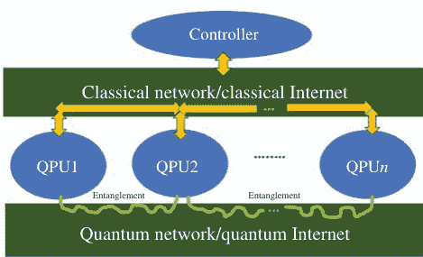

**图 1.1** 分布式量子计算机的示意图，其中多台量子计算机（或量子处理单元，或 QPU）通过量子信道（即通过纠缠）和经典信道连接，以便可以传输量子和经典信息。控制器管理跨计算机（QPU）的计算执行，包括经典部分和量子部分。来源：改编自 DiAdamo 等人 [2021] 的图表。

多计算机）在 Van Meter 等人 [2008] 中。基于 Raussendorf 等人 [2003] 的测量基础量子计算模型，已开发出一种用于分布式测量基础量子计算的模型 [Danos et al., 2007]。Ying 和 Feng [2009] 开发了一种用于推理分布式量子计算的形式模型。有趣的是，量子消息传递接口 [Häner et al., 2021] 为分布式量子计算提供了一个应用程序编程接口（API），类似于为（经典）分布式计算开发的标准化 API 消息传递接口（MPI）[Nielsen, 2016]；通过使用这种标准化 API 编写程序，此类程序变得可移植，并且在很大程度上可以独立于底层计算机架构或特定实现。

还对经典分布式计算协议的“量子版本”进行了研究，但从根本上说，由于使用了量子纠缠，这些协议与经典类似物有很大不同，包括量子隐性传输、QKD、量子抛硬币、量子电子投票、量子领导者选举、量子匿名广播、量子秘密共享和量子拜占庭将军问题。13 我们将在本书后面介绍其中一些协议。

因此，部分借鉴了（经典）分布式计算数十年的工作及其他创新，分布式量子计算领域出现了新的发展，包括新的概念、模型、抽象、协议、工具和软件。我们在这里并未对分布式量子计算进行全面介绍，只是简要概述，并在本书其余部分中将回到上述许多主题。关于分布式量子计算的最近一项综述由 Caleffi 等人 [2022] 撰写。

### 1.2.2 量子互联网计算

在未来几十年，随着量子网络（和量子互联网）、量子计算硬件和软件以及分布式量子计算的发展，我们可以概念化量子互联网计算，类似于前面提到的（经典）互联网计算，指的是在新兴的量子互联网上（可能跨越广阔的地理距离）进行的分布式量子计算，或者说大致如下：

量子       分布式
互联网     = 量子   + 量子
计算       计算   + 互联网

受 Cuomo 等人 [2020] 的启发，他们指出量子互联网将成为“分布式量子计算生态系统的底层基础设施”，图 1.2 说明了通过量子互联网进行分布式量子计算这一理念的分层概念化，其中：

- i) 分布式量子计算层包含：
  - 分布式量子计算应用子层，其中包括使用分布式量子计算工具、抽象、库和环境层中的工具和抽象构建的最终用户应用程序，以及
  - 分布式量子计算工具、抽象、库和环境子层，它提供一系列工具和抽象，以及用于执行和管理程序的环境。

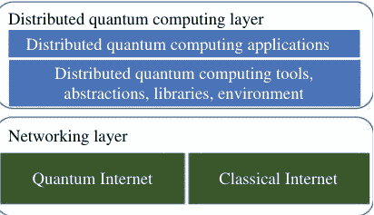

图 1.2 量子互联网计算的简单架构：通过量子互联网进行的分布式量子计算。


ii) 网络层实现分布式量子计算层中的程序所使用的量子网络服务，由经典互联网支持，包括量子纠缠的制备和量子比特的传输；至少在可预见的未来，量子互联网预计将与经典互联网共存。

后面的章节中，我们将更详细地讨论此架构，但在此，阐明量子互联网计算的概念即可。

## 1.3 本书的目的与范围

如前所述，互联网计算（在互联网规模距离上进行分布式计算，且分布式系统涉及通过互联网连接的节点）处于（经典）分布式计算与（经典）互联网工作的交汇处。通过类比互联网计算，人们可以问：分布式量子计算与量子互联网的交汇处是什么？本书对分布式量子计算和量子互联网的选定主题提供了介绍性概述，然后试图回答这个问题，提出量子互联网计算的概念，这是一个拟议的“伞型范式”，用于一系列主题（如下所示），类比于（经典）互联网计算：

- 分布式量子计算，包括量子协议的理论研究（通常是经典分布式量子计算协议的量子版本）以及通信复杂性的视角（包括利用纠缠带来的收益），
- 使用非本地（或分布式）量子门和电路的分布式量子计算，我们重点探讨如何将由量子电路表示的大型量子计算分布到多个节点上，
- 将量子计算委托给服务器，包括以服务器对所委托计算的了解有限或一无所知的方式进行委托，以保护客户端（即将计算委托给服务器的一方）的隐私，有时也称为盲量子计算，并验证委托的量子计算，以便客户端确信服务器确实执行了所需的计算；按使用付费的量子计算委托可能属于所谓的量子云计算，鉴于云模型提供计算即服务（通常，在经典云计算中，包括软件、计算机服务器、内存等，通过互联网按使用付费提供服务），以及
- 量子互联网，我们将介绍其概念、关键思想（如量子纠缠浓缩和纠缠交换）以及可能的架构。

关于图1.2，前三个主题可能被视为属于分布式量子计算层，而最后一个主题，显然，属于网络层。从某种意义上说，“量子互联网计算”只是另一个标签，但该标签旨在（i）捕捉所设想的分布式量子计算的规模以及相关的挑战，以及（ii）尝试将上述主题与它们所解决的问题“捆绑”起来，至少就本书的目的而言。第1.2.1节中提到了一些主题，本书不详细介绍——其中一些将在以后的第1.5节中提到的书籍中介绍，其他可能留给未来的其他书籍！未来几年，量子互联网计算下的主题范围可能还会增长和演变。

## 1.4 本书大纲

本书其余部分的组织如下。

第2章讨论了本书其余部分所需的数学和量子计算背景，包括量子计算及相关概念的简要介绍，包括量子比特和量子比特状态、测量、量子门和电路、纠缠以及量子传送。

第3章讨论了一系列分布式量子计算问题和量子协议，其中许多起源于经典分布式计算。本章首先讨论分布式三方积问题、分布式Deutsch–Jozsa承诺问题和分布式交集问题，演示如何对于某些问题，量子信息可以实现使用更少的比特进行通信以求解。我们还探讨如何使用量子信息解决某些分布式计算问题，而在经典计算中则不可能。本章第二部分讨论量子协议，包括量子抛硬币、量子领导者选举、QKD、量子匿名广播、量子投票、量子拜占庭将军、量子秘密共享和量子无意识传输。

第4章讨论用于多个节点上计算的非本地门或量子门。本章讨论分布式CNOT门、其实现的不同方式以及超越CNOT门的门的分布式控制。本章还简要回顾了分布式量子电路、使用此类非本地门的分布式量子计算算法以及分布式量子计算机的控制和管理方面的工作。

第5章讨论了资源有限的客户端将量子计算委托给更强大的量子计算机或服务器的理念，类似于今天我们所见的云计算。然而，委托计算时安全性和隐私性是关键考虑因素。我们探讨如何将量子计算委托给量子服务器，以保护客户端输入的隐私，即服务器无法知道客户端的输入，但仍能为客户端执行计算。本章探讨客户端如何验证服务器的计算，或者至少检测服务器是否正确执行了委托的计算。本章还简要探讨了量子计算即服务（QaaS）的概念。

第6章讨论了量子互联网的一些关键概念和理念，包括纠缠所起的核心作用、量子互联网架构以及纠缠交换和纠缠纯化的概念，并简要回顾了量子中继器的概念。

第7章通过连接前几章讨论的主题，并解释它们将如何支撑新兴的量子互联网计算领域（与经典互联网计算相辅相成），将全书串联起来。

## 1.5 相关书籍与资源

对于有兴趣深入了解的读者，我们提及与本书主题（即量子互联网）具体相关的书籍和网络资源，并简要说明它们与本书的不同之处以及如何相辅相成。

本书与其他关于量子互联网的优秀书籍有所不同，例如

- Rodney van Meter 的 *量子网络* (2014)，Wiley，这可能是关于量子互联网的最早（或最早之一）书籍，涵盖了我们将在第6章中深入探讨的一系列概念和理念；本书并未涵盖van Meter著作中关于量子互联网的所有主题，但对于某些概念和理念，我们会更深入地探讨，包括计算。
- Peter Rohde 的 *量子互联网：第二次量子革命* (2021)，剑桥大学出版社（CUP），它提供了关于量子互联网发展的极佳最新全面概述，涵盖了本书中提到的许多主题，但与Rohde的书不同，本书还将涵盖分布式量子计算，并以教学风格对一些关键协议和概念进行深入的计算。

已有几本面向普通非技术读者的量子互联网书籍（这与面向技术读者的本书不同），例如

- (已故) Jonathan Dowling 的 *薛定谔的网：构建量子互联网的竞赛* (2020)，CRC Press，它提供了相关物理概念和理念的绝佳概述，以及量子互联网在未来几年可能的发展情况。
- Gösta Fürnkranz 的 *量子互联网：超快且免受黑客攻击* (2020)，Springer，这也是一本关于量子互联网物理背景和概念的可读性强的入门读物，同时也讨论了最新发展。

本书侧重于“高层次”分布式量子计算和协议，但关于量子通信和量子信息理论也有优秀的书籍，例如

- Gianfranco Cariolaro 的 *量子通信* (2015)，Springer，这是关于量子通信的最早（如果不是最早的）书籍之一，从电信角度阐述了经典通信与量子通信的区别以及基础理论。
- Riccardo Bassoli、Holger Boche、Christian Deppe、Roberto Ferrara、Frank H. P. Fitzek、Gisbert Janssen 和 Sajad Saeidinaeni 的 *量子通信网络* (2021)，Springer，它提供了关于量子网络、量子信息理论、量子计算和量子网络仿真工具的最新教程。
- Ivan Djordjevic 的 *量子通信、量子网络和量子传感* (2022)，Elsevier，它介绍了量子通信、量子纠错、量子网络和量子传感。

虽然本书将讨论QKD协议等众多主题，但其他书籍主要专注于量子密码学，特别是广泛讨论QKD和量子密钥协商（QKA），例如

- Ramona Wolf 的 *量子密钥分发：附习题介绍* (2021)，Springer，这是对QKD这一广泛领域的绝佳入门读物，具有数学和技术深度。
- Federico Grasselli 的 *量子密码学：从密钥分发到会议密钥协商* (2021)，Springer，以数学严谨的方式涵盖了QKD和QKA。
- Miralem Mehic、Stefan Rass、Peppino Fazio 和 Miroslav Voznak 的书 *量子密钥分发网络：服务质量视角* (2022)，Springer，讨论了在互联网上部署QKD的实际方面。

对于有兴趣学习量子信息理论的读者，有四本书：

- Benjamin Schumacher（他在1995年创造了*量子比特*一词）和 Michael Westmoreland 的 *量子过程、系统和信息* (2010)，CUP，


撰写了一本介绍量子理论和量子信息视角的优秀书籍。

- 马克·M·怀尔德（Mark M. Wilde）的《量子信息理论》（2013），剑桥大学出版社（CUP），可被视为量子信息理论的“圣经”！Mark 还在线提供了一套名为“从经典到量子香农理论”（From Classical to Quantum Shannon Theory）的笔记，网址为 https://markwilde.com/qit-notes.pdf [最后访问: 18/10/2022]。
- 林正彦（Masahito Hayashi）的《量子信息理论：数学基础》（第2版）（2017），Springer，面向数学倾向的读者。
- 约瑟夫·M·雷尼斯（Joseph M. Renes）的《量子信息理论：概念与方法》（2022），De Gruyter，为量子信息理论提供了出色的入门介绍。

在学习量子网络和量子互联网的过程中，以下两个特定的 Web 资源对我帮助很大：

- 慶應義塾大学（Keio University）的量子科学技术学院（Quantum Academy Of Science And Technology）提供了一系列关于量子网络和量子互联网入门的优秀视频，网址为 https://www.youtube.com/c/QuantumCommEdu [最后访问: 18/10/2022]。
- QuTech 有一个名为“量子互联网探索者”（Quantum Internet Explorer）的优秀网站，面向任何有兴趣了解量子互联网的人，网址为 https://www.quantum-network.com [最后访问: 18/10/2022]。

## 参考文献

Shaukat Ali, Tao Yue, and Rui Abreu. 当软件工程遇到量子计算。《计算机通信（ACM Communications）》，65(4):84–88，2022年3月。ISSN 0001-0782。doi: 10.1145/3512340.

Pablo Andrés-Martínez and Chris Heunen. 通过超图划分实现量子电路的自动分发。《物理评论A》，100:032308，2019年9月。doi: 10.1103/PhysRevA.100.032308. URL https://link.aps.org/doi/10.1103/PhysRevA.100.032308.

Robert Beals, Stephen Brierley, Oliver Gray, Aram W. Harrow, Samuel Kutin, Noah Linden, Dan Shepherd, and Mark Stather. 高效分布式量子计算。《皇家学会A会刊：数学、物理与工程科学》，469(2153):20120686，2013.

Charles H. Bennett, François Bessette, Gilles Brassard, Louis Salvail, and John Smolin. 实验量子密码学。《密码学期刊》，5(1):3–28，1992.

Jacob Biamonte, Peter Wittek, Nicola Pancotti, Patrick Rebentrost, Nathan Wiebe, and Seth Lloyd. 量子机器学习。《自然》，549(7671):195–202，2017.

G. Brassard. 量子密码学简史：个人视角。收录于《IEEE 信息论研讨会：信息论安全中的理论与实践》，2005年，页码 19–23，2005。doi: 10.1109/ITWTPL2005.1543949.

Anne Broadbent and Alain Tapp. 量子力学能帮助分布式计算吗？《SIGACT News》，39(3):67–76，2008年9月。ISSN 0163-5700. doi: 10.1145/1412700.1412717.

Harry Buhrman and Hein Röhrig. 分布式量子计算。收录于 Branislav Rovan 和 Peter Vojtáš（编），《计算机科学数学基础2003》，页码 1–20，Springer-Verlag，柏林，海德堡，2003.

Harry Buhrman, Richard Cleve, Serge Massar, and Ronald de Wolf. 非局域性与通信复杂性。《现代物理评论》，82:665–698，2010年3月。doi: 10.1103/RevModPhys.82.665.

Marcello Caleffi, Michele Amoretti, Davide Ferrari, Daniele Cuomo, Jessica Illiano, Antonio Manzalini, and Angela Sara Cacciapuoti. 分布式量子计算：一项综述。《CoRR》，2022年12月。URL https://doi.org/10.48550/arXiv.2212.10609.

J. I. Cirac, A. K. Ekert, S. F. Huelga, and C. Macchiavello. 通过噪声信道进行分布式量子计算。《物理评论A》，59:4249–4254，1999年6月。doi: 10.1103/PhysRevA.59.4249.

Richard Cleve and Harry Buhrman. 用量子纠缠替代通信。《物理评论A》，56:1201–1204，1997年8月。doi: 10.1103/PhysRevA.56.1201.

Daniele Cuomo, Marcello Caleffi, and Angela Sara Cacciapuoti. 迈向分布式量子计算生态系统。《IET 量子通信》，1(1):3–8，2020.

Vincent Danos, Ellie D’Hondt, Elham Kashefi, and Prakash Panangaden. 基于测量的分布式量子计算。《理论计算机科学电子笔记》，170:73–94，2007.

Manuel De Stefano, Fabiano Pecorelli, Dario Di Nucci, Fabio Palomba, and Andrea De Lucia. 面向量子编程的软件工程：我们进展到哪一步了？《系统与软件期刊》，190:111326，2022.

Vasil S. Denchev and Gopal Pandurangan. 分布式量子计算：分布式系统的新前沿还是科学幻想？《SIGACT News》，39(3):77–95，2008年9月。ISSN 0163-5700. doi: 10.1145/1412700.1412718.

D. Deutsch. 量子理论、Church–Turing原理与通用量子计算机。《伦敦皇家学会会刊A辑》，400(1818):97–117，1985年7月。doi: 10.1098/rspa.1985.0070.

Stephen DiAdamo, Marco Ghibaudi, and James Cruise. 用于加速VQE的分布式量子计算和网络控制。《IEEE 量子工程事务》，2:1–21，2021。doi: 10.1109/TQE.2021.3057908.

Yongshan Ding and Frederic T. Chong. 量子计算机系统：面向吵闹中等规模量子计算机的研究。《计算机体系结构综合讲座》，15(2):1–227，2020.

J. Eisert, K. Jacobs, P. Papadopoulos, and M. B. Plenio. 非本地量子门的最优局部实现。《物理评论A》，62:052317，2000年10月。doi: 10.1103/PhysRevA.62.052317.

Artur K. Ekert. 基于Bell定理的量子密码学。《物理评论快报》，67:661–663，1991年8月。doi: 10.1103/PhysRevLett.67.661.

Lov K. Grover. 面向数据库搜索的快速量子力学算法。收录于《第二十八届年度ACM计算理论研讨会论文集，STOC '96》，页码 212–219，计算机协会，纽约，纽约州，美国，1996。ISBN 0897917855。doi: 10.1145/237814.237866.

Lov K. Grover. 量子电信计算。《arXiv预印本》，文章 quant-ph/9704012，1997年4月.

Laszlo Gyongyosi and Sandor Imre. 量子互联网的进展。《计算机通信（ACM Communications）》，65(8):52–63，2022年7月。ISSN 0001-0782. doi: 10.1145/3524455.

Thomas Häner, Damian S. Steiger, Torsten Hoefler, and Matthias Troyer. 使用QMPI的分布式量子计算。收录于《高性能计算、网络、存储与分析国际会议论文集，SC '21》，计算机协会，纽约，纽约州，美国，2021。ISBN 9781450384421. doi: 10.1145/3458817.3476172.

Jessica Illiano, Marcello Caleffi, Antonio Manzalini, and Angela Sara Cacciapuoti. 量子互联网协议栈：一项全面的综述。《计算机网络》，213:109092，2022.

Frank Nielsen. 《MPI入门：消息传递接口》，页码 21–62。2016。ISBN 978-3-319-21902-8. doi: 10.1007/978-3-319-21903-5_2.

R. Parekh, A. Ricciardi, A. Darwish, and S. DiAdamo. 面向并行和分布式量子计算的量子算法与仿真。收录于《2021年IEEE/ACM第二届量子计算软件国际研讨会（QCS）》，页码 9–19，IEEE计算机学会，洛斯阿拉米托斯，加利福尼亚州，美国，2021年11月。doi: 10.1109/QCS54837.2021.00005. URL https://doi.ieeecomputersociety.org/10.1109/QCS54837.2021.00005.

Mario Piattini and Juan Manuel Murillo. 量子软件工程景观与挑战，页码 25–38。Springer国际出版公司，尚姆，2022.

John Preskill. NISQ时代及以后的量子计算。《Quantum》，2:79，2018年8月。ISSN 2521-327X. doi: 10.22331/q-2018-08-06-79.

Somayeh Bakhtiari Ramezani, Alexander Sommers, Harish Kumar Manchukonda, Shahram Rahimi, and Amin Amirfilifi. 量子计算中的机器学习算法：一项综述。收录于《2020年国际神经网络联合会议（IJCNN）》，页码 1–8，2020. doi: 10.1109/IJCNN48605.2020.9207714.

Robert Raussendorf, Daniel E. Browne, and Hans J. Briegel. 簇态上的基于测量的量子计算。*《物理评论A》*，68:022312，2003年8月。doi: 10.1103/PhysRevA.68.022312.

Peter P. Rohde. *《量子互联网：第二次量子革命》*。剑桥大学出版社，2021。doi: 10.1017/9781108868815.

M. Schuld and F. Petruccione. *《使用量子计算机的机器学习》*。量子科学与技术。Springer国际出版公司，2021。ISBN 9783030830984. URL https://books.google.com.au/books?id=-N5lEAAAQBAJ.

Peter W. Shor. 量子计算算法：离散对数与因式分解。收录于*《第35届年度计算机科学基础研讨会论文集》*，页码 124–134，1994。doi: 10.1109/SFCS.1994.365700.

Peter W. Shor. 量子计算机上的素数分解与离散对数多项式时间算法。*《SIAM评论》*，41(2):303–332，1999.

Adam Smith, M. S. Kim, Frank Pollmann, and Johannes Knolle. 在当前数字量子计算机上模拟量子多体动力学。*《npj 量子信息》*，5(1):106，2019.

Ranjani G. Sundaram, Himanshu Gupta, and C. R. Ramakrishnan. 通过一般量子网络分布式量子电路。*《CoRR》*，abs/2206.06437，2022。doi: 10.48550/arXiv.2206.06437.

Rodney Van Meter, W. J. Munro, Kae Nemoto, and Kohei M. Itoh. 分布式内存量子多计算机上的算术。*《ACM 新兴计算系统技术期刊》*，3(4)，2008年1月。ISSN 1550-4832. doi: 10.1145/1324177.1324179.

Chonggang Wang and Akbar Rahman. 量子赋能的6G无线网络：机遇与挑战。*《IEEE无线通信》*，29(1):58–69，2022。doi: 10.1109/MWC.006.00340.

Stephanie Wehner, David Elkouss, and Ronald Hanson. 量子互联网：未来路径的愿景。*《科学》*，362(6412):eaam9288，2018.

Anocha Yimsiriwattana and Samuel J. Lomonaco Jr. 分布式量子计算：一种分布式Shor算法。收录于 Eric Donkor, Andrew R. Pirich, and Howard E. Brandt， editors, *《量子信息与计算II》*, *《光学仪器工程师学会（SPIE）会议系列》*第5436卷，页码 360–372，2004年8月。doi: 10.1117/12.546504.

Anocha Yimsiriwattana and Samuel J. Lomonaco Jr. 广义GHZ态与分布式量子计算。收录于 *《编码理论与量子计算》*，当代数学，页码 131–147。AMS，罗得岛州普罗维登斯，2005。亦可在 https://arxiv.org/abs/quant-ph/0402148 获取.

Mingsheng Ying and Yuan Feng. 面向分布式量子计算的代数语言。*《IEEE计算机期刊》*，58(6):728–743，2009。doi: 10.1109/TC.2009.13.


# 预备知识

本章提供量子信息和量子计算的背景知识，为读者阅读第 3–6 章做准备。已熟悉本主题的读者可能认为本章没有必要，但浏览一遍至少有助于了解本书中将使用的惯例和符号。此外，本书假设读者具备基本的线性代数和概率知识，但会根据需要介绍必要的符号和所需数学，力求尽可能自包含，并指出进一步阅读的参考文献。

本章首先介绍量子比特（或称量子位）和量子比特状态的概念，然后继续介绍使用量子门和量子电路对量子比特进行操作，类似于对比特进行操作的逻辑门和逻辑电路。我们还介绍了纠缠、隐形传态和超稠密编码的概念，这些是量子互联网计算和量子通信中的有用概念。

## 2.1 量子比特和量子比特状态

经典计算以二进制方式操纵用比特表示的信息，每个比特在任一时刻都有两个可能值之一，通常用“0”和“1”表示。相比之下，量子计算通过量子态（即量子比特态）操纵信息，其中量子比特是一个两态或二能级量子力学系统，构成量子信息的基本单位，例如具有垂直和水平极化的光子、具有两条路径的光子（下文将讨论），或具有自旋向上和自旋向下的电子自旋。

量子比特态可以用两个基态 |0⟩ 和 |1⟩ 的线性组合表示，¹ 写作如下：

```
\alpha |0\rangle + \beta |1\rangle
```

其中 \(\alpha, \beta \in \mathbb{C}\) 为概率幅，\(\mathbb{C}\) 是复数集，² 且 \(|\alpha|^2 + |\beta|^2 = 1$，也就是说，可以将量子系统的态视为对系统上可能进行的测量结果的概率分布（关于测量的内容将在后文介绍）。

每个基态可以看作一个二维列向量，即符号 |0⟩ 和 |1⟩ 表示如下的向量：

```
|0\rangle = \begin{bmatrix} 1 \\ 0 \end{bmatrix} \quad \text{and} \quad |1\rangle = \begin{bmatrix} 0 \\ 1 \end{bmatrix}
```

因此，量子比特态由基态张成的二维向量空间中的一个向量表示。我们说量子比特处于两个态 |0⟩ 和 |1⟩ 的 *叠加* 之中。可以将量子比特态视为概率幅中编码的信息。

可以对量子比特的态进行“测量”，在此过程中，量子比特态会变化为取决于所使用测量基的态。通常，量子比特在所谓的 *Z 基* 或 *计算基* 中进行测量，在这种情况下，量子比特态会变为 |0⟩ 或 |1⟩，或者更具体地说，测量时，量子比特态以概率 \(|\alpha|^2\) 变为态 |0⟩，或以概率 \(|\beta|^2\) 变为 |1⟩（为简单起见，我们简要地说这是由于“量子力学规则”）。

为了获得关于量子比特的物理直觉，请考虑一个示例，其中一束光被发送到一种称为 *光束分束器* 的装置中，这是一种将一束光沿两条路径（一条透射光束和一条反射光束）分开的光学器件，如图 2.1 所示。

一束光可能包含许多光子（将光子视为光的粒子），因此，分束器会导致一些光子被反射、一些光子被透射，从而得到反射光束和透射光束；50/50（或 *平衡*）分束器会将入射光束分成两束光，每束光的强度都较低（与入射光束的强度相比）。然而，现在考虑一束只含一个光子的“光束”，那么人们可以考虑分束器是否会导致光子沿反射路径或透射路径传播，或者两者兼而有之。如果是 50/50 分束器，它不会将光子分成两半，而是会以 50% 的概率将光子反射或透射。人们可以将光子表示为，在 *经过*

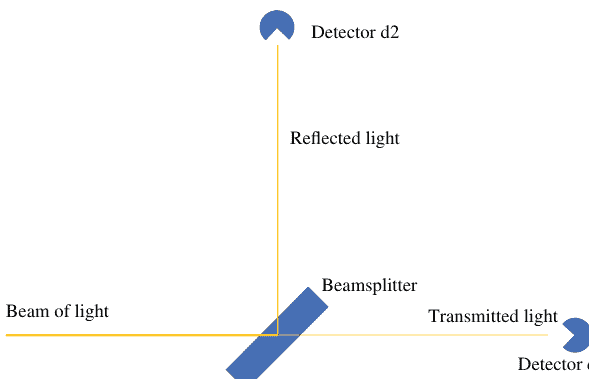

**图 2.1** 分束器，分别配有用于透射光和反射光的探测器 d1 和 d2。

50/50 分束器之后，但在使用探测器进行测量之前，处于态 \(\frac{1}{\sqrt{2}} |0\rangle + \frac{1}{\sqrt{2}} |1\rangle\)，其中用 |0⟩ 表示透射，用 |1⟩ 表示反射（例如），即光子在测量前处于两个态的叠加态。然后，在使用探测器进行测量时，光子只会在其中一个探测器处被发现，|0⟩ 或 |1⟩ 的概率为 \((\frac{1}{\sqrt{2}})^2 = \frac{1}{2}$，即探测器 d1 以 0.5 的概率探测到光子，探测器 d2 以 0.5 的概率探测到光子。

探测后，态 \(\frac{1}{\sqrt{2}} |0\rangle + \frac{1}{\sqrt{2}} |1\rangle\) 会变为 \(|0\rangle\) 或 \(|1\rangle$，也就是说，测量（或通过探测器观察）实际上改变了光子的态！从某种意义上说，在这种情况下，测量是一种“转换”光子态的操作。³

1 这是 *bra-ket 记法* 或 *狄拉克记法*（以物理学家保罗·狄拉克命名），其中符号 \(|\psi\rangle\) 为 ket，\(\langle\psi|\) 为 bra，其含义我们将予以解释。我们将看到，bra 表示相应 ket 的共轭转置。

2 复数的形式为 \(a + ib$，其中 \(i^2 = -1$，且 \(a\) 和 \(b\) 为实数。

另外，假设我们将光子到达分束器之前的态表示为 \(|0\rangle$（因为它与透射光沿同一路径），那么分束器将光子的态从 \(|0\rangle$ 改变为 \(\frac{1}{\sqrt{2}} |0\rangle + \frac{1}{\sqrt{2}} |1\rangle$。我们可以用矩阵 \(H = \frac{1}{\sqrt{2}} \begin{bmatrix} 1 & 1 \\ 1 & -1 \end{bmatrix}\) 表示分束器执行的操作，即它对 |0⟩ 的作用如下：

```
H |0⟩ = \frac{1}{\sqrt{2}} \begin{bmatrix} 1 & 1 \\ 1 & -1 \end{bmatrix} \begin{bmatrix} 1 \\ 0 \end{bmatrix} = \frac{1}{\sqrt{2}} \begin{bmatrix} 1 \\ 1 \end{bmatrix} = \frac{1}{\sqrt{2}} \begin{bmatrix} 1 \\ 0 \end{bmatrix} + \frac{1}{\sqrt{2}} \begin{bmatrix} 0 \\ 1 \end{bmatrix} = \frac{1}{\sqrt{2}} |0⟩ + \frac{1}{\sqrt{2}} |1⟩
```

因此，分束器也在对量子态执行某种操作，尽管与测量是一种不同的操作。另请注意，假设我们将 H 作用于处于态 \frac{1}{\sqrt{2}} |0⟩ + \frac{1}{\sqrt{2}} |1⟩ 的量子比特，则有：

```
H \left( \frac{1}{\sqrt{2}} |0⟩ + \frac{1}{\sqrt{2}} |1⟩ \right) = \frac{1}{\sqrt{2}} (H |0⟩ + H |1⟩)
= \frac{1}{\sqrt{2}} \left( \frac{1}{\sqrt{2}} |0⟩ + \frac{1}{\sqrt{2}} |1⟩ \right) + \frac{1}{\sqrt{2}} \left( \frac{1}{\sqrt{2}} |0⟩ - \frac{1}{\sqrt{2}} |1⟩ \right)
= |0⟩
```

这正是通过“干涉”消除 |1⟩ 分量的思想，类似于光波干涉产生明暗条纹（干涉导致光线被消除的地方出现暗带）的思想。⁴ 事实上，可以使用称为马赫-泽德干涉仪的光学装置配置来实现这一点，如图 2.2 所示。值得注意的是，当光子处于态 \frac{1}{\sqrt{2}} |0⟩ + \frac{1}{\sqrt{2}} |1⟩，即处于叠加态时，在第一个分束器 b1 之后，光子可以（也许天真地）被认为基本上“同时在两条路径上”，即使在镜子反射之后，直到它到达第二个分束器 b2 发生干涉为止。“同时在两个地方”的这一想法与我们习惯的经典世界相比可能相当反直觉，尤其是当我们将光子视为粒子时。请注意 H(H |0⟩) = |0⟩，因此 H 是其自身的逆，即 H^{-1} = H。⁵

关于分束器和干涉仪及其矩阵表示的进一步讨论见 Hughes et al. [2021a]。

上述内容的要点是，量子比特态可以通过操作来操纵，这实际上操纵了量子信息（如量子比特态中所编码），因此，通过对量子比特进行适当的操作，就能实现计算，即

3 测量的概念通常指获取信息而非转换信息，测量行为通常也不应操纵我们所测量的系统的状态，即我们通常测量某个具有特定状态（测量前）但对我们而言只是尚未知晓（测量前）的事物——例如，可以考虑测量当前温度。然而，量子理论中的“测量”概念在某种程度上是指以某种方式操纵物理系统以获得结果。量子理论中测量的哲学讨论的一个起点见：https://plato.stanford.edu/entries/qt-issues [最后访问：19/10/2022]。

4 我们可以将光子视为带有相关波的粒子——这说明了量子理论中的波粒二象性概念，即量子实体可以用粒子和波的概念来描述；因此，我们可能会使用与波相关的术语，如“干涉”，或与粒子相关的术语。

5 这里关于干涉仪的讨论可能被认为是极其简化的，例如，我们忽略了光从空气传播到玻璃等情况时的相位移讨论，但我们关注的是物理器件（例如，分束器）可以被视为“在计算某物”（在此例中，“应用一个矩阵”）的想法（希望物理学家会原谅我！）。还有其他矩阵表示，例如针对两个分束器的不同矩阵见 https://ocw.mit.edu/courses/8-04-quantum-physics-i-spring-2016/resources/mit8_04s16_lecnotes2，以及 Kauffman and Lomonaco Jr. [2014] 中关于镜子的矩阵 [最后访问：22/10/2022]。


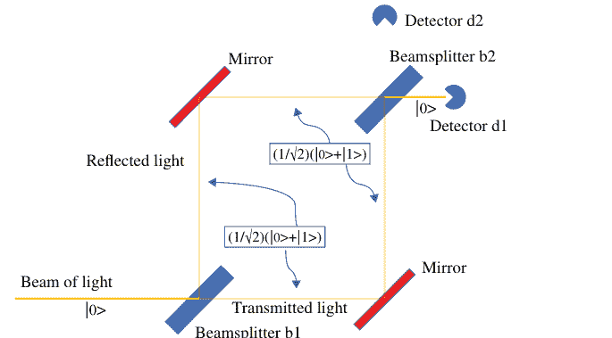

**图 2.2** 一个带有两个 50/50 分束器的干涉仪配置。可以将第一个分束器 b1 表示为作用于处于状态 |0⟩ 的光子上的第一个 H，将 b2 表示为作用于处于状态 $\frac{1}{\sqrt{2}}(|0\rangle + |1\rangle)$ 的光子上的第二个 H，从而最终恢复状态 |0⟩。请注意，镜子有助于将“两个分量汇聚在一起”作为第二个分束器的“输入”，而“输出”是处于状态 |0⟩ 的光子。请注意，镜子的反射不会改变光子的状态，探测器有效地执行测量。

利用量子态表示的信息进行操纵，并通过对量子比特精心选择的操作来实现所需的计算。

也可以有 qutrit，指三态或三能级量子力学系统，更一般地，qudit 指 d 态或 d 能级量子力学系统。

同样，可以使用向量来表示一组量子比特的状态，例如由一组量子比特组成的量子系统，或复合系统。例如，要表示两个量子比特 q1 和 q2 的状态，可以使用四个基态 |00⟩、|01⟩、|10⟩ 和 |11⟩，写作如下，使用 |ψ⟩ 表示两个量子比特的状态：

```
|ψ⟩ = α |00⟩ + β |01⟩ + γ |10⟩ + δ |11⟩
```

其中概率振幅 α、β、γ、δ ∈ C，且 |α|² + |β|² + |γ|² + |δ|² = 1。四个基态可以通过四维向量表示：

```
|00⟩ = [1, 0, 0, 0]^T   and   |01⟩ = [0, 1, 0, 0]^T   and   |10⟩ = [0, 0, 1, 0]^T   and   |11⟩ = [0, 0, 0, 1]^T
```

因此，两个量子比特的状态被表示为由四个基态张成的四维向量空间中的向量。一般来说，两个量子比特的状态是四个状态 |00⟩、|01⟩、|10⟩ 和 |11⟩ 的叠加。人们可能会注意到，这四个基态分别用数字 0、1、2 和 3 的二进制表示标记，因此我们可以将基向量写成 |0⟩、|1⟩、|2⟩ 和 |3⟩。

一般来说，n 个量子比特的状态 \(|\psi\rangle\) 可以使用 \(2^n\) 维向量来表示，其基向量形式为 \(|0\rangle, \dots, |2^n - 1\rangle\)，如下所示：\(|\psi\rangle = \sum_{i=0}^{2^n-1} \alpha_i |i\rangle\)，其中 \(\sum_{i=0}^{2^n-1} |\alpha_i|^2 = 1\)，或者使用相应的二进制字符串表示：\(|\psi\rangle = \sum_{x \in \{0,1\}^n} \alpha_x |x\rangle\)，其中 \(\sum_{i=0}^{2^n-1} |\alpha_x|^2 = 1\)。虽然一个量子比特的状态在向量空间中，但复合（多量子比特）系统的状态在张量积空间中。

对于多个量子比特，我们将使用若干等价表示。例如，我们有以下等式：

\(|00\rangle = |0, 0\rangle = |0\rangle |0\rangle = |0\rangle \otimes |0\rangle = \begin{bmatrix} 1 \\ 0 \end{bmatrix} \otimes \begin{bmatrix} 1 \\ 0 \end{bmatrix} = \begin{bmatrix} 1 \\ 0 \\ 0 \\ 0 \end{bmatrix}\)

其中运算符“⊗”表示张量积运算符（参见旁注）。

**旁注：** 两个向量空间 \(V\) 和 \(W\) 的**张量积**记为 \(V \otimes W\)，它包含由形式为 \(|v\rangle \otimes |w\rangle\) 的向量张成的元素，其中 \(|v\rangle \in V\) 且 \(|w\rangle \in W\)。乘积 \(|v\rangle \otimes |w\rangle\) 也可写作 \(|v\rangle |w\rangle\)、\(|v,w\rangle\) 或 \(|vw\rangle\)。我们回顾以下对计算有用的张量积性质：(i) \((|v_1\rangle + |v_2\rangle) \otimes |w\rangle = |v_1\rangle |w\rangle + |v_2\rangle |w\rangle\) (ii) \(|v\rangle \otimes (|w_1\rangle + |w_2\rangle) = |v\rangle |w_1\rangle + |v\rangle |w_2\rangle\) (iii) \(\alpha(|v\rangle \otimes |w\rangle) = (\alpha |v\rangle) \otimes |w\rangle = |v\rangle \otimes (\alpha |w\rangle)\) 使用矩阵表示，给定矩阵 \(A (m \text{ 乘以 } n)\) 和 \(B\)，张量积 \(A \otimes B\) 由 \(A \otimes B = \begin{bmatrix} A_{11}B & A_{12}B & \dots & A_{1n}B \\ A_{21}B & A_{22}B & \dots & A_{2n}B \\ \vdots & \vdots & \dots & \vdots \\ A_{m1}B & A_{m2}B & \dots & A_{mn}B \end{bmatrix}\) 给出。矩阵 \(A\) 的 \(n\) 份副本的张量积记为 \(A^{\otimes n}\)。请注意，利用 \((A \otimes B)(C \otimes D) = AC \otimes BD\) 这一事实，给定矩阵 \(A\) 和向量 \(v\)，\(A^{\otimes n} v^{\otimes n} = (A \otimes \cdots \otimes A)(v \otimes \cdots \otimes v) = Av \otimes \dots \otimes Av\)。

一个量子系统（一个或多个量子比特）的状态 \(|\psi\rangle\) 也可以用形式为 \(|\psi\rangle\langle\psi|\) 的矩阵表示。一般来说，假设对量子系统处于哪种状态存在不确定性，那么量子系统的状态可以由一组可能状态上的概率给出，即每个可能状态 \(|\psi_i\rangle\) 有一个概率 \(p_i\)，称为纯态系综 \(\{p_i, |\psi_i\rangle\}\)，它可以通过密度算子或密度矩阵 \(\rho\) 表示，形式如下：

\(\rho = \sum_i p_i |\psi_i\rangle\langle\psi_i|\)

其中 \(\sum_i p_i = 1\)。密度算子具有若干对计算有用的性质——例如，\(\rho\) 的迹 \(tr(\rho) = 1\)。

当我们有一个包含多个量子比特的复合系统时，可以使用约简密度算子的概念来获得系统子系统（某些量子比特子集）的描述。例如，设 \(A\) 和 \(B\) 是两个物理系统，构成一个复合系统，其状态由密度算子 \(\rho_{AB}\) 描述。那么，为了描述复合系统内的子系统 \(A\)，约简密度算子如下：

\(\rho_A = tr_B(\rho_{AB})\)

其中对系统 \(B\) 进行部分迹的运算符，记为 \(tr_B\)，由以下给出：

\(tr_B(|a_1\rangle\langle a_2| \otimes |b_1\rangle\langle b_2|) = |a_1\rangle\langle a_2| tr(|b_1\rangle\langle b_2|) = |a_1\rangle\langle a_2| \langle b_2|b_1\rangle\)

对向量 \(|a_1\rangle, |a_2\rangle, |b_1\rangle\) 和 \(|b_2\rangle\)，且 \(tr\) 是矩阵的迹运算符。\(^8\) 同样，我们可以有一个算子 \(\rho_B = tr_A(\rho_{AB})\) 来描述子系统 \(B\)。

## 2.2 量子门和量子电路

我们已经看到，在光子和路径的情况下，如何使用光学器件对量子比特进行操作。当然，对于量子比特的其他物理实现，\(^9\) 操作方式会有所不同，此处不再赘述。

7 要了解这一点，请考虑状态 \(|\psi\rangle = \begin{bmatrix} \alpha \\ \beta \end{bmatrix}\)，则 \(|\psi\rangle\langle\psi| = \begin{bmatrix} \alpha \\ \beta \end{bmatrix} \begin{bmatrix} \alpha & \beta \end{bmatrix}^\dagger = \begin{bmatrix} \alpha \\ \beta \end{bmatrix} \begin{bmatrix} \bar{\alpha} & \bar{\beta} \end{bmatrix} = \begin{bmatrix} \alpha\bar{\alpha} & \alpha\bar{\beta} \\ \bar{\beta}\alpha & \bar{\beta}\beta \end{bmatrix} = \begin{bmatrix} |\alpha|^2 & \alpha\bar{\beta} \\ \bar{\beta}\alpha & |\beta|^2 \end{bmatrix}\)，并且由于 \(|\alpha|^2 + |\beta|^2 = 1\)，我们有 \(tr(\rho) = 1\)，回顾迹是对角元素之和，且迹是线性的，即对于方阵 \(A\) 和 \(B\)，\(tr(A+B) = tr(A) + tr(B)\)。

8 我们注意到 \(tr(|b_1\rangle\langle b_2|) = tr(|b_2\rangle\langle b_1|) = \langle b_2|b_1\rangle = \langle b_2|b_1\rangle\)，利用对于矩阵 \(P\) 和 \(Q\)，\(tr(PQ) = tr(QP)\) 且对于一个数 \(n\)，\(tr(n) = n\) 这一事实。

9 此处可查看当前量子比特技术列表：https://quantumtech.blog/2022/10/20/quantum-computing-modalities-a-qubit-primer-revisited [最后访问：22/10/2022]

类似于数字逻辑设计中作用于比特的 NOT、AND、OR 和 NAND 等逻辑门，对量子比特的操作已被确定为量子门。本节通过矩阵表示介绍这些门，而不探讨其物理实现方式。正如逻辑门可以组合形成逻辑电路一样，我们将看到量子门如何组合形成量子电路；我们还将介绍在量子电路中用于不同量子门的符号。

### 2.2.1 单量子比特门

我们已经看到名为 H 的操作，它被称为 Hadamard 门。\(^{10}\) 我们将考虑其他门，下面重点介绍本书中使用的门。

量子 NOT 门 X 可表示如下：

```
X = \begin{bmatrix} 0 & 1 \\ 1 & 0 \end{bmatrix}
```

它对量子态 α |0⟩ + β |1⟩ 有以下作用：

```
X(α |0⟩ + β |1⟩) = α(X|0⟩) + β(X|1⟩) = α |1⟩ + β |0⟩
```

因为 X |0⟩ = |1⟩ 且 X |1⟩ = |0⟩，这可以通过矩阵乘法验证。

量子门 Z 可表示如下：

```
Z = \begin{bmatrix} 1 & 0 \\ 0 & -1 \end{bmatrix}
```

它对量子态 α |0⟩ + β |1⟩ 有以下作用：

```
Z(α |0⟩ + β |1⟩) = α(Z|0⟩) + β(Z|1⟩) = α |0⟩ − β |1⟩
```

因为 Z |0⟩ = |0⟩ 且 Z |1⟩ = − |1⟩，这可以通过矩阵乘法验证。

量子门 Y 可表示如下：

```
Y = \begin{bmatrix} 0 & -i \\ i & 0 \end{bmatrix}
```

它对量子态 α |0⟩ + β |1⟩ 有以下作用：

```
Y(α |0⟩ + β |1⟩) = α(Y|0⟩) + β(Y|1⟩) = αi |1⟩ − βi |0⟩
```

因为 Y |0⟩ = i |1⟩ 且 Y |1⟩ = −i |0⟩，这可以通过矩阵乘法验证。

请注意，X、Y 和 Z 矩阵著名地被称为泡利矩阵，以物理学家沃尔夫冈·泡利的名字命名。


当我们对 \(\alpha |0\rangle + \beta |1\rangle\) 应用 H 门时，我们有

\(H (\alpha |0\rangle + \beta |1\rangle) = \alpha (H |0\rangle) + \beta (H |1\rangle) = \frac{\alpha + \beta}{\sqrt{2}} |0\rangle + \frac{\alpha - \beta}{\sqrt{2}} |1\rangle\)

因为 \(H |0\rangle = \frac{1}{\sqrt{2}} |0\rangle + \frac{1}{\sqrt{2}} |1\rangle\) 和 \(H |1\rangle = \frac{1}{\sqrt{2}} |0\rangle - \frac{1}{\sqrt{2}} |1\rangle\)，可以通过矩阵乘法验证。请注意 \(|\frac{\alpha+\beta}{\sqrt{2}}|^2 + |\frac{\alpha-\beta}{\sqrt{2}}|^2 = 1\)，因为 \(|\alpha|^2 + |\beta|^2 = 1\)。

我们将在书中需要时后面介绍其他门，例如我们称作 R 门和 P 门。

一般来说，单个量子比特量子门 \(U\) 通常表示为一个 \(2 \times 2\) 矩阵，其元素为复数，并且是 *幺正* 的，也就是说，它的逆与其共轭转置相同：\(U^{-1} = U^\dagger\) 或 \(UU^{-1} = U^\dagger U = I\)，其中 \(U^\dagger\) 表示 \(U\) 的 *共轭转置*（或 *厄米特转置*），它是通过转置 \(U\) 并取其所有元素的复共轭形成的，即 \(U^\dagger = \overline{U^T}\)。对于幺正 \(U\)，我们有 \(UU^\dagger = U^\dagger U = I\)，其中 \(I\) 表示单位矩阵。

此外，如果一个平方矩阵等于其自身的共轭转置，则它是 *厄米特* 的，即 \(U = U^\dagger\)。请注意，我们已经见过的门 \(X\)、\(Z\)、\(Y\) 和 \(H\) 都是厄米特且幺正的，即 \(XX = ZZ = YY = HH = I\)，并且它们都是自身的逆。

还应当注意，对于幺正矩阵，其对状态向量 \(\mathbf{s} = \alpha |0\rangle + \beta |1\rangle = \binom{\alpha}{\beta}\) 的作用保持范数，即 \(||U\mathbf{s}|| = ||\mathbf{s}||\)，其中 \(||.||\) 表示向量的范数，也就是说，对于向量 \(\mathbf{x}\)，\(||\mathbf{x}|| = \sqrt{\langle \mathbf{x}, \mathbf{x} \rangle} = \sqrt{\mathbf{x}^\dagger \mathbf{x}}\)，其中 \(\langle ., . \rangle\) 表示内积。

因此，幺正算子有助于保持概率幅平方和为一的性质：假设 \(U\) 和 \(\mathbf{s}\) 满足 \(||\mathbf{s}||^2 = \binom{\alpha}{\beta}^\dagger \binom{\alpha}{\beta} = \alpha \overline{\alpha} + \beta \overline{\beta} = |\alpha|^2 + |\beta|^2 = 1\)，\(||U\mathbf{s}|| = ||\mathbf{s}||\) 且 \(U\mathbf{s} = \binom{\alpha'}{\beta'}\)，那么 \(||U\mathbf{s}|| = |\alpha'|^2 + |\beta'|^2 = ||\mathbf{s}|| = 1\)。

因此，将一个有效量子态映射到另一个有效量子态的量子门需要是幺正算子，这是合理的。

量子门的一个直观解释是对状态向量 \(|\psi\rangle = \alpha |0\rangle + \beta |1\rangle\) 在某个状态空间或某个坐标系中的操纵，正如我们所见。

但请考虑 *Bloch 球面*，它是量子比特状态空间的几何表示，球面的两个极对应于两个基向量 \(|0\rangle\) 和 \(|1\rangle\)，然后 Bloch 球面上的一个箭头（从球面中心开始）表示量子比特的一个状态。

许多书籍已经解释了 Bloch 球面，因此我们这里不再重复，而是将读者引荐至 Hughes et al. [2021b]。

有了这样的几何表示，量子门操作可以被视为箭头围绕穿过球面中心的三个正交轴（x、y 和 z）的旋转。14

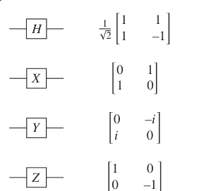

图 2.3 单个量子比特门 H、X、Y 和 Z 的符号和矩阵。

在图示中，量子门 H、X、Y 和 Z 的符号如图 2.3 所示。

请注意，当量子态通过密度算符表示，形式为 \(\rho = \sum_i p_i |\psi_i\rangle\langle\psi_i|\) 的 \(\rho\) 时，其中 \(\sum_i p_i = 1\)，则由于幺正算符 \(U\) 导致的量子系统演化到新态由以下给出

\(U \rho U^\dagger = U \left( \sum_i p_i |\psi_i\rangle\langle\psi_i| \right) U^\dagger = \sum_i p_i U |\psi_i\rangle\langle\psi_i| U^\dagger\)

### 2.2.2 测量算符

我们之前见过测量的概念，它有效地将状态 \(|\psi\rangle = \alpha|0\rangle + \beta|1\rangle\) “转换”为以概率 \(|\alpha|^2\) 得到 \(|0\rangle\) 或以概率 \(|\beta|^2\) 得到 \(|1\rangle\)。

令 \(\langle 0| = |0\rangle^\dagger\) 和 \(\langle 1| = |1\rangle^\dagger\)，可以用常以以下形式表示的算符来表示测量：

\(|0\rangle\langle0| = \begin{bmatrix} 1 \\ 0 \end{bmatrix} [1 \quad 0] = \begin{bmatrix} 1 & 0 \\ 0 & 0 \end{bmatrix}\) and \(|1\rangle\langle1| = \begin{bmatrix} 0 \\ 1 \end{bmatrix} [0 \quad 1] = \begin{bmatrix} 0 & 0 \\ 0 & 1 \end{bmatrix}\)

请注意 \(|0\rangle\langle0| + |1\rangle\langle1| = I\)。那么，由于 \((|0\rangle\langle0|)(\alpha|0\rangle + \beta|1\rangle) = \alpha|0\rangle\langle0|0\rangle + \beta|0\rangle\langle0|1\rangle = \alpha|0\rangle\) 以及

\((|0\rangle\langle0|(\alpha|0\rangle + \beta|1\rangle))^\dagger = (\alpha|0\rangle + \beta|1\rangle)^\dagger(|0\rangle\langle0|)^\dagger = (\alpha|0\rangle + \beta|1\rangle)^\dagger(|0\rangle^\dagger|0\rangle)^\dagger = (\bar{\alpha}\langle0| + \bar{\beta}\langle1|)|0\rangle\langle0| = \bar{\alpha}\langle0|0\rangle\langle0| + \bar{\beta}\langle1|0\rangle\langle0| = \bar{\alpha}\langle0|\)

得到 \(|0\rangle\) 结果的概率可以写成

prob(|0⟩) = \(|\alpha|^2 = \bar{\alpha}\alpha = \bar{\alpha}\alpha \langle0|0\rangle = \bar{\alpha} \langle0|\alpha|0\rangle = (\alpha\langle0| + \beta\langle1|)^\dagger(|0\rangle\langle0|)^\dagger(|0\rangle\langle0|)(\alpha|0\rangle + \beta|1\rangle) = \langle\psi| M_0^\dagger M_0 |\psi\rangle\)

最后一行是通过设置 \(M_0 = |0\rangle\langle0|\) 得到的。同样，令 \(M_1 = |1\rangle\langle1|\)，类似计算将得到：prob(|1⟩) = \(\langle\psi| M_1^\dagger M_1 |\psi\rangle\)。

#### 2.2.2.1 测量公设（一般测量）

更一般来说，量子理论中的一个公设是，量子测量可以由一组测量算符 \(\{M_m\}\) 表示，每个算符作用于被测量子系统的状态，索引 \(m\) 指的是相对于算符 \(M_m\) 可能发生的测量结果，且结果 \(m\) 的概率由以下给出

p(m) = \(\langle\psi| M_m^\dagger M_m |\psi\rangle\)

且测量后的状态由以下给出

\(\frac{M_m |\psi\rangle}{\sqrt{\langle \psi | M_m^\dagger M_m | \psi \rangle}} = \frac{M_m |\psi\rangle}{\sqrt{p(m)}}\)

且算符满足以下完备性条件：\(\sum_m M_m^\dagger M_m = I\)。

回到我们的示例，在 \(M_0\) 之后，我们有状态：

\(\frac{M_0 |\psi\rangle}{\sqrt{\langle \psi | M_0^\dagger M_0 | \psi \rangle}} = \frac{M_0(\alpha |0\rangle + \beta |1\rangle)}{\sqrt{|\alpha|^2}} = \frac{\alpha |0\rangle}{|\alpha|}\)

而在 \(M_1\) 之后，我们将有状态：\(\frac{\beta|1\rangle}{|\beta|}\)。由于 \(|\frac{\alpha}{|\alpha|}| = |\frac{\beta}{|\beta|}| = 1\)，我们可以忽略乘数，从而得到状态 \(|0\rangle\) 或 \(|1\rangle\)，正如我们之前所见。

#### 2.2.2.2 POVM

请注意，如果我们定义一组正算符 \(\{E_m\}\)，例如 \(E_m = M_m^\dagger M_m\)，则这些算符称为 POVM（正算符值测度）元素，\(\{E_m\}\) 被称为一个 POVM。

#### 2.2.2.3 投影测量

假设我们有一组测量算符 \(\{P_m\}\)，其中有一个厄米特矩阵 \(M\)（表示可观测量，即物理学中可测量的物理量）如下：

\(M = \sum_m m P_m\)

这表明了这一组测量算符 \(\{P_m\}\) 如何相关，且结果 \(m\) 的概率由 \(p(m) = \langle \psi | P_m | \psi \rangle\) 给出，测量后的状态由 \(\frac{P_m | \psi \rangle}{\sqrt{p(m)}}\) 给出，那么 \(M\) 描述了一种具有测量算符 \(\{P_m\}\) 的投影测量，这些算符是投影到 \(M\) 的特征值为 \(m\) 的特征空间上的投影算符（例如，将 \(M\) 的相应特征向量表示为 \(|m\rangle\)，即 \(M | m \rangle = m | m \rangle\)，那么我们可以将 \(P_m\) 写为 \(|m\rangle \langle m|\)）。

另外，假设根据上述公设我们有一组测量算符 \(\{M_m\}\)，且这些算符是正交投影算符，即 \(M_m M_{m'} = \delta_{m,m'} M_m\)，其中若 \(m = m'\) 则 \(\delta_{m,m'} = 1\)，若 \(m \neq m'\) 则 \(\delta_{m,m'} = 0\)。

然后，请注意 \(p(m) = \langle \psi | M_m^\dagger M_m | \psi \rangle = \langle \psi | M_m | \psi \rangle\)，因为 \(M_m^\dagger M_m = M_m M_m = M_m\)（注意 \(M_m^\dagger = M_m\)，因为 \(M_m\) 是厄米特的）。

因此，投影测量构成了一类特殊的测量。

投影测量的一个示例是使用测量算符 \(\{M_0 = |0\rangle \langle 0|, M_1 = |1\rangle \langle 1|\}\) 在计算基下的测量，或相对于可观测量 \(Z = |0\rangle \langle 0| - |1\rangle \langle 1| = M_0 - M_1\) 的测量，其中对 \(\alpha | 0 \rangle + \beta | 1 \rangle\) 作用时，我们观察到得到对应于特征值 1 的结果的概率为 \(p(1) = \bar{\alpha}\alpha = |\alpha|^2\)，结果状态为 \(|0\rangle\)，而得到对应于特征值 -1 的结果的概率为 \(p(-1) = |\beta|^2\)，结果状态为 \(|1\rangle\)。)

另一个示例是在 Hadamard 基下的测量，即相对于测量算符 \(\{|+\rangle \langle +|, |-\rangle \langle -|\}\)，其中 \(|+\rangle = (|0\rangle + |1\rangle)/\sqrt{2}\) 且 \(|-\rangle = (|0\rangle - |1\rangle)/\sqrt{2}\)。可观测量是矩阵 \(X = |+\rangle \langle +| - |-\rangle \langle -|\)。如果我们测量处于状态 \(\alpha | 0 \rangle + \beta | 1 \rangle\) 的一个量子比特，结果的概率是多少？

我们可以将状态重写如下：\(\alpha | 0 \rangle + \beta | 1 \rangle = \frac{\alpha+\beta}{\sqrt{2}} |+\rangle + \frac{\alpha-\beta}{\sqrt{2}} |-\rangle\)，并且我们观察到得到对应于特征值 1 的结果的概率为 \(p(1) = |\frac{\alpha+\beta}{\sqrt{2}}|^2\)，结果状态为 \(|+\rangle\)，而得到对应于特征值 -1 的结果的概率为 \(p(-1) = |\frac{\alpha-\beta}{\sqrt{2}}|^2\)，结果状态为 \(|-\rangle\)。

请注意，假设我们的仪器只能在计算基下进行测量，那么可以做的是首先对状态施加（Hadamard）\(H\) 算符，如下所示：

\(H(\alpha | 0 \rangle + \beta | 1 \rangle) = \alpha H | 0 \rangle + \beta H | 1 \rangle = \alpha |+\rangle + \beta |-\rangle = \frac{\alpha+\beta}{\sqrt{2}} |0\rangle + \frac{\alpha-\beta}{\sqrt{2}} |1\rangle\)

然后，相对于计算基进行测量。请注意，现在得到对应于特征值 1 的结果的概率为


p(+1) = |\frac{\alpha + \beta}{\sqrt{2}}|^2，结果状态为 |0⟩，而得到对应于特征值 -1 的结果的概率为 p(-1) = |\frac{\alpha - \beta}{\sqrt{2}}|^2，结果状态为 |1⟩，即与在 Hadamard 基中进行测量时的概率相同！这意味着，相对于 Hadamard 基进行测量实际上等效于（除了结果状态外）先对状态应用 H，然后再相对于计算基进行测量。因此，从最后两段得到的一个关键观察是，同一状态可以相对于不同的基进行测量，可能具有不同的结果状态（对应于基态）和结果概率。关于测量算子的更详细讨论见 Nielsen and Chuang [2000]。我们将用于测量的符号如图 2.4 所示。

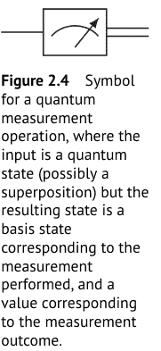

### 2.2.3 多量子比特门

正如我们有接受多个操作数的逻辑门一样，我们也有可以接受多个量子比特作为输入的量子门。一个例子是受控-NOT（或 CNOT）门，它接受两个量子比特，一个称为控制量子比特，另一个称为目标量子比特，并根据控制量子比特的状态，决定是否对目标量子比特应用 X 门。它执行以下映射，从左到右阅读，第一个量子比特是控制量子比特，第二个量子比特是目标量子比特：|00⟩ → |00⟩，|01⟩ → |01⟩，|10⟩ → |11⟩，|11⟩ → |10⟩，或者更一般地：|c⟩|t⟩ → CNOT |c⟩|t ⊕ c⟩，其中“⊕”表示异或运算符（或模 2 加法）。CNOT 门的符号如图 2.5 所示。更一般地，我们也可以有形式为 |c⟩|t⟩ → controlled-U |c⟩ U|t⟩ 的受控-U 门。CNOT 门基本上是一个受控-X 门。受控-U 门的符号如图 2.5 所示。

### 2.2.4 量子电路

我们已看到一些量子门符号的示例。当这些门被组合并且这些门作用于一个或多个量子比特时，我们可以构建

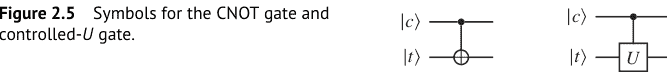

量子电路，由量子门的组合构成，类似于由逻辑门组合构成的数字电路。量子电路中的每条线都是一条表示量子比特的导线，时间通常从左到右流逝，电路中显示的计算顺序从左到右阅读（请注意，这与表示操作的矩阵序列顺序相反），如下面所示。举个例子，考虑以下双量子比特电路，如图 2.6 所示。

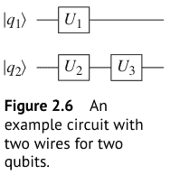

同样，假设双量子比特系统的状态可以写为 \(|q_1\rangle \otimes |q_2\rangle\)，电路表示的操作可以写成矩阵形式，如下：

```
(I \otimes U_3)(U_1 \otimes U_2)(|q_1\rangle \otimes |q_2\rangle)
```

这是矩阵 \(I \otimes U_3\) 和 \(U_1 \otimes U_2\) 按上述顺序的乘积——我们使用单位矩阵 \(I\)，因为在那个阶段该量子比特上没有操作。利用张量积乘积的性质，即 \((A \otimes B)(C \otimes D) = AC \otimes BD\)，我们将上述内容改写为 \((I \otimes U_3)(U_1 \otimes U_2)(|q_1\rangle \otimes |q_2\rangle) = U_1|q_1\rangle \otimes U_3 U_2|q_2\rangle\)。但是，正如我们在讨论纠缠时将看到的，并非所有双量子比特状态都可以写成形式 \(|\psi\rangle \otimes |\psi\rangle = |\psi\psi\rangle\) 的两个向量的乘积，更一般地说，双量子比特状态 \(|\psi\rangle\) 是这样的乘积的线性组合，如我们所见，例如，相对于计算基，\(|\psi\rangle = \alpha|00\rangle + \beta|01\rangle + \gamma|10\rangle + \delta|11\rangle\)；重新标记如图 2.7a 所示。事实上，对于叠加态的每个分量，可以想象一个相应的电路，如图 2.7b 所示。因此，可以将图 2.7a 视为图 2.7b 的“缩写”。

也就是说，在这种情况下，我们有

```
(U_1 \otimes U_3 U_2)|\psi\rangle = (U_1 \otimes U_3 U_2)(\alpha|00\rangle + \beta|01\rangle + \gamma|10\rangle + \delta|11\rangle)
= \alpha(U_1 \otimes U_3 U_2)|00\rangle + \beta(U_1 \otimes U_3 U_2)|01\rangle
+ \gamma(U_1 \otimes U_3 U_2)|10\rangle + \delta(U_1 \otimes U_3 U_2)|11\rangle
```

其概率对应于图 2.7b 中的分量。

我们考虑另一个电路示例；以下是三量子比特电路，如图 2.8 所示。我们可以看到我们提到的单量子比特和双量子比特门如何组合形成量子电路，表示一组量子比特上的操作。

还要注意的是，n 量子比特量子电路表示的操作对应于 n 量子比特酉操作；酉矩阵的张量积是

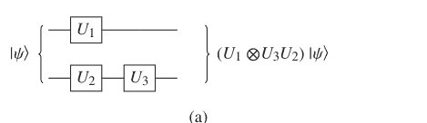

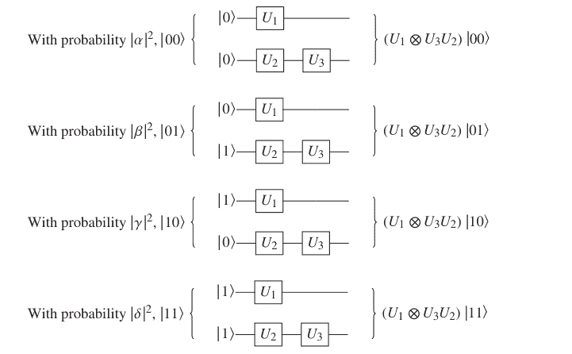

**图 2.7** 双量子比特电路示例以及电路操作后新状态的标记。(b) 四个带有两条导线的电路示例，每个导线对应于叠加态 \(\alpha |00\rangle + \beta |01\rangle + \gamma |10\rangle + \delta |11\rangle\) 中的每个可能分量，以及电路操作后的新状态，针对每个可能分量。

也是一个酉矩阵，<sup>15</sup> 并且两个酉矩阵的乘积也是一个酉矩阵。<sup>16</sup>

15 我们可以看到，因为 \((A \otimes B)^\dagger = A^\dagger \otimes B^\dagger\)，所以 \((A \otimes B)(A \otimes B)^\dagger = (A \otimes B)(A^\dagger \otimes B^\dagger) = AA^\dagger \otimes BB^\dagger = I_{\text{dim}(A)} \otimes I_{\text{dim}(B)} = I_{\text{dim}(A)\text{dim}(B)}\)，对 \((A \otimes B)^\dagger (A \otimes B)\) 进行类似计算。
16 要看到这一点，因为 \((AB)^\dagger = B^\dagger A^\dagger\)，所以 \(AB(AB)^\dagger = ABB^\dagger A^\dagger = AIA^\dagger = AA^\dagger = I\)。

值得观察的是以下电路，该电路将在本书后面使用，如图 2.9 所示，其中 \(|\psi\rangle = \alpha|0\rangle + \beta|1\rangle\)，它对 \(|\psi\rangle|0\rangle = (\alpha|0\rangle + \beta|1\rangle)|0\rangle = \alpha|00\rangle + \beta|10\rangle\) 计算 CNOT，得到结果状态 \(\alpha|00\rangle + \beta|11\rangle\)。请注意，该电路通常并不实际计算 \( |\psi\rangle \) 的副本，因为
\( |\psi\rangle |\psi\rangle = \alpha^2 |00\rangle + \alpha\beta |01\rangle + \beta\alpha |10\rangle + \beta^2 |11\rangle \)
当 \( \alpha\beta = 0, \alpha^2 = \alpha \)，且 \( \beta^2 = \beta \) 时，这等于 \( \alpha |00\rangle + \beta |11\rangle \)，例如，当 \( \alpha = 1 \) 且 \( \beta = 0 \)，或当 \( \alpha = 0 \) 且 \( \beta = 1 \) 时。

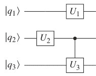

图 2.8 三量子比特的三导线电路示例。

事实上，不存在这样的酉操作，它能对任何量子状态 \( |\psi\rangle \)，将 \( |\psi\rangle |0\rangle \) 转换为 \( |\psi\rangle |\psi\rangle \)，这一事实称为 *不可克隆定理* - 证明见 Nielsen and Chuang [2000]。该定理对强健的计算和量子通信有影响，因为制作信息副本是处理丢失或损坏信息的典型方式，至少对于经典信息来说是这样。称为 *量子误差校正* 的研究领域探讨处理量子信息中错误的方法。如果可以获得 \( |\psi\rangle |\psi\rangle \)，那么，例如，如果第一个量子比特丢失（或以某种方式被“测量”），我们仍然保留第二个量子比特 \( |\psi\rangle \) 中的信息（记法 \( |\psi\rangle |\psi\rangle = |\psi\rangle \otimes |\psi\rangle\) 本质上表明两个量子比特是“分离的”），但如果我们有 \( \alpha |00\rangle + \beta |11\rangle \)，那么丢失第一个量子比特（实际上，以某种方式“被测量出来”），状态“坍缩”为 \( |00\rangle \) 或 \( |11\rangle \) 并且第一个量子比特丢失，那么我们要么剩下 \( |0\rangle \) 要么剩下 \( |1\rangle \)，基本上丢失了编码在概率幅 \( \alpha \) 和 \( \beta \) 中的所有信息。我们将在本书中看到许多其他用于不同计算的量子电路。

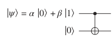

图 2.9 看起来像复制操作的电路示例。

### 2.2.5 通用量子计算机和门集

通过在量子电路中组合门，可以对量子比特执行复杂操作。组合的门可以来自一个小的有限集合，并且有了合适的门集，任何酉操作都可以（以任意精度）通过在量子电路中组合（来自该集合的）门来近似。

Solovay-Kitaev 定理指出，给定一个距离 \(\epsilon\)（使用表示两个操作之间差异的距离度量，这里我们不详细介绍），可以使用 \(O(n^2 4^n \log^c(n^{2^4} / \epsilon))\) 个门来近似任何给定的 \(n\) 量子比特酉操作 [Nielsen and Chuang, 2000]。这类似于一小组逻辑门（例如 {AND, OR, NOT}）可以被视为在


人们可以仅使用该门集中的门来构建任何数字电路（即实现特定位数的任何布尔函数）（当然，允许多次使用同一个门）。NAND 门本身就是通用的。可能存在不同的通用门集。

量子计算的一个此类通用门集包含哈达马德门、相位门、CNOT 门和 \(\pi/8\) 门；我们将在本书后面介绍相位门和 \(\pi/8\) 门。

有了这样的通用门集，原则上，如果有人能用某些硬件实现门集中的每个门，并执行涉及该门集中门的量子电路，那么他就拥有了一台通用量子计算机。

值得注意的是，任何两个量子比特（通用）门都足以用于通用量子计算，即我们只需在潜在不同的量子比特对之间不断使用这个通用门。\(^17\)

存在许多可能的通用门集。\(^18\)

## 2.3 纠缠

我们之前提到过纠缠的概念，并且也见过状态 \(\alpha|00\rangle + \beta|11\rangle\)。

考虑流行的*纠缠*状态，用 \(|\Phi^+\rangle\) 表示，它是一个*Bell 态*（或*Bell 对*）（以我们在第 1 章中提到的 约翰·贝尔 命名）：\(|\Phi^+\rangle = \frac{1}{\sqrt{2}}|00\rangle + \frac{1}{\sqrt{2}}|11\rangle\)。

当两个量子比特处于上述状态时，我们说这两个量子比特已经纠缠，其含义如下。

假设两个光子相互作用，使得它们的联合状态由上述叠加态表示。

我们可以为两个量子比特 \(A\) 和 \(B\) 加上下标来写出这个叠加态，如下所示：\(|\Phi^+\rangle_{AB} = \frac{1}{\sqrt{2}}|0\rangle_A|0\rangle_B + \frac{1}{\sqrt{2}}|1\rangle_A|1\rangle_B\)。

然后，假设两个光子飞得非常远，比如说，现在相距数十亿光年。

然后，当测量 \(A\) 时，请注意两个量子比特的状态会以概率 \((1/\sqrt{2})^2 = 1/2\) 变为 \(|0\rangle_A|0\rangle_B\)，或以概率 \(1/2\) 变为 \(|1\rangle_A|1\rangle_B\)。

换句话说，测量时，两个量子比特的状态要么都为 \(|0\rangle\)，要么都为 \(|1\rangle\)，即它们是相关的，尽管由于相距如此之远，它们本来无法及时进行通信（相对于观测到的测量时间）。\(^19\)

17 关于“通用”门的定义以及通用量子门集的更多细节，请参见 Preskill 的 Caltech 笔记，网址为 http://theory.caltech.edu/~preskill/ph229/notes/chap6.pdf [最后访问：26/10/2022]

18 关于通用门集和一些基本门集的讨论位于：https://quantumcomputing.stackexchange.com/questions/17115/basic-gates-sets/17126 [最后访问：27/2/2023]

19 我们在第 1 章中提到过，这就是爱因斯坦所说的“幽灵般的远距作用”，因为对一个量子比特的测量似乎即使在巨大距离上也“对”另一个量子比特产生了作用；但另一种思考方式是，这两个量子比特尽管相距遥远，但在测量时却像“一个整体”一样表现，具有共享状态 \(|1\rangle_A|1\rangle_B\) 或 \(|0\rangle_A|0\rangle_B\)，这与量子物理中的*非局域性*概念相关，因为“两个部分”相距如此之远，却仍可以相关。

我们说来自 A 和 B 的两个量子比特是纠缠的，或者说 A 和 B 两个量子比特之间存在纠缠；这也被称为一个 ebit，即拥有 x 个 ebits 对应于拥有 x 个纠缠对。

我们能否将状态 |Φ⁺⟩ 写成两个向量的张量积？

假设可以，且这两个向量为 α₁|0⟩ + β₁|1⟩ 和 α₂|0⟩ + β₂|1⟩，它们的张量积形式为：(α₁|0⟩ + β₁|1⟩) ⊗ (α₂|0⟩ + β₂|1⟩) = α₁α₂|00⟩ + α₁β₂|01⟩ + β₁α₂|10⟩ + β₁β₂|11⟩，但对于

|Φ⁺⟩ = \frac{1}{\sqrt{2}} |00⟩ + \frac{1}{\sqrt{2}} |11⟩ = α₁α₂|00⟩ + α₁β₂|01⟩ + β₁α₂|10⟩ + β₁β₂|11⟩

我们需要满足：\(\frac{1}{\sqrt{2}} = \alpha_1\alpha_2\)，\(0 = \alpha_1\beta_2\)，\(0 = \beta_1\alpha_2\)，以及 \(\frac{1}{\sqrt{2}} = \beta_1\beta_2\)，也就是说，由第二个方程可知 \(\alpha_1 = 0\) 或 \(\beta_2 = 0\)，但若 \(\alpha_1 = 0\) 第一个方程不成立，若 \(\beta_2 = 0\) 第四个方程不成立，因此我们得出了一个矛盾。

这意味着 \(|\Phi^+\rangle\) 无法表示为两个向量的张量积。一般来说，一个（两个量子比特的）纠缠态是指无法写成两个向量张量积的状态；这一思想可以推广到 n 个量子比特的纠缠态。

请注意，\(|\Phi^+\rangle\) 无法写成“两个向量的张量积”，但可以写成两个“两个向量的张量积”的线性组合，即 |0⟩ ⊗ |0⟩ 和 |1⟩ ⊗ |1⟩ 的线性组合。

更一般来说，通过类似的论证，请注意当 \(\alpha \neq 0\) 且 \(\beta \neq 0\) 时，状态 \(\alpha|00\rangle + \beta|11\rangle\) 是纠缠态。

这种形式的状态称为猫态，20 在第 4 章中将特别有用。

与 \(|\Phi^+\rangle\) 对应的密度算符为

|Φ⁺⟩⟨Φ⁺| = \left( \frac{1}{\sqrt{2}} |00\rangle + \frac{1}{\sqrt{2}} |11\rangle \right) \left( \frac{1}{\sqrt{2}} \langle 00| + \frac{1}{\sqrt{2}} \langle 11| \right) = \frac{1}{2} \begin{bmatrix} 1 & 0 & 0 & 1 \\ 0 & 0 & 0 & 0 \\ 0 & 0 & 0 & 0 \\ 1 & 0 & 0 & 1 \end{bmatrix}

从计算角度看，这样的纠缠态可以通过图 2.10 所示的电路创建，该电路使用哈达马德门和 CNOT 门作用于两个都处于 |0⟩ 状态的量子比特上。

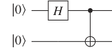

图 2.10 生成纠缠态 \(|\Phi^+\rangle = \frac{1}{\sqrt{2}} (|00\rangle + |11\rangle)\) 的电路。

这可以通过计算看出：

```
CNOT(H \otimes I)(|0\rangle \otimes |0\rangle)
= CNOT(H |0\rangle \otimes |0\rangle) = CNOT(\frac{1}{\sqrt{2}}(|0\rangle + |1\rangle) \otimes |0\rangle)
= CNOT(\frac{1}{\sqrt{2}}(|0\rangle |0\rangle + |1\rangle |0\rangle)) = \frac{1}{\sqrt{2}}(CNOT |0\rangle |0\rangle + CNOT |1\rangle |0\rangle)
= \frac{1}{\sqrt{2}}(|00\rangle + |11\rangle)
```

这就是我们想要生成的纠缠态。四个 Bell 态（也称为爱因斯坦–波多尔斯基–罗森 (EPR) 对21）为 \(|\Phi+\rangle = \frac{1}{\sqrt{2}}(|00\rangle + |11\rangle)\)、\(|\Phi-\rangle = \frac{1}{\sqrt{2}}(|00\rangle - |11\rangle)\)、\(|\Psi+\rangle = \frac{1}{\sqrt{2}}(|01\rangle + |10\rangle)\) 和 \(|\Psi-\rangle = \frac{1}{\sqrt{2}}(|01\rangle - |10\rangle)\)。它们可以用类似的方法生成，使用合适的量子电路（鼓励读者尝试找出生成上述状态的相关电路）。

为简化本书后续图表，我们将使用一条波浪线来表示图 2.10 中的电路，如图 2.11 所示。

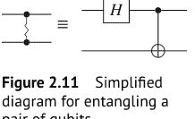

请注意，要生成猫态 \(\alpha |00\rangle + \beta |11\rangle\)，可以使用控制量子比特为 \(\alpha |0\rangle + \beta |1\rangle\)、目标量子比特为 \(|0\rangle\) 的 CNOT 门，如图 2.9 所示。

对于三个量子比特，可以考虑 Greenberger–Horne–Zeilinger (GHZ) 态：

```
|GHZ⟩ = \frac{1}{\sqrt{2}} |000⟩ + \frac{1}{\sqrt{2}} |111⟩
```

这种状态可以通过对三个量子比特状态 \(|000\rangle\) 应用图 2.12 所示形式的电路来生成。请注意，我们可以使用图 2.13 所示的电路来生成图 2.13 中的状态 \(\alpha |000\rangle + \beta |111\rangle\)。一般来说，对于 n 个量子比特，我们有形式为 \(|GHZ_n\rangle = \frac{1}{\sqrt{2}}|0\rangle^{\otimes n} + \frac{1}{\sqrt{2}}|1\rangle^{\otimes n}\)。22

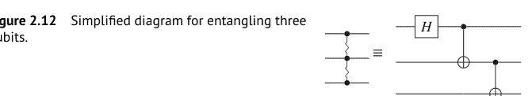

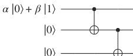

图 2.13 生成猫态 \(\alpha |000\rangle + \beta |111\rangle\) 的电路。

这种状态可以通过对 n 个量子比特状态 \(|0\rangle^{\otimes n}\) 应用图 2.14a 所示的电路，使用 O(n) 步骤来生成，或者通过更高效的实现使用 O(log n) 步骤，如图 2.14b 中用八个量子比特所示，我们观察到可以在同一步骤中作用于多个量子比特，从而减少总步骤数，进而提高效率。电路中这种步骤的数量是

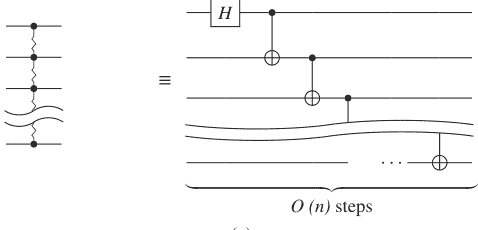

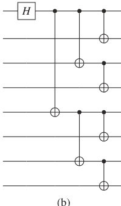

图 2.14 生成广义 GHZ 态的电路。(a) 在线性步骤数内生成广义 GHZ 态的电路。(b) 在对数步骤数内生成广义 GHZ 态的电路。


也称为电路深度。23 可以编写一个编译器来优化量子电路，即生成执行等效操作的深度更低的量子电路。与图 2.13 中电路相似并对其进行推广的电路可用于生成 n 个量子比特的猫态：$|CAT_n\rangle = \alpha|0\rangle^{\otimes n} + \beta|1\rangle^{\otimes n}$。

GHZ 态涉及超过两个量子比特，因此是一种 *多方纠缠*，例如纠缠态由多个量子比特共享，每个节点一个量子比特。有趣的是，它早在 1998 年就已在实验中被观察到 [Bouwmeester et al., 1999]。Illiano et al. [2022] 还指出，可以通过在多个节点间共享的（广义）GHZ 态上对 *输掉节点*（即除获胜节点外的其余节点）进行测量，从而“提取”两个所谓获胜节点之间的 EPR 对。例如，假设我们有一个包含三个量子比特的 GHZ 态，每个节点一个量子比特。然后，假设我们首先应用 H，然后对第三个量子比特（输掉节点）进行测量，即应用以下操作：

$(I \otimes I \otimes H) |GHZ\rangle$
$= (I \otimes I \otimes H)(\frac{1}{\sqrt{2}} |000\rangle + \frac{1}{\sqrt{2}} |111\rangle)$
$= \frac{1}{\sqrt{2}} |00\rangle H |0\rangle + \frac{1}{\sqrt{2}} |11\rangle H |1\rangle$
$= \frac{1}{\sqrt{2}} |00\rangle (\frac{1}{\sqrt{2}} |0\rangle + \frac{1}{\sqrt{2}} |1\rangle) + \frac{1}{\sqrt{2}} |11\rangle (\frac{1}{\sqrt{2}} |0\rangle - \frac{1}{\sqrt{2}} |1\rangle)$
$= \frac{1}{\sqrt{2}}(|00\rangle + |11\rangle) \otimes \frac{1}{\sqrt{2}} |0\rangle + \frac{1}{\sqrt{2}}(|00\rangle - |11\rangle) \otimes \frac{1}{\sqrt{2}} |1\rangle$
$= |\Phi^+\rangle \otimes \frac{1}{\sqrt{2}} |0\rangle + |\Phi^-\rangle \otimes \frac{1}{\sqrt{2}} |1\rangle$

然后当我们测量第三个量子比特时，要么得到 (i) 结果状态 $|0\rangle$，此时前两个节点共享纠缠 EPR 对 $|\Phi^+\rangle$；要么得到 (ii) 结果状态 $|1\rangle$，此时前两个节点共享纠缠 EPR 对 $|\Phi^-\rangle$，即无论如何，两个节点都会得到一个 EPR 对。请注意，测量第三个量子比特是包含该量子比特的第三个节点上的局部操作，并且可以使用经典通信来告知前两个节点测量已完成，从而让获胜节点现在共享一个 EPR 对（也许会告诉它们共享哪个 Bell 态）。

更一般地，考虑在 \( n \) 个节点间共享的广义 GHZ 态，每个节点一个量子比特，假设我们想在节点 \( i \) 和 \( j \) 之间生成一个 EPR 对，我们可以首先应用以下操作：\( U = U_1 \otimes \cdots \otimes U_n \)，其中 \( U_i = U_j = I \)，且对于所有 \( k \neq i \) 和 \( k \neq j \)，\( U_k = H \)：

$$
(U_1 \otimes \cdots \otimes U_n) |GHZ_n\rangle
= (U_1 \otimes \cdots \otimes U_n)(\frac{1}{\sqrt{2}}|0\rangle^{\otimes n} + \frac{1}{\sqrt{2}}|1\rangle^{\otimes n})
= \frac{1}{\sqrt{2}} |0\rangle_i |0\rangle_j \otimes H^{\otimes(n-2)} |0\rangle^{\otimes(n-2)} + \frac{1}{\sqrt{2}} |1\rangle_i |1\rangle_j \otimes H^{\otimes(n-2)} |1\rangle^{\otimes(n-2)}
$$

（重新排序量子比特，使量子比特 \( i \) 和 \( j \) 写在左侧）

$$
= \frac{1}{\sqrt{2}} |0\rangle_i |0\rangle_j \otimes \frac{1}{\sqrt{2^{n-2}}} \sum_{x \in \{0,1\}^{n-2}} |x\rangle
+ \frac{1}{\sqrt{2}} |1\rangle_i |1\rangle_j \otimes \frac{1}{\sqrt{2^{n-2}}} \sum_{y \in \{0,1\}^{n-2}} (-1)^{parity(y)} |y\rangle
$$

（其中 \( parity(y) = parity(y_1 \dots y_{n-2}) = y_1 \oplus \cdots \oplus y_{n-2} \)，且 \( \oplus \) 是模 2 加法）

$$
= |\Phi^+\rangle_{ij} \otimes \frac{1}{\sqrt{2^{n-2}}} \sum_{x \in evenp} |x\rangle + |\Phi^-\rangle_{ij} \otimes \frac{1}{\sqrt{2^{n-2}}} \sum_{y \in oddp} |y\rangle
$$

（其中 \( evenp = \{x'|x' \in \{0, 1\}^{n-2} \text{ 且 parity (x') = 0\} \)，以及 \( oddp = \{y'|y' \in \{0, 1\}^{n-2} \text{ 且 parity (y') = 1\} \)）

然后当我们测量除了 \( i \) 和 \( j \) 以外的所有量子比特时，要么得到 (i) 结果状态 \( |x\rangle \) 其中 \( x \in evenp \)，此时两个节点 \( i \) 和 \( j \) 共享纠缠 EPR 对 \( |\Phi^+\rangle \)；要么得到 (ii) 结果状态 \( |y\rangle \) 其中 \( y \in oddp \)，此时两个节点 \( i \) 和 \( j \) 共享纠缠 EPR 对 \( |\Phi^-\rangle \)，即无论如何，两个量子比特 \( i \) 和 \( j \) 都会得到一个 EPR 对。这对未来量子互联网具有潜在应用，假设多方纠缠可以在 \( n \) 个节点间共享，那么通过节点应用适当的操作和测量，可以为任何两个获胜节点（例如，选定共享 EPR 对的那两个节点）提取一个视为资源的 EPR 对。此外，可以通过融合双方纠缠对（分布在节点对上）来生成分布在多个节点上的 GHZ 态，例如，通过融合 \( (n - 1) \) 个 Bell 对来创建 \( n \) 个量子比特的 GHZ 态（如图 2.14 所示）——我们将在第 4 章中看到这一点，届时将了解 Bell 对（跨节点分布）如何用于非局部 CNOT 操作——关于从 Bell 对创建 GHZ 态的更高效协议的讨论见 de Bone et al. [2020]。

除了 GHZ 态之外，还有一种称为 W 态的三个量子比特（或三方）纠缠态，形式如下：

$|W\rangle = \frac{1}{\sqrt{3}}(|001\rangle + |010\rangle + |100\rangle)$

Dür et al. [2000] 指出，任何三方纠缠态都可以通过局部操作和经典通信（LOCC）（例如，每个持有一个量子比特的节点上的局部门/操作以及节点间的经典通信）转换为两种标准形式之一，即 GHZ 态或 W 态（不能同时是），并且如果状态 \(|\psi\rangle\) 可（通过 LOCC）转换为 GHZ 态，而另一种状态 \(|\phi\rangle\) 可转换为 W 态，则 \(|\psi\rangle\) 不能转换为 \(|\phi\rangle\)，反之亦然。这意味着，从这个意义上说，GHZ 和 W 是两种非常不同的纠缠态。

关于 W 态的一个有趣观察是，它比 \(|GHZ\rangle\) 更能容错，具体来说。假设我们在三个量子比特间共享 W 态，并且其中一个量子比特被测量，比如最后一个量子比特，那么以 1/3 的概率我们得到 \(|1\rangle\)，其他量子比特最终处于状态 \(|00\rangle\)（对应 \(|001\rangle\)）。但以 2/3 的概率我们得到 \(|0\rangle\)，其他量子比特最终处于纠缠态：\(\frac{1}{\sqrt{2}}(|01\rangle + |10\rangle)\)（对应 \(|010\rangle\) 和 \(|100\rangle\) 的叠加）。但是对于 GHZ 态，测量最后一个量子比特时，我们要么得到 \(|0\rangle\)，要么得到 \(|1\rangle\)，剩余两个量子比特处于纠缠态的可能性为零。因此，如果三个量子比特共享 W 态且其中一个量子比特被测量（或因与环境的某种相互作用而“丢失”），则仍有 2/3 的概率剩余两个量子比特共享纠缠态（保留纠缠资源）；但如果共享 GHZ 态且其中一个量子比特“丢失”，则无法保留任何资源（纠缠）。这一事实对于量子网络在容错方面可能具有重要意义。

广义 \(W_n\) 态的形式为：

\(|W_n\rangle = \frac{1}{\sqrt{n}}(|100\dots000\rangle + |010\dots000\rangle + \cdots + |000\dots010\rangle + |000\dots001\rangle)\)

其中每个标签都是 \(n\) 比特字符串。关于广义情况的容错性，可以进行类似的论证，与 \(|GHZ_n\rangle\) 相比。

## 2.4 量子隐形传态与超密编码

量子隐形传态之前已被提及，我们现在提供这种将量子状态从一个节点传输到另一个节点的技术的数学模型。

量子隐形传态所需的关键资源是纠缠。考虑将量子状态 \(|\psi\rangle = \alpha|0\rangle + \beta|1\rangle\) 从一个节点传输到另一个节点的问题。


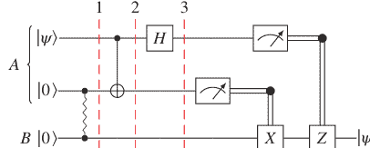

图 2.15 从 A 到 B 传输量子态的电路。

另一部分。图 2.15 显示了使用 EPR 对将量子态 \(\psi\) 从节点 A 传输到节点 B 的电路。节点 A 有两个量子比特，一个要将其状态 \(|\psi\rangle\) 传输到 B，另一个与节点 B 上的量子比特共享纠缠态。波形箭头是如图 2.11 所示的电路。在计算接近尾声时，节点 A 向 B 发送两个经典比特，这将决定是否应用 X 和 Z 门，其结果是 B 的量子比特采用了 A 的量子比特 \(|\psi\rangle\) 的状态。请注意，A 的量子比特不再具有此状态，因为它已被测量，这与无克隆定理一致，即一般来说，不存在可以复制任何未知量子比特态的量子电路。

让我们跟随计算来了解其工作原理。在切片 1 时，我们有以下三个量子比特的状态（两个在 A，用量子比特 1 和 2 的下标表示，一个在 B，用量子比特 3 的下标表示），也就是说，我们在有用的地方使用下标来标记量子比特：

```
\(|\psi\rangle_1 \otimes \frac{1}{\sqrt{2}}(|00\rangle_{23} + |11\rangle_{23})\)
```

然后在应用 CNOT 门后，在切片 2 时，我们有：

```
\((CNOT_{12} \otimes I_3) \left( |\psi\rangle_1 \otimes \frac{1}{\sqrt{2}}(|00\rangle_{23} + |11\rangle_{23}) \right)\)
= (CNOT_{12} \otimes I_3) \left( (\alpha|0\rangle_1 + \beta|1\rangle_1) \otimes \frac{1}{\sqrt{2}}(|00\rangle_{23} + |11\rangle_{23}) \right)
= \frac{1}{\sqrt{2}}(CNOT_{12} \otimes I_3)(\alpha|000\rangle + \beta|100\rangle + \alpha|011\rangle + \beta|111\rangle)
= \frac{1}{\sqrt{2}} (\alpha |000\rangle + \beta |110\rangle + \alpha |011\rangle + \beta |101\rangle)
= \frac{1}{\sqrt{2}} (\alpha|0\rangle_1(|00\rangle_{23} + |11\rangle_{23}) + \beta|1\rangle_1(|10\rangle_{23} + |01\rangle_{23}))
```

然后，我们对第一个量子比特应用 H 门，以在切片 3 时得到以下状态：

```
= (H_1 \otimes I_2 \otimes I_3) \frac{1}{\sqrt{2}} (\alpha|0\rangle_1(|00\rangle_{23} + |11\rangle_{23}) + \beta|1\rangle_1(|10\rangle_{23} + |01\rangle_{23}))
= \frac{1}{\sqrt{2}} (\alpha H|0\rangle_1(|00\rangle_{23} + |11\rangle_{23}) + \beta H|1\rangle_1(|10\rangle_{23} + |01\rangle_{23}))
= \frac{1}{\sqrt{2}} \left( \alpha \frac{1}{\sqrt{2}} (|0\rangle_1 + |1\rangle_1)(|00\rangle_{23} + |11\rangle_{23})
+ \beta \frac{1}{\sqrt{2}} (|0\rangle_1 - |1\rangle_1)(|10\rangle_{23} + |01\rangle_{23}) \right)
= \frac{1}{2} (\alpha |000\rangle + \alpha |100\rangle + \alpha |011\rangle + \alpha |111\rangle + \beta |010\rangle
- \beta |110\rangle + \beta |001\rangle - \beta |101\rangle)
= \frac{1}{2} (\alpha |000\rangle + \beta |001\rangle + \alpha |011\rangle + \beta |010\rangle + \alpha |100\rangle
- \beta |101\rangle + \alpha |111\rangle - \beta |110\rangle)
= \frac{1}{2} (|00\rangle \otimes (\alpha |0\rangle + \beta |1\rangle) + |01\rangle \otimes (\alpha |1\rangle + \beta |0\rangle)
+ |10\rangle \otimes (\alpha |0\rangle - \beta |1\rangle) + |11\rangle \otimes (\alpha |1\rangle - \beta |0\rangle))
= \frac{1}{2} (|00\rangle \otimes X^0 Z^0 (\alpha |0\rangle + \beta |1\rangle) + |01\rangle \otimes X Z^0 (\alpha |0\rangle + \beta |1\rangle)
+ |10\rangle \otimes X^0 Z (\alpha |0\rangle + \beta |1\rangle) + |11\rangle \otimes X Z (\alpha |0\rangle + \beta |1\rangle))
(noting that X^0 = Z^0 = I)
= \frac{1}{2} \sum_{p,q \in \{0,1\}} |pq\rangle_{12} \otimes [X^q Z^p (\alpha |0\rangle + \beta |1\rangle)]_3
```

请注意，假设现在测量结果为 p 和 q，对应于前两个量子比特的状态为 |pq>，如电路所示，A 将（经典）比特 p 和 q 发送到 B，B 可以对第三个量子比特应用 Z^p X^q 以得到：

(Z^p X^q)[X^q Z^p(\alpha|0\rangle + \beta|1\rangle)] = Z^p X^q X^q Z^p(\alpha|0\rangle + \beta|1\rangle) = \alpha|0\rangle + \beta|1\rangle

由于 XX = ZZ = I，因此 B 的量子比特已采用所需状态。因此，传输量子态所需的（通信）资源是两个经典比特和一个 EPR 对（在传输过程中被“消耗”）。可以有效地传输在发送光子中编码的量子态，但上述方法表明，只要有一个可用的 EPR 对并能执行某些量子操作，量子态的传输就可以通过传输经典比特来完成。

与传输两个比特来传达一个量子比特的信息不同，只要有一个可被“消耗”的 EPR 对，就可以传输一个量子比特来传达两个比特的信息，

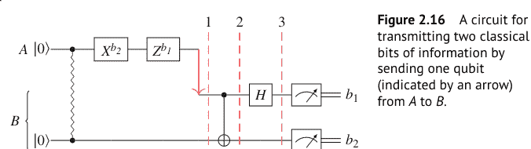

使用一种称为 *超密编码* 的协议，如图 2.16 所示。我们从 \( A \) 和 \( B \) 共享的一个 EPR 对开始。然后，对于 \( b_1 \) 和 \( b_2 \) 的选择取决于 \( A \) 想要发送哪两个比特，在对 \( A \) 处的量子比特应用门 \( X^{b_2} \) 和 \( Z^{b_1} \) 后，在切片 1 时得到：\( (Z^{b_1} X^{b_2} \otimes I) \frac{1}{\sqrt{2}}(|00\rangle + |11\rangle) \)。针对 \( b_1 \) 和 \( b_2 \) 的不同选择，电路中后续操作如下表格所示：

| b₁ | b₂ | 切片 1 | 切片 2 | 切片 3 |
|---|---|---|---|---|
| 0 | 0 | \(\frac{1}{\sqrt{2}}(|00\rangle + |11\rangle)\) | \(\frac{1}{\sqrt{2}}(|00\rangle + |10\rangle)\) | \(\frac{1}{2}(|00\rangle + |10\rangle + |00\rangle - |10\rangle) = |00\rangle\) |
| 0 | 1 | \(\frac{1}{\sqrt{2}}(|10\rangle + |01\rangle)\) | \(\frac{1}{\sqrt{2}}(|11\rangle + |01\rangle)\) | \(\frac{1}{2}(|01\rangle - |11\rangle + |01\rangle + |11\rangle) = |01\rangle\) |
| 1 | 0 | \(\frac{1}{\sqrt{2}}(|00\rangle - |11\rangle)\) | \(\frac{1}{\sqrt{2}}(|00\rangle - |10\rangle)\) | \(\frac{1}{2}(|00\rangle + |10\rangle - |00\rangle + |10\rangle) = |10\rangle\) |
| 1 | 1 | \(\frac{1}{\sqrt{2}}(-|10\rangle + |01\rangle)\) | \(\frac{1}{\sqrt{2}}(-|11\rangle + |01\rangle)\) | \(\frac{1}{2}(-|01\rangle + |11\rangle + |01\rangle + |11\rangle) = |11\rangle\) |

测量时，请注意所得比特确实是 \( b_1 \) 和 \( b_2 \)。

## 2.5 总结

在本章中，我们探讨了量子信息和量子计算的基本思想，包括量子纠缠和量子传输的概念。我们只介绍了本书余下部分所需的主要概念，随着我们的深入，将根据需要引入更多概念。在第 2.6 节中，我们为初学者指出了进一步的学习资源。

## 2.6 量子计算的进一步阅读和资源

对于学习量子信息和量子计算的人来说，不可忽视的书是“量子计算圣经”，即 Isaac Chuang 和 Michael Nielsen 的 Quantum Computation and Quantum Information。关于量子计算的许多书籍也很有帮助，包括 A. Yu. Kitaev、A.H. Shen 和 M.N. Vyalyi 的 Classical and Quantum Computation，Noson S. Yanofsky 和 Mirco A. Mannucci 的 Quantum Computing for Computer Scientists，Eleanor Rieffel 和 Wolfgang Polak 的 Quantum Computing: A Gentle Introduction，Dan C. Marinescu 和 Gabriela M. Marinescu 的 Approaching Quantum Computing，Phillip Kaye、Raymond Laflamme 和 Michele Mosca 的 An Introduction to Quantum Computing，N. David Mermin 的 Quantum Computer Science: An Introduction 以及其他几本。如果上述书籍过于具有挑战性，David McMahon 的 Quantum Computing Explained 是一个很好的起点，其中大量计算都有详细解答。此外，近年来更多入门书籍已经出版。两本对初学者免费提供的书籍（尤其是具有一些 IT 背景但没有物理背景的人）是 Thomas G. Wong 的 Introduction to Classical and Quantum Computing 24 和 Ciaran Hughes、Joshua Isaacson、Anastasia Perry、Ranbel F. Sun 和 Jessica Turner 的 Quantum Computing for the Quantum Curious。25 然后，特别是对于程序员，Robert Hundt 的 Quantum Computing for Programmers 非常出色。关于量子计算有许多优秀的在线视频（和视频系列）。例如，我使用过的一个是 Umesh Vazirani 关于入门量子计算的在线讲座。26 对于对量子力学感兴趣的人，Barton Zwiebach 的讲座系列非常启发性。27 IBM 关于量子计算平台 Qiskit 的在线教科书提供了良好的介绍。28 麻省理工学院提供的量子计算短期在线课程，几年前开始提供，或许现在有更新版本可供学习。29 当这本书到您手中时，网上可能已经有更多资源可供使用。

## References

Sebastian de Bone, Runsheng Ouyang, Kenneth Goodenough, and David Elkouss. 使用 Bell 对创建和提纯多方 GHZ 态的协议. IEEE 量子工程学报, 1:1–10, 2020. doi: 10.1109/TQE.2020.3044179.

- 24 https://www.thomaswong.net/introduction-to-classical-and-quantum-computing-1e3p.pdf [上次访问: 9/10/2022]
- 25 https://link.springer.com/book/10.1007/978-3-030-61601-4 [上次访问: 9/10/2022]
- 26 参见 https://www.youtube.com/channel/UCq9B8kT3oXl8BSyaoBPQXQw/videos [上次访问: 7/11/2022]
- 27 https://ocw.mit.edu/courses/8-04-quantum-physics-i-spring-2016 [上次访问: 7/11/2022]
- 28 参见 Qiskit 教科书 https://qiskit.org/learn [上次访问: 7/11/2022].
- 29 参见 https://learn-xpro.mit.edu/quantum-computing [上次访问: 7/11/2022]


Dik Bouwmeester, Jian-Wei Pan, Matthew Daniell, Harald Weinfurter, and Anton Zeilinger. 观察三光子格林伯格-霍恩-泽ilinger纠缠. 《物理评论快报》, 82:1345–1349, 1999年2月. doi: 10.1103/PhysRevLett.82.1345.

W. Dür, G. Vidal, and J. I. Cirac. 三个量子比特可以以两种非等价方式纠缠. 《物理评论A》, 62:062314, 2000年11月. doi: 10.1103/PhysRevA.62.062314.

Ciaran Hughes, Joshua Isaacson, Anastasia Perry, Ranbel F. Sun, and Jessica Turner. 创建叠加态：光束分束器, 第17–28页. Springer International Publishing, Cham, 2021a

Ciaran Hughes, Joshua Isaacson, Anastasia Perry, Ranbel F. Sun, and Jessica Turner. 什么是量子比特？, 第7–16页. Springer International Publishing, Cham, 2021b

Jessica Illiano, Michele Viscardi, Seid Koudia, Marcello Caleffi, and Angela Sara Cacciapuoti. 量子互联网：从介质访问控制到纠缠访问控制. 2022年5月

Louis H. Kauffman and Sam J. Lomonaco Jr., 量子图与量子网络. 载于Eric Donkor, Andrew R. Pirich, Howard E. Brandt, Michael R. Frey, Samuel J. Lomonaco Jr., and John M. Myers, 编, 《量子信息与计算XII》, 第9123卷, 第91230P页. 国际光学与光子学学会, SPIE, 2014.

D. Leibfried, E. Knill, S. Seidelin, J. Britton, R. B. Blakestad, J. Chiaverini, D. B. Hume, W. M. Itano, J. D. Jost, C. Langer, R. Ozeri, R. Reichle, and D. J. Wineland. 创建六原子'薛定谔猫'状态. 《自然》, 438(7068):639–642, 2005.

Michael A. Nielsen and Isaac L. Chuang. 量子计算与量子信息. 剑桥大学出版社, 2000.

# 3 分布式量子计算 – 经典与量子

早期关于分布式量子计算的讨论关注通信复杂性，即在涉及至少两方的分布式计算中交换的消息中的比特（或量子比特）数量。其目的是看纠缠是否提供了一种减少（经典或量子）分布式算法通信复杂性的方法——减少节点间的通信是许多分布式计算算法的关键目标，因为这种减少可以提高效率，减少节点间的耦合，并减少通信资源的使用。

我们首先考虑其中三种算法：分布式三方积问题、分布式Deutsch–Jozsa承诺问题和分布式交集问题。虽然有人可能会认为这些并非十分实用的分布式量子计算算法，但我们将看到量子信息如何能够使分布式计算解决方案使用更少的通信比特，而不是仅使用经典信息。

然后，我们还将看一个惊人的结果：某些分布式计算问题（在特定约束和要求下）在经典情况下无法求解，但可以利用量子信息（特别是纠缠）来求解。事实上，能够在约束和要求下求解此类问题，可能被视为检验是否确实存在量子纠缠的一种方法！

此后，我们将探讨许多量子协议，它们看起来相当理论，但许多具有实际意义，并且涉及多方（或节点），因此本质上是分布式的。我们将探讨的量子协议包括量子抛硬币、量子领导人选举、量子密钥分发、量子匿名广播、量子投票、量子拜占庭将军、量子秘密共享和量子无意识传输（OT）。

## 3.1 纠缠在分布式计算中的威力

我们在第2章中介绍了纠缠的概念。如Cleve和Buhrman [1997]所指出，测量纠缠粒子时实际上不会发生通信，或者换句话说，共享纠缠粒子的两方无法利用这种纠缠进行通信，具体而言：假设$A$和$B$各自拥有一个ebit，即共享一对纠缠量子比特，例如$\frac{1}{\sqrt{2}}(|00\rangle + |11\rangle)$，那么当$A$测量其量子比特并获得$x$（0或1）时，$B$也会获得相同的值$x$，但是由于$A$在测量前无法确定$x$将是什么，$A$无法选择要向$B$传达的内容。

但一个问题是，$A$和$B$之间的纠缠是否在某种方式上可以减少涉及$A$和$B$上的数据的某些计算中$A$和$B$之间的通信。我们将看到答案是肯定的。

### 3.1.1 使用更少通信比特实现分布式计算

为了精确说明我们在执行某些分布式计算时所指的减少通信，我们首先引入*通信复杂性*的概念。遵循Cleve和Buhrman [1997]的阐述，假设我们有两台不同的机器$A$和$B$，其中$A$拥有一个$n$比特字符串$a = a_1 ... a_n$，$B$拥有一个$n$比特字符串$b = b_1 ... b_n$，并且预期的分布式计算是求和（模2）函数$f : \{0, 1\}^n \times \{0, 1\}^n \rightarrow \{0, 1\}$，它需要$A$和$B$的输入：

\( f(a, b) = a_1 \oplus \cdots \oplus a_n \oplus b_1 \oplus \cdots \oplus b_n \)

其中\(\oplus\)是模2加法运算。$B$需要发送到$A$以便$A$计算$f(a, b)$所需的最少比特数仅为一个比特，即计算结果$b_1 \oplus \cdots \oplus b_n$。作为示例，考虑另一种计算，即内积（模2），定义如下：

\( f(a, b) = (a_1 \cdot b_1) \oplus \cdots \oplus (a_n \cdot b_n) \)

那么，为了让$A$计算$f(a, b)$，$B$别无选择，只能发送其所有$n$个比特，即在这种情况下$B$必须发送到$A$的最少比特数为$n$。为了让$A$计算函数$f$而必须发送的经典比特的最少数量是$f$的*通信复杂性*。例如，对于求和（模2）函数，通信复杂性为1，而对于内积则为$n$。

我们将探讨三个问题，在这些问题中我们可以看到关于通信复杂性的量子优势。

#### 3.1.1.1 分布式三方积问题

让我们考虑Cleve和Buhrman [1997]的一个示例，在经典情况下（无纠缠），至少需要三个经典比特的通信，而与机器之间的纠缠时，仅需两个经典比特的通信即可，也就是说，纠缠可以降低通信复杂性。我们有$A$、$B$和$C$，分别拥有$n$比特字符串$x^A$、$x^B$和$x^C$，

条件为：$x^A \oplus x^B \oplus x^C = \overbrace{1 \dots 1}^{n} = \mathbf{1}$，这里的$\oplus$是按位加法（模2），函数$f$定义为$f(a, b, c) = (a_1 \cdot b_1 \cdot c_1) \oplus \cdots \oplus (a_n \cdot b_n \cdot c_n)$，也就是说，我们希望$A$计算值
$f(x^A, x^B, x^C) = (x_1^A \cdot x_1^B \cdot x_1^C) \oplus \cdots \oplus (x_n^A \cdot x_n^B \cdot x_n^C)$

请注意，上述对$n$比特字符串$x^A$、$x^B$和$x^C$的条件使得这个问题不完全是我们之前看到的内积的“推广”（后者对输入没有这样的条件）。

我们假设$A$、$B$和$C$共享一个包含$3n$个量子比特的纠缠集合，每方拥有$n$个量子比特，即存在$n$组纠缠量子比特三元组，每个三元组表示为$\psi_i^A \psi_i^B \psi_i^C$，其中$i \in \{1, \dots, n\}$，处于形式为：$\rho_{ABC} = \frac{1}{2}(|001\rangle + |010\rangle + |100\rangle - |111\rangle)$的纠缠状态。请注意，该态可以通过局域单位算符（或LU）运算（即在每台机器上本地执行的运算）从Greenberger–Horne–Zeilinger（GHZ）态 $\frac{1}{\sqrt{2}}(|000\rangle + |111\rangle)$获得，即在LU运算意义下，它等价于GHZ态——参见**旁注**。

> **旁注:** 可能存在不同的可能操作；一种如下：
>
> - 从$\frac{1}{\sqrt{2}}(|000\rangle + |111\rangle)$开始，我们应用运算$Z \otimes Z \otimes Z$：
>
> $(Z \otimes Z \otimes Z) \frac{1}{\sqrt{2}}(|000\rangle + |111\rangle) = \frac{1}{\sqrt{2}}(|000\rangle - |111\rangle)$
>
> 请注意，$I \otimes I \otimes Z$之类的运算也可以使用。
>
> - 应用运算$H \otimes H \otimes H$：
>
> $(H \otimes H \otimes H) \frac{1}{\sqrt{2}}(|000\rangle - |111\rangle)$
>
> $= \frac{1}{\sqrt{2}}(H|0\rangle H|0\rangle H|0\rangle - H|1\rangle H|1\rangle H|1\rangle)$
>
> $= \frac{1}{4}((|000\rangle + |001\rangle + |010\rangle + |011\rangle + |100\rangle + |101\rangle + |110\rangle + |111\rangle) - (|000\rangle - |001\rangle - |010\rangle + |011\rangle - |100\rangle + |101\rangle + |110\rangle - |111\rangle))$


= \frac{1}{4} (|000\rangle + |001\rangle + |010\rangle + |011\rangle + |100\rangle + |101\rangle + |110\rangle + |111\rangle) - (|000\rangle + |001\rangle + |010\rangle - |011\rangle + |100\rangle - |101\rangle - |110\rangle + |111\rangle) = \frac{1}{2} (|001\rangle + |010\rangle + |100\rangle + |111\rangle)

3. 应用运算 \sqrt{Z} \otimes \sqrt{Z} \otimes \sqrt{Z}，其中 \sqrt{Z} = \begin{bmatrix} 1 & 0 \\ 0 & i \end{bmatrix}，即 \sqrt{Z} |0\rangle = |0\rangle \text{且 } \sqrt{Z} |1\rangle = i |1\rangle (\text{且 } \sqrt{Z}\sqrt{Z} = Z) - \text{注意，我们在后续第 5 章中也将 Z 门的平方根称为 P 门：}

\left( \sqrt{Z} \otimes \sqrt{Z} \otimes \sqrt{Z} \right) \frac{1}{2} (|001\rangle + |010\rangle + |100\rangle + |111\rangle) = \frac{1}{2} (i |001\rangle + i |010\rangle + i |100\rangle + i(i)^2 |111\rangle) = i \frac{1}{2} (|001\rangle + |010\rangle + |100\rangle - |111\rangle)

\text{并且忽略全局相位 } i，\text{ 我们有 } \frac{1}{2} (|001\rangle + |010\rangle + |100\rangle - |111\rangle) \text{ 如所要求。}

现在我们用 \( A, B \) 和 \( C \) 运行以下算法，其中 \( H \) 是将 \( |0\rangle \) 映射到 \( \frac{1}{\sqrt{2}}(|0\rangle + |1\rangle) \) 并将 \( |1\rangle \) 映射到 \( \frac{1}{\sqrt{2}}(|0\rangle - |1\rangle) \) 的 Hadamard 变换，且测量在标准（或计算）基中进行：

- 0. 对每个 \( p \in \{A, B, C\} \)：
- 1. 对每个 \( i \in \{1, ..., n\} \)：
- 2. 如果 \( x_i^p = 0 \) 则
- 3. 对 \( \psi_i^p \) 应用 \( H \)
- 4. 否则
- 5. 对 \( \psi_i^p \) 不做任何操作
- 6. 测量 \( \psi_i^p \) 得到比特 \( s_i^p \)
- 7. \( s^p := s_1^p \oplus ... \oplus s_n^p \)

然后，\( B \) 和 \( C \) 将它们的结果（即 \( s^B \) 和 \( s^C \)）发送到 \( A \)，\( A \) 已经拥有 \( s^A \)，并计算值 \( s^A \oplus s^B \oplus s^C \)，并且由于我们有条件 \( x^A \oplus x^B \oplus x^C = 1 \)，

\( s^A \oplus s^B \oplus s^C = f(x^A, x^B, x^C) \)

并且 \( A \) 仅通过发送两个经典比特给它就成功了。让我们看看上述等式为什么成立。

首先，我们观察到对于每个 \( i \)：

$s_i^A \oplus s_i^B \oplus s_i^C = x_i^A \cdot x_i^B \cdot x_i^C$

这是因为由于 $x^A \oplus x^B \oplus x^C = \mathbf{1}$，即 $x_i^A \oplus x_i^B \oplus x_i^C = 1$，$x_i^A, x_i^B, x_i^C$ 的值只有四种可能的组合，即 0, 0, 1 或 0, 1, 0 或 1, 0, 0 或 1, 1, 1（仅奇数个 1），并且我们可以从下表中看到，对于每个 $i$，对于 $x_i^A, x_i^B, x_i^C$ 的每个可能值，我们有 $s_i^A \oplus s_i^B \oplus s_i^C = x_i^A \cdot x_i^B \cdot x_i^C$。

| $x_i^A \cdot x_i^B \cdot x_i^C$ | 算法第 5 行后的状态 | $s_i^A \oplus s_i^B \oplus s_i^C$ |
|---|---|---|
| $0 \cdot 0 \cdot 1 = 0$ | $H \otimes H \otimes I(\rho_{ABC}) = \frac{1}{2}(|011\rangle + |101\rangle + |000\rangle - |110\rangle)$ | 0 |
| $0 \cdot 1 \cdot 0 = 0$ | $H \otimes I \otimes H(\rho_{ABC}) = \frac{1}{2}(|011\rangle + |110\rangle + |000\rangle - |101\rangle)$ | 0 |
| $1 \cdot 0 \cdot 0 = 0$ | $I \otimes H \otimes H(\rho_{ABC}) = \frac{1}{2}(|101\rangle + |110\rangle + |000\rangle - |011\rangle)$ | 0 |
| $1 \cdot 1 \cdot 1 = 1$ | $I \otimes I \otimes I(\rho_{ABC}) = \frac{1}{2}(|001\rangle + |010\rangle + |100\rangle - |111\rangle)$ | 1 |

请注意，对于每个 $i$，在选择性地应用 Hadamard 门后（表格中间列）三个量比特的状态取决于 $x_i^A, x_i^B, x_i^C$ 的四个值组合中哪些出现。

基于以上内容，我们有：

$s^A \oplus s^B \oplus s^C = (s_1^A \oplus \cdots \oplus s_n^A) \oplus (s_1^B \oplus \cdots \oplus s_n^B) \oplus (s_1^C \oplus \cdots \oplus s_n^C)$
$= (s_1^A \oplus s_1^B \oplus s_1^C) \oplus \cdots \oplus (s_n^A \oplus s_n^B \oplus s_n^C)$
$= (x_1^A \cdot x_1^B \cdot x_1^C) \oplus \cdots \oplus (x_n^A \cdot x_n^B \cdot x_n^C)$
$= f(x^A, x^B, x^C)$

这是 \( A \) 计算的值。如 Cleve 和 Buhrman [1997] 所解释，如果没有共享纠缠比特，$A$、$B$ 和 $C$ 之间两个经典比特的通信不足以让 \( A \) 计算 \( f(a,b,c) \)，并且需要通信三个经典比特。以一种有趣的方式，共享量比特似乎“取代”了一个经典比特的通信：对于这个问题，$n\) 个纠缠量比特三元组加上两个经典比特的通信等同于三个经典比特的通信！

#### 3.1.1.2 分布式 Deutsch–Jozsa 承诺问题

让我们考虑另一个基于 Buhrman et al. [2010] 中的问题，与另一个称为 Deutsch–Jozsa 算法$^1$ 的问题（及其解决方案/算法）相关，如下。假设我们有 $A$ 和 $B$，$A$ 拥有一个 $n$ 位字符串 $a = a_1 \dots a_n$，$B$ 拥有一个 $n$ 位字符串 $b = b_1 ... b_n$。问题是确定 (1) $a = b$，或 (2) $a$ 和 $b$ 在恰好 $n/2$ 个位置上不同，其中 $n$ 为偶数（在此，我们还假设 $n$ 是 2 的幂），并且这是一个 *承诺问题*，这意味着它不适用于所有字符串对 $(x,y) \in \{0, 1\}^n \times \{0, 1\}^n$，而仅适用于 (1) 或 (2) 为真的那些对（显然，对于给定的字符串对，两者不能同时为真）。

求解此问题的一个算法如下，假设 $n = 2^l$（或 $l = \log_2 n$）：

- 1. $B$ 使用 $b$ 和 $l$ 个 $|0\rangle$-量比特，制备状态 $\frac{1}{\sqrt{n}} \sum_{i=0}^{n-1} (-1)^{b_i} |i\rangle$；请注意，这里的想法是将 $b$ 中的 $n$ 位信息编码在 $l$ 量比特状态的 $n$ 个分量的“符号”（即 $(-1)^{b_i}$）中（由于 $l \ll 2^l$，我们试图“侥幸”通过传输更少的比特）。这可以按以下方式完成：(i) 在 $l$ 个 $|0\rangle$-量比特上应用 $H^{\otimes l}$ 以获得状态 $\frac{1}{\sqrt{n}} \sum_{i=0}^{n-1} |i\rangle$；例如，对于 $n = 2^3$，$H \otimes H \otimes H |000\rangle = \frac{1}{\sqrt{2}}(|0\rangle + |1\rangle) \otimes \frac{1}{\sqrt{2}}(|0\rangle + |1\rangle) \otimes \frac{1}{\sqrt{2}}(|0\rangle + |1\rangle) = \frac{1}{\sqrt{2^3}} \sum_{i=0}^{2^3-1} |i\rangle$ (ii) 假设存在一个作用于 $(l + 1)$ 个量比特的单位运算 $U_b$，它将 $|i\rangle |p\rangle$ 映射到 $|i\rangle |p \oplus b_i\rangle$（参见 **旁注**）。

> **旁注：** $U_b$ 是单位的，即 $U_b^\dagger U_b = I$，如我们现在所示。请注意，对于 $i \in \{0, 1\}^l$ 和 $b \in \{0, 1\}$ 的状态 $|i\rangle|p\rangle$ 构成一组基，并设 \(|\psi\rangle = \sum_{i \in \{0, 1\}^l, p \in \{0, 1\}} \alpha_{l,p} |i\rangle|p\rangle\)，则：
> $$ \langle \psi | U_b^\dagger U_b | \psi \rangle $$
> $$ = (U_b | \psi \rangle)^\dagger U_b | \psi \rangle $$
> $$ = \left( U_b \left( \sum_{i \in \{0, 1\}^l, p \in \{0, 1\}} \alpha_{l,p} |i\rangle|p\rangle \right) \right)^\dagger U_b \left( \sum_{i \in \{0, 1\}^l, p \in \{0, 1\}} \alpha_{l,p} |i\rangle|p\rangle \right) $$
> $$ = \left( \sum_{i \in \{0, 1\}^l, p \in \{0, 1\}} \alpha_{l,p} U_b |i\rangle |p\rangle \right)^\dagger \left( \sum_{i \in \{0, 1\}^l, p \in \{0, 1\}} \alpha_{l,p} U_b |i\rangle |p\rangle \right) $$
> $$ = \left( \sum_{i \in \{0, 1\}^l, p \in \{0, 1\}} \alpha_{l,p} |i\rangle |p \oplus b_i\rangle \right)^\dagger \left( \sum_{i \in \{0, 1\}^l, p \in \{0, 1\}} \alpha_{l,p} |i\rangle |p \oplus b_i\rangle \right) $$
> $$ = \sum_{i \in \{0,1\}^l, p \in \{0,1\}} \alpha_{l,p}^2 \langle i | \langle p \oplus b_i | i \rangle | p \oplus b_i \rangle $$
> $$ = \sum_{i \in \{0,1\}^l, p \in \{0,1\}} \alpha_{l,p}^2 = \langle \psi | \psi \rangle $$

$^1$ 请注意，原始 Deutsch–Jozsa 问题是确定给定函数（例如 $f : \{0, 1\}^n \mapsto \{0, 1\}$）是常数（对所有输入返回 0 或对所有输入返回 1）还是平衡（对一半输入返回 0 且对另一半输入返回 1），并且我们承诺该函数是这两者之一。解决方案见 https://en.wikipedia.org/wiki/Deutsch-Jozsa_algorithm。


然后对 \( \frac{1}{\sqrt{n}} \sum_{i=0}^{n-1} |i\rangle |0\rangle \) 应用 \( U_b \)（即 (i) 的结果加上处于 \( |0\rangle \) 状态的辅助量子位），得到：

\( U_b \left( \frac{1}{\sqrt{n}} \sum_{i=0}^{n-1} |i\rangle |0\rangle \right) = \frac{1}{\sqrt{n}} \sum_{i=0}^{n-1} U_b |i\rangle |0\rangle \)

（按线性）

\( = \frac{1}{\sqrt{n}} \sum_{i=0}^{n-1} |i\rangle |0 \oplus b_i\rangle = \frac{1}{\sqrt{n}} \sum_{i=0}^{n-1} |i\rangle |b_i\rangle \)

(iii) 然后对 (ii) 的结果应用 \( I^{\otimes l} \otimes Z \)，得到：

\( (I^{\otimes l} \otimes Z) \left( \frac{1}{\sqrt{n}} \sum_{i=0}^{n-1} |i\rangle |b_i\rangle \right) = \frac{1}{\sqrt{n}} \sum_{i=0}^{n-1} (-1)^{b_i} |i\rangle |b_i\rangle \)

(iv) 最后，为了将前 \( l \) 个量子位与最后一个量子位“解纠缠”，我们对 (iii) 的结果再次应用 \( U_b \)，得到：

\( U_b \left( \frac{1}{\sqrt{n}} \sum_{i=0}^{n-1} (-1)^{b_i} |i\rangle |b_i\rangle \right) \\
= \frac{1}{\sqrt{n}} \sum_{i=0}^{n-1} (-1)^{b_i} U_b |i\rangle |b_i\rangle = \frac{1}{\sqrt{n}} \sum_{i=0}^{n-1} (-1)^{b_i} |i\rangle |b_i \oplus b_i\rangle \\
= \frac{1}{\sqrt{n}} \sum_{i=0}^{n-1} (-1)^{b_i} |i\rangle |0\rangle = \left( \frac{1}{\sqrt{n}} \sum_{i=0}^{n-1} (-1)^{b_i} |i\rangle \right) \otimes |0\rangle \)

也就是说，在 (ii)–(iv) 中，我们应用了 \( U_b(I^{\otimes l} \otimes Z)U_b \)，最后一个量子位可以被测量（丢弃）以得到我们想要准备的状态 \( \frac{1}{\sqrt{n}} \sum_{i=0}^{n-1} (-1)^{b_i} |i\rangle \)；这个 \( l \) 量子位状态随后被发送到 \( A \)（例如，通过量子隐形传态——比如说，分别对每个量子位进行隐形传态）。

- 2. \( A \) 接收该状态，并应用一个将 \( |i\rangle \) 映射到 \( (-1)^{\alpha_i} |i\rangle \) 的操作，然后还对每个量子位应用 Hadamard 变换，并测量得到的 \( l \)-量子位比特串。

将 \( |i\rangle \) 映射到 \( (-1)^{\alpha_i} |i\rangle \) 的映射可以使用类似于上面 \( U_b \) 定义的操作 \( U_a \) 来完成；也就是说，我们在带有辅助量子位 \( |0\rangle \) 的接收状态上应用 \( U_a(I^{\otimes l} \otimes Z)U_a \)：

\( U_a(I^{\otimes l} \otimes Z)U_a \left( \frac{1}{\sqrt{n}} \sum_{i=0}^{n-1} (-1)^{b_i} |i\rangle \right) |0\rangle = \left( \frac{1}{\sqrt{n}} \sum_{i=0}^{n-1} (-1)^{\alpha_i + b_i} |i\rangle \right) |0\rangle \)

丢弃最后一个量子位。然后，在 Hadamard 变换之后，被测量的状态是：

\( H^{\otimes l} \left( \frac{1}{\sqrt{n}} \sum_{i=0}^{n-1} (-1)^{\alpha_i + b_i} |i\rangle \right) = \frac{1}{\sqrt{n}} \sum_{i=0}^{n-1} (-1)^{\alpha_i + b_i} H^{\otimes l} |i\rangle \)

\( = \frac{1}{\sqrt{n}}\sum_{i=0}^{n-1}(-1)^{a_i+b_i}(H | i_1 \rangle \otimes \cdots \otimes H | i_l \rangle) \)
（其中 \( | i \rangle = | i_1 \dots i_l \rangle\)，\( i$ 的比特串表示）
\( = \frac{1}{\sqrt{n}}\sum_{i=0}^{n-1}(-1)^{a_i+b_i}\left( \frac{1}{\sqrt{2}} \right)^l (|0\rangle + (-1)^{i_1} |1\rangle) \otimes \cdots \otimes (|0\rangle + (-1)^{i_l} |1\rangle) \)
\( = \frac{1}{n} \sum_{i=0}^{n-1}(-1)^{a_i+b_i} \sum_{j \in \{0,1\}^l} (-1)^{i \cdot j} |j\rangle \)
（因为 \(\left( \frac{1}{\sqrt{2}} \right)^l = \frac{1}{\sqrt{n}}\) 和 \(i \cdot j = i_1 \times j_1 \oplus \cdots \oplus i_l \times j_l\)）

我们注意到，如果 \( a = b$，则 \( | 0 \dots 0 \rangle$ 的幅度为 \(\frac{1}{n} \sum_{i=0}^{n-1} (-1)^{a_i+b_i} = 1$，即如果 \( a = b$，则得到 \( | 0 \dots 0 \rangle$ 的概率为 1。但如果 \( a$ 和 \( b$ 在恰好 \( n/2$ 个位置上不同，则幅度 \(\frac{1}{n} \sum_{i=0}^{n-1} (-1)^{a_i+b_i} = 0$（“1” 和 “-1” 数量相等的求和），得到状态 \( | 0 \dots 0 \rangle$ 的概率为零。

- 3. 如果测量结果是状态 \( | 0 \dots 0 \rangle$，则 \( A$ 输出 1（即我们有情况 (1) \( a = b$）；否则输出 0（即我们有情况 (2) \( a$ 和 \( b$ 在恰好 \( n/2$ 个位置上不同）。

因此，\( A$ 仅需从 \( B$ 发送 \(\log_2 n$ 个量子位即可解决这个承诺问题！（因为对每个量子位进行隐形传态需要两个经典位（和一个共享 ebit），因此需要 \( 2(\log_2 n)$ 或 \( O(\log n)$ 个经典位。）Buhrman 等人 [2010] 指出，经典协议需要发送至少 \( 0.007n$ 个位！因此，对于较小的 \( n$，经典协议可能更高效，但对于较大的 \( n$，经典协议的通信复杂度将呈指数级更高（但需注意量子协议需要使用量子位）。

#### 3.1.1.3 分布式交集问题

让我们考虑 Buhrman 等人 [2010] 的另一个问题。假设我们有 \( A$ 和 \( B$，其中 \( A$ 拥有一个 \( n$ 比特字符串 \( a = a_1 \dots a_n$，\( B$ 拥有一个 \( n$ 比特字符串 \( b = b_1 \dots b_n$。问题是计算以下函数 \( g$：

\(g(a, b) = \begin{cases} 1, & \text{if } a_i = b_i = 1 \text{ for at least one } i \\ 0, & \text{otherwise} \end{cases}\)

可以将此想象为用于计算会议时间，其中 \( a$ 和 \( b$ 的比特表示 \( A$ 和 \( B$ 可用的时间段（“0”表示不可用，“1”表示可用），并尝试找到至少一个两人都可用的时间段。

这个问题等同于寻找满足 \( a_i \wedge b_i = 1$ 的索引 \( i$。例如，如果 \( a = 10111$ 和 \( b = 11101$，则当 \( i$ 为 0、2 和 4 时，\( a_i \wedge b_i = 1$。因此，给定两个 \( n$ 比特字符串 \( a$ 和 \( b$，这变成了一个搜索问题，即寻找满足条件 \( a_i \wedge b_i = 1$ 的索引 \( i \in \{1, ..., n\}$（我们也可以使用索引 \( 0$ 到 \( n-1$）。

我们可以使用 Grover（量子）算法 [Grover, 1996] 来执行此搜索，这使我们能够（渐进地）比最佳经典算法更快地搜索到这样的解。Grover 算法使用一个函数 \( f : \{0, ..., n-1\} \to \{0, 1\}$，使得 \( f(x) = 1$ 当且仅当 \( x$ 指向满足搜索标准的项目——我们可以将 \( x$ 视为数据库中项目的索引——让我们就称 \( f$ 为数据库。假设 \( x'$ 是满足 \( f(x') = 1$ 的一个项目，我们假设有一个可使用如下定义的 \( f$ 的量子操作 \( V_{x'}$\(^2$：

\(V_{x'} |x\rangle = \begin{cases} -|x\rangle, & \text{if } x = x', \text{i.e. } f(x) = 1 \\ |x\rangle, & \text{if } x \neq x', \text{i.e. } f(x) = 0 \end{cases}\)

也就是说，\( V_{x'}$ 可以写成 \( V_{x'} |x\rangle = (-1)^{f(x)} |x\rangle$。该操作的想法是“标记”满足特定搜索标准的项目为 “\(-1\)”。在 Grover 算法中，有一个称为 _Grover 迭代_ 的单元操作，定义为 \( G = H^{\otimes l} V_0 H^{\otimes l} V_{x'}$，假设 \( n = 2^l$。Grover 迭代被反复应用，首先应用于如下的状态 \( |s\rangle$，然后反复应用于得到的状态：

- 1. 从 \( l$-量子位状态 \( |0\rangle^{\otimes l}$ 准备状态 \( |s\rangle$，例如通过 \( |s\rangle = H^{\otimes l} |0\rangle^{\otimes l} = \frac{1}{\sqrt{n}} \sum_{i=0}^{n-1} |i\rangle$
- 2. 对状态应用 Grover 迭代 \( G$，\( t$ 次
- 3. 在计算基下测量得到的状态中的所有量子位

在上述步骤结束时，可以检查得到的结果（来自 (3) 的比特串）是否确实是问题的解。Grover 算法可以使用 \( O(\sqrt{n})$ 次 \( V_{x'}$ 的应用，以趋近于 1 的概率返回 \( |x'\rangle$，特别是当 \( t = \lceil \frac{\pi}{4}(\sqrt{n}) \rceil$ 时。如果有多个解， say \( m$ 个解，则 \( t = \lceil \frac{\pi}{4}(\sqrt{n/m}) \rceil$。（注意，如果运行 \(\lceil \frac{\pi}{4}(\sqrt{n}) \rceil$ 次迭代后得到的结果不是解，那么很可能一开始就没有解！）

我们将探讨交集问题如何成为 Grover 算法的一个应用。如果 \( a$ 和 \( b$ 在同一台机器上，我们可以定义 \( f$ 使得 \( f(x) = 1$ 当且仅当 \( a_x \wedge b_x = 1$，即 \( f(x) = a_x \wedge b_x$。然后，依赖于 \( a$ 和 \( b$ 的操作 \( V_{a,b}$ 变为：

\(V_{a,b} |x\rangle = (-1)^{a_x \wedge b_x} |x\rangle\)


在 Grover 迭代中重复使用该操作 $O(\sqrt{n})$ 次，即可得到问题的解。

但我们的问题是分布式的，A 拥有 $a$，B 拥有 $b$。那么，如何让 $A$ 运行 Grover 算法，但以分布式的方式执行上述 $V_{a,b}$ 操作呢？一种方法如下。

### 实现 $V_{a,b}$ 的算法

每当 $A$ 想要对某个状态 $|\psi\rangle = \sum_{i=0}^{n-1} \alpha_i |i\rangle$ 执行 $V_{a,b}$，也就是说，$A$ 想要得到

$$V_{a,b} |\psi\rangle = V_{a,b} \left( \sum_{i=0}^{n-1} \alpha_i |i\rangle \right) = \sum_{i=0}^{n-1} \alpha_i V_{a,b} |i\rangle = \sum_{i=0}^{n-1} \alpha_i (-1)^{a_i \wedge b_i} |i\rangle$$

机器 $A$ 可以执行以下步骤：

- 1. 机器 $A$ 创建状态

$$\sum_{i=0}^{n-1} \alpha_i |i\rangle |a_i\rangle$$

有效地将 $a_i$ 作为额外的量子比特附加到状态 $|\psi\rangle$ 上。该状态可以按以下方式制备：假设我们有一个操作 $U_a |i\rangle |p\rangle = |i\rangle |p \oplus a_i\rangle$，之前已证明它是一个酉操作，然后将 $U_a$ 应用到 $|\psi\rangle |0\rangle$，即，$U_a |\psi\rangle |0\rangle = U_a (\sum_{i=0}^{n-1} \alpha_i |i\rangle) |0\rangle = \sum_{i=0}^{n-1} \alpha_i U_a |i\rangle |0\rangle = \sum_{i=0}^{n-1} \alpha_i |i\rangle |a_i\rangle$。

- 2. 然后，$A$ 将状态 $\sum_{i=0}^{n-1} \alpha_i |i\rangle |a_i\rangle$ 发送给 $B$，该状态包含 $(l+1)$ 个量子比特（为了简便，我们假设 $n=2^l$）。

- 3. 然后，机器 $B$ 对接收到的状态 $\sum_{i=0}^{n-1} \alpha_i |i\rangle |a_i\rangle$ 应用酉操作：$O_b : |i\rangle |x\rangle \rightarrow (-1)^{x \wedge b_i} |i\rangle |x\rangle$，以得到：

$$O_b \left( \sum_{i=0}^{n-1} \alpha_i |i\rangle |a_i\rangle \right) = \sum_{i=0}^{n-1} \alpha_i O_b |i\rangle |a_i\rangle = \sum_{i=0}^{n-1} \alpha_i (-1)^{a_i \wedge b_i} |i\rangle |a_i\rangle$$

（注意，操作 $O_b$ 在某个状态 $|i\rangle |x\rangle$ 上可以按以下方式实现：假设我们有一个操作 $U'_b$，它将 $|i\rangle |p\rangle |q\rangle$ 映射到 $|i\rangle |p\rangle |q \oplus (p \wedge b_i)\rangle$，$^3$ 执行计算

$$
\begin{aligned}
U'_b(I^{\otimes(l+1)} \otimes Z)U'_b |i\rangle |x\rangle |0\rangle &= U'_b(I^{\otimes(l+1)} \otimes Z) |i\rangle |x\rangle |0 \oplus (x \wedge b_i)\rangle \\
&= U'_b(-1)^{x \wedge b_i} |i\rangle |x\rangle |x \wedge b_i\rangle \\
&= (-1)^{x \wedge b_i} U'_b |i\rangle |x\rangle |x \wedge b_i\rangle \\
&= (-1)^{x \wedge b_i} |i\rangle |x\rangle |(x \wedge b_i) \oplus (x \wedge b_i)\rangle \\
&= (-1)^{x \wedge b_i} |i\rangle |x\rangle |0\rangle
\end{aligned}
$$

并舍弃辅助量子比特 $|0\rangle$，我们就将 $|i\rangle |x\rangle$ 映射到了 $(-1)^{x \wedge b_i} |i\rangle |x\rangle$。）

- 4. 机器 B 然后将结果 $\sum_{i=0}^{n-1} \alpha_i(-1)^{a_i \wedge b_i} |i\rangle |a_i\rangle$ 发回给 A，即 (l + 1) 个量子比特。

- 5. 机器 A 接收到结果，并通过应用 $U_a$ 将最后一个量子比特设为 $|0\rangle$：

$$
\begin{aligned}
U_a \left( \sum_{i=0}^{n-1} \alpha_i(-1)^{a_i \wedge b_i} |i\rangle |a_i\rangle \right) &= \sum_{i=0}^{n-1} \alpha_i(-1)^{a_i \wedge b_i} U_a |i\rangle |a_i\rangle \\
&= \sum_{i=0}^{n-1} \alpha_i(-1)^{a_i \wedge b_i} |i\rangle |a_i \oplus a_i\rangle \\
&= \sum_{i=0}^{n-1} \alpha_i(-1)^{a_i \wedge b_i} |i\rangle |0\rangle
\end{aligned}
$$

最后一个量子比特可以被丢弃/忽略，因此机器 A 得到：

$$\sum_{i=0}^{n-1} \alpha_i(-1)^{a_i \wedge b_i} |i\rangle$$

正如所需，我们已计算出 \(V_{a,b} |\psi\rangle\)！

总之，计算分布式交集问题解的算法如下，在 A 处执行：

- 1. 从 l 量子比特状态 $|0\rangle^{\otimes l}$ 开始，制备状态 $|s\rangle = \frac{1}{\sqrt{n}} \sum_{i=0}^{n-1} |i\rangle$，例如通过 $|s\rangle = H^{\otimes l} |0\rangle^{\otimes l}$

- 2. 从状态 $|s\rangle$ 开始，应用 Grover 迭代 G，t 次，其中 G 定义如下（与之前的形式等价）：$G = (2 |s\rangle \langle s| - I)V_{a,b}$，每次应用 $V_{a,b}$ 时都涉及与 B 的通信（如上所述）；也就是说，我们计算 $\underbrace{G \dots G}_t |s\rangle$

$$
\begin{aligned}
&\left( \sum_{i \in \{0,1\}^l, p \in \{0,1\}, q \in \{0,1\}} \alpha_{l,p,q} \langle i | \langle p | \langle q \oplus (p \wedge b_i) | \right)^\dagger \left( \sum_{i \in \{0,1\}^l, p \in \{0,1\}, q \in \{0,1\}} \alpha_{l,p,q} |i\rangle |p\rangle |q \oplus (p \wedge b_i)\rangle \right) \\
&= \left( \sum_{i \in \{0,1\}^l, p \in \{0,1\}, q \in \{0,1\}} \alpha_{l,p,q} \langle i | \langle p \langle q \oplus (p \wedge b_i) | \right) \left( \sum_{i \in \{0,1\}^l, p \in \{0,1\}, q \in \{0,1\}} \alpha_{l,p,q} |i\rangle |p\rangle |q \oplus (p \wedge b_i)\rangle \right) \\
&= \sum_{i \in \{0,1\}^l, p \in \{0,1\}, q \in \{0,1\}} \alpha^2_{l,p,q} \langle i | \langle p \langle q \oplus (p \wedge b_i) | |i\rangle |p\rangle |q \oplus (p \wedge b_i)\rangle \\
&= \sum_{i \in \{0,1\}^l, p \in \{0,1\}, q \in \{0,1\}} \alpha^2_{l,p,q} = \langle \psi | \psi \rangle
\end{aligned}
$$

- 3. 在计算基下测量结果状态中所有量子比特

分析：在每个涉及 \( V_{a,b} \) 的 Grover 迭代操作中，会发送两条消息，每条消息包含 \( (l + 1) = (\log_2 n + 1) \) 个量子比特，并且会进行 \( t = O(\sqrt{n}) \) 次迭代；因此，该算法总共使用 \( O(\sqrt{n} \cdot \log n) \) 个量子比特的通信量。每个量子比特通过隐形传态发送，将使用一个共享的 ebit 和两个经典比特，因此，需要 \( O(\sqrt{n} \cdot \log n) \) 个经典比特的通信量。事实上，一个更高效的算法可以做得更好——只需通信 \( O(\sqrt{n}) \) 个量子比特 [Buhrman et al., 2010]。这与经典算法形成对比，经典算法需要通信约 \( n \) 个比特，因此与量子解相比，在通信复杂度中获得了二次差距（特别是当 $n$ 非常大时）！

#### 3.1.1.4 讨论

我们已经看到一个分布式计算的例子，其中使用纠缠将通信复杂度降低了一个比特，与最优的经典协议（不使用纠缠）相比；另一个例子是计算 DJ Promise Problem，通过传输量子状态（例如，可能使用纠缠的隐形传态），将通信复杂度降低了指数级差距；第三个例子是计算分布式交集，获得了二次改进差距。这引出了 Buhrman et al. [2010] 提出的问题：“量子通信复杂度是否对于每个通信问题都可能高效得多？”不幸的是，这个问题的答案是否定的，并且有人指出，对于大多数通信复杂度问题，“量子通信帮助不大”；例如，计算内积（两个 \( n \) 位字符串，A 拥有一个，B 拥有另一个）被指出为一个例子，其中最佳经典协议和量子协议都需要通信 \( n \) 个量子比特/比特才能求解。

## 3.1.2 实现经典无法完成的分布式计算

我们已经看到了如何利用量子通信，使某些分布式计算问题可以用更低的通信复杂度解决。现在我们来看某些分布式计算问题，如果不使用量子协议，特别是不使用纠缠，就无法解决。我们来看 Buhrman et al. [2010] 中的两个问题。

### 3.1.2.1 Greenberger–Horne–Zeilinger 和 Mermin（GHZ&M）游戏

GHZ&M 这个名称来源于该问题的早期作者 [Buhrman et al., 2010]。考虑三个参与方，其输入和输出如图所示

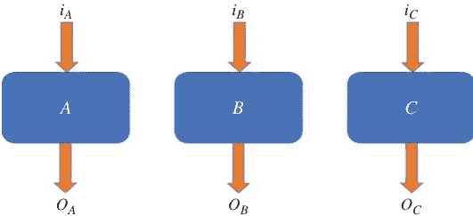

图 3.1 GHZ&M 问题是 A、B 和 C 在分别接收到输入 $i_A, i_B,$ 和 $i_C$ 后，计算输出比特 $o_A, o_B,$ 和 $o_C$（分别），使得输出比特之间满足某些属性，且 A、B 和 C 在接收到输入后不进行通信。

图 3.1. GHZ&M 问题是计算输出比特 $o_A$，$o_B$ 和 $o_C$，使得满足以下条件：

$$o_A \oplus o_B \oplus o_C = \begin{cases} 0, & \text{if } i_A i_B i_C = 000 \\ 1, & \text{if } i_A i_B i_C \in \{011, 101, 110\} \end{cases}$$

但一旦 A、B 和 C 接收到输入，就不允许通信（发送经典或量子比特）。请注意，如果输入不是上述四种组合之一，输出是什么都无所谓（或者我们假设输入总是上述四种组合之一（000、011、101、110），每种出现的概率相等）。

让我们来看看量子解。假设 A、B 和 C 分别各有一个量子比特 $\psi_A$、$\psi_B$ 和 $\psi_C$，且 3 量子比特系统的状态为纠缠态：

$$\frac{1}{2}(|000\rangle - |011\rangle - |101\rangle - |110\rangle)$$

这在局部酉（LU）操作下等价于 GHZ 态——请参见旁注。

> **旁注：** 可能有不同的操作；一种如下：
>
> - 1. 从 $\frac{1}{\sqrt{2}}(|000\rangle + |111\rangle)$ 开始，应用操作 $H \otimes H \otimes H$：
>
> $$(H \otimes H \otimes H) \frac{1}{\sqrt{2}}(|000\rangle + |111\rangle)$$
>
> $$= \frac{1}{\sqrt{2}}(H|0\rangle H|0\rangle H|0\rangle + H|1\rangle H|1\rangle H|1\rangle)$$
>
> $$= \frac{1}{4}((|000\rangle + |001\rangle + |010\rangle + |011\rangle + |100\rangle + |101\rangle + |110\rangle + |111\rangle))$$


+ (|000⟩ - |001⟩ - |010⟩ + |011⟩ - |100⟩ + |101⟩ + |110⟩ - |111⟩)))
= \frac{1}{2}(|000⟩ + |011⟩ + |101⟩ + |110⟩)
2. 应用操作 √Z ⊗ √Z ⊗ √Z（并回忆 √Z |0⟩ = |0⟩ 和 √Z |1⟩ = i |1⟩）：(√Z ⊗ √Z ⊗ √Z) \frac{1}{2}(|000⟩ + |011⟩ + |101⟩ + |110⟩) = \frac{1}{2}(|000⟩ + i^2 |011⟩ + i^2 |101⟩ + i^2 |110⟩)，并且因为 i^2 = -1，我们得到 \frac{1}{2}(|000⟩ - |011⟩ - |101⟩ - |110⟩)，如要求。

A、B、C 的步骤如下：

```
0. for each p ∈ {A, B, C}:
1. if i_p = 1 then
2. apply H to ψ_p
3. else
4. do nothing to ψ_p
5. measure ψ_p in the computational basis yielding bit o_p
6. compute o_A ⊕ o_B ⊕ o_C
```

我们可以证明这行得通——请注意，上述步骤中不涉及 A、B、C 之间的任何通信。

当 i_A i_B i_C = 000 时，状态在不应用任何 H 门的情况下在计算基中进行测量，因此，输出比特为 {|000⟩, |011⟩, |101⟩, |110⟩} 中的一种，这正是我们选择的三比特纠缠系统状态所希望 A、B、C 共享的（每种可能性都包含偶数个 1），因此 o_A ⊕ o_B ⊕ o_C = 0，如要求。

当 i_A i_B i_C ∈ {011, 101, 110} 时，我们对三个比特中恰好两个应用 H 门，其效果是生成包含奇数个 1 的状态的叠加态，例如当 i_A i_B i_C = 011 时：

(I ⊗ H ⊗ H) \frac{1}{2}(|000⟩ - |011⟩ - |101⟩ - |110⟩)
= \frac{1}{2} (|0⟩ (H|0⟩ H|0⟩ - H|1⟩ H|1⟩) - |1⟩ (H|0⟩ H|1⟩ + H|1⟩ H|0⟩)))
= \frac{1}{2} (|0⟩ (|01⟩ + |10⟩) - |1⟩ (|00⟩ - |11⟩))
= \frac{1}{2} (|001⟩ + |010⟩ - |100⟩ + |111⟩)

而且由于测量比特时将得到奇数个 1，无论我们得到 001、010、100 还是 111，我们都有 o_A ⊕ o_B ⊕ o_C = 1，如要求；同样适用于 i_A i_B i_C = 101 和 i_A i_B i_C = 110。

因此，无需任何通信，但借助共享的三比特纠缠态，我们可以解决 GHZ&M 问题。我们将看到，在经典情况下，无需通信，这个问题无法解决。

在经典情况下，没有任何共享纠缠态，各方可以预先设定策略：当输入为 0 时输出 0 或 1，当输入为 1 时输出 0 或 1。

假设 A 具有以下策略 A0 和 A1，分别表示输入为 0 和 1 时 A 的输出。

B 和 C 也是如此，即 B0 和 B1 以及 C0 和 C1，分别。

那么，输出条件可以等价地用以下一组联立方程表示：

$A_0 \oplus B_0 \oplus C_0 = 0; \quad A_0 \oplus B_1 \oplus C_1 = 1; \quad A_1 \oplus B_0 \oplus C_1 = 1; \quad A_1 \oplus B_1 \oplus C_0 = 1$

这些方程能同时满足吗？不能！我们可以通过对四个方程的左边（LHS）求和（模 2）来看到这一点，结果为 0；对右边（RHS）求和（模 2），结果为 1，且 0 ≠ 1！这意味着各方无法设定任何策略来满足输出条件。

假设 $i_A i_B i_C$ 可以以相等概率取 {000, 011, 101, 110} 中的任何组合。经典情况下的最佳成功概率是多少？

请注意，上述四个方程中的任何三个都可以同时满足，也就是说，A、B、C 各有一个策略，采用该策略将满足四种情况中的三种。

例如，假设我们选择前三个方程——我们可以同时求解这三个方程，得到 A、B、C 的一个策略，该策略满足：

$(A_0 \oplus B_0 \oplus C_0) \oplus (A_0 \oplus B_1 \oplus C_1) \oplus (A_1 \oplus B_0 \oplus C_1) = A_1 \oplus B_1 \oplus C_0 = 0$

假设我们设定 $A_1 = B_1 = C_0 = 0$ 以满足上述方程，并使用这些值和第一个方程，设定 $A_0 = B_0 = 0$，然后使用我们拥有的值和第二个方程设定 $C_1 = 1$；我们就有了 A、B、C 的一个策略，满足前三个方程，并且每当输入是 {000, 011, 101} 中的一种时就会生效，也就是说，由于每种组合可以以相等概率出现，这个策略将有四分之三的时间生效，即成功概率为 3/4。

当从四个方程中选择任何三个方程（而不是前三个）时，同样的论证也成立。

对于所选的四个方程中的任何三个，我们都会有一个 A、B、C 的策略，该策略的成功概率为 3/4，从四个方程中选三个只有四种方式：C(4,3)，因此有四种可供选择的策略。

可以让三方在接收输入前随机选择四种策略中的任意一种，这样成功概率为 1/4 · 3/4 + 1/4 · 3/4 + 1/4 · 3/4 + 1/4 · 3/4 = 3/4，其中乘积 1/4 · 3/4 来自选择某策略的概率（1/4）和使用该选定策略获胜的概率（3/4），并对四种可能策略求和。因此，不可能实现优于 3/4 的成功概率。

因此，量子方法能够实现一种在经典情况下无法以超过 3/4 的概率完成的分布式计算！

### 3.1.2.2 克劳瑟–霍恩–肖莫尼–霍尔特（CHSH）

让我们来看另一个问题（或者可以称之为一个游戏！），涉及两方 A 和 B，在游戏的每一轮中，各自接收一个输入比特，即 i_A 和 i_B，问题是让他们分别计算输出比特 o_A 和 o_B，以满足以下条件：

o_A ⊕ o_B = i_A ∧ i_B

如图 3.2 所示，在接收输入时不进行通信（因此 A 不知道 B 的输入，反之亦然）。

在一轮中，如果 A 和 B 的输出满足上述条件，则他们获胜，否则失败。

如果 A 和 B 不能总是获胜，那么目标是让 A 和 B 拥有一种算法/策略，以最大化获胜概率。

让我们看看这个问题的量子解法。

假设 A 和 B 拥有两个比特 ψ_A ψ_B，各方一个比特，处于以下共享纠缠态中：1/√2(|00⟩ − |11⟩)。

请注意，该状态可以通过对状态 1/√2(|00⟩ + |11⟩) 应用 I ⊗ Z 得到。

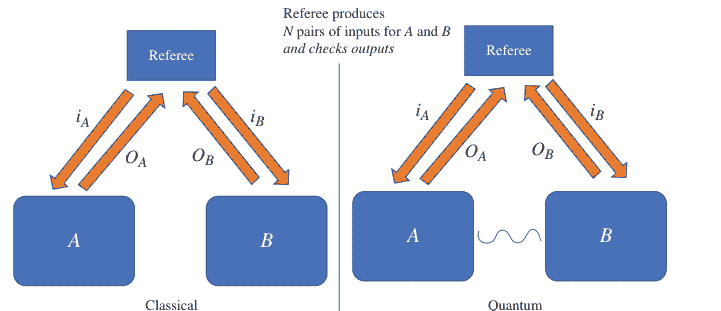

**图 3.2** CHSH 游戏。裁判在每一轮为 A 和 B 生成一对输入 i_A 和 i_B，假设共 N 轮。在每一轮中，A 输出 o_A，B 输出 o_B 作为对输入的响应，且在接收输入时无法通信。在量子情况下，盒子共享一个纠缠态，每轮一个“新”的。在接收到输出后，裁判检查获胜条件 o_A ⊕ o_B = i_A ∧ i_B。问题是：A 和 B 在经典（和量子）情况下可以做什么，以便在 N 轴中赢得尽可能多的轮次？量子情况是否能比经典情况表现更好（平均获得更多获胜次数）？

现在让将比特旋转角度 \(\theta\) 的单位运算表示为

```
\(R(\theta) = \begin{bmatrix} \cos \theta & -\sin \theta \\ \sin \theta & \cos \theta \end{bmatrix}\)
```

A 和 B 的算法（为简单起见，我们称之为 CHSH 算法），用于计算输出以最大化满足条件的概率，如下所示：

```
For A:
1.   if \(i_A = 0\) then
2.     apply \(R(-\pi/16)\) to \(\psi_A\)
3.   else (if \(i_A = 1\))
4.     apply \(R(3\pi/16)\) to \(\psi_A\)
5.   measure \(\psi_A\) in the computational basis yielding bit \(o_A\)
```

对于 B，几乎也是一样的——只需在上述内容中将 A 替换为 B。

请注意，$R(\theta)|0\rangle = \cos \theta|0\rangle + \sin \theta|1\rangle$ 且 $R(\theta)|1\rangle = -\sin \theta|0\rangle + \cos \theta|1\rangle$。

然后，如果 A 将其比特旋转 \(\theta_1\)，B 将其比特旋转 \(\theta_2$，纠缠态变为：

```
\((R(\theta_1) \otimes R(\theta_2))\frac{1}{\sqrt{2}}(|00\rangle - |11\rangle)\)

\(= \frac{1}{\sqrt{2}}(R(\theta_1)|0\rangle \otimes R(\theta_2)|0\rangle - R(\theta_1)|1\rangle \otimes R(\theta_2)|1\rangle)\)

\(= \frac{1}{\sqrt{2}}((\cos \theta_1 |0\rangle + \sin \theta_1 |1\rangle) \otimes (\cos \theta_2 |0\rangle + \sin \theta_2 |1\rangle)\)

\(-(-\sin \theta_1 |0\rangle + \cos \theta_1 |1\rangle) \otimes (-\sin \theta_2 |0\rangle + \cos \theta_2 |1\rangle))\)

\(= \frac{1}{\sqrt{2}}((\cos \theta_1\cos \theta_2 |00\rangle + \cos \theta_1\sin \theta_2 |01\rangle + \sin \theta_1\cos \theta_2 |10\rangle + \sin \theta_1\sin \theta_2 |11\rangle)\)

\(- (\sin \theta_1\sin \theta_2 |00\rangle - \sin \theta_1\cos \theta_2 |01\rangle - \cos \theta_1\sin \theta_2 |10\rangle + \cos \theta_1\cos \theta_2 |11\rangle))\)

\(= \frac{1}{\sqrt{2}}((\cos \theta_1\cos \theta_2 - \sin \theta_1\sin \theta_2)|00\rangle + (\cos \theta_1\sin \theta_2 + \sin \theta_1\cos \theta_2)|01\rangle\)

\(+ (\sin \theta_1\cos \theta_2 + \cos \theta_1\sin \theta_2)|10\rangle + (\sin \theta_1\sin \theta_2 - \cos \theta_1\cos \theta_2)|11\rangle))\)

\(= \frac{1}{\sqrt{2}}(\cos(\theta_1 + \theta_2)|00\rangle + \sin(\theta_1 + \theta_2)|01\rangle + \sin(\theta_1 + \theta_2)|10\rangle - \cos(\theta_1 + \theta_2)|11\rangle))\)

(since \(\cos(\theta_1 + \theta_2) = \cos \theta_1 \cos \theta_2 - \sin \theta_1 \sin \theta_2\) and

\(\sin(\theta_1 + \theta_2) = \cos \theta_1 \sin \theta_2 + \sin \theta_1 \cos \theta_2\))


然后，在测量之后，如果我们获得 |00⟩ 或 |11⟩，则 \( o_A = o_B \)，即 \( o_A \oplus o_B = 0 \)，且这种情况发生的概率为 \( \frac{1}{2} \cos^2(\theta_1 + \theta_2) + \frac{1}{2} \cos^2(\theta_1 + \theta_2) = \cos^2(\theta_1 + \theta_2) \)，如果我们获得 |01⟩ 或 |10⟩，则 \( o_A \neq o_B \)，即 \( o_A \oplus o_B = 1 \)，且这种情况发生的概率为 \( \frac{1}{2} \sin^2(\theta_1 + \theta_2) + \frac{1}{2} \sin^2(\theta_1 + \theta_2) = \sin^2(\theta_1 + \theta_2) \)。

我们可以按如下方式计算满足该问题所需条件（即 \( o_A \oplus o_B = i_A \wedge i_B \)）的概率。下表考虑了所有输入可能性，根据上述 \( A \) 和 \( B \) 的过程，应用于共享纠缠比特中每个量子比特的旋转角度，以及概率 \( prob(o_A \oplus o_B = i_A \wedge i_B) \)。

| i_A | i_B | R(θ₁) | R(θ₂) | i_A ∧ i_B | 概率(o_A ⊕ o_B = i_A ∧ i_B) |
|---|---|---|---|---|---|
| 0 | 0 | R(-π/16) | R(-π/16) | 0 | 概率(00 或 11) = cos²((-π/16) + (-π/16)) |
| 0 | 1 | R(-π/16) | R(3π/16) | 0 | 概率(00 或 11) = cos²((-π/16) + (3π/16)) |
| 1 | 0 | R(3π/16) | R(-π/16) | 0 | 概率(00 或 11) = cos²((3π/16) + (-π/16)) |
| 1 | 1 | R(3π/16) | R(3π/16) | 1 | 概率(01 或 10) = sin²((3π/16) + (3π/16)) |

从表中可以看出，在所有四种输入可能性中，\( prob(o_A \oplus o_B = i_A \wedge i_B) \) 均为 \( \cos^2(\pi/8) \approx 0.8536 \)（在最后一种情况下，请注意 \( \sin^2((3\pi/16) + (3\pi/16)) = \sin^2(3\pi/8) = \cos^2(\pi/8) \)）。因此，通过上述过程，利用纠缠可以以 \( \approx 0.8536 > 0.75 \) 的概率求解此问题，其中 0.75 是最佳经典解，如我们下面所示。在这样的概率下，对于均匀随机输入（00、01、10 和 11 之中），在一轮中，量子情况获胜的机会更大，而在 N 轮之后，对于足够大的 N，在量子情况下，我们会看到约 \( \approx 0.8536N \) 轮可以获胜，而经典情况最多只能期望约 \( 0.75N \) 次胜利。

在经典情况下，假设 A 采用以下策略 \( A_0 \) 和 \( A_1 \)，分别表示输入为 0 和 1 时 A 的输出，B 的情况类似。然后，输出条件可以用以下一组联立方程表示：

\( A_0 \oplus B_0 = 0; \quad A_0 \oplus B_1 = 0; \quad A_1 \oplus B_0 = 0; \quad A_1 \oplus B_1 = 1 \)

我们可以看出，不可能有一个解同时满足所有四个方程，因为当我们对左边和右边分别求模 2 和时，它们不相等：\( (A_0 \oplus B_0) \oplus (A_0 \oplus B_1) \oplus (A_1 \oplus B_0) \oplus (A_1 \oplus B_1) = 0 \neq 0 \oplus 0 \oplus 0 \oplus 1 = 1 \)。但通过使用概率策略，经典情况下可以达到 3/4 的成功概率——这与我们之前看到的 GHZ&M 推理类似。\( A \) 和 \( B \) 可以随机选择四个方程中的任意三个来满足，并制定一个策略。例如，他们选择前三个方程，并约定一种同时满足前三个方程的策略（例如通过设置 \(A_0 = A_1 = B_0 = B_1 = 1\)），然后当输入为 00、01 或 10 时，该策略将成功（但当输入为 11 时，条件将不满足且策略将失败），因此，有 3/4 的时间（如果输入组合以均匀概率出现）。对于所选的任意三个要满足的方程，情况均相同，因此，经典情况下的最佳成功概率为 3/4。因此，与最佳经典情况相比，利用纠缠的量子解以更高的概率获胜。请注意，这与 CHSH 不等式（我们将在下面进一步解释）相关，用于“测试”纠缠的贝尔态。其思想是玩这个游戏，然后收集获胜统计数据，如果统计数据超过 0.75 并接近量子情况下的 0.8536，则一定使用了纠缠，因为经典方法无法优于 0.75——我们将看到这在量子密钥分发（QKD）的安全测试中后来很有用。

## 另一个“游戏”，但量子解相同

假设我们稍微修改一下游戏，使得设置与图 3.2 所示相同（即，\(A\) 和 \(B\) 再次接收输入，在接收输入后，它们不得通信），但现在，\(A\) 和 \(B\) 的目标是最大化以下量 \(S\)（我们称其为 CHSH 表达式），即 \(N\) 轮之后一系列均值之和的绝对值：

```
S = |<A_0B_0> + <A_0B_1> + <A_1B_0> - <A_1B_1>|
```

其中 <\(A_iB_j\)> = \(\frac{1}{N_{ij}} \sum_{v=1}^{N_{ij}} A_i^v B_j^v\)，且在第 \(v\) 轮中，\(A_i\) 取值 \(A_i^v \in \{+1, -1\}\)，\(B_j\) 取值 \(B_j^v \in \{+1, -1\}\)，且 \(N_{ij} < N\)，这里我们假设每一轮中每种输入组合 00、01、10 和 11 出现的概率相等，因此对于每种组合 \(ij\)，我们有 \(N_{ij} = \frac{N}{4}\)，\(N_{ij}\) 是 \(A\) 的输入为 \(i\) 且 \(B\) 的输入为 \(j\) 的轮数，即 <\(A_iB_j\)> 是分别在输入 \(i\) 和 \(j\) 下，\(A\) 的输出与 \(B\) 的输出之积的平均值。请注意，在这种情况下，输出要么是 +1 要么是 −1，\(A_0\) 表示 \(A\) 对输入 0 的响应输出，符号 \(A_1\)、\(B_0\) 和 \(B_1\) 亦然。

由于 \(A_0B_0 + A_0B_1 + A_1B_0 - A_1B_1\) 的值为 2 或 -2（通过代入所有可能值进行验证——参见 **旁注**），因此有 \(S \le 2\)。该表达式称为 _CHSH 不等式_，以该理论的发现者（即 John Clauser、Michael Horne、Abner Shimony 和 Richard Holt）的名字命名（其中首先提到的在第一章中有过提及，他获得了诺贝尔物理学奖），该理论认为某些经典相关性存在上界，而量子方法可以违反该上界。

## 旁注：表达式 $A_0B_0 + A_0B_1 + A_1B_0 - A_1B_1$ 的可能取值：

| $A_0$ | $A_1$ | $B_0$ | $B_1$ | $A_0B_0 + A_0B_1 + A_1B_0 - A_1B_1$ |
| :---: | :---: | :---: | :---: | :---: |
| +1 | +1 | +1 | +1 | 2 |
| +1 | +1 | +1 | -1 | 2 |
| +1 | +1 | -1 | +1 | -2 |
| +1 | +1 | -1 | -1 | -2 |
| +1 | -1 | +1 | +1 | 2 |
| +1 | -1 | +1 | -1 | -2 |
| +1 | -1 | -1 | +1 | 2 |
| +1 | -1 | -1 | -1 | -2 |
| -1 | +1 | +1 | +1 | -2 |
| -1 | +1 | +1 | -1 | 2 |
| -1 | +1 | -1 | +1 | -2 |
| -1 | +1 | -1 | -1 | 2 |
| -1 | -1 | +1 | +1 | -2 |
| -1 | -1 | +1 | -1 | -2 |
| -1 | -1 | -1 | +1 | 2 |
| -1 | -1 | -1 | -1 | 2 |

对于量子情况，使用之前用于以约 0.8536 的概率赢得 CHSH 游戏的相同 CHSH 算法（以及由 \(A\) 和 \(B\) 共享的纠缠态 \(\frac{1}{\sqrt{2}}(|00\rangle - |11\rangle)$），是否有可能获得更高的 \(S\) 值，即违反 CHSH 不等式？答案是肯定的！下面我们将说明如何实现。

在量子情况下，在 \(A\) 和 \(B\) 中使用上述相同的算法，经过 \(N\) 轮后，我们期望 \(\langle A_i B_j \rangle\) 的值是多少？

一般来说，根据量子力学的规则，在 \(A\) 处使用 \(R(\theta_1)\) 并在 \(B\) 处使用 \(R(\theta_2)\) 进行测量后，我们得到的 \(A\) 和 \(B\) 的输出乘积 \(o_A o_B\) 的期望值（记为 \(E(\theta_1, \theta_2)\)）为

```
E(\theta_1, \theta_2) = \sum_{o_A, o_B \in \{+1, -1\}} o_A o_B \cdot P_{o_A, o_B}(\theta_1, \theta_2)
= (+1)(+1) \cdot P_{+1, +1}(\theta_1, \theta_2) + (-1)(-1) \cdot P_{-1, -1}(\theta_1, \theta_2)
+ (+1)(-1) \cdot P_{+1, -1}(\theta_1, \theta_2) + (-1)(+1) \cdot P_{-1, +1}(\theta_1, \theta_2)
```

其中 \(P_{+1, +1}(\theta_1, \theta_2)\) 表示在使用基 \(B = \{R(\theta_1) \otimes R(\theta_2) |00\rangle, R(\theta_1) \otimes R(\theta_2) |01\rangle, R(\theta_1) \otimes R(\theta_2) |10\rangle, R(\theta_1) \otimes R(\theta_2) |11\rangle\},^4\) 进行测量时，获得 \(+1\) 和 \(+1\)（或状态 \(|00\rangle\)，特征值为 \(+1\)）的概率，类似地，\(P_{-1,-1}(\theta_1, \theta_2)\)（对应状态 \(|11\rangle\)，特征值为 \(+1\)）、\(P_{+1,-1}(\theta_1, \theta_2)\)（对应状态 \(|01\rangle\)，特征值为 \(-1\)）和 \(P_{-1,+1}(\theta_1, \theta_2)\)（对应状态 \(|10\rangle\)，特征值为 \(-1\)）。

回想一下，在 CHSH 算法（在第 3.1.2.2 节开头）中，当输入到 A 为 0 时，应用算符 R(-π/16) 并进行测量以产生输出，当输入到 A 为 1 时，应用算符 R(3π/16) 并进行测量以产生输出；B 的情况类似。测量后，现在查看获得的特征值（而不是得到的量子态），我们得到 +1 或 -1。换句话说，当输入 i_A = 0 和 i_B = 0 时，算法在 A 处应用 R(-π/16)，在 B 处应用 R(-π/16)，我们有：

E(-π/16, -π/16) = P_{+1,+1}(-π/16, -π/16) + P_{-1,-1}(-π/16, -π/16) - P_{+1,-1}(-π/16, -π/16) - P_{-1,+1}(-π/16, -π/16)

对于足够大的 N，乘积 A_0 B_0 的平均值

<A_0 B_0> ≈ E(-π/16, -π/16)

也就是说，经过 N 轮后，统计结果应显示平均值 <A_0 B_0> 约为 E(-π/16, -π/16)。类似的推理得出：

- <A_0 B_1> ≈ E(-π/16, 3π/16)
- <A_1 B_0> ≈ E(3π/16, -π/16)
- <A_1 B_1> ≈ E(3π/16, 3π/16)

这意味着我们可以期望

S = |<A_0 B_0> + <A_0 B_1> + <A_1 B_0> - <A_1 B_1>| ≈ |E(-π/16, -π/16) + E(-π/16, 3π/16) + E(3π/16, -π/16) - E(3π/16, 3π/16)|

现在，当对上面的状态 \(\frac{1}{\sqrt{2}}(|00\rangle - |11\rangle)\) 使用 B 进行测量时（或者等价地，使用计算基对 \((R(\theta_1) \otimes R(\theta_2))\frac{1}{\sqrt{2}}(|00\rangle - |11\rangle)\) 进行测量），回想一下 \((R(\theta_1) \otimes R(\theta_2))\frac{1}{\sqrt{2}}(|00\rangle - |11\rangle) = \frac{1}{\sqrt{2}}(\cos(\theta_1 + \theta_2)|00\rangle + \sin(\theta_1 + \theta_2)|01\rangle + \sin(\theta_1 + \theta_2)|10\rangle - \cos(\theta_1 + \theta_2)|11\rangle)\)，我们有

P_{+1, +1}(θ_1, θ_2) = \frac{1}{2} \cos^2(θ_1 + θ_2)

4 请注意，这个基 B 对应于算符 O = (R(θ_1) ⊗ R(θ_2)) ((|0><0| - |1><1|) ⊗ (|0><0| - |1><1|)) (R(θ_1) ⊗ R(θ_2))^{-1}，其特征态为基 B 中的态。例如，我们有 O(R(θ_1) ⊗ R(θ_2)|00⟩) = R(θ_1) ⊗ R(θ_2)|00⟩，O(R(θ_1) ⊗ R(θ_2))|11⟩) = R(θ_1) ⊗ R(θ_2)|11⟩，O(R(θ_1) ⊗ R(θ_2)|01⟩) = -R(θ_1) ⊗ R(θ_2)|01⟩，以及 O(R(θ_1) ⊗ R(θ_2)|10⟩) = -R(θ_1) ⊗ R(θ_2)|10⟩。


$P_{-1,-1}(\theta_1, \theta_2) = \frac{1}{2} \cos^2(\theta_1 + \theta_2)$
$P_{+1,-1}(\theta_1, \theta_2) = \frac{1}{2} \sin^2(\theta_1 + \theta_2)$
$P_{-1,+1}(\theta_1, \theta_2) = \frac{1}{2} \sin^2(\theta_1 + \theta_2)$

因此，$E(\theta_1, \theta_2) = \cos^2(\theta_1 + \theta_2) - \sin^2(\theta_1 + \theta_2)$，即，

$E(-\pi/16, -\pi/16) = \cos^2(-\pi/8) - \sin^2(-\pi/8) = \frac{1}{\sqrt{2}}$
$E(-\pi/16, 3\pi/16) = \cos^2(\pi/8) - \sin^2(\pi/8) = \frac{1}{\sqrt{2}}$
$E(3\pi/16, -\pi/16) = \cos^2(\pi/8) - \sin^2(\pi/8) = \frac{1}{\sqrt{2}}$
$E(3\pi/16, 3\pi/16) = \cos^2(3\pi/8) - \sin^2(3\pi/8) = -\frac{1}{\sqrt{2}}$

因此，在量子情况下我们有

$S \approx \left| \frac{1}{\sqrt{2}} + \frac{1}{\sqrt{2}} + \frac{1}{\sqrt{2}} - (-\frac{1}{\sqrt{2}}) \right| = 2\sqrt{2}$

即，在量子情况下我们可以得到 $S > 2$，而在经典情况下则有 $S \le 2$！

基 $B$ 也是使 $S$ 取得最大值的基，即，在量子情况下这是最优的 [Buhrman et al., 2010]，这一结果被称为特雷列森界，
即，在量子情况下 $S(\theta_1, \theta_2) \le 2\sqrt{2}$，其中

$S(\theta_1, \theta_2) = | E(\theta_1, \theta_1) + E(\theta_1, \theta_2) + E(\theta_2, \theta_1) - E(\theta_2, \theta_2) |$

当 $S(\theta_1 = -\pi/16, \theta_2 = 3\pi/16) = 2\sqrt{2}$ 时，如我们上面所示。

回顾一下

$E(-\pi/16, -\pi/16)$
$= (+1)(+1) \cdot P_{+1,+1}(-\pi/16, -\pi/16) + (-1)(-1) \cdot P_{-1,-1}(-\pi/16, -\pi/16)$
$+ (+1)(-1) \cdot P_{+1,-1}(-\pi/16, -\pi/16) + (-1)(+1) \cdot P_{-1,+1}(-\pi/16, -\pi/16)$

使用上述算法的实验运行 $N_{00}$ 轮，使用设置
$(-\pi/16, -\pi/16)$ 可以统计我们得到每种输出
$(+1,+1), (-1,-1), (+1,-1)$ 和 $(-1,+1)$ 的轮数，并为 $(-\pi/16, -\pi/16)$ 估计
$E$ 的值，如下所示，记 $N_{00}^{a,b}$ 为在输入 00 下得到输出 $A_0 = a$ 和 $B_0 = b$ 的次数：

\[
E(-\pi/16, -\pi/16) \approx \frac{N_{00}^{+1,+1} + N_{00}^{-1,-1} - N_{00}^{+1,-1} - N_{00}^{-1,+1}}{N_{00}}
= \frac{1}{N_{00}} \sum_{v=0}^{N_{00}} A_0^v B_0^v = \langle A_0 B_0 \rangle
\]

这里我们使用了前面见过的 \(\langle A, B_j \rangle\) 的定义。我们可以用类似的方法得到 \(E(-\pi/16, 3\pi/16)\)、\(E(3\pi/16, -\pi/16)\) 和 \(E(3\pi/16, 3\pi/16)\) 的估计值，并实验计算 \(S(\theta_1 = -\pi/16, \theta_2 = 3\pi/16)\)。CHSH 不等式的违反已如 Wolf [2021] 所讨论的那样在实验中得到验证。

### 3.1.2.3 讨论

从上面可以看出，纠缠具有某种非凡之处，它允许通过共享某些相关比特来解决某些经典上无法解决的“无通信”问题。事实上，CHSH 问题可以作为真正纠缠的测试——如果 \(A\) 和 \(B\) 可以共享真正的纠缠量子比特对，那么它们应该能以高于 0.75 的概率解决 CHSH 问题！在某种程度上，纠缠似乎（至少部分地）弥补了 \(A\) 和 \(B\) 之间的“无通信”约束。

## 3.2 其他量子协议

我们简要考虑分布式系统协议的几个其他量子版本，包括量子抛硬币、量子领导者选举、量子密钥分发、量子投票、量子不知道传输和量子拜占庭将军解决方案。

### 3.2.1 量子抛硬币

#### 3.2.1.1 经典抛硬币

抛硬币（或投掷）是 Blum [1983] 首先提出的以下问题。在介绍量子抛硬币之前，让我们先讨论经典抛硬币问题。⁵

假设机器 \(A\) 和 \(B\) 不相互信任（或两个人，通常是已经离婚且不再相互信任的爱丽丝和鲍勃），但希望通过电话就公平的抛硬币达成一致。例如，机器 \(A\) 选择“正面”（或 1），\(B\) 选择“反面”（或 0），\(A\) 抛一枚（大概无偏）硬币，并通过电话告诉 \(B\) 它是“正面”——如果 \(B\) 信任 \(A\)，那么这不是问题，但如果不信任，那么 B 如何确保 A 说的是真的？一种方法是双方首先各自选择一面（例如 A 选择 0，B 选择 1），然后各自抛一枚硬币，然后双方都计算胜负为 a ⊕ b，其中 a ⊕ b = 0 的概率为 1/2（因为 a ⊕ b = 0 仅当 a = b 时，即一半的时间），a ⊕ b = 1 的概率为 1/2（因为 a ⊕ b = 1 仅当 a ≠ b 时，即一半的时间）。请注意，抛硬币协议的目标是双方都计算 0 或双方都计算 1，无论哪种情况，最终双方都应该得到相同的结果（抛硬币的结果），并且这种抛硬币在某种意义上应该是“公平”的——直观上，A 或 B 都不应该能够偏袒结果（在使其自身甚至另一方获胜的意义上）。

但是问题在于，通过电话，A 和 B 需要相互告诉对方自己的结果，这可能不会同时发生，即，如果 A 先告诉 B 它的结果，那么 B 在知道 a 的情况下，可以为 b 命名一个对其有利的值，同样，如果 B 先告诉 A 它的结果；例如，如果 A 选择了 0 而 B 选择了 1，那么假设 B 首先收到 A 的结果（假设为 0），那么 B 可以选择 1 并告诉 A 它的结果是 1（无论其抛硬币的实际结果如何），然后双方计算胜负为 a ⊕ b = 0 ⊕ 1 = 1，从而 B 强制获胜！同样，如果 A 说 1，B 告诉 A 它的抛硬币结果是 0 并强制获胜，或者如果 A 首先收到 B 的抛硬币结果，A 可以强制获胜——即，它不安全，或者任何一方都可以强制结果。

当然，一位可信的中介人可以在这里提供帮助，中介人在宣布结果 a ⊕ b 之前先从 A 和 B 那里得到结果。请注意，这之所以有效，是因为 B 在不知道 A 结果的情况下向中介人提供其结果。这里的关键思想是比特承诺的概念，即，假设 a 首先发送给中介人（不向 B 泄露任何信息），那么 A 在知道 b 之前就已承诺 a 的一个值，然后 B 在不知道 a 的情况下向中介人提供一个结果，并且之后不能更改其结果——B 也在知道 a 之前承诺了 b 的一个值。但是，假设没有这样的中介人——那该如何工作呢？我们可以使用加密方法来执行此类比特承诺，就像 Blum 方案的构思6 中一样，我们讨论一种基于更抽象的通用比特承诺协议的方案。

首先，我们在没有可信中介人的情况下解释比特承诺的概念。

假设我们使用加密来进行此承诺。一种天真的方法是机器 A 抛一枚硬币，结果 a 用密钥 kA 加密在一条消息中，加密消息 Eka(a) 发送给 B——这似乎是 A 承诺一个结果而不向 B 泄露它的一种方式，但我们将看看这是否可行。机器 B 在没有 A 密钥的情况下无法解密消息，并抛一枚硬币得到结果 b，然后向 A 揭示 b。此时，A 可以计算 a ⊕ b。然后机器 A 将密钥 kA 给 B，以便 B 可以解密找到 a，并且 B 现在也可以

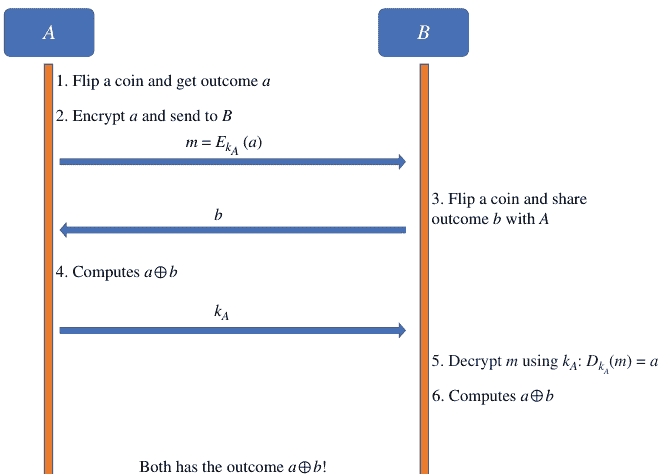

**图 3.3** 一个没有可信中介人的抛硬币协议解决方案，但存在问题。请注意，在此协议开始之前，A 和 B 各自已选择了自己的一方，然后协议开始以决定谁获胜。

但是问题是什么？请注意，A 在 B 获得 A 的密钥之前就知道结果 \( b \)。A 现在知道 B 的结果，是否有办法操纵其加密结果 \( E_{k_a}(a) \)？答案似乎是“是”；如果 A 使用一个碰撞三元组，其中碰撞三元组 \( (m, k_0, k_1) \) 具有 \( D_{k_0}(m) = 0 \) 和 \( D_{k_1}(m) = 1 \) 的属性，即，同一消息 m 可以用两个不同的密钥以两种不同的方式解密，以得到 0 或 1。例如，A 在知道 b 的情况下，可以通过向 B 提供 \( k_0 \) 或 \( k_1 \) 来强制一个有利的结果，从而使 B 将 \( E_{k_a}(a) \) 解密为 0 或 1！

这样的碰撞三元组的一个例子是 \( (m, m \oplus 0, m \oplus 1) \)，解密函数为：\( D_k(m) = m \oplus k \)。使用这样的碰撞三元组，A 将加密消息 \( m = E_{k_a}(a) \) 发送给 B，然后如果 A 想要 m 解密为 0，A 发送密钥 \( m \oplus 0 \)，这样 B 将 m 解密如下：\( D_{m \oplus 0}(m) = m \oplus (m \oplus 0) = 0 \)，如果 A 想要 m 解密为 1，则 A 发送密钥 \( m \oplus 1 \)，这样 B 将 m 解密如下：\( D_{m \oplus 1}(m) = m \oplus (m \oplus 1) = 1 \)。因此，A 可以通过向 B 发送相应的密钥来选择它想要的任何结果！这如何解决？

解决此问题的一种方法是让 B 也参与密钥选择，因为 A 现在无法从碰撞三元组中选择密钥了。因此，现在不再是

⁵ 我们的讨论部分使用了 https://zoo.cs.yale.edu/classes/cs467/2013s/lectures/ln21.pdf [last accessed: 9/11/2022] 中的解释。

6 简要描述在 https://xiaohuiliu.medium.com/another-fair-bitcoin-toss-742894b086cd [last accessed: 17/5/2022]。


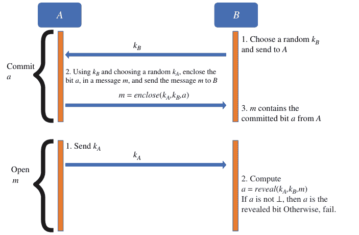

## 图 3.4 通用比特承诺协议。

仅由 A 提供密钥，A 的机器提供 \(k_A\) 且 B 提供 \(k_B\)，密钥对 \((k_A, k_B)\) 用于封装（或加密）A 的结果，同时也用于 B 打开（或解密）来自 A 的加密结果。此外，为了使此协议工作，我们有以下两个属性：

- 1. 使得 B 在将其结果共享给 A 之前无法看到 A 的结果（例如在消息 m 中），仅使用 \(k_B\) 无法（或难以）打开 m，且
- 2. 使得 A 无法选择 m 解密为何种结果，无论 A 的 \(k_A\) 如何，B 使用 \((k_A, k_B)\) 都会将 m 解密为相同的结果。

我们现在有如图 3.4 所示的比特承诺协议。

实现此类协议有多种可能方案；这里我们使用哈希函数 H 为 A 向 B 做承诺，概述一种方法。A 选择一个随机的 n 比特字符串 \(k_B\) 并将其发送给 A，然后 A 选择一个随机的 n 比特字符串 \(k_A\) 并计算 \(m = enclose(k_A, k_B, a) = H(k_B k_A a)\)，即对 \(k_B\)、\(k_A\) 和 a 的拼接应用哈希函数 H。然后 A 的机器将 m 发送给 B 作为其承诺。

然后，要打开 m，A 向 B 发送一个密钥 k，B 使用某个算法^7 来寻找 a' 使得 \(m = H(k_B k a')\)，如果找到 a'（当 k 是正确的密钥 \(k = k_A\) 时），则 \(a' = a\)（基于哈希函数的抗碰撞特性：如果 \(a' \neq a\)，即 \(k_B k_A a' \neq k_B k_A a\)，则 $H(k_B k_A a') \neq H(k_B k_A a)$），于是我们得到了揭示的比特；否则，如果找不到这样的 a'，则协议失败。注意，这样的算法就是函数 $reveal(k_A, k_B, a)$。

7 注意，给定 \(k_B\) 和 k，要找到 a'，B 可以计算 \(H(k_B k 0)\) 和 \(H(k_B k 1)\) 的值，并查看哪个值与 m 匹配。

注意，此协议满足我们想要的上述属性。例如，对于上面的 (1)，在没有 $k_A$ 的情况下，给定 $m$，如果 $B$ 想要找到 $a$，那么 $B$ 必须找到 $k'_A$ 和 $a'$ 使得 $m = H(k_B k'_A a')$，这相当于对 $H$ 求逆，因此在计算上很困难，因为 $H$ 通常是一个单向函数且 $n$ 足够大。这阻止了 $B$ 在与 $A$ 分享其比特之前从 $m$ 中提取 $a$，因此 $B$ 无法偏倚或强制结果。

同样，对于上面的 (2)，为了让 $A$ 确定 $m$ 将解密为何值，取决于其密钥，$A$ 需要找出 $k_A$ 和 $k'_A$ 使得 $H(k_B k_A 0) = H(k_B k'_A 1) = m$，因此假设 $A$ 想要 $m$ 解密为 $0$，它会将密钥 $k = k_A$ 发送给 $B$，$B$ 使用其 $reveal$ 算法计算出 $0$（满足 $H(k_B k 0) = m$），同样地，当 $A$ 想要 $m$ 解密为 $1$ 时，它会将密钥 $k'_A$ 发送给 $B$，该密钥满足 $H(k_B k'_A 1) = m$，因此 $B$ 计算出 $1$。但基于哈希函数 $H$ 的抗碰撞特性，$A$ 很难找出 $k_A$ 和 $k'_A$ 使得 $H(k_B k_A 0) = H(k_B k'_A 1)$。这阻止了 $A$ 在知道 $B$ 的值 $b$ 后确定其 $a$，因此 $A$ 无法偏倚/强制结果。

有了可行的比特承诺协议后，我们可以允许 $A$ 提交一个比特，而无法在知道 $B$ 的值后规定它是什么。使用比特承诺的掷硬币协议如图 3.5 所示，输出对双方都是 $a \oplus b$。注意，掷硬币协议的输出要么双方都有 0，要么双方都有 1。只要各方的计算能力受限，例如无法求逆哈希函数，此协议看起来就是安全的。

这还会有什么进一步的问题？请注意，在步骤 6 之后，当 $A$ 已计算出 $a \oplus b$ 时，它可能意识到自己输了，那么 $A$ 可以做的是停止协议并拒绝向 $B$ 发送密钥！由于协议过早终止，似乎没有人是赢家，或者至少，$B$ 被剥夺了获胜机会！

一般来说，可以阐述掷硬币协议的属性，并使用参数值 $\epsilon$ 以如下方式量化协议的安全性。当双方（参与协议的 $A$ 和 $B$）都诚实（遵循协议）时，如果协议输出 $o$ 为 1 的概率是 $1/2$，输出 $o$ 为 0 的概率也是 $1/2$，即双方获胜的机会相等，或者说 $prob(o = 0) = prob(o = 1) = 1/2$，则该掷硬币协议是正确的。一个掷硬币协议（强版本）被称为 $\epsilon$-安全，当任何一方都无法将最终结果的概率强制超过由 $\epsilon$ 定义的某些边界（称为协议的偏差）时。更精确地说，

- 1. 无论 $A$ 做什么（假设 $B$ 诚实地遵循协议），$prob(o = 0) \leq 1/2 + \epsilon$ 且 $prob(o = 1) \leq 1/2 + \epsilon$，即 $A$（即使试图让掷硬币结果向 0 偏倚）在某些预定义策略空间内无法做任何事情来使

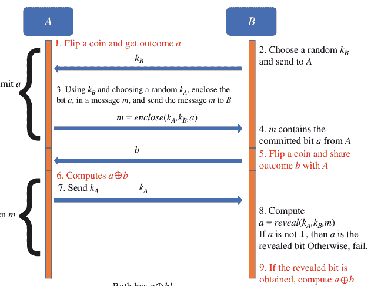

### 图 3.5 使用比特承诺协议的掷硬币协议 – 注意为实现掷硬币而对通用比特承诺协议所做的补充。

prob(o = 0) > 1/2 + ε 且 $A$（即使出于某种原因试图让 $B$ 获胜）也无法做任何事情来使 prob(o = 1) > 1/2 + ε；

- 2. （对于 $B$ 亦然）无论 $B$ 做什么（假设 $A$ 诚实地遵循协议），prob(o = 0) ≤ 1/2 + ε 且 prob(o = 1) ≤ 1/2 + ε，即 $B$（即使试图让掷硬币结果向 1 偏倚）在某些预定义策略空间内无法做任何事情来使 prob(o = 1) > 1/2 + ε，且 $B$（即使出于某种原因试图让 $A$ 获胜）也无法做任何事情来使 prob(o = 0) > 1/2 + ε。

对于掷硬币协议（弱版本），我们只要求任何一方都无法强制输出对其自身更有利，也就是说，假设当结果为 0 时 $A$ 获胜，当结果为 1 时 $B$ 获胜，

- 1. 无论 $A$ 做什么，prob(o = 0) ≤ 1/2 + ε，即 $A$（即使试图让掷硬币结果向 0 偏倚）无法做任何事情来使 prob(o = 0) > 1/2 + ε，
- 2. （对于 $B$ 亦然）无论 $B$ 做什么，prob(o = 1) ≤ 1/2 + ε，即 $B$（即使试图让掷硬币结果向 1 偏倚）无法做任何事情来使 prob(o = 1) > 1/2 + ε。

请注意，从上述两个条件 $prob(o = 0) \le 1/2 + \epsilon$ 和 $prob(o = 1) \le 1/2 + \epsilon$，我们可以写出：$\epsilon = max(P_A^*, P_B^*) - \frac{1}{2}$，其中 $P_A^*$ 和 $P_B^*$ 分别是 $A$ 和 $B$ 的最大获胜概率。

另外，请注意，如果一个协议的 $\epsilon$ 很小，例如 $\epsilon = 0.01$，那么它看起来“更安全”，因为，例如，$A$ 无法使 $prob(o = 0) > 0.51$，而对于一个 $\epsilon$ 较大的协议，例如 $\epsilon = 0.21$，$A$ 无法使 $prob(o = 0) > 0.71$，但可能能使 $prob(o = 0) = 0.7 \le (0.5 + 0.21)$，这仍然相当偏倚！请注意，一个不安全的协议（如我们之前看到的最初那个天真的方案），先从另一方接收掷硬币结果的一方可以强制获胜，也就是说，如果 $A$ 先得到 $B$ 的结果，它可以使 $prob(o = 0) = 1.0 \le (0.5 + 0.5)$！也就是说，它是 $\epsilon = 1/2$-安全。如果存在一个 $\epsilon = 0$-安全协议，那么它不仅正确，而且“完全”安全。因此，$\epsilon$ 越小，协议越好。

那么，$\epsilon$ 可以低到多少？请注意，$\epsilon$ 的范围是 $0 \le \epsilon \le 1/2$，因为我们处理的是概率，但存在 $\epsilon$ 非常低的经典掷硬币协议，例如某些 $\epsilon < 1/2$？结果表明，没有强经典掷硬币协议可以有 $\epsilon < 1/2$ [Döscher and Keyl, 2002]！这似乎与我们之前看到的通过哈希函数实现的比特承诺掷硬币相矛盾，在那里我们实现了一个看起来“相当不错”且似乎“相当安全”的协议——但请注意，该协议的安全性依赖于各方计算能力受限才能安全，或者依赖于无法快速解决计算上困难的问题，例如求逆哈希函数（这被称为 *计算安全性*）！在一个各方拥有足够（或无限）计算能力或大量时间的世界中，这样的协议是不安全的（即我们说它不是 *信息论安全*），并且在这样一个世界中，更精确地说，没有强经典掷硬币协议可以有 $\epsilon < 1/2$，即 $\epsilon = 1/2$，这意味着一方可以（即使另一方不能）确实完全偏倚协议的结果。但是对于弱掷硬币，可以获得任意小（非零）的 $\epsilon$ [Mochon, 2007; Aharonov et al., 2016]。

如果我们使用量子信息——那会有帮助吗？结果表明，使用量子信息的强掷硬币协议可以实现 $\epsilon < 1/2$ 的值，但任何量子强掷硬币协议可能的最小 $\epsilon$ 是 $\epsilon = (\sqrt{2} - 1)/2 \approx 0.207$，如 Kitaev 所示，因为这样的协议必须满足 $P_A^* \cdot P_B^* \ge 1/2$。这意味着即使有量子信息，我们也无法获得一个 $\epsilon = 0$ 的强掷硬币协议！

还有其他方法可以以实际方式解决经典掷硬币问题，这些方法可以通过计算界限来保证安全，并且问题有许多变体，但我们这里不再进一步讨论这些，而是继续看


在量子掷硬币协议（一种使用量子信息的掷硬币协议）中，且 \( 0 < \epsilon < 1/2 \)。

### 3.2.1.2 量子掷硬币

这里，我们使用 Döscher 和 Keyl [2002] 的量子掷硬币协议，该协议使用量子比特和量子三态系统（一个三能级量子系统，可以处于三个正交态的叠加态，\( |0\rangle \)、\( |1\rangle \) 和 \( |2\rangle \)）。

- 1. 甲方掷一枚硬币，结果为 \( a \in \{0, 1\} \)，结果被存储，并根据此结果，在涉及量子比特 \( q_s \) 和量子三态系统 \( q_r \) 的量子系统中制备一个量子态：
  - 如果 \( a = 0 \)，则制备的状态为 \( |\psi_0\rangle = 1/\sqrt{2}(|0,0\rangle + |1,2\rangle) \)，且
  - 如果 \( a = 1 \)，则制备的状态为 \( |\psi_1\rangle = 1/\sqrt{2}(|1,1\rangle + |0,2\rangle) \)。

（注意，状态 \( |\psi_0\rangle \) 和 \( |\psi_1\rangle \) 互相正交，因此可以编码 \( a \) 的两个可能取值。）随后，甲方将其量子系统状态的一部分，即量子三态系统 \( q_r \)，发送给乙方，同时保留量子比特状态。

- 2. 乙方接收量子三态系统状态并存储。此外，乙方掷一枚硬币，结果为 \( b \in \{0, 1\} \)，并将 \( b \) 的值发送给甲方。

- 3. 甲方接收 \( b \) 并将量子比特 \( q_s \) 的状态发送给乙方。此时，甲方已经可以计算 \( a \oplus b \)。

- 4. 乙方现在持有甲方量子系统 \( q_s q_r \) 的完整状态，并使用算符 \( P_0 = |\psi_0\rangle\langle\psi_0| \)、\( P_1 = |\psi_1\rangle\langle\psi_1| \) 和 \( P_\perp = I - P_0 - P_1 \) 进行投影测量，其中 \( I \) 为单位矩阵。如果按上述方式遵循协议，鉴于甲方量子系统的制备方式，乙方获得的甲方量子系统完整状态将是 \( |\psi_0\rangle \)（对应 \( a = 0 \)）或 \( |\psi_1\rangle \)（对应 \( a = 1 \）)，且由于上面的 (1)，如果 \( a \) 为 0，测量将以高概率揭示状态 \( |\psi_0\rangle \)，或者如果 \( a \) 为 1，测量将以高概率揭示状态 \( |\psi_1\rangle \)，从而得到结果 \( a' = a \)。此时，乙方已经可以计算 \( a' \oplus b \)，其应等于甲方得到的 \( a \oplus b \)。

在上述过程中，如果双方都诚实，双方都可以计算 \( a \oplus b \)，其以相等概率为 0 或 1——该协议是正确的。

该协议安全吗？请注意，甲方在步骤 (1) 中将其量子三态系统状态发送给乙方，在某种程度上类似于比特承诺（但并不完全相同，因为在某种程度上作弊是可能的），而在步骤 (3) 中，当乙方接收 \( q_s \) 时，这类似于揭示，因为乙方现在同时持有 \( q_s \) 和 \( q_r \)。然而，甲方可以尝试作弊，向乙方发送一些对其有利的量子三态系统和量子比特。例如，假设甲方选择了 \( a = 0 \)，并试图以如下方式影响结果为 0（对甲方有利）。甲方不使用 \( |\psi_0\rangle \)，而是使用状态

\[
|\psi'_0\rangle = 1/\sqrt{6}(|0,0\rangle + |0,1\rangle + 2|1,2\rangle)
\]

乙方不知此更改。随后，甲方继续到步骤 (3) 以从乙方接收 \( b \)。而 \( b \) 可以是 0 或 1：

- 现在，如果接收到的 \( b = 0 \)，则协议不作更改地继续，乙方将 \( a' \) 测量为 0 的概率为

$$
\begin{aligned}
tr \left( |\psi_0\rangle \langle \psi_0| \, |\psi'_0\rangle \langle \psi'_0| \right) &= tr \left( \langle \psi_0 | \psi'_0 \rangle \langle \psi'_0 | \psi_0 \rangle \right) = \left| \langle \psi_0 | \psi'_0 \rangle \right|^2 \\
&= \left( \frac{1}{\sqrt{12}} + \frac{2}{\sqrt{12}} \right)^2 = \frac{3}{4}
\end{aligned}
$$

也就是说，结果 \( a' \oplus b = 0 \oplus 0 = 0 \) 的概率为 \( 3/4 \)。

- 如果接收到的 \( b = 1 \)，则甲方对量子比特 \( q_s \) 应用一个交换 \( |0\rangle \) 和 \( |1\rangle \) 的算符，再将其发送给乙方。这意味着乙方将持有以下状态的 \( q_s q_r \)：

\[
|\psi'_1\rangle = \frac{1}{\sqrt{6}} (|1, 0\rangle + |1, 1\rangle + 2 |0, 2\rangle)
\]

且乙方将 \( a' \) 测量为 1 的概率为

$$
\begin{aligned}
tr \left( |\psi_1\rangle \langle \psi_1| \, |\psi'_1\rangle \langle \psi'_1| \right) &= tr \left( \langle \psi_1 | \psi'_1 \rangle \langle \psi'_1 | \psi_1 \rangle \right) = \left| \langle \psi_1 | \psi'_1 \rangle \right|^2 \\
&= \left( \frac{1}{\sqrt{12}} + \frac{2}{\sqrt{12}} \right)^2 = \frac{3}{4}
\end{aligned}
$$

也就是说，结果 \( a' \oplus b = 1 \oplus 1 = 0 \) 的概率为 \( 3/4 \)。

从上述内容可以看出，甲方已经成功地偏离了均匀概率，无论 \( b \) 的取值如何（假设乙方诚实遵循协议），使得结果为 0 的总概率为 \( 1/2 \cdot 3/4 + 1/2 \cdot 3/4 = 3/4 \)！

乙方呢？假设乙方试图使结果为 1，乙方可以尝试作弊吗？在步骤 (2) 中从甲方接收 \( q_r \) 的状态后，乙方可能会尝试通过执行测量 \( \{ |0\rangle \langle 0|, |1\rangle \langle 1|, |2\rangle \langle 2| \} 来推断其中编码的 \( a \) 值。请考虑以下两种情况：

- 情况 1：如果测量结果（记为 \( a'' \)）为 0 或 1，即不为 2，那么乙方就知道 \( a \) 的值是多少：如果 \( a'' = 0 \)，则 \( a = 0 \)（查看 \( |\psi_0\rangle \) 中的项 \( |0, 0\rangle \)），如果 \( a'' = 1 \)，则 \( a = 1 \)（查看 \( |\psi_1\rangle \) 中的项 \( |1, 1\rangle \)），即 \( a'' = a \)。然后，为了使结果为 1，乙方可以将其 \( b \) 设置为 \( a'' \oplus 1 \) 并将该值发送给甲方，甲方计算 \( a \oplus b = a \oplus (a'' \oplus 1) = 1 \)。测量结果 \( a'' \neq 2 \) 的概率是多少？观察 \( |\psi_0\rangle \) 和 \( |\psi_1\rangle \) 中的振幅，当发送的状态为 \( |\psi_0\rangle \) 时，这种情况以概率 \( (\frac{1}{\sqrt{2}})^2 = 1/2 \) 发生，当发送的状态为 \( |\psi_1\rangle \) 时，也以概率 \( (\frac{1}{\sqrt{2}})^2 = 1/2 \) 发生。这意味着，无论甲方发送的是 \( |\psi_0\rangle \) 还是 \( |\psi_1\rangle \)，如果 \( a'' \neq 2 \)，乙方都可以偏差结果以确定得到 1，而 \( a'' \neq 2 \) 以概率 \( 1/2 \) 发生。

- 情况 2：如果测量结果 \( a'' = 2 \)，则乙方无法了解 \( a \) 的任何值，因此按正常方式继续执行协议，并以概率 \( 1/2 \) 得到所需的结果 1。

从上述内容可以看出，乙方已经成功地偏离了均匀概率，即因为情况 1 以概率 \( 1/2\) 发生（此时乙方确定得到结果 1），情况 2 以概率 \( 1/2\) 发生（此时乙方以概率 \( 1/2\) 得到 1），所以结果为 1 的总概率为 \( 1/2 \cdot 1 + 1/2 \cdot 1/2 = 3/4 \)！

这确实是该协议中可以实现的最小偏差 [Döscher 和 Keyl, 2002]，即对于该协议，我们有 \( \epsilon = 0.25 < 1/2 \)。是存在偏差更低的协议吗？如前所述，Kitaev 表明强掷硬币协议可能具有的最佳偏差为 \( (\sqrt{2} - 1)/2 \approx 0.207 \)，即可能存在偏差更低的强掷硬币协议。确实，Chailloux 和 Kerenidis [2009] 展示了如何使用任何偏差为 \( \epsilon \) 的弱掷硬币协议来构建偏差为 \( (\sqrt{2} - 1)/2 + O(\epsilon) \) 的强掷硬币协议。但对于弱掷硬币，我们之前已指出，正如 Mochon 所展示的，可以获得任意小（非零）的 \( \epsilon \)，因此，Chailloux 和 Kerenidis 的方法可以提供偏差任意接近最优值 \( (\sqrt{2} - 1)/2 \) 的强掷硬币协议。

我们在此并未提供关于量子掷硬币的全面综述，但感兴趣的读者可以查阅关于量子弱掷硬币的研究成果，包括 Kerenidis 和 Nayak [2004]、Ambainis [2004] 以及 Spekkens 和 Rudolph [2002] 的偏差小于 0.25 的弱掷硬币协议，Mochon 的偏差为 0.192 的一个协议 [Mochon, 2004]，Mochon [2005] 的另一组偏差为 \( 1/6 \) 的协议族，以及 Arora et al. [2019] 的偏差为 \( 1/10 \) 的一个协议，这些都使用了一些非平凡的数学技术。

存在量子掷硬币协议的变体，例如多方（超过两方）掷硬币 [Ambainis et al., 2004]，它在多轮中使用双方之间的弱双方掷硬币协议，并在最后一轮使用强掷硬币协议来决定最终结果。

量子掷硬币协议早在 2011 年和 2014 年就已在实验中实现（例如，参见 [Berlín et al., 2011; Pappa et al., 2014]）。

请注意，困难源于缺乏可信的中介，且 \( A \) 和 \( B \) 互不信任。如果存在一个可信的中介，它可以向 \( A \) 和 \( B \) 各发送一对共享纠缠量子比特中的一个量子比特（例如，\( \frac{1}{\sqrt{2}}(|00\rangle + |11\rangle) \)，然后当他们测量自己的量子比特时，两者都得到 0 或两者都得到 1 的概率相等。对于多方（超过两方）掷硬币，若有可信的中介，可以使用广义 GHZ 态，\( \frac{1}{\sqrt{2}}(|0\dots 0\rangle + |1\dots 1\rangle) \)。


## 3.2.2 量子领导者选举

我们考虑领导者选举问题，即在一组分布式参与方中选举一名领导者。通常，在实际环境中，解决此问题的一种方法是让每个参与方使用其唯一标识符，例如 IP 地址，并存在一种协议，通过选择标识符最大的参与方作为领导者（基于某种排序）来解决此问题。但是，当无法建立这样的唯一标识符时，则更具挑战性。解决此问题的一种方法是让每个参与方运行若干轮子程序，每轮筛选掉一些不符合资格的参与方，最初所有参与方均符合资格。例如，在每一轮中，每个符合资格的参与方生成一个随机比特（0 或 1），比特为 0 的参与方被筛选出局，不符合资格。最终，可能只剩下一个符合资格的参与方，其成为领导者。但是，这样的协议是概率性的——假设，在某一轮中，每个符合资格的参与方都得到 1，没有人被筛选出局，那么可以不断重复此过程，每个参与方生成一个新的比特并查看是否有任何参与方可以被筛选出局，该过程可能重复多次，但仍然没有人被淘汰——我们依赖于运气，即最终有人被淘汰，因此这种方法不是精确的（在无法确切地说出领导者最终何时会被选举出来的意义上，例如在有界时间内——如果运气不好，可能会有很多轮和重复，导致一段时间内没有人被淘汰）。事实上，没有唯一标识符的此问题（所谓的 *匿名网络*）在许多参与方相互连接的网络拓扑中没有经典精确解 [Tani et al., 2012]。此外，由于假设没有作弊者，这被称为 *公平领导者选举* 问题。但是，这个问题能否用量子信息精确求解？答案是肯定的，Tani et al. [2012] 为此公平领导者选举问题提供了一种精确量子算法，在多项式时间/通信复杂度内选举出一名领导者，展示了经典世界与量子世界之间的又一区别。

接下来，我们考虑存在作弊者的领导者选举问题，并大致概括如何使用硬币翻转协议来解决此问题——该算法来自 Ganz [2017]。

为简单起见，我们仅针对 \(n = 2^k\) 个参与方（即 \(n\) 是 2 的某个幂）概述该思路。Ganz 的算法更具普遍性 [Ganz, 2017]。

在存在潜在作弊者的情况下，领导者选举问题是要选举一名领导者，其中：

- a. 如果所有参与方都诚实，则每个参与方成为领导者的机会为 \(\frac{1}{n}\)，即任何人都有平等的机会成为领导者，
- b. 否则（如果存在作弊者），任何诚实参与者成为领导者的概率大于 \(\frac{1}{n} - \epsilon\)。

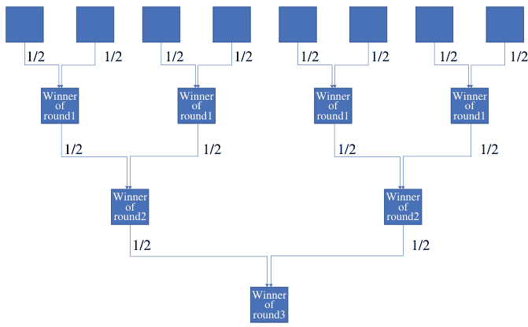

**图 3.6** 使用弱硬币翻转协议决定每对胜者的领导者选举。图示为诚实参与方，每轮获胜概率为 1/2。领导者必须“足够幸运”才能在所有三轮中获胜，且成功概率为 \((\frac{1}{2})^3\)。

显然，\(\epsilon\) 越小的协议越好。解决上述问题的思路是：利用弱硬币翻转协议在参与方对之间进行淘汰赛，并将锦标赛的胜者宣布为领导者。

对于 (a)，当所有参与方都诚实时，\(k = \log_2 n\) 轮锦标赛将决定领导者。要成为领导者，一个参与方必须赢得所有 \(k\) 轮，其成功概率为 \((\frac{1}{2})^k = \frac{1}{n}\)，如图 3.6 所示（当 \(n = 2^3\) 时）。

对于 (b)，在存在作弊者的情况下使用弱（量子）硬币翻转协议，在每一轮中，在玩该协议的一对参与方中，作弊者获胜的概率最多为 \(\frac{1}{2} + \epsilon\)，即诚实参与者获胜的概率至少为 \(1 - (\frac{1}{2} + \epsilon) = \frac{1}{2} - \epsilon\)。因此，总计，在 \(k = \log_2 n\) 轮之后，诚实参与者（在所有轮次中都诚实）成为领导者的概率至少为：

\(\left(\frac{1}{2} - \epsilon\right)^k = \left(\frac{1-2\epsilon}{2}\right)^k \geq \frac{1-2\epsilon k}{2^k} = \frac{1}{n} - \epsilon \frac{2 \log_2 n}{n} \geq \frac{1}{n} - \epsilon\)

这里使用了 \((1 + x)^n \geq 1 + nx\)，适用于 \(x \geq -1, n \in \mathbb{N}\)，因为 \(x = -2\epsilon\) 且 \(\epsilon \leq 1/2\)。请注意，运行时间可以用 \(O(\log n)\) 轮来描述，且在弱硬币翻转协议（偏差为 \(\epsilon\)）中每轮耗时 R 的情况下，总运行时间为 \(O(R \cdot \log n)\)。

但是，如果 \(n\) 不是 2 的幂，则需要进一步步骤。一种名为 \(Leader(\{A_1, ..., A_n\}, \epsilon)\) 的递归算法，用于从 \(n\) 个参与方 \(\{A_1, ..., A_n\}\) 中选举出一名领导者，使得诚实参与者成为领导者的概率至少为 \(\frac{1}{n} - \epsilon\)，如下所示。在给出算法之前，我们先引入一些符号。迄今为止，我们只研究了 _平衡_ 弱硬币翻转协议，但也存在 _不平衡_ 弱硬币翻转协议（偏差为 \(\epsilon\)），即如果双方都诚实，则一方获胜的概率为 _q_，另一方获胜的概率为 1-_q_（这与平衡协议形成对比，在平衡协议中，双方获胜的概率均为 1/2）。偏差为 \(\epsilon\) 的不平衡弱硬币翻转协议表示为 \(W_{q,\epsilon}\)。偏差为 \(\epsilon\) 的平衡弱硬币翻转协议表示为 \(W_\epsilon\)。

### **Leader**(\(\{A_1, \dots, A_n\}, \epsilon\)):

- **步骤 1：** 找到 \(k \in \mathbb{N}\) 使得 \(2^k \le n < 2^{k+1}\)。
- **步骤 2：** 前 \(2^k\) 名玩家 \(\{A_1, \dots, A_{2^k}\}\) 使用 \(W_\frac{\epsilon}{2}\) 在其内部进行一场锦标赛（_k_ 轮）以找出胜者，记为 _l_<sub>1</sub>。
- **步骤 3：** 计算 \(l_2 = \text{\textit{Leader}}(\{A_{2^k+1}, \dots, A_n\}, \epsilon)\)
- **步骤 4：** _l_<sub>1</sub> 使用协议 \(W_{(\frac{2^k}{n}), \frac{\epsilon}{2}}\) 与 _l_<sub>2</sub> 对弈，其中 \(W_{q', \frac{\epsilon}{2}}\) 表示满足 \(\left|q' - \frac{2^k}{n}\right| \le \frac{\epsilon}{2}\) 的协议。胜者即为领导者。

我们不会在此重复 Ganz [2017] 给出的深入分析，但指出该协议本质上是一种带有递归调用的分治方法，且诚实参与者 _A<sub>i</sub>_ 成为领导者的概率至少为 \(\frac{1}{n} - \epsilon\)。

对于领导者选举，挑战在于没有可信的中介人以及可能存在的作弊者。如果有一个可信的中介人，中介人可以制备 _W_ 态：\(|W\rangle = \frac{1}{\sqrt{3}}(|001\rangle + |010\rangle + |100\rangle)\)，或其推广形式：\(|W'\rangle = \frac{1}{\sqrt{n}}(|000 \dots 001\rangle + |000 \dots 010\rangle + \cdots + |100 \dots 000\rangle)\)。并向每个参与方发送一个量子比特，当 _n_ 个参与方共享该态后，经过测量，拥有比特 1 的参与方即为领导者。

## 3.2.3 量子密钥分发（QKD）

密钥是用于保护数据的比特串，通过加密和解密来实现。假设两个参与方想要交换消息，使得拦截这些消息的人无法理解消息内容。其基本思路是：使用一个 _k_ 比特串（对于足够大的 _k_）在某个算法（此处记为 _enc_）中加密消息，即将消息 _m_ 转换为看起来像随机字符串（且不可读）的形式，然后将此编码字符串（即 _enc_(_m_, _k_））发送到目标端，目标端可以使用另一个算法（此处记为 _dec_）解密，使用相同的密钥 _k_，从传输的字符串中提取 _m_，即 _dec_(_enc_(_m_, _k_), _k_) = _m_。要使这一切正常工作，双方需要共享密钥 _k_。

这样的密钥 _k_ 如何在两个参与方之间生成和共享？在通信参与方之间分发此类密钥有很多（经典）方法。但在此，我们探讨量子方法来解决此问题，该方法已


well-studied. 早在1984年，查尔斯·本尼特（Charles Bennett）和吉勒斯·布拉萨德（Gilles Brassard）提出了 BB84 协议，该协议利用量子信息在两个通信方之间生成这样的共享密钥。10 QKD 在其他来源中有详细描述，例如参见 沃尔夫（Wolf）[2021] 和 范·阿舍（Van Assche）[2006]，但我们在此概述 BB84 协议，主要基于 维迪克（Vidick）和 韦尔纳（Wehner）的出色描述。11 在这个协议中，A 基本上生成密钥并“通信”给 B，但方式是安全的，窃听者无法在不被发现的情况下获取密钥。我们假设 A 和 B 之间存在一个经典信道。

- 1. A 均匀随机选择一个 n 比特字符串 \(x = x_1 ... x_n \in \{0, 1\}^n\)。A 还均匀随机选择一个基串 \(\theta = \theta_1 ... \theta_n\)，它决定编码 \(x\) 中每个比特所用的基。A 通过将每个比特编码为量子态的方式将 \(x\) 传输给 \(B\)，具体为：\(H^{\theta_j}|x_j\rangle\)，其中 \(\theta_j \in \{0, 1\}\)，即 \(A\) 实际上向 \(B\) 发送了 \(n\) 个量子比特。这意味着对于某些 \(x_j\)，如果 \(\theta_j = 0\)，则使用计算基，且 \(x_j\) 编码为 \(|x_j\rangle\)；如果 \(\theta_j = 1\)，则使用 Hadamard 基，且 \(x_j\) 编码为 \(H|x_j\rangle\)（回顾 \(H |0\rangle = |+\rangle = (|0\rangle + |1\rangle)/\sqrt{2}\) 以及 \(H |1\rangle = |-\rangle = (|0\rangle - |1\rangle)/\sqrt{2}\)）。

- 2. B 均匀随机选择一个基串 \(\theta' = \theta'_1 ... \theta'_n\)，并在基 \(\theta'_j\) 下测量其从 \(A\) 接收到的量子比特 \(j\)，以产生结果 \(x'_j\)。

- 3. B 通过经典信道告知 A，它已接收并测量了所有量子比特。

- 4. 随后，A 和 B 相互（通过经典信道）告知各自的基串 \(\theta\) 和 \(\theta'\)。

- 5. 随后，A 和 B 丢弃所有未使用相同基的轮次。保留的轮次索引集合为 \(S = \{j \mid \theta_j = \theta'_j\}\)，由于 A 和 B 以相同概率从两个基选项中选择，当 \(n\) 很大时，大约保留 \(n/2\) 个比特，丢弃大约一半的轮次。

- 6. 为检测可能从 \(A\) 截取量子比特、对其进行测量并重新发送给 \(B\) 的窃听者，即拦截-重发攻击，\(A\) 从 \(S\) 中选取子集 \(T \subseteq S\) 用于测试，其中 \(|T| = n/4\) 个比特，即大约是保留比特的一半（这些比特在相同基下进行了测量）。请注意，对于索引在 \(T\) 中的比特，由于它们是使用相同基（由 \(A\) 进行编码，由 \(B\) 进行测量）的结果，我们应预期所有这些比特都相同；如果其中有显著更多比特不相同（即量子比特已被“扰动”），则表明存在执行拦截-重发攻击的窃听者——要了解这一点，请参见 **Aside**。

**Aside:** 考虑一个 _始终在计算基下进行测量_ 的窃听者（可能存在更复杂的攻击者，但这只是个示例），例如，当 _A_ 发送 |_x<sub>j</sub>_⟩（即在计算基下编码比特 _x<sub>j</sub>_）时，窃听者使用与 _A_ 相同的基进行测量，假设 _B_ 也在相同基下测量，那么窃听者就测对了，在此实例中不会被发现！但假设 _x<sub>j</sub>_ = 0，且 _A_ 发送 _H_|_x<sub>j</sub>_⟩ = |+⟩ = (|0⟩ + |1⟩)/√2（即在 Hadamard 基下编码比特 0），窃听者在计算基下测量，以概率 1/2 得到特征值 1 对应 |0⟩，以概率 1/2 得到 -1 对应 |1⟩。假设窃听者得到 |0⟩ 并将其转发给 _B_，并假设 _B_ 恰好在 _A_ 使用的相同基下测量，那么，由于 |0⟩ = (|+⟩ + |-⟩)/√2，_B_ 以概率 1/2 得到 |+⟩，以概率 1/2 得到 |-⟩；现在，假设 _B_ 得到 |-⟩，那么总结是 _A_ 和 _B_ 使用了相同的基，但 _B_ 获得的结果是 |-⟩，这与 _A_ 发送的不同！因此，窃听已经影响了量子比特，使得结果不是预期的——在此情况下，导致了本不应发生的错误。我们可以计算统计数据，以了解这样的窃听者 _E_ 在所有 _A_ 和 _B_ 使用相同基的情况下（即我们不期望出现错误的情况）会引入多少错误：

| A 的比特 | A 的编码 | E 测量并重发的态 | B 使用与 A 相同基的结果 | 错误？ |
|---|---|---|---|---|
| 0 | `|0⟩` | `|0⟩` | `|0⟩` | 否 |
| 1 | `|1⟩` | `|1⟩` | `|1⟩` | 否 |
| 0 | `|+⟩` | `|0⟩` | `|+⟩` | 否 |
| 0 | `|+⟩` | `|0⟩` | `|-⟩` | 是 |
| 0 | `|+⟩` | `|1⟩` | `|+⟩` | 否 |
| 0 | `|+⟩` | `|1⟩` | `|-⟩` | 是 |
| 1 | `|-⟩` | `|0⟩` | `|+⟩` | 是 |
| 1 | `|-⟩` | `|0⟩` | `|-⟩` | 否 |
| 1 | `|-⟩` | `|1⟩` | `|+⟩` | 是 |
| 1 | `|-⟩` | `|1⟩` | `|-⟩` | 否 |

> 可以看到由于 E 导致的错误大大增多；如果没有 E，当 A 和 B 都使用相同基时就不会出现任何错误（忽略嘈杂信道）。

窃听者测试的方法如下：A 和 B 相互（通过经典信道）宣布 \(x_j\) 和 \(x'_j\) 的值，其中 \(j \in T\)，并计算误码率 \(err = |W|/|T|\)，其中 \(W = \{j \in T | x_j \neq x'_j\}\) 是即使 A 和 B 使用相同基时仍存在不匹配的索引集合。因此，如果误码率 \(err > 0\)，则 A 和 B 中止协议，因为很可能存在窃听者。但如果 \(err = 0\)，则很可能没有窃听（尽管这不能保证，因为窃听者可能确实运气极好而未被发现！），S 中但未用于测试的比特对应的集合，即 S\T 中的索引，将是一串由 A 和 B 用于生成密钥的共享比特，即在 A 一方，密钥是 \(j \in S \setminus T\) 处的 \(x_j\)，在 B 一方，密钥是 \(j \in S \setminus T\) 处的 \(x'_j\)。请注意，\(|S \setminus T|\) 约为 \(n/4\)。事实上，由于传输中可能存在错误，只要 \(err < \epsilon\)（其中 \(\epsilon\) 是误码率的某个上界），不中止可能也是可以的。请注意，我们使用了 \(n/4\) 个比特进行测试以检查其余 \(n/4\) 个比特是否可用——且测试比特不是被使用的比特——这是如何实现的？如 沃尔夫（Wolf）[2021] 所述，我们在此不重复论证，当 \(n\) 很大时，样本 \(T \subseteq S\) 中的误码率与高概率接近整个字符串（即 S 中的比特）的误码率，也就是说，样本中的高误码率暗示整个字符串中存在高误码率，因此使用样本进行测试已经能对 S \ T 中的比特预期误码率提供充分的图景。

- 7. A 和 B 可以经过一个称为 *隐私放大* 的过程（下文给出示例）以进一步提高安全性，以防万一（例如，由于传输产生的小错误难以与窃听导致的错误区分），这将生成最终密钥 \(k\)，其长度小于 \(|S \ T| = n/4\)。

隐私放大的思想是通过从索引在 \(S \ T\) 中的剩余比特中提取一个（更小的）“真密钥”（长度小于 \(n/4\)）来进一步提高密钥的保密性。实现简单隐私放大的一种方法是从 \(S \ T\) 中取出比特对并对其进行 XOR 运算（或模二加法，即应用 \(\oplus\)），从而得到一个较短（但更安全的密钥）。\(^12\) 还有其他更复杂的隐私放大方法 [Wolf, 2021; Van Assche, 2006]。

12 该算法的解释如下，其中 A 是艾丽丝（Alice），B 是鲍勃（Bob），窃听者是伊娃（Eve）：

纠错后，艾丽丝和鲍勃拥有密钥的相同副本，但伊娃可能仍然对其持有一些信息……因此，艾丽丝和鲍勃需要使用一些隐私放大协议将伊娃的信息降低到任意低的值。这些经典协议通常的工作方式如下。艾丽丝再次随机选择比特对

对于纠错，还有一个称为 *信息调和* 的步骤，在通过测试确定误码率后，$A$ 和 $B$ 继续纠正错误，如 Wolf [2021] 中详细阐述。为确保双方拥有相同的比特字符串，即执行“密钥错误调和”（称为 Cascade），利用比特字符串块上的奇偶性值的协议在 Mehic 等人 [2022] 中有描述。

接下来，我们考虑由 阿图尔·埃克特（Artur Ekert）提出的称为 E91 协议 [Ekert, 1991] 的 QKD 协议，该协议使用两个通信方之间共享的纠缠态（贝尔态）在它们之间生成共享密钥。该协议按以下方式进行，以生成由双方 $A$ 和 $B$ 共享的 $n$ 比特密钥。

- 1. 第三方是 $n$ 对纠缠量子比特的源，每对处于态：$\frac{1}{\sqrt{2}}(|00\rangle + |11\rangle)$。然后，由第三方将每对中的一个量子比特分别发送给各方，从而将这 $n$ 个两量子比特态在双方之间共享。（我们也可以使用其他态，例如 1991 年埃克特最初使用的单重态，达到类似效果。）

- 2. 接收到量子比特后，对于接收到的每个量子比特，$A$ 随机从三种可能性中选择一个基，分别记为 $\mathbf{a}_1, \mathbf{a}_2$ 和 $\mathbf{a}_3$：

- $\mathbf{a}_1$: 基于可观测量 $Z$ 的基，即测量结果要么是 $+1$ 对应 $Z$ 的特征向量 $|0\rangle$，要么是 $-1$ 对应 $Z$ 的另一个特征向量 $|1\rangle$，

- $\mathbf{a}_2$: 基于可观测量 $(X + Z)/\sqrt{2} = H$ 的基，结果 $+1$ 对应 $H$ 的特征向量 $|\mathbf{x}\rangle = \cos(\frac{\pi}{8})|0\rangle + \sin(\frac{\pi}{8})|1\rangle$ 或 $-1$ 对应另一个特征向量 $|\boldsymbol{-}\rangle = -\sin(\frac{\pi}{8})|0\rangle + \cos(\frac{\pi}{8})|1\rangle$ 的 $H$，$^{13}$ 并且

计算它们的异或值。但与纠错不同，她不宣布这个异或值。她只宣布她选择了哪些比特（例如，比特编号 103 和 537）。然后，艾丽丝和鲍勃将两个比特替换为它们的异或值。以这种方式，他们缩短了密钥的同时保持其无误，但如果伊娃对这两个比特只有部分信息，她对异或值的信息就更少。例如，假设伊娃只知道第一个比特的值，对第二个比特一无所知。那么她对异或值完全没有信息。另外，如果伊娃以 60% 的概率知道两个比特的值，那么她正确猜测异或值的概率仅为 $0.6^2 + 0.4^2 = 52\%$。此过程需要重复多次；更高效的算法使用更大的块……[Gisin 等人, 2002, Arxiv 版第 C4 节, https://arxiv.org/pdf/quant-ph/0101098.pdf, 访问日期: 22/11/2022]

粗略地说，使用这种隐私放大方式得到的密钥长度可能为 $(n/4)/2 = n/8$。

$^{13}$ 可以通过三角恒等式（例如参见 https://sciencenotes.org/trig-identities-study-sheet）验证这些是 $H$ 的特征向量，并注意 $\cos(\frac{\pi}{4}) = \frac{1}{\sqrt{2}}$。


- **a**$_3$: 基于可观测量 $X$ 的基，结果 $+1$ 对应 $X$ 的特征向量 $|+\rangle = \frac{1}{\sqrt{2}}(|0\rangle + |1\rangle)$，或 $-1$ 对应另一个特征向量 $|-\rangle = \frac{1}{\sqrt{2}}(|0\rangle - |1\rangle)$ 的 $X$。

并在该基上对量子进行测量并记录。同样，对于接收到的每个量子，$B$ 随机从三种可能性中选择一个基：**b**$_1$: 可观测量 $(X + Z)/\sqrt{2}$，**b**$_2$: 可观测量 $X$，和 **b**$_3$: 可观测量 $(X - Z)/\sqrt{2}$（结果 $+1$ 对应特征向量 $|x'\rangle = sin(\frac{\pi}{8})|0\rangle + cos(\frac{\pi}{8})|1\rangle$，或 $-1$ 对应另一个特征向量 $|-x'\rangle = -cos(\frac{\pi}{8})|0\rangle + sin(\frac{\pi}{8})|1\rangle$），并在该基上对量子进行测量。

记录所有测量结果，包括每个量子测量所使用的基。然后，双方通过经典通道相互宣布用于测量每个量子的基。

- 3. 每个方随后将获得的测量结果分为两类：一类是双方在相同基中进行测量，另一类是在不同基中进行测量。每个方公开宣布在不同基中进行的测量结果（即第二类中的结果）。（用于不同基情况下所使用的基和测量结果，是下一步测试所需要的。）

- 4. 为了检测第三方（例如 $E$）是否进行了窃听，这种窃听会“扰乱”传输的量子——例如，$E$ 可以截获一个量子（并测量以查看它是什么），并用某个量子代替截获的量子，双方可以对不同基进行的测量计算统计量并进行分析，如我们后文所示。如果量子看起来未被扰乱，则双方在相同基中测量的量子的结果将用作共享密钥——双方将拥有完全相同的结果（对于在相同基中测量的量子），因此每个获得的比特将是双方之间的共享秘密比特。因此，利用 $n$ 对纠缠量子，双方将共享一个 $n$ 比特密钥。

我们进一步考虑上述中介方对“扰乱”测试是如何工作的。该测试依赖于基于量子力学计算（或预期）的相关和反相关结果概率的数学关系，以及从测量获得的统计数据是否反映了我们所期望的结果。如果确实反映，则测试通过；否则测试失败。

让我们构建一个表格，显示根据量子力学预期的不同结果的概率，这些概率取决于 $A$ 和 $B$ 使用的基。设 $P_{+1,+1}(\mathbf{a}_i, \mathbf{b}_j)$ 表示在 $A$ 使用基 $\mathbf{a}_i$ 且 $B$ 使用基 $\mathbf{b}_j$ 的条件下，$A$ 获得结果 $+1$ 且 $B$ 获得结果 $+1$ 的概率，同样，$P_{-1,-1}(\mathbf{a}_i, \mathbf{b}_j)$、$P_{+1,-1}(\mathbf{a}_i, \mathbf{b}_j)$ 和 $P_{-1,+1}(\mathbf{a}_i, \mathbf{b}_j)$ 也是如此。设关系 $E$ 取决于 $A$ 的基 $\mathbf{a}_i$ 和 $B$ 的基 $\mathbf{b}_j$ 的选择，由

\(E(\mathbf{a}_i, \mathbf{b}_j) = P_{+1,+1}(\mathbf{a}_i, \mathbf{b}_j) + P_{-1,-1}(\mathbf{a}_i, \mathbf{b}_j) - P_{+1,-1}(\mathbf{a}_i, \mathbf{b}_j) - P_{-1,+1}(\mathbf{a}_i, \mathbf{b}_j)\)

给出，这表示当 $A$ 和 $B$ 分别使用基 $\mathbf{a}_i$ 和 $\mathbf{b}_j$ 时所获得结果的相关性。$E$ 值越高，相关性越强。

| A 的基 | B 的基 | \(P_{+1,+1}\) | \(P_{-1,-1}\) | \(P_{+1,-1}\) | \(P_{-1,+1}\) | \(E\) |
| :--- | :--- | :--- | :--- | :--- | :--- | :--- |
| \(\mathbf{a_1}: Z\) | \(\mathbf{b_1}: (X + Z)/\sqrt{2}\) | \(\frac{1}{2}cos^2(\frac{\pi}{8})\) | \(\frac{1}{2}cos^2(\frac{\pi}{8})\) | \(\frac{1}{2}sin^2(\frac{\pi}{8})\) | \(\frac{1}{2}sin^2(\frac{\pi}{8})\) | \(\frac{1}{\sqrt{2}}\) |
| \(\mathbf{a_1}: Z\) | \(\mathbf{b_2}: X\) | \(\frac{1}{2} \cdot \frac{1}{2}\) | \(\frac{1}{2} \cdot \frac{1}{2}\) | \(\frac{1}{2} \cdot \frac{1}{2}\) | \(\frac{1}{2} \cdot \frac{1}{2}\) | 0 |
| \(\mathbf{a_1}: Z\) | \(\mathbf{b_3}: (X - Z)/\sqrt{2}\) | \(\frac{1}{2}sin^2(\frac{\pi}{8})\) | \(\frac{1}{2}sin^2(\frac{\pi}{8})\) | \(\frac{1}{2}cos^2(\frac{\pi}{8})\) | \(\frac{1}{2}cos^2(\frac{\pi}{8})\) | \(-\frac{1}{\sqrt{2}}\) |
| \(\mathbf{a_2}: (X + Z)/\sqrt{2}\) | \(\mathbf{b_1}: (X + Z)/\sqrt{2}\) | \(\frac{1}{2}\) | \(\frac{1}{2}\) | 0 | 0 | 1 |
| \(\mathbf{a_2}: (X + Z)/\sqrt{2}\) | \(\mathbf{b_2}: X\) | \(\frac{1}{2}cos^2(\frac{\pi}{8})\) | \(\frac{1}{2}cos^2(\frac{\pi}{8})\) | \(\frac{1}{2}sin^2(\frac{\pi}{8})\) | \(\frac{1}{2}sin^2(\frac{\pi}{8})\) | \(\frac{1}{\sqrt{2}}\) |
| \(\mathbf{a_2}: (X + Z)/\sqrt{2}\) | \(\mathbf{b_3}: (X - Z)/\sqrt{2}\) | \(\frac{1}{2} \cdot \frac{1}{2}\) | \(\frac{1}{2} \cdot \frac{1}{2}\) | \(\frac{1}{2} \cdot \frac{1}{2}\) | \(\frac{1}{2} \cdot \frac{1}{2}\) | 0 |
| \(\mathbf{a_3}: X\) | \(\mathbf{b_1}: (X + Z)/\sqrt{2}\) | \(\frac{1}{2}cos^2(\frac{\pi}{8})\) | \(\frac{1}{2}cos^2(\frac{\pi}{8})\) | \(\frac{1}{2}sin^2(\frac{\pi}{8})\) | \(\frac{1}{2}sin^2(\frac{\pi}{8})\) | \(\frac{1}{\sqrt{2}}\) |
| \(\mathbf{a_3}: X\) | \(\mathbf{b_2}: X\) | \(\frac{1}{2}\) | \(\frac{1}{2}\) | 0 | 0 | 1 |
| \(\mathbf{a_3}: X\) | \(\mathbf{b_3}: (X - Z)/\sqrt{2}\) | \(\frac{1}{2}cos^2(\frac{\pi}{8})\) | \(\frac{1}{2}cos^2(\frac{\pi}{8})\) | \(\frac{1}{2}sin^2(\frac{\pi}{8})\) | \(\frac{1}{2}sin^2(\frac{\pi}{8})\) | \(\frac{1}{\sqrt{2}}\) |

上述概率是使用一些表达式和恒等式计算得出的——参见旁注。

> Aside: 以下观察对于计算上述概率很有用，读者可以通过计算自行验证。
>
> * 我们注意到：\(\frac{1}{\sqrt{2}}(|00\rangle + |11\rangle) = \frac{1}{\sqrt{2}}(|++\rangle + |--\rangle) = \frac{1}{\sqrt{2}}(|xx\rangle + |\dot{+}\dot{-}\rangle)\)
> * 我们注意到用另一种基表示一种基的不同方式：
>
> $|0\rangle = \frac{1}{\sqrt{2}}(|+\rangle + |-\rangle)$  
> $|1\rangle = \frac{1}{\sqrt{2}}(|+\rangle - |-\rangle)$
>
> $|0\rangle = cos\left(\frac{\pi}{8}\right)|x\rangle - sin\left(\frac{\pi}{8}\right)|\dot{-}\rangle$  
> $|1\rangle = sin\left(\frac{\pi}{8}\right)|x\rangle + cos\left(\frac{\pi}{8}\right)|\dot{-}\rangle$
>
> $|0\rangle = sin\left(\frac{\pi}{8}\right)|x'\rangle - cos\left(\frac{\pi}{8}\right)|\dot{-}'\rangle$  
> $|1\rangle = cos\left(\frac{\pi}{8}\right)|x'\rangle + sin\left(\frac{\pi}{8}\right)|\dot{-}'\rangle$
>
> $|x\rangle = cos\left(\frac{\pi}{8}\right)|+\rangle + sin\left(\frac{\pi}{8}\right)|-\rangle$  
> $|\dot{-}\rangle = sin\left(\frac{\pi}{8}\right)|+\rangle - cos\left(\frac{\pi}{8}\right)|-\rangle$
>
> $|x\rangle = \frac{1}{\sqrt{2}}(|x'\rangle - |\dot{-}'\rangle)$  
> $|\dot{-}\rangle = \frac{1}{\sqrt{2}}(|x'\rangle + |\dot{-}'\rangle)$

- • 我们还注意到 \( cos(\frac{\pi}{4}) = sin(\frac{\pi}{4}) = \frac{1}{\sqrt{2}} \) 并使用以下恒等式：

```
\frac{1}{\sqrt{2}} \left( cos \left( \frac{\pi}{8} \right) + sin \left( \frac{\pi}{8} \right) \right) = cos \left( \frac{\pi}{8} \right) ;
\frac{1}{\sqrt{2}} \left( cos \left( \frac{\pi}{8} \right) - sin \left( \frac{\pi}{8} \right) \right) = sin \left( \frac{\pi}{8} \right)
```

所以，例如，为了计算第一行中的条目 \( P_{+1,+1}(\mathbf{a}_1, \mathbf{b}_1), P_{-1,-1}(\mathbf{a}_1, \mathbf{b}_1), P_{+1,-1}(\mathbf{a}_1, \mathbf{b}_1) \) 和 \( P_{-1,+1}(\mathbf{a}_1, \mathbf{b}_1) \)，我们可以将 \( \frac{1}{\sqrt{2}}(|00\rangle + |11\rangle) \) 写为

```
\frac{1}{\sqrt{2}} \left( |0\rangle \left( cos \left( \frac{\pi}{8} \right) |\times\rangle - sin \left( \frac{\pi}{8} \right) |-\rangle \right) + |1\rangle \left( sin \left( \frac{\pi}{8} \right) |\times\rangle + cos \left( \frac{\pi}{8} \right) |-\rangle \right) \right)
= \frac{1}{\sqrt{2}} cos \left( \frac{\pi}{8} \right) |0\rangle |\times\rangle - \frac{1}{\sqrt{2}} sin \left( \frac{\pi}{8} \right) |0\rangle |-\rangle + \frac{1}{\sqrt{2}} sin \left( \frac{\pi}{8} \right) |1\rangle |\times\rangle
+ \frac{1}{\sqrt{2}} cos \left( \frac{\pi}{8} \right) |1\rangle |-\rangle
```

然后，要得到 (+1,+1)，我们需要获得 \( |0\rangle |\times\rangle \)，其概率为 \( (\frac{1}{\sqrt{2}}cos(\frac{\pi}{8}))^2 \)；要得到 (-1,-1)，我们需要获得 \( |1\rangle |-\rangle \)，其概率为 \( (\frac{1}{\sqrt{2}}cos(\frac{\pi}{8}))^2 \)；要得到 (+1,-1)，我们需要获得 \( |0\rangle |-\rangle \)，其概率为 \( (-\frac{1}{\sqrt{2}}sin(\frac{\pi}{8}))^2 \)；要得到 (-1,+1)，我们需要获得 \( |1\rangle |\times\rangle \)，其概率为 \( (\frac{1}{\sqrt{2}}sin(\frac{\pi}{8}))^2 \)。

然后我们可以计算表达式$^{14}$：

```
S = E(\mathbf{a}_1, \mathbf{b}_1) - E(\mathbf{a}_1, \mathbf{b}_3) + E(\mathbf{a}_3, \mathbf{b}_1) + E(\mathbf{a}_3, \mathbf{b}_3)
= \frac{1}{\sqrt{2}} - (-\frac{1}{\sqrt{2}}) + \frac{1}{\sqrt{2}} + \frac{1}{\sqrt{2}} = \frac{4}{\sqrt{2}} = 2\sqrt{2}
```

因此，根据量子力学计算，我们期望 S = 2\sqrt{2}。

在 $n$ 对量子经过上述过程并进行 $n$ 次测量后，A 和 B 碰巧使用相同基的那组测量（即使用 $\mathbf{a}_2$ 和 $\mathbf{b}_1$ 或使用 $\mathbf{a}_3$ 和 $\mathbf{b}_2$，如上表所示，这意味着效率为 2/9）可以用作共享秘密比特（两者将有相同的结果，即 +1,+1 或 -1,-1），而 A 和 B 使用不同基的测量比例可以用于估计概率 $P_{+1,+1}(\mathbf{a}_i, \mathbf{b}_j)$，

14 请注意，对于不同的纠缠对，即单态，在 Ekert [1991] 中我们得到 S = -2\sqrt{2}。


P_{-1,-1}(\mathbf{a}_i, \mathbf{b}_j), P_{+1,-1}(\mathbf{a}_i, \mathbf{b}_j), \text{和 } P_{-1,+1}(\mathbf{a}_1, \mathbf{b}_j) \text{ 用于计算 } E(\mathbf{a}_1, \mathbf{b}_1), E(\mathbf{a}_1, \mathbf{b}_3), E(\mathbf{a}_3, \mathbf{b}_1), \text{和 } E(\mathbf{a}_3, \mathbf{b}_3)。

例如，假设我们想要估计 E(\mathbf{a}_1, \mathbf{b}_1)，那么我们需要获得 P_{+1,+1}(\mathbf{a}_1, \mathbf{b}_1), P_{-1,-1}(\mathbf{a}_1, \mathbf{b}_1), P_{+1,-1}(\mathbf{a}_1, \mathbf{b}_1), \text{和 } P_{-1,+1}(\mathbf{a}_1, \mathbf{b}_1) 的估计值。要估计 P_{+1,+1}(\mathbf{a}_1, \mathbf{b}_1)，设 N_{\mathbf{a}_i, \mathbf{b}_i} 表示 A 使用 \mathbf{a}_1 且 B 使用 \mathbf{b}_1 的配对总数，并设 N^{+1,+1}_{\mathbf{a}_1, \mathbf{b}_1} 表示 A 使用 \mathbf{a}_1 且 B 使用 \mathbf{b}_1 且结果为 (+1,+1) 的配对总数。然后，我们计算 P_{+1,+1}(\mathbf{a}_1, \mathbf{b}_1) 的估计值 P'_{+1,+1}(\mathbf{a}_1, \mathbf{b}_1)：

P'_{+1,+1}(\mathbf{a}_1, \mathbf{b}_1) = \frac{N^{+1,+1}_{\mathbf{a}_1, \mathbf{b}_1}}{N_{\mathbf{a}_1, \mathbf{b}_1}}

注意 N_{\mathbf{a}_i, \mathbf{b}_i} = N^{+1,+1}_{\mathbf{a}_1, \mathbf{b}_1} + N^{-1,-1}_{\mathbf{a}_1, \mathbf{b}_1} + N^{+1,-1}_{\mathbf{a}_1, \mathbf{b}_1} + N^{-1,+1}_{\mathbf{a}_1, \mathbf{b}_1}。所以，假设我们有 101 对（总共 n = 900 对）的测量是 A 使用 \mathbf{a}_1 且 B 使用 \mathbf{b}_1 进行的，并且其中 43 对的结果为 (-1,+1)。那么，P_{+1,+1}(\mathbf{a}_1, \mathbf{b}_1) 的估计值为 43/101 \approx \frac{1}{2}cos^2(\frac{\pi}{8})。类似地，为了估计其他概率、E 值以及 S。注意，如果存在“干扰”，即某个第三方截获了量子比特并更改了数值或“干扰”了纠缠，那么这种干预可能导致概率估计值与预期偏差过大，且 S \neq 2\sqrt{2}。但如果 S 确实足够接近预期值，A 和 B 可以非常确定没有发生任何干预，他们拥有的密钥是安全的。

让我们考虑一种干预示例，其中第三方截获发往 A 和 B（来自源）的每一对量子比特，并始终应用 Z 基来“干扰”量子比特——请注意，攻击者可能比这复杂得多，但这只是一个示例。这意味着，以 1/2 的概率，攻击者得到 |00\rangle（来自拦截/测量 Bell 态），并向 A 和 B 各发送一个处于 |0\rangle 状态的量子比特。然后，鉴于 |0\rangle = cos(\frac{\pi}{8})|X\rangle - sin(\frac{\pi}{8})|\mp\rangle，我们可以将 |00\rangle = |0\rangle \otimes |0\rangle 写成

|0\rangle \otimes \left( cos\left(\frac{\pi}{8}\right)|X\rangle - sin\left(\frac{\pi}{8}\right)|\mp\rangle \right) = cos\left(\frac{\pi}{8}\right)|0\rangle|X\rangle - sin\left(\frac{\pi}{8}\right)|0\rangle|\mp\rangle

并且我们可以将 |11\rangle = |1\rangle \otimes |1\rangle 写成

|1\rangle \otimes \left( sin\left(\frac{\pi}{8}\right)|X\rangle + cos\left(\frac{\pi}{8}\right)|\mp\rangle \right) = sin\left(\frac{\pi}{8}\right)|1\rangle|X\rangle + cos\left(\frac{\pi}{8}\right)|1\rangle|\mp\rangle

对于从源中截获的每一对量子比特，其中 A 和 B 使用基 \mathbf{a}_1 和 \mathbf{b}_1，来自攻击者，A 和 B 以 1/2 的概率得到 |00\rangle，并以 cos^2(\frac{\pi}{8}) 的概率测量 |0\rangle|X\rangle，即以 \frac{1}{2}cos^2(\frac{\pi}{8}) 的概率得到结果 (+1,+1)。类似地，根据上面的 |00\rangle 形式，以 \frac{1}{2}sin^2(\frac{\pi}{8}) 的概率得到结果 (+1,-1)。并且 A 和 B 以 1/2 的概率得到 |11\rangle，并以 sin^2(\frac{\pi}{8}) 的概率测量 |1\rangle|X\rangle，即以 \frac{1}{2}sin^2(\frac{\pi}{8}) 的概率得到结果 (-1,+1)。类似地，根据上面的 |11\rangle 形式，以 \(\frac{1}{2}cos^2(\frac{\pi}{8})\) 的概率得到结果 (-1,-1)。这似乎与我们在没有截获的情况下所期望的相符（如前面给出的表格的第一行所示）。

然而，现在考虑从源中截获的每一对量子比特，其中 \(A\) 和 \(B\) 使用基 \(\mathbf{a}_3\) 和 \(\mathbf{b}_3\)。我们可以将 \(|00\rangle = |0\rangle \otimes |0\rangle\) 写成

\(\frac{1}{\sqrt{2}}(|+\rangle + |-\rangle) \otimes \left(sin\left(\frac{\pi}{8}\right)|x'\rangle - cos\left(\frac{\pi}{8}\right)|-\rangle'\right)\)
\(= \frac{1}{\sqrt{2}}sin\left(\frac{\pi}{8}\right)|+\rangle|x'\rangle + \frac{1}{\sqrt{2}}sin\left(\frac{\pi}{8}\right)|-\rangle|x'\rangle - \frac{1}{\sqrt{2}}cos\left(\frac{\pi}{8}\right)|+\rangle|-\rangle'\)
\(- \frac{1}{\sqrt{2}}cos\left(\frac{\pi}{8}\right)|-\rangle|-\rangle'\)

并且我们可以将 \(|11\rangle = |1\rangle \otimes |1\rangle\) 写成

\(\frac{1}{\sqrt{2}}(|+\rangle - |-\rangle) \otimes \left(cos\left(\frac{\pi}{8}\right)|x'\rangle + sin\left(\frac{\pi}{8}\right)|-\rangle'\right)\)
\(= \frac{1}{\sqrt{2}}cos\left(\frac{\pi}{8}\right)|+\rangle|x'\rangle - \frac{1}{\sqrt{2}}cos\left(\frac{\pi}{8}\right)|-\rangle|x'\rangle + \frac{1}{\sqrt{2}}sin\left(\frac{\pi}{8}\right)|+\rangle|-\rangle'\)
\(- \frac{1}{\sqrt{2}}sin\left(\frac{\pi}{8}\right)|-\rangle|-\rangle'\)

然后，来自攻击者，\(A\) 和 \(B\) 以 1/2 的概率得到 \(|00\rangle\)，并以 1/2 的概率得到 \(|11\rangle\)，因此 \(A\) 和 \(B\) 以如下概率得到 \(|+\rangle|x'\rangle\)

\(\frac{1}{2} \cdot \frac{1}{2} sin^2\left(\frac{\pi}{8}\right) + \frac{1}{2} \cdot \frac{1}{2} cos^2\left(\frac{\pi}{8}\right) = \frac{1}{4}\left(sin^2\left(\frac{\pi}{8}\right) + cos^2\left(\frac{\pi}{8}\right)\right) = \frac{1}{4}\)

即以 1/4 的概率得到结果 (+1,+1)。类似地，以 1/4 的概率得到结果 (-1,-1)，以 1/4 的概率得到结果 (+1,-1)，以 1/4 的概率得到结果 (-1,+1)。这意味着，通过这种截获，得到的统计数据可能会显示每个结果都以相等的概率（即 1/4）出现，并且我们可能会观察到

\(E(\mathbf{a}_3, \mathbf{b}_3) = \frac{1}{4} + \frac{1}{4} - \frac{1}{4} - \frac{1}{4} = 0\)

然而，这个 \(E\) 值与我们之前看到的表格的最后一行不同。最后一行是根据量子力学计算的。我们可以写

\(\frac{1}{\sqrt{2}}(|00\rangle + |11\rangle) = \frac{1}{\sqrt{2}}\left(\frac{1}{\sqrt{2}}(|+\rangle + |-\rangle) \otimes \left(sin\left(\frac{\pi}{8}\right)|x'\rangle - cos\left(\frac{\pi}{8}\right)|-\rangle'\right)\right.\)
\(\left. + \frac{1}{\sqrt{2}}(|+\rangle - |-\rangle) \otimes \left(cos\left(\frac{\pi}{8}\right)|x'\rangle + sin\left(\frac{\pi}{8}\right)|-\rangle'\right)\right)\)
\(= \frac{1}{\sqrt{2}}\left(\frac{1}{\sqrt{2}}\left(sin\left(\frac{\pi}{8}\right) + cos\left(\frac{\pi}{8}\right)\right)|+\rangle|x'\rangle\right.\)
\(\left. - \frac{1}{\sqrt{2}} \left( \cos \left( \frac{\pi}{8} \right) - \sin \left( \frac{\pi}{8} \right) \right) |- \rangle |x' \rangle\right.\)
\(\left. - \frac{1}{\sqrt{2}} \left( \cos \left( \frac{\pi}{8} \right) - \sin \left( \frac{\pi}{8} \right) \right) |+ \rangle |- \rangle'\right.\)
\(\left. - \frac{1}{\sqrt{2}} \left( \cos \left( \frac{\pi}{8} \right) + \sin \left( \frac{\pi}{8} \right) \right) |- \rangle |- \rangle' \right)\)
\(= \frac{1}{\sqrt{2}} \left( \cos \left( \frac{\pi}{8} \right) |+ \rangle |x' \rangle - \sin \left( \frac{\pi}{8} \right) |- \rangle |x' \rangle\right.\)
\(\left. - \sin \left( \frac{\pi}{8} \right) |+ \rangle |- \rangle' - \cos \left( \frac{\pi}{8} \right) |- \rangle |- \rangle' \right)\)

最后一步使用了前面**旁注**中的恒等式。上述计算表明，以 \(\frac{1}{2}cos^2(\frac{\pi}{8})\) 的概率应该得到结果 (+1,+1)，以 \(\frac{1}{2}cos^2(\frac{\pi}{8})\) 的概率应该得到结果 (-1,-1)，以 \(\frac{1}{2}sin^2(\frac{\pi}{8})\) 的概率应该得到结果 (+1,-1)，以 \(\frac{1}{2}sin^2(\frac{\pi}{8})\) 的概率应该得到结果 (-1,+1)。这意味着

\(E(\mathbf{a}_3, \mathbf{b}_3) = \frac{1}{2}cos^2 \left( \frac{\pi}{8} \right) + \frac{1}{2}cos^2 \left( \frac{\pi}{8} \right) - \frac{1}{2}sin^2 \left( \frac{\pi}{8} \right) - \frac{1}{2}sin^2 \left( \frac{\pi}{8} \right)\)
\(= cos^2 \left( \frac{\pi}{8} \right) - sin^2 \left( \frac{\pi}{8} \right) = cos \left( 2 \cdot \frac{\pi}{8} \right) = \frac{1}{\sqrt{2}}\)

因此，可以通过 \(A\) 和 \(B\) 使用基 \(\mathbf{a}_3\) 和 \(\mathbf{b}_3\) 的配对统计数据来检测这种攻击！这是对所有测量结果的巧妙利用——\(A\) 和 \(B\) 使用相同基的结果将形成共享密钥（因为双方将得到相同的结果），而 \(A\) 和 \(B\) 使用不同基的结果将提供用于检测攻击者的统计数据。

研究中已有多次 QKD 协议的演示（例如 [Chen et al., 2021]）以及用于 QKD 的商业产品。\(^{15}\) 在会议密钥协议方面也有大量工作，或者与 \(N > 2\) 方希望拥有共同密钥 [Murtia et al., 2020]。

将 QKD 与当今的 Internet 集成已由 Mehic et al. [2022] 深入讨论。一种基于 REST 的 API，用于允许应用程序向 QKD 网络发出方法调用以获取密钥，被指定为 ETSI (欧洲


## 3.2.4 量子匿名广播

我们考虑如何实现匿名广播的问题，即给定 n 方（例如用户或机器）的集合，如何让任何一方向所有其他方广播一条消息（即一条一位消息），而其他方不知道是谁发送了该消息。

该问题（及其解决方案）的原始（非量子）形式如下所述，称为密码学家进餐问题：

> 三位密码学家正在他们最喜欢的三星餐厅用餐。服务员告诉他们，已经与餐厅经理安排好，账单将匿名支付。可能是其中一位密码学家在支付晚餐费用，也可能是美国国家安全局（NSA）在支付。三位密码学家互相尊重对方进行匿名支付的权利，但他们想知道是否是 NSA 在支付。他们通过执行以下协议公平地消除了不确定性：每位密码学家在菜单后面，在他与右侧密码学家之间抛一枚无偏硬币，这样只有他们两人能看到结果。然后每位密码学家大声宣布他能看到的两枚硬币（他自己抛的那枚和他左手邻居抛的那枚）是正面相同还是不同。如果其中一位密码学家是付款人，他将宣布与他所看到的相反的结果。桌上宣布的不同结果的奇数表明一位密码学家正在付款；偶数表明 NSA 正在付款（假设晚餐只支付了一次）。然而，如果一位密码学家正在付款，另外两人都无法从宣布中了解是哪位密码学家在付款。[Chaum, 1988, p. 65]

请注意，有三次硬币抛掷和三个结果。NSA 支付意味着没有密码学家付款。该协议是无条件安全的，因为假设一个非付款密码学家正在试图找出谁付了款（并假设一位密码学家付了款）。那么，对于这个密码学家（称为 A），有两种情况：

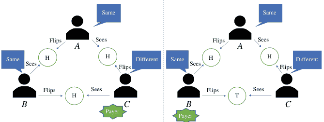

图 3.7 说明了这样一种场景：A 看到两枚硬币（A 看到的那枚和 A 抛的那枚）相同（例如都是正面），B 说“相同”，C 说“不同。”左侧，如果对 A 隐藏的硬币（B 和 C 之间的那枚）是正面（与另外两个结果相同），那么说“不同”的人是付款人，即 C，因为 C 宣布了他所看到的相反结果。但右侧，如果对 A 隐藏的硬币（B 和 C 之间的那枚）是反面（与另外两个结果不同），那么说“相同”的人是付款人，即 B，因为 B 宣布了他所看到的相反结果。比较这两种场景，对 A 隐藏的硬币（B 和 C 之间的那枚）是正面（或反面）的概率是 1/2，因此，A 仅凭一人说“相同”另一人说“不同”无法知道付款人可能是谁。同样，当 C 说“相同”而 B 说“不同”时也是如此。

- 1. A 看到的两枚硬币相同：另外两位密码学家中，一人必须说“不同”，另一人会说“相同”（如果两人都说“相同”，则是 NSA 支付，这与我们假设的情况不符）。如果对 A 隐藏的结果与另外两个结果相同，则说“不同”的人是付款人；如果对 A 隐藏的结果与另外两个结果不同，则说“相同”的人是付款人。但是，鉴于公平的硬币抛掷，对 A 隐藏的结果与另外两个结果相同或不同的概率相等，因此 A 无法判断付款人是谁。如图 3.7 所示。

- 2. A 看到的两枚硬币不同：如果另外两位密码学家都说了“不同”，则付款人是看到与对 A 隐藏的硬币相同的那枚硬币的人，如图 3.8 所示。如果另外两位密码学家都说了“相同”，则付款人是看到与对 A 隐藏的硬币不同的那枚硬币的人。

我们可以将上述推理形式化如下。上面的每位密码学家（或各方）都是图中的一个节点，一对各方之间抛掷的硬币结果由一条边表示，如图 3.9 所示，包含五个节点和五条边，每条边表示一对各方之间共享的一个信息位 $b_i$（值为 0 或 1）。那么，一方看到两枚硬币（或边）相同（用 0 表示）或不同（用 1 表示），由相邻值的 $b_i$ 模二和给出，即对 $1 \le i \le 5$ 的 $b_i \oplus b_{(i+1) \mod 5}$，也就是说，

$P_1 : b_1 \oplus b_2, P_2 : b_2 \oplus b_3, P_3 : b_3 \oplus b_4, P_4 : b_4 \oplus b_5, \text{ and } P_5 : b_5 \oplus b_1$.

请注意，一对各方之间的秘密位 $b_i$ 可以通过对该对各方共享的 Bell 对进行测量来获得：$\frac{1}{\sqrt{2}}(|00\rangle + |11\rangle)$。更一般地，各方对之间共享的秘密位实际上是成对共享的密钥，可以通过 QKD 等协议获得。

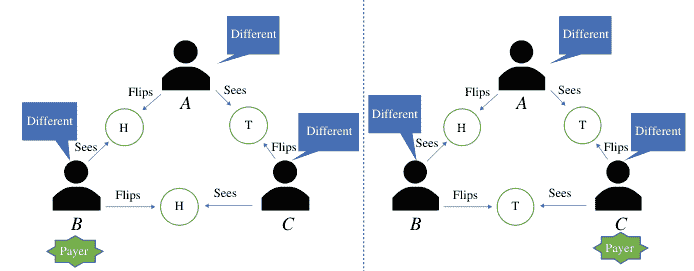

图 3.8 说明了这样一种场景：A 看到的硬币（A 看到的那枚和 A 抛的那枚）不同，另外两人都说了“不同。”左侧，如果对 A 隐藏的硬币（B 和 C 之间的那枚）是正面，那么说“不同”但实际上两枚看到的硬币相同的人是付款人，即 B，因为 B 宣布了他所看到的相反结果。右侧，如果对 A 隐藏的硬币（B 和 C 之间的那枚）是反面，那么说“不同”（但实际上两枚看到的硬币相同）的人是付款人，即 C，因为 C 宣布了他所看到的相反结果。比较这两种场景，对 A 隐藏的硬币（B 和 C 之间的那枚）是正面（或反面）的概率是 1/2，因此，A 仅凭两人都说“不同”无法知道付款人可能是谁。同样，当 B 和 C 都说“相同时”也是如此。

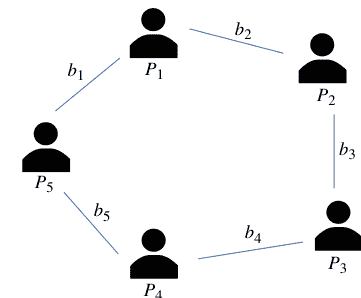

图 3.9 说明了密码学家进餐问题的图形表示，包含五方和五条边，每条边表示对应各方对之间共享的一个秘密位，该位是秘密的，因为所有其他各方都无法知道这个位是什么。

基于 Huang et al. [2022] 的展示，我们现在可以为匿名广播提供一个协议，该协议推广了上述针对 n 方的密码学家进餐问题的解决协议。假设它们按图 3.9 所示组织成一个环——然后我们将其推广到完全连接图。假设一方（称为发言人）想要向其余 n - 1 方广播一位信息而不泄露其身份，协议如下。

- 1. 如果发言人（假设是索引为 s 的方）希望广播值 c = 0，则发言人只需将 ps = bs ⊕ b(s+1) mod n 设置为要宣布的值；如果发言人希望广播值 c = 1，则发言人翻转 bs 或 b(s+1) mod n 中的一个值的值。假设发言人翻转 bs。然后发言人将 ps = bs ⊕ b(s+1) mod n 设置为要宣布的值；所有其他方（i ≠ s）为非发言人，只需将 pi = bi ⊕ b(i+1) mod n 设置为要宣布的值。

- 2. 每一方（通过某些非匿名的经典广播频道）向其他所有人宣布其 pi 值，然后由于每一方都有所有人的 pi 值，每一方都可以计算总的奇偶性值：p = p1 ⊕ ... ⊕ pn。

然后，请注意，如果 c = 0，即发言人广播 0，则

```
p = p1 ⊕ ... ⊕ pn
= (b1 ⊕ b2) ⊕ (b2 ⊕ b3) ⊕ ... ⊕ (bn-2 ⊕ bn-1) ⊕ (bn-1 ⊕ bn) ⊕ (bn ⊕ b1)
= (b1 ⊕ b1) ⊕ (b2 ⊕ b2) ⊕ ... ⊕ (bn ⊕ bn) = 0
```

因为每个位 bi 在表达式中恰好出现两次。但如果 c = 1，即发言人广播 1，则

```
p = p1 ⊕ ... ⊕ ps-1 ⊕ ps ⊕ ... ⊕ pn
= (b1 ⊕ b2) ⊕ ... ⊕ (bs-1 ⊕ bs) ⊕ (bs ⊕ bs+1) ⊕ ... ⊕ (bn ⊕ b1)
= (b1 ⊕ b1) ⊕ (b2 ⊕ b2) ⊕ ... ⊕ (bs ⊕ bs) ⊕ ... ⊕ (bn ⊕ bn) = 1
```

由于 p 由每个人计算，每个人都收到了发言人广播的位，但没有人知道发言人是谁，因为每个 bi 有 1/2 的概率是 0 或 1。请注意，这里的量子网络仅用于创建成对的秘密位。

上述简单扩展可用于（一般）图（而不仅仅是环拓扑），其中秘密位在所有用户对之间共享，如图 3.10 所示。


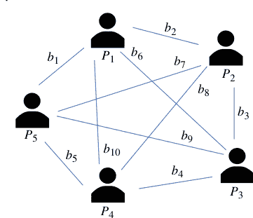

图 3.10 用餐密码学家问题图形表示示意图，包含 5 方和 10 条边（完全连接），每条边表示相应双方之间共享的一个秘密位，之所以是秘密，是因为所有其他方都无法知道该位是什么。

协议如下。每一轮：

- 1. 如果发言者（假设为索引为 s 的方）希望广播值 c = 0，则发言者只需设置 $p_s = \oplus_{i \in B_s} b_i$ 作为要宣布的值，其中 $B_s$ 是所有与 $P_s$ 关联的边（位）的集合；如果发言者希望广播值 c = 1，则发言者翻转 $B_s$ 中某个 $b_i$（例如 $b_s$）的值。也就是说，发言者设置 $p_s = \overline{b_s} \oplus (\oplus_{i \in B_s - \{b_j\}, b_i})$ 作为要宣布的值；所有其他方（对于 $j \neq s$）为非发言者，只需设置 $p_j = \oplus_{i \in B_i} b_i$ 作为要宣布的值。

- 2. 每个方将其 $p_i$ 值宣布给其他所有人，然后由于每个方都持有所有人的 $p_i$ 值，每个方都可以计算总的奇偶性值：$p = p_1 \oplus \dots \oplus p_n$。

我们可以使用图 3.10 中的场景来说明这个版本的协议。假设发言者是 $P_2$，则发言者宣布：$p_2 = \overline{b_2} \oplus b_7 \oplus b_8 \oplus b_3$，其余各方宣布：$p_1 = b_1 \oplus b_{10} \oplus b_6 \oplus b_2$，$p_3 = b_3 \oplus b_6 \oplus b_9 \oplus b_4$，$p_4 = b_4 \oplus b_8 \oplus b_{10} \oplus b_5$，以及 $p_5 = b_5 \oplus b_9 \oplus b_7 \oplus b_1$。当发言者广播 c = 1 时，总的奇偶性 p 为：

```
p = p_1 \oplus p_2 \oplus p_3 \oplus p_4 \oplus p_5
= (b_1 \oplus b_{10} \oplus b_6 \oplus b_2) \oplus (\overline{b_2} \oplus b_7 \oplus b_8 \oplus b_3)
\oplus (b_3 \oplus b_6 \oplus b_9 \oplus b_4) \oplus (b_4 \oplus b_8 \oplus b_{10} \oplus b_5)
\oplus (b_5 \oplus b_9 \oplus b_7 \oplus b_1)
= (b_1 \oplus b_1) \oplus (b_2 \oplus \overline{b_2}) \oplus (b_3 \oplus b_3) \oplus (b_4 \oplus b_4) \oplus (b_5 \oplus b_5)
\oplus (b_6 \oplus b_6) \oplus (b_7 \oplus b_7) \oplus (b_8 \oplus b_8) \oplus (b_9 \oplus b_9) \oplus (b_{10} \oplus b_{10}) = 1
```

当 c = 0 时，p = 0。

请注意，成对秘密位在每一轮中都会被使用，因此，如果协议需要进行多轮（例如，发言者要说的远不止一位！），则每对之间都需要多个秘密位（秘密指除了该对之外无人知晓）—— QKD 协议可用于在每对之间创建这样一串 $r$ 个秘密位，用于 $r$ 轮。

如 Huang et al. [2022] 所示，并基于 Broadbent 和 Tapp [2007]，对这些思想的巧妙变体和扩展催生了其他有趣的协议，例如 veto（一项或多项用户可以否决提案，且所有否决者的身份均隐藏）、notification（一个用户可以通知一个或多个其他用户，而通知者和接收者的身份以及接收者数量均保持隐藏）、collision detection（在匿名广播协议中可以检测到多个发言者）以及 anonymous private message transmission（发送者可以匿名向接收者传输一条 $m$ 位消息，接收者不知道发送者是谁）。

另一种量子匿名传输协议由 Christandl 和 Wehner [2005] 提出，使用广义 GHZ 态，具体如下。

- 1. 所有 $n$ 方共享 $n$ 量比特态 $\frac{1}{\sqrt{2}}(|0\rangle^{\otimes n} + |1\rangle^{\otimes n})$。

- 2. 如果 $c = 1$（即想要匿名广播 1），发言者对其量比特（即共享状态的其部分）应用相位翻转 $Z$ 门，否则不执行任何操作。

- 3. 每个方（包括发言者）执行以下操作：
  - (i) 对其量比特应用 Hadamard 变换 $H$，
  - (ii) 在计算基下测量其量比特，
  - (iii) 广播其测量结果，
  - (iv) 接收所有人宣布的测量结果并统计 1 的总数（记为 $k$），以及
  - (v) 如果 $k$ 为奇数，则得出 $c = 1$ 的结论，否则得出 $c = 0$ 的结论

- 4. 如果有一个或多个玩家未使用广播信道，则协议中止。

该协议中的匿名性源于以下事实：在 $n$ 方共享的 $n$ 量比特态 $\frac{1}{\sqrt{2}}(|0\rangle^{\otimes n} + |1\rangle^{\otimes n})$ 中，如果任意一方对其量比特应用 $Z$ 门，得到的状态为 $\frac{1}{\sqrt{2}}(|0\rangle^{\otimes n} - |1\rangle^{\otimes n})$。而且，仅从该状态无法追溯是谁对某个量比特应用了 $Z$ 门。请注意，当 $c = 0$ 时我们需要 $\frac{1}{\sqrt{2}}(|0\rangle^{\otimes n} + |1\rangle^{\otimes n})$，当 $c = 1$ 时需要 $\frac{1}{\sqrt{2}}(|0\rangle^{\otimes n} - |1\rangle^{\otimes n})$，即我们需要：$\frac{1}{\sqrt{2}}(|0\rangle^{\otimes n} + (-1)^c|1\rangle^{\otimes n})$。另外，协议中的步骤 3 用于确定全局状态的相位是否确实发生了变化，也就是说，是否有人对共享状态中的某个量比特应用了 $Z$ 门。为了解释原因，我们按照步骤 3(i) 考虑以下计算：

```
H^{\otimes n} \left( \frac{1}{\sqrt{2}} (|0\rangle^{\otimes n} + (-1)^c |1\rangle^{\otimes n}) \right)
= \frac{1}{\sqrt{2}} (H^{\otimes n} |0\rangle^{\otimes n} + (-1)^c H^{\otimes n} |1\rangle^{\otimes n})
```

$$
= \frac{1}{\sqrt{2}}((H|0\rangle)^{\otimes n} + (-1)^c (H|1\rangle)^{\otimes n})
= \frac{1}{\sqrt{2}} \left( \left( \frac{1}{\sqrt{2}} (|0\rangle + |1\rangle) \right)^{\otimes n} + (-1)^c \left( \frac{1}{\sqrt{2}} (|0\rangle - |1\rangle) \right)^{\otimes n} \right)
= \frac{1}{\sqrt{2}} \left( \left( \frac{1}{\sqrt{2}} \right)^n (|0\rangle + |1\rangle)^{\otimes n} + (-1)^c \left( \frac{1}{\sqrt{2}} \right)^n (|0\rangle - |1\rangle)^{\otimes n} \right)
= \left( \frac{1}{\sqrt{2}} \right)^{n+1} ((|0\rangle + |1\rangle)^{\otimes n} + (-1)^c (|0\rangle - |1\rangle)^{\otimes n})
= \left( \frac{1}{\sqrt{2}} \right)^{n+1} \left( \sum_{x \in \{0,1\}^n} |x\rangle + (-1)^c \sum_{x \in \{0,1\}^n} (-1)^{[x]} |x\rangle \right)
= \left( \frac{1}{\sqrt{2}} \right)^{n+1} \sum_{x \in \{0,1\}^n} (1 + (-1)^{c+[x]}) |x\rangle
```

其中 [x] 用于表示字符串 x 的汉明重量，即在此例中，x 中 1 的个数。根据上述表达式，如果 c = 0，则

1 + (-1)^{c+[x]} = 1 + (-1)^{0+[x]} = \begin{cases} 0, & \text{if } [x] \text{ is odd} \\ 2, & \text{if } [x] \text{ is even} \end{cases}

因此上述表达式简化为：

\left( \frac{1}{\sqrt{2}} \right)^{n+1} \sum_{x \in \{0,1\}^n \text{ such that } [x] \text{ is even}} |x\rangle

也就是说，振幅仅存在于 [x] 为偶数的态上。但是，如果 c = 1，则

1 + (-1)^{c+[x]} = 1 + (-1)^{1+[x]} = \begin{cases} 2, & \text{if } [x] \text{ is odd} \\ 0, & \text{if } [x] \text{ is even} \end{cases}

因此上述表达式简化为：

\left( \frac{1}{\sqrt{2}} \right)^{n+1} \sum_{x \in \{0,1\}^n \text{ such that } [x] \text{ is odd}} |x\rangle

也就是说，振幅仅存在于 [x] 为奇数的态上。然后，在步骤 3(ii) 进行测量时，我们得到一个确定的 x 值，记为 x'，对应于得到的状态 |x'>，并且 k = [x']。根据上述内容，如果 c = 0，由于振幅仅存在于汉明权重为偶数的态上，k 必须为偶数。同样，如果 c = 1，k 为奇数，这正是步骤 3(v) 中看到的情况。我们假设每轮只有一个发言者 — 有处理多个发送者/发言者以及传输量比特而非经典位的协议 [Christandl and Wehner, 2005]。

## 3.2.5 量子投票

投票是民主社会中的关键概念，量子电子投票协议已在 Arapinis et al. [2021] 中得到广泛讨论。在此，我们概述了基于 Khabiboulline et al. [2021] 的量子信息投票方案。

一般想法是使用量子态作为一种“选票”，选民可以在其中登记一票（此处的投票为二进制，例如“是”[记为 1] 或“否”[记为 0]），投票结果通过统计得到的 1 和 0 的数量来得出。一个关键考量是，选民不应能够提交多张票（而不被发现），从而损害选举的公正性。

我们有一个计票人，他采样一个随机比特串 \(x \in \{0, 1\}^n\)，其中 \(n = O(N^2)\) 以使协议正确运行，并准备 \(N\) 份选票态的副本，其中 \(N\) 是选民人数：

\(|\psi_x\rangle = \frac{1}{\sqrt{n}} \sum_{i=0}^{n-1} (-1)^{x_i} |i\rangle\)

其中 \(x_i\) 是 \(n\) 比特字符串 \(x = x_0 \dots x_{n-1}\) 的第 \(i\) 个比特，选票态使用 \(\lceil \log n \rceil\) 个量比特。

例如，对于 \(n = 6\)，我们使用三个量比特，而 \(x = 101100\) 的选票态是六个态的叠加：

\(\frac{1}{\sqrt{6}} (-|000\rangle + |001\rangle - |010\rangle - |011\rangle + |100\rangle + |101\rangle)\)

请注意，由于字符串只有 6 位，\(|110\rangle\) 和 \(|111\rangle\) 的系数被视为 0。选票态通过 \(|i\rangle\) 的负号在 \(i\) 位置标记一个 1，即每个分量为 \((-1)^{x_i} |i\rangle\)。

选民如何投票？在收到选票态后，选民在一个由两个态的叠加（形式为 \(\frac{1}{2}(|i\rangle + |j\rangle)\) 和 \(\frac{1}{2}(|i\rangle - |j\rangle)\)，其中 \(i \neq j\)）上的投影算符组成的基中进行测量。

如果将选票态中的六个分量态视为图的节点，那么两个节点 \((i, j)\) 之间的一条边可以用 \((|i\rangle + |j\rangle)\) 或 \((|i\rangle - |j\rangle)\) 形式的项来表示。

一个测量基的示例是一组投影算符（使用这些态）：

\(\left\{ \begin{aligned} \frac{1}{\sqrt{2}}(|000\rangle + |011\rangle), \quad \frac{1}{\sqrt{2}}(|000\rangle - |011\rangle), \\ \frac{1}{\sqrt{2}}(|001\rangle + |100\rangle), \quad \frac{1}{\sqrt{2}}(|001\rangle - |100\rangle), \\ \frac{1}{\sqrt{2}}(|010\rangle + |101\rangle), \quad \frac{1}{\sqrt{2}}(|010\rangle - |101\rangle) \end{aligned} \right\}\)

这对应于态之间的三条边，在用于测量时实际上会从三条可能的边中选出一条，得到 \((|i\rangle + |j\rangle)\) 或 \((|i\rangle - |j\rangle)\)，这对应于 $x_i$ 和 $x_j$ 的奇偶性，根据定义


选票状态（因为如果我们得到结果状态（|i⟩ + |j⟩），那么选票状态包含项 |i⟩ + |j⟩ 或 -|i⟩ - |j⟩，因此必须有 $x_i = x_j$，而如果我们得到结果状态（|i⟩ - |j⟩），那么选票状态包含项 |i⟩ − |j⟩ 或 −|i⟩ + |j⟩，因此必须有 $x_i \neq x_j$）。这意味着选民可以学习 $x_i$ 和 $x_j$ 的奇偶性 $p$。然后使用此奇偶性来编码其投票，即如果其投票为 $v \in \{0, 1\}$，则其编码投票为 $a = p \oplus v$。例如，将上面的选票状态示例改写为：

$$\frac{1}{\sqrt{6}}(-(|000\rangle + |011\rangle) + (|001\rangle + |100\rangle) - (|010\rangle - |101\rangle))$$

if the projectors above were used for measurement on the ballot state example, the voter might get the state:

$$\frac{1}{\sqrt{2}}(|000\rangle + |011\rangle)$$

and find out the parity between $x_0$ and $x_3$, i.e. it finds that $x_0 = x_3$, and use $p = 0$.

Each voter broadcasts its encoded vote $a$ and its edge $(i,j)$, i.e. each vote is accompanied by a distinct edge. Note that other voters, on hearing this, cannot yet decode the vote since they do not know $x$.

Once all the voters have broadcast their encoded vote (and the corresponding edge), that is, have effectively cast their votes, the tallyman reveals $x$ to all so that each voter can decipher all the votes from everyone, and each determine the winner.

Only votes accompanied by distinct edges are counted, to prevent double voting. For example, if there are two votes accompanied by the same edge, then only the first one broadcasted can be counted. Or if there are two votes where the two edges share a node, then, only the first one broadcasted is counted. This would prevent, for example, two voters colluding to forge a vote, e.g. one voter used the edge $(i,k)$ and another used the edge $(k,j)$, then because $x_i \oplus x_j = (x_i \oplus x_k) \oplus (x_k \oplus x_j)$, then they can collude to send in a vote accompanied by the edge $(i,j)$ - two voters then provide three votes! The bit string length $n$ can be made large enough so that the probability of two honest voters sampling, by chance, overlapping edges can be minimized.

What if a voter tries to present two votes, one encoded with the parity obtained from the actual edge obtained from measurement on the ballot state, and another encoded by guessing the parity of any other random edge? Note that the probability of guessing the parity of the other edge right is 1/2. Even if the guess was wrong, the additional vote could mess up results. This is prevented by repeating the voting protocol $O(N)$ rounds and averaging the votes over the rounds – this means that the additional votes will on average have an equal number of 0s and 1s, and so, not affect the final result.

The voters broadcast their votes and accompanying edges using an anonymous broadcast protocol so no one can know how each voter voted. A much deeper analysis of the cryptographic properties of the protocol is given in Khabiboulline et al. [2021].

## 3.2.6 量子拜占庭将军解法

The _Byzantine Generals Problem_ (BGP) is a well-known challenging problem in distributed computing. The problem is about how to achieve consensus among multiple parties (e.g. a node in a distributed system) when some of the parties fail or a party receives conflicting information from different parties.

The _Byzantine Generals Problem_ (_BGP_) or _Byzantine Agreement_ (_BA_) problem can be stated using a metaphor using the idea of the “Byzantine army,” as follows:

> We imagine that several divisions of the Byzantine army are camped outside an enemy city, each division commanded by its own general. The generals can communicate with one another only by messenger. After observing the enemy, they must decide upon a common plan of action. However, some of the generals may be traitors, trying to prevent the loyal generals from reaching agreement. The generals must have an algorithm to guarantee that:
>
> - A. All loyal generals decide upon the same plan of action. ...
> - B. A small number of traitors cannot cause the loyal generals to adopt a bad plan .... [Lamport et al., 1982, p. 382–383]

More specifically:

A commanding general must send an order to his $n - 1$ lieutenant generals such that

- IC1. All loyal lieutenants obey the same order.
- IC2. If the commanding general is loyal, then every local lieutenant obeys the orders he sends.

...Note that if the commander is loyal, then IC1 follows from IC2. However, the commander need not be loyal. [Lamport et al., 1982, p. 384]

IC stands for interactive consistency. An assumption is that the generals can send messages directly to each other. The commanding general can be disloyal in that it sends different messages to the lieutenant generals, thereby sabotaging the attack.

It was noted that there is no solution for the BA problem unless more than two-thirds of the generals are loyal, but if additional conditions are imposed so that

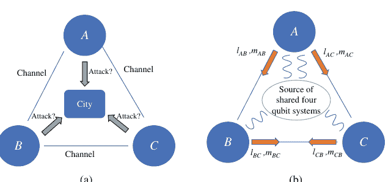

Figure 3.11 (a) An illustration of the metaphor of three generals (with their armies) deciding whether to attack the city together – the idea is that they should agree on a common plan to succeed – all should attack together, or not at all. (b) An illustration of the protocol for DBA with three parties connected by error-free reliable classical channels.

generals use signed messages (and so, cannot forge messages), then the problem can be solved even if less than two-thirds of the generals are loyal [Lamport et al., 1982]. A variation of the BA problem is called the Detectable Byzantine Agreement (DBA) problem, where loyal generals perform the same action or all can abort (if something wrong is detected). The DBA problem can be solved using correlated lists, which each party holds–the list of numbers held by each party has some correlations with the lists of others; we explain the notion of correlated lists later. Shared quantum states are used to create such correlated lists among multiple parties.

We consider a quantum solution to DBA from Gaertner et al. [2008] involving three parties, as illustrated in Figure 3.11.

Each party (i.e. general) has a private list $l_A, l_B,$ and $l_C$, respectively, with the same length $L$. The elements of $l_A$ are random trits (values 0, 1, or 2), and the elements of $l_B$ and $l_C$ are random bits (values 0 or 1). A condition is that the three lists, though private, are correlated in this way; at position $1 \le j \le L$ in the list, we have one of the following combinations (correlations):

- 000 (i.e. $l_{Aj} = 0, l_{Bj} = 0$, and $l_{Cj} = 0$),
- 111 (i.e. $l_{Aj} = 1, l_{Bj} = 1$, and $l_{Cj} = 1$), or
- 201 (i.e. $l_{Aj} = 2, l_{Bj} = 0$, and $l_{Cj} = 1$) or 210 (i.e. $l_{Aj} = 2, l_{Bj} = 1$, and $l_{Cj} = 0$), with equal probability.

So, though each list is private, one party can know something about the other lists via the above correlations. For example, if at position $j$ in A's list is such that $l_{Aj} = 2$, then $A$ knows that at position $j$ in B's and C's lists, either $l_{Bj} = 0$ and $l_{Cj} = 1$ or $l_{Bj} = 1$ and $l_{Cj} = 0$. If $l_{Aj} = 0$, then $A$ knows that $l_{Bj} = 0$ and $l_{Cj} = 0$, and if $l_{Aj} = 1$, then $A$ knows that $l_{Bj} = 1$ and $l_{Cj} = 1$.

In terms of distributed systems, “loyal” could mean working fine, and “disloyal” or being a “traitor” could mean there is some node failure or malfunction, or a node sending inconsistent data (explained below), or a node trying to make the generals do different actions.

The protocol proceeds as follows, with $A$ as the commanding general:

Step 1 (quantum part): All parties generate the lists $l_A$, $l_B$, and $l_C$ using quantum information with the correlations as mentioned earlier. We explain in detail how this is obtained later. Otherwise, they agree to abort the protocol.

Step 2 (classical part): The parties transmit the following messages. A sends a message $m_{AB}$ to $B$ which is 0 or 1 (corresponding to say “abort” or “attack”), and also sends a message $m_{AC} = m_{AB}$ to $C$. As a way to show that the message $m_{AB}$ is indeed from $A$, this message is accompanied by a list $l_{AB}$ (= $l_{AC}$), which contains the positions in $l_A$ with value the same as $m_{AB}$. For example, if $m_{AB} = 0$ and $A$’s list is {2, 0, 0, 2, 1, 1, 0, 0, 2, ...}, then $l_{AB}$ is {2, 3, 7, 8, ...}. Similarly, a loyal $A$ also sends the list $l_{AC} = l_{AB}$ to $C$. We discuss what happens when $B$ receives the message from $A$ (but the discussion applies to $C$ as well due to symmetry).

When $B$ receives $m_{AB}$ and $l_{AB}$, there are two possibilities:

- (i) if $l_{AB}$ is the right length (which should be roughly $L/3$ given that $A$’s list is a random list of trits), and $m_{AB}$, $l_{AB}$, and $l_B$ satisfy the correlations above (i.e. $m_{AB}$, $l_{AB}$, and $l_B$ are said to be *consistent*), then $B$ will follow the plan $m_{AB}$, unless $C$ convinces it that $A$ is a traitor (as we see later).
- (ii) If $m_{AB}$, $l_{AB}$, and $l_B$ are *inconsistent*, then $B$ concludes that $A$ is a traitor, and will not follow $m_{AB}$ and its plan depends on it having an agreement with $C$ as we see later (see comment marked (*)). For example, if $m_{AB} = 0$ and $l_{AB}$ from $A$ is {2, 5, 6, 7, ...}, and $B$’s list is $l_B = \{1, 0, 0, 0, 1, 1, 0, 0, 0, ...\}$, then $B$ concludes that the data from $A$ is inconsistent since at positions 5 and 6, $l_{B5} = l_{B6} = 1$, and due to the correlations above, we would be expecting $l_{A5} = 1$ or $l_{A5} = 2$, and $l_{A6} = 1$ or $l_{A6} = 2$, that is, the value in $A$’s list at positions 5 and 6 should not be 0.

$B$ sends a message $m_{BC}$, accompanied by list $l_{BC}$, to $C$ as well; $m_{BC}$ can be 0, 1 or $\perp$ (meaning “I have inconsistent data”). Note that, $B$’s message to $C$ should be what it received from $A$, i.e. $m_{BC} = m_{AB}$ and $l_{BC} = l_{AB}$.

When $C$ receives $m_{BC}$ and $l_{BC}$ from $B$, it already has $m_{AC}$ and $l_{AC}$ from $A$, there are six possibilities:

- (i) $m_{AC}$, $l_{AC}$, and $l_C$ are consistent, and $m_{BC}$, $l_{BC}$, and $l_C$ are consistent, and $m_{AC} = m_{BC}$: $C$ follows the plan $m_{AC} = m_{BC}$. Here, when $A$ follows its


自身发给 B 和 C 的计划，并且根据 B 所做的以上行为，那么 A、B 和 C 都将遵循同一个计划！

- (ii) \(m_{AC}, l_{AC},\) 和 \(l_C\) 一致，且 \(m_{BC}, l_{BC},\) 和 \(l_C\) 一致，且 \(m_{AC} \neq m_{BC}\)：C 于是知道 \(A\) 是叛徒，因为只有 \(A\) 能向 \(B\) 和 \(C\) 两者发送一致的数据（\(B\) 无法在此处制造一致的数据，因为它没有 \(l_A\)），并且假设只有一个叛徒，即 \(B\) 是忠诚的。对称地，\(B\) 也得出 \(A\) 是叛徒且 \(C\) 是忠诚的结论，且 C 意识到这一点。然后，\(C\) 和 \(B\) 将遵循之前商定的计划，例如 0。

- (iii) \(m_{AC}, l_{AC},\) 和 \(l_C\) 一致，且 \(m_{BC} = \perp\)：C 将遵循 \(m_{AC}\)。这里值得注意的是，C 无法知道 B 是否在撒谎（即 B 实际上从 A 那里接收到了不一致的数据，或者 B 从 A 那里接收到了一致的数据但向 C 发送了 \(\perp\)）。假设 B 在撒谎（并且是叛徒），而 \(A\) 是忠诚的，那么 C 通过遵循 \(m_{AC}\) 履行了其条件（IC2），即执行 A 命令的操作。假设 B 没有撒谎，那么 \(A\) 是叛徒，然后 C 通过遵循 \(m_{AC}\) 履行其条件（IC1），因为 B 也会做同样的（\*）：B 会做同样的事是因为它从 C 那里接收到了数据 \(m_{CB} = m_{AC}\) 和 \(l_{CB} = l_{AC}\)，这些是一致的，并且从 A 那里接收到了不一致的数据，然后 B 将遵循来自 C 的计划，\(m_{CB} = m_{AC}\)，即 B 和 C 将采取相同的行动 \(m_{AC}\)，满足（IC1）。

- (iv) \(m_{AC}, l_{AC},\) 和 \(l_C\) 一致，且 \(m_{BC}, l_{BC},\) 和 \(l_C\) 不一致：C 于是确定 \(B\) 是叛徒且 \(A\) 是忠诚的，并遵循 \(m_{AC}\)。

- (v) \(m_{AC}, l_{AC},\) 和 \(l_C\) 不一致，且 \(m_{BC}, l_{BC},\) 和 \(l_C\) 一致：C 确定 \(A\) 是叛徒，然后将遵循 \(m_{BC}\)。

- (vi) \(m_{AC}, l_{AC},\) 和 \(l_C\) 不一致，且 \(m_{BC} = \perp\)：C 和 B 现在都知道 \(A\) 是叛徒，并将遵循之前商定的计划，例如 0。

（注意我们没有 \(m_{AC}, l_{AC},\) 和 \(l_C\) 不一致，且 \(m_{BC}, l_{BC},\) 和 \(l_C\) 不一致的情况，因为 \(A\) 是叛徒且 \(B\) 是忠诚的，并且当它从 A 接收到不一致的数据时，会向 C 转发 \(\perp\)（这是案例 (vi)），而 B 当它从 A 接收到一致的数据时，会将一致的数据转发给 C（这是案例 (v)））。

有了上述协议，我们可以看到 DBA 的条件已满足。

协议的量子部分是步骤 1，可以通过一个源（如图 3.11 所示）发送大量四量子比特系统 \(abcd\) 来实现，这些系统处于四量子比特态：

```
\(|\psi\rangle_{abcd} = \frac{1}{2\sqrt{3}}(2 |0011\rangle - |0101\rangle - |0110\rangle - |1001\rangle - |1010\rangle + 2 |1100\rangle)_{abcd}\)
```

对于每个这样的系统，两个量子比特（a）和（b）被发送到 \(A\)，一个量子比特（c）发送到 \(B\)，一个量子比特（d）发送到 \(C\)。然后，\(A\)、\(B\) 和 \(C\) 对这些量子比特进行适当的测量，产生列表 \(l_A, l_B,\) 和 \(l_C\)，具有上述的关联。请注意，对于每个四量子比特系统，如果所有各方在相同的基中测量，将获得以下状态之一：|0011⟩、|0101⟩、|0110⟩、|1001⟩、|1010⟩、|1100⟩：

- 1100，即 A 获得 11（其两个量子比特都是 |1⟩），B 获得 0 且 C 获得 0，其中 A 将 11 视为“0”，因此，我们可以得到组合 000，或
- 0011，即 A 获得 00（其两个量子比特都是 |0⟩），B 获得 1 且 C 获得 1，其中 A 将 00 视为“1”，因此，我们可以得到组合 111，或
- 0101、0110、1001 或 1010，其中 A 获得 01 或 10，任一都被视为“2”，B 和 C 获得 01 或 10，因此，我们可以得到组合 210 或 201。

对 A、B 和 C 接收到的一系列四量子比特系统进行此类测量后，得到具有所需关联的列表 $l_A$、$l_B$ 和 $l_C$。请注意，状态 $|\psi\rangle_{abcd}$ 具有一个有趣的特性，即它在对四个量子比特应用相同的幺变换下保持不变 [Gaertner et al., 2008]，也就是说：$U \otimes U \otimes U \otimes U |\psi\rangle_{abcd} = |\psi\rangle_{abcd}$。这意味着所有各方只需保留在相同基中测量得到的比特，无论该基是什么。

然后，按以下方式进行另一系列测试，以确保生成的列表之间的关联。C 随机选择其列表 $l_C$ 中的一个位置 $k_C$，并通过点对点通道询问 A 和 B 在各自列表中相同位置的值——如果所有各方都在相同基中进行了测量，那么三个列表在位置 $k_C$ 处的条目应当正确关联。列表中的此类测试条目将被丢弃，以保持保密性条件。然后，各方交换角色，由 B 选择一个新位置 $k_B$ 并询问 A 和 C 的相应条目并检查关联，然后是 A 的位置 $k_A$ 回合，依此类推，该过程重复，直到进行了大量此类测试。

最后，计算观测到的量子误差率（QER），即错误数与四量子比特系统检测事件总数的比率——每个忠诚的将军随后会根据某个阈值 QER 决定是中止还是使用生成的列表。

下表显示了 Gaertner et al. [2008] 报告的实验中获得的列表条目示例。

| Position | $l_A$ | $l_B$ | $l_C$ |
|---|---|---|---|
| 1 | 2 | 1 | 0 |
| 2 | 0 | 0 | 0 |
| 3 | 0 | 0 | 0 |
| 4 | 2 | 0 | 1 |
| 5 | 1 | 1 | 1 |
| 6 | 1 | 1 | 1 |
| 7 | 0 | 0 | 0 |
| 8 | 0 | 0 | 0 |
| ⋮ | ⋮ | ⋮ | ⋮ |

DBA 问题已开发出其他解决方案，包括推广到任何数量的不诚实各方以及涉及三名以上将军的情况，如 Cholvi [2022] 所述，以及 Ben-Or 和 Hassidim [2005] 的早期技术和一种使用 QKD 协议的技术 [Iblisdir 和 Gisin, 2004]，仅举几例。

## 3.2.7 量子秘密共享

我们考虑在多个各方之间共享秘密的问题，使得每个方拥有秘密的一部分，并且无法利用该部分获取完整秘密，而秘密只能通过合并多个（如果不是全部）各方的部分来组合。更一般地，可以考虑一种称为 $(k, n)$-阈值方案的秘密共享方案，如下：秘密被分成 $n$ 个份额，这样任何 $k \le n$ 个份额都可以用来组装秘密，但任何 $k - 1$ 个份额都不会提供关于秘密的任何信息。

在经典情况下，考虑三个方 \(A\)、\(B\) 和 \(C\)。\(A\) 想要共享一个秘密 \(s\)，即一个 \(n\) 位比特串，在 \(B\) 和 \(C\) 之间共享，这样只有当 \(B\) 和 \(C\) 聚在一起时才能重建秘密。一种做法是让 \(A\) 拿取秘密 \(s\) 和一个 \(n\) 位随机字符串 \(r\)，并计算 \(s' = s \oplus r$（此处“\(\oplus$”表示按 2 进制逐位加法）。\(A\) 然后将 \(s'\) 给 \(B\)，将字符串 \(r\) 给 \(C\)。请注意，在这一点上，\(B\) 和 \(C\) 都不知道关于 \(s\) 的任何信息，但当他们聚在一起时，他们计算 \(s' \oplus r = s \oplus r \oplus r = s$，从而获得秘密 \(s\)。还有其他协议将 \(s\) 分割成超过两个份额。此类协议容易受到窃听，因此份额 \(r\) 和 \(s'\) 可能需要使用在 \(A\) 与 \(B\) 之间以及 \(A\) 与 \(C\) 之间共享的密钥进行加密。我们之前见过的 QKD 协议可以用于为秘密共享生成此类密钥。

或者，可以使用基于 GHZ 态的量子方法来分割秘密以及检测窃听，而无需使用 QKD，并且这种方法早在 1990 年代末就已被提出 [Hillery et al., 1999]。

在这里，我们简要概述一种量子秘密共享方案的思路，即 (2,3)-阈值方案，其中在此情况下的秘密是一个量子三态（或称 qutrit）的量子状态，如 Cleve et al. [1999] 所述。

秘密 qutrit \(\alpha |0\rangle + \beta |1\rangle + \gamma |2\rangle\)，其中 \(\alpha^2 + \beta^2 + \gamma^2 = 1\)，使用三个 qutrits 编码如下：

```
\frac{1}{\sqrt{3}} [\alpha(|000\rangle + |111\rangle + |222\rangle) + \beta(|012\rangle + |120\rangle + |201\rangle) + \gamma(|021\rangle + |102\rangle + |210\rangle)]
```

然后每个 qutrit 是三个份额之一。从任何一个份额，都无法获得关于秘密的信息，因为持有一个份额的一方对 \(|0\rangle\)、\(|1\rangle\) 和 \(|2\rangle\) 有相同的混合——例如，考虑持有第一个 qutrit 的一方，并假设


对另外两个 qutrit 进行了测量，但未告知此方。可以看出，在不知道另外两个 qutrit 的情况下，可能的状态，即另外两个 qutrit，可以是九种组合中的任意一种：|00⟩、|01⟩、|02⟩、|10⟩、|11⟩、|12⟩、|20⟩、|21⟩ 和 |22⟩，而此方的 qutrit 被测量为 |0⟩、|1⟩ 或 |2⟩ 的概率相等（即 (α² + β² + γ²)/3）。

但现在，假设某人持有三个份额中的任意两个，比如说最后两个 qutrit。那么，上述编码可以改写如下：

```
α(|000⟩ + |111⟩ + |222⟩) + β(|012⟩ + |120⟩ + |201⟩) + γ(|021⟩ + |102⟩ + |210⟩)
= α |000⟩ + β |012⟩ + γ |021⟩ + α |111⟩ + β |120⟩ + γ |102⟩ + α |222⟩
+ β |201⟩ + γ |210⟩
= |0⟩ ⊕ (α |00⟩ + β |12⟩ + γ |21⟩) + |1⟩ ⊕ (α |11⟩ + β |20⟩ + γ |02⟩)
+ |2⟩ ⊕ (α |22⟩ + β |01⟩ + γ |10⟩)
```

然后，无论第一个 qutrit 是什么，此人实际上都可以获取秘密 qutrit，即针对三个不同状态的振幅，例如，如果第一个 qutrit 是 |0⟩，那么将剩余的两个 qutrit |00⟩ 视为“|0⟩”，|12⟩ 视为“|1⟩”，|21⟩ 视为“|2⟩”，那么此人实际上拥有秘密 qutrit：α “|0⟩” + β “|1⟩” + γ “|2⟩”。类似地，如果第一个 qutrit 是 |1⟩ 或 |2⟩，则使用不同的映射。由于剩余的两个 qutrit 在第一个 qutrit 的不同情况下不同，假设第一个 qutrit 被测量为 |1⟩，如果此人测量并得到 |20⟩ 等结果，那么此人也知道第一个 qutrit 是 |1⟩。

我们仅仅是触及了表面——Cleve 等人 [1999] 对秘密共享方案的理论性质提供了更深入的分析和定理。

在秘密共享领域，还有许多最近的进展，例如 Long 等人 [2021] 中的 (3,5)-阈值方案，以及 Tsai 等人 [2022] 和 Zhang 等人 [2019] 等其他成果，仅举几例。

## 3.2.8 量子无迟移传输（OT）

OT 是允许数据传输或查询回答的问题，其方式是保持某些保密性或隐私性质。更具体地说，假设我们有两方 A 和 B，A 拥有一个包含两个项目 d₀ 和 d₁（每个均为 n 位字符串，例如）的数据库，且 (i) B 想要检索两个项目中的一个，但不希望 A 知道它检索了哪一个，从而保护其隐私，(ii) A 可以确信 B 不会同时获得两个项目。A 拥有两个项目的特殊情况称为 1-2 OT。对 (i) 的一个简单解决方案是让 A 直接将所有（或两个）项目（或其整个数据库）发送给 B，但这将不满足 (ii)。

我们考虑 1-2 OT 协议，使用 Vidick 和 Wehner 提出的方案中的思想。18 以下，A 拥有项目 d₀, d₁ ∈ {0, 1}ⁿ，B 正在请求一个项目 y ∈ {0, 1}。目标是让协议为 B 计算 f_B((d₀, d₁), y) = d_y，为 A 计算 f_A((d₀, d₁), y) = ⊥。

- 1. A 选择一个随机的 2n 位比特串 x = x₁ ... x₂ₙ ∈ {0, 1}²ⁿ 和一个随机的基串 θ = θ₁ ... θ₂ₙ ∈ {0, 1}²ⁿ，向 B 发送在所选基中编码的比特（类似于我们见过的 BB84），作为量子比特 Hθ₁|x₁⟩、...、Hθ₂ₙ|x₂ₙ⟩。
- 2. B 在随机基（计算基或 Hadamard 基）中测量每个接收到的量子比特。B 使用的基记录为 θ′ = θ′₁ ... θ′₂ₙ。测量结果记录在字符串 x′ = x′₁ ... x′₂ₙ 中。
- 3. A 和 B 都等待时间 t（等待足够长的时间，使 B 的量子内存“过期”（假设它会过期！），这样 B 在下一步之前就不能拥有接收到的量子比特——它必须在那时之前测量量子比特并存储结果——这是一个安全要求，因为 B 需要在知道 A 的编码基串之前测量其接收到的量子比特）。
- 4. 时间 t 过后，A 假设 B 已完成测量，并向 B 发送基串 θ；B 确定其使用与 A 相同的基的索引集合，即 S = {j|θ_j = θ′_j }。B 设置 S_y = S 和 S_{1−y} = {1, ... , 2n}\S。B 向 A 发送 (S₀, S₁)——我们假设对于足够大的 n，|S₀| = |S₁| = n。
- 5. A 向 B 发送 d′₀ = d₀ ⊕ x_{S₀} 和 d′₁ = d₁ ⊕ x_{S₁}，其中 ⊕ 是模 2 的按位加法，x_{S₀} = x_{k₁} ... x_{kₙ}，其中 k_i ∈ S₀，x_{S₁} 类似定义。注意 d′₀ 和 d′₁ 是 d₀ 和 d₁ 的加密值，B 只能解密其中一个。
- 6. A 然后输出 ⊥，B 输出 d′_y ⊕ x′_{S_y} 。

可以看出，该协议正确计算了上面的 f_A 和 f_B：A 在协议结束时输出 ⊥，B 计算出其想要的结果：

```
d′_y ⊕ x′_{S_y} = (d_y ⊕ x_{S_y}) ⊕ x′_{S_y} = d_y
```

这是因为 x_{S_y} ⊕ x′_{S_y} = 0，即 x_{S_y} = x′_{S_y}，因为 S = {j|θ_j = θ′_j }，并且根据上面的步骤 (4)，S_y = S，A 和 B 对 S_y 中索引的所有比特都使用了相同的基。Vidick 和 Wehner 对安全性质提供了更详细的讨论，但我们可以看到，在步骤 (3) 中，如果他们等待的时间不够长，B 可以将量子比特保留在内存中，直到它从 A 接收到编码基 θ，然后以与 A 相同的基测量所有量子比特，然后像步骤 (4) 那样向 A 发送 (S₀ = {1, ... , n}, S₁ = {n + 1, ... , 2n})，当 A 像步骤 (5) 那样向 B 发送 d′₀ 和 d′₁ 时，B 可以同时计算出 d₀ 和 d₁，因为对于 y = 0 和 y = 1 均有 x_{S_y} ⊕ x′_{S_y} = 0！为了确保 B 在发送 θ 之前已经完成测量，另一种方法是让 B 测量并使用比特承诺协议承诺其测量比特。由于在步骤 (5) 中 A 将两个数据项（albeit 加密形式）都发送给了 B，因此 A 不知道 B 请求了什么。请注意，该协议与 BB84 协议有相似之处，因为它基本上使用在相同基中测量的比特作为共享密钥。还有推广到 1-N OT，例如量子 OT 的综述见 [Santos et al., 2022]。

## 3.2.9 讨论

我们已研究了多方之间的若干量子协议。许多协议具有密码学性质，并在量子密码学中被广泛讨论，但我们概述了其中一些，因为它们在分布式计算环境中将很有用。这些也是相当“经典”的协议，自那时以来已有许多新进展。但希望本合集能提供一系列量子协议的概述，并让人了解其中涉及的高度技术性推理。

## 3.3 总结

一般来说，纠缠不是通信的替代品。但我们已经看到，如果不允许经典通信，纠缠可以实现某些没有纠缠就不可能进行的分布式计算；如果允许经典通信，那么借助纠缠，执行某些分布式计算所需的经典通信比特会更少。但通信复杂度的降低并非总是如此，即不适用于任何分布式计算。¹⁹ 我们还研究了许多有趣的量子协议，它们在经典分布式计算环境中有类似物。对于我们已见过的问题，还有其他更高级的协议，以及一些我们未考虑的协议，例如量子多方计算。我们看到，共享纠缠态是许多这些协议中的关键思想。这些协议的更深入分析也给出在原始引用论文中，我们未在本章中提供。

¹⁹ 例如，Elkin 等人 [2014] 的工作表明，节点（在网络中）共享纠缠和发送量子信息的能力，不能显著加快（与经典设置相比）某些问题（例如计算最小生成树和最短路径）的分布式算法。

## 参考文献

Dorit Aharonov, André Chailloux, Maor Ganz, Iordanis Kerenidis, and Loïck Magnin. A simpler proof of the existence of quantum weak coin flipping with arbitrarily small bias. SIAM Journal on Computing, 45(3):633–679, 2016.

¹⁹ For example, the work by Elkin et al. [2014] showed that the ability of nodes (in a network) to share entanglement and to send quantum information cannot help significantly to speed up (compared to the classical setting) distributed algorithms for certain problems such as computing the minimum spanning tree, and shortest paths.

Andris Ambainis. A new protocol and lower bounds for quantum coin flipping. Journal of Computer and System Sciences, 68(2):398–416, 2004.

A. Ambainis, H. Buhrman, Y. Dodis, and H. Rohrig. Multiparty quantum coin flipping. In Proceedings of the 19th IEEE Annual Conference on Computational Complexity, 2004, pages 250–259, 2004. doi: 10.1109/CCC.2004.1313848.

Myrto Arapinis, Nikolaos Lamprou, Elham Kashefi, and Anna Pappa. Definitions and security of quantum electronic voting. ACM Transactions on Quantum Computing, 2(1), Apr 2021. ISSN 2643-6809. doi: 10.1145/3450144.

Atul Singh Arora, Jérémie Roland, and Stephan Weis. Quantum weak coin flipping. In Proceedings of the 51st Annual ACM SIGACT Symposium on Theory of Computing, STOC 2019, pages 205–216, New York, NY, USA, 2019. Association for Computing Machinery. ISBN 9781450367059. doi: 10.1145/3313276.3316306.

Michael Ben-Or and Avinatan Hassidim. Fast quantum byzantine agreement. In Proceedings of the Thirty-Seventh Annual ACM Symposium on Theory of Computing, STOC ’05, pages 481–485, New York, NY, USA, 2005. Association for Computing Machinery. ISBN 1581139608. doi: 10.1145/1060590.1060662.

Guido Berlín, Gilles Brassard, Félix Bussières, Nicolas Godbout, Joshua A. Slater, and Wolfgang Tittel. Experimental loss-tolerant quantum coin flipping. Nature Communications, 2(1):561, 2011.

Manuel Blum. Coin flipping by telephone a protocol for solving impossible problems. SIGACT News, 15(1):23–27, Jan 1983. ISSN 0163-5700. doi: 10.1145/1008908.1008911.

Anne Broadbent and Alain Tapp. Information-theoretic security without an honest majority. In Kaoru Kurosawa, editor, Advances in Cryptology –ASIACRYPT 2007, pages 410–426, Berlin, Heidelberg, 2007. Springer-Verlag.

Harry Buhrman, Richard Cleve, Serge Massar, and Ronald de Wolf. Nonlocality and communication complexity. Reviews of Modern Physics, 82:665–698, Mar 2010. doi: 10.1103/RevModPhys.82.665.

A. Chailloux and I. Kerenidis. Optimal quantum strong coin flipping. In IEEE 50th Annual Symposium on Foundations of Computer Science (FOCS 2009), Los Alamitos, CA, USA, Oct 2009. IEEE Computer Society. doi: 10.1109/FOCS.2009.71.

David Chaum. The dining cryptographers problem: unconditional sender and recipient untraceability. Journal of Cryptology, 1(1):65–75, 1988.

Yi-Peng Chen, Jing-Yang Liu, Ming-Shuo Sun, Xing-Xu Zhou, Chun-Hui Zhang, Jian Li, and Qin Wang. Experimental measurement-device-independent quantum key distribution with the double-scanning method. Optics Letters, 46(15):3729–3732, Aug 2021.

Vicent Cholvi. Quantum byzantine agreement for any number of dishonest parties. Quantum Information Processing, 21(4):151, 2022.


Matthias Christandl 和 Stephanie Wehner. 量子匿名传输. 在 Bimal Roy（编）, Advances in Cryptology - ASIACRYPT 2005, 第 217–235 页, Berlin, Heidelberg, 2005. Springer-Verlag.

Richard Cleve 和 Harry Buhrman. 用量子纠缠替代通信. Physical Review A, 56:1201–1204, 1997年8月. doi: 10.1103/PhysRevA.56.1201.

Richard Cleve, Daniel Gottesman, 和 Hoi-Kwong Lo. 如何分享量子秘密. Physical Review Letters, 83:648–651, 1999年7月. doi: 10.1103/PhysRevLett.83.648.

C. Döscher 和 M. Keyl. 量子硬币抛投导论. Fluctuations and Noise Letters, 02(04):R125–R137, 2002. 可在 https://arxiv.org/abs/quant-ph/0206088 获取.

Artur K. Ekert. 基于 Bell 定理的量子密码学. Physical Review Letters, 67:661–663, 1991年8月. doi: 10.1103/PhysRevLett.67.661.

Michael Elkin, Hartmut Klauck, Danupon Nanongkai, 和 Gopal Pandurangan. 量子通信能否加速分布式计算？在 2014年 ACM 分布式计算原理研讨会论文集, PODC ’14, 第 166–175 页, New York, NY, USA, 2014. 计算机协会. ISBN 9781450329446. doi: 10.1145/2611462.2611488.

Sascha Gaertner, Mohamed Bourennane, Christian Kurtsiefer, Adán Cabello, 和 Harald Weinfurter. 拜占庭协议和说谎者检测量子协议的实验演示. Physical Review Letters, 100:070504, 2008年2月. doi: 10.1103/PhysRevLett.100.070504.

Maor Ganz. 量子领袖选举. Quantum Information Processing, 16(3):73, 2017.

Nicolas Gisin, Grégoire Ribordy, Wolfgang Tittel, 和 Hugo Zbinden. 量子密码学. Reviews of Modern Physics, 74:145–195, 2002年3月. doi: 10.1103/RevModPhys.74.145.

Lov K. Grover. 用于数据库搜索的快速量子力学算法. 在 第二十八届年度 ACM 计算理论研讨会论文集, STOC ’96, 第 212–219 页, New York, NY, USA, 1996. 计算机协会. ISBN 0897917855. doi: 10.1145/237814.237866.

Mark Hillery, Vladimír Bužek, 和 André Berthiaume. 量子秘密共享. Physical Review A, 59:1829–1834, 1999年3月. doi: 10.1103/PhysRevA.59.1829.

Zixin Huang, Siddarth Koduru Joshi, Djeylan Aktas, Cosmo Lupo, Armando O. Quintavalle, Natarajan Venkatkatchalam, Sören Wengerowsky, Martin Lončarić, Sebastian Philipp Neumann, Bo Liu, željko Samec, Laurent Kling, Mario Stipčević, Rupert Ursin, 和 John G. Rarity. 八用户量子密钥分发网络上安全匿名协议的实验实现. npj Quantum Information, 8(1):25, 2022.

S. Iblisdir 和 N. Gisin. 两个量子密钥分发设置上的拜占庭协议. Physical Review A, 70:034306, 2004年9月. doi: 10.1103/PhysRevA.70.034306.

I. Kerenidis 和 A. Nayak. 小偏差弱币翻转. Information Processing Letters, 89(3):131–135, 2004.

Emil T. Khabiboulline, Juspreet Singh Sandhu, Marco Ugo Gambetta, Mikhail D. Lukin, 和 Johannes Borregaard. 具有信息论安全性的高效量子投票. CoRR, abs/2112.14242, 2021. 可在 https://arxiv.org/abs/2112.14242 获取.

Leslie Lamport, Robert Shostak, 和 Marshall Pease. 拜占庭将军问题. ACM Transactions on Programming Languages and Systems, 4(3):382–401, 1982年7月. ISSN 0164-0925. doi: 10.1145/357172.357176.

Yinxang Long, Cai Zhang, 和 Zhiwei Sun. 基于最大纠缠6比特态的标准(3, 5)阈值量子秘密共享. Scientific Reports, 11(1):22649, 2021.

Miralem Mehic, Stefan Rass, Peppino Fazio, 和 Miroslav Vozňák. 量子密钥分发网络——服务质量视角，第1版. Springer, 2022. ISBN 978-3-031-06607-8. doi: 10.1007/978-3-031-06608-5.

C. Mochon. 偏差为0.192的量子弱币翻转. 在 第45届年度 IEEE 计算机科学基础研讨会, 第 2–11 页, 2004. doi: 10.1109/FOCS.2004.55.

Carlos Mochon. 大量量子弱币翻转协议族. Physical Review A, 72:022341, 2005年8月. doi: 10.1103/PhysRevA.72.022341.

Carlos Mochon. 任意小偏差的量子弱币翻转, 2007. 可在 https://arxiv.org/abs/0711.4114 获取.

Gláucia Murta, Federico Grasselli, Hermann Kampermann, 和 Dagmar Bruß. 量子会议密钥协议：综述. Advanced Quantum Technologies, 3(11):2000025, 2020.

Anna Pappa, Paul Jouguet, Thomas Lawson, André Chailloux, Matthieu Legré, Patrick Trinkler, Iordanis Kerenidis, 和 Eleni Diamanti. 即插即用量子币翻转的实验. Nature Communications, 5(1):3717, 2014.

Manuel B. Santos, Paulo Mateus, 和 Armando N. Pinto. 量子隐式传输：简要综述. Entropy, 24(7):945, 2022.

R. W. Spekkens 和 Terry Rudolph. 防作弊敏感型弱币翻转量子协议. Physical Review Letters, 89:227901, 2002年11月. doi: 10.1103/PhysRevLett.89.227901.

Seiichiro Tani, Hirotada Kobayashi, 和 Keiji Matsumoto. 领袖选举问题的精确量子算法. ACM Transactions on Computation Theory, 4(1), 2012年3月. ISSN 1942-3454. doi: 10.1145/2141938.2141939.

Chia-Wei Tsai, Chun-Wei Yang, 和 Jason Lin. 多方中介量子秘密共享协议. Quantum Information Processing, 21(2):63, 2022.

Gilles Van Assche. 量子密码学和秘钥提取. Cambridge University Press, 2006. ISBN 978-0-521-86485-5.

R. Wolf. 量子密钥分发：带练习的导论. Lecture Notes in Physics. Springer International Publishing, 2021. ISBN 9783030739911. URL https://books.google.com.au/books?id=sM47EAAAQBAJ.

Huanguo Zhang, Zhaoxu Ji, Houzhen Wang, 和 Wanqing Wu. 量子信息安全综述. China Communications, 16(10):1–36, 2019. doi: 10.23919/JCC.2019.10.001.

# 4 分布式量子计算——量子门的分布式控制

本章与第3章相比，从不同的角度探讨分布式量子计算。我们将探讨涉及多个比特的量子电路描述的计算，其中比特位于多个节点上，每个节点托管一个或多个比特。本章讨论非本地门，即用于多节点计算的量子门。特别是，本章讨论分布式CNOT门及其实现的不同方式，并讨论超越CNOT门的门的分布式控制。本章的讨论主要基于 Yimsiriwattana 和 Lomonaco [2005] 的工作，以及 Eisert 等人 [2000] 的早期工作。CNOT门很重要，因为使用此门和单比特门（或我们在第2章中看到的一些合适的门选择），可以实现通用门集并构建通用量子计算机。因此，与单比特门（将位于比特所在的各个节点上）以及分布式CNOT操作结合，实际上涵盖了可能的分布式量子电路计算范围。本章还简要回顾了分布式量子电路以及用于分布式量子计算机的分布式控制和管理架构的工作。

## 4.1 执行分布式CNOT

考虑一个分布式CNOT操作，其中控制比特位于一台机器（例如机器A）上，而目标比特位于另一台机器（即机器B）上。如何实现此操作？

### 4.1.1 使用传输

回顾第3章中的传输，其中一个比特状态可以从一台机器移动到另一台机器。因此，一种方法是将比特从A传输到B，然后使用

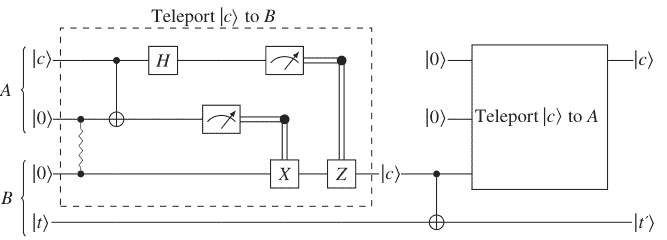

图4.1 使用传输的分布式CNOT。

传输后的比特作为控制来影响B处的目标比特——传输将涉及A和B之间共享的一对纠缠比特，以及从A传输到B的两个经典比特信息。最后，控制比特可以从A传输回B，这样A就能拿回控制比特——我们需要这一步，因为在典型的CNOT门中，控制比特不受影响且不会丢失。

我们现在来看这种方法的量子电路——假设A有两个比特（前两行），B有两个比特（后两行），并且A和B位于两台不同的机器上。电路可以采用图4.1所示的形式，即首先将控制比特传输到B，在B处本地执行CNOT，然后将控制比特（传回）到A。在这里，我们执行了一个分布式CNOT操作，即，如果 |c> = α|0> + β|1>，且 |α|^2 + |β|^2 = 1，我们可以写出涉及 |t>_B 的分布式CNOT表达式如下（添加下标以显示位置）：

```
distCNOT(|c>_A ⊗ |t>_B)
= distCNOT((α|0>_A + β|1>_A) ⊗ |t>_B)
= α|0>_A|t>_B + β|1>_A(X|t>_B)
```

请注意，使用了两次传输操作，先将一个比特从A传输到B，然后再从B传输回A，因此我们在A和B之间利用了两对纠缠比特和四个经典比特（即每次传输一对纠缠比特和两个经典比特）。

### 4.1.2 使用猫态的一种更高效方法

但是，是否有更高效的方法呢？有，正如 Eisert 等人 [2000] 所示。电路如图4.2所示。

事实上，Eisert 等人还证明，这是实现量子CNOT门非本地实现的最优方法。让我们看看这是如何工作的。


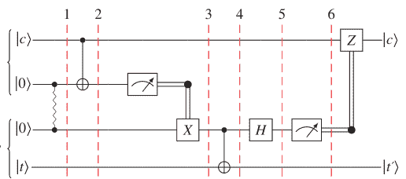

图 4.2 Eisert 等人的分布式 CNOT

考虑上面切片 1 中系统的状态，我们设 |c⟩ = α|0⟩ + β|1⟩：

在切片 1 处：(α|0⟩ + β|1⟩) ⊗ (1/√2|00⟩ + 1/√2|11⟩) ⊗ |t⟩
= (α/√2|000⟩ + α/√2|011⟩ + β/√2|100⟩ + β/√2|111⟩) ⊗ |t⟩

然后，对前两个量子比特应用 CNOT，我们在切片 2 处有：

在切片 2 处：( (α/√2|000⟩ + α/√2|011⟩ + β/√2|110⟩ + β/√2|101⟩ ) ⊗ |t⟩ )

然后，测量第二个量子比特（从上往下数），并且

- 1) 如果得到 0，并且这从 A 发送到 B，由于它是 0，X 门不应用，那么在切片 3 处，我们有：

在切片 3 处：√2 · ( (α/√2|000⟩ + β/√2|101⟩ ) ⊗ |t⟩ )
= (α|000⟩ + β|101⟩) ⊗ |t⟩

因为 1/√(第二个量子比特中测得 0 的概率) = 1/√(|α/√2|² + |β/√2|²) = 1/√(1/2) = √2，然后在 B 上局部对两个量子比特应用 CNOT：

在切片 4 处：α|000⟩|t⟩ + β|101⟩(X|t⟩)

然后，对第三行（从上往下数）应用门 H：

在切片 5 处：α|00⟩(H|0⟩)|t⟩ + β|10⟩(H|1⟩)(X|t⟩)
= α/√2 |000⟩|t⟩ + α/√2 |001⟩|t⟩ + β/√2 |100⟩(X|t⟩)
- β/√2 |101⟩(X|t⟩)

然后，测量 _B_ 处的量子比特（从上往下数第三行）：

- a) 假设我们得到 0，则有：

在切片 6 处：\(\alpha|000\rangle|t\rangle + \beta|100\rangle(X|t\rangle)\)

\(= \alpha|0\rangle|00\rangle|t\rangle + \beta|1\rangle|00\rangle(X|t\rangle)\)

并且将“0”发送到 _A_ 意味着 _Z_ 门不应用，因此，省略第二个和第三个量子比特，并添加下标，我们可以将最终状态写成

\(\alpha|0\rangle_A|t\rangle_B + \beta|1\rangle_A(X|t\rangle_B)\)

- b) 假设我们得到 1，则有：

在切片 6 处：\(\alpha|001\rangle|t\rangle - \beta|101\rangle(X|t\rangle)\)

\(= \alpha|0\rangle|01\rangle|t\rangle - \beta|1\rangle|01\rangle(X|t\rangle)\)

并且将“1”发送到 _A_ 意味着 _Z_ 门应用，因此，省略第二个和第三个量子比特，并添加下标，我们可以将最终状态写成

\(\alpha|0\rangle_A|t\rangle_B + \beta|1\rangle_A(X|t\rangle_B)\)

这与情况 (a) 相同。

- 2) 并且如果我们得到 1，并且这从 _A_ 发送到 _B_，由于它是 1，_X_ 门应用，那么在切片 3 处，我们有：

在切片 3 处：\((\alpha|010\rangle + \beta|111\rangle) \otimes |t\rangle\)

然后在 _B_ 上局部对两个量子比特应用 CNOT：

在切片 4 处：\(\alpha|010\rangle|t\rangle + \beta|111\rangle(X|t\rangle)\)

然后对第三行（从上往下数）应用门 _H_：

在切片 5 处：\(\alpha|01\rangle(H|0\rangle)|t\rangle + \beta|11\rangle(H|1\rangle)(X|t\rangle)\)

\(= \frac{\alpha}{\sqrt{2}}|010\rangle|t\rangle + \frac{\alpha}{\sqrt{2}}|011\rangle|t\rangle + \frac{\beta}{\sqrt{2}}|110\rangle(X|t\rangle)\)

\(- \frac{\beta}{\sqrt{2}}|111\rangle(X|t\rangle)\)

然后，测量 _B_ 处的量子比特（第三个量子比特或从上往下数第三行）：

- a) 假设我们得到 0，则有：

在切片 6 处：\(\alpha|010\rangle|t\rangle + \beta|110\rangle(X|t\rangle)\)

\(= \alpha|0\rangle|10\rangle|t\rangle + \beta|1\rangle|10\rangle(X|t\rangle)\)

并且将“0”发送到 _A_ 意味着 _Z_ 门不应用，因此，省略第二个和第三个量子比特，并添加下标，我们可以将最终状态写成

\(\alpha|0\rangle_A|t\rangle_B + \beta|1\rangle_A(X|t\rangle_B)\)

- b) 假设我们得到 1，则有：

在切片 6 处：\(\alpha|011\rangle|t\rangle - \beta|111\rangle(X|t\rangle)\)

\(= \alpha|0\rangle|11\rangle|t\rangle - \beta|1\rangle|11\rangle(X|t\rangle)\)

并且将"1"发送到 A 意味着 Z 门应用，因此，省略第二个和第三个量子比特，并添加下标，我们可以将最终状态写成

\(\alpha|0\rangle_A|t\rangle_B + \beta|1\rangle_A(X|t\rangle_B)\)

这与情况 (a) 相同。

请注意，如果只考虑第一个和第四个量子比特，则情况 (1)(a)、(1)(b)、(2)(b) 和 (2)(a) 都有相同的结果，这也与量子隐形传态方法的结果相同，这是我们所期望的——我们现在有了一种更高效的方法来实现分布式 CNOT。请注意，在这种方法中，分布式 CNOT 操作是使用 A 和 B 之间共享的一对纠缠量子比特（即一个 ebit）和两个经典比特（一个从 A 到 B，另一个从 B 到 A）完成的，这仅为量子隐形传态方法所需资源的一半！事实证明，如 Eisert 等人 [2000] 所示，这是最优的，即一个从 A 到 B 的经典比特通信、一个从 B 到 A 的经典比特和一个共享 ebit 共同构成了实现分布式 CNOT 门所需的最少资源。

让我们更仔细地看看上面的方法为什么有效。一个主要观察是，在两种情况下，第一个和第三个量子比特（如下面加下划线所示）在切片 3 处形成一个类猫态：

- case (1) : \((\alpha |000\rangle + \beta |101\rangle) \otimes |t\rangle\)
- case (2) : \((\alpha |010\rangle + \beta |111\rangle) \otimes |t\rangle\)

也就是说，省略第二个量子比特，两种情况下的类猫态为

\(\alpha |00\rangle |t\rangle + \beta |11\rangle (X |t\rangle)\)

来自加下划线的量子比特，其中我们看到第一个和第三个量子比特始终具有相同的值（0 或 1）——这意味着对第一个量子比特（在 A 处）进行控制等同于对第三个量子比特（即 B 处的第一个量子比特）进行控制。现在，在切片 3 处为第一个和第三个量子比特以及目标量子比特的位置添加下标：

\(\alpha |0\rangle_A |0\rangle_B |t\rangle_B + \beta |1\rangle_A |1\rangle_B (X|t\rangle_B)\)

我们看到步骤 4（B 处第三和第四个量子比特之间的本地 CNOT）实际上是第一个量子比特（在 A 处）和第四个量子比特（在 B 处）之间的 CNOT！

分布此类类猫态是利用纠缠作为资源实现分布式控制门的关键。一般而言，我们可以通过以下电路总结这一概念——其中第二个量子比特被省略。

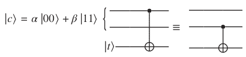

如果控制量子比特是类猫态 \(\alpha|00\rangle + \beta|11\rangle\) 中的两个量子比特之一，则目标将以相同方式受到影响，因为这两个量子比特将具有有效相同的状态，它们以概率 \(|\alpha|^2\) 同时为 0，或以概率 \(|\beta|^2\) 同时为 1。这意味着如果类猫态 \(|c\rangle\) 的两个量子比特分布在不同机器上，则可以对其中任意一个进行控制。请注意，应用 \(H\) 门（即图 4.2 中从第 4 张幻灯片开始的步骤）以及测量并发送测量结果以控制 \(Z\) 的目的是，在完成分布式 CNOT 后，将第一个量子比特（在 \(A\) 处）与第三个量子比特（即 \(B\) 的第一个量子比特）解纠缠。

## 4.2 超越分布式 CNOT

我们可以从多方面推广上述内容：

- 在不同机器上对多个目标量子比特使用相同的控制量子比特；
- 使用不同机器上的多个控制量子比特来控制同一目标量子比特；以及
- 从对目标量子比特执行 NOT 运算超越到执行一般单位运算 \(U\)。

我们将在本节中考察这些内容。

### 4.2.1 不同机器上多个目标量子比特共用同一控制量子比特

假设我们想使用 \(A\) 中的控制量子比特来控制多个其他机器上的目标量子比特。当然，一种方法是将控制量子比特依次隐形传态到每个机器，并在每个机器上对接收到的量子比特进行控制。然而，一种更高效的方法是将此类类猫态推广到超过两个量子比特，采用第 2 章中提到的 GHZ 态形式。考虑下面的三个量子比特类猫态示例。

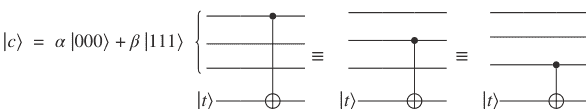

如果控制量子比特是类猫态 \(\alpha|000\rangle + \beta|111\rangle\) 中的三个量子比特之一，则目标将以相同方式受到影响，因为这三个量子比特将具有相同的状态，它们以概率 \(|\alpha|^2\) 同时为 0，或以概率 \(|\beta|^2\) 同时为 1。

让我们详细看看这是如何工作的。从单目标情况推广，让我们考虑另一台机器 \(C\)，它也有一个量子比特 \(|s\rangle\) 由 \(A\) 处的量子比特 \(|c\rangle\) 进行控制，如图 4.3 所示。请注意，三个节点共享一个（分布式）GHZ 态（每个节点一个量子比特），由三个节点间的波浪线标记。$^1$

现在考虑图 4.3 中切片 1 处系统的状态，我们设 \(|c\rangle = \alpha|0\rangle + \beta|1\rangle\)，并重新排序表达式中的量子比特，即将 \(B\) 的目标量子比特写在 \(C\) 的目标量子比特之前：

```
at slice 1 : (\( \alpha |0\rangle + \beta |1\rangle \)) \(\otimes\) (\( \frac{1}{\sqrt{2}}|000\rangle + \frac{1}{\sqrt{2}}|111\rangle \)) \(\otimes |t\rangle \otimes |s\rangle\)

= (\( \frac{\alpha}{\sqrt{2}}|0000\rangle + \frac{\alpha}{\sqrt{2}}|0111\rangle + \frac{\beta}{\sqrt{2}}|1000\rangle + \frac{\beta}{\sqrt{2}}|1111\rangle \))

\(\otimes |t\rangle \otimes |s\rangle\)
```

然后，对前两个量子比特应用 CNOT，我们在切片 2 处有：

```
at slice 2 : (\( \frac{\alpha}{\sqrt{2}}|0000\rangle + \frac{\alpha}{\sqrt{2}}|0111\rangle + \frac{\beta}{\sqrt{2}}|1100\rangle + \frac{\beta}{\sqrt{2}}|1011\rangle \))

\(\otimes |t\rangle \otimes |s\rangle\)
```

1 分布式 GHZ 态可以通过融合多个 Bell 对创建，如第 2 章所述。例如，如果我们在 A 和 B 之间（量子比特 a 和 b1）以及在 B 和 C 之间（量子比特 b2 和 c）拥有（分布式）Bell 对，如下所示：\((|00\rangle_{ab_1} + |11\rangle_{ab_1}\))/\(\sqrt{2}\) 和 (\(|00\rangle_{b_2c} + |11\rangle_{b_2c}\))/\(\sqrt{2}\)，那么可以在 B 和 C 上执行以下操作（Pauli 门修正 X\(^m\)，取决于从 B 发送到 C 的 b2 的测量结果 m \(\in\) {0, 1}）来合并两个 Bell 对形成 GHZ 态：

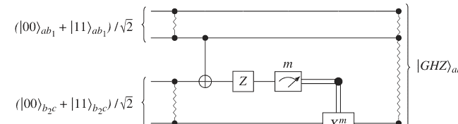

生成的状态是一个跨越 A、B 和 C 分布的 GHZ 态。创建 n 量子比特 GHZ 态的协议在 de Bone 等人 [2020] 中有详细讨论。这样的电路（包括从初始态（两个 \(|00\rangle\) 对）生成两个 Bell 对的组件，可以封装为一个门）可能被称为纠缠门，记为 E2，或更一般地，En 用于生成 \(|GHZ_n\rangle\)。请注意，Bell 对各自分布在两个节点之间。


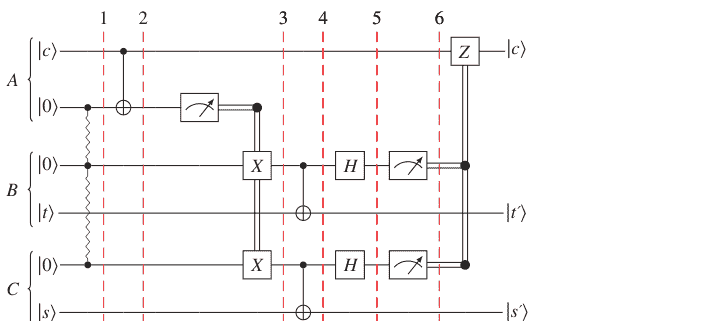

图 4.3 带有单个控制量子比特（在 A 上）的分布式 CNOT，用于多个目标量子比特（B 上一个和 C 上一个）。

然后，测量第二个量子比特（从上往下），并且

- 如果得到 0，并且此结果从 A 发送到 B 和 C，由于它是 0，X 门在 B 和 C 上都不应用，那么在切片 3 时，我们有：

在切片 3 时：\(\sqrt{2} \cdot \left( \frac{\alpha}{\sqrt{2}} |0000\rangle + \frac{\beta}{\sqrt{2}} |1011\rangle \right) \otimes |t\rangle \otimes |s\rangle = (\alpha |0000\rangle + \beta |1011\rangle) \otimes |t\rangle \otimes |s\rangle\)

由于 \(\frac{1}{\sqrt{\text{prob(0) in second qubit}}} = \frac{1}{\sqrt{|\frac{\alpha}{\sqrt{2}}|^2 + |\frac{\beta}{\sqrt{2}}|^2}} = \frac{1}{\sqrt{1/2}} = \sqrt{2}\)，然后在 B 和 C 上的两个量子比特之间本地应用 CNOT 门：

在切片 4 时：\(\alpha |0000\rangle |t\rangle |s\rangle + \beta |1011\rangle (X |t\rangle)(X |s\rangle)\)

然后在第三行和第五行（从上往下）应用门 H：

在切片 5 时：\(\alpha |00\rangle (H |0\rangle)(H |0\rangle) |t\rangle |s\rangle + \beta |10\rangle (H |1\rangle)(H |1\rangle)(X |t\rangle)(X |s\rangle)\)
\(= \frac{\alpha}{2} |0000\rangle |t\rangle |s\rangle + \frac{\alpha}{2} |0001\rangle |t\rangle |s\rangle\)
\(+ \frac{\alpha}{2} |0010\rangle |t\rangle |s\rangle + \frac{\alpha}{2} |0011\rangle |t\rangle |s\rangle\)
\(+ \frac{\beta}{2} |1000\rangle (X |t\rangle)(X |s\rangle) - \frac{\beta}{2} |1001\rangle (X |t\rangle)(X |s\rangle)\)
\(- \frac{\beta}{2} |1010\rangle (X |t\rangle)(X |s\rangle) + \frac{\beta}{2} |1011\rangle (X |t\rangle)(X |s\rangle)\)

然后，测量 B 和 C 处的量子比特（从上往下第三行和第五行），假设 B 和 C 处都得到 0，我们有：

```
at slice 6 : α |0000⟩ |t⟩ |s⟩ + β |1000⟩ (X |t⟩)(X |s⟩)
= α |0⟩ |000⟩ |t⟩ |s⟩ + β |1⟩ |000⟩ (X |t⟩)(X |s⟩))
```

并且两个“0”都发送到 A，A 对结果进行 XOR（或模 2 求和）得到 0，意味着不应用 Z 门，因此，省略第二、第三和第四个量子比特，并添加下标，我们可以将最终状态写成

```
α|0⟩_A|t⟩_B|s⟩_C + β|1⟩_A(X|t⟩_B)(X|s⟩_C)
```

我们观察到，A 处的控制量子比特已以类似方式应用到 B 和 C 处的目标量子比特上。类似的推理可以应用于 B 和 C 处测量结果的其他组合，然后在切片 6 时，我们得到如下表格总结的状态。

| 在 B 处测量 | 在 C 处测量 | 在切片 6 |
|---|---|---|
| 0 | 0 | α |0⟩|000⟩ |t⟩|s⟩ + β |1⟩ |000⟩ (X |t⟩)(X |s⟩) |
| 0 | 1 | α |0⟩|001⟩ |t⟩|s⟩ – β |1⟩ |001⟩ (X |t⟩)(X |s⟩) |
| 1 | 0 | α |0⟩|010⟩ |t⟩|s⟩ – β |1⟩ |010⟩ (X |t⟩)(X |s⟩) |
| 1 | 1 | α |0⟩|011⟩ |t⟩|s⟩ + β |1⟩ |011⟩ (X |t⟩)(X |s⟩) |

请注意，在 B 和 C 的测量结果分别为“0”和“1”，以及“1”和“0”的情况下，A 处的模 2 和为 1，因此在第一行应用 Z 门。也就是说，例如在 B 处结果为“0”而 C 处为“1”的情况下，应用 Z 门后（这实际上将 β 前面的“–”转换为“+”）的最终状态为 α |0⟩|001⟩ |t⟩ |s⟩ + β |1⟩ |001⟩ (X |t⟩)(X |s⟩)，因此，省略第二、第三和第四个量子比特并添加下标后，我们得到最终状态：α|0⟩_A|t⟩_B|s⟩_C + β|1⟩_A(X|t⟩_B)(X|s⟩_C)，这与 B 和 C 处测量结果均为“0”时的结果相同。

- 如果得到 1，并且此结果从 A 发送到 B 和 C，由于它是 1，X 门在 B 和 C 上都应用，那么在切片 3 时，我们有：

```
at slice 3 : (α |0100⟩ + β |1111⟩) ⊗ |t⟩ ⊗ |s⟩
```

然后在 B 和 C 上的两个量子比特之间本地应用 CNOT 门：

```
at slice 4 : α |0100⟩ |t⟩ |s⟩ + β |1111⟩ (X |t⟩)(X |s⟩)
```

然后在第三行和第五行（从上往下）应用门 H：

```
at slice 5 : \(\alpha |01\rangle (H|0\rangle)(H|0\rangle)|t\rangle|s\rangle + \beta |11\rangle (H|1\rangle)(H|1\rangle)(X|t\rangle)(X|s\rangle)\)
\(= \frac{\alpha}{2} |0100\rangle|t\rangle|s\rangle + \frac{\alpha}{2} |0101\rangle|t\rangle|s\rangle\)
\(+ \frac{\alpha}{2} |0110\rangle|t\rangle|s\rangle + \frac{\alpha}{2} |0111\rangle|t\rangle|s\rangle\)
\(+ \frac{\beta}{2} |1100\rangle (X|t\rangle)(X|s\rangle) - \frac{\beta}{2} |1101\rangle (X|t\rangle)(X|s\rangle)\)
\(- \frac{\beta}{2} |1110\rangle (X|t\rangle)(X|s\rangle) + \frac{\beta}{2} |1111\rangle (X|t\rangle)(X|s\rangle)\)
```

然后，测量 B 和 C 处的量子比特（从上往下第三行和第五行），
根据测量结果，我们可以得到如下表格总结的状态。

| 在 B 处测量 | 在 C 处测量 | 在切片 6 |
|---|---|---|
| 0 | 0 | \(\alpha |0\rangle |100\rangle |t\rangle|s\rangle + \beta |1\rangle |100\rangle (X|t\rangle)(X|s\rangle)\) |
| 0 | 1 | \(\alpha |0\rangle |101\rangle |t\rangle|s\rangle - \beta |1\rangle |101\rangle (X|t\rangle)(X|s\rangle)\) |
| 1 | 0 | \(\alpha |0\rangle |110\rangle |t\rangle|s\rangle - \beta |1\rangle |110\rangle (X|t\rangle)(X|s\rangle)\) |
| 1 | 1 | \(\alpha |0\rangle |111\rangle |t\rangle|s\rangle + \beta |1\rangle |111\rangle (X|t\rangle)(X|s\rangle)\) |

然后在需要时应用 Z 门，省略第二、第三和第四个量子比特，并添加量子比特位置下标，我们得到最终状态：

```
\(\alpha|0\rangle_A|t\rangle_B|s\rangle_C + \beta|1\rangle_A(X|t\rangle_B)(X|s\rangle_C)\)
```

这与上面情况（1）的结果相同。

我们指出在上述两种情况下（1）和（2），切片 3 上的三个量子比特猫态：

```
case (1) : (\(\alpha |\underline{000}\rangle + \beta |\underline{101}\rangle\)) \(\otimes |ts\rangle\)
case (2) : (\(\alpha |\underline{010}\rangle + \beta |\underline{111}\rangle\)) \(\otimes |ts\rangle\)
```

省略第二个量子比特后，在两种情况下我们得到的状态为：(\(\alpha |000\rangle + \beta |111\rangle\))\(|ts\rangle”，来自下划线量子比特。

可以进一步推广，使控制量子比特应用到超过两台机器上的目标量子比特，例如三台机器 \(B\)、\(C\) 和 \(D\) 上的目标量子比特，我们有如图 4.4 所示的电路，其状态形式为在切片 3 时的 (\(\alpha |0000\rangle + \beta |1111\rangle\))\(|tsr\rangle，具有四个量子比特的猫态，省略第二个量子比特。可以为 n 台机器上的 n 个目标量子比特 \(|t_i\rangle\) 绘制类似的电路，它使用 (n+1) 个量子比特的猫态：
\((\alpha|0\rangle^{\otimes(n+1)} + \beta|1\rangle^{\otimes(n+1)})\) \(|t_1\rangle \otimes \cdots \otimes |t_n\rangle\)。

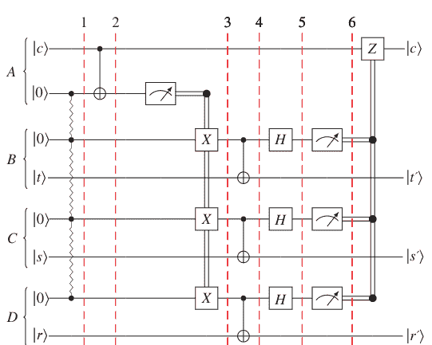

图 4.4 带有单个控制量子比特（在 A 上）和三个目标量子比特（在 A、B 和 C 上）的分布式 CNOT。

### 4.2.2 不同机器上相同目标量子比特的多个控制量子比特

如果我们希望在一个目标量子比特（位于不同于控制量子比特的机器上）上实现多个控制（每个控制量子比特位于不同的机器上），该怎么办？例如，我们有如下形式的操作，其中有两个控制量子比特，且只有当两者都为“1”时才翻转目标量子比特；否则，目标量子比特保持不变：

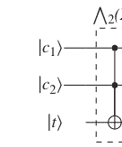

这也称为 CCNOT 门或 Toffoli 门。因此，如果我们使用符号 \wedge_1(X) 表示 CNOT 门，则上述门表示为 \wedge_2(X)。

实现此功能的一种方法是使用量子隐形传态。将控制量子比特从它们所在位置（例如，位于不同的机器上）传态到包含目标量子比特的机器，然后执行上述操作。然后将控制量子比特传态回其原始机器。对于来自不同机器（不同于目标量子比特）的两个控制量子比特，此过程所需的资源为两个 ebits 和四个经典比特用于两次传态操作，然后再用两个 ebits 和四个经典比特将控制量子比特传态回其原始机器，即四个 ebits 和八个经典比特。

一种更高效的方法也归功于 Eisert et al. [2000]，如图 4.5 所示，用于两个控制量子比特，它使用四个控制经典比特和两个 ebits。

假设 A 处的控制量子比特为 \(|c1\rangle = \alpha_1|0\rangle_{A1} + \beta_1|1\rangle_{A1}\)，B 处的控制量子比特为 \(|c2\rangle = \alpha_2|0\rangle_{B1} + \beta_2|1\rangle_{B1}\)。然后，考虑量子比特 A1、A2 和 C1，我们从 \((\alpha_1|0\rangle_{A1} + \beta_1|1\rangle_{A1})|0\rangle_{A2}|0\rangle_{C1}\) 开始。然后，A2 和 C1 纠缠，即我们在切片 1 时有：\((\alpha_1|0\rangle_{A1} + \beta_1|1\rangle_{A1}) \otimes (|00\rangle_{A2,C1} + |11\rangle_{A2,C1})/\sqrt{2}\)。然后，在切片 2 时（在 A1 和 A2 之间应用 CNOT 之后），我们有：\((\alpha_1 |000\rangle + \alpha_1 |011\rangle + \beta_1 |110\rangle + \beta_1 |101\rangle)/\sqrt{2}\)。在切片 3 时，在 A 处测量第二个量子比特 A2（第二行）之后：

- 如果得到 0，并且此结果从 A 发送到 C，由于它是 0，则不应用第 5 行上的 X 门，那么在切片 3 时，我们有：

在切片 3 时：\(\alpha_1|0\rangle_{A1}|0\rangle_{A2}|0\rangle_{C1} + \beta_1|1\rangle_{A1}|0\rangle_{A2}|1\rangle_{C1}\)

该表达式仅显示 A 上的量子比特和 C 处的第一个量子比特（即 C1）——此时其他量子比特与起始点相比保持不变。

- 如果得到 1，并且此结果从 A 发送到 C，由于它是 1，则对量子比特 C1 应用第 5 行上的 X 门，那么在切片 3 时，我们有：

在切片 3 时：\(\alpha_1|0\rangle_{A1}|1\rangle_{A2}|0\rangle_{C1} + \beta_1|1\rangle_{A1}|1\rangle_{A2}|1\rangle_{C1}\)

其他量子比特保持不变。

请注意，如果在上述两种情况中都省略写出 A2，我们得到

在切片 3 时：\(\alpha_1|0\rangle_{A1}|0\rangle_{C1} + \beta_1|1\rangle_{A1}|1\rangle_{C1}\)

也就是说，A1 已与 C1 有效纠缠。

然后在切片 6 时，在 B 处测量第二个量子比特（第 4 行）之后：

- 如果得到 0，并且此结果从 B 发送到 C，由于它是 0，则不应用第 6 行上的 X 门，那么在切片 6 时，我们有：

在切片 6 时：\(\alpha_2|0\rangle_{B1}|0\rangle_{B2}|0\rangle_{C2} + \beta_2|1\rangle_{B1}|0\rangle_{B2}|1\rangle_{C2}\)

该表达式仅显示 B 上的量子比特和 C 处的第二个量子比特（即 C2），而 A 和 C1 处的量子比特在切片 6 时与切片 3 时的情况相同（因为 A 和 C1 处的量子比特在切片 3 和切片 6 之间未改变）。


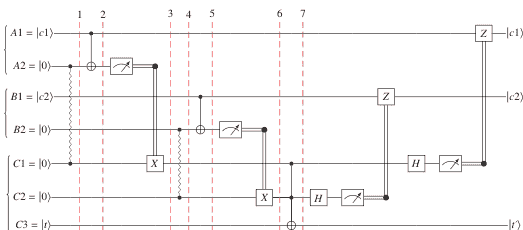

图 4.5 在目标量子比特上执行分布式多量子比特控制的高效方法。

- 如果获得的是 1，并且从 $B$ 发送到 $C$，且由于它是 1，第 6 行上的 $X$ 门被应用，那么在第 6 个切片，我们有：

在第 6 个切片：$\alpha_2|0\rangle_{B1}|1\rangle_{B2}|0\rangle_{C2} + \beta_2|1\rangle_{B1}|1\rangle_{B2}|1\rangle_{C2}$

而 $A$ 和 $C1$ 在第 6 个切片的量子比特，与在第 3 个切片时的情况相同。

请注意，如果在上述两种情况下都省略写出 $B2$，则得到

在第 6 个切片：$\alpha_1|0\rangle_{B1}|0\rangle_{C2} + \beta_1|1\rangle_{B1}|1\rangle_{C2}$

也就是说，$B1$ 已经有效地与 $C2$ 纠缠。

请注意，我们希望目标量子比特 $C3$ 由量子比特 $A1$ 和 $B1$ 控制。由于 $A1$ 与 $C1$ 以及 $B1$ 与 $C2$ 的纠缠，这等同于在第 6 个切片让目标量子比特 $C3$ 对 $C$ 上的量子比特（$C1$ 和 $C2$）进行控制。这实现了由控制量子比特 $A1$ 和 $B1$ 作用于目标 $C3$ 的分布式 CCNOT，通过由控制量子比特 $C1$ 和 $C2$ 作用于目标 $C3$ 的局部 CCNOT 实现，

既然局部 CCNOT 已完成，为收尾，我们应该将 $A1$ 与 $C1$ 以及 $B1$ 与 $C2$ 解纠缠，方法是在 $C1$ 和 $C2$ 上应用 $H$ 门，随后将测量结果发送到 $A$ 和 $B$，以控制各自的 $Z$ 门。请注意，我们需要进行“解纠缠”，以便控制量子比特现在与目标量子比特解耦。

### 4.2.3 猫态纠缠器和猫态解纠缠器模块

在讨论目标上的 $X$ 门以外的其他操作之前，我们观察到之前电路中使用的若干“模块”，它们被称为猫态纠缠器和猫态解纠缠器。

猫态纠缠器是以下形式的（子）电路，它接收 (i) 一个量子比特 $\alpha|0\rangle + \beta|1\rangle$（在最上方一行）和 (ii) 形式为 $\frac{1}{\sqrt{2}}(|0\rangle^{\otimes n} + |1\rangle^{\otimes n})$ 的广义 GHZ 态（由其他行表示，并在切片 1 由纠缠门 $E_n$ 生成），并输出一种类猫态 $\alpha|0\rangle^{\otimes n} + \beta|1\rangle^{\otimes n}$（当我们不考虑第二个量子比特时）。

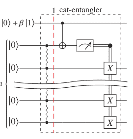

要理解这一点，请注意该电路的输出是 (n + 1) 个量子比特，其状态形式如下：

$\alpha |0\rangle \otimes |x\rangle \otimes |0\rangle^{\otimes(n-1)} + \beta |1\rangle \otimes |x\rangle \otimes |1\rangle^{\otimes(n-1)}$

（其中 $x$ 取决于第二行上的测量结果，为“0”或“1”），在不考虑第二个量子比特 $|x\rangle$ 时，我们得到类猫态：

$\alpha |0\rangle |0\rangle^{\otimes(n-1)} + \beta |1\rangle |1\rangle^{\otimes(n-1)} = \alpha |0\rangle^{\otimes n} + \beta |1\rangle^{\otimes n}$

而猫态解纠缠器的形式如下：

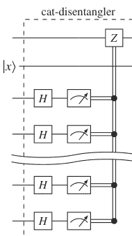

其中各行上的测量结果求和（mod 2），并将和作为控制来确定是否应用 \( Z \) 门。该电路接收一个 \( (n+1) \) 个量子比特的状态：\( \alpha |0\rangle \otimes |x\rangle \otimes |0\rangle^{\otimes(n-1)} + \beta |1\rangle \otimes |x\rangle \otimes |1\rangle^{\otimes(n-1)} \)（以上仅指示了 \(|x\rangle\) 的位置），并输出：\( (\alpha |0\rangle + \beta |1\rangle) \otimes |x\rangle \otimes |s\rangle \)，其中 \( s \) 是一个 \( (n-1) \) 比特字符串，即 \(|s\rangle\) 是一个 \( (n-1) \) 个量子比特的状态，这是由于从第 3 行开始的测量造成的——其效果是将顶部量子比特与其他量子比特解纠缠。

为了说明这些模块在电路中的应用，我们在图 4.6 中突出显示了我们之前见过的电路（即图 4.2–4.5）中使用的猫态纠缠器和猫态解纠缠器模块。

请注意，我们可以将之前见过的电路中的 \( X \) 门替换为其他操作，比如说 \( U \)，从而推广到分布式受控-\( U \) 操作。

## 4.3 分布式量子电路与分布式量子程序的编译

根据我们所见的思想，已经开发出许多量子算法的分布式版本，例如分布式 Shor 算法

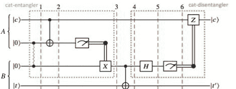

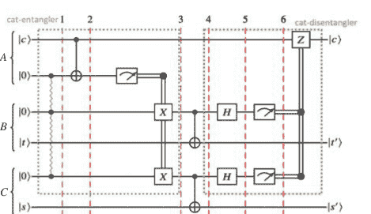

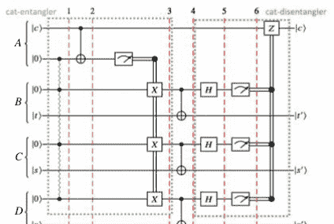

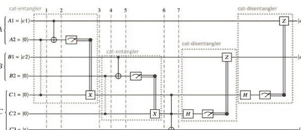

图 4.6 图 4.2–4.5 中标记了猫态纠缠器和猫态解纠缠器的电路。

[Yimsiriwattana 和 Lomonaco Jr., 2004]、针对 Simon 问题的分布式算法 [Tan et al., 2022] 以及分布式机器学习算法 [Neumann and Wezeman, 2022]（另请参阅 [Kwak et al., 2022] 以获取关于量子分布式深度学习的综述）。²

2 该网站 https://github.com/brunorijsman/quantum-internet-hackathon-2022 [最后访问：8/3/2023] 提供了在仿真平台上实现分布式量子傅里叶变换的基于 Python 的实现。

已有研究致力于处理大型量子电路，找出对电路进行分区或将电路分布到一组节点上的方法，每个节点托管一个或多个量子比特及其相关操作，并利用纠缠来链接不同节点上的量子比特。在分布式量子电路并将量子比特分配到节点时，需要考虑多个因素，例如设计（或寻找替代方案）量子电路以最小化节点间传输（同时仍计算所需内容），并且由于纠缠是一种资源，在对电路进行分区时，人们可能会尝试将不同节点之间的纠缠量子比特保持在最低限度。我们在此不深入细节，读者可参阅 Tang et al. [2021]、Sundaram et al. [2021]、Andrés-Martínez 和 Heunen [2019]、Davarzani et al. [2022] 以及 van Houte et al. [2020]。读者还可以查阅 [Cuomo et al., 2023]，以了解针对不同节点拓扑编译量子电路的研究。

将（通常是大型）量子电路自动分布为部分（一组较小的量子电路），这些部分映射到给定的量子处理单元（或量子计算机）拓扑，这引出了分布式量子程序编译器的概念。编译器不仅可以优化电路深度，还可以减少节点间通信或所需的节点间纠缠对数量（通常是一个相对耗时的过程），同时仍执行所需的计算，且此类编译应高效完成 [Ferrari et al., 2021] —— 我们将在第 6 章再次讨论这一点。

## 4.4 分布式量子计算机的控制与调度

我们在第 1 章中看到了分布式量子计算机在图 1.1 中的示意图，展示了多个节点如何同时利用纠缠和经典通信进行操作。

假设要执行的大型量子电路已被分区并生成了相应的等效量子电路集合，每个电路分配给一个节点（该节点有能力根据其分配电路的需要托管和操作一个或多个量子比特）。作为一个小示例，考虑图 4.2 中分布式 CNOT 电路的示例，其中有两个电路，一个由节点 A 执行，另一个由节点 B 执行，在交互和通信方面，根据图示，需要一对共享的 EPR 对资源以及在两个步骤中发送经典比特。这将如何执行？

图 4.7 以一种相当简单且高层次的方式！说明了分布式 CNOT 的四量子比特电路的执行。首先，在决定要执行的量子电路集合后，相应的量子电路连同经典控制信息（或经典程序）需要加载到节点 A 和 B（A 上和 B 上分别的程序）³，并通过本地操作和同步的混合方式执行，在需要纠缠或比特传输的地方进行同步。请注意，节点 A 和 B 之间需要一对纠缠态，如图所示，需从量子互联网获取。这需要节点之间进行一些经典通信和同步，以便随后对纠缠量子比特的本地操作（例如，节点 A 上的 CNOT 和节点 B 上的 X 门等）能在正确的时间执行，即仅在获取纠缠对之后。随后传输测量结果（经典比特）可以根据操作需求通过（经典）互联网完成——这里的同步是指一个节点在继续之前等待另一个节点的比特。（请注意，一个量子电路可能会被执行多次以收集统计数据——对于这里的简单分布式 CNOT 示例来说并不完全必要。）第二，执行状态以及在需要时的结果从节点返回给控制器。可以将上述内容推广到多于两个节点和更复杂的电路，但这里的关键点是在电路的不同位置访问量子互联网和经典互联网，并在节点之间进行所需的同步。此外，一个大型电路（具有较大深度）可能会分阶段执行（图 4.7 中未显示），即执行量子电路的一部分，然后返回经典控制，再执行量子电路的下一部分并返回经典控制，以此类推，也就是说，使用经典计算机的经典控制与量子计算机上的量子执行之间有更大的交错。

关于分布式量子计算中所需程序控制和调度的更详细讨论，请参阅 Parekh et al. [2021]。一种称为 D-NISQ 的分布式量子计算参考模型在 Acampora et al. [2023] 中提出，其中大型问题可以分解为多个子问题，在多个量子处理器上求解。

3 每个节点上执行的程序可以被视为混合经典-量子程序，即包含经典控制指令和要执行的量子操作的程序；详情请参见 Dahlberg et al. [2022]，示例请参阅 https://github.com/brunorijsman/quantum-internet-hackathon-2022/blob/main/docs/qne-adk-implementation.md [最后访问：8/3/2023]，尽管是在模拟分布式环境 NetQASM 的上下文中。


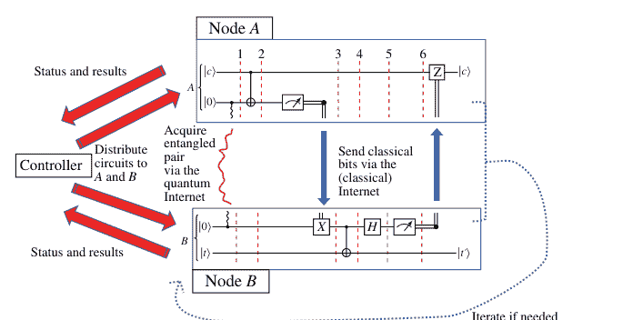

图 4.7 分布式 CNOT 执行四量比特电路的示例。

请注意，时序是一个因素，因为量子状态会随时间 *退相干*。正如 Vardoyan et al. [2022] 所述，一个量子状态（由密度算符 $\rho_0$ 表示）在时间 $t = 0$ 时放入量子内存中，可能会受到噪声影响（例如，由于屏蔽不完善导致的环境噪声），因此经过时间 $t$ 后，状态可能变为 $\rho_t$。也可能由于量子门实现不完美而产生噪声。存在多种不同形式的噪声数学模型，即以 *完全正迹保持*（CPTP）映射的形式，其中一种如下所示的映射 $D_t$：

$$\rho_t = D_t(\rho) = (1 - 3p)\rho + pX\rho X + pY\rho Y + pZ\rho Z = (1 - 4p)\rho + 4p \frac{\mathbf{I}}{2}$$

其中 $p$ 是一个概率，并利用 $\frac{1}{2}(\rho + X\rho X + Z\rho Z + XZ\rho(XZ)^\dagger) = \frac{1}{2}\mathbf{I}$ 和 $Y = iXZ$ 这一事实（我们将在第 5 章中说明）。但这个映射的思想是，如果 $p$ 较高，则量子状态可以接近 *最大混合态* $\frac{\mathbf{I}}{2}$。$p$ 的时间依赖性可以通过设置 $p = \frac{1}{4}(1 - e^{-\frac{t}{T}})$ 来表示，其中 $T$ 为某个常数，可以看出 $p$ 随时间增加。还有其他噪声模型，例如去相干和阻尼噪声模型，此处不再赘述。这意味着，假设接收某些所需比特甚至获得一个纠缠状态花费的时间过长，那么量子状态在等待过程中可能已经退相干了！这也意味着，待执行电路的深度会影响操作完成的机会。另一个重要参数是纠缠保真度，纠缠的“质量”可能会受到噪声影响（我们将在第 6 章进一步讨论保真度）。

分布式量子计算机的架构仍然是一个研究领域。值得注意的是，在每个节点上，既会有用于计算的量比特，也会有用于纠缠（与其他节点）的量比特，分别称为 *计算量比特* 和通信量比特（例如，跨越两个节点的纠缠对中涉及的量比特，每个节点上有一个量比特，在本语境下也称为纠缠链接，因为它“连接”了两个节点）。Vardoyan et al. [2022] 对两种用于耦合网络和计算组件的不同量子架构进行了广泛研究。

量子操作控制和调度的许多底层细节（可能因量比特和量子门的实际实现而异）应从程序员中抽象出来。一个有趣的发展是 QMPI [Häner et al., 2021]，它是经典 MPI（消息传递接口）的量子扩展，为编写分布式计算程序提供了与设备无关的库。例如，使用 QMPI 的程序可能会使用库函数调用来获取量子资源，例如请求在两个节点之间生成一个 EPR 对，每个节点调用以下函数：

```
QMPI_Prepare_EPR(qubit, dest, tag, comm)
```

其中 qubit 是 |0⟩ 中的一个量比特，dest 是运行在其他节点上的 QMPI 进程的目标，tag 是消息标记，comm 是通信器（指一组（量子）节点）。请注意，该调用还有一个异步版本，允许提前获取 EPR 对（当然，前提是 EPR 对在退相干之前能在内存中保持足够长的时间！）。诸如 QMPI_Send 和 QMPI_Recv 之类的库操作可实现量比特的量子隐形传态，还存在用于多方操作的集体操作，例如，可以使用 QMPI 对 GHZ 态进行编码，并伴随相应的反计算（逆转计算）操作。

## 4.5 不含节点间纠缠的分布式量子计算

迄今，我们已经看到节点之间（节点上量比特之间）的纠缠如何被用于跨节点分布式量子电路计算。但今天（至少在撰写本文时），我们拥有通过云服务提供的量子计算机，它们不进行量子通信，即两台计算机之间没有纠缠。利用未通过纠缠连接的多台量子计算机是否仍然有用？

Avron et al. [2021] 的工作表明，与使用一个 n 量比特电路（或量子计算机）相比，使用两个 (n − 1) 量比特电路（或量子计算机）来计算特定类型函数的等效解可能更好。这意味着使用 2(n − 1) 个量比特而不是 n 个量比特，但 (n − 1) 量比特电路的深度可能远低于等效计算的 n 量比特量子电路。电路深度较低意味着噪声减少（因为噪声会随深度积累——实际上，输出中的噪声会随电路深度呈指数增长）。

考虑一个形式为 $f : {0, 1}^n \rightarrow {0, 1}^m$ 的函数 $f$，其中 \(m \le n - 1\)。该函数可以等价地指定为两个函数 \(f_{even/odd} : {0, 1}^{n-1} \rightarrow {0, 1}^m\)，定义如下：

\(f_{even}(y) = f_{even}(y_1 \cdots y_{n-1}) = f(0y_1 \cdots y_{n-1}) = f(0y)\)，和
\(f_{odd}(y) = f_{odd}(y_1 \cdots y_{n-1}) = f(1y_1 \cdots y_{n-1}) = f(1y)\)

其中 \(y \in {0, 1}^{n-1}\)。因此，要对某个 n 位字符串计算 \(f\)，首先查看第一个比特，它将决定对其余比特使用 \(f_{even}\) 还是 \(f_{odd}\)。

对于 Grover 和 Deutsch-Jozsa 算法（以及可能其他算法）来说，有用的是一个可以使用 n 个量比特进行计算的量子电路，用 $|x\rangle$ 表示，其中 $x \in {0, 1}^n$：$U_f |x\rangle = (-1)^{f(x)} |x\rangle$。但是，假设我们有用于计算以下内容的 (n − 1) 量比特电路：$U_{f_{even}} |y\rangle = (-1)^{f_{even}(y)} |y\rangle$ 和 $U_{f_{odd}} |y\rangle = (-1)^{f_{odd}(y)} |y\rangle$，其中 $y \in {0, 1}^{n-1}$，可以看出：

\(U_f |0\rangle \otimes |y\rangle = (-1)^{f(0y)} |0\rangle \otimes |y\rangle = |0\rangle \otimes (-1)^{f_{even}(y)} |y\rangle = |0\rangle \otimes U_{f_{even}} |y\rangle\)
和：\(U_f |1\rangle \otimes |y\rangle = (-1)^{f(1y)} |1\rangle \otimes |y\rangle = |1\rangle \otimes (-1)^{f_{odd}(y)} |y\rangle = |1\rangle \otimes U_{f_{odd}} |y\rangle\)

也就是说，我们可以借助 $U_{f_{odd}}$ 和 $U_{f_{even}}$ 来计算 $U_f$，尽管这样做使用了更多的量比特，但因为 $U_{f_{odd}}$ 和 $U_{f_{even}}$ 的两个电路深度可能远低于 $U_f$，我们可以有效地以降低噪声的方式获得结果。这可能可以推广到更多“节点”，通过将 $U_{f_{odd}}$ 和 $U_{f_{even}}$ 分解为相应的“偶”和“奇”函数并继续递归。

## 4.6 总结

我们已经探讨了实现分布式量子计算的一些基本思想。分布式量子计算仍然是一个活跃的研究领域，涉及许多不同的方面，包括能够通过网络与其他量子计算机协同工作的量子计算机硬件架构、将大型量子电路分区以便在量子节点集合上高效计算的方法、足够高效的控制和调度机制，以及编程模型和抽象。目前已有诸如 QMPI 之类的库，旨在帮助程序员，至少在模拟中经过测试。未来可能会出现更复杂的库，例如实现我们在第 3 章中看到的一些量子协议。显然，研究量子架构以及更可靠地存储和使用量比特的方法（例如能够持续更长时间）将是有益的。

## 参考文献

Giovanni Acampora, Ferdinando Di Martino, Alfredo Massa, Roberto Schiattarella, 和 Autilia Vitillo. D-NISQ：分布式嘈杂中等规模量子计算机的参考模型。*信息融合*，89:16–28，2023。

Pablo Andrés-Martínez 和 Chris Heunen. 通过超图划分自动分布量子电路。*物理评论 A*，100:032308，2019 年 9 月。doi: 10.1103/PhysRevA.100.032308。

J. Avron, Ofar Casper, 和 Ilan Rozen. 分布式量子计算中的量子优势与噪声降低。*物理评论 A*，104:052404，2021 年 11 月。doi: 10.1103/PhysRevA.104.052404。

Sebastian de Bone, Runsheng Ouyang, Kenneth Goodenough, 和 David Elkouss. 使用 Bell 对创建和浓缩多方 GHZ 态的协议。*IEEE 量子工程汇刊*，1:1–10，2020。doi: 10.1109/TQE.2020.3044179。

Daniele Cuomo, Marcello Caleffi, Kevin Krsulich, Filippo Tramonto, Gabriele Agliardi, Enrico Prati, 和 Angela Sara Cacciapuoti. 分布式量子计算的优化编译器。*ACM 量子计算事务*，4(2)，2023 年 2 月。ISSN 2643-6809。doi: 10.1145/3579367。

Axel Dahlberg, Bart van der Vecht, Carlo Delle Donne, Matthew Skrzypczyk, Ingmar te Raa, Wojciech Kozłowski, 和 Stephanie Wehner. NetQASM：面向量子互联网中混合量子经典程序的低级指令集架构。*量子科学与技术*，7(3):035023，2022 年 6 月。doi: 10.1088/2058-9565/ac753f。

Zohreh Davarzani, Mariam Zomorodi, 和 Mahboobeh Houshmand. 构建分布式量子系统的分层方法。*科学报告*，12(1):15421，2022。

J. Eisert, K. Jacobs, P. Papadopoulos, 和 M. B. Plenio. 非局部量子门的最优局部实现。*物理评论 A*，62:052317，2000 年 10 月。doi: 10.1103/PhysRevA.62.052317。

Davide Ferrari, Angela Sara Cacciapuoti, Michele Amoretti, 和 Marcello Caleffi. 分布式量子计算的编译器设计。*IEEE 量子工程汇刊*，2:1–20，2021。doi: 10.1109/TQE.2021.3053921。

Thomas Häner, Damian S. Steiger, Torsten Hoefler, 和 Matthias Troyer. 使用 QMPI 进行分布式量子计算。收录于《高性能计算、网络、存储与分析国际会议论文集，SC '21》，纽约，NY，美国，2021 年。计算机协会。ISBN 9781450384421。doi: 10.1145/3458817.3476172。

R. van Houte, J. Mulderij, T. Attema, I. Chiscop, 和 F. Phillipson. 量子网络中量子电路设计问题的数学表述


计算机。量子信息处理，19(5):141，2020年3月。ISSN 1570-0755。doi: 10.1007/s11128-020-02630-8.

Yunseok Kwak, Won Joon Yun, Jae Pyoung Kim, Hyunhee Cho, Jihong Park, Minseok Choi, Soyi Jung, and Joongheon Kim. 量子分布式深度学习架构：模型、讨论与应用。ICT Express, 9(3):486–491, 2022.

Niels M. P. Neumann 和 Robert S. Wezeman. 分布式量子机器学习，第8页，2022年。doi: 10.1007/978-3-031-06668-9_20.

R. Parekh, A. Ricciardi, A. Darwish, and S. DiAdamo. 量子并行与分布式计算的算法与仿真。载于 2021 IEEE/ACM 第二届量子计算软件国际研讨会（QCS），第 9–19 页，美国加利福尼亚州洛斯阿拉米托斯，2021 年 11 月。IEEE 计算机学会。doi: 10.1109/QCS54837.2021.00005。网址 https://doi.ieeecomputersociety.org/10.1109/QCS54837.2021.00005.

Ranjani G. Sundaram, Himanshu Gupta, and C. R. Ramakrishnan. 量子电路的高效分布。载于 Seth Gilbert 编辑，第 35 届分布式计算国际研讨会，DISC 2021，2021 年 10 月 4–8 日，德国弗赖堡（虚拟会议），LIPIcs 第 209 卷，第 41:1–41:20 页。Schloss Dagstuhl-Leibniz-Zentrum für Informatik，2021 年。doi: 10.4230/LIPIcs.DISC.2021.41.

Jiawei Tan, Ligang Xiao, Daowen Qiu, Le Luo, and Paulo Mateus. Simon 问题的分布式量子算法。《物理评论 A》，106:032417，2022 年 9 月。doi: 10.1103/PhysRevA.106.032417.

Wei Tang, Teague Tomesh, Martin Suchara, Jeffrey Larson, and Margaret Martonosi. CutQC：使用小型量子计算机进行大型量子电路评估。载于第 26 届 ACM 编程语言与操作系统架构支持国际会议（ASPLOS '21）论文集，第 473–486 页，美国纽约，2021 年。计算机协会。ISBN 9781450383172。doi: 10.1145/3445814.3446758.

Gayane Vardoyan, Matthew Skrzypczyk, and Stephanie Wehner. 关于两个分布式量子架构的量子性能评估。《性能评估》，153:102242，2022 年。

Anocha Yimsiriwattana and Samuel J. Lomonaco Jr. 分布式量子计算：分布式 Shor 算法。载于 Eric Donkor, Andrew R. Pirich, 和 Howard E. Brandt 编辑，《量子信息与计算 II》，第 5436 卷，第 360–372 页。光学与光子学国际学会，SPIE，2004 年。

Anocha Yimsiriwattana and Samuel J. Lomonaco Jr. 广义 GHZ 态与分布式量子计算。载于《编码理论与量子计算》，当代数学，第 131–147 页。美国数学学会（AMS），罗得岛州普罗维登斯，2005 年。另可在 https://arxiv.org/abs/quant-ph/0402148 获取。

# 5 委托量子计算

本章讨论了资源有限的客户端将量子计算委托给更强大的量子计算机或服务器的想法，这与当今云计算的模式类似。然而，在委托计算时，安全和隐私是关键考量。我们将探讨如何将量子计算委托给量子服务器，以保护客户端输入的隐私，即服务器在为客户端执行计算的同时，无法得知客户端的输入。本章还探讨了客户端如何验证服务器的计算，或至少检测服务器是否真正正确执行了委托的计算。最后，本章简要介绍了量子即服务（QaaS）的概念。

## 5.1 委托私密量子计算

本节探讨了客户端希望对服务器隐藏但又希望服务器协助执行的私密计算或数据的概念。这看似不可能，但在经典情况下，通过同态加密¹等技术已可实现，数据在加密状态下仍可进行计算。

我们主要考虑 Broadbent [2015] 和 Fisher 等人 [2014] 的技术，同时承认 Childs [2005] 在加密量子数据计算方面的开创性工作。

我们首先介绍经典一次性密码本和量子一次性密码本的概念。经典一次性密码本是一种加密比特串 x = x1 ... xn 的过程，通过将每个比特 xi 映射到 xi ⊕ ri 来实现，其中 r = r1 ... rn ∈ {0, 1}n 是某个随机密钥比特串。由于 r 保密，每个 xi ⊕ ri 都服从均匀分布，因此 x 被隐藏。与经典一次性密码本类似的是量子

1 参见 https://homomorphicencryption.org/introduction [最后访问：2022年11月14日]。

一次性密码本通过从集合 {**I**, **X**, **Z**, **XZ**} 中均匀随机选择一个算子来有效加密量子状态 |x⟩⟨x| = ρ，即 ρ 映射为：

\(\frac{1}{4} \left( \rho + X\rho X + Z\rho Z + XZ\rho(XZ)^\dagger \right) = \frac{1}{4} \sum_{a,b \in \{0,1\}} X^a Z^b \rho Z^b X^a = \frac{1}{2} \mathbf{I}\)

这是最大混合态，因此状态被隐藏。\(^2\) 要看出 \(\frac{1}{4} \sum_{a,b \in \{0,1\}} X^a Z^b \rho X^a Z^b = \frac{1}{2} \mathbf{I}\)，请注意，泡利矩阵构成 \(2 \times 2\) 复矩阵空间的一组基，因此，对于某些 \(\alpha, \beta, \gamma,\) 和 \(\delta\)，我们可以将 \(\rho\) 写为如下形式：

\(\rho = \alpha \mathbf{I} + \beta X + \gamma Y + \delta Z\)

并且观察到，由于 \(XX = \mathbf{I}, ZZ = \mathbf{I}, YY = \mathbf{I}, XZ = -ZX,\) 且 \(Y = iXZ\)，我们有：

\(X\rho X = \alpha \mathbf{I} + \beta X - \gamma Y - \delta Z\)
\(Z\rho Z = \alpha \mathbf{I} - \beta X - \gamma Y + \delta Z\)
\(XZ\rho XZ = \alpha \mathbf{I} - \beta X + \gamma Y - \delta Z\)

并且 \(\alpha = 1/2\)（因为 \(tr(\rho) = tr(\alpha \mathbf{I} + \beta X + \gamma Y + \delta Z) = \alpha \cdot tr(\mathbf{I}) + \beta \cdot tr(X) + \gamma \cdot tr(Y) + \delta \cdot tr(Z) = \alpha \cdot 2 = 1\)，根据迹的线性性质），我们有（使用上述公式）：

\(\frac{1}{4} \sum_{a,b \in \{0,1\}} X^a Z^b \rho Z^b X^a = \frac{1}{4} (\rho + X\rho X + Z\rho Z + XZ\rho XZ) = \frac{1}{4} (\alpha \mathbf{I} + \alpha \mathbf{I} + \alpha \mathbf{I} + \alpha \mathbf{I}) = \frac{1}{2} \mathbf{I}\)

假设 \(\rho'\) 是 n 位量子位位点的密度算符，可以对每个量子位进行加密，上述内容推广到 n 个量子位如下：

\(\frac{1}{4^n} \sum_{\mathbf{a}, \mathbf{b} \in \{0,1\}^n} \left( X^{a_1} Z^{b_1} \otimes \cdots \otimes X^{a_n} Z^{b_n} \right) \rho' \left( Z^{b_n} X^{a_n} \otimes \cdots \otimes Z^{b_1} X^{a_1} \right) = \frac{\mathbf{I}}{2^n}\)

其中 \(\mathbf{a} = a_1 \dots a_n\) 和 \(\mathbf{b} = b_1 \dots b_n\) 是 n 比特向量。左边可以改写为

\(\frac{1}{4^n} \sum_{\mathbf{a}, \mathbf{b} \in \{0,1\}^n} \left( X^{a_1} \otimes \cdots \otimes X^{a_n} \right) \left( Z^{b_1} \otimes \cdots \otimes Z^{b_n} \right) \rho' \left( Z^{b_1} \otimes \cdots \otimes Z^{b_n} \right) \left( X^{a_1} \otimes \cdots \otimes X^{a_n} \right)\)

2 理解最大混合态的一种方法是将其视为信息最小的状态。例如，写出：

\(\frac{1}{2} \mathbf{I} = \frac{1}{2} |0\rangle\langle 0| + \frac{1}{2} |1\rangle\langle 1|\)

我们可以看出 \(|0\rangle\langle 0|\) 和 \(|1\rangle\langle 1|\) 的概率相等，也可以从信息论角度来看，使用量子态 \(\rho\) 的冯·诺伊曼熵，定义为 \(-tr(\rho \log \rho)\)：\(\frac{1}{2} \mathbf{I}\) 的冯·诺伊曼熵为 \(-tr(\frac{1}{2} \mathbf{I} \log(\frac{1}{2} \mathbf{I})) = \log 2 = 1\)（以 2 为底取对数，且 \(\log \sum_a c_a |a\rangle\langle a|\) ）= \(\sum_a log(c_a) |a\rangle\langle a|\)，其基础思想是：给定一个对角矩阵 A，其对角元素为 \(A_1\) 到 \(A_n\)，f(A) 表示一个对角矩阵，其对角元素为 f(A1) 到 f(An)。)

也就是说，我们有：\(\frac{1}{4^n} \sum_{\mathbf{a}, \mathbf{b} \in \{0,1\}^n} \mathbf{X}(\mathbf{a}) \mathbf{Z}(\mathbf{b}) \rho' \mathbf{Z}(\mathbf{b}) \mathbf{X}(\mathbf{a}) = \frac{1}{2^n} \mathbf{I}\)，其中 \(\mathbf{X}(\mathbf{a}) = X^{a_1} \otimes \cdots \otimes X^{a_n}\) 和 \(\mathbf{Z}(\mathbf{b}) = Z^{b_1} \otimes \cdots \otimes Z^{b_n}\)。

在继续之前，需要注意我们对客户端施加的限制。我们假设客户端 \(A\) 不能进行通用量子计算（因此使用强大的服务器 \(B\) 为此目的，其中 \(B\) 可以执行通用量子计算，即我们稍后将看到的一系列不同门操作），但 \(A\) 可以执行以下操作：

- **假设 1**：准备并发送给 \(B\) 从一组有限可能性中随机选择状态的量子比特，例如，能够准备等效于集合 \(\{|+\rangle = \frac{1}{\sqrt{2}}(|0\rangle + |1\rangle), |-\rangle = \frac{1}{\sqrt{2}}(|0\rangle - |1\rangle), |+_y\rangle = \frac{1}{\sqrt{2}}(|0\rangle + i|1\rangle), |-_y\rangle = \frac{1}{\sqrt{2}}(|0\rangle - i|1\rangle)\}\) 的状态，并从 \(B\) 接收量子比特，以及

- **假设 2**：可以应用单比特泡利算符（即 X 和 Z），以加密将发送给 \(B\) 的量子比特并解密从 \(B\) 接收的输出量子比特。

考虑量子一次性密码本的一个使用示例。\(A\) 拥有 \(|\psi\rangle\) 并随后向 \(B\) 发送一个加密的量子态（例如，它实际上发送 \(|\psi'\rangle = XZ |\psi\rangle\)，但不告诉 \(B\) 它正在使用 XZ），以便让 \(B\) 对该态应用操作。\(B\) 将该态视为实际上是 \(\frac{1}{2} \mathbf{I}\)，因为它不知道 \(A\) 使用了哪个操作，因此即使进行测量也无法知道 \(|\psi\rangle\) 到底是什么。现在，假设 \(B\) 要帮助 \(A\) 对 \(|\psi\rangle\) 执行 X 门，那么在接收到 \(|\psi'\rangle\) 后，\(B\) 对其执行 X 得到 \(X |\psi'\rangle\) 并将其发回给 \(A\)。\(A\) 在接收到 \(X |\psi'\rangle\) 后，对其应用 ZX 得到：

\(ZX(X |\psi'\rangle) = ZX(X(XZ |\psi\rangle)) = ZXXXZ |\psi\rangle = -X |\psi\rangle\)

由于 \(XX = ZZ = \mathbf{I}\) 且 \(ZX + XZ = 0\)，我们可以安全地忽略全局相位“–”，也就是说，\(A\) 然后得到 \(X |\psi\rangle\)，即它想要的结果。一般而言，对于 X 门操作，使用操作 \(X^a Z^b\) 进行加密的解密密钥是应用 \(Z^b X^a\)，因为

\(Z^b X^a XX^a Z^b = Z^b XZ^b = \begin{cases} -X, & b = 1 \\ X, & b = 0 \end{cases}\)

如果 \(A\) 想让 \(B\) 执行 Z 门而不是 X 门怎么办？\(A\) 拥有 \(|\psi\rangle\) 并随后向 \(B\) 发送一个加密的量子态，即选择 \(a, b \in \{0, 1\}\)，它发送 \(|\psi'\rangle = X^a Z^b |\psi\rangle\)，但不告诉 \(B\) 其选择的 \(a\) 和 \(b\)，以便让 \(B\) 对该态应用 Z。\(B\) 对其执行 Z 得到 \(Z |\psi'\rangle\) 并将其发回给 \(A\)。\(A\) 在接收到 \(Z |\psi'\rangle\) 后，对其应用 \(Z^b X^a\)（与 X 门的情况类似）得到：

\(Z^b X^a (Z |\psi'\rangle) = Z^b X^a ZX Z^a Z^b |\psi\rangle = \begin{cases} -Z |\psi\rangle, & a = 1 \\ Z |\psi\rangle, & a = 0 \end{cases}\)

忽略全局相位“–”，\(A\) 然后得到 \(Z |\psi\rangle\)，如所要求。


如果 \( A \) 希望 \( B \) 执行 \( H \) 门而不是 \( Z \) 门会怎样？如前所述，\( A \) 拥有 \( |\psi\rangle \) 并向 \( B \) 发送一个加密量子态，即选择 \( a, b \in \{0, 1\} \) 并发送 \( |\psi'\rangle = X^a Z^b |\psi\rangle \)，以使 \( B \) 在该状态上应用 \( H \)。\( B \) 对其执行 \( H \) 以得到 \( H |\psi'\rangle \) 并将其发送回 \( A \)。\( A \) 在接收到 \( H |\psi'\rangle \) 后，对其应用 \( Z^a X^b \)（注意，此解密操作与用于 \( X \) 和 \( Z \) 门的 \( Z^b X^a \) 不同）以得到：

```
Z^a X^b \left( H \, | \psi' \rangle \right) = Z^a X^b H X^a Z^b | \psi \rangle
= Z^a X^b Z^a H Z^b | \psi \rangle \qquad \text{(since } H X^a = Z^a H \text{)}
= Z^a X^a Z^b X^b H \, | \psi \rangle \qquad \text{(since } H Z^b = X^b H \text{)}
= \left\{\begin{array}{ll} H \, | \psi \rangle, \quad & \text{if } a=0, b=0 \\ XXX H \, | \psi \rangle = H \, | \psi \rangle, \quad & \text{if } a=0, b=1 \\ ZZ H \, | \psi \rangle = H \, | \psi \rangle, \quad & \text{if } a=1, b=0 \\ ZXZX H \, | \psi \rangle = - Z X X Z H \, | \psi \rangle = - H \, | \psi \rangle, \quad & \text{if } a=1, b=1 \end{array}\right.
```

忽略全局相位 "-"，\( A \) 然后得到所需的 \( H \, | \psi \rangle \)。

如果 \( A \) 希望 \( B \) 执行 \( P \) 门而不是 \( Z \) 门会怎样？\( P \) 门或相位门采用以下形式：\(\begin{bmatrix} 1 & 0 \\ 0 & i \end{bmatrix}\)，即 \( P \, | 0 \rangle = | 0 \rangle \)，且 \( P \, | 1 \rangle = i \, | 1 \rangle \)。如前所述，\( A \) 拥有 \( |\psi\rangle \) 并向 \( B \) 发送一个加密量子态，即选择 \( a, b \in \{0, 1\} \) 并发送 \( |\psi'\rangle = X^a Z^b |\psi\rangle \)，以使 \( B \) 在该状态上应用 \( P \)。\( B \) 对其执行 \( P \) 以得到 \( P \, |\psi'\rangle \) 并将其发送回 \( A \)。\( A \) 在接收到 \( P \, |\psi'\rangle \) 后，对其执行 \( Z^{a \oplus b} X^a \)（注意这与上面的情况不同）以得到：

```
Z^{a \oplus b} X^a P \, | \psi' \rangle = Z^{a \oplus b} X^a P X^a Z^b \, | \psi \rangle
= (-i)^a Z^{a \oplus b} X^a Z^a X^a P Z^b \, | \psi \rangle \qquad \text{(since } P X^a = (-i)^a Z^a X^a P \text{)}
= (-i)^a Z^{a \oplus b} X^a Z^a X^a Z^b P \, | \psi \rangle \qquad \text{(since } P Z^b = Z^b P \text{)}
= \left\{\begin{array}{ll} P \, | \psi \rangle, \quad & \text{if } a=0, b=0 \\ ZZ P \, | \psi \rangle = P \, | \psi \rangle, \quad & \text{if } a=0, b=1 \\ (-i) X Z X X P \, | \psi \rangle = i X Z X X P \, | \psi \rangle = i P \, | \psi \rangle, \quad & \text{if } a=1, b=0 \\ (-i) X X Z X P \, | \psi \rangle = i X Z X X P \, | \psi \rangle = i P \, | \psi \rangle, \quad & \text{if } a=1, b=1 \end{array}\right.
```

忽略全局相位 "i"，\( A \) 然后得到所需的 \( P \, | \psi \rangle \)。

如果 \( A \) 希望 \( B \) 执行 CNOT 门会怎样？\( A \) 现在有一个双量子比特态 \( |\psi\rangle \) 并向 \( B \) 发送加密量子态，即选择 \( a, b, c, d \in \{0, 1\} \) 并发送 \( |\psi'\rangle = X^a Z^b \otimes X^c Z^d |\psi\rangle \)，以使 \( B \) 在该状态上应用 CNOT。\( B \) 对其执行 CNOT 以得到 CNOT \( |\psi'\rangle \) 并将其发送回 \( A \)。\( A \) 在接收到 CNOT \( |\psi'\rangle \) 后，对其应用 \( Z^{b+d} X^a \otimes Z^d X^{a+c} \) 以得到：

(Z^{b+d}X^a \otimes Z^d X^{a+c})\text{CNOT} |\psi'\rangle
= (Z^{b+d}X^a \otimes Z^d X^{a+c})\text{CNOT}((X^a Z^b \otimes X^c Z^d) |\psi\rangle)
= (Z^{b+d}X^a \otimes Z^d X^{a+c})\text{CNOT}(X^a \otimes X^c)(Z^b \otimes Z^d) |\psi\rangle
= (Z^{b+d}X^a \otimes Z^d X^{a+c})\text{CNOT}(X^a \otimes \mathbf{I})(\mathbf{I} \otimes X^c)(Z^b \otimes \mathbf{I})(\mathbf{I} \otimes Z^d) |\psi\rangle
= (Z^{b+d}X^a \otimes Z^d X^{a+c})(X^a \otimes X^a)(\mathbf{I} \otimes X^c)\text{CNOT}(Z^b \otimes \mathbf{I})(\mathbf{I} \otimes Z^d) |\psi\rangle
(since \text{CNOT}(X^a \otimes \mathbf{I}) = (X^a \otimes X^a)\text{CNOT and CNOT}(\mathbf{I} \otimes X^c) = (\mathbf{I} \otimes X^c)\text{CNOT})
= (Z^{b+d}X^a \otimes Z^d X^{a+c})(X^a \otimes X^a)(\mathbf{I} \otimes X^c)(Z^b \otimes \mathbf{I})(Z^d \otimes Z^d)\text{CNOT} |\psi\rangle
(since \text{CNOT}(Z^b \otimes \mathbf{I}) = (Z^b \otimes \mathbf{I})\text{CNOT and CNOT}(\mathbf{I} \otimes Z^d) = (Z^d \otimes Z^d)\text{CNOT})
= (Z^{b+d}X^a X^a Z^b Z^d \otimes Z^d X^{a+c} X^a X^c Z^d)\text{CNOT} |\psi\rangle = \text{CNOT} |\psi\rangle

我们反复使用了恒等式 \(AB \otimes CD = (A \otimes C)(B \otimes D)\)。因此，\(A\) 得到所需的 \(\text{CNOT} |\psi\rangle\)。请注意，我们也可以使用 \(Z^{b \oplus d}X^a \otimes Z^d X^{a \oplus c}\) 并得到相同的结果，将 “+” 替换为 “\(\oplus\)。”

如果 \(A\) 希望 \(B\) 执行 \(R\) 门会怎样？请注意，\(R\) 门是 \(\begin{bmatrix} 1 & 0 \\ 0 & e^{i\pi/4} \end{bmatrix}\)，即 \(R|0\rangle = |0\rangle\)，且 \(R|1\rangle = e^{i\pi/4}|1\rangle\)。如果我们使用一直在使用的方法并配合适当的操作来恢复结果会怎样？假设 \(A\) 现在有一个单量子比特态 \(|\psi\rangle\) 并向 \(B\) 发送加密量子态，即选择 \(a, b \in \{0, 1\}\) 并发送 \(|\psi'\rangle = X^a Z^b |\psi\rangle\)，以使 \(B\) 在该状态上应用 \(R\)。\(B\) 然后将 \(R|\psi'\rangle\) 发送回 \(A\)。\(A\) 如何从 \(R|\psi'\rangle\) 恢复 \(R|\psi\rangle\)？

如 Broadbent [2015] 所述，这并不那么直接，因为我们有：

\(R |\psi'\rangle = R X^a Z^b |\psi\rangle
= \begin{cases} R |\psi\rangle, & \text{if } a = 0, b = 0 \\ RZ |\psi\rangle = ZR |\psi\rangle, & \text{if } a = 0, b = 1 \\ RX |\psi\rangle = XZPR |\psi\rangle, & \text{if } a = 1, b = 0 \\ RXZ |\psi\rangle = XZPRZ |\psi\rangle = XZPZR |\psi\rangle \\ = XPZZR |\psi\rangle = XPR |\psi\rangle, & \text{if } a = 1, b = 1 \end{cases}\)

由于 \(RZ = ZR\)，\(RX = XZPR\)（忽略全局相位），且 \(ZP = PZ\)，即 \(R |\psi'\rangle = X^a Z^a Z^b P^a R |\psi\rangle\)。这意味着当 \(a=0\) 时，\(A\) 只需对 \(R |\psi'\rangle\) 应用 \(Z^b\) 即可得到 \(R |\psi\rangle\)：\(Z^b (R |\psi'\rangle) = Z^b (Z^b R |\psi\rangle) = R |\psi\rangle\)。但当 \(a=1\) 时，我们在 \(R\) 前面有额外的 \(P\)。需要对 \(XPR |\psi\rangle\) 应用 \(ZP\) 以移除 \(P\)，例如当 \(a=1, b=1\) 时，可以对 \(XPR |\psi\rangle\) 应用 \(ZPX\) 以得到 \(ZPX(XPR |\psi\rangle) = ZPPR |\psi\rangle = ZZR |\psi\rangle = R |\psi\rangle\)，因为 \(Z = PP\)。但是，请回顾我们假设客户端受限且不能自行执行 \(P\)（因此它正在使用更强大的 \(B\) 来执行此操作！），因此不能执行 \(ZP\)

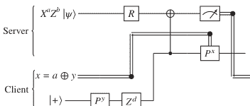

图 5.1 \(R\)-门协议，其中服务器的输出为 \(|\psi''\rangle = X^{a \oplus b} Z^{c \oplus (c \oplus b \oplus 1) \oplus b \oplus d \oplus y} R |\psi\rangle\)。客户端随机且均匀地选择 \(y, d \in \{0, 1\}\)。这是一种让服务器以受客户端控制的方式执行 \(P\) 操作的方法。这可以称为 \(R\)-门“小工具”。

要移除 $P$。这有两种解决方法。一种方法是要求 $B$ 执行此额外的 $P$ 操作，如前所述，但这需要在 \(a=1\) 和 \(a=0\) 时都进行（在 \(a=0\) 的情况下使用一个虚拟量子比特，以便 \(B\) 不知道 \(a\) 是否为 1），这涉及双向量子通信。

另一种方法是使用下面概述的 Broadbent [2015] 的协议，该协议除了发送 \(X^a Z^b |\psi\rangle\) 外，还发送一个随机从四个可能状态中选择的辅助量子比特态，以及一个经典比特，如下所述。服务器发送回结果和一个经典比特以解密结果。实现该协议的电路如图 5.1 所示。

客户端（例如 $A$）随机且均匀地选择 \(a, b \in \{0, 1\}\) 以将状态 \(|\psi\rangle\) 加密为 \(X^a Z^b |\psi\rangle\)。$A$ 将 \(X^a Z^b |\psi\rangle\) 发送给服务器，即 $B$。此外，$A$ 随机且均匀地选择 \(y, d \in \{0, 1\}\)，计算 \(x = a \oplus y\)，并将 $x$ 和量子态 \(Z^d P^y |+\rangle\) 发送给服务器 $B$。这是一种让服务器以受客户端控制的方式执行 $P$ 操作，同时不向服务器泄露任何关于 $a$ 的信息的方法（请记住我们上面提到，当 $a=1$ 时，我们需要应用一个额外的 $P$，而此电路使服务器执行此操作——要看到这一点，当 $a=0$ 时，$x = a \oplus y = y$，查看图 5.1 中从 \(|+\rangle\) 到 \(|\psi''\rangle\) 的量子线上的门，当 \(x=y=1\) 时，我们有 \(P^x Z^d P^y = PZ^d P = PPZ^d = ZZ^d\)，当 \(x=y=0\) 时，我们有 \(P^x Z^d P^y = Z^d\)，因此不应用 $P$，但当 $a=1$ 时，$x = 1 \oplus y$，即要么 \(x=0\) 且 \(y=1\)，要么 \(x=1\) 且 \(y=0\)，这意味着 \(P^x Z^d P^y = PZ^d\) 或 \(P^x Z^d P^y = Z^d P\)，因此应用了操作 $P$；请注意，即使服务器知道 $x$，它也不知道 $a$ 是什么，因为 $y$ 可以是 0 或 1）。

请注意，当 \(y=1\) 时，客户端 $A$ 实际上并不将 $P$ 应用于 \(|+\rangle\)，但根据我们的假设，我们假设客户端可以从以下状态中随机且均匀地选择一个：\(\{|+\rangle = \frac{1}{\sqrt{2}}(|0\rangle + |1\rangle), |-\rangle = \frac{1}{\sqrt{2}}(|0\rangle - |1\rangle), |+_i\rangle = \frac{1}{\sqrt{2}}(|0\rangle + i|1\rangle), |-_i\rangle = \frac{1}{\sqrt{2}}(|0\rangle - i|1\rangle)\}\)（我们之前陈述的假设 1），这等同于客户端随机且均匀地选择 \(y, d \in \{0, 1\}\) 并计算 \(Z^d P^y |+\rangle\)，因为：


| y | d | \( Z^d P^y |+\rangle \) |
|---|---|---|
| 0 | 0 | \( |+\rangle \) |
| 0 | 1 | \( Z|+\rangle = |-\rangle \) |
| 1 | 0 | \( P|+\rangle = \frac{1}{\sqrt{2}}(|0\rangle + i|1\rangle) = |+_y\rangle \) |
| 1 | 1 | \( ZP|+\rangle = \frac{1}{\sqrt{2}}(|0\rangle - i|1\rangle) = |-_y\rangle \) |

在接收到来自客户端（即 \( A \)）的输入 \( X^a Z^b |\psi\rangle \)、\( x \) 和 \( Z^d P^y |+\rangle \) 后，服务器（即 \( B \)）对 \( R \) 算符进行应用，并以 \( Z^d P^y |+\rangle \) 为控制位执行 CNOT 操作，随后根据 \( x \) 执行 \( P^x \)，并测量目标位；测量结果 \( c \) 会发回给客户端 \( A \)。根据该协议，服务器计算得到 \( |\psi''\rangle\)，其表达式为

\( |\psi''\rangle = X^a \Phi^b Z^{a(c \oplus (y \oplus 1))} \Phi^{b \oplus d \oplus dy} R |\psi\rangle \)

要理解原因，可按如下方式推导图 5.1 中的电路，源自 Broadbent [2015] 的附录：

- (1) 我们从以下电路开始，该电路交换 \( |+\rangle \) 和 \( |\psi\rangle \)。

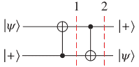

该电路可如下所示完成交换操作。令 \( |\psi\rangle = \alpha|0\rangle + \beta|1\rangle \)。先写出较低量子比特，电路初始状态为：

\( |+\rangle |\psi\rangle = |+\rangle (\alpha|0\rangle + \beta|1\rangle) = \frac{1}{\sqrt{2}}(|0\rangle + |1\rangle)(\alpha|0\rangle + \beta|1\rangle) = \frac{1}{\sqrt{2}}(\alpha|00\rangle + \beta|01\rangle + \alpha|10\rangle + \beta|11\rangle) \)

接着，应用第一个 CNOT，在切片 1 处得到：

\( \frac{1}{\sqrt{2}}(\alpha|00\rangle + \beta|01\rangle + \alpha|11\rangle + \beta|10\rangle) \)

接着，应用第二个 CNOT，在切片 2 处得到：

\( \frac{1}{\sqrt{2}}(\alpha|00\rangle + \beta|11\rangle + \alpha|01\rangle + \beta|10\rangle) = \frac{1}{\sqrt{2}}((\alpha|0\rangle + \beta|1\rangle)|1\rangle + (\alpha|0\rangle + \beta|1\rangle)|0\rangle) = \frac{1}{\sqrt{2}}(|\psi\rangle|1\rangle + |\psi\rangle|0\rangle) = |\psi\rangle|+\rangle \)

- (2) 从上面可以观察到，在第一个 CNOT 之后，我们得到：$\frac{1}{\sqrt{2}}(\alpha|00\rangle + \beta|01\rangle + \alpha|11\rangle + \beta|10\rangle)$，这可以重写为 $\frac{1}{\sqrt{2}}((\alpha|0\rangle + \beta|1\rangle)|0\rangle + (\alpha|1\rangle + \beta|0\rangle)|1\rangle) = \frac{1}{\sqrt{2}}(|\psi\rangle|0\rangle + X|\psi\rangle|1\rangle)$。因此，如果我们测量顶部量子比特（即右侧的量子比特），则会看到，若测量结果揭示 $|0\rangle$，则左侧/较低量子比特为 $|\psi\rangle$；若测量结果揭示 $|1\rangle$，则左侧/较低量子比特为 $X|\psi\rangle$。也就是说，我们得到如下电路：

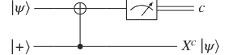

- (3) 接下来，我们考虑以下电路，通过向较低量子比特添加门 $P^y$ 和 $Z^d$，得到输出 $Z^d P^y X^c |\psi\rangle$。$^3$


3 我们可以如下验证输出。令 $|\psi\rangle = \alpha|0\rangle + \beta|1\rangle$。先写出较低量子比特，电路初始状态为：

$(Z^d P^y \otimes \mathbf{I}) | + \rangle | \psi \rangle = (Z^d P^y \otimes \mathbf{I}) \frac{1}{\sqrt{2}}(|0\rangle + |1\rangle)(\alpha|0\rangle + \beta|1\rangle)$
$= (Z^d P^y \otimes \mathbf{I}) \frac{1}{\sqrt{2}}(\alpha|00\rangle + \beta|01\rangle + \alpha|10\rangle + \beta|11\rangle)$
$= \frac{1}{\sqrt{2}}(\alpha|00\rangle + \beta|01\rangle + (-1)^d P^y \alpha|10\rangle + (-1)^d P^y \beta|11\rangle)$

接着，应用 CNOT，在步骤 1 处得到：

$\frac{1}{\sqrt{2}}(\alpha|00\rangle + \beta|01\rangle + (-1)^d P^y \alpha|11\rangle + (-1)^d P^y \beta|10\rangle)$
$= \frac{1}{\sqrt{2}}((\alpha|0\rangle + (-1)^d P^y \beta|1\rangle)|0\rangle + ((-1)^d P^y \alpha|1\rangle + \beta|0\rangle)|1\rangle)$
$= \frac{1}{\sqrt{2}}(Z^d P^y (\alpha|0\rangle + \beta|1\rangle)|0\rangle + Z^d P^y (\alpha|1\rangle + \beta|0\rangle)|1\rangle)$
$= \frac{1}{\sqrt{2}}(Z^d P^y (\alpha|0\rangle + \beta|1\rangle)|0\rangle + Z^d P^y X (\alpha|0\rangle + \beta|1\rangle)|1\rangle)$
$= \frac{1}{\sqrt{2}}(Z^d P^y |\psi\rangle|0\rangle + Z^d P^y X|\psi\rangle|1\rangle)$

因此，如果我们测量顶部量子比特（即右侧的量子比特），则会看到，若测量结果揭示 \(|0\rangle\)，则左侧/较低量子比特为 \(Z^d P^y |\psi\rangle\)；若测量结果揭示 \(|1\rangle\)，则左侧/较低量子比特为 \(Z^d P^y X |\psi\rangle\)。

- (4) 接下来，我们将 \(X^a Z^b |\psi\rangle\) 作为电路的输入，并对其应用 \(R\)，从而得到如下电路：


因为该电路中 CNOT 的目标是 \(RX^a Z^b |\psi\rangle\)。

- (5) 接下来，我们向较低量子比特应用 \(P^{a\oplus b}\)，从而得到如下电路：


这实际上就是图 5.1 中的电路。我们只需证明

\(|\psi''\rangle = P^{a\oplus b} Z^d P^y X^c R X^a Z^b |\psi\rangle = X^{a\oplus c} Z^{a\cdot(c\oplus b)\oplus 1\oplus b\oplus d\oplus d\oplus y} R |\psi\rangle\)

> 旁注：证明 \(P^{a\oplus b} Z^d P^y X^c R X^a Z^b |\psi\rangle = X^{a\oplus c} Z^{a\cdot(c\oplus b)\oplus 1\oplus b\oplus d\oplus d\oplus y} R |\psi\rangle\)：
> 
> \(P^{a\oplus b} Z^d P^y X^c R X^a Z^b |\psi\rangle \equiv P^{a\oplus b} Z^d P^y X^c X^a Z^a P^a R Z^b |\psi\rangle\)
> （忽略全局相位，因为对任意 \(|\phi\rangle\) 都有 \(RX^a |\phi\rangle = (e^{i\pi/4})^a X^a Z^a P^a R |\phi, \cdot\rangle\)）
> \(= P^{a\oplus b} Z^d P^y X^c X^a Z^a Z^b P^a R |\psi\rangle\)
> （因为 \(RZ^b = Z^b R\) 且 \(P^a Z^b = Z^b P^a\)）
> \(= Z^{a\cdot y} P^a P^z P^d P^y X^c X^a Z^a Z^b P^a R |\psi\rangle\)
> （因为 \(P^{a\oplus b} = P^{2a+y+a\oplus y} = Z^{a\cdot y} P^{a+y} = Z^{a\cdot y} P^a P^y\)，\(P^2 = Z\)，且 \(P^4 = Z^2 = I\)）
> \(= Z^{a\cdot y} P^a P^y P^y Z^d X^c X^a Z^a Z^b P^a R |\psi\rangle\)
> （因为 \(Z^d P^y = P^y Z^d\)）

= Z^{a \cdot y} Z^{y \cdot d} Z^{p \cdot a} X^{c \cdot a} Z^{a \cdot b} Z^{p \cdot b} P^{a \cdot R} | \psi \rangle
（因为 \(P^y P^y = Z^y\)，\(P^a Z^{y} = Z^{y'} P^a\)，且 \(P^a Z^d = Z^d P^a\)）
= Z^{a \cdot y \oplus y \oplus d} P^a X^{a \oplus c} Z^{a \oplus b} P^{a \cdot R} | \psi \rangle
（忽略全局相位，由 \(P^a X^{0 \oplus c} \equiv Z^{a \cdot (a \oplus c)} X^{a \oplus c} P^a\) 得）
= Z^{a \cdot y \oplus y \oplus d} Z^{a \cdot (a \oplus c)} X^{a \oplus c} P^a Z^{a \oplus b} P^{a \cdot R} | \psi \rangle
（因为 \(Z^{a \oplus b} P^a = P^a Z^{a \oplus b}\)）
= Z^{a \cdot y \oplus y \oplus d} Z^{a \cdot (a \oplus c)} X^{a \oplus c} Z^a Z^{a \oplus b} R | \psi \rangle
（因为 \(P^a P^a = P^{2a} = Z^a\)）
= X^{a \oplus c} Z^{a \cdot y \oplus y \oplus d} Z^{a \cdot (a \oplus c)} Z^a Z^{a \oplus b} R | \psi \rangle
（因为 \(Z^{a \cdot (a \oplus c)} X^{a \oplus c} = -X^{a \oplus c} Z^{a \cdot (a \oplus c)}\)，且 \(Z^{a \cdot y} \oplus y \oplus d X^{a \oplus c} = -X^{a \oplus c} Z^{a \cdot y \oplus y \oplus d}\)）
= X^{a \oplus c} Z^{a \cdot (c \oplus b) \oplus 1 \oplus b \oplus b \oplus d \oplus y} R | \psi \rangle

在图 5.1 中，如果 B 将 \(|\psi''\rangle\) 发送给 A，请注意 A 拥有 \(a, b, y, d\) 和 \(c\)（也来自 B），因此可以如下从 \(|\psi''\rangle\) 中得到 \(R |\psi\rangle\)：

\(Z^{a \cdot (c \oplus 1) \oplus b \cdot d \oplus b \cdot d} X^{a \oplus c} |\psi''\rangle = R |\psi\rangle\)

我们已经看到，客户端 A 如何请求服务器执行量子操作，并解密来自服务器 B 的结果。表 5.1 总结了客户端的加密状态、发送给服务器的内容、在服务器上执行的操作以及服务器上的计算状态（附带显示相应加密密钥的等效操作）；简而言之，其思想是

\(| \psi \rangle \xrightarrow{enc_{a,b}} | \psi \rangle \xrightarrow{U} U(enc_{a,b}(| \psi \rangle)) = enc_{a',b'}(U | \psi \rangle) \xrightarrow{dec_{a',b'}} U | \psi \rangle\)

这里 \(enc\) 采用量子一次性密码本，即对于随机均匀选取的 \(a, b \in \{0, 1\}\)，有 \(enc_{a,b}(|\psi\rangle) = X^a Z^b |\psi\rangle\)，且 \(dec_{a',b'} = Z^{b'} X^{a'}\)。要使其成立，核心思想是建立等价关系：\(U (enc_{a,b}(|\psi\rangle)) = enc_{a',b'}(U |\psi\rangle) = X^{a'} Z^{b'} (U |\psi\rangle)\)，并选取合适的 \(a'\) 和 \(b'\) 值，从而 \(dec_{a',b'}(enc_{a',b'}(U |\psi\rangle)) = Z^{b'} X^{a'} (enc_{a',b'}(U |\psi\rangle)) = Z^{b'} X^{a'} X^{a'} Z^{b'} (U |\psi\rangle) = U |\psi\rangle\)。

但一般来说，量子电路会使用多个门，而非仅一个门。一般量子电路可分解为一系列门，这些门来自集合 \(\{X, Z, H, P, CNOT, R\}\)，因此展示如何将这些门中的每一个委托给服务器是有必要的。

假设量子比特已被准备并存放在量子寄存器中，下面是用于将计算委托给服务器的协议：


## 表 5.1 不同门对每个量子比特（单量子比特门）或每对量子比特（CNOT）计算加密数据的协议汇总表

| 来自客户端 | 服务器上的 U | 服务器上计算 | 解密密钥 |
| :--- | :--- | :--- | :--- |
| $X^a Z^b |\psi\rangle$ | X | $X(X^a Z^b |\psi\rangle) \equiv X^a Z^b (X |\psi\rangle)$ | $a'=a, b'=b$ |
| $X^a Z^b |\psi\rangle$ | Z | $Z(X^a Z^b |\psi\rangle) \equiv X^a Z^b (Z |\psi\rangle)$ | $a'=a, b'=b$ |
| $X^a Z^b |\psi\rangle$ | H | $H(X^a Z^b |\psi\rangle) \equiv X^b Z^a (H |\psi\rangle)$ | $a'=b, b'=a$ |
| $X^a Z^b |\psi\rangle$ | P | $P(X^a Z^b |\psi\rangle) \equiv X^a Z^{a \oplus b} (P |\psi\rangle)$ | $a'=a, b'=a \oplus b$ |
| $X^a Z^b \otimes X^c Z^d |\psi\rangle$ | CNOT | $CNOT(X^a Z^b \otimes X^c Z^d |\psi\rangle) \equiv (X^a Z^{b \oplus d} \otimes X^{a \oplus c} Z^d) (CNOT |\psi\rangle)$ | $a'=a, b'=b \oplus d$<br>$c'=a \oplus c, d'=d$ |
| $X^a Z^b |\psi\rangle$,<br>$x = a \oplus y$,<br>$Z^d P^v |+\rangle$ | R（以及图 5.1 中服务器的操作） | $c$ 和 $X^{a''} Z^{b''} (R |\psi\rangle)$<br>where $a'' = a \oplus c$ 和<br>$b'' = a \cdot (c \oplus y \oplus 1) \oplus b \oplus d \oplus y$ | $a'=a'', b'=b''$ |

a) 在等价关系 "$\equiv$" 中我们忽略全局相位。解密密钥为 $(a', b')$，使用 $Z^{b'} X^{a'}$（CNOT 的情况为 $(c', d')$）。

- (1) 客户端使用前面见过的量子一次性密码本加密其量子寄存器，然后将寄存器内容发送到服务器（以及要执行的电路）。

- (2) 服务器随后使用加密的量子数据，根据表 5.1 所示的程序，按照电路执行计算，客户端在每次操作后计算相应量子线路的加密密钥。

- (3) 完成后，服务器将输出寄存器发送给客户端，客户端再使用其计算的密钥对其进行解密。

协议的一般说明如下，它实现了一个电路 $\mathcal{U} = U_1 \dots U_n$。


```
Effectively, we want to compute $\mathcal{U} |\psi\rangle = dec(\mathcal{U} (enc(|\psi\rangle)))$
```

让我们看一个例子，客户端将下面这个（人造的）作用于三个量子比特的量子电路委托给服务器，这三个量子比标记为 $q_1 q_2 q_3$（顶部是 $q_1$，底部是 $q_3$），如下所示。


该电路可以写为

$(I \otimes I \otimes X)(I \otimes R \otimes I)(CNOT_{q_1,q_2} \otimes I)(I \otimes I \otimes R)$

其中 $CNOT_{q_1,q_2}$ 表示作用于上两个量子比特的 CNOT，顶部量子比特 $q_1$ 作为控制比特，也就是说，客户端希望服务器帮助它计算：

$|\psi'\rangle = (I \otimes I \otimes X)(I \otimes R \otimes I)(CNOT_{q_1,q_2} \otimes I)(I \otimes I \otimes R) |\psi\rangle$

首先，使用随机选择的 $a, b, c, d, e, f \in \{0, 1\}$，客户端使用以下方式加密三个量子比特状态 $|\psi\rangle$：

$(X^a Z^b \otimes X^c Z^d \otimes X^e Z^f) |\psi\rangle$

并将其发送到服务器。这里有两个 R 门操作。对于第一个 R 门操作，客户端随机选择 $y_1, d_1 \in \{0, 1\}$，并发送 $x_1 = a \oplus y_1$ 和 $Z^{d_1} p^{y_1} |+\rangle$ 以及上述加密状态到服务器。根据图 5.1，服务器计算 $c_1$ 并将其发送给客户端，客户端保留它，在切片 1 时，服务器已计算：$(X^a Z^b \otimes X^c Z^d \otimes X^{e \oplus c_1} Z^{e \cdot (c_1 \oplus y_1 \oplus 1) \oplus f \oplus d_1 \oplus y_1}) (I \otimes I \otimes R) |\psi\rangle$。

其次，将 CNOT 应用于上两个量子比特，在切片 2 时，服务器已计算：$(X^a Z^{b \oplus d} \otimes X^{a \oplus e} Z^d \otimes X^{a''} Z^{b''})(CNOT_{q_1,q_2} \otimes I)(I \otimes I \otimes R) |\psi\rangle$，其中 $a'' = e \oplus c_1$ 且 $b'' = e \cdot (c_1 \oplus y_1 \oplus 1) \oplus f \oplus d_1 \oplus y_1$。

第三，对于第二个 R 门操作，客户端随机选择 $y_2, d_2 \in \{0, 1\}$，并将 $x_2 = (a \oplus c) \oplus y_2$ 和 $Z^{d_2} p^{y_2} |+\rangle$ 发送到服务器（注意这些可以更早发送，甚至在计算开始之前，以避免计算过程中出现任何等待时间）。根据图 5.1，服务器计算 $c_2$ 并将其发送给客户端，客户端保留它，在切片 3 时，服务器已计算：

$(X^a Z^{b \oplus d} \otimes X^{a''} Z^{b''} \otimes X^{a'''} Z^{b'''}) (I \otimes R \otimes I) (CNOT_{q_1,q_2} \otimes I)(I \otimes I \otimes R) |\psi\rangle,$

其中 $a''' = (a \oplus c) \oplus c_2$，且 $b''' = (a \oplus c) \cdot (c_2 \oplus y_2 \oplus 1) \oplus d \oplus d_2 \oplus y_2$。

第四，最后，将 X 门应用于量子比特 $q_3$，我们得到在切片 4 时：$(X^a Z^{b \oplus d} \otimes X^{a''} Z^{b''} \otimes X^{a'''} Z^{b'''})(I \otimes I \otimes X)(I \otimes R \otimes I) (CNOT_{q_1,q_2} \otimes I) (I \otimes I \otimes R) |\psi\rangle = (X^a Z^{b \oplus d} \otimes X^{a''} Z^{b''} \otimes X^{a'''} Z^{b'''}) |\psi'\rangle$，然后服务器将其作为结果发送到客户端。要解密上述内容，客户端可以对结果应用以下操作：$Z^{b \oplus d} X^a \otimes Z^{b''} X^{a''} \otimes Z^{b'''} X^{a'''}$，从而得到 $|\psi'\rangle$！请注意，客户端拥有 $b$、$d$ 和 $a$，以及计算 $b''$、$a'''$、$b'''$ 和 $a''$ 所需的所有信息，这些可以被视为解密结果中每个量子比特的密钥，即各对 $(a, b \oplus d)$、$(a'', b'')$ 和 $(a''', b''')$；客户端实际上根据操作调整这些密钥以计算最终密钥。

Fisher et al. [2014] 解释了委托计算协议的实验演示。还有一项关于加密数据量子计算的相关专利。$^4$

## 5.2 如何验证委托的私有量子计算

请注意，在上述委托计算方案中，存在一个信任问题，即客户端是否信任服务器执行其希望服务器执行的计算。尽管由于使用量子一次性密码本，服务器无法知道它正在接收来自客户端的什么输入，但服务器可能并未执行客户端要求的操作！例如，客户端如何验证当它希望服务器应用一个 X 门时，服务器确实执行了 X 门操作？服务器实际上可能什么都不做，或者应用一些其他操作。更糟的是，服务器根本可能不是量子计算机，而只是假装是一个！

这是验证量子计算的一个更广泛问题。有时，验证量子计算的结果很容易。例如，对于使用 Shor 算法 [Shor, 1994] 分解大数的问题，一旦客户端收到来自服务器的答案（这些答案应为给定大数的因子），客户端可以进行乘法运算来验证返回的答案是否确实是因子（对于其他可在多项式时间内验证的 NP 问题，情况也是如此）。但是，对于那些难以或无法验证（至少仅使用经典计算机或具有有限量子计算能力的客户端）的某些问题怎么办呢？这个问题已在其他地方广泛讨论，例如，见 Gheorghiu et al. [2019] 中的综述。

因此，当客户端将量子计算委托给服务器时，它不仅希望对服务器隐藏其数据（即所谓的*私有*或*盲量子计算* [Fitzsimons, 2017]），还希望验证服务器是否诚实或正确执行计算（即*可验证性*）。在此，我们简要地概述并讨论了来自 Broadbent [2018] 的使用测试运行来检测不诚实服务器的想法，即将测试运行与实际计算运行交错的想法，使服务器不知道自己正在进行哪种类型的运行，因此服务器无法调整或反应以避免或通过此类测试。

假设客户端希望将电路 C 应用于输入 $|0\rangle^{\otimes n}$。请注意，不失去一般性，我们可以假设输入为 $|0\rangle^{\otimes n}$，因为对输入 $|x\rangle$ 的准备可以集成到电路中，即 \(C'|x\rangle = C|0\rangle^{\otimes n} = C'U|0\rangle^{\otimes n}\)，其中 \(C = C'U\) 且 \(|x\rangle = U|0\rangle^{\otimes n}\)。

客户端随机且均匀地选择三种可能运行类型中的一种（不告知服务器其选择），将量子一次性密码本加密的输入 $|0\rangle^{\otimes n}$ 和电路 C 发送到服务器；客户端还向服务器发送我们稍后将解释的 R 门小工具所需的额外辅助量子比特：

- **计算运行**：客户端将实际所需的计算 \(C|0\rangle^{\otimes n}\) 委托给服务器
- **X-测试运行**：客户端将对 $|0\rangle^{\otimes n}$ 的恒等计算委托给服务器
- **Z-测试运行**：客户端将对 $|+\rangle^{\otimes n}$ 的恒等计算委托给服务器

服务器不知道自己被委托了哪种运行，因为在上述任何一种类型的运行中，它也收到了电路 C，并且服务器只是执行 C 中的每个操作。其理念是，在上述任何一种运行中，服务器的动作或操作都是相同的，是客户端在其一边所做的事情决定了发生了哪种类型的运行，正如我们下面解释的那样。

运行的协议与我们在 5.1 节中看到的类似，如表 5.1 所示，但在执行 R 门和 H 门的方式上存在关键差异。让我们看看每种门类型的运行将如何进行（我们简单地称这些过程为小工具），这将有助于了解由这样一些门组成的整个电路的计算可能如何被委托。

### 5.2.1 X 门小工具

假设客户端希望对加密的量子比特 \(X^a Z^b |\psi\rangle\) 执行 X 门操作。我们之前看到，服务器可以对加密的量子比特 \(X^a Z^b |\psi\rangle\) 执行 X 门操作，得到 \(XX^a Z^b |\psi\rangle \equiv X^a Z^b X |\psi\rangle\)，客户端可以使用密钥 a、b，即使用 \(Z^b X^a\) 对其进行解密，从而得到 \(X |\psi\rangle\)。另一种方法是实际上让服务器什么都不做，而由客户端仅将密钥调整为 a'、b'，其中 \(a' = a \oplus 1\) 且 b' = b；之所以有效，是因为如果服务器原样返回原始输入 \(X^a Z^b |\psi\rangle\)，不作任何更改，那么使用 a'、b' 进行解密会得到：

```
\(Z^{b'} X^{a'} X^a Z^b |\psi\rangle = Z^b X^{a \oplus 1} X^a Z^b |\psi\rangle = Z^b X X^a X^a Z^b |\psi\rangle \equiv X |\psi\rangle\)
```

请注意，客户端仅在计算运行中调整其密钥。由于它打算在 X-测试和 Z-测试运行中计算恒等操作，客户端不


adjust its keys when it wants to do a test run (while the server also does not need to do anything, like in the computation run).

### 5.2.2 Z 门小器件

We saw earlier how the client can get the server to do a Z gate on an encrypted qubit. Similar to the X gate, the server can do nothing (or send back the original encrypted qubit unchanged) and the client just adjusts its keys, this time to \(a' = a\) and \(b' = b \oplus 1\) so that we have:

```
\(Z^{b'} X^{a'} X^a Z^b |\psi\rangle = Z^{b \oplus 1} X^a X^a Z^b |\psi\rangle = Z Z^b Z^b |\psi\rangle = Z |\psi\rangle\)
```

As in the case of the X-gate, the client adjusts its keys only in a computation run. Since it intends to compute the identity operation in the X-test and Z-test runs, the client does not adjust its keys (while the server also does not need to do anything, like in the computation run).

### 5.2.3 CNOT 门小器件

In the case of the client wanting the server to perform the CNOT gate, the approach for the computation run is as in Table 5.1: applying a CNOT gate on qubits \(i\) and \(j\), where \(i\) is the control and \(j\) is the target, suppose qubit \(i\) has key \((a_i, b_i)\) and qubit \(j\) has key \((a_j, b_j)\), then, the server performs the CNOT between these two qubits, and the client adjusts the keys as follows to have the new keys \((a'_i, b'_i)\) and \((a'_j, b'_j)\): \(a'_i = a_i\), \(b'_i = b_i \oplus b_j\), and \(a'_j = a_i \oplus a_j\), \(b'_j = b_j\). In either a X-test and Z-test run, the server still does the CNOT, but the client does not adjust its keys since CNOT(\(|0\rangle|0\rangle\)) = \(|0\rangle|0\rangle\) and CNOT(\(|+\rangle|+\rangle\)) = \(|+\rangle|+\rangle\).

### 5.2.4 R 门小器件

Let us look at the way the R operation is carried out, i.e. the R gate “gadget,” as given in Figure 5.2.

Compared to the previous R gadget in Figure 5.1, here, the R gate is “done” on the client side. In fact, similar to Section 5.1, for this gadget, the client does not need to be able to actually perform these gate operations on arbitrary quantum states, but just be able to prepare a state chosen randomly and uniformly from one of the following states, here specified in terms of results of operations: {R\(|+\rangle\), R\(|-\rangle\), PR\(|+\rangle\), PR\(|-\rangle\)} (similar to Assumption 1 earlier); this is equivalent to the client choosing randomly and uniformly \(d, e, y \in \{0, 1\}\) and computing \(X^d Z^e P^y R|+\rangle\) since:


Figure 5.2 A slightly modified protocol for an R-gate for a computation run, where the output from the server is \(|\phi\rangle = X^{c \oplus d} Z^{(a \oplus c) \cdot (d \oplus y) \oplus b \oplus c \oplus e \oplus y} R |\psi\rangle\). The client chooses randomly and uniformly \(d, e, y \in \{0, 1\}\). This can be called an R-gate “gadget.”

| d | e | y | \(X^d Z^e P^y R |+\rangle\) |
|---|---|---|---|
| 0 | 0 | 0 | \(R |+\rangle\) |
| 0 | 0 | 1 | \(PR |+\rangle\) |
| 0 | 1 | 0 | \(ZR |+\rangle = RZ |+\rangle = R |-\rangle\) |
| 0 | 1 | 1 | \(ZPR |+\rangle = PZR |+\rangle = PRZ |+\rangle = PR |-\rangle\) |
| 1 | 0 | 0 | \(XR |+\rangle \equiv ZPRX |+\rangle = ZPR |+\rangle = PZR |+\rangle = PRZ |+\rangle = PR |-\rangle\) |
| 1 | 0 | 1 | \(XPR |+\rangle \equiv ZXPR |+\rangle \equiv ZP ZPRX |+\rangle = ZPZPR |+\rangle = R |-\rangle\) |
| 1 | 1 | 0 | \(XZR |+\rangle = -ZXR |+\rangle \equiv -ZZPRX |+\rangle = -PR |+\rangle \equiv PR |+\rangle\) |
| 1 | 1 | 1 | \(XZPR |+\rangle \equiv RX |+\rangle = R |+\rangle\) |

where in the above, we are using the identities: \(XZ = -ZX, PZ = ZP, ZR = RZ, RX \equiv XZPR, XR \equiv ZPRX, PR = RP, XP \equiv ZPX, X|+\rangle = |+\rangle, Z|+\rangle = |-\rangle\), and \(P^2 = Z\), where the equivalences are due to ignoring global phases.

The circuit in Figure 5.2 can be derived as follows, similar to how we derived the R-gate gadget in Section 5.1.

- 1) Let’s start with the following circuit, similar to the one in step (3) of the previous derivation for Figure 5.1, but with the additional \(R\) gate before the \(P^y\) gate in the bottom wire and input being \(X^a Z^b |\psi\rangle\), so that the output becomes \(Z^e P^y R X^c X^a Z^b |\psi\rangle\):


One can check as we have done for step (3) in the previous derivation that the output is Z^x P^y RX^c X^a Z^b |ψ⟩.

- 2) Then, we add the X^d gate after the control in the bottom wire, so that the output becomes X^d Z^e P^y RX^c X^a Z^b |ψ⟩:

   X^a Z^b |ψ⟩─────────●──meter── c
             │
   |+⟩──R──P^y──Z^e──┬──X^d── X^d Z^e P^y RX^c X^a Z^b |ψ⟩

- 3) Then, we add the gate P^x = P^{a \oplus c \oplus y} after the X^d gate to the bottom wire as follows, so that the output becomes |φ⟩ = P^{a \oplus c \oplus y} X^d Z^e P^y RX^c X^a Z^b |ψ⟩:

   X^a Z^b |ψ⟩─────────●──meter── c
             │
   |+⟩──R──P^y──Z^e──┬──X^d──P^{a \oplus c \oplus y}──|φ⟩

Now, we rephrase the output:

P^x X^d Z^e P^y RX^c X^a Z^b |ψ⟩ = P^{a \oplus c \oplus y} X^d Z^e P^y RX^{a \oplus c} Z^b |ψ⟩
(since x = a \oplus c \oplus y)
\equiv P^{a \oplus c \oplus y} X^d Z^e P^y X^{a \oplus c} Z^{a \oplus c} P^{a \oplus c} R Z^b |ψ⟩
(since RX^{a \oplus c} \equiv X^{a \oplus c} Z^{a \oplus c} P^{a \oplus c} R, ignoring the global phase)
= P^{a \oplus c \oplus y} X^d Z^e P^y X^{a \oplus c} P^{a \oplus c} Z^{a \oplus c} Z^b R |ψ⟩
(using PZ = ZP, ZR = RZ)
\equiv P^{a \oplus c \oplus y} X^d Z^e P^y Z^{a \oplus c} P^{a \oplus c} X^{a \oplus c} Z^{a \oplus c} Z^b R |ψ⟩
(using XP \equiv ZPX, and ignoring the global phase)
= -P^{a \oplus c \oplus y} X^d Z^e P^y P^{a \oplus c} X^{a \oplus c} Z^b R |ψ⟩
(using PZ = ZP, -ZX = XZ and Z^{a \oplus c} Z^{a \oplus c} = I)
= -P^{a \oplus c \oplus y} P^d P^y Z^e P^{a \oplus c} X^{a \oplus c} Z^b R |ψ⟩
(using PZ = ZP)
\equiv -P^{a \oplus c \oplus y} P^{d+y} P^x Z^d P^{a \oplus c} X^{a \oplus c} Z^b R |ψ⟩
(using X^d P^y \equiv Z^{d.y} P^y X^d, ignoring the global phase)
= P^{a \oplus c \oplus y} Z^{d.y} P^y Z^d X^d P^{a \oplus c} X^{a \oplus c} Z^b R |ψ⟩
(using XZ = -ZX)
\equiv P^{a \oplus c \oplus y} Z^{d.y} P^y P^y Z^d P^{d(a \oplus c)} P^{a \oplus c} X^d X^{a \oplus c} Z^b R |ψ⟩
(using X^d P^{a \oplus c} \equiv Z^{d(a \oplus c)} P^{a \oplus c} X^d , ignoring the global phase)

= P^(a⊕c)⊕y P^y P^(a⊕c) Z^d y⊕e⊕d·(a⊕c) X^d X^(a⊕c) Z^b R |ψ⟩
(using PZ = ZP)
= Z^y·(a⊕c) P^(a⊕c) P^y P^y P^a Z^c y⊕e⊕d·(a⊕c) X^d X^(a⊕c) Z^b R |ψ⟩
(using Z^y·(a⊕c) P^(a⊕c) P^y = P^(a⊕c⊕y) )
= X^d X^(a⊕c) Z^y·(a⊕c) Z^(a⊕c⊕y) Z^d y⊕e⊕d·(a⊕c) Z^b R |ψ⟩
(using P^y P^y = Z^y, P^(a⊕c) P^(a⊕c) = Z^(a⊕c) and ZX = -XZ)
= X^(a⊕c⊕d) Z^(y·(a⊕c)⊕a⊕c⊕y) d·y⊕e⊕d·(a⊕c) ⊕b R |ψ⟩
= X^(a⊕c⊕d) Z^(y·(a⊕c)⊕a⊕c⊕y) d·y⊕e⊕d·(a⊕c) ⊕b·d⊕d⊕d R |ψ⟩
(since d · d ⊕ d = d ⊕ d = 0)
= X^(a⊕c⊕d) Z^((a⊕c⊕d)·(d⊕y)⊕a⊕b⊕c⊕d⊕e⊕y) R |ψ⟩
= X^(a⊕c') Z^((a⊕c')·(d⊕y)⊕a⊕b⊕c'⊕e⊕y) R |ψ⟩
(where we let c' = c ⊕ d)

- 4) Then, we make use of the following equivalence about the CNOT and X gates:


so that if we add an X-gate after the target to the top wire, we have:


And so, the circuit from step (3) can be equivalently drawn as follows:


where |φ⟩ = X^(a⊕c') Z^(a⊕c')·(d⊕y)⊕a⊕b⊕c'⊕e⊕y R |ψ⟩ with c' = c ⊕ d, from the calculations above.

- 5) Finally, we observe that for any qubit α|0⟩ + β|1⟩ emerging after the target in the top wire, since X^d(α|0⟩ + β|1⟩) = α|0⊕d⟩ + β|1⊕d⟩, applying X^d to the qubit and then measuring will return the result c (where c = 0 ⊕ d or c = 1 ⊕ d), but if c' = c ⊕ d, then the equivalent circuit is as follows:


Figure 5.3 The R-gate gadget in an X-test run. Note that the client randomly and uniformly chooses \(x, d \in \{0, 1\}\), the server does the same operations as in a computation run (compare with Figure 5.2), and note that operations on the client is such that the identity operation is carried out (the identity operation is up to encryption, i.e. as long as the client keeps track of the key, in this case, after this gadget, the key has changed from \(a\) to \(d\); the client can apply \(X^d\) to get back \(|0\rangle\)). Also, there is a test - after receiving \(c\) from the server, the client verifies that \(c = a \oplus d\).


which is the circuit in Figure 5.2.

In the X-test run and the Z-test run, different R-gate gadgets are used.

Figure 5.3 shows the R gate used in the X-test run. Note that the gadget has a test to check that the server's output \(c\) satisfies \(c = a \oplus d\). This is because the state after the target and before measurement in the top wire is \(X^{a \oplus d} |0\rangle\), which upon measurement should provide \(c = a \oplus d\) if the server has been doing the right thing, and noting that the output from the bottom wire would be \(P^x X^d |0\rangle \equiv X^d |0\rangle\) (ignoring the global phase).

Figure 5.4 shows the R gate used in the Z-test run. The output \(X^c Z^{b \oplus d \oplus y} |+\rangle\) is obtained as shown via calculations. From the circuit, (similar to the idea in step (3) of the derivation for Figure 5.1) the output is

```
\(P^x Z^d P^y X^c Z^b |+\rangle = P^x P^y Z^d X^c Z^b |+\rangle = Z^y Z^d X^c Z^b |+\rangle = X^c Z^{b \oplus d \oplus y} |+\rangle\)
(since \(x=y\), \(ZP = PZ\), and \(P^x P^y = Z^y\))
```

### 5.2.5 H 门小器件

The H gate is what makes the Z-test run needed since it changes \(|0\rangle\) to \(|+\rangle\). There are some difficulties here if the H gate is simply applied by the server like we did in Section 5.1, see Table 5.1 since, this time, we don't have just computation


**图 5.4** Z-测试运行中的 $R$-门小器件。注意客户端随机且均匀地选择 \(d,y \in \{0, 1\}\)，服务器执行的操作与计算运行和 $X$-测试运行相同（对比图 5.2 和 5.3），并且客户端上的操作使得执行恒等操作（在加密意义上，即只要客户端记录密钥，在此情况下，经过此小器件后，密钥已从 \(b\) 改为 \((c, b \oplus d \oplus y)\)。）

但也包括测试运行。例如，假设每个量子比特 \(i\) 的状态形式为 \(X^{a_i}Z^{b_i}|0\rangle\)，其中 \(a_i\) 和 \(b_i\) 某些值，且 \(i \in \{1, ... n\}\)，并且对其中一个（假设为 \(j\)）应用 \(H\) 门，变为 \(H(X^{a_j}Z^{b_j}|0\rangle) = X^{b_j}Z^{a_j}H|0\rangle = X^{b_j}Z^{a_j}|+\rangle\)（来自表 5.1）；因此，这会将某个量子比特的状态改为 \(|+\rangle\)，而其他量子比特保持为 \(|0\rangle\)（在加密意义上）。如果后来在这个量子比特 \(j\) 和某个其他量子比特 \(i \neq j\) 之间应用 \(CNOT\) 门，情况会变得复杂，即我们需要处理 \(CNOT_{ij}(|0\rangle|+\rangle)\)，因为我们不再执行 \(CNOT(|0\rangle|0\rangle)\)（在 X-测试运行中），相应地，我们也不再执行 \(CNOT(|+\rangle|+\rangle)\)（在 Z-测试运行中），因此我们之前使用的 \(CNOT\) 门小器件可能不再起作用。

Broadbent [2018] 给出的解决方案是，对每个 \(H\) 门执行以下操作（我们称之为 \(U_H\)）：\(U_H := H P H P H P H = H R H R H R H R H R H R\)，因为 \(P = RR\)；电路中的每个 \(H\) 门都被 \(U_H\) 操作替换，适用于任何类型的运行。

在计算运行中，由于等价性：\(H P H P H P H = H\)，替换不会改变电路的结果，应用 \(U_H\) 的效果相当于应用 \(H\)。

在测试运行中，对于 \(U_H\) 中的每个 \(R\) 门操作，我们使用相应的 \(R\) 门小器件（X-测试运行用图 5.3，Z-测试运行用图 5.4），它计算恒等操作（在加密意义上），因此我们有：

\(U_H = H P H P H P H = H R H R H R H R H R H = H H H H H\)

并且由于 \(HHHH = \mathbf{I}\)，实际上我们得到了恒等操作。请注意，在 X-测试运行中，将 \(U_H\) 中的第一个 \(H\) 应用于量子比特 \(j\) 后，如果量子比特初始处于形式 \(X^{a_j}Z^{b_j}|0\rangle\) 的状态，它将进入形式 \(X^{a'_j}Z^{b'_j}|+\rangle\) 的状态，其中 \(a'_j, b'_j\) 适当，即下一个 \(RR\) 操作适用的 \(R\) 门小器件现在是图 5.4 中的 Z-测试运行版本（也就是说，实际上，X-测试运行变成了 Z-测试运行）。并且这个 \(R\) 门小器件被使用两次（用于第一个 \(RR\)）。然后，应用第二个 \(H\) 门，量子比特 \(j\) 的状态变回形式 $X^{a''} Z^{b''} |0\rangle$，其中 $a'', b''$ 适当，因此适用的 $R$-门小器件是图 5.3 中用于第二个 $RR$ 的 X-测试运行版本。此后，应用第三个 $H$，同样，量子比特状态变为下一个 $RR$ 操作适用的 $R$ 门小器件现在是图 5.4 中的 Z-测试运行版本的形式。最后，应用最后一个 $H$，量子比特恢复到与 $|0\rangle$ 等价（在加密意义上）的形式。在 Z-测试运行中，适用的 $R$ 门小器件序列则为：第一个 $RR$ 用图 5.3，第二个 $RR$ 用图 5.4，最终 $RR$ 用图 5.3。

因此，服务器在任何类型的运行中都执行相同的计算（在其一方），这是 \(U_H\) 的服务器端部分，但客户端根据所使用的 \(R\) 门小器件（即客户端选择的运行类型）来决定此计算是应用 \(H\)（即 \(U_H = H\)）还是恒等操作（即 \(U_H = \mathbf{I}\)）。

一旦电路被委托给服务器，在计算运行中，服务器和客户端按照上述方式继续，根据电路中的门使用相应的小器件。客户端调整和计算密钥，以便能够解密服务器返回的最终结果。

在测试运行中，可以进行验证（例如，如图 5.3 所示的每个 $R$ 门），当某项验证失败时，客户端可以中止。此外，可以指示服务器测量结果并将结果返回给客户端；例如，客户端可以检查结果在 X-测试运行中应对应于 $|0\rangle^{\otimes n}$（鉴于应已执行恒等操作），以检测服务器是否表现正常。经过若干次测试运行或验证失败后出现错误结果，可能有助于客户端得出服务器存在异常或问题的结论，但如果服务器在测试运行中始终显示正确结果，则可以赢得客户端的信任。然而，该方法是概率性的；对客户端不幸的是，服务器可能恰好只在测试运行中表现正常，而在计算运行中表现异常！

我们可以看到，对于客户端使用上述协议委托的任何电路，服务器执行相同的操作，无论运行类型如何。因此，服务器不知道它实际上是在执行计算运行还是正在接受测试，因此的理念是，服务器需要在任何运行中都正确执行，否则有暴露的风险。请注意，为了使此协议工作，客户端需要能够准备某些状态。Broadbent [2018] 对上述过程的原始描述从计算复杂性角度考虑了涉及客户端和服务器端算法的过程，作为决策问题的量子证明人交互式证明（QPIP）系统，其中服务器作为证明人，客户端作为验证者。我们在此不深入细节，但请注意，如果客户端向服务器提供具有某些属性的电路，诚实的证明人应该能够向客户端展示与这些属性一致的结果，客户端和服务器按上述方式运行算法。

Gheorghiu et al. [2019] 对验证委托量子计算的协议进行了综述，包括基于测量的量子计算的技术（本书未介绍）。Drmota et al. [2023] 描述了一种可验证盲量子计算的实现，其中服务器是离子阱量子计算机，客户端是光电子检测系统，客户端和服务器通过光纤量子链联网。

## 5.3 量子计算即服务

当云服务提供商通过互联网将量子计算机的时间作为资源或服务提供时，我们就有了量子计算即服务（或 QaaS）的概念。第 1 章提到的主要云服务提供商已经在这样做。更一般地，量子电路的执行将嵌入到包含经典计算和量子计算的程序中，为此需要一种编程模型，例如带有库调用以执行（预定义或用户定义）量子电路的 Python 程序。响应时间（以及排队时间）、可靠性、可用性、容量（例如支持的量子比特数量和“质量”）、服务质量保证以及量子程序（电路）执行的经济成本，是在选择一个或多个量子计算机提供商时需要考虑的因素 [Moguel et al., 2022; Sodhi and Kapur, 2021; Ravi et al., 2021]。除了高层抽象之外，可以使用 Web 前端来帮助用户处理与后端量子计算机交互的程序 [Grossi et al., 2021]。在云服务器端，当同一台量子计算机（支持固定数量的量子比特）被用于运行多个量子程序（电路）时，需要策略来完成此映射以保持高效执行，例如参见 Liu and Dou [2021]。此外，Ngoenriang et al. [2022] 讨论了多个组织（各拥有其量子计算机平台）共享量子计算资源的场景——在此，分布式量子计算变得重要，以允许来自多个组织的量子计算机被汇集在一起进行大规模量子计算。

## 5.4 总结

我们已回顾了机制，使具有有限量子能力的客户端能够将量子计算委托给更强大的量子计算机。我们研究了如何隐藏委托的量子计算，以便服务器


无法在仍然能够为客户端执行计算的同时知晓客户端的输入。我们还了解到，客户端如何验证服务器的计算，或者至少以一定概率检测服务器是否未正确执行委托的计算。我们还简要讨论了 QaaS 的概念。已有研究探讨资源受限的客户端如何信任来自（其认为是）量子计算机的结果，例如，通过使用多台机器进行交叉验证 [Greganti et al., 2021]。Mahadev [2022] 探讨了计算机是否确实是量子计算机，以及是否可以由经典设备验证的问题。

## References

- Anne Broadbent. 委托私有量子计算。*Canadian Journal of Physics*, 93(9):941–946, 2015.
- Anne Broadbent. 如何验证量子计算。*Theory of Computing*, 14(11):1–37, 2018. doi: 10.4086/toc.2018.v014a011. URL https://theoryofcomputing.org/articles/v014a011.
- Andrew M. Childs. 安全辅助量子计算。*Quantum Information and Computation*, 5(6):456–466, 2005 年 9 月. ISSN 1533-7146.
- P. Drmota, D. P. Nadlinger, D. Main, B. C. Nichol, E. M. Ainley, D. Leichtle, A. Mantri, E. Kashefi, R. Srinivas, G. Araneda, C. J. Ballance, and D. M. Lucas. 利用捕获离子和单光子实现可验证的盲量子计算。CoRR, 2023 年 5 月. URL https://doi.org/10.48550/arXiv.2305.02936.
- K. A. G. Fisher, A. Broadbent, L. K. Shalm, Z. Yan, J. Lavoie, R. Prevedel, T. Jennewein, and K. J. Resch. 加密数据上的量子计算。*Nature Communications*, 5(1):3074, 2014.
- Joseph F. Fitzsimons. 私有量子计算：盲量子计算及相关协议简介。*npj Quantum Information*, 3(1):23, 2017.
- Alexandru Gheorghiu, Theodoros Kapourniotis, and Elham Kashefi. 量子计算验证：现有方法概述。*Theory of Computing Systems*, 63(4):715–808, 2019.
- C. Greganti, T. F. Demarie, M. Ringbauer, J. A. Jones, V. Saggio, I. Alonso Calafell, L. A. Rozema, A. Erhard, M. Meth, L. Postler, R. Stricker, P. Schindler, R. Blatt, T. Monz, P. Walther, and J. F. Fitzsimons. 独立量子设备的交叉验证。*Physical Review X*, 11:031049, 2021 年 9 月. doi: 10.1103/PhysRevX.11.031049.
- Michele Grossi, Luca Crippa, Antonello Aita, Giacomo Bartoli, Vito Sammarco, Eleonora Picca, N. Said, Filippo Tramonfo, and Federico Mattei. 面向量子计算的无服务器云集成。CoRR, abs/2107.02007, 2021. URL https://arxiv.org/abs/2107.02007.

- Lei Liu 和 Xinglei Dou. QuCloud：云环境中多编程量子计算的新比特映射机制。载于 2021 年 IEEE 高性能计算机架构国际研讨会 (HPCA)，第 167–178 页，2021 年. doi: 10.1109/HPCA51647.2021.00024.

- Urmila Mahadev. 量子计算的经典验证。*SIAM Journal on Computing*, 51(4):1172–1229, 2022.

- Enrique Muguel, Javier Rojo, David Valencia, Javier Berrocal, Jose Garcia-Alonso, and Juan M. Murillo. 面向服务的量子计算：当前现状与挑战。*Software Quality Journal*, 30:983–1002, 2022.

- Napat Ngoenriang, Minrui Xu, Jiawen Kang, Dusit Niyato, Han Yu, and Xuemin Shen. DQC²O：面向未来网络协作优化的分布式量子计算。CoRR, abs/2210.02887, 2022. doi: 10.48550/arXiv.2210.02887. URL https://doi.org/10.48550/arXiv.2210.02887.

- Gokul Subramanian Ravi, Kaitlin N. Smith, Prakash Murali, and Frederic T. Chong. 面向不断增长的量子云的自适应作业和资源管理。载于 2021 年 IEEE 量子计算与工程国际会议 (QCE)，第 301–312 页，2021 年. doi: 10.1109/QCE52317.2021.00047.

- P. W. Shor. 量子计算算法：离散对数与分解。载于第 35 届计算机科学基础年会论文集，第 124–134 页，1994 年. doi: 10.1109/FOCS.1994.365700.

- Balwinder Sodhi 和 Ritu Kapur. 量子计算平台：评估对质量属性和 SDLC 活动的影响。载于 2021 年 IEEE 第 18 届软件架构国际会议 (ICSA)，第 80–91 页，2021 年. doi: 10.1109/ICSA51549.2021.00016.

# The Quantum Internet

# 量子互联网

This chapter discusses some of the key concepts and ideas of the quantum Internet, including the central role that entanglement plays, the concepts of entanglement swapping and entanglement purification, and briefly reviews the notion of quantum repeaters and quantum Internet architectures. We will also look at quantum computations in relation to the quantum Internet.

本章讨论量子互联网的一些关键概念和思想，包括纠缠所起的核心作用、纠缠交换和纠缠净化的概念，并简要回顾量子中继器和量子互联网架构的概念。我们还将探讨与量子互联网相关的量子计算。

## 6.1 Entanglement Over Longer Distances

## 6.1 更长距离上的纠缠

So far we have seen that entanglement is key to many distributed quantum computing protocols and computations. Any two nodes which want to do computations together (e.g. perform a distributed–CNOT operation) need to share entangled qubits, even when the two nodes are geographically far apart. One can think of the quantum Internet as a “black box” from which nodes can request an entanglement between two qubits (on two nodes), or roughly speaking, providing “entanglement-as-a-service” (with the associated service-based ideas of “quality” of the entangled pair and “efficiency,” e.g. generating entanglement qubits in a timely manner). How is such an entangled pair generated? Answering this question in detail will take us further into the physics which we will not do so here. But generally, there are a number of mechanisms to generate an entangled pair (e.g. a Bell state) between two nodes.¹ One key point, however, is that due to decoherence affecting entangled qubits, distance is a limitation – e.g. it is hard to directly transmit a qubit over long distances without it suffering loss – so that generating an entangled pair between two nodes far apart over long distances requires what has been called quantum repeaters (analogous to repeaters for classical networks, but a totally different technology), which has a mechanism to take two entangled pairs (e.g. between qubits A on node 1 and A′ on node 2, and

到目前为止，我们已了解纠缠对许多分布式量子计算协议和计算至关重要。任何两个希望共同进行计算的节点（例如，执行分布式–CNOT 操作）都需要共享纠缠比特，即使这两个节点地理位置相距甚远。可以将量子互联网视为一个“黑盒”，节点可以从中请求两个比特（位于两个节点）之间的纠缠，或者粗略地说，提供“纠缠即服务”（带有相关的服务理念，如纠缠对的“质量”和“效率”，例如及时生成纠缠比特）。如何生成这样的纠缠对？详细回答这个问题会将我们带入更深层的物理学，这里不再赘述。但一般来说，有多种机制可以在两个节点之间生成纠缠对（例如贝尔态）。¹ 然而，一个关键点是，由于退相干影响纠缠比特，距离是一个限制——例如，很难在不损失的情况下直接在长距离上传输比特——因此，在相距遥远的两个节点之间长距离生成纠缠对需要所谓的量子中继器（类似于经典网络中的中继器，但属于完全不同的技术），其机制可以接受两个纠缠对（例如，节点 1 上的比特 A 与节点 2 上的比特 A′ 之间，以及

1 A readable overview is at https://www.forbes.com/sites/chadorzel/2017/02/28/how-do-you-create-quantum-entanglement/?sh=2664a2c11732 [last accessed: 15/11/2022].

1 可读概述见 https://www.forbes.com/sites/chadorzel/2017/02/28/how-do-you-create-quantum-entanglement/?sh=2664a2c11732 [最后访问：15/11/2022]。

between qubits B' on node 2 and B on node 3) and generate an entangled pair over a longer distance (e.g. between A on node 1 and B on node 3). Key to this mechanism is the notion of entanglement swapping, which we will look into. We will also look into a mechanism to transmit quantum information robustly over longer distances using tree-cluster states. But before all that, we need the idea of Bell State Measurement.

节点 2 上的比特 B' 与节点 3 上的比特 B 之间），并生成更长距离上的纠缠对（例如，节点 1 上的比特 A 与节点 3 上的比特 B 之间）。这种机制的关键是纠缠交换的概念，我们将对此进行探讨。我们还将探讨使用树簇态在更长距离上强健地传输量子信息的机制。但在此之前，我们需要贝尔态测量的概念。

### 6.1.1 Bell States and Bell State Measurement

### 6.1.1 贝尔态与贝尔态测量

The four Bell states are \(|\Phi^+\rangle = (|00\rangle + |11\rangle)/\sqrt{2}\), \(|\Phi^-\rangle = (|00\rangle - |11\rangle)/\sqrt{2}\), \(|\Psi^+\rangle = (|01\rangle + |10\rangle)/\sqrt{2}\), and \(|\Psi^-\rangle = (|01\rangle - |10\rangle)/\sqrt{2}\). Since they are orthogonal, they form a basis, the *Bell basis*. For example, a state \(|\psi\rangle\) written in the basis \(\{|00\rangle, |01\rangle, |10\rangle, |11\rangle\}\):

四个贝尔态为 \(|\Phi^+\rangle = (|00\rangle + |11\rangle)/\sqrt{2}\)、\(|\Phi^-\rangle = (|00\rangle - |11\rangle)/\sqrt{2}\)、\(|\Psi^+\rangle = (|01\rangle + |10\rangle)/\sqrt{2}\) 和 \(|\Psi^-\rangle = (|01\rangle - |10\rangle)/\sqrt{2}\)。由于它们正交，构成一组基，即 *Bell basis*。例如，在基 \(\{|00\rangle, |01\rangle, |10\rangle, |11\rangle\}\) 中写出的状态 \(|\psi\rangle\)：

\(|\psi\rangle = \alpha |00\rangle + \beta |11\rangle + \gamma |01\rangle + \delta |10\rangle\) where \(|\alpha|^2 + |\beta|^2 + |\gamma|^2 + |\delta|^2 = 1\), can be rewritten in the Bell basis as
\(|\psi\rangle = \frac{\alpha + \beta}{\sqrt{2}} |\Phi^+\rangle + \frac{\alpha - \beta}{\sqrt{2}} |\Phi^-\rangle + \frac{\gamma + \delta}{\sqrt{2}} |\Psi^+\rangle + \frac{\gamma - \delta}{\sqrt{2}} |\Psi^-\rangle\)

\(|\psi\rangle = \alpha |00\rangle + \beta |11\rangle + \gamma |01\rangle + \delta |10\rangle\) 其中 \(|\alpha|^2 + |\beta|^2 + |\gamma|^2 + |\delta|^2 = 1\)，可以用 Bell basis 重写为
\(|\psi\rangle = \frac{\alpha + \beta}{\sqrt{2}} |\Phi^+\rangle + \frac{\alpha - \beta}{\sqrt{2}} |\Phi^-\rangle + \frac{\gamma + \delta}{\sqrt{2}} |\Psi^+\rangle + \frac{\gamma - \delta}{\sqrt{2}} |\Psi^-\rangle\)

A Bell state measurement asks which of the Bell states \(|\psi\rangle\) is in.

贝尔态测量询问 \(|\psi\rangle\) 处于哪个贝尔态。

How can we measure in the Bell basis if we can only measure in the *Z* basis (due to the instruments available, for example)? See Aside.

如果我们只能在 *Z* 基下测量（例如，受限于可用仪器），如何在 Bell basis 下测量？参见“旁注”。

> Aside: Note that measuring a qubit in the X basis is applying the Hadamard gate first and then measuring in the Z basis in the sense that prob(+1) (or the probability of getting the state |0⟩) in this case is the same as X(+1) when measuring in the X basis.² The Pauli X measurement |ψ⟩ —X— can be implemented as |ψ⟩ —H— X— since prob(+1) are the same in both.
>
> Similarly, suppose |ψ⟩ is a two-qubit state, and if we want to measure in the Bell basis but only can measure in the basis {|00⟩, |01⟩, |10⟩, |11⟩}, we need a U such that: U |Φ⁺⟩ = |00⟩, U |Φ⁻⟩ = |10⟩, U |Ψ⁺⟩ = |01⟩, and U |Ψ⁻⟩ = |11⟩, and use it as follows (where the |ψ⟩ below is a two-qubit state):
>
> [Circuit Diagram: |ψ⟩ — U — Z — with measurement symbols]

> 旁注：请注意，在 X 基下测量一个比特相当于先施加 Hadamard 门，然后在 Z 基下测量，因为这种情况下 prob(+1)（即得到状态 |0⟩ 的概率）与在 X 基下测量时的 X(+1) 相同。² Pauli X 测量 |ψ⟩ —X— 可以实现为 |ψ⟩ —H— X—，因为两者中 prob(+1) 相同。
>
> 同样，假设 |ψ⟩ 是一个两比特状态，如果我们想在 Bell basis 下测量，但只能在基 {|00⟩, |01⟩, |10⟩, |11⟩} 下测量，则需要一个 U，使得：U |Φ⁺⟩ = |00⟩、U |Φ⁻⟩ = |10⟩、U |Ψ⁺⟩ = |01⟩ 且 U |Ψ⁻⟩ = |11⟩，并按以下方式使用（下面的 |ψ⟩ 为两比特状态）：
>
> [电路图：|ψ⟩ — U — Z — 带测量符号]


U 是什么？它是在第一个量子比特上依次应用 CNOT 门和 Hadamard 门：


上述电路使我们能够在 Bell 基底下测量双量子比特状态，即执行 Bell 态测量。（一般来说，任何基底下的测量都可以通过一个幺反门，随后对每个量子比特在 Z 基底下进行测量来实现。）请注意，在第 2 章的量子传送协议中，我们实际上使用 A 处的前两个量子比特（即待传输的量子比特和纠缠对中的一个量子比特）执行了 Bell 态测量。

### 6.1.2 纠缠交换

根据 Bell 态的先前定义，我们有 Bell 对恒等式³：

- |00⟩ = (|Φ⁺⟩ + |Φ⁻⟩)/√2 (6.1)
- |01⟩ = (|Ψ⁺⟩ + |Ψ⁻⟩)/√2 (6.2)
- |10⟩ = (|Ψ⁺⟩ - |Ψ⁻⟩)/√2 (6.3)
- |11⟩ = (|Φ⁺⟩ - |Φ⁻⟩)/√2 (6.4)

如图 6.1 所示，写出两个纠缠对的初始态：A 与 A′ 共享 |Φ⁺⟩_AA′（为清晰起见添加下标），B′ 与 B 共享 |Φ⁺⟩_B′B。


图 6.1 纠缠交换示意图，从（1）节点 1 处的 A 与节点 2 处的 A′ 之间以及节点 2 处的 B′ 与节点 3 处的 B 之间的纠缠对，到（2）在节点 2 处进行 Bell 态测量后 A 与 B 之间的纠缠对。

3 另请参阅 https://www.youtube.com/watch?v=1zVvoADzXs4 [最后访问：15/11/2022]。

```
|ψ⟩_{AA'B'B} = |Φ⁺⟩_{AA'} ⊗ |Φ⁺⟩_{B'B}
= (|00⟩ + |11⟩)/√2 ⊗ (|00⟩ + |11⟩)/√2
(substituting using (6.1) twice)
= 1/2(|0000⟩ + |0011⟩ + |1100⟩ + |1111⟩)
= 1/2(|0⟩ |00⟩ |0⟩ + |0⟩ |01⟩ |1⟩ + |1⟩ |10⟩ |0⟩ + |1⟩ |11⟩ |1⟩)
= 1/(2√2) (|0⟩_A(|Φ⁺⟩ + |Φ⁻⟩)_{A'B'}|0⟩_B + |0⟩_A(|Ψ⁺⟩ + |Ψ⁻⟩)_{A'B'}|1⟩_B
+ |1⟩_A(|Ψ⁺⟩ - |Ψ⁻⟩)_{A'B'}|0⟩_B + |1⟩_A(|Φ⁺⟩ - |Φ⁻⟩)_{A'B'}|1⟩_B)
(from substituting using (6.1)–(6.4) and reintroducing subscripts)
= 1/(2√2)((|Φ⁺⟩ + |Φ⁻⟩)_{A'B'}|00⟩_{AB} + (|Ψ⁺⟩ + |Ψ⁻⟩)_{A'B'}|01⟩_{AB}
+ (|Ψ⁺⟩ - |Ψ⁻⟩)_{A'B'}|10⟩_{AB} + (|Φ⁺⟩ - |Φ⁻⟩)_{A'B'}|11⟩_{AB})
(by reordering qubits from AA'B'B to A'B'AB)
= 1/(2√2)|Φ⁺⟩_{A'B'}|00⟩_{AB} + 1/(2√2)|Φ⁺⟩_{A'B'}|11⟩_{AB}
+ 1/(2√2)|Ψ⁺⟩_{A'B'}|01⟩_{AB} + 1/(2√2)|Ψ⁺⟩_{A'B'}|10⟩_{AB}
+ 1/(2√2)|Ψ⁻⟩_{A'B'}|01⟩_{AB} - 1/(2√2)|Ψ⁻⟩_{A'B'}|10⟩_{AB}
+ 1/(2√2)|Φ⁻⟩_{A'B'}|00⟩_{AB} - 1/(2√2)|Φ⁻⟩_{A'B'}|11⟩_{AB}
(rewriting according to Bell states in A'B')
```

对 A′B′ 进行 Bell 态测量后，中央节点（节点 2）需要告知节点 1 和节点 3 测量已完成，随后节点 1 和节点 3 共享一个纠缠态（即 Bell 态之一，出现概率相等）。例如，如果量子比特 A′B′ 的测量结果为状态 |Φ⁺⟩，该结果出现的概率为 |1/(2√2)|² + |1/(2√2)|² = 1/4，则有

```
\frac{1}{2\sqrt{2}}|\Phi^+\rangle_{A'B'} |00\rangle_{AB} + \frac{1}{2\sqrt{2}}|\Phi^+\rangle_{A'B'} |11\rangle_{AB} / \sqrt{\frac{1}{4}} = |\Phi^+\rangle_{A'B'} \otimes \frac{1}{\sqrt{2}}(|00\rangle + |11\rangle)_{AB}
```

（参见第 2 章关于测量的内容），并且量子比特 A 和 B 共享纠缠态 \frac{1}{\sqrt{2}}(|00\rangle + |11\rangle)，即纠缠态现在位于节点 1 和节点 3 的量子比特之间！位于节点 1 和节点 3 之间的节点 2 可以被视为“扩展纠缠范围”的量子中继器。


图 6.2 通过重复应用纠缠交换在节点 1 和节点 5 处的量子比特 A 与 D 之间生成纠缠对的示意图。

纠缠交换的一个有用视角是：利用 B’ 与 B 之间的纠缠对作为资源，将节点 2 处的量子比特 A’（它已与节点 1 处的 A 纠缠）传输到节点 3，即 B 接受 A’ 的状态，也就是说，B 现在与 A 纠缠。

这种纠缠交换的重复应用可用于在长距离上创建一对量子比特之间的纠缠，如图 6.2 所示。尽管示例中仅显示了五个节点，但同样的想法可以扩展到更多节点，即跨越互联网。

### 6.1.3 使用树簇态传输量子比特

我们已将纠缠交换视为在远距离节点之间生成纠缠的一种方法。在此，我们考虑另一种方法。

我们之前提到，传输量子信息的一种方法是使用量子传送（前提是我们已经拥有纠缠对），另一种方法是直接传输。例如，为了在地理位置相距遥远的两个节点上的量子比特之间创建纠缠对，原则上，我们可以先在一个节点本地生成一个 Bell 对，然后将其中一个量子比特传输到另一个节点，从而在两个节点之间获得纠缠对。然而，在长距离上传输量子比特（例如通过传输光子）可能会导致损失（例如由于光纤信道中的衰减）。解决此问题的一种方法是在源节点和目标节点之间使用中继站。但是，此类中继器由于无克隆定理，无法复制任意未知的量子状态（如经典情况那样），但我们在此概述了一种由 Borregaard et al. [2020] 提出的方法，用于健壮地编码信息以实现健壮传输，并允许在中继器处对量子比特信息进行重新编码以便进一步传输。该方法还允许在没有预建纠缠链路的情况下传输量子比特信息（不同于量子传送协议，如我们在第 2 章中回顾的那样，后者需要一个 EPR 对并传输两个经典比特）。

该方法如下。请回顾，量子比特 \(\alpha |0\rangle + \beta |1\rangle\) 中的信息在于幅值 \(\alpha\) 和 \(\beta\)。与其将此信息编码在待传输的单个光子中，不如将其编码在一个“光子簇”（处于特定的树簇态中）中，这更能抵御传输损失。例如，请考虑如下的 7 量子比特树簇态：

```
\(| \tau \rangle = \frac{1}{2\sqrt{2}} |0\rangle_s \otimes (|0\rangle |+++\rangle + |1\rangle |---\rangle) \otimes (|0\rangle |+++\rangle + |1\rangle |---\rangle)\)
+ \frac{1}{2\sqrt{2}} |1\rangle_s \otimes (|0\rangle |+++\rangle - |1\rangle |---\rangle) \otimes (|0\rangle |+++\rangle - |1\rangle |---\rangle)\)
```

其中下标 s 表示静止量子比特，其余将是待传输的量子比特。⁴

该方法接着是：用静止量子比特 s 与待传输量子比特（即消息量子比特 m）处于以下状态 \((\alpha |0\rangle + \beta |1\rangle)_m \otimes | \tau \rangle\) 进行 Bell 测量，这有效地“将量子信息从消息量子比特转移到树簇态中”，也就是说，我们有：

```
\(H \otimes I^{\otimes 7}) CNOT_{ms} (\alpha |0\rangle + \beta |1\rangle)_m \otimes | \tau \rangle\)
\(= (H \otimes I^{\otimes 7}) CNOT_{ms} (\alpha |0\rangle + \beta |1\rangle)_m\)
\(\otimes \left( \frac{1}{2\sqrt{2}} |0\rangle_s \otimes (|0\rangle |+++\rangle + |1\rangle |---\rangle) \otimes (|0\rangle |+++\rangle + |1\rangle |---\rangle) \right.\)
\(\left. + \frac{1}{2\sqrt{2}} |1\rangle_s \otimes (|0\rangle |+++\rangle - |1\rangle |---\rangle) \otimes (|0\rangle |+++\rangle - |1\rangle |---\rangle) \right)\)
```

4 之所以称其为树簇态，是因为可以将 7 个量子比特视为一棵树：第一个量子比特是根节点（s），第二个和第五个量子比特（称为第一级量子比特）是（s1 和 s2）的子节点，第三个和第四个量子比特（称为第二级量子比特）是第二个量子比特（s.1.1、s.1.2）的子节点，最后两个量子比特（也称为第二级量子比特）是第五个量子比特（s.2.1、s.2.2）的子节点：

```
\(| \tau \rangle = \frac{1}{2\sqrt{2}} |0\rangle_s \otimes (|0\rangle_{s1} |++\rangle_{s.1.1,s.1.2} + |1\rangle_{s1} |--\rangle_{s.1.1,s.1.2})\)
\(\otimes (|0\rangle_{s2} |++\rangle_{s.2.1,s.2.2} + |1\rangle_{s2} |--\rangle_{s.2.1,s.2.2})\)
+ \frac{1}{2\sqrt{2}} |1\rangle_s \otimes (|0\rangle_{s1} |++\rangle_{s.1.1,s.1.2} - |1\rangle_{s1} |--\rangle_{s.1.1,s.1.2})\)
\(\otimes (|0\rangle_{s2} |++\rangle_{s.2.1,s.2.2} - |1\rangle_{s2} |--\rangle_{s.2.1,s.2.2})\)
```


令 $f_1 = (|0\rangle |++\rangle + |1\rangle |--\rangle)^{\otimes 2}$ 和 $f_2 = (|0\rangle |++\rangle - |1\rangle |--\rangle)^{\otimes 2}$，则上式等于：

(H \otimes I^{\otimes 7}) CNOT_{ms} (\alpha |0\rangle + \beta |1\rangle)_m \otimes \left( \frac{1}{2\sqrt{2}} |0\rangle_s \otimes f_1 + \frac{1}{2\sqrt{2}} |1\rangle_s \otimes f_2 \right)
= (H \otimes I^{\otimes 7}) CNOT_{ms} \left[ \frac{\alpha}{2\sqrt{2}} |00\rangle_{ms} \otimes f_1 + \frac{\alpha}{2\sqrt{2}} |01\rangle_{ms} \otimes f_2 + \frac{\beta}{2\sqrt{2}} |10\rangle_{ms} \otimes f_1 + \frac{\beta}{2\sqrt{2}} |11\rangle_{ms} \otimes f_2 \right]
= (H \otimes I^{\otimes 7}) \left[ \frac{\alpha}{2\sqrt{2}} |00\rangle_{ms} \otimes f_1 + \frac{\alpha}{2\sqrt{2}} |01\rangle_{ms} \otimes f_2 + \frac{\beta}{2\sqrt{2}} |11\rangle_{ms} \otimes f_1 + \frac{\beta}{2\sqrt{2}} |10\rangle_{ms} \otimes f_2 \right]
= \frac{\alpha}{4} (|00\rangle + |10\rangle)_{ms} \otimes f_1 + \frac{\alpha}{4} (|01\rangle + |11\rangle)_{ms} \otimes f_2 + \frac{\beta}{4} (|01\rangle - |11\rangle)_{ms} \otimes f_1 + \frac{\beta}{4} (|00\rangle - |10\rangle)_{ms} \otimes f_2
= |00\rangle_{ms} \otimes \left( \frac{\alpha}{4} f_1 + \frac{\beta}{4} f_2 \right) + |01\rangle_{ms} \otimes \left( \frac{\beta}{4} f_1 + \frac{\alpha}{4} f_2 \right) + |10\rangle_{ms} \otimes \left( \frac{\alpha}{4} f_1 - \frac{\beta}{4} f_2 \right) + |11\rangle_{ms} \otimes \left( -\frac{\beta}{4} f_1 + \frac{\alpha}{4} f_2 \right)

其中我们得到 $\frac{\alpha}{4} f_1 + \frac{\beta}{4} f_2, \frac{\beta}{4} f_1 + \frac{\alpha}{4} f_2, \frac{\alpha}{4} f_1 - \frac{\beta}{4} f_2$ 或 $-\frac{\beta}{4} f_1 + \frac{\alpha}{4} f_2$（概率相同，即 1/4），具体取决于测量结果，即当我们按计算基测量比特 m 和 s 时。假设测量结果为 $|00\rangle_{ms}$，则我们传输 6 量子比特簇态：

$|r'\rangle = \frac{\frac{\alpha}{4} f_1 + \frac{\beta}{4} f_2}{\sqrt{1/4}} = \frac{\alpha}{2} f_1 + \frac{\beta}{2} f_2$，即

$\frac{\alpha}{2} (|0\rangle |++\rangle + |1\rangle |--\rangle) \otimes (|0\rangle |++\rangle + |1\rangle |--\rangle)
+ \frac{\beta}{2} (|0\rangle |++\rangle - |1\rangle |--\rangle) \otimes (|0\rangle |++\rangle - |1\rangle |--\rangle)$

包含待传输的量子信息（即振幅 $\alpha$ 和 $\beta$）。这在传输损耗方面如何更具鲁棒性？根据 Borregaard et al. [2020] 的示例，假设传输过程中丢失了一些量子比特，比如前两个量子比特，那么我们将剩下以下之一：

(i) $\frac{\alpha}{\sqrt{2}} |+\rangle \otimes (|0\rangle |++\rangle + |1\rangle |--\rangle) + \frac{\beta}{\sqrt{2}} |+\rangle \otimes (|0\rangle |++\rangle - |1\rangle |--\rangle)$

或

(ii) $\frac{\alpha}{\sqrt{2}} |-\rangle \otimes (|0\rangle |++\rangle + |1\rangle |--\rangle) - \frac{\beta}{\sqrt{2}} |-\rangle \otimes (|0\rangle |++\rangle - |1\rangle |--\rangle)$

概率相同，因为这相当于测量掉前两个量子比特。然后，我们可以（在 X 基下）测量上述第一个量子比特以得到 $|+\rangle$ 或 $|-\rangle$，即两种情况之一。假设我们得到情况 (i) 中的结果状态，记为 $|(i)\rangle$：

$|(i)\rangle = \frac{\alpha}{\sqrt{2}}(|0\rangle |++\rangle + |1\rangle |--\rangle) + \frac{\beta}{\sqrt{2}}(|0\rangle |++\rangle - |1\rangle |--\rangle)$
$= \frac{\alpha+\beta}{\sqrt{2}} |0\rangle |++\rangle + \frac{\alpha-\beta}{\sqrt{2}} |1\rangle |--\rangle$
$= \frac{\alpha+\beta}{2\sqrt{2}} |0\rangle (|00\rangle + |01\rangle + |10\rangle + |11\rangle) + \frac{\alpha-\beta}{2\sqrt{2}} |1\rangle (|00\rangle - |01\rangle - |10\rangle + |11\rangle)$
（回顾一下，$|+\rangle = (|0\rangle + |1\rangle)/\sqrt{2}$ 且 $|-\rangle = (|0\rangle - |1\rangle)/\sqrt{2}$）
$= \left( \frac{\alpha+\beta}{2\sqrt{2}} |0\rangle + \frac{\alpha-\beta}{2\sqrt{2}} |1\rangle \right) |00\rangle + \left( \frac{\alpha+\beta}{2\sqrt{2}} |0\rangle - \frac{\alpha-\beta}{2\sqrt{2}} |1\rangle \right) |01\rangle$
$+ \left( \frac{\alpha+\beta}{2\sqrt{2}} |0\rangle - \frac{\alpha-\beta}{2\sqrt{2}} |1\rangle \right) |10\rangle + \left( \frac{\alpha+\beta}{2\sqrt{2}} |0\rangle + \frac{\alpha-\beta}{2\sqrt{2}} |1\rangle \right) |11\rangle$

然后，在 Z 基下测量最后两个量子比特时，以 1/4 的概率得到以下之一：$|00\rangle$、$|01\rangle$、$|10\rangle$ 或 $|11\rangle$。假设得到 $|00\rangle$，则我们获得：

$\frac{(I \otimes |0\rangle \langle 0| \otimes |0\rangle \langle 0|) |(i)\rangle}{\sqrt{1/4}} = \left( \frac{\alpha+\beta}{\sqrt{2}} |0\rangle + \frac{\alpha-\beta}{\sqrt{2}} |1\rangle \right) \otimes |00\rangle$

注意到 $\frac{\alpha+\beta}{\sqrt{2}} |0\rangle + \frac{\alpha-\beta}{\sqrt{2}} |1\rangle = \alpha |+\rangle + \beta |-\rangle$，对 $\alpha |+\rangle + \beta |-\rangle$ 应用 Hadamard（\(H\)）门，我们得到消息量子比特 $\alpha |0\rangle + \beta |1\rangle$。如果得到 $|01\rangle$，则我们获得 $\frac{\alpha+\beta}{\sqrt{2}} |0\rangle - \frac{\alpha-\beta}{\sqrt{2}} |1\rangle$，这可以改写为：

$\frac{\alpha+\beta}{\sqrt{2}} |0\rangle - \frac{\alpha-\beta}{\sqrt{2}} |1\rangle = Z(\alpha |+\rangle + \beta |-\rangle)$

通过对 $Z(\alpha |+\rangle + \beta |-\rangle)$ 应用 HZ，我们可以得到 $\alpha |0\rangle + \beta |1\rangle$，同理适用于 $|10\rangle$ 和 $|11\rangle$。对情况 (ii) 也有类似推理。

例如，要得到 (i)，我们计算 $\frac{\langle 0|\langle 0|\langle +| + \langle +| \otimes \langle +| \otimes \langle +| |-\rangle}{\sqrt{1/2}}$ 并省略写出被测量的量子比特 $|0\rangle |+\rangle$。同样，如果测量前两个量子比特得到 $|1\rangle |-\rangle$。

因此，我们看到，在六个量子比特（树簇态）中丢失两个（或更少）是可以的，因为消息的量子状态仍可恢复。（可以使用更大的树簇态来提供更大的鲁棒性。）

上述方案是恢复消息量子比特的过程。该方法基本如下：

- 1. 测量掉一个分支（任选其一）中的所有量子比特：在 Z 基下测量第一级量子比特，在 X 基下测量第二级量子比特。（注意，在上面的示例中，两个丢失的量子比特仿佛已被“测量掉”，然后我们在 X 基下再测量一个第二级量子比特（即在丢失两个量子比特的那个分支中），也就是说，我们测量掉了一个分支中的所有量子比特。）

- 2. 在剩余的分支中，在 Z 基下测量两个第二级量子比特，并按需要执行一些 H 和/或 Pauli 操作。

恢复后，在中继站处，可以用（新的）树簇态以类似方式对量子比特进行重新编码，并传输到下一个中继站（或目标站）。

然而，在使用新的树簇态进行重新编码之前，我们可能首先想“测试”一下是否存在光子（量子比特）丢失，即编码后的消息量子比特是否成功到达。具体做法如下。假设此中继站接收到的量子比特为 \(|\tau'\rangle = \frac{\alpha}{2}f_1 + \frac{\beta}{2}f_2$，即：

$|\tau'\rangle = \frac{\alpha}{2}(|0\rangle_{c1}|++\rangle + |1\rangle_{c1}|--\rangle) \otimes (|0\rangle_{c2}|++\rangle + |1\rangle_{c2}|--\rangle)$
$+ \frac{\beta}{2}(|0\rangle_{c1}|+-\rangle - |1\rangle_{c1}|--\rangle) \otimes (|0\rangle_{c2}|++\rangle - |1\rangle_{c2}|--\rangle)$

此处我们高亮显示第一级量子比特（回顾树簇态的构想，此处第一级量子比特标记为 c1 和 c2）。对传输状态中的一个第一级量子比特（假设为 c1）与处于状态 \(H|0\rangle\) 的辅助静止量子比特 s 执行受控-Z 门（CZ）操作，并进行 X 基测量。如果 X 基测量成功，则 herald 向新簇态的传输，并在辅助量子比特与新树簇态的根之间进行 Bell 测量，将量子信息转移到新的树簇态。电路（仅显示量子比特 c1 和 s）如下：


在上述电路中，$|m\rangle_s$ 表示贝尔测量前辅助量子比特的状态，$|\psi\rangle$ 此处用于表示 $CZ$ 门之后 c1 和 $s$ 量子比特的状态，我们将在下文详细介绍。

接收到的编码量子比特（即一簇量子比特）$\tau'$ 与辅助量子比特 $s$ 可以写作如下：

$$|\tau'\rangle \otimes |0\rangle_s = \frac{\alpha}{2}|0\rangle_{c1}|++\rangle \otimes (|0\rangle_{c2}|++\rangle + |1\rangle_{c2}|--\rangle) \otimes |0\rangle_s$$
$$+ \frac{\alpha}{2}|1\rangle_{c1}|--\rangle \otimes (|0\rangle_{c2}|++\rangle + |1\rangle_{c2}|--\rangle) \otimes |0\rangle_s$$
$$+ \frac{\beta}{2}|0\rangle_{c1}|++\rangle \otimes (|0\rangle_{c2}|++\rangle - |1\rangle_{c2}|--\rangle) \otimes |0\rangle_s$$
$$- \frac{\beta}{2}|1\rangle_{c1}|--\rangle \otimes (|0\rangle_{c2}|++\rangle - |1\rangle_{c2}|--\rangle) \otimes |0\rangle_s$$

然后，观察电路，在对 $|0\rangle_s$ 应用 $H$ 门和 $CZ_{c1s}$ 之后，我们得到状态 $|\psi\rangle$：

$$|\psi\rangle = \frac{\alpha}{2}|0\rangle_{c1}|++\rangle \otimes (|0\rangle_{c2}|++\rangle + |1\rangle_{c2}|--\rangle) \otimes \frac{1}{\sqrt{2}}(|0\rangle + |1\rangle)_s$$
$$+ \frac{\alpha}{2}|1\rangle_{c1}|--\rangle \otimes (|0\rangle_{c2}|++\rangle + |1\rangle_{c2}|--\rangle) \otimes \frac{1}{\sqrt{2}}(|0\rangle - |1\rangle)_s$$
$$+ \frac{\beta}{2}|0\rangle_{c1}|++\rangle \otimes (|0\rangle_{c2}|++\rangle - |1\rangle_{c2}|--\rangle) \otimes \frac{1}{\sqrt{2}}(|0\rangle + |1\rangle)_s$$
$$- \frac{\beta}{2}|1\rangle_{c1}|--\rangle \otimes (|0\rangle_{c2}|++\rangle - |1\rangle_{c2}|--\rangle) \otimes \frac{1}{\sqrt{2}}(|0\rangle - |1\rangle)_s$$

然后，如电路所示，进行 $X$ 基测量；假设 $X$ 测量成功，并获得 $|+\rangle$，则上述状态变为：$|\psi'\rangle = \frac{|+\rangle\langle +| \otimes I^{\otimes 6}|\psi\rangle}{\sqrt{1/2}}$，即（回顾 $|0\rangle = (|+\rangle + |-\rangle)/\sqrt{2}$ 和 $|1\rangle = (|+\rangle - |-\rangle)/\sqrt{2}$）：

$$|\psi'\rangle = \frac{\alpha}{2}|+\rangle_{c1}|+++\rangle \otimes (|0\rangle_{c2}|++\rangle + |1\rangle_{c2}|--\rangle) \otimes \frac{1}{\sqrt{2}}(|0\rangle + |1\rangle)_s$$
$$+ \frac{\alpha}{2}|+\rangle_{c1}|--\rangle \otimes (|0\rangle_{c2}|++\rangle + |1\rangle_{c2}|--\rangle) \otimes \frac{1}{\sqrt{2}}(|0\rangle - |1\rangle)_s$$
$$+ \frac{\beta}{2}|+\rangle_{c1}|+++\rangle \otimes (|0\rangle_{c2}|++\rangle - |1\rangle_{c2}|--\rangle) \otimes \frac{1}{\sqrt{2}}(|0\rangle + |1\rangle)_s$$
$$- \frac{\beta}{2}|+\rangle_{c1}|--\rangle \otimes (|0\rangle_{c2}|++\rangle - |1\rangle_{c2}|--\rangle) \otimes \frac{1}{\sqrt{2}}(|0\rangle - |1\rangle)_s$$
which can be simplified, including leaving out the measured first qubit c1, so that we now write:

$$|\psi'\rangle = \frac{\alpha}{2} |++\rangle \otimes (|0\rangle_{c2} |++\rangle + |1\rangle_{c2} |--\rangle) \otimes |+\rangle_s$$ $$+ \frac{\alpha}{2} |--\rangle \otimes (|0\rangle_{c2} |++\rangle + |1\rangle_{c2} |--\rangle) \otimes |-\rangle_s$$ $$+ \frac{\beta}{2} |++\rangle \otimes (|0\rangle_{c2} |++\rangle - |1\rangle_{c2} |--\rangle) \otimes |+\rangle_s$$ $$- \frac{\beta}{2} |--\rangle \otimes (|0\rangle_{c2} |++\rangle - |1\rangle_{c2} |--\rangle) \otimes |-\rangle_s$$

假设此操作成功，则右分支量子比特（即上述“(|0⟩c2 |++⟩ + |1⟩c2 |--⟩)”部分）可以被测量掉。让我们看看此时还剩下什么。我们为 \(|\psi''\rangle\) 写出状态，省略（已测量掉的）右分支量子比特⁶：

$$|\psi''\rangle = \frac{\alpha}{\sqrt{2}} |++\rangle \otimes |+\rangle_s + \frac{\alpha}{\sqrt{2}} |--\rangle \otimes |-\rangle_s$$ $$+ \frac{\beta}{\sqrt{2}} |++\rangle \otimes |+\rangle_s - \frac{\beta}{\sqrt{2}} |--\rangle \otimes |-\rangle_s$$ $$= \frac{\alpha + \beta}{\sqrt{2}} |++\rangle \otimes |+\rangle_s + \frac{\alpha - \beta}{\sqrt{2}} |--\rangle \otimes |-\rangle_s$$ $$= \frac{\alpha + \beta}{2\sqrt{2}} (|00\rangle + |01\rangle + |10\rangle + |11\rangle) \otimes |+\rangle_s$$ $$+ \frac{\alpha - \beta}{2\sqrt{2}} (|00\rangle - |01\rangle - |10\rangle + |11\rangle) \otimes |-\rangle_s$$ $$= |00\rangle \otimes \left( \frac{\alpha + \beta}{2\sqrt{2}} |+\rangle_s + \frac{\alpha - \beta}{2\sqrt{2}} |-\rangle_s \right) + |01\rangle \otimes \left( \frac{\alpha + \beta}{2\sqrt{2}} |+\rangle_s - \frac{\alpha - \beta}{2\sqrt{2}} |-\rangle_s \right)$$ $$+ |10\rangle \otimes \left( \frac{\alpha + \beta}{2\sqrt{2}} |+\rangle_s - \frac{\alpha - \beta}{2\sqrt{2}} |-\rangle_s \right) + |11\rangle \otimes \left( \frac{\alpha + \beta}{2\sqrt{2}} |+\rangle_s + \frac{\alpha - \beta}{2\sqrt{2}} |-\rangle_s \right)$$

现在我们测量上面显示的前两个量子比特，并假设这些与 c1 关联的第二级量子比特在 Z 基下的测量结果为 $|00\rangle$，概率为 1/4，则我们得到 \(\frac{1}{\sqrt{1/4}}(\frac{\alpha+\beta}{2}|+\rangle_s + \frac{\alpha-\beta}{2}|-\rangle_s) = \frac{\alpha+\beta}{\sqrt{2}}|+\rangle_s + \frac{\alpha-\beta}{\sqrt{2}}|-\rangle_s = \alpha|0\rangle_s + \beta|1\rangle_s\)，即 $|m\rangle_s = \alpha|0\rangle_s + \beta|1\rangle_s$，该状态将在后续贝尔测量中用于编码到新的树簇状态中。如果得到 $|11\rangle$，情况类似。但如果测量结果为 $|01\rangle$，则我们得到 $\beta|0\rangle_s + \alpha|1\rangle_s$，然后应用 X 门将产生 $\alpha|0\rangle_s + \beta|1\rangle_s$，该状态可用于贝尔测量（$|10\rangle$ 也是类似情况）。请注意，这与我们之前处理 $|i\rangle$ 的方式类似。

6 请注意，测量掉右分支量子比特时，假设测量结果为 $|0\rangle_{c2} |++\rangle$（概率为 1/2），则我们得到状态：\(\frac{(I \otimes I \otimes |0++\rangle \langle 0++| \otimes I) |\psi'\rangle}{\sqrt{1/2}}\)。

请注意，如果 c1 的测量不成功（即 X 测量失败），则对另一第一级量子比特 c2 重复相同过程。然后使用电路中表示为 $|m\rangle_s$ 的量子比特与新树簇状态的根进行贝尔测量，即将状态重新编码到新的树簇状态中以进行进一步传输。

Yan 等人 [2021] 和 Muralidharan 等人 [2016] 已确定三代量子中继器，上文说明了第三代量子中继器的理念，即在传输纠缠量子比特（例如一对纠缠量子比特中的一个量子比特）时使用“冗余”量子比特，以实现容错。

## 6.2 高保真纠缠

### 6.2.1 保真度

我们首先考虑保真度的一个精确模型，即什么是量子状态接近某个理想状态。7 由于噪声，纠缠状态可能不是我们想要的那个状态。噪声分布式纠缠的后果包括特定非本地量子门操作失败以及量子协议中的问题，例如在 QKD 中，不完美的纠缠态会产生部分相关的密钥。有必要评估分布式纠缠的质量，然后思考如何提高纠缠质量。衡量纠缠质量的一种方法是使用保真度的概念。给定参考（理想）状态 |ψ⟩ 和两个节点共享的实际状态 ρ，参考态和实际态之间的保真度（用函数 F 表示）为 F(ρ, |ψ⟩) = ⟨ψ|ρ|ψ⟩。还有

7 我们的讨论基于 https://www.youtube.com/watch?v=MD9uDrly4Ms 和 https://www.youtube.com/watch?v=GSz6a8Mp-9w 上的讲座 [最后访问：16/11/2022]。


其他保真度的定义，但为了我们在此处的讨论，我们使用刚才给出的那个定义。

注意，假设 \(|\psi\rangle = \alpha|0\rangle + \beta|1\rangle\)，则其密度算符表示为

\(\rho = |\psi\rangle \langle \psi| = (\alpha|0\rangle + \beta|1\rangle)(\alpha^*\langle 0| + \beta^*\langle 1|)\)
\(= |\alpha|^2|0\rangle\langle 0| + \alpha\beta^*|0\rangle\langle 1| + \beta\alpha^*|1\rangle\langle 0| + |\beta|^2|1\rangle\langle 1|\)

其中 \((\cdot)^*\) 是共轭复数。也就是说，\(|\psi\rangle\) 被测得为 \(|0\rangle\) 的概率是 \(\langle 0|\rho|0\rangle = F(\rho, |0\rangle) = |\alpha|^2\)。同样，\(|\psi\rangle\) 被测得为 \(|1\rangle\) 的概率是 \(|\beta|^2\)。对于由密度算符表示的双量比特最大混合状态：

\(\rho = \frac{1}{4}(|00\rangle\langle 00| + |01\rangle\langle 01| + |10\rangle\langle 10| + |11\rangle\langle 11|)\)

并且 \(|\psi\rangle = |00\rangle\)，我们有：\(F(\rho, |\psi\rangle) = \langle 00|\rho|00\rangle = \frac{1}{4}\)。对于 N 量比特状态，我们有：\(F(\rho, |00\rangle) = \frac{1}{2^N}\)。

保真度衡量实际状态相对于参考状态的质量，可解释为实际状态被检测为参考状态的概率（或实际状态与参考状态之间的“重叠”）。

相对于 \(|\Phi^+\rangle\)，我们有：\(F(\rho, |\Phi^+\rangle) = \langle \Phi^+|\rho|\Phi^+\rangle\)。在没有噪声的情况下，假设 \(\rho = |\Phi^+\rangle\langle \Phi^+\|\)，则：\(F(\rho, |\Phi^+\rangle) = \langle \Phi^+|\Phi^+\rangle \langle \Phi^+|\Phi^+\rangle = 1\)。

考虑模拟某些噪声的翻转通道，位翻转的概率为 p，且最多只能发生一次位翻转，对于单量比特输入状态 \(|\psi\rangle\)，输出为 \(\rho = (1-p)|\psi\rangle\langle \psi| + pX|\psi\rangle\langle \psi|X\)。那么，

\(F(\rho, |\psi\rangle) = \langle \psi|((1-p)|\psi\rangle\langle \psi| + pX|\psi\rangle\langle \psi|X)|\psi\rangle\)
\(= (1-p)\langle \psi|\psi\rangle\langle \psi|\psi\rangle + p\langle \psi|X|\psi\rangle\langle \psi|X|\psi\rangle\)
\(= 1-p(1-\langle \psi|X|\psi\rangle^2) \le 1\)

这有可能降低保真度。

作为另一个例子，假设我们想要状态 \(|\Phi^+\rangle\)（或作为密度矩阵 \(|\Phi^+\rangle\langle \Phi^+|\)），但实际状态 \(\rho\) 可能是“不纯”的，即它有一定概率 p 处于未知噪声状态 \(|\text{unknown}\rangle\langle \text{unknown}|\)：

\(\rho = (1-p)|\Phi^+\rangle\langle \Phi^+| + p|\text{unknown}\rangle\langle \text{unknown}|\)

那么，

\(F(\rho, |\Phi^+\rangle) = \langle \Phi^+|((1-p)|\Phi^+\rangle\langle \Phi^+| + p|\text{unknown}\rangle\langle \text{unknown}|)|\Phi^+\rangle\)
\(= 1-p+p(\langle \text{unknown}|\Phi^+\rangle)^2 \le 1\)

请注意，可以使用第 3 章中看到的 CHSH 游戏来测试纠缠对的“纯度”。回顾我们使用了状态 \(|\Phi^-\rangle\) 并按以下方式应用操作：\((R(\theta_1) \otimes R(\theta_2))\frac{1}{\sqrt{2}}(|00\rangle - |11\rangle) = \frac{1}{\sqrt{2}}(cos(\theta_1 + \theta_2)(|00\rangle - |11\rangle) + sin(\theta_1 + \theta_2)(|01\rangle + |10\rangle))\)，或者等价地：

\((R(\theta_1) \otimes R(\theta_2)) | \Phi^- \rangle = cos(\theta_1 + \theta_2) | \Phi^- \rangle + sin(\theta_1 + \theta_2) | \Psi^+ \rangle\)

在存在先前建模的噪声时，我们将有：

\((R(\theta_1) \otimes R(\theta_2)) \left( \sqrt{1-p} | \Phi^- \rangle + \sqrt{p} | unknown' \rangle \right)\)
\(= \sqrt{1-p}[cos(\theta_1 + \theta_2) | \Phi^- \rangle + sin(\theta_1 + \theta_2) | \Psi^+ \rangle] + \sqrt{p} | noise \rangle\)

其中 \(|noise\rangle\) 表示对未知状态的操作。这意味着，使用与第 3 章中合适的 \(\theta_1\) 和 \(\theta_2\) 时，测量将以概率 \((1-p)cos^2(\pi/8) < 0.8536\) 得出 \(| \Phi^- \rangle\)，当 \(p\) 足够大时，且当 \(p\) 足够大时，该概率可能降至约 0.75 或以下，这已不再优于最佳经典情况（0.75）！这意味着，（获胜 CHSH 游戏的比率或概率）（即超过概率 0.75）可以作为一种“测试”，表明我们确实拥有（或正在实现）高保真纠缠。

### 6.2.2 随机化映射

我们还需要使用以下概念，称为 _随机化映射_。我们定义一个随机化映射 \(\tau : D(\mathbb{C}^2 \otimes \mathbb{C}^2) \rightarrow D(\mathbb{C}^2 \otimes \mathbb{C}^2)\)，其中 \(D(\mathbb{C}^2 \otimes \mathbb{C}^2)\) 指的是双量比特状态算符集合，它将任何双方密度算符 \(\rho_{AB}\) 映射到 _Bell 对角态_，形式如下：

\(p_1 | \Phi^+ \rangle \langle \Phi^+ | + p_2 | \Phi^- \rangle \langle \Phi^- | + p_3 | \Psi^+ \rangle \langle \Psi^+ | + p_4 | \Psi^- \rangle \langle \Psi^- |\)

其中 \(\sum_{i=1}^4 p_i = 1\)。它具有完全正迹保持（CPTP）映射的性质。$^8$

8 有关 CPTP 映射的更多信息，请参见 Artur Ekert 和 Tim Hosgood 的在线书籍：https://qubit.guide/9.9-completely-positive-trace-preserving-maps [最后访问：1/10/2023]。

随机化映射以均匀随机（等概率）的方式选取一个 Pauli 算符，并将其应用于 \(\rho_{AB}\) 中的每个量比特；我们将其写成如下形式：

\(\tau(\rho_{AB}) = \frac{1}{4} \sum_l (E_i \otimes E_l)\rho_{AB}(E_i \otimes E_l)^\dagger\)

其中 \(E_i \in \{I, X, Y, Z\}\)，即 \(E_i\) 是 Pauli 算符（例如 \(E_0 = I, E_1 = X, E_2 = Y, \text{且 } E_3 = Z\)）。

为了了解随机化映射的工作原理，我们将状态 \(| \psi \rangle\) 用 Bell 基表示：

\(| \psi \rangle = \alpha_1 | \Phi^+ \rangle + \alpha_2 | \Phi^- \rangle + \alpha_3 | \Psi^+ \rangle + \alpha_4 | \Psi^- \rangle\)

其中 \(\sum_i |\alpha_i|^2 = 1\)。设 \(\rho_{AB} = |\psi\rangle\langle\psi|\)，即

\(\rho_{AB} = (\alpha_1 |\Phi^+\rangle + \alpha_2 |\Phi^-\rangle + \alpha_3 |\Psi^+\rangle + \alpha_4 |\Psi^-\rangle) \times (\alpha_1^* \langle\Phi^+| + \alpha_2^* \langle\Phi^-| + \alpha_3^* \langle\Psi^+| + \alpha_4^* \langle\Psi^-|)\)

即

\(\rho_{AB}\rho_{AB} = \alpha_1\alpha_1^* |\Phi^+\rangle \langle\Phi^+| + \alpha_1\alpha_2^* |\Phi^+\rangle \langle\Phi^-| + \alpha_1\alpha_3^* |\Phi^+\rangle \langle\Psi^+| + \alpha_1\alpha_4^* |\Phi^+\rangle \langle\Psi^-| + \alpha_2\alpha_1^* |\Phi^-\rangle \langle\Phi^+| + \alpha_2\alpha_2^* |\Phi^-\rangle \langle\Phi^-| + \alpha_2\alpha_3^* |\Phi^-\rangle \langle\Psi^+| + \alpha_2\alpha_4^* |\Phi^-\rangle \langle\Psi^-| + \alpha_3\alpha_1^* |\Psi^+\rangle \langle\Phi^+| + \alpha_3\alpha_2^* |\Psi^+\rangle \langle\Phi^-| + \alpha_3\alpha_3^* |\Psi^+\rangle \langle\Psi^+| + \alpha_3\alpha_4^* |\Psi^+\rangle \langle\Psi^-| + \alpha_4\alpha_1^* |\Psi^-\rangle \langle\Phi^+| + \alpha_4\alpha_2^* |\Psi^-\rangle \langle\Phi^-| + \alpha_4\alpha_3^* |\Psi^-\rangle \langle\Psi^+| + \alpha_4\alpha_4^* |\Psi^-\rangle \langle\Psi^-|\)

我们注意到，由于 \(X|0\rangle = |1\rangle\)、\(X|1\rangle = |0\rangle\)、\(Z|0\rangle = |0\rangle\)、\(Z|1\rangle = -|1\rangle\)、\(Y|0\rangle = i|1\rangle\) 和 \(Y|1\rangle = -i|0\rangle\)，我们有：

| \((X \otimes X) |\Phi^+\rangle = |\Phi^+\rangle\) | \((Y \otimes Y) |\Phi^+\rangle = -|\Phi^+\rangle\) | \((Z \otimes Z) |\Phi^+\rangle = |\Phi^+\rangle\) |
| :--- | :--- | :--- |
| \((X \otimes X) |\Phi^-\rangle = -|\Phi^-\rangle\) | \((Y \otimes Y) |\Phi^-\rangle = |\Phi^-\rangle\) | \((Z \otimes Z) |\Phi^-\rangle = |\Phi^-\rangle\) |
| \((X \otimes X) |\Psi^+\rangle = |\Psi^+\rangle\) | \((Y \otimes Y) |\Psi^+\rangle = |\Psi^+\rangle\) | \((Z \otimes Z) |\Psi^+\rangle = -|\Psi^+\rangle\) |
| \((X \otimes X) |\Psi^-\rangle = -|\Psi^-\rangle\) | \((Y \otimes Y) |\Psi^-\rangle = -|\Psi^-\rangle\) | \((Z \otimes Z) |\Psi^-\rangle = -|\Psi^-\rangle\) |

由于 \(((X \otimes X) |\Phi^+\rangle)^\dagger = \langle\Phi^+|(X \otimes X)^\dagger = \langle\Phi^+|\)，因此 \((E_i \otimes E_i)^\dagger\) 算符有一组对应的等式。

然后我们有 \((I \otimes I)\rho_{AB}(I \otimes I) = \rho_{AB}\) 以及：

\((X \otimes X)\rho_{AB}(X \otimes X) = \alpha_1\alpha_1^* |\Phi^+\rangle \langle\Phi^+| - \alpha_1\alpha_2^* |\Phi^+\rangle \langle\Phi^-| + \alpha_1\alpha_3^* |\Phi^+\rangle \langle\Psi^+| - \alpha_1\alpha_4^* |\Phi^+\rangle \langle\Psi^-| - \alpha_2\alpha_1^* |\Phi^-\rangle \langle\Phi^+| + \alpha_2\alpha_2^* |\Phi^-\rangle \langle\Phi^-| - \alpha_2\alpha_3^* |\Phi^-\rangle \langle\Psi^+| + \alpha_2\alpha_4^* |\Phi^-\rangle \langle\Psi^-| + \alpha_3\alpha_1^* |\Psi^+\rangle \langle\Phi^+| - \alpha_3\alpha_2^* |\Psi^+\rangle \langle\Phi^-| + \alpha_3\alpha_3^* |\Psi^+\rangle \langle\Psi^+| - \alpha_3\alpha_4^* |\Psi^+\rangle \langle\Psi^-| - \alpha_4\alpha_1^* |\Psi^-\rangle \langle\Phi^+| + \alpha_4\alpha_2^* |\Psi^-\rangle \langle\Phi^-| - \alpha_4\alpha_3^* |\Psi^-\rangle \langle\Psi^+| + \alpha_4\alpha_4^* |\Psi^-\rangle \langle\Psi^-|\)

以及

\((Y \otimes Y)\rho_{AB}(Y \otimes Y) = \alpha_1\alpha_1^* |\Phi^+\rangle \langle\Phi^+| - \alpha_1\alpha_2^* |\Phi^+\rangle \langle\Phi^-| - \alpha_1\alpha_3^* |\Phi^+\rangle \langle\Psi^+| + \alpha_1\alpha_4^* |\Phi^+\rangle \langle\Psi^-| - \alpha_2\alpha_1^* |\Phi^-\rangle \langle\Phi^+| + \alpha_2\alpha_2^* |\Phi^-\rangle \langle\Phi^-| + \alpha_2\alpha_3^* |\Phi^-\rangle \langle\Psi^+| - \alpha_2\alpha_4^* |\Phi^-\rangle \langle\Psi^-| - \alpha_3\alpha_1^* |\Psi^+\rangle \langle\Phi^+| + \alpha_3\alpha_2^* |\Psi^+\rangle \langle\Phi^-| + \alpha_3\alpha_3^* |\Psi^+\rangle \langle\Psi^+| - \alpha_3\alpha_4^* |\Psi^+\rangle \langle\Psi^-| + \alpha_4\alpha_1^* |\Psi^-\rangle \langle\Phi^+| - \alpha_4\alpha_2^* |\Psi^-\rangle \langle\Phi^-| - \alpha_4\alpha_3^* |\Psi^-\rangle \langle\Psi^+| + \alpha_4\alpha_4^* |\Psi^-\rangle \langle\Psi^-|\)


和

$(Z \otimes Z)\rho_{AB}(Z \otimes Z)$

\( = \alpha_1 \alpha_1^* |\Phi^+\rangle \langle \Phi^+| + \alpha_1 \alpha_2^* |\Phi^+\rangle \langle \Phi^-| - \alpha_1 \alpha_3^* |\Phi^+\rangle \langle \Psi^+| - \alpha_1 \alpha_4^* |\Phi^+\rangle \langle \Psi^-| \)

\( + \alpha_2 \alpha_1^* |\Phi^-\rangle \langle \Phi^+| + \alpha_2 \alpha_2^* |\Phi^-\rangle \langle \Phi^-| - \alpha_2 \alpha_3^* |\Phi^-\rangle \langle \Psi^+| - \alpha_2 \alpha_4^* |\Phi^-\rangle \langle \Psi^-| \)

\( - \alpha_3 \alpha_1^* |\Psi^+\rangle \langle \Phi^+| - \alpha_3 \alpha_2^* |\Psi^+\rangle \langle \Phi^-| + \alpha_3 \alpha_3^* |\Psi^+\rangle \langle \Psi^+| + \alpha_3 \alpha_4^* |\Psi^+\rangle \langle \Psi^-| \)

\( - \alpha_4 \alpha_1^* |\Psi^-\rangle \langle \Phi^+| - \alpha_4 \alpha_2^* |\Psi^-\rangle \langle \Phi^-| + \alpha_4 \alpha_3^* |\Psi^-\rangle \langle \Psi^+| + \alpha_4 \alpha_4^* |\Psi^-\rangle \langle \Psi^-| \)

因此，

\(\tau(\rho_{AB}) = \frac{1}{4}(4\alpha_1 \alpha_1^* |\Phi^+\rangle \langle \Phi^+| + 4\alpha_2 \alpha_2^* |\Phi^-\rangle \langle \Phi^-| + 4\alpha_3 \alpha_3^* |\Psi^+\rangle\langle\Psi^+| + 4\alpha_4 \alpha_4^* |\Psi^-\rangle \langle \Psi^-|)\)

\(= \alpha_1 \alpha_1^* |\Phi^+\rangle \langle \Phi^+| + \alpha_2 \alpha_2^* |\Phi^-\rangle \langle \Phi^-| + \alpha_3 \alpha_3^* |\Psi^+\rangle \langle \Psi^+| + \alpha_4 \alpha_4^* |\Psi^-\rangle \langle \Psi^-|\)

我们还有 $\sum_i \alpha_i \alpha_i^* = \sum_i |\alpha_i|^2 = 1$。请注意，$\tau$ 的作用基本上是从 $\rho_{AB}$ 中“提取”仅对角“分量”。

假设我们定义另一个映射 $\tau' : D(C^2 \otimes C^2) \to D(C^2 \otimes C^2)$，它从 $\{R_1 = X, R_2 = Y, R_3 = Z\}$ 中统一随机选择一个算符 $R_i$，并对每个量子比特局部应用 $\sqrt{R_i}$；我们将 $\tau'$ 作用于某个态 $\sigma_{AB}$ 写作如下：

\(\tau'(\sigma_{AB}) = \frac{1}{3} \sum_i \left( \sqrt{R_i} \otimes \sqrt{R_i} \right) \sigma_{AB} \left( \sqrt{R_i} \otimes \sqrt{R_i} \right)^\dagger\)

请注意，$\sqrt{R_i}$ 算符可以被视为沿对应轴在布洛赫球上进行 $\pi/2$ 旋转（来自 [Bennett et al., 1996]），具有以下效果（参见旁注）。将 $\sqrt{R_i}$ 局部应用于每个量子比特会交换两个贝尔态并保持另外两个不变：$\sqrt{X} \otimes \sqrt{X}$ 导致映射 $|\Phi^+\rangle \leftrightarrow |\Psi^+\rangle$，$\sqrt{Y} \otimes \sqrt{Y}$ 导致映射 $|\Phi^-\rangle \leftrightarrow |\Psi^+\rangle$，而 $\sqrt{Z} \otimes \sqrt{Z}$ 导致映射 $|\Phi^+\rangle \leftrightarrow |\Phi^-\rangle$。

旁注：还应当注意，泡利算符 \( U \in \{X, Y, Z\} \) 及其根 \( \sqrt{U} \) 可以通过绕轴 \( u \) 进行 \( \frac{\pi}{2} \) 旋转来实现，其中 \( u \) 是 x、y 或 z，因为 \( \sqrt{U} = e^{\frac{i\pi}{2}} R_u(\frac{\pi}{2}) \)，其中 \( R_u(\frac{\pi}{2}) \) 是绕布洛赫球轴 \( u \) 的 \( \frac{\pi}{2} \) 旋转 [Soeken et al., 2013]，即 \( R_u(\theta) = \cos(\frac{\theta}{2})I - i \sin(\frac{\theta}{2})U \)，且 \( U = \sqrt{U}\sqrt{U} = e^{\frac{i\pi}{2}} R_u(\frac{\pi}{2}) e^{\frac{i\pi}{2}} R_u(\frac{\pi}{2}) = e^{i\pi} R_u(\pi) \)，因为 \( R_u(\theta_1)R_u(\theta_2) = R_u(\theta_1 + \theta_2) \)。

9 另请参见关于采用泡利矩阵根的量子电路的论文 [Soeken et al., 2013]。

那么，令 \(\sigma_{AB} = \tau(\rho_{AB})\)，根据上面的 \(\tau'\) 定义，我们有\(^{10}\)：

\(\tau'(\sigma_{AB}) = \tau'(\tau(\rho_{AB})) = \frac{1}{3} ((a_4 \alpha_4^* + a_4 \alpha_4^* + a_4 \alpha_4^*) |\Psi^-\rangle \langle \Psi^-| + (a_1 \alpha_1^* + a_2 \alpha_2^* + a_3 \alpha_3^*) |\Psi^+\rangle \langle \Psi^+| + (a_2 \alpha_3^* + a_1 \alpha_1^* + a_2 \alpha_2^*) |\Phi^+\rangle \langle \Phi^+| + (a_2 \alpha_2^* + a_3 \alpha_3^* + a_1 \alpha_1^*) |\Phi^-\rangle \langle \Phi^-|)\)

由于 \(a_1 \alpha_1^* + a_2 \alpha_2^* + a_3 \alpha_3^* + a_4 \alpha_4^* = 1$，如果我们将 \(F(\sigma_{AB}, |\Psi^-\rangle) = \langle \Psi^- | \sigma_{AB} | \Psi^-\rangle = a_4 \alpha_4^*\) 记作 F，则上式可改写为

\(\tau'(\sigma_{AB}) = F |\Psi^-\rangle \langle \Psi^-| + \frac{(1 - F)}{3} |\Psi^+\rangle \langle \Psi^+| + \frac{(1 - F)}{3} |\Phi^+\rangle \langle \Phi^+| + \frac{(1 - F)}{3} |\Phi^-\rangle \langle \Phi^-|\)

我们可以组合 $\tau$ 和 $\tau'$ 以得到映射 $\tau' \circ \tau$。

### 6.2.3 分布式纠缠质量与纠缠净化

我们现在来看 _纠缠净化_（或 _纠缠蒸馏_）的概念，作为获得更高保真度纠缠态的一种方法。其思想是取两个含噪声的共享纠缠态，产生一个共享纠缠态，该态可能仍然含噪声，但相对于某个贝尔态（例如）的保真度高于最初的两个态。

更精确地说，我们有节点 _A_ 和 _B_，从两个（已制备）两量子比特态的副本开始，记为 \(\rho_{A,B_i}$ 和 \(\rho_{A,B_j}$。假设我们想要得到一个相对于单重态（即 \(|\Psi^-\rangle$）具有更高保真度的态。设 \(F(\rho_{A,B_i}, |\Psi^-\rangle) = \langle \Psi^- | \rho_{A,B_i} | \Psi^-\rangle$ 记为 _F_。纠缠蒸馏程序如下，采用 Gharibian\(^{11}$ 的一个版本：

- 1. 将映射 \(\tau' \circ \tau$（我们在 6.2.2 节中见过）应用于 \(\rho_{A_1 B_1}$ 和 \(\rho_{A_2 B_2}$，得到如下形式的两个贝尔对角态（在本小节中用带下标的符号 \(\sigma$ 表示）：

  \(\sigma_{A_i B_i} = F |\Psi^-\rangle\langle\Psi^-| + \frac{(1-F)}{3} |\Psi^+\rangle\langle\Psi^+| + \frac{(1-F)}{3} |\Phi^+\rangle\langle\Phi^+| + \frac{(1-F)}{3} |\Phi^-\rangle\langle\Phi^-|\)

  其中 \(i = 1,2$。

- 2. 请注意 \((I \otimes Y) |\Psi^-\rangle\langle\Psi^-| (I \otimes Y)^\dagger = |\Phi^+\rangle\langle\Phi^+\|\)。12 在一个量子比特（例如，\(B$ 的量子比特）上应用局部 \(Y$，以互换 \(|\Phi^+\rangle$ 和 \(|\Psi^-\rangle$，得到：

  \(\sigma'_{A_i B_i} = \frac{(1-F)}{3} |\Psi^-\rangle\langle\Psi^-| + \frac{(1-F)}{3} |\Psi^+\rangle\langle\Psi^+| + F |\Phi^+\rangle\langle\Phi^+| + \frac{(1-F)}{3} |\Phi^-\rangle\langle\Phi^-|\)

  其中 \(i = 1,2$。请注意，这种互换是为了将概率“从主要为单重态的态移动”到主要为 \(|\Phi^+\rangle$ 的态，为下一步使用 CNOT 门做准备。

- 3. 在 \(A$ 方和 \(B$ 方上分别局部应用 CNOT 门，并分别局部测量第二个量子比特，输出为 \(a$ 和 \(b$。我们使用以下电路：

  

  或等价地：

  

  12 请注意 \(Y = i \begin{bmatrix} 0 & -1 \\ 1 & 0 \end{bmatrix}\)，因此 \(Y|0\rangle = i|1\rangle\) 且 \(Y|1\rangle = -i|0\rangle$。故 \(I \otimes Y |\Phi^+\rangle = I \otimes Y(|00\rangle + |11\rangle)/\sqrt{2} = (i|01\rangle - i|10\rangle)/\sqrt{2} = i|\Psi^-\rangle$，于是 \((I \otimes Y |\Phi^+\rangle)(I \otimes Y |\Phi^+\rangle)^\dagger = (i|\Psi^-\rangle)(i|\Psi^-\rangle)^\dagger = (i|\Psi^-\rangle)(-i\langle\Psi^-|) = (-i^2) |\Psi^-\rangle\langle\Psi^-| = |\Psi^-\rangle\langle\Psi^-|$。对另外两个贝尔态也有类似的互换。

现在，如果 $a = b$，则保留得到的状态 $\sigma''_{A_1 B_1}$ 并继续下一步。否则，停止并重新开始。

- 4. 在 $B$ 量子比特上应用局部 $Y$ 以将 \(|\Phi^+\rangle$ 和 \(|\Psi^-\rangle\) 互换回来，即将概率移回以累积于单重态。

让我们更详细地看看步骤 3。在步骤 3 中，Alice 和 Bob 分别对两个共享对（或两个 $\sigma_{AB}$ 副本）应用它们的 CNOT 门：一个涉及量子比特 $A_1$(作为控制) 和 $A_2$(作为目标) 的 CNOT，以及一个涉及量子比特 $B_1$(作为控制) 和 $B_2$(作为目标) 的 CNOT，即我们对 $\sigma'_{A_1 B_1} \otimes \sigma'_{A_2 B_2}$ 应用 $CNOT_{A_1 A_2} \otimes CNOT_{B_1 B_2}$。要了解步骤 3 的效果，我们先计算如下内容，暂时忽略系数 $c_i$ 的值：

$$
\sigma'_{A_1 B_1} \otimes \sigma'_{A_2 B_2} = c_1 |\Psi^-\rangle\langle\Psi^-| \otimes |\Psi^-\rangle\langle\Psi^-| + c_2 |\Psi^-\rangle\langle\Psi^-| \otimes |\Psi^+\rangle\langle\Psi^+| \\
+ c_3 |\Psi^-\rangle\langle\Psi^-| \otimes |\Phi^+\rangle\langle\Phi^+| + c_4 |\Psi^-\rangle\langle\Psi^-| \otimes |\Phi^-\rangle\langle\Phi^-| \\
+ c_5 |\Psi^+\rangle\langle\Psi^+| \otimes |\Psi^-\rangle\langle\Psi^-| + c_6 |\Psi^+\rangle\langle\Psi^+| \otimes |\Psi^+\rangle\langle\Psi^+| \\
+ c_7 |\Psi^+\rangle\langle\Psi^+| \otimes |\Phi^+\rangle\langle\Phi^+| + c_8 |\Psi^+\rangle\langle\Psi^+| \otimes |\Phi^-\rangle\langle\Phi^-| \\
+ c_9 |\Phi^+\rangle\langle\Phi^+| \otimes |\Psi^-\rangle\langle\Psi^-| + c_{10} |\Phi^+\rangle\langle\Phi^+| \otimes |\Psi^+\rangle\langle\Psi^+| \\
+ c_{11} |\Phi^+\rangle\langle\Phi^+| \otimes |\Phi^+\rangle\langle\Phi^+| + c_{12} |\Phi^+\rangle\langle\Phi^+| \otimes |\Phi^-\rangle\langle\Phi^-| \\
+ c_{13} |\Phi^-\rangle\langle\Phi^-| \otimes |\Psi^-\rangle\langle\Psi^-| + c_{14} |\Phi^-\rangle\langle\Phi^-| \otimes |\Psi^+\rangle\langle\Psi^+| \\
+ c_{15} |\Phi^-\rangle\langle\Phi^-| \otimes |\Phi^+\rangle\langle\Phi^+| + c_{16} |\Phi^-\rangle\langle\Phi^-| \otimes |\Phi^-\rangle\langle\Phi^-|
$$

并且由于 $AB \otimes CD = (A \otimes C)(B \otimes D) = (AC)(BD)$，我们将上述式改写为

$$
\sigma'_{A_1 B_1} \otimes \sigma'_{A_2 B_2} = c_1 |\Psi^-\rangle|\Psi^-\rangle\langle\Psi^-|\langle\Psi^-| + c_2 |\Psi^-\rangle|\Psi^+\rangle\langle\Psi^-|\langle\Psi^+| \\
+ c_3 |\Psi^-\rangle|\Phi^+\rangle\langle\Psi^-|\langle\Phi^+| + c_4 |\Psi^-\rangle|\Phi^-\rangle\langle\Psi^-|\langle\Phi^-| \\
+ c_5 |\Psi^+\rangle|\Psi^-\rangle\langle\Psi^+|\langle\Psi^-| + c_6 |\Psi^+\rangle|\Psi^+\rangle\langle\Psi^+|\langle\Psi^+| \\
+ c_7 |\Psi^+\rangle|\Phi^+\rangle\langle\Psi^+|\langle\Phi^+| + c_8 |\Psi^+\rangle|\Phi^-\rangle\langle\Psi^+|\langle\Phi^-| \\
+ c_9 |\Phi^+\rangle|\Psi^-\rangle\langle\Phi^+|\langle\Psi^-| + c_{10} |\Phi^+\rangle|\Psi^+\rangle\langle\Phi^+|\langle\Psi^+| \\
+ c_{11} |\Phi^+\rangle|\Phi^+\rangle\langle\Phi^+|\langle\Phi^+| + c_{12} |\Phi^+\rangle|\Phi^-\rangle\langle\Phi^+|\langle\Phi^-| \\
+ c_{13} |\Phi^-\rangle|\Psi^-\rangle\langle\Phi^-|\langle\Psi^-| + c_{14} |\Phi^-\rangle|\Psi^+\rangle\langle\Phi^-|\langle\Psi^+| \\
+ c_{15} |\Phi^-\rangle|\Phi^+\rangle\langle\Phi^-|\langle\Phi^+| + c_{16} |\Phi^-\rangle|\Phi^-\rangle\langle\Phi^-|\langle\Phi^-|
$$


要看到CNOT门的效果，请考虑几个示例。考虑第一项：

```
(CNOT_{A_1,A_2} \otimes CNOT_{B_1,B_2})|\Psi^-\rangle_{A_1,B_1}|\Psi^-\rangle_{A_2,B_2}
= (CNOT_{A_1,A_2} \otimes CNOT_{B_1,B_2}) \frac{1}{2}(|0101\rangle_{A_1 B_1 A_2 B_2} - |0110\rangle_{A_1 B_1 A_2 B_2}
- |1001\rangle_{A_1 B_1 A_2 B_2} + |1010\rangle_{A_1 B_1 A_2 B_2})
= \frac{1}{2}(|0100\rangle_{A_1 B_1 A_2 B_2} - |0111\rangle_{A_1 B_1 A_2 B_2} - |1011\rangle_{A_1 B_1 A_2 B_2} + |1000\rangle_{A_1 B_1 A_2 B_2})
= |\Psi^+\rangle_{A_1 B_1}|\Phi^-\rangle_{A_2 B_2}
```

考虑第二项：

```
(CNOT_{A_1,A_2} \otimes CNOT_{B_1,B_2})|\Psi^-\rangle_{A_1,B_1}|\Psi^+\rangle_{A_2,B_2}
= (CNOT_{A_1,A_2} \otimes CNOT_{B_1,B_2}) \frac{1}{2}(|0101\rangle_{A_1 B_1 A_2 B_2} + |0110\rangle_{A_1 B_1 A_2 B_2}
- |1001\rangle_{A_1 B_1 A_2 B_2} - |1010\rangle_{A_1 B_1 A_2 B_2})
= \frac{1}{2}(|0100\rangle_{A_1 B_1 A_2 B_2} + |0111\rangle_{A_1 B_1 A_2 B_2} - |1011\rangle_{A_1 B_1 A_2 B_2} - |1000\rangle_{A_1 B_1 A_2 B_2})
= |\Psi^-\rangle_{A_1 B_1}|\Phi^+\rangle_{A_2 B_2}
```

考虑第三项：

```
(CNOT_{A_1,A_2} \otimes CNOT_{B_1,B_2})|\Psi^-\rangle_{A_1,B_1}|\Phi^+\rangle_{A_2,B_2}
= (CNOT_{A_1,A_2} \otimes CNOT_{B_1,B_2}) \frac{1}{2}(|0100\rangle_{A_1 B_1 A_2 B_2} + |0111\rangle_{A_1 B_1 A_2 B_2}
- |1000\rangle_{A_1 B_1 A_2 B_2} - |1011\rangle_{A_1 B_1 A_2 B_2})
= \frac{1}{2}(|0101\rangle_{A_1 B_1 A_2 B_2} + |0110\rangle_{A_1 B_1 A_2 B_2} - |1010\rangle_{A_1 B_1 A_2 B_2} - |1001\rangle_{A_1 B_1 A_2 B_2})
= |\Psi^-\rangle_{A_1 B_1}|\Psi^+\rangle_{A_2 B_2}
```

换句话说，我们可以看到应用CNOT门的效果是将两个贝尔态的组合映射到另一个两个贝尔态的组合。

我们只看到了三个示例的计算，但我们可以考虑所有可能的项并表列步骤3后的概率，如Bennett [1996]所示，前四列的条目仅显示贝尔态的符号，如下表所示。然后我们对目标量子比特（A_2 B_2）进行保利Z测量，仅在目标量子比特的两个测量结果相同时（即仅当（A_2 B_2）为\(|\Phi^+\rangle\)态或\(|\Phi^-\rangle\)态时）保留源（控制）量子比特（A_1 B_1）；每种情况的概率在表中以高亮显示（其他情况的概率被“丢弃”）。

| CNOT门之前 | | CNOT门之后 | | 概率 | \(\sigma''_{A_1 B_1}\) |
|---|---|---|---|---|---|
| \(A_1 B_1\) | \(A_2 B_2\)（目标） | \(A_1 B_1\) | \(A_2 B_2\)（目标） | | |
| \(\Phi^+\) | \(\Phi^+\) | \(\Phi^+\) | \(\Phi^+\) | \(c_{11} = F^2\) | 保留 |
| \(\Phi^-\) | \(\Phi^+\) | \(\Phi^-\) | \(\Phi^+\) | \(c_{15} = \frac{(1-F)}{3} \cdot F\) | 保留 |
| \(\Psi^+\) | \(\Phi^+\) | \(\Psi^+\) | \(\Psi^+\) | \(c_7 = \frac{(1-F)}{3} \cdot F\) | 丢弃 |
| \(\Psi^-\) | \(\Phi^+\) | \(\Psi^-\) | \(\Psi^+\) | \(c_3 = \frac{(1-F)}{3} \cdot F\) | 丢弃 |
| \(\Psi^+\) | \(\Psi^+\) | \(\Psi^+\) | \(\Phi^+\) | \(c_6 = \frac{(1-F)}{3} \cdot \frac{(1-F)}{3}\) | 保留 |
| \(\Psi^-\) | \(\Psi^+\) | \(\Psi^-\) | \(\Phi^+\) | \(c_2 = \frac{(1-F)}{3} \cdot \frac{(1-F)}{3}\) | 保留 |
| \(\Phi^+\) | \(\Psi^+\) | \(\Phi^+\) | \(\Psi^+\) | \(c_{10} = F \cdot \frac{(1-F)}{3}\) | 丢弃 |
| \(\Phi^-\) | \(\Psi^+\) | \(\Phi^-\) | \(\Psi^+\) | \(c_{14} = \frac{(1-F)}{3} \cdot \frac{(1-F)}{3}\) | 丢弃 |
| \(\Phi^+\) | \(\Phi^-\) | \(\Phi^-\) | \(\Phi^-\) | \(c_{12} = F \cdot \frac{(1-F)}{3}\) | 保留 |
| \(\Phi^-\) | \(\Phi^-\) | \(\Phi^+\) | \(\Phi^-\) | \(c_{16} = \frac{(1-F)}{3} \cdot \frac{(1-F)}{3}\) | 保留 |
| \(\Psi^+\) | \(\Phi^-\) | \(\Psi^-\) | \(\Psi^-\) | \(c_8 = \frac{(1-F)}{3} \cdot \frac{(1-F)}{3}\) | 丢弃 |
| \(\Psi^-\) | \(\Phi^-\) | \(\Psi^+\) | \(\Psi^-\) | \(c_4 = \frac{(1-F)}{3} \cdot \frac{(1-F)}{3}\) | 丢弃 |
| \(\Psi^+\) | \(\Psi^-\) | \(\Psi^-\) | \(\Phi^-\) | \(c_5 = \frac{(1-F)}{3} \cdot \frac{(1-F)}{3}\) | 保留 |
| \(\Psi^-\) | \(\Psi^-\) | \(\Psi^+\) | \(\Phi^-\) | \(c_1 = \frac{(1-F)}{3} \cdot \frac{(1-F)}{3}\) | 保留 |
| \(\Phi^+\) | \(\Psi^-\) | \(\Phi^-\) | \(\Psi^-\) | \(c_9 = F \cdot \frac{(1-F)}{3}\) | 丢弃 |
| \(\Phi^-\) | \(\Psi^-\) | \(\Phi^+\) | \(\Psi^-\) | \(c_{13} = \frac{(1-F)}{3} \cdot \frac{(1-F)}{3}\) | 丢弃 |

CNOT门之后，当（A_2 B_2）为\(|\Phi^+\rangle\)或\(|\Phi^-\rangle\)态时（即表中高亮行），源量子比特（A_1 B_1）处于\(|\Phi^+\rangle\)态的概率\(F'\)如下：

```
\(F' = \frac{c_{11} + c_{16}}{c_{11} + (c_{15} + c_{12}) + (c_6 + c_2 + c_{16} + c_5 + c_1)} = \frac{F^2 + \frac{1}{9}(1-F)^2}{F^2 + \frac{2}{3}F(1-F) + \frac{5}{9}(1-F)^2}\)
```

其中分母是表中目标量子比特（A_2 B_2）得到\(|\Phi^+\rangle\)态或\(|\Phi^-\rangle\)态的概率之和（即目标量子比特两个测量结果相等的情况，在最后一列标记为“保留”），分子是源量子比特得到\(|\Phi^+\rangle\)态的概率之和。得到两个相同量子比特（即保留源）的概率至少为\(F^2\)，即大于\(\frac{1}{4}$，如果假设\(F > \frac{1}{2}$。


图6.3 \(F' = \frac{F^4 + \frac{1}{2}(1-F)^2}{F^4 + \frac{2}{3}(1-F) - F(\frac{2}{3}(1-F))}\) 的图表，以\(F\)为横轴、\(F'\)为纵轴，显示当\(0.5 < F < 1$时，\(F' > F\)。虚线是\(F' = F$的线性图。

我们注意到，如果两个初始对\(\rho_{A_1 B_1}\)和\(\rho_{A_2 B_2}$各自具有保真度\(F > \frac{1}{2}$，则最终对的保真度\(F' > F$；要看清这一点，请查看图6.3中的图。注意，如果没有执行CNOT门，但进行了测量和滤波（即当\(a \neq b$时停止，即仅当目标量子比特显示为\(|\Phi^+\rangle$态或\(|\Phi^-\rangle$态时才继续），我们得到以下结果（来自第1–4行和第9–12行）：

```
F' = \frac{F^2 + \frac{1}{3}F(1-F)}{F^2 + \frac{4}{3}F(1-F) + \frac{8}{9}(1-F)^2} = F
```

这无助于提高保真度。CNOT操作有助于改变状态（或“移动概率”），从而确实使\(F' > F$，当\(F' \ge 0.5$时。

最后，步骤4将概率从\(|\Phi^+\rangle$态“移回”到单重态（实际上是逆转步骤2），使量子态处于单重态的概率为\(F'\)。总结，我们从至少两对量子比特开始，每对都制备成如下形式的态：

```
\sigma_{A_i B_i} = F |\Psi^-\rangle \langle \Psi^-| + \cdots
```

到一对处于如下形式态的量子比特：

\(\sigma''_{A_i B_i} = F' |\Psi^-\rangle \langle \Psi^-| + \cdots\)

我们可以重复此过程——从至少一对保真度为\(F > \frac{1}{2}$的态开始，经过该过程得到一对保真度为\(F' > F$的态（我们说“至少”是因为该过程可能无法得到更高保真度的一对，如果两个测量的量子比特不满足条件，因此可能需要多于一对量子比特才能得到一对更高保真度的一对），然后重复此过程得到一对保真度为\(F'' > F'$的态，以此类推，直到\(F_{output}\)趋近于1。

采用上述方法，我们使用了两对保真度至少为0.5的非纯态对来得到一对更高保真度的对。并且我们必须多次重复此过程才能使\(F_{output}\)趋近于1，丢弃至少一半的非纯态对（即目标对）。因此，这不是一个非常高效的过程。还存在如果两个副本不是彼此的精确副本会发生什么等问题，这里我们不展开讨论。

我们提供了一种方法的概要——关于纠缠净化（或纠缠蒸馏）包括其他方法的更多讨论见Bennett et al. [1996]、Deutsch et al. [1996]以及Dür and Briegel [2007]。上文我们仅讨论了双方Bell对，但多方GHZ态的蒸馏协议在de Bone et al. [2020]中有所描述。

## 6.3 量子互联网上的分布式量子计算——挑战

我们可以设想一个量子中继器互联网，它可以执行纠缠交换、解码和编码量子比特的任务，例如在树簇态或其他编码中。这意味着，假设两个节点需要彼此传输状态或共享某些纠缠EPR对，那么它们可以从量子互联网请求此类纠缠对。作为一个简单的例子，设想我们有如下三量子比特电路：


其中量子比特\(q_i$分别在节点QC\(i$上执行。我们有两个非局域门，分别在QC1和QC2之间以及QC2和QC3之间，标记为\(NL$。正如我们所见


**图 6.4** 三个节点 QC1、QC2 和 QC3 的示意图，这三个节点参与分布式量子计算，QC1 和 QC2 之间的量子比特以及 QC2 和 QC3 之间的量子比特存在纠缠。

在 4 章中，非局域门需要纠缠的 EPR 对。控制器节点获取上述电路，为每个节点分配相应的计算任务，并协调其执行，之后收集结果。控制器节点通过经典互联网与 QC1、QC2 和 QC3 相连。图 6.4 说明了这一场景。

可以看出，存在时序约束，节点可能需要等待纠缠建立，例如，假设在相距较远的节点之间，或者纠缠可以预先建立。13 此外，可以想象一个更大的电路，每个节点可能被分配多个量子比特，节点之间存在更复杂的“纠缠网”。

因此，在两个节点的量子比特之间获取纠缠对，用于两个节点之间的非局域门（如第 4 章所见），或用于量子隐形传态，是量子互联网上分布式量子计算的关键挑战。当两个节点尚未共享纠缠对时，在它们能够共享纠缠对并执行分布式量子计算之前，可能需要涉及中间节点（两个节点之间）的纠缠交换操作。因此，节点之间的纠缠对成为一种需要获取的重要资源。

我们在 4 章中提到了分布式量子计算的编译器概念。对于给定的量子电路，要在通过经典互联网和量子互联网连接的节点上执行，可能有多种方式，每种方式需要不同数量的资源，因此需要考虑不同方式并选择资源消耗最少的替代方案。例如，考虑以下要使用 QC2 和 QC3 计算的量子电路 C，它们如图 6.4 所示通过中间节点（称之为 QCM）连接：

```
$C \left\{ \begin{matrix} q_2 & \bullet & \bullet & \bullet \\ q_3 & \oplus & \oplus & \oplus \end{matrix} \right.$
```

其中 q_i 位于 QC i 上，因此三个 CNOT 门实际上是分布式 CNOT 操作。对于每个单独执行的分布式 CNOT，需要一个涉及两个节点（通信）量子比特的纠缠对，如图 4.2 所示，在此描述为图 6.5。

我们可以考虑资源需求，例如，以所需纠缠对数量和时间（即执行电路所需步骤数）来衡量。执行量子电路的一种方法是分别执行三个分布式 CNOT 门。现在，对于每个分布式 CNOT 门，需要一个纠缠对——这需要什么资源？假设 QC2 和 QCM 之间生成一个纠缠对，QCM 和 QC3 之间生成另一个纠缠对（将这些称为邻近纠缠链接）。然后，执行纠缠交换操作以获得 QC2 和 QC3 之间的纠缠对，即，对于每个分布式 CNOT 门，消耗 2 个邻近纠缠链接，并假设执行此操作需要量子电路的 s 个步骤，然后执行图 6.5 中的电路还需要 d 个步骤，即，q2 和 q3 之间每个分布式 CNOT 门总共需要 (s + d) 个步骤。对于上述包含三个分布式 CNOT 操作的量子电路 C，消耗 6 个邻近纠缠链接，并需要 3(s + d) 个步骤。一般来说，假设连续需要执行 n 个分布式 CNOT 而不是仅 3 个，那么将消耗 2n 个邻近纠缠链接，并需要 n(s + d) 个步骤。

是否有减少所需资源的方法？确实有，鉴于控制量子比特在电路中实际被使用了三次且未发生变化。一种方法


**图 6.5** 在节点 QC2 和 QC3 之间实现量子比特 q2 和 q3 之间分布式 CNOT 的电路。共享纠缠对的通信量子比特标记为 comm，两个数据量子比特标记为 data。

减少资源的一种方法是使用不同的方法，如图 4.1 所示，其中分布式 CNOT 通过将控制量子比特传送到拥有目标量子比特的节点来执行，即，在此情况下，控制量子比特 $q_2$ 可以传送到 QC3，并在 QC3 上多次使用（用于三个 CNOT 操作），然后再传送回 QC2。如果在 QC2 和 QC3 之间创建用于传送的纠缠对（通过纠缠交换）所需的步骤数为 $s$ 步骤（并且消耗 2 个邻近纠缠链接），执行 $|q_2\rangle$ 从 QC2 到 QC3 的传送需要 $t$ 步骤，在 QC3 上本地执行三个 CNOT 操作需要 3 个步骤，然后再生成 QC2 和 QC3 之间用于传送回的纠缠对需要另外 $s$ 步骤（纠缠交换再次消耗另外 2 个邻近纠缠链接），最后，将 $|q_2\rangle$ 从 QC3 传送回 QC2 需要 $t$ 步骤，那么使用此方法所需的步骤数为 $(s + t + 3 + s + t) = 2s + 2t + 3$，消耗 $2 + 2 = 4$ 个邻近纠缠链接。一般来说，假设需要执行 $n$ 个分布式 CNOT 而不是仅 3 个，那么需要 $(s + t + n + s + t) = 2s + 2t + n$ 个步骤，并且仍然只消耗 4 个邻近纠缠链接。我们在此注意，对于足够大的 $n$（且 $|t - d|$ 为相对较小的常数），$n(s + d) > 2s + 2t + n$，即第二种方法将更高效（使用更少的步骤）并且需要更少的邻近纠缠链接！因此，编译器应将（高层）量子电路 $C$ 编译为反映第二种方法的（低层）量子电路（在检测到足够大的 $n$ 时）。此类编译器问题已在 Ferrari et al. [2021] 和 Wu et al. [2022] 中更全面、更详细地讨论。

还存在量子路由问题，例如，两个节点之间可能有多条路径来形成纠缠链接，具有不同的可能性能特征。Ciconetti et al. [2022] 讨论了在量子网络中分配资源以支持分布式量子计算应用程序的问题。

量子网络和互联网架构仍在研究和开发中。对应于使用协议层的当前经典互联网架构，正在为量子互联网开发类似的分层协议栈。Illiano et al. [2022] 详细讨论了当前的量子互联网协议栈提案，并且存在标准化工作（如第 1 章所述）。14 已经在空间量子通信背景下，针对分布式量子计算（包括纠缠交换、量子存储器、光子探测器等）的硬件/设备要求进行了识别。15

Pompili et al. [2022] 描述了一种使用量子网络栈（包括生成直接纠缠链接（或邻近纠缠链接）的层以及使用直接纠缠链接通过纠缠交换实现端到端纠缠的层）的纠缠实验演示。

我们所见的许多量子协议都需要经典通信，例如量子隐形传态，但我们在 2 章中也见过超稠密编码，其中可以（高效地）使用量子信息传输经典信息。量子互联网与经典互联网之间的关系可以互惠互利；Cacciapuoti et al. [2022] 提供了关于量子互联网如何增强经典互联网服务的综述。

一个我们未详细讨论的主题是分布式量子传感，它涉及对应用幺幺运算（由被测量参数化）到初始（参考）状态所产生的量子态进行测量——读者可参阅 Zhang 和 Zhuang [2021] 进行进一步阅读。可以设想将分布式量子传感与分布式量子计算相结合。

已经使用名为 QuNetSim [Diadamo et al., 2021] 的仿真工具实现了许多分布式量子计算算法，16 并且可以通过名为 NetSquid [Coopmans et al., 2021] 的仿真工具来考察量子网络协议。17

## 6.4 总结

我们已经研究了纠缠如何在更长距离上进行，以及量子中继器的概念，以增加量子比特可以传送和纠缠的距离。这样的量子中继器网络可以支持希望交换量子信息或执行非局域门的节点，即使它们相距遥远。我们还研究了提高纠缠对保真度的一种方法（虽然还有其他方法），然后简要了解了分布式量子计算如何通过互联网进行，包括面临的挑战。

## 参考文献

Charles H. Bennett, Gilles Brassard, Sandu Popescu, Benjamin Schumacher, John A. Smolin, and William K. Wootters. Purification of noisy entanglement and faithful teleportation via noisy channels. Physical Review Letters, 76:722–725, Jan 1996. doi: 10.1103/PhysRevLett.76.722.

13 原则上，两个节点，每个节点拥有一个共享纠缠对的量子比特，甚至可以相距更远（例如，想象 QC1 和 QC2 移动），只要它们保持这些纠缠量子比特，就可以计算所需内容。

14 参见 https://irtf.org/qirg [最后访问：16/10/2022]。

15 参见 https://www.nasa.gov/sites/default/files/atoms/files/2020_quantum_workshop_report.pdf [最后访问：9/3/2023]。

16 https://tqsd.github.io/QuNetSim [最后访问：22/3/2023]。

17 https://netsquid.org [最后访问：22/3/2023]。


Sebastian de Bone, Runsheng Ouyang, Kenneth Goodenough, and David Elkouss. 利用Bell对创建和提纯多方GHZ态的协议. IEEE Transactions on Quantum Engineering, 1:1–10, 2020. doi: 10.1109/TQE.2020.3044179.

Johannes Borregaard, Hannes Pichler, Tim Schröder, Mikhail D. Lukin, Peter Lodahl, and Anders S. Sørensen. 基于近确定性光子-发射器接口的单向量子中继器. Physical Review X, 10:021071, Jun 2020. doi: 10.1103/PhysRevX.10.021071.

Angela Sara Cacciapuoti, Jessica Illiano, Seid Koudia, Kyrylo Simonov, and Marcello Caleffi. 量子互联网：逐个量比特增强经典互联网服务. IEEE Network, 36(5):6–12, 2022. doi: 10.1109/MNET.001.2200162.

C. Cicconetti, M. Conti, and A. Passarella. 面向分布式量子计算的量子网络资源分配. 收录于2022年IEEE智能计算国际会议（SMARTCOMP）论文集，第124–132页，美国加利福尼亚州洛斯阿拉米托斯，2022年6月。IEEE计算机学会。doi: 10.1109/SMARTCOMP55677.2022.00032. URL https://doi.ieeecomputersociety.org/10.1109/SMARTCOMP55677.2022.00032.

Tim Coopmans, Robert Knegjens, Axel Dahlberg, David Maier, Loek Nijsten, Julio de Oliveira Filho, Martijn Papendrecht, Julian Rabbie, Filip Rozpdek, Matthew Skrzypczyk, Leon Wubben, Walter de Jong, Damian Podareanu, Ariana Torres-Knoop, David Elkouss, and Stephanie Wehner. NetSquid：面向离散事件的量子信息网络模拟器. Communications Physics, 4(1):164, 2021.

David Deutsch, Artur Ekert, Richard Jozsa, Chiara Macchiavello, Sandu Popescu, and Anna Sanpera. 噪声信道上的量子隐私放大与量子密码学安全. Physical Review Letters, 77:2818–2821, Sep 1996. doi: 10.1103/PhysRevLett.77.2818.

Stephen Diadamo, Janis Nötzel, Benjamin Zanger, and Mehmet Mert Beşe. QuNetSim：量子网络软件框架. IEEE Transactions on Quantum Engineering, 2:1–12, 2021. doi: 10.1109/TQE.2021.3092395.

W. Dür and H. J. Briegel. 纠缠提纯与量子纠错. Reports on Progress in Physics, 70(8):1381, Jul 2007. doi: 10.1088/0034-4885/70/8/R03.

Davide Ferrari, Angela Sara Cacciapuoti, Michele Amoretti, and Marcello Caleffi. 面向分布式量子计算的编译器设计. IEEE Transactions on Quantum Engineering, 2:1–20, 2021. doi: 10.1109/TQE.2021.3053921.

Jessica Illiano, Marcello Caleffi, Antonio Manzalini, and Angela Sara Cacciapuoti. 量子互联网协议栈：一项综合综述. Computer Networks, 213:109092, 2022.

Sreraman Muralidharan, Linshu Li, Jungsang Kim, Norbert Lütkenhaus, Mikhail D. Lukin, and Liang Jiang. 远距离量子通信的最优架构. Scientific Reports, 6(1):20463, 2016.

M. Pompili, C. Delle Donne, I. te Raa, B. van der Vecht, M. Skrzypczyk, G. Ferreira, L. de Kluyver, A. J. Stolk, S. L. N. Hermans, P. Pawelczak, W. Kozlowski, R. Hanson, and S. Wehner. 使用量子网络栈进行纠缠传递的实验演示. *npj 量子信息*, 8(1):121, 2022.

Mathias Soeken, D. Michael Miller, and Rolf Drechsler. 使用泡利矩阵平方根的量子电路. *物理评论 A*, 88:042322, Oct 2013. doi: 10.1103/PhysRevA.88.042322.

Anbang Wu, Hezi Zhang, Gushu Li, Alireza Shabani, Yuan Xie, and Yufei Ding. AutoComm：面向分布式量子程序实现高效通信的框架. 在 *2022年第55届IEEE/ACM微体系结构国际研讨会（MICRO）* 中，第1027–1041页，2022年。doi: 10.1109/MICRO56248.2022.00074.

Pei-Shun Yan, Lan Zhou, Wei Zhong, and Yu-Bo Sheng. 量子中继器进展综述. *欧洲物理快报*, 136(1):14001, Nov 2021.

Zheshen Zhang and Quntao Zhuang. 分布式量子传感. *量子科学与技术*, 6(4):043001, Jul 2021.

# 7 结论

我们已经看到，纠缠和量子隐形传态是分布式量子计算的核心概念。借助“小型”量子网络（已有[Dowling, 2020; Fürnkranz, 2020]等示例），至少在初期，此类网络上存在分布式量子计算的潜力。量子互联网仍处于起步阶段，但随着其发展，它将以可靠的方式在更长距离上实现纠缠和量子隐形传态，使节点能够通过互联网交换量子信息并以量子方式协同工作，而不仅仅是像今天这样以经典方式协同工作。分布式量子计算很可能首先在类似的小型网络上实现，然后随着网络互联互通和量子互联网的出现而规模化。

将需要更大的软件抽象和软件支持，包括支持分布式量子计算以及与各种量子硬件协同工作的工具。量子硬件本身是活跃发展的领域，不同的量子硬件架构正在进行实验，不仅用于本地计算，还用于涉及纠缠和量子隐形传态的计算。此外，量子通信和量子互联网的相关理论也在不断取得进展。¹ 因此，随着该领域的发展，理论、实践、应用、硬件和软件方面都有所进展。

本书或许只是精选主题中的冰山一角，仍有大量工作有待完成，但希望它能为新手提供我们所称的“量子互联网计算”的初步了解。

¹ 参见https://arxiv.org/pdf/2011.04672.pdf上的《量子通信原理：现代方法》一书 [最后访问：21/11/2022]。

## 参考文献

Jonathan P. Dowling. 《薛定谔的网：构建量子互联网的竞赛》. CRC Press, 2020.

Gösta Fürnkranz. 《量子互联网：超快且免受黑客攻击》. Springer, 2020.

## 索引

P gate 140
R gate 141
W state 39

### a

anonymous broadcasting 90

### b

BB84 80
beamsplitter 18
Bell diagonal state 174
Bell state 33
Bell State Measurement 162
Bell States 162
Bloch sphere 25

cat-disentangler 126
cat-entangler 126
CHSH game 173
CHSH problem 60
circuit depth 37
communication complexity 46
communication qubits 132
compilers 129, 184
complex number 18
composite system 21
conjugate transpose 25
controlled-NOT 29

### d

density matrix 23
density operator 23
Deutsch-Jozsa algorithm 49
Dining Cryptographers Problem 90
Dirac notation 18
distributed CNOT gate 113
distributed computing 4
distributed quantum circuits 127

### e

E91 83
entanglement 2, 33
entanglement link 132
entanglement purification 177
Entanglement Swapping 163
entanglement swapping 162
entangling gate 119
EPR pairs 35

### f

fidelity of qubit states 172
First Quantum Age 1

### g

GHZ 35
GHZ&M problem 56
Grover's algorithm 53

### h

hybrid classical-quantum program 130

### i

interference 20
Internet computing 5
Internet of Things 4

### l

logic gates 24

### m

Mach-Zehnder interferometer 20
measurement operators 27
multipartite entanglement 37

### n

New Quantum Age 1
NISQ 3
non-local gates 113
norm of a vector 25

### o

observable 28

### p

partial trace 23
probability amplitudes 18

### q

QKD 89
quantum Byzantine Generals Problem 99
quantum circuit 24, 30
quantum coin flipping protocol 74
quantum gates 24
quantum Internet computing 8
quantum leader election 77
quantum oblivious transfer protocol 105
quantum one-time pad 139
quantum repeaters 161
quantum secret sharing 104
quantum software engineering 4
quantum teleportation 2, 39, 113
quantum voting 97
qubit 17
qubit state 18
qudits 21
qutrit 21, 74, 104

### r

reduced density operator 23

### s

superdense coding 42
superposition 18

### t

tree-cluster states 162, 183
twirling map 174

### u

universal gate set 32

## WILEY 最终用户许可协议

访问 www.wiley.com/go/eula 以获取Wiley电子书EULA。

