# 从传统容错到区块链


# 致我的父母

# 致谢

本书献给我的父母。多年来，在经济困难中，他们竭尽全力帮助我追求梦想。他们动用毕生积蓄付给政府，以便我能自由移民到地球上最伟大的国家。当我跌倒、无处可去时，他们庇护我、照顾我。我永远感激他们。

我也要感谢我美丽的妻子Hao，以及我可爱的孩子们Dorothy、Emily和Arthur。正是他们让我的生活如此愉快和充满意义。

W. Z.

# 前言

云服务在我们社会的方方面面（包括政府、企业和个人）发挥着越来越重要的作用。我们每天都依赖这些服务，例如金融服务（如网上银行和股票交易）、电子商务（如网上购物）、民用基础设施（如电力电网和交通控制）、娱乐（如网络游戏和多媒体流传输）以及个人数据存储（如Dropbox、Google Drive和OneDrive等各种云服务）。这些云服务背后是分布式计算，它解决了使服务可靠和值得信赖的许多关键问题。最重要的是，在跨越众多不同计算节点的内部操作中建立共识。

分布式共识已被研究了几十年，至少可以追溯到20世纪70年代。分布式共识之所以重要，是因为分布式系统会跨越许多计算节点，这些节点必须对系统状态保持共同的视图，以便每个节点都能按计划朝着系统目标运行。系统不同组件之间长期不一致会损害系统的完整性，并最终导致最终用户可见的系统级故障。

系统故障的成本巨大。如果数据中心因系统故障而宕机，停机的平均成本可能在每小时42,000美元至约300,000美元之间[2, 6]。成本可以通过浪费的开支和收入损失之和来估算。虽然停机的人工成本相对容易估算（即，大约，每小时浪费开支 = 员工数量 × 平均每小时工资）[13]，但收入损失则难以估算，尤其是由于对企业声誉和潜在客户忠诚度的损害[2]。

确保分布式系统的高可用性并不便宜。在[7]中，数据中心的成本估计为每平方英尺450美元（可用性99.671%，即每年28.8小时停机时间）至每平方英尺1,100美元（可用性99.995%，即每年0.4小时停机时间）。

这或许就是为什么大约59%的财富500强公司每周遭受1.6小时或更长时间停机的原因之一[2]。

所有经典共识算法都依赖于一种称为成员关系的概念，即每个节点都知道当前成员关系中有多少个节点、每个节点的逻辑角色以及如何联系其他节点。另一个重要的构造是通过相互发送消息进行投票。通常，成员之一会承担特殊角色，称为主节点或协调器。协调器可能会失败或被攻破，在这种情况下，将通过投票选举新的协调器。因此，经典分布式共识算法成本高昂、高度复杂且不可扩展，因为成员之间大量使用多轮消息交换。

2009年1月，第一种实用加密货币Bitcoin [12]的推出彻底改变了这一局面。加密货币最基本的前提是，保证几乎没有人能够双重花费其持有的货币（即加密货币）。Bitcoin通过引入以区块链形式存在的不可变分布式账本来满足这一要求，其中每个区块汇总了数百甚至数千笔交易。这种分布式账户通常被称为区块链。区块链的不可变性通过多种方式实现：（1）区块链的加密保护，例如数字签名、单向哈希函数和区块链接；（2）Bitcoin网络中许多节点上区块链的大规模复制；（3）一种与经典共识算法完全不同的新型概率共识算法。

Bitcoin中使用的共识算法不涉及任何显式形式的投票，因此，在Bitcoin网络的节点之间为了达成共识而不存在额外的消息交换。在Bitcoin中，共识构建过程被转换为类似彩票的随机过程，彩票的获胜者获得创建新交易区块的权利并收集奖励[22]。为了确保公平并确保该过程是随机过程，每个参与节点都会处理基于工作量证明（PoW）的谜题，最先找到解决方案的节点成为获胜者。PoW谜题具有预定义的目标难度，参与节点会尝试不同的方法，使区块头的哈希值满足目标难度。这是一个密集使用CPU的过程。因此，节点相对于其他节点获得优势的唯一方法是投资于能够更快执行哈希操作的更好硬件。Bitcoin共识算法被称为PoW，有时也称为Nakamoto算法，以Bitcoin的创建者命名，这显然是一个化名。这种新型的共识


该算法在区块链技术的研究与应用中引起了巨大兴趣 [20]。有人甚至表达希望，区块链技术将催生一种新形式的经济，正如互联网改变了我们的社会一样 [16]。

本书包含两部分。第一部分包含前7章，涵盖构建可信分布式系统最核心的技术。最后3章构成第二部分，涵盖区块链技术。

第1章介绍可信分布式计算的基本概念和术语，以及实现可信性的主要手段。

第2章描述了检查点和日志机制，这些机制在实践中被广泛用于实现某种形式的容错。检查点和日志使系统具备可恢复性，但不能防止服务中断。这些机制相对容易实现和理解，运行时开销极低，且只需非常适度的额外资源（仅需稳定存储）。此外，检查点和日志还作为更高级可信性技术的基础。

第3章涵盖面向恢复的计算研究工作，包括故障检测与诊断、微重启以及系统级撤销和重做。面向恢复的计算旨在促进系统故障后更快恢复，从而提高系统可用性。与检查点和日志类似，面向恢复计算的机制不能防止服务中断，因此，它是许多电子商务应用的有前途方法，但不适用于需要高可靠性的应用。

第4章概述了用于数据和服务容错的复制技术。这是确保高可靠性的基本技术。通过主动复制（即使用多个冗余的应用程序进程副本），系统能够掩盖副本的故障并继续处理客户端请求（这实际上并不完全正确，如我们在后续章节所示，某些故障可能导致系统长时间不可用）。随之而来的是一致性问题的复杂性。理想情况下，副本应始终相互保持一致。然而，这样做可能会带来某些应用无法接受的运行时开销，或导致系统长时间不可用。因此，严格一致性可能不得不为了更好的性能 [15] 或更好的可用性 [19] 而妥协。

第5章解释了组通信系统，可用于实现主动复制。组通信系统通常提供消息的全序可靠多播服务、成员服务器和视图同步服务。这些服务有助于副本在故障存在的情况下保持一致性，从而降低使用主动复制构建可信系统的开发成本。

第6章讨论共识问题，并描述了多种Paxos算法，包括经典Paxos、动态Paxos、廉价Paxos和快速Paxos。如果所有进程都能及时相互通信且没有任何进程故障，一组进程达成相同值的共识很容易；但在进程可能故障且发送或接收消息可能存在较长延迟的情况下，分布式共识是一个极其困难的问题。经典Paxos算法通过将安全性关注点与活性关注点分离，以非常优雅高效的方式解决了共识问题（在非恶意故障模型下）[9]。还开发了其他Paxos算法，以尽量减少所需资源，并通过使用更高冗余级别来降低达成共识的延迟 [10, 18]。

第7章介绍拜占庭容错问题。拜占庭故障等同于恶意故障。因为恶意故障组件可能表现得像任何非恶意故障一样，拜占庭故障模型涵盖任何任意故障。拜占庭故障模型下的分布式共识问题最早由Lamport、Shostak和Pease在几十年前研究 [11]。1999年，Castro和Liskov提出了一种在拜占庭故障模型下实现容错的更高效算法（即实用拜占庭容错）[5]。此后，拜占庭容错研究迅速发展。随着网络攻击和间谍活动的普及，与几十年前相比，处理恶意故障现在已成为一个紧迫问题。

第8章概述了加密货币和区块链技术，包括加密货币的早期构想、比特币中加密货币的首次实现 [12]、智能合约概念及其在以太坊中的实现 [4]，以及由智能合约和区块链技术驱动的去中心化组织愿景 [16]。

第9章深入解释了区块链技术中使用的共识算法。自原始PoW算法在比特币中引入以来，人们一直致力于从各个方面改进PoW，并寻找不消耗那么多能量的替代算法。此类算法的一组通用要求已被提出 [22]，并针对这些要求审查了不同的提案 [17]。

在本章中，我们还讨论了权益证明（PoS）共识算法，这是区块链中仅次于PoW的第二个最著名算法。我们将解释PeerCoin中的PoS实现 [8]。它是2013年在实用加密货币（即PeerCoin）中首次实现PoS，并经历了多次修订以解决其初始漏洞。

第10章介绍了区块链技术的应用以及将直接影响区块链技术采用广度的问题，包括区块链技术的价值以及提高区块链系统吞吐量的努力 [1, 3, 14, 21]。我们主要关注网络物理系统（CPS）领域的区块链应用 [20]。CPS正在快速发展，区块链与CPS的融合有可能改变CPS设计，使其具有更强的安全性和鲁棒性。

赵文兵
美国克利夫兰
2021年3月

# 参考文献

- 1. E. Akbari, W. Zhao, S. Yang, and X. Lou. The impact of block parameters on the throughput and security of blockchains. In Proceedings of the 2020 International Conference on Blockchain Technology, pages 13–18. ACM, 2020.
- 2. A. Arnold. Assessing the financial impact of downtime, April 2010. http://www.businesscomputingworld.co.uk/assessing-the-financial-impact-of-downtime/.
- 3. A. Back, M. Corallo, L. Dashjr, M. Friedenbach, G. Maxwell, A. Miller, A. Poelstra, J. Timón, and P. Wuille. Enabling blockchain innovations with pegged sidechains. URL: http://www.opensciencereview.com/papers/123/enablingblockchain-innovations-with-pegged-sidechains, 72, 2014.
- 4. V. Buterin et al. Ethereum white paper. https://ethereum.org/en/whitepaper/, 2013.
- 5. M. Castro and B. Liskov. Practical byzantine fault tolerance. In Proceedings of the third symposium on Operating systems design and implementation, OSDI ’99, pages 173–186, Berkeley, CA, USA, 1999. USENIX Association.
- 6. Channel Insider. Unplanned IT outages cost more than $5,000 per minute: Report. http://www.channelinsider.com/c/a/Spotlight/Unplanned-IT-Outages-Cost-More-than-5000-per-Minute-Report-105393/, May 2011.
- 7. J. Clark. The price of data center availability, October 2011. http://www.datacenterjournal.com/design/the-price-of-data-center-availability/.
- 8. S. King and S. Nadal. Ppcoin: Peer-to-peer crypto-currency with proof-of-stake. https://www.peercoin.net/assets/paper/peercoin-paper.pdf, 2008.
- 9. L. Lamport. Paxos made simple. ACM SIGACT News (Distributed Computing Column), 32(4):18–25, December 2001.
- 10. L. Lamport. Fast paxos. Distributed Computing, 19(2):79–193, 2006.
- 11. L. Lamport, R. Shostak, and M. Pease. The byzantine generals problem. ACM Transactions on Programming Languages and Systems, 4:382–401, 1982.
- 12. S. Nakamoto. Bitcoin: A peer-to-peer electronic cash system. https://bitcoin.org/bitcoin.pdf, 2008.
- 13. T. Pisello and B. Quirk. How to quantify downtime, January 2004. http://www.networkworld.com/careers/2004/0105man.html.
- 14. J. Poon and T. Dryja. The bitcoin lightning network: Scalable off-chain instant payments, 2016.


# xxx 参考文献

- 15. Y. Saito 和 M. Shapiro. 乐观复制. ACM Comput. Surv., 37(1):42–81, 2005年3月.

- 16. M. Swan. 区块链：新经济蓝图. “O’Reilly Media, Inc”, 2015.

- 17. W. Wang, D. T. Hoang, P. Hu, Z. Xiong, D. Niyato, P. Wang, Y. Wen, and D. I. Kim. 区块链网络中共识机制和挖矿策略管理综述. IEEE Access, 7:22328–22370, 2019.

- 18. W. Zhao. 快速Paxos简易指南：理论与实现. International Journal of Distributed Systems and Technologies (IJDST), 6(1):15–33, 2015.

- 19. W. Zhao. 乐观拜占庭容错. International Journal of Parallel, Emergent and Distributed Systems, 31(3):254–267, 2016.

- 20. W. Zhao, C. Jiang, H. Gao, S. Yang, and X. Luo. 基于区块链的网络物理系统：综述. IEEE Internet of Things Journal, 2020.

- 21. W. Zhao, S. Yang, and X. Lou. 基于区块链的传感数据和IoT事件安全分层处理与日志记录. 在《2020年区块链技术国际会议论文集》中，第52–56页. ACM, 2020.

- 22. W. Zhao, S. Yang, and X. Luo. 关于公有链共识. 在《2019年区块链技术国际会议论文集》中，第1–5页, 2019.

# 1 引言

分布式系统为我们带来许多好处，例如，我们可以更轻松地共享数据存储和处理周期等资源；即使团队成员分布在全球各地，我们也能高效地协作开展项目；我们可以利用大规模分布式系统的庞大聚合计算能力来解决棘手的问题。然而，如果设计不当，分布式系统可能看起来不如独立系统可靠。正如Leslie Lamport所指出：“当你从未听说过的一台计算机崩溃，却让你无法完成任何工作时，你就知道自己拥有一个（分布式系统）”[10]。在本书中，我们介绍了各种可用于解决Lamport提出的问题的可靠性技术。事实上，如果系统中有足够的冗余，分布式系统可以变得比独立系统可靠得多，因为这样的分布式系统即使在部分节点故障的情况下，仍能继续为用户提供服务。

本章介绍了可靠分布式计算和系统安全的基本概念和术语，并概述了实现可靠性的主要方法。

## 1.1 可靠计算的基本概念和术语

“可靠系统”这一术语在许多不同的语境中被广泛使用，且常有不同含义。在分布式计算的语境下，**可靠性**是指分布式系统在面对未检测到的软件缺陷、硬件故障和恶意攻击等各种威胁时，仍能为用户提供正确服务的能力。

为了推理分布式系统的可靠性，我们需要清晰地对系统本身及其面临的威胁进行建模[2]。我们还定义了可靠分布式系统的常见属性以及评估分布式系统可靠性的度量。

### 1.1.1 系统模型

系统旨在为其用户（通常称为客户端）提供一组**服务**。每个服务都有一个**接口**，客户端可以使用该接口请求服务。系统针对每个服务应该做什么，定义为根据系统的*功能规范*的一组**功能**。系统的状态由其**状态**确定。实际系统的状态通常非常复杂。系统可能由跨越一个或多个节点的一个或多个进程组成，每个进程可能由一个或多个线程组成。系统的状态由系统中进程和线程的状态共同决定。进程的状态通常包括其寄存器、栈、堆、文件描述符和内核状态的值。状态的一部分可能通过用户请求响应中包含的信息对系统用户可见。这种状态称为**外部状态**，通常是系统功能规范中定义的抽象状态。对用户不可见的状态的其余部分称为**内部状态**。如果系统的状态被捕获且未因故障而丢失（例如，状态被序列化并写入稳定存储），则系统可以恢复到故障前的状态。

从结构角度看，系统由一个或多个**组件**（如节点或进程）组成，系统始终有一个**边界**，将系统与其**环境**分开。这里环境是指当前系统交互的所有其他系统。请注意，我们所说的系统始终是相对于当前上下文而言的。当我们想要研究其行为时，(较大)系统中的一个组件本身就是一个系统，并且它反过来可能拥有自己的内部结构。

### 1.1.2 威胁模型

系统是否提供正确服务，取决于系统是否执行了功能规范中定义的功能。当系统未按照其功能规范运行时，我们说发生了服务故障（或简称故障）。系统故障是由其部分状态值错误引起的，即其状态中的错误。我们假设错误是由某些故障引起的[6]。因此，对系统可靠性的威胁被建模为各种故障。

故障不一定总会表现出来并导致错误。特别是，软件缺陷（通常称为软件错误）可能在包含缺陷的代码在满足某些条件时被执行之前都不会显现。例如，如果在多线程应用程序中共享变量未受锁保护，则故障（通常称为竞争条件）只有在两个或多个线程尝试并发更新共享变量时才会表现出来。另一个例子是，如果访问数组时没有边界检查，则故障只有在进程尝试使用越界索引访问数组时才会显现。当故障不表现出来时，我们说该故障处于休眠状态。当满足某些条件时，故障将被激活。

当故障被激活时，最初故障会导致包含缺陷区域（在编程代码中）的组件中出现错误。当组件与系统的其他组件交互时，错误会传播到其他组件。当错误传播到系统的接口并导致提供给客户端的服务偏离规范时，就会发生服务故障。由于常见系统组合的递归性质，当一个系统作为另一个系统的组件时，前者的故障可能会导致后者出现故障，如图1.1所示。故障、错误和故障之间的这种关系在[2]中被称为“威胁链”。因此，在文献中，“故障”和“失效”这两个术语经常被混用。

图 1.1 带有两层递归的威胁链示例。

当然，并非所有故障都可以使用上述威胁链进行分析。例如，整个系统的停电会立即导致系统故障。

故障可以根据不同的标准进行分类，最常见的分类包括：

- 基于故障来源，故障可分为：
  - 硬件故障，如果故障是由硬件组件故障引起的，例如停电、硬盘故障、内存芯片损坏等。
  - 软件故障，如果故障是由软件错误引起的，例如竞争条件和数组无边界检查。
  - 操作员故障，如果故障是由系统操作员引起的，例如配置错误、错误的升级程序等。

- 基于故障意图，故障可分为：
  - 非恶意故障，如果故障不是由怀有恶意意图的人引起的。例如，自然发生的硬件故障和某些残留的软件错误（如竞争条件）属于非恶意故障。
  - 恶意故障，如果故障是由怀有损害系统意图的人引起的，例如，拒绝向合法客户端提供服务或破坏服务的完整性。恶意故障通常被称为主动故障，或拜占庭故障[5]。

- 基于故障持续时间，故障可分为：
  - 瞬态故障，如果此类故障被短暂激活后又变为休眠状态。例如，the


竞态条件常表现为瞬态故障，因为如果线程停止并发访问共享变量，故障似乎就消失了。

- 永久性故障，一旦故障被激活，除非故障组件被修复或故障源得到解决，否则故障将保持激活状态。例如，停电被视为永久性故障，因为除非电力恢复，否则计算机系统将保持断电状态。一种特定的永久性故障是（进程）崩溃故障。段错误可能导致进程崩溃。

- 基于组件中的故障如何向系统中的其他组件显现，故障可分类为：
  - 内容故障，如果由于故障导致传递给其他组件的值是错误的。故障组件可能始终向其他组件传递相同的错误值，也可能向其交互的不同组件返回不同的值。后者特别被建模为拜占庭故障 [5]。
  - 时序故障，如果故障组件在接收到另一组件的请求后，要么过早返回响应，要么过晚返回。极端情况是故障组件完全停止响应（即，返回响应需要无限长的时间），例如，当组件崩溃，或因无限循环或死锁而挂起时。

- 基于故障是否可复现或确定性，故障（主要是软件故障）可分类为：
  - 可复现/确定性故障。故障以确定性方式发生，且易于复现。访问空指针是确定性故障的一个示例，这通常会导致系统崩溃。此类故障易于识别和修复。
  - 不确定性故障。故障看似以不确定性方式发生，且难以复现。例如，如果故障是由多个线程访问某个共享变量时的特定交错引起的，那么这种故障将难以复现。此类软件故障也被称为海森堡错误（Heisenbugs），以强调其不确定性。

- 鉴于系统中存在若干故障，我们可以根据它们之间的关系进行分类：
  - 独立故障，如果故障之间没有因果关系，例如，给定故障 A 和故障 B，B 不是由 A 引起的，A 也不是由 B 引起的。
  - 相关故障，如果故障之间存在因果关系，例如，给定故障 A 和故障 B，要么 B 由 A 引起，要么 A 由 B 引起。如果多个组件由于共同原因而故障，则这些故障被称为共同模式故障。

当系统发生故障时，应避免灾难性后果，例如人员伤亡。通过将可靠性机制纳入系统，可以缓解系统故障的后果，使得当系统发生故障时，它停止响应请求（此类系统称为故障停止系统）；如果做不到这一点，则它向可能交互的所有组件返回一致的错误值，而不是不一致的值。如果系统故障不会对人类生命或环境造成重大危害，则称此类系统为故障安全系统。通常，故障安全系统定义了一组安全状态。当故障安全系统因故障而无法再按其规范运行时，它在发生故障时可以转移到预定义的安全状态之一。例如，用于控制核电站的计算机系统必须是故障安全系统。

也许出人意料的是，当系统处于错误状态或遇到意外情况时，立即停止运行通常是可取的。确保这种行为的软件工程实践称为快速失败 [9]。快速失败实践的好处在于，它能够实现软件故障的早期检测和故障诊断。当故障已传播到许多其他组件时，要定位问题的根源会困难得多。

### 1.1.3 可靠性属性与评估指标

可靠的系统具有许多可取的属性，其中一些属性可用作系统的评估指标。我们将这些属性分为两类：（1）对所有分布式系统而言基础且直接关注的属性，包括可用性、可靠性和完整性；（2）次要且可能不是所有系统都立即关注或适用的属性，例如可维护性和安全性。

系统的可用性和可靠性可用作评估指标。其他属性通常不用作评估指标，因为很难量化分布式系统的完整性、可维护性和安全性。

#### 1.1.3.1 可用性

可用性是衡量可靠系统在某一时刻就绪程度的指标，即，当客户端需要使用系统提供的服务时，系统能够向客户端提供该服务的概率。系统的可用性由两个因素决定：

- 平均失效时间（MTTF）。它表征系统在不发生故障的情况下能运行多长时间。
- 平均修复时间（MTTR）。它表征系统被修复并恢复到完全功能状态需要多长时间。

可用性定义为 MTTF/(MTTF + MTTR)。因此，MTTF 越大，系统的可用性越高。同样，MTTR 越小，系统的可用性越高。

系统的可用性通常用“多少个9”来表示。例如，如果一个系统声称提供五个9的可用性，这意味着系统以 99.999% 的概率可用，即，当客户端随时想要访问系统提供的服务时，系统有 10^-5 的概率不可用，这意味着系统每年的停机时间最多为 5.256 分钟。

#### 1.1.3.2 可靠性

可靠性是衡量系统在一段时间内持续提供正确服务的能力的指标。它通常表示为系统在给定时间段 t 内这样做的概率，即，可靠性 = R(t)。t 越大，可靠性值越低。系统的可靠性与 MTTF 成正比。可靠性与可用性之间的关系可表示为 \(Availability = \int_{0}^{\infty} R(t)\)。可靠性与可用性截然不同。如果一个系统故障频繁但能非常快速地恢复，则该系统可能具有高可用性。然而，这样的系统可靠性会非常低。

#### 1.1.3.3 完整性

完整性是指系统在各种威胁下保护其状态不被破坏的能力。在可靠计算研究中，如果采用冗余，完整性通常被转化为服务器副本的一致性。只要故障副本的数量不超过预定义阈值，剩余副本的一致性自然意味着系统的完整性。

#### 1.1.3.4 可维护性

可维护性是指系统在部署后演进的能力。一旦检测到软件故障，最好能够应用一个修补程序来修复系统，而无需卸载现有系统然后重新安装更新的系统。相同的修补/软件更新机制也可用于添加新功能或改进现有系统的性能。理想情况下，我们希望能够在不关闭运行系统的情况下执行软件更新（通常称为在线升级或在线更新），这已经是许多操作系统用于修补非内核级组件的标准功能。在线升级也已通过某些分布式系统中的复制实现 [12]。

#### 1.1.3.5 安全性

安全性是指当系统发生故障时，不会造成灾难性后果，即系统必须是故障安全的。用于控制可能造成灾难性后果（如核电站）或危及人类生命（如医院手术室）的操作的系统，必须具备安全性属性。对于不在该类环境中运行的系统（例如电子商务系统），安全性属性并不重要。


## 1.2 实现可依赖性的手段

改进分布式系统可依赖性的主要方法包括：（1）故障避免：构建和使用不易发生故障的高质量软件组件和硬件；（2）故障检测与诊断：虽然崩溃故障相对容易检测，但实际系统中的组件可能以除崩溃以外的各种方式失效，若未检测到，系统的完整性无法保证；（3）故障容错：如果系统采用足够的冗余，使系统能够掩盖部分组件的故障，则系统能够在不中断服务的情况下从各种故障中恢复；或者，如果系统使用日志和检查点等成本较低的可依赖性手段，则只需最小服务中断。

### 1.2.1 故障避免

对于软件组件，故障避免旨在确保在分布式系统发布前具有正确的设计规范和正确实现。可以通过采用标准软件工程实践来实现这一目标，例如：

- 使用形式化方法等技术进行更严谨的软件设计。形式化方法要求使用形式化语言，以便对规格说明进行验证。
- 进行更严谨的软件测试，以识别和消除由于残留设计缺陷以及在实现过程中引入的软件缺陷。
- 对于某些应用，采用形式化方法可能不切实际，在这种情况下，设计可测试性 [2] 是明智的做法，例如，广泛使用许多现代编程语言（如 Java 和 C#）中提供的单元测试。

### 1.2.2 故障检测与诊断

故障检测是确保系统可依赖性的关键步骤。崩溃故障相对容易检测，例如，我们可以定期探测每个组件以检查其健康状况。如果连续多次探测后未收到响应，则可以判定该组件已崩溃。然而，系统中的组件可能以各种方式失效，并且在失效后仍可能对每次探测做出及时响应。检测此类故障并非易事，尤其是在大型分布式系统中。需要进行诊断，以确定故障确实已发生并定位故障源（即，确定有故障的组件）。为了实现这一目标，会对分布式系统进行建模，并经常使用复杂的统计工具 [3]。故障检测与诊断的一些方法将在第 3 章中介绍。

现代编程语言设计在包含某种形式的软件故障检测和处理方面取得了很大进展，例如处理意外输入或状态。最著名的示例是异常处理。可以使用 try-catch 结构将一段代码包围起来。如果在代码执行过程中发生错误条件，catch 块将自动执行。异常也可以通过调用链向上传播。如果发生异常且未被任何开发者提供的代码处理，语言运行时通常会终止进程。

恢复块方法是为软件故障容错 [8] 设计的，可以被视为编程语言异常处理机制的扩展。恢复块中的一个重要步骤是验收测试，这是一种故障检测形式。开发者应为系统的每个模块提供一个验收测试。当验收测试失败时，即检测到软件故障。随后，会执行一段备用代码，然后再次评估验收测试。可以提供多段备用代码以提高系统的鲁棒性。

### 1.2.3 故障移除

一旦故障被检测并定位，就应将其隔离并从系统中移除。随后，有故障的组件要么被修复，要么被替换。修复或替换后的组件可以重新加入系统。为了适应这些步骤，系统通常需要重新配置。在分布式系统中，通常需要具有成员关系的概念，即每个组件都知道哪些组件被视为系统的一部分及其角色。当有故障的组件从系统中移除时，会执行重新配置，并形成一个排除该有故障组件的新成员关系。当组件被修复或替换，并重新加入系统时，它再次成为成员关系的一部分。

故障移除的一个特例是软件补丁和更新。当对原始系统进行补丁时，可以通过软件更新来移除软件故障和漏洞。几乎所有现代操作系统和软件包都包含软件更新功能。

### 1.2.4 故障容错

仅靠健壮的软件通常不足以提供高可依赖性，因为存在硬件故障的可能性。除非分布式系统是严格无状态的，否则仅在故障后重新启动系统不会自动将其状态恢复到故障前的状态。因此，故障容错技术对于将分布式系统的可依赖性提升到更高水平至关重要。

可以使用不同的故障容错技术来满足不同级别的可依赖性要求。对于需要高可用性但不一定需要高可靠性的应用，日志和检查点（即第 2 章的主题）可能就足够了，因为它们只带来最小的运行时开销并使用最少的额外资源。要求更高的应用可以采用面向恢复的计算技术（即第 3 章的主题）。这两种故障容错技术都依赖于回滚恢复。在重新启动失败系统后，系统日志中会定位到最近的正确状态（称为检查点），并将系统恢复到该正确状态。

图 1.2 说明了回滚恢复的示例场景。当系统失败时，检测故障需要一些时间。随后，系统重新启动，并使用日志中最近的检查点将系统恢复到该检查点。如果有记录的请求，系统会重新执行这些请求，之后恢复完成。系统随后恢复处理新请求。

对于需要高可靠性（即持续正确服务）的分布式系统，必须使用系统的冗余实例，以便即使部分冗余副本（称为副本）失败，系统仍能继续正确运行。

图 1.2 回滚恢复通过定期进行检查点并通常记录接收到的请求来实现。

使用冗余实例（称为副本）还可以在副本独立失效的前提下容忍恶意故障。当失败的副本被修复后，可以通过将其状态滚动到其他副本的当前状态，将其重新纳入系统。这种恢复策略称为滚前恢复。

图 1.3 显示了滚前恢复的示例场景。当检测到副本故障并重新启动副本（可能在修复后）时。为了将重新启动的副本重新纳入系统，一个无故障的副本会对其状态进行检查点，并将检查点传输给正在恢复的副本。重新启动的副本可以使用接收到的检查点滚前其状态，该检查点代表系统的最新状态。

图 1.3 在系统中具有冗余实例的情况下，在某些情况下可以掩盖副本的故障，系统可以在不中断的情况下继续为其客户端提供服务。

为了避免共模故障（即相关故障），如果每个副本都能执行不同版本的系统代码，这将有所帮助。这种策略称为 n 版本编程 [1]。程序转换也可用于实现多样化的副本。


与较低的软件开发成本 [4]。n 版本编程的一种特殊形式出现在软件容错的恢复块方法中 [8]。与在不同副本中使用不同版本的软件不同，系统的每个模块都配备了一个主版本和一个或多个备用版本。在主版本执行结束时，会评估验收测试。如果测试失败，则执行第一个备用版本，并再次评估验收测试。此过程持续进行，直到所有备用版本都用完，在这种情况下，模块返回错误。

## 1.3 系统安全

要使系统可信，它必须既可靠又安全。传统上，可靠计算和安全计算由两个不相交的社区研究 [2]。直到相对较近的时期，这两个社区才开始合作和交流思想，这从 2004 年创建新的《IEEE 可靠性与安全性计算汇刊》中可见一斑。传统上，安全意味着资产保护 [7]。当系统是受保护的资产时，它包括图 1.4 所示的几个主要组件：

- 操作。系统是动态的，因为它在不断处理消息并改变其状态。代码和执行环境都必须免受恶意攻击，例如缓冲区溢出攻击。
- 系统状态。系统状态是指内存中的状态，不应因故障或攻击而损坏。
- 持久状态。如果进程崩溃或进程终止，系统状态可能会丢失。许多应用程序会使用文件或数据库系统将关键系统状态存储到稳定存储中。
- 消息。在分布式系统中，不同进程通过消息相互通信。在传输过程中，尤其是通过公共互联网时，消息可能会损坏。攻击者还可能向系统注入伪造消息。损坏的消息或注入的消息必须被拒绝。

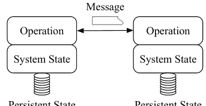

图 1.4 分布式系统中的资产主要类型。

当我们说一个系统是安全的，我们期望系统在其资产受到保护方面表现出三个属性 [2]：(1) 机密性，(2) 完整性，和 (3) 可用性。机密性是指系统绝不会向未经授权的用户泄露敏感信息（系统状态或持久状态）的保证。完整性是指资产保持完整，对资产的任何未经授权的修改（无论是代码、虚拟内存、状态还是消息）都可以被检测到。此外，消息在被接受之前必须经过身份验证，这将防止攻击者注入伪造消息。安全语境下的可用性解释与可靠计算语境下的解释截然不同。这里的可用性是指资产可供授权用户访问。例如，如果有人加密了一些数据，但丢失了解密所需的安全密钥，那么系统就不安全，因为数据将不再可供任何人访问。当与可靠计算相结合并在系统语境下时，可用性正在转变为可靠计算社区所定义的含义，即系统可能正在运行且运行正确，以便授权用户随时访问任何资产。

实现系统安全的重要工具是密码学 [11]。简单来说，密码学是设计密码的艺术，它以一种使明文含义不再明显的方式对其进行打乱（即加密过程），并在需要时取回明文（即解密过程）。加密后的文本通常称为密文。加密是确保机密性最强大的方法，也是保护系统完整性的基础。加密算法有两种类型，一种称为对称加密，其中使用相同的安全密钥进行加密和解密（类似于家用锁，相同的钥匙用于锁定和解锁），另一种称为非对称加密，其中使用一个密钥加密，使用另一个不同的密钥解密。对于对称加密，在联网系统中，密钥分发是一个挑战，因为加密和解密都需要相同的密钥。非对称加密提供了将加密密钥提供给任何希望向所有者发送加密消息的人的可能性，只要相应的解密密钥得到妥善保护。确实，非对称加密为密钥分发提供了基础。加密密钥也称为公钥，因为它可以公开提供而不会危及系统安全，而解密密钥称为私钥，因为它必须保持私密，即，如果构建在非对称加密之上，丢失私钥将瘫痪整个系统的安全性。为了进一步增强密钥分发的安全性，建立了公钥基础设施，以便由基础设施保证公钥的所有权。

对称加密基于两种基本操作：替换和置换。替换用其他符号替换明文中的每个符号，旨在伪装原始消息，而置换则改变明文中符号的位置。前者仍然保留明文中符号的顺序，而后者产生原始明文的排列，从而打破符号的任何既定模式。这两种基本操作互补，如果一起使用，会使加密更强。这也规定对称加密一次处理一个明文块，通常称为分组密码。使用分组密码加密大量明文时，必须将其分成多个块。一种天真的加密方法是分别加密每个块。虽然加密可以并行完成，因此可以快速完成，但这样做会产生一个问题：攻击者可以重新排序一些密文，使含义完全改变，而接收方无法检测到这一点！为了缓解这个问题，引入了各种密码模式，例如密码块链模式和密码反馈模式。密码模式的本质是在加密时将连续块链接在一起。结果，对密文相对顺序的任何更改都会破坏解密。

然而，仅靠加密不足以构建安全系统。我们还需要身份验证、授权和确保不可否认性等机制，以及许多其他要求。非常重要的密码学构造包括加密哈希函数（也称为单向或安全哈希函数），例如安全哈希标准（SHA 系列算法）、消息认证码和数字签名。

加密哈希函数会对给定的任意消息 P 进行哈希处理并生成固定长度的比特字符串，它必须满若干要求：

- 哈希函数必须高效，即给定消息 P，P 的哈希值 Hash(P) 必须能快速计算。
- 给定 Hash(P)，几乎不可能找到 P。在此语境下，P 通常被称为哈希的原像。换句话说，此要求表示几乎不可能找到哈希的原像。很容易理解，如果 P 的长度远大于 Hash(P)，则很容易满足此要求，因为哈希处理过程中必然丢失了信息。但是，即使 P 比 Hash(P) 短，此要求仍然必须成立。
- 给定消息 P 及其对应的哈希值 Hash(P)，几乎不可能找到另一个消息 P'，使其产生完全相同的哈希值，即 Hash(P) = Hash(P')。如果发生 Hash(P) = Hash(P') 的不幸情况，我们称之为冲突。此要求表示在计算上应禁止找到冲突。

加密哈希函数在生成哈希字符串时必须考虑消息中的每一个比特，以便即使只更改一个比特，输出也会完全不同。加密哈希函数已经出现了几代。目前最常用的称为安全哈希算法 (SHA)，由美国国家标准与技术研究院发布为联邦信息处理标准。SHA 算法族有四个类别：SHA-0、SHA-1、SHA-2 和 SHA-3。SHA-0 和 SHA-1 都生成 160 比特字符串，该


现在被认为已过时。SHA-2 生成 256 位字符串或 512 位字符串，目前常用。

数字签名是构建安全系统中另一种非常重要的密码学构造。数字签名模拟法律文件中的实体签名，必须具备以下属性：

- 接收已签名文档的接收者可以验证签名者的身份。这是为了便于对签名者进行身份认证。与现实世界不同，在现实世界中，官员可以通过检查政府颁发的身份证件（如驾驶执照或护照）来验证签名者身份，数字签名必须以这种方式设计：数字签名的远程接收者仅根据数字签名本身即可对签名者进行身份认证。
- 数字签名的签名者在签名后不可否认已签名的文档。
- 除了已签名文档的原始签名者外，没有其他人可能伪造了签名。

第一种属性用于对已签名文档的签名者进行身份认证。第二种和第三种属性本质上是相同的，因为如果另一个人可能伪造了数字签名，那么原始签名者实际上可以否认已签名的文档。换句话说，如果原始签名者不能否认已签名的文档，那么必然是没有其他人能伪造数字签名。数字签名通常通过对文档的哈希使用公钥密码学来生成。这个文档的哈希通常称为消息摘要。使用消息摘要是因为公钥密码学必须使用长密钥，与对称密码学相比计算开销非常大。在这种情况下，安全哈希函数的无冲突要求对于保护数字签名的完整性至关重要。

消息认证码（MAC）基于安全哈希函数和对称密钥加密。更具体地说，发送者将要发送的消息与安全密钥连接在一起，然后对其进行哈希处理以生成 MAC。它在消息交换中被广泛用于同时对发送者进行身份认证并保护消息的完整性。身份认证的基础是只有发送者和接收者知道用于生成 MAC 的安全密钥。由于安全哈希函数的特性，如果消息中的任何比特在传输过程中被更改，传输的 MAC 将与接收者重新计算的 MAC 不同。因此，MAC 也被用作一种校验和，其保护强度远强于传统的校验和方法（如 CRC16）。

在传统系统中，客户端和服务器之间的通信是在会话中进行的。因此，安全机制是围绕这一需求设计的。在会话开始时，客户端和服务器会相互进行身份认证。一旦身份认证步骤完成，就会创建一个会话密钥，并用于加密会话中交换的所有消息。对于长时间会话，会话密钥可能会被刷新。对于通过 Web 进行的会话，通常使用安全套接层（SSL）（或传输层安全）协议。服务器身份认证通过数字签名和由公钥基础设施保护的公钥证书来完成。客户端身份认证通常通过用户名和密码完成。某些企业系统，如目录服务，采用基于质询-响应方法的更复杂的身份认证算法。

# REFERENCES

- 1. A. Avizienis 和 L. Chen. 关于执行期间软件容错 n 版本编程的实现. 在 IEEE 国际计算机软件与应用会议论文集中，第 149–155 页，1977.
- 2. A. Avizienis, J. C. Laprie, B. Randell, 和 C. Landwehr. 可靠与安全计算的基本概念和分类. IEEE 可靠与安全计算事务, 1(1):11–33, 2004.
- 3. M. Y. Chen, E. Kiciman, E. Fratkin, A. Fox, 和 E. Brewer. Pinpoint：大型动态互联网服务中的问题确定. 在 2002 年可靠系统与网络国际会议论文集，DSN ’02，第 595–604 页，华盛顿特区，美国，2002. IEEE 计算机学会.
- 4. M. Franz. 理解和应对软件开发中的内部威胁. 在国际 MCETECH 电子技术会议论文集中，第 81–90 页，2008 年 1月.
- 5. L. Lamport, R. Shostak, 和 M. Pease. 拜占庭将军问题. ACM 编程语言与系统事务, 4:382–401, 1982.
- 6. P. M. Melliar-Smith 和 B. Randell. 软件可靠性：程序化异常处理的作用. 在关于可靠软件语言设计的 ACM 会议论文集中，第 95–100 页，纽约，美国，1977. ACM.
- 7. C. P. Pfleeger, S. L. Pfleeger, 和 J. Margulies. 计算安全（第 5 版）. Pearson, 2015.
- 8. B. Randell 和 J. Xu. 恢复块概念的演变. 在软件容错中，第 1–22 页. John Wiley & Sons Ltd, 1994.
- 9. J. Shore. 快速失败. IEEE 软件, 第 21–25 页，2004 年 9月/10月.
- 10. A. S. Tanenbaum 和 M. V. Steen. 分布式系统：原理与范式. Prentice Hall, 第 2 版, 2006.
- 11. A. S. Tanenbaum 和 D. J. Wetherall. 计算机网络（第 5 版）. Pearson, 2010.
- 12. L. Tewksbury, L. Moser, 和 P. Melliar-Smith. CORBA 应用的在线升级技术. 在分布式应用与互操作系统新发展中，IFIP 信息处理国际联合会第 70 卷，第 257–271 页. Springer US, 2002.

# 日志与检查点

检查点和日志是实现分布式系统可靠性的最关键技术 [7]。它们本身提供了一种相对容易实现且运行时开销低的容错形式。虽然当故障发生时可能会丢失一些信息（如果仅使用检查点），且故障后的恢复时间通常比更复杂的容错方法更长，但对于许多应用来说可能已经足够。此外，它们被用于所有级别的可靠性机制中。

分布式系统的检查点是指系统状态的副本 [7]。如果系统故障后可用检查点，则可以用它将系统恢复到检查点创建时的状态。检查点是指定期获取系统状态副本并将检查点保存到能够容忍故障的稳定存储中的操作。

为了将系统恢复到故障发生前的时点，除了定期检查点外，还必须记录其他恢复信息。通常会记录系统的所有传入消息。其他非确定性事件也可能需要记录，以确保正确恢复。

检查点和日志提供了一种回滚恢复形式 [7]，因为它们可以将系统恢复到故障前的状态。相比之下，存在其他实现前滚恢复的方法，即通过在系统中引入进程冗余，可以将失败的进程恢复到当前状态。然而，前滚恢复协议通常会产生显著更高的运行时开销并需要更多物理资源。

## 2.1 系统模型

在本节中，我们定义了本章中介绍的检查点和日志算法所使用的系统模型。这些算法在由 N 个进程组成的分布式系统中执行。系统内的进程通过发送和接收消息相互交互。这些进程也可以通过消息交换与外部世界交互。来自外部世界的分布式系统输入消息通常是系统用户发送的请求消息。系统的输出消息是相应的响应消息。图 2.1 显示了一个由 4 个进程组成的示例分布式系统。

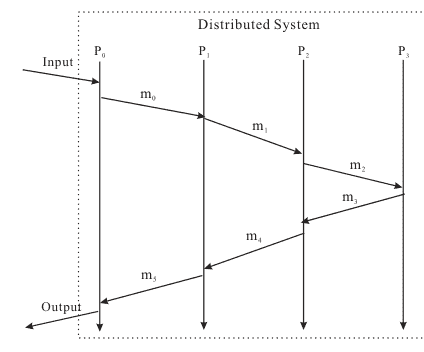

图 2.1 一个示例分布式系统。


### 2.1.1 故障模型

在这样的分布式系统中，故障可能发生在某个进程上。但是，假设当进程失败时，它仅仅停止执行并丢失所有易失性状态（即，采用故障停止模型 [18]）。此外，假设任何两个进程都可以建立可靠连接（例如 TCP 连接）进行通信。尽管网络可能会丢失消息，但可靠通道可以有效地屏蔽此类丢失。自然地，可靠连接确保可靠连接两个端点之间的先进先出（FIFO）属性。此假设还意味着网络不会分区，即，它不会阻止系统中两个或多个进程长时间相互交互。

### 2.1.2 进程状态和全局状态

单个进程的状态由其在操作系统中的整个地址空间定义。通用检查点库（例如 Condor [23]）通常将整个地址空间保存为进程的检查点。当然，基于应用程序语义，地址空间中的并非所有内容都有意义。因此，通过利用应用程序语义，进程的检查点可能被缩小得更小。

分布式系统的状态通常被称为系统的全局状态 [5]。它不是分布式系统中进程状态的简单聚合，因为进程之间相互交换消息，这意味着一个进程可能因果依赖于其他一些进程。这种依赖必须在全局状态中保留。假设分布式系统中的每个进程定期进行检查点，这意味着如果进程失败，除非不同进程的检查点是协调的 [5]，否则我们可能无法使用最新的一组检查点进行正确恢复。要了解原因，请考虑图 2.2 中说明的三种场景，其中全局状态是通过分别在进程 P0、P1 和 P2 上采取的三个检查点 C0、C1、C2 构建的。

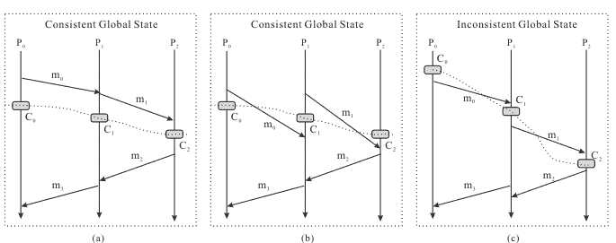

图 2.2 一致和不一致全局状态示例。

图 2.2(a) 显示了一种场景，其中不同进程采取的检查点不兼容，因此在发生故障时无法用于恢复系统。让我们看看原因。在此场景中，P0 向 P1 发送消息 m0，随后 P1 向 P2 发送消息 m1。因此，P2 的状态可能依赖于 P1 在接收 m1 后的状态，而 P1 的状态在接收 m0 后可能依赖于 P0 的状态。检查点 C0 在 P0 向 P1 发送消息 m0 之前采取，而检查点 C1 在 P1 接收 m0 之后采取。这些检查点不兼容，因为 C1 反映了 m0 的接收，而 C0 没有反映 m0 的发送，也就是说，依赖关系被打破。同样，C2 反映了 m1 的接收，而 C1 没有反映 m1 的发送。

### 示例 2.1

为了更好地理解问题，请考虑以下示例。假设 P0 和 P1 分别代表两个银行账户 A 和 B。m0 的目的是在 P0 借记账户 A 后向账户 B 存入 $100。P0 在借记操作之前采取检查点 C0，P1 在接收并处理存款请求（即 m0）之后采取检查点 C1，如图 2.2(a) 所示。如果 P0 在发送存款请求（m0）后崩溃，而 P1 在采取检查点 C1 后崩溃，则在恢复时，P1 的状态将反映 $100 的存款（来自账户 A），而 P0 的状态不会反映相应的借记操作。因此，$100 看起来像是凭空出现的，这显然不是实际发生的情况。本质上，使用错误的一组检查点构建的全局状态不符合自分布式系统初始状态以来可能发生的状态。这种全局状态被称为不一致全局状态。

接下来，让我们看一个场景（如图 2.2(b) 所示），其中一组检查点可以用于将系统正确恢复到故障前的较早状态。$P_0$ 采取的检查点 ($C_0$) 反映了 $m_0$ 的发送事件。检查点 $C_1$ 由 $P_1$ 在接收 $m_0$ 后采取，因此，对 $P_0$ 的依赖由 $C_1$ 捕获。同样，$P_2$ 对 $P_1$ 的依赖也由 $P_2$ 采取的检查点 $C_2$ 保留。这种全局状态是一致全局状态的一个示例。当然，检查点后的执行，例如 $m_2$ 和 $m_3$ 的发送和接收，在恢复时将丢失。

图 2.2(c) 中描述的场景是最微妙的一个。在此场景中，$P_0$ 在发送消息 $m_0$ 后采取检查点，而 $P_1$ 在接收 $m_0$ 之前但在发送 $m_1$ 之后采取检查点，$P_2$ 在接收 $m_1$ 之前采取检查点。这意味着检查点 $C_0$ 反映了发送 $m_0$ 导致的状态变化，而 $C_1$ 并未包含接收 $m_0$ 导致的状态变化。因此，此组检查点无法在故障后用于恢复系统，因为 $m_0$ 和 $m_1$ 将丢失。但是，使用此类一组检查点重建的全局状态仍然符合一致全局状态的条件，因为它是一种可能发生的状态，即消息 $m_0$ 和 $m_1$ 仍在传输到其目的地的途中。为了适应此场景，引入了一种额外的状态类型，称为通道状态，作为分布式系统状态的一部分 [5]。

为了正确定义通道状态，有必要提供分布式系统更严格（且更抽象）的定义。分布式系统由两种类型的组件组成 [5]：

- 一组 $N$ 个进程。每个进程反过来由一组状态和一组事件组成。其中一个状态是进程启动时的初始状态。只有事件才能触发进程状态的变化。

- 一组通道。每个通道是两个进程之间的单向可靠通信通道。通道的状态是沿通道仍在传输中的消息集合（即，它们尚未被目标进程接收）。两个进程之间的 TCP 连接可以被视为两个通道，每个方向一个。

一对相邻进程始终由一对通道连接，每个方向一个。进程中的事件（例如消息的发送或接收）可能会改变进程的状态以及它关联的通道的状态（如果有）。例如，将消息注入通道可能会将通道的状态从空变为包含该消息本身的状态。

使用此修订后的定义，第三个场景中的通道状态将由两个正在传输的消息 m0 和 m1 组成。如果在此场景中，除了检查点之外还能正确记录通道状态，则恢复将成为可能（即，恢复期间 m0 将被传送到 P1，m1 将被传送到 P2）。

### 2.1.3 分段确定性假设

基于检查点的协议只能确保将系统恢复到最近记录的一致全局状态，之后发生的所有执行（如果有）都将丢失。日志记录可用于将系统恢复到故障前的状态，前提是记录了所有事件（可能更改进程状态的事件），并且在恢复时日志可用。这就是所谓的分段确定性假设 [21]。根据此假设，可以识别所有非确定性事件，并且必须为每个事件记录足够的信息（称为确定因子 [1]）。非确定性事件最明显的例子是消息的接收。其他示例包括系统调用、超时和中断的接收。在本章中，我们通常假设唯一的非确定性事件是消息的接收。请注意，消息的发送不是确定性事件，即，它由非确定性事件或进程的初始状态决定 [7]。

### 2.1.4 输出提交

分布式系统通常从外部世界接收消息并向其发送消息，例如分布式系统提供的服务的客户端。一旦消息发送到外部世界，分布式系统的状态可能会暴露给外部世界。如果发生故障，外部世界无法


可用于恢复。因此，为了确保恢复后的状态与外部视图一致，必须在向外部世界发送消息之前记录足够的恢复信息。这也就是所谓的输出提交问题 [21]。

### 2.1.5 稳定存储

日志和检查点协议的一项基本要求是稳定存储的可用性。稳定存储可以经受住进程故障，因为在恢复时，存储在稳定存储中的信息可以立即供恢复进程使用。因此，所有检查点和记录的消息都必须存储在稳定存储中。

稳定存储有多种形式。若仅需容忍进程故障，使用本地磁盘作为稳定存储即可。若需容忍磁盘故障，可使用冗余磁盘（如 RAID-1 或 RAID-5 [14]）作为稳定存储。复制文件系统，例如 Google 文件系统 [9]，可用作更可靠的稳定存储。

## 2.2 基于检查点的协议

基于检查点的协议不依赖分段确定性假设，因此它们更容易实现，限制也更少（因为开发者无需识别所有形式的非确定性事件并正确记录它们）。然而，权衡在于，选择使用基于检查点协议的分布式系统必须愿意容忍执行丢失，除非在每个事件之前都进行检查点，而这通常不切实际。

### 2.2.1 非协调检查点

非协调检查点是指分布式系统中的每个进程都享有完全自主权，可以自行决定何时进行检查点，尽管这看起来很有吸引力，但出于两个主要原因不推荐使用。

首先，进程所取的检查点可能无法用于重建一致的全局状态。在最坏的情况下，系统可能不得不进行级联回滚到初始系统状态（通常称为多米诺效应 [16]），这完全违背了进行检查点的目的。请考虑以下示例。

### 示例 2.2

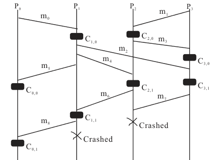

图 2.3 非协调检查点恢复中的多米诺效应示例。

在图 2.3 所示的示例中，进程 P1 在向 P0 发送消息 m8 之后、在有机会进行检查点之前崩溃。P1 取的最后一个检查点是 C1,1。此外，P2 也同时崩溃了。现在，让我们来看看 P1 和 P2 故障的影响：

- P0 上的最新检查点 C0,1 无法使用，因为它与 C1,1 不一致。因此，P0 必须回滚到 C0,0。
- P1 上的最新检查点 C1,1 无法使用，因为它与 C2,1 不一致，即，C1,1 反映了接收 m6，但 C2,1 未反映发送 m6。这意味着 P1 必须回滚到 C1,0。
- 不幸的是，C2,1 与 C1,0 不一致，因为它记录了接收 m4，而 C1,0 未反映发送 m4。这意味着 P2 必须回滚到 C2,0。
- 这反过来会使 P3 上的两个检查点 C3,1 或 C3,0 都无法使用。这将导致 P3 回滚到其初始状态。
- $P_3$ 回滚到其初始状态将导致 $P_2$ 上的 $C_{2,0}$ 失效，因为它反映了因接收 $m_1$ 而产生的状态变化，而该变化未在 $P_3$ 的初始状态中体现。因此，$P_2$ 也必须回滚到其初始状态。
- $P_1$ 回滚到 $C_{1,0}$ 会因 $m_5$ 而使 $P_0$ 上的 $C_{0,0}$ 失效。这意味着 $P_0$ 也必须回滚到其初始状态。
- 最后，$P_0$ 回滚到其初始状态将使 $P_1$ 上的 $C_{1,0}$ 失效，从而迫使 $P_1$ 回滚到其初始状态。因此，分布式系统只能恢复到其初始状态。

其次，为了在恢复期间能够选择一组一致的检查点，必须确定检查点的依赖关系，并将其与每个检查点一起记录。这将带来额外的开销并增加实现的复杂性 [2]。因此，非协调检查点并不像人们预期的那样简单和高效 [3]。

### 2.2.2 Tamir 和 Sequin 全局检查点协议

在这个由 Tamir 和 Sequin [22] 提出的协调检查点协议中，一个进程被指定为协调器，其余进程为参与者。协调器必须了解系统中的所有其他进程。协调器使用两阶段提交协议，以确保不仅各个进程上取的检查点彼此一致，而且全局检查点操作是原子执行的，即要么所有进程都成功创建一组新的检查点，要么它们放弃当前轮次并恢复到之前的检查点集。第一阶段的目标是创建分布式系统的静止点，从而确保各个检查点的一致性。第二阶段是确保从旧检查点到新检查点的原子切换。当参与者未能及时响应协调器时，协调器中止检查点轮次。

#### 2.2.2.1 协议描述。

协调器和参与者的有限状态机规范分别见图 2.4 和图 2.5。

#### 协调器的最终状态机

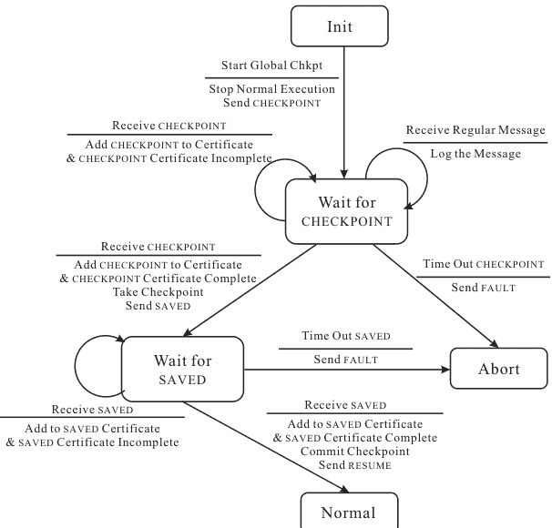

图 2.4 Tamir 和 Sequin 检查点协议中协调器的有限状态机规范。

请注意，如图 2.4 所示的协调器有限状态机规范中，正常状态显示了两次，一次在开始（作为‘init’），另一次在结束，以便清晰。

下面给出了协调器和参与者协议规则的更详细说明。在协议描述中，两轮全局检查点之间进程间交换的消息称为常规消息（相应的执行称为正常执行），以区别于协议为协调目的引入的一组控制消息：

- CHECKPOINT 消息。用于启动全局检查点。它还用于建立分布式系统的静止点，此时所有进程都已停止正常执行。
- SAVED 消息。用于参与者通知协调器它已完成本地检查点。
- FAULT 消息。用于指示已发生超时，当前全局检查点轮次应中止。
- RESUME 消息。由协调器用于通知参与者它们现在可以恢复正常执行。

#### 参与者的最终状态机

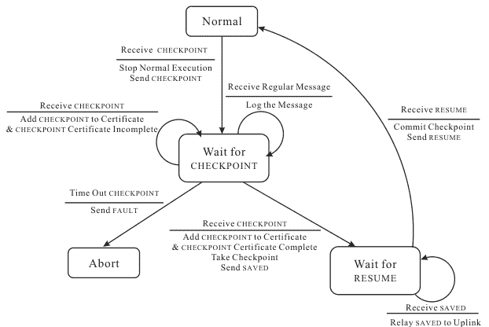

图 2.5 Tamir 和 Sequin 检查点协议中参与者的有限状态机规范。

#### 协调器规则：

- 在第一阶段开始时，协调器停止其正常执行（包括发送常规消息），并沿其每个出站通道发送 CHECKPOINT 消息。
- 然后，协调器等待来自所有入站通道的相应 CHECKPOINT 消息。
- 在等待期间，协调器可能会收到常规消息。此类消息会被记录，并附加到其状态的检查点中。这只能发生在协调器尚未收到 CHECKPOINT 消息的入站通道上。
- 如果协调器在预定义的时间段内未能从一个或多个入站通道收到 CHECKPOINT 消息，则中止检查点轮次。
- 当协调器收到来自所有入站通道的 CHECKPOINT 消息时，它将继续对其状态进行检查点。
- 然后，协调器等待分布式系统中每个进程（除其自身外）的 SAVED 通知。如果它在预定义的时间段内未能从一个或多个入站通道收到 SAVED 消息，则中止检查点轮次。它通过沿每个出站通道发送 FAULT 消息来实现这一点。请注意，协调器在此阶段不可能收到任何常规消息。
- 当协调器收到所有其他进程的 SAVED 通知时，它将切换到新检查点，并沿每个出站通道发送 RESUME 消息。
- 然后，协调器恢复正常执行。

#### 参与者规则：

- 收到 CHECKPOINT 通知后，参与者停止其正常执行，并反过来沿其每个出站通道发送 CHECKPOINT 消息。
- 然后，参与者等待来自所有入站通道的相应 CHECKPOINT 消息。
- 在等待期间，参与者可能会收到常规消息。此类消息会被记录，并附加到其状态的检查点中。同样，这只能发生在参与者尚未收到 CHECKPOINT 消息的入站通道上。
- 如果参与者在预定义的时间段内未能从一个或多个入站通道收到 CHECKPOINT 消息，则通过沿每个出站通道发送 FAULT 消息来中止检查点轮次。
- 一旦参与者收集了一组 CHECKPOINT 消息，它就会对其状态进行检查点。


- 参与者随后将保存的消息发送给其上游邻居（即参与者接收到第一条 CHECKPOINT 消息的那个邻居），并等待 RESUME 消息。
- 当接收到 SAVED 消息（来自其下游邻居之一）时，它将该消息中继给其上游邻居。
- 当接收到 RESUME 消息时，它将消息沿所有出站信道传播，但不包括连接到发送该消息的进程的那条信道。随后，参与者恢复正常执行。

### 示例 2.3

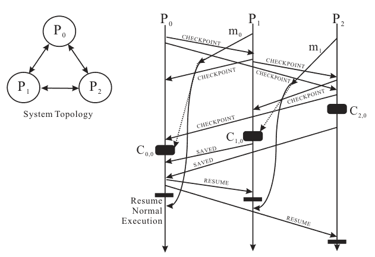

图 2.6 示例三进程分布式系统中 Tamir 和 Sequin 检查点协议的正常运行。

要了解检查点协议的工作原理，请参考图 2.6 所示的示例。在此示例中，我们假设分布式系统由三个进程组成，且三个进程完全互连，即 P0 与 P1 有连接，P1 与 P2 有连接，P2 与 P0 有连接。因此，每个进程都有两个入站信道和两个出站信道，分别连接到其两个邻居。

假设进程 \( P_0 \) 是检查点协调器。它通过沿两个出站信道分别向 \( P_1 \) 和 \( P_2 \) 发送 CHECKPOINT 消息来启动全局检查点。与此同时，\( P_1 \) 向 \( P_0 \) 发送常规消息 \( m_0 \)，\( P_2 \) 向 \( P_1 \) 发送常规消息 \( m_1 \)。

当 \( P_1 \) 接收到来自 \( P_0 \) 的 CHECKPOINT 消息时，它停止正常执行，并沿其各自的出站信道分别向 \( P_0 \) 和 \( P_2 \) 发送 CHECKPOINT 消息。同样，\( P_2 \) 在接收到第一条 CHECKPOINT 消息后，分别向 \( P_0 \) 和 \( P_1 \) 发送 CHECKPOINT 消息。

由于连接具有 FIFO 特性，\( P_0 \) 在从所有入站信道收集所有 CHECKPOINT 消息之前先接收到 \( m_0 \)，且 \( P_1 \) 在接收到来自 \( P_2 \) 的 CHECKPOINT 消息之前先接收到 \( m_1 \)。根据协议规则，此类常规消息会被记录而不是投递，因为一旦启动全局检查点，就必须停止正常执行。这些记录的消息将在本地检查点生成后附加到检查点中。事实上，此类消息反映了分布式系统的信道状态。这些消息在进程恢复正常执行之前不会被投递执行。

当 \( P_0 \) 接收到来自 \( P_1 \) 和 \( P_2 \) 的 CHECKPOINT 消息时，它会生成一个本地检查点 \( C_{0,0} \)，并将消息日志附加到检查点中。同样，\( P_1 \) 在接收到来自 \( P_0 \) 和 \( P_2 \) 的 CHECKPOINT 消息时生成本地检查点，\( P_2 \) 在接收到来自 \( P_0 \) 和 \( P_1 \) 的 CHECKPOINT 消息时生成本地检查点。

随后，\( P_1 \) 和 \( P_2 \) 将其保存的消息发送给 \( P_0 \)，即全局检查点协调器。\( P_0 \) 随后通过向每个进程发送 RESUME 消息，通知 \( P_1 \) 和 \( P_2 \) 恢复正常执行。

在更复杂的分布式系统中，某些进程与协调器没有直接连接，这将要求协调器的一些邻居将保存通知中继给协调器。

#### 2.2.2.2 协议的正确性。

不难理解，该协议始终生成一组可用于在无故障情况下重建一致全局状态的检查点。如图 2.2(a) 和 (b) 所示，一致全局状态仅涉及每对本地状态的两种场景：

- 1. 一个进程在生成本地检查点之前发送的所有消息，在另一个进程生成其本地检查点之前均已被接收并执行。
- 2. 一个进程在生成本地检查点之前发送的某些消息可能在另一个进程已检查点其状态后才到达，但这些消息会被记录到稳定存储中以供重放。

在 Tamir 和 Sequin 协议中，如果协调器或任何参与者在启动全局检查点后均未接收到任何常规消息，则场景 1 成立。另一方面，如果一个进程接收到一条或多条常规消息，它会记录这些消息并将其附加到本地检查点，以确保其可重放性。因此，场景 2 成立。由于协议禁止任何进程在启动（如果是协调器）或接收到第一条 CHECKPOINT 消息（如果是参与者）后继续正常执行（包括发送消息），因此不会有进程在其检查点之前接收到由另一个进程在同一轮中生成其本地检查点之后发送的消息。也就是说，图 2.2(a) 所示的不一致全局状态场景不会发生。

## 2.2.3 Chandy 和 Lamport 分布式快照协议

Tamir 和 Sequin 全局检查点协议非常优雅。然而，它是一种阻塞协议，因为在每一轮全局检查点期间都会挂起正常执行。对于不希望将正常执行挂起可能较长时间的应用程序，Chandy 和 Lamport 分布式快照协议 [5] 可能更可取。

Chandy 和 Lamport 分布式快照协议 [5] 是一种非阻塞协议，因为全局检查点不会中断正常执行。然而，与 Tamir 和 Sequin 协议不同，Chandy 和 Lamport 分布式快照协议仅关注如何生成一致的全局检查点，并未规定如何确定检查点轮次的结束以及如何原子化地切换到新的全局检查点的机制。

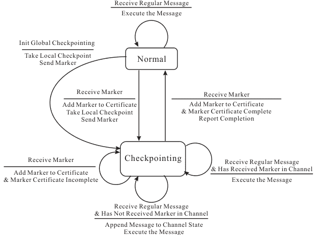

图 2.7 Chandy 和 Lamport 分布式快照协议的有限状态机规范。

### 2.2.3.1 协议描述。

Chandy 和 Lamport 分布式快照协议的有限状态机图如图 2.7 所示。进程在两轮全局检查点之间处于 Normal 状态，在全局检查点轮次期间处于 Checkpointing 状态。进程可能会遇到多种事件：

- 分布式系统中的任何进程都可以启动全局检查点。一旦进程决定启动一轮全局检查点，它会生成一个本地检查点，并向每个出站信道发送 Marker 消息。因此，进程的状态从 Normal 变更为 Checkpointing。
- 进程在首次接收到 Marker 消息时，会经历相同的状态转换（从 Normal 到 Checkpointing）并执行相同的操作，区别在于它会将 Marker 记录在有限状态机图中称为 Marker Certificate 的数据结构中。Marker Certificate 数据结构会跟踪哪个入站信道已接收到 Marker，以及所有入站信道是否都已接收到 Marker。当每个入站信道都已接收到 Marker 时，Marker Certificate 即称为完整。
- 当进程处于 Checkpointing 状态并从某个信道接收到 Marker 消息时，它会将 Marker 消息添加到 Marker Certificate 中，并检查 Marker Certificate 是否完整。如果 Marker Certificate 现已完整，进程将转换到 Normal 状态（并可能向某个预定义服务器报告全局检查点的完成）。否则，进程将保持在 Checkpointing 状态。
- 无论处于 Normal 还是 Checkpointing 状态，进程都可能接收到常规消息。常规消息始终立即执行。这与 Tamir 和 Sequin 全局检查点协议有显著不同。只有当进程处于 Checkpointing 状态且尚未在此信道上接收到 Marker 消息时，常规消息才会被附加到其接收所在的信道状态中。

### 示例 2.4

图 2.8 显示了在三进程分布式系统中分布式快照协议的一个示例运行。P0 是全局检查点轮次的发起者。P0 生成一个本地检查点，并沿每个出站信道发送 Marker 消息。接收到 Marker 消息后，P1 立即生成一个本地检查点，并反过来向每个出站信道发送 Marker 消息。同样，P2 在接收到第一条 Marker 消息（来自 P1）时生成一个本地检查点，并分别向连接到 P0 和 P1 的每个出站信道发送 Marker 消息。

生成本地检查点后，进程开始记录（如果有）到达每个入站信道的消息。进程一旦从某个信道接收到 Marker 消息，就会停止为该信道记录消息。记录的消息将


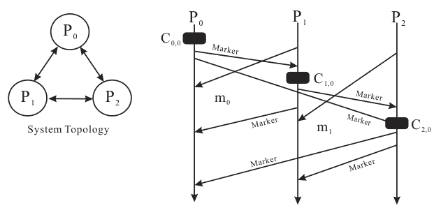

图 2.8 在示例三进程分布式系统中，Chandy 和 Lamport 全局快照协议的正常运行。

成为每个通道的状态。对于 P0，通道状态由消息 m0 组成。对于 P1，通道状态由消息 m1 组成。P2 的通道状态为空，因为它在从每个入站通道收到标记消息之前未收到任何消息。请注意，接收到的常规消息（例如 m0 或 m1）会立即执行，这与 Tamir 和 Sequin 全局检查点协议截然不同。

## 2.2.4 讨论

本节介绍的两个全局检查点协议有许多相似之处。

- 两者几乎依赖相同的系统模型，并使用特殊控制消息来传播和协调全局检查点。
- 两者都认识到需要捕获通道状态以确保系统的可恢复性。
- 两种协议捕获通道状态的机制几乎相同，如图 2.9 所示。
  - 在两种协议中，进程在启动全局检查点时（在发起方）或在收到第一个控制消息时（即 Chandy 和 Lamport 协议中的标记消息，以及 Tamir 和 Sequin 协议中的检查点消息），开始为每个通道记录消息（用于通道状态）。
- 在两种协议中，当进程在该通道上收到控制消息时，停止记录消息并结束每个通道的通道状态。
- 两种协议的通信开销相同（即，使用相同数量的控制消息来生成全局检查点）。

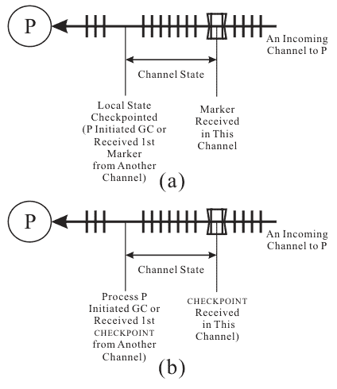

图 2.9 通道状态定义的比较：（a）Chandy 和 Lamport 分布式快照协议，以及（b）Tamir 和 Sequin 全局检查点协议。

两种协议在生成全局检查点的策略上也有所不同。

- Tamir 和 Sequin 协议更为保守，因为进程一旦得知全局检查点轮次已开始，就会立即暂停其正常执行。相比之下，在 Chandy 和 Lamport 协议中，全局检查点轮次期间本可避免暂停正常执行。
- Tamir 和 Sequin 协议采用阻塞设计的原因是，进程在进行本地检查点之前先捕获通道状态。在捕获通道状态期间，进程无法执行接收到的常规消息，因为这样做会改变进程状态，从而可能导致全局检查点不一致。另一方面，在 Chandy 和 Lamport 协议中，进程在进行本地检查点后才捕获通道状态，从而能够在不导致全局检查点不一致的风险下执行常规消息。
- Tamir 和 Sequin 协议更加完整和健壮，因为它确保了全局检查点轮次的原子性。如果发生故障，当前轮次将被中止。Chandy 和 Lamport 协议未定义任何机制来确保这种原子性。推测，Tamir 和 Sequin 协议中定义的机制可以融入以改进 Chandy 和 Lamport 协议。

## 2.3 基于日志的协议

基于检查点的协议只能确保将系统恢复到最近记录的一致全局状态，之后发生的所有执行（如果有）都会丢失。日志可用于将系统恢复到故障发生前的状态，前提是分段确定性假设成立。在基于日志的协议中，进程的执行被建模为连续的状态间隔 [21]。每个状态间隔由非确定性事件（例如接收消息）或进程的初始化启动，随后是一系列确定性状态变化。只要记录了非确定性事件，整个状态间隔就可以重放。

例如，图 2.10 显示了三个状态间隔。第一个状态间隔从进程 \( P_i \) 的初始化开始，在执行第一个接收到的消息 \( m_1 \) 之前结束。请注意，发送消息 \( m_0 \) 不被视为非确定性事件。第二个状态间隔由消息 \( m_1 \) 的接收事件启动，在接收 \( m_3 \) 之前结束。同样，第三个状态间隔从消息 $m_3$ 的接收事件开始，在接收 $m_5$ 之前结束。

在本节剩余部分中，我们假设唯一的非确定性事件类型是接收应用程序消息。因此，日志记录等同于消息日志记录。

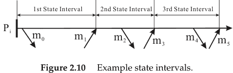

就所有实际目的而言，日志记录始终与检查点结合使用，以获得两个好处：

- 1. 它限制了恢复时间，因为从故障中恢复时，进程可以从其上次检查点（而非初始状态）重新启动，并通过重放记录的非确定性事件，在故障发生前恢复其状态。
- 2. 它限制了日志的大小。通过定期进行检查点，可以对检查点之前记录的事件进行垃圾回收。

日志协议可分为三种类型 [7]：

- 悲观日志记录。接收到的消息在执行前同步记录。
- 乐观日志记录。为了减少延迟开销，非确定性事件首先存储在易失性内存中，然后异步记录到稳定存储。因此，进程故障可能导致某些消息永久丢失，这将强制回滚到早于进程故障时的状态。
- 因果日志记录。尚未记录到稳定存储的非确定性事件（及其决定因素，例如进程接收消息的传递顺序）会随每条发送的消息一起携带。借助携带的信息，进程可以访问所有可能对其状态产生因果影响的非确定性事件，从而在发生故障时实现系统的一致恢复。

在乐观日志记录 [21, 19, 20] 和因果日志记录协议 [1] 中，必须跟踪进程之间的依赖关系，并将足够的依赖信息随每条发送的消息一起携带。这不仅增加了日志机制的复杂性，更重要的是，使故障恢复变得更加复杂和昂贵，因为恢复进程必须找到一种方法来检查其日志并确定是否丢失了任何消息，并且通常会在其他进程中引起级联恢复操作。

另一方面，悲观日志协议在设计和实现上要简单得多，且故障恢复可以快得多 [11]（具体优势将在下面的 2.3.1 节中详细阐述）。因此，我们的讨论将集中于悲观日志技术，不会再对乐观日志和因果日志进行进一步阐述。

### 2.3.1 悲观日志记录

悲观日志记录最直接的实现是在进程执行每条传入消息之前，将其同步记录到稳定存储中。每个进程可以按自己的节奏定期检查点其状态，而无需与分布式系统中的其他进程协调。在从故障中恢复时，进程使用上次检查点恢复其状态，并重放所有记录的传入消息，使其恢复到故障发生前的状态。

### 示例 2.5

考虑图 2.11 所示的示例。进程 P1 在发送消息 m8 后崩溃。进程 P2 在发送消息 m9 后崩溃。恢复时，P1 使用检查点 C1,0 恢复其状态。由于它将处于由接收消息 m0 启动的状态间隔中，消息 m2、m4 和 m5 将被确定性地重新生成。这不应该是个问题，因为接收进程应该具有检测重复的机制。随后，记录的消息 m8 被重放，这会触发一个新的状态间隔，其中 m8 将被确定性地重新生成（并被 P0 丢弃）。同样，恢复时，P2 使用检查点 C2,0 恢复其状态。恢复的状态处于由


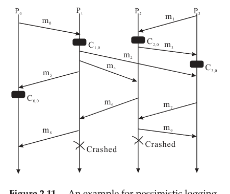

m1 的接收，消息 m3 将被确定性地重新生成并发送到 P3。同样，P3 会检测到它是重复消息并将其丢弃。此外，记录的消息 m4 和 m7 会被重放，导致发送消息 m6 和 m9，这些消息将被 P1 和 P3 忽略。

悲观日志记录可以处理两个或多个进程的并发失败和恢复，如图 2.11 所示的示例所示。进程恢复期间（即，它正在使用最新检查点并重放所有记录的消息来恢复其状态时）接收到的消息，可以被缓冲，并在进程完成恢复时进行检查。当一个进程正在进行恢复时，另一个进程可能会失败并并发地自行恢复，如上例所示。在这种情况下，P1 将接收到由另一个正在恢复的进程 P2 重新生成的重复消息（m6）并暂时缓冲它。P1 完成恢复后会立即丢弃它。同样，P2 将接收到由 P1 重新生成的重复消息 m4，恢复完成后将被丢弃。

#### 2.3.1.1 悲观日志记录的优点。

显然，悲观日志记录具有许多非常理想的特性：

- 进程不需要跟踪其依赖关系。每个进程的传入消息的相对顺序自然地反映在日志中（*即*，在恢复期间，日志中的消息将按记录顺序重放）。因此，悲观日志记录机制易于实现且不易出错。

- 悲观日志记录下的输出提交是免费的。这非常适合与用户频繁交互的分布式应用程序。

- 不需要执行协调的全局检查点，因为通过重放记录的消息，进程可以始终使其与系统中的其他进程保持一致。这进一步降低了为应用程序添加回滚恢复支持的复杂性。此外，进程可以决定何时是进行本地检查点的最佳时机，例如，当其消息日志过大时。

- 恢复可以完全在失败进程的本地进行。对其他进程的唯一影响是可能接收到重复消息并将其丢弃。因此，恢复通常比乐观日志记录和因果日志记录更简单且更快。故障恢复的本地化也意味着悲观日志记录支持多个进程的并发故障恢复。

#### 2.3.1.2 讨论。

有三个问题需要进一步阐述：重连、消息重复检测以及原子消息接收和日志记录。

#### 重连。

进程必须能够应对临时连接失败，并准备好接受来自其他进程的重连。这是可恢复分布式系统的基本要求。这要求一种设计，其中应用程序逻辑与传输层事件独立。这可以通过使用基于事件 [8] 或基于文档的分布式计算架构（例如 Web 服务 [15]），并配合适当的异常处理来实现。

#### 消息重复检测。

如前所述，进程必须能够检测重复消息，因为它可能会在恢复期间接收到由另一个进程重放的此类消息。尽管 TCP 等传输层协议具有内置机制来检测和丢弃重复消息，但此类机制无关紧要，因为它仅在建立的连接内工作。在故障恢复期间，正在恢复的进程必然会重新建立与其他进程的连接，因此，无法依赖此类机制。此外，并非所有应用层协议都支持重复检测（它们通常依赖于底层传输层协议来完成此操作）。在这种情况下，必须修改应用层协议以添加消息重复检测功能。对于基于 XML 的协议，例如 SOAP [15]，可以通过引入一个额外的头部元素来实现，该元素携带一个 <sender-id, sequence-number> 元组，其中 sender-id 是发送进程的唯一标识符，sequence-number 是发送进程发出的消息的序列号。序列号建立了进程 $P_i$ 向另一个进程 $P_j$ 发送消息的顺序。它必须从两个进程都知道的初始序列号（分配给第一条发送的消息）开始，并且对于每条额外发送的消息都必须连续递增，中间没有任何间隔。Web 服务可靠消息传递标准 [6] 指定了一个满足上述要求的协议。

#### 原子消息接收和日志记录。

在协议描述中，我们隐含地假设消息的接收和同一消息的日志记录是在单个原子操作中执行的。显然，仅使用可靠的通信信道并不能保证这种原子性，因为进程可能在接收到消息后但在成功记录消息之前失败，在这种情况下，消息可能会永久丢失。这个问题实际上很好地展示了端到端系统设计论点 [17]。为了确保消息接收和日志记录的原子性，必须使用额外的应用层机制。（尽管可以通过特殊硬件 [4] 实现原子接收和日志记录，但这种解决方案对大多数现代系统来说不切实际。）

如图 2.12(a) 所示，可靠信道仅确保发送的消息在发送方暂时缓冲，直到在传输层收到确认。接收方一旦在传输层收到消息就会发送确认。接收方会缓冲接收到的消息，直到应用程序进程获取该消息。如果接收方的应用程序进程在获取消息之前失败，或在完成日志记录

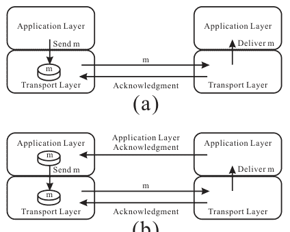

图 2.12 传输层 (a) 和应用层 (b) 可靠消息传递。

消息在稳定存储中，发送方将收不到任何通知，并且已发送的消息不再可用。

为了确保应用层可靠消息传递，发送进程必须存储已发送消息的副本（在应用层），以便可能的重传，直到它从接收进程在应用层收到显式确认消息，如图 2.12(b) 所示。这种应用层可靠消息传递协议确实存在于某些分布式计算范式中，例如 Web 服务 [6]。顺便提一下，将在后续小节中介绍的基于发送方的消息日志记录协议 [13] 包含类似的机制，尽管目的略有不同。

应当注意的是，使用这种应用层可靠消息传递协议不仅对于确保消息接收和日志记录的原子性至关重要，而且对于便利分布式系统从进程故障中恢复也至关重要（例如，传输层连接一端的进程故障会导致连接中断，但这对连接另一端的进程没有负面影响，并且如果当前连接中断，进程随时准备重新连接）。

此外，使用应用层可靠消息传递协议还可以实现以下优化：接收到的消息可以立即执行，而日志记录的

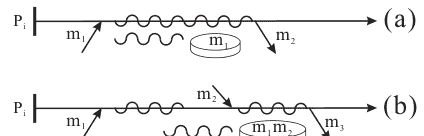

图 2.13 悲观日志记录优化：(a) 并发消息日志记录和执行 (b) 批量消息日志记录。

- 消息日志记录和消息执行可以并发进行（如图 2.13(a) 所示），从而最大限度地减少日志记录造成的延迟影响。

- 如果进程在接收到多个传入消息后发送一条消息，则这些消息的日志记录可以批量在单个 I/O 操作中完成（如图 2.13(b) 所示），进一步降低日志记录延迟。

#### 2.3.1.3 悲观日志记录成本。

尽管已经进行了大量研究工作来设计乐观日志记录和因果日志记录，以避免或最小化日志记录操作（在磁盘上）的数量，假设同步日志记录会带来显著的延迟开销 [1, 19, 20, 21]。在本节中，我们将展示一些实验结果，以表明这种假设往往是不必要的。关键原因是，通过使用专用磁盘，可以轻松确保顺序磁盘 I/O。如今，磁盘提供每秒 100MB 或更高的最大持续数据率是很常见的。这种传输速率正在接近或超过千兆以太网络的有效带宽。此外，随着半导体固态硬盘的日益普及（以及成本降低），顺序磁盘 I/O 可以变得更快，随机磁盘 I/O 的延迟可以大幅降低。通过使用多个日志磁盘并结合磁盘条带化，已经报告了每秒千兆字节的 I/O [10]。

在实验中，使用了一个简单的客户端-服务器 Java 程序，其中服务器进程记录每个传入的请求消息发送


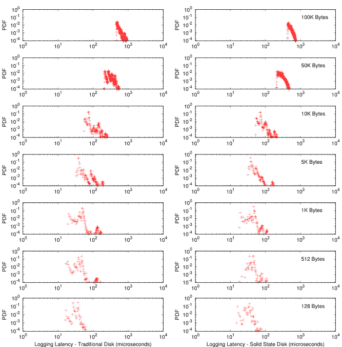

图 2.14 日志延迟的概率密度函数。

由客户端发出并向客户端发送响应。响应消息通过转换客户端的请求形成，其长度与请求相同。服务器节点配备了运行 Windows 7 操作系统的第二代 Core i5 处理器。客户端运行在同一局域网内通过千兆以太网交换机连接的 iMac 计算机上。服务器节点有两个硬盘，一个是主轴转速为 7,200 RPM 的传统磁性硬盘，另一个是半导体固态硬盘。每次运行执行 100,000 次迭代。测量了服务器上的日志延迟和客户端上的端到端延迟。

图 2.14 分别展示了使用传统磁盘（左侧）和固态磁盘（右侧）的各种消息大小的日志延迟。此处以日志延迟的概率密度函数（PDF）[12] 序列形式，展示了不同消息长度的实验结果。与简单平均值相比，PDF 提供了关于日志操作开销的更多细节。可以看出，在固态磁盘和传统磁盘上，绝大多数日志操作（针对每条传入消息）对于大小高达 100KB 的消息均可在 1000 $\mu$s 内完成，这意味着日志记录的速率可超过每秒 100MB，接近传统磁盘宣称的数据传输速率上限。对于小消息，日志记录可在 100 $\mu$s 内完成。

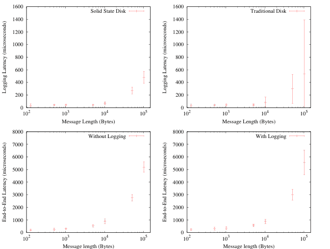

图 2.15 各种条件下的平均日志延迟和平均端到端延迟摘要。

令人有些惊讶的是，固态磁盘的性能并不显著优于传统磁盘，尤其是对于小消息。对于大消息，固态磁盘确实使日志操作的延迟更具可预测性，即标准差 [12] 远小于传统磁盘上的标准差，如图 2.15 所示。

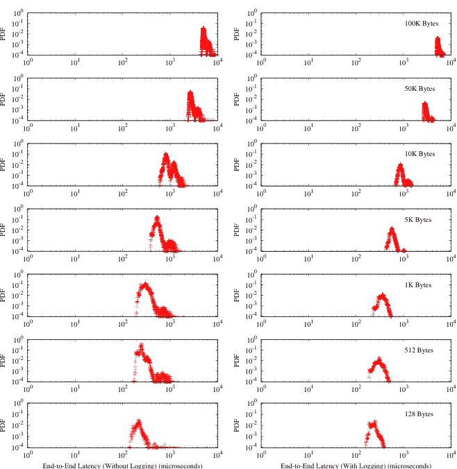

图 2.16 端到端延迟的概率密度函数。

图 2.16 所示的端到端延迟结果证明，悲观日志记录对客户端观察到的系统性能贡献了非常适度（通常小于 10%）的开销。对于高达 100KB 的消息，启用和禁用悲观日志记录时的端到端延迟均在 10ms 以内。对于小消息，端到端延迟可降至约 100μs。在所有情况下，端到端延迟都显著大于日志延迟。对于 100KB 的消息大小，网络上的单向传输延迟估计约为 2600μs（不带日志记录的端到端延迟的一半）。这意味着网络能够提供略低于每秒 40MB 的传输速率。

## 2.3.2 基于发送方的消息日志记录

对于不希望在稳定存储中同步记录消息的分布式应用，可以使用基于发送方的消息日志记录协议 [13] 来实现对进程故障的有限鲁棒性。基于发送方的消息日志记录协议的基本思想是在发送方的易失性内存中记录消息。如果接收进程失败，它可以获取发送进程中记录的消息以进行恢复。为了避免故障后从初始状态重新启动，进程可以定期检查点其本地状态，并异步地将消息日志写入稳定存储（作为检查点的一部分）。

与 2.3.1 节中介绍的基于接收方的消息日志记录协议不同，后者可以隐式记录接收消息的相对顺序，此类顺序信息（即消息的确定因子）必须由消息的接收者显式提供给发送方。此外，在发送顺序信息后，接收者需要等待针对顺序消息的显式确认。在收到确认之前，接收者不得向其他进程发送任何消息（但是，它可以立即无延迟地执行接收到的消息，类似于 2.3.1.2 节中讨论的悲观日志记录优化。此限制旨在防止孤儿消息和孤儿进程 [7] 的形成，这将迫使孤儿进程在另一进程恢复期间回滚其状态。

孤儿消息是指进程在故障前发送，但在进程恢复时无法保证被重新生成的消息 [7]。孤儿进程是指接收孤儿消息的进程。如果一个进程发送出一条消息，随后在其接收到的消息的确定因子被正确记录之前失败，则发送的消息成为孤儿消息。

### 2.3.2.1 数据结构

在基于发送方的消息日志记录协议中，每个进程必须维护以下数据结构：

- 一个计数器 `seq_counter`，用于为每条传出（应用）消息分配序列号（使用计数器的当前值）。计数器初始化为 0，每发送一条消息递增 1。序列号用于重复检测（在接收进程中）。

- 一个用于对传入消息进行重复检测的表。该表由一系列条目组成，每个与当前进程通信的进程对应一个条目。每个条目的形式为 `<process_id,max_seq>`，其中 `max_seq` 是当前进程从标识符为 `process_id` 的进程接收到的最大序列号。如果一条消息携带的序列号低于或等于相应进程的 `max_seq`，则该消息被视为重复消息。

- 另一个计数器 `rsn_counter`，用于记录传入消息的接收/执行顺序。计数器初始化为 0，每接收一条消息递增 1。消息的接收顺序由计数器的当前值表示，并发送回消息的发送进程以进行日志记录。

- 一个消息日志（在易失性内存中），用于记录进程发送的消息。除了发送的消息外，每条消息还记录以下元数据：
  - 目标进程 ID，`receiver_id`；
  - 发送序列号，`seq`；
  - 接收序列号，`rsn`。

目标进程 ID、发送序列号和消息将在消息发送前记录。然而，接收顺序号将在进程稍后接收到该信息后记录。

- 一个历史记录列表，用于记录上次检查点以来接收的消息。列表中的每个条目包含每条接收消息的以下信息：
  - 发送进程 ID，`sender_id`；
  - 发送序列号，`seq`；
  - 接收序列号，`rsn`（由当前进程分配）。

历史记录列表用于查找接收到的重复消息的接收顺序号。在接收到重复消息时，进程应提供相应的（原始）接收顺序号，以便消息的发送方可以正确记录此类顺序信息。

除历史记录列表外，上述所有数据结构都必须与进程状态一起检查点。这两个计数器（一个用于分配消息序列号，另一个用于分配消息接收顺序）是必需的，以便进程在使用检查点恢复后可以继续执行此操作。重复检测表出于类似原因也是必需的。然而，将消息日志作为检查点的一部分保存可能看起来违反直觉，因为检查点的一大好处是截断消息日志（即垃圾回收已记录的消息），用于 2.3.1 节中描述的（基于接收方的）悲观日志记录。对于基于发送方的消息日志记录，不幸的是，此副作用不再适用。消息日志是接收进程从故障中恢复所必需的，因此，在检查点操作时无法进行垃圾回收。需要一种额外的机制（将在本节末尾介绍），以确保消息日志不会无限增长。

历史记录列表在检查点操作时可以进行垃圾回收的原因是，列表中的接收序列号信息（即导致检查点的消息的接收/执行顺序）在故障恢复中不再需要。当进程接收到重复消息，并且由于最近已检查点其状态而在历史记录列表中找不到相应的接收序列号时，它可以通知发送方该消息现在可以从其消息日志中清除——由于最近的检查点，它不再用于故障恢复。

除了上述数据结构外，协议还使用以下类型的消息：

- REGULAR 消息类型。用于发送由应用进程生成的常规消息，其形式为 <REGULAR,seq,rsn,m>，其中 m 指消息内容。显然，在发送消息时，其接收序列号 rsn 对发送进程是未知的，在这种情况下，它假设一个


特殊常量值（例如 -1），用于指示未知状态。当已记录的消息重放到恢复中的进程时，发送进程可能已经获知 rsn 值，在这种情况下，会提供具体的 rsn 值。

- ORDER 消息类型。它用于接收进程通知发送进程消息的接收/执行顺序。ORDER 消息采用 <ORDER, [m], rsn> 形式，其中 [m] 是由元组 <sender_id, receiver_id, seq> 组成的消息标识符。

- ACK 消息类型。它用于（常规消息的）发送进程确认接收 ORDER 消息。其形式为 <ACK, [m]>。

### 2.3.2.2 消息日志协议的正常操作

协议的正常操作如图 2.17 所示。

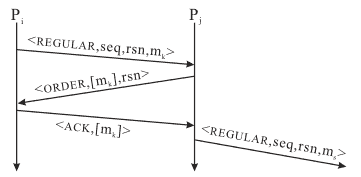

图 2.17 发送方日志协议的正常操作。

协议对每条消息执行三个步骤：

- 1. 一个 REGULAR 消息 <REGULAR, seq, rsn, m> 从一个进程（例如 $P_i$）发送到另一个进程（例如 $P_j$）。
- 2. 进程 $P_j$ 确定常规消息的接收/执行顺序 $rsn$，并通过 ORDER 消息 <ORDER, [m], rsn> 将确定信息告知 $P_i$。
- 3. 进程 $P_j$ 在发送任何 REGULAR 消息之前，会等待直到收到相应的确认消息 <ACK, [m]>。

原始的发送方消息日志协议 [13] 是为不可靠信道设计的。由于我们假设使用可靠信道，有人可能会疑惑协议中的第三步是否仍然必要。答案是肯定的，因为传输层可靠性不一定导致应用层可靠性，正如我们在 2.3.1.2 节中所论证的那样。如果一个进程向一个进程发送排序消息，向另一个进程发送另一条常规消息，并且运行该进程的节点随后崩溃，则排序消息可能无法成功送达其预期目标，而常规消息可能送达。

此外，在原始的发送方消息日志协议 [13] 中，常规消息和排序消息必须在超时后重新传输，直到收到预期的确认消息。使用可靠信道后，这种主动重传变得不必要，因为唯一需要重传的场景是进程失败，在这种情况下，重传将由恢复机制触发（更多内容见 2.3.2.3 节）。

在分布式应用中使用 TCP 等成熟的可靠通信协议更可取，因为应用开发者可以专注于应用逻辑和应用层消息可靠性，而无需担心实现高吞吐量和进行拥塞控制等问题。

### 示例 2.6

在图 2.18 所示的示例中，分布式系统包含三个进程。seq 计数器和 rsn 计数器均初始化为 0，每个进程的消息日志均为空。进程 P0 首先向 P1 发送一条常规消息 <REGULAR,0,?,m0>。发送消息后，P0 将其 seq 计数器递增到 1，并将消息记录在其易失性缓冲区中。此时，该消息的 rsn 值未知，因此用问号表示。

接收到常规消息 <REGULAR,0,?,m0> 后，P1 将当前 rsn 计数器值（即 0）分配给该消息以指示其接收顺序，将其 rsn 计数器递增到 1，并向 P0 发送 ORDER 消息 <ORDER,[m0],0>。当 P0 收到此 ORDER 消息时，它会更新其消息日志中的条目以反映消息 m0 的排序编号，并向 P1 发送 ACK 消息 <ACK,[m0]>。

收到 ACK 消息后，P1 被允许向 P2 发送一条常规消息 <REGULAR,0,?,m1>。该消息及相应的 ORDER 和 ACK 消息的处理方式与之前类似。

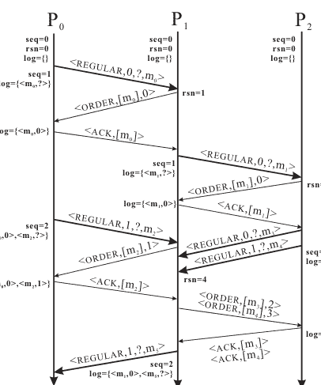

图 2.18 发送方日志协议的正常操作示例。

随后，P0 和 P2 几乎同时向 P1 发送三条常规消息 m2、m3、m4。P1 将 1 作为这三条消息中第一条（即 m2）的 rsn 值，并向 P0 发送排序消息，并将 2 和 3 分配给来自 P2 的两条连续常规消息（即 m3 和 m4）。对于来自 P2 的两条消息，P1 可以批量处理排序消息并一起发送到 P2，P2 也可以批量处理相应的 ACK 消息并发送到 P1。在收到所有三条排序消息的 ACK 消息后，P1 发送另一条包含 m5 且序列号为 1 的常规消息，将 seq 计数器更新为 2，并记录该消息。

### 2.3.2.3 恢复机制

从故障中恢复时，进程首先使用最新的本地检查点恢复其状态，然后必须向系统中所有其他进程广播请求，要求它们重新传输所有发送给该进程的已记录消息。

因为检查点包含其消息日志，且已记录的常规消息和相应的 ACK 消息可能因进程故障而未能到达目标进程，恢复中的进程根据以下规则重新传输常规消息或 ACK 消息：

- 如果消息的日志条目中不包含 rsn 值，则会重新传输 REGULAR 消息，因为预期的接收进程可能未收到该消息。
- 如果消息的日志条目中包含有效的 rsn 值，则会发送 ACK 消息，以便接收进程可以发送常规消息。

当进程接收到常规消息时，它总是会发送相应的 ORDER 消息作为响应。有三种场景：

- 该消息不是重复项，在这种情况下，将当前 rsn 计数器值分配给该消息作为其接收顺序，并发送相应的 ORDER 消息。然后，进程必须在发送任何常规消息之前等待 ACK 消息。
- 该消息是重复项，且相应的 rsn 值在其历史记录列表中找到，在这种情况下，会发送 ORDER 消息并丢弃重复消息本身。然后，进程必须在发送任何常规消息之前等待 ACK 消息。请注意，进程不可能之前收到过相应的 ACK 消息，因为否则恢复中的进程必定已记录该常规消息的 rsn 值。
- 该消息是重复项，且历史记录列表中没有相应条目。在这种情况下，进程必定在接收该消息后已对其状态进行了检查点，并且该消息不再用于恢复。因此，进程会发送一条带有特殊常量的 ORDER 消息，指示该消息不再需要，发送进程可以安全地从其消息日志中删除该条目。

恢复中的进程可能会收到两种重新传输的常规消息：(1) 带有有效 rsn 值的消息，以及 (2) 不带有效 rsn 值的消息。因为 rsn 计数器是已检查点状态的一部分，恢复中的进程知道下一条要执行的消息。在恢复期间，进程按照 rsn 值的升序执行带有有效 rsn 值的重新传输常规消息。这确保了这些消息的重放顺序与故障前接收时的顺序完全相同。在重放期间，进程可能会向其他进程发送常规消息。此类消息会像往常一样在恢复中的进程中记录，并且很可能是重复项。这不是问题，因为已有重复检测机制和上述重复消息处理机制。

重放这些消息后，进程恢复到与故障前其他进程可见且一致的状态。对于没有 rsn 值的常规消息，恢复中的进程可以按任意顺序重放它们，因为该进程在故障前接收到此类消息后，必定没有发送过任何常规消息。

### 2.3.2.4 局限性与正确性

上述发送方消息日志协议确保只要一次只发生一个故障，就能正确恢复分布式系统。也就是说，在某个进程故障后，直到该进程完全恢复之前，不会有其他进程故障。请注意，该协议无法处理两个或更多并发故障。如果两个或更多故障并发发生，某些常规消息的确定因素（即 rsn 值）可能会丢失，这将导致孤儿进程和级联回滚（即多米诺效应）。

### 示例 2.7

考虑一个包含三个进程 P0、P1 和 P2 的分布式系统，如图 2.19 所示。P0 向 P1 发送一条常规消息 <REGULAR,k,?,mi>。该消息在 P0 中完全记录后，P1 向 P2 发送一条消息 <REGULAR,s,?,mt>。随后，P0 和 P1 都崩溃了。恢复时，虽然 P0 可以将常规消息 <REGULAR,k,?,mi> 重新发送给 P1，但由于故障，接收顺序信息 rsn 已丢失。因此，无法保证 P1 能够启动导致发送常规消息 <REGULAR,s,?,mt> 的正确状态间隔。P2 将成为孤儿进程并被迫回滚其状态。

我们将在下文证明，2.3.2.3 节中引入的恢复机制保证了在故障进程恢复后分布式系统处于一致的全局状态。唯一的方式是


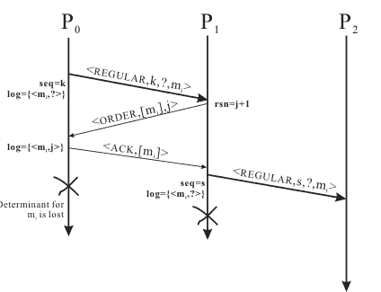

图 2.19 两个并发故障可能导致常规消息的确定性信息丢失。

分布式系统的全局状态变得不一致的情况是，当一个进程记录了接收到一条（常规）消息，而该消息并未由任何其他进程发送（即，该消息是孤儿消息）。我们证明，任何在进程中接收到的常规消息都必须已在发送进程中记录。对于一对非故障进程，该陈述的正确性是显而易见的，因为发送进程始终会记录它发送的任何消息。有趣的情况是，当一个非故障进程接收到由随后故障的进程发送的常规消息时。

假设进程 Pi 故障，另一个进程 Pj 在故障前接收到 Pi 发送的一条常规消息，我们需要证明该消息必须已在 Pi 故障前或在恢复结束前在 Pi 中记录。

如果 Pi 在故障前发送常规消息后进行了检查点，则该消息必须已记录在稳定存储中，并且保证可恢复。否则，由于消息记录在易失性内存中，故障本身会导致消息丢失。然而，我们证明该消息将在恢复期间重新生成。

根据协议，一个进程在收到每条已接收常规消息的确认消息之前，不能发送任何新的常规消息。消息已被发送这一事实意味着 Pi 必须已收到触发发送该消息的状态间隔中常规消息的确认消息。这反过来意味着，常规消息的发送进程（假设为 Pk）必须已收到由 \( P_i \) 发送的相应 ORDER 消息。因此，在恢复时，\( P_k \) 将被 \( P_i \) 联系，并将带有有效 \( rsn \) 值的常规消息重新传输给 \( P_i \)。这将确保恢复中的进程 \( P_i \) 按正确顺序重新启动状态间隔。\( P_j \) 接收到的常规消息将在恢复期间在 \( P_i \) 中正确重新生成并记录。这完成了我们的证明。

### 2.3.2.5 讨论。

如前所述，与基于接收者的悲观日志记录不同，在进程中执行本地检查点不会截断其消息日志，因为日志包含发送到其他进程的消息，这些消息可能对这些其他进程的恢复是必需的。这相当不理想。这不仅意味着消息日志大小无界，还会导致恢复时间无界。

基于发送者的消息日志协议可以修改以至少部分解决该问题。然而，这将以牺牲本地检查点的局部性为代价。一旦进程完成本地检查点，它将广播一条消息，包含在检查点之前已执行的消息的最高 \( rsn \) 值。所有由其他进程发送到该进程且分配的值小于或等于此 \( rsn \) 值的消息，现在都可以从其消息日志中清除（包括作为检查点一部分的稳定存储中的消息）。或者，此最高 \( rsn \) 值可以随每条发送到另一进程的消息（常规消息或控制消息）一起携带，以便异步清除不再需要的已记录消息。

# REFERENCES

- 1. L. Alvisi 和 K. Marzullo. 消息日志记录：悲观的、乐观的、因果的和最优的. IEEE Trans. Softw. Eng., 24(2):149–159, Feb. 1998.
- 2. B. K. Bhargava 和 S.-R. Lian. 分布式系统中用于恢复的独立检查点和并发回滚——一种乐观方法. 在可靠分布式系统研讨会上，页 3–12，1988.
- 3. B. K. Bhargava, S.-R. Lian, 和 P.-J. Leu. 并发检查点和回滚-恢复算法的实验评估. 在 ICDE 中，页 182–189. IEEE 计算机学会，1990.
- 4. A. Borg, W. Blau, W. Graetsch, F. Herrmann, 和 W. Oberle. Unix 下的容错. ACM Trans. Comput. Syst., 7(1):1–24, Jan. 1989.
- 5. K. M. Chandy 和 L. Lamport. 分布式快照：确定分布式系统的全局状态. ACM Trans. Comput. Syst., 3(1):63–75, Feb. 1985.
- 6. D. Davis, A. Karmarkar, G. Pilz, S. Winkler, 和 U. Yalcinapl. Web 服务可靠消息传递 (WSReliableMessaging) 版本 1.2, OASIS 标准. http://docs.oasis-open.org/ws-rx/wsrm/200702/wsrm-1.2-spec-os.pdf, 2009 年 2 月.
- 7. E. N. M. Elnozahy, L. Alvisi, Y.-M. Wang, 和 D. B. Johnson. 消息传递系统中回滚-恢复协议的调查. ACM Comput. Surv., 34(3):375–408, Sept. 2002.
- 8. O. Etzion 和 P. Niblett. 事件处理实战. Manning 出版社，2010.
- 9. S. Ghemawat, H. Gobioff, 和 S.-T. Leung. Google 文件系统. SIGOPS Oper. Syst. Rev., 37(5):29–43, Oct. 2003.
- 10. J. Gray 和 P. Kukol. 用于 Gbps 陆地速度记录的顺序磁盘 I/O 测试. 技术报告，Microsoft Research，2004.
- 11. Y. Huang 和 Y.-M. Wang. 为什么乐观消息日志记录未在电信系统中使用. 在第二十五届国际容错计算研讨会论文集中，FTCS '95，页 459–，华盛顿特区，美国，1995. IEEE 计算机学会.
- 12. R. K. Jain. 计算机系统性能分析艺术：实验设计、测量、仿真和建模技术. Wiley，1991.
- 13. D. B. Johnson 和 W. Zwaenepoel. 基于发送者的消息日志记录. 在第七届年度国际容错计算研讨会上. IEEE 计算机学会，1987.
- 14. F. Miller, A. Vandome, 和 J. McBrewster. 标准 RAID 级别. Alphascript 出版社，2009.
- 15. E. Newcomer 和 G. Lomow. 使用 Web 服务理解 SOA. Addison-Wesley Professional，2004.
- 16. B. Randell. 软件容错的系统结构. 在可靠软件国际会议论文集中，页 437–449，纽约，美国，1975. ACM.
- 17. J. H. Saltzer, D. P. Reed, 和 D. D. Clark. 系统设计中的端到端论点. ACM 计算机系统事务，2(4):277–288, 1984.
- 18. R. D. Schlichting 和 F. B. Schneider. 停止失败处理器：设计容错计算系统的一种方法. ACM Trans. Comput. Syst., 1(3):222–238, Aug. 1983.
- 19. A. P. Sistla 和 J. L. Welch. 使用消息日志记录的高效分布式恢复. 在第八届年度 ACM 分布式计算原理研讨会论文集中，PODC '89，页 223–238，纽约，美国，1989. ACM.
- 20. S. W. Smith 和 D. B. Johnson. 用于完全异步乐观恢复且回滚最小的时间戳大小最小化. 在第 15 届可靠分布式系统研讨会论文集中，SRDS '96，页 66–，华盛顿特区，美国，1996. IEEE 计算机学会.
- 21. R. Strom 和 S. Yemini. 分布式系统中的乐观恢复. ACM Trans. Comput. Syst., 3(3):204–226, Aug. 1985.
- 22. Y. Tamir 和 C. H. Suin. 使用全局检查点的多计算机中的错误恢复. 在 1984 年国际并行处理会议中，页 32–41，1984.
- 23. T. Tannenbaum 和 M. Litzkow. Condor 分布式处理系统中 Unix 进程的检查点和迁移. Dr Dobbs Journal，1995 年 2 月.

# 3

# 面向恢复的计算

面向恢复的计算最早由斯坦福大学和加州大学伯克利分校的联合研究项目 [7] 在 2000 年初和中期开创。该研究的主要重点是开发指南、方法和工具，以实现基于互联网的服务器的快速恢复。这项研究补充了其他旨在延长软件系统平均无故障时间 (MTTF) 的研究工作，例如，通过使用复制来掩盖低级故障。其原理是，通过减少平均恢复时间 (MTTR)，由于可用性与平均恢复时间之间存在反比关系（即，可用性 = MTTF / (MTTF+MTTR)），系统可用性也可以得到提高。

实现快速恢复的第一步是快速故障检测和定位。故障检测是指确定系统的某个组件是否已故障，但可能无法准确指出是哪个组件故障。另一方面，故障定位是找出确切故障的组件。虽然低级


使用诸如超时等机制可以快速检测到故障停止（fail-stop）故障，但大多数应用级故障更为隐蔽（至少在早期阶段通过其症状显现），且更难以检测，一般来说，甚至更难以定位。据[13, 14, 22]报告，对于某些互联网服务提供商，高达75%的恢复时间都花在应用级故障检测上。

尽管故障检测和定位长期以来一直是活跃的研究领域[2, 12, 19, 29]，但恢复导向计算中采用的方法具有独特性，因为它们基于与应用无关的机器学习技术，针对应用级故障检测和定位。这些方法有几个优势：(1) 它们可以以最小的开发成本应用于许多分布式系统，因为它们不与任何特定应用绑定，也不依赖于任何特定的应用语义；(2) 它们可以应对不可预见的故障，这对于大型复杂系统非常有用，因为对于传统的故障诊断方法，不可能事先开发故障模型。

一旦定位到失败的组件，恢复该组件最廉价的方法是重启它，这被称为微重启（microreboot）[11]。微重启与常规重启不同之处在于，它只重启可疑组件，而不是整个服务器应用。因此，微重启比典型的重启快得多。根据[7, 11]，重启一个Enterprise JavaBean (EJB)通常不到0.6秒，而重启整个应用服务器大约需要20秒。微重启最擅长处理瞬态软件缺陷（通常称为Heisenbugs）和资源（如内存和文件描述符）泄漏。

当微重启无法修复问题时，例如存在持久性软件缺陷和持久性数据损坏，以及发生操作员错误的情况，必须使用更重量级的方法来恢复系统。开发了一种系统级撤销/重做（undo/redo）方法论来处理这些困难情况。与前一章介绍的检查点和日志不同，系统级撤销/重做提供了更全面的恢复解决方案，原因有几点：在重置进程状态（即撤销）时，操作系统状态也会被重置。这对于处理操作员错误尤其有用，因为由于错误而对操作系统产生的任何持久性影响（例如，修改、删除或创建的文件）都必须被撤销，以便纠正错误。它旨在执行重放时保留应用程序的意图。在重放操作时，系统行为可能与外部用户的视图不一致。此类悖论必须通过使用应用程序特定的一致性规则和补偿方法来检测并妥善处理。

## 3.1 系统模型

故障恢复的一个重要步骤是重建正在恢复的组件或进程的状态，使其与系统的其他部分保持一致，并准备好为其客户端提供服务。为了更快的恢复，最佳实践是将数据管理与应用程序逻辑分开。三层架构[30]广泛用于基于互联网的应用程序，是这种策略的一个很好的示例。

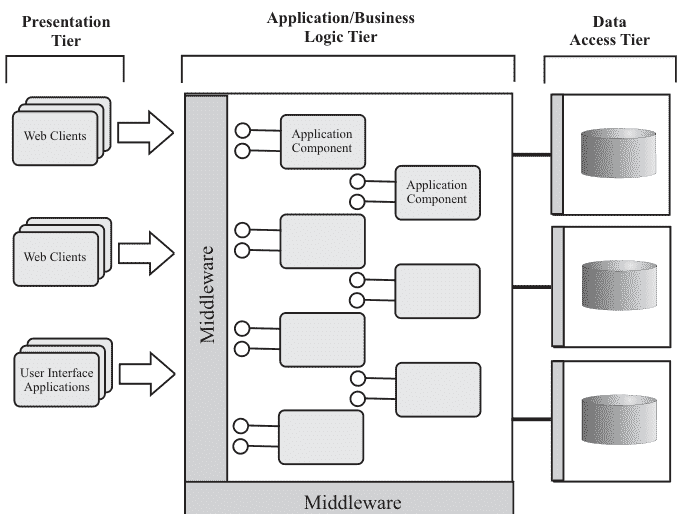

图 3.1 三层架构。

如图3.1所示，在这种架构中，应用程序的持久状态分别存储在后端层（通常是数据库服务器），而中间层服务器（通常是应用服务器）负责根据应用程序逻辑处理客户端请求。因此，中间层的应用服务器仅维护会话状态，该状态通常仅在会话期间存在（例如，从用户登录到用户登出之间）。会话状态的示例包括用户的购物车和用户查看过的产品列表。表现层由客户端软件组成，该软件使用户能够通过图形用户界面与应用程序交互。有时，直接与客户端软件交互且无状态的Web服务器被视为表现层的一部分。

当应用服务器失败时，只有会话状态会丢失，这将影响该特定服务器正在处理的活跃会话的用户。为了进一步最大限度地减少失败应用服务器的负面影响，会话状态可以分离到专用的会话状态存储中，如[11]所做。恢复导向计算技术最适用于采用三层架构的应用程序。特别是在采用微重启技术时，这种情况更为明显，因为该架构使得重启应用服务器的组件对系统性能和可用性的影响最小。

如图3.1所示，使用三层架构的应用程序通常使用某些中间件平台实现。基于互联网的应用程序的主导平台是Java平台，企业版（Java EE）。Java EE促进基于组件的软件开发。一个关键的组件构造是Enterprise JavaBean (EJB)。EJB实现特定的业务功能。Java EE还支持机制和策略的分离[32]。实现应用程序逻辑的机制在EJB中编程，而关于如何使用它们的策略则在部署时通过Java注释和/或描述符文件指定。

Java EE仍在不断发展的中间件平台。在恢复导向计算的几项开创性著作[13, 22, 11]发表时，该平台被称为J2EE，并被选为恢复导向计算的首选中间件平台。自那时以来，该平台已发展得更不复杂、更高效。

如图3.2所示，在Java EE中，组件由容器管理。在服务器端，有两种类型的容器：

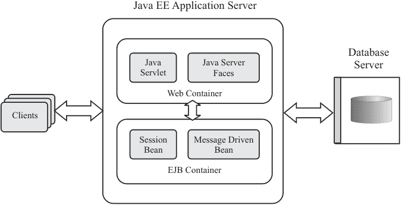

图 3.2 Java EE架构。

- Web 容器。此容器管理负责直接与客户端交互并为客户端生成网页的 Web 组件。示例 Web 组件包括 Java servlet 和由 Java Server Faces 框架生成的用户界面对象。
- EJB 容器。此容器管理 EJB。

在部署时，组件被安装在各自的容器中。容器为其管理的组件提供一组系统级服务。有些服务是可配置的，例如安全性、事务管理和远程连接。其他服务是不可配置的，例如生命周期管理、数据持久性和数据库连接资源池。容器机制使 EJB 更具可移植性和可重用性。它还减轻了组件开发人员为组件提供的服务编写代码的负担。

EJB 有几种类型：

- 会话 Bean。会话 Bean 表示由单个客户端（例如，通过登录帐户）在应用服务器内发起的交互式会话。客户端与应用服务器的所有交互都通过与会话 Bean 的远程调用完成。会话 Bean 代表客户端执行业务任务。会话 Bean 的状态不会自动保存到后端数据库服务器。会话 Bean 有三种类型：
  - 无状态会话 Bean。无状态会话 Bean 不会在当前调用之外为客户端维护状态，类似于无状态 Web 服务器。
  - 有状态会话 Bean。有状态会话 Bean 会在会话期间的所有调用中代表客户端维护状态。
  - 单例会话 Bean。顾名思义，单例会话 Bean 在应用程序生命周期期间仅实例化一次（即，每个单例会话 Bean 只有一个实例）。这与有状态和无状态会话 Bean 不同，后者允许创建多个实例。单例会话 Bean 通常表示跨应用程序共享的一段状态。
- 消息驱动 Bean。消息驱动 Bean 与 Java Message Service 配合使用，以使 J2EE 应用程序能够异步处理消息。
- 实体 Bean。实体 Bean 在 J2EE 中引入，现已弃用并被 Java 持久性应用程序编程接口（API）所取代。实体 Bean 表示一个业务对象（例如客户或产品），其状态应在数据库服务器上持久化。状态持久性可以由 Bean 本身管理（这意味着开发人员必须显式编写数据库访问代码），也可以由容器管理。不同的实体 Bean 可能具有在数据库架构中定义的关系。

值得注意的是，EJB 始终在容器下的单个控制线程中执行。

## 3.2 故障检测和定位

分布式系统中故障检测的大部分理论都集中在故障停止故障的检测上。要检测故障停止故障，故障检测器依赖于超时的使用，尽管它在异步系统中可能不可靠。然而，


与检测应用程序级故障的挑战相比，检测故障停止故障是简单直接的。这是因为许多应用程序级故障最初仅在应用程序级别表现出症状，而低级别故障检测器无法检测到这些症状。

理想情况下，应用程序级故障可以通过软件容错恢复块方法中引入的验收测试来检测 [16]。不幸的是，这种方法会给应用程序开发人员带来过重的负担，要求他们开发有效且高效的验收测试例程。一般来说，由于互联网应用程序的规模、复杂性和快速升级速度，直接监控其应用程序级功能以查看是否偏离规范被认为是不切实际的 [22]。因此，[14, 13, 22] 提出测量和监控应用程序的结构行为，作为一种在无需 *先验* 了解应用程序内部工作原理的情况下检测应用程序级故障的方法。

这种方法基于以下洞察。在基于组件的应用程序中，每个组件通常实现特定的应用程序功能，*例如*，有状态会话 bean 可用于管理用户的购物车，而一组单例会话 bean 用于跟踪每件待售产品的库存。因此，不同组件之间的交互模式将反映应用程序级功能。然后可以监控这种内部结构行为，以推断应用程序是否正常运行。要监控结构行为，有必要记录每个最终用户请求的运行时路径，这包括跟踪请求触发的所有内部事件，*即*，每个组件的所有传入消息和传出消息，以及不同组件之间的所有直接交互（以方法调用为准）及其因果关系。

### 示例 3.1

图 3.3 显示了一个最终用户请求的示例运行时路径。

在示例中，Web 服务器组件 A（例如 Java servlet）响应接收到最终用户请求（request-i），向应用程序服务器中的组件 B（例如会话 bean）发出嵌套请求（request-i1，事件 1）。

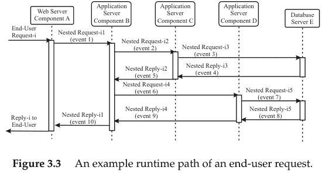

在处理嵌套请求（request-i1）时，应用程序服务器组件 B 调用组件 C 的一个方法（嵌套请求-i2，事件 2），该组件是一个单例 bean。随后，组件 B 在响应方法调用时将更新的数据持久化到数据库服务器 E（嵌套请求-i3，事件 3，以及相应的回复-i3，事件 4）。此外，A 还调用组件 D 的一个方法，该组件随后调用数据库服务器 E，然后才将嵌套回复发送回 Web 组件 A（事件 6 到 10）。因此，此最终用户请求的运行时路径跨越 5 个组件，包含 10 个事件。

根据 [13, 14, 22]，跟踪每个最终用户请求运行时路径的最佳方法是对底层中间件应用程序框架进行插桩。确实，开源 Java EE 应用程序服务器 JBoss 的可用性使得 [13, 14, 22] 中的运行时路径跟踪成为可能。这种方法的优势在于它对应用程序是透明的，这使其比任何应用程序特定的解决方案更易于部署和维护。

启用运行时路径日志记录后，结构行为监控的下一步是执行机器学习步骤。此步骤的目标是构建应用程序正常行为的参考模型，以其结构交互模式为准。在 [13, 14, 22] 中，每个参考模型进一步分为两个子模型：

- 历史参考模型。该模型使用所有记录的运行时路径数据构建。该模型的目标是使组件相对于其过去行为的异常检测成为可能。

- 对等参考模型。该模型使用最近一段时间内获得的运行时路径数据构建（例如，过去 5 分钟）。该模型的目标是使相对于对等组件的异常检测成为可能。

虽然历史参考模型可以使用离线合成工作负载构建（该工作负载类似于真实工作负载，当然也可以在真实工作负载存在期间在运行时构建），但对等参考模型只能在运行时构建，这需要假设最终用户请求以高容量到达，并且它们大多相互独立，以便统计技术能够工作。

机器学习步骤完成后，结构行为监控框架将准备好通过检测异常来监控应用程序的健康状况，即，通过使用统计技术将观察到的交互模式与参考模型中的模式进行比较。

[13, 14, 22] 中介绍了两种参考模型。第一种模型对组件交互进行建模，而第二种模型对运行时路径形状进行建模。前者专注于检测故障组件，后者专注于检测处理不当的最终用户请求。这两种模型相互补充，因为每种模型都可能检测出使用另一种模型无法检测到的异常，如 [22] 中给出的以下示例所述。

### 示例 3.2

组件中的临时故障可能只影响少数请求。可以通过路径形状参考模型检测到此故障，因为受影响请求的运行时路径将显著偏离其正常路径。但是，组件参考模型可能无法检测到此故障，因为受影响的请求数量在统计上太不显著。

另一个示例是，故障组件可能会拒绝大量带有有效凭据的身份验证请求。可以通过组件交互参考模型检测到此故障，因为组件交互模式将显著偏离其正常模式（例如，通常只拒绝极少部分身份验证请求）。但是，由于拒绝身份验证请求是几个有效路径之一，因此无法通过路径形状参考模型检测到此故障。

最近，[20] 提出了一种基于推理的故障诊断方法。该方法专为同时包含 Web 应用程序和网络组件（例如防火墙）的小型企业网络而设计。与 [13, 14, 22] 类似，该方法旨在与应用程序无关，并使用企业网络中实体的动态构建依赖图。基本思想是通过与实体的历史记录进行比较来确定实体的当前状态是否异常，并使用依赖图推断异常的根本原因，同样，通过分析网络中实体的历史记录。[20] 中提出的故障诊断方法针对的粒度比 [13, 14, 22] 中的粗粒度实体（例如主机和进程）更粗，后者可以小到一个 EJB。但是，似乎没有内在困难将该方法扩展到在 EJB 级别上对更细粒度组件进行故障诊断。因此，在 3.2.3 节中对基于推理的故障诊断方法的详细描述中，我们仍然使用术语“组件”来指代故障诊断粒度。

### 3.2.1 组件交互建模与异常检测

要对组件交互进行建模，有必要区分组件类和组件实例。例如，由相应 Java 类定义的每种 EJB 类型都可以视为组件类。除了单例 bean 外，一个 EJB 类可以创建多个实例来处理不同用户，这些实例构成了组件实例。

在 [22] 中引入的模型中，只考虑组件实例与所有其他组件类之间的交互。原因之一是，组件类的不同实例之间不同组件实例的交互级别并不相同 [22]。也许这也归因于使用卡方检验进行异常检测（稍后解释）。这一决定也使建模过程更具可扩展性，因为每个组件类的实例数量可能非常大，大到


基于互联网的应用程序（用于处理大量并发用户）。

给定一个具有 n 个组件类的系统，组件实例的交互模型由组件实例与所有其他 n – 1 个组件类之间的一组 n – 1 个加权链接组成（每个组件类一个）。这里我们假设，同一组件类的组件实例之间不相互作用。我们还假设，两个组件之间的交互是对称的，即交互要么是本地方法调用，要么是带有请求发送和相应回复接收的远程方法调用。

分配给每个链接的权重是组件实例与链接组件类交互的概率。所有链接上的权重之和应等于 1（即，组件实例与一个或多个其他组件类交互的概率为 1）。

### 示例 3.3

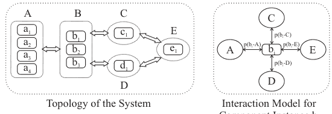

图 3.4 组件类和组件实例。

考虑图 3.4 所示的示例系统。该系统包含 5 个组件类：

- Web 组件类 A。其实例（a1 到 a4）处理来自最终用户的请求。
- 应用逻辑组件类 B。它由多个有状态会话 Bean 实例（b1、b2、b3）组成，用于处理与最终用户的对话。
- 应用逻辑组件类 C 和 D。每个类只有一个实例（即，单例会话 Bean 实例），表示系统中要共享的状态，例如产品的库存。
- 数据库服务器组件类 E。它表示处理最终用户请求时涉及的特定表（即，持久状态）。

如系统拓扑所示，A 仅与 B 直接交互，B 与 C 和 D 交互，C 和 D 与 E 交互。B 的组件实例的交互模型如图 3.4 右侧所示。每个链接上的权重表示为 p(bi - Cj)，其中 Cj 是组件实例 bi 交互的类。根据系统拓扑，显然 p(bi - E) = 0，因为 B 和 E 之间没有直接交互。

其他链接的权重取决于观察到的交互。假设在学习期间，组件实例 b1 上发生了以下交互：

- A 对 b1 发出了 400 次远程调用。
- b1 随后对 C 发出了 300 次本地方法调用，对 D 发出了 300 次本地方法调用。
- 对于 b1 的交互模型，C 和 E 之间以及 D 和 E 之间发生了什么并不重要。

组件实例 b1 上发生的交互总数为 1,000。因此，权重 p(b1 - A) = 400/1000 = 0.4，p(b1 - C) = 300/1000 = 0.3，p(b1 - D) = 300/1000 = 0.3。所有链接上的总权重之和为 1。

为了检测异常，测量组件实例行为与参考模型之间的偏差。在 [22] 中，使用卡方（χ²）检验 [18]。卡方检验是最常用的检验之一，用于确定一组观察数据是否符合特定分布。此外，卡方检验可用于任何分布。

要执行卡方检验，有必要将观察数据集准备为直方图 [18]。然后根据以下公式计算观察数据与预期分布之间的偏差：

```
D = \sum_{i=1}^{k} \frac{(o_i - e_i)^2}{e_i} \quad (3.1)
```

其中 k 是直方图中的单元格数量，ei 是单元格 i 中的预期频率，oi 是单元格 i 中的观察频率。

显然，如果某个单元格的 $e_i$ 为 0，则应从计算中剪除该单元格。

在组件交互参考模型的上下文中，每个链接都被视为一个单元格。假设观察期由组件实例所有链接的固定总方法调用数 $m$ 定义，链接 $i$ 上的观察交互数为 $o_i$。那么，同一链接 $i$ 的预期频率为：

```
$e_i = m p_i$ (3.2)
```

其中 $p_i$ 是参考模型中分配给链接 $i$ 的权重。

当没有异常时，理想情况下 $o_i$ 应与 $e_i$ 匹配，偏差 $D$ 应为 0。然而，在实际系统中，即使没有异常，由于随机性，$D$ 也不会为 0。事实上，$D$ 遵循具有 $k-1$ 个自由度的卡方分布（当使用具有 $k$ 个单元格的直方图时）[18]。因此，只有当计算出的 $D$ *大于* 显著性水平 $\alpha$ 下具有 $k-1$ 自由度的卡方分布的 $1-\alpha$ 分位数时，才能声明异常。显著性水平越高，检验对偏差的敏感度就越高（作为权衡，越容易产生假阳性）。

### 示例 3.4

关于示例 3.3 中介绍的示例系统和参考模型，假设组件实例 $b_1$ 涉及的最近 100 次方法调用中观察到以下情况：

- A 对 $b_1$ 发出了 45 次远程调用。
- $b_1$ 随后对 $C$ 发出了 35 次本地方法调用，对 $D$ 发出了 20 次本地方法调用。

对于 $A$ 和 $b_1$ 之间的链接，观察值为 45，预期值为 $100 \times 0.4 = 40$。对于 $C$ 和 $b_1$ 之间的链接，观察值为 35，预期值为 $100 \times 0.3 = 30$。对于 $D$ 和 $b_1$ 之间的链接，观察值为 20，预期值为 $100 \times 0.3 = 30$。因此，根据卡方检验，与参考模型的偏差为：D = $(45-40)^2/40 + (35-30)^2/30 + (20-30)^2/30 = 4.79$。

此卡方检验的自由度为 2（因为直方图中只有 3 个单元格）。对于显著性水平 $\alpha = 0.1$，具有 2 自由度的卡方分布的 90% 分位数可从图 3.5 估计为约 4.6（如指向 90% 分位数值的箭头所示），这略小于观察到的偏差（4.79）。因此，在显著性水平为 0.1 时，该组件实例的行为异常。然而，我们可以降低显著性水平以使异常检测不那么敏感，例如 α = 0.05。在这种情况下，异常的阈值偏差将变为约 6.0（如指向 95% 分位数值的箭头所示），这不会触发异常报告。箭头分别指向卡方分布的 90% 和 95% 分位数值。

### 3.2.2 路径形状建模与根本原因分析

组件交互监控的一种互补故障检测方法是监控最终用户请求的运行时路径形状。在服务最终用户请求时，通常涉及多个组件实例，如图 3.3 所示。运行时路径的形状定义为建模目的的组件类的有序集合，而不是组件实例。路径形状表示为一棵树，其中节点表示组件类，方向边表示两个相邻节点之间的因果关系。

### 示例 3.5

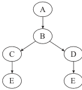

图 3.6 图 3.3 中所示示例运行时路径的路径形状。

例如，图 3.3 中所示运行时路径的路径形状如图 3.6 所示。树的根是 Web 组件类 A。从根节点到其子节点（应用服务器组件类 B）的方向边意味着是 A 调用了 B 的方法。其他边可以类似地解释。

概率上下文无关文法（PCFG）在 [14, 13, 22] 中被用作一种工具，用于在正常（即无故障）运行期间建模系统中最终用户请求的路径形状。该文法在学习阶段从观察到的路径形状中推断出来。

PCFG 最初用于自然语言处理 [25]，最近已被用于推断许多网络系统的结构 [15, 24]。

PCFG 包含以下项目：

- 终结符号列表，\(T^k, k = 1, 2, ..., n\)。在我们的并发上下文中，可能出现在任何路径形状中的组件类构成终结符号。
- 非终结符号列表，\(N^i, i = 1, 2, ..., m\)。这些符号用于表示产生式规则的阶段。\(N^1\) 是指定的起始符号，通常表示为 \(S\)。对于路径形状建模，使用特殊的非终结符号 \(\$\) 来表示规则的结束。所有其他非终结符号都将由特定的产生式规则替换。
- 产生式规则列表，\(N^i \rightarrow \zeta^j\)，其中 \(\zeta^j\) 表示终结符和非终结符的列表。
- 概率列表 \(R_{ij} = P(N^i \rightarrow \zeta^j)\)。每个产生式规则都分配了一个概率，表示其可能性


规则中定义的转换。此外，每个阶段规则的概率之和必须为 1，即，对于任何 \(N^i, \sum P(N^i \rightarrow \zeta^j) = 1\)。

对于路径形状建模，在学习阶段采用 Chomsky Normal Form (CNF) [25] 中的 PCFG 来建模路径形状的规则。如果在处理同一最终用户请求时观察到从一个组件类向其他组件类进行了一次或多次调用，则会推断出涉及两个或多个组件类的产生式规则。随后，在处理了足够多的请求后，将计算检测到的模式（即相应规则）的概率。

要了解如何从观察到的路径形状中推断出带有相应概率的产生式规则，请参考以下示例。

### 示例 3.6

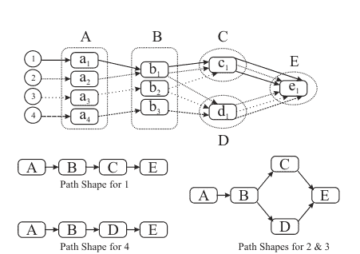

图 3.7 组件类和组件实例。

假设我们仅根据图 3.7 中所示的 4 个最终用户请求的跟踪来推断 PCFG。这 4 个请求的运行时路径可以归约为 3 种不同的路径形状，同样如图 3.7 所示。请求 1 的路径形状和请求 4 的路径形状是唯一的，而请求 2 和请求 3 的运行时路径共享相同的路径形状。

从这些路径形状中，我们可以推断出调用从组件类 A 传输到 B 的概率为 100%，因此可以推导出以下规则：

- R_{1j}: S → A, p = 1.0
- R_{2j}: A → B, p = 1.0

从 B 出发，有 3 种可能的转换：以 25% 的概率转换到 C（由于最终用户请求 1），以 25% 的概率转换到 D（由于最终用户请求 4），以及以 50% 的概率同时转换到 C 和 D（由于最终用户请求 2 和 3）。因此，我们可以推断出以下附加规则：

- R_{3j}: B → C, p = 0.25 | B → D, p = 0.25 | B → CD, p = 0.5

一旦调用到达 C，它将保证转移到 E（由于请求 1、2 和 3）。同样，一旦调用到达 D，它也将转移到 E（由于请求 2、3 和 4）。因此，建立以下规则：

- R_{4j}: C → E, p = 1.0
- R_{5j}: D → E, p = 1.0

最后，组件类 E 是所有请求的最后一站，因此有以下规则：

- R_{6j}: E → $, p = 1.0

一旦从跟踪中学习了 PCFG，就可以判断新请求的路径形状是否符合语法。如果发现某个路径形状不符合语法，则会检测到异常。使用 PCFG 进行异常检测的一个潜在问题是，从运行时路径推断出的 PCFG 会构成观察到的路径的超集，因为语法是无上下文的，如 [13] 所指出。这意味着它会将比实际观察到的更多路径视为有效，从而导致假阴性。从积极的一面来看，该语法对假阳性具有鲁棒性。然而，这并不意味着不会发生假阳性。例如，如果在学习阶段未出现合法的路径形状，可能会触发异常警报。

与组件交互方法不同，后者在检测到异常时可以准确定位是哪个组件出现故障，基于 PCFG 的路径形状分析检测到的异常只能表明系统中存在影响最终用户请求处理流程的故障。需要额外的方法来定位可能的故障组件，这一过程称为故障定位。在 [22] 中，采用了基于决策树的方法来定位故障组件。

### 3.2.3 基于推理的故障诊断

在此方法中，除了交换的消息之外，还会捕获关于系统中每个组件运行情况的更丰富的信息集，例如 CPU 利用率、内存使用量。每种类型的信息都作为组件的状态变量来捕获。每个组件的状态变量数量各不相同，具体取决于所使用的检测框架。对于 Windows 性能计数器框架 (http://msdn.microsoft.com/en-us/library/ms254503.aspx)，它平均为每个组件跟踪 35 个变量，对于某些组件，变量数量可超过 100 个 [20]。有趣的是，检测框架可以同时跟踪通用状态变量和应用程序特定变量（只要应用程序导出它们），而故障诊断方法会平等地对待它们，而无需了解其语义。

基于推理的故障诊断方法包含三个步骤：(1) 记录组件状态，(2) 构建依赖图，(3) 对观察到的异常的可能根本原因进行排序。每个步骤的详细信息如下。

#### 3.2.3.1 组件状态记录

状态变量由操作系统和应用程序导出，并通过检测框架进行记录。将记录以下类型组件的状态：

- 节点。对于此类组件，状态变量包括 CPU 利用率、内存使用量、磁盘 I/O 和网络 I/O。
- 进程。对于此类组件，既记录 CPU 利用率、内存使用量、交换的消息数量等通用状态，也记录每种类型处理的请求数量等应用程序特定状态。
- 网络路径。对于此类组件，状态由网络路径的特征定义，例如丢包率和延迟。
- 配置。这指的是节点或进程的配置，由单个状态变量表示。
- 邻居集。这是一个虚拟组件，用于突出显示进程通信对等体的集体行为，例如交换的消息总数和性能特征。

每个组件的状态会定期记录到多变量向量数据结构中。在 [20] 中，记录频率设置为每分钟一次。为了监控短暂故障，可能需要使用更高的频率。

#### 3.2.3.2 依赖图构建

一旦记录了足够的历史数据，就会基于一组预定义的模板构建依赖图，每种组件类型对应一个模板。[20] 中使用的模板如图 3.8 所示，其中省略了 [20] 中网络路径组件的防火墙组件。

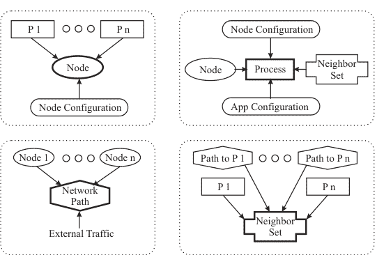

图 3.8 节点、进程、网络路径和邻居集的依赖模板。

如节点组件模板中所定义，节点的状态取决于节点配置（例如，如果节点运行 Windows 操作系统，则为 Windows 注册表）以及应用程序进程集（P1 到 Pn）。因此，来自配置和进程的边缘指向节点。

对于进程组件，其状态既取决于节点配置和应用程序配置，也取决于其运行所在的节点及其邻居集。

对于网络路径组件，其状态取决于沿路径的节点（节点 1 到节点 n）发送到该路径的消息，以及外部实体注入到该路径的网络流量。

对于邻居集组件，其状态取决于邻居进程集以及连接这些进程的网络路径。

#### 示例 3.7

要了解如何使用图 3.8 中所示的模板生成依赖图，请参考图 3.9 中所示的示例（为了避免图表杂乱，图中省略了配置组件）。示例系统包含两个节点，节点 1 和节点 2。节点 1 有 2 个应用程序进程，P1 和 P2。所有三个进程互为邻居。

根据节点组件模板，P1 和 P2 各自都有一条指向节点 1 (N1) 的边，P3 有一条指向节点 2 (N2) 的边。根据进程组件模板，N1 和 P1 的邻居集 (NS1) 各自都有一条指向 P1 的边。同样，N1 和 P2 的邻居集 (NS2) 各自都有一条指向 P2 的边，N2 和 P3 的邻居集 (NS3) 各自都有一条指向 P3 的边。根据邻居集模板，P2 和 P3 各自都有一条指向 NS1 的边，P1 和 P3 各自都有一条指向 NS2 的边，P1 和 P2 各自都有一条指向 NS3 的边。

请注意，示例依赖图包含许多循环。例如，P1 有一条指向 NS2 的边，NS2 有一条指向 P2 的边，P2 又有一条指向 P1 的邻居集 NS1 的边，NS1 有一条指向 P1 的边（即，P1 → NS2 → P2 → NS1 → P1）。

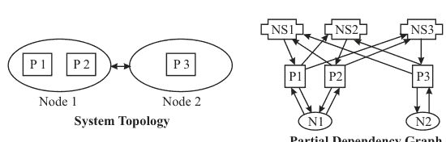

图 3.9 示例系统的部分依赖图。


#### 3.2.3.3 故障诊断

故障诊断包含三个步骤：(1) 识别处于异常状态的组件，(2) 计算边权重以便查找故障的根本原因，以及 (3) 将可能的故障组件排序，作为观察到的异常状态的根本原因。

组件的当前状态是通过将状态变量的当前值与相应的历史值进行比较来评估的。组件的异常程度被确定为其任何状态变量的最高异常值。历史记录不必是无错误的。只要它足够长（在 [20] 中，获得良好结果的最短历史时长为 30 分钟）且不受正在诊断的故障主导，历史记录将有助于产生相当好的结果。

对于当前值为 $v$ 的状态变量，其异常度 $A(v)$ 定义为：

```
$$A(v) = |erf(\frac{v - \mu}{\sigma\sqrt{2}})|$$
```

其中，$\mu$ 和 $\sigma$ 分别是状态变量在历史记录中的均值和标准差，$erf()$ 是误差函数，如图 3.10 所示。使用此公式计算的异常度范围为 0 到 1。值越高，当前状态变量越异常。在 [20] 中，使用 0.8 的启发式阈值来确定组件是否异常。选择较高阈值的理由是，这可以降低产生假阴性的可能性。将异常组件误判为正常，比将正常组件误判为异常更不可取。如第 3.3 节所示，可以使用微重启来最小化假阳性的代价。

#### 示例 3.8

考虑一个当前值为 65 的状态变量。假设变量的历史记录中记录了以下 20 个值：35, 41, 52, 37, 48, 51, 60, 71, 52, 39, 43, 44, 53, 62, 55, 64, 71, 82, 36, 65（最后一个为当前值）。

该变量的均值为 53.05，标准差为 13.20。因此，$A(65) = erf(0.64) = 0.63$。使用图 3.10（箭头指向）所示的 0.8 作为异常阈值，该状态变量被视为正常。

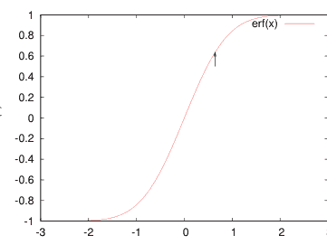

图 3.10 误差函数。

下一步是计算依赖图中每条边的权重。计算边权重的目的是为了便于根本原因分析。考虑一条源组件为 S、目标组件为 D 的边。如果 S 或 D 中有任一组件正常，则为该边分配最小权重 0.1，因为 S 对 D 产生负面影响的可能性不大。此处使用 0.1 而不是 0 作为权重，是因为路径权重计算（用于根本原因预测所需）涉及沿路径的边权重相乘。

如果 S 和 D 都异常，则边权重基于 S 和 D 的联合历史行为进行计算。S 和 D 都存在的历史记录被均分为 N 个块，每个块至少包含一组 S 的记录值和一组 D 的记录值。如果块 k 包含多组值（通常是这种情况），则选择代表与源组件 S 的当前状态 Snow 最相似的状态 Sk 的那组值。经验表明，较小的 N（例如 10）足以进行准确的故障诊断 [20]。

组件 C（配置组件除外）两个状态的相似度是通过计算其状态变量值的差异来计算的：

```
|C_k - C_{now}| = \sum_{i=1}^{n} \frac{|d^i|}{n} (3.4)
```

其中，\(d^i\) 是第 i 个状态变量 \(v^i\) 的差异，按历史记录中观察到的范围进行归一化，即，

\(d^i = \frac{v_k^i - v_{now}^i}{v_{max}^i - v_{min}^i}\)

其中，\(v_{min}\) 和 \(v_{max}\) 是 \(v^i\) 在历史记录中的最小值和最大值。归一化（导致 0 到 1 之间的差异）很重要，因为它防止值变化显著的变量主导整体差异。

对于配置组件，差异为 0（如果配置保持相同）或 1（如果配置以任何方式不同），因为即使配置的微小变化也可能导致节点或应用程序进程出现显著的功能变化。

\(S \rightarrow D\) 边的权重计算如下：

\(E(S \rightarrow D) = \frac{\sum_{k=1}^N (1 - |D_k - D_{now}|) \times w_k}{\sum_{k=1}^N w_k}\)

其中，\(w_k\) 是分配给块 k 的权重，由 S 的状态差异确定：

\(w_k = \begin{cases} 1 - |S_k - S_{now}|, & \text{if } |S_k - S_{now}| \le \delta \\ 0, & \text{otherwise} \end{cases}\)

其中，\(\delta\) 在 [20] 中被启发式地设置为 1/3。该加权方案对更相似的历史状态赋予更高的权重。此外，它排除了最相似状态与 \(S_{now}\) 差异超过 \(\delta\) 的块。这是一个合理的决定，因为当 S 的状态与 \(S_{now}\) 显著不同时，计算 D 的状态差异是没有依据的。

可能会出现找不到可用的历史数据（即，对于 k = 1, ... N，\(w_k = 0\)）的情况，此时边权重设置为 0.8（显然，在这种情况下无法使用公式 3.6 进行计算）。为边分配高权重的决定基于以下假设：异常更可能是由以前未出现过类似状态的组件引起的。这与我们宁愿看到假阳性，也不愿漏诊断故障组件的原则一致。

最后一步是预测异常的根本原因。组件异常的因果关系是从边的高权重推断出来的。例如，如果边 \( S \rightarrow D \) 的权重较高，且 S 和 D 都异常，那么很可能是 S 导致了 D 的异常。然而，天真地应用此想法可能会产生太多假阳性，如下例所示。

#### 示例 3.9

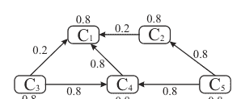

图 3.11 一个带有每个组件异常度和每条边权重标签的假设依赖图。

考虑图 3.11 所示的假设依赖图。假设我们想要找出表现异常的组件 A 的根本原因。因为边 \( D \rightarrow A \)、\( E \rightarrow D \) 和 \( C \rightarrow D \) 的权重都是 0.8（较高），所以所有三个组件 C、D 和 E 都会被标记为 A 异常行为的可能原因，而实际上，E 才是真正的罪魁祸首。

在 [20] 中，引入了一个复杂的排名公式来帮助预测真正的根本原因。组件 \( C_i \) 相对于其对异常组件 \( C_j \) 的影响的排名，基于两个因素的乘积：

- \( C_i \) 对 \( C_j \) 沿一条或多条路径的直接影响，\( I(C_i \rightarrow C_j) \)；
- \( C_i \) 对整个系统的全局影响，\( S(C_i) \)。

分配给组件 \( C_i \) 的排名与两个因素的乘积成反比。排名值最小的组件被视为受影响组件异常行为最可能的罪魁祸首。设 \( \{C_1, .., C_K\} \) 为系统中的组件集合，受影响的组件为 \( C_j \)。系统中组件 \( C_i \) 相对于其对 \( C_j \) 的影响的排名由以下排名公式确定：

```
\( Rank(C_i \rightarrow C_j) \propto \frac{1}{I(C_i \rightarrow C_j) \times S(C_i)} \quad (3.8) \)
```

I(C_i \rightarrow C_j) = \left\{ \begin{array}{ll} max(W(p)), \forall acyclic paths p from C_i to C_j, & \text{if } C_i \neq C_j \\ 1 & \text{otherwise} \end{array} \right. (3.9)

W(p) = \left( \prod_{k=1}^n E(e_j) \right)^{\frac{1}{n}}, \text{ where } e_1, ..., e_n \text{ are edges of the path } p (3.10)

S(C_i) = \sum_{k=1}^K I(C_i \rightarrow C_k) \times A(C_k), \text{ where } A(C_k) \text{ is the abnormality of } C_k (3.11)

如果 C_i 和 C_j 之间不存在无环路径，则 I(C_i \rightarrow C_j) 设置为 0。要了解排名公式的工作原理，请再次考虑示例 3.9。

#### 示例 3.10

此处关注的组件是 A。我们想确定系统中哪个组件最可能是 A 异常行为的原因。由于 B 和 A 之间的边权重较低，我们可以轻松排除 B 是罪魁祸首的可能性。我们只考虑三个可能的罪魁祸首，C、D 和 E，以及组件 A 本身。

我们先从 A 本身开始。I(A \rightarrow A) = 1，且 S(A) = I(A \rightarrow A) \times A(A) = 1 \times 0.8 = 0.8。因此，Rank(A \rightarrow A) = \frac{1}{1 \times 0.8} = 1.25。

接下来考虑 D。因为 D 和 A 之间只有一条无环路径，

I(D \rightarrow A) = E(D \rightarrow A) = 0.8

因为从 D 到系统中任何其他组件（即 A）只存在一条路径，所以 D 的全局影响为：

S(D) = I(D \rightarrow D) \times A(D) + I(D \rightarrow A) \times A(A) = 1 \times 0.8 + 0.8 \times 0.8 = 1.44

因此，Rank(D \rightarrow A) \propto \frac{1}{0.8 \times 1.44} = 0.87。


接下来，考虑 C。要计算 $I(C \to A)$，我们需要考虑两条备选路径：$C \to D \to A$ 和 $C \to A$。

$W(C \to D \to A) = \sqrt{0.8 \times 0.8} = 0.8$

$W(C \to A) = 0.2$

显然，$I(C \to A) = 0.8$。因为从 C 只能到达 A 和 D，C 的全局影响为：

$S(C) = I(C \to C) \times A(D) + I(C \to A) \times A(A) + I(C \to D) \times A(D) = 1 \times 0.8 + 0.8 \times 0.8 + 0.8 \times 0.8 = 2.08$

因此，$Rank(C \to A) \propto \frac{1}{0.8 \times 2.08} = 0.60$。

最后，让我们考虑 E。从 E 到 A 有两条无环路径：$E \to D \to A$，路径权重为 $\sqrt{0.8 \times 0.8} = 0.8$；以及 $E \to B \to A$，路径权重为 $\sqrt{0.8 \times 0.2} = 0.4$。因此，$I(E \to A) = 0.8$。

对于 E 的全局影响，我们需要考虑对 D、B、A 以及 E 本身的影响：

$S(E) = I(E \to E) \times A(E) + I(E \to A) \times A(A) + I(E \to D) \times A(D) + I(E \to B) \times A(B) = 1 \times 0.8 + 0.8 \times 0.8 + 0.8 \times 0.8 + 0.8 \times 0.8 = 2.72$

因此，$Rank(E \to A) \propto \frac{1}{0.8 \times 2.72} = 0.46$。因为 $Rank(E \to A) < Rank(C \to A) < Rank(D \to A) < Rank(A \to A)$，组件 E 是导致 A 异常的最可能原因。

从示例可以看出，边权重的准确性在根因分析中起着重要作用。迄今为止，在方程 3.6 所示的边权重计算中，我们假设每个状态变量的贡献相等，但实际上，对于不同类型的故障，其中一些变量的作用比其他变量更显著（这可能导致组件级状态差异被稀释），并且一些状态变量可能是冗余的（这可能导致对这些变量的过度强调）。因此，可以通过以下方式区分状态变量来进一步改进边权重计算：

- 过滤冗余状态变量。某些检测框架会以冗余形式捕获一些状态变量。例如，在 [20] 中，检测框架以字节、千字节和兆字节为单位导出节点的已用内存，这会导致关于内存使用的两个冗余变量。如果无法手动挑选，可以使用统计方法 [17] 来识别状态变量的冗余性。

- 关注相关状态变量。虽然故障诊断是以与应用无关的方式进行的，但在某些情况下，如果故障与某些通用症状相关，例如 CPU 使用率异常，则可以识别哪些状态变量最相关，并在计算中给予它们更多权重（例如，使用这些变量的异常作为权重），或者完全从计算中忽略明显无关的变量，例如，在考虑节点对其某个进程的影响时，可以忽略来自远程进程的异常。

- 识别状态变量之间的聚合关系。检测框架导出的一些状态变量实际上是单个变量的聚合。例如，节点级别报告的 CPU 使用率是所有进程 CPU 使用率的总和。如果单个变量是时间同步的，可以使用变量名称（例如节点和进程的 CPU 使用率）轻松检测此类聚合关系。即使它们不是严格同步的，也可以通过允许一定的误差范围来检测该关系。

- 一旦建立聚合关系，冗余性将从边权重计算中移除。例如，在计算从节点到其某个进程的边权重时，会省略来自该进程的贡献。有关利用聚合关系的更多细节，请参阅 [20]。

## 3.3 微重启

重启细粒度组件是快速修复系统的一种非常高效的方法。但是，为了使该方法起作用，系统必须按照 [11] 中概述的指南进行设计。

### 3.3.1 可微重启系统设计指南

可微重启系统的主要要求包括：

- 基于组件。系统应使用一组定义明确的组件构建，而不是使用单体结构。每个组件都应设计为完成特定任务。Java EE 是支持此设计指南的知名平台，并在 [11] 中作为首选平台使用。在 Java EE 中，EJB 用于封装应用程序逻辑，Web 组件用于处理向客户端展示的任务。

- 分离应用程序逻辑执行和状态管理。组件可能访问的任何重要状态都必须存储在组件外部的数据库系统或专用状态存储 [23] 中。这是必要的，因为否则组件中保留的状态在重启后将丢失。

- 松耦合。系统中的组件必须松散耦合，以便对某些组件进行本地化微重启。松耦合的目标是减少组件之间的依赖。理想情况下，组件应该是自包含的，并且能够在不引用任何其他组件的情况下完成其指定任务。当这不可能时，对另一个组件的引用应通过中介进行，例如，通过 Java EE 容器或目录服务，而不是直接调用另一个组件的特定实例。关键在于，被引用组件（类）的任何实例都应该能够完成工作，以便当一个组件的一个实例进行微重启时，同一组件类的另一个实例可以提供其他组件可能需要的必要服务。Java EE 平台允许此类中介。

提供更高程度松耦合的中间件平台是 Web 服务 [21]。在 Web 服务中，文档样式消息传递被用作不同组件之间交互的基本方式。因此，组件只需将文档发送到特定端点进行处理，而不需要知道哪个组件实例会处理请求（即文档），并异步等待响应。当然，每个组件提供的服务接口必须定义，请求/响应消息必须遵循某些定义明确的结构。

- 弹性的组件间交互。严格来说，这应该是松耦合要求的一部分。当组件（实例）进行微重启时，对此组件的所有正在进行的调用都会因此中断。调用组件必须准备好在声明失败之前重试相同的调用（可能通过中介服务在不同的组件实例上）。这对于本地化微重启的影响至关重要。

另一方面，重启组件（对其他组件）发出的一些调用在重启后可能会重新发出。除非此类调用是幂等的，否则调用必须携带足够的信息，以便被调用方执行重复检测。否则，重启组件可能导致重启组件所涉及的所有正在进行的事务回滚。在最坏的情况下，可能必须对重启前已提交的事务应用补偿操作。显然，应避免这种情况，因为它会显著增加微重启的成本。

- 基于租约的资源管理。资源应租给组件实例，以便如果组件挂起，资源可以释放给其他组件并重启该组件。此类资源包括文件描述符、内存，甚至 CPU。

### 3.3.2 基于微重启的自动恢复

通过为分布式系统配备故障监视器和恢复管理器 [8]，可以实现自动恢复。故障监视器实现了前一节中描述的一些故障检测和定位算法。恢复管理器负责通过首先微重启识别出的故障组件，如果症状未消失，则根据故障依赖图对一组组件进行递归恢复，从而从故障中恢复系统。如果微重启不起作用，


整个系统被重新启动。最后的手段是通知人工操作员。

故障依赖图（在[10]中称为f-map）由组件作为节点和故障传播路径作为边组成。f-map可以通过一种称为自动故障路径推断（AFPI）[10]的技术获得。在AFPI中，通过在向系统注入故障时观察系统的行为来构建系统的初始f-map。然后在正常运行期间对f-map进行细化。由于多个组件可能存在相互依赖关系，f-map中可能存在环路，在这种情况下，f-map通过将形成环路的组件分组为单个节点来缩减为r-map，如图3.12所示。在恢复期间，整个组件组将作为一个单元进行微重启。

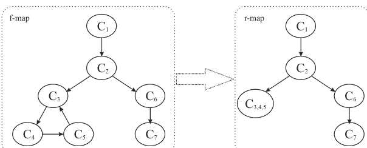

图3.12 f-map中形成环路的组件在r-map中被缩减为单个单元以进行递归恢复。

在检测到故障组件后，由恢复管理器对其进行微重启。一种保守的方法是同时对报告的故障组件及其紧邻下游的所有组件进行微重启，如[9]中所做。如果故障症状持续存在，合理地假设观察到的故障根本原因必须来自上游组件。因此，r-map中的上游组件也会被微重启。恢复以这种递归方式进行，直到整个系统被重新启动。

### 3.3.3 微重启技术的影响

微重启对可靠系统设计和故障管理有以下积极影响。

- 在节点级故障转移之前先对故障组件进行微重启。应首先重启疑似故障组件，因为这是修复系统的更快方式，如[11]所示。只有在对疑似故障组件进行微重启无法解决问题时，才应尝试节点级故障转移。

- 容忍更多误报。由于重启疑似故障组件的成本微不足道，故障检测中误报（即正常组件被标记为故障）的影响被最小化。因此，故障检测算法可以调整为更积极地怀疑故障组件。结果，漏报（即故障组件未被检测）率可以降低，系统的整体可靠性得到提高。

- 用于软件重启的主动微重启。主动应用级重启已被用作回收泄漏资源和消除系统中未检测到的瞬态错误的一种方法。此过程称为软件重启。对于微重启友好的应用程序，可以定期重启单个组件以达到类似效果，同时对客户端造成最小干扰。

- 增强最终用户的故障透明度。进程级和节点级重启不可避免地会对最终用户可见，因为重启通常需要10秒或更长时间才能完成。但是，在Java EE应用程序[11]中，单个组件的重启通常不到一秒。快速恢复使得可以利用HTTP 1.1提供的设施向最终用户隐藏微重启。被微重启中断的请求将导致带有状态码503的HTTP响应消息，指示服务器暂时不可用，以及一个Retry-After标头行，指示Web浏览器在一段时间后重试。

## 3.4 克服操作员错误

大多数复杂的软件系统都需要人工操作员进行配置、升级，有时还需要手动从故障中恢复。

不幸的是，人为错误是不可避免的，在许多情况下，系统可靠性会因人为错误而显著降低[4]。为了克服操作员错误，第2章介绍的检查点和日志技术将是必不可少的工具。但是，仅靠这些技术是不够的，因为操作员错误的副作用可能不仅限于应用程序本身。此外，传统的检查点和日志技术不解决状态修复和选择性重放的需求。在本节中，我们描述了操作员撤销方法[5, 6]来克服操作员错误。

值得注意的是，有许多研究旨在通过自动化任务[31, 33]来防止操作员错误，通过提供操作员指导[1, 3]来降低操作员错误的可能性，通过验证测试[26, 27]和基于机器学习的早期检测[28]来控制操作员错误（使错误不会传播到系统的其他部分）。这些方法与操作员撤销方法相辅相成。

### 3.4.1 操作员撤销模型

操作员撤销模型的目标是允许操作员通过将系统范围的状态回滚到已知正确点，重放对应用程序（和/或操作系统）的预期修改，然后通过重放记录的操作再次向前滚动来纠正所犯的任何错误。该模型包含三个主要步骤：

- 回退。在检测到错误后，操作员可以通过应用包含应用程序和操作系统状态的系统范围检查点，将系统恢复到已知正确状态。这与现代操作系统提供的回滚设施不同，后者仅允许将操作系统状态回滚到先前的恢复点。

- 修复。一旦系统范围的状态被回滚，操作员可以尝试将预期的更改重新应用到应用程序或操作系统，例如安装正确的补丁或以正确的方式重新配置应用程序。修复步骤还可能涉及修改记录的交互，以便保留最终用户的意图，并且在重放期间外部化的结果与用户在撤销之前看到的内容一致。

- 重放。随后，所有记录的最终用户交互（通常以请求消息的形式）被重放以向前滚动状态。

该模型的主要挑战是如何确保最终用户交互的一致重放。例如，在电子邮件应用程序中，垃圾邮件过滤器的更改可能导致先前审查过的消息从收件箱中删除（并移动到垃圾邮件文件夹）。显然，如何解决不一致性高度依赖于应用程序。

### 3.4.2 操作员撤销框架

操作员撤销模型的实现需要几个关键步骤：

- 调解最终用户交互。操作员撤销框架必须能够拦截最终用户对应用程序的所有请求，并能够控制发送给用户的响应。

- 应用程序和操作系统检查点。

- 最终用户交互日志记录。

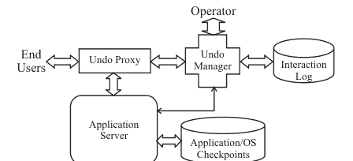

图3.13 操作员撤销框架的架构[5, 6]。

图3.13显示了在[5, 6]中实现的操作员撤销框架的架构。该框架的主要组件包括撤销代理（Undo Proxy），用于调解最终用户交互和重放；撤销管理器（Undo Manager），负责记录用户交互，并根据操作员的请求促进撤销和重放；以及两个用于状态检查点和最终用户交互的存储设施。撤销管理器还负责促进定期的系统范围检查点。

为了帮助将框架的特定于应用程序的实现与通用实现分开，[5, 6]中引入了一个名为“动词”（verb）的关键构造。动词采用通用数据结构，其内容封装了最终用户与应用程序服务器交互的逻辑意图。因此，动词是特定于应用程序的。但是，动词的通用数据结构使得可以以与应用程序无关的方式实现撤销管理器和日志存储组件。

### 示例 3.11

在[6]中，电子邮件系统中定义了13个动词。这些动词捕获了电子邮件传输（SMTP协议）和最终用户访问电子邮件（IMAP协议）的常见操作。在这些动词中，只有4个会导致外部可见的更改：

- 获取（Fetch）。最终用户使用它从指定文件夹中检索标头、标志或整个电子邮件。

- 存储（Store）。最终用户使用它在电子邮件上设置标志，例如已读或已删除。

- 列表（List）。用于检索IMAP文件夹列表。

- 清除（Expunge）。用于清除所有标记为已删除的电子邮件。

其他定义的动词包括：

- 投递（Deliver）。SMTP用于将电子邮件投递到邮件存储的唯一动词。

- 追加（Append）。用于将电子邮件追加到指定的IMAP文件夹。

- 复制（Copy）。用于将电子邮件复制到另一个文件夹。

- 状态（Status）。用于检索文件夹状态，例如文件夹的消息计数。

- 选择（Select）。用于打开IMAP文件夹。

- 关闭（Close）。用于取消选择IMAP文件夹。文件夹中标记为已删除的电子邮件将自动清除。

- 创建（Create）。用于创建新的IMAP文件夹（或另一个IMAP文件夹下的子文件夹）。


- 重命名。它用于重命名 IMAP 文件夹（或子文件夹）。

- 删除。它用于删除 IMAP 文件夹（或子文件夹）。

在 [6] 中，所有 13 个动词均在 Java 中实现，并符合通用 Verb 接口。

为了便于在撤销和修复后进行一致的重放，动词还必须实现两个接口，一个与用户交互时间线管理相关，另一个与一致性管理相关：

- 排序接口。该接口包含三个测试方法，它们都将另一个动词作为唯一参数：
  - 交换性测试。如果两个动词是交换的（即，任一动词的执行结果与它们在执行中的相对顺序无关），则测试返回 true。
  - 独立性测试。如果两个动词可以并发执行（例如，两个动词的并发执行不会导致竞争条件），则测试返回 true。
  - 首选顺序测试。如果两个动词不交换，则此测试返回两个动词的首选执行顺序。

这些测试是必要的，因为当最终用户请求首先在应用程序服务器上执行时，撤销代理不控制执行顺序，并且动词被记录的顺序可能与执行顺序不匹配。在重放期间，撤销管理器可以强制执行与原始执行具有相同并发级别的语义正确执行顺序。

- 一致性管理接口。该接口还包括三个方法，用于处理外部可访问的不一致：
  - 一致性测试。此测试比较动词原始执行的外部输出与重放的外部输出。一种简单的测试是比较两个输出的哈希值。但是，由于输出中的美观差异，此类测试可能会产生不必要的假阳性。这就是为什么应用程序开发人员被要求提供一致性测试实现，以便他们可以确定比较的应用程序特定规则。
  - 补偿。此方法针对外部用户可见的不一致应用程序特定的补偿操作。当一致性测试失败时，将调用此方法。
  - 压缩。当撤销管理器在与导致外部可见不一致的先前动词不交换的动词上调用此方法时，将调用此方法。正如方法名称所暗示的那样，压缩将动词转换为几乎不执行任何操作的动词，但它应适当通知用户，由于先前的不一致，原始动词未执行。这最常发生在删除或覆盖部分状态的动词上。

### 示例 3.12

为电子邮件系统 [6] 中定义的动词提供了排序规则的一部分，如下：

- 任何两个 Deliver 动词彼此独立且可交换。
- 属于不同用户的任何两个 IMAP 动词都是独立且可交换的。
- Deliver 动词与任何 IMAP 动词可交换，但收件箱的 Fetch 动词除外。
- 如果 Expunge 和 Fetch 在同一文件夹上操作，则它们不可交换。
- 如果 Store 和 Copy 在同一文件夹上操作，则它们不可交换。

电子邮件系统动词的一致性管理接口基于外部一致性模型 [6] 实现。在 SMTP 方面，可能出现外部可见不一致的唯一场景是：原始执行中电子邮件投递失败，但在重放期间同一封电子邮件可以成功投递。一致性规则是：如果关于投递失败的标准退信消息已发送回发件人，则不投递电子邮件。

为了增加重放期间投递的机会，退信消息会被延迟。

在 IMAP 方面，一致性测试基于动词结果的外部状态进行比较。外部状态包括以下内容：

- 如果提取了一封电子邮件，则包括电子邮件本身（文本和附件（如果有））。
- 对于涉及列出电子邮件的动词，包括电子邮件标头列表，例如 To、From、Cc 和 Subject。
- 对于请求文件夹的动词，包括文件夹列表。
- 对于修改电子邮件系统状态的动词，包括执行状态。

如果在重放期间与原始执行相比，外部状态的任何部分缺失或不同，则一致性测试将声明不一致。对于大多数动词，当一致性测试失败时，补偿方法会将一条解释性消息插入用户的收件箱，说明差异的原因。

## 参考文献

- 1. R. Bianchini, R. P. Martin, K. Nagaraja, T. D. Nguyen, and F. Oliveira. 人类感知的计算机系统设计。在第 10 届操作系统热点会议 - 第 10 卷，HOTOS'05 的论文集中，第 13–13 页，加利福尼亚州伯克利，美国，2005 年。USENIX 协会。
- 2. D. M. Blough and A. Pelc. 多处理器系统中的诊断与修复。IEEE Trans. Comput., 42(2):205–217, 1993 年 2 月。
- 3. P. Bodik, A. Fox, M. I. Jordan, D. Patterson, A. Banerjee, R. Jagannathan, T. Su, S. Tenginakai, B. Turner, and J. Ingalls. amazon.com 运营商的高级工具。在第一届自动计算热点国际会议，HotACI'06 的论文集中，第 1–1 页，加利福尼亚州伯克利，美国，2006 年。USENIX 协会。
- 4. A. Brown and D. Patterson. 人非圣贤，孰能无过。在 2001 年系统可靠性评估与架构研讨会论文集中，瑞典哥德堡，2001 年。
- 5. A. B. Brown and D. A. Patterson. 回放、修复、重播：可靠性的三个 R。在第 10 届 ACM SIGOPS 欧洲研讨会，EW 10 的论文集中，第 70–77 页，纽约，美国，2002 年。ACM。
- 6. A. B. Brown and D. A. Patterson. 面向运营商的撤销：构建可撤销的电子邮件存储。在 USENIX 年度技术会议，ATEC '03 的论文集中，第 1–1 页，加利福尼亚州伯克利，美国，2003 年。USENIX 协会。
- 7. G. Candea, A. B. Brown, A. Fox, and D. Patterson. 面向恢复的计算：构建多层可靠性。Computer, 37(11):60–67, 2004 年 11 月。
- 8. G. Candea, G. C, E. Kiciman, S. Zhang, A. Fox, P. Keyani, and O. Fox. Jagr：一种自主自愈应用程序服务器。在活动中间件服务国际研讨会论文集中，第 168–178 页，2003 年。
- 9. G. Candea, J. Cutler, and A. Fox. 通过递归微重启提高可用性：一种软状态系统案例研究。Perform. Eval., 56(1-4):213–248, 2004 年 3 月。
- 10. G. Candea, M. Delgado, M. Chen, and A. Fox. 自动故障路径推断：面向互联网应用的通用内省技术。在第三届 IEEE 互联网应用研讨会，WIAPP '03 的论文集中，第 132– 页，华盛顿特区，美国，2003 年。IEEE 计算机学会。
- 11. G. Candea, S. Kawamoto, Y. Fujiki, G. Friedman, and A. Fox. 微重启：一种廉价恢复技术。在第 6 届操作系统设计与实现研讨会论文集中，旧金山，加利福尼亚州，2004 年。
- 12. Y. Chang, L. Lander, H.-S. Lu, and M.Wells. 均匀分布系统中故障定位的贝叶斯分析。在第 12 届可靠分布式系统研讨会论文集中，第 44–53 页，1993 年。
- 13. M. Y. Chen, A. Accardi, E. Kiciman, J. Lloyd, D. Patterson, A. Fox, and E. Brewer. 基于路径的故障与演进管理。在第 1 届网络系统设计与实现会议 - 第 1 卷，NSDI'04 的论文集中，第 23–23 页，加利福尼亚州伯克利，美国，2004 年。USENIX 协会。
- 14. M. Y. Chen, E. Kiciman, E. Fratkin, A. Fox, and E. Brewer. Pinpoint：大型动态互联网服务中的问题确定。在 2002 年可靠系统与网络国际会议，DSN '02 的论文集中，第 595–604 页，华盛顿特区，美国，2002 年。IEEE 计算机学会。
- 15. S. C. Geyik and B. K. Szymanski. 基于语法推断的传感器网络事件识别。在 INFOCOM 中，第 900–908 页，2009 年。
- 16. J. J. Horning, H. C. Lauer, P. M. Melliar-Smith, and B. Randell. 用于错误检测和恢复的程序结构。在操作系统，国际研讨会论文集中，第 171–187 页，英国伦敦，英国，1974 年。Springer-Verlag。
- 17. A. Hyvärinen and E. Oja. 独立成分分析：算法与应用。Neural Netw., 13(4-5):411–430, 2000 年 5 月。
- 18. R. Jain. 计算机系统性能分析艺术：实验设计、测量、仿真和建模技术。John Wiley & Sons, 1991。
- 19. K. R. Joshi, W. H. Sanders, M. A. Hiltunen, and R. D. Schlichting. 分布式系统中的自动模型驱动恢复。在第 24 届


- IEEE可靠分布式系统研讨会，SRDS '05，第25–38页，华盛顿特区，美国，2005年。IEEE计算机学会。
- 20. S. Kandula, R. Mahajan, P. Verkaik, S. Agarwal, J. Padhye, 和 P. Bahl. 企业网络的详细诊断. SIGCOMM Comput. Commun. Rev., 39(4):243–254, 2009年8月。
- 21. D. Kaye. 松耦合：Web服务缺失的部分. RDS Press, 2003.
- 22. E. Kiciman 和 A. Fox. 基于组件的互联网服务中应用级故障的检测. Trans. Neur. Netw., 16(5):1027–1041, 2005年9月。
- 23. B. C. Ling, E. Kiciman, 和 A. Fox. 会话状态：超越软状态. 在第1届网络系统设计与实现研讨会论文集 - 第1卷, NSDI'04, 第22–22页, 伯克利, 加利福尼亚州, 美国, 2004年. USENIX协会。
- 24. D. Lymberopoulos, A. S. Ogale, A. Savvides, 和 Y. Aloimonos. 传感器网络中行为推断的感觉语法. 在第5届传感器网络信息处理国际会议论文集, IPSN '06, 第251–259页, 纽约, 纽约州, 美国, 2006年. ACM.
- 25. C. D. Manning 和 H. Schutze. 统计自然语言处理基础. MIT出版社, 1999.
- 26. K. Nagaraja, F. Oliveira, R. Bianchini, R. P. Martin, 和 T. D. Nguyen. 理解和处理互联网服务中的操作员错误. 在第6届操作系统设计与实现研讨会论文集 - 第6卷, OSDI'04, 第5–5页, 伯克利, 加利福尼亚州, 美国, 2004年. USENIX协会。
- 27. F. Oliveira, K. Nagaraja, R. Bachwani, R. Bianchini, R. P. Martin, 和 T. D. Nguyen. 理解和验证数据库系统管理. 在USENIX '06年度技术会议年会论文集, ATEC '06, 第19–19页, 伯克利, 加利福尼亚州, 美国, 2006年. USENIX协会。
- 28. F. Oliveira, A. Tjang, R. Bianchini, R. P. Martin, 和 T. D. Nguyen. Barricade：防御系统免受操作员错误的影响. 在第5届欧洲计算机系统会议论文集, EuroSys '10, 第83–96页, 纽约, 纽约州, 美国, 2010年. ACM.
- 29. F. Preparata, G. Metze, 和 R. Chien. 可诊断系统中的连接分配问题. IEEE Trans. on Electronic Comp., EC-16(6):848–854, 1967年12月。
- 30. A. O. Ramirez. 三层架构. Linux J., 2000(75es), 2000年7月。
- 31. Y.-Y. Su, M. Attariyan, 和 J. Flinn. Autobash：利用操作系统因果分析改进配置管理. SIGOPS Oper. Syst. Rev., 41(6):237–250, 2007年10月。
- 32. A. S. Tanenbaum 和 M. V. Steen. 分布式系统：原理与范式. Prentice Hall, 第2版, 2006.
- 33. W. Zheng, R. Bianchini, 和 T. D. Nguyen. 互联网服务的自动配置. SIGOPS Oper. Syst. Rev., 41(3):219–229, 2007年3月。

# 4 数据与服务复制

与侧重于故障发生时应用程序恢复的检查点/日志记录和面向恢复的计算不同，复制技术通过屏蔽各种硬件和软件故障，为实现分布式服务的高可用性提供了另一种方式。复制技术的目标是延长分布式服务的平均无故障时间。正如其名称所示，复制技术依赖于空间冗余的使用，即不运行单个服务副本，而是在一组物理节点上部署多个副本以实现故障隔离。为了使复制发挥作用（即能够屏蔽单个故障），重要的是要确保不同副本上的故障独立发生。

服务复制最著名的方法是状态机复制 [26]。在这种方法中，每个副本被建模为一个状态机，由一组状态变量和一组客户端可访问的接口组成，这些接口对状态变量进行确定性操作。随着多个状态机副本的存在，副本之间的一致性问题变得重要。很明显，副本的访问必须由复制算法协调，以便它们在每个操作结束时保持一致。更具体地说，复制算法必须确保客户端的请求（调用状态机定义的接口之一）到达所有非故障副本，并且所有非故障副本必须以完全相同的总顺序传递请求（这些请求可能来自不同的客户端）。客户端请求的执行必须是确定性的，即，给定相同的请求，所有非故障副本都会生成相同的响应。如果应用程序包含非确定性行为，则必须通过控制此类行为使其确定性，例如，通过显式协调原本非确定性的操作 [34]。

尽管可以使用服务复制方法复制数据，但数据复制的关注点通常与服务复制不同。在数据复制中，假设可能被访问的数据项是已知的，并且对数据项的操作仅限于读取或写入。此外，数据复制通常在事务处理系统的背景下讨论，即每个事务由对多个数据项的一组读取和/或写入操作组成，并且这些操作应以原子方式执行。因此，允许不同事务对数据项进行并发访问在数据复制中至关重要。这与服务复制非常不同，服务复制通常要求对副本上的所有远程调用进行串行执行。

对于许多需要数据和服务复制的基于互联网的应用程序，由于这样做会带来运行时开销，确保副本之间的严格同步一致性通常被认为不太可取。已经设计了许多乐观数据复制算法，提供较弱的一致性保证。

平衡一致性和性能的问题因网络分区的可能性而变得更加复杂。网络分区是一种故障（通常由故障网络设备引起），它将副本分离为两个或多个组。在每个组内，副本可以相互通信。但是，属于不同组的副本将无法再通信。当发生网络分区时，复制算法必须做出一个重要决定：是暂停对副本的访问以确保副本的一致性，直到网络分区修复（这将牺牲数据或服务的可用性），还是允许通过牺牲副本的一致性（称为分区容忍性）来实现某种形式的进展？

2000年，Eric Brewer 提出一个猜想 [6]，即分布式系统只能保证三个属性中的最多两个：一致性、可用性和分区容忍性（_即_，不可能构建一个同时满足所有三个要求的系统）。该猜想两年后由 Seth Gilbert 和 Nancy Lynch 证明，成为 CAP 定理 [11]。对于许多实际系统，高可用性和分区容忍性被认为比临时不一致的风险更重要。

在本章中，我们首先介绍确保严格副本一致性（通常称为悲观复制）的服务和数据复制的基本方法，然后讨论乐观复制涉及的方法和步骤。本章以关于 CAP 定理的一节结束。

## 4.1 服务复制

在服务复制中，通常使用客户端-服务器交互模型，其中一个或多个客户端向复制的服务器发出请求并同步等待相应的响应。通过叠加客户端-服务器模型可以支持多层交互。服务复制算法通常设计为在异步分布式计算环境中运行，其中处理时间无界、消息延迟无界、时钟偏差无界。为异步环境设计的算法更加健壮，因为其正确性不依赖于时序。

在服务复制中，每个服务器副本作为应用程序进程运行。服务器必须导出一组接口，供客户端通过计算机网络或互联网远程调用。但是，服务器的内部状态被完全封装，客户端无法直接访问。该模型与数据复制截然不同。此外，与数据复制不同，服务复制中的副本可能表现出非确定性行为，_例如_，由于多线程或访问节点特定资源。


在服务复制中，复制算法通常作为容错中间件框架的一部分来实现，如图 4.1 所示。此类框架通常向应用程序开发人员提供应用程序编程接口（APIs），以通过以下方式减轻实现基于复制的容错 [8, 9] 的复杂性：

- 客户端组件可靠地促进客户端向所有非故障副本多播请求。它还负责过滤副本发送的重复回复消息，或在必要时对回复消息进行投票。
- 服务器端组件确保请求在所有非故障副本中以相同的总顺序传递。它还负责处理重复请求和故障掩蔽。

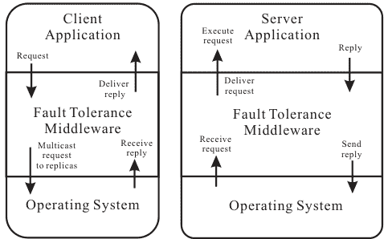

图 4.1 复制算法通常在容错中间件框架中实现。

某些框架 [21, 34, 38, 37] 旨在通过拦截与输入/输出相关的系统调用，而不是向应用程序开发人员提供 API，来为应用程序提供透明容错。在基于 Unix/Linux 的操作系统中，系统调用的拦截可以通过 dlsym() 机制实现。此类容错框架可以编译为动态库，并在启动时通过将 LD_PRELOAD 环境变量指向包含动态库的路径，将其注入到应用程序进程中。

如果应用程序已经在使用中间件框架 [33, 35, 39]，也可以通过与该框架集成来实现透明容错。例如，Web 服务应用程序通常构建在广泛的中间件库之上。此类大多数库，例如 Apache Axis (http://axis.apache.org/)，都提供插件 API，供开发人员自定义低级消息处理和数据通信。容错组件可以相对容易地插入到应用程序中，只需最少的修改。

### 4.1.1 复制样式

如前所述，副本必须以某种方式进行协调，以确保其一致性。协调副本有多种不同的方案。在文献中，我们看到了以下被提及的复制样式 [36]：

- 主动复制。如图 4.2 所示，在主动复制中，每个副本以相同的总顺序传递并执行请求。每个副本扮演相同的角色。因为每个非故障副本都会向客户端发送回复，因此必须过滤重复回复。对于主动复制，通常假设存在可靠的全序多播服务，以确保请求的可靠性和全序。为了容忍副本中的某些非故障停止故障，有必要对副本发送的回复消息进行投票。如果不到一半的副本可能出现非故障停止故障，客户端上的多数投票可以确保非故障副本发送的回复被传递。

- 被动复制。如图 4.3 所示，在被动复制中，一个副本被指定为主副本，其余副本作为备份副本。只有主副本执行请求。主副本会定期将其状态传输到备份副本，以使其保持最新。为了确保强副本一致性，备份副本还需要接收并记录来自客户端的传入请求。

- 半主动复制。半主动复制专门设计用于处理副本非确定性。在半主动复制中，类似于被动复制，一个副本充当主副本，其余副本作为备份副本，

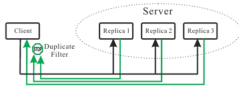

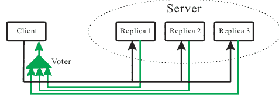

图 4.2 主动复制，客户端不投票（顶部）和投票（底部）。

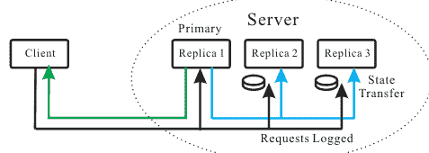

图 4.3 被动复制。

如图 4.4 所示。主副本确定请求的传递顺序以及任何潜在非确定性操作的执行顺序。主副本随后将排序信息传输到备份副本，使它们以相同的顺序传递请求，并以与主副本相同的顺序执行非确定性操作。请注意，在半主动复制中，所有副本都会传递并执行请求。若仅容忍故障停止故障，则禁用备份副本发送回复会更高效（这样这些消息就不会与网络和处理资源竞争）。

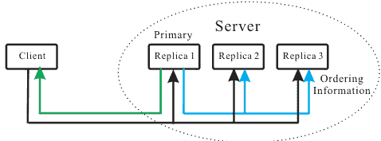

图 4.4 半主动复制。

- **主从复制。** 主从复制涵盖了被动复制和半主动复制。它仅指副本中有一个领导者（_即_，主副本），其余副本是追随者。

### 4.1.2 服务复制的实现

在悲观复制中，目标是确保任何副本的故障都被掩蔽，而不会中断对被复制数据或服务的访问。对于主动复制，这意味着每个客户端请求执行结束时，非故障副本的状态必须保持一致。对于被动复制，这意味着备份副本必须准备好在主副本失败时接管，而不会丢失任何状态更改或导致任何不一致。本质上，副本应以一种方式进行协调，使其对客户端来说看起来像是单个高度可用的服务器副本。

假设副本上的执行是确定性的，为了确保副本一致性，对于主动复制，所有请求必须以相同的总顺序在每个副本上传递并*按顺序执行*。对于被动复制，自主副本到备份副本的最后一次状态传输以来的所有请求必须在备份副本上记录，并记录主副本上的执行顺序信息。

这些要求通常通过以下三种方式之一满足：

- 使用组通信系统 [5]。此类系统提供两种服务：
  - 成员服务。组通信系统使用不可靠的故障检测器（通常使用心跳消息和启发式超时）来确定当前配置中哪些副本可用（称为当前成员视图）。当检测到故障时，系统会重新配置并安装新的成员视图。同样，成员服务允许将新副本添加到系统中，或从当前成员中计划移除现有副本。对于每次成员变更，新成员中包含的每个副本都会被告知成员变更和形成情况。
  - 可靠的全序多播服务。此类服务确保在每个成员视图中，所有副本接收到同一组消息（可能由不同客户端发送），并具有相同的总顺序。

此外，组通信系统确保成员变更相对于所有存活副本的常规消息是全序的，这是虚拟同步模型 [3] 的重要属性。组通信系统将在第 5 章中详细讨论。

- 使用共识算法 [8, 18, 39]。消息的全序和可靠传递通过非故障副本之间的共识算法来确保。与组通信系统中采用的方法不同（该方法将故障副本从当前成员中移除），共识算法通过使用法定人数在存在故障副本的情况下取得进展。共识算法及其在构建可靠系统中的应用将在第 6 章中详细讨论。

- 使用带原子提交的事务处理 [2, 14]。此方法最常用于数据复制（例如，在复制数据库系统中）。该方法的更多详细信息将在下面的小节中提供。

前两种方法通常用于状态机复制（主要用于服务复制，但有时也用于数据复制）。最后一种方法通常用于数据复制。


## 4.2 数据复制

数据复制最初在事务处理系统的背景下被广泛研究 [2, 14]。事务性数据复制与状态机复制不同，因为一个事务由对一组数据项的多个读和/或写操作组成，而状态机复制中操作的粒度是对副本的整体。虽然在事务级别，所有事务必须以看起来是按顺序执行的方式执行，类似于状态机复制中对服务器副本的所有请求的顺序执行要求，但对不同数据项的实际读/写操作（可能属于不同事务）始终是并发执行的。因此，在事务性数据复制中，复制算法不仅要确保副本的一致性，还要定义并发控制。

事务性数据复制算法应确保复制的数据对客户端来说表现为单个副本，特别是，事务执行的交错应等同于对数据单个副本的顺序执行。这种执行通常被称为一副本可串行化。

一般来说，使用数据复制时，希望尽量降低读操作的成本，因为（只读）查询比更新（包含对某些数据项写入的事务）要普遍得多。我们首先通过考察两个错误的天真复制算法：write-all 和 write-all-available，来强调设计一个可靠的数据复制算法并非易事。

在 write-all 数据复制算法中，如图 4.5 所示，对数据项 x 的读操作可以映射到 x 的任何副本，而对数据项 x 的每个写操作将应用到 x 的所有副本。只要管理副本的节点不发生故障，该复制算法就满足一副本可串行化要求。这是因为在任何事务序列的执行中，如果一个事务写入数据项 x，它会写入 x 的所有副本，如果另一个事务后来读取数据项 x，无论它从哪个副本读取，它都会读取由最近写入 x 的事务写入的相同值。

如果管理副本的节点或进程发生故障（为方便起见，我们简单地说副本发生故障），就会出现问题。write-all 算法将不得不阻塞，直到故障副本被修复并完全恢复。这意味着任何单个副本故障都会导致整个系统不可用，这违背了最初使用复制的目的。

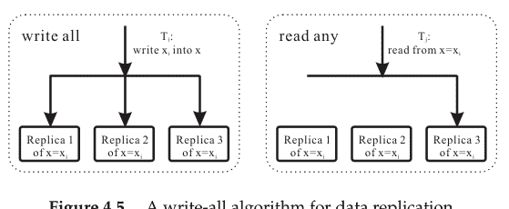

为了修复 write-all 算法的这个问题，有人可能会尝试使用 write-all-available 算法，其中对数据项 x 的写操作简单地转换为 x 的所有可用副本，同时允许读操作应用到副本的任何副本。这个新算法解决了阻塞问题。然而，它不能保证一副本可串行化执行，因为一个事务可能会从某个数据项的副本读取，而该副本未被最后写入同一数据项的事务写入，例如，如果该数据项的副本在上一个事务期间失败并随后恢复，如图 4.6 所示。

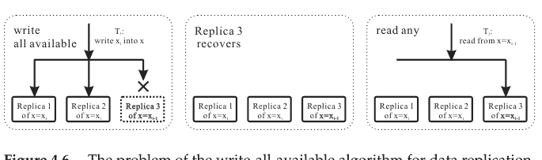

显然，上述问题是由访问未完全恢复的副本引起的。我们能否通过防止事务访问未完全恢复的副本来解决这个问题？不幸的是，这也不是一个可行的解决方案。要了解原因，请考虑以下示例。

### 示例 4.1

考虑两个事务 Ti 和 Tj。Ti 首先对数据 x 发出读操作。它被映射到 x 的副本 1。同样，Tj 首先对数据 y 发出读操作。它被映射到 y 的副本 2。随后，x 的副本 1 和 y 的副本 2（即 Ti 访问的副本和 Tj 访问的副本）失败了。接下来，Ti 对数据 y 发出写操作，同时，Tj 对数据 x 发出写操作。Ti 的写操作只能映射到 y 的副本 1，因为 y 的副本 2 不再可用。同样，Tj 的写操作只能映射到 x 的副本 2，因为 x 的副本 1 不再可用。两个事务的操作如图 4.7 所示。

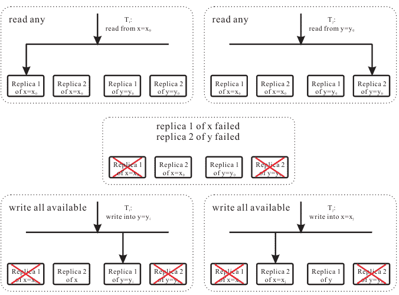

图 4.7 防止事务访问未完全恢复的副本不足以确保事务的一副本可串行化执行。

在这个示例中，我们不能说 Ti 在 Tj 之前，因为 Tj 在 Ti 写入 y 之前读取了 y。不幸的是，我们也不能说 Tj 在 Ti 之前，因为 Ti 在 Tj 写入 x 之前读取了 x。这违反了 Ti 和 Tj 的一副本可串行化执行。

从上面的示例可以看出，问题是由在不同副本上执行冲突操作引起的。因此，可靠的复制算法必须防止这种情况发生。法定人数共识复制算法 [2] 就是这样的算法之一。

法定人数共识复制算法通过为每个数据项写入写法定人数副本来实现对副本故障的鲁棒性。只要非故障副本可以形成写法定人数，写操作就会在不阻塞的情况下成功。法定人数共识算法通过为每个数据项从读法定人数副本读取来确保一副本可串行化执行。读法定人数和写法定人数的定义是：给定的读法定人数必须与任何写法定人数至少在一个副本上相交，同样，任何两个写法定人数也必须至少在一个副本上相交。

每个副本被分配一个正权重。读法定人数应具有最小总重量 RT，写法定人数应具有最小总重量 WT。此外，RT + WT 和 2WT 必须大于每个数据项所有副本的总重量。这确保了上述交集要求。重要的是将 RT 定义为至少两个副本的权重之和。例如，如果每个副本被分配权重 1，则 RT = 2。这是为了确保写法定人数不必包含所有副本（否则，法定人数共识算法将退化为 write-all 算法，该算法不具备容错性）。

因为写操作只会更新法定人数副本，不同副本可能包含不同的值。为了知道哪个副本具有最新值，引入了版本号并分配给每个副本。如果副本参与了所有这些写操作，则每次后续写入副本时，版本号将加一。

读操作规则。对于对数据项 x 的每个读操作，它被映射到 x 的读法定人数副本。每个副本返回 x 的值和相应的版本号。客户端（或事务管理器）选择版本号最高的值。

写操作规则。对于对数据项 x 的每个写操作，它被映射到 x 的写法定人数副本。写操作分两步执行：

- 从写法定人数副本中检索版本号。为此次写入设置新版本号 $v = v_{max} + 1$。
- 使用最新版本号 $v$ 写入此法定人数副本。副本将用给定值覆盖数据项的值和相应的版本号。

### 示例 4.2

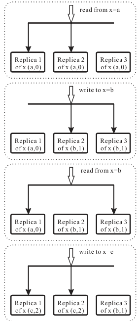

图 4.8 法定人数共识算法在单个数据项上的示例运行。

图 4.8 显示了对数据项 x 的副本进行读/写操作的示例序列。我们假设有 3 个副本


被使用，并且每个副本分配的权重为 1。读取法定人数由 2 个副本组成（即 RT = 2），写入法定人数也由 2 个副本组成（即 WT = 2）。最初，所有副本都包含值为 a 且版本号为 0 的 x。

第一个操作（读取）映射到副本 1 和副本 2。两个副本都返回值 a 和版本 0。因此，该操作接受值 a。

第二个操作（写入）映射到副本 2 和副本 3。由于两个副本都返回版本号 0，新版本号将为 1。随后，新值 b 和新版本号 1 被写入副本 2 和副本 3。此操作结束时，副本 1 包含较旧版本的数据。

第三个操作（读取）映射到副本 1 和副本 3。副本 1 返回版本号为 0 的值 a，副本 3 返回版本为 1 的值 b。因此，该操作接受值 b，因为它具有更高的版本号。

第四个操作（写入）映射到副本 1 和副本 2。副本 1 返回版本号 0，副本 2 返回版本号 1。因此，新版本号应为 2。随后，版本号为 2 的新值 c 被写入副本 1 和副本 2。请注意，副本 1 跳过了一次更新并赶上了最新更新。

## 4.3 乐观复制

乐观复制的研究源于互联网上数据复制和移动设备数据同步的需求 [25]。前一节中描述的传统数据复制算法通常需要副本之间频繁交换消息。因此，如果通信延迟较大（例如通过互联网）或连接不可靠（如在无线移动环境中），它们效果不佳。通常希望允许更新在传播到所有副本之前立即应用到本地副本。立即执行更新可能会导致冲突，在这种情况下，冲突将通过预定义的冲突解决规则或手动方式解决。

这种方法是乐观的，因为它假设冲突很少发生，并且可以在检测到时解决。因此，乐观数据复制的目标是实现副本之间的最终一致性，而不是单副本可串行化一致性。这里的最终一致性意味着，从相同的初始状态开始，如果不提交新操作并且所有已提交的现有操作都已处理，副本将达到相同的最终状态。

### 4.3.1 系统模型

在乐观数据复制中，我们将系统建模为一组跨 N 个节点复制的对象，通常称为站点 [25]。对象是复制的最小单位，每个对象可以为其本地或远程客户端定义一组操作，以访问对象中封装的数据。操作可以简单如读取和写入，也可以更复杂，例如使用 SQL 定义的操作 [29]。

副本在更新权限方面不一定相等。某些节点可能被指定为主站点，拥有更新其管理的副本的权限，而其他节点则限制为仅允许其客户端进行只读访问。最常见的配置是：

- 单主复制。仅授予单个节点更新权限。所有更新操作都必须通过此单个主站点。更新将异步传播到其他副本。
- 多主复制。每个节点都被授予更新权限。然后更新将从一个副本传播到所有其他副本。这是乐观数据复制中最常见的配置，因为它为用户提供了最高的数据可用性和便利性。然而，作为权衡，我们必须解决调度、冲突解决和提交问题的挑战，这些将在稍后解释。除非另有说明，我们假设本节使用多主复制。

如图 4.9 所示，乐观数据复制通常涉及以下步骤 [25]：

- 操作提交。操作始终由用户选择的特定节点提交。不同的用户可以选择在不同的副本上提交其操作。
- 本地执行。本地提交的操作将立即执行。

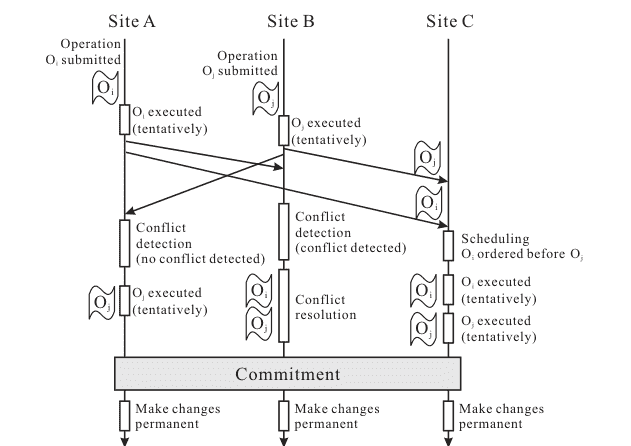

图 4.9 操作传输系统中乐观数据复制的基本步骤。

- 更新传播。对本地副本的更新可以以两种替代形式传播到其他副本：
  - 状态传输：本地副本的完整状态被传输到其他副本。这种更新传播形式仅适用于仅限于使用读取和写入操作的系统。
  - 操作传输：每次修改时不传输状态的副本，而是通过记录本地操作并将记录的操作传播到其他副本，使其他副本保持最新。
- 操作调度。对于多主复制，每个节点上操作的到达顺序是不确定的。调度的目标是对操作施加部分顺序，以尽量减少不同副本上操作的冲突执行，例如，
  - 对于因果相关的操作，执行这些操作时必须遵守因果顺序。
  - 对于独立或可交换的操作，它们可以以任意顺序并发执行。

例如，在图 4.9 中，在站点 3，操作 Oi 在 Oj 之前执行，即使 Oj 先接收。

- 冲突解决。由于乐观数据复制的性质，无法避免不同副本执行的冲突执行顺序。这种冲突决策会导致副本状态不一致，必须予以解决。
- 更新提交。对于状态传输系统和操作传输系统，通常需要一个额外步骤，原因如下：
  - 有必要了解特定副本所做的更新是否已传播到所有其他副本。这一知识有两个好处：(1) 现在可以垃圾回收与此更新相关的所有记录，以及 (2) 用户可以确信此更新现在是稳定的，即其效果不再会因冲突而被更改。
  - 作为一种特殊情况，在状态传输系统中，由于可能存在删除/更新冲突，已删除的对象不能立即从系统中移除。因此，当系统得知所有副本都已知晓删除事实时，有必要执行额外步骤来垃圾回收已删除的对象。

### 4.3.2 建立操作之间的顺序

乐观数据复制的基础是在不需要副本之间过多信息交换的情况下，建立所有操作之间的部分顺序。事件顺序和逻辑时钟理论 [17] 在实现这一点方面发挥着重要作用。

Happens-Before 关系。给定提交到节点 i 和节点 j 的两个操作 O 和 O'，如果满足以下条件 [17]，则可以说 O 在 O' 之前发生，表示为 O → O'：

- i = j 且 O 在 O' 之前提交，或者，
- i ≠ j，且 O 传播到节点 j 并在 O' 提交之前在 j 上执行。

Happens-Before 关系是传递的，即，如果 Oa → Ob，且 Ob → Oc，则 Oa → Oc。Happens-Before 关系对操作施加了部分顺序。对于无法通过 Happens-Before 关系来限定的操作，它们被认为是并发的，这意味着它们没有因果关系。

逻辑时钟可用于捕获操作之间的 Happens-Before 关系 [17]。一种简单的逻辑时钟实现是 Lamport 时钟 [17]。要实现 Lamport 时钟，每个副本维护一个计数器变量 lc，表示逻辑时钟。对于操作传输系统，使用 Lamport 时钟的规则定义如下：

- 提交新操作 O 时，逻辑时钟加 1，即 lc = lc + 1。
- 然后，将当前 lc 值作为操作的时间戳分配给该操作，即 O.lc = lc。
- 将操作传播到其他副本时，分配的时间戳随操作一起携带。
- 接收到操作 O 时，接收副本首先将其本地逻辑时钟 lc 调整为随操作携带的时间戳（如果该时间戳大于其本地时钟值），然后将其逻辑时钟加 1，即 lc = max(lc, O.lc) + 1。

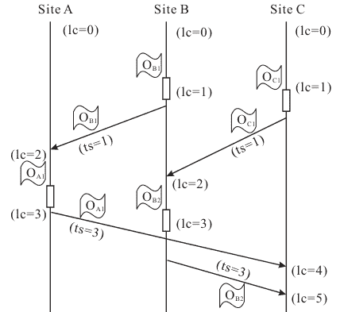

**图 4.10** 使用 Lamport 时钟的三个站点系统的示例运行。

使用 Lamport 时钟的系统示例运行如图 4.10 所示。Lamport 时钟确保，给定两个操作 O 和 O'，如果 O 在 O' 之前发生，则 O.lc < O'.lc。例如，在图 4.10 中，O_B1 在 O_A1 之前发生，并且确实


$O_{B1}.lc = 2 < O_{A1}.lc = 3$。然而，情况并非如此，即，不能仅仅因为 $O.lc < O'.lc$ 就得出 $O$ 发生在 $O'$ 之前的结论。例如，虽然 $O_{B2}$ 的 Lamport 时间戳是 3，$O_{A1}$ 的 Lamport 时间戳是 2，即 $O_{A1}.lc < O_{B2}$，我们也不能得出 $O_{A1} \rightarrow O_{B2}$ 的结论。事实上，这两个操作是并发的。这一观察使我们无法使用 Lamport 时钟来生成时间戳用于因果性识别，因为要确定两个操作是否具有因果关系，我们希望简单地比较它们的逻辑时间戳。幸运的是，Lamport 时钟的一个相对简单的扩展，称为向量时钟 [19]，可以满足这一要求。

对于由 N 个节点组成的系统，每个节点维护一个向量时钟 VC，形式为 N 元素的数组。我们通过系统中节点的索引（从 0 到 N-1）来引用这些节点。对于节点 i，其向量时钟中的对应元素 $VC_i[i]$ 表示在节点 i 上本地发生的事件数量。它从其他节点发送到节点 i 的消息中携带的时间戳中了解其他元素的值。

对于数据复制，由 N 个主站点组成的操作传输系统使用向量时钟的规则定义如下：

- 在站点 $i$ 提交新操作 $O$ 时，其中 $i$ 从 0 到 $N-1$，站点 $i$ 的向量时钟的元素 $i$ 递增 1，即 $VC_i[i] = VC_i[i] + 1$。
- 然后，将操作分配当前的 $VC_i$ 值作为操作的时间戳，即 $O.vc = VC_i$。
- 当将操作传播到其他副本时，分配的时间戳随操作一起携带。
- 在站点 $j$ 接收到操作 $O$ 时，站点 $j$ 按以下方式更新其向量时钟：
  - 对于向量时钟中的每个元素 $k \neq j$，$VC_j[k] = max(VC_j[k], O.vc[k])$

请注意，在从站点 $i$ 接收到操作后，如果站点 $i$ 在站点 $j$ 之前接收到某个操作，站点 $j$ 可能会在除 $i$ 以外的元素 $k$ 上推进其向量时钟。站点 $j$ 可能希望为该操作请求重传。如果 $i$ 和 $j$ 之间的通信通道不保证先进先出（FIFO）属性，$j$ 可能会在收到来自 $i$ 的乱序操作后接收到一个旧的丢失操作，在这种情况下，向量时钟不会推进。

站点通过比较随操作携带的向量时钟时间戳来确定操作 \( O^m \) 是否发生在另一个操作 \( O^n \) 之前。如果 \( O^n.vc \) 支配 \( O^m.vc \)，则 \( O^m \) 发生在 \( O^n \) 之前，即，对于任何 \( k \in \{0...N\} \)，\( O^n.vc[k] \le O^m.vc[k] \)。如果 \( O^n.vc \) 既不支配 \( O^m.vc \)，\( O^m.vc \) 也不支配 \( O^n.vc \)，那么，这两个操作是并发的，并检测到冲突。

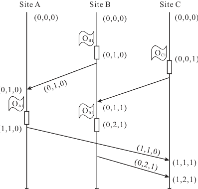

图 4.11 使用向量时钟的三个站点系统的示例运行。

使用向量时钟的系统的示例运行如图 4.11 所示。可以看出，\( O_{A1}.vc \) 明显支配 \( O_{B1}.vc \)，这表明 \( O_{A1} \rightarrow O_{B1} \)。此外，\( O_{B2} \) 和 \( O_{A1} \) 之间的关系没有歧义，因为 \( O_{A1}.vc = (1, 1, 0) \) 既不支配 \( O_{B2}.vc = (0, 2, 1) \)，\( O_{B2}.vc \) 也不支配 \( O_{A1}.vc \)。

### 4.3.3 状态传输系统

在操作提交并本地应用后，对状态的更新需要传播到其他副本。如前所述，从主站点到其他副本的更新传播有两种不同的方法。在本小节中，我们关注状态传输系统，其中更新通过状态传输传播到其他副本。操作传输系统中的更新传播、冲突检测和调和将在下一小节中讨论。

在状态传输系统中，副本可以通过应用最新的状态副本彼此保持一致，前提是当不同副本彼此同步时未检测到冲突。这意味着，中间更新（如果存在）在应用了此类更新的副本之外的其他副本上实际上被跳过。此属性通常称为 Thomas 的写规则 [30]。该规则引入于一种（悲观地）复制的数据库系统中，该系统旨在通过仅对更新使用标量逻辑时间戳和使用多数共识算法来确保顺序更新，以保持强副本一致性 [30]。在乐观复制中，向量时钟或其扩展要可取得多：

- 使用向量时钟使副本能够无论是否能与其他副本通信都更新其本地副本，即，数据始终可用。这与 [30] 非常不同，[30] 要求在更新之前大多数副本达成一致。如果网络分区且副本属于少数分区，则该副本将无法对其数据执行更新。
- 向量时钟可用于准确捕获副本上不同更新的因果关系，以实现最终副本一致性。向量时钟还有助于检测冲突的更新。

#### 4.3.3.1 版本向量

在此上下文中使用的向量时钟通常称为版本向量 (VV) [16]，并在复制文件系统的上下文中讨论。每个单独的文件（即对象）都关联一个版本向量。在实践中，版本向量通常以明确拼写站点 ID 的形式表示，而不是我们在上一节中使用的紧凑形式。例如，如果文件在站点 A、B 和 C 上复制，则该文件的版本向量将采用 (A : i, B : j, C : k) 的形式，其中 i、j 和 k 分别是已应用于文件的 A、B、C 的更新数量。事实上，版本向量表示为 N 个 (site-id, number-of-updates) 对，其中 N 是文件的副本数量。这种格式有助于添加新副本和删除现有副本，即，版本向量可以是可变长度而不是固定长度。

给定两个版本向量，$VV_i$ 和 $VV_j$，如果其中一个支配另一个，则认为这两个版本向量是兼容的，因为可以通过应用 Thomas 的写规则使副本保持一致。否则，已检测到两个副本之间的冲突，并且必须进行调和。

使用版本向量的一般规则与 4.3.2 节中描述的规则相当相似。特别是，对于站点上文件的每个更新，站点会递增版本向量中该站点的版本计数。但是，需要以下附加规则来处理 4.3.2 节未考虑的情况：

- 当文件重命名时，它被视为对文件的更新。因此，版本向量中相应站点元素的版本计数将递增。
- 文件删除也被视为对文件的更新。此外，文件并未实际从文件系统中删除。相反，删除操作会导致文件的一个版本长度为零（即，基本上仅保留文件的元数据）。这种机制是必要的，原因很简单：站点应始终准备好检测不同站点所做更新上的可能冲突并对其进行调和。直观地说，只有当所有副本都同意删除文件时，才能将文件从文件系统中完全删除。已删除文件的垃圾回收可以通过两阶段算法 [15] 实现。
- 检测并调和冲突后，在发起调和的站点为调和后的文件分配新版本向量非常重要，以确保新版本向量与文件所有副本上的所有先前版本向量兼容。要计算新版本向量，首先，将每个元素的版本计数设置为其所有前驱的最大值，然后，将对应于发起调和的站点的元素递增 1。

#### 示例 4.3

在此示例中，我们展示了解决冲突后如何确定新版本向量。考虑一个分别在三个站点 A、B 和 C 上复制的文件，如所示


在图 4.12 中。假设 A 创建文件并通知 B 和 C，此时，三个站点的版本向量相同（A : 1, B : 0, C : 0）。随后，B 和 C 独立更新文件，这意味着 B 的版本向量将更改为（A : 1, B : 1, C : 0），C 的版本向量将更改为（A : 1, B : 0, C : 1）。当 B 将其更新发送给 C 时，C 则注意到冲突，因为 B 和 C 的版本向量不兼容（即，两者互不占优）。当 C 解决冲突时，它通过首先取 B 和 C 版本向量在每个元素上的最大值（(A : 1, B : 1, C : 1)），随后将 C 的版本计数加 1，为解决后的文件分配一个新的版本向量，最终得到的新版本向量为（A : 1, B : 1, C : 2）。这个新版本向量显然占优于 B 的版本向量（A : 1, B : 1, C : 0），意味着从这一点起冲突已得到解决。

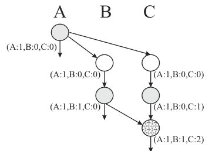

图 4.12 解决冲突后确定新版本向量值的示例。

一旦检测到冲突，下一步就是解决冲突。显然，并非所有冲突都能以通用方式自动解决，因为冲突解决必然是特定于应用程序的。尽管如此，在某些情况下，可以通过利用应用程序语义自动解决冲突。在许多系统中已有报告指出，大多数冲突实际上可以自动解决 [16, 31]。例如，两个或多个副本可能以完全相同的方式修改同一文件。尽管不同副本上的更新版本向量会报告冲突，但文件实际上是相同的。在这种情况下，解决报告冲突的简单机制是比较文件的不同版本。如果它们确实相同，则冲突通过无操作（no-op）操作得到有效解决。

另一个例子是，在 [31] 中，复制文件系统中目录上的冲突是基于只有两个允许操作（创建文件或删除文件）这一事实来解决的。因此，目录上的冲突可以通过首先合并目录中的所有文件（来自冲突副本），然后过滤掉已删除的文件来解决。

### 4.3.4 操作传输系统

在操作传输系统中，每个站点必须记录提交的操作以及从其他站点接收的操作。记录的操作可以通过紧耦合系统中的可靠多播传播到其他站点，也可以通过松耦合系统中的点对点交换以流行病方式传播。在本小节中，我们假设采用后一种方法，因为它可能更适合互联网环境。

#### 4.3.4.1 使用向量时钟的传播

正如我们在第 4.3.2 节中提到的，操作必须正确加上时间戳，以便在应用操作时保留不同操作之间的因果关系，而向量时钟是实现此目的的强大工具。对于由站点 i 维护的向量时钟 $VC_i$：

- $VC_i[i]$ 表示在站点 i 本地提交的操作数量。
- $VC_i[j]$ ($i \neq j$) 指站点 i 了解的远程站点 j 提交的操作数量。

对于两个站点 i 和 j 以找出各自站点缺少哪些操作，它们交换各自的向量时钟。然后，它们根据以下规则传播对方所需的操作：

- 对于 $\forall k \neq j$，如果 $VC_i[k] > VC_j[k]$，站点 i 将最初在站点 k 上提交且时间戳大于 $VC_j[k]$ 的所有操作传播到站点 j。
- 对于 $\forall k \neq i$，如果 $VC_j[k] > VC_i[k]$，站点 j 将最初在站点 k 上提交且时间戳大于 $VC_i[k]$ 的所有操作传播到站点 i。

#### 示例 4.4

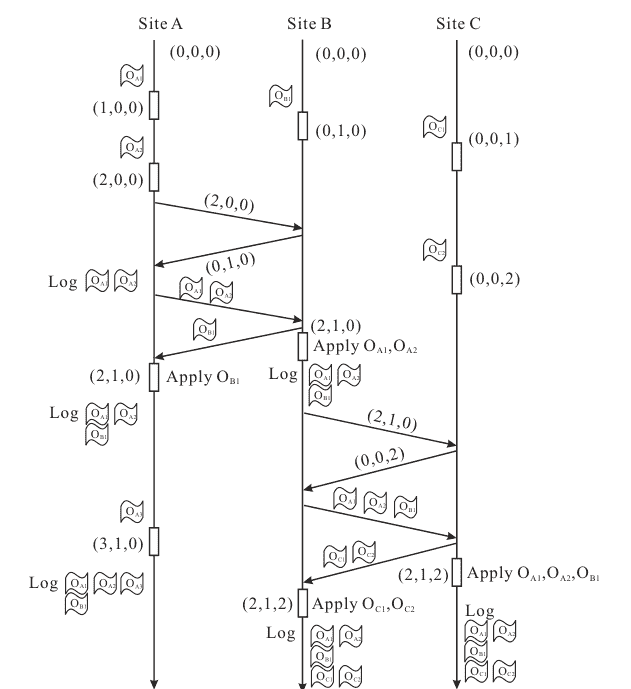

图 4.13 三副本系统中使用向量时钟的操作传播示例。

我们将说明在三副本系统中如何使用向量时钟进行操作传输，如图 4.13 所示。我们假设在向量时钟中，站点 A 的索引为 0，站点 B 的索引为 1，站点 C 的索引为 2。

在站点 A 与站点 B 启动操作传播之前，两个操作 $O_{A1}$ 和 $O_{A2}$ 在站点 A 上提交并处理。与此同时，站点 B 在本地提交并处理了一个操作 $O_{B1}$。站点 A 的向量时钟 $VC_A = (2, 0, 0)$，站点 B 的向量时钟 $VC_B = (0, 1, 0)$。因为 $VC_A[0] > VC_B[0]$，站点 A 将其两个操作 $O_{A1}$ 和 $O_{A2}$ 传播到站点 B。同样，因为 $VC_B[1] > VC_A[1]$，站点 B 将其操作 $O_{B1}$ 传播到站点 A。站点 A 应用接收到的操作 $O_{B1}$（在解决任何冲突之后），将其向量时钟推进到 (2, 1, 0)。站点 B 应用接收到的操作 $O_{A1}$ 和 $O_{A2}$（同样，在解决任何冲突之后），也将其向量时钟推进到 (2, 1, 0)。

随后，站点 B 与站点 C 进行操作交换。在交换之前，两个操作 $O_{C1}$ 和 $O_{C2}$ 已在站点 C 上提交并处理。因此，在交换时向量时钟为 (0, 0, 2)。因为 $VC_B[0] > VC_C[0]$，站点 B 将操作 $O_{A1}$ 和 $O_{A2}$ 传播到站点 C。同样，因为 $VC_B[1] > VC_C[1]$，站点 B 将操作 $O_{B1}$ 传播到站点 C。站点 C 将 $O_{C1}$ 和 $O_{C2}$ 传播到站点 B，因为 $VC_C[2] > VC_B[2]$。在解决任何冲突并应用接收到的操作后，站点 B 和站点 C 将其向量时钟推进到 (2, 1, 2)。与此同时，站点 A 上又提交并处理了一个操作 $O_{A3}$。

#### 4.3.4.2 使用时间戳矩阵的传播

时间戳矩阵 [32]（也称为矩阵时钟）可用于每个站点，以跟踪它了解的每个其他站点的向量时钟，而不仅仅是其他站点提交了多少操作。站点 i 的时间戳矩阵的一行 $TM_i[j]$ 对应站点 j 的向量时钟。站点 i 的时间戳矩阵中的一个单元格 $TM_i[j][k]$ 对应站点 i 了解的站点 j 接收的来自站点 k 的操作数量。使用时间戳矩阵消除了在发送操作之前进行向量时钟交换轮次的需要。

要使用时间戳矩阵，每个站点维护时间戳矩阵 $TM$。在站点 i 提交本地操作时：

- 该操作被分配当前自向量时钟值 $TM_i`（即时间戳矩阵的第 i 行）。
- 矩阵中相应的单元格加 1，即 $TM_i[i][i] = TM_i[i][i] + 1$。

当站点 i 准备将操作传播到另一个站点 j 时，它执行以下操作：

- 通过比较所有 $k \neq j$ 的 $TM_i[j][k]$ 和 $TM_i[i][k]`，确定站点 j 从站点 i 需要哪些操作。如果 $TM_i[j][k] > TM_i[i][k]`，则表示站点 i 有一个或多个来自站点 k 且站点 j 需要的操作。因此，站点 i 从其日志中检索这些操作，并连同站点 i 的时间戳矩阵 $TM_i` 一起发送到站点 j。
- 站点 i 使用对应于其自身向量时钟 $TM_i[i]` 的行来更新其时间戳矩阵中站点 j 的行 $TM_i[j]`，即，对于所有 $k \neq j`，$TM_i[j][k] = max(TM_i[j][k], TM_i[i][k])`。执行此更新的原因是，一旦站点 j 接收到站点 i 传输的操作和时间戳矩阵，它将以完全相同的方式更新其时间戳矩阵中的相应行。

当站点 j 从站点 i 接收到一组远程操作和相应的时间戳矩阵时，它执行以下操作：

首先，它确保接收到的操作不是重复项，因为站点 i 的时间戳矩阵中站点 j 的行必然是一个估计值——站点 j 可能在站点 i 不知情的情况下从其他站点接收了操作：

- 如果 $O_k.vc[k] > TM_j[j][k]`，则接受站点 i 发送的远程操作 $O_k`（源自站点 k）。

如果操作 $O_k` 按序到达，则应用该操作。如果站点 i 通过可靠的有序点对点协议（如 TCP）将操作发送到站点 j，则保证 $O_k` 将按序到达。如果存在冲突，则解决冲突。

更新时间戳矩阵。

- $TM_j[j][k] = O_k.vc[k]`
- 对于所有其他单元格 $m \neq k`，如果 $O_k.vc[m] > TM_j[j][m]`，则表示站点 j 未接收到一些源自站点 m 的操作。站点 j 然后联系源站点以重新传输缺失的操作。随后，它更新其时间戳矩阵中的相应单元格：$TM_j[j][m] = O_k.vc[m]`。

在接收站点 i 发送的时间戳矩阵时，站点 j 通过应用按元素最大值操作来更新其时间戳矩阵中除第 j 行以外的单元格。


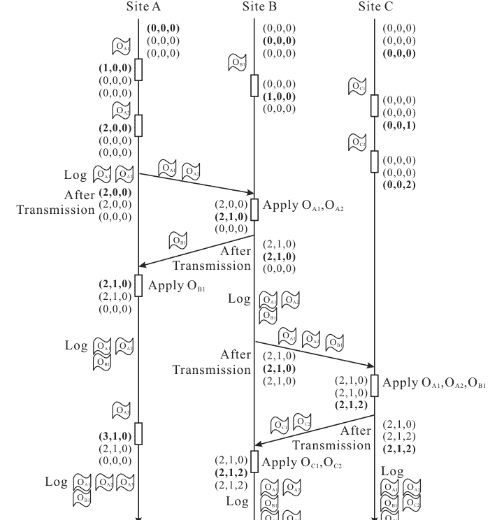

图 4.14 三副本系统中使用时间戳矩阵进行操作传播的示例。

#### 示例 4.5

本示例的场景与示例 4.4 相同，区别在于使用时间戳矩阵代替向量时钟。可以看出，使用时间戳矩阵省略了操作传输前的消息交换轮次。

当站点 A 准备将其记录的操作传播到站点 B 时，它会比较其时间戳矩阵中的两行，$TMA[0]$ 和 $TMA[1]$。$TMA[0]$ 对应其自身的向量时钟，$TMA[1]$ 对应 A 对 B 所知内容的估计。由于 $TMA[0][0] = 2 > TMA[1][0] = 0$，站点 A 估计站点 B 尚未接收站点 A 提交的最近两个操作 $O_{A1}$ 和 $O_{A2}$。因此，站点 A 将这两个操作及其时间戳矩阵传输到站点 B。随后，站点 A 将其时间戳矩阵中针对站点 B 的行 $TMA[1]$ 从 (0, 0, 0) 更新为 (2, 0, 0)。

接收到每个操作时，站点 B 通过比较随操作携带的向量时间戳及其时间戳矩阵中的对应单元格，检查是否为重复操作。对于 $O_{A1}$，因为 $O_{A1}.vc[0] = 1 > TMB[1][0] = 0$，站点 B 知道 $O_{A1}$ 不是重复操作。因此，站点 B 接受该操作，应用它（在解决任何冲突之后），并更新其时间戳矩阵中的对应单元格 $TMB[1][0] = 1$。同样，站点 B 接受 $O_{A2}$，应用它，并更新其时间戳矩阵 $TMB[1][0] = 2$。

站点 B 也趁此机会将其操作传播到站点 A。通过比较 $TMB[0]$ 和 $TMB[1]$，站点 B 估计站点 A 可能需要操作 $O_{B1}$，因为 $TMB[1][1] = 1 > TMB[0][1] = 0$。传输后，站点 B 将其时间戳矩阵从 (2, 0, 0) 更新为 $TMB[0] = (2, 1, 0)$。接收到 $O_{B1}$ 后，站点 A 接受它，应用它（在解决任何冲突之后），并将其时间戳矩阵更新为 $TMA[0] = (2, 1, 0)$，$TMA[1] = (2, 1, 0)$。$TMA[2]$ 保持为 (0, 0, 0)。

站点 B 和站点 C 之间的操作传播可以类似地解释。值得注意的是，如果站点 A 随后想要将其操作传播到站点 C，它会将其日志中的所有操作（$O_{A1}, O_{A2}, O_{A3}, O_{B1}$）传输到站点 C，因为它会根据其时间戳矩阵中针对站点 C 的行 $TMA[2] = (0, 0, 0)$ 估计站点 C 未接收任何这些操作。站点 C 将确定 $O_{A1}, O_{A2}$ 和 $O_{B1}$ 是重复操作并忽略它们，因为 $TMC[2][0] = 2$ 大于 $O_{A1}.vc[0] = 1$ 且等于 $O_{A2}.vc[0] = 2$，并且 $TMC[2][1] = 1$ 与 $O_{B1}.vc[0] = 1$ 相同。站点 C 将接受 $O_{A3}$ 并相应更新其时间戳矩阵。

### 4.3.5 更新提交

如前所述，状态传输和操作传输系统都需要这一额外步骤。此步骤的主要目标是确定哪个更新已传播到所有副本，以便：

- 一旦每个副本都已接收并应用更新，关于该更新的记录即可进行垃圾回收。
- 该更新对系统的影响现在已稳定，用户可以确信该更新不会因冲突调解而被更改。这是因为：
  - 一旦更新到达所有副本，所有可能与此更新冲突的并发更新都必须已被调解。
  - 此更新将在任何副本随后发出的任何更新之前发生，而后续更新将带有比当前更新更大的时间戳。因此，没有后续更新可能与此更新冲突。

已开发出许多算法和机制，以帮助确定操作传输系统中的更新是否已稳定（即，所有副本是否都已接收并应用该更新）。然而，它们也应适用于状态传输系统。

对于状态传输系统，还有一个额外挑战：确定何时可以安全地从系统中删除已删除的对象。这一点很重要，因为如果已删除的对象无法从系统中移除，迟早它们会占满存储（例如，在复制文件系统的上下文中）。通常，使用两阶段提交算法来确保仅在所有副本都同意删除对象后才对其进行垃圾回收 [15, 24]。在第一阶段，会就删除事项查询所有副本。如果所有副本都同意，则在第二阶段将对象最终从系统中移除。该算法因可能的删除/更新冲突及其调解而变得复杂。该算法的详细描述超出了本书的范围。

#### 4.3.5.1 确认向量

对于使用向量时钟进行操作传播、调度和冲突检测的系统，引入了一种称为确认向量的额外向量时钟，用于存储站点接收到的操作的确认信息 [13]。特别是，对于站点 i，其确认向量的第 i 个元素 $AV_i[i]$ 存储其向量时钟 $VC_i$ 中所有元素的最小时间戳，即 $AV_i[i] = min(VC_i[0], VC_i[1], ..., VC_i[N-1])$，其中 N 是系统中的副本数量。$VC_i[i] = t$ 表示站点 i 已接收每个站点提交的前 t 个操作。对于其他元素，站点 i 会在其他站点与其共享确认向量时逐渐了解它们。例如，当另一个站点 k 将其确认向量 $VC_k$ 共享给站点 i 时，站点 i 了解到站点 k 已接收每个站点提交的前 $VC_k[k]$ 个操作，包括站点 i 的操作。因此，站点通过取其确认向量中所有元素的最小值来确定哪些操作已稳定。如果 $min(AV_i[0], AV_i[1], ..., AV_i[N-1]) = t$，则每个站点提交的前 t 个操作已到达所有副本。

#### 示例 4.6

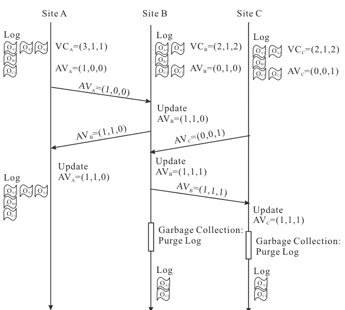

图 4.15 三副本系统中使用确认向量进行更新提交。

考虑一个具有三个副本的系统。在副本交换其确认向量之前，站点 A 的向量时钟 $VC_A$ 为 (3, 1, 1)，其日志中包含操作 $O_{A1}, O_{A2}, O_{A3}, O_{B1}, O_{C1}$；站点 B 的向量时钟 $VC_B$ 为 (2, 1, 2)，其日志中包含操作 $O_{A1}, O_{A2}, O_{B1}, O_{C1}, O_{C2}$；站点 C 的向量时钟 $VC_C$ 也为 (2, 1, 2)，其日志中包含操作 $O_{A1}, O_{A2}, O_{B1}, O_{C1}, O_{C2}$。

站点 A 的确认向量 $AV_A$ 可按以下方式计算：

- $AV_A[0]$ 通过取其向量时钟中元素的最小值来计算，即 $AV_A[0] = min(VC_A[0], VC_A[1], VC_A[2]) = min(3, 1, 1) = 1$。
- 由于站点 A 尚未接收来自站点 B 和站点 C 的确认向量，$AV_A[1] = AV_A[2] = 0$。

同样，站点 B 的确认向量 $AV_B$ 为 (0, 1, 0)，站点 C 的确认向量 $AV_C$ 为 (0, 0, 1)。当站点 B 接收站点 A 的确认向量时，它将其确认向量 $AV_B$ 更新为 (1, 1, 0)。站点 B 随后将其确认向量发送给站点 A。站点 A 随后将其确认向量更新为 (1, 1, 0)。此时，站点 A 无法对其日志中的任何操作进行垃圾回收，因为 $min(AV_A[0], AV_A[1], AV_A[2]) = min(1, 1, 0) = 0$。

当站点 B 接收站点 C 的确认向量 $AV_C = (0, 0, 1)$ 时，它将其确认向量更新为 (1, 1, 1)。此时，站点 B 可以得出结论：所有副本都已接收每个站点提交的第一个操作，因为 $min(1, 1, 1) = 1$。因此，站点 B 可以对这些操作进行垃圾回收，日志中仅剩下两个操作：$O_{A2}$ 和 $O_{C2}$。

同样，当站点 C 接收站点 B 的确认向量时，它也将其确认向量更新为 (1, 1, 1)。此时，站点 C 可以安全地从其日志中清除 $O_{A1}, O_{B1}, O_{C1}$。

显然，系统垃圾回收稳定操作的速度取决于站点交换其确认向量的频率。如果某站点暂时无法与其他站点通信，则无法再进行任何垃圾回收。这种限制是由于固有要求：在*所有*站点都接收到某个操作之前，该操作都不稳定（因此无法进行垃圾回收）。

使用确认向量的另一个严重限制是，提交操作较少的站点会阻止其他站点对超出该站点提交的操作数量以及任何其他站点提交的操作数量的操作进行垃圾回收。在图 4.15 所示的示例场景中，由于站点 B 只提交了一个


#### 4.3.5.2 时间戳矩阵

For systems that use timestamp matrices, they can learn the stable operations without any additional message exchanges. At site \(i\), a cell in its timestamp matrix, \(TM_i[j][k] = t\), means that according to site \(i\)’s conservative estimate, site \(j\) has received all operations originated from site \(k\) up to \(t\). Hence, to find out what operations from site \(k\) that have become stable, all we need is to take the minimum of all rows at element \(k\), i.e., if \(min(TM_i[0][k], TM_i[1][k], ..., TM_i[N-1][k]) = t\), all sites have received the first \(t\) operations submitted at site \(k\).

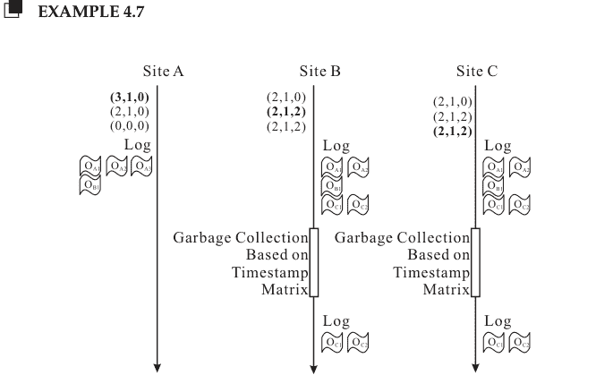

Figure 4.16 Update commit using timestamp matrices in a system with three replicas.

Consider a system shown in Figure 4.16. Site A’s timestamp matrix is:

| 3 | 1 | 0 |
|---|---|---|
| 2 | 1 | 0 |
| 0 | 0 | 0 |

Site B's timestamp matrix is:

| 2 | 1 | 0 |
|---|---|---|
| 2 | 1 | 2 |
| 2 | 1 | 2 |

Site C's timestamp matrix is the same as that of site B:

| 2 | 1 | 0 |
|---|---|---|
| 2 | 1 | 2 |
| 2 | 1 | 2 |

It is apparent that site A cannot garbage collect any operation because the third row in its timestamp matrix is (0, 0, 0). For site B, the minimum of the first column (corresponding to the status of site A) is 2, the minimum of the second column (corresponding to the status of site B) is 1, and the minimum of the third column (corresponding to the status of site C) is 0. Then, site B can safely garbage collect the first two operations from site A: O_A1 and O_A2, and the first operation from site B itself: O_B1. Similarly, site C can safely purge the three operations as well.

Even though the effectiveness of using timestamp matrices for update commit also depends on good connectivity of different sites, a site that has few or no operations submitted would not prevent other sites from committing updates and performing garbage collection.

## 4.4 CAP 定理

The CAP theorem was introduced by Eric Brewer in 2000 [6] regarding what can be achieved in a practical distributed system. The theorem states that it is impossible to satisfy all three of the following guarantees:

- Consistency (C): the replicated data is always consistent with each other.
- Availability (A): the data is highly available to the users.
- Partition tolerance (P): the system can continue providing services to its users even when the network partitions.

The proof of the CAP theorem is straightforward [11] because in the presence of network partitions, replicas in different partitions could not communicate with each other. If the designer of a system favors replica consistency, then the availability may have to be sacrificed. Similarly, if the designer chooses to ensure high availability, there is no way strong consistency among the replicas in different partitions can be achieved — the replicas cannot communicate!

### EXAMPLE 4.8

Similar to [11], we consider a network with only two nodes N1, N2. Assume that a network partitioning fault occurs and it isolates node N1 from node N2. We further assume that we are going to ensure P and A, which means the following could happen:

- A client that could reach N1 issues an update W1. The update is immediately applied at N1. Due to the network partitioning fault, N2 is not aware of the update W1 at N1.
- Another client that could reach N2 also issues an update W2. The update is immediately applied at N2. Due to the network partitioning fault, N1 is not aware of the update W2 at N2.
- It is apparent that the states of N1 and N2 have become inconsistent from now on.

Note that the states of the two nodes would become inconsistent only after different updates have applied at them. If one is an update operation W and the other is a read-only operation R, we cannot conclude that the states have become inconsistent. Indeed, even if the operation R on N2 is issued significantly after the operation W on N1 in real time, it does not necessarily mean that R is causally related to W and we should expect R to read the value written by W. Without some out-of-band channel that links the two operations, it is perfectly legal for R to read a value prior to the update operation W. If the system is repaired from the network partitioning fault, N1 and N2 could easily merge their history so that all operations are serializable (e.g., R would be ordered prior to W after N1 transfers its state or operations to N2).

Since its inception, the CAP theorem has attracted extensive attention and debates [1, 4, 7, 12, 23]. The CAP theorem highlighted the need to strike a good balance between consistency and availability in the presence of network partitioning faults when designing practical systems because many systems might face network partitioning faults [7]. Much debate lies on the reason for the use of reduced consistency models in favor of high availability. As we have seen in the previous section on optimistic replication and rightly pointed out by a number of researchers [1], the adoption of reduced consistency models is often not due to concerns of network partitioning faults, but for better performance for applications running over wide-area networks.

Furthermore, the definitions of C, A, and P are quite unclear. For example, does requiring C mean that all non-faulty replicas must be in sync all the time? On the other hand, if a quorum-based consensus algorithm (such as Paxos [18]) is used to coordinate the replicas, the system would make progress as long as the majority of the replicas agree with each other and it is possible that the minority of replicas lag significantly behind or are in a confused state depending on the fault model used in the system. Can we call such a system as guaranteeing C? We probably should say that it does guarantee C based on common sense.

Whether or not a system guaranteeing A depends on the fault model used. For example, a system that provides high availability with a crash-fault-only model might not be able to ensure high availability in the presence of network partitioning faults or malicious faults. Without clarifying the fault model used, the scopes of availability and partition-tolerance would appear to overlap with each other:

- Partition tolerance implies that the system could ensure liveness in the presence of network partition faults.
- High availability, on the other hand, would require the tolerance of all types of faults, including network partition faults, *without specific qualification on the fault model used*.

In addition, the definition of A is vague. If the data is said to be available for a user, how long does the user have to wait for its request to be serviced? What is the relationship between A and the end-to-end latency (L) as experienced by a user? A is not absolute and neither is L. In [1], A and L are treated as different properties of a system, and thus, a PACELC model is proposed to replace CAP in system design: If there is a network partition fault, how to balance the availability and consistency (A and C); else (E), during normal operation with a fully-connected network, how to balance the requirements on latency (L) and consistency (C)?

The meaning of partition tolerance is also unclear. First, what is considered as a network partitioning fault can be confusing. A straightforward interpretation of a network partitioning fault is that the network is partitioned into several disjoint partitions due to a fault at a router/switch or a communication link. However, normally there is no way for a replica to have such global knowledge and different replicas may have completely different views regarding whether or not the network has partitioned. If a replica could reach every node that it needs to communicate, then to its view, there is no network partitioning fault, even though the network has already been partitioned and that replica together with all other nodes it communicates with reside in one of the partitions. Further, a replica could only detect a network partitioning fault by using a timeout when communicating with other nodes. To a replica, a network partitioning fault has happened if it has timed out a request issued on another node. That is why a network partitioning fault is often modeled as a message loss [11]. Obviously, if a network partitions and quickly recovers before the timeout, the partitioning fault might have no impact on the system.

### 4.4.1 2 out 3

The CAP theorem dictates that at the best, we could design a system that achieves 2 out of 3 properties, that is, a system that either ensures CA, CP, or PA, but not all three CAP, as shown in Figure 4.17.

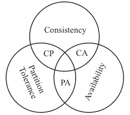

Figure 4.17 An illustration of the CAP theorem.


### 4.4.1.1 CA 系统

CA 系统牺牲分区容忍性以换取一致性和可用性。这意味着网络分区故障被排除在系统设计所使用的故障模型之外。这类系统只能在网络分区故障很少发生的环境中使用，例如局域网或数据中心。旨在实现悲观复制的系统通常是 CA 系统。

### 4.4.1.2 CP 系统

基于我们之前的论点，我们无法构建一个在容忍所有形式网络分区故障的同时确保强一致性的系统，因为根据网络分区的定义，必然存在一些副本无法访问其他副本。然而，在以下条件下，CP 系统是可能的：

- 一致性通过基于法定人数的算法实现。也就是说，只要大多数副本彼此一致，系统就被视为一致。
- 网络分区故障导致的分区包含系统中大多数副本。

在这样的 CP 系统中，位于大多数分区中的副本将照常运行（即，仿佛没有网络分区故障），而位于少数分区（或分区）中的副本将停止运行，从而失去可用性属性。许多容错的组通信系统 [3, 20] 是 CP 系统。

### 4.4.1.3 PA 系统

许多新的云计算系统 [1, 23]，以及采用乐观复制的系统 [25]，都是为确保 PA 而设计的。如我们在 4.3 节中讨论的，一致性的丢失只是暂时的——当网络分区合并且系统处于静止状态时，副本状态最终会收敛。

### 4.4.2 启用分区容忍性的影响

对于 PA 系统，它应努力检测并协调任何不一致，因为用户确实期望最终一致性，即使他们能容忍在网络分区期间出现暂时的不一致状态。在没有网络分区的情况下，系统将表现为 CA 系统。当副本意识到与另一个节点通信有困难时，它将进入分区模式，如图 4.18 所示。在分区模式期间，副本会用一致性换取更好的可用性。然而，当分区合并时，副本将协调其不一致，类似于我们在 4.3 节中在乐观复制的上下文中描述的冲突协调。冲突协调的知名方法包括：


图 4.18 分区模式和分区恢复。

- 补偿事务/操作。在某些系统中，例如事务处理系统，可以通过应用用户定义的补偿操作 [10] 来撤销操作的影响。因此，在分区恢复期间，操作可以按需重新排序。

- 操作转换。对于协作编辑系统，操作转换通常用于协调对共享文档的冲突编辑 [28]。给定在站点 i 上应用的两个冲突操作 Oi 和在站点 j 上应用的 Oj。Oi 转换为 O'i，Oj 转换为 O'j，使得在初始状态相同的情况下，在站点 i 上先应用 Oi 再应用 O'j 的最终状态，与在站点 j 上先应用 Oj 再应用 O'i 的最终状态相同。

- 交换复制数据类型（CRDTs）。这种方法最初作为协作编辑的替代方案开发 [22]，最近已扩展到潜在的许多其他应用程序 [27]。通过使用 CRDTs 表示状态，对状态的所有操作现在都是交换的。因此，并发操作不再相互冲突。副本可以立即应用本地提交的操作，并异步地将更新传播到其他副本。副本在接收到由另一个副本发送的远程更新时，也会确定性地对其进行排序，*不需要*任何副本间通信。

对这些方法的详细讨论超出了本书的范围。

为了总结本节，考虑到副本检测网络分区故障的唯一方式是通过超时，并且用户必须等待有限的时间才能看到其请求得到服务，系统设计中真正重要的是以下两个参数：

- 端到端延迟。该参数定义了系统根据业务要求可以容忍的端到端延迟。

- 分区超时值。该参数定义了系统设计者选择的超时值，副本可以使用该值进入分区模式。通常，分区超时值显著高于端到端延迟。

对于部署在广域网上的系统，如果两个远程副本之间的往返延迟接近分区超时值，那么系统大部分时间将运行在分区模式下，因此系统基本上将作为 PA 系统运行。否则，系统将作为 CA 系统运行，直到发生网络分区故障。根据这种解释，PACELC 模型似乎不是必要的（因为模型中 A 和 C 之间的差异未定义）。

## 参考文献

- 1. D. Abadi. 现代分布式数据库系统设计中的一致性权衡：CAP 只是故事的一部分. IEEE Computer, 45(2):37–42, 2012.
- 2. P. A. Bernstein, V. Hadzilacos, and N. Goodman. 数据库系统中的并发控制与恢复. Addison-Wesley Longman Publishing Co., Inc., Boston, MA, USA, 1987.
- 3. K. Birman. 虚拟同步复制模型的历史. In B. Charron-Bost, F. Pedone, and A. Schiper, editors, Replication, pages 91–120. Springer-Verlag, Berlin, Heidelberg, 2010.
- 4. K. A. Birman, D. A. Freedman, Q. Huang, and P. Dowell. 通过一致软状态复制克服 CAP. IEEE Computer, 45(2):50–58, 2012.
- 5. K. P. Birman. 可靠分布式系统指南 - 构建高可靠性应用程序和云托管服务. Texts in computer science. Springer, 2012.
- 6. E. A. Brewer. 迈向健壮的分布式系统（摘要）. In Proceedings of the nineteenth annual ACM symposium on Principles of distributed computing, PODC ’00, pages 7–, New York, NY, USA, 2000. ACM.
- 7. E. A. Brewer. 推动 CAP：一致性和可用性策略. IEEE Computer, 45(2):23–29, 2012.
- 8. M. Castro and B. Liskov. 实用拜占庭容错与主动恢复. ACM Transactions on Computer Systems, 20(4):398–461, 2002.
- 9. P. Felber and R. Guerraoui. 在 CORBA 中使用对象组进行编程. IEEE Concurrency, 8(1):48–58, Jan. 2000.
- 10. H. Garcia-Molina and K. Salem. Sagas. In Proceedings of the ACM SIGMOD Conference, pages 249–259, San Francisco, CA, 1987.
- 11. S. Gilbert and N. Lynch. Brewer 的猜想与一致、可用、分区容忍 Web 服务的可行性. SIGACT News, 33(2):51–59, June 2002.
- 12. S. Gilbert and N. A. Lynch. CAP 定理的视角. IEEE Computer, 45(2):30–36, 2012.
- 13. R. A. Golding and D. D. E. Long. 全球规模分布式数据库弱一致性协议中副本分歧的建模. Technical report, University of California, Santa Cruz, CA, USA, 1993.
- 14. J. Gray and A. Reuter. 事务处理：概念与技术. Morgan Kaufmann Publishers Inc., San Francisco, CA, USA, 1st edition, 1992.
- 15. R. G. Guy, J. J. Popek, T. W. Page, Jr. 乐观复制的一致性算法. In Proceedings of the First IEEE International Conference on Network Protocols, 1993.
- 16. D. S. P. Jr., G. J. Popek, G. Rudisin, A. Stoughton, B. J. Walker, E. Walton, J. M. Chow, D. A. Edwards, S. Kiser, and C. S. Kline. 分布式系统中相互不一致的检测. IEEE Trans. Software Eng., 9(3):240–247, 1983.


17. L. Lamport. 分布式系统中的时间、时钟与事件排序. Commun. ACM, 21(7):558–565, 1978年7月.

18. L. Lamport. Paxos 通俗讲解. ACM SIGACT News (分布式计算专栏), 32(4):18–25, 2001年12月.

19. F. Mattern. 分布式系统的虚拟时间与全局状态. 在《并行与分布式算法国际研讨会论文集》中，第216–226页. Elsevier Science Publishers B.V. (North-Holland), 1989.

20. L. E. Moser, P. M. Melliar-Smith, D. A. Agarwal, R. K. Budhia, 和 C. A. Lingley-Papadopoulos. Totem: 一个容错组播组通信系统. Commun. ACM, 39(4):54–63, 1996.

21. P. Narasimhan, L. E. Moser, 和 P. M. Melliar-Smith. Eternal: 用于透明容错CORBA的基于组件的框架. Softw. Pract. Exper., 32(8):771–788, 2002年7月.

22. N. Preguiça, J. M. Marques, M. Shapiro, 和 M. Letia. 用于协作编辑的交换式复制数据类型. 在《2009年第29届IEEE分布式计算系统国际会议论文集》，ICDCS ’09，第395–403页，美国华盛顿特区，2009. IEEE计算机学会.

23. R. Ramakrishnan. Cap 与云数据管理. IEEE Computer, 45(2):43–49, 2012.

24. D. Ratner, P. Reiher, 和 G. J. Popek. Roam: 面向移动性的可扩展复制系统. Mob. Netw. Appl., 9(5):537–544, 2004年10月.

25. Y. Saito 和 M. Shapiro. 乐观复制. ACM Comput. Surv., 37(1):42–81, 2005年3月.

26. F. Schneider. 使用状态机方法实现容错服务：一个教程. ACM Computer Survey, 22(4):299–319, 1990.

27. M. Shapiro, N. Preguiça, C. Baquero, 和 M. Zawirski. 收敛与交换式复制数据类型的全面研究. 技术报告7506, INRIA, 2011年1月.

28. C. Sun, X. Jia, Y. Zhang, Y. Yang, 和 D. Chen. 在实时协作编辑系统中实现收敛、因果性保持与意图保持. ACM Trans. Comput.-Hum. Interact., 5(1):63–108, 1998年3月.

29. D. B. Terry, M. M. Theimer, K. Petersen, A. J. Demers, M. J. Spreitzer, 和 C. H. Hauser. 在Bayou（一种弱连接复制存储系统）中管理更新冲突. 在《第十五届ACM操作系统原理研讨会论文集》，SOSP ’95，第172–182页，美国纽约，1995. ACM.

30. R. H. Thomas. 多副本数据库并发控制的多数共识方法. ACM Transactions on Database Systems, 4:180–209, 1979.

31. B. Walker, G. Popek, R. English, C. Kline, 和 G. Thiel. Locus分布式操作系统. 在《第九届ACM操作系统原理研讨会论文集》，SOSP ’83，第49–70页，美国纽约，1983. ACM.

32. G. T. Wuu 和 A. J. Bernstein. 复制日志和字典问题的高效解法. 在《第三届年度ACM分布式计算原理研讨会论文集》，PODC ’84，第233–242页，美国纽约，1984. ACM.

33. W. Zhao. Web服务拜占庭容错框架的设计与实现. Journal of Systems and Software, 82(6):1004–1015, 2009年6月.

34. W. Zhao, P. M. Melliar-Smith, 和 L. E. Moser. 低延迟容错系统. The Computer Journal, 2013. 待出版.

35. W. Zhao, L. E. Moser, 和 P. M. Melliar-Smith. 可插拔容错CORBA基础设施的设计与实现. Cluster Computing, 7(4):317–330, 2004.

36. W. Zhao, L. E. Moser, 和 P. M. Melliar-Smith. 分布式和网络系统的容错. 在《信息科学与技术百科全书（II）》中，第1190–1196页. Idea Group, 2005.

37. W. Zhao, L. E. Moser, 和 P. M. Melliar-Smith. 基于CORBA的三层架构中事务与复制的统一. IEEE Transactions on Dependable and Secure Computing, 2(1):20–33, 2005.

38. W. Zhao, L. E. Moser, 和 P. M. Melliar-Smith. 容错CORBA基础设施的端到端延迟. Perform. Eval., 63(4):341–363, 2006年5月.

39. W. Zhao, H. Zhang, 和 H. Chai. Web服务的轻量级容错框架. Web Intelligence and Agent Systems, 7:255–268, 2009.

# 5

# 组通信系统

基于状态机的容错系统的实现，在底层组通信系统[3]的支持下可以变得容易得多，该系统提供以下服务：

- 消息的全序可靠组播。这确保所有服务器副本以相同的全序接收来自客户端的同一组请求，这对于维护副本一致性至关重要。

- 成员服务。容错系统旨在处理进程和通信故障。当副本不再可达时，组通信系统可以自动重新配置系统。成员服务会将配置变更以及新配置中的成员列表通知给幸存的服务器副本及其客户端。

- 视图同步服务。为了确保不同重新配置之间的副本一致性，成员变更通知必须与重新配置前后的常规组播消息保持全序，这样不同副本对于配置变更以及配置变更前后组播的消息都具有一致的视图[4, 17]。通常，两次连续重新配置之间的期间被称为视图。

组通信系统在20世纪80年代和90年代曾受到深入研究，关于此主题的出版物众多（例如[3, 1, 12, 13, 18, 6]）。我们不打算对这些出版物进行综述。相反，我们关注几个设计精巧且分别代表相应方法的组通信系统。基于实现消息全序所使用的机制，最著名的方法包括[13]：

- 基于排序器。成员中的一个节点被指定负责为每个应用消息（可能由成员中的任何节点组播）分配全局序列号（代表全序）。这个特殊节点作为整个系统的排序器[12]。可以始终坚持使用某个特定节点作为排序器，除非它出现故障，或者让成员中的节点轮流担任排序器（通常称为轮换排序器）。无论采用何种策略，只要系统在任一时刻只允许一个排序器运行，就可以保证消息的全序。

- 基于发送者。如果系统确保成员中的节点轮流进行组播，那么所有组播消息自然都是全序的。基于发送者的方法也使用全局序列号来表示每个发送请求的全序。当一个节点轮到它组播时，它必须知道最后发送的消息所分配的全局序列号。这一要求可以通过在不同节点之间传递虚拟令牌来满足[3, 18]。当节点收到令牌时，它就获得了发送权限，令牌中携带了诸如最后发送消息的序列号等历史信息。当一个节点发送完毕后，它通过将令牌传递给成员列表中的下一个节点来完成其轮次。

- 基于向量时钟。不同消息之间的因果关系可以使用向量时钟来捕获。在这种方法中，每个组播消息都附带一个向量时间戳。接收者可以从时间戳中推断消息的因果关系。使用这种方法已经实现了一个非常高效的因果有序可靠组播服务[6]。可以使用向量时钟构建全序可靠组播服务。但是，必须对系统施加额外约束，以便建立全序，例如，接收者必须从系统中的每个发送者至少接收一条消息，才能确定其接收到的消息的全序。因此，在Isis [7]中，使用专用排序器节点在因果有序组播服务之上建立全序。

自20世纪90年代末Paxos共识算法发表以来[15]，注意力已转向依赖Paxos算法族（将在下一章介绍），以通过分布式共识来确保消息全序[2, 5, 8, 11, 10, 19]。事实上，无论采用何种方法来实现消息全序，成员变更都需要分布式共识。正如我们将在本章后面详细解释的那样，旧一代组通信系统中引入的成员变更（或重新配置）协议，与Paxos算法族相比，往往存在弱点。

## 5.1 系统模型

我们假设一个异步系统，包含N个节点，它们通过直接发送和接收消息相互通信。一个节点可能变得故障并停止参与组通信协议（即，使用故障停止故障模型）。故障节点可能会恢复。但是，它必须通过成员变更协议重新加入系统。某些协议（如Totem）需要可用的稳定存储，该存储可以承受崩溃故障。

我们假设系统中的N个节点构成一个单一的广播域。在正常操作期间，当当前成员中的一个节点组播一条消息时，该消息会广播到所有


该成员关系中的节点。因此，我们将多播和广播这两个术语混用。此外，节点会忽略不属于当前成员关系的节点发送的消息（通常称为外来消息），除非它们是与成员变更相关的消息（例如重新加入请求）。这意味着我们假设是一个封闭的单组系统。

组通信系统必须定义两种协议，一种用于当前成员关系中所有节点能够及时相互通信的正常操作，另一种用于当一个或多个节点被怀疑失败，或失败节点重新启动时的成员变更。这些协议共同作用，以确保组通信系统的安全性属性和活性属性。

我们为全序定义了两个级别的安全性属性 [13]：

- 一致全序：给定任何广播消息，如果某个节点按照某种全序投递了该消息，那么除非该节点已失败，否则它会在每个节点中按照相同的全序投递。

- 不一致全序：给定一组已广播且已全序的消息，没有任何节点会按全序之外的顺序投递其中的任何消息。但是，不能保证如果某个节点投递了某条消息，那么所有其他节点都会投递相同的消息。

图 5.1 突出了统一全序和非统一全序之间的差异。在统一全序中，如果某条消息被任何节点投递，那么它会被当前成员关系中所有节点投递，除了那些已失败的节点（例如 N1）。因此，在加入成员关系后随后失败的节点所投递的消息，将构成仍在运行的节点所投递消息的前缀，假设这些节点最初同时加入系统（即当前或先前的成员视图）。例如，N1 投递的消息 m1 m2 m3 构成了 N2、N3 和 N4 投递的消息（m1 m2 m3 m4 m5 m6）的前缀。请注意，N5 在 N1 失败后加入，因此 N1 投递的消息不构成 N5 投递消息的前缀。

然而，在非统一全序中，情况可能并非如此。例如，如图 5.1 所示，N1 广播消息 m4 并投递它，只有 N2 接收并投递了消息 m4，其他节点均未接收。N1 和 N2 随后在其他节点得知 m4 之前失败。因此，N1 和 N2 投递的消息（即 m1 m2 m3 m4）不构成 N3 和 N4 投递消息（即 m1 m2 m3 m5 m6）的前缀。

统一全序安全性属性是一种强属性。它可能需要用于那些将其状态暴露给组通信系统外部组件的应用程序。例如，复制数据库系统需要统一全序安全性属性来确保副本一致性。然而，对于许多应用程序来说，非统一全序安全性属性就足够了。无法确保统一投递的唯一场景是，当消息的发送方和接收方（系统中 N 节点的一部分）在其他节点得知该消息之前都失败时。如果节点在失败后丢失其状态，或不将其状态暴露给系统的其他组件，那么这种不一致性不会造成任何负面副作用。一般来说，非统一全序可以比统一全序实现得快得多。

组通信系统的活性意味着，如果一个非故障节点多播一条消息，它最终会在其他节点上按全序投递。活性由容错机制确保。对于消息丢失，通过重传来解决。节点失败、处理延迟过长以及消息传播，通过成员重新配置（即视图更改）来解决。

## 5.2 基于排序器的组通信系统

确保可靠广播具有挑战性，因为协议必须支持多个发送方向多个接收方广播。保证全序可靠广播则更具挑战性。[12] 介绍了确保广播消息可靠性和全序的第一种实用方法。在这种方法中，如图 5.2 所示，一般系统结构为两个更简单子系统的组合：


图 5.2 在基于排序器的方法中，一般系统结构为两个子系统的组合，一个具有一个接收方，另一个具有一个广播消息的发送方。

- 多个发送方与一个接收方。
- 一个发送方与多个接收方。

单个接收方和广播消息的单个发送方实际上由单个节点提供服务。因此，多个发送方发送的所有广播消息实际上都通过这个特殊节点汇聚，该节点通常被称为排序器。这个排序器负责为每条广播消息分配全局序列号，从而确保全序。

基于排序器方法的最简单实现是使用专用节点，有时称为静态排序器。如果节点已接收并投递了所有携带较小序列号的消息，则它会投递已分配全局序列号的消息。显然，排序器构成单点故障。为了确保活性，排序器预期会定期广播排序消息，即使没有发送广播消息也是如此，如果其他节点多次未收到排序消息，则会对排序器超时。随后，存活节点会选举另一个节点充当排序器。这种方法在 [14] 中被使用。显然，只保证了非统一安全性属性。此外，系统是否设计为提供视图同步尚不清楚。

[12] 描述了一个更强健的基于排序器的组通信系统。为了实现统一全序，系统中的节点轮流充当排序器，并且节点在从不同排序器接收到多条排序消息之前不会投递消息。给定故障恢复力 f（即最多 f 个节点可能变得故障），系统中节点总数 N 必须满足 N > 2f。这种方法通常被称为轮换排序器方法。在本节中，我们详细描述轮换排序器方法。在原始论文中，排序器被称为令牌站点，因为排序器角色在节点间的轮换类似于系统中节点间的令牌循环（即持有令牌的节点成为排序器）。在本节中，我们选择不使用“令牌”术语，以避免与另一种使用令牌的方式混淆（将在 5.3 节中描述）。

### 5.2.1 正常操作

在正常操作期间，我们假设已形成一个成员关系。当前成员关系中的每个节点维护以下数据结构：

- 当前成员关系的视图编号 v 以及当前视图中对应的节点标识符列表。为方便起见，我们假设每个节点被分配一个索引，并使用节点的索引编号来引用该节点。

- 局部序列号向量 M[]，其中每个元素表示视图 v 中对应节点的预期局部序列号。例如，M[i] 指的是节点 i 发送的下一条消息所携带的预期局部序列号。最初，每个元素都设置为 0。

- 排序器节点发送的下一条排序消息中携带的预期全局序列号 s。

成员关系形成后，指定其中一个节点作为初始排序器。成员关系还规定每个节点的排名，以便节点知道何时应接替成为下一个排序器。

正常操作协议涉及每条待全序消息的三个阶段：

- 传输阶段。节点向当前成员关系中的所有节点广播一条消息，并等待排序器针对该广播消息发送的排序消息。广播消息表示为 B(v,i,n)，其中 v 是当前视图编号，i 是发送节点索引编号，n 是消息的局部序列号。局部序列号最初设置为 0。对于每条新的广播消息，局部序列号加 1。此机制用于确保消息投递的可靠性。如果发送节点未及时收到排序消息，则会重新传输相同的消息。当节点 j 接收到广播消息 B(v,i,n) 时，如果它处于相同视图中，则接受该消息并将其存储在其消息队列 Q_B 中。

- 排序阶段。当排序器接收到广播消息 B(v,i,n) 时，它会验证该消息是否为来自节点 i 的下一条预期消息，即 M[i] = n。然后，排序器将当前全局排序器值 s 分配给消息 B(v,i,n)，并以 SEQ(s,v,[i,n]) 形式广播一条排序消息，其中 [i,n] 是广播消息 B(v,i,n) 的标识符。当节点 j 接收到排序消息时，它会在满足以下条件时接受该消息：

  - 消息中的全局序列号与其预期的全局序列号匹配，并且


- 其消息队列中包含正在进行排序的消息。如果消息不在其队列中，节点会向当前排序节点请求重传。

随后，节点会更新其数据结构。具体来说，预期的全局序列号 s 加 1，来自节点 i 的预期本地序列号也加 1。请注意，对于广播消息 B(v, i, n) 的发送节点 i，排序消息 SEQ(s, v, [i, n]) 也将充当正向确认。

- 提交阶段。为确保统一的全序，节点在收到广播消息 B 的第一条排序消息时，不会投递广播消息 B(v, i, n)。为容忍最多 f 个故障节点，节点会推迟广播消息 B 的投递，直到在收到 B 的排序消息后又收到 f 条额外的排序消息（针对其他广播消息）。这样做可确保至少有一个节点会加入新成员组，并将全局序列号 s 与广播消息 B 的绑定关系传递给新成员组。当节点收集到 f + 1 条排序消息（其中最旧的一条针对 B）时，即认为该节点已提交广播消息 B。节点在提交消息之前不会投递广播消息。

迄今为止，我们尚未描述节点轮流担任排序器的机制。默认情况下，每个节点一次只对单个广播消息进行排序（尽管这可以参数化）。我们假设每个节点在成员视图中都有排名，因此节点可以确定性地知道何时轮到它对广播消息进行排序（原始出版物 [12] 未描述排序器轮换的任何具体机制）。例如，节点 i 负责对任何即将被分配全局序列号 s（其中 s%N = i）的广播消息进行排序，N 是当前成员组中的节点数量。如果将担任下一个排序器的节点已接收到待排序的新广播消息，则排序器轮换不涉及任何额外的控制消息，即排序器角色的转移可以通过发送新的排序消息来隐式实现。

下一个排序器在收到可接受的排序消息，且预期全局序列号表明应对下一个广播消息进行排序时，即承担其排序器角色。此外，它已接收到所有先前的排序消息和已排序的广播消息。在接收到新的广播消息后，节点会广播一条排序消息，这将隐式地将排序器角色传递给成员组中的下一个节点。

为确保在存在未提交广播消息时排序器能持续轮换，如果排序器节点在预定义的时间段内未收到任何新的广播消息，它将为空广播消息广播一条排序消息（空广播消息的排序消息接受标准与常规排序消息类似，只是节点会省略对空消息接收的检查）。如果没有未提交的广播消息且未收到新的广播消息，排序器将显式地向先前的排序器发送一条确认消息。这是因为为确保可靠的消息传递，刚刚担任过排序器的节点必须不断重传其生成的最后一条排序消息，直到收到某种形式的确认：这可能是一条新的排序消息（针对空或常规广播消息），也可能是来自下一个节点接受排序器角色的显式确认。此外，在节点收到某种形式的确认之前，它将继续响应广播消息的重传请求。

### 示例 5.1

图 5.3 展示了基于轮换排序器的组通信系统在正常运行期间的一个示例。系统由 5 个节点组成，所有 5 个节点都属于成员视图 v。在步骤 (a) 中，节点 N4 向所有其他节点广播了一条消息 B(v, 4, 20)，其中 4 是发送者 ID，20 是节点 N4 上的本地序列号。对于此消息，节点 N1 担任排序器。在步骤 (b) 中，N1 在接收到来自 N4 的广播消息后，用排序消息 SEQ(100, v, [4, 20]) 进行响应，表明 B(v, 4, 20) 的全局序列号为 100。当节点 N4 接收到排序消息时，它得知排序器已收到其消息，并停止重传该消息。


此时，不允许任何节点投递 B(v, 4, 20)，因为只收到了一条排序消息。此外，节点 N2 将担任下一个广播消息的排序器。

随后，在步骤 (c) 中，另一个节点 N3 向所有其他节点广播了一条消息 B(v, 3, 20)。此广播消息的排序器已移至节点 N2。在验证已接收到所有先前的排序消息和已排序的广播消息后，N2 在步骤 (d) 中为 B(v, 3, 20) 广播了一条带有全局序列号 101 的排序消息（即 SEQ(101, v, [3, 20]）。通过发送新的排序消息，节点 N2 确认了用于排序器轮换的先前排序消息。

如果故障容错性设置为 1，即仅容忍单个故障，则在接收到 SEQ(100, v, [4, 20]) 和 SEQ(101, v, [3, 20]) 两条排序消息后，节点即可准备投递广播消息 B(v, 4, 20)，但必须再等待一条排序消息才能投递下一个广播消息。

## 5.2.2 成员变更

成员变更由两种类型的事件触发：

- 故障检测。节点会重传消息预定义的次数。如果未收到相应的确认消息，则认为已发生故障。以这种方式检测到的故障节点通常是当前排序器节点或下一个排序器节点。

- 故障节点恢复。当节点从崩溃故障中恢复时，它会尝试重新加入系统。

成员变更协议具有以下目标：

- 系统中的节点只能形成一个有效的成员视图。

- 如果广播消息在某个成员视图中的某些节点上被提交，那么属于新成员视图的所有节点必须以相同的方式提交该广播消息（_i.e.,_ 消息被分配相同的全局序列号）。

成员变更协议分三个阶段运行。假设一个节点发起成员视图变更，该节点称为发起方。如图 5.4 所示，协议分三个阶段运行。


图 5.4 成员视图变更协议的正常运行。

在阶段 I 中，发起方（图 5.4 中的节点 2）对排序器（图 5.4 中的节点 1）超时，将新成员视图号设置为当前视图号加 1，并向系统中所有节点广播一条邀请消息，以建立新的成员视图。邀请消息携带拟议的新成员视图号。在接收到邀请消息后，如果节点未接受竞争性成员视图的邀请（即，节点一次最多只能参与一个成员视图的形成），则它会接受邀请并向发起方发送正向响应。否则，节点会发送负向响应。正向响应消息携带节点的成员视图号和下一个预期全局序列号。负向响应消息携带节点已加入的成员视图号。请注意，一旦节点接受了成员视图邀请，它就会加入该视图，并自动放弃之前已提交的先前成员视图。

在阶段 II 中，发起方收集系统中其他节点对其邀请的响应。它会持续收集响应，直到收到系统中每个节点的响应，或者从不同节点（包括其自身响应）收集到至少 N − f 条响应且发生了预定义的超时。由于我们假设最多 f 个节点可能发生故障，发起方必须能够收集 N − f 条响应（包括其自身响应）。在原始出版物 [12] 中，标准设置为：发起方已收到系统中每个其他节点的响应，或者发生了预定义的超时。后一种标准隐含地施加了一种同步假设，即非故障节点将能够在预定义的时间段内响应。事实上，对于成员变更协议的工作来说，这一假设并非必要。

如果发起方收集到的所有响应均为正向，则发起方继续为新成员组构建节点列表。发起方还会从节点报告的接收到的下一个预期全局序列号中了解先前成员视图的消息排序历史。令最高下一个预期全局序列号为 smax，发起方的预期全局序列号为 so。这意味着，如果 smax > so，发起方缺少应分配全局序列号 so、so + 1、...、smax − 1 的广播消息。随后，发起方会向报告 smax 的节点请求重传缺失的广播消息。smax − 1 可能针对的是未提交的广播消息，因此大于最后一条已提交广播消息的序列号。只要发起方已接收到已排序的广播消息，它就会将 smax 用作新成员视图的起始全局序列号。


前一个视图，或在重传之后。如果报告 \( s_{max} \) 的节点在发起者能够从该节点接收到有序广播消息之前失败，发起者将选择第二高的下一个预期全局序列号。故障容错假设确保至少有一个非故障节点（已提交最后一条有序消息）将加入新的成员视图。因此，\( s_{max} \) 必须等于或大于前一个成员视图中最后一条已提交消息的序列号。

随后，发起者广播一条包含节点列表、视图编号和下一个预期全局序列号的新成员视图消息。当节点接收到新成员视图消息时，它会将接收到的下一个预期全局序列号与其本地预期全局序列号进行比较，并检测是否存在缺失的广播消息。如果存在缺失的广播消息，节点会向发起者请求重传。当节点接收到所有缺失的广播消息后，它将提交到新的成员视图。

如果发起者收到一个或多个否定响应，它将广播一条成员中止消息。随后，发起者将新视图编号设置为否定响应中报告的最大视图编号加一，等待一段随机时间，然后重新发送邀请消息。

除发起者以外的节点，以以下两种方式之一放弃其接受的成员视图：(1) 它接收到针对其已接受视图的成员中止消息，或 (2) 它对新成员视图消息超时。对于后者，节点会为阶段 II（新成员视图或中止消息）中的成员通知启动一个计时器，以确保活性。

在阶段 III 中，发起者收集其新成员视图消息的响应。如果节点能够从成员节点列表中的每个节点接收到肯定响应，它将提交到新成员，并作为新成员视图的第一个排序器。如果节点从某些节点接收到一个或多个否定响应，或对一个或多个节点超时，它将中止成员形成，广播一条成员中止消息，等待一段随机时间，然后使用更大的视图编号重试。

有可能某个节点提交了一个成员视图，而发起者（以及可能的其他一些节点）已决定中止成员。这不会导致任何问题，因为已提交到中止成员视图的节点将要么接收到中止公告，要么最终会对其已提交的成员视图超时（并发起一个新的成员视图）。

还可能出现多个节点并发发起成员视图更改的情况，在这种情况下，没有任何一个实例会成功。这就是为什么节点在再次尝试重新形成成员视图之前必须等待一段随机时间。这种场景以及其他一些场景将在下面的示例中进一步讨论。


图 5.5 成员变更场景：竞争的发起者。

### 示例 5.2

竞争的发起者。在存在（并发）竞争发起者的情况下，最多只有一个发起者可以（成功地）安装一个新的成员视图。如果节点能够及时相互通信，那么没有任何竞争发起者会成功的可能性较大。在本示例中，我们描述了一个场景：两个竞争发起者同时对 Node1 超时。如图 5.5 所示，Node2 和 Node4 通过广播新视图的邀请（在图中称为 VIEW-CHANGE）并发发起了成员视图更改。Node3 首先接收到 Node2 发送的邀请并接受它。因此，当 Node4 的邀请到达时，Node3 拒绝它并响应一条否定消息。同样，Node5 首先接收并接受 Node4 发送的邀请，并拒绝 Node2 发送的邀请。因此，Node2 和 Node4 都将决定中止其成员视图更改轮次，并在各自发起新一轮成员视图更改之前等待一段随机时间。

Node4 首先完成随机等待并广播新一轮成员视图更改邀请。这一次，邀请在 Node2 完成其随机等待之前到达 Node2。Node2 在接收到 Node4 的邀请时终止其随机等待，接受邀请，并响应一条 YES 消息。因此，Node4 能够从 Node2、Node3 和 Node4 收集到肯定响应，并继续提交到新视图。


图 5.6 成员变更场景：过早超时。

### 示例 5.3

过早超时。由于系统的异步性，节点可能会过早地对排序器超时并发起成员视图更改。该场景如图 5.6 所示，其中 Node4 过早地对 Node1 超时，而实际上 Node1 运行正常。当 Node4 广播新成员视图的邀请消息时，所有其他节点（包括 Node1）都接收到邀请并向 Node4 发出肯定响应。因此，新成员视图将包含与前一个视图相同的节点集合。


图 5.7 成员变更场景：临时网络分区。

### 示例 5.4

*临时网络分区。* 系统中的一部分节点可能能够相互通信，但由于临时网络分区故障而无法与其他节点通信。图 5.7 显示了这样的场景，其中 \( Node1 \) 和 \( Node2 \) 临时与其余节点分离。

由于分区，\( Node1 \) 和 \( Node2 \) 分区之外的某个节点会对 \( Node1 \) 或 \( Node2 \) 超时。如图 5.7 所示，\( Node4 \) 对 \( Node1 \) 超时并发起一个新的成员视图。假设系统设计的故障容错能力为 2，\( Node4 \) 能够从 \( Node3 \) 和 \( Node5 \) 收集到足够数量的肯定响应，并提交到新的成员视图。\( Node3 \)、\( Node4 \) 和 \( Node5 \) 可能在此新视图中对更多广播消息进行排序和提交。

最终，\( Node1 \) 和 \( Node2 \) 会对其分区之外的某个其他节点超时，因为根据它们运行的成员视图，\( Node3 \)、\( Node4 \) 和 \( Node5 \) 应该最终充当排序器。例如，\( Node2 \) 在图 5.7 中发起一个新的成员视图。但是，\( Node2 \) 无法收集到足够数量的肯定响应来形成有效的成员视图（它需要至少 5 个中的 3 个肯定响应，但只能得到 2 个）。因此，\( Node2 \) 不得不中止这一轮成员变更，并在再次尝试之前等待一段随机时间。

假设当 \( Node2 \) 完成随机等待时，网络分区已愈合，*即*，\( Node1 \) 和 \( Node2 \) 能够与系统中的其余节点通信。因此，\( Node2 \) 发送的邀请将到达所有其他节点。\( Node2 \) 将能够提交到包含系统中所有节点的新成员视图。

在临时网络分区期间，\( Node1 \) 和 \( Node2 \) 无法提交分区发生后发送的任何广播消息。但是，它们可以提交在分区故障之前发送的一条广播消息。这不会违反协议的安全属性。只有两种可能的场景：

- 在图 5.7 所示的场景中，\( Node3 \)、\( Node4 \) 和 \( Node5 \) 中至少有一个节点必须已接收到相同的广播消息，以及相应的排序消息。当这三个节点形成新成员时，该节点会将此类历史信息带入新视图。
- 如果 $Node3$、$Node4$ 和 $Node5$ 中的一个节点失败，它们在临时网络分区期间无法形成新的成员视图。幸存节点必须等到网络分区故障愈合。基于故障容错假设，$Node1$ 或 \( Node2 \) 中必须有一个是非故障的，当分区最终合并时，该节点会将历史信息带入新的成员视图。

## 5.2.3 正确性证明

### 定理 5.1 成员变更协议确保在系统历史上的任何给定时间，最多只存在一个有效的成员视图。

*证明：* 我们通过反证法证明。任何有效的成员视图必须至少包含 $N - f$ 个节点，其中 $f$ 是系统的故障容错能力，$N > 2f$ 是系统中的节点总数。此外，在发起者收到其拟议节点列表中所有节点的肯定响应并提交到该视图之前，有效的成员视图不会形成。假设系统中的节点并发形成两个有效的成员视图。第一个视图由一组节点 $R1$ 组成，第二个视图由一组节点 $R2$ 组成。那么 $R1$ 和 $R2$ 必须至少在 $2N - 2f - N = N - 2f \ge 1$ 个节点上相交。这是不可能的，因为成员变更协议规定，一个节点一次最多只能加入一个成员视图。更具体地说：

- 一旦节点接受新成员视图的邀请，它就会放弃之前已提交的视图。如果发起者能够提交新的成员视图，这意味着至少 $N - f$ 个节点已提交该视图。因此，之前的视图不再活跃（*即*，不会再提交任何广播消息，即使排序器被错误地怀疑）。
- 除非节点通过接收中止通知或超时而放弃其在该阶段加入的视图，否则它不会接受另一个竞争成员视图的邀请。该节点要么最终提交到第一个邀请，要么放弃第一个成员视图并加入第二个，但不能两者兼得。


### 定理 5.2 正常运行协议和成员变更协议共同确保广播消息的统一全序。

证明：我们证明，如果某个广播消息在某个节点上按照某种全序被交付，那么该消息最终将按照相同的全序在所有非故障节点上被交付。要交付一个广播消息，节点必须先提交该消息，这意味着该节点已收到该广播消息的排序消息以及 f 个额外的排序消息。这意味着至少 f + 1 个节点已收到该广播消息及其对应的排序消息。因为最多只有 f 个节点可能故障，至少有一个节点能够幸免于系统的任何故障。该节点能够将广播消息重传给所有错过该消息的节点，并在未来的成员视图中传递有关分配给该消息的全局序列号的信息。

## 5.3 基于发送者的组通信系统

与基于轮换排序器的方法类似，基于发送者的方法也在成员中的节点上强加一个逻辑环结构，并且每个节点轮流担任特权角色。两种方法的区别在于：在基于轮换排序器的方法中，当节点变为特权节点时，它确定广播消息的全序并发送排序消息；而在基于发送者的方法中，当节点变为特权节点时，它被允许直接按照全序广播消息，无需额外的排序步骤，广播消息的全序由原始发送者而非其他节点确定。作为一种权衡，携带逻辑令牌的特殊消息必须在环中的节点之间传递。

基于发送者的方案不仅降低了实现消息全序的成本，还便于实现基于窗口的流控机制，因此，基于发送者的组通信系统（例如 Totem [3, 18]）可以在高消息负载下实现高系统吞吐量。在本节中，我们详细描述了 Totem（单环）组通信系统的设计。

Totem 包含以下协议和流控机制，以确保高负载下的高吞吐量：

- 全序协议：该协议用于对广播消息进行全序排序，并确保在正常运行期间可靠地交付这些消息。
- 成员协议：该协议用于处理节点故障以及向系统添加新节点。成员协议的结果是在成员中的节点上强加一个新的逻辑环，并选出一个独立的领导者。
- 恢复协议：该协议用于在恢复期间确保虚拟同步的同时，尽可能多地按照全序交付消息。
- 流控机制：该机制控制节点在每次持有令牌期间可以发送的消息数量，使得没有节点会被广播的消息淹没。

### 5.3.1 全序协议

全序协议提供两种消息交付服务：

- 一致交付：这是一种非统一全序的形式。节点在交付了所有排在该消息之前的消息后，即可交付广播消息。在交付时，无法保证其他节点已收到该消息。
- 安全交付：安全交付确保统一全序。只有当节点得知成员中的所有其他节点已收到相同的消息以及所有先前排序的消息时，才能交付广播消息。

全序协议涉及两种类型的消息：包含要可靠地进行全序排序的应用程序载荷的普通消息，以及包含用于全序排序的重要控制信息的普通令牌消息。

在 Totem 中，当节点收到携带逻辑普通令牌的特殊控制消息时，它将获得按照发送者确定的全序广播消息的特权。为方便起见，我们将该特殊控制消息简称为普通令牌，或者如果上下文清晰，简称为令牌。成员协议也依赖于类似形式的控制消息，并被称为提交令牌。

普通消息采用 <type, v, s, i, m> 的形式，其中 type 为 AGREED（表示一致交付顺序）或 SAFE（表示安全交付顺序），v 是视图编号（在 Totem [3] 中称为 ring-id），s 是消息的（全局）序列号，i 是发送节点 ID，m 是消息载荷。

普通令牌消息采用 <REGULAR, v, token_seq, seq, aru, aru_id, rtr> 的形式，其中 token_seq 是令牌的序列号（接收节点需要此信息来判断其是原始令牌还是重传令牌），seq 是序列号的高水位，即在该视图中已分配给广播消息的最大序列号，aru 和 aru_id 表示由 ID 为 aru_id 的节点报告的已收到的序列号，最后，rtr 是重传列表。

每个节点维护两个消息队列：一个用于接收到的普通消息（received_message_queue），另一个用于在节点上产生并待广播到其他节点的消息（new_message_queue）。后一个队列并非用于重传，而是在接收普通令牌之前存储消息。一旦节点收到普通令牌并广播 new_message_queue 中的消息，它就会将该消息转移到 received_message_queue。除非节点知道该消息是安全的（即该消息已被视图中的所有节点接收），否则不会删除 received_message_queue 中的消息。节点还会保留其在逻辑环中转发给下一个节点的最后一个普通令牌的副本，用于重传以及判断消息是否安全。

此外，每个节点为全序协议维护以下局部变量：

- my_aru：存储节点已接收且无间隔的普通消息的最高序列号。
- my_aru_count：存储节点接收到具有相同过时 aru 字段的普通令牌的次数（即 aru 小于普通令牌中的高水位 seq）。
- last_aru：存储节点上次接收令牌时的 aru 值。此变量用于便于更新 my_aru.count 并判断是否到了按安全顺序交付消息的时间。

#### 5.3.1.1 接收普通令牌的规则

接收普通令牌时，节点将消息转换为内存中的临时局部变量（称为 token），并执行以下主要操作：

- 如果节点拥有令牌请求的消息，则重传这些消息。令牌包含重传请求列表 rtr，其中包括某些节点或某些节点未能接收的消息的序列号。节点从其 received_message_queue 中获取请求的消息，如果找到则重传它们。重传消息后，节点会从重传列表 token.rtr 中删除相应的序列号。
- 如果 new_message_queue 不为空，则广播普通消息。对于每条新的普通消息，节点分配 token.seq 字段中指示的值，随后递增 token.seq 字段。一旦节点传输新的普通消息，它就会将消息从 new_message_queue 转移到 received_message_queue。此外，如果 token.seq 等于 my_aru（这意味着节点已接收所有已广播的普通消息），则每次广播新的普通消息时，都将 my_aru 和 token.aru 设置为新的 token.seq。此外，节点将 token.aru.id 设置为 null。
- 更新令牌。
  - 如果 my_aru < token.seq，并且消息（即乱序消息）未在 received_message_queue 中缓冲，则节点将缺失的消息添加到 token.rtr。
  - 如果 my_aru < token.aru，则节点将 token.aru 设置为 my_aru，并将 token.aru.id 设置为 my.id。
  - 如果 token.aru < token.seq，并且上次传输的令牌（记为 last_token.aru）的 aru 字段与 token.aru 相同，则节点递增 my_aru.count。如果 my_aru.count 超过预定义阈值，


the node assumes that the node that has id token.aru_id has failed and it initiates a view change.

- 如有任何消息，按安全顺序投递消息。应按安全顺序投递的常规消息始终会入队，以满足安全投递顺序条件。如果消息的序号小于或等于 _last_token.aru_ 和 _token.aru_（即，投递一条按安全顺序的消息需要两次令牌轮转），则节点可以按安全顺序投递该消息。此外，该消息会从接收消息队列中移除，因为不再有节点会请求重传该消息。

- 将令牌传递给逻辑环中的下一个节点，并保留令牌副本以供重传和记录保存。

#### 5.3.1.2 接收常规消息的规则

接收到常规消息后，除非节点已接收过该消息，否则节点会将消息存储在接收消息队列中。如果消息的序号比 _my_aru 大 1，且所有先前排序的消息均已投递，则该消息可以按商定顺序投递，并且 _my_aru 加 1。如果接收消息队列中有缓冲消息，且新接收的消息正好填补了一个空洞，则可能会按商定顺序投递更多消息，并且 _my_aru 可能会持续加 1，直到所有已接收的消息都已投递，或在接收消息队列中遇到另一个空洞。节点接收常规消息时还有其他场景，将在第 5.3.1.4 节的示例中讨论。请注意，如果先前排序的消息是安全消息且尚未投递，则即使新接收的消息是商定消息，也无法投递。

#### 5.3.1.3 常规令牌重传规则

为最大限度地降低因常规令牌消息丢失而触发视图变更（代价高昂）的可能性，每当节点将常规令牌传递给下一个节点时，都会启动一个令牌重传定时器。在令牌重传超时时，节点会将令牌重传给下一个节点（这意味着节点必须保留其传输的最后一个令牌的副本）。

为区分预期的常规令牌与重传的令牌，令牌包含字段 token_seq，每个节点使用局部变量 my_token_seq。每发送一条新的常规消息，节点都会将 token.token_seq 字段加 1，并将 my_token_seq 设置为 token.token_seq（如果节点没有新消息要发送，它在将令牌转发给下一个节点之前，仍会将 token.token_seq 加 1 并将 my_token_seq 设置为 token.token_seq）。因此，如果令牌未丢失，当节点接收到新的常规令牌时，token.token_seq 必须大于 my_token_seq；当接收到重传的令牌时，token.token_seq 必须小于或等于 my_token_seq。因此，如果 token.token_seq 小于或等于 my_token_seq，节点会丢弃接收到的常规令牌。

#### 5.3.1.4 示例

这里展示了几个示例，说明节点如何更新其 my_aru 低水位标记，以及 aru 字段在令牌轮转期间如何变化。理解这些问题对于判断消息何时可以按安全顺序投递（从而可以进行垃圾回收）至关重要。

#### 示例 5.5

*接收最初传输的常规消息。* 如果消息是由消息发起方首次传输，则存在两种场景：

最直接的场景是：节点已接收所有先前广播的消息，并刚刚接收到下一个预期的常规消息。例如，如果节点接收到的最后一条消息携带序号 100，则节点上的局部变量 my_aru 设置为 100。当序号为 101 的消息到达节点时，它是下一个预期消息，因此节点将其 my_aru 变量更新为 101。

节点的接收消息队列中存在空洞，即消息的序号不等于 my_aru + 1。该消息是一条乱序消息，并存储在接收消息队列中。局部变量 my_aru 不会更改。例如，节点已接收序号为 99 和 101 的消息，当序号为 102 的消息到达时，由于缺少序号为 100 的消息，节点无法递增其 my_aru 变量。另一种可能是，节点已接收序号为 99 和 100 的消息，当序号为 102 的消息到达时，出于相同原因，节点也无法递增其 my_aru 变量。

#### 示例 5.6

接收重传的常规消息。节点接收重传的常规消息时存在多种场景：

- 节点已接收过该消息，即消息已在接收消息队列中。在这种情况下，消息会被丢弃，且 my_aru 不会更改。
- 消息对节点来说是新的，但其序号大于 my_aru + 1，在这种情况下，消息会被缓冲在接收消息队列中，但 my_aru 不会更改。例如，节点已接收序号为 99、102 的消息，当接收到序号为 101 的消息时，节点无法更改 my_aru，因为它仍在等待序号为 100 的消息。
- 消息对节点来说是新的，且其序号 s 等于 my_aru + 1。此外，序号为 my_aru + 2 的消息仍然缺失。节点将 my_aru 加 1，并将消息存储在其接收消息队列中。如果节点在接收此消息之前已投递所有序号不超过 my_aru 的消息，则可以按商定顺序投递此消息。例如，节点已接收序号为 99、102 的消息，当序号为 100 的消息到达时，节点会将其 my_aru 更新为 100，但不会更进一步，因为它仍在等待序号为 101 的消息。
- 消息对节点来说是新的，序号 s = my_aru + 1，且节点已接收序号 s = my_aru + 2 的消息，我们说该消息填补了一个空洞，my_aru 将相应更新。例如，节点已接收序号为 99、101、102 的消息，当序号为 100 的消息到达时，节点会将 my_aru 更新为 102。

#### 示例 5.7

我们提供多个示例，以说明常规令牌中的 aru 字段在令牌轮转期间如何更新。我们假设一个包含 5 个节点 N1、N2、N3、N4 和 N5 的逻辑环，令牌从 N1 传递到 N2，从 N2 传递到 N3，从 N3 传递到 N4，从 N4 传递到 N5，再从 N5 传回 N1。我们进一步假设 N1 刚刚接收到令牌。在 N1 传输任何新消息之前，N1.my_aru = 100，N2.my_aru = 100，N3.my_aru = 100，N4.my_aru = 100，N5.my_aru = 99。我们知道 token.aru 必须设置为 99，token.aru_id 必须设置为 5（代表 N5），因为当 N5 接收到令牌时，其 my_aru = 99 小于 token.aru = 100。

在此次令牌访问期间，N1 重传序号为 100 的消息（N5 必须已在 token.rtr 字段中请求过该消息），并分别发送 3 条新的常规消息，序号分别为 101、102 和 103。在令牌访问结束时，N1.my_aru = 103。

在一种场景中，我们假设所有节点都接收了 N1 在此次令牌访问期间传输的全部四条消息。可以清楚地看出，所有其他节点也会将其 my_aru 更新为 103。因此，当 N1 再次接收到令牌时，token.aru 必须设置为 103（如果其他节点均未发送任何新消息）或更高（如果其中一些节点传输了一条或多条消息）。

在另一种场景中，如果 N5 未接收到重传的序号为 100 的消息，或错过了部分新消息，则其 my_aru 将小于 103。因此，在下一次令牌访问期间，N5 会将 token.aru 降低到其 my_aru 值，并将 token.aru_id 设置为 5。因此，当 N1 再次接收到令牌时，它会注意到 token.aru 比上次转发令牌时更低。然而，在此场景中，


token.aru 的值与上次接收到令牌时相同或更高。

在另一种场景中，我们展示节点在一次令牌访问中看到的 token.aru 值可能低于上一次令牌访问时的值。承接上一个场景，当 N1 分别发送序列号为 101、102 和 103 的消息后，N2 接收到令牌，此时 token.aru = 103（由 N1 设置）。假设 N2 发送一条新消息，序列号为 104（注意 N2 不会重新发送序列号为 100 的消息，因为该消息在 N1 重新发送后已从 token.rtr 中移除）。在将令牌传递给 N3 之前，N2 将 token.aru 设置为 104。假设 N5 确实接收到了重新发送的序列号为 100 的消息，但错过了另一条序列号为 101 的消息，假设 N3 和 N4 已接收 N1 和 N2 广播的所有消息，则 N5 会将 token.aru 设置为 100，并将 token.aru_id 设置为 5。因此，当 N2 再次接收到令牌时，它会注意到 token.aru = 100，这低于上次令牌访问时的值（即 103）。这就是为什么节点必须等待两次连续的令牌访问才能确定消息是否安全。在这种情况下，N2 知道任何序列号为 100 或更小的消息都是安全的。

## 5.3.2 成员变更协议

Totem 设计为在四种不同状态下运行。在正常操作期间，全序协议在 Operational 状态下运行。当预定义事件集中的任何事件发生时，节点会离开 Operational 状态，尝试形成新成员。首先，节点进入 Gather 状态，旨在就成员达成共识。当它收到成员共识已达成的指示时，会切换到 Commit 状态。在 Commit 状态期间，成员中的节点会交换额外的控制信息，为恢复做准备。一旦节点确定信息交换已完成，它将进入 Recovery 状态以执行 Recovery Protocol，确保系统的虚拟同步。在 Recovery Protocol 完成时，节点会切换到 Operational 状态。如果节点无法执行每个状态定义的协议，它可以在 Operational、Commit 或 Recovery 状态下切换到 Gather 状态（即发起成员变更）。Totem 操作的简化有限状态机规范如图 5.8 所示。


图 5.8 Totem 的简化有限状态机规范。

成员协议主要定义用于 Gather 和 Commit 状态以及不同状态之间的转换。要执行成员变更协议，节点使用以下局部变量：

- my_view：节点参与的最新视图的视图编号。
- my_proc_set：根据该节点的认知，系统中所有节点的 ID 集合。
- my_fail_set：根据该节点的认知，已失败节点的 ID 集合。
- my_members：当前视图中节点的 ID 集合。
- my_new_members：待安装的新视图中节点的 ID 集合。
- consensus：存储新视图中是否有任何节点已提交成员形成（即 my_proc_set 和 my_fail_set）信息的数组。

此外，每个节点维护两个定时器：Join 定时器和 Consensus 定时器。Consensus 超时值远大于 Join 定时器的超时值。每当节点发送 Join 消息时，就会创建 Join 定时器；当节点收到触发转换到 Gather 状态的第一个事件时，就会创建 Consensus 定时器。

### 5.3.2.1 从 Operational 状态转换到 Gather 状态的事件和操作

在 Operational 状态期间，当发生以下任何事件时，节点可能会进入 Gather 状态：

- 当节点确定常规令牌丢失时。节点为常规令牌定义两个定时器，一个用于令牌重新传输，另一个用于令牌丢失（具有更长的超时值）。当后一个定时器（称为令牌丢失定时器）过期时，节点进入 Gather 状态。
- 当节点确定另一个节点反复未能接收广播消息时，表现为 token.aru 卡在小于 token.seq 的值上，原因是 token.aru_id 字段中指示的特定节点。尽管问题节点仍在运行（因为它正在接收和转发常规令牌），但必须将其从当前成员中移除，以实现消息的安全传递和正确的垃圾回收。
- 当节点接收到外来消息时，即消息由当前成员之外的节点发起。该外来节点将被添加到成员列表中。
- 当节点从其成员中的另一个节点接收到成员变更消息（称为 Join 消息）时。即使节点未遇到上述任何事件，也会加入成员变更，以确保系统的活跃性。

作为对上述任何事件的响应，会执行一组常见的操作，称为 Shift-to-Gather() 函数。当节点从 Commit 和 Recovery 状态转换到 Gather 状态时，以及有时当节点必须在 Gather 状态中重新开始形成新成员时，会调用 Shift-to-Gather() 函数。Shift-to-Gather() 中定义的这些操作组包括：

- 准备并广播 Join 消息，其形式为 <JOIN, v, i, proc.set, fail.set>，消息中的字段如下说明：
  - v 是视图编号（在 [3] 中称为 ring_id.seq）。当节点首次从 Operational 状态转换到 Gather 状态时，v 是节点所在的视图。但是，如果节点从其他状态切换，v 可能表示上次不成功的视图变更的视图编号。
  - i 是发送节点 ID。
  - proc_set 是发送节点在整个系统中知晓的节点 ID 集合，包括其认为已失败的节点。
  - fail_set 是发送节点认为已失败的节点 ID 集合。
- 取消正在运行的常规/提交令牌丢失/重新传输定时器（如果有）。
- 启动 Join 定时器和 Consensus 定时器。如果此类定时器已在运行，先取消它。
- 初始化 consensus 数组，使每个元素都为 false，除了对应节点自身的元素设置为 true。
- 最后，将状态设置为 Gather。

### 5.3.2.2 Gather 状态中的操作

当 Join 定时器过期时，节点会重新发送 Join 消息。当 Consensus 定时器过期时，节点会将所有未与自身达成一致的节点（由 Consensus 数组指示）加入 my_fail_set，并调用 Shift-to-Gather() 函数重试新成员形成。

根据成员变更协议，在新视图安装之前，my_proc_set 和 my_fail_set 永远不会缩小。my_proc_set 可能扩展很容易理解，因为新节点可能加入系统。my_fail_set 不得缩小的要求意味着，如果任何节点将某个节点标记为失败，所有其他节点都会效仿，将该节点放入其 my_fail_set 中，即使这是由于过早超时造成的。这也意味着，一旦节点被错误怀疑，它必须等到新视图安装后才能重新加入系统（这将导致另一次视图变更）。最终，这个被错误怀疑的节点会发起成员变更并发送 Join 消息。那些已将该节点放入其 my_fail_set 中的节点会忽略此 Join 消息。

在接收到节点 $i$ 发送的 `Join` 消息后，节点会将 `Join` 消息中的 `proc_set` 和 `fail_set` 与其自身的 `my_proc_set` 和 `my_fail_set` 进行比较，并根据比较结果采取以下操作：

- 如果 `Join` 消息中的两个集合与其自身相同，则节点将 `consensus[i]` 设置为 `true`。
- 如果节点在 `proc_set` 或 `fail_set` 中发现一个或多个不在其自身局部变量中的节点，它会将除自身以外的节点 ID 添加到其自身的 `my_proc_set` 和 `my_fail_set` 中，并根据更新后的局部变量重新广播 `Join` 消息。
- 如果节点发现节点 $i$ 已将自身包含在 `fail_set` 中，则该节点会将节点 $i$ 互惠地包含在其 `my_fail_set` 中，并重新广播 `Join` 消息。
- 如果 `proc_set` 和 `fail_set` 均为 `my_proc_set` 和 `my_fail_set` 的子集，则忽略 `Join` 消息。
- 最后，如前所述，如果发送节点 $i$ 在 `my_fail_set` 中，则 `Join` 消息也会被忽略。

当节点中 `consensus` 数组的所有元素都变为 true 时，该节点就已就新成员达成一致。如果该节点是新逻辑环的代表，它将继续转换到 `Commit` 状态（详情见后）。如果该节点不是代表，它预计很快会收到提交令牌。因此，它会创建一个令牌丢失定时器并取消 consensus 定时器。如果节点在令牌丢失定时器过期前未能收到提交令牌，它将通过调用 `Shift-to-Gather()` 函数重试形成新成员。一旦某个节点达成一致，该节点在 `Gather` 状态下将停止响应 `Join` 消息（仅适用于非代表节点，因为代表节点会切换到 `Commit` 状态）。

### 5.3.2.3 从 `Gather` 到 `Commit` 状态转换的事件和操作

在就新成员达成一致后，节点会检查其节点 ID 是否是新成员节点集合中最小的 ID，如果是，它将成为新逻辑环的代表，准备一个提交令牌，并将提交令牌转发给新成员列表中的下一个节点（从而


切换到 `Commit` 状态）。提交令牌消息采用 `<COMMIT, v, memb_list, memb_index>` 的形式，其中字段按以下方式确定：

- 视图编号 $v$ 设置为接收到的 `Join` 消息中的最大视图编号加 4。
- 字段 `memb_list` 包含新成员身份的节点列表。对于每个节点，包含以下字段集：
  - 节点 IP 地址。
  - 旧视图编号。
  - 旧视图中的 `my_aru` 值。
  - 节点已投递的最大消息的序号，表示为 `high_delivered`。
  - 一个标志（`received_flg`），指示该节点是否已接收到所有已知于同时属于旧视图和新视图的节点，并且在仅由同时属于旧视图和新视图的节点组成的临时过渡配置中可投递的所有消息（有关此内容请参见第 5.3.3 节）。
- 字段 `memb_index` 指示最后转发提交令牌的节点的索引。

对于不是新逻辑环代表的节点（无论该节点是否已就成员身份达成一致），切换到 `Commit` 状态的唯一方法是接收一个提交令牌，其 `memb_list` 字段与其自身记录（`my_proc_set` – `my_fail_set`）一致。当条件满足时，节点执行一组称为 `Shift-to-Commit()` 函数的操作：

- 在 `memb_list` 中填充对应于该节点自身的条目
- 递增提交令牌的 `memb_index` 字段
- 将令牌（带有更新的信息）转发到新逻辑环中的下一个节点。
- 取消 `Join` 和 `Commit` 定时器（如果其中一个正在运行）。
- 重新启动 `Commit Token Loss` 和 `Retransmission` 定时器。
- 最后，将状态设置为 Commit。

当节点接收到成员列表不一致的提交令牌时，该节点会忽略该提交令牌。

### 5.3.2.4 Commit 状态中的操作

新逻辑环的代表等待提交令牌旋转回自身。如果在接收到提交令牌之前令牌丢失定时器过期，它将转移到 Gather 状态。

在 Commit 状态期间，非代表节点等待提交令牌第二次访问。如果在接收到提交令牌之前令牌丢失定时器过期，它将转移到 Gather 状态。

假设提交令牌未丢失，新逻辑环中的每个节点都将等待提交令牌的一次完整旋转。

### 5.3.2.5 从 Commit 或 Recovery 状态转换到 Gather 状态时的事件和操作

在 Commit 状态或 Recovery 状态中，当发生以下任何事件时，节点将转换到 Gather 状态：

- 令牌丢失定时器过期。节点执行 Shift-to-Gather() 函数中定义的操作。

- 当节点接收到一个视图编号等于或大于当前视图的 Join 消息，并且发送节点在 my_new_members 列表中时（处于 Commit 或 Recovery 状态的另一个节点可能在其令牌丢失定时器因令牌丢失而过期时发送了此 Join 消息）。该 Join 消息的处理方式与节点处于 Gather 状态时相同，并执行 Shift-to-Gather() 函数中定义的操作。

### 5.3.2.6 示例

我们展示了几个示例，以说明成员协议在不同场景下的工作原理。

示例 5.8

图 5.9 显示了成员协议的一次成功运行。最初，成员身份中有五个节点。然后 N1 失败。N2 首先超时 N1 并发起成员身份更改。


图 5.9 Totem 成员协议的一次成功运行。

N2 广播一条 Join 消息，其中 proc_set 包含 N1、N2、N3、N4 和 N5，fail_set 中只有 N1 作为唯一节点。N3、N4 和 N5 各自广播一条具有相同 proc_set 和 fail_set 的 Join 消息。交换 Join 消息后，N2、N3、N4 和 N5 对新视图（即新逻辑环）的成员身份形成达成一致。

假设 N2 是新逻辑环的领导者，它生成一个提交令牌，将令牌转发给下一个节点（即 N3），并进入 Commit 状态。其余节点在发现成员身份已达成一致后等待提交令牌。当节点第一次接收到提交令牌时，它在提交令牌中填充对应于自身的条目，将令牌转发给下一个节点，并也进入 `Commit` 状态。

当 `N2` 第二次接收到提交令牌时，它已收集恢复所需的所有必要信息，因为新逻辑环中的每个节点都已提供必要信息。因此，`N2` 相应地更新其局部变量和提交令牌，再次将令牌转发给 `N3`，并进入 `Recovery` 状态。一个重要步骤是确定新视图的视图编号，即 `Join` 消息中的最大视图编号加 4。`N2` 还将视图编号写入稳定存储。当 `N3` 第二次接收到提交令牌时，它执行与 `N2` 类似的步骤，并将提交令牌转发给 `N4`。同样，`N4` 将令牌转发给 `N5`。`N5` 随后将把令牌转发回 `N2`。

请注意，尽管我们假设 `N2` 首先超时 `N1`，但如果两个或多个节点同时超时 `N1` 并发送 `Join` 消息，只要它们都使用相同的 `proc_set` 和 `fail_set`，视图更改仍将成功。


图 5.10 由于 N2 提前超时导致的成员身份更改。

示例 5.9

图 5.10 显示了一个示例成员身份更改，这是由于 N2 对 N1 提前超时引起的。当 N3、N4 和 N5 接收到 N2 发送的（其中 failset 包含 N1 的）Join 消息时，它们都效仿并将 N1 放入其 my_fail_set 中。最终，N2、N3、N4 和 N5 将形成一个新逻辑环。

当 N1 接收到 N2 广播的 Join 消息时，它发现自身包含在 failset 中。根据成员协议，N1 互惠地将 N2 放入其 my_fail_set，并广播一条 Join 消息。同样，当 N1 接收到 N3、N4 和 N5 发送的 Join 消息时，它也将 N3、N4 和 N5 放入其 my_fail_set 中。因此，N1 意识到它只能形成一个单节点成员身份。

由此可见，Totem 成员协议的工作方式与旋转排序器协议的成员协议非常不同，后者不允许存在多个并发成员身份。

## 5.3.3 恢复协议

恢复协议规定了从 Commit 状态转换到 Recovery 状态时、在 Recovery 状态期间以及从 Recovery 状态转换到 Operational 状态时所采取的操作。在恢复期间，同时属于旧视图和新视图的节点将尝试根据旧视图尽可能多地投递在旧视图中发起的消息，然后它们将尝试投递根据旧视图不可投递但根据仅由这些节点组成的过渡配置可投递的消息。请注意，并非所有在旧视图中发起的消息都可能被投递。例如，如果序列号存在间隙，则间隙之后排序的消息无法投递，因为这样做可能会违反因果性。

恢复协议使用一个带有一个额外激活字段的常规令牌：

- `retrans_flg`：一个布尔变量，指示是否有在旧视图中发起的额外消息必须在过渡配置（由同时属于旧视图和新视图的节点组成）中重新传输。

此外，协议在每个节点上使用以下局部变量：

- `my_new_members`：新视图中节点的 ID 集合。
- `my_trans_members`：同时属于旧视图和新视图的节点的 ID 集合。
- `low_ring_aru`：旧视图中 my_trans_members 列表中节点的最小 `my_aru` 值。
- `high_ring_delivered`：过渡配置（即 my_trans_members 列表）中某个节点已投递消息的最大序列号。
- `my_install_seq`：在旧视图中发送且新视图已知的消息中的最大序列号。
- `retrans_msg_queue`：在旧视图中发送的常规消息队列，这些消息应被重新传输，以便过渡配置中的所有节点接收到同一组消息。
- `my_retrans_count`：`retrans_flg` 为 false 的连续令牌访问次数。它最初设置为 0。

### 5.3.3.1 从 Commit 状态转换到 Recovery 状态时的事件和操作

当非代表节点第一次接收到提交令牌时，它会在令牌中添加确保全序和虚拟同步所需的信息。一旦提交令牌旋转回逻辑环的代表，代表节点将汇编足够的信息以进入 Recovery 状态。同样，当非代表节点第二次接收到提交令牌时，它会接收执行恢复所需的信息。因此，第二次接收提交令牌是触发节点从 Commit 状态转换到 Recovery 状态的事件。

节点将执行以下操作，统称为 Shift-to-Recovery() 函数：


- 根据提交令牌中 `memb_list` 字段提供的信息，分配 `my_new_members` 局部变量。
- 根据提交令牌中包含的成员信息，分配 `my_trans_members` 局部变量。它们是同时属于旧视图和新视图的节点。
- 推导 `low_ring_aru` 的值和 `high_ring_delivered` 的值。将旧视图中序号大于 `low_ring_aru` 的所有消息转移到 `retrans_msg_queue`。
- 将 `my_aru` 设置为 0，并将 `my_aru_count` 设置为 0。
- 将当前视图号写入稳定存储。
- 重新启动令牌丢失和令牌重传计时器。
- 最后，将状态设置为 Recovery。

### 5.3.3.2 恢复状态下的操作

当新逻辑环的代表在 `Recovery` 状态下第一次收到提交令牌时，它会将提交令牌转换为常规令牌。此外，如果其 `retrans_msg_queue` 不为空，它会将令牌中的 `retrans_flg` 字段设置为 `true`。否则，它将 `retrans_flg` 字段设置为 `false`。

当节点收到常规令牌时，它的操作方式与 `Operation` 状态相同，只是它从 `retrans_msg_queue` 而不是 `new_msg_queue` 获取消息进行广播。此外，在将令牌转发给下一个节点之前，该节点执行以下操作：

- 如果其 `retrans_msg_queue` 不为空，节点将令牌中的 `retrans_flg` 字段设置为 `true`。否则，它将 `retrans_flg` 字段设置为 `false`。
- 如果 `retrans_flg` 为 false，则递增 `my_retrans_flg_count`。
- 如果 `my_retrans_flg_count = 2`，则将 `my_install_seq` 设置为 `token.seq`。
- 如果 `my_retrans_flg_count >= 2` 且 `token.aru >= my_install_seq` 且 `my_received_flg = false`，则将 `my_received_flg` 设置为 `true`。
- 如果在最后两次令牌访问中 `my_retrans_flg_count >= 3` 且 `token.aru >= my_install_seq`，则通过调用 `Shift-to-Operational` 转换到 `Operation` 状态。

当节点收到常规消息时，它将消息添加到 receive_msg_queue 并更新 my_aru。如果消息来自旧视图，节点将消息转移到旧视图的 receive_msg_queue，并从 retrans_msg_queue 中删除它。

### 5.3.3.3 从恢复状态转换到操作状态时的操作

节点在 Shift-to-Operational() 中执行以下操作：

- 对于 my_trans_members 列表中的节点，交付所有根据旧视图可交付的消息。序号从 low_ring_aru 到 high_ring_delivered 的消息可以在属于 my_trans_members 的每个节点上交付，无论交付顺序类型如何。如果消息是已同意消息且节点已交付所有携带较小序号的消息，则节点可能能够交付更多消息。请注意，my_trans_members 中节点接收到的消息集是相同的，并且关于哪条消息可交付的决定是确定性的。因此，所有此类节点以相同的总顺序交付相同的消息集。
- 对于 my_trans_members 列表中的节点，交付过渡配置的成员变更消息。
- 对于 my_trans_members 列表中的节点，尝试交付更多消息，这些消息根据旧视图不可交付，但在过渡配置中可交付，仿佛逻辑环仅由 my_trans_members 列表中的节点组成。如果 my_trans_members 列表中的节点没有证据表明旧视图中的所有节点都已接收该消息（因为某些节点已失败），则安全消息将根据旧视图可交付。此外，任何序号高于安全消息的已同意消息也将根据旧视图可交付。但是，在过渡配置中，如果所有携带较小序号的消息都已交付，则此类安全消息可以交付，并且任何在安全消息之后排序的已同意消息也可以在过渡配置中交付。

- 所有节点，交付新视图（即新逻辑环）的成员变更通知。
- 将 my_memb 设置为 my_new_members，将 my_proc_set 设置为 my_memb，将 my_fail_set 设置为空。
- 将状态设置为 Operational。

### 5.3.3.4 示例

我们在此展示如何根据几个示例场景确定哪些消息可以根据旧视图交付，哪些消息只能在过渡配置中交付。


图 5.11 示例场景中 N1 失败前发送的消息。

### 示例 5.10


图 5.12 示例场景恢复期间交付的消息。

图 5.11 显示了一个关于 N1 失败前发送消息的示例场景。当 N2 收到常规令牌时，它广播序号为 100 的已同意消息并将令牌转发给 N3。N3 随后广播序号为 101 的已同意消息并将令牌转发给 N4。N4 随后广播序号为 102 的已同意消息并将令牌转发给 N5。与 N2、N3 和 N4 不同，N5 在将令牌转发给 N1 之前广播序号为 103 的安全消息。随后，N1 广播序号为 104 的已同意消息。但是，N1 在广播已同意消息后立即崩溃，该消息仅被 N2 和 N3 接收。

N1 崩溃后将发生成员变更。新成员将由 N2、N3、N4 和 N5 组成。因为 N2 和 N3 属于新成员，它们将把已同意消息 104 重传给 N4 和 N5。如图 5.12 所示，所有四个节点都能够根据旧视图交付已同意消息 100、101 和 102。但是，四个节点都无法交付 N5 发送的安全消息，因为他们没有证据表明所有节点（包括 N1）都已接收该消息。

为了在恢复期间交付尽可能多的消息，节点将进入一个过渡配置，该配置由旧视图中的存活节点组成，即 N2、N3、N4 和 N5。在进入过渡配置之前，每个节点交付过渡配置的成员变更通知。在过渡配置中，安全消息 103 可以在令牌在过渡配置中绕逻辑环两圈后交付。随后，安全消息之后也可以交付已同意消息 104。最后，每个节点交付常规配置的成员变更通知，声明从现在起所有未来消息都将根据新视图交付。请注意，在此示例中，因为没有新节点加入成员，所以过渡配置和新常规配置的成员是相同的。


图 5.13 网络分区为两组（一组为 {N1, N2}，另一组为 {N3, N4, N5}）之前发送的消息。

### 示例 5.11

在此示例中，我们展示了图 5.13 所示场景中恢复不同阶段交付的消息。系统中的 5 个节点在通信正常，就在 N2 广播序号为 105 的已同意消息之前，网络将系统分区为两组。一组由 N1 和 N2 组成，另一组由 N3、N4 和 N5 组成。因此，N2 广播的消息无法


图 5.14 示例场景中两个不同分区恢复期间交付的消息。

到达 N3、N4 和 N5，N2 转发的令牌也无法到达。因此，N3 很快就会令牌超时并发起成员变更。最终，N1 也会令牌超时，因为在网络分区故障修复之前，N1 不可能从 N5 接收到令牌。这将导致两个与两个网络分区同时形成的并发成员。

如图 5.14 所示，{N3, N4, N5} 分区中的所有节点在恢复期间都可以根据旧视图交付序号为 100、101 和 102 的已同意消息。但是，由于序号为 103 的安全消息，没有任何节点能够交付它，直到它们进入由 N3、N4 和 N5 形成的过渡配置。在过渡配置中，每个节点也可以交付序号为 104 的已同意消息。请注意，尽管该消息最初仅由 N3 接收，但 N3 会将该消息重传给 N4 和 N5。

在恢复期间，{N1, N2} 分区中的节点可以在过渡配置中交付一条额外消息，即 N2 在网络分区后广播的序号为 105 的已同意消息，如图 5.14 所示。另一个分区中的节点不知道这条消息，如图 5.13 所示。

## 5.3.4 流量控制机制

流量控制机制的目标是确保系统中广播消息的传输速率不超过最慢节点交付消息的速率。为了实现这一目标，Totem 使用基于窗口的控制


该机制类似于TCP中使用的机制。窗口大小限制了在一个令牌轮转中可传输的消息最大数量，这决定了广播消息的传输速率。窗口大小最初通过启发式方法确定，并动态调整。

流量控制机制在常规令牌中引入了两个额外字段：

- total_retrans_round：该字段表示上一个令牌轮转期间重新传输的消息总数。上一个令牌轮转期间传输的消息总数（即新消息加重新传输的消息），称为fcc，可以通过将total_retrans_round与当前令牌的seq字段值与上一次令牌访问值之差相加来计算。

- total_backlog_round：该字段表示在上一个令牌轮转期间，令牌在逻辑环上访问时，每个节点等待传输的消息数量之和。

每个节点为流量控制维护以下局部变量：

- window_size：它定义了逻辑环中的节点在一个令牌轮转期间可以广播的消息最大数量（包括新消息和重新传输的消息）。

- max_msgs：它定义了任何单个节点在每次令牌访问期间可以广播的消息最大数量（包括新消息和重新传输的消息）。

- my_trc：它是my this rotation count的缩写。该变量表示节点在当前令牌访问期间可以发送的消息数量。

- my_pbl：它是my previous backlog的缩写。该变量表示在上一次令牌访问期间等待传输的新消息数量（即new_msg_queue的大小）。

- my_tbl：它是my this backlog的缩写。该变量表示在当前令牌访问期间等待传输的新消息数量。

流量控制机制以以下方式限制节点在当前令牌访问期间（即my_trc）可以发送的消息数量：

- my_trc <= max_msgs：消息数量不能超过max_msgs对任何单个节点施加的预定义限制。这是为了防止任何单个节点耗尽每个令牌轮转的配额。
- my_trc <= window_size - fcc：消息数量不能超过本轮令牌轮转的剩余配额。
- my_trc <= window_size × my_tbl/(total_backlog_round + my_tbl - my_pbl)：这是为了确保节点不会发送超过其公平份额的消息[9]。

窗口大小以以下方式动态调整：

- 如果token.total_retrans_round = 0且fcc >= window_size/2，则意味着我们可能有更多空间发送，因此将窗口大小增加1，即window_size = window_size + 1。
- 如果token.total_retrans_round = R大于0，则意味着节点在上一个令牌轮转期间多发送了R条消息，因此窗口大小应减少R，即window_size = window_size - token.total_retrans_round。
- 出于实际考虑，我们希望在每个令牌轮转期间发送最少数量的消息window_size_min，因此，如果window_size < window_size_min，则将window_size设置为window_size_min。

## 5.4 基于向量时钟的组通信系统

在系统中每个节点使用向量时钟可以准确跟踪不同消息之间的因果关系[16]。因此，向量时钟已被用于在组通信系统（如Isis [6]）中实现因果排序。Isis中的因果排序协议称为CBAST。与前面各节类似，我们假设系统形成一个单一广播域（即，我们不考虑[6]中的多进程组情况）。Isis通过使用类似于第5.2节中描述的基于排序器的协议来提供全序服务。

在CBAST中，节点\(N_i\)维护一个\(N\)元素的向量时钟\(VT(N_i)\)，其中每个元素由节点标识符（从0到\(N - 1\)）索引。最初，\(VT(N_i)\)的所有元素都设置为0。使用向量时钟广播消息的规则定义如下：

- 当节点\(N_i\)广播消息\(m\)时，它将其向量时钟的第\(i\)个元素加1，即\(VT(N_i)[i] = VT(N_i)[i] + 1\)，并使用当前\(VT(N_i)\)的值随\(m\)一起携带一个向量时间戳，称为\(VT(m)\)。

该规则确保，对于两个广播事件\(broadcast(m)\)和\(broadcast(m')\)，\(broadcast(m)\)在\(broadcast(m')\)之前发生，当且仅当\(VT(m) < VT(m')\)，即向量时间戳可以用于精确捕获因果关系。比较两个向量时间戳很简单：

- \(VT(m) \le VT(m')\)当且仅当对于任何\(i\)：\(VT(m)[i] \le VT(m')[i]\)
- \(VT(m) < VT(m')\)当\(VT(m) \le VT(m')\)且存在一个\(i\)使得\(VT(m)[i] < VT(m')[i]\)

当接收到由\(N_i\)广播的包含向量时间戳\(VT(m)\)的消息\(m\)时，节点\(N_j \neq N_i\)可以在满足以下条件时传递该消息：

- 1. \(VT(m)[i] = VT(N_j)[i] + 1\)
- 2. 对于任何\(k \neq i\)：\(VT(m)[k] \le VT(N_j)[k]\)

第一个条件意味着节点\(N_j\)已接收节点\(N_i\)之前发送的所有消息。第二个条件意味着节点\(N_j\)已传递节点\(N_i\)已传递的所有消息。请注意，节点在准备传递消息之前不会更新其向量时钟（即，它不会在收到消息时立即更新其向量时钟）。当节点\(N_j\)传递来自\(N_i\)的包含\(VT(m)\)的消息\(m\)时，它以以下方式更新其向量时钟：

- 对于\([0, ..., N - 1]\)中的任何\(k\)：\(VT(N_j)[k] = max(VT(N_j)[k], VT(m)[k])\)。

上述规则确保所有广播的消息都按因果顺序传递。为确保可靠性，可以使用正反馈或负反馈来促进丢失消息的重新传输。请注意，如果丢失的消息未被重新传输，节点将无限期阻塞。


图5.15 使用向量时钟的因果排序。

### 示例 5.12

我们通过图5.15所示的示例来说明基于向量时钟的因果传递协议的工作原理。系统中有5个节点（N1到N5）。每个节点的向量时钟初始化为(0, 0, 0, 0, 0)。首先，N2广播一条包含向量时间戳(0, 1, 0, 0, 0)的消息。同时，N5也广播一条包含向量时间戳(0, 0, 0, 0, 1)的消息。所有节点都可以以任意顺序传递这两条消息，因为它们没有因果关系，即(0, 1, 0, 0, 0) \nrightarrow (0, 0, 0, 0, 1)且(0, 1, 0, 0, 0) \nrightarrow (0, 0, 0, 0, 1)，并且显然不存在任何在任一消息之前广播的消息（即，消息传递条件已满足）。有趣的是，这两条消息的传递顺序取决于接收顺序。在节点N1、N2、N3上，m(0, 1, 0, 0, 0)在m(0, 0, 0, 0, 1)之前传递。然而，在节点N4和N5上，m(0, 1, 0, 0, 0)在m(0, 0, 0, 0, 1)之后传递。在传递每条消息后，节点根据更新规则更新其向量时钟。在传递这两条消息后，每个节点的向量时钟值均为(0, 1, 0, 0, 1)，表明N2和N5各广播了一条消息。

随后，N3广播一条包含向量时间戳(0, 1, 1, 0, 1)的消息。当N4接收到此消息时，它会立即传递该消息，因为传递条件已满足，并将其向量时钟更新为(0, 1, 1, 0, 1)。随后，N4广播一条包含向量时间戳(0, 1, 1, 1, 1)的消息。在节点N1、N3和N5上，m(0, 1, 1, 0, 1)在m(0, 1, 1, 1, 1)之前到达。由于接收顺序碰巧符合这两条消息的因果顺序，且传递条件已满足，这些节点会立即按该顺序传递这两条消息。然而，N2的情况并非如此，它先接收到m(0, 1, 1, 1, 1)，后接收到m(0, 1, 1, 0, 1)。在接收到m(0, 1, 1, 1, 1)时，节点N2的向量时钟为(0, 1, 0, 0, 1)。我们表明第二个传递条件未满足（即，对于任何k != i：VT(m)[k] <= VT(Nj)[k]）。因为m(0, 1, 1, 1, 1)的发送节点是N4，即i = 3。尽管对于k = 0, 1, 4，VT(m)[k] = VT(N2)[k]，但对于k = 2则不是这样，其中VT(m)[2] = 1大于VT(N2)[2] = 0。因此，N2必须延迟m(0, 1, 1, 1, 1)，直到它接收到m(0, 1, 1, 0, 1)。

然后，节点N5连续广播两条消息m(0, 1, 1, 1, 2)和m(0, 1, 1, 1, 3)。除了节点N1外，所有节点都按发送顺序接收这两条消息，这符合因果顺序。当N1先接收到m(0, 1, 1, 1, 3)而后接收到m(0, 1, 1, 1, 2)时，它可以看到第一个传递条件未满足（即，\(VT(m)[i] = VT(N_j)[i] + 1\)），因为\(VT(m)[4] = 3\)而\(VT(N_1)[4] = 1\)。因此，节点N1延迟m(0, 1, 1, 1, 3)，直到它接收到m(0, 1, 1, 1, 2)。

到目前为止，我们仅考虑了无故障的静态成员。我们现在讨论当成员变化时如何调整基于向量时钟的因果排序协议。我们定义了额外机制来处理成员中新节点的加入，以及处理当前成员中节点的故障。这些机制假设系统中节点之间广播消息可用先进先出（FIFO）可靠通信信道。虽然UDP广播或IP多播等物理广播不能确保广播消息的FIFO可靠传递，但实现此类服务相对容易。


一个关键机制是刷新机制。在新成员组建（即新视图）开始时，成员中的每个节点都会广播一个刷新消息，并等待收集新成员中每个其他节点的刷新消息。在节点收集到每个其他节点的刷新消息之前，它不能广播新消息，但可以接收和传递在上一个视图中发送的消息。由于通信信道是 FIFO 且可靠的，当节点 i 收到另一个节点 j 的刷新消息时，可以确定它已经收到了节点 j 之前发送的所有消息。因此，当一个节点收集到每个其他节点的刷新消息时，可以确定它已经收到了上一个视图中广播的所有消息。

对于将新节点添加到成员组中，刷新机制的使用非常直接。当节点完成刷新任务后，它会扩展其向量时钟，并可以开始在新视图中使用更大尺寸的向量时间戳广播消息。在新视图的向量时钟中，对应旧节点的元素在刷新结束时保持旧值。对应新节点的元素初始化为 0。

处理节点故障的机制更为复杂，包括以下步骤：

- 当节点怀疑另一个节点 j 已经失败时，它将停止接受来自该节点的常规消息。
- 该节点会重新广播其接收到的所有属于未终止广播的消息。当节点不能确定所有节点都已接收到该广播消息时，该广播称为未终止。节点可以根据其接收到的向量时间戳来判断该条件。
- 然后，该节点广播一个刷新消息。
- 当节点收集到除故障节点以外的每个其他节点的刷新消息后，它会根据重新传输消息中的向量时间戳，检查是否已接收到故障节点在故障前发送的所有消息。如果为真，该节点假装也已接收到来自故障节点的刷新消息。这将导致刷新任务终止。
- 丢弃任何因缺少来自故障节点的消息而延迟的消息。
- 从向量时钟中移除对应故障节点的元素。

## 参考文献

- 1. Y. Amir, C. Danilov, 和 J. R. Stanton. 面向广域组通信的低延迟、容错架构与协议。收录于《2000 年可靠系统与网络国际会议论文集》（原 FTCS-30 和 DCCA-8），DSN '00，第 327–336 页，华盛顿特区，美国，2000 年。IEEE 计算机学会。
- 2. Y. Amir 和 J. Kirsch. 面向系统构建者的 Paxos：概述。收录于《大规模分布式系统与中间件研讨会论文集》，约克镇，纽约，2008 年 9 月。
- 3. Y. Amir, L. E. Moser, P. M. Melliar-Smith, D. A. Agarwal, 和 P. Ciarfella. Totem 单环排序与成员协议。ACM 计算机系统期刊，13(4):311–342，1995 年 11 月。
- 4. K. Birman. 虚拟同步复制模型的历史。载于 B. Charron-Bost, F. Pedone, 和 A. Schiper（编），《复制》，第 91–120 页。Springer-Verlag，柏林，海德堡，2010 年。
- 5. K. Birman, D. Freedman, Q. Huang, 和 P. Dowell. 基于一致软状态复制克服 CAP。Computer，45(2):50–58，2012 年。
- 6. K. Birman, A. Schiper, 和 P. Stephenson. 快速因果多播。技术报告 TR90-1105，康奈尔大学计算机科学系，1990 年。
- 7. K. P. Birman 和 R. V. Renesse. 基于 ISIS 工具包的可靠分布式计算。IEEE 计算机学会出版社，洛斯阿拉米托斯，加利福尼亚州，美国，1994 年。
- 8. W. J. Bolosky, D. Bradshaw, R. B. Haagens, N. P. Kusters, 和 P. Li. 基于 Paxos 的复制状态机作为高性能数据存储的基础。收录于《第 8 届 USENIX 网络系统设计与实现研讨会论文集》，2011 年。
- 9. O. J. Boxma, H. Levy, 和 J. A. Westrate. 轮询系统优化。收录于《第 14 届 IFIP WG 7.3 计算机性能建模、测量与评估国际研讨会论文集》，Performance '90，第 349–361 页，阿姆斯特丹，荷兰，1990 年。北荷兰出版公司。
- 10. M. Burrows. 松耦合分布式系统的 Chubby 锁服务。收录于《第 7 届操作系统设计与实现研讨会论文集》，OSDI '06，第 335–350 页，伯克利，加利福尼亚州，美国，2006 年。USENIX 协会。
- 11. T. D. Chandra, R. Griesemer, 和 J. Redstone. Paxos 实战：工程视角。收录于《第 26 届年度 ACM 分布式计算原理研讨会论文集》，PODC '07，第 398–407 页，纽约，纽约，美国，2007 年。ACM。
- 12. J.-M. Chang 和 N. F. Maxemchuk. 可靠广播协议。ACM 计算机系统期刊，2(3):251–273，1984 年 8 月。
- 13. X. Défago, A. Schiper, 和 P. Urbán. 全序广播与多播算法：分类与综述。ACM 计算机调查期刊，36(4):372–421，2004 年 12 月。
- 14. M. F. Kaashoek 和 A. S. Tanenbaum. Amoeba 组通信系统评估。收录于《第 16 届分布式计算系统国际会议论文集》，第 436–447 页，华盛顿特区，美国，1996 年。IEEE 计算机学会。
- 15. L. Lamport. Paxos 简单说明。ACM SIGACT 新闻（分布式计算专栏），32(4):18–25，2001 年 12 月。
- 16. F. Mattern. 分布式系统的虚拟时间与全局状态。收录于《并行与分布式算法国际研讨会论文集》，第 216–226 页。Elsevier Science Publishers B.V.（北荷兰），1989 年。
- 17. L. E. Moser, Y. Amir, P. M. Melliar-Smith, 和 D. A. Agarwal. 扩展虚拟同步。收录于《第 14 届分布式计算系统国际会议论文集》，第 56–65 页，1994 年。
- 18. L. E. Moser, P. M. Melliar-Smith, D. A. Agarwal, R. K. Budhia, 和 C. A. Lingley-Papadopoulos. Totem：一种容错多播组通信系统。ACM 通讯，39(4):54–63，1996 年 4 月。
- 19. W. Zhao, H. Zhang, 和 H. Chai. 面向 Web 服务的轻量级容错框架。Web 智能与代理系统，7:255–268，2009 年。

# 6 共识与 Paxos 算法

在过去几十年中，分布式共识一直受到广泛研究，因为它是分布式计算中的一个基本问题。共识在构建容错分布式系统中尤为重要，因为它是确保副本一致性（在悲观复制或乐观复制中分别是立即或最终一致性）的关键。在分布式共识研究中，最重要的工作之一是不可能性结果 [6]。不可能性结果指出，在异步分布式系统中，系统中的进程无法达成一致，即使其中一个进程可能会崩溃。直观地讲，不可能性结果源于这样一个事实：进程无法区分缓慢的进程和失败的进程。由于不可能性结果，早期的共识算法依赖于使用不可靠的故障检测器，将失败的进程从共识考虑中排除。这种方法本质上将共识要求的安全性属性和活性属性混合在一起。因此，它们不太直观，也更难证明正确性。

自 Lamport 发表如今广为人知的 Paxos 算法以来，分布式共识研究的格局已完全改变。据 Lamport 本人称，Paxos 算法“是分布式算法中最简单、最明显的算法之一” [10]。事实确实如此。Paxos 算法通过分离安全性属性和活性属性来解决分布式共识问题。大致而言，安全性属性规定系统中的进程只会就单个值达成一致。由于不可能性结果，如果系统非常异步，可能无法达成共识。但是，在系统足够同步的期间，将会达成共识（即实现活性）。

自 Paxos 算法发表以来，已开发出一系列源自 Paxos 的算法族 [14, 12, 11, 13]。基于 Paxos 算法，还构建了实用的容错系统，例如 Google 的 Chubby 锁服务 [3, 5]。在本章中，我们介绍原始 Paxos 算法及其派生算法。我们还纳入了关于基于 Paxos 的容错系统的最新研究 [2, 8, 9, 16, 17]。

## 6.1 共识问题

在一个包含多个进程的分布式系统中，任何进程都可以提出一个值。为了使进程能够就某个进程提出的特定值达成一致，需要一个共识算法，否则不同的进程可能会选择不同的值。一个可靠的共识算法应确保以下两个属性：

- 安全性属性。共识算法应保证：
  - (S1) 如果一个值被某个进程选择，那么任何其他已选择值的进程都必须选择相同的值。
  - (S2) 被选择的值必须由系统中的某个进程提出。
  - (S3) 如果一个进程得知一个值，那么该值必须已被某个进程选择。


- 活性属性。最终，提出的值之一会被选定。此外，如果某个值已被选定，则系统中的某个进程最终可以得知该值。

安全性要求 S1 确保所有进程选定相同的值。要求 S2 和 S3 是为了排除诸如所有进程都选定预定义值等平凡解。

更具体地说，系统中的进程可能承担不同的角色。有些进程可能会提出由其他进程选定和学习的值。这样的进程称为提议者。有些进程可能会参与协议协商（即，系统中不需要每个进程都参与）。这样的进程称为接受者。还有些进程可能只是想了解已被选定的值。这样的进程称为学习者。请注意，角色是逻辑上的，一个进程可以承担多个角色（例如，既可以是提议者，也可以是接受者）。

我们假设共识算法将在无恶意故障的异步环境中运行。这意味着，进程完成本地任务可能需要任意长的时间，消息可能需要任意长的时间才能送达预期的目标进程，可能在多次重传之后。

进程可能会崩溃并停止运行。在原始 Paxos 算法中，明确允许进程重启 [10]。但是，允许进程重启将要求每个进程在每次状态变更后悲观地将其状态刷新到稳定存储，然后再发出反映最新状态变更的消息。我们出于以下原因更倾向于放弃这一假设：

- 每次状态变更后刷新到稳定存储可能会显著增加算法的运行时开销，因为稳定存储的带宽远小于易失性内存。
- 不要求稳定存储可能使 Paxos 算法可用于无盘嵌入式设备。

移除这一假设不会以任何方式改变 Paxos 算法的操作。唯一的缺点可能是系统中运行的进程数量暂时减少。因为使用 Paxos 算法达成共识需要大多数进程在运行，这可能会暂时降低系统的韧性。如果一半或更多进程同时失败，整个系统将失败。只要不发生这种极端情况，重启的进程始终可以作为新成员重新加入系统。成员变更可以被视为一个分布式共识问题，即，当进程重新加入时，选定的值将是系统的成员形成 [17]。

原始 Paxos 算法还假设消息不会损坏 [10]。我们应当澄清，只要损坏可以被检测到，消息完全可能被网络损坏。一旦检测到消息损坏，接收进程会丢弃该消息，这等同于消息丢失，可以通过简单的重传来解决。

## 6.2 Paxos 算法

在本节中，我们首先描述 Paxos 算法。然后我们提供正确性证明的草图。我们还详细解释 Paxos 算法中的思想是如何在 [10] 中记录的。


### 6.2.1 选定值的算法

选定值的算法分为两个阶段，即准备阶段和接受阶段，如图 6.1 所示。准备阶段由提议者向系统中的接受者发送准备请求 P1a(n) 来启动，其中 n 是提议者选择的提案编号。在此阶段，准备请求中不包含任何值。这可能看起来违反直觉，但这对于限制提议者可以提出什么值的自由至关重要。这是因为有些接受者可能已经接受了竞争提议者提出的值。随时允许提议者提出任意值可能导致多个值被接受。

在准备阶段，当接受者收到准备请求 P1a(n) 时，它执行以下操作：

- 如果接受者尚未响应任何准备请求，它会记录提案编号 n，并将其确认 P1b(n) 发送给提议者。
- 如果接受者已经响应了带有提案编号 m 的另一个准备请求，且 m < n，则有两种情况：
  - 接受者尚未收到任何接受请求（接受请求由提议者在接受阶段发送），它会记录较高的提案编号 n，并将其确认 P1b(n) 发送给提议者。
  - 接受者已经收到带有提案编号 k 的接受请求，它必定在过去收到过某个提议者提出的值。这个完整提案 [k, v] 被包含在发送给提议者的确认 P1b(n, [k, v]) 中。显然，k 必须小于 n。

第二阶段（即接受阶段）在提议者成功收集到大多数接受者的响应时开始。提议者以如下方式确定要包含在接受请求中的值：

- 如果提议者收到了一个或多个包含完整提案的 P1b 消息。它选择提案编号最高的提案中的值 v。
- 如果提议者收到的 P1b 消息中没有一个包含完整提案，提议者有自由提出任何值。

然后提议者向接受者多播接受请求 P2a(n, v)。请注意，接受请求包含带有值 v 的完整提案。

当接受者收到接受请求 P2a(n, v) 时，只有当它针对相同的提案编号 n 响应了相应的准备请求 P(n) 时，才会接受提案 [n, v]。如果接受者接受了提案，它会发送确认消息 P2b(n)。

请注意，接受者接受接受请求并不意味着接受请求中包含的提案所含的值已被选定。只有在大多数接受者都接受了相同的接受请求后，该值才被视为已选定。在少数接受者接受了接受请求后，可能没有值被选定，或者最终会选定另一个值。

### 6.2.2 学习值的算法

学习者了解已选定值的方法有很多种。最直接的方法是：每当接受者接受了提案（即，它接受了接受请求）时，就向所有学习者多播一条包含已选定值的消息 L(n, v)，如图 6.1 所示。当学习者从大多数接受者那里收集到了同一提案的确认消息时，它就可以确信该值已被选定。

作为替代方案，如果学习者数量较多，可以选定一小部分学习者来接收接受者的多播，并由它们将选定的值中继给其余学习者。另一种替代方案是，每个学习者定期轮询接受者，查看它们是否已选定一个值。

如果学习者想确保其学习到的值确实是已选定的值，它可以要求提议者发出一个新提案。该提案的结果将确认该值是否被选定。

### 6.2.3 正确性证明

在本节中，我们为 Paxos 算法的安全性属性提供正确性证明的草图。对于 Paxos 的活性属性，我们讨论活性成立的条件以及阻止值被选定的场景。

安全性属性 S2 和 S3 显然由 Paxos 算法满足，因为选定的值不是预定义的。我们通过反证法证明 Paxos 算法满足安全性属性 S1。假设选定了两个不同的值 v1 和 v2。根据 Paxos 算法，值被选定的唯一方式是大多数接受者接受来自提议者的相同接受请求。因此，一组大多数接受者 A1 必须接受了带有提案 [n1, v1] 的接受请求，同样，一组大多数接受者 A2 必须接受了带有提案 [n2, v2] 的接受请求。

如果两个提案编号相同，即 n1 = n2，考虑到两组 A1 和 A2 至少必须在一个接受者处相交，该接受者必须接受了两个具有相同提案编号的不同提案。这是不可能的，因为根据 Paxos 算法，接受者会忽略与其已接受的准备和/或接受请求的提案编号相同的准备和接受请求。

如果 n1 ≠ n2，不失一般性，假设 n1 < n2。我们首先进一步假设 n1 和 n2 是连续的提案轮次。一组大多数接受者 A1 必须在另一组大多数接受者 A2 接受带有提案编号 n2 的接受请求之前，接受带有提案编号 n1 的接受请求，因为如果接受请求包含的提案编号小于接受者响应准备请求时确认的编号，接受者会忽略该准备或接受请求。此外，根据 Paxos 算法，提议者为接受请求选择的值必须来自提案编号最高的早期提案，或者如果确认消息中未包含任何早期提案，则是其自身的值。因为 A1 和 A2 至少必须在一个接受者处相交，且该接受者必须接受了提案 [n1, v1] 的接受请求和提案 [n2, v2] 的接受请求。这是不可能的，因为该接受者会在其对提案编号为 n2 的提案的准备请求的确认中包含提案 [n1, v1]，而提议者必须选择值 v1 而不是 v2。

如果 n1 和 n2 不是连续的提案，根据上述论证，任何中间提案也必须选择 v1 作为值。这完成了安全性属性 S1 的正确性证明。

当两个或多个提议者并发提出提案时，Paxos 算法的活性无法得到保证。考虑图 6.2 所示的场景。假设有两个竞争提议者 P1 和 P2。P1 首先完成准备阶段，并


multicasts an accept request to the acceptors including a proposal [n, v]. In the meantime, before the majority of acceptors accept the accept request, P2 multicasts a prepare request with a larger proposal number n + 1. If P2's prepare request reaches the majority of acceptors prior to the accept request sent by P1, these acceptors would reject P1's accept requests (as indicated by the red dots in Figure 6.2), preventing P1 from collecting the number of acknowledgement messages to choose the value v. Note that it is possible for a minority of acceptors to accept P1's proposal, as shown in Figure 6.2 where acceptor 1 accepts the accept request P2a(n, v) and sends the proposer 1 (P1) an acknowledgment P2b(n). A red dot signifies that the message received will be rejected.


Figure 6.2 A deadlock scenario with two competing proposers in the Paxos algorithm.

Assume that P1 realizes that its proposal for round n will not succeed (e.g., either via a timeout, or by receiving sufficient number of rejection messages from the acceptors), it launches a new round with proposal number n + 2. If P1's prepare request with a proposal number n + 2 is received by the majority of acceptors before they receive the accept request from P2 for proposal n + 1, P2 would not be able to choose a value either. This competition can go on and no value can be chosen by either P1 or P2.

### 6.2.4 Paxos 算法的推理

Instead of describing the complete Paxos algorithm alone, in [10], Lamport provides a detailed reasoning on how the Paxos algorithm is derived starting with the most simple and intuitive idea. This is tremendously helpful in understanding the Paxos algorithm.

To ensure consensus, the most simple and intuitive approach is to designate a single acceptor as the decision maker. If a proposer proposes a value, it has to send its proposal containing the value to that acceptor for approval. A consensus can be ensured if we mandate that the acceptor must choose the value contained in the *第一个* proposal it receives. Apparently, this solution is not fault tolerant - the system would cease operating when the acceptor fails.

Therefore, we should use a group of acceptors instead of a single one. To tolerate up to *f* number of faulty acceptors, we need to use a set of at least 2*f* + 1 acceptors. Now with a group of acceptors, an acceptor is not allowed to *选择* the value for the system (*即*, decides on the value for consensus) unilaterally anymore because different acceptors may choose different values. Hence, an acceptor may only *接受* a value initially. Then an additional mechanism is needed for the system to find out if a value can be chosen. It is easy to see that as long as an acceptor can accept at most one value, all we need is a simple majority of the acceptors to accept the same value for the system to reach a consensus on that value. Therefore, it is intuitive to enact the following requirement:

- **P1** An acceptor accepts and only accepts the first proposal that it receives.

Unfortunately the requirement P1 is too restrictive. It is safe to ensure that at most one value is chosen by the group of acceptors (*即*, when the majority of them have accepted the same value). Unfortunately, in the presence of multiple proposals, different subsets of the acceptors may accept different proposals and none of the subsets forms the majority of the acceptors, which would prevent a value from being chosen.

Therefore, P1 must be modified such that an acceptor should be allowed to accept another proposal if it is newer than the one it has accepted. For an acceptor to tell if a proposal is newer, each proposal must be assigned a monotonically increasing proposal number. The acceptor may accept a proposal if its proposal number is greater than the one that the acceptor has accepted. Obviously, for the scheme to work, different proposers should try to find out the highest proposal number that has been used and use a larger one for its next proposal. Using an obsolete proposal number would lead to the rejection of the proposal by the acceptors.

Once we open the door for an acceptor to accept multiple proposals, we cannot avoid the possibility for multiple proposals to be chosen by the system because as long as the majority of acceptors accept a proposal (and its value), that proposal is chosen. This is not necessarily a problem if we ensure that the proposals that are chosen contain the same value. Therefore, we need to add the following requirement:

- P2 After the first proposal (with value _v_) is chosen, then all newer proposals (with higher proposal numbers) that are chosen must have the same value _v_.

To satisfy requirement P2, it is sufficient to ensure that all higher-numbered proposals contain the same value that has been chosen earlier:

- P2a After the first proposal (with value _v_) is chosen, then all higher numbered proposals must contain the same value _v_.

Our next task is to reason about how to satisfy requirement P2a. It is apparent that allowing an arbitrary value to be included in a proposal each time a proposer disseminates a new proposal would endanger the requirement P2a. Hence, we must put certain restriction on the proposer regarding what value it is to include in its proposal. To figure out what restriction to use, we need to consider the actions of the acceptors. Once a proposal is chosen, it implies that the majority of the acceptors have accepted the same proposal. We want to be sure that any proposer that wants to publish a new proposal learns the value that has been chosen by the acceptors and uses that value in its new proposal. This can be accomplished by requiring the proposer to solicit information regarding the accepted values from the majority of acceptors in a separate phase. This communication phase is referred to as the prepare phase, and the request sent by the proposer soliciting information from the acceptors (referred to as the prepare request. Because the two majority sets (the one that has accepted the same proposal, and the set that provides information to the proposer) must intersect in at least one acceptor, this acceptor would pass on the value it has accepted to the proposer to be included in the new proposal.

Is it possible for different acceptors to accept proposals with different values? The answer is yes if the system has not chosen any proposal yet. Accepting different values at the acceptors prior to the chosen of the first proposal would not endanger the safety requirement for consensus. Nevertheless, an acceptor should inform the proposer regarding the value it has accepted together with the proposal number when it is contacted by the proposer. When a proposer has collected information from a majority of acceptors, it may find different values that have been accepted by the acceptors. The proposer always selects the value contained in the most recent proposal (i.e., the one with the highest proposal number). This would guarantee that if a proposal has been chosen, the value in that proposal is selected.

It is also possible that at the time a proposal is issued, no acceptor has accepted any value yet, in which case, the proposer would have the freedom to choose any value.

Unfortunately, learning the past accepted values (if any) alone is not sufficient to ensure the requirement P2a because before the proposer finishes collecting information from some majority of acceptors, the acceptors might have accepted other proposals sent concurrently by other proposers. That is, the proposer might never learn the latest status of the acceptors. To prevent this from happening, the proposer also asks the acceptors to promise that they would not accept any proposal that has the same or lower proposal numbers. The role played by this requirement is further explained via two scenarios in Example 6.1.

To summarize, for a value to be chosen, two phases of communication must be involved. During the first phase (i.e., the prepare phase), the proposer sends a prepare request to the acceptors and waits until it has collected responses from the majority of acceptors, which would trigger the start of the second phase (i.e., the accept phase). At the beginning of the second phase, the proposer selects the value in the following ways:

- If there are earlier proposals included in the responses to its prepare request, the value contained in the highest numbered proposal is selected.
- Otherwise, the proposer is free to use any value.

The proposer then sends an accept request containing its proposal (with a value) to the acceptors.

An acceptor would respond to a prepare request if and only if (iff for short) it has not responded to another prepare request with the same or a higher proposal number. Furthermore, an acceptor would accept an accept request (i.e., accepting the proposal) iff (1) it has responded to the corresponding prepare request; and (2) it has not responded to a prepare request with a higher proposal number.


### 示例 6.1

在本示例中，我们研究承诺不接受旧提案的要求对共识安全属性的作用。如果在竞争提议者提出提案之前系统已经选择了一个值，那么即使没有承诺不接受旧提案的要求，共识的安全属性也会成立，如图 6.3 所示。为了使系统选择一个值，大多数接受者必须接受一个提案（图 6.3 中的提案 P(n, v)）。当另一个提议者（提议者 2）想要发送一个提案（图 6.3 中的提案 P(n + 1)）时，它必须从大多数接受者那里收集信息，了解它们是否接受过任何提案。因此，在这种情况下，至少有一个接受过提案 P(n, v) 的接受者会传递其已接受提案 P(n, v) 的事实。因此，提议者 2 必须使用 v 作为新提案 P(n + 1) 的值。但是，如果系统最初有两个或更多竞争提议者，承诺不接受旧提案的要求对于确保只选择单个值是必不可少的。


图 6.3 如果系统已经选择了一个值，即使没有承诺不接受旧提案的要求，共识的安全属性也会成立。

如图 6.4 所示，在提议者 1 完成提案 P(n) 的接受阶段之前，提议者 2 可能已经完成了准备阶段。尽管接受者 1 在接收到准备请求 P(n + 1) 之前已接受 P(n, v)，但其响应可能无法在提议者 2 得出过去未选择任何值的结论并在其提案 P(n + 1) 中提出新值 v' 之前足够快地到达提议者 2。如果没有承诺不接受旧提案的要求，接受者 2 和接受者 3 在响应提议者 2 针对 P(n + 1) 的接受请求后，仍会接受 P(n, v)。这将导致系统选择 v。随后，接受者会接受 P(n + 1) 的接受请求，因为它是较新的提案。不幸的是，此时系统已选择两个不同的值，违反了共识的安全属性。


图 6.4 如果两个竞争提议者并发提出提案，在没有承诺不接受旧提案的要求的情况下，系统可能最终选择两个不同的值。

在实施承诺不接受旧提案的要求后，接受者 2 和接受者 3 会拒绝在 P(n + 1) 的准备请求之后到达的针对 P(n) 的接受请求，从而防止系统选择值 v。如果在发布较新提案之前可以完成 P(n + 1, v') 的接受阶段，系统将选择 v'。


图 6.5 在实施承诺不接受旧提案的要求后，即使两个竞争提议者并发提出提案，系统也只能选择单个值。

## 6.3 Multi-Paxos

Paxos 算法的一个直接应用是实现状态机复制，其中一组服务器副本通过执行客户端发送的请求并将相应的回复返回给客户端来为客户端提供服务。在此上下文中，客户端部分承担提议者的角色，所有服务器副本都是接受者。在最高层面上，服务器副本（即接受者）需要达成一致的值是客户端发送的请求的总顺序。总顺序的确定是通过运行一系列 Paxos 算法实例来完成。每个实例都分配一个序列号，表示所选请求的总顺序。对于每个实例，要选择的值是应分配给该实例的特定请求。

客户端只能部分承担提议者的角色，是因为它只能提出一个值（即它发送的请求），但没有相应的提案编号。服务器副本之一必须承担提议者角色的另一半。这个特殊副本被称为协调器 [14]、领导者 [10] 或简单地称为主节点 [16, 17]。我们可以认为主节点本质上就是 Paxos 算法 [10] 中描述的提议者，并且是主节点选择由客户端提供的值。此外，主节点将所选值传播给其余副本（通常称为备份），以便它们也可以了解该值。显然，主节点是第一个知道 Paxos 算法每个实例已选择值的节点，通常也是第一个向客户端发送回复的节点。除非备份怀疑主节点出现故障，否则它们可以抑制回复，因为客户端只需要每个请求的单个回复。

通常，在系统部署开始时，会指定一个服务器副本作为主节点。只有当主节点出现故障（这种情况很少见）或被其他副本怀疑出现故障时，才会选举另一个副本作为新主节点。只要系统中存在唯一的主节点，就可以保证没有副本会向主节点报告已接受任何提案，这将使主节点能够选择任何值（即任何请求）。因此，在正常运行期间（即系统中只有一个主节点时），可以省略第一阶段（即准备阶段）。完整的 Paxos 算法用于选举新主节点，并且仅在新主节点选举后立即运行一次。本质上，只要当前主节点正在运行，此运行就会执行所有 Paxos 实例的第一阶段。

将 Paxos 算法应用于状态机复制的上述方案最初在 [10] 中提出，“Multi-Paxos” 术语最初在 [5] 中引入。图 6.6 说明了正常运行期间的 Multi-Paxos。请注意，主节点在从法定数量的副本接收到 P2b 消息后即可执行请求。如图 6.6 所示，主节点在接收副本 2 的 P2b 消息之前就执行了此操作。


图 6.6 具有 3 个服务器副本和单个客户端的客户端-服务器系统中 Multi-Paxos 的正常运行。

### 6.3.1 检查点与垃圾回收

Paxos 算法是开放式的，即它永远不会终止——即使每个接受者都已接受提案，提议者也可以发起新提案。因此，接受者必须记住其已接受的最新提案及其已确认的最新提案编号。由于 Multi-Paxos 源自 Paxos，所有服务器副本都必须记住其参与过的每个 Paxos 实例的此类信息，即使在很久以前已执行该实例所选请求之后也是如此。这将需要无限的内存空间，这显然对实际系统来说是不可取的。

可以通过在每个副本上执行定期检查点来消除此问题 [16, 17]。副本在执行第 n 个请求后进行检查点，其中 n 是按执行的请求数计算的检查点周期。当 f + 1 或更多副本在同一逻辑点进行了检查点时，检查点变为稳定。当检查点变为稳定后，副本随后可以垃圾回收与最后 n 条消息（包括客户端请求）相关的所有日志信息和消息。

慢副本可能会落后，需要找出某个实例中选择了哪个请求，或者需要请求本身的副本。对于早于最近稳定检查点的 Paxos 实例，此类信息可能不再可用，在这种情况下，副本应联系主节点进行状态传输。收到状态传输请求后，主节点会将其最新检查点的副本发送给慢副本。慢副本随后通过使用接收到的检查点恢复其状态来前滚其状态。

### 6.3.2 领导者选举与视图更改

如前所述，在主节点故障时，将选举新领导者（使用 Paxos 算法本身），新主节点需要执行完整的两阶段 Paxos 算法，以确定每个未完成的 Paxos 实例是否已选择或可能选择了请求。事实上，可以将这两个步骤合并以消除额外的消息延迟，这最初在拜占庭容错算法 [4] 中展示，后来被改编用于非拜占庭环境 [16, 17]，如图 6.7 所示。此类算法称为视图更改算法 [4]。


图 6.7 Multi-Paxos 的视图更改算法。

视图更改算法假设每个副本都分配了一个从 0 开始的唯一整数标识符。给定一组 2f + 1


副本，使用的标识符将是 0, 1, ..., 2f，每个副本一个。系统的历史将由一系列视图组成。在每个视图中，只有一个主副本，由视图更改算法确保。最初，标识符为 0 的副本将承担主副本角色。如果该主副本被怀疑，那么标识符为 1 的副本将成为下一个连续视图主副本的候选者。由于系统的异步性，或者由于下一个主副本在线失败，视图更改可能无法及时完成，此时下一个副本将以轮询方式被选为主副本角色的候选者。

为确保系统的活性，副本在每个 Paxos 算法实例启动时启动视图更改计时器。如果副本在计时器过期前未得知某个实例的选定请求，它将怀疑当前主副本已发生故障。在怀疑当前视图的主副本失败时，副本会向所有其他副本（包括被怀疑的主副本）多播视图更改消息。之所以也通知当前主副本，是为了尽量减少两个或更多副本都认为自己是系统主副本的概率。请记住，在异步系统中，进程无法区分崩溃的进程和缓慢的进程。如果当前主副本只是缓慢而非崩溃，在收到新视图消息（针对大于当前视图的视图）后，它将停止充当主副本，而是加入视图更改。

为加快推进到新视图，备份副本在从另一个副本收到针对大于当前视图的视图更改消息时，也会怀疑主副本并加入视图更改。一旦怀疑主副本，副本将停止参与当前视图中的活动，除检查点和视图更改外，直到安装新视图。

由于视图更改算法结合了领导者选举和用于消息排序的完整 Paxos 轮次，视图更改消息包含新视图编号（可从中推断出新主副本的标识符）以及以下信息，以确保如果某个请求已被选中或可能已被选中，新主副本将知晓该请求（以确保它在新视图中也被选中）：

- 最后一个稳定检查点的序列号。
- 自最后一个稳定检查点以来的已接受记录集。每条记录由视图编号、序列号和请求消息组成。作为一种优化，可以包含请求的哈希值而不是消息本身。消息可以重新传输给需要它的副本。

当拟议新视图中的主副本收集到大多数副本（包括其自身）的视图更改消息后，它将安装新视图，并通过新视图消息通知备份副本。在新视图消息中，主副本包含一组通常在 Paxos 算法接受阶段发送的接受请求。接受请求的确定方式如下：

- 如果主副本（在新视图中）从某个视图更改消息中收到了已接受的记录，它会将该记录包含在接受请求集中。
- 主副本可能会看到最后一个检查点序列号与已接受记录的最小序列号之间存在间隙，或者两个已接受记录的序列号之间存在间隙，在这种情况下，主副本会为每个缺失的序列号创建一个带 no-op 的接受请求。

如果副本未安装较新的视图，它将接受新视图消息，并开始在新视图的上下文中响应新视图消息中包含的接受请求。如果请求是 no-op 或已在旧视图中执行过，则在新视图中直接跳过。

## 6.4 动态 Paxos

在前面的章节中，我们假设副本集是固定的。在实际中情况可能并非如此，因为当副本失败时，可能会由另一个备用副本替换，这将需要重新配置系统。在 [14] 中，Paxos 算法被扩展以支持系统的重新配置。这种算法被称为动态 Paxos，因为副本的成员形成现在可以通过管理命令动态更改。此外，还提供了一种特殊的动态 Paxos 实例，称为 Cheap Paxos，其中备用副本 *仅* 在重新配置期间参与。

此外，对于迄今描述的所有算法，我们都要求大多数副本同意一个决策，作为达成共识的核心步骤。这种多数概念可以扩展为 *法定人数*。系统中的法定人数被定义为一组进程，使得系统中任何两个法定人数至少在一个进程上相交。显然，大多数副本将形成一个法定人数。任何两个这样的法定人数始终至少在一个副本上相交。然而，法定人数不一定是副本的大多数。有些法定人数可能包含超过大多数的副本，而有些法定人数可能包含少于大多数的副本。在极端情况下，单个副本可以构成一个法定人数，在这种情况下，所有其他法定人数也必须包含此副本。因此，我们可以得出结论，在描述的算法中，我们使用了静态法定人数大小（和法定人数形成）。如我们稍后将看到，在 Cheap Paxos 中，使用动态法定人数来进一步降低容错的资源需求。

### 6.4.1 动态 Paxos

如 [14] 所指出，通过使用备用副本并在发生故障时进行重新配置，可以容忍相同数量的故障所需的副本更少，前提是重新配置期间没有其他副本发生故障。例如，对于拥有 2f + 1 个活动副本和 f 个备用副本的系统，即使只剩下一个活动副本和一个备用副本，系统在一系列重新配置后仍能正确运行，即，系统可以容忍多达 3f – 1 个故障，前提是一次只有一个副本发生故障，并且每次重新配置期间没有副本发生故障。如果不进行重新配置，拥有 3f + 1 个总副本的系统只能容忍最多 ⌊3f/2⌋ 个故障。

### 示例 6.2

在本示例中，我们展示重新配置如何帮助系统容忍更多单点故障。系统最初有 5 个活动副本和 2 个备用副本。因此，活动副本被配置为容忍最多 2 个故障（不进行重新配置），即 f = 2。相应地，法定人数大小为 3。

如果我们将 5 个活动副本和 2 个备用副本一起使用，那么我们可以容忍最多 3 个故障。在图 6.8 中，我们展示了系统如何通过适当的重新配置容忍多达 5 个单点故障：


图 6.8 通过重新配置，一组 7 个副本（最初 5 个活动副本和 2 个备用副本）可以容忍多达 5 个单点故障（不进行重新配置，只能容忍最多 3 个故障）。

- 当其中一个活动副本（例如 \( R_4 \)）发生故障并被系统检测到时，它会在重新配置期间由一个备用副本 \( S_1 \) 替换。重新配置后，仍有 5 个活动副本，f = 2。
- 过了一段时间，另一个活动副本 R3 发生故障。检测到故障后，会生成一个重新配置请求，用最后一个备用副本 S0 替换 R3。此次配置后，仍有 5 个活动副本，f = 2，但不再有任何可用的备用副本。
- 当再一个活动副本 R2 发生故障时，没有更多备用副本可用于替换它。需要知道的是，如果进行重新配置，法定人数大小不应减小（以通知幸存副本 R2 的丢失）。事实上，成员变更通知可以推迟到另一个副本发生故障，因为此故障对幸存副本的操作没有影响。我们不应减小法定人数大小的原因是，R2 发生故障后还剩下 4 个活动副本。在此阶段将法定人数大小从 3 减小到 2（即从 f = 2 减小到 f = 1）可能会导致两个人为分区，每个分区（由 2 个副本组成）同意不同的值。
- 当再一个活动副本 R1 发生故障时，系统只剩下 3 个副本。如果不进行重新配置，系统将无法容忍另一个故障，因为对于 f = 2 无法形成法定人数。因此，系统会执行重新配置，将 f 从 2 减小到 1，并将法定人数大小从 3 减小到 2。现在这样做是安全的，因为在 3 副本系统中，2 个副本是明确的多数。
- 如果另一个副本 S0 发生故障，系统只剩下 2 个副本。尽管系统仍可为 f = 1 形成法定人数，但它已无法容忍任何后续故障。系统也无法执行进一步的重新配置，因为剩下的副本根本不够。

对基本 Paxos 算法的唯一扩展是便于重新配置。在动态 Paxos 中，成员形成和法定人数大小由系统通过执行重新配置请求动态确定。此类请求可以由系统管理员发出，也可以由内置故障检测机制在检测到故障副本时注入。该请求将


使用 Multi-Paxos 的系统的客户端的普通请求完全有序。

重配置是否应在重配置请求执行后立即生效可能取决于应用程序。因此，在 [14] 中引入了一个整数常数 α，以允许这种灵活性。如果重配置命令在 Paxos 算法的实例 i 中执行，则重配置将在系统执行 Paxos 算法的实例 i + α 时生效。此方案适用于计划内的重配置。但是，在活动副本发生故障的情况下，合理地假设重配置应立即生效（针对下一个请求），因为如果在重配置之前更多副本变得故障，系统可能无法根据当前配置形成法定人数。

重配置请求应同时包含完整的成员集和法定人数定义。成员包括被认为正常运行的副本的标识符。在 Dynamic Paxos 的简单实现中，每个配置的法定人数定义可以简单到仅为法定人数的大小，即，只要副本收到来自这么多副本的支持，它就会进入下一步。正如我们将在下一小节中展示的 Dynamic Paxos 的一个特殊实例所示，法定人数定义不一定总是采用大小定义的形式。

重配置后，成员中的副本不接受来自被视为故障并已从成员中排除的副本的与重配置无关的消息至关重要。特别是，出于显而易见的原因，不应允许此类外部副本参与共识步骤。当前成员中被错误排除的副本，或已从故障中恢复的副本，可以通过发送重配置请求加入系统，在这种情况下，主节点应将其状态传输给加入的副本，以使该副本保持最新。

### 6.4.2 廉价 Paxos

廉价 Paxos 是 Dynamic Paxos 的一个特殊实例，旨在最大限度地减少备用副本的参与。廉价 Paxos 的目标是减少容错系统所需的硬件冗余。通过最大限度地减少备用副本的参与，正在执行其他功能的现有节点可以用作备用，而不是获取更多专用节点，或者可以使用计算能力较低的更便宜硬件作为备用。

廉价 Paxos 允许使用 f + 1 个活动副本来容忍 f 个故障，前提是有足够数量的备用副本（f 个或更多）。因此，廉价 Paxos 的设计在一定程度上与其他 Paxos 算法截然不同：

- 所有其他 Paxos 算法都依赖于使用统一的法定人数。也就是说，任何副本使用的法定人数由当前成员的大多数副本组成，每个副本在形成法定人数时都有相同的角色（即，没有副本在法定人数中扮演特殊角色）。

- 廉价 Paxos 的情况并非如此。在廉价 Paxos 中，仅使用 f + 1 个活动副本来容忍活动副本中最多 f 个故障。这些 f + 1 个活动副本形成主法定人数。在正常操作期间，活动副本始终尝试构建由所有 f + 1 个活动副本组成的主法定人数。由于这种设计，活动副本被称为主副本，备用副本称为辅助副本，以区别于原始 Dynamic Paxos 中副本所扮演的角色。

- 在廉价 Paxos 中，次要法定人数可以由组合副本（主副本和辅助副本）的大多数形成，前提是其中至少有一个是主副本，如图 6.9 所示。当主副本发现构建由所有主副本组成的主法定人数已超时时，将使用次要法定人数。

- 假设廉价 Paxos 中存在一种故障检测机制，一旦检测到某个主副本已发生故障，就会立即向副本注入重配置请求。重配置请求与常规客户端请求完全有序。

- 当重配置请求由副本（主副本和辅助副本）执行时，被怀疑故障的主副本将从成员中移除。此外，主法定人数将重新配置为由所有幸存的主副本组成。次要法定人数定义也可能根据幸存副本的数量重新定义，如图 6.10 所示。如果只剩下一个主副本，它将自行形成主法定人数，且次要法定人数必须包含这个唯一的主副本。

- 一旦重配置请求执行，系统将切换回新配置和新法定人数定义。如果使用 [14] 建议的宽限期参数 \(\alpha\)，所有副本将在 \(\alpha\) 轮后切换到使用新配置。如前所述，似乎没有理由系统不应在移除副本后立即切换到新配置。

- 在正常操作期间，当使用高优先级法定人数时，辅助副本不参与任何 Paxos 算法实例以进行请求完全排序。只有在主副本无法形成高优先级法定人数时，才会联系辅助副本，直到新配置安装在所有主副本上。


**图 6.9** 具有 3 个主副本和 2 个辅助副本的系统的主法定人数和次要法定人数形成。

到目前为止，我们隐含地假设发生故障的主副本不是主节点。如果主节点发生故障，将发生视图更改。视图更改算法与我们在第 6.3.2 节中描述的略有不同，因为法定人数定义已更改：

- 与简单地从大多数副本（主副本加上辅助副本）处收集所选或可能被选中的值不同，新视图的主节点必须从 *每个* 主副本（除了被怀疑故障的那个）接收所需信息，因为辅助副本无法向新主节点提供任何有用信息——它们在正常操作期间不参与共识步骤。

- 新主节点应依赖由所有幸存主副本和一个或多个辅助副本组成的次要法定人数来批准其新角色。

- 新主节点随后使用此次要法定人数来完成之前主节点启动但尚未完成的所有 Paxos 实例。

- 重配置请求必须排在之前主节点启动的所有 Paxos 实例之后。


图 6.10 由于主副本故障导致系统重配置时的主法定人数和次要法定人数形成。

如前所述，一旦重配置请求由次要法定人数执行，系统将切换到使用新的主法定人数形成。为了减轻要求辅助副本保留所有客户端请求和控制消息的负担，廉价 Paxos 要求次要法定人数中的副本在返回主法定人数之前，将其知识传播给所有其他副本（主副本和辅助副本）。具体如何执行在 [14] 中未定义。实现该要求的一种简单方法如下概述。

- 主节点将其最新状态（最近的 Paxos 实例号）通知给不在次要法定人数（即启用重配置的那个法定人数）中的所有副本。

- 收到此类消息后，主副本会检查其状态，看是否缺少任何消息。如果是，它会向主节点请求重传以使自己保持最新。在收到所有缺失的消息后，副本向主节点发送确认消息。

- 收到此类消息后，辅助副本只需记住主节点提供的事实，并垃圾回收所有已记录的消息。然后辅助副本向主节点发送确认。

- 主节点在收到每个副本的确认后，将使用主法定人数恢复对下一个请求的排序（即，启动一个新的 Paxos 算法实例）。

显然，上述要求（及其实现）不是容错的。如果在主节点收到某个副本的确认之前该副本发生故障，主节点将陷入困境。当这种情况发生时，现有的故障检测机制将向副本发出重配置请求。主节点应放弃从每个副本收集确认的努力，而是参与新的重配置。在发生故障的情况下，放弃此类努力是无害的，因为操作的安全性属性不受影响。当然，主节点本身在此期间也可能发生故障，在这种情况下，将随之发生视图更改，以便可以选举新的主节点。

请注意，如果系统有唯一的主节点，则主节点或次要法定人数的选择由主节点决定。当当前主节点发生故障时，系统将被迫使用次要法定人数进行视图更改。

### 示例 6.3

在此示例中，我们展示了廉价 Paxos 在正常操作期间以及当一个主副本变得


在包含 3 个主副本和 1 个辅助副本的系统中出现故障。在此系统中，主法定人数由全部 3 个主副本组成，而次要法定人数由 2 个主副本和 1 个辅助副本组成。

如图 6.11 所示，在正常操作期间，主将接受请求（即图中的 P2a 消息）发送到主法定人数（即所有主副本），并且必须等到从所有主副本收到相应的确认消息后，才确信请求已被选定。然后主向其他主副本发送提交通知，以便它们可以了解已选定的请求。所有主副本都将执行已选定的请求，前提是所有先前排序的请求都已执行。只有主向发出请求的客户端发送回复。


图 6.11 在包含 3 个主副本和 1 个辅助副本的系统中 Cheap Paxos 的正常操作。

现在让我们考虑另一种场景，即其中一个主副本出现故障，如图 6.12 所示。在这种情况下，主无法收到对其接受请求的响应确认消息。最终，主在构建主法定人数时会超时并切换到使用次要法定人数。对于本示例中假设的特定配置，只有一个次要法定人数，它由全部 2 个存活的主副本和辅助副本组成。因此，主将接受请求发送到辅助副本。当辅助副本已响应，


图 6.12 包含 3 个主副本和 2 个辅助副本的系统中主法定人数和次要法定人数的形成。

主最终可以选择该请求，随后通知其他主副本和辅助副本，并执行所选请求。

在处理完所有正在进行的 Paxos 算法实例后（在本例中，只有一个实例），主发起重新配置。要选定的值是排除故障主副本后的系统新成员。主向其他主副本和辅助副本发送新成员的接受请求。当它们都已响应后，主知道新配置已被系统接受。

由于本示例中使用的特定配置，主无需做任何额外工作来减轻辅助副本的负担，因为主使用的次要法定人数由所有存活副本组成。主随后可以切换到使用由两个主副本组成的新主法定人数，以处理未来请求。

## 6.5 Fast Paxos

Fast Paxos [12] 的目标是在客户端负责向接受者提议要选定值的场景中，减少达成共识的端到端延迟。在 Multi-Paxos 中，我们已经证明，只要最初只有一个领导者，Paxos 算法的第一阶段就可以为 Paxos 算法的所有实例运行一次。因此，在 Multi-Paxos（以及迄今介绍的 Paxos 算法的后续变体中），达成协议的成本是 Paxos 算法的第二阶段。Fast Paxos 旨在通过在服务器被复制的客户端-服务器系统中，为所有 Fast Paxos 实例运行一个阶段 2a 消息，从而进一步降低达成共识的成本。这将使接受者能够单方面选择一个值（由客户端提供），并立即向领导者（或学习者）发送阶段 2b 消息，从而降低端到端延迟。

由于原始 Paxos 算法已被证明是最优的，为了降低延迟，我们必须牺牲其他东西。在 Fast Paxos 中，要容忍 f 个故障，需要超过 2f + 1 个副本。我们将在本节中制定 Fast Paxos 工作所需容忍 f 个故障的副本最小数量的标准。此外，因为接受者（即服务器副本）单方面选择一个值（即客户端发送的请求消息），不同的接受者可能会选择不同的值。[12] 中将这种情况称为碰撞（在选择相同值时）。碰撞避免和碰撞恢复是 Fast Paxos 中特有的新问题，之前介绍的其他 Paxos 算法变体中不存在这些问题。

在本节中，我们首先描述 Fast Paxos 算法的基本步骤，然后讨论碰撞恢复、法定人数要求以及协调器的值选择规则。

### 6.5.1 基本步骤

Fast Paxos 算法的基本步骤与原始 Paxos（今后称为 Classic Paxos，以便与其他 Paxos 算法变体区分）的基本步骤非常相似。Fast Paxos 也以轮次运行（轮次号对应于 Classic Paxos 中的提案号），每个轮次有两个阶段。第一阶段是准备阶段，用于使协调器（最初是 Classic Paxos 中的提议者）能够向接受者征询状态和承诺。第二阶段是协调器选择一个由接受者投票的值。当接受者在第 i 轮响应阶段 1a（P1a）消息时，可以说该接受者已参与第 i 轮。当接受者响应协调器的阶段 2a（P2a）消息，向协调器发送阶段 2b（P2b）消息时，可以说该接受者已为该轮投出了票。

Fast Paxos 与 Classic Paxos 有若干不同之处：

- 在 Fast Paxos 中，一个轮次可以是快速轮次或经典轮次。快速轮次可能使用与经典轮次不同大小的法定人数。我们将快速轮次中使用的法定人数称为快速法定人数，将经典轮次中使用的法定人数称为经典法定人数。
- 由于存在快速轮次，协调器处的值选择规则与 Classic Paxos 不同。
- 在经典轮次中，协调器始终选择要投票的值，这与 Classic Paxos 类似。
- 在快速轮次中，如果新的值选择规则允许协调器选择其自身的值，它可以向接受者发送一个未选择任何值的特殊阶段 2a 消息。这种特殊的阶段 2a 消息（在 [12] 中称为 any 消息）使接受者能够选择其自身的值（由客户端提议）进行投票。

假设自服务器开启以来始终存在唯一协调器，则首次运行快速轮次时，协调器始终可以在阶段 2 中发送 *any* 消息。在典型的状态机复制系统中，这将允许为所有 Fast Paxos 实例运行单个阶段 2a 消息，从而消除一个通信步骤，如图 6.13 所示。这是 Fast Paxos 的唯一优势，因此，只要可能，就会运行快速轮次，仅在协调器故障或发生碰撞导致无法在快速轮次中达成共识时才使用经典轮次。


图 6.13 在客户端-服务器系统中 (Multi-) Fast Paxos 的正常操作。

### 6.5.2 碰撞恢复、法定人数要求和值选择规则

在本小节中，我们将详细阐论迄今忽略的问题，包括碰撞恢复、法定人数要求和值选择规则。所有这些问题都根源于快速轮次中可能发生的碰撞。

在快速轮次期间，如果协调器发出 *any* 阶段 2a 消息，接受者将有自由选择其自身的值。如果有多个客户端并发提议不同的值（*i.e.*，它们向服务器副本并发发出请求），不同的接受者可能会选择不同的值，这将导致碰撞。当这种情况发生时，协调器可能在其收集的法定人数投票中看到不同的值，这将阻止在此快速轮次中达成共识。


请注意，协调器阻塞等待，直到从法定人数的接受者那里收集到相同值的票数，这不是一个选项，因为如果少于法定人数的接受者为同一值投票，它可能永远无法构建法定人数。因此，在检测到冲突时，协调器应通过启动新的经典轮次来发起恢复。在这个新的经典轮次中，很明显，协调器将在新轮次的第一阶段从法定人数的接受者那里接收到相同或类似的信息。因此，可以省略第一阶段，协调器可以继续确定在第二阶段要投票的值。

在包含不同值的法定人数投票中，协调器在选择值时必须小心，该值在之前的轮次中已被选中（就像经典 Paxos 一样，快速 Paxos 不会终止，因此，一旦某个值被选中，在任何未来的轮次中也必须选择相同的值），或者可能被选中。如果法定人数的接受者投了相同的值，则该值已被选中或可能被选中。选择任何其他值可能导致两个或多个值被选中，这将违反共识的安全属性。然而，协调器要确定法定人数投票中的某个值是否已被选中或可能被选中，并不简单。

在深入探讨值选择规则之前，我们首先表明，经典 Paxos 中基于简单多数的法定人数形成在快速 Paxos 中不再有效。在经典 Paxos 中，为了容忍 f 个故障接受者，总共需要 2f + 1 个接受者，法定人数大小是简单多数（f + 1）。当法定人数大小为 f + 1 时，两个法定人数可能只在一个接受者处相交。因此，使用这种法定人数形成，即使协调器收集了该值的单个票数，也无法排除某个值可能已被选中的可能性。因此，如果协调器在其收集的法定人数投票中看到不同的值，它将无法确定选择哪个值。请注意，不同的值中只有一个可能已被选中，因为接受者不可能在同一轮次中形成两个各自具有不同值的法定人数。

现在应该很明显，快速 Paxos 必须使用比简单多数更大的法定人数。直观地讲，给定一个快速法定人数 Rf（大小为 |Rf|）和一个经典法定人数 Rc（大小为 |Rc|），只要满足以下条件，已被或可能已被选中的值就会出现在协调器收集的多数票中：

- 任何两个快速法定人数必须至少在 $\lceil |R_f|/2 \rceil$ 个接受者处相交，且
- 任何快速法定人数和任何经典法定人数必须至少在 $\lceil |R_c|/2 \rceil$ 个接受者处相交。

因此，如果存在这样的值，协调器选择其收集的多数票中包含的值是安全的 [15]。我们应注意以下相关事实：

- 根据基本法定人数定义，即使发生冲突，在快速轮次中最多只能选中一个值。
- 由于上述法定人数要求，法定人数 \(R_c\) 中少数票所包含的值不可能已被选中。
- 法定人数 \(R_c\) 中多数票所包含的共同值的存在，不一定意味着该值已被选中。

总结，我们有以下法定人数要求：

1. 任何两个经典法定人数必须至少在一个接受者处相交。
2. 任何两个快速法定人数必须至少在 $\lceil |R_f|/2 \rceil$ 个接受者处相交。
3. 任何快速法定人数 \(R_f\)（大小为 \(|R_f|\)）和任何经典法定人数 \(R_c\)（大小为 \(|R_c|\)）必须至少在 $\lceil |R_c|/2 \rceil$ 个接受者处相交。

有了法定人数要求列表，我们现在准备推导法定人数大小。设接受者总数为 \(n\)，经典轮次中可容忍的故障接受者数量为 \(f\)，快速轮次中可容忍的故障接受者数量为 \(e\)。直观地讲，\(f \ge e\)。因此，经典法定人数的大小是 \(n - f\)，快速法定人数的大小是 \(n - e\)。三个法定人数要求现在可以转换为以下内容：

```
(1) : \(n - f + n - f - n > 0\)
(2) : \(n - e + n - e - n > (n - e)/2\)
(3) : \(n - f + n - e - n > (n - f)/2\)
```

要求可以进一步简化为：

- (1) : n > 2f
- (2) : n > 3e
- (3) : n > 2e + f

因为法定人数要求 2 被法定人数要求 3 所取代。我们最终只剩下以下两个法定人数要求：

```
n > 2f
(6.1)
```

```
n > 2e + f
(6.2)
```

我们可以通过最大化 e 或 f 来获得两种不同的法定人数形成。

- 因为 \( f \ge e \)，要最大化 \( e \)，我们有 \( e = f \) 和 \( n > 3f \)。因此，经典法定人数的大小将与快速法定人数相同：\( |R_c| = n - f > 3f - f = 2f \)。出于所有实际目的，接受者总数将设置为 \( n = 3f + 1 \)，法定人数大小（经典和快速）将为 \( 2f + 1 \)。例如，如果我们选择 \( f = 1 \)，我们总共需要 4 个接受者，法定人数大小将为 3。
- 要最大化 \( f \)，我们可以使用方程 6.1 中给出的 \( f \) 的上界，因此：

```
f < n/2
```

我们可以从方程 6.2 推导 e 的要求：

```
e < (n - f)/2
```

通过将 f 替换为 n/2（即 f 的上界），我们有：

```
e \le (n - n/2)/2
```

最后，我们有：

```
e \le n/4
```

因此，经典法定人数的大小必须大于 n/2（即简单多数），快速法定人数的大小必须大于 3n/4。例如，如果我们使用最小的可能 e，即 e = 1，我们需要最少 4 个接受者。快速法定人数的大小将碰巧与经典法定人数相同，即 3。请注意，在这种情况下 f = 1 也是。此外，经典法定人数不总是与快速法定人数具有相同的大小。考虑 e = 2 的情况。我们需要 8 个接受者，这意味着经典法定人数可以由 5 个接受者组成，而我们需要 6 个接受者来形成快速法定人数。因此，在这种情况下 f = 3。

在为快速 Paxos 完全定义了经典和快速法定人数后，让我们回到协调器的值选择规则。我们已经论证，在协调器收集的投票中存在不同值的情况下，协调器应选择（经典）法定人数中多数票所包含的值，如果存在这样的值。如果法定人数中不存在这样的多数票，协调器可以自由选择任何值，因为根据我们的法定人数要求 3，之前的轮次中不可能选中任何值。因此，值选择规则定义如下：

1. 如果没有接受者投出任何票，则协调器可以自由为第二阶段选择任何值。
2. 如果所有投票中只存在单个值，则协调器必须选择该值。
3. 如果投票包含不同值，则如果法定人数中多数接受者为该值投了票，必须选择该值。否则，协调器可以自由选择任何值。

规则 1 和规则 2 与经典 Paxos 相同。规则 3 专用于快速 Paxos。

### 示例 6.4

在这个示例中，我们演示了在具有 2 个并发客户端和 4 个服务器副本的系统中发生冲突的场景及相应的冲突恢复。在这个系统中，经典轮次和快速轮次都容忍 1 个故障（即，f = e = 1）。经典轮次和快速轮次的法定人数大小都是 3。

如图 6.14 所示，两个客户端同时向副本发送请求 1（r1）和请求 2（r2）。我们假设副本（即接受者）将使用快速轮次尝试对请求进行排序。副本 0（即协调器）和副本 1 先接收到 r1 而后接收 r2，因此投票在本轮中对 r1 进行排序。副本 2 和副本 3 先接收到 r2 而后接收 r1，因此投票在本轮中对 r2 进行排序。

协调器（即主节点）在其收集的法定人数投票中发现两个不同的值（2 个 r1 和 1 个 r2）。因此，检测到冲突。协调器随后启动新的经典轮次以从冲突中恢复。根据前面介绍的值选择规则，协调器选择 r1 并将该值包含在其第 2a 阶段消息中。当法定人数的副本投票后，r1 被选中，协调器通知其他副本，之后，请求 r1 被执行，并返回相应的回复。

正如我们在这个示例中所看到的，多数票中存在共同值（在我们的示例中是 r1）不一定意味着该值在早期轮次中已被选中。


图 6.14 示例系统中的冲突恢复。


## 6.6 Paxos 算法族的实现

原始 Paxos 算法及其多个派生算法已在多个开源项目中实现，包括：

- libPaxos。该项目包含用 C/C++ 实现的原始 Paxos 和 Fast Paxos，以及用 Erlang 编写的 Paxos 算法模拟器。有关该项目的更多信息可在以下网址找到：http://libpaxos.sourceforge.net/。

- 面向系统构建者的 Paxos [1]。它是一种用 C 实现的 Paxos 算法，包含多项优化。有关该项目的更多信息可在以下网址找到：http://www.dsn.jhu.edu/Paxos-SB.html。

- OpenReplica。OpenReplica 是一种用于状态机复制的 Python 语言 Paxos 算法实现。有关该项目的更多信息可在以下网址找到：http://openreplica.org/。

- Plain Paxos。它是另一种用 Python 实现的 Paxos 算法。有关该项目的更多信息可在以下网址找到：https://github.com/cocagne/paxos。

- JPaxos。它是一种用于状态机复制的 Java 语言 Paxos 算法实现。有关该项目的更多信息可在以下网址找到：http://www.it-soa.eu/en/resp/jpaxos/。源代码可在以下网址下载：https://github.com/JPaxos/JPaxos。

- Java-Paxos。它是另一种用 Java 实现的 Paxos 算法。有关该项目的更多信息可在以下网址找到：http://java-paxos.sourceforge.net/。

Paxos 算法也已应用于生产系统。最著名的系统或许是 Google 的 Chubby [5]。Chubby 为 Google 文件系统和 Bigtable 客户端等多种客户端提供容错分布式锁服务。在 Chubby 中，Paxos 算法的一个实现（具体来说是 Multi-Paxos）被用于提供容错日志服务。在本节中，我们将介绍 [5] 中报告的生产系统中出现的一系列挑战。

### 6.6.1 硬盘故障

Paxos 假设每个接受者本地都可用持久化存储，因此如果它在阶段 1b 消息中做出承诺，在从崩溃故障中恢复后不会忘记该承诺。在 Chubby 中，副本会将其承诺记录到本地硬盘，以实现更可靠的崩溃恢复。不幸的是，硬盘故障确实会发生，特别是，磁盘可能损坏，且日志文件可能因操作员错误而被意外删除。当副本从崩溃故障中恢复时，可能无法访问记录其在崩溃故障前承诺的日志文件，在这种情况下，Paxos 的安全性属性可能会被违反。

如我们在本章开头所阐述的，处理这一挑战的一种方法是要求恢复的副本重新加入系统，而不是照常继续。为了在实践中强化这一策略，必须有一种方法防止恢复的副本像崩溃未发生一样继续运行。在 Chubby 中，这是通过要求副本在每次启动/重启时向 Google 文件系统注册一个标记文件来实现的。当副本在崩溃故障后重启时，它会被提醒，在经历追赶程序之前，不应参与系统中的任何 Paxos 实例。基本上，副本必须在其恢复后启动的完整 Paxos 实例中观察一遍，然后才能再次参与投票。

在 [5] 中，还讨论了跳过将日志（副本作出的承诺和投出的票）同步刷新到磁盘作为一种优化，这与我们在本章开头关于需要写入持久化存储的论点一致。

### 6.6.2 多个协调者

当当前协调者断开连接或崩溃时，系统将选举新的协调者。当断开连接的副本重新连接，或在崩溃后重启时，它可能没有意识到自己不再担任协调者角色。此外，一些客户端可能不知道协调者已更改，它们仍会将请求发送到旧协调者。在这种情况下，旧协调者将尝试继续启动新的 Paxos 算法实例。这可能导致系统中协调者快速更替，这显然是不可取的。

为了防止这种情况发生，在 Chubby 中，协调者会定期启动新一轮的 Paxos 算法，即使没有收到客户端请求。这种机制可以最大限度地减少重新连接或重启的副本成功重新获得协调者角色的机会。隐含地，协调者每次成功运行一个 Paxos 算法实例时都会获得一个主租约 [7]。只要协调者拥有有效的主租约，就保证它拥有系统的最新状态。当协调者收到只读请求时，它可以立即执行它们，而无需对它们进行全序排列。

在 Chubby 中，当客户端向协调者发出请求进行处理时，如果副本在提交请求时或在请求执行之前失去了协调者角色，则应中止该请求。最棘手的场景是协调者失败并快速重启的情况，在这种情况下，崩溃前提交但尚未完全执行的请求应被中止。为了将此场景与正常操作区分开来，引入了一个纪元号，这样在协调者持续担任协调者角色期间接收到的请求会被分配相同的纪元号。纪元号存储在数据库中以实现持久性。

尽管上述机制在 Chubby 中显然有效（它是一个产品系统），但不清楚为什么没有采用更优雅的方法，即视图更改机制 [16, 17]。如果使用我们在 6.3.2 节中描述的视图更改机制，重新连接或重启的副本不可能运行成功的 Paxos 实例，因为该实例将拥有过时的视图号。使用视图号还消除了对纪元号的需求。

### 6.6.3 成员变更

Paxos 算法（及其大多数变体）假设接受者具有静态成员身份。在 Cheap Paxos [14] 中，提供了一种机制来应对配置变更。然而，[5] 报告指出处理成员变更并不简单，尽管未提供详细信息。因此，在本节中，我们讨论 [17] 中报告的处理成员变更时的注意事项。

#### 6.6.3.1 重新加入和替换

由于进程会随时间发生故障，因此修复或替换已变得故障的副本对于确保容错系统长期运行至关重要。如前面所论述的，当副本重新加入系统时，它必须先获取系统的最新状态，然后才能再次参与 Paxos 算法。这种机制消除了在持久化存储上记录 Paxos 相关信息（承诺、投票等）的必要性。如 Chubby [5] 中报告的，本地硬盘不能用作真正的持久化存储，因此，重新加入的副本不允许立即参与 Paxos 算法。替换副本将承担被替换副本的副本 ID，并通过首先请求状态传输来加入系统，这与重新加入的副本完全相同。

#### 6.6.3.2 成员扩展

在扩展成员时，应一次添加两个副本。假设当前成员由 2f + 1 个副本组成，添加这两个副本后，新成员将能够容忍 f + 1 个故障副本，从而提高系统的故障恢复能力。要加入系统，副本会向系统中所有现有成员广播加入请求。加入请求相对于所有其他应用程序请求进行全序排列。加入请求的执行是一次成员变更。


图 6.15 通过方法 1 添加两个副本来扩展成员。

在添加第一个副本时必须小心。可能有两种替代方法：


- 1. 在向系统中添加第一个副本后，立即将法定数目从 $f + 1$ 更改为 $f + 2$，如图 6.15 所示。请注意，此时更大的法定数目并不意味着更高的故障恢复能力，因为系统只能容忍 $f$ 个故障副本。添加第二个副本时必须使用更大的法定数目（$f + 2$）。不增大法定数目可能会导致选择出两个不同的值。

- 2. 如图 6.16 所示，在第一个副本添加到系统后，在第二个副本也被添加之前，不允许其参与任何 Paxos 实例。此时，新成员仅被标记。添加第一个副本后，法定数目保持为 $f + 1$。只有原始副本组参与将第二个副本添加到系统的 Paxos 实例。在第二个副本添加后立即，法定数目更改为 $f + 2$。


#### 6.6.3.3 成员缩减

与成员扩展类似，如果要降低复制程度，每次必须从成员集中移除两个副本。要退出当前成员集，一个副本会向所有其他成员广播退出请求，并且该退出请求与所有其他请求具有全序关系。

成员缩减比成员扩展更微妙，因为其他副本可能会随着时间的推移而变得故障。例如，如果在决定缩减成员集大小之后，另一个副本变得故障，系统应仅再从系统中移除一个副本。另一方面，如果两个副本变得故障，则不应从成员集中移除其他副本。这一观察要求在移除副本时采取以下保守方法。


如图 6.17 所示，当退出请求被执行时，该副本仅被标记为待移除，法定数目不变。该副本应像往常一样继续参与 Paxos 算法。只有在第二个退出请求被执行时，两个副本才会从成员集中移除，并且法定数目减少一。如果在第二个退出请求被执行之前，另一个副本变得故障，则该故障副本连同第一个标记的副本一起被移除。此外，系统管理员会收到故障警报。如果另外两个副本变得故障，则最初标记的副本会被取消标记，并且同样，系统管理员会收到警报。

如果发出退出请求的副本是主节点，则在执行退出请求时会发生计划中的视图更改。因为是主节点发起视图更改，当前主节点可以在不进行一轮消息交换的情况下，将其最新状态传递给新主节点。新主节点被告知需要新视图后，可以立即安装新视图。

上述讨论假设副本自身发起退出过程。作为替代方案，系统管理员可以发出一个请求同时移除两个副本，在这种情况下，两个副本在请求被全序化并执行后被移除。

### 6.6.4 日志记录的有限磁盘空间

Paxos 算法未提供任何截断日志的机制。因为每个接受者必须记录其所做的承诺和投出的票数，如果没有适当的日志截断机制，日志最终可能会占满磁盘。在 Chubby 中，每个副本会定期对应用程序状态进行快照（即检查点），当快照完全记录到本地磁盘时，快照之前的日志条目会被截断。使用以下机制，以便在进行快照时应用层和容错框架层保持同步：

- 使用快照句柄记录有关快照的 Paxos 特定信息。因此，快照句柄始终与实际快照一起存储。
- 应用程序必须先从容错框架层请求快照句柄，然后才能进行快照。
- 在应用程序进行快照期间，系统不会停止处理新请求。为实现此目的，Chubby 使用影子数据结构来跟踪应用程序状态的变化，以确保应用程序快照中记录的状态与快照句柄所反映的框架状态相符。
- 当应用程序完成快照后，它会使用快照句柄作为快照的标识符通知框架层。然后框架层可以根据句柄中包含的信息截断日志。

日志截断可能导致副本无法为慢副本提供日志条目，在这种情况下，慢副本必须通过使用主导法定数目中另一个副本的最新快照进行状态传输来恢复，如我们在第 6.3.1 节中所述。应用快照后，慢副本还必须获取自快照以来记录的所有条目。如果在慢副本应用快照期间又拍摄了另一个快照并相应地截断了日志，则它将不得不请求新的状态传输。

## 参考文献

- 1. Y. Amir 和 J. Kirsch. 面向系统构建者的 Paxos：概述. 在《大规模分布式系统和中间件研讨会论文集》中，约克敦，纽约，2008 年 9 月。
- 2. W. J. Bolosky, D. Bradshaw, R. B. Haagens, N. P. Kusters, 和 P. Li. 基于 Paxos 的复制状态机作为高性能数据存储的基础. 在《第 8 届 USENIX 网络系统设计与实现研讨会论文集》中，2011 年。
- 3. M. Burrows. 松耦合分布式系统的 Chubby 锁服务. 在《第 7 届操作系统设计与实现研讨会论文集，OSDI ’06》中，页码 335–350，伯克利，加利福尼亚州，美国，2006 年. USENIX 协会。
- 4. M. Castro 和 B. Liskov. 实用拜占庭容错与主动恢复. ACM 计算机系统事务，20(4):398–461，2002 年。
- 5. T. D. Chandra, R. Griesemer, 和 J. Redstone. Paxos 实践：工程视角. 在《第二十六届年度 ACM 分布式计算原理研讨会论文集，PODC ’07》中，页码 398–407，纽约，纽约州，美国，2007 年. ACM。
- 6. M. J. Fischer, N. A. Lynch, 和 M. S. Paterson. 存在一个故障进程时分布式共识的不可能性. ACM 期刊，32(2):374–382，1985 年 4 月。
- 7. C. Gray 和 D. Cheriton. 租约：分布式文件缓存一致性的高效容错机制. 在《第十二届 ACM 操作系统原理研讨会论文集，SOSP ’89》中，页码 202–210，纽约，纽约州，美国，1989 年. ACM。
- 8. Z. Guo, C. Hong, M. Yang, D. Zhou, L. Zhou, 和 L. Zhuang. 并行化的 Paxos. 技术报告，Microsoft Research，2012 年。
- 9. F. Junqueira, Y. Mao, 和 K. Marzullo. 经典 Paxos 与快速 Paxos：买方自负. 在《第 3 届系统可靠性热门话题研讨会论文集，HotDep’07》中，伯克利，加利福尼亚州，美国，2007 年. USENIX 协会。
- 10. L. Lamport. 简单化的 Paxos. ACM SIGACT 新闻（分布式计算专栏），32(4):18–25，2001 年 12 月。
- 11. L. Lamport. 广义共识与 Paxos. 技术报告，Microsoft Research，2005 年 3 月。
- 12. L. Lamport. 快速 Paxos. 分布式计算，19(2):79–193，2006 年。
- 13. L. Lamport, D. Malkhi, 和 L. Zhou. 垂直 Paxos 与主备复制. 在《第 28 届 ACM 分布式计算原理研讨会论文集，PODC ’09》中，页码 312–313，纽约，纽约州，美国，2009 年. ACM。
- 14. L. Lamport 和 M. Massa. 低成本 Paxos. 在《2004 年可靠系统与网络国际会议论文集，DSN ’04》中，页码 307–314，华盛顿特区，美国，2004 年. IEEE 计算机学会。
- 15. G. M. D. Vieira 和 L. E. Buzato. 关于快速 Paxos 中协调器的规则. 信息处理快报，107(5):183–187，2008 年 8 月。


- 16. W. Zhao. 面向 Web 服务的轻量级容错框架. In Proceedings of the IEEE/WIC/ACM International Conference on Web Intelligence, WI '07, pages 542–548, Washington, DC, USA, 2007. IEEE Computer Society.

- 17. W. Zhao, H. Zhang, and H. Chai. 面向 Web 服务的轻量级容错框架. Web Intelligence and Agent Systems, 7:255–268, 2009.

# 7 拜占庭容错

前几章讨论的容错方法都采用非恶意故障模型。在许多情况下，容忍非恶意故障（例如由断电和节点故障引起的故障）足以满足系统所需的可靠性。然而，出于两个原因，预计对既能容忍非恶意故障又能容忍恶意故障的系统的需求将会增加：

- 我们对通过分布式系统提供的服务（通常称为云服务、Web 服务或 Internet 服务）的依赖已增加到这样的程度，即此类服务已成为我们日常生活中必不可少的必需品。
- 不幸的是，网络攻击和网络间谍活动也在迅速增加，它们可能将恶意故障注入系统，并以多种方式破坏服务：
  - 拒绝服务。部分或全部客户端被阻止访问服务。
  - 破坏服务的完整性。客户端的请求可能不会按应有方式执行，生成的响应可能不正确。
  - 机密信息泄露（无论是对客户机密还是对业务所有者机密）。

任意（涵盖恶意和非恶意）故障通常称为拜占庭故障。“拜占庭故障”一词最早由 Lamport 等人在 [26] 中提出。它强调以下特定的恶意故障行为：

- 故障进程可能向其他进程传播冲突信息。例如，拜占庭故障客户端可能向不同的服务器副本发送不同的请求，而故障主副本可能向其他副本提出不同的请求顺序。

由于拜占庭故障进程可以选择表现得像非恶意故障（例如崩溃故障），我们可以将任意故障称为拜占庭故障。在存在拜占庭故障的情况下，一组进程达成共识的问题称为拜占庭一致性 [26]。

拜占庭一致性和拜占庭容错在过去三十年中一直被研究 [26, 25, 5, 6]。早期实现拜占庭一致性和拜占庭容错的算法非常昂贵，因为它们会产生极高的运行时开销。1999 年，Castro 和 Liskov 发表了一篇关于实用拜占庭容错（PBFT）算法的开创性论文 [5]。PBFT 在正常运行期间（当主节点没有故障时）显著降低了运行时开销。他们的工作使这一研究领域重获活力，随后我们看到了（至少）数百篇相关论文的发表。

## 7.1 拜占庭将军问题

在 [26] 中，Lamport 等人指出需要处理向系统不同部分传播不一致信息的故障组件。例如，在需要定期时钟同步的分布式系统中，其中一个进程（进程 k）以以下方式出现故障：

- 当进程 i 在本地时间 2:40pm 查询 k 的当前时间时，进程 k 报告 2:50pm。
- 与此同时，进程 $j$ 在本地时间 2:30pm 查询 $k$，进程 $k$ 报告 2:20pm。

如果进程 $i$ 和进程 $j$ 根据故障进程 $k$ 提供的信息调整其本地时钟，则它们的时钟将进一步偏离（例如，进程 $i$ 为 2:45pm，进程 $j$ 为 2:25pm）。

### 7.1.1 系统模型

存在这种类型故障时的分布式共识问题被表述为拜占庭将军问题，其中一群拜占庭军队的将军包围敌方城市，并决定是一起进攻城市还是撤退。一名或多名将军可能是叛徒。拜占庭军队赢得战斗并攻克敌方城市的唯一方式是所有忠诚将军及其部队一起进攻敌方城市。否则，军队将失败。

将军们通过信使相互通信。信使是可信的，因为他们会及时且不做任何更改地传递将军发出的命令。在计算机系统中，每个将军被建模为一个进程，进程通过满足以下要求的普通消息进行通信：

- 发送的消息会可靠且及时地送达。
- 消息携带其发送者的标识符，该标识符不能被网络或任何其他进程伪造或篡改。
- 进程可以检测到本应由另一进程发送的消息丢失。

为了容忍 $f$ 名叛徒将军，总共需要 $3f + 1$ 名将军，其中一名是指挥官，其余的是中尉。指挥官观察敌方城市并决定进攻还是撤退。为了使问题及其解决方案更加通用，我们将指挥官进程发出的命令范围扩展到包含指挥官提出的任意值（即，该值不仅限于进攻或撤退）。拜占庭将军问题的解决方案应确保以下交互一致性要求：

- IC1 所有非故障进程（*即*，忠诚将军）同意同一值（*即*，决定）。
- IC2 如果指挥官进程没有故障，则指挥官提出的值必须是非故障进程已同意的值。

直观地，拜占庭将军问题的解决方案将包含以下步骤：

- 指挥官向其所有中尉发布命令。
- 中尉们相互交换他们收到的命令。
- 每个中尉对其收集到的命令应用确定性函数（例如多数函数）以得出最终决定。

该解决方案的一大担忧是，不同忠诚将军收集到的命令集可能不相同，原因有二：

- 指挥官可能向不同的中尉发送不同的命令。
- 叛徒将军可能会撒谎，说它从指挥官那里收到的命令。

拜占庭将军问题的解决方案必须确保忠诚中尉接收到的命令集相同。显然，容忍 f 名叛徒将军所需的将军总数必须大于 2f + 1，因为如果 f 个命令是“进攻”，而它收集到的其他 f 个命令是“撤退”，中尉将无法知道哪个决定是正确的。在这种情况下默认选择“撤退”或“进攻”可能导致忠诚将军做出不同的决定，如以下示例所示。

### 示例 7.1

假设有三名将军，G0、G1 和 G2，其中一名可能是叛徒。我们考虑两种场景。在第一种场景中，中尉 2（G2）是叛徒，在第二种场景中，指挥官（G0）是叛徒。如图 7.1 所示，在第一种场景中，指挥官向两名中尉（G1 和 G2）发布“进攻”命令，但叛徒中尉（G2）（在图 7.1 中被圈出）告诉中尉 1（G1），它从指挥官（G0）那里收到的命令是“撤退”。在第二种场景中，指挥官（G0）向中尉 1（G1）发布“进攻”命令，但向中尉 2（G2）发布“撤退”命令。两名中尉（G1 和 G2）相互告知他们收到的命令。


**图 7.1** 两个场景，说明为什么使用 3 名将军无法解决拜占庭将军问题。

在两种场景中，中尉 1（G1）都会收到两个冲突的命令。如果中尉在收到冲突命令时默认选择“撤退”，那么在场景 2 中，忠诚将军（G1 和 G2）之间的最终决定碰巧是一致的，因为中尉 2（G2）也会决定撤退。然而，在场景 1 中，中尉 1（G1）将决定撤退，这与忠诚指挥官发布的命令不同，从而违反了交互一致性要求。

请注意，从图 7.1 所示的场景来看，如果所有忠诚中尉在收到冲突命令时默认选择“进攻”，那么在场景 2 中 G1 和 G2 都会达成一致的决定，并且 G1 也会与指挥官 G0 达成一致的决定（*即*，“进攻”）。不幸的是，如果忠诚指挥官 G0 发布的是“撤退”命令而不是“进攻”命令，默认选择“进攻”将不起作用。


如上例所示，如果总共有3名将军，其中一名可能是叛徒，则无法确保忠诚的将军达成相同的决策。这一观察可推广到多于一名将军为叛徒的情况。设 $f$ 为我们希望容忍的叛徒将军数量。通过让3将军示例中的每名将军模拟 $f$ 名将军，可以很容易看出，如果仅使用 $3f$ 名将军总数，则没有解决方案。因此，容忍 $f$ 名叛徒将军所需的最优将军数量为 $3f + 1$。

### 7.1.2 口头消息算法

拜占庭将军问题的一个解决方案是口头消息算法 [26]。口头消息算法是归纳定义的。该解决方案首先运行包含 $n$ 名将军的口头消息算法实例 $OM(f)$，其中 $f$ 是容忍的叛徒数量，且 $n \ge 3f + 1$。一名将军被指定为指挥官，其余将军为中尉。每名将军被分配一个整数ID，指挥官分配为0，中尉分别分配为 $1,...,n-1$。

$OM(f)$ 将触发 $n-1$ 个 $OM(f-1)$ 算法实例（每名中尉一个），且每个 $OM(f-1)$ 算法实例涉及 $n-1$ 名将军（即所有中尉）。每个 $OM(f-1)$ 实例又将触发 $n-2$ 个 $OM(f-2)$ 算法实例（每个涉及 $n-2$ 名将军），直到达到基础情况 $OM(0)$（每个 $OM(0)$ 实例涉及 $n-f$ 名将军）。

由于口头消息算法的递归性质，$OM(f)$ 的中尉将充当 $OM(f-1)$ 的指挥官，以此类推。每名中尉 $i$ 使用标量变量 $v_i$ 存储从指挥官接收到的决策值，其中 $i$ 是从 $1$ 到 $n-1$ 的整数。此外，中尉还使用变量 $v_j$ 存储从中尉 $j$ ($j \neq i$) 接收到的值。

#### 算法 $OM(0)$:

- 1. 指挥官向当前算法实例中的所有中尉广播一条包含决策的消息（为了更广泛的适用性，该决策可以是任何值）。
- 2. 对于每个 $i$，中尉 $i$ 将 $v_i$ 设置为从指挥官接收到的值。如果它没有从指挥官接收到任何值，则默认为预定义的决策（例如“撤退”）。

#### 算法 OM(f):

- 1. 指挥官向当前算法实例中的所有中尉广播一个决策。
- 2. 对于每个 $i$，中尉 $i$ 将 $v_i$ 设置为从指挥官接收到的值。如果它没有从指挥官接收到任何值，则默认为预定义的决策。随后，中尉 $i$ 通过充当 $OM(f-1)$ 的指挥官来启动一个 $OM(f-1)$ 算法实例。$OM(f-1)$ 算法实例中涉及的 $n-1$ 名将军由 $OM(f)$ 实例中的所有中尉组成。
- 3. 对于每个 $i$ 和 $j \neq i$，中尉 $i$ 将 $v_j$ 设置为步骤 (2) 中从中尉 $j \neq i$ 接收到的值。如果它没有从中尉 $j$ 接收到任何值，则将 $v_j$ 设置为预定义的默认值。当所有 $OM(f-1)$ 算法实例均已完成时，中尉 $i$ 选择在集合 $[v_1, \dots, v_{n-1}]$ 上由多数函数返回的值。

在进一步讨论 OM 算法之前，我们需要为算法中的消息定义一种表示法。由于 OM 算法的递归性质，一名将军可能接收到属于不同递归层级的多条消息。为了区分这些消息并识别消息所属的递归层级，我们将中尉 $i$ 在递归层级 $k$ 接收到的消息表示为 $M_i^{s_0,\dots,s_k}$，其中 $k$ 从 $0$ 到 $f$，且 $s_0, \dots, s_k$ 记录了从递归层级 $0$ 到层级 $k$ 的 OM 算法集合的层次结构，即，指挥官 $s_0$ 启动 $OM(f)$ 算法，中尉 $s_1$ 在接收到指挥官发送的消息后调用一个 $OM(f-1)$ 算法实例，而在最低递归层级，中尉 $s_k$ 调用一个 $OM(f-k)$ 算法实例。我们也可以表示接收者 ID，因为叛徒将军可能向不同的中尉发送冲突的消息。

#### 示例 7.2

在本示例中，我们展示了当 $f=1$ 且 $n=4$ 时口头消息算法的工作原理。$OM(1)$ 算法的基本步骤和消息流如图 7.2 所示。在第一步中，指挥官 $G_0$ 向三名中尉 $G_1$、$G_2$ 和 $G_3$ 广播一条消息。在步骤 2 中，中尉 $i$ 在接收到来自指挥官的消息 $M_i^0$ 后，调用一个 $OM(0)$ 算法实例，并向所有其他中尉广播一条消息 $M^{0i}$。由于有 3 名中尉，因此启动了三个 $OM(0)$ 算法实例。


图 7.2 $OM(1)$ 算法的消息流和基本步骤。

在步骤 3 中，每名中尉根据其接收到的三条消息计算最终决策，其中一条来自 $OM(1)$ 中的指挥官，另外两条来自两个 $OM(0)$ 算法实例。更具体地说，中尉 1 ($G_1$) 接收 $M_1^0, M_1^{02}, M_1^{03}$，中尉 2 ($G_2$) 接收 $M_2^0, M_1^{01}, M_1^{03}$，中尉 3 ($G_3$) 接收 $M_3^0, M_3^{01}, M_3^{02}$。

我们考虑两种情况。在第一种情况中，$G_0$ 是叛徒，它向三名中尉发送不同的值，即，$M_1^0 = x, M_2^0 = y, M_3^0 = z$，其中 $x \neq y \neq z$。三名中尉均为忠诚，因此，$M_1^{01} = M_1^{01} = x, M_1^{02} = M_3^{02} = y$，且 $M_1^{03} = M_2^{03} = z$。因此，G1 的决策是 $majority(x, y, z)$，G2 的决策也是 $majority(x, y, z)$，G3 亦然。G1、G2 和 G3 均使用预定义的默认决策。

在第二种情况中，设 $G_1$ 为叛徒（此时 $G_0$ 必须为忠诚），且它发送给 $G_2$ 和 $G_3$ 的消息包含不同的值（$x$ 和 $y$）。因此，$M_1^0 = M_2^0 = M_3^0 = v, M_2^{01} = x, M_3^{01} = y, M_1^{02} = M_3^{02} = v$，且 $M_1^{03} = M_2^{03} = v$。因此，G2 的决策是 $majority(x, v, v) = v$，G3 的决策是 $majority(x, v, v) = v$。

| | 收集的消息 | 情况 1：G0 叛徒 | 情况 2：G1 叛徒 |
|---|---|---|---|
| G1 | \(M_1^0, M_1^{02}, M_1^{03}\) | \(majority(x, y, z)=\text{"撤退"}\) | 不适用 |
| G2 | \(M_2^{01}, M_2^0, M_2^{03}\) | \(majority(x, y, z)=\text{"撤退"}\) | \(majority(x, v, v) = v\) |
| G3 | \(M_3^{01}, M_3^{02}, M_3^0\) | \(majority(x, y, z)=\text{"撤退"}\) | \(majority(y, v, v) = v\) |

表 7.1 OM(1/4) 在两种情况下接收到的消息和最终决策。

为清晰起见，这两种情况的结果已汇总在表 7.1 中。

如示例 7.2 所示，当应用于 $f=1$ 情况时，$OM$ 算法的算法描述非常清晰。显然，$OM(f)$ 算法中的步骤 (3) 对于 $f=1$ 是隐式表达的（仅涉及两层递归）。如果涉及 3 层或更多递归层级（即，$f \ge 2$），则步骤 (3) 中概述的规则存在以下两个问题：

- 1. 中尉 $i$ 在步骤 (2) 中将从每个 $j \neq i$ 接收到多条消息。事实上，对于介于 1 和 $f$ 之间（含）的整数 $k$，将执行 $(n-1)\cdots(n-k)$ 个 $OM(f-k)$ 算法实例。因此，对于每个 $j$，将有 $1 + (\sum_{k=2}^f (n-1)\cdots(n-k+1) - 1)$ 条此类消息。中尉 $i$ 应该为 $v_j$ 设置哪个值尚不明确。
- 2. 对于算法的中间实例 $OM(f-k)$，其中 $1 \le k < f$，基于多数函数选择决策的含义不明确，尤其是该操作对外层 $OM$ 算法实例的影响不明确。

我们可以通过以下方式增强步骤 (3) 的规则：

- 我们首先针对问题 2 提出一个修复方案。在中尉 $i$ 处，在由中尉 $j \neq i$ 启动的 $OM(f-k)$ 实例的步骤 (3) 中，$v_j$ 设置为多数函数返回的值。这就是原始规则中所述选择决策的含义。
- 除了 $OM(1)$ 和 $OM(0)$ 之外，中尉仅根据从其指挥官接收到的消息设置对应于其自身的 $v$ 变量（仅有一个此类


消息）。对于其他中尉对应的 v 变量，一个中尉使用其启动的直接较低级别递归实例中步骤 (3) 设置的值。

为了说明步骤 (3) 的增强规则如何工作，请考虑 f = 2 的以下示例。

### 示例 7.3

在本示例中，我们展示了 OM(2) 算法在 7 名将军中的工作原理。基本步骤在图 7.3 中突出显示。可以看出，OM(2) 将触发三级递归，从 OM(2) 到 6 个 OM(1) 实例，以及 6 x 5 = 30 个 OM(0) 实例（为了避免混乱，我们在图 7.3 中只包含了 6 个 OM(0) 实例）。


图 7.3 OM(2) 算法的消息流和基本步骤。

在中尉 i 启动的 OM(1) 实例的步骤 (2) 结束时，中尉 j（j ≠ i）接收到该 $OM(1)$ 实例调用的 OM(0) 实例中发送的 4 条消息（参与此 $OM(1)$ 实例的每个其他中尉各一条），以及中尉 $i$ 在 $OM(1)$ 中发送的一条消息。中尉 $j$ 然后根据接收到的消息设置其变量。在 $OM(1)$ 实例的步骤 (3) 中，因为这是一个中间 $OM$ 实例，中尉 $j$ 不会对 $v$ 变量集应用多数函数来选择值（这样做没有意义），而是将 $v_i$ 设置为多数函数返回的值。

由于存在 6 个 $OM(1)$ 实例，一旦所有这些 $OM(1)$ 实例完成，中尉 $j$ 处除 $v_j$ 以外的所有 $v$ 变量都将被重置。如图 7.3 所示，接下来将执行 $OM(2)$ 的步骤 (3)。在此步骤中，将使用重置后的 $v$ 变量来计算最终决策的多数值。为了区分 $OM(1,6)$ 算法的不同实例，我们使用 $G_i$-$OM(1)$ 来指代中尉 $i$ 启动的 $OM(1)$ 实例。接下来，我们考虑两种情况：(1) G0 和 G6 是叛徒，以及 (2) G5 和 G6 是叛徒：

- 在情况 (1) 中，我们假设：
  - G0 在 $OM(2)$ 中向 G1、G2 和 G3 发送值 $x$，向 G4、G5 和 G6 发送不同的值 $y$。
  - 在 G6-$OM(1)$ 中，我们假设 G6 向 G1 发送 $s1$，向 G2 发送 $s2$，向 G3 发送 $s3$，向 G4 发送 $s4$，向 G5 发送 $s5$，即，$M_1^{06} = s1, M_2^{06} = s2, M_3^{06} = s3, M_4^{06} = s4, M_5^{06} = s5$。
  - 因为 G1、G2、G3、G4 和 G5 是忠诚的，所以对于所有接收者，$M^{061} = s1, M^{062} = s2, M^{063} = s3, M^{064} = s4, M^{065} = s5$。

- 在情况 (2) 中，我们假设：
  - G0 在 $OM(2)$ 中向所有中尉发送值 $v$。
  - G5（叛徒）分别向 G1、G2、G3、G4 和 G6 发送 $t1, t2, t3, t4, t6$，即，$M_1^{05} = t1, M_2^{05} = t2, M_3^{05} = t3, M_4^{05} = t4, M_6^{05} = t6$。
  - G6（叛徒）分别向 G1、G2、G3、G4 和 G5 发送 $u1, u2, u3, u4, u5$，即，$M_1^{06} = u1, M_2^{06} = u2, M_3^{06} = u3, M_4^{06} = u4, M_5^{06} = u5$。
  - 因为 G1、G2、G3 和 G4 是忠诚的，所以对于所有接收者，$M^{051} = t1, M^{052} = t2, M^{053} = t3, M^{054} = t4, M^{061} = u1, M^{062} = u2, M^{063} = u3, M^{064} = u4$。

| G1 | 收集的消息 | 情况 1：G0 和 G6 是叛徒 | 情况 2：G5 和 G6 是叛徒 |
|---|---|---|---|
| G2-OM(1) | M^02, M^023, M^024, M^025, M^026 | m(x, x, x, x, ?) = x | m(v, v, v, ?, ?) = v |
| G3-OM(1) | M^03, M^032, M^034, M^035, M^036 | m(x, x, x, x, ?) = x | m(v, v, v, ?, ?) = v |
| G4-OM(1) | M^04, M^042, M^043, M^045, M^046 | m(y, y, y, y, ?) = y | m(v, v, v, ?, ?) = v |
| G5-OM(1) | M^05, M^052, M^053, M^054, M^056 | m(y, y, y, y, ?) = y | m(t1, t2, t3, t4, ?) |
| G6-OM(1) | M^06, M^062, M^063, M^064, M^065 | m(s1, s2, s3, s4, s5) = s | m(u1, u2, u3, u4, ?) |

表 7.2 G1 处 OM(1) 实例在两种情况下接收的消息和步骤 (3) 计算。

OM(1) 步骤 (3) 中接收的消息和执行的计算分别在 5 个独立表格中提供，针对 G1、G2、G3、G4 和 G5（从表 7.2 到表 7.6）。G6 的表格被省略，因为我们在两种情况下都假设 G6 是叛徒。由于每个表格针对特定中尉，我们在接收的消息中省略了接收者下标。为了限制表格大小，我们使用 m() 来表示多数函数。

在表格中，问号 (?) 用于表示叛徒中尉发送的对最终结果不重要的任意值。可以看出，该值会被多数函数过滤掉，适用于所有 OM(1) 实例，除了叛徒中尉启动的 OM 实例。

请注意，对于 G6-OM(1)，尽管 G6（充当指挥官）是叛徒，所有忠诚中尉仍然同意同一组值，即 majority(s1, s2, s3, s4, s5)。我们将此值表示为 s。

我们详细解释表 7.2 中显示的计算。一旦理解了表 7.2，其他 4 个表格中显示的计算就很直接了。在情况 1 中，G0 在 OM(2) 中向 G1、G2 和 G3 发送值 x，但向 G4 和 G5 发送值 y。然而，在忠诚中尉 i 启动的 OM(0) 实例中，当接收到来自中尉 j（j != i）的消息 M_i^oj 时，中尉 i 会多播 M_i^oj 中包含的值，而不是从 G0 接收到的 M^0。

| G2 | 收集的消息 | 情况 1：G0 和 G6 是叛徒 | 情况 2：G5 和 G6 是叛徒 |
|---|---|---|---|
| G1-OM(1) | M^01, M^013, M^014, M^015, M^016 | m(x, x, x, x, ?) = x | m(v, v, v, ?, ?) = v |
| G3-OM(1) | M^03, M^031, M^034, M^035, M^036 | m(x, x, x, x, ?) = x | m(v, v, v, ?, ?) = v |
| G4-OM(1) | M^04, M^041, M^043, M^045, M^046 | m(y, y, y, y, ?) = y | m(v, v, v, ?, ?) = v |
| G5-OM(1) | M^05, M^051, M^053, M^054, M^056 | m(y, y, y, y, ?) = y | m(t2, t1, t3, t4, ?) |
| G6-OM(1) | M^06, M^061, M^063, M^064, M^065 | m(s2, s1, s3, s4, s5) = s | m(u2, u1, u3, u4, ?) |

表 7.3 G2 处 OM(1) 实例在两种情况下接收的消息和步骤 (3) 计算。

例如，G1 在 G4-OM(1) 实例和 G5-OM(1) 实例中多播包含 y 而非 x 的消息。同样，G4 在 G2-OM(1) 实例和 G3-OM(1) 实例中多播包含 x 而非 y 的消息。

在 G2-OM(1) 实例的步骤 (3) 中，G1 使用其收集的消息上的多数函数返回的值来覆盖 G2 的 v 变量 v2，即，v2 = majority(x, x, x, x, ?) = x。请注意，v2 的先前值碰巧也是 x，因为 G2 是忠诚的。然而，此步骤仍然必要，因为 G1 事先不知道 G2 是否是叛徒。

同样，G1 将 G3、G4、G5 和 G6 的 v 变量重置为相应 OM(1) 实例返回的值：

- v3 = majority(x, x, x, x, ?) = x。
- v4 = majority(y, y, y, y, ?) = y。
- v5 = majority(y, y, y, y, ?) = y。
- v6 = majority(s1, s2, s3, s4, s5) = s。请注意，先前 v6 = s1。

一旦所有 OM(1) 实例完成，每个中尉将执行 OM(2) 的步骤 (3)。此步骤在 G1、G2、G3、G4 和 G5 处的计算汇总于表 7.7。如表 7.7 所示，所有忠诚中尉达成相同的决策。在情况 1 中，决策是 majority(x, x, x, y, y, s)，以及

| G3 | 收集的消息 | 情况 1：G0 和 G6 是叛徒 | 情况 2：G5 和 G6 是叛徒 |
|---|---|---|---|
| G1-OM(1) | M^01, M^012, M^014, M^015, M^016 | m(x, x, x, x, ?) = x | m(v, v, v, ?, ?) = v |
| G2-OM(1) | M^02, M^021, M^024, M^025, M^026 | m(x, x, x, x, ?) = x | m(v, v, v, ?, ?) = v |
| G4-OM(1) | M^04, M^041, M^042, M^045, M^046 | m(y, y, y, y, ?) = y | m(v, v, v, ?, ?) = v |
| G5-OM(1) | M^05, M^051, M^052, M^054, M^056 | m(y, y, y, y, ?) = y | m(t3, t1, t2, t4, ?) |
| G6-OM(1) | M^06, M^061, M^062, M^064, M^065 | m(s3, s1, s2, s4, s5) = s | m(u3, u1, u2, u4, ?) |

表 7.4 G3 处 OM(1) 实例在两种情况下接收的消息和步骤 (3) 计算。

| G4 | 收集的消息 | 情况 1：G0 和 G6 是叛徒 | 情况 2：G5 和 G6 是叛徒 |
|---|---|---|---|
| G1-OM(1) | M^01, M^012, M^013, M^015, M^016 | m(x, x, x, x, ?) = x | m(v, v, v, ?, ?) = v |
| G2-OM(1) | M^02, M^021, M^024, M^025, M^026 | m(x, x, x, x, ?) = x | m(v, v, v, ?, ?) = v |
| G3-OM(1) | M^03, M^031, M^032, M^035, M^036 | m(x, x, x, x, ?) = x | m(v, v, v, ?, ?) = v |
| G5-OM(1) | M^05, M^051, M^052, M^053, M^056 | m(y, y, y, y, ?) = y | m(t4, t1, t2, t3, ?) |
| G6-OM(1) | M^06, M^061, M^062, M^063, M^065 | m(s4, s1, s2, s3, s5) = s | m(u4, u1, u2, u3, ?) |

表 7.5 G4 处 OM(1) 实例在两种情况下接收的消息和步骤 (3) 计算。


| G5 | 收集的消息 | 情况 1：G0 和 G6 是叛徒 | 情况 2：G5 和 G6 是叛徒 |
|---|---|---|---|
| G1-OM(1) | $M^{01}, M^{012}, M^{013}, M^{014}, M^{016}$ | $m(x, x, x, x, ?) = x$ | n/a |
| G2-OM(1) | $M^{02}, M^{021}, M^{023}, M^{024}, M^{026}$ | $m(x, x, x, x, ?) = x$ | n/a |
| G3-OM(1) | $M^{03}, M^{031}, M^{032}, M^{035}, M^{036}$ | $m(x, x, x, x, ?) = x$ | n/a |
| G4-OM(1) | $M^{04}, M^{041}, M^{042}, M^{043}, M^{046}$ | $m(y, y, y, y, ?) = y$ | n/a |
| G6-OM(1) | $M^{06}, M^{061}, M^{062}, M^{063}, M^{064}$ | $m(s_5, s_1, s_2, s_3, s_4) = s$ | n/a |

表 7.6 G5处OM(1)实例在两种情况下的接收消息和步骤(3)计算。

| 中尉 | 情况 1：G0 和 G6 是叛徒 | 情况 2：G5 和 G6 是叛徒 |
|---|---|---|
| G1 | $m(x, x, x, y, y, s)$ | $m(v, v, v, v, ?, ?) = v$ |
| G2 | $m(x, x, x, y, y, s)$ | $m(v, v, v, v, ?, ?) = v$ |
| G3 | $m(x, x, x, y, y, s)$ | $m(v, v, v, v, ?, ?) = v$ |
| G4 | $m(x, x, x, y, y, s)$ | $m(v, v, v, v, ?, ?) = v$ |
| G5 | $m(x, x, x, y, y, s)$ | n/a |

表 7.7 OM(2)步骤(3)中每个中尉的最终决定。

在情况 2 中，决定显然是 $v$，即忠诚指挥官 G0 发送的相同值。

请回顾，在每个中尉处的 $OM(1)$ 实例的步骤 (3) 中，远程中尉的 $v$ 变量已全部重置。在情况 1 中，所有忠诚中尉的 $v_6$ 值仅更改为 $s$。

在情况 2 中，由于假设 G0 忠诚，忠诚中尉的 $v$ 变量的新值保持不变。$v_5$ 和 $v_6$ 的值可能已更改。然而，在最终决定中，$v_5$ 和 $v_6$ 的值不重要，因为四个忠诚中尉（G1、G2、G3 和 G4）的 $v$ 变量具有相同的值 $v$。

### 7.1.3 口头消息算法正确性证明

我们首先证明以下引理。

引理 7.1 对于任何 $f$ 和 $0 \le k \le f$，只要将军总数大于 $3f$，算法 $OM(k)$ 就满足交互一致性 IC2 要求。

证明：交互一致性 IC2 要求适用于指挥官忠诚的情况。可以清楚地看到，当 $k=0$ 时，算法 $OM(0)$ 满足 IC2 要求（因此引理 7.1 对 $k=f$ 成立）。因为 $OM(0)$ 中的所有中尉都从忠诚指挥官处接收相同的值，所有忠诚中尉都将使用指挥官发送的相同值。

接下来，我们证明如果引理对 $k-1$（$1 \le k \le f$）成立，则它对 $k$ 也必须成立。在 $OM(k)$ 实例中，有 $n-(f-k)-1$ 个中尉。因为 $OM(k)$ 的指挥官忠诚，它向实例中的所有中尉发送相同的值 $v$。然后每个忠诚中尉执行一个涉及 $n-(f-k)-2$ 个中尉的 $OM(k-1)$ 实例。根据归纳假设，$OM(k-1)$ 实例中的指挥官和所有忠诚中尉同意指挥官发送的相同值，这意味着给定 $OM(k)$ 中接收值 $v$ 的忠诚中尉 $i$，其所有中尉也必须同意 $v$。也就是说，在每个这样的中尉 $j$ 处，其对 $i$ 的 $v$ 变量在 $OM(k-1)$ 结束时设置为 $v$（$v_i = v$）。

接下来，我们证明 $OM(k)$ 中大多数中尉是忠诚的。因为有 $n-(f-k)-1$ 个中尉，$n > 3f$，且 $k \ge 1$，我们得到 $n-(f-k)-1 > 3f-f+k-1 \ge 2f$。这意味着在每个忠诚中尉处，其大多数 $v$ 变量的值为 $v$。因此，在步骤 (3) 中，$v$ 变量集合上的多数函数返回的值必须是 $v$。因此，$OM(k)$ 满足 IC2 要求。这证明了引理。

现在，我们使用上述引理证明以下定理。

定理 7.1 对于任何 $f$，只要将军总数大于 $3f$，算法 $OM(f)$ 就满足交互一致性要求 IC1 和 IC2。

证明：类似于引理 7.1 的证明，我们通过归纳法证明该定理。如果 $f=0$（无叛徒），显然 $OM(0)$ 满足 IC1 和 IC2。我们假设该定理对 $f-1$ 成立，并证明它对 $f$（$f \ge 1$）也成立。只有两种情况：(1) $OM(f)$ 中的指挥官忠诚，(2) 指挥官是叛徒。

对于情况 (1)，我们可以通过应用引理 7.1 并设置 $k = f$ 来证明该定理满足 IC2。因为指挥官忠诚，IC1 也自动满足。

对于情况 (2)，由于 $OM(f)$ 中的指挥官是叛徒，最多有 $f-1$ 个中尉是叛徒。此外，$OM(f)$ 中至少有 $3f-1$ 个中尉，这些中尉中的每一个都会调用一个由所有中尉参与的 $OM(f-1)$ 实例。因为 $3f-1 > 3(f-1)$，我们可以安全地应用 $f-1$ 的归纳假设并应用引理 7.1。因此，对于忠诚中尉启动的所有 $OM(f-1)$ 实例，它们在 $OM(f-1)$ 的步骤 (3) 中返回相同的值 $v_{loyal}$。因为大多数中尉是忠诚的（$3f-1-(f-1) > f-1$），$v$ 变量集合上的多数函数在 $OM(f)$ 的步骤 (3) 中也将返回 $v_{loyal}$。因此，算法 $OM(f)$ 满足 IC1。因此，该定理正确。

## 7.2 实用拜占庭容错

口头消息算法解决了拜占庭共识问题。不幸的是，该解决方案主要由于两个原因不切实际：

- 口头消息算法仅在同步环境下工作，该环境中消息传递和处理有预定义的上界，且不同处理器的时钟也同步。实际系统通常会因资源竞争而表现出一定程度的异步性。在存在恶意故障时，使用同步模型尤其令人担忧，因为对手可能会打破同步假设，例如，通过对非故障进程发起拒绝服务攻击来延迟消息传递。

- 除了 $f = 1$ 之外，口头消息算法在达成拜占庭协议时会产生过大的运行时开销。

开发了更高效的拜占庭容错协议，例如 SecureRing [16] 和 Rampart [30]，它们旨在在异步分布式系统中运行。然而，它们依赖于使用基于超时的不可靠故障检测器来从成员中移除可疑进程，以此来克服不可能性结果。因为此类协议的正确性依赖于成员的动态形成，而这又取决于系统的同步性。如 [5] 所指出，在存在恶意对手的情况下，这尤其危险。

1999 年，Castro 和 Liskov 发表了一篇关于实用拜占庭容错（PBFT）[5] 的开创性论文，其中的算法不仅高效，而且对安全性不依赖于同步性。PBFT 算法的设计与 Paxos 算法的设计非常相似。因此，PBFT 算法有时被称为拜占庭 Paxos [23, 24]。

### 7.2.1 系统模型

PBFT 算法设计用于在由网络连接的异步分布式系统中运行。因此，消息传递和处理时间没有上界，也没有时钟同步要求。PBFT 算法在某些限制下容忍拜占庭故障，并假设故障是独立发生的。

为了确保在存在恶意故障时故障的独立性，副本必须被多样化。满足此要求的一种方法是通过 N 版本编程，其中开发具有相同规格的不同版本的程序 [1]。然而，N 版本编程的缺点是软件开发和维护成本高昂。也可以利用提供类似功能的现有软件包来实现多样化复制，例如文件系统和数据库系统 [7, 30]。这种方法需要使用包装器来封装实现中的差异。实现多样性的更有希望的方法是通过程序转换 [2, 3, 10, 11, 12, 16, 17, 19, 29, 32]，例如，通过随机化堆和栈内存的位置 [3, 16, 32]。

为了确保副本可以验证另一个副本发送的消息，采用了密码学技术。在 PBFT 算法描述中，我们假设每条消息都受到公钥数字签名的保护。本节稍后，我们将讨论一种通过替换数字签名的优化，该


计算开销大，并带有消息认证码（MAC）[4]。使用数字签名或MAC还能使副本检测损坏或篡改的消息。

对对手的假设限制是，其计算能力有限，因此无法破解用于伪造消息（即，生成非故障副本的有效数字签名）的加密技术。还假设对手无法无限期延迟非故障副本的消息传递。

### 7.2.2 PBFT算法概述

PBFT算法用于实现状态机复制，其中客户端向复制的服务器发出请求并阻塞等待相应的回复。为了容忍f个故障副本，需要3f + 1或更多的服务器副本。PBFT算法具有以下两个属性：

- 安全性。复制的服务器接收到的请求按顺序总序原子地执行。更具体地说，所有非故障的服务器副本按相同的总序执行请求。
- 活性。只要消息传递延迟不会无限期地增长快于时间本身，客户端最终会收到其请求的回复。

容忍f个故障副本所需的最小副本数 n = 3f + 1，对于任何确保安全性和活性属性的异步系统都是最优的。因为最多可能有f个副本发生故障且不响应，一个副本在从不同副本收集到 n - f 条消息后必须进入下一步。在 n - f 条消息中，最多有 f 条可能实际上是由故障副本发送的。为了有任何希望在非故障副本之间达成一致，来自非故障副本的消息数量必须大于 f（即，在收集到的 n - f 条消息中，来自非故障副本的消息数量必须是多数）。因此，n - 2f > f，这意味着最优副本数 n = 3f + 1。

在存在故障客户端的情况下，PBFT算法只能确保非故障副本的状态一致性。此外，该算法本身并不能防止从复制的服务器向对手泄露机密信息。

我们假设使用最优副本数 n = 3f + 1，每个副本由从 0、1、... 到 3f 的索引编号标识。其中一个副本被指定为主副本，其余的是备份副本。主副本负责为每个接收到的请求分配序列号，并启动新一轮协议以在所有非故障副本上建立请求的总序。序列号将请求与其相对于所有其他请求的总序绑定。最初，副本 0 担任主副本角色。当怀疑副本 0 失败时，副本 1 将被选为新的主副本。每次主副本更改称为视图更改，每个视图由视图编号 v（从 0 到 1，依此类推）标识。因此，对于视图 v，副本 p = v mod n 将作为该视图的主副本。

PBFT算法按以下步骤工作：

- 客户端向所有服务器副本多播请求。请求的形式为 <REQUEST, o, t, c>σc，其中 o 是在服务器副本上执行的操作，t 是时间戳，c 是客户端的标识符，σc 是客户端对请求的数字签名。客户端必须确保后续请求带有更大的时间戳。副本使用时间戳 t 来检测重复。如果检测到重复请求，副本会将记录的回复返回给客户端，而不是重新排序它们。
- 服务器副本交换控制消息以建立并就请求的总序达成一致。PBFT算法的复杂性在于此步骤。
- 服务器副本根据建立的总序执行请求，并向客户端发送相应的回复。副本可能需要延迟请求的执行，直到所有排在该请求之前的请求都已执行。
- 客户端在从 f + 1 个服务器副本收到其请求的一致回复之前不会接受回复。这是为了确保其中至少有一个来自非故障副本。回复的形式为 <REPLY, v, t, c, i, r>σi，其中 v 是当前视图编号，t 是相应请求的时间戳，i 是副本标识符，r 是作为操作 o 执行结果的应用程序响应。客户端通过比较回复消息中的 r 组件来验证一致性。

### 7.2.3 PBFT的正常操作

在正常操作期间，即主副本不故障时，服务器副本可以在三个阶段（分别称为预准备阶段、准备阶段和提交阶段）内建立并就每个请求的总序达成一致，如图 7.4 所示。PBFT还要求每个副本记录应用程序消息（接收到的请求和生成的回复）以及三个阶段中发送的控制消息，以实现对消息总序的拜占庭一致。


图 7.4 PBFT算法的正常操作。

在第一阶段，即预准备阶段，当主副本接收到新请求 m 时，它为请求分配下一个可用的序列号 s，并向备份副本多播预准备消息。预准备消息的形式为 <PRE-PREPARE, v, s, d>σp，其中 d 是请求 m 的摘要。

备份副本在接受消息前按以下方式验证预准备消息：

- 预准备消息具有有效的数字签名。
- 备份副本处于视图 v，且未接受过序列号为 s 的预准备消息。
- 此外，序列号在由低水位 h 和高水位 H 界定的预期范围内。这是为了防止故障主副本耗尽序列号的地址空间（以避免序列号回绕问题）。

备份副本需要根据接收到的消息摘要在其消息日志中搜索与预准备消息关联的请求。如果未找到请求，备份副本应要求主副本重新传输该请求。在接受预准备消息后，备份副本记录预准备消息，创建准备消息，将准备消息的副本保存在其消息日志中，并通过向所有其他副本多播准备消息来启动第二阶段（即准备阶段）。准备消息的形式为 <PREPARE, v, s, d, i>σi，其中 i 是发送备份副本的标识符。

副本（主副本或备份副本）在消息可通过以下检查时接受准备消息并将其记录：

- 准备消息具有有效的数字签名。
- 副本处于与准备消息中相同的视图 v。
- 序列号在预期范围内。

当满足以下条件时，副本（主副本或备份副本）通过发送提交消息进入第三阶段（即提交阶段）：

- 副本已从不同副本收集到 2f 条准备消息（包括其自身发送的那条）以及匹配的预准备消息。

当在副本 i 上满足此条件时，称为 prepared(m, v, s, i) 为真。提交消息的形式为 <COMMIT, v, s, d, i>σi。

副本以与验证准备消息相同的方式验证提交消息。如果验证成功，副本接受提交消息并将其记录。当副本 i 已发送提交消息，并从不同副本收集到 2f + 1 条与预准备消息匹配的提交消息（包括其自身发送的那条）时，称为 committed-local(m, v, s, i) 为真。如果对于某个包含 f + 1 个非故障副本的集合中的所有副本 i，prepared(m, v, s, i) 都为真，则称为谓词 committed(m, v, s) 为真。当 committed-local(m, v, s, i) 变为真，并且副本 i 已经执行了所有排在 m 之前的消息（即，分配了比 s 更小序列号的请求）时，副本 i 将继续执行请求 m。

PBFT算法确保以下两个不变量。


- 1. 如果对于非故障副本 i，谓词 prepared(m, v, s, i) 为真，且对于另一个非故障副本 j，谓词 prepared(m', v, s, j) 为真，则 m = m'。

- 2. 如果对于非故障副本 i，committed-local(m, v, s, i) 为真，则谓词 committed(m, v, s) 为真。

第一个不变性表明，PBFT 算法的前两个阶段（即预准备和准备）确保所有能在同一视图中完成这两个阶段的非故障副本对消息的总顺序达成一致。这个不变性的证明很简单。给定任意两个非故障副本 i 和 j，如果 prepared(m, v, s, i) 和 prepared(m', v, s, j) 为真，则一组 2f + 1 个副本 R1 必须已为 m 投票（在预准备和准备消息中），同样，一组 2f + 1 个副本 R2 必须已为 m' 投票。因为共有 3f + 1 个副本，R1 和 R2 必须在至少 f + 1 个副本上相交，且这些 f + 1 个副本中有一个是非故障的。这个非故障副本会为相同序号 s 的两条不同消息投票，这是不可能的。

很容易理解第二个不变性为何成立。当 committed-local(m, v, s, i) 对副本 i 为真时，副本 i 必须已从其他 2f 个副本接收到提交消息。这意味着谓词 prepared(m, v, s, i) 对副本 i 必须为真，且 prepared(m, v, s, j) 对所有其他 2f 个副本 j 为真。因为最多有 f 个故障副本，在这 2f + 1 个副本中必然至少有 f + 1 个非故障副本，这意味着谓词 committed(m, v, s) 为真。

第二个不变性结合视图变更协议，保证所有非故障副本对消息的相同总顺序达成一致，即使它们在不同视图中达到消息的 committed-local 状态。

### 7.2.4 垃圾回收

由于 PBFT 要求所有消息在每个副本中都被记录，消息日志将无限增长。这显然不切实际。为限制消息日志的大小，每个副本会定期对其状态（包括应用程序状态和容错基础设施状态）进行检查点，并将检查点告知其他副本。如果某个副本得知 2f + 1 个副本（包括其自身）已进行检查点且检查点一致，则该检查点变为稳定，先前记录的所有消息均可被垃圾回收。该机制确保大多数非故障副本已推进到相同状态，并且在需要时可以将其他非故障副本同步到最新状态。

为确保所有非故障副本在相同的同步点进行检查点，最佳方式是预先定义以常数 c 为单位的检查点周期，并且每当副本执行了序号为 c 的倍数的请求时，即进行一次检查点。副本 i 在进行检查点后会广播一条检查点消息。检查点消息的形式为 <checkpoint, s, d, i>σ，其中 s 必须是 c 的倍数，d 是检查点的摘要。当某个副本收到 2f + 1 条针对相同 s 且具有相同摘要 d 的有效检查点消息时，这 2f + 1 条消息的集合即成为该检查点已变为稳定的证明。该证明与检查点一起被记录，随后副本才会垃圾回收所有序号小于或等于 s 的已记录消息。

如前所述，每个副本维护一个低水位和一个高水位，以定义可接受的序号范围。低水位 h 设置为最近稳定检查点的序号。可接受的序号范围由常数 k 指定，使得高水位 H = h + k。如 [5] 所建议，k 通常设置为 2c（检查点周期的两倍）。

在稳定检查点后截断日志的直接后果是：当副本请求重传某个请求或控制消息（例如预准备）时，该消息可能已被垃圾回收。在这种情况下，最近的稳定检查点会被传输到需要缺失消息的副本。

### 7.2.5 视图变更

由于 PBFT 依赖主副本启动每个请求总顺序的三阶段拜占庭协议，故障主副本可能通过不响应或向备份发送冲突控制消息来阻止任何进展。因此，应将故障主副本移出主副本角色，并选举另一个副本作为新主副本，以确保系统的活性。

在异步系统中，副本无法区分缓慢副本和崩溃副本。它必须依赖启发式视图变更超时参数来怀疑主副本。备份通过在收到请求时启动视图变更定时器来执行此操作。如果在视图 v 中副本 i 的 committed-local 为真之前，视图变更定时器已过期，则该副本会怀疑主副本，并通过执行以下操作发起视图变更：

- 该副本向所有副本（包括被怀疑的主副本，以便主副本得知自己已被怀疑）广播视图变更消息。
- 该副本停止参与视图 v 中的操作，即它将忽略在视图 v 中发送的所有消息，但检查点、视图变更和新视图消息除外。

视图变更消息的形式为 <VIEW-CHANGE, v + 1, s, C, P, i>σi，其中 s 是副本 i 所知的最近稳定检查点的序号，C 是稳定检查点的证明（即序号为 s 的检查点的 2f + 1 条检查点消息），P 是一组准备证书，针对每个序号 s' > s 且谓词 prepared(m, v', s', i) 为真的情况各包含一个。每个准备证书包含一个针对请求 m 的有效预准备消息，该请求在视图 v' ≤ v 中被分配了序号 s'，以及来自不同备份的 2f 条匹配的有效准备消息。


图 7.5 PBFT 视图变更协议。

如图 7.5 所示，当视图 v + 1 的主副本从其他副本收到 2f 条针对视图 v + 1 的匹配视图变更消息时，它准备安装新视图，并向所有其他副本（包括在视图 v 中被怀疑的主副本，以尽量减少两个或多个副本认为自己是主副本的可能性）广播新视图消息。新视图消息的形式为 <NEW-VIEW, v + 1, V, O>σp，其中 V 是新视图的证明，由 2f + 1 条匹配的视图变更消息组成（2f 条来自其他副本，以及主副本在视图 v + 1 中发送或应发送的视图变更消息），O 是一组在视图 v + 1 中要处理的预准备消息，其确定方式如下：

- 首先，新视图 v + 1 中的主副本计算在先前视图 v 中启动三阶段拜占庭协议的序号范围。下界 min-s 设置为 V 中包含的视图变更消息所包含的最小序号 s（用于稳定检查点）。上界 max-s 设置为 V 中包含的准备证书所包含的最大序号。

- 对于 min-s 到 max-s（包含两端）之间的每个序号 s，视图 v + 1 中的主副本会创建一条预准备消息。类似于 Paxos 算法，主副本（充当提议者角色）必须根据在先前视图 v 中收集的历史信息，确定哪条消息 m 应该被分配给序号 s（类似于 Paxos 中的提议编号）。

- 如果 V 中存在包含序号 s 的准备证书集合，则视图编号最高的证书中包含的消息 m 将被选为视图 v + 1 中预准备消息的消息。

- 如果在范围内未找到某个序号的准备证书，主副本会创建一条带有空请求的预准备消息。空请求的执行是一个空操作，类似于 Paxos 中采用的策略。

在接收到新视图消息后，除了检查消息签名外，备份还会通过执行上述相同步骤来验证消息的 O 组件。如果验证成功，备份将接受 O 中包含的预准备消息，随后广播相应的准备消息。之后，备份将在视图 v + 1 中恢复正常操作。

由于视图 v + 1 中的主副本重新排序了自上次稳定检查点以来的所有请求，谓词 committed-local 可能已经


对于部分重新排序的消息为真。副本仍然会通过多播 prepare 和 commit 消息参与排序阶段。也有可能副本已经执行了某个请求，在这种情况下，该请求不会被重新执行。

另一个细节是，min-s 可能大于主节点在视图 v + 1 中的最新稳定检查点的序列号。在这种情况下，如果主节点已经采取了该检查点，则将 min-s 的检查点标记为稳定，并记录该稳定检查点的证明（包含在主节点接收到的视图更改消息中）。如果主节点落后太远且未采取序列号为 min-s 的检查点，则需要从其他副本请求该稳定检查点的副本。

最后，为了加快视图更改，非故障副本在其视图更改定时器过期前，一旦从其他副本接收到 f + 1 个有效的视图更改消息，就会加入视图更改。图 7.5 展示了副本 3 的这种情况。

### 7.2.6 正确性证明

### 定理 7.2 安全性属性。所有非故障副本以相同的总顺序执行它们接收到的请求。

证明：我们已在第 7.2.3 节中证明，如果两个非故障副本在同一视图 v 中为序列号 s 本地提交，则两者都必须将 s 绑定到相同的请求 m。剩余需要证明的是，如果两个非故障副本在不同视图中为序列号 s 本地提交，则两者都必须将 s 绑定到相同的请求 m。更具体地说，如果副本 i 的谓词 commit-local(m, v, s, i) 为真，且副本 j 的 commit-local(m', v', s, j) 为真，我们证明 m = m'。不失一般性，假设 m != m' 且 v' > v。因为副本 i 的 commit-local(m, v, s, i) 为真，谓词 prepared(m, v, s, i) 必须对至少 2f + 1 个副本的集合 R1 为真。为了让副本 j 安装视图 v'，它必须接收到新视图的证明，该证明由来自不同副本的 2f + 1 个视图更改消息的集合 R2 组成。因为系统中有 3f + 1 个副本，R1 和 R2 必须在至少 f + 1 个副本处相交，这意味着其中至少有一个不是故障的。这个非故障副本必须在其视图更改消息中包含一个包含 s 到 m 绑定的 prepared 证书。根据视图更改协议，视图 $v'$ 中的新主节点必须在序列号为 $s$ 的 pre-prepare 消息中选择了 $m$。这确保了 $m = m'$。

在视图更改发生时，副本 $i$ 可能已经采取了序列号等于或大于 $s$ 的稳定检查点，在这种情况下，没有非故障副本会接受序列号为 $s$ 的 pre-prepare 消息。

### 定理 7.3 活性属性。只要消息传递延迟不会无限期地增长得比时间本身更快，客户端最终会收到其请求的回复。

证明：很容易看出，如果主节点是拜占庭故障的，它可能会暂时延迟进度。然而，它无法无限期地阻止系统取得进展，因为每个非故障副本都维护一个视图更改定时器。当副本接收到请求且定时器尚未运行时，它会启动定时器。如果在定时器过期前未能执行请求，副本会怀疑主节点，并向其他副本多播 VIEW-CHANGE 消息。当 $f + 1$ 个副本怀疑主节点时，所有非故障副本都会加入视图更改，即使它们的定时器尚未过期。这将导致视图更改。

接下来，我们证明，只要消息传递延迟不会无限期地增长得比时间本身更快，新视图就会在非故障副本上安装。这是通过调整不成功视图更改的超时值来保证的。如果在副本接收到预期新视图的有效 NEW-VIEW 消息之前视图更改定时器过期，它会将超时值加倍并重新启动视图更改定时器。

还有一个合理的担忧，即拜占庭故障副本可能试图通过强制频繁视图更改来拖慢系统。这种担忧通过以下机制来解决：只有当非故障副本接收到至少 $f+1$ 个 VIEW-CHANGE 消息时，它才会加入视图更改。因为最多只有 $f$ 个故障副本，如果所有非故障副本都在取得进展，它们无法强制进行视图更改。

### 7.2.7 优化

降低加密操作的成本。PBFT 中最重要的优化是，除了检查点、视图更改和新视图消息外，将所有控制消息的数字签名替换为消息认证码。根据 [4]，基于消息认证码（MAC）的认证速度可以比使用安全强度相似的数字签名快两个数量级以上。

基于 MAC 的认证比基于数字签名的认证快得多的主要原因是，MAC 使用对称加密，而数字签名基于公钥加密。要使用 MAC，两个通信方需要建立一个共享的密钥会话密钥（或一对密钥，每个通信方向一个）。MAC 通过对要发送的消息和共享密钥应用安全哈希函数来计算。然后将计算出的 MAC 附加到消息上。接收方随后根据接收到的消息及其密钥重新计算 MAC，并与接收到的 MAC 进行比较，以对消息进行认证。如果重新计算的 MAC 与接收到的 MAC 相同，则消息被认证。

对于要物理多播（使用 UDP 或 IP 多播）到多个接收方的消息，一个 MAC 向量会附加到消息上。该 MAC 向量被称为认证器。在认证器中，每个预期接收方都有一个 MAC。

在 pre-prepare、prepare 和 commit 消息中使用数字签名的目的是防止伪造。使用 MAC 代替数字签名可以实现相同的目标。要了解原因，请考虑以下示例。副本 i 是故障的，而副本 j 和 k 不是故障的。我们证明，副本 i 无法伪造发送到副本 j 的消息，使副本 j 认为是它发送的。尽管副本 i 与副本 j 共享密钥，但它不知道副本 j 和副本 k 之间的共享密钥。因此，如果副本 i 试图伪造从副本 j 发送到副本 k 的消息，MAC 不可能正确，副本 k 会认为该消息无效。因此，在正常操作期间，pre-prepare、prepare 和 commit 消息可以使用 MAC 代替数字签名进行保护，而无需对 PBFT 算法进行任何其他更改。

对于检查点消息，尽管在正常操作期间可以使用 MAC 代替数字签名，但当需要稳定检查点的证明时，必须在副本之间交换一种称为 check-sign 的新控制消息，该消息受数字签名保护，以组装证明。考虑到检查点是定期采取的（例如每执行 100 个请求采取一次），从一开始就使用数字签名更有利，以简化算法并加快恢复（因为在视图更改期间和恢复慢速副本时需要证明）。

在 pre-prepare 和 prepare 消息中使用 MAC 确实会对视图更改协议产生一些影响，因为故障副本实际上可能伪造它已收集带有 2f 个匹配 prepare 消息的 pre-prepare 消息的证明。因此，在视图更改期间，已为序列号 s 准备了消息 m 的副本必须通过与其他副本进行一轮消息交换来构建证明。

对于在副本 i 上已为序列号 s 准备的每个请求 m，该副本会对其发送的任何 pre-prepare 和 prepare 消息进行数字签名，并向其他副本多播形式为 <PREPARE-SIGN, v, s, d, i>σi 的 prepare-sign 消息，其中 d 是 m 的摘要。在接收到有效的 prepare-sign 消息后，非故障副本 j 会为相同的 m 和 s 回复其自身的 prepare-sign 消息，前提是它未生成序列号等于或大于 s 的稳定检查点。副本 i 等待收集 f + 1 个有效的 prepare-sign 消息（包括其发送的消息）以构建证明。副本 i 在接收到 f + 1 个 prepare-sign 消息时必须停止等待的原因是，在最坏的情况下，最多 f 个在正常操作期间响应的故障副本可能选择根本不响应，或用有效的 prepare-sign 消息进行响应。

从理论上讲，新视图中的主节点可能会收到相互冲突的有效视图更改消息，因为准备消息的证明中只有 f + 1 个签名的 prepared 证书。例如，副本 i 的证明包含序列号为 s 的消息 m 的 f + 1 个 prepared 证书，而副本 j 的证明包含相同序列号的消息 m' 的 f + 1 个 prepared 证书。如果发生这种情况，新视图的主节点可能不知道为序列号 s 选择哪条消息。


事实证明，针对同一条已准备消息，非故障副本的证明永远不会冲突，原因在于不变性：如果消息 m 在非故障副本上使用序列号 s 进行了准备，那么所有准备了消息 m 的非故障副本都会同意相同的序列号 s。

因此，如果新视图的主副本始终等到收集了 2f + 1 条无冲突的视图更改消息后才发布新视图消息。这样做的一个后果是，在最坏情况下，如果最初有 f 个故障副本参与了三阶段拜占庭协议，但拒绝帮助构建已准备请求的证明，那么新视图的主副本必须等到所有非故障副本都推进到相同阶段。

尝试性执行。为了降低端到端延迟，副本在请求被准备且所有排在它之前的请求都已在本地提交并执行后，会立即尝试性地执行该请求。启用尝试性执行后，客户端必须从不同副本收集 2f + 1 条匹配的回复，而不是 f + 1 条。如果 2f + 1 个副本已准备并尝试性执行了一条消息，则保证该消息最终会在本地提交，可能在一次或多次视图更改之后。要理解原因，设 R1 为已准备并尝试性执行消息 m 的 2f + 1 个副本的集合。如果随后发生了视图更改，新视图的主副本必须从 R2（2f + 1 个副本的集合）收集有效的视图更改消息。因为系统中共有 3f + 1 个副本，R1 和 R2 必须在 f + 1 个副本处相交，这意味着至少有一个副本不是故障的。这个非故障副本必须在其视图更改消息中包含了 m 的准备证书，这确保了新视图中的主副本会为 m 的准备证书分配相同的序列号。

如果在 2f + 1 个副本准备消息 m 之前主副本发生故障，新视图的主副本可能无法在其收集的 2f + 1 条视图更改消息中找到 m 的准备证书，因此，无法保证新视图中的主副本会为 m 分配与尝试性执行相同的序列号。

### 示例 7.4

在本示例中，我们展示，即使客户端收集了 2f 条匹配的回复，如果主副本发生故障，也无法保证尝试性执行会成功，如图 7.6 所示。我们假设 2f 个副本已使用序列号 s 准备并尝试性执行了 m。在最坏情况下，已尝试性执行 m 的 f 个副本是故障的，而剩下的 f + 1 个非故障副本尚未准备 m。在随后的视图更改中，这 f 个故障副本可能决定不将其准备证书包含在视图更改消息中。如果来自尚未准备 m 的 f + 1 个非故障副本和这 f 个故障副本的视图更改消息构成了新视图主副本将收集的 2f + 1 条视图更改消息，那么主副本将找不到 m 的准备证书，因此，可能会为 m 分配与 s 不同的序列号。


为了避免上述示例中强调的请求顺序潜在不一致性，如果发生视图更改且存在至少一个已尝试性执行的请求，副本会回滚到最近的检查点。为了便于此机制，视图更改消息中的每个准备证书都必须指示请求是否已被尝试性执行。因为所有非故障副本都会收到启用新视图的视图更改消息，它们都应该能够确定请求是否已被尝试性执行，并决定是否回滚其状态。

只读请求。如果预定义了不修改系统状态的操作，则最好避免对只读请求进行全序排序，以便客户端能更快收到回复。由于只读请求不会改变系统状态，副本在收到只读请求后可以立即执行，而不会导致不同副本的状态出现分歧，前提是所有尝试性执行都已提交。

然而，立即执行只读请求的缺点是，如果只读请求访问的状态存在并发修改，不同副本可能会向客户端返回不同的状态。

如果没有尝试性执行，客户端会等待来自不同副本的 f + 1 条匹配回复，以确保至少有一条来自非故障副本。如果启用了尝试性执行，客户端必须等到收集到 2f + 1 条匹配回复。客户端可能无法收集到 f + 1 或 2f + 1 条匹配回复，在这种情况下，客户端必须将请求作为常规请求重新提交。

## 7.3 快速拜占庭协议

与 Fast Paxos [22] 类似，通过使用更多副本可以实现更快的拜占庭协议。通过使用 4f + 1 的法定人数大小（所需接收者总数为 5f + 1），在存在唯一提议者的正常操作中，拜占庭协议可以在两个通信步骤中完成，而不是三个 [28]。图 7.7 显示了状态机拜占庭容错系统中的正常操作。PBFT 的视图更改算法可用于主副本故障时的新领导者选举。同样，PBFT [7] 中引入的优化（如只读操作和推测性执行）也可以应用于快速拜占庭容错系统。


图 7.7 快速拜占庭容错的正常操作。

## 7.4 推测性拜占庭容错

由于故障很少见，合理地期望通过推测性执行可以改进拜占庭容错系统的性能。如果由于存在故障副本而导致推测性执行错误，则必须回滚推测性执行。在状态机拜占庭容错的上下文中，推测性执行最初在 PBFT [5] 中引入，其中副本可以在请求被准备且所有排在它之前的请求都已交付和执行后立即尝试性地执行该请求。Zyzzyva [20] 将服务器端推测性执行推向极限，其中副本可以在请求被分配序列号（由主副本分配）后立即推测性地执行该请求。在 [31] 中，引入了客户端推测性执行，主要用于减少远程方法调用的端到端延迟，客户端会推测性地接受收到的第一个回复并继续其操作。

客户端推测性执行相对简单。为了避免在推测错误时发生级联回滚，客户端不得将其推测状态外部化。已推测性接受回复的客户端会跟踪收到的其他回复。当客户端收到足够数量的匹配回复时，与该请求和回复相关的推测性执行将被标记为稳定。

在本节中，我们关注 Zyzzyva [20] 中描述的服务器端推测性执行。Zyzzyva 采用以下主要机制：

- 副本在从主副本收到有效的 pre-prepare 消息后立即推测性地执行请求。
- 请求的提交被移至客户端。如果根据 Zyzzyva，相应的回复可以安全地交付给客户端应用程序，则该请求在发出客户端处被认为已 *完成*（而不是提交）。Zyzzyva 确保，如果请求在客户端处完成，则该请求最终将在服务器副本处提交。
- 全对全的 prepare 和 commit 阶段被减少到单个阶段。作为权衡，视图更改中引入了额外的阶段。


历史哈希用于帮助客户端确定其请求是否已被适当排序。服务器副本为每个已排序的请求维护一个历史哈希，并将历史哈希 \(h_s = H(h_{s-1}, d_s)\) 附加到分配了序列号 \(s\) 的请求的回复中，其中 \(H()\) 是安全哈希函数，\(d_s\) 是分配了序列号 \(s\) 的请求的摘要。如果 \(s_j > s_i\) 且存在一组序列号为 \(s_i + 1, s_i + 2, ..., s_j - 1\) 且摘要为 \(d_{s_i+1}, d_{s_i+2}, ..., d_{s_j-1}\) 的请求，使得 \(h_{s_i+1} = H(h_{s_i}, d_{s_i+1}), h_{s_i+2} = H(h_{s_i+1}, d_{s_i+2}), ..., h_{s_j} = H(h_{s_j-1}, d_{s_j})\)，则 \(h_{si}\) 是 \(h_{sj}\) 的前缀。

Zyzzyva 使用的系统模型与 PBFT 中的相同。与 PBFT 类似，Zyzzyva 采用三种协议：用于正常操作的一致性协议、用于新主节点选举的视图更改协议，以及用于垃圾回收的检查点协议。

Zyzzyva 确保以下安全性和活性属性：

### 安全性
给定任何两个已完成的请求，它们必须被分配了两个不同的序列号。此外，如果这两个序列号为 \(i\) 和 \(j\) 且 \(i < j\)，则历史哈希 \(h_i\) 必须是 \(h_j\) 的前缀。

### 活性
如果非故障客户端发出请求，该请求最终将完成。

### 7.4.1 一致性协议

客户端在发出每个请求后维护一个完成计时器。请求可能在发出请求的客户端以以下几种方式之一完成：

- **情况 1：** 客户端在完成计时器过期前从不同副本接收到 \(3f + 1\) 个匹配的回复。这意味着 *所有* 副本都以完全相同的总顺序执行了该请求。

- **情况 2：** 当完成计时器过期时，客户端接收到至少 \(2f + 1\) 个匹配的回复。在这种情况下，客户端将在请求被声明为完成之前，与服务器副本发起另一轮消息交换。

情况 1 和情况 2 的主要步骤分别如图 7.8 和图 7.9 所示。


客户端最初将其请求发送到主节点，并为该请求启动完成计时器。请求的形式为 <REQUEST, o, t, c>σc，其中 o 是要在服务器副本上执行的操作，t 是时间戳，c 是客户端的标识符，σc 是客户端对该请求的数字签名或验证器。

在从客户端接收到有效请求 m 后，主节点为该请求分配一个序列号，并将 ORDER-REQ 消息和请求 m 多播到所有备份副本。ORDER-REQ 类似于 PBFT 中的 pre-prepare 请求，其形式为 <ORDER-REQ, v, s, hs, d, ND>σp，其中 v 是当前视图编号，s 是分配给请求 m 的序列号，hs 是该请求的历史哈希，d 是 m 的摘要，ND 是主节点为操作 o 涉及的非确定性变量选择的一组值。

当副本从主节点接收到 ORDER-REQ 消息时，它以以下方式验证该消息：

- 摘要 d 是请求 m 的正确摘要。
- ORDER-REQ 中的序列号 s 是基于副本知识的下一个预期序列号（即，副本维护一个最大序列号 max_s，在此情况下，max_s = s - 1），以及 ORDER-REQ 消息中接收到的历史哈希 h_s = H(h_{s-1}, d)，其中 h_{s-1} 是接收 ORDER-REQ 消息之前副本上的历史哈希。
- ORDER-REQ 已由主节点正确签名。

如果 ORDER-REQ 消息有效，副本接受它并更新其历史哈希。然后它投机性地执行该请求，并向客户端发送 SPEC-RESPONSE 消息。SPEC-RESPONSE 消息包括以下组件：

- 由副本签名的组件：<SPEC-RESPONSE, v, s, hs, H(r), c, t>iσi，其中 H(r) 是回复 r 的摘要，c 和 t 是请求 m 中包含的客户端 ID 和时间戳，i 是发送副本 ID。（在 [20] 中，i 在签名组件之外。我们认为将 i 包含在签名组件中更加可靠，以便客户端可以确信发送副本的身份，即，故障副本无法将 SPEC-RESPONSE 消息伪装成一个或多个非故障副本。）
- 回复 r，
- 从主节点接收到的原始 ORDER-REQ 消息，即 <ORDER-REQ, v, s, hs, d, ND>σp。

如果客户端在完成计时器过期前从所有副本（即 3f + 1）接收到匹配的 SPEC-RESPONSE，如情况 1 所述并如图 7.8 所示，则请求完成，客户端将回复传递给应用层进行处理。两个 SPEC-RESPONSE 消息匹配的条件是它们具有相同的

- 视图编号 v，
- 序列号 s，
- 历史哈希 hs，
- 客户端 ID c，
- 时间戳 t，
- 回复 r，
- 回复的摘要 H(r)。

当完成计时器过期时，如果客户端设法接收到至少 2f + 1 个匹配的回复，但不是来自所有副本，如情况 2 所述并如图 7.9 所示，则客户端使用 2f + 1 个或更多匹配的回复组装一个提交证书 CC，向副本广播 <COMMIT, c, CC>σc 消息，并启动另一个重传计时器。提交证书包含以下组件：

- 2f + 1 个副本 ID 的列表，
- 来自每个 2f + 1 个副本的 SPEC-RESPONSE 的签名组件。


图 7.9 Zyzzyva 一致性协议（情况 2）。

在接收到 COMMIT 消息后，副本向客户端响应一个 LOCAL-COMMIT 消息。如果客户端在重传计时器过期前能够接收到 2f + 1 个或更多有效的 LOCAL-COMMIT 消息，则它知道请求已完成，并且可以安全地传递回复。

当副本接收到带有有效提交证书的 COMMIT 消息时，它将进一步验证其本地历史哈希是否与认证的历史哈希一致：

- 如果副本已接收到要提交的请求的 ORDER-REQ 消息，则该请求的历史哈希必须与提交证书中包含的相同。
- 如果副本未接收到要提交的请求的 ORDER-REQ 消息，则该请求必须携带下一个预期序列号，即 max_s + 1。

如果历史哈希验证成功，副本执行以下操作：

- 如果提交证书的序列号高于存储的最大序列号，它将递增其本地最大序列号 max_CC。
- 副本向客户端发送消息 <LOCAL-COMMIT, v, d, h_s, i, c>_{\sigma_i}

当客户端接收到 2f + 1 个一致的 LOCAL-COMMIT 消息时，它完成请求并传递相应的回复。

如果客户端在完成计时器过期前接收到少于 2f + 1 个匹配的回复，或者情况 2 中的额外消息交换轮次不成功，它将通过向所有副本广播请求来重试该请求。

### 7.4.2 视图更改协议

由于主节点被指定为给请求分配序列号并驱动一致性协议，故障主节点很容易导致系统进度停滞。为确保活性，如果当前主节点被怀疑故障，则必须将其移除该角色，并选举另一个副本担任主节点。这称为视图更改。在 Zyzzyva 中，视图更改可以通过两种方式之一触发：

- 足够数量的备份对当前主节点超时。这与 PBFT 中的相同。在从客户端接收到请求后，备份副本启动一个视图更改计时器，并预期如果主节点不故障，该请求将在计时器过期前被提交。

- 在 Zyzzyva 中，客户端可能在同一视图中为同一请求接收到两个或多个 spec-response 消息，但具有不同的序列号或历史哈希值，在这种情况下，客户端向所有副本广播一个 pom 消息。pom 消息包含当前视图编号以及它接收到的一组冲突的 order-req 消息。当副本接收到有效的 pom 消息时，它会启动视图更改。此外，副本还将其接收到的 pom 消息多播到其他副本以加快视图更改。

Zyzzyva 视图更改协议与 PBFT 视图更改协议在以下方面有所不同：

- 在 Zyzzyva 中，prepare 和 commit 阶段中只有一个被有效使用（当客户端接收到至少 2f + 1 但少于 3f + 1 个匹配的 spec-response 消息，或者没有接收到任何消息（当客户端接收到 3f + 1 个匹配的 spec-response 消息）时）。作为一种权衡，视图更改协议开始时引入了一个额外的 "I hate the primary" 阶段。

- 在 Zyzzyva 的最佳情况下，即客户端接收到 3f + 1 个匹配的 spec-response 消息时，副本将不会


拥有提交证书。因此，将请求包含在新视图消息中的条件被削弱，以便此类请求会出现在历史记录中。

在[20]中，作者就一致性协议与视图更改协议之间的依赖关系，以及为什么在PBFT中prepare和commit阶段都需要以确保正确的视图更改，做出了一个有趣的观察。后者通过以下反例来说明。

假设首节点和其他 f − 1 个副本是拜占庭故障的。首节点迫使 f 个非故障副本怀疑它自身，而不怀疑其余副本。回顾在 PBFT 中，一旦副本怀疑首节点（即，提交到视图更改），它就停止接受当前视图中的消息，除了检查点和视图更改消息（因此不会参与当前视图中请求的排序和执行）。其余 f + 1 个非故障副本仍可在 f 个故障副本的帮助下取得进展。但是，如果在 f 个非故障副本怀疑首节点后，有一个或多个请求已被准备，则如果省略提交阶段，无法保证相应的准备证书会在新视图的首节点处被看到。

回顾在 PBFT 中，如果副本已在本地提交一个请求，则保证该副本已获得带有 2f 个匹配 prepare 消息和来自首节点的相应 pre-prepare 消息的准备证书。如果省略提交阶段，并且副本在准备请求后立即“提交”该请求，则上述保证将不再成立。假设 f 个非故障副本以这种方式“提交”了一个请求。首节点为新视图收集的 2f + 1 个视图更改消息可能来自其余 2f + 1 个副本，因此，新视图的首节点不会知道某个请求已在某些副本中提交到特定序列号，因此可能会以不同方式对请求进行排序，从而违反安全属性。这就是为什么提交阶段在 PBFT 中是必要的。有了提交阶段，如果任何副本已在本地提交一个请求，则至少 2f + 1 个副本会准备该请求，因此，新视图的首节点确保能从至少一个非故障副本接收到该请求的准备证书，安全属性将得到保留。

如果 PBFT 视图更改协议直接应用于 Zyzzyva，则在类似情况下将丢失活性（而不是违反安全性）。

再次考虑一个拜占庭故障的首节点，它迫使恰好 $f$ 个非故障副本怀疑它，因此这些 $f$ 个非故障副本将停止接受新请求和相应的 ORDER-REQ 消息。如果 $f$ 个故障副本也不执行新请求，则客户端只会收到来自未怀疑首节点的 $f + 1$ 个非故障副本的 SPEC-RESPONSE 消息。结果，客户端无法完成请求。与此同时，无法进行视图更改，因为只有 $f$ 个非故障副本怀疑首节点。

对于 Zyzzyva，问题的根源在于，非故障副本可能会提交到视图更改，而没有任何保证视图更改将按照 PBFT 视图更改协议进行。因此，解决方案是确保非故障副本不会放弃当前视图，除非所有其他非故障副本也同意移动到新视图。这是通过在 Zyzzyva 的 PBFT 视图更改协议之上引入额外阶段来实现的。

在 Zyzzyva 中，当副本怀疑首节点时，它会以 <I-HATE-THE-PRIMARY, $v, i>_{\sigma_i} 的形式向所有副本广播不信任票。只有当副本在同一视图中收到 $f + 1$ 个不信任票时，它才会提交到视图更改，并广播包含其收集的 $f + 1$ 个不信任票作为证明的 VIEW-CHANGE 消息。由于这个额外阶段，即使非故障副本只收到一条有效的 VIEW-CHANGE 消息，也会加入视图更改。

PBFT 视图更改协议与 Zyzzyva 视图更改协议之间的另一个显著区别是 VIEW-CHANGE 消息中包含的信息。在 PBFT 中，副本包含其准备证书，这相当于 Zyzzyva 中的提交证书。但是，在 Zyzzyva 中，副本只有在客户端收到介于 $2f + 1$ 和 $3f$ 之间的匹配 SPEC-RESPONSE 消息时，才会收到请求的提交证书。如果客户端对其请求收到 $3f + 1$ 个匹配 SPEC-RESPONSE 消息，则没有副本会收到提交证书。为了处理这种情况，Zyzzyva 视图更改协议做出了以下更改：

- 而不是 prepare（或 commit）证书，副本包含自最新稳定检查点或最近提交证书以来接收到的所有 ORDER-REQ 消息。
- 新视图的首节点以如下方式计算新视图的请求-序列号绑定：
  - 如果至少有 f + 1 个匹配 ORDER-REQ 消息，新视图的首节点将采用该请求-序列号绑定。

上述更改确保，如果请求在客户端已完成，则新视图中将尊重该请求的总顺序（由序列号反映）。但是，新视图的首节点可能会发现针对不同请求但具有相同序列号的一组以上 f + 1 个匹配 ORDER-REQ 消息。事实证明，这种边界情况不会损害系统的安全属性，因为此类请求不可能在任何客户端完成。新视图的首节点可以选择在新视图中使用任一请求-序列号绑定。请注意，当新视图的备份验证 NEW-VIEW 消息时，它可能会发现此类请求的请求-序列号绑定存在冲突。意识到这种边界情况，它应采用首节点选择的绑定。更多详细信息在以下示例中讨论。

### 示例 7.5

上面引入的边界情况在 f = 1 时不会发生，但在 f ≥ 2 时可能发生。在本示例中，我们展示了 f = 2 的情况，如图 7.10 所示。共有 3f + 1 = 7 个副本。我们假设当前视图的首节点（副本 0）是拜占庭故障的。对于 Req1，首节点为副本 1、2 和 3 分配序列号 s1。但对于副本 4、5 和 6，Req1 被赋予不同的序列号 s2。同样，对于 Req2，首节点为副本 1、2 和 3 分配 s2，为副本 4、5 和 6 分配 s1。

假设 s1 是所有备份副本的下一个预期序列号，且 s2 = s1 + 1。副本 1、2 和 3 将投机性地执行 Req1。但是，Req2 的 ORDER-REQ 将在副本 4、5 和 6 上被拒绝。当副本 1、2 和 3 收到带有序列号 s2 的 Req2 的 ORDER-REQ 时，它们将投机性地执行 Req2，因为 s2 现在是下一个预期序列号。副本 4、5 和 6 也将接受 Req2 的 ORDER-REQ，因为 s1 是下一个预期序列号。


图 7.10 Zyzzyva 中视图更改的一个边界情况。

当发出 Req2 的客户端一旦收到来自副本组 1、2 和 3 的一个 spec-response 消息，以及来自副本组 4、5 和 6 的一个 spec-response 消息，就可能检测到首节点是拜占庭故障的。客户端随后向所有副本广播 POM 消息。

收到 POM 消息后，副本向所有副本广播 I-HATE-THE-PRIMARY 消息。当副本收集到 f + 1 个此类不信任票时，它会广播视图更改消息。新首节点（在我们的示例中是副本 1）将确定请求-序列号绑定并多播新视图消息。

如图 7.10 所示，新首节点（副本 1）将选择 Req2 - s2 绑定，因为在其收集的 2f + 1 = 5 个视图更改消息中，有 f + 1 = 3 个 order-req 消息指示该绑定（只有 2 个 order-req 消息包含 Req1 - s1 绑定）。但是，当副本 4、5 和 6 验证新视图消息时，它们会检测到冲突，因为根据它们收集的 2f + 1 个视图更改消息，有 3 个 order-req 消息显示的是 Req2 - s1。因为副本 4、5 和 6 知道 Req2 被分配了两个不同序列号的事实，所以它们应接受新视图首节点选择的 Req2 - s2 绑定。

### 7.4.3 检查点协议

Zyzzyva 中的检查点协议与 PBFT 中的几乎相同，只是 BFT 基础设施状态略有不同。每个副本维护的核心状态之一是其已执行请求的有序历史。副本还跟踪最大提交证书，即它接收到的（如果有）序列号最大的提交证书（maxCC）。在请求历史中，序列号小于或等于 maxCC 的请求属于提交历史，而序列号大于 maxCC 的请求属于投机历史。历史使用检查点协议进行截断。与 PBFT 类似，每个副本还维护一个响应日志。

### 7.4.4 正确性证明

定理 7.4 安全属性。给定任何两个已完成的请求，它们必须被分配了两个不同的序列号。此外，如果这两个序列号是 i 和 j 且 i < j，则历史哈希 $h_i$ 必须是 $h_j$ 的前缀。

证明：我们首先证明，如果两个请求在同一视图中完成，则安全属性成立。很容易看出，两个请求不能以相同的序列号完成


因为请求仅在以下情况之一时完成：(1) 客户端接收到 3f + 1 条匹配的 SPEC-RESPONSE 消息，或 (2) 2f + 1 条匹配的 LOCAL-COMMIT 消息。由于非故障副本对相同序列号接受一条 ORDER-REQ 消息或发送一条 LOCAL-COMMIT，如果请求在情况 (1) 下完成，则没有其他请求可能使用相同序列号完成；如果请求在情况 (2) 下完成，任何其他请求最多只能收集 2f 条匹配的 ORDER-SEQ 或 LOCAL-COMMIT 消息，因此无法使用相同序列号完成。

接下来，假设 Req1 使用序列号 i 完成，Req2 使用序列号 j 完成。不失一般性，设 i < j。对于请求完成，至少有 2f + 1 个副本接受了 Req1 的 i，且至少有 2f + 1 个副本接受了 Req2 的 j。由于共有 3f + 1 个副本，这两个副本集合必须在至少 f + 1 个副本处相交，且其中至少有一个副本是非故障的。该非故障副本对 Req1 和 Req2 都进行了排序。这将确保 hi 是 hj 的前缀。

另一方面，假设 Req1 在视图 v1 中使用序列号 i 完成，Req2 在视图 v2 中使用序列号 j 完成。不失一般性，设 v1 < v2。如果 Req1 在客户端接收到 3f + 1 条匹配的 ORDER-REQ 消息时完成，那么在 VIEW-CHANGE 消息中，每个非故障副本都必须包含相应的 ORDER-REQ 消息，这确保了视图 v2 的主副本了解 Req1 的序列号 i 和历史哈希 hi。因此，视图 v2 中的主副本不能为 Req2 分配相同的序列号，且 hi 必须是 hj 的前缀。如果 Req1 在客户端接收到 2f + 1 条匹配的 LOCAL-COMMIT 消息时完成，那么至少 f + 1 个非故障副本必须在 VIEW-CHANGE 消息中包含 i 的相应提交证书，且其中至少一个必须包含在视图 v2 的主副本接收到的 2f + 1 条 VIEW-CHANGE 消息集合中。该非故障副本将确保历史信息从视图 v1 正确传递到视图 v2。

### 定理 7.5 活性属性。如果非故障客户端发出请求，则该请求最终将完成。

*证明：* 我们分两步证明此属性。首先，我们证明如果非故障客户端发出请求且主副本非故障，则请求将完成。其次，我们证明如果请求未完成，则将发生视图更改。

如果客户端和主副本都非故障，则一致性协议保证所有非故障副本都将接受相同的 ORDER-REQ 消息，执行请求，并向客户端发送匹配的 SPEC-RESPONSE。由于至少有 2f + 1 个非故障副本，客户端在最坏情况下能够接收到至少 2f + 1 条匹配的 SPEC-RESPONSE 消息，随后接收到 2f + 1 条匹配的 LOCAL-COMMIT 消息，或在最好情况下接收到 3f + 1 条匹配的 SPEC-RESPONSE 消息。在这两种情况下，请求都将在客户端完成。

如果请求在客户端未完成，则客户端必须已接收到 3f + 1 条匹配的 SPEC-RESPONSE 消息，且未接收到 2f + 1 条匹配的 LOCAL-COMMIT 消息。可能存在两种场景：

- 1. 客户端未接收到冲突的 SPEC-RESPONSE 和 LOCAL-COMMIT 消息（如果有的话），且接收到的 SPEC-RESPONSE 消息数量少于 3f + 1，LOCAL-COMMIT 消息数量少于 2f + 1。在这种情况下，客户端将请求重新发送到所有副本（可能重复多次，直到请求完成）。这将确保所有非故障副本接收到该请求。如果主副本拒绝向所有或某些非故障副本发送 ORDER-REQ 消息，这些副本将怀疑主副本。由于我们假设客户端接收到的 LOCAL-COMMIT 消息少于 2f + 1 条，至少 f + 1 个非故障副本将怀疑主副本，这将导致视图更改。

- 2. 客户端接收到冲突的 SPEC-RESPONSE 或 LOCAL-COMMIT 消息，在这种情况下，客户端将向所有副本多播 POM 消息。这将导致视图更改。

## 参考文献

- 1. A. Avizienis 和 L. Chen. 关于执行期间软件容错 n 版本编程的实现。在 IEEE 国际计算机软件与应用会议论文集中，第 149–155 页，1977。

- 2. E. D. Berger 和 B. G. Zorn. Diehard：面向不安全语言的概率内存安全。在 *ACM 编程语言设计与实现会议论文集* 中，第 158–168 页，2006。

- 3. S. Bhatkar, D. C. DuVarney 和 R. Sekar. 地址混淆：应对广泛内存错误漏洞利用的高效方法。在 *第 12 届 USENIX 安全研讨会论文集（第 12 卷）* 中，SSYM'03，第 8–8 页，加利福尼亚州伯克利，美国，2003。USENIX 协会。

- 4. M. Castro 和 B. Liskov. 无需公钥密码学的经过身份验证的拜占庭容错。技术报告 技术备忘录 MIT/LCS/TM-589，MIT 计算机科学实验室，1999。

- 5. M. Castro 和 B. Liskov. 实用拜占庭容错。在 *第三届操作系统设计与实现研讨会论文集* 中，OSDI '99，第 173–186 页，加利福尼亚州伯克利，美国，1999。USENIX 协会。

- 6. M. Castro 和 B. Liskov. 实用拜占庭容错与主动恢复。*ACM 计算机系统事务*，20(4):398–461，2002。

- 7. M. Castro, R. Rodrigues 和 B. Liskov. Base：使用抽象来提高容错性。*ACM 计算机系统事务*，21(3):236–269，2003。

- 8. H. Chai, H. Zhang, W. Zhao, P. M. Melliar-Smith 和 L. E. Moser. 面向 Web 服务业务活动的可信协调。*IEEE 服务计算事务*，6(2):276–288，2013。

- 9. H. Chai 和 W. Zhao. 拜占庭容错计算的交互模式。在 T.-h. Kim, S. Mohammed, C. Ramos, J. Abawajy, B.-H. Kang 和 D. Slezak 编辑，*Web、人机交互、信号与图像处理以及模式识别的计算机应用* 中，*计算机与信息科学通信* 第 342 卷，第 180–188 页。Springer Berlin Heidelberg，2012。

- 10. B.-G. Chun, P. Maniatis 和 S. Shenker. 单机拜占庭容错的多样化复制。在 *USENIX 2008 年度技术会议论文集* 中，ATC'08，第 287–292 页，加利福尼亚州伯克利，美国，2008。USENIX 协会。

- 11. F. Cohen. 通过程序演进进行操作系统保护。*计算机与安全*，12(6):565–584，1993 年 10 月。

- 12. B. Cox, D. Evans, A. Filipi, J. Rowanhill, W. Hu, J. Davidson, J. Knight, A. Nguyen-Tuong 和 J. Hiser. N-变体系统：一种面向多样性安全的无密钥框架。在 *第 15 届 USENIX 安全研讨会* 中，第 105–120 页，2006。

- 13. T. Distler 和 R. Kapitza. 通过按需副本一致性提高拜占庭容错系统的性能。在 *第六届 Eurosys 会议论文集* 中，2011。

- 14. H. Erven, H. Hicker, C. Huemer 和 M. Zapletal. Web 服务-业务活动-发起器 (WS-BA-I) 协议：Web 服务-业务活动规范的扩展。在 *IEEE 国际 Web 服务会议论文集* 中，第 216–224 页，2007。

- 15. M. Feingold 和 R. Jeyaraman. Web 服务协调，版本 1.1，OASIS 标准，2007 年 7 月。

- 16. S. Forrest, A. Somayaji 和 D. Ackley. 构建多样化计算机系统。在第六届操作系统热点研讨会论文集中，第 67–72 页，马萨诸塞州科德角，1997。

- 17. M. Franz. 理解并应对软件开发中的内部威胁。在国际 MCETECH 电子技术会议论文集中，第 81–90 页，2008 年 1 月。

- 18. T. Freund 和 M. Little. Web 服务业务活动版本 1.1，OASIS 标准。http://docs.oasis-open.org/ws-tx/wstx-wsba-1.1-spec-os/wstx-wsba-1.1-spec-os.html，2007 年 4 月。

- 19. Z. M. Kedem, K. V. Palem, M. O. Rabin 和 A. Raghunathan. 通过随机化实现弹性并行计算的高效程序转换。在第 24 届年度 ACM 计算理论研讨会论文集中，第 306–317 页，维多利亚，不列颠哥伦比亚省，加拿大，1992。

- 20. R. Kotla, L. Alvisi, M. Dahlin, A. Clement 和 E. Wong. Zyzzyva：投机式拜占庭容错。在第 21 届 ACM 操作系统原理研讨会论文集中，2007。

- 21. R. Kotla 和 M. Dahlin. 高吞吐量拜占庭容错。在国际可靠系统与网络会议论文集中，2004。

- 22. L. Lamport. 快速 Paxos。分布式计算，19(2):79–193，2006。

- 23. L. Lamport. 简要公告：无主拜占庭 Paxos。在第 25 届国际分布式计算会议论文集中，DISC'11，第 141–142 页，柏林，海德堡，2011。Springer-Verlag。

- 24. L. Lamport. 通过细化将拜占庭容错引入 Paxos。在第 25 届国际分布式计算会议论文集中，DISC'11，第 211–224 页，柏林，海德堡，2011。Springer-Verlag。

- 25. L. Lamport 和 P. M. Melliar-Smith. 拜占庭时钟同步。在第三届年度 ACM 分布式计算原理研讨会论文集中，PODC '84，第 68–74 页，纽约，纽约州，美国，1984。ACM。

- 26. L. Lamport, R. Shostak 和 M. Pease. 拜占庭将军问题。ACM 编程语言与系统事务，4:382–401，1982。

- 27. M. Little 和 A. Wilkinson. Web 服务原子事务版本 1.1，OASIS 标准。http://docs.oasis-open.org/ws-tx/wstx-wsat-1.1-spec-os/wstx-wsat-1.1-spec-os.html，2007 年 4 月。

- 28. J. Martin 和 L. Alvisi. 快速拜占庭共识。IEEE 可靠与安全计算事务，3(3):202–215，2006。

- 29. C. Pu, A. Black, C. Cowan 和 J. Walpole. 一种用于提高操作系统多样性的专业化工具包。在 ICMAS 基于免疫的系统研讨会论文集中，日本奈良，1996。

- 30. B. Vandiver, H. Balakrishnan, B. Liskov 和 S. Madden. 使用提交屏障调度在数据库系统中容忍拜占庭故障。在


第21届ACM操作系统原理研讨会论文集，华盛顿州史蒂文森，2007年。

- 31. B. Wester, J. Cowling, E. B. Nightingale, P. M. Chen, J. Flinn, 和 B. Liskov. 容忍复制状态机中的延迟. 在第六届网络系统设计与实现研讨会（NSDI）论文集中，波士顿，马萨诸塞州，2009年4月.

- 32. J. Xu, Z. Kalbarczyk, 和 R. Iyer. 面向安全的透明运行时随机化. 在第22届可靠分布式系统国际研讨会论文集中，第260–269页，2003年.

- 33. H. Zhang, H. Chai, W. Zhao, P. M. Melliar-Smith, 和 L. E. Moser. Web服务原子事务的可信协调. IEEE 并行与分布式系统期刊，23(8):1551–1565，2012年.

- 34. H. Zhang, W. Zhao, P. M. Melliar-Smith, 和 L. E. Moser. 非确定性应用拜占庭容错框架的设计与实现. IET 软件期刊，5:342–356，2011年.

- 35. W. Zhao, L. Moser, 和 P. M. Melliar-Smith. 多线程副本的确定性调度. 在IEEE 面向对象实时可靠系统国际研讨会论文集中，第74–81页，亚利桑那州塞多纳，2005年.

# 8 加密货币和区块链

本章概述了加密货币和区块链技术。我们首先介绍加密货币的历史，然后描述第一种加密货币比特币[15]的设计原则和主要组件。接下来，我们概述以太坊[23]的愿景和关键组件，以太坊的开发并非旨在直接作为加密货币与比特币竞争，而是作为基于其智能合约实现开发去中心化应用程序的平台，而该实现又由区块链技术驱动。最后，我们介绍区块链技术的常见攻击。

## 8.1 加密货币的历史

基于去中心化计算机技术的加密货币长期以来一直是包括尼克·萨博在内的一些先驱的梦想。在他的在线帖子[21]中，尼克·萨博详细阐述了他的比特金构想。他提出使用去中心化方案来替代第三方，以在货币交易中建立信任。他指出了双重支付问题，因为与实物纸币不同，数字货币可以轻易复制。一些出版物声称尼克·萨博早在1998年就提出了比特金构想[16]。不幸的是，找不到任何确凿证据。尼克·萨博的博客时间戳为2008年12月27日。在博客本身中，尼克·萨博表示他“很久以前”就“想到了比特金的构想”，但未引用任何证据。

尼克·萨博指出了黄金等贵金属的价值。历史上，黄金曾被用作“在很大程度上不依赖任何受信第三方”的货币。然而，在常规交易中直接使用黄金过于繁琐。在互联网时代，显然黄金不能作为在线交易的支付形式。因此，他提出了比特金概念，其中比特金表示为比特字符串。该比特字符串包含对特定挑战字符串的解答，该挑战字符串会定期发布。希望获取比特金的客户必须通过使用单向函数进行工作量证明来解决谜题。该博客似乎没有解释如何确切确定比特字符串的价值，但其似乎与寻找当前谜题解答所做的工作成正比。设想中的比特金系统将依赖两组服务：（1）安全时间戳服务，以及（2）分布式产权登记服务。显然，这两项服务的可信度将决定比特金系统的可信度。比特金概念虽然颇具远见，并且比特金的某些特征确实传承给了比特币，但缺乏太多细节，无人能实现该提议的系统。如我们稍后将展示，比特币提供了一种更优雅的方法来实现这两项服务，以及挑战字符串生成、分发和工作量证明的机制（这正是区块链技术的一部分）。

值得注意的是，一些先驱还致力于数字现金的其他方面，例如数字现金用户的隐私保护。大卫·乔姆早在1983年就提出了盲签名概念[7]。在后来的一篇论文中，他更详细地阐述了如何在全球范围内启动数字现金支付系统[8]。如我们稍后将展示，比特币再次为加密货币的隐私需求提供了一种更简单、更优雅的解决方案。

工作量证明（PoW）作为一项基本概念，最初由Dwork和Naor在1992年的[11]中提出。PoW的基础是谜题在计算上必须难以解决，但验证非常容易。最初的设计目标是让每封电子邮件都包含预定义谜题的解答，以减少垃圾邮件的数量。几年后，Adam Back于1997年通过电子邮件公告公开了他对该方案的实现，他称之为hashcash[3]。他进一步将PoW概念扩展以抵御拒绝服务攻击，并于2002年发表了理论框架[4]。1998年，Wei Dai发布了一篇关于使用hashcash创建加密货币的在线文章[9]，该文章遵循Tim May提出的加密无政府主义概念。这些协议依赖于广播信道的使用，并要求网络是同步的（即，网络可以确保消息在某个预定义的有界时间内送达）。因此，它在实际中无法实现。这一PoW想法后来被比特币采纳，但被转化为解决分布式共识问题的基础。有人可能会争辩说，在比特币中，PoW也会创建加密货币，因为最先解决谜题的节点将获得可观的货币奖励。然而，比特币中的加密货币绝不是以任何方式由PoW比特字符串表示的。

与加密货币和区块链技术相关的另一个非常重要的早期想法是关于智能合约。尼克·萨博是第一个提出由软件和算法驱动的智能合约概念的人[20]。他将合同设计的要求提炼为四个属性：（1）可观察性；（2）可验证性；（3）私密性；（4）可强制执行性。

- 可观察性。此要求是指合同利益相关者能够观察执行状态，以便及早发现合同违约迹象并最大限度地减少损失。
- 可验证性。此要求是指能够确定合同是否按规定执行，如果违约，是故意违约还是由于善意错误。在文章中，尼克·萨博假设需要一名受信仲裁人。
- 私密性。此要求是指对谁可以查看和强制执行合同的哪一部分进行分配和控制，以保护合同对其利益相关者的隐私和机密性。
- 可强制执行性。此要求显而易见，因为任何合同按定义都必须可强制执行。出人意料的是，应将对外部强制执行的需求最小化。这一目标实际上可以通过编程代码和算法实现的自强制执行来实现。

如我们稍后将展示，以太坊中实现的智能合约确保了可观察性属性，并部分满足其他三个要求。在以太坊中，如果合同成功执行至结束，则保证合同已按设计完全履行。这是一种可验证性。然而，如果合同执行因某种原因中止，系统无法提供信息说明这是否是由于故意违约。关于私密性，由于合同对公众完全可见，机密性未得到完全保护。可以想象，某些关键信息可以被加密，负责执行合同特定部分的一方必须持有正确的安全密钥。表面上看，以太坊中的智能合约似乎完全可以自强制执行。然而，该平台无法处理需要外部操作的情况，例如按合同规定将订购产品运送给客户[24]。

尼克·萨博还表达了对将私钥与身份绑定的担忧[20]。曾假设一个客户端会有已知身份，并且该人拥有的所有密钥都必须以某种方式绑定到该身份。如我们稍后将展示，比特币通过将加密货币余额与一对公私密钥关联，为这一问题提供了更简单的解决方案。为了模拟实物现金，无论如何都必须保护加密货币的隐私。因此，无需将密钥绑定到特定身份。

## 8.2 比特币

2008年底，一份署名中本聪的白皮书在线发布，内容关于比特币[15]。2009年1月，比特币作为人类历史上第一种实用的加密货币推出。比特币由区块链技术驱动，该技术在点对点网络上运行，不依赖任何受信实体。核心思想是使用高度复制的分布式账本来存储比特币系统中的所有交易。已经设计了机制，使得账本基本不可更改，至少对于已放置在账本上的交易对于


某段时间。为了可扩展性，交易被分组到块结构中。区块链技术中最大的挑战，也是最显著的创新，是一种机制，它确保当比特币网络中存在许多账本副本（即副本）时，账本能够一致地增长。这需要一个实用的分布式共识算法，能够在大规模点对点网络上运行，而不受经典共识算法（如成员资格、领导者选举和多轮投票）所强加的任何概念的限制。比特币还引入了若干不那么突出的创新，使得平台自包含，无需依赖任何可信第三方。比特币的设计反映了此前提出的一些愿景，例如比特金（Bit Gold）中的愿景，即加密货币应当去中心化，系统不应受货币政策影响（以避免2008年发生的“太大而不能倒”噩梦）。比特币对可铸造的币种数量设有上限。因此，比特币不会有通货膨胀风险。不幸的是，这些理想主义的设计决策也成为比特币与主要货币竞争的缺陷 [24]。

比特币不是一种由单一公司控制和资助的传统计算机网络系统。比特币对任何人开放，可加入网络。因此，它运行在公共区块链平台之上。不可避免地，比特币必须为设置计算节点以帮助维护和扩展分布式账本的人提供激励。中本聪本可以要求所有希望参与网络以帮助维护和扩展账本的人，从而无需额外激励。然而，这样做会损害比特币作为货币被公众接受的程度，因为基于PoW的共识方案计算密集度极高。在比特币中，有两类不同的参与者：（1）普通用户，他们通常必须支付交易费用才能使用网络，类似于其他类型的电子交易网络，如Visa和MasterCard；（2）矿工，他们致力于在PoW共识中竞争，以帮助维护和扩展分布式账本。

这一设计决策带来了若干后果：

- 比特币可能吸引许多普通用户，因为他们可以使用智能手机等轻量级设备，在接受比特币的供应商处进行购买。

- 矿工通过区块奖励获得激励。更具体地说，为新块最先解决PoW难题的矿工将获得区块奖励，并获得组装区块并将其添加到现有区块链的权利。从某种意义上说，这与开采黄金的过程颇为相似，幸运的矿工会发现一锅黄金并据为己有。这就是为什么竞争解决PoW难题的节点所有者被称为矿工的原因。

- 矿工预计将投资于计算硬件和网络服务，以验证单个交易、传播交易、将交易组装成块、验证块并传播它们、保存分布式账本（即区块链）的副本，并参与PoW竞争。

- 由于PoW竞争是一个随机过程，有可能两个或更多矿工在同一轮中同时解决难题（即在相同的区块高度，将在本章后面解释），在这种情况下，矿工必须选择难度最大（通常是最长的链）的链作为主链来扩展。

比特币的区块奖励最初为50个比特币（此处比特币作为加密货币单位使用），奖励每210,000个区块减半一次，大约每4年一次。截至撰写时，区块奖励为6.25个比特币，并将在2024年5月再次减半。区块奖励将在2140年左右降至0。在比特币中，提供给矿工的另一种激励是，矿工可以收取其组装的区块中的交易费用。目前，区块奖励远大于区块中的交易费用，但当未来区块奖励缩小时，交易费用将成为矿工的重要收入来源（许多人还预计，由于供应有限，比特币价格会随时间上涨）。

比特币遵循尼克·萨博、亚当·巴克、魏岱等先驱制定的去中心化设计原则。事实上，比特币吸收了一些此前提出的重要概念，例如基于PoW的hashcash，中本聪在其比特币白皮书中对此表示认可 [15]。这一原则在比特币系统的每个部分都得到一致体现。我们大致可以说比特币有四个构建模块 [1]：（1）去中心化网络和架构；（2）去中心化数据结构；（3）去中心化算法；（4）自包含密码学。

### 8.2.1 去中心化网络和架构

比特币运行在点对点网络上，即系统不依赖任何集中式服务器进行处理或数据存储，也不依赖任何可信第三方，例如时间戳服务器或比特币之前的早期工作中提到的公共注册表，甚至不依赖公钥基础设施，而公钥基础设施通常用于公钥分发。


图 8.1 比特币节点。

仔细观察比特币网络中的节点，会发现四种不同的功能：（1）钱包，（2）路由，（3）存储（分布式账本，即区块链），（4）挖矿。比特币网络中的节点可能具有一种或多种这些功能。图 8.1 显示了一个高度简化的比特币网络，包含五种不同类型的节点：

- 最终用户。此类节点仅包含钱包功能，最终用户可使用它通过交易所或使用传统货币从朋友处购买比特币，并使用比特币支付服务或产品（例如披萨）。数字钱包用于生成交易的私钥-公钥对和地址，以及跟踪用户的余额。

- 商户。对于希望接受比特币作为支付方式的商户，其节点通常会包含一个数字钱包和至少一个轻量级版本的区块链，该版本包含区块链中所有区块的头部，而不包含实际交易。此类节点称为SPV（简化支付验证）节点，或SPV钱包。顾名思义，此类节点的目的是便于验证最终用户提交的付款。任务是验证最终用户提供的交易确实是区块链（即分布式交易账本）的一部分。从某种意义上说，这类似于验证一张大面额纸币是否真实。我们注意到，此类节点包含的信息不足以验证交易。SPV节点必须向拥有完整区块链的节点请求一组哈希值，通过重新计算交易块的Merkle根来验证提交的交易确实属于区块链中的某个特定区块。

- 存储节点。此类节点用于存储完整的区块链。

- 路由节点。此类节点用于将消息和块路由到连接的邻接节点。

- 挖矿节点。此类节点配备了数字钱包以收取区块奖励和交易费用、完整的区块链（通常），以及用于执行PoW竞争哈希操作的专用硬件。

### 8.2.2 自包含密码学

密码学提供了保护资产机密性、完整性和可用性的基本工具。在像比特币这样的加密货币中，密码学发挥着更加重要的作用。因为比特币中最重要的数据，即分布式账本在


作为区块链的一种形式，它是公开的，除了必须保密且安全地保存私钥的钱包软件之外，保密性不是考虑因素。加密哈希函数（即 SHA256）在比特币操作中被广泛使用。它也被称为安全哈希函数或单向哈希函数，因为人们无法从生成的哈希比特串推断出被哈希的原始值。除了单向转换能力之外，加密哈希会产生不可预测的结果，即给定一个哈希值，在计算上不可能找到一个会导致完全相同哈希的字符串。这实际上是加密哈希函数的基本要求。查找哈希原像的难度以及哈希操作的不可预测性构成了 PoW 算法的基础。PoW 竞争是一个随机过程，查找原像没有比逐个尝试不同 nonce 更好的方法。我们将在下一章关于区块链共识的内容中进一步阐述这一点。

传统上，使用公钥加密通常需要一个证书来将公钥与其所有者绑定。如果不这样做，可能会易受中间人攻击。证书必须由一个权威机构（称为证书颁发机构，或 CA）认证，该机构担保所有者确实拥有该公钥，大概是基于一些法律文件，这些文件会离线验证。当然，问题是为什么任何人都应该信任 CA？因此，最终建立了一个公钥基础设施（PKI），其中形成了一个树状结构的权威机构层次结构。收到的任何证书都必须使用一条直到根权威机构的信任链进行验证。由于存在吊销和重新激活、过期和续期的可能性，证书管理非常复杂。PKI 显然必须被视为受信任的第三方，这与比特币的设计原则不兼容。

数字签名是比特币运行及其安全性的另一个基础。它用于验证谁拥有花费所接收资金的正确凭证。比特币可以在没有 PKI 的情况下运行吗？答案是绝对可以。需要 PKI 的内在原因是要求将身份与公钥关联。有趣的是，对于一种想要模仿现金（现金提供高度匿名性）的加密货币来说，这种关联实际上不仅不需要，而且会被视为不可取，因为身份与所接收或花费的加密货币之间的轻松关联会导致加密货币失去对其用户的匿名性保护。在比特币中，所接收的资金将与一个地址关联，该地址由公钥派生而来。此外，出于安全性和匿名性（或用户隐私）的原因，一个地址应该只接收一次资金。数字钱包软件会根据需要生成尽可能多的地址，并为用户管理未花费资金的余额。这种模型称为未花费交易输出（UTXO）模型 [1]。

一个剩余的问题是如何获取公钥以验证数字签名。解决方案很简单。希望花费某地址上接收到资金的人必须出示与该地址对应的公钥。如我们将在下一部分所示，这被实现为锁定和解锁脚本形式的花费条件。

在比特币（以及许多其他加密货币）中，椭圆曲线加密（ECC）被用作首选的公钥加密，因为可以使用更短的密钥来实现与 RSA [13] 相同的安全强度，例如，256 位 ECC 密钥在安全强度方面相当于 3072 位 RSA 密钥。ECC 基于这样一个假设：解决椭圆曲线离散对数问题在计算上是不可行的（直到量子计算成为现实）。椭圆曲线数字签名算法（ECDSA）由美国国家标准与技术研究院推荐用于数字签名。

### 8.2.3 去中心化数据结构

在比特币中，没有用于存储交易记录的集中式服务器。相反，包含网络启动以来所有交易的完整账本由许多节点维护，其中大多数是挖矿节点。这种去中心化方法使系统对网络攻击和硬件故障的抵御能力更强，因为数据被大量复制，丢失或篡改少量账本副本不会以任何显著方式影响系统。区块和交易在传递给其他节点之前会先进行验证（即，无效的交易和区块会立即被丢弃），因此，无效数据注定是短暂的。

比特币中使用的数据结构也经过精心巧妙的设计。我们可以大致将比特币中的数据结构分为三个级别：（1）公私密钥对和地址；（2）交易；（3）区块。密钥对用于保护交易和区块的安全。地址使比特币用户能够在交易中接收加密货币。

#### 8.2.3.1 私钥、公钥和地址

这三个项目实际上密切相关。如图 8.2 所示。钱包软件首先会根据种子派生一个私钥。公钥是使用椭圆曲线乘法从私钥派生的，这是一个单向操作（即，从公钥无法推断出相应的私钥）。比特币地址反过来是通过一系列加密哈希操作从公钥派生的。同样，这是一个单向过程，意味着从地址，没有人可以推断出相应的公钥。地址本身长 20 字节（即 160 位）。实际地址包含 5 个额外字节。第一个字节指示网络 ID，用于区分主比特币网络和其他类型网络（如用于开发的测试网络）中使用的地址。最后四个字节是地址的校验和，用于保护其完整性。所接收的加密货币与地址绑定，如果地址错误，那么此人将无法访问加密货币，因为相应的私钥不存在。


图 8.2 比特币中私钥、公钥和地址之间的关系。

#### 8.2.3.2 交易

在比特币中，交易是一条复式记录，如图 8.3 所示。交易由一个或多个输入和一个或多个输出组成。交易输入有三个主要组成部分：（1）该输入作为其中一个输出的交易的哈希，称为交易 ID；（2）原始交易中输出的索引，第一个输出的索引为 0；（3）当前交易创建者提供的解锁脚本。交易输出由两个主要组成部分组成：（1）将支付给新所有者的金额，新所有者可以是另一个比特币用户或用户本人；（2）一个锁定脚本。除了输入和输出之外，交易还有一个锁定时间字段，指示交易输出何时可以花费。通常，该字段的值为 0，这意味着交易输出中的资金可以立即花费。但有时人们必须等待未来的某个时间或区块高度（区块高度概念将在下一部分解释）才能花费。


图 8.3 比特币交易结构。

比特币故意提供非常有限的脚本功能以保护系统的安全性，但其功能足够强大，可以设置锁定条件，用户随后可以提供相应的解锁信息来花费交易中接收的资金。评估脚本所使用的唯一数据结构是栈，脚本按顺序执行（没有任何循环）。图 8.3 显示了最常见的锁定脚本格式，称为支付至公钥哈希（P2PKH）。符号 < PubKHash > 是接收资金的地址，Hash160 是基于公钥计算地址的算法。符号 Dup、EqualVerify 和 CheckSig 是用于验证解锁脚本中提供的信息的预定义操作。Dup 意味着复制一个项目并将其放入栈中。EqualVerify 是用于比较


栈顶的两个元素并检查两者是否相同。如果结果为 false，脚本会立即终止。CheckSig 用于验证作为解锁脚本一部分提供的签名。解锁脚本要简单得多。它包含一个签名和相应的公钥。公钥必须哈希到用户希望从中花费资金的地址（即 PubKHash）。

接下来我们解释数字签名。与可以独立存在的物理签名不同。数字签名既与签名者的私钥，也与其应用的信息相关联。在比特币中，可以对四种不同类型的信息进行签名 [17]。对于 P2PKH 锁定脚本，通常签名适用于所有交易输入和输出。设签名所应用的信息为 P，要验证签名 Sig(P)，会使用提供的（且已验证）公钥 PubK 对签名进行运算，使得 PubK(Sig(P)) = P。

有人可能会好奇交易费用的字段在哪里。答案是否定的，交易数据结构中没有这样的字段。交易费用可以通过计算交易中输入资金总额与输出资金总额之差来轻松得出。

在比特币中，成功挖出新区块的矿工（即首先找到谜题解决方案的人）有权创建一种特殊交易，称为 CoinBase 交易，以支付给自己区块奖励以及区块中包含的交易费用。从格式上看，此交易与典型交易相同。然而，此交易没有真正的输入，因为资金是由比特币系统奖励给矿工的。因此，交易输入中的交易 ID 字段设置为全零，输出数量在二进制表示中设置为全一，或在十六进制表示中设置为全 f。矿工随后可以将任何希望的文本作为解锁脚本。这就是为什么创世区块（即第一个比特币区块）的 CoinBase 交易包含以下短语：“The Times 03/Jan/2009 Chancellor on brink of second bailout for banks”，指的是 2009 年 1 月 3 日《伦敦泰晤士报》封面故事的标题。CoinBase 交易的另一个重要特征是时间锁设置为 100 个区块之后，因此矿工只能在 100 个区块之后花费。施加此锁时间的原因是什么？它并非如人们可能认为的那样，是为了迫使矿工对比特币网络有更长期的兴趣，因为 100 个区块时间仅约 16.6 小时。做出此设计决策的真正原因是确保只有主区块链中包含的区块的区块奖励才能被花费。由于存在分叉的可能性，新区块起初可能看起来在主链上，但后来成为侧链的一部分，当这种情况发生时，该区块被废弃，相应的区块奖励也应随之废弃。CoinBase 交易与常规交易截然不同，因为 CoinBase 交易与特定区块绑定，而常规交易如果最初被包含在成为侧链一部分的区块中，则可以轻松地再次包含在另一个区块中。


图 8.4 比特币中的交易链示例。

比特币中的复式交易设计会在用户花费接收到的加密货币时，从一个交易的输出到后续交易的输入创建一条交易链，如图 8.4 所示。

#### 8.2.3.3 区块

在比特币中，交易被组装成区块。目前，区块大小限制为 1MB。交易的大小因输入和输出的数量以及所使用的不同支付类型而异。根据在线发布的 2015 年数据分析 https://tradeblock.com/blog/analysis-is-of-bitcoin-transaction-size-trends/，交易大小呈上升趋势。2015 年 10 月，平均交易大小接近 600 字节。然而，中位数大小要小得多。对于基本的 P2PKH 类型交易（占所有交易的 89%），2015 年的中位数大小为 274 字节，而平均值为 566 字节。如果将中位数（或平均值）大小作为交易大小，一个区块大约可以容纳 3,737（或 1,809）笔交易。区块中的实际交易数量最初非常少（2010 年为个位数），并迅速增加，如图 8.5 所示。目前平均每个区块约为 2,000 笔交易，由于比特币的普及，正在接近区块大小限制。


图 8.5 自 2009 年创立以来至 2020 年 9 月 15 日的比特币每个区块交易数量数据。数据下载自 https://www.blockchain.com/charts/n-transactions-per-block。

比特币区块结构如图 8.6 所示。每个区块以 4 字节长的魔术字节开头，其十六进制表示始终为 0xD9B4BEF9。随后是 4 字节长的区块大小，表示区块中不包括魔术数字字段的总字节数。接着是 80 字节长的区块头。区块头之后是一个表示区块中交易数量的字段，根据需要占用 1-9 字节。区块的最后部分是区块中的交易列表。

区块头包含六个字段。它以 4 字节长的字段开头，表示挖矿节点使用的软件版本。随后是 32 字节长的字段，用于存储前一个区块（即父区块）的哈希值。更具体地说，这是前一个区块区块头的哈希值，这有效地将区块链接在一起。


图 8.6 比特币区块结构。

下一个字段是 32 字节长的 Merkle 根。这是当前区块中包含的所有交易的哈希值。比特币构建一棵平衡的 Merkle 树，以便快速验证某笔交易是否包含在区块中。第四个字段是时间戳，表示自 1970 年 1 月 1 日 UTC 开始经过的秒数。这种设计与共识算法共同使比特币网络成为一个自包含的时间戳服务器，这在比特币创建之前就被设想为加密货币的先决条件。最后两个字段专为 PoW 计算而设计。难度目标是一个 4 字节长的字段，表示一个值。区块头的哈希必须小于此难度目标值。最后一个字段是 4 字节长的 nonce。在原始设计中，矿工会尝试不同的 nonce 值，希望得出满足难度目标的哈希值。不幸的是，由于哈希算力的军备竞赛，仅靠此字段通常不足以找到 PoW 谜题的解决方案。矿工们已求助于更改时间戳和 CoinBase 交易输入来发现解决方案。

我们经常听到的另一个术语是区块高度。它显然不出现在区块的任何部分中。相反，管理区块链的每个节点都会跟踪此信息。区块高度是指区块在链中的位置，从区块高度为 0 的创世区块开始。如果我们说一个区块的区块高度为 n，则意味着该区块前有 n 个区块。区块高度类似于英国系统中的楼层号。一个区块可以通过其区块高度和哈希值（更准确地说是区块头的哈希值）来识别。

图 8.6 还展示了 Merkle 根的计算方法。以一个包含 8 笔交易的区块为例，交易 ID（即回顾，交易 ID 意味着交易的哈希值）排列在树的底部作为叶子节点。交易 ID 使用 SHA256 成对哈希两次。然后，中间哈希值再次成对哈希以生成更高级别的节点。此过程将持续进行，直到生成顶部节点，即 Merkle 树的根。根节点包含所有叶子节点的信息。对区块中单个交易的任何更改、任何交易的重新排序、删除或插入交易，都会产生完全不同的 Merkle 根。这就是为什么当区块使用前一个区块哈希字段链接在一起时，区块中任何交易的更改都会使所有链接到该区块的后续区块失效。这构成了账本不可篡改性的基础。

Merkle 树计算要求交易数量为 2 的幂，以便在计算的每个步骤中树都是平衡的。如果区块中的交易数量不是 2 的幂怎么办？最后一个组件会被复制以形成一对用于哈希计算。在图 8.7 中，我们展示了两个示例。在第一个示例（顶部图）中，区块中只有 7 笔交易。为了平衡树，最后一笔交易在叶子级别被复制。在第二个示例中，有 6 笔交易，在叶子级别上方的层级，交易 5 和交易 6 的哈希 H56 必须被复制。不幸的是，此策略可能使人能够构建多个具有完全相同 Merkle 树的交易列表，这可能会颠覆比特币账本的不可篡改性属性！在第一个示例中，{Tx1, Tx2, ..., Tx7} 和 {Tx1, Tx2, ..., Tx7, Tx7} 会产生相同的 Merkle 根。在第二个示例中，{Tx1, Tx2, Tx3, Tx4, Tx5, Tx6} 和 {Tx1, Tx2, Tx3, Tx4, Tx5, Tx6, Tx5, Tx6} 会产生相同的 Merkle 根。比特币


图 8.7 比特币 Merkle 树计算中的一个问题，不同的树可能产生相同的 Merkle 根。

它有一种机制来检测重复交易以防止双重支付攻击。因此，包含重复交易的区块将被标记为无效。这个问题看似可能并非问题。然而，基于此漏洞可以设计拒绝服务攻击，如 https://bitcointalk.org/?topic=102395 的讨论中所指出。该漏洞被称为 CVE-2012-2459（区块 merkle 计算漏洞），完整披露于 2012 年 8 月 22 日公开。

要发起此拒绝服务攻击，攻击者不需要挖出一个区块。只需监听新区块，如果区块中的交易数量不是 2 的幂次，攻击者就会构建一个包含重复交易的新交易列表并将其传播到其他节点。如果节点在真实区块之前收到这个变异区块，该节点会将区块标记为无效并缓存该无效区块。即使真实区块稍晚到达，节点也不会接受它，因为通过检查区块哈希，该区块已被标记为无效。节点也不会请求重新传输该区块，因为它是无效的。该问题由 Gavin Andresen 在 2020 年 4 月 30 日解决（在漏洞公开发布之前），方法是立即拒绝包含重复交易的区块而不进行缓存，这样当真实区块到达时，就可以接受它。

### 8.2.4 去中心化算法

如前所述，经典分布式共识算法要求参与节点知道当前成员身份，依赖于一个领导者（通常称为主节点或协调器），并且当前成员之间需要进行多轮消息交换 [6, 14, 25, 26, 27, 28]。此类算法在大规模点对点网络中效果不佳，主要有两个原因，因为该网络中网络攻击可能很突出：

- 依赖于基于广播的多轮消息交换来进行领导者选举和达成一致，这不利于系统的可扩展性，也容易受到拒绝服务攻击。
- 依赖特定节点承担额外责任会立即使该节点易受网络攻击。此类攻击基本上可能阻止系统取得任何进展。

在比特币中，基于 PoW 的共识算法不假设任何成员身份概念，也不依赖任何节点承担额外责任。挖矿节点会竞争解决 PoW 谜题，以获得组装下一个区块并收取奖励的权利 [29]。该算法的设计使得 PoW 竞争是一个随机过程 [22]。尽管哈希算力更高的节点获胜概率更大，但并不保证一定获胜。谜题设计非常简单：给定预定义的难度目标 D，任务是构建一个区块头 H，使得 Hash(H) < D。如果矿工能组装出满足要求的区块，我们说该区块达到了目标。区块头包含多个字段，其中一个是 nonce（4 字节长），旨在让矿工使用不同的 nonce 来修改区块头，希望得到 Hash(H) < D。不幸的是，随着专用集成电路（ASIC）硬件的出现，这个单一字段不再足以保证达到难度目标。其他方法包括修改时间戳字段和修改 Coinbase 交易中的文本。当矿工找到使区块头达到目标的方法时，它会将新区块宣布给其连接的所有节点，最终新区块将传播到整个网络。由于加密哈希的特性，无法预测哪种区块头能达到目标。因此，解决谜题的唯一方法是多次尝试，直到找到一个。这个 PoW 谜题设计被形式化为非交互式零知识证明 [22]，其中验证不涉及对谜题原始解题者的任何询问。

在比特币中，目标难度设置为导致 10 分钟的区块间隔，*即*，平均每 10 分钟会向区块链添加一个新区块。这种设计是为了确保在增长区块链时系统保持稳定。在大多数情况下，每个新区块只有一个矿工获胜。只要情况如此，所有节点都会看到完全相同的区块链，从而确保整个系统的共识。然而，由于解谜竞争是一个随机过程，偶尔会有两个或多个矿工同时找到满足目标的区块，在这种情况下，系统会出现暂时的不一致。比特币指定了一种冲突解决机制：矿工应选择累积难度最大的分支的顶部区块作为父区块。通常，这意味着将选择最长链。

#### 示例 8.1

图 8.8 展示了区块链如何增长以及冲突如何解决的示例。在此示例中，我们假设有四个挖矿节点（标记为 A、B、C 和 D），区块链有三个区块。对于下一个区块，我们假设节点 C 首先找到满足目标的区块，并立即将新区块宣布给所有其他挖矿节点。因为在这一轮中，这是唯一宣布的区块，所有挖矿节点都将此新区块添加到其区块链中。现在区块链有四个区块，所有挖矿节点都会看到完全相同的区块链。挖矿节点在收到同一轮的新区块后（由区块高度指示）将停止处理当前区块。


图 8.8 比特币区块链共识与冲突解决。

大约 10 分钟后，A 和 B 各自同时找到满足目标的区块。A 组装的区块被着色为蓝色，B 的区块被着色为绿色。A 和 B 都会将其新区块宣布给网络。此时，系统出现不一致，通常称为分叉。节点 A 显然会将其自身区块（蓝色区块）添加到区块链中，并继续挖掘下一个区块，B 也会对其绿色区块做同样的处理。假设 D 在收到 A 的区块之前先收到 B 的新区块，将绿色区块添加到其区块链中，并立即开始处理下一个区块，使用绿色区块作为父区块。幸运的是，节点 D 在另一个挖矿节点找到新区块之前找到了一个新区块，在图中着色为黄色，并将其宣布给网络。当节点 A 从 D 接收到黄色区块时，节点 A 现在知道其自身分支不再可被视为主分支，因为替代分支具有更大的累积难度。

可以看出，基于 PoW 的共识算法与经典共识算法在多个方面有显著不同：

- 没有挖矿节点承担任何特殊责任。所有挖矿节点在共识过程中的责任和功能上都是平等的。
- 不存在成员身份概念。挖矿节点只连接到比特币网络中的少数其他节点，并且不知道网络中有多少其他挖矿节点。挖矿节点必须遵循的算法和规则不会以任何方式随网络中节点数量而改变。目标难度将定期调整，并将间接反映网络中挖矿节点的数量。如果所有挖矿节点具有相同的哈希算力，那么难度将与节点数量成正比上升。
- 没有显式投票。为了达成共识，不会发送或接收额外消息。因此，多数决概念在每个挖矿节点的执行中没有地位。新区块的传播可以被视为一种投票形式，但它不带来任何额外开销。
- 没有明确定义的条件，任何人都能肯定地说区块链的形成已达成共识。在比特币中，共识是概率性地实现，而不是确定性地实现。每个节点都会简单地根据 PoW 规则继续前进，无论发生什么。即使存在不一致，即同一轮找到两个或多个区块，节点也会根据累积难度选择其中一个作为父区块来解决分叉。这显然可以被视为系统的缺点，因为用户不得不思考何时才能确定其交易已完全结算（例如，以便她可以交付交易中支付的产品）。为应对这种不确定性，已采用一种启发式规则。在比特币中，高价值交易希望在被视为不可更改之前等待 6 个确认。一般来说，区块在链中越深，就越不可能


它可能在攻击中被替换。最近，几种其他加密货币已采用对稳定区块链进行检查点的机制，因此没有攻击者可能更改已检查点的区块链片段。

许多人将 PoW 共识算法视为在大规模点对点网络中构建共识和信任的颠覆性解决方案。也许对该算法最好的总结是由 Andreas M. Antonopoulos 在 [1] 中给出的：“中本聪的主要发明是涌现共识的去中心化机制。之所以称为涌现，是因为共识不是显式达成的——没有选举或共识发生的固定时刻。相反，共识是成千上万个独立节点异步交互的涌现产物，所有节点都遵循简单的规则。”

## 8.3 以太坊

以太坊的诞生源于一个更宏大的愿景：超越加密货币，构建去中心化应用程序，这些应用在安全性和可靠性方面继承了比特币的相似特性，且无需信任任何第三方。该愿景的形成、设计和开发由一位名叫 Vitalik Buterin 的年轻软件开发人员主导。Vitalik 想要走的一个关键方向是扩展比特币的脚本功能以实现智能合约。最初，Vitalik 试图将他的想法介绍给 Mastercoin 开发团队。Mastercoin 在比特币之上运行一个覆盖协议，以提供有限的智能合约功能。当他的尝试被拒绝（被认为过于激进）时，Vitalik 于 2013 年开始致力于一个新的去中心化计算平台。在 Gavin Wood 的帮助下，Vitalik 设计了以太坊，该平台为去中心化应用程序提供确定性和安全的计算环境。核心发明是一种为图灵完备脚本语言的执行提供动力的方法，并内置机制来处理停机问题，该问题在图灵完备机器中广为人知。2015 年 7 月 30 日，以太坊平台开始运行，并挖出了第一个区块 [2]。

除了支持图灵完备计算外，以太坊还试图解决比特币中的几个缺陷，并采用账户模型进行交易处理和余额跟踪，这与比特币使用的 UTXO 模型形成对比。

每个用户可以拥有两种不同类型的多个账户。一种称为外部拥有账户（EOAs）。每个 EOA 都有一个私钥，以便用户可以花费账户中的资金。另一种类型是合约账户，它们没有相应的私钥。在以太坊中，账户号是一个 160 位（或 20 字节）字符串。以太坊还使用一种 SHA-3 变体的安全哈希函数，生成 256 位字符串，称为 Keccak 哈希函数。比特币使用 SHA2 哈希函数，生成相同长度的固定位字符串。

由于以太坊的设计决策，以太坊中使用的数据结构比比特币中的复杂得多。尽管以太坊共识基于 PoW，但通过将 PoW 计算设为内存受限而非像比特币那样纯粹 CPU 受限，使其变得更加复杂。我们注意到，尽管以太坊已公开表示相当长一段时间以来打算转向基于权益证明（PoS）的共识，但由于实现可靠的 PoS 算法存在技术困难，转换的目标日期已多次延期。

在支持图灵完备计算的基础上，以太坊有雄心勃勃的计划来开发去中心化应用程序（Dapps）甚至去中心化自治组织（DAOs）。作为这一努力的一部分，以太坊是将比特币引入的币构造扩展到表示实体世界中实体的强力倡导者。这被称为代币化。平台内加密货币交易的安全性和可信度完全由共识算法和安全机制保证。然而，仅此远远不足以开发 Dapp 和 DAOs。后者情况的智能合约不可避免地需要与外部实体交互并从这些外部实体接收信息。这些外部实体的可信度将直接影响整个智能合约执行的可信度。有人认为，目前缺乏一个分布式预言机来确保此类外部实体的可信度 [24]。

### 8.3.1 以太坊计算模型

Alan Turing 引入了图灵机的概念，图灵机是一种状态机，可以通过在某些无界顺序内存上读写一组符号来操纵状态。如果一种编程语言充当图灵机，那么我们说该语言是图灵完备的。比特币引入的脚本语言不是图灵完备的，因为它不支持循环。比特币的选择很容易理解，因为图灵完备系统存在图灵已证明的不可解的停机问题（例如无限循环）。由于以太坊的目标是成为图灵完备状态机的平台，它必须提供一种图灵完备的编程语言（称为 Solidity），同时引入机制来防止停机问题的发生。

以太坊的解决方案实际上非常简单而优雅。作为交易和智能合约一部分的所有指令执行都在一个名为以太坊虚拟机（EVM）的虚拟机中完成，交易或智能合约的发行者必须为在 EVM 中执行的每条指令付费。在以太坊中，执行每条指令的成本在以太坊黄皮书 [23] 中定义。例如，运行每笔交易本身的成本将花费 21,000 个单位。在以太坊中，费用单位称为 gas，大致类似于驾驶汽油车——你需要汽车油箱里有汽油才能驾驶。当用户提供的 gas 在智能合约执行结束前耗尽时，智能合约将被终止，从而防止停机问题。还值得注意的是，以太坊要求交易或合约的发行者以以太坊中使用的加密货币 Ether 为单位设定 gas 的价格。

在解决潜在停机问题后，以太坊将被用作一个去中心化、安全且可信的状态机。在以太坊中，状态定义为每个账户地址（长度为 20 字节）维护的状态集合。对于每个地址，维护以下状态：

- 此地址的 nonce。对于 EOA 地址，nonce 是该地址已发出的交易数量。对于合约账户地址，nonce 是该账户下创建的合约数量。确实，如果合约代码指定，合约可以创建一个或多个合约。
- 此账户的余额。对于 EOA 地址，余额是指账户拥有的 Ether 数量。对于合约账户，余额是指合约执行剩余的 gas 数量。
- 此账户存储数据的 256 位 Merkle Patricia 树根。Patricia 树比必须平衡的 Merkle 树提供了更多灵活性。此账户下每个数据项（以键值对存储）的哈希将放置在叶子节点。根的计算方式与比特币中使用的 Merkle 树非常相似。数据的实际内容可以基于智能合约任意设定。
- 智能合约代码的哈希，该代码已编译为 EVM 字节码。与前三种状态不同，此状态是不可变的，即一旦创建，就不应再更改。

EOA 和合约账户都有 nonce 和余额。对于 EOA，代码为空，数据存储的根也是空的。数据存储的根哈希用于合约生成的数据。

在以太坊中，状态的变化始终由交易发起。所谓智能合约，只是一段定义一个或多个函数的代码，这些函数可以被调用。一旦函数被调用，该函数将在所有全节点上执行，结果将是确定性的，因此只要合约资金充足，执行结果在任何地方都将相同。

| 消息调用交易 | 合约创建交易 |
| :--- | :--- |
| Nonce (序列号) | Nonce (序列号) |
| Gas 价格 | Gas 价格 |
| Gas 上限 | Gas 上限 |
| 接收者地址 | 接收者地址 |
| 转账金额 | 转账金额 |
| 数字签名 | 数字签名 |
| 数据（作为调用输入的字节数组） | 初始化（用于初始化的字节数组） |

### 图 8.9 以太坊交易结构。

由于以太坊的基于账户的设计，其交易结构与比特币有很大不同。在比特币中，交易包含复式记账记录，以及锁定和解锁脚本，其中数字签名用于解锁接收到的资金（以证明资金所有权）。在以太坊中，每笔交易都由发行者使用


账户的私钥。请注意，只有 EOA 才能创建交易。如图 8.9 所示，有两种不同类型的交易，一种称为消息调用交易，另一种称为合约创建交易。两种类型之间唯一的区别在于最后一个字段。对于消息调用交易，最后一个字段称为 data，它包含一个字节数组，作为消息调用的输入。显然，这是为了使用交易来调用合约。对于合约创建交易，最后一个字段 `Init` 包含一个字节数组，其中包含用于智能合约初始化的 EVM 字节码。`Init` 只执行一次，并返回一个 body，这是智能合约的一段 EVM 字节码，以便可以通过 message calls 调用 [23]。常见字段包括以下字段：

- 一个 nonce 字段，它只不过是一个序列号，用于确保账户发出的每笔交易都由以太坊挖矿节点恰好处理一次且顺序正确，*即*，可以检测到重复或重新排序的交易。类似的方法已广泛用于 TCP 等网络协议中。
- gas 价格，发行者根据其愿意每单位 gas 支付的金额来设置，金额单位为以太坊使用的最小币种单位 `Wei`。
- gas 限制，发行者设置的用于覆盖运行交易成本的 gas 数量。对于从一个账户向另一个账户转移一定数量以太币的常规交易，标准成本为 21,000 gas。如果 gas 限制设置得低于所需金额，交易（及其调用的智能合约）将被中止。
- 接收方账户地址。如果该地址是 EOA 地址，则该交易是简单的资金转账交易。如果该地址是现有合约账户，则该交易是调用该地址的合约。对于智能合约创建，该地址将全为 0。
- 转账到接收方账户地址的金额。对于合约创建交易，这是发行者为合约提供的作为初始 gas 限制的金额。对于消息调用交易，该金额将转账到该地址，该地址可以是用于资金转账的 EOA 账户，也可以是用于向合约添加更多 gas 的智能合约地址。
- 数字签名。以太坊也使用 ECC 进行数字签名。更准确地说，此字段同时包含数字签名和公钥。

以太坊中交易的执行是原子的。如果交易失败，所有状态都将恢复到其原始值，但用于该交易的 gas 将被消耗。


图 8.10 比特币和以太坊中通过交易进行的状态转换。

尽管比特币不支持图灵完备的计算，但它仍可以建模为一个有限状态机，其中状态由 UTXO 组成。交易的处理将触发状态变化。在图 8.10 上部场景所示的示例中，比特币交易将花费先前在 `Addr#1` 上接收的资金，并将金额支付给 `Addr#4`。在交易之前，系统状态由 `Addr#1`、`Addr#2` 和 `Addr#3` 上的三个 UTXO 组成。交易之后，状态变为拥有 `Addr#2`、`Addr#3` 和 `Addr#4` 上的 UTXO。

在以太坊中，从一个 EOA 向另一个 EOA 转账的交易将触发与比特币非常相似的状态转换，如图 8.10 中间场景所示。与 UTXO 变化不同，两个 EOA 账户的账户余额会发生变化，方式类似于银行资金转账。如果接收方是合约账户，除了余额变化外，合约账户下的状态根可能会因调用而改变，如图 8.10 底部场景所示。如果交易发行者想要调用合约中定义的函数，则要调用的函数将在 data 字段中指定。

合约创建交易类似于图 8.10 中的底部场景，有两个例外：(1) 接收方地址最初设置为 `0x0`（十六进制中的 0），一旦合约在区块链上部署，将分配一个唯一的合约地址；(2) 合约代码将作为交易的一部分包含在内以供部署。

我们已经说过合约是一段代码，有人可能会好奇以太坊中的智能合约是什么样子。因为合约代码将被编译为字节码以在 EVM 中运行，因此支持多种编程语言来编写智能合约。以太坊中编写智能合约的原生编程语言是 Solidity。类似于 Java，Solidity 是一种面向对象的编程语言。在 Solidity 中，智能合约看起来像是一个类定义，包含一个可选的构造函数、一个或多个状态变量以及一个或多个函数，如图 8.11 所示。有四个可见性属性，`external`、`public`、`internal` 和 `private`。`External` 只能用于函数，这意味着该函数是合约接口的一部分，可以通过交易或从其他合约调用。其余三个可用于函数和状态变量。`Public` 表示它可以通过来自另一个合约的 message call 或在合约内部调用。`Internal` 表示它只能从合约内部以及所有派生合约（_即_，该合约创建的合约）内部调用。`Private` 表示它只能在当前合约中访问。


图 8.11 以太坊智能合约结构。

重要的是要强调，合约执行只能由 EOA 发出的交易启动。一旦合约被调用，它可以创建新合约并调用其他合约，但合约永远不会自行非触发运行。我们还注意到，智能合约的设计是绝确定性运行的，因此合约的执行是严格顺序的。此外，合约一次只执行一个。因此，以太坊可以被视为一个单线程状态机。

智能合约一旦部署在区块链上就无法更改。但是，如果合约规定了应使用名为 `SELFDESTRUCT` 的特殊 EVM 操作码删除合约的特定条件，则可以删除合约。当合约被删除时，其所有存储空间都将释放。但是，与此合约相关的所有交易仍将是区块链的一部分。当合约被删除时，合约的发行者可能会获得 24,000 gas 的退款。合约还可以决定通过将存储地址设置为 0 来放弃其存储空间，这将导致 15,000 gas 的退款。

到目前为止，我们已经讨论了交易和合约的结构，以及交易触发的状态转换。但是，我们尚未提及合约究竟何时执行。在比特币中，每当交易被节点验证时，都会暂时“执行”，因为解锁脚本将作为验证的一部分运行。但是，只有当交易被包含在一个区块中，并且该区块被放置在主区块链上时，状态变化才会正式（*即*，此时资金正在转手，对于高价值交易，可能希望在声明最终之前等待接收 6 个确认）。自然，执行交易和（如果调用了）智能合约的最佳时间将是区块形成时（更准确地说，是当交易正在为包含在区块中而进行验证时）。

由于交易提交和执行之间存在延迟，在智能合约上发布交易的 Dapp 不能依赖从合约执行中获得同步答案（例如，在用户界面（UI）上显示有用信息）。为了满足此应用程序需求，以太坊引入了两种机制：(1) 在合约规范中添加事件构造并提供日志设施；(2) 添加交易收据构造，其中包含日志，并将作为区块的一部分包含在内。当合约生成事件时，提供给事件的参数将存储在启动合约执行的交易的日志中。Dapp 稍后可以获取区块中包含的交易收据以检索记录的事件信息。

交易收据实际上承担的责任远不止满足合约执行信息 UI 显示的需求。与比特币交易不同，在比特币交易中，交易本身是要存储和保护的数据，而以太坊合约包含任意代码。我们如何真正知道合约已经由挖矿节点执行？我们需要执行及其结果的证据。交易收据将包含所有相关信息，以证明合约已成功执行。

根据以太坊的权威书籍（合著者是以太坊联合创始人 Gavin Wood）[2]，交易收据包含四个元组：(1) 当前区块中执行此交易后立即使用的累计 gas；(2) 此交易产生的日志集合（通过调用的合约）；(3) 可用于搜索的 Bloom 过滤器


对应的日志；(4) 交易的状态码。图 8.12 显示了通过 eth_getTransactionReceipt() 调用使用 JSON-RPC 获取的实际交易收据（取自 https://infura.io/docs/ethereum/json-rpc/eth-getTransactionReceipt），实际 JSON 文档包含比指定略多的信息，我们将其分为两类：(1) 仅此交易使用的 gas；(2) 交易的标识符信息，即创建/调用的合约地址、交易所属的区块哈希和区块编号。请注意，对于调用现有合约的消息调用交易，contractAddress 设置为 null；而对于合约创建交易，它包含合约地址。对于前一种情况，to 元素将包含合约地址。对于后一种情况，to 元素将设置为 null。

Bloom 过滤器在比特币中用于为轻量级客户端在请求缺失交易时增加一些隐私保护。在以太坊中，它则被用作在日志中搜索事件是否存在的一种高效方式。Bloom 过滤器使用一个短字符串（以太坊中为 256 字节数组，即 logsBloom）来浓缩有关事件特征的信息。当查询某个事件时，过滤器会给出两种答案之一：(1) 可能，当存在匹配时；或 (2) 否，当不存在匹配时。

此前，我们提到了合约生成的事件，以便 Dapp 获取信息并在 UI 上显示。那么，我们可以从交易收据中在哪里找到此类信息呢？它在日志中。事件在 topics 组件下作为列表进行编码。更具体地说，每个 topic 是事件名称和事件参数类型的 20 字节 Keccak256 哈希。

### 8.3.2 区块和共识

由于多种原因，以太坊的区块结构比比特币复杂得多。首先，以太坊支持带有内部数据存储的智能合约，而比特币中不存在此功能。其次，以太坊旨在实现比比特币快得多的区块确认时间（或更短的区块间隔），同时保持系统的安全性和稳定性。以太坊的典型区块间隔约为 12 秒，而比特币的目标区块间隔为 10 分钟。第三，以太坊旨在抑制挖矿的中心化。第四，以太坊旨在通过修改 PoW 算法，将其变为受内存带宽限制的过程，而非纯粹受 CPU 限制的过程，从而最大限度地减少基于 ASIC 的哈希算力竞赛。


图 8.12 JSON 格式的交易收据示例。内容采用颜色编码。黄色块是交易、所调用合约以及交易所在区块的标识符信息。蓝色块包含累计使用的 gas。绿色块包含日志。红色块包含日志 Bloom 过滤器字符串。紫色块包含交易状态（成功或不成功）。粉色块包含仅此交易使用的 gas。

在以太坊中，合约数据以键值对形式存储，并组织在比普通平衡二叉 Merkle 树更先进的 Merkle Patricia 树中。Merkle Patricia 树允许高效地执行插入和删除操作。树的根包含在区块头中。因为在两个连续区块之间，树的变化通常是局部的，这意味着只记录树的变化，而每个挖矿节点的实际存储量并不庞大。

以太坊遵循贪心最重观察子树（GHOST）协议进行共识 [19]。允许更快确认时间的问题是高失活率，这指的是会出现许多分叉，即在每个区块高度上会并发创建许多区块，但只有一个可以放在主链上。这不仅会导致大量计算（和能源消耗）的浪费，大量失活区块的存在还会对网络的安全性和稳定性产生不利影响。Sompolinsky 和 Zohar 提出在选择主链时包含整个子树。更具体地说，比较子树中区块的总计算量。实际上，GHOST 不再比较不同的分支链，而是比较不同的子树。这样，同一子树中并发创建的所有区块都将对系统的安全性做出贡献。考虑整个子树的直接后果是，新块不仅必须包含父块的哈希，还必须包含子树的信息，这使得区块结构复杂得多。在以太坊白皮书 [5] 中，子树中但不在主链上的区块被称为 ommer 块（ommer 是一个中性术语，意为父块的兄弟）。在在线论坛以及以太坊源代码中，ommer 块被称为 uncle 块。ommer 块实际上是一个失活块，因为块中的交易未被确认，因为它们不在主链上。一些在线论坛声称 ommer 块是孤儿块，这是不正确的。孤儿块是没有父块（暂时）的块，当一个块在其父块之前到达挖矿节点时可能发生这种情况。

尽管以太坊白皮书 [5] 早期有相关声明，但 GHOST 协议是否在以太坊中实现，以及实现的程度如何，都相当令人困惑，如 ethereum.stackexchange.com 上的在线论坛所示（例如 https://ethereum.stackexchange.com/questions/13378/what-is-the-exact-longest-chain-rule-implemented-in-the-ethereum-homestead-p 和 https://ethereum.stackexchange.com/questions/38121/why-did-ethereum-abandon-the-ghost-protocol）。GitHub 上的以太坊源代码（https://github.com/ethereum/go-ethereum/blob/master/consensus/ethash/consensus.go）以及以太坊米色论文 [10] 表明，目前以太坊确实使用了一种 GHOST 协议形式，但其实现方式相当有限。在计算子树的总难度时，最多只计算两个 ommer（源代码中称为 uncle），而不是子树中所有失活块。对 ommer 块有其他限制，将在下一小节中进一步讨论。

以太坊为实现第三个目标（最大限度地减少中心化）而引入的机制与 GHOST 协议的部分实现密切相关。每个区块为难度计算包含的最多两个 ommer 块也将获得略低于正常水平的区块奖励。为了激励矿工包含 ommer 块，包含 ommer 块的新块的奖励将增加。

为了将 PoW 算法变为受内存带宽限制的过程，基于一些历史区块数据构建了一个非常大的数据集。首先，生成一个相对较小的数据集合，通常称为 cache。然后基于 cache 推导出数据集，并将其组织为有向无环图（DAG），通常简称为 DAG。随着挖出的区块越来越多，cache 大小和 DAG 大小都在不断增加。当前 cache 大小为 48MB，根据 https://investoon.com/tools/dag_size，当前 DAG 大小（截至 2020 年 9 月 21 日撰写时）为 3.84GB（在第 363 个 epoch）。这种两级设计旨在迫使挖矿节点参与受内存带宽限制的 PoW，同时使其他节点仅基于 cache 即可快速验证 PoW 结果。挖矿节点需要选择一个 nonce，然后对 DAG 进行 128 次伪随机采样以生成中间哈希。然后必须检查中间哈希是否满足难度目标。这种机制防止矿工使用 ASIC 硬件非常快速地尝试不同的 nonce。

本章稍后将介绍上述主题的详细信息，包括 ommer 块验证、ommer 块和新块的区块奖励方案，以及被称为 Ethash 算法的修改 PoW 算法。


### 图 8.13 以太坊区块结构。

#### 8.3.2.1 以太坊区块结构

以太坊区块结构如图 8.13 所示。可以看出，区块结构比比特币区块复杂得多，其区块头也比比特币区块（仅 80 字节长）大得多。以太坊区块头的最小长度为 32 + 32 + 20 + 32 + 32 + 32 + 256 + 8 + 8 + 8 + 8 + 8 + 32 + 8 = 516 字节。这里假设 difficulty 和 number 各占 8 字节，且没有 extraData。除了指向当前区块中包含的交易列表的根哈希之外，以太坊还有两个额外的根哈希，分别指向状态树和交易收据树。这两者都是必要的，因为以太坊为每个账户地址维护任意状态，而交易的执行结果（进而可能调用智能合约）必须被保存并保持不可变。由于其设计选择，以太坊允许每个区块包含最多两个 ommer 块，即不在主区块链上的过时区块。

现在我们来逐一介绍区块中各个组件的含义。`parentHash` 是父区块的哈希，或者更准确地说，是父区块区块头的 32 字节哈希。`ommersHash` 是最多两个 ommer 块区块头的哈希。由于每个区块只允许最多两个 ommer 块，这些区块会被简单地拼接后进行哈希计算。`beneficiary` 是挖出该区块的矿工的 20 字节 EOA 地址。该区块的区块奖励将通过该区块的 CoinBase 交易提供，这与比特币类似。由于以太坊使用账户模型，该地址在区块头中明确给出，而不是像比特币那样作为 CoinBase 交易的一部分。

`stateRoot` 是如前所述的世界状态根哈希。在以太坊中，每个账户下的状态被作为树的叶子节点，并使用所谓的 Merkle Patricia 树（也称为 trie）计算哈希树。这棵树比经典的 Merkle 树更灵活，且不要求树是平衡的。`txsRoot`（即 `transactionsRoot` 的缩写）是交易的根哈希，同样组织为 Merkle Patricia 树。同理，`receiptsRoot` 是交易收据的根哈希。

如前所述，发起交易的前端进程无法直接与智能合约通信，因为智能合约会在交易即将被放置到区块链上时才执行。以太坊通过提供日志设施来解决这个问题。因此，日志对于检索信息非常重要。请回顾，每个交易收据都有一个 `logsBloom` 组件。区块头中的 `logsBloom` 是该区块中包含的交易收据中所有 `logsBloom` 的并集（_即，_ 通过使用二进制 OR 运算）。这使任何人都能快速搜索所需事件是否可能存在于该区块中。

`difficulty` 表示 PoW 计算中的难度目标，与比特币中的类似。`number` 是当前区块的高度。在比特币中，区块高度并未明确包含在区块头中。在以太坊的参考实现中（使用 `Go` 编程语言），这两个组件都表示为大整数，至少占用 8 字节空间，但对于非常大的数字可能占用更多空间。推测这是为未来设计的，届时难度目标和区块高度将增长多个数量级。`gasLimit` 是当前区块中包含的交易所使用的总 gas 的上限。这实际上限制了可以包含在一个区块中的交易数量。`gasUsed` 表示当前区块中交易实际使用的总 gas。

`timestamp` 表示区块被挖出的时间。`extraData` 为区块矿工提供了向区块中添加任意短语（不消耗任何 gas）的机会，最多 32 字节，方式类似于比特币矿工在 CoinBase 交易中所做的操作。`mixHash` 是对名为 DAG 的巨大数据集中随机选择的部分进行多轮哈希计算后得到的最终哈希。然后将 `mixHash` 与 nonce 一起使用，以查看它们是否满足难度目标。这是为了确保矿工实际完成了工作。

以太坊区块的最后组件是该区块中包含的交易列表和（最多两个）ommer 块区块头列表。

#### 8.3.2.2 Ommer 块

原始 GHOST 协议对 ommer 块选择的灵活性过大，因为必须考虑每一棵子树。这可能导致包含大量过时区块，且子树可能延伸得非常深，接近创世区块级别，这显然无法实现。以太坊花了相当长的时间才实际采纳 GHOST 协议的基本思想。目前，关于修改后协议的工作原理缺乏详细文档。我们旨在在此填补这一空白。

除了将 ommer 块的数量限制为 2 个（而非 GHOST 协议中的任意数量）之外，以太坊还根据以太坊白皮书 [5] 中概述的内容应用了另外两项限制：(1) 被考虑的 ommer 块必须有一个在主链上且在 7 代以内的祖先区块。(2) 一旦某个 ommer 块被作为叔块包含并放置到主链上，该特定的 ommer 块就不能再被任何其他区块作为叔块包含。第一项限制是为了以太坊的效率和稳定性，使得挖矿节点不必从创世区块开始搜索，同时也消除了从区块链底部分叉的可能性。第二项限制是为了防止过时区块被多次包含。显然，挖矿节点不允许选择同一层级的兄弟区块。ommer 块必须比新区块至少早一代。以太坊白皮书 [5] 中提到的另一项明显限制是，ommer 块不应是新区块的祖先。

```
func (ethash *Ethash) VerifyUncles(chain consensus.ChainReader, block *types.Block) error {
    if len(block.Uncles()) > maxUncles {
        return errTooManyUncles
    }
    uncles, ancestors := mapset.NewSet(), make(map[common.Hash]*types.Header)
    number, parent := block.NumberU64()+1, block.ParentHash()
    for i := 0; i < 7; i++ {
        ancestor := chain.GetBlock(parent, number)
        if ancestor == nil {
            break
        }
        ancestors[ancestor.Hash()] = ancestor.Header()
        for _ uncle := range ancestor.Uncles() {
            uncles.Add(uncle.Hash())
        }
        parent, number = ancestor.ParentHash(), number-1
    }
    ancestors[block.Hash()] = block.Header()
    uncles.Add(block.Hash())
    for _ uncle := range block.Uncles() {
        hash := uncle.Hash()
        if uncles.Contains(hash) {
            return errDuplicateUncle
        }
        uncles.Add(hash)
    }
    if ancestors[hash] != nil {
        return errUnclesAncestor
    }
    if ancestors[uncle.ParentHash] == nil || block.ParentHash == block.ParentHash() {
        return errDanglingUncle
    }
    if err := ethash.verifyHeader(chain, uncle, ancestors[uncle.ParentHash], true, true); err != nil {
        return err
    }
    return nil
}
```

#### 图 8.14 验证 ommer 块的带注释源代码。

上述限制仍然留有一些歧义空间。例如，另一个过时区块的子区块是否有资格作为 ommer 块？根据 GHOST 协议，答案是肯定的。为了找出确定的答案，我们研究了源代码（以太坊的 Go 参考实现）。带注释的源代码如图 8.14 所示。我们将从头到尾详细阐述 *VerifyUncles* 函数。

- 第一项检查是确保区块中包含的 ommer 块最多为两个。如果提供了超过两个 ommer 块，将立即返回错误。

- 接下来的任务是构建两个集合，一个集合用于当前 ommer 块的祖先，名为 `ancestors`，另一个集合用于祖先作为其 ommer 块所包含的所有 ommer 块。如前所述的限制所示，这将回溯 7 代。源代码使用一个 `for` 循环，每代迭代一次。

- 对于每一代，当前 `parent` 区块（从新区块的父区块开始）的父区块必须在主区块链上。如果不在，循环会立即中断。

- 循环完成后（或因祖先不在主区块链上而终止），当前区块哈希会被添加到 `ancestors` 和 `uncles` 两个集合中。此时，两个集合的构建已完成。

- 接下来，对每个 ommer 块分别针对 `ancestors` 和 `uncles` 集合进行验证。

- 首先，如果当前区块中包含的任何 ommer 块已经在 `uncles` 集合中，则表示所提供的 ommer 块已在之前的代中被包含，或者某个区块将其自身作为 ommer 块包含（这就是在构建 `uncles` 集合的最后一步将当前区块添加到集合中的原因）。将返回错误（`errDuplicateUncle`）。

- 其次，如果提供的 ommer 块不是重复项，则将其添加到 `uncles` 集合中。

- 第三，如果提供的 ommer 块实际上是一个祖先区块（在主区块链上），则将返回错误（`errUnclesAncestor`）。


- 第四步，会检查两种错误情况。如果叔块的父块不是祖先之一，则意味着叔块的父块也是一个过期块（即，有两个过期块链接在一起）。此外，如果叔块和当前块共享相同的父块，那么叔块实际上是当前块同一代中的兄弟块，这是不允许的。在这两种情况下，都会返回 errDanglingUncle 错误。

- 最后一步是验证叔块的头部是否有效。

虽然未明确编程，但当第一个循环因祖先不在主区块链上而中断时，这是一个需要关注的问题。首先，如果当前块的父块不在主区块链上（可能发生在 i=0 的第一次迭代时）。此时循环终止，但此阶段不会抛出错误。请注意，在这种情况下，祖先集合仅包含当前块本身。假设当前块至少提供了一个叔块。在叔块验证过程中，悬空叔块检查会失败，因为当前块不可能是所提供叔块的父块（即，ancestors[uncle.ParentHash] == nil 将被评估为 true）。某代中某个祖先的父块不在主区块链上的唯一场景是循环已回溯到创世块，且该祖先即为创世块本身。在这种情况下，没有错误。换句话说，主区块链上的块不可能有一个不在主区块链上的父块（即，作为过期块）。


图 8.15 可选作叔块的过期块示例。

### 示例 8.2

我们使用图 8.15 所示的示例来说明哪些过期块有资格被选为叔块。

在此示例中，我们假设编号为 N + 7 的块是将选择叔块的新块。主区块链上的块被涂成浅绿色。还有几个过期块，将逐一检查其作为叔块候选者被纳入的可能性。不符合条件的块被涂成浅红色，符合条件的块被涂成白色。

我们从标记为 (N − 2)b 的最旧块开始。根据图 8.14 中源代码实现的规则，叔块的父块必须在过去 7 代内在主区块链上有一个祖先。这将从区块高度 N + 6 回溯到 N。(N − 2)b 的父块是 N − 3，太旧了。因此，(N − 2)b 不是合格的叔块。下一个最旧的块是 (N − 1)b。同样，它不合格，因为其父块 (N − 2)a 比区块高度 N 更旧。接下来，我们考虑块 Nb 和 Nc。两者的父块都在 N − 1 代，这使得它们不合格。顺便说一句，块 Nc 的父块也是一个过期块。因此，块 Nc 实际上是一个悬空块。

在 N + 1 代中，(N + 1)b 不合格，因为它是一个悬空块（即，其父块 Nb 是一个过期块），但 (N + 1)c 是叔块最古老的合格块，因为其父块是 Na。在 N + 2 代中，(N + 2)b 不合格，因为它也是一个悬空块（即，其父块 (N + 1)c 是一个过期块）。在 N + 3 代中，(N + 3)b 合格，因为其父块 (N + 2)a 在主区块链上。在 N + 4 代中，(N + 4)c 合格，因为其父块 (N + 3)a 在主区块链上。但是，(N + 4)b 不合格，因为它又是一个悬空块（即，其父块 (N + 3)b 是一个过期块）。

块 (N + 6)b 有资格成为叔块，因为其父块 N + 5 在主区块链上。块 (N + 7)b 不合格，因为它是当前块的兄弟块（即，它们共享相同的父块 (N + 6)a）。

与叔块相关的另一个重要机制是以太坊的区块奖励方案。这也是另一个混淆的来源，推测以太坊多年来一直在更改其方案。以太坊白皮书 [5] 规定，每个叔块将获得标准 CoinBase 奖励的 93.75%，而包含每个叔块的块将获得标准区块奖励的 3.125%。但是，所示的源代码

```
func accumulateRewards(config *params.ChainConfig, state *state.StateDB, header *types.Header,
uncles []*types.Header) {
  blockReward := FrontierBlockReward
  if config.IsByzantium(header.Number) {
    blockReward = ByzantiumBlockReward
  }
  if config.IsConstantinople(header.Number) {
    blockReward = ConstantinopleBlockReward
  }
  reward := new(big.Int).Set(BlockReward)

  r := new(big.Int)
  for _, uncle := range uncles {
    r.Add(uncle.Number, big8)
    r.Sub(r, header.Number)
    r.Mul(r, blockReward)
    r.Div(r, big8)
    state.AddBalance(uncle.Coinbase, r)

    r.Div(blockReward, big32)
    reward.Add(reward, r)
  }
  state.AddBalance(header.Coinbase, reward)
}
```

图 8.16 以太坊区块奖励方案的带注释源代码。

图 8.16 中揭示，实际实现略有不同。可以看出，叔块的奖励设置为 (8 + UncleBlockHeight - CurrentBlockHeight)/8。因为 CurrentBlockHeight >= UncleBlockHeight + 1，当前块与叔块之间代差越大，区块奖励就越小。让我们考虑奖励边界的两种极端情况。叔块与当前块之间最小的代差是 1。因此，最大奖励将是 (8 - 1)/8 = 87.5% 的标准区块奖励。最大代差是 6（因为叔块的最古老祖先必须在当前块之前的 7 代以内）。因此，最小奖励将是 (8 - 6)/8 = 25% 的标准区块奖励。虽然这看起来像是一种抑制包含较旧过期块的方案，因为较旧块的区块奖励比仅相差一代的块小得多，但实际上它对选择哪种块作为叔块没有任何作用，因为选择矿工将获得基于叔块数量线性增加的区块奖励，而不仅仅是当前块与叔块之间相差多少代。

每包含一个叔块，当前块将获得额外的 1/32 标准区块奖励，即 3.125%，这正是以太坊白皮书所述内容。因此，通过包含两个叔块，可以获得的最大区块奖励是标准区块奖励的 1.0625 倍。

我们注意到，源代码（使用 Go 编程语言编写）阅读起来可能令人困惑。特别是，`r.Add(uncle.Number, big8)` 表示 `r = uncle.Number + big8`，而 `r.Div(blockReward, r)` 表示 `r = blockReward/r`（其中 Number 表示区块高度）。


图 8.17 缓存大小与纪元数。

#### 8.3.2.3 Ethash

以太坊对 PoW 算法引入的一项重大变更是使该过程成为受内存带宽限制的过程。首先，根据当前区块高度计算缓存。缓存大小和缓存内容都是当前区块高度的函数。缓存大小和缓存内容实际上不会随每个区块而改变。它们会随每个纪元更改，在以太坊中，一个纪元定义为 30,000 个区块。考虑到以太坊的区块间隔设置为 12 秒，每个纪元正好为 100 小时。从缓存中，构建一个以有向无环图（DAG）形式的大型数据集。

数据集的大小和内容也是当前区块编号的函数。缓存大小和数据集大小随纪元数的变化分别如图 8.17 和图 8.18 所示。更具体地说，因为缓存和


图 8.18 数据集大小与纪元数量。

数据集在每个纪元都会变化，当前区块高度首先通过将区块高度除以纪元长度转换为纪元编号。例如，对于区块高度为 1-29,999 的任何区块，它将被转换为纪元 0；对于区块高度为 30,000 - 59,999 的区块，它将被转换为纪元 1，以此类推。以太坊为前 2,048 个纪元维护了两个大型映射表，一个用于将纪元编号映射到相应的缓存大小，另一个用于将纪元编号映射到相应的数据集大小。在撰写本书时，数据集大小接近 4GB。

读完以太坊白皮书后，人们可能会期望缓存是通过对主区块链中的区块进行采样以某种方式计算出来的。但实际上并非如此。缓存内容仅与当前纪元编号相关，与区块链中已有的区块无关。数据集也是基于当前纪元给定的缓存确定性生成的。以太坊黄皮书对缓存和数据集生成过程进行了详细说明 [23]。

如图 8.19 所示，在 Ethash PoW 计算（或挖矿）过程中，数据集是基于混合字节数组进行采样的。首先，使用 Keccak512 哈希函数基于 nonce 和当前区块头（不含 nonce，称为 sealhash）以及 mixHash 字段推导出一个种子。然后，从种子中推导出最初的 128 字节混合值。在每一轮中，将种子（更准确地说是 seedHead 而不是 seed。seedHead 是使用小端二进制表示从种子转换而来）和当前混合值输入到一个名为 fnv() 的函数中，该函数对两个输入执行类似于异或的非结合运算。$fnv()$ 函数的定义实际上非常简单：$fnv(a, b) = a \times 0x01000193^b$。$fnv()$ 的输出用于通过查找函数确定要获取的数据集部分。获取的页面被输入到一个名为 $fnvHash()$ 的混合函数中，该函数产生当前轮混合的输出。$fnvHash()$ 的定义与 $fnv()$ 几乎相同，区别在于 $fnvHash$ 作用于 $a$ 的数组和 $b$ 的数组。输出成为下一轮混合的 $mix$。总共对数据集进行了 64 轮采样。

最后一轮结束后，最终的 $mix$ 被压缩为 32 字节的 $mixHash$（从 128 字节），在源代码中称为 $digest$。然后将 digest 与 $nonce$、$sealhash$ 连接，并使用 $Keccak256$ 哈希函数进行哈希。将哈希结果与难度目标进行比较。如果达到目标，则区块挖矿成功。否则，nonce 递增并重新启动整个过程。

### 8.3.3 代币化

除了智能合约，以太坊也是代币化的大力倡导者 [5]。在加密货币出现之前，我们已经对代币相当熟悉，例如用于玩街机游戏的代币和用于使用洗衣机的代币。虽然这些代币不是货币，也不能在其他地方使用，但人们必须使用真钱来购买它们。

此类代币在受限环境中代表某些特定价值。比特币等区块链系统通常将其加密货币称为某种币，这些币本质上在这些情况下承担与实物代币完全相同的角色。区块链代币仅在其指定平台上有意义。虽然区块链代币最初被设计为一种加密货币（如比特币的情况），但其含义可以扩展到代表数字或物理世界中某些资产的权利。这种代币-资产关联被称为代币化。代币化的数字形式可能为区块链技术打开更多应用的大门 [5]。

区块链中代币代表的资产有两种类型 [23]：（1）可以在区块链平台上完全表示和使用的数字资产；（2）与现实世界资产对应的其他资产。前者被称为区块链内生资产，后者被称为区块链外生资产。前者的一个例子可能是用于 Dapp 中游戏的代币。后者有更多示例。例如，当代币代表组织中的投票权时，区块链代币可用于促进投票；当代币用于代表个人时，可用于促进身份管理；当代币代表学位证书或结婚证书等证书时，可用于启用证明服务。有趣的是，一种特殊的代币化形式是使用代币与现实世界货币挂钩，使汇率始终为一比一，这可以解决加密货币价格大幅波动的问题。

应当注意，外生资产的代币化需要可信第三方的参与，以保证代币与现实世界资产之间的关联。这是为了降低交易对手风险。如果一笔交易在交易代表某些实物资产的代币，则存在实物资产所有者不履行交易中描述的交易的风险。这就是为什么需要可信第三方来应对这种风险。

除了区块链中的内置币（例如，比特币中的 Satoshi 和以太坊中的 Ether）之外，所有其他区块链代币都必须显式编程。在以太坊中，这些区块链代币由智能合约创建和处理。为了便于使用此类代币的 Dapp 开发，以太坊引入了一种标准，最初由 Fabian Vogelsteller 于 2015 年 11 月作为以太坊请求评论 20（ERC20）提出。ERC20 为在智能合约中实现代币定义了一个标准接口。

## 8.4 对区块链的攻击

在本节中，我们将回顾区块链系统中几种可能的攻击。最著名的攻击是双重花费攻击。对于实物现金或黄金，一旦某人花掉了钱，该人就不再拥有该钱。然而，由于加密货币仅以数字形式存在，即使在花掉之后，某人仍可能持有数字货币的副本。这引发了严重担忧，即某人可能会再次花掉这笔钱，这被称为双重花费攻击。因此，如何防止双重花费攻击是设计加密货币时的首要关注点。基于区块链的加密货币系统采用的解决方案是为所有曾经发生过的交易维护一个安全的分布式账本。目标是确保每个人都拥有完全相同的副本，并且账本是仅追加的，即可以向账本添加更多交易，一旦交易记录在账本上，它就变得不可更改。


图 8.20 双重花费攻击步骤。

对于比特币，成功发动双重花费攻击的唯一方法是拥有整个比特币网络超过一半的哈希算力。攻击步骤如图 8.20 所示。首先，假设攻击者在交易 Tx 中花费了一些加密货币。可以推测，这是一笔大额交易。否则，攻击者委托如此巨大的计算资源（即整个网络超过一半的哈希算力）进行攻击将不划算。为了使交易成功，该交易必须已被确认，即它已被包含在一个新挖出的区块中，并且（暂时）添加到区块链中。设此区块为 A，其父区块为 T。可以想象，接受大量加密货币的供应商至少会等待一个确认后再交付货物或服务。如果供应商坚持要求更多确认，例如比特币中通常为大额交易推荐的六个确认，那么双重花费攻击的成本将不再具有任何经济意义。这是第一步。

攻击者一旦收到与交易 Tx 对应的货物或服务，就会指示其共同控制超过一半哈希算力的合作伙伴挖出一个新区块，并通知矿工不要包含攻击者收到货物/服务的那笔交易。攻击者可以选择创建一笔使用与原始交易 Tx 完全相同的交易输入集的交易以隐藏其踪迹，并要求其控制的矿工包含这笔新交易而不是 Tx。这笔新交易将具有一个或多个交易输出，承载属于攻击者的地址（即，这笔新交易将支付给攻击者自己）。这个新区块 B 也会选择 A 的父区块 T 作为其父区块。B 的存在迫使系统发生分叉，因为区块 A 和区块 B 都指向同一个父区块 T。矿工必须在 A 或 B 中选择一个作为父区块。这是步骤 2。此时，决定可以是任意的，因为两个分支将具有相同的累积难度。

由于攻击者控制了超过一半的哈希算力，它会要求其矿工继续挖出一个使用 B 作为父区块的新区块。很有可能，在未受攻击者控制的矿工挖出新区块之前，会先创建出一个使用 B 作为父区块的新区块 C。如果是这种情况，那么攻击者就成功发动了双重花费攻击，因为 C – B – T 分支将因包含更多累积难度而优于 A – T 分支。这是双重花费攻击的最后一步。


双重支付攻击也被称为 51% 攻击，以强调这需要攻击者控制超过一半的总哈希算力。一旦攻击者拥有这么多哈希算力，它就可以发起其他形式的攻击。其中之一是针对某些用户的持续拒绝服务攻击。攻击者可以故意排除来自一个或多个用户的所有交易。如果碰巧某些交易被一个不受攻击者控制的矿工创建的区块包含，攻击者可以创建分叉并放弃该区块，就像它进行双重支付攻击的方式一样。

当然，攻击者可以通过在短时间内使用相同的交易输入字面创建两个或多个交易来尝试双重支付。每个加密货币系统都有自己检测此类欺诈行为的方式。在比特币中，每个挖矿节点维护一个包含所有尚未花费的交易输出的 UTXO 池。一旦输出被花费，它就会从 UTXO 池中移除。因此，除了第一笔交易外，双重支付攻击中后来到达的所有交易都将被视为无效。不同的矿工可能会在新区块中选择不同的交易，但没有矿工会在同一个区块中包含两个或多个冲突的交易。

自私挖矿 [18] 是一种更微妙（且破坏性较小）的攻击。自私挖矿的目的是通过与一组矿工串通来增加不公平的区块奖励份额。这类矿工会先挖出一个新区块，但只在内部透露，而不是向整个网络公开宣布新区块。当他们成功挖出更多区块时（他们挖出的区块将形成一条链），他们可以决定一次性将所有区块透露给公共网络。要比诚实矿工更有利可图，自私矿工必须拥有总挖矿算力的相当大一部分。显然，如果他们拥有超过一半的哈希算力，他们就可以有效地拿走系统的所有区块奖励。悬而未决的问题是，是否存在低于 50% 的阈值，使自私矿工能够获利。

在 [12] 中，作者分析了传统日食攻击如何用于攻击比特币网络。在日食攻击中，攻击者旨在控制受害节点与外部世界的连接，以有效地隔离该节点。毕竟，区块链系统运行在互联网之上。除了拒绝向受害节点提供服务外，日食攻击还可能对区块链网络造成多种损害，包括导致分叉、分割哈希算力、促进自私挖矿，甚至帮助双重支付攻击。

## 参考文献

- 1. A. M. Antonopoulos. *精通比特币：编程开放区块链.* O'Reilly Media, Inc., 2017.
- 2. A. M. Antonopoulos 和 G. Wood. *精通以太坊：构建智能合约和DApp*. O'Reilly Media, 2018.
- 3. A. Back. 哈希现金邮资实现。http://www.hashcash.org/papers/announce.txt，1997 年 3 月。
- 4. A. Back. Hashcash - 拒绝服务对策。http://www.hashcash.org/papers/hashcash.pdf，2002 年 8 月。
- 5. V. Buterin 等人。以太坊白皮书。https://ethereum.org/en/whitepaper/，2013 年。
- 6. M. Castro 和 B. Liskov. 实用拜占庭容错与主动恢复。*ACM 计算机系统事务 (TOCS)*, 20(4):398–461, 2002 年。
- 7. D. Chaum. 用于不可追踪支付的盲签名。在 *密码学进展* 中，第 199–203 页。Springer, 1983 年。
- 8. D. Chaum 和 S. Brands. '铸造' 电子现金。*IEEE 频谱*, 34(2):30–34, 1997 年。
- 9. W. Dai. B-money - 一个匿名、分布式电子现金系统。http://www.weidai.com/bmoney.txt，1998 年。
- 10. M. Dameron. 米色论文：以太坊技术规范。https://github.com/chronaeon/beigepaper/blob/master/beigepaper.pdf，2019 年 8 月。
- 11. C. Dwork 和 M. Naor. 通过处理进行定价或打击垃圾邮件。在 *年度国际密码学会议* 中，第 139–147 页。Springer, 1992 年。
- 12. E. Heilman, A. Kendler, A. Zohar 和 S. Goldberg. 针对比特币点对点网络的日食攻击。在 *第 24 届 {USENIX} 安全研讨会 ({USENIX} Security 15)* 中，第 129–144 页，2015 年。
- 13. N. Koblitz. 椭圆曲线密码系统。*计算数学*, 48(177):203–209, 1987 年。
- 14. L. Lamport 等人。Paxos 变得简单。*ACM Sigact 新闻*, 32(4):18–25, 2001 年。
- 15. S. Nakamoto. 比特币：一种点对点电子现金系统。https://bitcoin.org/bitcoin.pdf，2008 年。
- 16. M. E. Peck. 密码无政府主义者对现金的回答。*IEEE 频谱*, 49(6):50–56, 2012 年。
- 17. R. J. Rybarczyk. 比特币 P2PKH 交易分解。https://medium.com/coinmonks/bitcoin-p2pkh-transaction-breakdown-bb663034d6df，2018 年 9 月。
- 18. A. Sapirshtein, Y. Sompolinsky 和 A. Zohar. 比特币中最优自私挖矿策略。在 金融密码学与数据安全国际会议 中，第 515–532 页。Springer, 2016 年。
- 19. Y. Sompolinsky 和 A. Zohar. 比特币中安全的高速交易处理。在 金融密码学与数据安全国际会议 中，第 507–527 页。Springer, 2015 年。
- 20. N. Szabo. 智能合约：数字市场的构建模块。Extropy, 1996 年。
- 21. N. Szabo. 比特黄金。https://unenumerated.blogspot.com/2008，2008 年。
- 22. W. Wang, D. T. Hoang, P. Hu, Z. Xiong, D. Niyato, P. Wang, Y. Wen 和 D. I. Kim. 区块链网络中共识机制和挖矿策略管理综述。IEEE Access, 7:22328–22370, 2019 年。
- 23. G. Wood. 以太坊：一种安全的去中心化通用交易账本。https://ethereum.github.io/yellowpaper/paper.pdf，2020 年 9 月。
- 24. Z. Xu 和 C. Zou. 区块链能做什么和不能做什么？中国经济期刊，第 1–22 页，2020 年。
- 25. W. Zhao. 构建可靠的分布式系统。John Wiley & Sons, 2014 年。
- 26. W. Zhao. 快速 Paxos 变得简单：理论与实现。分布式系统与技术国际期刊 (IJDST), 6(1):15–33, 2015 年。
- 27. W. Zhao. 基于应用语义的状态机复制性能优化：综述。系统与软件期刊, 112:96–109, 2016 年。
- 28. W. Zhao, L. E. Moser 和 P. M. Melliar-Smith. 基于 CORBA 的三层架构中事务与复制的统一。IEEE 可靠与安全计算交易, 2(1):20–33, 2005 年。
- 29. W. Zhao, S. Yang 和 X. Luo. 关于公有链共识。在 2019 年区块链技术国际会议论文集 中，第 1–5 页，2019 年。

# 9 区块链共识算法

分布式共识是分布式计算中最基本的问题。自 20 世纪 80 年代初以来，人们对分布式共识一直有浓厚的兴趣 [31]。这一研究方向的里程碑有很多。我们可以轻易列举几个：Lamport 提出的逻辑时间戳概念 [18]、拜占庭将军问题以及 Lamport 也提出的最早算法 [21]、Fischer、Lynch 和 Paterson 对异步分布式系统的不可能性结果 [11]、Birman [6]、Moser 和 Melliar-Smith 等人提出的组通信系统 [23]、Castro 和 Liskov 提出的实用拜占庭容错算法 (PBFT) [7]、以及 Lamport 提出的 Paxos 系列算法 [19, 20]。

为了消除分布式共识问题的平凡解决方案，例如每个人总是决定某个特定值，要求成员选择的值必须是系统中某人提出的。如果只有一个成员总是提出某个值，那么分布式共识问题的解决方案也是平凡的。然而，这样的假设显然并不


容错，即，如果该成员失败，系统将停止运行。因此，至少成员的一个子集必须共享动态提议值的责任。一旦我们允许不止一个成员提议，我们就有冒不同成员选择不同成员所提议值的风险。因此，分布式共识是一个复杂的问题。在异步系统中，网络延迟无界，处理时间无界，且对不同成员使用的时钟没有限制（例如，时钟可能不同，且时钟漂移率无界），著名的 FLP 不可能性结果指出，分布式共识是不可能的，因为无法区分缓慢的成员和崩溃的成员。为了绕过这个不可能性结果，有两种方法。一种是在必要时使用不可靠的故障检测器从当前成员资格中移除一个成员 [8]。另一种是使用随机算法，该算法在算法运行的任何方面都不使用时间 [3]。故障检测器可能会错误地从系统中移除暂时缓慢的运行成员，而该成员甚至可能不知道自己已被从系统中移除，这显著增加了达成共识的任务难度。后一种算法是概率性的，即它可能运行多轮，如果系统非常异步，则无法达成共识，这是由于 FLP 不可能性结果所预期的。

分布式共识问题的经典解决方案都需要一个成员资格概念，其中成员将知道：(1) 成员资格中还有谁；(2) 其自身角色；(3) 其他成员的角色；以及 (4) 如何连接到其他成员。通常，其中一个成员将承担额外角色，通常被称为主节点、协调器或领导者。因此，必须定义一个领导者选举算法。如果系统允许动态成员资格，还必须定义一个成员资格协议。所有这些与成员资格相关的算法/协议本身就是共识问题。

基于 PoW 的共识算法（例如，用于比特币和以太坊）与经典解决方案完全不同。原因很容易理解。经典算法所需的成员资格不可避免地使系统紧密耦合，并且如果部署在互联网上很容易受到攻击，而且由于使用了多轮消息交换，这些算法无法扩展。基于 PoW 的共识算法不使用任何成员资格概念。相反，它们在点对点网络上运行，每个挖矿节点的责任相等，并且没有仅为了达成共识而进行的额外消息交换（除了中继接收到的有效交易和区块，以及传播它挖出的区块）。这听起来相当不可思议。一个系统如何在没有成员资格且不进行多轮消息交换以确保所有成员同意同一值的情况下，神奇地达成共识？

在区块链中，共识是通过将共识问题转换为类似于中奖的随机过程来概率性地建立的。每个人都可以通过投资硬件、安装区块链软件和运行协议来参与竞争。PoW 算法将使用一个精心设计的难题，除了使用具有更多计算能力的计算机来相对于其他节点获得一些优势之外，不可能作弊（哈希率越高，内存带宽越高，赢得难题竞赛的机会越大）。此外，难题的设计使得难题求解过程是一个随机过程，即没有人能预测什么样的输入会导致满足难度目标的输出。节点求解难题的唯一方法是尝试不同的 nonce（以及允许的一些其他参数）。难题求解过程的安全性、公平性和随机性通过使用加密哈希函数（如 SHA2 或 SHA3）来保护。

当然，总是存在权衡。基于 PoW 的共识算法是概率性的，即它并不总是在每一轮中产生单一赢家。可能会发生两个或多个区块几乎同时被挖出的情况。在这种情况下，系统会出现不一致，即系统中的某些节点可能会选择竞争区块中的一个，而其他节点在相同的区块高度上会选择其他一些区块。这种情况在分布式系统研究界实际上并不新鲜。乐观复制已被广泛研究 [26]。关键思想是在不一致发生时解决它，这通常被称为分叉，说明单链开始出现两个或多个分支，使用一些冲突解决机制。在比特币中，这是通过使用一个简单的规则来实现的：累积难度最大的分支应被选为主区块链。在以太坊中，使用了一个更复杂的协议（称为 GHOST）[29]的变体，其中比较每个子树的总计算量以选择获胜区块。

另一个权衡是，没有人能确切知道在基于 PoW 的算法中何时最终达成共识，这也是因为达成的共识是概率性的。理论上，如果有人拥有压倒性的计算能力，该人可以在创世区块之后立即创建一个分支，并基本上使所有现有交易记录过时。幸运的是，在现实中，这几乎是不可能的，因为这样做的成本可能远大于任何人能获得的经济收益。也可以预见，某个人、某个组织或某个国家可能会想要摧毁一个区块链平台。在这种情况下，有更便宜的手段来实现目标，例如关闭所有挖矿节点的互联网连接或禁用这些节点的 DNS 系统。

另一个权衡是能源消耗。如果有 1,000 个挖矿节点竞争创建下一个区块，那么在比特币中，其中 999 个节点将浪费它们的计算。这实际上为达成共识造成了 99.9% 的浪费（或仅 0.1% 的能源效率）。为了解决这个能源消耗问题，已经提出了许多替代共识算法 [30]。包括 PoW 在内，这些算法可以分为两种方法：一种基于资源证明，另一种称为虚拟挖矿 [30]。还有跨越这两种方法的混合算法。不幸的是，其中许多文档不完善，有些是纯理论工作，没有实现。我们还知道许多关于使用传统共识协议（如 Paxos 或 PBFT）的提案。它们可能适用于节点数量非常少的私有区块链。然而，人们会质疑使用这种私有区块链的价值。区块链不可变性的广为宣传的好处，只有在大规模公共区块链中才能实现，在大规模公共区块链中，几乎不可能颠覆由众多挖矿节点（投入大量能源进行计算）建立的共识。小规模私有区块链本身只在数据结构上类似于公共区块链，而没有公共区块链的真正好处。

在本章中，我们首先介绍了一组区块链共识算法的要求。然后我们对 PoW 和一些文档更完善的替代区块链共识算法进行评论。我们还详细描述了在 PeerCoin 中实现的 PoS 算法。PeerCoin 实际上是第一个提出的基于 PoS 的共识算法，尽管它远不如以太坊提出的 PoS 算法知名，后者被宣传为其未来的共识算法。我们对 PeerCoin PoS 算法的描述基于 PeerCoin 的最新源代码。我们认为，PeerCoin PoS 算法应该得到更好的认可，作为一个自包含的 PoS 算法，它不仅已被实现，而且经历了修订和作为实际系统一部分的测试。

## 9.1 区块链共识模型

为了支持公共区块链，共识算法必须在一个开放、动态且大型的系统中工作，任何节点都可以随时加入或离开。目前，比特币网络拥有超过 10,000 个挖矿节点，据 https://bitnodes.io/dashboard/ 报告，以太坊网络拥有超过 5,000 个挖矿节点，据 https://etherscan.io/nodetracker 报告。没有任何经典共识算法可以在这种规模的网络中运行。


图 9.1 公共区块链共识模型。

图 9.1 展示了公共区块链共识模型。我们认识到共识算法有两个基石：(1) 难题设计；以及 (2) 冲突解决机制。难题设计使得可以使用难题求解竞赛来替代传统的基于投票的解决方案。由于难题求解竞赛不可避免地是概率性的，因此无法保证共识。当不一致


occurs，必须存在一种额外机制来仅选择一个提议的值。在 PoW 中，难题基于计算。比特币使用纯哈希，而以太坊使用哈希与受内存带宽限制的操作相结合。如我们稍后将看到，研究人员已调查过其他形式的难题。其本质是对某些有价值资源的所有权证明。在 [30] 中，这些算法被称为资源证明（Proof-of-Resources）或概念证明（Proof-of-Concepts）。无论其设计如何，难题都必须表现出一组特征，我们将在下面列举并解释。

### 9.1.1 难题设计要求

不可预测性。对难题设计最基本的要求是，难题求解过程必须是随机的。更具体地说，难题必须定义一条规则，说明何时被视为已解决。在 PoW 中，会定义一个难度目标，矿工必须找到一个正确的 nonce，使得新区块头的哈希小于目标难度。不可预测性意味着，给定难题求解目标，无法预测哪些输入能满足目标。解决难题的唯一方法是尝试许多不同的输入。

新鲜度。虽然这一要求可能已被不可预测性要求隐含涵盖，但将其单独列出以强调这一点是有价值的：没有人应该能比其他人早得多地开始求解难题。如果某些矿工能比其他人更早开始处理难题，那么共识过程就不再公平，最终将导致系统的毁灭。对于区块链，新鲜度意味着输入必须包含关于新区块的信息。毕竟，共识关乎哪个区块应成为下一个区块。本质上，新鲜度要求意味着无法重复使用已用于挖出前一个区块的任何资源。

不可逆性。这指的是难题必须非常难以求解，而验证却非常容易的要求。一方面，难度级别应足够高，以至于在统计上，矿工（成千上万或更多）求解难题所需的时间大约为一个区块间隔。否则，网络容易分叉，结果会产生许多过时区块 [1]。最终，这对网络的安全性不利 [12]。另一方面，新区块将由成千上万个节点验证。验证必须高效非常重要。否则，矿工将缺乏动力去验证新区块。

非交互式验证。考虑到网络的规模以及每个新区块有一个难题求解者和成千上万个验证者的问题性质，求解者提出的解决方案的验证必须是非交互式的。否则，求解者将被消息轰炸，从根本上扼杀系统的可扩展性。

可靠性。这要求，如果某个挖矿节点谎称已用错误解决方案求解了难题，那么提出的解决方案可以被检测为错误，因此在验证过程中会被拒绝。

完备性。这要求，如果某个节点提交了有效的难题解决方案，那么该解决方案将被所有验证节点接受。

抗外包性。这是一个相当微妙的要求。与之前的要求不同，违反任何一个之前的要求都会立即使难题设计不适合实际使用，而违反此要求则不会。此要求应被视为可取的，但并非绝对必须。事实上，比特币使用的 PoW 算法确实违反了此要求。通过外包，我们指的是，为了求解难题，可以将解空间划分为多个分区，并将检查每个分区中解的任务分配给其他节点。这是比特币中形成矿池的基础。这确实是一个问题，因为资源汇总可能导致中心化，而这正是比特币及类似系统所希望避免的。

### 9.1.2 零知识证明

区块链中的难题设计可以被视为一种非交互式零知识证明（ZKP）[25]。ZKP 最初被设计为一个由证明者和验证者组成的交互式系统 [13]。证明者会以某种方式出示某些秘密的所有权证据，而不揭示该秘密，验证者可以根据出示的证据确定证明者是否确实拥有该秘密。请注意，证明者不能简单地揭示秘密（即对秘密的知识），这就是该方案被称为零知识证明的原因。根据原始方案，ZKP 不可避免地需要一个交互式会话，验证者会向证明者提供一个挑战，以便证明者可以相应地响应。

在区块链语境中，ZKP 中的证明者必须证明对某些最小数量数字资源的所有权或消耗。如果是为了证明所有权，则必须存在一种机制，使得用于证明所有权的资源不能被重复使用。经典 ZKP 系统通常需要存在一个可信第三方来生成随机种子或密钥，然后在证明者和验证者两端用于推导公共参考字符串。在区块链中，对可信第三方的需求被随机预言机模型所取代，随机预言机会对唯一查询做出随机响应，该响应从输出空间中均匀选择。理想的加密哈希函数将充当随机预言机的目的。强加密哈希函数，如 SHA2 和 SHA3（包括 Keccak），将被用来近似理想哈希函数。

## 9.2 工作量证明

比特币中 PoW 的难题设计完全基于加密哈希函数。理论基础是，对于产生 L 位字符串的理想加密哈希函数，查找给定哈希值的原像的效率不能高于在 L 位空间中穷举尝试所有位模式组合 [30]。相比之下，验证难题的解决方案只需一次哈希操作。以太坊 PoW 增加了随机内存访问的额外步骤，但难题设计仍遵循相同原则（以太坊中的难度目标远低于比特币）。因此，PoW 算法满足不可预测性、不可逆性、非交互式验证、可靠性和完备性的要求。因为被哈希的是新区块头，新鲜度要求也得到满足（即，之前的工作不能重复用于挖出新区块）。PoW 唯一的问题是它缺乏抗外包性。通过引入受内存限制的额外步骤，以太坊 PoW 显著减轻了这一问题。

## 9.3 资源证明

已有许多尝试使用其他形式的数字资源来替代 PoW 算法中使用的计算资源。总体目标不仅是让难题消耗更少的能源，还要让难题求解竞争做有用的工作，例如分布式文件存储或计算对研究有用的一些难题。我们将资源证明的方法分为两类：一类依赖于数据存储，另一类依赖于计算。如本节将看到，依赖数据存储的提议算法存在各种缺陷。另一个方向是仍然依赖计算资源，但以某种方式计算有用的东西，而不是使用会浪费计算资源的哈希。后者实际上非常有前景，值得更多进一步研究。

### 9.3.1 使用存储作为资源

空间证明 [10] 要求证明者（即矿工）出示证据，证明其确实已投入所需的磁盘空间来存储验证者要求的信息。不幸的是，这使用了一种交互式 ZKP 设计，涉及一个初始化阶段，以确保证明者和验证者都能部署数据结构（通常是难以 pebble 的图），以及一个挑战-响应阶段，验证者会在其中向证明者发起挑战，以检查图中某些信息的可访问性。因此，该方案在公共区块链中根本不切实际，因为非交互式验证是前提条件。也尚不清楚如何轻松确保挖出每个新区块所需的新鲜度。

Miller 等人提出了一种名为 Permacoin 的方案，基于涉及分布式存储的可检索性证明（PoR）概念 [22]。PoR 源于为安全文件系统设计的存储证明理念，客户端可以在比特币创建之前验证其文件确实已可靠地远程存储在服务器上 [9, 27]。在 [22] 中，作者试图将 PoR 概念以非交互式 ZKP 方案的形式适应用于区块链共识。在此方案中，存在一个可信的文件分发商，它会将文件分成一系列片段，并以某种方式发布这些片段供证明者在其站点存储。为了


便于检索和验证，这些片段将被构建成 Merkle 树，根哈希也将被公开并不可更改。验证者随后可以通过检查证明者提供的 Merkle 证明，来验证证明者是否存储了所需的片段。该方案还假设存在一个公开已知、不可预先计算的谜题 ID，它以某种方式是区块高度的函数。此外，客户端将为预言机拥有固定数量的随机挑战。

显然，Permacoin 与公共区块链共识的要求不兼容。尽管该设计是非交互式 ZKP，但它不是一个完整的随机过程 [30]。除了谜题设计的固有局限性之外，该方案中的假设对于旨在实现去中心化的系统来说并不实际。关于文件分发的可信文件经销商的假设与公共区块链的设计原则相矛盾。此外，如何生成不可预先计算的谜题 ID 本身就是一个与共识问题同等难度的问题。我们应当注意，目前没有公开已知的用于区块链的 Permacoin 实现。

KopperCoin [17] 是一项后续工作，旨在解决 Permacoin 的若干缺陷。KopperCoin 的主要扩展是将 ZKP 方案变为一个完整的随机过程。首先，它引入了本地存储片段索引与公开已知随机挑战之间的距离度量。其次，它引入了一种通过哈希最近区块的区块头来生成公开且不可预测随机挑战的机制。

FileCoin [4] 是一个实际部署的系统，旨在安全存储文件。它具有内置机制，允许客户端向存储服务器发起挑战，以确保客户端的文件确实存储在该站点，并且文件确实已复制以实现容错和可靠性。它引入了复制证明和时空证明的概念。然而，我们注意到，这些概念是为客户端向存储服务器发起挑战而设计的。它们不用于实现共识，这与 Permacoin 和 KopperCoin 形成鲜明对比。相反，FileCoin 白皮书 [4] 倡导的是一种与权益证明（proof-of-stake）相当相似的共识方案。不同于使用代币数量作为加密货币系统质押的 PoS，FileCoin 使用文件存储能力作为质押。

在 FileCoin 中，挖矿节点的算力定义为矿工存储分配的总和。决定哪个矿工创建下一个区块的选举由以下程序确定。给定第 $t$ 轮（在 FileCoin 中称为 epoch，每个 epoch 都有最大固定持续时间）中的矿工 $i$，其算力为 $P_i(t)$，如果 $Hash(< t||rand(t) >_{Sig})^{2L} \le (P_i(t)/\sum_j P_j(t))$，则矿工 $i$ 将获得创建该轮区块的权限，其中假设加密哈希函数生成一个 L 位字符串。可以看出，挖矿节点没有机会尝试不同的方案希望中奖。每个挖矿节点只能尝试一次，如果满足条件，则它将继续创建第 $t$ 轮的区块。否则，它等待下一轮。显然，该方案可能导致多个矿工获得创建区块的权限，或者没有矿工获得权限。白皮书指出，如果没有矿工被选中，将创建一个空区块。然而，白皮书没有指定由谁负责创建空区块。此外，白皮书未详细说明如果在同一轮中创建了两个或多个区块，如何打破平局。我们注意到，这些问题等同于 PoW 中的分叉场景，必须定义冲突解决机制。否则，网络无法从不一致状态中恢复。

### 9.3.2 将计算作为资源

Primecoin [15] 提出了一种关于搜索三种素数链（_i.e._，第一类和第二类 Cunningham 链，以及 bi-twin 链）的谜题设计。不幸的是，该谜题设计存在两个主要问题 [30]：（1）该谜题在领导者选举中不遵循随机分布；（2）验证违反了可靠性要求。

Proof of exercise 提出了一种关于查找客户提供的某些矩阵乘法问题的解决方案的谜题设计 [28]。不幸的是，计算任务不保证具有相同的复杂度，因此谜题求解过程不是随机过程。此外，该谜题设计未能提供高效的验证方案。

有用的工作量证明（uPoW）[2] 是一种非常有前景的谜题设计，可与比特币和以太坊中使用的 PoW 算法相媲美。它旨在寻找既有用又满足我们先前阐述的非交互式 ZKP 方案谜题设计要求的特定数学问题。k-正交向量（k-OV）问题恰好符合这些要求。要找到 k-OV 的解决方案，矿工需要对 k 组向量进行穷举搜索，以找到使集合中的向量 k-正交的向量。为了使谜题求解成为随机过程，使用了加密哈希函数，其中向量中的元素被视为多项式的系数，每个向量的第一个元素基于公开已知的输入字符串生成。其他系数将使用哈希函数生成。除了 k-OV，论文还详细阐述了几种其他适用于 uPoW 的数学问题，包括 3SUM 和所有点对最短路径。

## 9.4 虚拟挖矿

在 [30] 中，Wang 等人将公共区块链的一类替代共识称为虚拟挖矿。这是为了强调这样一个事实：谜题并不强制矿工投入计算或存储资源来求解谜题。相反，矿工求解谜题的可能性取决于矿工所拥有的东西（_i.e._，有价值且符合系统最佳利益的东西），这被称为质押（stake）。这就是为什么该方案被称为权益证明（PoS）。另一种虚拟挖矿方式是依赖基于硬件的证明，这被称为经过时间证明（proof of elapsed time）。后者的问题是它依赖于特定的硬件供应商，或多或少等同于信任第三方。

在本节中，我们首先讨论 PoS 算法，然后简要介绍经过时间证明方案。我们将借此机会详细描述作为 PeerCoin 一部分引入的 PoS 算法。这是第一个在公共区块链中实现的 PoS 算法，并经过了多年的测试和修订。然后我们将介绍替代的 PoS 方法，并评论该方案的问题。

### 9.4.1 PeerCoin PoS

PeerCoin 是第一个在区块创建中引入 PoS 的区块链系统。不幸的是，关于 PeerCoin 中 PoS 的工作原理没有详细描述。PeerCoin 白皮书 [16] 仅展示了高层次的想法。在本节中，我们通过基于对 PeerCoin 源代码（可在 GitHub 上找到：https://github.com/peercoin/peercoin）的研究，提供 PeerCoin PoS 工作原理的详细描述，以填补这一空白。我们还驳斥了 PeerCoin PoS 仍然基于工作量证明（PoW）因此会消耗大量能源的误解。事实上，它采用了一种巧妙的设计，遵循 PoW 的概念，即挖矿节点竞争求解一定难度的谜题以达成共识。PeerCoin PoS 不再是用不同的 nonce 对区块头进行哈希直到哈希值满足难度目标，而是依赖 CoinAge 大幅降低难度目标。这里 CoinAge 是矿工持有的代币数量与矿工已持有代币的持续时间的乘积。

尽管基于哈希求解且哈希值必须满足难度目标这一点上，PeerCoin PoS 算法与 PoW 相似，但两者在哈希的内容和执行方式上存在显著差异。在 PoW 中，新区块头会反复使用不同的 nonce 进行哈希，希望满足难度目标，挖矿节点会尽可能快速地持续这样做。相比之下，PeerCoin PoS 不使用 nonce，仅在每一轮中对与每个质押交易相关的有限项目集进行哈希。因此，与 PoW 相比，PeerCoin PoS 的能耗显著降低。正如我们稍后将看到的，更大的 CoinAge 会显著提高满足目标的可能性。

PeerCoin PoS 算法中使用的最基本概念是 CoinAge。与比特币一样，PeerCoin 也使用未花费交易输出（UTXO）模型进行余额跟踪。如果某人在一笔交易中收到了一些加密货币且尚未花费，那么该交易中的交易输出关联着一个 CoinAge。一旦加密货币金额被花费（_i.e._，该交易被用作另一笔交易的输入），CoinAge 就会降至 0。为了能够准确跟踪每个交易输出的 CoinAge，PeerCoin 添加了一个交易时间戳字段。

图 9.2 说明了挖矿节点在 PeerCoin 中使用 PoS 竞争创建新区块时使用的主循环的一部分。挖矿节点首先调用函数 `CreateNewBlock` 来创建新区块。如果该函数返回 true，则表示它赢得了创建下一个区块的竞争，随后会创建一个区块。然后它会随机休眠 1-3 分钟，再尝试创建下一个区块。与比特币不同，比特币提供


图 9.2 挖矿节点用于使用 PoS 在 PeerCoin 中竞争创建新块的主循环。

每个块固定奖励，PeerCoin 提供与 CoinAge 成正比的块奖励。此前它被设定为略高于 CoinAge 的 1%，最近已增加到每个块 CoinAge 的 3% 加上货币供应量的 0.25% [24]。为防止挖矿节点通过长期持有少量币来增加 CoinAge，币的年龄被限制在 90 天。

如果函数返回 false，挖矿节点需要在大约 1 秒后才能再次尝试。更具体地说，等待时间确定为 500+30×sqrt(#coins) 毫秒。如果币的数量是 9，则等待时间将是 500 + 30 × 3 = 590 毫秒。


图 9.3 PeerCoin PoS 中 CreateNewBlock 函数的主要步骤。

图 9.3 显示了 `CreateNewBlock` 函数的详细步骤。首先，检索当前难度目标。然后，创建一个 CoinStake 交易。类似于比特币中用于块奖励的 CoinBase 交易，PeerCoin 将 CoinStake 交易用作块中的第一笔交易。此时，CoinBase 交易仅是一个占位符。接下来，调用 `CreateCoinStake` 函数，该函数定义为钱包模块的一部分。此函数的目的是查找钱包中持有的交易是否满足可用作币质押（coin stake）的要求（详情将在后面说明）。如果找到合适的交易，`CreateCoinStake` 函数将返回该交易，并相应更新 CoinStake 交易。最后一步是创建一个新块。如果找不到币质押交易，`CreateNewBlock` 将立即返回。


图 9.4 PeerCoin PoS 中 CreateCoinStake 函数的主要步骤。

CreateCoinStake 函数的详细内容如图 9.4 所示。首先，检索钱包中所有可用的币，并随机选择一部分币。PeerCoin 声明，这种随机选择并非系统安全的基础，但 nonetheless 有助于监管挖矿节点的行为。然后，遍历选定的币，将每个满足最低年龄要求的币传递给名为 CheckStakeKernelHash 的函数，以查看它是否满足 PeerCoin Kernel 协议中定义的哈希条件（将在后面详细说明）。这种哈希条件检查相当于 PoW 的要求，即新块头的哈希必须满足目标难度。就像最先找到 PoW 谜题解决方案的挖矿节点将获得奖励并创建新块一样，最先满足哈希条件的币将使其所有者获得创建新块并赢得质押奖励的权利。当找到满足条件的币时，循环立即终止；或者当选定的币集中不再有币时，循环结束。


图 9.5 PeerCoin PoS 中 CheckStakeKernelHash 函数的主要步骤。

图 9.5 显示了 CheckStakeKernelHash 函数的主要步骤。首先，根据当前区块链难度目标计算 TargetPerCoinDay。难度目标根据创建新块所用的实际时间和目标块周期动态更改。对于 PeerCoin，块周期设置为 8.5 分钟（比特币的块周期为 10 分钟）。然后，CoinDayWeight 计算为币值与币龄的乘积除以一个常数。该常数当前设置为 1,000,000 x 24 x 60 x 60。


图 9.6 用于计算 PoS 哈希的数据流中包含的信息。

下一步是创建用于哈希的数据流。数据流中应包含什么需要仔细规划，PeerCoin 对此机制经历了三次修订。如图 9.6 所示，当前版本（v0.5）包括以下项目：质押修饰符（stake modifier）、包含质押交易的区块的时间戳、质押交易在区块中的位置（即偏移量）、质押交易的时间戳、质押交易的输出编号，以及当前交易的时间戳减去当前搜索间隔。包含这些项目主要有两个目的：（1）尽量减少两个挖矿节点在同一轮中找到质押交易的机会；（2）根据所有挖矿节点持有的质押量及其持有时间，为所有挖矿节点提供公平的竞争环境（然而，持有最大币龄的挖矿节点并不一定会获胜）。重要的是要理解，数据流中包含的信息来自三个区块：

- 包含挖矿节点用作质押的交易的区块。这是三个区块中最老的一个。它必须比 PeerCoin 强制的最低年龄更老，目前设置为 30 天。
- 包含修饰符的区块。这个区块比第一个区块新得多。它是略早于当前时间戳减去质押修饰符选择间隔的区块，在 v0.5 中设置为 21 天。请注意，PeerCoin 中的每个区块都包含一个质押修饰符字段，该修饰符大约每 6 小时重新计算一次。
- 要创建的当前区块。时间戳用作区块和 CoinStake 交易的时间戳。

然后对数据流进行哈希以生成 `hashProofOfStake`，随后将其与 `CoinDayWeight` 和 `TargetPerCoinDay` 的乘积进行比较。如果 `hashProofOfStake` 等于或小于该乘积，则认为已满足 PoS 目标，从而找到质押交易。拥有该质押交易的挖矿节点将创建新块。

*质押修饰符。* 为帮助确保 PoS 获胜者选择过程是一个随机过程，PeerCoin 引入了质押修饰符。质押修饰符的设计旨在使挖矿节点在币确认时难以预先计算未来的 PoS。每个区块都有一个 64 位长度的质押修饰符，它基于一组 64 个区块计算得出。根据区块的创建时间，从区块链中的给定区块组中随机选择一个区块，每个区块恰好向修饰符贡献一位。质押修饰符大约每 6 小时重新计算一次。质押修饰符的一个重要设计考虑是防止对手在能够生成一条区块链的情况下控制其中的一些位。通过根据区块的创建时间将区块分为 64 组，并且仅从每组中选择一个区块，可以有效地实现这一目标。

#### 9.4.1.1 冲突解决

由于获胜者选择是随机的，无法保证每轮只有一个获胜者。当两个或更多挖矿节点并发构建新块时，PeerCoin 规定应选择总消耗 CoinAge 最高的链作为主链。

#### 9.4.1.2 PeerCoin PoS 的安全性

显然，必须保护 PoS 以防止恶意挖矿节点主导新块创建，这可能导致双重支付攻击。首先可能想到的问题是：考虑到 PeerCoin 继承了比特币的大部分代码库，为什么在 PeerCoin PoS 中新块头不是哈希的一部分，就像比特币 PoW 那样。

为了理解原因，我们需要理解并比较两种方法的设计哲学。我们首先指出两者之间的相似之处。两者都旨在使用随机过程，在可能数量庞大的竞争者（_即_，挖矿节点）中为每个区块高度选择获胜者，而这个获胜者将创建区块并为该轮赢得奖励，这是在无信任、大规模网络中解决分布式共识问题的一种巧妙方法。在 PoW 中，工作和验证都仅针对新块。工作涉及找到正确的数字，使当前块头满足目标难度。验证也在每个块中是自包含的，即，可以简单地验证块头的哈希是否小于目标难度。这种设计极其简单和优雅。然而，权衡是 PoW 竞争中的巨大能耗，并且随着挖矿节点增多，问题会变得更加严重，因为块间隔保持不变，但每轮只期望一个获胜者。

然而，在 PeerCoin PoS 中，获胜者是从持有加密货币并持有币足够长时间的节点中随机选择的。不可避免地，这些候选质押交易必须经过验证，并且需要从早期区块中检索它们的一些特征（例如时间戳和在相应区块中的偏移量），以确定交易是否满足哈希难度目标。验证过程与找到正确的质押交易相当相似。然而，根据我们之前的分析 [32] 和 Want 等人 [30] 的工作，仅使用所有挖矿节点都知道的历史信息是不安全的。我们指出，随机过程必须包含有关块当前状态的信息，我们称之为新鲜度。在 PoW 中，这一要求很容易满足，因为当前块头正在被哈希。在 PeerCoin PoS 中，通过将当前时间戳作为要哈希的数据流的一部分来至少部分满足这一要求。这可能足以防止挖矿节点相比其他挖矿节点提前执行 PoS，因为它将在新块中用作块的时间戳。

有趣的是，在 PeerCoin 源代码中，PeerCoin 开发者指出了块哈希的原因


未包含在数据流中。它警告说，使用区块哈希会使系统退回到PoW情况，因为哈希“可以大量生成，以便更快地生成区块。”（PeerCoin同时支持PoW和PoS挖矿，尽管不鼓励PoW）。

除了使用当前时间戳外，PeerCoin还将质押修饰符作为随机源引入用于哈希的数据流中。直观地说，这增强了寻找每轮赢家的随机过程。

#### 无质押问题
PoS算法的一般漏洞是潜在的无质押问题，这恰恰是因为满足目标要求的成本远低于PoW。为解决这一问题，PeerCoin PoS引入了两种机制：（1）只有足够老的币才能用作质押，目前设定为30天；（2）一旦币被用作质押，该币的币龄即被视为已消耗，挖矿节点不再能将同一币用于另一个区块的质押。

#### 磨损攻击/质押烧毁漏洞
早于v0.3版本的PeerCoin存在一个漏洞，使攻击者能够在不同尝试之间无需等待所需时间即可搜索有限的搜索空间，因此被称为质押烧毁或磨损攻击。之所以可能，是因为用于哈希的数据流输入（以查看结果是否满足目标）是确定性的。Jutarul在2012年12月演示了一次成功的攻击[14]。从v0.3版本开始，PeerCoin引入了质押修饰符作为数据流的输入之一，这基本上消除了该漏洞。如前所述，质押修饰符由多个区块计算得出，并用作数据流的不可预测熵源。因此，搜索空间大大增加，几乎不可能发起磨损攻击。

### 9.4.2 基于固定纪元时间的PoS方案

我们知道有些PoS方案假设固定区块时间，即系统在预定义的固定时间段内会产生一个新区块（但也可能是0个或多个），这个时间段通常称为纪元。我们认为，对于任何运行在互联网上的系统来说，这个假设都非常危险，对于像公有区块链这样的大规模开放系统尤其危险。原因很简单。即使是在实验室环境下的小型网络中，时钟也最多只是松散同步，更不用说在互联网上了。时钟漂移率也各不相同。为了让分布式算法健壮且安全地运行，理想情况下应使用异步系统模型，即不对消息传播的上限、本地处理的上限和时钟漂移率的上限做任何假设。对这些上限中的任何一个做出假设，都是在招致攻击。

话虽如此，一个实用系统必须确保在时间上取得进展（这通常被称为系统的活性）。那么，如何解决这些相互冲突的要求呢？Bitcoin PoW算法提供了一个实用方案。该设计不规定固定的区块间隔（或区块间隔的上限），而是旨在实现10分钟的目标区块间隔。它通过每2,016个区块调整一次难度级别来实现这一目标。为什么是每2,016个区块？这是因为如果系统确实每10分钟正好产生一个新区块，那么创建2,016个区块将正好需要两周（即14天）。请注意，难度调整周期是根据最近创建的区块数量来设定的，而不是基于某个时间单位的预定义时间。因此，如果系统非常异步或由于随机过程的性质，产生2,016个区块可能需要远超过14天的时间，在这种情况下，难度目标将被降低，以使系统平均产生新区块所需的时间更短。可以看出，Bitcoin在任何地方都没有对其运行（特别是共识操作）规定严格的时间限制。一个实用、健壮且安全的系统就应该这样设计。

追随中本聪PoS方案作为活动证明 [5]的一部分被引入。在该方案中，假设固定纪元时间，目标是确保每个纪元时间创建恰好一个区块。该方案的操作使用多个参数：（1）l个区块的组大小，未来l个区块的一组的创建者基于之前l个连续区块的一组来确定；（2）最小区块间隔时间G0；（3）最小质押金额C0；（4）双重支付安全边界T0。为确定下一组区块创建者，首先通过某种方式将之前l个区块一组中每个区块贡献的比特组合起来，生成一个k比特字符串Bi。生成这些比特的一种方法是简单地对区块进行哈希。下一组区块创建者通过哈希三个参数来确定：i、z和Bi，其中i是组中最后一个区块的区块高度，z是从1开始到l结束的序列号（即组大小）。参数G0用于确保在新区块之后G0时间单位内不创建任何区块。大小l实际上定义为k和另一个参数w的乘积，其中w ≥ 1。推荐的参数值为：k = 51，w = 9，l = k × w = 459，G0 = 5，T0 = 5,000。还有关于区块奖励的附加参数C1，它不影响算法的正确性。

该方案与PoW或PeerCoin PoS算法的一个重大区别在于，区块创建者是由算法确定的，而不是由矿工主动竞争成为新区块的创建者。因此，以这种方式确定的区块创建者可能处于离线状态，或者不愿意完成这项工作。为处理这一潜在问题，追随中本聪算法规定了一条“三击”黑名单规则。如果矿工被选中创建新区块但未能做到，则该节点在三次失败后被列入黑名单。但是，如果预期的区块创建者完全未能创建新区块或未能按时创建新区块，会发生什么情况尚不清楚。在这种情况下，下一个预期的区块创建者需要等待多久才能添加自己的区块？在这种情况下，系统必然会出现分叉，这并非由谜题求解过程的随机过程引起，而是由于算法设计中使用了时间。

追随中本聪PoS方案确实提供了一条冲突解决规则，即网络应选择拥有最长链（即拥有最多数量区块的分支）的分支。然而，该工作并未描述冲突如何发生，因为该方案的设计是每个纪元只有一名有资格创建区块的矿工，以克服理性分叉问题：“只有一个利益相关者身份可以创建下一个区块，并通过交错机制在早期账本历史中固化这些身份的随机选择。”[5]。对区块创建最小时间间隔的要求也存在问题。规则规定，两个连续区块之间存在最小时间间隔G0。验证矿工是否遵守该规则的唯一方法是比较两个连续区块的时间戳。但是，由于时钟没有严格同步，两个区块在现实中可能以G0或更大的时间间隔创建，但时间戳可能显示小于$G_0$。在这种情况下，必须放弃其中一个区块。没有规定应放弃哪个区块，这本身可能导致网络不一致。这个问题也是由于在共识过程的正确性（或安全性）中显式使用时间引起的。

FileCoin [4]中概述的共识方案也是一种PoS。区别在于，FileCoin不使用加密货币质押，而是使用存储能力作为质押。FileCoin PoS也假设预定义的纪元时间，并旨在确定每个纪元的矿工。然而，确定下一名矿工的方法是概率性的，即可能有0名、1名或多名矿工满足条件。FileCoin PoS的描述和严格分析不如追随中本聪PoS那么充分。尽管如此，它确实提供了一种可供考虑的替代质押方案。

### 9.4.3 经过时间证明

经过时间证明（PoET）模拟了区块链ZKP-based概率共识所需的领导者选举（即哪个矿工有权创建新区块）的随机过程，它基本上使用可信硬件黑盒，而不是使用数学谜题。更具体地说，PoET依赖于Intel Software Guard Extension（SGX），后者拥有一个软件开发工具包（SDK）。Intel SGX允许一段代码在可信环境中运行，并可以为可信代码执行创建证明。PoET的完整规范可在 https://sawtooth.hyperledger.org/docs/core/releases/1.0/architecture/poet.html 查看。应注意，PoET只能用于许可区块链，其中成员是已知且受控的。原因之一是，PoET的关键操作需要知道成员数量（不一定非常准确，以决定平均等待时间）。

在PoET中，矿工将使用SGX SDK和带有PoET共识的区块链代码来设置所需的计算环境。所有与PoET相关的计算都将在enclave中完成，enclave是应用程序地址空间中的受保护区域，即使在存在具有管理权限的恶意软件的情况下也能确保安全。每个enclave都有一个`SealKey`，用于加密机密信息。

然后，矿工必须调用函数`generateSignUpData()`来获取一组注册数据。当


当此函数被调用时，飞地生成一对ECC公钥和私钥（分别称为PPK和PSK），并创建一个名为MCID的单调递增计数器。然后，飞地使用SealKey加密PPK、PSK和MCID。加密后的PPK、PSK和MCID称为sealedSignUpData。除了sealedSignUpData，飞地还生成一个报告和一个PSEmanifest。根据PoET规范，不清楚报告和PSEmanifest中确切包含哪些信息。推测它们用于证明目的。最后，矿工向网络广播一个加入请求（使用矿工的PPK签名），包括必要的身份验证信息。

网络中的其他节点将验证加入请求。如果成功，新矿工将被接受，并为新矿工生成一个内部注册证书。新加入的矿工随后必须等待c个区块在区块链上发布，之后才被允许参与新区块生成的竞争。当准备好这样做时，矿工将首先使用等待时间的局部平均值调用createWaitTimer()函数。该调用会立即返回一个waitTimer对象。尽管PoET规范没有明确说明，但推测矿工将在等待计时器过期的同时继续创建新区块。当计时器过期时，它将使用刚创建的新区块的摘要作为输入调用createWaitCertificate()。飞地随后将签名的waitCertificate返回给矿工。矿工随后将waitCertificate和新区块广播到网络。等待时长最低的waitCertificate的矿工将被选为本轮竞赛的胜者。

这种设计有一个潜在问题，因为等待调用采用localMean参数，恶意矿工可能将其操纵为远小于应有值的数值。为了缓解此类威胁，系统使用一种称为z-test的统计测试，以确定矿工是否不成比例地赢得了竞争，如果是，则将该矿工列入黑名单。

可以看出，PoET设计确实满足非交互式ZKP设计要求。等待时间的分布是一个完全随机的过程，由SGX环境控制，假设所有矿工都诚实地使用localMean。它还满足我们列举的一些要求，包括新鲜性、不可预测性、非交互式验证和抗溯源性。由于PoET实际上不使用任何谜题，因此谜题设计的不可逆性、完备性和可靠性要求不相关。


图 9.7 PoET共识的主要步骤。

图 9.7 说明了在有四个矿工且共识过程中无故障时PoET共识的主要步骤。表面上看，PoET似乎是一个为许可型区块链达成共识而设计良好的方案。然而，它存在几个问题。首先，PoET设计有明显的可扩展性问题。这是因为根据PoET的设计，每个矿工每轮都会广播一个带有waitCertificate的新区块。在收集广播消息后，即可确定本轮选举的胜者。如果矿工数量庞大，将会产生大量的广播消息。也许PoET最初就不是为大型网络设计的，这从PoET规范中使用的术语可以看出，其中矿工被称为验证者。事实上，比可扩展性问题更严重的问题还存在。在确定每次选举的胜者时，PoET规范没有描述执行此类检查的时间条件。节点是否应等待直到收到网络中每个矿工的输入？如果是这样，该设计就不是容错的，因为单个崩溃的节点将阻止系统取得进展。假设系统设计为容忍最多f个故障节点，并在每个节点收集n - f个输入后计算胜者，其中n是矿工总数。由于系统的异步性，不同节点可能收集不同的n - f输入集，那么它们的决定可能完全不同！PoET规范完全未描述此问题，且未提供任何恢复机制。PoET规范在描述胜者确定步骤时使用了术语"server"。也许假设单个服务器负责执行该任务，这将以单点故障为代价避免正确性问题。无论如何，PoET设计存在固有的技术问题。

## References

- 1. E. Akbari, W. Zhao, S. Yang, and X. Lou. 区块链参数对吞吐量和安全性的影响. In Proceedings of the 2020 International Conference on Blockchain Technology, pages 13–18. ACM, 2020.
- 2. M. Ball, A. Rosen, M. Sabin, and P. N. Vasudevan. 有用工作证明. IACR Cryptol. ePrint Arch., 2017:203, 2017.
- 3. M. Ben-Or. 自由选择的另一个优势（扩展摘要）完全异步一致性协议. In Proceedings of the second annual ACM symposium on Principles of distributed computing, pages 27–30, 1983.
- 4. J. Benet and N. Greco. Filecoin：去中心化存储网络. Protoc. Labs, pages 1–36, 2018.
- 5. I. Bentov, A. Gabizon, and A. Mizrahi. 无需工作量证明的加密货币. In International conference on financial cryptography and data security, pages 142–157. Springer, 2016.
- 6. K. P. Birman, R. van Renesse, et al. 使用Isis工具包的可靠分布式计算，第85卷. IEEE Computer Society Press Los Alamitos, 1994.
- 7. M. Castro and B. Liskov. 实用拜占庭容错与主动恢复. ACM Transactions on Computer Systems (TOCS), 20(4):398–461, 2002.
- 8. T. D. Chandra and S. Toueg. 面向可靠分布式系统的不可靠故障检测器. Journal of the ACM (JACM), 43(2):225–267, 1996.
- 9. Y. Deswarte, J-J. Quisquater, and A. Saïdane. 远程完整性检查. In Working conference on integrity and internal control in information systems, pages 1–11. Springer, 2003.
- 10. S. Dziembowski, S. Faust, V. Kolmogorov, and K. Pietrzak. 空间证明. In Annual Cryptology Conference, pages 585–605. Springer, 2015.
- 11. M. J. Fischer, N. A. Lynch, and M. S. Paterson. 存在一个故障进程时分布式共识的不可能性. Journal of the ACM (JACM), 32(2):374–382, 1985.
- 12. A. Gervais, G. O. Karame, K. Wüst, V. Glykantzis, H. Ritzdorf, and S. Capkun. 关于工作量证明区块链的安全性与性能. In Proceedings of the 2016 ACM SIGSAC conference on computer and communications security, pages 3–16, 2016.
- 13. S. Goldwasser, S. Micali, and C. Rackoff. 交互式证明系统的知识复杂性. SIAM journal on computing, 18(1):186–208, 1989.
- 14. Jutarul. Ppcoin - 质押烧穿漏洞. https://bitcointalk.org/index.php?topic=131901.0., Dec. 2012.
- 15. S. King. Primecoin：基于素数工作量证明的加密货币. http://primecoin.io/bin/primecoinpaper.pdf, July 2013.
- 16. S. King and S. Nadal. Ppcoin：基于权益证明的点对点加密货币. https://www.peercoin.net/whitepapers/peercoin-paper.pdf, Aug. 2012.
- 17. H. Kopp, C. Bösch, and F. Kargl. Koppercoin——一种带有财务激励的分布式文件存储. In Proceedings of the International Conference on Information Security Practice and Experience, pages 79–93. Springer, 2016.
- 18. L. Lamport. 分布式系统中的时间、时钟与事件排序. Commun. ACM, 21(7):558–565, July 1978.
- 19. L. Lamport. 快速Paxos. Distributed Computing, 19(2):79–193, 2006.
- 20. L. Lamport et al. Paxos简化. ACM Sigact News, 32(4):18–25, 2001.
- 21. L. Lamport, R. Shostak, and M. Pease. 拜占庭将军问题. ACM Transactions on Programming Languages and Systems, 4:382–401, 1982.
- 22. A. Miller, A. Juels, E. Shi, B. Parno, and J. Katz. Permacoin：将比特币工作重新用于数据保存. In Proceedings of the IEEE Symposium on Security and Privacy, pages 475–490. IEEE, 2014.
- 23. L. E. Moser, P. M. Melliar-Smith, D. A. Agarwal, R. K. Budhia, and C. A. Lingley-Papadopoulos. Totem：一种容错多播组通信系统. Communications of the ACM, 39(4):54–63, 1996.
- 24. Ngalim. 权益证明奖励调整（peercoin rfc-18）. https://github.com/peercoin/rfcs/blob/master/text/0018-pos-reward/0018-pos-reward.md, Apr. 2020.
- 25. C. Rackoff and D. R. Simon. 非交互式零知识证明与选择密文攻击. In Annual International Cryptology Conference, pages 433–444. Springer, 1991.
- 26. Y. Saito and M. Shapiro. 乐观复制. ACM Comput. Surv., 37(1):42–81, Mar. 2005.
- 27. H. Shacham and B. Waters. 紧凑型可检索性证明. In Proceedings of the International conference on the theory and application of cryptology and information security, pages 90–107. Springer, 2008.
- 28. A. Shoker. 通过运动证明实现可持续区块链. In Proceedings of the IEEE 16th International Symposium on Network Computing and Applications (NCA), pages 1–9. IEEE, 2017.
- 29. Y. Sompolinsky and A. Zohar. 比特币中的安全高速交易处理. In International Conference on Financial Cryptography and Data Security, pages 507–527. Springer, 2015.
- 30. W. Wang, D. T. Hoang, P. Hu, Z. Xiong, D. Niyato, P. Wang, Y. Wen, and D. I. Kim. 区块链网络中共识机制与挖矿策略管理综述. IEEE Access, 7:22328–22370, 2019.
- 31. W. Zhao. 构建可靠的分布式系统. John Wiley & Sons, 2014.
- 32. W. Zhao, S. Yang, and X. Luo. 关于公有链共识. In Proceedings of the 2019 International Conference on Blockchain Technology, pages 1–5, 2019.


# 10 区块链应用

The blockchain technology has attained huge interest in the last several years. In an early book on blockchain applications published in 2015 [60], which has been cited nearly 3,000 according to Google Scholar, Swan painted a rosy future for blockchain. She regarded blockchain systems that offer cryptocurrency as the main functionality (such as Bitcoin) as blockchain 1.0, blockchain systems that offer smart contract (such as Ethereum), as blockchain 2.0. She envisaged a new type of systems that take advantages of the many intrinsic properties of the blockchain technology, which she terms as blockchain 3.0. She further divided blockchain 3.0 into two types of applications, one she terms as justice applications, and the other as efficiency & coordination applications. The former primarily includes organizational or governmental services, such as a decentralized domain name system, digital identity verification and document attestation, and blockchain-based governments. The latter spans any applications that could exploit the blockchain technology for higher efficiency and more reliable coordination (with smart contract). Indeed, from the economic point of view, any technology that can be used to reduce transaction cost could potentially play a big role in the society. A great example for such technology is the Internet and World Wide Web. In the book, Swan placed great emphasis on the value of decentralization. While decentralization is attractive, not everyone agrees with such a view considering how our societies are organized. By all means, we do need many services and protections from the governments. Digital technology, no matter how trustworthy it can bestow on a system, cannot be extended to physical activities in our everyday life that require trust on governments or trusted third parties. In a recent paper authored by Xu and Zou [68], they provided an excellent discussion on the value and potential of the blockchain technology from the economic point of view, particularly regarding decentralization and the trust outside the blockchain platform.

In this chapter, we first introduce our insight on the value of the blockchain technology in terms of different levels of benefits it can bring to applications. Second, we review the existing proposals on various blockchain applications for cyber-physical systems (CPS). With the permeation of the digital and Internet technologies in our society, more and more physical operations are cyber-enabled. We are using Internet of Things (IoT) to collect data and to control various home and industrial devices [50]. Hence, most of the applications can be regarded as some form of CPS [83]. Third, we summarize the work on addressing the limited blockchain throughput issue using various means. Finally, introduce the work by Xu and Zou [68] on their view of what blockchain can and cannot do and their opinion on the balance between decentralization and the trust on third parties.

## 10.1 区块链的价值

The value of blockchain is reflected from the benefits that it could bring to applications. Instead of itemizing all of the benefits in a monolithic manner like most of the published literature did, we create a structure on the numerous benefits, as shown in Fig. 10.1. First, we differentiate between non-functional and functional benefits. By non-functional benefits, we mean the properties that describe the quality of services of a system, and such properties are independent from the functionality of the system. The most well-known non-functional properties are security and dependability. By functional benefits, we mean the benefits that can be


Figure 10.1 Main benefits of blockchain for applications.

employed to implement the functionality of the system. In other words, the functional perspective refers to what the system does (_i.e._, services), and the non-functional perspective refers to how well the system does its job (_i.e._, the quality of services).

### 10.1.1 非功能性益处

The non-functional benefits can be roughly divided into three levels. At the bottom level are the most obvious benefits of blockchain: security and dependability. At the middle level are privacy and immutability. At the highest level is trust.

A closer look at what blockchain can provide regarding security and dependability reveals that the benefits at the bottom level are availability and integrity. As we have elaborated in Chapter 1 of this book, availability and integrity are properties of both a secure system and a dependable system. However, the interpretations for these two terms are actually slightly different. In the context of dependability, availability refers to the probability of the system is ready to serve its clients at any given time, and the integrity largely refers to the correctness of the services a system provides. Due to the massive degree of replication (there are around 10,000 miners in the Bitcoin network, for example) and the various verifications (the most relevant being the cryptographic hash of the block header) ensure that each copy of the blockchain has not been tampered with. The availability and integrity of the system, if it is enabled by blockchain, are guaranteed this way.

In the context of security, the availability means that information is accessible by authorized users, and integrity means two things: (1) the source of the data is legitimate, and (2) the data are not tampered with during transmission and while stored on the blockchain. In blockchain, both availability and integrity are protected by the use of digital signatures, and the data on the blockchain are additionally protected by cryptographic hash of the block header. Let’s use Bitcoin as an example, the input of a transaction must carry an unlocking script, which is a digital signature corresponds to the address of the fund to be spent as specified by the input. This ensures that only the user who has the corresponding private key can spend the fund and therefore, can create the transaction. In blockchain, the transaction is always the primary form of data. Even on blockchain platforms that support smart contract, such as Ethereum, the contract is created and invoked by transactions. By ensuring only legitimate user can generate transactions, the system would ensure that the source of data are genuine. When a node receives a transaction, the node will verify the transaction before it accepts and propagates the transaction. Similarly, a new block just created will be verified before it is accepted and propagated as well. These verifications would make sure the data are correct and are not tampered with during propagation. Once a block and all the transactions included in the block are placed on the blockchain, it can no longer be altered without being detected. A block might be rendered stale due to a fork, but it cannot be altered. Hence, the integrity is guaranteed by blockchain.

As can be seen from Figure 10.1, blockchain does not offer any mechanism for confidentiality. Indeed, public blockchains such as Bitcoin and Ethereum do not encrypt the transaction and blocks. Hence, one can argue that blockchain does not protect the confidentiality of transaction data. Indeed, the transaction ledger (i.e., the blockchain) is designed to be a public ledger on purpose. However, with smart contract, confidential data may be encrypted. The lack of confidentiality on the transaction data does create concerns for the adoption of the blockchain technology in the financial sector.

Sometimes privacy is considered a property of secure system, but we prefer to use the authoritative definition of security [12], which does not include privacy. The mechanism used to protect the privacy of a user is quite different from those that ensures the three fundamental properties of a secure system, i.e., confidentiality,


完整性，和可用性。隐私不等同于保密性，尽管它确实依赖于保密性。例如，比特币使用 UTXO 模型进行账户余额跟踪，用户在每次想要接收资金时都被建议创建一个新地址。用户的身份不仅通过使用看似随机的标识符（_即_，地址）受到保护，还通过使用许多不同的标识符来接收资金。用户确实需要保密性来保护其私钥。

不可篡改性是对数据一种更强大的保护形式。它超越了确保数据完整性和可用性的传统安全性，因为它建立了数据所处的上下文。在许多情况下，如果数据所处的上下文被更改，例如相对于其他数据项的相对顺序，系统完整性将丢失。区块链确保交易及其上下文均不可被修改。

对于非功能属性，信任处于最高层级。尽管信任已被广泛用于描述系统或服务，但对信任没有权威定义 [14]。在不同文献中，它通常含义不同。在本章中，我们使用信任来指代系统在安全性和可靠性方面对其向用户承诺事项的保证水平 [72]。信任可以基于系统的历史性能进行评估，也可以基于系统的声誉进行评估，但也可以从系统的设计和实现中分析和建立。前两者是从外部审视系统并将系统视为黑盒，而后者则从系统的内部构造来看待信任。在区块链的背景下，我们更倾向于后者。从算法角度来看，区块链以透明的方式提供了前所未有的安全性和可靠性水平。此外，考虑到公有区块链的目的是实现加密货币，其实现必须近乎完美。确实，在十多年的运行中，比特币网络由于其超保守的设计而未发生重大事件。以太坊不得不进行一次重大硬分叉，以克服其早期智能合约设计中的漏洞所导致的重大问题 [10]，自那以后它变得更加可靠。因此，依赖于成熟公有区块链的区块链赋能应用将拥有良好的基础，为其用户提供良好的信任水平。

### 10.1.2 功能优势

除了非功能优势，区块链还可以促进区块链赋能应用中核心功能的设计和实现。我们首先将功能优势分为两类：（1）与数据相关，和（2）与处理相关。然后，还有一个同时涵盖数据和处理的优势。与数据相关的优势主要指数据来源。数据来源 [57]，或端到端可追溯性 [8]，是指数据项的所有权、保管和/或位置的时间顺序可以被完全建立和证明。数据来源可以基于不可篡改性来实现。区块链记录数据项的原始所有者以及该项被放置在区块链上的时间戳。此外，区块链本质上对所有数据项（即交易）进行全序排列。因此，时间顺序可以轻松建立。加密货币所有权的转移可以被追踪，且记录不可更改。因此，数据项的保管（即，如果数据可以通过加密货币编码）可以明确地被追踪。因此，数据来源是监管应用（例如，满足政府法规）和会计应用的基本功能。

除了数据保护，应用还可以使用智能合约来确保合同中定义的代码的原子执行。此前，容错处理吸引了大量的研究和开发，如本书第 3-7 章所示。不幸的是，确保容错处理的实用系统很少向公众提供。原因之一是，通用计算（通过编程语言和操作系统）支持多线程（即并发处理）以及许多形式的异步交互，这些使得程序的处理具有非确定性，因此，要复制此类进程并仍确保副本之间的一致性是极其困难的 [17, 18, 19, 20, 73, 75, 77, 81, 82, 84, 85, 86, 90]。以太坊可以被视为第一个支持安全且容错的大规模处理的平台。确实，以太坊的设计目标是在去中心化共识和存储下作为一台全球计算机运行，支持任意状态，并能够执行任意且无界复杂度的代码。一个关键的设计选择是确定性处理，其中交易和智能合约通过以太坊虚拟机（EVM）按顺序执行。实际上，以太坊作为一台单线程确定性全球计算机运行，这对于确保容错计算至关重要。正如以太坊社区所期望并由 Swan [60] 概述的那样，许多 Dapp 和 DAO 可以基于智能合约和区块链开发。

文献中记录的另一个优势是互操作性 [24]。这是因为应用所使用的公有区块链将强制一种存储数据和进程间通信的标准方式。显然，有人可以争论这是否在长期来看是可取的。

## 10.2 区块链赋能的网物理系统

在本节中，我们首先提供我们对什么是 CPS 的解释，然后回顾区块链与 CPS 集成的最新进展。最后，我们识别区块链赋能的 CPS 中的关键操作，并解释此类操作如何从区块链技术中受益。


图 10.2 网物理系统模型。

### 10.2.1 网物理系统

与“信任”这一术语类似，“CPS”也是另一个定义非常松散的术语，很少有出版物在就 CPS 进行冗长讨论之前实际定义它是什么。我们基于 Skowronski [58] 所定义的内容提出了一种 CPS 模型，如图 10.2 所示。虽然由单一组织控制的 CPS 很常见，但我们相信，如果不同组织开始合作（希望借助区块链的帮助），CPS 的潜力可以显著扩展。因此，我们的 CPS 模型强调跨组织边界的交互，多个 CPS 可以协同工作。CPS 还可以与非 CPS 系统交互。每个 CPS 至少由一个闭环组件和一个网络逻辑单元组成，后者负责对闭环进行决策以及与其他合作伙伴交互，合作伙伴可能是不同组织中的一个 CPS。闭环单元由物理装置、用于测量物理装置状态的传感器和 IoT 设备 [40, 48] 以及用于对物理装置进行变更的各种执行器组成。传感器和 IoT 设备收集的关于物理装置状态的数据被传输到网络逻辑单元。然后，网络逻辑将计算需要应用回物理装置的必要执行决策。闭环操作通常需要及时响应以确保正确性，并且通常还要确保系统的安全性。与外部合作伙伴的交互可能有严格的时间要求，也可能没有，这取决于交互的性质。例如，如果合作伙伴系统也是 CPS 系统，则时间至关重要，但非 CPS 合作伙伴可以容忍潜在的更长通信延迟。由于对信任的担忧，超越组织边界一直是一个挑战。区块链技术可能有助于缓解信任担忧，因为它旨在为计算和数据带来信任。CPS 中的闭环操作以及两个 CPS 之间的交互必须做到容错和安全，同时要求消息和处理的及时交付。

接下来，我们将描述 CPS 面临的挑战，并论证区块链技术如何在解决这些问题方面提供前所未有的帮助。首先，传统的容错算法成本高昂且不可扩展，如我们在第 8 章中详细阐述的那样 [15, 38, 79, 87, 78]。其次，确保多个进程之间一组时间敏感操作的原子执行非常困难，这对 CPS 闭环操作构成了特别具有挑战性的问题 [11, 61, 62, 80]。第三，难以获得跨组织边界协作所需的高度信任。该领域的先前工作通常针对单个管理域设计，且不可扩展 [16, 72]。第四，基于传统身份的系统


设计将需要公钥基础设施（PKI）来颁发和管理公钥证书。由于证书吊销和过期的可能性，证书管理是一个复杂问题，依赖PKI会产生外部依赖和潜在的单点故障。

区块链有可能在不依赖任何受信第三方或集中式控制的情况下，提升CPS的安全性、可靠性和可信度。首先，通过区块链的大规模冗余和智能合约的确定性执行，可以实现数据和处理的容错能力。第二个挑战可以通过至少部分使用智能合约来解决。计算的原子性可以通过智能合约来保证，然而，计算的及时性无法得到严格保证。对于第三个挑战，CPS应用可以将区块链作为信任平台，所有交易记录将以去中心化的方式变得不可更改，所有智能合约将以原子方式执行，其状态可靠地记录下来。关于第四个挑战，CPS应用可以采用区块链的方式，通过使用类似钱包的组件将身份管理与安全通信分离。在区块链中，所有通信都是基于消息的，而不是基于会话的。因此，每条消息都是自包含的，即它必须携带足够的信息用于用户身份验证（通常通过公钥），并且在处理时无需咨询其他实体。对于使用UTXO模型的系统，每笔交易都与一对唯一的密钥相关联。因此，这消除了检查某些公钥证书有效性的需求，进而消除了对PKI的需求。

### 10.2.2 应用类别

为了了解区块链技术在更广泛行业中的接受程度及其影响，我们专门在网络物理系统的背景下进行了文献检索。如前所述，我们相信在这个领域，区块链可以在使应用更加安全、可靠，并最终更加可信方面发挥更关键的作用。

文献检索于2020年初使用Web of Science核心合集进行。我们首先使用搜索词“blockchain cyber physical systems”。搜索结果包含76篇出版物。我们再次使用术语“blockchain IoT”进行搜索，返回了总共764篇论文。然后，我们使用术语“cyber physical systems”缩小了搜索范围，得到了33篇论文。在删除无关论文和低质量论文后，我们选定了40篇论文作为CPS中区块链应用综述的基础。


应用领域在图10.3中进行了总结。并非所有工作都能轻易归类到特定的行业领域，例如，供应链[47, 63]和IoT[37, 42, 44, 65]方面的工作可以应用于许多行业领域。同样，通用工作场所[4]方面的工作适用于大多数行业领域。还有一些论文对将区块链视为通用CPS系统的赋能技术之一进行了高层次讨论[2, 3, 27, 29, 53, 54, 67, 76]。相比之下，专注于特定行业领域的出版物较少。

我们所看到的包括能源系统[39, 46, 70, 92, 93]、智慧城市[25, 52]、汽车[24]、医疗保健系统[21, 51]、制造业[3, 21, 43]。

以下表格展示了区块链支持的关键操作以及每类应用的相关参考文献。表10.1显示了区块链支持的IoT的关键操作。可以看出，区块链已被用于或提议用于IoT运营的各个方面，从安全通信到访问控制，再到IoT系统的整体架构设计。

表10.2显示了区块链支持的供应链运营的关键操作。在这个类别中只找到了两篇论文[47, 63]。一篇侧重于如何利用区块链通过机器对机器交互使供应链运营更高效的一般性讨论[63]。另一篇主要侧重于利用区块链的不可更改特性进行软件管理[47]。

表10.3显示了区块链支持的制造业[3, 21, 43]的关键操作。可以从中受益的操作

| 应用 | 区块链支持的操作/关键点 | 参考文献 |
| --- | --- | --- |
| IoT | 身份和属性管理 | [37, 32, 7] |
| | 数据辅助评估 | [42] |
| | IoT安全通信 | [55, 56] |
| | 安全边缘到云通信 | [35] |
| | 安全发布-订阅通信 | [41] |
| | 提出面向服务架构 | [65] |
| | 增强业务流程 | [64] |
| | 基于智能合约的访问控制 | [63] |
| | 区块链支持的IoT应用概览 | [63] |

表10.1 区块链支持的IoT应用。

| 应用 | 区块链支持的操作/关键点 | 参考文献 |
| --- | --- | --- |
| 供应链 | 供应链软件管理 | [47] |
| | 软件补丁管理 | [47] |
| | 软件配置管理 | [47] |
| | 数字供应链 | [63] |

表10.2 区块链支持的供应链应用。

| 应用 | 区块链支持的操作/关键点 | 参考文献 |
| --- | --- | --- |
| 制造业 | 垂直和水平系统集成 | [22] |
| | 设计和工程阶段集成 | [22] |
| | 机器对机器交互中的安全通信 | [43] |
| | 生产环境中的安全感知 | [43] |
| | 合作伙伴间的数据共享 | [43] |
| | 制造业供应链中的端到端跟踪 | [43] |

表10.3 区块链支持的制造业应用。

| 应用 | 区块链支持的操作/关键点 | 参考文献 |
| --- | --- | --- |
| 汽车 | 数据管理 | [24] |
| | 汽车供应链端到端透明度 | [24] |
| | 合作伙伴间的智能合约 | [24] |
| | 基于智能合约的访问控制 | [24] |
| | 汽车零部件生产可追溯性与数据来源 | [24] |
| | 买卖双方之间的财务管理 | [24] |

表10.4 区块链支持的汽车生产。

与区块链集成的范围从保障通信、实现数据共享、制造业供应链中的端到端跟踪，到系统设计和完整性。

在汽车领域，我们只找到了一篇论文[24]，如表10.4所示。该论文讨论了该领域区块链技术的全方位应用，从数据管理，到零部件生产跟踪的数据来源，到汽车供应链端到端透明度，再到使用智能合约进行访问控制和合作伙伴交互，以及买卖双方之间的财务管理。

在将区块链与能源系统集成方面[39, 46, 70, 92, 93]有更多兴趣，包括智能电网、传统电厂运营和能源交易。这些论文识别的操作显示在表10.5中，范围从传感器

| 应用 | 区块链支持的操作/关键点 | 参考文献 |
| --- | --- | --- |
| 能源 | 传感器数据采集和记录 | [46, 70, 92] |
| | 能源资源管理（直接负载控制） | [92] |
| | 微电网运行和控制 | [46] |
| | 电动汽车与充电站之间的电力交易 | [46, 93] |
| | 电力能源交易 | [46, 39] |
| | 电力输送的可靠数据来源 | [39] |
| | 家庭局域网中的隐私 | [39] |
| | 电力生成和分布监控 | [58] |
| | 电力系统控制 | [58] |

表10.5 区块链支持的能源系统。

数据采集，到电力生成和分布监控，到电力输送的数据来源，到微电网运行，到家庭局域网运营，再到能源交易。

我们找到了两篇关于区块链支持的医疗保健系统的论文[21, 51]，它们识别的关键操作显示在表10.6中。一篇侧重于使用智能服装收集患者生物状态的感知数据[21]。另一篇涉及利用区块链提高医疗IT运营效率，用于数据共享和患者状态监控[51]。

| 应用 | 区块链支持的操作/关键点 | 参考文献 |
| --- | --- | --- |
| 智慧医疗 | 智能服装 | [21] |
| | 安全感知数据采集和记录 | [21] |
| | 数据共享（用于作业治疗） | [51] |
| | 患者状态监控（带智能合约） | [51] |

表10.6 区块链支持的医疗保健系统。

表10.7总结了智慧城市相关应用中的关键操作[25, 52]。智慧城市正成为一个越来越热门的话题，似乎已经涵盖了智能交通系统[25]，实际上包括几乎可能发生的一切


### 表 10.7 区块链支持的智慧城市。

| 应用 | 区块链支持的操作/关键点 | 参考文献 |
| :--- | :--- | :--- |
| 智慧城市 | 基于 IoT 数据的共享经济数据分析 | [52] |
| | 协作交通信息采集与共享 | [25] |
| | 一般性讨论 | [66] |

### 表 10.8 区块链支持的工作场所。

| 应用 | 区块链支持的操作/关键点 | 参考文献 |
| :--- | :--- | :--- |
| 工作场所 | IoT 传感器数据的安全采集与记录 | [4] |
| | 行为跟踪与责任归属 | [4] |

在现代城市中，甚至涉及共享经济的 IT 运营 [52]。还有一篇论文进行了关于区块链如何影响智慧城市运营的一般性讨论 [66]。

有一篇论文讨论了工作场所中员工问责追踪的应用 [4]，如表 10.8 所示，包括传感器数据收集和员工行为跟踪，由区块链技术促成。如果发生严重事件，可以根据收集并存储在区块链上的数据进行责任归属。

最后，有相当数量的论文讨论了区块链如何以一般方式转换或增强 CPS [2, 3, 27, 29, 53, 54, 67, 76]。主要关注点在表 10.9 中概述，包括 CPS 中的控制环操作、CPS 中的通信安全、使用智能合约确保复杂的访问控制。

### 10.2.3 CPS 中的区块链支持操作

我们从文献中提取的操作高度依赖于应用，如前一节的表格所示。将它们浓缩为 CPS 应用中一组通用且基本的关键操作是有益的。然后，我们建立它们与先前概述的区块链带来的一组好处之间的关系。此外，我们沿两个维度对齐这些关键操作，一个是时序敏感性，另一个是吞吐量要求。这种对齐将使决策者更好地了解是否应与区块链技术集成，并意识到在开发区块链支持的应用程序时可能会遇到什么潜在问题。

#### 表 10.9 关于区块链支持的 CPS 应用的一般性讨论。

| 应用 | 区块链支持的操作/关键点 | 参考文献 |
| :--- | :--- | :--- |
| 通用 CPS | 按需控制环操作 | [44] |
| | CPS 闭环操作 | [3] |
| | 安全且自动化 | [71] |
| | 机器对机器交互 | |
| | CPS 的智能合约设计 | [27] |
| | (访问控制) | |
| | 一般性讨论 | [2, 29, 53, 67, 54, 76] |


#### 图 10.4 关键操作及其与 CPS 应用和区块链优势的关系。

我们提出了 9 种基本操作：感知数据采集、数据通信、数据存储、命令和控制、协调、访问控制、身份管理、数据辅助评估和软件管理。这些基本操作的相关 CPS 应用及其与区块链优势的关系在图 10.4 中总结。我们相信这些基本操作可以用于几乎所有 CPS 应用，尽管其中一些在我们审查的论文中没有明确提到。其中五种基本操作是最基本的，并在图 10.4 中用浅绿色标出。

*感知数据采集* 是闭环 CPS 操作的重要组成部分，以便确定物理装置的状态。并非所有 CPS 应用都会具有非常严格时序要求的传统闭环，例如，供应链可以使用天作为时序要求的单位。此操作中存在两个主要安全挑战：(1) 数据通常无线传输，可能在传输过程中被对手篡改；(2) 传感器的身份可能被伪造，因此虚假数据可能被注入系统。区块链具有内置机制来解决这两个问题。对于第一个问题，所有消息都包含发送者的数字签名，这将使接收者能够检测传输过程中的任何消息篡改。对于第二个问题，区块链具有独特的发送者身份验证方式，我们将作为身份管理的一部分进行阐述。

*数据通信* 显然是任何联网系统（包括 CPS）的必需品。使用区块链促进数据通信的优点在于，它可以在不依赖任何中心化实体（例如 PKI）的情况下实现安全。任何想要验证交易的人都可以从交易本身中检索用于验证交易中数字签名的公钥。之所以能够实现这一点，是因为从设计上讲，区块链从考虑中排除了密钥所有者的身份，这使得不需要依赖由 PKI 等可信第三方生成的证书来绑定所有者身份和用于验证数字签名的公钥。这种设计的一种权衡是，相应私钥的保护变得至关重要。任何持有私钥的人都可以声称自己是公钥的所有者，因为任何持有私钥的人都可以生成有效的数字签名。另一种权衡是私钥不能丢失，因为如果发生这种情况，所有者将无法花费他或她可能拥有的加密货币，并且在 CPS 安全通信的背景下，传感器将无法生成任何更多有效消息。

数据持久性对于任何希望保留其状态的系统都很重要，包括 CPS。当数据记录在区块链上时，它们变得不可更改，这比将其存储在某个本地数据库中更安全、更可靠。此外，可以确定不同数据项之间的关系，因为区块链中记录的所有数据都是完全有序且带有时间戳的。此外，可以通过建立不可更改数据所反映的事件序列来实现数据来源。

命令和控制以及协调对于根据预定义的应用逻辑促进 CPS 中与多个实体的交互是必需的。由于它们的相似性，我们将它们归为一组进行讨论。命令和控制用于闭环控制，而协调用于其他上下文。我们主要区分这两者，因为它们对及时性的要求可能截然不同。智能合约可以在这些操作中发挥重要作用，从而实现其安全性、可靠性和执行的原子性。

剩下的四种是更高级别的操作。身份管理是任何联网系统中的挑战。对于使用 IoT 和无线传感器收集系统状态的 CPS 应用，身份管理尤其具有挑战性。众所周知，无线传感器网络容易受到各种与身份相关的网络攻击，例如 Sybil 攻击 [71] 和伪造攻击 [89]。在区块链中，身份管理是通过公钥加密和无状态文档通信来完成的，其中每条消息都是自包含的。区块链中公钥和私钥对的生成和管理是通过数字钱包完成的。消息（即交易）的完整性部分通过使用数字签名来保护。消息可以在不依赖任何其他第三方的情况下进行验证和处理。传感器身份与安全密钥的分离也保护了传感器所有者的隐私（例如，如果用于智能家居中的健康相关数据收集）。

此外，虽然某些区块链平台（例如 Bitcoin）不强制要求交易费，但许多其他平台（例如 Ethereum）确实需要交易费。如果我们将传输的消息建模为


由传感器作为一笔交易处理，传感器必须支付交易费，这将显著增加外部攻击者发动女巫攻击和欺骗攻击的成本。

已有多种其他身份管理方法被提出 [7, 32, 37, 94]。一种方法是从传感器硬件中派生唯一标识符，通常称为物理不可克隆函数（PUF）[32]。随后，通过将提交的设备 ID 与存储在区块链上的设备 ID 进行比对，对每个传感器进行身份验证。然而，不应简单地将设备 ID 包含在消息中用于身份验证，因为攻击者可以轻易拦截消息并提取设备 ID，这将为欺骗攻击敞开大门。当前方法通常依赖于在设备注册步骤中存储设备 ID（由 PUF 派生）的可信节点 [45, 69]。我们不赞成这种方法，因为一旦“可信节点”被攻破，整个系统将随之被攻破。我们认为，传感器身份验证问题可以表述为非交互式零知识证明问题，即传感器在感知消息中包含与设备 ID 相关的某种信息，但不包含设备 ID 本身，用于验证。

另一种方法是在发送者发出的所有交易中包含身份断言信息 [37]。通过检查区块链上记录的先前交易，建立发送者声誉和发送者之间的关系。还有关于去中心化身份验证框架的研究 [7, 94]。

访问控制是保护允许远程访问的系统的另一项重要任务。访问控制规则可能非常复杂，因为组织中有许多不同的用户，而一个用户可能拥有多个不同的角色。同样，智能合约在执行复杂访问控制方面可以提供很大帮助，因为访问控制可以在多个实体之间自动强制执行 [24, 33, 63, 27]。

软件管理适用于所有计算机系统。它包括软件模块处理、软件集成、软件传输、软件补丁管理和软件配置管理。区块链可以通过记录所有重要的软件管理决策（例如软件模块处理变更、补丁发布和配置变更）来帮助软件管理 [47]。除了记录关键信息外，智能合约还可用于自动化补丁和配置过程。因此，区块链可以显著提高 CPS 软件的问责性、标准符合性和可审计性。

数据辅助评估。例如，通过收集系统性能数据并分析数据来对服务质量进行客观评估，这比基于声誉的措施更可靠，因为后者可能被操纵。在 [42] 中，作者提出通过挖掘区块链上记录的交易来评估 CPS 提供的服务质量。由于区块链上的数据是不可篡改的，因此评估更可信。

接下来，我们概述基本操作与区块链优势之间的关系。在描述每个基本操作时，已经提到了区块链的一些明显优势。

- 安全性。所有基本操作都可能受益于区块链带来的增强安全性。
- 可靠性。虽然所有基本操作也可能受益于区块链带来的增强可靠性，但我们强调三种操作，即协调、命令和控制以及数据持久性，这些操作最直接受益于增强的可靠性。
- 隐私性。区块链在设计时就考虑到保护用户隐私。因此，感知数据获取和数据持久性将直接受益于区块链的隐私保护。此外，区块链还促进身份管理，这可能进一步增强隐私。
- 不可篡改性。所有将在区块链上记录数据的操作都将享受不可篡改性优势，包括数据辅助评估、身份管理、数据持久性和软件管理。
- 数据溯源。数据持久性可以通过数据溯源变得更加强大，数据溯源可以确定不同数据项之间的关系，除此之外还具有不可篡改性。
- 原子代码执行。专注于运行时处理（与数据相比）的操作将从这一区块链属性中获益匪浅，包括命令和控制、协调以及访问控制。
- 互操作性。由于使用与区块链要求相同的格式，使用区块链为感知设备之间的互操作性提供了机会 [24]。因此，数据通信将直接受益于这一属性。此外，使用区块链已被认为有助于促进组织边界之外的更高层次合作（例如数据共享），这与协调相关。我们预计，由互操作性（以及更高的信任水平）实现的数据共享，可以实现跨越多个组织的新型 CPS。
- 信任。信任是使用区块链的高层次优势。所有基本操作的信任水平都将提高。


图 10.5 关于延迟和吞吐量要求的基本 CPS 操作。

接下来，我们讨论与延迟和吞吐量要求相关的基本操作，如图 10.5 所示。我们单独提出这两项要求，因为它们与 CPS 和区块链操作都高度相关。

数据辅助评估 [42]、软件管理 [8, 47, 63] 和身份管理 [7, 32, 37, 94] 处于最低级别，因为它们不在 CPS 的关键路径上。由于数据辅助评估可以通过检查区块链上的交易离线完成，因此它不对延迟施加严格限制，并且对区块链没有吞吐量要求。软件管理不对吞吐量施加显著要求，因为要放置在区块链上的交易数量相当有限。与软件管理相关的操作不对延迟施加严格要求（即相应交易应在何时放置在区块链上）。同样，身份管理方案依赖于使用区块链来记录相关信息。由于软件变更发生的频率远低于身份相关的变更和验证，与身份管理相比，软件管理对延迟的敏感度较低，并且对区块链的吞吐量要求也较少。

与上述三种操作相比，数据持久性 [24, 46, 70, 92] 发生频率要高得多。因此，数据持久性可能需要更高的吞吐量。考虑到可能收集的大量感知数据，它们可能会超过大多数当前区块链平台的吞吐量容量。幸运的是，当到达率暂时高于区块链吞吐量时，一些感知消息可以排队等待在区块链上记录。因此，该操作对延迟的敏感度不如其余操作（包括访问控制、数据通信、协调、感知数据获取和命令与控制）那么高。尽管如此，数据持久性操作对延迟的敏感度仍高于软件管理和身份管理，因为在区块链上放置交易的长时间延迟最终将影响 CPS 关键路径上的操作。

智能合约已被用于自动化 IoT 设备的访问控制逻辑 [24, 33, 27, 63]。因为访问控制通常仅在实体在通信会话期间请求访问某些资源时发生，其吞吐量要求将显著低于平均数据通信或协调操作，但延迟要求应相似。

如果使用区块链来保护感知消息（例如，用于系统状态监控），该操作将成为 CPS 关键路径的一部分，这非常时间敏感 [58]。吞吐量要求也高于数据存储，因为在这种情况下排队可能不可接受。话虽如此，由于传感器的冗余，只要能及时收集足够部分的数据，系统状态仍可被相当准确地估计。因此，状态监控的时间敏感度不如


for command and control, and for some forms of data communication. Furthermore, sensing data acquisition may have additional considerations such as data aggregation.

Data communication could happen both on and off the critical path. For those on the critical path of the CPS, the latency requirement would be much tighter than that for off-critical-path operations. Data communication has overlap with sensing data acquisition, data storage, and command and control operations. Coordination has rather similar requirements on the latency and throughput because it is about communicating with multiple partners.

Command and control operations are on the critical path of a CPS by design [58], therefore, it has the most strict requirement on latency. However, because the actuation commands are periodic and are sent to a limited set of actuators, the throughput requirement is moderate. Command and control are more complex than data communication because it may need to coordinate with multiple actuators, which requires the atomicity of their operations on multiple actuators (which can be facilitated by smart contract).

## 10.3 区块链吞吐量

The throughput limitation on public blockchain is intrinsic because of the PoW design. How many transactions the blockchain can handle is limited by the capability of creating new blocks per unit of time. In Bitcoin, interval between two blocks is targeted at 10 minutes. In Ethereum, the block interval is much shorter at 12 seconds. If we take the medium transaction size of 275 bytes as we have mentioned in Chapter 8, one Bitcoin block could include 3,737 transactions. This would lead to a throughput of 6.62 transactions per second, which is fairly close to the widely publicized 7-transaction-per-second Bitcoin throughput limitation. Ethereum does not impose a hard limit on the block size. Instead, it allows the miner to set the maximum gas that can be included in a block provided that the gas limit is within 1/1024 of the gas limit of the previous block. Currently, the average gas limit for each block is about 10,000,000 and the minimum transaction gas charge is 21,000. That would limit the maximum transactions per block to around 476. Considering that the block interval is about 12 seconds, the maximum throughput for Ethereum is about 39.7 transactions per second. As can be seen, the transaction rates for Bitcoin and Ethereum are far below the credit card processing rate, which could reach 47,000 transactions per second [34].

There has been a lot of efforts on increasing the throughput of blockchain. We can roughly divide the work into two camps:
- (1) On-chain approach: those that would literally increase the throughput by altering the block size, block interval, or even the consensus algorithm, and
- (2) off-chain approach: those that reduce the number of transactions that have to be placed on the blockchain and handle most transactions by other means.

### 10.3.1 链上方法

This is the most intuitive approach. There are two obvious parameters, block size and block interval, can be altered for better throughput. Some also proposed to use traditional consensus algorithms such as Paxos or PBFT in small-scale permissioned blockchain. Some projects, such as Hyperledger, even offer a pluggable interface for users to plug in their own consensus algorithm. Apparently, replacing the PoW consensus algorithm with a traditional consensus algorithm is a not viable solution for the limited throughput problem in public blockchain. Other than the scalability issue with traditional algorithms, they do not guarantee a latency bound as many would have expected. While during periods of strong synchrony, which is termed as “normal operation,” these algorithm might exhibit excellent latency and throughput [15, 82], the algorithm might not be able to terminate during periods of strong asynchrony or worse yet, in the presence of cyberattacks. One symptom would be continuous view changes. The view change algorithm is typically highly complex and expensive [15, 74, 91]. This fact is rarely acknowledged in the proposals for adopting traditional consensus algorithm for blockchain operation.

Increasing the block size is the most intuitive and straightforward way of increasing the throughput because the larger the block size the more transactions could be confirmed in one block interval. Initially, Bitcoin did not impose a hard limit on the block size, and the maximum block size could reach 36MB. Due to a number of concerns, in 2010 Nakamoto imposed a 1MB hard limit on Bitcoin block size. In 2015, Gavin Andresen proposed the Bitcoin Improvement Proposal (BIP) 101 [9] with a plan to increase the block size as the network grows over time. The proposal was not adopted by Bitcoin and the status of the BIP shows that it has been withdrawn. There are several Bitcoin forks due to this type of disagreements, for example, Bitcoin Cash is a fork that imposes an 8MB limit. More stories on the Bitcoin block size dispute is available at https://blocksdecoded.com/what-bitcoin-block-size/.

Another closely related parameter is the block interval, which is the target latency for solving the PoW puzzle. Obviously, the shorter the block interval, the higher the throughput. Ethereum uses a 12-second target block interval, Litecoin (a Bitcoin fork) uses a block interval of 2.5 minutes, and Dogecoin uses a block interval of 1 minute.

The block size and the block interval cannot be arbitrary set because they together would determine how likely a fork would happen, i.e., two or more miners concurrently discover new blocks at the same block height. While the block interval will directly impact the probability of forking because a shorter target block interval would mean a lowered difficulty target, a larger block size could also increase the likelihood of forking because the transmission latency is proportional to the block size, and when it takes longer for a miner to receive a new block from another miner, it increases the chance for the miner to keep mining until it finds a solution to the puzzle at the same block height.

Frequent forking could be exploited by adversaries to damage the security of the blockchain. Several papers presented the investigation results on the relationship between the system security and block generation rate [6, 28, 34]. The intuition is that when the block interval is approaching the time it takes for mining nodes to share with each other transactions and blocks, the system becomes more vulnerable to malicious attacks. A symptom when the block interval is too short is the presence of frequent forks, which means there are more blocks that would have to be abandoned (i.e., they are not on the main chain), and such blocks are referred to as stale blocks. Due to the conflict-resolution rule used by blockchain, there is a non-negligible probability that a block might be deemed as a stale block for a little while and later becomes a block on the main chain if some miners have used this stale block as the parent and have grown a longer branch than the original branch. In fact, an adversary could attack the system exactly this way. Therefore, the presence of stale blocks would reduce the security of the system.

To study the impact of different block sizes and block intervals, we need a carefully designed simulator because such experiments simply cannot be done in an actual blockchain platform. The work by Gervais et al. filled this gap [30]. They presented a quantitative framework with a publicly available simulator for researchers to study the impacts of various parameters in PoW-based blockchains. The framework has two components, the blockchain and the security model. The input to the blockchain includes various network and consensus parameters. The output from the blockchain component includes the stale block rate, the block propagation times, and the throughput. The input to the security model includes security parameters. The output from the security model consists of security provisions and optimal adversarial strategy. The authors recognized that the network and consensus parameters will directly impact the stale block rate, which in turn has strong security implications.


图 10.6 不同区块大小和区块间隔的过期区块率。

We used the simulator to study what combinations of block size and block interval could potentially be acceptable using the stale block rate as a criteria. The larger the block size, the longer block propagation time, which would lead to higher stale block rate. The smaller the block interval would lead to higher stale block rate. In the simulation, we assumed that the transaction size is 500 bytes. Figure 10.6 shows the simulation result. We varied the block size from 1KB to 25MB, and the block interval from 1 second to 1800 seconds. The throughput for the combinations of these parameters in table format is shown in Figure 10.7. Based on the stale block rates, we use the green color to highlight the combinations


这将导致过时率为 10% 或以下，其余则使用红色。绿色区域从安全角度来看是安全参数，其中过时区块率较小。可以看出，使用 25MB 区块大小和 10 分钟区块间隔的组合可以实现每秒 83 笔交易的最高吞吐量。因此，可实现的最大吞吐量是当前比特币最大吞吐量的 25 倍，后者受 1MB 区块大小限制和 10 分钟区块间隔限制。

| 区块间隔 (秒) | 10 KB | 100 KB | 1 MB | 10 MB | 25 MB |
|---|---|---|---|---|---|
| 1 | 20 | 200 | 2,000 | 20,000 | 50,000 |
| 10 | 2 | 20 | 200 | 2,000 | 5,000 |
| 30 | 0.67 | 6.7 | 67 | 667 | 1,667 |
| 60 | 0.33 | 3.3 | 33 | 333 | 833 |
| 300 | 0.07 | 0.67 | 6.7 | 67 | 167 |
| 600 | 0.03 | 0.33 | 3.3 | 33 | 83 |


### 10.3.2 链下方法

所有链下方法的本质是使用记录在主区块链上的少量交易来确保存储在链下的交易的安全性。最著名且成熟的方法是状态通道 [49]。它也被称为支付通道，因为该通道的主要功能是促进两方之间的支付。通道的状态是特定于区块链的加密货币余额，并在通道运行期间发生变化。状态通道的安全性由记录在主区块链上的两笔交易保护。一笔交易用于创建通道，称为锚定交易或资金交易。另一笔是在通道终止时创建的交易，用于结算通道中两方之间的支付，称为结算交易。

图 10.8 显示了状态（支付）通道的步骤和用法。状态通道实际上是一个单向通道，即一方（符号 A）使用加密货币向另一方（符号 B）支付 B 提供的某项服务的费用。为了无需信任的运行，A 和 B 必须同意一个特殊地址，该地址需要两个密钥才能解锁转移到该地址的资金。此地址称为 2-of-2 多重签名地址。A 持有一个密钥，B 持有另一个密钥。A 负责创建锚定交易，A 将存入足够覆盖通道运行期间产生的费用的加密货币金额到这个 2-of-2 多重签名地址。一旦该锚定交易被确认，即已被包含在添加到区块链的新挖出区块中，通道即开始。然后 A 会创建一笔承诺交易并发送给 B。承诺交易包含向多重签名地址（用于 B）支付 B 可立即提供的服务金额。收到该交易后，B 会添加自己的签名，将签名后的交易返回给 A，并交付商定的服务。然后 A 会为更多服务发送一笔或多笔承诺交易，直到 A 决定结束，此时 A 会创建一笔结算交易并将其发送到网络以包含在区块链上。在将结算交易发送到区块链网络时，通道终止。通道运行期间 A 和 B 之间发送的交易不会发送到区块链，因此，它们可以非常快速地发生，同时减轻了区块链支持高吞吐量的需求。


图 10.8 支付通道操作。

我们在图 10.8 中说明的场景实际上有点天真，它只有在 A 和 B 都合作且诚实，并且通道运行期间没有故障时才有效。例如，除非 B 签署该交易，否则 A 将无法取回锚定交易中的押金。换句话说，为了在未来的另一笔交易中花费押金，A 需要 B 共同签署以解锁资金。如果 B 消失或拒绝合作，A 实际上已经丢失了押金。一旦通道开始运行，A 可以将 B 签署的任何承诺交易发送到区块链网络。在这种情况下，除非 B 密切监控传输到区块链网络的此类承诺交易，否则 A 可以通过仅支付单个服务片段来作弊。解决上述问题的一种方法是使用时间锁，比特币已经支持该功能。要创建新的支付通道，A 实际上会创建一对交易：一笔锚定交易和一笔退款交易。A 会将退款交易发送给 B，B 应该对其签名。显然，B 想要通过将退款交易发送到区块链网络来阻止 A 获得付款。为解决这一问题，退款交易带有时间锁的延期日期。如果 A 使用了 4320 个区块的时间锁，这意味着如果使用比特币，A 将无法在 30 天后之前获得退款。当 B 共同签署退款交易时，A 然后将锚定交易发送到区块链网络。此外，退款交易将是第一笔承诺交易，所有后续承诺交易都将带有递减的时间锁值。

使用时间锁可以被视为 A 和 B 之间的智能合约。此方法的目的是确保较新承诺交易中的资金可以在较旧交易之前花费。这种确保无需信任支付通道的方法是有效的，但它会限制通道的生命周期以及通道中可以使用的承诺交易数量。此外，强制承诺交易按顺序进行使得支付通道难以使用。更灵活的方法是让较新的承诺交易撤销较早的交易。这是通过使用撤销密钥实现的，该密钥可用于惩罚作弊方。该机制的技术描述超出了本书的范围。

另一种方法是使用多个区块链来并行处理交易。这种方法中最著名的工作是侧链 [13]。除了支持各自运行 PoW 共识的独立区块链外，侧链还有一个更雄心勃勃的目标，即促进不同侧链之间的加密货币转移。作者提出了一种双向锚定机制，提供价值锁定和赎回的证明。[13] 中提出的机制依赖于比特币中最初设计的 Merkle 路径，以便在不持有整个区块链的轻量级客户端上实现交易的简化支付验证。

Back 等人 [13] 的工作后来被扩展为一种两级分层区块链 [31]。低级区块链不会将所有交易传播到整个网络。主区块链仅用于解决冲突。该论文更多是关于增加区块链吞吐量的链下解决方案的综述论文，而不是提供解决吞吐量问题的新方法。

使用多个相对独立的区块链来提高有效吞吐量的想法相当直观。此前，我们提出了一种分层区块链架构，以容纳电子投票所需的可扩展性 [5]。该层级将与投票规模（如投票区、县、州和国家级别）相一致。最低级别的区块链将在投票区级别运行。

在 [88] 中，我们提出了一种专门针对物联网和无线传感器网络的两级日志系统，其中传感数据被大量产生。原始数据在本地记录并定期聚合。只有聚合数据被记录在区块链上。因此，有效吞吐量可能比区块链通常提供的高出几个数量级。一项关键创新是区块链上的聚合数据与本地记录的相应原始数据之间的强链接机制。这种链接将使本地存储的原始数据享有与区块链上的数据相同的安全级别。

基本思想在图 10.9 中得到说明，假设聚合了 8 个样本，d1、d2、d3、d4、d5、d6、d7、d8。目标是使用 Merkle 树生成这些样本的摘要。每个样本首先被哈希。这些样本的哈希值，H(d1)、H(d2)、H(d3)、H(d4)、H(d5)、H(d6)、H(d7)、H(d8)，将形成 Merkle 树的叶子节点。随后，它们成对哈希以创建 4 个中间节点，即 H12 = H(H(d1), H(d2))、H34 = H(H(d3), H(d4))、H56 = H(H(d5), H(d6))、H78 = H(H(d7), H(d8))。这四个节点进一步成对哈希以在更高级别创建两个额外的中间节点，即 H1234 = H(H12, H34)、H5678 = H(H56, H78)。最后，通过哈希 H1234 和 H5678 创建 Merkle 根。How the


图 10.9 用于感知数据的两级区块链日志记录。

样本的聚合方式取决于应用程序。例如，可以选择包含关于样本集的一些基本统计信息，包括均值和标准差。聚合器将创建一个包含签名元组的交易，其中包含聚合值以及与样本集 < S, R >σ 对应的 Merkle 根（其中 σ 是数字签名），并将交易发送到区块链网络。过一段时间，该交易将被包含在新块中并放置在区块链上。此外，为了便于基于聚合数据搜索原始数据，反之亦然，原始数据集和相应的聚合数据元组会按顺序一起记录，即，聚合数据将紧跟在原始数据集之后记录，如图 10.10 所示。例如，示例中的数据将按 d1, d2, d3, d4, d5, d6, d7, d8, < S, R >σ 的顺序记录在磁盘上。

区块链技术确保，一旦记录被放置在区块链上（通常经过几次确认后），它就变得不可更改（即，没有人可以更改它或将其从


图 10.10 用于本地日志记录的原始数据格式（连同聚合数据元组）。

区块链中删除），而且，没有人可以更改它与区块链上其他交易的相对顺序。这一相同的保证集也适用于原始数据项。接下来，我们将使用图 10.9 所示的示例，给出一个非正式证明，证明这种链接保护原始数据的安全强度与区块链上的聚合数据相同。

证明：如果原始数据项被更改、删除或插入原始数据存储中，可以通过重新计算相应聚合数据项的 Merkle 树来验证记录。更准确地说，设与放置在区块链上的交易聚合的原始数据项集合为：< d1, d2, d3, d4, d5, d6, d7, d8 >，交易中包含的聚合数据元组为 < S, R >σ，其中 S = func(d1, d2, d3, d4, d5, d6, d7, d8)。不失一般性，我们首先考虑 d4 被更改的情况。在检查本地数据的完整性时，每组原始样本都会被哈希以生成 Merkle 树根。由于 d4 已被修改，计算出的根哈希必须与最初计算的根 R 不同。因此，这种攻击将被检测到。

接下来，我们考虑样本（例如 d4）从日志中删除或有故障的样本被注入日志的情况。这更容易检测，因为每组聚合的原始样本都被标记为聚合数据元组。如果发现样本数量不是指定的数量，显然日志已被篡改。可以通过重新计算 Merkle 根并与记录的元组进行比较来进一步验证完整性。攻击者可以删除一个样本并用注入的有故障样本替换它。这种情况被视为样本被更改。

请注意，由于聚合数据元组受数字签名保护，对元组的任何更改都可以轻松检测。但是，攻击者可能会删除整个原始数据集连同相应的聚合数据元组，或者重新排序不同的集合。为了检测此类攻击，会定期检索区块链上的记录并与本地记录的聚合数据元组进行比较。最终，本地记录数据的完整性与区块链上存储的 < S, R > 元组相关联。如果元组不可更改，那么本地存储的数据也以相同程度不可更改，因为它们与该元组相关联。

该机制可以扩展以促进多级传感器数据处理和日志记录，其中较低级别的聚合数据使用相同的机制在更高级别进一步压缩，直到最终最高级别的聚合数据被放置在区块链上。

## 10.4 从经济角度批判性地审视区块链

在论文 [68] 中，Xu 和 Zou 首先提出了关于区块链应用开发的一个相当冷静的观点。区块链技术在很大程度上仍局限于加密货币市场。根据 https://coinmarketcap.com，目前有 7,371 种加密货币，总市值为 3580 亿美元（截至 2020 年 10 月初）。比特币仍然占据主导地位，市场份额为 58.5%。相比之下，根据 https://dappradar.com/，总共有 3819 个 Dapp，其中只有 31 个拥有超过 1,000 名用户（截至 2020 年 10 月初）。此外，Dapp 大多集中在加密货币交易、赌博和游戏类别中。根据 [68]，这些应用与现实经济关系不大，他们将区块链应用发展缓慢的原因归咎于公共区块链系统的吞吐量有限，他们称之为“低效率”。尽管如此，他们确实认识到区块链技术的价值，特别是其代币化功能。他们高度评价由 Libra 协会主导的工作，该协会将推出全球加密货币和金融基础设施，以及中央银行数字货币的创建。他们指出，对于使用智能合约和代币化理念的实际应用（那些对经济有实际影响的应用）来说，无法完全去中心化。此类应用不可避免地需要依赖可信第三方来强制执行智能合约中定义的物理世界操作，并在合同纠纷情况下提供所需的法律保障。

Xu 和 Zou 从三个角度审视了区块链技术：（1）从经济角度理解区块链技术；（2）区块链的经济功能；（3）将区块链用作金融基础设施。

### 10.4.1 从经济角度看区块链技术

从经济角度来看，区块链创造了一种新的代币范式，其中代币可以是加密货币或某些资产的数字表示。公共区块链共享三个关键特性：

- 区块链共识是关于就不同地址之间代币转移导致的状态变化达成一致。共识确保区块链内的代币交易不受传统结算风险的影响。结算风险的发生是因为两个账户之间的传统资金转移分为两个不同的步骤，一次取款和一次存款，如果存款步骤未按预期发生，则转账结算失败。区块链中的交易在单个步骤中原子执行。因此，避免了结算风险。
- 智能合约和代币是不可分割的。首先，某种形式的代币（_即，_ 以太坊中的 gas）用于确保没有智能合约会无限期运行（_即，_ 启用图灵完备计算的潜在风险）。其次，基于代币化的应用程序中的更高级别代币依赖智能合约来创建和管理代币。
- 交易中与代币无关的信息不受区块链共识算法的保护。实际上，Xu 和 Zou 担心的不是此类信息在不同矿工之间的一致性（因为所有矿工都会看到完全相同的交易内容，即使是与代币转移无关的信息）。他们担心的是交易中放置的与代币无关的信息的完整性和有效性。此类信息可能是虚假的，需要预言机机制来确保虚假信息永远不会被接受到交易中。也就是说，他们希望在交易被包含在已挖出的块之前，此类信息得到验证并证明是正确的。

Xu 和 Zou 还指出，基于区块链的系统不仅需要共识算法（他们称之为机器共识），还需要另外两种形式的共识，即治理共识和市场共识，以供其运行。区块链代码和算法由各自的开发者社区开发和管理。社区必须就关键参数达成一致，例如最大块大小和块间隔、共识算法本身以及运行规则。这被称为治理共识。当社区无法达成共识时，社区将分裂，每个社区将管理其自己的区块链系统版本。这在比特币上已经发生，Bitcoin XT、Bitcoin Classic 和 Bitcoin Unlimited 已从原始比特币分叉出来。市场共识是关于加密货币定价的。机器共识和治理共识的问题将直接影响市场共识。

[68] 中作为代币范式一部分讨论的另一个非常有趣的话题是什么是无信任性。已确定公共区块链中无信任性的四个特征：

- 区块链的规则不受人为干预，因为它们由计算机代码强制执行（直到发生软件分叉）。
- 所有有效交易都将被处理并包含在区块链中。因此，区块链系统具有抗审查能力。
- 交易不会产生结算风险，因为它们是原子处理的。
- 区块链（即，分布式账本）是公开的。因此，它对所有人都可访问，且区块链是不可更改的。

Xu 和 Zou 警告说，区块链内操作的无信任性不能推断到涉及物理世界资产的场景。后者操作不可避免地会承担交易对手信用风险。可以通过设置托管账户来降低这种风险，在货物发货/交付之前，将资金留给卖家。

他们还考察了智能合约的功能及其不足之处。智能合约主要有三个功能：


(1) 产权管理；(2) 程序控制；以及 (3) 经济和社会功能。

- 产权管理。智能合约可以发行新代币、销毁代币，并在用户之间交换产权。

- 程序控制。要进行付款，智能合约必须包含条款，以确保付款的源地址或账户有足够的资金。智能合约还可以实施复杂的应急计划，以确保付款会发生。

- 经济和社会功能。这些包括抵押品、代币锁定和释放。可以通过为候选人指定地址来模拟投票，然后通过向这些地址之一发送代币来投票。代币抵押是指用户首先存入预定数量的代币并附带退款条件的过程。当条件满足时，用户将收回存入的代币。代币也可以锁定预定的时间。代币所有者将暂时失去流动性，并在时间到期后收回代币。

他们指出智能合约存在三个主要缺陷。

- 缺乏去中心化预言机机制来确保外部信息的正确性。外部信息可以通过智能合约记录到区块链中。为了确保此类信息的正确性，需要预言机机制。为了与去中心化设计目标保持一致，实现该目标的当前方法是使用经济激励和一些投票方案。然而，Xu 和 Zou 指出，该解决方案无法遏制投票中的系统性偏差。

- 无法消除信用风险。例如，智能合约规定某个地址或账户应向某人支付一定数量的代币。然而，该地址可能没有足够的代币来进行所需的付款。为降低此类风险，可以使用超额抵押。但需要预留的金额难以事先确定。

- 不完整合同的问题。由于人性的原因，复杂合同本质上是不完整的。这就是为什么传统合同针对不可预见的情况设有条款，而司法系统可能是解决合同纠纷的最后手段。不幸的是，区块链中的智能合约没有此类条款。


图 10.11 代币范式总结。

代币范式可以大致如图 10.11 所示进行总结。代币是区块链中最基本的概念。区块链技术的力量和价值在于代币化，即使用代币代表链下资产。代币范式的基础是对区块链状态（即机器共识）的共识，以及对区块链项目治理和市场共识的共识。区块链的状态包括与代币相关的状态和与代币无关的状态。尽管共识算法确保了区块链所有副本（即分布式或共享账本）之间状态的一致性，但区块链中使用的验证机制只能保证与代币相关的状态的完整性。需要去中心化预言机机制来验证来自区块链外部的信息，以便有故障、不正确或不准确的信息永远不会被写入区块链。

### 10.4.2 区块链的经济功能

Xu 和 Zou 讨论了区块链经济功能的五个问题。首先，他们根据应用程序中是否以及如何使用代币，对区块链应用程序进行了分类，这非常有启发性。其次，他们回顾了代币的货币特征。第三，他们讨论了代币对区块链系统的影响。第四，他们研究了区块链的治理功能。最后，他们总结了区块链系统的效率和安全性问题。

| 分类 | 机制 | 示例 |
| :--- | :--- | :--- |
| 未使用代币 | 将区块链用作公共分布式账本，不进行产权交换 | 供应链、数据共享、财务信息披露 |
| 私有代币 | 代币用于代表链下资产 | 供应链金融和数字商业票据 |
| 公共代币 | 将代币用作记账单位或基础资产 | 比特币期货、比特币 ETF |
| 公共代币 | 将代币用作去中心化经济系统的支付工具/激励 | Dapps、DAOs |

图 10.12 基于代币使用情况的区块链应用分类。

Xu 和 Zou 对区块链应用的分类非常有趣 [68]，如图 10.12 所示。大多数分类是通过应用领域来完成的，就像我们所做的那样 [83]，而他们的分类是基于代币使用情况的。他们认识到，并非所有区块链应用都会将代币作为构建块。此类应用将区块链用作分布式账本，以与合作伙伴共享或披露数据。这些应用的经济价值在于帮助缓解社会成员之间的信息不对称，从而鼓励合作并降低交易成本。

对于使用代币的应用，他们根据代币是否公开发行/交易将其分开。在所有使用代币的应用中，代币都将代表某些链下资产。私有代币可用于所有者不希望将区块链上的信息公开的应用。相反的是使用公开发行和交易的代币的应用。一种方法是将代币用作加密货币，例如，比特币可以在市场上交易。一种更有前途的方法是将代币用作具有经济影响的去中心化系统（如 Dapps 和 DAOs）中的支付形式或激励。

代币最突出的货币特征是它充当数字黄金。然而，作为加密货币的代币在供应上缺乏灵活性，并且在设计上没有主权支持。由于加密货币没有任何资产支持，它们没有任何内在价值。由于匿名性特征和缺乏政府监管，加密货币已被用于非法活动。据 [23] 报道，44% 的比特币交易被发现与非法经济活动有关。2017 年非法比特币交易量约为 720 亿美元，接近当年欧洲和美国非法毒品市场规模的总和。自 2017 年以来，承诺更强匿名性的较新加密货币吸引了一些非法活动远离比特币。

还存在加密货币价格可能被操纵的担忧 [26]。例如，2013 年，比特币价格在两个月内从 150 美元涨至 1,000 美元，这可以归因于 Mt. Gox 交易所涉及 60 万个比特币的可疑交易 [26]。加密货币价格的巨大波动导致创建了几种由传统货币（即法定货币）储备支持的特殊加密货币，例如由 Tether 发行的 USDT。这些加密货币被称为稳定币。最后，在缺乏足够监管的情况下允许加密货币与法定货币之间的交换，可能为洗钱打开大门。

代币对区块链平台的影响源于其双重作用。首先，组织可以通过进行首次代币发行（ICO）将代币用作融资工具。其次，代币在区块链系统内用作支付工具。不幸的是，代币的这些双重角色会给其价格带来不稳定性，因为存在多重均衡 [59]。ICO 已成为启动新区块链平台的常见策略。不幸的是，由于缺乏监管，许多由 ICO 资助的项目已被抛弃 [36]。发生这种情况的一个主要原因是，创始人可以相当快地将其代币变现。

与传统货币工具（如普通股）相比，区块链的治理功能相当有限。理论上，智能合约可用于发行带有股息权和治理权的代币。不出所料，区块链存在几个问题。首先，巨大的波动性


代币价格的波动可能会影响使用代币作为激励机制的效果。其次，智能合约在实现现实世界经济中已使用的治理机制方面存在内在局限性。第三，如前所述，缺乏对ICO后代币兑现的监管会损害ICO投资者的利益。第四，如何结合链上和链下治理在很大程度上尚未可知。

关于区块链的效率和安全性，一个重要的观察是Abadi和Brunnermeier提出的不可能三角假设[1]。一个理想的记账系统应具备三个属性：（1）正确性，（2）成本效率，（3）去中心化。正确性意味着系统必须正确记录数据，且记录的数据必须有效。成本效率意味着运行系统的成本较低。去中心化是开发系统所采用的策略。完全去中心化的系统对硬件故障、网络攻击和人为腐败（例如“太大而不能倒闭”问题及相应的救助）具有更强的鲁棒性。

如图10.13所示，Abadi和Brunnermeier观察到，为了确保正确性，要么信任一个中心化实体通过向其支付租金来完成，要么通过纯粹浪费物理资源来实现目标[1]。因此，他们声称任何记账系统都不可能同时实现这三个属性，这被称为不可能三角。

他们的假设是，对于中心化账本，记账者会有动力正确维护账本以确保未来利润。不幸的是，中心化解决方案会限制竞争，因为它本质上对其保存的记录拥有垄断权力（例如，通过使用专有格式），且创建类似系统的门槛很高，这不符合系统用户的最大利益。

虽然使用去中心化公共账本会显著降低进入门槛，但该解决方案需要一个健全且强大的共识算法，以确保所有账本副本相同。实现共识的主导方式是通过工作量证明，这不可避免地会浪费能源。从经济角度来看，去中心化账本用能源上的浪费性成本取代了用户支付不成比例租金的风险。

然而，如我们在第9章中所示，有两项有前景的工作解决了成本效率问题：一是让工作量证明实际执行有用工作，二是进行虚拟挖矿，尤其是基于PoS的共识算法。虽然分析基于PoS的区块链（如PeerCoin以及可能的未来版本的Ethereum）的成本效率需要更多工作，但我们相信基于PoS的区块链可能成为同时满足这三个属性的账本，从而解决不可能三角问题。


由于基于PoW的共识几乎是区块链系统的事实标准，其影响已得到广泛研究，包括对能源成本的影响（能源成本与矿工数量成正比，而非与PoW难度成正比）以及对交易费用的影响（区块链网络越大，平均交易费用越高）。低吞吐量对于比特币（以及类似的基于PoW的区块链）来说是保证运营可持续性所必需的。

### 10.4.3 区块链作为金融基础设施

要将区块链用作金融基础设施，代币代表链下资产，如法定货币和金融证券。这样一来，代币将具有内在价值，因为其价值源于其关联的链下资产。这种关联必须在法律和经济上得到保护。因此，一个中心化的可信机构（如中央银行）对这类区块链至关重要。作为金融基础设施的区块链（BaaFI）具有以下特征：

- 使用基于账户的余额跟踪（基于拥有的代币数量），类似于Ethereum（与比特币使用的UTXO模型不同）。
- 代币可以在不同账户之间转移。
- 与法定货币不同，代币可以跨不同主权国家的边界使用。
- 区块链的安全性由类似PoW的共识算法确保。

BaaFI最著名的例子或许是Facebook提出的Libra。Libra由Libra协会管理，将由100个验证节点组成（Libra协会每个成员一个节点），并旨在支持每秒1,000笔交易。因此，Libra旨在作为联盟链运行并采用某种PoS共识算法。因此，我们对Libra所使用的区块链的不可篡改性表示担忧。它肯定不会与比特币相同。

## 参考文献

- 1. J. Abadi 和 M. Brunnermeier. 区块链经济学. 技术报告, 国家经济研究局, 2018.
- 2. G. Aceto, V. Persico, 和 A. Pescapé. 面向工业4.0的信息和通信技术综述：现状、分类学、展望与挑战. IEEE通信调查与教程, 21(4):3467–3501, 2019.
- 3. M. Y. Afanasev, A. A. Krylova, S. A. Shorokhov, Y. V. Fedosov, 和 A. S. Sidorенко. 基于以太坊私有网络的网络物理生产系统原型设计. 在2018年第22届开放创新协会会议（FRUCT）中，第3–11页. IEEE, 2018.
- 4. G. Ahmadi-Assalemi, H. M. Al-Khateeb, G. Epiphaniou, J. Cosson, H. Jahankhani, 和 P. Pillai. 针对智能工作场所中员工和网络物理对象的联邦区块链跟踪与责任归属框架. 在2019年IEEE第12届全球安全、安全与可持续性国际会议（ICGS3）中，第1–9页. IEEE, 2019.
- 5. E. Akbari, Q. Wu, W. Zhao, H. R. Arabnia, 和 M. Q. Yang. 从区块链到基于互联网的投票. 在2017年计算科学与计算智能国际会议（CSCI）中，第218–221页. IEEE, 2017.
- 6. E. Akbari, W. Zhao, S. Yang, 和 X. Lou. 区块参数对区块链吞吐量和安全性的影响. 在2020年区块链技术国际会议论文集中，第13–18页. ACM, 2020.
- 7. N. Alexopoulos, S. M. Habib, 和 M. Mühlhäuser. 迈向全球安全的分布式信任管理：在物联网中应用分布式账本进行授权的分析方法. 在2018年物联网安全与隐私研讨会论文集中，第49–54页, 2018.
- 8. B. Alotaibi. 利用区块链克服物联网中的网络安全问题：一篇综述. IEEE传感器杂志, 19(23):10953–10971, 2019.
- 9. G. Andresen. 增加最大块大小. https://github.com/bitcoin/bips/blob/master/bip-0101.mediawiki, 2015年6月.
- 10. A. M. Antonopoulos 和 G. Wood. 精通以太坊：构建智能合约和DApp. O'Reilly Media, 2018.
- 11. D. Arney, M. Pajic, J. M. Goldman, I. Lee, R. Mangharam, 和 O. Sokolsky. 迈向闭环医疗设备系统中的患者安全. 在第1届ACM/IEEE网络物理系统国际会议论文集中，第139–148页, 2010.
- 12. A. Avizienis, J. C. Laprie, B. Randell, 和 C. Landwehr. 可靠与安全计算的基本概念与分类学. IEEE可靠与安全计算事务, 1(1):11–33, 2004.
- 13. A. Back, M. Corallo, L. Dashjr, M. Friedenbach, G. Maxwell, A. Miller, A. Poelstra, J. Timón, 和 P. Wuille. 通过锚定侧链实现区块链创新. URL: http://www.opensciencereview.com/papers/123/enablingblockchain-innovations-with-pegged-sidechains, 72, 2014.
- 14. M. Blaze, J. Feigenbaum, 和 J. Lacy. 分布式信任管理. 在1996年IEEE安全与隐私研讨会论文集中，第164–173页. IEEE, 1996.
- 15. M. Castro 和 B. Liskov. 实用拜占庭容错与主动恢复. ACM计算机系统事务（TOCS）, 20(4):398–461, 2002.
- 16. H. Chai, H. Zhang, W. Zhao, P. M. Melliar-Smith, 和 L. E. Moser. 迈向Web服务业务活动的可信协调. IEEE服务计算事务, 6(2):276–288, 2013.
- 17. H. Chai 和 W. Zhao. 拜占庭容错计算的交互模式. 在Web、人机交互、信号与图像处理以及模式识别的计算机应用中，第180–188页. Springer, 2012.
- 18. H. Chai 和 W. Zhao. 面向会话的多层应用的拜占庭容错. Web科学国际期刊, 2(1-2):113–125, 2013.
- 19. H. Chai 和 W. Zhao. 具有交换操作的服务的拜占庭容错. 在2014年IEEE服务计算国际会议中，第219–226页. IEEE, 2014.
- 20. H. Chai 和 W. Zhao. 迈向可信的复杂事件处理. 在2014年IEEE第5届软件工程与服务科学国际会议中，第758–761页. IEEE, 2014.
- 21. T. M. Fernández-Caramés 和 P. Fraga-Lamas. 迈向智能服装物联网：用于创建智能连接电子纺织品的物联网可穿戴设备和服装综述. 电子学, 7(12):405, 2018.
- 22. T. M. Fernández-Caramés 和 P. Fraga-Lamas. 区块链在下一代网络安全工业4.0智能工厂中的应用综述. IEEE Access, 7:45201–45218, 2019.
- 23. S. Foley, J. R. Karlsen, 和 T. J. Putniņš. 性、毒品与比特币：有多少非法活动通过加密货币融资？金融研究评论, 32(5):1798–1853, 2019.
- 24. P. Fraga-Lamas 和 T. M. Fernández-Caramés. 面向先进且网络韧性汽车工业的区块链技术综述. IEEE Access, 7:17578–17598, 2019.
- 25. A. Fujihara. 提出一种由区块链技术激励的协作交通信息收集与共享系统. 在智能网络与协作系统国际会议中，第170–182页. Springer, 2018.


# 参考文献

- 26. N. Gandal, J. Hamrick, T. Moore, and T. Oberman. 比特币生态系统中的价格操纵。*货币经济学杂志*, 95:86–96, 2018.

- 27. P. Garmövölgyi, I. Kocsis, B. Gehl, and A. Klenik. 面向网络物理系统的智能合约模型驱动工程。在 *2018年第48届IEEE/IFIP可靠系统与网络国际会议研讨会(DSN-W)* 中，第134–139页。IEEE, 2018.

- 28. J. Garay, A. Kiayias, and N. Leonardos. 比特币骨干协议：分析与应用。在 *年度国际密码学理论与应用技术会议* 中，第281–310页。Springer, 2015.

- 29. M. García-Valls, A. Dubey, and V. Botti. 引入社会分散计算的新范式：应用、技术与挑战。*系统架构杂志*, 91:83–102, 2018.

- 30. A. Gervais, G. O. Karame, K. Wüst, V. Glykantzis, H. Ritzdorf, and S. Capkun. 关于工作量证明区块链的安全性与性能。在 *2016年ACM SIGSAC计算机与通信安全会议论文集* 中，第3–16页，2016.

- 31. L. Gudgeon, P. Moreno-Sanchez, S. Roos, P. McCorry, and A. Gervais. Sok：第二层区块链协议。在 *国际金融密码学与数据安全会议* 中，第201–226页。Springer, 2020.

- 32. U. Guin, P. Cui, and A. Skjellum. 使用区块链技术确保物联网边缘设备的真实性证明。在 *2018年IEEE物联网国际会议(iThings)和IEEE绿色计算与通信(GreenCom)和IEEE网络、物理与社会计算(CPSCom)和IEEE智能数据(SmartData)* 中，第1042–1049页。IEEE, 2018.

- 33. R. Gupta, S. Tanwar, F. Al-Turjman, P. Italiya, A. Nauman, and S. W. Kim. 网络物理系统中使用AI的智能合约隐私保护：工具、技术与挑战。*IEEE ACCESS*, 8:24746–24772, 2020.

- 34. A. Kiayias and G. Panagiotakos. 区块链协议中的速度-安全性权衡。*IACR密码学电子印刷档案*, 2015:1019, 2015.

- 35. P. Kochovski, S. Gec, V. Stankovski, M. Bajec, and P. D. Drobintsev. 基于无信任智能预言机的区块链雾计算平台中的信任管理。*未来生成计算机系统*, 101:747–759, 2019.

- 36. L. Kostovetsky and H. Benedetti. 数字郁金香？首次代币发行中投资者的回报。https://ssrn.com/abstract=3182169, 2018.

- 37. D. W. Kravitz and J. Cooper. 共生式保护用户身份与交易：物联网遇上区块链。在 *2017年全球物联网峰会(GloTS)* 中，第1–6页。IEEE, 2017.

- 38. L. Lamport 等. Paxos通俗讲解。*ACM Sigact新闻*, 32(4):18–25, 2001.

- 39. A. Laszka, S. Eisele, A. Dubey, G. Karsai, and K. Kvaternik. Transax：一种用于交互式微电网的基于区块链的去中心化远期交易能源交换。在 *2018年IEEE第24届并行与分布式系统国际会议(ICPADS)* 中，第918–927页。IEEE, 2018.

- 40. S. K. Lo, Y. Liu, S. Y. Chia, X. Xu, Q. Lu, L. Zhu, and H. Ning. 针对物联网的区块链解决方案分析：系统文献综述。IEEE Access, 7:58822–58835, 2019.

- 41. P. Lv, L. Wang, H. Zhu, W. Deng, and L. Gu. 面向物联网的基于区块链的隐私保护发布/订阅模型。IEEE Access, 7:41309–41314, 2019.

- 42. A. Maiti, A. Raza, B. H. Kang, and L. Hardy. 基于区块链的工业物联网监控应用中服务质量评估。IEEE Access, 7:155489–155503, 2019.

- 43. G. D. Martins, R. F. Gonçalves, and B. C. Petroni. 基于机器对机器交易的制造业革命中的区块链：系统综述。巴西运营与生产管理杂志, 16(2):294–302, 2019.

- 44. J. J. Mendoza and F. Núñez. 基于区块链的物联网环境下按需控制回路。IEEE Access, 7:157524–157534, 2019.

- 45. S. P. Mohanty, V. P. Yanambaka, E. Kougianos, and D. Puthal. Pufchain：一种面向万物互联(IoE)的硬件辅助区块链，用于可持续的设备与数据同步安全。IEEE消费电子杂志, 9(2):8–16, 2020.

- 46. A. S. Musleh, G. Yao, and S. Muyeen. 智能电网中的区块链应用：综述与框架。IEEE Access, 7:86746–86757, 2019.

- 47. M. Mylrea and S. N. G. Gourisetti. 面向供应链网络安全、优化与合规的区块链。在2018年弹性周(RWS)中，第70–76页。IEEE, 2018.

- 48. H. Ning, Z. Zhen, F. Shi, and M. Daneshmand. 物联网中身份建模与身份寻址调查。IEEE物联网杂志, 2020.

- 49. J. Poon and T. Dryja. 比特币闪电网络：可扩展的链下即时支付，2016.

- 50. T. Qiu, N. Chen, K. Li, M. Atiquzzaman, and W. Zhao. 异构物联网如何构建我们的未来：调查。IEEE通信调查与教程, 20(3):2011–2027, 2018.

- 51. A. Rahman, M. Rashid, J. Le Kernec, B. Philippe, S. J. Barnes, F. Fioranelli, S. Yang, O. Romain, Q. H. Abbasi, G. Loukas, 等. 用于监测癌症患者生活质量的安全职业治疗框架。传感器, 19(23):5258, 2019.

- 52. M. A. Rahman, M. M. Rashid, M. S. Hossain, E. Hassanain, M. F. Alhamid, and M. Guizani. 面向智慧城市共享经济服务的基于区块链和物联网的认知边缘框架。IEEE Access, 7:18611–18621, 2019.

- 53. D. Ratasich, F. Khalid, F. Geissler, R. Grosu, M. Shafique, and E. Bartocci. 面向网络物理系统的弹性物联网路线图。IEEE Access, 7:13260–13283, 2019.

- 54. H. Rathore, A. Mohamed, and M. Guizani. 区块链赋能网络物理系统调查。传感器, 20(1):282, 2020.

- 55. D. B. Rawat, M. S. Parwez, and A. Alshammari. 面向物联网的边缘计算赋能弹性无线网络虚拟化。在2017年IEEE第3届协作与互联网计算国际会议(CIC)中，第155–162页。IEEE, 2017.

- 56. E. Reilly, M. Maloney, M. Siegel, and G. Falco. 一种基于以太坊区块链轻客户端的物联网完整性优先通信协议。在2019年IEEE/ACM第1届物联网软件工程研究与实践国际研讨会(SERP4IoT)中，第53–56页。IEEE, 2019.

- 57. Y. L. Simmhan, B. Plale, and D. Gannon. 电子科学中数据来源调查。ACM Sigmod记录, 34(3):31–36, 2005.

- 58. R. Skowroński. 开放区块链辅助的多代理共生网络物理系统。未来生成计算机系统, 94:430–443, 2019.

- 59. M. Sockin and W. Xiong. 加密货币模型。技术报告，国家经济研究局，2020.

- 60. M. Swan. 区块链：新经济蓝图。O'Reilly Media, Inc., 2015.

- 61. E. Y. Vasserman, K. K. Venkatasubramanian, O. Sokolsky, and I. Lee. 安全与互操作医疗设备系统，第2部分：故障、后果与分类。IEEE安全与隐私, 10(6):70–73, 2012.

- 62. K. K. Venkatasubramanian, E. Y. Vasserman, O. Sokolsky, and I. Lee. 安全与互操作医疗设备系统，第1部分。IEEE安全与隐私, 10(5):61–63, 2012.

- 63. W. Viriyasitavat, L. Da Xu, Z. Bi, and D. Hoonsopon. 面向物联网应用的区块链技术：从系统设计视角映射。IEEE物联网杂志, 6(5):8155–8168, 2019.

- 64. W. Viriyasitavat, L. Da Xu, Z. Bi, and V. Pungpapong. 数字经济中现代业务流程的区块链与物联网：现状。IEEE计算社会系统交易, 6(6):1420–1432, 2019.

- 65. W. Viriyasitavat, L. Da Xu, Z. Bi, and A. Sapsomboon. 面向物联网服务互操作的新型基于区块链架构。IEEE计算社会系统交易, 6(4):739–748, 2019.

- 66. J. Xie, H. Tang, T. Huang, F. R. Yu, R. Xie, J. Liu, and Y. Liu. 应用于智慧城市的区块链技术调查：研究问题与挑战。IEEE通信调查与教程, 21(3):2794–2830, 2019.

- 67. L. D. Xu, E. L. Xu, and L. Li. 工业4.0：现状与未来趋势。国际生产研究杂志, 56(8):2941–2962, 2018.

- 68. Z. Xu and C. Zou. 区块链能做什么和不能做什么？中国经济杂志, 第1–22页，2020.

- 69. W. Yan, N. Zhang, L. L. Njilla, and X. Zhang. Pcbchain：面向安全物联网应用的轻量级可重构区块链原语。IEEE超大规模集成(VLSI)系统交易, 2020.

- 70. T. Yang, F. Zhai, J. Liu, M. Wang, and H. Pen. 自组织网络物理电力系统区块链架构与协议。国际分布式传感器网络杂志, 14(10):1550147718803311, 2018.


- 71. S. Yin, J. Bao, Y. Zhang, and X. Huang. 基于区块链的CPS M2M安全技术. Symmetry, 9(9):193, 2017.
- 72. H. Zhang, H. Chai, W. Zhao, P. M. Melliar-Smith, and L. E. Moser. Web服务原子事务的可信协调. IEEE Transactions on Parallel and Distributed Systems, 23(8):1551–1565, 2012.
- 73. H. Zhang and W. Zhao. 基于软件事务内存应用的并发拜占庭容错. International Journal of Future Computer and Communication, 1(1):47, 2012.
- 74. H. Zhang, W. Zhao, P. M. Melliar-Smith, and L. E. Moser. 非确定性应用拜占庭容错框架的设计与实现. IET Software, 5:342–356, 2011.
- 75. H. Zhang, W. Zhao, L. E. Moser, and P. M. Melliar-Smith. 非确定性应用拜占庭容错框架的设计与实现. IET Software, 5(3):342–356, 2011.
- 76. J. J. Zhang, F.-Y. Wang, X. Wang, G. Xiong, F. Zhu, Y. Lv, J. Hou, S. Han, Y. Yuan, Q. Lu, et al. 网络-物理-社会系统：现状与展望. IEEE Transactions on Computational Social Systems, 5(3):829–840, 2018.
- 77. W. Zhao. 应用感知拜占庭容错. 在 2014 IEEE 第12届可靠、自治与安全计算国际会议论文集，第45–50页. IEEE, 2014.
- 78. W. Zhao. 构建可靠分布式系统. John Wiley & Sons, 2014.
- 79. W. Zhao. 快速Paxos简化：理论与实现. International Journal of Distributed Systems and Technologies (IJDST), 6(1):15–33, 2015.
- 80. W. Zhao. 迈向可信集成临床环境. 在 2015 IEEE 第12届 Ubiquitous Intelligence and Computing 国际会议和 2015 IEEE 第12届 Autonomic and Trusted Computing 国际会议和 2015 IEEE 第15届 Scalable Computing and Communications 及其相关研讨会 (UIC-ATC-ScalCom) 论文集，第452–459页. IEEE, 2015.
- 81. W. Zhao. 乐观拜占庭容错. International Journal of Parallel, Emergent and Distributed Systems, 31(3):254–267, 2016.
- 82. W. Zhao. 基于应用语义的状态机复制性能优化：综述. Journal of Systems and Software, 112:96–109, 2016.
- 83. W. Zhao, C. Jiang, H. Gao, S. Yang, and X. Luo. 区块链赋能的网络物理系统：综述. IEEE Internet of Things Journal, 2020.
- 84. W. Zhao, P. M. Melliar-Smith, and L. Moser. 云计算容错中间件. 在 IEEE 国际云计算会议论文集，第67–74页, 2010.
- 85. W. Zhao, P. M. Melliar-Smith, and L. E. Moser. 低延迟容错系统. The Computer Journal, 56(6):716–740, 2013. 待出版.
- 86. W. Zhao, L. Moser, and P. M. Melliar-Smith. 多线程副本的确定性调度. 在 IEEE 面向对象实时可靠系统国际研讨会论文集，第74–81页, 亚利桑那州塞多纳, 2005.
- 87. W. Zhao, L. E. Moser, and P. M. Melliar-Smith. 基于CORBA的三层架构中事务与复制的统一. IEEE Transactions on Dependable and Secure Computing, 2(1):20–33, 2005.
- 88. W. Zhao, S. Yang, and X. Lou. 基于区块链的传感数据和IoT事件安全分层处理与日志记录. 在 2020 国际区块链技术会议论文集，第52–56页. ACM, 2020.
- 89. W. Zhao, S. Yang, and X. Luo. 基于IoT的系统威胁分析：综述. 在 IEEE 智能物联网国际会议论文集, 2020.
- 90. W. Zhao, W. Yang, H. Zhang, J. Yang, X. Luo, Y. Zhu, M. Yang, and C. Luo. 使用软件事务内存的高吞吐状态机复制. The Journal of Supercomputing, 72(11):4379–4398, 2016.
- 91. W. Zhao and H. Zhang. 长期运行拜占庭容错系统的主动服务迁移. IET Software, 3(2):154–164, 2009.
- 92. D. Zhaoyang, L. Fengji, and G. Liang. 区块链：面向未来能源系统的安全、去中心化、可信网络基础设施解决方案. Journal of Modern Power Systems and Clean Energy, 6(5):958–967, 2018.
- 93. Z. Zhou, B. Wang, M. Dong, and K. Ota. 网络物理系统中安全高效的车辆到电网能源交易：区块链与边缘计算的集成. IEEE Transactions on Systems, Man, and Cybernetics: Systems, 50(1):43–57, 2019.
- 94. X. Zhu and Y. Badr. 面向区块链解决方案的物联网身份管理系统：调查. Sensors, 18(12):4215, 2018.

# 索引

- (Dapp, 318)
- Application-Level Fault Detection
  - 基于推理的故障诊断, 80
  - 根因分析, 86
  - 运行时路径日志, 70
  - 卡方检验, 75
  - 组件交互建模, 72
  - 历史参考模型, 70
  - 路径形状建模, 77
  - 对等参考模型, 71
- 可用性, 7
- 比特黄金, 296
- 比特币, 295, 299
  - 地址, 305
  - 区块, 309
  - 区块头, 310
  - 区块高度, 311
  - 区块间隔, 314
  - 区块奖励, 300
  - 区块大小限制, 309
  - 区块结构, 309
  - CoinBase交易, 308
  - 创世块, 308
  - 锁定条件, 307
  - 目标难度, 314
  - 时间锁, 308
  - 交易, 306
  - 交易费, 307
  - 未花费交易输出, 304
  - UTXO, 304
  - 钱包, 301
- 区块链, 300
  - 区块间隔, 399, 400
  - 区块大小, 400
  - 非法活动, 414
  - 不可能三角, 415
  - 吞吐量, 399
  - 无需信任, 410
- 区块链应用
  - 汽车, 386
  - 能源系统, 386
  - 医疗保健, 386
  - 物联网, 386
  - 制造业, 386
  - 智慧城市, 386
  - 供应链, 386
  - 工作场所, 386
- 区块链作为金融基础设施
  - (BaaFi), 416
- 区块链优势
  - 代码原子执行, 383
  - 数据溯源, 382
  - 可依赖性, 379
  - 不可篡改性, 379
  - 互操作性, 383
  - 隐私, 379
  - 安全性, 379
  - 信任, 379
- CPS 中的区块链赋能操作, 391
  - 访问控制, 392
  - 指挥与控制, 392
  - 协调, 392
  - 数据通信, 392
  - 数据存储, 392
  - 数据辅助评估, 392
  - 身份管理, 392
  - 感知数据采集, 392
  - 软件管理, 392
- 布隆过滤器, 326
- 拜占庭协议, 246
- 拜占庭故障, 246
- 拜占庭容错, 246
- 拜占庭将军问题, 246
  - 口头消息算法, 250
  - 证明, 259
- CAP 定理, 105, 136
  - 可用性, 137
  - CA 系统, 140
  - 一致性, 137
  - CP 系统, 140
  - 争论, 138
  - PA 系统, 140
  - 分区容忍性, 137
  - 证明, 137
- 威胁链, 3
  - 错误, 3
  - 失效, 3
  - 故障, 3
- 廉价 Paxos, 220
- 检查点与日志, 21
  - 检查点, 21
  - 检查点, 21
- 补偿事务, 141
- 冲突恢复, 352
- 交易对手风险, 341
- 加密货币, 295
- 密码学哈希函数, 303
- 网络物理系统 (CPS), 378, 384
- DAO, 318
- 去中心化应用, 318
- 去中心化自治组织, 318
- 去中心化设计原则, 301
- 可依赖系统, 2
  - 可依赖性, 2
- 电子现金, 296
- 数字签名, 304, 307
- 分布式共识, 200
  - 不可能性结果, 200
  - 活性, 201
  - 安全性, 201
  - 不可靠故障检测器, 200
- 分布式共识, 349
- 双重支付攻击, 342
- 动态 Paxos, 216
- ECC, 304
- ECDSA, 304
- 日食攻击, 345
- 椭圆曲线数字签名算法, 304
- 椭圆曲线密码学, 304
- 企业 Java Beans
  - 实体 Bean, 68
  - 消息驱动 Bean, 68
  - 会话 Bean, 68
  - 有状态会话 Bean, 68
  - 无状态会话 Bean, 68
- 以太坊, 317
  - ERC20, 342
  - Ethash, 339
  - 以太币, 319
  - 外部拥有账户 (EOA), 318
  - Gas, 319
  - 智能合约, 324
    - 状态, 320
    - 代币, 342
    - 交易, 322
- 以太坊虚拟机 (EVM), 319
- 快速拜占庭协议, 277
- 快速 Paxos, 227
  - 冲突恢复, 229
  - 法定人数要求, 229
  - 值选择规则, 229
- 故障, 4
  - 内容故障, 5
  - 相关故障, 6
  - 确定性故障, 6
  - 快速失败, 6
  - 安全失败系统, 6
  - 停止失败系统, 6
  - 硬件故障, 4
  - 海森堡 Bug, 6
  - 独立故障, 6
  - 恶意故障, 4
  - 非恶意故障, 4
  - 非确定性故障, 6
  - 操作员故障, 4
  - 永久故障, 5
  - 可复现故障, 6
  - 软件故障, 4
  - 时序故障, 5
  - 瞬态故障, 5
- 故障检测
  - 应用级故障检测结构行为监控, 69
- 容错中间件, 106
- FLP 不可能性结果, 350
- 全局检查点协议, 29
  - Chandy 和 Lamport, 35
  - Tamir 和 Sequín, 29
- 全局状态, 23
  - 通道状态, 25
  - 一致状态, 24
  - 不一致状态, 24
- 组通信系统, 147
  - 成员关系, 147
  - 全序可靠多播, 147
  - 视图同步, 147
- 先行发生关系, 119
- Hashcash, 297, 301


- 组通信系统的实现
  - 发送方基于, 149, 166
  - 排序器基于, 149, 152
  - 轮换排序器, 153
  - 静态排序器, 153
  - 向量时钟, 192
  - 向量时钟基于, 149

- 完整性, 8

- 物联网 (IoT), 378

- Java 平台，企业版 (Java EE), 66
  - 企业级 Java Bean (EJB), 66

- Keccak256, 326, 340

- Libra, 417

- 基于日志的协议, 40
  - 因果日志, 41
  - 消息日志, 41
  - 乐观日志, 41
  - 悲观日志, 41
  - 分段确定性假设, 41
  - 发送方基于的消息日志, 51
  - 状态间隔, 40

- 逻辑时钟, 119
  - Lamport 时钟, 120
  - 向量时钟, 121

- 可维护性, 8

- 实现可依赖性的手段, 9
  - 故障避免, 9
  - 故障检测, 10
  - 故障移除, 11
  - 故障容忍, 11
  - n 版本编程, 13
  - 恢复块, 10
  - 回滚恢复, 11
  - 前滚恢复, 12

- Merkle 根, 310-312

- Merkle 树, 310-312

- Microboot, 64, 90
  - 松耦合, 90

- 公共区块链共识模型, 354
  - 完备性, 355
  - 新鲜性, 354
  - 非交互式验证, 355
  - 非可逆性, 355
  - 抗外包性, 355
  - 可靠性, 355
  - 不可预测性, 354

- Multi-Paxos, 212
  - 检查点和垃圾回收, 213
  - 领导者选举和视图更改, 214

- 网络分区, 105

- Nick Szabo, 296

- 非一致性全序, 150

- Ommer 块 (叔块), 332

- 操作转换, 141

- 乐观复制, 116
  - 最终一致性, 117
  - 执行步骤
    - 冲突解决, 119
    - 本地执行, 117
    - 操作提交, 117
    - 操作调度, 118
    - 更新提交, 119
    - 更新传播, 118
  - 多主复制, 117
  - 操作传输, 126
  - 时间戳矩阵, 128
  - 向量时钟, 127
  - 操作传输, 118
  - 单主复制, 117
  - 状态传输, 118, 122
  - 版本向量, 123
  - 更新提交, 132
  - 确认向量, 132
  - 时间戳矩阵, 135

- 乐观复制, 352

- 输出提交, 27

- Paxos 算法, 200, 202
  - 接受者, 201
  - 实现, 234
  - 学习者, 201
  - 提议者, 201

- 支付通道, 402

- 对等网络, 301

- PeerCoin, 353

- Peercoin, 361
  - CoinAge, 361
  - PoS, 361
  - PoS-based 共识, 353

- 悲观日志, 42
  - 原子消息接收和日志记录, 45
  - 消息重复检测, 45
  - 重新连接, 44

- 分段确定性假设, 26

- PKI, 303

- PoS-based 共识, 318
  - 固定纪元时间算法, 369
  - follow-the-satoshi, 371

- PoW-based 共识, 299, 314, 351

- 实用拜占庭容错 (PBFT), 261
  - 提交, 266
  - 垃圾回收, 267
  - 优化, 272
  - 临时执行, 275
  - 预准备, 265
  - 准备, 266
  - 证明, 271
  - 视图更改, 268

- 私有区块链, 352

- 概率无上下文文法 (PCFG), 77

- 进程状态, 23

- 概念验证, 354

- 资源证明, 354, 357
  - 计算作为资源, 359
  - FileCoin, 358
  - KopperCoin, 358
  - Permacoin, 358
  - Primecoin, 359

- 运动证明, 359

- 有用的工作量证明, 360

- 资源证明:存储作为资源, 357

- 权益证明 (PoS), 318

- 工作量证明 (PoW), 297

- 公共区块链, 352

- 公钥基础设施, 303

- 公钥密码学, 303

- 面向恢复的计算, 63
  - 故障检测, 64
  - 故障定位, 64

- 可靠性, 8

- 复制, 103
  - 主动复制, 107
  - 数据复制, 104, 111
    - 一份副本可串行化, 111
    - 法定数共识, 114
    - 全写, 111
    - 全可用写, 112
  - 领导者-追随者复制, 109
  - 被动复制, 107
  - 半主动复制, 108
  - 服务复制, 104, 105

- 安全性, 8

- Satoshi Nakamoto, 299

- 自私挖矿, 344

- 服务, 2
  - 函数, 2
  - 接口, 2

- SHA256, 303

- 侧链, 405

- 简化支付验证, 302

- 智能合约, 297

- 软件回春, 93

- 投机性拜占庭容错, 277
  - Zyzzyva, 278

- SPV, 302

- 稳定币, 414

- 稳定存储, 27

- 状态, 2
  - 外部状态, 2
  - 内部状态, 2

- 状态通道, 402

- 状态机复制, 104

- 系统结构, 3
  - 组件, 3
  - 环境, 3

- 系统级撤销/重做, 65, 94
  - 交换性测试, 97
  - 独立性测试, 97
  - 操作符撤销模型, 94
  - 修复, 95
  - 重放, 95
  - 回退, 94
  - 首选顺序测试, 97

- 威胁模型, 3

- 三层架构, 65
  - 后端层, 66
  - 客户端, 66
  - 中间层, 66
  - 会话状态, 66

- 代币范式, 409
  - 交易对手信用风险, 410
  - 治理共识, 410
  - 首次代币发行 (ICO), 414
  - 机器共识, 410
  - 市场共识, 410
  - 预言机机制, 410
  - 代币抵押, 411

- 代币化, 341

- Totem, 166
  - 提交令牌, 178
  - 流量控制, 167, 190
  - 成员协议, 167, 174
  - 恢复协议, 167, 183
  - 普通令牌, 168
  - 全序协议, 167
    - 约定交付, 167
    - 安全交付, 167

- 透明故障容忍, 107

- 图灵机, 319

- 图灵完备, 318

- 图灵完备系统, 319

- 非协调检查点, 27
  - 多米诺效应, 28

- 一致性全序, 150

- 虚拟挖矿, 360
  - PoET, 371
  - 经过时间证明, 371

- 零知识证明 (ZKP), 356

# WILEY 最终用户许可协议

访问 www.wiley.com/go/eula 以获取 Wiley 的电子书 EULA。

# 一本揭示区块链技术重要特性的关键书籍

本书涵盖了设计和构建可靠分布式系统的最关键技术，从传统的容错技术到区块链技术。主题包括检查点和日志、面向恢复的计算、复制、分布式共识、拜占庭容错以及区块链。

本书故意包含传统的容错技术，以便读者能更好地欣赏区块链技术带来的巨大好处，并理解为何它被誉为颠覆性技术，有些人甚至将其与互联网相提并论。本书还对在区块链中使用传统共识算法表示严重担忧，因为使用区块链的主要好处（如去中心化和不可篡改性）在网络攻击下可能会丧失。

这本开创性的书籍：

- 阐述了为什么区块链共识算法在解决分布式共识问题中具有变革性；
- 详细解释了比特币和以太坊工作量证明共识算法的工作原理；
- 对权益证明共识算法的现状进行了批判性审视，并提供了关于 PeerCoin 中使用的权益证明算法首次实际实现的急需文档；
- 制定了区块链优势的分类法，确定了应用程序中可从使用区块链中受益的关键操作；
- 介绍了依赖分布式计算的基础，以便人们能够欣赏区块链技术的影响。

# 受众

使用区块链技术的软件开发人员和研究人员，以及希望开发安全可靠系统的人员。


赵博士于 2002 年获得加州大学圣巴芭拉分校电气与计算机工程博士学位。他目前是克利夫兰州立大学电气工程与计算机科学系的正教授。他有 200 多篇学术出版物，他在可靠分布式计算领域的三篇近期研究论文获得了最佳论文奖。赵博士还拥有两项美国实用专利和一项正在审查中的区块链专利申请。

