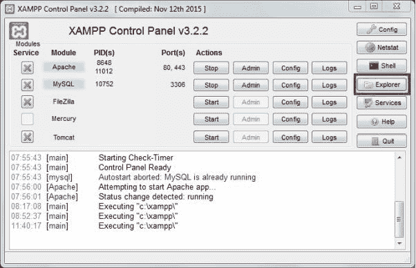
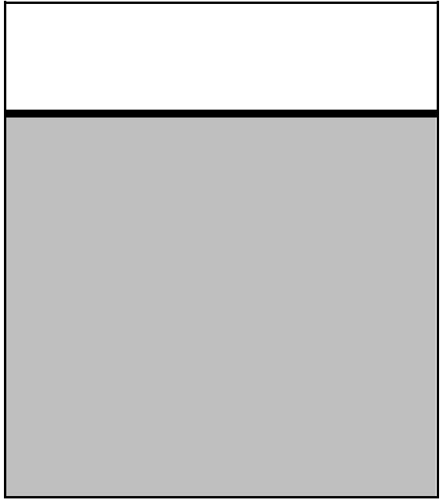

# PHP 深度学习与理解完全教程


## PHP 简析

`PHP` 代表 Hypertext Processor（超文本处理器）。它是一种服务器端脚本语言，主要用于生成动态网页内容等。这意味着 `PHP` 执行的所有操作并不是在用于查看网页的计算机（称为客户端）上完成的，而是在一台称为服务器的专用计算机上完成的，服务器托管了你在客户端机器上查看的所有网页。

作为一种脚本语言，`PHP` 实际上不能用于制作在你的计算机上运行的独立应用程序，因为它被设计为仅在网页内发生事件时执行操作，例如：点击链接或提交 Web 表单时获取表单数据。

你可以将 `PHP` 嵌入到你的 `HTML` 网页中，并根据从用户处获得的信息生成自定义页面。这使得网页比纯静态页面更具趣味。`PHP` 可用于生成网页，因为它的最终输出是 `HTML`。

它在服务器端非常高效，被广泛使用，跨平台（运行在 `Windows`、`Linux`、`UNIX`、`Mac OS X` 等），并且比任何其他全功能语言（如 `C`、`Java` 或 `Perl`）都更容易学习。

`PHP` 也非常强大。如果你怀疑它的威力，下次当你决定登录 `Facebook` 时，仔细看看浏览器中的地址栏即可。你会发现，全球最大的社交网站是由 `PHP` 驱动的！甚至 `Wikipedia`（那个能告诉你所有所需知识的网站）也是由 `PHP` 驱动的。这就是 `PHP` 背后的力量，使其成为微软 Active Server Pages (`ASP`) 等竞争对手的极佳替代方案。

它还拥有一个非常活跃的社区，可以在你困难时为你提供真正的帮助，并且一直活跃。根据 [`http://www.w3schools.com ]](http://www.w3schools.com) 的 `PHP` 页面；`PHP` 允许你完成以下操作：

* `PHP` 可以生成动态页面内容
* `PHP` 可以在服务器上创建、打开、读取、写入、删除和关闭文件
* `PHP` 可以收集表单数据
* `PHP` 可以发送和接收 cookie
* `PHP` 可以对你的数据库进行添加、删除、修改数据（这就是为什么它是 `MySQL` 的完美搭档）
* `PHP` 可以用于控制用户访问
* `PHP` 可以加密数据

## MySQL 简析

`MySQL` 是一个流行的开源关系型数据库，以 `SQL` 为基础。它允许你存储、检索和操作数据。它是一个高效且可扩展的解决方案，而且具有成本效益。

许多基于 Web 的程序（包括计算机程序）使用数据库来存储信息。社交应用程序需要一个地方来存储用户信息、图片、帖子、评论等，这时像 `MySQL` 这样的数据库就派上用场了，存储和检索大量信息变得轻而易举。

`SQL` 通常读作 "sequel"，代表结构化查询语言。它是一种为像 `MySQL` 之类的数据库管理数据设计的语言。它们使用 `SQL` 通过特殊的命令来发送和检索数据，这些命令其实并不难学。最重要的是，对于这本书的读者来说，你可以将 `SQL` 嵌入到 `PHP` 等编程语言中。

此外，`MySQL` 是开源的，免费提供，如果某些特定功能不符合你的设，可以通过修改源代码进行更改。

## 本书将涵盖的内容

本书分为四个主要章节（或四个“小时”），帮助你进入 `PHP` 和 `SQL` 的核心，并让你在很快成为大师。

在第一个小时里，我们将花时间安装非常需要的名为 `XAMPP` 的 Web 服务器包。我建议在开始该章节之前，先在这里下载它：[`https://www.apachefriends.org/index.html ]](https://www.apachefriends.org/index.html)。这将使我们能够运行书中的示例。然后，我们将为 `PHP` 代码选择一个文本编辑器。接着我们将学习如何运行 `PHP` 脚本，最后我们将涵盖一些 `PHP` 的基础知识，如注释、变量、常量和操作符。

书中的示例可以手动输入，或者为了节省时间复制并粘贴到你的代码编辑器或命令行界面中。

在第二个小时里，我们将继续学习 `PHP` 并涵盖条件语句、循环 (`Loops`)、数组 (`Arrays`) 和函数。在本章之后，你应该认为自己已经很熟悉了 `PHP`，可以处理进一步更高级的主题了。

这一部分你可以休息一下，让大脑吸收一下，然后再去泡杯咖啡。

在第三个小时里，我们将处理 `MySQL` 及其命令，但首先我们要学习如何访问命令行。然后我们进入允许我们创建和删除数据库的命令；创建、修改和删除表；在表中插入、选择、更新和删除数据。

最后，在最后一个小时里，我们将 `PHP` 和 `MySQL` 结合起来，创建一个简单的网站，向你展示这两者是如何协同工作的。

让我们开始吧。拿起你的第一杯咖啡！

请耐心一下。我知道编程书的第一章都会堆砌一些理论，以确保你知道自己在面对什么。但那是以后的事。现在你需要安装服务器并选择一个合适的文本编辑器！

## 安装 Web 服务器

通往 `PHP` 大师之路的第一真正步在这里。你不能像运行 `HTML` 那样直接在浏览器中运行 `PHP`。为了运行 `PHP`，你需要在本地安装一个服务器，以便浏览器解析 `PHP` 脚本并向数据库运行 `MySQL` 查询以返回结果。或者，你可以使用支持 `PHP` 和 `MySQL` 的主机，这样你可以将其上传到他们的服务器并在那里部署你的梦想网站。但我猜你真的想在本地测试。因此，我们将安装一个让你的电脑变成测试服务器的本地服务器。

本地可以安装很多服务器，例如 `XAMP`、适用于 Windows 的 `WAMP` 以及适用于 Mac OS X 的 `MAMP` 等，但本书涵盖 `XAMP`。它是一个适用于 Windows、Mac 和 Linux 的免费开源跨平台服务器包。

访问网站 [`www.apachefriends.org/index.html`](http://www.apachefriends.org/index.html) 下载最新版本的 Windows 版 `XAMP`（步骤同样适用于 Mac 或 Linux）。下载完成后，在本地机器上找到该文件并双击安装。

简单！现在 `PHP` 和 `MySQL` 已准备就绪。

**注意**：如果你此时运行着杀病毒软件，它可能会干扰安装过程。你可能需要在服务器安装完成之前将其关闭，以避免任何潜在问题。

## 安装文本编辑器

现在，你需要一个文本编辑器来编写优美的 `PHP`。理想情况下，任何文本编辑器都可以，甚至 Windows 默认的记事本或 Mac OS X 的终端都可以用于编写 `PHP`。我们将使用 `notepad++`，因为它有一些非常实用的功能，有助于快速编写整洁高效的代码，例如语法高亮和自动补全。

而且它是免费的！

这些文本编辑器将通过此处下载并安装来为你节省时间并避免许多痛苦。下载一个文本编辑器并安装它。只需记住，任何编辑器都可以。所以即使你没有 `notepad++`，也可以使用任何你喜欢的工具。

# 启动 Apache 以运行 PHP 脚本

现在你已经安装了 `XAMPP`，你需要启动 `apache` Web 服务，以便浏览器能够运行 PHP 脚本。要执行此操作，请双击 `XAMPP` 图标打开其控制面板。默认情况下，它应该会自动启动 Apache，但你可以像下面图片所示点击“Start”来手动启动：


注意：你电脑上安装的其他应用程序可能会导致 Apache 无法启动，因为它们使用了与 Apache 配置相同的端口，例如 Skype。如果出现这种情况，只需停止那些服务并重新启动 Apache 即可。

## 创建你的第一个 PHP 脚本

这部分非常简单。你只需要按照以下步骤操作：

### 步骤 1 - 创建 PHP 文件

打开你的文本编辑器，创建一个普通的文本文件，并将以下代码粘贴其中：

```html
<!DOCTYPE html>
<html>
    <body>
        <?php
            echo “My first PHP script!";
        ?>
    </body>
</</html>
```

该文件看起来仍然像你的基础 HTML 文件，不同之处是你在标签 `<?php` 和 `?>` 之间嵌入了 PHP 代码。`echo` 语句仅会将其之后的所有内容输出到屏幕上。在我们的案例中，这将是“My first PHP script!”。我们稍后将看到它的运行效果。

你只需要记住，每个 PHP 语句都以分号结束（注释除外。我们将在本节的晚些时候讨论它们）。

将文件保存为“example.php”。

### 步骤 2 - 将其放在 XAMPP 的根目录下

获取你刚刚创建的 `example.php` 文件，并将其放在服务器根目录下名为 `htdocs` 的文件夹中，完成！你已经准备好在浏览器中运行它了。

提示：要找到根目录，你可以在本地机器上查找它，或者直接打开 `XAMPP` 控制面板并点击“Explorer”按钮（如下图所示）来调出根文件夹，然后找到 `htdocs` 文件夹并将文件放在其中：



注意：放置 PHP 文件的文件夹对于每个服务器都不同。例如；如果你使用 WAMP，则将它们放在名为 `www` 的文件夹中。

### 步骤 3 - 在浏览器中运行

打开你的浏览器（推荐使用 Google Chrome 或 Firefox）并输入：`http://localhost/example.php`

按下回车键，你应该能看到下面的内容：


大搞定！如果你遵循了这些步骤，你应该能够运行在本章节中创建的所有其他脚本。

# PHP 基础

## 注释

想为你自己或团队的其他成员留下留言吗？那么注释可以省去你记忆思维轨迹的烦恼，并成为记录你当时想法的绝佳方式。它们还可以被用于批量排除某些代码块。

```php
// 这是一个单行注释
# 这是另一个单行注释

/* 这是一个块注释。这里的所有内容都将被忽略，并跨越多行。 */
```

## 变量

为了构建你梦想中的网站，你需要数据以及存储这些数据的方法。它可以是一个名称、数字或图片。PHP 提供了一种方法让你使用变量将它们存储在内存中。PHP 中的每个变量都以 `$` 符号开头，后跟变量名，且符号与名称之间没有任何空格：

```php
$myInt = 10;
```

让我们通过以下内容来看一些实际应用：

```html
<!DOCTYPE html>
<html>
    <body>
        <?php
            $txt = "My second script!";
            echo $txt;
        ?>
    </body>
</html>
```

你只需要记住，每个 PHP 语句都以分号结束（注释除外。我们将在本节的晚些时候讨论它们）。

关于变量的几点注意事项：

- (Images/image0883.jpeg) 它们是大小敏感的
- (Images/image0884.jpeg) 它们必须以字母开头
- (Images/image0885.jpeg) 它们可以是数字
- (Images/image0886.jpeg) 它们可以包含

PHP 是一种弱类型语言，会根据值自动进行类型转换。通过赋值操作可以实现相同的结果。以下是常用的数据类型：

- (Images/image887.jpeg) 整数 (Integer)
- (Images/image888.jpeg) 浮点数 (Float)
- (Images/image889.jpeg) 字符串 (String)
- (Images/image890.jpeg) 布尔值 (Boolean)
- (Images/image891.jpeg) 数组 (Array)
- (Images/image892.jpeg) 对象 (Object)

你可以通过使用以下内容来实现相同的结果：

```html
<!DOCTYPE html>
<html>
    <body>
        <?php
            $txt = "My third script!";
            echo $txt;
        ?>
    </body>
</html>
```

## 常量

文件看起来仍然像你的基础 HTML 文件，不同之处是你在标签 `<?php` 和 `?>` 之间嵌入了 PHP 代码。`echo` 语句仅会将其之后的所有内容输出到屏幕上。在我们的案例中，这将是“My first PHP script!”。我们稍后将看到它的运行效果。

常量与变量不同，它们的值不能被更改。使用 `define()` 配合一个名称和一个值：

```php
define("MESSAGE", "Happy Learning!");
```

输出：Happy Learning!

你可以指定一个常量是否为真值：

```php
define("MESSAGE", "Happy Learning!", true);
echo MESSAGE;
```

关于常量的规则：

- (Images/image0893.jpeg) 它们必须以字母开头
- (Images/image0894.jpeg) 它们是全局的

## 运算符

PHP 使用运算符对变量和值进行各种操作。我们现在来看组使用的运算符。

### 算术运算符

这些运算符对值进行数学运算并返回计算结果：

| 示例 | 运算符 | 结果 |
| --- | --- | --- |
| `$x + $y` | 加法 | `$x` 和 `$y` 的和 |
| `$x - $y` | 减法 | `$x` 和 `$y` 之间的差 |
| `$x * $y` | 乘法 | `$x` 和 `$y` 的积 |
| `$x / $y` | 除法 | `$x` 除以 `$y` 的商 |
| `$x % $y` | 取模 | `$x` 除以 `$y` 的余数 |
| `$x ** $y` | 幂 | `$x` 的 `$y` 次方（PHP.6 新增） |

### 赋值运算符

这些运算符用于为变量赋值：

| 赋值 | 等同于 | 描述 |
| --- | --- | --- |
| `$x = $y` | `$x = $y` | 获取 `$y` 的值并将其赋值给 `$x` |
| `$x += $y` | `$x = $x + $y` | 获取 `$x` 和 `$y` 的和并将结果赋值给 `$x` |
| `$x -= $y` | `$x = $x - $y` | 获取 `$x` 和 `$y` 的差并将结果赋值给 `$x` |
| `$x *= $y` | `$x = $x * $y` | 获取 `$x` 和 `$y` 的积并将结果赋值给 `$x` |
| `$x %= $y` | `$x = $x % $y` | 获取 `$x` 除以 `$y` 的余数并将结果赋值给 `$x` |

## 比较运算符

PHP 中的比较运算符用于比较两个值：

| 示例 | 名称 | 结果 |
| :--- | :--- | :--- |
| `$x == $y` | 等于 | 如果 `$x` 和 `$y` 都相等，则返回 true |
| `$x === $y` | 相同 | 如果 `$x` 和 `$y` 相等且数据类型相同，则返回 true |
| `$x != $y` | 不等于 | 如果 `$x` 和 `$y` 不相等，则返回 true |
| `$x <> $y` | 不等于 | 如果 `$x` 和 `$y` 不相等，则返回 true |
| `$x !== $y` | 不相同 | 如果 `$x` 和 `$y` 不相等或它们的数据类型不同，则返回 true |
| `$x > $y` | 大于 | 如果 `$x` 大于 `$y`，则返回 true |
| `$x < $y` | 小于 | 如果 `$x` 小于 `$y`，则返回 true |
| `$x >= $y` | 大于等于 | 如果 `$x` 大于或等于 `$y`，则返回 true |
| `$x <= $y` | 小于等于 | 如果 `$x` 小于或等于 `$y`，则返回 true |

## 逻辑运算符

逻辑运算符是我们用于组合条件语句（我们将在下一小时介绍）以获得 true 或 false 结果的：

| 示例 | 名称 | 结果 |
| :--- | :--- | :--- |
| `$x && $y` | 与 | 如果 `$x` 和 `$y` 都为 true，则返回 true |
| `$x || $y` | 或 | 如果 `$x` 或 `$y` 其中为 true，则返回 true |
| `!$x` | 非 | 如果 `$x` 不为 true，则返回 true |
| `$x and $y` | 与 | 如果 `$x` 和 `$y` 都为 true，则返回 true |
| `$x or $y` | 或 | 如果 `$x` 或 `$y` 其中为 true，则返回 true |
| `$x xor $y` | 异或 | 如果 `$x` 小于 `$y`，则返回 true |

## 增/减（三元）运算符

这些运算符也称为三元运算符，用于增加/减少变量的值 1：

| 示例 | 名称 | 结果 |
| :--- | :--- | :--- |
| `++$x` | 前自增 | 给 `x` 加 1，然后返回 `$x` |
| `$x++` | 后自增 | 返回 `$x`，然后给 `$x` 加 1 |
| `--$x` | 前自减 | 从 `x` 减 1，然后返回 `$x` |
| `$x--` | 后自减 | 返回 `$x`，然后从 `$x` 减 1 |

## 字符串运算符

这些是专门为字符串设计的运算符：

| 示例 | 名称 | 结果 |
| :--- | :--- | :--- |
| `$str1 . $str2` | 拼接 | 返回 `$str1` 和 `$str2` 的拼接结果 |
| `$str1 .= $str2` | 拼接赋值 | 将 `$str2` 追加到 `$str1` |

## 数组运算符

这些是用于比较数组的运算符（我们将在下一小时讨论）：

| 示例 | 运算符 | 结果 |
| :--- | :--- | :--- |


| `$x + $y` | 并集 | `$x` 和 `$y` 的并集 |

| `$x \== $y` | 等于 | 如果 `$x` 和 `$y` 具有相同的键值对，则结果为 true |

| `$x === $y` | 恒等 | 如果 `$x` 和 `$y` 具有相同顺序的相同键值对且数据类型相同，则结果为 true |

| `$x != $y` | 不等于 | 如果 `$x` 的值不等于 `$y` 的值，则返回 true |

| `$x <> $y` | 不等 | 如果 `$x` 的值不等于 `$y` 的值，则返回 true |

| `$x !== $y` | 非相同 | 如果 `$x` 和 `$y` 不相同，则返回 true |

## 总结

到为止，我们已经涵盖了为了开始学习并看到 PHP 运行所需了解的大量内容。我们安装了一个名为 XAMPP 的服务器，它带有 Apache 服务，允许我们在浏览器中运行 PHP 脚本。你现在应该非常熟悉创建和运行 PHP 脚本，并了解了如何向屏幕输出信息。我们还涵盖了 PHP 的一些基础知识，如变量和常量，并查看了一些运算符；其中一些在下一小时将很有用。让我们继续前进吧！

“空谈是廉的。给我看代码” – Thomas C. Gale

在这一章中我们将涵盖：

- 条件语句

- 循环

这一部分我们将深入探讨 PHP 的基础，并进行许多酷炫的操作。你完成了基础知识的“沙拉部分”，现在是“肉菜部分”。

### 条件语句

条件语句允许代码中进行一些决策。它们根据程序员指定的条件被求值为为 true 还是 false 来执行不同的操作。以下是 PHP 中使用的条件语句列表：

- If 语句

- If…else 语句

- If…else…else 语句

- Switch 语句

### If 语句

`if` 语句评估一个表达式并如果表达式求值为 true 则执行代码块。如果表达式求值为 false，则忽略该代码块。下面的示例将输出“5 小于 10”，如果条件成立：

```php
<?php
$x = 5;
if ($x < 10) {
    echo "$x 小于 10!";
}
?>
```

输出：

5 小于 10

### If…else 语句

`if…else` 语句评估一个表达式并如果表达式求值为 true 则执行代码块。如果第一个条件不成立，则执行另一个代码块。下面的示例将输出“50 大于 20”，因为它满足了第二个条件：

```php
<?php
$x = 50;
if ($x < 10) {
    echo "$x 小于 10!";
} else if ($x > 20) {
    echo "$x 大于 20!";
}
?>
```

输出：

50 大于 20

### If…elseif…else 语句

`if…elseif…else` 语句与 `if…else` 语句相同，区别在于当所有条件都失败时，会执行最后一个代码块。下面的示例将输出“15 在 10 到 20 之间”，因为 `$x` 是 15。它需要小于 10 以满足第一个条件，大于 20 以满足第二个条件，否则它在 10 到 20 之间：

```php
<?php
$x = 15;
if ($x < 10) {
    echo "$x 小于 10!";
} else if ($x > 20) {
    echo "$x 大于 20!";
} else {
    echo "$x 在 10 到 20 之间!";
}
?>
```

输出：

15 在 10 到 20 之间

### Switch 语句

`switch` 语句将表达式的值与多个 case 进行匹配。如果匹配，则执行该 case 相关的代码。如果没有找到匹配，则使用 `default` 语句。`break` 语句防止代码跳转到下一个 case。下面的示例将检查 `$lunch` 的值与所有 case 的匹配。在这种情况下，输出将是“汉堡很好吃！”，因为那是对应的 case：

```php
<?php
$lunch = "burger";
switch ($lunch) {
    case "cereal":
        echo "麦片？你午饭吃早餐了吗？";
        break;
    case "salad":
        echo "沙拉是一份健康的午餐！";
        break;
    case "burger":
        echo "汉堡很好吃！";
        break;
    default:
        echo "看起来你错过了午餐。这不太好！";
}
?>
```

循环只要指定的条件保持为真，就会重复执行代码块。下面的代码显示了 `$x` 的值如果小于或等于 5。如果条件为真，它将被输出到屏幕并再次递增，直到条件返回假：

```php
<?php
$x = 1;
while ($x <= 5) {
    echo $x;
    $x++;
}
?>
```

```php
while ($x <= 5) {
    echo “The value of x is: ” . $x . “<br />”;
    $x++;
}
?>
```

Output:

The value of x is: 1

The value of x is: 2

The value of x is: 3

The value of x is: 4

The value of x is: 5

### Do Loop

至少执行一次代码块，然后循环执行直到指定的条件变为假。下面的示例显示了将 `$x` 的值输出到屏幕，然后至少减一，然后检查它是否大于零。如果是，则重复该过程，直到它小于零为止：

```php
<?php
$x=5;
do {
    echo “The value of x is: ” . $x . “<br />”;
    $x--;
} while ($x >= 0);
?>
```

Output:

The value of x is: 5

The value of x is: 4

The value of x is: 3

The value of x is: 2

The value of x is: 1

The value of x is 0

## For Loop

循环执行代码块指定的次数。为了使循环工作，需要三个要素。下面的示例包含了所有这些要素：

1. **初始化**：在这里声明一个变量来启动循环计数器。在我们的示例中，它是 `$x=1`。这意味着 `$x` 是初始化器，并被设置为 1。

2. **条件**：这是循环的第二部分，我们在这里检查循环计数器是否仍然符合条件。当它返回假时，循环停止对代码块的执行。我们在下面的示例中的条件是 `$x <= 5`。

3. **递增**：当循环结束时，这部分代码将执行一次，然后循环循环。在这里我们可以对循环计数器进行一些操作。在我们的情况下，我们通过 `$x++` 将 `$x` 的值增加 1。

```php
<?php
for ($x = 1; $x <= 5; $x++) {
    echo “The value of x is: ” . $x . “<br />”;
}
?>
```

Output:

The value of x is: 1

The value of x is: 2

The value of x is: 3

The value of x is: 4

The value of x is: 5

## For each Loop

一种遍历数组中找到每个元素的循环。它会对数组找到的每个元素执行一次代码块，直到用完为止。下面的代码遍历数组中的所有元素，然后将元素的值输出到屏幕：

```php
<?php
$foods = array(“cereal”, “salad”, “burgers”, “fries”);
foreach ($foods as $food) {
    echo “$food <br />”;
}
?>
```

## Functions

函数是程序中可以反复使用的代码段。函数接收一个或多个称为参数（也称为参数）的输入，并对它们进行某些操作。函数在处理完成后有时可以返回一个值。

关于函数有需要记住的几点：

- 它们对大小写不敏感

- 在页面加载时，除非被某些代码调用，否则它们不会自动执行

- PHP 拥有超过 1000 个内置函数，可以满足你的需求

### 创建函数

创建你自己的函数很容易；只需以关键字 `function` 开始，后面跟函数名和括号。之后，将你的代码放在两个大括号 `{` 和 `}` 之间，分别称为左括号和右括号。现在你可以根据需要多次使用该函数。这节省了你每次都要重新输入代码的麻烦。

下面的代码演示了一个向屏幕输出消息的函数：

```php
<?php
function echoMessage() {
    echo “Hello, I am a PHP function!”
}
echoMessage();
?>
```

Output:

Hello, I am a PHP function!

### 函数参数

有时你可以将信息传递给函数以便对它们进行操作。这些信息被称为参数，并放在括号中。你可以通过逗号分隔来添加多个参数。下面的示例显示了一个减去两个作为参数数字的函数：

```php
<?php
function subFunction($num1, $num2) {
    $diff = $num1 - $num2;
    echo “The difference between $num1 and $num2 is: ” . $diff;
}
subFunction(5, 6);
?>
```

Output:

The difference between 5 and 6 is: -1

### 返回值的函数

函数不仅可以接受信息，还可以以返回值的的形式将其交回。只需编写 `return` 关键字，后跟你希望函数返回的值。这会停止函数的执行。在接下来的示例中，我们使用函数进行加法并将结果赋值给 `$return_val`，然后输出到屏幕：

```php
<?php
function addFunction($num1, $num2) {
    $sum = $num1 + $num2;
    return $sum;
}
$return_val = addFunction(20, 15);
echo “The value returned by the function is: ” . $return_val;
?>
```

Output:

The value returned by the function is: 35

在没有传递任何参数的情况下，我们可以为参数指定一个默认值。在下面的示例中：

```php
<?php
function PrintName($name = “Jack”) {
    echo “Hi, my name is $name;
}
//(); // 使用默认值
PrintName(“Jill”);
PrintName(“Adam”);
?>
```

Output:

Hi, my name is Jack

Hi, my name is Jill

Hi, my name is Adam

### Arrays

数组是一种可以在单个变量中存储多个值的数据结构。每个值都与键相关联。

### 数字数组

这些数组使用数字作为索引。索引默认从零开始。创建数字数组有两种方法：

1. 这种方法自动分配索引：`$dairy = array(“yoghurt”, “ice cream”, “cheese cake”);`

2. 这种方法手动分配索引：`$dairy[0] = “yoghurt”`, `$dairy[1] = “ice cream”`, `$dairy[2] = “cheese cake”`

示例显示了如何使用索引从数字数组获取值：

```php
<?php
$dairy = array(“yoghurt”, “ice cream”, “cheese cake”);
// 通过索引访问值
echo “I to eat ” . $dairy[0] . “, ” . $dairy[1] . “ and ” . $dairy[2] . “!”;
$arrayCount = count($dairy); // 返回数组数量的内置函数
// 使用 for 循环遍历数字数组
for ($i = 0; $i < $arrayCount; $i++) {
    echo $dairy[$i] . “<br />”;
}
?>
```

Output:

I to eat yoghurt, ice cream and cheese cake!

yoghurt

ice cream

cheese cake

### 关联数组

使用字符串作为索引，这使得键和值之间建立了强关联。创建关联数组有两种方法。我们将通过使用奇装的价格来演示：

1. 第一种方法：`$suit_prices = array(“batman” => 4000, “arrow” => 1500, “superman” => 0);`

2. 第二种方法：`$suit_prices["batman"] = 4000;`, `$suit_prices["arrow"] = 1500;`, `$suit_prices["superman"] = 0;`

注意：输出关联数组的值时，不要将数组放在双引号内，否则值无法输出。下面的示例演示了如何访问关联数组的值：

```php
<?php
$suit_prices = array(“batman” => 4000, “arrow” => 1500, “superman” => 0);
echo “The Bat suit costs: ” . $suit_prices['batman'] . “<br />”;
echo “The Green Arrow suit costs: ” . $suit_prices['arrow'] . “<br />”;
echo “The Superman is free. It suit costs: ” . $suit_prices['superman'] . “<br />”;
?>
```

Output:

The Bat suit costs: 4000

The Green Arrow suit costs: 1500

The Superman is free. It suit costs: 0

另一种值得的数组类型是多维数组。这些是包含其他数组的数组。但这是一个高级主题，你可以进一步研究。

## 总结

恭喜你！你现在已经熟悉 PHP 的基础知识。到目前，你应该能够看到 PHP 为你提供的强大。在本章中，我们讨论了条件语句，它允许你编写的代码根据指定的条件做出决策。然后，我们查看了循环，它会执行代码块，直到指定的条件返回假或元素耗尽。接下来，我们讨论了如何通过将代码放入函数并在程序中多次调用，以及如何向它们传递信息并让它们返回值。最后，我们研究了数值数组和关联数组。我们通过直接访问它们或遍历它们来创建它们并返回值。

现在，你准备好从 PHP 中休息一下，去泡杯咖啡了。这只会变得更有趣！

[“告诉我，我会忘记；教我，我可能会记得；让我参与，我就会学会。” - 班杰明·富兰林](http://www.goodreads.com/author/show/289513.Benjamin_Franklin)

[富兰林](http://www.goodreads.com/author/show/289513.Benjamin_Franklin)

在本章中我们将涵盖：

 启动 MySQL

 创建和删除数据库

 创建、读取、更新和删除表 (CRUD)

既然我们已经研究了 PHP，让我们看看是什么让 PHP 能够在网页中填充内容。那就是如 `MySQL` 这样的数据库。我们将学习你认为自己 `MySQL` 基础大师需要知道的大部分内容，并完成你实现梦想的下一步所需的操作。

这将是轻而易举，因为我们将学习如何使用数据库做一些非常酷的事情。

下面我们将将在数据库中创建并使用的表图片。我们只是向音乐数据库中添加专辑。你可以在最上方看到表名，表名下方是字段或列。

### Albums（专辑）

 `AlbumID` `AlbumName` `AlbumArtist` `AlbumType` `NumberOfTracks` `DateReleased`

## 启动 MySQL 客户端

我们这一小时要做的的是使用 `XAMPP` 自带的 `MySQL` 客户端命令行输入 `MySQL` 命令，只需打开 Windows 命令提示符并导航到 `XAMPP` 安装的根文件夹。

当你打开命令提示符时，输入以下命令导航到“C” 盘（假设 `XAMPP` 安装在那里），然后按回车：

```bash
cd \
```

现在，导航到客户端执行文件安装的位置以启动它。通过输入以下命令并按回车进入 `xampp->mysql->bin`：

```bash
cd xampp\mysql\bin
```

到达那里后，输入以下命令：

```bash
mysql -u your_username -p
```

将 `your_username` 替换为你的实际用户名。默认是 `root`。然后你会被要求输入密码。输入完毕后，按回车。默认情况下密码为空，出于安全考虑，你真的应该更改它。但这超出了此本书的范围。

如果你注意到命令行提示符显示的是一个名为 `MariaDB` 的东西。不要困惑，因为它只是 `MySQL` 关系型数据库管理系统的社区开发分支。大量的 `SQL` 命令仍然有效，而且与之前的 `MySQL` 提示符不同，它会让你知道选择了哪个数据库。

现在我们准备好开始了！

**提示**：或者，你可以使用 `phpmyadmin` 界面只需点击几次即可创建数据库和表。你也可以在那里输入 `SQL` 命令，但由于我们想要尽快进入硬核阶段，我们不会那样做。此外，希望这一小时的内容到目前为止都不难。

## 创建和删除数据库

让我们从输入以下命令来创建一个数据库开始：


```sql
CREATE DATABASE music;
```

始终记住这一点：

 从这里开始，输入的所有语句和命令都应该以分号或 `/` 结尾。否则客户端会认为你仍在输入命令而不会执行。

 虽然不是强制的，因为命令行不区分大小写，但 `MySQL` 命令使用大写字母输入以区分它们。

删除数据库很简单：

```sql
DROP database_name;
```

现在我们已经创建了数据库，我们需要选择它：

```sql
USE music;
```

**警告**：命令行提示符看起来像 `music>`。

## 创建、修改和删除表

现在我们已经选择了数据库，让我们创建一些表。

### 创建表

```sql
CREATE TABLE Album (
    AlbumID smallint unsigned NOT NULL AUTOINCREMENT PRIMARY KEY,
    AlbumName varchar(255) NOT NULL,
    AlbumArtist varchar(80) NOT NULL,
    AlbumType ENUM('A', 'E', 'M') NOT NULL,
    NumberOfTracks varchar(3) NOT NULL,
    DateReleased DATE NOT NULL
);
```

**提示**：在输入长命令时很容易出错。使用键盘上的上箭头调出之前的命令，并使用左、右箭头导航到出错的地方并进行修复。

要查看你数据库中的表列表，输入：

```sql
SHOW TABLES;
```

你看到以下输出：

```
+----------------+
| Tables_in_music |
| album           |
+----------------+
```

`ENUM` 类型是一个拥有一组值的字符串对象。在我们的案例中允许的值为‘L’（长久播放 Long Play）、‘E’（扩展播放 Extended Play）和‘M’（混音 mix）。

### 添加 `numTracks`

如果你觉得这不对，说明你观察得很敏锐！这个字段用于存储曲目数量，它应该是数值类型而不是字符串类型。这样做是有意意的，为了演示以后如何更改字段的数据类型和名称。

### 添加 `DateReleased`

最后一行创建的代码存储了专辑发布的日期。使用日期类型来存储值。让我们来看你将用到的常用数据类型：

#### 数值类型

- `INT`: 整数
- `FLOAT`: 1E38 到 -1E37
- `Double`: 1E38 到 -1E37

#### 字符串类型

- `CHAR`: 固定长度
- `VARCHAR`: 可变长度
- `ENUM`: 总值数量有限的字符串，你必须定义它们

#### 日期和时间

- `DATE`: YYYY-MM-DD
- `TIME`: HH:MM:SS
- `DATETIME`: YYYY-MM-DD HH:MM:SS
- `YEAR`: YYYY

### 修改表

有时候你会犯错，或者想要更改表中的内容。幸运的是，你可以通过 `ALTER` 语句来实现。我们将查看更改表名和数据类型。首先，我们需要通过输入以下命令来查看我们刚刚创建的表：

```
DESC Album;
```

你应该看到如下输出：

```
+------+------+------+------+----+
| Field | Type | Null | Key | Extra |
+------+------+------+------+----+
| AlbumID | smallint(5) unsigned | NO | PRI | auto_increment |
| AlbumName | varchar(255) | NO | | |
| AlbumArtist | varchar(80) | NO | | |
| AlbumType | enum('A','E','M') | NO | | |
| numTracks | varchar(3) | NO | | |
| DateReleased | date | NO | | |
+------+------+------+------+----+
```

看起来我们确实可以更改其中的一些东西：

#### 1. 修改表名

单数形式“Album”作为表是不合理的，因为表是用来存储多条记录的。我们应该使用复数形式并将其从 `Album` 改为 `Albums`，这样更符合逻辑。以下是更改表的方法：

```
RENAME TABLE Album to Albums;
```

如果我们输入 `show tables` 命令，应该能看到表名已经更改：

```
+----------------+
| Tables_in_music |
+----------------+
| albums |
+----------------+
```

#### 2. 修改 `numTracks` 的数据类型

`numTracks` 字段不应该是字符串类型而应该是数值。以下代码将其数据类型更改为合适的类型：

```
ALTER TABLE Albums
MODIFY COLUMN numTracks smallint(2) NOT NULL;
```

#### 3. 修改 `numTracks` 的列名

看来我们还没有处理完 `numTracks` 字段。我们需要将其从 `numTracks` 改为 `NumberOfTracks`，以使其更具可读性。

```sql
ALTER TABLE Albums
CHANGE numTracks NumberOfTracks smallint(2) NOT NULL;
```

注意：更改列名时我们仍然需要定义数据类型。通过以下更改，当我们输入描述表的语句时，应该会看到：

```
+------+------+------+------+----+
| Field | Type | Null | Key | Extra |
+------+------+------+------+----+
| AlbumID | smallint(5) unsigned | NO | PRI | auto_increment |
| AlbumName | varchar(255) | NO | | |
| AlbumArtist | varchar(80) | NO | | |
| AlbumType | enum('A','E','M') | NO | | |
| NumberOfTracks | smallint(2) | NO | | |
| DateReleased | date | NO | | |
+------+------+------+------+----+
```

这看起来好多多了！

### 删除表

下面的代码可以删除数据库中的表及其所有数据：

```
DROP TABLE table_name;
```

其中 `table_name` 是你想要删除的表名。

## 向表中插入记录

我们使用 `INSERT INTO` 语句向表中插入新记录：

```
INSERT INTO Albums VALUES
(NULL, 'Rush Blood to the Head', 'Coldplays', 'A', 12, '2002-08-02'),
(NULL, 'Dirty Gold', 'Angel Haze', 'A', 16, '2013-12-30'),
(NULL, 'Back to the Woods', 'Angel Haze', 'M', 13, '2015-09-15'),
(NULL, 'Parachutes', 'Coldplay', 'A', 10, '1999-07-10'),
(NULL, '1989 (Delux Edition)', 'Taylor Swift', 'A', 15, '2014-10-27'),
(NULL, 'Prokts March', 'Coldplay', 'E', 8, '2008-09-21'),
(NULL, 'Random Access Memories', 'Daft Punk', 'A', 14, '2013-05-13'),
(NULL, 'Random Access Memories', 'Coldplay', 'A', 13, '2005-06-01');
```

### SELECT 语句

`SELECT` 允许从表中检索数据。以下示例展示了如何使用 `SELECT` 表，输出应该是这样的：

```
+----------+-------------+---------------+
| AlbumID | AlbumName | AlbumArtist | AlbumType | DateReleased |
+----------+-------------+---------------+---------------+---------------+
| 1 | Rush Blood to the Head | Coldplays | A | 2002-08-02 |
| 2 | Dirty Gold | Angel Haze | A | 2013-12-30 |
| 3 | Back to the Woods | Angel Haze | M | 2015-09-15 |
| 4 | Parachutes | Coldplay | A | 1999-07-10 |
| 5 | 1989 (Delux Edition) | Taylor Swift | A | 2014-10-27 |
| 6 | Prots March | Coldplay | E | 2008-09-21 |
| 7 | Random Access Memories | Daft Punk | A | 2013-05-13 |
| 8 | X & Y | Coldplay | A | 2005-06-01 |
+----------+-------------+---------------+---------------+---------------+
```

选择特定的列，我们使用：

```sql
SELECT AlbumName, AlbumArtist, DateReleased, NumberTracks
FROM Albums;
```

输出应该是：

```
+-----------+-------------+---------------+---------------+
| AlbumName | AlbumArtist | DateReleased | NumberTracks |
+-----------+-------------+---------------+---------------+
| Rush Blood to the Head | Coldplays | 2002-08-02 | 12 |
| Dirty Gold | Angel Haze | 2013-12-30 | 16 |
| Back to the Woods | Angel Haze | 2015-09-15 | 13 |
| Parachutes | Coldplay | 1999-07-10 | 10 |
| 1989 (Delux Edition) | Taylor Swift | 2014-10-27 | 15 |
| Prots March | Coldplay | 2008-09-21 | 8 |
| Random Access Memories | Daft Punk | 2013-05-13 | 14 |
| X & Y | Coldplay | 2005-06-01 | 13 |
+-----------+-------------+---------------+---------------+
```

#### WHERE 子句

有时你需要过滤记录，只选择符合特定标准的记录。这就是 `WHERE` 子句发挥作用的地方，如下例所示：

```sql
SELECT AlbumName, AlbumArtist, DateReleased, NumberTracks
FROM Albums
WHERE AlbumArtist = 'Coldplay';
```

这应该输出：

```
+-----------+-------------+---------------+---------------+
| AlbumName | AlbumArtist | DateReleased | NumberTracks |
+-----------+-------------+---------------+---------------+
| Parachutes | Coldplay | 1999-07-10 | 10 |
| Prots March | Coldplay | 2008-09-21 | 8 |
| X & Y | Coldplay | 2005-06-01 | 13 |
+-----------+-------------+---------------+---------------+
```

| AlbumName | AlbumArtist | DateReleased | NumberOfTracks |
| :--- | :--- | :--- | :--- |
| Parachutes | Coldplay | 1999-07-10 | 10 |
| Prospekts March | Coldplay | 2008-09-21 | 8 |
| X & Y | Coldplay | 2005-06-01 | 13 |

注意：此示例是在文本字段上完成的，因此对我们想要检查的值使用了单引号。你也可以也可以对数值字段进行检查。只需删除单引号并确保你输入的是与该字段数值数据类型相对应的数值即可。

你可以使用 `AND` 和 `OR` 运算符进一步过滤记录以进一步缩小结果范围：

`AND` 运算符显示同时符合标准中两个条件的记录：

```sql
SELECT AlbumName, AlbumArtist,AlbumType
FROM Albums
WHERE AlbumArtist = 'Coldplay' AND AlbumType = 'A';
```

输出应该显示 `AlbumName` 为 `Coldplay` 且 `AlbumType` 为 ‘L’ 的结果。如果任何记录不符合该标准，它将被排除：

| AlbumName | AlbumArtist | AlbumType |
| :--- | :--- | :--- |
| Parachutes | Coldplay | A |
| X & Y | Coldplay | A |

`OR` 运算符用于返回符合指定标准中任一标准的记录。

```sql
SELECT AlbumName, AlbumArtist, Album Type
FROM Albums
WHERE AlbumType = 'E' OR AlbumType = 'M';
```

在上面的示例中，任何 `AlbumType` 为 ‘E’ 或 `AlbumType` 为 ‘M’ 的记录都将被显示。其余的将被排除。输出如下：

| AlbumName | AlbumArtist | AlbumType |
| :--- | :--- | :--- |
| Back to the Woods | Angel Haze | M |
| Prospekts March | Coldplay | E |

### ORDER BY 关键字

为了按一个或多个列对结果集（`SELECT` 语句返回表）进行排序，我们使用 `ORDER BY` 关键字并指定应该是降序还是升序：

```sql
SELECT AlbumName, AlbumArtist
FROM Albums
ORDER BY AlbumArtist ASC;
```

注意：默认情况下，它们按升序排序。这意味着如果我们省略 `ASC` 关键字，也不会产生任何影响。我们可以根据专辑名称通过将上述示例中的 `ASC` 替换为 `DESC` 来按降序排序：

| AlbumName | AlbumArtist |
| :--- | :--- |
| Dirty Gold | Angel Haze |
| Back to the Woods | Angel Haze |
| Parachutes | Coldplay |
| Prospekts March | Coldplay |
| X & Y | Coldplay |
| Rush of Blood to the Head | Coldplays |
| Random Access Memories | Daft Punk |
| 1989 (Delux Edition) | Taylor Swift |

### UPDATE 语句

回看我们目前为止显示的记录，似乎我们犯了一个错误，在其中一条记录中将其命名为 `Coldplays`。可以通过 `UPDATE` 语句更新该记录来纠正这一点。如果我们现在用以下代码输出记录：

```sql
SELECT AlbumID, AlbumName, AlbumArtist
FROM Albums;
```

输出应该是：

| AlbumID | AlbumName | AlbumArtist |
| :--- | :--- | :--- |
| 1 | Rush of Blood to the Head | Coldplays |
| 2 | Dirty Gold | Angel Haze |
| 3 | Back to the Woods | Angel Haze |
| 4 | Parachutes | Coldplay |
| 5 | 1989 (Delux Edition) | Taylor Swift |
| 6 | Prospekts March | Coldplay |
| 7 | Random Access Memories | Daft Punk |
| 8 | X & Y | Coldplay |

我们像这样更新该记录：


```sql
UPDATE Albums
SET AlbumArtist = 'Coldplay' WHERE AlbumID = 1;
```

警告：不要省略 `WHERE` 子句，否则表中的所有记录都将被更新。如果我们现在输出它，我们应该看到记录已更新：

| AlbumID | AlbumName | AlbumArtist |
| :--- | :--- | :--- |
| 1 | Rush of Blood to the Head | Coldplay |
| 2 | Dirty Gold | Angel Haze |
| 3 | Back to the Woods | Angel Haze |
| 4 | Parachutes | Coldplay |
| 5 | 1989 (Delux Edition) | Taylor Swift |
| 6 | Prospekts March | Coldplay |
| 7 | Random Access Memories | Daft Punk |
| 8 | X & Y | Coldplay |

### 删除表中的记录

要删除表中的记录，我们使用 `DELETE` 语句。下面的示例删除了表中 `AlbumID` 为 1 的行：

```sql
DELETE FROM Albums
WHERE AlbumID = 1;
```

警告：不要省略 `WHERE` 子句，否则表中的所有记录都将被删除。如果我们现在输出它，我们应该看到记录已删除：

| AlbumID | AlbumName | AlbumArtist |
| :--- | :--- | :--- |
| 2 | Dirty Gold | Angel Haze |
| 3 | Back to the Woods | Angel Haze |
| 4 | Parachutes | Coldplay |
| 5 | 1989 (Delux Edition) | Taylor Swift |
| 6 | Prospekts March | Coldplay |
| 7 | Random Access Memories | Daft Punk |
| 8 | X & Y | Coldplay |

*(注：此处原文表格中 ID 1 行已删除，译文保持此逻辑)*

## 总结

好的，现在你已经熟悉了 MySQL 的基础，可以使用命令行访问它并创建和删除数据库；创建、修改和删除表；查询、插入、更新和删除数据；并对数据进行过滤和排序。

## 第 4 章 - 第 4 节：PHP 与 MySQL：黄金搭档

“一种不影响你思考方式的语言是不值得知道的” —— Alan J.

在本章中，我们将涵盖：

- `Images/00923.jpeg` 创建家庭数据库
- `Images/00924.jpeg` 创建并向家庭成员表插入值
- `Images/00925.jpeg` 创建网站 PHP 配置
- `Images/00926.jpeg`, `Images/00927.jpeg`, `Images/00928.jpeg` 创建索引页、创建输入数据的表单、创建成员添加页面

想象一下你最喜欢的艺人共同表演。这就是我们现在的感受，因为我们正准备看到 PHP 和 MySQL 如何共同工作来创建一个网站。

网站非常简单；假设你想在线上记录你的家庭成员。我们将创建一个简单的网站，让你把他们（如果你喜欢他们的话）添加到数据库中，这样你就不需要总是记住他们。为了保持简单，我们放弃了许多安全功能，但这个简单的示例已经足够让你入门了。

### 创建家庭数据库

打开命令行并启动 MySQL 客户端，以 `root` 身份登录（见第 3 章）。

### 创建数据库

通过输入代码创建数据库：

```sql
CREATE DATABASE Family;
```

然后选择该数据库以便使用：

```sql
USE Family;
```

### 创建并向 Family Members 表插入值

现在我们创建一个存储信息的表。它看起来应该是这样的：

| Family Members |
| --- |
| 成员 ID |
| 名 |
| 姓 |
| 年龄 |
| 性别 |
| 关系 |

创建表的代码如下：

```sql
CREATE TABLE FamilyMembers
(
MemberID int unsigned NOT NULL auto_increment PRIMARY KEY, FirstName varchar(80) NOT NULL,
LastName varchar(80) NOT NULL, Age int(3) unsigned NOT NULL,
Gender ENUM ('Male', 'Female') NOT NULL, Relationship varchar(80) NOT NULL
);
```

当我们描述该表时，会得到类似这样的结果：

| Field | Type | Null | Key | Default | Extra |
| :--- | :--- | :--- | :--- | :--- | :--- |
| MemberID | int(10) unsigned | NO | PRI | NULL | auto_increment |
| FirstName | varchar(80) | NO | | NULL | |
| LastName | varchar(80) | NO | | NULL | |
| Age | int(3) unsigned | NO | | NULL | |
| Gender | enum('Male','Female') | NO | | NULL | |
| Relationship | varchar(80) | NO | | NULL | |

然后我们向表中插入值：

```sql
INSERT INTO FamilyMembers VALUES
(NULL, 'Robert', 'Williams', 52, 'Male', 'Father'), (NULL, 'Martha', 'Williams', 49, 'Female', 'Mother'), (NULL, 'Doreen', 'Williams', 18, 'Female', 'Sister'), (NULL, 'Jace', 'Williams', 13, 'Female', 'Adoptive Sister'), (NULL, 'Benson', 'Williams', 22, 'Male', 'Brother'), (NULL, 'Timothy', 'James', 23, 'Male', 'Cousin');
```

当我们查询表中的所有记录时，我们会看到类似这样的内容：

| MemberID | FirstName | LastName | Age | Gender | Relationship |
| :--- | :--- | :--- | :--- | :--- | :--- |
| 1 | Robert | Williams | 52 | Male | Father |
| 2 | Martha | Williams | 49 | Female | Mother |
| 3 | Doreen | Williams | 18 | Female | Sister |
| 4 | Jace | Williams | 13 | Female | Adoptive Sister |
| 5 | Benson | Williams | 22 | Male | Brother |
| 6 | Timothy | James | 23 | Male | Cousin |

现在我们已经完成了命令行（但 MySQL）的操作，可以将其关闭了。

### 为网站创建 PHP 文件

我们必须先创建一个文件夹并命名为 `Family`，将其放置在 `htdocs` 文件夹中。该文件夹位于 XAMPP 安装的根目录下。然后我们创建一个名为 `config.php` 的文件并将其放置在网站的根目录下。

警告：出于安全考虑，此文件需要放置在服务器外部，虽然通过浏览器读取 PHP 很容易，但如果服务器配置不当，这种情况可能会发生。为了保持简单，我们将将其放在这里。

接下来，我们定义建立连接字符串所需的常量，我们将使用它来连接数据库：

```php
<?php
define('DB_NAME', 'Family');
define('DB_USER', 'root');
define('DB_PASSWORD', '');
define('DB_HOST', 'localhost');
?>
```

警告：出于安全考虑，使用明文密码是一个主要风险。你可以使用 `hash()` 并哈希值存储在 `config.php` 中。然后你可以在登录时检查输入的密码是否匹配哈希值。

然后通过将主机、用户名和数据库名称传递给建立连接的方法来建立连接字符串：

```php
<?php
define('DB_NAME', 'Family');
define('DB_USER', 'root');
define('DB_PASSWORD', '');
define('DB_HOST', 'localhost');
$conn = @mysqli_connect(DB_HOST, DB_USER, DB_PASSWORD, DB_NAME);
?>
```

现在我们需要检查连接是否成功。如果未成功，我们将显示适当的消息并停止执行：

```php
<?php
define('DB_NAME', 'Family');
define('DB_USER', 'root');
define('DB_PASSWORD', '');
define('DB_HOST', 'localhost');
$conn = @mysqli_connect(DB_HOST, DB_USER, DB_PASSWORD, DB_NAME);
if (!$conn) {
    die(mysqli_connect_error());
}
?>
```

建立连接字符串就此完成。每个需要连接数据库并处理数据的 PHP 脚本都需要此脚本。

### 创建索引页

现在我们需要创建一个落地页，它将以表格的形式列出我们家庭数据库中的家庭成员。我们将添加一些 CSS（通过链接外部样式表）来创建一个漂亮的表格来显示我们的数据。我们创建一个名为 `index.php` 的文件并将其放置在网站的根目录下。文件代码应该如下：

```html
<!DOCTYPE html>
<html>
<head>
<link rel="stylesheet" type="text/css" href="css/main.css">
<link rel="stylesheet" type="text/css" href="css/table_styling.css">
</head>
<body>
<div id="container">
<div id="header">
<h2>My Family</h2>
</div>
<div id="btn_add">
<a href="form.php">ADD</a>
</div>
<div id="content">
<?php
require_once('config.php');
$sql = "SELECT MemberID, FirstName, LastName, Age, Gender, Relationship FROM FamilyMembers";
$response = @mysqli_query($conn, $sql);
if ($response){
    echo '<table>';
    echo '<tr>
    <th>Member ID</th>
    <th>First Name</th>
    <th>Last Name</th>
    <th>Age</th>
    <th>Gender</th>
    <th>Relationship</th>
</tr>';
    while ($row = mysqli_fetch_array($response)){
        echo '<tr>';
        echo '<td>' . $row['MemberID'] . '</td>';
        echo '<td>' . $row['FirstName'] . '</td>';
        echo '<td>' . $row['LastName'] . '</td>';
        echo '<td>' . $row['Age'] . '</td>';
        echo '<td>' . $row['Gender'] . '</td>';
        echo '<td>' . $row['Relationship'] . '</td>';
        echo '</tr>';
    }
    echo '</table>';
} else {
    echo "Cound not get a response from database " . mysqli_error($conn);
}
mysqli_close($conn);
?>
</div>
</div>
</body>
</html>
```

这里涉及的内容很多，但我们不会一一详介绍。我们不会讨论任何 HTML 和 CSS，因为本书假设你已经具备这些方面的基础知识，并知道如何链接外部样式表。

首先，在 PHP 代码中，我们通过调用 `require_once` 函数来包含 `config.php` 文件，并将文件路径作为参数传递（由于是配置文件，我们传递的是相对路径）。这将允许我们访问在该文件中定义的数据库连接：

```php
require_once('config.php');
```

接下来，我们创建一个查询字符串，用于使用 SQL 从数据库中检索数据，并将其赋值给变量 `$sql`：

```php
$sql = "SELECT MemberID, FirstName, LastName, Age, Gender, Relationship FROM FamilyMembers";
```

我们使用 `SELECT` 语句从 `FamilyMembers` 表中选择我们想要显示的字段，其语法规则与我们在命令行中使用的规则相同。

然后，我们使用 `mysqli_query` 函数将查询发送到数据库，并传入连接变量（由于我们已经包含了 `config.php`，现在该变量是可访问的），随后将查询的返回值赋值给变量 `$response`：

```php
$response = @mysqli_query($conn, $sql);
```

之后，我们使用 `if` 语句检查是否收到了来自数据库的响应：

```php
if ($response){

}
```

如果收到了数据库的响应，我们将在 PHP 代码中嵌入 HTML 并在 `if` 语句内部输出它，创建一个带有表行和表头的表格：

```php
echo '<table>
<tr>
    <th>Member ID</th>
    <th>First Name</th>
    <th>Last Name</th>
    <th>Age</th>
    <th>Gender</th>
    <th>Relationship</th>
</tr>';
```

好了，列的部分完成了。现在我们需要动态地逐显示行，以防有很多数据。以下代码可以实现这一点：

```php
while ($row = mysqli_fetch_array($response)){
echo '<tr>
    <td>' . $row['MemberID'] . '</td>
    <td>' . $row['FirstName'] . '</td>
    <td>' . $row['LastName'] . '</td>
    <td>' . $row['Age'] . '</td>
    <td>' . $row['Gender'] . '</td>
    <td>' . $row['Relationship'] . '</td>
</tr>';
}
```

在上述代码中，我们使用循环通过 `mysqli_fetch_array()` 函数遍历从响应中获取的数组，并将 `$response` 变量作为参数。我们将从函数获取的值（也是一个包含该行字段的数组）赋值给变量 `$row`，并在周围嵌入 HTML，以根据数组中元素的数量动态创建相应数量的表格行。

然后，我们关闭表格，动态显示数据的工作就此完成：

```php
echo '</table>';
```

但如果由于某些错误导致数据库没有响应呢？这种情况是有可能的。在这种情况下，我们在 `if` 语句之后添加一个 `else` 语句，使用 `mysqli_error` 函数显示错误信息，并将我们的连接作为参数：

```php
else{
echo "Cound not get a response from database " . mysqli_error($conn);
}
```

最后，我们使用 `mysqli_close` 函数关闭数据库连接，传入连接作为参数，索引页的工作就完成了：

```php
mysqli_close($conn);
```

进入浏览器并输入如下路径以访问 `index.php`，然后按回车：

`https://localhost/Family/index.php`

下面的窗口应该显示：


你可以看到它显示了我们输入的记录并生成的表格。真棒！

### index 页的 CSS

在网站根目录下创建一个 `css` 文件夹，并创建两个文件 `main.css` 和 `table_styling.css`。这些是页面的样式表。

我们在 `main.css` 中输入以下代码来设置主体、表头和链接。它还将内容居中：


```css
body {
background-color: #EEE;
}
#container {
    width: 900px;
    margin-left: auto;
    margin-right: auto;
}
#header {
    color: #2ca089;
    text-align: center;
    font-size: 2em;
}
/* links */
a:link, a:visited {
    background-color: #2ca089;
    color: white;
    padding: 5px 12px;
    text-align: center;
    text-decoration: none;
    display: inline-block;
}
a:hover, a:active {
    background-color: #AFDC1;
}
#btn_add {
    padding: 5px 0;
    text-align: right;
}
```

然后我们在`table_styling.css`中输入以下代码来设置表格：

```css
table {
border-collapse: collapse;
width: 100%;
}
th, td {
text-align: left;
padding: 8px;
}
tr:nth-child(even){
    background-color: white;
}
th {
background-color: #2ca089;
color: white;
}
```

## 创建数据的表单

我们在网站根目录创建一个名为`form.php`的文件，然后放置以下代码：

```html
<!DOCTYPE html>
<html>
<head>
<link rel="stylesheet" type="text/css" href="css/main.css">
<link rel="stylesheet" type="text/css" href="css/form_styling.css">
</head>
<body>
<div id="container">
<div id="content">
<form action="member_added.php" method="post">
<div id="header">
<h3>Add Family Member</h3>
</div>
<div id="btn_add">
<a href="index.php">View Members</a>
</div>
<label for="fname">First Name</label>
<input type="text" id="first_name" name="first_name" maxlength="80">
<label for="lname">Last Name</label>
<input type="text" id="last_name" name="last_name" maxlength="80">
<label for="age">Age</label>
<input type="number" id="age" name="age" min="1" max="100">
<label for="gender">Gender</label>
<select id="gender" name="gender">
<option value="Male">Male</option>
<option value="Female">Female</option>
</select>
<label for="relationship">Relationship</label>
<input type="text" id="relationship" name="relationship" maxlength="80">
<input type="submit" name="submit" value="ADD">
</form>
</div>
</div>
</body>
</html>
```

这里没有发生任何异常。这只是你的基础 HTML 表单，我们将用它将输入字段中的数据发送到数据库。表单有两个我们感兴趣的属性：

- `action`：告诉表单将数据发送到`member_added.php`脚本（稍后我们将创建），它将在点击 ADD 按钮时处理信息。
- `method="post"`：告诉表单通过 HTTP POST 发送数据。这意味着数据被附加在 HTTP 请求的体内部。这对于发送敏感数据（如密码）很有用，而`get`方法只是将数据附加到 URL，任何人都能看到。

进入浏览器显示 index 页。点击表格右上角的 ADD 按钮，应该显示如下带有添加家庭成员表单页面：


## 表单页的 CSS

创建一个名为`form_styling.css`的 CSS 文件并将其放在网站的根目录下。在该文件中放置以下规则以使用此外部样式表设置表单：

```css
input[type=text], input[type=number], select {
width: 100%;
padding: 12px 20px;
margin: 8px 0;
display: inline-block;
border: 1px solid #ccc;
border-radius: 4px;
box-sizing: border-box;
}
input[type=submit] {
width: 100%;
background-color: #2ca089;
color: white;
padding: 14px 20px;
margin: 8px 0;
border: none;
border-radius: 4px;
cursor: pointer;
}
input[type=submit]:hover {
background-color: #2ca089;
}
```

## 创建添加成员页面

最后，你需要创建一个最终的 PHP 脚本来处理表单发送的数据。我们创建一个名为`member_added`的新 PHP 脚本，并将其放在网站的根目录下。然后在我们在脚本中放置以下代码：

```html
<!DOCTYPE html>
<html>
<head>
<link rel="stylesheet" type="text/css" href="css/main.css">
<link rel="stylesheet" type="text/css" href="css/form_styling.css">
</head>
<body>
<div id="container">
```

```html
<div id="content">
```

```php
<?php

require_once('config.php');

if(isset($_POST['submit'])) {
    $null_fields = array();
    if (empty($_POST['first_name'])) {
        $null_fields[] = 'First Name';
    } else {
        $first_name = trim($_POST['first_name']);
    }

    if (empty($_POST['last_name'])) {
        $null_fields[] = 'Last Name';
    } else {
        $last_name = trim($_POST['last_name']);
    }

    if (empty($_POST['age'])) {
        $null_fields[] = 'Age';
    } else {
        $age = $_POST['age'];
    }

    if (empty($_POST['gender'])) {
        $null_fields[] = 'Gender';
    } else {
        $gender = $_POST['gender'];
    }

    if (empty($_POST['relationship'])) {
        $null_fields[] = 'Reliationship';
    } else {
        $relationship = $_POST['relationship'];
    }

    if (empty($null_fields)) {
        $null_variable = NULL;
        $sql = "INSERT INTO FamilyMembers VALUES ('$null_variable', '$first_name', '$last_name', '$age', '$gender', '$relationship')";
        if (!mysqli_query($conn, $sql)) {
            die ('Error: ' . mysqli_error($conn));
        }
        echo "Family member has been entered!";
        mysqli_close($conn);
    } else {
        echo "You need to enter the follwing missing data: <br />";
        foreach ($null_fields as $null_field) {
            echo $null_field . "<br />";
        }
    }
}
?>
```

```html
<div>
<form action="member_added.php" method="post">
    <div id="header">
        <h3>Add Family Member</h3>
    </div>
    <div id="btn_add">
        <a href="index.php">View Members</a>
    </div>
    <label for="fname">First Name</label>
    <input type="text" id="first_name" name="first_name" maxlength="80">
    <label for="lname">Last Name</label>
    <input type="text" id="last_name" name="last_name" maxlength="80">
    <label for="age">Age</label>
    <input type="number" id="age" name="age" min="1" max="100">
    <label for="gender">Gender</label>
    <select id="gender" name="gender">
        <option value="Male">Male</option>
        <option value="Female">Female</option>
    </select>
    <label for="relationship">Relationship</label>
    <input type="text" id="relationship" name="relationship" maxlength="80">
    <input type="submit" name="submit" value="ADD">
</form>
</div>
</div>
</body>
</html>
```

## 让我们来拆解一下并看看最有趣的部分

在处理信息之前，我们必须检查该信息是否由表单提交。我们通过一个`if`语句并使用 PHP 内置函数`isset()`来实现，该函数用于检查变量是否为空。我们将关联数组`$_POST`作为参数传递。它包含了在`form.php`表单中输入的所有值。该数组通过表单的`post`方法传递给脚本：

```php
if(isset($_POST['submit'])) {

}
```

在条件语句内部，我们声明了一个数组来检查我们是否遗漏了任何表单输入：

```php
$null_fields = array();
```

接下来，在将值发送到数据库之前，我们开始检查数组中的任何值是否为空。如果是，我们就将其添加到`$null_fields`数组中；否则我们创建一个变量并将它们存储在其中。我们只需要看一个`if…else`语句，因为其他的都是相似的：

```php
if (empty($_POST['first_name'])) {

    $null_fields[] = 'First Name';

} else {

    $first_name = trim($_POST['first_name']);

}
```

我们对`$_POST`数组中的其余值执行同样的操作。

**警告**：这可能不是最安全的。

在处理信息之前，我们必须检查该信息是否由表单提交。我们通过一个`if`语句并使用 PHP 内置函数`isset()`来实现，该函数用于检查变量是否为空。我们将关联数组`$_POST`作为参数传递。它包含了在`form.php`表单中输入的所有值。

所以，如果数组为空，我们就关闭数据库连接：

```php
mysqli_close($conn);
```

紧接着在 PHP 结束标签之后，我们再次显示表单，允许 PHP 脚本调用自身，以便我们可以在忘记某些字段时继续输入或重新输入数据。

我们大功告成了！现在我们应该能够添加家庭成员并查看它们了。我们还应该可以使用表单或表格右上角的按钮在页面之间导航，这些按钮允许我们在页面之间切换。

启动首页页面并进入表单页面添加一些数据：


点击 ADD 按钮将成员添加到数据库。你应该看到成功消息：


点击 View Members 按钮进行验证。下面的窗口应该显示已添加的新成员：


## 总结

就是这样！在本章之前，我们分别学习了 PHP 和 MySQL，而本章旨在整合这两者，并展示如何使用它们生成动态内容。由于你现在已经具备了能力，修改网站以满足你的需求应该并不难。

在本章中，我们创建了一个存储数据库连接的配置文件，并在整个网站中使用它来建立数据库连接并查询以存储和检索数据。我们创建了一个页面，让你能够查看添加到数据库的家庭成员信息。
