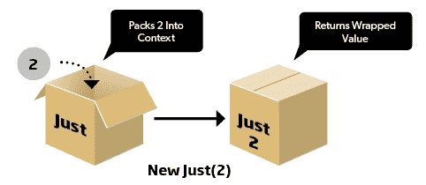
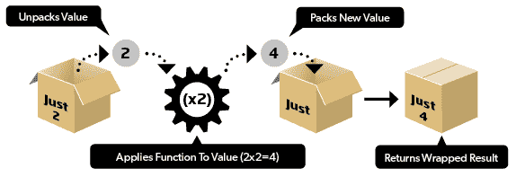
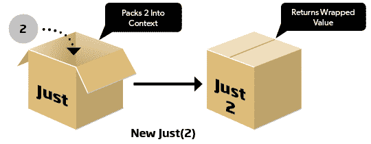
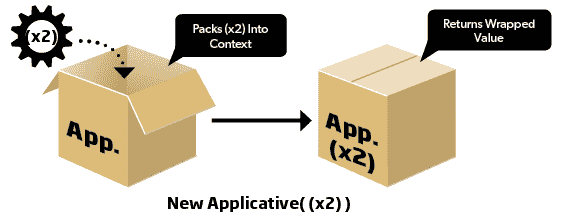
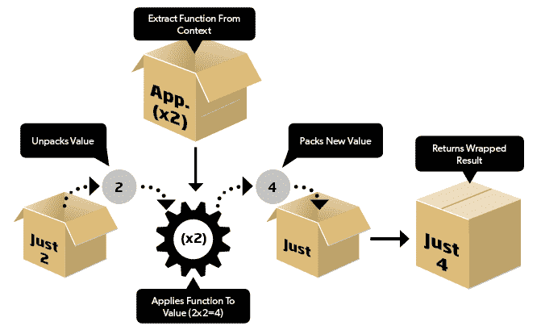
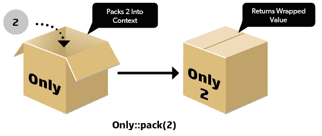
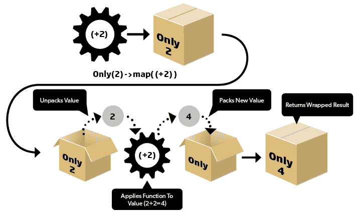

# PHP 函数式编程指南（第 2 版）


## 献词

献给 Marion、Damien 和 Ariana。

Ngiyakuthanda! Ngiyabonga ntombenhle!

## 关于作者

Simon Holywell 是澳大利亚布里斯班 Aurion 公司的高级软件工程师（`http://aurion.com`），热衷于 Web 应用程序开发和摩托车。他的第一个公开项目是用 `PHP 3` 编写的，从那以后，他使用过每个版本的 `PHP`，并涉猎了 `Python`、`Scala`、`C`、`JavaScript` 等。他还是 `SQLStyle.guide` 和 `PHP` 的 `PECL`、`Facebook` 的 `HipHop Virtual Machine (HHVM)` 以及 `MySQL` 的 `ssdeep` 扩展的作者。

Blog: `https://www.simonholywell.com`

Twitter: `@Treffynnon`—`http://twitter.com/Treffynnon`

## 致谢

> “近年来，函数式编程变得越来越流行，因为它促进了安全、简洁且优雅的代码。”

>

> —Martin Odersky（计算机科学家和 Scala 编程语言，`@odersky`）

许多非常支持的人参与了本书的制作，我要感谢他们敏锐的见解和指导。他们帮助我将本书从一个想法发展成一本完整的书。

特别是，我要感谢 Beth Tucker Long，她从最早期阶段起就在推动本书面世方面发挥了关键作用。

我也感谢那些帮助我构思想法并审阅早期草稿的人——特别是 Craig Bendell 和 Jamie Matthews。

感谢技术审稿人 Oscar Merida 和 Koen van Urk、排版和图表处理人员 Kevin Bruce、Eli White 和 Lori Ann Pannier 的贡献。

### 0.1 封面设计

我构思了本书封面的概念，Kevin Bruce 将其诠释为你所看到的简洁设计。不过，这究竟意味着什么呢？

有一段时间以来，`PHP` 一直与大象徽章相关联。这个徽章最初由 Vincent Pontier（一位来自法国的设计师）设计，许多人用它来表示 `PHP` 编程语言。一些更著名的用途包括毛绒玩具和长期运营的 `PHP Classes` 网站的标志。

1998 年底，一位朋友向 Vincent 介绍 `PHP` 的可能性时，他在一张纸上涂鸦了字母 `PHP`。将纸张侧放后，他注意到这些字母大致形成了大象的风格化轮廓。眯起眼睛，你可能也能看到它。

他后来制作了一个黏土模型作为毛绒玩具的基础，并给它们取名为 elephpant（注意中间多了一个 `P`）。有关 elephpant 制作的更多信息，你应该查看 Khayrattee Wasseem 在他的网站 `7php.com` 上与 Vincent 进行的采访。

为了展示本书的函数式基础，大象被放在括号内。开括号和闭括号是函数的简写。

因此，实际上封面图像是一只函数式大象。

如果毛绒玩具引起了你的兴趣，你可以直接从原设计师处购买它们。


值得注意的是，这并非 PHP 官方认可的徽标，事实上 PostgreSQL 也使用大象作为其徽标，尽管设计角度不同。关于采用 elephpant 的讨论有很多，据网络传闻，Rasmus Lerdorf 过去也喜欢这个想法。它甚至曾出现在 php.net 的徽标下载页面上。

* * *

1. [PHP Classes](http://www.phpclasses.org)↩

2. [7php.com](http://7php.com/elephpant/)↩

3. [领养你的 elephpant](http://elephant-php.com)↩

## 1 简介

> “我对陷入如此惊人的泥沼与麻烦\[…\]深感沮丧”

> ——Ada Lovelace（数学家，1815–1852）与 Charles Babbage（创造了第一台可编程计算机概念，1791–1871）讨论可变性时所说

在过去大约二十年的时间里，函数式编程一直呈现出缓慢而稳定的增长。这导致许多语言采用了函数式特性，包括备受诟病的 PHP。随着计算机硬件和语言支持的改进，开始学习函数式编程的基础知识至关重要。虽然以这种风格编程确实需要改变思维方式，但你会发现，对它的某些理解也会对你的面向对象代码产生积极影响。

让我们开始探索 PHP 语言的函数式特性之旅。

## 1.1 前提条件

你必须能够访问 PHP 5.4 或更高版本，并且对目标机器拥有命令行访问权限将非常有帮助。撰写时，我使用的是基于 Debian 的机器，推荐使用类似的 POSIX 计算机，但并非强制要求。

学习过程中，你能做的最好的事情之一是在机器上安装一个不错的 REPL，因为它会让你在跟随示例操作时更容易进行代码实验。REPL 代表读取-求值-打印循环，基本上是一种最常用于命令行的编程环境。它允许你轻松尝试算法，而无需编辑器甚至无需文件来存放代码。在其中输入代码，按下回车，你的代码就会被执行，结果会打印在屏幕上。

外面有很多不错的 REPL，我曾成功使用过 `PsySH`。

如果你不想在机器上安装 REPL，可以使用在线服务 `3V4L`。

随着我们深入探讨 PHP 中的函数式编程，我会推荐有用的 PHP 库和扩展。这些库和扩展要么通过 `Composer` 安装。

不用说，本书并非面向初级 PHP 开发者，并假设你具备一些面向对象编程经验。话虽如此，当然，这本入门指南尽可能温和，代表了 PHP 函数式编程的初学者指南。

## 1.2 要求

### PHP

* `PHP 5.4+`（某些库可能需要更高版本）

### 其他软件：

* 依赖管理：`Composer`

* 扩展/库：`functional-php`

* 库：`React/Partial`

* 库：`nicmart/Functionals`

### 1.3 旧版 PHP 用户

当然可以使用 PHP 5.3.2 或更高版本编写函数式代码并阅读本书的大部分内容——本书第一版实际上就是使用与 5.3.2 兼容的 PHP 编写的。不过，你可能需要对代码做一些调整，以确保你不会访问所安装 PHP 版本中不存在的功能。

短数组语法几乎无疑是你会遇到的第一个语法差异，幸运的是，它在旧版 PHP 上的适应非常简单。短数组语法如下示例所示：

```

```

在低于 5.4 版本的 PHP 中实现时，它将简单地转换为以下代码：

```

```

### 1.4 安装

本书的某些章节要求你在继续使用提供的示例之前安装额外的软件。这相对容易，但这里还是有必要进行一些介绍。在这些额外的实用工具中，有些是运行时环境，另一些是库和扩展。

库是使用 PHP 用户空间代码编写的，运行速度往往较慢，但 PHP 开发者更容易参与贡献和维护。它们通常是可以使用原生 PHP 代码调用和 require 语句实现的代码包。我们将使用 `Composer` 来大大简化安装这些代码包所需的步骤。

在性能和安装难度方面，下一步是 PHP 扩展。通常，这些扩展来自 PECL 扩展仓库，尽管任何人也可以在 PECL 结构之外自行发布扩展。从 PECL 网站选择的扩展通常更有可能在被批准列出之前，经过 PHP 核心开发者的代码审查。

最后，我们还有与 PHP 相关的其他运行时环境；在本书中，我们将坚持使用 Facebook 实现的 HipHop Virtual Machine，简称 `HHVM`。这个运行时环境不仅通过即时编译带来了比原生 PHP 更好的性能，还通过 Hack 语言扩展了 PHP，以提供一系列有用的功能。

如所讨论，这些额外的软件大部分相对容易安装，因此对于这组说明，我将假设你正在使用，或可以访问基于 Debian 的 Linux 安装。一个带有最新版 Ubuntu 的 Vagrant 盒子也可以轻松满足此要求。

### PHP 库

使用 `Composer` 取代了日渐老化的 `PEAR` 仓库，安装 PHP 库从未如此简单。这带来了诸如可以列出包并随时发布等好处。相反，也有缺点，例如糟糕的包会与好的包一起被列出。此外，`PEAR` 有一个包需要遵循的代码风格指南；而使用 `Composer` 则允许任何风格。话虽如此，许多库已自愿采用了 `PSR-1`。

你通常可以简单下载包的 tarball 并将其解压到目录中，然后手动使用 `require` 语句引入文件。不过，这种做法不被鼓励，应优先使用 `Composer` 提供的自动化功能。

`Composer` 是一个 PHP phar 存档，你可以通过互联网使用两条命令轻松安装。

```

```

现在你可以通过命令行在机器上的任何地方访问 `Composer`，只需输入 `composer` 即可。

要创建一个新的 `Composer` 支持的项目，你可以调用 `composer init`，它将运行一个向导来配置你的第一个 `composer.json` 文件。完成后，你可以通过直接编辑 `composer.json` 文件或使用命令行界面，轻松为你的应用程序指定依赖项。

```

```

这里 `vendor` 是供应商命名空间，例如 `symfony`、`treffynnon` 或 `j4mie`，而 `package` 是包命名空间，例如 `silex`、`paris` 或 `idiorm`。冒号后，你可以指定希望使用的库版本，或你的项目实现的版本。

或者，如果你不知道感兴趣的包的名称，可以通过不带任何参数调用 `composer require` 以交互方式搜索它。

一旦你的 `Composer` 文件中指定了所有要求，你可以将其提交到版本控制中，然后在任何希望运行项目的地方，只需调用 `composer install`，`composer` 就会自动安装你指定的所有依赖项。

除了这些依赖管理功能外，`Composer` 还使从其中自动加载项目变得容易。你只需要在项目的核心/引导文件顶部包含一个 require 语句即可。

```


现在，每当调用你的项目时，都会自动加载正确的自动加载器，以满足应用程序的依赖项要求。为了加速慢速的 SPL 自动加载器，Composer 还附带了一个自动加载器缓存，建议在生产环境中使用。

从所需目录开始，当你想要创建自动加载缓存文件时，只需运行以下命令，Composer 就会自动为你生成它。

```
```

Composer 还有更多可用功能，可以帮助你管理依赖项，但这简短的介绍应该足以完成本书中的任务，并为你自己的研究提供一个起点。Composer 是为你正在开发的任何应用程序指定依赖项的推荐方式，因为它使安装和实现变得快速而简单。

### PECL 扩展

PHP 扩展通常由一个或多个 C 文件组成，在扩展被启用和使用之前需要先编译。它们可能来自 PECL 仓库，在这种情况下 `pecl` 命令非常有用，或者你可以独立下载它们作为 tarball 包。

安装稳定版 PECL 扩展的标准方法是调用：

```
```

如果包处于 alpha 或 beta 状态，你可以通过在安装命令后附加发布状态来轻松安装，如下所示：

```
```

或

```
```

另一个选项是将你的 `pecl` 命令行管理器设置为始终安装可用的 beta 或 alpha 包：

```
```

或

```
```

你也可以通过在包名后包含版本号来轻松安装特定版本的 PECL 扩展：

```
```

除了扩展的 alpha 和 beta 版本外，还可能有 devel 和 stable 版本。

PECL 还可以从存档包安装扩展，这些包可以从 PECL 网站下载：

```
```

从提取的 tarball 目录手动构建和安装 PECL 扩展也相对容易：

```
```

因此，一旦使用上述任何方法构建了扩展，你还需要通过添加以下内容在 `php.ini` 文件中启用它：

```
```

这里需要注意的是，如果你将此扩展与网站一起使用，而不是在 PHP CLI 上使用，那么你需要重新启动 Web 服务器，以便新的 PHP 配置生效。

PHP 扩展提供了一种通过 C 接口访问语言核心来为 PHP 创建快速运行功能的方式。C 代码运行速度远快于其 PHP 对应物，因此这是加速某些应用程序的一种手段。

### HHVM

在 Linux 机器上安装 HipHop Virtual Machine (HHVM) 有两种方式：手动编译（耗时）和安装现成的二进制文件。由于我们不会使用任何 HHVM 扩展，我们可以放心地使用预构建的包。为了使事情更加容易，我们将在 HHVM 上实现的代码可用于 Facebook 为 Ubuntu 14.04 提供的版本。

这使得安装 HHVM 替代运行时变得简单，只需几次调用 Ubuntu 的 `apt-get` 包管理系统即可。

```
```

你现在应该能够直接在命令行上调用 `hhvm`，就像使用 PHP 的 CLI 一样。不过需要注意的是，HHVM 用于加速 PHP 和 Hack 代码运行的即时编译器（JIT）默认情况下在命令行上不处于活动状态。这是有道理的，因为启用 JIT 时字节码编译存在启动成本，只有在长时间运行的脚本上才值得承担这一成本。

也就是说，如果你确实想要在命令行上强制启用 HHVM JIT，你可以通过向 HHVM 命令行客户端传递参数来实现。

```
```

HHVM 是一种比 PHP 扩展更简化的加速代码的手段，并且它还通过 Hack 语言对 PHP 的补充带来了一大堆好处。本书对 HHVM 的主要兴趣在于 Hack 为基础 PHP 语言添加的数据结构和语法糖。

Hack 也可以安装在其他 Linux 发行版和 MacOS 上，但在 HHVM 开发期间 Ubuntu 是首选平台。Haiku OS 的用户

* * *

1.  [PsySH](http://psysh.org)↩

2.  [Boris](https://github.com/d11wtq/boris)↩

3.  [PHPsh](http://phpsh.org)↩

4.  [3V4L](http://www.3v4l.org)↩

5.  [Composer Documentaion](http://getcomposer.org/doc/)↩

6.  [PECL](http://pecl.php.net)↩

7.  [PSR-1: Basic Coding Standard](http://www.php-fig.org/psr/psr-1/)↩

8.  [PSR-2: Coding Style Guide](http://www.php-fig.org/psr/psr-2/)↩

9.  Haiku OS 是如今早已被遗忘、但曾广受喜爱的 BeOS 的开源重生版，因其并发性（对函数式程序员感兴趣的特性）而备受推崇，这使其拥有超灵敏的用户界面↩

## 2 什么是函数式编程？

> “编程，其中你的整个程序是一个单一的引用透明表达式，由其他引用透明表达式组成。无副作用。无可变性。无全局可变状态。”

> 

> —Rúnar Bjarnason（函数式程序员，@runarorama）

很难对函数式编程做出绝对的定义，因为所有函数式语言各不相同，并且没有普遍认可的规范。再加上程序员之间对什么是函数式语言存在不同意见，这就形成了一个难题。更令人困惑的是，许多语言中都定义了函数式元素或原语。

虽然有风险，我还是尝试对一个核心原则做一个非常简化的解释。以函数式方式编程，本质上就是不进行任何值的赋值的编程。我说了！当然，还有更多内容，但对于像我们这样来自命令式编程背景（如 PHP）的人来说，这是最简单——也是最令人震惊——的陈述。

这是对函数式方法中从程序中移除状态并强调纯度的一个非常简化的暗示。当然，这也是对你当前编程实践的一种挑衅性挑战。随着你对函数式编程理解的加深，你将开始理解更全面的描述，即什么构成了函数式代码片段。

首先，定义命令式编程的含义很重要，以便有一个良好的基础来构建。命令式编程通常被认为是函数式编程的截然对立面，这使我们能够将其从函数式编程实际是什么的描述中排除。这是一种程序员一步一步地告诉计算机应该做什么来完成计算或程序的风格。

你可能会认为这仅适用于过程式 PHP（不使用 PHP 面向对象结构和函数的代码），但你错了。Haskell 闻名的 Simon Peyton Jones 将命令式编程描述为

> “……一系列步骤。每一行都说做这个，然后做这个，再做这个。当你调用一个方法时，通常没有结果 \[返回\]……因为调用它的唯一原因是对世界产生影响。改变某物的状态。”

他指出命令式编程的一个非常值得注意的属性——状态存在隐藏的变化。这意味着，如果你在命令式程序中调用一个方法，你无法确定它是否仅根据你的参数计算结果，或者是否还会调整程序的状态。由于函数式编程追求纯度，这些状态变化必须被消除。

许多人根据状态不变的这一属性来描述函数式编程。其中一人是 Erik Meijer，他热爱 Haskell，并参与过 C# 编程语言等工作。他将函数式编程描述为


> “…about programming using mathematical functions. Whenever you supply it with the same argument it returns the same result. Every time I execute it, it will give me the same result.”

这段关于函数式编程的描述，在你对函数有更多了解后会更容易理解，因为它暗示了引用透明性，这一概念将在本书讨论基础概念后进一步阐述。

那么，你究竟如何以函数式风格完成任务呢？难道没有赋值语句就什么都做不了吗？你如何在程序中传递值？

答案非常简单；值可以作为参数和返回值在函数之间传递。进一步延伸这个想法，我们可以拥有返回函数或将函数作为参数的函数。你越是思考，它就越强大。

这些函数组合简洁而清晰地表达了程序的意图。不可变结构有助于确保副作用无法渗入函数式程序。这里我指的是避免变量赋值，这是命令式语言的基本基础。

谦卑的函数比大多数面向对象的 PHP 程序员所承认的要有用和强大得多。

## 2.1 Let’s See Some Code

为了消除你脸上难以置信的表情；这里有一个简单的命令式示例，用于求一到十的所有整数之和：

```
```

与使用 PHP 的 `range()` 和 `array_sum()` 函数生成 1 到 10 的数组并求和的更函数式风格相比：

```
```

这里我们触及了函数式编程的一个关键概念和优势。我们没有详细说明求和所需的步骤，而是仅仅描述了给定一组值时我们想要的结果。

我们还设法避免了使用状态跟踪变量（命令式示例中的 `$sum`），并自动将工作单元划分为可重用的函数。如果我们在其他地方需要 `range()`，可以轻松重用相同的代码。

相反，在命令式示例中，我们需要完成所有繁重的工作，例如使用变量赋值进行循环和维护状态。这或许可以被视为类似于写食谱，其中常量是你的食材清单，循环相当于逐步说明。

延续这个基于食物的类比，我们可以说函数式示例更像是在餐厅点餐，你只需从菜单中选择。当然，就像一家好的披萨店，你也可以随时自己添加更多配料！

正如你可能看到的，函数式编程和设计良好的面向对象代码可以非常相似，因为它们都旨在封装并将工作单元分解为更小的可重用块。

## 2.2 History

函数式编程以及计算机领域的历史，完全取决于数学和逻辑领域完成的工作。可以将这些领域的知识积累追溯到一些最早的记录哲学家和数学家。

提到苏格拉底和亚里士多德并不为过，考虑到他们对逻辑理解的贡献。也就是说，计算机的根源远远延伸至公元前 400 年之前。大约在公元前 200 年中期，阿基米德撰写了微积分的最早开端之一，这些内容后来在被称为《阿基米德抄写本》的手抄本中被发现。它在 13 世纪被宗教文本覆盖，因此对人类来说失传了。幸运的是，大部分内容已通过各种成像设备（包括 X 射线）恢复，但为时已晚，无法为我们将要遇到的微积分先驱们提供参考。

然而，从函数式角度来看，事情在 1666 年和 1675 年开始变得有趣，当时艾萨克·牛顿和戈特弗里德·莱布尼茨（分别）记录了微积分的最早形式化。这一数学发现是所有函数式思维的基础，也是计算机历史的重要组成部分。

据说，两人互不知情，却同时在撰写他们的论文。纯属巧合，他们在相似的时间得出了相似的结论。实际上，更可能是之前的思想家已经奠定了理论基础，条件已经成熟，让某人能够迈出下一个逻辑步伐。

尽管如此，这段历史仍存在一些争议，因为牛顿一直在研究微积分，但直到 1693 年才发表任何内容。另一方面，莱布尼茨于 1684 年发表，并且很可能知道牛顿较早的工作，因为他们都是伦敦皇家学会的成员。

当被要求正式确定谁发明了微积分时，皇家学会表示，虽然莱布尼茨是第一个发表的人，但牛顿创造了它。令人不安的是，牛顿当时是伦敦皇家学会的主席，因此对最终决定有影响力。后来，学会指控莱布尼茨剽窃，进一步玷污了他的名声，并最终将他贬低到历史的尘埃中。

尽管如此，他对数学和微积分的影响是显而易见的。莱布尼茨的微积分记号至今仍在使用，他后来还制造了一台计算机。这台机器基于来自古代中国的二进制理念。这被证明是我们所知的现代计算机的基础。

> **乔治·布尔的故事**

> 

> 乔治·布尔是一位英国数学家和逻辑学家，布尔逻辑以他的名字命名。他出生于工人阶级家庭，并非他那个时代典型的神童。他通过在参考图书馆长时间学习，自学了数学和逻辑。后来，他成为爱尔兰科克女王学院的第一位数学教授。在那里，他遇到了他的妻子玛丽·埃弗雷斯特（乔治·埃弗雷斯特的侄女，珠穆朗玛峰以他命名）。有趣的是，虽然这座山发音为 Ever-est，但他们的家族姓氏实际上发音为 Eve-rest。

> 

> 正是在这所同一机构，布尔感冒了，最终导致了他的死亡。当他走去讲课时，被一场大雨淋湿。穿着湿衣服讲完课后，他生病了，由他的妻子照顾。不幸的是，她信奉一种当时普遍的理论，即“病因即治疗”。为此，当他卧病在床时，她往他身上泼冷水。该理论认为，如果冷水导致了疾病，那么更多的冷水就会治愈它。他的病情恶化，并于 1864 年 12 月 8 日去世。一位开创性逻辑学家遭遇如此不合逻辑的结局！

> 

> 虽然他不是函数式编程历史的直接贡献者，但他确实影响了逻辑的进步，并广泛研究了布尔代数。他自学了微积分，但这并非他主要的研究领域。

> 

> 他创立的布尔代数用于阐述逻辑论证并确定答案或结果。其理念是创造一种适用于任何逻辑陈述的语言，以确定该陈述的有效性。这支持了逻辑和数学的进一步发现。

在此期间，微积分领域没有发现重大突破。逻辑学家们仍在努力工作，制定系统和证明来描述世界。

戈特洛布·弗雷格通过定义第一阶谓词演算进一步发展了微积分。他研究的一些发展至今仍在使用。然而，他的主要关注点是证明数学可以完全由逻辑描述。不幸的是，这被证明是错误的。


### Frege’s Basic Law V 和 Russell’s 悖论

Frege’s Basic Law V 描述了一种集合逻辑，使得定义成员关系变得容易。不幸的是，对于 Frege 来说，它也允许 Bertrand Russell 发现一个不一致性。著名的 Russell’s 悖论，它阐述了一个自指集合：“那些 x 使得 x 不是 x 的成员的事物的集合。”这个绕口令会产生一个集合，它既不是自身的成员，又是自身的成员。这一发现让 Frege 愣住了，并让他为这个问题苦苦挣扎，使用薄弱的论点和权宜之计。

### 维也纳学派和逻辑实证主义

尽管如此，逻辑学家们继续致力于构建一个能够描述整个世界的系统。在哲学界，这导致了极具影响力的维也纳学派的形成。聚集的成员们讨论将陈述句划分为近乎两个类别。一方面，他们包括那些无法观察到的陈述句，另一方面则是那些可以观察到的陈述句。任何形而上学的东西都是无意义的，被视为逻辑错误而被拒绝，或归结为可以通过科学调查证明的经验陈述句。形而上学陈述句的一个例子是“所有艺术都是无意义的”——它既不能被证明为真，也不能被证明为假。

在此期间，他们雇佣了一名学生来监督讨论，通过中断导致形而上学话语的对话来进行监督。起初，他们会大喊“Metaphysik”，但正如 Rudolph Carnap 后来转述的那样，他们很快将其缩短为仅仅“M”。随着讨论的进一步进行，“他喊了那么多次‘M’，我们都听烦了，所以当我们说一些合理的话时，就改为‘no-M’。”换句话说，大多数讨论都会导致形而上学的讨论。这使 Carnap 意识到可能存在许多逻辑，而不仅仅是一种普适逻辑。

### Hilbert’s Program

大约在同一时期，一位名叫 David Hilbert 的杰出德国数学家在数学界也设定了类似的目标。在 20 世纪 20 年代末，他热衷于通过证明一切都可以用数理逻辑来描述来解决 Entscheidungs Problem。Hilbert 确信一切都可以归结为真或假。

### Gödel’s 不完备性定理

有些出名的是，在 1930 年，维也纳学派的一名学生 Kurt Gödel 提出了他的完备性定理，这有助于加强 Hilbert 的假设。然而，这并没有持续多久，因为第二天 Gödel 也讨论了他的第一个不完备性定理，这动摇了 Hilbert 主张的根基。现在普遍认为 Hilbert 的同僚是错误的，并且存在一些逻辑无法解决或描述的问题。

那么，Gödel 是如何搅乱局面的呢？`This statement is not provable.` 简单！

如果该陈述句可以被证明，那么它就是假的，但它声称自己不能被证明，所以它必须是真的。这个陈述句无法被判定，因为它同时既是真又是假。你可能以前听过一个类似的陈述句，叫做说谎者悖论。这比 Gödel 早至少 2000 年，有些来源表明其根源可以追溯到公元前 600 年至公元前 400 年。“一个人说他在撒谎。他说的是真是假？”随着时间的推移，这被简化为“这句话是假的”，与 Gödel 不完备性定理的基础非常相似。不过，这是一个外行的简化，因为 Gödel 证明了这是所有逻辑中的一个悖论。

他使用自己设计的逻辑表达式系统，通过两个定理证明了这一点。这在现代人看来可能是最容易理解的悖论，但当时 Gödel 正处于逻辑学的前沿。为了进一步证明 Entscheidungs Problem 的不可判定性，有必要定义有效计算。这导致了一些系统被同时构思出来。

### Lambda 演算和函数式编程

在 1932 年，第一个系统由 Alonzo Church 以 Lambda 演算的形式提出。他看到了他新定义的潜力，并写道：

> “There may, indeed be other applications of the system than its use as a logic.”

鉴于 Lambda 演算后来成为函数式编程的基础，可以说他肯定是对的。使用 Lambda 演算作为基础，Church 能够提出一个没有有效可计算答案的问题。同样，简单性令人惊叹；给定一个 Lambda 表达式，确定它是否会无限循环。这是做不到的！

Gödel 在大约同一时间正在研究他自己的递归函数逻辑系统。虽然它可能看起来不像 Gödel 的形式化，但递归是函数式编程的核心组成部分。

与此同时，Alan Turing 接触到了 Gödel 的不可判定性问题，并且——正如 Gödel 一样——他得出结论：要研究 Entscheidungs Problem，就必须定义一个有效可计算性的系统。他设计了图灵机，它可以计算所有自然上被认为可计算的数字。我的意思是，人类可以用铅笔和纸计算的数字。

这使得 Turing 和 Alonzo Church 能够表明 Lambda 表达式和图灵机在功能上是等价的。与 Church 合作，Turing 后来创建了第一个计算 Lambda 表达式的程序。他们于 1937 年共同撰写了一篇论文，称为 Church-Turing Thesis，表明两种技术是等价的且同样合理。Turing 甚至进一步说：“Church’s calculus…allows \[Turing\] ‘Machines’ which generate computable functions to be replaced by the more convenient λ-definitions.” 基于此，我们可以说 Turing 偏爱函数式编程！你可能会说这是一个武断的推断，但他确实对那些形式化产生了好感。

### 类型 Lambda 演算和组合子逻辑

在 20 世纪 40 年代，Alonzo Church 正在撰写一篇关于类型 Lambda 演算及其形式证明的论文。独立地，Turing 也在研究一个类似的证明，但未发表，尽管这很好地表明他看到了这些技术的潜力。

值得注意的是，世界收到了不少于四种描述有效计算的技术：Alonzo Church 的 Lambda 演算、Alan Turing 的图灵机、Kurt Gödel 的递归函数，以及迄今未讨论过的 Haskell Curry 的组合子逻辑。这并非巧合，而仅仅是条件成熟，使得这样一组形式化得以产生。

准备性的基础工作已经完成，逻辑世界已准备好迎接新的想法和发现。这解释了为什么这些发现在时间上如此接近，即使他们不知道其他人也在研究相同的想法。

回到 Haskell 的组合子逻辑及其函数组合形式化。原始函数被组合以创建更强大的结构；这是一个你将在函数式编程中看到的原则。发表于 1927 年，它比 Turing 等人的其他形式化早了若干年。

### Moses Schönfinkel 和柯里化

关于谁是第一个提出证明的人存在一些争论，可能是一位名叫 Moses Schönfinkel 的俄罗斯人。这也影响了函数式编程技术柯里化的名称，有些人建议应该称为 Schönfinkelization 以承认他更早的发现。不幸的是，Schönfinkel 的故事是一个悲伤的故事。除了这篇论文之外，关于他的工作知之甚少。他是 Hilbert 小组的成员，并在他们的帮助下于 1924 年发表了这篇论文。几年后，他从 Göttingen 回到俄罗斯，1927 年有报道称他患有精神疾病并被关进疗养院。具体时间不详，但在 1942 年的某个时候，他作为一个穷人去世了。

他所有的论文都被邻居烧掉取暖了，所以永远不会知道他正在研究什么。


二战期间，艾伦·图灵（Alan Turing）曾驻扎在布莱切利公园（Bletchley Park），与英国最优秀的一批人才一起破解恩尼格玛密码机（Enigma code），这一历史广为人知。恩尼格玛密码的首次突破发生在 1940 年，当时使用的是所谓的“绿色密钥”（Green Key），后来德国空军（Luftwaffe）的“红色密钥”（Red key）也被破解。近期电影《模仿游戏》（The Imitation Game）由本尼迪克特·康伯巴奇（Benedict Cumberbatch）饰演图灵，详细讲述了这段历史。

纳粹很快开始使用一种名为“格海姆施雷伯”（Geheimschreiber，意为“秘密书写机”）的新设备进行更高级的加密。图灵致力于破解“图尼”（Tunny，即英国对该秘密书写机的代号），并于 1942 年发明了一种名为“图灵里”（Turingery）的技术。大规模实施图灵里的经验，启发了汤米·弗劳尔斯（Tommy Flowers）和马克斯·纽曼（Max Newman）团队设计出第一台可编程电子计算机。

这台计算机被称为“巨像”（Colossus computer），与你现在阅读本书所用的设备截然不同。它使用热离子阀（thermionic valves，如今除昂贵的 Hi-Fi 设备和专业吉他放大器外已很少使用）来执行布尔运算，而今天这些运算通常由晶体管完成。这些阀门控制着一系列继电器和步进电机，使其成为一台非常活跃且具有物理存在感的机器——你肯定能听到它运转的声音！

现代机器完全不同，当今的计算由分立的固态电子元件驱动。在许多现代机器中，唯一的活动部件是冷却风扇，以及你可能通过 USB 插入的某些外围设备。固态硬盘取代了硬盘驱动器，光驱也将可移动数据的任务让给了内存棒或云存储，使得现代机器几乎完全无声。

一台可运行的巨像复原机可以在英国布莱切利公园的国家计算机博物馆（The National Museum of Computing）看到。原机及其蓝图均已被销毁，相关信息在 20 世纪 70 年代之前一直保密。

因此，尽管图灵的工作无疑提供了帮助，但说他直接参与该项目仍有牵强之处。他当时正在研发一套安全电话系统，用于对语音进行加密，代号为“迪莉拉”（Delilah）。遗憾的是，该系统缺乏远距离通信能力，且未在二战期间完成。这使图灵重返计算机领域，他撰写了第一篇关于存储程序计算机的深入论文，险些抢在约翰·冯·诺依曼（John Von Neumann）的草案之前发表——后者的草案当时正在向出版方流转。回顾起来，冯·诺依曼草案中的许多想法实际上被认为是图灵的。

此外，图灵还曾致力于人工智能问题。在他看来，问题不在于机器是否可能智能，而在于何时会实现。为了确定这一里程碑何时到来，图灵设计了一项简单的测试（对人类来说简单，但对机器未必），即如今著名的“图灵测试”（The Turing Test）。如果机器能以与人类无法区分的方式与人类受众交流，则可被视为智能。虽然这听起来很简单，但值得注意的是，言语和复杂的交流在地球上是人类独有的。即使是学会了手语的灵长类动物，也从未向饲养员提出过一个问题，这或许源于认知的局限，或者仅仅是因为语言极难掌握。

近期有声称某计算机程序已通过图灵测试。这很像汽车制造商的油耗宣称，实际使用效果并不总是与实验室结果一致。该测试是在一套旨在“作弊”的条件下完成的。

不幸的是，图灵的卓越才智及其对战争的贡献，未能保护他免受迫害。在 20 世纪 50 年代的英国，同性恋行为是非法的。图灵向警方提及其家中入室盗窃案可能与其男友的一位同伙有关后，很快被捕。案件开庭时，他被判有罪，面临监禁或接受化学阉割的有条件减刑。图灵选择了医疗干预，而他的男友则获得了七个月缓刑，或许是因为他比图灵年轻。

尽管其家人对此有争议，但普遍认为图灵于 1954 年通过在每日食用的苹果中下毒氰化物而自杀。有人指出，他设置的一个金电镀实验可能产生了致命剂量的氰化物。另一种解释是，他这样做是为了保护母亲，并让她有合理的否认其子自杀的可能性。图灵在计算机界的遗产广为人知，随着电影《模仿游戏》的上映，其事迹最近也被推广给了更广泛的受众。在此之前，2009 年曾开展大规模运动，要求英国政府就对图灵的待遇道歉。2013 年，他获得了死后赦免。

功能性计算的下一次重大进步发生在 1958 年，当时约翰·麦卡锡（John McCarthy）基于阿隆佐·丘奇（Alonzo Church）的 λ 演算（lambda calculus）开发了 LISP 编程语言。该语言名称源于“列表处理”（list processing）一词的谐音，这很合理，因为该语言高度依赖列表。

有趣的是，LISP 随后成为人工智能社区的事实上的标准。麦卡锡利用阿隆佐·丘奇的思想研究人工智能，而图灵在去世前想必也曾思考过这些理念。

许多编程语言以及计算机科学领域，都有很多值得感谢 LISP 的地方。它以动态类型、数据树结构、条件语句、递归和高阶函数的形式带来了新思想。其他语言可能包含大致相似的功能，但从未以如此统一的方式实现。

LISP 因其 S 表达式（S-expressions）而一眼可辨，这些表达式看起来像列表。它们写成列表形式，函数名排在第一位，参数用空格分隔依次排列。多年来，涌现了许多 LISP 变体，其中今日最著名的有 Common Lisp、Scheme 和 Clojure。

如果你有兴趣尝试编写自己的编程语言，一个起点是开发一个属于自己的 LISP。网上有许多资源可用于使用 C、Python 和 C++ 创建 LISP 解释器。在 PHP 世界中，相关工作有限，项目包括 Mathias Verraes 的 Lambdalicious、Igor Wiedler 的 Lisphp，以及 Tamreen Kahn 用 PHP 编写的 Pharen 交叉编译器。

随着时间的推移，函数式编程领域鲜有进展。现有语言大多仍局限于学术界，用户群相对较小。如前所述，人工智能社区确实使用 LISP 以函数式风格进行工作。

除此之外，你需要快进到电信行业开始寻找容错系统的时期。毕竟，他们不能让客户的电话、寻呼机和消息中断或未送达。爱立信电话公司（Ericsson telephone company）牵头推动了电信领域函数式编程的早期发展。在他们的实验室中，他们研发了一种旨在缓解该行业所面临问题的语言，其中正常运行时间和可靠性最为重要。

基于这些在 20 世纪 80 年代中期的研究，Erlang 编程语言诞生了。它基于 Prolog，最初是用该语言本身实现的，后来为爱立信的所有基础设施提供动力。然而，随着 Erlang 成为专有语言，爱立信在 20 世纪 90 年代末决定停止使用自己的语言！1998 年，其语言团队的关键成员离职后（无疑是出于抗议），爱立信将 Erlang 开源，使其得以在内部再次使用。


> 值得注意的是，Erlang 并非 Ericsson Language 的缩写，而是以一位名叫 Erlang 的计算机科学家命名的。尽管如此，它确实相当出色地服务于双重目的。

自诞生以来，Erlang 已被众多行业领域的知名公司所采用。Erlang 最著名的近期用途之一是作为 CouchDB NoSQL 服务器的基础语言。该存储系统使用 map 和 reduce 语句来提取正确的信息——这点的意义在后面会变得更加清晰。嗯，至少在函数式编程方面是这样！

在 Erlang 以实用目的设计的同时，另一种函数式语言正处于起步阶段。Haskell 由委员会设计，从一开始就是开源的，后来成为或许最著名的纯函数式语言。然而，起初它甚至无法输出任何内容——它是一个纯粹而稳固的封闭系统。

这反映了它最初作为实验和教育工具的起源。由于输入/输出（IO）本质上是有状态的，他们努力解决如何保护代码免受外部影响的问题。你希望能够以一种不引入有状态操作的方式访问数据库或磁盘上的文本文件等信息。

如果你了解电子学，这可以被简化地类比为放大电路。你需要一个电源来增强信号，但重要的是电源不能向信号引入噪声。两者仅有表面上的相似之处，所以不要深究！

Haskell 如今为开源世界乃至银行业的项目提供支持。你可能听说过的一些项目包括 Pandoc 和 xmonad。它仍然相对较小，许多公司更倾向于坚持使用熟悉的工具和方法论。

这为 2004 年 Scala 编程语言的诞生奠定了基础，Scala 同时运行在 Java 和 .NET 运行时上。它使得函数式语言可以在现有基础设施中使用。.NET 版本于 2012 年停止，语言开发转而专注于 JVM（Java 虚拟机）。虽然这些基础加速了语言的开发和采用，但也带来了代价。这两个平台都不是为托管函数式语言而设计的。这导致了一些困难和不足，但在本书的语境下，这些不值得进一步讨论。

与 Haskell 不同，Scala 语言并非纯函数式，可以在其中编写非常优雅的面向对象代码。这是它的另一个吸引力；一种熟悉的方法论被优雅地执行。由于它也运行在 JVM 上，可以直接从 Scala 代码中使用 Java 包。

有人可能会认为 Scala 比 Haskell 更时髦，Twitter、LinkedIn、Foursquare 和 The Guardian 等公司都在其核心产品中使用 Scala。不过这非常主观！Twitter 为新工程师编写了多个入门指南，这些指南可作为方便的学习资源。

随着这些语言的发展，兴趣水平有所增加。这至少部分可以归因于对并行进程的需求增加，以利用多核和节点架构。函数式代码缓解了命令式代码可能遇到的共享可变状态问题。随着架构变得越来越复杂以处理增加的负载，这使得函数式编程越来越有吸引力。

最近转向函数式代码的人很容易通过 MOOC 在线学习，有许多涉及 Haskell 和 Scala 的课程。这些课程可以作为这些语言的良好入门，特别是 Scala 有许多为语言学习者编写的优秀书籍。

函数式编程的历史与数学和逻辑学的发现不可分割地交织在一起。正是基于这些进步，编程和计算本身才得以创建。虽然函数式风格的程序仍不如其充满状态的对照物流行，但采用率似乎在稳步增加。

## 2.3 其他函数式实现

可能被视为实现函数式构造的语言范围非常广泛。就纯函数式语言而言，Haskell 可能是最著名的。中间位置是像 Scala 和 Clojure 这样的语言，它们既包含命令式风格也包含函数式风格。

然后在更远的边缘，有像我们深受喜爱却常被诟病的 PHP 这样的语言，它正在慢慢获得函数式编程的基本要素。

为了对比，这里是 Haskell 中相同的 `sum` 示例，它简单如下：

```
```

如你所见，语法使得用最少的字符清晰地表达程序变得非常容易。

## 2.4 商业用途

经常被引用的函数式方法的好处之一是用于构建领域特定语言（DSL）。大多数语言中的函数式构造成功地减少了解析语言时所需的低级工作量，因为内置类型处理和模式匹配使得可以用更少的代码行编写快速且复杂的解析器。

这的优势在于它大大减轻了维护工作，并使代码更容易理解。

一个著名的商业示例可以在巴克莱银行（Barclays Bank）的异国交易功能性支付框架（Functional Payout Framework）中找到。它使用 Haskell 编写，为数学家定义了一个 DSL 以创建交易应用程序。紧凑且灵活的函数式实现使团队能够更有效、更快速地响应用户对新功能的请求。项目开始时团队有一些担忧，其中最重要的是需要与用 C 等语言编写的其他旧系统进行接口。这不仅用 Haskell 轻松完成，而且结果是一个好处，因为它防止了组件之间的紧密耦合。

或许最著名的函数式编程商业用途是爱立信（Ericsson）开发 Erlang 语言，它专门设计用于通过高级符号语言提高生产力。由于电信对可靠性和并发性的严格要求，爱立信排除了当时的各种函数式语言，LISP 和 Prolog 是领跑者。

Erlang 此后已被许多商业用户采用，并为许多关键任务硬件提供支持。它可能是商业采用和在其目标领域持续使用方面最大的成功故事。

一个更近期的例子来自 Twitter，它正在使用 Scala 处理其社交服务的许多关键功能。虽然 Scala 不是纯函数式语言（它也支持面向对象），但它当然具备这样做的能力。你每天在 Twitter 上使用的一些功能由 Scala 提供支持，包括用户关系存储、按姓名或兴趣搜索用户，以及 Twitter 提供的“关注谁”模糊建议。Scala 中函数式编程允许的抽象也意味着它被用于许多其他领域，例如流式 API、Kestrel 排队机制和他们的地理系统。

## 2.5 函数式编程最适合做什么？

正如你将看到的，任何可以命令式完成的事情也可以使用函数式方法论完成。尽管每种方法论都有其优势，你可以将它们视为切蛋糕的另一种方式。


没有金科玉律建议在某些情况下使用函数式编程，而在其他情况下使用面向对象编程。函数式编程不是框架或设计模式，而是一种图灵完备的编程方法论。为此，当你熟悉函数式编程时，你会产生一种本能的感觉，知道何时采用某种方法论来解决问题最为合适。值得注意的是，这在每种编程语言中都会有所不同，在 Scala 中进行函数式编程与面向对象编程，与在 PHP 中进行同样的操作有很大不同。

在 PHP 世界中，由于偏向面向对象编程，函数式编程主要用于列表（数组）处理，但这并不妨碍我们探索更复杂的函数式构造，正如你将在后面看到的那样。

## 2.6 函数式编程的优势

那么，从你的命令式语言中移除功能如何能帮助你？

随着函数式编程日益流行，保持同步非常重要。你从探索函数式代码中获得的见解，也可以应用于面向对象编程。

一个经常被引用的规则指出，随着抽象层级的提高，程序的可读性会随之增加，这得益于它所鼓励的简洁代码。人们也常说，这些属性的一个副作用是生产力的提高，因为需要敲击的代码更少，且不需要在脑中构建全局状态，从而帮助你腾出时间去解决更困难的问题。

测试你的代码变得容易得多，因为所有值都是最终的，这意味着你不必与副作用作斗争。不需要维护特定顺序，也不需要设置全局状态。你所需要做的就是传入正确的参数，你将始终得到相同的结果。

这个概念通常被称为引用透明性，基本上意味着你可以用函数调用返回的值来替换任何函数调用，而生成的算法将保持不变。因此，我们可以使用静态数组而不是 `range()`，并仍然得到相同的结果：

```

```

将静态值替换到命令式示例中是不可能的（别折腾自己来证明我错了！），而这正是函数式编程真正闪光的地方。每个函数，给定相同的输入，将始终返回相同的值。

不应低估这些函数比其充满状态的对应物更容易测试的程度。浪费在模拟全局状态上的时间更少，当测试失败时，它将始终失败。这使得调试任何测试变得容易得多。复制错误不需要长长的操作链来暴露，因为函数式程序避免任何全局状态，并为其组件采用封装。如果一个函数没有返回正确的值，那么它就是不正确的。

虽然这在 PHP 中通常不是问题，但函数式程序有助于防止线程或进程之间的竞态条件。保持函数式风格使你能够自信地编程这类应用程序（好吧，几乎是！）。随着计算机硬件的进步，并行处理的重要性继续增长。

计算机通过增加中央处理单元包含的核心数量来获得越来越多的能力。如果你的软件要利用这种能力，那么你需要考虑同时处理。

这就是函数式编程放弃赋值语句真正帮助保护你免受进程锁定或尝试更新内存中相同位置的地方。它还使执行顺序变得无关紧要，因为没有状态需要更新，函数将始终返回相同的值。正是当你允许状态潜入代码时，将工作拆分为并行进程才会受挫。

函数式编程的其他好处通常不适用于 PHP——因此我们不会在这里讨论它们——包括热代码部署和代码的机器优化。

## 2.7 函数式基础

尽管 PHP 本质上是命令式的，但它可以支持基本的函数式编程风格。为了更容易学习，最好放弃语言的一些方面来模拟更纯粹的函数式风格。

*   避免更改状态——即使在函数内部。

*   尝试将函数保持在一行或尽可能短。

*   将问题分解为最小单元，并将这些转化为可重用的函数。

*   从代码中删除控制语句。

*   值得重复的是；避免状态，不要使用变量赋值！

你基本上想要创建一个小黑盒函数，当给定正确的参数时，它将始终返回相同的值。

PHP 有许多语言特性来帮助形成这种编程风格的基础。可能最有用的是 lambda 函数，它使处理将函数作为变量传递的代码更加容易。此外，像 `array_map()` 和 `array_reduce()` 这样的语言函数对于将函数应用于值列表非常有用。

PHP 中没有不可变值类型或静态类型变量，因此由你的实现来保护你的函数式代码免受状态更改。

当你开始以函数式方式工作时，你将需要访问更多原语来处理你将遇到的更复杂的操作。幸运的是，这条路之前已经有人走过，我们将在后面介绍一些库。

* * *

1.  [Simon Peyton Jones—Haskell is useless](http://youtu.be/iSmkqocn0oQ?t=1m23s)↩

2.  [Erik Meijer: Functional Programming](http://youtu.be/z0N1aZ6SnBk?t=16m44s)↩

3.  [Scala School](https://twitter.github.io/scala_school/)↩

## 3 语言特性

> “递归是函数式编程中的 GOTO。”

> 

> ——Erik Meijer（计算机科学家，@headinthebox）

尽管 PHP 在严格的编程环境中名声不佳，但它功能相当齐全。其大部分功能是在 5.3 及以上版本中引入的，但自 PHP 5 以来，它一直朝着良好的方向发展。请注意，我说的是“良好”而不是“正确”的方向！随着 5 版本的进步，语言中添加了许多新功能，这些功能也极大地简化了 PHP 开发。

诚然，其中许多功能本可以以更优化的方式实现以支持函数式编程，但它们尽管如此存在。除了各自的缺陷之外，它们实际上为 PHP 本身的函数式编程提供了可行的基础。

这是尽早意识到的更重要的事情之一；虽然基础能力存在，但你不会得到任何高级便利功能。如果你想要更多的能力和便利，你将不得不自己编写代码来促进这一点（或借用库）。有时这可能只是包装一个函数调用，而其他时候你可能会发现自己在编写一个或两个库。

这既是 PHP 的乐趣，也是目前的困难。如果你有从哪里开始的想法，那么在函数式 PHP 中提高生产力相对容易。如果没有，你很容易发现自己陷入高级库创建中。

这就是本书的目的；为你提供语言最佳部分的捷径以及第三方库，使 PHP 中的函数式编程更加愉快甚至有趣！首先，我们将简单地浏览 PHP 本身的相关基础功能。

这些范围从类型和函数定义的基础，到更复杂的操作，如 map 和 reduce。在此过程中，我们将涉及递归、闭包和 lambda 函数。


PHP 可用于纯函数式编程，这可以提高生产力并减少错误。优秀函数式代码的特性也使其易于测试。一旦你浏览完本章节的功能，你将看到该语言在这种编程风格上的基础潜力。

我将其比作一次冒险，比如 Sjaak Lucassen 骑着 Yamaha R1 几乎环游了整个世界。一辆超级摩托车被骑行在几乎无法辨认的泥泞道路上——这与它的赛道栖息地相去甚远，R1 可能从未有过这样的经历。许多人会告诉你这不切实际，甚至根本不可能。我在这里告诉你这是非常可能的，并且在很多方面，它可以是解决问题的一种非常优雅的方法——即使是在 PHP 中！

## 3.1 类型

PHP 中的类型将作为本章节概念的起点。

类型、类型化和类型系统都指的是值具有类型而不仅仅是内容的概念。这意味着如果你将一个单词作为值的内容进行赋值，它将被赋予字符串类型。如果你赋予它一个整数，那么它通常会被赋予整数类型。

像 PHP 这样的编程语言利用类型系统，其中类型是根据分配给变量的值推断的。如果你将单词 `"test"` 分配给一个变量，PHP 会自动推断类型应为字符串。然而，这只是动态类型化故事的一半。其他语言使用一种系统，在变量定义时指定其类型。还有其他语言使用两者的结合。

在 PHP 中，解析器可用的标量数据类型如下。标量类型是最基本的类型，包括数字和文本等简单事物。

*   Boolean—`true` 或 `false`

*   integer—整数（包括负数）

*   float—浮点数（小数）

*   double—`float` 的别名

*   string—文本信息

随着程序需求变得更加复杂，值必须增强能力以容纳其复合性质。

*   array—有序映射或键/值列表

*   object—类的实例

最后，PHP 还为特定语言特性定义了一些特殊类型。

*   resource—对外部资源（如文件句柄）的引用

*   `NULL`—表示没有值的变量

*   callable—从 PHP 5.4 开始，可以作为函数处理的变量

这些类型都不能直接在 PHP 变量上显式设置为类型。如前所述，如果你将变量设置为整数，PHP 会自动将变量设置为整数类型。

PHP 确实提供了强制类型转换，这可以使值的类型发生变化。例如，如果你将字符串 `"10"` 强制转换为整数，PHP 解析器会将值的类型转换为整数（10），如下所示：

```

```

这在尝试触发类的 `__toString()` 方法时尤其有用。

```

```

可用的强制类型转换包括转换为 `string`、`integer`、`double`、`float`、`array`、`object` 和 `boolean`。要确定所需的强制类型转换运算符，可以使用以下列表。

| 类型 || 强制类型转换运算符 |

| --- | --- |

| boolean || `(bool)` |

| --- | --- |

| integer || `(int)` |

| float || `(float)`、`(double)` 和 `(real)` |

| array || `(array)` |

| object || `(object)` |

| string || `(string)` |

| NULL || `(unset)` |

此外，PHP 还有一些函数可用于以特定类型获取变量的值。

| 类型 || `val*` 函数 |

| --- | --- |

| boolean || `boolval()` |

| --- | --- |

| integer || `intval()` |

| float || `floatval()` |

| double || `doubleval()`（`floatval` 的别名） |

在代码块中实现时，可以按以下方式使用：

```

```

你也可以使用 `settype()` 函数，并将预期的输出类型作为第二个参数以字符串形式传递。

```

```

这可以接受 `'bool'`、`'int'`、`'float'`、`'string'`、`'array'`、`'object'` 或 `'null'` 之一。

`gettype()` 配套函数允许你简单地获取所提供变量的类型。

```

```

通常，你会使用 `is_*` 函数集来测试变量的类型。同样，PHP 定义的每种类型都有一个函数。

| 类型 || `is_*` 函数 |

| --- | --- |

| array || `is_array()` |

| --- | --- |

| bool || `is_bool()` |

| float || `is_float()` |

| integer || `is_int()` |

| NULL || `is_null()` |

| object || `is_object()` |

| resource || `is_resource()` |

| string || `is_string()` |

```

```

还有一些较宽松的函数，可以更容易地从更广泛的意义上评估变量的内容。这意味着你可以确定一个值是否是一组类型之一。

| 类型 || `is_*` 函数 |

| --- | --- |

| `is_numeric()` || 整数、浮点数（和 double）或包含数值的字符串 |

| --- | --- |

| `is_scalar()` || 整数、浮点数、字符串和布尔值 |

| `is_callable()` || 变量的值可以被视为函数 |

```

```

如前所述，本节开头提到的所有这些都是 PHP 采用的动态类型系统的开端。语言解析器还使用上下文来推断运行时所需的类型。当操作被认为需要整数时，PHP 会自动将值强制转换为整数。当存储为字符串的数字用于计算时，这很有道理。

```

```

PHP 可以看到你正在尝试与整数（`50`）进行加法运算，因此它会在尝试执行计算之前自动将 `$a` 强制转换为整数（`50`）。以这种方式，解析器实际上是在执行 `50` 加 `50`，结果为 `100`。

所有这些属性导致 PHP 具有相当弱的类型系统，这可能是一个问题，因为很难确保你正在操作正确类型的数据。已经有多次尝试将更严格的类型引入 PHP，并且它们在 PHP 7 中被添加。启用严格类型提示由消费代码决定。函数可以使用类型提示来告诉 PHP 解析器如何强制转换传递给它们的参数。

## 3.2 函数

函数是将一组指令封装成可重用块的一种方式。在 PHP 中，函数可以接受一个或多个参数（有时称为形参）并返回结果。这以函数名称和每个参数的名称形式出现。接下来，函数体列出了使用提供的参数生成结果所需的步骤。

### 命名函数

在 PHP 中，函数通常定义为命名函数——这些是在定义时被赋予名称的函数。一个简单的函数，用于向提供的参数加一，可以按以下方式表示：

```

```

提供给函数的参数将被替换到函数体中，并由函数内定义的算法进行操作。在 `add_one()` 函数的情况下，只有一个参数 `$x`。当 `add_one()` 针对某个值被调用时，解析器将执行以下步骤：

1.  带参数调用函数

```

```

2.  参数值被替换到函数中——`$x` 变为 3，这意味着函数体变为

```
3 + 1
```

3.  计算完成并计算出答案——`4`

4.  从函数返回结果

有趣的是，这可以很容易地通过 `add_one()` 的嵌套调用来演示，形式为 `add_one(add_one(3))`。基本上，一旦这段代码运行，参数将连续两次应用 `add_one()`。

1.  对函数进行调用

```

```

2.  解析器先从内部函数开始，并将其参数替换到函数体中

```

```

3.  然后对计算进行处理，得到

```

```

4.  现在将参数传递给外部函数，使解析器得到

```
4 + 1
```


### 函数作用域与变量访问

Once again the calculation or work is performed inside the function to return a result—`5`

This illustrates the procedure of executing a function in the parser, but what about scoping?

Well, in PHP functions do not have access to variables declared outside the functions body. The only exceptions to the rules are variables passed into the function as arguments or those explicitly pulled in with the use of the `global` keyword.

To access a variable in the parent scope it must either be passed in as an argument or be declared as `global` in the function’s body.

```

```

Although `$a` is not passed as an argument it is substituted into the function body by the use of the `global` keyword. This means if the function is applied to an argument of `1` the function body will be substituted to `10 + 1`.

```

```

For the sake of completeness it is worth pointing out there are two further ways of doing this in PHP. You could add the variable to a superglobal such as `$GLOBALS`, `$_POST`, `$_SESSION`, etc. or you could use a closure, which will be discussed in an upcoming section of the book.

> Superglobals are variables available in every scope in PHP. There are a total of nine superglobals defined by PHP and broadly speaking, you would only add values to two of them. When storing a value you wish to persist for the length of their session you would place the value in `$_SESSION`. Otherwise for it to last until the end of the current process you could write to `$GLOBALS`. Other superglobals include those concerned with request headers (`$_GET`, `$_POST`, `$_REQUEST`, `$_FILES` and `$_COOKIE`) and the environment (`$_SERVER` and `$_ENV`). While it is possible to change the values in these arrays it is generally advised against as this could cause unexpected results from scripts relying on these variables and their respective values.

> 

> In the past I have had cause to override `$_SERVER['DOCUMENT_ROOT']` in an `auto_prepend_file` for a mass virtual hosting setup. Another use I found is when setting the value of a cookie it will not be available until the next request from the user, so I will manually set it in the `$_COOKIE` array too to force it to be immediately available. However, this really is ill-advised.

While globals can give you an easy way of bringing values into a function body it is universally frowned upon—and with good reason! By relying on a global variable you `introduce state into your application`.

State should be avoided as it is difficult to recreate and leads to bugs in software. There will be more on this later, but for now just don’t implement these schemes in your code!

At the end of the body (although it may appear before) it is usual practice to include a `return` statement. Those functions containing no return statement will emit a value of `null`. This can be achieved by either leaving the `return` keyword out altogether or by specifying `return;`. If you need to return more than one value from a function then you can return an array of values.

Finally, while it is possible to nest named functions within each other in PHP, they probably don’t behave in the way you would expect. All named functions—no matter where they are defined—are interpreted to be at the parent scope. That is to say, functions nested inside another can be called from outside the containing function. They pollute the namespace too, so you cannot have a function with the same name as one declared in a nested function.

This means that you cannot have the code in Listing 3.1 and expect PHP to parse it.

**Listing 3.1**

```

```

As there are two functions defined with the name `expr()` PHP will throw a parse error regardless of the fact they appear nested inside another function.

### 函数参数类型提示

In functional programming it is common to use your languages compiler to help you write functions which accept values of a certain type and check your implementation before it even makes it to run time. In PHP this is difficult, as it is quite a loose type system and instead of a compiler PHP uses a runtime parser. As the code is not evaluated until it is run, errors cannot be machine detected.

There are some simple keywords you can employ to defend against the incorrect type being passed into a function.

*   `array` specifies it must be an array

*   A class name (`stdClass`)

*   The name of an interface (`Traversable`)

Finally there is another type hint added in PHP 5.4 called `callable`, which denotes an argument which can be called like a function. In PHP. a callable can be any of the following:

*   The name of an existing userland or PHP function as a string (`'substr'`)

*   A class method can be specified as an array of two elements—first an instance and then the method name as a string (`[$object, 'myMethod']`)

*   Static methods are similar, except instead of an instance you pass the class name as a string (`['MyClass', 'myMethod']`) or `MyClass::myMethod`

*   Lambda functions and closures

If you value a stronger typing for PHP 5 (and you should), then Joe Watkins of Pthreads fame has been working on a PHP extension called Strict. This extension makes it possible to type hint for scalar types such as string or integer values when defining function parameters.

These type hints will trigger an exception if the incorrect type is passed into them. This allows you to rely on the correct type being passed into your routine. By default, PHP does not let you hint on scalar types at the moment.

Strict also brings a handy function using a so called lossless cast or throwing an exception where this is not possible. To determine the success of such a cast operation Strict checks if the conversion can be done without data or precision loss. So you would not be able to cast a float with decimals to an integer.

The only problem with the way Strict operates is default values cannot be specified for function arguments. This is due to Strict handling the arguments as classes behind the scenes. As you probably know it is not possible to supply an instance of a class as the default value of a function argument so this cannot be worked around.

Strict can provide a neat way around the limitations of PHPs type system. For functional programming this eases the need to check the input types of function arguments. The only alternative is to accept the value assuming the caller is passing in the correct type, and error if it is not. Hardly an elegant solution!

### 高级函数调用

It is sometimes useful to be able to call a function programmatically by passing it an array of parameters. PHP has a couple of ways of doing this depending on the version of the language you’re using.

Currently, the default approach is to use the `call_user_func_array()` function, but as we will see later variadics bring syntactic sugar to the exercise.

Quite possibly, the most common use of this technique is from inside a function when calling a second function with the same parameters or a subset of them. To illustrate this the following simple PHP log function outputs a terse debug message before calling the target function.

```

```

This function is very contrived and although it is not something I would employ in production it does, however, serve as a concise example. Now we can call it to see how it will react to input. Note the use of `array_slice()` to chop the first array element from `$arguments` as we don’t need the name of the secondary function passed into the secondary function!

```

```

Outputs:

```
hello called
hello simon
```

Although this code may look complicated it is actually in fact quite simple; `log_and_call()` takes a function name followed by a 0..N list of parameters. Given these arguments it will echo the name of the function it is to call and execute the requested function. Arguments are passed from `log_and_call()` to the secondary function. Finally, the result of the function call is returned.


就像在 PHP 5.6 中一样，可以使用可变参数和展开运算符来大大提高此类代码的可读性。

在我们之前的示例中，我们使用了 `func_get_args()` 来获取参数数组。这个函数不幸的是，无论你是否已经将参数分配给了参数变量，它都会返回所有参数。这导致在之前的示例代码中使用 `array_slice()` 来删除第一个参数。

可变参数使这个过程变得更加容易和简单，只需对函数参数进行轻微的语法调整。函数的最后一个参数可以前缀三个连续的点。这指示 PHP 将所有后续参数作为数组传递给你的可变参数变量。

```

```

我们可以用一组参数调用此函数，以查看可变参数的行为。

```

```

当 `sum3()` 执行时，PHP 会将第一个参数（`1`）分配给 `$a`，将第二个参数（`2`）分配给 `$b`。所有后续参数（3 到 10）将分配给可变参数 `$xs`。这个变量由前面的三个点 `...$xs` 指定为可变参数。

> 你可能会好奇我为什么将变量命名为 `xs`——好吧，这是一种 Haskell 风格的约定，用于表示变量包含 `x` 的列表。就像自然英语一样，‘s’ 表示它是复数或多个。

> 

> 所以 `xs` 是类型为 `x` 的值的集合，其中 `x` 可以是 `int`、`float` 等。

当然，这个示例没有实际应用，因为你通常会舍弃 `$a` 和 `$b` 变量，直接在 `array_sum()` 中使用可变参数。

如前所述，展开运算符是可变参数的宝贵对应物。也称为解包运算符，它获取一个数组并将其内容转换为函数的参数列表。语法很容易记住，因为它与我们之前考察的可变参数相同。

此功能可以在以下函数调用中显示，其中 PHP 本质上将提供的数组 `$args` 转换为针对先前定义的 `sum()` 函数的参数。

```

```

回到 `log_and_call()` 示例，可以使用可变参数和参数解包来重写它。

```

```

这段代码要短得多，因此读起来更快、更容易。由于展开运算符只收集未分配的参数，我们可以避免对 `$arguments` 数组进行切片。更不用说删除了两个不再必要的函数调用。

PHP 5.6 中添加的展开或参数解包语法允许将数组转换为函数参数。这个数组不一定需要来自可变参数或 `get_args()`，也可以是你自己构建的数组。可变参数可以用于将传递给函数的参数作为数组捕获。它会拾取任何尚未分配给命名函数参数变量的参数。

### Lambda λ

Lambda 函数只是基本 PHP 函数概念的扩展。本质上，lambda 是一个可以像变量一样处理的函数——它是一个没有正式标识符的函数。我的意思是，函数在定义时没有被赋予名称。这种特性通常被称为一等函数，这意味着它们可以作为参数传递给其他函数，从函数返回并赋值给变量，或者放置在更复杂的数据结构中。

这些函数通常被称为 lambda (λ) 函数或匿名函数，两者可以互换使用。为了说明在 PHP 中这看起来如何，我们将重新使用之前的加一函数。

```

```

虽然这会编译，但它实际上不会做任何事情，因为我们无法调用该函数。通常，lambda 函数会被赋值给变量，或者直接作为参数传递给另一个函数。

当赋值给变量时，加一函数可以像标准 PHP 函数一样被调用，尽管该变量受标准 PHP 作用域规则的约束。与命名函数不同，赋值给变量的 lambda 函数不会立即在其他函数或类方法中可用。

```

```

标准命名函数与赋值给变量的 lambda 之间的关键区别在于，现在它可以被传递、赋值给另一个变量，甚至可以通过对 `$add_one` 调用 `unset()` 来销毁。

```

```

换句话说，可以将函数就像 PHP 中的任何其他变量一样对待。所有这些特性都导致了高阶函数的创建，这将在下一节中讨论。

如果你有 JavaScript 经验，那么这种模式也会非常熟悉。

```

```

在 PHP 中，你可能遇到过用于惰性加载的 lambda 函数，例如在框架的路由系统中。另一个例子可以在备受尊敬的 `spl_autoload_register()` 中找到，它将函数作为其第一个参数：

```

```

如你所见，它们可以被赋值给变量，但同样，它们可以直接定义在接收函数的参数中（在此例中为 `spl_autoload_register()`）：

```

```

匿名函数也称为 lambda 函数，它们带有正式名称或标识符进行声明。它们可以被赋值给变量，作为参数传递，或从函数返回。PHP 会限制你做的一件事是序列化匿名函数，因为这会触发解析错误。借助 Jeremy Lindblom 的 SuperClosure 库，至少有一种方法可以绕过这一点。

在 Alonzo Church 的论文中正式化，lambda 函数是 lambda 演算的基础。它们也支撑着本书中我们将看到的所有函数式编程。在没有一等函数支持的语言中，函数式编程并不容易实现。

请原谅我的夸张，但几乎每一段曾经编写过的函数式代码都使用了 lambda 函数，它们是你工具箱中重要的构建块，在继续之前应该掌握它们。

### Closures

闭包是任何函数式语言的重要特性，并被认为非常有用，以至于许多命令式语言现在也支持它们的使用。PHP 也不例外，PHP 5.3 引入了对闭包的支持。

闭包是 lambda 函数形式主义的逻辑扩展，通过向函数添加上下文概念，因为它们可以用于将代码和数据作为一个包来传输。可以说，闭包在函数式编程中扮演的角色类似于对象在面向对象编程中扮演的角色。事实上，在 PHP 中创建闭包实际上返回内部 PHP `Closure` 类的一个实例。

更具体地说，上下文是在定义函数时附加到函数上的信息。这些信息可以是 PHP 变量，例如数组、lambda 函数、标量或对象。这是由 PHP 中的 `use` 关键字实现的，它将变量从当前作用域拉入函数，而无需将它们作为参数传递给函数——`use ($add_value)`。

```

```

需要注意的是，传递给闭包的值是在定义时设置的。这与全局变量不同，全局变量可以在任何地方更改，并会影响以后引用它的所有代码。如果在全局变量被更改后再次调用操作全局变量的函数，它将返回不同的值。

```

```

如果我们用闭包来做这个，那么值将在定义闭包时固定。

```

```

这简洁地证明了对分配给 `$my_global_var` 的值的后续更改不会影响封装在闭包中的值。这种作用域是 PHP 的全局变量和常量与其闭包之间最明显的区别。


闭包与其他任何 PHP 函数之间的视觉区别在于 `use` 关键字，它定义了将被拉入并由该闭包封装的变量或变量。这是唯一的真正区别，除此之外，闭包看起来就像任何其他 lambda 函数一样。

```

```

在前面的示例中，你会注意到 `use` 关键字发挥了作用并拉入了 `$name` 变量。然后该函数就可以像处理传递给函数的任何其他参数一样对 `$name` 的值进行操作。

将多个变量通过 `use` 添加到函数上下文中的相同示例将如下示例所示。

```

```

两个新变量（`$title` 和 `$surname`）被添加到程序中，并通过 `use` 关键字拉入函数上下文。这使得所有三个变量都可以在闭包体中使用，但当然你不必使用所有拉入的变量。在下一个示例中，`$name` 变量已被添加到闭包上下文，但它实际上并未在函数体中被使用。

```

```

与任何其他函数一样，闭包也可以接受参数，这些参数从闭包定义的第一组括号内传递给它。

```

```

闭包对于你需要在每次调用函数时访问且在闭包定义后不会更改的值很有用。通常，当你想要将其他闭包或 lambda 函数传递给你正在定义的闭包时，会使用它。

**Listing 3.2**

```

```

在这里，你可以看到一个 lambda 函数被拉入一个闭包，然后使用 `array_map()` 对 `$array` 中的每个元素调用该闭包，以创建数组中每个值的 MD5 哈希。

### 高阶函数

高阶函数一词是指要么接受另一个函数作为参数，要么将函数作为值返回的函数。当然，同一个名称也适用于同时做这两件事的函数。当一个函数像可敬的 `spl_autoload_register()` 那样接受另一个函数作为参数时，它就变成了高阶函数。你也可以创建接受其他函数作为参数的函数。

在 PHP 中，当你想要对列表中的项目调用函数或作为谓词过滤结果时，这最常被使用。

虽然这可能是常态，但你可以出于任何目的传递函数。回到 `spl_autoload_register()` 的例子，它被用作一种惰性加载，以及一个定义可重复使用指令集的简单函数。说到惰性加载，我的意思是回调中的代码只有在明确需要回答自动加载请求时才会执行。此外，如果先前注册的函数匹配，那么这段代码将永远不会运行——这是一件好事！

回到原点，看一个接受另一个函数作为参数的函数示例。我们将从一个简单的 apply 函数开始，它将接受一个值和一个函数。给定这些原料，我们的 apply 函数将针对值参数执行提供的函数。

```

```

这也可以用于我们在前一节中定义的 `$add_one` lambda 函数。

```

```

这只是高阶函数及函数式编程总体中这一特性所能实现的冰山一角。

你可能已经遇到过 Silex、Bullet 和 Slim 等框架，它们使用 lambda 函数来处理路由/请求过程。这些是在野外的匿名函数，被传递给框架中的高阶函数。

高阶函数表现出的另一个重要特性是能够将函数作为值返回，这允许创建复杂表达式（在闭包的帮助下更是如此）。仅使用简单函数和 lambda 函数，就有可能创建一个将另一个函数作为值返回的函数。

假设你有一个应用程序，提供的哈希值要么是 CRC32

**Listing 3.3**

```

```

在 `get_hashing_function()` 示例（Listing 3.5）中，你可以看到有两种检测 CRC32 哈希的方法，这是因为出于历史原因，PHP 的 `crc32()` 函数返回一个整数，而不是像 `md5()` 那样的十六进制字符串。必须使用 `dechex()` 函数将整数转换为十六进制表示。除此之外，这个函数相当简单；给定一个哈希字符串，它确定长度，然后基于此，返回相应的哈希函数。

因此，给定哈希 `ef0f94622b0381c62cfb8fc5c6435f4c`，它将计算长度为 32 个字符，并因此假设 `md5()` 用于生成哈希。基于此知识，它将返回一个哈希函数给你。

```

```

虽然这个函数用于说明手头的概念，但它非常牵强，当然不适合生产环境。为了简化返回另一个函数的高阶函数示例，也可以执行以下操作。

```

```

也可以从函数返回一个值数组，这样你就可以以这种方式返回多个函数。

高阶函数在使用闭包而不是仅使用命名函数和 lambda 函数时最有用，它们允许你构建强大的表达式。首先，为了简单起见，以下示例说明了一个返回闭包的函数。这由闭包参数后的 `use` 关键字表示，在此情况下，它将 `$operator` 的值引入函数的作用域/上下文。

```

```

当传递一个数学运算符（如 `+`、`-`、`/`、`*` 或 `%`）时，`create_maths_func()` 将返回一个接受两个参数的闭包。该闭包将使用 PHP 的 `eval()` 函数将提供的运算符应用于参数（`$a` 和 `$b`）。

```

```

闭包也可以用于创建更复杂的表达式，例如重复操作和引入限制子句。这通过代码示例更容易解释。要重复函数调用指定次数，可以使用像以下代码示例这样的简单递归函数。

```

```

我不会深入探讨这个函数的递归性质，因为这将在书中后面深入讨论。目前，你可以相信它会调用提供的闭包三次，并返回结果数组。要添加一些条件逻辑，`when()` 函数将接受一个条件和两个回调。基于条件的结果，它将应用第一个回调或第二个回调。

```

```

本质上，`when()` 将 if/else 语句封装成一个可以在一系列函数调用中应用的函数式表达式。在 Listing 3.4 中，`repeat()` 和 `when()` 结合在一起形成一个简单的倒计时。

**Listing 3.4**

```

```

这给我们一个包含三个项目的列表，但相同的函数可以轻松地在其他地方重复使用或应用于更大的问题。

与使用控制语句不同，函数式编程使用构成表达式的高阶函数。高阶函数是那些将其他函数作为参数和/或返回函数的函数。

请参阅以下代码示例，了解一个非常牵强的示例，它展示了这种范式的一些方面。我们将一个函数作为参数传递，并从 `get_calculation()` 返回一个函数。它返回的函数将由 `array_map()` 对数组中的每个项目执行。

Listing 3.5 展示了函数如何轻松地被重复使用和传递以创建更丰富的算法。这只是我们在探索 lambda 函数部分中的 `spl_autoload_register()` 示例时所见功能的延伸。它也及时提醒，如果你不小心，在 PHP 中使用高阶函数很容易制造出一个几乎无法阅读的混乱局面！

**Listing 3.5**

```


你也可以使用柯里化（currying）、组合（composition）和偏函数应用（partial function application）等高阶函数技巧创建更有用的表达式——所有这些内容都将在即将到来的章节中介绍。

## 函数对象

在 PHP 中，可以通过将任何实现 `__invoke()` 魔术方法的对象作为函数来调用，从而将类实例视为函数。这一过程在 PHP 世界中通常被称为函子（functor）。实际上，以这种方式调用时，类实例就变成了一个闭包。

### Listing 3.6

```

```

你可能会考虑以这种方式实现函数，原因有很多，但主要优势在于闭包变得更易于复用，并且在进行类型提示（type hinting）时能更加具体。当然，一个局限是类只能有一个以这种方式调用的函数。你还可以访问类上下文，从而将复杂算法封装成一个整洁的包。

当魔术方法被调用时，它与任何类方法具有相同的作用域，这意味着它可以访问对象中包含的任何状态。在 `SumFunctor` 的情况下，可以调用另一个方法来执行计算。

### Listing 3.7

```

```

这种方法的优势在于，可以通过标准对象访问或通过 `__invoke()` 魔术方法访问同一个 `sum()` 方法。直接使用对象访问调用 `__invoke()` 相当丑陋，应尽可能避免，以便使用更易读的方法名称。

```

```

现有的类实例也可以通过使用 `Closure::bind` 和 `Closure::bindTo` 方法将其上下文与闭包共享。这允许你获取现有的类作用域并将其与闭包共享。`bindTo` 和 `bind` 都接受一个闭包作为参数，并返回一个具有关联类作用域访问权限的新闭包。

### Listing 3.8

```

```

如果你还需要访问类的受保护（protected）和私有（private）成员，可以将作用域作为第二个参数指定给 `bindTo`，方法是提供一个类实例或作为字符串的类名。

### Listing 3.9

```

```

使用 `bind` 非常相似，只是它是一个静态方法，因此你必须将闭包传递给它，从而允许更简洁的代码。我们可以用 `bind` 以如下方式重写前面的示例：

```

```

在调用 `bind` 时直接定义闭包，使我们无需将其分配给像前面代码示例中的 `$echo_greeting` 这样的中间变量。

与在类中使用 `__invoke()` 不同，还可以将多个闭包绑定到实例的作用域。相反，使用函子允许你利用 PHP 的命名空间别名。

```

```

这是一个次要的小好处，PHP 5.6 合并了一个补丁，以便使用 PHP 的命名空间语法来别名标准函数。

然而，函数对象至少有两个缺点，其中第一个最令人恼火。你目前无法在不先创建实例的情况下内联调用函数，如下所示：

```

```

希望，类似于以下代码的内容将被添加到 PHP 中，以便实现更易于访问的方式：

```

```

此外，函数对象可能会受到不喜欢，因为它们不是自文档化的。每个 `__invoke()` API 都可能不同，使得可预测的使用变得困难。在我研究中，大多数 IDE 也无法为函数对象提供参数提示。

应当指出，此功能实际上并不是按范畴论（category theory）定义的函子，更准确的计算术语应该是函数对象。在范畴论中，函子是两个范畴之间的映射，其中被映射范畴的结构被保留。

话虽如此，函子一词被用于描述跨语言的多种不同技术，而 PHP 在这方面与 C++ 保持一致。

## 3.3 命名空间

PHP 在 5.3 版本中引入了命名空间，它们几乎普遍取代了旧的 PEAR 风格命名空间（下划线替换目录分隔符，因此 `/Vendor/MyClass.php` 变成了 `Vendor_MyClass`）。虽然语法受到许多人的诟病（而且有充分的理由），但终于在 PHP 中拥有带命名空间的代码是件好事。现在大多数项目只使用面向对象代码，因此鲜为人知的是函数也可以带命名空间。

这与你在类中看到的语法几乎相同，文件顶部声明一个命名空间，然后该命名空间应用于整个类容器，如 Listing 3.9 所述。

### Listing 3.9

```

```

另一方面，函数没有像 Listing 3.2 中方法那样有包装类（`MyNamespacedClass`）来将它们分组。这就是命名空间可以直接用于包装我们的函数的地方。

命名空间子句可以与包装大括号一起使用，以包装应带命名空间的功能，如 Listing 3.3。

### Listing 3.10

```

```

再次，调用这些函数很像实例化一个带命名空间的类或调用其中的方法。你只需包含一个 `use` 语句来指示你希望引入的命名空间。

```

```

这是一种编写函数式代码的简单方式，当你定义两个同名函数时它不会报错。不幸的是，它只能做到这一点，如果你期望自动加载，那么你可以理解地会感到沮丧。有绕过的方法，但它们不太好且与命名空间无关，因此它们存在于 *Hazards of Functional Programming in PHP chapter*。

## 3.4 递归

### 基础

为了在程序中消除 `for`、`foreach` 和 `while` 等流程控制语句，你可以使用递归创建循环。这是一个从函数内部反复调用自身直到达到预定截止点的过程。

在 Web 编程中，递归的一个非常常见的用途是打印来自内容管理系统的站点菜单结构，它也适合遍历文件系统目录树。

```

```

在上面的示例中，函数递归调用自身直到到达数组的末尾。在此过程中，它将数组的每个元素连接在一起。

在每次迭代中，代码首先确定请求的数组索引是否存在，如果存在，则它递归调用自身（`concat()`），将索引 `$index` 加一，并将当前数组元素连接到字符串 `$result` 的末尾。当它到达数组末尾时，将返回 `$result` 的值，递归结束。

你永远不会以这种方式实际连接字符串，但它作为在没有变量赋值语句的同时执行操作并与递归“循环”配合的一个简单示例。

### 尾调用递归

PHP 中的大多数递归函数都没有使用尾调用递归编写，但在某些情况下它可能更优。

递归会导致编译器在能够返回自身结果之前等待被调用函数的结果。另一方面，尾调用递归允许编译器进行优化以提高速度并减少资源使用。不幸的是，PHP 没有利用这一点，但掌握它仍然是一种很好的技术，因为在某些情况下，它可以使代码更清晰。

下面是一个展示两种不同风格的简单示例，先展示更常见的递归形式：

```

```

解析器必须处理对 `recursive_sum()` 的所有递归调用，然后才能最终将结果添加到 `$x`。实现相同功能的尾调用递归将如下函数所示：

```

```

`tail_sum()` 没有同样的问题，因为每次迭代都直接在行内执行计算。

不幸的是，如前所述，PHP 与 Python 一样，没有利用尾调用递归提供的性能机会。

### 互递归


到目前为止，我们所讨论的被称为直接递归——即函数调用自身来创建循环。例如，如果函数 `x()` 调用 `x()` 本身，那么它就是直接递归。

你也可以实现间接递归（有时也称为互递归）来通过创建一个函数来产生循环，该函数稍后再次调用原始函数。这就是函数 `x()` 调用函数 `y()`，随后 `y()` 再次调用 `x()`，循环从此处重复。

### 递归 Lambda

表面上看，lambda 似乎无法调用自身，但取决于你运行的 PHP 版本，有几种相对简单的方法可以实现这一点。

最明显的方法是将变量传递给 lambda 本身，使用 `use` 关键字。看起来很简单，你可能已经想到过以这种方式使用它，但尝试后你可能会对一个模棱两可的 PHP 错误感到失望。

令人惊讶的是，变量必须实际按引用传递，操作才有任何成功的机会。这是因为在变量被传入 lambda 的那一点，它尚未被定义（指 lambda 本身），因此其值仍然是 `null`。当变量按引用传递时，其值为 `null` 并不重要，因为一旦解析器完成其定义的执行，它将被更新为指向 lambda 函数的引用。

```

```

虽然按引用传递避免了问题，但它也打破了匿名函数的标准定义。如果你稍后修改按引用传递的变量，它在 lambda 内部也会改变。这违反直觉，因为这不是 lambda 默认的工作方式，而且你还允许全局可变状态进入你的应用程序。

如果你使用过函数对象，那么就更容易了，因为 `$this` 可以帮助你进行递归调用，而无需任何按引用传递的麻烦。下一个代码示例解决了与前一个代码示例相同的问题，但使用的是函数对象而不是 lambda。

```

```

虽然在这种情况下代码更长，但它确实消除了 `use` 关键字引入的共享可变状态所留下的相当糟糕的后味。

根据我的经验，需要递归 lambda 的情况很少，通常还有其他选择，但当你需要它时，这些技巧确实很有帮助。

### 不要爆栈

递归循环很强大，但在代码中实现它们时有几点需要注意。如果你未能包含退出条件，或者选择一个过于宽泛的条件，你就有冒出现意外行为的风险。通常，这表现为栈溢出异常。

编译器会不断循环，直到有东西停止它，所以如果你或超时保护没有停止它，最终的限制是机器的物理资源。在这种情况下，你最先遇到的很可能是内存限制。

请记住，递归调用中的所有调用、参数和变量赋值都会影响消耗的内存量。例如，如果你在其中包含调试代码，你的进程会更快地耗尽内存！

## 3.5 Map, Reduce, and Filter

Map/reduce 提供了一种简单的方法来为复杂的列表处理操作创建优雅的代码解决方案，并且已被证明对于高可用性、大规模处理很有用。你可能听说过 Hadoop、CouchDB 和类似的 NoSQL 解决方案实现了 map/reduce——更不用说 Google 的索引算法了。使用 `array_map()` 和 `array_reduce()`，也可以在 PHP 中利用这些技术。

### Map

Map 遍历一组数据，通过对列表中的每个项目应用函数来生成一个新的值列表。大多数 `for` 和 `foreach` 循环都可以轻松地替换为对 `array_map()` 的调用。关键区别在于它将计算函数与循环本身分离开来。

当然，这很容易用于代码复用，你可能需要在不同的上下文中对列表应用相同的操作。

另一方面，在 PHP 中至少，使用 `array_map()` 比使用 `foreach` 稍慢，但除非你是那种会为微优化而烦恼的开发人员，否则差异可以忽略不计。

```

```

现在给你一个有趣的想法——列表可以包含函数，而不仅仅是原始值。例如，你可以使用 `array_map()` 来执行数组中包含的所有函数并返回它们的所有值。

### Reduce

另一方面，Reduce 遍历列表，通过对列表中的每个值应用相同的处理函数，将其中的值折叠或合并为一个最终值。这种操作有时被称为折叠函数，PHP 的 `array_reduce()` 函数可以被视为类似于左折叠。

在以下 reduce 示例中，你可以看到它对一组整数进行操作，并将每个元素添加到总数中。这是一个迭代过程，一次处理数组中的一个元素。

```

```

### 协同使用

当然，这两种技术可以结合使用以产生巨大的效果。如果你有一个包含文档列表的集合，你可以使用映射函数遍历每个文档并计算其在磁盘上的文件大小。此外，了解总文件大小也很棒，这样你就可以使用 reduce 函数遍历文件大小并将它们相加，复用上面创建的 `sum()` 函数。

```

```

在这里，你已经看到 `array_reduce()` 直接作用于 `array_map()` 返回的数组结果。这是一个非常简单的示例，但你可以使用这两个操作来轻松处理大小不一的列表。

你可能已经注意到 PHP 对这两个小函数的实现中有一个非常令人恼火的事实——它们不维护相同的参数顺序！Reduce 首先接受集合（或数组），然后是回调函数，而 map 则正好相反。

### 给我键！

PHP 中 map 和 reduce 的难点在于无法访问数组键。唯一真正的补救方法是编写自己的实现。还有一个非常类似于 map 的函数叫做 `array_walk()`。虽然它确实提供了键，但它也会突变它正在处理的数组——真糟糕！

所以合乎逻辑的回应是将 `array_walk()` 包装在一个我们将称之为 `map2()` 的自定义函数中。这个函数确保将数组的副本传递给 `array_walk()`，这样传递给它的数组的状态就不会像直接调用 `array_walk()` 那样被突变。

由于 PHP 按值而不是按引用传递数组，仅仅通过将 `array_walk()` 包装在另一个函数中，数组的副本就会自动为我们创建。这意味着 `map2()` 应该是一个非常简单的增强功能来创建。

嗯，别太快，下面的代码包含一个闭包，它执行两个额外的操作。首要任务是修复键和值注入到 `map2()` 回调函数中的顺序。除此之外，它还处理将 `map2()` 中的 `return` 子句转换为通过引用赋值给 `array_walk()` 的值。

```

```

这使得回调函数的行为更像 `array_map()` 回调，并且更具函数式风格。你也可以使用递归来解决这个问题：

```

```

上面实现了另一种递归方法，它使用跟踪/携带变量来维护状态。请注意，所有三种方法在功能上是等价的，并且在给出相同参数值时产生相同的结果。

**Listing 3.12**

```

```

然后可以像 `array_map()` 一样使用这些函数，将函数应用于数组中的每个项目，但 `$func` 将同时接收键和值。

```

```

如果你调用 `var_dump($out)`，你会看到：

```
array(3) {
  'one' =>
  string(9) "one: PAIL"
  'two' =>
  string(11) "two: BUCKET"
  'three' =>
  string(10) "three: HOD"
}
```


也可以通过使用闭包来处理键的要求，使用 `array_reduce()` 实现相同的操作。我们可以遍历键，然后稍后使用 `$fx` 中的键获取值。

### Flat Map

在处理列表映射时，我们通常希望应用一个返回数组的函数。但我们想要的最终结果只是一个简单的一维数组，而不是默认返回的二维数组。

让我们先看一个问题示例，这样你就能轻松看出这种情况可能在你的代码中出现的地方。

我们实际上希望返回一个简单的一维列表，而这正是我们的朋友 `flat_map()` 发挥作用的地方。

在 PHP 中，`flat_map()` 可以使用 `array_reduce()` 来定义，以将每个函数应用的结果合并到第一维。值得注意的是，`flat_map()` 不会扁平化所有维度——只是将第二维扁平化到第一维——所以如果你有一个深度嵌套的数组，它不会影响较低的维度。如果你需要这样做，请在使用 `array_map()` 应用函数后，使用 `flatten()`（本书后面定义）来减少嵌套。

Flat map 是函数式编程中非常常见的操作，大多数语言都有专门的 flat map 函数来帮助你解决这个问题。在 PHP 中用相当简单的一组代码就能复制相同的功能，这非常方便。

### Filter

借助过滤，你可以通过对列表中的每个项目应用一个称为谓词的回调函数，从一组值中返回结果集。谓词将返回布尔值 false 以移除记录，或返回 true 以保留列表项在结果集中。虽然这听起来可能有点复杂，但在实践中，它使清理列表变得轻而易举。

在前面的示例中，我们正在对一组简单的整数应用过滤回调。回调本身检查提供的数字是否能被 2 整除，这是检测值是偶数还是奇数的简单方法。

然后使用 `array_filter()` 遍历整数数组并对其中的每个值应用回调。这将返回一个新数组，其中仅包含偶数，在此示例中为 2 和 4。

## 3.6 Memoization

结果缓存过程可以通过返回预处理好的数据集来帮助加速昂贵的操作。从缓存中获取值允许应用程序跳过缓慢运行的代码，同时仍然返回正确的结果。PHP 的 memoization 的秘诀是 `static` 关键字，它有效地将变量绑定到内存中的资源。每当资源在同一 PHP 进程中更新时，新值将在下次调用函数时被调用。

可以通过使用 functional-php 库的 `F\memoize()` 函数来简化此操作（后面将更深入地讨论）：

```
use Functional as F;

$callback_function = function($arg) {
   return get_some_really_expensive_data($arg);
};
$result = F\memoize($callback_function, array('php'));
```

一个很好的示例是缓存大型文档的哈希解析，或限制对广泛重用函数的数据库调用。

## 3.7 Generators

在处理大型数据集时，将整个数据集加载到内存中（例如作为数组）是低效的。为了缓解这一过程，PHP 添加了生成器语法。

如果我们查看本书中运行的求和示例，我们可以编写自己的 `array_sum()` 版本，该版本接受生成器而不是数组。该函数将遍历生成器中包含的值并将它们全部相加。

你会立即注意到这里似乎没有什么特别之处，你是正确的。这只是一个 `foreach` 循环，将每个值（`$i`）添加到 `$total` 变量中。你可以将数组传递给此函数，它也能同样工作。关键在于 `$values` 如何被填充，而不是如何被消费。

为了生成一些值，有必要编写一个范围函数，该函数生成生成器而不是数组。这个函数也会非常熟悉，只有一个简单的例外使其成为生成器。

注意 for 循环内的 `yield` 关键字——这是与你可能编写的任何基于数组的范围函数的唯一真正偏差。现在我们有了两个基础函数，可以一起调用它们来看看它们如何工作。

```
echo sum2(range2(1, 10));
// 55
```

生成器更复杂且更有用的示例是使文件读取更高效的示例。这可以用于处理大文件而不会达到内存限制或超过执行超时。

以这种方式使用生成器的好处是，你为操作文件创建了一个更抽象的接口。消费代码甚至不需要知道它正在操作文件；它只知道它有一个需要遍历的迭代器。这意味着你可以使用你编写的用于处理数组的库函数，而无需更改其实现来处理文件转换。

这也可以通过 PHP 的 `file()` 函数实现，该函数将整个文件读取为数组，但它不适合大文件，因为它会有内存消耗影响。

* * *

1.  [PHP SuperClosure—Version 2](https://github.com/jeremeamia/super_closure)↩

2.  32 位长度的循环冗余校验多项式↩

3.  MD5 消息摘要算法↩

4.  US 安全哈希算法 1↩

5.  US 安全哈希算法 2↩

6.  [PHP Generators](http://php.net/language.generators)↩

## 4 Helpful Libraries

> “We can only see a short distance ahead, but we can see plenty there that needs to be done.”

> 

> —Alan Turing (Mathematician and Computer Scientist, 1912–1954)

现在你已经了解了一些以函数式方式操作数据的技术，你可能想知道 PHP 在默认安装中提供哪些原语和高阶函数。不幸的是，答案是不多，尽管随着语言的发展，这在不断变化。为了帮助填补这一空白，Lars Strojny 创建了一个名为 functional-php 的 PECL 扩展。

许多，如果不是全部的话，函数都受到其他语言（如 JavaScript 和 Scala）中函数式原语实现的启发。不幸的是，在这个阶段，扩展或库中没有任何排序功能的实现，但它在项目路线图上。

functional-php 不仅有方便的原语，还统一了操作列表的接口。所有函数都有相同的参数顺序，因此不再需要费心记忆是集合还是回调在前面！另一个非常方便的功能是，除了数组之外，其函数可以操作任何实现 PHP `Traversable` 接口的对象。

重要的是，要尽量保持 API 与你自己的代码一致，并在导入其他函数式库时保持一致，以便于未来的维护。

此外，还有 Underscore.php

如前面部分提到的部分函数应用，React/Partial

### 4.1 Library Installation

以下代码示例中使用的主要库是 functional-php，它可以作为 PHP/PECL 扩展安装，也可以作为用户空间 PHP 库安装。如果你有选择，我建议选择扩展路线，但如果你无法在服务器上构建或安装扩展，则可以使用库。对于初步尝试，你可能会发现选择库路线也更容易。如果你在 Windows 机器上操作，请将其作为库安装。


如果你选择将其作为库而非扩展安装，请跳转至下方的“其他 PHP 库”标题部分。

### functional-php

functional-php 扩展必须从源码构建，因为 PECL 版本已过时且缺少最新功能。首先，请从 GitHub 下载源码 ZIP 文件。

扩展使用上述任一方法构建完成后，还需要在 `php.ini` 文件中添加以下行来启用它：

需要注意的是，如果你是将此扩展用于网站而非 PHP CLI，则需要重启 Web 服务器，以便新的 PHP 配置生效。

> **Note:** 如果你已通过上述扩展方法安装了 functional-php，则应在安装依赖项前从 `composer.json` 要求中移除 functional-php 行（如下一节所述）。若不这样做，用户空间 PHP 库版本仍会被安装，尽管会无害地被忽略，以便让 PHP 扩展优先。

### 其他 PHP 库

除了 functional-php 之外，上述所有库均以用户空间 PHP 代码形式提供，可通过常规方法（如下载 tarball）安装。不过，借助 Composer 依赖管理系统和 Packagist 仓库，你可以让此过程更加简单。

要开始，你需要按照第 1 章 *PHP 库*中的说明安装 Composer。

在应用程序的基础文件夹中，你应在 `composer.json` 文件中定义一个 JSON 对象以配置项目依赖项。为加快并简化此过程，请参阅清单 4.1，其中包含上述所有库的完整 `composer.json` 要求文件。若你不希望安装某个库，只需从列表中移除即可。有关要求文件格式的更多信息，请参阅 Composer 文档。

**Listing 4.1**

决定要安装哪些库，并适当修改 `composer.json` 文件后，你可以使用单个命令安装它们：

若你依赖的项目在稍后日期进行了更新，你可以简单地调用 update：

现在，在项目的引导或索引文件中，你可以通过添加以下 PHP 代码行来包含所有 Composer/Packagist 提供的依赖项：

如果你使用版本控制（你应该使用），则在提交前请记得忽略/排除 `composer.phar` 和 `vendor` 目录。

## 4.2 The iter 库

生成器和迭代器是 PHP 的非常实用的功能，但与我们研究的大多数功能一样，也存在一些粗糙之处。用户空间 `iter` 库有助于使其使用更简单、更清晰。该库可以像我们在此处审查的其他库一样，作为依赖项通过 composer 安装。它提供的主要好处是一组可以普遍应用于所有 PHP 可迭代对象、数组、可遍历对象和聚合的函数。这些包括我们之前见过的 map、reduce 和 range 的实现。这里的例外是，它们可以应用于所有 PHP 集合的各处。

为了使代码更高效，所有访问均通过生成器完成，这使得库可以惰性执行。我的意思是，只有在程序继续执行时需要时，它才会实际完成工作。这与急加载相反，急加载会尽可能提前完成尽可能多的工作，即使结果在此上下文中可能根本不会被使用。

因此，你可以获得更好的 API 和更好的整体性能。为保持简单，我们将从一个已经见过几次的示例开始：对一系列整数求和。

它也可以在更复杂的函数式代码中取得良好效果。如果你必须处理一个项目数组，且无法确定它们是否都是相同类型，那么 `iter\takeWhile` 函数可以提供很大帮助。

这个库是 PHP 的许多列表/可迭代访问函数的非常实用的替代品。与 functional-php 一起，它可以创建一套非常有用的原语工具包。

由于该库基于生成器，可迭代对象默认当前不可回绕。为解决此问题，该库内置了将迭代器转换为可回绕对象的支持。

来自 `iter` 库的生成器已赋予 `iter\rewindable` 命名空间下的可回绕变体。`iter` 库中的任何函数（如 map、reduce 等）都可以这样调用以获得可回绕功能。

该库提供的函数在处理 PHP 5.5 及以上版本中的列表时非常有用，这些版本支持生成器。它们非常可预测，适用时回调函数始终排在第一位。这是一个经过深思熟虑的库，它用更整洁的接口取代了核心 PHP 函数。

尽可能，我建议你将其作为依赖项添加到所有应用程序中，无论是否为函数式应用程序。然后，只需获取任何类型的列表，并按我们希望 PHP 内置函数所做的那样，对其施加你的意志。

* * *

1.  [functional-php](https://github.com/lstrojny/functional-php)↩

2.  [Underscore.php](http://brianhaveri.github.com/Underscore.php/)↩

3.  [nicmart/Functionals](https://github.com/nicmart/Functionals)↩

4.  [React/Partial](https://github.com/reactphp/partial)↩

5.  [Functional PHP ZIP file](https://github.com/lstrojny/functional-php/archive/master.zip)↩

6.  [Composer documentation](http://getcomposer.org/doc/)↩

## 5 HHVM 的 Hack

> “从未与任何人进行过数学对话，因为我的领域里没有其他人。”

> 

> —Alonzo Church（数学家和逻辑学家，1903–1995）

Facebook 多年来一直在使用 PHP，但随着网站会员数量的增长，加载时间也随之增加。为了加快 PHP 速度，他们编写了一个仅供内部使用的转译器，可将 PHP 的一个小子集转换为 C 程序。这导致加载时间大大缩短，但使用起来很麻烦，并且需要专家级的内部知识才能正确运行。随着时间的推移，这变得越来越不可行，代码编译时间也越来越长。最终启动了一个新项目，后来被称为 HipHop Virtual Machine（简称 HHVM）。它是一种即时解析器，在执行程序时创建程序的高效缓存表示。为获得最佳性能，必须通过多次运行目标代码来预热此缓存，以便 HHVM 能够获取代码的最优图像。值得注意的是，JIT 方面并不能增强命令行上的性能，因为每次调用都会使用新缓存。

与这个新的更快运行时一起，Facebook 还需要向语言添加一些功能。这已发展成为 Hack 语言。这两种语言基本相同，Hack 是 PHP 的一个分支，但拥有自己的运行时。

要通知编译器你使用的是 Hack 而不是 PHP，只需使用 `<?hh` 作为开头标签，而不是 `<?php`。HHVM 会看到此标签，然后将代码解析为 Hack 而不是纯 PHP。在这些标签内，你可以执行与 PHP 相同的操作，但随着代码逐步重构为 Hack，可以受益于改进的 JIT。PHP 支持的一些东西被 HHVM 故意省略，因为它们在 PHP 野外的实际实现有限。为确保达到合理的平等，Facebook 选择了一些开源项目来编译单元测试。


这涉及到在 GitHub 上挑选几个测试套件完善的顶级 PHP 项目。然后他们将这些测试针对自己的 HHVM 构建版本运行，以查看哪些测试失败。在确定支持不足的领域后，他们逐一解决失败的测试，直到问题全部解决。其理念是与 PHP 保持一致，以便于现有项目和 PHP 团队更容易采用该运行时。

这种与 PHP 保持一致的愿望甚至促使 Facebook 团队开始制定语言规范。这只是一份详细说明语言应具备的功能及其所需核心库的文档。准备好后，他们将其开源，由 PHP 团队进行维护。

这凸显了 PHP 与许多其他语言（如 Python 或 Ruby）的一个不同之处。在编写 PHP 运行时时，他们（好吧，好吧，最初只有 Rasmus）并没有一个规范可供参考，而是直接实现功能。我想这是因为这样更快、更容易，而且大概没人想到会有其他语言实现（例如 HHVM）被编写出来。好吧，时隔多年后，我们现在有了 HHVM、Zephir、HippyVM 和 Quercus（运行在 Java 虚拟机或 JVM 上）。

对于 PHP 来说，拥有如此高知名度的替代品是一件新鲜事，但在 Python 方面，这是他们习惯甚至要求的事情。在那里，该语言被实现为 IronPython（.NET）、Jython（JVM）和 CPython（C），为开发者提供了更多样化的选择。相比之下，PHP 的 Zend Engine 可以被视为该语言的事实参考实现，任何其他运行时都需要模拟其特性。

回到 Hack 语言本身，它可以被视为 PHP 语言的一种扩展。话虽如此，它包含一些非常有用的功能，极大地丰富了 PHP 的基础。哦，Hack 是用 OCaml 编写的——一种函数式（以及其他范式）编程语言。

### 5.1 类型

在我看来，PHP 5 最薄弱的部分之一是类型系统，而 Hack 通过其对类型系统的扩展，在很大程度上解决了这个问题。在 PHP 中，除非你想将值封装在包装类中——这是一项艰巨的任务，否则几乎没有什么可以用来创建类型。

然而在 Hack 中，你可以使用类型别名来创建新类型，然后在代码中引用。这种更好的支持大大减轻了代码维护的繁琐工作。它还使你在编写应用程序新功能时，更容易推理你所编写的代码。

不过，首先让我们回到基础，回顾 Hack 提供的核心内置类型。这些类型大部分与 PHP 定义的相同。一个关键区别是，标量类型（`int`、`string` 等）可以在函数参数中进行类型提示。除此之外，还可以定义返回类型，使你能够进一步推理代码，并让解析器报告类型不匹配。如前所述，这有助于消除一整类错误。

虽然 PHP 确实有类型，但它们不容易进行类型提示，且变量可以随时更改类型。这使得编写期望某种类型来操作的代码变得困难。在 PHP 7 之前，你可以使用某种类型测试的 switch 语句，或者强制转换为你期望的类型，希望值仍然有意义。这对 PHP 来说是一种优势，因为它使语言更加自由，因此更容易学习。但是，当你想要编写抽象代码时，这就会成为一种障碍。

这就是 Hack 语言的类型系统可以提供帮助的地方。可以不声明类型，因为 Hack 会根据你正在赋予的值推断类型。如果在声明时赋予一个整数，那么变量的结果类型将自动为 `int`。这种行为与 PHP 非常相似，直到涉及类型提示时才有所不同。

一个函数可以定义为仅接受整数作为其第一个参数，如下所示，这也声明它将返回一个 `int`。

```
function foo(int $a): int {
    return $a;
}
```

在这里，你可以看到参数 `$a` 已被指定为整数。默认情况下，Hack 会尝试在将值传递给函数之前将任何非 `int` 值转换为整数。这可能会导致一些意外的行为。

你可以通过在开头 `<?hh` 标签后放置注释来设置 Hack 解析器的严格程度。这允许你在不同严格级别下运行各种代码，这并不是一件好事。这可能会导致混淆，并且每次都要添加注释很烦人。另一方面，如果有必要，它使你可以降级到不那么严格的模式。

例如，要从 Hack 调用 PHP 代码，调用文件中不能使用 `strict` 模式。这是因为 strict 要求代码必须定义类型并用 Hack 语言编写。其他这可能很有用的原因是 Hack 的类型检查器出现问题，或者调用类型不正确的代码时。Strict 是所有模式中最严格的一种，也是我推荐编码的模式。它要求所有代码都必须正确标注类型，否则将无法解析代码。由于所有代码都需要类型，因此无法在此模式下调用非 Hack 代码。此外，不再允许直接构造数组，因为它们必须具有类型。推荐的解决方法是改用集合。

Hack 的默认模式是 `partial`，它要宽松得多。你可以调用非 Hack 代码，并让方法保持未类型化。基本上，你可以在此模式下编写普通的 PHP 代码。

第三个级别可以在 `decl` 中找到，除非万不得已，否则我不建议在 Hack 项目中使用它。Hack 手册将其识别为一种奇怪的混合体，可能会导致错误——如果没有其他模式对你有效，不过，它可能值得一试。

这些模式影响解析器的行为以及类型签名被严格遵守的程度。我的建议是，你始终尽可能在最严格的模式下工作。

要从命令行测试代码中声明的类型签名和约束，你可以简单地创建一个新文件夹并在其中放置一个名为 `.hhconfig` 的空文件，从而创建一个新的 Hack 项目。现在，在项目开发过程中将 Hack 文件包含在此目录中，当你准备好测试时，在终端中从同一位置执行 `hh_client`。

还要注意，Hack 不允许在其要进行类型检查的文件中存在顶级代码，唯一的例外是 `require` 和 `require_once` 关键字。所有其他通常位于顶级的代码都应包含在名为 `main()` 的函数中。这一做法的示例可以在本章后面出现的清单 5.2 中找到。

这些类型本身与 PHP 相当相似，只是你可以在任何地方使用它们。如果你还记得，在 PHP 5 中，你无法提示标量函数参数。在 Hack 中，你拥有与 PHP 相同的以下类型：

| 类型 | 描述 |
| --- | --- |
| Boolean | `true` 或 `false` |
| integer | 整数（包括负数） |
| float | 浮点数（小数） |
| double | `float` 的别名 |
| string | 文本信息 |
| array | 有序映射或键/值列表 |
| object | 类的实例 |
| resource | 对外部资源（如文件句柄）的引用 |
| `NULL` | 表示没有值的变量 |
| callable | 自 PHP 5.4 起，可被视为函数的变量 |

在这些基本类型之上，Hack 定义了集合类型，以比 PHP 万能数组更不通用的方式促进数据集合和列表。这些包括：

| 集合 | 描述 |
| --- | --- |
| `Vector` | 有序列表集合 |
| `ImmVector` | 与 `Vector` 相同，但不可变（初始赋值后不可更改） |
| `Map` | 有序字典样式集合 |
| `ImmMap` | 与 `Map` 相同，但不可变 |
| `Set` | 存储唯一值的列表集合 |
| `ImmSet` | 与 `Set` 相同，但不可变 |


| `Pair` || 索引集合，用于存储两个值 |

这些类型处理我们处理列表的常见方式，但它们减轻了我们像在 PHP 中那样实现它们的负担。要创建一个新集合，你可以定义类似这样的内容：

```
$vector = Vector {1, 2};
$vector->add(3);
// Vector(1, 2, 3)
```

为了兼容性，你仍然可以像在 PHP 中一样使用数组，但也可以使其更具体。数组的类型可以根据其值和键/索引来定义。

键和值的定义很简单：

```
array<int, string>
```

其中数组具有整数键，值为字符串，如果你只想指定值的类型而不指定键，请使用：

```
array<string>
```

这允许解析器对数组进行类型检查，并防止列表变成一堆杂乱的值。当你操作列表时，你希望能够以尽可能少的困难以相同的方式处理所有值。通过像这样指定类型签名，你可以确保始终获得字符串（或你指定的类型）。

```
class HackArray {
   public array<int, string> $array = [
      1 => 'ibizo',
      2 => 'umuntu',
      3 => 'inja',
   ];
}
```

如果你希望拥有一个不可变数组，Hack 通过使用 `tuple` 使其成为可能，它可以定义为：

```
$t = tuple(1, 2, 3);
$sum = array_sum($t); // 6
```

作为一种不可变类型，一旦 `tuple` 被定义，它就不能被更改，如果这样做会导致错误。

这些数组作为简单的集合或更多面向自定义应用程序的集合类的基础。如果你需要一个像 `Set` 这样的集合，最好使用 Hack 提供的 `Set` 集合，而不是编写自己的。这有两个原因，主要都是出于效率考虑；它是任何 Hack 程序员都能轻松识别的结构，并且作为语言的一部分，它默认经过优化。

除了集合和数组，Hack 还定义了其他有用的类型，例如 `Enum`、`Generic`、`Shape`。在 `Enum` 的情况下，你可以定义一个枚举类型，它只允许在定义中指定的值被赋给任何变量。这在清单 5.1 中被演示为博客文章发布状态。

**清单 5.1**

```
enum BlogPostState: int {
   Published = 1;
   Queued = 0;
   Draft = -1;
}

class BlogPost {
   public BlogPostState $state = BlogPostState::Published;
   public function getState(): BlogPostState {
      return $this->state;
   }
}
```

`Enum` 类型有许多用途，当布尔值不够用时，它为你提供了一种非常简单的存储机制。

稍微不那么令人兴奋的是，为函数参数添加了 `nullable` 类型提示，形式是在参数前加上问号（`?`）。这允许你在定义函数时指示哪些参数可以接受 `null` 值。通常，它在函数式代码中不会大量出现，因为它允许在应用程序期望确定类型的地方传入 `null`。

```
function spit(?string $rhyme) {
   return (string) $rhyme;
}
```

你现在可以用 `null` 作为参数调用 `spit()` 函数，而不是指定的 `string`，它会毫无怨言地解析这一点。

```
$r1 = spit('Ibizo');
$r2 = spit(null);
```

### 类型别名

Hack 允许开发者将内部类型别名为新的、更具体的名称，这些名称可用于在处理函数参数和注解时进行更准确的类型检查。有时这非常有用，尤其是在处理字符串时。字符串是什么？嗯，它们可能是日期、URL、ISBN、电话号码或其他结构化字符串，给它们定义类型会很有帮助，这样它们就可以被略有不同地处理。

```
type PhoneNumber = string;
```

一旦类型被别名，它就可以在正常的类型提示场景中使用，例如函数参数和返回类型。

```
$phoneNumber = '+44.790 000 0000';
function removePhoneNumberFormatting(PhoneNumber $pn) {
   return str_replace(
      ['+', '.', ' '], 
      ['00', '', ''],
      $pn
   );
}
$dialable = removePhoneNumberFormatting($phoneNumber);
```

这就是 Hack 所称的类型别名，但它还支持不透明类型别名，这是一种比我们已经看到的别名更受保护的版本。它隐藏了底层类型的含义，这意味着在严格模式下，对于上面的电话号码，它将无法作为 `string` 进行操作。

一个小注意事项是，在声明 `newtype` 的文件中，你可以像使用底层类型一样使用该类型/值。在字符串的情况下，你可以在源文件中将其连接，但在任何其他使用该类型的文件中，你将无法这样做。如果你有一个名为 `types.php` 的文件使用 `newtype` 关键字声明别名，随后有一个 `blog_post.php` 文件像下面的示例中那样使用该类型，你将无法在 `blog_post.php` 中像操作字符串一样操作 URL slug。

我还没有找到 `newtype` 关键字的用途，因为我一直希望能访问底层实现，而且它似乎类似于在编写库类代码时使用 `private` 方法。它使代码更难以使用，并且在大多数情况下几乎没有或没有好处。直到你将其与 `as` 关键字结合使用；现在你拥有了一个纯粹的 `newtype` 本应具备的东西！一种不能被类型检查为其底层类型，但可以与底层类型的运算符一起使用的新类型。在基于整数的新类型的情况下，这意味着你将能够访问算术运算符，例如 `+`、`*`、`/` 和 `-` 等。与 `newtype` 不同，你现在实际上拥有一个可用的类型！

**清单 5.2**

```
// in `types.php`
newtype PostId as int = int;

function getPostId(int $id): PostId {
   return $id;
}

// in `blog_post.php`
function validateId(PostId $id): bool {
   return ($id > 1);
}

function main(): void {
   $id = getPostId(10);
   validateId($id); // true
}
```

清单 5.2 中有几个值得注意的地方，首先是使用函数（`getPostId()`）从 `int` 获取 `PostId` 类型的值。该函数接受一个 `int`，但其返回类型指定为 `PostId`，这足以让 Hack 相信任何通过它传递的整数值现在都是 `PostId`。

在 `validateId()` 函数中，使用比较运算符来检查 `PostId` 是否大于一。如果没有原始 `newtype` 定义中的 `as` 关键字部分，这个比较运算符将无法工作。

这也是我们第一次看到 `main()` 函数在 Hack 中的使用。这是类型检查器引导过程在构建项目时会调用的默认函数。任何顶级代码都应该放入此函数中，否则 Hack 类型检查器会抛出错误，指出顶级只允许 `require` 请求。请注意，此函数的返回类型也指定了新的 `void` 类型。这意味着该函数不会返回任何值。

现在让我们搞点破坏！如果你尝试将布尔返回值视为 `PostId`，类型检查器会不高兴，如下所示。它不会允许你有效地将布尔值转换为 `PostId`（底层是 `int`）。

现在我们有一个可以与运算符一起使用的类型，但在类型检查时不能将其视为其底层类型。这防止 `integer` 值被错误地评估为 `PostId`。

### 泛型

Hack 还允许定义泛型，这使你能够以 PHP 之前不可能的方式处理工作。你可以定义一个与数据无关的处理类，它将在使用点通过推断进行类型化——这与我们之前审查的 `Vector` 非常相似。


泛型提供了一种有用的方法，可以将某种类型处理引入 PHP 的姐妹语言 Hack。它们通过接受任何类型（如标量（`int`、`string` 等）、数组和类）来执行此操作。一旦在 `Generic` 的实例上设置了类型，就只能向 `Generic` 添加相同指定类型的内容。因此，如果创建了一个泛型并分配了字符串类型的值，则它将推断整个泛型为字符串类型，并禁止添加其他类型的值。

这一切都很好，但仅靠这一点并不能提供多大帮助。因此，你还可以向类定义添加方法来处理其内容的操作。这可能包括诸如 `map()` 之类的操作，它有助于对值列表执行方法。泛型还允许你编写以通用方式对数据结构进行操作的函数。这意味着你可以编写可跨类型使用的代码，并防止为每种不同类型重复形式。

你可以使用一组 PHP 对象、`instanceof` 检查和值的强制转换来实现类似的效果。但是，拥有对该功能的语言支持可以让你专注于业务问题，而不是试图实现自己的类型系统。

**Listing 5.3**

```
class IO<T> {
   private T $data;

   public function __construct(T $value) {
      $this->data = $value;
   }

   public function toScreen() {
      echo (string) $this->data;
   }

   public function write() {
      file_put_contents('/tmp/io_out', $this->data);
   }
}
```

在 Listing 5.3 中，类型 `T` 用于指示当变量传递给它时将推断的类型。你几乎可以将其视为一种变量类型——在定义时未指定，但在首次调用时指定。如果你传入一个 `string`，解析器将把 `T` 设置为 `string` 类型，否则在传递 `array` 时，`T` 将变为 `array` 类型。

`Generic` 可以包含任何值，但一旦选择了类型（`T`），它就会提供工具来帮助你确保最初提供的类型是允许添加的唯一类型。

查看上面的代码，变量 `$a` 将是 `IO` 的实例，其 `T` 为 `string`，而 `$b` 的 `T` 将为 `int`。这种将类型推断为 `T` 的机制正是使 `Generic` 成为泛型的原因。

另一种有用的实现是创建一个更通用的列表处理类，可用于对列表执行常见操作，无论它们包含何种类型。

**Listing 5.4**

```
class MappableList<T> {
   public array<int, T> $data = [];

   public function __construct(
      ?array<int, T> $initial_value = null
   ) {
      if($initial_value) {
         $this->data = $initial_value;
      }
   }

   public function add(T $value) {
      $this->data[] = $value;
   }

   public function map(callable $function) {
      return new MappableList(
         array_map($function, $this->data)
         );
   }
}
```

Listing 5.4 故意更加复杂，并利用了 Hack 更多的类型检查，指定了 `array` 的键和值类型。在这种情况下，当第一个值分配给 `Generic` 时，数组值的类型将采用 `T` 的类型。因此，如果分配了字符串类型的值，则 `T` 和数组值都将设置为字符串类型。

`MappableList` 还有一个构造函数，不仅在其参数上指定了数组类型，还添加了可空的 `?` 前缀。这允许使用默认值 `null` 调用构造函数，或者传递正确类型的数组作为 `$data` 类属性的初始值。

这有助于 `map()` 方法的包装返回值，因此每次调用 map 时，它都会将函数映射的结果以整齐包装好的 `MappableList` 实例返回。

**Listing 5.5**

```
$c = new MappableList;
$c->add('Sawubona');
$c->add('Ibizo');
$c->add('Inja');

$xs = $c->map(function($item) {
   return strtoupper($item);
});

// MappableList (
//   'SAWUBONA',
//   'IBIZO',
//   'INJA',
// )
```

实现 `Generic` 将设置 `T` 的类型，在 Listing 5.4 中我们非常小心地在所有地方都将 `T` 指定为所需类型。然后在 Listing 5.5 中调用它时，我们必须确保遵守初始设置的类型（本例中为 `string`），所有后续值必须为相同类型。

Listing 5.5 中调用的映射是一个简单的匿名函数，用于将列表中的所有值转换为大写。`MappableList` 类随后将这个简单的 `array` 列表包装成其自身的实例，返回一个所有值均为大写的新 `MappableList`。

### Shapes

Shapes 允许在 Hack 中使用结构化数据类型，其中可以描述记录并稍后依赖其“形状”。这可能是查询的结果、地图坐标或其他形式的结构化数据。

要声明 `Shape`，必须包含类型定义并布局结构内容的设置方式。

然后可以用数据填充此结构，如 Listing 5.6 所示，博客文章结构被填充了与虚构博客文章相关的一些信息。

**Listing 5.6**

```
$bp = shape(
   'id' => 10,
   'date' => '2015-05-08',
   'tags' => [
      'functional',
      'programming',
      'book',
   ],
   'title' => 'Blog post title',
   'content' => 'The content of the blog post goes here.',
);
print $bp['id']; // 10
```

Shapes 提供了一种基于已填充和提供的字段对内容进行分类的整洁方式。可以对结构进行类型检查，然后根据其中包含的数据和结构以不同方式处理。

Shapes 是在 Hack 应用程序中表示、存储和查询结构化数据的一种简单而有用的方法。

## 5.2 Lambda Expressions

匿名函数在 Hack 中通过引入 Lambda 表达式获得了一种更简洁的语法。与 PHP 的闭包类似，Lambda 表达式可以从其周围环境中获取上下文。事实上，Hack 会隐式地这样做，以减少所需的按键次数。这实际上取消了 PHP 中的 `use` 关键字，并通过自动提取环境变量来替代它。唯一的例外是按引用输入，这仍然必须在 `use` 子句中指定，并以 & 符号开头。

这是一种减少冗余的方法，但 Hack 还有一个绝招，即使用 `==>` 快捷方式定义 Lambda 函数。这就是 Hack Lambda 表达式的精髓。

最好将此示例与等效的 PHP 代码并排描述。这不仅使语法更清晰，而且也非常清楚地展示了语法糖的优势。不过，首先我们需要定义一个简单的辅助函数，用于执行带有一个提供参数的函数。

在 PHP 中，我们会调用它，在这种情况下，我们将一个匿名函数传递给它。

在 Hack 中，可以以更简单、更短的方式编写，重复使用之前的 `apply()` 函数。

```
$add_one = $v ==> $v + 1;
$y = applyFunc(1, $add_one); // 2
```

闭包更加紧凑，具有隐式上下文。

如示例所示，因为 `$func` 与 `$a` 在同一作用域中，变量会自动在闭包（`$func`）内可用。在 PHP 中，它看起来会长一些：

最后的 Hack 示例还演示了 Lambda 表达式的另一个特性，即如果没有参数，必须在表达式开头使用括号。接受多个参数的表达式也是如此。


PHP 的 lambdas 和 closures 非常有用，但和语言的其他部分一样，语法非常冗长。Hack 带来了一种简洁的语法，看起来仍然很像 PHP。省略 `use` 子句的需求是语法简化的另一种简单方式。在维护方面，字符数更少通常是件好事，因为需要阅读的内容更少，因此在脑中构建的心智负担也更小。我们在脑中创建的这个执行映射具有较高的认知负荷，这些表达式有助于降低它。

就像其他被 PHP 采用的 Hack 特性一样，看到针对带有隐式作用域的 lambda 表达式的 RFC 将是件好事。鉴于此类特性会改变语言，遗憾的是，它似乎不太可能通过投票阶段。

## 5.3 特殊（魔法）属性

Hack 中没有 PHP 的这些特殊关键字的等价物，它们为类带来了专门的功能。它们以类似于 PHP 的 `__toString()` 或 `__construct()` 方法的方式为类添加自定义魔法，但以注解的形式存在。

你可以使用特殊的 `<<__Memoize>>` 属性轻松缓存函数结果，该属性可以添加到函数和类方法中。在以下代码中，你可以看到对返回唯一字符串的函数的两次调用，当 memoize 属性直接添加到函数定义上方时，会产生相同的结果——通常 `$a` 和 `$b` 会不同。

```
<<__Memoize>>
function getUniqueString(): string {
   return uniqid();
}
$a = getUniqueString();
$b = getUniqueString();
$c = ($a === $b); // true
```

这是一个非常简单的注解，可以添加到任何方法或函数上方，立即赋予其记忆化属性，而无需自己完成任何实现。不过，关于你可以使用此注解传递给函数或方法的参数，有几点需要注意。只能传递以下类型作为参数：`null`、`bool`、`int`、`float`、`string`、`IMemoizeParam` 的实现以及包含上述任何类型的数组。除此之外，参数不能按引用传递，而应在函数的括号内定义，而不是通过 varargs 访问。

较不有趣的 `<<__Override>>` 和 `<<__ConsistentConstruct>>` 属性与 Hack 中的类定义相关。第一个在任何类方法之前立即实现，其目的是确保类与其父类之间的一致性。如果父类不包含相同方法的具体实现，则会触发错误。这使得当你尝试将某个方法从父类中重构出来时，可以知道子类重写了特定方法。

如果 `<<__ConsistentConstruct>>` 添加到类定义上方，则它会告诉 Hack 解析器检查所有扩展它的类是否使用兼容的 `__construct()` 方法定义。有时这可能不太有用，你可能希望通过在 `__construct()` 方法上方添加 `<<UNSAFE_Construct>>` 来防止它应用于你正在编写的子类。Hack 将忽略它，并依赖于编写它的程序员已经考虑到了一致性！

如果你想一起使用这些特殊属性，可以用逗号将它们分隔开，形成尖括号之间的列表，如下所示：

```

```

## 5.4 结论

Hack 提供了一些不错的额外功能和一些改进的语法，相对于 PHP——这比运行更快的 PHP 脚本更能激励人们使用 HHVM。本章中我所介绍的大部分内容都是使 Hack 与众不同的功能。大部分情况下，它实现了 PHP。这意味着，尽管这里没有记录，你仍然可以获得可变数量参数、SPL 和其他 PHP 语言函数的功能。这些功能只是以与 PHP 相同的方式和语法实现的。

当然，我也略过了 Hack 的其他一些功能，你可能会在面向对象代码中发现它们很有用，或者觉得在这里包含它们太过绕道。这些功能在 Hack 手册以及各种 Facebook 博客文章中都有很好的文档记录，如果你希望深入了解该语言，可以参考这些资料。

## 6 模式

> “Monads 是引导你走上幸福之路的返回类型。”

> 

> –Erik Meijer（计算机科学家，@headinthebox）

在函数式编程中，存在重复的模式，就像任何其他编程风格一样。这实际上是不熟悉函数式编程的程序员感兴趣的主要来源，因为它带来了简洁的代码。

软件模式通常被认为是以普遍可识别和理解的方式完成类似任务的最佳实践。就像面向对象编程一样，函数式代码也有许多你会经常看到的模式。这些模式有助于创建更具可组合性的函数，从而允许在各种问题领域中更大程度地重用。不仅如此，它们还可以帮助使你的 API 对实现你可能编写的任何函数式库的人来说更加一致。如果遵循该模式，实现者在从他们的代码中调用该模式时，可以准确地预期结果。

模式可以在大多数函数式语言中轻松快速地跨大量类型复制，但在 PHP 中，我们需要先自己打好基础。放眼数学世界，这里涵盖的模式远比我们要介绍的多。有些模式借用了 Haskell 编程语言中实现的思想，鉴于 PHP 的弱类型系统，这些模式可能有点难以实现。但是，这是可能的，它们有助于呈现出产生可重用代码的绝佳方式。

不过，这并不意味着我们会避免实现困难的模式，applicatives 和 monads 都将被讨论。有些人可能会认为只有 Haskell 程序员才会对这些形式主义感兴趣，但他们就是短视。在你已经非常熟悉的语言中学习模式，比在完全陌生的语言中学习更容易。而且，这些模式在 PHP 代码中也确实有用，正如我们将在本书后面进一步探讨的那样。

可重用的模式很棒，也是我们所有程序员所追求的。优秀的函数式代码将这一点提升了一个层次，试图将所有操作抽象为可重用且不可变的代码。为此，我们现在将探讨函数式 PHP 代码中的一些常见模式和一些复杂模式。

如果你不愿意突破 PHP 的界限，现在就回头吧，在你安全的 billabong（牛轭湖，resaca，bayou）里打滚吧。下一节有一条木筏，正奔向激流！

### 6.1 Head 和 Tail

不过，我们先从一个非常简单的模式开始，以便逐步进入主题。在处理列表和递归时，能够轻松获取数组的第一个元素（head）以及所谓的数组的 tail 会非常有用。Head 给定一个数组，将返回该数组的第一个值。

```

```

在等式的另一端，我们有 tail，它将返回一个列表，其中包含数组中除第一个值以外的所有值。

```

```

这两个函数可以一起使用，通过递归来处理列表。

```

```

### 6.2 扁平化列表

在处理复杂数据集或通过 `array_map()` 转换数组时，列表的列表非常有用，因为应用函数会返回一个数组。但在某些情况下，你有一个列表的列表，它实际上应该只是一个所有值都在顶层的列表。问题可能如下所示：

```

```

现在你需要对所有值调用 `array_sum()`，但你有一个多维数组。你想要扁平化你的列表。

```

```

扁平化数组后，所有值都位于数组的顶层，不再是多维数组，因此我们现在可以进行那次至关重要的 `array_sum()` 调用。

```

```


PHP 默认并不自带 `flatten()` 函数——正如你可能猜到的那样——我们需要像清单 6.1 中所示那样自己编写一个。为了使其更加灵活，我们将添加一个最大深度参数，以便实现者可以决定要扁平化数组的层数——从最顶层维度开始。此外，在转换后保留关联数组键通常非常有用，这样索引访问就不会受到影响。

**Listing 6.1**

```

```

这个 `flatten()` 的定义将保留关联键并重置整数键。除非 `$max_depth` 指定否则，否则它会将数组的所有维度扁平化为一维。通常只需将数组扁平化一层，因此手头有一个有用的函数 `flatten_one()` 会很有帮助，它可以通过 `flatten()` 来编写。

```

```

在审查代码时，这比到处都使用 `flatten($arr, 1)` 更加明显且更易于阅读（也更容易搜索/`grep`）。

现在我们有了可用的 `flatten_one()` 实现，可以利用闭包来处理键的要求，以比以前更简单的方式执行带有键的 `array_map()`。

```

```

与其试图处理数组的值，不如先遍历上面的键，然后在 `$fx` 内部使用键来获取值。为了确保操作期间保留键，`$fx` 返回一个关联数组，该数组稍后使用 `flatten_one()` 进行扁平化。

```

```

由于键被传递到我们的回调函数，现在可以将键纳入 reduce 操作并加以利用。

正如你在上面这个高度人为的示例中所见，数组通过字符串连接进行缩减。生成的字符串包含数组中每个元素的键和值。

### 6.3 处理你的 NULL 值

PHP 中有许多函数——我相信你所处理的旧版用户代码中有更多——在找不到记录时会返回 `NULL`，例如。当你调用该函数时，你无法确定它是否会返回你期望的记录或一个 null 值，这违反了函数应始终返回相同类型以便以相同方式处理的原则。

我们之前实现了 PHP 的 `array_reduce()` 函数，它再次作为一个很好的示例。当它接收到一个空数组时，会返回 `NULL`。想象一下，如果我们的缩减操作结果被传递给一个期望接收整数的函数，那么将触发 PHP 解析器的错误。有几种方法可以处理这些 null 值并保护你的代码免受意外错误的影响。

在 `array_reduce()` 的情况下，你可以简单地将初始值作为第三个参数传递给函数。如果输入数组为空，则返回此初始值。否则，它将被用作每个缩减操作添加的基础值。

如果你无法控制正在调用的代码，或者你正在实现一个不允许默认返回值的函数，那么你可以使用以下两种技术。

第一种是利用 PHP 三元运算符的隐式返回值属性的一个非常简单的解决方案。这通过将三元运算中的第二个表达式留空来实现，如下所示：

```

```

这段代码将把 `get_record()` 的返回值赋给 `$var`，除非它是 null，在这种情况下，它将把示例中三元运算第三个表达式指定的空数组赋给 `$var`。

PHP 7 的新功能是 `null` 合并中缀运算符。与我们之前考察的短三元运算不同，它会为你执行 `isset` 操作。实际上，新语法提供了一种简单的方式来表达“如果已设置且不为空，则返回此变量的值”。这被称为 issetor 操作，如果值已设置则返回该值，否则调用下一个运算符。

```

```

也可以通过多次调用来链式操作，以获取第一个返回非 `null` 值的项目。

```

```

你也可以像使用变量一样轻松地对函数调用这样做。

```

```

这是处理 PHP 7 中 null 值的一个方便的简写语法。仅此一点就足以成为升级到 PHP 7 的充分理由！

现在我必须处理一个之前出于简洁的目的而略过的小问题。不仅 `NULL` 的返回值会触发替换。PHP 还认为以下值评估为 false：

*   当然是 `false`

*   设置为 `0` 的整数

*   `0.0` 的浮点数

*   空字符串或字符串值 "`0`"

*   不包含元素的数组

*   从空标签创建的 SimpleXML 对象

*   `NULL` 值

如果你只想替换 `NULL` 值怎么办？不幸的是，原生 PHP 无法做到这一点，但 Johannes Schmitt 编写了 php-option 库。

幸运的是，它允许你更具体地指定何时提供替换值，例如下一个示例仅替换 `NULL` 值或整数的值。

```

```

如果你只想保护代码免受 null 值的影响，那么可以使用 `fromValue()` 静态方法：

```

```

这个库的另一个优势是，你可以链式调用 `orElse()`，因此代码可以尝试多个替代方案来解决 null 返回值。

```

```

上面的代码模拟了与通过第三方 API 可用的一组记录进行通信。如果找不到缓存的记录，那么它将尝试从 API 中拉取。如果那也失败了，那么它将创建一个新记录并返回。正如你所见，这些技术可以帮助我们实现避免流程控制和赋值语句的目标，就像在清单 6.2 中提供的命令式示例一样，以供比较。

**Listing 6.2**

```

```

此外，如果你正在通信的代码要求你实例化对象，那么你可以通过 php-option 的 `getOrCall()` 方法采用惰性加载，以防止 PHP 在实际需要之前创建实例。

```

```

在 PHP 中处理 null 值可能很棘手，但借助这些模式，你可以减轻那些否则会中断你的代码或需要流程控制语句和防御性编程的错误。

### 6.4 组合

将函数组合起来创建可重用且更复杂的函数通常很有帮助。每个函数的返回值被传递给下一个函数，最后一个函数的结果是最终返回的值。在数学和计算机科学中，这个过程被称为组合。

PHP 目前不理解函数组合，因此我们必须定义一个新函数来实现该逻辑：

```

```

这个函数接受两个函数作为参数，然后通过将函数 `$a()` 的结果传递给 `$b()` 来将它们组合在一起。`compose()` 函数还处理将提供的参数应用到 `$a()`。重要的是，`$a()` 的返回值/类型应被期望为 `$b()` 的输入参数，否则将触发 PHP 错误。如果你需要从 `$a()` 向 `$b()` 传递多个参数，那么你需要将数组作为 `$a()` 的结果返回。

现在，让我们将这个组合器付诸实践：

```

```

在这个人为的示例中，你可以看到两个函数被组合，第一个函数从提供的字符串中获取简单的单词计数，第二个函数将传递给它的任何整数减去两。当两个函数组合在一起时，生成的函数是 `$c()`，它接受一个字符串参数并返回一个整数值。

### 6.5 偏函数

### 偏函数应用

有时当你对一组值进行操作时，在定义时不知道所有参数值的情况下将函数应用到它上面会很有帮助。例如，想象一个函数，它获取列表中每个项目的第一个字符，如下所示：

```

```


首先，我们创建一个新的匿名函数 `$first_char`，它调用 `substr()` 并将该函数的两个参数设置为默认值 `0` 和 `1`。然后，这个偏函数通过 PHP 的 `array_map()` 应用到一组单词上。虽然这解决了问题，但这并不是最优雅的代码，基本上就是函数包装。有一个名为 React/Partial 的 PHP 库

为了更清楚地说明，以下是来自其文档中 React/Partial 函数的使用示例。

```

```

`Partial\…()` 是一个占位符，将在运行时被传入的值替换，在本例中，该值是列表 `['foo', 'bar', 'baz']` 中的每个项目。

在撰写本文时，还有一个 PHP RFC 提议使用新的 `curry` 关键字将偏函数应用添加到 PHP 核心中

这两个术语指的是减少函数接受参数数量的两种不同过程，但它们经常被混淆。不可否认，尽管存在混淆的可能性，但“curry”这一术语比“偏函数应用”更简洁有力。目前，我们将对此略过不提，但在下一节中，你将看到一些真正的柯里化。

> 要了解更多关于 PHP 的 RFC 流程，我建议快速浏览 Christopher Jones 的博客文章

> 

> ### 柯里化

> 

> 那么它到底是什么？柯里化依赖于这样一个原则：几乎任何函数都可以被视为只有一个参数的偏函数。为了促进柯里化过程，函数的返回值实际上也是函数本身。传递给原始函数的每个参数都将变成一个被返回的函数。

> 

> 现在 PHP 支持闭包，因此可以模拟柯里化。让我们逐步演示一个手动柯里化的示例，让你了解内部发生了什么。

> 

> ```
> 
> ```

> 

> 正如你所见，这与之前偏函数应用示例中的代码示例非常相似。信不信由你，当这段代码运行时，它将达到相同的结果。从更公式化的意义上说，我们的函数已经从 `((a, b, c) -> d)` 变成了 `(a -> b -> c -> d)`。

> 

> 相比于偏函数应用，这种方法有什么优势？你可以在运行时和函数链的任何阶段形成许多偏函数。而偏函数应用则在声明时就定义了函数的“偏函数性”。

> 

> 说了这些，我们可以继续在以下示例中使用手动柯里化操作：

> 

> ```
> 
> ```

> 

> 首先，我们通过向 `$x()` 传入 `0` 来传递我们希望 `substr()` 使用的字符偏移量。接下来，我们通过调用 `$a(1)` 来设置要返回的字符串长度。你可能已经注意到 `$a()` 是上一行代码的返回值。最后，我们可以传入一个字符串供代码处理，以获取最后一行代码（`$b()`）的返回值。

> 

> 我们可以推断 `$b()` 与我们偏函数应用示例中的 `$first_char()` 是相同的。如果我们想从另一个字符串中获取第一个字符，那么可以直接调用 `$b()`：

> 

> ```
> 
> ```

> 

> 但是，如果我们后来想要获取前两个字符，那么可以运行以下代码：

> 

> ```
> 
> ```

> 

> 在这里，我们通过将长度设置为 `2` 来生成一个新函数（`$c()`），因此我们的新偏函数返回提供的字符串的前两个字母。再次，正如你所见，它使用 `$x(0)`（一个函数）的返回值来传入所需的长度。你可能会说，这很好，但非常冗长。代码示例中的基本机制已在清单 6.3 中使用 nicmart/Functionals 库的柯里化功能进行了自动化。

> 

> **清单 6.3**

> 

> ```
> 
> ```

> 

> Elfet/Functional 也有柯里化的概念，但我更喜欢 nicmart/Functionals 的实现。这里提到的库的详细信息将在后面更深入地介绍。

> 

> 从这个函数式方法的名称中无法得出任何技术原因或特殊含义，但你可能想知道“柯里化”一词到底来自哪里。嗯，它与同名的美味食物毫无关系——尽管每次你对函数进行柯里化时，你可能会感到饥饿。只有我吗？我怀疑！

> 

> 这种技术实际上是以一位数学家 Haskell Curry 的名字命名的，他碰巧将自己的名字赋予了 Haskell 编程语言等。关于命名存在一些争议，因为普遍认为 Moses Schönfinkel 为组合逻辑奠定了基础，因此，柯里化也许应该被称为“Schönfinkelization”。

> 

> 无论你选择称它为什么，它都是一种非常强大的技术，正如 Haskell（编程语言，而非该人）对所有接受多个参数的函数都使用柯里化所证明的那样。

## 6.6 管道

管道通过为练习带来一些轻量级结构，使代码链式调用更清晰、更简单。虽然这是一种非常简单的技术，并且严格来说不是函数式模式，但它很有用。任何你想要链式调用三个或更多函数的地方，它都开始发挥作用。

一个常见的示例可以在格式化字符串中找到，PHP 的 API 需要多次函数调用来转换文本。假设你想要接受一个字符串，并确保只有首字母大写，然后将其截断为六个字符。要在 PHP 中实现这一点，你会链式调用 `strtolower()`、`ucfirst()` 和 `substr()`。使用如下代码就足够了：

```

```

如果你现在想要将所有空格替换为连字符呢？简单——只需在链中添加对 `str_replace()` 的调用，麻烦就来了！

更简单的方法是使用一组函数的管道，你将希望运行的函数列表作为数组提供给它。

不过，首先我们需要更改之前看到的那些不将我们的字符串作为第一个参数的函数。我们不需要担心 `substr($str, 0, 6)`，因为它确实将字符串作为其第一个参数（`$str`）。

不幸的是，`str_replace(' ', '-', $str)` 并不这样做，因此必须对其进行偏函数应用，以创建一个接受一个参数的函数。你也可以简单地用另一个函数包装它来达到相同的结果，但我们将在本文的示例中使用 React/Partial 库。在以下示例中，我们将 `str_replace(' ', '-', $str)` 放入一个只有一个参数的偏函数中，以便它可以在管道中链式调用。

```

```

现在，我们有一组参数顺序正确的函数，可以应用于提供的数据。下一步是生成一个管道函数，它将遍历函数列表，每次将它们应用于提供的数据片段。

这可以在 PHP 中使用 reduce 来定义，如下所示，说明了一个简单的数组 reduce，它将每个函数应用于携带的值，就像我们在 `array_map()` 部分看到的那样。这种管道实现的一个巧妙功能是支持通过提供数组，将后续参数与函数规范一起传递。

**清单 6.4**

```

```

这个函数的典型用法可能如下所示，其中一系列字符串操作函数按顺序针对字符串值进行调用。

```

```

你会注意到 `substr()` 的引用是作为数组传递的——这允许你将后续参数传递给函数。`substr()` 的第一个参数将始终是提供给 `pipeline()` 调用的第一个参数，而数组中指定的其他参数将构成 `substr()` 的第二个和第三个参数。这实际上意味着，在我们之前的示例中，`substr()` 将被调用为 `substr($a, 0, 6)`。它在实现上类似于 Elixir 中的一个类似函数


有了这个非常简单的示例，我们可以继续讨论一个更有用的管道，它可以对下面的一组值进行操作。它首先对数据列表进行映射，然后将其传递给前面定义的 `pipeline()`。

```
function pipeline_list($functions, $list_data) {
   return array_map(function($data) use ($functions) {
      return call_user_func_array(
         'pipeline',
         array_merge([$data], $functions)
      );
   }, $list_data);
}
```

当给定一组字符串值时，`pipeline_list()` 函数可以对其进行迭代并执行清单 6.5 中的函数列表。

**清单 6.5**

```

```

如果你需要一种简单的方法将一系列函数应用于某个值或一组值，那么管道可能是保持代码整洁的好方法。看到函数列表并按其应用顺序排列，比从内到外阅读一系列连续的函数要容易得多。

## 6.7 模式匹配

许多函数式编程语言的一个特性是能够对输入进行模式匹配，并根据匹配结果产生不同的输出。在某些方面，它可以被视为 PHP 中更强大的 `switch` 语句。解析器将从顶部匹配项开始，逐步向下，直到找到第一个匹配的模式。

PHP 默认不自带这样的功能，因此我们需要自己实现一个，这实际上比看起来要容易。它会有一些局限性，当然不会像你在 Scala 或 Haskell 中使用的那样漂亮或强大，但它们很有用，这就是为什么它们对本书很重要。

为了使理解过程更容易，我们将先介绍模式的外观，然后再进入实际的实现细节。模式中首先要注意的是它将操作的值。我们将其设置为第一个函数参数。此外，我们还需要指定该值应针对哪些模式进行测试，以及——如果匹配——结果或操作应该是什么。

在 PHP 中保持模式语法简单且整洁很困难，但数组表示法配合 `=>` 提供了不错的外观，它可以类比于 `then`。这赋予了定义意义；如果 `matched` `=>` `执行此操作`。

```

```

上面示例中的模式相对简单——要操作的值是 `stdClass()` 的实例，它作为第一个参数传递给 `pattern`。第二个参数是用于测试的模式列表。

在遍历模式时，解析器将针对值（`stdClass`）执行每个测试（数组键）。当测试返回 `true` 时，数组中匹配元素的值将被返回，或者如果它是 `callable`，则会被执行。确保将更具体的模式放在传递给函数的模式列表的最前面。

在这种情况下，它将在内部运行以下评估过程：

1.  `is_string(stdClass)`——计算结果为 false，因为 `stdClass` 是一个对象

2.  `is_a(stdClass, 'stdClass')`——计算结果为 `true`，评估停止

3.  返回字符串 `it is a stdClass`

如果它没有匹配前两个模式，那么它将转到默认的 `_` 模式，该模式匹配任何值。这个字符与 Scala 和 Haskell 在其模式匹配语法中用于表示默认情况的字符相同。

现在你已经看到了示例并了解其工作原理。我们需要实际实现 `pattern()` 函数。

```

```

如前所述，模式函数首先接受要操作的值，第二个参数接受一个模式数组。这些模式应采用以下格式：数组键是模式或测试，数组值是所需输出，或者是返回所需输出的 `callable`。

按顺序遍历提供的模式列表时，函数将模式或测试应用于提供的值（`$data`），如果匹配，则返回指定的结果。

鉴于我们对模式匹配的要求，`pattern_exec_test()` 函数需要支持几种测试，顺序同样很重要。当给定的模式是一个字符串，包含：

| 模式 || 匹配 || 执行的测试 |

| --- | --- | --- |

| `_` || 任何值 || 接受任何值，因此我们直接返回 true 以短路匹配过程。使用此项指定默认匹配。 |

| --- | --- | --- |

| `stdClass`、`MyNamespace\ExampleClass`、`MyNamespace\ExampleInterface` 等 || 针对类或接口名称 || 检查 `$data` 是否为对象，如果是，则使用 PHP 的 `is_a()` 函数检查其是否匹配指定的类或接口（例如 `ExampleInterface`）。 |

| `is_string`、`is_bool` 等，或匿名函数或闭包 || 任何可调用项 || 如果模式被 PHP 视为 `callable`，则针对提供的值（`$data`）调用它。请注意，`$data` 作为第一个且唯一的参数传递给 `callable`，因此如果要使用不满足此要求的函数，需要使用部分函数应用。例如，模式 `is_string` 将变成函数调用 `is_string($data)`。 |

| `a string` || 作为字符串比较 || 提供的值（`$data`）与字符串字面量之间的简单 `===` 相等性检查。例如 `'a string' === $data`。 |

为了匹配这些评估规则，我们需要一个类似下面的简单函数：

```

```

希望使用前面显示的表格，这很容易理解和解释。

最后，我们来到了 `pattern_exec_result()` 函数，当模式匹配时会调用该函数。该函数的第一个参数将是字符串或 `callable`，第二个参数是原始指定的值（`$data`）。如果它是 `callable`，则将 `callable` 应用于 `$data` 并返回结果。否则，它将简单地按原样返回结果。

```

```

这提供了简单的模式匹配，但它本质上比较天真，并且由于输入必须是字符串，存在一些粗糙之处。举个简单的例子，假设你想测试字符串字面量 `is_string` 或 `_`——你不能，因为它们是特殊值（一个 `callable` 和 `pattern()` 的特殊值）。当然，你可以用几种方法解决这些问题，但为了保持示例简单并清晰地传达原理，这留给你，亲爱的读者，去处理。

尽管有这些限制，使用这种方法仍然可以编写一些更短且可能更清晰的代码。为了帮助理解如何实现这一点，我们将以几个实际示例结束，其中 `pattern()` 被用于实际场景。

首先，一个字符串匹配器，通过对指定值（functional php）应用 `ucfirst()` 来转换该值。

```

```

以下示例演示了特殊字符串 `_` 的默认属性。

```

```

鉴于 `DateTimeImmutable()` 不会匹配 `stdClass` 或 `is_string()` 测试，它将回退到默认的 `_`。

你可以使用 `pattern()` 函数来测试提供的值的类型，然后对其应用转换或返回静态值。这为执行此类操作提供了一个简单且整洁的接口，而不会用 `if-else` 地狱或 switch 语句污染你的代码。

## 6.8 函子

我们已经在类的 `__invoke()` 方法中见过 PHP 的函子，但正如我们所发现的，这仅仅是一个对象函数，而不是真正的函子。要了解什么构成函子，我们必须更深入地探讨理论。简单值可以很容易地应用函数：

```

```


它按预期工作，但如果这个值存储在上下文中会怎样呢？为了更容易想象这一点，想象一个上下文就像是将一个值包装在一个盒子里。这个上下文将影响对其包含的值调用的任何函数的结果。当然，我们的函数 `x()` 不期望除了简单的数值之外的任何东西，如果该值已被绑定到上下文中，它就不能再以相同的方式直接应用了。

为了方便这一点，您需要一种通用的方式来对这些绑定值调用函数。在 Haskell 中，这是名为 `fmap` 的函数的工作，但在 PHP 中，您必须编写自己的代码来模拟该功能。

下面是一个非常简单的 PHP 函子，与我们之前看到的代码匹配。

```

```

要向输入值添加上下文，我们需要声明一个简单的类型类，它将值包装在一个盒子里（参见图 6.1）：

```

```



图 6.1：将值包装在 Just 中

如果我们现在尝试将 PHP 函子应用于这个包装的值，我们将目睹一声惊天动地的咔嚓声，导致 PHP 通知：

```

```

要修复这个问题，我们必须在 PHP 中创建 Haskell `fmap()` 函数的模拟（参见图 6.2），这实际上非常简单：

```

```



图 6.2：对 Just 应用函数

`fmap()` 的美妙之处在于它知道如何在将函数应用于值之前从其上下文中解包该值。

到目前为止一切顺利。然而，函子还应该返回一个包装的值（图 6.2），因此我们需要稍微修改 `fmap()`：

```

```

到目前为止，我们看到的代码并不像我承诺的那样完全通用——试着将 `fmap()` 应用于一组值！为了让 `fmap()` 更容易处理，我们必须定义更多的数据类型，并指定 `fmap()` 应如何应用于每个类型。首先，我们将创建一个我们的类型类将实现的接口：

```

```

定义接口使得可以使用 PHP 的 `instanceOf` 进行类型检查，为了让自己更轻松，请定义一个抽象类（清单 6.6）供类型类扩展。

**清单 6.6**

```

```

> 您可能会想知道为什么我同时定义了抽象类和接口。这是出于几个原因的个人偏好，源于我坚信只有接口应该用于形成契约和类型提示。这允许任何人用他们自己的抽象类替换抽象类并只实现接口，因此您的代码仍然可以工作。第二个也是最有用的部分是 PHP 可以实现多个接口，但只能扩展一个类。通过不强制实现者扩展您的抽象类，他们可以继承任何他们想要的类。

> 

> 在我看来，这就是接口存在的原因，试图用抽象类替代接口可能会导致互操作性受阻。任何库的用户都会感谢您遵循这种模式，尽管这可能会让您感觉自己在重复自己。

如您所见，这是一个非常简单的容器类，它在 `$container` 中存储一个值。接下来，我们可以改进之前的 `Just` 类型类：

```

```

这是我们第一次使用 `__invoke()` 来控制 `fmap()` 如何将函数应用于包装的值。在 `Just` 的情况下，它只是将提供的函数应用于包装的值，并返回一个包含结果的新 `Just` 实例。为了支持这种风格，我们还必须对 `fmap()` 函数做一些更改。

```

```

为了防止该函数的非法使用，如果传递给它的值没有实现我们之前创建的 `FunctorInterface`，它将抛出异常。然后它只是调用函子并传入要应用的函数。这就是 `Just` 类型类中的 `__invoke()` 方法介入并对包装的值执行实际函数应用并返回包含结果的新 `Just` 实例的地方。

下面是一个示例，用于测试我们的新 `fmap()` 和 `Just` 功能。

```

```

此时，回顾管理函子必须做什么以及必须如何呈现给周围代码的两个定律是有意义的。第一个函子定律确保 `fmap()` 函数本身不会更改返回的值，因为只有我们示例中的 `$x()` 才允许对包含的值进行操作。这可以用公式方式写成 `fmap id = id`，在后面的示例代码中讨论时会更有意义。您可以将 `fmap()` 视为一个公正的促进者，虽然它非常重要，但不应对最终输出产生任何影响。

第二个定律也规定，组合两个函数——然后将生成的函数映射到函子上——应该与先将一个函数映射到函子上，然后再将第二个函数映射过去是一样的。这可以写成 `fmap(f . g) = fmap f . fmap g`，本质上是防止 `fmap()` 更改返回值的保护。

让我们针对这些定律测试 `Just` 函子，以证明其作为函子的地位，从第一个定律开始：

```

```

很明显，我们已经通过了第一个定律。接下来，第二个定律也可以为 `Just` 得到证明：

```

```

再次，您可以看到第二个定律也成立，我们可以祝贺自己创建了第一个函子。然而，我们使用了更多的代码来达到相同的结果——这有什么用呢？

接下来，我们定义类 `Nothing`，这是一个空或 null 值的友好数据类型表示，以证明我们可以从新的通用风格中受益。

```

```

我知道这有点令人失望，但等等，还有更多！如果我们想处理前面提到的列表呢？

```

```

在这里，`Collection` 类表示一个包装的列表或数组，其中定义的 `__invoke()` 知道如何将函数应用于列表中的每个项目。现在您可以看到抽象出一些功能的威力：

```

```

您会注意到 `Functor` 抽象类上有一个名为 `get()` 的有用函数，我们现在可以使用它从上下文中提取实际值。

函子是将函数应用于晦涩数据结构的绝佳方式。在我们之前定义的 PHP 示例中，您所要做的就是将相关结构提升为函子。一旦结构被 *函子化*，您就可以将与结构无关的函数应用于包含的数据，函子将处理从结构中提取正确的值。

## 6.9 函子（Applicatives）

现在我们已经掌握了函子的方方面面，可以继续学习一种稍微复杂一点的类型，称为函子（Applicative）。函子将函数应用于包装的值，而函子（Applicative）将包装的函数应用于包装的值。这听起来可能很疯狂，但实际上相对简单。

与函子类似，我们需要编写一些代码来解包包装的函数，然后才能将其应用于值。当然，没有特殊的 PHP 语法来处理这个问题，因此我们需要一些样板处理代码来达到相同的效果。再次，让我们从为函子（Applicatives）实现一个接口开始：

```

```

此外，我们需要 `Applicative` 类型类的开端，它本质上是一个简单的容器，用于包装我们希望包装的函数。

**清单 6.7**

```

```

`Applicative` 类中的 `__invoke()` 方法为 `Applicative` 提供了等效于 `fmap()` 的 `amap()`，允许它将其包装的函数应用于提供的值。您可能错过了，与函子不同，函子（Applicatives）可以处理期望多个参数的函数！

在这里，您可以看到为了支持函子（Applicatives）的组合和多个参数在 PHP 中所需的扭曲操作，但花点时间阅读一下，它应该开始变得有意义。


第一种情况由 `__invoke()` 处理，即将 `Applicative` 实例组合成一个超级 `Applicative`。第二种情况是将包装在 `Applicative` 中的函数（示例中的 `$this->function`）应用到提供的参数数组上。下一步是定义 `amap()` 函数本身，以便我们可以开始使用 `Applicative` 类型类。

**Listing 6.8**

```

```

它比 `fmap()` 复杂得多，正如你所料，因此我将逐步讲解以描述发生了什么。

首先，它获取自己的函数名并将其存储在变量中以供后续使用。它还会获取传递给函数的所有参数，除了第一个参数。这里有个好消息，`amap()` 可以将多个 `Applicative` 应用到参数上！你只需要将一个 `Applicatives` 数组作为第一个参数传递给 `amap()`，它就会处理其余的事情。这就是为什么你可以看到它在间接调用自身之前，使用 `array_map()` 遍历数组。

接下来是处理对 `Applicative::__invoke()` 方法的实际调用的代码，该代码位于对 `ApplicativeInterface` 的检查内部，以确保传入了正确的类型。如你所见，`amap()` 函数的所有参数都会传递给 `Applicative`，以便应用到包含的函数上。这意味着如果你传递三个参数，那么包装在 `Applicative` 中的函数应该能够处理三个参数。如果你没有提供正确数量的参数，则会触发 PHP 错误。不幸的是，这就是我们对 applicative 功能的 PHP 模拟有点不稳定的地方。

让我们回顾一下 applicative 法则，并尝试根据它们验证我们的实现。我只尝试证明其中两个法则，因为下面的另外两个在 PHP 中模拟起来比较困难和复杂。

```
pure (.) <*> u <*> v <*> w = u <*> (v <*> w)
u <*> pure y = pure ($ y) <*> u
```

幸运的是，我们可以创建足够的 applicative 用于演示目的，并传达这里所需的理念。

第一个法则等同于我们之前看到的函子 `pure id <*> v = v`，它翻译成以下 PHP 代码，并在图 6.3、图 6.4 和图 6.5 中进一步澄清：

```

```



图 6.3：创建新的 `Just` 上下文

```

```



图 6.4：将函数插入 Applicative 上下文

```

```



图 6.5：映射 applicative

从结果中，我们可以推断，将 `$id()` 函数打包到 `Applicative` 上下文中后，对 `$v` 调用它将产生 `$v`，因此我们已经证明了第一个恒等律。就像之前的函子示例一样，这确保将函数打包到上下文中并使用 `amap()` 应用它不会影响返回值。改变值的责任在于被应用的函数。

接下来是通过检查 `pure f <*> pure x = pure (f x)` 的遵守情况来检查同态性，这大致翻译为 Listing 6.9。

**Listing 6.9**

```

```

从外部来看，PHP 对 `Applicative` 的模拟似乎满足这个法则，但需要注意的是，即使结果相同，上下文的形状在它们之间也有所不同。

所以，如果你能原谅这个双关语，applicatives 就像是加强版的函子——它们威力更强大！函子允许你将函数应用到包装在上下文中的值，而 applicatives 还可以将包装的函数应用到一个或多个包装的值上。

## 6.10 Monads

进一步延伸这个想法，你就接近了 monads 的概念。在理解函子和 applicatives 的基础上，你应该能更容易地掌握 monad 的内部操作，所以如果你还没有很好地掌握这些概念，我建议你在继续之前先回顾一下。

Monads 可能是一个难以接近的概念，而相关的三个法则只会加深围绕它们的误解。为了平滑学习曲线，我将放弃形式主义，专注于结果。这可能不是纯函数式代码，但目的是让你走上理解 monads 的道路。首先，让我们来谈谈那个显而易见的问题。使用 monad 最常被引用的原因是你可以维护状态，但这只是一个好处。它们还提供了一种可重复的方式来使用那些一开始彼此不兼容的函数。

与纯函数式语言相比，Monads 在 PHP 中未必那么有用。在 PHP 中，有其他方法可以处理 monads 解决的问题，并且语言提供了更好的支持。然而，仅仅因为它不一定直接转化为现实世界的用例，并不意味着不应该使用熟悉的编程语言来探索和学习它。一个有些隐藏的秘密是，任何具有闭包和匿名函数的语言都可以产生 monads！

介绍 monads 的目的是，希望构建模拟，帮助你理解函数式语言中的类似概念，如果你希望探索它们的话。谁知道呢，你甚至可能在某个 PHP 项目中发现它们真的很有用。

在免责声明说完之后，让我们深入探讨并回顾定义 monad 的核心原则。有三个普遍的数学法则，但我们稍后再讨论，因为它们使概念更难掌握。Monad 是一种设计模式，其中函数在接收包装值时返回包装值，这听起来就像我们已经看到的函子或 applicatives，但当然有一两个诀窍。

函子或 applicative 会通过将函数应用结果重新打包到相同的上下文中来返回结果，而没有这样的规则来约束我们的新朋友 monad。它可以接受一个返回不同上下文的函数并将其驯服。它不仅会应用这个函数，而且构造的 monadic 特性还会帮助将函数链式应用到包装值上。

Monads 实际上并不操作容器中的任何值，这是你要求它应用的函数的工作。就像 applicative 一样，它只知道如何应用提供的函数，但并不实际知道或定义任何变异逻辑。

为了简单起见，在 PHP 中构建任何 monad 时，我们必须牢记以下准则。Monad 维护一个容器——我们之前已经看到的容器示例是我们定义的 `Just` 函子。

此外，monad 定义了两个函数，允许我们操作受保护的容器。第一个是将值注入到上述容器中的函数。在 Haskell 中，这被定义为 `return`，但我们将称之为 `pack()`，因为在我看来，它更清楚地描述了动作，因为我们正在将值打包到容器中。

最后，当我们想要将函数应用到容器中存储的值时，我们将使用一个名为 `map()` 的方法，它相当于 Haskell 的 `bind()`。

现在你对 monad 是什么及其各个组成部分有了基本描述。所有 monads 都定义了这些基础，但当然，每个都有自己的实现细节，可能会暴露各种其他方法供使用。

### Setup a Monad Structure

必须首先定义 monad 结构，以便我们有一组基础功能来协助 monad 的生产。就像之前的 `Functor` 和 `Applicative` 一样，我们将首先为 `Monad` 定义一个接口。

```

```


`MonadInterface` 勾勒出单子的两个最重要方面，`pack()` 和 `map()` 方法是与任何单子通信的唯一统一方式。我们现在可以定义一个基础抽象 `Monad` 类，供其他单子扩展。不过，如果开发者愿意，也可以始终为集合实现另一个抽象，只要他或她实现了 `MonadInterface`。

**Listing 6.10**

```

```

Listing 6.8 中的抽象类实现了一个容器类属性，用于在内部存储传递给它的值。更重要的是，它描述了一组基础指令，说明 `pack()` 和 `map()` 应如何行为。



Figure 6.6: Only::pack() in Action

调用 `pack()` 将返回一个新的单子实例，其中提供的值被包装在其中——参见 Figure 6.6。这是通过将值传递给新实例的构造函数来完成的，这就是为什么 `MonadInterface` 也指定了构造函数方法。



Figure 6.7: map() Facilitating Function Application

在 `map()` 的情况下，定义同样相当简单，尽管它使用了 `callable` 类型注解来指示只应传入可作为函数调用的项目。然后它会不透明地将提供的函数（`$function`）应用于先前 `pack()` 进单子的值，并返回结果——参见 Figure 6.7。

传递给 `Monad` 的 `map()` 方法的函数可以访问容器的内容，并且重要的是它们不得允许任何值泄露到这些墙壁之外。这意味着 `$function` 必须将其计算结果包装在一个单子中。

### 你的第一个单子

困惑吗？我打赌你还在挠头，所以让我们看一些代码，看看单子在实际中的运作。我们将把之前的 `Just` 函子重新定义为一个独立的单子——为了防止名称冲突，我们将其称为 `Only`，因为它只包含一个简单值。

下面的示例相当精简，这要归功于我们之前定义的 `Monad` 抽象类，它默认处理了大部分需求。我们在这里选择添加的唯一方法是 `get()`，这样我们实际上有机会从单子中提取值！

```

```

信不信由你，你已经定义了你的第一个单子，诚然非常简单！还记得我提到的那些讨厌的定律吗？让我们用我们的 `Only` 单子来验证它们。

### 三个单子定律

首先，对新包装的值（`pack()`）执行 `map()` 必须产生与将值直接传递给你正在应用的函数相同的结果。为了更清楚地说明这一点，想象我们有两个函数 `$x()` 和 `$y()`，它们接受一个值，对其进行处理，并返回一个包装的计算。

```

```

牢记第一个定律，`pack()` 是 `map()` 的左单位元，可以以编程方式定义为：

```

```

这必须与直接将函数应用于同一个未包装的值产生相同的结果。

```

```

第二，传入一个不操作提供的值，但仅对其应用 `pack()` 的函数，必须返回精确相同的值，这些值被包装在单子中。这意味着 `pack()` 是 `map()` 的右单位元。

```

```

这是一种基本保护，防止 `pack()` 或 `map()` 影响值，除了匿名函数本身之外，不应有任何东西改变结果。

第三，嵌套 `map()` 调用必须产生与它们按顺序调用相同的结果。换句话说，如果你链式调用 `map()`，你应该得到与在嵌套函数中调用它们相同的结果。这可以用类似 PHP 的代码来说明：

```

```

这在功能上必须等同于：

```

```

希望你已经毫发无损地度过了伪代码，并理解了创建真正单子的三个定律的基础。现在剩下的就是用我们的 `Only` 单子来验证这些定律，以确认其作为真正单子的地位。

为了证明第一个定律，以下代码中的变量 `$a` 和 `$b` 必须包含相同的结果。

```

```

如你所见，它们都包含相同的结果：一个整数 4，这证明了第一个定律！

接下来是第二个定律；我们必须证明一个函数返回一个 `Only` 实例，如下所示：

```

```

在这种情况下，`$c` 和 `$d` 都应该包含相同的包装值，在相同形状的上下文中。在 `Only` 的情况下，我们已经证明它们确实如此。

现在，我们来到了单子必须遵守的第三个也是最后一个定律——以下代码证明按顺序调用与按嵌套方式调用是相同的。

```

```

幸运的是，我们的 `Only` 单子也证明了自己符合第三个定律，我们已经成功证明你已经编写了你的第一个单子。恭喜！

### 也许我们可以有第二个单子

基础知识已经掌握，是时候转向更具挑战性和更有用的东西了。正如你已经在 处理你的 NULLs 中看到的 php-option 库，我们将引入一个单子风格的解决方案来处理相同的概念。

但是，首先，让我们简要回顾一下我们试图解决的问题。在编码时，向外部资源（如数据库或文件）发出请求是很常见的，这些资源可能返回结果，也可能不返回。

```

```

前面的代码说明了一个简单的数据库查询，用于从 person 表中获取某人的名字。如果没有结果，它只是打印出“Name: Unknown”，但如果找到了名字，那么它应该在名字后面追加标签“(verified)”，呈现“Name: Marion (verified)”。每次检查可能存在也可能不存在的资源的每个调用的返回值都非常令人厌烦，而总是假设它存在则容易得多。在 Haskell 中，这被称为 `Maybe` 单子，我们将在这里的 PHP 中模拟它。

再次，`Maybe` 单子本质上是一个简单的容器，很像我们之前定义的 `Only` 单子。

为此，我们将添加几个自定义方法来构成 `Maybe` 构造的基础，但首先，让我们浏览一下构成 Listing 6.11 的基础方法。

**Listing 6.11**

```

```

由于 `pack()` 方法没有被重写，因此它与我们已经用于 `Monad` 中的 `Only` 的相同，让我们跳过它，专注于 `map()` 包装器中的小型自定义——`mapAndPack()`。如果结果为空（`isNothing()` 将很快定义），那么单子只是返回自身而不应用提供的函数。如果容器中有真实值，则将应用该函数，并将新值包装在 `Maybe` 上下文中返回。

`isNothing()` 方法本身只是检查包含的值是否为 null，并根据其状态返回一个布尔值。

一旦你定义了 `getOrElse()` 方法，`Maybe` 就会变得更加有趣，因为它允许你在容器为空时返回默认值，或者在有值时返回包含的值。为了说明此功能的实际运作，这里是使用 `Maybe` 单子而不是命令式 `if else` 实现的命令式示例。

```

```

就像在命令式示例中一样，当没有可用行时，这段代码将输出“Name: Unknown”。如果有记录，它将显示“Name: Marion (verified)”。在这种情况下使用单子的优势在于，它可以与其他函数应用链式调用，添加验证标签的代码可以轻松在其他地方重用，而且代码可以说更易读、更易于编写。

### Writer Monad


使用纯 PHP 函数时，为其添加一些调试信息以用于日志记录会很有用。由于我们处于纯函数内部，不得尝试设置状态或引起任何副作用，例如直接向屏幕打印内容。所有函数都应将其输出作为返回值传递。你需要一种构造来为函数增加灵活性——即 `Writer` 单子。

`Writer` 单子允许你向屏幕、磁盘、内存等写入内容，同时保持方法链和通用接口。为了演示这一点，我们至少需要两个可以应用于 `Writer` 单子的简单函数。

我们的第一个函数是一个简单的方法，用于从字符串中剔除非字母字符：

```

```

让我们将此函数应用于实际值，以便看到它的运行效果：

```

```

为了补充此功能，下面的第二个函数将提供的字符串转换为 base 64 编码。

```

```

这两个函数接受相同数量的参数并返回相同的值类型，这使得它们无需进一步修改即可组合。一个函数的返回值可以直接作为参数传递给另一个函数。为了演示这种能力，我们必须使用之前定义的 `compose()` 函数。

```

```

如你所见，返回值符合预期——与你直接调用 `echo $base64($strip($str))` 的结果相同。假设我们暂时不知道这一点，并且好奇哪个函数先被应用于 `$str`。为了验证我们的假设，我们可以使用日志来确定函数的调用顺序。

在 PHP 中，你通常首先要做的是在每个函数中添加向屏幕打印消息的语句，但如前所述，这属于作弊行为，会破坏纯函数！对于本示例，你应将该知识从脑中抹去。我们将改为将日志字符串作为函数的返回值，请参见清单 6.12。

**清单 6.12**

```

```

现在我们已经设置好日志，可以再次组合函数并尝试相同的字符串操作。

```

```

不幸的是，日志记录破坏了函数组合并触发了 PHP 错误。

```
PHP Warning:  base64_encode() expects parameter 1 to be
   string, array given
```

我们的函数只接受一个字符串参数，而现在我们试图将一个数组塞入其中。这是 PHP 的预期行为，但不是我们想要的。

你可能立即会想到绕过这个麻烦的方法。至少有一种方法涉及修改第二个函数（`$base64`）以接受数组作为其第一个参数，但这将改变函数的签名。这也意味着你将无法以相反顺序组合函数。

你可能考虑的下一个选项是编写一个包装函数，在内部调用两个函数并合并结果。这可行，但不够灵活——再想想未来可能需要反转组合或其他复用方法的需求。

相反，让我们编写一个专门用于处理这些函数签名的高阶组合函数。它将接受我们之前创建的两个字符串函数作为参数，并返回一个组合函数。

**清单 6.13**

```

```

不过，还可以进一步改进，即将我们的函数转换或提升为可互操作的调试函数，而不是每次编写自定义组合函数。

本质上，原始函数的函数签名为：

```
f:String = String
```

通过我们最近的修改，我们创建了：

```
f:String = [String, String]
```

然而，我们希望将它们转换，使签名变为：

```
f:[String, String] = [String, String]
```

这样，就可以使用通用的 `compose()` 函数，而不是每次为单个案例编写自定义逻辑来组合函数。

这就是我们引入在已见过的 `Only` 和 `Maybe` 单子中使用的命名约定的地方。首要任务是将传入每个函数的值提升为数组。默认情况下，日志设置为空字符串。

**清单 6.14**

```

```

将函数提升为接受数组作为参数并应用它，是 `map()` 方法的工作。现在让我们看看我们最新的单子在实际中的运行情况，方法是将我们的字符串包装在一个新的 `Writer` 单子中。

```

```

要使用我们的单子，我们需要向其应用一个函数，所以让我们再次从 `$strip()` 开始：

```

```

最后，为了压轴戏，我们可以将对 `$base64()` 的调用链接到 `$strip()` 的结果上：

```

```

从结果中可以清楚地看到，我们现在有一个 `Writer` 单子，其中包含与我们通过自定义组合函数（`$compose_log()`）实现的完全相同的值。从这里开始，你拥有创建各种其他功能的新单子的工具。我的建议是 `Reader` 和 `State` 单子可能是接下来最有用的，因此我建议从那里开始。

* * *

1.  [`php-option`](https://github.com/schmittjoh/php-option)↩

2.  [Scala Option values](http://www.scala-lang.org/api/current/index.html#scala.Option)↩

3.  [`React/Partial`](https://github.com/reactphp/partial)↩

4.  [`Currying RFC`](https://wiki.php.net/rfc/currying)↩

5.  [`The Mysterious PHP RFC Process and How You Can Change the Web`](http://phpa.me/oracle-jones-php-rfc)↩

6.  [`Elixir (|>/2)`](http://elixir-lang.org/docs/stable/elixir/Kernel.html)↩

## 7 实现理论

> “你希望能够为函数编写一个契约，例如：‘你给我大于零的参数，我会给你一个小于零的结果。’”

> 

> —Simon Peyton Jones（计算机科学家，@simonpj0）

### 7.1 IP 地址限制

与引入新主题时的惯例一样，第一个示例将在解决的问题和实现的代码方面都保持简单。虽然代码可能永远不会投入生产，但它确实提供了一个良好的起点。阻止不在 IP 地址白名单中的用户访问可以用多种方式在 PHP 中实现。本示例将采用尽可能用最少代码量在 PHP 中实现的方法，据我所知。

我们需要一个 IPv4 地址来表示网站用户的地址，用于以下示例。为了使代码更容易适应 Web 服务器环境而非命令行，最简单的方法是将 `$_SERVER['REMOTE_ADDR']` 覆盖为我们选择的静态 IP 地址。在通过 Web 服务器运行此代码以检查实际用户 IP 地址时，只需删除此行：

```

```

首先，必须定义 IP 地址白名单，以便有可检查的内容：

```

```

验证 IP 地址非常简单，可以使用 `array_filter()`。回调函数将检查用户的 IP 地址是否与白名单中的任何地址匹配。

`array_filter()` 将针对 IP 地址白名单执行，因此函数应接受一个 IP 地址作为参数，如下所示：

```

```

最后，代码对 `array_filter()` 的结果应用一个简短的三元条件。这意味着如果列表为空，则没有匹配项，用户应被拒绝访问，目前通过简单的 `die()` 实现。如果数组包含内容，则存在匹配项，用户应被允许继续，因此代码在这里什么也不做并继续执行。

能够验证部分 IP 地址不是很不错吗？


这将允许代码用于子网，而不仅仅是完整的 IP 地址。在简单的办公室内联网的情况下，我们可以允许整个办公室进入，但对他们的家庭地址要更加明确。毕竟，我们不想让任何拥有相同互联网服务提供商的老家伙都能进来！

为此，我们将在白名单中添加几个部分 IP 地址：

```

```

`array_filter` 也必须更改，以允许它处理将这些新的部分 IP 地址与用户的 IP 地址进行匹配。

```

```

为了处理部分 IP 地址，该函数获取当前用户 IP 地址的一个子字符串（与白名单值长度相同），并将其与白名单值进行比较。这是一个小小的复杂之处，但很容易添加。

就是这样，一个简单的 IPv4 白名单检查脚本，只需三行代码！好吧，你可能不想将其投入生产，但它确实是一个很好的简单自包含示例，尽管有副作用（`die()`）。

### 7.2 函数式原语

### 设置

让我们运行几个示例，了解这些功能如何潜在地结合起来，以协助车辆维修业务的报告。请参见下面的代码示例，了解所有这些操作将基于的基础数据集。

**Listing 7.1**

```

```

初始设置足够简单，所以让我们继续从 Composer 中引入供应商自动加载器和 functional-php 命名空间：

```

```

还需要完成一小段清理工作，以便我们可以为程序提供更具函数式的 `uasort()`。不幸的是，PHP 会原地编辑数组，不返回排序后的数组，而是返回一个布尔值。这当然违反了我们确保函数式程序中所有数据不可变的协议，因此这个包装函数在一定程度上纠正了这一点。

```

```

### 排序与提取

让我们为第一个示例保持简单，从记录中提取最高车辆里程数。在阅读像这样的嵌套函数调用时，一个有用的提示是最好从内向外阅读。

```

```

首先，调用 `F\pluck()` 来返回服务日志中里程元素的数组。此时，程序正在操作的值变为：

```

```

此功能在 PHP 5.5 中以 `array_column()` 的名称提供，如相关 RFC 所述

但是，让我们回到里程表读数示例。接下来对服务日志进行操作的函数是一个排序算法，使用我们之前定义的自定义 `functional_sort()`。然后，`F\first()` 从堆栈中获取顶部记录，并将值 `91234` 赋给 `$highest_odometer_reading` 变量。

### 归约

以另一种方式切割数据，可以计算车库对其执行的服务工作所获得的总利润。再次查看本章第一个代码示例，了解算法闭包中使用的 `$charge_per_hour` 和 `$overhead_per_hour` 变量的来源。

```

```

代码只是使用归约来遍历每个服务记录，计算每个工作的利润，并将其添加到累积的 `$result` 变量中。当值最终赋给 `$profit` 时，它是一个单个浮点数 `6825.38`。你可能注意到，此函数没有考虑业务零件的成本（在示例中，`parts_cost` 是客户的成本）—这只是为了简化示例代码。

`F\reduce_left()` 函数在功能上等同于 PHP 原生的 `array_reduce()`，但与 functional-php 的其余部分一样，它可以对实现 `Traversable` 的对象进行操作。该库还提供 `F\reduce_right()`，区别在于它从集合的最后一个元素开始归约，而 `F\reduce_left()` 从集合的第一个元素开始归约。

可以通过将利润计算代码提取到一个可重用的单独闭包中，对程序进行一些改进。

```

```

现在，我们还可以通过使用 functional-php 的三个函数来精简集合处理功能。

```

```

从内部函数开始，向外进行，`F\pluck()` 用于从每个服务日志记录中提取 `hours` 和 `parts_cost` 元素。然后使用 `F\zip()` 将两个生成的数组合并，使用 `$calculate_profit` 闭包作为合并操作，并返回一个包含每个服务日志记录利润小计的数组。这些小计然后汇总为一个最终利润总额，并从 `F\sum()` 返回为浮点数，赋给 `$profit2`。

### 使用部分进行过滤

通常，客户希望获得其车辆或最近购买的车辆的完整服务历史记录。借助一些过滤和排序算法，可以返回按特定车辆注册号排序的服务日志数组。

```

```

最初，服务日志被过滤为仅匹配传入的车辆注册号，使用带有回调闭包函数的 `F\filter()`。生成的数组随后按每个服务记录的里程表读数进行升序排序。

为了使此函数更易于使用，我们可以使用 React/Partial 函数应用库将 `$service_logs` 变量绑定到函数上。

```

```

然后，可以通过调用 `$get_by_rego()` 轻松获取特定车辆注册号的记录。

```

```

这也可以使用 functional-php 的 `F\group()` 函数来实现，先按车辆注册号对所有记录进行分组，而不是使用 `F\filter()`，但就内存使用而言效率较低，因为数组会大得多。

从这些高度刻意的示例中，你可以看到函数式原语和高阶函数可以以何种方式结合以实现业务目标。它们还突出了保持函数简单且每个函数只解决一个问题的优势，从而促进它们最终的组合使用和复用。

## 7.3 PHP 中的领域特定语言

考虑到 PHP 语言相对不灵活的特性，这似乎是一个不太可能的应用。例如，你无法定义自己的关键字，也没有中缀运算符。除此之外，也没有像样的组合子可用！

不过，简单语言可以用 PHP 函数来表达，这个实现 HTML 的示例将证明这一点。HTML 被选为 DSL（领域特定语言），因为其规则对所有 PHP 开发人员都应该很熟悉。为了保持简单，本示例将仅实现 HTML 的一个小子集。这足以演示概念，并让你看到函数如何映射到不同的 HTML 要求。

为了方便，你会注意到本示例代码中适当地使用了对象。这些对象几乎以函数式风格实现，没有全局状态更改，并且在面向对象意义上并不真正被视为类。也就是说，这些对象只是作为类型化的集合被消费。这允许我们的代码对传入的内容做出假设，而不像传入数组那样。这是一种模拟非常基本类型系统的方法，这是许多函数式编程语言的特性。

函数式编程不一定是面向对象代码的死敌，但它确实提供了一个引人注目的替代方案。编写良好的面向对象代码几乎可以看起来是函数式的，因为它们共享一些基本概念。保持事物专用、可重用，并具有易于实现的接口。

现在进入示例本身，HTML 是我们希望转换为 PHP 语言的领域。


在编写任何代码之前，规划 API 完成后的样子是很有帮助的。一种简单的方法是列出你打算创建的命名空间。对于 HTML，这可能看起来像下面这样的命名空间列表：

*   `\FpPhp\Utils`

*   `\FpPhp\Html\Html4`

*   `\FpPhp\Html\Html5`

然后，在每个命名空间下列出可能需要的函数会更容易。在当前示例中，这可能看起来像下面这样的按命名空间分组的函数列表：

*   `\FpPhp\Utils` 

    *   `ensure_array`

*   `\FpPhp\Html\Html4` 

    *   `div`

    *   `a`

*   `\FpPhp\Html\Html5` 

    *   `section`

    *   `aside`

虽然不可避免地还有更多函数可以添加到列表中，但为了简洁起见，这里只包含示例中要实现的函数。

我通常在代码中绘制这些功能草图，定义命名空间并在其下方包含函数存根。这样，它们很容易移动，并且在实现时部分工作已经完成。与此同时，我也开始为添加到命名空间中的函数编写单元测试。这使我能够在开发过程中轻松确保函数产生我期望的结果，并且额外的好处是重构可能更容易。

首先，我们将创建 `Utils` 命名空间，它将包含我们可能希望重用或与生成 HTML 无关的函数。

**Listing 7.2**

```

```

对于这个特定的项目，我们只需要一个简单的函数，给定一个值，确保它是一个数组，如果不是，则将其包装在数组中：`ensure_array()`。

下一个命名空间将是 `Html4`，它在我们的领域特定语言中实现了 `div` 和 `a` 标签。

**Listing 7.3**

```

```

如 Listing 7.3 所示，它实际上使用了另一个命名空间 `\FpPhp\Html`，并为 `div()` 和 `a()` 函数调用其中的方法。这个底层命名空间将包含 `Html4` 和 `Html5` 在生成各自标签时会使用的函数。标签函数本身（`a()` 和 `div()`）实际上非常简单，所有工作都交给了 `\FpPhp\Html` 中的函数库。

下一步是创建那个底层的函数库——哦，还有一个用于保存 HTML 标签属性值的类（`Attribute`）。首先，我们将实现 `\FpPhp\Html` 命名空间，以便我们可以开始向其中添加函数：

```

```

到命名空间中，我们将首先添加一个简单的类，作为 HTML 属性（`class`、`href`、`style` 等）的容器。在这里使用类是必要的，因为我们希望以后能够针对属性值进行类型检查，并且它是预处理和存储结构化数据的一种不错的方式。

**Listing 7.4**

```

```

构造函数是向结构中添加数据的唯一方式，这实际上创建了一个不可变结构，这意味着我们可以拦截值。我们需要值是一个数组，因此我们使用 Listing 7.2 中的 `Utils\ensure_array()` 函数，这样任何标量值都将被转换为数组元素。

为每个属性创建一个新的 `Attribute` 实例并不算太麻烦，但像任何优秀的程序员一样，我们很懒，所以我们将添加一个名为 `attr()` 的函数。这个函数将充当工厂，并简化创建新 `Attribute` 实例的过程。

```

```

传入名称和值（标量或数组）将返回一个包含该信息的新 `Attribute` 类实例。使用这组代码创建新属性就这些了。接下来，我们将定义创建新标签并将其关联的 `Attribute`s 处理为 HTML 就绪字符串的函数。`tag()` 函数将生成一个新标签，它是一个很好的起点。

**Listing 7.5**

```

```

当提供类型（`section`、`div` 等）和一些内容时，`tag()` 函数将生成一个 HTML 标签。所以如果你用 `div` 作为类型和 `sawubona` 作为内容调用它，它将发出 `<div>sawubona</div>`。它真的很简单，这个函数使得通过将名称作为类型传入（例如 `div`、`section` 或 `a`）来创建任何类型的 HTML 标签变得容易。

那属性数组呢？这就是处理 `Attribute` 实例变得有点复杂的地方，我们将此工作交给另一个函数 `attrs_to_html()`，以将问题分解为更专注的函数。这是以更严格的函数式风格编程的便利功能之一，因为它自动让你拥有更多可重用的函数。

**Listing 7.6**

```

```

在 Listing 7.7 中，`attrs_to_html()` 被定义为一个接受单个数组作为输入的函数，该数组应包含 `Attribute` 的实例。如果数组不为空，它将使用 `array_map()` 对数组中的每个值执行一个函数，然后将输出压缩为一个空格分隔的字符串。当 `$attrs` 为空时，`attrs_to_html()` 函数将简单地返回一个空字符串以示同情。现在，进入下一个函数 `attr_to_html()`，它由 `attrs_to_html()` 针对每个 `Attribute` 实例调用。

**Listing 7.7**

```

```

实际上，`attr_to_html()` 是另一个中间函数，在压缩属性值列表（在 `class` HTML 属性的情况下，这些将是我们希望应用于标签的各种类；`col6 panel-padding round-border` 可能是输出示例）之后，将工作交给另一个名为 `render_attr()` 的函数。这个压缩后的列表和属性名称（`class`）将被传递给 `render_attr()` 以转换为 HTML 属性。

**Listing 7.8**

```

```

这又是一个相当简单的函数，但有几个方面值得指出。我们必须显式检查 `null`、`false` 和空字符串，是因为某些属性可能具有 `0` 的值，因此我们不能简单地像你最初可能期望的那样评估 `return ($value)?:`。假设传入的值为空，那么它将被添加而没有值，这适用于 HTML 表单输入上的 `disabled`、`selected` 或 `checked` 等属性。

如果传递了实际值，那么它首先会被发送到 `esc_html()`，然后呈现为带引号的 HTML 属性。使用之前的示例，它将返回 `class="col6 panel-padding round-border"`。`esc_html()`（Listing 7.9）是 PHP 核心 `htmlspecialchars()` 函数的一个非常简单的包装器，因此可以毫不费力地以可重用的方式设置所有适当的标志。

**Listing 7.9**

```

```

这就是 `FpPhp\Html` 命名空间的全部内容。在转到 `FpPhp\Html\Html5` 命名空间之前，我们可能应该先测试代码以确保其正常工作。

**Listing 7.10**

```

```

正如 Listing 7.10 中的 `div` 示例所示，使用这个简单的 DSL 生成 HTML 相对容易。通过包装 `tag()` 函数，你可以快速向语言中添加新的 HTML 标签，并通过相同的通用接口使用它们。

那么，我们来为前面提到的 HTML5 命名空间添加一些更多方法吧。

**Listing 7.11**

```

```

与之前的 HTML4 示例类似，Listing 7.11 只是向 DSL 中添加了两个新标签，以便你可以创建 `section` 和 `aside` 标签。在任一命名空间中实现 `script`、`nav` 或 `main` 标签都微不足道。我认为引入新功能的最简单方法是编写一个单元测试——对于本书，我一直在使用 Sebastian Bergmann 的 PHPUnit

作为最后一个示例，我们将使用现在可以在 `HTML4` 和 `HTML5` 命名空间中使用的领域特定语言函数来创建一段嵌套 HTML 的简短片段。Listing 7.12 创建了一段非常简单的 HTML，描述了旁边带有导航栏的文章。

**Listing 7.12**

```

```


希望这篇简短的概述能让你了解 PHP 在函数式编程风格下有多么强大，以及在 PHP 中使用领域特定语言可以实现什么。如果你想有更多机会将这些付诸实践，那么你可以编写一个用于构建 JSON 或 XML 构建器的 DSL，甚至是一种用于创建 RTF 文件的语言。

* * *

1.  [数组列 RFC](https://wiki.php.net/rfc/array_column)↩

2.  [PHPUnit](http://phpunit.de)↩

## 8 事件驱动编程

> “如果人们不相信数学很简单，那只是因为他们没有意识到生活有多么复杂。”

> ——约翰·冯·诺依曼（数学家和物理学家，1903–1957）

函数式代码的一个广泛应用场景是事件驱动编程。如果你之前编写过 JavaScript 代码，很可能已经有过这种编程范式的经验。`setInterval()` 和 `onClick()` 等函数只是两个在 JavaScript 中采用事件驱动方法的示例。PHP 原生并不轻易支持这种工作方式，但幸运的是，有一些扩展和库可以提供帮助。

函数式方法中移除和避免状态的特性，在处理异步代码时是一个主要优势。当然，如果没有 lambda 和闭包等简单的函数式构造来处理回调职责，创建此类程序也会困难得多。

在 PECL 仓库中，有许多扩展旨在为 PHP 提供非阻塞 I/O 功能，例如 libevent、eio、event 和 ev。就库而言，有 ReactPHP（你可能从部分函数应用部分认出这个名字）以及一些其他不太知名的选项。为了演示目的，我们将使用 ReactPHP。

### 8.1 ReactPHP 安装

借助 Composer，安装非常简单。在 安装 Composer 之后，在一个新目录中，你可以运行：

```

```

Composer 将安装 ReactPHP 组件以供在你的项目中使用。

### 8.2 入门

与之前使用 Composer 安装的库的示例一样，你需要先将供应商自动加载添加到你的文件（`server.php`）中。

```

```

然后，我们可以着手设置一个简单的 Web 服务器，其核心是一个长期运行的 PHP 进程。当向服务器发出请求时，这会作为一个事件冒泡并触发相应的回调操作。如果你有 NodeJS 的经验，那么这个模式对你来说会非常熟悉。

首先，我们将定义一个简单的请求处理函数，它只返回一个字符串。

```

```

接下来是实际的 Web 服务器本身，以及将其转换为长期运行进程所需的事件循环：

```

```

最后，我们必须将请求处理程序（`$rh`）绑定到服务器（`$http`），为服务器设置一个监听套接字，并启动事件循环。

```

```

现在可以在命令行中使用 `php server.php` 启动服务器。你现在可以在 `http://127.0.0.1:7355` 上访问服务器，并将收到一个简单的纯文本响应 `Sakubona, unjani?`。

该库是对可以使用 PHP 中的 `stream_*()` 函数编写的代码的高级抽象，但如果你安装了 `libevent` 或 `libev`，它将使用它们的 C 实现作为更快的后端。我们在这里定义的 HTTP 服务器可以用纯 PHP 代码编写：

```

```

需要注意的是，ReactPHP 添加了一些逻辑上的高级抽象和一个事件循环，而这个纯 PHP 示例则尽可能精简，因此它们并非完全可互换的示例。

### 8.3 添加日志记录

在 Web 浏览器中从我们的 HTTP 服务器获得响应固然很棒，但如果能记录每一个请求以用于调试，那就更好了。问题是，我们有一个用于处理 HTTP 请求响应的漂亮纯函数，不想将另一个关注点（日志记录）放入如此整洁的函数中。我们可以使用闭包来组合对我们函数的调用。

首先是日志函数，它只将请求方法（`GET`、`POST` 等）和请求路径（`/`、`/page-name`）写入名为 `access_log` 的日志文件。

```

```

我们还可以对请求处理程序（`$rh`）的定义进行微小更改，使其只接收它实际需要的一个参数（`$response`）：

```

```

为了映射函数，我们将它们包装在一个方便的闭包中，以便它们可以随后相互调用：

```

```

最后，更新请求处理程序绑定行以匹配：

```

```

如果你现在通过在浏览器中访问 `http://127.0.0.1:7355` 来执行此代码，你将看到相同的消息，但你的日志文件将包含类似以下的内容：

```
GET: /
GET: /favicon.ico
```

第二个请求是 Web 浏览器抱着试试看的心态，试图在我们的服务器上找到 favicon。当然，我们的服务器上没有 favicon，但如果没有日志记录，我们永远不会知道每个请求都会被服务器访问两次。

### 8.4 引入单子

到目前为止，我们已经使用少量函数式代码设置了一个简单的 Web 服务器。接下来，我们有紧急需求让服务器处理用户请求。当然，以下代码并非真正为生产环境编写，而更多是作为单子用法的起点和示例。

既然你已经见过 `Maybe` 单子，我们将采用这个想法，并通过将其与列表单子结合来稍作扩展。这将为传递到我们小型 ReactPHP Web 服务器请求中的 `GET` 参数提供可预测的访问。为了透明起见，这个单子将被命名为 `QueryList`。如你所料，它将是查询字符串数组的容器。

与上一个容器单子一样，我们必须扩展 `Monad`，定义基本构造函数和类属性以充当我们的容器。同样，`pack()` 函数非常简单，它接受一个数组并将其包装在一个新的 `QueryList` 容器中返回——这是 `Monad` 的默认单子行为。

**Listing 8.1**

```

```

同样，在这个单子的情况下，`map()` 方法非常简单，但我们创建了一个新的 `flatMap()` 方法来增强其功能。它获取包含的数组，并简单地使用 `array_map()` 在将结果数组包装到新的 `QueryList` 实例中返回之前，对数组中的每个值应用一个函数。

在处理完基本单子函数后，是时候讨论特定于问题的方法了。其中第一个是 `isNothing()` 方法，我们在 `Maybe` 单子中见过它。对于我们的 `QueryList` 单子，我们必须做一些修改以便于进行所需的检查。代码需要知道整个容器是否为空，或者——如果提供了——容器中的特定索引是否为空。

如你所见，这是通过使用三元运算符来确定是否提供了索引，并针对容器中是否存在进行简单的原位布尔检查来完成的。这个方法，就像在 `Maybe` 示例中一样，将在内部稍后使用，但它也可以公开使用。

为了能够从容器中获取值，我们必须在 Listing 8.1 中添加一个 `get` 方法，就像在 `Maybe` 单子中一样。当然，有一个非常细微的更改，以处理在提供可选 `$index` 参数时从包含的数组中获取特定索引。

为了使我们的访问更加健壮，我们还将创建一个简单的 `getOrElse()` 方法，它将让我们访问索引或整个数组。如果容器的请求部分 `isNothing()`，那么它将返回提供的默认值。同样，这当然是一个与 `Maybe` 单子中同名函数非常相似的方法。


有了它——一个为手头工作量身定制的自定义单子。如你所知，它是建立在 `Maybe` 单子的基础之上的，并针对列表处理特定功能进行了轻微增强。这使我们能够轻松地将 `GET` 查询项封装在一个健壮的容器中，以便于进行通用访问。不仅如此——它还提供了一种非常方便的方式来对内部列表应用函数。为此，让我们现在定义一个简单的 lambda 来包装 `htmlspecialchars()`。

```

```

为了在 PHP 5.3 中支持 UTF-8，同时为 PHP 5.4 设置正确的文档类型标志，我们必须包含一些简单的版本检查逻辑。这意味着我们最终得到了一个非常基本的包装函数，现在可以将其应用/映射到我们的 `QueryList` 单子上。

然而，在做之前，我们必须定义 ReactPHP 服务器，它将向我们提供其 `GET` 参数。就像上次一样，我们需要实现一个带有以下内容的事件处理程序：

```

```

目前，这接收请求，提取查询参数，并将它们打包到一个 `QueryList` 单子中。然后我们将 `$html_escape()` 映射到数组中的每个值，这会经过 `htmlspecialchars()` 的应用。代码随后提取一个特定的索引并将其作为响应打印出来。

当然，在设置 ReactPHP 的事件循环并绑定事件处理程序 `$eh()` 之前，这些都无法运行。

```

```

完成后，你可以像之前一样在命令行上启动服务器，并访问 `http://127.0.0.1:7355?foo=bar` 来查看 `bar` 打印到你的网页上。为了看到 `$html_escape()` lambda 的实际效果，我们需要传入一些 URL 编码的特殊字符，而不是 `bar`：

```
http://127.0.0.1:7355?foo=%3Cbang%3E
```

这将以正确的 HTML 编码方式将结果（`<bang>`）打印到屏幕上。

现在你已经看到了一些事件驱动编程，并使用单子来避免痛苦的列表交互，但拐角处隐藏着什么？回调地狱！如果你以前以事件驱动的方式编写过代码，你可能已经遇到了深度嵌套回调函数导致代码难以阅读的问题。有一些模式可以用来避免这个问题，将在下一节中介绍。

### 8.5 回调驯服

事件驱动编程，如果任其发展，很快就会进入被称为 `callback hell` 的阶段。不幸的是，下一级必然是死亡或重大重构，如下面这个高度刻意的代码所示。

**Listing 8.2**

```

```

你可以从一开始就通过在编写的代码中采用一些预定义的模式来避免这种情况。为了让这笔交易更甜蜜，有一些简单但强大的库，使实现这些模式变得更容易。这使你能够专注于你的代码，将问题抽象化。

我们将回顾两个采用不同方法解决该问题的库。它们都是更大的 ReactPHP 项目的一部分，尽管它们是两个不同 JavaScript 库的仿真。

### Async

先从两个库中较简单的一个开始，Async，它是 async.js 中思想的 PHP 实现。它通过允许你将回调定义为列表而不是相互嵌套来简化回调。与之前一样，当你在之前尝试 ReactPHP Web 服务器的同一目录中使用 Composer 时，安装相对简单：

```

```

你可以并行调用函数，也可以作为瀑布调用。通过使用并行实现，你实际上是将相同的调用传递给一组函数，并按返回顺序而不是定义顺序组合它们的结果。这在项目文档中的这个示例（Listing 8.3）中得到了清晰的演示。

**Listing 8.3**

```

```

瀑布模型不同，因为它会将前一个函数的返回值作为参数传递给下一个函数。这样，函数按定义顺序返回它们的结果。Listing 8.4 同样取自 React/Async 项目的文档。

**Listing 8.4**

```

```

这里你有两种简单的方法来驯服狂野的回调函数，但我承诺过更多！下一个库是 CommonJS 中发现的功能子集的实现。

### Promises

这种模式被称为 promise，它更复杂，而且更强大。一段代码可以承诺在其异步操作（称为 deferred）完成后返回某个值。我们不想延迟执行，所以我们信守承诺，接受一个占位符。这个占位符，或者说 promise，可以在函数之间传递，直到需要结果才能继续执行。在数据库写入的情况下，你可以将其放入异步操作中，并监视结果以显示通知或尝试重新保存。

React/Promise 还使管理许多操作的处理成为可能。我们在这里只讨论其功能的一个小子集，尽管该项目的 GitHub 页面上有更多文档。

首先，我们需要使用 Composer 安装 React/Promise，安装说明与之前指定的相同。

```

```

首先，我们将创建一个名为 `elog()` 的简单日志函数，它是 `echo log` 的缩写。它将接受一个标题、一个正文，以及一个打印或返回格式化日志的选项。

```

```

接下来是一个简单的 PHP 函数对象，它将处理从 Unix 随机源 `/dev/urandom` 读取流。为了明显起见，我们将这个类称为 `ReadStream`。

```

```

> `/dev/urandom` 是 POSIX 系统上的非阻塞随机二进制信息源。它与 `/dev/random` 类似，但加密安全性较低，因为它重用内部熵池来生成伪随机位。这种重用使其潜在安全性较低，但对于我们的目的来说，它足够好。

> 

> 如果你在 Windows 机器上跟随操作，那么没有简单的 `/dev/random` 等价物——或者 `/dev/urandom` 也是如此——你可以简单地使用一个大文本文件作为以下示例的源。

你有一个带有两个属性的简单类，以便稍后使用，所以让我们添加一个静态方法来绑定一个解析器（promise 库的跟踪组件）并返回 `ReadStream` 的新实例。

```

```

解析器是使用类方法设置的，如你在前面的代码块中所见，所以让我们定义它：

```

```

要添加到 `ReadStream` 函数对象的最终方法是魔术 `__invoke()` 函数。

```

```

为了分解其操作，我们将从函数的第一行开始。它从文件流中读取 16 个字节，然后使用 base 64 对其进行编码。这给了我们从随机源读取的二进制数据的字符串表示。

然后将其添加到 `data` 类属性中，以便在对该函数对象的异步调用之间保持一些状态。随着每行随机数据的处理，代码在 promise 上调用 `progress()` 来记录异步代码的状态。最后，如果我们有超过一千个字符的随机信息，我们将 promise 标记为已完成。

要获取随机流，我们必须先获取一个文件资源句柄并将其设置为非阻塞流。

```

```

到目前为止，代码几乎还没有触及 React/Promise 提供的功能，但这即将改变！这一切始于声明一个新的延迟 promise 和一组回调来处理来自 promise 的解析器的结果。

**Listing 8.5**

```

```

当 promise 中继事件（例如其进度被更新或最终被解析）时，`then()` 方法会按顺序调用。让我们先关注后者，因为我们看到第一个 `then()` 块返回的结果被传递作为第二个块的输入。


查看第一个 `then()` 块，你可以看到它接受三个回调函数。第一个在 promise 成功解析时被调用。当 promise 无法解析时，第二个函数会被调用。进度更新会触发第三个也是最后一个回调函数。从这些函数中的任何一个返回值，都会导致该值作为输入参数传递给下一个 `then()` 块中的相应函数。

如你在随后的 `then()` 块中所见，回调函数是可选的。第二和第三个 `then()` 块仅定义了成功回调。这些回调函数的工作原理非常简单，我不会再赘述。

要将其付诸实践，我们需要一个简单的事件循环，与之前一样，`React/event-loop` 完美满足这一需求。

```

```

这会创建一个新的事件循环，通过将 promise 绑定到文件句柄来添加一个读取流，最后运行循环。执行时，我们编写的代码会打印一系列更新（实时），随后打印合并为一个长结果字符串的所有结果。

这是对 promise 的一个不错的介绍，但如果我跳过 `React/Promise` 提供的更强大的组合功能，那就太不负责任了。为了介绍 reduce 操作，我们需要在事件循环之前定义另一个延迟 promise。

不过，首先我们必须打开一个新的文件资源句柄，并将其设置为非阻塞流。

```

```

第二个延迟 promise 本质上与第一个相同，只是引用被更改为包含 ‘2nd’。

**Listing 8.6**

```

```

要合并两个 promise，我们将使用 reduce 操作，通过实现 `When::reduce()`，它将 `deferred` 数组作为第一个参数。第二个参数是一个回调函数，用于执行合并逻辑并返回包装结果的新延迟 promise。

然后你可以将 `then()` 函数块应用于这个延迟 promise，以访问最终结果。

**Listing 8.7**

```

```

第一个 `then()` 块简单地 `elog()` 合并的结果，并将结果返回以供下一个 `then()` 块使用。最后一个 `then()` 块打印出 reduce 操作结果的 MD5 哈希值。

要执行此代码，你需要再次将其绑定到事件循环中的延迟 promise，如：

```

```

运行此代码时，你会从第一个和第二个 `deferred` 的每次读取中得到一条调试日志。每个 deferred 然后会打印其结果。

最后，`When::reduce()` 会打印第一个和第二个 deferred 的组合，以及结果的 MD5 哈希值。你可以对延迟 promise 列表执行许多其他操作，这些操作包括：`map()`、`some()`、`any()`、`all()` 等。每个操作允许你根据延迟 promise 的结果做出不同的决策。虽然很有趣，但超出了我们在此讨论的范围，不过你可以轻松地使用 `reduce()` 示例作为基础来探索该库的其余功能。有关更多信息，请参阅 GitHub 上的项目文档。

Promise 是组织回调函数并防止其失控的一种非常方便的方法。有一些方便的代码片段可以更轻松地在 PHP 代码中处理异步操作。PHP 不以事件驱动或异步操作而闻名。大多数标准库调用不是以这种方式运行的——解析器会按顺序处理任务直到完成。借助一些库的帮助，可以以优雅的方式将这种能力带到 PHP 中。

Promise 提供了一种帮助缓解事件驱动编程可能带来的回调地狱的方法。

## 8.6 Wrap Up the Show

事件驱动编程在 PHP 中不仅是可能的，而且得益于反应器模式和 ReactPHP，它很容易实现。虽然事件驱动编程可能导致回调地狱，正如我们所见，有许多库和模式可以采用以避免这一点。很像函数式编程，我们在此审查的许多事件驱动编程都是实验性的。它很有趣，但很少用于生产环境。

在 Node.js（`ReactPHP` 以前称为 NodePHP）和 Python 的 Twisted 中，至少有两个更流行的替代方案。这两者在生产环境中的使用时间都远比 PHP 的事件库长。这可以归因于 PHP 专注于 Web 服务器的短期运行进程。当然，可以使用 `PHPDaemon` 等库将其作为守护进程运行。

所有这些结合起来，使其成为 PHP 编程中一个非常小众的领域，但正如 Igor Wiedler（`ReactPHP` 的创建者）所说：“他们能拥有的，我们都能偷来！”

* * *

1.  [`ReactPHP`](http://reactphp.org)↩

2.  [`React/Promise`](https://github.com/reactphp/promise)↩

3.  [`React/Promise`](https://github.com/reactphp/promise)↩

4.  [`PHPDaemon`](http://daemon.io)↩

5.  [`PHP Simple Daemon`](http://github.com/shaneharter/PHP-Daemon)↩

## 9 Hazards of Functional Programming in PHP

> “‘I am not going to exploit functional programming because my coworkers would complain’ is such a gross and cynical thing to believe.”

> 

> –Tony Morris (Functional programmer, @dibblego)

PHP 不是函数式语言，因此，我们要克服的不仅仅是缺乏语法糖。或者更可能在 PHP 的情况下，是绕过并将就着用！作为一种语言，PHP 没有演变到支持我们所需的函数使用方式，并且有意选择将开发资源集中在改进语言的面向对象能力上。我并非在批评这一点；鉴于资源有限，专注于将产生最大影响的方面很重要。迎合少数 PHP 开发者而忽略大多数人，将阻碍该语言的持续普及，并使当前用户感到被剥夺权利。

说了这么多，当然，当你使用的语言无法满足你希望用它实现的代码时，这很令人沮丧。“使用更合适的语言，”你完全有理由喊道！我会反驳说，有大量开发者在 PHP 中极其高效，并可能希望以函数式风格使用这些技能。更实际地说，有我们这些人出于各种原因必须使用 PHP，例如它是唯一的部署平台、与旧代码库集成，或者是雇主的要求。

所有这些意味着你需要考虑如何在 PHP 中管理你的函数式项目。首先，你将如何布局文件并创建用于代码共享的函数式“包”？

不幸的是，PHP 目前没有自动加载函数的机制，并且从围绕两个相关 PHP RFC 的讨论来看

这使你有几个选择：

1.  在所有请求的所有文件中 require/include。 

2.  将函数设置为类文件中的静态方法，然后可以像 `Underscore.php` 一样自动加载 

3.  使用我的简单函数，这些函数使命名空间 `use` 语句的行为更像导入子句。虽然它解决了问题，但从本质上讲，这是一个完全的 hack，由于使用 PHP Tokenizer 对文件进行双重解析，它不可避免地会减慢你的代码速度 

    这不是一个阻塞问题，但很烦人，而且值得提及。如果你打算实现一些基本的函数式风格，那么这不太重要，但如果你想共享或重用整个函数库，那么你就面临这三个可怕的选择。


Additional caveats include not being able to simply import one function from a namespace or alias which function in your `use` statement. You could potentially work around the former by putting each function into its own namespace. You could then use the narrower namespace to pull in just the one function.

There is a miserable trade-off, though, as it will make calling the function a more verbose procedure. If you import the parent namespace, for instance, you would need to specify the child namespace before each function call:

```

```

However, it would allow you to pull in just one function like so:

```

```

Handling immutable data is complicated by the fact PHP does not support it natively, and it is the functional developer’s responsibility to ensure they do not introduce state changes into the code themselves. There have been a few attempts to enforce immutable data in PHP, but none of them are particularly satisfactory and all of them require class-based trickery such as Mikko Koppanen’s `php-immutable` extension.

You are now in the uncharted wilds of PHP and pushing the boundaries of what is possible all the time. Things will be sub-optimal at times or just down right impossible, so you will need to use your judgement as to when these techniques are best employed—if at all—in your projects.

Another minor issue is other PHP developers may struggle to understand your code and curse your name!

* * *

1. [Autofunc RFC](https://wiki.php.net/rfc/autofunc) 和 [Function Loading RFC](https://wiki.php.net/rfc/function_autoloading)↩

2. [Underscore.php](http://brianhaveri.github.com/Underscore.php/)↩

3. [Namespace Importer](https://github.com/treffynnon/namespace-importer)↩

4. [php-immutable extension](https://github.com/mkoppanen/php-immutable)↩

## 10 Advances in PHP

> “When there’s a will to fail, obstacles can be found.”

> — John McCarthy (Computer scientist and LISP programming language, 1927–2011)

### 10.1 PHP 5.4

With the introduction of PHP 5.4, a few new features have been added which make programming in a functional style easier.

### Callables

The first of these additions is the `callable` type hint

```

```

### Short Array Syntax

Next up is a handy addition to make defining arrays a little easier on the keyboard, which has been snappily named: short array syntax, and it works like this:

```

```

### Array Dereferencing

Isn’t it annoying when you can’t skip straight to a certain array element returned from a function call? With array dereferencing now in the PHP core, a pet peeve of mine—for as long as I can remember—has now been fixed.

```

```

In a similar vein, you can now also access class members on instantiation—although unfortunately, it is not possible to call functors in this way.

```

```

This bug was fixed as an oversight in PHP 7

There is one further implementation detail supported by closures in PHP 5.4 which, while not strictly applicable to functional programming, deserves a quick mention. You can bind a class to a closure instance to make the class available as `$this` within the closure. This saves you from having to pass in the context via a `use` statement incorporating the `$this`—`$that` dance.

## 10.2 PHP 5.5

With 5.5 there is a new list of features available. Here are my picks for functional programming.

### Generators

Generators are simple constructs which allow you to bring the lazy loading style functionality to building arrays such as those returned by `range()`.

Instead of building the whole array in one hit up front, it will generate the next item just in time for the next iteration, which results in significant memory savings. Here is an example taken from the PHP manual:

```

```

### Empty() and Functional Values

The `empty()` language construct can now take function return values directly:

```

```

### Other Additions

It will now also be possible to dereference arrays and string literals directly:

```

```

As previously mentioned, PHP will also receive array pluck functionality in the form of the `array_column()` function.

## 10.3 PHP 5.6

### Variadics

Nikita proposed an RFC which defines syntax for variadic functions in PHP 5.6

```

```

This becomes the far simpler and more obvious:

```

```

The feature has now shipped with PHP 5.6 and is available to be used in production now.

### List Type Checking

With the addition of variadics to the language it is now possible to check type hint the contents of an array in a very naive way on functions. It works for a one dimensional array of PHP objects to ensure each value in the array is of a certain type and that is all. To make this work, we will use the variadic and splat operator to expand the array into function arguments and then assemble it back into an array again.

```

```

The code above can be applied to a list of objects as the example below shows.

```

```

The call to `set_dates()` using the array of objects with the `...` keyword is functionally equivalent to:

```

```

An incorrect type being passed into the function will trigger a catchable error as demonstrated here:

```

```

### Namespaces

With PHP 5.6 namespacing functions got a little easier with the ability to import a specific function instead of the entire namespace in the example above. Note the `function` keyword included in the use statement to indicate we are importing a function.

```

```

A particularly handy aspect of this development is it’s now possible to alias function identifiers when they are imported into a namespace.

```

```

You can see here the function identifier is aliased at the point it is imported into the namespace with the `as` keyword. This essentially tells PHP to treat and call to `p()` as though it is a call directly to `e()`.

For the sake of completeness it is worth pointing out here the same enhancement brought with it the ability to import namespaced constants as well:

```

```

Namespaces are a great way of keeping functions in distinct libraries to prevent naming collisions and maintain logical separations. Additionally, it is now possible to alias a function identifier as it is imported to further assist in avoiding namespace collisions. Tragically it became evident PHP still does not support autoloading of functions and it looks unlikely to do so in the near future.

## 10.4 PHP 7

Following the vote to skip the version number 6 of PHP, it was decided to call PHPNG (next generation) PHP 7. There was once a PHP 6, but it never saw the light of day and remained unmerged into the master PHP branch. It was cancelled for several reasons and some features were backported into the PHP 5.x branch. Before it got cancelled, though, a number of companies wrote books, articles, and blog posts about it. These are still accessible via your favorite search engine!

The PHP team decided it would be too confusing to call what is now being released PHP 6, All those old resources would come up and they would be inaccurate. So the version number was consigned to history.

A number of new features have been added to the language alongside some bug fixes and speed enhancements. A lot of effort has been put in by many members of the PHP language team. This has resulted in PHP’s greatest release yet. There are a few new features I will highlight here which can be useful while producing functional PHP code. It goes without saying there are plenty of other features and improvements to the language so if I have missed your favorite I apologize. Profusely.

### Scalar Type Hinting


## PHP 7 新特性概述

从 PHP 7 开始，一项新的 RFC 被合并到语言核心中，以提供标量类型提示。这是语言朝着正确方向迈出的一大步，因此当它在 RFC 投票过程中克服重大反对意见并通过时，这是个绝佳的消息。PHP 开发者们多年来一直在等待这样一个功能的到来，尽管之前有过尝试，但它从未进入过语言。

这个新功能集涵盖了 `int`、`float`、`string` 和 `bool` 类型，允许它们像我们已经看到的类、接口、`array` 和 `callable` 一样使用。一个半实现的核心语言功能终于走向了完成。

除了这些类型提示之外，还可以指示你希望进行严格类型检查。如果激活，当错误的类型作为参数传递给函数时，解析器会抛出 `E_RECOVERABLE_ERROR`。正如你所期望的那样，我建议你始终在启用严格类型的情况下进行开发，以帮助你创建更健壮的代码。它可以通过在文件顶部简单地包含以下内容来激活：

```
declare(strict_types=1);
```

该文件中的所有函数调用现在都将以严格方式处理。

默认情况下，所有 PHP 文件都以弱类型检查模式解析，因此你需要在每个文件顶部声明这一点。也许在你的 IDE 中为新文件创建一个宏，以自动添加此声明，可以防止你忘记添加这个至关重要的要素。

有了声明，PHP 解析器将通过提醒你类型不匹配和违规情况来帮助你维护代码。这与 PHP 传统的尽可能自动将所有值合并为正确类型的方法背道而驰。虽然这确实采取了“不惜一切代价运行”的方法，但这意味着编写不良的代码仍然可以工作，允许简单的错误不被发现。

可以在函数的参数上声明类型提示，以导致 PHP 解析器检查传递给函数的值的类型。在严格模式下，如果类型不匹配，将抛出错误。在更宽松的模式下，PHP 引擎将参数转换为所需的类型。在 PHP 的早期版本中，你必须使用 `gettype` 或类似工具自己完成此操作。

```
function add(int $a, int $b): int {
    return $a + $b;
}
```

在调用函数时不小心颠倒参数是非常容易的，因此这种简单的解析器错误检查有助于捕捉它。显然，如果两个参数都是相同的类型，这将无法帮助你！不过，你可以看到这将帮助你避免的那种错误。

### 返回类型声明

在 PHP 7 中，另一个名为返回类型声明的 RFC 也被合并，它与标量类型提示 RFC 完美互补。它允许你声明函数应该返回的类型。解析器不要求函数返回值上定义类型，但就像标量类型提示中的严格声明一样，我建议这样做是良好的做法。

要指定返回类型，只需在函数的右括号后添加一个冒号，然后包含预期的类型关键字，例如 `int` 或 `array`。

你还可以声明你自己编写的类或接口作为返回类型，就像你可以对函数参数所做的那样。

```
function getUser(): User {
    // ...
}
```

目前不可能为函数指定多个返回类型。这意味着你不能说，成功时返回 `int`，失败时返回 `null`，例如——必须二选一。同样，就像标量类型提示一样，如果存在类型不匹配，将触发 `E_RECOVERABLE_ERROR`。

这为 PHP 带来了更强大的类型检查，并减少了错误。它还使代码在你再次查看时更容易理解和在脑中组装。最后，IDE 和其他工具在检查你编写的代码时可以更智能。

尽可能确保为类型提示声明严格模式，并确保包含返回类型声明。这将有助于确保你享受这些 PHP 7 功能带来的好处。也有一些限制，但如果你编写良好的代码，就不应该遇到它们。发挥其优势，你将比昨天更快乐的开发者。

在清单 10.1 中，我包含了一些示例，说明如何很好地使用此功能。

**清单 10.1**

```
declare(strict_types=1);

function add(int $a, int $b): int {
    return $a + $b;
}

echo add(1, 2);
```

清单 10.1 中解析器捕获的一些愚蠢错误很容易被忽略，并导致程序意外故障。启用类型提示并添加返回类型声明可以帮助确保这种情况不发生。

如前所述，语言本身和 Zend 运行时本身有许多其他改进。这些包括新功能和，坦诚地说，令人惊叹的性能增强。有这么多理由升级；希望它能尽快部署到全球的 PAAS 和主机上，因为这当然是迄今为止最好的版本。

### 命名空间组语法

在 PHP 7 中，命名空间语法已扩展，包括组 `use` 语句，这大大减少了所需的输入量。当你想要指定要从同一父命名空间使用的多个命名空间时，它就派上用场了。

为了简单起见，让我们假设我们有一个命名空间 `\Treffynnon\FunctionalPhp`，其下有以下类：

1. `Html`
2. `Date`
3. `Blog`
4. `ShoppingList`

渲染博客文章需要前三个类，但不需要最后一个。我们将使用组语句来拉入我们想要的那些项目：

```
use \Treffynnon\FunctionalPhp\{Html, Date, Blog};
```

虽然这个功能不可避免地用途有限，但了解它很方便，在处理 PHP 笨拙的命名空间语法时可能会为你节省一些精力。

### 闭包调用

在 PHP 7 中，语言中的闭包行为已通过在调用时绑定执行得到增强。如前所述，PHP 5 有 `bind` 和 `bindTo` 方法，但它们必须在执行前调用。这可能会创建不必要的代码行，新的 `call` 方法则取消了这些行，转而支持在调用时将闭包绑定到类。

```
$closure = function() {
    return $this->value;
};
$closure->call($object);
```

前面的示例提供了一种更整洁、更简单的方法来以绑定状态调用闭包。

## 10.5 展望未来

虽然很难说除了已完成投票的 RFC 之外，什么会被接受到未来的 PHP 版本中，但 PHP 内部列表上有一些讨论。

Nikita Popov 提供了一个补丁：

```
function example(array $data): array {
    return array_map(fn($item) => $item * 2, $data);
}
```

也可以过滤记录，只返回注册号为 `DG44-001` 的记录：

```
$records = array_filter($records, fn($record) => $record->reg === 'DG44-001');
```

最终优势是系统能够处理嵌套的 `foreach` 语句，如下所示（示例直接取自 Nikita 的介绍性电子邮件），并在清单 10.2 中复现。

**清单 10.2**

```
foreach ($data as $row) {
    foreach ($row as $cell) {
        // process $cell
    }
}
```

如你所见，这是一个强大的功能，将使在 PHP 中操作数组变得容易得多，并且鉴于其简洁性和无状态操作，它们将成为函数式编程工具包的一个良好补充。

随着 PHP 迈向未来，新版本似乎将添加更多功能和函数，这应该有助于使函数式编程在 PHP 中成为坚实的现实。

* * *

1. [可调用类型](http://php.net/language.types.callable)↩
2. [在 php5.4 中使用 `__invoke()` 访问类成员](https://bugs.php.net/bug.php?id=63253)↩
3. [可变参数 RFC](https://wiki.php.net/rfc/variadic)↩
4. [[PHP-DEV] PHP 的列表推导式和生成器表达式](http://markmail.org/thread/uvendztpe2rrwiif)↩
5. [addListComprehensions 分支](https://github.com/nikic/php-src/tree/addListComprehensions)↩

## 11 结论

> “函数式编程只是‘另一种工具’，就像诚实是一种技巧，而不仅仅是编造东西一样。”

>

> —Rúnar Bjarnason（函数式程序员，@runarorama）


本书向你介绍了一些可以在当前 PHP 项目中使用的函数式编程技术。虽然这作为你已知语言的入门指南很不错，但如果你希望深入学习，我建议开始研究 Haskell、Scala 或 Clojure 等其他语言。我发现，在非常熟悉的语言中学习新概念更容易，因此本书面向的是类似的读者。

在我的个人项目中，我确实使用了一些函数式方法，但迄今为止采用开源许可证发布的项目全部采用面向对象的 PHP 编写。这反映了 PHP 对命令式代码优于函数式编程的偏好。我的商业代码也是如此，尽管我希望未来这些技术能被更广泛地理解。我们需要更多开源的函数式项目、更多讨论、更多演讲者，当然，还需要更多博客和杂志文章。

这并不是说没有开源项目在代码中使用函数式结构。据我所知，有 ReactPHP（事件驱动框架）、Bullet（自称的函数式 Web 框架）、Slim（微框架）和 Pimple（依赖注入容器）等几个例子——尽管据我所知，它们都没有使用更复杂的函数式技术，通常只是偶尔加入一个 lambda 或闭包。我相信还有许多其他项目也在使用类似的代码——如果你知道我遗漏的有趣项目，请告诉我。

如果你希望参与 PHP 函数式编程的开发，最好的起点是主要的 PHP 内部邮件列表和 RFC。

1. [当前 PHP RFC](https://wiki.php.net/rfc)↩

2. [PHP.net wiki](https://wiki.php.net)↩

## 附录 A：附加说明

### 理解类型签名

PHP 具有弱类型结构，因此类型定义对你来说很可能很陌生。实际上，它们非常简单，在本书中，它们只是描述输入和输出。

当你想到 PHP 中的函数时，通常会查看它接受的参数。如果函数在 PHP 手册中有文档，或者使用类似 PHPDoc 的东西完全记录，不仅会列出参数，还会列出它们预期的返回类型。

在 `substr()` 的情况下，它定义如下：

```

```

要了解 PHP 手册语法的基础，我们将从定义的开头开始。

1. `substr()` 是函数本身的名称。

2. 下一个 `string` 实例指定将传递给第一个参数（示例中的 `$string`）的值的类型。

3. `$string` 是传递给函数的第一个参数的名称。

4. 逗号表示 `$string` 参数的结束，并表示存在另一个后续参数（`$start`）。

5. 接下来，我们有另一个类型规范（`int`）用于 `$start`。

6. `$start` 是第二个参数的变量名。

7. 然后，开方括号表示即将出现的可选参数。

8. 逗号表示 `$start` 的结束和可选参数 `$length` 的开始。

9. `$length` 是第三个可选变量名。

简而言之，从函数签名可以推断，函数 `substr()` 接受两个参数加上一个可选参数。第一个参数应该是字符串，第二个应该是整数，第三个是可选的且为整数。变量的名称对我们来说并不重要，因为我们只是调用函数，而不是实际实现其内部工作原理。

这就涵盖了函数的输入，但同样重要的返回类型呢？

给定两个或三个参数，预期输出是 `string` 类型的值。我故意为了简洁将其留在了较早的定义之外，完整的定义实际上应该是：

```

```

> *注意* 在 PHP 7 中，返回类型的语法要求它位于函数定义之后。在本节中，我们关注的是返回类型在文档中是如何呈现的。

初始 `string` 关键字表示函数的返回类型。换句话说，这表示当调用 `substr()` 时，将发出 `string` 类型的值。

通常，用户空间代码中也可以通过 API 手册获得类似的文档。使用的格式通常可以很容易地使用 PHPDoc 或 Doxygen 等命令行实用程序编译成 API 手册。

这些看起来像是 PHPDoc 的 `substr()` 版本：

```

```

如你所见，这指定了与 PHP 手册版本相同的细节，但每个参数都在多行中更详细地描述。在 PHP 5 中，类型定义基本上就是这样——它们只存在于文档中，如果存在的话。如果每个实现函数的人都完美并传递正确的参数，这个特性就很好，但根据我的经验，这很少见。

将定义放入代码中要好得多，这样编译器可以帮助你轻松快速地识别错误。如果你想在 PHP 7 之前这样做，那么你将不得不考虑使用 `if` 语句检查函数参数的类型。当参数未能满足预期要求时，你将抛出一个致命错误。

**列表 A.1**

```

```

再次，这突出了 PHP 与更强类型语言之间的另一个重要区别（函数式语言倾向于这一范围的更严格一端）。PHP 是一种动态语言，这意味着代码在运行的同时被解析。任何致命错误都将在代码执行时触发，而不是在编译时和部署之前触发。

当然，随着 PHP 7 的标量类型和返回提示，这个函数定义变得更加简洁。如果从严格模式的文件中调用函数，当参数不匹配预期类型时，引擎将抛出错误。在非严格模式下，PHP 引擎将将传入的参数转换为预期类型，前提是它可以在不丢失数据的情况下进行转换。

```

```

在 Haskell 或 Scala 等基于编译器的语言中，可以在编译器时间而不是像 PHP 那样在运行时检查契约（由类型定义）。这使得在代码交互时不太可能触发基于类型的致命错误。这就是为什么编译器和强类型系统非常有用。

在 PHP 中，你没有这个安全网，因为错误的类型错误只能在运行时找到。这意味着 IDE 也无法可靠地根据这些类型要求提示或显示错误。这有明显的缺点，但另一方面，动态语言在开发过程中提供了近乎即时的满足感，更改可以立即实时执行。还有其他原因说明这是一件坏事，但让我们回到类型话题。

正如我们所见，PHP 不强制执行类型，并且（有时更糟）会尝试将值强制转换为你尝试的操作的正确类型。在 PHP 5 兼容代码中，唯一的标量类型定义在注释中，因此无法强制执行。在 Scala 或 Haskell 等其他语言中，类型是函数定义的一部分。函数的参数和返回值都使用语言的类型系统定义。如果返回或传递了错误的类型，编译器将在构建时抛出错误。

`substr()` 函数的 Scala 类型定义将如下代码所示：

```

```

这显示了一个与 PHP 的 `substr()` 函数具有相同 API 的函数，但用 Scala 编写。嗯，差不多！为了简化代码，所有参数都是必需的，而 PHP 函数允许最后一个参数 `$length` 是可选的。

以类似于之前 PHP 手册示例的方式逐步分析，我们得出了类似的列表。


1.  `def` 等同于 PHP 的 `function` 关键字。

2.  `substr` 是我们要声明的函数名称。

3.  接下来，函数参数作为逗号分隔的列表声明在括号内。

4.  第一个参数是 `string`，其声明类型为 `String`。在 Scala 中，类型紧跟在参数名称之后，用冒号分隔——`string: String`。

5.  `start` 是第二个函数参数的名称，声明为 `Int` 类型（接受整数）。因此 `start: Int` 表示我们期望传入类型为 `Int` 的参数。该参数在函数内部将被称为 `start`。

6.  最后一个参数是 `length`，其定义与 `start` 相同，请参见步骤 5 以获取更深入的描述。

7.  括号之后，紧跟冒号声明了另一个类型。在此例中为 `String`，因为该函数将返回一个字符串，就像它所模仿的原始 PHP 函数一样。

函数定义的其余部分只是 `substr()` 内部工作原理的实现，本书无需进一步探讨。

同样，在 Haskell 中定义的函数也同样具有描述性，只是使用了略有不同的方言：

```

```

Haskell 的类型定义与 Scala 不同，其与函数定义分离是最显著的。第一行是预期的类型定义，第二行是实际实现。

查看第一行，可以将类型视为另一个列表来逐一分析：

1.  首先是函数名称 `substr`。

2.  接下来，两个连续的冒号表示这是一个类型定义，定义即将出现。

3.  第一个参数的类型首先指定为 `String`。紧接着是 `->`，表示该参数结束且后面还有另一个参数。这与 Scala 或 PHP 中的逗号类似（好吧，有点类似，但这里不深入探讨）。

4.  作为第二个参数，该函数将接受一个 `Int`（整数）。

5.  第三个参数也是一个 `Int`。

6.  最后的 `->` 表示接下来的类型定义将是函数的返回类型。与 Scala 示例一样，这是一个 `String`。

同样，我们将跳过实际实现，因为它与本书无关。

这两个定义很简单，各自的语言都能表达得更加丰富。虽然深入研究它们的类型系统可能很有趣，但理解本书并不必要。我故意对这两个类型系统的描述比较宽泛，以将其简化为理解本书所需的知识。当然，两者都有更多内容，但最好在 Haskell 或 Scala 书籍中探索。

在本书中，Haskell 语法将用于定义某些类型。这是因为函子（functors）、应用函子（applicatives）和单子（monads）等概念是在 Haskell 中定义的，并且有详细文档。这将使你能够查看其他 Haskell 单子实现的类型签名，并在 PHP 中构建它们。

如果你决定探索 Haskell 或 Scala，那么值得拥有 Hyperpolyglot

### 0.2 Using the UTF-8 Ellipsis

在本书过程中，介绍了一个使用三个连续点作为函数的项目，即 React/Partial。

> **CAUTION** React/Partial 使用下面的 Unicode 省略号字符作为占位符。它不应与 PHP 表示可变参数函数的 `...` 语法混淆。

> 

> 对于较小的用途，最简单的方法是直接从 UTF-8 表（如 [`www.fileformat.info/info/unicode/char/2026/index.htm`](http://www.fileformat.info/info/unicode/char/2026/index.htm)）复制并粘贴该字符。不过，随着你越来越多地使用该函数，这很快就会变得乏味。

> 

> 如果你运行的是 MacOS，可以简单地使用键盘快捷键。在 QWERTY 键盘上，同时按住 `Option` 键和分号键即可得到该字符。对于 QWERTZ 键盘，则是 `Option` 和句点/点/句点（`.`）键。在 Mac 上，`Option` 键也令人困惑地被称为 `Alt`。

> 

> 在 Linux 上也有一个“快捷方式”，但坦白说，一旦你看到它，你肯定会同意复制粘贴看起来更有吸引力。按住 `Ctrl` + `Shift` + `u` 进入 Unicode 模式，然后按 `2`、`0`、`2`、`6` 和 `Enter`。有些人报告说 `Alt Gr` 和句点/点/句点可以在 Linux 上得到省略号，但在我实际使用中从未正常工作过。

> 

> 不幸的是，Windows 也同样受影响，你必须按住 `Alt` 进入 Unicode 模式，然后在数字键盘上按 `0`、`1`、`3`、`3` 并释放 `Alt` 键。如果你使用的是没有数字键盘的笔记本电脑，我不确定你应该怎么做！

> 

> 如果你想要一个简单的复制粘贴来源，也可以制作一个简单的 HTML 页面，如 [`www.functionalphp.com/utf8`](http://www.functionalphp.com/utf8)。省略号字符在 HTML 中编码为 `&hellip;` 和 `&#x2026;`。

> 

> 我倾向于使用 Vim 作为我的文本编辑器，虽然默认没有快捷方式（为什么会有呢？），但它高度可配置。你可以使用 `imap` 指令为 Vim 内的使用定义一个新的键映射。在省略号的情况下，我们可以为 `Ctrl` + `F5` 定义一个简单的快捷方式——记住你需要从某处复制并粘贴 UTF-8 省略号字符以插入到 `imap` 指令中。

> 

> ```
> :imap <C-F5> …
> ```

> 

> 现在，在编辑器的插入模式下，你可以同时按住 `Control` 和 `F5` 键，省略号将插入到光标位置。要使此键绑定始终可用，可以将其添加到 `.vimrc` 中，添加一行：

> 

> ```
> imap <C-F5> …
> ```

> 

> 对于 IDE，我主要使用 Netbeans（带有 Vim 键绑定），和之前的 Vim 一样，没有默认的插入省略号的方法。你可以在选项对话框中创建一个简单的宏，当按下键盘快捷键时插入一个省略号。

> 

> 你也可以通过四个简单的步骤享受这一启示：

> 

> 1.  Tools > Options > Editor > Macros。

> 2.  单击 New 并为其命名（“ellipsis” 也许）。

> 3.  在宏代码框中输入以下内容（包括引号！）：`"…"`。

> 4.  单击 Set Shortcut 并选择你想要的按键（我选择了 `Control` + `Alt` + `.`）。

> 

> 现在，按下 `Control` + `Alt` + `.` 键，UTF-8 省略号字符将插入到文档的光标位置。

> 

> 所以省略号是一个字符，而不是三个点/句点/句点连续出现。虽然默认情况下可能不容易使用，但有一些简单的技巧可以使其更容易。虽然这里详细介绍了 Vim 和 Netbeans，但我相信 Eclipse、PhpStorm 和 Emacs 也有类似的功能。

* * *

1.  [Hyperpolyglot](http://hyperpolyglot.org)↩

2.  [React/Partial](https://github.com/reactphp/partial)↩

3.  [Variadic Functions](http://php.net/functions.arguments#functions.variable-arg-list)↩

## 12 Appendix B: Resources

> “Programmers are the worst people to discuss programming with.”

> 

> —Brian McKenna (Functional programmer, @puffnfresh)

有关功能性 PHP 额外内容和更新，请查看 [`www.functionalphp.com`](http://www.functionalphp.com) 并在 Twitter 上关注 @FunctionalPHP。

### 12.1 PHP REPLs

### Command line

*   phpsh—[`phpsh.org`](http://phpsh.org)

*   PsySH—[`psysh.org`](http://psysh.org)

*   Boris—[`github.com/d11wtq/boris`](https://github.com/d11wtq/boris)

### Online

*   3v4l—[`3v4l.org`](http://3v4l.org)

## 12.2 Libraries


*   `functional-php`—[`github.com/lstrojny/functional-php`](https://github.com/lstrojny/functional-php)

*   `React/Partial`—[`github.com/reactphp/partial`](https://github.com/reactphp/partial)

*   `nicmart/Functionals`—[`github.com/nicmart/Functionals`](https://github.com/nicmart/Functionals)

*   `PHP SuperClosure`—[`github.com/jeremeamia/super\_closure`](https://github.com/jeremeamia/super_closure)

## 12.3 其他函数式实现

*   `Scala`—[`www.scala-lang.org`](http://www.scala-lang.org)

*   `Haskell`—[`www.haskell.org`](http://www.haskell.org)

*   `Idris`—[`www.idris-lang.org`](http://www.idris-lang.org)

*   `Erlang`—[`www.erlang.org`](http://www.erlang.org)

*   `Scheme`—[`www.schemers.org`](http://www.schemers.org)

*   `Clojure`—[`www.clojure.org`](http://www.clojure.org)

*   `Common LISP`—[`http://common-lisp.net`](http://http://common-lisp.net)

*   `OCaml`—[`ocaml.org`](http://ocaml.org)

## 12.4 在线课程（MOOC）

*   `Introduction to Functional Programming with Erik Meijer`—[`www.edx.org/course/introduction-functional-programming-delftx-fp101x-0`](https://www.edx.org/course/introduction-functional-programming-delftx-fp101x-0)

*   `Functional Programming Principles in Scala with Martin Odersky (creator of the Scala programming language)`—[`www.coursera.org/course/progfun`](https://www.coursera.org/course/progfun)

*   `Principles of Reactive Programming with Martin Odersky, Erik Meijer and Roland Kuhn`—[`www.coursera.org/course/reactive`](https://www.coursera.org/course/reactive)

## 术语表

> “微积分是现代数学的第一项成就，其重要性无论如何强调都不为过。”

> 

> —约翰·冯·诺依曼（数学家和物理学家，1903–1957）

**`??`**

: 参见 `null coalescence`。 

**`?:`**

: 参见 `ternary operator`。 

**`anonymous function`**

: 参见 `lambda`。 

**`API`**

: 应用程序编程接口，可以是面向外部的，也可以是面向内部的。 

**`argument`**

: 传递给子程序的值。在 PHP 函数中，该值在函数的括号之间传递。也可与 parameter 互换使用。 

`function x($argument)`

**`blocking`**

: 在完成之前会停止整个应用程序进度的调用。 

**`CLI`**

: 命令行界面，允许通过终端使用。 

**`closure`**

: 可以携带上下文的 `anonymous function`。 

**`collection`**

: 请参见 `list`。 

**`curly braces`**

: `{}` 

**`Curry`**

: 既指一个人（Haskell Curry），也指一种技术，其中所有函数参数都变成函数本身。 

**`deterministic`**

: 确定性进程始终重复返回相同的结果。 

**`dot`**

: `.` 

**`DoxyGen`**

: 从内联代码注释生成 API 文档。 

**`DSL`**

: 领域特定语言。为解决特定领域（如股票交易或流体动力学）中的问题而设计和构建的语言。 

**`Erlang`**

: 在 Ericsson Labs 创建的函数式编程语言。 

**`F#`**

: 基于 .NET 框架编写的函数式编程语言。 

**`first class functions`**

: 具有该特征的语言中，函数可以像任何其他变量一样处理，允许它们被传递给其他函数或传入其他函数。 

**`function`**

: 可选接受参数和/或返回值的子程序。 

**`function object`**

: 可以作为函数调用的对象。 

**`functional-php`**

: 为 PHP 提供函数式原语的 PHP 库和扩展。 

**`full stop`**

: . 

**`generator`**

: 允许内存高效处理列表的语言结构。 

**`Hack`**

: PHP 语言的扩展，具有自己的运行时 `HHVM`。 

**`Haskell`**

: 函数式编程语言；几乎普遍认为是最流行的纯函数式语言。 

**`IDE`**

: 集成开发环境。包含内部调试器和运行时环境的综合编辑器。 

**`immutable`**

: 一旦设置初始值后就无法更改的数据结构（变量、对象等）。 

**`infinite recursion`**

: 当递归调用没有终止循环的边界条件时。 

**`infix operator`**

: 可以放置在两个参数之间的运算符（通常是符号）。例如，`$a ?? $b`，其中 `??` 是中缀运算符。 

**`IO`**

: 输入/输出。通常指从磁盘读取和写入磁盘。 

**`iter`**

: 用于使用生成器以不可知方式处理 PHP 各种集合的库。 

**`keyword`**

: 编程语言中具有特殊意义的单词，因为它可能指导控制或指示某些功能的使用。 

**`lambda`**

: 匿名函数（没有定义名称的函数）。 

**`λ`**

: 参见 `lambda`。 

**`list`**

: 包含值列表的任何数据类型。可能或可能不为每个值额外包含键。 

**`monad`**

: 具有通用接口的设计模式。 

**`namespace`**

: 在共享名称下对子程序进行的虚拟分组。允许同名子程序在不同命名空间下共存。 

**`Netbeans`**

: 基于 JVM 的 IDE，除其他语言外还原生支持 PHP。 

**`null`**

: 表示无值的值，应避免使用（一个矛盾修辞法）。 

**`null coalescence`**

: PHP 运算符，可以放置在两个变量之间，并返回第一个非空值。 

**`OCaml`**

: 允许函数式和面向对象编程风格的多范式编程语言。Hack lang 是用它编写的。 

**`PAAS`**

: 平台即服务，是一个包括可扩展托管和某种开发工作流协助（例如通过 git 推送更改上线）的系统。 

**`parameter`**

: 参见 `argument`。 

**`parentheses`**

: `()` 

**`partial function application`**

: 一种技术，其中函数的参数由包装函数作为默认值提供。通常，一个参数留作占位符，将在调用时替换。例如，在同时使用 `array_map()` 和 `substr()` 时，这非常方便。 

**`PEAR`**

: 早期的 PHP 库管理程序和存储库。如今已被 Composer 和 Packagist 取代。 

**`PECL`**

: PHP 扩展管理程序和存储库。 

**`period`**

: `.` 

**`PHP extension`**

: 这些是用 C 编写的可编译 PHP 扩展。相对于库的最大优势是速度极快以及实现 C API 的能力。 

**`PHP library`**

: 可插入项目以添加现成功能的用户空间 PHP 代码。 

**`PHPDoc`**

: 一种流行的内联代码文档方法，可以自动构建为 API 手册。 

**`PHPSH`**

: Facebook 的 PHP REPL。 

**`pipelines`**

: 要映射到一个或多个值的函数列表。 

**`POSIX`**

: 可以解释 POSIX 指令集的计算机。最流行的两个是 Linux 和 Mac OS X。 

**`psyPHP`**

: 一个 REPL 等。 

**`pure`**

: 难以定义，但通常，指具有引用透明性的函数。 

**`React/Partial`**

: 一个用户空间库，为 PHP 项目提供部分函数应用。 

**`recursion`**

: 函数直接或间接调用自身。例如，参见 `see recursion`。 

**`referential transparency`**

: 当可以用直接值替换函数的输入并获得相同结果时，该函数具有引用透明性。 

**`REPL`**

: 读取-求值-打印循环。开发人员用于轻松交互式评估代码的工具，也称为 `language shell`。 

**`return type`**

: 函数将发出的值的类型。 

**`RFC`**

: 征求意见稿。在 PHP 中，任何拟议的语言更改或添加都必须准备 RFC。然后由拥有投票权的人投票通过或否决。 

**`runtime`**

: 将语言字节码转换为机器可执行指令的系统。对于 PHP，有 HHVM、Zend（事实标准）和 Quercus 等几种。 

**`Scala`**


: 一种在 Java 虚拟机上运行，并同时支持函数式和面向对象编程的编程语言。

**scalar**

: 包含单个值的基础类型类别，例如 `int` 和 `string`。

**ternary operator**

: 一种简短的条件语句，允许基于真或假的响应执行操作。

**type**

: 值所属的类别。例如，`10` 是整数类型。

**type definition**

: 代码中对值类型（int、string 等）的规范说明。

**type hinting**

: 在传递变量的位置指定类型。

**`use`**

: 可以是包含特定命名空间的调用，包含 PHP trait 的调用，或者指示闭包在定义时从父作用域中提取变量。

**UTF-8**

: 一种 Unicode/多字节字符标准/表。

**UTF-8 ellipsis**

: `…`

**vim**

: 一种适用于命令行界面或终端的文本编辑器。大多数 Linux 发行版通常都自带，但 Windows 也可用！

**weak typing**

: 类型是暂时的，编译器/解析器不关心，并且可能在运行时根据推断的含义在类型之间进行转换。

**Windows**

: 微软的操作系统。如果你正在使用它并阅读本书，请安装 Vagrant 并在虚拟机中运行 Ubuntu，以免自己受罪。

**xdebug**

: PHP 领域用于交互式调试和代码性能分析的首选扩展。

## Credits

### Functional Programming in PHP—a php\[architect\] Guide

Contents Copyright ©2016 Simon Holywell—All Rights Reserved

Book and cover layout, design and text Copyright ©2016 musketeers.me, LLC. and its predecessors – All Rights Reserved

Second Edition: October 2016  

ISBN - print: **978-1-940111-46-9**  

ISBN - PDF: **978-1-940111-47-6**  

ISBN - epub: **978-1-940111-48-3**  

ISBN - mobi: **978-1-940111-49-0**  

ISBN - safari: **978-1-940111-50-6**

Produced & Printed in the United States

No part of this book may be reproduced, stored in a retrieval system, or transmitted in any form or by means without the prior written permission of the publisher, except in the case of brief quotations embedded in critical reviews or articles.

#### Disclaimer

Although every effort has been made in the preparation of this book to ensure the accuracy of the information contained therein, this book is provided “as-is” and the publisher, the author(s), their distributors and retailers, as well as all affiliated, related or subsidiary parties take no responsibility for any inaccuracy and any and all damages caused, either directly or indirectly, by the use of such information. We have endeavored to properly provide trademark information on all companies and products mentioned in the book by the appropriate use of capitals. However, we cannot guarantee the accuracy of such information.

musketeers.me, the musketeers.me logo, php\[architect\], the php\[architect\] logo, php\[architect\] Guide are trademarks or registered trademarks of musketeers.me, LLC, its assigns, partners, predecessors and successors. All other trademarks are the property of the respective owners.

**Written by**

: Simon Holywell 

**Published by**

: 

musketeers.me, LLC.  

201 Adams Ave.  

Alexandria, VA 22301  

USA

240-348-5PHP (240-348-5747)

info@phparch.com  

www.phparch.com

**Editor-in-Chief**

: Oscar Merida 

**Technical Reviewers**

: Koen van Urk and Oscar Merida 

**Copy Editor**

: Kara Ferguson 

**Layout and Design**

: Kevin Bruce

