# 机器学习与深度学习基础与方法：算法、工具与应用

- 图 8.11 研究 3 在数据集大小 = 1 下的模型性能评估

## 11. 图 12.11 实现概述与结果

## 7. 图 16.7 实验跟踪

- v
- ii
- iii
- iv
- xix
- xx
- 1
- 2
- 3
- 4
- 5
- 6
- 7
- 8
- 9
- 10
- 11
- 12
- 13
- 14
- 15
- 16
- 17
- 18
- 19
- 20
- 21
- 22
- 23
- 24
- 25
- 26
- 27
- 28
- 29
- 30
- 31
- 32
- 33
- 34
- 35
- 36
- 37
- 38
- 39
- 40
- 41
- 42
- 43
- 44
- 45
- 46
- 47
- 48
- 49
- 50
- 51
- 52
- 53
- 54
- 55
- 56
- 57
- 58
- 59
- 60
- 61
- 62
- 63
- 64
- 65
- 66
- 67
- 68
- 69
- 70
- 71
- 72
- 73
- 74
- 75
- 76
- 77
- 78
- 79
- 80
- 81
- 82
- 83
- 84
- 85
- 86
- 87
- 88
- 89
- 90
- 91
- 92
- 93
- 94
- 95
- 96
- 97
- 98
- 99
- 100
- 101
- 102
- 103
- 104
- 105
- 106
- 107
- 108
- 109
- 110
- 111
- 112
- 113
- 114
- 115
- 116
- 117
- 118
- 119
- 120
- 121
- 122
- 123
- 124
- 125
- 126
- 127
- 128
- 129
- 130

135. 130
136. 131
137. 132
138. 133
139. 134
140. 135
141. 136
142. 137
143. 138
144. 139
145. 140
146. 141
147. 142
148. 143
149. 144
150. 145
151. 146
152. 147
153. 148
154. 149
155. 150
156. 151
157. 152
158. 153
159. 154
160. 155
161. 156
162. 157
163. 158
164. 159
165. 160
166. 161
167. 162
168. 163
169. 164
170. 165
171. 166
172. 167
173. 168
174. 169
175. 170
176. 171
177. 177
178. 178
179. 179
180. 180
181. 181
182. 182
183. 183
184. 184
185. 185
186. 186
187. 187
188. 188
189. 189
190. 190
191. 191
192. 192
193. 193
194. 194
195. 195
196. 196
197. 197
198. 198
199. 199
200. 200
201. 201
202. 202
203. 203
204. 204
205. 205
206. 206
207. 207
208. 208
209. 208
210. 207
211. 208
212. 209
213. 211
214. 212
215. 213
216. 214
217. 215
218. 216
219. 217
220. 218
221. 219
222. 220
223. 221
224. 222
225. 223
226. 224
227. 225
228. 226
229. 227
230. 228
231. 229
232. 230
233. 231
234. 232
235. 233
236. 234
237. 235
238. 237
239. 238
240. 239
241. 240
242. 241
243. 242
244. 243
245. 244
246. 245
247. 246
248. 247
249. 248
250. 249
251. 250
252. 251
253. 252
254. 253
255. 254
256. 255
257. 256
258. 257
259. 259
260. 260
261. 261
262. 262
263. 263
264. 264
265. 265
266. 266
267. 267
268. 268
269. 269
270. 270
271. 271
272. 272
273. 273
274. 274
275. 275
276. 276
277. 277
278. 278
279. 279
280. 280
281. 281
282. 282
283. 283
284. 284
285. 285
286. 286
287. 287
288. 288
289. 289
290. 290
291. 291
292. 292
293. 293
294. 294
295. 295
296. 296
297. 297
298. 298
299. 299
300. 300
301. 301
302. 302
303. 303
304. 304
305. 305
306. 306
307. 307
308. 308
309. 309
310. 310
311. 311
312. 312
313. 313
314. 314
315. 315
316. 316
317. 317
318. 318
319. 319
320. 320
321. 321
322. 322
323. 323
324. 324
325. 325
326. 326
327. 327
328. 328
329. 329
330. 330
331. 331
332. 332
333. 333
334. 334
335. 335
336. 336
337. 337
338. 338
339. 339
340. 340
341. 341
342. 342
343. 343
344. 344
345. 345
346. 346
347. 347
348. 348
349. 349
350. 350
351. 351
352. 352
353. 353
354. 354
355. 355
356. 356
357. 357
358. 358

# 前言

在过去的二十十年里，机器学习领域及其子领域深度学习在软件应用开发中发挥了核心作用。此外，在近期的研究中，它们被视为将改变我们未来生活、商业和全球经济的颠覆性技术之一。近期，科学、工程、物联网、生物医学、医疗保健以及许多商业领域内数字数据的爆炸式增长，宣告了大数据时代的到来，而这些数据无法通过经典统计学进行分析，必须通过更现代、更稳健的机器学习和深度学习来处理。由于机器学习是从数据中学习而非通过编程硬编码的决策规则，人们正尝试使用机器学习来使计算机能够像领域专家一样解决实际问题。

本书的目的是通过解释机器学习和深度学习算法的概念并结合其实应用，提供一种实用的方法。书中讨论了监督学习算法、集成学习算法、特征选择、深度学习技术及其及其应用。这十八章内容中还包含了独特的信息，通过算法和案例研究，结合机器学习和深度学习在不同领域（包括疾病预测、软件缺陷预测、在线电视分析、医学图像处理等）的应用，帮助读者清晰地理解相关概念。下简述的每一章都提供了所选的方法及其实现。

第 1 章 辅助学习监督机器学习算法及其应用。

第 2 章 讨论了使用集成机器学习算法检测人畜共异常。

第 3 章 提供了机器学习模型评估技术。

第 4 章 分析了使用 RMSLE 对 MSEIR 和 LSTM 模型进行新冠肺炎预测。

第 5 章 讨论了特征选择技术在机器学习中的重要性。

第 6 章 深入探讨了使用机器学习和深度学习开发疾病预测系统。

第 7 章 讨论了使用集成学习技术检测糖尿病网膜病变。

第 8 章 介绍了一个利用机器学习和深度学习对心脏疾病进行医学分析的案例研究。

第 9 章 讨论了一种用于预测软件缺陷的新型卷积神经网络模型。

第 10 章 让读者熟悉使用机器学习算法对在线电视视频进行预测分析的过程。

第 11 章 讨论了一种用于视觉诱发脑电（`EEG`）图像分类的组合深度学习方法。

第 12 章 对带有平衡技术的用于信用卡欺诈检测的机器学习算法进行了对比分析。

第 13 章 描述了利用深度学习进行土木结构的裂缝检测。

第 14 章 讨论了如何使用机器学习测量城市扩张。

第 15 章 全关于深度学习算法在医学图像处理中的应用。

第 16 章 帮助理解基于深度学习的自动驾驶汽车模拟。

第 17 章 讨论了利用机器学习和深度学习解决方案解决视听和言语障碍的辅助技术。

第 18 章 提供了关于深度学习在遥感领域作用的见解。

最后，我由衷地感谢所有作者、审稿人以及 Scrivener 出版团队，感谢他们在处理本书的各个阶段提供的友好合作。

`Pradeep Singh`

2021 年 11 月

`Shruthi H. Shetty*、Sumiksha Shetty†、Chandra Singh‡` 和 `Ashwath Rao§`

*印度阿德亚尔，Sahyadri 工程与管理学院，ECE 部门系*

> ## 摘要

> 机器学习（`ML`）的根本目标是培养计算机使用数据或以往经验来解决特定问题。人工智能为我们带了不可置信的网络搜索、自动驾驶车辆、实用的语音确认以及对人类遗传数据更深刻的认知。已经存在一系列精确有效的 `ML` 程序，其中包括用于分析电子邮件以进行研究的分类器，该研究允许区分垃圾邮件和非垃圾邮件。机器学习可以实现为监督学习、无监督学习和强化学习的分类分析。监督机器学习（`SML`）是机器学习的一个分支，通常依赖于领域领域的专家在所需的监督下“教导”学习方案。它还产生一个将输入映射到所选输出的任务。`SML` 在表征问题中具有非常典型的特征，因为其目标是让熟悉已创建描述性框架的计算机学习。数据标注被称为训练集，测试集被称为未标注数据。当标注在值上是离散的时，它们被称为类别标签，连续的数值标注则称为连续目标值。`SML` 的目标是根据预测器类型形成类别标签分布的紧凑原型。然后将生成的分类器用于为测试集指定类别标签，在测试集中，预测器类型的估计值是已知的，但类别标签的值是未知的。在某些假设下，训练集越大，对测试集的预期就越好。这促使了许多领域专家甚至不同的非专业人士通过命名来准备框架的需求。`SML` 问题分为分类和回归。在分类中，结果具有离散值，目标是预测符合特定类别的离散值。回归是从标记数据集中获得的，并对给定算法的最新数据预测连续值结果。在选择 `SML` 算法时，在选择算法之前应检查信息的异构性、精确性、冗性和线性。`SML` 应用于广泛领域，如语音和物体识别、生物信息学和垃圾邮件检测。最近，`SML` 的进展被看到固态材料科学中的属性计算和结构预测。`SML` 的主要优势在于一旦算法学会数据，它就可以自动执行任务。

> **关键词：** 监督机器学习、固态材料科学、人工智能、深度学习、线性回归、逻辑回归、`SVM`、决策树

## 1.1 历史

机器学习（`ML`）的历史背景与其他人工智能（`AI`）概念一样，始于 20 世纪 50 年代和 60 年代令人鼓舞的工作，随后经历了一段显著的信息积累时期，被称为“`AI` 寒冬” [9]。目前，在与深度学习相关的领域出现了爆炸式的关注。21 世纪第一个十年的开始是 `ML` 整个生命周期中的定义性时刻，这通过三个同时发生的模式得到了解释。第一个模式是大数据，第二个模式是对等处理和内存成本的降低，第三个模式是利用深度学习算法获取和构建感知器的可能性。`ML` 的研究已经从少数工程师研究机器是否学会如何解决问题并模仿人类大脑的行动，以及一个通常忽略计算审查的洞科学领域，发展变为一个提供了基础可测量计算学习假设的广泛控制。

## 1.2 引言

机器学习（`ML`）是软件工程中发展最快的领域之一。为了让机器智能化，人们进行了许多研究；学习是人类特征之一，也被视为机器的必要要素。例如，我们正站在一个拥挤的火车站等一个朋友。在等待时，数百人走过。每个人看起来都不同，但当我们的朋友到达时，我们可以毫不费从人群中认出她。识别人脸是人类轻而易举完成的事，但我们如何为计算机编程来识别一个人呢？我们可以尝试制定一套规则。例如，我们的朋友有长黑发和棕色眼睛，但这可能描述数十亿人。你认出的她身上的什么特征是什么？是她鼻子的形状吗？我们能用语言描述出来吗？事实是，我们不需要真正知道自己是如何做到的就能识别别人。我们无法描述识别某人的每一个细节。我们只是知道如何做。麻烦在于，要为计算机编程，我们需要将任务分解成细小的细节。这使得让计算机识别人脸变得非常困难，甚至不可能。人脸识别是一个人们认为非常容易、但对计算机来说非常困难的任务示例。这些任务通常被称为人工智能或 `AI`。机器学习是人工智能的子集 [1]。早期的数据由公司存储和处理。例如，我们每次购买产品、访问官方页面或散步时，我们都会生成数据。我们每一个人不仅是信息的生成者，也是信息的购买者。需求需要被假设，兴趣需要被预期。想象一家超市，它在商店或通过网上商店向数百万消费者营销数千种产品。市场需要的是有一种预测哪个客户可能会购买哪种商品的选项，以增加交易和收益。本质上，每个客户都希望找到最合适的产品。我们并不切切哪些个体可能会购买哪种商品。客户行为随预期和地理区域而变化。然而，我们意识到这并不是随机的。个人去商店购买东西不是规律的，他们在夏天买冷冻酸奶，在冬天买暖衣服。因此，数据中存在确定的轮廓。

将人工智能策略应用于海量信息库被称为数据挖掘 [4, 17]。数据挖掘是处理海量信息以开发具有重大用途的基础模型，例如具有高视角准确率的模型。为了具有洞察力，处于变化环境中的框架应该能够学习。如果框架能够学习并接受这种变化，那么框架设计者就不需要为每种可能的情况预测并给出答案。已经存在一组精确有效的机器学习程序，它包括分类器，通过对邮件进行 `SWOT` 分析来允许我们区分垃圾邮件和非垃圾邮件。对于海量数据，人工预见给个人带来了一项不可预测的任务。为了解决这个问题，机器在训练集和测试集的帮助下被训练以预测未来。为了训练机器，可以使用不同类型的机器学习算法。计算机程序被认为从性能 `P` 学习少数类任务 `T` 的经验 `E`。任务的估计性能随着经验而提高 [8]。

机器学习可以实现为监督学习、无监督学习和强化学习（`RL`）的分类分析。这些算法被结构化为基于估计结果构建的分类法。

无监督学习（`UL`）是人工智能的一种，在没有先验标记且人工管理最少的情况下，在信息集中搜索以前未检测到的样本。聚类分析和使数据样本易于理解是无监督学习的两种主要方法。监督学习（`SML`）在定义的指令下工作，而无监督学习针对结果的未知情况。无监督算法用于研究数据结构、识别不同模式、提取信息并执行任务 [12, 15]。

强化学习（`RL`）可以是一个成功的想法和知识的初步策略。对于执行的每个活动，机器会被给予奖励分或惩罚分。如果另一种选择是正确的，机器获得奖励分；如果发生了偏离反应，则获得惩罚分。强化学习算法是环境与学习专家之间的通信 [14]。学习专家依赖于利用（`exploitation`）和探索（`exploration`）。学习专家跟踪实验的点被称为探索，而利用是根据从环境中获取的信息执行依赖于活动的活动点。

监督学习（`SML`）算法运行在未知的依赖数据上，这些数据是根据已知预测变量的安排预测的 [20, 21]。

## 1.3 监督学习

监督学习在表征问题中非常常见，因为其目标是让计算机熟悉一个创建的描述性框架。在监督学习中，数据标注被称为训练集，而测试集是未标注的数据。当标注在值上是离散的，它们被称为类标签，而连续的数值标注则是所谓的连续目标值。监督学习问题分为分类和回归。分类是监督学习的一种类型，结果具有离散值，目标是预测符合特定类的离散值。回归是从标记数据集中获取的监督学习类型，对给定算法的最新数据预测连续值结果 [8]。

在监督学习中，每个模型都是一个包含输入对象和期望输出值的对。监督学习需要预标记的信息。对于掩码发生的情况，理想情况将考虑准确地计算和决定类标签。这需要采用算法，以一种“合理”的方式从训练数据总结到未观测状态。监督学习算法研究训练集并产生一种派生能力，该能力被用于规划新模型。通过这个过程，信息集应该具有输入和已知输出。监督学习可以分为两类：回归和分类 [12]。

一些知的监督学习算法包括线性回归、逻辑回归、决策树、支持向量机（`SVM`）等 [3]。

## 1.4 线性回归（`LR`）

`LR`（线性回归）是最简单的回归方法；它是一种线性方法，用于建模标量响应与一个或多个描述变量之间的关系。`LR` 算法的几个例子包括预测股价、考试分数等。换句话之，它是一种用于预测评估的统计回归过程，主要用于解决机器学习（`ML`）中的回归问题。假设输入 `x` 与单个输出值 `y` 之间存在线性关系。即 `y` 可以通过输入 `x` 的线性组合来估计。具有单一值的输入称为简单 `LR`（simple `LR`），具有多个值的输入通常称为多元 `LR`（multiple `LR`）。例如，考虑一个线性方程，它整合了一组 `x` 输入变量，从而为给定的输入集产生预测结果 `y`。因此，输入 `x` 和输出值都是数值。直线方程允许每个输入值对应一个缩放因子，这被称为系数（coefficient）。还会添加另一个额外的系数，通常被称为截距（intercept）。学习 `LR` 模型就是估计在可用数据插图中用于的系数值。有多种技术用于训练数据；最常用的技术是普通最小二法（`OLS`）[6]。图 1.1 描述了数据点与 `LR` 直线之间的关系。

### 1.4.1 学习模型


# 1.4 线性回归

## 1.4.1 线性回归技术

1. **简单线性回归**：使用单一输入来估计系数。这涉及统计计算，如均值、标准差 (SD)、相关性和协方差。

2. **OLS**：当存在多个输入时，使用此技术来计算系数。这种 OLS 方法通过寻找残差平方和的最小化来实现。也就是说，对于通过输入的给定回归线，计算每个数据点到回归线的距离并将其平方，然后对所有平方误差求和。假设数据为矩阵，该方法使用线性代数来计算系数值。应有足够的内存和数据来拟合数据并完成矩阵运算 [6]。

3. **梯度下降**：对于多个输入值，可以通过迭代最小化训练数据上的误差来实现系数值的优化过程。该过程被称为梯度下降，适用于每个系数的随机值。对于每对输入数据和输出，估计平方误差之和。系数值在减少误差的路径上更新。此过程重复进行，直到达到最小平方误差和或无法进一步进展 [6]。

4. **正则化**：该方法旨在最小化训练数据上的平方误差和（使用 OLS）并降低模型的复杂度。当输入值存在共线性且 OLS 过拟合训练数据集时，这些方法被认为是有效的 [6]。

## 1.4.2 线性回归预测

预测值更像于为指定的输入求解方程。考虑一个从身高 (x) 预测体重 (y) 的例子。LR 方表示为 [6]。

(1.1) 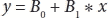

或

(1.2) 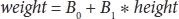

这些方程可以被组合为二维空间中的一条线，如图 Figure 1.2 所示。

![Figure 1.2 身高与体重关系图 [6].](images/img1-2.jpg)

**Figure 1.2** 身高与体重关系图 [6]。

让`B[0]`为偏置系数，`B[1]`为身高列系数。为了找到系数，使用了上述学习技术。随后，使用不同的身高值来计算体重。例如，假设`B[0] = 0.2`且`B[1] = 0.4`，对于身高为 185 cm 的个人，体重计算如下 [6]：

# 1.5 逻辑回归

逻辑回归是广为人知的机器学习算法，属于监督机器学习（SML）技术。它通过利用给定的独立因子集来预测依赖因子，用于分类问题，并依赖概率思想。逻辑回归计算因变量的产出。因此，结果是一个离散值。它可能是是或否、零或一、有效或无效 [3, 7]。然而，它不是给出 0 和 1 的确定值，而是提供处于 0 到 1 范围内的概率值。例如，假设你收到了一系列广泛的谜题/测试，试图理解你接受哪种概念。这项调查的结果将被认为是一个基于几何的问题，有 70% 的概率解决。下一个是历史测验，找到解决方案的概率仅为 30%。考虑检测垃圾邮件的事件。LR 用于此事件；根据可能的分类设置一个限制。如果说明类别为垃圾邮件，预测值一致为 0.4 且限制为 0.5，则信息被归类为非垃圾邮件，这将逐步提示结果。

(1.5) 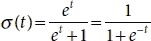 ![Figure 1.3 逻辑回归 [3].](images/img1-3.jpg)

**Figure 1.3** 逻辑回归 [3]。

Figure 1.3 显示了 0 和 1 之间的函数曲线。

# 1.6 支持向量机 (SVM)

支持向量机是一种强大且灵活的机器学习（SML）类型，同时用于分类和回归。它们主要用于分类问题。它们使用核能力（Kernel），这是学习过程的核心思想。这些算法产生一个用于划分不同类别的超平面。超平面是由 SVM 通过最小化误差的目标迭代产生的。SVM 的目标是将数据集划分为不同的类别，以找到最大间隔超平面（MMH）。MMH 可以通过以下步骤定位 [10]：

- SVM 迭代创建以最理想方式划分的平面。
- 然后，它选择准确划分类别的超平面。
- **核函数 SVM**：对于非线性数据具有更高的弹性，因为可以添加更多特征来拟合超平面，作为 2D 空间的替代方案。

SVM 在机器学习中被广泛应用，因为它们可以发现信息之间复杂的联系，而不需要进行大量的更改。当你处理具有数十个到大量特征的等规模数据集时，它是一个极佳的选择。鉴于其处理小规模、复杂数据集的能力，与其他计算方法相比，它们通常能得出更精确的结果。

图 1.4 显示了分类两类的超平面。

![图 1.4 SVM [11].](images/img1-4.jpg)

图 1.4 SVM [11]。

# 1.7 决策树

决策树分组依赖于元素值。它们利用信息增益策略，并发现数据集中的哪个元素提供了最佳的数据划分，使其成为根节点等，直到能够排列数据集中的每种情况。决策树中的每个分支都代表数据集中的一个元素 [4, 5]。它们是分类领域最常用的算法之一。决策树分析中，决策树用于视觉化和表示决策以及决策过程。正如术语所示，它利用了树状表示。树模型是可以取离散值的因变量，称为分类树；在树模型中，叶节点表示类别标签，类别标签的特征组合由分支表示。

考虑一个列出符合招聘的学生名单的例子。现在，场景是学生是否能够参加招聘？有“n”个不同的决策因素需要调查以做出适当决策。决策因素包括学生是否达到等级要求、分数线是多少、候选人是否通过了测试等。因此，决策树模型包含以下组成部分。图 1.5 展示了决策树模型 [2]：

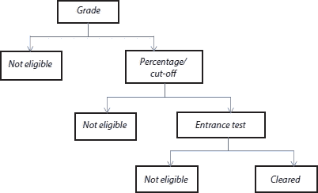

图 1.5 决策树。

- **根节点**：此示例中的根节点是“等级”。
- **内部节点**：具有一个入边和 2 个以上出边的中间节点。
- **叶节点**：没有出边的节点；也称为终端节点。

对于此示例中目前开发的决策树，最初，从根节点开始测试条件并将控制权交给其中一条活动边；因此，再次尝试条件并分配一个节点。当所有测试条件都指向叶节点时，树应当结束。叶节点由类别标签组成，这些标签对选择进行赞成或反对。

# 1.8 机器学习在日常生活中的应用

我们使用机器学习算法的一些主要领域包括 Google 地图中的交通警报、Facebook 等社交媒体网站、Uber 等交通通勤服务、产品推荐系统、虚拟个人助手系统、自动驾驶汽车、谷歌翻译、在线视频流媒体服务、欺诈检测等 [13]。

## 1.8.1 交通警报（地图）

如今，当我们决定外出并在路线和道路交通状况方面帮助时，我们通常会求助于 Google 地图。如果你决定去某个城市并决定乘坐高速，而 Google 交通警报系统建议“尽管拥堵，但你正处于往目的地的最快路线”，系统是如何知道这些信息的呢？简而言之，这是积极使用服务的人员、多年收集的路线以往数据，以及公司获取的一些自有技巧，用于高效计算交通流量。大多数正在使用 Google 地图服务的用户都在间接提供他们的位置、速度和他们将采取的路线，这有助于 Google 收集交通数据，帮助 Google 地图算法预测交通并为未来用户推荐最佳路线。

## 1.8.2 社交媒体（Facebook）

Facebook 等社交媒体应用使用机器学习来检测和识别脸，用于自动朋友标记建议。算法将检测到的面部与其已有的图片数据库进行比较并向用户提供建议。Facebook 使用深度学习的`DeepFace`算法在 Facebook 应用程序背后运行以识别脸并识别图片中的人物。它还为已上传到 Facebook 的图像提供替代标签。

## 1.8.3 交通与通勤（Uber）

Uber 等交通通勤应用使用机器学习来为客户提供优质服务。它提供了一个你唯一的个性化应用程序，例如，它会自动检测你的位置，并提供回家、办公室或其他任何频繁场所的选项，这些完全基于你的搜索历史和模式。该应用程序在行程历史数据之上使用机器学习算法进行准确的预计到达时间（ETA）预测。在应用实施机器学习后，送货和取货的准确性提高了 26%。

## 1.8.4 产品推荐

这告诉我们如今的机器学习推荐系统有多强大。例如，你喜欢 Amazon 上的一件商品，但将其加入愿望清单，因为你无法负担当前价格的该商品。惊讶的是，第二天当你在 YouTube 或其他应用程序上观看视频时，你会遇到之前加入愿望清单的该商品的广告。即使你切换到另一个应用（如 Facebook），你仍然在该网站上看到相同的广告。发生这种情况是因为 Google 跟踪你的搜索历史，并根据你的活动推荐广告。Amazon 约 35% 的财富是通过使用此类产品推荐系统产生的 [18]。

## 1.8.5 虚拟个人助手

在这里，当用户通过文本或语音提问时，虚拟助手会找到一些有用信息。这类应用中有许多机器学习的应用，涉及语音验证和识别系统、语音转文本、自然语言处理（NLP）以及文本转语音。你只需要问一个简单的问题，比如“我明天的行程是什么？”或“显示我即将进行的预订”，然后助手会搜索问题相关的信息来收集信息。最近，聊天机器人已被应用于许多订餐公司应用、在线教练或培训网站以及许多交通应用中 [19]。

## 1.8.6 自动驾驶汽车

这可能是现代世界中机器学习最令人惊叹的实现之一。Tesla 使用深度学习和其他算法来构建自动驾驶汽车。由于所需的计算量非常高，我们需要匹配的硬件来运行这些算法，`NVIDIA`提供了运行这些计算密集型模型所需的硬件。

## 1.8.7 谷歌翻译

以前当你记得去要去一个新地方，那里使用的语言对你来说完全陌生，你发现很难与当地人交流或找到你想去的地方，这主要是因为你看不懂当地景点上的文字。但现在，谷歌的`GNMT`是一种神经机器算法，它拥有多种不同语言的数十亿词汇字典，利用自然语言处理非常高效且准确地翻译任何句子或单词。甚至每个句子的语调都很准确，它使用了诸如`NER`等技术。

## 1.8.8 在线视频流媒体 (Netflix)

Netflix 有超过 1 亿用户，毫无疑问，它是全球流媒体次数最多的网络服务。Netflix 应用使用机器学习（ML）算法，收集有关用户在暂停、回放或快进时的海量数据。它还会根据观看内容的日期、日期和时间，主要是评分模式和搜索模式收集数据。该应用程序从每一位用户处收集这些数据，并使用其推荐系统以及许多与机器学习方法相关的算法。

## 1.8.9 欺诈检测

目前，在线信用卡欺诈检测在 2020 年的市场规模为 320 亿美元。这大约高于许多跨国公司利润的总和。如今，信用卡、借记卡、各种钱包、UPI 等支付渠道的增加增加了犯罪者的数量。机器学习方法将欺诈检测视为一个分类问题。

# 1.9 结论

在未来的几年里，机器学习将在从目前在不同应用领域开放的海量信息中提取数据方面发挥重要作用。数据研究人员正在不断发展监督学习策略，这些策略包含了大量的算法。该领域受到了许多工程师的关注，并在最近十年取得了巨大的进展。学习策略实现了在几年前难以实现的卓越性能。考虑到这种飞速的发展，工程师们有很大的空间高效工作并开发监督机器学习（SML）策略。

# 参考文献

1. Iqbal, M. and Yan, Z., Supervised Machine Learning Approaches: A Survey. *Int. J. Soft Comput*., 5, 946–952, 2015, 10.21917/ijsc.2015.0133.

2. Nasteski, V., An overview of the supervised machine learning methods. *Horizons. B*., 4, 51–62, 2017, 10.20544/HORIZONS.B.04.1.17.P05.

3. Sharma, R., Sharma, K., Khanna, A., Study of Supervised Learning and Unsupervised Learning. *Int. J. Res. Appl. Sci. Eng. Technol. (IJRASET)*, 8, VI, June 2020.

4. Kotsiantis, S.B., Supervised Machine Learning: A Review of Classification Techniques, in: *Proceedings of the 2007 conference on Emerging Artificial Intelligence Applications in Computer Engineering: Real Word AI Systems with Applications in eHealth*, HCI, Information Retrieval and Pervasive Technologies, The Netherlands, 2007.

5. Osisanwo, F.Y., Akinsola, J.E.T., Awodele, O., Hinmikaiye, J.O., Olakanmi, O., Akinjobi, J., Supervised Machine Learning Algorithms: Classification and Comparison. *Int. J. Comput. Trends Technol. (IJCTT)*, 48, 3, 128–138, June 2017.

6. Brownlee, J., Linear Regression for Machine Learning – Machine Learning Mastery, [online] Machine Learning Mastery [`machinelearningmastery.com/linear-regression-for-machine-learning/`](https://machinelearningmastery.com/linear-regression-for-machine-learning/).

7. Brownlee, J., Logistic Regression for Machine Learning – Machine Learning Mastery, [online] Machine Learning Mastery Available at: [`machine-learningmastery.com/logistic-regression-for-machine-learning/`](https://machine-learningmastery.com/logistic-regression-for-machine-learning/).

8. Mitchell, T., *Machine Learning*, 432pp., McGraw Hill, Carnegie Mellon University, 2015.

9. [`www.javatpoint.com/machine-learning`](https://www.javatpoint.com/machine-learning)

10. [`www.tutorialspoint.com/machine_learning_with_python/classification_algorithms_support_vector_machine.htm`](https://www.tutorialspoint.com/machine_learning_with_python/classification_algorithms_support_vector_machine.htm)

11. [`www.edureka.co/blog/supervised-learning/`](https://www.edureka.co/blog/supervised-learning/)

12. [`machinelearningmastery.com/supervised-and-unsupervised-machine-learning-algorithms/`](https://machinelearningmastery.com/supervised-and-unsupervised-machine-learning-algorithms/)

13. Fabris, F., Magalhães, J.P., Freitas, A.A., A review of supervised machine learning applied to ageing research. *Biogerontology*, 18, 2, 171–188, 2017.

14. Ayodele, T., Types of Machine Learning Algorithms, InTech Open, [://www..chopen../1064](https://www..chopen../1069)

15. Musumeci, F., Travaglioni, M., Petrillo, A., De Felice, F., An Overview on Application of Machine Learning Techniques in Optical Networks. *IEEE Commun. Tutorials*, 21, 2, 1383–1408, 2019.

16. [`en.wikipedia.org/wiki/Machine_learning`](https://en.wikipedia.org/wiki/Machine_learning)

17. [`en.wikipedia.org/wiki/Logistic_regression`](https://en.wikipedia.org/wiki/Logistic_regression)

18. [`www.edureka.co/blog/supervised-learning/`](https://www.edureka.co/blog/supervised-learning/)

19. [`machinelearningmastery.com/supervised-and-unsupervised-machine-learning-algorithms/`](https://machinelearningmastery.com/supervised-and-unsupervised-machine-learning-algorithms/)

20. Mohri, M., Rostamizadeh, A., Talwalker, A., *Foundations of machine learning*, MIT Press, Cambridge, 2012.


21. Cioffi, R., Travaglioni, M., Petrillo, A., De Felice, F., Artificial Intelligence and Machine Learning Applications in Smart Production: Progress, Trends, and Directions. *Sustainability*, 12, 492, 2020.

22. Behera, R. and Das, K., A Survey on Machine Learning: Concept, Algorithms and Applications. *Int. J. Innov. Res. Comput.*., 5, 2, 1301–1309, 2017.

23. Domingos, P., A few useful things to know about machine learning. *Commun. ACM*, 55, 10, 14–20.

> **摘要**
>
> 人共患疾病是一种从动物传播给人类的传染病；该疾病通常通过病毒、朊和细菌等传染因子传播。识别和控制共患疾病的传播具有挑战性，原因包括症状不典型、共患体征相似、动物接种不足以及人们对动物健康的知识匮乏。集成机器学习使用多种机器学习算法，与单个机器学习算法相比可以获得更好的性能。一些潜在的集成学习算法，如贝斯最优分类器、自助聚合（bagging）、提升（boosting）、贝斯模型平均、贝斯模型组合、模型桶和堆叠，对于识别共患疾病非常有帮助。因此，本章讨论了集成机器学习算法在识别共患疾病中的应用，并介绍了它们的架构、优点和应用。对所考虑的集成机器学习技术的效率根据性能指标（即吞吐量、执行时间、响应时间、错误率和学习率）进行了比较。通过分析发现，贝斯模型组合、堆叠和贝斯模型组合在识别共患疾病方面的效率很高。
>
> **关键词：** 共患疾病，集成机器学习，贝斯最优分类器，bagging，boosting，贝斯模型平均，贝斯模型组合，堆叠

人畜共患病是从动物传播给人类的传染病；该疾病通常通过`virus, prion, virus, and bacteria`等病原体传播。首先受影响的人类反过来会将疾病传播给其他人类，从而形成疾病链。人畜共患病通过两种不同的传播模式传输：一种是直接传播，即疾病从动物传播给人类；另一种是间接传播，即疾病通过携带病原体的中间物种进行传播。人畜共患病的出现通常发生在大型区域、全球、政治、经济、国家和社会力量的层面。在广泛的地理范围内从动物传播给人类的八种常见人畜共患病包括人畜共患流感、沙门菌病、西尼罗病毒、鼠疫、冠状病毒、狂犬病、布氏菌病和莱姆病。早期识别此类传染病非常重要，可以使用集成机器学习技术来实现 [1, 2]。

由于许多问题，人畜共患病的识别和传播控制面临挑战，这些包括：没有合适的症状、人畜共患病的体非常相似、动物接种不当、人们对动物健康的知识匮乏、控制全球范围内疾病的成本高昂、难以改变人们的习惯、疾病症状的优先级排序困难、缺乏合适的服装、人类发病率突然上升、食用过期或受污染的食物、无法控制人畜共患微生物的传播、人畜共患病定期复发、难以形成协调的补救政策、违反控制疾病的国际法、达成疾病控制协议的交易成本高、国家和国际水平的疾病监测困难、无法追踪流感病毒的初始症状、严重急性呼吸综合征的广泛性、无法提供足够的资源、气候变化也影响疾病传播、难以确定人畜共患病的优先级、动物传人类疾病的增长趋势以及人与之间持续密切的接触 [3, 4]。

集成机器学习使用多种机器学习算法，与单个/独立的机器学习算法相比，可以获得更好的性能 [5, 6]。一些潜在的集成学习算法如贝叶斯最优分类器、自助聚合（bagging）、提升（boosting）、贝叶斯模型平均（BMA）、贝叶斯模型组合、模型桶（bucket of models）、叠加（stacking）和遥感。与传统机器学习相比，集成机器学习提供的优势如下：预测准确性更高、如果方案需求很高则具有良好的扩展性（因为它可以很好地处理多个节点）、结合多个假设以最大化输出质量、通过增量方式运行提供可持续解决方案、有效利用先验知识产生多样化的模型解决方案、通过充分训练避免过拟合问题、生成的模型由于模仿人类行为而表现良好、可以使用组合机器学习模型分析复杂的疾病传播轨迹、由于有足够的训练模型，样本分类错误较少、对离群值不敏感、输出数据样本的交叉验证提高了性能、所选假设的稳定性高、初始数据收集中的可测量性能很高、不会收敛到局部最优解、表现出非层次和重叠的行为、有多种开源工具可用于模型的实际实现等 [7–9]。

应用集成机器学习算法识别人畜共患病的主要目标如下：降低袋的水平和偏差，并以最少的训练迭代次数提高人畜共患病的检测准确率、自动识别疾病、使用基学习器使其适用于医学领域、易于在早期阶段识别疾病传播、识别产生最大信息增的特征向量、参数易于训练、治疗成本最低、充分覆盖大量医学问题、早期识别医学问题的复发、机器学习模型之间的高相关性导致了高效输出、训练和执行时间较短、集成模型的扩展性高、提供多个模型的聚合效益、非线性决策能力强、为慢性病提供可持续解决方案、内部参数的自动调节增加了收敛率、降低临床试验的重复率、早期干预防止疾病传播、能够记录和存储高维临床数据集、容易识别神经疾病、减少低质量医学图像的分类错误、结合多个机器学习模型的聚合力量等 [10, 11]。

## 2.2 贝叶斯最优分类器

贝叶斯最优分类器是一种用于预测的流行机器学习模型。该技术基于贝叶斯定理，其原理由贝叶斯定理指导并与最大后验算法密切相关。分类器通过寻找具有最大发生概率假设来运行。分类器使用概率模型进行预测，通过训练和测试数据实例找到最可能的预测。

基本的条件概率方程在给定一个结果的情况下预测另一个结果，假设 A 和 B 是两个可能的结果，使用方程 `P(A|B) = (P(B|A)*P(A))/P(B)` 计算事件发生的概率。用于预测的概率框架广泛分为两类：一种是最大后验，另一种是极大似然估计。这两类概率框架的重要目标是它们在给定的训练数据样本中定位最有前景的假设。可以使用贝叶斯最优分类器良好识别和治疗的一些人畜共患病包括炭疽、布氏菌病、Q 热、丛热、鼠疫、结核、钩体病、狂犬病、肝炎、尼帕病毒、禽流流感等 [12, 13]。贝叶斯最优分类器的分级表示如图 2.1。在可用数据集的超平面上，贝叶斯分类器执行多类别分类操作，在可用数据集之间绘制软边界并进行分类。观察发现，随着训练迭代的增加和时间的推移，贝叶斯最优分类器的准确性会不断提高。

图 2.1 贝叶斯最优分类器的高级表示。

## 2.3 自助聚合法 (Bagging)

自助聚合（Bootstrap Aggregating），通常称为 bagging，是一种基于机器学习的集成技术，它可以提高算法的准确性，主要用于分类或聚合目的。bagging 的主要目的是通过妥善泛化现有数据样本来避免过拟合问题。考虑任何标准输入数据集，通过对数据样本进行均匀有回采样来生成新的训练数据集。通过考虑回回，某些观测值将以唯一数据样本的形式通过回归或投票机制重复出现。bagging 技术由人工神经网络和回归树组成，用于改进不稳定的过程。对于任何给定的应用，在 bagging 和 boosting 之间的选择取决于数据的可用性。通过结合自助法和 bagging 可以减少所产生的方差 [15, 16]。

bagging 和 boosting 操作被认为是集成机器学习中两个最强大的工具。bagging 操作与决策树并发使用，通过减少方差来增加模型的稳定性，并通过最小化错误率来提高模型的准确性。集成模型所生成的预测集的聚合会产生最佳预测作为输出。在进行自助采样时，使用替换机制取出显著样本，其中新变量的选择取决于先的随机选择。该技术的实际应用取决于首先选择的基础学习算法，并在该算法的基础上对决策树池进行 bagging。可以使用自助聚合法良好识别和治疗的一些动物人共患疾病包括动物源性流感、沙门菌病、西尼河病毒、瘟疫、狂犬病、莱姆病、布氏菌病等 [17]。自助法的高级表示如图 2.2。它始于训练数据集，该数据集分布在多个自助采样单元之间。每个自助采样单元在数据子集上运行，学习算法在上面执行学习操作并生成分类输出。每个分类器的聚合和被输出输出。

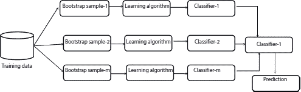

图 2.2 自助聚合的高级表示。

自助法在诊断动物人共患疾病方面的某些优势如下：多个弱学习器的聚合能力性能优于强学习器；由于其有效地处理了过拟合问题，所产生的方差得到减少；在互操作过程中没有精度损失；由于资源的妥善管理，计算成本并不高；过度置信偏置的计算变得更容易；对模型分配相等权重以提高性能；样本误分类较少；对离群值和噪声的影响非常稳健；模型可以于并行；通过模型的增量开发实现高准确性；稳定了不稳定的方法；从实现角度来看更容易；提供了测试误差的无偏估计；容易克服单个机器学习模型的陷阱等等。

## 2.4 贝叶斯模型平均 (BMA)

它是广为人知的集成机器学习模型之一，它应用贝叶斯推理来解决与问题陈述选择、执行联合估计相关的问题，并使用任何预测精度较低的单一模型产生结果。BMA 中提供了多种一致的模型，能够处理大型数据集中存在的不确定性。实现 BMA 模型时遵循的步骤包括管理求和、计算 BMA 的积分值、使用线性回归进行预测和转换 [18, 19]。

基本上，BMA 是贝叶斯推理的扩展形式，它通过贝叶斯定理获取后验概率，利用先验分布对不确定性进行数学建模。为了实现 BMA，首先需要指定集成网络中每个模型的先验分布，然后需要为每个模型找到证据。假设现有模型由 `M[l]` 表示，其中 `l` 的值从 1 变到 `k`，这基本上代表概率分布集合。概率分布计算似然函数 `L`(`Y`|`θ[l]`, `M[l]`)，其中 `θ[l]` 代表模型特定的依赖参数。根据贝叶斯定理，后验概率的值计算如下 [20]。BMA 的高级表示如图 2.3。贝叶斯模型表示始于数据集，该数据集分布在多个数据子集之间。每个数据子集作为输入馈学习器，最后执行平均操作，并与平均阈值进行比较，使用置换阈值进行测试以生成贝叶斯模型作为输出。

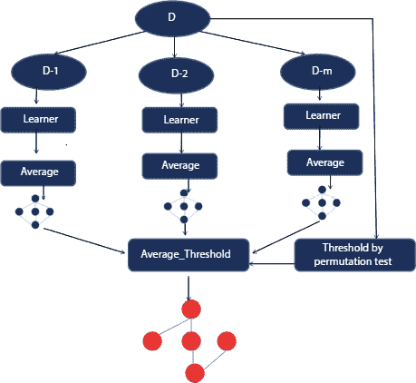

图 2.3 贝叶斯模型平均 (BMA)的高级表示。

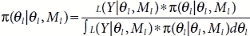

BMA 在诊断动物人共患疾病方面的某些优势如下：能够执行多变量选择；生成过度置信的推理；选定的特征数量较少；容易扩展到任何数量的类别；后验概率效率高；模型部署更容易；不确定性的正确估计；适用于处理复杂应用；对模型的妥当解释；结合估计和预测；对先验分布灵活；使用均值候选放置模型；执行多线性操作；适用于处理异构资源；为大量数据提供透明的解释；误差呈指数级减少；预测中产生的方差较少；参数推理中的灵活性较少；关于模型预测的预测较少；发生高速编译；生成高价值输出；结合了多个学习器和平均模型实现的效率；对输入属性规格错误引起的影响非常稳健；模型规格是高度动态的等等。

## 2.5 贝叶斯分类器组合 (BCC)

贝叶斯分类器组合 (BCC) 考虑 `k` 不同类型的分类器并产生组合输出。这种分类器创新的动机是捕捉关于所有数据形式的穷可能，并便于边缘似然关系的计算。这种分类器不会假设现有的分类器是真实的，而是假设它们是概率性的，模仿人类专家的行为。BCC 分类器在不同数据点上使用不同混淆矩阵进行分类。如果数据点难以分类，则 BCC 使用它们自己的混淆矩阵；否则将使用后验混淆矩阵。分类器识别模型输出与未知数据标签之间的关系。不需要概率模型；它们共享关于发送或接收训练数据信息的信息 [21, 22]。

BCC 模型参数包含了 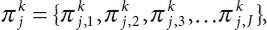 超参数 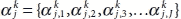。根据具有观测标签类别的随机变量的先验后验概率分布值，独立后验密度 `id` 的计算如下：

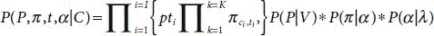 

得出的推理基于未知的随机变量，即 `P`、`π`、`t`、`V` 和 `α`，这些变量是通过 Gibbs 采样和拒绝采样方法收集的。BCC 的高层表示如图图 2.4 所示。首先将 BCC 模型的参数、超参数和后验概率进行求和，生成最终预测作为输出。

BCC 在诊断动物源性疾病方面提供的一些优势如下：执行概率预测、孤立产生噪声的离群值、高效处理缺失值、对无关属性的稳健性处理、可以防止依赖关系引起的副作用、实现更简单、易于对变量之间的依赖关系进行建模、从标记和未标记输入数据样本中共同学习、易于特征选择、惰学习、训练时间更短、消除不稳定的估计、在系统变量依赖性方面获得高知识、结果解释中实现高准确率、基于混淆矩阵的数据处理、低计算复杂度、较少的计算资源即可运行、所需训练数据较少、足以处理数据参数中的确定性、能够从标记和未标记数据样本中学习、精确选择产生最大信息增的属性、消除冗余值、调优参数少、内存需求低、数据分类高度灵活等 [23]。

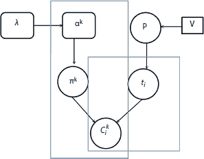

**图 2.4** 贝斯分类器组合 (BCC)的高层表示。

## 2.6 模型桶 (Bucket of Models)

模型桶是流行的集成机器学习技术之一，用于选择最佳算法来解决任何计算密集型问题。与所有集成模型的平均平均相比，模型桶实现的性能良好。选择最佳预测模型的常用策略之一是通过交叉验证。在交叉验证期间，训练中的所有可用示例将用于训练模型，并选择最适合问题的模型。交叉验证选择的一种流行的泛化方法是门控（gating）。为了实现门控，将使用感知器模型，它会为桶中每个可用模型的预测乘积分配权重。当桶中的大量模型应用于更大规模的问题集时，可以丢弃训练时间更长的模型。基于地标的学习是一种基于桶的模型，它只对桶中存在的快速算法进行训练，并根据快速算法生成的预测来确定桶中慢算法的准确性 [24]。模型桶的高层表示如图图 2.5 所示。数据存储维护信息库，并作为输入供给每个基学习器。每个基学习器生成自己的预测作为输出，并作为元学习器（metalearner）的输入。最后，元学习器对每个预测进行求和，生成最终预测作为输出。

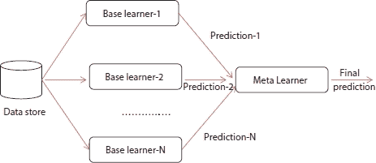

**图 2.5** 模型桶的高层表示。

多个模型之间交叉验证的最佳适用方法之一，其伪代码如下：

```
对于桶中存在的每个模型执行
重复固定次数
将训练集分成部分，即训练集和测试集
使用训练集训练集成模型
使用测试集测试集成模型
```

模型桶在诊断动物源性疾病方面提供的一些优势如下：执行概率预测、孤立产生噪声的离群值、高效处理缺失值、稳健、从标记和未标记数据样本中共同学习、易于特征选择、惰学习、训练时间更短、消除不稳定的估计、在系统变量依赖性方面获得高知识、结果解释中实现高准确率、基于混淆矩阵的数据处理、低计算复杂度、较少的计算资源即可运行、所需训练数据较少、足以处理数据参数中的确定性、能够从标记和未标记数据样本中学习、精确选择产生最大信息增的属性、消除冗余值、调优参数少、内存需求低、数据分类高度灵活等 [25, 26]。

## 2.7 叠加 (Stacking)

叠加也被超级学习或叠加回归，通过结合多个基学习器生成的结果来训练元学习器。叠加是集成学习的一种形式，用于结合多个机器学习模型生成的预测。叠加的典型架构涉及两个到三个模型，通常称为层 0 模型和层 1 模型。层 0 模型拟合训练数据，其生成的预测被编译。层 1 模型学习如何结合其他几个模型生成的预测。准备训练数据的简单方法是对层 0 模型的 k 折交叉验证。叠加的实现更容易，数据的训练和维护也更容易。超级学习算法分三个步骤工作：首先设置集成，然后训练设置好的集成，在充分训练后测试数据样本 [27, 28]。

叠加的泛化方法将现有数据分为两个部分，一个是训练数据集，另一个是测试数据集。基模型被划分为 K-NN 基模型，基模型拟合 K-1 部分，从而对第 K 部分产生预测。基模型将进一步拟合整个训练数据集，以计算在测试样本上的性能。该过程在其他基模型（包括支持向量机、决策树和神经网络）上重复，以对测试模型进行预测 [29]。

堆叠（stacking）在诊断动物共患疾病方面提供的某些优势如下：易于并行、易于解决回归问题、简单的线性堆叠方法、高效得多、局部模式早期检测、执行时间更短、产生高质量输出、误分类概率较低、预测准确性提高、对离群值的影响为零、内存占用更少、计算复杂度更、能够处理大数据流、以增量方式工作、新数据样本的分类容易、用于解决多分类问题、方法优于经典集成方法、适用于计算密集型应用、分析背后的情感泛化容易、能够解决非线性问题、对大搜索空间具有鲁棒性、训练周期短、能够处理噪声训练数据、协同过滤有助于从训练数据中去除噪声元素、适用于多分类问题、训练涉及的参数较少、从新测试样本自然进化、训练所需数据极少等。

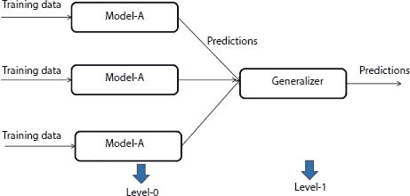

**图 2.6** 堆叠的高级表示。

## 2.8 效率分析

将所考虑的集成机器学习技术，即 `Bayes optimal classifier`、`bagging`、`boosting`、`BMA`、`bucket of models` 和 `tacking` 所实现的效率与性能指标，即准确率、吞吐量、执行时间、响应时间、错误率和学习率 [30] 进行对比。从分析中观察到，与其他识别动物共患疾病的集成模型相比，`Bayesian model combination`、`stacking` 和 `Bayesian model combination` 的效率较高。

| 技术 | 准确率 | 吞吐量 | 执行时间 | 响应时间 | 错误率 | 学习率 |
| :--- | :--- | :--- | :--- | :--- | :--- | :--- |
| 贝斯最优分类器 | 低 | 低 | 高 | 中 | 中 | 低 |
| Bagging | 低 | 中 | 中 | 高 | 低 | 低 |
| Boosting | 低 | 中 | 高 | 高 | 高 | 低 |
| 贝叶斯模型平均 | 高 | 高 | 中 | 中 | 低 | 低 |
| 贝叶斯模型组合 | 高 | 高 | 低 | 低 | 低 | 高 |
| 模型桶 | 低 | 低 | 高 | 中 | 中 | 低 |
| 堆叠 | 高 | 高 | 低 | 低 | 低 | 中 |

## 2.9 结论


本章介绍了动物共患疾病的症状、挑战和成因。集成机器学习使用多种机器学习算法在早期阶段识别动物共患疾病。本文对一些潜在的集成机器学习算法，即 `Bayes optimal classifier`、`bootstrap aggregating (bagging)`、`boosting`、`BMA`、`Bayesian model combination`、`bucket of models` 和 `stacking`，及其架构、优势和应用领域进行了详细讨论。从分析中观察到，与其他识别动物共患疾病的集成模型相比，`Bayesian model combination`、`stacking` 和 `Bayesian model combination` 的效率较高。

## 参考文献

1. Allen, T., Murray, K.A., Zambrana-Torrelio, C., Morse, S.S., Rondinini, C., Di Marco, M., Daszak, P., Global hotspots and correlates of emerging zoo-notic diseases. *Nat. Commun.*, *8*, 1, 1–10, 2017.
2. Han, B.A., Schmidt, J.P., Bowden, S.E., Drake, J.M., Rodent reservoirs of future zoonotic diseases. *Proc. Natl. Acad. Sci.*, *112*, 22, 7039–7044, 2015.
3. Salata, C., Calistri, A., Parolin, C., Palu, G., Coronaviruses: a paradigm of new emerging zoonotic diseases. *Pathog. Dis.*, *77*, 9, ftaa006, 2019.
4. Mills, J.N., Gage, K.L., Khan, A.S., Potential influence of climate change on vector-borne and zoonotic diseases: a review and proposed research plan. *Environ. Health Perspect.*, *118*, 11, 1507–1514, 2010.
5. Ardabili, S., Mosavi, A., Várkonyi-Kóczy, A.R., Advances in machine learning modeling reviewing hybrid and ensemble methods, in: *International Conference on Global Research and Education*, 2019, September, Springer, Cham, pp. 215–227.
6. Gao, X., Shan, C., Hu, C., Niu, Z., Liu, Z., An adaptive ensemble machine learning model for intrusion detection. *IEEE Access*, *7*, 82512–82521, 2019.
7. Yacchirema, D., de Puga, J.S., Palau, C., Esteve, M., Fall detection system for elderly people using IoT and ensemble machine learning algorithm. *Pers. Ubiquitous Comput.*, *23*, 5–6, 801–817, 2019.
8. Zewdie, G.K., Lary, D.J., Levetin, E., Garuma, G.F., Applying deep neural networks and ensemble machine learning methods to forecast airborne ambrosia pollen. *Int. J. Environ. Res. Public Health*, *16*, 2019.
9. Allen, T., Murray, K.A., Zambrana-Torrelio, C., Morse, S.S., Rondinini, C., Di Marco, M., Daszak, P., Global hotspots and correlates of emerging zoo-notic diseases. *Nat. Commun.*, *8*, 1, 1–10, 2017.
10. Han, B.A., Schmidt, J.P., Bowden, S.E., Drake, J.M., Rodent reservoirs of future zoonotic diseases. *Proc. Natl. Acad. Sci.*, *112*, 22, 7039–7044, 2015.
11. Salata, C., Calistri, A., Parolin, C., Palu, G., Coronaviruses: a paradigm of new emerging zoonotic diseases. *Pathog. Dis.*, *77*, 9, ftaa006, 2019.
12. Mills, J.N., Gage, K.L., Khan, A.S., Potential influence of climate change on vector-borne and zoonotic diseases: a review and proposed research plan. *Environ. Health Perspect.*, *118*, 11, 1507–1514, 2010.
13. Ardabili, S., Mosavi, A., Várkonyi-Kóczy, A.R., Advances in machine learning modeling reviewing hybrid and ensemble methods, in: *International Conference on Global Research and Education*, 2019, September, Springer, Cham, pp. 215–227.
14. Gao, X., Shan, C., Hu, C., Niu, Z., Liu, Z., An adaptive ensemble machine learning model for intrusion detection. *IEEE Access*, *7*, 82512–82521, 2019.
15. Yacchirema, D., de Puga, J.S., Palau, C., Esteve, M., Fall detection system for elderly people using IoT and ensemble machine learning algorithm. *Pers. Ubiquitous Comput.*, *23*, 5–6, 801–817, 2019.
16. Zewdie, G.K., Lary, D.J., Levetin, E., Garuma, G.F., Applying deep neural networks and ensemble machine learning methods to forecast airborne ambrosia pollen. *Int. J. Environ. Res. Public Health*, *16*, 2019.
17. Dadhich, S., Sandin, F., Bodin, U., Andersson, U., Martinsson, T., 轮装机基于神经网络的自动装料算法现场测试。*Autom. Constr.*., *97*, 1–12, 2019.
18. Leguizamón, S., Jahanbakhsh, E., Alimirzazadeh, S., Maertens, A., Avellan, F., 离心式叶片水磨粒侵蚀的多尺度模拟：跨越尺度以提高准确性。*Int. J. Turbomach. Propuls. Power*, *4*, 2, 9, 2019.
19. Lora, J.M., Tokano, T., d’Ollone, J.V., Lebonnois, S., Lorenz, R.D., 土卫星气候和低纬度环境的模型间比较。*Icarus*, *333*, 113–126, 2019.
20. Chen, J., Yin, J., Zang, L., Zhang, T., Zhao, M., 基于向卫 8 号气溶胶光学深度数据的中国每小时 PM2.5 估计机器学习模型。*Sci. Total Environ.*., *697*, 134021, 2019.
21. Dou, J., Yunus, A.P., Bui, D.T., Merghadi, A., Sahana, M., Zhu, Z., Pham, B.T., 日本山区流域利用带有袋装法、提升法和堆叠集成机器学习框架的支持向量机改进的滑坡体评估。*Landslides*, *17*, 3, 641–658, 2020.
22. Singh, S.K., Bejagam, K.K., An, Y., Deshmukh, S.A., 基于机器学习的堆叠集成模型用于分子动力学模拟的准确分析。*J. Phys. Chem. A*, *123*, 24, 5190–5198, 2019.
23. [`UCI 机器学习仓库`](https://archive.ics.uci.edu/ml/index.html)

*邮箱*：[`bhargavi.tumkur@gmail.com`]

# 3 模型评估

**Ravi Shekhar Tiwari**

*新南威尔士大学，肯辛顿，悉尼，澳大利亚*

> **摘要**
>
> 我们正处于一个技术驱动的时代，70% 的活动直接依赖于技术，其余 30% 是间接依赖。在近期，计算能力和存储设备取得了突破——这导致了云端、`G` 和 `Tpu` 等技术的产生，结果是我们的存储和处理能力呈指数级增长。存储和计算能力的指数级增长，使得研究人员能够在现实应用中部署人工智能（A.I.）。
>
> 现实应用中的 A.I. 指部署训练好的机器学习（ML）和深度学习（DL）模型，以最大限度地减少过程中的人工干预并使机器自力运行。正如我们所知，每一个作用都有相应的正反作用力。这些技术的突破导致了各种 ML/DL 产生，但研究人员在选择模型时感到不知所措。他们困惑应该选择哪种模型来正确模拟人类思维——这是人工智能的目标。由于我们大多数人仅仅依赖准确率指标来证明我们模型的性能，但在某些情况下，简单模型和复杂模型的准确率几乎是等等的。为了解决这一困惑，研究人员提出了各种指标，这些指标取决于训练 ML/DL 模型的数据集以及 ML/DL 模型的应用。因此，个人可以根据 ML/DL 模型的训练数据集和应用进行评估。
>
> **关键词**：模型评估，机器学习模型，深度学习模型，人工智能

## 3.1 引言

我们预计进入一个智能时代，机器能够技术性地执行人类工作，机器学习（ML）最重要的部分是模型评估。在人工智能（A.I.）的背景下，我们意识到存在多种模型，其中某些模型是简单的且可解释的。近年来人工智能（A.I.）的发展赋予了我们 `Shapley`、`LIME` 以及各种机器学习工具解释预测的能力，但在选择能够实现目标的最佳模型时，我们仍处于困境。

“剑不能取代针”——尽管与针相比它拥有无限的力量。同样，当准确率差异微小同时，选择简单模型比复杂模型更具效益，因为后者消耗更多资源。在某些用例中，我们完全依赖准确率——它只是相对于总样本量的正确预测数值。

对于不平衡数据集来说，准确率可能是低效且错误的。不平衡数据集是不平衡数据集的术语。

## 3.2 模型评估

模型评估是训练和测试模型后的关键过程之一，因为我们对计算以及数据存在限制；因此，部署准确率几乎相等的复杂模型是可能的。我们需要通过与另一个训练好的模型或基准模型比较来证明我们的模型，因此我们需要 `R²`、调整 R² 和 `RMSE` 等不同指标来描述数据相对于回归线的趋势、误差以及其他统计指标。

图 3.1 是任何 ML/DL 模型部署之前发生的过程或程序的简要表示。

回归定义为确定自变量（IV，用 `X` 表示）和因变量（DV，用 `Y` 表示）之间关系的统计术语。在回归模型中，我们在 IV（即 `X`）上训练模型并尝试预测 DV（即 `Y`）。分类是指将输入数据分类或分配到其中一类的过程。

### 3.2.1 假设

假设你建立了一个方程为 `Y = mx + c + ε` 的回归模型，其中 `m` 是斜率，`c` 是截距，`ε` 是误差，`x` 是输入变量；在线性回归中，`m` 和 `c` 指权重和偏置，它们在 `n` 个样本上通过 `e` 轮迭代学习得。从模型的预测值为 `O`，真实值为 `Y`。

### 3.2.2 残差

它被定义为实际值 `Y[{i}]` 与预测值 `O[{i}]` 之间的差异。参考图 3.2，其中点表示实际值 `Y` 和由我们的模型预测的值 `O`。由于我们的模型是回归模型，我用标记为 `Y = mx + c` 的直线表示它，其输出是依赖于 `x` 的直线 `Y` 上的一点。它被称为残差 [3]。

(3.1) 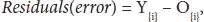

如果我们在公式 (3.1) 中代入 `Y = mx[{i}] + c + ε` 和 `O = mx[{i}] + c` 的值，我们将得到：

(3.2) 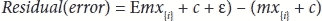 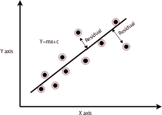

**图 3.2** 残差。

### 3.2.3 误差平方和（`Sse`）

它量化了数据点 `Y[{i}]` 离回归线的程度，即 `Y[{i}] = mx[{i}] + c + ε` 围绕估计回归线的变异程度，即 `O[{i}] = mx[{i}] + c` [4]。

(3.3) 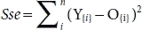

如果我们在公式 (3.3) 中代入 `Y = mx[{i}] + c + ε` 和 `O = mx[{i}] + c` 的值，那么我们得到：

(3.4) 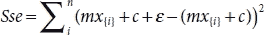

### 3.2.4 回归平方和（`Ssr`）

它量化了从直线 `O[{i}] = mx[{i}] + c` 估计的预测输出 `O` 离“无关系线”的程度，即 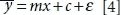。

(3.5) 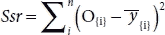

如果我们在公式 (3.5) 中代入 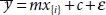 和 `O = mx[{i}] + c`，我们将得到：

(3.6) 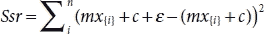

### 3.2.5 总平方和（`Ssto`）

它被定义为 `Ssr` 和 `Sse` 之和，它量化了回归线数据点（即 `Y[{i}] = mx[{i}] + c + ε`）围绕其平均值的变异程度，即  [4]。

(3.7) 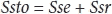

如果我们在公式 (3.7) 中代入来自 `Sse` [公式 (3.3)] 和 `Ssr` [公式 (3.6)] 的值，我们将得到：

(3.8) 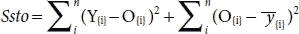

通过使用公式 (3.8) 解此等式，我们得到：

(3.9) 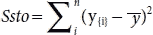

## 3.3 回归模型中指标

正如我们所说，建筑基础坚固，我们建立了基础，并且非常坚固。所以我们可以一个一个开始构建；因此，回归模型中使用的指标。

### 3.3.1 平均绝对误差（`Mae`）

`Mae` 代表平均绝对误差。它用于计算估计直线 `O = mx[{i}] + c` 的预测值 `O` 与实际值线 `Y = mx[{i}] + c + ε` 之间的整体平均变异 [6]。如果我们尝试从右向左遍历，可以将项分为三个独立的项：误差、绝对值和平均值。这三个词按照顺序相互相关。

**误差**：它也被残差（图 3.2），定义为预测值 `O` 与实际值 `Y` 之间的差异。

(3.10) 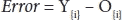

**绝对值**：模型的误差或残可以是正值也可以是负值。如果我们考虑负值和正值，那么相同幅的正负残差可能会相互抵消，这在反向传播过程中产生不利影响。假设我们的模型残差为 2, 4, 6, 7 和 -2，如果我们取误差的平均值，具有相同的值，但相反的符号会相互抵消，因此会对模型产生不利影响。因此，我们通过取绝对值（即误差的模）来考虑误差，受离群值影响很大 [7]。

(3.11) 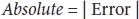

如果在公式 (3.11) 中代入公式 (3.10) 的值，我们将得到：

(3.12) 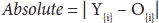

**平均值**：我们重复上述步骤，即对 n 个样本（即训练或测试模型的样本数）进行误差和绝对值计算，并计算平均值选择具有平均绝对误差的模型。

(3.13) 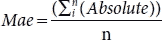（注：此处原文有 (3.14) 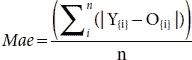）

`Mse` 的伪代码所示：

```text
For I in no.samples:
Error = Y[{i}] – O[{i}]
Absolute = | Error |
Total Error = Total Error + Absolute
Mae = Total Error / no.samples
```

### 3.3.2 真方误差（`Mse`）


`Mse` 代表均方误差。它用于计算估计直线 `O = mx[{i}] + c` 的预测值 `O` 与实际值线 `Y = mx[{i}] + c + ε` 之间的整体平均平方变异 [8]。如果我们尝试从右向左遍历，可以将项分为三个独立的项：误差、平方和平均。这三个词按照顺序相互相关。

**误差**：它也被残差（图 3.2），定义为预测值 `O` 与实际值 `Y` 之间的差异。

(3.15) 

**平方**：模型的误差或残可以是正值也可以是负值。如果我们考虑负值和正值，那么相同幅的正负残差可能会相互抵消，这在反向传播过程中产生不利影响。假设我们的模型残差为 2, 4, 6, 7 和 -2，如果我们取误差的平均值，具有相同的值，但相反的符号会相互抵消，因此会对模型产生不利影响。因此，我们将误差平方以处理上述问题，而在 `Mae` 中，我们使用模运算符 [8]。

(3.16) 

如果在公式 (3.16) 中代入公式 (3.15) 的值，我们将得到

(3.17) 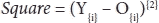

**平均值**：我们重复上述步骤，即对 `n` 个样本（即训练或测试模型的样本数）进行误差和平方计算，并计算平均值选择具有最小均方误差的模型。

(3.18) 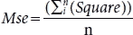

如果在公式 (3.18) 中代入公式 (3.17) 的值，我们将得到

(3.19) 

`Rmse` 代表均方根误差（Root Mean Square Error）。`Rmse` 用于计算预测值 `O`（来自估计线 `O = mx[{i}] + c`）与实际值 `Y`（线 `Y = mx[{i}] + c + ε`）之间变化的均方根。它源于均方误差，受离群值的影响很大 [10]。在 `RMSE` 中，根号能够显示大量的偏差，且与 `Mae` 相比，它赋予了误差更高的权重，从而惩罚了较大的误差 [12]。如果我们尝试从右到左遍历，可以将该项拆分为四个独立的项：`Error`（误差）、`Square`（平方）、`Mean`（均值）和 `Root`（根号）。这四个单词按照它们拆分的顺序相互相关。

### Error

它也被称为残差（图 3.2），定义为预测值 `O` 与实际值 `Y` 之间的差值。

(3.20) 

### Square

模型的误差或残差可以是正值，也可以是负值。如果我们同时考虑负值和正值，那么相同幅度的正、负残差可能会相互抵消，这在反向传播过程中可能会产生不利影响。假设我们的模型残差为 2, 4, 6, 7 和 –2，如果我们取误差的平均值，那么相同幅度但符号相反的值会相互抵消，因此将对模型产生不利影响 [10]。

(3.21) 

如果我们将 公式 (3.20) 的值代入 公式 (3.21) 中，将得到

(3.22) 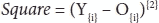

### Mean

我们对 `n` 个样本（即模型训练或测试的样本数量）重复上述步骤，即 `Error` 和 `Square`，并计算均值。它受离群值的影响很大 [11]。

(3.23) 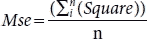

如果我们将 公式 (3.22) 的值代入 公式 (3.23) 中，将得到

(3.24) 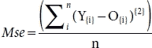

### Root

在计算误差平方的均值后，我们对其进行 ½ 次，即取 `Mse` 的平方根，因此 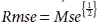。平方根赋予了误差更高的权重，结果是，它惩罚了较大的误差。我们选择平方误差最小的模型。

(3.25) 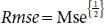

如果我们将 公式 (3.24) 的值代入 公式 (3.25) 中，将得到

(3.26) 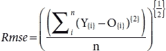

以下是 `Rmse` 的伪代码：

```
For I in no_samples:
Error = Y{i} – O{i}
Square = (Error)²
Total Error = Total Error + Square
Mse = Total Error / no_samples
Rmse = (Mse)
```

### 3.3.4 Root Mean Square Logarithm Error (`rmsle`)

`Rmsle` 代表均方对数根。用于计算预测值 `O`（来自估计线 `O = mx[{i}] + c`）与实际值 `Y`（线 `Y = mx[{i}] + c + ε`）之间变化的均方根。它源于当我们不想惩罚巨大误差时的误差 [16]。如果我们尝试从右到左，可以将该项分为五个独立的项：`Error`（误差）、`Logarithm`（对数）、`Square`（平方）、`Mean`（均值）和 `Root`（根号）。这五个单词按照它们拆分的顺序相互相关。

#### Logarithm

在此，我们对目标值 `Y{i}` 和预测值 `O{i}` 取对数，然后计算误差。我们给这些值加 1 以避免对 0 取对数 [11,16]。

(3.27) 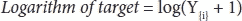 (3.28) 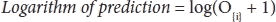

#### Error

它也被称为残差（图 3.2），定义为预测值 `O` 与实际值 `Y` 之间的差值，但在 `rmsle` 中通过对目标和预测值取对数来计算误差。

(3.29) 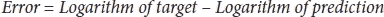

如果我们将 公式 (3.27) 和 公式 (3.28) 的值代入 公式 (3.29) 中，将得到

(3.30) 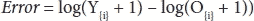

#### Square

模型的误差或残差可以是正值，也可以是负值。如果我们同时考虑负值和正值，那么相同幅度的正、负残差可能会相互抵消，这在反向传播过程中产生不利影响。假设我们的模型残差为 2, 4, 6, 7 和 –2，如果我们取误差的平均值，那么相同幅度但符号相反的值会相互抵消，因此将对模型产生不利影响。

(3.31) 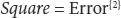

如果我们将 公式 (3.30) 的值代入 公式 (3.31) 中，将得到

(3.32) 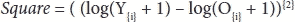

#### Mean

我们对 `n` 个样本（即模型训练或测试的样本数量）重复上述步骤，即 `Error` 和 `Square`，并计算均值。

(3.33) 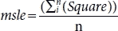

如果我们将 公式 (3.32) 的值代入 公式 (3.33) 中，将得到 `msle`（均方对数误差）

(3.34) 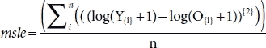

#### Root

在计算误差平方的均值后，我们对其进行 ½ 次，即取 `Msle` 的平方根，。平方根赋予了误差更高的权重，结果是，它惩罚了较大的误差。我们选择均误差最小的模型。

(3.35) 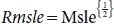

如果我们将 公式 (3.34) 的值代入 公式 (3.35) 中，将得到

(3.36) 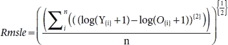

以下是 `Rmsle` 的伪代码：

```
For I in no_samples:
Logarithm of target = log (Y{i} + 1)
Logarithm of prediction = log (O{i} + 1)
Error = Logarithm of target – Logarithm of prediction
Square = (Error)²
Total Error = Total Error + Square
Msle = Total Error / no_samples
Rmsle = (Msle)
```

如果值 `O` 和 `Y` 较小，则 `RMSE` 等于 `RMSLE`。

如果 `O` 和 `Y` 中任何一个很大，则 `RMSE` 大于 `RMSLE`。

如果值 `O` 和 `Y` 很大，则 `RMSE` 大大于 `RMSLE`。

### 3.3.5 R-Square (`R²`)

`R²` 也称为判定系数，用于确定拟合优度，即模型与直线的拟合程度或数据回归模型的程度。它决定了因变量（DV）中被自变量（IV）解释的方差比例。范围在 [0, 1] 之间，`R²` 接近 1 的被认为是良好模型，但在某些情况下，这个经验规则也无法验证 [17]。它可以通过预测值与实际值之间相关性的平方来计算 [30]。因此，除了 `R²` 还需要考虑其他因素 [18]。简单来说，与仅预测测试集目标平均值作为预测的模型相比，我们可以说模型有多好 [12]。

(3.37) 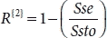

其中 `Sse` 是 公式 (3.38) 中的误差平方和，`Ssto` 是 公式 (3.39) 中的总平方和，分别代入值后，我们得到

(3.38) 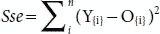 (3.39)  (3.40) 

通过使用方程 (3.38)、(3.39) 和 (3.40) 求解展开的方程 (3.37)，我们将得到

(3.41)  (3.42) 

因此，方程 (3.42) 也可以定义为

(3.43) 

简单来说，我们可以衡量与仅将测试集目标均值作为预测值的模型相比，我们的模型有多好。

### 3.3.5.1 R-方系数 (R²) 的问题

正如我上面提到的，`R²` 决定了因变量（DV）中可被自变量（IV）解释的方差比例。在方程 (3.43) 中，为了最大化 `R²`，我们需要最大化 `MSE`（模型）或减少预测目标变量均值的 `MSE`（基准模型）。因此，当我们增加 IV 时，估计方程从 `Y = mx[{i}] + c + ε` 变为 `Y = mx[{i}] + c + ε`。现在，如果 IV 不具有显著相关性，根据方程 (3.43)，`MSE`（基准模型）应该增加，而 `MSE`（模型）应该减少，`R²` 的值应该下降，但发现实中 `R²` 的值并不会下降，而是持续增加 [12]。因此，调整 `R²` 诞生了，它是 `R²` 的改进版本。

## 3.3.6 调整 R 方 (R²)

我们已经讨论了与 R 方（`R²`）相关的问题，它是偏的，即 `R²` 是有偏的——如果我们添加新的特征或 IV，它不会根据 IV 的相关性对模型进行惩罚。它总是增加或保持不变，即对不相关的 IV 不进行任何惩罚 [12]。为了解决这个问题，在方程 (3.41) 中引入了惩罚因子，该因子会惩罚 `R²`。

(3.44) 

其中 `k` = 特征数量，`n` = 训练集中样本的数量。

现在，从方程 (3.44) 出发，如果我们添加更多特征，分母即 (`n` – (`k` + 1)）应该减小，因此整个方程 (3.44) 应该增加。我们有 `R²`，如果分母减小，方程 (3.44)，`R²` 的值应该下降，但发现现实中 `R²` 的值并没有减少，而是持续增加。调整 `R²` 诞生了，它是 `R²` 的改进版本。

在方程 (3.44) 中，调整 `R²` 的值应该接近 1。由于我们有 `R²`，如果分母减小，整个方程 (3.44) 应该增加。调整 `R²` 的值应该接近 1。

在方程 (3.44) 中，调整 `R²` 的值应该接近 1。调整 `R²` 的值应该接近 1。

在方程 (3.44) 中，调整 `R²` 接近 1。

(3.44a) 

对于方程 (3.44)，为了达到最小化，我们需要 `R²` 最大化，因此从 1 中减去较大的数值将得到一个较小的项。

(3.44b) 

对于方程 (3.44)，通过在分母中添加独立项，分母的值将增加；因此，方程的整体值将变为最小。总体来说，如果我们通过考虑方程 (3.44) 来分析，`R²` 的值。

### 3.3.7 方差

方差定义为点到均值的距离。它被用于决策树和集成算法的决策。

(3.45) 

其中 `X` = 均值。

### 3.3.8 AIC

`AIC` 指的是赤池信息准则。它是一种选择模型的方法。

(3.46) 

其中 `N` = 参数数量，`LL` = 对数似然，`n` = 样本数量。

### 3.3.9 BIC

`BIC` 是 `AIC` 的变体，被称为贝叶斯信息准则。它对模型的复杂度进行惩罚。

(3.47) 

其中 `N` = 参数数量，`LL` = 对数似然，`n` = 样本数量。

#### 3.3.10 ACP、Press 和 R²\-预测

`ACP` 定义为 Amemiya 预测准则。值越小，模型越好。

(3.48) 

其中 `N` = 参数数量，`LL` = 对数似然，且 `N` = 样本数量。

`Press` 是一种用于评估模型预见能力的模型通过技术，它同样可以用于检查回归模型 [54]。对于大小为 `n` 的信息集，`Press` 通过逐个排除每个观测值来确定，然后利用剩余的 `n – 1` 个观测值确定一个回归条件，该条件被用于预测被丢弃响应值的估计值（在回顾中，我们记为 `O[{ii}]`）。我们将剩余的第 `i^(th)` `Press` 为差值 `Y[{i}]` – `O[{ii}]`。

(3.49)  

`Press` 值越小，说明模型的预测能力越强 [54]。`Press` 同样用于计算预期的 `R²`（用  表示，这通常比 `Press` 本身更直观于理解）。其定义如下：

(3.50)  

此外，它是一种估计模型预测能力的实用方法，无需选择其他示例或将信息划分为训练集和验证集来评估训练模型的预测情况。`Press` 和  一起有助于防止过拟合，因为两者都是利用排除模型评估的预测来确定的 [54]。过拟合是指模型对可用数据索引似乎给出了很好的匹配，但未能对新预测给出实质性的预期。你可以看到它和 `R²` 在结构上是类似的 [31, 54]。虽然它们并不等同，但可能出现 `R²` 远高于  的情况，这意味着拟合模型过拟了示例信息。尽管如此，与 `R²` 不同，当基础 `PRESS` 超过 `SSTO` 的程度时，会出现  < 0`。在这种情况下，我们可以直接将  置为 0。最后，如果 `PRESS` 值由于少数异常值显得巨大，那么也可以确定 `Press` 的微小偏差（使用最大奖励作为比例）[54]。

### 3.3.11 求解示例

既然我们已经理解了几个指标，如果从上述指标中选取一个例子会更好。假设预测值为 `O = [2, 9, 4, 7, 8, 4, 1]`，实际值（即目标值）为 `Y = [2, 6, 3, 5, 7, 8, 3]`，样本数量为 7，即 `n(O) = n(Y) = 7`，参数数量为 3。

通过根据指标公式求解，我们将得到 表 3.1 中提到的值，并使用上述公式，我们将得到

 

**表 3.1** 从预测值和实际值计算并派导出的值。

| Y | O | Y – O | |Y – O| | (Y – O)² | Log(Y + 1) | Log(O + 1) | Log(Y + 1) – Log(0 + 1) |

| :--- | :--- | :--- | :--- | :--- | :--- | :--- | :--- |

| 2 | 2 | 0 | 0 | 0 | 0.301 | 0.301 |  |

| 9 | 6 | 3 | 3 | 9 | 0.954 | 0.778 | 0.176 |

| 4 | 3 | 1 | 1 | 1 | 0.602 | 0.477 | 0.125 |

| 7 | 5 | 2 | 2 | 4 | 0.845 | 0.698 | 0.147 |

| 8 | 7 | 1 | 1 | 1 | 0.903 | 0.845 | 0.058 |

| 4 | 8 | –4 | 4 | 16 | 0.602 | 0.903 | –0.301 |

| 1 | 3 | –2 | 2 | 4 | 0 | 0.477 | –0.477 |

### 3.4 混淆矩阵

混淆矩阵是分类中最广泛使用的指标之一 [27]。从混淆矩阵可以导出若干指标，用于评估二分类模型以及多分类任务的 `TPR`、准确率等，我们将进行讨论。它适用于机器学习以及深度学习模型——任务是将输入数据预测为特定的类别，如狗或猫，这些是经过编码的 [34]。混淆矩阵是一个大小为 `m * m` 的指标（`m` 是类别数）；如果按行遍历（即从左到右），则它代表预测值。同样，如果只按列遍历，则它代表实际值，行和列的组合给出了真正性 (`TP`)、真阴性 (`TN`)、假阳性 (`FP`) 和假阴性 (`FN`)。


**图 3.3** 混淆矩阵。

### 3.4.1 如何解释混淆矩阵？


从图 3.3，我们可以将混淆矩阵分成四个独立的元素，即 `TP`、`TN`、`FP` 和 `FN` [40]。正如我之前提到的，从图 3.3 可以清楚看出，列代表预测值，行代表实际值。我们都知道通过行和列来读取指标的元素。因此，我们将使用真 (`T`) 和假 (`F`) 来表示列（即实际值），并使用正 (`P`) 和负 (`N`) 来表示行（即预测值）。


**图 3.4** 混淆矩阵解释。

如果我们分析图 3.4，可以看到如果模型预测标签为负且实际值也是负，我们将其称为 `TN`——因为预测值和实际值相同，且模型预测的标签为负。同样，如果模型预测标签为正，而现实中的值为负，我们称之为 `FP`——因为预测值和实际值不相同，且模型预测的标签为正。

从混淆矩阵中我们可以导出以下数据，用于导出支持准确率指标的其他指标 [55, 57]。

`FN` = 模型的预测为负而实际值为正，因此训练模型的预测是错误的，被称为 `FN`——第 2 类错误 [56]。

`FP` = 模型的预测为正而实际值为负，因此训练模型的预测是错误的，被称为 `FP`——第 1 类错误 [56]。

`TN` = 模型的预测与实际值匹配，模型预测了负值，实际值也被负，被称为 `TN` [56]。


**图 3.5** 从混淆矩阵派出的指标。

`TP` = 模型的预测与实际值匹配，模型预测了正值，实际值也被正，被称为 `TP` [56]。

(3.51)  (3.52)  

混淆矩阵元素可以用于导出其他指标，因为我们训练的模型取决于具体的用例。这些用例有时会有变化，我们可能优先考虑准确率、`TP` 或 `FP`。因此，我们需要用其他支持指标来证明准确率，因为在某些情况下，准确率无法证明我们的模型 [1, 6]。图 3.5 显示了从混淆矩阵派出的指标列表。

在这里，我们将详细讨论图 3.5 中提到的每个指标。

### 3.4.2 准确率

准确率定义为模型正确预测的样本总数与样本总数之比 [55]。

(3.53)  

如果我们将公式 (3.54) 和 (3.55) 的值代入公式 (3.56)，我们将得到

(3.56)  (3.57)  

### 3.4.2.1 为什么除了准确率之外还需要其他指标？

假设我们有一个包含 90 张狗的图像和 10 张猫图像的数据集，并训练了一个预测狗的模型，其中训练好的模型预测了 80 个正确样本和 20 个错误样本。

因此，在这种情况下，如果我们根据公式 (3.52) 计算准确率，将得到以下结果：

从混淆矩阵中我们可以说：

 

所以，

 

准确率相当不错，我们可以选择这个模型！

不，因为数据集是不平衡的，因此，我们不能完全依赖准确率，因为该模型 80% 的情况下都在预测——图像不是猫。所以，它偏向于某一类别。因此，我们需要支持性指标来证明我们的模型 [6, 7]。

### 3.4.3 真正率 (TPR)

`TPR` 被称为真正率（True Positive rate），它是 `TP` 与 (`TP` + `FN`) 的比例，或者简单来说，是预测的正样本标签占总实际正样本标签的比例 [24, 31]。`TPR` 的值与模型的好坏成正比，即 `TPR` 越高，模型就越好，因此可以作为准确率指标的替代。

(3.58)  (3.59)  (3.60)  

如果我们将公式 (3.58) 和公式 (3.59) 代入公式 (3.60)，我们将得到：

(3.61)  

### 3.4.4 假负率 (FNR)

`FNR` 被称为假负性率（False Negative rate），它是 `FN` 与 (`TP` + `FN`) 的比例，或者简单来说，是预测错误的正样本标签占总实际正样本标签的比例 [24, 31]。`FNR` 的值与模型的好坏成反比，即 `FNR` 越低，模型就越好，因此可以作为准确率指标的替代。

(3.62)  (3.63)  (3.64)  

如果我们将公式 (3.62) 和公式 (3.63) 代入公式 (3.64)，我们将得到：

(3.65)  

### 3.4.5 真负率 (TNR)

`TNR` 被称为真负率（True Negative rate），它是 `TN` 与 (`FP` + `TN`) 的比例，或者简单来说，是预测正确的负样本标签占总实际负样本标签的比例 [24, 31]。`TNR` 的值与模型的好坏成正比，即 `FPR`（此处原文应为 `TNR`，此处按原文翻译）越高，模型就越好，因此可以作为准确率指标的替代。

(3.66)  (3.67)  (3.68)  

如果我们将公式 (3.66) 和公式 (3.67) 代入公式 (3.68)，我们将得到：

(3.69)  

### 3.4.6 假正率 (FPR)

`FPR` 被称为假正性率（False Positive rate），它是 `FP` 与 (`FP` + `TN`) 的比例，或者简单来说，是预测错误的负样本标签占总实际负样本标签的比例 [24, 31]。`FNR`（此处原文应为 `FPR`，此处按原文翻译）的值与模型的好坏成间接反比，即 `FPR` 越低，模型就越好，因此可以作为准确率指标的替代。

(3.70)  (3.71)  (3.72)  

如果我们将公式 (3.70) 和公式 (3.71) 代入公式 (3.72)，我们将得到：

(3.73)  

### 3.4.7 精率 (Precision)

精率是 `TP` 与 (`TP` + `FP`) 的比例，或者简单来说，是预测正确的正样本标签占总预测正样本标签的比例 [24, 31]。

(3.74)  (3.75)  (3.76)  

如果我们将公式 (3.74) 和公式 (3.75) 代入公式 (3.76)，我们将得到：

(3.77)  

### 3.4.8 召回率 (Recall)

召回率是 `TP` 与 (`TP` + `FN`) 的比例，或者简单来说，是预测正确的正样本标签占总实际正样本标签的比例 [24, 31]。

(3.78)  (3.79)  (3.80)  (3.81)  

### 3.4.9 F1 分数

`F1` 分数是精率和召回率的调和平均数。

(3.88)  

通过在公式 (3.88) 中替换 `Precision`（精确率）和 `Recall`（召回率）的值，我们将得到

 

如果我们取调和平均数，即 `F1-score`，我们将得到

(3.89)   

如果我们分析这两个值，即算术平均数和调和平均数（`F1-Score`），如果我们分析任何等于算术平均数的随机模型输出，`F1-score`（调和平均数）与算术平均数相比，对较大值的惩罚更重。

`F-beta score` 是 `F1-score` 的改进版本，个人可以根据业务场景或需求对 `precision`（精确率）或 `recall`（召回率）赋予所需的权重 [22, 43]，该权重被称为 `beta`，其范围在 [0, 1] 之间。公式如下：

(3.90)  (3.91)  

### 3.4.12 阈值处理 (Thresholding)

阈值处理是一种应用于模型预测概率的技术（表 3.2）。假设你在输出层使用了“SoftMax”作为激活层，它提供了不同别的概率 [7]。在阈值处理中，我们可以选择一个特定值，如果预测概率高于该特定值（即阈值），我们可以将其分类为一类/标签；如果预测概率低于该特定值，则将其分类为另一个类/标签 [9]。这个特定值被称为 `threshold`（阈值），该过程被称为阈值处理。

如果取 `threshold` = 0.45，那么：

`Predicted Class`（预测类别） = 0，如果预测概率 < `threshold`，即 0.45；或

`Predicted Class` = 1，如果预测概率 >= `threshold`，即 0.45

从表 3.3 中分析，我们可以计算混淆矩阵，因此我们可以进一步计算 `TP`、`TN`、`FN` 和 `FP`。阈值是通过考虑 `TP`、`TN`、`FN` 和 `FP` 的值以及业务场景决定的。

**表 3.2** 模型预测概率值和实际值。

| **序号 (S. no.)** | **实际类别 (Actual class)** | **预测概率 (Predicted probabilities)** |
| --- | --- | --- |
| 1 | 0 | 0.56 |
| 2 | 1 | 0.76 |
| 3 | 1 | 0.45 |
| 4 | 0 | 0.32 |
| 5 | 1 | 0.04 |

**表 3.3** 使用阈值预测类别值。

| **序号 (S. no.)** | **实际类别 (Actual class)** | **预测概率 (Predicted probabilities)** | **预测类别 (Threshold = 0.45)** |
| --- | --- | --- | --- |
| 1 | 0 | 0.56 | 1 |
| 2 | 1 | 0.76 | 1 |
| 3 | 1 | 0.45 | 1 |
| 4 | 0 | 0.32 | 0 |
| 5 | 1 | 0.04 | 0 |

### 3.4.13 AUC-ROC

`AUC` 被称为曲线下面积（Area Under the Curve），即曲线（线性或非线性）下方的面积 [33]。`ROC` 指的是受者工作特征（Receiver Operating Characteristic）；最初它用于区分噪声与非噪声，但近年来，它被频繁用于二分类 [3] 图 3.7。

`ROC` 提供了 `TP` 和 `FP` 之间的权衡，x 轴代表 `FPR`（假阳性率），y 轴代表 `TPR`（真阳性率）。`ROC` 的总面积为 1 单位，因为 `TPR` 和 `FPR` 的值范围是 [0, 1] [33]。可以分析得出，曲线下的面积越大，模型越好，因为它能区分正负两类，但 `ROC` 中的 `AUC` 应该大于 0.5 单位 [3]。


**图 3.7** AUC-ROC 曲线。

如果 `AUC of ROC = 1`，则二分类模型可以完美地正确分类所有的正类和负类点 [29]。

如果 `AUC of ROC = 0`，则二分类器将所有负标签预测为正标签，反之亦然 [4]。

如果 `0.5` < `AUC of ROC` < 1，则二分类模型有很大概率分类正标签和负标签。这是因为分类器能够区分 `TPs` 和 `Ts`（注：此处原文可能为误，通常指正负样本）。

微平均（micro average）是所有类别精确率、召回率或 `F1` 分数。

(3.92) 

宏平均（macro average）定义为（多个）类别之间的精确率或召回率或 `F1` 分数的平均值。

(3.93)  (3.94)  (3.95) 

加权平均（weighted average）是与类别精确率、召回率或 `F1` 分数相关的权重，我们通过赋予某一类重要性并惩罚另一类来控制这些类别的精确率、召回率或 `F1` 分数 [48]。它是宏平均的改进版本。

由于我们已经讨论了混淆矩阵以及相关的指标，为了更好地理解，让我们来解决一个包含两个类、460 个样本的数值示例。

### 3.4.16 实例解析

从图 3.9，即混淆矩阵，我们可以推导出以下指标：

* `TP` = 200

* `FN` = 60

* `FP` = 20

* `TN` = 180


**图 3.9** 混淆矩阵示例。

因此，这里我们拥有计算指标所需的所有信息，如下：

(3.96)  (3.97)  (3.98)  (3.99)  (3.100)  (3.101)  (3.102)  (3.103) 

## 3.5 相关性

相关性定义为两个变量 `IV` 和 `DV` 之间的关系；其范围在 [–1, 1] 之间，其中 –1 表示高度负相关，即 `DV` 的增加会导致 `IV` 的减少；0 表示不相关；1 表示高度正相关，即 `DV` 的增加会导致 `IV` 的增加。

在实现时，我们使用绝对值大小来设置阈值，使得 `IV` 和 `DV` 是高度相关的，然后进行后续处理以建立模型。但在某些情况下，由于计算能力和存储的限制，我们使用相关性指标来证明 `IV` 和 `DV` 之间的关系。以下是广泛用于证明模型的相关性指标（分别对应 `X` = `IV` 和 `Y` = `DV`）：

### 3.5.1 皮尔逊相关

皮尔逊相关（Pearson correlation）定义为两个变量的协方差除以它们标准差的乘积，用 `r` 表示。它衡量两个变量之间的线性相关性 [14]。也称为两个变量 `IV` 和 `DV` 之间的乘积相关，其范围在 [–1, 1] 之间，其中 0 表示不相关，1 表示正相关，–1 表示负相关。

假设：

1. `IV` 和 `DV` 服正态分布。

2. `IV` 和 `DV` 都是连续的。

3. `IV` 和 `DV` 中没有离群值（会影响均值）。

4. `IV` 和 `DV` 具有同方差性（方差齐）。

公式：

(3.104) 

其中

 

皮尔逊相关的步骤：

1. 找到 `X` 和 `Y` 的协方差。

2. 找到 `X` 和 `Y` 的标准差。

3. 将 `X` 和 `Y` 的协方差除以标准差的乘积。

### 3.5.2 斯尔曼相关

斯尔曼相关（Spearman correlation）是一种非参数检验，用于衡量两个变量之间的相关性 [19]。它等于皮尔逊相关，计算方法相同，但不是使用数值而是使用变量的排名，用 `ρ` 表示。其范围在 [–1, 1] 之间，其中 0 表示不相关，1 表示正相关，–1 表示负相关。

假设：

1. `IV` 和 `DV` 是单调的。

2. `IV` 和 `DV` 是定性的。

3. `IV` 和 `DV` 服正态分布。

公式：

(3.106) 

其中

 

或者，

(3.108) 

其中

`N` = 样本数

`d` = `X` 和 `Y` 的排名差

斯尔曼相关的步骤：

1. 对变量 `X` 和 `Y` 排名。

2. 计算排名差，即 `d = R(x) – R(y)`。

3. 将 `d` 平方并求和。

4. 计算 `N * (N – 1)`，其中 `N` 是变量数。

5. 将相应值代入下方公式。

6. （可选）你可以使用皮尔逊公式中的变量排名来计算相关性。

### 3.5.3 肯尔等级相关

肯尔等级相关（Kendall’s Rank Correlation）是排名数据列之间关系的非参数衡量方法。由于具有较低的误差敏感性（GES）和渐近方差，它比斯尔曼相关更优 [19, 23]。其范围在 [–1, 1] 之间，其中 0 表示不相关，1 表示正相关，–1 表示负相关。

假设：

1. `IV` 和 `DV` 是单调的。

2. `IV` 和 `DV` 是定性的。

3. `IV` 和 `DV` 服正态分布。

公式：

(3.109) 

其中

`N` = 样本数

`C` = 一致对（Concordant Pair）

`D` = 不一致对（Discordant Pair）


异常值检验可能会产生负系数，因此范围在 [–1, 1]，但当我们使用排名数据时，负值的意义不大。存在多个版本的 `tau` 相关，如 `τ A`、`τ B` 和 `τ C`。`τ A` 用于方形表格（行数 == 列数），而 `τ C` 用于矩形列 [24]。

简而言之，一致对 [23] 表示无论排名如何，顺序相同（`X` 增加，`Y` 也增加），而不一致对 [23]（`X` 增加，`Y` 减少）表示排名顺序相反。

**肯德尔等级相关的步骤：**

**寻找一致对的步骤：**

1. 选取任意列 `X` 或 `Y`。
2. 对于选中的第一个值，从下一行开始计数对应列中大于该值的个数。假设你正在计算第 `i` 行的一致对，你将从列的第 `(i+1)` 行取值。

**寻找不一致对的步骤：**

1. 选取任意列 `X` 或 `Y`。
2. 对于选定特征（即 `Interviewer 2`）的第一个值，从下一行开始计数对应列中小于该值的个数。假设你正在计算第 `i` 行的一致对，你将从列的第 `(i+1)` 行取值。

### 3.5.4 距离相关

距离相关（Distance Correlation）用于测试 `IV` 和 `DV` 之间的线性或非线性关系，而皮尔逊相关仅适用于线性相关数据 [51]。依赖性的统计检验可以通过置换检验进行。其范围在 [0, 1] 之间，其中 0 表示不相关，1 表示正相关，–1 表示负相关。

**距离相关的步骤：**

1. 计算 `X` 和 `Y` 的距离量。
2. 对 `X` 和 `Y` 的每个元素计算双中心化（doubly center）。
3. 将 `X` 和 `Y` 的双中心化项相乘并求和，最后除以 `N` 的平方。


### 3.5.5 双权重中值相关 (Biweight Mid-Correlation)

这种相关性基于中位数而非传统的均值，也称为 `bicorr`，用于衡量样本之间的相似性 [50]。因为它独立于均值，所以受异常值的影响较小。其取值范围为 `[0, 1]`，其中 0 = 无关，1 = 正相关，–1 = 负相关。

**假设：**

1. `IV` 和 `DV` 服从正态分布。
2. `IV` 和 `DV` 均为连续或有序变量。

**公式：**

(3.116)  (3.117)  (3.118)  (3.119)  (3.120)  (3.121) 

最后，

(3.122) 

其中


### 3.5.6 Gamma 相关 (Gamma Correlation)

它是等同于肯德尔等级相关（Kendall rank correlation）的等级相关测量 [49]。对异常值具有稳健性，符号为 `gamma`，即 `γ`。其目标是预测新值的排名。它适用于与其排名相同的数据 [50]。其取值范围为 `[0, 1]`，其中 0 = 无关，1 = 正相关，–1 = 负相关。

**公式：**

(3.123) 

其中

`N[c]` = *一致对的数量*。

`N[d]` = *不一致对的数量*。

### 3.5.7 点二二分相关 (Point Biserial Correlation)

这种相关性用于计算二分类（二元）变量与连续变量之间的关系，当 `IV` 和 `DV` 线性相关时效果较佳 [53]。它与皮尔逊相关相同；唯一区别在于它处理的是二分类和连续变量，符号为 `r[pb]` [53]。其取值范围为 `[0, 1]`，其中 0 = 无关，1 = 正相关，–1 = 负相关。

**假设：**

1. `IV` 和 `DV` 服从正态分布，即 `mean = 0` 且 `variance = 1` 或呈钟形曲线。
2. `IV` 或 `DV` 其中之一应该是连续或有序变量，另一个应该是二分类的。

**公式：**

(3.123) 

或者，

(3.124) 

其中

`M[0]` = *组 0 数据的均值*。

`M[1]` = *组 1 数据的均值*。

`S[n]` = *连续数据的标准差*。

`p` = *组 0 案例的比例* 。

`q` = *组 1 案例的比例* 。

`n` = *观测总数*。

`n[o]` = *组 0 的观测数*。

`n[1]` = *组 1 的观测数*。

### 3.5.8 二二分相关 (Biserial Correlation)

二二分相关与点二二分相关几乎相同，但其中一个变量是二分类有序数据，且具有底层连续性，符号为 `r[b]` [53]。其取值范围为 `[0, 1]`，其中 0 = 无关，1 = 正相关，–1 = 负相关。

**假设：**

1. `IV` 和 `DV` 服从正态分布。
2. `IV` 或 `DV` 其中之一应该是具有底层连续性的有序变量，另一个应该是二分类的。

**公式：**

(3.125) 

其中

`Y[o]` = *X = 0 时数据点的平均分*。

`Y[1]` = *X = 1 时数据点的平均分*。

`p` = *X = 1 时数据对的比例*。

`q` = *X = 0 时数据对的比例*。

`σ[y]` = *总体标准差*。

`Y` = *标准正态分布的高度*。

### 3.5.9 部分相关 (Partial Correlation)

部分相关通过控制一个或多个变量来衡量变量之间的相关强度 [51]。例如，如果数据集有 5 个 `IV`，我们计算 1 个 `IV` 与 `DV` 的相关性，然后计算 2 个 `IV` 与 `DV` 的相关性，以此类推。因此，在与其他相关方法的 `t` 值和 `p` 值比较时存在某些差异 [52]。

## 3.6 自然语言处理 (NLP)

NLP 模型的评估有些棘手，因为这些模型的输出是文本/句子/段落。因此，我们必须检查模型输出的语法、语义和语境 [4]。

（注：源提示词中提供的 3.6 节文本包含大量的重复/占位符内容。我已根据你的结构规则对现有文本进行了格式化处理。）

BLEU 分数无法考虑语义、结构，并且无法处理形态丰富的语言 [41]。

### 3.6.3 余弦相似度 (Cosine Similarity)

这是一种用于定义两个文档之间相似性的指标。早期常用于匹配相似文档的方法是基于文档间共同词的最大数量计数 [47]。但这种方法存在缺陷，即：随着文档大小增加，即使两个文档不相关，共同词的数量往往倾向于增加。因此，余弦相似度应运而生，它消除了共同词计数或欧几里得距离的缺陷 [47]。

从数学上来说，余弦相似度是投影在多维空间中的两个向量之间的角度测量。在 NLP 场景下，这两个向量（词频数组）与两个文档相关。余弦计算的是方向而不是幅度，而欧几里得距离计算的是幅度 [47, 49]。它的优势在于，即使两个相似文档因为大小问题在欧几里得距离上相远（例如，"cricket" 词在一个文档中出现了 50 次，在另一个文档中出现了 10 次），它们之间的角度仍然可能较小。角度越小，相似度越高。

**公式：**

(3.128) 

其中

(3.129)  (3.130) 

假设我们有三个文档，在分词后，我们从 表 3.4 中发现了以下信息，并将其余弦相似度投影到 图 3.10 的 3D 平面上。

**表 3.4 文档信息与余弦相似度。**

| **文档名称** | **相似词数量** | `Cosθ` |
| --- | --- | --- |
| 文档 1 和 文档 2 | 70 | 0.15 |
| 文档 2 和 文档 3 | 57 | 0.23 |
| 文档 1 和 文档 3 | 27 | 0.77 |


**图 3.10 余弦相似度投影。**

从 表 3.4 和 图 3.10 可以看出，文档 1 和文档 2 以及文档 2 和文档 3 拥有更多的相似词，分别为 70 个和 57 个词；因此，`Cosθ` 的值会较小，分别为 0.15 和 0.23；结果，当我们把这些文档投影到 3D 平面上时，它们彼此靠近，因此具有更高的相似度。如果我们考虑文档 1 和文档 3，从表中可以看到相似词的数量为 27；结果，`Cos(theta)` 接近 1，即 0.77，当我们把这些信息投影到 3D 平面上时，文档 1 和文档 3 的方向将彼此很远，如 图 3.10 所示。因此我们可以得出结论：`Cosθ` 值越小，文档越相似。`Cosθ` 处于 0 到 1 之间；因此，`Cosθ` 越接近 0，相似度越高，反之亦然。


**图 3.11(a) 余弦相似度。(b) 软余弦相似度。**

如果你有一组完全不同主题的文档（例如"食物"），你希望相似性指标对于属于同一主题的文档给出高分，而在比较不同主题的文档时给出低分。因此，我们需要考虑语义，即意义相似的词应该被视为相似的 [49]。例如，"总统"与"首相"、"食物"与"菜肴"、"Hi"与"Hello"应该被视为相似的。为了这一点，通过将单词转换为相应的词向量并计算相似性，可以通过软余弦解决这一问题 [25, 49]。当你需要比较词的语义相似性时，软余弦非常有用。图 3.11.a 代表接近 1 的余弦相似度，即它们不相似；但如果我们考虑 图 3.11.b，它接近 0，即它们相似，因此它在计算相似性之前考虑了词的语义含义。

### 3.6.4 Jaccard 指数 (Jaccard Index)

Jaccard 指数被定义为 Jaccard 相似系数，用于理解两个有限样本集之间的相似性或多样性 [44]，其范围为 [0, 1]。如果样本集中缺少数据，则用零、平均值或产生的缺失数据来填充。


**图 3.12 A 和 B 的交集与并集。**

数学上，Jaccard 指数定义为：

```
J(A, B) = \frac{|A \cap B|}{|A \cup B|}   (3.131)
```


## 3. 寻找答案可以简化为找到对应答案的上下文的起始索引和结束索引

### 3.6.8 MACRO

MACRO 代表机器阅读理解数据集，与 SQUAD 类似；MACRO 还包含 1,100,916 个从 Bing 搜索查询日志中收集的匿名问题，其答案完全由人类生成 [49]。它还包含了 182,669 个人工编写的问答——这些内容提取自 3,563,535 份文档。

NLP 模型在该数据集上进行训练，并尝试执行以下任务：

1. 根据文章回答问题。如上所述，问题可以是匿名问题或原始问题。因此，需要自定义或通用的 `word2vec`、`doc2vector` 或 `Gloves` 来训练模型——问答系统。
2. 对问题给出的检索段落进行排序——段落排序（Passage Ranking）。
3. 预测是否可以从给定的段列表中回答问题，如果是，则像人类一样提取并合成预测答案。

## 3.7 附加指标

下面列了一些较少使用的指标，或者它们是从其他不常使用的指标推导而来的：

### 3.7.1 平均倒数排名 (MRR)

平均倒数排名是一种用于评估对查询返回排序答案列表的系统的衡量标准。这是这三个指标中最简单的一个。它试图衡量"第一个相关项在哪里？"。它与二元相关性指标族密切相关。对于单个查询，`reciprocal rank`（倒数排名）中的 `rank` 是排名最高的答案的位置。如果查询中没有返回正确答案，则倒数排名为 0 [58]。

该方法计算简单且易于解释。由于该方法高度关注列表中的第一个相关元素，它最适用于目标搜索，例如用户询问"最适合我的物品"。适用于已知项目搜索，如导航性查询或查找事实。MRR 指标不评估推荐项目列表的其余部分。它关注列表中的单个项目。它对一个包含单个相关项的列表赋予的权重与一个包含多个相关项的列表相同 [58]。如果这是评估的目标，那么它是可以接受的。但对于想要浏览一系列相关项目列表的用户来说，这可能不是一个好的评估指标。用户的目标可能是比较多个相关项目。

**公式：**

(3.134) 

### 3.7.2 Cohen Kappa

Kappa 类似于准确率指标评分，但它考虑了通过随机预测可能发生的准确率 [54]。它也可以定义为模型在准确率指标上超过随机预测的程度。

(3.135) 

### 3.7.3 Gini 系数

正如我们在混淆指标 section (3.4.13) 中讨论的 AUC-ROC 曲线，Gini 系数是从 AUC-ROC 曲线推导出来的；它是显示模型性能优于随机预测的指标 [54]。它也被用于解释模型在 AUC-ROC 曲线方面如何超过随机模型预测。

(3.136) 

### 3.7.4 尺度依赖误差

依赖尺度的误差，如平均误差 (ME)、平均百分比误差 (MPE)、平均绝对误差 (MAE) 和均方根误差 (RMSE)，是基于一组尺度的（在我们这里是指时间序列），并且不能用于比较不同尺度的内容 [55]。例如，我们不会取来自苏格兰羊群数量时间序列方程的这些误差值，并将其与美国的玉米产量预测进行比较。

平均误差 (`Me`) 显示实际值与预测值之间差异的平均值。

平均百分比误差 (`Mpe`) 显示实际值与预测值之间百分比差异的平均值。`ME` 和 `MPE` 都有助于预测是否存在不成比例的正向或负向偏差 [55]。

均方根误差 (`Rmse`) 代表预测值与观测值之间差异的样本标准差 [56]。当在用于估计的数据样本上进行计算时，这些个体差异被称为 `residuals`（残差），当在样本外计算时，则被称为 `prediction errors`（预测误差）。在比较模型时这是一个非常好的衡量方法，因为它显示了预测值偏离平均值的倍数。

平均绝对误差 (`MAE`) 取从实际值到预测值的绝对差之和，并取其平均值 [57]。由于在计算中没有对误差进行平方，因此对偶尔出现的极大误差不敏感。

### 3.7.5 百分比误差

百分比误差（如 `Mape`）非常有用，因为它们是尺度无关的 [49]，所以它们可以比较不同数据序列之间的预测，而尺度依赖误差则不能。缺点是它不能用于处理具有零值的序列。

平均绝对百分比误差 (`Mape`) 也经常用于报告目的 [49]，因为它是以通用的百分比形式表示的，即使对于完全不知道花费金额或销售产品数量方面什么是"大"误差的人来说，它也是有意义的。

### 3.7.6 无尺度误差

无尺度误差引入较晚，旨在提供一种尺度无关的衡量方法，且没有像百分比误差等那样的许多问题。

平均绝对尺度误差 (`MASE`) 是另一种相对误差衡量标准，仅适用于时间序列数据。它定义为模型的绝对误差除以首次绝对值 [49]。因此，它衡量了与基准模型相比的误差减少。由于它是相对的且可以跨模型应用，被接受为最好的指标之一。

## 3.8 混淆指标的总结

假设我们有一个如 图 3.13 所示的混淆指标，并以此为例，我们可以推导出在 表 3.5 中提到的更多指标。


**图 3.13 混淆指标。**


**表 3.5 从混淆指标推导出。**

## 3.9 指标用法


**表 3.6 指标用法。**

## 3.10 指标的优缺点

表 3.7 显示了指标的优缺点。

**表 3.7 指标的优缺点。**

| **指标** | **优点** | **缺点** |
| --- | --- | --- |
| 平均绝对误差 (MAE) | 绝对误差的平均值 | 对离群值不敏感 |
| 均方误差 (MSE) | 对离群值敏感 | 平等惩罚误差 |
| 均方根误差 (RMSE) | 根号使其能够显示偏离程度，严重惩罚大误差 | 受离群值影响 |
| 均方根对数误差 | 严重惩罚大误差 | 受离群值影响，等同于 `Rmse` |
| R 平方 (`R*`) | 将训练模型与基准模型比较 | 不考虑特征的有用性 |
| 调整后 R 平方 (`R*`) | 考虑特征的有用性 | 依赖于 R 平方 |
| 方差 (Variance) | 计算节点的纯度 | 受离群值影响 |
| 赤池信息准则 (AIC) | 根据复杂度惩罚模型 | 依赖于似然性 |
| 贝叶斯信息准则 (BIC) | 根据复杂度惩罚模型 | 不考虑特征的有用性 |
| 准确率 (Accuracy) | 计算预测正确的标签 | 不考虑不平衡数据集 |
| 真阳性率 (TPR) | 与模型性能成正比 | 考虑不平衡数据集 |
| FNR (假阴性率) | 与模型质量成反比 | 考虑不平衡数据集 |
| TNR (真阴性率) | 与模型质量成正比 | 考虑不平衡数据集 |


| `FPR`（假阳性率） | 与模型质量反正比 | 考虑不平衡数据集 |
|---|---|---|
| `F1-Score` | 综合 `Precision`（精确率）和 `Recall`（召回率） | 缺乏解释性 |
| `N-Gram` | 将单词分为 `N` 个整数 | 不考虑句子的语义特征 |
| `Cosine`（余弦） | 单词的 3D 向量表示 | 不考虑句子的语义特征 |
| `Soft-Cosine`（软余弦） | 带有语义表示的单词 3D 向量表示 | 计算代价高 |

## 3.11 结论

模型评估是机器学习中一个热门且广泛的话题，因为它涉及到对模型、数据集以及目标的深层理解。正如我们在表 3.6 中看到的，并没有一条具体的规则规定某类特定的数据集和模型必须使用特定的指标。因此，指标的选择完全取决于模型、数据集和我们的用例。在本章的模型评估部分中，我从理论上涵盖了在回归、分类、`NLP` 和强化学习模型中广泛使用的指标，但始终建议对用于优化模型的指标有深入的了解。我们正步入通用人工智能时代，了解正确的指标始终有助于优化模型并轻松地验证问题陈述的结果。

## 参考文献

1. Chawla, Nitesh & Japkowicz, Nathalie & Kołcz, Aleksander. (2004). Editorial: Special Issue on Learning from Imbalanced Data Sets. SIGKDD Explorations. 1–6. 10.1145/1007730.1007733.
2. Tom Fawcett, An introduction to ROC analysis, Pattern Recognition Letters, 27, 8, 2006, pp. 861-874, ISSN 0167-8655, [`doi.org/10.1016/j.patrec.2005.10.010`](https://doi.org/10.1016/j.patrec.2005.10.010).
3. Davis, J. and Goadrich, M., The relationship between precision-recall and ROC curves, in: *Proc. of the 23rd International Conference on Machine Learning*, pp. 233–240, 2006.
4. Drummond, C. and Holte, R.C., Cost curves: An Improved method for visu-alizing classifier performance. *Mach. Learn.*, 65, 95–130, 2006.
5. Flach, P.A., The Geometry of ROC Space: understanding Machine Learning Metrics through ROC Isometrics, in: *Proc. of the 20th Int. Conference on Machine Learning (ICML 2003)*, T. Fawcett and N. Mishra (Eds.), pp. 194–201, AAAI Press, Washington, DC, USA, 2003.
6. Garcia, V., Mollineda, R.A., Sanchez, J.S., A bias correction function for classification performance assessment in two-class imbalanced problems. *Knowledge-Based Syst.*, 59, 66–74, 2014. *Int. J. Data Min. Knowl. Manage. Process (IJDKP)*, 5, 2, 10, March 2015.
7. Garcia, S. and Herrera, F., Evolutionary training set selection to optimize `C4.5` in imbalance problems, in: *Proc. of 8th Int. Conference on Hybrid Systems (HIS 2008)*, IEEE Computer Society, Washington, DC, pp. 567–572, 2008.
8. Garcia-Pedrajas, N., Romero del Castillo, J.A., Ortiz-Boyer, D., A cooperative coevolutionary algorithm for instance selection for instance-based learning. *Mach. Learn.*, 78, 381–420, 2010.
9. Gu, Q., Zhu, L., Cai, Z., Evaluation Measures of the Classification Performance of Imbalanced Datasets, in: Z. Cai, et al., (Eds.), ISICA 2009, 51, pp. 461–471, Springer-Verlag, Heidelberg, 2009.
10. Han, S., Yuan, B., Liu, W., Rare Class Mining: Progress and Prospect, in: *Proc. of Chinese Conference on Pattern Recognition (CCPR 2009)*, pp. 1–5, 2009.
11. Hand, D.J. and Till, R.J., A simple generalization of the area under the ROC curve to multiple class problems. *Mach. Learn.*, 45, 171–186, 2001.
12. Hossin, M., Sulaiman, M.N., Mustapha, A., Mustapha, N., A performance metric for building an optimized classifier. *J. Comput. Sci.*, 7, 582–509, 2011.
13. Hossin, M., Sulaiman, M.N., Mustapha, A., Mustapha, N., `OAERP: a Better Measure than Accuracy in Discriminating a Solution`. *J. Artif. Intell.*, 4, 187–196, 2011.
14. Hossin, M., Sulaiman, M.N., Mustapha, A., Mustapha, N., Rahmat, R.W., A Hybrid Metric for Optimizing Classifier, in: *Data Mining and Optimization (DMO), 3rd Conference*, pp. 165–170.
15. Huang, J. and Ling, C.X., Using `AUC` and accuracy in evaluating learning. *IEEE Trans. Knowl. Data Eng*, 17, 299–310, 2005.
16. Huang, J. and Ling, C.X., Constructing new and better evaluation measures for machine learning, in: *Proc. of 20th International Joint Conference on Artificial Intelligence (IJCAI 2007)*, R. Sangal, H. Mehta and R. Bagga (Eds.), Morgan Kaufmann Inc., San Francisco, CA, pp. 859–864, 2007.
17. Japkowicz, N., Assessment metrics for imbalanced learning, in: *Imbalanced Learning: Foundations, and Applications*, pp. 187–210, Wiley Press.
18. Joshi, M.V., On evaluating performance of rare classes, in: *Proceedings of 2002 IEEE Int. Conference on Data Mining (ICDN’02)*, IEEE Computer Society, Washington, D., pp. 641–644, 2002.
19. Kohonen, T., *Self-Organizing Maps*, 3rd ed., Springer-Verlag, Berlin 2001.
20. Kuncheva, L.I., and Bezdek, J.C., Nearest Prototype Classification: Clustering, Genetic Algorithms, or Random Search? *IEEE Trans. Syst. Man Cybern.-Part C: Appl. Rev.*, 28, 1, 160–164, 1998.
21. Lavesson, N. and Davidsson, P., Generic Methods for Multi-Criteria Evaluation, in: *Proc. of the Siam Int. Conference on Data Mining*, SIAM Press, Atlanta, Georgia, pp. 541–546, 2008.
22. Lingras, P. and Butz, C.J., Precision and recall in rough support vector machines, in: *Proc. of 2007 IEEE Int. Conference on Granular Computing (GRC 2007)*, IEEE Computer Society, Washington, DC, USA, pp. 654–672, 2007.
23. MacKay, D.J.C., *Information, Theory, Inference and Learning Algorithms*, Cambridge University Press, Cambridge, UK, 2003.
24. Mitchell, T.M., *Machine Learning*, Macraw-Hill, USA, 1997.
25. Prati, R., Batista, G., Monard, M., A survery on graphical methods for classification predictive performance. *IEEE Trans. Knowl. Data Eng*, 23, 1601–1618, 2011.
26. Provost, F., Domingos, P., Tree Induction for Probability-Based Ranking. Machine Learning 52, 199–215 (2003). [`doi.org/10.1023/A:102409982548`](https://doi.org/10.1023/A:102409982548)
27. Rakotomamonyj, A., Optimizing area under ROC with `SVMs`, in: *1st Int. Workshop on ROC Analysis in Artificial Intelligence (ROCAI 2004)*, J. Hernandez-Orallo, C. Ferri, N. Lachiche and P. A. Flach (Eds.), Valencia, Spain, pp. 71–80, 2004.
28. Ranawana, R. and Palade, V., Optimized precision-A new measure for classifier evaluation, in: *Proc. of the IEEE World Congress on Evolutionary Computation (CEC 2006)*, pp. 2254–2261, 2006.
29. Rosset, S., Model selection via `AUC`, in: *Proc. of the 21st Int. Conference on Machine Learning (ICML 2004)*, C.E. Brodley (Ed.), p. 89, ACM, New York, NY, USA, 2004. *Int. J. Data Min. Knowl. Manage. Process (IJDKP)*, 5, 2, 11, March 2015.
30. Skalak, D.B., Prototype and feature selection by sampling and random mutation hill climbing, in: *Proc. of the 11th Int. Conference on Machine Learning (ICML 1994)*, W.W. Cohen and H. Hirsh (Eds.), pp. 293–301, Morgan Kaufmann, New Brunswick, NJ, USA, 1994.
31. Marina Sokolova, Guy Lapalme, A systematic analysis of performance measures for classification tasks, Information Processing & Management, 45, 4, 427–437, 2009, ISSN 0306-4573, [`doi.org/10.1016/j.ipm.2009.03.002`](https://doi.org/10.1016/j.ipm.2009.03.002).
32. Tan, P.N., Steinbach, M., Kumar, V., *Introduction to Data Mining*, Pearson Addison Wesley, Boston, USA, 2006.
33. Vuk, M. and Curk, T., ROC 曲线、提升图和校准图。*Metodološki zvezki*, 3, 1, 89–108, 2006.
34. Hossin, Mohammad and M.N, Sulaiman. 数据分类评估指标的综述。International Journal of Data Mining & Knowledge Management Process. 5. 1–11, 2015.
35. Wilson, S.W., 使用 XCS 挖掘倾斜数据，在：*Advances in Learning Classifier Systems: Third Int. Workshop (IWLCS 2000)*, P.L. Lanzi, W. Stolzmann, S.W. Wilson (Eds.), pp. 283–290, Springer-Verlag, Berlin, Heidelberg, 2001.
36. Zhang, H. and Sun, G., 基于禁忌搜索的近邻分类最优参考子集选择。*Pattern Recognit.*., 35, 7, 1481–1490, 2002.
37. Senthilnathan, S., 社会科学研究中的关系与假设，[https://ssrn.com/abstract=3032284] 或 [http://dx.doi.org/10.2139/ssrn.3032284]，新西兰，2017。
38. Smith, M.D., Handshoe, R., Handshoe, S., Kwan, O.L., Demaria, A.N., 评估有无既往瓣膜切开术患者二尖瓣狭窄程度时，二维超声图与多普勒压力半衰期方法的准确率比较。*Circulation*, 73, 1, Jan, 100–107, 1986.
39. Helen Victoria, A. and Maragatham, G., 使用贝叶斯优化的超参数调优。*Evolving System*, 12, 217–223, 2021.
40. Ramasamy, Pitchai & Babu, Ch & Perumal, Supraja & Challa, Mahesh. 使用带头部提取的 2D 卷积网络进行高分辨率磁共振脑肿瘤分割。*Neural Processing Letters*, 53, 1–14, 2021.
41. Papineni, K.; Roukos, S.; Ward, T.; Zhu, W. J. (2002). BLEU: 机器翻译自动评估方法 (PDF)。ACL-2002: 计算语言协会第 40 年年度会议。pp. 311–318. CiteSeerX 10.1.1.19.9416.
42. Tan, P.N., Steinbach, M., Kumar, V., 数据挖掘导论，Addison-Wisely, Pearnson, 97–114, 2005.
43. Chicco, D. and Jurman, G., 二分类中马马修斯相关系数（`MCC`）优于 F1 分数的优性。*BMC Genomics*, 21, 1, 6–13, 2020.


44. Sven Kosub, 关于 Jaccard 距离三角不等式的注，Pattern Recognition Letters, 120, pp. 36–38, 2019, ISSN 0167-8655, [https://doi.org/10.1016/j.patrec.2018.12.007]。

45. Joseph Lee Rodgers and W. Nicewander, 观察相关性的三种方法，The American Statistician, [https://doi.org/10.1080/00031305.1988.104755]。

46. D. G. Beech, 1962. 高级统计理论。第 2 卷，推断与关系，”Journal of the Royal Society Series C, 11(1), pp. 67–68.

47. Sirodovo, G., Gelbukh, A., Pinto, D., 软余弦度量：空间模型特征相似性，2014. `arXiv:1910.1129v2`.

48. Chicco, D. and Jurman, G., 二分类中马马修斯相关系数优于 F1 分数和准确率的优势。*BMC Genomics*, 2020.

49. Ming, T.K., Sammut, C., Webb, G., 机器学习全书，Springer, 2017.

50. Damghani, M. and Babak, N.K., 通过距离相关性测量和测试独立性。*Ann. Statist.*, 2007.

51. Dr. Arati Shah, 国际社会影响期刊，卷 5，期。

52. F. E. Croxton, D. J. Cowden, S. Klein, Prentice-Hall, Inc., Englewood Cliffs, N. J, “应用综合统计，第三版。1967。”*Journal of the American Statistical Association*, 63(322), p. 738.

53. Linacre, J., 二点二项相关的期望值，Rash Measurement Transaction, 2008.

54. Lehman, A., 单变量和多元统计 SAS 指南：分步指南，Cary, NC, 2005.

55. Supraja, P. 和 Jayashree, S., 认知无线电频谱预测的优化神经网络。*Wire. Pers. Commun.*, 2, pp. 357–364.

56. Supraja, P. 和 Gayatri, V., Pitchai, R., 使用遗传算法进行认知无线电网络中的频谱预测。*Cluster Comput.*, Springer, 2017.

57. Shanthini, A., Vinodhini, Chandrasekaran, Supraja, P., 机器学习标签噪声的影响。*Soft Comput.*, 2019, 发布日期：2019-04-08。

58. Zhao Song 和 Wen Sun 机器学习空间中的无模型强化学习 (`cs.LG`)；机器学习 (`stat.ML`) `arXiv:1905.00475[cs.LG]`

59. Cowers, D.M.W., 评估从精确率、召回率、F 分数到 ROC、信息量、标记性和相关性，*Journal of Machine Learning Technologies*, 2, 1, pp. 37–63, 2011.

*Email*: `tiwari11.rst@gmail.com`

# 基于 RMSLE 的 M-SEIR 和 LSTM 模型进行 COVID-19 分析

**Archith S., Yukta C., Archana H.R. 和 Surendra H.H.**

*印度班加罗尔 BMS 学院电子通信工程系*

**摘要**

> 在流行病期间，进行时间预测分析以追踪疫情趋势并采取相应的应对措施至关重要。本文针对卡纳塔克州的确诊、康复和死亡病例，对新型冠病毒肺炎（COVID-19）进行时间预测。本文使用的改进数学流行病学模型是易感-暴露-感染-恢复 (`SEIR`) 以及长短期记忆 (`LSTM`) 神经网络，用于对输出结果进行分析和比较。为了训练、测试和优化模型，使用了来自卡纳塔克州健康与福利部的官方数据。模型评估基于均方根对数误差 (`RMSLE`)。

**关键词：** COVID-19，改进 SEIR，神经网络，`LSTM`,`RMSLE`

## 4 引言

在流行病期间，进行时间预测分析以追踪疫情趋势并采取相应的应对措施至关重要。本文针对卡纳塔克州的确诊、康复和死亡病例，对新型冠病毒肺炎（COVID-19）进行时间预测。本文使用的改进数学流行病学模型是易感-暴露-感染-恢复 (`SEIR`) 以及长短期记忆 (`LSTM`) 神经网络，用于对输出结果进行分析和比较。为了训练、测试和优化模型，使用了来自卡纳塔克州健康与福利部的官方数据。模型评估基于均方根对数误差 (`RMSLE`)。

使用时间序列数据的 SEIR 模型用于预测流行病爆发的传播场景。

与六个不同参数的相互作用，即易感 (S)、暴露 (E)、感染 (I)、康复 (R)、保护 (P)、隔离 (Q) 和死亡 (D)，所示于图 4.3。

-SEIRPDQ 模型由一系列常微分方程描述 (4.1) [2]:


图 4.3 修改后的 SEIR。

(4.1) 

这些方程取决于参数 `β`、`α`、`γ`、`δ`、`θ` 和 `τ` [12]。

`β` 是感染率。

`α` 是保护率。

`γ` 是平均潜伏期的倒数。

`δ` 是对症状人员进行隔离所需平均时间的倒数。

`θ` 是康复率。

`τ` 是死亡率。

易感 (S) 是一组接触了传染者的人群，如果他们与之接触，感染的概率很高。如果遵循严格的封锁和社交距离规定，那么易感人群将获得保护 (P)。感染人口代表接触过传染者的感染人员。隔离 (Q) 组是在医院或家中被隔离的人群。他们代表了能够将疾病传染给易感人群的实际检测病例。康复 (R) 人获得免疫力，因此他们不再易患上同样的疾病。死亡表示死亡人口 [4, 5]。

## 4.2.3 长短期记忆 (LSTM)

为了预测流行病毒的增长，需要事件的历史信息。传统的神经网络很难根据历史预测未来。这类神经网络被称为 `RNN`，它将解决这个问题。这些网络具有一个反馈路径，允许事件历史得以持续存在 [6]。`RNNs` 在连接先前信息和当前任务方面表现良好。传统的 `RNNs` 由于梯度消失问题，无法将当前任务与长期的事件历史连接起来。在这里，过去事件的影响将连接到当前的梯度。这种 `RNN` 通过发生的极少数事件将当前任务与其历史连接起来 [13]。

为了解决 `RNN` 中的问题，考虑了一类在自然语言处理、股市预测和情感预测等各个领域比传统 `RNN` 效果更好的 `RNN`。该模型被用于预测 COVID-19，由于高质量数据的可用性限制，具体表现仍然有限。设计了一个 `LSTM` 模型，通过对 2003 年 SARS 数据进行模型训练，来预测中国的病例，并预测病例将在 2020 年 2 月飙升，随后逐渐下降 [3]。默认情况下，`LSTMs` 设计用于学习长期依赖关系。通常情况下，所有的 `RNNs` 都具有类似于简单神经网络重复块/模型的链式结构 [6]。`LSTM` 能够根据需要学习术语依赖关系并记住长期值 [7]。

`LSTM` 的基本结构所示图 4.4。每个块/模型有三个主门，即遗忘门 (f)、更新门 (i) 和输出门 (o)。这些门的值范围从 0 到 1。这些门决定了从上一个值中记住数据的百分比，这些值需要从学习的历史中更新到当前值。

如图 4.4 所示，`LSTM` 单元将三个输入，其中两个输入来自上一个单元，将有助于记住事件历史。这些输入被称为内存组件 `C^(<t>)` 和激活组件 `a^(<t>)`。第三个输入是数据集 `X` 的第 `t^(th)` 时间戳 `x^(<t>)`。`LSTM` 单元验证输入并更新记忆和忘记的能力，从而为下一个时间戳产生内存和激活组件。`LSTM` 单元是一个标准的单元激活函数，所有线性组合由方程 (4.2) 给出 [7]。


图 4.4 LSTM 单元。

(4.2) 

## 4.3 方法论

讨论了同时使用修改后的 SEIR 和 `LSTM` 模型进行流行病预测的算法。SEIR 方法描述了带有考虑参数的微分方程推导。参数值的变化会影响 `S`、`E`、`I`、`R`、`P` 和 `Q` 值的响应。对于参数优化，低 `RMSLE` 值曲线将准确预测流行病。COVID-19 数据的时间预测是通过 `RMSLE` 损失函数和 `Adam` 优化器在 `LSTM` 网络上构建并训练的。数据预处理、算法和预测将在后续章节介绍。

### 4.3.1 修改后的 SEIR

第一步：初始化方程中使用的参数。参数如下：

`N`: 总人口

`I`: 感染 (1)

`R`: 康复 (0)

`E`: 暴露 (0)

`S-I-R-P-Q`

`Beta`: 感染率 (B)

`Gama`: 平均潜伏期 (G)

`Lambda`: 康复率 (L)

`Kappa`: 死亡率 (K)

`Alpha`: 保护率 (A)

`Sigma`: 隔离因子 (S)

第二步：定义方程 (4.3)所示的微分方程。

(4.3)

通常，可以使用拉拉斯变换来求解方程。在这里我们使用 `SciPy` 库。使用 `ODEINT` 函数进行积分

```
odient(model, y0,t)
```

- 模型是包含所有方程的函数。

- 初始化状态和时间点。

- 积分并返回 SEIR 值。

第三步：将微分方程和解训练到我们的模型中以拟合数据。总之，80%的数据用于训练模型，20%的数据用于测试模型 [9]。

第四步：定义 `opt_seir` 函数和 `err_seir` 函数，分别返回积分和平方根，用于优化参数。

`opt_seir` 函数用于优化此前初始化的参数。使用 `BFGS`（Broyden Fletcher Goldfarb Shanno）函数进行优化；获得了优化参数：

```
odient(model, y0,t)
```

- 模型是包含所有方程的函数。

- 优化参数值已此处。

### 4.3.2 LSTM 模型

### 4.3.2.1 数据预处理

任何模型的训练都需要数据预处理，以通过改进优化器的数值条件来确保训练过程运行良好。这也会确保适当进行各种初始化 [10]。`LSTM` 网络对缩放非常敏感，`min max scaler` 对 `LSTM` 网络效果最好。这种归一化也有助于消除训练和验证数据中不必要的偏差 [10]。最小最大值缩放方程所示方程 (4.4)：

(4.4) 

其中 `X` 是数据集，`X[scaled]` 是归一化后的数据集。


**图 4.5** (a) 3D 张量中数据集的排列。(b) 3D 和 2D 张量的映射。

### 4.3.2.2 数据塑形 (Data Shaping)

所设计的 `LSTM` 模型接收 25 天的数据（`window = 25`）并预测第 26 天的数据。它汇总了每日确诊、康复和死亡病例的累计人数，并预测下一天的数量。在所提工作中，使用了从 2020 年 3 月 16 日到 2020 年 7 月 31 日的 138 天数据进行模型的训练和测试。训练与测试的比例为 80:20。由于 `window` 为 25，生成的总数据数量为 138 – 25 = 113。这些数据以 3D numpy 数组的形式排列，如图 4.4 所示，因为 `LSTM` 模型要求数据为形状为 `(number of data set, time stamp, input features) = (113, 25, 3)` 的 3D 张量 [11]。该 3D 数组被分为训练数据和测试数据，训练数据输入形状为 (90, 25, 3)，测试数据输入形状为 (23, 25, 3)，这些数据数据都将下一天的数据作为标签；因此，输出分别为 (90, 3) 和 (23, 3)。

3D 张量如图图 4.5a 所示。3D 张量的第 $i$ 行将具有一个如图 4.5b 所示的 2D 张量，其中 `C[k=25]` 表示确诊病例，`R[k=25]` 表示康复病例，`D[k=25]` 表示死亡人数。

### 4.3.2.3 模型设计 (Model Design)

深度学习模型采用 `LSTM` 设计，接收 25 个时间戳输入以预测下一日的病例数。模型设计包含两个隐藏层，每层包含 45 个隐藏单元。这些隐藏层的输出连接到具有 3 个单元的输出全连接层。这三个单元分别是确诊、康复和死亡病例。模型的摘要如表 4.1 所示 [8]。

**表 4.1** 模型摘要。

| **模型: "sequential"** | |

| --- | --- |

| **层 (类型)** | **输出形状 (Output shape)** | **参数数 (Param #)** |

| lstm (LSTM) | (None, 25, 45) | 8,820 |

| dropout (Dropout) | (None, 25, 45) | 0 |

| lstm_1 (LSTM) | (None, 45) | 16,380 |

| dropout_1 (Dropout) | (None, 45) | 0 |

| dense (Dense) | (None, 3) | 138 |

| 总参数: 25,338 | 可训练参数: 25,338 | 不可训练参数: 0 |

模型使用 `L1_L2` 核正则化、`L2` 偏置正则化和 0.2 的 dropout 来减少过拟合。

模型使用 `Adam` 优化器以 32 的批大小进行训练，性能衡量损失函数为均方对根误差 (`RMSLE`)，由公式 (4.5) 定义。

(4.5) 

其中 `N` 是总数，`P` 是预测值，`A` 是实际值。

使用 `RMSLE` 作为损失函数的原因是当存在离群值时，其他函数可能会爆炸，但 `RMSLE` 不会；此外，`RMSLE` 具有衡量相对误差的独特属性。同时，它对实际值低估的惩罚比对高估的惩罚更为严重。

深度学习算法中使用损失函数的意义在于衡量算法在模型中的实现良好。为了让模型良好训练，实际值与预测值之间的误差应该尽可能小。因此，训练任何模型的过程都是减少这种误差。在过程中，损失函数波动很大，需要合适的优化。在 `Adam` 优化器的帮助下，`RMSLE` 损失函数将减少预测误差并尝试平滑损失函数曲线。损失函数随迭代（epoch）变化的曲线如图图 4.6 所示。


**图 4.6** RMSLE 值与迭代次数的关系。

## 4.4 实验结果 (Experimental Results)

### 4.4.1 修改后的 SEIR

深度学习模型采用 `LSTM` 设计，接收 25 个时间戳输入以预测下一日的病例数。结果如图图 4.5 所示。3D 张量的第 $i$ 行将具有一个如图 4.5b 所示的 2D 张量，其中 `C[k=25]` 表示确诊病例，`R[k=25]` 表示康复病例，`D[k=25]` 表示死亡人数。

文中讨论的改进型 SEIR 和 LSTM 模型用于预测卡纳塔克邦（Karnataka）州的累计感染、康复和死亡人数。在这种背景下，所考虑的参数不随时间变化，导致了较高的预测误差。SEIR 的误差会随着感染率、死亡率、潜伏期等参数值的增加而增加。实现的 LSTM 模型 RMSLE 为 0.017，这意味着 LSTM 的误差更接近实际值，表 4.2 表明 LSTM 的误差变化不大。SEIR 模型的预测误差随天数的增加线性变化，这意味着 SEIR 模型无法用于疫情数据的预测，而与 SEIR 模型相比，LSTM 在较长时间段内运行更有效。图 4.12 和 图 4.13 显示 LSTM 的性能优于改进型 SEIR。

4.6 未来工作

SEIR 模型可以进一步优化，使其误差不随天数的增加而增加；神经网络模型也可以进行优化，并在不同的网络上进行尝试。由于深度学习模型是数据驱动，目前已在 138 天的数据上进行了尝试。该模型可以进行重新设计，并在不同的优化器上进行尝试并比较性能。表 4.2 数据。

| 日期 | 实际 | 改进型 SEIR |

| :--- | :--- | :--- | :--- | :--- |

| 预测 | RMSLE | % 误差 |

| 01-08-2020 | 129287 | 120832 | 0.029372 | -6.54 |

| 02-08-2020 | 134819 | 127985 | 0.022591 | -5.07 |

| 03-08-2020 | 139571 | 135562 | 0.012657 | -2.87 |

| 04-08-2020 | 145830 | 143588 | 0.006728 | -1.54 |

| 05-08-2020 | 151449 | 152089 | 0.0018313 | 0.42 |

| 06-08-2020 | 158254 | 161093 | 0.0077219 | 1.79 |

| 07-08-2020 | 164924 | 170630 | 0.0147714 | 3.46 |

| 08-08-2020 | 172102 | 180731 | 0.0212466 | 5.01 |

| 09-08-2020 | 178087 | 191431 | 0.031379 | 7.49 |

| 10-08-2020 | 182354 | 202764 | 0.0460753 | 11.19 |

| 11-08-2020 | 188611 | 214768 | 0.0564022 | 13.87 |

| 日期 | 实际 | LSTM |

| 预测 | RMSLE | % 误差 |


| 01-08-2020 | 129287 | 148020 | 0.0587651 | 14.49 |
| 02-08-2020 | 134819 | 155899 | 0.0630917 | 15.64 |
| 03-08-2020 | 139571 | 163532 | 0.0688071 | 17.17 |
| 04-08-2020 | 145830 | 170832 | 0.0687219 | 17.14 |
| 05-08-2020 | 151449 | 177725 | 0.0694816 | 17.35 |
| 06-08-2020 | 158254 | 184156 | 0.0658307 | 16.37 |
| 07-08-2020 | 164924 | 190088 | 0.0616704 | 15.26 |
| 08-08-2020 | 172102 | 195506 | 0.055 | |
| 09-08-2020 | 178087 | 191431 | 0.031379 | |
| 10-08-2020 | 182354 | 202764 | 0.0460753 | |
| 11-08-2020 | 188611 | 214768 | 0.0564022 | |

图 4.12 表 4.2

图 4.13

在当今海量原始数据的数字时代，从中提取洞察是一项重要的过程。首要的关键步骤是对可用数据集进行预处理。预处理后的输入将输送到适当的机器学习（ML）模型中，以提取洞察或做出决策。模型的性能完全取决于提供给模型的特征。如果不了解特征选择过程，完美模型的构建将是一个问号。特征的妥当选择对于构建精确模型至关重要。文献中存在许多技术可用于特征提取和特征选择。无关特征可能会大幅降低模型性能并增加复杂性。虽然特征能够有效的方式描述记录，但如何通过优化方法用较少数量的特征来表示记录并精确预测未标记的记录，是一项复杂的任务。为了处理此类复杂性，使用了适当的特征选择方法。因此，本章重点关注了不同的特征选择技术及其优点和局限性。讨论将通过使用 python 的案例研究来支持。通过利用本章的精髓作为即插即用的工具，模型构建者可以设计出精确的模型。

**关键词：** 特征选择、预处理、机器学习、深度学习、降维、属性子集选择

## 5.1 引言

机器学习算法使用来自不同模态的有标签和无标签的数据集。带标签的数据用于监督学习算法，其中数据集被视为自变量（输入）和因变量（输出）。算法映射了自变量与因变量（特征/属性/特性）之间的关系。该算法的性能取决于输入变量的妥当选择。为了提取最相关的属性，特征选择方法的选择应与应用相关的机器学习算法兼容。由于特征选择对应用的精确结果有重大贡献，对该领域的重点关注是不可避免的。通过观察模型性能，通过适当的指标对所选特征进行验证。机器学习模型试图确定数据中的构建结构，以及因变量与自变量之间的预测关系。传统算法依赖于手工特征，但深度学习架构本身具有从数据中提取特征的能力。在本章中，讨论了若干特征提取方法、选择方法及其评估指标。模式识别应用中的挑战是从不同模态中选择与分类相关的属性。在分类问题中，记录是高维空间中的属性集合。通常，对于任何应用，特征的某与类别直接相关，某些特征可以通过应用变换技术转换为相关集。其余特征则是无关的。分类器的设计目标是自动决定相关属性，但这需要领域知识。大多数情况下，这取决于预处理阶段。机器学习使用适当的特征来构建合适的模型以实现适当的目标。

## 5.2 预处理的意义

如今，开源提供了海量的数据集。然而，大多数数据集在使用构建模型之前需要进行预处理。对大量数据进行多方面调查和分析会消耗更多时间，使得此类分析变得不可行或无法实施。数据集的维度是数据集中输入变量或特征的数量。输入特征数量的大幅增加增加了预测模型开发的难度，这种概念性挑战通常被称为“数数咒”。输入特征数量超过必要范围可能会在应用于机器学习算法时导致性能下降。尽管数据集可能包含大量输入特征，但可以将其精简为优化的特征集，以在机器学习算法中产生更好的结果。降维是一种减少数据集输入特征数量的技术。它通常用于数据可视化，以及机器学习方法，以使进一步的处理（如分类和回归）变得简单。

## 5.3 机器学习系统

在算法的输入在算法算法处理。处理处理是机器学习模型中的主要问题。研究人员建议了许多填充技术。

### 5.3.1 缺失值

在较较的情况下，从数据集中删除缺失值行会影响模型性能。在这种情况下，需要对处理后的值进行替换。某些过程如下：

* 数值数据值：用 `0` 或列的平均值/列的中位数填充所有缺失值。
* 类别数据值：用出现频率最高的值进行替换。
* 填充的目标是根据数据类型的性质推断出缺失值，这被称为矩阵完成程序。

### 5.3.2 离群点

离群点检测是另一个挑战。可以使用统计方法和可视化来检测离群点。使用箱线图（五点总结）可以很容易检测离群点。机器学习方法的成功取决于特征选择技术。应用的模型性能取决于其特征。为应用从给定数据集中提取判别性信息是一项艰巨的任务。在应用机器学习方法之前，建议对给定数据集进行探索性数据分析，通过绘图来视化数据的性质。

当我们为应用准备一个灵活的机器学习模型时，我们需要关注过拟合概念。训练误差与测试误差之间的差距被称为过拟合。为了应对这一挑战，应用了正则化技术。我们应该避免输入中的每一个细微变化。

### 5.3.3 模型选择

对给定的数据集应用不同的算法以为应用准备模型。通过计算误分类率，构建了具有不同复杂性的各种模型以选择合适的模型。模型记忆数据并在训练集上获得最小误差。因此，最佳模型侧重于最小化泛化误差。在大型独立测试集上误分类率达到最低。通过验证集选择正确的模型复杂度。根据“天下无免费餐”定理，模型准备中的假设集适用于一个领域，但在另一个领域可能效果很差。根据使用特征工程选择适当特征的性质来设计合适的模型，是模型构建的骨干。

## 5.4 特征提取方法

可以通过从数据集中移除无关、低相关和冗余的输入数据或变量来完成维度的减少。特征提取通过从数据集中提取显著特征来降低维度，提高预测模型的性能 [1, 2]。这极大提高了训练速度并能很快推输出结果。存在多种特征提取方法，通过对原始输入集的变换和处理产生新特征 [3–5]。例如从图像中提取特征，如颜色、纹理、形状和像素值。

基于数据归约的图 5.1 所示特征提取的各种大类包括降维、参数化归约、非参数归约和数据压缩。降维分为三种，它本质上是将数据集转换到低维空间，以便于处理和操作。在这三种类型中，小波变换和主成分分析（`PCA`）将数据集映射到低维，而第三种类型属性子集选择会导致从数据集中移除现有的无关冗余数据。


图 5.1 特征提取方法的分类。

参数化归约生成一个模型来估计数据集，因此只需要存储模型和数据参数，而不是整个数据集。非参数归约用于存储视觉表示（如直方图）和降维表示（如聚类、采样和数据立方体聚合）。数据压缩技术涉及通过应用聚合技术减少数据，并通过近似技术进行重建。在重建数据时，如果存在任何数据丢失，则称为损真压缩；如果在重建过程中没有数据丢失，则称为无损压缩。后续章节将进一步讨论降维、参数化归约和非参数归约。

### 5.4.1 降维

降维是一种基本技术，通常用于各种机器学习应用以减少输入特征的数量。它更为常见，且仅取决于数据的性质，而不特定于数据使用的具体应用。例如，降维将数据投影到较小的维度空间，这可能对机器学习应用有所帮助，也可能没有。

数据归约通过获得比原始数据集体积小得多且保持实际数据集完整性的数据集来实现 [6, 7]。根据输入变量的归约过程将降维分为两类。特征选择和特征提取是这两个类别，前者简单地包含或排除给定特征，而不修改输入变量。后者类别是将输入特征转换为更低维度。后续章节将详细讨论特征选择和特征提取方法。

### 5.4.1.1 属性子集选择

数据集包含越来越多的属性，其中某些属性对于关注的应用贡献了冗余和无关信息。对于专家来说，决定哪些属性需要包含在预测中是一项容易的任务。但在数据性质未知时，这是一个耗时的过程。属性子集选择是为了识别出能够更接近原始数据集概率分布的最少数量属性。原始数据集中 `n` 个属性的可能子集共有 `2n` 个。使用穷举法确定最优属性子集既耗时又成本较高 [8]。因此，遵循启发式方法，该方法可以提供与原始数据集接近的准确性 [9, 10]。启发式的通用方法包括正向选择、后向消除、两者的结合以及决策树归。对于特征构建和选择过程，分别使用了 `PCA` 和 `K means` 方法。

#### 5.4.1.1.1 正向选择法

正向选择法初始为空集，通过从实际数据集中逐个添加最佳属性来形成归约数据集。继续从剩余数据集中添加最佳属性，直到模型在产生最佳准确率模型方面达到最优水平。

#### 5.4.1.1.2 后向消除法

后向消除法初始从全属性集开始，通过从全属性集中逐个消除最差的属性进行，最终获得最佳的预测模型。正向选择和后向消除的结合了这两种方法的优点。

#### 5.4.1.1.3 决策树归纳法

决策树归纳法构建了一个树形结构，其中非叶内部节点表示对属性的决策评估，分支表示评估的推理，叶节点表示预测类别。此外，在属性子集选择中，可以从现有属性构建新属性以提高准确性。上述方法迭代停止的阈值根据所选方法和关注的应用而异。

### 5.4.2 小波变换

使用离散小波变换（`DWT`）转换数据集，其中数据向量映射到另一个小波系数向量。尽管每个向量的长度相同，但在数据集上应用 `DWT` 会将数据量大幅减少到很小的比例。仅存储大于预阈值的小波系数，其他设置为零，从而产生稀疏数据集。显然，稀疏数据集在小波空间中占用的计算时间更短，通过优化技术减少了内存存储。此外，这种变换消除了噪声并确保了高效的数据清洗过程。

与离散傅里变换（`DFT`）相比，通过应用 `DWT` 的逆变换重建数据集也取得了良好的结果，且压缩后的数据集占用空间较小。此外，与 `DFT` 只有一种不同，还有一系列 `DWT` 可用于转换数据集，如 Haar、`Daubechies`、`Symlets`、`Coiflets`、`Biorthogonal`、`Gaussian`、`Mexican hat`、`Shannon` 等。可以使用 Python 包 `pywt.pywt.families()` 获取 Python 支持的小波。`DWT` 使用分层金字塔算法应用于数据集，在每次执行迭代中将数据集数量减少一半。`DWT` 可以应用于多维数据生成的超立方体。应用过程非常简单，一次转换一个维度并进入下一个维度。

### 5.4.3 主成分分析

`PCA` 保留了最大方差并将特征分离为正交分量。它投影在数据集协方差矩阵的主特征向量上。

`n` 维数据集被归约为 `k` 个正交向量，这些向量是数据集的最优表示，且 `k < n`。降维通过将大型数据集投影到具有主成分的较小空间来实现。变量的最佳组合及其本质特征的提取减少了维度 [11]。即使是之前怀疑的关系也能被 `PCA` 揭示。使用 `PCA` 进行数据归约的步骤如下：

步骤 1：归一化输入数据，并确保所有属性参与数据归约。

步骤 2：识别主成分，它们是每个维度上的单位向量，且彼此之间具有正交规范性。

步骤 3：按对数据方差贡献的降序排列对主成分进行排序。

步骤 4：根据所需的归约数据大小消除较弱的分量。

步骤 5：使用主成分重建原始数据，并检查 `PCA` 的准确性。

### 5.4.4 聚类

数据集中的元组被视为对象，并划分为称为“类”的组。聚类技术基于对象之间相关的概率。使用距离函数来计算对象之间的相似性。类通过其对象之间的最大距离（即聚类直径）、类核心对象、属性等来描述。多个类中心之间的距离被称为 `centroids`（质心），也作为聚类质量的指标。数据降维通过表示类而非类中的具体数据来实现。聚类技术的效率取决于数据集中数据的性质。

聚类技术可分为四种不同的方法。它们分别是：(i) 划分方法、(ii) 层次方法、(iii) 基于密度的方法以及 (iv) 基于网格的方法。划分方法通过互斥的对象和距离函数形成。该方法在中等和较小数据集上效果良好。层次方法构成多个层级，像树结构一样，从上到下进行分裂，从下到上合并。基于密度的聚类方法基于对象紧密相关的区域或作为离群点的极稀疏区域。基于网格的方法使用网格化数据结构来形成类，它涉及快速的处理时间。

## 5.5 特征选择

在数据集中找到所有对构建模型有效的变量是非常罕见的。添加冗余值会降低模型的泛化能力并降低整体准确率。在模型中添加更多变量会增加模型的复杂度 [12–14]。给定数据集的每个特征并不都需要用于创建算法。特征选择方法主要分为监督式 [15] 和无监督 [16–18]。特征选择能够更快的训练、降低模型复杂度、提高准确性并减少过拟合。

特征选择的目标是找到最佳特征集，以构建可应用于各种应用的有用模型 [19–21]。归类为监督式的不同技术如下：

* 过滤方法
* 包装方法
* 嵌入方法

### 5.5.1 过滤方法

过滤方法比其他方法更快、复杂度更低且成本更廉得多。这种方法通常用作预处理步骤 [22, 23]。它使用单变量统计量而非交叉验证性能。根据各种统计检验得分选择特征。过滤方法中有许多不同的技术，如信息增益、卡方检验、Fisher 分、方差分析 (ANOVA) 和 LDA。这些过滤方法没有移除多共线性，这使得用户必须在训练模型之前处理它。数据集完全共线的情况罕见，但如果发生，也有方法可以在训练前移除相似的数据集。

### 5.5.2 包装方法

包装方法通常比过滤方法具有更高的精度。它需要某些方法来搜索所有可能的子集。根据从上一个模型得到的结果，用户决定从子集中添加或删除特征。`Boruta` 软件包是实现此点的最佳方法之一。它为数据添加随机性并创建所有特征的副本（影子特征）。然后，它应用 `random forest`（随机森林）并根据得分检查中的中的特征。如果真实特征的 `Z-score` 高于影子特征，`Boruta` 软件包会移除不重要的特征。最后，算法在指定的随机森林运行次数或当每个特征都经过评估时停止。包装方法下的技术包括前向特征选择、后向特征选择、穷举式特征选择和递归特征选择。

### 5.5.3 嵌入方法

该方法通过包含特征交互并将计算成本控制在范围内，将过滤方法和包装方法的优点整合到一个单一框架下。它考虑了模型的迭代，并仔细分析和提取那些在特定迭代中起主要作用的特征 [24]。为了分析特征集的显著性，使用了如 `decision tree`（决策树）和 `random forest`（随机森林）等技术。

`random forest` 是一种基于树的机器学习算法，利用多个决策树的力量来做出决策。`random forest` 结合单个决策树的输出生成最终输出。在最终的代码输出方面，由于随机森林的集成性质，`random forest` 的性能优于决策树。`decision tree` 模型对特定特征集赋予高重要性，而 `random forest` 在过程中随机选择特征。因此，`random forest` 在数据泛化方面胜过决策树。这使得 `random forest` 比其对应算法更准确。

想象一位老师必须根据学术表现将学生分为 1 星、2 星和 3 星等类别。考虑基础且重要的特征作为决策树的起点，即 `Grade Score (GS)`（成绩分数）——将树分为 `GS` 良好的学生和 `GS` 差的学生。要考虑的第二个特征是研究论文，如果一个学生具有良好的 `GS` 且良好的研究论文，那么他将获得 3 星，而良好的 `GS` 但没有论文的学生获得 2 星。`GS` 差且有研究论文的学生获得 2 星，而 `GS` 差且没有论文的学生获得 1 星。正如你在这个决策树中看到的，首要任务被给了 `GS` 以发生第一次分支；这清楚地告诉我们决策树总是优先考虑一组特定的特征。尽管如此，`GS` 和研究论文的组合定义了学生的星级划分。这是单棵决策树背后的过程，通过随机结合多个决策树的结果来给出最终输出。

特征被视为通过其可视化数据性质的望远镜。“特征是机器学习的基石”；因此，可以通过不同特征集构建模型来评估相关特征，并通过模型指标进行确定。单个特征的优点通过过滤方法评估，特征集的优点通过包装方法评估。

## 5.6 特征选择的优缺点

特征选择方法也取决于特征的数据类型。对于数值数据，可以使用 `PCA` 或 `correlation coefficient` 等特征选择方法；对于分类数据，可以应用 `Chi-square` 或 `mutual information` 统计。对于来自 UCI 存储库的乳腺癌数据，使用 `logistic regression` 构建模型。当使用所有特征时，准确率为 75.79%，而通过在九特征中应用 `chi-squared` 选择四个特征，准确率为 74.74%，使用 `mutual information` 统计配合前四个最优特征时，准确率为 76.84%。

## 5.7 结论

有效的机器学习算法在活跃的研究领域具有重要应用。本章通过借鉴不同研究的丰硕思想，专注于特征工程概念，为改进学习过程铺了道路。稀疏编码技术将高维数据简化为少数基本方法并将其投影到低维空间。尽管存在许多待解决的研究挑战，但这些增强无疑为未来的机器学习和人工智能系统精细调。诸如 `Filter` 特征选择方法采用统计量来为每个特征分配分数。根据分数对特征进行排序，并基于分数决定特征的选择或舍弃。封装方法（Wrapper methods）应用搜索技术来选择特征集。通过搜索，根据模型评估准备并比较不同的组合。然而，从数据中添加或消除特征创建模型并在验证集上评估是非常耗时且高成本的。正则方法（惩罚方法）属于嵌入方法，通过在预测算法的优化中引入额外的约束，使模型倾向低复杂度。特征学习算法识别区分类别标签至关共同模式。

## 参考文献

1. Zhang, L., Frank, S., Kim, J., Jin, X., Leach, M., A systematic feature extraction and selection framework for data-driven whole-building automated fault detection and diagnostics in commercial buildings. *Build. Environ.*, 186, 107338, 2020 Dec 1.


## 参考文献

2. Sharma, G., Umapathy, K., Krishnan, S., Trends in audio signal feature extraction methods. *Appl. Acoust.*, 158, 107020, 2020 Jan 15.

3. Lu, J., Lai, Z., Wang, H., Chen, Y., Zhou, J., Shen, L., Generalized Embedding Regression: A Framework for Supervised Feature Extraction. *IEEE Trans. Neural Networks Learn. Syst.*, 1–15, 2020 Nov 4.

4. Sarumathi, C.K., Geetha, K., Rajan, C., Improvement in Hadoop performance using integrated feature extraction and machine learning algorithms. *Soft Comput.*, 24, 1, 627–36, 2020 Jan 1.

5. Marques, A.E., Prates, P.A., Pereira, A.F., Oliveira, M.C., Fernandes, J.V., Ribeiro, B.M., Performance Comparison of Parametric and Non-Parametric Regression Models for Uncertainty Analysis of Sheet Metal Forming Processes. *Metals*, 10, 4, 457, 2020 Apr.

6. Zebari, R., Abdulazeez, A., Zeebaree, D., Zebari, D., Saeed, J., A Comprehensive Review of Dimensionality Reduction Techniques for Feature Selection and Feature Extraction. *J. Appl. Sci. Technol.*, 1, 2, 56–70, 2020 May 15.

7. Li, M., Wang, H., Liang, Y., Shang, Z., Wan, H., Fast dimensionality reduction method based on feature selection and grouped feature extraction. *Expert Syst. Appl.*, 150, 2020, https://doi.org/10.1016/j.eswa.2020.11277

8. Rouzdahman, M., Jovicic, A., Wang, L., Abul-Basher, Z., Charoenkarn, N., Chignell, M., Data Mining Methods for Optimizing Feature Extraction and Model, in: *Proceedings of 11th International Conference on Information Technology*, 2020 Jul 1.

9. Mutlag, W., Ali, S.K., Aydam, Z., Taher, B., Feature Extraction Methods: A Review. *J. Phys.: Conf.*, 1591, 1, 0020, IOP Publishing.

10. Koduru, A., Valiveti, H., Budati, A., Feature algorithms to improve the speech recognition rate. *Int. J. Speech Technol.*, 23, 1, 45–55, 2020 Mar.

11. Garate-Escamilla, A., Hassani, H.K., Andres, E., Classification models for heart disease prediction using feature selection and `PCA`. *Inf. Med.*, 27, 100330, 2020 Apr.

12. Al-Tashi, Q., Abdulkadir, S.J., Multi-Objective Feature Selection: A Review. *IEEE Access*, 8, 84290–315, 2020 May.

13. Haider, F., Pollak, S., Emotion recognition in low-resource settings: *Comput. Speech Lang.*, 31, 10074, 2020 Jun.

14. Wu, X., Xu, X., Liu, J., Wang, H., Supervised feature selection with orthogonal regression and feature weighting. *IEEE Trans. Neural Networks Learn. Syst.*, 32, 1831–38, 2020 May.

15. Martarelli, N., Nagano, M., Unsupervised feature selection by bio-inspired approaches. *Swarm Evol. Comput.*, 52, 100618, 2020 Feb.

16. Pandit, A.A., Pimpale, B., Dubey, S., A Comprehensive Review on Unsupervised Feature Selection, in: *International Conference on Intelligent Computing and Smart Communication*, Springer, Singapore, pp. 255–266, 2020.

17. Zheng, W., Jin, M., Comparing multiple categories of feature selection for text classification. *Digit. Scholar. Humanit.*, 35, 1, 208–24, 2020 Apr.

18. Açığlu, M., Tuncer, S.A., Incorporating feature selection methods into a machine learning-based neonatal diagnosis. *Med. Hypotheses*, 135, 109464, 2020 Feb.

19. Al-Kasassbeh, M., Mohammed, S., Alauthman, M., Almomani, A., Feature Selection Using a Machine Learning to Classify a Malware, in: *Handbook of Computer Networks and Cyber Security*, pp. 889–904, Springer, Cham, 2020.

20. Zheng, W., Zhu, X., Wen, G., Zhu, Y., Yu, H., Gan, J., Unsupervised feature selection by self-paced learning regularization. *Pattern Recognit. Lett.*, 132, 4–11, 2020 Apr.

21. Bommert, A., Sun, X., Bischl, B., Rahnenführer, J., Lang, M., Benchmark for filter methods for feature selection in high-dimensional classification data. *Comput. Stat. Data Anal.*, 143, 2020, https://doi.org/10.1016/j.csda.2019.106839.

22. Alirezanejad, M., Enayatifar, R., Motameni, H., Nematzadeh, H., Heuristic filter feature selection methods for medical datasets. *Genomics*, 112, 2, 1173–81, 2020 Mar.

23. Elhariri, E., El-Bendary, N., Taie, S.A., Using Hybrid Filter-Wrapper Feature Selection With Multi-Objective Improved-Salp Optimization for Crack Severity Recognition. *IEEE Access*, 8, 84290–315, 2020 May.

# 引言

在过去的几年里，将机器学习（ML）和深度学习（DL）方法论应用于探索和识别生物医学及健康相关问题已建立了无与伦比的响应。通过人工智能（AI）的这些分支，正在记录许多具有意义的特征，以完成曾是人类专家面临的艰巨任务。治疗过程、用于治疗患者的设备以及所使用的应用程序都能产生海量信息。这些信息是以图像、图表、测试和音频文件形式存在的技术数据；对这些数据进行处理并获取价值洞解是一项枯燥的任务。机器学习以及近期深度学习的发明，为从大数据时代流畅地访问和分析这些数据铺平了道路，能够有效预测、诊断和治疗疾病，拯救数百万宝贵的生命。深度学习具有更深（或更多）具有相似质量级联层，形成了一个能够以更快、更准确的方式剖析任何磁共振图像的网络。本章讨论了与深度学习和机器学习方法相关的基础知识，以及在这些领域受到高度关注的相关工作。还介绍了通过医疗系统在治疗前后阶段的机器学习和深度学习的实现亮点。深度学习和机器学习应用于生物系统的各个方面、与患者相关的电子健康记录以及图像模态。除了上述内容，本章还介绍了影响医疗机器学习和深度学习的固有挑战，以及旨在促进和改进健康管理系统的医疗研究范围。

**关键词：** 机器学习，深度学习，人工智能，公共健康监测与报告，存储，检索。

## 6.1 医疗系统简介

医疗系统是每个国家每个公民生活中不可或缺的组成部分。不同国家的医疗政策包含了不同的规则和制度。农村和城市地区的人需求不同，因此与医疗系统相关的政策也存在差异。普惠医疗系统在患者治疗质量和可能疾病的医疗覆盖方面面临着许多差异。城市和农村背景的差异为处理和治疗患者的许多不同之处铺平了道路。农村地区的居民由于缺乏足够的医生来提供适当和及时的治疗而遭受巨大痛苦；他们是访问医疗系统频率最低的人群。尽管公共医疗系统占据主导，但其范围无法与私立医疗提供者竞争。诊断疾病和治疗疾病所需的成本和时间在不同提供者之间也不同。技术的进步相结合，旨在无论服务提供者是谁，为任何人提供更好的治疗。

地球上巨大人口日益增长的需求和面临的日益增长的挑战使得对更多医疗专业人员的需求迫增加。此外，保险普及率低、获取途径不足以及日益增加的致命疾病威胁也加了对更好医疗系统的需求。传统的医疗系统或提供者未能向普通公众提供大规模的需求。技术进步导致了基础设施的扩张、流程改进、可访问性、存储和检索过程的提升，并提供了及时的决策。访问和存储与治疗或发明相关的数字数据的需求，为与人工智能（AI）合作提供了机会。通过人工智能，患者的相关信息被提取到核心，有助于更好地理解，从而得出更好的治疗方案。更好的医疗系统使医疗服务变得易于理解、成本效益且易于获取。医疗系统的实用性被削弱，这种救命机制的失败背后有多种原因。

## 6.2 医疗系统失败的原因

在决策中使用医疗系统失败的主要原因之一是不信任、敌对以及主要是扭曲的动机。医疗消费者表现出对更少支出获得更多设施或特征的明确需求 [1–3]。使用能够有效治疗疾病的系统的概念被消费者的恶意观念所稀释。只有在医疗文化发生根本变化的情况下，美好未来的理念才可能实现。另一个失败原因是也未向医疗专业人员传授必要的知识。使用医疗系统的动力应该是关怀患者，而不是关注业务。

此类医疗系统的质量必须提高，因为它由于限制了结构化设计的整合而受到过度使用和误用所损害。任何医疗系统失败的另一个原因是无法处理以数字事实和数字形式产生的海量数据。随着数字时代数据生成速度的不断加快，对更准确、更快速的诊断系统的需求迫切。

数据访问的限制、对电子记录形式的数据采纳不足，以及存储这些数据的适当数据格式，也是医疗系统失败的原因。医疗系统的复杂性引发了另一个过程，即证据生成，这变成了一项紧急任务。医疗单位中的关键活动需要数据分析师、工程师通过工程原理的支持提供广泛帮助。这里的重点是在正确的时间将正确数量的知识传递给正确的人，以便进一步帮助正确的人解决与健康相关的问题。所有医疗单位（无论是公共还是私立）都需要一个复杂的系统，能够跨医疗单位提供关于患者潜在知识的准确及时的交接。

医疗预测系统失败背后的最重要因素是通信 [4, 5]。患者对健康关注或经验的意见解释受到了医生意见的干预，这极大地影响了医疗系统的结果或产出。在为患者提供治疗的每一步都可能发生失败，但首要问题在于解释上的错误、一级与二级医疗单位之间以及与专家之间的互动/沟通。从一级到二级医疗单位的信息流缺失也是一个担忧的原因。老年患者是最受于这些一级和二级医疗单位之间不充分沟通以及语言兼容性缺乏影响的群体 [6]。

对大多数初级医疗机构及其支持系统的主要批评是，关于疾病的成因、诊断和治疗的障碍以及在需要替代方案时的可用细节不足。这些低效性导致了对患者需求的忽视，迫使他们从公共服务转向私立服务。而对于二级医疗机构，其服务因预后不准确而受到指责，其重点在于建立一个高效的医疗支持系统。由于缺乏准确的诊断报告，它们在向专家提供信息方面面临匮乏的问题。

用于识别或预测疾病的医疗系统中，整体性问题或失败原因在于患者与专家/医生之间缺乏有效的沟通 [7–9]。医生们尽管很努力，但可能无法识别或收集到有关症状、严重程度、睡眠模式识别中的混乱、药物使用水平监测、生活质量等方面的细节，并且无法忽视患者在投影病因、诊断以及术前和术后处理方面的错误方式。

针对生命威胁疾病的关键手术等健康服务，由于发生在沟通不畅并在术后通过临床协助，由于沟通误会遭受严重影响。常规问卷虽然可以识别疾病质量，还能为再次治疗患者提供帮助，但如果存在语言障碍，就会产生问题 [10]。向患者提供的关于药物、手术或治疗副作用的知识，是导致医疗服务部门失败的主要原因。

## 6.3 用于预测疾病的人工智能与医疗系统

人工智能（AI）是一个使机器能够模拟人类能力和行为成为可能的概念。技术时代产生的海量数据使得人类难以分析这些巨量数据以提供见解。在一个数据产生量达到艾字节（exabytes）的领域，需要持续的监控，这对于任何人类来说正成为一项不可能的任务，而且预测误差也是一个主要关注的问题。医学、核电站活动和灾害预测等关键活动领域需要准确的预测。AI 及其子领域的进步让生活比任何时候都更加灵活和快速；苹果的 `Siri`、`Cortana` 和 `Alexa` 足足够以交互的方式预测并提供用户的需求。这些进步被应用于救生行业，从计算成本和时间的方面减轻诊断治疗阶段。

随着 AI 的进步，机器能够像人类一样有效地处理事务，但从收集的数据中学习或获取知识的概念仅通过机器学习（ML）实现。AI 是一个致力于使系统变得智能高效的领域，涵盖了广泛的范围。ML 是上述术语 AI 的一个子集，侧重于使系统根据通过过去数据获得的知识对特定领域进行预测和决策。ML 侧重于学习和自我修正，而 AI 在关注上述内容的同时关注推理。

为了在解释、分析和理解复杂的医疗预后和医疗数据方面超越人类理解，基于 AI 的算法是最受追求的。AI 也被用于消除与管理任务相关的昂贵后端流程，并被用于消除低效。它被用于大幅减少协助医生的医人员 51% 的工作量，并减轻医生近 16% 的活动负担。基于 AI 的医疗系统受到广泛认可，大多数寻求简化行政活动以及临床护理系统的流程。

虽然 ML 是 AI 的子类，但深度学习（DL）是 ML 的一个子部分。DL 通过实施人类复杂的神经系统来协助决策活动，模拟人类大脑。DL 程序的动力在于分析和识别与医学图像相关的模式。来自 ML 的时刻有助于处理海量数据，并为已获取的数据做好准备。`Figure 6.1` 展示了 AI、ML 和 DL 之间的关系。

### 6.3.1 数据的监测与收集

在健康适当模块上收集数据及其负责元素的常规活动是公共卫生监测与报告（PHMR）。这些活动在广泛的人口或样本空间被认为是本质的，对于解决与模式、趋势、地理位置发生次数及其影响相关的重大健康问题至关重要。负责流行病爆发的因素与其健康问题之间的关系有助于我们考虑健康的便利性。如果没有适当的健康报告，这些公共卫生监测活动就是徒劳。公共卫生记录的主要目标是支持和传播公众的健康状况。这些还被用于准备医疗计划决策的评估模块。数据收集是一个从无数来源对各种类型信息进行系统性收集、审查和阐明的持续过程。信息的准确性被认为是不仅改进商业的有力工具，而且被用于高度影响所做出的决策 [11–13]。

聊天机器人治疗被用于收集情绪不稳定人员及其行为的数据；它也被用于通过监控和理解老年人的日常作息来辅助其护理过程。在医疗保健行业中使用人工智能是当务之急，但要实现这一点，必须收集海量信息。数据收集是以患者隐私泄露为代价的，这在社会上尚未引起广泛关注。由于患者不愿分享与治疗、病因或诊断相关的个人细节，由于缺乏实时数据，重构和实施基于人工智能的医疗保健系统的过程面临着重重障碍。

### 6.3.2 数据的存储、检索与处理

在当今世界，医疗记录的存储管理以及这些记录中存储的数据管理是一项繁重的活动。医疗保健领域充斥着海量数据。互联网数据中心显示，2014 年生成的医疗保健数据量约为 153 艾字节（exabytes），而现在到 2020 年，这一数字已飙升至 2314 艾字节。这些收集的数据以结构化、非结构化和半结构化数据的形式存在。


从各种来源收集的数据被整合到一个空间中，并需要进行格式化处理，以便从任何地方访问时都能提供所需信息。此外，这些数据中 80% 是非结构化的，对于存储、处理和维护数字节（petabytes）此类信息的大型医疗机构来说，这是一个紧迫的问题。现在，随着技术的进步，这些数据可以使用`Flash`和`Block chain`等组织策略存储在不同的位置，尽管云被认为是最广泛的选择。存储在这些位置的信息的安全性和秘密性是主要关注的问题，在某些情况下，许多医疗机构不得不遵守每个国家的法律强制规定。除了电子健康记录（`EHR`）、X 射线和其他成像模态的存储外，从存储单元检索这些数据的过程对于准确、快速地预测疾病模式也起着重要作用 [14, 15]。

必须考虑存储位置的防火、安全、易于访问，以及在发生自然灾害时提供适当的备份设施。医疗单元不断需要以最小的成本更新这些信息的安全性。空间、成本等问题可以通过使用云服务来克服。现在，云正在逐渐被`Flash storage technology`所取代，由于这是一种可行的替代方案。这种技术提供了较低的信息检索延迟，并提供即时访问。这些技术的运行时间建议达到 100%，且数据访问丢失的情况也忽略不计。另一种技术是`block chain`，它解决了互操作性和数据交换问题，这是医疗保健行业的两个突出挑战。

数据的预处理再次是一项具有挑战性的活动，因为这些数据格式不同；定义一种独特的格式是迫切需求。数据需要被结构化，以便在跨医院或任何医疗单元之间进行访问。当数据结构化后，基于人工智能的系统将能够更容易通过这些数据获得适当信息。大多数医疗数据以图像形式存在，图像质量取决于或高度影响于获取这些图像的环境。必须提高图像质量，以便从这些图像中发现缺陷或隐藏信息。

分辨率、色彩对比度和去噪是与医疗图像数据相关的预处理活动。对于以文本和数值格式存储的数据，冗余和数据不完整是关注重点。文本数据使用`NLP`（自然语言处理）技术进行处理，这是人工智能的扩展之一。这有助于将与患者和疾病相关的地区语言信息翻译成另一种语言，协助医生识别患者的病因、症状和提供的治疗方案。语言障碍通过这些人工智能和机器学习的进步得以打破。此外，它有助于在不担心语言障碍的情况下辅助患者与医生之间的沟通。聊天机器人经过训练，可以识别患者的语言，并在分析其之前的医疗记录后，用其母语提出问题以协助患者。

## 6.4 导致预测延迟的因素

导致早期使用的预测系统延迟的因素是非基于人工智能的，它们完全依赖放射科医生的观察。每 1000 名患者中放射科医生的比例真实分布状态并不令人信服，因此导致预测疾病或现有疾病扩散的延迟。在严重疾病中，预测延迟是致命的；在医疗设施或人员不足的农村地区，这些延迟总是被归咎于这些地区的高死亡率。通过使用基于人工智能和机器学习的预测系统，提高检测速度的可能性很高。

沟通也是一个障碍，这是这些系统失败的另一个根源。在大多数情况下，缺乏关于特定疾病及其起源、症状、严重程度和传播速度的信息，这使得设计和训练基于人工智能的医疗保健系统变得困难。人工智能系统依赖于过去历史，机器学习从这些先验数据中学习以训练自己处理新迁入的数据，因此数据短缺也是一个主要缺点。

连接性也需要被考虑；农村地区的互联网访问也是预测疾病或模式延迟的瓶颈。在几秒钟内提供良好网络供应的情况下，可以将农村地区患者的图像与现有图像进行对比，找到匹配以识别疾病。在许多发展中国家，农村人口大多缺乏测试设施，且医疗从业者之间的知识共享有限，也可以被认为是疾病诊断延迟的因素。

## 6.5 治疗前分析与监控

人工智能引发的预测系统为临床医生提供了更多信息，对患者及其所经历的障碍的根源提供了丰富的见解。基于人工智能的系统有助于协助医生在诊断和治疗计划方面做出准确决策。许多医疗单元使用了许多为需求患者提供治疗辅助设计的有效系统，但其中最受寻求的是癌症检测系统。机器学习方法被应用于多个领域，包括分析各种图像模态以有效识别癌症细胞的存在、癌症类型、扩散区域，以及在某些情况下器官的剩余寿命 [16, 17]。

预处理过程涉及图像分析，其中包含预处理，如增强图像质量和分割图像、寻找感兴趣区域，并通过训练系统来识别癌细胞的存在和类型。预处理过程减少了人工评估过程中面临的假阳性或假阴性问题，还可以用于减少对患者的（侵入性）测试。目前已有许多旨在辅助医生的先进系统，例如`VIZ`，它能够识别与大脑相关的图像模态差异。脑健康基于启用`AI`和`ML`的系统神经分析（机器人技术）进行评估。心血管疾病、肺部疾病到眼部疾病等通过计算机辅助检测系统`Voxel cloud`进行识别。许多对这些领域 AI 驱动开发感兴趣的初创系统包括`Nines`、`Botkin.AI`、`Prognica`和`Jiva.ai`等。

例如，在脑瘤的预处理阶段，使用基于`ML`和`DL`的计算机辅助诊断（`CAD`）系统进行的检测过程在识别肿瘤区域方面比放射科医生更成功，且耗时最短。在这里，患者的图像被输入系统，系统对图像进行预处理以增强对比度，从而定义脑腔组件的边界。增强后，图像被输入分割方法，根据像素值的强度划分脑腔的不同区域。`图 6.2`显示了使用`DL`和`ML`的计算机辅助系统的分割流程流 [18–20]。随后，对分割后的图像进行进一步处理，使用各种分类算法识别对于指示肿瘤发生或不出现至关重要的特征 [21]。


**图 6.2** 图像分割流程图。

## 6.6 治疗后分析与监测

`DL`方法对患者的大多数治疗后分析过程受益最深，并帮助医生端将分析患者花费的时间缩短高达 15%。医生在理解和分析患者病史以及从患者当前的图像模态中获取知识方面投入的人力减少，极大地帮助了放射科医生。图像由`DL`增强系统进行分析，这些程序提供了关于图像的洞察，并协助临床医生确定应提供的辐射量、暴露范围或在癌症患者复发时需要重新手术的区域。`DL`和`ML`作为`AI`的子集，有助于开发专家系统，这些系统可以询问患者并能够远程访问任何患者的数据，从而在治疗患者时为医生提供所需的建议。对类似疾病既往治疗的洞察可能有助于更准确、快速地治疗患者，从而使时间和成本实现最大化优化。

基于`AI`设计的专家系统或基于`DL`或`ML`的计算机辅助医疗系统，其设计方式使其能够从临床医生那里获取知识并根据这些存储的数据进行自我训练。在严重疾病的治疗期间，会监测任何患者的建议药物剂量，并将其与其他重要信息一起输入这些系统，以监测在治疗后阶段发生任何其他疾病的可能性。上述活动需要持续的人力监测，并且也会增加药物开支，从而导致费用的不断增加。

## 6.7 ML 和 DL 的应用

### 6.7.1 用于主动辅助的 ML 和 DL

`DL`方法对患者的大多数治疗后分析过程受益最深，并帮助医生端将分析患者花费的时间缩短高达 15%。医生在理解和分析患者病史以及从患者当前的图像模态中获取知识方面投入的人力减少，极大地帮助了放射科医生。图像由`DL`增强系统进行分析，这些程序提供了关于图像的洞察，并协助临床医生确定应提供的辐射量、暴露范围或在癌症患者复发时需要重新手术的区域。`DL`和`ML`作为`AI`的子集，有助于开发专家系统，这些系统可以询问患者并能够远程访问任何患者的数据，从而在治疗患者时为医生提供所需的建议。对类似疾病既往治疗的洞察可能有助于更准确、快速地治疗患者，从而使时间和成本实现最大化优化。

膀胱活动（如排尿和储存）的障碍在许多遭受脊髓损伤或其他神经系统疾病影响的患者中尤为突出。在某些情况下，膀胱活动可以通过药物恢复，而在许多情况下，通过传感器监测并触发报警来指示需要排空膀胱来实现。来自这些传感器以数字值形式提供的数据将通过智能神经假体与患者身体内记录和观察到的其他因素一起处理。这些神经假体由两个部分组成：位于患者体内的内部单元和可穿戴的外部单元。内部单元记录信号，外部单元通过复杂算法对信号进行处理，以激活与所需神经活动相关的模拟指令 [34]。

现有机制通过将外部单元的活动包含在植入设备（内部单元）中得到了，为此使用了压力传感器配合容量传感器。基于机器学习（`ML`）的定量和定性分析用于实现所需的结果。神经活动被记录、识别并分类为 1 层、2 层和 3 层。基于`ML`的机制极大地降低了硬件使用的相关成本，并在很大程度上减少了功耗。定量和定性机制最初在离线模式下经历一个学习阶段；传感器学习检测负责实时监控的因素 [35]。学习阶段涉及数字数据处理、将密切相关的神经活动与膀胱状态进行匹配、背景活动监测、容量曲线分析以及压力预测。其中，线性回归被用于预测膀胱状态水平为 1、2 或 3，回归方法也用于分析容量和压力估算。`DSP`上的即时脉冲分选算法（`On-the-fly spike sorting algorithm`）比现有工作有了显著改进。

### 6.7.1.2 癫痫大发作预测

作为一种神经退行性疾病，癫痫的特征是发作性、不可预测且几乎瞬时的发作 [22, 23]。长期服用药物或手术是控制这种退行性疾病的解决方案。手术仍被认为是次要选择，因为其成功率较低；这促使研究人员寻找更好的实践。早期的工作无法呈现发作的区域。基于`AI`的方法使得克服数据分布偏斜成为可能。识别发作的主要问题之一是对`iEEG`信号进行高密度分析。基于`ML`概念的光谱加权自适应定向传输函数（`swADTF`）[24] 有助于识别癫痫的源和汇。发作预测的进一步研究通过跟踪特征进行，结合`ML`和深度学习（`DL`）技术增强了结果。

## 6.8 基于 ML 和 DL 的医疗系统的挑战与未来

与任何其他专业领域一样，`ML`及其子集也面临许多瓶颈和挑战。海量高质量数据集是这些医疗系统面临的挑战性要求。尽管通过扩充这些数据集来增加现有数据储备的大小，并允许新图像保持其原始属性，这在某种程度上有所帮助。这些新数据被这些复杂的神经网络视为训练集。

每张医学图像都隐藏着许多底层信息。放射科医生可能会查看医学图像并识别许多发现，根据图像生成不同的诊断报告，但`CAD`（计算机辅助诊断）系统仅针对特定关注点提供见解。观察者最大的期望是有一种能够有效识别单幅图像多个缺陷的多用途算法。这些程序并不通用（即一种算法适用于所有疾病诊断），也不具备像放射科医生那样提供发病底层原因的能力。

在采用`DL`方法时，缺乏 3D 图像的使用仍然是一个大问题，同时收集数据时所用数据格式的标准仍然是一个挑战。大型数据集处理需要更精确的训练以及特定的算法来提供准确的结果。这些海量数据集使得这些程序变得更加复杂和细微。误读导致法律问题也是一个主要关注的问题。

基于`AI`及其子集的未来医疗系统将开辟一条路径，使医院能够多样化，作为治疗危病的地方，而诊所则用于治疗不太紧急的病例。中心化的数据枢纽连接到所有不受位置限制的单元，但根据治疗和疾病领域的专业知识进行连接，从而将患者引导至准确的服务提供者和从业者进行快速准确的治疗，并适用于所有支付方案。

这些程序也有助于临床医生，减少了他们在资源有限的情况下接诊患者时面临的职业倦怠率。通过减少行政部门所需的人力，这些程序改进了工作流和模式。关于疾病症状、模式、诊断程序和治疗方案的知识提供给每一个人，模型也会自我训练以协助医生以及患者。未来，来自不同基金的数据将用于发现识别疾病的相似因子，并将用于预测任何个人的风险值，缩短患者的等待时间，从而提高医院和医疗系统的工作效率。医疗系统的设计使得能够在人类健康状况恶化之前预测其风险发展。这些预测将不仅基于个人的健康记录，还将基于人口统计学细节；这有助于打破健康社会决定因素（`SDOH`）的观念。基于`DL`的具有通用算法的网络模型，用于分析任何类型的数据以预测任何类型的疾病，是当务之急。

## References

1. Lundell, L., Attwood, S., Ell, C., Fiocca, R., Galmiche, J., Hatlebakk, J., Lind, T., Junghard, O., 腔镜抗反流手术与奥美拉唑治疗胃食管反流疾病的效果：LOTUS 试验的中期分析。*Gut*, 57, 1207–1213, 2008.

2. Liker, H.R., Ducrotte, P., Malfertheiner, P., 胃食管反流病患者未满足的医疗需求：改善基层医疗的基础。*Dig. Dis.*, 27, 62–67, 2009.

3. Jones, R., Armstrong, D., Malfertheiner, P., Ducrotte, P., 胃食管反流病（GERD）的治疗是否满足患者需求？一项基于调查的研究。*Curr. Med. Res. Opin.*, 22, 657–662, 2006.

4. Nocon, M., Labenz, J., Jaspersen, D., Leodolter, A., Richter, K., Vieth, M., Lind, T., Malfertheiner, P., Willich, S.N., 常规护理下胃食管反流病患者的健康相关生活质量：ProGERD 研究的 5 年随访结果。*Aliment. Pharmacol. Ther.*, 29, 662–668, 2009.

5. Olberg, P., Johannessen, R., Johnsen, G., Myrvold, H.E., Bjerkeset, T., Fjosne, U., Petersen, H., 胃食管反流性疾病手术和药物治疗患者的长期结果：一项配对随访研究。*Scand. J. Gastroenterol.*., 40, 264–274, 2005.

6. Dent, J., El-Serag, H.B., Wallander, M.A., Johansson, S., 胃食管反流病的流行病学：系统性回顾。*Gut*, 54, 710–717, 2005.

7. Kripalani, S., LeFevre, F., Phillips, C.O., Williams, M.V., Basaviah, P., Baker, D.W., 医院医生与初级保健医生之间沟通和信息传递缺陷：对患者安全和治疗连续性的影响。*JAMA*, 297, 831–841, 2007.

8. Jiwa, M., Coleman, M., McKinley, R.K., 针对上胃道症状患者的转诊信质量测量。*Postgrad. Med. J.*., 81, 467–469, 2005.

9. Garasen, H. and Johnsen, R., 医院医生与全科医生关于老年患者的沟通质量：小组研究评估。*BMC Health Serv. Res*., 7, 133, 2007.

10. Halpern, R., Kothari, S., Fuldeore, M., Zarotsky, V., Porter, V., Dabbous, O., Goldstein, J.L., 美国管理医疗环境下初级保健提供者与胃肠科医生之间胃食管反流病患者的医疗利用、治疗及转诊原因。*Dig. Dis. Sci*., 55, 328–337, 2010.

11. Jones, R. and Ballard, K., 胃食管反流病的医疗寻求行为：一项定性研究。*Eur. J. Gastroenterol. Hepatol.*., 20, 269–275, 2008, [http://www.biomedcentral.com/1472-6963/11/111] 第 5 页，共 6 页。

12. McColl, E., Junghard, O., Wiklund, I., Revicki, D.A., 胃食管反流病症状评估：临床医生评估与患者评估的一致性如何？*Am. J. Gastroenterol.*., 100, 11–18, 2005.

13. Flook, N.W. and Wiklund, I., 考虑胃食管反流病症状对患者健康相关生活质量的影响：支持初级保健医生优化疾病管理。*Int. J. Clin. Pract.*., 61, 2071–2078, 2007.

14. Tytgat, G.N., McColl, K., Tack, J., Holtmann, G., Hunt, R.H., Malfertheiner, P., Hungin, A.P., Batchelor, H.K., 胃食管反流病治疗的新算法。*Aliment. Pharmacol. Ther.*., 27, 249–256, 2008.

15. Tandel, G.S., 深度学习视角脑肿瘤分类综述。*Cancers*, 11, 1, 111, 2019.

16. Bauer, S., Wiest, R., Nolte, L.-P., Reyes, M., 用于脑肿瘤研究的基于 MRI 医学图像分析调查。*Phys. Med. Biol.*., 58, 13, R97, 2013.

17. Menze, B.H., 多模态脑肿瘤图像分割基准 (BRATS)。*IEEE Trans. Med. Imaging*, 34, 10, 1993, 2015.

18. Giulia Clementi, D.S., Paoluzzi, A., 罗马三大学，Scorzelli, G., Pascucci, V., 从高分辨率脑 3D 图像中渐进提取神经模型，收录于*CAD’16 会议论文*，第 348–351 页，2016.

19. Talo, M., Baloglu, U.B., Yıldırım, Ö., Acharya, U.R., 深度迁移学习应用于 MR 图像脑异常自动分类。*Cognit. Syst. Res*., 54, 176–188, 2019.

20. Emblem, K.E., 使用支持向量机基于 MR 灌注图像进行胶质瘤分级的预测建模。*Magn. Reson. Med.*., 60, 4, 945–952, 2008.

21. Marshkole, N., Singh, B.K., Thoke, A., 使用线性向量量化的基于纹理和形状的脑肿瘤分类。*Int. J. Comput. Appl.*., 30, 11, 21–23, 2011.

22. Wiebe, S., Eliasziw, M., Bellhouse, D., Fallahay, C., 癫负担：安大略健康调查。

23. 癫痫定义：由国际癫痫联盟 (ILAE) 针对癫痫起始灶点的精准定位。*Can. J. Neurol.*, 26, 263–70.


24. Dahmani, K., Tahiri, A., Habert, O., Elmeftou, Y., 基于脑电多普勒频率特征的癫痫检测。*Epilepsy Res.*, 152, 4, 2019.

25. Lloret, J., Canovas, A., Sendra, S., Parra, L., 辅助老年人的智能通信架构。*IEEE Commun. Mag.*., 53, 1, 26–33, 2015.

26. Wu, Q., Zhang, Y., Tao, W., Amin, M.G., 辅助残障人士轮椅的活动感知的智能系统。*J. Univers. Comput. Sci.*, 16, 12, 1500–20.

27. Esteva, A., Kuprel, B., Novoa, R., 等，深度学习医生水平的皮肤分类。*Nature*, 542, 115–8, 2017.

28. Bouton, C., Shaikhouni, A., Annetta, N., 等，恢复四瘫患者运动的功能皮层控制。*Nature*, 533, 247–50, 2016.

29. Marr, B., 医疗云云深度学习首次获得 FDA FDA，2017，[https://www.forbes.com/sites/bernardmarr/2017/01/20/first-fda-approval-for-cloud-based-deep-learning-in-healthcare/]

30. Mendez, A., Sawan, M., Minagawa, T., Wyndaele, J.J., 从神经活动估计膀胱容量。*IEEE Trans. Neural Syst. Rehabil. Eng.*., 21, 5, 704–15, 2013.

31. Mendez, A., Belghith, A., Sawan, M., 通过传入通路感知膀胱容量的 DSP。*IEEE Trans. Biomed. Circuits Syst.*., 8, 4, 552–64, 2014.

**关键词：** 糖尿病视网膜病变、机器学习、集成学习技术、二分类、多分类分类

## 7.1 引言

根据国际糖尿病联合会（IDF）的报告，2019 年全球约 20 至 80 岁的成年人中有 4.6 亿患有糖尿病，并预计到 2050 年这一数字将增加到 8 亿。由于血糖水平较高，糖尿病患者往往更容易出现影响心脏、眼睛、肾脏、神经系统和牙齿的严重健康问题。这也是导致失明、心血管疾病、肾衰竭和下肢截肢的主要原因之一。糖尿病视网膜病变（DR）是一种视网膜血管疾病，是职业人群视力丧和失明的最常见原因。它是由于眼后部光敏感组织（视网膜）血管受损引起的[1]。患者患糖尿病的时间越长，血糖控制越差，患上这种眼科疾病的概率就越大。DR 的进展分为四个阶段。第一阶段 DR 是轻度非增殖性视网膜病，其特征是视网膜血管出现气球样肿胀。这些被称为微动脉瘤，这些血管可能会向眼睛内渗漏。第二阶段是中度非增殖性视网膜病，其中滋养视网膜的血管肿胀，甚至可能被阻塞。第三阶段是严重增殖性视网膜病。在此阶段，新生的血管可能会被阻塞。结果导致视网膜发出信号产生新血管。第四阶段也是最后一个阶段是增殖性糖尿病视网膜病。新血管开始在视网膜中生长，这些血管是异常且脆弱的。这些血管很容易渗漏，导致视力模糊。可怕的组织形成会导致视网膜脱离，并可能导致视点模糊和严重的视力丧[2]。DR 的成功分类对于保护患者免受失明至关重要。因此，对该疾病进行准确估计对于及时预防和治疗干预至关重要。

随着医疗数据的指数级增长，跨学科研究正受到研究者的极大关注。机器学习算法通过从现有健康记录中发现有用模式，为医疗从业人员提供有用的见解，从而辅助各种疾病的诊断。理解和分析医疗数据是一个敏感问题，因为它涉及到人类的生命。预测的准确性非常关重要，因为假阳性和假阴性都会威胁到生命。在文献中，DR 既被视为二分类问题，也被视为多分类问题。二分类仅指示一个人是否患有疾病，而多分类有助于识别患者 DR 的病阶段。因此，为了预测 DR 的阶段，需要从特定位置提取所有特征。特征提取和进一步分类是一项非常耗时的任务，因此需要自动化[3]。研究人员已利用`KNN`和`SVM`等各种机器学习算法在自动化方面付了大量工作[4–6]。在本文中，使用如`Canny 边缘检测`和`直方图均衡化`等图像处理技术从视网膜图像中提取所有个体特征。机器学习和集成学习技术用于二分类和多分类。本文提出了三个用于预测 DR 的集成模型。将这些模型的性能与其各种现有算法进行了比较。实验结果表明，所提出的集成技术与传统算法相比具有更高的准确率。为此绘制了`ROC`曲线以确保所开发技术的有效性。本文的工作流程描述如下：第 7.2 节描述了相关工作的概述。第 7.3 节和第 7.4 节描述了我们工作的方法论和提出的系统。第 7.5 节描述了实验结果和分析。第 7.6 节总结了论文并展望了未来工作。

## 7.2 相关工作

表 7.1 展示了糖尿病视网膜病变的文献综述。上述研究开发了算法并对提取的特征进行了结合用于二分类和多分类。此外，算法在多分类上的准确率低于 50%，这是开发新集成技术的动机。

## 7.3 方法论

提出的工作主要分为三个阶段：预处理、提取和疾病分类。预处理步骤是必要的，以使图像更加均匀。使用的数据集高度不平衡，因此在应用分类模型之前需要进行平衡。诸如渗出、出血和微动脉瘤等重要特征从这些预处理的图像中提取出来并用于分类[18]。

### 7.3.1 数据预处理

对图像进行预处理对于消除数据集中的噪声水平以及提高图像质量至关重要。由于图像亮度水平不一，因此必须将图像转换为可用格式。使用的图像只有部分是有效数据，因此这些图像被裁剪并缩放到`256*256`像素。使用的数据集高度不平衡，因此在使用前需要进行平衡。通过图像增强（旋转和裁剪）来实现平衡。这还提高了网络的定位能力。

糖尿病视网膜病变的文献综述。

|  | **年份** | **文献引用** | **方法/算法** | **缺点** |
| --- | --- | --- | --- | --- |
| **1.** | 2020 | [7] | 由随机森林、`KNN`、决策树和逻辑回归组成的集成技术。糖尿病视网膜病变数据集。当个体机器学习算法与集成技术进行比较时，结果显示集成技术的效果远于这些个体算法。 | 测试是在规模较小的数据集上进行的。 |
| **2.** | 2017 | [8] | 开发了袋集成分类器。方法涉及特征提取。在第一阶段，使用机器学习技术提取重要的视网膜特征。在第二阶段，这些提取的特征用于进一步应用投票等集成技术进行最终分类。结果显示集成技术优于个体算法。 | 实验使用了相对较小的图像数据集。在开发集成方法的算法组合方面还有空间。 |
| **3.** | 2016 | [9] | 关注亮色暗色病变的检测，用于糖尿病视网膜病变的早期诊断。分类系统使用朴素贝叶斯和`SVM`等算法构建，产生了相当的准确率。 | 仅关注某些类型的病变，提取的特征有限。使用的机器学习算法有限，可以进一步扩展。 |
| **4.** | 2016 | [10] | 前向搜索和反向搜索是选择最佳集成系统的两种提出的技术。 | 所提出的模型仅进行二分类。特征提取可以改进以获得更好的准确率。 |
| ID | Year | Ref | Description | Limitations |
| :--- | :--- | :--- | :--- | :--- |
| 5. | 2015 | [11] | • 该工作采用的方法涉及使用 `lasso` 进行特征子集选择，并结合 `RUSboost` 和 `AdaBoost` 等集成学习技术，随后进行 10 折交叉验证。 | 该工作使用了 `NHANES` 数据集 - 该数据集依赖于患者问卷，容易导致数据质量较差。可以通过额外的临床数据改进该数据集。 |
| 6. | 2014 | [12] | • 该工作重点在于将 `KNN`、`AdaBoost`、`random forest`、`SVM` 等多个基分类器通过精确设计的策略整合到集成技术中。• 本文在 `MESSIDOR` 数据集上达到了 90% 的准确率。 | 分析和获得的结果是二分类。该研究主要围绕图像处理算法展开，而不是可靠的机器学习技术。 |
| 7. | 2014 | [13] | • 论文展示了偏置-方差权衡与特征提取、集成算法以及分类后处理之间的关系。• 使用了 `bagging` 和 `random forests` 等集成学习技术，实验结果显示了所采用方法的有效性。 | 重点在于特征提取，缺少特征选择。通过使用具有更高分辨率眼底图像的大型数据集可以进一步提高整体准确率。 |
| 8. | 2014 | [14] | • 通过对 `support vector machines`、`K-nearest neighbors`、`AdaBoost` 和 `Gaussian Mixture model` 等分类器进行分析，对 `MESSIDOR` 数据集上的视网膜病变进行了分类。 | 用于此目的的数据集高度不平衡。该研究围绕提取的斑点是否为病变展开，即二分类。 |
| 9. | 2013 | [15] | • 使用支持向量机分类器测试患者是受严重影响还是中度影响，这些信息有助于更清晰地诊断视网膜病变。 | 所提工作在 5 幅图像上进行。研究本应在更大的数据集上进行。所提工作的准确率尚未报告。 |
| 10. | 2012 | [16] | • 作者回顾了针对类别不平衡数据集的最先进集成技术。• 集成技术（`bagging` 或 `boosting`）结合 `undersampling` 或 `SMOTE` 等采样技术可以获得更好的结果，并消除了对数据预处理的需要。 | 分类算法仅基于 `ROC curves` 进行比较。可以使用一些内部指标，如 `Silhouette index`、`DB index`。 |
| 11. | 2012 | [17] | • 论文提出了一种方法，该方法涉及收集密近的微动脉瘤候选点并对其应用投票方案，以克服由于不同算法以不同方法提取微动脉瘤所带来的困难。• 提出了一种基于检测器内部组件的构建微动脉瘤的框架。• 所提的微动脉瘤检测器使用了预处理方法和候选点提取器。 | 尽管方法新颖，但系统误分类了某些存在严重 `DR` 症状的病例。作者忽略了临床环境中至关重要的因素，例如是否存在 `DR` 特异性病变、解剖部位的识别以及图像质量。所提的方法仅在 `MESSIDOR` 数据集上进行了测试。 |

### 7.3.2 特征提取

然后通过各种图像处理技术从每张图像中提取不同的特征。从每张视网膜图像提取的特征有 `Blood Vessels`（血管）、`Exudates`（渗出）、`Hemorrhages`（出血）和 `Microaneurysms`（微动脉瘤） [19]。我们正在提出一种结合传统和现代图像处理技术，并通过形态变化来提取这些特征的方法。

这些单个特征被传递给模型。这些单个特征被传递给模型，我们正在提出一种结合传统和现代图像处理技术，并通过形态变化来提取这些特征。

### 7.3.2.1 渗出

为了提取渗出（[图 7.1](https://example.org)），使用了各种图像处理技术。使用了 `ROC 曲线`。可以使用一些内部指标，如 `Silhouette index`、`DB index`。

### 7.3.2.2 血管

为了提取血管（[图 7.2](https://example.org)），使用了 `CLAHE`（对比度限制直方图均衡化）技术来处理噪声。使用了 `Canny` 边缘检测。

### 7.3.2.3 微动脉瘤

为了提取微动脉瘤（[图 7.3](https://example.org)），使用了 `blob detection` 算法。使用了多轮腐蚀和膨胀。

### 7.3.2.4 出血

为了提取出血（[图 7.4](https://example.org)），使用了 `blob detection` 算法实验了大量的参数。使用了 `Canny` 边缘检测。

随机森林是一种集成学习技术，它在训练时输入多棵决策树，并输出所有单个决策树输出类别中出现次数最多的结果类别 [26]。其核心思想是通过引入某种程度的随机性，将弱学习器组合成强学习器，并通过大量的数量来减少过拟合。它还通过取平均值缓解了高方差和高偏置的问题。因此，它能够快速且高效地生成合理的模型。

### 7.3.3.4 AdaBoost

集成方法通过组合各种分类器具有提高准确率的能力。最终分类结果是通过组合所使用的不同分类器的结果得出的。此类集成技术的准确率可以通过提升（boosting）方法进一步提高。其中一种提升算法是 AdaBoost。它是一种能帮助我们在分类问题上达到略高于随机概率准确的模型，专门用于弱学习器。与 `AdaBoost` 配合的最常用分类技术是单层决策树。该算法也是使用 `AdaBoost` 时的默认基学习器。训练数据集中的每个实例最初具有相等的权重。但在随后的训练中，未能被正确分类的实例将被分配更大的权重。因此，通过在训练数据上使用不同的权重分布反复调用弱学习器，构建出一个强分类器或预测器。这就是我们观察到准确率增加的主要原因 [27]。下方的图 7.5 展示了通用 `AdaBoost` 模型的工作原理。

### 7.3.3.5 投票技术

结合多个机器学习算法分类结果的最简单技术之一是投票。我们选择两个或多个模型来训练数据集。然后通过投票技术对从不同子模型获得的预测进行取平均，给出一个新结果。单个分类器的预测结果可以加权，但为模型指定精确的权重是一项艰巨的任务。因此，构建了更先进的模型，这些模型可以学习如何为子模型的预测分配最佳权重。


**图 7.5** AdaBoost 模型的工作原理。

## 7.4 提出的模型

通常，集成技术认为可以提高任何分类问题的准确率和计算时间。此类技术的一个绝佳例子是 `AdaBoost` 算法。之前使用集成技术检测糖尿病网膜病变（DR）的工作展示了标准 `AdaBoost` 技术的使用，该技术默认使用决策树作为基础算法。在本文中，我们提出了一种新技术，使用不同的分类器如 `naive Bayes`、`SVM` 作为该算法的基础分类器。观察发现，与标准技术相比，这种技术在获得更高准确率方面非常成功。

### 7.4.1 AdaNaive

`AdaNaive` 是一种用于分类的集成学习方法，它通过保持 `Naive Bayes` 算法作为基估计器同时定义 `AdaBoost` 算法的参数。它的原理类似于 `AdaBoost` 分类器，目标是通过组合多个性能较差的分类器来构建预测器，以便它们能够作为一个更好的分类器工作并提供更高的准确率；更高的准确率是因为估计器被设置为 `Naive Bayes` 而非 `None`。下方的图 7.6 展示了 `AdaNaive` 模型的工作原理。


**图 7.6** AdaNaive 模型的工作原理。

### 7.4.2 AdaSVM

在该算法中，用于 `AdaBoost` 算法的基估计器是 `SVM` 模型。与默认的 `AdaBoost` 分类器相比，`AdaSVM` 分类器产生了更好的结果。`AdaSVM` 的工作原理如图 7.7 所示。

### 7.4.3 AdaForest

在该算法中，用于 `AdaBoost` 算法的基估计器是 `Random Forest` 模型。随机森林本身是许多决策树的集成，与使用单个决策树作为基分类器的标准技术相比，它为该模型提供了更好的分类准确率。`AdaForest` 的工作原理如图 7.8 所示。


**图 7.7** AdaSVM 模型的工作原理。


**图 7.8** AdaForest 模型的工作原理。

## 7.5 实验结果与分析

### 7.5.1 数据集

DR 检测的图像来自 Kaggle 数据集，包含 35,000 张图像和 5 个输出类别。数据集由大小（高和宽）不一的彩色眼底图像组成。此外，不同级别的图像数量非常不均匀，非 DR 图像占了总数的 75%。因此，所使用的数据集是非常不平衡的，同时包含许多不可解释的图像。所有图像都标记了受试者 ID 以及左或右眼（`1_left.jpeg` 表示第一个患者的左眼）。表 7.2 描述了各个层级的分布 [28]。

### 7.5.2 软件与硬件

Kaggle 数据集包含约 35,000 张图像，而我们使用了 1,500 张图像区块来训练 `AdaSVM`、`AdaForest`、`AdaNaive` 等其他算法。这些分类器的计算时间非常长，因此使用了带有免费 GPU 的 Google 云服务 `Google Collaboratory`。看到执行时间显著缩短。

**表 7.2** Kaggle 数据集中的等级。

| 等级 | 条件 | 图像数量 |
| --- | --- | --- |
| 0 | 无 DR | 25810 |
| 1 | 轻度 DR | 2443 |
| 2 | 中度 DR | 5292 |
| 3 | 重度 DR | 873 |
| 4 | 晚期 | 708 |

### 7.5.3 结果

我们的 DR 系统的目标是通过所提出的分类算法对疾病严重程度进行分级。没有病变的视网膜图像被分类为正常，而异常图像进一步分类为轻度、中度、重度和晚期 DR [19]，如图 7.9 所示。我们在第 7.3 节 中讨论的提取特征集对算法进行了对比分析。图 7.1 至 7.4 展示了通过图像处理技术提取的特征。

## 7.5 拟提模型在二分类中的性能


表 7.3 展示了使用所提集成技术与机器学习算法相比在二分类中获得的准确率。总体来看，`AdaNaive` 在所有分类器中提供了高准确率的结果。`AdaBoost` 的准确率也接近 `AdaNaive`。在特征二分类中，与其他学习算法相比，`AdaNaive` 给出了最高准确率。在血管方面，`AdaNaive` 相比 `random forest`、`KNN`、`AdaBoost`、`SVM` 和 `voting` 技术分别提升了 14.56%、9%、10%、6% 和 10%。`Random forest` 和 `AdaBoost` 在分类微动脉瘤时表现出相似的结果。`SVM` 和 `random forest` 提供了 83% 的准确率来分类出血点。`Random Forest` 和 `KNN` 在渗出物分类中提供了 85% 的准确率。`AdaNaive`、`AdaSVM` 和 `AdaForest` 优于所有机器学习分类器。在组合特征的情况下，`AdaNaive` 和 `AdaSVM` 分别给出 76% 和 72% 的准确率。`AdaNaive` 相比 `random forest`、`KNN`、`AdaBoost`、`SVM` 和 `voting` 技术的准确率百分比提升分别为 20.8%、24.2%、2%、13.2% 和 20%。总体从表 7.3 可以推断，`AdaNaive` 提供了最高准确率，并超过了所有其他集成和机器学习算法。


图 7.9 按严重程度增加顺序排列的 DR 代表性视网膜图像。

表 7.3 使用机器学习技术进行二分类的准确率。

| **特征** | **Random forest** | **KNN** | **AdaBoost** | **SVM** | **Voting technique** | **AdaForest** | **AdaNaive** | **AdaSVM** |
| --- | --- | --- | --- | --- | --- | --- | --- | --- |
| 血管 | 78.125 | 82.000 | 81.250 | 84.375 | 81.5 | 84.400 | **89.500** | 89.200 |
| 微动脉瘤 | 84.375 | 81.000 | 84.375 | 81.250 | 69.4 | 79.900 | **87.300** | 85.200 |
| 出血点 | 83.330 | 73.300 | 80.000 | 83.300 | 68.7 | 80.100 | **86.000** | 83.000 |
| 渗出物 | 85.100 | 85.210 | 86.000 | 82.750 | 72.5 | 87.300 | **92.200** | 91.800 |
| 组合特征 | 63.300 | 61.672 | 75.000 | 67.600 | 63.2 | 69.000 | **76.500** | 71.800 |

## 7.6 拟提模型在多分类中的性能

表 7.4 阐明了使用所提集成技术与机器学习算法相比在多分类中获得的准确率。在单个提取的特征上（例如血管），`AdaNaive` 和 `AdaSVM` 表现相似，提供了 54% 的准确率。`AdaNaive` 相比 `random forest`、`KNN`、`AdaBoost` 和 `SVM` 的准确率百分比提升分别为 35.2%、84.7%、5% 和 37.2%。在微动脉瘤中，`AdaNaive` 和 `Adaforest` 提供了 56% 和 55% 的相似准确率。`AdaNaive` 和 `AdaSVM` 在检测出血点时提供了约 58% 的准确率。`AdaForest` 在检测渗出物时提供了 59% 的准确率，表现良好。在组合特征中，与其他算法相比，`AdaNaive` 给出了最高准确率。`AdaNaive` 相比 `random forest`、`KNN`、`AdaBoost`、`SVM` 和 `voting` 技术提升了 42%、66.8%、6.8%、146% 和 25.6%。

(7.1) 

我们观察到算法 `AdaNaive`、`AdaSVM` 和 `AdaForest` 在二分类和多分类中均提供了最高准确率。为了对分类器进行更好的研究和评估，我们绘制了受试者工作特征曲线或 ROC 曲线，比较了算法在原始图像上二分类的性能，如图 7.10 所示。ROC 曲线是一种概率曲线，它显示了模型区分类别的能力。它绘制在真阳性率（TPR）和假阳性率（FPR）之间，TPR 为 Y 轴，FPR 为 X 轴。

表 7.4 使用机器学习技术进行多分类的准确率。

| **特征** | **Random Forest** | **KNN** | **AdaBoost** | **SVM** | **Voting technique** | **AdaForest** | **AdaNaive** | **AdaSVM** |
| --- | --- | --- | --- | --- | --- | --- | --- | --- |
| 血管 | 40.300 | 29.500 | 52.000 | 38.300 | 49.500 | 55.300 | 57.000 | 58.600 | 52.400 |
| 微动脉瘤 | 41.250 | 40.500 | 53.000 | 44.000 | 41.200 | 45.500 | 55.000 | 56.400 | 53.500 |
| 出血点 | 44.500 | 36.300 | 54.000 | 39.000 | 38.700 | 52.200 | 57.300 | 58.000 | 52.000 |
| 渗出物 | 42.300 | 40.600 | 56.000 | 39.700 | 42.500 | 49.900 | 55.500 | 59.400 | 57.500 |
| 组合特征 | 63.300 | 34.200 | 51.000 | 27.600 | 43.200 | 45.600 | 54.500 | 56.800 | 51.800 |

2. Health N, Exam- N. 美国不断演变的糖尿病负担。*Ann. Intern. Med.*, 140, 4–10, 2004.

3. Akram, M.U., Khalid, S., Tariq, A., Khan, S.A., Azam, F., 用于糖尿病视网膜变分级的视网膜病变检测与分类。*Comput. Biol. Med.*, 45, 161–71, 2014.

4. Williamson, T.H., Gardner, G.G., Keating, D., Kirkness, C.M., Elliott, A.T., 使用神经网络自动检测糖尿病视网膜变。*Investig. Ophthalmol. Vis. Sci.*, 37, 940–4, 1996.

5. Zohra, B.F. and Mohamed, B., 使用支持向量机(SVM) 对视网图像进行自动诊断，Fac Des Sci Dept Informatique, USTO, Alger, 2009.

6. R.P. and P.A., 使用机器学习技术诊断糖尿病视网膜变。*ICTACT J. Soft Comput.*, 3, 563–75, 2013, [https://doi.org/10.21917/ijsc.2013.0083].

7. Saha, R., Chowdhury, A., Banerjee, S., 使用机器学习技术进行糖尿病视网膜变相关病变的检测与分类。*Artificial Intelligence and Soft Computing*, pp. 734–745, 2016.

8. Reddy, G *et al.*., 用于糖尿病视网膜变分类的学习模型。*2020 年信息技术与工程新兴趋势国际会议 (ic-ETITE)*, 2020.

9. S.S.K. and A.P., 用于糖尿病视网膜变早期预测的机器学习集成分类器。*J. Med. Syst.*, 41, 12, 1–12, 2017.

10. Bhatia, K., Arora, S., Tomar, R., 使用机器学习分类算法诊断糖尿病视网膜变。*Proc. 2016 年第二届国际下一代计算技术会议 NGCT 2016*, no. 10 月, pp. 347–351, 2017.

11. Ogunyemi, O. and Kermah, D., 从临床和公共健康记录中检测糖尿病视网膜变的机器学习方法。*AMIA ... Annu. Symp. proceedings. AMIA Symp.*, vol. 2015, pp. 983–990, 2015.

12. Antal, B. and Hajdu, A., 用于糖尿病视网膜变自动筛查的集成学习系统。*Knowl.-Based Syst.*, 60, 1 月, 20–27, 2014.

13. Tradeoff, B., Merentitis, A., Debes, C., Member, S., Heremans, R., 高光谱图像分类中的集成学习：旨在选择有利的。*IEEE J. Sel. Top. Appl. Earth Obs. Remote Sens.*, 7, 4, 1089–1102, 2014.

14. Roychowdhury, S., Koozekanani, D.D., Parhi, K.K., DREAM: 使用机器学习进行糖尿病视网膜变分析。*IEEE J. Biomed. Health Inform.*, 18, 5, 1717–1728, 2014.

15. Gandhi, M. and Dhanasekaran, R., 使用形态学处理和 SVM 分类器诊断糖尿病视网膜变。*Int. Conf. Commun. Signal Process. ICCSP 2013 – Proc.*, pp. 873–877, 2013.

16. Galar, M., Fernandez, A., Barrenechea, E., Bustince, H., Herrera, F., 类不平衡问题的集成学习综述：基于 Bagging、boosting 和混合的方法。*IEEE Trans. Syst. Man Cybern. Part C Appl. Rev.*, 42, 4, 463–484, 2012.

17. Antal, B. and Hajdu, A., 用于微动脉瘤检测和糖尿病视网膜变分级的集成学习系统。*IEEE Trans. Biomed. Eng.*, 59, 6, 1720–1726, 2012.

18. Walter, T., Klein, J.C., Massin, P., Erginay, A., 图像处理对糖尿病视网膜变诊断的贡献 - 人视网膜彩色眼底图像中渗出的检测。*IEEE Trans. Med. Imaging*, 21, 1236–43, 2002, [https://doi.org/10.1109/TMI.2002.806290].

19. Panchal, P., Bhojani, R., Panchal, T., 使用混合方法的视网膜特征提取算法。*Proc. Comput. Sci.*, 79, 61–8, [https://doi.org/10.1016/j.procs.2016.009].

20. Biran, A. and SobheBidari KR., 从眼底视网膜图像中自动提取渗出和出血的方法。*Int. Conf. Commun. Signal Process. ICCSP 2013 – Proc.*.

21. Soomro, T., Paul, M., Gao, J., Zheng, L., 基于滤波方法的视网膜血管检测。*Proc - ICIP 2018*, 4422–6, [https://doi.org/10.1109/ICIP.2017].

22. Akram, M.U., Khalid, S., Khan, S.A., 用于视网膜变早期检测的机器学习分类器。*Pattern Recognition.*, 46, 107–16, [https://doi.org/10.1016/patcog.2012].

23. Bae, J., Kim, K.G., Kang, H.C., Jeong, C.B., Hwang, J.M., 使用混合方法检测出血。*J. Imaging*, 24, 394–404, [https://doi.org/10.1007/s10278-01944].

24. Hearst, M., Dumais, S., Osuna, E., Platt, J., Scholkopf, B., 支持向量机。*IEEE Intell. Syst.*, 13, 18–28, 1998.

25. Zhang, M.-L. and Zhou, Z.-H., 用于多标签分类的 k 近邻算法。*IEEE Int. Conf. Granul. Comput.*, 2, 718–721, 2005, [https://doi.org/10.1109/grc.2005].

26. Liaw, A. and Wiener, M., 随机森林分类与回归。*R News*, 2, 3, 18–22, 2003.

27. Rätsch, G., Onoda, T., Müller, K.R., 基于 AdaBoost 的软间隔。*Mach. Learn.*, 42, 287–320, 2001, [https://doi.org/10.1023/A:10076181948].

28. 糖尿病视网膜变检测，无日期。[https://www.kaggle.com/c/diabetic-retinopathy-detection/data], 2015.

1. *通讯作者*: cs.er.parul@gmail.com

# 8 用于心脏数据分析的机器学习与深度学习——案例研究

Swetha A.M., Santhi B. and Brindha G.R.

*SASTRA 大学, Thanjavur, Tamil Nadu, India*

### 摘要

心血管疾病（CVDs）涵盖各种心脏问题，从冠状心病和外周动脉疾病等血管疾病到心衰（或心肌梗死）和心肌病。这些疾病通常是心输出量低和射血分数减少的结果，并因血管阻塞加剧。随着心血管疾病严重性的加剧，对预测心衰的需求日益增加，但用于相关事件预测的传统方法未能达到最高准确率。给定一组医疗记录作为数据集，可以使用机器学习（ML）在患者生存预测方面实现高准确率，并确定增加这些患者死亡率的驱动因素。提供预测所需的医疗记录形成了一个基础框架，揭示了患者数据中的微妙一致性，结合适当的机器学习算法反驳了传统方法，从而为确定贡献最大的风险因素提供了坚实基础。建议的模型使用各种特征选择技术提取对目标属性贡献巨大的特定特征，并利用机器学习和深度神经网络分类算法来预测患者发生心血管疾病的可能性。我们的结果显示，随访时间、射血分数和血酐是影响心衰患者存活率的最显著特征，使用 XGBoost 的准确率达到 99.1%。

**关键词：** 心血管疾病、心衰、射血分数、血酐、特征选择

## 8.1 引言

心血管疾病（CVDs）[25] 近来日益流行，根据世界卫生组织（WHO）的报告，每年死亡人数高达 1500 万，约占全球死亡总数的 30%–31%。心肌梗死、冠心病和心律失常是一些最常见心血管疾病。心血管疾病的危险性使其成为目前社会中最为致命的疾病之一。导致这种不可预测性的原因是影响因素的多样性，范围从遗传、年龄、性别等不可避免的因素，到酒精滥用和烟草消费等可避免因素。最近的医学报告显示，约 80%的早逝患者（70 岁以下）属于老年类别，而在其余患者中约有 25%为中年女性。尽管这些因素（患者的年龄和性别）不是判别最严重情况的最佳方法，但它们不能完全忽视。其他临床因素（如血清肌酐浓度和射血分数）在患者的生存预测中起着更显著的作用，特别是对于那些已经接受一段时间治疗的患者。

考虑到与心血管疾病相关的引起因素的多样性，筛选出可能有助于及时预测患者生存情况的重要特征仍然是一项挑战。筛选显著因素需要仔细审阅不同的医疗记录，以注意特定因素对患者生存的影响程度。

因此，为了确保高有效性和最大准确性，可以利用机器学习（ML）模型，正如所提模型中所采用的那样。机器学习模型可以通过考虑若干个影响特征，对目标变量（在本例中是患者的生存率）进行精细的预测。然而，这些影响因素可能是重要因素和低影响因素的混合。因此，为了克服这一挑战，所提模型采用了特征选择方法。

用于训练和测试机器学习模型的数据集来自 2015 年 4 月至 12 月在法基尔巴德心脏病研究所（Faisalabad Institute of Cardiology）和法斐基尔巴德联合医院（Allied Hospital）收集的实时医疗记录[22]。该数据集包含 299 名心衰患者的记录，其中约 105 名是女性，年龄范围在 40 至 95 岁之间。记录中列出的所有患者均患左心室功能障碍，并有心脏骤停史，且根据纽约心脏协会（NYHA）[7]被归为心衰 III 级和 IV 级。

该数据集包含了这些实时医疗记录，经过归一化处理以处理离群值和其他可能干扰模型预测潜力的噪声，并且由于数据显示类别之间存在明显的不平衡，还进行了过采样。

执行了特征选择方法，如额外树分类器（Extra Tree Classifiers）、Pearson 相关性、向前选择和卡方检验，以筛选出最显著的特征。血清肌酐浓度、射血分数、患者年龄和治疗时长被证明对患者的死亡事件影响最大，因此被用作模型的核心预测变量。这样做将模型的预测准确率提高到约 75%。

所提模型由多种机器学习算法组成，如 SVM、CNN [26] 以及集成方法，这些在医疗记录集上进行了训练。根据这些算法对不同特征集的准确率得分进行了单独加权。模型在三个不同的研究中进行了训练：一项以随访时间、肌酐水平和射血分数为主要因素；另一项用年龄代替随访时间；第三项涵盖数据集中可用的所有特征集。


## 8.2 相关工作

慢性心脏衰竭发生在液体积聚在心脏周围，导致心脏泵血不足以维持身体正常功能。根据左心室功能，慢性心衰分为两类：收缩性心衰（射血分数减少的`HFrEF`）和舒张性心衰。对于正常人，左心室每次收缩泵出的血液百分比为 50%–70%。射血分数减少[18]是指射血分数低于 40%且心脏肌肉没有产生有效收缩的情况。`HFrEF`的病是缺血性心肌病和扩张型心肌病。舒张性心衰[19]发生在心脏肌肉收缩正常，但在心室充盈期间心室没有舒张的情况下。随着心血管疾病严重性的加剧，预测心衰的需求日益增长，但遗憾的是，用于心血管相关事件预测的传统方法未能达到准确性的顶点。

给定一组医疗记录作为数据集，可以使用机器学习在预测患者生存方面获得高准确率，并确定诸如射血分数和血清肌酐[8]等增加心血管疾病患者死亡率的驱动因素。

根据`NYHA`的标准，心衰根据心衰症状被分为四类[5]。I 级为患者在进行正常体力活动时出现无症状的左心室功能障碍；II 级为症状轻微且体力活动受限；III 级为症状中等且体力活动极少；IV 级为在完全休息时出现严重症状。本分析使用的数据集由 299 名属于 III 级或 IV 级的左心室功能障碍患者组成[7]。

使用了逻辑回归、`SVM`、随机森林和梯度下降提升等多种机器学习模型，预测了由于射血分数保留的心衰[6]导致心衰的患者的生存率和心衰住院情况。通过`Lasso`回归和向前选择特征选择技术[4]，发现血尿素氮水平、心肌病问卷亚分和身体质量指数是影响患者生存率的最显著特征。发现随机森林是预测射型心衰（`HFpEF`）患者生存率的最佳模型，`AUC`为 0.76。

决策树提升模型使用`UCSD`队列[1, 9]中 5822 条患者记录进行训练，包含八个临床特征：舒缩压、肌酐、血尿素氮、血红蛋白、白细胞计数、血小板、白蛋白和红细胞分布宽度。决策树是最佳分类器，`AUC`为 0.88。`Cox`回归模型[2]预测年龄是影响患者生存率的最显著特征，每增加一年，死亡率增加 4%。其次最显著的特征是射血分数和血清肌酐，p 值为 0.0026，显然血清肌酐每增加一个单位，生存率就会下降一倍。血清钠和贫血也显著，p 值分别为 0.0052 和 0.0096。其他特征如性别、吸烟、肌酸激酶和血小板对预测生存率并不显著，因为这些参数在心衰初期可能显著，但本分析包含的是心衰 III 或 IV 级的患者。

之前的研究提出了使用统计方法寻找显著特征，这为医疗服务中各种基于机器学习的特征选择方法留下了大量空间。本研究目的是通过各种特征选择方法对预测生存率的特征进行排序，以解决效率问题。图 8.1](#c08.xhtml#fig8_1)展示了所提方法的工作流模型。


图 8.1 提议系统的工作模型。

## 8.3 数据预处理

数据预处理 [3] 是数据挖掘技术中的核心方法，因为它在数据在使用之前对其进行清洗和组织。数据处理至关重要，因为它可能包含不良信息，如离群值、噪声、重复数据，有时甚至是误导性的错误数据。为了解决这些复杂问题，需要在在使用之前对其进行处理。有时，数据可能包含非数值、空值或缺失属性值以及不平衡数据。这些问题也可以通过数据预处理技术解决。最常用的步骤包括数据归一化、数据整理、数据重采样和分箱。

### 8.3.1 数据不平衡

在分类问题中，类别之间数据的均匀分布是避免由于类别严重倾斜导致分类错误要解决的重要问题之一。有多种技术可以应对数据集中的类别不平衡问题。用于此类分析的技术之一是合成少数类过采样技术（`SMOTE`）。

`SMOTE` [27] 是一种过采样方法，用于扩大数据集中少数类的规模。少数类是指采样不足的类别，或者说，属于该类别的数据样本显著较少。这种不平衡的存在可能导致训练模型经常忽略少数类；因为训练模型倾向于考虑它们恰好拥有的大量训练数据，即多数类。`SMOTE`是用于重采样少数类的技术之一，以实现数据样本与其他类别分布的等比例。在`SMOTE`中，过采样（或重采样）是通过考虑所有属于少数类的数据点，并将每个点与其 k 个最近的同类邻居连接来实现的。在对所有数据点重复此操作后，模型会人工合成或创建位于原始数据点连线上的样本点。重采样一直持续到数据变得平衡。自适应合成（`ADASYN`）不平衡学习技术在初始过采样程序方面与`SMOTE`相似。数据点连接到它们的每个 k 个最近邻居，并在这些连接线上创建样本点。但在`ADASYN`中，点被放置在更接近线的位置而不是在线上，从而引发了数据样本的变异性。

## 8.4 特征选择

特征选择或变量选择是特征工程技术 [14] 中的核心过程，通过仅选取对目标属性（在本例中为生存率）具有主要影响的特征来减少因变量的数量。通过这种方法，可以修剪降低模型准确性的冗余特征 [17]，从而缩小完整数据集。这样做有助于减少建模的计算开销，在某些情况下还可能提高所实现模型的准确性 [13]。

在此处实现目标预测最大准确性的特征选择模型包括：

1. 极端树分类器 (`Extra Tree Classifier`)
2. 皮尔逊相关系数 (`Pearson Correlation`)
3. 前向选择 (`Forward selection`)
4. 卡方 (`Chi-square`)
5. `Logit` (逻辑回归模型)

在上述至少三个模型出现的特征被假设对目标变量具有最大影响，并相应分类以适应使用的`ML`模型。

### 8.4.1 极端树分类器

极端树分类器或极随机树分类器 [21] 是一种集成算法，它从训练数据集中随机构建多个树模型种子，并筛选出得票数最多的特征。它在整个数据集上拟合每个决策树，而不是在自助复制副本上，并随机选择分裂点来划分节点。构成决策树每一层级发生的节点划分是基于子节点中随机性或熵的度量。节点在数据集中所有变量上进行划分，并在构成树模型中选择产生最同质子节点的分支。但与随机森林等其他基于树的集成算法不同，极端树分类器不选择产生最大同质性的划分；而是从底层决策树框架中随机选择划分。这降低了方差，并使模型不易发生过拟合。

### 8.4.2 皮尔逊相关系数

皮尔逊相关系数用于构建相关矩阵，衡量两个特征之间的线性相关性，并给出一个 -1 到 1 之间的值，指示两个特征之间的相关程度。相关性是衡量两个特征相互依赖程度的统计学指标，通过计算每个特征与目标变量之间的关联，可以选出对目标产生高影响的特征。换句话说，该模型有助于确定变量的变化如何反映在结果上。特征之间线性关联的测量由皮尔逊相关系数给出，可以使用方程计算：


其中`x[i]`是变量`x`的第`i^(th)`个值，是样本属性`x`的平均值，`n`是数据集中的记录数，`x`和`y`是自变量和目标变量。值为 1 表示正相关，-1 表示负相关，0 表示特征之间不相关。

### 8.4.3 前向逐步选择

前向选择是一种封装模型，它共同评估特征的预测能力，并返回一组性能最好的特征。它每次向模型添加一个预测器，并根据累积平方和为每种特征组合选择最佳模型。模型基本上从空值开始，每次`x[i]`是变量`x`的第`i^(th)`个值时，迭代选择最佳属性并添加到精简列表中。特征的添加一直持续到输入变量对模型预测没有影响，如果遇到这样的变量，则简单地忽略。

### 8.4.4 卡方检验

卡方检验用于统计模型检查属性的独立性。该模型衡量预期响应与实际响应之间的偏差。卡方值越小，变量之间的依赖性越低，值越大，相关性越高。最初假设属性是独立的，这形成了零假设。预期值的计算使用以下公式：


卡方通过以下表达式获得：


其中`i`处于 (1, n) 范围内，`n`是数据集记录数，`O[i]`是实际结果，`E[i]`是预期结果。

## 8.5 ML 分类器技术

分类模型使用各种`ML`模型预测给定特征的类别或分类。分类算法可以分为不同的模型。


### 8.5.1 监督学习模型

监督学习是机器学习的一个分支，其中模型在标记数据集上进行训练以推导出学习算法。这是通过允许模型进行随机预测，并利用可用标签进行自我纠正和教学来实现。这一过程会反复进行，直到推导出特定于数据的学习算法且模型达到相当的准确率。监督学习是训练机器学习模型的一种强大技术，并被广泛使用。根据数据是连续的还是分类的，它可以分为回归和分类。

### 8.5.1.1 逻辑回归

与其名称相反，逻辑回归模型是一种二分类算法，用于目标变量为分类的情况，换句话说，当目标变量可以被分为两个不同的类别时。预测通过将数据拟合到激活函数（sigmoid 逻辑函数）完成，该函数返回一个 0 到 1 之间的值。返回的值决定了数据项属于二分类之一的强度。这种方法不仅有助于提高准确率，还确保了极高的精确性，使其成为二分类中一种无处不在、基础且实用的算法。该统计模型可以用数学公式表示如下：


其中`σ`是应用于独立变量`x[i]`加权和的逻辑函数：`i \in (0*, n*)`，其中`n`是数据集中可用数据项的总数。按照惯例，`x[0]`被赋值为 1，使得和中只剩下`θ[0]`，它被视为偏置。引入偏置项是为了即使当模型应用于没有独立变量，或者和仅抵消了所有项（正项和负项），最终结果也不会为 0。这是合理的，因为`σ(0)`返回 0.5，这是模糊的，因为在这一点上类别预测会变得模糊。

### 8.5.1.2 支持向量机 (SVM)

支持向量机（`SVM`）是一种分类算法，它引入了最合适的决策边界来相应划分数据集。它通常用于二分类，但也可以扩展到多分类。`SVM`依赖于支持向量，即距离用于分类数据集的平面最近的点。对于无法使用决策边界划分的数据集，`SVM`模型使用内核将数据点扩展到更高维，并通过构建超平面来分离类别。所使用的内核有两种类型：多项式和径向。即使在拟合较小的数据样本时，`SVM`模型也具有更高的准确率，在某些情况下可能优于神经网络。

### 8.5.1.3 朴素贝叶斯

朴素贝叶斯是一种基于贝叶斯定理的快速学习分类算法。它之所以被称为“朴素”，是因为该算法假设预测变量之间存在独立性。换句话说，它假设某个特定特征不受其他特征存在的影响。对于每个数据点，算法预测该特征与该类别相关性的概率，并选择概率最高的类别作为可能的类别 [23]。

贝叶斯定理可以给出如下：


其中`P(c|x[i])`表示在数据点属于特征`x[i]`的条件下，其可能属于类别`c`的条件概率，`i \in (1*, n*)`，`n`是数据项的数量。

### 8.5.1.4 决策树

决策树是一种将数据集划分为同质类别的分类算法 [16]。随着每次划分，生成的子节点比前一个层次具有更高的同质性分类。正如其名所示，该算法使用树形结构来划分数据集。最佳划分通过一系列计算确定，这些计算包括其他其他方法，如`Gini`系、卡方和熵，每种方法都返回一个 0 到 1 之间的值。`Gini`值和卡方值越高，熵值越低，使用该特定特征划分时子节点之间的结果类别同质性越高。然而，该算法的缺点是对过拟合敏感。但即使这样也可以通过适当的措施如设置高度或节点限制以及树剪枝来克服。

### 8.5.1.5 K-近邻 (KNN)

`KNN`用于根据 k 个相邻数据点对某个数据点施加的影响对其进行分类。在这里，`k`通常是一个显式输入的值，表示影响数据点可能所属类别的最小邻居数量。`k`的选择不应太低也不应太高，因为它们分别会导致过拟合和数据欠拟合。如果`k`的值为 1，则模型最可能会过拟合，因为对特定数据点最近的影响点将是该点本身。这种过拟合增加了模型的方差，从而使其不适用于类别预测。因此，可以通过绘制验证误差曲线来计算一个优的`k`值。可以选择与曲线局部（或全局）最小值对应的`k`值，因为这指示了最佳的邻居类别影响数量，有助于以最大的精度对数据点进行分类。

### 8.5.2 集成机器学习模型

集成学习是一种学习算法，其中构建了多个模型并将它们组合成一个强大的预测模型 [24]。将模型池化为集成有助于比从单独训练的模型通常获得的更高准确率。集成基于模型的结果，从而构建出一个具有低方差和高准确率的强大分类器。集成可以用于补充容易过拟合的较弱模型。常见的集成方法包括 bagging、boosting 和 stacking。

### 8.5.2.1 随机森林

随机森林分类器是一种集成树算法，既适用于分类数据也适用于连续值数据。名称中的“森林”意味着种子了多棵树并生长到最大深度，每棵树都在数据的不同的自助副本上。每个树分类器都在原始数据集随机选择的特征子集上生长，并被赋予对重要特征投票的选择。随机森林分类器选择投票最多的类别。该算法可以扩展到回归模型和分类模型，并且容易受到数据中离群值和噪声的影响。虽然这种算法非常多功能，但由于随机分类、数据分布和“投票”技术大部分模糊，它被认为是一种黑箱算法。

### 8.5.2.2 AdaBoost

`AdaBoost`是一种提升算法，用于将较弱分类器转换为强分类器。它计算所有弱分类器的加权和。将弱分类器拟合到数据集，并选择分类误差最小的那个。利用此，计算权重并对每个数据点进行更新。分类器方程如下：


其中`fi`是弱分类器，`θ[i]`表示计算出的权重。

### 8.5.2.3 Bagging

`Bagging`再次是一种树集成算法。它在数据样本子集上生长`CART`决策树模型。这些决策树并行生长到最大高度且不进行剪枝。因此，作为集成模型一部分的每棵树都具有高方差和低偏置。`CART`模型对类别进行投票，并选择最受欢迎的类别。树之所以生长得更深，是因为`Bagging`算法对过拟合的担忧较少。因此，噪声的存在不会影响模型的性能。用于生长树的数据样本是从数据集中随机选择的，以确保数据样本之间是相互独立的。这些样本被称为自助复制样本（bootstrap replica）。在树上拟合这些自助样本而非整个数据集，可以增加样本子集的独立性，从而减少输出方差。

### 8.5.3 神经网络模型

神经网络架构是互连节点/神经元的集合，分布在不同的层中，如输入层、隐藏层和输出层。根据架构中隐藏层的数量，神经网络被分为浅层神经网络和深度神经网络。浅层网络包含一个隐藏层，而深度神经网络包含两个或更多个隐藏层。

### 8.5.3.1 人工神经网络 (ANN)

`ANN` [11] 是神经网络中的一种基础模型，基于多层感知器（`MLP`）的基本概念工作。`ANN`拥有一系列输入（连续或类别型），每个输入都有一个指定的权重。这些加权输入在多个潜层中被求和，最后通过激活函数，根据所选函数生成 0 到 1 之间或 -1 到 1 之间的输出。由于`ANN`具有拟合任何非线性数据的潜力，因此被称为通用函数近似器。网络的每一层都是全密连接的，即每个神经元都连接到其他所有神经元，且输入仅以正向方向处理；因此，它也是前馈网络。拟合任何非线性模型的能力是通过激活函数引入的，它有助于网络发现输入与输出之间复杂的关联。但`ANN`不适用于反向传播，在反向传播中，可以通过传播改变输入的权重以最小化任意层的误差函数。

### 8.5.3.2 卷积神经网络 (CNN)

`CNN` [15] 是一种通常用于视觉图像分类的神经网络模型，但也可以扩展到拟合其他类别数据。`CNN`在输入和输出之间由一系列全密连接的权重和过滤器潜层组成。与普通神经网络一样，该过程涉及输入与一组名为`filter`的二维权重数组进行逐元素点积。通过这种加权求和得到的结果是一个二维特征图。特征图的元素被应用于激活函数（`ReLU`或`softmax`），该函数返回 0 或 1 的二元结果，指示该特定数据所属的类别 [20]。

## 8.6 超参数调优

超参数是外部模型配置，用于估计无法直接估计的模型参数。超参数调优是一种用于为模型参数选择最佳值值集合的方法，以获得更好的准确性。在网格搜索调优 [10] 方法中，该方法建立在实践者以网格格式显式指定的参数值范围之上。它会遍历模型参数值的每种组合（每个值都给以列表或数组形式），并挑选出性能优于其他组合的一个。

由于它在每种可能的参数组合上构建并评估模型，网格搜索调优是穷尽的，被认为计算开销昂贵。

相比之下，随机搜索从超参数网格中随机选取点并评估模型。此外，可以外部指定迭代次数或要尝试的组合数量。这减少了时间和计算能力的开销。随机搜索返回的最优基于基于随机的超参数网格值，但这种方法在较短的时间内以相当的准确性优于网格搜索。

### 8.6.1 交叉验证

交叉验证是一种用于比较不同模型调优的重采样算法。基本上，数据集被分为 k 块，其中 k 是外部提供的。交叉验证迭代返回具有最佳准确性的模型。这种方法有助于为给定数据集找到最佳超参数。

## 8.7 数据集

对于本研究，我们使用了一个具有左心室功能障碍的心衰数据集。该数据集包含 300 个患者的记录，年龄在 40 到 95 岁之间。其中 64% 的患者是男性，其余 36% 为女性。每个患者有 13 个特征，包括血红蛋白下降、高血压、糖尿病、射血分数、血板、血肌酐、血钠、性别、吸烟情况和随访时间。目标变量是患者在随访期间是否死亡（二分类标签）。

| 特征 | 描述 | 测量值 |
| :--- | :--- | :--- |
| `Age` | 患者年龄 | 年 |
| `Anemia` | 血红蛋白减少 | 布尔 |
| `High pressure` | 是否高血压 | 布尔 |
| `Creatinine phosphokinase (CPK)` | 血液肌酸激酶水平 | mcg/L |
| `Diabetes` | 是否患糖尿病 | 布尔 |
| `Ejection fraction (EF)` | 每次收缩离开心脏的百分比 | 百比 |
| `Sex` | 男性或女性 | 布尔 |
| `Platelets` | 血板计数 | 千 |
| `Serum creatinine` | 血液肌酐水平 | mg/dL |
| `Serum sodium` | 血液钠水平 | mEq/L |
| `Smoking` | 是否吸烟 | 布尔 |
| `Time` | 随访时间 | 天 |
| `Death event` | 患者在随访期间是否死亡 | 布尔 |

[Table 8.1](https://wiki.example.org/table1) 显示了数据集属性。

[Table 8.2](https://wiki.example.org/table2) 显示了样本数据。


| Age | Anemia | Creatinine_phosphokinase | Diabetes | Ejection_fraction | High_bloodpressure | Platelets | Serum_creatinine | Serum_sodium | Sex | Smoking | Time | Death event |
| :--- | :--- | :--- | :--- | :--- | :--- | :--- | :--- | :--- | :--- | :--- | :--- | :--- |
| 75 | 0 | 582 | 0 | 20 | 1 | 265000 | 1.9 | 130 | 1 | 0 | 4 | 1 |
| 55 | 0 | 7861 | 0 | 38 | 0 | 263358.03 | 1.1 | 136 | 1 | 0 | 6 | 1 |
| 65 | 0 | 146 | 0 | 20 | 0 | 162000 | 1.3 | 129 | 1 | 0 | 7 | 1 |
| 50 | 1 | 111 | 0 | 20 | 0 | 210000 | 1.9 | 137 | 1 | 0 | 7 | 1 |
| 65 | 1 | 160 | 1 | 20 | 0 | 327000 | 2.7 | 116 | 0 | 0 | 8 | 1 |

在本研究中，目标是预测有心衰竭史患者的生存率，图 8.2 展示了所提系统的完整架构。这些数据存在中等类别不平衡问题；如图 8.3 所示，只有 33% 的记录包含有关去世患者的信息。这种类别不平衡会产生偏偏的模型并影响分析。为了解决类别不平衡问题，我们应用了`SMOTE`来增加死亡事件属性的记录数量。


图 8.2 所提系统的架构。


图 8.3 原始数据集分布。

在应用采样技术后，记录数量增加到 406 条，每类有 203 个条目。图 8.4 展示了不同的基于`SMOTE`的重采样技术如何处理处理不平衡数据。

图 8.5 显示了目标类别（`DEATH_EVENT`）的分布，从图中明显看出，类别`0`是多数类，类别`1`是少数类。在应用`SMOTE`重采样技术后，类别变得平衡，每类有 203 条记录，如图 8.4 和 8.6 所示。


图 8.4 使用`SMOTE`进行重采样。


图 8.5 目标类别分布。


图 8.6 应用`SMOTE`的重采样分布。

### 8.7.2 特征选择

数据集包含 13 个属性，其中通过各种特征选择算法（`Extra Tree Classifier`、`Forward selection`、`Chi-square`、`Pearson Correlation`和`Logit model`）选择了 3 个最相关的特征。`Extra Tree Classifier`将随访时间、射血分数和血清肌酐生成为影响心衰竭患者生存率最重要的特征，如图 8.7 所示。正向特征选择的结果显示年龄、射血分数和血清肌酐为顶级特征。


图 8.7 使用`Extra tree classifier`的特征排名。


图 8.8 特征的 p 值。

从`Extra Tree Classifier`、`Pearson Correlation`和`Logit model`中，假设表明时间、射血分数和血清肌酐是三个最显著的特征。而其他模型`Forward Selection`和`Chi-Square`生成年龄、射血分数和血清肌酐为三个最显著的特征。射血分数、血清肌酐和时间的 p 值为`0.0`（如图 8.8 所示），是影响心衰竭患者生存率的最显著因素。

### 8.7.3 模型选择

对于分析，数据集被分为 80% 和 20% 的数据作为训练和测试样本。模型针对二分类问题进行训练，在给定患者医学参数的情况下预测患者的生存率。根据影响心衰竭患者生存率最重要的医学特征，将患者分类为去世或存活。根据各种特征选择选出的特征，研究分为三个分析。第一项研究基于各种特征选择选出的特征。第二项研究基于各种特征选择选出的特征。第三项研究基于各种特征选择选出的特征。

## 8.7.4 模型评估

分类模型可以使用`N x N`混淆矩阵进行评估，其中`N`是类数。找到目标变量（`DEATH_EVENT`）的混淆矩阵，并使用分类指标准确率和`F1-score`量化监督模型的性能。混淆矩阵包含四个值：`TP`、`TN`、`FP`和`FN`。

## 8.8 实验与结果

在本节中，我们阐明使用三个参数（随访时间、射血分数和血清肌酐）进行生存预测的结果、使用年龄、射血分数和血清肌酐进行预测的结果，以及使用所有特征进行预测的结果（表 8.3）。

表 8.3 实验描述。

| **研究** | **选定的特征** |
| --- | --- |
| 1 | 所有特征 |
| 2 | 年龄、射血分数和血清肌酐 |
| 3 | 时间、射血分数和血清肌酐 |

### 8.8.1 研究 1：使用所有临床特征的生存预测

对数据集采用了多种预处理技术处理，如应用`SMOTE`处理类别不平衡、使用对数变换移除特征中的离群值，以及对分类变量应用独热编码以将其转换为数值。数据集中的所有 12 个属性均被考虑并在各种`ML`和`DNN`分类器中训练。预测显示（图 8.9）`XGBoost`是最佳分类器，准确率达到 98%，并且正确预测了大部分正类，正类准确率为 94%。`ANN`是所有分类器中性能最差的，`F1-score`为`0.60`。发现`CNN`的性能优于`ANN`，这在之前的研究中是不成立的。表 8.4 显示了在不同大小的数据集上训练的分类器的准确率得分。当数据量上采样为 1,000 以进行分析时，模型表现更好。

### 8.8.2 研究 2：使用年龄、射血分数和血清肌酐的生存预测

通过前向特征选择算法和卡方检验，年龄（`age`）被识别为重要特征之一。卡方检验显示年龄、射血分数和血清肌酐是显著特征，其 p 值接近 0。机器学习和神经网络分类器使用卡方检验发现的显著临床参数作为预测变量进行训练，以预测生存率。性能指标（图 8.10）显示，当数据量为 1,000 时，`Bagging`是预测死亡患者的最佳分类器，准确率高达 98%，F1 分数为 0.97。在神经网络分类器中，其性能优于准确率为 82% 的`CNN`，而`ANN`是所有算法中准确率最低的分类器，准确率为 77.8%。表 8.5 显示了分类器在不同数据规模下的准确率得分，可以推断出性能随着数据集规模的增加而提高。

表 8.4 所有分类器在不同数据规模下的准确率得分（%）。

| **Classifiers** | **Data size = 200** | **Data size = 500** | **Data size = 1,000** |
| --- | --- | --- | --- |
| **Logistic Regression** | 77.3 | 81.51 | 82.48 |
| **Naive Bayes** | 79.52 | 82.87 | 84.84 |
| **Decision Tree** | 86.2 | 89.97 | 97.34 |
| **XG Boost** | 88.7 | 91.7 | 98.92 |
| **KNN** | 65.76 | 81.33 | 96.5 |
| **SVM** | 74.83 | 85.2 | 89.56 |
| **Random Forest** | 88.16 | 89.87 | 97.24 |
| **AdaBoost** | 86.9 | 85.2 | 91.3 |
| **Bagging** | 86.43 | 88.64 | 98.72 |
| **ANN** | 60.91 | 84.84 | 69.17 |
| **CNN** | 78.66 | 80.3 | 86.43 |

### 8.8.3 研究 3：使用时间、射血分数和血清肌酐进行生存预测

使用`extra tree classifier`获取的随访时间、射血分数和血清肌酐是影响心衰患者生存率的前三大重要特征。`logit model`的统计也用于寻找相对于响应变量的特征重要性。`logit statistics test`显示时间、射血分数和血清肌酐的 p 值接近 0。这三个特征被用于预测死亡事件的预测变量。使用`SMOTE`算法对数据集进行平衡，然后使用各种`ML`模型进行训练。对于`SVM`、`decision tree`、`CNN`、`ANN`和`random forest`等模型，数据集被分为 70% 用于训练，15% 用于验证。这些模型的超参数使用`Grid Search`算法选择以获得优化结果。对于其他`Naive Bayes`、`XGBoost`、`Bagging`和`logistic regression`等模型，数据被分为 80% 用于训练和 20% 用于测试。


图 8.10 数据规模为 1,000 时，研究 2 下模型的性能评估。

表 8.5 所有分类器在不同数据规模下的准确率得分（%）。

| **Classifiers** | **Data size = 200** | **Data size = 500** | **Data size = 1,000** |
| --- | --- | --- | --- |
| **Logistic Regression** | 73.87 | 69.1 | 79.53 |
| **Naive Bayes** | 73.67 | 72.47 | 77.86 |
| **Decision Tree** | 80.3 | 82.49 | 92.91 |
| **XG Boost** | 79.6 | 84.85 | 97.94 |
| **KNN** | 79.79 | 80.1 | 89.7 |
| **SVM** | 79.08 | 84.44 | 97.54 |
| **Random Forest** | 81.25 | 86.03 | 94.68 |
| **AdaBoost** | 77.1 | 77.8 | 90.3 |
| **Bagging** | 80.52 | 88.57 | 98.92 |
| **ANN** | 60.91 | 84.84 | 69.17 |
| **CNN** | 78.66 | 80.3 | 86.43 |

表 8.6 所有分类器在不同数据规模下的准确率得分（%）。

| **Classifiers** | **Data size = 200** | **Data size = 500** | **Data size = 1,000** |
| --- | --- | --- | --- |
| **Logistic Regression** | 73.87 | 69.1 | 79.53 |
| **Naive Bayes** | 73.67 | 72.47 | 77.86 |
| **Decision Tree** | 80.3 | 82.49 | 92.91 |
| **XG Boost** | 79.6 | 84.85 | 97.94 |
| **KNN** | 79.79 | 80.1 | 89.7 |
| **SVM** | 79.08 | 84.44 | 97.54 |
| **Random Forest** | 81.25 | 86.03 | 94.68 |
| **AdaBoost** | 77.1 | 77.8 | 90.3 |
| **Bagging** | 80.52 | 88.57 | 98.92 |
| **ANN** | 60.91 | 84.84 | 69.17 |
| **CNN** | 78.66 | 80.3 | 86.43 |

与其他两项研究相比，`Logistic regression`、`Naive Bayes`、`Decision Tree`、`KNN`和`SVM`等监督模型在用`extra tree classifier`进行特征选择时（研究 3）表现更优（见图 8.13）。在神经网络分类器中，当在所有情况下都考虑所有特征进行训练时，`ANN`的性能最低，而在研究 3 中其性能最高；而`CNN`在研究 2 中表现最差，但在研究 1 和研究 3 中带来了较好的结果。`XGBoost`、`Random Forest`和`Bagging`等集成模型无论在训练时考虑哪些特征，在三项研究中均表现出最佳性能。总的来说，当使用时间、`ejection fraction`和`serum creatinine`作为预测变量进行训练时，所有用于预测的模型表现都极出色。在大多数情况下，当将`age`视为特征之一时，模型表现不佳。统计和性能分析结果显示，`age`可能不是影响患者生存率的显著因素。此外，未发现`cholesterol`、`high blood pressure`和`smoking`是影响心衰竭患者生存率的显著因素。其根本原因之一可能是这些因素基本上是影响早期心衰竭的特征，但本研究关注的是心衰竭晚期的患者。第一项研究（即包含随访时间、`serum creatinine`和`ejection fraction`的研究）显示出最高的准确率，这表明这些因素对 CVD 患者生存的影响。


图 8.13 模型在不同分类器上的性能评估。

### 8.8.5 不同数据规模的比较研究

为了分析数据集大小如何影响模型性能，对包含 299 条记录的初始数据集使用上采样技术将其增加到 508 和 1,000，以解决数据不平衡问题。


图 8.14 模型在数据集大小 = 508 时的性能评估。

图 8.14 显示，当数据集增加到 508 时，训练模型的准确率显著提高。在先前的分析（见图 8.13）中表现优出的`XGBoost`集成模型在数据集规模增加时表现出同样的特性，准确率得分提升至 93%。在神经网络分类器模型中，随着数据集规模的增加呈增长趋势。为了进一步提高模型的质量和精度，将样本量增加到 1,000。图 8.15 显示了当数据集中的记录数上采样到 1,000 条并进行训练时，所有分类算法在三项不同研究中获得的准确率结果。可以观察到，当数据样本量增加时，模型在精和准确率方面表现最好。`decision tree`、`bagging`和`SVM`等分类器与之前使用较小数据集的分析相比，取得了极佳的结果。


图 8.15 模型在数据集大小 = 1,000 时的性能评估。

## 8.9 分析

没有一种通用的模型可以适用于所有可分析的数据集。模型的预测和性能取决于训练模型时使用的数据集的性质和质量。根据我们的分析显示，对于所考虑的数据集，集成模型`XGBoost`和`random forest`的性能优于基准`ML`算法和神经网络。树模型能够以快速的方式给出不错的结果，而神经网络缺乏这一结论的一个原因就是数据规模的大小。像`CNN`这样的神经网络需要大型且经过特征工程的数据集进行训练，并需要调优的参数才能在评估中胜出。随着数据集的增加，观察到`CNN`的性能也有提高的趋势，但`XGBoost`仅需 1,000 条记录就能提供预期的结果，进一步增加数据集样本可能会导致 ML 模型过拟合，尽管神经网络可能会呈现增长趋势。因此，集成和`ML`分类器模型足以以最低资源和降低的时间复杂度预测心衰患者的生存率。

## 8.10 结论

我们的工作采用了多种特征选择技术和分类算法来预测心衰患者的生存率。这种方法不仅帮助我们预测患者的生存率，还能对那些可能发生 CVD 的患者进行早期预后，并在此过程中为医生治疗患者提供先机。根据特征选择技术选出的特征，进行了三项研究，并对所有研究中训练的模型性能进行了评估。研究 1 训练了数据集中的所有特征。研究 2 使用正向选择技术选出的特征：`age`、`serum creatinine`和`ejection fraction`。研究 3 包含随访时间、`serum creatinine`和`ejection fraction`特征，并使用`extra tree classifier`。分类器应用于这些选定的特征上。从获得的结果中可以看出，`XGBoost`和`random forest`集成模型在三项研究中表现最佳。研究 3 将`time`、`serum creatinine`和`ejection fraction`作为最重要的因素，观察到`XGBoost`在这种情况下表现良好。这项工作集中于临床试验收集的静态数据；此外，这项工作可以扩展到患者的实时监测。通过可穿戴设备对患者进行实时监测可以为医生提供支持。

## 参考文献

1. Adler, E., Voors, A., Klein, L., Macheret, F., Braun, O., 使用机器学习改进心衰风险预测。*Eur. J. Heart Fail.*, 22, 1, 139–147, 2020, 10.1002/ejhf.1628.


## 参考文献

2. Ahmad, T., Munir, A., Bhatti, S., 心衰分析：案例研究。*PLoS One*, 12, 7, 2017.

3. Alasadi, S.A. and Bhaya, W., 数据挖掘中预处理技术的综述。*J. Eng. Appl. Sci.*, 12, 16, 4102–4107, 2017, 10.3923/jeasci.2017.4102.

4. Angraal, S., Mortazavi, B.J., Gupta, A., Khera, R., Ahmad, T., Desai, N.R., Jacoby, D.L., 射血功能保留心衰死亡和住院的机器学习预测。*JACC: Heart Fail.*, 8, 1, 12–21, 2020, 10.1016/j.jchf.2019.06.013.

5. Bennett, J.A., Riegel, B., Bittner, V., Nichols, J., NYHA 分衡量心脏疾病研究结果的有效性和可靠性。*Heart Lung: J. Acute Crit. Care*, 31, 4, 62–70, 2002, 10.1067/mhl.2002.124554.

6. Borlaug, B.A., 射血功能保留心衰的评估与管理。*Nat. Rev. Cardiol.*, 17, 9, 559–573, 2020, 10.1038/s41569-020-0363-2.

7. Charlene, B., Margherita, M., Alexander, K., Rafael, A.-G., Lorna, S., 新纽约心脏协会 (NYHA) 先天性心病成年患者的分级分类：与运动客观衡量指标及预后的关系。*Eur. Heart J. – Qual. Care Clin. Outcomes*, 4, 1, 51–58, 2018, 10.1093/ehjqcco/qcx031.

8. Chicco, D. and Jurman, G., 机器学习仅根据血肌酐和射血分数即可预测心力衰竭患者的生存情况。*BMC Med. Inf. Decis. Making*, 20, 1, 2020, 10.1186/s12911-020-1023-5.

9. Chiew, C.J., Liu, N., Tagami, T., Wong, T.H., 基于心率变异性的机器学习模型用于急诊科疑似败血症患者的风险预测。*Med. (United States)*, 98, 6, 2019.

10. Hatem, F.A. and Amir, A.F., 加速支持向量机参数选择的网格搜索。*Appl. Soft Comput. J*., *80*, 202–210, 2019, 10.1016/j. asoc.2019.03.037.

11. Javeed, A., Rizvi, S.S., Zhou, S., Riaz, R., Khan, S.U., Kwon, S.J., 用于特征细化的新型特征选择方法和分类神经网络的心脏风险衰预测。*Mob. Inf. Syst*., 2020, 2020, 10.1155/2020/8843115.

12. Mary, B., Brindha, G.R., Santhi, B., Kanimozhi, G., 预测抗癌药物疗的计算模型：基于口腔鳞状细胞癌队列分子、细胞和临床数据的多元线性回归分析。*Comput. Methods Programs Biomed*., 178, 105–112, 2019, 10.1016/j.cmpb.2019.06.011.

13. Nithya, R. and Santhi, B., 乳腺癌分类特征提取方法的比较研究。*J. Theor. Appl. Inf. Technol*., *31*, 2, 220–226, 2011.

14. Nithya, R. and Santhi, B., 使用最大差异特征选择方法的乳腺摄影分类。*J. Theor. Appl. Inf. Technol*., *33*, 2, 197–204, 2011.

15. Nithya, R. and Santhi, B., 利用统计特征和神经网络进行数字乳腺摄影的乳腺癌诊断。*Res. J. Appl. Sci. Eng. Tech*., *4*, 24, 5480–5483, 2012.

16. Nithya, R. and Santhi, B., 用于肿块分类的决策树分类器。*Int. J. Signal Imaging. Eng.*., *8*, 1–2, 39–45, 2015, 10.1504/IJSISE.2015.0670.

17. Nithya, R. and Santhi, B., 纹理分析在乳腺摄影密度中的应用。*J. Instrum.*., 12, P07009–P07009, 2017, 10.1088/1748-0221.

18. Packer, M., 射血分数受损的心力衰竭患者猝发死亡的原因。*Eur. Heart J*, 41, 2020.

19. Timmis, A., Townsend, N., Gale, C., Lettino, M., 欧洲心脏学会心血管疾病统计。*J. Am. Coll. Cardiol.*, 75, 2020.

20. Rishi, S., Aashish, S., 基于深度学习的特征重构。*Mob. Inf. Syst.*, 2020, 2020.

21. Yan, Y., Liu, R., Ding, Z., Du, X., Chen, J., Zhang, Y., 用于不平衡分类的 SMOTE 无参数方法。*IEEE Access*, *7*, 23537–23548, 2019.

22. Suresh, A., Bharathi, K., 通过改进特征选择进行深度学习。*Int. J. Mech. Technol.*, *8*, 2017.

23. Nithya, R., Santhi, B., 利用数据挖掘的集成方法。*Int. J. Appl. Eng. Res.*, *9*, 2019.

24. Taha, K., Santhi, B., Borlaug, M., Shah, A., 基于特征构的深度学习系统预测心力衰竭死亡率。*Comput. Methods Programs Biomed.*, 191, 2020.

25. Wang, Z., Zhu, Y., Li, D., Yin, Y., Zhang, J., 欧洲心脏学会视角。*Eur. Heart J*, 4, 2018.

---

# 一种预测软件缺陷的新型卷积神经网络模型

**Kumar Rajnish, Vandana Bhattacharjee 和 Mansi Gupta**

*计算机科学系，BIT Mesra, Ranchi*

## 摘要

机器学习（ML）由于其各种框架和学习方法正成为一种日益重要的研究工具。随着软件规模的不断扩大，可靠性已成为一个关键问题，缺陷预测被用于协助开发者发现潜在缺陷并分配测试工作。通过适当的设计构建深度神经网络（DNN）和卷积神经网络（CNN）模型对于获得所需的分类器性能至关重要。这在预测故障发生概率时尤为显著。正确识别后，可以通过针对性投入降低测试成本。

**关键词：** 机器学习、缺陷预测、CNN 模型、深度学习、指标

## 9.1 引言

现代软件复杂性的增加提高了对可靠性的要求。构建高可靠性的软件需要大量的测试和调试。由于预算和时间的限制，必须对这些工作进行优先级排序。因此，软件缺陷预测方法 [1–5] 被广泛用于协助开发者优先考虑其测试和调试工作。

缺陷预测 [2–5] 是构建分类器以预测代码中特定区域出现缺陷的过程。预测结果有助于开发者安排其测试和调试工作。典型的软件缺陷预测 [6] 依赖于从软件制品中提取特征，并利用各种机器学习算法构建模型以进行训练和验证。

以往关于软件缺陷预测的研究最初使用代码指标或简单的软件指标和统计方法进行故障预测。此后，重点转向软计算和机器学习技术，这些技术接管了所有的预测技术 [7]。在基于软件代码指标的方法中，通过测量软件的内部属性进行故障预测。常用的软件指标套件包括 `QMOOD` 指标集 [8]、`Chidamber and Kemerer (CK)` 指标集 [9]、`MOOD` 指标集 [10] 等。从机器学习的角度来看，故障预测属于分类任务，即区分缺陷模块和无缺陷模块 [11]。一些代表性的机器学习方法有 `Ensemble`、`Support Vector Machine (SVM)`、`Naïve Bayes (NB)`、`Logistic Regression`、`Decision Table` 等，[12] 中对这些应用于软件故障预测的技术进行了综述。

对于本研究，我们提出了一种用于软件缺陷预测的 `NCNN` 模型。研究已经探讨了层数、每层节点数、学习率、损失函数、优化器和正则化方法的作用。我们在从 PROMISE 仓库 [13] 选择的四个 NASA 系统数据集（`KC1`、`PC1`、`PC2` 和 `KC3`）上对 `NCNN` 模型进行了评估，以确认所提出的 `NCNN` 模型在 F 测量量（即 `F1-score`）、召回率、精确率和准确率方面与现有的先进模型（如 `Random Forest (RF)`、`Decision Tree (DT)` 和 `NB`）[12]）以及 `Deep Neural Network (DNN)` [14] 相当或更优。实验结果表明，`NCNN` 模型与现有分类器相当并优于它们。

本文的其余章节结构如下：Section 9.2 介绍了相关工作。Section 9.3 给出了卷积神经网络 (`CNN`）和软件缺陷预测的理论背景。Section 9.4 介绍了实验设置。Section 9.5 给出了结果与分析。最后，第 9.6 节对全文进行总结。

## 9.2 相关工作

本节介绍了对基于深度学习的软件缺陷预测、基于深度特征的缺陷预测以及软件工程中深度学习的研究论文的综述。

### 9.2.1 基于深度学习的软件缺陷预测

Singh *等人* [15] 使用公共数据集 `AR1` 预测模块的故障倾向性。他们将 `logistic regression` 技术与六种机器学习分类器（`DT`、`group method of data handling polynomial method`、`artificial neural network (ANN)`、`gene expression programming`、`SVM` 和 `cascade correlation network`）进行了比较。通过使用 `Receiver Operating Characteristic (ROC)` 分析计算曲线下面积进行比较，得出 `DT` 生成值为 0.865，优于回归和其他机器学习技术。Dejaeger *等人* [16] 考虑了 15 种不同的 `Bayesian Network (BN)` 分类器并与机器学习技术进行了比较。为了选择特征，使用了 `Markov blanket principle`。使用 `Demšar` 的统计框架测试了 `AUC` 和 `H-measure`。结果显示，除了 `NB` 分类器外，使用 `BN` 分类器可以构建出节点数较少的简单且易理解的网络。Kumar *等人* [17] 在 30 个开源项目上进行了实验，使用 `Least Square SVM (LSSVM)` 构建了基于机器学习的软件故障预测模型。他们应用了 10 种不同的特征选择技术。他们的预测模型仅适用于故障类少于阈值值的项目。B. Twala [18] 使用 `DT`、`SVM`、`K-Nearest Neighbor` 和 `NB` 在四个 NASA 公共数据集上执行了软件故障预测。他得出结论 `NB` 分类器最稳健，`DT` 分类器最准确。

### 9.2.2 基于深度特征的软件缺陷预测

S. Wang *等人* [19] 提出了一种使用 `Deep Belief Network (DBN)` 的表示学习算法，有助于直接从源代码学习语义程序表示。他们在 10 个开源项目上开展了工作，并证明直接学习的语义特征显著提高了项目内和跨项目的缺陷预测性能（`WPDP` 和 `CPDP`）。平均而言，`WPDP` 的 `F1` 提升了 14.2%，召回率提升了 11.5%，精确率提升了 14.7%。`CPDP` 方法在 `F1` 上超过具有传统特征的 `TCA+` 8.9%。Miholca *等人* [20] 提出了一种软件故障预测的非线性混合监督分类方法 `HYGRAR`。`HYGRAR` 结合了关联规则挖掘和 `ANNs` 来区分缺陷和无缺陷软件对象。为了实验，他们使用了 10 个开源数据集并验证了 `HYGRAR` 分类器的卓越性能。J. Li *等人* [21] 提出了一种名为 `Defect Prediction via CNN (DP-CNN)` 的框架，利用深度学习来有效生成特征。基于程序的 `Abstract Syntax Trees (ASTs)`，他们首先提取了标记 向量，然后通过 `word embedding` 和 `word mapping` 过程将其编码为数值向量。然后，将这些数值向量输入 `CNN` 以自动学习程序的结构化和语义特征。之后，为了实现完美的软件故障预测，他们将传统的人工特征与学习到的特征相结合。实验在七个开源项目数据上进行。基于 `F-measure` 进行测量。最终结果显示 `DP-CNN` 比最先进的方法提升了 12%。Cong Pan *等人* [22] 提出了一种改进的用于 `WPDP` 的 `CNN` 模型并将结果与现有的 `CNN` 结果和实证研究进行了比较。他们的实验基于 30 次留出验证和 `10*10` 交叉验证。实验结果显示，他们改进的 `CNN` 模型与现有 `CNN` 模型相当，并在 `WPDP` 方面显著优于先进的机器学习模型。此外，他们定义了超参数不稳定性，并检查了其对缺陷预测深度学习模型的威胁和机会。

### 9.2.3 软件工程中的深度学习

除了软件缺陷预测，深度学习模型还用于软件维护 [23] 等领域。Guo *等人* [23] 在软件维护中使用 `Recurrent Neural Network (RNN)` 模型来建立需求、设计、源代码、测试用例和其他构制品之间的联系。Li *等人* [24] 提出了一种基于深度学习的克隆检测方法。在论文中，他们使用 `ASTs` 标记来表示方法级的代码克隆和非克隆以训练分类器，并使用该分类器检测代码克隆。他们的方法以较低的时间成本实现了类似的性能。Nguyen *等人* [25] 在缺陷预测中使用 `DNN` 进行缺陷定位。他们的模型旨在解决词汇不匹配问题，并指出报告中使用的术语与源代码使用的术语和代码标记不同。他们的模型在五个推荐文件中实现了 70% 的准确率。

图 9.1 展示了基于机器学习概念的典型文件级缺陷预测过程，这是许多近期研究人员所采用的方法。从图 9.1 可以看出，该流程的第一步是从代码库中提取程序模块（即源文件）。第二步是将程序模块分类为缺陷（即有 Bug）或无缺陷（即洁净）。分类基于从 PROMISE 存储库（即 NASA 指标数据计划）收集的发布缺陷。第三步是从已分类的程序模块中提取特征以形成训练实例。特征由代码指标和设计指标组成。第四步是构建分类模型并使用训练实例来训练模型。在我们的案例中，选择了三个机器学习模型（`RF`、`DT` 和 `NB`）以及 `DNN`，与我们提出的 `NCNN` 模型进行对比分析。最后一步是将新的程序特征实例输入训练好的分类器中，以预测源文件是有缺陷还是无缺陷（Buggy/Clean）。


**图 9.1** 文件级缺陷预测过程。

### 9.3.2 卷积神经网络

`CNN` 是一种特殊的神经网络，用于处理数据并具有公认的网格状拓扑结构 [31]，例如一维 (1D) 时间序列数据二维图像数据。`CNN` 在实际应用中取得了巨大成功，如语音识别 [32]、图像分类 [33] 和自然语言处理 [34, 35]。在我们的工作中，我们影响了提出的模型从软件库中提取特征（即源文件）。

图 9.2 展示了基本的 CNN 架构。它由卷积层、池化层和一个简单的全连接网络以及一个稠密网络组成。神经元单元还连接到相邻层的所有神经元单元。即使连接到这两层的神经单元也是稀疏连接的，这由内核大小（kernel size）和池化尺寸（pooling size）决定。该架构代表了 `CNN` 的两个特征：稀疏连接和权重共享，这使得 `CNN` 能够捕捉输入的局部结构信息。

稀疏连接属性意味着每个神经元只连接到有限数量的其他神经元，在 `CNN` 中，它由内核大小和池化尺寸控制。从图 9.2 可以看出，如果我们取节点 `V[3]` 内核大小为 `3`，它只影响卷积层中的三个节点，即 `h[1]`、`h[2]` 和 `h[3]`，而节点 `h[4]` 不受 `V[3]` 的影响。每个子集作为一个局部过滤器。


**图 9.2** 基本的卷积神经网络 (CNN) 架构。

连接到 `CNN` 中的下一层，对空间局部输入模式产生强响应。为了找到到下一层的输出，每个局部过滤器将与上一层的输出相乘，然后加上偏置并执行非线性变换。从图 9.2 可以观察到，第 `m` 层（卷积层）中的第 `i` 个神经元为 `h[i]^m`，第 `(*m* – 1)` 层第 `i^(*th*)` 个神经元的权重为 `W[i]*(*m*–1)`，第 `(*m*– 1)` 层的偏置为 `b^m`^(–1)，并且在我们的工作中使用了修正线性单元（`RELUs`），最近的研究显示它们在许多神经网络分类任务中具有更好的性能。其输出可以计算如下：

(9.1) 

为了从输出层产生值，使用了 `Softmax` 激活函数，它也是 sigmoid 函数的一种。`Softmax` 将每个神经元的输出归一化到 0 和 1 的范围内。它本质上是非线性的。当我们尝试处理多个类别时，通常使用它。

`Softmax` 激活函数的数学表达式如下：

(9.2) 

其中

- `z`: `softmax` 函数的输入向量。


- `zi`：所有的`zi`值都是`softmax`函数输入向量的元素，它们可以取任何实值，正、零或负。
- `e^(zi)`：应用于输入向量每个元素的标准指数函数。这产生一个大于 0 的正值，如果输入为负，则值非常小；如果输入很大，则值很大。
- ``：公式底部的项是归一化项。它确保函数的所有输出值之和为 1，且每个值都在 (0, 1) 范围内，从而构成一个有效的概率分布。
- `K`：多分类器中的类别数量。

权重共享意味着过滤器共享相同的参数化（权重向量和偏置）。从图 9.2 可以看出，连接输入层和卷积层的所有实心黑线都表示共享相同的参数。蓝线也是如此。这种权重共享的概念允许`CNN`捕捉特征。

`CNN`的另一个重要概念是最大池化，它将输出划分为若干子区域，并输出每个子区域的最大值。这种降低维度的概念提供了额外的鲁棒性。`CNN`的效能很大程度上是以经验方式运行的，研究人员根据应用领域和可用数据对模型进行调优。因此，参数调优是训练成功`CNN`的关键。我们将在[第 9.4 节](#c09.xhtml#sec9-4)讨论如何设置这些参数。

## 9.4 实验设置

### 9.4.1 数据集描述

有很多开源数据集可用于缺陷预测分析。本研究从`PROMISE`存储库 [13] 中选择了四个系统数据集（`KC1`、`PC1`、`PC2`和`KC3`）。所选的数据集大小和集合数量不同，即`KC1`有 22 个属性和 2109 个实例，`PC1`有 22 个属性和 1109 个实例，`PC2`有 37 个属性和 745 个实例，而`KC3`有 40 个属性和 194 个实例。这些数据集包含了`Halstead`和`McCabe`标，以及一个指示模块缺陷或无缺陷倾向的布尔变量。表 9.1 显示了`NASA`数据集的特征。

`WEKA`（Waikato 知识环境）工具用于数据集的统计输出处理。`WEKA`是一款开源软件，赋予用户预处理、实现常用机器学习算法以及数据构思的能力，以便开发机器学习技术并将其应用于现实世界的数据问题。对数据进行了分析，即使用各种分类器计算了不同数据集的准确率，分别为`RF`、`DT`、`NB` [12] 和`DNN` [14]。

此外，在该集中，每个源文件提供了 21 个传统的缺陷预测特征，包括代码行数（`LOC`）、`McCabe`复杂度指标、`Halstead`基础指标和衍生指标。这 21 个传统特征是从`PROMISE`软件工程存储库 [13] 中仔细提取的。我们在表 9.2 中列出了这 21 个特征的详细描述。

**表 9.2** 21 个特征的详细描述。

| **数据集** | **项目** | **属性数量** | **实例数量** | **缺陷实体数量** | **非缺陷实体数量** |
| --- | --- | --- | --- | --- | --- |
| NASA | PC1 | 22 | 1109 | 77 (6.9%) | 1,032 (93.05%) |
| NASA | PC2 | 37 | 745 | 16 (2.10%) | 729 (97.90%) |
| NASA | KC1 | 22 | 2109 | 326 (15.45%) | 1,783 (84.54%) |
| NASA | KC3 | 40 | 194 | 36 (18.6%) | 158 (81.4%) |

### 9.4.2 构建新型卷积神经网络 (NCNN) 模型

本节介绍了我们所基于`1D CNN`模型提出的`NCNN`模型。`NCNN`的整体网络架构如图 9.3 所示。`NCNN`模型由两个卷积层、用于提取全局模式的两个最大池化层、一个展平层以及用于生成深度特征并帮助简化两个全连接层组成，最后是一个卷积线性序列模型分类器，用于预测源文件是否存在缺陷。

关于`NCNN`架构的其他细节见于：

*  对于所提出的`NCNN`模型建模，使用了`Python 3.5.2`。借助`Keras`预处理（版本: 1.1.2），这是一个用`Python`编写的神经网络库，并且能够运行在`TensorFlow`（版本: 2.3.1）之上，生成了`NCNN`相关结果。实验是在具有 64 位操作系统、`x64`处理器和 16 GB 内存的系统上执行的。
*  提出了一种预测软件缺陷的卷积线性序列模型分类器，并使用`Keras`实现。在对标记源文件进行预处理后，我们按照 [75:25] 的比例将数据集划分为训练集和测试集。我们将训练数据输入到`NCNN`模型中，权重和偏置都是固定的，然后对于测试集中的每个文件，将其输入缺陷预测模型以获得预测结果。得到的结果以 0 和 1 的形式存在，我们根据此结果预测源文件为缺陷或非缺陷。如果结果高于 0.5，则认为是有缺陷，否则被认为是非缺陷。

**表 9.2** PROMISE 仓库 21 个特征的属性信息 [13]。

| 属性信息 | 符号 |
| --- | --- |
| McCabe 代码行数 | `loc` |
| McCabe “圈复杂度” | `v(g)` |
| McCabe “本质复杂度” | `ev(g)` |
| McCabe “设计复杂度” | `iv(g)` |
| Halstead 总运算符 + 操作数 | `n` |
| Halstead “体积” | `v` |
| Halstead “程序长度” | `l` |
| Halstead “难度” | `d` |
| Halstead “智能因子” | `i` |
| Halstead “努力” | `e` |
| Halstead | `b` |
| Halstead 时间估计值 | `t` |
| Halstead 行数 | `lOCode` |
| Halstead 注释行数 | `lOComment` |
| Halstead 空行数 | `lOBlank` |
| Halstead 代码与注释行数 | `lOCodeAndComment` |
| 唯一运算符 | `uniq_Op` |
| 唯一操作数 | `uniq_Opnd` |
| 总运算符 | `total_Op` |
| 总操作数 | `total_Opnd` |
| 控制流图 | `branchCount` |


**图 9.3** 所提出的`NCNN`模型的整体网络架构。

*  由于我们使用了两个卷积层、两个最大池化层、两个全连接层、一个展平层，最后是一个卷积线性序列模型分类器，我们使用了两层……
*  提出了一种预测软件缺陷的卷积线性序列模型分类器，并使用`Keras`实现。在对标记源文件进行预处理后，我们划分了……

### 9.4.4 结果与分析

对于最终分析，我们计算了研究中使用的五种分类技术的性能指标。结果基于精确率、召回率、F 数和准确率的值。以下是我们针对四个 NASA 系统数据集（`KC1`、`PC1`、`PC2`和`KC3`）的研究表格和图表，这些数据集是从免费公开的`PROMISE`仓库 [13] 中获取的。

从表格和图表中观察到的结果如下：

*  为了获得更好的性能，`TPR`和`TNR`应该较高，而`FNR`和`FPR`应该较低。从表 9.7 可以看出，在`KC1`、`KC2`和`PC2`数据集中，`NCNN`分类器的预测`TPR`和`TNR`高于所有 ML 分类器（`RF`、`DT`和`NB`）以及`DNN`分类器；但在`PC1`中，`NCNN`的`TPR`低于`NB`分类器，但高于`RF`、`DT`和`DNN`分类器，且`PC1`的`NCNN`的`TNR`高于所有其他分类器。还观察到`NCNN`预测`FNR`和`FPR`的表现良好；它们低于所有数据集，但`KC3`和`PC1`除外，在这些数据集中`DNN`的`FPR`低于`NCNN`，且`NB`的`FNR`低于`NCNN`。这一观察表明`NCNN`模型在所有数据集的混淆率分析中表现优。这说明`NCNN`模型没有欠拟合或过拟合。
*  从图 9.5 可以发现，`NCNN`预测的故障多于`RF`、`DT`、`NB`和`DNN`（`KC1`数据集为 162 个故障，`KC3`数据集为 33 个故障，`PC2`数据集为 14 个故障），但在`PC1`数据集中，`NCNN`预测的故障多于`DNN`、`RF`和`DT`，少于`NB`，因为`NB`预测了 23 个而`NCNN`预测了 20 个。
*  图 9.6 代表数据集（`KC1`、`KC3`、`PC1`和`PC2`）的模型准确率和模型损失。准确率和损失是机器学习和神经网络中两种著名的指标。在每个 epoch 都会使用数据集划分，并使用`Adam`优化器作为优化函数来更新网络权重。使用二分类交叉熵作为损失函数，以便获得更好的模型性能。准确率是衡量分类模型性能的方法，自然地以百分比形式表示。它是预测值等于真实值的预测计数，而损失函数则根据预测值偏离真实值的程度来考虑预测的概率。这为我们提供了一个更清晰的视角来观察模型性能。损失越低，模型对训练数据的处理越好。损失在训练集和验证集上计算，其含义解释了模型在数据集上的表现如何。与准确率不同，损失不是百分比。从模型准确率图中，我们可以看到模型还可以多训练一下，因为`KC1`、`KC3`和`PC2`数据集的准确率趋势在中间和最后几个 epoch 中是上升的，`PC1`数据集除外，在`PC1`的中间和最后几个 epoch 中，它略有波动。从模型损失图中，我们可以看到模型在训练集和验证集（标记为测试集）上的性能相当。如果这些等效图表开始持续分离，那么可能是在更早的 epoch 停止训练的信号。对于`KC1`、`KC3`和`PC2`数据集，模型损失在训练集和验证集上的性能相当，但`PC1`数据集除外，其在最后几个 epoch 中急剧增加。


**图 9.5** 数据集（`KC1`、`KC3`、`PC1`、`PC2`）的混淆矩阵分析。


**图 9.6** 数据集（`KC1`、`KC3`、`PC1`、`PC2`）的模型准确率和模型损失分析。

*  为了评估预测准确性，使用了 F-measure（也称为 F1-score）、精确率和召回率。通常，精确率和召回率之间存在权衡。例如，通过将所有测试文件预测为缺陷，我们将得到 1 的召回率，但精确率非常低。因此，F-measure 是更好的预测性能表示，它是精确率和召回率的复合体，范围在 [0, 1] 之间。
*  图 9.7 显示不同模型在软件缺陷预测中针对数据集（`KC1`、`KC3`、`PC1`和`PC2`）的 F-measure、召回率和精确率性能对比。从图 9.7 可以观察到，`KC1`数据集中`NCNN`的 F-measure 比`DNN`高 5%，比`NB`高 9.3%，比`DT`高 7.4%，比`RF`高 6.5%。在`KC3`数据集中，`NCNN`的 F-measure 比`DNN`高 1%，比`NB`高 10.9%，比`DT`高 8.1%，比`RF`高 8.5%。在`PC1`数据集中，`NCNN`的 F-measure 比`NB`高 1.8%，与`RF`和`DT`持平，但比`DNN`低 1%。原因可能是`PC1`的训练集较小。同样，在`PC2`数据集中，`NCNN`的 F-measure 比`DNN`高 1%，比`NB`高 3.9%，比`DT`高 1%，比`RF`高 1%。在几乎所有数据集中，`NCNN`的软件缺陷预测 F-measure 都优于其他 ML 模型和`DNN`。
*  从[表 9.3](#c09.xhtml#tab9_3)到表 9.6 以及图 9.8，我们检查了`KC1`、`KC3`、`PC1`和`PC2`数据集的准确率值。分析发现，`NCNN`在`KC1`数据集的准确率为 88.76，`KC3`数据集为 96.97，`PC2`数据集为 98.71。在`PC1`数据集中，`NCNN`的准确率低于`DNN` (94.65) 和`RF` (93.68)，但高于`DT`和`NB`。


**图 9.7** 数据集（`KC1`、`KC3`、`PC1`、`PC2`）不同模型的软件缺陷预测对比。

**表 9.3** `KC1`数据集的性能对比。

| `KC1` | | |
| --- | --- | --- |
| `Algorithm` | `Precision` | `Recall` | `F-Measure` | `Accuracy` |
| `RF` | 0.887 | 0.965 | 0.925 | 86.67 |
| `DT` | 0.865 | 0.974 | 0.916 | 84.87 |
| `NB` | 0.888 | 0.905 | 0.897 | 82.36 |
| `DNN` | 0.87 | 0.98 | 0.94 | 88.57 |
| `NCNN` | 0.99 | 0.99 | 0.99 | 88.76 |

**表 9.4** `KC3`数据集的性能对比。

| `KC3` | | | |
| --- | --- | --- | --- |
| `Algorithm` | `Precision` | `Recall` | `F-Measure` | `Accuracy` |
| `RF` | 0.832 | 0.968 | 0.895 | 81.44 |
| `DT` | 0.87 | 0.93 | 0.899 | 82.99 |
| `NB` | 0.863 | 0.88 | 0.871 | 78.87 |
| `DNN` | 0.97 | 0.97 | 0.97 | 87.88 |
| `NCNN` | 0.97 | 0.98 | 0.98 | 96.97 |

**表 9.5** `PC1`数据集的性能对比。

| `PC1` | | | |
| --- | --- | --- | --- |
| `Algorithm` | `Precision` | `Recall` | `F-Measure` | `Accuracy` |
| `RF` | 0.95 | 0.984 | 0.96 | 93.68 |
| `DT` | 0.937 | 0.99 | 0.96 | 92.87 |
| `NB` | 0.947 | 0.936 | 0.942 | 89.17 |
| `DNN` | 0.94 | 0.99 | 0.97 | 94.65 |
| `NCNN` | 0.93 | 0.93 | 0.96 | 93.16 |

**表 9.6** `PC2`数据集的性能对比。

| `PC2` | | | | |
| --- | --- | --- | --- | --- |
| `Algorithm` | `Precision` | `Recall` | `F-Measure` | `Accuracy` |
| `RF` | 0.979 | 1 | 0.989 | 97.85 |
| `DT` | 0.979 | 1 | 0.989 | 97.85 |
| `NB` | 0.98 | 0.925 | 0.951 | 90.73 |
| `DNN` | 0.99 | 0.99 | 0.98 | 98.66 |
| `NCNN` | 0.99 | 0.99 | 0.99 | 98.71 |

*  从上述分析中反映，所提出的`NCNN`模型在来自`PROMISE`仓库 [13] 的四个 NASA 系统数据集上，均优于其他 ML 分类器和神经网络分类器，在 F-measure、召回率、精确率和准确率方面，以及通过混淆矩阵分析和混淆率分析展现了优异性能。

在本文中，尝试提出了一种用于预测软件缺陷的`NCNN`模型。使用`Python`编程语言结合`Keras`和`TensorFlow`框架来实现我们的`NCNN`模型。通过与`ML`算法（如`RF`、`DT`和`NB`）以及`DNN`模型在 F-measure（称为 F1-score）、召回率、精确率和准确率方面进行对比，针对从`PROMISE`仓库选出的四个 NASA 系统数据集（`KC1`、`PC1`、`PC2`和`KC3`）给出了分析结果。

从表 9.7 中观察到，`NCNN`分类器在几乎所有数据集中预测的`TPR`和`TNR`都大于所有`ML`分类器（`RF`、`DT`和`NB`）以及`DNN`分类器。即使`NCNN`对`FNR`和`FPR`的预测也很好，但在几乎所有数据集中都较低。从表 9.3 到 9.6 以及图 9.7 和 9.8，我们检查了 F-measure、召回率、精确率和准确率。


从图 9.7 中观察到，`NCNN` 在 `F-measure` 方面的软件缺陷预测，对于数据集 `KC1`、`KC2` 和 `PC2`，其值高于所有其他分类器（`DNN`、`RF`、`DT` 和 `NB`），但在 `PC1` 中除外（该值低于 `DNN`）。从表 9.3 到 9.6 以及图 9.8，我们发现 `NCNN` 在数据集 `KC1` (88.76)、数据集 `KC3` (96.97) 和数据集 `PC2` (98.71) 上具有更高的准确率。对于数据集 `PC1`，`NCNN` 的准确率（93.16）低于 `DNN` (94.65) 和 `RF` (93.68)，但高于 `DT` 和 `NB`。因此表明，提出的 `NCNN` 模型在大多数情况下优于其他算法模型。

在未来范围内，我们将展示一种深度学习概述，自动从源代码获取语法和语义特征，并从中产生关键特征以实现准确的软件缺陷预测。我们计划应用开源 `python` 包 `javalang`，它可以帮助将 Java 源代码解析为 `ASTs`，提供了一个基于 Java 语言规范的词法分析器和解析器，有助于构建 Java 源代码的 `ASTs`。

从图 9.9 观察到，在数据集 `KC1`、`KC2` 和 `PC2` 中，`NCNN` 分类器预测的 `TPR` 和 `TNR` 大于所有 `ML` 分类器（`RF`、`DT` 和 `NB`）和 `DNN` 分类器；但在 `PC1` 中，`NCNN` 的 `TPR` 低于 `NB` 分类器但高于 `RF`、`DT` 和 `DNN` 分类器，而 `PC1` 中 `NCNN` 的 `TNR` 大于所有其他分类器。还观察到 `NCNN` 预测的 `FNR` 和 `FPR` 良好；除 `KC3` 和 `PC1` 外，在其他数据集中 `DNN` 的 `FPR` 低于 `NCNN`，`NB` 的 `FNR` 低于 `NCNN`。这坚定地证明了 `NCNN` 模型在所有数据集的混淆率上表现优，且没有欠拟合或过拟合。

表 9.7 `KC1`、`KC3` 和 `PC2` 集的混淆矩阵分析（`TPR`，正率；`TNR`，负样本率；`FPR`，正样本率；`FNR`，负样本率）。

| Algorithm | KC1 | KC3 | PC1 | PC2 |
| :--- | :--- | :--- | :--- | :--- |
| TPR | | | | |
| TNR | | | | |
| FPR | | | | |
| FNR | | | | |
| RF | 0.33 | 0.96 | 0.04 | 0.67 |
| DT | 0.17 | 0.97 | 0.03 | 0.83 |
| NB | 0.38 | 0.90 | 0.07 | 0.62 |
| DNN | 0.47 | 0.98 | 0.02 | 0.53 |
| NCNN | 0.50 | 0.99 | 0.01 | 0.50 |


图 9.8 数据集的准确率分析（`KC1`、`KC3` 和 `PC2`）。


图 9.9 数据集的混淆率分析（`KC1`、`KC3`、`PC1` 和 `PC2`）。

## 参考文献

1. Menzies, T., Milton, Z., Turhan, B., Cukic, B., Jiang, Y., Bener, A., Defect prediction from static code features: Current results, limitations, new approaches. *Autom. Software Eng.*, *17*, 375–407, 2010.

2. Moser, R., Pedrycz, W., Succi, G., A comparative analysis of the efficiency of change metrics and static code attributes for defect prediction, in: *Proceedings of the 30th International Conference on Software Engineering*, Leipzig, Germany, 15 May 2008, p. 181.

3. Tan, M., Tan, L., Dara, S., Mayeux, C., Online Defect Prediction for Imbalanced Data, in: *Proceedings of the 37th IEEE/ACM International Conference on Software Engineering (ICSE)*, Florence, Italy, 16 May 2015, pp. 99–108.

4. Nam, J., Pan, S., Kim, S., Transfer learning, in: *Proceedings of the International Conference on Software Engineering*, San Francisco, CA, 18 May 2013.

5. Nam, J., *Survey on Software Defect Prediction*. Ph.D. Thesis, The Hong Kong University of Science and Technology, Hong Kong, 2014.

6. Lyu, M.R., *Handbook of Software Reliability*, vol. 222, IEEE Computer Society, Washington, DC, 1996.

7. Rathore, S.S. and Kumar, S., A decision tree logic-based recommendation system to select fault prediction. *Adv. Soft Comput.*, 99, 255–285, 2016.

8. Malhotra, R., and Jain, A., Fault Prediction Using Statistical and Machine Learning. *Int. J. Inf. Technol. Decis. Mak.*, 10, 1, 187–206, 2011.

9. He, P., Li, B., Liu, X., Chen, J., Ma, Y., Empirical study on software defect with a simplified metric set. *Inf. Soft.*, 59, 170–190, 2015.

10. Dejaeger, K., Verbraken, T., Baesens, B., Toward Comprehensible Software Prediction Models Using Bayesian Network Classifiers. *IEEE Trans. Software Eng.*, 39, 2, 237–257, Feb. 2013.

11. Peng, Y., Kou, G., Wang, G., Wu, W., Shi, Y., Empirical comparison of three metrics for fault prediction. *Adv. Eng. Software*, 42, 852–859, 2011.

12. Malhotra, R., A systematic review of machine learning techniques. *Appl. Soft Comput.*, 27, 504–518, Feb. 2015.

20. Miholca, L.D., Czibula, G., Czibula, G.I., 一种通过渐进关系关联规则与人工神经网络进行软件缺陷预测的新方法。*Inf. Sci.*., 441, 152–170, 2018 年 5 月。

21. Li, J., He, P., Zhu, J., Lyu, R.M., 基于卷积神经网络的软件缺陷预测。*IEEE 软件质量、可靠性与安全国际会议 (QRS)*，2017 年 7 月。

22. Pan, C., Lu, M., Xu, B., Gao, H., 一种用于项目内软件缺陷预测的改进 CNN 模型。*Appl. Sci.*., 9, 2138–216, 2019。

23. Cheng, J., Guo, J., Cleland-Huang., J., 使用深度学习技术的语义增强软件可溯性，收录于*2017 年 IEEE/ACM 第 39 届国际软件工程会议 (ICSE) 会集*，阿根廷布宜诺斯艾利斯，2017 年 5 月 20–28 日，第 3–14 页。

24. Li, L., Feng, H., Zhuang, W., Meng, N., Ryder, B., CC Learner：基于深度学习的克隆检测方法，收录于*IEEE 软件维护与演进国际会议 (ICSME) 会集*，中国上海，2017 年 9 月 17–24 日，第 249–260 页。

25. Lam, N.A., Nguyen, A.T., Nguyen, H.A., Nguyen, T.N., 结合深度学习与信息检索的缺陷定位，收录于*2017 年 IEEE/ACM 第 25 届程序理解国际会议 (ICPC) 会集*，阿根廷布宜诺斯艾利斯，2017 年 5 月 22–23 日，第 218–229 页。

26. Reyes, J., Ramirez, D., Paciello, J., 基于编程语言的源代码归自动分类：一种深度学习方法，收录于*计算科学与计算智能国际会议 (CSCI) 会集*，美国内华达州拉斯维加斯，2016 年 12 月 15–17 日，第 514–519 页，2016。

27. Zekany, S., Rings, D., Harada, N., Laurenzano, M.A., Tang, L., Mars, J., Crystal Ball：通过深度序列学习静态分析运行时行为，收录于*2016 年第 49 届 IEEE/ACM 微体系国际研讨会 (MICRO) 会集*，台湾台北，2016 年 10 月 15–19 日，第 1–12 页。

28. Corley, C.S., Damevski, K., Kraft, N.A., 探索深度学习在特征定位的应用，收录于*2015 年 IEEE 软件维护与演进国际会议 (ICSME) 会集*，德国不梅，2015 年 9 月 29 日–10 月 1 日，第 556–560 页。

29. Pang, Y., Xue, X., Wang, H., 通过深度神经网络预测易漏洞软件组件，收录于*2017 年深度学习技术国际会议*，中国成都，2017 年 6 月 2–4 日，第 6–10 页。

30. Bandara, U. and Wijayarathna, G., 用于源代码作者识别的深度神经网络，收录于*第 20 届国际会议*，韩国大邱，2013 年 11 月 3–7 日，第 368–375 页。

31. Goodfellow, I., Bengio, Y., Courville, A., *深度学习 自然科学*，2021 年。

32. Abdel-Hamid, O., Mohamed, A., Jiang, H., Penn, G., 卷积神经网络应用于 HMM 模型语音识别，收录于*2012 年 IEEE 语音、信号与处理国际会议 (ICASSP)*，日本京都，2012 年 3 月 25–30 日。

33. Krizhevsky, A., Sutskever, I., Hinton, G., 基于深度卷积网络的图像分类，收录于*信息系统进展集*，美国内华达州太湖，1097–1105，2012。

34. LeCun, Y., Bottou, L., Bengio, Y., Haffner, P., 基于梯度的学习文档识别。*IEEE 进展*, *86*, 2278–2324,1998。

35. Zhang, X., Zhao, J., LeCun, Y., 用于文本分类的字符级卷积网络，收录于*信息系统进展集*，加拿大蒙特利尔，2015 年 12 月 7–12 日。

# 基于机器学习的在线预测

**Rebecca Jeyavadhanam B.[1], Ramalingam V.[2], Sugumaran V.[3] 和 Rajkumar D.[4]**

[1] 计算机应用系，SRM 学院，Kakkanulur，印度。

[2] 计算机科学与工程系，SRM 工程技术学院，Kakkanulur，印度。

[3] SMBS，VIT 钦奈学院，钦奈，印度。

[4] 计算机应用科学士（BCA），SRM 学院，Ramapuram，印度。

### 摘要

近年来，智能机器促进了不同学科的发展，并为各个领域提供了合理的解决方案。机器学习为机构提供了更高层次的定制服务。机器学习算法广泛整合图像、视频分析以及增强和虚拟现实等新兴技术中。先进的机器学习方法在处理海量时间相关数据方面起着关键作用。数据量、格式和复杂性呈指数级增长。开发机器学习算法旨在从复杂数据集中提取有效信息。机器学习算法或模型通过训练过程提高其效率。本章从机器学习基础开始，重点关注主要的机器学习流程：数据收集、特征提取、特征选择和模型构建。讨论了每种方法在直播电视上的意义和功能。我们处理了降维和机器学习增量学习过程（在线）。最后，根据分类性能，总结了决策树、J48 树、LMT 树、REP 树、最佳优先（BF）和随机森林算法的性能评估，以构建用于广告视频自动识别的模型。

**关键词：** 机器智能、机器学习、预测、降维、特征提取、特征选择、决策树。

在服务驱动的时代，有自己在各个领域开发定制化和认知化的解决方案。认知化解决方案使系统能够倾听、响应、识别事物，并从交互中学习。机器学习是人工智能（`AI`）的一个分支，其中我们需要高效的算法来处理和分析海量数据。它的目标是从海量数据中提取如特征或模式等有意义的信息。

推导出作为特征的有意义信息是一个关键步骤，它可以作为智能学习代理发挥作用。特征提取是关注于提取有用数据的阶段。特征选择是学习算法输入变量的最优子集。换句话说，降维对于从较大的数据集中选择性能最佳的特征是必要的。显著的是，它提升了学习算法的性能。在训练数据上选择合适的算法和技术可以获得更好的预测模型。

训练是达到正确预测目标的迭代过程，并使用 `F1 score`、`precision`（精确率）和 `recall`（召回率）评估其性能。模型的评估是成功率的衡量。如果评估过程成功，下一步就是进行调优，其中我们可以对模型进行正则化、缩放和参数调整。预测是考虑模型准备用于实时应用的最终过程。构建良好且执行良好的机器学习模型可以改进相关领域的决策过程。作为结果，人力资源从处理信息和决策的负担中解放出来。

## 相关工作综述

Brezeal *等人* 对自动视频分类技术和低级特征进行了详细综述。统计方法已得到解释，并有助于读者增强他们的工作 [1]。Qi *等人* 阐述了 `SVM` 分类器及其在新闻故事上的分类性能 [2]。许多研究工作集中在电视视频上。提出了一种基于类别的搜索的 `CBIR`（基于内容的图像检索）框架，利用机器学习方法进行图像预过滤、基于统计距离测量的相似性匹配以及相关反馈方案。这种方法的执行性能优于传统方法，并且它捕捉了语义类别中属性的变化。该系统可以用作医学图像的前端搜索应用 [3]。

提出了一种基于相关反馈的图像搜索 `CBIR` 系统的组合模糊学习方法，该方法同时利用了短期技术[`模糊支持向量机 (FSVM)`]和长期学习技术（新颖语义聚类技术）。结果显示，与所有同类替代方法相比，它具有最高的检索准确率，且占用空间更小，增加了对更大数据库的可扩展性 [4]。

提出了一种用于分析大规模多样化体育视频的通用框架，具有三种不同的视频分析不相干和顺序顺序 [5]。使用 `KNN` 分类器在类型分类中取得了约 82.16% 的鼓舞结果，使用监督 `SVM` 获得 82.86%，使用无监督 `PLSA` 获得 68.13% 的平均分类准确率，而无监督 `PLSA` 获得 92.31% 和监督 `SVM` 获得 93.08% 的结构预测准确率。文中报告了各种分类器的性能评估，决策树算法（`C4.5`）发现了用于分类视频流派的良好属性 [6]。

一项关于飞行员行为及其基于情绪的电视节目制作人分类的研究进行了广泛阐述。视频片段被标记为快乐、严肃和兴奋以进行情绪分类。由于这是一项试点研究，因此使用了较小的数据集。音频使用了`梅尔频率倒谱系数 (MFCCs)``，在视频上使用了相位相关性进行特征分类，当使用两个情绪轴时，3 分钟片段的平均准确率为 75% 到 100%，当使用三个情绪轴时，准确率为 70% 到 76% [7]。

提出了一种用于`受限玻尔兹曼机`中增量特征学习的新算法，以减少隐藏层增加时计算机视觉问题中的模型复杂度。定义了两个任务：确定神经元的增加必要性，第二个是计算增量添加的属性。结果显示，该方法的增量 `RBM` 存档具有与其不可比拟的 `RBMs` 相当的重建和分类误差 [8]。提出了一种视频分类方法，将视频分类为不同的类别。该方法旨在通用分类，即特定视频分类器和通用视频分类器，并利用运动信息和交叉相关测量值进行分类。在四种热门视频流派（卡通、体育、广告和新闻）上进行了实验，获得了 94.5% 的良好分类准确率 [9]。

高分辨率视频帧的处理和属性判别是一项巨大挑战。使用了一种基于学习的技术，利用`人工神经网络 (ANN)` 增强视频帧的超分辨率。该方法基于边缘属性开发，并充分利用了空间和时间信息 [10]。仿真结果显示超分辨率帧的平均 `PSNR` 和感知质量有所提高。


提出了一种使用`SVM`测量修正总锐度（`MTS`）的手指关节检测方法，用于`风湿性关节炎 (RA)`的早期检测，该疾病每年增加 30,000 例。在 45 名`RA`患者身上进行的实验显示其早期检测准确率为 81.4% [11]。基于内容的自动视频流派分类系统利用了低级音频视觉特征，并与认知结构信息相结合。在网络视频中，元信息也被用于分类，该方法运行在 YouTube 视频上。在`RA`数据集上测得准确率为 99.2%，在电视节目`Quareo 2010`评估数据集上为 94.5%，在 YouTube 视频上为 89.7% [12]。

数据集`DEAP (基于生理信号的情绪分析数据库)`开发了一个 3D 情感模型。使用`EEG`信号提取特征进行研究 [13]。作者讨论了系统的、全面的综述以及神经网络的优势。图像和视频压缩通过三种方式进行：卓越的适应性和利用远距离和纹理表示 [14]。使用了新目标来评估技术的性能 [15]。

由于颜色和纹理的变化，使用了低级视觉特征分析卫星图像。提出了一种基于深度网络的视频分类多模态特征学习机制，通过模态内和模态间的学习框架。与其他深度模型相比，实验结果显示我们的方法在视频分类方面有所改进 [16]。基于规则的视频分类方法适用于在线和离线研究，有助于各种视频类型。基于规则的方法是分类片段的更好方法，准确率更高 [17]。标记问题是分类方法中需要考虑的一个重要问题。半监督学习技术已用于车辆分类，并与无监督图融合，在不同的距离测量下结合表示 [18]。在 BIT 车辆数据集上测试时，实例之间的亲性变得更加可靠，有助于标签从标记实例传播到未标记实例。对用于压缩文件的各种视频摘要技术进行了分类。讨论了所采用的视频摘要技术的对比图及其应用的优缺点 [19]。还建议如何使用`CNN`和`RNN`网络技术进行视频摘要。提出了一种新的时空平滑扭曲（`TSSW`）方法来解决合成视频在编辑过程中时间相干性低的问题 [20]。该方法产生的结果具有时间相干性鲁棒性，并保持了时间相干性和空间平滑性，且简单的视频编辑选项使该方法成为视频编辑的实用选择方法。通过研究基于图的 SSL 与基于 PDE 的扩散之间的联系，提出了一种结构敏感各向异性流形排序的新型基于图的 SSL 框架 [SSAniMR]。在`TRECVID`数据集上进行的实验表明，该框架优于现有的基于图的方法，并且语义视频注释是有效的。在该工作中，家具风格的有效特征。使用了三路分类策略来比较手工分类和基于学习分类。使用了`SVM`和`CNN`等机器学习技术进行训练和学习。根据实验结果，手工分类和基于学习分类的结合可以在标记和检测家具风格方面达到先进水平 [22, 23]。

本章旨在为主要熟悉图像处理和机器学习的读者提供机器学习技术的基本概念。我们详细描述了特征提取、特征选择和分类技术。此外，在接下来的章节中还介绍了了各种分类器的性能评估。

## 10.1.1 视频分析概述

在图像和视频处理技术中，视频分析已被用于处理数字视频信号，以实现许多安全目标并为各个领域提供稳健的解决方案。视频分析技术随着机器学习、人工智能、多语言语音识别和基于规则的决策引擎的发展而扩展。预测性分析在大多数情况下需要实时进行。YouTube 和电视视频包含了丰富的内容信息。在现代应用中，图像或视频在低分辨率和高分辨率带宽通信中起着至关重要的作用。用户端显示系统需要高分辨率。在监控视频、电视视频、医学图像和卫星图像中，对高分辨率的关注显著增加。分辨率极大影响了视觉体验和质量。视频分辨率主要取决于帧中像素的数量。像素将`RGB`值作为最小单位组合，构成视频帧中的图像。可能，图像中的像素越多，图像的清晰度就越好。因此，为了处理直播电视视频，必须考虑当前帧的空间信息和下一帧的时间信息。在电视中，广播视频包含新闻、音乐、体育、卡通片、电影和广告等不同类型，需要建立模型。通常，视频分别包含场景、镜头和帧。图 10.1 显示了视频的层级表示。


**图 10.1** 视频层级表示。

## 10.1.2 机器学习算法

为了检验各种机器学习算法的一致性，我们使用了其他五种电视视频类型。预测准确率标准估计了分类器的效率。对各种机器学习算法如`C4.5`、`J48`树、`logistic model tree (LMT)`、`random tree`、`best fit (BF)`树、`reduced error pruning (REP)`树和`random forest (RF)`在相同属性上以一致的方式进行评估。下文将介绍每种算法。

### 10.1.2.1 决策树 C4.5

对决策树`J48`的展示通过不同的计算进行了评估和对比。通过分组计算一致地发现了用于描述信息并组织成组别的标准规则。`DT`是一种著名且直观的结构，它利用“分而治之”的策略将不可预测的动态循环分离为一组基本选择。决策树系统非常直观，并这种方式提供了一种可解释的排列。给定一个信息库`D = {t1, t2, …, tn}`，其中`ti = {ti1, ti2, …, tih}`，且信息库组成包含属性`{A1, A2, A3, …, Ah}`。此外还给定了一组类别`C = {1, …, m}`。

与`D`相关的决策树计算模型具有以下属性：

* 每个内部节点都用一个属性命名，模拟了智能。
* 每个分叉用一个可以应用于父节点属性的谓词命名。
* 每个叶子节点都标记为一个类别`Cj`。

给定一组事件发生概率相等的类别`C = {1, …, m}`，熵为`-p1log2p1–p2log2p2…-pmlog2pm`，其中`pi`是等于`fI`的概率。选择具有最小熵的属性作为树的标准部分。它被用于通过限制过拟合问题来提高计算的预测和分组准确性。

### 10.1.2.2 决策树 J48

对决策树`J48`的展示通过不同的计算进行了评估和对比。分组计算一致地发现了用于描述信息并组织成组别的标准规则。`DT`是一种著名且直观的结构，它利用“分而治之”的策略将不可预测的动态循环分离为一组基本选择。决策树系统非常直观，并这种方式提供了一种可解释的排列。给定一个信息库`D = {t1, t2, …, tn}`，其中`ti = {ti1, ti2, …, tih}`，且信息库组成包含属性`{A1, A2, A3, …, Ah}`。此外还给定了一组类别`C = {1, …, m}`。

与`D`相关的决策树计算模型具有以下属性：

* 每个内部节点都用一个属性命名，模拟了智能。
* 每个分叉用一个可以应用于父节点属性的谓词命名。
* 每个叶子节点都标记为一个类别`Cj`。

给定一组事件发生概率相等的类别`C = {1, …, m}`，熵为`-p1log2p1–p2log2p2…-pmlog2pm`，其中`pi`是等于`fI`的概率。选择具有最小熵的属性作为树的标准部分。它被用于通过限制过拟合问题来提高计算的预测和分组准确性。

### 10.1.2.3 减少误差剪枝树

`REP`树是决策树剪枝中最简单且合理的策略。它是一种快速的决策树学习，利用数据收集作为划分基础并使用减少误差剪枝进行剪枝。使用`REP`计算，从底部到顶部进行树遍历，然后检查每个内部节点，并在不减少树准确性的情况下将其替换。在在的属性上具有良好的预测准确率。

### 10.1.2.4 逻辑模型树

`LMT`是叶子节点处具有逻辑回归能力的决策树。`LMT`包含由许多内部节点和终端节点组成的树结构。`LMT`计算形成一个带有“数值”和“缺失能力”等双分类标记的树。`LMT`是回归树和逻辑回归的混合。与其他技术相比，执行能力上较慢。

### 10.1.2.5 随机森林

`RF`树是一种构建在每个节点处具有`K`个随机特征的树的有效算法。随机树是从一组潜在树中随机抽取的树。随机树可以有效地创建，任意树的大规模组合会产生精确的模型。随机树模型在人工智能领域已得到广泛发展，用于构建可靠且稳健的视频排序模型。

## 10.2 提议框架

# 引言

独特视频检测是学习与智能领域的一项流行且具有挑战性的任务，包括各种互联网视频、YouTube 视频和电视。商业监控系统为互联网、电视和智能手机带来了突破性的革命。商业视频是一个极好的主意，能够向目标客户快速传播和交流。然而，目前的电视视频系统面临着两个挑战：一方面是电视观众数量的不断增加，另一方面是广告渠道的增加。因此，对智能遥感设备有巨大的需求，以为家庭主妇和工作人员提供快乐时光。它也为商业领域在竞争激烈的世界中推广其产品提供了有益的策略。因此，对于所有的多媒体应用，识别特定的视频类型至关重要。然而，在提出的工作中很少观察到此类执行。识别各种视频之间的共同特征、将特定视频类型与其他区别开以及将商业视频与非商业视频区分来都是重大的挑战。本章利用机器学习方法对商业视频进行了简洁且富有洞察力的分析。从商业帧中寻找独特特征可以利用时空技术进行准确分类。时间一致性为从视频帧中推导出最显著的特征提供了价值线索。视频帧的空间信息提供了视觉内容，利用机器学习技术可以做出更好的预测。在本章中，详细描述了使用时空信息进行特征提取的两种正交视图：最佳性能特征的选择和分类结果分析，以便更好地理解机器学习技术的重要性。本章旨在帮助研究人员更多地学习并理解如图 10.2 所示视频分类模型开发的机器学习和人工智能概念辅助工具。我们详细讨论了特征提取技术、特征选择过程以及机器学习分类方法论。


图 10.2 所提框架的整体架构。

## 10.2. 数据收集

数据质量决定了模型的准确性。预处理是去除重复、处理缺失值、归一化和数据类型转换的重要步骤。

然而，实时视频数据集的收集是提取有用信息的一个极具挑战性的任务。在该框架中，数据从新闻、音乐、体育、电影和商业视频五种不同的视频类型中提取。数据集分为两个级别：广告视频标记为`ADD`类，其他视频标记为`NADD`类。所有商业视频均属于`ADD`类别，新闻、音乐、体育和电影视频属于`NADD`类别。我们分别提取了 20,000 帧独立帧，用于提取`ADD`和`NADD`类的空间和时间特征。所提算法以`25 FPS`的速率提取帧。在 20,000 帧中，有 8,000 帧被用于测试数据。在大规模数据集中，稳健性和效率是机器学习模型中最关注的问题。

## 10.2.2 特征提取

在典型的特征提取过程中，从空间信息中提取低级特征，从时间信息中生成高级特征。在这里，我们使用了`块强度比较代码 (BICC)`来挖掘空间相关性对象。`关键帧率 (KFR)`技术用于生成高级视觉特征，以获得`ADD`和`NADD`帧的相似性和方差。通过实验识别出最有潜力的块大小，例如`2 × 2`、`3 × 3`、`4 × 4`、`5 × 5`、`6 × 6`、`7 × 7`、`8 × 8`、`9 × 9`和`10 × 10` [23]。选择`8 × 8`为最有潜力的块大小，然后应用`BICC`特征提取技术生成特征向量以执行实验程序。接下来，使用`KFR`特征提取技术提取高级特征以区分`ADD`和`NADD`帧。

为了提高分类效率、准确性和效果，我们应用了机器学习技术，并结合了`BICC`和`KFR`等特征提取技术，产生更好的预测模型以从其他视频类型中识别出商业视频。下面简要描述了两种先进的特征提取技术，以掌握机器学习过程中对特征提取技巧的洞察力。

### 10.2.2.1 块强度比较代码

块模式的应用提供了当前帧与相邻帧之间发生变化的证明。在帧的每个块中，计算平均值并与所有其他块进行比较。使用不同阶段生成的`BICC`特征向量如下：

阶段 1：在帧上应用各种分块模式。

阶段 2：选择显著的块大小。

阶段 3：计算每个块的平均强度值。

阶段 4：平均值的比较。

阶段 5：构建特征向量。

**算法实现：**

步骤 1：将图像（`M`）划分为`K × K`块，其中`K = 2`到`10`；`M/K × N/K`。

步骤 2：块大小：`8 × 8`，图像大小：`320 × 240`。找到每个块的平均强度。

步骤 3：构建特征数据集：`Y = [((i – 1) * M) + 1: ((i * M), (j – 1)*N) + 1):(j * N)]`，

步骤 4：迭代步骤 2 和步骤 3。

步骤 5：假设特征集 = `V = {f[1], f[2], …, f[n]}`。

`BICC`技术的分块模式如图图 10.3 所示`BICC`特征提取技术是静态静态动态属性的重要证明，并改进了学习和智能过程。


图 10.3 分块模式。

### 10.2.2.2 关键帧率

为了计算在线流电视视频的帧率，为视频搜索、检索、高效浏览、基于内容的检索以及基于查询的搜索和分类等应用选择关键帧是关重要的。`KFR`特征提取技术减少了高级语义特征和底层特征的缺陷。根据文献研究，大多数研究工作仅关注从视频图像序列中选择关键帧的两种方法，例如均匀关键帧采集和随机关键帧选择。然而，商业视频中的快速变化比其他视频频繁。因此，在特定间隔内选择的两个关键帧之间可能的变化在广告视频帧（`ADD 帧`）中比其他帧（`NADD 帧`）更不相似。在提出的工作中，我们考虑了三种不同等间隔间隔的关键帧，如`8`、`12`和`16`，如图图 10.4 所示。帧的运动加速度可以计算帧率。此外，`KFR`特征在几乎所有多媒体应用中都有进展提升。使用`KFR`特征提取技术执行不同阶段以生成特征向量。

阶段 1：场景分割：对输入视频场景进行处理和分割。

阶段 2：在等间隔内采集关键帧。

阶段 3：将关键帧划分为十六个宏块以计算帧率。

阶段 4：构建特征向量。


图 10.4 关键帧提取。

**算法实现：**

步骤 1：考虑视频帧`X = {F[1], F[2], F[3], …, F[n]}`

步骤 2：关键帧集`X1 = {KF i:j; 其中 j = 8, 12 和 16}`

步骤 3：选择关键帧并计算平均值`K= {k[1], k[2], k[3], …, k[n]}`

步骤 4：假设`T`为阈值值。

* 应用该条件：
* 如果`T ≥ average intensity;`
* 则`ADD`帧
* 否则
* 则`NADD`帧。

运动信息可以通过视频中帧排列的顺序方式来考虑。因此，我们利用了这一`KFR`特征，根据机器学习策略进行具有洞察力的组件提取。

## 10.3 特征选择

机器学习技术在利用数据集构建任何自动化模型方面起着至关重要的作用。在一个定义良好的数据集中，所有变量都以有用的方式参与其中。冗余变量的存在总是会降低模型的效率，并可能降低分类器的准确性。此外，引入更多变量会增加复杂性并降低模型的容量。因此，特征选择在构建预测模型时识别出性能最好的输入变量。对于较大的数据集，对其中的每个变量进行微观分析是不可行的。减少对模型计算成本产生巨大影响的变量数量并提高模型性能流量。然而，在处理大量高维数据时，降维是一种合理的方法。降维技术可以有效处理空间和时间复杂度。在这工作中，我们使用`C4.5`算法进行特征选择。通过使用`8 × 8`块大小的`BICC`特征提取了 64 个特征并进行了剪枝，最终选择了 19 个特征作为最佳特征（`h1, h5, h8, h10, h15, h20, h27, h31, h39, h42, h47`）。

参考表 10.3，预测的帧数如混淆矩阵所示。混淆矩阵用于根据预测结果如真阳性（TP）、假阳性（FP）、真阴性（TN）和假阴性（FN）探索分类器的性能。从给定的混淆矩阵可以看出，推荐的 RF 分类器正确预测了 9,515 个 ADD 帧，其余 485 帧被误分类为 NADD 帧。然而，这些帧实际上属于 ADD 帧。同样，RF 正确分类了 8,902 个 NADD 帧，有 1,098 帧被误分类为 ADD 帧。ADD 和 NADD 帧的预测结果视频帧如图图 10.6 推荐分类器的性能指标。

| **TP 率** | **FP 率** | **精确率** | **召回率** | **F 指数** | **ROC 面积** | **类别** |
| :--- | :--- | :--- | :--- | :--- | :--- | :--- |
| 0.951 | 0.10 | 0.896 | 0.951 | 0.922 | 0.95 | ADD |
| 0.88 | 0.048 | 0.983 | 0.88 | 0.917 | 0.95 | NADD |
| 0.920 | 0.078 | 0.921 | 0.920 | 0.920 | 0.95 | 加权平均 |

表 10.3 混淆矩阵。

| **类别** | **ADD** | **NADD** |
| :--- | :--- | :--- |
| ADD | 9,514 | 486 |
| NADD | 1,097 | 8,903 |


图 10.6 广告视频的预测输出帧。


图 10.7 非广告视频的预测输出帧。

## 10.7 结论

本文强调了采用合理的实验方法对在线电视流视频进行分析，以便使用机器学习方法对商业视频进行分类的重要性。对于所提的工作，机器学习对于分类视频类型以及从新闻、音乐、体育和电影等视频中识别出广告视频至关重要。这项工作的发现主要用于快速访问和各种多媒体应用。实验结果基于机器学习与人工智能的融合。推荐的广告视频帧分类模型非常精通，准确率为 99.50%。召回率得分和精确率得分在广告帧上得到了验证。希望目前的发现能帮助研究人员更好地理解用于多种方法的机器学习技术。因此，机器学习模型是最佳工具，并以最少的努力做出更好的决策。该研究将扩展对各种方法的研究，使设备能够立即获得最佳性能。

## 参考文献

1. Brezeale, D. and Cook, D. 自动视频分类：文献综述。`IEEE Trans. Syst. Mann. Part C Appl.`, 38, 416–430, 2008.


2. Qi, W., Gu, L., Chen, X., Zhang, H. 整合新闻的视觉、音频和文本分析。`IEEE Int. Conf. Image Process.`, 3, 520–523, 2000.

3. Rahman, M., Bhattacharya, P., Desai, B.C. 一种基于相关反馈的机器学习和统计匹配技术的医学图像检索框架。`IEEE Trans. Inf. Technol. Biol.`, 11, 58–69, 2007.

4. Barrett, S., Chang, R., Qi, X. 一种基于内容的图像检索的模糊学习方法，载于：`2009 International Conference on Multimedia`，pp. 838–841, 2009.

5. Zhang, N. *et al.* 体育视频系统分析的通用方法。`ACM Trans. Intell. Syst.`, 3, 1–33, 2012.

6. Jeyavadhanam, R., Mohan, S., Ramalingam, V., Sugumaran, V. 用于广告和非广告视频分类的各种决策树算法比较。`Indian J. Sci. Technol.`, 9–10, 2016.

7. Eggink, J., Allen, P., Bland, D. 基于情绪的节目分类研究。`Proc. ACM Symp. Appl. Comput.`, pp. 918–922, 2012.

8. Yu, J., Gwak, J., Lee, S., Jeon, M. 受限玻尔兹曼机器的增量学习方法。`ICCAIS 2015 - 4th Int. Conf. Control. Autom. Inf. Sci.`, pp. 119–124, 2015. (注：此处原文页码与后文不符，按原文保留)

9. Kandasamy, K. and Subash, C. 增量学习方法。`Int. J. Eng. Res.`, 2, 94–100, 2014.

10. Cheng, M., Hwang, S., Jeng, J., Lin, N. 基于神经网络的视频超分辨率。`IEEE Trans. Circuits. Video.`, 30, 1683–1698, 2020.

11. Morita, K., Tashita, A., Kobashi, S. 基于机器学习的类风湿湿关节炎诊断。`2017 International Conference on Machine Learning`, pp. 357–360, 2017.

12. Liu, Y., Feng, X., Zhou, Z. 利用收缩编码器的多模态视频分类。`Signal Process.`, 120, 761–766, 2016.

13. Dabas, H., Sethi, C., Dua, D., Dalawat, M. 基于 EEG 信号的情绪分类。`ACM Int. Conf. Machine Learning and Cybernetics`, pp. 380–384, 2018.

14. Ma, S., Zhang, X., Jia, C., Zhao, Z., Wang, S. 神经网络图像视频压缩：综述。`IEEE Trans. Video. Technol.`, 30, 2020.

15. Asokan, A. and Anitha, J. 用于卫星图像处理的机器学习方法。`Proc. Int. Conf. Mach. Learn. Big Data, Cloud Parallel. Trends, Prospect. 2019`, 119–14.

16. Zhou, W., Vellaikal, A., Kuo, C.C. 基于规则的篮球视频分类系统。`Proc. 2000 ACM Workshops Mult.`, 213–216, 2000.

17. Sun, M., Hao, S., Liu, G. 通过融合亲性矩阵进行半监督车辆分类。`Signal Process.`, 149, 118–123, 2018.

18. Basavaraja, M. and Sharma, P. 压缩域视频摘要综述。`ACM Comput. Surv.`, 52, 6, 1–29, 2019.

19. Li, X., Liu, T., Deng, J., Tao, D. 利用时空平滑变形进行视频编辑。`ACM Trans. Intell. Syst.`, 7, 3–29, 2016.

20. Tang, J., Qi, G., Wang, M., Hua, X.S. 基于结构敏感流形排序的视频语义分析。`Signal Process.`, 89, 2313–2323, 2009.

21. Hu, Z. *et al.* 家具风格的视觉分类。`ACM Trans. Intell. Syst.`, 8, 1–20, 2017.

22. Ramalingam, V.V. and Mohan, S. 使用 K-star 算法的 EEG 特征控制假肢。`J. Appl. Sci.`, 16, 4, 138–145, 2016.

23. Vadhanam, B.R.J., Mohan, S., Sugumaran, V., Ramalingam, V.V. 使用 RIDOR 算法利用 BICC 特征进行广告视频分类，载于：`2016 International Conference on Micro-Electronics and Telecommunication Engineering (ICMETE)`, pp. 247–252, 2016.

视觉诱发电位是从脑电活动中获取的、在看到图像或视频作为刺激时诱发的神经震荡。随着深度学习技术的发展，解码视觉刺激诱发的脑电图（`EEG`）信号已成为神经科学和计算机视觉领域共同的通用研究方向。深度学习技术具有自动学习问题特定特征的能力，这消除了传统的特征提取过程。在本文工作中，使用基于深度学习的组合分类模型，在观看 MindBig 和 Perceive 数据集中的两类图像（即动物和物体类）时对视觉诱发 `EEG` 信号进行分类，而不需要额外的特征提取步骤。为了实现这一目标，提出了两种基于深度学习的架构并比较了它们的分类精度。第一个提出的模型是改进的卷积神经网络（`CNN`）模型，另一个是混合 `CNN+LSTM` 模型，后者能够更好地分类和预测用于视觉分类的 `EEG` 特征。原始 `EEG` 信号被转换为频谱图像，以便基于 `CNN` 的网络从图像中学习更具判别性的特征。提出的基于 `CNN+LSTM` 架构使用了深度可分离卷积，即 `Xception Network`（极端 Inception 网络）结合并行的 `LSTM` 层，从 `EEG` 信号中提取时间、频率和空间特征，并比所提出的 `CNN` 网络更精确地分类。在 MindBig 和 Perceive 数据集上，`CNN` 模型的整体平均精度分别为 69.84% 和 71.45%，组合 `CNN+LSTM` 模型分别为 74.57% 和 76.05%，显示出其性能优于 `CNN` 模型。

**关键词：** 脑电图、视觉刺激、卷积神经网络、长短期记忆、`Xception`、深度可分离卷积、频谱图

## 11.1 引言

深度学习是人工智能的一个子领域，旨在通过深度网络模型学习重要的层级抽象模式和信息。它是一种新兴方法，已广泛应用于传统的决策推理和机器学习领域，例如语义解析 [9]、自然语言处理 [39]、迁移学习 [13, 46]、计算机视觉 [33] 等。今天深度学习蓬勃发展的背后的三个最重要的解释是：处理器能力的显著扩展和高水平（例如 `GPU` 单元）、计算硬件成本的降低以及机器学习算法的广泛进展 [17]。近期，各种深度学习策略已在许多应用领域广泛实施和检验，例如自动驾驶汽车 [25]、新闻聚合和虚假新闻检测 [57]、自然语言处理 [31]、虚拟助手娱乐 [30]、视觉识别 [50]、欺诈检测 [47]、医疗健康 [21] 等。深度学习被计算机视觉任务中广泛接受，因为它已经显示出执行许多任务（如目标检测和序列学习）具有接近人类甚至更好的能力。与深度学习相比，用于分类任务的传统机器学习方法需要手工设计的判别特征，这在本质上有助于设计一个系统，例如线性判别分析（`LDA`）或支持向量机（`SVM`）。手工特征提取技术需要问题领域的详细信息，以便在复杂任务（如计算机视觉和自然语言处理）中发现极具表现力的特征。此外，提取出的特征的高维度也导致了“维度灾难”。深度学习是解决这些复杂问题的最佳方法。深度学习模型中的不同层通过在最初几层逐步学习理论表征，并在随后的层中学习更具体的属性，来揭示复杂的特征 [22]。深度网络已被证明对计算机视觉任务是有效的，如视觉识别、物体识别 [18]、运动跟踪 [19]、动作识别 [36]、人体姿态估计 [53] 和语义分割 [37]。由于它们可以在执行分类或检测任务的同时分离出合适的特征。通过 ImageNet 大规模视觉识别挑战（`ILSVRC`）竞赛 [1]，深度学习技术已被各种分析师广泛接受并取得了最高的精度分。近期，深度学习策略在处理人类感知的更具创新性和前景的研究领域中找到了应用。由于视觉是人类感知的重要组成部分，基于深度学习的技术具有巨大的应用潜力。

本文旨在提供一种基于 `CNN` 和 `LSTM` 的框架，用于视觉激发刺激的分类。图 11.1 描述了所提架构的整体工作流程。作为初步步骤，我们探索了利用 `CNNs` 对受试者在观察动物（如猫、狗、熊猫、卷尾猴和大象）和物体（如马克杯、自行车、飞机、扫帚和手机）类别图像时记录的 `EEG` 信号进行多分类。在第二步，对获取的 `EEG` 信号使用基础过滤过程进行预处理以去除伪迹，随后实施短时傅里叶变换 (`STFT`) 以获得 `EEG` 信号的频谱图。最后，将这些图像作为所提 `CNN` 模型的输入，代表两个类别（即动物和物体）的二分类任务。本文还展示了用于分类刺激诱发 `EEG` 记录的 `CNN` 网络的准确率结果，并与以往基于 `CNN` 和组合型 `CNN+LSTM` 的分类器的结果进行了对比研究。结果表明，所提出的基于 `CNN+LSTM` 模型与某些现有工作相比提供了更高的准确率。本文的后续章节将介绍广泛的文献综述，随后是方法论部分，包括数据集描述、所提架构以及模型的实现。最后记录了结果并在结论章节。

## 11.2 文献综述

有许多基于特征提取和机器学习技术的创新研究 [14]。此前，时间递归检查 [23]、非线性元件、不可预测性、同步性以及采集活力的添加 [28] 技术被用作特征提取策略。此外，机器学习分类器还包含了朴素贝叶斯、传统神经网络系统、`SVM`、随机森林分类器 [24]。事实上，特征提取策略已在 `EEG` 分类任务中得到应用。在过去的研究中，人们提出了多种用于检索 `EEG` 复杂信息的不同特征提取技术 [5]。现有的复杂模式发现策略使用手工程序从 `EEG` 信号中提取显著特征，然后所选特征必须能够利用各种分类器来表征 `EEG` 信号，例如 `SVM`、`KNN`、主成分分析、独立成分分析和 `LDA` [51]，使用基于 `FFT` 的双树复数小波变换 [11]。

关于传统方法的多数文献针对不同的应用领域从 `EEG` 中提取特征。这导致了提取特征的 1D 向量表示，这种表示可能会丢失一些判别性和显著特征。因此，很少的研究人员在应用深度学习框架之前使用 2D 表示来表征 `EEG` 信号。在 [16] 中，使用 `STFT` 将 `EEG` 数据的时频特征转换为 2D 图像。在之前的一些中中没有执行特征提取，而是直接使用原始 `EEG` 信号准备深度学习模型 [4, 29]。

这些图像随后通过结合 `CNN` 和 `VAE`（变分自动编码器）框架作为两类运动想象分类的输入神经。利用贝叶斯优化技术，通过两种 `CNN` 模型的变体——即单体（单 `CNN`）和模块化（四 `CNN`）架构实现了多运动想象分类。这两个过程使用了由变体判别性滤波器组共空间模式 (`DFBCSP`) [44] 提取的特征。

深度学习技术如 `DBN`（动态贝叶斯网络）、`RNN`（循环神经网络）、`CNN`（卷积神经网络）、`LSTM`（长短期记忆）、`SAE`（堆叠自动编码器）取得了飞跃。在 [55] 中，作者提出了一种基于 `CNN` 和 `RNN` 混合架构的深度学习模型来分类视觉激发 `EEG` 信号，并比仅用 `CNN` 获得了更高的率，因为 `LSTM` 在处理时间数据方面表现良好，有助于发现显著特征，然后 `CNN` 架构利用这些特征来改进分类。

## 11.3 方法论

### 11.3.1 数据集获取

在实验中，考虑了两个公开的数据集：MindBig 数据集 [2] 和 Perceive lab 数据集 [3]。

| 采样率 | 128 Hz | 128 Hz |
| --- | --- | --- |
| EEG 头设备 | 使用了 5 通道 EEG 头设备 (Emotive Insight)。通道位置：AF3, AF3, T7, T8, Pz | 128 通道 EEG 头设备 (actiCAP 128ch) |

### 11.3.2 预处理与频谱图生成

从数据集中获取的 `EEG` 信号可以被分解为不同的频带功率，其范围具体取决于研究背后的动机。设置了 50-Hz 陷波滤波器和 14 Hz 到 71 Hz 之间的带通巴沃斯滤波器；因此，记录的 `EEG` 信号覆盖了 `Beta` (15-31 Hz) 和 `Gamma` (32-70 Hz) 频率，因为它们携带了与视觉识别相关的心理周期信息 [41]。通过将 `EEG` 数据转换为类似图像的表示形式，可以保留 `EEG` 数据的时间和空间分辨率。目前已使用多种技术从 1D 原始信号创建 2D 图像表示，以便使用 `CNNs` 处理时间序列数据的分类任务 [27, 34]。因此，为了保持获取的 `EEG` 信号的时间和空间分辨率并将 1D `EEG` 信号转换为 2D 图像，`STFT` 算法应用于滤波后的 `EEG` 信号。它为每个 `EEG` 电极位置 `E` 生成单一的 2D 时频域频谱图。例如，在实验中，使用 128 个 `EEG` 通道创建了 128 张 2D 频谱图。

MindBig 数据集中的 `EEG` 信号是从五个电极点获取的；因此，每个图像样本生成了五个 2D 频谱图。在这里，对于 10 张图像中的每张（5 张物体组和 5 张动物组），通过 25 次试验生成了 1,250 张大小为 64 × 64 的频谱图，即 25 × 10 × 5 = 1,250 张图像。同样，来自 Perceive 数据集的 `EEG` 信号是从 6 个受试者的 128 个电极点中获取的；因此，对于 10 张图像中的每张，可以为 5 次试验生成 128 张 2D 频谱图，即 1 个受试者生成 10 × 10 × 128 = 12,800 张图像。使用 `STFT` 算法从 6 个受试者共生成了 76,800 张频谱图。生成的数据按 80:20 的比例进行划分。

我们提出了两种基于深度学习的模型来分类视觉刺激诱发的 `EEG` 信号。第一种架构是使用 `CNN` 模型，然后提出了 `CNN` 和 `LSTM` 的混合架构作为混合深度学习模型，以获得更好的性能。这些模型还从准确性、架构和性能方面对这些模型进行了比较。

### 11.3.3 使用所提 CNN 模型对 EEG 频谱图进行分类

由于目标是分类由刺激诱发的 `EEG` 信号生成的频谱图图像，因此使用了改进版本的 `CNN` 模型来分类 `EEG` 频谱图。由 `STFT` 生成的 2D 频谱图作为 `CNN` 架构的输入向量。在本文中，`CNN` 架构由四个 `Conv2D` 层和一个全连接 (`FC`) 层组成。所有四层都使用非线性激活函数 `ReLU`（整流线性单元）将输出转换为 0.01 到 1 之间。在本文中，`CNN` 架构实际上由四个 `Conv2D` 层和两个 `FC` 层组成。所有四层都使用非线性激活函数 `ReLU` 将输出转换为 0.01 到 1 之间。

第一层接收维度为 64 × 64 × 3（3 代表 RGB 图像）的频谱图作为输入，通过应用 64 个大小为 3 × 3、步长为 1 的卷积核输出 64 × 64 × 64 的特征图。第二层包含一个步长为 2 的池化层，用于减少 128 个 3 × 3 卷积核的维度，产生 62 × 62 × 128 的特征图，随后是一个步长为 2 的 `2D Maxpooling` 层，将输出抑制到 31 × 31 × 128。第三层和第四层由 256 个大小为 3 × 3 的卷积核组成，产生 29 × 29 × 256 的特征图。再次使用 `2D maxpooling` 层来寻找大小为 14 × 14 × 256 的最相关特征。最后，来自上一层的 Result 特征图通过具有 2 个 512 密集神经元和 2 个输出神经元的 `FC` 层，并使用 50% 的 dropout 和 `Softmax` 函数推出 2 类（即物体和动物）的概率。在 `CNN` 模型中实现的层数、输入和输出大小、以及带有过滤器尺寸的不同操作的简要说明见 表 11.2。该架构已在两个数据集上通过了测试。

**表 11.2** 所提卷积神经网络的架构。

| **层** | **输入** | **操作** | **过滤器大小** | **步长** | **输出** |
| --- | --- | --- | --- | --- | --- |
| 1 | 64 × 64 × 3 | `Conv2D` + `ReLU` | 64 × 3 × 3 | 1 | 64 × 64 × 64 |
| 3 | 64 × 64 × 64 | `Conv2D` + `ReLU` | 128 × 3 × 3 | 1 | 62 × 62 × 128 |
| 4 | 62 × 62 × 128 | `Maxpool` | 2 × 2 | 2 | 31 × 31 × 128 |
| 5 | 31 × 31 × 128 | `Conv2D` + `ReLU` | 256 × 3 × 3 | 1 | 31 × 31 × 256 |
| 6 | 31 × 31 × 256 | `Conv2D` + `ReLU` | 256 × 3 × 3 | 1 | 29 × 29 × 256 |
| 7 | 29 × 29 × 256 | `Maxpool` | 2 × 2 | 2 | 14 × 14 × 256 |
| 8 | 14 × 14 × 256 | `Flatten` | | | 50,176 |


| 9 | 50,176 | `Dense` + `ReLU` | 512 | | 25,690,624 |
| 10 | 25,690,624 | `Dropout (0.5)` | | | |
| 11 | | `Dense` + `Softmax` | 2 | | 512 |

此外，该网络使用批量大小为 32 的 `RMSprop`（均方根传播）进行训练，运行了 100 个 epoch。对于 `RMSprop` 优化器，使用了 0.0001 的学习率和 1e-6 的衰减。该架构已在使用数据集进行了测试，获取的结果和进一步分析见结果与讨论章节。

### 11.3.4 使用所提组合 CNN+LSTM 模型对 EEG 频谱图进行分类

所提网络由两个不同的模块组成：一个使用 Keras 实现的在 ImageNet 数据集上预训练的 `Xception` 模型的 `CNN` 模块，另一个独立的 `LSTM` 模块。这两个模块并行运行。第一个模块是基于 `CNN` 的架构，即 `Xception`，“极端 Inception”。它是 Inception 架构的扩展，用深度分离卷积替换了标准的 Inception 模块。`Xception` 架构包含 36 个卷积层，构成了网络的特征提取单元。两个空间维度（宽度和高度）以及通道维度有助于卷积层在三维空间学习过滤器。因此，同时映射跨通道特征和空间特征的任务交给了单个卷积核 [12]。

EEG 信号包含时间、频率和空间特征。这些特征应该从 EEG 信号中提取，因为它们包含了关于 EEG 信号的重要信息。传统的 `CNN` 不跨所有通道执行卷积。这意味着连接数较少，模型更轻，且无法提取深度特征。因此，我们实现了可以提取空间特征的 `Xception` 网络。最初，整个网络接收形状为 299 × 299 × 3 的 RGB 频谱图，并通过预训练的 `Xception` 模型，直到到达最后的卷积块，该块具有批量大小为 2,048 的瓶颈特征。

在 `LSTM` 模块上，299 × 299 × 3 的图像被转换为 299 × 299 × 1 的灰度图像，以便能够将其正确划分为分块并输入 `LSTM`。之后，这幅 299 × 299 的图像被重塑为 (23, 3887)，其中 23 是时间步，3887 是每个时间步的维度。选择这些值是因为 23 × 3887 = 299 × 299。随后，重塑后的图像通过两个 `LSTM` 层，每层的输出均为 (batch size, 2,048)。`Xception` 网络通过来自 EEG 信号的多个特征提取层产生深度特征（depthwise features），而另一个独立的 `LSTM` 模型处理 EEG 信号以产生时间特征，两者结合后可以帮助识别 EEG 谱图的整体模式，并提高分类结果。接下来，由于我们现在已经从 `CNN` 和 `LSTM` 模块获取了 (batch size, 2,048) 数据，这两个输出通过逐元素相法进行合并。该乘法的结果随后提供给分类层，该层由两个节点（两个类别，即物体和动物）和一个 `Softmax` 激活函数组成。图 11.2 显示了所提混合 `CNN+LSTM` 网络的架构，图 11.3 描述了原始 `Xception` 网络的整体架构 [12]。


图 11.2 所提的组合 `CNN+LSTM` 模型的架构。


图 11.3 `XceptionNet` 整体架构。

## 11.4 结果与讨论

如上一节所述，本文实现了两个不同的模型，即改进的 `CNN` 模型和混合 `CNN+LSTM` 模型，用于对基于 EEG 的谱图图像进行分类。正如数据集描述部分所述，使用了 MindBig 和 Perceive 两个数据集来训练和测试所提模型。如上述章节所示，原始 EEG 信号通过 STFT 转换为谱图图像，这些图像作为所提基于 `CNN` 和 `CNN+LSTM` 技术的输入数据。此外，该方法以大小为 32 的小批量进行处理，并且两个数据集均使用 `Adam` 优化器进行了 50 个轮次（epochs）。两个模型在两个数据集上的总准确率见于表 11.3。所提的 `CNN` 模型实现了 69.84% 和 71.45% 的分类准确率，而组合 `CNN+LSTM` 模型在 MindBig 和 Perceive 数据集上的表现更好，准确率分别为 74.57% 和 76.05%。在当前工作中，首先实现了一个 `CNN` 模型，但由于获取的准确率不理想，因此实现了带有 `LSTM` 模型的深度卷积 `CNN` 架构（`Xception` 网络），从 `LSTM` 层提取多层级空间和通道特征，以及时间和频率特征，这有助于提高准确性。图 11.4 和 11.4b 显示了 `CNN` 模型训练和测试的准确率图，图 11.5 和 11.5b 展示了所提组合 `CNN+LSTM` 模型的训练和测试准确率。

表 11.3 两个模型在两个数据集上的分类准确率 (%)。

| 模型 | MindBig 数据集 | Perceive 数据集 |
| --- | --- | --- |
| `CNN` | 69.84 | 71.45 |
| `CNN+LSTM` | 74.57 | 76.05 |


图 11.4 所提 `CNN` 模型在 (a) MindBig 数据集和 (b) Perceive 数据集上的准确率图。


图 11.5 所提 `CNN+LSTM` 模型在 (a) MindBig 数据集和 (b) Perceive 数据集上的准确率图。

## 11.5 结论

在本章中，提出了一种利用视觉刺激引发 EEG 信号的视觉分类系统。提出了基于 `CNN` 的模型和组合 `CNN+LSTM` 模型根据记录信号对图像进行分类。这项工作的贡献体现在两个方面：第一是利用 STFT 策略将视觉诱发的 1D EEG 信号转换为 2D 谱图图像以获得更好的结果；第二，本文提供了一种基于深度学习的网络来解决该问题。本文提出的基于 `CNN` 的模型和组合 `CNN+LSTM` 模型用于分类视觉诱发信号。所提的 `CNN` 模型能够对来自 MindBigData 的输入谱图进行分类，以识别受试者在采集 EEG 时观看的两个不同类别（动物和物体）。与 `CNN` 模型相比，`CNN+LSTM` 模型的效率从其准确率上显而易见。未来的扩展可能包括在通过视觉刺激获取的其他数据集上对模型进行测试。该架构还可以使用更多类别进行多分类测试。在应用方面，该技术可以通过要求儿童想象展示给他们的任何物体，在脑指纹识别和儿童早期检测领域找到多种实现。

## References

1. Imagenet dataset visual challenge ilsvrc, 2014, [`www.image-net.org/challenges/LSVRC/2014/results`](http://www.image-net.org/challenges/LSVRC/2014/results).
2. Mindbig dataset, [`opendatacommons.org/licenses/odbl/1.0/`](http://opendatacommons.org/licenses/odbl/1.0/). 数据库内容许可: [`opendatacommons.org/licenses/dbcl/1.0/`](http://opendatacommons.org/licenses/dbcl/1.0/)
3. Spampinato, C., Palazzo, S., Kavasidis, I., Giordano, D., Souly, N., Shah, M. Deep learning human mind for automated visual classification, in: *Proceedings of the IEEE conference on computer vision and pattern recognition*, pp. 6809–6817, 2017.
4. Acharya, U.R., Oh, S., Hagiwara, Y., Tan, J.H., Adeli, H. Deep convolutional neural network for the automated detection and diagnosis of seizure using EEG signals. *Comput. Biol. Med.*, 100, 270–278, 2018.
5. Acharya, U.R., Sree, S., Ang, P.C., Yanti, R., Suri, J. Application of non-linear and wavelet based features for the automated identification of epileptic EEG. *Int. J. Neural Syst.*, 22, 02, 125002, 2012.
6. Ahmadi-Pajouh, M.A., Ala, T.S., Zamanian, F., Namazi, H., Jafari, S. Fractal-based classification of human brain response to living and non-living visual stimuli. *Fractals*, 26, 05, 1850069, 2018.
7. Alpert, G.F., Manor, R., Spanier, A.B., Deouell, L.Y., Geva, A.B. Spatiotemporal representations of rapid visual target detection: A single-trial EEG classification algorithm. *IEEE Trans. Biomed. Eng.*, 61, 8, 2290–2303, 2013.
8. Attia, M., Hettiarachchi, I., Hossny, M., Nahavandi, S. A time domain classification of steady-state visual evoked potentials using deep recurrent-convolutional neural networks, in: *2018 IEEE 15th International Symposium on Biomedical Imaging (ISBI 2018)*, IEEE, pp. 766–769, 2018.
9. Bordes, A., Glorot, X., Weston, J., Bengio, Y. Joint learning of words and meaning representations for open-text semantic parsing. In: *Artificial Intelligence and Statistics*, La Palma, Canary Islands, PMLR, 127–135, 2012.
10. Cecotti, H., Eckstein, M.P., Giesbrecht, B. Single-trial classification of event-related potentials in rapid serial visual presentation tasks using supervised spatial filtering. *IEEE Trans. Neural Networks Learn. Syst.*, 25, 11, 2030–2042, 2014.
11. Chen, G., Xie, W., Bui, T.D., Krzyżak, A., 使用非下采样小波-傅叶特征进行 EEG 中的自动癫痫发作检测。*J. Med. Biol. Eng.*, 37, 1, 123–131, 2017.
12. Chollet, F., Xception: 基于深度分离卷积的深度学习，发表于 *IEEE 计算机视觉与模式识别会议论文集*, pp. 1251–1258, 2017.
13. Cireşan, D.C., Meier, U., Schmidhuber, J., 结合深度神经网络的拉丁字母和汉字迁移学习，发表于 *2012 年国际神经网络联合会议 (IJCNN)*，IEEE, pp. 1–6, 2012.
14. Cogan, D.L.C., *用于癫痫发作监测的多颅外生物信号分析*. ProQuest 论文出版, 德克萨斯大学达拉斯分校, 2016.
15. Craik, A., He, Y., Contreras-Vidal, J.L., 用于脑电图 (EEG) 分类任务的深度学习综述。*J. Neural Eng.*, 16, 3, 031001, 2019.
16. Dai, M., Zheng, D., Na, R., Wang, S., Zhang, S., 使用新型深度学习框架进行运动想象的 EEG 分类。*Sensors*, 19, 3, 551, 2019.
17. Deng, L., 深度学习架构、算法和应用的综述。*APSIPA Trans. Signal Inf. Process.*, 3, 2014.
18. Diba, A., Sharma, V., Pazandeh, A., Pirsiavash, H., Van Gool, L., 弱监督级联卷积网络，发表于 *IEEE 计算机视觉与模式识别会议论文集*, pp. 914–922, 2017.
19. Doulamis, N., 动态视觉环境下物体标记/跟踪的自适应深度学习结构。*Multimed. Tools Appl.*, 77, 8, 9651–9689, 2018.
20. Erfani, S.M., Rajasegarar, S., Karunasekera, S., Leckie, C., 使用深度学习的线性一类 SVM 进行高维和大规模异常检测。*Pattern Recognit.*, 58, 121–134, 2016.
21. Faust, O., Hagiwara, Y., Hong, T.J., Lih, O.S., Acharya, U.R., 基于生理信号的医疗健康深度学习综述。*Comput. Methods Programs Biomed.*, 161, 1–13, 2018.
22. Fedjaev, J., *使用递归神经网络解码 EEG 脑信号*, 2017.
23. Fiscon, G., Weitschek, E., Cialini, A., Felici, G., Bertolazzi, P., De Salvo, S., Bramanti, A., Bramanti, P., De Cola, M.C., 将 EEG 信号处理与监督方法结合用于阿尔茨海默患者分类。*BMC Med. Inf. Decis. Making*, 18, 1, 35, 2018.
24. Fraiwan, L., Lweesy, K., Khasawneh, N., Wenz, H., Dickhaus, H., 基于单 EEG 通道时频分析和随机森林分类器的自动睡眠分识别系统。*Comput. Methods Programs Biomed.*, 108, 1, 10–19, 2012.
25. Grigorescu, S., Trasnea, B., Cocias, T., Macesanu, G., 自动驾驶的深度学习技术综述。*J. Field Rob.*, 37, 3, 362–386, 2020.
26. Gu, J., Wang, Z., Kuen, J., Ma, L., Shahroudy, A., Shuai, B., Liu, T., Wang, X., Wang, G., Cai, J. *等*., 卷积神经网络的最新进展。*Pattern Recognit.*, 77, 354–377, 2018.
27. Ha, K.W. and Jeong, J.W., 使用胶囊网络进行运动想象 EEG 分类。*Sensors*, 19, 13, 2854, 2019.
28. Hsu, Y.L., Yang, Y.T., Wang, J.S., Hsu, C.Y., 使用 EEG 信号能量特征的自动睡眠阶段递归神经网络分类器。*Neurocomputing*, 104, 105–114, 2013.
29. Hussein, R., Palangi, H., Ward, R., Wang, Z.J., 癫痫发作检测：一种深度学习方法。*Signal Process.*, 1–12, 2018.
30. Iannizzotto, G., Bello, L.L., Nucita, A., Grasso, G.M., 用于智能环境视语音支持的可定制虚拟助手，发表于 *2018 年第 11 届人机交互会议 (HSI)*，IEEE, pp. 50–56, 2018.
31. Kamath, U., Liu, J., Whitaker, J., *深度学习用于 (NLP) 和语音识别*. vol. 84, Switzerland, 2019.
32. Krizhevsky, A., Sutskever, I., Hinton, G., 使用卷积神经网络进行 Imagenet 分类。发表于 *神经处理进展*, vol. 25, 1097–1105, 2012.
33. Krizhevsky, A., Sutskever, I., Hinton, G., 使用卷积神经网络进行 Imagenet 分类。*Commun. ACM*, 60, 84–90, 2017.


# 结合平衡技术的机器学习算法在信用卡欺诈检测中的应用：比较分析

## Shiksha

利物浦约翰·摩尔斯大学计算机科学与数学学院，英国利物浦

### 摘要

本文研究了四种监督学习机器学习算法：逻辑回归、支持向量机、决策树和随机森林在高度不平衡的 ULB 机器学习信用卡欺诈交易数据集上的性能，并进行了比较分析。本研究与其他研究相比的主要区别在于，这项工作不仅关注这四种监督机器学习算法，还研究并分析了这些方法与不同平衡技术的组合，并通过多项评估指标进行分析以获得更好的性能。除了采样技术外，还使用了另一种方法，通过在建模时考虑平衡类别权重来平衡数据集。需要提到，具有平衡类别权重的随机森林显示出最低的假阳性交易，数值仅为 3。比较结果表明，采用 SMOTE 过采样技术的随机森林在所有选定指标上均输出最佳结果，准确率达到 99.92%，召回率值为 81.08%，精确率为 76.43%，F1 分为 78.69%，MCC 为 0.79，AUC 为 0.96，AUPRC 为 0.81。

**关键词：** 监督机器学习算法，逻辑回归，SVM，决策树，随机森林，随机欠采样技术，随机过采样技术，SMOTE

## 12.1 引言

信用卡是重要的金融产品之一，也是技术演变的革命性应用，被广泛用于方便消费 [1]。在过去的 10 年里，信用卡的大量使用已成为重要应用之一 [2]。随着信用卡交易的增加，身份盗用以及客户和银行损失的概率随之增加 [3]。信用卡欺诈是身份盗窃的一种，当非指定人员使用信用卡或信用账户进行交易时就会发生 [4]。它在身份盗窃中位列前茅，并在 2018 年增长了 18% [4]。信用卡欺诈交易正大幅增加，每年造成巨大损失。《信用卡欺诈统计数据》显示，2018 年因信用卡欺诈导致的损失超过 24 万美元 [4]，由于个人信息被滥用，构成了严重威胁。因此，及时防止信用卡欺诈是当务之急。

信用卡欺诈检测是将成功交易区分两类的过程。它可以可能是合法（真实的）交易或欺诈交易 [5]。因此，对信用卡欺诈交易进行分类是一个二分类问题，其目标是将交易分类为合法（负类）交易或欺诈（正类）交易 [6]。随着信用卡欺诈检测方法的进步，规避欺诈检测的欺诈手段也随之增加；因此信用卡欺诈检测方法也需要不断进化 [7]。在欺诈检测期间有几点需要考虑。第一是快速决策；意味着一旦检测到欺诈，应立即吊销信用卡；其次是误分类的显著性；第三是与高度偏置数据集相关的问题 [8]。将非欺诈交易误分类为欺诈交易是可以接受的，因为欺诈交易需要更多的调查；但如果将欺诈交易被视为真实交易，则无疑会导致更多问题 [8]。对于信用卡欺诈检测，主要目标是减少欺诈案件的误分类，次要目标是减少真实案件的误分类 [9]。

欺诈检测系统的性能极受到不平衡信用卡交易数据集的影响，因为该数据集与真实交易相比，欺诈案件的数量非常少，这使得欺诈交易的检测变成了一个繁琐且不确定的过程 [7, 8]。因此，需要一种采样技术来平衡这两类交易以获得良好的结果。然而，在几乎所有报告的工作中，平衡方法在实现之前就已经固定了，这正是本工作探索不同采样技术性能的动机。本研究还使用了另一种技术（采样方法之外的），通过在建模时考虑平衡的类权重来平衡数据集。在实验中执行了该技术，以评估其结果并与所用采样技术的性能进行比较。此外，每个机器学习算法对不同的参数都能提供良好的结果。因此，需要将不同的算法与多种结果参数以及不同的平衡技术进行排列和组合。本工作考虑了上述要点。由于信用卡欺诈数据高度不平衡，因此实施了不同的平衡技术以获得高性能。选择这四种技术（逻辑回归、支持向量机 (SVM)、决策树和随机森林）的理由是因为它们在不同文献中报告了其性能值和优势，而且由于没有多少论文在单项工作中比较这四种技术的结果，因此本工作主要关注这四种算法，并根据准确率、召回率、精确率、F1 分数、MCC、AUC 以及精确率-召回率曲线下面 (AUPRC) 评估分类器的性能。本文的主要目标是获得一个能够在不平衡数据集上检测信用卡欺诈交易的模型。因此，本工作的首要目标是减少欺诈案件的误分类，次要目标是减少真实案件的误分类。使用经过研究的技术识别信用卡欺诈交易可以防止欺诈事件再次发生并节省收入损失。

正如多篇论文所示，所有工作要么未使用采样方法，要么在信用卡欺诈检测中主要利用一种采样技术，而这种技术在模型实现之前就已经固定了 [2, 7–13]。很少有论文比较采样技术以获得更好的性能；因此，这促使本工作进一步比较不同的采样技术与不同的机器学习算法。

从文献综述中发现，信用卡欺诈检测的最高准确率达到了 99.95% [5]。但正如本文讨论的，准确率对于这种高度偏斜的数据集来说是不够衡量标准，因此除了准确率外，其他参数也应该具有最大值 [2, 6, 14–16]。此外，结论认为，如果增加敏感性或特异性，准确率就会下降；正如所示，对于 98.6% 的高准确率，仅实现了 90.5% 的特异性；此外，没有任何模型在准确率、敏感性、特异性和 AUC 方面都具有高值 [5]。针对本工作进行的文献综述显示，随机森林和逻辑回归模型通常提供高性能指标。因此，本研究的目的是开发一个与文献综述获得的结果相比、在所有上述评估指标上具有更好模型，为此，将在高度倾斜的实时数据集上对四种监督机器学习技术：逻辑回归、SVM、决策树和随机森林进行对比分析，以更好地检测信用卡欺诈交易并控制信用卡欺诈。分类器的性能将根据准确率、召回率、精确率、F1 分数、马修斯相关系数 (MCC)、ROC 曲线下面积 (AUC) 和 AUPRC 进行比较。由于信用卡欺诈数据高度偏斜，本工作将通过使用不同的采样方法，增强对相关论文中所述的高度偏斜信用卡欺诈数据集的处理。

## 12.2 方法与技术

信用卡欺诈检测是识别交易为合法或欺诈的方法。正如本文讨论的，机器学习算法分为监督技术和无监督技术，其中监督学习算法需要标记输出，而无监督方法将数据聚类为相似的类别 [17]。对于这两类技术已经提出了许多工作，并展示了监督和无监督技术在信用卡欺诈检测中的用法，两者均具有良好的性能。监督技术被广泛使用，是因为它们使用先前的标记数据进行训练，并且可以通过人工干预控制交易类别 [18]。由于本工作使用监督机器学习技术实现，因此关于无监督方法的细节被排除，未在本文介绍。在所有机器学习技术中，逻辑回归和随机森林因在准确率、召回率和精确率方面的高性能而青青 [2, 7, 12, 13, 19]。

### 12.2.1 研究方法

本节说明了本文所开展信用卡欺诈检测研究工作的方法，如图 12.1 所示，包括数据集、不同的平衡技术以及四种机器学习算法：逻辑回归、SVM、决策树和随机森林分类器。


**图 12.1 信用卡欺诈检测流程图。**

在数据集预处理阶段，导入数据并检查是否存在任何缺失值。由于所选数据集高度倾斜，在准备好的数据上实施平衡方法以获得两类数据的等分布。在训练阶段，在预处理后的数据上实现机器学习算法，然后根据准确率、召回率、精确率、F1 分数、MCC、AUC 和 AUPRC 评估其性能。

ULB 机器学习信用卡数据集的分析是在具有 8 GB 内存和 1 TB 存储的 Windows 系统上的 Jupyter Notebook Python 3 内核 完成的。如图 12.1 所示，执行该实验的各个步骤包括收集实验数据集、数据预处理、使用不同的采样技术平衡数据、分析数据、划分数据训练集和测试集、训练机器学习算法以及评估测试数据。

探索性数据分析（EDA）同时针对数据集的单个特征以及目标变量（类别）进行，旨在通过视觉化方法概述数据集中的模式。在分析数据集时，既使用了不带采样的方法，也使用了采样技术以进行结果对比。本实验中使用的不同采样技术包括随机欠采样（RUS）、随机过采样（ROS）和合成少数类过采样技术（SMOTE）。除了重采样方法外，还使用了另一种技术，通过在建模时考虑平衡的类别权重来平衡数据集。该技术在已知的信用卡欺诈检测文献中尚未被实现，因此在本实验中实现了它，以研究是否可以在不使用采样技术的情况下获得良好的性能。实验在数据集上实现了四种监督机器学习算法：逻辑回归、决策树、SVM 和随机森林。对不同模型基于真阳性（TP）、假阳性（FP）、真阴性（TN）和假阴性（FN）进行评估。使用这四个指标来计算不同算法的性能，包括准确率（accuracy）、精确率（precision）、召回率（recall）、F1 分数、MCC、混淆矩阵、AUC 和 AUPRC。根据所有上述指标的良好表现选择最佳模型。

### 12.2.2 数据集描述

本实验使用的数据集取自 [20]，该数据集由 ULB 机器学习作为研究项目 [19] 的一部分公开发布。该数据集包含了 2013 年 9 月欧洲持卡人在 2 天内的信用卡交易详情。该数据集包含 31 个变量，其中只有三个特征：`Time`（时间）、`Amount`（金额）以及一个目标变量`Class`（类别）保持原始形式，其余所有特征由于保护客户身份和敏感细节的机密问题，已使用 PCA 进行了转换。PCA 转换后的特征均为数值变量，称为主成分：`V1`、`V2`、……`V28`。信用卡数据集中的变量描述所示表 12.1。

**表 12.1 ULB 信用卡交易数据集描述。**

| **变量名称** | **特征类型** | **描述** |
| --- | --- | --- |
| `Time` | 原始特征 | 每笔交易与第一笔交易之间经过的时间（秒） |
| `V1` | PCA 转换 | 第 1 个主成分 |
| `V2` | PCA 转换 | 第 2 个主成分 |
| `V3` | PCA 转换 | 第 3 个主成分 |
| ... | ... | ... |
| `V28` | PCA 转换 | 最后一个主成分 |
| `Amount` | 原始特征 | 交易金额 |
| `Class` | 目标变量 | 二分类响应：1 表示欺诈，0 表示非欺诈交易 |

该数据集共提供了 284,807 条交易记录，其中真实（负类）或合法交易为 284,315 条，欺诈（正类）交易仅为 492 条，仅占总交易数的 0.172%。可以推断所选数据集严重偏向于合法交易。实验中共有 30 个输入变量可以处理。目标变量为`Class`，真实交易值为 0，欺诈交易值为 1 [20]。

### 12.2.3 数据准备

34. Kwon, Y., Shin, S., Kim, S.D., 基于脑电图的二维 (2D)-卷积神经网络 (CNN) 识别模型。*Sensors*, 18, 5, 1383, 2018.

35. LeCun, Y., Bengio, Y., Hinton, G., 深度学习。*Nature*, 521, 753–444, 2015.

36. Lin, L., Wang, K., Zuo, W., Luo, J., 带有半径边界的 3D 识别深度模型。*Int. J. Comput. Vision*, 118, 2, 256–273, 2016.

37. Long, J., Shelhamer, E., Darrell, T., 用于语义分割的全卷积网络，发表于 *IEEE 计算机视觉与模式识别论文集*, pp. 3431–3440, 2015.

38. Manor, R. and Geva, A., 用于多类别快速序列呈现的卷积神经网络。*Front. Comput. Neurosci.*, 9, 146, 2015.

39. Mikolov, T., Sutskever, I., Chen, K., Corrado, G., 词和短语的分布式表示及其组合性，发表于 *神经信息进展*, pp. 3111–3119, 2013.

40. Mousavi, S., Afghah, F., Acharya, U.R., Sleep EEGN：序列到序列的深度学习自动睡眠评分。*PLoS One*, 14, 5, e02146, 2019.

41. Niedermeyer, E., da Silva, F., *脑电图：基本原理、临床应用及相关领域*. Lippincott Williams & Wilkins, Lopes da Silva, F., 1, 2005.

42. Noda, K., Yamaguchi, Y., Nakadai, K., Okuno, H.G., Ogata, T., 使用深度学习的视语音识别。*Appl. Intell.*, 42, 4, 722–737, 2015.

43. Ogawa, T., Sasaka, Y., Maeda, K., Haseyama, M., 基于多模态双向 LSTM 的视频分类。*IEEE Access*, 6, 61401–61409, 2018.

44. Olivas-Padilla, B.E. and Chacon-Murguia, M.I., 使用深度卷积神经网络和空间滤波器进行多运动想象分类。*Appl. Soft Comput.*, 75, 461–472, 2019.

45. Op de Beeck, H.P., Vermaercke, B., Woolley, D., Wenderoth, N., 视觉空间导航期间人类行踪的组合解码。*Front. Neurosci.*, 7, 78, 2013.

46. Ren, J., Xu, L., 用于视觉任务的深度卷积神经网络向量化。发表于 *AAAI 人工智能会议论文集*. vol. 29, 2015.

47. Roy, A., Sun, J., Mahoney, R., Alonzi, L., Adams, S., Beling, P., 深度学习检测信用卡交易欺诈。发表于 *2018 系统与信息工程设计研讨会 (SIEDS)*, Charlottesville, VA, USA, IEEE, 129–134, 2018.

48. Shamwell, J., Lee, H., Kwon, H., Marathe, A.R., Lawhern, V., Nothwang, W., 使用卷积神经网络的单次 EEG RSVP 分类。发表于 *微纳纳技术传感器、系统与应用 VIII*. vol. 9836, Baltimore, Maryland, United States, 国际光子学会, 2016, 983622.

49. Soleymani, M., Asghari-Esfeden, S., Fu, Y., Pantic, M., 用于连续情绪检测的 EEG 信号和脸部表情分析。*IEEE Trans. Affect. Comput.*, 7, 1, 17–28, 2015.

50. Spampinato, C., Palazzo, S., Kavasidis, I., Giordano, D., Sony, N., Shah, M., 用于自动视觉分类的深度学习大脑，发表于 *IEEE 计算机视觉与模式识别会议论文集*, pp. 6809–6817, 2017.

51. Subasi, A. and Gursoy, M.I., 使用 PCA, ICA, LDA 和支持向量机进行 EEG 信号分类。*Expert. Syst. Appl.*, 37, 12, 8659–8666, 2010.

52. Tan, C., Sun, F., Zhang, W., Chen, J., Liu, C., 基于深度卷积递归神经网络的脑电图多模态分类，发表于 *神经信息处理国际会议*, Springer, pp. 767–776, 2017.

53. Toshev, A. and Szegedy, C., Deeppose: Human pose estimation via deep neural networks, in: *Proceedings of the IEEE conference on computer vision and pattern recognition*, pp. 1653–1660, 2014.

54. Waytowich, N., Lawhern, V.J., Garcia, J.O., Cummings, J., Faller, J., Sajda, P., Vettel, J.M., Compact convolutional neural networks for classification of asynchronous steady-state visual evoked potentials. *J. Neural Eng.*., 15, 6, 066031, 2018.

55. Wei, X., Zhou, L., Chen, Z., Zhang, L., Zhou, Y., Automatic seizure detection using three-dimensional CNN based on multi-channel EEG. *BMC Med. Inf. Decis. Making*, 18, 5, 111, 2018.

56. Yu, R., Qiao, L., Chen, M., Lee, S.W., Fei, X., Shen, D., Weighted graph reg-ularized sparse brain network construction for MCI identification. *Pattern Recognit.*., 90, 220–231, 2019.

57. Zhang, J., Cui, L., Fu, Y., Gouza, F.B., Fake news detection with deep diffusive network model. arXiv preprint arXiv:1805.08751, 2018.

58. Zheng, X., Chen, W., You, Y., Jiang, Y., Li, M., Zhang, T., Ensemble deep learning for automated visual classification using EEG signals. *Pattern Recognit.*., 102, 107147, 2020.

59. Zhou, M., Tian, C., Cao, R., Wang, B., Niu, Y., Hu, T., Guo, H., Xiang, J., Epileptic seizure detection based on EEG signals and CNN. *Front. Neuroinf.*., 12, 95, 2018.

1. *通讯作者*: missnandinikumari@gmail.com


在数据准备步骤，将导入的信用卡数据集转换为工作格式。检查数据集是否存在缺失值（空值）、离群值和偏偏度。数据集中没有缺失值；因此不需要进行空值处理。变量`Time`和`Amount`以与其他特征（主成分）类似的方式进行标准化，均值为 0，标准差为 1 [5]。使用 `Robust Scaler` 来转换`Time`和`Amount`，因为它较不易离群值影响。所有其他特征（`V1` 到 `V28`）主成分已通过主成分分析（PCA）进行转换，以保护客户身份和敏感特征。PCA 转换后数据集中的转换特征数量为 28 个，均为主成分且均为数值变量 [5]。由于数据集高度偏斜，本文侧重于数据层面的平衡技术，这些技术被用于训练数据之前对数据集进行预处理。在将数据输入机器学习算法之前，会对清洗后的数据进行 EDA。此处的 EDA 是针对与目标变量`Class`对应的特征以及特征之间的相关性进行的。

## 12.2.4 特征之间的相关性

在开始实现之前，需要先对数据进行检查以获得更好的性能。通过相关性（关系）对数据集的所有特征进行可视化。与目标变量相关性高的特征会对训练时间产生显著影响。所选数据集的相关性矩阵所示图 12.2。

从上述相关矩阵可以观察到，所有主成分`V1`到`V28`之间彼此没有相关性。这是因为已经对这些特征执行了 PCA，因此它们之间不存在共线性。但目标变量`Class`与某些特征具有一定的相关性，这一点得到了进一步调查。


图 12.2 信用卡数据集的相关性矩阵，显示了特征之间的相关性。

## 12.2.5 数据集划分

完成 EDA 后，将清洗并转换后的数据集划分为训练数据和测试数据，其中 70% 的数据集作为训练数据，剩余 30% 作为测试数据。对于训练测试划分，使用 `stratify = y` 来保持每组中欺诈和非欺诈的原始比例。这里需要注意的重要点是，在使用任何平衡技术之前需要将数据划分为训练集和测试集，这样原始测试数据才能用于测试；否则算法可能会在训练阶段使用测试数据，导致过拟合。因此，训练数据用于不同的采样技术、超参数调优以及不同算法的训练。训练测试划分的属性`random state`被指定为任意随机数（此处为 0），以确保每次执行代码时都发生相同的划分。

### 12.2.6 平衡数据

所选数据集的主要问题是其高度的偏斜，这在许多论文中都有报道 [2, 5, 13, 15, 16, 21]。由于数据集偏向于合法交易，因此在实施任何模型之前，需要纠正这种偏斜，否则训练数据的结果将是良好的，但在未见的测试数据上结果将很差。通过使用多种方法可以减少数据集中的高偏置。这种情况下最广泛使用的技术是对数据集进行重采样，以获得平衡的类别分布。本工作侧重于基于数据层的平衡方法，不对算法进行任何更改，因此消除了算法层的采样技术，未将其作为本研究的一部分进行调查。若干论文中使用的不同重采样技术包括多数类欠采样 [22, 23]、少数类过采样 [24]、欠采样与过采样的混合以及 SMOTE [24]。所有这些方法在 [22] 中都被称为再平衡机制，因为所有这些方法都试图使数据变得相对平衡。在不使用任何采样技术的情况下对信用卡数据集进行分析，以检查模型的性能，并将用于与采样后的模型进行比较。然后，使用三种采样方法对数据集进行分析：RUS、ROS 和 SMOTE。所有这些采样方法已经在训练数据上实现以获得平衡分布。除了采样技术外，还使用了另一种方法（非重采样），通过在建模时考虑平衡类别权重来平衡数据集，以评估算法的性能。这些采样技术简述如下。


**图 12.3** 欺诈交易的过采样。

### 12.2.6.1 少数类的过采样

欺诈类的过采样通过产生更多的欺诈（少数类）交易来实现，如图 12.3 所示。当可用数据较少时这是一个很好的选择。这里的一个重要点是，过采样技术可以在数据分为训练集和测试集之后进行，否则有过拟合的风险 [25]。

### 12.2.6.2 多数类的欠采样

合法（多数类）欠采样通过随机删除多数类交易来实现，如图 12.4 所示。这是最常见的重采样技术之一，对海量数据效果良好，能为模型提供更好的性能。这里的唯一缺点是移除了一些有价值的信息，并且存在欠拟合的风险 [25]。

### 12.2.6.3 合成少数类过采样技术

这是一种类似于采样的技术，通过使用近邻算法创建合成样本，如图 12.5 所示。它也应该在数据集进行训练-测试划分后实施，以泛化测试数据并避免过拟合 [25, 26]。


**图 12.4** 非欺诈交易的欠采样。

![图 12.5 SMOTE [26].](images/img12-5.jpg)

**图 12.5** SMOTE [26]。

### 12.2.6.4 类别权重

除了采样技术外，还使用了另一种方法（非重采样），通过在建模时考虑类别权重来平衡数据集。这种简单的方法可以通过为所有类别提供权重来考虑类别不平衡，其中少数类被赋予更高的权重。使用`class_weight = "balanced"`参数来惩罚错误，从而平衡数据集。

### 12.2.7 机器学习算法（模型）

分类问题是指输出为分类变量而非数值变量的问题，例如 0 和 1。信用卡欺诈检测是一个二分类问题，即欺诈或正常正常 [15]。如上所示，调查了四种机器学习算法：逻辑回归、SVM、决策树和随机森林。下面简述了这些技术。

#### 12.2.7.1 逻辑回归

它是一种监督式分类技术，从给定自变量评估目标变量 [28]。由于信用卡数据集的输出是二的，如第 12.1 节所示，逻辑回归是最常用的算法 [7]。逻辑回归使用 sigmoid 函数将预测值映射到概率，取值范围在 0 到 1 之间 [28]。对于输入`x`的 sigmoid 函数`σ`如公式 (12.1)所示：

```
σ(x)
```

(12.1) 

(12.2) 

当 sigmoid 值大于 0.5 时，输出标签为 1。

#### 12.2.7.2 支持机

SVM 是一种流行的监督式分类技术，与逻辑回归属于 [13]。SVM 能够处理逻辑回归失效的复杂问题。由于其准确性高且计算量少，它是分类问题的常用算法 [29]。它们是计算高效且准确的模型，并扩展到类别间的线性边界。SVM 需要数值变量，如果数据集具有分类变量，则应在预处理阶段转换为数值形式。在这里，首先对数据进行训练，然后使用该模型对测试数据进行预测。SVM 中存在超平面（决策边界）的概念，它将类别（数据点）分开，并存在许多划分两个类的超平面 [29]。SVM 的主要目标是找到一个 n 维超平面（n 是变量数），通过两类之间的最大距离高效地对数据点进行分类，如图 12.6 所示。数据点之间的这种最大距离被称为最大间隔。

很多时候，数据可能会混合，因此无法找到可以清晰区分类的超平面；这里引入支持向量分类器（或软边界分类器）的概念，这种超平面允许某些数据点被误分类并使间隔最大化，如图 12.7 所示。软边界分类器所有数据点都需要满足的数学函数如公式 (12.3)所示：

```
(12.3)
```

(12.3) 

 是数据点到超平面的距离，M 是间隔，`l[i]` = 标签， = 属性系数，`y[i]` = 每行中所有属性的数据点，而`ϵ`是松弛变量。公式 (12.3) 中的左侧函数是分类置信度，其值`≥1`表示分类器正确识别了这些点，而小于 1 的值表示这些点未被正确分类，因此产生了`ϵ*[i]`的惩罚 [30]。

### 12.2.7.3 决策树

决策树是一种用于分类问题的监督学习机器学习算法 [31]。它使用树形模型进行预测，看起来像一棵倒立的树。决策树的目标是将数据划分为多个集合，然后将每个集合进一步划分为子集以做出决策。

图 12.8 展示了一个用于判断人员是否适应的二分类决策树。可以看到，树被分成若干集合，然后再次根据问题进一步划分，这一过程一直持续到得出结果 [31]。每个节点都代表一个测试，而没有后代的节点被称为叶子节点。决策位于叶子节点处。对于分类问题，每个叶子节点将包含一个类别标签。

在数据集上应用同质性度量（它衡量数据集的同质程度），数据集越同质，数据集中不同数据点之间的标签差异就越小；如果差异越大，同质性就越低。

决策树算法的目标是生成划分（通过创建测试），使得产生同质性尽可能高的数据数据点 [32]。决策树的工作原理是选择一个属性并对数据进行划分，使得每次划分后同质性都会增加，并一直持续到生成的叶子节点具有足够的同质性。同质性通过基尼指数（Gini Index）、熵（entropy）和信息增益来衡量。

![图 12.8 二分类决策树 [31].](images/img12-8.jpg)

**图 12.8** 二分类决策树 [31]。

熵量化了数据中的无序程度，其值从 0 到 1 之间变化。如果数据集是完全同质的，那么该数据集的熵为 0，即没有无序。数据集`D`的熵定义如下：

(12.4) 

其中`P[i]`是找到标签为`i`的点的概率，`k`是不同标签的数量。

(12.5) 

`ε[D[A]]`是在属性`A`上划分后划分的熵，`ε[D[A=i]]`是数据点属性`A`值为`i`的划分划分的熵，`D[A=i]`是属性`A`值为`i`的数据点数量，`k`是不同标签的数量。

信息增益`Gain (D,A)`衡量了在特征`A`上划分后数据集`D`熵的减少量，即原始熵`ε[D]`与在`A`上划分后得到的熵`ε[D[A]]`之间的差异。

(12.6) 

### 12.2.7.4 随机森林

随机森林是一种流行的监督学习算法。它是决策树的集合，基于自助聚合（bagging）技术工作，这是一种集成方法 [33]。在集成学习中，不是使用单个模型，而是使用一组模型来预测输出 [34]。最流行的集成方法是随机森林，它是许多决策树的集合 [7]。Bagging 是自助聚合（bootstrap aggregation），其中自助（bootstrap）是指为给定数据集创建包含 30% 到 70% 数据的自助样本，聚合（aggregation）是指汇总集成中存在的各种模型的结果 [7]。这是一种从数据集中选择随机样本的技术。这些样本中的每一个都被用于训练森林中的每棵树。

随机森林是一种经典的集成技术，它创建了一个决策树集合，每棵树都构建在数据集的不同样本上，并取这些树中的多数票得分。大量作为单个模型的树确保了多样性，即使少数几棵树发生过拟合，集成中的其他树也会处理这个问题，更多的多样性意味着模型更稳定。树与树之间的独立性使得集成方差比单棵树低，从而提高了计算效率。通过这种方式，随机森林控制了决策树中遇到的过拟合问题 [13]。

对于具有`N`个属性的给定数据集`D`，随机森林中的每棵树可以这样创建：找到`D`的自助样本，然后在每个节点上从`N`个属性中随机选择一个子集`S`，在每个节点处从缩减的`S`特性子集中评估最佳划分，并生长出完整的树 [7]。随机森林中树的总数`T`和每个节点上的属性`S`会发生变化以获得最佳性能 [7]。随机森林的误差取决于树之间的相关性以及树的强度。如果相关性低且强度高，则产生低误差。`S`的低值意味着低相关性和低强度。`S`的低值意味着低相关性和低强度。每个节点的特征选择主要使用基尼指数。每棵树的输出随后被汇总，并使用多数投票来预测输出。


### 2.2.7.8 超参数调优

交叉验证技术用于调优超参数。数据首先被分为训练集和测试集，然后通过采样训练集训练多个模型。最后，使用测试数据来测试超参数。在实验中，为了避免过拟合问题，使用了`k=5`的 k 折交叉验证来评估欺诈检测。每次（此处`k=5`），使用`k-1=4`折来构建模型，第五折用于测试模型。图 12.9a 展示了本实验使用的五折交叉验证技术。最终结果通过对五个训练模型取平均值来预测，因此性能结果给准确的输出。

由于每个机器学习算法都有不同的超参数，因此寻找最佳模型的方法完全不同。同时调优多个超参数的技术是网格搜索交叉验证`GridSearchCV`，它在本实验中使用。

### 12.2.9 模型性能评估

在 12.1 节中观察了分类性能的不同衡量标准。结论是，对于高度偏斜的数据集，总体准确率是一个不足的性能指标，因为对于多数类的所有交易，即使是默认预测也会显示出高性能 [7]。所选信用卡数据集只有 0.172% 的欺诈交易，其余为合法案例。这意味着即使分类器并不好，它也会给出高准确率。因此，除了准确率外，还应该调查精确率、召回率、F1 分和 AUC 等评估指标来检查模型性能 [7]。

在对交易进行两类分类时，可能会出现某些错误，例如欺诈案件被错误分类为非欺诈，以及非欺诈案件被错误分类为欺诈案件。为了捕捉这些错误并评估模型的性能，使用了混淆矩阵，如表 12.2 所示[7]。

表 12.2 混淆矩阵 [7]。

|   | 预测负类 | 预测正类 |

| --- | --- | --- |

| 实际负类 | 真负 (TN) | 假正 (FP) |

| 实际正类 | 假负 (FN) | 真正 (TP) |

混淆矩阵显示了四个基本指标：`TP`、`TN`、`FP`和`FN` [7]。`TP`是预测为正的实际正交易的数量；意味着欺诈案件被预测为欺诈。`TN`是预测为负的实际负交易的数量；意味着非欺诈交易被预测为真实。`FP`是预测为正的实际负交易的数量；意味着非欺诈案件被预测为欺诈。`FN`是预测为负的实际正交易的数量；意味着欺诈案件被预测为非欺诈 [35]。良好的欺诈检测性能需要较少的`FP`和`FN`数量。

逻辑回归、`SVM`、`decision tree`和`random forest`分类器的性能基于准确率、`precision`、`recall`、`F1-score`、`MCC`、`AUC`和`AUPRC`进行评估 [20]。

(12.7)  (12.8)  (12.9)  (12.10) 

分类模型最简单的评估指标是准确率，即正确预测标签的百分比 [7]。`recall`（或灵敏度）告诉我们欺诈（正）案件的准确性。`precision`（精确率）告诉我们预测为欺诈（正）交易的准确性 [35]。在低召回率高精确率或反之的不同模型之间选择最佳模型是困难的，在这种情况下使用了`F1-score`（或 F-measure），它是`precision`和`recall`的调和平均数 [36]。

`MCC`是一种用于二分类问题的平衡性能衡量标准，即使在数据集不平衡时也能提供良好的衡量标准 [37]。它是通过真、假负例和正例计算得出的。

(12.11) 

`MCC`的`+1`值表示完美预测，而 –1 值表示完全对离 [37]。

(12.12)  (12.13) 

`TPR`告诉我们正确预测的正（欺诈）案件数量除以正样本总数，这与`recall`（灵敏度）相同 [38]。而`FPR`告诉我们`FPs`（将 0 预测为 1）的数量除以负样本总数 [38]。在绘制`TPR`和`FPR`时，可以发现一条显示两者权衡的图，这条曲线被称为 ROC 曲线，如图 12.10a 所示 [38]。ROC 曲线下的面积被称为`AUC`。对于良好的模型，`TPR`应该是高位而`FPR`应该是低位，因此截断点应该是高位。

`AUPRC`是针对高度不平衡数据集的二分类的重要评估指标 [38]。由于`precision`和`recall`主要关注少数情况（在此处为欺诈案件），这使得精确率和召回率曲线下的面积成为高度偏偏数据集的重要性能指标 [40]。它是不同概率阈值下`recall`和`precision`的图表，如图 12.10b 所示。通过研究精确率召回率曲线下的面积来评估分类器的性能 [40, 41]。

一旦为每个机器学习算法获得了调优后的优化超参数，将使用这些超参数利用训练数据构建模型。然后，使用该构建的模型评估测试数据上的性能。在本次实验中，基于`recall`、`precision`、`accuracy`、`F1-score`、`MCC`、`AUC`和`AUPRC`对模型性能进行评估。由于这项工作主要关注信用卡欺诈检测，因此首要目标是模型应该检测出所有欺诈交易，因此“recall”分数应该最大化；因此它在`GridSearchCV`中被用作评分标准以最大化。同时，`precision`也不能太低，否则真实交易将被预测为欺诈，从而影响客户。作为`precision`和`recall`的调和平均数的`F1-score`也是本次实验的一个良好性能指标。根据上述所有指标的良好性能选择最佳模型。

![Figure 12.10 (a) ROC curve [39]. (b) 无技能和逻辑回归算法的精确率召回率曲线 [40].](images/img12-10.jpg)

Figure 12.10 (a) ROC curve [39]。 (b) 无技能和逻辑回归算法的精确率召回率曲线 [40]。

## 12.3 结果与讨论

在本节中讨论分析和模型的结果。“结果与讨论”的概述见图 12.11。

EDA 之后的清洗和转换数据使用不同技术进行建模。这里为了获得更好性能的重要点是在应用任何平衡技术之前对转换数据进行分割。正如图 12.11 所示，首次实现在不使用任何采样技术的情况下，以检查机器学习算法在未采样数据上的性能。


利用四种平衡技术（`RUS`、`ROS`、`SMOTE` 和平衡类权重 `class_weight = "balanced"`）来实现四种机器学习技术：`logistic regression`、`decision tree`、`SVM` 和 `random forest`。使用上述算法对训练数据集进行建模。使用五折交叉验证 `GridSearchCV` 搜索每个模型的最佳超参数。使用最佳超参数的模型预测测试数据的输出，然后对欺诈和真实交易计算不同的性能指标。每个构建的模型都遵循此方法。


### 12.3.1 使用平衡技术的结果

在 `RUS` 技术中，对训练数据集进行随机欠采样，使多数类数据（真实样本）减少，使两类记录数相同。这里，非欺诈交易被随机减少到与欺诈案件相同的数量，两者在训练数据中的记录数均为 344。

对于随机过采样技术，对训练数据集进行随机过采样，使少数类数据增加，使两类记录数相同。这里，欺诈案件被随机增加到与非欺诈案件相同的数量，两者在训练数据中的记录数均为 199,020。

对于 `SMOTE` 技术，合成生成少数类数据，使两类记录数相同。这里，欺诈案件被合成增加到与非欺诈案件相同的数量，两者在训练数据中的记录数均为 199,020。

用于平衡类别权重的参数 `class_weight = “balanced"` 用于解决类别不平衡问题。它以相同的程度对记录数较少的类别的错误进行惩罚。它用于所有四个算法，以检查在不使用采样技术的情况下是否可以获得更好的性能值。

在使用平衡技术后，对每种技术再次使用四种机器学习算法进行了实现。

### 12.3.2 结果总结

这里汇总了已实现模型的结果。在本次实验中，通过不同的平衡技术与四种机器学习算法的排列组合，总共实现了 20 个模型。表 12.3 汇总了所有已实现模型的结果。

表 12.3 所有已实现模型的结果总结。

| 算法 | 采样技术 | 准确率 | 精确率 | 回召率 | F-score | MCC | ROC | AUPRC |
| --- | --- | --- | --- | --- | --- | --- | --- | --- |
| 逻辑回归 | 不使用采样 | 99.92% | 86.11% | 62.84% | 72.66% | 0.74 | 0.95 | 0.71 |
|  | RUS | 97.43% | 5.64% | 87.84% | 10.59% | 0.22 | 0.97 | 0.66 |
|  | ROS | 97.84% | 6.65% | 87.84% | 12.36% | 0.24 | 0.968 | 0.73 |
|  | SMOTE | 97.78% | 6.46% | 87.84% | 12.04% | 0.23 | 0.965 | 0.74 |
|  | 平衡类别权重 | 98.08% | 7.33% | 86.49% | 13.52% | 0.25 | 0.97 | 0.69 |
| 决策树 | 不使用采样 | 99.93% | 76.58% | 81.76% | 79.08% | 0.79 | 0.935 | 0.74 |
|  | RUS | 92.96% | 2.20% | 91.22% | 4.29% | 0.14 | 0.948 | 0.45 |
|  | ROS | 99.15% | 13.77% | 74.32% | 23.23% | 0.32 | 0.87 | 0.7 |
|  | SMOTE | 97.46% | 5.19% | 79.05% | 9.74% | 0.2 | 0.89 | 0.65 |
|  | 平衡类别权重 | 95.03% | 2.96% | 87.16% | 5.72% | 0.16 | 0.93 | 0.66 |
| SVM | 不使用采样 | 99.92% | 78.47% | 76.35% | 77.40% | 0.77 | 0.927 | 0.71 |
|  | RUS | 96.77% | 4.53% | 87.84% | 8.61% | 0.2 | 0.969 | 0.67 |
|  | ROS | 99.75% | 37.21% | 64.86% | 47.29% | 0.49 | 0.86 | 0.44 |
|  | SMOTE | 99.64% | 27.17% | 65.54% | 38.42% | 0.42 | 0.957 | 0.44 |
|  | 平衡类别权重 | 99.67% | 29.34% | 66.22% | 40.66% | 0.44 | 0.97 | 0.38 |
| 随机森林 | 不使用采样 | 99.94% | 92.37% | 73.65% | 81.95% | 0.82 | 0.927 | 0.81 |
|  | RUS | 97.49% | 5.68% | 86.49% | 10.65% | 0.22 | 0.967 | 0.69 |
|  | ROS | 99.94% | 87.02% | 77.03% | 81.72% | 0.82 | 0.93 | 0.82 |
|  | SMOTE | 99.92% | 76.43% | 81.05% | 81.72% | 0.82 | 0.93 | 0.82 |
|  | 平衡类别权重 | 98.08% | 77.33% | 86.49% | 13.22% | 0.25 | 0.97 | 0.69 |

本工作侧重于获得在所有性能指标上均表现良好的模型，而不是仅仅改进某一个参数，并同时减少假阴性（FN）和假阳性（FP）。因此，最佳模型不仅应该提供高召回率，还应该具有良好的精确率、良好的准确率、更优的 F1 分、良好的 MCC 以及高 AUC 和 AUPRC 值。

对比表 12.3 和表 12.4 中的所有结果可以看出，与其他所有模型相比，平衡类别权随机森林展示了良好的结果，其精确率最高（97.27%）、F1 分数最高（82.95%）、MCC 值最高（0.84），且 AUC 值为 0.92，AUPRC 为 0.82。但该模型的召回率较低，为 72.30%。

因此得出结论，使用 `SMOTE` 过采样技术的随机森林在所有提到的性能指标上均提供了最佳结果，准确率为 99.92%，召回率为 81.08%，精确率为 76.43%，F1 分数为 78.69%，MCC 为 0.79，AUC 为 0.96，AUPRC 为 0.81。它输出的假阴性交易最少（28 个），假阳性也最少（37 个）。

使用该针对 `SMOTE` 过采样数据的最佳随机森林模型对特征按重要性进行排序，观察到特征 `V14` 是该模型选择的最重要变量，随其后的是 `V10`、`V17`、`V11` 和 `V4`。

**表 12.4** 所有实现模型的混淆矩阵结果。

| 算法 | 采样技术 | TN (无欺诈) | FP | FN | TP (欺诈) |
| --- | --- | --- | --- | --- | --- |
| 逻辑回归 | 未经采样 | 85,280 | 15 | 55 | 93 |
|  | RUS | 83,119 | 2,176 | 18 | 130 |
|  | ROS | 83,470 | 1,825 | 18 | 130 |
|  | SMOTE | 83,414 | 1,881 | 18 | 130 |
|  | 平衡类别权重 | 83,677 | 1,618 | 20 | 128 |
| 决策树 | 未经采样 | 85,258 | 37 | 27 | 121 |
|  | RUS | 79,289 | 6,006 | 13 | 135 |
|  | ROS | 84,606 | 689 | 38 | 110 |
|  | SMOTE | 83,157 | 2,138 | 31 | 117 |
|  | 平衡类别权重 | 81,064 | 4,231 | 19 | 129 |
| SVM | 未经采样 | 85,264 | 31 | 35 | 113 |
|  | RUS | 82,554 | 2,741 | 18 | 130 |
|  | ROS | 85,133 | 162 | 52 | 96 |
|  | SMOTE | 85,035 | 260 | 51 | 97 |
|  | 平衡类别权重 | 85,059 | 236 | 50 | 98 |
| 随机森林 | 未经采样 | 85,286 | 9 | 39 | 109 |
|  | RUS | 83,168 | 2,127 | 20 | 128 |
|  | ROS | 85,278 | 17 | 34 | 114 |
|  | SMOTE | 85,258 | 37 | 28 | 120 |
|  | 平衡类别权重 | 85,292 | 3 | 41 | 107 |

## 12.4 结论


本文研究了如何利用不同机器学习算法结合的平衡技术来解决信用卡欺诈检测问题并获得更好的结果。特别是，本工作尝试让模型在所有提到的指标上都获得更好的性能，而不是仅仅是其中某一个。带有 `SMOTE` 过采样的随机森林在所有选定指标上均提供了最佳结果，准确率为 99.92%，召回率为 81.08%，精确率为 76.43%，`F1` 分数为 78.69%，`MCC` 为 0.79，`AUC` 为 0.96，`AUPRC` 为 0.81。它还导致了更少的假阴性交易（28 个）和假阳性（37 个）。本研究的关键点在于，与报道的其他工作不同，处理高度偏斜数据集的平衡技术在实现模型之前并不是固定的，而是所有的平衡方法都应用到了所有的分类器中以选出最佳的一个。除了采样技术外，本工作还考虑到数据集的偏斜性质，在建模时对所有算法都使用了平衡类别权重。本文对信用卡欺诈检测的贡献是在不使用任何采样技术的情况下，通过平衡类别权重实现了相当的结果。本研究与其他研究区别的另一个主要点是，本工作不仅关注了上述机器学习算法，还研究了这些方法与多个结果参数的排列组合，并针对多种评估指标对不同的平衡技术进行了研究和分析，以获得更好的结果。结果，总共实现了 20 个模型，并进行了比较和分析以获得最佳输出。

### 12.4.1 未来建议

在未来，可以通过评估误分类成本对本研究进行成本敏感性学习研究。将欺诈交易误分类为真实交易的误分类成本（`FN`）被称为欺诈金额，高于将真实案例误分类为欺诈案例的误分类成本（`FP`），这与联系和分析客户的成本有关。可以考虑这些不同的误分类成本来实现机器学习技术并评估性能指标。可以使用算法集成技术来平衡数据集并评估本工作所实现模型的性能。可以将结合随机森林（本研究的最佳模型）与神经网络的集成技术作为未来工作。由于欺诈者不断进化以规避检测，因此可以考虑信用卡欺诈的非平稳性。此外，可以将欠采样和过采样的混合方法与其他采样技术进行研究，作为未来工作。

12. Dal Pozzolo, A., Boracchi, G., Caelen, O., Alippi, C., Bontempi, G., 信用卡欺诈检测：一种真实的建模和一种新的学习策略。*IEEE Trans. Neural Networks Learn. Syst.*, 29, 8, 3784–3797, 2018.

13. Navanshu, K. and Saad, Y.S., 使用机器学习模型和集成机器学习模型进行信用卡欺诈检测。*J. Telecommun. Electron. Comput. Eng.*, 118, 20, 825–838, 2018.

14. Mekterović, I., Brkić, L., Baranović, M., 信用卡欺诈检测数据挖掘方法的系统综述。*WSEAS Trans. Bus. Econ.*, 15, 437–444, 2018.

15. Puh, M. and Brkić, L., 使用选定的机器学习算法检测信用卡欺诈。*2019 42nd Int. Conv. Inf. Commun. Technol. Electron. Microelectron. MIPRO 2019 - Proc.*, pp. 1250–1255, 2019.

16. Kumar, A. and Garima, G., 使用监督学习技术进行在线交易中的欺诈检测，收于*Towards Extensible and Adaptable Methods in Computing*，pp. 309–386，Springer, Canada, 2018.

17. Mittal, S. and Tyagi, S., 用于信用卡欺诈检测的机器学习算法性能评估。*Proc. 9th Int. Conf. Cloud Comput. Data Sci. Eng. Conflu. 2019*，pp. 320–324, 2019.

18. Yee, O.S., Sagadevan, S., Malim, N.H.A.H., 使用机器学习作为数据挖掘技术的信用卡欺诈检测。*J. Telecommun. Electron. Comput. Eng.*, 10, 1–4, 23–27, 2018.

19. Dal Pozzolo, A., *信用卡欺诈检测的自适应机器学习——作者声明*，博士论文，p. 199, 2015 年 12 月。

20. Kaggle, 2018. [在线]。可用：[`www.kaggle.com/mlg-ulb/credit-cardfraud/data#creditcard.csv`](https://www.kaggle.com/mlg-ulb/credit-cardfraud/data#creditcard.csv)。

21. Wen, S.W. and Yusuf, R.M., 在不平衡数据上预测信用卡欺诈。*Int. J. Data Sci. Adv. Anal. Predict.*, 1, 1, 12–17, 2019.

22. Collell, G., Prelec, D., Patil, K.R., 基于阈值移动的分类及多类不平衡数据分类简单插拔装袋集成。*Neurocomputing*, 275, 330–340, 2018.

23. Estabrooks, A., Jo, T., Japkowicz, N., 一种从不平衡集中学习的多次重采样方法。*Comput. Intell.*, 20, 1, 18–36.

24. Chawla, N.V., Bowyer, K.W., Hall, L.O., `SMOTE`：合成过采样技术。*J. Artif. Res.*, 16, 1, 321–357, 2002.

25. Tara, B., *处理不平衡数据*，数据科学, 2019, [在线]。可用：[`towardsdatascience.com/methods-for-dealing-with-imbalanced-data-b761a18`](https://towardsdatascience.com/methods-for-dealing-with-imbalanced-data-b761a18)。

26. AnalyticsVidhya, *不平衡数据：如何处理不平衡问题*，Analytics Vidhya, 2017, [在线]。可用：[`www.analyticsvidhya.com/blog/2017/03/imbalanced-data/`](https://www.analyticsvidhya.com/blog/2017/03/imbalanced-data/)。

27. elitedatascience, *如何在机器学习中处理不平衡类别*，elitedatascience, 2019, [在线]。可用：[`elitedatascience.com/imbalanced-classes`](https://elitedatascience.com/imbalanced-classes)。

28. Ayush, P., *逻辑回归简介*，数据科学, 2019, [在线]。可用：[`towardsdatascience.com/introduction-to-logistic-regression-6624823c148`](https://towardsdatascience.com/introduction-to-logistic-regression-6624823c148)。

29. Rohith, G., *支持向量机——机器学习算法简介*，数据科学, 2018, [在线]。可用：[`towardsdatascience.com/support-vector-machine-introduction-to-machine-learning-algorithms-934a44fca47`](https://towardsdatascience.com/support-vector-machine-introduction-to-machine-learning-algorithms-934a44fca47)。

30. Misra, R., *支持向量机——软边界与核技术*，数据科学, 2019, [在线]。可用：[`towardsdatascience.com/support-vector-machine-kernel`](https://towardsdatascience.com/support-vector-machine-kernel)。

31. Mayur, K., *决策树：分类算法*，Xoriant, 2017, [在线]。可用：[`www.xoriant.com/product-engineering/decision-trees`](https://www.xoriant.com/product-engineering/decision-trees)。

32. Prince, Y., *机器学习中的决策树*，数据科学, [在线]。可用：[`towardsdatascience.com/decision-tree-in-learning`](https://towardsdatascience.com/decision-tree-in-learning)。

33. tutorialspoint, *分类——随机森林*，tutorialspoint, 2019, [在线]。可用：[`www.tutorialspoint.com/machine_learning_python/machine_learning_random_forest.htm`](https://www.tutorialspoint.com/machine_learning_python/machine_learning_random_forest.htm)。

Bijimalla Shiva Vamshi Krishna, Rishiikeshwer B.S., J. Sanjay Raju, N. Bharathi, C. Venkatasubramanian and G.R. Brindha

SASTRA Deemed University, Thanjavur, Tamil Nadu, India

SRM Institute of Science and Technology, Tamil Nadu, India

### 摘要

任何土木工程结构的安全监测过程是最重要的任务。通过对结构的任何异常状态进行持续监测，可以预测并防止严重损坏的发生。这不仅取决于土木工程，还取决于负载、季节性参数和土壤类型等其他环境参数，这使得技术得到了有效利用。在机械工程中，必须对内部部件进行监测并设置报警以引起关注，防止系统遭受损坏。飞机内部发动机、汽车刹车系统等都受到了监测。人工方法完全依赖于人的知识、经验和技能，这显然存在差异，并且在定量分析方面始终可能缺乏客观性。人工检查可以使用基于计算机视觉的`ML`和`DL`自动裂纹检测来取代。目前已应用了更强大、快速的图像检测和识别技术。本文的主题是提供简要概述，并设读者分析使用卷积神经网络（`CNN`）结合实时数据的裂纹检测。

**关键词：** 裂纹检测、土木结构损坏、深度学习、`CNN`、热成像、计算机视觉、自动化、监测过程

## 13.1 引言

通过动态捕获结构数据并结合`CAD`系统实现自动系统是当务之急。文献中已有许多基于图像处理、统计学和机器学习（`ML`）算法的模型。每种方法都有其局限性。上述案例吸收了表面的实时图像并使用`CNN`对其进行训练，并与现有方法的性能指标进行比较。

在混凝土表面工程中，结构表面很容易受到循环负载和应力的影响，导致在初始阶段产生细纹。混凝土和梁等结构中的微观级裂纹很常见，但通常会导致裂纹的产生。这是因为结构无法抵抗长期暴露引起的严重应力和循环载荷。这削弱了局部强度并导致刚度降低和材料退化 [1, 2]。早早的发现允许我们采取预防措施以减少损坏，并阻止可能发生的失效 [3]。裂纹检测可以通过两种方式实现：破坏性检测（`DT`）和无破坏检测（`NDT`）。结构表面裂纹的尺寸分析显示了混凝土结构的初始退化水平和保载强度 [4]。它还进一步帮助读者关注输入的选择、预处理，并结合了更精细的调优参数来增强模型。最近，深度卷积神经网络（`DCNN`）被提出来，以提供一种涉及强度和几何信息的解决方案。这种程序在语义分割等传统计算机视觉问题中确实产生了有效结果，这是因为在追踪图像时存在不同层次的抽象。这种令人鼓舞的结果预示着通过利用图像分割与裂纹检测之间的数学相似性，促进深度学习（`DL`）在基于视觉的表面审计中的应用。本章讨论了通过`CNN`使用热图像和数字图像进行裂纹检测自动化。`OpenCV`是一个旨在解决计算机视觉问题的`python`库。它支持多个平台，可以快速实现基于视觉的表面检测。

## 13.2 相关工作

`DL`是倾向于取代所有以前技术的最新技术，它重点关注图像数据研究——`DCNNs`。`DCNNs`是神经网络分类器，仅将原始图像作为输入。因此，不再需要图像处理和复杂的特征提取。在学习`DCNN`时，不同卷积网络（神经元和边界）的位负载被迭代演化，以自然地熟悉给定图像的卷积不变特征。主要的障碍是训练集没有限制足够的示例。损失函数通常是学习减少预测误差。其通过`SGD`（随机梯度下降）执行的最小化处理即使使用`GPU`也会很费力。`DCNNs`天生是图像或图像块的分割器。这就是为什么在大多数工作中，信息图像是固定的进行检查的，对于每个固定点，`DCNN`确定其是否包含裂缝（固定分组级别）[5, 6]。在 [7] 中，利用基本计算来识别包含中等清晰裂缝的区域，但识别出大量的假阳性。[8] 中的作者还增加了对`CNN`输出中虚假假阳性的测试；然而，可以使用后处理中的少数几个用例将其丢弃。[5, 9] 中的作者检查了不完善的学习技术。`DCNNs`的结构可以改进，以确保期望值为概率裂缝预测图（像素表征水平，并根据像素之间的关系对所有像素进行明确标记），这在文中也被引入为“语义分割图像”。在 [10] 中，建议使用全卷积网络模型（`FCN`）来在像素级识别裂缝。

在最初的`DCNN`应用中，网络是带有末端全连接层的顺序模型 [11]。这种架构需要大量的计算单元，因为图像中的大多数像素都会影响它们对每个像素预测的权重。模糊的输出是由于损失函数造成的，且卷积层与模型参数无关。这种抽象降低了详细模式的保留，并可能影响裂纹特征提取的准确性。然而，随后的层次化网络在阻止模糊效应引起的退化影响方面表现了改进。因此，它们在所有这些表面检查和系统健康监测工具中具有巨大的潜力。

人员开发了红外（`IR`）热成像法，在此基础上可以进行红外图像校正 [12, 13]。从提取的特征中获得了裂纹描述、尺寸和方向。它进一步有助于以更快的方法评估不同裂纹的结构。Bahl 等人 (1987) 提出了预处理技术，并获取缺陷的几何特征以增强分类准确性 [14]。利用不规则区域中的缺口来识别裂缝是由 [15] 推动的。它采用了红外热成像校正技术；裂纹根据温度区分的缺口进行识别。

光学激励红外热成像有效用于精确裂纹检测。`PCA`和脉冲相位热成像被用于分析 [16]。小波变换在裂纹检测过程中通过去除更多噪声优于傅里叶变换。

### 13.3 红外热成像检测方法

红外热成像无损检测技术主要通过获取裂纹水平温度变化的特殊状态来处理 [17]。当物体温度高于环境温度时，裂纹在热像仪中被描绘为热点或区域。当感兴趣区域的温度低于相邻区域时，裂纹则显示为冷点。根据这种方法，通过热图像，裂纹将生动地显示，并能够放大高低深度裂纹图像 [18, 19]。

当表面温度与环境温度发生变化时，热量会在内部循环。本章将重点关注存在表面的裂纹以及由于裂纹缺陷导致的热量积聚。在局部热区，表面温度明显较高。通过考虑热像仪的输出可以发现裂纹，并根据红外热成像特性的变化进行判断 [4, 7, 17]。如果表面的发射水平不一致，由于红外摄像机采集的温度异常变化和热图像变化，对真实裂纹的分析将受到严重影响 [20]。红外成像技术可以显示裂纹的表面和内部。当区域被冷却或加热时，在正常和异常区域之间识别出梯度差。这些变化通过热图像中明显的裂纹显示出来。为了识别裂纹，分析了热图像温度梯度差。通过考虑热量的方向，在冷却和加热阶段计算了变化。

## 13.4 使用 CNN 进行裂纹检测

本节通过图 13.1 所示的工作流描绘了裂纹检测的阶段。首先，检索由热摄像仪或其他任何相关源采集的与裂纹检测相关的结构图像。从热摄像仪中可以获得热图像和数字图像。使用深度学习（`DL`）技术通过实时收集的热图像对分类器进行训练。此外，这项工作获取了 300 张裂纹表面热图像和 600 张非裂纹表面图像。`CNN`中使用的输入数据集的样本数据如图 13.2 所示。通过增强技术（旋转、水平翻转和垂直翻转），将不平衡的数据集转换为每类 3,000 张图像的平衡数据集。按照 80:20 的比例将数据集分为训练集和测试集，并将图像从`[0, 255]`范围缩放到`[0, 1]`，在 Google Colab 中使用开源深度学习框架和带有 TensorFlow 后端的 Keras 框架训练分类器。


**图 13.1** 裂纹检测系统架构。


**图 13.2** (a) 热图像。 (b) 数字图像。 (c) 热图像。 (d) 数字图像。

### 13.4.1 模型创建

随着深度学习的出现，不再需要应用单独特征提取方法，因为算法本身具有理解数据的能力。对相机获取的图像进行处理以获得有用见解。卷积神经网络（`CNN`）从原始图像数据中仅提取那些本质特征，并学习分类状态，如图 13.3 所示。使用训练后的模型，`CNN`预测图像所属的类别，判断是裂纹还是非裂纹。在输入模型之前，对图像进行加载和反转。在模型中，卷积层是最重要的初层之一，有助于特征提取过程。卷积层将图像数组和滤波器作为输入。然后通过调整超参数提高模型的准确性。


卷积与`ReLu`、`sigmoid`和`SeLu`等激活函数的组合随后传递到池化层，在那里降低维度。输出合并为下一层的单个神经元。在池化层中，使用`Max pooling`从特征图中提取最大元素。卷积层和池化层共同组成了隐藏层，特征提取在此处进行。模型中总使用了五层隐藏层，作为获得准确性的重要参数。有时，增加层数有助于特征提取，有助于模型获得更好的性能，而有时增加层会导致模型性能恶化。使用这些从隐藏层提取的特征，执行图像分类任务。


**图 13.3** 学习过程中的 CNN 层。

### 13.4.2 激活函数 (AF)

表 13.1 中所示的激活函数是深度学习背景下不可或缺的组件，因为它负责神经元的激活。激活函数通过输入信号的非线性变换控制通过网络的信息，有助于学习输入与输出之间复杂的映射。


**表 13.1** 激活函数。


**表 13.2** 优化器。

### 13.4.3 优化器

优化器用于在学习模型参数的同时最小化代价函数，如表 13.2 所示。它们负责优化问题解决方案的快速收敛。在 CNN 中，权重和偏置是可学习参数，合适的优化器决定了全局最小值，从而产生最低代价。

### 13.4.4 迁移学习

CNN 已被应用，但性能指标仍待提高。因此，本案例研究采用了迁移学习概念。从文献来看，更深层的 CNN 配置如`AlexNet`、`VGG16`、`Inception`和`ResNet`通过增加权重层增强了裂纹检测系统的性能。结果证明迁移学习提高了准确性，其检测系统的效率也得到了有效提升。

在迁移学习概念中，首先加载预训练模型。对全连接层进行自定义并基于特征进行训练。此输出被展平化，并连接到带有单个节点的输出层，使用`sigmoid`激活函数来决定输出为 0 或 1，分别表示裂纹或无裂纹。在这里，通过不同的组合训练模型以选择最佳的性能指标。这一不同的案例研究考虑了三个概念。它们是激活函数、优化器和损失函数。

## 13.5 结果与讨论

使用给定的数据集应用了`CNN`并建立了模型以预测给定土木结构图像的状态。为了评估模型的性能，通过了不同优化器和激活函数的组合进行了测试。为了进一步增强性能，采用了迁移学习。训练后的模型使用了`50`个迭代（epochs），批量大小为`16`，且测试阶段也保持了相同设置。使用`VGG16`进行迁移学习获得了良好的准确率。在这项工作中，全连接网络编码器使用了来自标准`VGG16`的预训练权重。解码器替换了最后的全连接层。该函数将总图像划分为训练集、测试集和验证集。学习率为`10³`，权重衰减为`5 * 10^(–4)`。模型使用`Adam`优化器在学习率`1e–3`下训练了`50`个迭代。块末尾加载的权重来自于良好的运行结果（基于验证评分）。不同组合的结果列在表 13.3 中。在所有测试的激活函数中，观察到`ReLu`的准确率最高。当使用`Adam`作为优化器测试`ReLu`时，观察到其准确率为`98.46%`。

Table 13.3 性能：优化器 vs. 激活函数。

| **激活函数** | | **准确率 (%)** |

| --- | --- | --- |

| **优化器** | **ReLu** | **Tanh** | **Softsign** | **Sigmoid** |

| **SGD** | 97.7 | 96.29 | 96.73 | 96.11 |

| **RMSprop** | 97.27 | 97.4 | 96.82 | 97.06 |

| **AdaGrad** | 96.61 | 95.58 | 95.77 | 95.29 |

| **Adam** | 98.46 | 98.17 | 96.99 | 97.62 |

## 13.6 结论

通过检测裂缝来确保土木建筑的安全是一项具有意义的挑战。从现状来看，我们推断出`CNN`在目标识别/检测和分割等应用中实现了最佳性能。`CNN`具有分层聚合视觉层次的特殊特征。这促使`CNN`应用裂缝检测。因此，通过设计一种自动检测裂缝的`CNN`框架，缓解了土木结构中的挑战。专家使用相关仪器进行传统的裂缝检测是一个耗时的过程。专家的匮乏以及对巨大高大土木结构的扫描促使研究人员设计了自动裂缝检测系统。它将以高效的方式协助用户对土木结构进行早期诊断和预防维护建议。检测到裂缝后，可以测量裂缝的特征，如长度、宽度和深度。

## 参考文献

1. Lawrence, S. *et al*., Face recognition: A convolutional neural-network approach. *IEEE Trans. Neural Networks*, 8, 1, 98–113, 1997.

2. Liu B., Zhang W., Xu X., Chen D., Time delay recurrent neural network for speech recognition. In Journal of Physics: Conference Series (Vol. 1229, No. 1, p. 012078). IOP Publishing, 2019 May 1.

3. Mohan, A. and Poobal, S., Crack detection using image processing: A critical review and analysis. *Alexandria Eng. J*., 57, 2, 787–798, 2018.

4. Ito, A., Aoki, Y., Hashimoto, S., Accurate extraction and measurement of fine cracks from concrete block surface image. *IEEE IECON 02*, pp. 2202–2207, 2002.

5. Hu, Y., Zhao, C.-x., Wang, H.-N., Automatic pavement crack detection using texture and shape descriptors. *IETE Techn. Rev*., 27, 5, 398–405, 2010.

6. Kumar, A., Kumar, A., Jha, A.K., Trivedi, A., Crack Detection of Structures using Deep Learning Framework, in: *2020 International Conference on Intelligent Sustainable Systems*, 2020.

7. Prasanna, P., Dana, K., Gucunski, N., Basily, B., Computer vision based crack detection and analysis. *Proc. SPIE 8345, Sensors and Smart Structures Technologies for Civil, Mechanical, and Aerospace Systems*, 2012.

8. Fujita, Y. and Hamamoto, Y., A robust automatic crack detection method from noisy concrete surfaces. *Mach. Vis. Appl*., 22, 2, 245–254, 2011.

9. Shahrokhinasab, E., Hosseinzadeh, N., Monirabbasi, A., Torkaman, S., Performance of Image-Based Crack Detection Systems in Concrete Structures. *J. Soft Comput. Civ. Eng*., 4, 1, 127–39, 2020 Jan 1.

10. Yu, S.N., Jang, G.A., Han, C.S., Auto inspection system using a mobile robot for detecting concrete cracks in a tunnel. *Autom. Constr*., 16, 3, 255–261, 2007.

城市化是政府提供各种基础设施设施的关键决定因素。它是城市中人口数量的间接指示。尽管人口普查报告提供了这些信息，但这通常是一个非常枯燥的过程。遥感图像有助于此类分析，我们尝试对原始图像进行分类并从中提取出建成区。机器学习算法传统上被用于土地覆盖物分类。我们基本上需要根据某些特征来进行分类。我们还需要距离度量，以计算特征空间中特征之间的距离程度。在第 14.2 节中，对此处使用的各种方法进行了简要文献综述。第 14.3 节描述了遥感图像的基础知识和所做的预处理。重点在于机器学习算法而非图像本身；因此，仅提供了与图像相关的基础知识。第 14.4 节涉及特征及其选择标准。给出了计算距离和相似性的不同方法以及方程，因为这些是特征选择的基础。在第 14.5 节中，重点是适用于工作的机器学习分类器。第 14.6 节详细说明并比较了获得的结果。我们最后在第 14.7 节中讨论了结果并得出结论。

## 14.2 文献综述

文献综述从两个层面进行。一个领域与理解遥感图像、波段信息以及所需的预处理有关。另一个领域与用于土地覆盖分类的各种机器学习算法有关。卫星图像可以是多光谱或高光谱的。高光谱图像具有更多重叠波段，而多光谱图像具有较少的不重叠波段。这两种类型都可以用于湿地制图 [1]。这也可以扩展到土地利用分类。不同作者讨论了多光谱图像的预处理，包括大气校正和增强技术 [2, 3]。在某些数据集和应用中可能还需要几何处理 [4]。我们使用的数据集已经过几何校正。

下一次文献综述是分析各种机器学习算法的优缺点和比较 [5, 6]。极大似然分类器 (MLC) 算法已被用于并与回归树比较，以估计草地的火灾区域 [7]。MLC 已用于极化 SAR 图像的海冰制图 [8]。MLC 还被用于比较来自两个不同数据集 Landsat 和 SAR 图像的输出 [9] 以及与 GIS 结合的土地覆盖变化 [10]。额外的元数据或归一化植被指数 (NDVI) 用于分类算法以提高分类准确性 [11, 12]。作者在 [13] 中讨论了使用归一化差异建筑指数 (NDBI) 计算城市扩张。城市化与地表温度直接相关 [14, 15]。可以使用自适应神经模糊推理系统分析土地覆盖变化 [16]。不同作者讨论了基于对象的分类方法与基于像素的分类方法的对比 [17, 18]。机器学习模型的评估方法已讨论 [19, 20]。

## 14.3 遥感图像

从卫星相机捕捉的图像通常称为遥感图像。在这项工作中，我们使用了 2019 年获取的 LANDSAT-8 图像。该数据集可以从 GloVis 网站免费下载。Landsat 图像具有九个光谱波段和两个热波段。在这些八个光谱波段中，有的分辨率为 30 米，一个波段（第 8 波）的分辨率为 15 米。下载的原始形式的两个波段如图图 14.1 和图 14.2，我们可以看出使用波段组合有助于可视化。


图 14.1 原始图像（分别为第 2 波和第 5 波）。

图像在进一步使用之前必须经过大气校正的预处理。我们只选择了云覆盖率小于 10% 的图像集。因此，不需要去云校正。此外，大气校正提供了光谱特征的某种归一化。图 14.3 显示了大气校正后的光谱特征。


图 14.2 波段组合 3-4-6 和 2-5。


图 14.3 大气校正后的光谱特征。

## 14.4 特征选择

特征选择基于光谱距离。与相似性度量相比，距离度量更适合特征选择。相似性度量给出向量之间的相似程度，而距离度量告诉我们特征之间的差异程度。

### 14.4.1 距离度量

光谱距离评估光谱特征的可分离性。欧氏距离是计算分离性的最简单的方法之一。在最简单的形式中，欧氏距离提供了 N 维空间中的分离性。距离越大，分离性越好。如果欧氏距离为零，则光谱特征相同，因此不能作为特征。分离性越好，欧氏距离越大。数学上：

```
(14.1)
```

其中

x = 第一光谱特征向量；

y = 第二光谱特征向量；

n = 所考虑的波段数量。

另一个距离度量是曼哈顿距离，其公式为：

```
(14.2)
```

图 14.4 显示了欧氏距离和曼哈顿距离之间的差异。绿色线代表欧氏距离，红色线代表曼哈顿距离。当我们在处理高维数据集时，曼哈顿距离优于欧氏距离，提供了更好的结果。如图所示，欧氏距离似乎更适合当前的应用；因此，我们使用它进行特征选择。


图 14.4 欧氏距离和曼哈顿距离的图示。

## 14.5 使用机器学习算法进行分类

### 14.5.1 参数化与非参数化算法

参数算法算法使用一组固定参数的算法，我们假设数据遵循指定的概率分布（例如，`MLC`）。即使增加了训练数据，也不能保证算法的准确性会提高。另一方面，非参数化模型[例如支持向量机、k-近邻（`k-NN`）]的复杂度会随着参数数量的增加而增加。

### 14.5.2 极大似然分类器

由于数据集巨大，我们拥有大量的样本点。因此，根据文献记载，`MLC` 的效果最好。似然函数告诉我们观测到的像素作为可能类别的概率有多大。最大化这种似然性可以输出在大多数情况下与该像素最一致的类别。从数学上讲，极大似然算法根据贝叶斯定理计算各个类别的概率分布，用于估计一个像素是否属于某一地物覆盖类型。为了使用该算法，每个训练区域都需要足够的像素，以便计算协方差矩阵。如公式 (14.3)所示，为每个像素计算判别函数：

(14.3) 

其中

`C[k]` = 地物覆盖类别 `k`；

`x` = 像素的光谱特征向量；

`p(C[k])` = 正确类别为 `Ck` 的概率；

`|Σ k|` = 类 `Ck` 中数据协方差矩阵的行列式；

 协方差矩阵 `k` 的逆

`y[k]` = 类别 `k` 的光谱特征向量。

因此，

(14.4)  

图 14.5 显示了此类分类的直观方法。两条曲线可以被视为具有不同判别函数的两个类别。在这里，由于我们有四个类别，我们将会有四条这样的不同曲线。


图 14.5 判别函数。

### 14.5.3 k-近邻分类器

`k-NN` 算法简单地考虑所有样本点并根据相似性度量进行分类。相似性（或差异性）度量可以使用第 14.3 节中提到的欧式距离计算。`k-NN` 实现中需要考虑的重要参数是 `k` 的值。`k` 的值决定了我们在分类时考虑多少个邻居。例如，如果我们保持 `k = 5`，那么我们就考虑 5 个邻居多数投票的结果。较小的 `k` 值容易受到噪声影响，而较大的值计算开销较高。`k` 的值取决于训练数据的大小。在这里，我们有大约 2500 个属于不同类的像素作为训练数据。因此，我们选择 `k = sqrt(2,500) = 50`。

### 14.5.4 分类器的评估

两种算法的评估都是通过绘制代表分类算法输出的混淆矩阵完成的。通常，对于二分类问题，混淆矩阵形式如表 14.1 所示。

混淆矩阵用于指示模型在已知真实值的测试数据上的性能。根据这些值，我们获得该模型的精确率（Precision）、召回率（Recall）和 F1 分数。

### 14.5.4.1 精确率

精确率表示模型认为属于类别 A 的像素中，实际上属于类别 A 的比例。参考表 14.1 中的混淆矩阵，从数学上讲：

(14.5) 

表 14.1 二分类问题的通用混淆矩阵。

| | | 预测类别 1 | 预测类别 2 |

| --- | --- | --- | --- |

| 实际类别 1 | TP | FN |

| 实际类别 2 | FP | TN |

### 14.5.4.2 召回率

召回率表示被分类像素的关联性。换句话说，它是模型识别真正样本的能力。它也被称为敏感性或真阳性率。

(14.6) 

### 14.5.4.3 准确率

使用准确率是直观的。它指示了模型正确的程度。换句话说，即所有真值之除以混淆矩阵中的所有值。

(14.7) 

### 14.5.4.4 F1 分数

在某些情况下，需要在精确率和召回率之间进行权衡。在其他情况下，两者实际上都很重要。在这种情况下，F1 分数是更好的衡量标准。它是精确率和召回率的调和平均数。

(14.8) 

## 14.6 结果

如前所述，图像经过预处理然后进行分类。图 14.6 显示了`MLC`，14.7 显示了`k-NN`。表 14.2,表 14.3 和 表 14.4 分别显示了`MLC`和`k-NN`的混淆矩阵。从这些表中我们得到了两种方法的精确率、召回率、F1 分数和准确率。图 14.6  14.7  注意，在两种情况下，我们得到的精确率得分更高，但召回率的值较低。两者之间总是存在权衡。在这里，`k-NN`的准确率（85.9%）优于`MLC`（82%）。

## 14.7 讨论与结论


从图 14.6 和 14.7 中可以看出，两种分类器给出了相似的结果。红色所示的市建筑区域集中在市中心，这是合理的，因为许多城市活动发生在该区域及其周围。`MLC` 输出显示为连续的红色区域，而 `k-NN` 输出显示红色区域与黄色、蓝色和绿色区域交错，特别是在图像的中间部分。这表明 `k-NN` 算法相比 `MLC` 能够进行更精细的分类。与真值（调查地图）的比较也证实了这一事实。

多地物分类（`MLC`）算法的复杂度和运行时间与任何参数（训练像素数量）的变化无关。`k-NN` 算法的复杂度和运行时间随着训练像素数量的增加而增加。这直接增加了 `k` 值，使得算法在对像素进行分类时必须查看更多的邻居。这增加了生成模型所需的时间。但好处是，`k` 值越高，生成的土地覆盖图越接近地面真值（ground truth）。

我们得出的结论是，算法的准确性和效率很大程度上取决于所使用的特征集。它还取决于用户的领域知识以及用于分类的数据集。选择合适的机器学习算法以更好地适应分类问题，是整个分类过程的关键部分。

作为未来的工作，可以进一步探索一些非参数分类器，如支持向量机和随机森林。进一步的扩展可以是使用卷积神经网络，它是基于分块（patch-based）的，而非此处使用的基于像素的方法。这可能会进一步提高准确性。

## 致谢

作者衷心感谢班加罗尔 BNM 学院（BNM Institute of Technology）管理层为我们提供了本出版赖的研究工作的基础设施。作者还诚挚地感谢维斯韦斯瓦拉亚技术大学（Visveswaraya Technological University）为研究工作提供平台。

## 参考文献

1. Adam, E., Mutanga, O., Rugege, D., 用于湿地植被识别与制的多光谱和高光谱遥感：综述。*Wetl. Ecol. Manage.*., 18, 281–296, 2010, [`doi.org/10.1007/s11273-009-9169-z`](https://doi.org/10.1007/s11273-009-9169-z).

2. K. Themistocleous, D. G. Hadjimitsis, D. G. Hadjimitsis, and K. Themistocleous, 在用于文化遗产管理与探测的卫星遥感数据预处理中考虑大气校正的重要性：案例研究，第 14 届虚拟系统与多媒体国际会议论文集，第 9–12 页，2008 年 10 月。

3. Hanspal, R.K. and Sahoo, K., 图像增强技术综述。*Int. J. Sci. Res.*., 6, 2467–2471, 2017.

4. Toutin, T., 遥感图像几何处理：模型、算法与方法。*Int. J. Remote Sens.*., 25, 1893–1924, 2004, [`doi.org/10.1080/0143116031000101611`](https://doi.org/10.1080/0143116031000101611).

5. Talukdar, S., Singha, P., Mahato, S., Shahfahad, Pal, S., Liou, Y.A., Rahman, A., 机器学习用于卫星观测的土地利用土地覆盖分类：综述。*Remote Sens.*., pp 12–24, 2020, [`doi.org/10.3390/rs1207135`](https://doi.org/10.3390/rs1207135).

6. Nitze, I., Schulthess, U., Asche, H., 机器学习随机森林、人工神经网络和支持向量机与极大似然法在监督分类中的比较。第 4 届地理对象分类图像分析会议（GEOBIA）论文集，页 35–40, 2012.

7. Cabral, A.I., Silva, S., Silva, P.C., Vanneschi, L., Vasconcelos, M., 基于 Landsat ETM 和 OLI 数据的火灾区域：遗传编程与极大似然法及回归树的比较。*ISPRS J. Photogramm. Remote.*., 94–105, 2018.

8. Dabboor, M. and Shokr, M., 用于全极化 SAR 数据监督分类的 ISPRS 新似然比比：海冰制图的应用。*J. Photogramm. Remote.*, 84, 1–11, 2013, [`doi.org/10.1016/j.isprprs.2013.0610`](https://doi.org/10.1016/j.isprprs.2013.0610).

9. Ali, M.Z., Qazi, W., Aslam, N., 极大似然分类器用于 ALOS-2 PALSAR 和 landsat-8 图像土地覆盖分类的对比研究。

10. Mishra, P.K., Rai, A., Rai, S.C., 空间地理技术在印度锡金姆喜马拉雅山的土地利用与土地变化检测。*Egypt. J. Remote Sens. Space Sci.*, 23, 2, 133–143, 2019, [`doi.org/10.1016/j.ejrs.2019.02001`](https://doi.org/10.1016/j.ejrs.2019.02001).

11. Taufik, A., Wu, S., Chen, J., 基于 Landsat 8 数据的归一化植被指数（NDVI）阈值。*J. Tele. Comput. Eng.*, 5, 37–40.

12. Wen, Z., Han, S., Lü, M., 三峡水库受气候和人为因素影响的 NDVI 长期变化。*Science of Total Environment.*, 57, 94–105, 2017, [`doi.org/10.1016/j.scotenv.2016`](https://doi.org/10.1016/j.scotenv.2016).

13. Krishna, H., Govil, H., Gill, N., 基于 Landsat 数据的归一化建筑区指数（NDBI）。*Int. J. Eng.*, 7, 1–8.

14. Guha, S., Syiemlieh, H., Ahmad, 基于 Landsat 数据的 LST 与 NDBI 长期季节性分析。*Quat. Int.*, 5, 249–258, 2020, [`doi.org/10.1016/j.quaint.2020`](https://doi.org/10.1016/j.quaint.2020).

15. Sivagami, K., Jayanthi, S.K., Aranganayagi, S., 康藏冈-帕胡里山地的冰川湖动态与地表温度评估。*Remote Sens. Appl. Soc.*, 9, 32–41, 2018.

16. (此处无待翻译内容，仅保留格式)

17. Rizvi, I.A. and Mohan, B., 使用改进基函数神经网络和概率标记对高分辨率卫星图像进行目标分析。*IEEE Trans. Geosci. Remote.*, 49, 4815–4820, 2011, [`doi.org/10.1109/TGRS.2011.2195`](https://doi.org/10.1109/TGRS.2011.2195).

> 深度学习（`DL`）长期以来一直是医学图像处理（`MIP`）和分割领域的主流，并且仍然是最流行、更不用说最强大的技术，这是因为其在图像处理和分类方面具有卓越的能力。从初级的 `DL` 模型（如卷积神经网络 `（CNNs）`，它是迄今为止用于图像分类的最基础也最复杂的模型）到复杂的算法（如迁移学习，涉及在先进的预训练分类器之上构建模型），`DL` 已经确立了其作为医学影像处理中一种强大且具有潜力的技术。在 `DL` 模型开发之前，`MIP` 或通用的图像处理被局限于边缘检测滤波器和其他自动化技术。但人工智能（AI）的出现以及随之而来的 `ML` 和 `DL` 算法改变了医学影像的面貌。通过充足的数据集和适当的训练，可以使 `DL` 模型完美完成分析医学图像并以更高的精度检测组织损伤或任何同等组织相关异常的任务。

> 本文总结了过去 5 年中各种各种 `DL` 模型在 `MIP` 中的演变和贡献。本研究通过整合 80 篇论文（分为五个感兴趣领域），提取了基础信息，以引起研究人员、医生和患者对 AI 进展的关注。这项综合研究增加了 AI 技术的使用率，突出了 `MIP` 中的待解决问题，并提高了对这一新兴领域领先水平的认知。

**关键词：** `MIP`、深度学习、分类、分割、特征工程

## 15.1 引言

在这一新兴时代，人工智能（AI）通过不同领域的自动化扩展到政府、安全、医疗和农业等所有知识领域。`AI` 由一组研究人员于 20 世纪 50 年代初创立，随着技术的进步，它在经历了不可避免的“寒冬”后变得越来越流行。机器学习（`ML`）和深度神经网络是彻底改变 `AI` 现状的两个分支。

医学影像涉及获取受试者内部器官数字图像的各种程序，用于诊断相关疾病，并识别和检测组织间功能的变化。随着数字成像领域的进步，以卓越的分率对人体内部进行详细的多平面观察已成为可能。图像处理领域的快速发展（包括图像识别等技术的发展）增强了研究和分析不同身体部位及疾病的方法。数字图像处理这一蓬勃发展的领域提高了疾病诊断的准确性，提高了检测疾病导致的组织损伤范围的准确性。医学影像使用非侵入性方法获取人体分割图像，这些图像以信号的形式传输到计算机，并在接收后转换为数字图像以检测异常和缺陷。

医学影像存在多种技术，包括有机和放射成像技术，以及热成像、磁成像、同位素成像和声扫描。尽管 `ML` 在工业中的应用日益增加，但作为 `ML` 子集的深度学习（`DL`）在提取特征和领域知识方面超过了传统的基于规则的算法。在传统算法中特征由专家识别以最小化智能的复杂性。`DL` 算法通过增量学习从海量数据中挑选重要特征，从而实现更高的预测分析精度和准确。

`DL` 领域并行且深刻的发展改变了医学图像的处理和分析方式。随着 `DL` 算法的大量涌入，计算机模型正在被训练以研究和理解人类的细微差别。这些 `DL` 模型在一组可用的医学图像 [38] 上进行训练，这为模型提供了人体内部框架的基本概述。`DL` 算法的不断进步催生了能够以卓越的准确性和精度检测组织损伤和其他内部疾病的模型。这些发展重塑了医学领域，对于更好、更早的诊断至关重要。

## 15.2 深度学习算法概述

医学图像处理（`MIP`）中的 `ML` 算法可以分类为监督学习和非监督深度神经网络。

### 15.2.1 监督深度神经网络

如果预期输出是预先定义的，并且在训练阶段网络中的神经元根据目标输出进行准确训练，则该神经网络称为监督神经网络。可以在网络上使用正则化和反向传播来训练模型，使输出以最小的误差或损失尽可能接近预期输出。`MIP` 中最频繁使用的监督深度神经网络是卷积神经网络（`（CNN））`）、迁移神经网络和循环神经网络（`（RNNs））`）。

#### 15.2.1.1 卷积神经网络

`CNN` [4] 是图像分类和分割中最常用的复合深度前馈神经网络。`CNN` 能够准确地从图像中提取高层特征，这意味着该模型是图像分类问题的核心组件。`CNN` 架构由卷积层、池化层和全连接层组成。

**卷积层：** 该层通过滤波器对输入图像应用卷积，以从图像中提取特征图，构建与滤波器大小相同的输出特征图。滤波器根据分配的步长（stride）在图像上移动，使用卷积函数计算整个图像的特征图。

`ReLU` 激活函数应用于隐藏层神经元上，以给模型引入非线性。`ReLU` 函数对于任何正值 `x`，定义为 `f(x) = max(0,x)`。

**池化层：** 该层通过保留输入特征中的重要特征，将特征图下采样为较低维度。池化可分为最大池化和平均池化，前者取窗口中的最大值作为输出特征，后者则计算窗口内所有值的平均值作为输出特征值。

**全连接层：** 全连接层根据之前层提取的特征执行分类。`softmax` 激活函数应用于输出层，以便对输出在概率空间中进行分类。

#### 15.2.1.2 迁移学习

`CNN` 等模型需要大量数据来训练模型以获得更好的准确性，但在实际医学应用中，公开数据非常少，这限制了从零构建的模型性能。在训练样本较少的情况下，可以训练迁移学习 [75] 等模型，因为这些模型已经在海量数据上经过训练，缩短了模型的训练时间。加载迁移学习中预训练模型的权重（输出层的权重外）。通过分析训练数据中的模式训练模型，并在模型末尾添加新的自定义层，以最适合分类或特征提取问题。一些高性能的迁移学习网络包括 `VGGNet`、`ResNet`、`AlexNet`、`DenseNet` [65]、`Inception` 和 `GoogleNet`。这些网络是具有不同层数和参数的系列 `CNN` 前馈网络的集合。

`AlexNet` 包含五层卷积层，而 `VGGNet` 和 `GoogleNet` 分别包含 19 层和 22 层。然而，迁移学习不仅仅是关于堆叠层来增加网络。随着网络深度的增加，由于梯度消失问题，模型性能下降的可能会增加。`ResNet` [19] 通过跳过中间连接，并在其输出与堆叠层之间进行恒等特征映射，规避了梯度消失问题。

#### 15.2.1.3 循环神经网络

`RNN` [68] 是一种深度神经网络，它考虑了历史信息，换句话说，它将之前的输出作为输入，同时利用隐藏状态产生一系列输出向量。`RNN` 在图像识别、语音识别等领域发挥着用用场。与普通神经网络不同，`RNN` 会记住先前的输入并形成其内部记忆，因此最适合对序列数据建模。它复制上一个信息周期的输出，并在分配权重后将其与当前输入一起推入网络。权重通过反向传播和梯度下降进行分配。`RNN` 的缺点是它具有短期记忆，这阻止了通过反向传播对权重进行适当调优。然而，这一缺点可以使用 `LSTM` 来克服。

### 15.2.2 无监督学习

在没有任何先验标签的情况下执行某些任务的神经网络被称为无监督学习。相似的图像被归类到同一类。一些最常用的无监督深度神经网络是自动编码器和生成对抗网络（`GANs`）。

#### 15.2.2.1 自动编码器

自动编码器是一种无监督神经网络模型，它能够有效率压缩数据并将其编码以适应强制的网络瓶颈，从而提供输入信息的压缩表示。这些编码数据可以使用相同的技术进行解码，以获得与输入同样准确的数据表示。编码器有四个阶段，即编码器、瓶颈、解码器和重构误差。压缩数据是其最低可能维度的表示。重构误差是压缩数据的解码后表示与原始表示之间的差异。该误差因子有助于模型通过反向传播更好地适应原始数据，从而减少误差范围。自动编码器被用于图像去噪、异常检测、降噪等。

#### 15.2.2.2 GANs

`GANs` [31] 是一类强大的神经网络模型。它们用于在数据集太小无法用于模型训练时生成示例数据，从而提高分类器的准确性。它们还用于增加图像分辨率以及将音频从一个说话者转换为另一个。`GANs` 通过两个子模型工作：生成器和判别器。生成器是一个生成从原始数据中提取示例的模型。判别器将生成的示例标记为真或假。两个模型同时进行训练，生成器根据其表现不断更新。当生成器模型未能欺骗判别器时，会对生成器的模型参数进行调优以增强其性能。

## 15.3 医学图像概述

医学图像是用于为了患者健康进行治疗和诊断而创建不同解剖部位图像的任务。医学图像帮助从业人员观察患者体内的生物变化，并根据更准确、合适的治疗决策做出诊断。图 15.1 显示了各种放射学成像技术。

### 15.3.1 MRI 扫描

`MRI`（磁共振成像）[17] 是一种用于观察患者体内生物变化并根据更准确、合适的治疗决策做出诊断的程序。成像使用强大的磁场结合无线电波产生身体的横截面。无线电波与组织中的质子相互作用，并被接收器捕捉显示，便于检测异常。


图 15.1 显示了各种放射学成像技术。医学图像是用于为了患者健康进行治疗和诊断而创建不同解剖部位图像的任务。

### 15.3.2 CT 扫描

`CT`（计算机层扫描）[13] 扫描使用旋转 X 射线发生器生成高质量图像。机器从不同角度捕捉射线图像，然后组合产生身体的三维图像。`CT` 扫描还实现了多平面视图。患者静脉注射对比剂以增强体液对比。该技术的危害是它使用了电离辐射，可能导致致癌。

### 15.3.3 X 光扫描

X 光扫描对于诊断骨折、脱位、错位或肿瘤等骨骼损伤至关重要。X 射线发生器射出高频 X 射线辐射，穿过人体被对端的探测器接收。骨骼具有高钙密度，因此吸收了大部分 X 射线辐射，而软组织则允许射线轻松通过。这有助于形成良好的良好的结构定义。为了防止不必要的辐射暴露，可以用铅围覆盖某些身体部位。除了骨损伤，X 射线还用于检测肺炎，并用于乳腺检查检测乳腺肿瘤。

### 15.3.4 PET 扫描

`PET`（正电子发射断层扫描）扫描用于检查活组织的活力和功能。患者通过口服或注射一种名为示剂的放射性药物。出现异常的器官通常显示出较高的化学活性。示剂在这些器官中聚集，预示着相关的异常，这有助于医生在其他扫描显示出来之前发现疾病。

## 15.4 医学图像处理方案

从各种放射学成像技术收集的人体医学图像需要由计算机处理，以便深度学习模型可以在人工干预的情况下将图像分类为正常或异常。医学图像处理包括五个主要领域 [12]：图像形成、增强、分析、可视化和管理，如图 15.2](#c15.xhtml#fig15_2）所示。

### 15.4.1 图像形成

为了定量分析图像，充分理解图像的投影和数字化是非常必要的。对于 `MIP` 有不同的图像模态，如 `CT`、`PET`、`MRI`、`X-rays` 和 `超声`，每种都有不同的质量。图像形成涉及采集图像，然后将图像数字化为矩阵以进行进一步的预处理和分析。

![图 15.2 图像处理方案 [12]。](images/img15-2.jpg)

**图 15.2 图像处理方案 \[12]。]**

### 15.4.2 图像增强

增强的核心思想是展开图像中更适合分类的隐藏特征。图像增强涉及将图像转换到空间域或频率域，以提高这些图像的可解释性。利用图像中的像素来校准图像的技术称为空间域技术。对于图像的锐化和平滑，则使用频率域技术。在图像配准技术中对齐图像以分析多幅图像的时间变化。这些技术通过改进分析所需的各种特征，允许消除图像中的噪声和异质性。

### 15.4.3 图像分析


在图像分类之前，特征提取和分割是分析图像分类性质时最重要的步骤。分割\[3\]是将不同的解剖结构划分为轮廓。分类的准确性取决于分割的准确性。特征提取涉及提取用于图像识别和解释的相关属性。图像分类是根据从图像中提取的信息为对象指定标签的过程。

### 15.4.4 图像可视化

该过程通过初始或中间步骤渲染图像，以实现解剖图像的可视化。

## 15.5 基于深度学习的医学图像处理

医学图像处理（`MIP`）对于临床人员诊断患者健康状况非常重要。医学成像可以是多种模态，如 `CT`、`MRI`、乳腺摄影、`X` 射线和超声。表 15.1 总结了不同论文在解剖学分析中使用的数据集。分析这些数字图像有助于将正常患者与在疾病诊断中需要关注的异常患者区分开来。通过研究患者解剖结构的扫描，可以进行的某些医学诊断包括脑肿瘤、乳腺癌、肺结节、肺动脉、糖尿病性网膜病变等的检测和分割。图 15.3 显示了使用深度学习（`DL`）进行不同解剖医学图像分类的论文集合，显而易见，深度学习在医学图像领域的演变从 2016 年到 2020 年迅速增长。图 15.4 比较了对数字医学图像进行不同分析的出版数量。

**表 15.1 调查中使用数据集总结。**

| **序号** | **数据集** | **数据集缩写** | **数据集描述** |
| --- | --- | --- | --- |
| **脑肿瘤** | | | |
| 1. | `BRATS 2015` | 多模态脑肿瘤图像分割 (`BRATS`) | 该数据集由 [NIH 癌症成像](http://cancerimagingarchive.net/) [存档](http://cancerimagingarchive.net/) (`TCIA`) 制备，包含 300 例高级和低级胶质瘤病例。 |
| 2. | `T1-W CEMRI` | `T1` 加权动态对比增强 `MRI` (`CEMRI`) | `T1` 加权 `CEMRI` 数据集从 `NBDC` 数据库存档获得，包含涉及单极和双极疾病以及精神分裂症患者临床信息的结构图像。 |
| 3. | `FLAIR` | 流体衰减反转恢复 (`FLAIR`) | 该数据集包含用于医学图像可视化和处理的结构 `MRI` 图像，作为 `Coursera` 上神经黑客课程的一部分收集，包含 176 例病例。 |
| **肺结节癌数据集** | | | |
| 1. | `LIDC/IDRI` | 肺图像数据库联盟图像集 (`LIDC-IDRI`) | 数据集包含带有肺癌胸部区域标注病变的 `CT` 扫描。 |
| 2. | `18F-FDG PET/CT` | `PET` 与计算机断层扫描结合的 2-脱氧-2-[氟-18]氟-D-葡萄糖 `PET` (`18F-FDG PET/CT`) | 该数据集是胸部 `PET` 和 `CT` 扫描的联合采购。 |
| **乳腺癌** | | | |
| 1. | `DDSM` | [用于乳腺摄影筛查的](http://www.eng.usf.edu/cvprg/Mammography/Database.html) [数字数据库](http://www.eng.usf.edu/cvprg/Mammography/Database.html) (`DDSM`) | `DDSM` 数据集包含 2,620 个乳腺摄影图像样本，患者被标记为正常、良性和恶性。 |
| 2. | `WBCD` | 威斯康星乳腺癌数据集 | 数据集由 701 例实性乳腺肿块患者组成。 |
| 3. | `MIAS` | 小型乳腺摄影图像分析协会 | `MIAS` 数据集由来自 161 名患者的 322 张乳腺摄影图像组成。 |
| **心脏病预测** | | | |
| 1. | `PTB` 诊断 `ECG` 数据库 | [物理](http://www.ptb.de/) [技术](http://www.ptb.de/) [联邦 (`PTB`)](http://www.ptb.de/) 诊断 `ECG` 数据库 | 数据集包含 54 个实例。 |
| 2. | `PhysioNet` | [PhysioNet](https://physionet.org/) 充血性心衰竭 | 数据集包含 290 个实例。 |
| **COVID-19 预测** | | | |
| 1. | `COVID-Dataset` | `CT` 扫描 | 数据集包含 749 图像。 |


**图 15.3 各解剖分类的年份分类（2016-2020）。**


**图 15.4 基于任务的年份分类（2016-2020）。**

### 15.5.1 脑肿瘤

脑肿瘤是脑部细胞的异常扩张，可能是感染性的或良性的。成分均匀且不活跃的细胞被称为良性肿瘤细胞，而成分异质且存在不受控生长活跃细胞的被类为恶性。`MRI` 扫描可以检测脑部的此类肿瘤状况以及许多其他异常肿块，如囊肿、动脉瘤和肿胀。

作者\[76\]提出使用 `Gabor` 小波滤波器从 `MR` 图像中提取相关特征，然后在提取的特征上训练`SVM`。条件随机应用于`SVM`的输出以分割肿瘤。作者\[33\]提出了一种头部剥离技术、模糊霍场神经网络用于图像肿瘤的分割和检测。这些工作使用了传统的特征提取方法，如小波滤波器、分水算法\[2\]、阈值和活跃轮廓模型。为了准确分割特征，最近的研究专注于深度学习网络，如`CNN`或迁移学习模型\[1\]以从图像中提取特征。

**表 15.2 使用深度学习进行脑肿瘤分类的论文总结。**

| **序号** | **作者** | **数据** | **模型** | **描述** |
| --- | --- | --- | --- | --- |
| 1. | \[76\] | `BRATS 2015` | `CRF`, `SVM` | 多层 `Gabor` 小波滤波器从 `MR` 图像中提取重要特征，然后在提取的特征上训练`SVM`。 |
| 2. | \[33\] | `BRATS 2015` | 模糊霍场神经网络 | 模糊霍场神经网络用于分割肿瘤。 |
| 3. | \[14\] | `BRATS 2015` | `U-Net` | 基于 `U-Net` 的`CNN`用于从脑图像中分割肿瘤细胞。 |
| 4. | \[49\] | `BRATS 2015` | 分割分水算法 | 将 `MRI` 图像转换为灰度数字图像（`GDI`），并在`GDI`图像上应用`分水算法`等技术提取包含肿瘤的图像区域。 |
| 5. | \[1\] | `BRATS 2015` | 阶段 1：`CNN` 和 `SVM`；阶段 2：`VGG`, `AlexNet` | 第一阶段分类使用`CNN`和`SVM`算法对脑图像进行特征提取，并将其分类为正常和异常。第二阶段分割涉及使用三种`CNN-transfer learning`技术在异常脑图像中定位肿瘤。 |
| 6. | \[6\] | `BRATS 2015` | `RF` | 使用基于投票平均的`random forest classifier`对脑图像进行是否含有肿瘤的分类。 |
| 7. | \[57\] | `MRI` | 概率神经网络 | 使用灰度共生矩阵（`GLCM`）从 `MRI` 图像中提取特征，从而提高准确性并缩短预测时间。使用`PNN`分类器查找图像是否包含胶母质瘤。 |
| 8. | \[27\] | `BRATS 2015` | `GMM`, 模糊值聚类 | `Wavelet transform`去除`BMRI`图像中的噪声，然后在图像上应用`active contours`和`GMM`对脑图像进行颅骨提取。 |
| 9. | \[71\] | `SAR` | `PNN-RBF` | 使用`PNN-RBF`分类器对脑图像进行分类，并使用`K-means clustering`对肿瘤进行分割和聚类。 |
| 10. | \[53\] | `T1-W CEMRI` | 混合内核模糊 C 聚类-卷积神经网络 | 本文将脑图像分为三种肿瘤：脑膜瘤、胶质瘤和垂体瘤。<br> • 使用`SIFT feature extraction`技术提取图像特征，然后对提取的特征应用`CNN`以将检测到的肿瘤分为三类。 |
| 11. | \[69\] | `BRATS 2015` | `SVM`, 模糊聚类和概率局部三值模式 | • 三阶段方法，第一阶段涉及使用`SVM`算法提取特征并将图像分类为正常和异常。<br> • 第二阶段使用`fuzzy means clustering`算法寻找异常脑图像中的肿瘤区域，第三阶段包括使用`probabilistic local ternary patterns`通过`density histogram`提取肿瘤图像。 |
| 12. | \[51\] | `BRATS 2015` | `CNN`, `WT` | 使用`wavelet transform`提取脑图像特征，然后对提取的特征应用`CNN`以将脑部分类为是否含有肿瘤。 |
| 13. | \[27\] | `T1CE`, `FLAIR` | `DL` 模型 | 使用多参数深度学习模型（`DLM`）检测脑膜瘤。 |

表 15.2 展示了用于通过 `MRI` 扫描进行脑肿瘤分类的各种`DL`方法的最新水平。

### 15.5.2 肺结节检测

肺结节是肺组织中的小型肿块，可能是恶性的，也可能是良性的。`CT`扫描是检测肺结节的有效方法。`CAD-based`系统对组织中的结节进行分类，这可能会导致错误。它能识别结节是良性还是恶性。

表 15.3

| 序号 | 作者 | 数据 | 模型 | 描述 |
| :--- | :--- | :--- | :--- | :--- |
| 1. | \[62\] | `LIDC` | `CNN` | `CNN`分类。 |
| 2. | \[67\] | `LIDC/IDRI` | `CNN`, `DNN` | `SAE`分类。显然`CNN`的性能优于另外两个神经网络。 |
| 3. | \[39\] | `LIDC/IDRI` | `ResNet` | `ResNet`对 `CT` 扫描进行分类。 |
| 4. | \[74\] | `18FFDG` | `CNN`, `SVM` | `CNN`模型、`SVM`和自适应提升。<br> • 显然`CNN`的性能优于机器学习模型。 |
| 5. | \[21\] | `LIDC/IDRI` | `CNN` | `CNN`模型提取特征，然后`CNN`模型预测恶性程度。 |
| 6. | \[66\] | `LIDC/IDRI` | `U-Net` | 用于分类的`U-Net`架构。 |
| 7. | \[22\] | `CT`, `MRI` | `GAN` | 提出使用`GAN`进行分类。 |
| 8. | \[80\] | `LIDC/IDRI` | `LeNet`, `AlexNet` | 提出了`LeNet`和`AlexNet`。 |
| 9. | \[26\] | `LIDC/IDRI` | `ODNN`, `LDA` | 使用引力搜索算法（`MGSA`）优化`ODNN`。 |
| 10. | \[28\] | `LUNA16`, `DSB2017` | 3D 深度神经网络 | 区域提议网络选择结节。 |
| 11. | \[20\] | 2016 肺结节分析，阿里巴巴天池 | `U-Net` | `U-Net`对结节进行分类。 |
| 12. | \[79\] | `LIDC/IDRI` | 多视图知识协作 | 提出了`ResNet-50`以分离恶性结节。 |
| 13. | \[61\] | `LIDC/IDRI` | 深度层次语义卷积神经网络 | 基于`CNN`的模型检测结节。 |
| 14. | \[8\] | 胸 X 光，`LIDC-IDRI` | 修改的 `AlexNet` (`MAN`) | `MAN`检查胸光中的肺炎和癌症。<br> • `MAN`分肺炎和正常。<br> • `MAN`实现特征融合以提高准确性。 |
| 15. | \[67\] | `LIDC/IDRI` | `CNN`, `DNN`, `SAE` | 使用`CNN`、`DNN`和`SAE`进行分类。 |

表 15.3 展示了用于 `CT/MRI` 扫描检测肺结节癌的各种深度学习（`DL`）方法的最新水平。

### 15.5.3 乳腺癌分割与检测

乳腺癌是女性的第二大死因，接近 8% 的女性受此疾病影响。乳腺癌的早期检测和治疗可以提高治疗效果并救许多患者的生命。深度学习模型已被证明是检测乳腺摄影图像中异常组织的有效方法之一。

**表 15.4** 论文摘要——基于深度学习的乳腺癌分类。

| **序号** | **作者** | **数据** | **模型** | **描述** |
| --- | --- | --- | --- | --- |
| 1. | \[40\] | `DDSM` | 最大差异特征选择（特征提取技术） | 提出的最大差异特征选择涉及从乳腺摄影中提取相关组织信息，用于乳腺癌的早期检测。 |
| 2. | \[41\] | `DDSM` | 神经网络 | 基于 `CAD` 的方法，通过提取组织特征并在提取的特征上应用神经网络，将乳腺摄影图像分类为癌症和正常。 |
| 3. | \[42\] | `DDSM` | `ANN` | 一基于强度的特征提取技术，用于从数字乳腺摄影中分割特征，并使用`ANN`将图像分类为正常和异常。 |
| 4. | \[2\] | `WBCD` | 深度置信网络 | 构建反传播神经网络和深度置信网络路径以初始化网络中的权重 |
| 5. | \[44\] | `MIAS` | `ANN`, `LDA`, 朴尔斯贝斯 | 从直方图中提取各种特征，如小波包变换 (`WPT`)、局部二值模式 (`LBP`)、熵、灰度级共现矩阵 (`GLCM`)、离散小波变换 (`DWT`)、灰度级游长矩阵 (`GLRLM`)、`Gabor` 变换、灰度级差矩阵 (`GLDM`) 和迹变换，使用 `ANOVA` 选择重要特征并输入分类器进行二类或三类分类。 |
| 6. | \[43\] | `MIAS` | 领域增长分割技术 | 涉及从图像中分割乳腺区域，并找到乳腺密度中脂肪和密组织的百分比。 |
| 7. | \[56\] | `MIAS` | `RNN`, `SVM` | 使用`RNN`进行特征选择，使用`SVM`将图像分类为正常或异常。 |
| 8. | \[25\] | `MIAS` | `GoogleNet`, 几何组网络 (`VGGNet`) 和残差网络 (`ResNet`) | 预训练 `CNN` 架构，用于乳腺摄影图像分类为正常或异常。 |
| 9. | \[60\] | `CBIS-DDSM` | `Resnet50` 和 `VGG16` | 预训练 `CNN` 架构，用于乳腺摄影图像分类为正常或异常。 |

表 15.4 展示了用于乳腺摄影分类乳腺癌的各种深度学习方法的最新水平。

### 15.5.4 心脏病预测

简单来说，心脏病是一种影响心脏的疾病，包括血管疾病（如冠状动脉疾病）、心律失常（心律问题）和先天性心脏缺陷（出生时的心脏缺陷）。根据世界卫生组织（`WHO`）的数据，心脏病是全球人群的首要死因，每年夺走 1790 万人的生命。因此，对潜在心脏病进行早期预测是医学分析中至关重要的研究，最终可以帮助医生了解心衰竭并相应地调整治疗。然而，手动发现心脏病的风险因素是困难的。现代深度学习技术\[16\]在确定导致疾病的因素知识以及医学数据探索方面已证明有效，可以尽早预测疾病以避免任何危急健康状况。

**表 15.5** 使用深度学习进行心脏病预测的论文摘要。

| **序号** | **作者** | **数据** | **模型** | **描述** |
| --- | --- | --- | --- | --- |
| 1 | \[15\] | 医疗系统 `EHR` | `RNN` | 时间标记事件与观察窗口之间的关系。 |
| 2 | \[52\] | 德国联邦技术院诊断数据库 | `CNN` | - 该模型在分割左心、估计射血分数和评估心肌病等关键任务中的性能超过了人类专家。 |
| 3 | \[77\] | `PhysioNet` 公数据库 | `MS-CNN` | - 提出的方法使用多尺度融合深度卷积网络 (`MS-CNN`) 筛选 `AF` 记录。- 用于单导心电图 (`ECG`) 的双流 `CNN` 架构。 |
| 4 | \[24, 34\] | `Cleveland` 心脏病数据集 | `DNN` 多层感知器 | 用于分类的深度模型。 |
| 5 | \[47\] | `PhysioNet` 公数据库 | `CNN` | 一种适用于心脏病例的 16 层 `CNN`。 |
| 6 | \[48\] | `PhysioNet` 公数据库 | `CAE-LSTM` | - 一个 16 层深度 `CAE`，编码器包含 `ECG` 信号。- 该模型减小心律失常心跳的信号大小。- 使用长期记忆 (`LSTM`) 分类器识别心律失常。 |
| 7 | \[29, 30\] | `Cleveland` 心脏病数据集 | `ANN`, `DNN` | - 分别使用 `x2` 统计模型和 `DNN` 进行特征选择。使用六种不同的指标评估性能，即准确率、敏感性、特异性、`MCC`、`AUC` 和 `ROC`。 |
| 8 | \[18\] | `EHR` (电子健康记录) | `LSTM` | 基于 `LSTM` 的心衰早期治疗方法与其他方法相比是优且的。 |
| 9 | \[45\] | `TB` 诊断 `ECG` 和 `Fantasia` 数据库，彼得堡技术研究所 12 导联心律数据库和 `BIDMC` 心衰数据库 | `CNN`, `LSTM` | 使用 `CNN` 将 `ECG` 信号分类为 `CAD`、`MI` 和 `CHF` 情况，随后结合 `CNN` 和 16 层 `LSTM` 模型。 |
| 10 | \[9\] | 健康保险评审评价中心 (`HIRA`) - 国家患者样本 (`NPS`) | 基于 `RNN` 的 `RetainEX` | `RetainVis` 是一种为可解释和交互式 `RNN` 模型构建的分析工具，用于用户在预测任务背景下探索 `EMR` 数据。 |
| 11 | \[11, 64\] | 山西学院 `CPC` | `CNN-RNN` | 使用 `CNN` 提取 `ECG` 信号特征，结合临床特征形成特征集输入 `RNN` 进行分类。 |
| 12 | \[10\] | 来自 `Cedars-Sinai` 医学中心的外部超声心视频集，斯坦福大学内部数据集 | `EchoNet-Dynamic` | 该模型在分割左心、估计射血分数和评估心肌病等关键任务中的性能超过了人类专家。 |


表 15.5 展示了用于通过 ECG/EEG 信号预测心脏病的各种深度学习方法的最新水平。

### 15.5.5 COVID-19 预测

COVID-19（新型冠病毒肺炎）最初仅起源于中国湖北省武汉市的一种地方性疾病，在一年内蔓延至全球，影响了数百万人，其中大多数人已不幸离世。目前检测 COVID-19 患者的诊断方法包括实验室检查、鼻咽和口咽拭子检测。拭子检测通过将长棉签插入人的鼻孔，从连接到喉咙后部的鼻道采集样本分泌物和细胞来完成。随后，使用 `PCR`（聚合酶链反应）分析对这些分泌物进行 COVID-19 基因株的痕迹检测。

尽管定量 RT-PCR 测试已经发展，但它们被认为用于 COVID-19 诊断时不可靠，因为其准确率仅为 56%。`CT` 扫描显示出更高的检测率（约 88%），因为 COVID-19 的影像发现类似于 `MERS-CoV` 和 `SARS-CoV`。胸腔 `CT` 扫描可用于检测患者感染的严重程度。增强 `CT` 扫描显示了冠状病毒家族特征性的肺泡损伤。因此，为了早期诊断，胸部 `CT` 扫描被认为是最佳方法。

`Table 15.6` 展示了用于从胸部 X 光片预测 COVID-19 患者的各种 `ML` 和 `DL` 方法 [72] 的最新水平，并概述了深度神经网络在处理胸部 X 光图像中的关键作用。

`Table 15.6` COVID-19 预测论文总结。

| 序号. | 作者 | 数据集 | 模型 |
| --- | --- | --- | --- |
| 1. | [78] | `CT` | `ResNet` |
| 2. | [70] | X-ray | `Random Forest`, `REP Tree`, `Logistic`, `Random Tree`, `Simple Logistic`, `MLP`, `BayesNet`, `Naive Bayes` |
| 3. | [23] | X-ray | `DenseNet` |
| 4. | [59] | X-ray | `COV-ELM(ML)` |
| 5. | [5] | X-ray | `VGG16` |
| 6. | [37] | X-ray | `SVM`, `KNN`, `RandomForest`, `Naïve Bayes`, `Decision Tree` |
| 7. | [50] | X-ray | `Inception V3`, `Xception`, `ResNet` |
| 8. | [63] | X-ray | `ResNet-18`, `ResNet-50`, `SqueezeNet`, `DenseNet-121` |
| 9. | [7] | X-ray | `ResNet-50` |
| 10. | [73] | X-ray | `Inception V3` |
| 11. | [54] | X-ray | `ResNet` |
| 12. | [55] | X-ray | `ML Models` |
| 13. | [35] | X-ray | `VGG16`, `VGG19`, `MobileNet`, `ResNet`, `DenseNet-121`, `InceptionV3`, `Xception`, `Inception ResNet V2` |
| 14. | [36] | X-ray | `ResNet-50` |
| 15. | [58] | X-ray | `CNN` |
| 16. | [32] | X-ray | `AlexNet`, `VGGNet-19`, `ResNet`, `GoogleNet`, `SqueezeNet` |
| 17. | [46] | Xray | `CNN` |

## 15.6 结论

本研究回顾了近 80 篇关于在 `MIP` 中使用 `DL` 的论文，从综述中显而易见，`DL` 已经渗透到 `MIP` 的各个方面。`MIP` 最大的缺点之一是数据不平衡问题，即训练数据集在异常类样本上倾斜，这可能导致模型性能下降，而如果预测错误，会导致严重后果。数据增强和迁移学习机制可以作为终止数据不平衡问题的技术。`MIP` 的另一个漏洞是并非所有数据都是公开的。最后，从解剖学角度来看，模型起着重要作用，因为算法需要以最小的数据集规模和最少的用户交互来构建患者特定的模型。

尽管 `MIP` 面临一些挑战，但从这项综述证明，`DL` 模型在医学图像的分类和分割方面优于医学执业者。我们设想 `DL` 技术可以用于各种实际应用，如图像描述、图像重建、基于内容的图像检索以及使用强化学习的机器人机器人，为医疗执业者提供帮助并协助患者的远程监测。

像 `CNN` 这样的深度神经网络需要大量经过特征工程处理的数据集进行训练，并需要调优的参数以在评估中表现出色。没有一种通用的模型可以在整个可分析数据集集中表现最好。模型的预测和性能取决于训练该模型的数据集之性质和质量。

## 参考文献

1. Abd-Ellah, M., Awad, A., Khalaf, A., Hamed, H., Two-phase multi-model *Euras J. Image*, *1*, 2018.
2. Abdel-Zaher, A. and Eldeib, A., Breast cancer using deep belief networks. *Expert Syst. Appl.*, *46*, 139–144, 2016.
3. Abinaya, P., Ravichandran, K., Santhi, B., Development of random forest. *Int. J. Eng. Technol.*, *5*, 770–775, 2013.
4. Mortazi, A. and Bagci, U., Automatically Designing Architectures for Medical Image. *International Workshop on Machine Learning*, pp. 98–106, 2018, [https://doi.org/10.1007/978-3-319-60964-5_44.
5. Chen, A., Jaegerman, J., Matic, D., Inayat, N., Chan, J., Covid-19 in Chest-Rays using Transfer Learning with VGG16. *Computer Systems - Biology*, 93–96, 2020.
6. Bhandary, A., Prabhu, G., Rajinth, V., COVID-19 detection from chest X-Ray using Deep Learning and Convolutional Networks. *Pattern Recognit. Lett.*, *129*, 2019.
7. Ouyang, D., He, B., Ghorbani, A., Yuan, N., Ebinger, J., Langlotz, C.P., Harrington, R.A., Liang, D., Ashley, E.A., Zou, J.Y., Video-based AI for beat-to-beat assessment of cardiac function. *Nature*, *580*, 7802, 252–256, 2020, 10.1038/s41586-020-2145-8.
8. Li, D., Li, X., Zhao, J., Bai, X., Automatic staging of heart failure based on deep learning. *Biomed. Signal Process. Control*, *52*, 77–83, 2019, 10.1016/j.bspc.2019.03.009.
9. Deserno, T.M., Fundamentals of Biomedical Image Processing, in: *Biomedical Image Processing. Biomedical Engineering*, 2011, 10.1007/978-3-642-15816-2 1.
10. Mhaske, D., Rajeswari, K., Tekade, R., Deep Learning Algorithm for Classification and Prediction of Lung Cancer using CT Scan Images. *ICCUBEA*, 2020, 10.1109/ICCUBEA47591.2019.9128479.
11. Dong, H., Yang, G., Liu, F., Mo, Y., Guo, Y., Automatic brain tumor detection and segmentation using U-net based fully convolutional networks. *Commun. Comput. Inf. Sci.*, *723*, 506–517, 2017, 10.1007/978-3-319-60964-5_44.
15. Choi, E., Schuetz, A., Stewart, W.F., Sun, J., 用于心力衰竭发生早期检测的循环神经网络模型。*J. Am. Med. Inf. Assoc.*., *24*, 2, 361–370, 2016, [`doi.org/10.1093/jamia/ocw112`](https://doi.org/10.1093/jamia/ocw112)。
16. Ali, F., El-Sappagh, S., Riazul Islam, S.M., Kwak, D., Ali, A., Imran, M., Kwak, K.-S., 一种基于深度学习和特征融合的心脏病预测智能健康监测系统。*Inform. Fusion*, *63*, 208–222, 2020, [`doi.org/10.1016/j.inffus.2020.06.008`](https://doi.org/10.1016/j.inffus.2020.06.008)。
17. Mohan, G. and Monica Subashini, M., 基于 MRI 的医学图像分析：脑肿瘤分级分类综述。*Biomed. Signal Process. Control*, *39*, 139–161, 2018, [`doi.org/10.1016/j.bspc.2017.07.007`](https://doi.org/10.1016/j.bspc.2017.07.007)。
18. Maragatham, G. and Devi, S., 大数据预测心力衰竭的 LSTM 模型。*J. Med. Syst.*, *43*, 5, 111, 2019, [`doi.org/10.1007/s10916-019-1243-3`](https://doi.org/10.1007/s10916-019-1243-3)。
19. He, K., Zhang, X., Ren, S., Sun, J., 用于图像识别的深度残差学习。*Proceedings of the IEEE Computer Society Conference on Computer Vision and Pattern Recognition*, 2016.
20. Huang, W. and Hu, L., 使用噪声 U-Net 检测肺结节候选。*IEEE Access*, *7*, 67905–67915, 2019, 10.1109/ACCESS.2019.2918224。
21. Hussein, S., Gillies, R., Cao, K., Song, Q., Bagci, U., TumorNet: 使用多视图结合高斯过程卷积神经网络进行肺结节表征。*Proceedings - International Symposium on Biomedical Imaging*, pp. 1007–1010, 2017, 10.1109/ISBI.2017.7950686。
22. Jiang, J., Hu, Y., Tyagi, N., Zhang, P., Rimner, A., Mageras, G.S., Deasy, J.O., Veeraraghavan, H., 用于肺癌分割的从 CT 到 MRI 的感知对抗域适应。*Lect. Notes Comput. Sci. (including subseries Lecture Notes in Artifical Intelligence and Lecture Notes in Bioinformatics)*, 11071, 777–785, 2018, 10.1007/978-3-030-00934-2_86。
23. Paul Cohen, J., Dao, L., Morrison, P., Roth, K., Bengio, Y., Shen, B., Abbasi, A., Hoshmand-Kochi, M., Ghassemi, M., Li, H., Duong, T., 使用深度学习预测胸 X 片上的 COVID-19 肺炎病情。*Cureus*, *12*, 7, 2020, 10.7759/cureus.9448.
24. Miao, K.H. and Miao, J., 使用深度神经网络诊断冠心病。*Int. J. Adv. Comput. Sci.*, *9*, 10, 1–8, 2018.
25. Khan, S., Islam, N., Jan, Z., Ud Din, I., Rodrigues, J., 基于迁移学习的乳腺癌检测和分类的新型深度学习框架。*Pattern Recogn. Lett.*, *125*, 1–6, 2019, 10.1016/j.patrec.2019.0322。
26. Lakshmanabu, S., Mohanty, S., Shankar, K., Arunkumar, N., Ramirez, G., 用于 CT 图像肺癌分类的最优深度学习模型。*Future Gener. Comput. Syst.*, *92*, 374–382, 2019, 10.1016/j.future.2018.009.
27. Laukamp, K., Thiele, F., Shakirin, G., 使用深度学习对多参数 MRI 全自动检测脑膜瘤。*Eur. Radiol.*, *29*, 1, 124–132, 2019.
28. Liao, F., Liang, M., Li, Z., Hu, X., Song, S., 使用 3D Leaky ReLU 网络评估肺结节的恶性程度。*IEEE Trans. Neural Netw. Syst.*, *30*, 11, 3484–3495, 2019, 10.1109/TNNLS.2019.289240。
29. Ali, L., Rahman, A., Khan, A., Zhou, M., Javeed, A., Khan., J., 基于统计模型和优化深度神经网络的心脏病自动诊断系统。*IEEE Access*, *7*, 34938–34945, 2019, 10.1109/ACCESS.2019.290480.
30. Ali, L., Niamat, A., Khan, J., Golilarz, N., Xing, X., Noor, R., Ahmad Bukhari, S., 基于优化堆叠向量机的心力衰竭有效专家系统。*7*, 54007–54014, 2019.
31. Frid-Adar, M., Diamant, I., Klang, E., Amitai, M., Goldberger, J., 用于增强 CNN 性能的 GAN 合成图像增强。*Neurocomputing*, *321*, 321–331, 2018, [`doi.org/10.1016/j.neucom.2018.0913`](https://doi.org/10.1016/j.neucom.2018.0913)。
32. Nakrani, M.G., Sable, G.S., Shinde, U., 使用深度卷积神经网络从胸部放射图像进行 COVID-19 分类。*J.*, *14*, 565–569, 2020, [`doi.org/10.37896/jxu14.8/061`](https://doi.org/10.37896/jxu14.8/061)。
33. Megersa, Y. and Alemu, G., 使用混合智能进行脑肿瘤检测与分割。*IEEE AFRICON*, 2015, 10.1109/AFRCON.2015.7331938。
34. Khan, M.A., 基于 MDCNN 分类器的心脏病预测 IoT 框架。*IEEE Access*, *8*, 34717–34727, 2020, 10.1109/ACCESS.2020.2974687.
35. Qjidaa, M., Mechbal, Y., Ben-fares, A., Amakdouf, H., Maarfi, M., Alami, B., Qjidaa, H., 深度学习迁移模型用于偏远农村地区人口的 COVID19 早期检测。*ISCV*, vol. 1, pp. 1–5, 2020, 10.1109/ISCV49265.2020.9204099。
36. Farooq, M. and Hafeez, A., COVID-ResNet: 一种用于放射片筛选 COVID19 的深度学习框架。ArXiv, abs/2003.14395. [`arxiv.org/abs/2003.14395`](https://arxiv.org/abs/2003.14395)。


48. Yildirim, O., Baloglu, U.B., Tan, R.-S., Ciaccio, E.J., Acharya, U.R., 一种基于深度编码特征和 LSTM 网络的心律常分类新方法。*Comput. Methods Programs Biomed.*, *176*, 121–133, 2019, [`doi.org/10.1016/j.cmpb.2019.05.004`](https://doi.org/10.1016/j.cmpb.2019.05.004).

49. Prakash, V. and Manjunathachari, K., 使用分割技术的脑肿瘤检测。*Int. J. Eng. Technol.*, *7*, 688, 2018, 10.14419/ijet.v7i2.8.10559.

50. Jain, R., Gupta, M., Taneja, S., Jude Hemanth, D., 基于深度学习的胸部 X 射线图像 COVID-19 检测与分析。*Appl. Intell.*, *51*, 1690–1700, 2020, 10.1007/s10489-020-01902-1.

51. Rajasekar, B., 使用 CNN 和 WT 进行脑肿瘤分割。*Res. J. Pharm. Technol.*, *12*, 10, 4613–4617, 2019, 10.5958/0974-360X.2019.00793.5.

52. Acharya, R., Fujita, H., Oh, S.L., Hagiwara, Y., Tan, J.H., Adam, M., 应用深度卷积神经网络通过 ECG 信号自动检测心肌梗塞。*Inf. Sci.*, *415–416*, 190–198, 2017, [`doi.org/10.1016/j.ins.2017.06.027`](https://doi.org/10.1016/j.ins.2017.06.027).

53. Rao, S. and Lingappa, B., 使用混合分割和深度学习分类技术进行基于 MRI 的脑肿瘤检测图像分析。*Int. J. Intell. Eng. Syst.*, *12*, 5, 53–62, 2019.

54. Misra, S., Jeon, S., Lee, S., Managuli, R., Jang, I.-S., Kim, C., 用于 covid-19 筛的胸部 X 射线图像多通道迁移学习。*Electronics*, *9*, 9, 1388, 2020, [`doi.org/10.3390/electronics9091388`](https://doi.org/10.3390/electronics9091388).

55. Pathari, S. and Rahul, U., *使用迁移学习从胸部 X 射线自动检测 COVID-19 和肺炎*, MedRXiv, 2020, [`doi.org/10.1101/2020.05.27.20100297`](https://doi.org/10.1101/2020.05.27.20100297).

56. Mambou, S.J., Maresova, P., Krejcar, O., Selamat, A., Kuca, K., 使用红外热成像和深度学习模型检测乳腺癌。*Sensors (Basel)*, *18*, 9, 2799, 2018, 10.3390/s18092799.

57. Selvy, P.T., Dharani, V.P., Indhuja, A., 使用深度学习技术检测脑肿瘤。*Int. J. Sci. Res. Comput. Sci. Eng. Inf. Technol.*, *169*, 175, 2019, 10.32628/cseit195233.

58. SIddiqui, S.Y., Abbas, S., Khan, M.A., Naseer, I., Masood, T., Khan, K.M., Al Ghamdi, M.A., Almotiri, S.H., 深度学习赋能 COVID-19 的智能决策支持系统。*Comput. Mater. Continua*, *66*, 1719–1732, 2021.

59. Rajpal, S., Kumar, N., Rajpal, A., COV-ELM 分类器：基于极端学习机的胸部 X 射线图像 COVID-19。*Image Video Process*., 2020.

60. Shen, L., Margolies, L., Rothstein, J., Fluder, E., McBride, R., Sieh, W., 深度学习改进乳腺癌筛查中的乳腺癌检测。*Sci. Rep.*, *9*, 1, 2019, 10.1038/s41598-019-4899-4.

61. Shen, S., Han, S., Aberle, D., Bui, A., Hsu, W., 用于肺结节恶性的可解释深度分层卷积网络。*Expert Syst. Appl.*, *128*, 84–95, 2019, 10.1016/eswa.2019.

62. Shen, W., Zhou, M., Yang, F., 向专家学习：开发用于患者级肺癌的迁移特征。*Lect. Notes Comput. Sci. (including subseries Lecture in Intelligence and Lecture Notes in Bioinformatics)*, *9901*, 124–131, 2016, 10.1007/978-3-319.

63. Minaee, S., Kafieh, R., Sonka, M., Yazdani, S., Soufi, G., 使用迁移学习从胸部 X 射线图像预测 COVID-19。*Med. Image Anal.*, *65*, 2020, [`doi.org/10.1016/j.media.2020.1074`](https://doi.org/10.1016/j.media.2020.1074).

64. Tuli, S., Basumatary, N., Gill, S., Kahani, M., Arya, R., Wander, G., Buyya, R., HealthFog：集成物联网和边缘计算的疾病自动诊断智能系统。*Future Gen. Comput. Syst.*, *104*, 187–200, 2020, [`doi.org/10.1016/j.future.2019.043`](https://doi.org/10.1016/j.future.2019.043).

65. Chen, S., Ma, K., Zheng, Y., Med3D：医学图像分析的迁移学习。*Comput. Vis. Pattern Recogn.*, 2019.

66. Skourt, A.B., Hassani, E.A., Majda, A., 使用深度神经网络进行 CT 分割。*Proc. Comput. Sci.*, *127*, 109–113, 2018, 10.1016/j.procs.2018.014.

67. Song, Q., Zhao, L., Luo, X., 使用深度学习对 CT 图像上的结节进行分类。*J. Healthcare Eng.*, *2017*, *7*, 2017, 10.1155/2017/83147.

68. Kim, S., An, S., Chikontwe, P., Park, S.H., 基于双向 RNN 的 3D 医学图像少样本学习。*Comput. Vis. Pattern Recogn.*, 2020.

69. Sriramakrishnan, P., Kalaiselvi, T., Rajeshwaran, R., 使用 GPU CUDA 改进的三元模式技术进行脑肿瘤分割和体积估计。*Biocybern. Biomed. Eng.*, *39*, 2, 470–487, 2019, 10.1016/j.bbe.2019.0202.

70. Thepade, S.D., Bang, S.V., Chaudhari, P.R., Dindorkar, M.R., 使用带有 GLCM 特性的机器学习分类器从胸部 X 射线图像识别 Covid19。*ELCVIA: Electron. Lett. Comput. Vis. Image Anal.*, *19*, 85–97, 2020, [`www.raco.cat/index/php/ELCVIA/article/view/375822`](https://www.raco.cat/index/php/ELCVIA/article/view/375822).

71. Suhartono, Nguyen, P., Shankar, K., Hashin, W., Maseleno, A., 使用 KNN 算法进行脑肿瘤分割与分类。*Int. J. Eng. Adv. Technol.*, *8*, 6, 706–711, 2019, 10.35940/ijeat.F1137.0886S19.

72. Bhattacharya. S., Reddy Maddikunta, P.K., Pham, Q.V., Gadekallu, T.R., Krishnan S.S.R., Chowdhary, C.L., Alazab, M., Jalil Piran, M., 冠状病毒（COVID-19）大期间的深度学习与医学图像处理：*Sustain. Cities Soc.*, 2021.

73. Tan, T., Das, B., Soni, R., Fejes, M., Ranjan, S., Szabo, D.A., Melapudi, V., Shriram, K.S., Agrawal, U., Rusko, L., Herczeg, Z., Darazs, B., Tegzes, P., Ferenczi, L., Mullick, R., Avinash, G., 基于原始标注的多模态训练人工智能分诊胸 X 射线，arXiv, 2020, [`arxiv.org/abs/2011.0527`](https://arxiv.org/abs/2011.0527).

80. Zhao, X., Liu, L., Qi, S., Teng, Y., Li, J., Qian, W., 用于 CT 图像肺结节分类的敏捷卷积神经网络。*Int. J. Comput. Assist. Radiol. Surg.*, *13*, 4, 585–595, 2018, 10.1007/s11548-017-1696-0.

1. **通讯作者**: shanthi@cse.sastra.ac.in

# 16 基于深度学习的自动驾驶汽车模拟

Rahul M. K.*, Praveen L. Uppunda, Vinayaka Raju S., Sumukh B. 和 C. Gururaj

*印度电信工程系，B.M.S. 工程学院，班加罗尔*

> **摘要**
>
> 几十年来，自动驾驶汽车一直是热门的研究领域。然而，流行的方法在更复杂的环境中已被证明缺乏灵活性且难以扩展。例如，在发展中国家，道路比发达国家更加混乱且不具结构化。因此，目前在发达国家使用的基于规则的自动驾驶方法无法应用于发展中国家的道路。因此，本文讨论了一种实现自动驾驶的方法，我们认为这种方法更适用于更具非结构化和混乱的环境。
>
> 如前所述，解决自动驾驶有许多方法，每种方法都有其优缺点。在本文中，我们讨论了应用于自动驾驶的基于行为克隆的端到端学习概念。我们对两种不同的神经网络模型进行了实验：卷积神经网络 (CNN) 和多层感知器 (MLP)。此外，我们还有两种不同的预处理流水线，即带有和不带车道特征提取。在最终结果中，目标是找到这些方法的优化组合以获得最高的准确率。发现，与其他组合相比，不带车道特征的端到端 CNN 模型具有最高的准确率。
>
> **关键词：** 自动驾驶、行为克隆、端到端学习、CNN、MLP

## 16.1 引言

目前市场上的大多数自动驾驶汽车都是为结构化道路开发的，严重依赖车道线、针对特定情况的手写规则和路标等 [2, 3]。这种方法在遇到发展中国家的道路时具有深刻的缺点，因为这些道路并不那么结构化，且道路上通常没有清晰的车道标记。因此，在这种情况下，使用手写规则将失败。为了解决这个问题，我们提出了基于行为克隆的端到端学习方法。这是因为不需要定义规则。正如本文所述，这种方法更适用于非结构化和混乱的环境。虽然端到端学习消除了对手写规则的需求，但我们认为这种方法在某些环境中表现更好 [11]。在文中，我们探讨了三种不同的属性组合：模型类型（CNN/MLP）、流水线类型（带有或不带车道特征提取）以及输出类型（分类或回归）。

## 16.2 方法

### 16.2.1 行为克隆

行为克隆是一种通过记录人类操作来预测驾驶动作的方法，如图所示。

### 16.2.2 端到端学习

端到端学习是指通过单一模型直接从输入到输出，从而消除了中间步骤的手写规则。在本文系统中，端到端学习包含两个主要组件：训练组件和推理组件。

## 16.3 硬件平台

在当前实现中，使用了自动驾驶汽车的硬件平台，如图 1 所示。使用的执行器是 DC 电机和舵机电机。计算单元是 Raspberry Pi 3。使用摄像头采集图像。通过机器人操作系统 (ROS) 框架将图像传输到 PC。

## 16.4 相关工作

自动驾驶中行为克隆的首次实现之一是 ALVINN [5]，它通过图像预测驾驶参数。Nvidia 使用深度神经网络展示了自动驾驶中的端到端学习，这种方法非常成功 [1]。Nvidia 经过进一步迭代，模型规模缩小了近四倍，使其适用于嵌入式系统 [21]。作者通过端到端模型确定了图像中哪些区域影响了最终的转向角。

## 16.5 预处理

本节描述了在输入模型之前对图像进行的预处理步骤。图 2 所示了图像处理流水线。

### 16.5.1 车道特征提取

我们假设车道标记是模型推断驾驶参数的主要指标。因此，在这一步中，从图像中提取车道特征并输入模型。使用经典的计算机视觉算法（如 Canny 边缘检测器 [6] 和霍夫变换 [7, 13]）来提取车道特征。


**图 16.4** Canny 边缘输出。


**图 16.5** 叠加在原始图像上的霍夫变换。

### 16.5.2 未经预处理的原始图像

在这种方法中，我们不执行上一节描述的任何预处理步骤。相反，原始图像被直接输入到模型。此方法的理由基于这样一个假设：模型可以对图像中的重要特征做出更好的内部学习表示，这些特征并不局限于车道特征 [8]。正如之前提到的，在道路不包含任何清晰车道标记的情况下，之前的方法会失效；但在这种方法中，模型可以学习车道以外的特征表示，例如，将道路轮廓识别为一种特征。此外，也可以认为模型提取车道特征的能力优于之前的方法，因为之前的方法使用了对光照非常敏感的传统方法，而深度学习模型对不同的光照条件更具韧性 [8, 9]。

## 16.6 模型

在本次实现中，我们实验了两种模型，即卷积神经网络 (CNN) [14] 和多层感知器 (MLP) 模型。本节描述了这些模型的架构。

### 16.6.1 CNN 架构

所实现的架构基于 [1] 使用的模型，并进行了微调以获得模型的最佳值。图像的输入尺寸固定为 120 × 160。CNN 由五个卷积层组成，随后是两个全连接层，如图 16.6 所示。由于 CNN 需要更高的计算资源，无法在树莓派 3B 型上运行。因此，来自汽车的图像通过无线方式传输到运行 CNN 的独立 PC 上。然后，独立 PC 对图像进行推理，并将驾驶参数传回给汽车。

### 16.6.2 多层感知器模型

考虑到其简单性，我们也考虑了 MLP 模型 [19]，因为它在 ALVINN [5] 中表现出色。此外，使用 MLP 模型的优点是减少了对计算资源的需求，这使其在需要时可以在树莓派上本地运行。MLP 模型的缺点是它们不够健壮，不能很容易扩展到不同的环境，并且容易过拟合。

与之前的模型类似，输入图像尺寸固定为 120 × 160 像素。它有四个隐藏层，每层有 50 个神经元，且每层都有 `0.1` 的丢弃率，如表 16.1 所示。

### 16.6.3 回归与分类

如前所述，我们还实验了模型的输出类型，即回归和分类。目标是寻找两者中哪种更合适。


**图 16.6** CNN 模型架构。

**表 16.1** CNN 架构。

| **输入图像 120 x 160** |
| --- |
| 卷积层 1 | 24@116 × 156 |
| 卷积层 2 | 32@112 × 152 |
| 卷积层 3 | 64@108 × 148 |
| 卷积层 4 | 64@104 × 146 |
| 卷积层 5 | 64 × 104 × 144 |
| 全连接层 6 | 1 × 00 |
| 全连接层 7 | 1 × 50 |
| 输出层 | 6 (分类) |
|  | 2 (回归) |

#### 16.6.3.1 回归

在回归中，输出变量是连续的。所使用的回归模型定义有两个输出，分别对应转向角度和油门这两个驾驶参数。转向角度的范围在 `[–M, M]` 度之间，其中 `M` 是汽车的最大物理转向角，油门值缩放至 `[0, 1]` 范围内。这种方法的缺点是输出是无界的，而且回归模型通常收敛时间更长。其优点是模型在预测驾驶参数方面更加精确。

#### 16.6.3.2 分类

在这种方法中，通过分割转向角和油门值的区间，将转向角和油门值分为离散类别。为了简单起见，转向区间被分为三类，即：左转、直行和急右转。油门区间被分为三类，即：停止、中速和高速。使用这种方法的缺点是不精确，且概率误差较高。然而，与回归不同，输出被限制在 `[–M, M]` 之间。此外，分类模型更容易收敛。


**图 16.7** 用于测试的实验轨道。

## 16.7 实验

正如 16.2 所述，构建了一台 16 比例的汽车来测试模型。为了评估模型，我们建造了如图 16.7 所示的赛道。由人工驾驶在赛道上行驶以收集训练数据。

## 16.8 结果

在这里，模型根据三个属性进行区分：

1. `CNN` 模型 / `MLP` 模型
2. 回归 / 分类
3. 特征提取 / 端到端学习

通过这三个属性的组合，得到了八种不同的模型，并命名为 1 到 8。每个模型都经过独立评估，最终目标是获得准确率最高的模型。

用于评估每个模型的指标如下：

1. 准确率
2. 分类交叉熵损失（用于分类模型）
3. 均方误差（用于回归模型）

表 16.2 显示了从 1 到 8 每个模型的定义，每个模型都有特定属性的组合。

对于分类模型，使用的损失函数是分类交叉熵。这种损失函数是通过 `SoftMax` 激活函数和交叉熵损失结合得到的，使其能够用于多分类。在本次实现中，有三个不同的类别，如 16.6.3.2 所示。这种损失函数赋予每个类相同的权重，因此训练数据需要归一化，确保每个类别的训练样本数量接近，以避免最终模型产生偏差。

对于回归模型，使用的损失函数是均方误差。这种损失函数适用于输出值为连续值的应用。期望值与输出值之间的平均误差被平方，使其始终保持为正。

从图 16.8 可以看出，随着迭代次数的增加，准确率逐渐提高。

通过观察验证准确率曲线，可以发现验证准确率也随着训练准确率上升；这是非常理想的，因为它表明网络没有过拟合，而是确实在学习训练数据中有用的特征。

| | | **MLP** | **CNN** |
| --- | --- | --- | --- |
| `Classif.` | `Regres.` | `Classif.` | `Regres.` |
| `End-to-End` | Model 1 | Model 2 | Model 5 | Model 6 |
| `FEP` | Model 3 | Model 4 | Model 7 | Model 8 |

`Classif.`, 分类；`Regres.`, 回归；`FEP`, 特征提取预处理

**表 16.3** 模型结果。

| | | **准确率** | **损失** | **MSE** |
| --- | --- | --- | --- | --- |
| `Train` | `Test` | `Train` | `Test` | `Train` | `Test` |
| `Model 1` | 89% | 86% | 0.30 | 0.37 | \_\_\_\_\_ |
| `Model 2` | \_\_\_\_\_ | 300 | 280 | | |
| `Model 3` | 84% | 80% | 0.38 | 0.54 | \_\_\_\_\_ |
| `Model 4` | \_\_\_\_\_ | 290 | 380 | | |
| `Model 5` | 98% | 88% | 0.01 | 0.65 | \_\_\_\_\_ |
| `Model 6` | \_\_\_\_\_ | 100 | 300 | | |
| `Model 7` | 98% | 75% | 0.01 | 2.2 | \_\_\_\_\_ |
| `Model 8` | \_\_\_\_\_ | 85 | 450 | | |

`MSE`, 均方误差。

从图 16.9 可以观察到，随着训练次数（epochs）的增加，损失值正在下降。这是一个已泛泛化模型的典型行为。具体观察验证损失可以发现，它也随着训练损失一同下降，但表现出波动状态，这可能表明网络在分类未见过的图像时感到有些许困难。在我们的测试中，汽车还能够在与训练时完全不同的跑道上成功通过，这表明模型已经良好地泛化。


**图 16.8** 使用不带预处理的 `MLP` 模型进行分类方法的 `Model 1` 准确率与训练时间（小时）对比图。


**图 16.9** 使用不带预处理的 `MLP` 模型进行分类方法的 `Model 1` 损失与训练时间（小时）对比图。

在回归模型中，主要的评估指标是均方误差。通过观察图 16.10，可以发现训练 `MSE` 和验证集 `MSE` 都随着训练次数的增加而减少。观察验证 `MSE` 的最终值和曲线可以发现其值低于训练 `MSE` 值。由此可以推断出 `MLP` 没有发生过拟合。这充分表明 `MLP` 网络非常成功地实现了泛化，并能够对未见过的图像预测转向角。然而，最终误差值并不理想，仍有改进空间。在这种情况下，验证 `MSE` 为 280，意味着转向角的平均误差为 16.73°。然而，在跑道上进行实际测试时，16.73° 的转向角误差并没有产生巨大影响；事实上，它能够成功通过跑道。


**图 16.10** 使用不带预处理的 `MLP` 模型进行分类方法的 `Model 2` `MSE` 与步骤对比图。


**图 16.11** 使用带预处理（特征提取）的 `MLP` 模型进行分类方法的 `Model 8` `MSE` 与步骤对比图。

查看图 16.11 中的 `MSE` 图，可以观察到训练 `MSE` 在每个 epoch 都以稳定的步调下降；然而，验证误差在 450 左右进入了平台期。

这表明模型没有进行适当的泛化，实际上在训练数据上已经完全过拟合了。

在图 16.16 中（即第五层卷积的输出），可以观察到 `CNN` 的最后一层仅提取了图像中的车道特征，并移除了大部分背景物体。可以说，第五层卷积层执行了与 `Hough transform`（霍夫变换）相似且类比的操作。

然而，在自动驾驶中使用端到端学习存在着局限性。主要的局限性是模型在多变环境中收敛并可靠运行所需的训练数据量巨大。另一个局限性是端到端系统是单体结构的，没有分离的组件来处理不同的任务，这使得训练和调试模型中的特定功能变得更加困难。

## 16.9 结论

本文探讨了用于自动驾驶任务的行为克隆（behavioral cloning）概念。通过比较不同的模型，我们对实现行为克隆的各种方法得见解。结果表明，不经过任何如车道提取等预处理步骤的端到端学习 `CNN` 模型在性能方面是最优的。这意味着端到端学习在缺乏车道线或车道线不清晰的环境中具有巨大的应用潜力。

## 参考文献

1. Bojarski, M. *et al*., End to End Learning for Self-Driving Cars, *arXiv: 1604.07316 [cs]*, 2016 年 4 月.
2. Birdsall, M., Google and ITE: The road ahead for self-driving cars. *Inst. Transp. Eng. ITE J.*., 84, 5, 36–39, 2014.
3. Shalev-Shwartz, S., Shammah, S., Shashua, A., On a Formal Model of Safe and Scalable Self-driving Cars. ArXiv, abs/1708.06374, 2017.
4. Ghasemipour, S.K.S., Zemel, R., Gu, S., A Divergence Minimization Perspective on Imitation Learning Methods. *Proceedings of the Conference on Robot Learning, in PMLR*, vol. 100, pp. 1259–1277, 2020.
5. Pomerleau, D.A., Alvinn: An autonomous land vehicle in a neural network, in: *Advances in neural information processing systems*, pp. 305–313, 1989.
6. Daigavane, P.M. and Bajaj, P.R., Road lane detection with improved canny edges using ant colony optimization, in: *2010 3rd International Conference on Emerging Trends in Engineering and Technology*, 2010 年 11 月, IEEE, pp. 76–80.
7. Saudi, A., Teo, J., Hijazi, M.H.A., Sulaiman, J., Fast lane detection with randomized hough transform, in: *2008 international symposium on information technology*, 2008 年 8 月, vol. 4, IEEE, pp. 1–5.
8. Chen, Z. and Huang, X., End-to-end learning for lane keeping of self-driving cars. *2017 IEEE Intelligent Vehicles Symposium (IV)*, Los Angeles, CA, pp. 1856–1860, 2017.
9. Kim, J., Kim, J., Jang, G.J., Lee, M., Fast learning method for convolutional neural networks using extreme learning machine and its application to lane detection. *Neural Networks*, 87, 109–12, 2017.
10. Sammut, C. and Webb, G.I., (Eds.), *Encyclopedia of machine learning*, Springer, New York ; London, 2010.
11. Glasmachers, T., Limits of end-to-end learning, in*: *Proceedings of the Ninth Asian Conference on Machine Learning*, vol. 77, pp. 17–32, Proceedings of Machine Learning Research, 2017 年 11 月.
12. Selvaraju, R.R., Cogswell, M., Das, A., Vedantam, R., Parikh, D., Batra, D., Grad-CAM: Visual Explanations from Deep Networks via Gradient-Based Localization, in: *2017 IEEE International Conference on Computer Vision (ICCV)*, 2017 年 10 月, pp. 618–626.
13. Low, C.Y., Zamzuri, H., Mazlan, S.A., Simple robust road lane detection algorithm, in: *2014 5th International Conference on Intelligent and Advanced Systems (ICIAS)*, 2014 年 6 月, pp. 1–4.
14. Guo, T., Dong, J., Li, H., Gao, Y., Simple convolutional neural network on image classification. *2017 IEEE 2nd International Conference on Big Data Analysis (ICBDA)*, 北京, pp. 721–724, 2017.
15. Bojarski, M. *et al*., Explaining How a Deep Neural Network Trained with End-to-End Learning Steers a Car, *arXiv:1704.07911 [cs]*, 2017 年 4 月, 访问于：2020 年 12 月 5 日.
16. Driss, S.B., Soua, M., Kachouri, R., Akil, M., A comparison study between MLP and convolutional neural network, Real-time Image and Processing, 2017.
17. Jiang, Y. *et al*, Expert-engineering vs. Deep neural networks: Which is better?, 19th International Conference on AIED, 2018.
18. O’Mahony, N. et al., Deep learning vs. traditional computer vision, Advances in Computer Vision, Springer Switzerland, Cham, 2020, 128–144.
19. Ramchoun, H., Ghanou, Y., Idrissi, M., Multilayer Perceptron: Architecture Optimization and Training, Int. J. Interact. Multimedia Art., 4, 2016.
20. Assidiq, A., Khalifa, O., Islam, M., Khan, S., Real time lane detection for autonomous vehicles, 2008 International Conference on Computer and Communication Engineering, 82–88.
21. Kocić, J., Jovičić, N., Drndarević, V., An end-to-end deep neural network for autonomous driving designed for embedded platforms, Sensors, Basel, Switzerland, 9, 2019, 2064.
22. Kim, J. and Canny, J., Interpretable Learning for Self-Driving Cars by Visualizing Causal Attention, 2017 IEEE International Conference on Computer Vision (ICCV), 2961–2969.

1. Shahira K. C.\**)*通讯作者*：rahulmk8055@gmail.com

# 17 针对视觉、听力及语言障碍的辅助技术：机器学习与深度学习解决方案

**Shahira K. C.\*, Sruthi C. J. 和 Lijiya A.**

*计算机科学与工程系，卡塔德理工学院，印度*

> ***摘要***
>
> 近期技术的进展帮助了计算机视觉（CV）研究人员提供有用且可靠的服务以改善生活质量。这些包括一些重要应用：工厂自动化、自动驾驶汽车、监控、医疗保健、辅助技术（AT）、人机交互、遥感和农业。处理能力的巨大提升开启了机器学习和深度学习技术的成功道路，反过来使得原本不可能的 CV 应用成为现实。由于其社会承诺，辅助技术占据了特殊的地位。辅助技术是指任何帮助残障人士或老年人提高生活质量的服务、软件或产品。现有的辅助技术超出了单一章节的涵盖范围，因此，本文总结了针对视觉障碍人士的辅助技术。

> ***关键词***：辅助技术，视觉障碍，听力和语言障碍，机器学习，深度学习。

## 17.1 引言

在所有残障中，盲明或视觉障碍是最严重的。根据世界卫生组织（WHO），2020 年全球有 20 亿人遭受严重或中度视觉损害。糖尿病、老年性肌肉退行性、白内障是导致成人视障碍的主要原因，而儿童则是先天性的。通过触觉和语音输入输出设备，盲人可以了解世界。触觉设备和语音识别系统利用了这些感官。通过对新型辅助设备进行适当训练，他们可以像其他视力正常的人一样独立生活。已经开发了许多帮助人和低视者的支持设备。关于支持设备和软件的列表综述见[46]。对于盲人，我们可以通过将辅助技术（AT）分为传统方法和基于计算机视觉（CV）的方法来探索，并更多关注深度学习（DL）。

### 17.2.1 视觉人士的传统辅助技术

视觉人士的辅助工具有很多研究工作。辅助技术（AT）^(1)可以分为“高科技”和“低科技”，从盲杖、杠式门把手到语音识别软件和辅助辅助设备（语音生成设备）。这些是在未利用基于 CV 的方法的情况下使用的辅助技术。

### 17.2.2 视觉人士的基于 CV 的辅助技术

辅助技术的最新趋势是使印刷媒体更易获取，使社会生活更易管理。我们将视觉人士的各种辅助方法分为传统方法和基于 CV 的方法，并讨论每种方法使用的关键技术。

### 17.2.2.1 寻路

在寻路中，讨论了盲人在室内和室外的移动。导航辅助的主要目标是检测以下内容：

- 与人眼类似的障碍物。
- 脚部以上的障碍物。
- 精确的深度估计。
- 避免碰撞。


图 17.1 展示了一种可以集成到多种可穿戴设备中的目标检测与避障架构。传感器的信息被整合到白杖中，目前市场上已有“n”种不同的白杖。基于超声波的超声杖、基于激光束的激光杖以及基于声纳的声纳杖只是其中几种。然而，其中许多设备并未满足视障人士（VIP）所需的精确规格 [20]。正如第 17.2.2 节所述，通过将传感器与深度学习（DL）模型相结合，可以使导航变得更好更可靠。深度学习带来了新版本的步行辅助设备，其目标检测模块已演变为智能手杖。


**图 17.1** 一种可以集成到不同可穿戴设备的简单障碍检测与避障框架架构。

### 17.2.1.2 阅读辅助

这里的辅助技术（AT）包括帮助视障人士阅读、书写或理解打印媒体或数字媒体内容的软件和硬件。盲文为无法视力的人提供了获取知识的途径。这些是通过触觉读取的凸起点。盲文是 1820 年发现的一种用于盲人的触觉系统。字板和针笔是手书写盲文的方法，让盲人能够感知每个字母的样子。盲人通过音频、触觉、志愿者朗读或录音来感知文档信息。随着时间的推移，屏幕阅读器、Siri 以及其他语音识别软件等自适应技术运而生。屏幕阅读器是一种使用文本转语音（TTS）引擎将计算机屏幕上的文本内容转换为语音输出或刷新盲文显示器的软件。语音合成技术最初并非针对盲人用户，但该领域的进一步进展贡献了屏幕阅读器技术。通过这些工具，他们可以阅读文档、发送电子邮件并使用社交网站。然而，遗憾的是，他们无法识别页面的图形内容。后来，这些图像内容以替代文本（alt-text）的形式提供描述，由屏幕阅读器读出来。当人们对语音内容产生困惑时，倾向于使用盲文显示器，以便他们感知并理解文本。所有这些进步都归功于视觉（CV）和深度学习（DL）的突破。辅助技术的最新趋势是让打印媒体更易获取，让社交生活更舒适。刷新盲文显示器还利用了触觉感知。它有一组销针，随着用户在屏幕上调整光标而调整。美国盲人协会提供一套刷新盲文设备。当盲人用户对屏幕阅读器的输出感到困惑时，就会使用这种设备。`JAWS` 和 `Voiceover` 等屏幕阅读软件被用于读取数字内容。网页上的图像信息通过使用 DL 模型实时生成的图像描述进行交流，正如第 17.2.2.2 节和第 17.2.2.3 节所述。这些图像描述表示为 `alt-text` 以供屏幕阅读器读出。

本节主要关注辅助技术的分类，分为导航相关的 AT 和与阅读 AT。传统方法（如手杖）演变为智能手杖，而阅读 AT 则从盲文演变为屏幕阅读器和移动应用。可以将深度学习模型的广阔发现扩展到不同的辅助技术中。下一节将介绍将各种 DL 模型应用于特定的 AT 以帮助盲人。

### 17.2.2 计算机视觉和深度学习在视障人士辅助技术中的意义

计算机或机器人视觉关注如何实现摄像头和传感器视觉。如果能让摄像头看到并识别物体，那么同样的方法也可以用于增强视力障碍者的视觉能力。触觉和听觉模式在视障人士和先天盲人的感知中起着重要作用。早些，他们主要依赖盲文；后来，屏幕阅读器帮助他们获取数字媒体并改善社交生活。导航需要场景理解和对障碍距离的实时估计。目标检测通过 `YOLO` [38]、`SSD` [17] 和 `FasterRCNN` [39] 等 DL 方法提供了最高的准确性。在辅助技术研究中被广泛接受的改进阅读辅助、移动性和出行的 CV 方法包括目标识别和避障、场景理解、视觉问答等。辅助技术中的所有这些 CV 方法之间都是相互关联的。

### 17.2.2.1 导航辅助

随着技术的进步，如今视障人士出行变得简单。第 17.2.1.1 节中的导航讨论了导航辅助中的辅助技术和使用的电子辅助设备（ETA）。支持他们的大多数 ETA 非常昂贵，某些实时运行的应用需要网络连接。ETA 具有传感器输入，可以是第 17.2.1.1 节中讨论的传感器的任何一个或多个组合。根据成本、范围或其他因素选择传感器。使用传感器计算到障碍物的深度。虽然有提供深度信息的传感器，但它们很昂贵。相比之下，RGB-D 相机价格较低，并且提供逐像素的深度信息以及颜色信息。微软的 `Kinect` (2) 因其成本、深度分辨率以及对光照变化的不变性而广受欢迎。Kinect 具有一个 RGB 摄像头和一个红外传感器来寻找深度。RGB-D 图像的计算成本很高。辅助技术导航研究的未来是尝试将距离传感器整合到手机中。集成用于手机目标检测的 DL 模型迁移学习。场景中物体的信息可以被读出来。自然场景中的文本也可以作为音频输出。这与早期的原型机相比，会更加方便，且负担得起。

当视障人士旅行时，应该以更快的速度告知他们附近的障碍物以防止碰撞。目标检测负责寻找路径上的任何障碍物，而避障则负责给用户提供警告或反馈。

计算机视觉（CV）中最具挑战性的问题之一是障碍检测，它因在场景分析、活动识别、基于内容的图像检索、行人检测、车道跟踪等领域的广泛应用而广受关注。目标检测确定给定图像中物体所在的位置，即目标定位，以及每个物体所属的类别（目标分类）。目标检测模型由区域提议、特征提取和分类组成。传统方法使用手工特征进行分类。传统方法需要单独的特征提取模块，而深度学习（DL）模型具有端到端学习的优势。当图像受到遮挡、阴影或光变化的影响时，传统方法无法提供更好的检测结果。识别同一图像中不同类别的物体非常困难。深度学习的出现为此带来了希望，它甚至可以分类不同背景下的多个重叠物体。卷积神经网络（`CNN`）是其中的突破，其工作原理类似于人类视觉 [18]。每年举办 ImageNet 大规模视觉识别挑战（`ILSVRC`）以寻找性能最好的模型。常见的 `CNN` 还有 `LeNet-5` [28]、`AlexNet` [24]、`ResNet` [50] 和 `Inception` [49]。还有许多使用深度 `CNN` 的模型，如 `R-CNN`、`Fast R-CNN`、`Faster R-CNN` 和 `Yolo`。这些模型可以遵循以下方法：

* 基于区域提议的方法
* 基于单次（Single-shot）的方法

#### 基于区域提议的方法

基于区域提议的方法关注感兴趣物体周围边界框的生成和提取。随后是一个特征提取器（通常是 `CNN`），它可以从每个提议区域中提取特征。末端的分类器将这些特征归分为已知类别。`RCNN`、`Fast R-CNN` 和 `Faster R-CNN` 就是使用这种方法的示例。

在 `RCNN` 中，区域提议基于选择性搜索，特征提取基于 `AlexNet`，最终分类使用线性 `SVM`。在 `Fast RCNN` [17] 中，输入是一组区域提议，通过预训练的 `VGG16` 模型从从中提取特征。感兴趣区域（`ROI`）池化层提取候选区域特定的特征。该 `CNN` 的输出提供给 `softmax` 进行类别预测，并提供给线性 `SVM` 以产生边界框的输出。但这是一个缓慢的过程，因为每张输入图像都需要提出一组候选区域提议。`Faster RCNN` [39] 通过在已有的 `Fast RCNN` 基础上增加一个用于提议区域和所考虑物体类型的 `CNN`，达到了目标检测模型的顶峰。

#### 基于单次的方法

这是一种端到端训练的单一神经网络，直接预测每个框的边界框和类别标签。根据版本的不同，它每秒可以处理 45–155 帧。`Yolo` [38]、`YoloV2` [60]、`Fast Yolo` [37] 和 `SSD` [31] 是使用这种方法的示例。

这些使用 `CNN` 的深度学习模型可以通过不同的方式应用于辅助技术（AT）中的问题。我们可以构建包含使用自定义数据集训练神经网络的自有模型，或者对网络进行微调（通过调整模型超参数直到获得最小误差），或是进行迁移学习。

迁移学习是一种方法，将为某项任务开发的模型用作第二个任务模型的训练起点。在不同数据集上训练的模型及其权重被保存以备后用。这些权重可以用于目标检测或场景描述。例如，`Yolov2` [60] 是为了中国交通标志检测开发的。在这里，训练 `Yolov2` 后获得的权重向量被用于分类不同数据集中的物体。选择能够实时提供更高准确率的模型。一种受 [41] 启发的简单障碍检测与规避框架，可以集成到不同的可穿戴设备中。这提供了一个实例：对于视力用户，结果可以增强现实或输入图像/视频的缩放版本给出。语音输出可以通过任何可穿戴设备（如耳机、免手机或手机）提供。振动提醒可以通过手表或手杖给出。因此，通过整合来自深度传感器和摄像头的输入，物体识别改进了导航。智能手机广泛用于导航，并在第 17.2.2.4 节中进行了讨论。

### 17.2.2.2 场景理解

场景理解的目标是让机器像人类一样观察。场景理解是实时感知和分析环境。这涉及到在传感器帮助下的目标检测和识别。场景可以是人为场景，也可以是自然场景。场景在不同的环境和语境下可能有不同的物体。其目的是理解场景的语境、识别其中的物体并提供准确的视觉信息。视觉注意力对场景理解有贡献。注意力网络 [56] 允许关注网络的某些区域，视觉注意力对于定位场景中的某些物体非常重要。道路场景分割对于驾驶辅助至关重要。2020 年，[12] 中的作者引入了使用深度学习模型对高、低分辨率图像进行快速准确分割的方法。除了所有这些，深度学习为可以实时检测物体的移动应用铺平了道路。“Tap tap see”是其中之一，它能识别输入图片中存在的物体。用户只需拍摄照片；处理在云端完成并向其给出语音输出。Color ID Free 是另一个用于寻找匹配颜色物体的应用。

场景理解系统可以分析图像以理解环境的变化，识别其中的物体并以人类可理解的形式进行解释 [27]。它受到认知视觉的影响在自动驾驶和机器人视觉中具有应用。相同的算法可以定制以辅助视障人士视力。

### 17.2.2.3 阅读辅助

视障学生在受过训练的老师帮助下学习盲文读写。他们可以通过连接到电脑的可调节盲显示器访问网页内容。屏幕阅读软件允许他们通过 `TTS` 转换为语音或通过可调节盲文来阅读网页内容。他们通过地图、图表和图片的触觉图形感知图像。使用 `OCR` 的应用程序进行文本提取使得数字文档和纸质媒体变得易于获取。

* 在场景理解的自然场景中定位文本。
* 他们可以获取听书。
* 基于智能手机的移动设备，可以扫描文档并读出文本。
* 识别交通标志、目录中的文本、辅助购物或阅读餐点菜单。

智能手机提供了快速便捷的信息获取途径。有许多用于阅读辅助的安卓和 iOS 应用。`SeeingAI`^(4) 是微软的一款应用，帮助他们读取产品条形码、识别货币并描述面前的场景。

## 表 17.2 几种可穿戴设备的对比

| 可穿戴设备 | 传感器 | 辅助功能 | 特性 | 缺点 | 佩戴位置 |
| --- | --- | --- | --- | --- | --- |
| MyEyes2.0^(6), 2020 | 120 万像素摄像头 | 机器人视觉 | 文字、钞票、人脸识别 | 昂贵 | 安装在眼镜上的手指状摄像头 |
| Sunu^(7) [6], 2020 | 声呐 | 避障 | 触觉引导、轻量化 | 昂贵 | 手带 |
| Maptic [54], 2018 | 胸部视觉传感器 | 视野内的障碍物 | App 处理并向手机提供反馈 | 需要 GPS 和网络连接 | 颈部或腕部 |
| Horus^(8), 2016 | 摄像头 | 虚拟助手 | 读取文本、人脸识别、物体检测 | 仍处于原型阶段 | 耳机 |
| FingerReader [48], 2015 | 光学元件、微型摄像头 | 阅读辅助 | 打印文字转语音 | 摄像头无法自动聚焦，难以适应不同手指长度 | 手指 |

## 17.2.2.4 可穿戴设备

用于视障人士的可穿戴设备可以用于身体的不同部位。视障人士（VIP）的感知模式是听觉或触觉。[57] 提供了盲人所使用的可穿戴设备概述。它们可以放置在指尖、手腕、舌头、耳朵、手、胸部和腹部。图 17.2 展示了一个带有传感器的可穿戴眼镜示例。输入信息通过背包中的笨重设备进行处理，输出则以可刷新盲文的形式通过指尖感知。如今，输出可以通过耳机插件借助于 TTS 转换器以图像描述的形式提供。可穿戴设备在教育领域也发挥着至关重要的作用。这是一个智能助手时代，它们与辅助技术（AT）的交叉正在证明……

若干原型和可穿戴设备使用传感器并提供振动反馈或音频输出。但它们大多数在本质上是笨重且沉重的。有些以头戴眼镜、沉重耳机、胸部安装式设备等形式存在。Dakopoulos *等人* [14] 详细描述了这些原型及其优缺点。这些设备原型通过了测试，但对于人的易用性很低。在设计阶段应考虑用户的认知能力。用户应该从设计到实现阶段就参与进来。工作 [61, 62] 列出了在开发任何活动（特别是针对视障人士移动）的工具或设备时需要考虑的底层参数。可穿戴设备使用摄像头或传感器获取现实世界信息。处理可以在云端或设备上完成，并提供振动或音频作为输出。

![图 17.2 来自 [57] 的具有图像触感渲染的可穿戴系统原型](images/img17-2.jpg)

**图 17.2** 来自 [57] 的具有图像触感渲染的可穿戴系统原型。

笨重的原型和昂贵的深度传感器增加了对便携、更廉价设备的需求。此外，每年视障人士人数的增加也放大了对高效益设备的需求。未来视障人士导航辅助的核心在于智能手机。智能手机可以用于将传统方法与计算机视觉（CV）相结合以产生更好的解决方案。智能手机可以作为输入和输出设备。必要的步骤是获取、处理和输出。

**获取：** 用于感知环境的内置摄像头。输入可以是图像或视频。

**处理：** 输入可以在设备本地或在具有更高计算能力的远程服务器上处理。远程设备负责处理来自设备的输入测试数据。它需要进行预处理。处理设备具有经过良好准确率训练的 `DL` 或物体检测模型。现在，对输入图像或视频测试是否存在物体、文本或任何障碍物。处理也可以在获取设备上本地完成。使用大型数据集训练的 `DL` 模型会保存其权重。这些在其他数据上训练的预训练权重可以用于其他任务；这被称为迁移学习。这些模型的迁移学习节省了微调的时间。轻量级 `DL` 网络需要智能手机的计算能力。

**输出：** 处理后的输出可以是物体的描述，或者通过 `TTS` 合成音频提供的距离。

这些智能手表、智能眼镜或智能环等可穿戴设备是轻级的。像苹果的 `Siri`、`Google Assistant` 或 `Amazon Echo` 等智能语音助手让生活变得更加简单。这些虚拟助手通过无需键盘输入提供了方便的网页访问。它们实现了与可穿戴设备的轻松交互。表 17.2 包含了有助于识别文本、货币和人脸识别的可穿戴设备。它们的设计是为了满足视障人士的特定需求。由本地电机和 `IBM Watson` 设计的 Olli^(5) 是一种自动车辆，用于满足不同需求人的出行。音频提示和触觉传感器帮助盲人寻找座位。他们可以使用 `Olli` App 预订行程。这利用增强现实使用手语来支持聋障用户。后续章节将讨论支持聋障人士的各种辅助技术。

## 17.3 言语和听力障碍

言语和听力问题是人类几十年来面临的另一种障碍。部分或完全听力丧失会导致与社会的交流变得困难。尽管发展出了许多技术来减少交流障碍，但事实是没有任何一种是完全成功的。患言语、听力和语言障碍的人面临不同程度的交流问题。有些人完全听力丧失，而有些人是部分听力丧失。同样，有些人听力正常，但在言语交流上存在障碍。辅助技术（AT）是帮助残障人士克服困难并生活得更舒适的设备或设备集合。在言语、听力和语言障碍的情况下，AT 是任何帮助人们与社会交流的东西。各种辅助设备被用于克服交流障碍，主要分为：ALDs、报警设备和 `AAC` 设备。

### 17.3.1 辅助听力设备

听力损失可以是部分或完全。这发生在人类听力器官无法满足人的需求时。`ALDs` 是提高听力能力的放大设备。我们感知到的声音受到许多被称为噪声的干扰源的影响，这为听力障碍人士理解语音带来了困难。`ALD` 的目标是将噪声与语音分离并提高信噪比。降低语音清晰性的重要因素有 [22]：

* 距离：人离声源距离越远，信噪比越低，语音的可理解性越差。
* 噪声：不同背景噪声对语音信号的影响会降低其可理解性。
* 混响：这是一种声信号经过多次反射并在声源停止发射后仍持续很长时间的现象。这降低了语音的清晰度，从而降低了可理解性。

ALD（助力辅助设备）与简单的助听器或人工耳蜗不同，但它可以作为这些附加模块连接到这些设备上，以便在户外或特定环境中获得更好的听力。ALD 的范围从简单的电子显微镜放大单元到更复杂的广播系统，因此它们被用于教堂、剧院和礼堂等公共场所，也用于个人听电话、看电视，以及小组成活动。目前市面上可用的一些 ALD 包括感应环路系统、FM 系统、远程感线圈、红外系统、个性化放大设备等 [33]。上述提及的每种 ALD 都是为特定的环境和目的而设计的，但它们的目标相同，即消除距离、背景噪音和回声的负面影响，并为听者提供清晰且不中断的语音信号。这些系统的工作原理和背景非常复杂，出了本章的讨论范围。

### 17.3.2 警示设备

如名所示，警示设备向相关人员发出音频刺激警告。听力人士发现很难听清，有时甚至错过某些必要的音频信号，如门铃、火灾报警器、电话铃声、警报声、狗叫声、新闻提醒和婴儿哭声。在这种情况下，替代性的寻求注意力方法如振动、闪烁光或频闪灯以及大喇叭可能会有所。对于听力人士来说，视觉或触觉手段是最有效的技术。Erin 讨论了频闪灯和触觉在不同场景下的需求和有效性 [7]。如果人正在睡觉、远离设备，或者根据背景光线的情况，频闪灯的效果就会降低。另一方面，触觉取决于使用何种类型的振动仪器。某些触觉仪器包括连接到报警器上的床震动器（以通知睡眠中的人员）、手机中的振动提醒、许多带有显示屏（显示振动原因）的振动可穿戴设备，智能手机应用程序上甚至可以实现任意数量的提醒。最常用的警示设备或系统是烟雾报警信号器、电话信号器、门铃信号器、唤醒闹钟和婴儿信号器。

### 17.3.3 辅助性和替代性通信设备

语音和音频通信可以用其他替代通信模式取代，如语音转文字、图片板、触摸屏等。这对于完全听力丧失或无法说话的人来说非常有帮助。以下是一些常用的 AAC（辅助性替代通信）设备 [58]：

**聋哑人士电信设备 (TDD)：** 语言障碍人士通过电信设备进行的通信是在第三方的帮助下，通过 TTS（文本转语音）和语音转文字转换实现的。残障人士通过文本传递信息，由中间第三方或翻译人员在另一端读出信息。另一端的人通过口头传达信息，由第三方将其转换为文本并发送回给用户。


**实时文本 (RTT)：** 这种通信模式与 TDD 非常相似，但更加透明；它不涉及任何中间第三方。所有通信完全通过文本消息完成。这与传统的短信不同在于，它允许每个用户实时看到对方正在输入的内容，在反应时间上就像面对面谈话一样。

**视频电话：** 视频电话是专为听力或语言障碍人士生产的电信设备。该设备有一个大屏幕，以便在进行手语时以免提模式使用。如果两端用户都使用手语进行通信，则两端都需要视频电话。在另一种情况下，口译员或翻译会在对话过程中将手语翻译为语音，再将语音翻译为手语。

### 17.3.3.1 手语识别

听力障碍和语言障碍人士使用手语进行通信。大多数人口无法解释手语，这阻碍了这些人的社交互动。他们发现与口语世界交流具有挑战性，使他们难以获得教育、工作和许多其他基本需求。为了与社会交流，他们需要翻译员。手动翻译可以将任何复杂的手势序列转换为语音，并带有所有所需的感情调节，但这会降低对话中涉及说话者的隐私。非手动或机器翻译可以保证隐私因素，但目前仍在研究开发一种能够与人类翻译具有同样准确性的完整手语识别系统。手语识别系统涉及的重大挑战如下：

- 手语非常多样化；它在不同区域之间存在差异。
- 手语涉及单手势、双手手势、面部表情和身体姿态，这使得整合变得复杂。
- 手语对话包含静态和动态手势，因此寻找每个手势的开始和结束变得复杂。
- 手势之间的类间相似性和类内差异是常见的。
- 手势根据人的性质、姿态等因人而异，使得这是一个更具挑战性的问题。
- 遮挡：在执行手势时，一只手可能会遮挡另一只手，导致系统难以识别。

尽管存在这些挑战，全球研究人员仍在努力开发一种的手语识别系统。为止已提出了许多解决方案，但对更好的方案仍在寻找中。文献中专家为此目的提出了许多方法；这些方法可以大致分为基于传感器的方法和基于视觉的方法。

**基于传感器的方法：** 这些方法利用传感器和带有传感器的手套来收集手势相关数据。传感器包括加速度计 (`ACCs`)、弯曲传感器、接近传感器和开度传感器。传感器用于测量手指之间的开度、手指弯曲角度、手腕和手掌朝向以及手部运动。传感器测量的值提供了更准确的结果。基于传感器的方法的硬件组件分为输入单元、处理单元和输出单元。输入单元负责获取数据或传感器读取值并传递给处理单元。一些常用的传感器及其用途包括：

- 弯曲传感器：根据与弯曲半径相关的电阻元件测量手指曲率。
- 光敏电阻 (`LDR`)：`LDR` 的电阻根据入射光线变化。随着手指采取可能的弯曲，`LDR` 接收的光量发生变化，在不同位置产生不同的电压值。
- 触觉传感器：它是一种压力敏感传感器，计算手指上的力，从而显示手指是弯曲的还是直的。
- 霍尔效应磁传感器 (`HEMS`)：传感器放置在指尖，磁铁放置在掌心区域，负极朝上。当磁铁和传感器靠近时，它根据接近程度产生电输出。
- **陀螺仪**：该传感器测量物体沿轴旋转的角速度和速度。
- **惯性测量单元 (IMU)**：该单元是磁力计、加速度计和陀螺仪的组合，能够以更高的自由度收集有关手部运动和姿态的信息。

处理单元执行必要的手势处理以识别手势并将结果传输到输出端口。它使用微控制器收集并处理来自输入单元的数据。微控制器有许多类型，其性能根据架构、内存和读写能力的不同而有所差异。在基于手套的方法中，常用的微控制器包括 `ATmega` 微控制器、`MSP430G2553` 微控制器、`Arduino Uno` 开发板，以及 `Odroid XU4` 微型计算机 [4]。输出单元顾如其名，在计算机显示器、液晶显示器 (`LCD`)、智能手机上或通过扬声器显示分类后的手势名称。它还作为用户界面，因此是实现手语识别设备最佳性能的要素要素之一。

除了基于传感器的方法中的硬件组件外，软件在改进系统输出方面也起着至关重要的作用。软件主要用于识别手势的分类。最典型的方法之一是使用统计模板匹配，它寻找获取的传感器读取值与预定义训练样本之间的最接近匹配。机器学习方法如人工神经网络 (`ANN`)、支持向量机 (`SVM`) 和隐藏马尔可夫模型 (`HMMs`) 也被文献用于在手势识别领域对获取的传感器读取值进行更好的分类 [4]。图 17.3 显示了使用柔性传感器和加速度计开发的用于阿拉伯手语识别的 `DG5-V` 手套 [40]。全世界的研究人员贡献了不同传感器技术组合的不同基于传感器的方法，但事实是，没有任何一种方法能涵盖广泛的词汇，而且由于所使用的微控制器和传感器，其中许多设备的成本也很高。使用它的人还承担着随处随地携带设备的负担。表 17.3 显示了文献中的一些基于传感器的方法。

### 基于视觉的方法

基于视觉的方法使用如 `camera` 等视觉传感器来捕捉输入数据。如今摄像头是无处不在的设备，甚至存在于手机中。这减少了用户在执行手势时对不同传感器设备的依赖。几乎所有的手语识别系统由四个主要模块组成：(1) 数据采集，(2) 预处理，(3) 特征提取和 (4) 分类。

数据采集处理运行系统所需的视频或图像。该模块规定了摄像头规格、`camera` 与手势者之间的所需距离、背景或服装要求（如果有）。预处理模块负责消除不必要的失真、寻找并分割感兴趣区域，并为特征提取阶段准备预处理后的数据，以便以无偏的方式进行特征提取。一些常用的去噪技术包括用于平滑处理的 `low-pass box filter`、用于盐粒噪声的 `median filter` 以及 `bilateral filter`（双边滤波），这是一种非线性的去噪、边缘保留且平滑滤波器。脸部和两个掌部区域是任何手语识别系统的感兴趣区域。`Viola-Jones` 人脸检测方法 [59] 是用于在图像或帧中检测人脸的广泛使用的解决方案。预训练的 `TensorFlow` 人检测模型 [51] 用于寻找帧中的人物。`Skin color segmentation` [8] 是文献中广泛使用的手部分割方法。

特征提取模块在整个 SLR 系统中起着至关重要的作用，因为识别过程的准确性完全取决于提取的特征。特征向量是能够有效表示图像或帧的向量。手部位置、朝向、形状、指尖、边缘、深度和运动是 SLR 中考虑的一些关键特征。这些特征使用各种方法提取，例如 `histogram of oriented gradients` (`HOG`) [21]、`Zernike moments` [8]、`histogram of edge frequency` [29]、`scale invariant feature transform` (`SIFT`) [35]、`Fourier descriptor` [2]、`3-D motionlets` [23] 以及其他技术。

SLR 系统的最后或最终阶段是分类或识别。机器学习和深度学习方法在此阶段引入。分类两个阶段：训练和测试。在训练阶段，提取的特征被用于使用 `ML` 或 `DL` 算法训练模型；而在测试阶段，则对新的图像或帧进行分类。

| 边缘频率直方图，SVM | 印度 | 26 个字母 | [29] |
| :--- | :--- | :--- | :--- |
| 特征值加权欧几里距离 | 印度 | 24 个静态字母 | [47] |
| 肤色分割，Zernike 矩，SVM | 印度 | 24 个静态字母和 10 个动态单词 | [8] |
| B-样条近似与 SVM | 印度 | 29 个符号（A-Z 和 0-5） | [55] |
| LSTM | 中国 | 100 个独立常用词 | [30] |
| 肤色分割与 CNN | 印度 | 24 个静态字母 | [48] |

### 17.3.4 机器学习与深度学习在辅助通信技术中的意义

`ML` 和 `DL` 模型可以从海量数据中识别模式。现实世界中的问题总是非常复杂且多维的，而 `ML` 和 `DL` 模型在解决各个领域的这些问题方面一直证明了它们的卓越性。辅助通信技术利用了这些模型的自学习和持续改进的特性，确保了与传统方法相比获得最佳结果。与 `ML` 模型不同，`DL` 模型甚至不需要特征工程，因为这些模型会根据提供的训练数据寻找最佳特征。`ML` 和 `DL` 模型的意义从几乎所有基于视觉的方法中广泛使用 `SVM`、`HMM`、神经网络、`CNN`、`LSTM` 等其他模型可见而易见。这些模型甚至被用于 AAC（辅助性交流）设备、警报设备以及基于传感器的自动化设备中。

### 17.4 结论与未来展望

最常见的感官障碍是视觉和听力问题。我们讨论了支持这类人群的各种 `ATs`。对于视觉障碍，我们将可用的 `AT` 分为传统的和基于 `DL` 的类。早期的可用 `AT` 仅用于导航和阅读辅助。传统方法面临的挑战通过基于 `DL` 的方法得到了解决。随着 `DL` 模型在 `CV` 领域取得广阔成果，目标检测与导航、场景描述以及文本和图形阅读器和可穿戴设备大有益处。在听力和言语障碍的情况下，我们将可用的 `AT` 分为 `ALDs`、警报设备和 `AAC 设备`。我们讨论了这些类别中一些常用的 `AT` 设备，以及 `ML` 和 `DL` 模型在辅助通信技术中的意义。

技术的的新进展在很大程度上提升了 `AT` 的质量。各种传感器、相机和算法的改进能够用更短的时间处理从这些设备收集的数据，甚至可以改善现状。实时高效处理 3D 数据可以是许多 `ATs` 的绝佳解决方案。本章中提出的解决方案仍在研究中，以寻求进一步改进，希望即使是微小的改变也能改善一个人的生活，达到我们想象的程度。

## 参考文献

1. Abhishek, K.S., Qubeley, L.C.F., Ho, D., Glove-based hand gesture recognition sign language translator using capacitive touch sensor, in: *2016 IEEE International Conference on Electron Devices and Solid-State Circuits (EDSSC)*, IEEE, pp. 334–337, 2016.
2. Adithya, V., Vinod, P.R., Gopalakrishnan, U., Artificial neural network based method for Indian sign language recognition, in: *Information & Communication Technologies (ICT), 2013 IEEE Conference on*, IEEE, pp. 1080–1085.
3. Adithya, V., Vinod, P.R., Gopalakrishnan, U., Artificial neural network based method for Indian sign language recognition, in: *2013 IEEE Conference on Information & Communication Technologies*, IEEE, pp. 1080–1085.
4. Ahmed, M.A.et al., A review on systems-based gloves for sign language recognition state of art between 2007 and 2017. *Sensors*, 18, 7, 2018.
5. Ahmed, S.F., Ali, S.M., Saqib Munawwar Qureshi, Sh., Electronic speaking glove for speechless patients, a to dumb, in: *2010 IEEE Conference on Sustainable Utilization and Development in Engineering*, IEEE, pp. 56–60.
6. Alabi, A.O. and Mutula, S.M., Digital inclusion for visually impaired students through assistive technologies in academic libraries, in: *Library Hi News*, University of Maryland, College Park, 2020.
7. Ashley, E.M., effectiveness of emergency alerting devices for the hearing able, hard of hearing, and deaf populations. PhD thesis, 2007.
8. Athira, P.K., Sruthi, C.J., Lijiya, A., signer independent sign language recognition with co-articulation from live videos: an indian scenario. *J. King Saud.-Comput. Inf. Sci.*, 2019. https://www.semanticscholar.org/A-Signer-Independent-Language-Recognition-with-Athira-Sruthi/f90719184982ce65984f32935ed46831e
9. Bai, J.et al., Smart guiding glasses for visually impaired people in indoor environment. *IEEE Trans. Consum..*, 63, 3, 258–266, 2017.
10. Bantupalli, K. and Xie, Y., American sign language recognition using deep learning and computer vision, in: *2018 IEEE International Conference on Big Data (Big Data)*, IEEE, pp. 4896–4899, 2018.
11. Cabrera, M.E.et al., Glove-based gesture recognition system, in: *Adaptive Mobile Robotics*, 5 Toh Tuck Link, Singapore pp 747–753, World Scientific, 2012.
12. Chen, P.-R.et al., DSNet: An efficient CNN for road scene segmentation. *APSIPA Trans. Signal Inf. Process.*, 9, 424–432 2020.
13. Chouhan, T.et al., Smart glove with gesture recognition ability for the hearing and speech impaired, in: *2014 IEEE Global Humanitarian Conference-South Asia Satellite (GHTC-SAS)*, IEEE, pp. 105–110, 2014.
14. Dakopoulos, D. and Bourbakis, N.G., Wearable obstacle avoidance travel aids for blind: A survey. *IEEE Trans. Syst. Man Cybern. Part C (Appl. Rev.)*, 40, 25–35, 2009.
15. Das, A.et al., Smart glove for sign language, in: *2016 International Conference on Accessibility to Digital World (ICADW)*, IEEE, pp. 27–31, 2016.
16. Di Mattia, V.et al., Electromagnetic technology for a new class of electronic travel aids supporting the mobility of visually impaired people, in: *Visually Impaired: Assistive Technologies, Challenges and Coping Strategies*, Nova Science Publisher, Basel, 2016.
17. Girshick, R., Fast r-cnn, in: *Proceedings of the IEEE international conference on computer vision*, pp. 1440–1448, 2015.
18. Heaton, J., Goodfellow, I., Bengio, Y., Courville, A., Deep learning. Genet Evol Evol Machines, The MIT press, 305–307, 2013. https://doi.org/10.1007/s10710-017-9314-z
19. Hussain, I., Talukdar, A.K., Sarma, K.K., Hand gesture recognition system with real-time palm tracking, in: *2014 Annual IEEE India Conference (INDICON)*, IEEE, pp. 1–6, 2014.
20. Jeong, G.-Y. and Yu, K.-H., Multi-section sensing and vibrotactile perception for walking guide of visually impaired person. *Sensors*, 16, 7, 1070, 2016.


21. Joshi, G., Singh, S., Vig, R., Taguchi-TOPSIS based HOG parameter selection for complex background sign language recognition. *J. Visual Commun. Image Represent.*, 71, 102834, 2020.

22. Kim, J.S. and Kim, C.H., A review of assistive listening device and digital wireless technology for hearing instruments. *Korean J. Audiol.*, 18, 3, 105, 2014.

23. Kishore, P.V.V.et al., Motionlets matching with adaptive kernels for 3-D Indian sign language recognition. *IEEE Sens. J.*, 18, 8, 3327–3337, 2018.

24. Krizhevsky, A., Sutskever, I., Hinton, G.E., 深度卷积神经网络的 ImageNet 分类，见：*Advances in Neural Information Processing Systems 25*, F. Pereira, *et al*., Lake Tahoe, Nevada, United States (编), pp. 1097–1105, Curran Associates, Inc., 2012, [`papers.nips.cc/paper/4824-imagenet-...`](http://papers.nips.cc/paper/4824-imagenet-classification-with-deep-convolutional-neural-networks.pdf)。

25. Kumar, A., Thankachan, K., Dominic, M.M., 手语识别，见：*2016 3rd International Conference on Recent Advances in Information Technology (RAIT)*, IEEE, pp. 422–428, 2016.

26. Anil Kumar, D. *et al.*., 基于 3D 运动捕捉手势图匹配的印度手语识别。*Multimed. Tools Appl.*., 77, 24, 32063–32091, 2018.

27. Li, L., Socher, R., Fei-Fei, L., 面向全场景理解：自动框架下的分类、标注与分割，见：*2009 IEEE Conference on Computer Vision and Pattern Recognition*, pp. 2036–2043, 2009, doi: 10.1109/CVPR.2009.5206718.

28. LeCun, Y. *et al.*., LeNet-5, 卷积神经网络。见：URL: [`yann.lecun.com/exdb/lenet`](http://yann.lecun.com/exdb/lenet)。 20, 5, 14, 2015. [`yann.lecun.com/exdb/lenet/`](http://yann.lecun.com/exdb/lenet/) 访问于 2020/12/09

29. Lilha, H. and Shivmurthy, D., 双手手语字母自动转写的特征评估，见：*2011 International Conference on Image Information Processing*, IEEE, pp. 1–5, 2011.

30. Liu, T., Zhou, W., Li, H., 基于长短期记忆的手语识别，见：*2016 IEEE international conference on image processing (ICIP)*, IEEE, pp. 2871–2875, 2016.

31. Liu, W. *et al.*., Ssd: 单次检测多框检测器，见：*European conference on computer vision*, Springer, pp. 21–37, 2016.

32. Lokhande, P., Prajapati, R., Pansare, S., 用于手语识别系统的数据手套。*Int. J. Comput. Appl.*., 975, 8887, 2015.

33. NIH(NIDCD), *针对听力、声音、言语或语言障碍者的辅助设备*，[`www.nidcd.nih.gov/health/assistive-devices-people-hearing-voice-speech-or-language-disorders`](https://www.nidcd.nih.gov/health/assistive-devices-people-hearing-voice-speech-or-language-disorders)。访问于 2020-12-09。

34. Otiniano-Rodríguez, K.C., Cámara-Chávez, G., Menotti, D., 用于手语识别的 Hu 和 Zernike ，见：*Proceedings of international conference on image processing, computer vision, and pattern recognition*, pp. 1–5, 2012.

35. Patil, S.B. and Sinha, G.R., 使用尺度不变特征变换 (SIFT) 的印度手语 (ISL) 手势区分性特征提取。*J. Inst. Eng. (India): Ser. B*, 98, 1, 19–26, 2017.

36. Praveen, N., Karanth, N., Megha, M.S., 使用智能手套的手语翻译器，见：*2014 International Conference on Advances in Electronics Computers and Communications*, IEEE, pp. 1–5, 2014.

37. Redmon, J. and Farhadi, A., YOLOv3: 一种增量改进。见：*arXiv*, *1804.02767*,2018.

38. Redmon, J. *et al.*., You Only Look Once: 统一的实时目标检测，见：*The IEEE Conference on Computer Vision and Pattern Recognition (CVPR)*, 2016 年 6 月。

39. Ren, S. *et al.*., Faster R-CNN: 面向区域提议网络的实时目标检测进。*IEEE Trans. Pattern Anal. Mach. Intell.*, 39, 6, 1137–1149, 2017 年 6 月。

40. Sadek, M.I., Mikhael, M.N., Mansour, H.A., 基于手语统计分析的阿拉伯手语识别系统智能手套设计方法，见：*2017 34th National Radio Science Conference (NRSC)*, IEEE, pp. 380–388.

41. Shahira, K.C., Tripathy, S., Lijiya, A., 针对视障者的障碍检测、深度估计与预警系统，见：*2019 IEEE Region 10 TENCON*, pp. 863–868.

42. Sharma, D., Verma, D., Khetarpal, P., 基于 LabVIEW 的便携式手语训练单元，见：*2015 Annual IEEE India Conference (INDICON)*, pp. 1–6.

43. Sharma, K., Joshi, G., Dutta, M., 复杂 Zernike 矩形状和方向能力分析，见：*2015 2nd International Conference on Signal Processing and Integrated Networks (SPIN)*, IEEE, pp. 730–735.

44. Sharma, M., Pal, R., Sahoo., 使用神经网络和分类器的印度手语识别。*ARPN J. Eng. Sci.*, 9, 8, 1255–1259, 2014.

45. Shilkrot, R. *et al.*., FingerReader: 用于探索移动文本的便携设备，见：*33rd ACM Conference on Human Factors in Computing Systems*, pp. 2363–2372.

46. Singh, B. and Kapoor, M., 视障人士辅助工具综述，见：*2018 3rd International Conference On Internet of Things: Smart Innovation and Usages (IoT-SIU)*, IEEE, pp. 1–5.

47. Singha, J. and Das, K., 基于特征权重的印度手语识别。见：*arXiv preprint:1303.0634*,2013.

48. Sruthi, C.J. and Lijiya, A., Signet: 基于深度学习的识别系统，见：*2019 International Conference on Communication and Signal Processing (ICCSP)*, IEEE, pp. 0596–0600.

49. Szegedy, C. *et al.*., 重新思考计算机视觉的 inception 架构，见：*Proceedings of the IEEE conference on computer vision and pattern recognition*, pp. 2818–2826.

50. Targ, S., Almeida, D., Lyman, K., resnet 中的 resnet：泛化残差结构。见：*arXiv preprint:1603.0829*,2016.

51. Tensorow 检测模型。[`medium.com/@madhawavidan-thirana/real-time-human-detection-in-computer-vision-part-2-c7eda2711c6`](https://medium.com/@madhawavidan-thirana/real-time-human-detection-in-computer-vision-part-2-c7eda2711c6)。访问于 2020-12-09。

52. Tripathi, K., Baranwal, N., Nandi, G.C., 背景不变的连续动态印度手语手势识别，见：*2015 International Conference on Advances in Computing, Communications and Informatics (ICACCI)*, IEEE, pp. 2211–2216.

53. Tubaiz, N., Shanableh, T., Assaleh, K., 用户依赖模式下基于手套的连续阿拉伯手语识别。*IEEE Trans. Hum.-Mach. Syst.*, 45, 4, 526–533, 2015.

54. Tucker, E., Maptic 是一种用于视障者的便携式导航系统，Dezeen, 伦敦，检索 2017 年 10 月 10 日，65–84，2019，2018.

55. Geetha, U.C. and Manjusha, M., 使用 B 样条近似的视觉识别印度手语字母和数字。*Int. J. Comput. Sci. Eng. (IJCSE)*, 4, 3, 406,2012.

56. Vaswani, A. *et al.*., Attention is all you need，见：*Advances in neural information processing systems*, vol. 30, pp. 5998–6008,2017.

57. Velázquez, R., 盲人可穿戴辅助设备，见：*智能环境下的可穿戴与自主生物医学设备及系统*, pp. 331–349, Springer, 柏林，海德堡，2010.

58. verizon, *针对聋哑和听力障碍者的辅助技术*，[`www.verizon.com/info/technology/assistive-listening-devices/`](https://www.verizon.com/info/technology/assistive-listening-devices/)。访问于 2020-12-09.

59. Yun, L. and Peng, Z., 基于 Viola-Jones 方法和 SVM 的自动手势识别系统，见：*Second International Workshop on Computer Science and Engineering*, pp. 72–77,2009.

60. Zhang, J. *et al.*., 基于改进 YOLOv2 的实时中国交通标志检测算法。*Algorithms*, 10, 4, 127,2017.

61. Isaksson, J, Jansson, T., Nilsson, J., 使用意愿：活动的分层分解及其在视障人士移动中的应用。*IEEE Trans. Neual Syst. Rehab. Eng.*,25, 5, 1146–1156,2020.

62. Law, Effie L.-C., Roto, V., Hassenzahl, M., Vermeeren, A.POS, Kort, J., Understanding, scoping and defining user experience: a survey approach, in:*Proceedings of the SIGCHI conference on human factors in computing systems*, pp. 719–728, Boston, MA, USA, 2009.

1. [*通讯作者*]: shahira_p170096cs@nitc.ac.in

2. [1] [`guides.library.illinois.edu/c.php?g=613892ssssssssp=4265891`](https://guides.library.illinois.edu/c.php?g=613892ssssssssp=4265891)

3. [2] [`alumni.cs.ucr.edu/klitomis/files/RGBD-intro.pdf`](http://alumni.cs.ucr.edu/klitomis/files/RGBD-intro.pdf)

4. [3] [`www.image-net.org/challenges/LSVRC/`](http://www.image-net.org/challenges/LSVRC/)

5. [4] [`www.microsoft.com/en-us/ai/seeing-ai`](https://www.microsoft.com/en-us/ai/seeing-ai)

6. [5] [`www.ibm.com/blogs/internet-of-things/olli-ai/`](https://www.ibm.com/blogs/internet-of-things/olli-ai/)

7. [6] [`www.orcam.com/en/myeye2/`](https://www.orcam.com/en/myeye2/)

8. [7] [`shop.sunu.com/default.aspx?ref=landingssssssga=2.9462641.590209563.1608186286-1650292166.1608186286`](https://shop.sunu.com/default.aspx?ref=landingssssssga=2.9462641.590209563.1608186286-1650292166.1608186286)

9. [8] [`assistivetechnologyblog.com/2016/03/horus-wearable-personal-assistant-for.html`](https://assistivetechnologyblog.com/2016/03/horus-wearable-personal-assistant-for.html)

# 18 案例研究：遥感中的深度学习

Emily Jenifer A. 和 Sudha N.

SASTRA Deemed University, Thanjavur, India

### 摘要

在遥感背景下，解释地球观测卫星捕获的数据是深度学习的一个近期且有趣的应用。卫星数据可能是以下的一项或多种：(i) 合成孔径雷达图像，(ii) 高空间分辨率的全色图像，(iii) 具有良好光谱分辨率的多光谱图像，以及 (iv) 具有高空间和光谱分辨率的高光谱数据。由于涉及标准图像处理技术的传统方法在处理海量高分辨率的遥感数据方面存在局限性，机器学习已成为处理此类数据的强大替代方案。随着`GPU`的出现，计算能力提升了数倍，反过来支持了具有多个层的深度神经网络的训练。本章介绍了应用于遥感图像处理的各种深度学习网络。虽然单个深度网络在遥感领域显示出前景，但在某些情况下，结合两个网络将非常有价值。近期，用于处理多传感器数据的混合深度神经网络架构因其性能提升而受到关注。本章也将详细介绍一些混合架构。

**关键词：** 深度学习、遥感、神经网络、卫星图像、融合

## 18.1 引言


遥感涉及使用卫星或无人飞行机（`UAV`）获取地球观测数据。解释遥感图像为多种应用提供了关键信息，例如土地覆盖分类、灾害期间的损害评估、作物生长监测以及城市规划。

解释遥感数据的传统方法采用纹理分析和变换等标准图像处理技术。海量的遥感数据集限制了这些方法。处理海量数据的强大替代方案是深度学习。深度学习在提高遥感分割和分类性能方面已显示出巨大潜力 [1]。深度学习是通过深度神经网络实现的。随着图形处理器单元（`GPUs`）的出现，计算能力增加了数倍，允许在短时间内训练深度神经网络。

各种深度神经网络已在遥感中找到应用。其中之一是卷积神经网络（`CNN`）。`CNN` 通过学习到的卷积核对遥感图像进行卷积以计算特征图。`CNNs` 用于土地覆盖分类、作物分类。另一类深度网络是循环神经网络（`RNN`），它们具有反馈连接，主要用于时间序列数据。在遥感中，它们用于变化检测。通过自动编码器（`AE`）进行的深度学习具有卓越的特征抽象能力，这用于遥感图像。生成对抗网络（`GANs`）等深度网络用于生成超分辨率图像和无云图像。

尽管单个网络在遥感领域显示出前景，但在某些情况下，结合两个网络将非常有价值。在评估气旋造成的作物损害时，可以使用 `CNN` 识别农田，而可以使用 `RNN` 检测变化。此外，融合来自不同传感器的图像有助于获得更好的准确性，因为一种模态可以互补另一种。近期的研究还关注于融合不同神经网络架构的证据以及多传感器数据以提高性能。

第 18.2 节提供了在遥感中应用深度学习的动力。第 18.3 节介绍了用于遥感的各种深度神经网络。第 18.4 节描述了处理多传感器数据的混合架构。第 18.5 节总结了本章。

## 18.2 遥感对深度学习的需求

近年来，深度学习已被证明是一种非常成功的技术。深度网络在解决密集计算任务方面有时超过了人类。由于这些成功并得益于高性能计算资源的可用性，深度学习已成为许多应用领域的首选模型。在遥感领域，卫星数据为深度学习带来了一些新挑战。这些数据是多模态、地理标记、带有时间戳且海量的。遥感科学家已经利用深度学习的力量来应对这些挑战。

深度学习在许多遥感应用的数据处理中发挥了关键作用。这些应用涉及农业、地质、灾害评估、城市规划以及通用的遥感图像处理。接下来将讨论不同的深度学习架构及其在遥感数据处理中的作用。

## 18.3 用于解释地球观测数据的深度神经网络

### 18.3.1 卷积神经网络

`CNN` 是图像分类和分割领域最成功的深度学习网络。`CNN` 在这些计算机视觉任务中表现出卓越的性能，已成为一种强大的工具。随着配备了各种传感器的遥感卫星数量增加，基于 `CNN` 的方法可能会从这些可用的大数据中获益。`CNN` 已有效应用于遥感中的目标检测和图像分割。利用 `CNN` 已实现建筑 [2] 和飞机 [3] 的检测。最后的全连接层通常执行分类任务。因此，`CNN` 被广泛用于土地利用和土地覆盖分类 [4–7]。其中使用 `ResNet` [8] 的一种多尺度分类方法如图 18.1 所示。建筑物、农田、水域和森林等地面对象在不同分辨率下表现出各种特征；因此，单尺度观测无法有效利用这些特征。由于与其他预训练模型相比计算复杂度较低，作者采用了 `ResNet-50`。它包含 16 个残差块，带有三个卷积层，`ResNet-50` 的默认输入大小为 224 × 224 × 3。多尺度补被被分配土地覆盖类别标签，通过预训练的 `ResNet-50` 进行分类，并与边界分割相结合，以实现土地覆盖的高效最终投影。全色融合也是 `CNN` 的另一个重要应用 [9]。


**图 18.1** 使用 CNN 进行土地覆盖分类。

### 18.3.2 自动编码器

自动编码器 (`AE`) 是一种执行非线性变换的无监督深度学习模型。非线性函数从未标记数据中学习隐藏表面。`AE` 由一个减少给定输入维的编码器网络和一个重建输入的解码器网络组成。`AE` 在遥感中的典型应用是降维 [10] 和特征变化 [11]。`AE` 还能用未标记数据高效地分类 [12]。具体而言，它被应用于雪覆盖制 [13]。使用堆叠去噪自动编码器 (`SDAE`) [14] 的图像分类器如图 18.2 所示。`SDAE` 的原理是向每个编码器输入层添加噪声并强制学习所有重要特征。它创建了一个对噪声鲁棒的稳定网络。`SDAE` 具有双级学习过程。最初，将未标记的输入发送 `SDAE`。通过贪婪逐层方法进行无监督训练以学习特征。随后是用于分类的反向传播层的有标记的监督训练。


**图 18.2** 使用堆叠去噪自动编码器的遥感图像分类器。

### 18.3.3 受限波尔兹曼机和深度信念网络

受限波尔兹曼机 (`RBM`) 是一种生成性随机模型，可以学习其输入集的概率分布。它有两种类型的节点：隐藏层和可见层，节点之间的连接形成一个二分图。深度信念网络 (`DBN`) 由堆叠的 `RBM` 组成。在遥感图像中，`RBM` 用于分类 [15, 16] 和特征学习 [17]。图 18.3 显示了 `RBM` 在高光谱图像分类中的应用 [15]。在传统的 `RBM` 中，所有可见层节点与所有隐藏层节点连接，但可见层或隐藏层节点之间互不连接。然而在 [15] 中，作者将二可见层替换为高斯层，以实现有效的土地覆盖分类。高斯 `RBM` 以无监督的方式提取特征，并将提取出的土地覆盖特征给给逻辑回归单元进行分类。


**图 18.3** 用于高光谱图像分类的高斯-伯努利 RBM。

### 18.3.4 生成对抗网络

`GAN` 是一种生成模型，它能自动发现并学习输入数据中的模式，使得学习到的模型在学习过程中可以生成与输入数据相似的新样本。`GAN` 使用两个 `CNN` 实现：一个生成器和一个判别器。在遥感中，`GAN` 被广泛用于图像合成以增强数据 [18, 19]。`GAN` 也用于生成超分辨率图像 [20]。在 [21] 中，使用 `GAN` 从未标记的机场图像中对飞机进行半监督检测。`GAN` 已被有效应用于全色融合 [22]，如图 18.4 所示。全色融合是将高分辨率全色图像和低分辨率多光谱图像合并以创建一个单个高分辨率彩色图像的过程。[22] 中的作者旨在通过 `GAN` 图像生成来解决全色融合问题。生成器的训练方式是学习自适应损失函数，以产生高质量的全色融合图像。


**图 18.4** 用于多光谱和全色图像全色融合的 GAN。

### 18.3.5 循环神经网络

`RNN` 接收时间序列输入并捕获其中存在的时间模式。`RNN` 通常遭受短期记忆问题，这通过长短期记忆 (`LSTM`) 和门控循环单元 (`GRU`) 来解决。`LSTM` 和 `GRU` 能够处理长序列输入。在遥感领域，`RNN` 及其变体已用于图像分类 [23]、卫星图像校正 [24] 以及其他时间数据的处理 [25]。在多时相图像上进行的检测检测 [26] 如图 18.5 所示。在学习过程中，`RNN` 捕获时间数据中连续输入之间的关系并记住序列。序列输入之间的依赖关系有助于有效地执行检测。`RNN` 网络通过记忆的可迁移性高效地学习时间序列图像的变化规则。`RNN` 不仅学习双时变化，还学习土地覆盖的多时相变化。

作物的检测和自然灾害影响的检测可以使用 `RNN` 高效执行 [27]。虽然单一深度神经网络已广泛应用于各种遥感应用，但最近的一些工作关注于结合一种一种类型的网络并处理多传感器数据以改进结果。下一节将回顾遥感中的这些混合架构。


**图 18.5** 使用 RNN 进行多时相图像变化检测。

应用于遥感的独立深度架构仅能提供中等性能。近期结合不同深度架构的进展取得了更好的结果，因为每种深度学习架构对特定应用都显示出某些优势。混合架构在变化检测和分类中非常有用。混合深度神经网络还能实现图像融合。在遥感中，分类和变化检测等应用涉及海量数据，这反过来增加了处理时间。为了高效地应对这一挑战，考虑了利用不同深度学习模型各自的优势。混合方法通过多个网络的并行处理提高了速度和准确性。[表 18.1 显示了几个处理多传感器数据的现有混合深度架构。

`CNN-GAN` 的组合已应用于变化检测 [28]。多时相图像与其变化图之间的关系可以通过用于变化检测的生成式学习过程进行学习。学习过程如下：`CNN` 首先提取特征以消除多光谱图像中的冗余和噪声。然后应用 `GAN` 来学习映射函数。

这种混合架构的另一个应用是去云。当图像中存在云层时，关键信息会丢失。丢失的信息需要被重建。[29] 提出的高效 `CNN-GAN` 组合通过两步程序利用相应的 `SAR` 图像去除光学图像中的云。第一步，将 `SAR` 图像转换为具有粗糙纹理和较少光谱信息的模拟光学图像。第二步，通过 `GAN` 对模拟光学图像以及 `SAR` 和多云光学图像进行融合，从而产生无云的光学图像。

`RNN` 在分析时间序列图像方面显示出巨大潜力。`RNN` 的变体即 `LSTM` 在变化检测中表现更好。它与 `CNN` 的融合显示了进一步的改进。用于变化检测的 `CNN-LSTM` 网络训练如下：`CNN` 从输入图像块中提取空间和光谱特征，而使用 `LSTM` 网络对这些特征进行分类。使用 `CNN-LSTM` 混合网络进行的城市扩张研究 [30] 如表所示，给出了 98.75% 的满意总体准确率。

[表 18.1 用于遥感的混合深度架构。]

| **出版物** | **混合架构** | **输入** | **应用** | **结果** |

| :--- | :--- | :--- | :--- | :--- |

| [28] | `CNN` - `GAN` | `MS images` | 变化检测 | 总体误差 = 5.76% |

| [29] | `CNN` - `GAN` | `SAR` 和 `MS` | 去云 | `SAM` = 3.1621 |

| [30] | `CNN` - `LSTM` | `MS images` | 变化检测 | 总体准确率 = 98.75% |

| [31] | `CNN` - `SAE` | `PAN` 和 `MS` | 全色锐化 | 总体准确率 = 94.82% |

| [32] | `CNN` - `GAN` | 近红外 (NIR) 和短波红外 (SWIR) | 图像融合 | `ERGAS` = 0.69 `SAM` = 0.72 |

| [33] | `CNN` - `RNN` | `MS` 和 `PAN` | 寻找海洋油溢 | `mIoU` = 82.1% |

`SAM` - 光谱角映射器；`ERGAS` - 合成相对无量纲全局误差；`mIoU` - 平均交并比。

已使用 `CNN` 和堆叠自动编码器 (`SAE`) 的组合实现了全色锐化，以生成全色数据和多光谱数据的融合图像。[31] 提出的混合架构分别处理空间内容和光谱内容。多光谱图像的光谱特征通过 `SAE` 的连续层提取。全色图像中大量存在空间信息由 `CNN` 提取。空间和光谱特征都经过融合，生成的全色锐化图像被给到全连接层，用于水域和城市区域的分类。该混合架构全色锐化图像分类的总体准确率为 94.82%，远高于单个架构提供的分类准确率。

通过 `CNN` 和 `RNN` 的结合，开发出了一种混合架构并应用于海洋油溢检测 [33]。单个深度 `CNN` 可以提取油溢分割的特征，但它错过了大部分更精细的细节。通过在 `RNN` 中引入条件随机场，混合架构高效地捕获了 `SAR` 图像中丢失的精细细节。分割评估指标，即平均交并比 (`mIoU`)，计算为 82.1%。这比仅用 `CNN` 的架构好得多。此外，`CNN-RNN` 网络的运行时间仅为 0.8 s，与花费 1.4 s 的全卷积架构相比要短得多。

上述讨论揭示了混合架构的性能比单一架构好得多。

## 18.5 结论

近年来，考虑到地面真（ground truths）可用性有限和预处理繁琐带来的挑战，深度学习在增强遥感性能和准确性方面发挥了重要作用。本章介绍了各种基于深度学习的遥感图像处理技术。讨论了应用于遥感的 `CNN`、`RNN`、`AEs` 和 `GAN` 等深度架构。还讨论了融合多个传感器数据的不同架构组合。去云、变化检测、锐化、土地利用分类和油溢检测等应用中的作用。尽管遥感是一个采用深度学习的增长领域，但目前为止监督分类被广泛使用。卫星的海量数据和对标记数据的依赖带来了挑战。无监督和半监督神经网络的设计是未来的重要方向。模型可以从无标记数据中自学空间模式并对其进行分类。

## 参考文献 

1. Zhu, X.X., Tuia, D., Mou, L., Xia, G.S., Zhang, L., Xu, F., 遥感中的深度学习：综述与资源。*IEEE Geosci. Remote. Mag.*, 5, 4, 8–36, 2017.

2. Konstantinidis, D., Argyriou, V., Stathaki, T., Grammalidis, N., 基于 `CNN` 的遥感建筑物检测器。*Comput. Networks*, 168, 107334, 2020.

3. Liu, Q., Xiang, X., Wang, Y., Luo, Z., Fang, F., 基于角聚类和深度学习的遥感飞机检测。*Eng. Appl. Artif. Intell.*, 87, 103333, 2020.

4. Jin, B, Ye, P., Zhang, X., Song, W., Li, S., 结合深度神经网络的遥感土地类型分类方法。*J. Indian Soc. Remote Sens.*, 47, 6, 951–965, 2019.

5. Rajesh, S., Nisia, T.G., Arivazhagan, S., Abisekaraj, R., 利用深度卷积神经网络特征进行 LISS IV 图像土地覆盖/土地利用制。*J. Indian Soc. Remote Sens.*, 48, 1, 145–154, 2020.

6. Sharma, A., Liu, X., Yang, X., 基于分块循环神经网络的多时相多光谱遥感图像土地覆盖分类。*Neural Networks*, 105, 346–355, 2018.

7. Sharma, A., Liu, X., Yang, X., Shi, D., 用于遥感图像分类的分块卷积神经网络。*Neural Networks*, 95, 19–28, 2017.

8. Tong, X.Y., Xia, G.S., Lu, Q., Shen, H., Li, S., You, S., Zhang, L., 使用迁移深度模型进行高分辨率遥感图像的土地分类。*Remote Sens. Environ.*, 237, 111322, 2020.

9. Masi, G., Cozzolino, D., Verdoliva, L., Scarpa, G., 基于卷积神经网络的全色锐化。*Remote Sens.*., *8*, 7, 594, 2016.

10. Zabalza, J., Ren, J., Zheng, J., Zhao, H., Qing, C., Yang, Z., Marshall, S., 用于高光谱影像有效降维和特征提取的新型分割堆叠自编码器。*Neurocomputing*, *185*, 1–10, 2016.

11. Abdi, G., Samadzadegan, F., Reinartz, P., 使用深度堆叠稀疏自编码器的高光谱分类分类的光谱特征学习。*J. Appl. Remote Sens.*., *11*, 4, 042604, 2017.

12. Mughees, A. and Tao, L., 用于高光谱图像分类的高效深度自编码学习，在：*2016 年虚拟现实与可视化国际会议 (ICVRV)*，2016 年 9 月，IEEE，pp. 44–51。

13. Mughees, A. and Tao, L., 用于高光谱图像分类的高效深度自编码学习，在：*2016 年虚拟现实与可视化国际会议 (ICVRV)*，2016 年 9 月，IEEE，pp. 44–51。

14. Liang, P., Shi, W., Zhang, X., 基于堆叠去噪自编码器的遥感影像分类。*Remote Sens.*., *10*, 1, 16, 2018.

15. Tan, K., Wu, F., Du, Q., Du, P., Chen, Y., 用于高光谱影像矿区分类的并行高斯-伯努利受限玻尔兹曼机。*IEEE J. Sel. Top. Appl. Earth Obs. Remote Sens.*., *12*, 2, 627–636, 2019.

16. Qin, F., Guo, J., Sun, W., 使用受限玻尔兹曼机的极化孔径 SAR 影像面向对象的集成分类。*Remote Sens. Lett.*., *8*, 3, 204–213, 2017.

17. Taherkhani, A., Cosma, G., McGinnity, T.M., Deep-FS：一种用于深度玻尔兹曼机的特征选择算法。*Neurocomputing*, *322*, 22–37, 2018.

18. Lin, D.Y., Wang, Y., Xu, G.L., Fu, K., 通过条件对抗网络合成遥感影像，在：*2017 年 IEEE 国际地球科学与遥感学术会议 (IGARSS)*，2017 年 7 月，IEEE，pp. 48–50。

19. Wang, G., Dong, G., Li, H., Han, L., Tao, X., Ren, P., 通过图生成对抗网络进行遥感影像合成，在：*IGARSS 2019 IEEE 国际地球科学与遥感学术会议*，2019 年 7 月，IEEE，pp. 10027–10030。

20. Ma, W., Pan, Z., Guo, J., Lei, B., 基于迁移生成网络的遥感影像超分辨率处理，在：*IGARSS 2018-2018 IEEE 国际地球科学与遥感学术会议*，2018 年 7 月，IEEE，pp. 48–51。


21. Chen, G., Liu, L., Hu, W., Pan, Z., 使用生成对抗网络的遥感影像中半监督目标检测，在：*IGARSS 2018-2018 IEEE 国际地球科学与遥感学术会议*，2018 年 7 月，IEEE，pp. 1–5。

22. Liu, X., Wang, Y., Liu, Q., PSGAN：一种用于遥感影像锐化的生成对抗网络，在：*2018 年第 25 次 IEEE 图像处理国际会议 (ICIP)*，2018 年 10 月，IEEE，pp. 873–877。

23. Mou, L., Ghamisi, P., Zhu, X., 用于高光谱图像分类的深度循环神经网络。*IEEE Trans. Geosci. Sens.*, *55*, 7, 3639–3655, 2017.

24. Maggiori, E., Charpi, G., Tarabalka, Y., Alliez, P., 用于修正卫星地图的循环神经网络。*IEEE Trans. Geosci. Sens.*, *55*, 9, 4962–4971, 2017.

25. Pelletier, C., Webb, G., Petitjean, F., 用于卫星图像序列分类的时间卷积神经网络。*Remote Sens.*, *11*, 5, 523, 2019.

26. Lyu, H., Lu, H., Mou, L., 从循环神经网络学习用于地覆盖检测的可迁移变化。*Remote Sens.*, *8*, 6, 506, 2016.

27. Vignesh, T., Thyagharajan, K.K., Ramya, K., 使用深度学习和机器学习技术进行多光谱影像变化检测。*Int. J. Innov. Tech. Eng.*, *9*, S, 90–93, 2019.

28. Gong, M., Niu, X., Zhang, P., Li, Z., 用于多光谱影像变化检测的生成对抗网络。*IEEE Geosci. Sens. Lett.*, *14*, 12, 2310–2314, 2017.

29. Gao, J., Yuan, Q., Li, J., Zhang, H., Su, X., 使用生成对抗网络融合高分辨率光学与 SAR 影像进行去云。*Remote Sens.*, *12*, 191, 1–17, 2020.

30. Mou, L. and Zhu, X.X., 用于多光谱影像地覆盖检测的循环卷积神经网络，在：*IGARSS 2018-2018 国际地球科学与遥感学术会议*，2018 年 7 月，IEEE，pp. 4363–4366。

31. Liu, X., Jiao, L., Zhao, J., Zhao, J., Zhang, D., Liu., 基于深度实例学习的 PAN 和 MS 影像的空间-光谱分类。*IEEE Trans. Geosci. Sens.*, *56*, 1, 461–473, 2017.

32. Palsson, F., Sveinsson, J., Ulfarsson, M., 基于深度生成对抗网络的单传感器油油溢监测方法，在：*2018 年第 9 届光谱与信号处理研讨会 (WHISP)*，2018 年 9 月，IEEE，pp. 1–5。

33. Chen, Y., Li, Y., Wang, J., 基于深度生成对抗网络的单传感器油溢端到端分割。*Sensors*, *20*, 3, 1–14, 2020.

1. 通讯作者：`sudha@sastra.edu`;`sudhanraj@yahoo.com`

# 索引

*   准确率（Accuracy），211, 213, 215, 218, 222–227, 229–230, 233, 295, 335

*   Ackerman 转向（Ackerman steering），381

*   激活函数（Activation functions），

    *   线性（linear），318

    *   ReLu，316

    *   SeLu，316

    *   sigmoid，318

    *   softsign，318

*   AdaBoost（AdaBoost），164, 188

*   AdaForest（AdaForest），166

*   Adam 优化器（Adam optimizer），106, 111

*   AdaNaive（AdaNaive），165

*   ADASYN 不平衡学习（ADASYN imbalance learning），182

*   AdaSVM，166

*   额外指标（Additional metrics），86

    *   柯恩 Kappa 系数（Cohen Kappa），87

    *   G 尼系数（Gini coefficient），87

    *   平均倒数排名（mean reciprocal rank），86–87

    *   百分比误差（percentage errors），88

    *   尺度相关误差（scale-dependent errors），87–88

    *   无尺度误差（scale-free errors），88

*   年龄与心血管疾病（Age and cardiovascular disease），179

*   报警设备（Alerting devices），411

*   AlexNet，344

*   人工智能（Artificial intelligence），189, 213, 234

*   人工神经网络（Artificial neural network (ANN)），189, 213, 234

*   辅助听力设备（Assistive listening devices），410–417

*   辅助技术（Assistive technology），397–399

*   属性子选择（Attribute subset selection），126

*   AUC，296–297

*   辅助性交流设备（Augmentative and alternative communication devices），411–417

*   AUPRC，296–297

*   自编码器（Autoencoder），

    *   堆叠自编码器（stacked autoencoder），433

    *   堆叠去噪自编码器（stacked denoising autoencoder），428–429

*   自编码器（Autoencoders），345

*   贝叶斯网络，213, 234

*   BFGS 优化算法，103, 108

*   膀胱容量预测，147

*   块强度比较代码 (BICC)，246

*   血管，161

*   自助法聚合 (Bootstrap aggregating)，21

*   自助法复制，188

*   脑肿瘤，352–353, 356

*   乳腺癌分割与检测，362, 364

*   广播，242

*   罗 yden-Fletcher-Goldfarb-Shanno (BFGS) 函数，108

*   模型桶，26 439

*   Canny 边缘检测器，382, 383, 394

*   心血管疾病，178

*   CART 模型，188

*   灾难性故障，253

*   变化检测，431, 433

*   卡方检验，179, 184

*   CLAHE（自适应对比直方图均衡化），161

*   类别标签，4

*   类权重，287

*   分类准确率，271

*   分类器，211–219, 222, 224, 230, 232, 234

*   去云，432–433

*   聚类，128

*   认的，238

*   AT 中的计算机视觉与深度学习，403–409

*   混淆矩阵，222, 225, 230–231, 334, 335, 337

    *   FN（假阴性），294–295

    *   FP（假阳性），294–295

    *   TN（真阴性），294–295

    *   TP（真阳性），294–295

*   混淆指标，52

    *   准确率，55

    *   AUC-PRC，65

    *   AUC-ROC，64

    *   从召回率和 F1 分数得出的指标，67–68

    *   F1-beta 分，61–63

    *   F1 分数，61

    *   假阴性率 (FNR)，57

    *   假阳性率 (FPR)，58

    *   如何解释指标，53–55

    *   精确率，58

    *   召回率，59–60

    *   召回率-精确率权衡，60–61

    *   求解示例，68

    *   阈值化，63–64

    *   真阴性率 (TNR)，57

    *   真阳性率 (TPR)，56

*   连续目标值，4

*   卷积神经网络 (CNN)，189, 211, 213, 216, 219, 235, 266, 316, 343–344, 379, 380, 382, 384, 385, 386, 387, 388, 392, 394, 427–428, 432–434

*   相关性，70

    *   符号相关，78

    *   双权重相关，75–76

    *   距离相关，74–75

    *   玛相关，76–77

    *   肯德尔等级相关，73–74

    *   部分相关，78

    *   皮尔逊相关，70–71

    *   点符号相关，77

    *   斯尔曼相关，71–73

*   COVID-19 预测，370

*   Cox 回归模型，180

*   裂纹检测，315

*   交叉验证，190

*   交叉验证技术，293–294

*   CT 扫描，347

*   数据不平衡，181–182

*   数据挖掘，3

*   数据追求，140

*   数据降维，125

*   数据审查，140

*   决策树，186–187, 211

*   决策树归纳方法，126

*   深度信念网络，429–430

*   深度特征，213–214, 219

*   深度学习，261, 312

*   医学处理中的深度学习算法

    *   基于解剖学的医学图像处理，349, 351–353, 356–357, 361, 364, 370

    *   深度学习引言，342–343

    *   深度学习概览，343–345

    *   医学图像概览，346–348

    *   图像处理方案，348–349

*   深度学习模型，109

*   深度神经网络，211, 213, 234

*   DenseNet，344

*   破坏性测试，312

*   糖尿病视网膜病变，153

*   舒张性心衰竭，179–180

*   扩张性心肌病，179

*   数据降维，125

*   维度，250

*   离散变换，127

    *   小波变换，127

*   基于距离的指标，331

*   边缘检测，161

*   脑电图 (EEG)，260

*   效率，29

*   射血分数，178, 179

*   电子旅行辅助 (ETA)，400, 403

*   端到端学习，379, 380, 382, 387, 392, 394

*   集成机器学习，18

*   评估，334

*   专家系统，145

*   异常树分类器，179, 182–183, 195–196, 199, 203

*   渗出，161

*   F1 分数，295, 335, 337

*   特征选择方法，179–184, 195–196

    *   卡方检验，184

    *   额外树分类器，182–183

    *   正向逐步选择法，183–184

    *   皮尔逊相关系数，183

*   前馈网络，189

*   F-measure，211, 213–214, 222–224, 227–230, 232

*   正向选择法，126

*   正向逐步选择法，183–184

*   傅里叶变换，314

*   欺诈检测，14–15

*   Gabor 小波滤波器，353

*   生成对抗网络 (GANs)，345, 362, 430, 432–433

*   GNMT，14

*   Google 轨迹，13

*   Google 翻译，14

*   GoogleNet，344

*   梯度下降，6–7

*   网格搜索，293–294

*   触觉反馈，399, 408, 409

*   心脏病预测，364, 370

*   心力衰竭，178–180, 190, 193, 195, 196, 199, 204, 206

*   出血，162

*   霍夫变换，383, 394

*   混合架构，432–434

*   超参数调优，190

*   高光谱图像分类，429–430

*   图像分析，349

*   图像增强，349

*   图像融合，427, 433

*   图像可视化，349

*   增量算法，256

*   红外热成像法，313

*   解释，137

*   缺血性心肌病，179

*   Javalang，233

*   Kears，211, 219, 230

*   关键帧率 (`KFR`)，246

*   K-近邻 (`KNN`)，163, 187, 334

*   土地覆盖分类，426–431

*   Lasso 回归，180

*   词分析器，233

*   逻辑回归模型，185

*   Logit 模型，195, 196, 199, 203

*   长短期模型 (`LSTM`)，269

*   长短期记忆 (`LSTM`)，104–106, 108–113, 116

*   损失函数，212, 221, 225

*   `LSTM`，345

*   肺结节检测，357, 361–362

*   机器学习，211–212, 233–234, 245

*   机器学习算法，决策树，290

    *   逻辑回归，288

    *   随机森林，292

    *   `svm`，288

*   用于医学分析的机器学习与深度学习，

    *   数据预处理，181–182

    *   数据集描述，190–191, 193–197

    *   实验与结果，197–206

    *   特征选择，182–184

    *   超参数调优，190

    *   引言，178–179

    *   ML 分类器技术，184–189

    *   相关工作，179–181

*   机器学习系统，123

*   机器学习技术，280

    *   监督学习，280

    *   无监督学习，280

*   极大似然分类器，327, 328, 332

*   极大边缘超平面 (`MMH`)，9

*   `MCC`，295

*   均方误差，389, 390

*   梅尔频率倒谱系数 (`MFCCs`)，239

*   元启发式算法，103

*   指标使用，90–93

*   回归模型中使用的指标，38

    *   `ACP` 以及预测 R 平方，49–50

    *   调整 R 平方，46–47

    *   `AIC`，48–49

    *   `BIC`，49

    *   绝对误差 (`Mae`)，38–39

    *   均方误差 (`mse`)，39–40

    *   均根均方误差 (`rmse`)，41–42

    *   均方根误差 (`Rms`)，42–45

    *   R 平方，45

    *   带 R 平方的问题，46

    *   示例，51

    *   方差，47–48

*   出血情况，162

*   大规模数据集，264

*   ML 分类器技术，184–189

    *   集成学习模型，

        *   AdaBoost，188

        *   Bagging，188

        *   随机森林，187–188

    *   神经网络架构，

        *   神经网络 (`ANN`)，189

        *   卷积神经网络 (`ANN`)，189

    *   监督机器学习模型，

        *   决策树，186

        *   K-近邻 (`KNN`)，187

        *   逻辑回归模型，185

        *   朴叶贝斯，186

        *   支持向量机 (`SVM`)，186

*   `MLP` (多层感知机)，379, 380, 384, 385, 387, 390

*   模型评估，34–35

    *   假设，36

    *   误差平方和 (`Sse`)，37

    *   回归平方和 (`SSr`)，37

    *   残差，36

    *   总平方和 (`Ssto`)，37–38

*   模型选择，124

*   MRI 扫描，346–347

*   用于 COVID-19 预测的 M-SEIR 和 `LSTM` 模型，

    *   实验结果，111–113, 116

    *   引言，101–102

    *   方法论，106–111

    *   模型综述，103–106

*   `Naive 贝叶斯`, 186, 211–214, 216, 218, 221, 224–225, 227–230, 232

*   `NASA（美国航空航天局）`, 211–213, 215, 218, 219, 224, 230

*   `自然语言处理（NLP）`, 78

    *   `BLEU 评分`, 79

    *   `基于 N-gram 的 BLEU 评分`, 80–81

    *   `余弦相似度`, 81–83

    *   `Jaccard 指数`, 83–84

    *   `MACRO（宏平均）`, 86

    *   `N-gram`, 79

    *   `NIST（美国国家标准技术研究院）`, 85

    *   `ROUGE`, 84–85

    *   `SQUAD（问答任务数据集）`, 85–86

*   `导航辅助`, 399, 403, 409

*   `Netflix 应用程序`, 14

*   `神经机器算法`, 14

*   `神经网络分类器模型`, 205

*   `神经网络`, 102, 104–105, 113, 116

*   `神经元`, 239


- `无破坏性检测`, 312
- `NVIDIA（英伟达）`, 14
- `障碍检测与规避`, 400
- `溢油泄漏检测`, 433–434
- `OLS（普通最小二乘法）`, 6–7
- `在线视频流（Netflix）`, 14
- `OpenCV`, 312
- `优化器`, 212, 221, 225
- `优化器类`
  - `adagrad`, 320
  - `adam`, 321
  - `梯度下降`, 319
  - `随机梯度下降（stochastic GD）`, 319
- `普通最小二乘法（OLS）`, 6
- `离群点检测`, 123
- `离群点`, 123
- `全色锐化`, 430, 433–434
- `皮尔逊相关`, 179, 183, 195, 196
- `PET 扫描（正电子发射断层扫描）`, 347–348
- `精确率`, 211, 213–214, 222–224, 227–230, 295, 335, 337
- `预测`, 253
- `预测系统`, 137
- `预处理`, 144
- `主成分分析`, 127
- `指标的优缺点`, 94
- `程序模块`, 215
- `PROMISE`, 211–212, 215, 218, 219, 224, 230, 234
- `剪枝`, 244
- `随机森林`, 164, 187–188, 211–214, 216, 218, 221, 224–225, 227–230, 232
- `树莓派`, 381, 385
- `召回`, 211–213, 222–224, 227–230, 295, 335, 337
- `接收器特性`, 213
- `修正线性单元`, 217, 221
- `循环神经网络`, 215, 344–345, 426, 431–434
- `回归`, 5
- `正则化`, 212
- `强化学习（RL）`, 4
- `遥感`, 425–434
- `遥感图像`, 327–329
- `ResNet`, 344
- `受限玻尔兹曼机`, 429–430
- `类风性关节炎（RA）`, 240
- `RMSLE 损失函数`, 106
- `RNN`, 104–106
- `均方根对数误差（RMSLE）`, 110–111, 113
- `采样技术`
  - `过采样`, 286
  - `smote`, 286
  - `欠采样`, 286
- `分割`, 248, 349
- `SEIRPDQ 模型`, 103–104
- `癫痫`, 148
- `自动驾驶`, 379, 380, 382, 394
- `自动驾驶汽车`, 14
- `语义`, 239
- `基于传感器的方法`, 411
- `血清浓度`, 178
- `短时傅里变换（STFT）`, 262
- `手势语言`, 412
- `睡眠模式`, 138
- `社交媒体（Facebook）`, 13
- `软件缺陷`, 211
- `软件模块`, 214
- `稀疏编码`, 132
- `空间域`, 349
- `空间`, 246
- `光谱`, 327, 330
- `频谱图`, 265
- `指标总结`, 89
- `监督深度网络`
  - `决策树`, 11
  - `历史`, 2
  - `线性回归（LR）`, 5
  - `逻辑回归`, 8
  - `生活中的机器学习`, 12
  - `监督学习`, 4
  - `支持向量机（SVM）`, 9
- `监督机器学习`
- `支持向量机（SVM）`, 163, 186, 212, 327, 332, 338, 353
- `易感-暴露移除（SEIR）模型`, 103–104, 106–108
- `合成少数过采样技术（SMOTE）`, 181–182, 193–194, 198, 200
- `时间域`, 246
- `TensorFlow`, 211, 219, 230
- `Tesla`, 14
- `热成像图像`, 315
- `追踪器`, 347–348
- `交通警报（地图）`, 12
- `交易`
  - 欺诈的，278
  - 合法的，278
- `迁移学习`，322, 344
- `交通与通勤 (Uber)`，13
- `修剪`，244
- `加州大学圣迭亚分校 (UCSD) 队列`，180
- `无监督学习 (UL)`，4
  - `自动编码器`，345
  - `生成对抗网络 (GANs)`，345
- `城市化`，327, 329
- `VGGNet`，344
- `视频流`，252
- `虚拟个人助手`，13–14
- `基于视觉的方法`，414–417
- `视觉刺激诱发电位`，259
- `投票技术`，164
- `小波变换`，127, 314
- `可穿戴设备`，408–409, 411
- `WEKA`，218
- `Xception 网络`，267
- `XGBoost`，198, 206
- `X 射线扫描`，347
- `人畜共患疾病`，17
- `人畜共患病微生物`，18

# WILEY 终端用户许可协议

访问 [www.wiley.com/go/eula](http://www.wiley.com/go/eula) 获取 Wiley 电子书用户许可协议 (EULA)。
