# 深度学习与计算机视觉基础：深度学习与计算机视觉专家完全指南（英文版）


## 关于作者
**Nikhil Singh** 是一位资深的数据科学家，目前在伦敦 Proarch IT Solutions Pvt. Ltd 担任首席数据科学家。他拥有为大量全球公司设计并交付复杂的且创新的计算机视觉和自然语言处理（NLP）解决方案的经验。他曾担任多家公司的人工智能顾问，并指导过许多学徒数据科学家。
您的 LinkedIn 简介：`https://www.linkedin.com/in/nikhil-singh-b953ba122/`

**Paras Ahuja** 是一位经验的数据科学从业者，目前在海得拉巴的 Reliance Jio 担任首席数据科学家。他在设计和部署专注于计算机视觉、NLP 和推荐系统的基于深度学习的可扩展解决方案方面拥有丰富经验。他指导和培训了数十名数据科学爱好者和初学者。
您的 LinkedIn 简介：`https://www.linkedin.com/in/parasahuja/`

## 致谢
首先，我们要感谢上苍赋予我们编写这本书的勇气和能力，然后感谢我们的父母，如果没有他们的支持，这一切将是不可能的。感谢 BPB Publications 为我们提供出版这本书的机会。我们还感谢各自所在机构的所有同事。最后，我们感谢批评者提出的宝贵建议，这使本书形成了最终的雏型。

## 前言
近年来，计算机视觉领域（即机器如何观察、处理、分析和解释图像）取得了赞目的进展，这得益于深度学习的进步——这种技术让计算机能够通过示例进行学习。这开启了新的机会，计算机视觉现在被用于各种用途，从医学影像到无人驾驶汽车，再到 SnapChat 的滤镜。本书讨论了计算机视觉和深度学习的基础概念，这些概念是所有此类应用的基础。本书分为 5 章。


# 第一章：TensorFlow 简介

我们生活在信息时代，更准确地说是数字时代。过去几年里，技术取得了飞速发展，这导致了各种智能设备的诞生。在这个无处不在的世界里，智能手机、汽车、智能手表、家用电器或任何物联网（IoT）设备正变得无处不在，并涉及与云端数据库的通信。这些通信产生了大量数据，并存储在巨大的数据库中。随着时间轴上每一秒流逝，互联网数据正爆炸式增长。按照目前的速度，每天产生 250 万亿字节的数据。图像和视频是这一巨大数据的主要来源。随着云和灵活存储容量的发展，开发者们倾向于采用“多益多”的方法，并积极收集更多数据。这有助于他们增强自己的技术。

随着物联网设备的普及和社交媒体的出现，产生了大量的多媒体数据，其中大部分是非结构化的多模态数据。因此，它需要对多媒体数据进行计算，这在存储、处理和分析方面创造了巨大的机会。

## 结构
在本章中我们将涵盖：
- 定义张量（tensors）
- 使用 TensorFlow 的基本操作
- 会话日志与变量
- TensorBoard

## 目标
学习使用 TensorFlow 进行基础操作，如变量赋值、矩阵乘法、矩阵转置、向量和矩阵调整大小。

## 机器学习与深度学习
可以说，计算机视觉正处于计算、存储与深度学习研究未来交叉领域的前沿。计算机视觉的一些重要应用包括：
- 自动驾驶交通
- 欺诈检测
- 安全系统
- 公共管理
- 内容分析、管理和检索

在数据增长的同时，需要各种高效的计算技术以有意义的方式使用这些数据。但 `CPU` 速度的增长赶不上数据产生的速度，导致了许多并行处理架构的发展。最近，我们看到 `GPUs` 的使用增加以解决这一计算问题，`GPUs` 最初主要用于计算机游戏，现在被用于计算目的，它对机器学习领域的兴起提供了巨大的帮助。

机器学习是一种利用统计和数学模型通过利用数据来提取某些所需的见解/信息的技术。这种技术已用于通过过去年份的数据和各种其他指标来预测值，将电子邮件分类为不同的类别，作为推荐系统为用户提供与其过去行为一致的选项，等等。最近，一种被称为深度学习的机器学习新分支在开发者中变得流行。

深度学习是一种强大的技术，它通过将多层感知器算法与各种数学概念相结合，提供了灵活的模型。在深度学习中，模型在适当调优时会自动找到输入特征的最优组合，从而增强了决策过程的准确性。我们将在后续章节中了解更多深度学习，在此之前，让我们讨论我们将用于学习和实现各种深度学习概念和技术的框架和库。

在深度学习文献中，提出了许多数学概念和技术。需要专门的编程工具和框架来实现这些概念，以利用大量数据训练深度模型。近年来，开发了许多编程库。但大多数库在灵活性可扩展性方面存在权衡。在研究领域，对具有灵活结构的库有很大需求，但这些库通常不利于扩展性。为了解决这个问题，人们开发了不同的库，它们速度快且可扩展，但是为特定模型构建的，因此不适合在研究中进行快速实验和模型开发。2015 年 11 月，Google 开发了 `TensorFlow`，这是一个全新的开源库，用于解决上述问题。

### 什么是 TensorFlow？
当我们最初访问 `TensorFlow` 网站时，它被定义为机器智能的开源库。但当我们开始阅读它的第一段时，`TensorFlow` 被定义为使用数据流图进行数值计算的开源库。后者的定义似乎是对 `TensorFlow` 更有说服且全面的解释。如果你熟悉数据流图术语，不要担心，我们将查看并熟悉它们。从网站上我们可以看到，`TensorFlow` 不仅仅被定义为机器学习库，而是使用了更全面的术语，数值计算。`TensorFlow` 包含一个高层封装包 `Scikit Flow`，它的性能等同或优于 `Scikit Learn`，但它并非主要设计为提供新的机器学习解决方案。相反，`TensorFlow` 通过提供各种函数和类帮助用户从基础设计模型。因此帮助用户构建自定义的模型。`TensorFlow` 提供了机器学习功能，因此也适合执行复杂的计算。

### TensorFlow 安装
在深入研究 `TensorFlow` 概念之前，让我们先安装 `TensorFlow` 库，这将有利于我们通过编写代码同时验证我们的讨论和论点。`TensorFlow` 网站提供了为 `macOS`、`Ubuntu` 和 `Windows` 安装 `TensorFlow` 的逐步说明。我们在下方说明了 `Ubuntu` 环境的完整过程。在本节中，我们将了解其他软件的重要性，如 `pip`、虚拟环境、`notebook` 等，这些对于安装和使用 `TensorFlow` 有帮助。如果你知道如何使用所有这些软件，可以直接从 `TensorFlow` 网站的官方指南安装 `TensorFlow`。好了，让我们讨论一下第三方软件的重要性。`Jupyter Notebook` 和 `Matplotlib` 是数据科学中广泛使用的两个著名的开源软件。`Jupyter Notebook` 有助于在指定的块或逐步检查脚本的输出。我们可以将 `Jupyter Notebook` 作为脚本的调试器。对于 `TensorFlow` 这种使用图形方法解决问题的工具，调试时使用 `Jupyter Notebook` 检查每个节点的输出将非常方便。


## 虚拟环境

我们可以直接在机器层级安装软件，但这存在一些缺点。让我们了解一下原因。假设我们想要安装软件 `A`，它需要版本为 `1.0` 的其他软件 `x` 作为安装的一部分。现在，对于我们想要安装的另一个软件 `B`，它也需要软件 `x` 进行安装，但版本要求为 `2.0`。现在，如果我们使用 `B`，那么 `A` 将无法工作；如果我们使用 `A`，那么 `B` 将无法工作，这是因为依赖关系发生了冲突。虚拟环境有助于解决这类问题。在虚拟环境中，我们为不同版本的软件创建一个独立的环境，并在代码中本地导入该软件。

安装 `pip` 和虚拟环境，请在终端中运行以下命令。适用于 Ubuntu Linux 64 位，Python 3：

```bash
$ sudo apt-get install python3-pip
$ sudo pip3 install --upgrade virtualenv
```

要在虚拟环境中安装任何软件，首先，我们必须创建一个虚拟环境文件夹。我们可以在任何目录下创建此文件夹，但目前我们即将在用户的主目录 `~/`（或主目录）中创建虚拟环境文件夹。让我们看看如何在终端中操作。

```bash
$ cd
$ mkdir envs
$ cd envs
$ Virtualenv
```

### Tensorflow (或我们想要的任何名称)

完成这些步骤后，我们可以在 `envs` 文件夹中看到名为 `TensorFlow` 的虚拟环境（取决于命令中使用的文件夹名称）。要使用这个虚拟环境文件夹，首先必须激活它。我们可以通过在终端中使用以下命令激活该文件夹。

```bash
$ source ~/activate\ envs/tensorflow/bin/
```

现在我们可以看到终端发生了变化，它将显示 `(tensorflow)`。完成工作后，我们将使用以下命令禁用虚拟环境。

```bash
(tensorflow) $ deactivate
```

我们可以通过在 bash 文件中写入以下行来避免上述激活虚拟环境文件夹的步骤，下次我们只需要输入文件夹的名称，它就会被激活。

`Alias tensorflow="source ~/env/tensorflow/activate"`

激活虚拟环境后，我们可以使用 `pip` 命令安装 `TensorFlow`。

### Python 2 和 CPU:
```bash
(tensorflow)$ pip install --upgrade tensorflow
```

### Python 3 和 CPU:
```bash
(tensorflow)$ pip3 install --upgrade tensorflow
```

如果我们要为 GPU 安装 `TensorFlow`，可以使用以下命令：

### Python 2 和 GPU:
```bash
(tensorflow)$ pip install --upgrade tensorflow-gpu
```

### Python 3 和 GPU:
```bash
(tensorflow)$ pip3 install --upgrade tensorflow-gpu
```

要检查是否安装了 `TensorFlow`，我们将使用传统的 hello world 示例。在执行代码之前，请确保已激活虚拟环境，否则将抛出错误信息 `ImportError: No module named`。

```python
import tensorflow as tf
a = tf.constant("Hello world")
sess = tf.Session()
print(sess.run(a))
```

它将返回 `Hello world`。不要担心代码的描述，我们稍后会详细讨论。

要在带有 Nvidia GPU 的 GPU 上运行 `TensorFlow` 程序，我们需要 `7.0` 或更高版本的 `CUDA` 工具包。可以使用以下命令。


## 图 (Graph)

在核心层，TensorFlow 使用有向图（directed graph）——一种数据流图/计算图的形式——来实现其算法并执行操作。在本书，数据流图和计算图将交替使用。这种结构适用于需要链式导数的深度学习模型。数据流图通过将节点拆分，帮助将复杂的计算实现为简单的计算。图 1.3 展示了一个简单的示例。

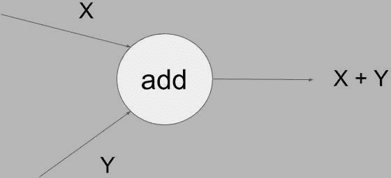
### 图 1.3
上面的示例展示了如何使用图进行基础加法。节点用圆表示。每个节点定义了一个单一的操作或数学函数。在这个示例中，它接收由箭头表示的两个输入 `X` 和 `Y`。当这些输入通过执行加法操作节点时，它返回输出 `X + Y`。此外，该输出可以作为另一个节点的输入，也可以作为最终输出。

节点（Nodes）和边（Edges）是图的元素单元。通常，节点用圆或矩形表示，箭头表示边。数学操作在节点处实现，其值通过边传递到其他节点，因此边起到了节点之间连接器的作用。

图 1.4 展示了一个稍微复杂且有趣的示例：

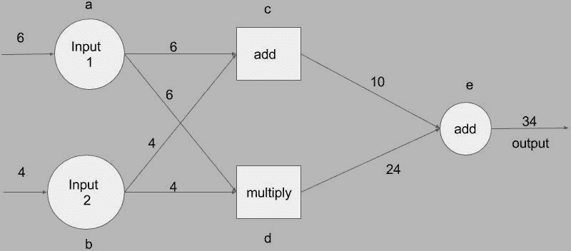
### 图 1.4
由于数据流图使用有向图，计算方向由箭头指示。让我们逐步理解图的每个操作：

- 在左侧，我们可以看到两个圆圈 `a` 和 `b`，代表两个输入 `input1` 和 `input2`。这些输入可以来自其他图，也可以是原始输入。
- 这两个圆将其对应的值传递给框（节点）`node c` 和 `node d` 进行进一步计算。`node c` 执行加法操作，`node d` 执行乘法。
- `node c` 接收两个值 `6` 和 `4` 作为输入，在对这些值相乘后，它给出 `24` 作为输出结果。同时，`node d` 也接收两个值 `6` 和 `4` 执行加法操作，并给出 `10` 作为输出结果。
- 最后，`node e` 接收 `node c` 和 `node d` 的输出作为输入，并执行加法操作，给出 `34` 作为输出结果。`node e` 的输出可以是最终输出，也可以是后续节点的输入。

让我们看看计算图的数学解释。在这里，节点表示为 `a`、`b`、`c` 和 `d`：
- `a = input 1`
- `b = input 2`
- `c = a + b`; `d = a * b`
- 最后，`e = c + d`

设 `input 1` 和 `input 2` 的值为 `6` 和 `4`。因此，`a = 6` 且 `b = 4`。
现在，`c = a + b = 6 + 4 = 10`；`d = a * b = 6 * 4 = 24`。
最后，`e = c + d = 10 + 24 = 34`。

让我们讨论为什么采用节点方法。在这种方法中，输入值可以被各种数学操作利用，因此它可以被后续层中的大量节点使用。否则，每个节点将是孤立的。

在这种方法中，输入值可以被各种数学操作利用，因此它可以被后续层中的大量节点使用。否则，每个节点将是孤立的。

在这种方法中，输入值可以被各种数学操作利用，因此它可以被后续层中的大量节点使用。否则，每个节点将是孤立的。

在这种方法中，输入值可以被各种数学操作利用，因此它可以被后续层中的大量节点使用。否则，每个节点将是孤立的。

在这种方法中，输入值可以被各种数学操作利用，因此它可以被后续层中的大量节点使用。否则，每个节点将是孤立的。

在这种方法中，输入值可以被各种数学操作利用，因此它可以被后续层中的大量节点使用。否则，每个节点将是孤立的。

在这种方法中，输入值可以被各种数学操作利用，因此它可以被后续层中的大量节点使用。否则，每个节点将是孤立的。`node c` 和 `node d` 之间的关系允许。


### 图 1.5
由于数据流图使用有向图，计算方向由箭头指示。让我们逐步理解图的操作：

- 在左侧，我们可以看到两个圆圈 `a` 和 `b` 代表两个输入 `input1` 和 `input2`。这些输入可以来自其他图，也可以是原始输入。
- 这两个圆将其对应的值传递给框（节点）`node c` 和 `node d` 进行进一步计算。`node c` 执行加法操作，`node d` 执行乘法。
- `node c` 接收两个值 `6` 和 `4` 作为输入，在对这些值相乘后，它给出 `24` 作为输出结果。同时，`node d` 也接收两个值 `6` 和 `4` 执行加法操作，并给出 `10` 作为输出结果。
- 最后，`node e` 接收 `node c` 和 `node d` 的输出作为输入，并执行加法操作，给出 `34` 作为输出结果。`node e` 的输出可以是最终输出，也可以是后续节点的输入。


### 图 1.6
由于数据流图使用有向图，计算方向由箭头指示。让我们逐步理解图的操作：

- 在左侧，我们可以看到两个圆圈 `a` 和 `b` 代表两个输入 `input1` 和 `input2`。这些输入可以来自其他图，也可以是原始输入。
- 这两个圆将其对应的值传递给框（节点）`node c` 和 `node d` 进行进一步计算。`node c` 执行加法操作，`node d` 执行乘法。
- `node c` 接收两个值 `6` 和 `4` 作为输入，在对这些值相乘后，它给出 `24` 作为输出结果。同时，`node d` 也接收两个值 `6` 和 `4` 执行加法操作，并给出 `10` 作为输出结果。
- 最后，`node e` 接收 `node c` 和 `node d` 的输出作为输入，并执行加法操作，给出 `34` 作为输出结果。`node e` 的输出可以是最终输出，也可以是后续节点的输入。


### 图 1.7
由于数据流图使用有向图，计算方向由箭头指示。让我们逐步理解图的操作：

- 在左侧，我们可以看到两个圆圈 `a` 和 `b` 代表两个输入 `input1` 和 `input2`。这些输入可以来自其他图，也可以是原始输入。
- 这两个圆将其对应的值传递给框（节点）`node c` 和 `node d` 进行进一步计算。`node c` 执行加法操作，`node d` 执行乘法。
- `node c` 接收两个值 `6` 和 `4` 作为输入，在对这些值相乘后，它给出 `24` 作为输出结果。同时，`node d` 也接收两个值 `6` 和 `4` 执行加法操作，并给出 `10` 作为输出结果。
- 最后，`node e` 接收 `node c` 和 `node d` 的输出作为输入，并执行加法操作，给出 `34` 作为输出结果。`node e` 的输出可以是最终输出，也可以是后续节点的输入。


### 图 1.8
由于数据流图使用有向图，计算方向由箭头指示。让我们逐步理解图的操作：

- 在左侧，我们可以看到两个圆圈 `a` 和 `b` 代表两个输入 `input1` 和 `input2`。这些输入可以来自其他图，也可以是原始输入。
- 这两个圆将其对应的值传递给框（节点）`node c` 和 `node d` 进行进一步计算。`node c` 执行加法操作，`node d` 执行乘法。
- `node c` 接收两个值 `6` 和 `4` 作为输入，在对这些值相乘后，它给出 `24` 作为输出结果。同时，`node d` 也接收两个值 `6` 和 `4` 执行加法操作，并给出 `10` 作为输出结果。
- 最后，`node e` 接收 `node c` 和 `node d` 的输出作为输入，并执行加法操作，给出 `34` 作为输出结果。`node e` 的输出可以是最终输出，也可以是后续节点的输入。


### 图 1.9
由于数据流图使用有向图，计算方向由箭头指示。让我们逐步理解图的操作：

- 在左侧，我们可以看到两个圆圈 `a` 和 `b` 代表两个输入 `input1` 和 `input2`。这些输入可以来自其他图，也可以是原始输入。


## TensorFlow 中的数据流图

在 TensorFlow 中，程序的执行分为两个步骤：
1. 设计数据流图
2. 执行设计的/定义的图

在第一步中，我们为操作设计架构。我们并不计算任何值，或者说，在定义操作时，我们不会得到这些操作结果的任何输出值。如果我们再次查看图，加法操作被执行了，但这两个输入 `X` 和 `Y` 并不会产生结果 `X + Y`。因此，在 TensorFlow 中，当我们对任何输入进行加法或乘法时，我们并没有显式地进行加或或乘，而是设计了这些操作。

为了获得结果，我们必须遵循第二步，即运行图。每个节点将包含所需的操作和张量（tensor）值。这可以总结为：在 TensorFlow 中，我们首先设计所需的操作，然后在第二步中执行设计的图。我们稍后会讨论图的执行。首先，让我们熟悉图的设计。

### 图的设计

让我们在 TensorFlow 中构建第一个图。我们将使用图 1.10 所示的图作为示例：

 图 1.10

以下是该图在 TensorFlow 中的代码：

```python
import tensorflow as tf
a = tf.constant(6, name="input1")
b = tf.constant(4, name="input2")
c = tf.add(a, b, name="add_c")
d = tf.multiply(a, b, name="multiply_d")
e = tf.add(c, d, name="add_e")
```

好的，让我们逐行理解这段代码。

首先，
```python
import tensorflow as tf
```
这是为程序导入 TensorFlow 库的标准方式，并命名为 `tf` 以方便使用。

接下来，
```python
a = tf.constant(6, name="input1")
b = tf.constant(4, name="input2")
```
在这两行中，我们定义了两个输入 `a` 和 `b`。在这里，我们使用了该图中第一个 TensorFlow 操作 `tf.constant()`。该操作接收单个值，并将相同的值作为输出传递给下一层节点进行进一步计算。TensorFlow 操作将输入值转换为 `Tensor`。我们还为每个操作定义了名称，这将有助于可视化图的设计。我们将在讨论 TensorBoard（TensorFlow 的可视化工具）时了解更多可视化。我们也可以不写名称写代码。

现在，
```python
c = tf.add(a, b, name="add_c")
d = tf.multiply(a, b, name="multiply_d")
```
在这两行中，我们又使用了两个 TensorFlow 操作，一个是 `tf.add()`，另一个是 `tf.multiply()`。首先，`tf.add()` 将接收两个输入并将两个输入的加和作为输出。其次，`tf.multiply()` 将接收两个输入并给出两个输入的乘积作为输出。在这里，我们只为节点定义操作，TensorFlow 会通过定义节点之间的连接自动将一个节点的输出传输到另一个节点。我们不需要考虑边。

最后，
```python
e = tf.add(c, d, name="add_e")
```
这是上述图的最后一个节点。与节点 `c` 类似，节点 `e` 也接收两个输入并使用 `tf.add()` 操作相加这些输入，并将此加法的结果作为输出。

记住，我们之前讨论过 TensorFlow 使用两个步骤来完全执行程序。这是设计过程，或者说是定义过程。当我们把这些行放入 Jupyter Notebook 或 Python 文件中时，它不会返回任何值。为了得到结果，我们必须使用以下代码行。首先定义 session，然后在 session 中运行最后一个节点。我们稍后会了解。


## TensorFlow 操作

我们使用了一些 TensorFlow 操作来理解数据流图。让我们熟悉 TensorFlow 中一些基础的数学操作。

```python
import tensorflow as tf
import numpy as np
a = np.array([6, 2])
b = np.array([1, 4])
c = tf.multiply(a, b)
sess = tf.Session()
sess.run(c)
```

在这个示例中，我们使用了 `tf.multiply()` 操作。当我们运行这段代码时，将得到一个 NumPy 数组作为输出，`array([ 8, ...`。我们也可以提供输入的数据类型，例如 `a = np.array([6, 2], dtype=np.int32)`，或者使用浮点数据类型，因此输出也会提到数据类型。那么，这个示例中有什么新内容呢？在这个示例中，我们使用 NumPy 手动初始化了张量。这展示了 NumPy 和 TensorFlow 之间的兼容性。

为什么我们使用 NumPy 来初始化张量对象？TensorFlow 有多种数据类型选项，如 `float32`、`int32` 等，但在某些情况下（例如复数），使用 TensorFlow 初始化会稍微困难一些，因此 NumPy 让我们的工作变得更简单。这表明 TensorFlow 中的数据类型与 NumPy 高度相关，或者简单来说是基于 NumPy 的数据类型。我们可以在终端输入 `tf.int64 == np.int64` 来验证这一观点，并将得到输出 `True`。我们也可以将 NumPy 数组作为 TensorFlow 的输入。

### 张量对象的形状

张量（Tensor）被定义为具有相同数据类型的数组。这意味着定义一个张量对象，我们需要每个维度的值和数据类型。形状（shape）描述了维度的数量以及每个维度的长度。张可以是列表、元组或 ND 矩阵。

让我们理解张量：

```python
import tensorflow as tf
tensor_object = tf.constant(1, shape=[2, 3])
print(tensor_object)
```

执行时，它将返回 `Tensor("Const:0", shape=(2, 3),` 输出。这告诉我们节点名为 `Const: 0` 以及其值，`tensor_object` 的形状为 `[2, 3]`，数据类型为 `int32`。在 TensorFlow 中，张量的形状可以分为两种：静态形状和动态形状。

### 静态形状

静态形状定义为初始化张量对象时确定的形状，或者在执行某些操作获取新张量对象后由 TensorFlow 推出的形状。它通常是列表或元组。TensorFlow 尝试在操作过程中推断 `z` 张量对象的形状，但当使用未知维度的 placeholder（动态尺寸）时，这会变得困难。

### 动态形状

我们可以说动态形状是在运行时确定的形状。让我们通过一个例子来理解：

```python
import tensorflow as tf
var1 = tf.placeholder(tf.float32, shape=[6])
print(var1.get_shape())
```

执行后，它将返回 `(6,)` 作为输出。这是静态形状，输出表示向量的长度。现在，让我们在其他操作中使用 `var1`。

```python
var2, idx = tf.unique(var1)
print(var2.get_shape())
```

返回 `(None,)` 作为输出。这意味着向量 `var2` 的长度是未知的。由于 `var1` 是未知的且 `var2` 依赖于它，因此长度也是未知的。

```python
sess = tf.Session()
print(sess.run(var2, feed_dict={var1: [1, 2, 2, 3, 3, 3]}))
print(sess.run(tf.shape(var2), feed_dict={var1: [1, 2, 2, 3, 3, 3]}))
```

它将返回 `(6,)` 和 `(3,)` 作为输出。我们可以可以看到 var2 的维度发生了变化。

### TensorFlow 中的 Session

Session 可以被定义为一个控制数学操作执行和张量值求值环境（计算图）的对象。我们也可以将其理解为将计算图放置在不同机器（如 CPU 或 GPU）上并提供执行过程。它有助于存储变量的当前值。

我们主要有两种方式启动 Session：

1. `sess = tf.Session()`，`sess.run()`，`sess.close()`
2. `with tf.Session() as sess: sess.run()`

Session 在执行图时使用资源。如果不再需要，释放这些资源是非常重要的。如果我们使用第一种方法，则必须显式关闭 Session。第二种方法作为上下文管理器，因此 Session 在退出 with 语句后会自动关闭。另一种方法是交互式 Session（Interactive session），它将自己变为默认 Session，因此在调试或在 IPython 中编写时非常有用。上述方法被广泛使用。以下是交互 Session 的示例：

```python
import tensorflow as tf
sess = tf.InteractiveSession()
a = tf.constant(5.0)
b = tf.constant(6.0)
c = a * b
## 我们可以直接使用 ‘c.eval()' 而不需要传递 ‘sess’
print(c.eval())
sess.close()
```

Session 与交互 Session 的区别在于交互 Session 将自己变为默认 Session，这样我们就可以不显式地调用 `run()` 或 `eval()` 了。


## 创建 TensorFlow 图

到为止，我们已经讨论了每个 TensorFlow 操作都是图中的一个节点。但我们还没有显式地创建过任何图。那么，这是如何实现的呢？当我们导入 `TensorFlow` 库时，它会自动创建一个图并将其赋值为默认图。每当我们使用任何 `TensorFlow` 操作时，它都会自动成为默认图的一个节点。让我们创建一个名为 `g_new` 的新图。

### 创建新图

我们可以使用以下代码行创建一个新图。

```python
import tensorflow as tf
g_new = tf.Graph()
```

使用上面的行，我们创建了一个新图。我们可以检查在导入 `TensorFlow` 库后是否创建了默认图，也可以检查是否创建了新图。

```python
import tensorflow as tf
g_new = tf.Graph()
print(g_new)
print(tf.get_default_graph())
```

当我们在 Jupyter Notebook 或 Python 文件中运行这段代码时，我们可以看到以下输出：

`object at 0x7fb2687bf050>`
`object at 0x7fb2a4b64e90>`

这证实了新图和默认图都已创建。

### 节点关联

正如我们讨论过的，当我们使用新的 `TensorFlow` 操作并赋值给变量时，该变量会被自动分配到默认图中，直到我们显式地将该操作分配到目标图中。我们可以通过检查节点与图的关联来验证我们的参数。

```python
import tensorflow as tf
g_new = tf.Graph()
var_a = tf.constant(10)
print(var_a.graph is tf.get_default_graph())
print(var_a.graph is g_new)
```

在这个示例中，`var_a.graph` 是一个属性，用于检查哪个节点连接到哪个图。当我们在笔记本中运行上述代码时，将得到两个布尔值 `True` 和 `False`。此结果显示节点 `var_a` 与默认图关联，而不是与 `g_new`。

### 使用上下文管理器处理图

那么我们如何将操作分配给新图呢？让我们来看这段代码。

```python
import tensorflow as tf
g_new = tf.Graph()
with g_new.as_default():
    a = tf.add(1, 2)
sess = tf.Session(graph=g_new)
sess.run(a)
```

当我们运行这段代码时，我们将得到输出。我们可以看到通过使用 `graph_name.as_default()` 函数访问新图。

```python
with g_new.as_default():
```

这一行充当了上下文管理器。上下文管理器可以定义为决定何时执行 `with` 语句函数的对象。简单来说，我们可以将其理解为控制 `with` 语句函数下方代码块所有进入和退出语句的管理器。

```python
sess = tf.Session(graph=g_new)
```

`Session` 运行还需要所创建的图的名称。否则，它将始终运行默认图。

### 处理多个图

让我们看另一个关于默认图和新图的示例。

```python
import tensorflow as tf
g_new = tf.Graph()
default_graph = tf.reduce_sum([3, 4])
with g_new.as_default():
    new_graph = tf.reduce_sum([4, 5])
sess = tf.Session()
print(sess.run(default_graph))
sess = tf.Session(graph=g_new)
print(sess.run(new_graph))
```

输出：`7` 和 `20`。

在上面的示例中，第一个打印 语句将打印默认图的输出，第二个打印 语句将打印新图的输出。我们可以看到，在不传递图时它会产生默认图的输出，但在传递图时它会产生输出。让我们看看使用多个图的正确方法。

```python
import tensorflow as tf
graph_1 = tf.get_default_graph()
graph_2 = tf.Graph()
## 现在将每个图设置为默认并在其中分配操作。
default_graph = tf.reduce_sum([3, 4])
with graph_2.as_default():
    new_graph = tf.reduce_prod([4, 5])
```

通过这种方式 `graph_1` 和 `graph_2` 将创建。使用多个图，我们可以将一个模型的输出用于另一个模型。

### Fetch（获取）

我们已经讨论过如何通过在 Fetches 中传递节点来获取每个节点的输出。Fetches 可以定义为一种有助于查找所需输出的技术。我们可以在 `sess.run()` 中放入多个节点，它将返回相应的输出。

```python
import tensorflow as tf
a1 = tf.constant([6, 4, 2], name="input")
a2 = tf.reduce_sum(a1, name="sum_b")
a3 = tf.reduce_prod(a1, name="product_c")
a4 = tf.multiply(a2, a3, name="multiply_d")
sess = tf.Session()
print(sess.run([a2, a3, a4]))
```

当我们运行这段代码时，它将返回输出 `[12, 48, 576]`。如果我们只放入，它将只返回 `a2` 的值。

### TensorFlow 中的 Feeding

Feeding 是 TensorFlow 提供的一种机制，有助于覆盖或替换图中张量的值。它使用 `feed_dict` 参数来替换值，该参数接受字典对象作为输入。字典对象的数据类型与被替换的值类型应该是相同的。

让我们通过例子来看看如何使用馈 机制。

```python
import tensorflow as tf
value1 = tf.reduce_mean([6, 4, 2])
value2 = tf.reduce_mean([1, 8, 6])
value3 = tf.add(value1, value2)
sess = tf.Session()
Replace_value = {value1: 10}
print(sess.run(value3, feed_dict=Replace_value))
```

当我们运行这段代码时，它将返回 15 作为输出。


## 占位符 (Placeholders)

到为止，我们直接向操作中提供输入，或者使用操作来创建输入。但 TensorFlow 提供了另一种提供输入的方法。这可以通过 `placeholder` 实现。占位符名称本身将其定义为一个空张量对象，它在初始化期间没有任何值，但在图的执行过程中可以为其喂入输入数据。

### 为什么使用占位符比常量（constants）更好？

当我们使用 `constant` 时，它的值会被复制到图中。假设我们初始化了一个大型全 1 或全零矩阵作为常量操作，例如 `initialize_ones = np.ones((3000, 3000))`。此操作不仅向图中添加了一个单独的操作，还将将 900 万个常量元素复制到图中。因此，每当加载图时，常量值就会被复制。这导致图的加载变得缓慢且昂贵。我们可以通过打印图的 protobuf（协议缓冲区）来检查该参数。

让我们通过一个例子来理解这一点。

```python
import tensorflow as tf
constant_value = tf.constant([6, 4, 2], name="constant_value")
print(tf.get_default_graph().as_graph_def())
```

当运行这段代码时，它将返回如图所示的输出。现在当我们在 notebook 中多次运行代码时，字典的数量不断增加。这表明常量的值在加载图时会被复制。占位符初始化的是单个操作，它在 `session.run()` 内部执行。在之后，不再需要的资源将通过关闭 session 释放，因此，它不会在图中复制张量对象。

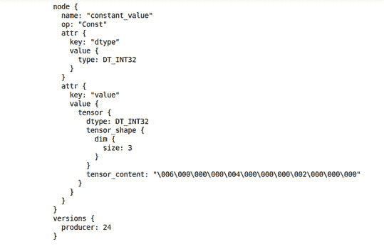 图 1.13

占位符对数据大小非常灵活。我们可以初始化输入的大小，也可以提及 `None`。当我们把 `None` 值作为形状参数传递时，它允许占位符接受任何大小的数据。占位符中的数据类型也应该初始化，以避免任何匹配错误。占位符一旦初始化，必须喂入输入数据，否则会抛出异常。使用喂入机制（Feeding mechanism）向占位符中提供数据。

让我们通过一个例子来理解占位符的使用。

```python
import tensorflow as tf
import numpy as np
x_matrix = np.random.randn(3, 1)
m_matrix = np.random.randn(3, 3)
x = tf.placeholder(tf.float32, shape=(3, 1))
m = tf.placeholder(tf.float32, shape=(3, 3))
c = tf.ones((3,1))
mx = tf.matmul(m, x)
y = mx + c
value = tf.reduce_mean(y)
sess = tf.Session()
sess.run(value, feed_dict={x: x_matrix, m: m_matrix})
```

在上面的示例中，我们实现了方程 `y = mx + c`。最初，我们使用 NumPy 定义了两个矩阵和一个向量的值。我们将两个输入 `x` 和 `m` 初始化为占位符，它们最终在执行过程中被填充。

## 变量 (Variables)

到为止，我们一直常量作为输入，这很有趣。现在，让我们讨论变量，另一个非常重要的张量对象。

在优化或学习过程中，变量起着关键性的作用。在此类过程中，不同类型的参数和超参数需要连续且正确地调整，直到它们找到适应模型的最佳值。在每次迭代中，它的值都会不断更新。在讨论占位符时，我们讨论了使用常量操作的缺点。变量也可以作为常量操作的替代。在涉及更多数据的地方应该使用变量，因为它们需要更多内存。变量单独存储，通常它们不会被复制。

### 如何创建变量

当我们实例化类的实例时会声明变量。常量使用小写的 `c`，而在 `Variable` 中使用大写的 `V`。这种差异产生是因为 `tf.constant` 是一个操作，而 `tf.Variable` 是一个类，因为它提供了多个一个函数。

可以使用 TensorFlow 操作创建变量：

```python
import tensorflow as tf
var = tf.Variable(10, name="create_variable")
value1 = tf.multiply(2, var)
value2 = tf.reduce_max(5, var)
```

好了，现在我们将讨论如何初始化变量。

正如我们上面讨论的，变量的状态或简单来说，变量的值由 session 处理。要使用变量，首先我们必须初始化它们，它们将在 `session run` 中执行。通常，初始化是通过使用 `tf.global_variables_initializer()` 完成的，之后内存会被分配给变量。

```python
import tensorflow as tf
x = tf.Variable(tf.truncated_normal([2, 1], mean=5.0, stddev=1.0))
m = tf.Variable(tf.random_normal([2, 2], stddev=0.1))
c = tf.Variable(tf.ones([2, 1]))

mx = tf.matmul(m, x);
y = tf.add(mx, c)

initializer = tf.global_variables_initializer()
sess = tf.Session()
sess.run(initializer)
print(sess.run(y))
sess.close()
```

在这个示例中，我们计算了方程 `y = mx + c` 的值。运行这段代码时，它将返回 `[[0.4051047], [0.507525]]` 作为输出。注意，`sess.run(initializer)` 用于初始化变量，它并不获取任何值。

让我们来看另一个例子。

```python
import tensorflow as tf
variable1 = tf.Variable(2)
constant1 = tf.constant(2)
new_variable = tf.multiply(variable1, constant1)
update_variable = tf.assign(variable1, new_variable)
initialize_variable = tf.global_variables_initializer()
sess = tf.Session()
sess.run(initialize_variable)
print(sess.run(variable1))
for i in range(2):
    sess.run(update_variable)
    print(sess.run(variable1))
```

在这个示例中，`variable1` 被创建为变量标量值，`constant1` 是常量标量值，`new_variable` 在相乘 `variable1` 后返回输出。在下一步中，`tf.assign()` 更新了 `variable1` 的值。运行这段代码时，它返回 4 和 8 作为输出。这表明 variable1 在每次迭代中不断改变其值。

到为止，我们讨论了变量的全局初始化。让我们通过一个例子来理解自定义初始化。

```python
import tensorflow as tf
variable1 = tf.Variable(6)
variable2 = tf.Variable([6, 4])
variable3 = tf.Variable(tf.truncated_normal([2, 2]))
```

在这个示例中，`variable1` 被创建为变量标量值，`variable2` 被创建为变量向量，`variable3` 被创建为 2x2 大的随机变量对象。

要初始化自定义变量，我们使用 `tf.variables_initializer()` 并传入需要初始化的变量列表。

```python
initialize_variable_1_and_2 = tf.variables_initializer([variable1, variable2], name="initialize_1_and_2")
with tf.Session() as sess:
    sess.run(initialize_variable_1_and_2)
```

我们也可以使用逐个初始化每个变量：

```python
variable3 = tf.Variable(tf.truncated_normal([2, 2]))
sess = tf.Session()
sess.run(variable3.initializer)
print(sess.run(variable3))
```

这段代码将返回一个 2x2 大的随机值矩阵。


## 给变量赋值

TensorFlow 提供了一种为变量进行赋值的技巧。我们可以使用 `Variable.assign()` 函数来改变变量的值。让我们通过几个示例来熟悉这个函数。

```python
import tensorflow as tf
a = tf.Variable(4)
a.assign(6)
with tf.Session() as sess:
    sess.run(a.initializer)
    print(sess.run(a))
```

当我们运行这段代码时，它将返回 4 作为输出，这意味着 `a.assign(6)` 没有生效。为了让此操作生效，`Variable.assign()` 应该始终在 session 中运行。

```python
import tensorflow as tf
a = tf.Variable(4)
assign_to_a = a.assign(6)
with tf.Session() as sess:
    sess.run(assign_to_a)
    print(sess.run(a))
```

现在执行后，这段代码将返回输出。注意，在此代码中 `a` 仍然没有初始化，它之所以能工作是因为是由 `assign()` 操作完成的。事实上，如果我们分析初始化操作，可以认为初始化操作实现的内容与此 `assign` 操作所做的相同。思考，初始化操作也将变量的初始值赋值给变量本身。

让我们看另一个示例。

```python
import tensorflow as tf
var = tf.Variable(4)
var_plus_2 = var.assign(var + 2)
initializer = tf.global_variables_initializer()
with tf.Session() as sess:
    sess.run(initializer)
    print(sess.run(var_plus_2))
    print(sess.run(var_plus_2))
```

这段代码的输出是 6。在这个示例中，如果我们在不初始化 `var` 的情况下在 `sess.run()` 中放入 `var_plus_2`，将会报错，因为 `var_plus_2` 的值依赖于 `var`。因此，`var` 需要先初始化。

为了对变量进行加减法，TensorFlow 提供了如 `tf.Variable.assign_add()` 等操作。注意，`tf.Variable.assign_add()` 和 `tf.Variable.assign_sub()` 方法不会初始化变量，因为这些操作的输出需要变量的初始值作为输入。在每个 Session 中，数据是保持分离的。假设我们在图中创建了一个变量，现在我们在不同的 Sessions 下执行图，那么每个 session 都可以有不同的变量值。让我们通过示例来理解这一点。

```python
import tensorflow as tf
a = tf.Variable(4)
sess1 = tf.Session()
sess2 = tf.Session()
sess1.run(a.initializer)
sess2.run(a.initializer)
print sess1.run(a.assign_add(1))
print sess2.run(a.assign_add(2))
print sess1.run(a.assign_sub(10))
print sess2.run(a.assign_sub(2))
sess1.close()
sess2.close()
```

当我们运行这段代码时，它将返回输出 -5，我们可以看到变量 `a` 在不同的 session 下不同的值。

## 名称作用域 (Name scopes)

到此为止，我们讨论了 TensorFlow 图的基本概念和实现。目前，我们讨论的是节点较少、张量对象较小的计算图，但在为实际应用构建模型时，我们必须处理具有数百个节点和数百万参数的大型图。在处理大型且复杂的图时，我们倾向于使用唯一标识对节点进行分级分组。因此，这有助于通过分块观察来管理大型图。TensorFlow 这种名为名称作用域（name scopes）的机制，有助于管理大型图。名称作用域易于使用，并在 TensorBoard 可视化时提供良好的洞察。通过名称作用域，我们可以将节点排列成块。当我们使用 TensorBoard 时，我们可以看到所有封装在各自作用域名称中的操作。我们可以通过实现这一行 `with` 来开始使用名称作用域。

让我们通过示例来理解名称作用域。

```python
import tensorflow as tf
with tf.name_scope("1st_scope"):
    a = tf.multiply(6, 4, name="multiply1")
    b = tf.add(a, 6, name="add1")
    with tf.name_scope("2nd_scope"):
        c = tf.multiply(4, 5, name="multiply2")
        d = tf.add(c, 10, name="add2")
        e = tf.div(b, d, name="output")
sess = tf.Session()
writer = tf.summary.FileWriter("output")
sess.run(e)
writer.close()
```

`with tf.name_scope("1st_scope"):`
这一行创建了名为 `1st_scope` 的第一个框，相应的操作被分组在该名称作用域下。
`with`
这一行创建了名为（此处）的第二个框，相应的操作被分组在该名称作用域下。

当我们运行这段代码时，它将返回 1 作为输出。让我们用 TensorBoard 可视化图。图 1.14 和 1.15 代表 TensorBoard 中所示的图：

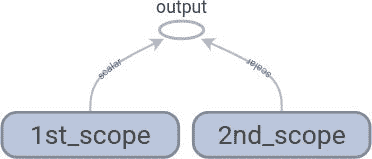
图 1.14

当我们查看 TensorBoard 图时，它不会显示每个操作。此图显示节点被分组在 `1st_scope` 中，当双击两个名称作用域框中的加号 (`+`) 图标时，它会展开并类似于图：

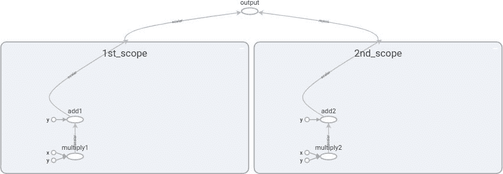
图 1.15

在前面的图中，我们可以很容易看到单独的操作。让我们看名称作用域的另一个示例。

```python
import tensorflow as tf
import numpy as np
g = tf.Graph()
with g.as_default():
    input_1 = tf.placeholder(tf.float32, shape=None, name="input_1")
    input_2 = tf.placeholder(tf.float32, shape=None, name="input_2")
    const = tf.constant(4, name="constant")
    with tf.name_scope("Chain"):
        with tf.name_scope("LayerA"):
            LA_sub = tf.subtract(input_1, const)
            LA_output = tf.div(input_1, LA_sub)
        with tf.name_scope("LayerB"):
            LB_sub = tf.subtract(input_2, const)
            LB_output = tf.div(input_2, LB_sub)
        with tf.name_scope("LayerC"):
            LC_max = tf.add(LA_output, LB_output)
            LC_output = tf.multiply(LC_max, const)
        with tf.name_scope("LayerD"):
                LD_max = tf.add(LC_output, LB_output)
                LD_output = tf.multiply(LD_max, const)
        output = tf.add(LC_output, LD_output)
var_1 = np.array([8])
var_2 = np.array([6])
initialize_operation = tf.global_variables_initializer()
sess = tf.Session(graph=g)
sess.run(initialize_operation)
writer = tf.summary.FileWriter("output", graph=g)
print(sess.run(output, feed_dict={input_1: var_1, input_2: var_2}))
writer.close()
```

当我们运行这段代码时，它将返回输出。图展示了之前示例的高级概览。当我们点击名为 chain 的名称作用域中的加号 (`+`) 图标时，它将显示出排列两层的四个名称作用域。LayerA 和 LayerB 组成第一层。LayerA 和 LayerB 的输出传递给下一层的 LayerC 和 LayerD。最后，最后一个节点使用第二层的输出作为输入。这个示例为我们提供了另一种可视化图的方法。在图中我们可以看到第一层名称作用域的颜色是相同的，第二层也可以观察到类似的情况。

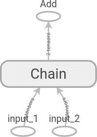
图 1.16

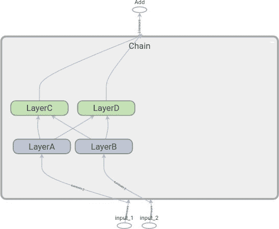
图 1.17


## TensorFlow 中的分布式计算

现在我们来介绍 TensorFlow 程序中一个非常重要的部分，即读取文件。我们将遇到一些需要从 csv、json 或其他格式的文件加载训练数据或样本数据的场景。我们将使用内置的 Python 函数来打开文件并逐行读取，并将这些数据存储到我们之前学过的占位符（placeholder）中。假设我们有一个包含库存信息的 `data.csv` 文件。

### 程序开始

```python
import tensorflow as tf
import os
dir_path = os.path.dirname(os.path.realpath(__file__))
filename = dir_path + "/data.csv"
features = tf.placeholder(tf.int32, shape=[3], name='features')
category = tf.placeholder(tf.string, name='category')
total = tf.reduce_sum(features, name='total')
with tf.Session() as sess:
  sess.run( tf.global_variables_initializer())
  with open(filename) as inf:
    # 跳过表头
    next(inf)
    for line in inf:
      # 使用 python 将数据读取到我们的 features 中
      category_name, code, sold, remaining, defected, total = line.strip().split(",")
      sold = int(sold)
      remaining = int(remaining)
      defected = int(defected)
      total = sess.run(printerop, feed_dict={features: [sold, remaining, defected], category:category_name})
      print(category_name, total)
```

TensorFlow 对分布式计算提供了惊人的支持。这允许我们将图的部分在集群中不同的 CPU、GPU 上运行。TensorFlow 的分布式实现与本地实现共享大部分代码，此外支持工作节点（workers）、客户端（client）和主节点（master）作为集群内多个系统的进程运行的环境。你可以将其比为客户端服务器模型。然后，我们将创建许多工作节点，它们如图所示处理计算部分。一旦 TensorFlow 给一个计算图，它的首要目标是决定由哪个 CPU 执行特定节点的计算。

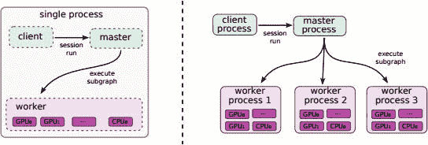 图 1.18

现在，让我们来看一个非常简单的 TensorFlow 程序，并让它在分布式环境中运行。

### 程序开始

```python
import tensorflow as tf
x = tf.constant(10)
y1 = x + 120
y2 = x - 32
y = y1 + y2
with tf.Session() as sess:
  result = sess.run(y)
  print(result)
```

上面的程序是加法和减法的组合，并没有什么复杂的逻辑。程序的输出是：

现在，让我们来看一段尝试将上述程序分布在两个进程上的代码。首先，我们在程序中创建一个如下的集群规范（cluster spec）：

```python
import tensorflow as tf
cluster = tf.train.ClusterSpec({"local": ["localhost:2222", "localhost:2223"]})
```

我们指定了运行在端口号 2222 和 2223 的两个工作节点。接下来，我们启动进程：

`server = tf.train.Server(cluster, job_name="local", task_index=1)`

这在 2223 端口启动了一个工作节点进程。接下来，我们将在两个不同的终端中启动上面定义的两个工作节点。将代码保存为 `start_worker.py`，并在两个终端中执行程序 `python start_worker.py 0` 和 `python start_worker.py`。可以在本地机器上或网络集群中创建更多工作节点，其中 localhost 被替换为集群中设备的 IP 地址。

现在，我们将创建一个主节点，它将在工作节点上调度子图。

```python
import tensorflow as tf
cluster = tf.train.ClusterSpec({"local": ["localhost:2222", "localhost:2223"]})
x = tf.constant(1)
with tf.device("grpc://localhost:2222"):
    y1 = x + 2
with tf.device("grpc://localhost:2223"):
    y2 = x - 3
y = y1 + y2
with tf.Session() as sess:
  result = sess.run(y)
  print(result)
```

这将任务在工作节点上分布。

## 总结

在本章中，我们讨论了张量（tensors）的概念，并学习了如何在 TensorFlow 中创建张量并执行这些数学操作。我们还讨论了 TensorFlow 的主要构建块，如计算图、用于输入的占位符以及用于调优参数的变量。我们学习了张量数组，并涵盖了数据类型、形状。我们将在后续章节中反复应用本章的概念。在下一章，我们将进入计算机视觉。

# 第 2 章：神经网络简介

在上一章中，我们讨论了流行的深度学习框架 —— TensorFlow。在本章及之后，我们将讨论现代深度学习算法及其解决问题的实用性。深度学习历史悠久，并模拟人类大脑。文献中提出的许多技术尚未达到其目标和预期。研究人员正在通过提出复杂且革命性的思想深入这一领域。传统上，深度学习研究人员主要关注监督学习，但最近深度学习正在扩展到其他学习方法，如半监督、无监督和强化学习。

深度学习可以简化为执行 A 到 B 的映射。A 和 B 分别代表输入和输出向量。更准确、全面的解释是，深度学习是在通用函数近似；意味着在有足够数据的情况下，它可以近似任何函数。我们可以通过扩展层和在每层中添加更多单元来增加函数的复杂度，这简单意味着为函数添加更多变量和参数。与传统的机器学习算法相比，深度学习具有更好的学习能力；因此它可以从数据集中选择更好的特征。

## 结构

- 损失函数
- 激活函数
- 优化（SGD, RMSPROP, ADAM, SortaGrad）
- 反向传播
- 多层感知机
- 让我们构建：一个时尚 MNIST 分类器来分类衣服

## 目标

在本章中，我们将学习近似参数函数的基本方法和技术。我们将从线性模型及其局限性开始讨论。然后，我们将讨论一种非线性网络——前馈网络（也称为多层感知机，通常被称为神经网络），它基本上是近期深度学习算法背后的技术。接下来，我们将了解优化技术和损失函数，这些将用于实现最佳近似函数。进一步，我们将讨论如何使用激活函数向网络中添加非线性。


## 神经网络简介

在继续进行之前，让我们观察下面的图，并尝试识别一下它是关于什么的：


图 2.1：示例图像

从图中，我们应该能够认出这是一只长颈鹿，尽管它看起来异常肥胖。尽管这些特征呈现的形式与我们生活中以前见过的不同，但我们的大脑能够迅速识别出这些特征和物体。

### 我们是如何做到的？

当我们接触任何物体时，我们都能感觉到它。这是因为有连接到大脑的传感器。人体所有的传感器都充当数据收集器的角色，收集数据并将其传递给大脑进行进一步处理。根据这些信息，大脑做出最终决定，并将相关的指令或信息发送到相应的身体部位。

神经网络的灵感源于人类大脑及其内部机制。在深入研究之前，我们将先看看人类大脑的工作原理以及它在人工神经网络中的对应关系。要深入地理解大脑的工作原理非常困难，但我们可以获得一个快速的总体概述。人脑由大约 1000 亿个被称为神经元的神经细胞组成。每个神经元都可以与大型网络中发现的数千个其他神经元相关联。神经元以电化学信号的形式与其他神经元通信。我们所有的每感觉、思想和情感都源于数百万个被称为神经元的小神经细胞。如果没有这些神经元在我们身体范围内工作并传递信息，我们将无法感知或做任何事情——就像数学课上普通的一天一样。

现在我们已经对大脑的工作原理有了初步概念，我们将开始讨论人工神经网络。

### 人工神经网络

典型的神经网络由许多被称为“单元”的人工神经元组成，这些单元排列在系列层中。一个典型的人工神经网络由不同的层组成，如图：

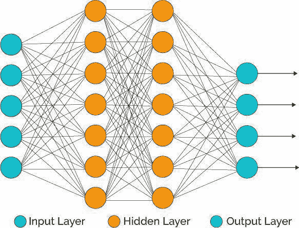
图 2.2：人工神经网络示例

- **输入层**：输入层包含接收来自外部世界输入的单元（人工神经元），网络将对这些输入进行学习、识别或其他其他处理。
- **输出层**：输出层包含对其如何学习某项任务的信息做出响应的单元。
- **隐藏层**：隐藏层是输入层和输出层之间的单元。隐藏层的作用是将输入转换为输出单元可以某种方式使用的内容。

我们可以通过不同的方式连接节点并改变数据流方向来创建不同类型的神经网络。每种类型的神经网络都有不同的复杂程度和应用用例。在书中，我们将介绍前馈神经网络及其变体。


## 馈向神经网络

前向神经网络是所有神经网络中最简单的一种，信息仅沿单方向移动。数据从输入节点移动到输出节点，并经过隐藏节点（如果有的话）。从输出到输入没有反馈机制；因此，前向网络也是有向无环图的一种形式。

### 单层感知机
单层感知机是人工神经网络最基础的形式，它具有输入层和输出层，没有隐藏层。它是一种具有 0 个隐藏层的馈向神经网络。

### 多层感知器
多层感知器（`MLP`）是一种馈向神经网络。`MLP` 由三层组成：输入层、输出层以及一个或多个隐藏层。多层感知器或馈向神经网络是深度学习模型的基础性且经典的形式。

在本章中，“神经网络”和“馈向网络”术语将交替使用。那么，我们为什么称其为网络呢？我们可以假设通用或广义函数 `F` 是更小、更不复杂的函数的组合。

深度网络中的每一层都代表一个较小的函数。从数学上讲，它可以根据层数被定义为 `F =` 等；网络可以写成 `y = F(x; θ)`，其中 `x` 是输入向量，`θ` 是通用函数的参数，`y` 是输出向量。

正如我们讨论过的，这些模型的主要目标是通用函数近似，本质上意味着近似任何映射输入和输出向量的通用函数 `F`。与传统的机器学习算法一样，它在将输入 `x` 映射到类别的同时，学习函数 `⨍(x; θ)` 的参数值，但通过利用输入向量的特征以更好的效率和更优的方法来实现。

神经网络由输入层、隐藏层和输出层组成。中间层定义为隐藏层。之所以被称为隐藏层，是因为这些层无法从输入数据中获取真实输出值的信息。学习算法利用这些隐藏层并自身选择参数的最优值，以近似映射输入到输出的函数。

在上述论述中，我们定义了近似函数 `F =` 和输出 `y = F(x; θ)`。该网络中的层总数为 6 层，包括输入层 `x`、输出层以及隐藏层数量，隐藏层数量也代表了模型的深度，这正是“深度学习”名称的由来。

网络的每一层都由单元组成。隐藏层的单元被称为隐藏单元。通过增加更多的层和隐藏单元，网络的维度会随之增加，从而增加了函数的复杂性。从数学上说，每一层可以被定义为一个向量，其中单元单元代表向量的元素。因此，神经网络可以被解释为多个向量的组合；或者，它也可以解释为向量与标量之间的连接，意味着向量的每个元素与其他向量的每个元素之间的连接。层的每个单元并行连接到前一层的所有单元。

让我们通过一个例子来理解神经网络的结构。假设第一层包含 3 个单元，第二层包含 2 个单元。第一层的每个单元都可以连接到第二层的所有单元。因此，第一层向量的完整信息将分别传递给第二层向量的每个单元。所以，第一层和第二层之间的最大连接数为 6。推广这一论点，我们可以说分别具有 `m` 和 `n` 个单元的两层（向量）之间的总连接数将是 `m*n`（最大可能的连接）。我们稍后会讨论与与之间的连接数也可以小于最大值。

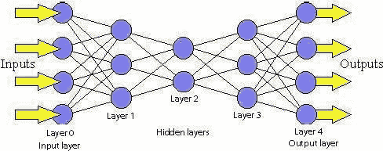 图 2.3

让我们看看 AI 社区之所以离开线性网络的舒适区并开始专注于深度学习的背后的原因。模型大致分为两类：线性和非线性。

### 线性模型
线性模型使用简单的数学属性（通常是加法性）来寻找解决方案。我们可以观察到这些模型可以拟合线性可分的数据，而且它们也简单易用。线性模型工作的场景如图 2.4 所示的 OR 和 AND 逻辑函数。那么，我们为什么转向其他模型？线性模型的主要缺点是缺乏灵活性。线性模型没有提供输入数据之间或通用函数参数之间的关系。

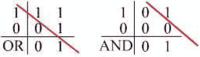 图 2.4：线性可分逻辑函数

### 非线性模型
在现实世界中，我们会遇到行为之间存在非线性相关的问题。图 2.5 显示了 XOR 逻辑函数，这是一个非函数的例子。它们需要复杂的非线性模型。由于功能的限制（如乘法和加法），线性模型的近似函数被限制在线函数。因此，为了利用线性模型处理非线性，我们通过任何变换函数 `T` 或使用 `SVM` 中的核技巧将数据映射到高维空间。但这些方法引发了一个新问题：如何决定哪个变换函数会产生更好的结果？这取决于数据点和模型，每种变换技术都会产生不同的结果。

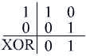 图 2.5：非线性可分逻辑函数

为了解决这个问题，提出了一种名为深度学习的新技术。这种技术在网络中引入了非线性。在深度学习中，我们使用具有各种参数的近似函数 `F`。在映射输入到输出时，这种技术帮助我们学习函数参数的最优值，从而帮助我们获得一个对测试数据也能产生良好结果的通用映射函数。让我们通过 XOR 函数的简单例子来理解上述讨论。首先，我们将看到为什么无法通过线性模型开发 XOR 函数，然后我们使用非线性模型来实现 XOR 函数。


## 使用线性模型实现 XOR 函数

我们将使用单层感知机（线性分类器）来证明 XOR 函数无法通过线性模型实现。

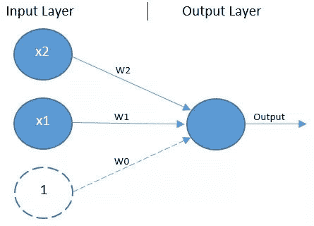 图 2.6

让我们定义两个二分类变量，它们的值可以取 1 或 0。XOR 函数在这些变量上执行操作。当 `x1` 和 `x2` 的值相同时，XOR 函数返回 0 作为输出，否则返回 1。

我们可以看到，在输入输入值后，XOR 函数会返回某些输出。因此，存在一个通用的 XOR 函数来映射输入和输出。让我们定义这个函数为 `f(x)`。我们可以写成 `y = f(x)`。现在，让我们将模型定义为 `g(x)`。我们的目标是找到或学习一个由参数 `θ` 构造的通用近似函数 `f'(x)`，使其产生相似的结果。换句话说，我们的目标是学习一个模型，以尽可能地减少 `y` 和 `f'(x)` 之间的误差。

让我们看看线性模型的结果。我们的输入点为 `X = [(0, 0), (1, 0), (0, 1), (1, 1)]`，期望输出为 `y = [0, 1, 1, 0]`。

图 2.7 展示了图形形式的 XOR 实现。

让我们定义线性模型 `y = θ(x)` 为：

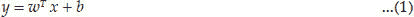

其中 `w` 和 `b` 是权重和偏置项，它们由参数 `θ` 组成。在本书中，`θ` 被作参数 `w` 和 `x = wx + b` 的压缩形式，两种形式可以互换使用。为了简单起见，`θ` 可以替换为 `(w, b)`，且 `(x; w, b)` 可以互换。

我们将使用最小均方法 (LMS) 方法来寻找 `w` 和 `b` 的最优值。将损失函数 `J` 定义为：

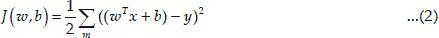 或 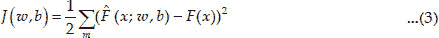 其中 `m` 是样本数量。

由于我们的数据集是有限的，我们可以使用 `AX = B` 形式的正规方程以闭式解关于 `w` 和 `b` 进行最小化。

通过求解上述代价函数，我们得到的 `w` 和 `b` 的值分别为 0 和 0.5。因此，对于每个输入点我们得到 `y = 0.5`。我们可以看到线性模型没有正确分类我们的输入点。让我们理解一下原因。

### 线性失败的数学分析

首先，我们将从数学角度理解为什么线性模型在 XOR 函数上失效。

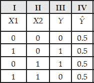 表 2.1

表 2.1 表示了期望的输入和输出，但我们为每个输入得到的输出值均为 `y = 0.5`。表 1 的图形表示如图所示。

让我们使用定义的线性模型为每个输入-输出对写方程：

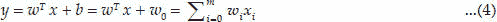 假设 `b = -1` 且 `w = 1`。

因此，假设我们神经元的权重为 `w0` 和 `w1`。现在，当输入为 (0, 0) 时，XOR 函数输出 0。

因此，我们的 SLP 神经元必须具有相同的输出。这意味着 `w0*0 + w1*0 - 1 < 0`。即 `-1 < 0`。因此 `0 > -1`。

XOR 函数在输入 (1,1) 时也输出 0。因此，我们的 SLP 神经元必须满足 `w0*1 + w1*1 - 1 < 0`。

所以，`w0 + w1 < 1`。

XOR 函数在输入 (1, 0) 和 (0, 1) 时输出 1。这意味着我们的神经元必须满足：
`w0*1 + w1*1 + w2*0 >= 0` 且 `w0*1 + w1*0 + w2*1 >= 0`。因此 `w0 + w1 >= 0` 且 `w0 + w2 >= 0`。

现在我们对于三个权重 `w0`、`w1` 和 `w2` 有四个不等式，如下如下：
- `-w0 > 0`
- `w0 + w1 + w2 < 0`
- `w0 + w1 >= 0`
- `w0 + w2 >= 0`

如果我们将不等式 3 和 4 相加，得到 `2w0 + w1 + w2 >= 0`。现在，如果将不等式 1 加到这个不等式，得到 `w0 + w1 + w2 >= 0`。但这显然矛盾了不等式 2。因此，没有任何 SLP 神经元能让这四个不等式同时成立。因此，没有任何 SLP 神经元具有与 XOR 函数相同的输出。

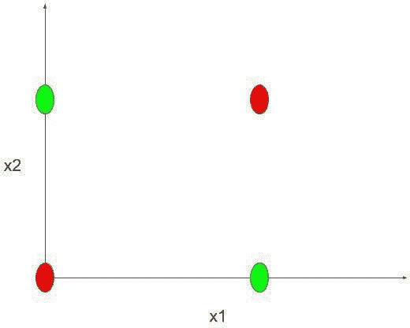 图 2.7 假设绿色点代表类别 1，红色代表 0。图中绿色和红色点代表两个不同的类别。从图中也可以推断出，不存在可以将这两类点的决策边界。XOR 不是线性可分的，我们之前讨论过线性模型仅对线性可分的数据有效。即使我们将 XOR 扩展到高维，我们也无法使用单层感知机（线性模型）的 2 个输入得到任何解决此问题的决策边界。

### 多层感知机 (MLP)

为了解决这个问题，我们需要引入多层感知机（MLP）。

 我们可以通过增加隐藏层来解决 XOR 问题。

在 MLP 中，输入层接收数据，隐藏层通过非线性激活函数提取特征，输出层给出结果。通过这种方式，模型能够处理非线性可分的数据。


## 基于梯度的学习

深度学习算法使用优化技术，通过函数最小化或最大化来获取最优解。在优化中，我们通常通过最小化函数来获得一个稳定的全局最小值。即使为了最大化一个函数，我们也倾向于最小化该函数的负值，这等同于最大化原函数。我们想要最大化或最小化的函数可以定义为代价函数（cost function）、损失函数（loss function）或误差函数（或更泛地称为目标函数）。在书中，代价函数、损失函数或误差函数将交替使用，尽管某些书籍专门定义了其中一些术语。

神经网络的训练与其他机器学习算法非常相似，但在非线性网络中，`gradient`的计算更为困难。在本节中，我们将讨论不同类型的优化算法。在线性模型中，我们使用凸函数（对于一个函数要是凸的，函数图像上两点的连线必须位于函数上方）作为优化函数。凸函数的优势是，无论`parameters`的初始值如何，它都能收敛到一个非常低的值，但由于由于神经网络的非线性特性，相关的代价函数变成了非凸的，因此，代价函数不会收敛到一个非常低的值。所以，我们使用迭代和基于梯度的优化技术来使代价函数收敛到一个可能的低值。

随机梯度下降是一种在非线性网络中广泛使用的优化技术算法，但由于损失函数的非凸性，它不能保证全局最小值。我们稍后详细讨论随机梯度下降算法。

### 代价/损失函数

在本节中，我们将讨论常用的损失函数类型，这些函数用于估计将输入 `X` 映射到输出 `Y` 的通用近似函数的参数，并量化近似模型的性能。为了获得最佳近似模型，我们估计模型参数使得损失最小化。

极大似然算法是参数估计中最广泛使用的算法。

首先，我们将讨论极大似然原理。从任何概率分布中取出 `m` 个样本点，其中 `X` = `…..`，接下来，我们定义模型，使其确定 `x_i`（其中 `i` ∈ `1, 2… m`）属于具有参数 `w` 和 `b` 的分布 `P(X)` 的概率。现在，我们可以定义 `θ` 的极大似然估计（如本章前面提到的，`θ` 用作参数 `w` 和 `b` 的压缩形式且如下）：

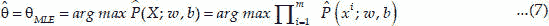

借助公式 (7) 的帮助，估计参数值 `– w` 和 `b`，使得属于分布 `P(X)` 的概率最大。

我们可以看到 `L` 是多个概率的乘积，这会导致数值精度上的误差。为了避免任何数值精度误差，我们通常倾向于对 `L` 取对数，将概率密度的乘积变为概率密度的和，因此处理起来更加方便。对数是一个增函数，所以它不会改变原函数的极大点。对 `L` 取对数后，我们可以写为：

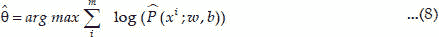

函数的缩放不会改变原函数的极大点，因此我们可以除以 `m`（数据点总数），并再次定义 `θ ̂` 为 `L` 的期望或平均值。


## 交叉熵函数

我们通过假设模型在实数上服从高斯分布推导出了二次代价函数。在二分类中，`y` 取两个值，0 或 1。直观上，我们可以看到模型输出的值不应大于 1 且小于 0，因为输出值 `y` 属于 0 或 1。为了实现这一约束，我们将选择一种能够将模型的输出值压缩在 0 和 1 之间的函数。`sigmoid` 函数将输出值保持在 0 到 1 之间。`sigmoid` 函数也称为逻辑回归函数（logistic function）。在数学上，`sigmoid` 函数定义为：

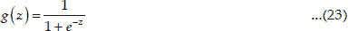

我们可以将模型的输出 `Y` 定义为：

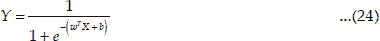

其中，`w` 和 `b` 是模型的参数。我们可以使用任何将输出值保持在 0 到 1 之间的平滑函数。

因此，对于二分类问题，什么样的什么样的损失函数来估计参数的最优值？让我们先从使用二次损失函数来估计参数的最优值开始。我们将模型的实际输出和预测输出定义为 `y` 和 `y'`。然后，损失函数为 `J()`。我们倾向于最小化凸函数以获得稳定的全局最小值，但在二分类的情况下，优化函数实际上被证明是具有多个局部最小值的非凸函数。非凸性的出现源于非线性 `sigmoid` 函数的存在。

我们使用了某些概率假设来推导二次代价函数。现在让我们定义几个概率假设来推导出交叉熵代价函数。

### 假设

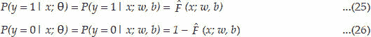

第一个方程解释了模型的近似函数（`(f(x))`）将估计 `y = 1` 的概率。现在，`y` 可以是 0 或 1。因此，`y = 0` 的概率将是 `1 –`。我们可以合并上述两个方程，并将 `w` 写为：

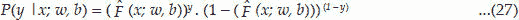

我们可以看到，当 `y = 1` 时，上述方程转化为假设的第一个方程；当 `y = 0` 时，该方程变为假设的第二个方程。

与最小二乘函数类似，我们将使用极大似然原理为二分类问题估计参数的最优值。

让我们定义似然函数 `L()`。现在，我们可以写出：

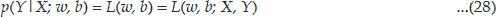

对于 `m` 个独立的训练样本，我们可以写为：

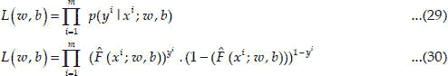

让我们取对数并将其定义为对数似然函数 `l(w, b)`：

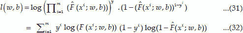

模型的总代价可以定义为：

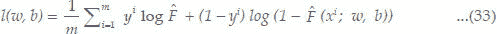

因此，为了找到适应模型的最佳参数值，我们必须最大化对数似然函数 `l(w, b)` 或最小化其负值。因此，代价函数可以写为：

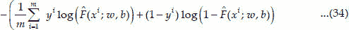

为了简单起见，我们将近似输出 `y(w, b) = y_hat`。因此，方程 34 可以写为：

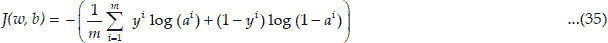

我们将对网络的近似输出保持相同的简单记法。

## Softmax 函数

现在，让我们来看交叉熵函数的更通用的形式。在上一节中，我们对二元变量使用了交叉熵。在本节中，我们将将其适用性扩展到具有 `n` 个可能值的变量。

对于二分类，我们假设：

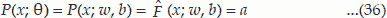

对于 `n` 个可能值，我们可以将上述方程的通用形式重写为：

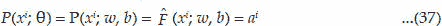

在这种情况下，我们将得到一个输出向量 `a`，向量的每个元素都位于 0 和 1 之间，且和为 1。在数学上，`softmax` 函数定义为：

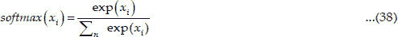

让我们理解如何得到上述公式。在多项分布中，它可以被写为：

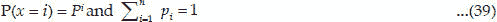

对于 `n` 个可能值，我们可以将概率写为：


对于二元变量，我们可以将其写为：

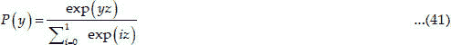

推广到 `n` 个值可以写为：

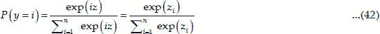

让我们理解如何得到上述方程。我们首先对每个输入值取指数，然后对其进行归一化以得到 0 到 1 之间的值，最后对概率取对数。形式上，我们可以将上述步骤写为：

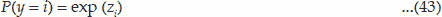

然后对该项进行归一化。因此，我们可以写为：

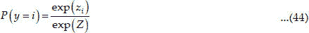

现在取对数后，上述方程将变为：

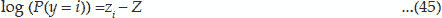

我们可以认为作为每个输入点，`Z` 是每个输入的归一化项。由于：

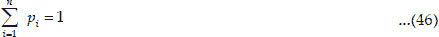

我们可以写道：


找到代价函数。在上一节中，我们推导了二元变量的交叉熵函数：

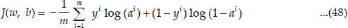

我们可以将上述方程扩展到 `n` 个值并写为：

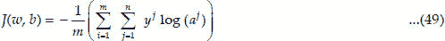

其中 `m` 是样本总数，`n` 是类别总数。我们可以看到，当 `n = 2` 时，我们将得到与为二元变量推导出的相同的代价函数，其中 `y = \= 1 –；相似地，如果 \= 则 \= 1 –`。在预测期间，我们将输出类别转换为独热向量，因此对于一个输入，可以将代价函数写为：

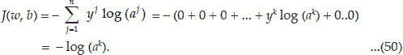

## 优化

在本节中，我们将讨论用于训练神经网络的优化技术，这本质上意味着估计代价函数取得最小值时对应的模型参数。


### 梯度下降

梯度下降有助于找到最陡峭的方向，该方向将用于收敛代价函数。为了找到可能的收敛点，我们需要计算函数的斜率，并迈出小步 `δx` 以到达最小点。根据第一性原理，我们将函数 `y=f(x)` 的微变化定义如下：

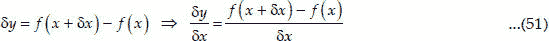

对于极小的步长，我们可以写下：

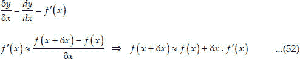

更全面地说，我们可以写成 `+ \ = –`。我们还知道对于递增函数 `> 0`，对于递减函数 `< 0`。从这个方程中推断出，对于递增函数 `–` 小于。因此，为了减小 `y` 的值，沿着 `⨍` 的反方向迈出一小步。同样，我们也可以对递减函数这样做。

利用上述论点，我们可以说新点将是 `x = x – αδx`，其中 `α` 定义为学习率，它决定了小步的大小。通常，我们为 `α` 值设置一个非常小的常数，以便它以最优速率收敛且不会跳过所需的最小点。在多维空间，当存在多个独立变量时，将为每个方向计算 `∇`。对于多变量输入，我们将计算函数的梯度，记为 `∇J()`。这种梯度计算技术被定义为梯度下降。

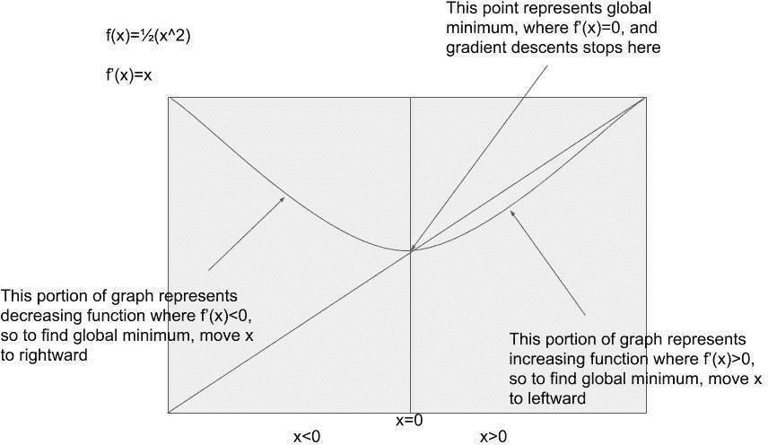
图 2.14

我们可以通过图理解上述论点。在这个示例中，使用了一个简单的抛物线，可以用 `y ≈ x²` 方程进行数学表示。`f(x)` 的导数是 `⨍ = 2x`。现在，利用增减函数的标准，我们可以说对于 `x > 0`，该函数表现为递增函数；对于 `x < 0`，该函数表现为递减函数。在 `x = 0` 处，`⨍` 也为 `0`；这些被称为驻点或临界点。

我们可以通过评估相邻点的函数值来检查该点是最小值还是极大值。如果相邻点的值大于临界点的值，则临界点是局部最小值。同样，如果相邻点的值小于临界点的值，则临界点是局部极大值。我们可能会在图中遇到多个局部极值点。给出图中最低绝对值的临界点定义为全局最小值。同样，给出图中最高绝对值的临界点被定义为全局极大值。

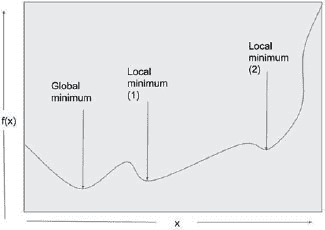
图 2.15

我们可以通过图理解最后一段。假设图 2.15 中的图代表任何代价函数。`x` 代表点，`y` 代表函数在这些点处的值。图 2.15 展示了三个最小值，其中一个是全局最小值，另外两个是局部最小值。在梯度下降中，我们的目标应该是达到全局最小值，但由于网络的非线性和多维性，我们通常会停留在局部最小值。

在上面的图中，我们可以看到局部最小值 (1)的值比局部最小值 (2) 更接近全局最小值。因此，模型在点 1 的表现将远好于点 2。因此，局部最小值 (1)是可以接受的，而应该避免局部最小值 (2)。

### 优化技术

现在，我们将讨论如何使用梯度下降更新参数。首先，我们将讨论最小二法代价函数。如前面的节所述，最小二法代价函数定义为：

```
J(w, b) = 1/(2m) * Σ (y_i - (wx_i + b))²
```

我们的目标是选择 `w` 和 `b` 以使代价函数最小。我们将使用上述讨论过的“线性搜索”方法和梯度下降算法来更新 `w` 和 `b`：

```
w = w - α∂J/∂w
b = b - α∂J/∂b
```

让我们计算代价函数对每个参数的偏导数。对于一个样本，具有一个权重值和一个偏置值：

```
∂J/∂w = -(1/m) * Σ (y_i - (wx_i + b)) * x_i
∂J/∂b = -(1/m) * Σ (y_i - (wx_i + b))
```

同样，对于具有多个特征的样本，上面的方程变为：

```
∂J/∂w_j = -(1/m) * Σ (y_i - (Σ w_kx_k + b)) * x_ij
```

对 `b` 的偏导数保持不变。因此，我们可以写出 `w` 的更新规则为：

```
w_j = w_j - α∂J/∂w_j
```

注意方程中的符号变化。有些书籍使用 `+`，另一些使用 `-`；然而，两者是一样的。这取决于我们在代价函数中使用 `-` 还是 `-` 来推导更新规则。对于 `m` 个样本的训练集，我们可以写出每个权重 `w` 的更新规则为：

```
w_j = w_j - α∂J/∂w_j
(修正此处)
```

我们执行此更新直到收敛。这种方法使用训练集中每个样本点来更新参数；因此，该算法被称为批量梯度下降。

现在我们讨论了如何使用最小二法代价函数更新参数，让我们来讨论交叉熵代价函数的情况，我们之前对 `m` 个样本定义如下：

```
J(w, b) = -1/m * Σ [y_i * log(h_i) + (1-y_i) * log(1-h_i)]
```

我们将以类似于处理之前代价函数的方式讨论更新规则。对于具有单个权重和偏置值的 1 个样本。现在我们的代价函数将是：

```
J(w, b) = -[y * log(h) + (1-y) * log(1-h)]
```

其中：

```
h = 1/(1 + e^{-(wx+b)})
```

现在：

```
∂J/∂w = (1/m) * (h - y) * x
∂J/∂b = (1/m) * (h - y)
```

因此，我们可以写出更新方程：

```
w = w - α(1/m) * Σ (h_i - y_i) * x_i
b = b - α(1/m) * Σ (h_i - y_i)
```

我们可以看到得到了之前相同的更新，但在这种情况下 `h` 是线性的。对于多个特征，更新规则将变为：

```
w_j = w_j - α(1/m) * Σ (h_i - y_i) * x_ij
```

而偏置 `b` 将保持不变。


### 随机梯度下降

正如我们所讨论的，批量梯度下降使用训练集中的每个样本点并累加梯度来在每一步中更新参数。当我们为大型数据集优化模型时，该算法收敛缓慢，而且计算开销巨大。为了解决这个问题，研究人员提出名为随机梯度下降的新算法，也称为 `SGD`。

在 `SGD` 中，我们计算第一个训练示例的梯度并尝试拟合样本，然后更新参数。接着，更新后的参数将作为第二个训练示例的初始参数，以此此类推。换句话说，在 `SGD` 中，每当我们遇到训练示例，就会计算梯度并利用该训练示例产生的误差来更新模型的参数。与批量梯度下降相比，在 `SGD` 中我们不需要完整的训练数据集即可向最速下降方向迈出一小步。`SGD` 的一个缺点是由于之字形运动，它可能无法收敛到全局最小值。但它会找到局部最小值，而局部最小值会接近全局最小值。

### SGD 的代价函数

让我们来理解 `SGD` 的代价函数。在上一节中，批量梯度下降算法的代价函数定义为：

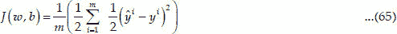

在 `SGD` 中，由于我们为每个训练示例计算梯度，代价函数变为

我们可以将其写为

在数学表达上，我们可以将权重的更新规则写为，

直到收敛：

```
For i \= 1 : m
For j \= 1 : n
```

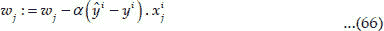

同样，对于偏置值，

直到收敛，

```
For i \= 1:m
For j \= 1:n
```


其中，`m` 是训练示例的样本数，`n` 是每个训练示例的特征总数。

## 神经网络实现

到目前，我们讨论了广义线性模型的代价函数和优化技术。让我们为具有单隐藏层的神经网络实现这些技术。


图 2.16

图 2.16 展示了具有单隐藏层的前馈神经网络。让我们定义该网络的参数：

- **权重**：`W1` 和 `W2` 代表每一层的权重矩阵
- **偏置**：`b1` 和 `b2` 代表每一层的偏置向量
- **输入单元**：`x` 代表输入数据（`x1`、`x2` 和 `x3`）
- **隐藏单元**：`h` 代表隐藏层隐藏单元的数量（这里为 `h1`、`h2`、`h3` 和 `h4`）
- **输出单元**：`O` 代表输出层输出单元的总（在本例中，只有 `O`）

下标 `0`、`1` 和 `2` 分别代表第 0 层（输入数据）、第 1 层（隐藏层）和第 2 层（输出单元或输出层）。在书中，上表示层数，下标表示层中的位置。例如，`h3` 表示 `h3` 位于层的位置。

对于单个神经元，我们将输入到输出的关系写为 `y = f(Wx + b)`。

现在，对于图中给定的输入的神经网络，我们可以将第 1 层的输出写为 `a1 = f(W1x + b1)`。然后，将输入激活函数以引入非线性。在本例中，我们将使用 `sigmoid` 函数作为激活函数。我们稍后会讨论激活函数。当 `a1` 输入到 sigmoid 函数时，它会输出 `h1`。同样，我们可以为下一层写出，但这次第 2 层的输入将是


## 激活函数

到目前，我们讨论了网络架构、代价函数和优化技术。现在，我们将讨论在每一层中应该选择以及选择什么样的隐藏单元。之前，我们使用 `sigmoid` 函数作为隐藏单元的激活函数。在本节中，我们将讨论其他类型的激活函数，但让我们先讨论为什么我们需要激活函数。

在线性模型中，我们使用单个神经元，并将权重和输入的线性组合来拟合模型。从数学上讲，我们尝试预测输出 `y` 为：

它产生一个线性决策边界，因此是一个线性分类器。我们的目标是得到一个非线性分类器。我们使用神经网络来构建非线性模型，并且神经网络中的每个神经元获取的输入类似于广义线性模型。

我们可以写出通用方程，通过该方程神经元获取输入：

在线性模型中，我们使用线性函数作为激活函数。让我们在神经网络模型中尝试线性激活函数。假设我们在隐藏单元和神经网络模型的输出单元中使用线性激活函数，如图所示，我们知道隐藏单元的输入可以写为：`z = X + b`，隐藏单元的输出可以写为 `a = f(z)`，其中 `f` 代表该层的激活函数。由于我们假设 `f` 是线性函数，所以我们可以写道，同样，对于输出层，我们可以写道 其中 `a = f(z)`。我们可以看到神经网络输出的是线性函数。

将此结果推广到多个层，我们可以说，如果对神经网络使用线性激活函数，那么无论神经网络有多少层，它计算的都是线性函数。换句话说，我们可以说神经网络的行为将像它没有隐藏单元一样。同样地，我们可以看到，如果我们将输出层的激活函数从线性改为 `sigmoid` 函数，那么同一个神经网络将表现得像逻辑回归模型，因为输出单元的输入是权重和原始输入的线性线性组合。在回归和时间序列预测等问题中，我们可以在输出单元使用线性激活，但在隐藏层中我们应该使用不同的激活函数。

到目前为止，我们讨论了通过仅使用线性激活函数，我们将无法获得非线性分类器。为了实现这一目标，需要以激活函数的形式在网络中引入非线性。现在，让我们来介绍神经网络中一些广泛使用的非线性激活函数。

### Sigmoid 函数

  图 2.17
图 2.17 显示了 sigmoid 函数的图像。传统上，sigmoid 函数被用作神经网络的激活函数。它将值压缩在 0 到 1 的范围内。它被广泛应用于二分类问题。虽然 sigmoid 函数引入了非线性，但它也有一些缺点。让我们来看看：

*   **梯度消失**：当隐藏单元的输出值达到 0 或 1 时，梯度由于饱和而变为零（斜率 `f' = 0`）。我们知道参数将不会更新（我们下一节中将更多更多反向传播）。由于这个问题，在初始化参数时也需要额外小心，因为如果初始值很高，就会饱和。
*   **非零中心输出**：隐藏单元的输出产生非中心化数据，这会在梯度下降过程中产生之字形动态；因此导致收敛较慢。

### Tanh 函数

函数的表示形式为：
Tanh 是另一种用作激活函数的非线性函数。它将值压缩在 –1 到 1 的范围内。如果对其进行适当分析，我们可以看到 tanh 是 sigmoid 函数的平移版本。从数学上讲，我们可以将其写为 `tanh(x) = (e^x - e^-x)/(e^x + e^-x)`。Tanh 也存在梯度消失问题，但由于零中心输出优于 sigmoid 函数。

### ReLU

`f = max(0, x)`  图 2.19
修正线性单元通常称为 `relu`，使用上述函数。由于与线性函数的相似性，`relu` 容易优化。`relu` 与线性函数的区别在于当 `x` 小于等于 0 时它输出零值。图 2.19 展示了 `relu` 函数的图像。`relu` 的导数在其定义域范围内为 1；这意味着当 `x` 大于 0 时，隐藏单元将保持激活。这有助于避免 `x` 大于 0 时的梯度消失问题。与 sigmoid 和 tanh 函数 x 值较大时梯度值会减小相反，`relu` 函数的梯度保持不变，有助于加速收敛。与 sigmoid 和 tanh 函数不同，`relu` 由于其特性（当 `x ≤ 0` 时输出 0）提供了稀疏网络。

### Leaky ReLU

`f = max(αx, x)`  图 2.20
如前所述，`leaky relu` 试图解决死亡 `relu` 问题。它使用上述函数，其中 `α` 是一个非常小的数。在 `relu` 中，当 `x ≤ 0` 时返回 0，但在 `leaky relu` 中，它将返回该值。我们通常将 `α` 的小值保持在 0.01 或更小。


## 反向传播

到目前为止，我们讨论了如何更新简单神经网络的参数，但还没有讨论如何在复杂网络中计算损失函数的梯度。换句话说，我们还没有妥善地讨论如何计算损失函数相对于网络中每个参数的梯度。因此，在本节中，我们将讨论每个参数如何影响损失函数，以及如何在神经网络中将误差反向传播以更新模型参数。

在前馈神经网络中，我们取一个输入 `x`，然后来自 `x` 的信息流过隐藏层产生输出。由于来自 `x` 的信息仅向前流动，这就是为什么过程被称为正向传播。现在，一旦得到了输出，我们就定义一个 `J` 损失函数，它代表真实输出 `y` 与预测输出之间的误差。使用反向传播算法，我们将损失函数中的信息（本质上是梯度）传回网络。我们可以将其视为一个利用反馈机制来增强性能的过程。在反向传播中，我们再次向网络输入信息，但这次是反向的。换句话说，我们按反向传播信息，这就是这种技术被称为“反向传播”的原因。注意，即使在广义线性模型的情况下，我们也执行了反向传播。因此，通常来说，我们可以说反向传播用于计算任何函数的梯度。

接下来，我们将利用链式法则对反向传播建立直观的理解，链式法则将被递归地计算函数的梯度。

### 简单示例与链式法则

我们将从一个简单的示例开始。假设一个函数为 `y = f(x)`。为了简单起见，我们将该方程表示为简单的方程：`y = a * w`，其中 `w + x` 由 `a` 表示。现在，让我们应用链式法则来寻找 `y` 与输入之间的关系。首先，我们将计算函数 `a = w + x` 对 `w` 和 `x` 的偏导数，然后 `w` 对 `a` 的导数。

 

我们感兴趣的是计算 `y` 对 `x` 和 `w` 的偏导数。现在，让我们找到 `y` 对每个输入的梯度。

 

现在，我们将使用数值来理解偏导数的结果。假设我们选择 `w = -3`，`x = -1` 且 `y = 3`。现在，我们将看到每个输入值如何影响函数。

我们可以看到 `y` 对 `a` 的梯度带有正号。这意味着如果我们增加 `a`，`y` 就会增加；或者如果我们减少 `a`，`y` 就会减少。换句话说，为了增加或减少 `y`，我们必须相应地增加或减少 `a`，幅度为 3。继续上面的表达式，我们可以写下 `dy/da = w`。这意味着我们可以给出类似的参数来建立 `y` 与 `w` 之间的关系。现在，由于 `w` 和 `x` 保持线性关系（由于加法性质），两个变量的行为将相似。因此，我们可以说 `w` 与 `y` 之间的关系类似于 `dy/dx`。现在，对于 `dy/dw`，正如我们看到的 `y` 对 `w` 的梯度带有负号，这意味着 `y` 将与 `w` 呈反比关系，幅度为 4。

### 数值反向传播

现在我们已经讨论了链式法则，让我们通过具体的数字来理解反向传播是如何工作的。查看下面的图片：


### 图 2.1

图 2.1 代表了我们的神经网络。为了简单起见，我们将通过一个具有 2 个输入、2 个输出和 1 隐藏层的模型来理解反向传播。我们可以将相同的概念扩展到更大更复杂的网络。

让我们初始化权重和偏置以及输入输出值：
- **权重 (Weights)**：`w1 = 0.15`, `w2 = 0.20`, `w3 = 0.25`, `w4 = 0.30`, `w5 = 0.40`, `w6 = 0.45`, `w7 = 0.50`, `w8 = 0.55`
- **偏置 (Biases)**：`b1 = 0.35`, `b2 = 0.60`, `b3 = 0.05`, `b4 = 0.10`, `b5 = 0.01`, `b6 = 0.99`
- **学习率 (Learning rate)**：`α = 0.5`，在这个例子中，`α` 的值很高。通常我们选择较低的 `α`，如 0.01。

我们将使用单个示例并尝试预测正确的输出。首先，我们将看到正向传播是如何工作的。接下来，我们将使用激活函数获取输出。在这个例子中，`sigmoid` 函数将作为激活函数。同样，我们得到 `out = 0.59688478`。现在，我们将关注输出。同样对于 `out = 0.77298465`，我们将使用最小二乘函数计算预测输出与真实输出之间的误差，其定义为。计算每个输出单元的误差如下。同样，我们得到 `0.02356026`。现在，总误差 `E = 0.29837109`。

到目前为止，我们在正向传播中计算了总误差。我们的目标是预测真实的输出。为了实现这一点，我们需要最小化误差。现在，我们将使用反向传播技术将误差反向传播到网络中，观察权重和偏置值如何更新，以便在下次迭代中预测输出更接近真实输出。

让我们理解每个参数如何影响输出。我们已经定义了，并且如果(image-fio9b5vh)，我们也定义了 `dE/dw = dE/dout * dout/dz * dz/dw`。使用链式法则，我们可以看到总误差如何依赖于 `w` 。我们计算了每个乘项；将所有值放在一起得到。到目前为止，我们建立了 `w` 与 `E` 之间的关系并计算了该值。现在，让我们更新权重 `w1` 的值。同样，我们可以更新 `w2` 和 `w3` 的值并得到接近以下数字的更新值：`w1 = 0.408666186`, `w2 = 0.51130127`, `w3 = 0.56137021`。

取决于值的近似精度，我们可以看到权重和偏置值的变化。注意，在更新隐藏层的参数值时，我们将使用输出层参数的原始值。通常，在反向传播期间，我们使用层 `l` 参数的原始值来更新层 `l-1` 的参数。每次迭代后，所有参数都会更新并成为下次迭代的原始值。

现在，我们将看到隐藏层的参数如何影响输出。在隐藏层，我们有权重 `w` 和 `b`。为了建立隐藏单元与损失函数之间的依赖关系，我们将使用类似的方法，但稍微复杂，因为可以看到隐藏单元与两个输出单元连接，这将影响两个输出值。让我们理解 `w` 如何影响 `E` 。我们将逐一考虑右边的两个项。首先，我们将处理 `dE/dout`。使用链式法则，我们可以写道。同样，我们将得到 `dE/dout2` 。现在，为了建立层 1 参数与 `E` 之间的关系，我们需要为每个权重计算 `dout/dz` 然后是 `dz/dw` 。所以，，我们也定义了 `dE/dw = dE/dout1 * dout1/dz1 * dz1/dw1 + dE/dout2 * dout2/dz2 * dz2/dw1`。所以，，因此，现在，我们可以更新权重为。同样，我们可以更新 `w4` 和 `w5` 的值并得到接近以下数字的更新值：`w4 = 0.19956143`, `w5 = 0.24975114`, `w6 = 0.29950299`。到目前为止，我们已经更新了 1 个 epoch（定义为整个数据集通过网络正向和反向传播一次）。直到收敛，这个过程应该不断重复，因此我们将获得非常接近真实的预测输出。


## 过拟合与欠拟合

现在我们已经理解了什么是前馈神经网络、用于训练网络的不同代价函数以及优化这些代价函数的不同方法，以及激活函数是如何帮助在神经网络中引入非线性的。

在任何模型学习中，模型能够从训练数据中泛化，并对未来模型从未见过的数据进行预测，这是至关重要的。但在实际问题中，模型要么从训练数据中学习得太好，以至于捕捉了噪声和不重要的细节，这被称为**过拟合**（over-fitting）；要么模型无法学习即使是重要的细节，即它既无法拟合训练数据，也无法对未见数据进行泛化，这被称为**欠拟合**（underfitting）。

理想情况下，拥有足够的参数，我们可以拟合任何数据集。模型与可用训练数据集契合良好这一事实并不意味着它是一个好模型。模型应该能够泛化该场景。在深度神经网络中，我们可以拥有数百万个参数。因此，对于这么多大量的自由参数（权重和偏置），模型很容易发生过拟合。为了进行有效训练，我们应该能够检测出模型何时发生过拟合。

在模型中检测过拟合并不总是那么容易。通用规则是：当不可见数据（测试数据）上的准确率低于训练集准确率时，模型正在过拟合训练数据。

### 如何在深度神经网络中防止过拟合？

### 获取更多数据
数据越多，模型就越容易捕捉所有重要细节并相应地估计参数。

### 训练集/开发集/测试集 (Train/Dev/Test set)
在神经网络中有许多超参数可以调整。使用测试集准确率来设置超参数会导致测试（不可见）信息的泄露，导致模型在生产系统中惨败。由于我们在深度神经网络中处理的是数百万个数据点，始终建议准备一个独立的开发/验证集来微调超参数，同时保持测试集完全不可见。

### 减小网络规模
这种方法并不经常使用，因为较大的网络比较小的网络具有更大的潜力。

### 正则化
这是防止过拟合最常用的方法。它基本上是向代价函数（例-4a）中添加一个额外组件（惩罚项）或修改网络（例-4b），惩罚模型过于复杂的行为，从而使模型泛化得更好。下面解释了不同的正则化技术。

#### L1 和 L2
L1 和 L2 都在代价函数中添加了额外的惩罚项，使网络能够学习更小的权重。假设惩罚项为 `λ`，其中 `λ` 是正则化超参数。因此，方程 (22) 变为：


#### 丢弃法 (Drop out)
在这种技术中，训练期间，网络中每一层（除属于输出层的层外）的神经元（或节点）以作为超参数的概率被丢弃（去激活），其默认值通常设置为 0.5。值得注意的是，在测试/推理期间，所有神经元都保持激活状态（不丢弃）。

#### 早停 (Early stopping)
很多时候观察到，随着 epoch（迭代）数的增加，尽管训练损失持续下降，但验证准确率在某个 epoch 之后停止增长。训练过程结束时得到的模型并不一定是可能创建的最优模型。基本上我们在模型开始过拟合之前中断了训练过程。

### 欠拟合

虽然与过拟合相比，深度神经网络中的这个问题并不常见，但它也会通过使模型过于简单并丢失训练数据中的重要细节来导致模型效率低下。有时，保持非常高的正则化系数（`λ`）来避免过拟合也会导致欠拟合。

欠拟合通过像准确率这样良好的性能指标更容易检测。欠拟合的模型在测试集和训练数据上的表现都很差。

### 如何在深度神经网络中防止欠拟合？

### 增加层数或神经元数量
通过增加层数或神经元，我们尝试为模型创建更多自由参数以便学习更多细节。

### 减少正则化系数
到目前为止，我们讨论了非线性模型和前馈神经网络。现在我们将通过示例查看线性模型和神经网络之间的区别。在这个例子中，我们的目标是可视化由线性和非线性模型创建的边界。让我们开始吧。首先，我们将生成数据集。为此，我们将使用名为 scikit 的库。

```python
import matplotlib.pyplot as plt
import numpy as np
import sklearn
from sklearn import datasets

x, y = sklearn.datasets.make_moons(300, noise=0.30)
plt.scatter(x[:,0], x[:,1], s=40, c=y, cmap=plt.cm.Spectral)
print(len(x), len(y))
```

执行上述代码后，我们将得到如图所示的图：


Figure 2.2

```python
## 训练分类器
clf = sklearn.linear_model.LogisticRegressionCV()
clf.fit(x, y)

### 逻辑回归
clf = sklearn.linear_model.LogisticRegressionCV()
clf.fit(x, y)

### 设置最小最大值并给予一些填充
x_min, x_max = x[:,0].min() - .5, x[:,0].max() + .5
y_min, y_max = x[:,1].min() - .5, x[:,1].max() + .5
### 生成距离为 h 的点网格
h = 0.01
xx, yy = np.meshgrid(np.arange(x_min, x_max, h), np.arange(y_min, y_max, h))
### 使用分类器预测
Z = clf.predict(xx.ravel(), yy.ravel())
Z = Z.reshape(xx.shape)

### 绘制轮廓和训练示例
plt.contour(xx, yy, Z, cmap=plt.cm.Spectral)
plt.scatter(x[:,0], x[:,1], c=y, cmap=plt.cm.Spectral)
plt.title("Logistic Regression")
plt.show()
```


Figure 2.23

现在我们看到了线性模型如何绘制线性边界来分类非线性分离的数据。现在我们将查看非线性分类器在相同数据上的结果。

现在，我们将构建一个三层神经网络，包括输入层、单个隐藏层和输出层。输入的数量取决于输入特征的数量。在这个例子中，我们将使用二维数据，因此输入数量为 2。同样，我们将根据输入类别的数量定义输出单元的数量。在这个例子中，我们将使用 2 个类别的数据，我们可以将输出单元设置为 1（预测 0 或 1），但我们将输出单元保持为 2，因为如果我们想扩展类别数量。我们会使用每个样本的 `x` 和 `y` 坐标作为输入。现在，在隐藏层，我们可以通过选择隐藏神经元的数量来设置其维度，这些隐藏神经元将定义神经网络的复杂度。我们放置的隐藏神经元越多，创建的函数越复杂。可以使用任何激活函数，但在本例中我们将使用 `tanh` 激活函数。对于优化，使用了批量梯度下降技术。

让我们不使用任何深度学习框架来实现非线性分类器；这将帮助我们从数学上理解网络结构。

```python
### 所需的包
import matplotlib.pyplot as plt
import numpy as np
import sklearn.datasets
import matplotlib

### 生成数据集
np.random.seed(0)
x, y = sklearn.datasets.make_moons(300, noise=0.30)
plt.scatter(x[:,0], x[:,1], s=40, c=y, cmap=plt.cm.Spectral)

### 定义变量
### 训练样本数
num_examples = len(x)
### 输入层的单元数（输入层维度）
nn_input_dim = 2
### 输出单元数（输出层维度）
nn_output_dim = 2

### 超参数
### 梯度下降使用的学习率
alpha = 0.001
### 正则化参数
reg_lambda = 0.001

### 在数据集上评估总损失
### 在此例中，我们使用 tanh 激活函数，可以使用其他函数来检查结果。
def calculate_loss(model):
    loss = None
    W1, b1, W2, b2 = model['W1'], model['b1'], model['W2'], model['b2']
    # 前向传播计算预测
    z1 = x.dot(W1) + b1
    a1 = np.tanh(z1)
    z2 = a1.dot(W2) + b2
    exp_scores = np.exp(z2)
    probs = exp_scores / np.sum(exp_scores, axis=1, keepdims=True)
    # softmax 损失
    # 计算损失
    corect_logprobs = -np.log(probs[range(num_examples), y])
    data_loss = np.sum(corect_logprobs)/num_examples
    # 添加正则化参数 (L2 Regularization) 防止过拟合
    reg_loss = reg_lambda/2 * (np.sum(np.square(W1)) + np.sum(np.square(W2)))
    loss = data_loss + reg_loss
    return loss

### 预测输出
def predict(model, x):
    W1, b1, W2, b2 = model['W1'], model['b1'], model['W2'], model['b2']
    # 前向传播
    z1 = x.dot(W1) + b1
    a1 = np.tanh(z1)
    z2 = a1.dot(W2) + b2
    exp_scores = np.exp(z2)
    probs = exp_scores / np.sum(exp_scores, axis=1, keepdims=True)
    return np.argmax(probs, axis=1)

### 训练神经网络
### nn_hdim : 隐藏层中的单元数
### num_passes : epoch 数
def build_model(nn_hdim, num_passes=4000, print_loss=False):
    # 初始化参数为随机值。我们需要学习这些。
    np.random.seed(0)
    W1 = np.random.randn(nn_input_dim, nn_hdim) / np.sqrt(nn_input_dim)
    b1 = np.zeros((1, nn_hdim))
    W2 = np.random.randn(nn_hdim, nn_output_dim) / np.sqrt(nn_hdim)
    b2 = np.zeros((1, nn_output_dim))
    # 这是我们在最后返回的
    model = {}
    # 批量梯度下降
    for i in range(num_passes):
        # 前向传播
        z1 = x.dot(W1) + b1
        a1 = np.tanh(z1)
        z2 = a1.dot(W2) + b2
        exp_scores = np.exp(z2)
        probs = exp_scores / np.sum(exp_scores, axis=1, keepdims=True)
        # 反向传播
        delta3 = probs[range(num_examples), y] - 1
        dW2 = a1.T.dot(delta3)
        db2 = np.sum(delta3, axis=0, keepdims=True)
        delta2 = delta3.dot(W2.T) * (1 - np.power(a1, 2))
        dW1 = x.T.dot(delta2)
        db1 = np.sum(delta2, axis=0, keepdims=True)
        # 为权重添加正则化项，我们可以为偏置添加正则化项
        dW2 += reg_lambda * W2
        dW1 += reg_lambda * W1
        # 梯度下降参数更新
        W1 -= alpha * dW1
        b1 -= alpha * db1
        W2 -= alpha * dW2
        b2 -= alpha * db2
        # 将新参数分配模型
        model = {'W1': W1, 'b1': b1, 'W2': W2, 'b2': b2}
        if print_loss and i % 1000 == 0:
            print("Loss after iteration %i: %f" % (i, calculate_loss(model)))
    return model

### 绘制决策边界
def plot_decision_boundary(pred_func):
    # 设置最小最大值并给予一些填充
    x_min, x_max = x[:,0].min() - .5, x[:,0].max() + .5
    y_min, y_max = x[:,1].min() - .5, x[:,1].max() + .5
    h = 0.01
    # 生成它们距离为 h 的点网格
    xx, yy = np.meshgrid(np.arange(x_min, x_max, h), np.arange(y_min, y_max, h))
    # 预测整个网格的函数值
    Z = pred_func(xx.ravel(), yy.ravel())
    Z = Z.reshape(xx.shape)
    # 绘制轮廓和训练示例
    plt.contourf(xx, yy, Z, cmap=plt.cm.Spectral)
    plt.scatter(x[:,0], x[:,1], c=y, cmap=plt.cm.Spectral)
    # 构建具有 3 维隐藏层的模型
    model = build_model(3, print_loss=True)
    # 绘制决策边界
    plot_decision_boundary(lambda x: predict(model, x))
    plt.title("Decision Boundary for hidden layer size 3")
    plt.show()
```

执行此代码后，我们将得到类似于下图的图：


Figure 2.24

好的，让我们改变隐藏层的隐藏单元并查看结果：

```python
plt.figure(figsize=(16, 32))
### 隐藏层中的隐藏单元数
hidden_layer_dimensions = [1, 2, 3, 4, 5, 20, 30, 50, 100]
for i, nn_hdim in enumerate(hidden_layer_dimensions):
    plt.subplot(5, 2, i+1)
    plt.title('Hidden Layer size %d' % nn_hdim)
    model = build_model(nn_hdim)
    plot_decision_boundary(lambda x: predict(model, x))
    plt.show()
```

下图显示了隐藏层中改变隐藏单元数量的不同决策边界。


Figure 2.25


Figure 2.26


Figure 2.27


Figure 28

到目前为止，我们讨论了前馈神经网络的概念并看到了线性和非线性模型如何使用决策边界分类。现在我们将为实际问题实现神经网络。在这个例子中，我们的目标是使用 TensorFlow 分类 MNIST。让我们了解所需的库：

```python
### 导入所需的包
import matplotlib.pyplot as plt
import numpy as np
import tensorflow as tf
from tensorflow.python.framework import ops
from tensorflow.python.examples.mnist import input_data

### 下载 fashion mnist 并保存到 'data/' 文件夹，否则 tensorflow 将下载原始 mnist 数据集
fashion_mnist_dataset = input_data.read_data('data/fashion', one_hot=True)
### 检查训练和测试集的大小
shape_train = fashion_mnist_dataset.train.shape
shape_test = fashion_mnist_dataset.test.shape
### Fashion mnist 数据集标记如下字典。
label_dict = {
    0: 'T-shirt/top',
    1: 'Trouser',
    2: 'Pullover',
    3: 'Dress',
    4: 'Coat',
    5: 'Sandal',
    6: 'Sneaker',
    7: 'Bag',
    9: 'Ankle boot'
}
### 检查数据集中的随机图像
sample = fashion_mnist_dataset.train.images[40].reshape(28,28)
sample_label = np.where(fashion_mnist_dataset.train.labels[40] == 1)[0]
### 显示图像和标签
print("y=%s (%s)" .format(label_index=sample_label, label=label_dict[sample_label]))
plt.imshow(sample, cmap='Greys')
plt.show()
```

执行上述代码，我们可以看到带有标签的图 2.29。


Figure 2.29

让我们如下分配网络的各种参数和超参数：

```python
### 第一隐藏层的单元数
n_hidden_1 = 128
### 第二层单元
n_hidden_2 = 128
### Fashion mnist 数据输入（形状: 28*28）
n_input = 784
### Fashion mnist 总类别 (0-9)，也是输出层的单元数
n_classes = 10

### 创建占位符
def create_placeholders(n_x, n_y):
    # n_x 和 n_y 分别代表输入向量的大小和输出类别
    X = tf.placeholder(tf.float32, [n_x, None], name="X")
    Y = tf.placeholder(tf.float32, [n_y, None], name="Y")
    return X, Y

def initialize_parameters():
    # 使用 tensorflow 初始化神经网络。我们之前讨论过
    # 如何定义每层的参数。形状如下：
    # W1 : [n_hidden_1, n_input]
    # b1 : [n_hidden_1, 1]
    # W2 : [n_hidden_2, n_hidden_1]
    # b2 : [n_hidden_2, 1]
    # W3 : [n_classes, n_hidden_2]
    # b3 : [n_classes, 1]
    # 设置随机种子以于复现性
    tf.set_random_seed(42)
    # 初始化每层的权重和偏置
    W1 = tf.get_variable("W1", [n_hidden_1, n_input], initializer=tf.contrib.layers.xavier_initializer(seed=42))
    b1 = tf.get_variable("b1", [n_hidden_1, 1], initializer=tf.zeros_initializer())
    W2 = tf.get_variable("W2", [n_hidden_2, n_hidden_1], initializer=tf.contrib.layers.xavier_initializer(seed=42))
    b2 = tf.get_variable("b2", [n_hidden_2, 1], initializer=tf.zeros_initializer())
    W3 = tf.get_variable("W3", [n_classes, n_hidden_2], initializer=tf.contrib.layers.xavier_initializer(seed=42))
    b3 = tf.get_variable("b3", [n_classes, 1], initializer=tf.zeros_initializer())
    # 将初始化存储为参数字典
    parameters = {
        "W1": W1,
        "b1": b1,
        "W2": W2,
        "b2": b2,
        "W3": W3,
        "b3": b3
    }
    return parameters

def forward_propagation(X, parameters):
    # X 是输入占位符，参数是字典中的参数
    # 我们在最后定义的。
    W1 = parameters['W1']
    b1 = parameters['b1']
    W2 = parameters['W2']
    # 前向传播计算预测
    z1 = tf.matmul(X, W1) + b1
    a1 = tf.nn.tanh(z1)
    z2 = tf.matmul(a1, W2) + parameters['b2']
    # ... (省略后续逻辑以保持简洁)
    return z2
```


## 结论

在本章中，我们讨论了线性模型对于线性分离的数据是有效的，但由于其固有的线性，它们在处理具有非线性交互的数据集时会失效，这意味着它们只能识别线性决策边界。在现实世界中，我们通常遇到无法用线性决策边界解决的问题。然后，我们讨论了一种名为前馈神经网络的非线性网络。我们看到了非线性网络如何解决非线性数据。接下来，我们还讨论了前馈神经网络的各种构建模块，例如代价函数（惩罚错误输出）、梯度下降（学习步骤）、激活函数（引入非线性）等。接阶段，我们讨论了如何避免网络中的偏差或方差，或者如何构建泛化能力的网络。最后，我们通过两个例子结束了讨论——一个展示了网络中复杂性的影响，另一个是关于 MNIST 服装分类。前馈网络有助于解决简单问题，但对于语言翻译、时间序列预测、目标检测等复杂任务，它的表现并不理想。在下一章中，我们将讨论前馈神经网络的扩展，即卷积神经网络（CNN），并将看到 CNN 如何帮助克服前馈神经网络的局限性。

# 第 3 章 卷积神经网络

在上一章中，我们讨论了前馈神经网络，它能够为输入和输出向量之间的非线性映射学习高维、非线性且复杂的函数。在本章中，我们将讨论一类更先进、复杂的神经网络，称为卷积神经网络（CNN）。我们将从讨论前馈神经网络的局限性开始。接下来，我们将讨论 CNN 的定义和应用，以及我们如何利用 CNN 来克服前馈神经网络的局限性。随后，我们将讨论构建 CNN 所需的基础操作和技术，例如卷积操作、池化函数等。最后，我们将以 CNN 的端到端架构结束讨论。

## 结构
- 卷积操作
- 激活层
- 池化层
- Dropout（丢弃法）

## 目标

本章的目标是解释 CNN 在处理图像等拓扑数据中的应用，并理解各种先进的 CNN 架构。

## CNN 简介

让我们从前馈神经网络的效率开始。通常，我们会遇到如图像和单词等的数据，其变量数量达到数百或数千。为了理解这一点，让我们考虑一个具有 100 个输入单元的较小神经网络。现在，一个全连接层将会有 10,000 个权重，如果我们将层数增加到 3 或 4 层，权重将增加到 30,000 到 40,000 个。即使我们应用通用的 dropout 标准（在上章中讨论过），它也不会减少权重的数量。此外，如果我们继续丢弃更多的隐藏单元，会导致欠拟合。对于小型神经网络来说是如此。假设我们使用具有 1000 个输入单元的神经网络，权重数量将达到数百万。这些大量的变量需要巨大的内存，并最终排除了硬件实现的可能性。由于上述条件，前馈神经网络的实现变得在计算上非常昂贵。此外，如果训练数据有限，可能会面临过拟合问题。

除了上述的计算局限性外，前馈网络在特征层面也存在局限性。我们知道前馈网络是非结构化网络，不共享参数，因此它对局部失真不稳健。在预处理期间，我们对数据进行归一化并输入网络，但在预处理过程中图像可能会发生平移或旋转变形，由于每个单元使用不同的权重，单元的输出就会失真。其次，在 CNN 中，参数在输入之间共享，因此变量数量减少了，这变成了一种更高效的技术。神经网络的另一个局限性是它没有利用输入数据的拓扑结构。我们可以以任何顺序输入数据而不会改变输出。但我们知道图像在空间上是相关的，类似于时间序列在时间上是相关的。CNN 利用了局部特征之间的相关性。我们将在稍后详细讨论 CNN 如何帮助克服前馈神经网络的局限性。

CNN 广泛应用于具有网格拓扑结构的数据。例如 1D 数据（如时间序列数据，可以被分析为按固定时间间隔采样的 1D 网格）以及多维图像（可以可视化为分层堆叠的 2D 像素网格）。CNN 在解决实际问题方面表现出了卓越的性能。正如名称所示，CNN 使用了一种不翻转卷积核的数学操作。在数学上，卷积被定义为一种特殊的线性操作。如果我们分析 CNN，可以看到 CNN 类似于神经网络，这些神经网络在至少一层中使用权重和输入之间的卷积操作（互相关）来代替矩阵乘法。现在，我们将讨论什么是卷积。接下来，我们将形象地讨论，为什么研究人员将注意力从全连接网络转向卷积神经网络。正如之前提到的，CNN 中使用的卷积操作与工程或数学等领域使用的操作并不完全相同。我们将讨论在神经网络中广泛使用的几种卷积操作变体。我们还将看到如何在一个各种多维数据上使用卷积函数。


## 卷积操作

通常，卷积是两个函数之间的一种运算，产生第三个函数，该函数通常被假设是原始函数之一的修改版本。让我们通过一个例子来理解卷积。

假设我们正在使用雷达传感器追踪一个物体的位置，我们的传感器提供的输出是物体的位置，该位置是时间的函数。变量 `x` 和 `t` 都是实值；因此，在任何时刻我们都可能从传感器获得不同的读数。假设传感器产生带有噪声的输出。由于输出中的噪声，我们将得到失真的结果。

为了减少失真，我们将计算多次测量的平均值，但可能无法获得准确的结果，因为我们对每次测量的方差赋予了相同的权重。为了减少误差，我们使用加权平均法，赋予最近的项更大的权重。我们也可以将其视为一个系统，其中数据点的质量各不相同，因此随机误差的方差对于所有数据都不是恒定的，为了减少误差，我们可以提供与数据方差成反比的权重。

为了实现这项技术，我们可以使用权重函数，例如 `w(a)`，其中 `a` 表示时间段。我们可以假设 `w` 是概率函数以获得加权平均，否则输出将不是加权平均。通过这种技术，我们得到了一个新的平滑函数，它可以更准确地估计物体的位置。在数学上，我们可以将其写为：


上述操作被称为卷积操作。在文献中，卷积操作通常使用星号 `*` 表示为 `* \= *`。

### 离散卷积

让我们通过另一个例子来理解卷积操作。在这个例子中，我们将看到更多实际的卷积问题，即离散卷积。上面的例子可以理解离散卷积，但我们将看另一个例子。

假设某补习老师决定对某门课程进行私人辅导。第一天，初学者接受了 1 小时的讲座，以探索并理解这门课程。从第二天开始，同一个学生的讲座时长从 1 小时 变为 3 小时。现在，如果我们绘制天数和小时数之间的关系，将得到如图 3.1 所示的图。


图 3.1：一个学生的上小时数每天都在变化。

假设第一天有 2 名学生加入私人辅导。第二天有 4 名新学生，第三天达到 6 名。


图 3.2：每天加入的新学生人数

图 3.2 显示了每天加入的新学生人数。好了，让我们计算每天的教学小时数。第一天有 2 名学生，所以总小时数将 `2 * 1 = 2`。如果我们用 `d` 表示天数来表示总小时数，那么 `\= 2`。为了数学方便，第一天用数字 0 表示。

现在，在第二天，已经有第一天的 2 名学生，每个学生将获得 3 小时的课程，加上第二天加入的 4 名新学生。第三天，有前一日的 6 名学生，每个学生将获得 3 小时的课程，且第三天没有新学生加入（0 名）。

在数学上，我们可以将其写为：
`2 * 1 = 2`
`2 * 3 + 4 * 1 = 10`
`6 * 3 + 0 * 1 = 18`

上述操作被称为卷积操作。在文献中，卷积操作通常使用星号 `*` 表示为 `* \= *`。


### 为什么选择 CNN？

图 3.6 显示了卷积的应用示例。它展示了我们如何使用称为 `laplacian kernel` 的内核来检测图像中的边缘。如图所示，`functions` 和 `kernel` 分代表输入图像和内核，而 `function` 代表产生滤波输出的卷积操作。


图 3.6：使用卷积操作进行边缘检测

让我们更形象地深入 CNN 背后的动机。假设有一张大小为 $3 \times 3$ 的小图像。在这个例子中，为了简单起见，图像尺寸限制为 $3 \times 3$，并使用随机数表示图像。


图 3.7：2D 图像（左）展平为 1D 向量（右）

在多层感知器中，输入数据应该是向量形式，因此我们必须如图所示将数据转换为向量。我们可以看到图像的每个像素都被映射到向量，并且知道向量的每个元素代表输入层中的单个神经元。由于我们取的是 $3 \times 3$ 大小的图像，元素总数将为 9，因此输入层将拥有 9 个神经元。

现在，我们必须决定隐藏层的数量。为了简单起见，我们将设置 1 个隐藏层和 1 个输出层。假设隐藏层有 16 个神经元，而且我们实现的是全连接网络，如图所示，输入层的每个神经元都将连接到隐藏层的每个神经元。通俗地说，我们可以说层 $l$ 的每个神经元都将连接到层 $l-1$ 的神经元。


图 3.8：输入层的像素连接到下一层的每个像素

在例例中，输入层有 9 个神经元，隐藏层有 16 个神经元，因此神经元之间将有 $9 \times 16 = 144$ 个连接，相应的每个连接将有 144 个权重，如图所示。


图 3.9：全连接层

在这个例中，由于我们使用了较小的图像，因此参数数量较少，但如果我们增加图像尺寸会怎样？例如，如果我们使用一张大小为 $64 \times 64 \times 3$ 的图像，并带有两个各有 1000 个甚至 500 个神经元的隐藏层，那么参数数量将超过 1000 万。通常，对于实际问题，图像尺寸通常很大，如果我们使用全连接 MLP，参数数量将超过 1 亿。正如我们在引言中所讨论的，如此多的参数将排除硬件实现。CNN 被用于解决这类问题。

我们可以看到参数数量变得非常大，因为在全连接网络中，层 $l-1$ 的所有神经元都连接到层 $l$ 的每个神经元。为了减少参数数量，层 $l-1$ 的神经元可以连接到层 $l$ 的一组神经元，如图。我们可以看到输入层索引为 0 的神经元连接到下一层的前 4 个神经元（索引为 0, 1, 2, 3），且具有相同的权重，如图所示。而图中显示同一组神经元以不同的权重连接。


图 3.10：输入层的每个像素与下一层的一组像素共享（相同）权重

那么我们现在有多少个连接？由于每个神经元连接到一组 4 个神经元，连接数量减少到了分之一。因此，连接总数将变为 $144/4 = 36$。我们可以看到连接数减少了 75%。还能进一步减少吗？我们将在看到。

图中显示了输入层每个神经元到下一个隐藏层之间的完整连接。为了便于表述，这里显示了与组神经元中一个神经元的简单连接：


图 3.11：全连接层，其中输入层的每个像素与下一层的一组像素共享（相同）权重

### 像素间的空间关系

到为止，我们已经看到通过对神经元分组可以减少参数数量，但连接数并没有减少。有必要将每个神经元与下一层的神经元连接吗？让我们来看看。到目前为止，我们还没有讨论图像中的空间像素关系。我们知道在图像中，局部像素与远离彼此的像素相比具有高度相关性。有必要在一个神经元中使用图像的所有像素，并对其他神经元重复相同的操作吗？这意味着，为什么要将层 $l-1$ 的所有神经元连接到层 $l$ 的每个神经元？有必要吗，还是我们可以避免？让我们通过例子来理解。图中显示了一只带有背景的狗。我们可以看到并证明，代表身体的像素与身体与背景之间的像素相比具有高度相关性。


图 3.12：解释空间关系的示例图像

使用所有像素会导致计算计算上的冗余和昂贵。我们可以在从输入层到隐藏层每个神经元只连接较少像素的情况下，获得相同的结果吗？在进一步讨论 CNN 时，我们将得到肯定的结果。现在，假设较少像素会产生相同的结果，让我们看看在示例中参数可以减少多少。好的，之前我们是将输入层的所有 9 个像素连接到下一层；但现在我们将使用 4 个局部像素。假设我们正在使用图像中位于 $(0, 0)$ 的第一个像素及其邻居像素 $(0, 1), (1, 0)$ 和 $(1, 1)$。正如我们所知，局部像素的相关性更高，这就是选择 4 个最近的像素的原因。现在，隐藏层的每个神经元将只由输入层的 4 个神经元连接。我们已经在隐藏层形成了 4 个像素的组，它们共享相同的权重参数。因此，在上述场景中，图中所示的网络权重参数总数将减少到 16。如果我们与图所示的全连接网络的参数数量相比，我们发现图中所示的网络参数数量减少了 88% 以上
图 3.13：解释像素间的空间关系

我们已经讨论了前馈神经网络的局限性。现在，我们将讨论 CNN 如何帮助克服这些问题。在上节的后半部分，我们已经讨论了如何提高前馈神经网络的效率。在本节中，我们将讨论 CNN 如何利用相似特征。


## 二维卷积

在上一节中，我们已经看到了神经元之间的稀疏连接和参数共享如何减少参数数量。卷积提供了上述特征，除了这些，它还利用了等变性（equivariance）特征。我们将详细讨论每一个特征。

### 稀疏连接

卷积神经网络（CNN）使用 `kernel` 实现稀疏连接。在全馈网络中，我们使用输入矩阵和下一层的神经元矩阵通过矩阵乘法来找到输出矩阵。我们使用了两个层级的完整矩阵，且矩阵的大小也很大。如果我们减小其中一个矩阵的大小呢？即，如果我们减小处理图像时使用的 `kernel` 大小会怎样？

早些在讨论卷积时，我们已经看到如何进行矩阵卷积。在图中，展示了不翻转卷积核的卷积操作：


图 3.14：不翻转卷积核的二维卷积

假设我们有一张像素大小为数千或数百万的图像，并且我们需要找到图像中的边缘。输入矩阵与图像相同。现在，如果我们把 `kernels` 的大小缩小到几十或几百，它将使连接变得稀疏。稀疏连接意味着参数更少，从而减少了内存需求并使计算更高效。

我们已经看到了 MLP 中如何减少连接；为了完整性，让我们也从数学角度来看卷积。早些时候我们讨论过 MLP，如果输入和输出大小分别为 `m` 和 `n`，那么它至少需要 `m × n` 个参数，且每个输入的时间复杂度为 `O(m × n)`。如果我们使用较小的 `kernel`，那么输出的数量也会减少，且输出的大小将小于 `n`。现在，如果输入大小为 `n`，输出大小为 `k`，则需要 `m × k` 个参数，时间复杂度为 `O(m × k)`。我们通常保持 `k` 的值远小于 `m`（输入大小）。

直观上，我们已经看到了 MLP 中像素之间的稀疏连接。让我们来看看 CNN 的这种情况。图描绘了像素之间的稀疏连接性。首先，我们将使用简单的神经网络架构来讨论这些图，然后将使用矩阵来讨论。让我们逐一理解这些图。

在图中，上方的图代表 CNN 的实现，下方的图代表 MLP。在下方的图中，我们可以看到一个输入影响了下一层的所有神经元，而在上方的图中，只有 `3` 个神经元受到影响。我们是如何得到上图的？图中展示了卷积；现在只需将输入和 `kernel` 都替换为 `1 × 3` 的 `kernel`。

假设我们有一个大小为 `1 × 3` 的 `kernel`，并执行与图中所示的操作。为了理解并使其起见，只使用了输入层的 `1` 个输入。图中显示输入只影响了下一层的 `3` 个神经元。


图 3.15：CNN（上）和 MLP（下）的实现。高亮颜色显示受影响的神经元

为了更清楚，让我们理解 `kernel` 是如何移动的。想象我们把 `kernel` 放在如图所示。`kernel` 用矩形框表示，神经元用圆圈表示。由于 `kernel` 的大小是 `1 × 3`，它一次不能接受超过 `3` 个输入。输入与 `kernel` 的组合如图所示产生 `output`。


图 3.16：像素与卷积核的卷积

同样，如果我们把 `kernel` 替换为移动了一个位置的 `1 × 3` `kernel` 并如图所示，它将产生 `output`，我们可以类似地说，图描述了 MLP（下）和 CNN（上）的输出是如何形成的。


图 3.17：CNN（上）使用输入和 `kernel` 形成，MLP（下）使用所有输入神经元形成

所以，通过图我们可以说一个 `kernel` 可以影响下一层的 `3` 个神经元。正如我们所看到的，我们在下一层只得到了 `3` 个输出神经元，因为我们没有像图中那样向输入神经元的左或右扩展 `kernel`。


图 3.18：下一层中的三个输出

稍后在讨论填充（padding）时，我们将讨论如何进行卷积。接下来，我们将讨论“参数共享”和“等变性”，在此之前，让我们看看如何使用矩阵（输入和核）进行卷积。这有助于可视化上述特征。现在，我们将讨论输入的卷积，这将有助于剩余特征。作为一个例子，让我们取一个大小为 `5 × 5` 的输入矩阵和一个大小为 `3 × 3` 的 `kernel`。


图 3.19：输入矩阵（左）和卷积核（右）

如图所示使用逐元素乘法执行卷积。为了得到第一个输出值，图中显示了 `12`。我们可以假设 `kernel` 叠加在输入上。由于 `kernel` 中有 `9` 个元素，它将与输入矩阵的 `9` 个元素叠加。下标的数字是 `kernel` 的值。下标数字与对应框的值相乘得到输出。像素 `(0, 0)` 的卷积结果在矩阵的右侧。我们可以看到只有一个元素非零，其余的 `0`，因为在执行操作时假设 `kernel` 大小之外的输入值将与 `0` 相乘。同样，我们可以计算其余像素的位置。


图 3.20：逐元素元素的示例

图 3.21 显示了输入和卷积核之间的每次卷积步骤。在图像的左上角，输入矩阵和 `kernel` 之间执行逐元素乘法得到第一个输出值 `12`。这显示在右侧矩阵的第一个条目中。矩阵是完整卷积操作的最终输出，但矩阵中的阴影区域表示卷积操作每一步的输出值。同样，为了得到第二个值，将卷积核向移动一列并再次执行逐元素乘法。


图 3.21：使用输入矩阵和卷积核执行的卷积

### 参数共享

在上面，我们讨论了图像的卷积。现在，让我们讨论剩下的重要特征。我们将从参数共享开始。我们已经讨论了 MLP 中的神经元如何通过成组来共享参数。现在，我们将看看 CNN。如图所示，在卷积网络中，相同的 `kernel` 与每个位置相乘。因此，与其在每个位置学习 `kernel` 的元素，我们可以在每个位置使用相同参数的 `kernel`。在讨论稀疏连接时，我们讨论过共享参数的重要性。正如之前提到的与普通的全馈神经网络相比，它减少了内存需求和运行时间。从图形上来说，图和 3.21 描绘了参数共享是如何工作的。


### 平移等变 (Translation Equivariance)

好的，现在让我们讨论另一个名为平移等变的属性。如果输入特征的变化导致输出发生等效的变化，我们可以说一个函数具有等变性。在数学上，如果一个函数满足 $f(g(x)) = g(f(x))$，则称该函数对于 `g` 是等变的。例如，如果输入模式 `0, 0, 4, 3, 0` 产生输出 `0, 0, 1, 0`，那么模式 `0, 4, 3, 0, 0` 可能会产生 `0, 1, 0, 0`。

卷积操作与平移具有交换律，这意味着如果 `T` 是一个平移任意函数的算子，例如 $T(x) = f(x-y)$（其中 $y$ 是函数 $f$get $y$ 的平移），那么对于任意两个函数 $f$ 和 $g$，我们可以写道：

$T(f * g) = (Tf) * g$ 

让我们通过例子来理解这一点。设 `I` 是一个返回每个位置像素值的函数，`g` 是任意将像素从一个图像映射到另一个图像的函数，使得 $g(x) = x+y$，其中 `g` 是平移算子，使得 $Tg(x) = f(x-y)$。函数 `g` 按单位位移 `I` 的每一个像素。现在，如果满足以下条件，`I` 和 `g` 将是相互等变的：

$g(I * f) = (gI) * f$ 

这意味着，如果我们先应用卷积再应用平移操作，其输出将与先应用平移操作再应用卷积的输出是相同的。平移等变的例子如图所示。在这个例子中，图 3.22 代表输入图像，3.23 和 3.24 代表输出图像：

 图 3.22: 输入图像

在图中，首先执行卷积然后应用平移；而在另一图中，首先执行变换然后应用卷积。我们可以看到，在两种情况下我们都得到了相同的输出。使用拉普拉斯卷积核（Laplacian kernel）执行了卷积操作。

 图 3.23: 卷积后平移

 图 3.24: 平移后卷积

我们 MLP 和卷积网络中利用稀疏连接和参数共享，但我们可以看到，使用 CNN 实现这些特征比 MLP 更容易。在 3D 输入的情况下，在 CNN 中实现上述这些重要特征比在 MLP 中要复杂得多。

我们已经讨论了前馈网络的局限性、CNN 如何帮助克服这些问题、在 2D 图像上如何进行卷积，以及我们如何利用 CNN 利用一些其他重要特征。现在，我们将更形象性地讨论卷积，以及如何在 3D 图像上执行卷积。

### 步长 (Stride)

在本节中，我们将讨论如何使用填充（padding）来解决图 3.18 所示的问题；我们还将讨论步长的概念。首先，我们从“步长”开始。图中展示了大小为 5 × 5 的输入矩阵与大小为 3 × 3 的滤波器之间的卷积。在那个例子中，滤波器通过每次移动 1 个单位与输入矩阵进行卷积。步长定义为滤波器在每一步之后所移动的位移量。例如，如图所示滤波器移动 1 个单位，因此步长为 1，但步长可以大于 1。

在书中，卷积核（kernel）、滤波器（filter）和特征检测器（feature detector）将通用使用。在很多书中，我们经常看到“感受野”（receptive field）一词的使用。它可以定义为卷积核与输入矩阵之间连接的空间范围。随着卷积核的移动，感受野也移动。因此，如果卷积核的大小是 $n \times n$，那么感受野的大小也是 $n \times n$。

让我们通过例子来看步长的影响。假设一个大小为 7 × 7 的输入矩阵与大小为 3 × 3 的滤波器在步长为 1 的情况下进行卷积。这种卷积产生如图所示大小为 5 × 5 的输出矩阵

 图 3.25: 步长为 1 的卷积。颜色框表示感受野。不同的颜色框代表不同位置的感受野。

现在，对于相同的输入和卷积核，让我们尝试步长 2。现在，感受野每次移动 2 个单位。我们从图 3.26 中看到它产生大小为 3 × 3 的输出。我们可以说，随着步数的增加，输出尺寸也会缩小。

 图 3.26: 步长为 2 的卷积。颜色框表示感受野。不同的颜色框代表不同位置的感受野。

现在，如果我们使用步长 3 会怎样？图中显示，如果我们再移动一次卷积核，感受野的空间就会超出输入矩阵的空间。通常情况下，我们选择步长值使得输出矩阵的大小保持整数而不是分数，这意味着是全卷积而不是部分卷积。

 图 3.27: 步长为 3 的卷积。颜色框表示感受野。不同的颜色框代表不同位置的感受野。


### 填充 (Padding)

通常情况下，如果我们希望感受野之间的重叠减少，或者保持空间维度较小，我们会增加 `stride`（步长）值。但是，如果我们不想在每次卷积步骤后都缩小输出矩阵的大小呢？让我们来理解如何保持输入矩阵和输出矩阵的大小相同。我们在图 3.26 中看到，在卷积层之后，输出矩阵的大小会减小。输出尺寸之所以缩小是因为边界像素和非边界像素的使用方式不同。换句话说，在感受野中边界像素的使用频率低于非边界像素。

现在，想象如果我们构建一个深层卷积网络，最终输出的大小是多少？随着层数的增加，我们将实现更多的卷积层，输出尺寸也会不断减小。到为止，我们知道输出尺寸会被卷积层减小，但稍后我们将讨论池化层，它也会显著减小输出矩阵的大小。尺寸的减少会导致输入特征的丢失，意味着信息的丢失。在深度网络中，我们希望尽可能保留有关输入特征的信息，以便提取输入的低级特征。随着输出的缩小，我们发现输入特征的表示变得稀疏，从而导致易出错的结果。填充有助于克服这一问题。让我们了解填充是如何帮助的。

我们将使用图中所示的示例。输入矩阵的大小为 $5 \times 5$，内核大小为 $3 \times 3$，`stride` 为 $1$。我们的目标是保持输出尺寸与输入相同。我们可以通过图 3.28 和图更深入地理解“填充”。图 3.28 显示了带有零填充（左侧）的输入矩阵和内核（右侧），图 3.29 显示了填充后的输入矩阵与内核之间进行卷积操作的输出：


图 3.28：输入矩阵（左）和内核（右）。边界的颜色代表不同的感受野。


图 3.29：每个颜色方框代表不同感受野与输入矩阵之间卷积操作的结果。

我们可以看到输出矩阵和输入矩阵的维度保持不变。我们对输入矩阵进行了零填充。填充后，我们可以在卷积期间使输入图像的每个像素都处于在感受野的中心。因此，每个像素在感受野中使用的频率是相等的，如果不填充（除非内核尺寸为 $1 \times 1$），这是不可能的。当内核尺寸为 $1 \times 1$ 时，我们不使用填充，因为每个像素位置都充当感受野，所以每个像素参与感受野的频率相等。我们可以对额外的层进行任意数量的填充，例如局部像素的平均值或最大值，但通常使用零值。


图 3.30：填充且步长为 2 的卷积示例

图 3.30 表示了另一个填充且步长为 2 的卷积示例。我们可以看到输出矩阵缩小了。在上一个例子中，我们使用了大小为 1、步长为 1 的填充层，在这个例子中，我们使用了大小为 1、步长为 2 的填充层。

那么，我们如何决定填充层和步长的组合以保持输入和输出维度相同，或者如何选择填充层和步长以获得所需的输出维度？让我们从简单的卷积开始。当用 $4 \times 4$ 输入矩阵与 $3 \times 3$ 内核进行卷积时，它会产生一个 $2 \times 2$ 的输出矩阵。这是因为只有 $2 \times 2$ 个可能的位置可以让 $3 \times 3$ 滤波器放入 $4 \times 4$ 矩阵中。通常，如果用大小为 $n \times n$ 的矩阵与大小为 $k \times k$ 的内核进行卷积，那么输出的维度将是 $n-k$。

当引入填充和步长时，公式发生了变化。在后续场景中，我们将使用大小为 $n \times n$ 的输入矩阵和大小为 $k \times k$ 的内核。使用 $O$ 分别表示填充、输入和输出。

- **有效填充 (Valid padding)**（$p=0, s=1$）：
  $O = n-k+1$
- **零填充 (Zero padding)**（$p=2, s=1$）：
  $O = n-k+1$
- **等尺寸填充 (Same padding)**（我们希望输入输出尺寸相同，$s=1$）：
  $p = \lfloor(k-1)/2\rfloor$
- **全填充 (Full padding)**（对于任何 $n$ 和 $k, p=k-1, s=1$）：
  $O = n+k-1$

如果 $n$ 是偶数，$O$ 将取偶值；如果 $n$ 是奇数，$O$ 将取奇值。

图中展示了上述情况。我们可以看到填充层、输入矩阵和滤波器的关系。


图 3.31：$4 \times 4$ 输入矩阵与 $3 \times 3$ 内核的无填充、步长为 1 的卷积。


图 3.32：$5 \times 5$ 输入矩阵与 $4 \times 4$ 内核的 2 层填充、步长为 1 的卷积。


图 3.33：$5 \times 5$ 输入矩阵与 $3 \times 3$ 内核的 1 层填充、步长为 1 的卷积。


图 3.34：$4 \times 4$ 输入矩阵与 $3 \times 3$ 内核的 2 层填充、步长为 1 的卷积。

到为止，我们固定了步长为 1，即内核每次移动 1 个单位，但如果我们希望内核每次移动超过 1 个单位，例如 2、3 或更多呢？在大型图像中，可能会发现 `stride` 值大于 1。图中展示了步长为 2 带有填充层的示例。让我们看另一个例子来理解如何在步长为 2 且无零填充的情况下卷积输入矩阵和内核。我们将使用图中所示的 $7 \times 7$ 输入矩阵和 $3 \times 3$ 内核。


图 3.35：输入矩阵（左）和内核（右）

图 3.36a 表示卷积期间不同的滤波器位置或感受野。让我们假设输出矩阵中的空白区域将填充为 0。箭头表示在该方向移动滤波器。


图 3.36a：步长为 2 的卷积


图 3.36b：步长为 2 的卷积


图 3.36c：步长为 2 的卷积


图 3.36d：步长为 2 的卷积


图 3.36e：步长为 2 的卷积


图 3.36f：步长为 2 的卷积


图 3.36g：步长为 2 的卷积


图 3.36h：步长为 2 的卷积


图 3.36i：输入矩阵（左）与滤波器（中心）之间操作的最终输出（右）


### 3D 图像中的卷积

好了，到目前为止我们讨论了针对 2D 数据（如 2D 图像）的卷积。现在让我们将这些概念扩展到 3D 数据，例如 RGB（彩色）图像。我们知道 3D 输入由 3 层组成，每层都是 2D 的，它们一个接一个堆叠在一起，如图所示。为了对 3D 输入进行卷积，卷积核（kernel）也应该是 3D 的。通常情况下，我们可以说如果输入是 `n` 维的，那么为了执行卷积，卷积核也应该是 `n` 维。让我们通过一个由 3 个通道 `R`、`G` 和 `B` 组成的 3D 输入以及深度为 `3` 的卷积核来理解这一点。这意味着输入的大小为 `m × n × 3`，卷积核的大小为 `k × l × 3`。可以看到输入和卷积核的深度是相同的。通常我们可以写，如果输入的大小为 `m × n × d`，那么为了执行卷积，卷积核的大小应该是 `k × l × d`，其中 `k` 和 `l` 通常比 `m` 和 `n` 分别小几个级数。


图 3.38：3D 图像的 RGB 层示例

### 为什么我们要保持输入矩阵和卷积核的深度一致？

在卷积中，我们在输入和卷积核之间进行逐元素乘法。为了对 `N` 维输入执行卷积操作，需要一个 `N` 维的滤波器（filter），以便在每一层执行逐元素操作。如果我们选择的滤波器的深度小于或大于输入的深度，将导致维度不匹配错误。将滤波器层与输入图像的一层进行卷积是一个标准准则，如图所示。为了从输入图像中提取更多特征，我们通常在卷积核的每一层保留不同的值。我们可以在每层保留相同的值，或者使用相同的层作为堆叠，但这样滤波器产生的输入特征表示将非常稀疏，而我们知道稀疏性意味着信息较少。

现在，输入和过滤器之间的卷积将产生与每层对应的 2D 输出，如图所示。蓝色方块表示输入层，绿色方块表示滤波器的不同层，紫色方块表示滤波器层与对应输入层之间卷积操作的结果，最后，黄色方块表示堆叠的紫色方块。为了获得最终的 2D 卷积输出，我们沿着深度将每层的值相加，得到如图所示的输出。在我们的案例中，黄色方块中的值将沿深度求和，产生如图所示的单个 2D 输入。通常，我们使用多个相同大小和深度的卷积核来学习输入特征。如前所述，每个卷积核产生一个 2D 输出；因此，使用多个卷积核会产生多个 2D 输出，它们一个接一个堆叠在一起，如图 3.42 所示，并且这种堆叠输出作为下一层的输入，依此类推。我们将通过图表更详细地讨论架构。


图 3.39：蓝色方块（输入层）、绿色方块（滤波器层）、紫色方块（卷积操作的结果）和黄色方块（堆叠的紫色方块）。


图 3.40：大小为 `6x6x3` 的输入与大小为 `3x3x3` 的滤波器进行卷积，产生 `4x4` 矩阵作为输出。

在图 3.41 中显示了一个通用框图，其中 3D 输入与多个 3D 滤波器（代表所使用的滤波器数量）进行卷积，并给出多维输出。输出的深度（通道数）取决于所使用的滤波器数量。我们可以通过图 3.43 中的示例进行更深入的理解，图中大小为 `6 x 6 x 5` 的输入与 2 个大小为 `1 x 1 x 5` 的滤波器进行卷积，产生大小为 `6 x 6 x 2` 的输出。输出的每一层都对应于输入与每个滤波器的卷积结果。让我们看看图 3.43 中的另一个示例，它只是之前图的扩展。它展示了我们如何从每个滤波器获取独立的 2D 卷积输出，并将这些输出堆叠在一起形成最终输出。


图 3.41：输入和滤波器的卷积操作概览。

图 3.42 是上幅图的扩展表示，为了更好的视觉效果，它展示了具有多个滤波器分离表示的单层卷积操作的概览。


图 3.42：输入与多个滤波器卷积并产生多维输出。

图 3.43 展示了对大小为 `6 x 6 x 5` 的输入图像（最左侧）使用 2 个大小为 `1 x 1 x 5` 的滤波器（中间图像）进行卷积，产生大小为 `6 x 6 x 2` 的输出（最右侧图像）：


图 3.43：卷积操作示例

图 3.44 展示了对大小为 `6 x 6 x 3` 的输入图像使用 2 个大小为 `3 x 3 x 3` 的滤波器进行更详细的卷积操作，产生大小为 `4 x 4 x 2` 的输出：


图 3.44：卷积操作示例。最左图像是输入图像，下一个图像表示使用的滤波器，下一个图像显示每个滤波器的输出，最右侧图像表示最终输出。

我们已经讨论了三维输入的卷积。现在，让我们讨论如何构建单层：


图 3.45a：单层的卷积操作


图 3.45b：卷积操作后的最终堆叠输出。图 3.45a 表示简单的卷积层。我们可以看到，在获得最终输出之前添加了偏置（bias）值，然后为了应用非线性使用了 `ReLU` 函数。相同的偏置值被添加到上方矩阵的每个值。同样，相同的偏置值被添加到底部矩阵的每个值。最后，最右侧的方矩阵将堆叠在一起形成最终输出。因此，这种对不同输出添加偏置和非线性函数并将这些输出堆叠在一起的过程就是卷积层。

### CNN 中使用的符号

让我们回顾一个 MLP 的层，然后我们将尝试将 CNN 的层映射到前馈网络的层。我们可以这样写前馈网络的第一层：


然后应用非线性：


如果我们类比，可以将它们视为输入数据、第一层使用的滤波器、如图所示的第二个右侧矩阵，以及如图所示的堆叠输出。好了，我们已经看到了 CNN 的层，但还没有讨论参数的数量。让我们看看单层。如果我们有 10 个大小为 `3 x 3 x 3` 的滤波器，那么这一层有多少参数？由于滤波器的大小为 `3 x 3 x 3`，一个滤波器的元素总数为 27，外加一个偏置值。因此，最终参数数量为 28。由于我们正在寻找 10 个滤波器，这 10 个滤波器的总参数数量为 280。我们可以看到，无论图像有多大，10 个滤波器的参数数量都保持不变。让我们看看描述卷积神经网络层使用的符号。对于任何层


现在我们熟悉了 CNN 相关的术语，并讨论了卷积层。接下来，让我们讨论 CNN 的架构。


## 池化层 (Pooling layer)

现在，让我们来理解池化层。池化层与上一章中讨论的前馈网络中的丢弃层（dropout layer）有些相似。它有助于减少像素之间的共同适应，从而减少方差。在池化层中，输出的某些元素根据局部输出的统计被替换为新元素。因此，它有助于对数据进行下采样，最终提高统计效率并减少内存需求。

目前，我们使用图像作为示例，因此我们将使用“像素”（pixels）一词代替“元素”（elements），而且因为它们大家更熟悉。例如，在平均池化（average pooling）中，局部像素被这些局部像素的平均值取代。同样地，在最大池化（max pooling）中，局部像素中的最大值取代了其余局部像素。其他不同类型的池化，例如加权平均池化、归一化池化（norm pooling）或随机池化（stochastic pooling）等。图 3.46 展示了最常用的两种变体：最大池化和平均池化。图 3.46 中的左侧矩阵代表输入图像，右上矩阵代表应用 `max pool` 函数后的输出，右下矩阵代表 `average pooling` 函数的输出。在这个示例中，我们可以认为我们使用了尺寸为 `2 x 2` 的滤波器以及 `stride = 2`。这些是池化层中的超参数。池化层中的超参数保持固定的，这意味着这些参数在反向传播过程中不会改变，这与卷积层中反向传播过程中变化的权重和偏置不同。


图 3.46: 池化函数后的输出

池化的主要功能是为输入的微小平移增加不变性，本质上，这意味着池化函数防止由于输入中的微小平移扰动导致输出值的变化。我们可以通过图  来理解上述陈述。
图 3.47: 池化函数的表示

图中图 a 和 b 描述了池化函数。在图中，使用了步长为 `1` 的 `stride` 和尺寸为 `1 x 3` 的滤波器。图中底部的圆圈代表池化层之前的输出，顶行代表对底部行应用 `max pool` 函数的输出。现在，图中所有的像素都移动了 `1` 个单位；我们可以将其视为微小的平移扰动。由于像素移动了 `1` 个单位，底部圆圈中的每个值都发生了变化，而上方圆圈只有一半的值发生了变化。这是因为 `max pool` 层对感受野内像素的最大值敏感，而不是对像素的位置。我们也可以将池化函数视为特征检测器。假设我们需要在图像中寻找猫的眼睛；`max pool` 层确保如果图像中有猫的眼睛，无论它在什么位置，都能检测到，但有时我们需要保留位置，在这种情况下，池化函数将是不适当的。对于 3D 输入，我们在每一层上应用池化函数，然后堆叠这些层。

## CNN 架构 (Architecture of CNN)

我们已经讨论了 CNN 中使用的典型层。让我们通过图中所示的示例来理解 CNN 架构。图中图中使用了尺寸为 `32 x 32 x 3` 的 RGB 图像。在第一个卷积层中，使用了 `6` 个尺寸为 `5 x 5 x 3`、步长为 `stride 1` 且无填充的滤波器，然后使用 `ReLU` 函数来引入非线性。它产生了一个尺寸为 `28 x 28 x 6` 的输出；输出深度为 `6`，是因为使用了 `6` 个尺寸为 `5 x 5 x 3` 的滤波器。下一层是池化层，其中对每个输出使用尺寸为 `2 x 2`、步长为 `stride 2` 的滤波器，或者我们可以假设使用尺寸为 `2 x 2 x 6`、步长为 `stride 2` 的滤波器；两种假设将产生相同的输出。池化层将尺寸缩小了 `2` 倍，因此输出尺寸为 `14 x 14 x 6`。再次，下一层是卷积层，其中使用了 `16` 个尺寸为 `5 x 5 x 6`、带有 `ReLU` 非线性、`stride 1` 且无填充的滤波器，这产生了尺寸为 `10 x 10 x 16` 的输出。之后，实现了一个滤波器尺寸为 `2`、步长为 `stride 2` 的池化层，产生了尺寸为 `5 x 5 x 16` 的输出。现在，在下一层中，来自第二个池化层的输出被展平（flattened）成一个 `400 x 1` 的向量，即 3D 输出转换为列向量。接下来的 2 层是全连接层 `FC1` 和 `FC2`，分别具有 `120` 和 `84` 个单元，最后是分类输入图像的 `softmax` 层。展平向量中的所有单元都密集地连接到 `FC1` 的单元；同样，`FC1` 的所有单元都连接到 `FC2` 的每一个单元。我们可以将展平向量视为 `MLP` 的输入，并将后续层视为 `MLP` 的隐藏层。

### 为什么我们要添加全连接层？ (Why do we add a fully connected layer)

我们可以这样认为——`CNN` 有助于从图像提取特征，而全连接层有助于将这些特征泛化到输出空间。我们也看到随着层数的增加，图像的尺寸（高和宽）减少了，但通道数（深度）增加了。


图：一个简单的 CNN 架构

## 结论 (Conclusion)

在本章中，我们探索了 `CNN` 以及 `CNN` 架构的重要构建部分。首先，我们讨论了前馈网络的局限性，例如计算密集型、无法利用像素间的空间关系等，以及 `CNN` 如何帮助解决这些问题。我们查看了 `CNN` 中的重要操作，例如卷积的应用、卷积的选择、`stride` 和 `padding` 的概念、`max pool` 等。随后，我们讨论了如何在每一层执行卷积操作。在最后，我们学习了如何构建一个小型 `CNN` 模型。一旦我们能够让小型模型正常工作，就可以按照相同的原理构建更大更深的模型。在下一章中，我们将讨论各种先进且复杂的 `CNN` 架构，如 `Alexnet`、`VGG`、`Resnet` 等。

# 第 4 章 CNN 架构

在上一章中，我们学习了卷积神经网络及其相关概念。大多数计算机视觉应用都围绕着 `CNN` 架构展开。在本章中，我们将进一步讨论学术界和工业界用于各种计算机视觉应用的 `CNN` 架构。

### 结构 (Structure)
- AlexNet
- GoogleNet/Inception
- VGG16 (OxfordNet)
- ResNet
- Fast R-CNN
- Faster R-CNN
- SSD
- YOLO

### 目标 (Objective)

我们将讨论一些流行的网络——`AlexNet`、`VGG`、`Inception`、`ResNet` 以及不同的目标检测算法，如 `R-CNN`、`Fast R-CNN`、`Faster R-CNN`、`Single Shot Detector (SSD)` 和 `You Only Look Once (YOLO)`。我们将尝试理解它们的设计以及它们为什么如此有效。此外，在适当的时候，我们将查看之前几章中学的不同概念的应用（激活函数、池化层、`stride`、`padding`、dropout 正则化、批量归一化等）。许多计算机视觉应用（如图像分类、目标检测和人脸识别）使用这些概念之一作为基础架构。下图展示了 `ILSVRC` 的胜利者：


图 4.1: ImageNet 大规模视觉识别挑战赛（ILSVRC）冠军。（版权所有 Kaiming He 2016）


## AlexNet

AlexNet 与现代架构相比，布局虽然简单，但它对卷积神经网络（CNN）及其在计算机视觉问题中的应用产生了浓厚兴趣。它由多伦多大学的 `Alex Krizhevsky`、`Geoffrey Hinton` 和 `IlyaSutskever` 在 2012 年作为 ImageNet 挑战赛（一项专注于图像分类的年度竞赛）的一部分设计。与传统方法相比，它显著提高了 ImageNet 的分类准确率。

AlexNet 由 5 个卷积层和随后的 3 个全连接层组成，如图所示。与之前使用的标准激活函数（如 `Tanh` 或 `sigmoid`）不同，它使用了 `ReLu`（整流线性单元）激活函数，这有助于解决梯度消失问题（在“神经网络引论”章节中讨论）；因此随后导致了更快的训练速度。为了防止过拟合并确保模型的泛化能力，AlexNet 在第一和第二个全连接层之前使用了 `drop out`。

 图 4.2: AlexNet 架构
https://www.learnopencv.com/wp-content/uploads/2018/05/AlexNet-1.png

## VGG Net

VGG Net 由牛津大学的视觉几何组（Visual Geometry Group）首次提出，其特点是仅使用堆叠的 `3 × 3` 卷积层，而如图所示，AlexNet 在前两个卷积层使用了 `11 × 11` 和 `5 × 5` 大小的卷积核。

VGG Net 非常有吸引力，因为它具有统一的架构和 `3 × 3` 的小滤波器，这有助于减少参数的总数。具有相同滤波器尺寸的被多次应用。然而，由于 VGG Net 在不同层中使用了许多此类滤波器，参数数量仍然很大，有时由于计算量巨大而变得非常难以处理。以下图像关于不同深度的：

 图 4.3: 不同深度的 VGG 网络

## GoogLeNet/Inception 网络

在讨论并理解了两个重要的经典网络——`AlexNet` 和 `VGGNet-16` 之后，让我们讨论一下 2014 年 ImageNet 挑战赛的冠军架构 `GoogLeNet/Inception Network`，它已被证明 CNN 架构领域的一个重要里程碑。

在我们之前讨论的架构中，其核心思想是让网络更深，其底层假设是更深的网络始终会带来更好的性能。但更深的网络也有自己的缺点，首要问题就是梯度消失问题，这使得网络的前几层难以学习。随着层数的增加，可训练参数（权重）的数量也会激增，导致训练在内存和时间上的计算代价都非常昂贵。此外，深层网络容易过拟合；因此，它们的泛化能力不好。

`GoogLeNet` 的网络架构建立之前的经典架构之上，并利用了下文讨论的一些新技术来处理上述问题。

### 1 X 1 卷积

尽管 `1 X 1 卷积` 最初在论文 `Network in Network` 中作为一种引入非线性的技术引入，但在 `GoogLeNet` 中被用降维模块来减少计算。

让我们先理解 `1X1 卷积` 是做什么的：

 图 4.4: 1X1 卷积
如图所示`1 X 1 卷积` 并没有太大意义。但当我们考虑它时，它增加了网络的深度。

 图 4.5: 用于 3D 的 1 X 1 卷积
现在，让我们尝试理解 `1 X 1` 如何提供帮助：

 图 4.6: 1 X 1 卷积
 图 4.7: 不使用 1 卷积

在这里应该注意的是，池化层（在上章中讨论）也减少了参数数量，但通道数保持不变。

### Inception 模块

使用 Inception 模块的理念是使用不同尺寸的卷积来捕捉不同尺度的信息。从图中看到，不同尺寸的 `1 X 1`、`3 X 3` 和 `5 X 5` 卷积被用于从上一层提取所有特征。图中黄色框中的 `1 X 1` 卷积起到了前面所述的限制输入通道以减少计算的作用。

 图 4.8: Inception 模块

### 全局平均池化层

在上述讨论的架构和上一章中，网络末尾使用了全连接层：

 图 4.9: 全连接层与全局平均池化

从图中可以看出，在全连接情况下，所有输入都连接到每个输出，导致需要训练 `7 * 7 * 1024 * 1024` 个权重（两层之间的连接总数）。

而在全局平均池化情况下，每个 `7 X 7` 切片都通过平均池化所有 `7 X 7` 值映射到 `1 X 1`，从而创建了一组 `1024` 个值，不需要估计参数，不像全连接层的情况。因此，它节省了大量的计算。这种平均池化的简单技巧将顶-1 准确率提高了约 0.6%。

## ResNets

在理想情况下，随着层数的增加，模型准确率应该提高。但在所有实际应用中并非如此，由于深度的增加，早期层无法从网络末端接收到改变权重所需的信息——这就是梯度消失问题。因此，如图 4.11 所示，训练误差在特定深度之后开始增加——这通常被称为退化问题。

ResNets 由微软研究院在 2015 年作为 ImageNet 2015 挑战赛的一部分引入，并超越了所有之前的基准，残差网络在很大程度上解决了退化问题，并通过训练非常深的神经网络获得了准确率。

 图 4.11: 深度网络中的退化问题


### 深度残差学习框架

现在我们理解了，训练一个网络并不像向网络中添加层那么简单。我们遇到了一个名为训练准确率下降的问题。为了解决这个问题，人们提出了一种深度残差学习框架。正如我们在前面的章节中所回顾的，基本上，每个神经网络都尝试通过堆叠的层来学习输入 `X` 和输出 `Y` 之间的映射。然而，在 ResNet 中，我们不再期望层直接拟合底层映射，而是显式地让层拟合残差映射。让我们理解使用残差映射背后的直觉，以及我们如何通过跳跃连接（skip connections）来实现这一点。从上方来看，原始映射函数变为 `H(x) = F(x) + x`，其中 `F(x)` 代表堆叠的非线性层，`x` 代表恒等函数（`H(x) = x`）。这种是与其使用堆叠的非线性层优化 `H(x)`，不如优化残差映射函数 `F(x)` 。这防止了神经网络在必要时必须学习恒等函数。为了对恒等函数进行建模，如图所示，跳跃连接被用于显式地将权重从前面的层拷贝到后面的层。

 来对不同的对象进行分类。
2. 下一个任务是通过模型或算法在图像中找到预期检测对象的感兴趣区域 (`RoI`）或区域建议（region proposals）。通常使用 `selective search` 算法来寻找 `RoIs`，这是一种基于聚类的方法，它将像素分组并根据生成的簇生成 `RoIs`。
3. 接下来，我们从每个边界框中提取特征，将这些特征通过步骤 1 中创建的 `ConvNet` 分类分类，并将每个边界框分类到相应的类别。
4. 在最后一步，将重叠的边界框合并为单个边界框，这种方法被称为非极大抑制（non-maximum suppression）。上面讨论的直观框架是 `R-CNN`。虽然它非常慢，但它启发并帮助了我们将讨论的先进目标检测算法的演进。

### Fast R-CNN

Fast R-CNN 是 `R-CNN` 的直接后代。尽管它与 `R-CNN` 非常相似，但它通过下面讨论的两个主要改进提高了了检测速度：不再先寻找 `RoIs` 然后从这些边界框中提取特征，`Fast R-CNN` 建议先从图像中提取特征，然后使用合适的特征 `RoIs` 进行分类。因此，是在整个图像上运行一个 `CNN`，而不是为 2k 个区域建议运行 2k 次 `CNNs`。而不是为分类创建一个单独的模型，`Fast R-CNN` 进一步扩展了特征提取模型，并包含了几个全连接层和一个 `softmax` 层，用于端到端的特征提取和分类。

### Faster R-CNN

Faster R-CNN 提出了一种替代 `selective search` 算法的方案，以神经网络的形式来寻找区域建议。它引入了区域建议网络 (`RPN`) 来实现这一特定目的。现在，让我们理解 `RPN` 是如何工作的。通过 `CNN` 生成特征图后，一个 `3 X 3` 滑动窗口在特征图上移动，将特征图映射到较低维度。对于每个滑动窗口位置，根据 `k` 个默认边界框（称为 `anchor boxes`）生成多个可能的区域。对于这些锚框中的每一个，我们输出一个对象性评分（objectness score），告诉我们框是否包含对象以及框的坐标。一旦我们通过 `RPN` 获得了这些区域建议，它们会被直接输入到之前讨论过的 `Fast R-CNN` 中。


## 单次击检测器 (SSD)

单次击检测器 `SSD` 是一种先进的实时目标检测算法，与 `Faster R-CNN` 相比，它提供了极快的速度，而且性能也相当出色，但采用了不同的方法。

到目前为止，我们讨论的每个模型都包含两个组件。首先，我们生成 `RoIs` 或区域建议，然后使用 `ConvNets` 对这些区域进行分类。`SSD` 在单一步中完成了这两个步骤。当它处理图像时，它会同时预测边界框和类别。

现在，当我们拥有了输入图像和边界框的真值表（即它们的坐标和包含的物体）后，让我们来看看 `SSD` 是如何实现这一点的。首先，图像通过一个 `ConvNet`（一系列卷积层），生成不同尺的特征图（以包含不同尺寸物体的可能性）——`10 X 10`、`5 X 5` 和 `3 X 3`。现在，对于不同特征图的每个位置，使用 `3 X 3` 过滤器来评估一组较小的默认边界框或锚框（anchor boxes）。

在训练期间，根据 `IoU`（交并比指标）将真值框 (`GTB`) 与预测框 (`PB`) 进行匹配。`IoU` 的计算方法所示：

```
IoU = (Common area shared by GTB and PB)/(Area of GTB + Area of PB-Common area shared by GTB and PB)
```

“最佳预测框被标记为正样本”，所有其他与真值框 `IoU` `> 0.5` 的框也是如此。通过这种方法，会生成大量的边界框，因为我们在图像的每一个位置上，使用多种形状、在多个不同尺度上分类并绘制边界框。为了克服这个问题，使用了之前讨论过的 `NMS` 或非极大值抑制，将高度重叠的框合并为一个。

总结来说，`SSD` 同时执行区域建议和分类步骤。在给定 `n` 类的情况下，每个边界框都与一个 `4+n` 维向量相关联，该向量输出 `4` 个框偏移量坐标和 `n` 个类别概率，并通过将此向量与真值标签匹配来完成训练。请下图以理解 `SSD` 框架：

 图 4.15: SSD 框架

## 只看一次 (YOLO)

只看一次 (`YOLO`) 是另一种先进的实时目标检测算法。与 `SSD` 类似，它也创建了一个统一的网络来预测区域建议和物体类别。此外，正如名称所示，即使在 `YOLO` 中，每个图像也只处理一次，但与 `SSD` 不同，`YOLO` 在评估边界框之前不会生成特征图。让我们来看看 `YOLO` 到底是如何工作的。

过去的几年里，研究人员提出了不同版本的 `YOLO`，每一个都是前一个版本的启发和改进版本——`YOLOv1`、`YOLOv2` 和 `YOLOv3` 是最新的版本。我们将主要围绕最新版本 `YOLOv3` 以及它从之前版本继承的各种想法展开讨论。从这里开始，`YOLO` 应读并理解为 `YOLOv3`。

我们之前讨论过 `YOLO` 创建了一个统一网络来实现端到端训练。让我们进一步理解这一点。在 `YOLO` 中，输入图像被划分为 `SXS` 网格，如图所示：

 图 4.16: YOLO 统一网络

其余文本遵循 `YOLOv3` 架构的相同逻辑：
- 输入图像被划分为 `SXS` 网格。
- `YOLOv3` 预测边界框、物体性（objectness）和类别预测。
- 所有卷积层都使用了 `Batch Normalization`。
- 使用二交叉熵损失用于多标签分类。
- `YOLOv3` 的运行速度远快于其他检测方法。
- 除了上述特征，相对于之前的版本还有进一步的改进，例如直接位置预测、基于尺寸的聚类、特征上采样和拼接。

### 详细改进

### 直接位置预测

在训练的早期迭代中，模型变得非常不稳定，因为对边界框预测没有约束。锚框可能位于图像中的任何点。`YOLOv3`（以及 `YOLO2`）使用逻辑激活函数 `σ` 来限制位置，使得值落在 `0` 到 `1` 之间（相对于网格单元）。在限制位置预测后，参数化更容易学习，使得网络更加稳定。

 图 4.19: 带有尺寸先验和位置预测的边界框

### 尺寸聚类

在使用锚框进行边界框预测时，根据自引入基于区域建议的方法以做法，需要手动挑选锚框。在 `YOLOv3` 中，不再通过手动选择先验，而是对训练集边界框运行聚类，以自动找到好的先验。使用标准的欧几里距离时，大框产生的误差比小框多，但需要具有良好 `IoU` 分数的先验。因此，为此目的使用的距离度量是：

```
Distance Metric
```
实验发现，`k = 5` 是在模型复杂性和高召回率之间取得良好平衡的最佳值。

### 特征上采样和拼接

`YOLOv3` 在 3 个不同的尺度上预测框，以成功捕捉小型和大型物体。在基础特征提取器 `Darknet-53` 中添加了几个卷积层。这些层中的最后一个预测边界框、物体性和类别预测。接下来，从之前的两个层提取特征图并进行 `2×` 上采样。这种方法允许我们从上采样的特征中获得更有意义的语义信息，并从较早特征图中获得更细粒度的信息。然后，添加了几个卷积层来处理这种组合特征图，并最终预测每个尺度的输出。


## 结论

在本章中，我们涵盖了许多先进的技术和架构。作为上一章涵盖的基础 `CNN` 架构的扩展，我们从理解经典的 CNN 架构开始，如 `AlexNet`、`VGGNet`、`Inception` 和 `ResNet`，以及应用于这些模型的不同设计技术。我们还讨论了通用的目标检测框架，以及目标检测与图像分类的区别。我们理解了不同的架构，如 `R-CNN`、`Fast R-CNN`、`Faster R-CNN`、`SSD` 和 `YOLOv3`，以及 `SSD` 和 `YOLOv3` 如何优于之前的模型。在下一也是最后一章中，我们将学习序列网络及其在现实世界问题中的不同应用。

# 第 5 章：序列模型

某些人认为，日落无新事。这听起来似乎令人怀疑，但事实确实是，经历的每一个看似新奇实际上都是大量且不可见的背景的产物。例如，人类每当新信息出现时，并不是从零开始思考的。比如在读书时，理解是建立在之前的知识之上的，这可能体现在宏观层面（例如理解单词所属的语言或性别刻板印象），也可能体现在微观层面（所读书籍前几页提供的上下文）。这些被称为序列上下文。即使想法看起来很新颖，其新颖性也源于一系列之前的思想。

## 结构
`RNN`, `GRU`, `LSTM`, `Image captioning`

## 目标

在读完本章后，我们将学习如何使用深度循环网络获取图像的语义描述及其在现实生活中的有趣应用。

## RNN

传统上，每当向计算机等机器提出请求时，它每次都会重新开始。例如，使用计算器时，每一个新的加和对机器来说都是意外；它没有对用户之前数学习惯的记忆。这不仅仅是计算机等简单机器中存在的问题。传统神经网络缺乏序列上下文，这是一个巨大的缺点，例如在描述视频中每一点正在发生的场景或视频的后续场景时。那么，如何处理这类问题呢？传统神经网络在同一瞬间刻接收所有输入；因此，它们不会获得序列数据作为输入。由于缺乏结构化的输入序列，很难在数据中找到模式，因此无法预测接下来可能发生什么，例如使用之前的帧预测新帧。对于研究人员来说，如何将传统神经网络用于序列数据仍然不清楚。

研究人员并没有沿着传统的神经网络步履维艰，而是转移了焦点，提出了一种名为循环神经网络（通常称为 `RNN`）的新算法。`RNN` 是人工神经网络的一类，用于建模具有序列属性的数据。由于卷积网络专门用于处理图像等网格值，`RNN` 设计用于识别数据序列中的模式，例如文本、基因组、来自传感器的时间序列数据、股票市场和政府机构。它形成了一个有向图，其中节点之间的连接可以跨越时间实例。

如果 `…` 是数据实例，其中 `xi` 是实例的特征，`yi` 是相应的标签，那么从数学上讲，一个 `RNN` 模型可以定义为：


其中 `z` 是 `x2`, …, `xi − 1`。

从公式 5.1 可以看出，`RNN` 使用来自之前实例的数据来返回当前实例数据的输出。因此，`RNN` 可用于表示时间或序列信息。`RNN` 在网络中使用循环，有助于持久信息。


图 5.1：带有循环的简单 RNN

图 5.1 代表了 `RNN` 的一个小型构建模块。如图所示，它接收任何输入 `xt` 并输出一个值 `ht`。上面的图还包含一个循环；循环有助于将信息从网络中的一个时间步传递到下一个步骤。例如，在阅读句子时，遇到第一个词，然后是第二个、第三个以此此类推。句子中的每个单词代表一个时间步。理解句子的意义依赖于从第一个单词到最后一个单词跟随句子，然后理解它们之间的关系。同样，对于机器来说，循环有助于将信息从之前的时间步传递到下一个时间步。

图 5.2 代表了链式结构中 `RNN` 的展开图，显示 `RNN` 可用于类序列数据。


图 5.2：展开的 RNN

现在，可以显示不同时间时刻的每个输入。每个由 `A` 表示的小块类似于一个简单的神经元。因此，`RNN` 可以被描述为一组在不同时间步上相互连接的相似网络集合，并将信息传递给下一个块。

在过去的几年里，`RNNs` 在语音识别、时间序列预测、图像描述、序列分类、语言翻译以及许多其他领域取得了惊人的进步。


### 为什么选择 RNN？

RNN 利用了统计学习中早期且重要的思想之一，即模型不同部分之间的参数共享。参数共享使得模型能够对训练期间未见过的不同长度的输入序列进行泛化处理。

让我们通过这两个句子来理解参数共享的重要性：“It was raining in the morning”（早上在下雨）和“In the morning, it was raining”（在早上，正在下雨）。当我们将这两行输入模型并寻找早上的天气状况时，无论 `raining` 在两个句子中的位置如何，我们期望的都是 `raining`。

现在，如果我们将这些句子作为输入传递到全连接神经网络，网络将为每个句子拥有独立的参数。因此，全连接神经网络需要在句子的每个位置单独学习语言的所有规则，这导致产生一个具有大量参数的复杂模型。

相反，由于参数共享属性，RNN 在多个时间步之间共享相同的权重，使得模型复杂性降低，参数也更少。此外，全连接前馈网络仅将输入映射到输出向量，而 RNN 则将之前所有输入的完整历史映射到每个输出。

我们可以通过图示更深入地理解上述结论。假设我们有形式为 `Input1`、`Input2` 和 `Input3` 的序列输入，我们的目标是建立这些序列输入之间的关系。图 5.3(a) 描述了一个前馈网络，其中输入层一次接收所有输入并将其传递给下一个隐藏层，随后是激活层，直到到达输出层。每个隐藏层都有自己的权重和偏置；因此，每个层都是独立运行的。

 图 5.3(a)：前馈网络

但我们的目标是建立序列输入之间的关系。我们如何实现这一点呢？首先，我们也可以在隐藏层提供输入，如图所示。但每个隐藏层仍然有自己的权重和偏置，由于此，它们仍然独立运行，因此每个隐藏层为其每个输入创建不同的规则。

 图 5.3(b)：隐藏层的输入（具有独立的权重和偏置）

为了实现我们的目标，我们也可以在隐藏层提供输入，如图所示。但每个隐藏层仍然有自己的权重和偏置，由于此，它们仍然独立运行，因此每个隐藏层为其每个输入创建不同的规则。

 图 5.3(c)：隐藏层的输入（具有独立的权重和偏置）

卷积网络也有参数共享，例如，卷积网络可以用于序列数据，但由于卷积核较小，参数共享是浅层次的。在 RNN 中，每个输出单元都是所有之前单元的函数。因此，每个输出单元都是其之前单元的函数。

### 前向传播

我们可以认为 RNN 的前向传播类似于单层前馈网络，不同之处是隐藏层的输入来自上一个时间步。

 图 5.4：单个单元的展开视图

图 5.4 展示了展开的更详细的视图。例如，如果我们考虑句子“It was raining in the morning”，`It` 代表第一个词，`was` 代表第二个词。在这里，`raining` 代表每个时间步的隐藏单元。因此，在任何时间步，其计算方式如下：

```
h_t = f(W_h * h_{t-1} + W_x * x_t + b_h)
```

 其中 `f` 是任何非线性函数，主要是 `Tanh` 或 `ReLU`。任何时间步的输出计算方式如下：

```
y_t = g(W_y * h_t + b_y)
```

 其中 `g` 是激活函数，例如 `softmax` 或其他函数。隐藏激活的完整序列可以通过从 `t=0` 开始递归地应用公式 (5.2) 计算得出。注意，在时间步 1，即没有来自上一个隐藏单元的输入，因此我们假设初始值为 0，但观察到在某些情况下非零初始值会效果结果。从图 5.4 可以看出，RNN 在所有步骤之间共享参数。在本章中，我们将交替使用 `h` 和 `y` 来表示 RNN 网络的隐藏状态和输出状态。

## RNN 的变体

根据架构或捕捉序列信息的方式，有不同类型的 RNN。下面提到了不同类型 RNN 的概述。

设 `x` 为输入向量，`h` 为隐藏单元向量，`y` 为输出向量。`W`、`U` 和 `V` 分别是输入层、隐藏层和输出层的权重；`bh` 和 `by` 分别是隐藏层和输出层的偏置参数；`f` 和 `g` 分别是隐藏层和输出层的激活函数。

Vanilla RNN（也称为 Elman）在当前隐藏层具有来自上一个时间步 `t-1` 隐藏层的时间连接。在普通的前馈神经网络中，`t` 处的隐藏层仅取决于 `x_t`，而在 RNN 的情况下，会有来自 `t-1` 刻的成分影响当前输出。

 Jordan 网络是 RNN 的另一种变体，其中循环连接允许在当前时间步使用上一个时间步预测的信息。因此，某一刻的隐藏层依赖于 `t-1` 刻的预测。


### 双向 RNN (Bidirectional RNNs)

好了，我们已经讨论了普通 RNN 的常见架构。现在我们将讨论另一种流行的 RNN 变体——双向 RNN（Bi-directional RNN）。在深入研究其架构和实现之前，让我们了解双向 RNN 在文本摘要或词性标注等实际问题中的重要性。

人类大脑在摘要之前会阅读整个文本语料库。阅读整个语料库有助于人类推导出潜在意图，并最终帮助获得更好的摘要结果。

通常，普通的 RNN 模型没有为机器提供这种功能。在普通 RNN 中，机器是从头到尾顺序地（逐词）学习的。但就像人类大脑一样，如果机器也能知道未来的词（从后往前学习），对它来说将更有利。双向 RNN 帮助机器实现这一特性。

考虑这两个单词序列：“He said, Teddy bears are on sale”（他说，泰迪熊正在特卖）和“He said, Teddy Roosevelt was a great president”（他说，泰迪·罗斯福特是一位伟大的总统）。假设我们的任务是为每个句子中的名称进行标记。我们可以快速识别出第二个序列中的“Teddy”是一个人名，但在第一个序列中不是，因为我们可以阅读完整的句子并从句子的后部分理解上下文。但是，单向 RNN 没有为机器提供这种能力。双向 RNN 帮助机器从末尾理解上下文。图 5.5 展示了双向 RNN 模型的架构概述。


图 5.5: 双向 RNN

双向 RNN 非常流行，特别是在语言翻译和语言建模中。双向 RNN 从两个方向捕捉信息，因此输出依赖于 `t-1` 刻和 `t+1` 刻的输入。正如图像所示，基础的（简单的）双向网络可以表示为：


双向网络可以表示为：


### RNN 的动机 (Motivation for RNN)

我们之前简要讨论了 RNN 的用处。在本节中，我们将看到 RNN 的更多应用。RNN 在许多领域取得了巨大成功。在需要序列表示的领域，对 RNN 的兴趣日益增长。在本章中，我们将讨论计算机视觉中的 RNN。在后续的章节中，我们将讨论 RNN 在自然语言处理中的应用。在本章结束时，我们将讨论 RNN 在视频分析中的应用。

### 语言建模 (Language modeling)

给定一个单词序列，我们想要根据之前的词预测每个词的概率。人类大脑可以快速做出反应并说天空的颜色是 ___，因为它知道背景。机器没有这种背景。在这些问题中，RNN 使用上下文来找到合适的词。语言模型通过观察数据集中的句子生成语法和句法正确的句子。每个句子由 `m` 个单词组成，天空是蓝色的句子的概率将……等。在数学上，它是：


图 5.6 展示了上述示例的基于 RNN 的语言模型简单架构。


## 反向传播

好了，到为止，我们讨论了 RNN 的重要性及其一些应用。现在，我们将研究 RNN 网络的学习过程。在讨论前馈网络和 `CNNs` 的学习过程时，我们已经看到，给定某个可微损失函数 `L` 对网络输出的偏导，下一步是确定其对权重的导数。我们将这一相同概念扩展到 RNN，并讨论 RNN 学习过程中所需的任何额外概念。

那么，RNN 是如何训练的呢？由于现在存在时间上的连接，除了普通的前馈连接外，与普通前馈连接相关的权重 `W` 可以使用普通的反向传播算法来学习。对于时间权重，反向传播需要进行稍微修改，以包含序列因素。这种算法广为人知的时间反向传播（`BPTT`）。

让我们考虑图从公式 5.4 和 5.5 所示的原始 RNN 网络，我们可以将任意时刻 `t` 的隐藏状态和输出写为：


在这里，我们考虑时间步的正确标签与网络预测之间的交叉熵损失。总误差只是每个时间步误差之和，我们考虑样本的平均损失。

 
图 5.10：原始 RNN

与普通反向传播一样，`BPTT` 的核心也是微分的链式法则。我们将使用梯度下降技术来计算矩阵的权重，我们知道任何迭代中的总误差都是每个输出单元误差之和，因此，对于任何权重，我们可以写道：


在这里，$\hat{y}_t$ 表示预测输出，它们是


在上面，`=` 和 `⊗` 是逐元素的向量乘法。$\dots$ 仅取决于当前时间步的值 $h_t$。因此，更新 `V` 是显而易见的。它只依赖于当前时间步。这与普通的反向传播相同。

到为止，我们已经计算了 $\frac{\partial E}{\partial V}$，但我们知道任何时间步 `t` `V` 值的变化会影响 $\frac{\partial E}{\partial V}$。因此，我们可以将方程推广为：


但当我们遇到隐藏层 $h_t$ 时，事情变得有点复杂。


同样，对于 `U` 也是如此：


现在注意，$\dots$ `+` 取决于 $\dots$ 取决于 `W` 和 $h_{t-1}$以此此类推。因此，如果我们对 $h_{t-1}$ 求导，我们不能简单地将 $h_{t-1}$ 视为常量！我们需要再次应用链式法则，我们真正得到的是：

 
图 5.11：BPTT

图 5.11 和公式 5.20 表现了前馈网络与 RNN 网络之间的关键区别。由于 RNN 的参数共享属性，我们相加了方程 5.20 中的导数，而在前馈网络中，参数是不共享的，因此我们不进行任何加和。

### 梯度消失问题

正如我们所讨论的，RNN 可用于使用先验数据寻找即将事件，例如使用视频中过去的帧来描述下一帧，以及句子中最合适的下一个词。在知道 RNN 擅长序列数据后，RNN 能不能解决现实生活中的复杂问题？如果是，需要多少先验数据？任何信息可以传递到下一个块多远？让我们通过回顾“填空”示例来理解这一点。在那个例子中，我们必须找到一个更合适的词来填充句子中的空格。这里是同一个句子：color of the sky is blue。我们讨论过在这类问题中，RNN 可以利用之前的上下文来找到合适的词。在这里，相关信息与需要预测的词之间的差异很小，如图所示，因此 RNN 可以找到一个合适的答案。

但问题在于；如果如果我们增加句子的长度（意味着更多的单词）呢？


图 5.12：小间隙的 RNN

等一下，如果我们增加句子的长度（意味着更多的单词）呢？


图 5.13：大间隙的 RNN

*(注：提供的文本在后半部分包含重复短语和碎片化句子；我已根据指令在清理结构的同时保持了核心逻辑流。)*

关于方程 22 的详细解释，请参阅论文：On the difficulty of training recurrent neural networks by RazvanPascanu, Tomas Mikolov, and YoshuaBengio。


## 长短期记忆网络 (LSTM)

如何解决梯度消失问题？前一节实际上包含了解决方案。让梯度在很长的上下文中传播并不是总是必须的，特别是在训练饱和附近。这意味着，当网络接近收敛时，节点的激活函数处于饱和区域，该区域的梯度很小。在这些情况下，梯度不需要跨越很长的上下文进行传播。相反，短期上下文表示在此时对误差的贡献是主要的。因此，网络应该对记忆什么和遗忘什么进行某些控制。换句话说，网络应该基于输入和隐藏状态进行某些控制，允许梯度从上一个状态传递到当前状态。LSTM 正是这样做。

长短期记忆网络（Long Short-Term Memory，通常被称为 `LSTM`）是另一种 RNN 网络，它可以处理数据之间的长期依赖关系。`LSTM` 的出现是解决梯度消失和爆炸问题的救星。`LSTM` 已用于解决许多实际问题，并成为 RNN 的事实上的标准。与 `RNN` 相比，`LSTM` 的核心思想在于它有几个门结构。这些门允许 `LSTM` 单元根据输入和输出关注或遗忘输入序列的特定部分。`LSTM` 通过解决这个问题并在自然语言处理许多领域（如语言建模、机器翻译、图像描述、语音识别等）中建立基准而变得非常流行。


图 5.14: RNN 的简单结构

图 5.14 展示了 `RNN` 简单结构的概述。它展示了信息如何从上一个时刻流到下一个时刻。在图中，名为 `tanh` 的框代表 `tanh` 函数。`LSTMs` 也有类似的链式结构，但被称为 `LSTM cell` 的较小构建块具有不同的结构，如图所示。


图 5.15: LSTM 的简单结构

从图中可以看出，`RNN` 的单元中只有一个神经网络，但在 `LSTM` 中，有四个不同的神经网络在相互作用。

### LSTM 的架构

`LSTM` 的巧妙之处在于单元状态（cell state），即 `LSTM cell` 的上方的线，如图所示。它与某些线性操作相连，使得信息很容易传递到下一个单元。


图 5.16: 单元状态

`LSTM cells` 还有图中所示的门，用于决定信息的流。该门（被称为 `forget gate`，遗忘门）由一个 `sigmoid` 层和点乘法操作组成。


图 5.17: 门的简单架构

根据 `sigmoid` 层的输出，它允许信息流动。输出值的范围从 0 到 1。当输出值为 0 时，它不允许信息流动；而当输出值为 1 时，它允许所有信息从上一个单元流到下一个。如上所述，`LSTM cell` 的第一步是决定是否将信息从上一个 `LSTM cell state` 传递到下一个。作为 `forget gate layer` 的 `sigmoid` 层已经讨论过了。

将会有一个作为 `forget gate layer` 的 `sigmoid` 层。`sigmoid` 层的输出决定了保留多少比例之前的单元状态。如果输出为 0，则单元状态被遗忘；如果为 1，则单元状态被保留。接下来，`LSTM cell` 使用 `tanh` 层来创建一个候选激活状态。然后将此候选状态与 `sigmoid` 层的输出相乘，并加到之前的单元状态上。这个过程更新了单元状态。

最后，`output gate`（也是一个 `sigmoid` 层）决定单元状态的哪些部分将传递到隐藏状态。这是通过将单元状态通过 `tanh` 函数并将其乘以 `output gate` 的输出来实现。


图 5.18: LSTM 单元中的遗忘门


图 5.19: LSTM 单元中的输入门


图 5.20: LSTM 中的单元状态计算


图 5.21: LSTM 单元中的输出门

### LSTM 的变体

我们到为止讨论的是普通的 `LSTM`。但并不是所有的 `LSTMMs` 都与上述相同。事实上，似乎每篇涉及 `LSTM` 的论文都使用了略有不同的版本。让我们简要看看 `LSTM` 的另一种形式。

`门控循环单元`（Gated Recurrent Unit，或 `GRU`）将遗忘门和输入门合并为一个单一的更新门。它还合并了单元状态和隐藏状态，并进行了其他其他更改。生成的模型比标准的 `LSTM` 模型简单，并且变得越来越流行。


图 5.22: 门控循环单元


图 5.23: 窥视连接 (Peephole connection)


## RNN 在图像和视频分析中的应用

自动生成图像描述（即图像字幕，`image captioning`）近年来在计算机视觉领域受到了广泛关注。`image captioning` 出许多原因变得非常重要。例如，它可以被用于基于内容的图像检索（CBIR），因此可以应用于许多领域，包括生物医学、商业、军事、教育、数字图书馆、网络搜索等。描述内容可以包括我们所在的位置（例如街道、游乐场）、我们穿的衣服，以及重要的是我们在那里正在做什么。为图像生成有意义的自然语言描述需要一种远超图像分类和目标检测的图像理解水平。从图像空间到语义空间的映射是关键挑战。在我们看来，映射图像与语言之间的空间可能与某些更深层次的进展产生共鸣。早些，这是一项困难的任务；虽然图像可以很容易地表示为实向量，但没有合适的方法可以在实向量中捕捉文本的语义和语法信息。但通过基于 `LSTM` 的语言模型，文本现在可以被以简洁的特征表示出来，这种表示同时捕捉了语义和语法基础。从这些语言模型中，每个词都可以映射为数值向量表示。

`CNNs` 已被广泛用于图像表示。使用 `CNNs` 的图像分类模型已得到广泛研究，并且发现此类架构中卷积层的中间输出是具有优越判别能力的图像特征表示，特别是与其所接触的监督信号有关。

视频字幕生成或为视频生成文本摘要，归结底是为单个帧或同一时间上下文内的帧生成字幕的任务。由于视频帧无无等异于图像，因此图像字幕框架可以作为此类问题的起点。

基本思想是从图像空间映射到文本空间。因此，给定一个图像，使用 `CNN` 提取特征向量，并将其传递给 `RNN`。每个 `I` 都与一个词序列（即字幕）`X = ….,` 相关，其中 `T` 是字幕序列的长度。因此，字幕生成的基本问题是找到给定条件下词序列的概率。


所有词都嵌入在一个大小为的固定大小嵌入矩阵中。此词嵌入矩阵由 `RNN` 学习。概率 `|` 由 `w`给出，其中 `a`（隐藏状态）可以定义为：


其中 `S` 是一个非线性函数。


图 5.24: 图像字幕架构

如图所示，通常一个预训练的卷积神经网络（可能未预训练）从我们的输入图像中提取特征，然后将特征向量进行线性变换以匹配 `LSTM` 网络的输入维度。最后，组合后的网络被模拟为语言模型，以特征向量作为输入。

### 视频中的目标识别和字幕

在计算机视觉领域，图像和视频的识别与描述是一项基础挑战。视频中的目标识别任务比图像中更复杂，因为不同的帧可能引用不同的物体，使得检测更具挑战性。理想情况下，视频模型应该允许处理变长度的输入序列，并能够提供变长度的输出，包括生成超越传统单句描述的全长度句子描述。能够扮演此角色的网络被称为长期卷积网络（`LRCNs`），这是一类用于视觉识别和描述的架构，结合了卷积层和长距离时间依赖。图 5.25 显示了 `LRCNs` 的架构。


图 5.25: 递归卷积网络 (LRCNs)

在图 5.25 中，`CNN`（左侧）从变长输入（左侧）提取特征，这些特征被馈入一叠 `LSTMs`（中间右侧），最终产生变长预测（右侧）。`CNN` 和 `LSTM` 的权重在时间上共享，产生任意长度序列的表示。所有长度为 `T` 的帧输入卷积网络。因此，`ConvNet` 权重应用于整个时间。`LRCN` 学习在每个时间步预测视频类别，并通过平均每个标签生成视频标签。


图 5.26: LRCN 的三种变体

### 视频描述

在视频描述中， `LSTM` 框架允许我们将视频建模为变长度输入流。由于可用视频描述数据集的限制，`LSTM` 输入是通过传统的活动生成的，即条件随机场（`CRF`）活动识别。图 5.27 探索了使用 `LSTM` 和 `CRF` 框架的联合目标识别和字幕框架。对于每种架构，我们假设基于 `CRF` 的完整视频输入具有活动、工具、物体和位置的预测。通过这种方式，我们在每个时间步观察整个视频，而不是逐帧步进。


图 5.27: 视频描述

从视频采样池中提取的帧以及物体的 `CRF` 分数都由 `LSTM` 编码。基本上，`CRF` 的最大后验（`MAP`）估计被用于提取视频特征。`LSTM` 解码层然后尝试从中构建字幕。

在图中 `LSTM` 被用作解码器和编码器，并使用 `CRF-max` 方法生成独热向量。

在图中 `LSTM` 被用作解码器，并在每个时间步为 `LSTM` 提供完整的视觉输入表示，就就像图像字幕一样。

在图中 `LSTM` 再次用作解码器，但使用概率作为 `LSTM` 的输入而不是独热向量，这有助于 `LSTM` 学习不确定性。

更多细节请参考此论文：Long-term Recurrent Convolutional Networks for Visual Recognition and Description by Jeff Donahue et al.


## 结语

在本章中，我们探讨了序列模型（`RNNs/LSTMs`）。我们讨论了为什么我们需要 `RNNs`、它们相比于馈馈神经网络等算法的优势，以及 `CNNs` 的应用。我们还研究了更版本的 `RNNs`，例如 `GRU` 和 `LSTMs`。最后，我们还讨论了 `CNN` 和 `RNN` 的组合架构对于图像和视频相关问题的作用。`RNNs` 一直是一个活跃的研究领域，最近取得了显著成果（大多数都在使用 `LSTMs`）。

## 参考文献

- https://www.tensorflow.org/
- http://www.academia.edu/Documents/in/Tensorflow
- https://www.researchgate.net/publication/308895905_A_Tour_of_TensorFlow
- Martin Abadi et al., 2015, TensorFlow: Large-Scale Machine Learning on Heterogeneous Distributed Systems
- Nishant Shukla et al., 2018, Machine Learning with TensorFlow
- Ian Goodfellow et al., 2016, Deep Learning
- https://mattmazur.com/2015/03/17/a-step-by-step-backpropagation-example/
- Coryn A.L. Bailer-Jones et al., 2001, An introduction to artificial neural networks
- Michael Nielsen, Neural Networks and Deep Learning
- Raul Rojas, Neural Networks - A Systematic Introduction
- ... (其余参考文献略省略)
