# 信息系统安全基础


琼斯与巴特利特的图书和产品可通过大多数书店和在线书店购买。如需直接联系琼斯与巴特利特出版社，请致电 800-832-0034，传真 978-443-8000，或访问我们的网站 www.jbpub.com。

大量采购琼斯与巴特利特学习出版物可享受显著折扣，适用于公司、专业协会及其他符合资质的组织。详情及具体折扣信息，请通过上述联系方式联系琼斯与巴特利特学习的特殊销售部，或发送邮件至 specialsales@jblearning.com。

## 制作人员

- 副总裁兼执行出版人：David D. Cella
- 执行编辑：Matt Kane
- 获稿编辑：Laura Pagliuca
- 编辑助理：Mary Menzeber
- 制作经理：Carolyn Rogers Pershouse
- 制作副编辑：Juni Abrams
- 营销总监：Andrea DeFronzo
- 营销经理：Amy Langlais
- 制造与库存控制主管：Amy Bacus
- 排版：S4Carlisle Publishing Services
- 封面设计：Scott Moden
- 权利与媒体总监：Joanna Gallant
- 权利与媒体专员：Merideth Tumasz
- 媒体开发编辑：Shannon Sheehan
- 封面和标题图片：© Zffoto/Shutterstock
- 印刷与装订：Edwards Brothers Malloy
- 封面印刷：Edwards Brothers Malloy

## 献词

本书献给我们的读者、学生以及从事信息系统安全职业的 IT 专业人士。愿您对学习 IT 安全的热情，能帮助您保护美利坚合众国、我们的企业以及公民的隐私数据。
——David Kim

献给上帝，他在诸多方面丰盛地赐福于我。
——Michael G. Solomon

## 前言

## 本书目的

这本书是 Jones & Bartlett Learning (www.issaseries.com) 的信息系统安全与保障（ISSA）系列丛书的一部分。本系列专为 IT 安全、网络安全、信息保障和信息系统安全等课程和课程设计，以全面、一致的方式探讨该关键领域最新的思想和趋势。这些书籍将基本的信息安全原则与现实世界的应用和实例相结合。由认证信息系统安全专业人员（CISSP）和经验丰富的网络安全顾问撰写，它们提供了关于信息安全所有方面的全面信息。由该领域的顶尖技术专家逐字审核，这些书籍不仅紧跟时代，而且具有前瞻性，使你能够解决不仅当下，而且未来的网络安全挑战。

本书第一部分围绕信息安全基础，重点探讨向数字世界和物联网（IoT）转型所伴随的新风险、威胁和漏洞。个人、学生、教育工作者、企业、组织和政府已经改变了他们沟通、共享个人信息和媒体以及开展业务的方式。在物联网愿景的推动下，互联网和宽带通信已进入我们的日常生活。这场数字革命催生了对信息系统安全的需求。随着最近的合规法律要求组织保护和保障私人数据并减少责任，信息系统安全的重要性前所未有地得到认可。

本书第二部分改编自 CompTIA Security+ 专业认证。CompTIA Security+ 是最广泛接受的基础性、厂商中立的 IT 安全知识和技能专业认证。作为 IT 安全基础知识和最佳实践的基准，Security+ 专业认证涵盖了网络安全、运营安全和合规性的基本原则。同时也涵盖应用程序、数据和主机安全、威胁与漏洞、访问控制、身份管理和密码学，Security+ 认证为 IT 安全职业生涯提供了坚实的基础。

本书第三部分为希望了解更多信息安全标准、教育、专业认证和最新合规法律的读者和学生提供资源。这些资源非常适合渴望获取关于信息系统安全领域教育和职业机会的更多信息的学生和个人。


## 学习特性

本书的写作风格既实用又口语化。全书贯穿了信息安全概念和程序的逐步示例。每章开头都列出了学习目标。插图既用于澄清材料，也用于丰富呈现方式。全文穿插了注释、提示、FYI、警告和侧边栏，以提醒读者注意与所讨论主题相关的其他有用信息。每章末尾都有章节评估，书后提供了解答。

文本中包含章节摘要，以便快速复习或预览材料，并帮助学生理解所介绍概念的相对重要性。

## 受众

本材料适用于本科或研究生计算机科学专业或信息科学专业的学生、具有基础技术背景的两年制技术学院或社区学院学生，以及对 IT 安全有基本了解并希望扩展知识的读者。

## 致谢

本书是 Jones & Bartlett Learning（www.issaseries.com）Information Systems Security & Assurance（ISSA）系列的旗舰图书。ISSA 系列专为需要采用实践方法来提供信息系统安全和信息保障学位课程、并使其毕业生能够胜任工作的大学而设计，涵盖 IT 安全和信息保障的课程和课件。

整个 ISSA 系列由信息系统安全专业人员、顾问以及信息系统安全领域的公认领导者开发，他们都为每一个单词、句子、段落和章节做出了贡献。参与者展现出的奉献精神和毅力源于一种单一的热情和一个共同目标：“通过创建最新的教科书、课件和实践实验室，帮助教育当今的信息系统安全从业人员，以确保信息系统安全从业人员具备工作和技能准备。”

感谢 Jones & Bartlett Learning 拥有推动这项工作并构建世界一流信息系统安全内容和课程的远见和耐心。感谢 Michael Solomon 和 Jeff Parker 以及整个 Jones & Bartlett Learning 团队，他们在过去 6 个月的开发期间为本书和整个 ISSA 系列做出了贡献。

最后，但同样重要的是，我想感谢我的妻子 MiYoung Kim，她一直并且将永远站在我身边。我每天都更爱你。

大卫·金

我想感谢大卫·金和整个 Jones & Bartlett Learning 团队提供有益的编辑意见，并帮助精调本书内容。你们所有人让整个过程变得轻松得多，并为本书增加了巨大的价值。特别感谢 Stacey 和 Noah 在研究众多多样化主题方面提供的帮助。

迈克尔·G·所罗门

## 作者

**大卫·金** 是 Security Evolutions, Inc.（SEI; www.security-evolutions.com）的总裁，公司位于华盛顿特区大都市区以外。SEI 为全球公共和私营部门客户提供治理、风险和合规咨询服务。SEI 的客户包括医疗机构、银行机构、政府和国际机场。SEI 的 IT 安全咨询服务包括安全风险评估、漏洞评估、合规性审计以及为企业设计分层安全解决方案。此外，还可提供业务连续性和灾难恢复计划的开发服务。金先生的 IT 和 IT 安全经验涵盖 30 多年的技术工程、技术管理以及销售和市场营销管理。这些经验包括 LAN/WAN、互联网互连、企业网络管理以及语音、视频和数据网络基础设施的 IT 安全。他是一位成就卓著的作家和兼职副教授，喜欢在美国各地教授网络安全。

**迈克尔·G·所罗门**, CISSP, PMP, CISM，是全职安全和 OpenEdge 演讲者、顾问、作者和游戏化布道师，专注于领导团队实现和维护安全的 IT 环境。自 1987 年以来，他作为 IT 专业人员和顾问，为许多大型组织主导了项目，并撰写和参与了众多书籍和培训课程。从 1998 年到 2001 年，他是肯尼索州立大学计算机科学与信息科学（CSIS）系的讲师，目前在坎伯兰大学教授研究生计算机科学和安全课程。Michael 也是艾默里大学计算机科学与信息学专业的博士候选人。

# 信息安全的必要性

- 第 1 章 信息系统安全 2
- 第 2 章 物联网正在改变我们的生活方式 47
- 第 3 章 恶意攻击、威胁与漏洞 72
- 第 4 章 信息安全业务的驱动因素 112

## 信息系统安全

互联网自其起源以来已发生了巨大变化。它已从少数大学和政府机构使用的工具发展成为拥有超过 30 亿用户的全球网络。随着它的发展，它改变了人们的沟通和商业方式，带来了许多机遇和益处。如今，互联网以新颖且多样的方式持续增长和扩展。它支持创新和新服务，例如 IP 移动性和智能手机连接。当互联网刚开始时，连接设备的大部分仅为计算机，无论是个人使用还是公司内部使用。然而，在最近的几年里，除计算机之外，越来越多样化的设备（包括智能手机、智能汽车、家电、自动售货机、智能家居和智能建筑）均可连接并共享数据。

如今我们所熟知的互联网正在迅速扩张，因为物联网（IoT）正在接管并影响我们的日常生活。尽管互联网官方起始于 1969 年，但人们对互联网的依赖程度是新近才出现的。今天，人们将与互联网和网络空间的互动作为日常生活的一部分，这包括个人使用和商业使用。用户现在必须处理隐私数据安全和商业数据安全问题。安全威胁可能来自您的互联网连接设备的个人或商业使用。聪明且积极进攻的网络犯罪分子、恐怖分子和骗子潜伏在阴影中。将计算机或设备连接到互联网即会立即使其暴露于攻击之下。这些攻击会导致沮丧和困苦。任何个人信息被盗（即身份盗用）的人都可以证明这一点。更糟糕的是，针对计算机和联网设备的攻击是对依赖电子商务的国家经济的威胁。更重要的是，网络攻击威胁国家安全。例如，恐怖袭击者可能会关闭电网并干扰军事通信。

你可以带来改变。世界需要那些理解计算机安全并能够保护计算机和网络免受犯罪分子和恐怖分子侵害的人。请记住，这一切都是关于保护您的敏感数据。如果您有敏感数据，则必须对其进行保护。为了帮助您入门，本章概述了您必须了解的信息系统安全概念和术语，以制止网络攻击。

## 第 1 章主题

本章涵盖以下主题和概念：

- 未授权访问和数据泄露是什么
- 什么是信息系统安全
- 信息系统安全的信条是什么
- IT 基础设施的七个领域是什么
- IT 基础设施中最薄弱的环节是什么
- IT 安全政策框架如何降低风险
- 数据分类标准如何影响 IT 基础设施的安全需求

## 第 1 章目标

完成本章后，您将能够：

- 描述未授权访问如何导致数据泄露
- 阐述可用性、完整性和机密性要求如何影响典型 IT 基础设施的七个领域
- 描述七个领域内通常存在的风险、威胁和漏洞
- 在七个领域中识别分层安全方法
- 制定 IT 安全政策框架，以帮助降低常见威胁和漏洞带来的风险
- 阐述数据分类标准如何影响七个领域

## 信息系统安全

当今的互联网是拥有超过 20 亿用户的全球网络。它包括地球上几乎所有的政府、企业和组织。然而，仅在同一网络上拥有那么多用户并不足以使互联网成为一项改变游戏规则的创新。这些用户需要某种机制来跨计算机链接文档和资源。换句话说，计算机 A 上的用户需要一种简单的方法来打开计算机 B 上的文档。这一需求催生了一种定义跨网络机器如何关联文档和资源的系统。该系统的名称是万维网（WWW）。你可能将其称为网络空间，或者简单地称为 Web。可以这样理解：互联网将通信网络相互连接。Web 是这些联网计算机上网站、网页和数字内容的连接。网络空间是这个全球电子领域中所有可访问的用户、网络、网页和应用程序的总和。


## 美国最近的数据泄露事件（2013–2015年）

过去几年，美国报告的数据泄露事件数量大幅增加。公共部门和私营部门都成为了受害者。表 1-1 列出了最近数据泄露事件的摘要、受影响的组织以及数据泄露对该组织的影响。

| 组织 | 数据泄露 | 数据泄露的影响 |
|---|---|---|
| Adobe Systems Incorporated：软件订阅数据库 | 在 2013 年 10 月 3 日的泄露事件中，Adobe 宣布黑客已发布 1.5 亿个账户的数据，并窃取了加密的客户信用卡数据。未确定数量的 Adobe 用户账户的登录凭证也遭到泄露。 | 黑客窃取了 300 万条信用卡记录，并访问了 160,000 个社会安全号码（SSN）。Adobe 为受泄露影响的客户提供了一年的信用监控服务。 |
| Anthem, Inc.：Blue Cross Blue Shield 客户数据库 | 2015 年 2 月 4 日，Anthem 披露，犯罪黑客入侵了其服务器，并可能从中窃取了超过 3750 万条包含个人身份信息的记录。2015 年 2 月 24 日，Anthem 将受害者人数上调至 7880 万，其个人信息受到影响。该数据泄露事件波及 Anthem 用于推广其医疗计划的多个品牌，包括 Anthem Blue Cross、Anthem Blue Cross and Blue Shield、Blue Cross and Blue Shield of Georgia、Empire Blue Cross and Blue Shield、Amerigroup、Caremore 和 UniCare。 | 数据被盗的个人可能会终身面临身份盗窃带来的问题。Anthem 拥有一份涵盖来自美国国际集团（American International Group One）的网络攻击的 1 亿美元保险单。 |
| Excellus BlueCross BlueShield：Blue Cross Blue Shield 客户数据库 | 在该公司 IT 系统遭入侵（入侵可追溯至 2013 年 12 月）后，超过 1000 万名成员的个人数据遭到泄露。根据该公司称，Excellus 泄露事件中受影响的个人包括其他 Blue Cross Blue Shield 计划成员，他们曾在 Excellus 纽约州上州 31 个县的服务区域寻求治疗。泄露的数据包括姓名、地址、出生日期、SSN、健康计划 ID 号码和财务账户信息，以及索赔数据和临床信息。 | 针对 Excellus 的诉讼称，该健康保险公司未履行保护其客户及其系统中存储数据的客户敏感信息的法律义务。此外，诉讼还称，Excellus 在公开披露该事件之前，就已知悉安全泄露超过一个月。 |
| Hilton Hotels & Resorts：旅游行业客户和信用卡数据库 | 在多家银行怀疑希尔顿全国各地物业发生信用卡泄露后，Hilton 承认在部分销售点系统中发现了涉及恶意软件的入侵。Hilton 表示，被盗数据包括持卡人姓名、支付卡号码、安全码和到期日期，但不包括地址或个人识别号码。 | Hilton 识别并采取行动消除针对支付卡信息的未授权恶意软件，并加强了安全性。该公司为受影响的客户提供了一年免费信用监控服务。 |
| Target Corp.：全国零售商客户和信用卡数据库 | 2013 年 12 月，一起数据泄露事件影响了多达 1.1 亿客户。泄露的客户信息包括姓名、电话号码、电子邮件和邮寄地址。 | Target 同意补偿金融机构因泄露而产生的部分费用，但该零售商未能就由此产生的争议与 MasterCard 达成和解。 |

### 表 1-1 美国最近的数据泄露事件，2013–2015 年。（续）

| 组织 | 数据泄露 | 数据泄露的影响 |
|---|---|---|
| Experian Information Solutions, Inc. 和 T-Mobile USA, Inc.：申请信用的 T-Mobile 客户数据库 | 2015 年 9 月 15 日，Experian 发现攻击者已入侵一台北美业务单元服务器，该服务器包含约 1500 万名申请信用的 T-Mobile 客户的个人数据。T-Mobile 将此信息共享给 Experian 以进行信用检查或提供融资。社会安全和信用卡信息遭到泄露。美国国税局（IRS）已确认，由于此次数据泄露，13,673 名美国公民提交了总计 6500 万美元的欺诈性个人所得税申报表，成为受害者。 | 尽管该运营商选择了业务合作伙伴，但 T-Mobile 正因第三方合作伙伴（而非其自身）的行为而遭受声誉和财务损失。 |
| Sony Pictures Entertainment：机密文件、电子邮件和员工数据 | 2014 年 11 月 24 日，一个自称“和平守护者”（Guardians of Peace）的黑客团体泄露了索尼影业电影制片厂的机密数据。数据泄露包括索尼影业员工及其家人的个人信息、员工之间的电子邮件、高管薪酬信息、当时尚未发行的索尼电影拷贝以及其他信息。12 月，FBI 认定“和平守护者”代表朝鲜政府行事。 | 2015 年 1 月 2 日，美国总统巴拉克·奥巴马签署行政令，针对朝鲜政府和一名朝鲜军火商实施额外制裁，具体指出了此次网络攻击和朝鲜的持续政策。奥巴马还向国会提出了一项立法提案，以更新现行法律，更好地应对类似索尼被黑客攻击的网络犯罪，并能够在保护公民隐私的同时，以与类似线下犯罪相兼容的方式起诉此类犯罪。 |
| 美国人事管理局：美国联邦政府机构 | 2015 年 6 月，美国人事管理局（OPM）宣布，它曾成为影响约 2200 万人的数据泄露事件的目标。OPM 在 2015 年 4 月发现了这次数据泄露。联邦官员将其描述为美国历史上最大的政府数据泄露事件之一。泄露中被攻击的信息包括 SSN 等个人身份信息，以及姓名、出生日期、出生地点和地址。此次入侵比最初认为的更深入，很可能涉及窃取详细的安全许可相关背景信息。 | 这次数据泄露创造了一个巨大的反间谍威胁，可能轻松持续 40 年。对于背景调查数据库中的每一名未婚联邦雇员，至少五人中有四人需要接受监控。对于已婚或结婚超过一次的人，受影响的人数至少为 14 人中的 12 人。 |
| The Wendy's Co.：全国快餐零售商客户和信用卡数据库 | 2015 年 12 月开始怀疑后，这家总部位于俄亥俄州的汉堡连锁店开始调查关于在全国 Wendy's 餐厅使用的信用卡出现异常活动的报告。该公司聘请了一支网络安全专家团队来帮助评估损失，并正在配合执法部门进行刑事调查。多达 6000 家 Wendy's 餐厅的客户可能受到影响。 | 调查工作刚刚开始并仍在进行中，但餐厅行业的卡片泄露事件越来越常见。餐厅连锁店尤其容易受害，这可能是因为它们使用过时的技术。 |

不幸的是，当你连接到网络空间时，你也为大量不法分子敞开了大门。他们想要找到你并窃取你的数据。每台连接到互联网的计算机或设备都面临风险，构建了一个支持用户生活方方面面的物联网（IoT）。就像外层空间一样，日趋成熟的互联网是一个新的前沿。没有互联网政府或中央管理机构。它充满挑战——以及可疑行为。仅就过去三年内我们所看到的数据泄露事件而言，这种可疑行为显而易见。在美国，公共部门和私营部门已通过未授权访问和数据泄露攻击而受到破坏。这些近期攻击由个人、有组织的网络犯罪分子以及其他国家的攻击者实施。

针对美国利益的网络攻击数量正在增加。随着物联网（IoT）现在将个人设备、家用设备和车辆连接到互联网，可窃取的数据更多了。所有用户都必须保护自己的信息免受攻击者侵害。网络安全是每个希望确保国家安全的政府的职责。数据安全是每个需要保护其信息资产和敏感数据（例如，SSN、信用卡号码等）的组织的责任。保护我们自己的数据是我们所有人的工作。图 1-1 说明了这个新的前沿。

构成网络空间的组件并非自动安全。这些组件包括计算机用于连接互联网的布线、物理网络、操作系统和软件应用。问题的核心在于传输控制协议/互联网协议（TCP/IP）通信协议缺乏安全性。此协议

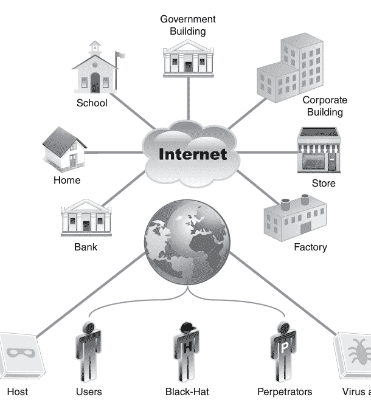

图 1-1 网络空间：新的前沿。


是计算机在互联网上相互通信时最常用的语言。（协议是通信规则和方法的列表。）TCP/IP 并非只有一种协议，而是为网络通信而开发的一组协议。以两种最重要的协议命名，TCP/IP 共同工作以允许任何两台计算机相互通信。将两台或更多计算机连接在一起即创建了一个网络。TCP/IP 将消息分解为块或数据包，以便在联网计算机之间发送数据。问题在于，任何人都可以使用简单的软件读取每个 IP 数据包中的数据。这种可读模式称为明文。这意味着您必须隐藏或加密 TCP/IP 数据包内发送的数据，以使数据更安全。图 1-2 显示了 TCP/IP 数据包结构中的数据。这一切引发了这样一个问题：如果互联网如此不安全，为什么每个人都那么轻易地连接到它？答案是从 20 世纪 90 年代中期到 21 世纪初，网络实现了巨大的增长。连接到互联网使任何人都能即时访问网络及其众多资源。轻松的全球连接的吸引力推动了连接需求。这种需求及其随后的增长有助于降低高速通信的成本。家庭、企业和政府获得了负担得起的高速互联网接入。随着无线和蜂窝连接变得更加普遍和负担得起，无论您身在何处以及需要连接什么设备，都变得更容易

### 图 1-2
TCP/IP 通信均为明文。

- TCP/IP 应用程序：
- 电子邮件
- SMTP/POP3
- FTP/TFTP
- SNMP
- Telnet
- HTTP
- WWW
- 全部使用明文！

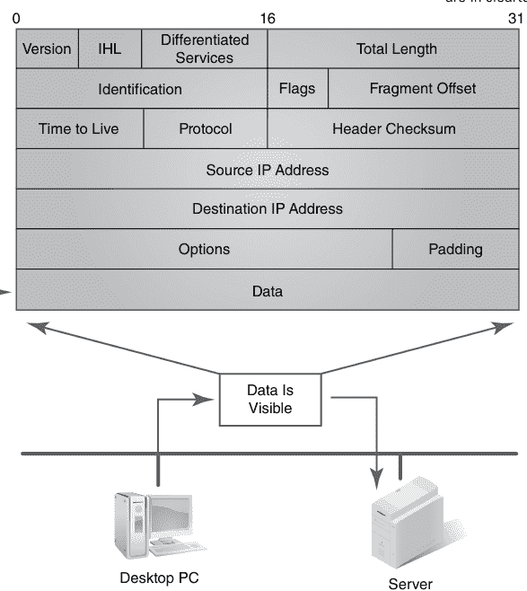

### 图 1-3
物联网 (IoT) 支持任意对任意连接。


保持连接，无论您身在何处以及需要连接什么设备。图 1-3 显示了物联网如何使世界变得数字化互联。物联网放大了风险、威胁和漏洞问题，因为黑客或攻击者可以未经授权访问任何 IP 连接的设备。一旦获得对 IP 连接设备的访问权限，如果攻击者愿意，数据可能被窃取或造成损害。正是黑客这种“黑暗反派”的本性，帮助将黑客贴上了“黑帽”的标签。

互联网的增长也受到代际差异的推动。随着婴儿潮一代开始退休，Y 世代的文化正在接管。这一新一代人在移动电话、智能手机和“随时在线”互联网接入中长大。这些设备提供实时通信。当今的个人通信包括 IP 语音 (VoIP)、短信、即时消息 (IM) 和聊天，以及音频和视频会议。这些实时的、支持会话初始协议 (SIP) 的应用通常被称为统一通信。统一通信应用程序的示例包括 Google Chat™ 即时消息服务、Yahoo!® Messenger、WebEx,™ GoToMeeting,™ 和 Skype™ for Business 的在线会议功能。

与此同时，一场信息安全战争正在激烈进行。战场是网络空间，敌人已经进入大门。更糟糕的是，敌人无处不在——既在本地区，也在世界各地。敌人觊觎您的敏感数据。因此，攻击者的目标是获得未经授权的访问。未经授权的访问意味着攻击者未经您允许，获得了您的授权登录 ID 和密码。

使用这些登录凭据，攻击者可以访问您的访问权限允许的相同系统和应用程序。如果授予未经授权的访问，则取决于该用户的访问控制，敏感数据可能可访问并可下载。出于这个原因，信息技术基础设施需要适当的安全控制。这场信息安全战争为信息系统安全和信息保障专业人员创造了巨大需求——需要一种新型的网络战士来帮助捍卫安全和业务利益。

## 风险、威胁和漏洞

本书介绍了网络空间的危险，并讨论了如何应对这些危险。它解释了如何识别和应对信息系统和 IT 基础设施中常见的危险。要了解如何使计算机更安全，您首先需要了解风险、威胁和漏洞的概念。

风险是指对资产发生不良事件的可能性。它是指对资产产生影响的事件的暴露程度。在 IT 安全的语境下，资产可以是计算机、数据库或一段信息。风险示例包括：

- 数据丢失
- 因灾难摧毁建筑而导致业务中断
- 未能遵守法律法规

威胁是指可能损害资产的任何行为。信息系统面临自然和人为造成的威胁。洪水、地震或严重风暴等威胁要求组织制定计划，以确保业务运营继续，并且组织能够恢复。业务连续性计划 (BCP) 为组织需要维持的功能设定优先级。灾难恢复计划 (DRP) 定义了企业在火灾或飓风等重大灾难后如何重新站稳脚跟。对计算机系统的人为威胁包括病毒、恶意代码和未经授权的访问。病毒是编写用于对系统、应用程序或数据造成损害的计算机程序。恶意代码（或恶意软件）是编写用于导致特定动作发生（例如擦除硬盘）的计算机程序。这些威胁可能会对个人、企业或组织造成伤害。

漏洞是允许威胁得以实现或对资产产生影响的弱点。要理解什么是漏洞，可以想到生火。生火本身不一定是坏事。如果您在烤架上做饭，就需要在烤架上生火。烤架的设计用于控制火焰，如果正确使用，不应构成危险。另一方面，在计算机数据中心生火可能会造成损害。烤架对火不构成漏洞，但计算机数据中心则构成漏洞。威胁本身并不总是造成损害；威胁得以实现必须存在漏洞。

漏洞通常会导致法律责任。任何允许威胁得以实现的漏洞都可能导致法律诉讼。由于计算机必须运行软件才有用，而软件由人类编写，软件程序不可避免地包含错误。因此，软件供应商必须通过最终用户许可协议 (EULA) 保护自己免受其自身漏洞的法律责任。当用户打开软件包并安装软件时，EULA 生效。所有软件供应商都使用 EULA。这意味着保护 IT 系统和数据的责任在于内部信息系统安全专业人员。

## 最终用户许可协议 (EULA)

最终用户许可协议是用户与软件供应商之间的许可协议。最终用户许可协议保护软件供应商免受因不完美软件的行为而产生的索赔。最终用户许可协议通常包含免责声明。这限制了他们对黑客可利用的软件缺陷和弱点的责任。

以下是 Microsoft 最终用户许可协议的摘录，说明该公司只为其软件提供“有限”担保。最终用户许可协议还建议，软件产品按“原样且带有所有缺陷”提供。

免责声明。此处出现的有限担保是向您提供的唯一明示担保，并代替任何由任何文档或包装创建的其他明示担保（如果有）。除了有限担保外，在适用法律允许的最大范围内，Microsoft 及其供应商按“原样且带有所有缺陷”提供软件产品和支持服务（如果有），并特此免除所有其他担保和条件....

Microsoft 的最终用户许可协议还将其财务责任限制在软件成本或 5 美元，以较高者为准：

责任限制。无论您因任何原因可能遭受何种损害（包括但不限于上述所有损害以及所有直接或一般损害），Microsoft 及其任何供应商根据本最终用户许可协议的任何条款承担的全部责任，以及您对上述所有事项的独家补救措施（Microsoft 就有限担保的任何违约行为选择的任何维修或更换补救措施除外），均限于您为软件产品实际支付的金额或 5.00 美元，以较高者为准。上述限制、排除和免责声明（包括上述第 9、10 和 11 节）适用于适用法律允许的最大范围，即使任何补救措施未能实现其基本目的。

## 什么是信息系统安全？

定义安全一词最简单的方法是将其拆分为各个部分。信息系统由协同工作的硬件、操作系统和应用软件组成，用于为个人和组织收集、处理和存储数据。因此，信息系统安全是保护信息系统及其中存储的数据的一系列活动。许多美国和国际法律现在都要求这种安全保障。组织必须正面应对这一需求。图 1-4 回顾了 IT 基础设施中常见的信息类型。

## 美国合规法律推动信息系统安全的需求

网络空间为个人和组织带来了新的威胁。人们需要保护自己的隐私。企业和组织有责任保护其知识产权以及其处理的任何个人或私人数据。各种法律要求组织使用安全控制来保护私密和机密数据。与信息安全相关的最近美国法律包括：

- 《联邦信息安全管理法》(FISMA) — 该法案于 2002 年通过，要求联邦民用机构对支持联邦运营的资源提供安全控制。


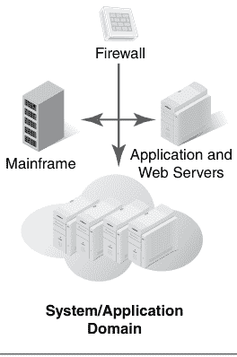

图 1-4 我们在保护什么？

- 个人隐私数据
  - 姓名、地址、出生日期
  - 社会安全号码
  - 银行名称、账户号码
  - 信用卡账户号码
  - 公用事业账户号码
  - 抵押贷款账户号码
  - 保险单号码
  - 证券和经纪账户号码
- 企业知识产权
  - 商业秘密
  - 产品开发
  - 销售和营销策略
  - 财务记录
  - 版权、专利等
- 在线 B2C 和 B2B 交易
  - 网上银行
  - 在线医疗和保险索赔
  - 电子商务、电子政务、服务
  - 在线教育和成绩单
- 政府知识产权
  - 国家安全
  - 军事和国防部策略

- **联邦信息安全现代化法案 (FISMA)**—该法案于 2014 年通过，旨在更新 2002 年 FISMA，加入现代威胁以及安全控制和最佳实践方面的信息。
- **萨班斯-奥克斯利法案 (SOX)**—该法案于 2002 年通过，要求上市公司提交准确可靠的财务报告。该法律不要求保护私人信息，但要求采取安全控制来保护报告本身的机密性和完整性。
- **格莱奇-布莱利法案 (GLBA)**—该法案于 1999 年通过，要求各类金融机构保护客户的私人财务信息。
- **健康保险可携带性和责任法案 (HIPAA)**—该法案于 1996 年通过，要求医疗保健组织实施安全和隐私控制，以确保患者隐私。
- **儿童互联网保护法案 (CIPA)**—该法案于 2000 年通过，2011 年更新，要求公立学校和公共图书馆采用互联网安全政策。该政策必须解决以下问题：
  - 限制儿童访问互联网上的不当内容
  - 确保儿童在使用电子邮件、聊天室和其他电子通信时的安全
  - 限制儿童在线黑客攻击和其他非法活动
  - 未经许可披露和传播关于儿童的个人信息
  - 限制儿童访问有害材料
  - 警告儿童注意社交媒体的使用和危害

图 1-5 美国合规法律推动了对信息系统安全的需求。

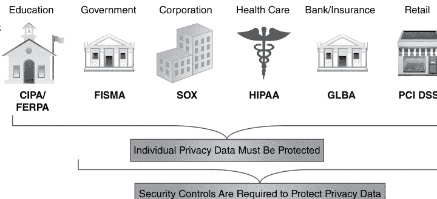

> 注：PCI DSS（支付卡行业数据安全标准）是全球标准，而非美国联邦法律。PCI DSS 要求采取适当的安全控制来保护消费者隐私数据。

- **家庭教育权利和隐私法案 (FERPA)**—该法案于 1974 年通过，保护学生及其学校记录的私人数据。

图 1-5 按行业展示了这些法律。

## 信息系统安全的核心原则

大多数人都同意私人信息应该是安全的。但“安全信息”究竟意味着什么？安全的信息满足信息的三个主要原则（或属性）。如果你能确保这三个原则，就满足了安全信息的要求。这三个原则如下：

- **机密性**—只有授权用户可以查看信息。
- **完整性**—只有授权用户可以更改信息。
- **可用性**—授权用户在请求信息时随时可以访问信息。

图 1-6 说明了信息系统安全的三个原则。在设计和使用安全控制时，您正在解决其中一个或多个原则。

在寻找安全问题的解决方案时，您必须使用 C-I-A 三元组。您必须为典型的 IT 基础架构使用此三元组来定义组织的安全基线目标。定义后，这些目标将根据您正在保护的数据类型转化为安全控制和要求。

> **技术提示**
> 
> 有些信息系统安全专业人员将这些原则称为 A-I-C 三元组，以避免与美国中央情报局（通常称为 CIA）混淆。

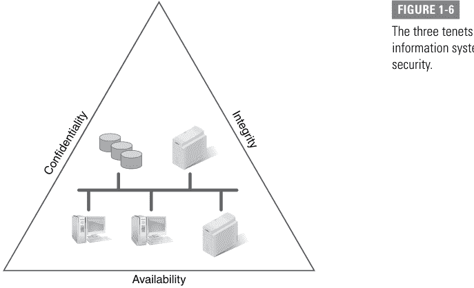

## 身份盗用

身份盗用每年影响约 1500 万美国公民，财务损失高达 500 亿美元以上。身份盗用是美国消费者面临的主要威胁。构成一个人身份的要素有很多，包括但不限于以下内容：

- 全名
- 邮寄地址
- 出生日期
- 社会安全号码
- 银行名称
- 银行账户号码
- 信用卡账户号码
- 公用事业账户号码
- 医疗记录号码
- 抵押贷款账户号码
- 保险单号码
- 证券和投资账户号码

例如，冒充者只需凭您的姓名、家庭住址和社会安全号码即可访问您的账户。被扔进垃圾桶的纸质对账单和账户号码可能被不法分子找回，从而更容易泄露您的隐私数据和财务账户信息。在丢弃这些文件之前将其粉碎可以降低损失的可能性。

这种威胁不仅仅局限于财务损失。身份盗用可能会损害您的 Fair Isaac Corp. (FICO) 个人信用评级。这可能会阻止您获得银行贷款、抵押贷款或信用卡。清理个人信用记录可能需要数年时间。FICO 是一家上市公司，为美国三大消费者信用报告机构（Equifax、Experian 和 TransUnion）提供信息。

## 机密性

**机密性**是一个常见术语。它是指除了有权访问的人之外，保护信息免受所有人的访问。机密信息包括以下内容：

- 个人隐私数据
- 企业知识产权
- 国家和政府的国家安全

保护公民私人数据的美国合规法律要求企业和组织采取适当的安全控制以确保机密性。

随着电子商务的增长，越来越多的人使用信用卡进行在线购物。这要求人们在电子商务网站上输入私人数据。消费者应小心保护个人身份和私人数据。法律要求组织使用安全控制来保护客户的私人数据。**安全控制**是组织为帮助降低风险而采取的措施。此类控制的示例包括以下内容：

- 为员工开展年度安全意识培训。这有助于提醒员工正确处理私人数据。它还能提高对组织安全政策、标准、程序和指南框架的认识。
- 建立 **IT 安全政策框架**。政策框架就像一个大纲，确定应在何处使用安全控制。
- 为 IT 基础架构设计分层安全解决方案。阻止或保护私人数据和知识产权的层或隔间越多，数据和财产就越难被查找和窃取。
- 对网站和 IT 基础架构进行定期的安全风险评估、审计和渗透测试。这是安全专业人员验证已正确安装控制的方式。
- 在 Internet 入口和出口点启用安全事件和事件监控。这就像使用显微镜来查看进出内容。
- 使用自动化工作站和服务器防病毒及恶意软件防护。这是防止病毒和恶意软件进入计算机的方法。
- 对敏感系统、应用程序和数据使用比登录 ID 和密码更严格的访问控制。带密码的登录 ID 只是对用户的一种检查。访问更敏感的系统应有第二项测试来确认用户身份。
- 通过使用补丁和安全修复更新计算机和服务器，尽量减少软件漏洞。这是保持操作系统和应用程序软件最新的方法。

保护私人数据是确保数据机密性的过程。组织必须针对这一问题采用适当的安全控制。一些示例包括以下内容：

- 制定全组织范围的政策、标准、程序和指南以保护机密数据。这些是处理私人数据的说明。
- 采用 **数据分类标准**，定义如何在整个 IT 基础架构中处理数据。这是识别保持数据安全所需控制措施的路线图。
- 将访问存储机密数据的系统和应用程序的权限限制在仅有权使用该数据的人员。


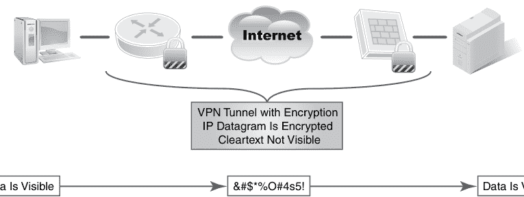

图 1-7 将明文加密为密文。

- 使用密码学技术隐藏机密数据，并使其对未授权用户不可见。
- 加密跨越公共互联网的数据。
- 加密存储在数据库和存储设备中的数据。

通过网络向其他计算机发送数据意味着必须采取特殊措施，防止未授权用户访问机密数据。**密码学**是隐藏数据并将其远离未授权用户的做法。**加密**是将数据从明文转换为**密文**的过程。明文数据是任何人都可以读取的数据。密文是加密明文后得到的乱码数据。该过程示例如图 1-7 所示。

数据隐私至关重要，以至于地方和州政府开始通过扩展联邦法律来制定保护数据隐私的法律。

## 完整性

**完整性**涉及数据的有效性和准确性。缺乏完整性的数据——即不准确或无效的数据——毫无用处。对于某些组织而言，数据和信息是知识产权资产。示例包括版权、专利、秘密配方和客户数据库。这些信息可能具有巨大价值。未经授权的更改会破坏数据的价值。这就是为什么完整性是系统安全的一项原则。图 1-8 显示了数据完整性的含义以及这些数据是否可用。破坏和损坏数据完整性是对组织的严重威胁，尤其是当数据对业务运营至关重要时。

## 可用性

**可用性**是日常生活中常见的术语。例如，您可能会关注互联网服务、电视服务或手机服务的可用性。在信息安全领域，可用性通常表达为用户可以

> **警告**
> 
> 切勿以明文形式在电子邮件中输入私人数据。请记住，电子邮件流量通过互联网以明文形式传输。这意味着您的数据对查看电子邮件的任何人都完全可见。另外，如果网站不是可通过电话或其他方式核实的可信主机，请勿在网站上输入私人数据。切勿在不使用加密的网站或 Web 应用程序中输入私人数据（例如，在浏览器中查找锁图标，以验证该网站或应用程序是否启用了**超文本传输安全协议（HTTPS）**加密）。

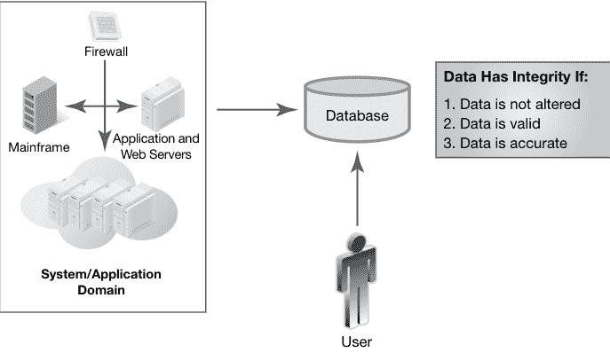

使用系统、应用程序和数据。常见的可用性时间度量包括以下内容：

- **正常运行时间**—正常运行时间是系统、应用程序和数据可访问的总时间量。正常运行时间通常以给定日历月内的秒、分钟和小时为单位进行衡量。正常运行时间通常以可用时间的百分比表示，例如，99.5% 的正常运行时间。
- **停机时间**—停机时间是系统、应用程序和数据不可访问的总时间量。停机时间也以日历月内的秒、分钟和小时为单位进行衡量。
- **可用性**—可用性是一个数学计算，其中 可用性 =（总正常运行时间）/（总正常运行时间 + 总停机时间）。
- **平均失效时间（MTTF）**—MTTF 是特定系统两次故障之间的平均时间。半导体和电子产品不会损坏，其 MTTF 为多年（25 年或更久等）。连接器、线缆、风扇和电源等物理部件的 MTTF 要低得多（五年或更短），因为磨损可能导致它们损坏。
- **平均修复时间（MTTR）**—MTTR 是修复系统、应用程序或组件所需的平均时间。目标是尽快让系统重新投入运行。
- **平均两次故障之间时间（MTBF）**—MTBF 是 IT 系统运行期间两次故障之间的预计时间。
- **恢复时间目标（RTO）**—RTO 是在发生中断后恢复并使系统、应用程序和数据可供使用所需的时间。业务连续性计划通常会为关键任务系统、应用程序和数据访问定义 RTO。

## 如何计算月度可用性

对于给定的 30 天日历月，总正常运行时间等于：30 天 × 24 小时/天 × 60 分钟/小时 = 43,200 分钟

对于 28 天日历月（二月），总正常运行时间等于：28 天 × 24 小时/天 × 60 分钟/小时 = 40,320 分钟

使用公式 可用性 =（总正常运行时间）/（总正常运行时间 + 总停机时间）计算包含 30 分钟计划停机时间的 30 天日历月的可用性系数，如下所示：可用性 =（43,200 分钟）/（43,200 分钟 + 30 分钟）= 0.9993，即 99.93%

电信和互联网服务提供商向客户提供服务级别协议（SLA）。SLA 是一份合同，用于保证广域网（WAN）和互联网接入链路的最低月度服务可用性。SLA 随 WAN 服务和专用互联网接入链路提供。可用性衡量月度正常运行时间服务级别承诺。如边栏中讨论的月度可用性示例所示，30 天日历月内 30 分钟的停机时间相当于 99.993% 的可用性。服务提供商通常提供从 99.5% 到 99.999% 可用性的 SLA。

## 典型 IT 基础设施的七个领域

系统安全的三项原则在典型 IT 基础设施中起什么作用？首先，让我们回顾一下典型 IT 基础设施的样子。无论是小型企业、大型政府机构还是上市公司，大多数 IT 基础设施都包含图 1-9 所示的七个领域：用户、工作站、LAN、LAN 到 WAN、WAN、远程访问以及系统/应用程序领域。

典型 IT 基础设施通常包含这七个领域。每个领域都需要适当的安全控制。这些控制必须满足 C-I-A 三元组的要求。以下是七个领域的概述，以及您在当今 IT 环境中通常会发现的风险、威胁和漏洞。

## 用户领域

用户领域定义了访问组织信息系统的人员。

### 用户领域角色、职责和问责制

以下是用户领域中应当发生的情况概述：

- 角色和任务—用户可以根据其定义的访问权限访问系统、应用程序和数据。员工必须遵守员工手册和政策。

### 图 1-9 典型 IT 基础设施的七个领域。

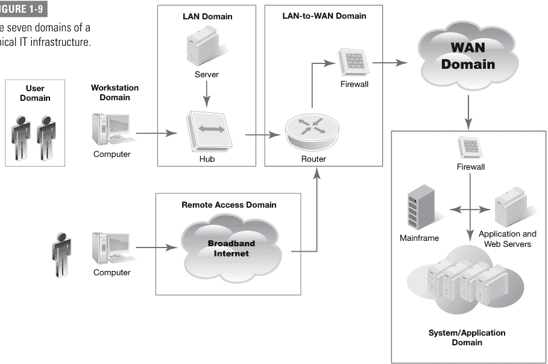

用户领域是您会找到**可接受使用策略（AUP）**的地方。AUP 定义了用户可以和不允许对组织拥有的 IT 资产做什么。它就像员工必须遵守的规则手册。违反这些规则可能是解雇的理由。这是分层安全策略中第一道防线的起点。

- **职责**—员工对其使用 IT 资产负责。新立法意味着，对于大多数组织来说，引入 AUP 是一种最佳实践。组织可能会要求员工、承包商或其他第三方签署协议，以保密信息。某些组织对敏感职位要求进行犯罪背景调查。部门经理或人力资源经理通常负责确保员工签署并遵守 AUP。

- **问责制**—通常，组织的人力资源部门负责实施适当的员工背景调查。应对将访问敏感数据的个人进行这些调查。

### 用户领域中常见的风险、威胁和漏洞

用户领域是 IT 基础设施中最薄弱的环节。任何负责计算机安全的人都必须了解是什么驱使他人破坏组织的系统、应用程序或数据。表 1-2 列出了用户领域中常见的风险和威胁，以及您可以用来预防它们的计划。


表 1-2 用户域的风险、威胁、漏洞及缓解计划。

| 风险、威胁或漏洞 | 缓解措施 |
|---|---|
| 未经授权的访问 | 用户必须意识到钓鱼电子邮件、借口或诈骗、键盘记录器，以及冒充 IT 或送货人员以获取登录 ID 和密码凭据的作案人。 |
| 用户意识缺乏 | 开展安全意识培训，展示安全意识海报，在横幅问候语中插入提醒，并向员工发送电子邮件提醒。 |
| 用户对政策漠不关心 | 开展年度安全意识培训，实施可接受使用政策，更新员工手册和操作手册，在绩效评审期间讨论。 |
| 安全政策违规 | 将员工置于观察期，审查可接受使用政策和员工手册，在绩效评审期间讨论。 |
| 用户将带有个人照片、音乐和视频的 CD 和 USB 驱动器插入 | 禁用内部 CD 驱动器和 USB 端口。为插入的媒体驱动器、文件和电子邮件附件启用自动杀毒扫描。杀毒扫描系统会检查计算机硬盘上的所有新文件是否存在病毒。为带有附件的电子邮件设置杀毒扫描。 |
| 用户下载照片、音乐和视频 | 为电子邮件附件启用内容过滤和杀毒扫描。内容过滤网络设备配置为根据可接受使用政策定义允许或拒绝特定域名。 |
| 用户破坏系统、应用程序或数据 | 将用户访问权限限制在履行职责所需的系统、应用程序和数据。仅将写入/删除权限最小化到数据所有者。 |
| 来自不满员工的对组织的攻击或破坏行为 | 跟踪和监控员工的异常行为、工作表现不稳定以及非工作时间使用 IT 基础设施。根据可接受使用政策的监控和合规性，启动 IT 访问控制锁定程序。 |
| 员工恋情破裂 | 跟踪和监控员工的异常行为和非工作时间使用 IT 基础设施。根据可接受使用政策的监控和合规性，启动 IT 访问控制锁定程序。 |
| 员工敲诈或勒索 | 跟踪和监控员工的异常行为和非工作时间使用 IT 基础设施。为敏感员工职位和访问启用入侵检测系统/入侵防御系统（IDS/IPS）监控。IDS/IPS 安全设备检查入站和出站流量的 IP 数据流。IDS/IPS 中编程的警报和警示有助于识别异常流量，并可根据策略定义阻止 IP 流量。 |

## 工作站域

工作站可以是台式机、笔记本电脑、专用终端或连接到网络的任何其他设备。工作站计算机通常是瘦客户端或厚客户端。**瘦客户端**是运行在网络上的软件或无硬盘的实际计算机，依赖服务器提供应用程序、数据和所有处理。瘦客户端通常用于大型组织、图书馆和学校。相比之下，**厚客户端**是功能更齐全的硬件，包含硬盘和应用程序，并在本地处理数据，主要访问服务器进行文件存储。普通 PC 是厚客户端的示例。其他可视为工作站的设备包括**个人数字助理 (PDA)**、智能手机和平板电脑。有关移动设备的更多详细信息，请参阅“远程访问域”部分。

### 工作站域的角色、职责和问责制

以下是工作站域中应进行的工作概览：

- **角色和任务**—组织的员工应拥有开展工作所需的访问权限。任务包括配置硬件、加固系统和验证杀毒文件。**加固**系统是确保已就位控制措施以应对任何已知威胁的过程。加固活动包括确保所有计算机都具有最新的软件修订版、安全补丁和系统配置。工作站域还需要额外的防御层，一种称为**纵深防御**的策略。另一种常见的防御层是实施工作站登录 ID 和密码，以保护进入 IT 基础设施的这一入口。

- **职责**—组织的桌面支持小组负责工作站域。强制执行定义的标准对于确保用户工作站和数据的完整性至关重要。IT 安全人员必须保障工作站域内的控制措施。通常，人力资源部门根据员工的工作定义适当的访问控制。IT 安全人员随后根据此定义为系统、应用程序和数据分配访问权限。

- **问责制**—组织的 IT 桌面经理通常负责允许员工最大限度地使用工作站域。IT 安全总监通常负责确保工作站域符合政策。

### 工作站域中常见的风险、威胁和漏洞

工作站域需要严格的安全和访问控制。这是用户首次访问系统、应用程序和数据的地方。工作站域需要登录 ID 和密码才能访问。**表 1-3** 列出了工作站域中常见的风险、威胁和漏洞，以及防护方法。

## 局域网域

**局域网 (LAN)** 是互相连接或连接到共同连接介质的计算机集合。网络连接介质可以包括电线、光纤电缆或无线电波。局域网通常按功能或部门组织。一旦

表 1-3 工作站域的风险、威胁、漏洞及缓解计划。

| 风险、威胁或漏洞 | 缓解措施 |
| :--- | :--- |
| 未经授权访问工作站 | 在工作站上启用密码保护以进行访问。为非活动时间启用自动屏幕锁定。禁用用户的系统管理员权限。 |
| 未经授权访问系统、应用程序和数据 | 定义严格的访问控制政策、标准、程序和指南。为包含敏感数据的应用程序实施第二级或第二层身份验证（例如，两步验证）。 |
| 台式机或笔记本电脑操作系统软件漏洞 | 定义工作站操作系统**漏洞窗口**政策和标准。漏洞窗口是指工作站暴露于已知漏洞直至打补丁的时间差距。作为持续安全操作的一部分，执行频繁的**漏洞评估**扫描。 |
| 台式机或笔记本电脑应用程序软件漏洞和软件补丁更新 | 定义工作站应用程序**软件漏洞窗口**政策。根据定义的政策、标准、程序和指南更新应用程序软件和安全补丁。 |
| 用户工作站或笔记本电脑感染病毒、恶意代码或恶意软件 | 使用工作站防病毒和恶意代码政策、标准、程序和指南。启用自动化防病毒保护解决方案，对单个工作站进行扫描并更新适当保护。 |
| 用户将 CD、数字视频光盘 (DVDs) 或通用串行总线 (USB) 拇指驱动器插入组织的计算机 | 禁用所有 CD、DVD 和 USB 端口。为插入的带有文件的 CD、DVD 和 USB 拇指驱动器启用自动杀毒扫描。 |
| 用户通过互联网下载照片、音乐或视频 | 在互联网入口和出口处使用内容过滤和杀毒扫描。为所有新文件启用工作站自动扫描，并为未知文件类型启用自动文件隔离。 |
| 用户违反可接受使用政策 (AUP)，给组织的 IT 基础设施带来安全风险 | 要求所有员工参加年度安全意识培训。全年开展安全意识宣传活动和计划。 |
| 员工和用户希望使用自己的智能手机或平板电脑，推动支持自带设备 (BYOD) 的需求 | 制定允许员工使用个人智能手机或移动设备的 BYOD 政策和程序。BYOD 政策和程序通常允许组织在设备丢失或员工被解雇时擦除用户的智能手机或移动设备上的数据。 |


connected，您的计算机可以访问系统、应用程序、可能的互联网和数据。IT基础设施的第三个组件是LAN域。
LAN域的物理部分包含以下内容：

- **网络接口卡（NIC）**—计算机与LAN物理介质之间的接口。NIC拥有一个6字节的媒体访问控制（MAC）层地址，用作NIC的唯一硬件标识符。

- **以太网LAN**—这是一种基于IEEE 802.3 CSMA/CD标准的LAN解决方案，适用于10/100/1,000Mbps以太网组网。**以太网**是最流行的LAN标准。当今的LAN标准是电气和电子工程师学会（IEEE）802.3载体侦听多路访问/冲突检测（CSMA/CD）规范。以太网提供10-Mbps、100-Mbps、1-Gbps、10-Gbps、40-Gbps，现在还有100-Gbps速率，用于校园和城域以太网骨干连接。

- **非屏蔽双绞线布线**—这是工作站布线，使用RJ-45连接器和插孔与100Mbps/1Gbps/10Gbps以太网LAN交换机进行物理连接。如今，组织使用5类或6类UTP传输介质来支持高速数据通信。

- **LAN交换机**—这是将工作站连接到物理以太网LAN的设备。交换机为工作站和服务器提供专用的以太网LAN连接，为每个工作站提供最大吞吐量和性能。LAN交换机有两种类型。**二层交换机**检查MAC层地址，并根据MAC层地址表做出转发决策。**三层交换机**检查网络层地址，并根据路由协议路径确定决策路由数据包。三层交换机与路由器相同。

- **文件服务器和打印服务器**—这些是高性能计算机，为部门内用户提供文件共享和数据存储。打印服务器支持部门内共享打印机的使用。

- **无线接入点（WAP）**—对于**无线局域网（WLAN）**，使用无线收发器将IP数据包从WLAN NIC传输到**无线接入点（WAP）**。WAP发送WLAN信号，供移动笔记本电脑连接。WAP使用非屏蔽双绞线将其连接回LAN交换机。

以太网交换机通常为每个工作站提供100-Mbps或1-Gbps连接。如今，以太网LAN交换机支持100-Mbps和1-GigE桌面速率，以及10-Gbps和40-Gbps速率的骨干连接。这些骨干连接通常使用光纤布线。

LAN域的逻辑部分包含以下内容：

- **系统管理**—配置带有登录ID和密码访问控制的用户LAN帐户（即用户登录信息）。

- **目录和文件服务设计**—用户可以访问的服务器、目录和文件夹。

- **工作站和服务器TCP/IP软件及通信协议配置**—这涉及IP地址、IP默认网关路由器、子网掩码地址等。IP默认网关路用作LAN的入口/出口。子网掩码地址定义IP网络号和IP主机号。

- **服务器磁盘存储空间设计；用户数据备份与恢复**—在LAN磁盘存储区域为用户数据文件提供预留，数据每天备份和存档。如果发生数据丢失或损坏，数据文件可以从备份文件中恢复。

- **虚拟局域网（VLAN）设计**—使用二层和三层LAN交换机，可以将以太网端口配置为位于同一VLAN上，即使它们可能连接到不同的物理LAN。这等同于将工作站和服务器配置为位于同一以太网LAN或广播域中。

用户根据其工作需求访问其部门的LAN和其他应用程序。

### LAN域角色、职责与问责

以下是LAN域中应进行的工作概述：

- **角色和任务**—LAN域包括物理网络组件和面向用户的服务逻辑配置。物理组件的管理包括：
  - 布线
  - NICs
  - LAN交换机
  - 无线接入点（WAPs）

LAN系统管理包括维护用户帐户和访问权限的主列表。在LAN域中，可能需要两步验证。两步验证像一道门，用户必须第二次确认其身份。这可以降低未经授权的物理访问的风险。

- **职责**—LAN支持小组负责LAN域。这包括物理组件和逻辑元素。LAN系统管理员必须维护和支持部门的文件和打印服务，并为用户配置访问控制。

- **问责**—LAN经理的职责是最大限度地提高LAN域内数据的使用率和完整性。通常，IT安全总监必须确保LAN域符合政策。

### LAN域中常见的风险、威胁与漏洞

LAN域还需要强大的安全性和访问控制。用户可以从LAN域访问全公司的系统、应用程序和数据。这是需要第三层防御的地方。这种防御保护IT基础设施和LAN域。表1-4列出了LAN域中常见的风险、威胁和漏洞，以及相应的风险降低策略。

## LAN到WAN域

LAN到WAN域是IT基础设施与广域网和互联网互连的地方。不幸的是，连接到互联网就像为坏人铺设红地毯。互联网是开放的、公共的，任何人都可以轻松访问。大多数互联网流量

### 表 1-4 LAN域的风险、威胁、漏洞和缓解计划。

| 风险、威胁或漏洞 | 缓解措施 |
| :--- | :--- |
| 未经授权访问LAN | 确保布线机房、数据中心和计算机房安全。未持有适当身份证件者不得进入。 |
| 未经授权访问系统、应用程序和数据 | 制定严格的访问控制政策、标准、程序和指南。实施二级身份检查以访问敏感系统、应用程序和数据。根据需要限制用户访问LAN文件夹以及特定文档的读取/写入/删除权限。 |
| LAN服务器操作系统软件漏洞 | 定义服务器/桌面/笔记本电脑漏洞窗口期政策、标准、程序和指南。定期进行LAN域漏洞评估以发现软件缺陷。漏洞评估是一种软件审查，用于识别软件中的错误或漏洞。上传软件补丁和修复程序后，这些错误和漏洞将消失。 |
| LAN服务器应用程序软件漏洞和软件补丁更新 | 制定严格的软件漏洞窗口期政策，要求快速打补丁。 |
| WLAN上流氓用户的未经授权访问 | 使用需要密码才能进行无线访问的WLAN **网络密钥**。关闭WAP上的广播。在授予WLAN访问权限之前要求二级身份验证。 |
| 通过WLAN传输的数据机密性受损 | 在工作站和WAP之间实施加密以保持机密性。 |
| 硬件、操作系统和软件不同的LAN服务器难以管理和排查故障 | 实施LAN服务器和配置标准、程序和指南。 |

是明文。这意味着它是可见的且不私密。网络应用程序使用两种常见的传输协议：传输控制协议（TCP）和用户数据报协议（UDP）。TCP和UDP都使用端口号来标识应用程序或功能；这些端口号的作用类似于电视频道，决定您正在观看哪个频道。当数据包通过TCP或UDP发送时，其端口号会出现在数据包头中。由于许多服务都与常见端口号关联，因此知道端口号基本上就揭示了数据包的类型。这就像在向世界宣传您正在传输什么。

常见TCP和UDP端口号示例包括以下内容：

- **端口80：超文本传输协议（HTTP）**—HTTP是Web浏览器与网站之间的通信协议，数据以明文形式传输。
- **端口20：文件传输协议（FTP）**—FTP是用于执行文件传输的协议。FTP使用TCP作为面向连接的数据传输，但以明文形式传输，包括


the password. *面向连接*意味着单个数据包被编号并确认已接收，以提高文件传输的完整性。

- **端口 69：简单文件传输协议 (TFTP)**—TFTP 是一种用于执行文件传输的协议。TFTP 使用 UDP 作为无连接数据传输，但以明文形式传输。这用于小型和快速的文件传输，因为它不保证单个数据包的投递。

- **端口 23：终端网络 (Telnet)**—Telnet 是一种用于执行远程终端访问另一设备的网络协议。Telnet 使用 TCP 并以明文发送数据。

- **端口 22：安全外壳协议 (SSH)**—SSH 是一种用于执行远程终端访问另一设备的网络协议。SSH 加密数据传输以维护通信的机密性。

0 到 1023 的知名端口号完整列表由互联网赋号机构 (IANA) 维护。IANA 有助于协调全球域名服务、IP 寻址和其他资源。知名端口号可在 IANA 网站上查询：www.iana.org/assignments/service-names-port-numbers/service-names-port-numbers.xml。

由于 TCP/IP 协议族缺乏安全性，因此在处理此协议族时，对安全控制的需求更为迫切。LAN-to-WAN 域是典型 IT 基础架构中的第四层防御。

### LAN-to-WAN 域角色、职责和问责

以下是 LAN-to-WAN 域中应进行的工作概述：

- **角色和任务**—LAN-to-WAN 域包括安全设备的物理组件和逻辑设计。这是 IT 基础架构中最复杂的安全区域之一。您需要在尽可能为用户提供访问权限的同时保持安全。物理部分需要进行管理，以便轻松访问服务。安全设备必须在逻辑上进行配置，以符合策略定义。

这将充分利用可用性，确保数据完整性，并维护机密性。LAN-to-WAN 域中所需的角色和任务包括管理和配置以下内容：

- **IP 路由器**—IP 路由器是一种用于将 IP 数据包传输到 Internet 或 WAN 以及从中接收的网络设备。路径决定决策会转发 IP 数据包。配置任务包括 IP 路由和访问控制列表 (ACL)。类似于过滤器，ACL 用于允许和拒绝流量。

- **IP 有状态防火墙**—IP 有状态防火墙是一种安全设备，用于根据为 IP、TCP 和 UDP 数据包头部配置的各种 ACL 定义来过滤入站 IP 数据包。有状态防火墙可以检查 IP、TCP 或 UDP 数据包头部以进行过滤。

- **非军事区 (DMZ)**—DMZ 是 LAN-to-WAN 域中的一个 LAN 分段，充当入站和出站 IP 流量的缓冲区。Web 服务器、*代理服务器*和电子邮件服务器等外部服务器可以放置在这里，以实现对 IP 流量的更大隔离和筛选。

- **入侵检测系统 (IDS)**—IDS 安全设备会检查 IP 数据流，查找常见攻击和恶意意图模式。IDS 是被动的，仅触发警报，但不会主动阻止流量。

- **入侵防御系统 (IPS)**—IPS 与 IDS 的作用相同，但可以阻止被识别为恶意的 IP 数据流。IPS 可以终止实际通信会话、按源 IP 地址过滤，并阻止对目标主机的访问。

- **代理服务器**—代理服务器充当工作站与外部目标之间的中间人。流量会发送到充当代理的中间服务器。数据可以在被中继到 IT 基础架构之前进行分析和适当筛选，中继过程由所谓的**代理防火墙**或**应用程序网关防火墙**执行。

- **Web 内容过滤器**—此安全设备可以根据域名或域名内的关键字进行过滤，防止内容进入 IT 基础架构。

- **电子邮件内容过滤和隔离系统**—此安全设备可以阻止电子邮件中的内容或未知文件附件，以便进行适当的防病毒扫描和隔离。审核后，电子邮件和附件可以转发给用户。

- **安全信息和事件管理 (SIEM)**—这包括监控 LAN-to-WAN 域内的 IT 资产，包括 DMZ VLAN、防火墙、IDS/IPS 和其他安全设备，以最大限度地提高机密性、完整性和可用性，并监控由特定事件触发的安全事件和警报。

- **职责**—网络安全小组负责 LAN-to-WAN 域。这包括物理组件和逻辑元素。小组成员负责应用定义的安全控制。

- **问责**—您组织的 WAN 网络经理有责任管理 LAN-to-WAN 域。通常，IT 安全总监确保使用 LAN-to-WAN 域的安全策略、标准、程序和指南。

### LAN-to-WAN 域中常见的风险、威胁和漏洞

鉴于连接到 Internet 的风险和威胁，LAN-to-WAN 域需要严格的安全控制。此域是所有数据进入和退出 IT 基础架构的通道。LAN-to-WAN 域为整个组织提供 Internet 访问，并充当 WAN 的入口和出口点。这也称为 Internet 入口/出口点。LAN-to-WAN 域是需要第四层防御的地方。表 1-5 列出了 LAN-to-WAN 域中常见的风险、威胁和漏洞，以及相应的风险降低策略。

## WAN 域

广域网 (WAN) 域连接远程位置。随着网络成本降低，组织能够负担得起更快的 Internet 和 WAN 连接。当今，电信服务提供商销售以下内容：

- **全国光纤骨干**—用于私有光纤骨干网络的光纤骨干干线。

- **端到端 IP 传输**—使用服务提供商 IP 网络基础架构的 IP 服务和连接。

### 表 1-5 LAN-to-WAN 域的风险、威胁、漏洞和缓解计划。

| 风险、威胁或漏洞 | 缓解措施 |
| --- | --- |
| 未经授权的网络探测和端口扫描 | 在 LAN-to-WAN 域内的所有外部 IP 设备上禁用 ping、探测和端口扫描。ping 使用 Internet 控制消息协议 (ICMP) 回送请求和回送应答协议。禁止用于探测和扫描的 IP 端口号，并使用 IDS/IPS 进行监控。 |
| 通过 LAN-to-WAN 域进行未经授权的访问 | 应用严格的安全监控控制，用于入侵检测和防御。监控入站 IP 流量异常和恶意意图流量。如果恶意，立即阻止流量。 |
| 针对外部面向公众的 IP 和 Internet 链接的拒绝服务 (DoS)/分布式拒绝服务 (DDoS) 攻击 | 上游 Internet 服务提供商 (ISP) 必须参与 DoS/DDoS 攻击预防，并在半开放 TCP SYN 数据包流开始淹没 ISP 链接时丢弃 IP 数据包。 |
| IP 路由器、防火墙和网络设备操作系统软件漏洞 | 定义严格的零日漏洞窗口定义。立即使用安全修复程序和软件补丁更新设备。 |
| IP 路由器、防火墙和网络设备配置文件错误或弱点 | 对 LAN-to-WAN 域内分层安全解决方案进行配置后渗透测试。测试入站和出站流量并修复任何漏洞。 |
| 远程用户访问组织基础架构并下载敏感数据的能力 | 应用并强制执行组织的数据分类标准。在访问控制列表中使用源 IP 地址拒绝出站流量。如果允许远程下载，请在必要的地方加密。 |
| 从未知来源下载未知文件类型附件 | 对来自未知来源的未知文件类型应用文件传输监控、扫描和告警。 |
| 本地用户收到的未知电子邮件附件和嵌入式 URL 链接 | 对未知文件类型应用电子邮件服务器和附件防病毒以及电子邮件隔离。根据内容过滤策略停止域名网站访问。 |
| 由于本地用户冲浪 Web 且不专注于工作任务而导致的生产力损失 | 在 Internet 入口/访问点应用域名内容过滤。 |

- **多站点 WAN 云服务**—针对多站点服务（例如多协议标签交换 (MPLS) WAN 服务）提供的 IP 服务和连接。MPLS 使用标签或标记在 WAN 端点之间建立虚拟连接。

- **城市以太网 LAN 连接**—在城市范围网络中提供的以太网 LAN 连接。

- **专用 Internet 访问**—通常在组织内共享的宽带 Internet 通信链路。


- **托管服务**—路由器管理和安全设备管理，全年无休 24 × 7 × 365。
- **服务级别协议（SLAs）**—针对可用性、丢包率和故障修复响应时间等月度服务产品的合同承诺。

WAN 域代表整体 IT 基础架构的第五层安全。WAN 服务可包括专用 Internet 接入以及针对客户路由器和防火墙的托管服务。可用性和中断响应时间的管理协议很常见。网络、路由器和设备需要持续监控和管理，以保持 WAN 服务可用。

### WAN 域角色、职责和问责

以下是 WAN 域中应进行的工作概述：

- **角色和任务**—WAN 域包括路由器和通信设备的物理组件和逻辑设计。它是 IT 基础架构中保护起来第二复杂的区域。您的目标是在确保进出流量安全的前提下，为用户提供尽可能大的访问权限。WAN 域所需的角色和任务包括管理和配置以下内容：
  - **WAN 通信链路**—这些是作为数字或光纤服务提供的物理通信链路，终止于您的设施。宽带连接速度可在以下范围内变化：
    - 数字服务的 DS0 (64 Kbps) 到 DS1 (1.544 Mbps) 到 DS3 (45 Mbps)
    - 光纤服务的 OC-3 (155 Mbps) 到 OC-12 (622 Mbps) 到 OC-48 (2,488 Mbps)
    - 取决于物理距离的 10/100/1000 Mbps Metro Ethernet LAN 连接
  - **IP 网络设计**—这是 IP 网络和寻址方案的逻辑设计。这需要网络工程、备用路径设计以及 IP 路由协议的选择。
  - **IP 有状态防火墙**—这是一种安全设备，用于过滤 IP 数据包并阻止不需要的 IP、TCP 和 UDP 数据包类型进入或离开网络。防火墙可以安装在工作站或路由器上，也可以作为保护 LAN 段的独立设备。
  - **IP 路由器配置**—这是用于 WAN 骨干网和边缘路由器的实际路由器配置信息，用于与远程位置建立 IP 连接。配置必须基于 IP 网络设计和寻址方案。
  - **虚拟专用网络 (VPN)**—VPN 是一个端点到另一个端点的专用加密隧道。VPN 隧道可以在使用公共 Internet 的远程工作站与 VPN 路由器之间，或在安全浏览器与安全套接字层虚拟专用网络 (SSL-VPN) 网站之间创建。
  - **多协议标签交换 (MPLS)**—MPLS 是一种 WAN 软件功能，允许客户最大化性能。MPLS 为 IP 数据包加上标签，以便在指定端点之间通过虚拟隧道快速传输。这是一种第 1 层/第 3 层覆盖网络，一旦配置或动态确定长寿命流，即可绕过路由功能的路径确定过程。
- **简单网络管理协议 (SNMP) 网络监控和管理**—SNMP 用于网络设备监控、告警和性能。
- **路由器和设备维护**—需要执行硬件和固件更新、上传新操作系统软件以及配置路由器和过滤器。
- **职责**—网络工程师或 WAN 团队负责 WAN 域。这包括物理组件和逻辑元素。网络工程师和安全从业人员根据定义的策略设置定义的安全控制。请注意，由于 IP 网络工程的复杂性，许多现今的团队将其 WAN 和路由器的管理外包给服务提供商。该服务包括确保系统可用且问题能够快速解决的 SLA。在 WAN 连接中断的情况下，客户致电服务提供商的免费电话号码以联系其**网络运营中心 (NOC)**。
- **问责**—贵组织的 IT 网络管理员必须维护、更新并为 WAN 域提供技术支持。通常，IT 安全总监确保公司遵守 WAN 域安全策略、标准、程序和指南。

一些组织使用公共 Internet 作为其 WAN 基础架构。虽然它更便宜，但 Internet 不保证传送或安全。

### WAN 域 (Internet) 中常见的风险、威胁和漏洞

电信服务提供商的业务是为端到端通信提供 WAN 连接。服务提供商必须首先承担保护其网络基础架构的责任。注册 WAN 通信服务的客户必须审查其服务合同中的条款、条件和责任限制。这很重要，因为组织必须搞清楚关于路由器管理和安全管理，其职责从哪里开始、在哪里结束。

WAN 服务合同中最关键的方面是服务提供商如何提供故障排除、网络管理和安全管理服务。WAN 域是需要第五层防御的地方。**表 1-6** 列出了 WAN 域 Internet 片段中发现的风险、威胁和漏洞以及相应的风险降低策略。

电信服务提供商销售 WAN 连接服务。一些提供商现在也提供安全管理服务。以下部分介绍了 WAN 连接风险、威胁、漏洞及风险降低策略。

### WAN 域 (连接) 中常见的风险、威胁和漏洞

电信公司负责构建和传输客户 IP 流量。有时，此 IP 流量与专用 Internet 接入捆绑，为整个组织提供共享宽带接入。如果组织外包其 WAN 基础架构，则管理和安全必须扩展到服务提供商。组织必须为其托管安全提供商定义安全策略和需求以供实施。**表 1-7** 列出了 WAN 域中与连接相关的风险、威胁、漏洞以及相应的风险降低策略。

| 风险、威胁或漏洞 | 缓解措施 |
|---|---|
| 对任何想要连接的人都公开、公开且易于访问 | 按照文档“RFC 1087：Internet 伦理”应用可接受使用政策。制定关于未经授权访问系统、对 IT 基础架构发起恶意攻击以及因恶意中断造成经济损失的新法律。 |
| 大多数 Internet 流量以明文形式发送 | 禁止在未使用加密和 VPN 隧道的情况下将 Internet 用于私下通信。如果您有数据分类标准，请具体遵循相关政策、程序和指南。 |
| 易受窃听 | 使用加密和 VPN 隧道进行端到端安全 IP 通信。如果您有数据分类标准，请遵循相关政策、程序和指南。 |
| 易受恶意攻击 | 部署分层 LAN-to-WAN 安全对策、配备 IP 有状态防火墙的 DMZ、用于安全监控的 IDS/IPS，以及对未知电子邮件文件附件进行隔离。 |
| 易受 DoS、DDoS、TCP SYN 洪泛和 IP 欺骗攻击 | 在外部 IP 有状态防火墙和 IP 路由器 WAN 接口上应用过滤器，以阻止 TCP SYN“打开连接”和 ICMP (echo-request) ping 数据包。通知您的 Internet 服务提供商 (ISP) 按照 CERT Advisory CA-1996-21 在其 IP 路由器 WAN 接口上设置适当的过滤器。此处可找到：www.cert.org/advisories/CA-1996-21.html。 |
| 易受信息和数据损坏 | 使用 VPN 加密 IP 数据传输。将数据备份并存储在异地数据保管库中（在线或物理数据备份），并配合经过测试的恢复程序。 |
| 固有不安全的 TCP/IP 应用程序 (HTTP、FTP、TFTP 等) | 参考您的数据分类标准，以正确处理数据和使用 TCP/IP 应用程序。在没有适当加密的情况下，绝不要将 TCP/IP 应用程序用于机密数据。创建网络管理 VLAN，并隔离用于网络管理的 TFTP 和 SNMP 流量。 |
| 黑客、攻击者和犯罪分子通过电子邮件发送木马、蠕虫和恶意软件 | 在 LAN-to-WAN 域中扫描所有电子邮件附件的类型、防病毒和恶意软件。隔离并检疫未知文件附件，直到进行进一步的安全审查。提供安全意识培训，提醒员工注意危险（例如嵌入式 URL 链接和来自未知方的电子邮件附件），并敦促他们在单击链接和打开文件时保持谨慎。 |

## 远程访问域

远程访问域将远程用户连接到组织的 IT 基础架构。远程访问对于在外地或在家工作的员工（例如外勤销售代表、技术支持专家或医疗保健专业人员）至关重要。全球访问使连接 Internet、电子邮件和其他业务应用程序变得容易


### 表 1-7 WAN 域（连接性）的风险、威胁、漏洞及缓解计划

| 风险、威胁或漏洞 | 缓解措施 |
| :--- | :--- |
| 在同一服务提供商路由器和基础设施上混合 WAN IP 流量 | 使用 VPN 隧道通过服务提供商 WAN 加密机密数据传输。 |
| 维持高 WAN 服务可用性 | 获取 WAN 服务可用性 SLA。当需要 100% 可用性时，部署冗余互联网和 WAN 连接。 |
| 最大化 WAN 性能和吞吐量 | 访问远程系统、应用程序和数据时应用 WAN 优化和数据压缩解决方案。按策略在出站路由器 WAN 接口上启用访问控制列表 (ACL)。 |
| 恶意使用 SNMP 网络管理应用程序和协议（ICMP、Telnet、SNMP、DNS 等） | 创建单独的 WAN 网络管理 VLAN。使用严格的防火墙 ACL，允许 SNMP 管理器和路由器 IP 地址通过 LAN 到 WAN 域。 |
| SNMP 警报和安全监控 24 × 7 × 365 | 外包安全运营和监控。将服务扩展到包括托管安全。 |

在任何可以找到无线保真（Wi-Fi）热点的地方。远程访问域很重要但使用危险。它引入了来自互联网的许多风险和威胁。

当今的移动员工依赖以下内容：

- **高可用性蜂窝电话服务**—移动员工需要蜂窝电话服务以与办公室和支持团队取得联系。
- **关键通信的实时访问**—在蜂窝电话上使用短信或即时通信（IM）聊天可快速回答简短问题，且无需用户完全中断当前工作。
- **从移动设备访问电子邮件**—将电子邮件与蜂窝电话、智能手机、平板电脑、PDA 或 BlackBerry 设备集成，使用户能够快速回复重要电子邮件。
- **宽带 Wi-Fi 互联网接入**—一些全国性服务提供商现提供 Wi-Fi 宽带接入卡。它们允许在主要大都市区进行无线接入。
- **本地 Wi-Fi 热点**—Wi-Fi 热点数量众多，包括机场、图书馆、咖啡店和零售商。大多数是免费的，但有些要求用户付费才能接入。
- **家庭办公室的宽带互联网接入**—在家工作的员工需要宽带互联网接入。此服务通常与 VoIP 电话和数字电视服务捆绑提供。
- **对公司 IT 基础设施的安全远程访问**—远程员工需要安全的 VPN 隧道来加密通过公共互联网的所有 IP 数据传输。如果远程访问私有数据，这一点至关重要。

本域的范围仅限于通过互联网和 IP 通信进行的远程访问。远程访问域的逻辑配置需要 IP 网络工程和 VPN 解决方案。本节涉及个人远程访问以及许多远程用户的大规模远程访问。远程访问域代表典型 IT 基础设施的第六层防御。

### 远程访问域的角色、职责和问责

以下是远程访问域中应进行工作的概述：

- 角色和任务—远程访问域通过公共互联网将移动用户连接到其 IT 系统。移动用户必须拥有能够连接互联网的远程 IP 设备。除了笔记本电脑，移动用户还可以使用智能手机、平板电脑和 PDA 作为手持计算机。这些设备上的移动软件使远程电话呼叫、语音邮件、电子邮件、短信和网页浏览成为可能。

远程访问域内所需的角色和任务包括管理和设计以下内容：

- 蜂窝电话、智能手机、PDA 和 BlackBerry 设备—公司发放的设备应根据定义的策略加载最新的固件、操作系统软件和补丁。策略应要求对此类设备使用密码。
- 笔记本电脑 VPN 客户端软件—当组织在 LAN 到 WAN 域与远程用户笔记本电脑之间使用 VPN 隧道时，必须选择满足组织特定需求并与其他软件兼容的 VPN 软件。
- 安全浏览器软件—使用超文本传输安全协议 (HTTPS) 的网页需要安全浏览器。HTTPS 在安全浏览器和安全网页之间加密数据传输。

### 后门模拟电话线和调制解调器的风险

一些维护供应商使用模拟电话线和调制解调器连接设备。这意味着它们不使用 IP 或 SNMP 协议。虽然这很方便，但它为 IT 系统留出了一个不安全的后门。攻击者使用可以绕过模拟调制解调器密码的工具。要警惕配备连接到后门模拟电话线的模拟调制解调器的用户工作站。您的公司可能不知道 IT 人员和软件开发人员已经设置了这些后门。这可能是一个风险，因为模拟调制解调器通常缺乏安全控制。

以下是降低这些风险和威胁的一些最佳方法：

- 不要在未经过专用分支交换机 (PBX) 或 VoIP 电话系统的情况下安装单独的模拟电话线。
- 与当地电话服务公司合作，确保未安装单独的模拟电话线。
- 阻止未识别的呼叫（即，在来电显示屏上显示为“未知”的呼叫）进入您的电话系统。
- 监控 PBX 和 VoIP 电话系统中的通话详细记录 (CDR) 报告，以发现可疑电话号码和异常呼叫模式。

- **VPN 路由器、VPN 防火墙或 VPN 集中器**—远程访问 VPN 隧道在 VPN 路由器、VPN 防火墙或 VPN 集中器处终止，通常位于 LAN 到 WAN 域内。VPN 客户端（远程笔记本电脑）与 VPN 路由器、防火墙或集中器之间的所有数据均经过加密——因此得名 *隧道*。
- **安全套接字层 (SSL)/VPN Web 服务器**—SSL 在安全 HTTPS 网页和安全浏览器之间使用 128 位加密。此加密 VPN 为远程网页数据共享提供端到端隐私。
- **身份验证服务器**—执行二级身份验证以验证寻求远程访问的用户的服务器。
- **职责**—网络工程师或 WAN 团队通常负责远程访问域。这包括硬件组件和逻辑元素。网络工程师和安全从业人员负责根据策略应用安全控制。这些包括维护、更新和排除远程访问域的硬件和逻辑远程访问连接故障。这需要管理以下内容：
  - IP 路由器
  - IP 有状态防火墙
  - VPN 隧道
  - 安全监控设备
  - 身份验证服务器
- **问责**—您组织的 WAN 网络经理对远程访问域负责。通常，IT 安全总监必须确保使用远程访问域安全计划、标准、方法和指南。

### 远程访问域中常见的风险、威胁和漏洞

远程访问对移动员工来说虽危险却又必不可少。对于依赖移动员工（如销售代表、顾问和支持人员）的组织也是如此。随着组织削减成本，许多组织鼓励员工在家工作。在这种情况下，WAN 即公共互联网。使这些连接安全是首要任务。您将使用组织严格的数据分类标准来验证用户并加密数据。

远程访问安全控制必须使用以下内容：

- **识别**—提供标识信息（如用户名、登录 ID 或账户编号）的过程。
- **身份验证**—证明远程用户就是其所声称的人的过程。最常见的身份验证方法是提供密码。许多组织使用二级验证服务，例如 **令牌**（硬件或软件）、**生物识别**指纹读卡器或智能卡。令牌可以是发送随机数的硬件设备，也可以是向用户发送短信号码的软件令牌。生物识别指纹读卡器仅在用户指纹与系统中存储的指纹匹配时才授予访问权限。智能卡类似于信用卡，其作用类似于令牌。它带有微处理器芯片，可通过智能卡读卡器验证用户。
- **授权**—向特定用户授予使用组织 IT 资产、系统、应用程序和数据的权利的过程。


### 表 1-8 远程访问域的风险、威胁、漏洞及缓解计划

| 风险、威胁或漏洞 | 缓解措施 |
|---|---|
| 暴力破解用户 ID 和密码攻击 | 建立用户 ID 和密码策略，要求定期更改（即每 30 或 60 天一次）。必须使用密码，密码长度必须超过八个字符，且用户必须包含数字和字母。 |
| 多次登录重试和访问控制攻击 | 为登录重试尝试设置自动阻止（例如，在三次登录尝试失败后阻止用户访问）。 |
| 对 IT 系统、应用程序和数据的未授权远程访问 | 对敏感系统、应用程序和数据的远程访问应用第一级（即用户 ID 和密码）和第二级（即令牌、生物识别和智能卡）安全措施。 |
| 远程泄露的私人数据或机密数据 | 加密数据库或硬盘中的所有私人数据。如果数据被盗，小偷无法使用或出售，因为数据已加密。 |
| 违反现有数据分类标准的数据泄露 | 在 LAN-to-WAN 域中应用安全对策，包括数据泄露安全监控工具和跟踪，具体遵循贵组织的数据分类标准。 |
| 移动员工的笔记本电脑被盗 | 如果用户有权访问私人或机密数据，请加密硬盘上的数据。当用户报告笔记本电脑丢失或被盗时，应用实时锁定规则。 |
| 移动员工的令牌或其他身份验证凭据被盗 | 如果令牌丢失或设备被攻破，应用实时锁定程序。 |

- **问责制**—记录用户操作的过程。记录的信息常用于将用户与系统事件关联起来。

表 1-8 列出了远程访问域的风险、威胁和漏洞以及风险缓解策略。

## 系统/应用程序域

系统/应用程序域包含所有任务关键型系统、应用程序和数据。授权用户可能可以访问该域中的许多组件。安全访问可能需要第二级检查。
可能需要第二级身份验证的应用程序示例包括：

- **人力资源和薪资**—仅处理薪资服务的员工才需要访问这些私人数据和机密信息。
- **会计和财务**—高管需要访问会计和财务数据以做出明智的商业决策。保护财务数据需要独特的安全控制，访问权限仅限于需要的人员。上市公司受萨班斯-奥克斯利（SOX）合规法律约束，该法律要求安全保障。
- **客户关系管理（CRM）**—客户服务代表需要实时访问包含客户购买历史和私人数据的信息。

### 技术提示

安全控制可保护私人数据和知识产权。加密数据可以阻止冒充用户。寻找数据的黑客知道人们将数据藏在哪里以及如何找到它。在数据库和存储设备中加密数据可增加一层安全性。

- 销售订单录入—销售专业人员需要访问销售订单录入和订单跟踪系统。必须保护私人客户数据。
- 美国军事情报和战术—在战场上做决策的美国军事指挥官使用高度敏感的信息。访问该信息必须符合美国国防部（DoD）数据分类标准。

系统/应用程序域代表第七层防御。

### 系统/应用程序域角色、职责和问责制

以下是系统/应用程序域中应进行的工作概述：

- 角色和任务—系统/应用程序域由硬件、操作系统软件、应用程序和数据组成。该域包括硬件及其逻辑设计。组织的任务关键型应用程序和知识产权资产位于此。必须在物理和逻辑上予以保护。

我们将系统/应用程序域的范围限定在降低风险。这些包括：

- 对计算机机房、数据中心和布线间的物理访问—制定程序以允许员工进入受保护区域。
- 服务器架构—应用融合服务器设计，采用服务器刀片和机架以合并使用并降低成本。
- 服务器操作系统和核心环境—通过安装软件更新和补丁，缩短操作系统软件暴露于攻击下的时间。
- 虚拟化服务器—保持物理和逻辑虚拟环境分离，并将分层安全解决方案扩展到云端。虚拟化允许您使用一台物理服务器加载许多操作系统和应用程序。
- 应用程序服务器的系统管理—为用户提供持续的服务器和系统管理。
- 数据分类标准—审查数据分类标准、程序和关于正确处理数据的指南。保持私人数据在传输和存储过程中的安全。
- 软件开发生命周期（SDLC）—在设计和开发软件时应用安全软件开发生命周期策略。
- 测试和质量保证—应用可靠的软件测试、渗透测试和质量保证，以弥补安全漏洞和软件弱点。
- 存储、备份和恢复程序—遵循数据分类标准制定的数据存储、备份和恢复计划。
- 数据归档和保留—将政策、标准、程序和指南与数字存储和保留需求保持一致。
- 业务连续性计划（BCP）—进行业务影响分析（BIA）并确定哪些计算机用途最重要。为每个系统定义 RTO。制定一个专注于业务持续运营所需最重要事项的 BCP。
- 灾难恢复计划（DRP）—根据 BCP 制定灾难恢复计划。首先为最重要的计算机系统启动 DRP 要素。组织一个 DRP 团队和一个远程数据中心。
- 职责—系统/应用程序域的职责在于系统与应用程序总监和软件开发总监。该域包括以下内容：
  - 服务器系统管理
  - 数据库设计和管理
  - 设计系统和应用程序的访问权限
  - 软件开发
  - 软件开发项目管理
  - 软件编码
  - 软件测试
  - 质量保证
  - 生产支持
- 问责制—系统与应用程序总监和软件开发总监对组织的生产系统和使用情况负责。通常，IT 安全总监负责确保系统/应用程序域的安全策略、标准、程序和指南符合合规要求。

### 系统/应用程序域中常见的风险、威胁和漏洞

系统/应用程序域是组织数据如宝藏般所在之处。这些数据可以是私人客户数据、知识产权或国家安全信息。它们是攻击者在 IT 系统深处寻求的目标。保护这一宝藏是每个组织的目标。数据丢失是系统/应用程序域中最大的威胁。

有了数据分类标准，数据类型可以分组隔离。数据越重要，应越深入地隐藏和存储。考虑对需要长期存储的数据进行加密。表 1-9 列出了系统/应用程序域中常见的风险、威胁和漏洞以及风险缓解策略。

### IT 基础设施安全中最薄弱的环节

用户是安全中最薄弱的环节。即使信息系统安全从业人员也会犯错。人为错误是任何组织面临的主要风险和威胁。没有任何群体能完全控制任何人的行为。出于这些原因，每个组织都必须做好准备，应对恶意用户、未经培训的用户和粗心大意的用户。


### 表 1-9 系统/应用程序领域的风险、威胁、漏洞及缓解计划。

| 风险、威胁或漏洞 | 缓解措施 |
| :--- | :--- |
| 未经授权访问数据中心、机房和布线间 | 对员工和访客实施保障设施安全的政策、标准、程序和指南。 |
| 服务器因维护而停机 | 创建整合服务器、存储和网络的系统。 |
| 服务器操作系统软件漏洞 | 定义服务器操作系统环境的漏洞窗口。维护加固的生产服务器操作系统。 |
| 默认不安全的云计算虚拟环境 | 在独立 VLAN 上实施虚拟防火墙和服务器分段。虚拟防火墙是用于虚拟环境的软件防火墙。 |
| 客户端/服务器和 Web 应用程序的易受攻击性 | 在上线前进行严格的软件和 Web 应用程序测试及渗透测试。 |
| 未经授权访问系统 | 遵循关于严格使用二级身份验证的数据分类标准。 |
| 个人私人数据泄露的数据违规事件 | 将私人数据元素分离到不同数据库中。出于存档目的，对数据库和存储设备中的静态敏感数据进行加密。 |
| 数据丢失或损坏 | 实施每日数据备份和异地数据存储用于每月数据存档。根据定义的恢复时间目标（RTOs）定义数据恢复程序。 |
| 由于备份介质重复使用导致的备份数据丢失 | 将所有数据转换为数字数据以进行长期存储。根据定义的 RTOs 保留异地数据保险库中的备份。 |
| 关键业务功能恢复可能耗时过长而无法使用 | 为关键任务应用程序制定业务连续性计划，提供维持运营可用性的战术步骤。 |
| 灾难发生后 IT 系统长时间停机 | 制定专门针对关键任务应用程序和数据恢复的灾难恢复计划，以维持运营。 |

以下策略有助于降低风险：

- 仔细检查每位求职者的背景。
- 定期对每位员工进行评估。
- 在不同员工职位之间轮换对敏感系统、应用程序和数据的访问权限。
- 应用健全的应用程序和软件测试及审查以确保质量。
- 定期审查典型 IT 系统七个领域的安全计划。
- 执行年度安全控制审计。

要建立一个受人尊敬且高效的职业，信息系统安全专业人员必须以道德方式运作并遵守行为准则。本节解释了为什么这一信条是该职业的基础。

## 评论请求（RFC）1087：互联网伦理

### IAB 政策声明

互联网是一项国家设施，其效用在很大程度上源于其广泛的可用性和可访问性。对这一关键资源的不负责任的使用，对其继续为技术社区所用构成巨大威胁。该系统的美国政府赞助者对公众负有明智、有效分配政府资源的受托责任。当发生高度破坏性的滥用行为时，对该系统支持的理由将受到损害。访问和使用互联网是一种特权，所有该系统的用户都应将其视为特权。

IAB 强烈赞同美国国家科学基金会网络、通信研究与基础设施处咨询小组的观点，该观点概括认为，任何故意从事以下活动的行为都是不道德且不可接受的：

- (a) 试图未经授权访问互联网资源，
- (b) 破坏互联网的预期用途，
- (c) 通过此类行为浪费资源（人员、容量、计算机），
- (d) 破坏基于计算机的信息的完整性，和/或
- (e) 危及用户隐私。

### 互联网伦理

想象一下，如果没有空中交通管制员，飞机自由飞行。起飞和降落将极其危险。事故可能会多得多。这种情况将造成混乱。

令人难以置信的是，网络空间没有类似空中交通管制员的机构。更糟糕的是，网上的人类行为往往不如正常社交场合成熟。网络空间已成为当今不法分子的新游乐场。这就是为什么对系统安全专业人员的需求增长如此迅速。

美国政府和互联网架构委员会（IAB）制定了一项面向美国公民的关于互联网可接受使用的政策。然而，这既不是法律也不是强制规定；由于网络空间是全球性的且完全没有国界，该政策无法强制执行。其使用基于常识和个人诚信。侧边栏介绍了 IAB 的互联网伦理标准。

伦理关乎个人诚信。系统安全职业关乎做正确的事并阻止错误的事。使用互联网是所有人共享的特权。它是一种没有国界、没有文化偏见和没有歧视的通信媒介。用户有权连接。这是值得感恩的。不幸的是，不法分子利用网络空间犯罪和惹事。这造成了对系统安全专业人员的全球性需求。

## IT 安全政策框架

如果没有用户安全方面的某种保障，网络空间就无法继续繁荣。现在有几项法律要求组织保护个人数据隐私。企业无法在任何人都可能窃取其数据的互联网上有效运营。IT 安全对于任何组织的生存能力至关重要。本节将向您介绍 IT 安全政策框架。该框架由降低风险和威胁的政策、标准、程序和指南组成。

### 定义

IT 安全政策框架包含四个主要组件：

- **政策**——政策是组织负责人制定的一项简短书面声明，作为行动方针或方向。政策来自高层管理，并适用于整个组织。
- **标准**——标准是对硬件和软件及其使用方式的详细书面定义。标准确保整个 IT 系统使用一致的安全控制。
- **程序**——这些是关于如何使用政策和标准的书面说明。它们可能包括安全控制的行动计划、安装、测试和审计。
- **指南**——指南是关于使用政策、标准或程序的建议行动方针。指南在使用方面可以是具体的，也可以是灵活的。

图 1-10 是分层 IT 安全政策框架的示例。政策适用于整个组织。标准特定于给定政策。程序和指南有助于定义使用。在每个政策和标准中，确定对典型 IT 基础设施七个领域的影响。这将有助于界定整个过程中的角色、职责和问责。

### 基础 IT 安全政策

您组织 IT 安全政策框架的重点是降低对风险、威胁和漏洞的暴露。将政策定义和标准与实际设计要求相关联很重要。这些要求将正确应用最佳安全控制和对策。政策声明必须设定限制并引用标准、程序和指南。政策定义了必须如何使用安全控制和对策以遵守法律和法规。

一些基本 IT 安全政策的示例包括以下内容：

- **可接受使用政策（AUP）**——AUP 定义了允许和不允许的关于组织拥有的 IT 资产使用的行为。此政策特定于用户领域，并减轻组织与员工之间的风险。

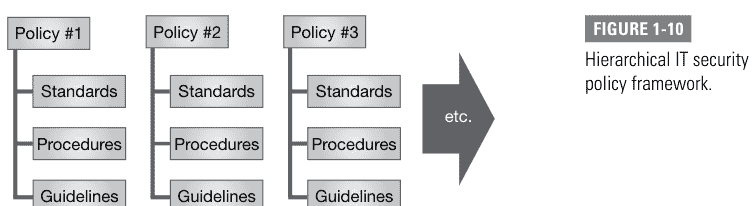


- **安全意识策略**—本策略定义了如何确保所有人员了解在组织安全策略下安全的重要性及行为期望。该策略特定于用户域，在需要改变组织安全意识行为时适用。

- **资产分类策略**—本策略定义了组织的数据分类标准。它说明哪些 IT 资产对组织的使命至关重要。它通常定义组织的系统、用途和数据优先级，并识别典型 IT 基础设施七个域中的资产。

- **资产保护策略**—本策略帮助组织为关键任务 IT 系统和数据定义优先级。该策略与组织的业务影响分析 (BIA) 保持一致，用于应对可能威胁组织在灾难后继续运营能力的风险。

- **资产管理策略**—本策略包括典型 IT 基础设施七个域中所有 IT 资产的安全运营和管理。

- **漏洞评估与管理**—本策略为生产操作系统和应用软件定义了组织范围的漏洞窗口。您可从此策略制定组织范围的漏洞评估与管理标准、程序和指南。

- **威胁评估与监控**—本策略定义了组织范围的威胁评估与监控权限。您还应在此策略中包含有关 LAN-to-WAN 域和 AUP 合规性的具体细节。

组织需要根据其环境定制 IT 安全策略框架。在对其 IT 环境进行安全评估后，许多组织会将策略定义与差距和风险点对齐。策略通常需要高层管理和企业法律顾问审查和批准。

## 数据分类标准

数据分类标准的目标和宗旨是为组织如何处理和保护不同类型的数据提供一致的定义。安全控制保护不同类型的数据。这些安全控制位于典型 IT 基础设施的七个域中。程序和指南必须定义如何在典型 IT 基础设施的七个域中处理数据，以确保数据安全。

对于受近期合规法律约束的企业和组织，数据分类标准通常包括以下主要类别：

- **私有数据**—关于必须保密的人员的数据。组织必须使用适当的安全控制以符合合规要求。

- **机密**—组织拥有的信息或数据。知识产权、客户列表、定价信息和专利是机密数据的示例。

- **仅限内部使用**—组织内部共享的信息或数据。虽然可能不包括机密信息或数据，但通信不打算离开组织。

- **公共领域数据**—与公众共享的信息或数据，例如网站内容、白皮书等。

## 美国联邦政府数据分类标准

美国政府根据《行政命令 13526》，为所有联邦政府机构（包括国防部 (DoD)）定义了数据分类标准。贝拉克·奥巴马总统于 2009 年 12 月 9 日签署了该行政命令。尽管美国政府及其公民享有信息的自由流动，但保护信息对于国家安全、国防或军事行动至关重要。

以下要点定义了美国联邦政府数据分类标准：

- Top secret—适用于分类机构认为若泄露将对国家安全造成严重损害的信息。
- Secret—适用于分类机构认为若泄露将对国家安全造成严重损害的信息。
- Confidential—适用于分类机构认为若泄露将对国家安全造成损害的信息。

相比之下，公共领域信息被视为非密级信息，不属于数据分类标准的一部分。

美国政府确实有处理非密级（泄露不会对国家安全构成威胁）和受控非密级信息（仅限官方使用，敏感但非密，以及执法敏感）的规则。请注意，这些规则不包含在《行政命令 13526》中，而是基于小布什总统政府之前采用的标准。

根据您组织的数据分类标准，您可能需要对存储设备和硬盘中最高敏感级别的数据进行加密。例如，在使用公共 Internet 进行远程访问时，您可能需要使用加密和 VPN 技术。但内部局域网通信以及对系统、应用程序或数据的访问可能不需要使用加密。

用户也可能受到限制，无法访问客户的私有数据，只能访问某些数据片段。客服代表在不获取客户所有私有数据的情况下提供客户服务。例如，他们可能无法查看客户的完整社会安全号码或账户号码；可能只能看到最后四位数字。隐藏敏感数据元素中某些字符的这种方法称为**掩码**。

### 技术提示

组织应从定义资产分类策略开始制定其 IT 安全策略框架。该策略反过来直接与数据分类标准对齐。该标准定义了组织保护其数据的方式。基于您的数据分类标准，您需要评估任何私有或机密数据是否在典型 IT 基础设施的七个域中传输。根据您如何分类和使用数据，您需要在整个 IT 基础设施中采用适当的安全控制。

## 章节总结

本章介绍了信息系统安全和信息系统安全职业。您了解了典型 IT 基础设施的常见定义。您了解了七个域中的风险、威胁和漏洞。每个域都需要使用策略来降低风险、威胁和漏洞。您了解了 IT 安全策略框架如何通过定义权威策略帮助组织降低风险。您还了解到，数据分类标准为组织提供了处理不同类型数据的路线图。但是，谁来实施安全控制？

需要合格的 IT 安全专业人员来设计和实施适当的安全控制和对策。作为一名 IT 安全专业人员，您必须具备最高的人类诚信和道德。安全专业人员有多种专业安全认证可供选择。CompTIA 的 Security+ 专业认证是初级 IT 安全专业人员的基础。(ISC)²，即国际信息系统安全认证联盟，为更有经验的专业人员提供注册信息系统安全专业人员 CISSP® 认证。获得 CISSP® 专业认证需要满足以下条件：通过认证考试、在信息系统安全领域拥有至少五年的工作经验、遵守职业道德准则，并提交继续专业教育 (CPE) 学分以维持您的认证。

## 关键概念和术语

- 可接受使用政策 (AUP)
- 应用网关防火墙
- 可用性
- 生物识别
- 黑莓
- 业务连续性计划 (BCP)
- 业务影响分析 (BIA)
- 载波侦听多路访问/冲突检测 (CSMA/CD)
- 注册信息系统安全专业人员 (CISSP)
- 儿童互联网保护法 (CIPA)
- 密文
- 明文
- 机密性
- 内容过滤
- 密码学
- 网络安全
- 网络空间
- 数据泄露
- 数据分类标准
- 深度防御
- 非军事区 (DMZ)
- 灾难恢复计划 (DRP)
- 停机时间
- 电子商务
- 加密
- 最终用户许可协议 (EULA)
- 以太网
- 家庭教育权利和隐私法 (FERPA)
- 2002 年联邦信息安全管理法 (FISMA)
- 2014 年联邦信息安全现代化法 (FISMA)
- FICO
- 文件传输协议 (FTP)
- Y 世代
- 格莱姆-利奇-布莱利法案 (GLBA)
- 加固
- 健康保险可携带性与责任法案 (HIPAA)
- 超文本传输协议 (HTTP)
- 超文本传输安全协议 (HTTPS)
- 身份盗用
- IEEE 802.3 CSMA/CD
- 信息安全
- 信息系统
- 信息系统安全


## 关键概念和术语，续

- 即时通信（IM）聊天
- 电气和电子工程师学会（IEEE）
- 完整性
- 国际信息系统安全认证联盟（ISC）²
- 互联网
- 物联网（IoT）
- 入侵检测系统/入侵防御系统（IDS/IPS）
- IP默认网关路由器
- IP有状态防火墙
- IT安全策略框架
- 二层交换机
- 三层交换机
- 局域网（LAN）
- 恶意代码
- 恶意软件
- 掩码
- 平均无故障时间（MTBF）
- 平均失效时间（MTTF）
- 平均修复时间（MTTR）
- 多协议标签交换（MPLS）
- 网络接口卡（NIC）
- 网络密钥
- 网络运营中心（NOC）
- 个人数字助理（PDA）
- Ping
- 协议
- 代理防火墙
- 代理服务器
- 恢复时间目标（RTO）
- “RFC 1087：伦理与互联网”
- 风险
- 《萨班斯-奥克斯利法案》（SOX）
- 安全套接层虚拟专用网（SSL-VPN）
- 安全控制
- 服务级别协议（SLA）
- 简单网络管理协议（SNMP）
- 智能手机
- 软件漏洞
- 子网掩码地址
- Telnet
- 厚客户端
- 薄客户端
- 威胁
- 令牌
- 传输控制协议/互联网协议（TCP/IP）
- 简单文件传输协议（TFTP）
- 特洛伊木马
- 两步验证
- 统一通信
- 正常运行时间
- 虚拟局域网（VLAN）
- 虚拟专用网络（VPN）
- 病毒
- 漏洞
- 漏洞评估
- 漏洞窗口
- 无线接入点（WAP）
- 无线保真（Wi-Fi）
- 无线局域网（WLAN）
- 工作站
- 万维网（WWW）
- 蠕虫

## 第1章评估

- 1. 信息安全特指保护信息，而信息系统安全则关注存放信息的系统的安全性。
  - A. 正确
  - B. 错误

- 2. 软件制造商在销售软件时使用以下哪项来限制其责任？
  - A. 最终用户许可协议
  - B. 保密协议
  - C. 软件开发协议
  - D. 通过开发无错误的软件和代码，使其不承担责任
  - E. 以上皆非

- 3. 信息系统安全的______原则涉及恢复时间目标。
  - A. 保密性
  - B. 完整性
  - C. 可用性
  - D. 以上皆是
  - E. 以上皆非

- 4. 如果您是上市公司或美国联邦政府机构，必须公开宣布发生数据泄露，并告知受影响的个人该数据泄露事件。
  - A. 正确
  - B. 错误

- 5. 要求客服代表访问私有客户数据的组织，可以使用以下哪种安全控制来最好地保护客户隐私，并轻松访问其他客户数据？
  - A. 阻止客服代表访问私有客户数据
  - B. 屏蔽客户私有数据详细信息，只允许访问社会安全号码或账户号码的最后四位数字
  - C. 加密所有客户数据
  - D. 访问客户数据库时实施二级身份验证
  - E. 以上皆是

- 6. ______是IT基础架构中最薄弱的环节。
  - A. 系统/应用程序域
  - B. LAN到WAN域
  - C. WAN域
  - D. 远程访问域
  - E. 用户域

- 7. 以下哪些安全控制有助于缓解恶意电子邮件附件？
  - A. 电子邮件过滤和隔离
  - B. 电子邮件附件防病毒扫描
  - C. 与用户核实电子邮件来源可靠
  - D. 扣留所有带有未知附件的入站电子邮件
  - E. 以上皆是

- 8. 您可以通过实施______来帮助确保保密性。
  - A. 可接受使用策略
  - B. 数据分类标准
  - C. IT安全策略框架
  - D. 用于远程访问的虚拟专用网络
  - E. 安全访问控制

- 9. 如果通过公共互联网在电子邮件消息中发送机密信息，则需要加密电子邮件通信。
  - A. 正确
  - B. 错误

- 10. 使用安全策略、标准、程序和指南有助于组织降低风险和威胁。
  - A. 正确
  - B. 错误

- 11. 数据分类标准通常属于哪项策略定义的一部分？
  - A. 资产保护策略
  - B. 可接受使用策略
  - C. 漏洞评估和管理策略
  - D. 安全意识策略
  - E. 威胁评估和监控策略

- 12. 数据泄露通常发生在以下哪项之后？
  - A. 获得对系统和应用程序的未经授权的访问
  - B. 漏洞评估扫描
  - C. 配置变更请求
  - D. 实施新数据中心
  - E. 实施Web应用程序更新

- 13. 最大化可用性主要涉及尽量减少______。
  - A. 从灾难中恢复的停机时间
  - B. 修复系统或应用程序的平均时间
  - C. 通过实施业务连续性计划来减少停机时间
  - D. 恢复时间目标
  - E. 以上皆是

- 14. 以下哪项不是美国合规法案或法规？
  - A. CIPA
  - B. FERPA
  - C. FISMA
  - D. PCI DSS
  - E. HIPAA

- 15. 互联网IP数据包与明文的关系，相当于加密IP数据包与______的关系。
  - A. 保密性
  - B. 密文
  - C. 虚拟专用网络
  - D. 密码算法
  - E. 以上皆非

# 物联网正在改变我们的生活方式

物联网（IoT）是当今连接与通信愿景中的新话题。这一愿景面临许多隐私、安全、技术、社会和法律方面的挑战。互联网最初带来了全球连接。这种连接改变了人们和企业的沟通方式。如今，用户始终“在线”并始终连接到互联网（即高度连接）。社交媒体正在推动实时连接和通信。Facebook®、Twitter®、LinkedIn®、Pinterest®、Google+®、Instagram®以及其他服务和应用程序改变了人们的沟通方式。当今互联网为各种个人和商务通信提供了媒介，无论是：

- VoIP—人与人之间的实时语音通信。
- IM聊天—用于实时聊天消息的即时通讯工具。
- 音频会议—多人之间的实时音频会议呼叫。
- 视频会议—多人之间的实时视频会议呼叫。
- 协作—多个远程人员之间带有音频和视频会议呼叫的实时文档共享和编辑。
- 数字媒体—用于社交媒体上传和共享的音频录制、图片和视频。

互联网改变了人们和企业的沟通方式。现在，随着IoT的出现，一大批用户希望连接的设备如海啸般涌来。这由对被认为重要的事物进行近乎实时访问的期望所驱动，包括消费品、家庭物品、汽车、卡车、交通信号灯、建筑和设施传感器、工业监控和控制系统以及关键基础设施设备连接。

IoT的承诺既有优势也有劣势。物联网正在改变我们生活、工作和娱乐的方式。还记得过去用电话预订餐厅吗？现在您可以在线完成并获得电子邮件确认。还记得过去必须与旅行社会面，为家庭度假制定计划和安排吗？现在您可以在线研究并预订自己的家庭度假，并查看其他度假家庭的真实评论和点评。还记得过去为了公司战略会议或会议而出差吗？现在您可以使用实时音频、视频和协作应用程序进行远程协作。这些变化使企业能够节省资金和时间，无需为团队会议支付差旅费。


物联网（IoT）面临五个关键挑战：

- **安全**—互联网早已是西部荒野，充斥着大量不法分子且缺乏执法，然而连接更多事物到互联网的需求与日俱增。
- **隐私**—这些数据是谁的？谁拥有个人信息、数据和媒体的知识产权？什么是隐私政策声明，为什么这对你很重要？
- **互操作性**—我们如何定义标准和协议，使得所有联网的物联网设备都能通信并被访问？
- **法律和法规合规**—物联网愿景带来的法律和法规合规问题，通常未能始终跟上物联网实施的速度。
- **新兴社会和经济问题**—世界各国及其公民必须迅速学会理解和克服物联网愿景带来的任何政治、环境和经济问题。

## Chapter 2 Topics

本章涵盖以下主题和概念：

- 物联网（IoT）如何从20世纪90年代末发展至今
- 互联网如何在TCP/IP世界中改变个人和商业通信
- 物联网对人们、企业以及我们生活方式的影响
- 企业如何从实体门店发展到电子商务再到物联网
- 当今企业为何需要互联网和物联网营销策略
- IP流动性如何帮助推动物联网世界
- 物联网创造的关键问题是什么

## Chapter 2 Goals

完成本章后，你将能够：

- 描述物联网（IoT）从20世纪90年代末至今的演变
- 认识互联网和物联网对人类和商业生活的影响
- 了解实体门店企业如何通过电子商务和物联网策略转型为电子业务模型
- 解释IP流动性如何推动物联网涵盖个人和商业环境
- 列出物联网创造的新挑战

### Evolution of the Internet of Things

互联网的演变和快速增长得益于全国光纤骨干网络的部署。更快的速度和更大的带宽为人类与连接事物的交互提供了更多机会。随着高速网络现在延伸到移动用户，机会是无限的。今天的消费者和商业用户受益于宽带连接，要归功于全国范围的蜂窝和无线互联网服务提供商（ISP）。受20世纪90年代末光纤骨干基础设施增长的推动，ISP通过连接美国各地的蜂窝网络扩展了覆盖范围。这导致连接智能手机和平板电脑等移动终端激增。人们、企业以及现在它们的设备都在连接互联网。父母可以通过安全的网络摄像头连接监控客厅或日托中心，从而看护孩子。企业正在使用互联网进行安全交易。自动售货机现在配备了蜂窝电话网络天线，用于安全的信用卡交易处理。蜂窝或Wi-Fi连接的智能手机和平板电脑可以配备安全的信用卡交易软件。信用卡刷卡附件也可用于移动支付。农村医疗保健服务可以通过远程医疗、安全视频通信和协作提供。任何能够连接互联网的设备都可以由该设备的所有者访问。

“物联网（IoT）”一词最初于1999年使用。英国技术远见者凯文·阿什顿（Kevin Ashton）首次使用它来描述连接到互联网的对象——任何类型的对象。阿什顿先生的物联网描述了物理世界中的对象连接到互联网，并允许任何对任何的连接，只要其所有者授权使用。同时，射频识别（RFID）正在供应链管理流程中实施，以跟踪货物的移动和交付。今天，“物联网”一词用于描述各种各样的对象、设备、传感器和日常用品如何连接并被访问。将IP设备和其他对象连接到互联网并非新想法，但关于物联网可能性的愿景正在获得动力。物联网实施的速度并未放缓；实际上，它正在迅速增加。这创造了之前描述的问题和挑战。

技术和市场趋势为物联网奠定了基础，并推动着物联网的发展方向。这个系统的危险在于，这些驱动因素推动开发和连接走在可能管理它们的安全、隐私和法规合规性之前。我们如何保护所有这些IP连接的设备？将所有对象和设备连接到互联网是个好主意吗？以下技术和市场趋势是物联网的驱动因素：

- **基于IP的网络已被全球采用**—互联网为任何用户、企业或设备提供全球连接。
- **连接无处不在**—在全球许多城市的许多公共区域以及作为客户（例如，酒吧、餐馆等）的福利，都提供免费的宽带互联网连接。
- **更小更快的计算**—更小的半导体和更快的芯片带来更快的计算和更小的设备尺寸。
- **云计算正在增长**—云服务允许更快、更轻松地访问数据和内容。

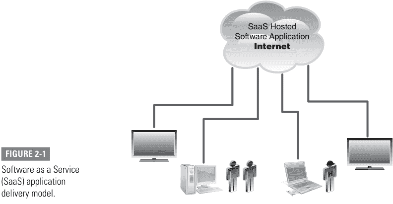

- 数据分析推动增长—捕获和研究设备在互联网上连接和通信的什么、如何、何时和为何的分析数据，为增强服务和性能提供分析支持。

物联网为事物连接提供了一条途径。这种连接涵盖个人和商业生活。物联网应用正在安全的云基础架构中开发和托管。这可以通过互联网支持一对多交付模型。应用服务提供商（ASP）是构建在云和互联网上托管应用程序的软件公司。用户不必购买软件并将其安装在工作站或笔记本电脑上；相反，他们使用安全浏览器运行在云中托管的应用程序。这有时被称为软件即服务（SaaS）计算。FIGURE 2-1 描绘了SaaS托管应用交付模型。

随着Amazon Web Services (AWS)等云托管公司的发展，云应用开发也随之增长。面向个人和商业场景的物联网应用应运而生。随着ASP构建SaaS应用程序，新的在线电子企业诞生了。需要实体门店的日子已经一去不返了。今天，你必须在万维网上拥有店面。如果没有在线存在，企业将无法接触全球用户和供应商。互联网营销、在万维网上拥有存在感以及最大化搜索引擎优化（SEO）都是当今IP互联世界中重要的业务要求。

## Converting to a TCP/IP World

电子邮件如何成为最主要的个人和商业通信工具？iTunes如何成为互联网上排名第一的在线音乐分销网站？手机和互联网如何影响我们的沟通方式？这些变化如何影响企业？简短的答案是，向传输控制协议/互联网协议（TCP/IP）世界的转变改变了我们的生活方式。人们、家庭、企业、教育工作者和政府的沟通方式与之前不同，几乎每个人都能轻松访问互联网。FIGURE 2-2 展示了互联网和TCP/IP如何改变日常生活。

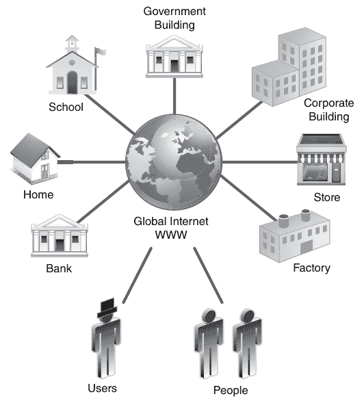

FIGURE 2-2
互联网和TCP/IP如何改变我们的生活。

## IoT's Impact on Human and Business Life

人们选择使用技术并连接到互联网。这一选择在个人、社会和职业方面改变了我们的日常生活。互联网影响着我们的个人、社会和商业生活。早晨醒来时，我们使用互联网设备查看天气、新闻和社交媒体网站。到办公室后，我们查看商务邮件并相应回复。在互联网普及使用之前——大约30年前的“黑暗年代”——人们似乎满足于使用固定电话通话和观看使用模拟设备的电视。没有万维网提供即时访问信息。新闻可以在报纸、电视或收音机上获得。要与他人实时通话，你必须让他们使用固定电话。寻呼机和语音留言系统的出现有助于实时访问以及存储和转发信息。最终，手机取代了寻呼机，让人们无论身在何处都几乎可以联系到任何人。


在20世纪90年代中期至后期，随着互联网和万维网的使用变得普遍，信息高速公路的访问开始改变每个人的生活。人与人之间的沟通转移到了互联网上，商业也紧随其后。

## 人们喜欢如何沟通

社交媒体推动了我们作为个人与家人、朋友和商业伙伴沟通的方式。社交媒体分享的普及（例如，LinkedIn用于专业联系人，Facebook用于个人联系人）模糊了商业与个人之间的界线。当今高度互联的个人以两种基本方式进行沟通：

- 实时通信——当你需要立即与某人交谈时，实时通信是首选模式，无论你是应对危及生命的情况、进行诸如买卖股票或证券等金融交易，还是应对安全漏洞。

- 存储转发通信——当你不需要立即从你选择联系的人那里获得回复时，可以使用存储转发通信。存储转发通信发生在近乎实时的情况下。语音邮件和电子邮件是存储转发通信的示例。两种形式的通信都会存储消息以便稍后检索。语音邮件甚至可以转换为音频文件并发送到你的电子邮件收件箱。这是统一消息（UM）的一个示例，其中你的所有消息（语音和电子邮件）都可以通过电子邮件访问。

## 影响我们生活的IoT应用

一旦人与人之间通信的基础建立起来，IoT应用的机会便在此基础上应运而生。以下各部分列出了一些可以影响我们日常生活的常见IoT应用。

### IoT对人类的影响

- 健康监测与更新——传感器可以监测人体生命体征，并安全地将数据分析发送到床边应用程序或移动应用程序。新的人类IoT应用程序将提供近乎实时的人体表现监测（例如，监测训练中运动员的表现健康指标，使用移动应用程序追踪糖尿病患者的血糖水平，或监测患者的高胆固醇并提交当天建议食用的菜单）。

- 家庭安全与智能家居控制系统——房主可以近乎实时地访问家庭安防系统，访问家庭监控摄像头画面，并完全控制家庭供暖和空调设置以最大限度提高能源效率。父母甚至在不在家时也可以看管孩子。监测家庭用水、用电、用气和能源使用情况，有助于节约水和能源，并帮助降低成本。

- 在线家庭成员日历——家庭可以使用工具来帮助安排拼车和其他需要亲子协调的活动。如果父母在学年期间充当孩子的司机，这一点尤其重要。家庭晚餐、假期和孩子的交通需求可以更高效地安排和协调。

- 通过全球定位系统（GPS）进行家庭成员的近乎实时跟踪和监控——担心孩子在哪里的父母可以通过智能手机和移动运营商启用GPS跟踪和监控。GPS跟踪应用程序和移动应用程序为父母提供近乎实时的子女位置查找，使用智能手机作为跟踪设备。

- 网上银行、账单支付和金融交易——房主现在可以使用网上银行系统和应用程序，通过自动付款直接从其支票账户扣款来完全自动化账单支付。不再有纸质账单，不再需要书写支票，也不再需要通过美国邮政递送系统邮寄付款。如今，大多数供应商和企业都接受安全的在线电子支付，无论是通过电子支票账户、信用卡还是电子电汇。

- 家居用品、食品和服务的网上电子商务购买——房主现在有能力在线购买商品和服务，并在零售店自提或让它们直接送到家门口。网上杂货店现在提供杂货配送，为没有时间购物的外出父母提供最大效率。假日购物主要在线上进行，让购物者避免在购物中心排队结账的长队和压力。今天，随着政府、企业和个人转向完全在线和数字化的世界，只要连接到互联网，个人就可以从家里或营业场所进行交互和商业活动。即使是点披萨送到家也已进步到餐厅现在提供整顿家庭餐的配送服务，热乎乎地送达，即食即吃。

- 配备智能计算机和“始终在线”Wi-Fi互联网接入的汽车——购车必备已超越每加仑英里数，现在包括许多高级功能和特性，例如：
  - “始终在线”Wi-Fi互联网接入
  - 免提蓝牙连接
  - Lojack®汽车定位器
  - 远程控制点火启动器
  - 可在汽车保养预约前安全上传到制造商进行预评估分析的汽车诊断

### IoT对企业的影响

现在我们更多地了解了IoT对我们日常个人生活的影响，那么IoT对企业的影响呢？IoT正在改变企业必须销售和营销其产品和服务的方式。更重要的是，企业正在寻找IoT带来的新机遇。ASPs是提供基于IoT的商业产品、服务和解决方案的新一代互联网初创公司。面向最终用户从智能手机或平板设备进行交互的基于云的应用程序和移动应用程序，是IoT应用的发展方向。以下是一些企业开始采用的有趣的IoT应用：

- **零售商店**——商店、银行、餐馆和制造商必须面向客户建立万维网存在。结合在线目录系统和接受安全电子支付的能力，支持自提或送货上门，客户可以随时从其联网的智能手机、平板电脑或计算机进行购买。当消费者在线购物时，交付商品和服务的成本大大降低。这促成了从传统实体零售商店向实施在线电子商务门户的范式转变。客户可以随时随地查看和购买产品和服务。具有自助服务功能的门户现在支持与网站上的购物者进行客户服务代表的实时即时消息（IM）聊天。企业可以从与库存管理直接关联的简化销售订单录入中受益。在近乎实时的销售订单访问下，供应链可以在制造和分销流程中得到优化。

- **虚拟工作场所**——从事人力或专业服务业务的企业和公司，除非是为了重要会议或演示，否则不需要来到实体办公室。如今，IoT支持所有通信类型，包括与远程所在或居家办公的同事进行全双向视频会议和协作。当今的IoT为在职或单亲父母提供了在家高效工作的机会，特别是当他们有育儿或其他义务时。员工可以节省通勤时间，最大限度提高生产力，节省交通和食物成本，并与同事有效协作。

- **公用事业/环境/基础设施监测的远程传感器**——需要监测电表、用水量、pH

## 互联网协会

互联网协会（www.internetsociety.org/who-we-are/mission）在其愿景和使命声明中捕捉了互联网的人类本质：

愿景声明：互联网属于每个人。

使命声明：促进互联网的开放发展、演进和使用，造福世界各地的所有人。

为了帮助实现我们的使命，互联网协会：

- 促进互联网标准、协议、管理和技术基础设施的开放发展。
- 专门支持发展中国家的教育，以及在需要的任何地方支持教育。
- 促进专业发展并建立社区，以促进参与和领导力，推动互联网演进的重要领域。
- 提供关于互联网的可靠信息。
- 为影响互联网演进、发展和使用的问题提供讨论论坛，涉及技术、商业、社会等多种背景。
- 为国际合作、社区和一种使自治得以运作的文化营造环境。
- 作为合作努力的焦点，推动将互联网作为造福世界各地所有人的积极工具。
- 为符合战略的人道主义、教育、社会及其他背景下的举措和外联工作提供管理和协调。


水质平衡、一氧化碳表或燃气泄漏传感器等都可以从物联网中受益。想象一下可以近乎实时地访问传感器和读数，尤其是在安全原因导致警报或警报指标超过时。任何涉及公用事业、关键基础设施或环境服务的企业都可以从互联网连接的传感器和读表设备中受益。这种访问可以取代人员亲自前往现场获取读数的需求。

- 城市和公共服务交通监控应用程序—智慧城市可以监控并报告实时交通状况，并在高峰时段通过近乎实时的更新将交通流量重定向到智能汽车可访问的移动应用程序。城市停车场可以精确定位可用停车位。

- 物联网正在改变面向消费者（B2C）服务交付模式—公司正在通过互联网改变他们提供客户服务的方式。这种面向消费者（B2C）的转型由新的Web应用程序和移动应用程序推动，这些应用程序提供对其产品和服务的在线访问。无论您需要或想要什么，企业都在改变如何将其包装、交付并出售给您，即消费者。在数字革命之前，还记得去唱片店或CD商店吗？唱片店和CD商店已经不存在了！数字音乐分发现在通过各种音乐分发网站在线完成。培训公司已将由讲师主持的培训课程转换为带有视频、音频录音和学生互动的在线电子学习交付。消费产品培训通常通过YouTube视频提供，其中包含逐步说明，向消费者展示如何组装产品。这种客户体验正是物联网所推动的。这是一种更好、更快、更有效的方式来培训您的客户如何使用您的产品或服务。使用YouTube视频也使交付成本降至近乎零。这通过为产品提供快速简便的安装说明来提升客户体验。物联网应用程序利用互联网创建完整的客户体验和产品。这包括完整的互联网和社交媒体营销活动，通过电子邮件发送常客优惠券和激励措施。销售和其他特殊服务会为在线注册的人员发送近乎实时的短消息服务（SMS）文本消息。

- 新的“任何即服务”物联网应用程序—随着新的物联网应用程序和移动应用程序的开发，企业可以采用任何即服务（AaaS）交付模式，该模式允许企业将自己转变为物联网服务产品。任何即服务意味着您目前所做的任何事情都可以转变为托管的安全云解决方案，您可以从网站访问您的内容和信息。日历、医疗提醒、干洗、杂货购物、托儿、税务准备服务、查找产品或服务，或查找任何东西，都有可能通过互联网实现。能够转换或发明新产品或新服务的企业将在明天的物联网商务环境中赢得物联网即服务产品。

## 从实体店到电子商务的演变

互联网改变的不仅是人们的沟通方式，它还彻底改变了商业。实体店铺现在具有全球覆盖能力。电子商务改变了企业的销售方式，而互联网改变了它们的营销方式。

什么是电子商务？它是指在互联网上销售商品和服务。在线客户从供应商的网站购买商品和服务。他们输入私人数据和支票账户或信用卡信息以进行付款。

电子商务支持两种商业模式：面向消费者（B2C）和面向企业（B2B）：

- **面向消费者（B2C）**—企业创建在线商店，让客户直接从其网站购买商品和服务，例如 _www.amazon.com_。
- **面向企业（B2B）**—企业构建带有链接的在线系统，以便与其他企业进行销售，通常用于集成的供应链采购和交付。

电子商务系统和应用程序要求严格的**机密性、完整性和可用性（CIA）**安全控制。组织必须使用强大的安全控制来保护其信息免受互联网上所有攻击者的侵害。如果私人数据和信用卡信息跨越互联网传输，这一点尤其正确。为了符合**支付卡行业数据安全标准（PCI DSS）**，企业必须进行安全评估并使用正确的控制措施来保护持卡人数据。互联网几乎在一夜之间创建了一个全球在线市场。没有人预见到如此巨大的变化——或其带来的影响。一旦互联网变得普及，广告、销售和营销不再局限于电视、广播、报纸和杂志以及直邮。营销关乎寻找新客户、留住客户，并提供更好的商品和服务。互联网使这些活动能够通过在线便利性得以实现。互联网重新调整了商业挑战。这些新挑战包括以下内容：

- 通过互联网发展业务
- 将现有的传统业务转变为电子业务
- 构建安全且高度可用的网站和电子商务门户
- 构建Web支持的客户服务策略
- 通过互联网营销寻找新客户

亚马逊、戴尔、苹果、西部联合、eBay、Priceline.com、必胜客披萨和UPS等公司都已创建了电子业务模式。每家公司都使用网站作为触达全球客户的主要方式。他们的客户在网站内置增强型客户服务交付的情况下进行购买。自助服务是游戏的名称。许多在线活动，例如账户管理，都可以自助完成。通过VoIP和即时通讯聊天实时访问客户服务代理可以提升高价值客户的体验。

什么是电子业务策略？它将业务功能和运营转变为支持Web的应用程序。电子业务策略包括在互联网上营销和销售商品和服务。电子业务策略通常包括以下要素：

- **电子商务解决方案**—这可能是在线目录和系统，用于在安全交易中购买商品和服务。
- **互联网营销策略**—互联网营销策略涉及搜索引擎优化（SEO），它使用嵌入的元标签和关键字来帮助搜索引擎排序结果；客户线索生成，即营销人员从信息网站和白皮书下载中请求客户信息；电子邮件群发，即广告和折扣券直接发送给潜在客户的电子邮件；以及推送营销，它涉及基于用户兴趣的直接销售和营销。
- 电子客户服务交付策略—这是一种自助和在线客户服务策略。
- 支付和信用卡交易处理—安全的在线支付处理和信用卡交易处理必须加密，并配备严格的后端系统安全控制，以防止未经授权访问私人客户数据。

## 为什么企业必须制定互联网和物联网营销策略

构建电子业务策略不仅仅是构建一个网站。电子业务所有者必须了解如何通过互联网在全球范围内寻找新的业务合作伙伴和新客户。如果没有电子业务策略或到达那里的迁移计划，企业将输给精通互联网的竞争对手。互联网营销策略是企业成功的关键部分。这一切关乎让更多目光关注您的网站并留住他们。互联网营销策略使用搜索引擎策略、联合营销协议以及新鲜且受欢迎的内容。作为当今全球市场中唯一模式，实体店铺商业模式已过时。企业必须拥有在线电子业务形象，为客户提供持续访问信息、产品和服务的途径。图2-3显示了在万维网上转型为电子业务模式的过程。

随着企业将互联网纳入其商业模式，他们增加了对在线风险、威胁和漏洞的暴露。请记住，连接到互联网意味着将自己暴露给黑客和网络窃贼。安全的Web应用程序、安全的前端和后端系统以及私有客户数据加密是每个组织必须实施的关键安全控制，以降低风险。

这并不意味着实体店铺不需要或已完全过时。几乎出人意料的是，庞大的在线商店亚马逊悄悄开设了其第一家实体零售

图2-3
在万维网上转型为
电子业务模式

| 阶段 | 重点 | 关键要素 |
|------|------|----------|
| 阶段1 | 客户获取和收入增长 | 用于业务沟通的电子邮件；仅供信息参考的网站；实体店铺商业模式；在线网页研究和购买；无互联网策略 |
| 阶段2 | 电子商务和增强型客户服务 | 统一通信：语音、传真、电子邮件；安全的在线面向消费者购物和购买；以客户服务为导向的网站，包含常见问题解答、电子邮件、联系电话；互联网营销：电子邮件群发、搜索引擎优化、按点击付费等 |
| 阶段3 | 集成应用的电子业务 | 带有统一通信的增强型客户服务网站；基于线索生成的销售网站；面向企业交易的安全电子商务；链接互联网营销、增强型客户服务和电子商务的完整业务策略 |


2015 年末的存在。据称计划在未来几年再开设数百家实体店，这表明实体店将继续与在线电子商务以及整体客户体验共存。

## IP 移动性

通信设备以及人们使用的通信技术都发生了巨大变化。早期的通信变化涉及采用更新的计算机并连接到网络。语音通信通常通过电话进行。多年来，电话的功能几乎仅限于支持语音通信。在过去的几年中，个人通信设备和手机变得非常强大。20 世纪 90 年代，随着人们开始使用手机来扩展其移动性，手机的使用量急剧增长。当今的手机、智能手机和 PDA 已发展到能够与许多小型计算机在功能和灵活性上相匹配的程度。PDA 是一种轻便的手持式计算机，通常由触控笔驱动，用作个人组织器，配有日历、通讯录等。软件出版商通过针对便携式设备市场推出许多程序来做出回应。平板电脑、智能手机和上网本应运而生，以满足对轻便便携式设备的需求。越来越多的人出于日常使用携带这些设备，而不是较大的笔记本电脑。

## 移动用户和自带设备

影响各类规模组织的重大趋势之一是个人通信设备的使用日益增加。随着用户越来越依赖个人设备，员工期望在工作时保持连接。即使允许使用这些设备的组织，也必须通过政策对其使用进行一定控制。这种政策广为人知地称为自带设备（BYOD）。采用此类政策的组织可以允许其员工和承包商使用自己选择并自行采购的设备连接到办公室网络。这种做法通常取代了组织采购有限型号选项并分发给员工个人使用的需求。一些顾问会支持这种举措的“商业意义”，因为它与较低的购买价格、较低的运营成本以及对用户和应用程序的支持性有关，但也有人认识到 BYOD 打开了通往重大安全问题的大门。

用户希望设备小巧、多功能且联网。在过去十年中，笔记本电脑变得越来越小、轻便和强大。它们变得足够强大，足以媲美许多台式计算机的性能。用户开始依赖笔记本电脑，并享受将工作带出办公桌的移动性。他们还喜欢能够离开办公室，同时保持对电子邮件和越来越多办公应用程序的连接。用户社区开始期望移动性和摆脱台式计算机的自由。计算机制造商开始提供更小更轻的笔记本电脑，以迎合人们随处保持连接而无需携带沉重设备的日益增长的愿望。

智能手机和 PDA 制造商也予以关注。他们开始使自己的设备更快、更强大——更像计算机。在企业用户中增加市场份额的领导者之一是 BlackBerry。第一款 BlackBerry 设备于 1999 年发布。它允许用户使用单一设备进行电话呼叫、访问电子邮件和管理日程。用户还可以运行一些应用程序并在没有笔记本电脑的情况下完成部分工作。Apple 随后推出了其 iOS 产品，首先是广受欢迎的 iPhone®。第一款 iPhone 于 2007 年发布。第一款 Android 手机，T-Mobile G1™，采用全新的 Android 操作系统，于 2008 年发布。市场上有这三家重量级玩家，竞争赢得最多移动用户的赛跑正式开始。

问题是：“谁真的想使用移动设备？”答案是：“几乎所有人！”人们希望为个人和职业生活使用移动设备。这一趋势表明了 BYOD 的重要性。移动设备、软件和服务的供应勉强跟上了需求。随着每款新设备或软件发布，移动用户发现移动技术的更多用途。移动计算开始接近传统计算的功能和便利性。但至少有三个问题仍然存在：网络速度、可用性和安全性。

移动设备和应用程序有许多用途。最早的某些应用程序实际上只是轻量级 Web 应用。用户通过移动设备上的轻量级浏览器连接到 Web 服务器。后来的智能手机和 PDA 支持不需要持续网络连接的本机应用程序。有些应用程序必须始终保持连接，但另一些不需要。一个示例是将员工考勤表信息存储在中央服务器上的应用程序。移动设备必须连接到网络以与服务器同步数据，但不需要保持持续连接。不需要持续网络连接的应用程序使得在飞机或其他偏远地点等场景下处理移动数据成为可能。

移动设备最早的用途之一是将工作带出工作场所。移动工作者很快成为将应用程序迁移到移动设备的推动者。帮助管理电子邮件和日程的通用应用程序是最早提供的应用程序之一。医疗专业人员迅速认识到移动计算满足其特定需求的优势。医疗和医疗信息管理长期以来一直是相关任务。医务人员需要访问充满私人医疗信息的患者图表和档案，并且需要快速访问，以提供最佳治疗。医院、诊所和诊疗机构在管理患者数据上投入了大量时间和资金。最近推动以电子方式存储医疗记录，使得访问这些数据变得更加重要。移动设备使医生、护士和其他授权医务人员能够按需访问和更新患者记录。

## 手机、智能手机还是 PDA？

随着移动设备的成熟，用于描述它们的术语也随之成熟。今天，允许用户拨打和接听电话以及发送和接收短信的移动设备称为 *移动电话*。其他缺乏电话功能但可以使用移动操作系统运行程序的设备称为 *个人数字助理*。结合手机和 PDA 功能的设备通常称为 *智能手机*。

## 移动应用程序

许多组织试图通过仅将其应用程序启用为 Web 版本来满足新移动用户需求。大多数移动设备包含功能有限的 Web 浏览器，只能运行少数几个应用程序。这种方法让许多以前只能使用内部计算机访问应用程序的用户能够使用这些应用程序。不幸的是，功能往往受损。未针对 Web 浏览器编写的应用程序通常会让用户感到困惑和沮丧。许多应用程序因移动用户界面设计不佳而失败。

一旦移动设备制造商、软件开发人员和服务提供商开始支持移动用户，他们开始提出的主要问题是：“谁在使用移动应用程序？”以及“谁想使用移动应用程序？”他们发现，来自多个领域的许多用户都找到了移动应用程序的用途。其中最积极的早期采用者是医务人员。

从移动设备早期开始，医疗应用程序就与移动应用程序非常契合。医务人员需要持续与患者及其数据进行交互。例如，医院患者每天可能会见到多位医生、护士和其他医疗从业者。每位医务人员都需要访问部分患者信息。患者信息可能包括人口统计信息、病史、诊断和治疗。每位与患者交互的护理人员都必须能够访问患者信息，以提供适当的护理。在每个房间都放置一台计算机既困难又昂贵，因此医疗诊所和医院早就认识到，移动设备能够提供访问所需信息的能力，而无需投资许多计算机和网络基础设施。每位护理人员都可以携带移动设备，并按需轻松访问所需信息。

### IP 移动通信

当今的 4G 网络提供真正的 IP 通信。这是相较于以前技术的一项重大改进。每个 4G 设备都有唯一的 IP 地址，在网络上就像任何其他有线设备一样。这使得移动设备能够与任何其他 IP 设备进行交互，而无需转换地址。功能的唯一限制在于移动设备的处理能力。随着移动设备速度越来越快，差异正在减少。

移动设备现在可以像有线设备一样运行，而不受物理边界的限制。这既是优势，也是潜在危险。传统网络管理通常基于对设备位置的了解。可以自由移动的设备更难追踪，更不用说保障安全了。

移动用户希望能够连接到网络，就像他们身处办公室并物理接入网络一样。移动 IP 使此成为可能。使用移动 IP，用户可以移

### 从列表中选择多个项目

将应用程序映射到移动设备时遇到的困难的一个示例涉及列表。假设您的旧版应用程序要求用户选择想要在披萨上添加的配料。使用功能齐全的 Web 浏览器应用程序的经典 Web 应用程序使用户可以轻松选择多个配料。Microsoft Windows 用户的标准方法是按住 Control 键并单击每个配料。在 iPhone、iPad® 或 Android 设备上，此简单操作很难完成，因为没有 Control 键，因此软件开发人员必须找到不同的方法来允许移动设备用户为其披萨选择多个配料。


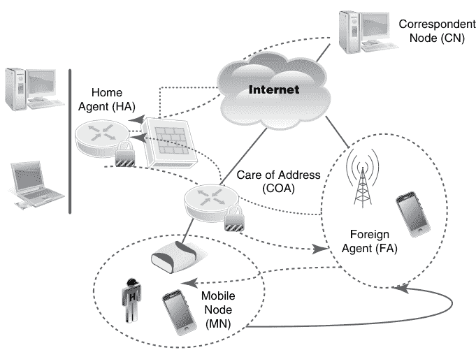

- 1. 移动节点（MN）连接到外部代理（FA）。
- 2. FA 为移动节点（MN）分配关心地址（COA）。
- 3. FA 将 COA 发送到归属代理（HA）。
- 4. 对应节点（CN）向移动节点（MN）发送消息。
  - a. CN 面向 MN 的消息首先到达 HA。
  - b. HA 将消息转发到 COA。
  - c. FA 将消息转发到 MN。

在 LAN 片段之间，用户设备在移动时可以保持连接，而不会出现使用标准 TCP/IP 时通常会发生的中断。用户甚至不会意识到自己的设备可能在四处移动时从一个网络切换到另一个网络。只要移动设备保持在网络覆盖范围内，用户就可以保持与网络的连接。网络设备可以在蜂窝网络和 Wi-Fi 之间切换，同时仍然提供透明连接。

图 2-4 演示了 Mobile IP 如何为多个协同工作的实体提供连接透明性，以确保移动设备可以在网络之间移动而不会丢失连接：

- **移动节点（MN）**—从一个网络移动到另一个网络的移动设备：无论当前网络如何，MN 都有一个固定的 IP 地址。
- **归属代理（HA）**—具有比标准路由器更多功能的路由器，HA 跟踪其管理的 MN。当 MN 离开本地网络时，HA 将数据包转发到 MN 当前所在的网络。
- **外部代理（FA）**—连接到另一个网络（非 HA 网络）的具有额外功能的路由器，FA 为 MN 分配一个本地地址。当 MN 连接到支持 Mobile IP 的另一个网络时，它会向 FA 宣告自身。
- **关心地址（COA）**—MN 连接到另一个网络时的本地地址，FA 将 COA 分配给 MN，并在 MN 连接时将其发送到 HA。在许多情况下，COA 实际上就是 FA 地址。HA 会将任何面向 MN 的数据包转发到 COA。FA 接收数据包并将其转发到 MN。
- **对应节点（CN）**—这是希望与 MN 通信的节点。

假设 MN 离开归属网络并连接到另一个网络。当 MN 连接到新网络时，FA 将 COA 发送到 HA。然后，CN 想要与 MN 通信。CN 向 MN 的 IP 地址发送消息。网络将数据包路由到 MN 的归属网络。HA 接收数据包并将其转发到 COA。FA 将数据包转发到 MN。

## IoT 创造的新挑战

在本章介绍中，你了解了 IoT 必须克服的五个关键挑战：

- **安全性**—如果你为个人和职业生活启用 IoT，如何防止坏人闯入？
- **隐私**—如何保护你家人的身份和隐私数据免遭盗窃或未经授权的访问，从而导致身份盗窃？
- **互操作性和标准**—IoT 制造商和 ASP 开发者在多大程度上确保设备安全通信？
- **法律和法规合规性**—国际、联邦和州级在涉及商品和服务支付的 IoT 相关业务交易的法律、税务和监管要求方面发挥什么作用？
- **电子商务和经济发展问题**—在万维网上开展业务的经济参与规则是什么？如何在全球部署 IoT 连接和信息共享？

### 安全性

请记住，安全三要素包括机密性、完整性和可用性（CIA）。如果个人或企业在未考虑安全性的情况下将某物连接到 Internet，该怎么办？如果没有值得窃取或敏感的东西，你还会连接吗？用户或企业在连接到 Internet 之前应该做什么？这些问题同样适用于通过 IoT 连接的设备。作为用户，你是你的资产及其中包含信息的所有者，因此，如果你将个人生活、家庭和业务内容连接到 Internet，决定面临哪些风险至关重要。你必须有高度的信任才能将你的身份、社交和家庭生活、家庭以及职业生活连接到 Internet。或者，你必须高度信任自己能够启用自身安全控制，作为将资产连接到 IoT 的防御策略。无论你的防御策略如何，风险、威胁和漏洞无处不在。那么，信任在哪里发挥作用？作为 Internet 的个人用户，同样的协议和人际礼仪是否适用于在线环境？什么是可接受或不可接受的行为；由谁或哪个组织来定义什么是可接受或不可接受？

Internet 已经充斥着黑客和坏人。安全和数据泄露每天都在发生。现在人们和企业想要通过 IoT 现象连接更多设备？这已经在发生。每天都有越来越多的 Internet 连接设备和人。企业继续扩展其在线形象，新应用程序正在通过 Internet 开发和销售。软件产品和分发不再通过 CD 或 DVD 进行。一旦在线支付了软件许可，你就可以立即将软件下载到设备并安装。人们对电子设备和实时连接的依赖程度越来越高。这种对 Internet 连接和 IoT 设备访问日益增加的依赖不会消失，而是会增加。随着人们和企业对 IoT 变得更加依赖，坏人攻击、窃取和破坏的机会也会增加。这就是为什么安全性是 IoT 必须克服的最大挑战。谁将充当管理机构？当人们和企业与 IoT 交互时，应当遵守哪些政策、程序或行为准则？安全性存在影响所有人类、政府和企业的全球性问题。

以下总结了 IoT 设备的安全性挑战：

- 传感器或消费品（如 Internet 连接的电视）等 IoT 设备大规模部署。取决于应用程序的关键性，如果受到攻击，中断可能会影响许多终端。
- IoT 设备无处不在，可以广泛触及用户或家庭人群。例如，联网电表如果受到攻击并被复制推送到个别终端，将引入关键基础设施漏洞。
- 未正确更新或维护的 IoT 设备可能允许漏洞成为进入你网络或组织的入口。这相当于供应商为产品或软件应用程序宣布生命周期终止（EOL）支持时间表。
- IoT 升级可能难以分发和部署，在 IoT 设备或终端的修复中留下缺口。具有 Wi-Fi 访问和车载计算机的汽车需要来自制造商的软件补丁和升级。必须对所有需要升级以修复软件漏洞的汽车进行此维护。
- IoT 设备通常不会向用户或所有者提供任何有关设备如何工作以及如何连接到 Internet 的内部可见性或知识。拥有对 IoT 设备远程访问权限的供应商或服务提供商可能能够在未经你许可的情况下从你的 IoT 设备提取信息或数据。审查产品保修以及与服务提供商的 IoT 通信和数据共享可能是你使用协议的一部分。
- IoT 设备通常在物理上不安全，可以位于公共区域或你家外的任何地方。你家的配电箱、有线电视或光纤电缆入口点通常不是那么安全。公共或开放 Wi-Fi 网络上的 Wi-Fi 连接 IoT 设备缺乏安全性。
- 环境 IoT 设备通常暴露在户外，出于科学或研究目的捕获读数和测量值。如果 IoT 设备可以作为进入 IP 数据网络的入口，那么如果存在许多 IoT 设备，单个设备中的漏洞就会被放大。

### 隐私

如何保护你家人的身份和隐私数据免遭盗窃或未经授权的访问，从而导致身份盗窃？作为居住在你所在州和国家的个人，你是否甚至知道自己的隐私权是什么？这些相同的隐私权是否扩展到 Internet 和 IoT 设备？谁拥有你的 IoT 设备中的数据？隐私有很多层。首先是你自己的身份和私人数据。然后你将隐私扩展到你的配偶或其他家庭成员。家庭需要隐私策略，以确保所有家庭成员的隐私数据保持机密。一个家庭成员的私人数据泄露可能会成为其他家庭成员私人数据被泄露的机会。


用户必须有一定的信任度才能使用互联网和 IoT 设备。更重要的是，要尊重隐私。用户的权利必须明确界定，所有 IoT 设备都必须明确界定用户的私有数据。物联网正在引发关于隐私、什么是私有数据以及谁拥有这些数据的新担忧。IoT 设备中的实际数据属于谁，是设备所有者（你）还是制造商？关于数据本身的 **元数据** 呢？元数据属于 IoT 设备的所有者，还是属于通过互联网收集这些数据的制造商（如设备用户购买产品时默认接受的保修和软件许可协议中所定义的）？关于使用模式和 IoT 设备信息的元数据对制造商有益。但这些数据属于你吗？在购买并将设备连接到互联网之前，必须清楚地理解数据的定义以及谁拥有数据。

物联网带来了新的且有趣的隐私挑战。这些挑战必须由 IoT 设备的制造商和该设备的个人用户充分理解和审查。以下隐私挑战必须由制造商解决，并在使用权和最终用户软件许可协议中予以定义：

- **隐私政策声明**—制造商隐私政策声明中记录的用户隐私权利的实际法律定义。此隐私政策声明必须随任何由个人输入隐私数据的在线表单一起提供。

- **数据、元数据或分析数据的使用与权利定义**—这是一个实际定义，用于定义什么是数据、元数据或分析数据，以及它们可用于什么目的；以及用户是否必须授权才能使用这些数据。

- **用户向制造商或应用程序服务提供商隐私政策声明提供同意的能力**—用户必须能够在线阅读声明，并接受或拒绝隐私政策的条款和条件。一旦用户提供同意，撤销该同意通常会更加麻烦。一些公司要求你书面正式撤销同意，且没有在线功能。

- **确定隐私领域**—如果你允许对你和你的智能手机或 IP 移动设备进行地理位置追踪，而另一个应用程序服务提供商使用关于你和你去向的这些信息，这是否侵犯了你的隐私权？如果你甚至不知道这些数据正在被收集，又该如何？在自己家中侵犯隐私是有道理的，但这是否延伸到你家中连接互联网的 IoT 设备？当你的隐私数据或元数据与其他数据聚合或关联以创建新数据时，隐私领域变得模糊。请记住，IoT 设备可以以高度细致的特定性收集关于个人的信息。可以创建数据画像，从而产生你作为所有者可能不希望泄露或被另一方使用的新威胁和行为模式。

假设你是一个健康狂热者，并通过移动应用订阅了在线卡路里和健康表现跟踪服务。你的 IoT 连接冰箱，加上你在网上杂货店的购买记录，共同追踪你吃了什么并将其转换为卡路里。你还决定将使用的在线餐厅预订系统链接到你的卡路里和健康表现跟踪应用程序。当你在餐厅点餐时，食物和卡路里会自动计入你的每日卡路里计算器。除此之外，当你锻炼并消耗卡路里时，你的 IoT 健身卡路里监测器会向你的在线卡路里和健康表现跟踪应用程序提供实时更新。托管你卡路里和健康表现数据的卡路里和健康表现 ASP 会对你的数据进行分析，并创建关于你数据的新元数据。这些元数据被出售给医疗保健研究人员或健康食品制造商。如果其中包含人口统计信息，例如你的年龄、体重和地理位置，他们就拥有大量关于你的信息，尽管这些数据被视为 **去标识化数据**。

关于谁拥有元数据（即数据关于数据）的所有权的担忧，在隐私领域非常普遍。这可能是尚未得到充分审查的头号隐私挑战。总的来说，人们不了解自己的隐私权，用户充分了解这些权利非常重要。这在用户愿意做什么以及用户对其 IoT 设备制造商有多少信任之间划出了一条微妙的界限。

除了这些隐私挑战之外，以下问题正在为 IoT 法律专家和隐私顾问带来新的探索和理解领域：

- 我们如何处理数据源以及数据收集者的权利和数据使用？
- 是否存在一种包含私有数据去标识化但无法将这些数据与个人关联的折中方案？
- 个人或企业如何才能知道什么是良好的隐私态度或偏好？
- 当前的社交背景和可接受的行为是否会延伸到 IoT？
- 我们能否开发隐私即设计（附带一组核心要求），并为所有 IoT 实施标准化的隐私实现？

此类问题需要仔细分析和风险缓解解决方案，尤其是从法律和监管合规的角度来看。美国联邦和州隐私法旨在保护公民的私有数据，同时要求使用、处理、存储和传输私有数据的实体遵守特定的安全和隐私要求。

## 互操作性和标准

互操作性和标准是实现一致的 IoT 设备、连接和通信环境的关键。没有它们，应用程序服务提供商、IoT 设备制造商和客户都会被劝退，不愿实施和连接 IoT 设备。ISP 和最终用户客户都采用了 TCP/IP 版本 4 通信协议，以确保端到端 IP 通信的互操作性。遵循 IoT 设备连接互操作性和标准的共同主题，安全对于确保设备到设备的功能至关重要。只要 **互联网工程任务队 (IETF)** 参与其中，就可以为 IoT 解决方案推进互操作性和标准。遵循互联网协会的四项基本原则——连接、通信、共享和创新——是推动 IoT 创新成功的关键。

一个完全互操作的 IoT 环境是理想的，可以让任何 IoT 连接的设备与另一个 IoT 连接的设备进行通信。这种通信可以直接发生，也可以通过充当中心通信点的共享服务器或应用程序间接发生。关键在于，信息是如何被收集、存储和使用的？互操作性需要类似的操作系统 (OS)、通信协议，以及以安全方式将数据传输到安全云中托管的服务器或应用程序服务器的方法。对常见协议和传输架构（包括加密/解密）的标准化和采用都是需要标准化实现的重要要求。

如果未妥善处理，互操作性将产生重大财务影响。这是制造商和应用程序软件供应商不希望看到的。他们希望大幅降低 IoT 设备及支持 IoT 设备的应用程序的成本，使其在可从 IoT 中受益的大量用户和企业中负担得起。互操作性降低了用户和企业 IoT 实施的成本。实施开放标准和互操作性要求将允许更多 IoT 设备连接。这增加了 IoT 部署的经济价值或投资回报率，因为收益将用于支付 IoT 部署成本。根据 2015 年麦肯锡全球研究院的一份报告，互操作性将在 2025 年前推动经济收益和财务影响达到万亿美元规模。

互操作性、标准、协议和定义对于 IoT 设备的早期开发和实施是必需的。以下是必须通过互操作性和标准解决的关键挑战：

- **一些制造商希望设计和部署专有 IoT 设备和解决方案**—这是一种将早期采用的客户和企业锁定在其自身解决方案中的策略。这会创建不允许信息共享的技术孤岛，并需要网关或中介解决方案来共享信息。如果数据采用可共享的格式，应用程序有可能共享 IoT 设备数据。不兼容的 IoT 设备和应用程序之间可能需要应用程序编程接口 (API) 或其他软件接口来共享信息。这阻碍了 IoT 的实施和接受。

- **在 IoT 设备和应用程序中实施功能、操作、技术和安全功能的成本因素**—成本始终是设计和实施 IoT 上市策略时的关键考量因素。价格点必须低廉且负担得起，因为大量用户将推动 IoT 设备连接的批量采购。供应商和制造商必须权衡将互操作性成本计入 IoT 设备本身，还是尽快将产品推向市场以实现立即采用。

- **上市时间风险**—毫无疑问，全球规模的 IoT 设备市场存在先发优势。自技术发明以来，供应商和制造商一直在玩这个游戏。你多快抢占互操作性和标准曲线的先机，取决于大多数用户和企业社区在使用专有或开放标准的 IoT 技术部署方面处于什么位置。如果没有上市时间的压力点，就不会存在在互操作性和标准被全球采纳和接受之前就冒险构建和发布产品的问题。

- **技术过时风险**—当 IoT 供应商、制造商和软件开发人员在未完全定义和采用互操作性和标准定义的情况下开发 IoT 技术解决方案和产品时，他们都会面临风险。这种情况迫使早期设计采用开放且广泛可用的标准或专有解决方案和技术。显然，你的架构越开放、越灵活，在 IoT 设备和解决方案开发的设计阶段，调整和改变技术互操作性和标准技术决策就越容易。


- **物联网设备互操作性与标准的缺失可能导致劣质物联网设备环境的出现**—如果没有物联网设备之间的互操作性和标准，将缺乏通信和信息共享。这可能导致多个物联网环境，其中设备可能无法通信或共享数据。这会带来更多关于多个物联网设备和孤立物联网网络的问题，只有这些设备才能连接到这些网络并与之共享信息。如果连接的设备彼此之间不通信和共享信息，物联网愿景还有什么意义？物联网互操作性和标准采纳的终极挑战就在此。配置更新必须在物联网设备之间实现自动化、简单且完全互操作。如果没有发送更新固件、操作系统软件和其他物联网设备软件的能力，设备将变得过时。这将增加易受攻击或过时的物联网设备连接到生产 IP 网络的风险。远程配置能力正是推动所有物联网设备和系统互操作性和标准的关键。

## 法律和监管问题

在公共开放互联网上部署物联网设备，从监管和法律角度引发了一些立即关切的问题。其中一些问题以前从未存在过。随着美国许多垂直行业的监管合规现已全面生效，用户和企业如何以合规方式部署以物联网为中心的设备和解决方案？这对受合规法律约束的垂直行业提出了一个有趣的问题，例如医疗保健的 HIPAA、高等教育的 FERPA、联邦政府的 FISMA、银行和金融的联邦金融机构检查委员会 (FFIEC)，以及作为安全信用卡交易处理遵循标准的 PCI DSS v3.1.1。

在监管合规方面，我们关注如何妥善处理敏感数据并确保其机密性。在这些合规法律下，敏感数据对用户和个人有独特的定义。但物联网设备数据呢？物联网设备使用互联网进行通信。根据服务器或物联网应用所在的位置，您的物联网数据正在穿越物理网络并跨越州界。这意味着您的私人受您所在州的隐私法律以及物联网托管公司所在州的法律约束。正是这种数据流动可能迅速引发法律问题。如果物联网数据被归类为受监管合规保护的私人数据或敏感数据，则该物联网供应商或解决方案提供商必须根据需要遵守安全控制要求和数据保护法律。这种跨境数据流动对互联网来说并不新鲜。新鲜的是，物联网设备可以在未经您授权或知晓的情况下，将您的物联网设备数据共享和传输给其他系统和应用程序。这使隐私问题复杂化，因为数据有时可以在您不知情或未批准的情况下跨越州界。

谁在收集您的物联网设备数据？谁在收集您在所有物联网设备中的行为模式？收集者正在如何使用您的物联网设备和行为数据？这是与物联网数据歧视相关的全新法律和隐私问题。从您的物联网设备收集的数据讲述了关于您及其使用该物联网设备的特定故事。这些数据既可以用于好事，也可能以歧视性方式用于对付您。根据第三方使用权条款，物联网供应商和 ASP 可能以对您具有歧视性的方式使用您的数据或元数据。这些甚至可能包括您去哪里旅行或就餐以及您从事何种娱乐活动的数据。元数据可以被累积并出售给寻求关于您及其消费习惯的人口统计营销数据的其他公司。这些信息对其他公司有多大价值？物联网或设备跟踪应用供应商有权出售您的元数据信息吗？在与其他国家的个人进行全球互动时，哪些法律适用于该人的隐私，以至于可能或不需要安全控制？

最后，物联网设备责任如何界定？如果您的物联网设备用于医疗监测和警报/报警，但出现故障怎么办？如果有人因故障的物联网设备而受伤或死亡，责任限制是来自物联网设备制造商、ASP，还是其他人？制造商无法得知所有者将如何使用该物联网设备。如果该设备被用于实施或协助犯罪或抢劫怎么办？如果黑客可以攻破家庭物联网安防系统和视频摄像头系统，然后在主人不在家时抢劫该房屋，谁应对实际抢劫和财物损失负责？如果物联网设备被用作跳板来攻击其他 IT 系统、应用程序和数据的访问权限，该怎么办？这些示例演示了在现实世界中使用物联网设备可能产生的潜在责任。当前的责任法律和保护可能或不可能涉及连接到公共互联网的物联网设备。我们如何才能在法律和监管合规曲线上保持领先？这并非易事。评估物联网设备及其实施的法律影响，首先必须解决个人的隐私权。接下来，必须了解从责任角度来看，涉及物联网设备制造或解决方案的企业什么是可接受的，什么是不可接受的。

## 电子商务与经济发展问题

物联网是寻求连接互联网的欠发达国家的电子商务和经济推动者。物联网技术对发展中经济体有显著影响，因为它可以将国家转变为具备电子商务条件的国家。

融合物联网的工业和关键基础设施解决方案可以帮助欠发达国家加快其全球互联网和电子商务影响力。这包括实施监测农业、能源、水资源可用性、工业化以及环境和自然资源管理的物联网关键基础设施解决方案。物联网可以帮助城市、县和国家部署关键基础设施技术，以加速经济发展和增长。

食品、水、农业和耕作都可以通过物联网设备、传感器和监视器得到支持，以帮助各国为农业和食品加工建立新基础。

使用物联网来跟踪和监测进度，是各国政府在构建关键基础设施并为其人民和企业提供基本必需品时可以部署的可行方案。以下是物联网为各国带来的电子商务和经济发展示例：

- **基础设施资源**—作为物联网部署的基础，该国需要通信基础设施和宽带互联网网络。这是物联网设备在全球市场中进行连接和通信的基础。

## 关键基础设施物联网

实施新供水管理系统的国家需要适当的传感器监测和跟踪，以确保淡水供应得到维持且水资源能够送达有需要的人口。农业和耕作依赖于水资源灌溉，也可以从物联网中受益。传感器可以监测水资源以及水质，并将近乎实时的数据传回水资源管理系统和人员。利用此物联网基础设施管理整个地区的淡水供应，可以支持适当的人口和农业增长。利用物联网帮助进行水资源管理系统规划（包括容量规划），有利于人类和农业增长。一旦用于水资源管理，其他类似关键基础设施服务（例如，废水管理等）可以遵循类似的实施路径。这种物联网基础可以支持该国的经济发展和电子商务路线图。农业和其他自然资源可以成为该国物联网和国际贸易电子商务战略的一部分。无论该自然资源是水、农业、自然资源还是矿产，物联网基础都可以帮助推动该国的经济发展和电子商务战略。

- **基础性投资**—寻求投资关键基础设施的国家可能能够超越那些在加速部署方面面临监管和法律问题的其他国家。
- **技术和行业发展**—需要新技能，才能利用互联网和物联网作为关键经济驱动力，将新技术和经济解决方案付诸实践。随着物联网技术以及行业互操作性和标准的成熟，物联网设备部署以及用户和企业的采用也将随之成熟。
- **政策和监管定义**—各国和新兴经济体有条件创建和实施政策和法规，以帮助确保安全和隐私成为部署的一部分。

在处理国际电子商务时，会出现其他需要考虑的问题。在进行国外或国际电子商务时，谁负责缴纳和提交税款？这类问题需要答案，尤其是在物联网超越国家和国际边界时。

## 章节摘要

在本章中，您了解了通信的变化以及互联网对人类和企业产生的影响。这种影响使我们进入了物联网（IoT）时代，其中任何 IP 连接的设备都能够连接到互联网。这种演变是由互联网及其爆炸式增长和普及创造的。这种演变已经改变了我们的个人和职业生活以及开展业务的方式。随着越来越多的用户及其设备连接到互联网，跨物联网宇宙共享和使用信息的机会也越来越多。这可能包括与物联网的人类或个人交互以及专业或业务


与物联网（IoT）的交互，企业正转型为应用服务提供商，提供创新的新产品和新服务。我们了解到，物联网并非没有必须克服的业务挑战和问题。

这些新的 IoT 业务挑战和问题包括人与 Internet 及 IoT 连接设备交互的所有方面，涵盖安全、隐私、互操作性和标准、法律与监管问题，以及电子商务和经济发展。在 IoT 互操作性和标准领域开展全球合作与参与，将确保 IoT 厂商、制造商和 ASP 全部位于同一平台，为明天的市场构建和实施 IoT 设备和解决方案。没有这种全球合作，互联网协会（Internet Society）所描述的物联网愿景将难以实现。

## 关键概念和术语

- 一切即服务 (AaaS)
- 应用服务提供商 (ASP)
- 音频会议
- 自带设备 (BYOD)
- 企业对企业 (B2B)
- 企业对消费者 (B2C)
- 协作
- 机密性、完整性和可用性 (C-I-A)
- 去标识化数据
- 数字媒体
- 生命周期结束 (EOL)
- 联邦金融机构检验委员会 (FFIEC)
- IM 聊天
- 互联网工程任务组 (IETF)
- 物联网 (IoT)
- 互操作性
- 元数据
- 移动 IP
- 支付卡行业数据安全标准 (PCI DSS)
- 隐私
- 射频识别 (RFID)
- 实时通信
- 搜索引擎优化 (SEO)
- 安全
- 社交媒体
- 软件即服务 (SaaS)
- 存储转发通信
- 统一消息
- 视频会议
- IP 语音 (VoIP)

## 第 2 章评估

1. Internet 是一个由全球共享的开放公共网络。任何人都可以使用计算机、有效的 Internet 连接和浏览器连接到 Internet：
   - A. 正确
   - B. 错误

2. 以下哪些是 IoT 行业必须克服的挑战？
   - A. 安全和隐私
   - B. 互操作性和标准
   - C. 法律和监管合规
   - D. 电子商务和经济发展
   - E. 以上全部

3. 哪种现象推动了近乎实时的高速宽带连接到终端设备？
   - A. Internet 连接
   - B. 电子邮件
   - C. VoIP
   - D. 社交媒体共享
   - E. 以上全部

4. 以下哪项需要 IoT 连接的汽车？
   - A. 近乎实时访问家庭控制和系统
   - B. 能够通过位置查找 GPS 应用程序追踪孩子的行踪
   - C. 关于按时付账提醒的实时警报
   - D. 具有直接配送的在线电子商务和网上购物
   - E. 提供交通状况实时更新的交通监控传感器

5. 以下哪些是 IoT 对我们商业生活的影响？
   - A. 电子商务
   - B. 具有前端销售订单录入的集成供应链
   - C. 公司现在提供带有实时更新的产品和服务配送服务
   - D. 客户评论为消费者提供在线产品和服务评论，并提供更多关于客户满意度的信息
   - E. 以上全部

6. 以下哪些有助于支持远程办公？
   - A. 在线/可用状态
   - B. IM 聊天
   - C. 视频会议
   - D. 协作
   - E. 以上全部

7. 以下哪项是 IoT 部署必须克服的安全挑战？
   - A. 移动 IP 流量拥塞
   - B. 与其他 IoT 设备的安全通信
   - C. IoT 设备未能发送更新消息的责任
   - D. IoT 设备中的软件许可定价
   - E. 隐私数据使用共享协议

8. 统一消息为移动用户提供什么功能？
   - A. 将语音消息转换为音频文件并发送到用户邮箱以供在途中播放
   - B. 一对多通信
   - C. 多对多通信
   - D. VoIP 通信和消息传递
   - E. SIP 通信和消息传递

9. 以下哪些应用程序可以消除面对面培训的需求？
   - A. 音频/视频会议
   - B. 协作
   - C. IM 聊天
   - D. 在线/可用状态
   - E. 以上全部

10. 为什么电子商务系统需要最高级别的安全控制？
    - A. 这是 PCI DSS 标准。
    - B. 私有客户数据被输入到网站中。
    - C. 信用卡数据被输入到网站中。
    - D. 客户留存需要对安全网上购物充满信心。
    - E. 以上全部

11. 以下哪项 *不是* IoT 部署必须克服的挑战？
    - A. 安全
    - B. 可用性
    - C. 法律和监管
    - D. 电子商务和经济发展
    - E. 隐私

12. 通常，数据必须 ______ 才能共享或用于研究目的。
    - A. 加密
    - B. 哈希
    - C. 去标识化
    - D. 掩码
    - E. 明文

# 恶意攻击、威胁和漏洞

在本章中，您将了解用于实施恶意攻击的软件。此类软件称为恶意软件。您还将了解不同类型的攻击。Internet 是一片未开发的新边疆。有许多不法分子想要窃取您的数据。如果您的设备和敏感信息连接到 Internet，就存在损失或损坏的潜在风险。与日常生活不同，在网络空间中没有实际的国土法。导致破坏和盗窃的犯罪行为经常发生。这些行为影响企业、个人和政府。罪犯往往不受惩罚，就像 2014 年底发生的索尼影业娱乐黑客攻击事件一样。

恶意攻击每年造成数十亿美元的损失。幸运的是，许多像您这样的公司和个人正在努力保护 IT 资产免受攻击。在本章中，您将学习如何识别安全漏洞、保护您的组织免受威胁，并使您的计算机免受恶意攻击。

## 第 3 章主题

本章涵盖以下主题和概念：

- 网络攻击的全球范围是什么
- 您试图保护什么
- 您试图抓捕谁
- 用于攻击计算机系统的工具类型
- 什么是安全入侵
- 什么是风险、漏洞和威胁
- 什么是恶意软件
- 什么是恶意软件攻击
- 什么是社会工程学攻击
- 什么是无线网络攻击
- 什么是 Web 应用程序攻击
- 什么是对策措施

## 第 3 章目标

完成本章后，您将能够：

- 识别恶意软件并实施对策措施
- 识别常见攻击并制定适当的对策措施
- 识别社会工程学并降低相关风险
- 识别无线网络上的威胁和攻击类型
- 识别 Web 应用程序上的威胁和攻击类型

### 恶意活动日益增加

您可能在新闻中见过相关报道，在电视上看过幽默广告，或读到过关于网络攻击的头条新闻。例如：最近，当局因一名大学生黑客攻击美国副总统候选人的电子邮件账户而将其判处 20 年监禁。在类似事件中，服装零售商 TJX Companies 承认疏忽大意，导致其客户数百万张支付卡号被盗。此外，在一部幽默的黄金时段广告中，一名糊涂的员工通过点击“无害”的电子邮件链接引发了公司范围的病毒攻击。您周围随处可见安全专业人员每天面临的恶意攻击案例。头条新闻充斥着最近数据泄露的消息。数据泄露在公共部门和私营部门都在发生。没有任何组织或个人能免受数字数据被盗或数字身份丢失的风险。

尽管这些攻击引起了新闻媒体和公众的关注，但大多数网络攻击的受害者根本不公开这些事件。每天，世界各地的系统都面临威胁。在大多数情况下，只有安全专业人员和 IT 人员知道这些攻击。安全专业人员负责保护其系统免受威胁，并在攻击发生时处理恶意攻击。保护计算机系统最有效的方法之一是确保在整个 IT 基础架构中快速、高效地缓解漏洞。表 3-1 显示了彭博商业周刊在 2013 年 4 月确定的前 10 大黑客国家。2013 年，中国是网络攻击的主要来源国，占比 41%。美国排第二，占比 10%。请记住，来源国可能难以确定。特别是当使用僵尸网络执行实际攻击时，情况更是如此。僵尸网络是一组受远程黑客控制的联网计算机。远程黑客可以控制这些连接到僵尸网络的计算机并发起攻击，即使黑客本人可能居住在另一个国家。这使得查找和捕获肇事者变得困难。

> **注意**
>
> 攻击者有时会使用**传递访问**来获得目标系统或用户的信任。当攻击者采用传递访问时，所需目标系统或服务会通过首先攻破目标信任的系统而受到间接攻击。由于目标系统熟悉并信任源设备或用户，这会造成一种虚假安全感。攻击者可以利用这种信任，从这个受信任的设备或用户策划攻击，从而获益。


表 3-1 2013 年十大黑客国家。

| 来源 | 攻击占比 (%) |
| :--- | :--- |
| 中国 | 41% |
| 美国 | 10% |
| 土耳其 | 4.7% |
| 俄罗斯 | 4.3% |
| 台湾 | 3.7% |
| 巴西 | 3.3% |
| 罗马尼亚 | 2.8% |
| 印度 | 2.3% |
| 意大利 | 1.6% |
| 匈牙利 | 1.4% |

数据来源：Bloomberg Business，2013 年十大黑客国家。

## 你正在尝试保护什么？

一句话，你正在尝试保护资产。**资产**是指任何具有价值的项目。尽管组织中的所有项目都有一定价值，但术语 _资产_ 通常适用于那些具有实质价值的项目。组织的资产可以包括以下内容：

- **客户数据**—姓名、地址、电话、社会安全号码 (SSN)、出生日期、持卡人数据、受保护的医疗信息。
- **IT 资产和网络基础设施**—硬件、软件和服务。
- **知识产权**—专利、源代码、公式或工程计划等敏感数据。
- **财务和财务数据**—银行账户、信用卡数据和金融交易数据。
- **服务可用性和生产力**—计算服务和软件支持人类和机器生产力的能力。
- **声誉**—企业合规性和品牌形象。

让我们逐一查看这些类型的资产，并讨论它们如何面临恶意攻击的风险。

### 客户数据

新闻媒体喜欢报道数据泄露中被盗数据元素的数量。由于影响重大，客户私人数据、持卡人数据或电子受保护医疗数据元素的丢失常登新闻头条。在当今的数字时代，客户私人数据易受他人窃取和滥用。当私人数据被用于冒充个人时，其结果称为**身份盗窃**。客户私人数据可能包括名和姓、家庭住址、电话号码、出生日期、SSN 或持卡人数据。

### IT 和网络基础设施

硬件和软件是任何组织基础设施的关键组成部分。图 3-1 显示了典型 IT 基础设施框架的七个领域。每个领域中的组件可能连接到网络或互联网。由于 IT 基础设施已连接到互联网，威胁可能来自 IT 基础设施内部和外部。

新威胁造成的数据损害包括装甲病毒、勒索软件和加密木马恶意软件，这些可能会使企业花费时间和金钱来修复或替换。

装甲病毒具有经过加固的代码，使得逆向工程和为该恶意软件构建杀毒软件变得困难。勒索软件是一种与计时器相关联的新型恶意软件，迫使受害组织支付赎金以防止其数据被删除。加密木马是一种特定形式的勒索软件，它会加密关键文件或数据，直到受害者支付赎金以获取解密密钥。

对关键硬件和软件系统的恶意攻击还可能导致组织内出现更广泛的问题。这些问题可能包括关键数据丢失、财务信息或知识产权被盗。未受保护的 IT 和网络基础设施资产会为攻击者和网络犯罪分子访问敏感资源提供最广泛的入口。访问的便捷性使连接到互联网的资产成为最常见的第一个攻击点。这意味着你应该将

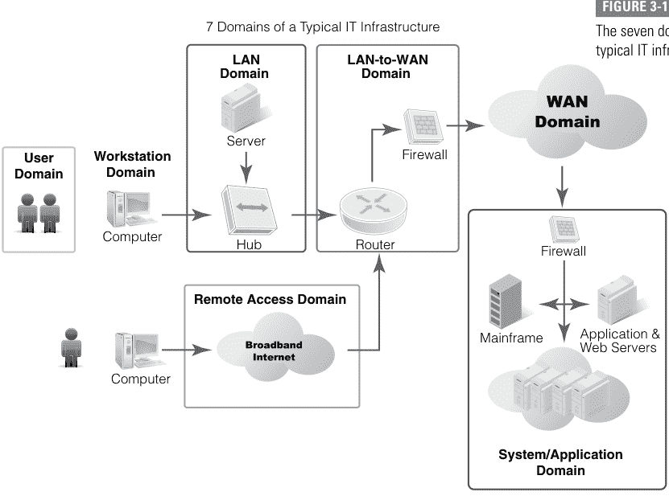

你最有价值的资产放置在 IT 基础设施深处，以实现分层安全防御。鉴于新型多态恶意软件的复杂性，分层安全防御至关重要。多态恶意软件有害，因为它可以变形或改变，使得杀毒或反恶意软件应用程序难以发现和修复。

**注意**

2016 年 2 月，好莱坞长老会医学中心成为使用加密木马恶意软件的勒索软件的受害者。加密木马恶意软件通过加密关键文件并要求支付赎金以获取解密密钥来锁定系统。好莱坞选择使用比特币支付 17,000 美元的赎金以获取解密密钥。医院决定支付赎金并恢复正常运营。在此案例中，未发生数据泄露，但该事件导致完全失去对所有计算机系统的控制，因为关键文件被加密且因此无法使用。

### 知识产权

知识产权是许多组织的核心。知识产权是组织的一项资产。它可以是独特的业务流程，也可以是诸如客户数据之类的实际数据。知识产权的示例包括专利、药物配方、工程计划、科学公式和食谱。假设一家连锁餐厅拥有快速准备和交付食品的独特流程。如果行业其他部分了解该流程，将会消除该餐厅的竞争优势。在数字世界中，数据构成了最有价值的资产。你拥有的数据越多，你就越有价值。而且，如果你为数据拥有元数据，那可以为你的数据增加额外价值。

你在新闻头条上读到了什么？数据泄露或数据丢失正在生活的方方面面每天发生。这种损失包括身份盗窃、商业盗窃或知识产权盗窃。数据泄露频繁发生。作为信息系统安全专业人员，你的使命是防止数据泄露发生在你的资产上。这是你的头号目标。

从 IT 安全角度来看，核心问题是保护知识产权免遭盗窃，并防止其泄露给竞争对手或公众。知识产权被盗可能会使组织的竞争优势归零。假设一家名为 Alpha 制药公司的公司投资了 20 亿美元来开发一种新处方药，预计在推出该药物时将获得 100 亿美元的收入。现在假设，就在 Alpha 制药公司准备将其药物推向市场时，Beta 制药公司获得了 Alpha 的配方，并匆忙将其自己的版本推向市场。由于 Alpha 在研发和新药相关收入上投入了大量资金，因此将失去先发市场优势。保护知识产权是任何组织都必须考虑的首要问题。

### 财务和财务数据

金融资产是任何组织中最引人注目的资产之一。这些资产可以采取多种形式。它们可以是真实的金融资产，例如银行账户、交易账户、采购账户、企业信用卡以及其他直接的资金或信用来源。或者，它们可以是允许访问真实金融资产的数据。财务数据可以包括客户信用卡号码、个人财务信息，或者银行或投资账户的用户名和密码。其他示例包括公司和银行用于在彼此之间转移财务数据的交易数据。这可以包括用于电子支付或资金转账的电子数据交换 (EDI) 编号或自动清算所 (ACH) 交易。

由于恶意攻击导致金融资产损失是所有组织最糟糕的情况。这不仅代表重大的实物损失，还可能对公司的声誉和品牌形象产生长期影响。

### 服务可用性和生产力

计算机应用程序提供特定服务，帮助组织开展业务运营。在组织需要时，关键服务可用非常重要。停机时间是指服务因故障或维护而不可用的时间。停机时间可以是有意的或无意的。通常，管理员会安排

## “发财或死”行动

2010 年 5 月，法院判处 28 岁的阿尔伯特·冈萨雷斯联邦监狱 20 年，原因是他在几家知名零售商处入侵安全系统并窃取了数百万信用卡号码。窃取号码后，冈萨雷斯通过各种暗网“卡货”网站转售了这些号码。使用一个简单的数据包嗅探器，冈萨雷斯设法实时窃取了支付卡交易数据。然后，他将卡号停放在拉脱维亚和乌克兰（前苏联一部分）等地的盲服务器上。冈萨雷斯将其活动命名为“发财或死”行动，通过出售被盗信用卡信息过着奢靡的生活。虽然美国特勤局最终将他追捕归案，“发财或死”行动持续了两年多。在此期间，它给 TJX、Office Max、Barnes & Noble、Heartland 和 Hannaford 等主要零售商造成了超过 2 亿美元的损失和恢复成本。这是有史以来被起诉的最大计算机犯罪案件。

乍一看，“发财或死”行动似乎是一个铁证如山的案件。一名攻击者犯下了一系列网络犯罪，调查人员抓获了肇事者，当局成功地起诉了他。冈萨雷斯先生承担了过错和责任，企业和数百万持卡人得到了正义。然而，并非所有责任都归咎于网络犯罪分子。在大多数网络攻击中，受害者在攻击的成功中起了一定作用。几乎所有网络攻击都使用已知技术，组织可以保护其系统免受已知攻击。未能防止攻击几乎等同于招致攻击。

为了说明这一点，TJX 的股东、银行合作伙伴和客户已对该公司提起了一系列集体诉讼。这些诉讼声称，TJX 安全实践中的“高层缺陷”使该公司至少对阿尔伯特·冈萨雷斯及其同伙造成的损害负有部分责任。例如，诉讼指出，冈萨雷斯连接到 TJX 网络的数据包嗅探器在超过七个月内未被发现。法院文件还显示，TJX 未能注意到使用其自身高速网络从其服务器转移超过 80 GB 存储数据的行为。最后，TJX 支付卡处理合作伙伴进行的审计发现，TJX 未能遵守 12 项安全支付卡交易要求中的 9 项。TJX 的核心信息安全政策效率如此之低，以至于该公司无法将全部责任归咎于冈萨雷斯，随后已就针对其提起的几起诉讼达成和解。

随着诉讼的提起，当泄露范围的细节逐渐浮出水面时，TJX 还面临着来自客户和媒体的严重反弹。当客户得知从发现泄露到公司通知公众之间过去了近六周时，他们愤怒地做出了反应。新闻机构刊登头条新闻，将 TJX 描绘成一家糊涂且不关心的公司。消费者组织公开警告人们不要在 TJX 商店购物。在“发财或死”行动之后，TJX 的声誉和品牌形象受到了动摇。归根结底，“发财或死”行动的真正教训可能不在于犯罪本身，而在于薄弱的安全政策主要对犯罪的发生负责。


提前计划停机。例如，当服务器需要操作系统升级或补丁时，管理员会有意将其脱机，以便他们能够顺利执行必要的工作。当管理员安排计划停机时，他们会尽量让其对组织其他部分的影响降到最低。管理员会仔细管理停机可能造成的任何影响，以免其干扰关键业务运营。你可能熟悉计划停机的场景，例如关键软件的周末升级或对电子邮件系统等进行夜间补丁应用。

非计划停机通常由技术故障、人为错误或攻击引起。技术故障和人为错误是非计划停机最常见的原因。虽然由恶意攻击引起的停机较少见，但研究表明，其增长迅速。恶意攻击可能发生在 IT 基础设施的七个领域中的任何一个，并导致停机。通常，恶意攻击针对用户域、工作站域、局域网域和局域网到广域网域。

**机会成本**是公司因停机而损失的金额。停机可以是计划内的，也可以是非计划内的，但两种情况都会直接影响系统可用性。一些组织将机会成本称为**真实停机成本**。机会成本通常衡量组织因停机而遭受的生产力损失。例如，假设一家主要航空公司的预订服务器发生故障。在服务器停机期间，客户无法预订航班。你可以用未售出机票的金额来衡量该停机的机会成本。非计划停机的机会成本通常远高于计划停机的机会成本。机会成本是信息安全专业人员非常关注的问题。它占据了应对网络犯罪和恶意攻击每年估计 1 万亿美元成本的很大一部分。

### 注意

数据泄露政策和程序将使您的组织做好处理数据泄露的准备。这包括向客户、监管机构和保险承保人沟通。如果您的组织受到监管合规要求的约束，您可能需要承担数据泄露通知的法律要求。包括法律人员在内的高层管理人员通常会参与向组织董事会提出关于数据泄露的具体建议。对数据泄露的妥善处理必须在相关法律建议下进行。

## 声誉

信息安全专业人员试图保护的最重要的事情之一，是其组织的声誉和品牌形象。遭受安全漏洞和恶意攻击、导致资产被暴露的公司，很可能在公众面临严重的负面后果。例如，一个允许攻击者窃取客户信用卡数据并将这些数据在国际上传播的安全漏洞，会对该公司的声誉和品牌形象造成重大损害。即使公司的反应迅速且有效地解决了问题，公众对该公司及其品牌的负面看法也可能长期存在。除此之外，这还可能导致组织收入、净资产和市值下降。

## 你想抓的是谁？

在通用用法和媒体中，**黑客**一词通常描述未经授权闯入计算机系统的人。在大多数情况下，这意味着黑客试图通过网络或软件破解来控制远程计算机。媒体和普通公众也使用*黑客*一词来描述任何被指控利用技术进行恐怖主义、破坏行为、信用卡欺诈、身份盗窃、知识产权盗窃或许多其他形式犯罪的人。在计算机界，黑客一词通常描述那些喜欢探索和学习如何修改事物（特别是与计算机系统相关的事物）的人。无论好坏，黑客都被视为专家和爱好者，但由于媒体对该词的负面描绘，黑客经常成为争议的话题。

本书试图通过对黑客进行分类，来解决围绕该术语的混淆：

- 黑帽黑客——黑帽黑客试图突破 IT 安全性并未经授权访问系统，以证明其技术能力。黑帽黑客通常开发和使用特殊的软件工具来利用漏洞。黑帽黑客通常利用系统中的漏洞，但他们通常不会试图将发现的漏洞披露给这些系统的管理员。他们倾向于推广计算资源的自由开放使用，而不是安全性概念。

- 白帽黑客——白帽黑客，或称道德黑客，是拥有授权来识别漏洞并执行渗透测试的信息系统安全专业人员。白帽黑客与黑帽黑客的区别在于，白帽黑客会识别弱点以便修复它们，而黑帽黑客发现弱点只是为了好玩或利用它们。

- 灰帽黑客——灰帽黑客是能力一般的黑客，有一天可能会成为黑帽黑客，但也可能选择成为白帽黑客。另一种常见定义是，这类黑客会识别但不利用已发现的漏洞，但可能仍会期望因不公开披露漏洞而获得奖励。对于此类黑客没有通用定义。

黑客与破解者不同。破解者怀有敌意，拥有高超的技能，并可能对经济利益感兴趣。破解者代表了对网络和信息资源的最大威胁。这些威胁通常涉及欺诈、数据窃取、数据破坏、访问阻断及其他恶意活动。然而，黑客的活动也可能造成损害和损失。

### 注意

另一种攻击者类型是脚本小子——想成为黑客的人，任何年龄且几乎没有技能的人。此人只是遵循说明或使用“食谱”方法来进行网络攻击，而不完全理解自己正在执行的步骤的含义。

## 攻击工具

保护组织的资产和 IT 基础设施要求你了解攻击者的思维方式。了解攻击是如何进行的以及使用了哪些工具，将有助于你构建防御计划。事实上，许多组织使用与攻击者相同的工具来帮助识别需要解决的弱点。在攻击者之前发现自己环境中的弱点总是更好的，但更重要的是要快速修复该弱点。

计算机犯罪分子和网络攻击者使用多种硬件和软件工具来发现可利用的弱点，并使用其他工具执行实际攻击。这些工具和技术可能包括：

- 协议分析器
- 端口扫描器
- 操作系统指纹扫描器
- 漏洞扫描器
- 漏洞利用软件
- 战拨号器
- 密码破解器
- 键盘记录器

## 协议分析器

协议分析器或数据包嗅探器（或简称嗅探器）是一种软件程序，可使计算机监控和捕获网络流量，无论是在局域网还是无线网络上。攻击者可以捕获并窃取密码和明文数据。协议分析器既有硬件版本，也有软件版本，或者是两者的结合。嗅探器以混杂模式运行，这意味着每个数据包都可以被嗅探器看到和捕获。嗅探器解码帧和 IP 数据包，允许你查看明文数据（如果未加密）。

## 端口扫描器

端口扫描器是一种工具，用于扫描 IP 主机设备中已启用的开放端口。可以将端口号视为通常与服务相关联的通道。例如，端口 80 用于 HTTP Web 流量，端口 21 用于文件传输协议（FTP），端口 23 用于 Telnet，等等。请求注释 (RFC) 1700（现已被 RFC 3232 取代）列出了最常见的 TCP/UDP 端口号和服务。（有关端口号的完整列表，请参阅互联网号码分配机构 [IANA]。）端口扫描器用于识别 IP 主机设备上已启用的开放端口或应用程序和服务。这为攻击者提供了可用于攻击的宝贵信息。

## 操作系统指纹扫描器

操作系统（OS）指纹扫描器是一种软件程序，允许攻击者向 IP 主机设备发送各种数据包，希望从响应中确定目标设备的操作系统（OS）。虽然网络协议通常是标准的，但不同操作系统供应商可以自由地按照自己的方式实现它们。从 OS 指纹扫描器发送的数据包将识别工作站、服务器和网络设备中使用的各种操作系统之间的差异。当 IP 主机设备响应时，OS 指纹扫描器可以推测设备上安装了什么操作系统。一旦攻击者知道安装了什么操作系统及其版本，他就有更好的机会使用适用的软件漏洞和漏洞利用。软件漏洞是程序中的缺陷或弱点。漏洞利用是攻击者在发现漏洞后可以执行的操作。

## 漏洞扫描器

漏洞扫描器是一种软件程序，用于在可能的情况下识别并验证 IP 主机设备上的漏洞。基于这些信息，漏洞扫描器将其数据库中的已知软件漏洞与刚刚发现的内容进行比较。漏洞扫描器列出所有已知的软件漏洞，并将其优先级设为严重、主要或次要。


如需获取已知软件漏洞和风险的完整且最新列表，请访问 https://cve.mitre.org。常见漏洞与风险（CVE）列表由 Mitre 公司代表美国国土安全部进行维护和管理。该列表现称为 **国家漏洞数据库（NVD）**。

> **注意**
> 
> NVD（https://nvd.nist.gov）是美国政府基于标准的漏洞管理数据存储库，数据采用安全内容自动化协议（SCAP）表示。这些数据可实现漏洞管理、安全度量和合规性的自动化。NVD 包括安全检查清单、与安全相关的软件缺陷、错误配置、产品名称和影响度量的数据库。

## 漏洞利用软件

**漏洞利用软件**是一种应用程序，它结合了已知的软件漏洞、数据和脚本命令，以“利用”计算机系统或 IP 主机设备中的弱点。这是一种可用于执行某种恶意意图的程序。这包括拒绝服务攻击、未经授权的访问、暴力密码攻击或缓冲区溢出等。请记住，软件漏洞会在系统中创建弱点，例如软件错误、故障或后门漏洞。

攻击者在执行漏洞评估和 **入侵性渗透测试** 时会使用漏洞利用软件。漏洞评估可能会发现弱点；渗透测试通过努力利用该弱点来积极验证它。因此，入侵性测试会生成恶意网络流量。渗透测试是黑帽或白帽黑客用来渗透计算机系统或 IP 主机设备的行为。这可能导致获得系统访问权限以及数据访问权限，而数据是大多数黑帽黑客所追求的目标。

白帽黑客在获得许可后，会执行渗透测试以确认发现的漏洞是合法的，从而导致关键风险暴露。白帽黑客随后会在事后渗透测试报告中推荐缓解风险暴露的方法。

## Wardialers

**war拨号器**是一种计算机程序，它会拨打电话号码，寻找另一端的计算机。该程序通过自动拨打定义范围内的电话号码来工作。随后，它会将成功连接到调制解调器的号码记录并写入数据库。由于数字电话、IP 电话或 IP 语音（VoIP）的兴起，war拨号器正在变得越来越过时，使用频率也越来越低。在 VoIP 出现之前，攻击者会使用 war拨号器来访问专用分支交换（PBX）电话系统，试图获得拨号音或国际拨号功能以实施通信欺诈。此外，攻击者还会使用 war拨号器来识别模拟调制解调器信号，并进入 IT 基础架构中的远程系统。

一些 war拨号器还可以识别计算机上运行的操作系统，并执行自动化渗透测试。在这种情况下，war拨号器会遍历预设的常用用户名和密码列表，试图访问系统。

网络入侵者可以使用 war拨号器来识别潜在目标。如果程序不提供自动化渗透测试，入侵者可以尝试攻击具有未受保护登录或易被破解密码的调制解调器。网络系统管理员可以使用商业 war拨号器来识别企业网络上的未经授权的调制解调器。这些未经授权的调制解调器可能为攻击者提供进入组织内部网络的便捷途径，因此必须加以控制或消除。

尽管 war拨号是一种相当古老的攻击方法，但它对于查找计算机访问点仍然很有用。许多计算机网络和语音系统都有连接到电话线的调制解调器。这些调制解调器通常是为了直接支持访问，或由试图绕过网络访问限制的人员而连接的。即使在当今的互联网连接环境中，可能也仍有少量调制解调器，准备响应呼入的计算机。通过调制解调器成功连接到计算机，为进入组织网络的其余部分提供了可能的访问点。

## Password Crackers

密码破解的目的是找出遗忘或未知的密码。**密码破解器**是一种软件程序，它执行两种功能之一：**暴力密码攻击**以未经授权的方式访问系统，或恢复存储为计算机系统上加密哈希的密码。**加密哈希**是一种算法，可将大量数据转换为单个（长）数字。经过数学哈希后，哈希值可用于验证这些数据的完整性。在暴力密码破解尝试中，攻击者会尝试每一种可能的字符组合，直到“破解”的密码成功授予访问权限。字典攻击是暴力攻击的一个子集。在**字典密码攻击**中，黑客会尝试更短、更简单的组合，包括实际单词（因此得名此攻击），因为此类密码非常常见。

## Keystroke Loggers

**按键记录器**是一种监控软件或硬件，可以将用户使用键盘进行的每次按键记录到日志文件中。按键记录器可能会将日志文件本地存储以供以后检索，或将其发送到指定接收方。雇主可能会使用按键记录器，以确保员工仅将工作计算机用于业务目的。但是，间谍软件也可能包含按键记录器软件，试图将密码等信息传输给未知的第三方。（你将在本章后面了解间谍软件。）作为一件硬件，按键记录器通常是一个电池大小的插头，充当用户键盘与计算机之间的连接器。由于该设备看起来像普通的键盘插头，因此想要监控用户行为的人相对容易将此类设备隐蔽地放在显眼处。此外，工作站键盘通常插在计算机背面，这使得按键记录器更难被发现。当用户在键盘上打字时，按键记录器会收集每次按键，并将其作为文本保存在其自身的微型硬盘中。后来，安装按键记录器的人必须返回并物理移除该设备，才能访问设备收集的信息。

按键记录器软件程序通常伪装成特洛伊木马恶意软件程序。这种恶意软件可以通过 URL 链接、PDF 文件或 ZIP 文件传送。只要攻击者能够访问计算机网络，他或她就可以将任何文件（包括可执行文件）传输到目标计算机。许多攻击者随后会利用社交工程诱骗用户启动下载的程序。用户也可能无意间将按键记录器作为间谍软件下载，攻击者随后可以将其作为 rootkit 的一部分执行。（你将在本章后面了解更多有关 rootkit 的信息。）按键记录器程序会记录用户输入的每次按键，并定期通过 Internet 将信息上传给安装该程序的人。

## What Is a Security Breach?

尽管采取了最积极的措施来保护计算机免受攻击，但攻击者有时仍会闯入。任何导致违反机密性、完整性或可用性（CIA）安全原则的事件都是 **安全漏洞**。某些安全漏洞会故意中断系统服务。其他漏洞是意外的，可能源于硬件或软件故障。无论安全漏洞是意外还是恶意，都可能影响组织开展业务的能力，同时也会影响组织的信誉。

- 可能导致安全漏洞的活动包括以下内容：
- 拒绝服务（DoS）攻击
- 分布式拒绝服务（DDoS）攻击
- 不可接受的 Web 浏览行为
- 窃听
- 使用后门访问资源
- 意外数据修改

### Denial of Service Attacks

拒绝服务（DoS）攻击会导致停机或用户无法访问系统。DoS 攻击会影响信息系统安全的可用性原则。DoS 攻击是一种协调的尝试，通过占用计算机执行大量不必要的任务来拒绝服务。这种过度活动会使系统无法执行合法操作。当磁盘空间耗尽、系统锁定账户、计算机崩溃或 CPU 变慢时，结果就是拒绝服务——因此得名。DoS 攻击通常源自单台计算机。一旦检测到 DoS 攻击，您就可以轻松阻止它。

- DoS 攻击的两种常见类型如下：
- **逻辑攻击**——逻辑攻击利用软件缺陷使远程服务器崩溃或严重阻碍其性能。您可以通过安装最新补丁来保持软件更新，从而预防许多此类攻击。
- **泛洪攻击**——泛洪攻击通过向目标计算机发送大量无用请求，使其 CPU、内存或网络资源不堪重负。

防御 DoS 攻击的最佳方法之一是使用入侵防御系统（IPS）软件或设备来检测和阻止攻击。入侵检测系统（IDS）软件和设备也可以检测 DoS 攻击，并在攻击进行时向您发出警报。如果没有针对 DoS 攻击的防御，它们可以迅速使服务器、桌面和网络硬件不堪重负，使组织中的计算完全陷入停顿。在某些情况下，这些攻击可能会使整个基础架构瘫痪。

大多数 DoS 攻击针对的是整体系统架构的弱点，而非软件错误或安全缺陷。攻击者可以使用 TCP 和 Internet 控制消息协议（ICMP）等常见 Internet 协议发起 DoS 攻击。通过其中一种协议发起的 DoS 攻击可以通过向其发送大量无用数据包并提供有关网络服务状态的虚假信息，使一个或多个网络服务器或设备瘫痪。这称为 *数据包泛洪*。


发送数据包洪流攻击的一种常用技术是 SYN 洪水攻击。SYN 是一种 TCP 控制位，用于与其他设备初始化 TCP/IP 通信。通常，为建立通信，接收到 SYN 位的主机会立即响应（同时携带 SYN 和 ACK 位）并等待确认。在 SYN 洪水攻击中，攻击者向受害计算机发送大量请求连接的数据包；但是，ACK 位永远不会被接收。受害计算机会记录每个请求，并在本地内存表中为该连接预留一个位置。受害计算机随后会向攻击者发送确认，但攻击者永远不会确认该确认。所有这些预留的内存位都很小，但随着它们不断累积，数量最终会填满受害者的连接表，直到没有内存可用于其他操作。与此同时，合法用户无法连接到受害计算机，因为 SYN 洪水攻击已填满连接表。受害计算机将保持不可用状态，直到连接请求超时。

另一种常用技术是 smurf 攻击。smurf 攻击使用定向广播为受害计算机制造网络流量洪流。

内部攻击者和外部攻击者都可以发起 DoS 攻击。然而，大多数攻击来自匿名外部人员。网络入侵检测（IDS/IPS）通常能有效检测这些攻击。

> **注意**
> RFC 2827 是安全管理员的有用信息来源。它提供了一种使用入向流量过滤来禁止 DoS 攻击的方法，此类攻击通常使用伪造的 IP 地址。

安全人员例行采取积极措施，以确保攻击者无法将其系统用于恶意目的。此外，一些 Web 内容提供商和网络设备制造商现在在其默认配置表中包含旨在防止 DoS 攻击的新规则。防止攻击者访问您的计算机是一项持续性工作，但这项工作值得投入资金。

## 分布式拒绝服务攻击

分布式拒绝服务（DDoS）攻击是一种 DoS 攻击，也会影响用户访问系统的能力。DDoS 攻击会使计算机过载，并阻止合法用户获得访问权限。DDoS 攻击与常规 DoS 攻击的区别在于其范围。在 DDoS 攻击中，攻击者劫持数百甚至数千台互联网计算机，在系统中植入自动化攻击代理。随后，攻击者指示代理使用伪造消息轰炸目标站点。这会使站点过载并阻止合法流量。关键在于以众胜寡。攻击者通过将攻击分布到多台计算机上，造成更大的破坏。

大型公司和大学往往是发起 DDoS 攻击的攻击者的有吸引力的目标。研究人员估计，攻击者每周针对网络发起数千次 DDoS 攻击。这种威胁非常严重，以至于防止此类攻击在许多组织（包括安全产品供应商）中是最高优先级。与 DoS 攻击相比，DDoS 攻击更难阻止，因为它们来自不同的来源。保护计算机免受 DDoS 攻击需要多层安全防护。DoS 攻击和 DDoS 攻击都有多种形式和不同的严重程度，可能会导致数百万美元的收入损失。

## 不可接受的 Web 浏览

违反组织的可接受使用策略（AUP），例如员工不可接受的 Web 浏览，本身就可能构成安全漏洞。组织应制定 AUP，明确规定哪些行为是可接受的，哪些是不可接受的。不可接受的使用可能包括未经授权的用户搜索文件或存储目录以查找其不应阅读的数据和信息，或者用户仅仅访问被禁止的网站。AUP 定义了构成安全漏洞的行为。

## 窃线

攻击者可以窃听电话线和数据通信线。窃线可以是主动的，即攻击者对线路进行修改。也可以是被动的，即未经授权的用户仅监听传输而不更改内容。被动入侵可能包括复制数据以备后续主动攻击。

- 主动窃线的两种方法如下：
  - 线间窃线——这种窃线类型不会更改合法用户发送的消息，但在合法用户暂停时会向通信线中插入额外消息。
  - 搭便车接入窃线——这种窃线类型通过中断通信线路并将消息路由到充当主机的另一台计算机，来拦截并修改原始消息。

虽然“窃线”一词通常与语音电话通信相关联，但攻击者也可以使用窃线来拦截数据通信。但是，在指代拦截数据通信时，更常用的术语是“嗅探”（尽管嗅探不仅限于简单的窃线，还包括拦截无线传输）。

## 后门

软件开发人员有时会在其程序中包含称为后门的隐藏访问方法。后门为开发人员或支持人员提供了轻松访问系统的途径，无需与安全控制进行抗衡。问题是，后门并不总是保持隐藏。当攻击者发现后门时，他或她可以使用它来绕过现有的安全控制（例如密码、加密等）。合法用户通过使用用户 ID 和密码从前门登录，而攻击者则使用后门来绕过这些正常访问控制。

攻击者还可以通过在系统上安装自己的后门程序来破坏系统。攻击者可以使用这种后门来绕过管理员为保护计算机系统而实施的控制。netcat 实用程序是当今最流行的后门工具之一。

Rootkit 是旨在躲避常规检测方法的恶意软件程序。它们允许攻击者获得对计算机系统的访问权限。攻击者在获得 root 或系统管理员访问权限后会安装 Rootkit。Rootkit 通常包含后门。传统 Rootkit 会替换关键程序，以便攻击者获得后门访问权限并能够在主机系统上隐藏。由于它们替换了系统软件组件，Rootkit 可能比应用层特洛伊木马后门更强大。您将在本章后面了解有关 Rootkit 的更多信息。

> **注意**
> 几乎每个网络设备供应商都会随设备出厂预设默认用户名和密码，您在设置设备时必须更改它们。在部署新设备时未更改这些默认用户名和密码，会导致系统中存在已知后门——这是一个严重漏洞！

## 数据修改

故意或意外修改的数据会影响信息系统安全的完整性原则。这也被视为安全漏洞。当多个进程尝试在不遵循基本数据完整性约束的情况下更新数据时，可能会发生不完整的修改。另一个示例是截断数据，因为记录字段不够大，无法容纳完整数据。这种情况在大多数编程语言中都可能发生，且可能难以检测。但是，结果可能非常严重。避免数据修改问题的最佳方法是在存储数据之前验证数据，并确保程序遵守严格的数据完整性规则。

## 其他安全挑战

确保安全可靠通信的其他挑战可能源于垃圾邮件、骗局、间谍软件，甚至 Web 浏览器存储的本地信息。这些挑战也可能同时存在。

## 垃圾邮件和 Spim

垃圾邮件是不需要的电子邮件。Spim 由即时消息或 IM 聊天组成。大多数垃圾邮件和 Spim 都是商业广告——通常针对一夜致富计划、可疑产品或其他服务。发送垃圾邮件的成本很低，因为收件人承担了与垃圾邮件相关的大部分费用。ISP 和在线服务传输垃圾邮件需要花费资金。处理大量不需要的消息成本高昂。ISP 会将这些成本直接转嫁给订阅者。此外，垃圾邮件会迫使接收用户在清理和监控其接收到的消息上浪费管理时间。

电子邮件垃圾邮件和 IM 聊天 Spim 会通过直邮消息或 IM 聊天帐户针对单个用户。通常，垃圾邮件发送者和 Spim 发送者会向与公共或私有电子邮件讨论论坛或 IM 聊天论坛相关的邮件列表成员发送消息。垃圾邮件发送者的另一种常用技术是使用软件从常见用户名和域名构建电子邮件地址，并向这些地址发送消息。例如，垃圾邮件程序可能会向地址 aaron@yahoo.com 以及 yahoo.com 域中所有以字母 A 开头的名称的其他地址发送电子邮件。Spim 采用相同的方法，但使用即时消息而不是电子邮件。

发送者偏爱的一种技术是向一组电子邮件地址发送包含“退订”链接的消息。其目的是使用该链接来确定电子邮件地址是否有效。也就是说，发送者不会取消单击该链接的用户的订阅，而只是确定该电子邮件地址有效，因此是一个更具吸引力的目标。类似地，垃圾邮件生成软件通常包含电子邮件地址列表。软件制作者经常声称这些是“已订阅”的人员的地址，但事实是，它们通常来自新闻组或邮件列表的随机地址。虽然发送者经常声称应要求从其名单中删除地址，但他们几乎从不这样做。

> **注意**
> 如果您怀疑收到的消息是一个骗局，可以访问名为 Snopes（www.snopes.com）的网站进行研究。通常，您会在 Snopes 中找到与收到的消息匹配的条目。Snopes 并非对每个骗局都有最终定论，但它可以为您提供一种开始研究的便捷方式。

垃圾邮件不再仅仅是一种烦扰。阻止垃圾邮件的能力对 IT 安全至关重要。最近，垃圾邮件已成为犯罪分子索取个人和公司信息并植入


特洛伊木马和其他恶意软件被安装到用户计算机上。此外，持有某些类型的垃圾邮件——例如，与儿童色情有关的垃圾邮件——是非法的。

为了打击网络犯罪，组织必须应对垃圾邮件。钓鱼邮件是一种假冒或虚假的电子邮件，旨在诱骗收件人点击嵌入的URL链接或打开电子邮件附件。如前一节所述，恶意软件、特洛伊木马或按键记录器可以嵌入钓鱼邮件中。收到此电子邮件的用户可能会通过点击URL链接或打开电子邮件附件而不知不觉地启用恶意软件。需要防病毒、反间谍软件和反恶意软件应用程序来应对这类事件。

## 骗局

骗局是旨在欺骗或哄骗接收者的某种行为。在此语境下，骗局通常通过电子邮件传播。这些消息常常包含关于毁灭性新病毒的警告。尽管骗局不会像病毒或特洛伊木马那样自动感染系统，但处理它们非常耗时。事实上，你可能会花更多时间来辟谣，而不是处理真正的病毒和特洛伊木马事件。

处理骗局的最佳方式是请用户不要通过将其转发给他人来传播。将一条可爱的消息转发给一两个朋友不是问题。但是，将未经证实的警告或恳求发送给通讯录中的每个人，并要求所有收件人将其转发给他们通讯录中的每个人，只会增加已经充斥每个人收件箱的杂乱。收到此类电子邮件的收件人不应将其转发给他们认识的每个人。

## Cookie

为了帮助Web服务器跟踪用户的历史记录，Web浏览器允许Web服务器将Cookie存储在用户的硬盘上。Cookie只是一个文本文件，包含从过去访问网站中获取的详细信息。Cookie很有价值，因为HTTP是一种无状态协议（无法保留一次访问到下一次访问的数据），因此使用数据文件Cookie来保留上次访问的小记录。这些详细信息可能包括用户的用户名、用户输入的信用卡信息等等。后来，当用户向Web服务器发送请求时，服务器可以访问Cookie，而不要求用户重新输入信息。

Cookie有时具有争议性，因为它们允许Web服务器将文件传输到个人的计算机上存储在该个人的硬盘上。但是，由于Cookie是文本文件，它们通常不能造成即时危害。Cookie不会直接执行恶意行为。Cookie不能传播病毒，也不能访问用户硬盘上的其他信息。然而，这并不意味着Cookie不存在安全问题。虽然Cookie不能从用户的硬盘上收集信息，如上所述，它们有时确实会存储敏感信息，例如信用卡详细信息。

Cookie的问题在于它们以明文文件存储信息。这意味着任何有权访问您计算机的人都可能读取您的Cookie内容。虽然Cookie可能提供一定程度的便利性，例如记住您之前研究过的航班，但它也很容易危及您的隐私。虽然以安全方式开发的网站绝不会将信用卡号等信息存储在Cookie中，但有些网站很粗心。你永远无法真正知道你计算机上的Cookie中存储了什么信息。避免在Cookie中存储个人信息的最佳方法是限制你允许的、仅限于你信任的网站的Cookie。

随着您访问越来越多的网站，您可能会在计算机上发现越来越多的Cookie。事实上，用户可能会最终在计算机上拥有数百个Cookie，这会成为一种麻烦。幸运的是，您可以随时删除这些Cookie。此外，您可以防止Web浏览器在一开始就允许Cookie。查看浏览器的帮助信息以获取说明。

## 风险、威胁和漏洞是什么？

风险、威胁和漏洞相互关联。风险是不良事件发生的概率。威胁是任何可能损害或危及资产的行为。漏洞是设计或软件代码本身中的弱点。可被利用的漏洞就是一种威胁。

如果系统中存在漏洞，那么威胁的可能性也就存在。针对漏洞的任何威胁都会产生负面事件发生的风险。你无法消除威胁，但你可以防范漏洞。这样一来，即使威胁仍然存在，它也无法利用漏洞。保护资产免受攻击风险的关键在于消除或解决尽可能多的漏洞。

你可以在IT基础架构中发现许多威胁和漏洞。表3-2列出了IT基础架构七个领域中常见的一些威胁和漏洞。

| 领域 | 常见威胁和漏洞 |
| :--- | :--- |
| 用户领域 | 对安全缺乏意识或关注<br>意外违反可接受使用政策<br>故意的恶意活动<br>社会工程学 |
| 工作站领域 | 未经授权的用户访问<br>引入恶意软件<br>已安装软件中的弱点 |
| LAN领域 | 未经授权的网络访问<br>未加密传输私有数据<br>传播恶意软件 |
| LAN-to-WAN领域 | 来自外部对内部资源的暴露和未经授权的访问<br>引入恶意软件<br>由于缺乏Internet访问而导致生产力损失 |
| WAN领域 | 未加密传输私有数据<br>来自匿名来源的恶意攻击<br>拒绝服务攻击<br>软件中的弱点 |
| 远程访问领域 | 对访问和私有数据进行暴力破解密码攻击<br>未经授权的远程访问资源<br>来自远程访问或丢失存储设备的数据泄露 |
| 系统/应用领域 | 未经授权的物理或逻辑访问资源<br>服务器操作系统或应用软件中的弱点<br>由于错误、故障或灾难导致的数据丢失 |

> 识别和响应威胁和漏洞可能是一个复杂的过程。在某些情况下，消除威胁可能成本过高或太耗时。你的目标应该是尽可能减少尽可能多的威胁的发生，但你还应仔细评估保护某些资产的成本是否大于资产本身的价值。你不希望在识别和响应威胁上花费的时间和金钱超过资产实际的价值。

威胁可能来自个人、一群个人或组织。对计算设备的威胁是指任何可能对个人或组织的资产和资源产生负面影响的行为，无论是意外的还是恶意的。资产可能是硬件、软件、数据库、文件、数据或物理网络本身。

从安全角度来看，威胁是重要的。计算机安全的目标是提供处理威胁的见解、方法论和技术。你可以通过制定政策来实现这一目标，这些政策可以帮助计算机和网络系统管理员、设计师、开发人员和用户避免不希望的系统特征和弱点。

你可以识别威胁，并根据其重要性和影响对其进行排序。你可以根据其潜在的美元损失、造成的负面声誉、货币责任或其发生频率来对威胁进行排序。每个组织可能会根据威胁对该组织的影响，将某个威胁排在比其他组织更高或更低的位置。

最常见的威胁（不分先后顺序）包括以下内容：

- 恶意软件
- 硬件或软件故障
- 内部攻击者
- 设备被盗
- 外部攻击者
- 自然灾害
- 工业间谍活动
- 恐怖主义

并非所有威胁都是恶意的。虽然一些威胁可能是故意的，但其他威胁可能是意外的。意外威胁可能包括硬件故障或由于缺乏控制而导致的软件问题。然而，意外威胁的结果可能与恶意威胁一样具有破坏性。你必须尽一切努力将所有安全漏洞降到最低，无论它们是恶意的还是意外的。总体目标是保护网络和计算机系统免受任何攻击，并防止个人或组织资产被盗窃、破坏和损坏。

## 威胁目标

攻击者可以使用他或她喜欢的搜索引擎，找到突破几乎任何协议、操作系统、应用程序、设备或硬件环境的精确指令。因此，你必须非常密切地监控所有威胁。你永远不知道下一个威胁会从哪里来。它可能是专业的网络犯罪分子，也可能是你身边的某个人。最稳妥的做法是持续而仔细地监控所有威胁目标。


开发监控计划的第一步是识别 IT 基础设施七个域中威胁可能发生的位置。TABLE 3-3 列出了许多常见的威胁目标及其在 IT 基础设施中的位置。

从这份列表中，应该清楚攻击者有很多机会造成重大问题。你还应该注意到，许多威胁目标出现在不同类别中。跨所有域制定全面安全计划的必要性应该很清楚：

## 威胁类型

为了保护信息，你必须保护其机密性、完整性和可用性（CIA）。三种主要威胁类型直接威胁 CIA 的每一条原则。它们如下：

- 泄露威胁
- 篡改威胁
- 拒绝或破坏威胁

### 泄露威胁

**泄露** 发生在任何时候，当未经授权的用户访问存储在网络资源上的私有或机密信息，或在网络资源之间传输时。当包含私有或机密数据的计算机或设备（例如

| 域 | 威胁目标 |
| :--- | :--- |
| 用户域 | 员工自身的人类特征和行为。针对违反可接受使用政策的行为。 |
| 工作站域 | 工作站、笔记本电脑和移动设备是目标，以及它们的漏洞。此域是进入 IT 基础设施的入口点。 |
| LAN 域 | Windows Active Directory/域控制器、文件服务器、打印服务器。此外，IP 数据网络属于 LAN 域的一部分，并且是 ID 和身份验证攻击的目标。 |
| LAN-to-WAN 域 | DMZ VLAN 或专用远程连接通常在此终止。面向公众的 IP 设备，包括带有防火墙、IDS/IPS 和远程 VPN 终止的边界安全，都驻留在此。 |
| WAN 域 | IP 路由器、TCP/IP 堆栈和缓冲区、防火墙、网关、交换机和 WAN 服务提供商是目标。 |
| 远程访问域 | 虚拟专用网络 (VPN)、双因素身份验证以及移动工作者和远程工作者的远程访问通常受支持并成为目标。 |
| 系统/应用域 | Web 和应用服务器、操作系统和应用程序。后端数据库服务器和包含敏感数据的数据库表是目标。 |

医疗记录数据库）丢失或被盗。攻击者用来非法获取或修改数据的两种技术如下：

- 破坏——破坏是指破坏财产或妨碍正常运营。从技术上讲，破坏攻击信息安全的可用性属性。
- 间谍活动——间谍活动是指为获得秘密信息而进行的间谍行为，通常是为了援助另一个国家。恐怖分子和敌方特工可能会参与获取敏感政府信息的活动，以便利用这些信息发动未来攻击。

> 注意
> 信息泄露是指有人故意在未获得适当授权的情况下分发信息的任何情况。

破坏不是静默攻击，但间谍活动可以在没有任何明显痕迹的情况下发生。

在许多组织中，大量存储的信息不对公众开放。这些信息可以包括用户计算机上的个人信息或存储在大型数据库中的机密记录。披露此类信息的影响可能各不相同。例如，披露用户的个人信息可能会导致尴尬，而公开披露公民的私人记录可能会导致严重后果。此外，如果涉及政府机密或情报文件，披露信息可能会造成更大问题。

信息安全人员投入大量时间和精力来应对泄露威胁。特别是，美国政府非常密切地关注泄露威胁，因为其可能对关键安全领域造成问题。然而，应对这类威胁最困难的事情之一是，未经授权的用户可以在不留下任何活动痕迹的情况下拦截未受保护的数据。出于这个原因，安全研究和开发一直专注于泄露威胁及其对策。

## 篡改威胁

篡改威胁违反信息完整性。这种攻击通过对系统上的数据进行未经授权的更改（无论是故意还是无意）来破坏系统。这种更改可能发生在数据存储在网络资源上时，或在数据在两个资源之间移动时。故意更改通常是恶意的。无意更改通常是意外。人们可能，而且经常会犯错，影响计算机和网络资源的完整性。尽管如此，无意更改仍然会造成安全问题。

对系统配置的修改也可能危及网络资源的完整性。当未经授权的第三方篡改资产，或授权用户做出产生意外影响的更改时，就可能发生这种修改。例如，用户可能会修改数据库文件、操作系统、应用程序软件，甚至硬件设备。修改可能包括创建、更改、删除以及向网络资源写入信息。最好实施能够在更改发生时跟踪或审计这些更改的技术。这样，你就可以记录谁、什么、何时、何地以及如何进行了修改。此外，变更管理系统限制谁可以做出更改、如何做出更改以及如何记录更改。至关重要的是，只有授权方才能更改资产，并且只能以授权方式进行。

### 这真的是 DoS 威胁吗？

响应时间差并不总是由 DoS 攻击引起。可能是因为网络设施过度订阅。*超额订阅* 只是指使用网络的计算机或进程多于预期的网络负载。换句话说，用户过度使用网络。网络供应商使用此技术以牺牲用户利益来增加收入。或者，提供商可能导致用户无法访问某些网络资源。例如，提供商可能已将关键资源脱机以进行系统更新或网站修改。另一个可能的原因是*限速*，这是一些管理员用来减少网络流量的技术。另一方面，问题可能只是简单的用户错误。

提前准备可以减轻篡改威胁的严重性。例如，如果你有数据的备份或副本，那么违规造成的影响可能比没有备份时要轻。但是，数据恢复应始终是最后手段。更好的方法是从一开始就避免篡改攻击。保护你的信息始终优于修复或恢复它。

## 拒绝或破坏威胁

拒绝或破坏威胁使资产或资源不可用或无法使用。任何破坏信息或使其不可用的威胁都违反了信息安全的可用性原则。当拒绝或破坏攻击阻止授权用户临时或永久访问资源时，该攻击就成功了。

DoS 攻击是拒绝或破坏威胁的一个示例。如前所述，DoS 攻击通常是恶意的，它阻止授权用户访问计算机和网络资源。许多组织都可能成为 DoS 攻击的受害者。事实上，任何连接到互联网的计算机都是 DoS 威胁的候选者。这种攻击可能代表小问题或重大危险，具体取决于被阻断资产或资源的重要性。例如，假设攻击者向服务器上的特定端口发送洪水攻击。如果该端口不是用于关键资源，影响可能很小。但是，如果该端口支持授权用户访问贵公司的网站，它可能会阻止客户访问该网站数分钟或数小时。在这种情况下，影响可能很严重。

> ⚠ **警告**
> 
> 即使 DoS 攻击淹没非关键端口，过多的流量也可能导致服务器崩溃或变得非常缓慢，无法及时响应合法请求。在这种情况下，DoS 攻击仍然成功。

## 什么是恶意攻击？

针对计算机系统或网络资产的*攻击*通过利用系统中的漏洞来成功。攻击有四个一般类别。攻击可以包含这四个类别的全部或组合：

- **编造**——编造涉及创造某种欺骗，以诱骗毫无戒心的用户。
- **拦截**——拦截涉及监听传输并将其重定向以供未经授权的使用。


- 中断—中断会导致通信信道中断，从而阻止数据传输。
- 修改—修改是指对传输或文件中包含的数据进行篡改。

如前所述，安全威胁可分为主动威胁和被动威胁。这两种类型都会对 IT 基础设施产生负面影响。主动攻击涉及修改数据流，或试图未经授权访问计算机和网络系统。主动攻击是一种物理入侵。在被动攻击中，攻击者不会对系统进行更改。此类攻击仅是对传输进行窃听和监控。

主动威胁包括以下几类：

- 生日攻击
- 暴力破解密码攻击
- 字典密码攻击
- IP 地址欺骗
- 劫持
- 重放攻击
- 中间人攻击
- 冒充
- 社交工程
- 网络钓鱼
- 电话骇客攻击
- 域名重定向攻击

此类攻击普遍且常见。每年都有越来越多的此类攻击出现在信息系统安全专业人员的雷达屏幕上。以下是几种最常见恶意攻击类型的描述。

## 生日攻击

一旦攻击者攻破哈希密码文件，就会执行生日攻击。生日攻击是一种密码攻击类型，用于使对单向哈希的暴力破解攻击更容易。它是一种基于概率论中生日问题的数学漏洞利用。

## 暴力破解密码攻击

最行之有效的攻击方法之一是暴力破解密码攻击。在暴力破解密码攻击中，攻击者在系统上尝试不同的密码，直到其中一个成功为止。通常，攻击者会使用软件程序尝试可能密码、用户 ID 或安全代码的所有可能组合，直到找到匹配项。此过程快速且按顺序进行。此类攻击之所以称为暴力破解密码攻击，是因为攻击者只是对代码进行蛮力攻击，不涉及任何技巧或隐蔽性——仅靠蛮力最终破解代码。

借助当今的大型计算机，可以在短时间内尝试数百万种密码组合。给予足够的时间并使用足够的计算机，有可能破解大多数算法。

## 字典密码攻击

字典密码攻击是一种简单的攻击，依赖于用户选择弱密码。在字典密码攻击中，一个简单的密码破解程序会从字典文件中获取所有单词，并尝试将每个字典条目作为密码输入以登录。

用户经常采用选择常用单词作为密码的不良做法。强制使用复杂密码的密码策略是抵御字典密码攻击的最佳防御措施。用户应创建由字母和数字组合而成的密码，且密码不应包含任何关于用户的个人信息。

## IP 地址欺骗

欺骗是一种攻击类型，其中某个人、程序或计算机伪装成另一个人、程序或计算机，以获取对某些资源的访问权限。常见的欺骗攻击涉及提供虚假网络地址，以假装成另一台计算机。攻击者可能会更改计算机的网络地址，使其看起来像目标网络中的授权计算机。如果目标本地路由器的管理员未将其配置为过滤带有内部地址的外部流量，则攻击可能成功。IP 地址欺骗可以使攻击者访问受保护的内部资源。

> **注意**
> CERT 关于 IP 欺骗的通告报告称，CERT 协调中心已收到入侵者创建带有伪造源 IP 地址数据包的攻击报告。此漏洞利用会导致目标系统上的用户冒充和特权访问升级。这意味着入侵者可以接管登录连接并造成混乱。

地址解析协议 (ARP) 毒化是欺骗攻击的一个示例。在此攻击中，攻击者通过使用不同 MAC 地址发送虚假 ARP 解析响应来伪造目标设备（例如服务器）的 MAC 地址。这会导致服务器发送重复的网络流量。另一种基于网络的攻击是圣诞树 (Xmas) 攻击。此类攻击发送带有标志的高级 TCP 数据包，将 TCP 头部位设置为 1 以混淆 IP 路由器和网络边界路由器，从而使 IP 路由器像圣诞树一样亮起。

## 劫持

劫持是一种攻击类型，其中攻击者接管两台机器之间的会话并伪装成其中之一。劫持有几种类型：

- **中间人劫持**—这种劫持类型（稍后将详细讨论）中，攻击者使用程序通过伪装成连接的每一端来控制连接。例如，如果 Mary 和 Fred 要通信，攻击者假装是与 Fred 通信的 Mary，在与 Mary 通信时假装是 Fred。Mary 和 Fred 都不知道他们正在与攻击者通信。攻击者可以收集大量信息，甚至可以在数据在 Mary 和 Fred 之间流动时修改数据。此攻击使攻击者可以访问消息或在重新传输前修改它们。中间人攻击可能源于内部威胁。内部威胁可能来自组织内的员工、承包商或受信任人员。

- **浏览器或 URL 劫持**—在浏览器或 URL 劫持攻击中，用户会被引导至与其请求不同的网站，通常是攻击者

会话劫持揭示了在会话中识别另一方的重要性。入侵者有可能在通信会话的剩余时间里取代合法用户。因此，需要在整个传输过程中验证数据源的方案。事实上，对连接的两端进行身份验证（这一过程称为*相互身份验证*）可以降低未被发现的劫持风险。然而，即使是最强大的身份验证方法也不总能防止劫持攻击。这意味着您可能需要加密所有传输。

已创建。这会让用户误以为攻击者已入侵网站，而实际上攻击者只是将用户的浏览器从实际网站重定向了。此类攻击也称为*拼写错误抢注*。攻击者可利用此攻击配合网络钓鱼，诱使用户提供密码等私密信息。（您将稍后了解网络钓鱼。）

- 会话劫持—在会话劫持中，攻击者试图接管两台网络计算机之间的现有连接。此攻击的第一步是攻击者控制 LAN 上的网络设备（例如防火墙或另一台计算机），以监控连接。这使攻击者能够确定发送方和接收方使用的序列号。确定序列编号后，攻击者生成看起来来自通信方之一的流量。这会从合法用户之一窃取会话。为了摆脱发起劫持会话的合法用户，攻击者会用过多数据包使其中一台通信设备过载，从而使其退出会话。

## 重放攻击

重放攻击涉及从网络捕获数据包并重新传输它们以产生未经授权的效果。接收重复的已验证 IP 数据包可能会中断服务或产生其他不想要的后果。当攻击者重用旧消息或旧消息的部分内容来欺骗系统用户时，系统可能会通过重放攻击被攻破。这有助于入侵者获得允许未经授权访问系统的信息。

## 中间人攻击

中间人攻击利用许多类型网络中使用的多跳过程。在此类攻击中，攻击者在将消息转发到预定目标之前拦截两方之间的消息。

Web 欺骗是一种中间人攻击，用户在其中认为与特定 Web 服务器存在安全会话。实际上，安全连接仅存在于攻击者与用户之间，而不存在于 Web 服务器。然后攻击者与 Web 服务器建立安全连接，充当不可见的中间人。攻击者在用户和 Web 服务器之间传递流量。通过这种方式，攻击者可以诱使用户提供密码、信用卡信息和其他私密数据。


攻击者使用中间人攻击来窃取信息、执行 DoS 攻击、损坏传输的数据、获取对组织内部计算机和网络资源的访问权限，并将新信息引入网络会话。

> **注意**
> 
> 冒充攻击还可能涉及其他凭据。例如，许多攻击者通过截取付费客户的无线数据包来免费获得无线访问权限。他们使用数据包中的信息来冒充付费客户并免费连接到无线网络。

## 冒充

在 **冒充攻击** 中，一个用户或计算机伪装成另一个用户或计算机。冒充攻击通常包括其他形式的主动攻击之一，例如 IP 地址欺骗或重放。攻击者可以捕获身份验证序列，然后稍后重放它们以再次登录到应用程序或操作系统。例如，攻击者可能会监控发送到弱 Web 应用程序的用户名和密码。然后，攻击者可以使用拦截的凭据登录到 Web 应用程序并冒充用户。

## 窃听

_窃听_，或嗅探，是指当主机将其网络接口设置为混杂模式并复制经过的数据包以供以后分析时发生的情况。混杂模式使网络设备能够拦截和读取每个网络数据包，即使数据包的地址与网络设备不匹配。可以在不通知任何其他用户的情况下，连接硬件和软件来监控和分析传输媒体该段上的所有数据包。窃听的对象包括卫星、无线、移动及其他传输方式。

## 社会工程学

攻击者通常使用一种称为 **社会工程学** 的欺骗技术来获取 IT 基础架构中资源的访问权限。在几乎所有情况下，社会工程学都涉及诱骗授权用户为未授权用户执行操作。社会工程学攻击的成功取决于人们想要提供帮助的基本倾向。

社会工程学将人为因素置于安全漏洞循环中，并将其用作武器。伪造或被盗的供应商或员工 ID 可能会提供进入安全位置的途径。入侵者随后可以获取重要资产的访问权限。通过利用员工帮助技术人员或承包商的自然本能，攻击者可以轻松突破组织的边界并获得访问权限。

在组织中担任初始联系人的人员，例如接待员和行政助理，往往是社会工程学攻击的目标。了解组织结构的攻击者通常还会针对新入职、未经培训的员工，以及那些似乎不理解安全策略的人员。

消除社会工程学攻击可能很困难，但以下是一些减少其影响的技术：

- 确保员工了解安全环境的基础知识。
- 制定安全策略和计算机使用政策。
- 对内部和外部技术支持程序实施严格政策。
- 要求所有人员使用身份识别。
- 通过限制在目录、黄页、网站和公共数据库中发布的信息来限制公众可访问的数据。
- 使用远程访问时要非常小心。使用强验证，以便您知道谁正在访问您的网络。
- 教导人员发送和接收安全电子邮件的技术。
- 销毁所有可能包含机密或敏感信息的文档。

## 电话黑客

电话黑客（简称 phreaking）是一个俚语术语，用于描述一群研究、实验或探索电话系统、电话公司设备以及连接到公共电话网络的系统的亚文化人群的活动。电话黑客是利用电话系统中存在的漏洞和故障的艺术。

## 网络钓鱼

欺诈在互联网上是一个日益严重的问题。网络钓鱼是一种欺诈类型，攻击者试图诱骗受害者提供私人信息，例如信用卡号码、密码、出生日期、银行账号、自动取款机 (ATM) 密码和社会安全号码。

网络钓鱼诈骗是通过电子邮件或即时消息实施身份盗窃的一种尝试。该消息看起来来自合法来源，例如受信任的企业或金融机构，并包含对个人信息的紧急请求。网络钓鱼消息通常表示有必要立即更新账户（银行、信用卡等）。消息指示受害者要么提供所需信息，要么单击消息中提供的链接。单击链接会将受害者引导至一个欺骗性网站。该网站看起来与官方网站完全相同，但实际上属于骗子。输入到此网页中的个人信息会直接发送给骗子，而不是合法组织。

> **注意** 当今许多社会工程学活动的根源都在于电话黑客制定的策略。事实上，几项当前的社会工程学攻击以字母“ph”开头命名，以向这些社会工程学先驱致敬。

网络钓鱼攻击的一种变体是定向网络钓鱼。定向网络钓鱼使用电子邮件或即时消息来针对特定组织，试图未经授权地访问机密数据。与常规网络钓鱼尝试中使用的消息一样，定向网络钓鱼消息看起来也来自可信来源。

> **注意** 反恶意软件程序和防火墙无法检测大多数网络钓鱼诈骗，因为它们不包含可疑代码。某些垃圾邮件过滤器甚至允许网络钓鱼消息通过，因为它们看起来来自合法来源。

防御各种网络钓鱼的最佳方法是避免单击可疑电子邮件直接提供的链接。当电子邮件或即时消息提示提供个人信息时，一旦网站摆在你面前，这样做就太容易了。如果您认为请求可能是合法的，请在提供任何信息之前致电公司客服部门核实请求。如果您确实致电公司，请不要使用可疑消息中包含的任何电话号码。

### 如何识别网络钓鱼诈骗

仅通过查看单击电子邮件中链接时打开的网页，可能难以识别网络钓鱼诈骗。但是，发件人地址中的线索有时可以揭示欺骗行为。请查找以下内容：

- 钓鱼者经常在 URL 中使用与真实字符外观相似的字符进行替换。例如，他们可能会使用 1（数字 1）来代替小写 L——想想 paypa1.com，而不是 paypal.com。
- 网络钓鱼诈骗已经变得非常复杂，以至于钓鱼者似乎可以使用合法链接，包括真实网站的安全证书。在单击链接之前，您应该预览它以查看它会将您带到哪里。如果您发现域名看起来奇怪，请不要单击链接。相反，请联系合法网站的客服或技术支持团队，询问该链接是否有效。这种方法花费更多时间，但比不检查直接单击链接要安全得多。
- 某些钓鱼者购买与合法公司相似的域名——例如 walmartorder.com。真正的公司是 Wal-Mart，但该公司的域名中不包含 order。
- 一种策略是使用相同的域名，但使用 .org 而不是 .com。使用这些域名的骗子随后会发送数百万封电子邮件，要求消费者验证账户信息、出生日期、社会安全号码等等。不可避免地，一些计算机用户会作出回应。仔细检查整个域名！

即使消息中显示的 URL 是合法的，也请在浏览器中手动输入网址，而不是单击消息中的链接。

反网络钓鱼工作组 (APWG) 是一个全球性的跨行业执法协会，致力于消除因各类电子邮件欺骗而导致的欺诈和身份盗窃。有关更多信息，请访问 APWG 网站 www.antiphishing.org。此外，联邦贸易委员会 (FTC) 网站 (www.ftc.gov) 为消费者提供建议，以及用于举报网络钓鱼活动的电子邮件地址，此外还有举报身份盗窃的表格。

## 药剂攻击

药剂攻击是另一种通过域名欺骗获取个人或私人财务信息的攻击类型。然而，药剂攻击不使用消息来诱骗受害者访问看起来合法的欺骗性网站。相反，药剂攻击会在域名服务器 (DNS) 上“毒化”域名，这一过程称为 DNS 毒化。结果是，当用户将毒化服务器的 Web 地址输入到地址栏时，该用户会被导向攻击者的站点。用户的浏览器仍然显示正确的网站，这使得药剂攻击难以检测——因此更为严重。网络钓鱼试图通过电子邮件或即时消息一次骗取一个人，而药剂攻击则使骗子能够同时通过域名欺骗来针对大量人群。


## 什么是恶意软件?

并非所有软件都执行有益任务。有些软件会渗透到一台或多台目标计算机，并遵循攻击者的指令。这些指令可能包括造成损害、提升安全特权、泄露私有数据，甚至修改或删除数据。这种类型的软件是恶意软件，简称恶意软件（malware）。恶意软件的目的是损坏或干扰系统。恶意软件的影响可以从减慢个人电脑到导致其崩溃，实现信用卡号码被盗窃，甚至更糟。仅仅是上网冲浪、阅读电子邮件，或下载音乐或其他文件，就可能使个人电脑感染恶意软件——通常在用户不知情的情况下发生。

恶意软件主要分为两类：感染型程序和隐藏型程序。感染型程序会主动尝试将自身复制到其他计算机。其主要目的是在新目标上执行攻击者的指令。此类恶意软件包括：

- 病毒
- 蠕虫

正如其名称所暗示的，隐藏型程序藏匿于计算机中，在避免被检测的同时执行攻击者的指令。倾向于隐藏的恶意软件包括：

- 特洛伊木马
- rootkit
- 间谍软件

以下各节将描述每种恶意软件类型。

## 病毒

计算机病毒是一种软件程序，它将自身附加到计算机上的另一个程序，或将自身复制到该程序中。病毒的目的是诱骗计算机执行原始程序开发者未意图的指令。用户会从网络上的另一台计算机、闪存盘或在线服务复制受感染的文件。或者，用户可以将病毒从家中或工作地点带到其便携式计算机上，这些计算机可以访问互联网和其他网络服务。

计算机病毒的作用方式与生物病毒类似。它会“感染”宿主程序，并可能导致该宿主程序将自身复制到其他计算机。病毒没有宿主就无法存在，并且可以以传染的方式从一个宿主传播到另一个宿主。

第一个被记录的病毒是 Creeper 病毒，由研究人员 Bob Thomas 于 1971 年编写。Creeper 将自身复制到其他联网计算机，并显示消息“我是 Creeper，抓住我如果你能的话！”Thomas 将病毒设计为实验性自复制程序，以查看此类程序如何影响网络上的计算机。Creeper 病毒发布后不久，研究人员就释放了 Reaper 程序来查找并根除 Creeper。

如今，数十万已知病毒会感染各种类型的程序。病毒的主要担忧在于它们常常附加到常见程序上。当用户运行这些受感染程序时，他们实际上是使用其用户凭据和授权运行病毒代码。病毒不必提升特权；运行受感染程序的用户为病毒提供其经过身份验证的凭据和权限。

随着时间的推移，病毒变得越来越智能。例如，某些病毒可以通过禁用恶意软件检测程序的检测功能来对抗这些程序。还有些病毒通过伪造未感染前文件的大小来弥补被病毒感染的文件通常体积增大、因而相对容易被检测的事实。这样一来，看起来就像没有任何变化。

### 蠕虫

蠕虫是一种独立程序，它会复制自身并将副本发送到其他计算机，通常通过网络，无需任何用户输入或操作。蠕虫的目的可能仅仅是通过占用带宽来降低网络可用性，也可能采取其他恶意行为。病毒与蠕虫的主要区别在于，蠕虫不需要宿主程序来感染。蠕虫是一个独立程序。

第一个被报告“在野外”传播的蠕虫是 Morris 蠕虫。Robert Tappan Morris 于 1988 年编写了 Morris 蠕虫。Morris 蠕虫攻击了一个缓冲区溢出漏洞。Morris 蠕虫的原始意图是通过在互联网上传播并感染运行 UNIX 操作系统版本的计算机来估计互联网的规模。然而，蠕虫传播的速度超出了其作者的预期。最终，蠕虫多次感染计算机，最终使每台受感染的计算机变慢到无法使用的程度。Morris 蠕虫是首次引起广泛媒体关注的恶意软件事件，并导致根据美国 1986 年《计算机使用与欺诈法》获得的首次定罪。

**注意** 缓冲区溢出是指运行中的程序将数据存储在为该数据分配的内存位置之外的区域。通过存储超过程序预期的数据量，你可以将指令插入程序，从而在运行时改变程序的行为。缓冲区溢出数不胜数，且总是源于程序员忽略验证输入数据。

### 特洛伊木马

特洛伊木马，也称为木马，是伪装成有用程序的恶意软件。其名称来自《埃涅阿斯纪》中著名的特洛伊木马。在诗中，与特洛伊交战了 10 年的希腊人制造了一座巨大的木马，并将其作为“礼物”献给特洛伊人。特洛伊人将该礼物视为和平馈赠，便将木马带入城中。当晚，当特洛伊人入睡时，藏在木马腹部的希腊士兵爬出来，打开城门，让其余希腊军队进入城中。当晚，希腊人彻底击败了特洛伊。

同样，特洛伊木马程序利用其外观诱骗用户运行它们。它们看起来像是执行有用任务的程序，但实际上，它们隐藏了恶意代码。一旦程序运行，攻击指令便以用户的权限和权威执行。

第一个已知的计算机木马是 Animal，发布于 1974 年。Animal 将自身伪装成一个简单的测验游戏，用户会想一种动物，程序会提问试图猜出该动物。然而，除了提问之外，该程序还将自身复制到用户具有写入权限的每个目录中。

当今的木马远不止于保存自身副本。木马可以隐藏收集敏感信息的程序、在计算机中打开后门，或主动上传和下载文件。可能性无穷无尽。

## Rootkits

Rootkits 比其他类型的恶意软件更新。它们直到 1990 年左右才出现。rootkit 会修改或替换一个或多个现有程序，以隐藏攻击痕迹。尽管 rootkit 通常会修改操作系统的部分内容以隐藏其存在的痕迹，但它们可以存在于任何层级——从计算机的引导指令，一直到在操作系统中运行的应用程序。一旦安装，rootkit 就会为攻击者提供对受感染计算机的便捷访问，以便发起其他攻击。

**提示** rootkit 通常与其他恶意软件协同工作。例如，假设某个名为 `malware.exe` 的程序正在 Windows 系统上运行。一个简单的 rootkit 可能会将 Windows 任务管理器替换为一个修改版，该版本不列出任何名为 `malware.exe` 的程序。管理员将不知道恶意程序正在运行。

rootkit 适用于多种操作系统，包括 Linux、UNIX 和 Microsoft Windows。由于 rootkit 种类繁多，并且一旦安装在机器上就能有效隐藏其存在，因此很难检测和删除。尽管如此，识别和删除 rootkit 对于维护安全系统至关重要。基于主机的 IDS 可以帮助检测 rootkit 活动。

如果你确实在系统中检测到 rootkit，通常最好的解决方案是从原始介质恢复操作系统。这需要从备份（假设存在）重建和恢复用户和应用程序数据。如果你没有完整记录系统，这会变得更加困难。防止可能使攻击者安装 rootkit 的未经授权的访问，比试图删除已安装的 rootkit 效果好得多。

## 间谍软件

间谍软件是一种专门威胁信息机密性的恶意软件。它通过互联网连接收集用户信息，且用户不知情。间谍软件有时会作为免费软件或共享软件程序的隐藏组件捆绑，用户从互联网下载这些程序，类似于特洛伊木马。间谍软件也可以通过点对点文件交换传播。间谍软件自 20 世纪 90 年代末就已存在，并在 2000 年后流行度增加。互联网的迅速发展使攻击者能够从越来越多毫无戒心的用户那里收集有用信息。

**注意** 伴随软件下载的许可协议有时会警告用户，间谍软件会与所请求的软件一起安装。然而，通常由于这些许可协议由晦涩的法律语言编写，因此无人阅读。

安装后，间谍软件会监控用户在互联网上的活动。间谍软件还可以收集电子邮件地址，甚至密码和信用卡号码等信息。间谍软件可以将这些数据中转给间谍软件的作者。作者可能仅将数据用于广告或营销目的，但也可能利用它来促进身份盗窃。

除了窃取信息，间谍软件还通过使用用户的互联网带宽将这些信息传输给第三方，以及通过消耗他们的


## 广告软件

广告软件类似于间谍软件，但不传输**可个人身份识别信息（PII）**。PII 是任何可帮助识别特定个人的信息。PII 的示例包括驾驶执照号码、社会安全号码、信用卡号码等等。相反，广告软件收集的信息旨在优化营销活动。例如，广告软件可以帮助投放针对购买习惯定制的弹出窗口，或可用于市场研究目的。

**弹出窗口**是一种出现在浏览器窗口顶部的窗口类型。弹出窗口通常包含广告。虽然弹出窗口并不严格属于广告软件，但许多广告软件程序使用它们来与用户交互。某些软件产品包含阻止弹出窗口的选项。

间谍软件和广告软件已迅速成为计算机越来越常见的威胁，一些专家估计，超过 90% 的计算机已经被感染。幸运的是，许多软件供应商提供反间谍软件和反广告软件。事实上，许多防病毒和通用反恶意软件程序也能检测和删除间谍软件和广告软件。从这些程序中挑选出适合贵组织的合适产品是一项具有挑战性的任务——但也是一项重要的任务。

计算机的内存资源。运行多个间谍软件程序的计算机通常比干净的计算机明显运行缓慢得多。此外，由于间谍软件使用内存和其他系统资源，它可能导致系统不稳定甚至崩溃。

由于间谍软件以独立可执行程序的形式存在，它可以执行多种操作，包括以下操作：

- 监控击键
- 扫描硬盘上的文件
- 窥探其他应用程序，例如聊天程序或字处理软件
- 安装其他间谍软件程序
- 读取 Cookie
- 更改 Web 浏览器的默认主页

## 常见攻击类型有哪些？

根据攻击者的目标和目的，许多不同类型的攻击都可以满足他们的需求和能力。这些攻击可以归纳为三类：

- **对可用性的攻击**——这些攻击会影响对关键系统、应用程序或数据的访问或正常运行时间。
- **对人员的攻击**——这些攻击涉及使用强制或欺骗手段，使另一个人透露信息或执行某项操作（例如，点击可疑 URL 链接或打开来自未知电子邮件地址的电子邮件附件）。
- **对 IT 资产的攻击**——这些攻击包括渗透测试、未经授权的访问、特权提升、密码被盗、数据删除或实施数据泄露。

## 社会工程攻击

社会工程学是指一个人试图强迫或欺骗另一个人去做某事或透露信息的艺术。我们在日常生活中不断这样做。孩子会对父母进行社会工程学攻击，以获得许可或得到他们想要的东西。作为配偶，你可能会对伴侣进行社会工程学攻击，让其代劳你该做的家务。罪犯和骗子也不例外：他们使用社会工程学策略，诱使人类透露关于自己或他人的信息。这是为了获取私人数据以实施身份盗窃的关键。黑客还试图对目标员工进行社会工程学攻击，诱使其透露 IT 系统或应用程序的信息，以便黑客能够获得访问权限。

黑客和攻击者使用许多不同的策略来尝试对受害者实施社会工程攻击。以下是可能用于你或你组织的社会工程攻击摘要：

- **权威**——利用权威地位强迫或说服个人透露信息。
- **共识/社会证明**——利用“其他人都在做”的立场作为证明，认为这样做是可以接受或允许的。
- **垃圾桶搜索**——寻找未粉碎的纸片，这些纸片可能包含用于身份盗窃的敏感数据或私人数据。
- **熟悉/喜好**——以频繁的方式与受害者互动，建立起对某个个人的舒适感、熟悉感和好感（例如，送餐人员可能会随时间变得对办公室工作人员很熟悉），这可能会鼓励受害者想要帮助这个熟悉的人。
- **骗局**——制造骗局或错误的印象，以诱使个人做某事或透露信息。
- **冒充**——假装成另一个人（例如，IT 帮助台支持人员、送餐人员、银行代表）。
- **恐吓**——使用武力勒索或施压，迫使个人做某事或透露信息。
- **稀缺性**——施压迫使另一个人做某事或透露信息，因为害怕没有某样东西或失去对某样东西的访问权限。
- **偷窥**——在他人输入计算机屏幕时从肩后查看。
- **跟尾**——紧跟某个人，以便溜过安全门或进入受控区域。
- **信任**——随时间建立人际信任纽带，然后利用该信任诱使个人做某事或透露信息。
- **紧迫性**——利用紧迫性或紧急压力情境，诱使某人做某事或透露信息（例如，声称走廊里着火可能会让前台安保人员离开她的座位）。
- **语音钓鱼**——通过电话执行网络钓鱼攻击，以获取个人信息；对受攻击者使用口头强制和说服（“甜言蜜语”）。
- **鲸钓**——针对高管用户或最有价值的员工，否则被视为“鲸鱼”或“大鱼”（通常称为精准钓鱼）。

## 无线网络攻击

无线网络攻击涉及在无线网络上进行侵入式监控、数据包捕获和渗透测试。鉴于无线网络连接在公共和私人场所快速部署，移动用户始终面临威胁。无线网络可能被破坏，成为进入您 IT 基础设施的网络访问点。实施适当的无线网络安全控制是缓解无线网络产生的风险、威胁和漏洞的关键。黑客和攻击者使用许多不同的策略，试图渗透和攻击无线网络。

以下是无线网络攻击摘要：

- **蓝牙骚扰**——黑客攻击并控制用户耳机与智能手机设备之间的蓝牙无线通信链路。
- **蓝牙窃听**——截取蓝牙设备之间的通信流量数据包。
- **双胞胎攻击**——伪造开放或公共无线网络，对连接到它的任何用户使用数据包嗅探器。
- **IV 攻击**——在传输过程中修改加密 IP 数据包的初始化向量，希望随时间解密常见的加密密钥。
- **干扰/阻塞**——发送与无线网络接入点相同频率的无线电频率，以干扰和阻塞无线通信，破坏合法用户的可用性。
- **近场通信攻击**——在近距离（几英寸）截取两个移动操作系统设备之间的通信。
- **数据包嗅探**——从无线网络捕获 IP 数据包，并使用 Wireshark® 等工具分析 TCP/IP 数据包数据。
- **重放攻击**——重放 IP 数据包流，诱骗服务器以为你正在对其进行身份验证。
- **流氓接入点**——使用未经授权的网络设备，为毫无戒心的用户提供无线可用性。
- **战地粉笔**——绘制任何无线接入点和网络的物理或地理位置地图。
- **战地驱车**——驱车穿过社区或商业综合体，寻找广播开放或公共网络连接的无线接入点和网络。

除了这些特定攻击外，黑客还可能尝试利用目标使用的无线加密方法中的弱点：WEP（无线加密协议）、WPA（Wi-Fi 保护访问）或 WPS（Wi-Fi 保护设置）。

## Web 应用程序攻击

Web 应用程序攻击涉及对面向公众的 Web 服务器、应用程序和后端数据库进行侵入式渗透测试。鉴于电子商务和客户或会员门户及网站的快速部署，访问私有数据、敏感数据以及


知识产权种类繁多。黑客和攻击者在试图渗透和攻击 Web 应用程序时，会使用许多不同的策略。

面向互联网公开的 Web 应用程序会面临各种 Web 应用程序攻击，包括：

- **任意/远程代码执行**—攻击者在获得特权访问权限或系统管理员权限后，可随意在远程系统上运行命令或执行命令。
- **缓冲区溢出**—试图向缓冲区写入超过其处理能力的数据，从而创造可能导致进一步被攻破的条件。
- **客户端攻击**—在用户的工作站或笔记本电脑上使用恶意软件，在内部网络内，与互联网（受保护网络之外）上的恶意服务器或应用程序协同工作。
- **Cookie 和附件**—使用 Cookie 或其他附件（或其包含的信息）来危害安全性。
- **跨站脚本 (XSS)**—向 Web 应用程序服务器注入脚本，将攻击重定向回客户端。这不是针对 Web 应用程序的攻击，而是针对服务器用户的攻击，旨在对访问该服务器的其他计算机发起攻击。
- **目录遍历/命令注入**—利用 Web 应用程序服务器，从受保护网络外部获取根文件目录访问权限，并执行命令（包括数据转储）。
- **头部操纵**—窃取 Cookie 和浏览器 URL 信息，并使用无效或虚假命令操纵头部，以创建不安全的通信或操作。
- **整数溢出**—创建超过允许最大大小的数学溢出。这可能导致财务或数学应用程序冻结，或产生漏洞和入侵点。
- **轻量目录访问协议 (LDAP) 注入**—创建虚假或虚构的 ID 和身份验证 LDAP 命令及数据包，以伪造对 Web 应用程序的 ID 和身份验证。
- **本地共享对象 (LSO)**—使用 Flash Cookie（以 Adobe Flash 播放器命名），这些 Cookie 无法通过浏览器的常规配置设置删除。Flash Cookie 还可用于恢复用户已删除或阻止的常规 Cookie。
- **恶意插件**—使用在合法程序或应用程序上运行额外恶意软件的软件插件或附加组件。
- **SQL 注入**—注入结构化查询语言 (SQL) 命令，以获取后端 SQL 数据库中的信息和数据。
- **水坑攻击**—诱导目标用户访问一个已植入恶意代码或恶意软件的常用网站，希望用户在不知情的情况下点击触发攻击。
- **XML 注入**—向数据库注入 XML 标签和数据，试图检索数据。
- **零日漏洞**—利用目前尚无特定防御措施的新漏洞或软件缺陷。

## 什么是对策？

没有简单的措施可以保护您的组织免受计算机攻击。您必须专注于检测漏洞、防止攻击并应对成功攻击影响的对策。这并不容易——但总好过另一种选择。处理计算机和网络攻击是 IT 领域开展业务的成本。

尽管聪明的攻击者和入侵者不断发明攻击计算机和网络资源的新方法，但许多方法是众所周知的，可以使用各种可用工具来击败。最好的策略是识别漏洞并将其降低，以避免首先发生攻击。

避免攻击应是最高优先级。即便如此，有些攻击仍会成功。您对攻击的响应应像攻击本身一样积极、主动且及时。您可以通过制定计划来快速恢复受攻击的计算机和网络资源、堵塞组织防御中的漏洞以及获取起诉犯罪者的证据来响应攻击。当然，您应利用攻击吸取的教训来保护网络免受类似攻击。

响应攻击涉及规划、政策和侦查工作。幸运的是，执法机构、取证专家、安全顾问和独立响应团队可协助您响应安全事件并起诉犯罪者。此外，许多组织都有专门团队在发生安全事件时进行处理。这些**安全事件响应团队 (SIRTs)**知道如何识别事件并以最小化损害并为后续行动保留证据的方式作出响应。

在阅读以下章节时，您将了解许多对策。为了让您入门，本节将向您介绍可用于保护 IT 基础架构的几种最常见对策。您还可能需要使用其中一些对策来应对正在进行的威胁、漏洞和恶意攻击。

### 应对恶意软件

恶意软件为针对个人和企业网络的攻击提供了平台。反恶意软件措施是抵御这些攻击的第一道防线。您必须采取措施防止恶意软件进入您的环境。预防恶意软件总好于修复恶意软件造成的损害。您必须制定防止恶意软件的安全计划。

以下是防止恶意软件的六个一般步骤：

- 创建教育（信息安全意识）计划，防止用户在您的系统上安装恶意软件。
- 定期发布有关恶意软件问题的公告。
- 除非计算机已安装反恶意软件实用程序，否则永远不要从未知或不可信的来源传输文件。（您将在稍后了解有关反恶意软件实用程序的更多信息。）
- 在将新程序引入生产环境之前，先在隔离计算机上测试新程序或打开可疑文件，该计算机未连接到网络的任何部分。
- 安装反恶意软件，确保软件和数据是最新的，并安排定期恶意软件扫描，以防止恶意用户引入恶意软件并检测任何现有恶意软件。
- 使用安全的登录和身份验证流程。

应对恶意软件的另一重要策略是及时了解恶意软件的发展动态。通过阅读每周计算机期刊或加入国家网络安全联盟 (NCSA) 或 US-CERT 等组织，了解最新的恶意软件信息。此外，您应经常查看以下网站以获取有关恶意软件的信息：

- 国家网络安全联盟 (NCSA)—www.staysafeonline.org。
- 美国计算机应急响应小组 (US-CERT)—http://us-cert.gov。

此外，您应在系统上使用反恶意软件扫描引入工作站和邮件服务器的所有文件。（请注意，此类软件的更常见名称是防病毒软件。但是，由于当今的防病毒软件通常不仅处理病毒，因此反恶意软件一词更准确。）大多数管理员在网络的多个点使用反恶意软件。

有许多反恶意软件产品可用于防止各类恶意软件传播，并从受感染计算机中删除恶意软件。其中包括：

- BitDefender—www.bitdefender.com。
- Kaspersky Anti-Virus—www.kaspersky.com。
- Webroot Antivirus—www.webroot.com。
- Norton AntiVirus—www.symantec.com/norton/antivirus。
- ESET Nod32 Antivirus—www.eset.com。
- AVG Antivirus—www.avg.com。
- G DATA Antivirus—www.gdatasoftware.com。
- Avira Antivirus—www.avira.com。
- McAfee Endpoint Protection—www.mcafee.com。
- Trend Micro—www.trendmicro.com。
- Microsoft Security Essentials—www.microsoft.com/security_essentials。

某些反恶意软件通过检查文件生成的活动来确定其是否为恶意软件。此类反恶意软件程序使用一种称为启发式分析的方法，以查看程序是否“像”恶意软件一样运行。其他类型的反恶意软件通过将程序和文件与已知恶意软件的签名进行比较来检测恶意软件。问题是，这些程序可能无法立即识别和应对新创建的恶意软件签名。反恶意软件必须更新其签名数据库以包含这些新签名，然后才能检测到它们。由于攻击者不断发明新病毒，因此保持反恶意软件处于最新状态至关重要。一种有效的方法是在每次登录时运行反恶意软件程序更新和扫描。

> 您可以在网上查找反恶意软件程序的评论。两个流行的评论网站可提供其他用户的反馈，即 www.star-reviews.com 和 http://anti-virus-software-review.toptenreviews.com。查看要求和场景与您相似的其他人撰写的评论，可帮助您为组织选择最佳产品。


请注意，即使在系统上检测并清除恶意软件感染，组织中其他地方仍可能潜伏着恶意软件，随时准备重新感染或攻击系统。在协作环境中尤其如此；包含病毒的文件可能存储在中央服务器上，并在整个网络中分发。感染、消毒和再次感染的循环将持续下去，直到你从整个系统中彻底清除恶意软件。如果在系统的任何位置检测到恶意软件，必须扫描所有系统（包括存储设备）以查找其存在。

## 使用防火墙保护您的系统

防火墙是一种程序或专用硬件设备，用于检查流经其上的网络流量，并根据您在配置时确定的一组规则拒绝或允许该流量。防火墙的基本任务是调节不同信任级别的计算机网络之间的流量流动——例如，在 LAN 到 WAN 域与 WAN 域之间，即私有网络与公共 Internet 相接的地方。

有许多可用的防火墙解决方案。知名防火墙供应商包括：

- **派罗奥尔托网络**—www.paloaltonetworks.com.
- **思科系统**—www.cisco.com.
- **索尼克威尔**—www.sonicwall.com.
- **守卫者科技**—www.watchguard.com.
- **检查点**—www.checkpoint.com.
- **旗网**—www.zyxel.com.
- **网件**—www.netgear.com.
- **朱尼珀网络**—www.juniper.net.
- **友达达**—www.dlink.com.
- **多特系统**—www.multitech.com.

## 章节摘要

风险、威胁和 IT 基础设施及其资产七个领域中的漏洞是日常威胁。组织和个人用户识别自身风险、威胁和漏洞，并实施计划来减轻它们，这是至关重要的。

有多种类型的威胁。这些包括机密性威胁、完整性威胁和可用性威胁。此外，还有恶意攻击的威胁。恶意攻击可能源于活跃威胁，包括暴力破解、伪装、IP 地址欺骗、会话劫持、重放、中间人攻击和字典密码攻击。被动威胁可能包括窃听和监控。病毒是最常见和最频繁的攻击类型。反恶意软件是抵御病毒攻击最有效的方法。最容易攻击的目标是不了解安全威胁的用户。

随着更多用户加入 Internet 社区，威胁目标在增加。常见目标包括计算机系统、网络组件、软件、电气系统和数据库。黑帽黑客、白帽黑客、灰帽黑客、脚本小子和破解者可以发起攻击。

## 关键概念和术语

- 广告软件
- 应用程序攻击
- 任意代码执行
- 装甲病毒
- 地址解析协议（ARP）中毒
- 资产
- 攻击
- 后门
- 生日攻击
- 黑帽黑客
- 蓝钓鱼
- 蓝窃
- 僵尸网络
- 暴力密码攻击
- 缓冲区溢出
- 圣诞树攻击
- 客户端攻击
- 命令注入
- Cookie
- 破解者
- 跨站脚本（XSS）
- 加密哈希
- Cryptolocker
- 拒绝服务（DoS）
- 字典密码攻击
- 目录遍历
- 信息泄露
- 分布式拒绝服务（DDoS）
- DNS 中毒
- 垃圾桶搜索
- 道德黑客
- 邪恶双胞胎
- 漏洞利用软件
- 熟悉度
- 防火墙
- Flash Cookie
- 灰帽黑客
- 黑客
- 头部操纵
- 劫持
- 骗局
- 身份盗用
- 冒充
- 内部威胁
- 整数溢出
- 知识产权
- 侵入性渗透测试
- IV 攻击
- 干扰
- 键盘记录器
- LDAP 注入
- 本地共享对象（LSO）
- 恶意插件
- 恶意软件
- 恶意软件
- 中间人攻击
- 伪装攻击
- 国家漏洞数据库（NVD）
- 近场通信攻击
- Netcat
- 操作系统（OS）指纹扫描仪
- 机会成本
- 数据包嗅探器
- 密码破解器
- 个人身份信息（PII）
- Pharming
- 钓鱼
- Prehaking
- 多态恶意软件
- 弹出窗口
- 端口扫描仪
- 混杂模式
- 协议分析器
- 勒索软件
- 远程代码执行
- 重放攻击
- 流氓接入点
- Rootkit
- 稀缺性
- 脚本小子
- 安全漏洞
- 安全事件响应团队（SIRT）
- 会话劫持
- 偷看
- Smurfing
- 嗅探器
- 社会工程学
- 垃圾邮件
- 矛头钓鱼
- Spim
- 欺骗
- 间谍软件
- SQL 注入

### 关键概念和术语，续

- SYN 洪水攻击
- 尾随
- 传递访问
- 特洛伊木马
- 真实停机成本
- 信任
- 拼写错误域名抢注
- 紧迫性
- URL 劫持
- 语音钓鱼
- 漏洞扫描仪
- Wannabe
- 战争粉笔
- 战争驱车
- 战争拨号器
- 水坑攻击
- 猎鲸攻击
- 白帽黑客
- 窃线
- 圣诞树攻击
- XML 注入
- 零日

## 第 3 章评估

- 1. 黑客的主要目标是窃取或危及 IT 资产，并可能窃取数据。
  - A. 正确
  - B. 错误

- 2. 以下哪项最能描述知识产权？
  - A. 企业拥有版权的项目
  - B. 企业拥有的所有专利
  - C. 企业拥有的独特知识
  - D. 客户列表
  - E. 以上全部

- 3. 以下哪个术语最能描述黑客技能非常有限的人？
  - A. 黑客
  - B. 脚本小子
  - C. 破解者
  - D. Wannabe
  - E. 以上全部

- 4. ____ 是一种用于从网络中捕获数据包的软件工具。

- 5. 哪种攻击会导致合法用户无法访问系统资源？
  - A. DDoS
  - B. 社会工程学
  - C. 中间人攻击
  - D. 钓鱼邮件
  - E. SQL 注入

- 6. SYN 洪水攻击会向目标发送无效或半开放的 TCP 连接请求。
  - A. 正确
  - B. 错误

- 7. 以下哪项是社会工程学的示例？
  - A. SQL 注入
  - B. XML 注入
  - C. 安全设计
  - D. 冒充
  - E. 以上全部

- 8. 以下哪项安全对策最适合终端防护以防范恶意软件？
  - A. 防病毒/反恶意软件防护
  - B. 数据泄露防护
  - C. 标准化工作站和笔记本电脑镜像
  - D. 安全意识培训
  - E. 以上全部

- 9. 战争驱车涉及寻找开放或公共无线网络。
  - A. 正确
  - B. 错误

- 10. 以下哪项影响可用性？
  - A. 跨站脚本
  - B. SQL 注入
  - C. DDoS
  - D. 数据包嗅探
  - E. 以上都不是

- 11. 哪种攻击涉及从网络中捕获数据包并稍后传输它们以产生未经授权的效果？
  - A. 中间人攻击
  - B. SYN 洪水攻击
  - C. 重放攻击
  - D. Smurf 攻击
  - E. SQL 注入

- 14. 哪种恶意软件是一个独立程序，会复制自身并将副本发送到其他计算机，通常通过网络？
  - A. 病毒
  - B. 蠕虫
  - C. 特洛伊木马
  - D. Rootkit
  - E. Cookie 操纵

- 12. ____ 是任何可能损害资产的行为。

- 15. 哪种恶意软件涉及勒索用户或组织支付费用以释放解密密钥？
  - A. 病毒
  - B. 特洛伊木马
  - C. 逻辑炸弹
  - D. Cryptolocker 恶意软件
  - E. 你最噩梦的病毒

- 13. ____ 是任何使威胁能够对计算机或网络造成损害的弱点。

# 信息安全业务的驱动因素

每个组织都会执行任务以满足业务目标。没有目标，组织就没有目的。您必须识别组织中支持业务目标的要素。

这些要素就是您组织的业务驱动因素。业务驱动因素包括支持业务目标的人员、信息和条件。信息安全活动直接支持多种常见的业务驱动因素，包括合规性和保护知识产权的努力。安全活动也可能对业务驱动因素产生负面影响，使实现业务目标变得更加困难。

一些外部要求规定了您组织执行任务的方式。这些要求可能来自立法、法规、行业需求，甚至是您自己的标准。每个组织都有一些必须遵守的要求。您的组织可以通过多种方式来满足要求。大多数法规要求您制定计划来处理业务中断或灾难。事实上，大多数在中断后恢复运营的活动都支持多项要求。

始终考虑不同的控制措施以满足合规要求。平衡安全活动及其对业务驱动因素的影响，以保护您信息的安全非常重要。在本章中，您将了解与安全相关的业务驱动因素以及它们如何支持您的整体业务驱动因素。

## 第 4 章主题

本章涵盖以下主题和概念：

- 风险管理是什么
- BIA、BCP 和 DRP 之间的区别及其相同之处
- 如何描述风险、威胁和漏洞对组织的影响
- 如何弥合信息安全差距
- 如何降低风险并遵守法律、法规和要求
- 如何保持私有数据的机密性
- 如何降低移动员工和个人设备使用的风险


## Chapter 4 Goals

When you complete this chapter, you will be able to:

- Define risk management and the way organizations should approach risk management
- Distinguish BIA, BCP, and DRP from one another and compare them with one another
- Describe the impact of risks, threats, and vulnerabilities on the IT infrastructure
- Define an acceptable level of risk or liability
- Shrink the information security gap based on risk mitigation strategies
- Adhere to compliance laws and governance (policies, standards, procedures, and guidelines)
- Manage and mitigate risk as part of ongoing security operations
- Determine how to comply with CIA goals that are defined for your IT infrastructure
- Identify risks associated with mobile workers and use of personally owned devices

## Defining Risk Management

Risk management is the process of identifying, assessing, prioritizing, and addressing risks. Any organization that is serious about security will view risk management as an ongoing process.

Risk management is not something you do just once. Each part of the risk management process is separate but can and will occur many times. Risk management ensures that you have planned for risks that are most likely to have an effect on your organization. A secure organization has plans in place to address risks before events occur. Thus, organizations that align security with their strategic business objectives can drive business success with risk mitigation.

Every business possesses assets or resources, whether intellectual property, infrastructure and facilities, or employees. Risk is the probability that an uncertain event will affect one or more of those resources. Most people view risks only in terms of negative effects. However, the Project Management Body of Knowledge (PMBOK), a best practices guide for project management maintained by the Project Management Institute (PMI), states that the effects of risk can be positive or negative. PMI bases its risk management philosophy on a proactive approach, which simultaneously does the following:

- Minimizes the effects of negative risks
- Maximizes the effects of positive risks

Consider the classic view of risks. FIGURE 4-1 shows the classic relationship among risks, threats, and vulnerabilities.

As shown in the figure, the risk equation is as follows:

```
Risk = Threats × Vulnerabilities
```

A threat is the frequency of any event. In most cases, the events in the threat equation are negative or adverse events. Vulnerability is the likelihood that a specific threat will successfully be carried out. Multiplying the probability of a threat and the likelihood of a vulnerability yields the risk of that particular event. Risks apply to specific assets or resources. If you multiply the risk probability by the value of the resource, the result is the expected loss from exposure to a specific risk.

Many people have never thought of risk as a positive thing. However, uncertainty can result in events that have negative or positive effects. For example, suppose your organization plans to deploy new software to your end users based on projected availability from your software vendor. Your risk-management plan should address the responses to both an early and a late software delivery. If you receive the software early, you can either perform more exhaustive testing or begin deployment early. If your software vendor is late delivering software to you, you may miss your projected deployment date. You should have plans in place to address both the positive and negative effects of a delivery date that does not match your schedule.

A risk methodology is a description of how you will manage risk. The risk methodology that your organization adopts should include the approach, the required information, and the techniques to address each risk. The approach defines how you will carry out the steps of the risk methodology process. For example, the approach could state that risk analysis will be conducted at specified intervals. The tools for conducting this analysis can include the documents that define, categorize, and rank risks. This approach is consistent with the PMI's PMBOK. While the PMI approach isn't the only way to do things, it does provide a prescriptive approach to project management in general, including risk management.

The result of the risk identification process is a list of identified risks. PMI calls this list the risk register. The risk register can contain many different types of information but should contain at least the following:

- A description of the risk
- The expected impact if the associated event occurs
- The probability of the event occurring
- Steps to mitigate the risk
- Steps to take should the event occur
- Rank of the risk

Your organization's ability to respond to any risk starts with how well you identify potential risks. Be creative when asking for risk register input. Using multiple perspectives will give you a more complete response plan. You can solicit input for the risk register in several ways, including the following:

- Risk identification brainstorming meetings
- Formal surveys
- Informal polls and requests for comments
- Incentivized events, such as “lunch and learn” sessions that include a forum for collecting comments and feedback

It’s crucial to ensure that you have the support of your organization’s upper management. Without management’s support, you’ll likely lack the authority to carry out the steps needed to develop a good risk management plan. You will enjoy the benefits of having full management support from the very beginning in these risk identification activities. Don’t bring in management as an afterthought.

As the process of collecting information continues, more and more people should become involved. However, larger groups can discourage participants from speaking up about weaknesses within your organization. They may fear reprisal or fear that others will view them as complainers. You may find that one technique in particular, the **Delphi method**, produces the candid results you need. This is an approach to using formal anonymous surveys in multiple rounds to collect opinions and information. Because the surveys are anonymous, the method encourages candid responses. A panel reviews each round of survey responses and creates a new survey based on the results of the previous round. Multiple rounds allow you to focus on areas of concern and assemble detailed information from a number of subject matter experts.

Now that you know what risk management is, it is important to consider how risks would apply to each of the seven domains of an IT infrastructure. This process starts with a risk, threat, and vulnerability analysis or assessment of the User, Workstation, LAN, LAN-to-WAN, WAN, Remote Access, and System/Application domains. Performing a risk analysis and risk assessment is described in a later chapter:

## Implementing a BIA, a BCP, and a DRP

The primary focus of risk management is to preempt realized threats. It’s not possible to foresee and prevent every event that results in loss. That means that the likelihood still exists that any organization will encounter an event that will interrupt normal business operations. Information security requires all information to be available when any authorized user needs it. You’ll have to develop and implement methods and techniques for protecting the organization’s IT resources and ensuring that events do not interrupt normal business functions.

### Business Impact Analysis

The first step in developing plans to address interruptions is to identify those business functions that are crucial to your organization. Some of your organization’s activities are critical to the operation of the business, and some aren’t. When an event interrupts your organization’s ability to conduct operations, it’s important to restore the most crucial operations first. Before you can do this, you have to identify what those functions are.

A business impact analysis (BIA) is a formal analysis of an organization’s functions and activities that classifies them as critical or noncritical. A BIA helps define a road map for business continuity and disaster recovery. Critical functions are required to run the business. If you cannot carry out a critical function, it causes unacceptable damage. Noncritical functions may be important, and you might miss them if they did not exist, but their absence would not stop an organization from conducting business. A BIA arranges critical activities based on importance and helps an organization determine which functions to restore in what order if there is a major interruption. BIAs also assist organizations with risk management and incident response planning.

In the BIA, each critical function is fully described in its own section, including a description of recovery goals and requirements for each function. Recovery goals and requirements are expressed as follows:

- **Recovery point objective (RPO)**—Measured in time, the RPO is the maximum amount of data loss that is acceptable. Depending on the nature of the function, staff members may be able to recreate or reenter data. RPO provides direction on how to back up data, policies on recovery, and whether loss prevention or loss correction is a better option.
- **Recovery time objective (RTO)**—The RTO expresses the maximum allowable time to recover the function. Many less formal recovery plans overlook RTO. Time may be a critical factor, and specifying the requirements for recovery time helps determine the best recovery options.
- **Business recovery requirements**—These requirements identify any other business functions that must already be in place for the specified recovery function to occur. Business recovery requirements help in determining the recovery sequence.
- **Technical recovery requirements**—Technical recovery requirements define the technical prerequisites that are needed to support each critical business function. In most cases, technical recovery requirements dictate which IT infrastructure components must be in place.

Ensuring that operations and functions that are critical to an organization are able to continue is crucial to the organization’s survival. The BIA will help identify not only which functions are critical, but also how quickly essential business functions must return to full operation following a major interruption. The BIA will also identify resource requirements for returning each function to full operation. BIAs generally assume a worst-case scenario in which the physical infrastructure supporting each activity or function has been destroyed, along with any data. You can choose to plan for any interruption timeframe, but in many BIAs, restoration plans assume that access to primary resources will not be possible for at least 30 days. In other words, a solid BIA will indicate the requirements necessary to conduct business for an extended period when the normal infrastructure is unavailable.

### Business Continuity Plan

A business continuity plan (BCP) is a written plan for a structured response to any events that result in an interruption to critical business activities or functions. Performing a BIA is


生成 BCP 的一个重要第一步，因为 BIA 识别出需要制定 BCP 的资源。

通常没有必要为对组织生存不至关重要的资源制定 BCP。BCP 主要涉及在发生影响业务可行性的中断时，继续开展关键业务活动所需的流程、资源、设备和装置。

任何 BCP 最重要的部分是设定优先级，前提是人员始终放在第一位。没有例外。任何涉及业务中断和灾难的计划都必须将组织人员的安全与福祉置于最高优先级。所有其他问题均居次要地位。一个平衡良好的 BCP 的优先级顺序应如下：

- 人员的安全与福祉
- 关键业务功能和运营的连续性，无论现场还是异地，手动还是依赖 IT 系统
- IT 基础设施七大领域内 IT 基础设施组件的连续性

在继续下一类别之前，必须先解决每个类别的需求。如果条件对人类有害，这些人就无法做任何有成效的事情。如果你的人员安全但建筑物受损，你就无法更换服务器或网络硬件。你必须等到损坏得到修复或组织搬迁，才能恢复基础设施组件。在制定避免业务流程中断的计划时，请牢记资源优先级顺序。

正式的 BCP 不仅对许多组织有帮助，在某些情况下还是必须的。立法和法规通常要求制定 BCP，以确保系统安全。当今的组织越来越依赖 IT 资源，并需要稳健的 IT 基础设施来开展业务。这些公司的系统停机成本可能极高。与停机相关的直接成本和间接成本可能存在于多个类别中，包括：

- 客户流失
- 收入损失
- 市场份额损失
- 额外费用
- 声誉受损

组织必须从全面的角度考虑应急计划和恢复计划。计划不能只关注单个资源而排斥其他资源。尽管应急和恢复计划的各个组件通常确实针对特定资源，但必须在更大的背景下进行。在计划制定过程中始终关注更大的背景，使你能够解决组织面临的风险，而不仅仅是修复损坏的资源。

> **注意**
> 直接成本是立即支出并减少利润的费用。间接成本，例如失去客户，会影响整体收入流，但由于没有支出记录，因此更难计算。在间接成本的情况下，影响是潜在销售永远不会发生。

完整的 BCP 包含的元素应包括：

- 定义部署政策、标准、程序和指南的政策声明
- 具有明确角色、职责和问责制的项目团队成员
- 应急响应程序以及生命、安全和基础设施的保护
- 情况和损坏评估
- 资源抢救和恢复
- 用于短期或长期紧急运行模式和业务恢复的替代设施或分级处理

简而言之，BCP 指导所有必需的活动，以确保组织的关键业务功能几乎或完全不受中断地继续。BCP 假设支持运营所需的基础设施组件已经到位。不幸的是，灾难发生后情况并非总是如此。如果一场火灾摧毁了你的数据中心会怎样？在这种情况下，你如何继续业务运营？答案是，你需要另一个计划：灾难恢复计划（DRP）。

## 灾难恢复计划

灾难恢复计划（DRP）指导灾难发生后恢复资源所必需的行动。DRP 是 BCP 的一部分。它对于确保 BCP 所需资源恢复到可用状态是必要的。DRP 通过识别可能损害支持关键业务功能所需资源的事件，来扩展和支持 BCP。BCP 已经包含支持每项业务功能所需资源的列表。制定 DRP 的下一步是考虑每个资源可能发生什么情况。

> **BCP 与 DRP：有什么区别？**
> 
> BCP 和 DRP 有什么区别？BCP 不指定如何从灾难中恢复，只针对中断。通常，中断是一个轻微事件，可能会中断一个或多个业务流程一段时间。相比之下，灾难是一个影响多个业务流程较长时间的事件。灾难通常还会造成必须解决的大量资源损坏，然后才能解决业务流程中断。

## 威胁分析

威胁分析涉及识别和记录针对关键资源的威胁。在从灾难中恢复之前，你需要考虑可能发生什么类型的灾难以及它们可能造成什么类型的损坏。例如，从数据中心火灾中恢复与从流感大流行中恢复不同。一些常见的威胁包括：

- 火灾
- 洪水
- 飓风
- 龙卷风
- 疾病
- 地震
- 网络攻击
- 破坏
- 公用事业中断
- 恐怖主义

除疾病外，这些威胁都有可能损害组织的基础设施。相比之下，疾病直接影响人员。你可以用各种解决方案应对疾病。但是，如果疾病影响到负责执行恢复计划的人员，恢复可能不会成功。

请注意，这些威胁不一定会一次只发生一种。一种威胁可能导致另一种威胁。例如，将受污染的水引入办公室的洪水可能导致使员工丧失工作能力的疾病。另一个例子是，龙卷风或地震可能引发火灾。始终假设灾难可能成群发生，而不仅仅是单独事件。

## *影响情景*

在定义潜在威胁后，制定全面 DRP 的下一步是记录可能的影响情景。这些构成了 DRP 的基础。在大多数组织中，针对影响最广泛的灾难进行规划，而不是专注于较小的问题，会产生更全面的计划。将焦点缩小到较小的问题可能导致 DRP 未能考虑更广泛的策略。更广泛的策略对于从多个资源同时损失中恢复是必要的。例如“建筑物损失”这样的影响情景可能涵盖所有关键业务功能以及任何给定威胁的最坏潜在结果。如果组织拥有多个建筑物，DRP 可能包含其他影响情景。

稳健的 DRP 可能还包含更具体的其他影响情景。例如，你的计划可能包含解决建筑物特定楼层损失的情景。许多计划低估了从一个地点转移到另一个地点所需的资源。不要忽略执行计划中每个步骤所需的资源。仅仅因为你没有足够大的卡车将设备转移到备用站点，计划就失败，这不是一个非常稳健的计划。

## **恢复需求文档**

完成分析阶段后，你应记录业务和技术要求以启动实施阶段。你可能需要访问资产信息，包括资产列表及其在灾难期间的可用性。每个资产都有所有者。资产所有者必须向灾难救援团队授予访问权限。通常，BCP 和 DRP 业务团队领导拥有执行其任务和职能的全部权限，以实现业务连续性或恢复业务功能和运营。BCP 和 DRP 团队通常包括高级管理层、法务和公关人员，以应对内外部沟通的所有方面。


资产信息必须已在 BCP 中识别并提供。此信息必须易于灾难恢复团队获取，并包括以下内容：

- 所有设施资产的完整准确清单
- IT 资产、硬件、软件、许可证、合同和维护协议的完整准确清单
- 替代办公设施和分诊地点的完整准确清单
- 业务合作伙伴、供应商、服务提供商和供应商的完整准确清单及联系方式
- 灾难恢复团队成员联系信息——工作和个人
- 关键业务功能和运营以及所需的 IT 系统、应用程序、资源和数据恢复
- 用于恢复和使用的备份数据检索
- 详细的 IT 系统、应用程序和数据恢复程序
- 手动和变通方案所需的灾难恢复团队成员和资源
- 恢复时间目标（RTO）以及实现此指标所需的步骤

## 灾难恢复

培训所有人员妥善响应任何灾难非常重要。一个常见的错误是人员过于急切地开始恢复过程。尽管您的组织在制定 DRP 上投入了大量时间和资源，但您必须确保针对灾难本身而非计划做出反应。响应灾难的关键步骤包括以下内容：

- **首先确保每个人的安全**——没有其他资源比人员更重要。
- **在推进恢复之前先响应灾难**——所需的响应和控制措施取决于灾难的性质，可能与恢复工作无关。
- **遵循 DRP，包括与所有受影响方沟通**——一旦您的人员安全且已响应灾难，即可推进恢复操作。

灾难恢复是 DRP 的延伸。它着重于从常见的系统中断或故障中恢复。灾难通常比常见的中断规模更大，可能无法使用资源来实施简单的恢复方案。例如，大多数数据库管理系统可让您从副本中快速恢复主数据库。但是，如果灾难导致数据库服务器计算机被毁，则在恢复数据库之前，您必须先将服务器恢复到稳定状态。

灾难可能会导致您的数据中心无法使用，迫使您迁移业务。对此类迁移进行周密规划可使其可行。虽然将数据中心迁移到另一地点听起来可能不是一项重大工程，但它涉及许多细节——这就是您应该投入大量精力进行规划的原因。您必须安装硬件和软件，并且存在网络和电信要求。表 4-1 列出了几种常见的灾难恢复数据中心选项。

表 4-1 灾难恢复的数据中心替代方案。

| 选项 | 描述 | 备注 |
| :--- | :--- | :--- |
| 热站点 | 具备环境公用设施、硬件、软件和数据、与原数据中心高度镜像的设施 | 最昂贵的选项，切换时间最短 |
| 温站点 | 具备环境公用设施和基本计算机硬件的设施 | 比热站点便宜，但需要更多时间来加载操作系统、软件、数据和配置 |
| 冷站点 | 具备基本环境公用设施但没有基础设施组件的设施 | 最便宜的选项，但代价是切换时间最长，因为所有硬件、软件和数据都必须在新站点加载 |
| 移动站点 | 带有必要环境公用设施、可作为温站点或冷站点运行的拖车 | 非常灵活，切换时间较短，成本根据规模和容量差异很大 |

**注意**
在某些行业，合作协议是强制性的。例如，银行必须与其他银行保持合作协议。它们还必须定期测试使用其他银行设施的能力，以确保为客户提供不间断服务。

与另一家公司达成互助协议可能对您有利，每个组织都同意在发生灾难时提供备份资源。该协议可以包括非工作时间访问计算资源或可用作临时数据中心的物理空间。在考虑合作协议时，请仔细审查所有要求。为数据中心提供基本关键功能可能看起来很简单，但某些资源（例如电信服务）可能不易从一个地点切换到另一个地点。另外，请考虑任何备选地点与您现有地点的距离。如果您拟议的备选地点距离主地点太近，洪水或地震等大规模灾难可能会同时影响两者。

灾难恢复正迅速成为企业计算中日益重要的一个方面。随着业务环境变得更加复杂，可能出错的事情也更多。恢复计划也变得更加复杂，以跟上步伐。DRP 因组织而异，具体取决于多种因素。这些因素包括组织类型、涉及的流程以及所需的安全级别。大多数企业对灾难仍准备不足或准备不充分。尽管反复提醒，许多公司根本没有 DRP。在拥有 DRP 的公司中，近一半从未测试过他们的计划——这本质上等同于没有计划。

验证 DRP 的有效性和完整性并测试其准确性至关重要。DRP 的首个版本很少完整且正确。您必须测试 DRP 以识别差距。一旦识别出差距，您需要进一步完善 DRP。您可以聘请灾难恢复公司来协助此类测试。这些测试可以从简单的评审到完整的灾难模拟不等。最有效的测试模拟真实灾难，包括在计算机系统之间传输软件，并确保您能在备选地点建立通信。以下是各种类型的 DRP 测试：

- 检查表测试——这是最简单的 DRP 测试类型。在检查表测试中，每个参与者遵循 DRP 检查表上的步骤并提供反馈。您可以使用检查表测试进行 DRP 培训和意识提升。
- 结构化演练——结构化演练类似于检查表测试，但 DRP 团队使用角色扮演来模拟灾难并评估 DRP 的有效性。这种测试也称为桌面演练或会议室测试。
- 模拟测试——模拟测试比结构化演练更真实。在模拟测试中，DRP 团队使用角色扮演，并尽可能多地执行模拟灾难的影响，而不影响实时操作。
- 并行测试——并行测试通过在备选数据中心启用完整处理能力且不中断主数据中心来评估 DRP 的有效性。
- 全中断测试——这是唯一的完整测试。全中断测试中断主数据中心，并将处理能力转移到备选站点。

并非 DRP 的所有方面都是被动的。DRP 的某些部分是预防性的，旨在首先避免灾难的负面影响。DRP 的预防性组件可能包括以下一些内容：

- 磁盘系统的本地镜像以及使用数据保护技术，例如独立磁盘冗余阵列（RAID）或存储区域网络（SAN）存储系统
- 浪涌保护器，以最大限度地减少电源浪涌对精密电子设备的影响
- 不间断电源（UPS）和/或备用发电机，以便在发生电源故障时保持系统运行
- 火灾预防系统
- 防病毒软件和其他安全控制

## 评估风险、威胁和漏洞

制定全面的 BCP 和 DRP 的首要步骤之一，是充分评估与组织关键资源相关的风险、威胁和漏洞。您无法保护环境免受每种可能威胁的影响，因此有必要确定优先级。在了解风险之前，您无法知道需要哪些补救措施。

评估风险有很多方法。每个组织都以其独特的方式开展此过程。与在风险评估过程中从头开始相比，您可以使用众多可用方法论中的一种。其中至少一种可能很适合您的组织。花时间研究各种选项可以使整个过程更加有效和高效。表 4-2 列出了常见的风险评估方法论。


### 表 4-2 常见风险评估方法。

| 名称 | 描述 | 更多信息 |
|---|---|---|
| 信息技术系统风险管理指南 (NIST SP800-30) | 特别出版物 800 系列报告的一部分，这些产品提供了在计算机安全领域进行风险管理和风险评估时应考虑的详细指南。报告包括检查清单、图形、公式以及对美国监管问题的参考。 | http://csrc.nist.gov |
| CCTA 风险分析与管理方法 (CRAMM) | CRAMM 是由英国政府开发的一种风险分析方法。英国政府组织的最佳实践是 CRAMM 方法和工具首个版本的基础。世界各地的人们都在使用 CRAMM；它也是英国政府首选的风险分析方法。CRAMM 最适合大型组织。 | |
| 关键威胁、资产和漏洞评估 (OCTAVE) | OCTAVE 方法定义了一种基于风险的安全战略评估和规划技术。OCTAVE 是一种自主式方法。OCTAVE 有两个版本：OCTAVE 和 OCTAVE-S。OCTAVE 最适合大型组织，而 OCTAVE-S 适用于人数少于 100 人的组织。 | www.cert.org/resilience/products-services/octave/index.cfm |
| ISO/IEC 27005“信息安全风险管理” | 一种以通用方式描述信息安全风险管理的 ISO 标准。文档包括信息安全风险评估方法示例以及可能的威胁、漏洞和安全控制列表。 | www.iso.org |

## 弥补信息安全差距

尽管尽了最大努力，没有哪一组安全控制是完美的。总会存在某些没有控制措施的漏洞。您已部署的安全控制措施与解决所有漏洞所需的控制措施之间的差异称为安全差距。

差距分析是一种有价值的工具，可帮助确保您满足组织的安全策略。从 IT 安全角度来看，安全策略为您的组织定义了风险缓解定义或解决方案。差距分析是您已部署的安全控制措施与解决所有已识别威胁所需的控制措施之间的比较。差距分析活动应持续进行。它们应包括定期审查日常操作与最新威胁评估的对比情况。未通过至少一项控制措施加以解决的威胁表明存在安全差距。

执行差距分析是衡量组织 IT 环境整体安全性的有效方法。此外，差距分析可以保证安全实施与实际要求一致。您可以开展多种不同类型的差距分析活动。它们可以是正式调查，也可以是非正式调查。影响分析的因素包括组织规模、所处行业、涉及的成本、所需投入的精力以及分析的深度。

- 确定安全策略和其他标准适用的要素
- 汇总策略、标准、程序和指南文档
- 审查和评估策略、标准、程序和指南的实施情况
- 收集所有硬件和软件组件的库存信息
- 采访用户，评估其对策略的了解和遵守情况
- 将当前安全环境与现有策略进行比较
- 对已识别的差距按解决优先级进行排序
- 记录并实施补救措施以符合策略

差距分析的一个重要方面是确定差距的原因。差距的存在意味着缺乏足够的安全控制措施，但 *为什么* 会出现差距？任何组织中产生安全差距的常见原因有多种，例如：

- 缺乏安全培训，导致不合规行为
- 故意或疏忽无视安全策略
- 控制措施或策略变更带来的意外后果
- 未进行适当风险分析就添加或修改硬件或软件
- 缺乏适当风险分析的配置变更
- 外部要求的变更，例如需要变更控制措施的立法、法规或行业标准

正如您所见，大多数安全差距与用户行为密切相关。缩小差距的首要步骤之一是确保安全问题的全面人员培训。受过良好培训的人员是保障 IT 环境安全的最佳盟友。随着您的安全工作变得更加复杂，组织人员的安全意识不断提高，您应该会遇到更少的安全差距。

## 遵守合规法律

过去 30 年，计算能力以及计算机使用方式的数量呈爆炸式增长。对网络资源、硬件和软件的依赖程度不断提高，为资源的恶意使用创造了许多新机会。信息已成为组织的宝贵资产和攻击者的诱人目标。随着信息相关犯罪的增长，保护组织和个人免受犯罪活动侵害的法律和法规也随之增加。

当今组织日益受到各种旨在保护电子信息隐私的法律的约束。每个组织都必须遵守法律和法规，尽管组织所受约束的具体法律和法规取决于其所在地、处理的信息类型以及所在行业。

以下列表汇总了许多影响组织开展 IT 运营方式的最具深远影响的法律和法规：

- 萨班斯-奥克斯利法案 (SOX) — 萨班斯-奥克斯利法案于 2002 年 7 月成为法律，对公司治理和财务实践的监管方式进行了重大变革。作为多起公共金融丑闻的直接结果，SOX 设立了上市公司会计监督委员会 (PCAOB)，该委员会负责监督、监管、检查和处理会计师事务所作为上市公司审计师的角色。SOX 还规定了涉及审计师独立性、公司治理、内部控制评估和加强财务披露的政策。

- 健康保险可携带性与责任法案 (HIPAA) — HIPAA 于 2006 年 4 月 14 日生效，规范了医生、医院和其他医疗保健提供者处理个人医疗信息的方式。HIPAA 要求以保护患者隐私的方式处理所有医疗记录、账单和患者信息。HIPAA 还保证所有患者都能访问自己的医疗记录、更正错误或遗漏，并被告知个人信息的使用方式。为确保每位受影响的人了解 HIPAA 的要求，患者在提交医疗信息时必须随时收到隐私程序通知。

- 联邦金融机构检查委员会 (FFIEC) — FFIEC 已为安全控制措施和成熟度评估建立了一套标准。这包括固有风险概况评估和网络安全成熟度评估。利用这两个基准，金融组织可以根据在其组织内部开展的这些自评来评估其当前风险概况和当前网络安全成熟度水平。

- 联邦信息安全管理法 (FISMA) — FISMA 正式承认了信息安全对美国国家安全和经济健康的重要性。FISMA 于 2002 年颁布，要求每个联邦机构制定和维护正式的信息安全计划，包括安全意识工作；安全访问计算机资源；严格的可接受使用政策；以及正式的事件响应和应急计划。

- 联邦信息安全现代化法 (FISMA) — FISMA 2014 是对 2002 年颁布的原始 FISMA 的更新。这是对原始 FISMA 的第一次修订。FISMA 2014 的更新包括：

- 重申管理和预算办公室 (OMB) 主任的监督权限，同时授权国土安全部 (DHS) 部长负责管理联邦信息系统安全政策和实践的实施


- 要求机构在七天内向国会通报重大安全事件。OMB 将负责制定关于何为重大事件的指导方针

- 在安全管理的预算规划方面，对机构施加更多责任，确保高级官员完成信息安全任务，并且所有人员都负责遵守机构的信息安全计划

- 将报告指导方针的重点放在威胁、漏洞、事件、重大事件发生时系统的合规状态，以及涉及个人身份信息 (PII) 的事件数据上

- 呼吁修订 OMB Circular A-130，以消除低效或浪费的报告

- 为机构的信息安全计划提供使用自动化工具的条件，包括定期风险评估、安全程序测试，以及检测、报告和响应安全事件

- **格拉姆-利奇-布莱利法案 (GLBA)**—GLBA 涉及金融行业的信息安全问题。GLBA 要求金融机构向客户提供隐私通知，解释公司收集了客户的哪些信息、信息共享给了哪里，以及公司如何保护这些信息。公司必须在与客户达成业务协议之前提供此隐私通知。

- **支付卡行业数据安全标准 (PCI DSS v3.2)**—虽然这不是法律，但 PCI DSS v3.2 影响任何处理或存储信用卡信息的组织。PCI 安全标准委员会的创始支付品牌——包括 American Express、Discover Financial Services、JCB、MasterCard Worldwide 和 Visa International——开发了 PCI DSS v3.2，以促进一致的全球数据安全措施。PCI DSS v3.2 是一项全面的安全标准，包括安全管理、政策、程序、网络架构、软件设计以及其他关键防护措施的要求。

- **家庭教育权利和隐私法案 (FERPA)**—这项联邦法律保护学生教育记录的隐私。该法律适用于所有根据美国教育部适用计划获得资助的学校。根据 FERPA，学校在披露学生教育记录中包含的任何信息之前，必须获得家长或符合条件的学生的书面许可。

- **2001 年美国爱国者法案**—爱国者法案于 2001 年 9 月 11 日纽约市世贸中心和华盛顿特区五角大楼遭袭击后 45 天通过，大大扩大了美国执法机构的权限，使其能够在美国和国外打击恐怖主义。它扩大了执法机构访问与正在进行的调查相关的信息的能力。

- **1998 年儿童在线隐私保护法案 (COPPA)**—COPPA 规则限制如何从 13 岁以下儿童那里收集在线信息。COPPA 于 2000 年生效，并在 2013 年增加了额外的同意要求。它规定网站运营商必须在隐私政策中包含什么内容，何时以及如何从家长那里寻求可验证的同意，以及运营商在保护儿童在线隐私和安全方面承担的责任。

- **2000 年政府信息安全改革法案 (安全改革法案)**—该法案关注非机密和国家安全系统的安全性管理和评估。它正式化了现有的 OMB 安全策略，并重申了 1987 年《计算机安全法案》中包含的安全责任。

- **2003 年加州数据库安全违规法案 (SB 1386)**—这项加州法案 SB 1386 以及其他几项类似的州法案，要求任何以电子方式存储客户数据的公司，在发生安全漏洞时通知其客户。如果有人入侵其计算机系统并窃取未加密信息，公司必须立即通知任何受影响的客户。其他类似法案限制金融机构与附属机构和第三方共享非公开个人客户信息的能力。

每个组织都有责任了解哪些法律和法规适用于自己，并采取必要的控制措施以符合规定。这项工作通常需要持续关注，并导致审计和评估，以确保组织保持合规。

## 保持私密数据的机密性

您在前面部分看到的许多合规要求都涉及数据机密性。最重要的一类安全控制措施是那些保持信息机密性的措施。确保可用性和完整性很重要，但机密性受到最多关注。这是因为您无法撤销机密性违规。也就是说，一旦有人查看了机密数据，就无法将这些数据从他的或她的记忆中删除。您必须仔细关注信息安全的三个支柱中的每一个，以保护您组织的数据资产。FIGURE 4-2 显示了信息安全的三个支柱。

您将学习不同的技术，以确保数据的机密性、完整性和可用性。在最高层面上，当数据对授权用户可用且对未授权用户不可用时，数据即为安全。在您能够完全确保数据安全之前，需要涵盖许多细节。保持机密性肯定会成为一个反复出现的主题。事实上，许多确保机密性的控制措施也能确保数据安全的其他方面。

当您了解更多有关各种安全控制措施时，您将看到它们如何协同工作以保护数据免受未授权使用。大多数保护数据的策略都采用三管齐下的方法，包括身份验证、授权和审计技术。这三种技术有助于确保只有授权用户才能访问资源和数据。它们还确保捕获足够的信息，以便在访问

> **NOTE**
> 隐私政策定义了组织对其收集的关于您的数据所做什么，以及为何收集这些数据。隐私政策还解释了如果您不希望数据被共享或出售给第三方，您必须做什么。

> **NOTE**
> 在监控信息系统活动的背景下，审计一词是指在日志文件中记录事件。您可以使用计算机事件审计来追踪用户的操作，并确定有助于调查事件的一系列事件。

### FIGURE 4-2
信息安全的三个支柱。

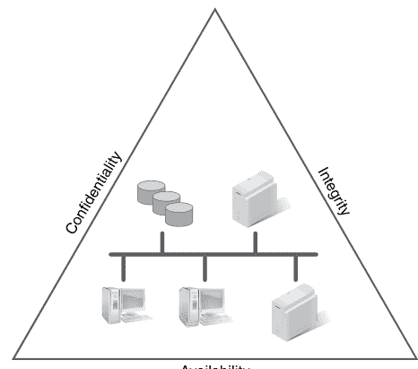

发生。对安全事件的调查依赖审计信息来重建过去的事件。

三管齐下方法的基本目的是通过防止任何受保护资源的未授权使用来维护安全。许多身份验证和访问控制可以帮助完成此任务。您将了解的一些身份验证控制措施包括以下内容：

- 密码和个人识别号码 (PINs)
- 智能卡和令牌
- 生物识别设备
- 数字证书
- 挑战-响应握手
- Kerberos 身份验证
- 一次性密码

> **NOTE**
> 受法规合规性法律约束的企业和组织必须处理受监管数据与非受监管数据的问题。受法规合规性要求约束的数据通常意味着这些数据必须已纳入适当的安全控制措施，包括严格的访问控制、实时监控，以及静止、存储和传输中的数据加密。数据机密性是受法规合规性法律约束的组织的头号业务挑战。适当的数据机密性安全控制措施可以减轻数据泄露或数据丢失的威胁。任何未采用适当控制措施以符合法规要求的组织，都可能面临罚款甚至刑事诉讼。

一旦您验证了用户，访问控制有助于确保只有授权用户才能访问受保护资源。您将了解的一些授权控制措施包括以下内容：

- 身份验证服务器规则和权限
- 访问控制列表
- 入侵检测和预防
- 物理访问控制
- 连接和访问策略筛选器
- 网络流量筛选器

这两个列表简要概述了一些有助于确保您组织数据安全的安全控制措施。


## 移动员工与自有设备使用

公司和组织的另一个新兴业务驱动因素是移动性。**移动性**使远程员工和员工能够几乎实时地连接到 IT 基础设施。这意味着速度和有效的沟通可以帮助企业提高生产力、销售额、收入和利润。高度互联的移动员工现在“随时在线”。这有助于推动整个组织的生产力。这些移动外勤人员（例如拜访客户的外勤销售代表）的普遍存在，为企业引入了关键风险因素，因为进入组织 IT 基础设施的入口是由用户在用户域中通过工作站域使用其终端设备执行的。视具体情况而定，终端设备可以是从笔记本电脑或平板电脑到智能手机的任何设备。这些设备各自带来各自的风险、威胁和漏洞。移动性是推动企业和组织采用自带设备（BYOD）策略的业务驱动因素。BYOD 是一个术语，指员工使用其个人拥有的设备（如笔记本电脑或智能手机）既用于业务用途也用于个人用途。

> **注意** 企业和组织必须就将个人 IT 资产用于业务目的做出决定。这包括员工使用个人智能手机处理业务电子邮件，这些电子邮件可能作为附件包含敏感数据，也可能不包含。移动性正在推动业务用 IT 资产和个人用 IT 资产的融合。社交媒体的使用正在推动业务通信和个人通信以及信息共享的融合。为员工提供笔记本电脑和智能手机所需的投资对某些企业或组织来说可能成本过高。许多组织现在正在实施政策和程序，以确保笔记本电脑或智能手机等个人拥有设备上的业务信息的机密性。使用个人 IT 资产的员工通常仍必须遵守组织的可接受使用政策、电子邮件和互联网使用政策以及 BYOD 政策。BYOD 政策可能要求在设备丢失或被盗的情况下，获得授权才能执行数据擦除或数据删除。

### BYOD 注意事项

BYOD 被企业环境和政府环境接受后，创造了一个必须解决的独特业务挑战。这一挑战的基础是：IT 资产归员工所有。尽管如此，该 IT 资产及其用户仍必须遵守组织的移动性、BYOD 和可接受使用政策。BYOD 政策定义中通常涉及以下要素：

- **数据所有权**—个人数据（如联系人、图片或电子邮件）是员工的知识产权。业务电子邮件及所有附件是组织的知识产权。此区别必须在 BYOD 政策中明确界定。
- **支持所有权**—除非组织批准报销，否则员工拥有 IT 资产以及所有支持和维护责任。
- **补丁管理**—软件更新和**补丁**建议由员工在其自身设备上执行，具体由组织通过政策定义规定。
- **防病毒管理**—任何访问组织知识产权的 IT 资产都必须安装适当（由 BYOD 政策定义）的**防病毒**/反恶意软件防护。
- **取证**—员工必须同意，如果其个人拥有的 IT 资产涉及正式的事件响应调查，该 IT 资产可能被没收以对资产进行彻底的取证调查。
- **隐私**—员工有权保留和维护其隐私；但是，员工在同意使用个人拥有的设备开展业务之前，必须充分了解组织的可接受使用政策以及数据擦除和数据删除的定义。
- **入职/离职**—BYOD 政策应在 HR 入职过程中进行说明并获得同意。政策还应包括在员工终止和移除访问控制之前，在离职期间对个人拥有的 IT 资产进行处理（例如，数据擦除、数据删除等）。
- **遵守企业政策**—使用个人拥有的 IT 资产要求员工遵守所有其他政策和程序，包括可接受使用政策。
- **用户接受**—员工必须同意数据擦除和数据删除（由 BYOD 政策要求），此外还要同意将私人数据与业务数据分开。
- **架构/基础设施考虑**—使用任何个人拥有的 IT 资产必须符合组织的 IT 标准，并可能需要安装新软件以协助安全。
- **法律问题**—员工必须同意遵守组织的政策和程序，尤其是涉及法律问题或事件调查（例如，取证调查）时。
- **可接受使用政策**—员工必须遵守所有组织政策和程序，特别是组织的可接受使用政策。
- **内置摄像头/视频**—BYOD 政策应涉及任何个人拥有的 IT 资产的摄像头和视频功能的使用。这些图片和视频的内容必须遵守可接受使用政策。通常，员工负责所有个人数据备份，包括图片和视频。

## 终端和设备安全

随着移动性和 BYOD 的到来，需要启用终端或设备安全控制。以下讨论介绍了可缓解移动性和 BYOD 环境中常见风险、威胁和漏洞的终端设备安全控制：

- **全设备加密**—要求笔记本电脑、平板电脑和智能手机配备数据加密，从而减轻设备丢失或被盗的风险。
- **远程擦除**—安装软件，使组织能够在设备丢失或被盗时启动数据或电子邮件的远程擦除。
- **锁定**—要求设备屏幕保护程序带有锁定定时器，以符合组织的工作站域安全政策和程序。
- **屏幕锁**—要求启用受密码保护的屏幕锁定功能，所有者需要输入密码才能访问设备。
- **全球定位系统（GPS）**—安装 GPS，使用卫星和/或蜂窝通信来定位设备的物理位置，前提是设备已连接到通信网络。
- **应用程序控制**—安装允许应用程序控制或设备控制的软件。
- **存储分段**—要求用于个人和业务共用的设备拥有分段存储，以将个人数据与业务数据物理分离。
- **资产跟踪**—要求所有连接到 IT 基础设施的 IT 资产（无论是个人拥有还是组织拥有）均由组织作为 IT 资产进行跟踪。
- **库存控制**—要求所有员工拥有的移动设备都作为 IT 资产进行库存管理，以便可以对所有终端设备执行适当的变更管理和事件响应。
- **移动设备管理**—要求在任何移动设备上安装移动设备管理（MDM）软件代理（一种允许组织监控、控制、数据擦除或从个人拥有设备中删除业务数据的软件应用程序）。
- **设备访问控制**—要求所有个人拥有的设备符合组织的 BYOD 政策，并拥有适当的设备访问控制以访问 IT 资产本身、电子邮件访问的访问控制以及远程访问 IT 基础设施的访问控制。
- **可移动存储**—要求使用组织的 BYOD 政策和可接受使用政策中定义的可移动存储或数据备份。个人数据备份由员工负责。业务数据备份由员工或组织负责，具体取决于政策定义。
- **禁用未使用的功能**—根据 BYOD 政策和可接受使用政策的定义，禁止使用特定应用程序和功能，例如使用短信传输敏感数据。

## 章节摘要

在本章中，您了解到安全远不止是保密数据的一种方式。安全是任何组织的组成部分。业务连续性计划（BCP）和灾难恢复计划（DRP）的准备工作可确保组织即使在发生灾难时也能履行其主要业务功能，并通过保护其所有资产（包括其数据）来实现这一点。健全的安全基础设施可提供保证，即组织拥有


雇佣了必要的控制措施以遵守所有必要的法律、法规和其他安全要求。简而言之，安全使组织保持可行，并允许其开展业务。

此外，本章介绍了信息系统安全的业务驱动因素。取决于您所在的业务类型或垂直行业，合规性、安全性和隐私都是实施适当安全控制的驱动要求。受管数据的机密性是首要考虑的业务驱动因素。移动性和个人拥有的IT资产的使用也在推动组织允许其员工使用BYOD资产的方式。

## 关键概念和术语

- Accounting
- Antivirus
- Business drivers
- California Database Security Breach Act (SB 1386)
- Children's Online Privacy Protection Act (COPPA)
- Delphi method
- Disaster recovery plan (DRP)
- Gap analysis
- Government Information Security Reform Act (Security Reform Act)
- Mobile device management (MDM)
- Mobility
- Patch
- Privacy policy
- Project Management Body of Knowledge (PMBOK)
- Project Management Institute (PMI)
- Recovery point objective (RPO)
- Recovery time objective (RTO)
- Remote wiping
- Removable storage
- Risk management
- Risk methodology
- Risk register
- Security gap
- Security policy
- USA Patriot Act
- User acceptance

## 第4章评估

- 1. Risk management is responding to a negative event when it occurs.
  - A. True
  - B. False
  - C. Risk methodology
  - D. Mitigation list
  - E. All of the above

- 2. With respect to IT security, a risk can result in either a positive or a negative effect.
  - A. True
  - B. False

- 3. According to PMI, which term describes the list of identified risks?
  - A. Risk checklist
  - B. Risk register

- 4. What is the primary purpose of a business impact analysis (BIA)?
  - A. To identify, categorize, and prioritize mission-critical business functions
  - B. To provide a road map for business continuity and disaster recovery planning
  - C. To assist organizations with risk management planning
  - D. To assist organizations with incident response planning
  - E. All of the above

- 5. Which of the following terms defines the amount of time it takes to recover a production IT system, application, and access to data?
  - A. Recovery point objective
  - B. Recovery time objective
  - C. Risk exposure time
  - D. Production recovery time
  - E. None of the above

- 6. The recovery point objective (RPO) defines the last point in time for _______ recovery that can be enabled back into production.
  - A. System
  - B. Application
  - C. Production
  - D. Data
  - E. None of the above

- 7. Which of the following solutions are used for authenticating a user to gain access to systems, applications, and data?
  - A. Passwords and PINs
  - B. Smart cards and tokens
  - C. Biometric devices
  - D. Digital certificates
  - E. All of the above

- 8. Which risk management approach requires a distributed approach with business units working with the IT organization?
  - A. OCTAVE
  - B. CRAMM
  - C. NIST SP800-33
  - D. ISO 27005
  - E. None of the above

- 9. The NIST SP800-30 standard is a ________ management framework standard for performing risk management.
  - A. Risk
  - B. Threat
  - C. Vulnerability
  - D. Security
  - E. None of the above

- 10. Which term indicates the maximum amount of data loss over a time period?
  - A. RAI
  - B. ROI
  - C. RTO
  - D. RPO
  - E. None of the above

- 11. Organizations that permit their employees to use their own laptops or smartphone devices and connect to the IT infrastructure describe a policy referred to as:
  - A. RTO
  - B. MDM
  - C. BYOD
  - D. AUP
  - E. None of the above

- 12. Which of the following are organizational concerns for BYOD and mobility?
  - A. Data ownership
  - B. Privacy
  - C. Lost or stolen device
  - D. Data wiping
  - E. All of the above

- 13. ___ is the U.S. security-related act that governs regulated health care information.

- 14. Which U.S. security-related act governs the security of data specifically for the financial industry?
  - A. GLBA
  - B. COPPA
  - C. HIPAA
  - D. FERPA
  - E. None of the above

- 15. Which of the following business drivers are impacting businesses’ and organizations’ security requirements and implementations?
  - A. Mobility
  - B. Regulatory compliance
  - C. Productivity enhancements
  - D. Always-on connectivity
  - E. All of the above

## 当今信息系统安全

- CHAPTER 5 Access Controls 136
- CHAPTER 6 Security Operations and Administration 181
- CHAPTER 7 Auditing, Testing, and Monitoring 216
- CHAPTER 8 Risk, Response, and Recovery 251
- CHAPTER 9 Cryptography 288
- CHAPTER 10 Networks and Telecommunications 326
- CHAPTER 11 Malicious Code and Activity 354

# 访问控制

访问控制是用于限制和允许访问特定项目（例如汽车、住宅、计算机，甚至您的智能手机）的方法。您对访问控制的第一次体验可能是在童年时期，当时您将兄弟或姐妹锁在房间外，或在学校使用储物柜。同样，您汽车的钥匙只适用于您的汽车，因此您可以锁定并启动它。您的房子或公寓也是如此。许多人还使用特殊代码来解锁智能手机或平板电脑。没有代码，任何人都无法解锁手机或平板电脑。或者，您可能需要安全代码才能在电视上观看某些频道。

访问控制是保护资源的过程，以确保资源仅由被允许使用的人使用。访问控制保护资源免受未经授权的使用。正如您房屋或汽车的锁和钥匙系统是访问控制一样，银行卡或信用卡上的个人识别号码 (PINs) 也是访问控制。定义访问控制的另一种方式是，它们是为保护资源免受威胁而实施的缓解措施。无论您如何看待访问控制，它们都是用于确保仅“允许”的用户才能访问资源的工具。

企业使用访问控制来管理员工可以做什么和不可以做什么。访问控制定义了用户（人员或计算机进程）是谁、用户可以做什么、可以访问哪些资源以及可以执行哪些操作。访问控制系统使用多种方法来实现这一目标，包括密码、硬件令牌、生物识别和证书。可以授予对物理资产（如建筑物或房间）的访问权限。也可以授予对计算机系统和数据的访问权限。

## 第5章主题

本章涵盖以下主题和概念：

- What the four parts of access control are
- What the two types of access control are
- How to define an authorization policy
- What identification methods and guidelines are
- What authentication processes and requirements are
- What accountability policies and procedures are
- What formal models of access control are
- What threats there are to access controls
- What some effects of access control violations are
- What centralized and decentralized access controls are

## 第5章目标

完成本章后，您将能够：

- Define access control concepts and technologies
- Describe the formal models of access control
- Describe how identity is managed by access control
- Develop and maintain system access controls

## 四部分访问控制

在保护资产之前，保护者必须了解有关预期用户的一些信息。访问控制的四个部分如下：

- **Identification**—Who is asking to access the asset?
- **Authentication**—Can the requestor's identity be verified?
- **Authorization**—What, exactly, can the requestor access? And what can they do?
- **Accountability**—How can actions be traced to an individual? We need to ensure that a person who accesses or makes changes to data or systems can be identified. This process of associating actions with users for later reporting and research is known as accountability.

这四个部分分为两个阶段：

- **The policy definition phase**—This phase determines who has access and what systems or resources they can use. The authorization definition process operates in this phase.
- **The policy enforcement phase**—This phase grants or rejects requests for access based on the authorizations defined in the first phase. The identification, authentication, authorization execution, and accountability processes operate in this phase.


## 访问控制的两种类型

访问控制通常分为以下两类之一：

> 注意
> 有时访问控制与访问控制措施之间的区别可能令人困惑。只需记住，访问控制是你为保护资源而采取的措施。保护资源免受未经授权访问的方法是使用不同类型的访问控制。

- 物理访问控制——这些控制对物理资源的访问。它们可能包括建筑物、停车场和受保护区域。例如，你很可能拥有办公室门的钥匙。这把钥匙控制着对你办公室的物理访问。

- 逻辑访问控制——这些控制对计算机系统或网络的访问。你的公司可能要求你输入唯一的用户名和密码才能登录公司计算机。该用户名和密码允许你使用你组织的计算机系统和网络资源。

## 物理访问控制

组织的设施经理通常负责物理访问控制。此人可能会给你一张编程了你员工 ID 号的安全卡（也称为智能卡）。你可能需要将此卡通过卡片读取器刷卡以打开停车场大门，并在电梯中刷卡才能到达你所在的楼层。你还可能需要刷此卡来解锁通往办公室的门。这张卡允许你进入这些地点，因为你是员工。组织的授权策略作为员工授予你进入某些地方的物理访问权限。没有授权卡的人不应该能够越过前门。如果你的组织与其他组织共享办公楼，你可能甚至有一张第二张卡，它授权你在下班后进入大楼。这些卡控制对物理资源的访问。

## 逻辑访问控制

安全管理员使用逻辑访问控制来决定谁可以进入系统以及他们可以执行哪些任务。系统管理员也可以使用逻辑访问控制来影响工作人员使用系统的方式。人力资源（HR）系统的系统控制示例包括以下内容：

- 决定哪些用户可以进入系统——只有 HR 员工才被允许访问存储在 HR 服务器上的敏感信息。

- 监控用户在该系统上的操作——某些 HR 员工可能被允许查看文档，但其他 HR 员工可能能够实际编辑这些文档。

- 限制或影响用户在该系统上的行为——一名反复试图查看受限信息的 HR 工作人员可能会被拒绝访问整个系统。

这些权限控制对逻辑（或系统）资源的访问。

## 安全内核

安全内核是计算环境的硬件、软件和固件的中心部分，用于强制执行计算机系统的访问控制。安全内核提供了一个集中访问控制点，并实现了引用监视器概念。它调解所有访问请求，并且仅在满足适当规则或条件时才允许访问。例如：

- 1. 主体请求访问对象。安全内核拦截请求。
- 2. 安全内核参考其规则基（也称为安全内核数据库）。它使用这些规则来确定访问权限。访问权限根据你的组织定义的策略设置。
- 3. 内核根据定义的访问规则允许或拒绝访问。系统处理的所有访问请求都会被记录下来，以便日后跟踪和分析。

图 5-1 显示来自主体访问特定对象（在此例中为文件）的访问请求。引用监视器拦截访问请求。访问根据安全内核数据库中的规则授予。此规则基可能是访问控制列表 (ACL)、目录或另一个访问权限存储库。如果规则允许访问请求，引用监视器将允许访问并创建日志条目。

很容易看出，任何系统访问控制的整体安全性取决于操作系统的安全性。大多数流行的计算机操作系统（例如 Windows®、Linux®/UNIX®、OS X®）提供广泛的安全功能。这些功能允许管理员创建非常安全的系统。然而，许多移动设备的流行操作系统（例如 Android™ 和 iOS®）缺少其中一些安全功能。

一个观点是，移动设备不需要与服务器或功能齐全的客户端计算机相同级别的安全功能。然而，随着移动设备变得越来越强大，对更严格安全性的需求也在增加。某些计算环境需要比大多数操作系统提供的更多安全保障。处理极度敏感信息（例如政府服务器上的机密信息）的系统需要更多安全控制。几种操作系统已包含额外控制，以满足此类系统的额外安全需求。这些操作系统（称为受信任操作系统 (TOS)）提供满足特定政府安全要求的功能。TOS 设计中最广泛使用的一组标准是通用准则，你将在本章后面阅读相关内容：

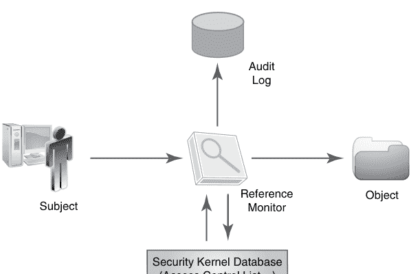

## 访问控制策略

访问控制策略是一组规则，允许特定用户组对特定资源集执行特定动作集。如果用户未获授权，则无法访问系统功能或系统资源。你使用访问控制策略来降低和控制安全风险。自动化流程和人类都使用访问控制策略。你必须了解访问控制的四个核心组件，才能很好地管理访问控制策略：

- **用户**——这些是使用系统或为其他人或进程执行某些服务的进程。用户的更通用术语是 *主体*。
- **资源**——系统中的受保护对象。资源只能由授权主体访问。资源只能以授权方式使用。
- **操作**——授权用户可以在资源上执行的活动。
- **关系**——用户和资源之间存在的可选条件。关系是授予授权用户的权限，例如 *读取、写入、执行*。

> **提示**
> 
> 许多关于访问控制概念的讨论使用术语 *主体* 表示用户，object 表示资源。你也可能会看到术语 *request*，它是指主体试图执行的访问操作。

## 授权策略

控制访问的第一步是创建定义授权规则的策略。**授权**是决定谁可以访问哪些计算机和网络资源的过程。在大多数组织中，授权基于职位角色、背景筛选以及任何政府要求。这些条件或策略主要由组成员资格策略或权限级别策略决定。

最详细的授权策略基于每个单独用户。在这种策略中，每个用户都有特定的分配权限。这些**用户分配权限**允许管理员在非常详细的级别定义批准的资源访问。然而，维护基于用户的身份验证方法非常困难。这种身份验证需要大量管理时间来保持最新。

在**组成员资格策略**中，授权由用户所属的组定义。分配基于组的权限通过将相似用户组合在一起来减少管理员工作量。例如，也许只有 IT 部门成员的安全卡才能进入存放计算机设备的房间。如果你不是这个 IT 组的成员，你的安全卡不允许你进入这个房间去取新显示器。如果你想访问计算机设备存储室，


你必须先联系 IT 部门，该部门可能会指派 IT 小组的一名成员来帮助你。

在权限级别策略中，您需要更高的权限才能访问某些资源。例如，也许只有 IT 小组的高级成员才有权限进入服务器所在的房间。服务器通常比计算机显示器更有价值，因此策略可能会规定只有高级工作人员才能进入机房。

## 身份识别的方法和指南

一旦在授权策略中定义授权规则，您就可以强制执行这些规则。每次用户请求访问资源时，访问控制会根据授权策略授予或拒绝访问。

强制执行授权策略的第一步是身份识别。身份识别是主体请求访问系统或资源所使用的方法。主体可以是用户、进程或其他实体。有几种常用的识别主体的方法。您选择的方法取决于您的安全要求和计算环境的功能。在下一节中，您将了解各种方法和指南，了解主体如何向系统识别自身。

### 身份识别方法

用户名是向系统识别用户最常用的方法。用户名可以是用户 ID、账户号或其他分配的标识符的形式。有些应用程序通过使用智能卡来识别用户，智能卡通常采用塑料信用卡的形式。智能卡让主体能够轻松提供复杂的身份识别凭据，而无需记住长密码。就像您可能将信用卡通过电子读卡器刷卡进行购物一样，您也可以将智能卡通过读卡器刷卡，从而获得进入停车场、建筑物和房间的权限。

生物识别是另一种用于识别主体的访问控制方法。生物识别用于根据一个或多个身体或行为特征来识别人类。生物识别示例包括指纹、面部或声音识别、DNA 匹配、书写、视网膜扫描，甚至是一个人打字的方式。

> ### 注释
> 美国海关与边境保护局（CBP）计划使用两种不同类型的生物识别技术来识别计划的授权成员。CBP 定义了几个不同的计划，预先授权频繁旅行者绕过常规海关排队并使用更快的自助终端。选定的美国和加拿大边境检查站的 NEXUS 自助终端使用视网膜扫描来识别用户。美国许多国际机场的全球入境自助终端使用指纹扫描仪来识别用户。

### 身份识别指南

为了确保计算机系统中执行的所有操作都能与特定用户关联，每个用户都必须有一个唯一标识符。这意味着每个用户必须拥有与其他任何用户不同的用户帐户非常重要。您的帐户策略应禁止通用帐户和用户帐户共享。唯一标识符（ID）使得能够区分同名的多个用户。将操作与用户关联以供以后报告或分析的过程称为审计。您应保持用于识别主体的数据是最新的，并密切监控这些数据。您应禁用离开组织或长时间不活跃的用户的 ID。您应应用标准命名约定；这些约定不应与职位功能相关。颁发 ID 的过程应有文档记录且安全。

## 身份验证的过程和要求

在本章中，您迄今已学习定义授权规则和识别用户的方法。下一步是身份验证。在访问控制的这一部分中，用户验证或证明其在身份识别过程中提供的身份。**身份验证**回答的问题是：用户是否就是他们自称的人？身份验证证明请求访问的主体就是获准访问的那个主体。如果没有身份验证，您永远无法真正知道用户是否就是他们声称的那个人。

### 身份验证类型

身份验证有五种类型：

- **知识**—您知道的某物，例如密码、密码短语或个人身份识别号码 (PIN)。

> **警告**
> 用户名和密码的组合被视为单因素身份验证，尽管它需要两个步骤。这对于访问更敏感的系统、应用程序或数据来说可能足够，也可能不够。在这种情况下，您可能需要提供双因素或多因素身份验证，即刷卡（您拥有的某物）进入建筑物，然后键入 PIN（您知道的某物）以确保宝贵资源的安全。

- **拥有**—您拥有的某物，例如智能卡、钥匙、徽章或令牌。

- **特征**—某个独特于您的属性，例如您的指纹、视网膜或签名。由于涉及的特征通常是物理性的，这种身份验证类型有时被定义为“您本身”。

- **位置**—您所在的某个位置，例如您尝试访问资源时的物理位置。

- **动作**—您做的某事或您做事的方式，例如您在键盘上打字的方式。

每种身份验证类型单独使用都很容易被攻破。仅使用一类控制措施被称为**单因素身份验证**。包含敏感或关键信息的系统应至少使用这些身份验证类型中的两种。使用两个或多个类别中的技术称为**双因素身份验证**，其安全级别高于仅使用一种。

### 基于知识的身份验证

基于**知识**的身份验证基于您知道的某物，例如密码、密码短语或 PIN。静态密码是那些很少（如果有的话）更改的密码。密码是计算机系统中最古老、最常见的身份验证方法，也是最弱的方法。您不应该仅使用密码来保护宝贵资源。随着资源价值的增加，保护它的访问控制强度也应随之增强。双步验证应该是宝贵资源的最低要求。攻击者经常使用暴力破解或字典攻击来破解密码。这些方法可以轻松破解弱密码，例如非常短的密码或包含字典单词的密码。

- 暴力破解攻击涉及尝试每一种可能的字符组合。现代密码破解工具不会按字母顺序尝试每个字母、数字和特殊字符的组合。相反，它们首先测量字符的熵（随机性的度量）。然后先测试低熵单词，接着是中等熵单词，最后是高熵单词。

> **提示**
> 更短的密码生命周期意味着为用户提供更多保护。为了为用户创建更强的密码控制，请考虑 30 天密码更改策略。更短的密码生命周期意味着攻击者在密码过期前破解并使用密码的可能性较低。

- 字典攻击通过对字典中的所有单词（通常会附加 01、02、4u 等后缀）进行哈希处理，然后将哈希值与系统密码文件进行比较来发现匹配项。黑客熟悉所有常用技巧，例如将名字拼写反转或进行简单的字符替换（例如 3 代替 e、0 代替 o、$ 代替 s 等等）。

- 由于大多数系统存储密码的哈希值，攻击者会首先预先计算这些字典单词并构建表格。然后，他们在表中查找存储的密码哈希版本，以发现生成它的单词。这些表被称为彩虹表，广泛可用。例如，AccessData 的取证调查员工具（称为 Forensic Toolkit® (FTK®)）带有一个包含一百万个单词的彩虹表。根据 FTK 的网站，该表检测了 28% 的用户密码。

**密码帐户策略：** 除了鼓励密码最佳实践外，您的帐户策略还应包含明确的密码要求。以下是建议的帐户策略密码要求列表。（您可以，也应该，为您的组织更改这些项目的具体内容。）

- 复杂性

- 密码必须至少包含八个字母数字字符。

- 密码必须包含大写和小写字母以及数字的组合。

- 密码必须在密码的前七个字符中至少包含一个特殊字符。

- 密码的第一个和最后一个字符位置必须包含非数字字母或符号。

- 密码不得包含用户名。

- 密码绝不得包含用户的姓名或任何亲密朋友或亲戚的姓名。

- 密码绝不得使用员工 ID 号、社会保障号码、出生日期、电话号码或任何容易猜到的个人信息。

- 密码绝不得包含英语词典（或用户熟悉的其他语言词典）中的常用单词。


## 密码最佳实践

One of the most visible security policies is the user account policy. This is a policy that each user must encounter. A good user account policy sets clear requirements for user accounts and passwords. You have already seen that an account policy should prohibit generic user accounts. Your account policy should also include password best practices:

- Create strong passwords—Your password must be complex enough to be unlikely to be compromised. It must meet minimum length requirements. You should never use a word that appears in the dictionary as your password. Passwords should not be based on personal information. Hackers have easy access to powerful password-cracking tools that use extensive word and name dictionaries. More secure passwords use words that don’t make any sense but that are easy to remember. For example, you might create a password using letters from the first words of a poem or song. Or you might substitute obscure characters, such as asterisks (*), dollar signs ($), “at” symbols (@), brackets ({}), mathematical symbols (+), and the like. These can be extremely difficult to guess or crack. Remember: Cracking tools check for simple tricks such as words spelled backward or simple substitutions for certain characters (for example, where mouse becomes m0us3).
- Don’t store a written copy of the password unless absolutely necessary—If you must store a written copy, keep it in a secure place. Alternatively, write down a hint for your password instead of the actual password. Destroy any written copies when they are no longer needed.
- Never share your passwords with anyone—Even if it is someone you trust, your password should be kept private.
- Use different passwords for different important user accounts—Using a single password for all your accounts is like using a single key for your car, your house, your mailbox, and your safety deposit box. If you lose the key, an attacker has access to everything. When you use different passwords for different systems, if one of your passwords is stolen, only that one system is compromised. This strategy prevents intruders from gaining access to accounts and data on other systems. Also, avoid using passwords that are similar to one another—for example, passwords that use the names of your children. If you use the same or similar passwords for more than one system, it makes it easier for an intruder who obtains one of your passwords to figure out the rest.
- If you think a password is compromised, change it immediately—Also, the first time you use them, change passwords that are assigned to you. Ideally, you should change passwords at least once every 30 days.
- Be careful when saving passwords on computers—Some dialog boxes (such as those for remote access and other telephone connections) present options to save or remember passwords. Selecting these options poses a potential security threat because the password is automatically listed when someone opens the dialog box.

- Passwords must never employ commonly used proper names, including the name of any fictional character or place.
- Passwords must never contain any simple pattern of letters or numbers, such as qwertyxx.
- Expiration. Passwords expire every 30 days and must be changed.
- Recovery. Forgotten passwords can be recovered after providing alternate authentication credentials via the organization’s internal password recovery utility.

- Disablement. User accounts will be disabled immediately when a user no longer is associated with the organization or no longer requires provided access.
- History. Password history is stored, and you cannot change your password to any of the 10 previous passwords you used.

### Passphrase Usage

A passphrase is a bit different from a password. It is longer and generally harder to guess, so it’s considered more secure. Because it usually contains more than one word, a passphrase is more secure against dictionary attacks. Most often, passphrases are used for public and private key authentication. The user uses a passphrase that is known only to the user, and the user uses that passphrase to unlock a private key that gives the user access to information. In most cases, the user converts the passphrase to a password. However, a system can be programmed to automatically convert the passphrase to a password according to an algorithm. A passphrase is stronger than a password, but the downside is that it takes a bit longer to type. Although passphrases are static, they aren’t as susceptible to brute-force attacks as passwords.

> **NOTE** It’s okay to reuse a password for resources that aren’t considered critical—for example, to access articles on an online news site. Just don’t use that same password for any logons for critical resources.

### Account Lockout Policies

Many systems are configured to disable a user ID after a certain number of consecutive failed logon attempts. In many cases, user accounts are disabled after three to five attempts. The number of failed logon attempts that trigger an account action is called the **threshold**. The user may be locked out for a few minutes, a few hours, or until the account is reset by a security administrator. This practice helps guard against attacks in which attackers make many attempts to guess a password. It also enables an intruder to lock out users, however—a form of denial of service (DoS) attack—by entering groups of incorrect passwords.

> **FYI** Unless your organization uses an automated password-reset process, your help-desk personnel will likely find that password-reset requests are the most common type of request they receive. When help-desk personnel receive such requests, they should require the user to provide information that verifies his or her identity. For example, the user should provide proof in the form of a driver’s license or employee ID. If the request is not made in person, help-desk personnel should use a form of questioning that verifies the user’s identity—for example, “What is your mother’s maiden name?” A lack of strong identity validation can allow an attacker to request a password change for any user’s account and access the account at will.
>
> Although auditing logon events can be helpful for your intrusion detection efforts, be careful. Failure auditing can also expose your systems to a DoS attack. A DoS attack occurs in one of two ways:
> - Attackers fill the security log, possibly causing a system crash or preventing other users from logging on.
> - Attackers cause events to be overwritten. They do this by continuously attempting to log on to your network with incorrect usernames or passwords. Purposely overwriting audit events can effectively erase evidence of attack activity.

Be cautious when you're defining an account-lockout policy. A restrictive policy increases the probability of preventing an attack on your organization. But with a stringent account-lockout policy, you can also unintentionally lock out authorized users, which can be frustrating and costly. When you apply an account-lockout policy, set the threshold to a high enough number that authorized users aren't locked out due to mistyped passwords.

### Audit Logon Events

You will learn more about auditing later in the chapter, but it is worth mentioning here as well. One method of keeping track of who is accessing your computing environment is to audit logon events. This practice provides you with a record of when every user logs on or off a computer. If an unauthorized user steals a user's password and logs on to a computer, you can determine when that security breach occurred. When you audit failure events in the logon event category (also known as failure auditing), you can see whether the failure event was due to unauthorized users or attackers attempting to log on to a computer or system. This is an example of intrusion detection.

## Authentication by Ownership

Authentication by **ownership** is the second type of verification. This is based on something you have, such as a smart card, a key, a badge, or a token. Tokens can be synchronous or asynchronous.

### Synchronous Tokens

A synchronous token uses an algorithm that calculates a number at both the authentication server and the device. It displays the number on the device's screen. The user enters this number as a logon authenticator, just as he or she would use a password.

In a **time-based synchronization system**, the current time is used as the input value. The token generates a new dynamic password (usually every minute) that is displayed in the window of the token. To gain access, the password is entered with the user's PIN at the workstation. No token keyboard is required. This system requires that the clock in the token remains in sync with the clock in the authentication server. If the clocks drift out of sync, the server can search three or four minutes on each side of the time to detect an offset. If the difference becomes too great, you must resynchronize the clocks.

> **NOTE**
> Synchronous tokens can be used in proximity devices that cause both the PIN and the password to be entered automatically.

An **event-based synchronization system** avoids the time-synchronization problem by increasing the value of a counter with each use. The counter is the input value. The user presses a button to generate a one-time password, and then enters this password with his or her PIN at the workstation to gain access. One common problem with event-based synchronization systems occurs when a user creates a password using the token but doesn't use the password to log on, and the counter in the server and the counter in the token become out of sync.

**Continuous authentication** is used by systems that continuously validate the user's identity. This is often done with proximity cards or other devices that continuously communicate with the access control system. If the user walks away from the desktop and steps outside the range of the access control detector, the system locks the desktop.

### Asynchronous Tokens

The asynchronous token is the second of two types of token-based devices. It looks like a credit card-sized calculator. The authentication server issues a challenge


用户输入的数字。令牌根据身份验证服务器提供的值计算响应。然后用户用令牌上显示的值回复服务器。许多此类系统还通过要求用户在输入初始质询值的同时输入 PIN 来保护令牌免遭滥用。

异步令牌设备使用质询-响应技术，该技术涉及身份验证服务与其尝试验证的远程实体之间的对话。这需要一个数字键盘。图 5-2 显示了异步令牌质询-响应过程。

- 1. 用户通过身份验证服务器请求访问（即 UserID）
- 2. 身份验证服务器向用户发出质询数字
- 3. 用户在智能手机中输入质询数字和 PIN
- 4. 智能手机计算加密响应（即“密码”）。
- 5. 用户将“密码”发送到身份验证服务器
- 6. 身份验证服务器授予应用程序服务器的访问权限

以下是异步质询-响应会话的步骤：

- 1. 用户发起登录请求。
- 2. 身份验证服务器向用户提供一个质询（即作为输入值的随机数）：
- 3. 用户将从服务器接收到的质询以及只有用户知道的秘密 PIN 输入计算设备（信用卡大小的计算器或计算机或智能手机上的软件程序）。
- 4. 令牌（或程序）生成对质询的响应（即密码），该密码出现在令牌的窗口中。
- 5. 用户向身份验证服务器提供正确的密码。
- 6. 授予访问权限。没有异步令牌设备和正确的 PIN，就无法生成对质询的正确答案。

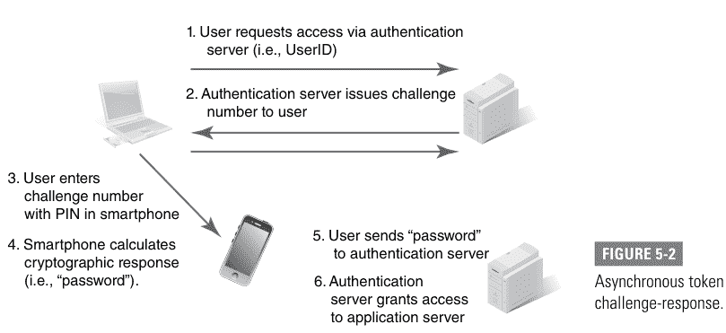

USB 令牌使用公钥基础设施（PKI）技术——例如，由受信任的证书颁发机构签名的证书——并且不提供一次性密码。USB 令牌是一种硬件设备，可插入计算机的 USB 端口。该设备编码了您的数字签名。使用它，您无需输入任何内容。令牌上存在数字签名足以提供持有证明（您拥有的东西）。

> **注意**
> 智能卡的一个问题是，有些用户将其丢弃在读卡器中不管。这意味着只要智能卡仍在读卡器中，任何用户都被授权。

智能卡是一种形状如信用卡的令牌，包含一个或多个微处理器芯片，可通过读卡器接受、存储和发送信息。智能卡中包含的信息提供身份验证信息。大多数智能卡需要读卡器为嵌入式微处理器供电。用户将卡插入读卡器以开始通信。

> **注意**
> 并非所有智能卡都必须物理插入读卡器。非接触式（或近距离）智能卡包含嵌入式射频（RF）收发器，当卡靠近读卡器时即可工作。

智能卡的一大优势是，用户身份验证过程在智能卡和读卡器之间于用户位置完成。ID 和身份验证数据不会传输到远程服务器，从而避免了“可信路径”问题（即，当 ID 和身份验证信息传输到远程服务器时，敏感信息可能暴露给嗅探器或窃接者）。使用智能卡时，读卡器与身份验证服务器保持握手并直接为身份验证担保。然后，它根据信息技术安全评估通用准则（也称为通用准则）建立可信路径。通用准则框架允许用户、供应商和测试实验室协作，共同努力正式指定、实施和评估信息系统产品。

> **注意**
> 要了解有关通用准则的更多信息，请访问 www.commoncriteriaportal.org。

最后，许多组织使用多种磁条卡（也称为存储卡）来控制对受限区域的访问，例如敏感设施或停车区域。

## 基于特征/生物特征的身份验证

生物特征既可用于识别（物理生物特征），也可用于身份验证（逻辑生物特征）。生物特征涉及测量人体解剖结构或身体活动的各个独特部分。本章将介绍的常见生物特征措施可分为两类：

- **静态（例如，生理）措施**——你是什么。生理生物特征包括识别指纹、虹膜颗粒、视网膜血管、面部特征、手部几何形状等。
- **动态（例如，行为）措施**——你做什么。行为生物特征包括声音语调、键盘敲击和签名动作。请注意，此类生物特征有时会被单独分为一类（基于动作的身份验证）。

### 围绕生物特征的顾虑

生物特征有三个主要顾虑：

- **准确性**——生物特征设备并非完美。每种设备都至少关联两种错误率。错误拒绝率（FRR）是拒绝有效对象的比率。错误接受率（FAR）是接受无效对象的比率。FRR 和 FAR 之间存在权衡。两个比率相等的点称为**交叉错误率（CER）**。CER 是以百分比表示的系统准确性指标。在实践中，保护非常敏感资源的生物特征设备通常配置为接受较高的误拒率。保护较不敏感资源的系统可能会向可能未获授权的人员授予访问权限，以避免过度减慢访问速度。

- **可接受性**——某些生物特征测量（例如视网膜扫描）比其他生物特征测量（例如签名动力学）更让一些用户反感。重要的是，如果用户对使用某个系统感到不舒服，他们可能会拒绝接受该系统。

- **响应时间**——每种生物特征设备都需要时间让系统检查身份并给出响应。耗时过长的系统可能无法正常工作。例如，考虑安检机场中的人脸识别。如果系统需要五分钟才能识别一名乘客，那么乘客检查站的队列将比现在长得多。大多数检查站都需要快速响应时间。任何过慢的东西都会阻碍生产力和访问。

## 生物特征的类型：

生物特征有很多种，包括：

- **指纹**——这记录手指指尖上的脊和谷的图案。
- **掌纹**——这检查手掌的物理结构。掌纹和指纹都被认为对于验证用户非常准确。系统响应时间为 5–7 秒，并且人们倾向于接受它们。
- **手部几何形状**——对于这种生物特征，相机拍摄手掌图像，并使用 45 度镜子拍摄手的侧面。使用手指的长度、宽度、厚度和轮廓进行分析。手部几何测量非常准确。系统响应时间为 1–3 秒，人们也倾向于接受这些测量。
- **视网膜扫描**——这种生物特征使用低强度光源和相机分析眼球后部区域（称为*视网膜*）的血管图案。视网膜扫描对于识别和身份验证非常准确。但是，视网膜扫描容易受到人体生理状况变化的影响，例如由糖尿病、怀孕和心脏病发作引起的变化。这些情况的出现要求用户重新在系统中注册。许多人不喜欢视网膜扫描，因为它们觉得这具有侵入性且不卫生，并且担心不得不透露私人医疗数据。平均响应时间为 4–7 秒。
- **虹膜扫描**——这种生物特征使用小型录像机记录眼睛有色部分（称为*虹膜*）中的独特图案，这些图案由条纹、坑点、雀斑、裂缝、纤维等引起。虹膜扫描对于识别和身份验证非常准确。虹膜扫描设备提供连续监控功能以防止会话劫持。响应时间为 1–2 秒。虹膜扫描被广泛接受。


* **人脸识别**—使用人脸识别生物识别技术时，视频摄像头会测量面部的某些特征，例如两眼之间的距离、下巴和下颌的形状、鼻子的长度和宽度、颧骨和眼眶的形状等等。从大约80个可测量特征中选取14个常见特征。这些特征用于创建人脸数据库。人脸识别用于身份验证非常准确，因为面部角度可以控制。然而，它在移动人群中的身份识别准确度不高。因为人脸识别是被动的、非侵入式的，所以可以提供持续身份验证。

* **声音模式**—使用声音模式生物识别技术时，音频录音机和其他传感器会捕获声音中高达七个参数的鼻音、喉和喉咙振动以及气压。声音模式用于身份验证不够准确，因为声音很容易被计算机软件复制。背景噪音会进一步降低准确度。大多数用户接受这种生物识别类型。响应时间长达14秒不等。由于响应时间较长，它不适合日常使用。

* **敲击动力学**—用户在参考模板上输入选定的短语。敲击动力学测量每次敲击的驻留时间（按键保持的时间长度）和飞行时间（两次按键之间的时间）。敲击动力学被认为非常准确。它们非常适合两因素身份验证。由于该技术在用户登录时易于使用，因此它将你知道的事情与你拥有的东西这两种身份识别过程结合起来。敲击动力学广受接受，并可提供持续身份验证。

* **签名动力学**—使用这种生物识别技术时，笔、触控笔或书写平板中的传感器用于记录笔划速度、方向和压力。签名动力学准确，且用户接受它们。

### 生物识别技术的优缺点

生物识别技术具有以下优点：

- 必须本人亲自到场才能进行身份验证。
- 没有需要记住的内容。
- 生物识别技术难以伪造。
- 丢失的ID或遗忘的密码不是问题。

生物识别技术也有缺点。包括以下内容：

- 物理特征可能会发生变化。
- 身体残障用户可能难以使用基于指纹、手部几何特征或签名的系统。
- 并非所有技术都同样有效，并且通常难以决定哪种技术最适合特定用途。
- 响应时间可能太慢。
- 所需设备可能很昂贵。对于需要花费大量时间进行身份验证的方法，组织可能需要提供大量身份验证机器，以免在入口和访问处造成瓶颈。

### 隐私问题

生物识别技术不仅涉及收集个人数据。生物识别技术收集的是人 *固有* 的信息。每个人都必须接受检查，并且该检查必须被数字化记录和存储。未经授权访问这些数据可能导致滥用。生物识别技术还可用于监视人的活动和行为。最后，记录和重放的ID数据可能被用来让某人冒充他人，从而造成身份盗用风险。

## 基于位置的身份验证

用户的物理位置也可以是真实性的强有力指标。位置可以提供额外信息，以建议授予或拒绝访问资源。例如，假设用户向读卡器提供PIN码以及借记卡号码。读卡器位于堪萨斯州托皮卡的一个加油机上。然而，提供PIN码的用户的IP地址位于佛罗里达州坦帕。不同的位置可能引起足够的怀疑，从而拒绝访问资金的必要权限。另一方面，出租车调度应用程序可能会使用客户的智能手机位置来验证取车请求是否有效。与其他方法一样，基于位置的身份验证应仅用于多因素身份验证。

## 基于动作的身份验证

最新的身份验证方法之一基于用户的动作。对此是否真的是生物识别技术的一个子集存在混淆。我们已经在生物识别技术部分介绍了详细信息，但请注意，基于动作的身份验证有时被单独列为一个身份验证类别。它也被称为 *你做的事情*。这种身份验证类型存储你做某事的方式的模式或细微差别。最常见的用途是记录敲击模式。大多数人以可预测的速度在不同按键之间输入并暂停。这些模式可以存储并在身份验证期间使用。

## 单点登录

*单点登录*（SSO）策略允许用户一次登录计算机或网络，其身份识别和授权凭据可让其进入所有有权访问的计算机和系统。他们不需要输入多个用户ID或密码。SSO减少了人为错误，而人为错误是系统故障的主要部分。它非常理想但难以实施。

### SSO的优缺点

SSO的优点包括以下内容：

- 这是一个高效的登录过程。用户只需登录一次。
- 它可以提供更强的密码。只需记住一个密码，用户通常愿意使用更强的密码。
- 它提供持续、清晰的重新身份验证。SSO服务器与工作站保持联系并监控其活动。这允许在靠近用户入口点的系统中一致地强制执行超时阈值。当工作站或端点设备在一定时间内无活动时，可以将其断开连接。这可以保护系统免受用户将工作站暴露给可能冒充原始用户的未经身份验证的人的影响。
- 它提供失败登录尝试阈值和锁定。这可以防止入侵者使用暴力破解来获取真实用户ID和密码组合。
- 它提供集中管理。它确保政策和程序的统一应用。

SSO的缺点包括以下内容：

- 密码泄露会让入侵者进入密码所有者可访问的所有区域。使用动态密码和/或双因素身份验证可以减轻此问题。
- 静态密码提供的安全性非常有限。对于使用SSO的用户，访问需要双因素身份验证或至少一次性（动态）密码。
- 将SSO添加到网络中的特殊计算机或旧系统可能很困难。
- 脚本使管理更加容易，但它们会暴露数据。脚本不能为敏感系统和数据提供双因素身份验证。
- 身份验证服务器可能成为系统访问的单点故障。

### Kerberos密钥分发中心服务器

Kerberos密钥分发中心（KDC）服务器具有两个功能：

- 它作为身份验证服务器（AS）—身份验证服务器基于用户的密码通过预交换的密钥来确认用户。这是与KDC共享并存储在KDC数据库中的对称密钥。在收到用户的服务请求后，与用户工作站的所有进一步对话都使用此共享密钥进行加密。用户不会将密码发送到KDC。相反，身份验证发生在用户工作站上的Kerberos软件请求密码以创建共享密钥来解密来自身份验证服务器的票据的时候。票据包含用于与所需应用程序服务器通信的会话密钥。如果提供了错误的密码，票据无法解密，访问尝试失败。
- 它作为票据授予服务器（TGS）—票据授予服务器（TGS）在用户验证后提供了一种为相同或其他应用程序获取更多票据的方法，因此在一天中不需要多次重复该步骤。票据通常每天或几小时后过期。

身份验证系统共享一些常见的服务要求。它们都为用户（主体）请求访问某些资源（对象）提供某种方法。然后它们提供某种方式来批准或拒绝请求。处理SSO身份验证的一种方法是使用中央服务器。用户为所有请求联系中央服务器。另一种方法称为联合身份验证。联合身份验证系统在多个服务器之间共享用户凭据。用户只能看到初始登录过程。登录后凭据共享发生在受信任服务器之间的幕后。另一种相关方法是传递信任身份验证。在此模型中，初始登录凭据会按请求转发到其他受信任服务器。身份验证服务器只会共享用户凭据


与它信任的另一台服务器。这与联合只有细微差别。在联合系统中，身份验证服务器组是静态的。在传递式信任环境中，受信任服务器组会随时间构建，并且可能因每个用户和请求而异。受信任组中的服务器取决于用户遵循的访问请求路径。

## SSO 流程

SSO 流程示例包括 Kerberos、SESAME 和 LDAP 方法。

## Kerberos:

Kerberos 是一种计算机网络身份验证协议，允许通过非安全网络通信的节点以安全方式相互证明其身份。Kerberos 也是由麻省理工学院（MIT）发布并应用 Kerberos 协议的一套免费软件。其设计主要面向客户端/服务器模型，并提供相互身份验证——用户和服务器各自验证对方的身份。Kerberos 协议消息受到防窃听和重放攻击的保护。

要开始使用，用户通过工作站上的 Kerberos 客户端软件将其 ID 和访问请求发送到密钥分发中心（KDC）。KDC 的身份验证服务器验证用户和请求的服务是否在 KDC 数据库中，并发送一个票据。票据是针对请求的服务带时间戳的用户唯一密钥。如果在票据使用前时间过期，则将无法使用。票据中包含用户 ID 和会话密钥，以及使用与 KDC 共享的对象密钥加密的对象的票据。

在 Kerberos 中，安全性取决于仔细的执行和维护。身份验证凭据的生存期应尽可能短，使用时间戳来减少重放凭据的威胁。KDC 必须得到物理保护，因为它——尤其是身份验证服务器——是潜在的单点故障。冗余身份验证服务器可以降低风险。KDC 应该经过加固，意味着它应拥有经过加固的操作系统和应用程序。它不应允许任何非 Kerberos 网络活动。

> **注意**
> 智能卡可以提供 SSO 服务。在持续身份验证系统中，智能卡的存在对用户来说可以表现为 SSO。所有身份验证交换对用户都是透明的。只要智能卡可供身份验证系统使用，用户就不必提供任何凭据来访问资源。

## SESAME：多供应商环境中的安全欧洲应用系统（SESAME）

是欧盟委员会资助的一项研究与开发项目。SESAME 开发用于解决 Kerberos 的一些弱点。SESAME 支持 SSO。与 Kerberos 不同，它通过使用对称密钥和非对称密钥来保护交换数据，从而改进密钥管理。它本质上是 Kerberos 的扩展。它提供公钥加密和基于角色的访问控制功能。

## LDAP：轻量目录访问协议（LDAP）

是一种用于定义和使用分布式目录服务的协议。LDAP 提供的核心服务之一是处理访问控制凭据。LDAP 使管理员能够轻松管理网络中计算机和设备的登录和访问凭据。LDAP 是开源的，不依赖于任何特定供应商的产品。虽然 LDAP 不提供完整的 SSO 解决方案，但您会发现该协议用于许多 SSO 解决方案。由于 LDAP 经常跨网络交换敏感信息，因此保护消息至关重要。确保 LDAP 消息安全的最常见方法之一是使用 **安全 LDAP**，即通过 SSL 实现的 LDAP（LDAPS）。此版本的 LDAP 仅对跨网络的所有消息交换使用 SSL/TLS。

## 问责制的政策与程序

到此，您已了解用户如何被识别（步骤 1）、身份验证（步骤 2）和授权（步骤 3）。现在是访问控制过程的最后部分：问责制。**问责制**是将某项操作追溯到某个人或进程，以了解谁对系统或数据进行了更改。这对于审计和调查以及追踪错误和过失非常重要。问责制回答了这样一个问题：“您能否对用户在系统上所做的行为负责？”

### 日志文件

**日志文件**是问责制的关键要素。日志文件是记录谁登录了系统、何时登录以及使用了哪些信息或资源的记录。在计算机早期，日志用于由多个用户共享的系统。有必要按用户使用系统的时间收费，因此日志跟踪该数据。当按小时计费使用互联网时，CompuServe 和 AOL 等公司也使用了日志文件。在当今的网络中，大多数计费要么是固定费用，要么基于带宽使用量。基于时间的计费已变得不常见。现在的日志记录不仅用于计费，也是检测、防止或监控对系统访问的宝贵工具。

### 监控与审查

跟踪用户访问活动的主要原因之一是检测可疑操作并做出响应。这意味着您应该使用监控活动日志并在发现可疑活动时生成警报的软件。持续监控是安全访问控制系统的重要组成部分。但并非所有可疑活动都明显。有时，检测账户策略违规的唯一方法是在一段时间内查看用户操作。您的账户策略应包括定期审查用户账户的要求。此类审查有助于验证用户访问定义是否正确。它们还有助于发现不当活动或过度权限。当然，每项策略都应概述应对任何违规行为的步骤。了解如何应对违规行为与首先发现它们同样重要。

### 数据保留、介质处置和合规要求

许多现行法律要求组织采取措施保护多种类型的数据。《健康保险流通与责任法案》（HIPAA）是要求数据安全的立法示例之一。它保护个人健康数据的隐私，并赋予患者对该信息的某些权利。另一个示例是《公平准确信贷交易法案》（FACTA）。FACTA 要求任何为商业目的保留消费者数据的实体在丢弃数据前销毁个人数据。
这些及类似法律要求采用适当的安全控制措施保护隐私数据。这些法律概述了处理、存储和处置数据的正确方式。如果不遵守这些规则和法规，入侵者可以例如直接翻垃圾桶来获取敏感数据。

## 程序

组织可以以多种形式应用访问控制，在计算系统中的不同位置提供不同限制级别。访问控制的组合为系统提供分层的纵深防御（DiD）保护。DiD 方法使攻击更难成功，因为攻击者必须破坏多个安全控制才能到达资源。成功突破一个安全控制的攻击者在分层系统中还会遇到其他几个控制。安全人员应确保使用多个控制措施保护每个关键资源。切勿依赖单一控制措施来保护资源。

## 安全控制

安全控制是旨在避免、阻止或最大限度地减少一个或多个资源遭受攻击风险的任何机制。安全控制有多种类型，它们根据用途执行不同。大多数组织需要多样化的安全控制组合来保护系统免受各类攻击。表 5-1 列出了最常见的安全控制类型。

## 介质处置要求

大多数安全关注点往往集中在保护活跃资源上。许多组织往往忽略了这样一个事实：数据仍然存在于退役介质甚至垃圾中。确保没有数据通过丢弃的介质泄露出组织至关重要。介质处置要求防止攻击者获取文件、内存和其他受保护数据。许多组织允许再次使用介质，但前提是原始数据不敏感。作为极端示例，包含核武器计划的介质不符合再利用条件。如果在丢弃介质前不销毁数据，可能会违反法律。

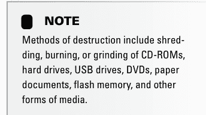

并非总是需要物理销毁介质。另一种方法是使用消磁机。消磁机产生磁场，从磁性存储介质中擦除数据。一旦数据经过消磁机，数据将无法恢复。使用消磁机时，剩余的磁性材料不足以重建数据。如果介质中存储的信息不是极其敏感的，可以使用某些介质存储其他数据。但是，如果介质存储了非常敏感的数据，则应将其销毁。

另一种在不损害存储数据的介质的情况下销毁数据的方法是反复写入。在数据上反复写入随机字符通常会销毁数据。此做法称为覆写。如果要覆写的数据量相当少且覆写速度相当快，此过程效果良好。大量数据或


| 控制类型 | 描述 |
| :--- | :--- |
| 行政 | 这些是管理层批准并以规则形式下发给员工的策略。它们是第一道防线，用于告知用户其职责。示例包括密码长度策略。 |
| 逻辑/技术 | 这些是受控并自动强制执行的附加策略。这减少了人为错误。例如，计算机可以检查密码以确保它们遵循规则。 |
| 硬件 | 这包括检查和验证 ID 的设备，例如网络设备上的媒体访问控制 (MAC) 过滤、用于两步验证的智能卡使用以及无线射频识别 (RFID) 标签等安全令牌。在此示例中，MAC 是唯一标识网络中每个节点的硬件地址。媒体访问控制与本章后面讨论的强制访问控制不同。 |
| 软件 | 这些控件嵌入在操作系统和应用程序软件中。它们包括 Microsoft Windows 标准 NTFS 权限、要求登录的用户帐户以及限制服务或协议类型的规则。这些项目通常是 ID 和验证阶段的一部分。 |
| 物理 | 这些是防止物理访问资源的设备，包括安全警卫、ID 徽章、围栏和门锁等。 |

慢速写入设备会使这种数据销毁方式过于缓慢，无法在生产环境中有用。

## 访问控制的正式模型

最常见的技术控制类型之一是保护计算机资源访问的控制。大多数用户都遇到过访问控制限制。例如，任何输入了错误密码的用户都应被拒绝访问。

由于限制对不同资源访问的方式多种多样，参考模型有助于设计良好的访问控制。访问控制有多种正式模型，包括以下几种：

- **自主访问控制 (DAC)**—在 DAC 中，资源所有者决定谁可以进入并根据需要更改权限。所有者可以将这项工作交给他人。
- **强制访问控制 (MAC)**—在 MAC 中，访问系统或任何资源的权限由资源的敏感性和主体的安全级别决定。它不能授予给他人。这使得 MAC 比 DAC 更强大。
- **非自主访问控制**—非自主访问控制由安全管理员而非系统管理员密切监控。
- **基于规则的访问控制**—由数据所有者维护的规则列表确定哪些用户可以访问对象。

其他模型基于 Biba、Clark-Wilson 和 Bell-La Padula 的工作。这些模型描述了使用访问控制和权限来保护机密性或完整性。

## 自主访问控制

通用准则将自主访问控制 (DAC) 定义如下：

> [A] 基于主体身份及其所属组限制对象访问的一种方式。这些控制是自主的，因为具有某些访问权限的主体可以将该权限（可能是间接地）传递给任何其他主体。

通用准则还指出如下内容：

> [S] 用于处理机密或其他敏感信息的系统定义的安全策略必须包括强制执行自主访问控制规则的规定。也就是说，它们必须包含一套一致的规则，用于基于被确定了解该信息的“需要知道”原则的个人来控制和限制访问。

这些定义同样适用于处理敏感信息的公共和私营部门组织。

## 基于操作系统的 DAC

操作系统主要负责控制对文件、内存和应用程序等系统资源的访问。安全管理员的主要工作之一是维护访问控制。当访问控制确保只有授权用户才能访问资源时，它们是有效的；当它们确保用户可以访问所需的所有资源时，它们是高效的。创建既有效又高效的访问控制可能具有挑战性。组织必须决定如何设计和维护访问控制，以最好地满足其需求。在制定访问控制策略时，组织必须考虑以下几点：

- 访问控制方法—当今的操作系统包含针对单个用户（基于规则）或用户组（基于角色）的访问控制设置。使用哪种方法取决于组织的规模以及个人或角色所需的具体访问权限方式。
- 新用户注册—当新用户加入组织时，必须为其创建用户帐户。这可能需要花费大量时间。但是，必须快速完成，以便新人能够开展工作。用户注册必须标准化、高效且准确。
- 定期审查—随着时间的推移，用户通常会获得完成特定项目或执行特殊任务的特殊权限。这些权限需要不时进行审查，以确保在不再需要时停止。这项审查通过确保人们只能访问所需区域来解决合规性和审计问题。

## 最小特权、职责分离和需要知道的攻破

**最小特权**是指授予用户完成分配任务所需的最低访问权限。换句话说，就是只授予用户开展工作所需的足够授权，而不授予其他任何权限。最小特权很难维护，但它确实可以保护数据免受过度授权。

**职责分离**是将任务分解为一系列由不同人员执行的独特活动的过程，每个人只被允许执行整体任务的一部分。这一原则防止某人既创建又批准自己的工作。职责分离可以作为一种宝贵的工具，通过要求另一人配合完成任务来防止欺诈或错误。双重控制是职责分离的一个示例。示例包括门上带有两把组合锁的保险柜，或要求在彼此相距太远的控制台上同时转动钥匙的导弹控制系统。

**需要知道**是防止人们获取其履行职责不需要的信息的概念。基于需要知道原则提供访问权限可以减少数据处理不当或信息泄露不当的可能性。

最小特权、职责分离和需要知道原则可能受到以下攻击：

- **串通。** 用户相互合作（串通）以规避控制、汇总其权限，并相互协助执行未授权任务。职位轮换可降低串通风险。
- **隐蔽通道。** 这些是违反组织政策的隐蔽（covert）信息传递方式。隐蔽通道主要有两种类型：时序（一个系统向另一个系统发送信号）和存储（将数据存储在不受保护或不适当的位置）。

## 基于应用程序的 DAC

基于应用程序的 DAC 根据上下文或内容拒绝访问。应用程序仅显示当前用户有权使用的选项。例如，自动取款机 (ATM) 菜单仅显示特定用户可用的选项来限制访问。您可以根据用户上下文或资源内容使用这些类型的 DAC 应用安全控件：

## 补充信息

**可信计算机系统评估准则 (TCSEC)** 提供了 DAC 和 MAC 的定义。这些定义符合需要保护敏感信息的公共和私营部门组织的需求。TCSEC 是美国国防部彩虹系列中的一个重要标准。彩虹系列是 20 世纪 80 年代和 90 年代出版的一系列计算机安全标准和指南。系列中的每本书都有不同颜色的封面，因此每本书都有其绰号。TCSEC 的封面是橙色的，通常简称为 _橙皮书_。通用准则于 2005 年取代了 _橙皮书_。


- 在基于上下文的系统中，访问基于定义在用户自身数据记录中的用户权限。这通常授予担任特定工作角色或职能的人员。

- 在基于内容的系统中，访问基于表中数据项的值或敏感性。该系统检查正在访问的数据的内容，并允许，例如，部门 A 的经理查看部门字段中包含 A 的人员的员工记录，但不查看该字段中包含任何其他值的记录。

## 权限级别

权限级别表示主体对系统、应用程序、网络或其他资源的权利。在 DAC 环境中，授权系统使用权限级别来确定任何主体可以访问哪些对象。权限级别可以是以下任一项：

- **基于用户**—授予用户的权限通常特定于该用户。在这种情况下，规则是根据用户 ID 或其他唯一标识符设置的。
- **基于工作、基于组或基于角色的访问控制 (RBAC)**—权限基于相同或类似工作角色的所有人的一组通用权限。
- **基于项目**—当一群人（例如，项目团队）在项目上工作时，他们通常被授予仅与该项目相关的文档和数据的访问权限。
- **基于任务**—基于任务的访问控制将人员限制在执行某些功能，并且通常强制执行互斥性。换句话说，如果一个人执行任务的一部分，他或她可能不被允许执行任务的另一相关部分。这基于职责分离和需要知道的概念。

## 强制访问控制

**强制访问控制 (MAC)** 是限制对资源访问的另一种方法。您通过资源的敏感程度来确定限制级别。这由分类标签表示。然后，个人必须正式获得授权（即，获得许可）才能访问敏感信息。用于处理分类信息（或任何其他敏感信息）的系统定义的安全策略必须包含强制执行 MAC 规则的规定。也就是说，它们必须包含一组控制谁可以访问什么信息的规则。

> **注意**
> 
> 请记住：敏感性标签（或分类）应用于所有对象（资源）。权限或许可级别标签分配给所有主体（用户或程序）。

在强制访问控制下，系统和所有者共同做出允许访问的决定。所有者提供需要知道要素。并非所有具有敏感材料权限或许可级别的用户都需要访问所有敏感信息。系统比较主体和对象标签，这些标签与 Bell-La Padula 保密模型的术语相符（该模型将在本章后面介绍）。基于该比较，系统要么授予访问权限，要么拒绝访问。

**时间隔离** 将访问限制在特定时间。它首先对对象的敏感级别进行分类。然后仅在特定时间允许访问这些对象。时间隔离通常与基于角色的访问控制结合使用。您可能更常看到时间隔离被描述为 **时间限制**。无论使用哪个术语，它们都只是意味着将访问限制在特定的时间窗口内。

## 非酌情访问控制

在非酌情访问控制中，访问规则由安全管理员严格管理。它们不是由系统所有者或普通用户为其自身文件管理的。

非酌情访问控制可用于许多操作系统。此策略比酌情访问控制更安全。系统不仅依赖于用户遵守组织策略。例如，即使用户遵守明确定义的文件保护策略，特洛伊木马程序也可能更改保护设置以允许无控制的访问。这种暴露在非酌情访问控制下是不可能的。

安全管理员在非酌情访问控制中拥有足够的控制权，可以确保敏感文件被写保护以保持完整性，并且仅由授权用户可读，以保持机密性。损坏的程序被使用的几率降低了，因为用户只能运行明确允许运行的程序。

非酌情访问控制有助于确保系统安全得到强制执行且防篡改。如果您的组织需要管理高度敏感的信息，您应该认真考虑使用非酌情访问控制。它在保护机密性和完整性方面比 DAC 做得更好。数据所有者（通常是用户）不做出访问决定。这使您可以在无需额外管理开销的情况下享受 MAC 的某些优势。

## 基于规则的访问控制

在基于规则的系统中，访问基于决定谁应被授予访问权限的规则列表。数据所有者制定或允许规则。他们指定授予用户的权限，例如读取、写入、执行。

基于规则的访问控制的成功取决于您与数据所有者之间的信任级别。这种访问控制将大部分管理工作下放到数据所有者。对于技术型和安全意识强的用户，这种访问控制往往效果较好。在用户众多或用户缺乏必要的技术技能和培训的环境中，它效果不佳。图 5-3 显示了单个规则如何控制每个用户的权限。

## 访问控制列表

大多数操作系统提供多种选项，用于将列表或权限与对象关联。这些列表称为 **访问控制列表 (ACL)**。不同的操作系统提供不同的 ACL 启用选项。例如，Linux 和 OS X 具有读取、写入和执行权限。这些权限可以应用于文件所有者、组或全局用户。Windows 同时具有共享权限和安全权限，两者都允许 ACL 定义访问规则。

### 显式规则授予访问权限

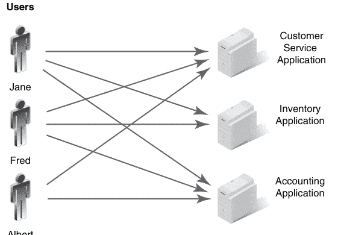

图 5-3 基于规则的访问控制。

共享权限用于通过网络共享访问资源。安全权限用于用户本地登录时访问资源。某些 Windows 权限包括以下内容：

- 共享权限—完全控制、更改、读取和拒绝。
- 安全权限—完全控制、修改、列出文件夹内容、读取-执行、读取、写入、特殊和拒绝。

在共享权限和安全权限中，拒绝会覆盖所有其他权限。但是，如果资源不存在 ACL，会发生什么情况？大多数授权系统使用隐式拒绝，这意味着如果不存在授予访问权限的规则，访问将被自动拒绝。这种方法更具限制性，但也更安全。

由于选择更多，Windows ACL 被认为更加细粒度，因为它们允许更高级别的控制。图 5-4 显示了一个 ACL。

## 基于角色的访问控制

另一种访问控制类型是基于角色的访问控制 (RBAC)。RBAC 策略基于用户分配的工作来批准访问控制。安全管理员将每个用户分配给一个或多个角色。某些操作系统使用组而不是角色。资源所有者决定哪些角色可以访问哪些资源。Microsoft Windows 使用全局组来管理 RBAC。图 5-5 显示了 RBAC。

在将访问规则分配给角色之前，必须定义和描述组织中的角色。定义角色、审批、角色层次结构和约束的过程称为角色工程。以适合您组织的清晰角色定义列表开始是 RBAC 的关键。RBAC 相对于其他访问控制方法的真正优势是

**图 5-4**
访问控制列表。

| 用户 | 资源 | 权限 |
| :--- | :--- | :--- |
| Hal | Hal 用户目录 | 完全控制 |
| | Kevin 用户目录 | 写入 |
| | Kara 用户目录 | 无访问权限 |
| | 打印机 001 | 执行 |
| Kevin | Hal 用户目录 | 写入 |
| | Kevin 用户目录 | 完全控制 |
| | Kara 用户目录 | 无访问权限 |
| | 打印机 001 | 无访问权限 |
| Kara | Hal 用户目录 | 写入 |
| | Kevin 用户目录 | 完全控制 |
| | Kara 用户目录 | 无访问权限 |
| | 打印机 001 | 执行 |
| | 打印机 002 | 执行 |

它能够表示组织的结构，并在整个组织中强制执行控制策略。

假设图 5-5 中的 Jane 和 Fred 应该有权访问库存应用程序，但 Albert 不应该。但是，如图所示，Albert *确实* 有权访问此应用程序——这是一次需要知道违规。此错误是由于角色过度概括造成的。角色过度概括可能会导致向个人提供更多访问权限

**图 5-5**
基于角色的访问控制。

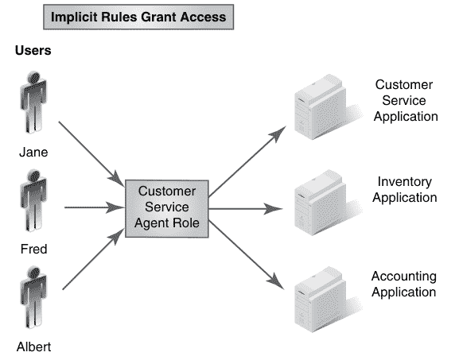


比预期的多。当你分配角色时，请考虑为每个用户或为极少数用户创建一个角色。Windows“拒绝权限”选项可以用来创建一条覆盖角色的规则。这将修复Albert的过度权限。此决定取决于风险。用户可能会被分配具有类似权限的角色，并可能被授予超过其知晓需要的访问权限，以便降低管理成本。

## 内容依赖访问控制

图5-6展示了内容依赖访问控制如何保护数据。内容依赖访问控制基于数据中包含的内容。它要求访问控制机制（仲裁程序，它是应用程序的一部分，而不是操作系统的一部分）查看数据，以决定谁应该能看到它。其结果比你见过的其他访问控制方法具有更好的粒度。访问控制到文件中的记录级别，而不仅仅是文件级别。然而，这样做的成本更高，因为它需要仲裁程序。仲裁程序使用被访问对象中的信息——例如，记录中的内容。决策通常归结为一个简单的if-then问题——例如，“如果高安全标志等于是，则检查用户的安全级别。”经理可能有权访问工资数据库以查看特定员工的数据，但他们可能无法访问其他经理的员工数据。

## 受限用户界面

使用受限用户界面时，用户进入或与某些系统资源交互的能力受两方面限制：用户的权利和权限受到限制，并且对提供界面的设备或程序施加约束。例如ATM之类的设备或公共访问终端浏览器之类的软件，只能让用户访问特定的功能、文件或其他资源。它通过限制用户请求访问未授权资源的能力来限制他们的访问。例如，某些系统会将不可用的图标置灰。限制用户的几种方法如下：

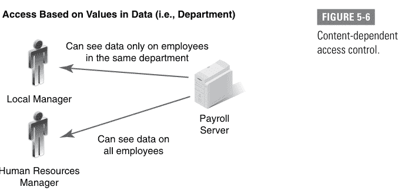

- 菜单——阻止用户访问某些数据的一种方法是，根本不让他们知道数据的存在。当用户登录时，出现的菜单不包括封闭区域。

- 数据库视图——也称为基于视图的访问控制（VBAC），这种方法常用于关系数据库。数据库系统为每个用户创建一个视图，限制其能够看到的数据。尽管数据库中可能有更多数据，但用户只能访问视图中定义的数据。许多当前数据库提供将数据库分区为多个切片的方法。此功能称为多租户，允许不同用户组访问数据库，而无法访问彼此的数据。对于希望使用云来托管共享应用程序和数据库的组织来说，此功能非常重要。

- 物理受限用户界面——用户界面机制为用户提供有限数量的选项。例如，ATM只提供一定数量的按钮供按压。这使其成为物理受限用户界面。

- 加密——这种方法限制用户，因为它要求用户必须拥有解密密钥才能访问或读取系统中存储的信息。加密还会向用户隐藏信用卡详细信息等信息。

## 其他访问控制模型

其他访问控制模型有助于塑造当今的访问控制。最突出的访问模型包括Bell-La Padula模型、Biba完整性模型、Clark和Wilson完整性模型以及Brewer和Nash模型。您将在以下部分了解每个模型。

### Bell-La Padula模型

Bell-La Padula模型关注数据的机密性和对分类信息访问的控制。该模型与下一节将介绍的Biba完整性模型不同，后者描述了保护数据完整性的规则。在Bell-La Padula模型中，系统的各部分被划分为主体和客体，系统的当前状态描述为其状态。该模型定义了安全状态。该模型保证每个状态转换都通过从安全状态移动到安全状态来保持安全性。此过程确保系统满足模型的安全目标。Bell-La Padula模型建立在状态机概念之上，该状态机具有计算机网络系统中一组允许的状态。从一个状态到另一个状态的转换由所谓的转换函数定义。

### Biba完整性模型

1977年，Kenneth J. Biba定义了基于完整性级别的第一个计算机系统完整性模型。Biba完整性模型修复了Bell-La Padula模型的一个弱点，该模型仅涉及数据的机密性。Biba完整性模型包含三个部分：

- 第一部分规定，主体不能读取完整性级别低于自身的客体。特定完整性级别的主体只能读取相同或更高完整性级别的客体。这称为简单完整性公理。

- 第二部分规定，主体不能修改完整性级别高于自身的客体。

- 第三部分规定，主体不得请求高完整性级别主体提供服务。特定完整性级别的主体只能调用相同或更低完整性级别的主体。

### Clark和Wilson完整性模型

由David Clark和David Wilson于1987年发表，Clark和Wilson完整性模型关注获准进入系统的用户尝试执行未获许可操作时会发生什么情况。它还审查内部完整性威胁。Biba的模型中缺少这两个组件。该模型审查软件是否按设计运行。这是一个主要的完整性问题。Clark和Wilson完整性模型涉及三个完整性目标：

- 它阻止未授权用户进行更改。（Biba仅解决了这一完整性目标。）

- 它阻止授权用户进行不当更改。

- 它保持内部一致性和外部一致性。

Clark和Wilson完整性模型定义了格式良好的事务和数据约束。例如，商业系统应仅允许以40,000美元的价格输入新的豪华车销售。不应能以4,000美元或400,000美元的价格输入销售。这保持了内部一致性。内部一致性确保系统每次都按预期运行。

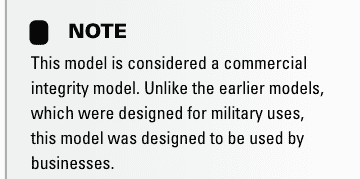

在Clark和Wilson完整性模型中，主体的访问受执行程序（格式良好的事务）的权限控制。因此，未授权用户无法执行程序（第一条完整性规则）。授权用户可以访问不同的程序，允许每个用户进行特定且唯一的更改（职责分离）。该模型的两个重要部分如下：

- 这三个访问实体——主体、程序和客体——组合形成访问三元组。

- 完整性通过绑定来强制执行。主体到程序和程序到客体的绑定强制执行完整性。这创建了职责分离。它确保只能执行授权事务。

### Brewer和Nash完整性模型

Brewer和Nash完整性模型基于1989年发表的一项数学理论，旨在确保公平竞争。它用于应用动态变化的访问权限。它可以在同一集成数据库中分隔竞争对手的数据，以确保用户不会对属于竞争组织的客体进行欺诈性更改。它还用于防止用户或客户在存在利益冲突时使用数据。

中墙安全策略定义一堵墙或屏障，并制定一系列规则，确保没有主体能够访问墙另一侧的客体。图5-7展示了中墙的运作方式。它说明了审计公司如何处理竞争企业的审计。


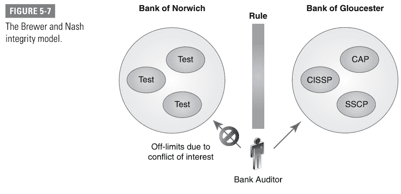

> **注意** 控制无法防止利益冲突。利益冲突与个人的职位有关，而非与数据本身有关。

在此示例中，获准处理与格洛斯特银行相关数据的审计员不得访问属于诺威银行的任何数据。尽管该审计员为一家同时为两家银行提供审计服务的公司工作，但该审计公司内部控制可防止访问可能产生利益冲突的区域。

此模型确保利益冲突得到识别，并防止人们利用其无权访问的数据。例如，如果用户获准访问某公司的数据，则该公司竞争对手的数据可自动被视为禁止访问。

## 访问控制违规的影响

如果你无法控制访问，可能会给对手带来优势。该对手可能是军事力量、对竞争情报感兴趣的企业，甚至是你的邻居：以下列表详细说明了可能发生的一些损失：

- 泄露私人信息
- 数据损坏
- 商业情报丢失
- 对设施、员工和系统的危险
- 设备损坏
- 系统和业务流程故障

并非所有事件都有相同的影响。有些比其他事件更容易被发现。例如，因泄露商业秘密（包括商业情报）而导致的损失，往往很长一段时间都不会被发现。因数据损坏而导致的损失，可能在被发现时就已经使数据库及其所有备份变得无用。数据损坏很容易导致系统和业务流程故障。

某些类型的拒绝服务（DoS）攻击是短暂的。它们会被迅速发现，并在造成严重损害之前被阻止。其他类型的 DoS 攻击演变需要更长时间。它们可能会影响企业为客户提供服务的能力。客户随后可能会将业务转移到其他地方。这种类型的 DoS 攻击对组织造成的损害更为严重。

## 对访问控制的威胁

访问控制的挑战形式多样。此列表永远无法完整。新威胁不断演变。一个示例是点对点（P2P）风险，即 P2P 用户无意中彼此共享其“我的文档”文件夹。这可能会将敏感文档暴露给其他用户。

访问控制可能以多种方式受到破坏，包括：

- **获取物理访问权限**—如果入侵者拥有设备的物理访问权限，逻辑访问控制基本上就毫无价值。数据可以被直接复制或窃取。拥有物理访问权限的人可以安装硬件或软件按键记录器，或者损坏设备。例如，此人可以发起 DoS 攻击。小型可移动媒体，例如可写 CD、DVD、USB 记忆棒或硬盘，会带来物理访问风险。将数据复制到这些设备之一非常容易。智能手机和移动设备是另一种常见风险。当今的移动设备包括摄像头以及音频和视频录制功能。

- **通过观察进行窃听**—有时安全人员会忽略最明显的违规行为，导致信息被他人看到。授权用户办公桌或屏幕上的文件中的数据都处于间谍的视野之中。执行正确的政策和程序可以防止此类数据丢失。

- **绕过安全措施**—任何访问数据的方式都可能导致安全漏洞。开发人员可能只会考虑一种访问方式，例如通过网站。但是，攻击者很容易绕过现有的安全措施。信息安全团队必须考虑其他访问路径，例如攻击者映射驱动器或在服务器键盘上登录。

- **利用硬件和软件**—攻击者通常会尝试在其控制的系统上安装程序。这些程序通常被称为特洛伊木马。网络管理员或工作站所有者甚至可能不知道攻击者已入侵。

- **重复使用或丢弃媒介**—攻击者可以从丢弃或重复使用的媒介中恢复已删除或被篡改的信息。粉碎文档和物理销毁媒介比直接丢弃它们更安全且成本更低。

- **电子窃听**—攻击者可以通过窃听网络电缆进行窃听。某些媒介比其他媒介更能抵抗窃听。例如，光纤电缆比铜缆更安全。但是，没有任何媒介能提供完全保护。对移动设备和无线接入点日益增长的兴趣增加了窃听风险。将移动设备连接到不安全接入点的用户是攻击者的易攻目标。

- **拦截通信**—窃听的另一种变体是物理拦截数据通信。这被称为嗅探。通过嗅探，攻击者在数据流量经过时捕获网络流量。嗅探通常用于中间人（MITM）攻击。攻击者将自己插入两名受害者之间，并在他们之间中继消息。攻击者让两名受害者似乎通过私有连接直接相互通话。实际上，攻击者控制着整个对话。

- 访问网络—网络通常包括未受保护的连接。许多组织构建网络时，布置的网络端口（墙板上的母连接器）多于其所需。这使得组织在未来增长时可以添加更多用户。这些未使用的连接点通常是活跃连接。入侵者可以利用这些连接来获取网络访问权限。随着组织添加无线接入点，网络访问风险会增加。使网络访问更容易既有利于攻击者，也有利于合法用户。组织必须仔细监控并限制所有网络访问点。

- 利用应用程序—几个程序和模块存在一种称为缓冲区溢出的常见编程弱点。当攻击者在输入字段中输入超出预期的字符数量时，就会发生这种情况，这会允许恶意代码在整个应用程序中运行。还有许多其他利用应用程序弱点的方法，攻击者始终在寻找新的方式来破坏应用程序。

## 访问控制违规的影响

你已经了解了攻击者破坏访问控制的一些方式。但是，如果攻击者成功会怎样？访问控制违规的影响是什么？访问控制违规可能对组织产生以下有害影响：

- 客户信心丧失
- 商业机会丧失
- 对组织施加的新立法和法规
- 不良宣传
- 更多监督
- 财务处罚

> 注意
> 您可以在以下网址找到各州披露法律的摘要：www.ncsl.org/research/telecommunications-and-information-technology/security-breach-notification-laws.aspx。

例如，Egghead Software 于 2000 年夏天自愿报告了一起违规事件，并在披露后一年内被 Amazon 收购。违规事件发生后，客户不再信任该公司处理其信用卡。他们犹豫是否购买 Egghead 的产品。企业界对此引起重视。结果，其他公司停止报告违规行为。最后，政府介入并出台新法律，迫使公司披露财务数据访问违规事件。

2003 年，加利福尼亚州通过了一项强制披露法，影响所有在加利福尼亚州开展业务或与该州居民开展业务的公司。该法律保护其居民免受其个人身份信息（PII）被披露。PII 通常是坏人用来盗用身份的信息。但是，请注意，该法律不涵盖其他入侵，例如知识产权盗窃。但是，新法律并未阻止违规行为。数据泄露仍在发生，其中一些登上了新闻头条。最近一些最引人注目的数据泄露事件包括 Target、家得宝、蓝十字蓝盾、哈佛大学、美国陆军国民警卫队和美国人事管理局。访问违规问题影响许多组织。

## 凭据和权限管理

在了解访问控制后，您可能已经思考过如何存储支持访问控制决策所需的所有信息。您需要允许用户注册并提供有效的身份识别和身份验证凭据。然后，您必须定义访问权限，将权限与用户关联，并允许进行维护。实际上，所有这些任务都属于凭据管理。凭据管理系统提供收集、管理和使用与访问控制相关的信息的功能。但管理凭据只是第一步。还需要管理权限和访问规则。在拥有许多用户的动态系统中，这项任务很容易变得难以应对。Microsoft 提供了一项名为“组策略”的功能，以帮助管理员管理访问控制。组策略对象 (GPO) 是一组用于用户或计算机的设置，可以高效地应用于一组计算机。GPO 功能允许 Windows 管理员在一处定义设置，这些设置可以轻松应用于许多用户或计算机。

## 集中式和分散式访问控制

集中式访问控制是一种访问控制方法，由单个共享实体（例如个人、部门或设备）决定谁可以进入系统和网络。访问控制是集中管理的，而不是在本地管理。所有者决定哪些用户可以访问哪些对象。中央管理支持所有者的指令。集中式身份验证服务通过使用身份验证、授权和计费 (AAA) 服务器来应用和强制执行。使用 AAA 服务器的好处包括：

集中式访问控制通常更易于管理，但缺点是如果它出现故障，大量用户可能会受到影响且无法进入计算机系统。

- 它需要的管理时间较少，因为用户帐户在单个主机上维护。
- 它减少了设计错误，因为不同的访问设备使用类似的格式。
- 它减少了安全管理员培训，因为只需学习一个系统。
- 它提高了安全性并简化了合规性审计，因为所有访问请求均由一个系统处理。
- 它减少了帮助台呼叫，因为用户界面保持一致。

## AAA 服务器类型

在以下部分中，您将了解主要的 AAA 服务器类型：最流行的 RADIUS，以及 TACACS+、DIAMETER 和 SAML。


## RADIUS

远程身份验证拨入用户服务（RADIUS）是最流行的 AAA 服务。它是一个使用两个配置文件的身份验证服务器：

- 客户端配置文件，包含客户端地址和用于事务身份验证的共享密钥
- 用户配置文件，包含用户标识和身份验证数据以及连接和授权信息

RADIUS 在身份验证过程中遵循以下步骤：

- 1. 网络访问服务器（NAS）解密用户的 UDP 访问请求。
- 2. NAS 对来源进行身份验证。
- 3. NAS 根据用户文件验证请求。
- 4. NAS 通过允许或拒绝访问或请求更多信息来响应。

## TACACS+

终端访问控制器访问控制系统加强版（TACACS+）是互联网工程任务组（IETF）标准，使用单个配置文件来：

- 控制服务器操作
- 定义用户和属性/值对
- 控制身份验证和授权过程

TACACS+ 最初由思科系统公司开发，随后作为开放标准发布。思科之前已扩展了原始终端访问控制器访问控制系统（TACACS）协议，以开发其名为扩展 TACACS（XTACACS）的专有版本。TACACS+ 是 XTACACS 之后的下一个演进步骤。选项部分包含操作设置、共享密钥和计费文件名。TACACS+ 在身份验证过程中遵循以下步骤：

- 1. 使用 TCP，客户端发送带有明文头和加密主体的服务请求，主体包含用户 ID、密码和共享密钥。
- 2. 响应包含允许/拒绝以及用于连接配置的属性/值对（视需要而定）。

## DIAMETER

DIAMETER（非缩写词）基于 RADIUS。然而，RADIUS 仅适用于高度流动或移动的员工队伍。DIAMETER 不受此限制。它适用于稳定或静态的员工队伍。DIAMETER 包括以下内容：

- 基础协议—基础协议定义所有扩展所用的消息格式、传输、错误报告和安全性。
- 扩展—扩展执行特定类型的身份验证、授权或计费事务。

DIAMETER 还使用 **用户数据报协议（UDP）**。使用 UDP 的计算机应用程序将称为 **数据报** 的消息发送到互联网协议（IP）网络上的其他主机。UDP 在此过程中不需要特殊的传输通道或数据路径。因此，UDP 的服务有些不可靠，因为数据报可能会无序到达。它们也可能看起来被重复甚至丢失。UDP 只依赖应用程序来修复这些问题。这使 UDP 免于浪费宝贵的时间和资源来自己修复这些问题。这使得 UDP 更快，因此它常被用于流媒体和在线游戏。

DIAMETER 使用点对点模式而非客户端/服务器模式使用 UDP。在点对点模式下，一个用户向另一个用户提供对其硬盘的直接访问。第二个用户也可以访问第一个用户的硬盘。不存在集中式结构。**图 5-8** 显示了以点对点模式连接的计算机示例。

在客户端/服务器模式下，结构是集中式的。客户端（例如用户）连接到服务器以请求访问某些信息。**图 5-9** 显示了以客户端/服务器模式连接的计算机示例。

这使服务器能够发起请求并本地处理传输错误，从而减少数据包在网络连接上移动所需的时间（延迟）并提高性能。用户发送包含请求命令、会话 ID 以及用户 ID 和密码的授权请求。此授权请求发送到网络附加存储（NAS）设备。NAS 批准用户凭据。如果获批，NAS 将返回响应数据包。响应数据包包含所请求服务的属性/值对。会话 ID 唯一标识连接，并解决 RADIUS 在高密度部署中重复连接标识符的问题。

## SAML

**安全性断言标记语言（SAML）** 是一种用于交换身份验证和授权数据的开放标准。SAML 基于 XML，旨在支持分布式系统的访问控制需求。SAML 常用于 Web 应用程序访问控制。SAML 不是完整的集中式 AAA 系统。它是一种数据格式规范。我们将其包含在本节中，因为使用 SAML 的系统确实依赖于中央可信机构来颁发安全令牌。

**图 5-8** 点对点模式。

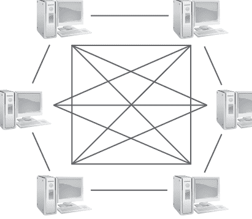

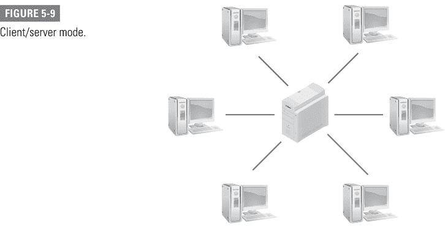

## 分散式访问控制

另一种访问控制方法是在本地处理访问控制决策和管理。这种方法称为 **分散式访问控制**。这意味着访问控制掌握在最接近系统用户的人（例如部门经理）手中。访问请求不是由一个集中式实体处理的。

一方面，分散式访问控制往往会导致混乱。为什么？因为它可能导致标准化丧失和权限重叠。这可能会导致访问控制设计出现漏洞。另一方面，分散式方法消除了单点故障问题。它结束了中央控制机构无法有效响应本地情况的看法。

分散式访问控制最常见的两个示例是使用明文用户名和密码的 **密码身份验证协议（PAP）** 和 **质询握手身份验证协议（CHAP）**。CHAP 比 PAP 更安全，因为它使用一次性质询编号对密码进行哈希处理，以防止基于窃听的重放攻击。随着智能手机和平板电脑数量的激增，提供安全访问的需求也在增加。移动设备的访问控制正在不断发展。有两种相对较新的方法专为移动使用而设计。**开放认证倡议（OATH）** 是一项正在进行的工作，旨在开发强身份验证的参考架构。超过 30 个组织参与 OATH 项目。OATH 开发了多项标准来支持移动设备身份验证。第一种是 **基于 HMAC 的一次性密码（HOTP）算法**。HOTP 提供了一种非常安全的方法，使用身份验证服务器对用户进行身份验证。**基于时间的一次性密码（TOTP）算法** 是 HOTP 的一个示例。它将时间戳与哈希值相结合，以减少对重放攻击的脆弱性。OATH 提出了一个支持集中式和分散式访问控制模型的参考框架。

## 隐私

最明显的安全问题之一是 **隐私**。对身份盗窃日益增强的认识以及保护隐私的重要性，导致了新的法律和标准来确保隐私。个人隐私只是这一日益严重问题的一个方面。组织越来越意识到隐私侵犯的危险。组织经常以电子方式监控员工，因为他们担心以下问题：

- 骚扰诉讼中的法律责任
- 员工盗窃导致的损失急剧增加
- 员工在线购物或进行其他非工作相关任务导致的生产力损失

电子监控在工作场所中会产生其自身的隐私问题。视所在国家或司法管辖区而定，员工监控的法律层级可能差异很大。

当前的观点是，员工要拥有合理的隐私期望，必须建立两点：

- 他们对隐私有主观期望。
- 这种主观隐私期望是合理的。

如果缺少其中任何一项，则不建立受保护的利益。这意味着，如果员工被引导期望某事物（例如电子邮件）是私密的，其雇主就不能合法侵犯该隐私。然而，如果公司告知员工通过公司网络发送的电子邮件受到监控，则员工不再能声称有隐私期望。换句话说，一旦公司对其网络领域宣称主权，其员工在那里就没有隐私权。

公司必须清晰地传达其政策，说明员工可以做什么以及将监控什么。在许多情况下，员工在使用企业系统时不能期望任何隐私。组织的可接受使用策略（AUP）是一份重要文件，用于设定包括隐私在内的各方面的适当期望。

登录横幅是向系统和设备用户提供法律权利通知的消息。应在您的系统和设备上使用这些横幅。登录横幅用于获得以下内容：

- 员工对监控的同意
- 员工了解账户滥用可能导致的纪律处分
- 员工对检索存储文件和记录的同意

登录横幅用于合法取消员工使用企业系统时的任何隐私期望。

## 工作场所监控

2007 年美国管理协会（AMA）的一项名为“电子监控与监视”的调查发现，“73% 的组织使用技术工具自动监控电子邮件，40% 的雇主指派专人手动阅读和审查电子邮件。”此外，“66% [监控] 互联网连接”，而“高达 65% 的公司使用软件阻止连接不当网站。”

工作场所监控包括但不限于以下内容：

- 打开邮件或电子邮件
- 使用自动软件检查电子邮件


> **注意**
>
> 光靠政策是不够的。雇主必须明确告知员工可以做什么和不可以做什么。做到这一点的最佳方式是通过培训。当系统或政策发生变化时，应将这些变更告知员工。

- 检查电话记录或录制电话通话
- 检查访问过的网站日志
- 从征信机构获取信息
- 通过销售点（PoS）终端收集信息
- 在闭路电视（CCTV）上记录活动

雇主监控员工以检查员工工作的质量和数量。雇主通常要对员工的行为负责，因此需要确保员工行为得当。

为了确保员工理解监控，雇主应制定清晰的行为准则或政策。员工应知道，如果不遵守政策，可能会受到纪律处分。

## 云计算

企业发展中最强劲的趋势之一是将共享服务融入计算环境。**云计算**是通过网络交付的计算服务的使用实践。计算服务可能位于组织的网络内，也可能由属于其他网络的服务器提供。有几种云模型可以满足多样化用户环境的需求。云服务通常分为以下几类之一：

- **私有云**—提供服务所需的所有硬件和软件（包括网络基础设施）仅为单一组织运行。这些组件可由组织或第三方提供商管理。实际基础设施可以位于组织网络内部或外部。
- **社区云**—这种基础设施为多个组织提供服务。不同组织共享云环境并用于各自的特定需求。基础设施可由参与的组织之一或第三方管理。
- **公有云**—这种云基础设施可供无关组织或个人使用。公有云通常可供公共使用，并由第三方提供商管理。
- **混合云**—这种云基础设施包含多种云类型的组件，包括私有云、社区云和公有云。混合云有助于突破更受限环境的限制。它们通常通过在多个基础设施或分段之间分配工作负载，用于提供弹性和负载均衡。

> **供参考**
>
> 云计算引入了新的安全问题。支付卡行业数据安全标准（PCI DSS）发布了一份直接解决云安全问题的文档。该文档是了解云计算和云安全问题的良好资源。您可以在 https://www.pcisecuritystandards.org/pdfs/PCI_DSS_v2_Cloud_Guidelines.pdf 处找到此文档。

在最普遍的情况下，云服务提供商（CSP）维护多个装有服务器机架的数据中心。每台服务器运行多个虚拟机，并能同时为许多客户端提供服务。CSPs通过互联网向客户提供不同的服务。常见的云服务包括：

- 基础设施即服务（IaaS）—IaaS 为用户提供对物理机或虚拟机的访问权限。用户必须选择并加载自己的操作系统。然后，他们管理机器的所有方面，就像它是本地计算机一样。
- 平台即服务（PaaS）—PaaS 为用户提供对运行多种流行操作系统之一的物理机或虚拟机的访问权限。与 IaaS 不同，使用 PaaS 时，CSP 管理操作系统和底层硬件。用户不连接到本地服务器，而是连接到云中的虚拟服务器。建立连接后，用户将云实例视为其他任何计算机。用户可以像服务器位于本地数据中心一样安装和运行软件。
- 软件即服务（SaaS）—在 SaaS 模式中，用户从云客户端访问软件。最基本的云客户端类型是 Web 浏览器。用户无需安装或管理任何软件。他们所要做的就是连接到正确的服务器，并像软件在本地网络中运行一样使用该软件。SaaS 的一些流行示例包括 Google Apps™ 服务、Microsoft Office 365™ 和 SalesForce®。

与传统的内部软件相比，使用云服务有几个优势。大多数优势包括一定的成本节约。这些优势包括以下几点：

- 无需维护数据中心—CSP 维护多个数据中心，并处理使服务在互联网任何地方可用的所有物流和细节。
- 无需维护灾难恢复站点—因为 CSP 已经在多个站点维护服务和数据，云中始终有多份数据副本。
- 绩效和连接责任外包—客户只需拥有互联网访问权限。CSP 负责确保一切按合同承诺的方式运行。
- 按需配置—云客户可以根据当前需求增加或减少购买的计算能力和存储空间。与维护未使用的硬件相比，这可以为组织节省大量资金。这也意味着，组织可以在不购买和设置新服务器的情况下应对需求增加。

云计算确实有其劣势。例如，将服务移出组织会使控制整个环境变得更加困难。云的劣势包括以下几点：

- 私有数据泄露风险更大—云计算的一个优势是 CSP 确保您的数据始终可用。它实现这一点的一种方式是在不同位置保存多份最新数据副本。每多一份私有数据副本，就增加了数据泄露给未经授权用户的可能性。
- 对持续网络访问需求更大—访问云服务取决于与这些服务的网络连接。这意味着，没有可靠或快速互联网访问权限的用户在使用云服务时可能会遇到困难。这一问题对在可靠覆盖区域进出的移动用户，或没有可靠互联网访问权限的用户来说最为突出。
- 客户需要信任外部供应商的需求更大—将私有数据发布给 CSP 需要一定程度的信任。将敏感数据交给第三方可能会违反某些法律、法规或供应商要求。在将数据迁移到云之前，必须仔细检查所有因外部要求而产生的限制。虽然最安全的政策是将云视为不受信任的环境，但与您的 CSP 之间必须存在一定的基本信任级别。

当今组织面临的最棘手问题之一是在云中保持私有数据安全。主要困难在于，数据从组织基础设施内部的可信位置移动到不受信任的云环境。由于用户可以连接到云服务，问题是，谁应该负责身份识别、授权和身份验证？云安全联盟（CSA）是一个非营利组织，其使命是推广安全使用云计算的最佳实践。CSA 发布了一份关于云安全的指南，《云计算关键关注领域安全指南》。该报告这样描述云计算的挑战：

> **注意**
>
> CSA 是了解云计算安全问题的宝贵资源。CSA 网站是 https://cloudsecurityalliance.org/。您可以从 https://cloudsecurityalliance.org/group/security-guidance/ 下载《云计算关键关注领域安全指南》报告的最新版本。

在云计算时代管理信息是一项艰巨的挑战，影响所有组织：包括那些表面上似乎并未积极参与云项目的组织。它从管理内部数据和云迁移开始，并扩展到保护分散的、跨组织的应用程序和服务中的信息。云时代的信息管理和数据安全既需要新的策略，也需要新的技术架构。

在云环境中管理访问控制没有简单的解决方案。研究人员正在探索新方法，以减轻组织的负担。当前的最佳方法是扩展您在本章中学到的现有概念。一些访问控制可能会存在于云环境中。最重要的是始终使用深度防御策略。绝不要仅依赖单一控制来保护任何资源。


## CHAPTER SUMMARY

本章你了解到，访问控制是允许或拒绝访问某些资源的方式。组织使用访问控制来管理员工可以和不可以做的事情。访问控制规定用户是谁、他们可以做什么、可以访问哪些资源以及可以执行哪些操作。访问控制系统使用多种技术，包括密码、硬件令牌、生物识别和证书。可以授予对物理资产（例如建筑物或房间）的访问权限。还可以授予对信息系统的访问权限。

你了解到，访问控制的四个部分是识别、授权、身份验证和问责制。这四个部分构成了一个可分为两个阶段的访问控制流程：策略定义阶段和策略实施阶段。你了解到，首先需要确定谁有权访问，以及他们可以使用哪些系统或资源。接着，你了解到如何根据第一阶段定义的授权来批准或拒绝访问。你还了解了访问控制的正式模型、访问控制方法和挑战，以及访问控制泄露的影响。

## KEY CONCEPTS AND TERMS

- 访问控制
- 访问控制列表 (ACL)
- 访问控制策略
- 问责制
- 计费
- 操作
- 异步令牌
- 审计
- 身份验证
- 身份验证、授权和计费 (AAA)
- 权限级别策略
- 授权
- Bell-La Padula 模型
- Biba 完整性模型
- 生物识别
- Brewer and Nash 完整性模型
- 暴力攻击
- 缓冲区溢出
- 挑战握手身份验证协议 (CHAP)
- 特征
- Clark and Wilson 完整性模型
- 云计算
- 云安全联盟 (CSA)
- 云服务提供商 (CSP)
- 串通
- 共谋
- 信息技术安全评估通用准则 (Common Criteria)
- 受限用户界面
- 持续身份验证
- 隐蔽通道
- 凭据管理
- 交叉错误率 (CER)
- 数据报
- 分散式访问控制
- 消磁器
- DIAMETER
- 字典攻击
- 自主访问控制 (DAC)
- 基于事件的同步系统
- 联合
- 组成员资格策略
- 组策略
- 组策略对象 (GPO)
- 基于 HMAC 的一次性密码 (HOTP)
- 识别
- 开放身份验证倡议 (OATH)
- 密钥分发中心 (KDC)

## KEY CONCEPTS AND TERMS, continued

| Knowledge | Relationships | Terminal Access Controller Access System (TACACS) |
| --- | --- | --- |
| 知识 | 关系 | 终端访问控制器访问系统 (TACACS) |
| 最小特权 | 远程认证拨号用户服务 (RADIUS) | 终端访问控制器访问系统增强版 (TACACS+) |
| 轻量级目录访问协议 (LDAP) | 资源 | 阈值 |
| 日志文件 | 基于角色的访问控制 (RBAC) | 基于时间的一次性密码 (TOTP) |
| 逻辑访问控制 | 多供应商环境中应用的安全欧洲系统 (SESAME) | 基于时间的同步系统 |
| 中间人攻击 (MITM) | 安全 LDAP | 时间限制 |
| 强制访问控制 (MAC) | 安全断言标记语言 (SAML) | 过渡函数 |
| 多租户 | 安全控制 | 传递信任 |
| 知悉权 | 安全内核 | 特洛伊木马 |
| 覆盖 | 安全内核数据库 | 可信操作系统 (TOS) |
| 所有权 | 职责分离 | 双因素身份验证 |
| 口令 | 单点登录 (SSO) | USB 令牌 |
| 密码身份验证协议 (PAP) | 单因素身份验证 | 用户数据报协议 (UDP) |
| 个人识别号码 (PIN) | 智能卡 | 用户名 |
| 物理访问控制 | 嗅探 | 基于视图的访问控制 (VBAC) |
| 物理受限用户界面 | 状态 | |
| 隐私 | 同步令牌 | XTACACS (扩展终端控制器访问控制器访问系统) |
| 公钥基础设施 (PKI) | 时间隔离 | |
| 彩虹表 | | |
| 参考监视器 | | |

## CHAPTER 5 ASSESSMENT

- 1. 访问控制是用于控制对特定项目访问的策略或程序。
  - A. 正确
  - B. 错误

- 2. 哪个选项最能描述访问控制中的授权组件？
  - A. 授权是主体请求访问系统所使用的方法。
  - B. 授权是创建和维护策略和程序的过程，以确保在组织接受审计时能够提供适当的信息。
  - C. 授权是验证或证明请求访问的主体确实是已获授访问权限的同一主体。
  - D. 授权是确定谁获准访问以及他们获准使用哪些资源的过程。

- 3. 哪个选项最能描述访问控制中的识别组件？
  - A. 识别是验证或证明请求访问的主体确实是已获授访问权限的同一主体。
  - B. 识别是主体请求访问系统所使用的方法。
  - C. 识别是确定谁获准访问以及他们获准使用哪些资源的过程。
  - D. 识别是创建和维护策略和程序的过程，以确保在组织接受审计时能够提供适当的信息。

- 4. 哪个选项最能描述访问控制中的身份验证组件？
  - A. 身份验证是验证或证明请求访问的主体确实是已获授访问权限的同一主体。
  - B. 身份验证是创建和维护策略和程序的过程，以确保在组织接受审计时能够提供适当的信息。
  - C. 身份验证是确定谁获准访问以及他们获准使用哪些资源的过程。
  - D. 身份验证是主体请求访问系统所使用的方法。

- 5. 哪个选项最能描述访问控制中的问责组件？
  - A. 问责制是验证或证明请求访问的主体确实是已获授访问权限的同一主体。
  - B. 问责制是主体请求访问系统所使用的方法。
  - C. 问责制是创建和维护策略和程序的过程，以确保在组织接受审计时能够提供适当的信息。
  - D. 问责制是确定谁获准访问以及他们获准使用哪些资源的过程。

- 6. 物理访问控制可阻止对资源（例如建筑物或带围栏的停车场）的物理访问。
  - A. 正确
  - B. 错误

- 7. 当你登录网络时，系统会要求你输入用户名、密码、令牌、智能卡或生物识别等组合信息。随后，系统会授权或拒绝你的访问。这是 ______ 的示例。
  - A. 物理访问控制
  - B. 逻辑访问控制
  - C. 组成员资格策略
  - D. Biba 完整性模型
  - E. 以上都不是

- 8. 访问控制无法在计算环境中的各种形式、限制级别或不同级别中实施。
  - A. 正确
  - B. 错误

- 9. 以下哪项是访问控制正式模型的示例？
  - A. 自主访问控制 (DAC)
  - B. 强制访问控制 (MAC)
  - C. 非自主访问控制
  - D. Clark and Wilson 完整性模型
  - E. 以上全部

- 10. 物理访问、安全绕过和窃听是访问控制可能被 ______ 的示例。
  - A. 窃取
  - B. 攻破
  - C. 审计
  - D. 授权

- 11. 访问控制面临的挑战包括以下哪项？
  - A. 笔记本电脑丢失
  - B. 利用硬件漏洞
  - C. 窃听
  - D. 利用应用程序漏洞
  - E. 以上全部

- 12. 当资源所有者确定访问权限并根据需要更改权限时，这称为 ______。
  - A. 强制访问控制 (MAC)
  - B. 自主访问控制 (DAC)
  - C. 非自主访问控制
  - D. 依赖内容的访问控制
  - E. 基于角色的访问控制

- 13. 识别、量化和优先排序系统中漏洞的过程称为 ______。
  - A. 漏洞策略
  - B. 漏洞威慑
  - C. 漏洞授权
  - D. 漏洞评估

- 14. 安全内核强制执行计算机系统的访问控制。
  - A. 正确
  - B. 错误

- 15. 在隐私方面，组织关注以下哪项问题？
  - A. 骚扰诉讼中的法律责任
  - B. 员工盗窃导致的损失急剧增加
  - C. 员工在线购物或进行其他非工作相关任务导致的生产力损失
  - D. 以上全部


# 安全运营与管理

安全专业人员必须了解，安全运营和管理如何为建立稳固的安全计划奠定基础。作为安全专业人员，您的角色类似于教练。您与员工合作，识别您的“球员”或资产的优势和劣势。您的目标是赢得比赛。在安全专业人员的世界里，“游戏”是保护您组织的资源。您的“对手”是试图窃取您的数据并利用它对付您的未经授权的用户。

作为教练，您拥有一本策略手册。您需要将这些策略保密，不让对手知道。您还需要确保您的策略符合行业的规则和法规。为了让他们做好迎接挑战的准备，您必须教育和培训您的球员。您必须给他们所需的技能，让他们能够作为一个团队协作并赢得比赛。

如果您成功，您的组织将像冠军团队一样运转顺畅。每个人都会理解使命以及如何协作完成它。如果您失败，您的团队将显得困惑。每个球员似乎都在按自己的方式行事，不顾后果。接下来，您的组织信息就会落入对手手中。您的商业秘密将不再是秘密，您的组织将花费大量资金来修复损坏的东西，您和您的员工可能会发现自己“被边缘化”甚至在找其他工作。

在本课中，您将学习培养强大的安全管理团队所需的技能。

## 第6章主题

本章涵盖以下主题和概念：

- 安全管理是什么
- 什么是合规性
- 什么是职业道德
- IT安全政策的基础设施是什么
- 什么是数据分类标准
- 什么是配置管理
- 什么是变更管理流程
- 什么是系统生命周期（SLC）和系统开发生命周期（SDLC）
- 软件开发与安全的关系

## 第6章目标

完成本章后，您将能够：

- 管理安全基础设施
- 创建和支持策略
- 对数据进行分类
- 开发和维护安全计划
- 管理系统的重大和次要更改
- 提高用户安全意识
- 理解和运用职业道德

## 安全管理

组织内的安全管理是指负责规划、设计、实施和监控组织安全计划的个人群体。在组建管理团队之前，您的组织必须识别其信息资产。在组织识别并记录资产后，您应将每个资产的责任分配给一个人或一个职位。一旦您有了资产列表并知道谁负责每个资产，就可以组建团队。然后，该管理团队确定每个资产的敏感度，以便相应地规划如何保护每个资产。

## 控制访问

组织安全管理团队的主要任务是控制对系统或资源的访问。访问控制有四个方面：

- 标识——用户关于自身身份的声明。
- 身份验证——证明该声明的过程。
- 授权——合法用户或进程在系统上的权限。
- 责任追究——跟踪或记录已验证和未验证用户在访问系统时的操作。

安全管理团队通过确定要实施的最佳安全控制措施来领导这些工作，以保护您组织的资源。

## 文档、程序和指南

安全管理团队负责您组织安全计划的规划、设计、实施和监控。需要多种类型的文档来为安全管理团队提供所需的输入，以便为保护资产做出最佳决策。最常见的文档要求包括以下内容：

- 敏感资产列表——组织必须采取哪些措施来保护哪些资产？该列表可以包括计算机、网络组件、数据库、文档以及任何可能易受攻击的其他资产。
- 组织的安全流程——这一切是如何运作的？
- 负责安全的人员的权限——哪位管理员负责或获授权处理哪些资产和哪些操作？
- 组织采用的政策、程序和指南——需要传达什么信息、如何传达以及何时传达？

安全管理团队拼凑出所有拼图碎片，以确保您的组织符合既定政策。组织必须在两个层面上遵守规则：

- 法规合规性——组织必须遵守法律和政府法规。
- 组织合规性——组织必须遵守其自身的政策、审计、文化和标准。

因此，安全管理团队的文档、程序和指南侧重于合规性和合规性监控。他们必须确保组织遵守各种规则和法规。

## 灾难评估与恢复

安全管理团队的职责包括处理影响您计算机和网络的事件。这些事件包括安全事件、灾难和其他中断。安全管理团队组建事件响应团队来处理任何安全事件。该团队由负责响应事件和调查安全漏洞的个人组成。安全管理团队管理的另一个团队是紧急操作组。该组负责在自然灾害、设备故障及其他潜在紧急情况中保护敏感数据。

尽管事件响应团队、紧急操作组和系统管理员竭尽全力，但所有系统都可能发生故障或遭受攻击。安全管理团队确保组织能够迅速有效地应对任何事件。

## 安全外包

许多组织依赖外部公司来处理安全监控和分析。这意味着您可能需要监控外包公司的工作，或在处理事件时与其合作。这种方法既有优点也有缺点：

- **优点**——安全管理公司拥有高水平的专业知识，因为它每天专注于安全——仅关注安全。简而言之，它将拥有您自己的组织可能不具备的专业知识和经验。
- **缺点**——外包有两个主要缺点。首先，外包公司可能不太了解您的组织，并且可能不具备内部知识。其次，通过外包，您不会发展内部能力或人才，因此将需要无限期地继续支付这些服务费用。

## 外包注意事项

安全管理团队必须与外部公司密切合作，以确保双方就特定的安全要求达成一致。与第三方集成数据或处理引入了新的威胁。将数据或流程（或两者）迁移到自身数据中心之外，引发了信任问题。您如何信任另一个组织来保护您的知识产权？虽然外包需要解决许多问题，但主要问题包括：

- **隐私**——第三方是否同意遵守您的隐私政策？他们计划如何控制数据的收集、存储、处理和销毁？
- **风险**——跨越信任边界传输数据存在哪些额外风险？如何解决任何新风险？谁负责管理新的外包风险？
- **数据安全**——什么控制措施保护数据的机密性和完整性免受未经授权的访问？访问控制是否与内部控制一致？数据可用性如何保护？是否有备份和冗余措施来最大限度地减少停机时间？备份和冗余数据副本如何受到保护？
- **所有权**——谁拥有数据、基础设施和媒体？谁负责每个组件？
- **遵守政策**——每个第三方是否承诺遵守您的安全政策和程序？

在向外部组织外包时，常见几种类型的协议。这些协议有助于将上述问题的答案正式化。定义外包关系如何运作的最常见协议列表将包括：

- **服务水平协议（SLA）**——这种协议是您的组织与外部公司之间的正式合同，详细说明公司将提供的具体服务。SLA中详细说明的安全相关服务示例可以包括：

- 如何以及何时沟通潜在的安全漏洞
- 日志和事件如何报告
- 机密数据如何处理
- 安全系统正常运行时间要求是什么（例如，您可能要求所有关键安全系统都具有99.99%的可靠性）


SLA应当传达组织和外部机构双方的期望。SLA应当预见双方的需求。安全管理团队的每位成员必须彻底分析其部门的风险。任何未考虑的风险都可能导致组织在数据丢失或修复费用方面承担成本。可以将此类比为汽车保养：定期更换机油比汽缸垫损坏的修复成本更低。保养发动机比修理发动机更便宜。

- 框架采购协议（BPA）——一种满足物资或服务经常性需求的精简方法，BPA会为合格供应商创建预批准账户，以履行产品或服务的定期订单。BPA在简化定期采购流程方面非常有帮助。

- 谅解备忘录（MOU）——也称为意向书，MOU是两个或多个方之间的协议，表达导致共同行动的共同利益领域。MOU通常不如正式协议具有强制执行力，但仍比口头协议更正式。

- 互连安全协议（ISA）——通常是MOU的延伸，ISA作为一份协议，记录互连资产的技术要求。这种文档最常用于指定连接组织的技术需求和安全责任。

谈判流程和协议制定是业务合作伙伴入职流程的首要步骤之一。无论何时，当您的组织决定外包数据或处理工作时，都必须仔细考虑安全影响和责任。入职流程为在问题发生前规划应急措施提供了时间。它还提供了向所有各方明确传达目标和期望的机会。同样，您还应当规定在终止与外包资源的关系时应遵循的离职流程。离职流程定义了如何转移数据和其他资产的控制权、终止通信以及完成任何未完成的交易。此流程对于确保外包关系结束后不遗留任何数据或处理残余是必不可少的。

## 合规性

贵组织的安全政策为开展安全活动定下基调，同时也规定了必须遵守的规则。可以将安全政策视为交通法规。交通法规维持道路上的秩序和安全。如果这些法规得不到执行，道路将变得危险。信息安全政策亦复如然。如果安全政策得不到执行，它就没什么用处。这时就需要合规性来发挥作用。当政策得到执行时，组织就会遵守这些政策。确保合规性主要采用以下三种手段：

- 事件日志
- 合规协调员
- 补救措施

### 事件日志

事件日志是操作系统或应用程序软件创建的操作记录。事件日志记录了哪个用户或系统在何时访问了数据或资源。您可以将事件日志视为类似于公共图书馆用来跟踪谁借阅了书籍的系统。当书籍逾期或丢失时，图书馆会查阅记录以确定最后一次借阅该书的人。当贵组织发生信息安全漏洞时，事件日志有助于确定系统发生了什么情况以及何时发生。它可以帮助您追查罪魁祸首，也可以帮助您修复问题。您可以更改事件日志记录的信息量。记录每个事件需要大量磁盘空间，并可能实际降低计算机的运行速度。这也意味着浏览日志文件会更加困难。另一方面，记录的事件太少可能导致您错过记录某些重要细节。记录将来调查安全问题可能需要的所有操作非常重要。同样重要的是确保对事件日志的访问受到控制。您不希望攻击者能够攻破您的系统，然后删除攻击的任何痕迹。

### 合规协调员

随着组织和安全政策变得越来越庞大和复杂，保持合规变得越来越困难。合规协调员确保所有人员知晓并遵守组织的政策。组织内的不同部门可能有不同的安全理念或需求。合规协调员与各部门合作，确保其理解、实施和监控合规性。合规协调员还可以帮助部门了解如何将信息安全纳入日常运营。合规协调员的另一项重要职责是处理外包服务提供商。在创建互操作性文档后，您需要确保所制定的规则得到遵守。合规协调员会在整个外包过程中审查协议要求。此审查有助于验证服务提供商是否遵守当前协议。

### 补救措施

缓解漏洞可降低计算机和网络遭受攻击的风险。在某些情况下，最佳解决方案是阻止入侵者并拒绝访问资源。在其他情况下，可以删除漏洞。补救涉及修复损坏或有缺陷的内容。对于计算机系统，补救是指修复安全漏洞。当然，有些问题比其他问题更重要。您应当先修复高风险问题，再处理低风险问题。在可能的情况下，最佳选择是消除漏洞。如果无法有效删除漏洞，下一步最佳措施是消除攻击者利用漏洞的能力。您应始终设计安全政策以保护资产免受攻击。合规性在保障信息技术系统安全方面至关重要。

## 职业道德

安全专业人员承担的最重要角色之一是合规行为的领导者：如果人们不信任领导者，就不会遵守规则。每个受人尊敬的职业都有自己的职业道德和行为准则。遵守此类准则有助于赢得该职业从业者的尊重。安全职业在这方面与其他职业无异。安全专业人员必须有一套明确的职业道德准则来规范其行为。大多数安全认证组织都会发布其职业道德准则。事实上，大多数认证要求候选人在获得认证之前遵守特定的职业道德准则。例如，(ISC)² 和 CompTIA 都提供了可靠的道德准则。然而，除非您采纳并践行这些准则，否则它们无效。以下是践行强职业道德的一些建议：

- **以身作则**—在日常活动中展示强大的职业道德原则。用户将追随您的引领。如果您认真对待道德，您的用户也会更加认真对待道德。
- **鼓励采用道德准则和标准**—安全专业人员必须了解自己的道德边界，并通过遵守这些准则来树立榜样。这往往意味着要做出艰难的决定并树立良好榜样。您必须推动组织制定其职业道德准则。这有助于员工合乎道德且负责任地运作。
- **通过安全意识培训告知用户**—确保用户知晓并理解其道德责任。

### 关于道德的常见谬误

仅仅写下一份道德导向的规则清单是不够的。重要的是，安全专业人员在日常生活中实际运用道德。遵守道德规则的第一步是了解许多计算机用户持有的最常见的假设，这些假设可能会导致他们出现不道德的行为：以下是其中一些常见的假设：

- 用户认为计算机应当防止滥用。如果他们能够未经授权地访问，那是组织的过错——而不是他们的过错。
- 用户认为在某些法律体系中，他们有权将探索安全漏洞作为一种言论或表达形式。
- 用户认为其行为可能只会造成轻微损害。他们认为轻微的损害不会让任何人介意。
- 用户认为如果入侵很容易，那么这么做必然是可以接受的。
- 用户认为如果动机不具破坏性，黑客攻击就是可以接受的。他们认为如果通过黑客攻击系统并未获利或以其他方式促进自身利益，那就不构成犯罪。
- 用户认为信息应该是免费的。他们认为浏览他人系统以获取信息是可以接受的。


## 道德准则

道德准则有助于确保专业性。若干已发布的准则适用于信息安全。例如，**互联网架构委员会（IAB）**发布的声明概括了大多数与安全相关的道德准则的基调。这些声明说明了 IAB 认为什么是道德且恰当的行为。

## 互联网架构委员会（IAB）政策声明

IAB 已提供了一份不道德且不可接受的行为清单。1989 年，IAB 发布了一份关于互联网伦理的政策声明。该文档的标题为 RFC 1087。尽管这是关于互联网使用伦理的最早声明之一，但它至今仍然适用。RFC 1087 (https://tools.ietf.org/html/rfc1087) 声明，任何蓄意从事以下任何一项活动都是不道德且不可接受的：

- “试图未经授权访问互联网资源”
- “破坏互联网的预期用途”
- “通过此类行为浪费资源（人员、容量、计算机）”
- “破坏基于计算机的信息的完整性”
- “泄露用户隐私”
- “在开展全网范围的实验时存在疏忽”

该文档的关键点在于：访问互联网是一种 *特权*，而非权利。

## 专业要求

在任何职业中，规则和法规都强制执行职业道德。这些规则可能来自认证机构。如果你违反规则，就有失去认证或许可证的风险。

在其他情境下，法律法规要求道德行为。例如，经济合作与发展组织（OECD）是由 30 多个国家组成的组织。其目标是经济合作与增长。1980 年，该组织制定了八项隐私原则。这些原则构成了世界许多隐私立法的基础。总结来说，这些原则如下：

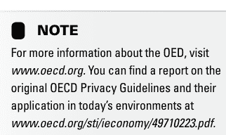

- 组织应仅收集其所需的信息。
- 组织不应共享其信息。
- 组织应保持其信息最新。
- 组织仅应将其信息用于收集时的目的。
- 组织应在不再需要其信息时妥善销毁。

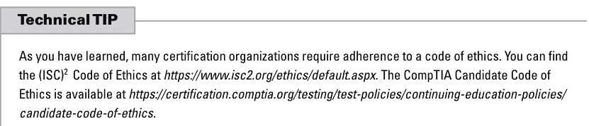

## 人员安全原则

无论你能设计出什么技术方案来保护你的系统，人的因素始终是你最大的挑战。你可能会惊讶于一点教育能起多大作用。如果员工意识到安全风险如何损害他们自己和组织，他们就更有可能帮助你严格管理。

了解用户应该和不应该做什么很重要。实现这一目标的最佳方法是制定明确的工作描述、工作角色和职责。当你知道人们应该做什么时，就更容易识别他们不应该做的活动。如果他们的角色或职责模糊，就更难发现不良行为——这意味着人们更有可能逃脱惩罚。

最大限度地减少对信息和资产的访问是一项重要的安全控制。你已经学习了一些与人员安全相关的概念。这些概念非常重要，值得重新审视。请仔细关注任何直接影响人员的安全概念。人员是你组织中最重要的资产。让他们知道如何为维护组织安全做出贡献至关重要。

## 限制访问

在决定如何向用户授予访问权限时，核心概念之一是限制访问。用户应仅获得履行其职责所需的权限级别，这一理念称为 *最小特权原则*。始终使用此原则。否则，你将冒着允许未经授权的用户访问其不应访问的信息的风险。例如，薄弱的访问控制可能允许销售职员查看员工工资。

需要知道要求是另一项与最小特权原则相关的概念。该原则规定，无论员工的安全许可级别如何，人们应仅能访问其履行工作所需的信息。因此，即使用户拥有最高机密安全许可，也不意味着他们应能访问 *所有* 最高机密信息。他们只需访问履行工作所需的信息。

## 职责分离

职责分离将一项任务拆分为由不同用户执行的子任务。这意味着单个用户在没有另一个用户的帮助或批准的情况下，无法执行关键任务。换句话说：有意损害系统的用户必须获得他人的帮助。阴谋很难组织和隐藏。例如，职责分离有助于确保员工无法既创建新供应商，*又*向该供应商开出支票。这能防止员工为 Acme Consulting 开立银行账户，在工作系统中创建名为 Acme Consulting 的新供应商，然后为 Acme Consulting 开出 1000 美元的支票。

## 工作轮换

保护组织免受人员相关安全违规的另一种方法是使用工作轮换。工作轮换通过在不同系统或职责之间轮换员工来最小化风险。这可以防止串通，即几名员工密谋实施欺诈。它还让管理者有机会跟踪哪些用户被授权采取了什么操作以及何时采取。如果其他安全措施失效，工作轮换提供了在造成更多危害之前发现安全漏洞的机会。工作轮换还提供训练有素的备份，因为几名员工学习特定工作的技能。

## 强制休假

与工作轮换类似，强制休假提供了发现欺诈的机会。当用户休假时，你应暂停其对你环境的访问。这可以防止他们在家工作，从而可能试图掩盖痕迹。例如，根据美国银行规则，某些银行员工必须连续休两周假。直到最近，法律禁止管理者就工作相关事宜与这些休假员工联系。该规则已放宽，允许对系统进行只读访问，以便员工至少可以跟进电子邮件通信。然而，他们在休假期间仍不能参与工作相关活动。

## 安全培训

由于人员对于强大安全至关重要，你可以开发的最佳安全控制之一是强大的安全培训与意识计划。安全培训有助于获得所有员工的支持。他们将成为积极遵守与其工作相关的政策的安全倡导者。他们会小心避免安全漏洞。你应该对员工进行培训，然后在指定间隔期再次培训。这种重复培训可以刷新员工的知识，并提醒他们安全的重要性。训练有素的人员可以在安全环境与攻击和失误的集合之间产生差异。

员工应了解组织面临的安全威胁，尤其是来自人为因素的威胁。这些威胁包括安装流氓技术、选择弱密码以及网络钓鱼攻击。这些类型的威胁很常见，因为许多组织未能对其员工进行识别这些威胁的重要性培训。仅仅解释弱密码如何危及个人和商业信息，通常就能鼓励用户创建更强密码。

## 安全意识

安全意识计划应满足安全策略的要求和期望。安全策略要求采取行动，并为安全控制提供权限。它是最佳防御形式之一。如果员工意识到策略强制要求，他们更有可能遵守安全控制。除了解释策略中每个部分的必要性外，该计划还应说明策略违规行为的处罚。

意识计划不同于正式培训计划。大多数用户不了解什么是安全以及为什么需要安全。你可以使用安全意识计划——包括海报、电子邮件和员工通讯等工具——来完成以下工作：

- 教导用户了解安全目标
- 告知用户安全领域的趋势和威胁
- 激励用户遵守安全策略

员工通常希望为公司做最好的事。然而，当安全似乎阻碍他们的工作效率时，他们往往会绕过安全措施以更快地完成工作。例如，假设员工 Bob 正在家中度过周末，接到办公室另一名员工 Sue 的电话。Sue 说她需要 Bob 的密码才能访问文件或系统，以便完成项目。无论你多少次提醒


让员工了解共享密码的风险，大多数人在这种情况下仍会很快泄露他们的密码。您的工作是强调遵循安全策略的重要性。您的工作也是教他们如何解决生产力问题，同时仍保持高水平的安全。

安全意识计划可以提醒员工注意安全策略。这些计划还可以衡量员工遵循安全策略的情况。这些计划为员工提供处理安全事件的实用建议。一个好的计划能让员工相信安全是他们的个人责任。您可以帮助员工改变行为，使安全成为他们日常例行工作的一部分。

记下不遵循策略的员工。在培训会议中使用这些信息，向员工呈现与其工作相关的特定场景。询问员工：“当……时，您会怎么做？”您收集的信息有助于发现安全意识计划中的不足。利用这些信息定制您的计划。

## 社会工程学

计算机系统面临的最常见攻击类型之一涉及社会工程学。社会工程学是指欺骗或利用他人来绕过安全控制。由于大多数人都乐于助人，攻击者说服拥有系统访问权限的人去做不该做的事情并不困难。这是安全领域中最关键的领域之一。随着您向更多员工授予系统和数据访问权限，安全漏洞的风险会增加。技术解决方案无法阻止授权用户给未授权人员致电并在电话里读取敏感数据。避免社会工程学的最佳方式是确保您培训人员识别社会工程攻击尝试，并知道如何处理此类攻击。您的安全培训应涵盖最常见的社会工程攻击类型，包括：

- 威胁—使用威胁或骚扰来恐吓他人以获取信息。
- 提及上级姓名—使用经理或上级的姓名来让他人相信，更高层级的权威已允许访问信息。
- 求助—利用他人的同情心或对困难（且可能不合理）情况的理解。情感诉求的目的是绕过正常程序或获得特殊待遇。当与奖励等激励措施相结合时，这种工程手段非常有效。例如，考虑这样的诈骗：骗子承诺如果您帮他把钱转给弱势人群，他就汇钱给您。不幸的是，这种情感诉求每年都会愚弄许多人。
- 钓鱼—技术在社会工程学中效果很好。以钓鱼为例。在钓鱼攻击中，诈骗者创建类似于知名组织工作的电子邮件或网页。诈骗者希望您相信这是知名组织，从而与他们共享敏感信息。他们利用这些信息获取您的财务信息或窃取您的身份。钓鱼攻击还可以采取调查的形式，通过提问来获取敏感信息。

> 注意
> 有关最新钓鱼技术和欺诈警报的更多信息，请参阅 www.fraudwatchinternational.com/phishing。

## IT 安全策略的基础设施

每家公司都在复杂的法律、法规、要求、竞争对手和合作伙伴组合中运营。此外，士气、劳资关系、生产力、成本和现金流也影响公司的运营方式。在此环境下，管理层必须制定并发布总体安全声明和指令。从安全团队的角度看，安全计划通过政策及其支持元素（如标准、程序、基线和指南）来实施这些指令。图 6-1 显示了安全策略环境的元素。

每个元素对安全专业人员都有特定要求，他们负责合规性监控、安全意识、培训、访问控制、隐私、事件响应、日志分析等工作。

您的安全政策设定了组织的基调和文化。作为安全专业人员，您通常需要执行政策意图。您必须了解组织安全策略的细节。策略是价值观和方向的高级别声明。您组织的标准、基线、程序和指南实施您的安全策略。

安全专业人员的角色是为这些元素提供支持。这种支持包括向员工传达政策、培训和执行。您在任何更新或更改中都有角色。图 6-2 显示了典型的安全策略层次结构。

## 政策

书面安全政策记录了管理层的目标和宗旨。它们解释了公司的安全需求及其满足这些需求的承诺。安全政策应读起来像关键事实的简短摘要。如果政策过于复杂，管理层将难以接受和批准它。

例如，一个良好的组织安全政策可能简单地表述为：“安全对我们组织的未来至关重要”或“我们产品的安全是我们最重要的任务。”这类声明为管理者提供决策所需的指导。安全政策还帮助您的组织评估其遵守法律、法规和应尽注意标准的情况，并评估勤勉程度。任何与安全相关的政策的主要目的是降低风险。政策帮助组织将其努力集中在特定领域。

如果政策未被阅读、提供、执行和更新，则价值不大。您必须将政策张贴在每位员工都能看到的位置。例如，您经常会看到政策张贴在休息室。政策必须是最新的，特别是要符合新的

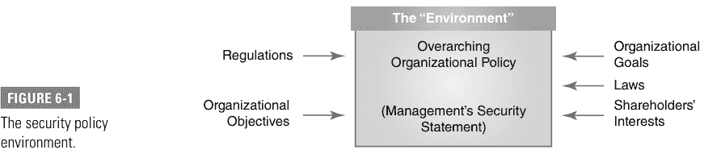

## **图 6-2** 安全策略层次结构。

## 组织安全政策

高层管理人员的声明，表明安全对组织很重要，且为实现安全状态而开展的活动将得到认可、支持和资助。

### 支持组织政策的功能政策

（这些是一些示例）

- 可接受使用
- 反病毒
- 互连
- 电子邮件使用
- 防火墙
- 主机安全
- 无线使用
- 外联网
- 其他政策

## 支持机制

| 标准 | 程序 | 基线 | 指南 |
| :--- | :--- | :--- | :--- |
| 定义用于支持策略的特定产品和机制 | 定义实施策略、标准和基线的操作 | 定义实现一致安全级别所需的最低参数 | 定义推荐（但非强制）的操作 |

法律法规。您应至少每年与员工会面一次，确保他们了解最新政策。为每位员工保存此次审查的记录。

安全政策帮助所有员工了解组织重视的资产和原则。有了明确的政策，您的员工更可能尊重组织的资产。请记住，员工对待政策的态度取决于组织对待政策的态度。

**功能政策**声明了组织管理层在电子邮件、远程访问和互联网浏览等特定功能领域的安全方向。负责这些功能政策的部门编写它们。例如，人力资源、信息技术、运营和设施部门各自会制定各自的具体功能政策。功能政策应使用强有力的语言，如 *will* 和 *must*。大多数人将 *should* 等词视为仅是建议，而非强制要求。措辞不当

不如有力的措辞那样引人注目。例如，一个良好的访问控制功能政策如下所示：

> “所有授权用户必须只允许执行 _仅_ 其授权任务。未授权用户不得访问公司系统或资源。”

功能政策的一个示例是 **隐私政策**。隐私政策规定了您的组织如何收集、使用和处理关于个人的信息。大多数提供个人信息的消费者都要求一份强有力的隐私政策。它为组织提供了明确说明将如何处理客户个人信息的机会。功能政策的另一个示例是可接受使用政策（AUP）。此类政策明确规定了组织允许其资产被使用的方式。此类政策最常见的焦点是规定人员必须如何使用组织的计算机资源。该政策可能包括关于社交媒体甚至特定网站可接受使用的指导。

政策允许组织在非常高的层面上陈述不同的目标。这些目标可能面向其员工、业务合作伙伴、客户，或者所有这些群体。它们设定了组织的基调，并在不同领域传达承诺。组织人员做出的所有决策都应源于这些高层政策。

## 标准

**标准**是组织范围内用于应对安全风险的硬件和软件解决方案的强制性要求。标准可能指特定的防病毒产品或密码生成令牌。简单来说，当标准建立后，意味着组织已选择一个解决方案——且只有这一个解决方案——来实现政策目标。

采用标准有很多好处。通常，标准可以帮助组织节省资金，因为它可以与供应商谈判批量采购。供应商可能以 29.95 美元出售单用户许可证。但是，同一供应商可能以每份仅 24.95 美元的价格出售多个许可证。如果该组织需要多个许可证来符合标准，批量采购可以为公司节省数千美元。此外，许多供应商在批量采购时提供免费培训。这可以为组织节省培训员工如何使用产品的时间和精力。

您不必为每种情况都制定自己的标准。您可以采用由政府、行业或其他部门制定的标准，并将其用作自己的标准。标准还在整个组织中建立共同基础。这有助于使所有部门步调一致。它们确保每个部门都拥有保持合规所需的蓝图。

标准的主要缺点是漏洞。如果所选产品存在缺陷，则在安装该产品后，整个组织将面临风险。如果供应商不支持该产品，或者维护或许可成本过高，单一标准将无法工作。在评估用于标准的产品时，请考察替代方案。确保您做出的每个选择都附带支持保证，以防出现问题。

## 程序

**程序**是完成安全要求、流程或目标的逐步系统性操作。它们是您可用的最强大工具之一。它们可以记录您开展业务的方式，并确保没有员工的关键


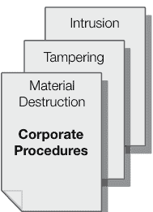

图 6-3 系统性操作。

知识仅停留在某人的脑海中。程序涵盖更改密码、响应事件和创建备份等内容。图 6-3 展示了几个示例程序。

程序可确保你执行政策的意图。它们要求你遵循一系列步骤来完成任务。关于程序，以下全都成立：

- 它们可减少危机中的错误。
- 它们确保你不会遗漏重要步骤。
- 它们在流程中提供执行保证检查的环节。
- 它们是强制性要求，类似于政策和标准。

## 基线

在许多情况下，为特定类型的计算机或设备定义基本配置是有帮助的。例如，拥有一份列出标准工作站组件和配置设置的文档，可以轻松确保所有新工作站都相同。安全人员通常会创建此类基本配置，称为基线，以确保其执行安全最低限度要求。基线是帮助确保多种系统应用和不同产品中都存在最低安全级别的基准。基线在配置新计算机或设备时很有帮助，也可用于与现有系统进行比较，以查看它们是否仍满足最低要求。图 6-4 显示了一个基本基线企业配置。

基线说明如何应用安全设备，以确保它们在整个组织中创建一致的安全级别。不同的系统或平台处理安全问题的方式各不相同。基线告诉系统管理员如何为每个平台设置安全性。这有助于实现一致的安全级别。

基线是不同安全产品、操作系统和应用程序所提供选项的伟大平准化器。随着更多混合产品进入安全市场，这变得越来越重要。这些产品将服务合并为多功能

| 基线企业配置 |
| --- | --- | --- |
| VPN 设置 | IDS 配置 | 密码规则 |

图 6-4 基线企业配置。

设备。组织通常会为每个使用的操作系统创建基线标准。您可能为 Windows 8、Windows 10、Windows Server 2012 R2、Windows Server 2016、Mac OS X、Linux 等拥有不同的基线。

## 指南

组织通常使用 **指南** 来帮助为安全计划提供结构。它们概述了采购和使用可接受产品和系统的建议。指南只是组织推荐的行动。这些指南通常以白皮书、最佳实践或组织安全计划定义的其他格式存在。

您必须仔细选择在指南中使用的语言。几个错误的词语就可能将指南转变为公司标准。例如，请考虑公司 CEO 指令的以下全局性声明示例：

> “本公司将遵循 ISO 27001 标准的建议。”

该声明使 ISO 27001 在该组织中成为强制性要求。在做出如此大胆的声明之前，请确保那是意图。

## 数据分类标准

强制访问控制 (MAC) 涉及为每个对象分配特定的分类。信息分类通常依赖于适用于特定数据类型的法规。示例包括保护个人信息、财务信息和健康信息。

分类数据是数据所有者或所有者指定的人的职责。您可以将此人称为 _数据所有者_。类似的术语 _系统所有者_ 是指管理基础架构的人员或团队。系统所有者通常负责变更或配置管理。系统所有者 _不_ 负责数据分类。

理解许可与分类之间的区别很重要。授权向 _用户_ 授予许可。数据所有者向 _数据_ 分配分类。系统通过确定主体具有访问分类对象的正确许可来强制执行访问控制。操作系统通常会与最小权限原则或需要知道原则一起强制执行访问限制。

组织在对信息进行分类时会考虑三个标准：

- **价值** — 您可以通过多种不同的措施来定义信息的价值：对组织的价值、对竞争对手的价值、替换或丢失的成本，以及对组织声誉的价值。
- **敏感性** — 敏感性是衡量完整性被破坏或信息被披露对组织产生影响的程度。组织可以通过多种方式衡量敏感性，包括责任或罚款、声誉、可信度或市场份额损失。
- **关键性** — 关键性是衡量信息对组织使命的重要性。如果信息丢失，组织会发生什么情况？

### 信息分类目标

信息分类的目标如下：

- 识别信息保护要求，这些要求基于如果信息被披露或数据或系统损坏，企业面临的风险
- 根据组织政策识别数据价值
- 确保敏感和/或关键信息获得适当的保护/控制
- 通过仅保护敏感信息来降低成本
- 在整个组织中标准化分类标记
- 提醒员工和其他授权人员保护要求
- 遵守隐私法律法规

组织可以从信息分类中获得许多好处：

- 被分类为敏感或关键的数据会获得与其分类相匹配的保护级别。
- 组织为其成本获得了更多价值，因为它只在最需要的地方应用更强的控制。例如，比较昂贵珠宝店、廉价珠宝店和仿首饰店的物理安全成本。这些商店都无法使用另一家商店的安全系统高效运营。所有组织都有高、中、低价值的数据。每个分类值都需要不同的安全级别。
- 适当的标记使员工能够认识到需要保护分类数据。

### 分类示例

美国政府使用包含未分类、限制级、机密、秘密和绝密的分级分类系列。私营部门使用公共（低）、私有（中）和机密（高）等各种类别。

与政府相关的分类是众所周知且标准化的。

与公司相关的分类不那么众所周知且不具备标准化。这给私营部门带来了问题。例如，当员工更换工作时，新雇主可能会将“私有”置于“机密”之上。在他以前的工作中，他的雇主将“私有”置于“机密”之下。这令人困惑。当这种情况发生在同一家公司内部时，更是令人困惑。安全专业人员工作的一部分是识别这些不一致之处，并提出纠正建议。

> **注意**
> 分区数据是指需要超出正常分类系统的特殊授权才能访问的数据。确保您的程序包括正确处理此类信息的步骤非常重要。

### 分类程序

分类程序对有效的数据分类至关重要。在实施这些程序之前，首先确定其范围和流程至关重要。分类范围决定应分类哪些数据；分类流程决定如何处理分类数据。您必须正确标记和标识所有资源。通过遵循严格的程序，您将准备好应对即将到来的审计。


要确定分类计划的范围，你应该进行业务影响分析，以评估组织的所有数据。这决定了数据对组织运营的价值和关键性。数据价值根据以下因素确定：

- 独占所有权（商业秘密）
- 实用性（有用性）
- 创建或重新创建数据的成本
- 责任（保护法规）
- 可转换性/可流通性（财务信息）
- 运营影响（如果数据不可用）
- 对信息的威胁
- 风险

根据业务影响分析的结果，你必须确定所需的分类级别数量。你还将标准化每个级别的标题，以便在整个组织中使用。将此信息发送给负责分配初始分类的信息所有者。这些分类人员必须了解相关法规、客户期望和业务关切。目标是实现对分类信息处理的一致方法。

你可能会发现制定培训计划很有用，这样你的分类人员就能以一致的方式处理所有数据。所有者还负责定期审查分类，以确保它们仍然是最新的。每当立法者或监管机构引入新的政府法规时，此审查尤其关键。最后，所有者负责解除不再需要特殊处理的信息的分类。政府组织通常会在特定年限后自动声明信息已解密。

你必须根据组织的分类政策和程序标记所有包含敏感信息的媒体。这是员工知道应使用哪些特殊处理措施的唯一方式。你应该以电子方式和简单标签的形式同时对磁性和光学媒体进行标记。硬拷贝形式的文档需要在封面外部和页面内部贴上标签。

## 保障

内部和外部审计师应将组织的信息分类状态作为其常规审计流程的一个组成部分进行审查。他们还应评估与分类政策和程序的合规程度。这可以确保组织的所有部分都遵守该流程。此审查可能会揭示信息被过度分类的情况。

信息安全人员应定期巡查工作站以及用户可能留下未受保护分类材料的其他区域。他们还应确保在发生违规行为时，向主管和经理提交适当的报告。理想情况下，员工绩效评估应包括员工处理信息不当的任何情况。这有助于员工理解此流程的重要性。组织应考虑实施清桌/清屏政策，该政策规定用户绝不能在无人看管的办公桌或工作站上以公开形式留下敏感信息。

## 配置管理

在网络化计算机环境中，任何组件长期保持不变的情况都很不寻常。组织通常会在系统生命周期内对自动化系统的硬件、软件、固件、文档、测试计划和测试文档进行修改。重要的是，所有配置更改都应仅在受控流程中进行。不受控的配置更改通常会导致冲突，甚至产生新的安全漏洞。管理计算机和设备配置的所有更改的过程称为配置管理。

从安全专业人员的角度来看，配置管理评估修改可能对安全性产生的影响。它会影响系统、应用程序或文档的机密性、完整性或可用性吗？作为安全专业人员，你的工作有两方面：

- 确保你充分审查所有系统更改。
- 确保对配置的更改不会对安全性造成意外后果。

你必须控制所有修改，以确保更改会按预期影响你的环境，并且你的环境将按授权方式运行。

## 硬件清单和配置图

许多组织缺乏硬件清单，无法了解自己拥有什么、谁拥有所有权或占有权，以及哪些部门或系统正在使用它。这是安全计划中的一个严重缺口。在发生火灾、设备故障或盗窃时，缺乏文档会减慢响应速度并延长运营损失。它还使得正确的配置管理极其困难，甚至不可能。如果你无法查找、更新和测试每个受影响的设备，那么推出新补丁、服务包或版本的决定将变得复杂。

## 硬件配置图

你必须拥有硬件组件配置的最新映射或布局。这有助于确保你根据基线配置所有系统。它还能确保你对系统或网络上完成的工作进行适当审查，从而进行正确的更改，而不会绕过任何安全功能。硬件配置图应包括以下内容：

- 网络的实际构建图，帮助你规划变更的顺序并查看可能产生的连锁反应。
- 计划在一台设备上使用的所有软件配置的副本（就其对其他设备的影响而言）。这些配置应包括路由器、交换机和防火墙配置等项目。

## 补丁和服务包管理

你应该定期检查是否有可用的供应商升级和服务包。如果你拥有来自不同供应商的多种软件和硬件，此过程可能会比较复杂。尽管如此，有必要解决所有已知漏洞。组织必须有补丁管理流程，以确保在不导致系统中断的情况下向所有计算机和设备推送补丁。你应该在推出前测试每个补丁，以确保它不会禁用其他系统或功能。

## 变更管理流程

通常将变更和配置控制作为一组活动来讨论，但实际上它们是光谱的两端。当然，混淆在于某个特定活动从一端跨越到另一端。在两者之间划清界限很困难，因为不同复杂程度的组织会在不同的地方划线：

- **配置控制** 是对系统设备基线设置的管理。基线设置满足安全要求。它们要求你谨慎实施，并且只能在事先批准的情况下实施。
- **变更控制** 是对配置更改的管理。未受管理的更改会引入风险，因为它们可能会影响安全运营或控制。不当的更改甚至可能禁用系统或设备。变更控制确保对生产系统的任何更改都经过测试、文档化和批准。变更本身必须遵循变更控制流程，以确保你正确地进行更改并将其报告给管理层。

图 6-5 显示了变更控制与配置控制之间的平衡。

## 变更控制管理

变更控制管理通过让所有受影响的部门参与，制定控制变更的计划方法。其目标是为所有参与变更的人员最大限度地利益，并最大限度地降低失败风险。

要使变更管理有效，它应具有多学科性，涉及组织的所有方面。尽管如此，组织不应受到如此多的限制以至于失去所有灵活性。变更管理应允许组织采用新技术、改进和修改。

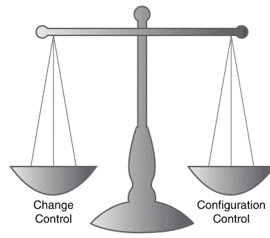

图 6-5 变更控制与配置控制的互补平衡。


变更管理需要由首席信息官或 IT 总监以及业务信息安全经理批准的书面策略。该策略必须定义与变更管理相关的所有角色、职责和流程。以下是一些需要牢记的重要事项：

- 你应该有效地传达变更管理流程和标准。它们应定义你在整个企业中用于支持该策略的技术和工具。

- 变更管理可以是被动的，也可以是主动的。在**被动变更管理**中，管理层响应业务环境的变化。变更的来源是外部的。一些示例包括法规、客户期望和供应链的变化。在**主动变更管理**中，管理层发起变更以实现预期目标。在这种情况下，变更的来源是内部的，例如采用新技术。

- 你的组织可以以多种方式进行变更管理。它可以是持续的、定期计划的、基于发布的，或根据需要按各个项目逐一进行。

## 审查变更的潜在安全影响

变更会为企业带来风险。它可能绕过既定的安全功能，并可能导致停机或系统故障。它可能需要对员工进行广泛的再培训，以学习如何使用新系统。由于涉及风险，你必须将安全人员纳入变更控制流程。

正式的变更控制流程应保护 IT 系统的完整性，并确保生产环境中的所有变更都经过适当测试、安排和传达。变更控制委员会的成员参加会议和论坛，以评估、计划、审查和准备组织的生产环境。

## 变更控制委员会

高级经理或业务流程所有者应领导一个**变更控制委员会**。该委员会监督对系统和网络的所有拟议变更。委员会批准变更及其实施计划。这样一来，你就不能在没有适当审查、资金和文档的情况下对系统、应用程序或网络进行更改。

在 IT 的配合下，变更控制委员会（在某些情况下也称为*变更控制委员会*）提供监督，以保护计算资源以及包含在这些应用程序和数据库中的数据。作为变更流程的一部分，关键成员与 IT 组织的对应人员会面，审查即将实施的计划，并确保你正确评估所有变更。他们还确保已应用和评估必要的安全控制措施。他们将调查结果传达给组织的所有部分。

简而言之，变更控制委员会的主要目标是确保所有变更均符合以下要求：

- 经过适当测试
- 已获授权
- 已安排计划
- 已传达
- 已记录

当你使用可靠的变更控制时，识别可能导致生产问题的近期变更很容易。这简化了问题解决流程，并使你的环境更加安全。

### 变更控制流程

变更控制流程可确保变更不会在未遵循正确步骤的情况下发生。这有助于你避免范围蔓延等问题，范围蔓延会使未经授权的变更悄悄进入系统。它还有助于避免因缺乏监督、缺乏测试或未经适当授权而进行变更所导致的问题。图 6-6 显示了一系列变更控制流程。

- 1. **请求**—在请求阶段，你应该以书面形式描述所有拟议的变更，并将变更请求提交给变更控制委员会进行审查。未经批准，你绝不应该对系统进行更改。

- 2. **影响评估**—影响评估阶段评估变更对系统或项目的预算、资源和安全性的影响。

- 3. **批准**—批准（或在某些情况下不批准）阶段是变更控制委员会对变更的正式审查和接受（或拒绝）。

- 4. **构建/测试**—构建/测试阶段是根据已批准的变更文档实际开发或构建变更。然后你必须测试变更，以确保它不会对其他系统或组件造成意外问题。此测试可能包括回归测试以及对修改后产品安全性的深入审查。

- 5. **实施**—在测试变更并批准其发布后，你可以安排安装过程。在此处，充分的职责分离可确保没有人能够在未经适当审查和监督的情况下进行更改。最后的障碍是通知管理层你已成功进行更改。

- 6. **监控**—在此阶段，你必须监控所有系统，以确保系统、程序、网络和其他资源正常工作。你应该使用组织的问题解决流程来处理任何用户问题或请求。监控可能识别出未来变更的需求。这将重新启动变更控制流程。


图 6-6
变更控制流程。

### 变更控制问题

可靠的变更控制流程包含倾向于识别问题并在需要时提供恢复途径的组件。成功的变更控制计划应包含以下要素，以确保变更控制流程的质量：

- **同行评审**—这可确保在将变更投入生产之前，由同行或其他专家对所有变更进行双重检查。同行通常可以在变更进入测试阶段之前发现问题。

- **回退计划**—这些计划可确保如果变更无法正常工作，则存在将系统恢复到已知良好状态的计划。尽管有最佳控制流程，你可能会意外发布具有非预期效果的变更。你必须知道如何撤销或回退破坏性变更。

- **文档**—你必须保持文档最新，以反映系统的真实设计。你还应将备份副本异地保存。文档对于了解系统应如何运行是必要的。

### 应用程序软件安全

一个关键的关注领域是应用程序软件。攻击者知道软件开发过程很复杂，而且该过程的结果通常是包含弱点的应用程序。编写安全软件可能很困难。它需要在过程的每个阶段都关注安全性，并需要一个结构化流程，以确保软件仅执行其预期操作。有几种流行的方法来描述和控制系统和软件开发过程。了解软件开发过程对于开发具有极少弱点的软件非常重要。你应该熟悉两种最流行的方法：**系统生命周期 (SLC)** 和 **系统开发生命周期 (SDLC)**。这些过程中的步骤非常相似，只是 SLC 包括运行和处置，而 SDLC 以过渡到生产结束。

对于某些组织，维护和新开发由开发人员完成，使他们成为 SDLC 的一部分。对于其他组织，专业维护团队处理维护和开发，使他们成为 SLC 的一部分。越来越多的组织使用 SDLC 术语来描述应用程序和系统软件的整个变更和维护过程。

### 系统生命周期

本节介绍 SLC 中使用的常见步骤。安全专业人员在每个步骤中参与得越多，所需安全性就越有可能从一开始就构建到系统中。SLC 的主要理由（以及在一开始就构建安全性的理由）是降低或避免成本：

- 商业软件产品的消费者将看到更低的成本，因为你需要交付更少的补丁和修复。此外，由于攻击者发现并利用的软件弱点，导致的损失也会更少。

- 商业软件的供应商将看到更低的成本，因为他们需要更小的支持团队，并且具有较低的保修和产品维护成本。


SLC 中常用的步骤如下：

- **1. 项目发起与规划**—一个成功项目的首要条件之一是拥有所有必要的资源。您需要的资源应代表您需要考虑并整合到项目中的领域。您的角色是就如何从项目一开始就将安全构建进去提供建议。这包括项目预算、系统设计、维护和项目时间表。您应首先在此处处理威胁、漏洞、风险和控制措施。

- **2. 功能需求与定义**—这是“如果怎样？”阶段。始终使用肯定表述陈述需求：程序必须处理某些数据或执行某些功能。您需要考虑当数据不符合规范时程序应该或将会做什么。当软件接收到意外输入时会发生什么？字符是否太多？字段是否缺失？用户是否看到传输延迟？未能考虑这些因素会导致大量安全事故。

- **3. 系统设计规格**—在此阶段，项目被分解为功能和模块。为此，您必须考虑系统将运行的硬件类型。此处的安全问题包括硬件和网络的物理安全。安全还必须考虑所有可能的平台。例如，说项目仅限于 Linux 或 Windows 是不够的。每个平台都有各种版本，并运行在几乎无限的外围设备、芯片组和驱动程序组合上。

- **4. 构建（开发）与文档**—编码标准应包括标准功能调用库。它们还应包括针对加密、哈希和访问控制等项目的行业标准解决方案。您需要在开发过程中保护代码，使只有开发人员有权访问，并且仅在知悉需求的基础上授予访问权限。即使开发人员也只能访问他们需要查看的部分。您不应将副本以打印或机器可读形式随处丢弃，例如放在 CD 或 USB 存储棒上。

- **5. 验收测试**—您应在功能设计阶段制定测试计划。该计划必须包括测试，以确保新程序提供必要的安全性，并在适用时提供隐私性。负责测试的人员不应是开发人员。此外，开发人员的交付日期延期不应影响分配给测试的时间。

- **6. 实施（过渡到生产环境）**—在此过渡期间，开发人员将致力于为用户和帮助台人员提供培训和协助。安全功能需要向这两组人员仔细解释。在某些组织中，开发人员还将帮助管理代码向维护人员的移交。

- **7. 运行与维护**—当系统出现问题时，维护、运行和帮助台人员通常最先得知。他们需要跟踪接收到的问题，并准备好将结果报告给管理层。此过程推动变更管理流程。这些人员需要接受培训，以了解变更请求、软件故障以及安全弱点或漏洞之间的区别。此外，他们需要知道如何处理每一类事件。

- **8. 处置**—随着时间的推移，组件部件将达到其生命周期终点。您将需要升级备份系统或采购更大的磁盘来替换较小的磁盘。您应确保有对媒体进行消毒并以具成本效益的方式处置的程序。多年前，组织会擦除磁盘并将其转售。如今，小型二手磁盘的价值通常低于使用 DBAN 等工具安全擦除它然后简单处置磁盘的成本。

## 测试应用软件

安全专业人员通常帮助测试新系统或现有系统的升级。这些测试应足够彻底，以确保您测试所有预期和意外的操作，并正确处理错误。您还应执行测试以测试系统上的最大负载，包括事务量、内存分配、网络带宽和响应时间。如果在测试中使用生产数据或敏感数据，请确保采取措施保护这些数据的安全。

由于输入验证攻击非常常见，您的安全人员应与软件测试人员合作，以确保测试能发现任何输入漏洞。一种用于输入漏洞的测试称为模糊测试。模糊测试是向软件提供随机输入以查看其如何处理意外数据的做法。模糊测试可以帮助比测试人员试图构思错误输入更好地识别输入漏洞。

## 系统采购

引入新漏洞到环境中的一种常见方式是通过引起意外副作用的变更。您应彻底评估环境中的任何变更，以确保其不会引入新漏洞。新硬件和软件也是如此。采购新设备是安全专业人员的关键职责，但如果流程处理不当，可能会降低整体安全性。每当需要采购新设备时，您应仔细评估哪些产品能满足您的要求。为确保新设备不会使您的环境面临任何新漏洞，您必须执行以下操作：

- 评估各种可用的解决方案。
- 从维护、支持和培训方面评估供应商。
- 使用通用准则来简化评估流程。
- 监控供应商合同和服务级别协议（SLAs）。
- 正确安装设备并在项目结束时正式验收。
- 遵循组织的采购程序以确保公平的采购流程。
- 监控系统和设备，以识别即将达到生命周期终点的设备，以便您可以安排其更换。

## 通用准则

由于采购新设备可能导致安全漏洞，因此将流程正式化是合理的。评估系统和设备的正式方法的需求催生了几套不同的标准。美国政府创建了一系列计算机安全标准文档，因文档封面的鲜艳颜色而被称为彩虹系列。《红皮书》描述了受信任网络基础设施（TNI）的组件。《橙皮书》讨论了在分类系统中维护访问控制和保密性。两者都使用了一系列评估级别（C2、B3 等），供应商将其产品针对这些级别进行评估。彩虹系列的开发者将其正式称为 TCSEC。

其他政府制定了各自的等效标准。有些是从 TCSEC 开始并进行修改。最终，这些标准合并成了 ITSEC。美国、英国、加拿大、德国、法国和荷兰政府以 ITSEC 为起点。随后，他们开发了一种名为通用准则的新采购标准。

通用准则包含一系列难度逐级增加的评估保证级别（EALs），编号从 1（最低）到 7（最高）。评估实验室遍布世界各地。行业内的领先供应商（例如防火墙供应商）共同创建一个标准、理想且完美的解决方案。任何供应商都可以将其产品针对该标准进行评估。EAL 等级保证供应商的声明与集体标准在定义的测试级别上匹配。产品的文档、开发和性能必须全部符合评估声明。

## 数据政策

所有数据最终都会达到其使用寿命终点。当您不再需要或无法使用数据时该怎么办？最佳做法是简单地遵循数据政策中的指导。当然，这意味着您必须已有数据政策。涵盖数据管理的政策应涵盖数据生命周期中的各个阶段。完善的数据政策应包含涵盖保留和存储以及处置的章节，甚至完整文档。

数据政策中的保留和存储章节应说明您将保留不同类型数据的时间。有些数据项的有效期比其他数据更长。如果您需要出于研究目的保留历史数据，您的政策应说明如何存储这些数据。您的安全政策也应扩展到涵盖存储的数据。

但当您不再需要数据时该怎么办？您可以将媒体上的数据覆盖以准备重复使用，这一过程称为擦除，或者销毁媒体。您的选择取决于媒体的有用性和数据的敏感程度。对于极度敏感的数据，擦除数据并销毁媒体更安全，以防止数据落入可能恢复所有或部分已擦除数据的人手中。

每当您需要处置设备时，都应确保以安全的方式处置，以免泄露任何机密数据。可供您选择的选项包括以下内容：

- **消磁**—对磁性媒体施加强磁力通常会使所有电子设备无法使用。
- **物理销毁**—物理销毁存储数据的媒体可确保消除任何机密材料。
- **覆盖数据**—此选项完全不销毁媒体。此处将其作为实际媒体销毁的可行替代方案列出。反复覆盖媒体上的数据会降低数据被恢复的可能性。然而，仍有可能有决心的人能够恢复部分已删除的数据。


技术提示

通用标准的正式名称是 ISO/IEC 15408。

## 认证与授权

在采购与处置之间，您需要确保计算环境中的组件足以满足您的需求。认证是贯穿系统整个生命周期的审查过程，以确保其满足指定的安全要求。授权是授权官员正式同意接受实施系统所带来的风险。该过程涉及以下角色：

- 授权官员——必须审查认证报告并决定批准系统实施的高级管理人员。授权官员（AO）正式确认并接受系统可能对机构使命、资产或个人造成的风险。

- 认证者——负责对系统进行安全测试与评估（ST&E）的个人或团队。认证者还要为 AO 编写关于系统运行风险的报告。

- 系统所有者——负责系统日常运营，并确保系统持续符合授权官员（AO）设定条件运行的人员即系统所有者。

认证：认证是对系统的技术评估，旨在确保组织正确实施了系统。系统应满足初始设计要求，以确保安全控制有效运行。此任务由认证者或认证者团队执行。认证者应具备执行验证过程及证明合规性所需测试的能力。系统认证意味着：

- 系统满足技术要求。

- 系统满足功能要求。

- 系统提供正常运行的保证。

为了进行认证，参与该过程的人员首先必须了解技术和功能要求。他们还必须了解他们推荐采购或批准投入生产的系统的功能。这些可能是软件或硬件要求。您可以从数量或质量角度对其进行评估，例如每分钟认证 100 名用户的能力或确保 99.99% 的正常运行时间。您可以将要求基于非 IT 因素，例如重量或能耗。授权者必须审查所有要求。无论是执行还是管理这些任务，其中许多都会作为安全专业人员落到您身上。

最后，认证者必须对照这些清单，确保新系统满足或超过每项规格。当他们确认确实如此时，他们会建议管理层批准。这并不意味着该系统适合您的组织，或它是最佳可用方案。认证仅意味着产品满足其技术和功能规范，并按承诺运行。

**授权：** 授权发生在您对系统进行认证之后。授权是管理层正式接受系统的过程。授权者或指定批准机构审查认证报告，并根据运行环境接受系统投入运行。您可以用两种方式定义此过程：

- 授权是管理层对风险的正式接受。

- 授权是管理层实施的许可。

**新认证的触发因素：** 认证和授权流程确保系统不仅满足当今的安全要求，而且在整个生命周期的运行和维护阶段继续满足这些要求。授权后阶段列出了继续运行和管理系统所需的活动，以保持可接受的风险水平。您必须持续评估风险以满足此要求，原因如下：

- 由于新产品、新流程、合并或剥离，业务需求会发生变化。

- 曾经获得授权的产品（解决方案）可能不再满足业务需求。

- 供应商经常升级或更换产品，这些替换产品需要重新认证和重新授权。

## 软件开发与安全

本章前面您已经了解过开发安全软件的重要性。从安全角度看，软件开发需要特别关注。应用程序是用户、客户和攻击者访问数据的最常见途径。这意味着您必须构建软件以强制执行安全策略，并确保符合法规，包括数据和系统流程的隐私与完整性。无论您的组织采用哪种开发模型，都应确保应用程序正确执行以下任务：

- 检查用户对应用程序的身份验证。

- 检查用户授权（特权级别）。

- 在系统故障时具有恢复数据库完整性的程序。

- 统一处理错误和异常，不允许任何错误或异常未得到处理。未处理的异常会降低应用程序的安全性。规划使用标准响应处理所有错误和异常的方法。为用户提供一致的错误响应，并提供清晰的解释和指示。使用户能够做出正确的选择。

- 验证所有输入（永远不要在未首先验证的情况下接受来自任何来源的输入）。如果数据未通过验证，请将其丢弃；不要尝试对其进行清理！这意味着您必须在客户端和服务器上验证数据。攻击者在数据从客户端传输到服务器的过程中往往可以修改数据。在服务器上再次验证是确保数据有效的唯一方法。依赖薄弱验证的攻击包括：

- **跨站脚本（XSS）**——这是一种攻击，攻击者向 Web 应用程序输入客户端脚本代码。然后，其他用户会看到该代码，其客户端软件会执行脚本指令。XSS 攻击利用用户对服务器的信任。

- **跨站请求伪造（XSRF）**——与 XSS 攻击类似，攻击者提供脚本代码，导致查看输入脚本的可信用户向 Web 服务器发送恶意命令。XSRF 攻击利用服务器对用户的信任。

- **结构化查询语言（SQL）注入**——一种攻击技术，攻击者提供恶意 SQL 语句以访问未经授权的数据或执行未经授权的命令。

- 定义安全配置基线。当您将应用程序发布给最终用户时，提供一组定义安全基线（或起点）的文档化配置设置。

- 提供关于加固应用程序的指导。除了提供安全基线外，还应提供有关更改配置设置以保持应用程序安全的指导。同时，还应提供有关进一步配置设置或添加外部控制以提高应用程序安全性的指导。

- 提供并应用频繁的补丁。确保您为环境应用最新的安全补丁。还应为应用程序用户提供频繁的安全补丁，以及一种方便的应用补丁和管理补丁过程的方法。

内部开发的软件将有源代码、目标代码和运行时可执行文件。您需要使用政策、标准和程序来管理和保护这些内容。例如：

- 应保护源代码免遭未经授权用户的访问。

- 应使用版本控制系统跟踪源代码的更改，以便回滚到先前版本时不会出错。

- 程序员不应能够直接更新生产系统（程序员到测试，然后测试到生产）。

### 软件开发模型

安全软件开发需要一种用于创建和修改软件的正式模型。此过程称为软件开发生命周期（SDLC），它采用行业最佳实践来指导软件开发活动，将其视为具有特定开始和结束日期以及一组所需交付成果的项目。目前，最广泛接受的两种软件开发模型包括：

- 瀑布模型。基于传统的项目管理实践，在任何开发之前都需要进行大量规划。项目的进展沿着明确定义的路径向前推进。

- 敏捷开发方法。一类较新的项目管理方法，依赖于非常短的活动冲刺。敏捷方法在需求变化频繁并经常重新审视的高度动态环境中效果良好。


**技术提示**

你可能认识到 SQL 注入是一种常见攻击。根据开放 Web 应用安全项目（Open Web Application Security Project，www.owasp.org），SQL 注入漏洞是 Web 应用程序中最常见的反复出现的漏洞之一。数据库不断增长以及对更快数据的需求，导致了非关系型数据库（称为 NoSQL 数据库）的增长。虽然 NoSQL 数据库不专门易受 SQL 注入攻击，但这并不意味着你应该认为它们更安全。即使 NoSQL 数据库也易受注入攻击。

### 瀑布模型

许多当前的软件开发方法将其模型建立在 **瀑布模型** 的基础上，如 **图 6-7** 所示。这是一种用于开发软件的顺序过程。它包括你之前学过的 SDLC 和 SLC。在瀑布模型中，进度像瀑布一样向下流动。瀑布模型的本质是，在前一阶段完成之前，没有任何阶段开始。各阶段如下：

- 1. 需求规格说明
- 2. 设计
- 3. 构建
- 4. 集成
- 5. 测试与调试
- 6. 安装
- 7. 维护

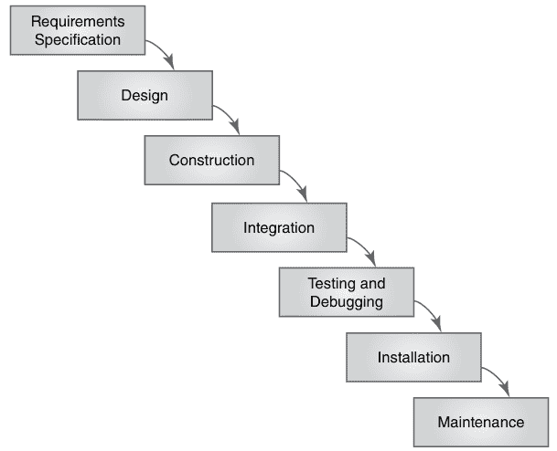

图 6-7 瀑布模型。

基本瀑布模型起源于制造业和建筑业。它是高度结构化物理环境的特征，在该环境中，后期修订成本非常高，甚至完全禁止成本。当 Winston W. Royce 于 1970 年制定此模型时，不存在正式的软件开发方法。这种面向硬件的模型被改编用于软件开发。

由于人们认为该模型存在不足，你会发现瀑布模型的变体。大多数软件开发模型至少使用一些与瀑布模型相似的阶段。该模型的重要性在于其专注于确保每个阶段在继续之前都已完成。尽管在大型开发环境中这可能非常困难，但请务必投入时间来正确规划和设计你的软件。不要直接开始编写程序！

### 敏捷软件开发

传统的软件开发管理仍很大程度上基于瀑布方法的某种变体。在 1990 年代，一些组织开始意识到软件行业正在以不同方式变化。对更高效地开发更复杂软件的需求不断增加，导致了管理软件开发的新方法。与其用长交付计划管理大型项目，许多组织寻求更具响应性的方法。他们希望能够以较小的部分开发软件。这种向较小开发周期转变的趋势最终被称为敏捷开发方法。

敏捷大致描述了一种基于小型项目迭代（或冲刺）而非长期项目计划的开发软件方法。使用敏捷的组织更频繁地生成较小的可交付成果，并可以在各部分完成时，将大型项目评估为其各个部分。冲刺通常持续一到四周。这意味着每月会出现一次或多次可交付成果。这种对频繁交付的关注，使得在大型软件产品随时间成熟的过程中，能够看到和使用其各个部分。

第一次敏捷爱好者的组织会议于 2001 年举行。几个正在探索这种新型软件开发的组织派代表前往犹他州斯诺伯德参加会议，以协作和交流思想。与会者创建了敏捷运动的奠基性文档——《敏捷软件开发宣言》。这是一份简洁的文档，反映了其编写者对简单方法的喜爱。以下是《敏捷软件开发宣言》（http://www.agilemanifesto.org/）的全文：

- 重视个体和互动，胜过流程和工具
- 重视可工作的软件，胜过详尽的文档
- 重视客户合作，胜过合同谈判
- 重视响应变化，胜过遵循计划

也就是说，虽然右侧各项也有价值，但我们更看重左侧各项。

图 6-8 展示了敏捷方法背后的基本理念。与瀑布方法不同，敏捷旨在具有迭代性。每次循环是一个单独的冲刺。需要多个冲刺才能创建一个完整的软件项目。每个冲刺在特定时间点结束，并应包含一些可交付成果。可交付成果应该是团队可以演示的内容，例如可工作的软件。对可工作软件的关注，有助于将团队聚焦于结果。

图 6-8
敏捷软件开发方法。

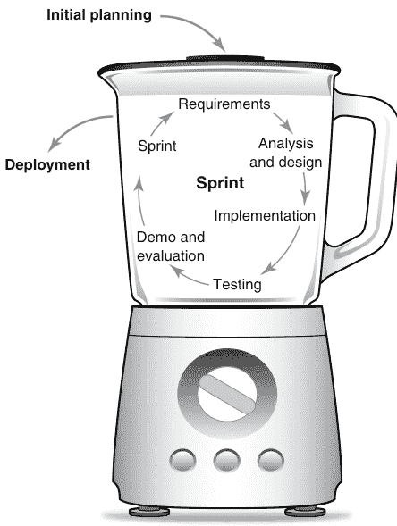

敏捷是管理软件开发项目的一种流行技术。它倾向于在鼓励持续沟通并重视短开发周期的组织中表现良好。从一开始就应将安全考虑纳入软件开发中，这一点很重要。敏捷方法鼓励开发人员规划安全，并在每个冲刺结束时测试安全。开发安全软件可以成为整体开发工作的组成部分——也就是说，前提是组织重视并鼓励安全。无论组织使用哪种开发方法，关注安全都比任何方法都更重要。

**注释**
你可以在 http://agilemanifesto.org 上找到关于 *敏捷软件开发宣言* 和敏捷方法的一般信息。了解敏捷的另一个良好起点是 www.agile-process.org。

## 章节摘要

在本章中，你了解到安全专业人员必须认识到，安全运营和管理是任何坚实安全计划的基础。你了解到安全管理如何规划、设计、实施和监控组织的安全计划。你了解到专业伦理对于每个坚实安全计划至关重要。你了解到为确保安全计划合规需要做什么。你了解到计划中的政策、标准、准则和程序如何共同作用以塑造你的安全计划。你了解到数据分类标准如何影响决策过程。你了解到如何使用配置管理来管理系统修改，以及配置控制和变更控制如何影响变更管理流程。你探索了系统生命周期 (SLC) 和系统开发生命周期 (SDLC) 的八个常见步骤，以及这些步骤如何降低成本。你了解到为什么软件开发方法需要特殊的安全考虑。最后，你了解到用户意识对于你的安全计划成功至关重要。

## 关键概念和术语

- 认证
- 敏捷开发
- 授权官员 (AO)
- 基准
- 框架采购协议 (BPA)
- 认证
- 认证者
- 变更控制
- 变更控制委员会
- 清桌/清屏政策
- 合规联络人
- 配置控制
- 跨站请求伪造 (XSRF)
- 跨站脚本 (XSS)
- 应急运营小组
- 事件日志
- 功能政策
- 模糊测试
- 准则
- 互连安全协议 (ISA)
- 互联网架构委员会 (IAB)
- 工作轮换
- 谅解备忘录 (MOU)
- 离职流程
- 入职流程
- 隐私政策
- 主动变更管理
- 程序
- 被动变更管理
- 修复
- 安全管理
- 服务级别协议 (SLA)
- 冲刺
- SQL 注入
- 标准
- 系统开发生命周期 (SDLC)
- 系统生命周期 (SLC)
- 系统所有者
- 瀑布模型

## 第 6 章评估

- 1. 安全管理是负责规划、设计、实施和监控组织安全计划的个人团体。
- A. 正确
- B. 错误

- 2. 安全计划需要记录以下内容：
- A. 安全流程
- B. 组织采用的政策、程序和准则
- C. 负责安全的人员的权限
- D. 以上全部
- E. 以上都不是


- **3.** 组织不必同时遵守法规标准和组织标准。
  - A. 正确
  - B. 错误

- **4.** ______ 是您组织与外部公司之间的正式合同，详细说明该公司将提供的具体服务。
  - A. 安全事件日志
  - B. 事件响应
  - C. 服务级别协议 (SLA)
  - D. 合规性报告

- **5.** 哪种软件测试方法提供随机输入以查看软件如何处理意外数据？
  - A. 注入
  - B. 模糊测试
  - C. 有效错误输入
  - D. 边界输入

- **6.** 1989 年，IAB 发布了关于互联网伦理的政策声明。该文档称为 ______。
  - A. OECD
  - B. RFC 1087
  - C. (ISC)² 道德准则
  - D. CompTIA 考生道德准则
  - E. 以上皆非

- **7.** ______ 是指只应授予用户履行其职责所需权限级别的概念。
  - A. 强制休假
  - B. 职责分离
  - C. 工作轮换
  - D. 最小权限原则
  - E. 以上皆非

- **8.** 以下哪项是社会工程学的示例？
  - A. 寻求帮助的情感诉求
  - B. 网络钓鱼攻击
  - C. 威胁恐吓
  - D. 提及名人
  - E. 以上皆是

- **9.** 策略设定了组织的基调和文化。
  - A. 正确
  - B. 错误

- **10.** ______ 涉及在整个组织中用于解决安全风险的硬件和软件解决方案的标准化。
  - A. 策略
  - B. 标准
  - C. 程序
  - D. 基线

- **11.** 关于程序，以下哪项是正确的？
  - A. 它们会在危机中增加错误。
  - B. 它们在流程中提供执行保证检查的位置。
  - C. 重要步骤常常被忽略。
  - D. 以上皆非
  - E. 以上都是

- **12.** 数据分类是数据所有者的责任。
  - A. 正确
  - B. 错误

- **13.** 分类信息的目标包括以下哪些？
  - A. 根据组织策略识别数据价值
  - B. 识别信息保护要求
  - C. 在整个组织中标准化分类标记
  - D. 遵守隐私法、法规等
  - E. 以上都是

- **14.** 配置管理是对自动化系统在系统生命周期内对其硬件、软件、固件、文档、测试计划和测试文档所做的修改进行管理。
  - A. 正确
  - B. 错误

- **15.** 变更管理流程包括 ______ 控制和 ______ 控制。
  - A. 许可，分类
  - B. 文档，数据
  - C. 硬件清单，软件开发
  - D. 配置，变更

- **16.** 越来越多的组织使用术语 ______ 来描述应用程序的整个变更和维护流程。
  - A. 系统开发生命周期 (SDLC)
  - B. 系统生命周期 (SLC)
  - C. 系统维护生命周期 (SMLC)
  - D. 以上都不是

- **17.** 开发软件时，应确保应用程序执行以下哪些操作？
  - A. 具有编辑检查、范围检查、有效性检查和其他类似控制
  - B. 检查用户授权
  - C. 检查对应用程序的用户身份验证
  - D. 在系统故障时具有恢复数据库完整性的程序
  - E. 以上都是

- **18.** 有几种软件开发方法，但大多数传统方法都基于 ______ 模型。
  - A. 修改
  - B. 瀑布
  - C. 开发者
  - D. 集成

# Auditing, Testing, and Monitoring

部署控制后，规划安全系统并不会停止。如果您真的想保护自己免受数据泄露，必须确保自己准备好应对任何类型的攻击。为此，您需要定期评估系统。避免数据泄露的一种关键评估类型是安全审计。审计计算机系统时，检查其运行情况在多大程度上实现了安全目标。简单来说，审计系统时，就是看系统中的事物是否按计划运行。审计通常还会将系统的当前配置视为时间上的快照，以验证其是否符合要求。

您可以手动审计系统，也可以使用自动化计算机软件进行审计。手动测试包括：

- 采访您的员工
- 执行漏洞扫描
- 审查应用程序和操作系统访问控制
- 分析对系统的物理访问

使用自动化测试时，审计软件会创建重要文件和设置任何更改的报告。这些文件和设置可能与计算设备、操作系统或应用程序软件相关。计算设备可包括个人电脑、移动设备、服务器、网络路由器和交换机。应用程序软件包括在任何为用户提供服务的计算设备上运行的任何软件。

当然，在审计系统之前很久，您就需要制定建立系统规则和要求的策略和程序。也就是说，在确定某事是否有效之前，必须先定义它应该如何运作。这被称为评估系统。您评估系统的所有组件，并确定每个组件应该如何运作。这设定了您的基线预期。有了这些，您就可以审计系统。您将系统的性能与基线预期进行比较，以查看事物是否按计划运行。

## Chapter 7 Topics

本章涵盖以下主题和概念：

- 什么是安全审计和分析
- 如何定义审计计划
- 什么是审计基准
- 如何收集审计数据
- 审计后需要执行哪些活动
- 如何执行安全监控
- 应捕获哪些类型的日志信息
- 如何验证安全控制
- 如何监控和测试安全系统

## Chapter 7 Goals

完成本章后，您将能够：

- 描述安全审计的实践和原则
- 审查监控系统的方法，包括日志管理以及使用入侵检测系统 (IDS) 或入侵防御系统 (IPS)
- 为系统性能设定指标
- 评估组织的安全合规性

## Security Auditing and Analysis

安全审计和分析

安全审计的目的是确保您的系统和安全控制按预期工作。审查系统时，应检查以下内容：

- **安全策略是否健全且适合业务或活动？** 信息安全的目的是支持业务使命，并保护其免受面临的风险。就安全而言，最明显的风险之一是数据泄露。贵组织的策略及支持文档定义了影响其风险。支持文档包括贵组织的程序、标准和基线。进行审计时，您在询问：“我们的策略是否被理解和遵循？”审计本身不制定新策略。但是，审计人员可能会根据经验或对新法规或其他要求的了解提出建议。

- **是否有控制措施支持您的策略？** 安全控制是否正确与贵组织的策略和使命相一致？控制措施是否支持您的策略和文化？如果无法通过策略证明某项控制措施的合理性，则可能应将其删除。每当某项控制措施仅以“出于安全考虑”为理由进行解释而没有其他说明时，应将其删除。安全不是利润中心，也不应为自身存在。它是支持部门。其目的是保护组织的资产和收入流。

- **控制措施是否得到有效实施和维护？** 随着组织的发展和威胁的成熟，确保控制措施仍能应对当前面临的风险非常重要。

如果您能对这些问题回答“是”，则状态良好。如果不能，不用担心。您将在本章中培养这些技能。

### Security Controls Address Risk

安全控制应对风险

安全控制对可能对组织构成风险的活动施加限制。必须定期审查安全，以确保控制措施是最新且有效的。此次安全审查包括以下活动：

- **监控**—审查并衡量所有控制措施，以捕获系统上的操作和变更。
- **审计**—审查日志和整体环境，以对安全策略和控制措施的有效性提供独立分析。
- **改进**—在审计结果中包括改进安全计划和控制措施的建议。此步骤适用于管理层接受的建议变更。
- **保障**—确保新旧控制措施协同工作，以保护预期的安全级别。

虽然安全控制保护您的计算机和网络，但应确保每个控制措施都是必要且有效的。每个控制措施都应保护组织免受特定威胁。没有识别出威胁的控制措施是一层开销，不会让组织更安全。仔细确保到位的所有安全控制措施都针对特定威胁。拥有多个针对相同威胁的控制措施没问题——只需确保每个控制措施至少针对一种威胁。

请记住，风险被定义为威胁实现的概率。可以通过将风险概率乘以资产成本来计算预期损失。识别风险使您能够衡量控制措施的有效性。当使用的控制措施成本高于威胁实现时的潜在损失时，可能会浪费组织的资源。避免浪费组织资源的最佳方法之一是确保遵循安全审查周期。图 7-1 显示了安全审查周期中的步骤如何相互契合。


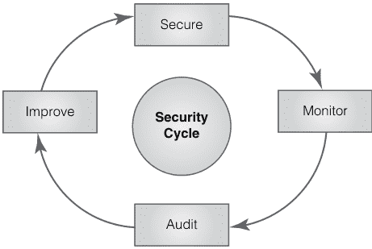

## 确定什么是可接受的

采取正确安全控制措施的第一步是确定哪些行为是可接受的：

- 你组织的安全策略应当定义可接受和不可接受的行为。
- 你组织可能会根据标准组织制定或认可的标准，自行创建自己的标准。
- 政策文件允许的通信和其他行为是可接受的。
- 你安全策略中明确禁止的通信和其他行为是不可接受的。其他通信或行为也可能不可接受。任何可能泄露机密信息、损害系统完整性或使系统不可用的行为也是不可接受的，即使策略没有明确禁止它。

## 权限级别

适合你组织的权限级别取决于你组织的需求和政策。将组织所需的权限级别与其安全架构相匹配至关重要。如果不这样做，你可能会丢失大量数据，声誉也会受损。你还可能发现，如果安全控制措施过于严格，用户会试图绕过它们。最常见的权限级别如下：

- **放任**—允许一切。许多家庭用户使用这种权限级别，但这使攻击者更容易成功。
- **宽容**—未明确禁止的任何内容都可以。这种权限级别适用于大多数公共互联网网站、一些学校和图书馆以及许多培训中心。
- **谨慎**—允许合理的一组事项；其他所有事项均禁止。这种权限级别适用于大多数企业。
- **偏执**—允许的事项非常少；其他所有事项均禁止并受到仔细监控。这种权限级别适用于安全设施。

无论你使用哪种权限级别，都要“检查你所期望的”。这句话适用于审计的所有方面。它的意思是，如果你期望计算机使用谨慎的权限级别，就要仔细检查其用户权限和许可。确保现有控制措施能按你的预期运行。用户权限和许可审查是任何安全审计不可或缺的一部分。如果你部署了出色的安全控制措施，却给用户无限权限，那么你实际上并没有让系统变得很安全。

## 安全审计的领域

安全审计的范围可以非常大，涵盖整个部门或业务职能。在光谱的另一端，审计可以非常窄，仅针对一个特定的系统或控制措施。审计为管理层提供独立评估，判断最佳控制措施是否已到位以及运行情况如何。这有助于管理层理解并应对风险。

例如，高级别安全策略审计是对安全策略的审查，以确保其及时、相关、已传达并得到执行。这种审计还有助于确保你的策略反映组织文化。这些审计还可能确定用户或客户是否接受控制措施，或者他们是否试图绕过认为不切实际的控制措施。此外，这种审计测试你的基础设施保护应用程序数据的效果。它确保应用程序仅限授权用户访问，并隐藏（加密）未经授权的用户不应看到的数据。

你还必须审计组织的所有防火墙、路由器、网关、无线接入点和其他网络设备，以确保它们按预期运行，并且其配置符合你的安全策略。最后，审计可以测试技术本身。它们检测你所有联网的计算机和设备是否按照你的策略协同工作。它们有助于确保你的规则和配置及时、有文档记录，并受变更控制程序约束。

## 审计目的

审计为你提供审查风险管理计划的机会，并确认该计划已正确识别并降低（或以其他方式处理）组织面临的风险。

审计检查控制措施是否：

- **适当**—安全控制的级别是否适合其所针对的风险？
- **正确安装**—安全控制是否在位置正确且运行良好？
- **实现其目的**—安全控制在解决其设计所针对的风险方面是否有效？

审计师创建的审计报告应根据需要推荐对组织流程、基础设施或其他控制措施的改进或变更。审计之所以必要，是因为潜在责任、疏忽和强制性法规合规性。审计可以暴露问题并提供合规性保证。许多司法管辖区依法要求进行审计。

## 应该多久进行一次审计？

审计频率是一个重要的考虑因素。有些审计只需按需进行。这些包括事后审计或外部机构（例如监管机构）要求的任何审计。其他审计应按照计划进行。许多法规要求每年或每季度进行审计。内部要求可能要求更频繁地进行审计。例如，勤勉的组织通常每周审计服务器日志，每天审计 IDS/IPS 日志。你的安全策略应包含审计类别和频率要求，以指导你的审计计划。

法律和法规要求雇佣一定数量员工或属于特定行业的一些公司进行内部和外部审计。必须进行这些强制审计的行业包括金融服务组织以及任何处理个人医疗记录的组织。要求内部和外部审计的联邦法律或供应商标准包括《萨班斯-奥克斯利法案》（SOX）、《健康保险可携性和责任法案》（HIPAA）以及《支付卡行业数据安全标准》（PCI DSS）。《个人信息保护和电子文件法》（PIPEDA）是加拿大法律，用于保护组织在电子商务交易中收集、使用或披露个人信息的方式。它还包含审计要求。

审计可能会发现组织缺乏经过充分培训和具备技能的员工。它可能显示公司在监督安全计划和管理资产方面做得不够。审计可能会鼓励组织提供更好的员工培训。另一方面，审计可能会验证组织是否满足或超出其要求。

许多新法规使管理层对公司资产的欺诈或管理不善承担个人责任。在过去，公司主要对这些失职负责；现在个人要负责。组织最有利的做法是尽一切努力遵守所有必要要求，以保护自身及其人员。

## 客户信心

客户通常只会与他们信任的组织开展业务。如果客户知道你持续审计系统的安全性，他们可能会更愿意与你分享敏感信息。

许多企业对企业服务提供商使用审计标准来建立客户信心。美国注册会计师协会审计准则委员会于1993年发布了第70号审计准则声明（SAS 70）。这是该类别的第一个标准，为许多服务组织提供了审计指导。SAS 70是为保险和医疗索赔处理机构、电信服务提供商、托管服务提供商以及信用卡交易处理公司等组织制定的。SAS 70审计有两种类型：I类型和II类型。SAS 70 I类型审计包括服务审计师对服务组织为实现环境控制目标而描述和实施控制措施的评估。SAS 70 II类型审计包括I类型审计中的信息，以及服务审计师对已识别控制措施是否已实施的评估。


且运行有效。虽然 SAS 70 的范围比较宽泛，但该标准未解决当今服务组织面临的许多新兴问题。例如，SAS 70 未涉及支持托管或提供基于云的服务。SAS 70 于 2011 年 6 月正式退役。

2011 年，鉴证业务准则第 16 号 (SSAE 16) 取代了 SAS 70。SSAE 16 扩大了 SAS 70 的范围，是服务组织占主导地位的审计和报告标准。SSAE 16 在审计师验证控制和流程时提供指导。它还要求报告中包含对受审计控制的设计和有效性的描述。这些报告提供描述组织特定控制的详细信息。例如，一家寻求在数据中心租赁空间的公司可能会要求数据中心提供 SSAE 16 或 SAS 70 审计的结果，以对该数据中心的安全控制进行独立评估。

对 SAS 70（以及现在的 SSAE 16）结果的依赖在许多组织中有所增加。美国注册会计师协会 (AICPA) 已认识到服务组织日益增加的复杂性，并为服务组织创建了三种不同级别的审计报告。服务组织控制 (SOC) 框架定义了三种级别审计报告的范围和内容。表 7-1 列出了 SOC 报告及其各自的特征。

SOC 1、SOC 2 和 SOC 3 报告是组织审计师的重要工具。SOC 1 报告主要关注财务报告内部控制 (ICFR)。此类报告通常用于为用户组织编制财务报表，并实施适当的控制以确保财务报告要求生成的数据的保密性、完整性、

> **NOTE**
> 有关 SAS 70 的更多信息，请参阅 http://sas70.com。有关 SSAE 16 的更多信息，请参阅 http://ssae16.com。有关 SOC 1、SOC 2 和 SOC 3 报告的更多信息，请参阅 www.ssae16.org/white-papers。

和可用性。SOC 2 和 SOC 3 报告都主要涉及安全相关控制。这些报告中的安全相关控制对当今技术服务提供商组织的成功至关重要。SOC 2 和 SOC 3 报告之间的主要区别在于其受众。SOC 2 报告是为内部和其他授权利益相关者创建的；SOC 3 报告旨在供公众使用。

表 7-1 服务组织控制 (SOC) 报告。

| 报告类型 | 内容 | 受众 |
| :--- | :--- | :--- |
| SOC 1 | 财务报告内部控制 | 用户和审计师。这通常用于必须遵守萨班斯-奥克斯利法案 (SOX) 或格雷-里奇-布莱利法案 (GLBA) 的组织。 |
| SOC 2 | 安全性 (保密性、完整性、可用性) 和隐私控制 | 管理层、监管机构、利益相关者。这通常用于服务提供商、托管数据中心和托管云计算提供商。 |
| SOC 3 | 安全性 (保密性、完整性、可用性) 和隐私控制 | 公众。这通常要求 SOC 2 服务提供商的客户验证和验证该组织是否满足客户私人数据和合规法律要求 (例如 HIPAA 和 GLBA)。 |

## 定义审计计划

在规划审计活动时，审计师首先必须定义目标并确定要审查哪些系统或业务流程。审计师还应定义要检查哪些保证领域。

审计师还必须识别参与审计的人员——包括其自身团队和被审计组织的人员。这些人员将收集和整理信息以推进审计。审计师必须确保每个人都具备正确的技能，准备好做出贡献，并在需要时可用。

一些审计师会审查之前的审计，以熟悉过去的问题。其他审计师则选择不审查之前的审计，以避免受先前结论的影响。

## 定义计划范围

您必须在项目开始时定义审查的边界。确定审计将审查哪些领域以及哪些领域不会审查至关重要。您必须确保当前审计中未审查的领域将接受另一次审计，并且必须为这些领域设定责任人。所有系统和网络都必须有明确指定的所有者。

在某些情况下，审计范围会超出单个组织。如果您的组织外包数据或处理，您可能需要包括组织外部存在的资产。您可能需要审计通过互操作性协议访问的组件。确定审计范围可能需要与外部组织进行交互。

此时，您需要决定通知谁审计正在进行。在许多情况下，如果用户知道您正在审计他们，他们可能会开始遵守之前忽略的规则。如果知道审计会改变用户行为，那么审计将不准确。另一方面，在不告知员工的情况下进行审计会限制对关键信息的访问，使工作更加困难。您需要根据具体情况权衡这一点。图 7-2 显示审计范围如何跨越 IT 基础设施的所有七个领域。

> **NOTE**
> 审计组织的每个部分并扩展到所有外包合作伙伴可能由于资源限制而不可能。审计师应将最高风险领域列为最高优先级。

审计师在进行任何审计活动之前应花时间妥善规划审计。规划远不止列出要检查的文件和文档。事实上，审计师在准备审计时通常要做大量工作。在规划和执行阶段，您可以期待审计师做到以下几点：

- **调查现场**—审计师希望在开始审计活动之前了解环境以及系统之间的互连。

- **审查文档**—审计师希望审查系统文档和配置，无论是在规划期间还是作为实际审计的一部分。当审计涉及外部合作伙伴时，审查互操作性协议要求是必要的。这些文件规定了外包合作伙伴的合规性要求。

图 7-2 审计范围和 IT 基础设施的七个领域。

- 审计领域：
  - 1. 远程访问
  - 2. WAN
  - 3. LAN-to-WAN
  - 4. 工作站和用户
  - 5. LAN
  - 6. 内部网服务
  - 7. 系统和主要应用程序

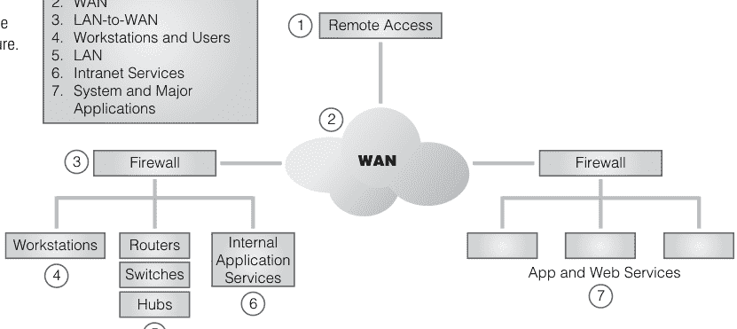

- 审查风险分析输出—审计师希望了解风险分析研究产生的系统关键性等级。这有助于在报告阶段将系统排序以进行适当的缓解。
- 审查服务器和应用程序日志—审计师可能要求检查日志，以查找对程序、权限或配置的更改。
- 审查事件日志—审计师可能要求审查安全事件日志，以了解问题趋势。
- 审查渗透测试结果—当组织进行渗透测试时，测试人员会准备一份列出发现的弱点的报告。审计师需要审查此报告，并确保审计涵盖所有项目。

## 审计基准

基准是将系统与之比较以确定其是否安全配置的标准。审计的一种技术是将计算机或设备的当前设置与基准进行比较，以帮助识别差异。

在本节中，您将找到审计或审查系统、业务流程或安全控制的常见方法。所有这些示例都是最佳实践。它们通常用作审计业务或业务流程的指导方针。贵组织的管理层可能已正式采用以下示例之一。如果贵组织受政府法规或立法约束，情况尤其如此。如果是，基准将指导审计的主要方向。否则，在高级管理层批准下，审计师决定如何进行审计。

- ISO 27002—ISO 27002 是一份最佳实践文档，为信息安全管理提供了良好的指导。对于组织声称合规，它必须


执行审计以验证所有条款均已满足。ISO 27002 是不断增长的标准套件（即 ISO 27000 系列）的一部分，用于定义信息安全标准。

- NIST 网络安全框架（CSF）—NIST CSF 最初于 2014 年发布，是对美国总统行政令的回应，该行政令呼吁加强网络安全。它侧重于关键基础设施组件，但也适用于许多通用系统。该路线图为保障系统安全提供了一种结构化方法，可帮助审计师将业务驱动因素与安全要求相协调。NIST 还发布了一系列特殊出版物，涵盖信息系统的许多方面。例如，NIST SP 800-37 是一项标准，描述了包括审计在内的美国政府信息系统的最佳实践。

- ITIL（信息技术基础设施库）—这是一套用于管理 IT 基础设施、开发和运营的概念和政策集合。ITIL 以一系列书籍形式出版，每本书涵盖一个单独的 IT 管理主题。ITIL 对多项重要的 IT 实践进行了详细描述，并附有全面的检查表、任务和流程，任何 IT 组织均可根据自身需求进行定制。

其他组织，如 ISACA 和内部审计师学会，已开发出常用的审计框架。贵组织可能会在内部制定一套指南，或采用并定制在其他地方开发的审计框架。以下是此类框架的两个示例：

- COBIT—信息及相关技术控制目标（COBIT）是 IT 管理的一套最佳实践。它由信息系统审计与控制协会（ISACA）和 IT 治理研究所（ITGI）于 1996 年创建。COBIT 为管理人员、审计师和 IT 用户提供了一套公认的措施、指标、流程和最佳实践。您可以使用 COBIT 来帮助从信息技术的使用中获得最大收益，并在公司内建立适当的 IT 治理和控制。

- COSO—内部审计师学会（IIA）发布了 Treadway 委员会的赞助组织委员会（COSO）。这个由志愿者运营的组织为高层管理人员和治理实体提供关于组织治理、商业道德、内部控制、企业风险管理、欺诈和财务报告等关键方面的指导。COSO 已建立一种通用的内部控制模型。许多公司和其他组织使用它来评估其控制系统。

除非法律或法规禁止，否则组织可以自由选择对其最有意义的审计方法。他们可能会使用此处提到的选项之一，或使用另一个组织或行业团体的指南。他们甚至可能会制定自己的文档。无论哪种方法最符合您的要求，在进行第一次审计之前，请确保有可遵循的审计方法。

> NOTE
> NIST SP 800 是一系列最佳实践文档。网站 http://csrc.nist.gov/ 按最新文档优先的方式组织。编号较低的项目可能仍然有效，因为修订不会更改编号。

## 审计数据收集方法

在分析数据之前，您需要识别并收集这些数据。有多种数据收集方法，包括：

- **问卷**—您可以向管理人员和用户发放准备好的问卷。
- **访谈**—这些有助于从各方收集关于运营的见解。访谈通常被证明是信息和建议的宝贵来源。
- **观察**—这指的是用于区分纸面程序和实际工作方式的输入。
- **检查表**—这些准备好的文档有助于确保信息收集过程涵盖所有领域。
- **审查文档**—这些文档评估时效性、遵循性和完整性。
- **审查配置**—此审查涉及评估变更控制程序以及控制、规则和布局的适当性。
- **审查策略**—此审查涉及评估策略的相关性、时效性和完整性。
- **执行安全测试**—此测试（漏洞测试和渗透测试）涉及收集技术信息，以确定安全组件、网络或应用程序中是否存在漏洞。

## 安全审计领域

审计过程的一部分是确保所有关键领域都有政策声明。审计师会记录您的政策未涉及的任何关键领域。之后，他们会检查所有人员是否遵循政策、程序和标准。

您需要密码标准（最小字符数和复杂度）和密码程序（设置、更改和重置密码的指南）来支持您的访问控制策略。许多组织将密码策略用作系统访问策略。这是一个危险的错误。您应该制定一个单独的访问控制策略，其内容类似于以下内容：

> **NOTE**
> 审计过程应是一种合作安排，所有各方共同努力，使您的组织更加安全。您不应将其视为“我们与他们”。审计师和被审计组织都应朝着同一个目标努力：更安全的环境。

授权用户只能执行其获授权的操作。未授权用户应被禁止执行任何操作。

由于密码经常成为攻击目标，密码的使用正在减少。相反，许多组织开始使用令牌、智能卡或生物识别技术进行身份验证。（当然，组合使用这些身份验证类型效果更好；如您在前一章中所学。）随着 IT 环境的变化，请确保您的策略也随之变化。您不希望所有访问控制策略都规定密码强度，而一半的系统却在使用智能卡。彻底的审计可确保您的安全策略是最新的并反映当前环境。您应识别并删除任何过时的策略。表 7-2 显示了安全审计中应包含的几个关键领域。

## 控制检查和身份管理

确保您的安全控制有效、可靠并按预期运行非常重要。如果没有监控和审查，您无法保证信息安全计划有效，或人员履行了应有的职责。在审计身份管理系统时，您应关注以下关键领域：

- 审批流程—谁批准访问请求？
- 身份验证机制—针对特定安全要求使用了哪些机制？
- 密码策略和强制执行—组织是否拥有有效的密码策略，且是否统一执行？
- 监控—组织是否拥有足够的监控系统来检测未经授权的访问？
- 远程访问系统—所有系统是否都使用了强身份验证并得到妥善保护？

> **NOTE**
> 审计师在审计期间会定期与管理层交谈，以核实其发现的情况。审计师可能会犯错，这使管理层有机会在审计师发布最终报告之前纠正误解并陈述自己的观点。

| 领域 | 审计目标 |
| :--- | :--- |
| 防病毒软件 | 保持最新，全面应用 |
| 系统访问策略 | 与技术同步更新 |
| 入侵检测和事件监控系统 | 日志审查 |
| 系统加固策略 | 端口、服务 |
| 密码控制 | 密钥管理、使用（对敏感数据进行网络加密） |
| 应急计划 | 业务连续性计划 (BCP)、灾难恢复计划 (DRP) 和业务连续运营计划 (COOP) |
| 硬件和软件维护 | 维护协议、服务、未来需求预测 |
| 物理安全 | 门锁闭，电源受监控 |
| 访问控制 | 仅知必需，最小权限 |
| 配置管理的变更控制流程 | 有文档记录，无未经授权的更改 |
| 媒体保护 | 媒体使用期限、标签、存储、运输 |


## 审计后活动

审计活动完成后，审计人员仍有更多工作要做。其他审计人员任务包括退出访谈、数据分析、生成审计报告以及向管理层展示调查结果。

## 退出访谈

审计人员与关键人员进行退出访谈，以向他们发出关于审计报告中后续将出现的重大问题和建议的早期警示。这使管理层能够快速响应并采取行动处理严重问题。除了这些早期警示外，审计人员在最终报告发布前不应提供详细信息。如果他们这样做，可能会对组织的安全准备状况造成错误印象。

## 数据分析

审计人员通常会在获许将数据带出组织场所的情况下，在外部分析所收集的数据。这使审计人员能够回顾所学到的一切，并使用标准报告格式呈现观察结果。异地分析还能让审计人员摆脱在现场时常遇到的压力。每个组织都希望收到正面的审计报告，而这种愿望有时会对审计人员形成微妙的压力。在与被审计组织不同的地点进行数据分析，有助于鼓励客观公正的分析。

## 生成审计报告

审计报告通常至少包含三个主要部分：

- **调查结果**—这些通常按符合标准基准的程度列出。将审计调查结果与既定政策或行业最佳实践进行比较，可描绘出组织需要改进的地方。

- **建议**—审计人员建议如何修复他们发现的风险。他们还会说明员工可能未遵守某项政策或流程。在大多数报告中，建议优先解决最重要的问题。审计建议应包括以下内容：

  - **实施时间表**—变更建议不应是无限期的。每条建议都应有一个建议的截止日期。

  - **风险等级**—审计应明确组织因每个调查结果所面临的风险等级。

  - **管理层回复**—审计人员应给管理层提供回复审计报告草稿副本的机会。然后，他们应将该回复放入最终报告中。此回复通常会澄清问题，并解释为何未使用控制措施，或为何草稿副本中的建议并不必要。回复还可以包括修复控制措施缺口的行动计划。

  - 后续跟进—在必要时，审计人员应安排后续审计，以确保组织已执行建议。

> **注意**
> 大多数审计报告都直奔主题。审计报告通常以摘要开头，随后是详细内容。摘要常常会传播到组织领导层之外，因此要注意不要在其中暴露安全弱点。您应仅在报告的详细信息部分中包含私人或机密信息，并始终适当标记此类信息。

## 调查结果展示

审计人员完成审计报告后，会向组织展示其调查结果。根据您组织的结构和规模，调查结果展示可能是一次正式会议，也可能仅仅是将报告提交给一个人。无论您以何种方式接收审计调查结果，被审计组织审查报告并做出必要的改变都很重要。调查结果可能会根据法规要求或可用预算导致变更。

## 安全监控

安全计划的首要目标是设定组织的安全态势。安全策略定义了安全态势，但安全计划执行策略行动。安全态势定义了组织如何记录初始配置、监控活动以及修复任何检测到的问题。监控是任何安全计划的重要组成部分。监控的主要目的是检测异常行为。毕竟，你无法修复你无法检测到的行为！安全监控系统可能是技术性质的，例如入侵检测系统（IDS），也可能是行政性质的——例如，在闭路电视上观察员工或客户的行为。

当您检测到异常或不可接受的行为时，下一步是将其停止。阻止公开和隐蔽的侵入行为既是一门艺术也是一门科学。公开行为是明显且故意的。隐蔽行为是隐藏且秘密的。

许多攻击者会试图规避您已部署的检测控制。事实上，仅安全监控控制的存在就足以威慑许多攻击者。另一方面，监控设备过多也是可能的。安全监控必须足够明显以阻止安全漏洞，但又必须适当隐蔽，以免过于强硬。

安全监控的一些工具和技术包括以下内容：

- 基线—要识别异常，您首先必须知道正常是什么样子。如果一份报告显示系统磁盘空间已用 80%，除非您知道昨天甚至上周使用了多少磁盘空间，否则这毫无意义。也就是说，每周额外使用 1% 磁盘空间并刚刚触发警报的系统，与上个月一直保持 40% 但突然翻倍的系统截然不同。基线在安全监控中至关重要。

- 警报、警示和趋势—警报和警示是对安全事件的响应，用于通知人员可能发生的安全事件，很像门开启警示或火灾警报。报告检测到的安全事件对于维护安全的信息系统是必要的。警报和警示的区别取决于资产状态。如果未设置警报，打开一扇门会产生警示。但是，一旦设置了警报，打开门就会产生警报。这就像您的家用报警系统。白天，打开一扇门可能只会导致系统发出一声提示音（警示），但晚上，打开门会触发警报。请注意，员工很快就会忽略重复的误报。例如，如果您邻居的汽车警报反复响起，您不会每次都跑到窗前。这意味着员工可能不会对真实事件做出反应。出于这个原因，存储警示和警报使得可以展示事件随时间如何发生。这种分析有助于识别趋势。趋势分析帮助审计人员关注的不仅仅是单个事件。

- 闭路电视—正确使用闭路电视涉及监控和记录电视摄像头看到的内容。您必须确保监控摄像头的安保人员接受过培训，能够观察特定的行为或举动。您的员工还必须接受当地法律培训；许多司法管辖区禁止基于种族或族裔进行画像分析。

- 识别不规则行为的系统—示例包括 IDS 和蜜罐，即设置用于捕获网络上不正当活动信息的陷阱。

## 计算机系统的安全监控

正如存在多种物理监控控制一样，监控计算机和网络系统活动也有许多方式。您必须选择监控计算环境诸多方面的控制，以检测恶意活动。存在许多工具可帮助您监控系统活动，无论是活动发生时还是事后。

**实时监控**提供事件发生时的实时信息。这种监控对于保持主动的安全态势非常重要。您可以使用实时监控控制提供的信息来遏制事件并维护组织的业务运营。网络入侵检测系统是实时监控控制的一个示例。它监控并捕获穿过网络的网络流量。此类控制的示例包括以下内容：

- **主机 IDS**—主机入侵检测系统（HIDS）非常适合在活动发生时“注意”计算机中的活动。IDS 规则有助于在近乎实时的时间内识别可疑活动。

- **系统完整性监控**—Tripwire 等系统使您可以监控计算机系统中的未经授权的更改，并在近乎实时的时间内将其报告给管理员。

- **数据防泄漏（DLP）**—DLP 系统使用业务规则来分类敏感信息，以防止未经授权的最终用户共享它。DLP 保护的数据通常是如果泄露可能会使组织面临风险的数据。例如，DLP 系统防止用户使用外部存储服务（例如 Dropbox）来存储敏感数据。

非实时监控保留活动的历史记录。当立即检测和响应事件不那么关键时，可以使用这种监控。此类控制的示例包括以下内容：

- **应用程序日志记录**—所有访问或修改敏感数据的应用程序都应有记录谁使用或更改了数据以及何时更改的日志。这些日志支持证明


遵守隐私法规、调查记录中的错误或问题以及跟踪交易。

- **系统日志**—这种日志记录谁访问了系统以及他们在系统上执行了什么操作。

以下是需要记录的活动部分列表：

- **基于主机的活动**—这包括系统更改、访问请求、性能以及启动和关闭。

- **网络和网络设备**—这些包括访问、流量类型和模式、恶意软件以及性能。

## 监控问题

日志记录确实有成本。每当您选择记录系统或应用程序活动时，都必须将这些信息存储在某处。许多组织会关闭日志，因为它们会产生过多信息。毕竟，如果没有足够的人员来审查日志，收集所有这些数据有什么意义呢？如果没有自动分析日志数据的方法，日志记录只是占用磁盘空间。它不提供任何价值。其他挑战包括日志数据质量差和攻击的复杂性。通常，很难看出花费员工时间来分析日志是有价值的。

让一些组织不敢进行积极监控的其他监控问题包括以下几点：

- **空间分布**。如果攻击来自广阔区域内的各种攻击者，则很难通过日志捕获攻击。更糟糕的是，攻击者可以使用大量由不同管理员管理且分布在大范围内的计算机。

- **交换网络**。在通过交换机和虚拟局域网高度分段的网络上，捕获流量可能更加困难。从分段日志文件中重建实际发生的情况需要更多工作。

- **加密**。加密数据会使日志记录更加困难，因为监控人员无法看到所有数据来决定是否可疑。未加密的部分可以记录，但其余部分几乎不可见。您可以在不同级别加密数据：

- **数据链路层加密（无线 等效保密 [WEP] 和 Wi-Fi 保护访问 [WPA]）**。使用这种加密类型，您会加密数据链路层以上的所有内容：WEP 加密永远不应用于无线安全；相反，应使用 WPA。

- **网络层加密（IPSec 和一些其他隧道协议）**。使用这种加密类型，您会加密网络层以上的所有内容。

- **应用层加密（SSL 和 SSH 等）**。这种加密类型会加密传输层以上的内容。

> **注意**
> 组织应监控流量，以确保数据在通过网络传输时所有敏感数据都经过加密。

### 日志异常

监控的一个重要方面是确定日志条目中的真实攻击与仅仅是噪音或次要事件的活动之间的区别。在这样做时，各类监控人员会犯两种基本类型的错误：

- **误报**——又称 I 类错误，误报是看似恶意但并非真实安全事件的警报。这些虚假警报是分散注意力的干扰项，会浪费管理工作。太多的虚假警报会导致管理员忽略真实攻击。为应对这种情况，您可能决定不记录不频繁或由人为错误引起的“攻击”。您可以通过创建**剪切级别**来实现这一点，即除非某个事件经常发生或满足其他一些预定义标准，否则将其忽略。例如，除非登录失败在短时间内多次发生，否则登录失败尝试通常不值得关注。失败登录的常见剪切级别为五。这意味着当用户登录连续失败五次时，系统将触发警报。剪切级别有助于减少误报数量。

- **漏报**——另一种监控错误是控制未能捕获可疑行为。**漏报**，又称 II 类错误，是警报系统未能检测到严重事件。也许该事件未被注意，或者警报被误导以为该事件不严重，而实际上它是严重的。在某些监控控制中，漏报是由于控制配置不正确造成的。控制应对环境更加敏感，并报告更多可疑活动。

### 日志管理

日志记录是安全人员的核心活动。日志文件可以帮助提供正常和异常系统活动的证据。它们还可以提供有关控制措施执行情况的宝贵信息。安全和系统管理员必须考虑多方面因素，以确保您保留正确的信息，并且这些信息是安全的。

首先，您应将日志存储在中心位置，以保护它们并方便进行深入分析。要有足够的存储空间并监控日志文件的磁盘空间需求。如果日志文件已满，您将面临三种不好的选择：

- 停止记录
- 覆盖最旧的条目
- 停止处理（受控或崩溃）

攻击者有时会故意填满日志以导致其中一种故障。存储日志文件的存储设备必须足够大，以防止这种可能性。此外，您的日志记录设置不得人为地强制执行过低的日志文件大小限制。

为了关联系统和日志之间的活动，网络上的计算机和设备必须时钟同步。网络时间协议 (NTP) 为所有支持它的计算机和设备同步时间。大多数现代路由器和服务器都会这样做。国际政府运营的 NTP 服务器提供了一个无偏见的第三方来提供时间。

**注意** 要查找 NTP 服务器列表，请参阅 http://tf.nist.gov/tf-cgi/servers.cgi。

## 保留日志文件

法规、政策或日志量可能决定您保留多少日志信息。如果日志文件涉及诉讼，则必须保留直到案件结束。如果没有进行诉讼，公司可以自行决定日志数量和保留期限。该规则的例外可能基于法律或法规。一旦诉讼开始，提供这些日志中的数据将是一项公司必须承担的昂贵过程。公司可以通过将日志中收集的数据限制在仅所需的内容，并仅在数据可能有用期间保留这些数据，来降低诉讼成本。

在某些情况下，法规可能规定您必须保留数据多长时间。例如，支付卡行业数据安全标准 (PCI DSS) 要求日志保留至少一年。最好制定书面保留标准。这样，如有必要，您可以在法庭上解释，您删除日志是作为正常业务惯例的一部分，而不是看似试图销毁证据。

为防止覆盖或修改，一些系统将日志写入 CD-ROM 或其他只写设备。保护日志免受修改或读取访问，会使攻击者难以清理攻击痕迹。容易访问的日志文件会使攻击者容易删除与攻击相关的日志文件条目。日志文件还通常包含用户或信息的机密信息，您可能需要这些信息。您必须确保保护所有日志文件免受未经授权的访问、删除或更改。

## 要捕获的日志信息类型

您的组织可能需要大量日志来记录系统、网络和应用程序上的所有活动。为支持安全审计需要保留的四种主要日志类型包括：

- 事件日志—一般操作系统和应用程序软件事件。
- 访问日志—对资源的访问请求。
- 安全日志—与安全相关的事件。
- 审计日志—为审计活动提供额外输入的定义事件。

如图 7-3 所示，您应记录所有可疑活动、错误、未经授权的访问尝试以及对敏感信息的访问。因此，您不仅可以跟踪事件，还可以让用户对其活动负责。

安全信息和事件管理 (SIEM) 系统帮助组织管理日志文件的爆炸式增长。它提供了一个通用平台来捕获和分析条目。组织从防火墙、IDS 和 IPS、Web 服务器和数据库服务器等来源收集日志数据。此外，许多组织拥有这些系统的多个品牌或版本。SIEM 收集和分析设备会获取无论以何种格式创建、无论由哪个设备创建的日志数据，并将该数据标准化为通用格式。系统将标准化的日志消息存储在数据库中以便轻松访问。您可以针对这些数据库运行 SIEM 供应商提供的报告或自定义报告，以访问和分析您的日志文件信息。


## 图 7-3
日志信息的类型。

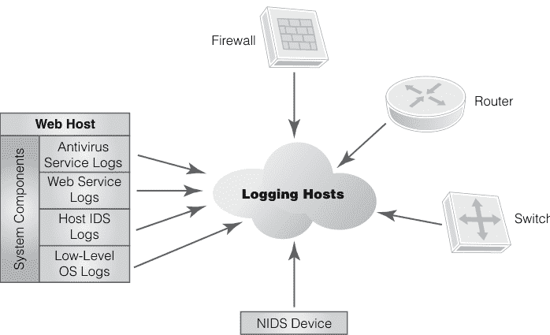

随着操作系统、应用软件和网络设备厂商更换产品，新的日志文件格式可能与之前的产品不同。如果您的组织使用 SIEM 系统来处理日志文件，这种格式变更并不关键。您可以将新产品的文件合并到同一数据库中，而不会限制生成涵盖前后时间段报告的能力。

SIEM 系统监控用户活动，并确保用户仅按照政策行事。这意味着 SIEM 系统是确保法规合规性的有价值方法。它们还可以与身份管理方案集成，以确保系统上只有当前用户帐户处于活动状态。

## 如何验证安全控制

一类特定的监控控制可以提供非常好的安全层。这一类控制监控网络和系统活动，以检测异常或可疑行为。

> **注意**
> 主要安全控制类型有两种：预防性控制和侦测性控制。IDS 和 IPS 分别代表每种控制类型。侦测性控制仅在定义的事件发生时进行检测，而预防性控制则防止事件发生。这两种控制类型都很重要。

这一类中的一些控制甚至可以响应检测到的可疑活动，并可能阻止正在进行的攻击。监控活动的控制包括入侵检测系统 (IDSs)、入侵防御系统 (IPSs) 和防火墙。

## 入侵检测系统 (IDS)

分层防御需要多种控制来防止攻击。最常见的分层防御机制之一是在防火墙后面放置 IDS 以提供更高的安全性。网络入侵检测系统 (NIDS) 监控通过防火墙的流量以检测恶意活动。基于主机的

## 图 7-4

作为防火墙补充的 IDS。

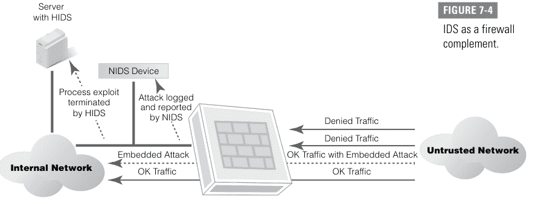

## 图 7-5

作为防火墙补充的基本 NIDS。

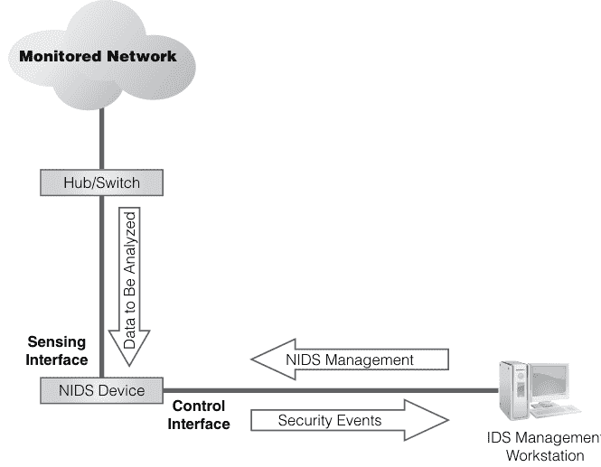

入侵检测系统 (HIDS)——本章稍后将介绍——针对特定计算机或设备的流量执行相同的操作。因为 HIDS 看到的视角较窄，您可以对其进行调整以检测非常特定的活动。与 NIDS 不同，HIDS 还会看到源自边界内部的流量。图 7-4 显示了一个同时部署 NIDS 和 HIDS 设备的网络。

如图 7-5 所示，您可以将 NIDS 连接到交换机或集线器。然后 IDS 捕获交换机上的所有流量并对其进行分析，以检测未经授权的活动。您可以以多种方式进行此分析，具体取决于 IDS 中引擎的类型。

> **注意**
> 管理员通常配置 NIDS，其监控端口没有 IP 地址。这使得外部人员极难向 NIDS 发送数据包或以其他方式直接寻址 NIDS。管理员通过另一个接口访问该设备，该接口应位于不同的子网上。

您将 IDS 连接到管理控制台，以便管理员监控和管理它。理想情况下，IDS 从网络上不可检测。这意味着攻击者将无法确定 IDS 在网络中的位置。IDS 上的管理端口无法从网络访问，这防止攻击者更改 IDS 的配置。

## 分析方法

监控和检测设备必须检查和分析活动，以了解何时发出警报或提示。设备可以使用多种方法来分析流量和活动。有些方法将网络数据包或地址与规则进行比较，而其他方法则查看活动的频率和类型。这两种方法称为基于模式或签名的 IDS 以及基于异常或统计的 IDS。

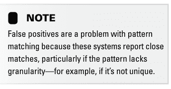

**基于模式或签名的 IDS**，使用所谓的基于规则的检测，依赖于模式匹配和有状态匹配，将当前流量与已知网络攻击的活动模式（签名）进行比较。模式匹配系统扫描数据包，以查看特定字节序列（称为 *签名*）是否与已知攻击的签名匹配。通常，这些模式与某个服务和端口（源端口或目标端口）相关。为了规避此类控制并试图逃避检测，许多攻击者会更改其攻击。您必须频繁更新签名文件，以确保能够检测最新的已知攻击。**有状态匹配**改进了简单的模式匹配。它查找流量流中多个数据包上出现的特定序列，而不是仅在单个数据包中查找。虽然比模式匹配更详细，但有状态匹配仍可能产生误报。与模式匹配一样，有状态匹配只能检测已知攻击。它需要频繁更新签名。

**基于异常的 IDS**，有时称为 *基于配置文件的系统*，将当前活动与存储的正常（预期）活动配置文件进行比较。这些方法的准确性取决于您对“正常活动”定义的准确性。一旦定义了正常系统操作，IDS 就会将当前活动与您认为正常的活动进行比较。IDS 认为异常的任何内容都是分析和响应的候选项。检测异常的更常见方法包括以下内容：

- **基于统计的方法**——这些方法为正常流量和网络活动建立基线。当设备识别出偏差时，会生成警报。这些方法可以捕获未知攻击，但误报经常发生，因为识别正常活动很困难。
- **基于流量的方法**——当这些方法识别出基于流量的预期行为的任何不可接受偏差时，会发出警报。它们还可以检测未知攻击和泛洪攻击。
- **协议模式**——识别攻击而无需签名的另一种方法是查找偏离协议的情况。协议标准由互联网工程任务 force (IETF) 发布的请求评论 (RFC) 备忘录提供。您可以在 www.ietf.org/rfc.html 上获取更多有关 RFC 的信息。这种检测方法适用于定义明确的协议，但对于定义不明确的协议可能会产生误报。

## HIDS

HIDS 技术通过监控计算机（也称为主机）内部的敏感进程，为整个系统增加保护。HIDS 系统通常具有以下特性：

- 它们通常是设计在服务器计算机上运行的软件进程或服务。
- 它们拦截并检查系统调用或特定进程（例如数据库和 Web 服务器），以查找不应正常允许的模式或行为。
- HIDS 守护进程可以采取预定义的操作，例如停止或报告违规行为。

HIDS 与 NIDS 也有不同的视角。HIDS 可以检测源自网络内部的不当流量。它还可以识别特定于特定计算机或用户的异常。例如，高容量邮件服务器上的单个用户可能会产生比用户在任何一天（或一小时）内正常数量多 10 倍的消息。HIDS 会注意到并发出警报，但 NIDS 可能不会注意到可报告的事件。对于 NIDS 来说，这看起来只是增加了网络流量。

## 分层防御：网络访问控制

最好的防御是部署多层控制。这比只使用单一控制更能保护您的系统免受更多攻击。图 7-6 显示了网络设备如何在多层中协同工作，以试图防止对内部受保护网络的攻击。路由器检测并过滤掉某些流量，防火墙检测并阻止不需要的流量。

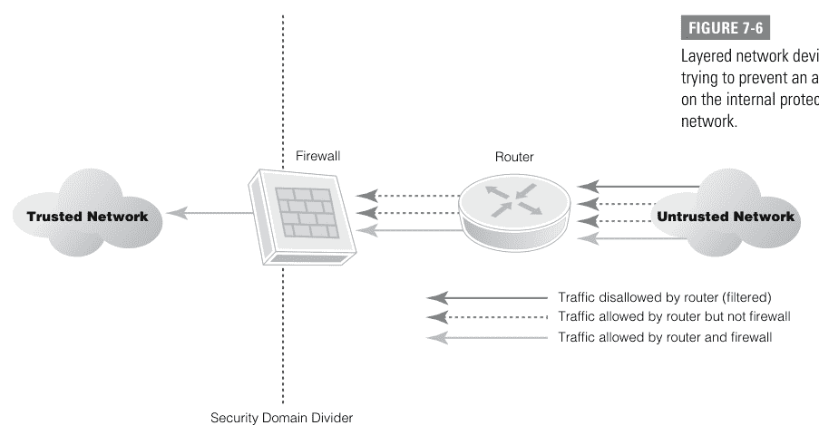

## 控制检查：入侵检测

NIDS 是任何多层防御策略中的重要组成部分。图 7-7 显示了 NIDS 如何监控外部攻击以及内部滥用行为。网络外部的 NIDS 可以了解防火墙面临的攻击类型。内部 NIDS 检测可能绕过防火墙的攻击类型。您也可以将此设备安装为 IPS。这样，该设备不仅可以检测潜在攻击，还可以更改其规则以过滤流量来阻止攻击。这些设备与 HIDS 设备配合良好。虽然 NIDS 有助于保护您的系统免受恶意网络流量的影响，但 HIDS 会查看主机本身上尝试的活动类型。

## 主机隔离

某些服务器或主机必须对互联网开放。Web 服务器就是此类主机的示例。您希望任何用户都能访问您的 Web 服务器——但您不希望每个人都能访问您的内部网络。一个简单的解决方案是将连接到互联网的主机与网络的其余部分隔离开来。主机隔离将一台或多台主机计算机与内部网络隔离开来，并创建一个非军事区 (DMZ)。图 7-8 显示了一个带有两个隔离主机的 DMZ。DMZ 是一个物理或逻辑子网，包含并将组织的外部服务暴露给更大的不受信任网络（通常是互联网）。来自不受信任互联网的外部流量只允许进入 DMZ，在那里它可以访问某些公司服务。DMZ 中的 Web 应用程序随后访问受信任的内部网络，但防止外部用户直接访问内部网络。

## 系统加固

没有一台计算机是完全安全的。事实上，很少有操作系统或应用软件包在安装时是安全的。安全管理员需要经历一个称为“加固”的过程，以更改硬件和软件配置


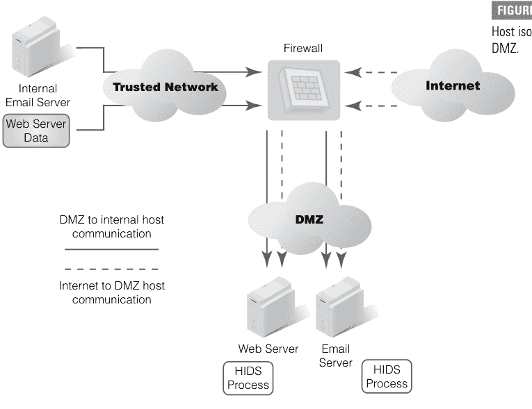

为了使计算机和设备尽可能安全。具有强化配置的计算机或设备是指您已执行以下最小操作的计算机或设备：

- 关闭或禁用不必要的服务，并保护仍在运行的服务。
- 安全管理接口和应用程序。
- 通过严格的密码策略保护密码。
- 禁用不必要的用户帐户。
- 应用可用的最新软件补丁。
- 防止所有计算机和设备遭受任何未经授权的修改。

除了强化系统外，同样重要的是强化网络。有很多机会可以强化网络，但只需几个步骤就能极大地提高网络（及网络设备）的安全性。这些步骤包括：

- 禁用未使用的网络接口
- 禁用未使用的应用服务端口
- 使用 MAC 过滤限制设备访问
- 实施 802.1x，基于端口的网络访问控制 (PNAC)

在实施之前先强化所有系统。在将系统投入生产之前未能强化系统，几乎肯定会导致其被攻破。

## 设置基准配置

强化计算机或设备后，您必须记录强化的配置设置。这样，您可以将强化的配置与已知的安全配置进行比较。您也可以将来将配置设置与原始设置进行比较，查看是否有任何更改。创建基准可以轻松确保各种系统之间的安全性一致。当定义标准设置容易时，您可以更轻松地控制单个系统的差异。例如，如果您知道某个单独计算机的基本配置符合您的标准，则可以决定是否允许在该计算机上运行某些服务或应用程序。

## 禁用不必要的服务

强化计算机最简单、最有效的步骤之一是关闭不需要的服务和程序。攻击者知道，大多数计算机运行的服务和程序多于其真正需要的数量。例如，许多服务器计算机运行 Web 服务器，即使它们不托管网站。攻击者会搜索这些不需要的服务，并试图利用其中的漏洞。您应该禁用不必要的服务。更好的做法是卸载不需要的服务。攻击者无法攻击不存在的程序。关闭不需要的防火墙端口，并限制某些服务，例如移动代码、Telnet 和 FTP。您应将防火墙配置为拒绝任何未明确允许的内容。这将防止攻击者偷偷添加新的意外服务。

您还应强化所有路由器和其他网络设备。防止未经授权的管理员访问和对路由表的更改。网络设备出厂时要么没有密码，要么使用默认密码。在将任何设备连接到网络之前，您应更改默认密码。您应像管理所有密码一样管理这些设备密码。它们应足够复杂，并定期更改。您必须记录对网络设备的任何更改，并记录进行更改的管理员的用户 ID。您应定期检查所有配置日志，或许可以通过 SIEM 实现。

服务器和网络设备并非您需要强化的唯一项目；不要忘记工作站。工作站需要标准配置和访问控制。组织应为工作站提供强化的镜像。您可以通过安装全新的操作系统副本并对其进行强化来创建标准镜像。删除不必要的服务，并添加安全产品，例如防病毒软件和个人防火墙。该镜像还应包含公司标准软件，例如字处理器、电子表格和浏览器插件。当您验证该镜像符合组织对工作站的标准时，可以将该镜像作为所有新台式机和笔记本电脑的起点。此过程可帮助确保安全合规性并减少维护时间。

物理保护服务器，例如将其放在锁好的门后面。确保所有计算机和设备都应用了最新补丁。您可以使用第三方补丁管理软件来跟踪公司计算机和设备上所有供应商的所有产品发布的补丁。有些产品甚至具有自动“回家”补丁管理功能。

在大多数情况下，面向 Internet 暴露的服务器的最佳解决方案是确保不将这些服务器用于任何其他用途。例如，位于 DMZ 中并充当 Web 服务器的计算机不应提供任何其他服务。

## 审查防病毒程序

系统审计应包括对组织使用的防病毒和其他反恶意软件程序的审查。此审查应确保所有软件产品及其数据都是最新的。定期对所有网络设备和计算机进行防病毒扫描。定期安排对所有系统进行全面扫描。扫描所有应用程序服务器、工作站和网关。

## 监控和测试安全系统

保护封闭环境很困难。作为安全专业人员，您的主要目标是保护组织的敏感数据免受攻击者的攻击。尽管保护封闭系统很困难，但当您的网络连接到 Internet 时，工作会变得困难得多。仅通过连接到 Internet，您就为攻击者铺好了红地毯。您的工作是部署策略来控制对系统的访问。请记住，完全保护系统是不可能的。尽管信息安全存在许多风险，但最常见的两种风险是：

- 来自外部的攻击者，带有未经授权的访问、恶意代码、木马和恶意软件
- 组织内部的敏感信息泄露给可能会损害组织的未经授权人员

### 监控

如何防止组织的敏感信息泄露？没有万无一失的方法，但监控是关键。当然，您无法监视系统上的每个 IP 数据包。即使您能培训人类来完成这项令人麻木的乏味工作，您也无法投入足够的人手来应付。相反，您必须使用入侵检测系统（即 IDS）来监控流量。IDS 的前提是识别异常流量以便进一步调查。入侵防御系统（即 IPS）比 IDS 更进一步，主动阻止恶意流量。IDS 会提醒您可能存在的未经授权的活动；IPS 会阻止它。当然，在使用 IDS 或 IPS 之前，您必须先创建正常流量的基准定义。

### 测试

除了监控系统，还必须对其进行测试。任何安全测试的主要目的是识别系统中未修正的漏洞。系统可能在某个时候是安全的，但添加新服务或应用程序可能会使系统变得脆弱。测试的目的是发现新漏洞，以便您可以解决它们。

图 7-9 显示了安全测试的主要目标。

## 图 7-9

安全测试。

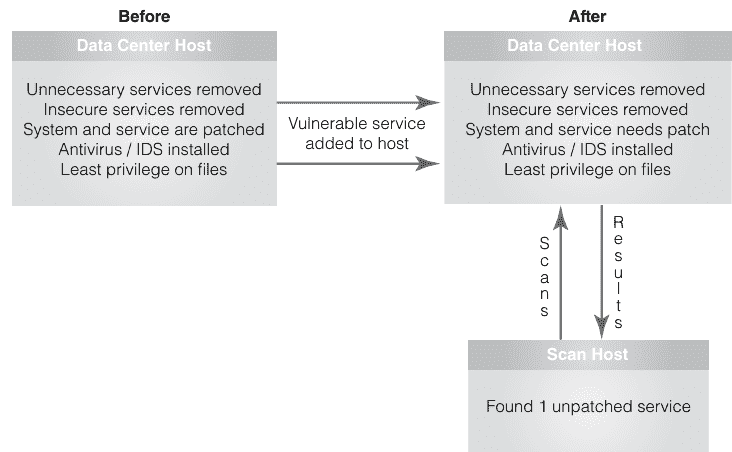

> **注意**
>
> 漏洞测试试图发现系统的弱点。渗透测试是一种针对发现的漏洞的集中攻击。攻击者遵循与渗透测试人员相同的步骤；两者的区别在于，攻击者没有获得渗透系统的许可。以下是每种测试类型的简要概述，以帮助说明它们之间的差异。
>
> 漏洞测试的目标包括：
> * 识别漏洞（被动）
> * 记录缺乏安全控制或配置错误
> * 检查与凭证用户和非凭证用户相关的漏洞
>
> 渗透测试的目标包括：
> * 识别威胁
> * 绕过控制
> * 利用漏洞

测试的频率取决于系统的易变性（变更率）和系统的敏感性或关键性等因素。此外，策略和法规通常要求进行测试。最常见的测试计划触发点如下：

- 在安全认证阶段
- 重大系统变更后（新技术升级、应用程序变更）
- 新威胁
- 系统审计期间
- 定期，取决于系统的性质
- 关键系统每年一次

如果列表中的其他项目都不触发测试，您应至少每年进行一次测试。有些公司可能会根据风险分析选择更短或更长的测试间隔。

## 测试路线图

在测试方面，不存在完美的解决方案，也不是每个安全专业人员都会遵循相同的路径。图 7-10 显示了安全测试的路线图。如图所示，安全测试由一些常见活动组成，可让您全面了解系统的安全性。最常见的活动包括以下内容：

- **侦察**—此活动涉及审查系统，以尽可能多地了解组织、其系统及其网络。用于此项工作的公共资源（例如 Whois 和 Dig）对网络管理员是不可见的——当这些资源被攻击者而不是渗透测试人员使用时，这就是一个问题。
- **网络映射**—此阶段使用工具来确定组织系统和网络上的布局和运行的服务。


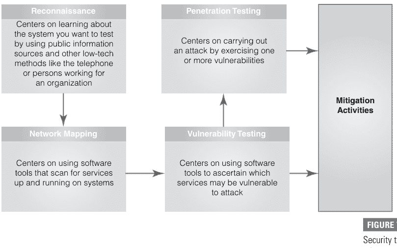

- **漏洞测试**—漏洞测试包括查找系统中所有弱点，并确定哪些位置可能成为攻击点。
- **渗透测试**—在此阶段，您尝试利用系统中的弱点，并证明攻击者可能成功渗透它。
- **缓解活动**—任何旨在减少或解决渗透测试或漏洞测试中发现的漏洞的操作。

## 建立测试目标

在运行测试程序之前，建立测试目标非常重要。安全测试最关注评估您的控制措施在多大程度上解决漏洞。首先，识别漏洞并根据其对系统的重要性进行排序。接下来，记录一个时间点（快照）测试，以便与不同时间段进行比较。您希望确保无论一天中的时间或活动量如何，安全控制措施都能正常工作。然后，为审计员审查做准备。这使您的 IT 人员能够使用漏洞分析来调整和测试自己的程序，为真正的审计做准备。最后，查找安全中的漏洞。此步骤使隐蔽测试人员（稍后讨论）能够确定系统被攻破和入侵检测的可能性。

## 侦察方法

侦察是众多测试中最基本、最基础的一种。在侦察阶段，您通过社交工程等技术或研究组织网站来收集信息。攻击者会尽可能使用多种侦察方式来收集有关组织的信息。您应该了解这些攻击者在做什么，然后限制他们收集有关您信息的能力。

社交工程是谎言的一个花哨说法。它涉及诱骗某人分享机密信息或获取对敏感系统的访问权限。在许多情况下，攻击者从未与受害者见面。相反，攻击者可能会给员工打电话，冒充系统管理员。攻击者经常诱骗员工分享敏感信息。毕竟，员工会想，把密码给管理员有什么问题呢？您应该培训用户识别社交工程攻击。

另一种侦察工具是 Whois 服务。该服务提供管理员姓名和电话号码等信息，这些信息可帮助攻击者。图 7-11 显示了 Whois 请求的输出。

区域传送是对 DNS 服务器的一种独特查询，要求其提供区域内容。区域是服务器管理的域。管理员经常使用此工具在同一组织内同步 DNS 服务器。如果您不加限制地允许区域传送，攻击者可以利用这些信息试图找出您网络内外服务器的名称和类型。防止此类信息泄露的最佳防御是锁定 DNS 服务器。

> **注意**
> 
> 组织应非常小心，避免其域名注册过期。其他人可能会抢注并将其据为己有。此类行为可能会给组织的声誉带来巨大损失。这种社交工程比普通的类型更为复杂。

## 网络映射方法

网络映射是一种扩展的侦察类型。网络映射会发现网络的详细信息，包括其主机和主机地址以及可用服务。这可能使攻击者能够识别某些类型的系统、应用程序、服务和配置。图 7-12 显示了网络映射可能提供的一些信息。

攻击者可以使用互联网控制消息协议（ICMP，也称为 ping）数据包来发现网络布局。这使攻击者在发起攻击时占据优势。如图 7-13 所示，阻止 ping 数据包（如 Tony 路由器所示）可以防止攻击者了解网络。当然，这也阻止管理员使用此有价值的工具进行网络故障排除。

图 7-14 显示了攻击者如何使用 TCP/SYN 扫描来发现目标主机上可用的服务。攻击者向常用端口发送数据包，并可根据响应确定主机是否接受这些服务。

攻击者需要知道潜在受害者运行什么操作系统。攻击系统的方法因目标操作系统而异。通过操作系统指纹识别，攻击者使用端口映射来了解计算机上运行的操作系统及其版本。这还可以帮助攻击者发现可能易受攻击的计算机，因为它们没有补丁或可能存在已知漏洞。图 7-15 显示了操作系统指纹识别如何为攻击者提供有价值的信息。

## 隐蔽测试人员与公开测试人员

您可以公开或隐蔽地进行安全测试（可能涉及内部和外部人员）。您使用的人员和方法可能取决于法规或内部人员的技能水平。图 7-16 显示了各种类型的测试人员。

图 7-11 Whois 搜索结果。

networksolutions.com 查询

- **注册商**
- WHOIS 服务器：whois.networksolutions.com
- URL：http://networksolutions.com
- 注册商：NETWORK SOLUTIONS, LLC.
- IANA ID：2
- 滥用联系邮箱：abuse@web.com
- 滥用联系电话：+1.8003337680

- **状态**
- 域名状态：clientDeleteProhibited
- https://www.icann.org/epp#clientDeleteProhibited
- 域名状态：clientTransferProhibited
- https://www.icann.org/epp#clientTransferProhibited
- 域名状态：clientUpdateProhibited
- https://www.icann.org/epp#clientUpdateProhibited
- 域名状态：serverDeleteProhibited
- https://www.icann.org/epp#serverDeleteProhibited
- 域名状态：serverTransferProhibited
- https://www.icann.org/epp#serverTransferProhibited
- 域名状态：serverUpdateProhibited
- https://www.icann.org/epp#serverUpdateProhibited

- **重要日期**
- 更新日期：2015-01-28
- 创建日期：1998-04-27
- 注册到期日期：2025-04-27

- **名称服务器**
- NS1.NETSOL.COM
- NS2.NETSOL.COM
- NS3.NETSOL.COM

**原始 WHOIS 记录**
域名：NETWORKSOLUTIONS.COM
注册表域 ID：4548132_DOMAIN_COM-VRSN
注册商 WHOIS 服务器：whois.networksolutions.com
注册商 URL：http://networksolutions.com
更新日期：2015-01-28T23:20:59Z
创建日期：1998-04-27T04:00:00Z
注册商注册到期日期：2025-04-27T04:00:07Z

图 7-12 网络映射。

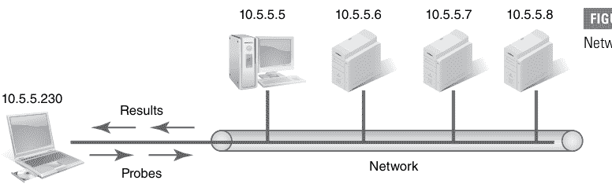

| 主机名 | IP | 服务 | 操作系统 |
|---|---|---|---|
| user-5 | 10.5.5.5 | http, netbios, ftp | Windows Server 2008 |
| server-6 | 10.5.5.6 | http, netbios | Windows Server 2012 |
| server-7 | 10.5.5.7 | telnet, smtp | Linux |
| server-8 | 10.5.5.8 | dns, finger, telnet | Solaris |

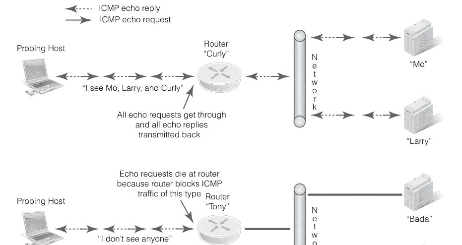

图 7-13 使用 ICMP (ping) 的网络映射。

图 7-14 使用 TCP/SYN 扫描的网络映射。

### 使用 TCP 连接扫描的网络映射

探测主机在 TCP 端口 23 上发送 SYN。目标响应 SYN/ACK 和 ACK。结论：目标提供 telnet 服务。

探测主机在 TCP 端口 23 上发送 SYN。目标响应 RST。结论：目标不提供 telnet 服务。

### 使用 SYN (半开放) 扫描的网络映射

探测主机在 TCP 端口 143 上发送 SYN。目标响应 SYN/ACK 和 RST。结论：目标提供 IMAP（邮件）服务。

探测主机在 TCP 端口 143 上发送 SYN。目标响应 RST。结论：目标不提供 IMAP 服务。

无论谁进行测试，都必须考虑测试活动的潜在影响：

- 注意潜在的危害——某些测试可能会导致系统崩溃。其他测试影响较小。确保所有可能受影响的各方都知道您将进行哪些测试。如果任何测试可能导致服务中断或困难，请确保获得所有各方的同意。始终制定恢复计划，以防测试（即使是安全的测试）导致系统崩溃。

- 注意一天中的时间和一周中的日子——虽然在低峰时段进行测试很诱人，因为它不会影响那么多用户，但这可能不是一个真实的场景。一种替代方案是在非高峰时段进行更危险的测试，在高峰时段进行更安全的测试。

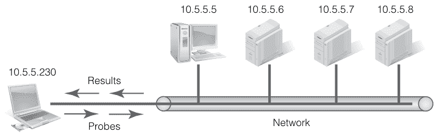

图 7-15 操作系统指纹识别。

### 端口映射器“认为”：

- 10.5.5.5 看起来像 Windows Server 2003，因为其 TCP/IP 通信结构的方式….

- 10.5.5.6 看起来像 Windows Server 2008，因为当我发送 FIN 时它没有响应 RST，并且根据 http 标志，它运行 IIS 5….

- 10.5.5.7 看起来像 Linux，因为它响应我的 FIN 发回了 RST，并且其 TCP/IP 通信行为类似于 Linux….

图 7-16 隐蔽测试人员与公开测试人员。

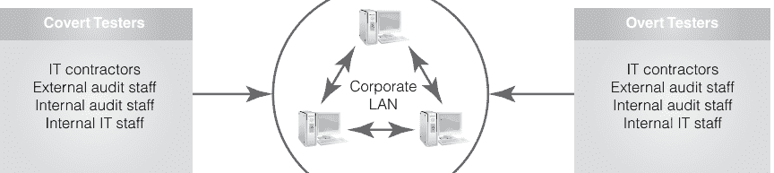


## 测试方法

黑盒测试使用的测试方法不直接基于对程序架构或设计的了解。该术语意味着测试人员要么没有源代码，要么源代码的细节与所测试的内容无关。换句话说，黑盒测试关注软件的外部可见行为。例如，它可能基于需求、协议规范、API，甚至是尝试性的攻击。

相比之下，白盒测试基于对应用程序设计和源代码的了解。事实上，白盒测试通常源自源代码。例如，这些测试可能针对源代码中发现的特定结构，或试图达到一定的代码覆盖率。

灰盒测试介于黑盒测试和白盒测试之间。它使用对程序内部的有限了解。原则上，这可能意味着测试人员知道源代码的一部分，而不知道另一部分。在实践中，这通常只是意味着测试人员可以访问比规格说明或需求更详细的设计文档。例如，测试可能基于架构图或程序行为的基于状态的模型。

## 安全测试技巧和方法

在开始测试流程之前，请考虑以下几点：

- 选择合适的工具—选择最适合测试您软件的工具取决于要测试什么，以及测试计划指示测试应如何执行。请记住，工具功能通常会重叠。
- 工具会出错—您应该对初步结果保持怀疑态度。注意误报或漏报。工具结果可能会有所不同，因为检测方法往往不一致。
- 保护您的系统—在错误的时间或以错误的方式执行测试可能会损坏系统。请注意保护您的系统。
- 测试应尽可能真实—测试应在生产网络和系统上运行，前提是不会影响系统运行。尝试使测试尽可能真实时，请考虑以下几点：
  - 您应该首先运行一系列不太可能使系统崩溃或产生重大影响的测试。然后修复这些测试检测到的漏洞。之后，您可以在中断影响最小的时间运行可能会中断正常操作的测试。
  - 在最关键的系统上，您可能可以在业务连续性计划测试的同时运行这些测试。例如，在备用站点测试，或在主站点成功运行完整中断测试后仍在备用站点运行时进行测试。
  - 决定是否将社会工程学作为渗透测试的一部分。测试人员和管理层将决定测试是应局限于技术（远程）手段，还是测试人员应尝试利用人类行为来获取访问权限。社会工程学测试可能难以执行，但如果做得好，可以揭示更多漏洞。

## 章节摘要

在本章中，您了解了安全审计。您了解如何使用审计来帮助创建更安全的系统。您探讨了为什么需要这些审计，以及它们如何创造责任和问责文化。您发现了如何定义审计计划，包括其范围，以及它如何帮助开发安全系统。您了解了审计基准，以及它们如何帮助为审计计划奠定基础。您还了解了数据收集方法，包括它们如何帮助您收集执行高质量审计所需的信息。您还研究了审计后活动以及它们如何帮助您完成流程。您探索了日志收集和分析，包括它们如何帮助您监控系统。您还了解了日志管理。您了解了应捕获的日志信息类型以及可以帮助您有效捕获日志的工具。最后，您探索了监控和测试安全系统。

## 关键概念和术语

- 基于异常的 IDS
- 基准
- 黑盒测试
- 报警阈值
- 隐蔽行为
- 漏报
- 误报
- 灰盒测试
- 加固配置
- 加固
- 缓解活动
- 网络映射
- 操作系统指纹识别
- 公开行为
- 基于模式或特征的 IDS
- 渗透测试
- 实时监控
- 侦察
- 安全信息和事件管理（SIEM）系统
- 有状态匹配
- 漏洞测试
- 白盒测试
- 区域传输

## 第 7 章评估

- 1. 当您使用的控制措施成本超过所涉及的风险时，您正在做出错误的管理决策。
  - A. 正确
  - B. 错误
- 2. 以下哪项是宽松程度的示例？
  - A. 谨慎型
  - B. 宽松型
  - C. 放纵型
  - D. 多疑型
  - E. 以上皆是
- 3. 审计检查安全控制措施是否适当、安装正确，以及______。
  - A. 最新
  - B. 达到其目的
  - C. 获授权
  - D. 成本效益高
- 4. ______ 是衡量系统在多大程度上符合行业期望的标准。
  - A. 控制目标
  - B. 配置
  - C. 基准
  - D. 策略
- 5. 审计后活动包括以下哪项？
  - A. 向管理层汇报发现
  - B. 数据分析
  - C. 退出访谈
  - D. 审查审计员的发现
  - E. 以上皆是
- 6. 安全监控中使用的某些工具和技术包括基线、报警器、闭路电视和蜜罐。
  - A. 正确
  - B. 错误
- 7. 当立即检测和响应事件不那么关键时，使用______。
  - A. 非实时监控
  - B. 逻辑访问控制
  - C. 实时监控
  - D. 以上都不是
- 8. 捕获和分析日志条目的常用平台是______。
  - A. 入侵检测系统（IDS）
  - B. 蜜罐
  - C. 安全信息和事件管理（SIEM）
  - D. HIPAA
  - E. 以上皆是
- 9. 在______方法中，IDS 通过模式匹配和有状态匹配，将当前流量与已知网络入侵一致的活动模式进行比较。
  - A. 基于特征的
  - B. 基于异常的
  - C. 启发式扫描
  - D. 以上皆是
- 10. 主机隔离是指隔离内部网络并建立一个______。
  - A. HIDS
  - B. DMZ
  - C. IDS
  - D. IPS
- 11. 加固配置是指已启用不必要服务的系统。
  - A. 正确
  - B. 错误
- 12. 审查系统以尽可能多地了解组织、其系统和网络的过程称为______。
  - A. 渗透测试
  - B. 漏洞测试
  - C. 网络映射
  - D. 侦察

# 风险、响应和恢复

组织必须不断应对变化。股东施加新的压力。管理机构通过新的立法并设定新的标准。组织必须维护连接其供应商和客户的供应链。保持竞争力意味着制定策略以实现业务目标。应对这些变化可能需要组织调整人员、改变 IT 组织并重新安排物流。这些变化中的任何一种都会增加风险。您的组织结构反映了其文化。同样，文化会影响您的组织对保护信息以及支持信息的人员和基础设施的承诺。

您的组织管理风险的方式反映了组织对其资产所付出的重视程度。如果风险不被认为严重，您的组织不太可能投入大量精力来解决它。您的组织愿意用于保护敏感数据的资源数量会影响风险。也许您的组织了解特定风险很重要，但它根本没有足够的预算来解决该风险。或者，也许您的组织有一种一次性文化，只寻求短期收益。它可能会选择在逆境中停止运营。如果是这样，它可能只会采取满足所需标准的最低限度步骤。但是，如果您的组织致力于长期成功，它将投资于成本效益高的计划来降低风险。这两种策略可能都适合特定的组织。唯一的错误是不将风险管理支出与公司的文化相匹配。例如，一次性组织不应投资于可持续计划，反之亦然。

## 第 8 章主题

本章涵盖以下主题和概念：

- 风险管理如何与数据安全相关
- 风险管理的流程是什么
- 什么是风险评估
- 定量和定性风险评估方法之间的区别是什么
- 如何制定管理风险的策略
- 什么是对策，以及在评估对策时必须考虑哪些因素


- 三种活动控制类型是什么，以及它们如何与安全生命周期相对应
- 什么是业务连续性计划（BCP），以及组织如何利用它来确保中断不会导致其停业
- 备份在灾难恢复中发挥什么作用
- 应采取哪些步骤来响应安全事件
- 灾难恢复计划（DRP）有什么作用
- 灾难恢复的主要步骤是什么

## 第 8 章目标

完成本章后，您将能够：

- 理解风险管理的原则
- 理解如何响应和分析事件
- 理解如何利用业务连续性计划来防止和从中断中恢复

## 风险管理与信息安全

风险管理是信息安全的核心关注点。组织采取的每一项行动——或者未能采取的行动——都涉及一定程度的风险。关注风险管理可能意味着成功企业与失败企业之间的区别。这并不意味着您要消除每一项风险。相反，组织应寻求各种风险管理选项的实用性与成本之间的平衡。不同组织的风险容忍度不同。例如，一家成熟的医院会竭力将风险限制在尽可能低的程度。另一方面，一家只有少数员工的新创企业可能更愿意承担可能带来吸引人财务回报的风险。

作为安全专业人员，您将与他人合作识别风险并应用风险管理解决方案。您必须记住两项关键的风险管理原则：

- 保护资产的花费不能超过其价值。这可能比乍看之下更加困难。您必须了解每项风险的真实影响。安全漏洞会削弱客户信心。成功的攻击可能会产生立即成本，但也会导致客户转向竞争对手。真实成本可能远高于立即清理的成本。
- 没有相应风险的对策是寻找问题的解决方案；很难证明其成本的合理性。

您在信息安全的风险、响应和恢复方面扮演着重要角色。您必须帮助识别风险。其中一些风险非常严重，可能会导致您的公司倒闭。例如，数据泄露可能会损害您公司的声誉，导致销售损失，并可能因罚款或和解而花费大量资金。您还必须帮助创建和/或维护一项计划，以确保您的公司在面对中断时继续运营。这种计划就是业务连续性计划（BCP）。这是您在本章中将学习的重要概念。中断确实会发生，因此您必须预期它们会发生在您的组织中。为中断制定计划是您作为安全专业人员职责的一部分。您必须帮助开发和维护灾难恢复计划（DRP），以帮助应对损坏或摧毁基础设施必要部分的情况。

作为安全专业人员，您的目标是确保在停电后系统能够迅速向用户提供服务，并恢复任何丢失或损坏的数据。然而，您也负责确保正确处理恢复过程。

> > **注意**
> >
> > 您应该熟悉 NIST SP 800 系列安全实践。您可以在 http://csrc.nist.gov/publications/PubsSPs.html 找到该系列。这些基本信息是您理解信息安全的基础。高级安全专业人员将使用其中一些更详细的内容。

### 风险术语

管理风险是识别风险并决定如何应对它们的过程。管理风险的第一步是识别和评估风险。但是，什么是风险？风险如何评估？在学习风险管理之前，理解一些术语很重要。以下术语描述了风险评估类型，或者说定义和讨论风险的方式：

- **威胁**—威胁是可能发生的某事（通常是坏事）。威胁可能是龙卷风袭击您的数据中心，或者攻击者窃取您的客户数据库。
- **漏洞**—漏洞是任何可能使威胁得以实现的暴露点。有些漏洞是弱点，有些只是其他行为的副作用（例如，允许员工使用智能手机连接到企业网络）。
- **风险**—风险是特定威胁针对特定漏洞得以实现的可能性。大多数风险会导致可能损害组织的损坏或负面结果。并非所有风险本质上都是坏事；有些风险可能导致积极结果。威胁造成的损害程度（甚至积极效果）决定了风险等级。
- **影响**—影响是指威胁利用漏洞可能造成的伤害程度。例如，如果病毒感染了系统，该病毒可能会影响系统上的所有数据。

当威胁成为现实时，组织会经历事件或安全事件。事件是对业务产生影响的可衡量的发生情况。有些事件影响不大；而有些可能会升级为事件。事件是指任何违反或威胁要违反您的安全策略的事件。例如，员工仓库盗窃属于事件。事件是需要采取对策的情况。

您将在本章后面了解更多关于*控制、对策*和*保障措施*的内容。许多人混用这些术语，尽管存在细微差别。它们都通过降低漏洞或威胁的影响来降低风险。控制包括保障措施和对策。这里只需说明，控制是为限制或约束行为而采取的行动。保障措施解决控制中可能导致威胁得以实现的差距或弱点。对策是针对特定威胁进行的应对或处理。防火喷淋系统是一个对策的示例。

> > **注意**
> >
> > 许多人从未将风险视为一件好事。然而，不确定性可能导致产生负面或正面影响的事件。例如，假设您的组织计划根据软件供应商预测的可用性向最终用户部署新软件。您的风险管理计划应同时处理软件提前交付和延迟交付的响应。如果您提前收到软件，可以进行更彻底的测试，或尽早开始部署。如果软件供应商交付软件延迟，您可能会错过预计的部署日期。您应制定计划，以应对交付日期与日程不符所产生的正面和负面影响。

### 风险要素

资产、漏洞和威胁都是风险要素。这些是组成部分，而非公式。资产价值会增加或下降。您的主动程序应发现并解决漏洞。新威胁会不断出现，加入到现有威胁中。随着这些因素随时间变化，风险也会随之变化。您应定期进行风险重新评估，以识别新出现或发生变化的风险。

> **注意**
> 您可以在 www.cert.org/insider-threat-research/cybersecurity-watch-survey.cfm 找到网络安全观察调查。CERT 部门是隶属于卡内基梅隆大学的软件工程研究所的一部分。它拥有一个全面的在线资源，即 CERT 内部威胁中心，网址为 www.cert.org/insider-threat/cert-insider-threat-center.cfm。您可以在 www.verizonenterprise.com/DBIR/2015/ 找到 Verizon 2015 数据泄露调查报告。

不要假设所有威胁都来自外部。2014 年，CSO 杂志、CERT 计划、普华永道、德勤、微软和美国特勤局发布了最新的网络安全观察调查。该报告指出，内部攻击占所有报告攻击的四分之一多一点（28%）。其他来源（包括 FBI 和 Verizon 2015 数据泄露调查报告）表示，内部攻击占整体攻击的 20% 多一点。然而，其影响相对更为严重。内部攻击也在变得更加复杂。2013 年，美国国家航空航天局（NASA）关闭了其内部数据库并收紧了远程访问政策。这些行动直接源于外国承包商涉嫌进行的知识产权盗窃。

新威胁不断出现。美国计算机应急响应小组（US-CERT）定期通过电子邮件发布有关新威胁的信息。您可以通过以下网站订阅其技术网络安全警报、网络安全简报或网络安全警报：www.us-cert.gov/ncas/alerts。注册后，您将定期收到电子邮件警报。您也可以订阅其新闻源或在 Twitter 上关注它。

### 风险管理目的

风险管理的目的是在发生不良情况之前识别潜在问题。早期识别很重要，因为它让您有机会管理这些风险，而不是仅仅被动反应。识别风险很重要：

- 在其导致事件之前
- 及时，以便您能够制定计划并开始风险处理活动（控制和对策）
- 在产品、系统或项目的整个生命周期中持续进行


您永远无法将风险降至零。在识别组织的风险文化后，您需要评估风险，然后先处理那些可能对组织产生重大影响的风险。您必须能够证明风险处理方法的成本是合理的。在许多情况下，小幅度的风险降低成本非常高。您工作的一部分是识别可容忍的风险水平，并应用控制措施将风险降低到该水平。您必须将部分风险管理工作投入到识别新风险中，以便在发生负面事件之前对其进行管理。此过程的一部分将包括持续重新评估风险，以确保您已采取适当的应对措施。

## 风险管理流程

图 8-1 显示了风险管理流程。风险管理是一个永远不会真正结束的过程。定期完成整个循环以应对当前威胁非常重要。该流程定义了您如何为组织执行风险管理步骤。例如，该方法可以规定在指定间隔进行风险分析。用于进行此分析的工具可以包括定义、分类和对风险进行排序的文档。该方法与项目管理学会（PMI）的《项目管理知识体系》（PMBOK）保持一致。尽管 PMI 方法并非唯一的做事方式，但它确实为项目管理（包括风险管理）提供了一种规范性方法。风险管理流程的步骤如下：

- **识别风险**—管理风险的第一步是识别风险。可能出现什么问题？答案可能包括火灾、洪水、地震、雷击、停电或其他公用事业中断、劳工罢工以及交通不可用。您必须为每种威胁制定场景以评估威胁。

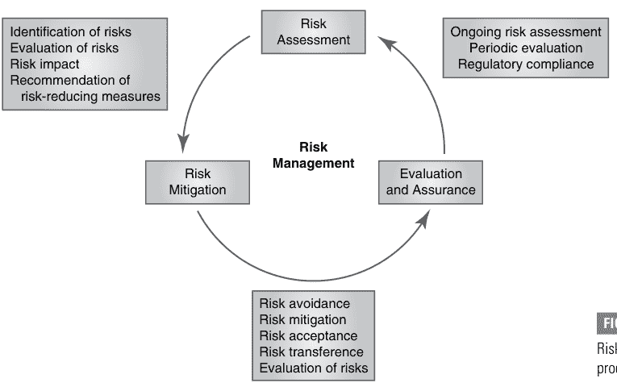

图 8-1 风险管理流程。

- **评估风险**—某些风险比其他风险具有更大的损失可能性。此外，并非所有风险都适用于所有地点的所有企业。例如，蒙大拿州或莫斯科的企业不需要担心飓风。在可能的风险中，影响的严重程度取决于场景和地点。评估风险旨在确定哪些风险最为严重。

- **规划风险响应**—从最高优先级的风险开始，探索每种风险的潜在响应。在组织高层管理的指导下，确定为每种风险提供最佳价值的响应。

- **实施风险响应**—采取行动实施上一步中为每种风险选择的响应。

- **监控和控制风险响应**—监控并衡量每种风险响应，以确保其按预期运行。此步骤可以包括被动监控和日志记录，以及主动测试，以查看控制措施的表现。

**注意**
避免在“电影情节”风险上浪费时间和金钱非常重要。编剧可以创造不可能的情景，并使其看起来可能甚至很可能。花钱防范这些虚假威胁几乎总是浪费。相反，应关注现实的可能性。

## 识别风险

风险管理流程的第一步是识别风险。组织使用多种不同的方法来识别风险。每种方法都采用不同的方法来解决相同的问题——识别尽可能多的风险。在每种方法中，基本策略是使用多种来源的输入来构建全面的风险列表。一些更流行的风险识别方法包括：

- **头脑风暴**—该技术涉及从小组会议成员处获取非结构化的输入。主持人应鼓励所有成员提出建议，无需担心批评或嘲笑。

- **调查**—使用这种技术的组织会将准备好的问题列表发送给参与者以获取意见。应选择组织不同领域的各类人员，以获得最佳意见。德尔菲法是一种特定的调查类型，在该类型中，响应将被匿名化、打乱，然后发回给参与者进行评论。保持输入匿名有助于促进更开放的对话。

- **访谈**—访谈可以以小组形式或一对一形式进行，是从受访者角度收集风险细节的有效方法。

- **工作组**—该技术专注于从特定工作区域选出的一组个人那里征求反馈。工作组提供的反馈通常有助于识别特定领域的风险。

- **检查表**—许多组织会开发风险检查表，以供自身使用或广泛分发。为类似组织或目的开发的检查表有助于确保您涵盖广泛的风险。

- **历史信息**—除非组织是全新的，否则它会拥有一些可供利用的历史信息。这些信息可能是以前遇到的风险识别过程，也可能是记录过去出错事项的文档。无论哪种情况，历史信息对于识别当前风险都很有价值。

大多数组织使用多种方法来识别风险。使用最适合您组织文化的方法。最重要的因素是尽可能多地吸引不同职能领域的人员参与。最佳结果是识别出远多于组织所能处理的合理风险。虽然这听起来像是在自找麻烦，但比完全遗漏重要风险要好得多。尽可能多地尝试使用风险识别方法，为您的组织找到最佳方法组合。

风险识别过程的结果是一份已识别风险列表。PMI 将此列表称为 **风险登记册**。风险登记册可以包含多种不同类型的信息，但至少应包含以下内容：

- 风险描述
- 相关事件发生时的预期影响
- 事件发生的概率
- 缓解风险的步骤
- 事件发生时应采取的步骤
- 风险等级

## 新兴威胁

您的风险识别活动的一部分应针对新的和新兴的威胁。这类威胁可能来自许多不同的领域，以及内部和外部来源。新兴威胁的示例包括：

- 新技术
- 组织或环境文化的变化
- 未经授权的技术使用（例如，无线技术、流氓调制解调器、智能手机、平板电脑、未经授权的软件）
- 法规和法律的变化
- 商业实践的变化（例如，外包、全球化）

主动的安全专业人员会留意可能触发新风险审查需求的新威胁。新兴威胁最常见的两个领域是云和虚拟化。随着组织将数据和处理外包给云服务提供商，他们会遇到新威胁。某些威胁适用于云服务提供商；其他威胁通常与虚拟化的内部或外部用户相关。这些威胁可能包括：

- 违反虚拟化屏障
- 外包资源缺乏访问控制
- 云或虚拟化服务的可靠性
- 云服务提供商（CSP）锁定
- 不安全的应用程序编程接口（API）
- 恶意内部人员
- 账户劫持

尽管这些威胁中的任何一种都可能在所有环境中发生，但由于通常将这些环境的职责委托给外部方，因此云或虚拟化环境中的风险更令人担忧。在考虑云或虚拟化服务时，始终要考虑新颖和独特的威胁。

## 静态环境

另一类值得进一步审查的威胁涉及静态环境。**静态环境**是指部署后很少或根本不变化的系统类型。虽然“正常”或动态系统经常变化，但静态系统往往保持最初安装时的状态。静态系统的一些示例包括：

- **监控控制和数据采集（SCADA）**—SCADA 系统在工业环境中很常见。SCADA 系统控制和监控物理设备，例如制造、发电、石油/水/气体分布以及设施环境控制。这些系统通常由制造商使用静态版本的操作系统和其他软件构建，以形成固定的软件堆栈。当其嵌入式软件层中发现安全漏洞时，SCADA 系统不容易打补丁。

- **嵌入式系统**—这些通常是包含在较大设备中的小型计算机。计算机组件通常封闭在容纳设备其余部分的机箱中。此类设备可以包括其他硬件和机械部件。例如，机器人吸尘器包含一个控制其运动的嵌入式系统。嵌入式计算机不易访问，且很难通过安全补丁进行更新。

- **移动设备（Android、iOS、Windows）**—移动操作系统补丁和升级可用且易于应用，但并非所有用户都会更新其设备。之前不良的升级体验可能会阻止用户应用所需的补丁。这可能导致未打补丁的移动终端面临威胁。此外，许多移动设备超出了其连接组织的控制范围。

- **大型机**—这些大型计算机主要存在于大型组织的数据中心中。它们处理大规模数据处理且维护成本高昂。停机成本高且不鼓励停机。因此，在停机窗口临近之前，应用安全补丁的机会不多。大型机可能会在一段时间内处于易受新兴威胁影响的状态。

- **游戏控制台**—这些实际上只是经过优化以高效处理图形应用程序的计算机。如今的游戏控制台通常连接到互联网，并经常暴露于新威胁之中。制造商确实提供安全补丁，但并非所有用户都会勤勉地保持其系统更新。大多数用户只想插上控制台并开始游戏。

- **车载系统**—这是静态系统的最后一类，属于嵌入式系统的一种。越来越多的车辆包含用于监控条件、提供


连接到互联网，提供实时路由，甚至控制车辆的运行（例如，自动停车和自动驾驶汽车）。越来越多的新车辆配备了增强安全性的干预系统。例如，许多车型都提供了防抱死制动和防碰撞系统。由于需要将车辆送到能够执行维护的服务代理，因此这些系统往往很难升级或修补。如果制造商使更新过程过于容易，攻击者就可能轻易注入恶意代码。

风险识别过程的一部分应包括这些静态系统。这些系统会面临与其他系统相同的威胁。解决这类系统的威胁可能更加困难。但安全系统取决于所有组件的安全性。

## 评估风险

良好的风险评估以管理人员能理解的术语向其解释公司的风险环境。它解释了哪些风险可能导致公司停止运营。有时IT专业人员对保护其IT架构过于激动，以至于忘记其系统的存在是为了支持组织的主要目标。在风险评估过程中，应专注于“这对公司意味着什么？”以及“这对公司有何价值？”，而不是“这对我的系统和基础架构意味着什么？”。

> 事件将会发生！风险管理（识别、评估和响应）与灾难规划（本章后面将介绍）相结合，往往决定了公司在中断后是生存还是失败。

尽管您有许多选择来响应风险，但风险评估的关键原因之一是提供识别最佳响应选择所需的数据。这取决于成本、有效性、对生产率的影响以及用户接受度等因素。

## 风险评估的两种方法：定量和定性

您可以通过两种方式开展风险评估：

- **定性风险评估**—定性风险评估根据风险发生的概率及其对业务运营的影响对风险进行排序。影响是已实现威胁所构成的影响程度。影响通常从低（无关紧要）到高（灾难性）进行表述。定性风险评估可能相当主观，但确实有助于确定最关键的风险。这种评估需要来自不同部门人员的多样化输入，并鼓励使用相对术语。例如，定性评估会询问哪些风险比其他风险更严重。这使得业务部门和技术专家能够了解事件对其他部门或运营的连锁反应。

- **定量风险评估**—这种风险评估试图以财务术语描述风险，并为每种风险赋予美元价值。它比定性分析更客观。这种方法的一个缺点是，许多风险的价值难以衡量。这些包括声誉和对策的可用性。确切数字可能难以确定，尤其是未来事件影响的成本。另一方面，定量风险评估比定性评估更容易实现自动化。

| 定量 | 基于数字的（硬）数据 | 财务数据客观 |
| :--- | :--- | :--- |
| 定性 | 基于场景的（软）数据 | 面向场景的主观 |

定量分析会为风险赋予美元数值，定性分析则根据影响和/或概率的严重程度定义风险。图8-2比较了定量和定性风险分析。任何一种方法本身都不完美。扎实的风险评估通常会结合这两种技术。

在大多数情况下，您可以结合这两种方法。定性风险分析能让您更好地了解中断的整体影响，因为其影响会在组织中产生连锁反应。这通常能改善部门之间的沟通，使其了解必须如何协作以减少损失。然而，它缺乏定量风险分析的一些确凿财务数据。您通常需要这些成本信息来证明对策的成本是合理的。因此，您需要同时考虑这两种技术。

**计算量化风险。** 要计算量化风险，您必须确定资产的价值以及发生损失的概率。这就是事件的**损失期望值**。计算过程是一个多步过程：

1. **计算资产价值（AV）**—资产是对组织有价值的任何东西。资产可以是有形资产（建筑物）或无形资产（声誉）。风险评估的第一步是确定组织的所有资产及其价值——即每个资产对组织实现其使命能力的重要性。资产价值应考虑设备或系统的重置价值。它还应包括生产力损失、声誉损失或客户信心丧失等因素。

2. **计算暴露系数（EF）**—这表示如果发生事件，将损失的资产价值百分比。例如，并非每起车祸都是全损。保险公司有精算师，他们计算每起索赔可能的损失百分比。他们知道每种品牌和型号的维修成本，并可以预测每起索赔的暴露系数。他们的预测对于任何单一索赔可能不准确（除非碰巧），但按数百或数千笔索赔分组时预测是准确的。

3. **计算单次损失期望值（SLE）**—您可以使用上述两个因素计算单次损失的价值。如果精算师计算出一款新款SUV的EF为20%，那么每当他收到一起索赔时，他只需查询资产价值，乘以EF，即可对赔付金额做出非常准确的预测。这使精算师能够准确计算保险费率，并降低保险公司亏损的风险。

4. **确定损失每年可能发生的频率**—这就是**年化发生率（ARO）**，也称为风险可能性。某些ARO大于1。例如，布法罗或柏林的暴风雪每年会发生多次。其他事件发生的频率要低得多。例如，仓库火灾可能每20年发生一次。通常很难估算事件发生的频率。有时内部或外部因素会影响评估的进行。历史数据并不总能预测未来。例如，源于内部威胁的事件，在员工动荡或合同谈判期间发生的可能性远大于其他时间。

5. 确定年化损失期望值（ALE）—ALE是SLE（事件发生时的损失）乘以ARO。ALE帮助组织识别风险的整体影响。对于不频繁发生的事件，ALE将远小于SLE。例如，如果您预计某事件每10年才发生一次，则ARO为0.10，即10%。如果SLE为1,000美元，则ALE仅为100美元（1,000美元 × 0.10）。另一方面，如果ARO为20，表明该事件每年可能发生20次，则ALE为20,000美元（1,000美元 × 20）。

表8-1显示了可用于确定量化风险的计算方法。计算量化风险的目的是找出您在对策上应支出的最高金额。对策的成本应低于ALE。

考虑此示例。贵组织中约有100名用户使用笔记本电脑。每台移动计算机的价值为1,500美元，包括计算机、软件和数据的成本。在过去两年中，贵组织平均每年丢失六台计算机。这些信息使您能够计算SLE、ARO和ALE。

- SLE为1,500美元。
- ARO为6。
- ALE为9,000美元。

有人建议购买硬件锁作为对策，以防止这些系统丢失。用户可以使用这些锁将无人看管的计算机锁在家具上，就像骑自行车的人将自行车锁在自行车架上一样。如果您批量购买这些锁，每个锁的成本为10美元。此外，如果您购买并使用这些锁，您预计每年损失将从六次减少到一次。这是一个具有成本效益的对策吗？

- 对策成本为1,000美元（10美元 × 100台计算机）。
- 新的ARO为1。
- 新的ALE为1,500美元。

| 计算 | 公式 |
|---|---|
| 单次损失期望值（SLE） | AV × EF = SLE |
| 年化发生率（ARO） | ARO = 每年事件次数 |
| 年化损失期望值（ALE） | SLE × ARO = ALE |


**NOTE**

通常需要许多专家的意见来确定在两个量表上如何评估风险。如果专家意见不一致，你必须努力达成共识。这种分析可以考虑无形因素，例如声誉或公众利益。

显然，这是一种成本效益高的控制措施。与每年损失9,000美元不同，组织花费1,000美元且仅损失1,500美元。总流出资金为2,500美元。这比实施新控制措施前经历的9,000美元损失要好得多。另一方面，如果对策的成本为20,000美元，那就不合理了。你将花费20,000美元来潜在节省9,000美元，这将使组织多支出11,000美元。

## 定性风险分析

你可以在两个量表上评估每个风险：

- **概率或可能性**——有些事情——例如，员工入口处的徽章读卡器故障——很少发生。其他事情，例如员工请病假，几乎肯定会发生。
- **影响**——有些事情——例如，无法启动的工作站——对生产力的影响较小。其他事情，例如生产系统故障，将产生重大影响。

你应该根据两个量表评估事件，然后将它们放在图8-3所示的图表上。

注意标记为“风险管理关注区域”的象限。这些风险既有高概率又有高影响。你应该首先评估这些风险。你可以降低

### 图 8-3
定性风险分析。

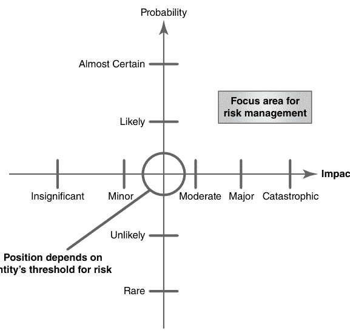

如果首先针对这些风险采取对策，则可以降低风险的概率或影响。你不应将风险管理活动仅限于右上象限，但这是你的风险响应工作应重点关注的地方。风险缓解、转移、接受或避免（将在下一节中介绍）可以降低右上象限中的风险。提醒一下，目标不是消除风险，而是将风险降低到可接受的水平。

## 规划风险响应

风险管理流程的下两步是制定处理风险的计划，然后实施该计划。在制定风险管理策略时，你应该了解最常见的响应。你可以降低、转移、接受和规避每个负面风险：

- **降低（缓解/减轻）**——这种方法使用各种控制措施来缓解或降低已识别的风险。这些控制措施可能是行政、技术或物理性的。例如，添加防病毒软件可降低计算机感染的风险。
- **转移（转移/分配）**——这种方法允许组织将风险转移给另一个实体。保险是降低风险的常见方式。组织“出售”风险给保险公司以换取保费。有时，你可以转移风险以使组织免受过度责任。例如，一家酒店聘请一家独立的停车公司来管理其停车场。损失主要由停车公司负责，而非酒店。停车场发生事件不太可能使酒店面临诉讼风险。
- **接受（接受）**——这允许组织接受风险。组织知道风险存在，并决定降低风险的成本高于损失。这可以包括自保或使用免赔额。组织愿意接受的风险水平取决于高级管理层的风险偏好。例如，一名医生购买医疗事故保险，并接受等于免赔额的剩余损失风险。他可以决定支付更高的保费以降低免赔额。但他可能会决定，较高的保费不值得成本，因为他预计很少会提出索赔。
- **规避（避免）**——风险规避就是决定不承担风险。如果风险水平过高，公司可以停止或决定不进入某个业务领域。在规避中，管理层决定公司的潜在损失超过继续该风险活动所能获得的潜在价值。例如，一家公司可能决定不在政治动荡的国家开设分支机构。

对于正面风险，你可以利用、分享、增强或接受每个风险：

- **利用（利用）**——当你利用正面风险时，你会利用在应对该风险时出现的机会。例如，假设你的组织开发了用于组织内部的培训材料，以帮助你应对特定风险。你可以通过将这些培训材料打包并向其他组织销售来利用该风险。
- **分享（分享）**——当你分享正面风险时，你会利用第三方来帮助捕捉与该风险相关的机会。例如，与另一家组织联合采购一批工作站许可证，可以让两家组织因合并订单的规模而获得显著折扣。（在此示例中，风险是许可证成本可能会变化。）
- **增强（增强）**——当你增强正面风险时，你会增加与该风险相关事件的概率或正面影响。例如，假设你有一份交付软件的合同，其中包含提前完成的20,000美元奖金。为了增强正面风险（交付日期与你的进度不匹配），你可以向雇佣的分包商提供5,000美元的奖金，以在截止日期前完成工作。
- **接受（接受）**——当你接受正面风险时，你不采取任何措施来应对它，因为该风险的潜在影响是积极的并能增加价值。例如，假设你购买了一种新的自动备份和配置实用程序，它可以帮助你的组织在分配时间的一半内部署新的工作站。由于该实用程序是新的，学习它可能需要一些时间——这意味着它可能无法帮助你的组织在部署新工作站时节省任何时间。最坏的情况是，学习新实用程序并使用它来管理部署所需的时间将与手动操作相同。但是，如果你实现了正面风险，你将比计划更早完成部署。

## 风险可接受范围/剩余风险

风险的可接受范围决定了你如何定义活动和对策。上限是组织无法承受的风险影响水平。下限显示了处理剩余风险的对策的增加成本。图8-4说明，风险管理的目标是保持在可接受范围内。

顶部图表代表组织面临特定风险的总敞口。现有的对策不足以将风险从最高可接受剩余风险水平降至可接受范围内。下部图表显示了建议的对策，这些对策将把最大剩余风险水平降至可接受范围内。

总风险是对所有业务资产的综合风险。剩余风险是在部署对策和控制措施后仍然存在的风险：

```
Risk – Mitigating controls = Residual risk
```

应用对策和控制措施可以降低风险，但不能消除风险。以汽车保险为例。当你购买一辆全新汽车时，一旦开出经销商的场地，它就贬值了，因为它现在是二手车了。如果事故导致汽车报废，保险可能不会按你最初购车的价格向你报销。

保险公司支付的金额与你实际为汽车支付的金额之间的差额就是剩余风险。其他示例包括保险中的免赔额，或者在实施警报、喷淋系统和培训后，火灾的剩余（但降低了）概率。总风险与剩余风险之间的差异如图8-5所示。

> **注意**
> 你通常无法完全消除风险。你的组织必须选择愿意接受的风险水平。这就是可接受范围。


图 8-4 可接受的风险范围。

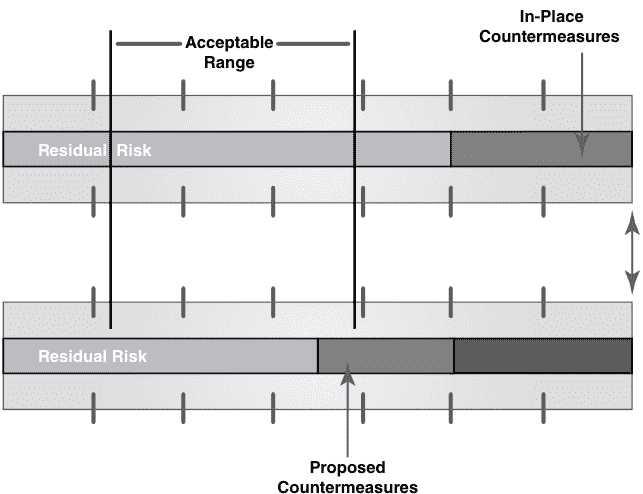

图 8-5 总风险和剩余风险。

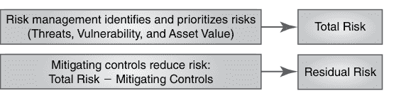

剩余风险应设定为可接受水平。

你应当使组织做好接受剩余风险成本的准备。你可以选择不完全消除风险，因为这样做可能是不可能的或成本太高。如果成本过高，你必须要么消除风险行为，要么采用不同的反制措施。

## 实施风险响应计划

安全控制是组织用于避免、抵消或最大限度减少损失或系统不可用的保障措施或反制措施。如内部审计师协会所定义：

控制环境设定了组织的基调，影响其人员的控制意识。它是所有其他内部控制组成部分的基础，提供纪律和结构。控制环境因素包括实体人员的正直、道德价值观和胜任能力；管理层的理念和运营风格；以及管理层分配权限、组织和发展其人员的方式。

> **注意**
> NIST还建议在NIST SP 800-53a中提出三种控制类别。三种NIST控制类别如下：
> - **管理控制。** 这些是用于管理整个风险过程的控制。例如，对安全控制进行审查以及制定和维护总体安全计划属于管理控制。
> - **运营控制。** 这些是操作人员可以实施和管理的控制，例如物理安全和事件响应。
> - **技术控制。** 这些控制由计算机程序组成，例如识别系统，或计算机程序的输出，例如用于审计跟踪的日志文件。

一些控制管理安全的活动阶段——即人们所做的事情。这些是**行政控制**。行政控制制定并确保遵守政策和程序。它们往往是员工可能会做的事情、员工应当做的事情或员工不应当做的事情。由计算机系统执行或管理的控制是**技术控制**。

**活动阶段控制**可以是行政控制或技术控制。它们与安全计划的生命周期对应关系如下：

- **侦测控制**—这些控制识别威胁是否已进入你的系统。入侵检测系统（IDS）是**侦测控制**的一个示例。IDS可以检测针对系统的攻击，例如试图获取系统信息的端口扫描。然后，IDS会记录该活动。

- **预防控制**—这些控制阻止威胁与漏洞接触。**预防控制**的一个示例是入侵防御系统（IPS）。IPS是一种你配置为主动阻止攻击的IDS。它不仅仅是记录活动，还可以更改配置，从而阻止恶意活动。

- **纠正控制**—这些控制减轻威胁的影响。当你在操作系统感染恶意软件后重新加载操作系统时，你正在使用**纠正控制**。取证和事件响应是纠正控制的其他示例。

- **威慑控制**—这些是阻止可能导致违规行为的控制。**威慑控制**和预防控制之间只有一线之隔。威慑控制只是试图建议主体不要采取某些行动，而预防控制则不允许该行动发生。当知识丰富的用户需要执行涉及风险的操作时，威慑控制非常有价值。威慑控制会在警告后允许该操作，而预防控制不会允许该操作。简而言之，在预防控制和威慑控制之间做出选择的决策，通常是在实用性和安全性之间取得平衡。

- **补偿控制**—这些控制旨在替代太昂贵或难以实施的首选控制来应对威胁。

**选择反制措施：**如前面章节所述，*控制*、*保障措施*和*反制措施*并非可互换的术语。*控制*限制或约束行为。*保障措施*和*反制措施*是用于约束或管理某些活动的控制。例如，用于存放贵重物品的保险柜是一种控制。看守保险柜的人工警卫是一种保障措施。针对贵重物品被盗造成的损失的保险是一种反制措施。反制措施针对或解决特定事件造成的损失。

## 保护物理安全

对组织来说，物理安全是一种特殊的风险类别。事实上，良好的物理安全是坚实的整体安全计划所必需的。太多IT安全专业人员忽视物理安全，只关注技术安全控制。始终将最佳安全控制作为风险管理计划的一部分进行评估。你必须确保所有关键IT资产始终得到物理保护。你可以实施许多控制来确保物理安全。以下是维护安全IT环境所需的最常见环境和物理控制的部分列表：

- 供暖、通风和空调（HVAC）—这些是为IT组件运行提供适当气流、温度和湿度的系统。虽然这看似简单，但这些系统必须设计良好并高效运行，以支持你的IT基础设施。数据中心设计应包括热通道（用于IT组件散热）和冷通道（用于向IT组件引入冷空气）。它们还必须设计为始终提供必要的服务，同时尽可能少地使用能源以降低成本。必须监控所有环境控制的正常运行，以确保你的数据中心保持所需的温度和湿度。

- 灭火—这包括设计用于扑灭不同类型火灾的设备和系统，以最大限度减少损失并防止火灾蔓延。

- 电磁屏蔽—这包括放置在布线周围或建筑材料中的物理屏障，用于限制电磁干扰（EMI）辐射在受保护区域外传播。

- 照明—灯光布置旨在确保所有区域都有充足照明，很少有暗区。

- 标志—清晰的标牌指示哪些区域指定用于特定用途，哪些区域为禁区。

- 围栏—物理屏障可威慑偶然闯入者或标记边界。

- 路障—物理屏障可威慑更具攻击性的闯入者或限制车辆通行。

- 警卫—物理存在可以威慑入侵，人类可以快速应对不断变化的情况。

- 运动探测器—设备在小型定义区域内观察到运动时会生成警报。

- 视频监控—设备从中央位置监控设施的许多区域，并记录行为以供日后分析。

- 锁—物理设备限制未经授权人员的物理访问。锁控制可以包括门锁、缆线锁、保险箱和锁柜。

- 人气闸—这些是两组门之间有一个小凹室的系统。一个人必须通过第一组门，并允许其关闭和锁定，第二组门才会打开。人气闸提供了一种便捷的方式来控制对安全空间的物理访问。

- 访问列表—这些是获准访问物理资源的人员名单。

- 近距离读卡器—传感器可以读取靠近读卡器的智能卡或设备，以向携带适当设备或智能卡的任何个人授予对安全区域或资源的访问权限。

- 生物识别—这是一种基于某些物理特征或行为的访问控制形式。

- 受保护的访问（布线）—这涉及通过限制对连接布线的访问来限制对安全IT组件的连接。

- 警报—这指的是控制生成的任何信号，该信号与需要立即采取行动的事件列表相匹配。

环境和物理控制不仅用于安全。这些控制大多承担的一个重要部分是人员安全。先前列出的控制都有助于为你的人员创造一个安全的环境。此外，一个强大的人员安全计划应包括以下内容：

- 逃生计划—一项主要的人员安全计划，告诉每个人在面对中断时如何逃生，包括到达紧急危险区域外之后该去哪里。

- 逃生路线—除了逃生计划外，人员还需要知道用于逃离中断的最佳路线。理想情况下，每条逃生路线都应终止于一个定义的集合点，以便管理层确定是否有人失踪。

- 演练—人员安全计划的关键演练测试。演练对于所有人员了解在面对中断时如何反应至关重要。

- 控制测试—无论类型如何，所有控制都应定期测试，以确保它们按设计运行。

可能的反制措施数量无限。反制措施必须有明确定义的目的。它必须应对风险并降低漏洞。没有风险（暴露）的反制措施（或控制）是寻找问题的解决方案。反制措施的一些具体目的包括以下内容：

- 修复已知可利用的软件缺陷
- 制定并强制执行操作规程和访问控制（数据和系统）
- 提供加密功能
- 改善物理安全
- 断开不可靠网络

每个人都需要了解自己的安全职责。对某些人来说，安全将是一份全职工作。其他人只会有偶尔的职责，例如出门时锁门。你可能承担的一些具体安全职责包括以下内容：


- 删除冗余/访客账户
- 培训系统管理员（特定培训）
- 培训所有人员（一般培训）
- 安装病毒扫描软件
- 安装IDS/IPS和网络扫描工具

### 对抗措施的定价/成本核算
评估对抗措施时必须考虑许多因素：

- **产品成本**—产品价格将包括其基本价格、附加功能的价格以及与服务级别协议或年度维护相关的费用。
- **实施成本**—这指的是与基础设施变更、施工、设计和培训相关的费用。例如，为安装新设备而加固地板的成本。
- **兼容性成本**—对抗措施必须适配（与之兼容）整体架构。例如，一家仅使用Windows的组织在安装基于Linux的对抗措施时，必须仔细考虑与培训和互操作性相关的额外成本。
- **环境成本**—例如，如果对抗措施消耗大量能源，您需要考虑您的电力系统是否能够提供该能源，并抵消其产生的多余热量。
- **测试成本**—测试确实需要时间和资金，但它是必不可少的。不过请注意，测试也会造成中断。您必须将所有这些视为成本。
- **生产力影响**—许多控制措施会影响生产力。它们可能会导致更多帮助台呼叫、用户响应时间变慢等等。

> **提示**
> 请记住：对抗措施的成本不仅仅是购买一件技术产品的价格。

## 监控和控制风险响应

实施任何控制或对抗措施的最重要部分是确保其达到目标。风险管理流程的最后一步是监控和控制已部署的对抗措施。如果对抗措施无法实际提供其预期效益，则毫无价值。

评估对抗措施时，首先要问：“这个对抗措施旨在解决什么问题？”（您的风险管理计划应对此有所明确）然后问：“这个对抗措施解决了这个问题吗？”以下是一些需要考虑的其他要点：

- **对抗措施可能给组织带来新风险**—例如，实施对抗措施可能会产生虚假的安全感。或者对抗措施本身可能成为关键系统上的新故障点。请确保持续监控对抗措施。检查其合规性和良好设计，并执行定期维护。
- **您必须对对抗措施计划进行认证和认可**—在经过变更控制流程之前，任何系统、控制或应用都不应投入生产。这也适用于对现有生产系统的更改。在执行安装或进行更改之前，您必须审查所有控制和对抗措施。否则，管理员可能会配置错误系统或犯其他错误。

- 您必须遵循最佳实践并履行应有的尽职调查——良好的风险管理计划向审计人员表明，公司正在采取审慎且勤勉的方法来应对安全风险。通过频繁评估对抗措施是否按预期运行，来履行应有的尽职调查。

## 业务连续性管理

组织应对中断的方式可能决定其生存。糟糕的规划大大增加了风险。如果规划不佳，组织可能无法做出适当响应，并且可能无法恢复正常运营。为中断进行规划是业务连续性管理（BCM）的一部分，它包括以下两项：

- **业务连续性计划（BCP）**—该计划包含在中断后保持关键业务流程运行所需的行动。中断可能是轻微的，例如停电，也可能是重大的，例如导致组织大楼无法使用的天气损坏。

- **灾难恢复计划（DRP）**—该计划详细说明了从中断中恢复并恢复正常业务运营所需的基础设施的步骤。

BCM不仅包括BCP和DRP，还包括危机管理、事件响应管理和风险管理。

中断是一项突发的非计划事件。它会扰乱组织提供关键业务功能的能力，并造成重大损害或损失。重大中断的示例包括以下内容：

- **极端天气**—2012年的超级风暴桑迪就是一个示例。

- **犯罪活动**—这可能包括窃取信用卡号码或其他客户数据。

- **民事骚乱/恐怖主义行为**—2014年密苏里州的暴力抗议浪潮就是一个示例。

- **运营**—一个示例是2012年印度北部的停电，影响了近9%的世界人口。

- **应用程序故障**—两个示例是亚马逊2011年的E2云服务崩溃和微软2014年的云服务崩溃。依赖这些云服务的企业不得不在服务恢复之前寻找其他方式来执行业务操作。

BCM的目的是减轻事件并确保业务连续性。但是，当事件发生时，首要任务始终是确保人员安全。控制损害是次要的。

## 术语

作为安全专业人员，您必须理解以下术语：

- **业务影响分析（BIA）**—这是对业务的分析，以确定哪些类型的事件会影响哪些系统。您不应将BIA的关注点局限于信息系统部门和基础设施；供应链中断（仓库火灾、卡车罢工等）的企业可能会轻易遭受与技术毫无关系的重大影响。某些场景会影响某些部门，某些场景会影响其他部门，而关键的少数场景会影响整个业务。您将在本章后面了解更多有关BIA的信息。

- **关键业务功能（CBF）**—一旦BIA识别出事件会影响的业务系统，您就必须将系统从最关键到最不关键进行排序。该排序决定了业务在缺乏关键功能的情况下是否能够生存，以及能够生存多长时间。

- **最大可容忍停机时间（MTD）**—MTD是企业在没有特定关键系统的情况下能够生存的最长时间。重大中断是任何导致CBF不可用时间超过其MTD的事件。每个灾难规划和减轻解决方案都必须能够在MTD内恢复CBF。MTD最短的系统和功能通常是最关键的。下一节将更详细地介绍此主题。

- **恢复时间目标（RTO）**—RTO是恢复CBF的时间范围。RTO必须短于或等于MTD。

- **恢复点目标（RPO）**—事件可能会导致数据丢失。您必须计算每个业务功能可容忍的数据丢失量。恢复程序必须能够满足此处定义的最小值。如果企业可以承受最多一天的数据丢失，那么每夜备份可能是一个可接受的解决方案。但是，如果企业必须防止所有数据丢失，则需要冗余服务器或存储解决方案。

- **应急操作中心（EOC）**—EOC是在中断期间恢复团队集会和工作的地点。许多企业拥有多个**应急操作中心**。一个可能就在附近——例如，以防大楼起火使用。另一个可能距离较远——例如，以防地震或区域停电使用。

以下是MTD和RTO的协同工作方式：假设数据中心停电。需要六小时才能转移到备用站点（RTO）。企业在没有正常运行数据中心的情况下可以生存九小时。此时，存在一个事件，但尚未发生您可以定义为重大中断或灾难的事件。如果您预计电力将在三小时内恢复（MTD – RTO），企业可能不会宣布灾难，而是预期活动将恢复正常。但是，如果三小时时电力仍未恢复，就该宣布重大中断了。

> **提示**
> 在考虑设备故障频率时，还有其他一些术语您应该了解。熟悉以下术语：
> - **平均失效时间（MTTF）**—设备在失效前平均可运行的时间。
> - **平均无故障时间（MTBF）**—故障之间的平均时间（假设故障已被修复）。
> - **平均修复时间（MTTR）**—修复设备并使其重新投入服务所需的平均时间。


在此示例中，三小时节点是一个关键里程碑。假设组织选择不在三小时节点将运营切换到备用站点。相反，它等待了四小时。因为切换到备用站点需要六小时，组织将遭受总计10小时的损失。这超过了九小时的MTD。虽然一小时看起来可能不多，但它是基于既定的MTD。数据中心可能为其他组织提供服务。服务级别协议规定停机时间不得超过九小时，超过九小时的停机将面临金钱罚款。那多出来的一小时可能会使组织损失数万美元（甚至更多）。

当然，避免停机时间超过MTD的最佳方法是从一开始就不发生停机。BCM的一个重要方面是在可能的情况下提供控制措施以避免停机。IT应急计划涉及如何处理组件停止服务的问题，但高可用性规划涉及如何使关键组件随时保持运行。

### 注意

组织通常通过部署冗余组件来提供容错能力。提供容错能力的一些常见方式包括：

- **廉价磁盘冗余阵列 (RAID)**—这些是多个磁盘驱动器，表现为单个磁盘驱动器，但实际上会在阵列中某个磁盘驱动器故障时存储多份数据副本。RAID可以部署不同级别的冗余。
- **群集**—群集涉及将两台或多台计算机连接起来，使其像一台计算机一样运行。如果群集中的一个组件故障，其他组件将继续运行而不会崩溃。
- **负载均衡**—这是使用两台或多台服务器来响应服务请求。当一台服务器繁忙时，其他服务器将响应请求。这与群集不同之处在于，负载均衡服务器是独立的服务器，不在网络消息之外进行协调。
- **多台服务器或设备**—负载均衡的一种更通用的实现方式，只是使多台服务器或网络设备可用以响应相同的服务请求。一台设备的故障不会停止所有处理。冗余服务器或设备可以继续运行。

识别任何关键组件，并确保其故障不会导致整个业务流程中断。任何如果故障可能中断业务处理的组件都称为单点故障（SPOF）。BCM的一个目标是消除所有关键SPOF。例如，假设您的组织使用单一ISP。如果到ISP的链路故障，您将无法连接到互联网。解决此SPOF的一种方法是同时从主ISP和另一家ISP购买互联网服务。部署两个或多个能够提供相同服务的组件（称为冗余）有助于提高组织避免停机（也称为容错）的能力。

## 评估最大可容忍停机时间

您根据业务需求确定最大可容忍停机时间（MTD）。这与多个集成功能的RTO密切相关。例如，考虑组织为电子商务目的托管的网站。Web服务器依赖网络服务、ISP可用性和电力。这些各自都有基于事件的RTO，但都与MTD相关联。

例如，如果您确定网站的MTD为四小时，那么失败的网络服务、ISP可用性和电力的RTO都必须小于四小时。恢复的部分可以并行进行，但有些可能必须按顺序进行。在此示例中，在恢复电力之前无法恢复网络服务。但是，一旦恢复供电，您可以同时着手恢复网络服务和ISP可用性。

RPO定义了可容忍的数据丢失量。RPO可以来自业务影响分析，有时也来自政府规定——例如，银行法律或关于药品研究数据保留的法规。**图 8-6** 展示了如何评估MTD、RTO和RPO。

**图 8-6**

| 术语 | 定义 |
| :--- | :--- |
| MTD | 最大可容忍停机时间：业务在关键功能失效后能够生存的最长时间段 |
| RTO | 恢复时间目标：恢复业务流程所需的时间；通常由多个相互关联的RTO组成 |
| RPO | 恢复点目标：数据必须恢复到的时间点 |

*评估最大可容忍停机时间 (MTD)。*

## 业务影响分析

BIA确定特定事件随时间对业务运营产生的影响程度。BIA推动恢复策略和CBF的选择。

作为安全专业人员，您的工作是提出两个问题：

- 什么会影响业务？
- 它将如何影响业务？

成功的BIA会绘制上下文、关键业务功能及其依赖的流程图。您应该考虑所有影响，包括那些难以解决或不太明显的影响。不同的事件需要不同的恢复策略。会计部门的火灾可能需要外包和临时场所。地下室的洪水可能会启动服务局计划。地震或飓风可能导致永久搬迁到新设施。

您进行业务影响分析的三个主要原因：

- 为设定每个业务单元或资源在整个组织运营中的价值
- 为识别制定业务恢复计划所需的关键需求
- 为在中断后恢复组织功能设定顺序或优先级

### 影响速度

某些事件可能会随着时间的推移变得更加严重。关键处理设施的缓慢劣化可能导致灾难。计算机房中连续安装新设备可能会过度消耗电力供应能力，最终导致停电或火灾。

某些系统在一年中的特定时间更为重要。一家供应取暖油的公司在冬季更繁忙。冬季即使是最小的停机也会危及该公司的服务协议。同一家公司在夏季（负载最低时）可能很容易承受更严重的事件（更长的MTD）。

### 关键依赖

BIA必须确定组织支持公司关键运营所需的内容：

- 信息处理
- 人员
- 通信
- 设备
- 设施
- 其他组织功能
- 供应商
- 供货商

## 评估停机影响

BIA将识别关键数据和系统。请注意，系统的重要性和数据的重要性并不总是相同。系统可能比其包含的数据更重要，反之亦然。真正重要的是业务依赖的那些系统和数据。

BIA期间应考虑的问题分为以下几类：

- **人员**—您将如何通知他们事件及其影响？您将如何疏散、运送和照顾员工（例如，支付他们的工资）？如果关键人员丧失能力或无法工作，谁将接替？（这称为**继任计划**。）
- **系统**—您必须立即复制计算和电信基础设施的哪些部分？您有多长时间——一分钟、一小时、一天？
- **数据**—运行您的业务哪些数据是关键的？您将如何恢复丢失的关键数据？
- **财产**—您的业务哪些物品是必不可少的？工具、用品和特殊表格等物品都必须可恢复或易于更换。

评估停机影响是BIA中的一个规划步骤。您正在帮助确定必须做什么以及按什么顺序来实现上述四个类别中描述的目标。弄清楚如何做到这一点是BCM的主要重点。

## 计划审查

您必须更新并定期维护BCP以及系统和应用程序的库存和配置列表。一些公司每年这样做一次。其他公司则选择不同的周期。除了计划内的审查之外，公司的任何重大变更都应触发审查。除了拥有最新计划的明显好处之外，测试和计划修订也是培训新员工的绝佳方式。让新员工参与实际操作过程可以教会他们您的流程以及更多关于您环境的知识。

## 测试计划

您不应在未经彻底测试的情况下接受任何BCP或DRP。这有助于确保计划有效，并且您将实现CBF、MTD、RPO和RTO目标。测试的每个阶段都必须考虑持续的安全需求，以及执行测试和处理实际灾难所需的技术资源。


## Checklist Test

清单测试是由管理人员和业务连续性团队对计划进行的简单审查，以确保联系电话是最新的，并且计划反映了公司的优先事项和结构。这种检查是一种办公桌检查。每个团队成员坐在办公桌前检查计划中的各自部分。除了检查联系人列表外，团队成员还会审查其部门的变更是否会影响计划。他们还会查看部门预期的变更，以判断是否需要更新计划。

## Structured Walk-Through Test

结构化演练测试是一种桌面演练。在此测试中，来自各部门的代表团队应执行以下操作：

- 向其他团队展示计划中的各自部分。
- 审查计划目标的完整性和正确性。
- 确认计划范围以及所做的任何假设。
- 查找重叠和缺口。
- 审查组织结构以及报告/沟通结构。
- 评估测试、维护和培训要求。
- 开展多个基于场景的练习，以评估计划的有效性。
- 以结构化方式召开会议，共同逐步走一遍计划。

对于最后一步，团队成员应像正在为特定类型的事件执行计划那样行动。结构化演练的目标是发现各部门计划中的错误，例如缺口或重叠。缺口是指一个部门认为某项关键任务应由另一个部门处理。重叠是指两个部门都认为将拥有相同资源的独占（或大部分）使用权的情况——例如，两个部门认为它们将拥有三分之二的替换台式机。

## Simulation Test

模拟测试不仅仅是纸上演练。它比演练需要更多的规划。参与操作/流程的所有工作人员都参加测试。测试识别以下内容：

- 员工反应和响应时间
- 低效问题或此前未发现的漏洞

应仅使用计划中定义的对策在现场进行模拟。模拟测试涉及许多尚未参与计划制定的员工。通常在非工作日（例如周末）进行模拟。

模拟测试的目的是识别不足之处。应尽可能继续进行测试。例如，如果关键文件缺失，应从主站点生成或获取该文件，然后继续测试。确保记录任何现场纠正措施以供评估，并计划稍后更新。测试只有在完成或无法继续时才应结束。

## Parallel Test

大多数组织在备用站点进行并行测试。并行测试与全中断测试（下一节将介绍）相同，不同之处在于处理在主站点不会停止。以下是关于并行测试的几个关键点：

- 并行测试是一种运行测试，因此不会包括人力资源、公关、采购、设施等部门的代表。
- 因为并行测试意味着激活备用站点，所以会花费大量资金。测试必须获得高级管理层批准。
- 将测试结果与原站点的处理进行对比。
- 差距分析会暴露任何需要关注的弱点或表现不足的地方。
- 通常审计人员会参与每个步骤以监控成功情况，并确保并行运行数据不会混入正常运行数据中。

## Full-Interruption Test

进行此类测试最常见的方式是在备用站点。这种测试非常具有破坏性，因此很少有组织会进行它。在测试期间，必须关闭原始系统整个持续时间。只能使用备用站点现有的流程来继续业务运营。

> **警告**
> 此测试风险高！运行全中断测试实际上可能导致灾难。只有在成功运行完所有其他类型的测试后，才能运行全中断测试。测试前必须获得高级管理层批准。

## Backing Up Data and Applications

只有当公司能够访问其数据和应用程序的备份时，恢复才有可能。计划必须包括处理备份存储介质、位置和访问。磁带备份是备份的传统选择，至今仍是最常见的。然而，从磁带恢复速度慢，许多系统的 RTO（恢复时间目标）短于磁带恢复时间。这类站点通常使用基于磁盘的解决方案，例如存储区域网络（SAN）、网络附加服务器（NAS），甚至是异地网络存储，例如远程日志记录。在远程日志记录中，sys-

## Backups Versus Redundancy

冗余或容错选项，在主资源失败时提供替代资源。换句话说，系统可以发生故障但能够容忍并继续运行。然而，必须知道冗余不能替代备份。

例如，RAID 1 镜像将数据写入两个磁盘而不是一个。如果其中一块磁盘失败，系统可以继续运行。数据仍然可以在第二块磁盘上访问。不过，想象一下你有一台受 RAID 保护的服务器。如果服务器发生灾难性故障并破坏所有驱动器，数据就丢失了。如果你没有备份，数据将永久丢失。

同样，你可以设置集群服务器，以便在主服务器失败时由备用服务器接管。同样，仅仅因为服务使用集群进行容错，并不意味着你不需要备份。

- **差异备份**——使用这种备份类型时，你先进行一次完整备份（例如在星期天，当时网络流量最小）。从星期一到星期六，你每天备份自星期天完整备份以来的更改。随着一周的推移，每晚的备份（差异备份）所需时间会稍长。

- **增量备份**——同样，在网络流量较少时进行一次完整备份。然后，每晚只备份当天的更改。随着一周的推移，每晚的（增量）备份所需时间大约相同。

创建工作日增量备份比创建差异备份更快。然而，这也有代价。如果需要使用备份映像恢复数据，使用差异备份的系统只需恢复完整备份，然后恢复最新的差异备份即可。使用增量备份的系统需要恢复完整备份，然后恢复每天的增量备份才能完成恢复。

你应该备份不仅仅是数据的项目。这些包括路由器、交换机和其他网络设备配置、用户访问权限和配置（例如，Active Directory），以及服务器/工作站操作系统和配置。为了使这更易于管理，大多数大公司都有可按需重新加载的工作站标准基础配置。只要保持这些配置为最新（已打补丁和修复），这便是一个有吸引力的解决方案。

## Incident Handling

提醒一下，事件是导致安全策略实际或受到威胁的违反的事件。当事件发生时，组织需要进行响应。事件处理过程包括以下步骤：

- 准备
- 识别
- 通知

## TIP

请记住，尽量减少停机时间通常与避免停机时间有关。避免停机时间最简单的方法通常是确保所有计算机和设备都已打上最新的安全修补程序。修补程序使系统对多种类型的攻击更具抵抗力，并减少对冗余和其他容错技术的依赖。


- 响应
- 恢复与后续处理
- 文档

您将在以下各节中了解每个步骤。

## 准备

事件响应计划的第一步是规划如何最好地应对各种事件，并构建**事件响应团队（IRT）**。IRT 将拥有培训和文档，以便在事件发生时进行响应。IRT 成员应彼此足够熟悉，能够自由沟通并以专业的方式处理每个事件。规划阶段的质量决定了 IRT 处理事件的效果。

## 识别

实际处理事件的第一步是确定事件是否确实发生。但并非所有事件都是事故。您必须找出该事件是严重，还是常见的良性情况。这就是分诊——对事件进行优先级排序。您可能会从警报、用户投诉、安全供应商的警报或日志分析中收到事件的初始通知。请确保您已就位应对任何类型事件的程序。

## 通知

您或另一位 IRT 成员通常是最早得知事件的人员之一，并且必须知道如何反应。作为第一响应者，从一开始就妥善处理事件非常重要。目标是控制事件，并在可能的情况下改善状况。要注意不要使情况恶化。您必须找出该事件是否为误报。要小心确保多次误报不会让您对真实事件变得迟钝。一系列看似独立的事件单独来看可能不足以证明需要响应。但是，当它们集体考虑时，可能很重要。

您必须知道何时以及如何升级，以及通知谁。当您规划响应场景并培训事件响应团队成员时，这很有效。

> **法院与证据：取证过程**
>
> 有时，事件可能成为民事甚至刑事案件的基础。因此，您应谨慎处理所有调查，以确保证据没有被污染或变得不可采纳。始终优先收集最易失性的数据。易失性数据是指在不久的将来可能会改变的数据。易失性顺序（以及您应收集数据的顺序）是：
>
> 1. RAM
> 2. 交换和分页文件
> 3. 磁盘上的文件
> 4. 日志
> 5. 存档数据

即使事件最终没有进入法院，法院行动的威胁可能就足以满足公司的需求。例如，公司可能会选择强迫某人辞职，而不是起诉他人。

各国法律各不相同，但几乎到处都是如此：一旦某事使证据变得不可采纳，您就无法补救。

在所有普通法国家（以及许多遵循大陆法的国家）中，证据必须被证明为真实。换句话说，您必须证明证据在事件发生后未被更改。这意味着您必须尽早捕获系统镜像，然后对镜像的副本进行所有分析。这样做可确保您不会意外修改原始证据。然后，您可以捕获任何网络流量和日志，以及带有适当时间戳的视频或其他媒体。证据保管链显示证据是如何收集和记录的。该文档列出了自发现以来接触过证据的每个人。它显示了它是如何处理的，对其做了什么，以及它是如何防止被更改的。

为了证明所有证据都有效且处于收集时的相同状态，您可以创建哈希值、截屏，甚至可以使用事件和收集活动的目击者。请确保您保留了取证过程中使用的所有时间和费用的详细记录。您可能需要量化收集证据所需的工作量。最后，一旦您拥有所有收集到的数据，就可以使用分析技术（尤其是新兴的大数据技术）从所有收集到的数据中提取有用信息。

## 响应

一旦您识别出事件，下一阶段就是限制损失。此步骤的一个重要方面是遏制。许多事件会迅速增长和扩展，可能影响其他系统、部门甚至业务合作伙伴。事件响应计划必须概述为阻止事件蔓延而必须采取的步骤，同时不造成不必要的中断。例如，如果病毒感染了系统，遏制威胁的简单方法是将系统从网络上拔下。

制定计划至关重要。在事件发生时正确猜测最佳行动方案的可能性很小。请记住，拥有时间和事后诸葛亮优势的人会在事件后评估您的响应。预先批准的响应计划将带来更好、更有效的响应，同时也能为您提供减责保护。

识别事件的源和类型至关重要，以便您可以实施适当的恢复程序。修复症状不能解决问题。响应人员必须找出损坏的范围，如果损坏过于严重，可能会建议启动灾难恢复计划。事件管理的一个关键组成部分是防止未来事件。事件期间收集的日志和文档必须受到保护，并可用于未来分析。

## 恢复

在您遏制事件并消除或阻断其源之后，就可以恢复了。在将系统交付给正常使用之前，您必须处理被利用的漏洞，以免它立即再次发生。您可能需要使用未受感染的应用程序和数据备份重建系统。您还可能需要从系统中清除恶意内容以防止再次感染。

## 后续处理

从事件中吸取教训将使管理层能够建立新的程序和控制，以便在将来更有效地防止或应对事件。对每次事件进行经验教训回顾以捕获 IRT 可用于未来事件的宝贵信息非常重要。

## 文档和报告

不要忽视记录事件响应过程中每个步骤的重要性。您创建的文档对未来事件的质量可能非常有价值。每当您记录哪些行动有效、哪些无效时，您都可以改进事件响应计划。随着您积累事件响应文档，您就构建了一个宝贵的资源。您可以使用此资源对事件响应计划以及正常的安全政策和程序进行更改。例如，记录与数据中心未经授权人员相关的多起事件可能表明需要更好的控制。使用您从记录事件响应中获得的信息。它可以使您的组织更加安全。

## 灾难恢复

灾难恢复计划（DRP）有三项作用：

- 它建立应急运营中心（EOC），作为备选位置，用于协调和实施 BCP/DRP。
- 它指定 EOC 经理。
- 它确定该经理何时应将事件宣布为灾难。

DRP 使您能够提前做出关键决策。这样，您可以在没有实际灾难的紧迫性的情况下管理和审查决策。如果您不提前制定这些计划，您和您的经理将不得不在巨大压力下做出最佳猜测决策。

DRP 是长期的、耗时的、昂贵的项目。大型公司的 DRP 可能花费数千万美元。高层管理不仅必须支持，而且必须坚持实施有效且经过充分测试的 DRP。

该过程从业务分析开始。它识别关键功能及其最大可容忍停机时间。然后它识别应对可能触发该计划的各种场景的策略。作为安全专业人员，您很可能会作为灾难规划和灾难恢复团队的成员参与。


## Activating the Disaster Recovery Plan

As a security professional, you will play a key role in reestablishing business operations in a crisis by rebuilding the networks and systems that the business requires. The recovery process involves two main phases. The first phase is to restore business operations. In many cases, the recovery might be at an alternate site. You may be required to build a network rapidly from available backup data, backup equipment, and any equipment that might be available from vendors.

The second phase is to return operations to their original state before the disaster. To return to normal operations, you must rebuild the primary site. The transition back to the normal site and the closure of the alternate site should be part of the “Return to Home Site” portion of the BCP/DRP.

Activate salvage and repair teams. They will do their work before people and data can return to the primary site. Security professionals are often on the repair team to rebuild the damaged parts of the network infrastructure. They will match—or increase—previous security levels. If you need new equipment, use this opportunity to improve security.

> **NOTE**
> Remember: A disaster is an event that prevents a critical business function (CBF) from operating for a period greater than the maximum tolerable downtime (MTD).

## Operating in a Reduced/Modified Environment

During a crisis, many of the normal conditions, such as controls, support, and processes, might not be available. You must adapt quickly to ensure the secure operation of systems, including backups and reconciliation of errors. Here are a few points to keep in mind:

- You may want to suspend normal processes, such as separation of duties or spending limits. You should compensate with additional controls or by additional auditing. The DRP should give added privileges or spending authority to certain people or for certain tasks.
- If a number of systems are down, users might need more technical support or guidance on how to use alternate systems or access. The BIAs should have identified minimum recovery resources as part of the recovery needs.
- During a disaster and recovery, it might be good to combine services that were on different hardware platforms onto common servers. This might speed up recovery. However, you must manage this process carefully to make sure that the movement and recovery goes smoothly.
- While running at the alternate site, you must continue to make backups of data and systems. This might prevent new disasters if the recovery site fails.

> **NOTE**
> DRPs can lower insurance rates, and the preparation of a DRP can assist in risk management efforts.

### Primary Steps to Disaster Recovery

The primary steps to disaster recovery (in order of importance) are:
1. Ensure the safety of individuals.
2. Contain the damage.
3. Assess the damage and begin recovery operations according to the DCP and BCP.

## Restoring Damaged Systems

You must plan for rebuilding damaged systems. You need to know where to get configuration charts, inventory lists, and backup applications and data. You must have access control lists to make sure that the system allows only legitimate users on it. Keep the following points in mind:

- Once the rebuilding starts, the administrator must make sure to update the operating systems and applications with the most current patches. Backups or installation disks often contain older versions that are not current.
- After you rebuild the system, you must restore the data to the RPO. This includes reconciling books and records. You must make sure the operating systems and applications are current and secure.
- Some organizations overlook access control permissions in recovery plans. You must activate the access control rules, directories, and remote access systems to permit users to get on the new systems. When you are making the plan, be sure that any vendor software will run on alternate processors. Some vendors license their products to operate only on a certain CPU.

### Disaster Recovery Issues

Here is a short list of disaster recovery issues that are often overlooked in the maintenance and execution of a DRP.

- **Generators**—Ensure all fuel is fresh and contracts are in place to guarantee a supply of fuel in a crisis. Generators must receive routine maintenance and should be run periodically to make sure they are ready to operate and capable of carrying the expected system load.
- **Safety of damaged site**—You must protect the primary (damaged) site from further damage or looting.
- **Reentry**—You must examine the damaged site using people who are qualified to determine whether it is safe for humans to reenter.
- **Transportation of equipment and backups**—The plan must provide safe transportation of people, equipment, and backup data to and from the alternate site.
- **Communications and networks**—Regular telephone service often fails in a crisis. You might need an alternate method of communication, especially among key team members.

### Recovery Alternatives

A business continuity coordinator considers each alternative's ability to support critical business functions, its operational readiness compared with RTO, and the associated cost. He or she examines specifications for workspace, security requirements, IT, and telecommunications.

Three choices usually are considered if a business (or some part of it) has to be moved for recovery:

- A dedicated site operated by the business, such as a secondary processing center
- A commercially leased facility, such as a hot site or mobile facility
- An agreement with an internal or external facility

External commercial providers offer services to many organizations. That means if there is a disaster, it could affect many customers of a commercial provider. What priority will you have if this happens? Know your options (along with prices) for things such as test time, declaration, fees, and minimum/maximum recovery days. Make sure that the specifications for workspace, security requirements, IT, and telecommunications are suitable for your critical business functions. Ensure that suitable accommodations are available for staff, including facilities for resting and showering, as well as catering.

No matter what choice your business makes, the IT department's job is to make sure all necessary equipment is available at the alternate site. This includes the critical files, documentation, and other items identified in the recovery categories. Other items can include additional patch cables, USB drives, or other common items IT personnel may use on a daily basis.

## Interim or Alternate Processing Strategies

Regardless where you choose to continue operations, you'll need a location to support your IT infrastructure. There are several options available, depending on cost and the time it takes to become operational. Here are the most common recovery location options:

- An alternate processing center or mirrored site is always ready and under the organization's control. It is the most expensive option because it requires fully redundant or duplicate operations and synchronized data. The organization operates it continuously. Its additional costs might be justified by business needs (such as having a duplicate support staff) other than recovery planning. However, making cost allocations is complex.
- A hot site is one that can take over operations quickly. It has all the equipment and data already staged at the location, though you may need to refresh or update the data. There are two kinds of hot sites. One is company owned and dedicated. The other is a commercial hot site. The hot site's advantage is that it can provide alternative computing facilities quickly, allowing rapid recovery. An internally owned hot site will be more expensive than some other alternatives, but no one else will compete for it during a regional disaster.
- A warm site has some common IT, communications, power, and HVAC, but you will have to purchase and deliver IT equipment such as servers and communications. You will have to retrieve and load data as well. Many organizations own warm sites and often use them for offsite data storage.
- A cold site is an empty data center with HVAC and power. It is the least expensive option. It requires a lot of time to get up and running because you must purchase, deliver, and configure all equipment and telecommunications. Some organizations begin recovery in a hot site and transfer over to a warm site or cold site if the interruption lasts a long time.


| 特性 | 热站点 | 温站点 | 冷站点 | 多站点 |
| :--- | :--- | :--- | :--- | :--- |
| 成本 | 高 | 中 | 低 | 无直接成本 |
| 配备计算机 | 是 | 是 | 否 | 是 |
| 配备连接性 | 是 | 是 | 否 | 是 |
| 配备数据 | 是 | 否 | 否 | 是 |
| 配备人员 | 是 | 否 | 否 | 是 |
| 典型就绪前置时间 | 分钟到小时 | 小时到天 | 天到周 | 片刻到分钟 |

表 8-2 比较了最常见的恢复站点选项。

## 处理协议

解决恢复问题的一种方法是找到具有类似 IT 配置和备份技术的组织。这可能是另一家公司、应急承运人或服务机构。然后，您与另一组织达成协议，以便在贵公司遇到灾难时提供支持。IT、安全部门和法务部门应仔细审查草拟的协议。

## 互惠或互助

贵公司可能会与技术相似的公司签订互惠协议，也称为互助或联盟协议。在联盟协议中，若干公司同意相互支持。您必须仔细考虑这种方法。例如，各组织在支持另一组织的同时，是否能继续其主要业务？设备和基础设施是否能支持两个组织？您必须进行测试，以确认所有系统都能处理额外负载且相互兼容。您还必须考虑数据的敏感性以及适用于该数据的任何法规。合作伙伴的管理员或用户可能能够访问它。双方如果升级或退役可能导致其系统不兼容的技术，必须相互警告。

## 互惠中心

互惠中心通常涉及从事相同类型工作但并非直接竞争对手的企业。这些可能包括城内医院，或平装书出版商与精装书出版商的配对。熟悉度和共性具有优势。它们可能共享行业所需的特殊代码、行业术语和特殊表格。例如，医院使用术语“DRG 代码”。它指在共同数据库中对应于诊断、操作或疾病的数字。

## 应急

如果组织的主要供应方式失效，可能会签订应急承运人或应急供应商合同。您需要考虑维护费用和激活时间。您还需要检查承运人（尤其是通信承运人）是否共享相同的电缆或路由路径。向他们询问是明智之举。

## 服务机构

服务机构是拥有额外容量的服务提供商。示例是处理来电的呼叫中心。贵组织可以签订合同以紧急使用它。这可能引发与互惠协议安排相同的问题。供应商可能会增加其业务并消耗其额外容量，或者供应商可能会修改其硬件或配置。

## 使用云

近年来，云计算变得非常流行。预计更多组织会将云纳入其 IT 环境的至少一部分。由于云计算基于虚拟化，因此从一处复制整个服务器镜像到另一处非常容易。这种技术使得维护灾难恢复站点变得更加经济。几乎任何组织都可以以远低于物理站点的成本维护基于云的灾难恢复站点。

您在本章中了解的所有选项在云中均可用。基于云的灾难恢复站点可以作为冷站点、温站点或热站点存在。更便宜的选择是仅将关键文件备份到基于云的存储中。当然，您必须考虑如果主站点失败所需的恢复时间。

常见的虚拟化快照功能在灾难恢复中很有用。您可以创建已应用所有所需修补程序的虚拟机 (VM) 镜像。所需 VM 的快照是恢复镜像的绝佳起点。虚拟化使得可以启动所需数量的虚拟备用站点，以支持您的运营，直到您能恢复主数据中心。云计算通过潜在降低设置和维护备用环境的成本，提供了更多恢复选项。如同在考虑对 IT 环境进行任何更改时所做的那样，评估使用云如何影响安全性。即使使用虚拟化，您仍然需要测试所有安全控制措施，但这项新技术为应对中断或事件提供了许多好处。您不仅需要将虚拟化用于灾难恢复。如果您需要进行不应影响运营的测试，可以将 VM 镜像作为隔离服务器或沙盒启动。选择多种多样。然而，与往常一样，无论您选择在哪里存储数据或进行处理，都必须确保满足或超过安全策略。

## 章节摘要

在本章中，您了解了信息安全的三个核心原则：

- 识别组织面临的风险。
- 通过使用控制措施尽可能防止损害。
- 准备好计划和程序，以应对您无法预防的事件。您可以将这些原则和控制措施用人员、流程、技术和数据来表达。

在本章中，您了解了风险管理的原因和流程。您了解了业务连续性计划 (BCP) 如何帮助您确保中断不会使您的组织倒闭。您了解了风险评估，包括定量风险评估与定性风险评估之间的区别。您了解了风险的最常见响应以及它们如何帮助您制定风险降低策略。您了解了对策以及如何评估它们。

您了解了三种活动控制类型以及它们如何与安全生命周期相对应。您了解了响应如何决定您的组织应对中断和灾难的能力。您了解了三种备份类型以及可用于从中断中恢复的备份模型。此外，您了解了必须采取的事件响应步骤以及事件响应在风险、响应和恢复过程中的作用。最后，您了解了灾难恢复的主要步骤以及在整个灾难恢复计划中所扮演的角色。

## 关键概念和术语

- 活动阶段控制
- 行政控制
- 年化发生率 (ARO)
- 路障
- 清单测试
- 集群
- 补偿控制
- 联盟协议
- 控制
- 纠正控制
- 对策
- 侦测控制
- 威慑控制
- 中断
- 应急操作中心 (EOC)
- EMI 屏蔽
- 事件
- 容错
- 影响
- 安全事件
- 事件响应团队
- 可能性
- 负载均衡
- 损失期望值
- 管理控制
- 人陷阱
- 最大可容忍停机时间 (MTD)
- 平均无故障时间 (MTBF)
- 互助
- 操作控制
- 并行测试
- 预防控制
- 近距离读卡器
- 定性风险评估
- 定量风险评估
- 互惠中心
- 冗余
- 冗余廉价磁盘阵列 (RAID)
- 远程日志
- 残余风险
- 风险
- 风险登记册
- 防护措施
- 沙盒
- 服务机构
- 模拟测试
- 单点故障 (SPOF)
- 静态环境
- 继任计划
- 技术控制
- 威胁
- 总风险
- 漏洞

## 第 8 章评估

- **1.** 包含在中断后保持关键业务流程运行所需操作的计划称为 ______。
  A. 灾难恢复计划 (DRP)
  B. 业务影响分析 (BIA)
  C. 业务连续性计划 (BCP)
  D. 以上都不是

- **2.** 详细说明从重大中断中恢复并恢复正常业务运营所需基础设施步骤的计划是 ______。
  A. 灾难恢复计划 (DRP)
  B. 业务影响分析 (BIA)
  C. 业务连续性计划 (BCP)
  D. 以上都不是

- **3.** 漏洞是任何可能使威胁得以实现的暴露。
  A. 正确
  B. 错误

- **4.** IDS 是哪种类型的控制措施？
  A. 侦测控制
  B. 预防控制
  C. 纠正控制
  D. 补偿控制
  E. 以上都是

- **5.** ______ 是企业在没有特定关键系统的情况下能够生存的时间限制。
  A. 恢复时间目标 (RTO)
  B. 关键业务功能 (CBF)
  C. 最大可容忍停机时间 (MTD)
  D. 以上都不是

- **6.** 事件处理流程包括以下哪项？
  A. 文档
  B. 响应
  C. 通知
  D. 恢复和后续处理
  E. 以上都是

- **7.** 灾难恢复的主要步骤包括个人的安全、限制损害、评估损害并开始恢复操作。
  A. 正确
  B. 错误

- **8.** 任何违反或威胁要违反安全策略的事件都称为 ______。
  A. 对策
  B. 影响
  C. 风险
  D. 事件

- **9.** 描述风险场景然后确定该事件对业务运营影响程度的过程是定量风险分析。
  A. 正确
  B. 错误

- **10.** 风险缓解措施实施后仍然存在的风险称为 ______ 风险。
  A. 定性
  B. 定量
  C. 残余
  D. 以上都不是


# 密码学

根据 *韦氏修订未删节词典*，密码学是“使用秘密字符书写的行为或艺术”。计算机免费在线词典称密码学是“对数据进行编码，以便只有特定个人才能解码”。用于加密和解密数据的算法或密码统称为 **密码系统**。大多数密码采用未加密数据（称为 **明文**），并使用一个或多个密钥将明文转换为秘密消息。**密钥**是仅发送方和/或接收者知道的数字或字符串。生成的秘密消息是 **密文**。

密码系统的安全性通常取决于密钥的保密性，而非密码本身的保密性。强大的密码系统拥有大量可能的密钥，使得在暴力攻击中无法尝试所有密钥。强大的系统还应生成看似随机的密文，能够通过所有标准统计测试，并抵御所有已知的代码破解方法。破解代码的过程称为 **密码分析**。

本质上，**密码学**是向他人隐藏信息的艺术。你可以在商业和政府以及个人交易中发现密码学的应用。密码学不是保障信息安全的唯一方式。相反，它是 IT 安全的一组工具。

密码学实现四个安全目标：

- 机密性
- 完整性
- 身份验证
- 不可否认性

IT 安全专业人员创造性地使用这些密码学工具来实现企业的安全目标。

## 第 9 章 主题

本章涵盖以下主题和概念：

- 什么是密码学
- 密码学如何满足业务和安全要求
- 信息系统安全中使用哪些密码学应用
- 什么是密码学原理、概念和术语
- 什么是密码学应用、工具和资源
- 什么是证书和密钥管理的原则

## 第 9 章目标

完成本章后，你将能够：

- 定义密码学的基本概念
- 描述对称、非对称和哈希算法
- 考察密码学的各种用途
- 了解密码学应用面临的挑战
- 定义证书管理

## 什么是密码学？

密码学是将可读消息转换为仅授权用户可读形式的艺术：

- 未加密信息——可理解形式的信息。未加密信息是明文，也称为清文。
- 加密信息——混乱形式的信息。加密信息是密文。

加密是将明文转换为密文的过程。解密是将密文还原为明文的过程。

加密使用已知的数学过程来执行其功能。这种过程称为算法。算法是一种可重复的过程，在接收相同输入时产生相同结果。密码是用于加密或解密信息的算法。这种可重复性很重要，可以确保信息一旦加密，就可以解密。图 9-1 展示了运行中的密码系统。

请注意，用于加密信息的算法可能与用于解密该信息的算法相同，也可能不同。例如，一种简单的算法通过向每个值添加 X 来加密，则解密时需要从每个值中减去 X。此外，某些加密算法没有解密算法。这些是单向算法，或哈希函数。单向算法的输出是哈希值。哈希函数可用于保护数据免受未授权的更改。你将在本章后面了解密码学的各种应用方式。


> **技术提示**
>
> 并非所有密码学密码都需要密钥。某些较新的密码学算法从其他信息中派生密钥。这种方法类似于使用密码以外输入的访问控制。例如，**基于身份的加密（IBE）**使用加密者的身份来派生密钥。**基于属性的加密（ABE）**使用描述性属性来加密和解密数据。

大多数常见的加密密码需要明文和至少一个密钥作为输入。加密密码使用密码学密钥来改变其输出，以便预期的通信方可以保护其信息免受任何拥有相同密码的其他人访问。通过更改密钥，你会改变密码学函数的输出，即使明文保持不变。

加密密码分为两大类：

- 使用相同密钥进行加密和解密的是 **私钥（对称）密码**。
- 使用不同密钥进行加密和解密的是 **公钥（非对称）密码**。

有时，*公钥*和*私钥*这两个术语指非对称密码中的两个不同密钥。它们合称为密钥对。为避免混淆，此处对密码使用 *对称* 和 *非对称* 命名约定。但是，请注意，许多来源会随意互换这些术语。

> **提示**
>
> **密钥拉伸**技术可以使弱密钥更能抵抗暴力攻击。密钥拉伸函数以密钥（通常是弱密钥）作为输入，并生成一个能够抵御更坚决攻击的增强密钥。

## 基本密码学原理

不存在完美的密码。给予足够的时间和资源，攻击者最终可以解密任何密文。密码学的目标是使在没有密钥的情况下解密密文所需的成本或时间超过受保护信息的价值。因此，你可以使用破解成本为 1,000 美元的密码，有效保护价值不超过 100 美元的信息。这是一个重要概念。它为选择密码学工具和密码提供了基本依据之一。

密码的可能密钥数量称为 **密钥空间**。在不了解密钥的情况下，拥有加密消息和解密密码访问权限的攻击者可以尝试每个可能的密钥来解码消息。这是暴力攻击。通过使密钥空间足够大，你会使暴力攻击的成本过高。假设密码没有数学弱点，更大的密钥空间通常意味着更安全。

存在公开（开源）密码和隐藏（闭源或专有）密码。**公开密码**使世界各地的专家能够检查密码中的弱点。专家会对开源密码进行广泛分析。他们发现可能削弱密码强度的缺陷和弱点。任何密码如果能经受住公众审查且未发现重大缺陷，则其安全性要高得多。历史上受审查最多的密码是 **数据加密标准（DES）**，于 1977 年作为联邦信息处理标准（FIPS）46 发布。现代计算已经搜索了其 72 千万亿个密钥的密钥空间，而未发现任何数学弱点。

## 密码学简史

人们使用密码学保护信息已有至少 4,000 年的历史。只要人们学会了书写，就试图保护自己的文字不被他人窥探。早期的信息安全简单到只需隐藏信息。这种方法称为隐写术。例如，传说称，公元前五世纪米利都的暴君希斯提亚伊乌斯将消息纹在奴隶的头皮上。任何拦截信使的敌人都不太可能发现这些信息。然而，这种方法不够迅速。米利都必须等待信使的头发重新长长后，才能让他带着隐藏的信息出发。此外，可重用性也是一个问题。

> 警告
>
> 始终使用经过验证的密码学算法。不要尝试编写自己的算法。历史表明，私有开发的密码学算法比开放算法更弱。没有什么能取代让世界各地的专家严格验证算法强度的方法。

隐写术今天仍在使用。使用隐写术的常见方法是将消息嵌入到大型媒体文件中，例如数字图片。隐写软件可以更改媒体文件中一系列地址的单个比特。例如，更改一系列字节中的单个比特不会改变图像在人类眼中的呈现方式。对我们来说，图像文件（载体）看起来未经修改。但是，隐写软件已将载体加载了秘密载荷。这种隐藏数据的方法使得识别数据（更不用说提取数据）变得非常困难。在大多数加密算法中，很容易识别密文。它看起来就像乱码。隐写术是一个日益令人担忧的问题，因为犯罪分子越来越频繁地使用它来向执法机关隐藏通信。

密码分析（即破解代码）这门科学多年来一直很重要。伊丽莎白一世女王因叛国罪处死了她的表亲苏格兰的玛丽女王。为什么？因为弗兰西斯·威灵汉姆爵士破解了玛丽用来与其共谋者通信的秘密代码。因此，密码分析改变了英国历史的进程。

## 20 世纪密码学

在第一次和第二次世界大战期间，密码学在通信中发挥了重要作用。这些是交战方首次使用无线电的重大战争。所有国家都使用代码来保护通信。许多交战方成功破解了对手的代码，有时不止一次。通过解密日本紫色密码和德国恩尼格玛密码，美国和英国的破解人员使军事决策者了解敌军计划。这些破解人员帮助盟军赢得了决定性的军事战役，包括中途岛海战和不列颠空战。

数字计算机的诞生使复杂密码成为可能。数字计算机可以在几秒钟内完成手动通常需要数小时或数天才能完成的操作。因此，现代密码学迅速进入数字领域。1950 年的军火管制法将密码学密码和设备具体列为 13B 类军火。这使它们成为受出口管制和政府监管的战争工具。

1976 年，斯坦福大学的惠特菲尔德·迪菲和马丁·赫尔曼发表了一篇革命性的密码学论文。他们引入了非对称密码学的概念。对称密码学在双方交换密钥之前无法保障通信安全。非对称密码学使用拥有两个独立密钥的密码。一个用于加密，另一个用于解密。通信方不需要先交换秘密信息即可进行安全通信。在非对称密码学中，


对手可以拦截一切，却仍然无法解密消息。迪菲和赫尔曼引入了一种使用非对称技术安全交换对称密钥的方法。此算法最常见的用途是保护两方之间的通信。当今的网络应用通常建立会话以交换消息。保护交换消息的一种安全方法是为每个会话创建唯一的密钥，称为会话密钥。使用迪菲-赫尔曼算法，发送方和接收方使用非对称加密来安全地交换对称密钥。初始密钥交换后，各方随后可以使用对称加密来加密和解密数据。为什么这很重要？因为对称加密算法几乎总是远快于提供相似安全保证的非对称算法。

迪菲-赫尔曼算法是密码学领域的一项重大进步。它是多种常见密钥交换协议的基础，包括临时模式下的迪菲-赫尔曼（DHE，该模式使用模运算生成密钥）以及椭圆曲线 DHE（ECDHE，该模式使用代数曲线生成密钥）。如果加密密钥是为每个新会话创建的新密钥，则称为临时密钥。DHE 和 ECDHE 都在迪菲-赫尔曼交换中使用临时密钥。这有助于使通信会话更加安全。由于每次新的密钥交换都使用新的非对称密钥，每个通信会话的设置过程都是唯一的。如果攻击者破坏了当前会话的密钥，也不会使任何先前会话的密钥面临风险。该属性称为完美前向保密。完美前向保密保护过去的会话免受未来会话泄露的影响。

考虑加密的四个基本目标：机密性、完整性、身份验证和不可否认性。在数字计算机出现之前的传统计算中，分别解决了每个目标。通过加密消息，发送方确保只要对手没有密钥且无法找到解决的捷径，消息就是安全的。完整性通常是附带的。如果解密产生乱码，则知道消息在传输过程中已更改。然而，如果伪造者获得了加密设备，伪造的消息可能看起来合法。身份验证——证明发送方的身份——如果发送方和接收方拥有相同的代码本并交换其中的元素，则是可能的。但是，除非更新代码本，否则缓慢交换这些信息会逐渐泄露其内容。最后，不可否认性——证明某方确实发起了一条消息——使用对称密钥加密是不可能的。任何有权访问共享密钥的人都可以发起消息。在非对称密钥加密出现之前，你无法“证明”是谁写的。

## 密码学在信息安全中的作用

在当今的信息系统中，您会遇到密码学的两种主要用途：保护传输中的数据和保护静态数据。传输中的数据是指正在交换的任何数据，最常见的是通过网络连接。静态数据是指存储在某种存储介质上的任何数据。静态数据还包括内存中的数据。不同的加密方法可以帮助解决保护传输中数据和静态数据的问题。传输中数据的安全性通常称为通信安全。

保护通信主要有两种方法。一种是在发送前加密每条消息。这种方法需要一些单独于通信功能的软件来加密和解密消息。另一种方法是让通信功能处理加密和解密。通信软件在传输或接收消息时实际对其进行加密和解密。

第二种方法通常称为连接加密或传输加密，因为加密（和解密）发生在网络协议栈的传输层中。传输加密协议的常见示例包括安全套接层（SSL）或传输层安全（TLS），通常用于在 Web 服务器和浏览器之间创建安全连接，以及安全外壳协议（SSH），用于设置到远程服务器的安全登录会话。

在信息安全方面，密码学可以满足以下要求：

- 机密性
- 完整性
- 身份验证
- 不可否认性

### 机密性

机密性可防止未经授权的用户获取信息。您可以锁上保险柜、部署武装警卫，或在偏僻的田野里低声耳语以确保机密性。然而，这些策略通常还不够。加密使任何不知道加密算法和正确密钥的人都无法理解信息。授权用户可以获得这些知识。有效的密码分析也能得出这些知识。机密性的价值显而易见。披露包含机密信息的某些通信可能会损害通信双方，或帮助对手。

### 完整性

完整性确保没有人（甚至是发送方）在传输后更改信息。如果消息无法正常解密，则可能有人或某物在传输过程中更改了密文。

此外，加密可以使用哈希或校验和来强制执行完整性。校验和是对信息进行的单向计算，其结果通常远小于原始消息。难以复制。例如，电话号码 1-800-555-1212 的简单校验和可以是每位数字之和，即 30。即使知道校验和，您也无法重新创建电话号码。尽管如此，您可以判断电话号码是否与校验和匹配。如果您更改了一位数字——例如，将 1-800-555-1212 更改为 1-900-555-1212——则校验和不再与预期值匹配。因此，您会质疑数据的完整性。但是，请注意，这不是一种实用的安全方法。您可以轻松修改数据，使用错误的电话号码生成正确的校验和。完整性验证倾向于使用难以逆向工程的强大数学过程。这些过程即为哈希。您将在本章后面了解更多关于哈希的内容。

### 身份验证

身份验证可确认实体的身份。该实体可以是发送方、发送方的计算机、某个设备或某些信息。人类会根据面部外貌、声音或皮肤纹理等特征本能地相互进行身份验证。传统的军事身份验证方法是密码。如果你知道密码，哨兵就让你通过。如果你不知道，你就麻烦了。在数字领域，加密提供了一种对实体进行身份验证的方法。

最直接的形式是用户 ID 和密码。请注意，这不是强身份验证。任何其他获得此固定信息的人都可以向接收方提供相同的信息，接收方会认为该用户是合法的。

一般来说，对称密钥加密存在这个问题。如果攻击者能够监听发送方和接收方商定密码和密钥的对话，则攻击者可以冒充合法用户。这种密钥交换方法与数据使用相同的通信通道，称为**带内密钥交换**。要在对称密钥加密世界中进行身份验证，各方必须首先安全地相互分发密钥。例如，他们可以使用非对称密钥加密来分发对称密钥。然后他们将使用对称密钥进行后续通信。另一种较不精密的密钥分发方法是使用不相关的通信方式。与您用于数据的通信通道不同的一种用于交换密钥的通信通道称为**带外密钥交换**。物理快递可以递送密钥。对于大量用户而言，这既昂贵又耗时；然而，在军事等环境中，验证所有各方的价值足够大，值得付出此成本。

非对称密钥加密提供了一种更简单的身份验证方法。与机密性一起，非对称密钥加密是互联网商务的基石。但是，仅靠加密无法解决身份验证问题。一种解决方案是使用以加密为核心的一组身份验证和安全协议。Microsoft 开发了 NT LAN 管理器（NTLM）协议套件来证明身份验证并为用户提供完整性。NTLM 提供了在分布式网络资源之间建立和管理安全通信的结构。NTLM 的较新版本 NTLMv2 超出了原始版本的局限性，提高了安全性。

### 不可否认性

**不可否认性**使您能够阻止某方否认先前的声明或行为。例如，假设投资者向经纪人发送一封电子邮件，声明“以 50 的价格购买 1,000 股 XYZ”。交易所执行订单后不久，XYZ 股票跌至 20。投资者随后否认购买订单，并称这实际上是一份出售订单。如何解决这类“各执一词”的困境？

使用非对称密钥加密，您可以在数学上证明——通常足以让法官或陪审团满意——某一方确实在特定时间发起了特定消息。非对称密钥加密的基本原理是它使用一

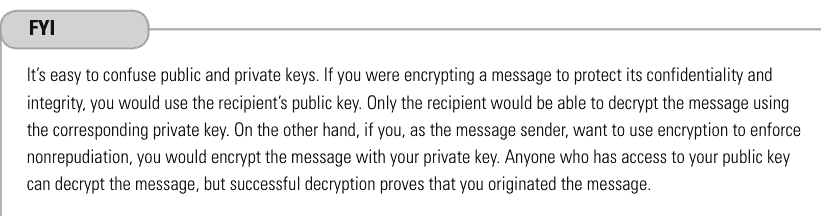


用于加密和解密的密钥对。发起者是唯一知道其中一个密钥的人。它具有不可否认的时间戳。法庭上的论点大致如下：

> > 加密不仅仅是保持消息机密。它可以验证发送者的身份。使用此公钥可以解密这条加密消息。只有持有关联私钥的人才能创建这条消息。消息包含由受信第三方时间戳设备生成的基于时间的哈希值。双方都无法篡改它。因此，我们可以确定，解密后的这条消息是真实的，并且源自这个已知的当事方。这就是不可否认性。

## 密码学的业务和安全要求

在本节中，您将了解信息安全原则以及密码学如何解决这些问题。

### 内部安全

许多安全目标为企业增加了价值。其中包括：

- **机密性**—机密性确保信息仅供授权人员阅读。它将数据远离未经授权的人员。例如，大多数公司都会将薪资信息保密。

- **隐私**—隐私常与机密性混淆。隐私的不同之处在于，它保护可能识别个人的信息不被泄露。例如，披露某人在特定邮政编码区居住、在特定日期于某医院因手臂骨折和面部裂伤接受治疗的信息，可能会泄露个人身份。隐私确保攻击者无法通过拼凑现有信息来识别个人。

- **完整性**—完整性确保数据未被更改或删除。例如，工资数据需要完整性，以确保在将付款发送给打印支票的打印机后，没有人更改付款。

- **授权**—授权是指批准某人执行特定任务或访问特定数据。例如，更改薪资计划需要管理层的适当授权。

- **访问控制**—访问控制涉及将信息限制在正确的人员范围内。例如，您可以将薪资计划存放在只有 HR 员工持有钥匙的上锁文件柜中。

### 业务关系中的安全

许多安全目标为企业之间或企业与客户之间的关系增加了价值。除之前列出的目标外，还包括以下目标：

- **消息认证**—消息认证用于确认发起通信的人的身份。例如，经纪商希望知道发给“为 ABC 账户购买 1,000 股 XYZ”的消息是来自 ABC 的。

> > **注意**
> 随着隐私问题变得越来越重要，安全领域中一个有趣的紧张局势变得更加明显。不可否认性意味着某个行为可以明确关联到个人。隐私意味着能够在不披露个人信息的情况下执行行为。哪一个更重要？我们还不知道。这两个概念在根本上是对立的，争论仍在继续。

- **签名**—数字签名将消息或数据绑定到特定实体。请注意，这不是数字化签名，后者是电子复制签名的图像。
- **收据和确认**—电子邮件通常使用收据和确认。收据验证实体已确认信息已到达。确认表示提供方已提供服务。
- **不可否认性**—不可否认性意味着发送消息的人后来不能否认。例如，如果下达买入订单的人在 XYZ 下跌 50% 后对此提出异议，不可否认性将证明原始消息是有效的。

### 所有人都受益的安全措施

除业务和客户关系之外，某些安全目标还为信息系统增加了价值。除已列出的项目外，这些目标还包括：

- **匿名性**—这会伪装用户身份。例如，一个压迫性国家的异见人士可能希望在不让当局知道其身份的情况下，将信息发布到网络讨论网站。不幸的是，罪犯和恐怖分子也可以利用匿名性来逃避侦查。
- **时间戳**—这提供了生产者创建或发送信息的确切时间。例如，在最后一刻提交纳税申报表的人可能希望证明他们满足了截止日期。
- **撤销**—这会停止对数据访问的授权。例如，丢失信用卡的人会打电话给发卡机构停止使用该卡。
- **所有权**—这将人与信息关联起来以主张法律权利。例如，大多数文档都有版权声明，说明谁是作者。

### 密码学原理、概念和术语

存在许多不同的信息安全目标。理解它们、它们如何协同工作以及它们有时如何相互对立非常重要。它们代表了包括密码学在内的大多数安全计划的目标。安全目标的最佳总结之一载于《应用密码学手册》。TABLE 9-1 包含安全目标摘要。当您尝试解决业务安全问题时，需要理解这些术语。然后，您可以判断是否可以使用密码学解决方案。

### 密码学功能和密码

对密码学密码有基本的了解，可以告诉您密码学如何满足您的业务需求。每种密码都有特定的特征，可能使其在任何情况下都可取或不可取。评估密码时首先要考虑的是其预期用途。您是试图保护传输中的数据还是静止的数据？不同的密码解决不同问题的效果各有不同。选择密码后，您还需要就密钥大小和操作模式等事项做出进一步决定。许多对称密码根据您选择的模式，要么作为流密码运行，要么作为分组密码运行，具体取决于您选

### TABLE 9-1 信息安全目标。

| 目标 | 采取措施 |
|---|---|
| 隐私或机密性 | 对所有未经授权的用户保密信息。 |
| 完整性 | 确保未经授权的用户或未知进程未更改信息。 |
| 实体身份验证或识别 | 验证实体（即人、计算机终端、信用卡等）的身份。 |
| 消息认证 | 验证信息的来源；验证数据的源头。 |
| 签名 | 将信息绑定到实体。 |
| 授权 | 向另一实体传达官方批准，以执行某项操作或成为某种事物。 |
| 验证 | 提供及时授权以使用或操作信息或资源。 |
| 访问控制 | 将资源访问权限限制在特权实体。 |
| 认证 | 由受信实体背书信息。 |
| 时间戳 | 记录用户创建或访问信息的时间。 |
| 见证 | 验证创建对象的操作，或由创建者以外的实体验证对象的存在。 |
| 收据 | 确认收件人已收到信息。 |
| 确认 | 确认提供方已提供服务。 |
| 所有权 | 授予实体将资源使用或转让给他人的合法权利。 |
| 匿名性 | 隐藏参与某个过程的实体的身份。 |
| 不可否认性 | 防止实体否认先前的承诺或行为。 |
| 撤销 | 撤回认证或授权。 |

择。流密码一次加密一个字节（或一位），而分组密码一次加密整个数据块。确定“最佳”类型的密码是一项复杂任务。
存在许多微妙之处，且标准答案很少。随着密码变得更加复杂，它们依赖新技术来生成密钥并将明文转换为密文。

两个富有成效的研究领域是椭圆曲线密码学（ECC）和量子密码学。ECC 密码依赖于有限域上椭圆曲线的代数结构。与更传统的密码相比，这些密码可以使用更小的密钥生成非常安全的密文。然而，ECC 会带来高昂的计算开销成本。量子密码学基于量子力学的特性来构建其算法。经典密码学与量子密码学之间的基本区别在于破解密码的难度。破解经典密码极其困难；破解量子密码学密码在理论上是不可能的。当然，量子密码学实现计算开销大，且更难做到“正确”。出于这些原因，经典密码学在当今的实现中仍占主导地位。


## 业务安全性实现

以下是安全产品与服务的一般分类综述：

- 身份验证（非 PKI）
- 访问控制/授权
- 评估与审计
- 安全管理产品
- 边界/网络安全/可用性
- 内容过滤
- 加密
- 管理/教育
- 外包服务/顾问

通过将这些产品和服务与之前提到的信息安全目标进行交叉引用，您可以了解哪些业务工具和服务满足哪些安全目标。然后您可以判断密码学可以解决这些目标中的哪些。表 9-2 显示了安全产品与安全目标之间的关系。

如您所见，可以使用密码学实现许多安全目标。具体来说，密码学提供以下功能：

- **隐私或保密性**—密码学会打乱信息，使只有拥有正确密码和密钥的人才能读取。请注意，此人可能包括一位精明的密码分析员。
- **完整性**—密码学通过提供校验和或哈希来保护完整性。您可以将这些与已知的良好值表进行比较，以证明数据未被更改。
- **实体身份验证或识别**—能够对消息进行编码或解码的人，表明该人持有加密密钥或具有计算密钥的能力。如果业务关系要求该密钥保密，则持有即证明有效身份。
- **消息认证**—类似于实体身份验证，使用私钥编码的消息证明了消息的作者是谁。同样，这一规定应作为任何业务合同或正式关系的一部分。
- **签名**—密码学可以提供一种生成数字签名的方法。这可以证明特定人员发送了特定消息。
- **访问控制**—这涉及加密特权资源或数据，以便只有授权人员才能解密它们并强制执行对它们的访问。
- **认证**—受信任的实体可以通过添加加密校验和和数字签名来对消息或数据进行认证。
- **时间戳**—使用非对称密钥加密，受信任的设备可以发出攻击者无法伪造的时间戳。时间戳将时间戳信息的哈希值与安全可靠时钟的输出绑定。
- **见证**—第三方可以向数据添加加密校验和，以证明这些数据在特定时间以特定格式存在。
- **所有权**—这指的是由所有者创建并添加到数据中的加密哈希，然后提交给受信任的第三方进行佐证。这将一个实体标识为数据的所有者。

| 目标 | 身份验证 | 访问控制 | 评估与审计 | 安全管理 | 网络安全 | 内容过滤 | 加密 | 管理 | 顾问 |
| :--- | :---: | :---: | :---: | :---: | :---: | :---: | :---: | :---: | :---: |
| 隐私或保密性 | | X | | | X | | X | X | X |
| 完整性 | | | | X | X | | X | X | X |
| 实体身份验证或识别 | X | X | | | X | | X | X | X |
| 消息认证 | X | | | | X | | X | | |
| 签名 | X | | | | X | | X | X | |
| 授权 | X | X | | | X | | | | |
| 验证 | | X | X | X | | | | X | |
| 访问控制 | X | X | | X | X | X | X | X | |
| 认证 | | | X | X | | | X | | X |
| 时间戳 | | X | | | X | | X | | |
| 见证 | | | X | | | | X | | X |
| 收据 | | | | | X | | | X | |
| 确认 | | | | | X | | | X | |
| 所有权 | | | X | | | | X | X | X |
| 匿名性 | | | | | | | X | X | |
| 不可否认性 | | | | | X | | X | X | X |
| 撤销 | X | | | | X | | X | | |

- **匿名性**—使用密码学，您可以通过以监控者无法解读的加密格式传递信息来隐藏实体的身份。此外，使用一系列加密跳转并删除日志，可以为实体在 Internet 上提供匿名存在。
- **不可否认性**—作为业务关系一部分而商定的数据非对称密钥签名，可以向接收者证明发送者的身份。

## 密码类型

密码有两种基本形式：

- **置换密码**—置换密码会重新排列字符或数据位。
- **替换密码**—替换密码用其他位、字符或信息块替换位、字符或信息块。

### 置换密码

简单的置换密码将字符写入矩阵的行中，然后按列读取作为输出。例如，将消息“ATTACK AT DAWN”写入四列矩阵中，如图 9-2 所示。

然后，按列读取信息：ACDTKATAWATN。这就是密文。密钥将是 {1,2,3,4}，即读取列的顺序。使用不同的密钥（例如 {2,4,3,1}）进行加密会产生不同的密文——在此示例中，即 TKAATNTAWACD。

请注意，在此示例中，密文包含字母频率。也就是说，英语中最常见的字母——E、T、A、O 和 N——在置换密文中出现的次数不成比例。这对密码分析员来说是一个线索，表明这是一种置换密码。

置换密码保留原始消息的所有元素。它们只是以一种稍后可以重新组装的方式打乱信息。一些基本的数字置换密码会在字节内交换位，以使数据对普通读者来说看起来不可理解。口语置换密码的一个例子是猪拉丁语。

### 替换密码

替换密码中最简单的一种是凯撒密码。它将英语字母表中的每个字母固定位数移位，Z 会循环回到 A。尤利乌斯·凯撒使用了移位为 3 的这种密码。以下是使用凯撒密码进行加密的示例：

```
ATTACK AT DAWN
↓
DWWDFN DW GDZQ
```

请注意，凯撒密码有 25 个可能的密钥。（第 26 个密钥将字符映射回自身。）请还注意，这不是一种置换密码，因为密文中的字母并未出现在明文中。

20 世纪 60 年代，一种流行的儿童替换密码是 Cap’n Crunch© 解码器环。该环包装在特别标记的 Cap’n Crunch 谷物盒中。该环由两个字母表（A 到 Z）组成，写在一个圆圈上。内圆不动，但您可以旋转外圆。通过将外圆旋转到设定值，您在一个字母表与另一个字母表之间创建了一对一映射。要加密，您在内圆中查找所需字符，然后在外圆上读取。要解密，您反向进行此过程。（是的，这是一种凯撒密码！）

图 9-2
置换密码。

| 1 | 2 | 3 | 4 |
|---|---|---|---|
| A | T | T | A |
| C | K | A | T |
| D | A | W | N |

一种**关键字混合字母密码**使用由关键字（去除重复项）后跟字母表中剩余字母组成的密码字母表。例如，使用关键字 CRYPTOGRAPHY，这种类型的密码将产生以下结果：

```
ABCDEFGHIJKLMNOPQRSTUVWXYZ
↓
CRYPTOGAHBDEFIJKLMNQSUVWXZ
```

因此，明文单词 ALPHABET 将加密为 CEKACRTQ。

无论复杂程度如何，任何替换密码都将使用这些相同的基本原则。为了使这些代码更难破解，您可以依次使用多个加密方案。例如，您可以为每个字母使用各自的替换方案。这是一种**维吉尼尔（_vee-zhen-AIR_）密码**。它类似于多个凯撒密码，每个密码都有自己的移位字符。例如，您可以使用单词 PARTY 作为密钥，这将使用五个凯撒密码。已知字母表中的每个字符都有一个 1 到 26 的值，您可以将明文字符的值与密钥中相应字符的值相加来计算加密字符。如果和大于 26，只需减去 26 即可找到最终值。要加密消息 ATTACK AT DAWN TOMORROW，您将获得以下结果：

```
Plaintext:             ATTACKATDAWNTOMORROW
Key (repeated to match plaintext length):  PARTYPARTYPARTYPARTYPA
Ciphertext (shift characters using the key): PTKTAZAKWYLNKHKDRIHU
```

这提供了更多安全性。输出看起来更加随机。通常，增加密钥长度会提高替换密码的安全性。

与其将每个字母固定位数移位，不如允许任何字母唯一映射到任何其他字母，以增加替换密码的复杂度。您可以在许多报纸上找到这种类型的密码，它被称为**简单替换密码**，作为一项名为**隐语谜**的谜题出现。在此情况下，A 可以映射到 26 个字母中的任何一个，B 可以映射到剩余的 25 个字母中的任何一个，C 可以映射到 24 个字母，以此类推。因此，可供使用的可能密钥有 (26 阶乘)，即 403,291,461,126,600,000,000,000,000 个。即便如此，破解这些谜题也是简单的工作。这说明了一个重要观点：您绝不能将复杂性与安全性混淆。

要确保替换密码保持安全，您必须做三件事。首先，确保密钥是不含重复项的随机序列。其次，确保其长度与加密信息一样长。第三，仅使用一次。这种密码称为一次性密码本。这种策略的首次应用是在基于 AT&T 员工吉尔伯特·弗纳姆（Gilbert Vernam）设计的计算机系统中。弗纳姆密码创建一个由 0 和 1 组成的比特流，并使用异或函数将其与明文结合。异或操作在...时为真。


一个且仅一个输入为真时，输出为真。异或（Exclusive OR）函数，表示为 $\oplus$，具有以下属性：

- 0 $\oplus$ 0 = 0
- 0 $\oplus$ 1 = 1
- 1 $\oplus$ 0 = 1
- 1 $\oplus$ 1 = 0

请注意，这等同于 $\neq$（不等于）函数。使用这种方法，您可以将二进制数据流与二进制密钥流（来自密钥的字符流）组合起来生成密文。硬件或软件使用现代替换密码的方式即如此。

## 乘积与指数密码

乘积密码是多种密码的组合。每种密码可以是置换密码或替换密码。数据加密标准（DES）是一种使用 56 位密钥的乘积密码，包含 16 轮替换和变换。DES 最初于 1977 年作为联邦信息处理标准（FIPS）发布，至今仍在使用。其开发者曾认为其安全性很高，因为 1977 年可用的计算机需要超过 90 年才能破解一条加密消息。许多公民自由主义者、阴谋论者以及专业密码学家认为，设计者在 DES 中刻意植入某些弱点，以便国家安全局（NSA）在算法中打开后门，轻松解密消息。然而，经过 25 多年，没有人发现这样的弱点。密码学的进步——包括差分分析（涉及在海量密文中查找模式）——实际上暗示，DES 的设计甚至比普遍怀疑的更安全。尽管如此，计算能力的提升使得 56 位密钥空间（72,057,594,037,927,900 个密钥）的搜索不再那么令人望而生畏。最终，在 1998 年，电子前沿基金会构建了一台名为 Deep Crack 的专用计算机，能够在不到三天内搜索完整个密钥空间。您将在本章后面部分详细阅读关于 DES 的内容。

某些密码依赖于解决特定数学问题的难度。这是非对称密码学的基础。这些密码使用一种称为域论（field theory）的数学分支。无需深入数学细节，域（field）是指任何这样的数域：其中除 0 以外的每个元素都有乘法逆元。例如，所有有理数构成一个域。给定 x ≠ 0，您始终可以计算 1/x。域不一定是无限的。您无需无限计数，而是在达到某个特定值后重新开始计数。例如，在美国，人们使用 12 小时制报时。10:00 过一小时是 11:00，但 12:00 过一小时是 1:00，而不是 13:00。许多国家使用 24 小时制，但循环效果是相同的。当集合中整数的数量为素数时，数学上会变得有趣。从 1 到某个素数的整数集合表示一个有限域。

指数密码涉及在有限数学域上计算幂。Rivest-Shamir-Adleman（RSA）加密方案依赖于大数分解的难度。将两个数相乘很简单，但对一个大数进行因式分解却非常困难。您将在本章后面部分了解此过程的详细信息。

## 对称与非对称密码学

在本节中，您将了解对称密码学与非对称密码学之间的差异，以及两者各自的相对优势和劣势。

### 对称密钥密码

对称密钥密码使用相同的密钥进行加密和解密。因此，通信双方必须首先交换密钥。这代表了这些密码体制的基本限制。在向另一方发送消息之前，您必须先安全地通信以交换密钥。这种“先有鸡还是先有蛋”的问题，在过去使得任何大型、分散的组织（政府、军队和资金充足的个人除外）都觉得密码学难以实施。

为说明此问题，设想两位通信者 Alice 和 Bob 想要安全地交换信息。在此场景中，Alice 和 Bob 都在 ABC Company 工作。他们想要为新客户 MNO Plastics 的建议书交换定价信息。Bob 身处客户现场，无法接入公司内部网络。所有信息都必须在互联网上来回传输。

Eva 为 ABC 的海外竞争对手工作。她的工作是尽可能多地收集关于 ABC 建议书和投标的情报。她获得授权，可以监控、干扰或冒充任何通信以完成她的任务。这里明显的法律问题可以为了讨论目的搁置一旁。假设 Eva 可以监控所有来自和发往 Bob 的通信。他发送或接收的任何消息都会经过 Eva 控制的节点。

问题在于：如果 Alice 和 Bob 预先没有商定任何事情，他们如何创建安全的通信会话？假设 Alice 和 Bob 同意使用 DES 来加密他们的信息。因为 DES 是公开可用的算法，Eva 可以下载一份 DES 软件副本。Alice 向 Bob 发送消息，要求使用 BIGBUCKS 作为密钥。Bob 确认此约定，并使用此密钥向 Alice 发送加密消息。Eva 监听通信，使用相同的密钥解密 Bob 的消息，并将他的信息发送给她的公司。

Alice 和 Bob 可以同意更改任意多次密钥，但每次更改时，Eva 都会得知此密钥更改并相应调整。使用对称密钥密码学，无法规避此问题。各方必须相互交换密钥，才能知道对方使用什么密钥。即使您使用特殊用途密钥或密钥加密密钥来加密密钥，也必须在某个时刻交换密钥加密密钥。密钥加密密钥是您仅用于加密其他密钥的密钥。交换密钥加密密钥意味着，当您交换时，攻击者可以拦截密钥加密密钥。

解决这一困境的办法是需要一条 Eva 无法监控的不同路径来传输消息。这是使用安全信道的带外通信。假设在此情况下，Alice 和 Bob 同意使用 DES，Alice 告诉 Bob 用他的手机给她打电话，告诉她他想使用什么密钥。Eva 可以读取所有互联网流量，但无法监控手机。Alice 和 Bob 同意使用一个 56 位密钥，并开始交换信息。Eva 被排除在外。当然，在 Bob 出差之前，Alice 和 Bob 可能已经同意使用某个特定密钥。这也是带外通信。它发生在用于发送和接收消息的通信信道之外。

现在 ABC Company 必须做出选择。它可以向所有员工颁发相同的密钥，这使得通信变得容易。任何员工都可以与世界各地的任何其他员工安全通信。此模式运行良好，直到一个不满的员工辞职并加入竞争对手，带走了密钥。那么现在怎么办？ABC 必须创建一个新密钥，并将新密钥重新颁发给全世界的每个人。这可能既耗时又昂贵。

或者，ABC 可以决定单点故障是不可接受的，并向每位员工颁发单独的密钥。然而，由于对称密钥密码要求双方都使用相同的密钥，每对员工必须拥有自己唯一的密钥。因此，如果有 10 名员工，ABC 将需要 45 个密钥对（9 + 8 + 7 + 6 + 5 + 4 + 3 + 2 + 1）才能开始此方案。如果 ABC 有 100 名员工，它将需要 4,950 个密钥对。如果 ABC 有 10,000 名员工，它将需要 49,995,000 个密钥对！n 位通信者所需的密钥对数量为 (n (n - 1)) / 2。此外，每当员工加入或离开公司时，您都需要为其他每位员工添加或删除一个密钥对。

显然，对称密钥系统扩展性很差。这在 1976 年之前一直是密码学家（以及政府、军队和企业）难以解决的问题，直到 Whitfield Diffie 和 Martin Hellman 在 IEEE Transactions on Information Theory 期刊上发表了论文《密码学的新方向》。在该论文中，他们提出了一种激进的新方法，为扩展性问题提供了潜在的解决方案。

### 非对称密钥密码

在他们的引言中，Diffie 和 Hellman 指出：“此密钥分布问题带来的成本和延迟是业务通信转移到大型电讯处理网络的主要障碍。”他们引入了公钥密码学的概念。（注意，本文将此概念称为非对称密码学。）公钥密码学是一种系统，允许通信者仅通过公共信道使用公开可用的技术进行通信。他们可以创建安全连接。他们不需要等待带外信件连同信封中的密钥一起到达。他们也不需要颁发和管理数百万个密钥对，以防有人想要与新的通信者安全通信。此发现的影响深远，对密码学产生了深远的影响。

非对称密钥密码具有四个关键属性：

- 存在两个彼此为逆运算的关联算法——此方案涉及两个相互关联的组件。这意味着您使用一个算法进行加密，使用另一个算法进行解密。
- 这两个算法中的每一个都易于计算——您可以在计算机软件中轻松使用此方法。因此，它成为安全数字通信的一种实用方法。
- 如果您知道第一个算法，则在计算上无法推导出第二个算法——您可以广泛发布一个密钥供任何人使用，而不会泄露其关联密钥的内容。这些是公钥及其关联私钥的配对，即公私钥对。由于公钥密码体系拥有私钥，您现在可以明白，为什么本章一直遵循非对称密钥命名惯例！


- 给定某些随机输入，您可以生成互为逆运算的相关密钥对——任何一方都可以创建公钥-私钥对，保留一个私钥，并将另一个发布在目录中供任何通信者使用。由于私钥是保密的且从不传输，窃听者无法获取此值。

以下是公钥加密的工作原理。假设 Bob 想向 Alice 发送一条消息。Alice 已经创建了她的私钥并将其安全保管，还创建了她的公钥并将其放在她的网站上。Bob 使用 Alice 的公钥加密消息 “Hi Alice！”。Bob 然后将加密后的消息发送给 Alice。因为 Bob 使用了 Alice 的公钥加密消息，Alice 只能使用她的私钥来解密。因为她可以访问她的私钥，她使用它来解密并阅读消息 “Hi Alice！”。如果 Alice 想回复 Bob 的消息，她可以使用 Bob 的公钥加密她的回复，并将消息发回给 Bob。

在日常商业世界中，与非对称密钥密码最接近的等价物之一是银行的夜间存款箱。商人将收据带到银行，用他的钥匙打开插槽，并将钱投入滑道。信封滑下并进入保险箱。如果他转过身，一个强盗持枪劫持他并要求他的钥匙，商人可以安全地交出钥匙并逃跑。强盗可以试图取回钱，但因为信封已经滑出了他的够得着范围，强盗将无法访问它。第二天早上，银行职员可以使用她的钥匙打开保险箱，取出钱，并将其存入商人的账户。各方拥有不同的钥匙，但它们彼此关联。使此过程可逆，即银行职员可以给商人留言，那么你就得到了非对称或公钥加密系统的等价物。

## 密码分析与公钥 versus 私钥

加密使得除了拥有正确软件和密钥的授权人员之外，任何人都无法读取明文。然而，如果数据有价值，网络犯罪分子可能会尝试破解加密。

有两种方法可以破解密码：

- 分析密文以找到明文或密钥
- 分析密文及其相关明文以找到密钥

如果无论多少密文都无法提供足够的信息来产生唯一的明文，则该密码是无条件安全的。给定足够的时间和资源，几乎可以破解任何密码。然而，密码的主要目的是使其破解难度大到在计算上无法破解。例如，假设一个组织每周生成新密钥。如果攻击者可以在 13 天内破解任何密钥，那么当攻击者尝试使用破解的密钥时，这些密钥就已经无用了；它们早已被新密钥取代。因此，攻击者无法在经济上破解（相对于受保护数据的价值）的密码是强大的或计算安全的。

> 唯一不可破解的加密密码是 Vernam 密码。它的另一个名称是一次性密本密码。您将在本章后面阅读更多相关内容。您还可以在 www.pro-tech-nix.com/information/crypto/pages/vernam_base.html 上了解有关 Vernam 密码的更多信息。

存在四种基本的加密攻击形式：

- **仅密文攻击 (COA)**—在仅密文攻击中，密码分析者只能访问一段加密数据，并且无法选择这些数据可能是什么。一些日报中的密码谜语就是一个示例。但是请注意，通过了解信息的上下文，可以推断某些单词或格式可能存在。图 9-3 显示了一个仅密文攻击。可用密文样本，但与其相关的明文不可用。

- **已知明文攻击 (KPA)**—在已知明文攻击中，密码分析者在加密前后拥有一些信息片段。例如，所有安全登录会话可能以字符 LOGON 开头，下一次传输可能是 PASSWORD。安全的加密密码应该能够抵御能够访问大量明文-密文对的分析人员的攻击。图 9-4 显示了一个已知明文攻击。

- **选择明文攻击**—在选择明文攻击中，密码分析者可以加密任何信息并观察输出。这对密码分析者来说是最佳情况。它提供了对加密机制的最大灵活性（和洞察）。旧版 Microsoft Office 软件应用程序提供的加密就是一个示例。您可以只加密字母 A，然后是 B，依此类推，以试图辨别密码的作用。


- **选择密文攻击**—选择密文攻击是一种特殊情况。它与非对称密钥系统和哈希函数相关。在选择密文攻击中，密码分析者将用与他们试图破解的相同密码和密钥编码的数据提交给解密设备，以查看明文输出或解密消息对某些系统的影响。举个简单的例子，假设一个主人训练一只看门狗只响应用纳瓦霍语说出的指令。小偷不懂纳瓦霍语，但他可以发出一系列噪音和声音。狗会忽略无意义的声音（从它的角度来看），但会服从有效的指令。小偷说足够多的胡言乱语，可能会引起狗的反应（即使不是他想要的反应）。通过观察狗对各种表面上毫无意义的指令的反应，小偷可能能够让狗躺下并装死。选择密文攻击在攻击加密电子邮件方面有特殊用途。涉及的数学复杂性太高，无法在此讨论。

## 对称与非对称密钥密码的抗攻击能力

密码分析有几个目标，包括：

- 推导目标消息的明文。
- 确定用于加密目标消息的密钥。
- 推导特定密码使用的算法。
- 求解加密学所基于的一般数学问题。

密码学家在密码分析中使用许多工具。这些工具的名称包括线性密码分析、差分密码分析、暴力破解、穷举搜索和信息论。在最直接的情况下，分析人员必须使用加密消息来推导其相关明文。当今使用的许多密码都是开源的。这意味着分析人员可以访问加密和解密函数的逻辑。闭源或专有密码的安全性部分源于这样一个事实：分析人员不一定知道密码的工作原理。

例如，在第二次世界大战中，美国无法访问日本的紫色密码机。破译密码人员必须通过分析密文中的微弱模式来确定机器的工作原理。一旦他们弄明白了这一点，分析人员就可以更改不同密钥的顺序来解密消息流量。一旦他们确定了密钥，任何人都可以读取使用该密钥在同一时期编码的所有流量。

在某些情况下，分析人员通过攻击加密系统的底层数学找到了解决方案。在 20 世纪 70 年代末，一些供应商制造了基于一种称为 _子集和_ 问题的背包问题简化版本的非对称密钥加密的安全产品。不幸的是，对于供应商而言，Len Adleman 在 1982 年开发了解决 _子集和_ 问题的通用方法，该方法可以在 Apple II 计算机上运行。一夜之间，一整类安全产品就过时了。

如今，大多数商业非对称密钥加密的基础是大数分解的困难性。例如，用笔和纸计算 757 × 769 = 582,133 相对容易。然而，给定结果 582,133，推导其两个因数就不那么容易了。经典的方法是尝试 2、3、5、7、11、13 等等，直到找到一个质因数。这需要 134 次猜测。尽管有了计算机这会容易得多，但想象一下，两个质数因数各有 100 位数字！为了让您了解这一点，以下是一个 100 位的质数：


6,513,516,734,600,035,718,300,327,211,250,928,237,178,281,758,494,417,357,560,086,828,416,863,929,270,451,437,126,021,949,850,746,381

此外，前面的数字仅仅是两个因子中的一个。

## 密钥、密钥空间和密钥管理

### 密码学密钥和密钥空间

你已经阅读关于密钥的内容一段时间了。但它们是什么？密钥是输入到密码系统中的一个值。密钥以特定方式参与消息的转换。设计良好的密码系统对于每个使用的密钥，都会对同一消息产生不同的输出。你可以这样思考密钥：密码执行特定任务，而密钥给出如何执行的具体指示。

物理密钥与密码学密钥相似，但并不相同。许多流行的门锁有五个弹子，每个弹子有10个可能的位置。因此，房屋钥匙有10^5，即100,000种可能的齿形。这可以合理保证，有人用随机钥匙尝试你家前门时进不去。

所有可能密钥的集合称为密钥空间。通常，虽然并非总是如此，密钥空间越大，算法越安全。让我们看一个示例。

包含两个三位数锁的公文包的密钥空间有多大？组合从000–000运行到999–999，因此密钥空间中有1,000,000个密钥。这是否意味着小偷必须尝试100万种组合才能猜中正确组合？不一定。小偷可能运气极好，第一次就猜中正确组合。或者，小偷可能运气极差，尝试每一种可能的组合，最后才在最后一次尝试中找到正确组合。平均而言，攻击者会在搜索密钥空间的一半时猜中正确组合。这是否意味着攻击者平均需要尝试500,000种组合？如果每次尝试需要两秒钟，且攻击者不停地日夜工作，他或她需要超过11天才能打开公文包。然而，公文包抵抗暴力攻击的实际能力更接近17分钟！原因何在？

这与公文包算法中的弱点有关。因为有两个独立的锁，每个锁有1,000种组合，平均而言，猜测每个子组合需要500次尝试。在找到左侧组合后，攻击者继续进行右侧组合。最多，攻击者需要尝试1,000 + 1,000，即2,000种组合。然而，平均而言，攻击者只需尝试1,000种组合。每次两秒钟，这将需要16分钟40秒。

这很好地说明了，增加密钥空间，甚至增加密钥的比特数，不一定能提供更多安全性。如果公文包制造商想向你销售带有六个三位数锁的产品，你想购买吗？该公司声称该公文包的可能组合数（即密钥）比DES多，这是正确的。然而，基于你现在的知识，你可以计算出，打开这个安全的公文包不到一小时。

### 密钥管理

密码系统中最困难和最关键的部分之一是**密钥管理**。虽然密码的数学原理对攻击者来说可能难以求解，但密钥管理中的弱点或错误通常会提供攻破系统的途径。如你所见，对称密码系统的密钥管理可能既困难又复杂。因此，它有时会导致捷径，这些捷径可能对原本安全的密码造成致命打击。

第二次世界大战的历史提供了一个例子，说明糟糕的密钥管理如何破坏密码系统。从1940年到1948年，苏联使用一次性密码本对通过商业电报线发送的消息进行编码。理论上，一次性密码本是无法破解的。密钥非常接近随机。它与它所保护的信息一样长，并且不会重复。不可能在密文中检测到模式。然而，正如你所读到的，在全球战时环境中分发和管理长密钥的困难，导致有些地方用完了密码密钥。每个地点都知道不应重复使用自己的密钥，但使用另一个站点的一次性密码本会有什么害处呢？结果表明，危害很大。

如果你使用异或函数进行加密，那么使用密钥流X加密消息A变为：

```
A ⊕ X = E (A)
```

其中E(A)表示包含A的加密消息。请记住，异或函数有一个有趣的特性：任何值与自身异或结果为0，任何值与0异或结果为其自身。要解密此消息，你需要将其与密钥X重新组合以恢复消息：

```
E (A) ⊕ X = A ⊕ X ⊕ X = A
```

重复使用另一站点的密钥材料的问题是，美国试图拦截所有地点的所有加密流量。然后它试图关联这些消息。例如，1943年从纽约到莫斯科的一条消息可能使用了与1944年悉尼大使馆到开罗大使馆的一条消息相同的一次性密码本。当你将两个使用相同密钥加密的消息组合在一起时，会发生一件有趣的事情：

```
A ⊕ X = E (A) B ⊕ X = E (B)
E (A) ⊕ E (B) = A ⊕ X ⊕ B ⊕ X
          = A ⊕ B ⊕ X ⊕ X
          = A ⊕ B
```

现在你可以使用消息A来加密消息B。如果你记得关于置换密码的讨论，密文存储明文中的模式。使用一条消息来加密另一条消息也会保留明文的许多统计特性。结果表明，破解这些消息相当简单。请注意，你是求解明文，而不是加密密钥！消息解密后，你可以通过将密文与明文组合来计算密钥。

美国将此项目代号为Venona。它一直试图从20世纪40年代破解这些消息，一直到1980年！关于该项目有整本书；美国政府在1995年至1997年间解密了拦截的消息。以防你认为朱利叶斯和伊瑟尔·罗森堡没有为苏联间谍，你今天可以阅读已解密的罪证消息。

### 密钥分发

密钥分发技术通常采用以下三种形式之一：

- **纸质**—纸质分发无需使用任何技术。然而，它确实需要某人执行某些操作来安装密钥。这一人为角色可能会引入错误，或给不满的人提供破坏系统的机会。

- **数字介质**—数字分发可以是CD或电子邮件的形式。请注意，必须保护传输中的密钥。必须使用某种形式的安全传输。对于物理介质，防篡改外壳和挂号邮件能提供一定程度的保障。对于电子分发，一种更高级别的密钥，称为**密钥加密密钥**，必须保护传输和存储中的密钥。当然，这要求你首先通过某些替代的安全机制分发密钥加密密钥。你应该仅使用密钥加密密钥来加密其他密钥，而不是数据。过度使用任何密钥都可能导致其被泄露。

- **硬件**—你可以通过USB闪存驱动器、智能卡或任何其他可移动存储设备等硬件分发密钥。其优势在于，你将密钥直接从密钥传输机制传输到加密设备中，无需任何人查看它们。这些组件之外不存在副本。

为防止传输中的密钥被拦截，你可以拆分密钥。将密钥拆分为两个等大块并非好主意。如果攻击者拦截其中一块，暴力破解密钥的另一半会容易得多（记住公文包示例）。因此，拆分密钥K的一种策略是生成另一个随机密钥J，它成为密钥加密密钥。你将K和J组合以生成一个加密密钥。然后你会通过一个信道发送这个加密密钥。你会通过另一个信道发送密钥加密密钥。如果攻击者拦截了两条消息中的一条，攻击者无法得知底层密钥。

```
Channel 1: J
Channel 2: K ⊕ J
Recombine: J ⊕ K ⊕ J = K
```

请注意，此方案要求每个密钥都需要一个新的密钥加密密钥。

### 密钥分发中心

与每个组织创建基础设施来管理自己的密钥不同，许多主机可以同意信任一个共同的**密钥分发中心（KDC）**。所有各方都必须信任KDC。使用KDC时，每个实体只需要一个密钥对——即其与KDC之间的密钥对。Kerberos和ANSI X9.17使用KDC的概念。

例如，如果Alice想要与Bob发起安全通信会话，她会向KDC发送一条加密消息。KDC会选择一个随机会话密钥，分别用Alice的密钥和Bob的密钥加密其副本，并将两者都返回给Alice。Alice解密她的会话密钥，并使用它来加密发给Bob的消息。她发送该消息，连同加密的会话密钥


在 Bob 的密钥中——Alice 无法读取——发送给 Bob。Bob 收到两条消息，使用他的私钥解密会话密钥，并使用会话密钥解密 Alice 的消息。

## 数字签名和哈希函数

对于许多业务要求，你应该了解数字签名和哈希函数的使用以及应使用的密码类型。

## 哈希函数

为确保消息的值未被更改——无论是故意的还是通过传输错误——你可以附加一些可通过可重复过程验证的信息摘要。这个摘要是一个校验和。例如，为确保一串数字在传输过程中未被更改，你可以将所有数字之和附加到消息末尾。如果接收者将数字相加并得到不同的值，你可以假设传输过程中出现了错误，并请求重发。

信用卡有一个哈希数字来验证卡号。计算此数字的算法是 LUHN 公式，基于 ANSI X4.13。要计算信用卡号是否有效，请遵循以下四个步骤：

- 1. 从右侧第二个数字开始，将每隔一个数字乘以 2。
- 2. 如果任何倍增结果大于 10（例如，8 + 8 = 16），则将此结果的各位数字相加。将所有倍增后的数字相加。
- 3. 将除最后一位数字（校验和）之外的所有其他数字加到此总计中。
- 4. 总和与下一个 10 的倍数之间的差值即为校验数字。例如，信用卡号 5012 3456 7890 123X 的正确哈希数字为 6。

哈希类似于校验和，但其操作方式使得伪造的消息不会产生与合法消息相同的哈希值。哈希值通常具有固定大小。结果是一个哈希值。哈希值充当数据的指纹。消息创建者可以发布哈希值作为参考，以便接收者查看信息是否已更改。软件发布者通常提供哈希值，以便客户检查其接收的软件的完整性。要有效，哈希值通常必须足够长，以至于创建一个与哈希值匹配的替代消息将花费太多时间。

## 数字签名

数字签名不是数字化签名（手写签名的电子图像）。相反，数字签名将实体的身份与特定消息或信息绑定。它们不提供隐私或保密性。它们确保消息的完整性并验证是谁写了它。数字签名需要非对称密钥加密。图 9-5 显示了一个数字签名。

你可以使用非对称密钥对中的私钥构建数字签名。它包括对消息哈希进行签名。这种组合提供双重保证——消息来自特定实体且没有人更改了内容。任何有权访问签名者公钥的人都可以验证数字签名。然而，只有

图 9-5
数字签名。


图 9-6
数字签名的操作。


私钥持有者才能创建数字签名。图 9-6 显示了数字签名的操作方式。

Rivest-Shamir-Adleman (RSA) 和数字签名算法 (DSA) 是最常用的数字签名算法。RSA 的专利于 2000 年 9 月到期。现在它属于公有领域。DSA 对消息的安全哈希算法 (SHA) 哈希值进行签名。尽管大多数商业系统使用 RSA，但数字签名标准 (DSS)、DSA 和 SHA 是美国政府标准。它们更可能出现在政府产品中。

## 信息系统安全中的密码学应用和用途

当今许多供应商提供安全产品和服务。事实上，有几千种不同的产品可供选择。这些产品和服务通常组织为常见类别，包括：

- 防恶意软件
- 合规性/审计
- 取证
- ID 管理
- 知识产权
- 托管安全服务提供商 (MSSPs)
- 消息保护
- 补丁管理
- 边界防御
- 安全信息和事件管理 (SIEM) 和事件响应
- 事务安全（数字证书、安全文件传输）
- 无线安全

你可以在这些类别中的许多类别中找到密码学用途。

身份验证工具包括令牌、智能卡、生物识别、密码和密码恢复工具。某些工具依赖于近距离卡和指纹读取器。其他工具使用密码技术，例如 **公钥基础设施 (PKI)** 用户身份验证以及可以安全地跨互联网发送密码的工具。PKI 是一组创建、管理、分发、使用、存储和撤销数字证书所需的硬件、软件、人员、策略和程序。

访问控制和授权包括防火墙、时间戳、单点登录、身份管理和移动设备安全。这些加密工具具有可能包含在防火墙中（但不一定是防火墙本身）的虚拟专用网络。它们还可以跨互联网保护连接并提供加密硬盘内容的工具。

评估和审计工具包括漏洞评估扫描器、渗透测试工具、取证软件和日志分析器。涉及密码破解模块的评估扫描器和渗透测试工具使用密码技术尝试猜测密码。

安全管理产品包括企业安全管理、配置和补丁管理以及安全策略开发的工具。完整性检查工具使用密码方法确保没有任何内容或人员修改了软件。

无线安全工具加密数据以保护其在传输过程中的安全，并限制授权人员的访问。电子邮件安全工具通常涉及在传输过程中加密数据，有时也包括静态数据。内容过滤包括防病毒产品、移动代码扫描器、Web 过滤器和垃圾邮件拦截器。它们通常不使用加密，尽管你可以加密威胁签名数据库。

加密工具包括线路加密、数据库安全产品、虚拟专用网络 (VPN)、公钥基础设施 (PKI) 和加密加速器。这些产品广泛使用密码学来完成其任务。加密加速器将密码学例程从主处理器卸载到具有专为快速加密设计的芯片组的卡上。

## 其他密码学工具和资源

作为安全专业人员，你应该了解如何将业务需求与密码学解决方案相匹配并选择合适的工具集。在本节中，你将学习如何识别使用对称密钥的工具集并将其与最常见的业务用途相匹配。你将学习如何识别可以使用非对称密钥加密的工具集并识别实现解决方案所需的基础设施。你将学习哈希函数的工作原理、如何识别用于哈希函数的密码以及如何使用它们来确保完整性。你将学习如何使用密码学来解决每个问题以及每个要求之间的区别。你还将学习数字签名和数字化签名之间的区别以及维护用于不可否认性的数字签名所需的基础设施和法律要求。最后，你将学习如何设计支持业务需求的密钥管理模型。

## 对称密钥标准

对称密钥算法（或标准）是最常见的加密形式。相同的密钥用于加密和解密信息。因为对称密钥可以轻松创建并快速更改，它们通常只使用一次来在两方之间交换信息，然后被丢弃。在这种情况下，它们是会话密钥。与非对称密钥算法不同，对称算法速度快，非常适合加密大量数据。以下密码学算法列表通常从最弱到最强排序。强算法始终比弱算法更安全，但通常具有更高的计算成本。如果弱算法提供足够的安全性，它可能是一个不错的选择。当然，你必须定期审查算法选择，以确保如果需求发生变化，每个算法都能提供足够的安全性。组织目前使用多种对称算法，包括以下算法：

- **数据加密标准 (DES)**—IBM 最初将 DES 作为 Lucifer 算法开发。NSA 对其进行了修改，并于 1977 年将其颁布为国家标准。FIPS PUB 46-3 更新了其定义。它使用 56 位密钥并对 64 位数据块进行操作。该算法更适合硬件使用而非软件，并且可以快速加密大量数据。DES 算法属于公有领域。DES 曾经是一种先进的算法，但随着硬件功能和攻击方法的迅速发展，攻击者现在可以在短短几天内破解它。它不再是安全的算法。
- **三重 DES (3DES)**—三重 DES 是一种协议，由三轮 DES（加密、解密、加密）组成，使用多个密钥。它根据使用两个或三个密钥，将密钥空间从 56 位增加到 112 或 168 位。由于底层 DES 算法的安全性和大幅增加的密钥空间，三重 DES 在计算上是安全的。请注意，三次使用相同的密钥产生的结果与单重 DES 相同。它也包含在 FIPS PUB 46-3 中，并属于公有领域。
- **国际数据加密算法 (IDEA)**—与 DES 类似，这种块密码在 64 位块上运行。它使用 128 位密钥，在硬件和软件上的运行速度略快于 DES。Ascom Tech AG 持有 IDEA 的专利（美国专利 5,214,703），但非商业用途免费。
- **CAST**—CAST 算法是一种替换-置换算法，类似于 DES。与 DES 不同，其作者公开了其设计标准。这种 64 位对称块密码可以使用 40 到 256 位的密钥。RFC 2144 描述了 CAST-128；RFC-2612 描述了 CAST-256。虽然它已获专利（美国专利 5,511,123），但其发明者 C. M. Adams 和 S. E. Tavares 免费提供了该算法。
- **Blowfish**—Blowfish 是一种 64 位块密码，密钥长度可变，范围从 32 到 448 位。它比 DES 或 IDEA 快得多。Blowfish 是一种强大的算法，已包含在 150 多种产品以及 Linux 内核 v2.5.47 中。其作者 Bruce Schneier 将其放入了公有领域。Schneier 的 Twofish 是高级加密标准的候选算法。


为了帮助防御字典攻击（攻击者尝试常见键值），一些算法使用一种名为 **盐值** 的附加值。盐值 是一组随机字符，你可以将其与实际输入键结合以创建加密键。盐值 与输入键的组合使得使用常见键值来破坏加密键变得困难得多。

- **高级加密标准 (AES)**—也称为 Rijndael (RAIN-doll)，AES 是一种分组密码。Vincent Rijmen 和 Joan Daemen 设计了 AES，FIPS PUB 197 将其发布为标准。AES 算法可以使用 128、192 和 256 位的加密密钥对 128 位块的数据进行加密和解密。该密码还可以在可变块长度上运行。它既强大又快速。

- **RC2**—RC2 是由 Ronald Rivest 设计的一种可变键长分组密码（RC 代表 Ron's Code）。RC2 作为 DES 的即插即用替代品运行，并在 64 位块上操作。它将盐值作为其加密例程的一部分，以使密码分析更加困难。RSA Security 拥有它。

- **RC4**—由 RSA Security 开发，RC4 是一种面向字节操作的可变键长流密码。互联网浏览器经常使用 RC4 来提供 SSL 连接。

## 无线安全

凭借廉价的高带宽通信技术，无线局域网 (WLAN) 现在已成为家庭和办公室不希望为所有计算机布线的可行策略。WLAN 也在咖啡店和许多其他公共区域变得普遍。然而，这种便利性降低了安全性。

许多无线接入点提供商和用户以即插即用的方式安装新技术。也就是说，他们打开盒子，连接各个部件，打开电源并运行安装向导。如果有效，他们就从不查看手册。虽然无线产品具有内置安全性，但默认配置通常不会启用它。为什么？因为大多数消费者期望产品插上电就能使用。因此，大多数提供安全性的供应商都要求客户自行开启。许多客户从不费心。这可能会导致重大安全问题。

### 802.11 无线安全

802.11（即 Wi-Fi）无线标准于 1999 年出现。Wi-Fi 提供无线通信，传输速度从 802.11b 的 11 Mbps 到 802.11ac 780 Mbps 以上。新的和提议的标准将最大传输速率进一步提高。802.11ay 标准支持高达 100 Gbps 的数据传输速率。802.11 规范中最流行的标准使用 2.4GHz 或 5GHz 频带传输数据。较新的标准将带宽扩展到更宽的范围。最流行标准带宽下的数据通信范围被宣传为约 100 米（802.11n 超过 200 米）。然而，黑客使用高增益天线——包括一个由 Pringles® 薯片罐制成的天线！——将接收范围提升到数英里。一场非正式的竞赛正在全球范围内进行，以看谁能创建最长的 802.11 无线连接。据最后统计，瑞典空间公司使用一处于 29.7 公里高度的平流层气球发布了记录，与 310 公里外的基站实现了连接。

802.11 无线协议允许通过有线等效隐私 (WEP) 或较新的 Wi-Fi 保护访问 (WPA) 进行加密。用户需要有一个共享密钥，作为启动安全无线连接的密钥。由于大多数无线接入点 (WAP) 默认情况下通常不启用无线加密，大多数无线网络根本不进行加密。任何攻击者都可以监视和访问这些开放网络。2000 年，

> 警告
> 
> 需要牢记的重要教训是，无线信号不会在建筑物边界处停止。因此，加密保护对于保护组织的无线通信变得很重要。

Peter Shipley 带着便携式无线设备在旧金山湾区驾车巡查。他发现大约 85% 的无线网络未加密。在已加密的网络中，超过一半使用默认密码。虽然每个 WAP 都有自己的服务集标识符 (SSID)，客户端需要知道它才能访问，但黑客拥有 NetStumbler 等工具，可以显示范围内所有 SSID 的名称。Windows 只是连接到第一个可用的网络信号。因此，无线加密是确保无线网络安全的最低要求。

WEP 是最早广泛使用的无线加密协议。然而，它存在一些严重的局限性。协议中存在设计缺陷，包括 RC4 加密中的一些密钥调度弱点。使用 AirSnort 或 WEPCrack 等工具的黑客在收集大约 500 万到 1000 万个加密数据包后，可以猜测加密密钥。为了解决这些弱点，当前的标准和受支持的硬件也提供 WPA。为了为无线网络流量提供最佳保护，请始终使用 WPA 或其最新版本 WPA2。切勿使用 WEP。启用 MAC 地址过滤，它会筛选掉不认识的计算机。在无线局域网和网络其余部分之间放置防火墙，以便潜在的攻击者无法深入。

## 非对称密钥解决方案

请回顾，密钥分发向加密系统的合法用户发放密钥，以便他们可以通信。管理密钥的第一步实际上发生在分发密钥之前。用户必须通过注册过程进行身份验证和授权，以进行密钥创建和管理。这确保了最初只有授权用户才能创建密钥。密钥分发的经典解决方案是通过可信通道使用带外通信提前分发密钥。这可以通过挂号信、快递，甚至电话来完成，前提是您确定没有人窃听电话线。然而，这种策略昂贵且缓慢。

拥有资源和规划能力的组织会开发方法来实现这一点。例如，美国海军使用一种独特的分发系统，以确保其加密系统保持安全。它包括严格的问责和控制程序，以确保加密系统的正确使用。该计划称为通信安全材料系统（CMS）。每个指挥部任命一名 CMS 管理员和一名替代人员。他们负责为海军加密系统获取、存储、控制、安装、移除和销毁密钥。这涉及大量开销和费用。然而，信息的高价值证明了这一点是合理的。

非对称密钥分发系统不需要快递、后方通道或昂贵的存储或库存计划。这是因为它不要求各方首先共享一个秘密密钥。这解决了在创建安全通道之前首先需要安全通道的“鸡生蛋”问题。

**密钥吊销**发生在某人不再受信任或不被允许使用加密系统时。在每个人共享同一秘密的对称密钥系统中，泄露一份密钥副本即意味着泄露所有副本。这类似于所有员工都拥有同一把办公室钥匙。如果被解雇的员工拒绝归还钥匙，组织必须更换每把锁并发放新钥匙。几次解雇后，这个过程就会变得昂贵且麻烦。

在非对称密钥环境中，**密钥目录**是所有公钥的受信任存储库。如果某人不再受信任，目录管理员将删除该公钥。任何试图与该人发起通信的人都无法找到该密钥。该人仍然可以通过使用其他发布的公钥来发起加密通信。但是，如果协议要求对所有消息进行数字签名，接收者将拒绝该消息，因为它无法找到有效密钥来检查签名。例如，您可以查询 MIT PGP 公钥服务器 http://pgp.mit.edu/。但是，如果存储密钥的实体不复存在，会发生什么？在当前将数据和处理外包给云服务提供商的时代，这始终是一种真实的可能性。**密钥托管**是一种密钥存储方法，允许某些授权第三方在特定情况下访问密钥。这种情况可能包括密钥所有者无法访问密钥的紧急情况。

临时安全通信是互联网电子商务的基础。这是当今最常用的加密形式之一。使用对称密钥会很困难。它将要求各方通过其他方式联系并商定一个秘密密钥。如果存在这样的通道，为什么不直接使用它呢？实际上，这样的通道并不存在。

使用非对称密钥，临时通信简单直接。互联网加密最常见的形式是安全套接层 (SSL) 或超文本传输安全协议 (HTTPS) 加密。SSL 握手在客户端和服务器之间创建了第一个安全通信会话。Symantec 网站很好地描述了此过程 (www.symantec.com/connect/blogs/how-does-ssl-work-what-ssl-handshake)。

**SSL 握手协议**包含两个阶段：服务器身份验证和可选的客户端身份验证。在第一阶段，服务器响应客户端请求，发送其证书（包含服务器的公钥）及其密码偏好。然后客户端创建一个主密钥，并使用服务器的公钥对其进行加密。客户端将加密后的主密钥发送到服务器。服务器恢复主密钥，并通过返回带有主密钥的消息向客户端验证自身。客户端和服务器使用从该主密钥派生的密钥对后续数据进行加密和身份验证。在可选的第二阶段，服务器向客户端发送一个挑战。客户端通过返回对挑战的客户端数字签名及其公钥证书来向服务器验证自身。

数字签名验证个人身份或该人与消息的关联。它们需要使用 **证书颁发机构 (CA)** 来证明凭据的有效性。不可否认性验证文档上的数字签名。它证明谁发送了消息。在某些情况下，您可以将其与防篡改时间源相结合，以证明发送消息的时间。但是 CA 不仅仅提供证书。它们还提供一整套重要的证书管理功能。两项关键服务包括用户请求证书和 CA 撤销证书。用户可以请求证书

通过发送标准证书签名请求（CSR）。CSR 标准允许多种不同类型的程序向 CA 请求证书。在某个时间点，大多数证书要么过期要么失效。CA 在证书吊销列表（CRL）中维护无效或吊销证书的列表，或者通过维护支持较新的在线证书状态协议（OCSP）的数据。

## 哈希函数与完整性

你应该能够用通俗易懂的语言解释哈希函数的工作原理，识别用于哈希函数的密码算法，并解释它们在确保完整性方面的作用。

### 哈希函数

哈希函数有助于检测伪造。它们计算消息的校验和，然后将其与加密函数相结合，使结果防篡改。哈希通常基于所使用的算法具有已知的固定大小。

请回顾，校验和是一种单向计算，其结果可以通过重新将数据运行通过校验和函数来轻松检查。例如，给定以下一系列十进制数，一个简单的校验和可能是这些数之和的两个最右边的数字：

```
71 77 61 114 107 75 61 114 100 121
```

因此，在这种情况下，你可以将它们相加得到 901，去掉 9，你的校验和是 01。现在，如果你要通过嘈杂的通信信道将这 10 个数字的序列发送给某人，噪声可能会混淆一些信息。通过同时发送校验和，接收者可以重新计算以查看数字是否吻合。如果不吻合，他知道请求重传。

由于校验和是非常简单的函数，在混乱的消息中校验和可能恰好正确。当然，也有可能有人故意以一种使校验和仍然匹配的方式修改数字。这说明了一个观点：校验和不确保安全；它们确保可靠性。

哈希是一种设计用于防止任何人以产生与合法消息相同哈希的方式伪造消息的校验和。哈希通常是固定大小。结果是一个 **哈希值**。通常，哈希值大于校验和值。哈希充当数据的指纹。你可以将哈希作为参考提供，以便接收者可以查看信息是否已更改。软件发布者通常提供哈希值，以便客户可以验证他们收到的软件的完整性。要有效，哈希通常必须足够长，以至于黑客需要很长时间才能创建与哈希值匹配的替代消息。

麻省理工学院的罗纳德·里维斯特教授——他是 RSA 中的 R——开发了 MD5 **消息摘要算法**。RFC 1321 包含该算法的规范。它接受任意长度的输入并生成 128 位消息摘要，在计算上无法通过查找另一个输入来匹配。此消息摘要与其来源唯一关联。你可以将 MD5 哈希与诸如编译后的源代码等信息一起发布，然后将信息与哈希进行比较。这验证了没有人或进程（例如病毒）修改了信息。

但是请注意，MD5 消息摘要尚未是签名哈希。没有任何内容将哈希与发起者唯一关联。也就是说，如果攻击者想要修改程序，攻击者可以轻松重新计算新的 MD5 哈希并将两者一起发布在网站上。MD5 哈希的存在并不证明文件的真实性；它只证明文件自你计算哈希以来未更改。

联邦信息处理标准出版物 180-1 (FIPS 180-1) 定义了安全哈希算法 (SHA-1)。SHA-1 从任意长度的消息生成 160 位哈希。与 MD5 类似，它创建文件的唯一指纹，在计算上无法复制。SHA-1 非常流行，以至于催生了两个额外标准，SHA-2 和 SHA-3。每个后续版本都增加了输入大小和输出长度的选项。MD5 和 SHA 不是唯一的哈希算法。哈希消息认证码 (HMAC) 是一种使用密钥创建哈希（或消息摘要）的哈希函数。RACE Integrity Primitives Evaluation Message Digest (RIPEMD) 是一组函数，为广泛的应用提供哈希值。

如何从哈希创建数字签名？MD5 或 SHA 哈希的输出为使用私钥作为输入的非对称密钥算法提供输入。此加密的结果是一个与文件唯一关联的值。在计算上无法伪造，并且可证明与签署文件的实体身份相关。FIPS 180-1 包含 FIGURE 9-7 中的图表，显示了这种关系。

有人可以以任何人都能轻松验证的方式对消息、软件或任何其他数字表示进行数字签名。请注意，这假设接收者用于查找密钥以验证签名的公钥目录的完整性。如果攻击者  成功渗透该目录，一切都不再有保证。那时，狐狸正在为鸡舍的安全背书。

有几种软件包可以使实现加密变得容易一些。最流行的两个选项是 PGP/GPG 和 Bcrypt。Pretty Good Privacy (PGP) 是 Phil Zimmerman 最初编写的一个程序，用于为数据通信提供加密。PGP 最常用于保护电子邮件消息。GNU Privacy Guard (GPG) 是 PGP 的免费可用替代品。GPG 通常用于无法证明 PGP 许可证合理的应用程序。另一种提供加密服务的常见软件应用程序是 bcrypt。Bcrypt 是一个从用户密码派生密钥的应用程序。它用于许多基于用户身份需要更改密码的应用程序。基于密码的密钥派生函数 2 (PBKDF2) 是另一种有助于派生加密密钥的软件应用程序。PBKDF2 是 RSA 实验室公钥加密标准 (PKCS) 的一部分。

## 数字签名与不可否认性

鉴于一个示例业务案例，你应该能够用通俗易懂的语言说明数字签名和数字化签名之间的区别。你应该能够解释为保留数字签名以实现不可否认性所需的基础设施和法律需求。

### 数字签名与数字化签名

在本章前面，你学习了数字签名和数字化签名。虽然两者之间的区别很简单，但许多人经常将它们混淆。为了回顾，数字化签名是以数字格式存储的物理签名的图像。该文件可以是 JPG、GIF 或 BMP 格式。理论上，它可以存储在数码相机中。数字化签名的主要价值是将其打印到表格信件上，有时使用不同的颜色，使其在打印页面上看起来更像手写墨迹签名。

数字签名则完全不同。请回顾，数字签名是消息的强哈希的组合，该哈希充当指纹。你可以将其与对称或非对称加密系统中的密钥相结合。这种组合提供双重保证，即消息来自特定实体且没有人更改了内容。

在非对称加密系统中，任何拥有签名者公钥访问权限的人都可以验证数字签名。但是，只有私钥持有者才能创建它。在对称加密系统中，发送方和接收方都需要相同的密钥。

请考虑这一点：使用非对称数字签名可以满足哪种安全原则，而对称签名则不能？答案是不可否认性。如果发送方和接收方拥有相同的密钥，你无法向他人证明消息交换是由一方而不是另一方发起的。因此，证明不可否认性的条件如下：

- 有效的非对称密钥算法
- 强哈希函数
- 将私钥应用于哈希值以生成数字签名的方法
- 防篡改或可信第三方计时设备（如果需要）


- 已商定的用于验证数字签名的协议
- 安全密钥管理和分发系统
- 具有保证完整性级别的公钥存储库
- 密钥托管，以便从不情愿的各方生成公钥
- 处理争议的程序

组织必须将所有这些步骤作为商业协议的一部分以书面形式明确。只有如此，您才准备好实施不可否认性。

## 证书和密钥管理原则

本章前面您已了解密钥管理。它包括创建、分发、存储、验证、更新、替换和撤销密钥及密钥材料。

以下是一个经典的密钥管理方案示例。恩尼格玛是 20 世纪最著名的密码设备之一。它由 Arthur Scherbius 发明，在二战前及二战期间是德国的主要加密工具。该机器可能的密钥配置数量多于已知宇宙中的原子数量！在实际应用中，使用了一组密钥子集，以使密钥更换变得可行。尽管如此，三转子恩尼格玛在二战初期就提供了令人眼花缭乱的 158,962,555,217,826,360,000 个可能密钥。

德国恩尼格玛操作员每月收到一本新的密码本。该书规定了每天使用哪个密钥。现在，如果所有消息都使用同一个密钥加密，盟军密码分析人员将拥有大量使用相同密钥加密的密文，试图进行解密。这可能是个问题。因此，密钥协议要求您仅将密码本中的密钥用作密钥加密密钥。战时恩尼格玛有五个转换器。恩尼格玛用户任何时候只使用三个转换器。用户可以将每个转换器轮子放置在 26 个起始位置之一——对应字母表中的每个字母。因此，每条消息都从设置转换器开始。发送者重复每条消息，以确保密钥能穿过任何无线电干扰。通过 60 种不同的可能转换器选择和 26 × 26 × 26（即 17,576）个可能的起始位置，用户可以用 1,054,560 个可能密钥之一来加密每天的消息。请注意，如果不了解初始设置，密码分析人员仍然不知道应该使用 159 亿亿个密钥中的哪一个。恩尼格玛加密完全不可破解，对吧？德国人这么认为。他们错了。

波兰密码学家 Marian Rejewski 解开了它。这里没有足够的篇幅详细说明他是如何做到的。您可以在许多书籍中查阅他的事迹。这里只需说，他的解决方案涉及巧妙地运用纯数学来利用密码中的弱点。这个故事的寓意是，密钥分发系统可能看起来安全，且密钥数量几乎无限。然而，如果加密算法本身存在任何弱点，世界上最好的密钥管理系统也无法抵御出色的密码分析人员。

## 现代密钥管理技术

如今，计算机处理所有业务密码学。该领域的一些最优秀人才对选定的算法进行了多年的审查。因此，攻击者最可能不会通过破解其背后的数学来击败您的加密。人类行为——尤其是人为错误——更有可能导致安全性受损。糟糕的密钥管理往往是原因。

这里不是逐一考察每种密钥管理技术的技术复杂性的地方。相反，您将查看哪些技术适合不同的业务应用。例如，PKI 是一项绝对需要有效密钥管理的技术。PKI 厂商多年来一直承诺将实现巨大增长。然而，使用所有密钥管理组件的实际可行性抑制了增长。本节的其余部分简要概述了几种现代密钥管理技术。请使用此讨论作为起点，以决定哪种技术最适合您的组织。

实施任何密钥管理策略最重要的方面之一是信任。您必须信任某人。否则，您不会接受任何凭据作为有效凭据。最常见的信任模型通常被称为“信任网”。这个术语指的是，任何实体最初决定信任谁的模型。这通常通过直接质询和授权来决定。一旦实体被信任，组织就会信任该受信任实体所信任的其他组织。换句话说，“我信任您信任的任何人”。当所有受信任的实体确实可信时，此模型效果良好。另一种模型是要求每个实体在扩展信任之前提供可信度证明。信任网模型实现起来要容易得多，但它确实允许滥用。任何不可信的实体都可以诱骗网络中的任何其他节点信任它。

### AES

美国政府目前没有为非密级应用创建加密密钥的标准。然而，工作组一直在定义一个 AES 密钥包装规范，它将安全地加密明文密钥以及完整性信息。此功能将为非密级政府环境中的密钥管理提供一种机制。

### IPSec

IPSec 保护 Internet Protocol（IP）数据包免受泄露或更改。该协议提供隐私和/或完整性。每个标头都包含一个安全参数索引（SPI），它指向特定的加密密钥。此外，标头最多可包含两个安全标头。认证标头（AH）提供完整性检查。封装安全有效载荷（ESP）加密数据包以保证机密性。使用 IPSec 的主机彼此建立安全关联。这包括商定使用哪些加密方法和密钥以及 SPI 主机。Internet Security Association and Key Management Protocol（ISAKMP，读作 ICE-a-camp）提供密钥管理服务，您将在下一部分了解。

### ISAKMP

ISAKMP 是一种日益流行的密钥管理策略。RFC 2408 将 ISAKMP 定义为一组用于对通信对等方进行身份验证、创建和管理安全关联、密钥生成技术以及威胁缓解（即拒绝服务攻击和重放攻击）的程序。所有这些对于通过 IP 安全服务或 Internet 环境中的任何其他安全协议建立和维护安全通信都是必需的。

安全关联（SA）是 ISAKMP 密钥管理的基本元素。SA 包含执行各种网络安全服务所需的所有信息。ISAKMP 作为一个通用框架，用于商定 SA 属性的格式，并协商、修改和删除 SAs。它使用经过 RSA 签名的 Diffie-Hellman 密钥交换。

### XKMS

可扩展标记语言（XML）密钥管理规范（XKMS）提供了用于分发和注册公钥以供 XML 使用的协议。XML 是一种用于包含结构化信息的文档的标记语言。它提供语法，支持在 Web 上共享复杂的结构化文档。

### Managed PKI

某些厂商提供托管服务来处理与公钥管理相关的问题。服务包括集中式密钥生成、分发、备份和恢复。客户可以选择外包这些细节，而不是创建密钥管理基础架构。

### ANSI X9.17

金融行业制定了此标准以定义密钥管理程序。它定义了许多制造商在硬件加密设备中使用的对称密钥交换协议。虽然非对称密钥交换提供了一些优势，但组织已经在符合 X9.17 标准的设备上投入了大量资金，这意味着他们将继续使用一段时间。根据 FIPS Pub 171，X9.17 规定了以下最低标准：

- 控制密钥材料在其生命周期内，防止未经授权的披露、修改或替换
- 分发密钥材料，以允许加密设备或设施之间的互操作性
- 确保密钥材料在其生命周期的所有阶段（包括生成、分发、存储、输入、使用和销毁）的完整性
- 在密钥管理过程失败或密钥材料的完整性受到质疑时进行恢复

为您的组织选择密钥管理产品或技术时，请先做好功课。每种方法都有其优缺点。请确保您了解前期成本以及持续的维护和管理成本。

## 章节摘要

在本章中，您了解了密码学的工作原理及其如何应用于解决业务问题。您了解了关键密码学术语和业务原则，如何将密码学应用于这些原则，以及如何识别依赖于密码学的安全工具。您还了解了对称密码和非对称密码在密码分析方面的优缺点。


## KEY CONCEPTS AND TERMS

- 算法
- 非对称密钥密码学
- 基于属性的加密 (ABE)
- 身份验证
- 分组密码
- 凯撒密码
- 证书颁发机构 (CA)
- 校验和
- 密码算法
- 密文
- 清文本
- 保密性
- 连接加密
- 密码分析
- 密码学
- 密码文
- 密码体制
- 数据加密标准 (DES)
- 解密
- 差分密码分析
- Diffie-Hellman 算法
- Diffie-Hellman 临时模式 (DHE)
- 数字签名
- 数字签名算法 (DSA)
- 数字化签名
- 椭圆曲线密码学 (ECC)
- 椭圆曲线 Diffie-Hellman 临时模式 (ECDHE)
- 加密
- 哈希
- 哈希函数
- 基于身份的加密 (IBE)
- 带内密钥交换
- 完整性
- 密钥
- 密钥目录
- 密钥分发
- 密钥托管
- 密钥管理
- 密钥吊销
- 密钥加密密钥
- 密钥拉伸
- 密钥空间
- 关键字混合字母表密码
- 消息摘要算法 (MD5)
- 不可否认性
- 一次性密本密码
- 单向算法
- 公开密码
- 带外密钥交换
- 完美前向保密
- 明文
- 私钥 (对称密钥)
- 产品密码
- 公钥 (非对称密钥)
- 公钥密码学
- 公钥基础设施 (PKI)
- 量子密码学
- 吊销
- Rivest-Shamir-Adleman (RSA)
- 盐值
- 安全哈希算法 (SHA)
- 安全外壳协议 (SSH)
- 安全关联 (SA)
- 会话密钥
- 简单替换密码
- SSL 握手协议
- 隐写术
- 流密码
- 替换密码
- 对称密钥密码学
- 时间戳
- 传输加密
- 置换密码
- Vernam 密码
- Vigenère 密码

## CHAPTER 9 ASSESSMENT

- 1. ________ 提供了一种机制来实现四项安全目标：保密性、完整性、身份验证和不可否认性。
  A. 安全关联 (SA)
  B. 安全套接字层 (SSL)
  C. 密码学
  D. 以上皆非

- 2. 强哈希函数的设计目的是使伪造消息无法产生与合法消息相同的哈希值。
  A. 正确
  B. 错误

- 3. 将明文转换为密文的行为称为 ________。
  A. 解密
  B. 加密
  C. 明文
  D. 清文本

- 4. 用于密码学目的的算法称为 ________。
  A. 哈希
  B. 私钥
  C. 公钥
  D. 密码算法

- 5. 加密密码分为两大类：对称 (私钥) 和非对称 (公钥)。
  A. 正确
  B. 错误

- 6. 在加密和解密时使用相同密钥的加密密码称为 ______ 密钥。
  A. 对称 (私钥)
  B. 非对称 (公钥)
  C. 加密
  D. 哈希
  E. 以上皆非

- 7. ______ 可证实实体（无论是发送方、发送方的计算机、某个设备还是某些信息）的身份。
  A. 不可否认性
  B. 保密性
  C. 完整性
  D. 身份验证

- 8. 以下哪项是密码攻击的四种基本形式之一？
  A. 仅密文攻击
  B. 已知明文攻击
  C. 选择明文攻击
  D. 选择密文攻击
  E. 以上都是

- 9. 密码的两种基本类型是置换和替换。
  A. 正确
  B. 错误

- 10. ______ 用于检测伪造。
  A. 哈希函数
  B. 校验和
  C. 哈希值
  D. KDC

- 11. DES、IDEA、RC4 和 WEP 是 ________ 的示例。
  A. 密钥吊销
  B. 802.11b 无线安全
  C. 非对称密钥算法 (或标准)
  D. 对称算法 (或标准)

- 12. ________ 签名是存储在数字格式中的物理签名的表示形式。
  A. 数字
  B. 数字化
  C. 私钥
  D. 公钥

# CHAPTER 10

## 网络和电信

对于当今的大多数企业和组织而言，网络和电信是业务基础设施的关键部分。电信技术是一门技术领域，包括开发和部署支持所有电子通信的服务。如果网络不可用或容易出错，许多组织将无法运行。网络安全涉及满足组织对网络可用性、完整性和保密性的基本需求。通过网络传输的数据受到修改（无论是意外还是故意）的保护，未经授权的各方无法读取，且其源和目的地可以得到验证（不可否认性）。业务和安全要求如下：

- 访问控制
- 网络稳定性和可靠性
- 完整性
- 可用性
- 保密性或不可否认性

本章将探讨如何保护网络和电信。它介绍了网络的基本要素，并解释了围绕网络的安全问题。它介绍了一些用于在数据通过网络传输时保护数据的基础构建块。

作为安全专业人员，您需要了解网络和电信世界的以下要素：

- 开放系统互连 (OSI) 参考模型
- 网络拓扑
- 传输控制协议/互联网协议 (TCP/IP) 网络
- 无线网络
- 网络安全

## Chapter 10 Topics

- 本章涵盖以下主题和概念：
  - 什么是开放系统互连 (OSI) 参考模型
  - 主要网络类型有哪些
  - 什么是 TCP/IP 及其工作原理
  - 什么是网络安全风险
  - 基本网络安全防御工具有哪些
  - 无线网络如何工作以及对网络安全构成哪些威胁

## Chapter 10 Goals

- 完成本章后，您将能够：
  - 描述 OSI 参考模型
  - 了解网络类型、网络协议和网络安全风险
  - 了解一些用于防御网络安全风险的基本工具
  - 了解无线网络及其可能对网络安全构成的威胁

### The Open Systems Interconnection Reference Model

开放系统互连 (OSI) 参考模型是构建和使用网络及其资源的模板。OSI 参考模型是具有可互换层的网络理论模型。它的优点在于，您可以为任意一层设计技术，而无需担心其他层的工作原理。您只需确保每一层都知道如何与其上下层进行通信。图 10-1 显示了 OSI 参考模型的每一层。

OSI 参考模型的层如下：

- **应用层**—该层负责与最终用户交互。应用层包括计算机上与网络交互的所有程序。例如，您的电子邮件软件包括在内，因为它必须通过网络发送和接收消息。像纸牌游戏这样的简单游戏不适合此层，因为它运行时不需要网络。
- **表示层**—该层负责数据的编码。表示层包括文件格式和字符表示。从安全角度来看，加密通常在表示层进行。
- **会话层**—该层负责维护计算机之间的通信会话。会话层在网络上创建、维护和断开进程之间的通信。

### FIGURE 10-1

OSI 参考模型。

| 层 | 基本功能 |
| :--- | :--- |
| 第 7 层 应用层 | 用户界面 |
| 第 6 层 表示层 | 数据格式；加密 |
| 第 5 层 会话层 | 进程间通信 |
| 第 4 层 传输层 | 端到端通信维护 |
| 第 3 层 网络层 | 路由数据；逻辑寻址；广域网交付 |
| 第 2 层 数据链路层 | 物理寻址；局域网交付 |
| 第 1 层 物理层 | 信号 |

> **提示**
> 记忆 OSI 参考模型各层的一个简单方法是使用口诀，例如，“All People Seem To Need Data Processing。”

- **传输层**—该层负责将数据分割为数据包并正确地通过网络传输。流量控制和错误检查在传输层进行。
- **网络层**—该层负责网络的逻辑实现。网络层的一项非常重要的特性（将在本章后面介绍）是逻辑寻址。在 TCP/IP 网络中，逻辑寻址采用熟悉的 IP 地址形式。

- **数据链路层**—该层负责传输连接到同一局域网 (LAN) 的计算机之间的信息。数据链路层使用介质访问控制 (MAC) 地址。设备制造商为每个硬件设备分配唯一的 MAC 地址。
- **物理层**—该层负责网络的物理运行。物理层必须将计算机语言中的二进制 1 和 0 转换为传输介质的语言。例如，对于铜缆网络电缆，它必须将计算机数据转换为电信号。对于光纤，它必须将数据转换为光脉冲。

OSI 参考模型使开发人员能够独立生产每一层。如果您编写一个在应用层运行的电子邮件程序，您只需担心将信息传递到表示层即可。您正在使用的网络的细节与您的程序无关。其他软件会为您处理这些细节。同样，如果您在物理层制作电缆，您不需要担心哪种网络层协议会通过该电缆传输。您只需构建满足数据链路层要求的电缆即可。


## 网络的主要类型

作为安全专业人员，你将学习大量关于网络的知识。事实上，掌握良好的网络知识及其保护方法对于保护组织免受网络故障或数据泄露至关重要。安全领域使用的许多设备用于保护网络。那些不保护网络的设备通常依赖网络来运行。在本节中，你将考察两种主要类型的网络——广域网 (WAN) 和局域网 (LAN)——并探索其功能。你还将了解将局域网连接到广域网的一些方法。最后，你将简要了解最重要的网络设备。

### 广域网

正如名称所示，WAN 在大范围地理区域内连接系统。WAN 最常见的示例是 Internet。如 **FIGURE 10-2** 所示，Internet 将许多独立网络连接在一起。这使得不同地点的人们可以轻松相互通信。Internet 对最终用户隐藏了此过程的详细信息。当你发送电子邮件时，不必担心数据如何移动。你只需点击发送，让网络处理所有复杂性。

从安全角度来看，重要的是要记住 Internet 是一个开放网络。一旦数据离开你的网络，你就无法保证数据隐私。数据可能走任何路径到达目的地。任何人在途中都可能读取这些数据。将 Internet 上的数据视为更像明信片，而不是密封信封里的信。幸运的是，加密等安全技术可以让你在通过 Internet 发送数据时隐藏数据的含义。这类似于寄明信片，但使用密码书写消息。你将在本章后面了解更多关于网络加密的信息。

当今大多数组织使用 Internet 连接不同地点并与客户联系。这是一种低成本的连接站点的方式，因为将网络连接到 Internet 通常既容易又便宜。但是，你必须确保考虑使用像 Internet 这样的开放网络所涉及的安全问题。同样，加密技术可以帮助你降低使用 Internet 的风险。

有些组织倾向于使用自己的私有网络来连接远程站点。有些出于安全原因选择这样做；另一些则只想要私有网络的保证可靠性。尽管出于安全和可靠性原因，这是一个非常好的选择，但它也非常昂贵。但是，没有理由不与通信提供商合作来开发你自己的私有 WAN。

### 连接选项

你可以使用多种方法连接到 Internet。大多数家庭用户选择有线调制解调器或电话公司提供的数字用户线路 (DSL)。但这些不是唯一的选择。互联网服务提供商 (ISP) 越来越多地使用光纤提供高带宽 Internet 服务。这种服务提供的 Internet 连接速度比以前的服务选项快得多。无法使用有线、DSL 或光纤服务的用户仍然可以使用卫星或旧式拨号服务连接到 Internet。随着 Internet 使用量的增加，ISP 为连接方式增加了更多选择。在许多情况下，可用于连接 Internet 的选项数量取决于你居住的地方。人口更稠密的地区往往提供更多选择。你还可以通过无线运营商连接到 Internet。无线技术的进步使许多地区的蜂窝连接变得负担得起，服务区域覆盖也在每天增加。

智能手机通常连接到第三代 (3G) 或第四代 (4G) 网络。许多这些设备还可以使用 802.11 标准连接到 Wi-Fi 网络。蜂窝 3G 和 4G 网络在广域内提供稳定的 Internet 和语音通信。连接到 Internet 似乎是连续的。然而，设备实际上正在从一个小区移动到另一个小区。从一个小区到另一个小区的切换对用户不可见，使连接看起来是连续的。然而，大多数蜂窝网络运营商施加数据传输限制，并在用户超过这些限制时收取访问费用。移动设备用户更喜欢 Wi-Fi 网络连接，因为其网络速度更高且使用成本更低。在许多咖啡店、酒店以及各种其他地点找到免费 Wi-Fi 访问并不困难。这种便捷的 Internet 连接使移动计算成为普通用户的真实选择。

这些蜂窝网络在个人用户和企业中非常受欢迎。当今的运营商目前为笔记本电脑和移动接入点提供设备。事实上，许多智能手机和平板电脑可以充当其他设备的无线接入点。这些移动接入点设备使用蜂窝网络连接连接到 Internet，并将连接转换为支持设备的 Wi-Fi 连接。这意味着你可以在运营商覆盖范围内的任何地点将笔记本电脑、智能手机甚至几台其他设备连接到 Internet。与使用免费 Wi-Fi 相比，这种能力是一个巨大的优势。使用 3G 或 4G 无线接入设备时，Internet 连接速度通常较慢。但是，此类连接要安全得多。你不必担心在咖啡店与同一网络上的攻击者共享你的 Internet 连接。大多数公共 Wi-Fi 网络非常不安全。你永远不知道同一网络上还有谁在监听你的所有流量。为了获得安全连接而牺牲一点速度可能是值得的。

企业也有许多 Internet 服务选择。令人惊讶的是，其中许多与家庭用户可用的选择相同。例如，大多数 ISP 除了提供消费者服务外，还提供商业服务。这通常比家庭连接速度快得多，以支持商业用户的需求。当然，ISP 通常会为这种速度提升收取溢价费用。

暂时回顾一下 OSI 参考模型。重要的是要记住，你选择的连接选项不会影响你可以用网络做什么。差异与信号进入你建筑物的方式（电话线、有线电视线或专用线）以及服务的速度和可靠性有关。

### 路由器

路由器是一种连接两个或多个网络并有选择地在它们之间交换数据包的设备。路由器通过检查网络地址来决定发送每个数据包的位置，从而将 LAN 连接到 WAN。

路由器在网络架构中的位置会影响配置选择。你可以将路由器放置在两个基本位置（参见 FIGURE 10-3）：

- 边界路由器——边界路由器容易受到外部来源的直接攻击。配置任何路由器时，你应该确定它是唯一的防御点，还是多层防御的一部分。当然，多层防御要好得多且更安全。单一防御路由器可以保护内部资源，但本身也容易受到攻击。

- 内部路由器——内部路由器还可以为内部网络提供增强功能。内部路由器可以帮助保持子网流量分离。它们可以将流量挡在子网之外，也可以将流量留在子网内。例如，位于组织研究部门网络与组织其余部分网络之间的内部路由器可以使两个网络保持分离。这些路由器可以将机密流量留在研究部门内部。它们还可以防止非研究流量从组织的其他网络跨越到研究网络中。

**提示**
无论你将路由器放置在何处，都必须确保它们是安全的。
安全路由器配置是一组设置，确保你的路由器仅允许有效网络流量与有效节点之间流动。你必须花时间正确配置每个路由器，然后监控每个路由器，以确保没有未经授权的配置更改发生。攻击者喜欢重新配置网络设备，以使他们的攻击更成功。

你可以配置路由器以允许所有流量通过或保护某些内部资源。路由器可以使用网络地址转换 (NAT) 和数据包过滤来提高安全性。NAT 使用备用公共 IP 地址来隐藏系统的真实 IP 地址。NAT 的最初目的之一是补偿 IP 地址短缺。今天，它通过隐藏设备的真实 IP 地址来帮助安全。攻击者将更难识别使用 NAT 的防火墙后面的网络布局。

数据包过滤是路由器或防火墙的一项功能。每次路由器或防火墙接收数据包时都会发生此情况。设备将数据包与网络管理员配置的规则列表进行比较。规则告诉设备是否允许数据包进入网络或拒绝它。如果没有规则专门允许该数据包，防火墙将阻止该数据包。

NAT 和数据包过滤是使用路由器帮助防御网络的两种好方法。它们可以对基本攻击提供一些防御。但是，重要的是要记住，没有单一技术是“万能药”。你仍应使用防火墙保护网络，并使用本书中描述的其他技术来保护数据。

### 局域网

LAN 为位于同一地理区域的计算机提供网络连接。这些计算机通常通过集线器和交换机等设备相互连接。此交换基础设施位于组织路由器后面，如 FIGURE 10-4 所示。

在许多情况下，同一 LAN 上的系统不会相互保护：这是有意为之，因为协作通常需要 LAN 系统之间的连接，而你通常不会允许来自 Internet 的此类连接。这就是为什么在你的 LAN 上的系统上拥有良好的安全性至关重要。如果病毒感染 LAN 上的系统，而其他系统不保护自己，病毒可以快速传播到 LAN 上的所有系统。

### 以太网络

大约十年前，存在许多不同类型的 LAN。如今，几乎每个网络都已切换到一种名为以太网的单一技术。在早期的以太网络中，所有计算机都连接到一根电缆，并不得不互相争夺使用网络的轮次。这很低效。幸运的是，技术不断发展。现代以太网络使用 a


图 10-4 局域网。

为每个系统提供专用连接。这根电缆将每个系统连接回交换机，交换机控制局域网。

以太网标准定义了计算机在网络上通信的方式。它管辖 OSI 参考模型的物理层和数据链路层。以太网定义了计算机如何使用 MAC 地址在网络上相互通信。以太网已成为最常用的局域网技术。即使许多竞争技术现在也有运行在以太网之上的变体。例如，互联网小型计算机系统接口（iSCSI）是一种存储网络标准，用于使用 IP 作为其传输层将数据存储设备链接到网络。iSCSI 的替代方案适用于光学和电气网络，即光纤通道。光纤通道最初用于超级计算机以连接存储设备，但此后已广泛应用于多种类型的计算机。以太网上的光纤通道（FCoE）协议使将光纤通道功能设备连接到以太网变得更加容易。这是分层网络协议使实现多种不同类型的网络设备变得容易的又一个示例。

## 局域网设备：集线器和交换机

两种主要设备在局域网中连接计算机：集线器和交换机。集线器是简单的网络设备。它们包含许多插头（或端口），可在其中为不同的网络系统连接以太网电缆。当集线器在任何端口上接收到数据包时，它会自动将该数据包重新传输到所有其他端口。这样一来，连接到集线器的每个系统都可以听到网络上每个其他系统所传输的所有内容。这使得集线器的工作相当简单。

集线器的简单性也是其主要缺点。集线器通过重新传输其听到的所有内容造成大量网络拥塞。在上一节中，您了解到老式以太网网络将每个系统连接到同一根电缆上。当您使用集线器连接系统时，您会得到相同的结果。每个系统都与网络上的每个其他系统通信，使得单个系统很难插入数据包。这会导致网络拥塞，并降低使用它的每个人的网络速度。

> 警告
> 集线器还会带来安全风险。如果每台计算机都能看到网络上每台其他计算机传输的内容，窃听者就很容易截取他们想要的所有数据包。

交换机是集线器的更好替代方案。交换机执行与集线器相同的基本功能：将多个系统连接到网络。然而，交换机有一个主要的附加功能：它们可以执行智能过滤。交换机“知道”连接到每个端口的系统的 MAC 地址。当它们在网络上接收到数据包时，它们会查看目标 MAC 地址，并仅将数据包发送到目标系统所在的端口。这一简单功能提供了巨大的性能优势。

交换机现在价格低廉，性能大大提高。这就是为什么几乎每个现代网络都使用交换机来连接系统的原因。一般来说，只有小型网络仍然使用集线器。

### 虚拟局域网

虚拟局域网（VLAN）是与其他域隔离的任何广播域。您在路由器和交换机的配置设置中创建 VLAN。VLAN 是一组逻辑相关的网络设备，被视为分区的网络段。这使管理员能够分离网络段，而无需物理上分离网络布线。VLAN 可用于隔离设备的逻辑组，以减少网络流量并提高安全性。例如，如果您为人力资源（HR）部门创建 VLAN，则一台 HR 计算机到另一台 HR 计算机的所有敏感信息都会对所有非 HR 计算机隐藏。

## TCP/IP 及其工作原理

想象一张午餐桌，坐着一位中文说话者、一位法语说话者和一位英语说话者：那将是一场令人困惑的对话！午餐客人必须有一种共同语言才能进行交流。计算机也是如此。幸运的是，几乎每台计算机现在都使用一种名为传输控制协议/互联网协议（TCP/IP）的标准语言（或协议）。

协议是一组规则，用于管理计算机交换的消息的格式。网络协议管理网络设备如何交互以跨网络传输数据。这些协议管理从服务器到终端设备的数据传输过程，从传输开始到结束。在本节中，您将了解构成 TCP/IP 的协议以及 TCP/IP 网络的基础知识。

### TCP/IP 概述

TCP/IP 实际上是一套协议，在 OSI 参考模型的网络层和传输层运行。它管辖互联网以及大多数企业


图 10-5 TCP/IP 协议套件。

和家庭网络。美国国防部开发了 TCP/IP，旨在提供高度可靠且容错的网络基础设施。可靠性，而非安全性，是其关注点。

这套协议有许多不同的职责。图 10-5 显示了 TCP/IP 套件的一部分。

### IP 寻址

网络层协议的主要功能之一是提供寻址方案。该层包含 TCP/IP 中的寻址方案。IPv4 地址是四字节（32 位）地址，用于唯一标识网络上的每个设备。在上世纪末网络设备数量激增的情况下，很明显 IPv4 不允许为每个设备分配唯一地址。这就是开发 IPv6 的原因之一。IPv6 地址长 128 位，可以提供远比旧标准多得多的唯一设备地址。此外，IPv6 包含许多其他功能且更安全。然而，采用速度缓慢，IPv4 至今仍是最常用的 IP 寻址技术。

图 10-6 显示了 IPv4 地址和 IPv6 地址表示法之间的区别。

如您所见，IPv4 地址使用点分十进制表示法。这将 4 个字节中的每个表示为 0 到 255 之间的整数。每个 IPv4 地址由网络地址和主机地址组成。例如，图中显示的 IPv4 地址 192.168.10.1 适用于网络地址 192.168 和主机地址 10.1。网络地址和主机地址之间的分界线会根据管理员配置网络的方式而变化。

一个名为 **子网掩码** 的网络配置参数为特定网络定义此分界线。所有共享相同网络地址的主机都是 **子网** 的一部分。子网是基于 IP 地址对网络进行的分区。由于 IPv6 地址比 IPv4 地址大得多，IPv6 使用完全不同的表示法。如图所示，IPv6 地址表示为十六进制值，分为八个 16 位组。

由于每台计算机都需要自己的 IP 地址，跟踪地址分配可能耗时。许多使用 IPv4 的组织在网络中使用 **动态主机配置协议（DHCP）** 来简化每个用户计算机的配置。这样，每台计算机可以从网络动态获取配置信息，而不是由网络管理员将配置


信息提供给计算机。DHCP 为计算机提供 IPv4 地址、子网掩码和其他基本通信信息。它简化了网络管理员的工作。DHCP 通信示例显示在图 10-7。从技术上讲，DHCP 仅适用于 IPv4 网络。DHCPv6 提供 IPv6 地址。

## 常用端口

网络应用程序软件需要知道远程设备的地址，才能与该设备建立通信。网络软件堆栈处理将消息从一个设备传送到另一个设备的所有详细信息。应用程序软件还需要识别不仅仅是目标地址。软件需要告诉接收（目标）设备在消息到达后将消息发送到哪里。这个目标地址称为 **网络端口**。网络端口只是一个数字，告诉接收设备将其接收到的消息发送到哪里。客户端软件将网络消息发送到特定端口，服务器软件监听端口以接收传入的消息。例如，几乎所有未加密的 Web 浏览器和 Web 服务器之间的流量都使用端口 80。端口 80 通常用于 HTTP 流量。**表 10-1** 列出了常用服务使用的端口。没有人强制软件使用常用端口，但大多数软件使用标准端口，以便客户端和服务器能够轻松通信。

## 常用协议

您已经见过一些最常见的网络协议。还有更多协议定义了许多用途的通信规则。虽然此列表并不全面，**表 10-2** 包含您应该认识的一些更常见的网络协议列表。

> **注意**
> 
> IANA 维护一个众所周知服务和端口号列表。您可以在 www.iana.org/assignments/service-names-port-numbers/service-names-port-numbers.xhtml 上找到此列表。

## Internet 控制消息协议

配置完所有网络组件后，您需要监控网络的健康状况和性能。**互联网控制消息协议（ICMP）** 是 IP 的管理和控制协议。ICMP 在主机之间传递有关网络健康状况的消息。ICMP 消息携带有关它可以到达的主机的信息以及有关路由和更新的信息。


| 端口 | 服务/用途 |
| :--- | :--- |
| 20 | FTP 数据传输 |
| 21 | FTP 控制 |
| 22 | 安全外壳 (SSH) |
| 25 | 简单邮件传输协议 (SMTP) |
| 53 | 域名系统 (DNS) |
| 80 | 超文本传输协议 (HTTP) |
| 110 | 邮局协议 v3 (POP3) |
| 139 | NetBIOS 会话服务 |
| 143 | 互联网消息访问协议 (IMAP) |
| 443 | 安全套接层上的 HTTP (SSL) |
| 3389 | 终端服务器 |

| 协议 | 常用端口 |
| :--- | :--- |
| DNS (域名服务) | 53 |
| FTP (文件传输协议) | 20 (数据), 21 (控制) |
| FTPS (基于 TLS/SSL 的 FTP) | 989 (数据), 990 (控制) |
| HTTP (超文本传输协议) | 80 |
| HTTPS (基于 TLS/SSL 的超文本传输协议) | 443 |
| iSCSI (互联网小型计算机系统接口) | 860, 3260 (目标) |
| NetBIOS (网络基本输入/输出系统) | 137, (名称服务) 138, (数据报服务) 139 (会话服务) |
| SCP (安全复制——SSH 的一部分) | 22 |
| SFTP (安全文件传输协议——SSH 的一部分) | 22 |
| SNMP (简单网络管理协议) | 161 |
| SSH (安全外壳) | 22 |
| Telnet | 23 |
| TFTP (简单文件传输协议) | 69 |

### 技术提示

请注意，SSL 或 TLS（传输层安全协议）未列出端口号。这是因为这两种协议用于为更高级别的协议提供加密。例如，HTTPS 只是在 SSL 或 TLS 上运行的 HTTP。这意味着在此情况下，SSL 或 TLS 只会使用 HTTP 端口 (80)。通常，客户端浏览器到服务器的 HTTPS 使用端口 443。但是，端口本身与安全性无关。SSL 协议才是加密 HTTP 数据的协议。SSL 比 TLS 出现得更早，但正逐渐被更安全的 TLS 所取代。

ping 和 traceroute 是两种 ICMP 工具。ping 命令向目标 IP 地址发送一个名为 **ICMP 回显请求** 的单个数据包。这个数据包相当于在询问“你在吗？”另一端的计算机可以使用 ICMP 回显应答数据包回答“是”，也可以忽略该请求。攻击者有时会使用 ping 命令来识别未来攻击的目标。由于此潜在漏洞，许多系统管理员会将其计算机配置为忽略所有 ping 请求。

traceroute 命令使用 ICMP 回显请求数据包用于另一个目的：识别数据包在网络中传输的路径。数据包可能经过许多不同的路由，从网络的一个点到达另一个点。traceroute 命令显示特定数据包所遵循的路径，以便您可以识别潜在网络问题的来源。

攻击者可以使用 ICMP 对网络发起拒绝服务攻击。这种攻击称为 **Smurf 攻击**，以实现该功能的第一批程序之一命名。其工作原理是向网络上的广播地址发送伪造的 ICMP 回显请求数据包，希望该网络上的所有主机都响应。如果攻击者发送足够多的响应，就有可能使 T1 线路通过拨号连接攻击而中断。幸运的是，通过将网络配置为忽略发送到广播地址的 ICMP 回显请求，可以非常轻松地防御 Smurf 攻击。

## 网络安全风险

传输中的任何数据都是潜在的攻击目标。这使得网络安全至关重要。截至本章，您已经了解了网络如何传输数据。您还了解了网络面临的几种风险，例如 Smurf 攻击和窃听。在本节中，您将深入了解一些网络安全风险。您还将了解可以实施以保护网络的某些网络安全控制措施。

> **注意**
> 
> 攻击者还希望能够控制您网络上的系统。他们将利用网络安全漏洞。此讨论超出了本章的范围。

## 风险类别

网络安全风险的三大类别是侦察、窃听和拒绝服务。这些类别对跨网络传输的数据的可用性、完整性和机密性有不同的影响。它们还可能影响网络本身的安全性。在本节中，您将了解一些最常见的网络安全风险。

## 侦察

网络侦察是为未来攻击收集网络信息的过程。设想一支想要攻击某个国家的军队。进攻军队需要大量的事先信息才能成功。指挥官可能想了解的事项如下：

- 地形
- 道路、小径和水道的位置
- 敌方防御的位置和类型
- 敌方边界的弱点
- 允许通过边界访问的程序
- 敌方使用的武器类型

同样，网络攻击者在发起攻击前也想了解许多事项：

- 网络上使用的 IP 地址
- 防火墙和其他安全系统的类型
- 远程访问程序
- 网络上计算机的操作系统
- 网络系统中的弱点

通常情况下，您不会简单地将这些信息提供给攻击者。但是，不幸的是，攻击者有许多工具可以获取这些信息。您已经了解了为什么阻止来自网络外部的 ICMP 回显请求很重要。此阻止会阻止攻击者使用 ping 和 traceroute 工具收集信息。您还应确保将系统配置为对外部提供尽可能少的信息。这将限制网络侦察攻击的有效性。

## 窃听

攻击者还可能想要违反您网络上发送数据的机密性。在了解网络窃听之前，先考虑一种技术较简单的技术：电话。如果您看过间谍电影，您就会知道，如果可以接触到电话线，窃听电话就很容易。您只需将电缆连接到房屋上的电话交换机，并连接一个听筒来监听通话。

网络窃听同样简单。如果攻击者可以物理访问电缆，他或她可以简单地窃听该电缆并查看所有通过的数据。您可以采用多种选项来防范此类攻击：

- 限制对网络电缆的物理访问。
- 使用交换网络。攻击者随后只会看到发送到或来自连接到窃听电缆的计算机的信息。
- 加密敏感数据。攻击者可能仍能看到传输内容，但无法理解其含义。

网络窃听比电话窃听更容易。物理访问网络使其更容易，但并非必需。如果攻击者攻破网络上的计算机，攻击者可以使用该计算机进行窃听。使用交换网络和加密有助于限制此类攻击的有效性。您还应保护网络上的系统免受恶意代码的侵害。

注意
无线网络带来了全新的窃听挑战世界。您将在本章后面了解更多相关话题。

## 拒绝服务

攻击者通常不关心访问您的网络。相反，他或她只是希望拒绝您使用网络。这是一种非常有效的攻击策略。许多企业如果失去网络就无法运营。攻击者执行拒绝服务 (DoS) 攻击的两种主要方法是：向网络发送大量流量和关闭单点故障。

向网络发送大量流量是较简单的方法。您可以将网络视为一根管道：它只能承载一定量的数据才会填满。如果发送的数据超过了管道能容纳的量，网络就会堵塞并变得无用。攻击者可以通过简单地向网络发送超过其处理能力的数据来发起 DoS 攻击。这种攻击的一种变体是分布式拒绝服务 (DDoS) 攻击。在此攻击中，黑帽黑客使用他或她在全球攻破的许多系统，从多个不同方向向网络发送大量流量。很难区分合法流量和攻击流量，网络随之陷入停顿。

DDoS 攻击已经存在多年。然而，它们不被视为旧型攻击。攻击者仍然使用 DDoS 攻击来减慢或禁用受害者。2012 年 9 月和 10 月，一群拥有黑客技能的活动人士（称为黑客活动家）对几家主要美国银行发起了一系列 DoS 攻击。黑客活动家正在越来越多的大规模攻击幕后，目的是引起关注，通常是关于某些政治问题。这些攻击持续到 2012 年底并延续至 2013 年。这些攻击的目标包括 U.S. Bancorp、JP Morgan Chase、Bank of America、PNC Financial Services 和 SunTrust Banks。随着攻击的持续，它们影响了更多组织。一些客户因银行网站缓慢而感到沮丧；其他客户则完全无法在线联系其银行。持续的攻击继续干扰银行网站的在线访问，但通常不如早期的攻击成功。银行正在从早期攻击中汲取经验，并添加了新控制措施来保护其网站。

早期攻击通常针对大型零售商。自 2009 年以来，包括 Amazon.com、Walmart 和 Expedia 在内的几家主要互联网零售商都曾遭受 DoS 攻击。这些攻击在冬季购物旺季期间使所有三个网站关闭了约一小时。随着客户转向其他零售网站，这些公司损失了收入。而且情况越来越糟。2014 年 12 月，一家匿名 ISP 报告了一次 NTP 反射 DDoS 攻击，产生了高达 400Gb 的网络流量峰值——这一流量规模超出了任何 ISP 的处理能力。不用说，在这次攻击期间，该 ISP 的客户无法连接到互联网。

技术进步为攻击者使用 DoS 攻击制造问题提供了更多机会。一种相当新的攻击类型，即电话拒绝服务 (TDoS) 攻击，正在变得越来越普遍。TDoS 攻击试图阻止电话呼叫被


成功启动或由某人或某个组织接收。这些攻击在2013年初变得更加普遍。攻击者正在瞄准越来越多依赖电话作为主要通信方式的组织。其结果与标准DoS攻击类似。这些可能中断或完全中断电话通信的网络攻击可能造成巨大影响。损失可能包括收入损失、潜在罚款、无法开展业务以及客户信心的丧失。

防御DoS攻击可能很困难。最明显的方法是确保您有足够的互联网带宽来承受负载。市场上的一些新技术试图防御DDoS攻击，但它们未经验证且效果有限。最好的防御是尽早检测攻击，并在入站流量使网络无法使用之前采取行动将其阻断。

## 基本网络安全防御工具

防御此类风险始于一些基本的硬件和软件工具：防火墙、虚拟专用网络和网络准入控制。

### 防火墙

防火墙通过防止未经授权的网络流量进入或离开网络的特定部分来控制流量流动。您可以在内部网络与外部世界之间或在内部网络内部放置防火墙，以便仅授权用户才能访问特定的企业资产。防火墙是网络安全的关键要素，但仅此而已：要素。防火墙无法解决所有安全问题，但它们确实增加了亟需的威慑力。

图10-8显示了防火墙在网络中的作用。它将专用网络与互联网分开。它还将不同的专用网络相互分开。在本节中，您将了解不同类型的防火墙及其在网络拓扑中发挥的作用。


防火墙是保护网络的强大工具。由于每个防火墙都使用规则进行配置，它们提供了实现基于规则的管理的最常见方式。基于规则的管理简单来说就是通过定义什么是可接受的、什么是不可接受的来管理网络的安全性。防火墙规则是在防火墙配置中定义的过滤器，可轻松实现许多这些安全要求。不同类型的防火墙使用不同类型的规则。即使是最简单的防火墙也支持访问控制列表。访问控制列表只是定义一条规则，用于处理使用特定协议和一个或多个端口的一个或多个主机的流量。除了仅保护主机之外，防火墙还可以根据端口过滤流量，通常简称为端口安全性。访问控制列表可以包含非常具体的规则，也可能包含主机和端口范围。每条规则都告诉防火墙如何处理特定类型的消息。最常见的操作是允许和拒绝。如果您想创建最安全的网络，可以将防火墙配置为拒绝所有消息，除非是您明确允许的消息。这种方法称为隐式拒绝。它可以非常安全，但需要网络管理员付出更多努力来根据需要打开端口。防火墙可以通过多种方式帮助保护网络。除了您已经看到的过滤功能之外，防火墙还可以提供这些安全功能：

- 泛滥防护—规则可以限制来自主机的流量带宽，降低任何单个主机淹没网络的能力。
- 循环保护—防火墙可以检查消息地址，以确定消息是否正在无限循环中发送。这可能是另一种形式的泛滥攻击。
- 网络分离—过滤规则在网络之间强制执行分区，防止流量从一个网络移动到另一个网络。

### 防火墙类型

防火墙的基本功能非常简单：它必须阻止任何未明确允许的流量。防火墙包含定义可以通过网络进出的流量类型的规则。每次防火墙接收到网络消息时，它都会将该消息与其规则进行比对。如果消息与某条规则匹配，防火墙将允许该消息通过。如果消息不匹配任何规则，防火墙将阻止该消息。

超出此基本功能之外，防火墙技术包括三种主要类型：

- 数据包过滤—数据包过滤防火墙非常基础。它将接收到的流量与一组规则进行比较，这些规则定义了允许通过防火墙的流量。它对到达防火墙的每个数据包做出此决定，且不记得过去遇到过的数据包。
- 有状态检测—有状态检测防火墙会记住有关网络通信状态的信息。一旦防火墙接收到通信中的第一个数据包，防火墙就会记住该通信会话，直到其关闭。这种类型的防火墙在每次接收到数据包时不需要检查其规则。它仅在启动新的通信会话时才需要检查规则。
- 应用程序代理—应用程序代理防火墙比有状态检测防火墙更进一步。它实际上并不允许数据包在防火墙两侧的系统之间直接传输。防火墙与两个通信系统各自建立单独的连接，然后在这两者之间充当经纪人（或代理）。这提供了额外的保护程度，因为防火墙在决定是否允许或拒绝流量时，可以分析正在使用的应用程序的信息。

为网络选择哪种类型的防火墙取决于多种不同的因素。如果在大型网络的边缘部署简单的防火墙，您可能希望使用基本的数据包过滤器。另一方面，如果保护托管Web应用程序的高安全性数据中心，应用程序代理可能更合适。

### 防火墙部署技术

您可以在网络中以多种方式部署防火墙。在本节中，您将了解几种最常见的防火墙部署技术：边界防火墙、筛选子网（或DMZ）防火墙和多层防火墙。取决于您组织的安全需求，其中一种或多种方法可能非常合适。

**边界防火墙。** 边界防火墙是最基本的方法。边界防火墙仅将受保护的网络与互联网分开，如图10-9所示。边界防火墙通常位于路由器之后，接收所有从路由器传入专用网络的通信。它还接收所有从专用网络传往互联网的通信。边界防火墙通常使用数据包过滤或有状态检测。


图10-10
筛选子网防火墙。


边界防火墙最常用于不托管公共服务的组织。如果您将网站和电子邮件外包，可能根本不需要允许公众进入您的网络。在这种情况下，您可以简单地阻止大多数（有时是全部）入站流量。边界防火墙在此场景中表现出色。

**筛选子网。** 通常无法阻止进入网络的所有流量。如果您托管公共网站或自己的电子邮件服务器，则需要有限度地允许入站连接。**筛选子网**防火墙拓扑（如**图10-10**所示）是满足此类需求的最佳方法。防火墙有三个网卡。两个配置与边界防火墙相同，一个连接到互联网，另一个连接到专用网络。第三个网卡连接到一种称为筛选子网或**非军事区（DMZ）**的特殊网络。

> **注意**
> 筛选子网是当今最常用的防火墙拓扑。

DMZ是一种半专用网络，用于托管公众可以访问的服务。用户的互联网访问权限有限，只能访问DMZ中的系统以使用这些服务。安全网络不允许从互联网直接访问专用网络。这种方法认识到，从互联网访问的系统存在特殊风险。它们更有可能成为攻击目标，因此更有可能遭受成功攻击。

如果将这些机器限制在DMZ中，它们只会危及DMZ中的其他系统。攻击者即使获得对DMZ系统的访问权限，也无法使用该系统直接访问专用网络上的系统。

**多层防火墙。** 在大型和/或高度安全的环境中，组织通常使用多个防火墙将网络分割成多个部分。这就是图10-8所示的情况。在该图中，一个防火墙充当边界防火墙，保护子网 A、B、


来自 Internet 的 C。但是，另外两个防火墙将子网 B 和 C 相互分开，并将其与子网 A 分开。

当你拥有不同安全级别的网络时，多层防火墙很有用。例如，在图 10-8 中，普通用户可以连接到子网 A。从事秘密研究项目的用户可能连接到子网 B。高管可能连接到子网 C。这种结构为秘密项目和高管提供了免受普通用户社区的保护。

## 统一威胁管理。

防火墙对网络安全如此之重要，以至于它们已成熟为功能远超数据包检测的设备。事实上，多用途防火墙更常被称为统一威胁管理（UTM）设备。UTM 设备既提供过滤功能，也提供许多其他安全服务。UTM 设备提供的部分服务包括：

- **URL 过滤**—此功能通过检查 URL 而不是 IP 地址来过滤 Web 流量。
- **内容检查**—设备会查看部分或全部网络数据包内容，以确定数据包是否应被允许通过。这种检查类型有助于识别来自可信源的恶意内容。如果可信源受到攻击，就可能发生这种情况。
- **恶意软件检查**—一种专门的内容检查形式，设备会查看数据包内容以寻找恶意软件迹象。

这些统一服务使得减少必须分析网络数据包的设备数量成为可能。更少的 UTM 设备可以提供与更多旧设备相同的安全级别。但是，即使检查数据包的设备更少，引入 UTM 设备也常常会由于设备必须完成的工作量巨大而减慢网络速度。在网络堆栈的多个层上检查和分析每个网络数据包需要时间。出于这个原因，一些组织选择了“中间道路”方法。**Web 安全网关**完成了 UTM 设备所做的一些工作，但没有所有开销。简而言之，Web 安全网关执行 URL 过滤，但不检查数据包的内容。

**注意** 防火墙的另一个有用功能是可以将其配置为**负载均衡器**。负载均衡器可以动态地将网络流量路由到不同的网络段以避免拥塞。防火墙监控已知的网络段，并将流量导向适合目标主机且具有可用带宽的段。这可以在需求高时防止网络减速。

## 虚拟私有网络和远程访问

随着远程办公的兴起，远程访问已成为许多企业网络的常见组成部分。如今，许多公司的员工很少甚至从不来公司办公。这些用户在家或在外出差工作。尽管如此，他们仍然需要访问企业资源。这意味着从 Internet 开放对比 IT 专业人员希望的更多企业资源的访问。诀窍是允许企业员工获得所需的访问权限，但将攻击者拒之这些潜在的开放大门之外。

虚拟私有网络（VPN）是增加您跨公共数据网络传输的数据安全性的好方法。它们通常使用加密来保护用户与组织网络之间发送的所有数据。使用 VPN 进行远程访问既安全又具有成本效益。使用 VPN 与为两个站点之间支付专用连接相比，成本差异显著。图 10-11 显示了 VPN 访问网络的示例。

## 图 10-11 VPN 访问。


VPN 要求您的网关设备具有大量处理能力来处理加密算法。您可以通过使用专用 VPN 集中器将此处理能力卸载到另一台设备，而不是让路由器或防火墙终止 VPN。

在部署 VPN 时，必须考虑最终用户计算机的安全性。一旦用户连接到企业网络，他们的 PC 就可能成为攻击者（在获得 PC 访问权限后）进入这些资源的开放门户。出于这个原因，许多组织要求员工在家用电脑上安装安全软件。您还可以将 VPN 访问限制在您的组织拥有和管理的笔记本电脑上。

当前使用的三种主要 VPN 技术如下：

- 点对点隧道协议 (PPTP)—点对点隧道协议 (PPTP) 曾经是主要的 VPN 协议。多年来，几乎所有 VPN 都使用 PPTP。在客户端计算机上设置起来很容易，因为大多数操作系统都包含 PPTP 支持。
- 安全套接层 (SSL)—安全套接层加密 Web 通信，许多 VPN 使用 SSL 来提供加密通信。用户连接到受 SSL 保护的网页并登录。然后，其 Web 浏览器会下载将其连接到 VPN 的软件。这不需要对系统进行事先配置。出于这个原因，SSL VPN 正在迅速增长受欢迎程度。
- IPSec—互联网协议安全 (IPSec) 是一套旨在安全连接站点的协议。虽然有一些 IPSec VPN 可供最终用户使用，但它们通常需要在用户系统上安装第三方软件且不受欢迎。许多组织使用 IPSec 通过 Internet 安全地连接一个站点到另一个站点。所需的 IPSec VPN 功能已内置于许多路由器和防火墙中，从而允许轻松配置。

VPN 为组织提供了明显的好处。它们为站点之间的专用连接提供了廉价且安全的替代方案。它们还使用户能够从远程位置安全地连接到组织网络。这有望提高生产力，因为员工在外出时可以轻松访问所需的资源。

## 网络访问控制

网络访问控制 (NAC) 系统允许您在允许设备连接到网络之前添加更多安全要求。它们执行两项主要任务：身份验证和合规性检查。虽然 NAC 是一种新技术，但正在增长受欢迎程度。许多组织现在为内部用户和访客部署 NAC。NAC 在有线和无线网络上工作。

IEEE 802.1x 标准描述了最常见的 NAC 技术。该标准通常简称为 802.1x 或 1x，它告诉客户端如何与 NAC 设备交互以进入网络。用户计算机上的软件会提示他们登录到网络。在验证用户凭据后，NAC 设备指示交换机（用于有线网络）或访问点（用于无线网络）授予用户对网络的访问权限。这是 NAC 的身份验证组件。

合规性检查是 NAC 技术的一种可选的第二种用途。当使用合规性检查时，NAC 设备会检查用户计算机的配置，以确保其符合安全标准，然后才允许其访问网络。通常检查的内容包括：

- 最新的防病毒软件
- 已启用主机防火墙
- 支持的操作系统
- 已修补的操作系统

如果用户尝试将不合规系统连接到网络，NAC 设备提供两个选项。管理员可以决定在系统修复之前阻止这些系统访问网络。或者，系统可以连接到特殊隔离网络，您可以在其中修复系统后再访问主网络。可扩展身份验证协议 (EAP) 是一种身份验证框架，定义了密钥和身份验证凭据的传输。EAP 通常用于无线网络身份验证。受保护的可扩展身份验证协议 (PEAP) 基本上是在 TLS 隧道中运行的 EAP。PEAP 在身份验证交换中比 EAP 提供更多安全性。

## 无线网络

无线网络在家庭和办公室连接设备方面变得非常流行。无线网络可以连接笔记本电脑、台式机、智能手机和许多其他设备。无线网络允许用户从建筑物内的任何位置工作，而不必担心找到插入网线的地方。

配置无线网络非常简单且成本低廉。问题是，无线技术对网络安全有何影响？如果员工连接到网络如此容易，这是否意味着其他人也可以连接？

建立一个安全的无线网络——至少和任何有线网络一样安全——是可能的。但是，这需要仔细的规划、执行和测试。正确配置


强加密对于运行安全的无线网络至关重要。在本节中，你将考察无线网络技术，并学习如何配置和保护无线网络。

## 无线接入点

A **无线接入点（WAP）** 是有线网络与无线网络之间的连接。WAP 是收发设备，在无线设备与有线网络之间通过空中发送和接收网络信息。任何处于无线接入点无线电覆盖范围内的人都可以与其通信并尝试连接到网络。

试图破坏你安全的攻击者可以利用无线网络做很多事情。首先，他们明白无线网络会将你组织的网络范围扩展到墙壁之外。虽然你可以轻松控制对有线网络的物理访问，但墙壁和围栏无法阻挡无线信号。因此，缺乏适当安全防护的无线网络对试图连接你网络的攻击者来说是一个易攻目标。其次，他们知道窃听无线网络比有线网络容易得多。任何处于你网络无线电覆盖范围内的人都可以非常轻松地捕获该网络上发送的所有数据。如果这些数据未加密，它们就是攻击的猎物。

## 无线网络安全控制

幸运的是，你可以做很多事情来保护你的无线网络。在本节中，你将查看几个无线网络安全控制的示例。最重要的是使用无线加密来防止窃听。其他提供额外安全性的技术包括禁用服务集标识符（SSID）广播、实施**MAC 地址过滤**，以及为你的无线网络添加强身份验证。

## 无线上的 VPN

实现安全无线网络最安全的方法之一是为所有无线连接使用 VPN。对内部用户来说，这很容易管理，但访客访问 VPN 则更加困难。一个常见的解决方案是创建至少两个独立的无线网络——一个供需要 VPN 访问权限和更强内部网络连接的内部用户使用，一个供不允许 VPN 访问的访客使用。访客网络还应对你的内部网络具有非常有限的连接性。

## 无线加密

加密是你为保护无线网络所能采取的最重要的措施。加密使外部人员无法查看通过网络传输的信息。如果没有加密，所有无线用户的活动都对任何进入你网络无线电覆盖范围的人可见。攻击者可以坐在你大楼的停车场里，将一根便宜的天线连接到普通笔记本电脑上，监控你无线网络上发生的一切。

你必须使用强加密。在无线网络的早期，行业开发了一种名为**有线等效隐私（WEP）**的标准，它提供了基本加密。WEP 依赖于 Ron Rivest 为 RSA 开发的 RC4 加密算法

### LEAP 和 PEAP

思科系统开发了其自身的轻量级可扩展身份验证协议（LEAP），以帮助管理无线密钥和身份验证。LEAP 可使用 WEP 或临时密钥完整性协议（TKIP）之一来建立安全连接。由于 WEP 的弱点广为人知，TKIP 成为 WEP 的一种临时替代方案，可在仅支持 WEP 的现有硬件上运行。

后来，思科、微软和 RSA 联合起来解决 LEAP 的弱点，创建了受保护的可扩展身份验证协议（PEAP），如前一章所述。PEAP 与轻量级 EAP 不同之处在于 PEAP 确实需要服务器上的证书。

在 20 世纪 80 年代末。自其发布以来，安全分析人员已发现 WEP 中存在导致其不安全的重大缺陷。借助互联网上免费可用的软件，只需几秒钟就可以破解 WEP 网络的加密。事实上，在无线网络上使用 WEP 可能比根本不使用加密更糟糕，因为它提供了虚假的安全感。人们觉得自己是安全的，因为他们的无线网络加密了流量。他们没有意识到自己正在使用相当于 Cap'n Crunch® 解码环的东西来保护自己的数据。

幸运的是，WEP 有一个替代方案。实际上，开发了几种替代方案来解决 WEP 的弱点。计数器模式密码块链消息身份验证码协议（CCMP）是一种实现 802.11i 标准的加密协议。CCMP 通过使用 AES 标准的计数器模式提供增强的安全性。除了 CCMP 之外，Wi-Fi Protected Access（WPA）标准使用强 AES 加密来保护网络上的数据，并且不共享在 WEP 中发现的相同漏洞。WPA 是指 IEEE 802.11i 安全标准的草案。该标准旨在作为 WEP 漏洞的中间解决方案。WPA 于 2003 年可用。更安全的标准 WPA2 于 2004 年可用。该标准的正式名称是 802.11i-2004。WPA 和 WPA2 也都非常容易配置。在基本形式中，WPA 和 WPA2 要求将共享密钥输入网络上每台计算机的网络配置中。在更高级的形式中，你可以通过为每个用户提供唯一的用户名和密码来替换共享密钥。这些密码可以通过使用中央身份验证服务器（如远程身份验证拨号用户服务（RADIUS）服务器）与用户的常用凭据相同。RADIUS 于 1991 年推出，并迅速成为管理远程用户连接的流行协议。该协议提供了一种集中式方法来管理授权、身份验证和计费（AAA）服务。其继任者 Diameter 于 1998 年推出。最近，Diameter 在处理无线远程连接方面变得更加流行，因为它能够解决比 RADIUS 更多的移动性问题。例如，Diameter 包含更好的漫游支持，并可以使用 TCP 或 SCTP 协议。

> **提示**
> 
> 禁用 SSID 广播可提供一定程度的保护，但并非万无一失。事实上，有经验的攻击者可以轻松使用免费可用的软件工具发现你的网络的存在。使用此技术仅意味着你不宣传你的网络的存在，希望避免引起普通攻击者的兴趣。

## SSID 广播

默认情况下，无线网络会向公众广播其存在。它们会发送包含网络 SSID 的公告。这是网络的公共名称。例如，当你在咖啡店启动计算机时，你之前见过这些，你的计算机会告诉你可用的无线网络。此通知包括所有可用网络的 SSID。

你可以通过在无线接入点上禁用 SSID 广播来防止你的网络宣布其存在。如果禁用 SSID 广播，连接到你网络的用户需要知道它存在并自行提供网络名称。如果你有常用用户（例如在企业环境中），这没问题。如果你允许访客访问你的网络，这将行不通。

## MAC 地址过滤

WAP 还允许你应用 MAC 地址过滤器来控制哪些计算机可以连接到你的网络。使用此技术，你向 WAP 提供一份可接受的 MAC 地址列表。你应仅允许经过批准的计算机连接到你的网络。拒绝所有其他计算机访问你的网络。

MAC 地址过滤的主要缺点是维护起来非常复杂。如果你的网络上有几台以上的计算机，更新可接受的 MAC 地址列表很快就会成为一项重大挑战。想象一下，如果你为拥有 20,000 名用户的组织工作。每周网络上出现 100 台新计算机并不罕见。除此之外，当你更换计算机时，还会有 100 台计算机退出网络。你能想象每周要更新 200 个 MAC 地址吗？在合理的情况下使用 MAC 地址过滤。

## 其他无线安全技术

除了上述建议之外，还要考虑无线网络设备的硬件选择和放置。选择合适的硬件并将其放置在合适的位置，可以对你的网络安全产生明显影响。特别是，请关注无线硬件管理的以下方面：

- 天线类型—无线设备天线对设备的覆盖区域有很大影响。通常，外部天线比内部天线传输距离更远。此外，天线可以以不同的方式发送和接收。它们可以是全向（所有方向）、半向（有限方向）或高度定向（聚焦方向）。为你组织的使用选择合适的天线。

- 天线放置—为设备选择最佳天线后，仔细放置天线以提供你想要的覆盖范围，而不是为其他人提供覆盖。在外墙附近放置全向天线可能会使你的无线网络对建筑物外的人可用。

- 电平控制—你可以从配置设置中更改无线设备使用的功率。将功率设置从默认值降低将减少设备的覆盖区域。在尝试限制无线网络可见性时，此设置可能会有所帮助。


- **强制入口门户**—强制入口门户是为所有新连接显示的网页。您的无线设备可将所有流量重定向到强制入口门户，直至连接通过身份验证。强制入口门户最常见的用途是为无线网络提供登录页面。

- **站点勘查**—站点勘查是保障无线网络安全的最重要非技术方面之一。检查您希望用无线网络覆盖的物理区域。设施平面图可帮助确定无线设备的最佳位置。在实际放置设备之前，请使用图表规划您的无线网络。

尽管没有任何网络是完全安全的，但采取适当的安全控制措施可以使您的网络更安全。关键是，切勿依赖单一控制措施。始终使用分层控制措施。您应始终假设，经验丰富的攻击者能够攻破您实施的一个或多个控制措施。确保攻击者必须攻破多个控制措施才能访问您的数据，是使 IT 基础架构尽可能安全的最佳方式。

> **警告**
> 
> MAC 地址过滤是另一种薄弱的安全机制。攻击者可以使用免费工具轻松发现网络上的活动 MAC 地址，然后更改其网卡以使用有效的 MAC 地址。这是一种地址欺骗。

## 本章总结

在本章中，您了解了开放系统互连（OSI）参考模型及其如何作为构建和使用网络及其资源的示例。您了解了网络层协议，包括 TCP/IP 概述。您了解了一些网络安全的基本工具。您还了解了无线网络的工作原理以及它们对组织安全构成的威胁。最后，您更好地理解了安全策略、标准和程序的必要性，以及 IT 基础架构的安全性取决于其最薄弱环节。

## 关键概念和术语

| 访问控制列表 | 光纤通道 | Internet Protocol Security (IPSec) |
|---|---|---|
| 应用程序代理防火墙 | 以太网上的光纤通道 (FCoE) | IP 地址 |
| 边界防火墙 | 防火墙 | IPv4 地址 |
| 内容检查 | 防火墙规则 | Internet Small Computer System Interface (iSCSI) |
| 计数器模式加密块链消息验证码协议 (CCMP) | 波洪防护 | 轻量可扩展身份验证协议 (LEAP) |
| 非军事区 (DMZ) | 黑客行动主义者 | 负载均衡器 |
| 动态主机配置协议 (DHCP) | 集线器 | 日志分析 |
| 可扩展身份验证协议 (EAP) | ICMP 回显请求 | 循环保护 |
| | 隐式拒绝 | MAC 地址过滤 |
| | Internet 控制消息协议 (ICMP) | 恶意软件检查 |

## 关键概念和术语，续

- 网络访问控制 (NAC)
- 网络地址转换 (NAT)
- 网络端口
- 网络侦察
- 网络分离
- 开放系统互连 (OSI) 参考模型
- 数据包过滤防火墙
- 点对点隧道协议 (PPTP)
- 端口安全
- 受保护的可扩展身份验证协议 (PEAP)
- 协议
- 路由器
- 基于规则的管理
- 筛选子网
- 安全路由器配置
- Smurf 攻击
- 有状态检测防火墙
- 子网
- 子网掩码
- 交换机
- 电话
- 电话拒绝服务 (TDoS)
- 时间密钥完整性协议 (TKIP)
- 统一威胁管理 (UTM)
- URL 过滤器
- VPN 集中器
- Web 安全网关
- Wi-Fi 保护访问 (WPA)
- 无线接入点 (WAP)
- 有线等效隐私 (WEP)

## 第 10 章评估

1. 构建和使用网络及其资源的基本模型称为______。
A. 动态主机配置协议 (DHCP) 模型
B. 国际标准化组织 (ISO) 模型
C. 开放系统互连 (OSI) 参考模型
D. 以上都不是

2. ______ 的基本工作是在网络边界强制实施访问控制策略。
A. 防火墙
B. 路由器
C. 交换机
D. 接入点

3. ______ 是当今每个企业网络中的关键要素，可从世界上几乎任何地方访问组织的资源。
A. 局域网 (LAN)
B. 广域网 (WAN)
C. 动态主机配置协议 (DHCP)
D. 以上都不是

4. 安全虚拟专用网络 (VPN) 会在某种形式的公共网络上创建经过身份验证和加密的通道。
A. 正确
B. 错误

5. ______ 是由国防部开发的一套协议，用于提供高度可靠且容错的网络基础架构。
A. DHCP
B. VPN
C. PPPoE
D. TCP/IP

6. ______ 是一种互连两个或多个网络并在它们之间选择性交换数据包的设备。

7. 哪种简单的网络设备通过使用 MAC 地址仅将网络流量发送到预定目标来帮助提高网络性能？
A. 集线器
B. 交换机
C. 路由器
D. 网关

8. 三种基本防火墙类型是数据包过滤、应用程序代理和有状态检测。
A. 正确
B. 错误

9. 哪种技术是加密无线通信最安全的方式？
A. TCP
B. WEP
C. WPA
D. UDP

10. IP 地址由制造商分配给计算机。
A. 正确
B. 错误

11. 哪种 VPN 技术允许用户通过 Web 发起连接？
A. SSL
B. PPTP
C. IPSec
D. ICMP

12. OSI 参考模型的哪一层最常负责加密？
A. 应用层
B. 表示层
C. 会话层
D. 传输层

13. DHCP 为系统提供其 MAC 地址。
A. 正确
B. 错误

14. 哪种防火墙拓扑支持实现 DMZ？
A. 堡垒主机
B. 多层防火墙
C. 边界防火墙
D. 筛选子网

15. 哪种技术允许您从 Internet 隐藏系统的专用 IPv4 地址？
A. SSL
B. RADIUS
C. PPTP
D. NAT

恶意代码或软件是任何联网设备的威胁。在本章中，您将了解恶意代码的运作方式以及如何应对它。简单来说，恶意软件是计算机用户不希望执行的任何程序。恶意软件的目标通常是损害您的系统。恶意软件在 Internet 上的传播，就像蛇在草丛中滑行一样。攻击者使用恶意软件（或称为恶意软件）来窃取密码、窃取机密信息、从您的系统中删除信息（或对其加密），甚至重新格式化硬盘。不幸的是，仅靠防病毒软件无法控制恶意代码。这是因为恶意代码不仅包括病毒，而且某些恶意软件可以逃避检测。

恶意代码攻击信息安全的三个属性：

- **机密性**—恶意软件可能会泄露您组织的私密信息。在本章中，您将了解间谍软件和特洛伊木马（作为其他形式的恶意软件）如何捕获您组织的专有信息并将其发送到未经授权的目标。
- **完整性**—恶意软件可以立即或在一段时间内修改数据库记录。当您发现数据被更改时，可能会发现恶意软件也已损坏您的备份。在怀疑发生安全漏洞时，验证所有数据的完整性非常重要。此过程可能费用高昂，且很可能是您未预算的开支。
- **可用性**—恶意软件可以擦除或覆盖文件，或对存储介质造成重大损害。某些类型的恶意软件甚至可以在不删除或销毁信息的情况下使您的信息无法使用。

作为安全专业人员，您会发现，说服组织人员数据安全是每个人的责任是一项挑战。他们往往认为这仅是 IT 部门的责任。不仅如此，他们还往往认为您的安全工作妨碍了他们的工作。这些安全工作包括您需要用来防止恶意软件攻击的策略、流程和技术。许多数据泄露事件都涉及某种类型的恶意软件。保护您的组织免受各种恶意软件的威胁，可使您的系统更能抵御大规模数据泄露。


## 第 11 章 主题

本章涵盖以下主题和概念：

- 恶意软件是什么以及它如何对您的系统造成损害
- 主要的恶意软件类型有哪些
- 恶意代码的历史是什么
- 恶意软件如何威胁商业组织
- 攻击者的动机是什么，他们针对哪些资产
- 哪些工具和技术可防止攻击
- 哪些工具和技术可检测攻击

## 第 11 章目标

完成本章后，您将能够：

- 定义恶意软件和活动
- 定义特洛伊木马、病毒、蠕虫、间谍软件、广告软件、勒索软件和垃圾邮件
- 了解恶意软件对个人的风险和威胁
- 了解恶意软件对企业的风险和威胁
- 了解恶意软件攻击的阶段
- 了解谁是黑客、破解者和实施者
- 定义社会工程学
- 了解事件检测工具和技术
- 了解攻击预防工具和技术

# 恶意软件的特征、架构和操作

安全专业人员了解恶意软件。恶意软件（malware）是运行在计算机系统上的指令，执行您（用户）不打算的操作。此活动有多种形式：

- 攻击者获得对您系统的管理控制，并使用命令造成损害。
- 攻击者直接向您的系统发送命令。您的系统解释这些命令，然后执行它们。
- 攻击者使用会损害您的系统或使数据无法使用的软件程序。这些程序可能来自物理介质（如 USB 驱动器）或通信过程（如 Internet）。病毒、特洛伊程序和蠕虫都是此类恶意软件程序的示例。
- 攻击者使用合法的远程管理工具和安全探测来识别和利用您网络中的安全漏洞。

您必须了解可能遇到的各种恶意代码威胁。这种理解将帮助您制定合理的对策来保护您的组织。

## 恶意软件的主要类型

从非技术角度来看，大多数计算机用户认为所有恶意代码都是病毒。事实上，存在几种不同的病毒类型，以及许多其他形式的恶意代码。每种类型都有独特的特征和架构。您必须设计并实施有效的对策，以检测、缓解和防止恶意代码攻击。为此，您必须了解各种类型的恶意代码以及每种类型的使用方式。

在本节中，您将学习如何识别和描述常见敌对代码的特征和操作。您将了解攻击者如何使用每种类型，这有助于您了解如何实施适当的对策。

### 病毒

计算机病毒是一种可执行程序，它附加到或感染其他可执行程序。然后它会复制以感染更多程序。某些病毒在复制后还会执行破坏性活动。良好的反恶意软件控制可以注意并消除大多数具有明显或破坏性负载的病毒。病毒的主要特征是它会复制，并通常涉及某种用户操作。并非所有病毒都会造成损害；有些只是令人烦恼或专注于复制。其他病毒会隐藏其负载并安装后门。后门是绕过访问控制的隐藏方式。它允许未经授权访问资源或数据。受害者可能不会注意到病毒，或可能不会立即注意到其损害。

### 病毒代码活动的证据

虽然您可能无法始终识别每个病毒，但病毒有许多明显的迹象。以下任何一种都可能表明计算机已被感染：

- 工作站或服务器响应能力下降
- 工作站上出现意外且持续的磁盘活动水平（churning）
- 用户应用程序突然变慢，尤其是在启动时
- 应用程序无故冻结或出现意外错误消息
- 未计划的硬件重置和崩溃，包括程序中止
- 突然的防病毒警报活动
- 磁盘错误消息，包括磁盘扫描中“丢失的簇”结果增加
- 磁盘可用空间或可用内存无故减少
- 对于宏病毒，保存的文档作为 DOT 文件打开
- 应用程序（或其图标）消失或无法执行

病毒有三种主要类型。系统感染者是针对计算机硬件和软件启动功能的病毒。文件感染者是攻击并修改可执行程序的病毒（例如 Microsoft Windows 中的 COM、EXE、SYS 和 DLL 文件）。数据感染者是攻击包含嵌入式宏编程功能的文档文件的病毒。

恶意软件活动可能在攻击者和目标之间的实时会话中交互发生。或者，它们可能处于休眠状态，并在某个预定时间或可预测事件发生时触发。它们可能发起破坏性操作，也可能只是观察并收集信息。FIGURE 11-1 显示计算机病毒的典型生命周期。

### 引导记录感染者

系统感染者是针对计算机中关键硬件和系统软件组件的病毒。受感染的组件通常是系统启动进程。这种感染使病毒能够在计算机加载大多数保护控制之前获取控制权并执行。最常见的系统感染者类型是引导设备主引导记录感染者。这些病毒主要通过介质交换传播。

### 主引导记录和系统感染者

主引导记录感染者移动或破坏引导设备的原始主引导记录，并用病毒代码替换它。然后它可以从引导程序获取控制权并执行其敌对任务。通常，主引导记录感染者执行任务后，将控制权交还给合法的主引导记录或活动分区引导记录，以掩盖其存在。

两种引导记录感染者通常加载可绕过基于 ROM 的系统服务的指令。在此级别加载使病毒能够拦截所有正常的应用程序和操作系统硬件请求。这些请求包括打开和关闭文件以及文件目录服务等功能。


FIGURE 11-2 系统感染者病毒的工作原理。

此类病毒还可以执行其他类型的恶意代码例程并掩盖其自身踪迹。

具有这种双功能的病毒称为多部分病毒。它随后还可以执行文件感染代码。FIGURE 11-2 显示系统感染者病毒如何影响计算机。

### 文件（程序）感染者

文件感染者病毒表现出经典的“复制并附加”行为。由于基于 Microsoft Windows 的操作系统广泛接受和流行，大多数知名文件感染者都针对这些系统。它们通常攻击带有 .com 或 .exe 文件扩展名的程序文件。较新的病毒变体与 SYS、DLL 和许多其他 Windows 文件类型配合良好。

尽管 Windows 计算机是常见目标，但没有任何操作系统能免疫恶意软件攻击。其他平台的攻击数量正在增加。运行 Linux 和 OS X（Apple 的操作系统）的计算机正遭遇越来越多的攻击。针对智能手机和平板电脑等移动设备的攻击数量也在快速增长。这些移动设备对黑客很有吸引力，因为很少有用户花时间来保护它们。Symantec 发布年度互联网安全威胁报告，其中包含大量关于恶意软件活动和推荐对策的信息和统计数据。

> **提示**
> 您可以在 https://www.symantec.com/content/dam/symantec/docs/reports/istr-21-2016-en.pdf 找到最新的 Symantec 互联网安全威胁报告。


恶意软件开发人员使用高级语言编写和编译许多此类病毒。C 和 C++ 语言是常见选择，因为它们能够提供病毒成功所需的能力和灵活性。相比之下，他们通常使用汇编语言来编写引导记录感染者。尽管文件感染病毒的编码可能相当复杂，但大多数可执行程序的架构相对简单。

此类病毒将自身附加到原始程序文件。它们控制该文件的执行，直到其能够复制并感染其他文件，并可能传递有效载荷。

一种文件感染者（即伴随病毒）实际上是一个独立的程序文件，它不附加到原始主机程序上。相反，它会创建一个新程序，文件名匹配但扩展名在原始程序之前执行。例如，Windows 在执行 .exe 文件之前先执行 .com 文件。它在真实程序的同一目录路径下创建此文件。当用户运行程序时，操作系统会调用恶意软件，而不是合法程序。病毒完成工作后，只需执行启动原始程序的命令。图 11-3 展示了文件感染病毒的工作原理。

## 宏（数据文件）感染者

当软件供应商向流行办公应用程序添加录制功能时，**宏病毒**成为一个问题。用户使用宏录制功能来记录在程序中的操作。记录操作的应用程序将这些指令与数据文件一起存储。然后，用户在打开文件或按下预定义的按键序列时，可以自动执行这些操作。宏的最初目的是自动化重复过程。用户喜欢此功能，因为它使应用程序更加便捷和高效。然而，这些宏为恶意代码执行其自身指令打开了大门。

宏病毒会感染这些文档文件并插入其自身命令。当用户将受感染的文档与其他用户共享时，恶意软件会传播和复制。大多数办公应用程序的联网特性使得受感染的文档很容易传播到其他计算机和用户。宏可以轻松在平台之间移动，并且构建起来非常简单。出于这个原因，宏病毒在黑客中极其流行。

电子邮件炸弹是一种恶意宏攻击形式。此类攻击通常涉及包含旨在造成最大损害的宏的电子邮件附件。


攻击者可以通过匿名重发邮件器发送文档附件，以精准触达目标。收到电子邮件炸弹的人只需打开附件即可启动宏病毒。在某些情况下，仅仅预览电子邮件消息就会激活电子邮件炸弹。图 11-4 展示了宏病毒的工作原理。

## 其他病毒分类

病毒可以使用多种技术来传播并避免被防病毒软件检测到。大多数单个计算机病毒的工作方式是将自身的精确副本复制到所感染的每个文件、引导扇区或文档中。病毒以同样的方式完成后续感染，逐字节制作精确副本。这种可预测的操作会产生签名模式。许多防病毒和反恶意软件程序会查找此签名来检测恶意软件。某些病毒（如下文所述）的行为方式不同：

- 多态病毒——多态病毒包含一个单独的加密引擎，在加密格式中存储病毒主体的同时复制病毒的主体部分。病毒仅暴露解密例程以供可能检测。它将病毒的控制部分嵌入解密例程中，该例程接管目标系统并解密病毒的主体，以便其能够执行。真正的多态病毒使用额外的变异引擎来改变每次迭代的解密过程。这使得代码的这部分甚至更难以识别。图 11-5 展示了多态病毒如何感染计算机。

- 隐藏病毒——隐藏病毒（也称为装甲病毒）使用多种技术来对用户和检测软件隐藏自身。通过安装低级系统服务函数，它们可以拦截任何系统请求并更改服务输出以隐藏其存在。隐藏病毒可以具有大小隐藏、读取隐藏或两者兼有。图 11-6 展示了隐藏/装甲病毒的工作原理。


**FYI**

大小隐藏掩盖了受感染文件比以前更大这一事实。病毒拦截针对文件信息的系统请求，在将回复传回请求进程之前，从回复中减去其自身大小。读取隐藏掩盖了病毒移动了引导扇区代码这一事实。病毒拦截针对正常引导扇区的读/写请求（该引导扇区已被病毒重新定位并替换为病毒代码）。病毒将请求重定向到原始引导扇区代码的新隐藏位置。

- **慢病毒**——慢病毒能够对抗防病毒程序检测受感染文件变化的能力。这类病毒驻留在计算机内存中，防病毒软件无法检测到它。它会等待某些任务（例如复制或移动文件）来执行。当操作系统将文件读入内存时，病毒在将数据写入输出文件之前会更改从输入文件读取的数据，使其更难以被检测到。图 11-7 展示了慢病毒的工作原理。

- **回溯病毒**——回溯病毒攻击防病毒签名文件或完整性数据库等对策。回溯病毒会搜索这些数据文件并将其删除或更改，从而削弱防病毒软件的正常功能。其他病毒（尤其是启动时获取目标系统控制权的引导病毒）会修改 Windows 注册表项和其他操作系统关键启动文件，以在发现时禁用 AV、防火墙和入侵检测系统（IDS）软件。图 11-8 展示了回溯病毒的工作原理。


- 跨平台病毒——跨平台病毒较少见，但仍可能是强大的威胁。已有许多记录在案的病毒针对多个操作系统（例如 Apple Macintosh HyperCard 病毒）。如果这些平台还运行 Windows 模拟软件，那么它们就如同本机 Windows 计算机一样容易受到 Windows 病毒的影响：

- 多部分病毒——如前所述，多部分病毒是表现出多种行为的混合病毒。多部分病毒主要有两种类型：主引导记录/引导扇区病毒和文件感染病毒。此类病毒可能作为应用程序内的文件感染者存在。当受感染的应用程序执行时，病毒可能会触发主引导记录感染，并在重启系统时感染其他文件。图 11-9 展示了多部分病毒的工作原理。

一些多部分病毒（例如 1994 年分离的 One Half 病毒）也可能同时表现出隐藏和多态特性。

## 根套件

根套件是一种恶意软件，它会修改或替换一个或多个现有程序，以隐藏计算机已被入侵的事实。根套件通常会修改操作系统的部分内容，以隐藏其存在的痕迹。根套件可以存在于任何级别，从计算机的引导指令到在操作系统中运行的应用程序。


安装后，根套件会为攻击者提供对受入侵计算机的访问权限，并便于发起进一步攻击。根套件比其他类型的恶意软件更新，直到大约 1990 年才出现。由于其主要目的是隐藏自身存在，因此它们非常难以检测和移除。但是，识别并移除根套件对于维护安全系统至关重要。

2015 年，开始出现描述非常严重的根套件类型的报告。人们发现，根套件可以被烧录到硬盘驱动器的固件中，甚至烧录到计算机的基本输入/输出系统（BIOS）中。这些根套件可以在完全重新安装操作系统和重新格式化硬盘后存活。对于 BIOS 根套件，即使将磁盘驱动器更换为全新的磁盘驱动器，也无法移除根套件。这些较新的根套件类型极其普遍，如果没有大量技术技能，很难将其移除。2016 年，多个消息来源报道称，美国国家安全局（NSA）已使用硬盘驱动器固件根套件来对特定目标进行监控。

## 勒索软件

另一种恶意软件试图直接从计算机用户那里获取资金。这种恶意软件也是增长最快的威胁之一。勒索软件会攻击计算机，限制用户访问计算机数据的能力。它可以通过减慢计算机速度、拒绝授权用户访问或阻止访问特定程序或资源来限制访问。许多当前的勒索软件程序通过加密重要文件甚至整个磁盘并使其无法访问来运行。

最早的勒索软件程序之一是 CryptoLocker，该程序于 2013 年发布。从那以后，勒索软件程序变得更加复杂和危险。攻击者通常会提醒用户注意限制，并要求付款以恢复完全访问权限。付款（或赎金）的要求使这种恶意软件得名。攻击者承诺在支付赎金后解密用户的数据或移除任何阻止访问的机制。大多数计算机用户依赖于他们的计算机及其存储的数据。很少有计算机用户能够在失去对数据和其他资源的访问权限后而不持续感到沮丧。

企业用户可能会发现勒索软件远不止是简单的烦扰。无法访问商业计算系统的关键部分可能与拒绝服务（DoS）攻击产生相同的效果。勒索软件攻击可能在很短时间内导致组织损失大量利润。发起勒索软件攻击的攻击者面临巨大风险，但也可能获利丰厚。勒索软件是恶意软件的增长趋势。用户对移动设备的依赖使得此类设备成为有吸引力的攻击目标。随着计算机和其他设备变得更加移动化，它们对潜在勒索软件攻击的脆弱性也更高。

## 注意

那么，恶意软件如何简单地控制计算机呢？恶意软件可以使用多种不同的技术，但两种常见技术依赖于程序员的疏忽。缓冲区溢出是指程序允许加载到变量中的数据超出其预期的情况。当这种情况发生时，“额外”数据可以更改内存中受保护的数据，甚至更改程序的指令。类似的弱点是整数溢出，即算术运算结果产生一个太大而无法存储在简单整数变量中的数字。在这两种情况下，程序员应该处理错误并提醒用户，但在发生溢出时，许多程序会以异常方式表现。

## 垃圾邮件

**垃圾邮件**是网络管理员面临的最令人困扰的挑战之一。不仅垃圾邮件经常包含病毒或其他


恶意代码，它会拥堵网络和邮件服务器，并浪费大量用户时间和生产力。许多病毒现在携带软件，将受感染的计算机变成垃圾邮件僵尸网络的一部分。这些垃圾邮件僵尸网络会发送新版本的病毒。

大多数反垃圾邮件厂商估计，所有消息流量中有 70% 到 90% 是垃圾邮件。简单来说，垃圾邮件是指任何不需要的消息。然而，许多用户仍然会打开不需要的电子邮件或接收不需要的即时消息。他们看到工作机会、彩票中奖或产品降价的承诺。这使得很难将消息严格分类为“不需要的”。

垃圾邮件正在成为各种规模组织的主要问题。垃圾邮件占用了组织运营所需的带宽，并浪费员工的时间。垃圾邮件也是病毒和蠕虫的温床。如果内容具有冒犯性，垃圾邮件可能使组织面临财务责任。幸运的是，自动化工具可供安全管理员使用，以帮助消除这些消息。不幸的是，垃圾邮件生成器非常动态，并且会快速变化以规避垃圾邮件检测过滤器。彻底消除垃圾邮件证明非常困难。

尽管反垃圾邮件服务和技术的部署日益增加，但垃圾邮件消息的数量和大小仍在持续增加。虽然垃圾邮件不专门是恶意代码，但它对组织至少代表以下威胁：

- 垃圾邮件消耗计算资源（带宽和 CPU 时间）。
- 垃圾邮件使 IT 人员偏离对网络安全更为关键的活动。
- 垃圾邮件是恶意代码（病毒、恶意活动内容等）的潜在载体。
- 垃圾邮件发送者已开发技术来攻陷中间系统，以便转发邮件服务，掩盖真实源地址，并对受害系统构成 DoS 攻击。
- 垃圾邮件消息中的退订（取消订阅）功能可能代表一种新的侦察攻击形式，用于获取合法目标地址。

## 什么是垃圾邮件？

SPAM（全大写字母）是荷美尔食品的商标。使用混合或小写字母时，该术语指未经请求的商业电子邮件。术语 *垃圾邮件* 的当前用法源自 1970 年首次电视播出的蒙蒂·派森喜剧小品。该小品描绘了一家餐馆里的服务员，其中每道菜都包含 SPAM 产品。每当有角色说出“SPAM”一词时，餐馆里的几个维京人就会反复高喊“SPAM、SPAM、SPAM！”维京人的高喊声淹没了主要对话，使人难以理解其他角色。因此，术语 *垃圾邮件* 后来被用来指代任何淹没主要信息的噪音或其他过度通信。

## 蠕虫

蠕虫是自包含程序，旨在使用主机的自身网络通信协议在一台主机机器与另一台主机机器之间传播。与病毒不同，蠕虫不需要主机程序即可生存和复制。最初，蠕虫与病毒的区别在于，蠕虫使用网络和通信链接传播，并且不会直接附加到可执行文件上。使用“蠕虫”一词是因为蠕虫是具有分段的程序，在不同计算机上运行，所有这些程序都通过网络进行通信。


蠕虫通常会探测连接到网络的计算机，以利用特定漏洞。通常，蠕虫会寻找特定的服务器或实用程序软件，这些软件会响应网络查询或活动。蠕虫的示例包括 1988 年的 Internet/Morris 蠕虫。更新的蠕虫包括 Conficker 和 Stuxnet 蠕虫，以及许多 Linux 蠕虫，例如 Lion 蠕虫。图 11-10 展示了蠕虫的工作原理。Blaster 可能是最成功的早期蠕虫之一，因为它使用的功能 DCOM 在所有版本的 Windows 上都可用——无论是桌面版还是服务器版。

> 注意
> Nimda 是另一个蠕虫示例。但是，它还通过许多其他方式传播，因此你也可以将其视为电子邮件病毒和多部分病毒。

蠕虫可能在没有任何用户操作的情况下快速传播。蠕虫通常攻击服务器软件。这是因为许多编写蠕虫的人知道服务器一直处于开机状态。这使得蠕虫能够以更快的速度传播。

### 蠕虫攻击的迹象

蠕虫会留下许多存在迹象。以下任何一种情况都可能表明计算机已被感染：

- 带宽消耗无故增加
- 正常活动期间入站和出站电子邮件量很大
- 电子邮件服务器存储利用率突然增加（这可能会触发设置用于监控和管理磁盘/用户分区空间的报警阈值）
- 可用磁盘空间无故减少
- 平均消息大小异常增加或附件数量增加
- 意外的 SMTP 或 POP3 守护进程响应，针对用户未发送的消息流量未送达
- 网络范围内用户响应时间突然增加或服务器农场附近瓶颈处突然拥堵
- IDS 和防火墙阈值报警活动突然增加

## 特洛伊木马

特洛伊木马（或称特洛伊木马程序）是最大的一类恶意软件。特洛伊木马是指任何伪装成有用程序同时隐藏其恶意意图的程序。特洛伊木马的伪装性质鼓励用户下载并运行该程序。从破解者的角度来看，这种方法的优势在于，特洛伊木马以授权进程的身份运行，因为授权用户运行了它。特洛伊木马之所以成功，是因为其依赖社会工程学来传播和运行。特洛伊木马必须诱使用户运行它。如果特洛伊木马看起来像是一个有用程序，那么它被运行并因此传播的机会就更大。事实上，最成功的特洛伊木马确实提供有用的服务，而不知情的用户可能会多次运行特洛伊木马。但是，每次特洛伊木马运行时，它也会执行一些不需要的操作，就像其他任何类型的恶意软件一样。

许多特洛伊木马通过电子邮件消息或网站下载传播。过去，特洛伊木马开发者会在电子布告板系统和文件存档网站上发布程序。版主和反恶意软件很快就会识别并消除恶意程序。近年来，特洛伊木马程序通过大量电子邮件、网站、社交网络站点和自动分发代理（机器人）传播。特洛伊木马程序可以以多种伪装形式传播。识别其恶意负载已变得困难得多。

一些专家认为病毒只是一种特洛伊木马程序。这一观点有一定道理。病毒是一种未知数，它随合法程序一起隐藏和传播。此外，你可以通过将任何程序感染病毒来将其变成特洛伊木马。然而，“病毒”一词特指感染代码，而非被感染的主机。“特洛伊木马”一词指的是故意误导或修改且不会自我复制的程序。

### 特洛伊木马的迹象

特洛伊木马会留下许多明显迹象。以下任何一种情况都可能表明计算机已被感染：

- 运行未识别的新进程
- 启动消息指示正在（或正在）安装新软件（注册表更新）
- 应用程序对正常命令无响应
- 正常 Web 请求被异常重定向到未知网站
- 意外或未计划的调制解调器连接活动
- 在不寻常时间出现意外的远程登录提示或不熟悉的登录提示面板（这可能源于常规软件升级或会话重置，但也可能表明特洛伊木马按键记录或密码捕获软件）
- 防病毒扫描软件或个人防火墙软件突然或意外终止（无论是在启动时还是在用户尝试加载时）

## 逻辑炸弹

逻辑炸弹是一种在检测到特定条件时执行某种恶意功能的程序。一旦就位，逻辑炸弹会等待指定的条件或时间。当指定条件或时间出现时，逻辑炸弹被激活并执行其任务。恶意任务可能会造成即时损害，也可能发起一系列在较长时间内造成损害的事件。

许多逻辑炸弹源自组织内部人员。因为组织内部人员通常比外部人员更详细地了解 IT 基础架构，所以他们可以更容易地放置逻辑炸弹。此外，内部人员通常更了解组织的薄弱环节，并能识别更有效的造成损害的方式。例如，程序员可能会在其他软件中隐藏一个处于休眠状态的程序。如果公司解雇了该程序员，他可能会激活该程序。这会导致逻辑炸弹执行恶意活动，例如删除有价值的文件或以其他方式造成损害。

逻辑炸弹很难被识别，因为设计者创建它们是为了避免被检测到。此外，设计者通常了解组织的能力和安全控制，并可以将逻辑炸弹放置在不太可能引起注意的地方。

## 活动内容漏洞

活动内容一词是指主要在网站上提供与用户交互功能的组件。这包括用户打开网页时会执行某些操作的任何动态对象。开发人员可以使用多种技术来创建活动内容，包括 ActiveX、层叠样式表（CSS）、React、Java、JavaScript、VBScript、宏、浏览器插件、PDF 文件和其他脚本语言。这段代码在用户的浏览器上下文中运行，并使用用户的登录凭据。这些活动内容威胁被视为移动代码，因为这些程序在各种计算机平台上运行。

许多互联网网站现在依赖活动内容来创建其外观和感觉。为了使这些方案正常运行，用户必须下载这些移动代码片段，这些代码片段可以访问硬盘。一旦被激活，它们可能会潜在地做诸如在桌面上放满感染文件图标之类的事情。这些图标会生成额外的恶意代码副本。

活动内容有多种类型，从应用程序宏到小程序再到后台脚本。Java、JavaScript、Visual Basic Script、ActiveX、CSS、React、宏、Adobe Acrobat 文件和浏览器插件都可以通过定义明确且文档化的活动内容功能包含恶意软件。所有这些都存在恶意软件可以利用的潜在弱点。

## 恶意附加组件

随着 Web 浏览器变得越来越强大，软件开发者提供了越来越多的配套程序，这些程序可以与你的 Web 浏览器协同工作。这些配套程序


> TIP
> 有关从任何浏览器移除恶意插件的更多信息，请参阅 https://malwaretips.com/blogs/browser-toolbar-removal/。本文专门介绍移除工具栏，但该网站包含许多其他关于防治恶意软件的有用文章。

它们被称为浏览器插件。浏览器插件可以以多种方式扩展Web浏览器。例如，它们可以将新闻和天气警报集成到您的浏览器中。浏览器插件可以以多种方式为Web浏览器添加功能。不幸的是，插件也可能降低安全性。并非所有插件都可信。恶意插件是包含某种类型恶意软件的浏览器插件。安装后，它们可以执行许多恶意操作。保护自己免受恶意插件侵害的最佳方法是对您安装的插件非常小心。仅从可信来源安装浏览器插件。此外，您应定期检查已安装的插件，以确保您知道正在使用哪些插件。如果发现任何不认识的插件，请将其删除。

## 注入

恶意软件使用多种不同的技术来执行攻击。您已经了解过溢出技术。注入技术在恶意软件开发中也非常流行。注入操作是指恶意软件向其他软件提供故意无效的输入。提供无效输入的目的是造成错误状态，并希望出现允许攻击发生的某些状态。注入弱点始终由未正确验证输入数据的软件引起。最流行的注入技术类型包括：

- 跨站脚本（XSS）—此技术允许攻击者将客户端脚本嵌入用户查看的网页中。当用户查看带有脚本的网页时，Web浏览器会运行攻击脚本。这些脚本可用于绕过访问控制。XSS的影响可能带来重大安全风险，具体取决于易受攻击站点上的数据有多敏感。

- SQL注入—代码注入用于攻击依赖于存储在数据库中的数据的应用程序。SQL语句被插入到输入字段中，并由应用程序执行。SQL注入攻击允许攻击者泄露和修改数据、违反数据完整性，甚至销毁数据并操纵数据库服务器。

- LDAP注入—另一种注入攻击，LDAP注入利用基于用户输入构建LDAP的网站。不清理输入的Web应用程序使攻击者能够更改构建LDAP语句的方式。被攻击者修改的LDAP语句以执行命令的组件相同的权限运行。

- XML注入—XML注入是一种操纵XML应用程序或服务逻辑的技术。将XML内容注入XML消息可以更改应用程序的逻辑，甚至将恶意内容插入XML文档中。

- 命令注入—此类攻击的目标是在主机操作系统上执行命令。易受攻击的应用程序为该攻击成功提供了可能。只有在应用程序接受未验证的用户输入并将输入传递给系统shell时，这些攻击才有可能发生。

任何注入攻击的主要目标是允许攻击者执行未经授权的操作。这些操作可能是访问或修改数据，甚至是执行未经授权不应执行的代码。成功攻击计算机或设备并运行未经授权代码的能力称为**任意代码执行**攻击或**远程代码执行**攻击。

### 僵尸网络

黑客组织创建**僵尸网络**（即*由机器人控制的网络*的缩写）来发起攻击。攻击者用代理感染易受攻击的计算机，这些代理在僵尸网络操纵者或控制者的指令下执行各种功能。（**僵尸网络操纵者**是操作僵尸网络的黑客。）通常，控制者使用互联网中继聊天（IRC）频道与僵尸网络的其他成员通信。IRC是一种能够通过互联网进行文本对话的协议。攻击者可以使用僵尸网络分发恶意软件和垃圾邮件，并针对组织甚至国家发起DoS攻击。攻击者已建立数千个僵尸网络，它们对系统构成真实威胁。2007年，风暴僵尸网络是世界上第二强大的超级计算机。僵尸网络非常强大，因此在当今的攻击中发挥着关键作用。2012年底和2013年对美国银行及基础设施的重复性攻击使用僵尸网络发起攻击。僵尸网络的风险凸显了保护每台计算设备的必要性。攻击者可以使用各种类型的设备发起攻击。

### 拒绝服务攻击

拒绝服务（DoS）攻击的目的是使服务器或网络段过载，以至于服务器或网络变得不可用。成功的DoS攻击会使服务器或网络设备崩溃，或造成如此严重的网络拥塞，以至于授权用户无法访问网络资源。

标准DoS攻击使用单台计算机发起攻击。分布式拒绝服务（DDoS）攻击使用中间主机来实施攻击。这些中间主机是包含木马处理程序的受感染系统。这些木马程序随后充当代理，针对目标系统或网络执行协调攻击。攻击者控制一台或多台主控服务器，每台主控服务器可以控制许多代理或守护进程。代理接收指令，以协调针对一台或多台受害者系统的基于数据包的攻击。

**FYI**

僵尸网络是分布式拒绝服务（DDoS）攻击和垃圾邮件的主要来源。它们是隐藏在受感染计算机上的程序，等待“唤醒”指令并执行某些操作。僵尸网络极难被清除，且难以检测，因为它们存在于许多不同的计算机上。僵尸网络DoS攻击增长和传播速度如此之快，以至于试图描述它们的作者都难以跟上。F-Secure（一家防病毒软件、个人防火墙和个人IDS供应商）在YouTube上的www.youtube.com/fslabs维护了一系列视频和更新。

2012年9月和10月，随后又从2013年2月开始，一群名为**骇客主义者**的黑客活动家针对几家主要美国银行计算机系统发起了一系列DDoS攻击。通常，受攻击网站的一些客户可能会因网站缓慢而感到沮丧；其他人可能根本无法访问这些网站。2012年10月针对美国银行发起攻击的同一批骇客主义者，在2012年12月及2013年针对许多相同的银行发起了新一轮攻击。这些攻击再次干扰了银行网站的在线访问，但不如早前的攻击成功。银行已从早前的攻击中吸取教训，并添加了新控制措施来保护其网站。

2015年和2016年初，骇客主义者针对伊拉克和叙利亚伊斯兰国（ISIS）甚至一位美国总统候选人发动了大规模成功的攻击。骇客主义者正在策划越来越多的大规模攻击，其总体意图是引起人们对某些政治或社会问题的关注。

这些攻击涉及三方：攻击者、中介（处理程序和代理）以及受害者。尽管中介并非预期的受害者，但中介在这些攻击中也可能遭受与受害者相同类型的问题。有关DDoS攻击的更多信息，可访问CERT网站www.cert.org。

### SYN洪水攻击

DoS攻击的一种流行技术称为**SYN洪水**。在SYN洪水攻击中，攻击者使用IP欺骗向受害者计算机发送大量请求连接的数据包。这些请求看似合法，但实际上引用的客户端系统在连接建立过程中无法响应特定的网络消息。受害者计算机记录每个连接请求，并在内存中的本地表中为连接预留位置。受害者计算机随后向攻击者发送名为**SYN-ACK**消息的确认。通常，客户端会通过用ACK消息响应SYN-ACK消息来完成连接建立。但是，由于攻击者使用了IP欺骗，SYN-ACK消息会发送到被欺骗的系统。结果是客户端永远不会发送ACK消息。随后，受害者计算机会填满其连接表，等待所有请求的ACK消息。与此同时，由于SYN洪水填满了连接表，没有合法用户可以连接到受害者计算机。受害者计算机将保持不可用状态，直到连接请求超时。即便如此，攻击系统可以继续请求新连接，速度快于受害者系统终止过期挂起连接的速度。**图11-11**展示了SYN洪水攻击的工作原理。

### Smurf攻击

在**Smurf攻击**中，攻击者从远程位置将伪造的Internet控制消息协议（ICMP）回显请求数据包指向IP广播地址，以生成DoS攻击。这些攻击涉及三方：攻击者、中介和受害者。（请注意，中介也可能是受害者。）中介收到指向其网络IP广播地址的ICMP回显请求数据包。如果中介不过滤指向IP广播地址的ICMP流量，网络上的许多机器将收到此ICMP回显请求数据包并发送ICMP回显应答数据包。当（潜在）网络上所有机器响对此ICMP回显请求时，结果可能是严重的网络拥塞或中断。**图11-12**展示了Smurf攻击的工作原理。


## 间谍软件

间谍软件是指任何未经请求的后台进程，它会自行安装在用户计算机上，并收集用户浏览习惯和网站活动的信息。这些程序通常会影响隐私和机密性。用户下载免费程序时，这类程序通常会被安装。

Cookie 是一种小型文本文件，用于存储浏览会话的相关信息。用户与 Web 服务器建立连接的服务器端可以在 Cookie 中放置某些信息，然后将该 Cookie 传输到用户浏览器。之后，同一服务器可以向浏览器请求 Cookie，并检索浏览器之前存储的信息。在浏览器与网站之间的任何智能交互中，这都非常有用，因为浏览器在请求之间不会与服务器保持连接。

间谍 Cookie 是指跨站点共享信息的 Cookie。某些 Cookie 是持久性的，未经用户许可会无限期存储在硬盘上。它们可以泄露并共享从多个站点收集的私人信息。间谍 Cookie 包括名称中包含诸如 247media、admonitor、adforce、doubleclick、engage、flycast、sexhound、sextracker、sexlist 和 valueclick 等文本的 Cookie。Adobe Flash 以与网站使用 Cookie 相同的方式使用本地共享对象（LSOs）。事实上，LSO 通常被称为 Flash Cookie。LSO 为使用 Flash 应用程序的网站存储少量数据。攻击者可以利用这些 LSO 来存储和泄露敏感用户数据。近年来，由于 Flash 漏洞众多，它已被用于许多攻击中。

**注释**

Cookie 和电子邮件附件是攻击者传播恶意软件的两种最常见技术。接受 Cookie 或打开附件的毫无戒心的用户，为攻击者在计算机或移动设备上放置恶意软件提供了最便捷的途径。

### 广告软件

访问某些网站时，广告软件会触发弹出式广告和横幅广告等烦扰。它们会影响工作效率，并可能与主页劫持代码等后台活动结合。此外，广告软件会收集和跟踪应用程序、网站和 Internet 活动的信息。

间谍软件和广告软件的问题在于区分合法活动和非法活动。间谍软件和广告软件公司充分利用了这种模糊性，经常起诉反间谍软件公司，指控其将其程序标记为间谍软件。

### 网络钓鱼

网络钓鱼攻击诱骗用户在看似合法但实际上由攻击者设立以获取此信息的网站上提供登录信息。例如，如果攻击者能够获得金融机构的登录信息，则可能从受害者那里窃取资金。攻击者使用非常复杂的技术使这些网站看起来合法。

### 鱼叉式网络钓鱼

为了提高网络钓鱼攻击的成功率，一些攻击者会提供看似来自合法公司的受害者信息。这些信息可以通过多种方式获取，包括猜测、翻垃圾桶（“Dumpster diving”）或发送虚假调查问卷。

### 药房攻击

药房一词源自网络钓鱼，指利用社会工程学获取用户名和密码等访问凭据。药房攻击可以通过利用域名系统（DNS）服务器软件中的漏洞来实现。DNS 服务器是负责将 Internet 域名解析为真实 IP 地址的机器。DNS 服务器软件中存在的漏洞使攻击者能够获取网站的域名，并（例如）将该网站的流量重定向到另一个网站。如果接收流量的网站是假网站，例如银行网站的副本，则可用于网络钓鱼或窃取计算机用户的密码、PIN 或账户号码。例如，2005 年 1 月，一名攻击者将纽约大型 ISP Panix 的域名劫持到澳大利亚的一个网站。其他知名公司也成为此次攻击的受害者。（请注意，只有在原始网站未受 SSL 保护或用户忽略有关无效服务器证书的警告时，这才是可能的。）

### 键盘记录器

**键盘记录器**是攻击者手中阴险而危险的工具。无论是基于软件还是硬件，键盘记录器都会捕获击键或用户输入。然后，键盘记录器将这些信息转发给攻击者。这使攻击者能够捕获登录信息、银行信息和其他敏感数据。

为了应对键盘记录器，一些人开始使用屏幕虚拟键盘。作为回应，黑帽黑客开始分发恶意软件，这些软件会拍摄鼠标点击区域周围的屏幕快照。因此，安全与黑客之间的战斗仍在继续，双方不断开发新的威胁和新的解决方案。

### 骗局与神话

虽然病毒骗局并不总是恶意的，但传播未经验证的警告和虚假补丁可能会导致新的漏洞。通常，骗局或神话的创建者只是想观察这种把戏能广泛传播到何种程度。这是旧式连环信攻击的新版本，攻击者会发送一封信，承诺如果收件人将消息转发给十几个人，就会带来好运或幸福。

以下是识别骗局（尤其是病毒骗局）的一些准则：

- **合法实体（计算机安全专家、供应商等）是否发送了警报？**—检查任何验证证书，或至少查看建议的来源统一资源定位器（URL）。

- **是否有请求将警报转发给其他人？**—没有合法的安全警报会建议收件人转发该建议。

- **警报中是否有详细解释或技术术语？**—骗局经常使用技术黑话来吓唬收件人，使其相信警报是合法的。然而，合法的建议通常会省略任何详细信息。它只是将收件人引荐到合法网站以获取详细信息。该网站通常还会提供保护活动建议。

- **警报是否遵循连环信的通用格式？**—在此格式中，包含钩子、威胁和请求。钩子是吸引人的开头或主题行，用于吸引收件人注意。威胁是听起来技术性的关于严重漏洞或损坏的警告。请求是恳求分发警报，或建议采取一些立即行动——例如，从链接网站下载补丁。

### 主页劫持

这些攻击的功能是将浏览器的主页更改为指向攻击者的网站。劫持有两种形式：

- **利用浏览器漏洞重置主页**—多种类型的活动内容可以更改浏览器主页，通常未经用户许可。即使不采用隐蔽手段，也很容易说服用户选择超出其预期的操作。仅仅因为你单击写着“从我的计算机中删除受感染程序”的按钮，并不意味着会发生该操作。

- **隐蔽安装浏览器助手对象（BHO）木马程序**—该木马包含劫持代码。BHO 一旦执行，就可以将浏览器主页更改回劫持者想要的网站。通常，劫持程序会将自身引用放入操作系统的启动过程。这样，每次计算机重新启动时，劫持程序都会运行。如果你尝试更改这些设置中的任何一项，劫持程序会反复将其改回去，直到你找到并删除劫持软件。

### 网页篡改

**网页篡改**或**网页涂鸦**是指某人未经授权访问 Web 服务器并修改服务器上站点的索引页面。通常，攻击者利用目标服务器中的已知漏洞并获得管理访问权限。一旦控制服务器，攻击者就会用修改后的版本替换站点上的原始页面。例如，FIGURE 11-13 显示了一个被篡改的 *《纽约时报》* 网页。

通常，篡改代表涂鸦。大多数安全从业者认为这种攻击形式仅仅是一种烦扰。然而，将病毒或木马等恶意活动代码嵌入网站的潜在可能性确实存在。例如，Code Red，

### 攻击者如何攻击 Web 应用程序？

用户通过 Web 浏览器访问的应用程序称为 **Web 应用程序**。大多数人只是将 Web 应用程序视为网站，但实际上它们功能强大得多。Web 应用程序通常提供对数据库中数据的访问，并使用这些数据为用户提供某些服务。例如，在线购物网站实际上就是 Web 应用程序。攻击者经常以 Web 应用程序为目标，因为该应用程序可以访问大量数据。攻击者使用的一种方法称为 **会话劫持**。会话劫持是一种攻击，攻击者在此攻击中拦截 Web 服务器和 Web 浏览器之间的网络消息。它提取一个或多个数据片段，最常见的是会话 ID，并使用该信息与 Web 服务器通信。攻击者通过接管授权用户的会话，假装自己是授权用户。攻击者伪装成授权用户时使用的技术称为 **标头操纵**。攻击者为 Web 服务器创建一条 HTTP 消息，但更改（操纵）HTTP 标头以包含拦截的会话 ID。当 Web 服务器收到修改后的 HTTP 消息时，它会认为攻击者是授权用户。对于未对每个请求进行身份验证的 Web 应用程序，这是一种有效的攻击。


图 11-13 被篡改的《纽约时报》网页。

来源：zdnet.com

> 后门程序通常比计算机病毒更危险。这是因为入侵者可以利用它们控制计算机，并可能获得网络访问权限。这些程序通常也被称为特洛伊木马，因为它们伪装成与实际行为不同的东西。后门程序通常以看似无害的文件名作为电子邮件附件到达。

包含了一个安装后门特洛伊木马的有效载荷。该特洛伊木马允许对受感染的 IIS 服务器进行远程访问，攻击者可以利用它篡改 Web 服务器的首页。您可以通过确保安装当前软件版本和安全补丁来最大限度地降低此类攻击的风险。

## 恶意代码威胁简史

在计算机早期，恶意软件通过人与人之间传递的软盘从一台计算机传播到另一台计算机。这种手动传输方法被称为“穿鞋网络”。通过穿鞋网络，病毒可能需要数月时间才能在全球传播。相比之下，今天的病毒感染通过网络传播，可以在几秒钟内跨越全球。随着病毒编写社区的发展，越来越复杂的病毒开始出现。有些可以通过电子邮件、移动代码或宏传播，而其他病毒则可以通过多种方式传播。

### 20世纪70年代和80年代初：学术研究与 UNIX

自复制计算机程序的概念已经存在数十年。自20世纪70年代初以来，这一理念在文学作品、科学论文甚至实验中都有出现。

研究人员早期曾尝试使用自我分发代码（蠕虫）在大型网络上执行例行维护任务，但该技术并未广泛普及或广为人知。

敌对代码开发中的一个关键事件是弗雷德·科恩博士于1983年进行的研究。科恩的论文《计算机病毒——理论与实验》于1984年发表，定义了计算机病毒，并描述了他和其他人为证明病毒代码可行性而进行的实验。科恩在任何人观察到第一个计算机病毒之前就发表了这项工作。

在此期间，互联网主要是连接大学计算机彼此的网络。该网络容易受到能够使用现有通信协议传播的程序的威胁。一名名叫罗伯特·莫里斯的大学生——他于1988年11月发布了第一个重大恶意软件事件“莫里斯蠕虫”——证明了这一观点。这种基于 UNIX 的蠕虫几乎瘫痪了互联网上的所有计算机，引起了媒体的广泛关注和众多头条新闻。

### 20世纪80年代：早期 PC 病毒

个人计算机（PC）在20世纪80年代初开始上市。其受欢迎程度迅速增长。到20世纪80年代末，PC已成为许多公司不可或缺且价格亲民的商业技术。这种快速增长也使计算机技术更接近更多个人。

PC 操作系统基于磁盘（DOS），大多数软件和数据文件通过软盘在 PC 之间迁移。两种主要类型的恶意病毒代码应运而生以利用这一事实：引导扇区病毒，攻击位于磁盘和内存中的操作系统组件；文件感染病毒，攻击可执行文件本身。

Brain（引导扇区病毒）、Lehigh 和 Jerusalem（文件感染病毒）是最早期病毒的示例。它们主要通过软盘以及从流行的电子公告板（BBS）档案下载来传播。另一种早期病毒 Elk Cloner 针对 Apple II 计算机，也通过软盘传播。

### 20世纪90年代：早期局域网病毒

到20世纪90年代初，局域网（LAN）开始在商业环境中出现。这一发展为传统文件病毒提供了传播的肥沃环境。当时很少有人理解病毒问题，发现病毒是一件罕见的事情。感兴趣的用户收集了他们发现的样本并自由分发，从而催生了臭名昭著的病毒交换电子公告板。一些病毒确实造成了损害，商业用户开始意识到这个问题。引导扇区病毒 Form5 成为该时期最广泛传播的病毒。那个时代另一个著名病毒是 Dark Avenger，又名 Eddie6。它是一种非常具有破坏性的病毒。

到本世纪末，局域网已成为大多数公司的关键基础设施。同时，使用互联网进行通信（特别是电子邮件和数据文件传输）变得普及。随着 CD-ROM 的引入，存储技术不断进步，传统的引导扇区和文件感染病毒开始减少。

### 20世纪90年代中期：智能应用程序与互联网

电子邮件的普及，加上附件发送的便捷性，导致恶意代码利用莫里斯多年前展示过的同样技术（电子邮件蠕虫）实现了极其广泛的传播。这些程序会在用户系统中查找电子邮件地址文件，然后生成自身的多个副本，通常伪装成看似无害的文件附件。著名的电子邮件蠕虫 Melissa 和 Loveletter 是示例。尽管许多早期程序依赖用户通过打开附件来激活代码，但较新形式的蠕虫利用了越来越多常开计算机和服务器中的各种安全漏洞。例如，Code Red 利用了 Microsoft Web 服务器（IIS）中的漏洞，并具有极强的复制速度。

互联网为个人和团体提供了超越功能和地理边界开展活动的环境。在20世纪90年代中期，黑客攻击（或破解）成为日益增长的企业安全问题。这些个人和团体利用自动化工具和更结构化的方法不断演变。互联网通信协议固有的韧性成为破坏正常运营的一种方式，并导致针对热门网站的拒绝服务（DoS）攻击。

20世纪90年代，出现了新形式的恶意代码，包括 Back Orifice 和 AIDS 等特洛伊木马程序。更具韧性和隐蔽性的病毒代码变体也随之演变，包括 Tequila 等多态版本。此外，为便携性和功能性而设计的新编程语言为开发更多形式的恶意代码提供了新机遇。StrangeBrew 是第一个感染 Java 文件的病毒。虽然无害，但该病毒修改了 CLASS 文件以包含自身的副本。

随着高级编程功能被引入流行应用程序软件，其他形式的恶意代码开始出现并感染文档文件。第一个宏病毒 WM/Concept7 于1995年8月被发现。它通过传输简单的文档文件来传播。

### 2000年至今

在本世纪，随着个人和企业互联网连接的不断增加，流行浏览器技术的作者添加了大量配套工具或插件。这些工具使用专门的脚本代码来自动化常见功能。它们构成了一代活跃内容代码，为攻击者暴露了额外的机会。

如今连接到互联网的计算机和设备数量庞大，尤其是运行 Windows 和其他广泛分发软件的流行服务器平台，造成了新的漏洞。互联网蠕虫的复制速度加上当今的高速计算机，以及敌对团体对漏洞的交互式探测日益增多，要求组织和用户社区持续改进、监控和测试 IT 安全。

W32/Nimda 蠕虫利用 Code Red II 蠕虫留下的后门，是第一个通过多种方法（包括电子邮件、网络共享和受感染网站）自我传播的蠕虫。该蠕虫通过扫描后门，从客户端传播到 Web 服务器。Klez 蠕虫通过创建原始主机文件的隐藏副本，然后用自身覆盖原始文件来感染可执行文件。


最新的通信革命始于2007年iPhone的推出和2008年Android智能手机的推出。这些产品的可用性开始改变消费者对移动通信的认知。移动设备变得更强大、更普及。如今，使用移动设备的人比使用台式电脑的人更多。这些设备已变得丰富，并且几乎是日常生活中必不可少的。攻击者知道用户多么依赖移动设备存储和处理的信息。他们也知道，大多数用户忽视保护其移动设备。由于易受攻击的目标数量不断增加，许多新的恶意软件攻击针对移动设备，而非传统计算机。并且，随着越来越多的家电和其他类型设备连接到互联网，恶意软件问题只会越来越严重。随着手表、冰箱、汽车以及成千上万其他类型的设备连接到互联网，攻击者看到了更多攻击机会。

## 对商业组织的威胁

恶意软件带来的安全威胁源于多种来源。这些威胁从涉及单一、经验不足的犯罪者的孤立事件，到有组织团体针对多个目标发起的复杂、结构化攻击不等。这些威胁通常源于组织IT基础设施和用户社区之外。因此，组织会投入大量精力来检测、响应、缓解并从这些攻击中恢复。

鲜为人知但同样麻烦的是源于组织内部的威胁。这些威胁源于不当或缺陷的安全策略以及不安全的用户行为。IT安全从业人员有责任了解任何此类内部威胁的性质和重要性，并实施有效的对策和实践。

## 威胁类型

恶意代码可能会通过以下方式威胁企业：

- **针对机密性和隐私的攻击**—这些包括在个人和企业层面上，关于身份盗窃和商业秘密的新兴关切。
- **针对数据完整性的攻击**—由于敏感数据被盗、破坏或未经授权的篡改而造成的经济损失或损害，对组织可能具有毁灭性。组织依赖于信息的准确性和完整性。通信来源的合法性也会影响传输数据的完整性。
- **针对服务和资源可用性的攻击**—企业越来越依赖互联网作为关键网络服务的交付手段。因此，拒绝合法用户使用这些服务的敌对攻击已成为IT安全从业人员日益关注的问题。积极的预防、早期检测和快速恢复对于保持可接受的服务水平至关重要。
- **针对生产力和性能的攻击**—大量批量电子邮件（垃圾邮件）、间谍软件、持久性Cookie等会消耗计算资源并降低用户生产力。勒索软件可以通过使重要数据在支付赎金之前无法访问，将性能降至零。对不存在的代码威胁（例如骗局）的不必要反应也会影响生产力。安全专业人员必须定期努力，以尽量减少此类威胁的影响。
- 造成法律责任的攻击—未解决的漏洞可能会超出组织的法律边界，给客户、交易伙伴和其他人带来潜在责任。
- 损害声誉的攻击—恶意代码攻击可能会广播关于公司或其客户的敏感信息，或以其他方式使公司难堪。此类攻击可能会损害公司的声誉。这可能导致客户和潜在业务的流失。

## 来自员工的内部威胁

虽然攻击者从目标网络外部发起更臭名昭著的安全威胁，但受信任网络内部存在许多重大漏洞。这些漏洞需要IT安全从业人员关注。

这些漏洞中最常见的一种源于员工的不安全计算操作。这些操作包括：

- 系统间交换不可信的磁盘或其他介质
- 安装未经授权或未注册的软件（应用程序和操作系统）
- 从互联网下载未经监控的文件
- 电子邮件或其他消息应用程序附件的未经控制的传播

安全漏洞也源于受害组织内部，由现任和前员工实施。这些漏洞往往由于人员和安全政策薄弱或对策无效而未被发现。相关组织也经常不报告这些漏洞。这些漏洞可能包括：

- 未经授权访问系统和网络资源
- 特权提升
- 数据被盗、破坏或未经授权传播
- 使用企业网络资源对外部目标发起敌对攻击
- 将恶意代码意外或故意释放到不受边界控制和入侵检测对策保护的内部网络段中

## 攻击剖析

要了解威胁并制定切实有效的对策，您必须了解恶意代码攻击的目标以及攻击者针对的对象。在本节中，您将学习如何识别恶意代码攻击的关键目标，并描述各类攻击的关键特征和敌对目标。本节涵盖以下内容：

- 攻击者的动机
- 攻击的目的
- 攻击类型
- 攻击阶段

## 攻击者的动机是什么？

攻击者不再仅仅是一个在父母地下室编写恶意软件、仅想试探自己能否逃脱惩罚的社会异类。当今的攻击者要复杂得多。他们有四种主要动机：

- 他们想要金钱。
- 他们想要出名。
- 他们想要将自己的政治信仰或制度强加于他人。
- 他们感到愤怒，并想要向那些让他们愤怒的人报复。

## 攻击的目的

攻击有四种主要目的：

- 拒绝提供可用性—某些攻击（如DoS、DDoS或勒索软件攻击）的目标是阻止合法用户访问系统或数据。
- 数据修改—攻击者可能会发出命令来访问本地或网络驱动器上的文件，并用新数据修改、删除或覆盖该文件。或者，攻击者可能会修改系统设置或浏览器安全设置。
- 数据导出—攻击者可能试图从您的计算机窃取信息，并通过互联网或电子邮件将其转发给攻击者。例如，许多特洛伊木马会将用户名和密码转发到网络上匿名攻击者的电子邮件地址。然后，攻击者可以使用这些密码访问受保护的资源。
- 发射点—攻击者可能会将计算机作为发射点来攻击其他计算机。

## 攻击类型

攻击有四种主要类型：

- 非结构化攻击
- 结构化攻击
- 直接攻击
- 间接攻击

## 非结构化攻击

技能中等的攻击者通常会针对网络资源发起非结构化攻击。攻击者最初的目的通常只是个人满足感——即非法访问带来的挑战刺激。任何级别的成功都可能导致更多恶意活动，例如篡改页面或意外导致系统崩溃。偶尔，非结构化攻击会暴露非预期的漏洞；此时攻击者可能会转向更有条理的方法。IT安全从业人员都关注此类活动，因为它们代表了防御措施的被攻破。

## 结构化攻击

高度积极且技术熟练的攻击者使用复杂的工具和集中的精力来实施结构化攻击。这些攻击者可能单独行动，也可能成团作案。他们了解、开发并使用复杂的黑客技术来识别、探测、渗透并实施恶意活动。这些攻击者的动机可能包括金钱、愤怒、破坏或政治目标。

无论其动机如何，这些攻击者都会对网络造成严重损害，并且确实如此。攻击者通常在确定总体目标后分阶段实施结构化攻击。攻击可能针对特定组织或特定技术，例如操作系统。

## 直接攻击

攻击者通常针对特定目标（例如特定组织）实施直接攻击。他们还可能针对目标类别（即使用特定硬件、操作系统版本或服务的网络）实施直接攻击。一个例子是针对组织内特定Web服务器的IIS Unicode攻击。

这些漏洞利用可能是非结构化的——例如，当“脚本小子”使用众所周知的黑客工具发现易受攻击的站点，然后通过试错法对受攻破的网络周围进行随机漏洞利用时。这些漏洞利用也可能是由个人破解者或协调的网络恐怖主义团体实施的结构化攻击，并且可能会有条不紊地逐阶段推进以实现其预期目标。

通常，攻击者会通过远程登录漏洞利用（例如密码猜测或会话劫持）访问目标系统，从而实施实时直接攻击。或者，攻击者可能会利用目标操作系统中的已知漏洞，例如Unicode漏洞或活动内容漏洞。图11-14展示了一次直接攻击。


关键特征是攻击实时发生。根据攻击者的技术水平，最终目标可能仅仅是篡改网站。或者，这可能是更具恶意的结构化攻击的前奏。例如，攻击者可能试图定位并攻破防护薄弱的目标系统，然后在其中植入木马程序，以利用被攻破网络中的其他资源（文件或系统）。

## 间接攻击

间接攻击是预编程敌对代码利用（例如互联网蠕虫或病毒）的自然结果。这些攻击被无差别地释放。通常它们迅速且广泛地传播。尽管蠕虫或病毒可能利用特定的系统或应用程序漏洞，但其复制和传播是无差别发生的。

很可能，针对特定目标的直接攻击的目标可能是为针对更广泛分散人群的间接攻击建立起点。例如，攻破单个Web服务器以安装电子邮件蠕虫作为DoS利用，可能是预期目标。

## 攻击阶段

为了发起攻击，攻击者需要知道攻击的目标。为此，他们制定策略。精明的攻击者也关注不留下允许调查人员识别他们的踪迹。本节详细介绍了攻击的阶段。图11-15显示了攻击的阶段。

## 侦察与探测

当攻击的总体目标或目的明确后，攻击者必须探测目标网络以识别可能的入口点——即漏洞。攻击的侦察与探测阶段可以说是最重要的阶段。攻击者正是在这个阶段收集所有实施攻击所需的信息。事实上，使用此阶段收集的信息是攻击中容易的部分。收集良好的信息是发起成功攻击的最佳起点。此阶段通常涉及使用在互联网上易于获取的常用工具。这些工具通常是底层协议套件的一部分，或是为利用特定或潜在目标而定制开发的。


图11-15 攻击阶段。

这些工具可以包括以下内容：

- TCP/IP协议套件中的DNS和ICMP工具
- 标准和自定义的SNMP工具
- 端口扫描仪和端口映射器
- 安全探测器

攻击者可能独立使用这些工具。或者，攻击者可能将它们作为一套协调的工具集来全面了解目标网络。这包括所使用的协议和操作系统、所采用的服务器平台、开放的服务和端口、实际或可能的网络寻址和命名等。

互联网和其他公开来源可以提供额外信息来画像目标。这些信息包括设施位置、关键人员和可能的业务合作伙伴。最后一条信息可能看起来微不足道，但通过存在严重安全漏洞的贸易伙伴实施间接攻击是非常可能的。

**DNS、ICMP及相关工具：** 如前所述，域名服务器像电话簿一样，将网站的域名与其IP地址匹配。许多可搜索的网站使任何人都能查找已注册地址的信息。此外，TCP/IP支持Whois和finger等发现工具，您可以使用这些工具收集目标站点画像的初步信息。图11-16显示了Whois查询的输出。

反向DNS查询和nslookup是额外的实用程序命令，它们也搜索DNS信息并提供交叉引用。这些服务在互联网上通常是免费的。您可以通过搜索命令名称本身来找到它们。

互联网控制管理协议(ICMP) ping命令及几种密切相关的工具在大多数计算机操作系统上都易于获取。这些画像工具使攻击者能够验证目标系统是否可达。例如，攻击者可以使用带有多个扩展标志的ping命令来测试主机之间的直接可达性。他们还可以将ping命令作为实际攻击计划的一部分——例如，实施ping of death攻击，即攻击者发送特制的ping数据包，可能导致易受攻击的计算机崩溃。一旦定位了目标网络，许多攻击者随后会对主网络或子网中的所有（或一组）IP地址执行ping扫描，以识别其他可能可访问的主机。仅凭这些信息有时就会暴露可能的网络大小和拓扑。此外，由于许多网络使用结构化编号方案，它还可能指示可能的服务器和网络设备位置。

如果获得访问权限是目标之一，攻击者可以尝试简单的telnet登录来测试边界控制的薄弱程度。攻击者还可以使用rpcinfo来确定远程过程调用(RPC)服务是否处于活动状态以进行远程命令执行。

**SNMP工具：** 简单网络管理协议(SNMP)是一个应用层协议，用于促进网络设备之间的管理信息交换。它是传输控制协议/互联网协议(TCP/IP)套件的一部分。SNMP使网络管理员能够管理网络性能、查找并解决网络问题，并规划网络增长。

许多流行的网络管理软件套件，例如OpenNMS®、Solarwinds® Network Performance Monitor和Ipswitch WhatsUp® Gold，均符合SNMP标准。它们为托管设备、代理和网络管理系统提供全面支持。此外，还有许多实用程序可用于收集网络设备信息。

## boxtwelve.com的WHOIS信息

```
michael@primarchGazelle:~/Downloads$ whois boxtwelve.com

Whois Server Version 2.0

Domain names in the .com and .net domains can now be registered
with many different competing registrars. Go to http://www.internic.net
for detailed information.

Domain Name: BOXTWELVE.COM
Registrar: FASTDOMAIN, INC.
Sponsoring Registrar IANA ID: 1154
Whois Server: whois.fastdomain.com
Referral URL: http://www.fastdomain.com
Name Server: NS1.HOSTMONSTER.COM
Name Server: NS2.HOSTMONSTER.COM
Status: clientTransferProhibited https://icann.org/epp#clientTransferProhibited
Updated Date: 07-mar-2016
Creation Date: 07-mar-2007
Expiration Date: 07-mar-2017

>>> Last update of whois database: Wed, 11 May 2016 22:34:15 GMT <<<

For more information on Whois status codes, please visit https://icann.org/epp

NOTICE: The expiration date displayed in this record is the date the
registrar's sponsorship of the domain name registration in the registry is
currently set to expire. This date does not necessarily reflect the expiration
date of the domain name registrant's agreement with the sponsoring
registrar. Users may consult the sponsoring registrar's Whois database to
view the registrar's reported date of expiration for this registration.

TERMS OF USE: You are not authorized to access or query our Whois
database through the use of electronic processes that are high-volume and
automated except as reasonably necessary to register domain names or
modify existing registrations; the Data in VeriSign Global Registry
Services' ("VeriSign") Whois database is provided by VeriSign for
information purposes only, and to assist persons in obtaining information
about or related to a domain name registration record. VeriSign does not
guarantee its accuracy. By submitting a Whois query, you agree to abide
by the following terms of use: You agree that you may use this Data only
```

包括平台、操作系统版本和功能。配置不当的网络管理设施将使技术中等的攻击者能够收集大量攻击画像信息。图11-17显示了远程SNMP代理发现工具。

**端口扫描和端口映射工具：** 攻击者识别目标网络后，下一步可能是探索可访问的系统和服务。为实现此目标，攻击者可能会使用几种流行的端口扫描应用程序。最流行的是Nmap Security Scanner®，适用于UNIX、Linux和Windows。Angry IP Scanner是另一种网络侦察工具，适用于Windows、Linux和OS X。从设计上讲，它快速且易于使用。图11-18显示了Zenmap®，这是Nmap端口扫描工具的Windows GUI前端。

这些工具允许攻击者通过执行ping扫描来发现和识别主机，探测开放的TCP和UDP服务端口，并识别运行的操作系统和应用程序。


**FIGURE 11-17** 远程 SNMP 代理发现使您可以发现网络上响应的 SNMP 代理。


**FIGURE 11-18** Zenmap，一个面向 Nmap 端口映射工具的 Windows GUI 前端。

**安全探测：** Nessus 或其开源变体 OpenVAS 帮助安全管理员评估大量漏洞。它能识别几种常见的网络、操作系统和应用程序相关安全问题。它可以在不实际利用漏洞的情况下报告问题。Nessus 和 OpenVAS 收集任何能访问网络的人都可获得的信息。配置得当的防火墙到位后，您可以正确实施策略，以保护信息免受未经授权的访问。然而，这些工具各自都是一把双刃剑。与许多工具一样，攻击者可以像安全专业人员一样轻松地使用它们。建议扫描 Nessus® 或 OpenVAS 对您网络进行侦察的证据。

## 访问与权限提升

攻击者对目标网络进行画像并探测潜在漏洞后，必须访问目标系统。访问的主要目标是与目标主机（通常是服务器平台）建立初始连接。要执行诸如隐蔽安装黑客工具包等额外侦察活动，攻击者随后必须获得系统的管理权限。

访问方法取决于到达目标网络所需的连接技术。随着许多组织向以 Web 为中心的业务模式转变，它们通常会保留旧的拨号访问基础设施，要么作为次要远程网关，要么是由于疏忽。在某些情况下，组织可能甚至不知道仍然连接到外部电话线或专用分支交换机（PBX）的调制解调器设施。或者，他们可能不考虑让无人看管的调制解调器连接所带来的安全风险，这些连接通常会破坏现有的网络边界防御。这些连接为恶意代码攻击提供了另一个入口点。

## 密码捕获与破解

获得访问权限的一种方法是捕获或破解密码。攻击者可以将密码记录器作为后门特洛伊木马安装在目标机器上，并监控与远程登录过程相关的特定协议和程序活动。或者，如果攻击者远程捕获登录字符串，则 LophtCrack (www.l0phtcrack.com) 等程序可以快速解密并破坏管理员和用户密码。事实上，破解密码如此具有吸引力，以至于许多攻击者在这项任务上变得十分机灵。他们已确定了在密码破解方面效果良好的现有计算机硬件。许多较新的个人计算机在其显卡上拥有强大的图形处理单元（GPU）。这些 GPU 旨在处理渲染图形图像所需的高级数学计算。攻击者发现 GPU 在破解密码方面也效果良好。许多新的密码破解工具将大部分数学计算卸载到显卡 GPU 上，以加快整个过程。

## 使用远程管理工具保持访问权限

远程访问工具（RAT）是一种特洛伊木马，执行后可使攻击者远程控制并保持对受感染计算机的访问。这是通过以下方式之一实现的：

- **受害者机器上的服务器**——该服务器监听针对受害者的传入连接。当它接收到连接时，它会为连接的客户端提供远程访问。它以不可见方式运行，没有用户界面。

- **攻击者机器上的客户端**——这是攻击者用来连接和管理受害者机器上服务器的 GUI 前端。

当服务器安装在受害者机器上时会发生什么取决于特洛伊木马的功能、攻击者的兴趣，以及另一个可能有完全不同利益的攻击者是否设法控制该服务器。

在包括服务器、台式计算机、笔记本电脑和移动设备在内的所有类型设备中，远程管理感染的频率正在与病毒一样高。一个常见来源是通过文件和打印机共享。攻击者可以使用文件和打印机共享来获取对硬盘的访问权限。然后，攻击者可以将特洛伊木马放在启动文件夹中。特洛伊木马将在合法用户下次登录时运行。另一种常见的攻击方法是直接将特洛伊木马通过电子邮件发送给用户。然后，攻击者使用社会工程学来说服用户运行特洛伊木马。

这些程序的作者通常声称它们不是入侵工具。相反，它们仅仅是远程控制工具或揭示操作系统弱点的工具。然而，基于过去的活动，很明显，它们的真正目的是为了未经授权地使用计算机而获取访问权限。

## 隐藏攻击痕迹

对于避免被发现的攻击者来说，最重要的阶段之一是删除任何攻击痕迹。尽管攻击者采取的具体行动可能因攻击而异，但基本步骤是相同的。经验丰富的攻击者首先尝试删除他们可能创建的任何文件，并尽可能将尽可能多的文件恢复到攻击前的状态。其次，攻击者可能会尝试删除可能提供攻击证据的任何日志文件条目。第二步通常比第一步困难得多。大多数系统使用审计方法来保护日志文件免受修改。这意味着攻击者可能不得不攻击日志文件或审计系统以擦除其踪迹。无论付出多少努力，清理他们留下的任何踪迹都会大大增加攻击不被发现的可能性。请务必保护您的侦测安全控制以及其他宝贵资产。这样，即使您无法阻止攻击，也可以检测到攻击发生了（或正在发生）。

## 攻击预防工具与技术

IT 安全从业人员必须了解如何实施有效的对策以防御恶意代码攻击。他们还必须持续监控、测试和改进这些对策。

纵深防御是将防御分层到不同区域以提高整体保护水平并为应对事件提供更多响应时间的做法。纵深防御结合人员、运营和安全技术的能力，建立多层防护，消除单一防线，并有效提高攻击成本。通过将各个对策视为一体化保护措施套件的一部分，您可以确保已解决所有漏洞。管理人员必须在关键位置加强这些防御。然后，他们必须监控攻击并快速做出反应。

关于恶意代码威胁，这些保护层扩展到特定的关键防御区域：

- 应用程序防御
- 操作系统防御
- 网络基础设施防御

纵深防御的目标如下：

- 即使在单个系统上，也应该有安全与检测层。
- 攻击者必须在不被发现的情况下突破或绕过每一层。
- 其他层可以覆盖某一层中的缺陷。
- 整体系统安全成为整体网络安全中的一组层。
- 通过要求攻击者在无知的情况下做到完美，从而提高安全性。

## 应用程序防御

软件应用程序为最终用户提供访问共享数据的途径。其中一些数据是敏感或机密的，并非所有用户都可用。攻击者通常会针对应用程序软件发起攻击，试图访问或破坏敏感数据。您应该部署适当的控制措施，以保护所有计算机上运行的所有应用程序软件。一些常见的控制措施包括：

- 在所有主机系统上实施定期防病毒扫描
- 确保病毒定义文件保持最新
- 要求扫描所有可移动介质
- 在主机上安装防火墙和 IDS 软件作为额外安全层
- 部署变化检测软件和完整性检查软件并维护日志
- 实施电子邮件使用控制，并确保扫描电子邮件附件
- 要求所有用户在其 Web 浏览器中启用弹出窗口阻止程序，以防止攻击者显示弹出窗口并减少意外恶意软件执行的风险
- 就软件安装和升级建立明确的政策
- 确保在通过数字签名和其他验证获取、安装和升级软件时只使用可信来源

## 操作系统防御

操作系统充当应用程序软件与硬件资源之间的接口。任何危害操作系统的攻击都可能产生几乎无限的

## 领先于攻击者

大多数防恶意软件依赖于最新的恶意软件签名数据库。这些最常见的防恶意软件解决方案只能检测已知利用。但是，基于无人知晓的新利用的攻击会发生什么呢？这些被称为零日攻击，因为最初无法使用恶意软件签名数据库检测这些攻击。一旦攻击被报告，防恶意软件供应商就必须更新其签名数据库并发布更新。然后用户必须下载并安装更新的软件或数据库。这种时间滞后给攻击者留出了进行几乎无阻力攻击的时间窗口。

对抗包括零日攻击在内的恶意软件的一种方法是使用黑名单或白名单。黑名单是维护所有已知危险站点的列表。来自黑名单中站点的任何消息都会被丢弃。黑名单的主要问题是保持黑名单是最新的。此外，任何因错误进入黑名单的站点，其访问量都会大幅下降，多个潜在客户会忽略连接和网络消息。更糟糕的是，攻击者非常擅长频繁更改主机或站点地址，需要不断更新黑名单。

白名单是维护可信站点的列表。来自不在白名单中的站点的所有消息和连接请求都将被忽略。白名单比黑名单更安全，但更具限制性。任何您希望使用的站点必须先添加到您的白名单中，才允许连接。黑名单和白名单都可以作为额外的保护层，用于避免恶意软件攻击。


访问存储敏感数据的系统资源。针对操作系统的成功攻击也可能允许攻击者控制一台计算机并将其用于多种目的。保护操作系统的控制措施很重要。这些包括以下内容：

- 部署变更检测和完整性检查软件并维护日志
- 在所有服务器上部署或启用变更检测和完整性检查软件
- 确保所有操作系统保持一致，并已打上供应商提供的最新补丁
- 确保在安装和升级操作系统代码时仅使用受信任的来源
- 禁用可能构成安全漏洞的任何不必要的操作系统服务和进程

## 网络基础设施防御

当今组织中几乎所有计算机以及越来越多的设备在某个时刻都会连接到网络。针对计算机和设备的大多数攻击之所以成为可能，是因为网络使远程访问目标变得更加容易。恶意软件通常利用网络传播。由于网络对于最终用户访问是必要的，网络本身也可能成为攻击目标。您必须部署控制措施来保护您的网络，包括以下内容：

- 在网络中创建瓶颈点
- 使用代理服务和堡垒主机来保护关键服务
- 在瓶颈点使用内容过滤来筛查流量
- 确保在安装和升级操作系统代码时仅使用受信任的来源
- 禁用可能构成安全漏洞的任何不必要的网络服务和进程
- 保持入侵检测系统签名数据库处于最新状态
- 向网络设备应用安全补丁，以确保对新威胁的防护并减少漏洞

最简单的预防技术之一是禁用不必要的网络服务，尤其是某些 TCP 和 UDP 监听端口。这将挫败任何专注于利用这些服务的攻击。然而，如果这些服务对于合法用户是必需的，这种技术可能并不高效。

您可以采用多种多样的对策和实践来防止针对网络资源的恶意代码攻击。这些包括以下内容：

- 使用过滤软件阻止到/来自网络段或特定服务的流量
- 使用主动传感器（入侵检测、防病毒检测），其反应足够快以防止或减轻损害
- 在网络中使用瓶颈点，强制流量流经防护区域
- 允许传感器和过滤器在流量进入受保护网络之前对其进行检查
- 在浏览器中设置安全属性，在处理脚本和活动代码之前禁止或提示
- 消除对网络的不必要远程连接，并采用有效的访问控制措施来保护需要保持可用的连接
- 避免绕过现有的控制系统和对策

尽管这些建议是有效的，但为所有网络设备实施它们变得越来越困难。您之前了解过连接到网络的设备数量和类型不断增加。这些新类型的设备包括家用电器、车辆、环境传感器和控制器，甚至可穿戴配件。这一越来越多的连接到网络的设备集合通常被称为物联网（IoT）。由于联网设备数量增长的速度，保持所有这些设备（及其连接的网络）的安全变得越来越困难。

## 安全恢复技术和实践

无论您的对策多么有效，您最终都可能会因恶意软件而遇到某种类型的数据丢失。您从数据丢失中恢复的能力取决于您为此情况做好准备的程度。除非您能确保一个完全无恶意软件的恢复过程，否则您无法完全恢复。以下是一些指南，可帮助您确保恢复介质和流程不会重新引入任何恶意软件：

- 考虑将操作系统和数据文件备份映像存储在外部介质上，以便从潜在的恶意软件感染中恢复。
- 在重新安装软件之前，扫描新的和替换的介质以检测恶意软件。
- 在恢复过程或升级期间禁用对系统的网络访问，直到您重新启用或安装了防护软件或服务。

## 实施有效的软件最佳实践

所有组织都应采用网络服务和资源的可接受使用策略（AUP）。良好的 AUP 包括针对某些网络活动以及计算机用户在软件许可和安装方面的习惯的禁止规定，以及传输文件和介质的流程。采用标准化软件，以便您可以控制补丁和升级，确保解决漏洞。

考虑实施符合 ISO/IEC 27002 的安全策略。ISO/IEC 27002 是最广泛认可的安全标准。因此，遵守 ISO/IEC 27002，或任何详细的安全标准，即使对于最注重安全的组织来说，也绝非易事。认证可能更加令人望而生畏。您可以在 www.iso27001security.com/html/27002.html 上了解更多信息。

## 入侵检测工具和技术

入侵检测工具是纵深防御的组成部分。每个组织都应在网络的关键区域部署纵深防御方法，作为早期预警系统。存在多种实现方式。每种实现方式都具有提供独特功能来保护网络和主机免受恶意活动影响的特性。

分层的纵深防御方法将建议部署基于网络和基于主机的入侵检测。它还可能涉及部署既支持基于特征的检测方案，也支持基于异常的检测方案的产品。

## 防病毒扫描软件

如今，大多数计算机用户都使用某种形式的病毒防护来检测和防止感染。许多移动设备用户则不够谨慎。几项调查表明，不到一半的用户在其移动设备上安装了基本的安全和防病毒软件。正如您可以在主机和网络层部署入侵检测一样，您也应该在所有支持防病毒防护的设备上部署防病毒防护。

- 基于主机的防病毒软件的主要漏洞如下：
  - 持续要求使每个主机系统都更新到最新的病毒定义文件
  - 通过不安全的用户行为（例如安装未经许可或未经授权的软件，或不加区分地交换受感染的电子邮件或文档文件）可能导致防护被攻破

> **注意**
> 异常检测涉及开发正常或可接受活动的网络基准配置文件，例如服务或流量模式，然后根据此基准测量实际网络流量。这种技术可能对于检测拒绝服务或连续登录尝试等攻击很有用，但它需要一个学习或预配置期。

基于网络的防病毒软件是一种选项，它允许在服务器上对文件和电子邮件流量进行筛查，并为客户端提供一致的远程扫描和免疫。

许多组织同时采用基于网络和基于主机的防护；有些组织会部署多个产品以最大限度地提高检测能力。保持病毒定义文件更新至关重要。大多数供应商现在提供在发布新定义后立即自动更新软件的功能。

## 网络监视器和分析器

为了确保安全实践保持有效，您应该定期监控网络软件和设备，并定期分析网络流量。不时地，根据您的操作系统运行漏洞扫描程序，例如 Nessus、Microsoft Baseline Security Analyzer 或两者的某种组合。请记住，攻击者也使用这些工具。您应该定期扫描网络中不必要的开放服务端口；软件升级通常会将系统重置为默认设置。

## 内容/上下文过滤和日志软件

在实施过滤内容的对策时，您必须在隐私和安全之间取得平衡。然而，当与明确的企业可接受使用策略相结合时，这将成为防范恶意代码的额外防御层。用于筛查电子邮件附件和内容的插件，以及网络路由器上的基于上下文的过滤（访问控制列表），也可提供额外的安全防护层。


## 什么是蜜网？

蜜网是一组用于模拟真实活跃网络的蜜罐。蜜网有益，因为它们能提供更多数据，并且对攻击者更具吸引力。然而，蜜网的设置和维护要求稍微高级一些。蜜网可能包含许多服务器、路由器和防火墙。蜜网可能与生产网络完全相同，也可能是一个研究实验室。无论哪种情况，蜜网都为攻击者提供了一个更真实的攻击环境。

基于内容的过滤包括分析网络流量中的活动代码（Java、ActiveX 等）组件，并在网页浏览器软件上禁用脚本处理。基于上下文的过滤涉及将活动模式与基准标准进行比较，以便评估网络行为中可能存在恶意活动的异常变化。

## 蜜罐和蜜网

蜜罐是部署在网络边缘的牺牲主机和服务，用作潜在黑客攻击的诱饵。通常，您将这些系统配置为看起来真实。实际上，它们可能是放置在名为蜜网的独立网络中的一组服务器的一部分，与真实网络隔离。蜜罐的目的是为攻击提供受控环境。这使您能够轻松检测和分析攻击以测试网络的强度。您安装基于主机的入侵检测和监控软件以记录活动。

所有进出蜜罐的流量都可疑，因为蜜罐不包含生产应用程序。除非蜜罐正遭受大规模攻击，否则应在蜜罐上产生少量日志。日志应易于阅读和理解。当攻击者探测蜜罐时，管理员可以在真实生产网络上部署预防性控制。

蜜罐应至少包含以下元素：

- 它看起来和行为都像真实主机。
- 绝不应泄露其存在。
- 它配有专用防火墙，可在其被攻破时阻止所有出站流量。
- 它位于网络非军事区（DMZ）中，不受正常流量影响。
- 当任何流量进出时，它会触发无声警报。
- 当它首次感知到入侵时，开始记录所有入侵者活动。

低交互式蜜罐提供多个伪服务，例如超文本传输协议（HTTP）或简单邮件传输协议（SMTP）。低交互式蜜罐允许攻击者连接到服务，但不执行其他操作。使用这种类型的蜜罐，攻击者通常无法获得操作系统访问权限。因此，攻击者不构成威胁。

高交互式蜜罐通过为攻击者提供真实操作系统来产生真实服务和漏洞。此类蜜罐的目的是让攻击者攻破它，以便您收集真实数据。高交互式蜜罐的问题是您必须严格控制环境。被攻破的系统可成为对另一系统发起攻击的主机。

## 章节摘要

在本章中，您了解了不同类型的恶意软件及其运作方式。您了解了垃圾邮件、间谍软件和勒索软件及其对当今组织的影响。您了解了不同类型的网络攻击以及保护网络免受攻击的方法。您还了解了按键记录器、骗局和网页篡改的危险。您了解了恶意软件的历史以及威胁如何针对当今组织出现。最后，您了解了不同类型的攻击以及攻击者如何使用工具实施这些攻击。

## 关键概念和术语

- Active content
- 活动内容
- Adware
- 广告软件
- Arbitrary code execution
- 任意代码执行
- Armored Virus
- 装甲病毒
- Backdoor
- 后门
- Blacklisting
- 黑名单
- Bot-herder
- 僵尸网络操控者
- Botnet
- 僵尸网络
- Browser add-ons
- 浏览器插件
- Cookie
- Cookie
- Cross-platform virus
- 跨平台病毒
- Data infector
- 数据感染器
- Defense in depth
- 防御深度
- File infector
- 文件感染器
- Hacktivist
- 黑客活动家
- Header manipulation
- 头部操纵
- Honeynet
- 蜜网
- Honeypot
- 蜜罐
- Injection techniques
- 注入技术
- Keystroke logger
- 按键记录器
- Logic bomb
- 逻辑炸弹
- Macro virus
- 宏病毒
- Malware
- 恶意软件
- Multipartite virus
- 多部分病毒
- Pharming
- 药房劫持
- Phishing
- 钓鱼
- Polymorphic virus
- 多态病毒
- Ransomware
- 勒索软件
- Remote code execution
- 远程代码执行
- Retrovirus
- 逆向病毒
- Rootkit
- Rootkit
- Session hijacking
- 会话劫持
- Slow virus
- 慢病毒
- Smurf attack
- Smurf 攻击
- Spam
- 垃圾邮件
- Spyware
- 间谍软件
- Stealth virus
- 隐蔽病毒
- SYN flood
- SYN 洪水攻击
- SYN-ACK
- SYN-ACK
- System infector
- 系统感染器
- Trojan
- 木马
- Virus
- 病毒
- Web applications
- Web 应用程序
- Web defacement
- 网页篡改
- Web graffiti
- 网页涂鸦
- Whitelisting
- 白名单
- Worm
- 蠕虫
- Zero day
- 零日漏洞

## 第 11 章评估

- 1. 哪种类型的恶意软件会附加到或感染其他程序？
  A. 间谍软件
  B. 病毒
  C. 蠕虫
  D. Rootkit

- 2. ______ 是任何不需要的消息。

- 3. 哪种类型的恶意软件是独立程序，可从一台计算机传播到另一台？
  A. 间谍软件
  B. 病毒
  C. 蠕虫
  D. 蛇

- 4. 在恶意软件语境中，以下哪项最能定义术语 *移动代码*？
  A. 网站活动内容
  B. 针对 PDA 和智能手机的恶意软件
  C. 在多个操作系统上运行的软件
  D. 使用网络传播的恶意软件

- 5. _____ 是攻击者用于发起攻击和传播恶意软件的受攻破计算机网络。
  A. 黑网络
  B. 僵尸网络
  C. 攻击网络
  D. 木马商店

- 6. TCP SYN 洪水攻击做了什么以导致 DDoS？
  A. 导致网络守护进程崩溃
  B. 崩溃主机计算机
  C. 饱和可用网络带宽
  D. 填充待处理连接表

- 7. 哪种攻击通过伪装成合法网站诱使用户提供个人信息？
  A. 预攻击
  B. 钓鱼
  C. 网络挑衅
  D. 按键记录

- 8. 防御按键记录器的最佳方法是在使用计算机前仔细检查键盘电缆，因为记录器必须连接到键盘电缆。
  A. 正确
  B. 错误

- 9. 恶意软件早期病毒是如何传播的？
  A. 有线网络连接
  B. 穿孔卡
  C. 软盘
  D. 作为程序错误

- 10. 攻击最常见的第一阶段是什么？
  A. 漏洞识别
  B. 侦察与探测
  C. 目标选择
  D. 证据控制

- 11. 哪种软件工具提供广泛的端口扫描功能？
  A. Ping
  B. Whois
  C. Rpcinfo
  D. Nmap

- 12. ______ 策略确保攻击者必须攻破多个控制才能到达任何受保护资源。

- 13. 蜜罐是部署在网络边缘的具有故意不安全服务的牺牲主机，用作潜在黑客攻击的诱饵。
  A. 正确
  B. 错误

## 第三部分

### 信息安全标准、教育、认证与法律

- 第 12 章 信息安全标准 396
- 第 13 章 信息系统安全教育与培训 412
- 第 14 章 信息安全专业认证 433
- 第 15 章 美国合规性法律 452

## 信息安全标准

几乎不可能从单一供应商处采购所有硬件和软件。当今组织从多个供应商处获取其 IT 基础设施的组件，并期望这些产品能够协同工作。

来自不同供应商的众多产品如何协同工作？它们之所以能协同工作，是因为 **标准**。标准对于创建和维护硬件和软件供应商的竞争市场是必要的。标准还保证不同国家产品之间的兼容性。它们提供指导原则，以确保当今计算环境中的产品能够协同工作。

多个组织开发和维护计算机标准。在本章中，您将了解计算机和网络产品与服务的最常见标准。您将具体了解与安全相关的标准。

### 第 12 章主题

本章涵盖以下主题和概念：

- 信息安全适用的标准组织
- ISO 17799 是什么
- ISO/IEC 27002 是什么
- PCI DSS 是什么

### 第 12 章目标

完成本章后，您将能够：

- 识别知名的信息安全标准组织
- 总结 ISO 17799 的内容
- 解释 ISO/IEC 27002 如何涉及信息安全
- 描述 PCI DSS 要求


## 标准组织

最早的计算机是为特定目的定制构建的。设计人员根据特定计算机的需求决定如何连接组件以及它们如何通信。然而，设计人员很快意识到，通过实施通信标准，可以使不同供应商的组件协同工作。这种标准化提高了客户对计算机的信心。客户更愿意购买基于标准的产品。然而，一些专有系统不支持标准。

遵守标准对于提高市场吸引力以及在许多情况下遵守法规是必要的。了解开发和维护管理计算机及网络通信各个方面标准的最具影响力的组织非常重要。

### 美国国家标准与技术研究院

美国国家标准与技术研究院（NIST）是美国商务部下属的联邦机构。NIST 成立于 1901 年，最初名为国家标准局（NBS），是美国第一个联邦物理科学研究实验室。NIST 的使命是“通过推进计量科学、标准和技术，以提升经济安全并改善我们的生活质量的方式，促进美国的创新和工业竞争力。” NIST 为几乎所有计算设备所依赖的计量和技术提供标准。此外，NIST 维护着保持美国官方时间的原子钟。虽然 NIST 是一个非监管机构，但许多组织都尊重并采纳其出版物。

NIST 通过四个合作计划执行其主要使命：

- **NIST 实验室**—开展研究以推进美国技术基础设施的实验室。该国的工业利用这一基础设施来提高产品和服务的质量。
- **Baldrige 全国质量计划**—一个全国性计划，旨在赋能并鼓励美国组织（包括制造商、服务组织、教育机构、医疗保健提供者和非营利组织）追求卓越。它还致力于提高质量并表彰实现质量目标的组织。
- **霍林斯制造业推广合作计划**—一个遍布全国的中心网络，为中小型制造商提供技术和业务援助。
- **技术创新计划**—另一个全国性计划，向组织和大学颁发奖项，以支持可能对国家关键需求产生革命性影响的技术。

NIST 维护一份计算机安全社区普遍关注的标准和出版物列表。NIST 于 1990 年建立了这份文件集，称为特别出版物 800 系列，以便为信息技术安全出版物提供独立的身份。该系列中的出版物报告了与政府、工业和学术组织的计算机安全相关的研究和指导工作。

> **注意**
> 您可以在 NIST 的网页 www.nist.gov 上找到更多有关 NIST 的信息。有关 NIST 特别出版物的更多信息，请参阅 http://csrc.nist.gov/publications/PubsSPs.html。

该领域的许多人将 800 系列中的出版物称为 NIST SP。例如，许多人将标题为“NIST 特别出版物 800-66”的文档称为 NIST SP 800-66。（NIST SP 800-66 包含有关遵守 HIPAA 的入门级指南。）

NIST 特别出版物 800 系列包含许多为信息系统安全活动提供指导的标准。表 12-1 列出了您可以在 NIST 特别出版物 800 系列中找到的部分资源。

### 表 12-1 NIST 特别出版物 800 系列示例文档。

| 编号 | 标题 |
|---|---|
| 800-61 Rev. 2 | 计算机安全事件处理指南 |
| 800-73-4 | 个人身份验证接口（3 个部分）第 1 部分：PIV 卡应用程序命名空间、数据模型和表示 第 2 部分：PIV 卡应用程序卡命令接口 第 3 部分：PIV 客户端应用程序编程接口 |
| 800-83 Rev. 1 | 台式机和笔记本电脑恶意软件事件预防和处理指南 |
| 800-88 Rev. 1 | 媒体清理指南 |
| 800-94 Rev. 1 | 入侵检测和防御系统（IDPS）指南草案 |
| 800-107 Rev. 1 | 使用批准哈希算法的应用程序推荐 |
| 800-121 Rev. 1 | Bluetooth 安全指南 |
| 800-124 Rev. 1 | 企业移动设备管理和安全指南 |
| 800-133 | 密码密钥生成推荐 |
| 800-146 | 云计算概要及建议 |
| 800-153 | 保护无线局域网（WLAN）指南 |
| 800-162 | 基于属性的访问控制（ABAC）定义和注意事项指南 |
| 800-164 | 移动设备硬件根化安全指南 |
| 800-177 | 可信电子邮件草案（第二稿） |

自 2015 年起，NIST 启动了特别出版物的一个子系列，即 SP 1800，NIST 网络安全实践指南。SP 1800 扩展了 SP 800，并针对在公共和私营部门实施网络安全相关的特定问题。表 12-2 列出了 SP 1800 中的出版物。

### 表 12-2

| 编号 | 标题 |
|---|---|
| 1800-1 | 保护移动设备上的电子健康记录草案 |
| 1800-2 | 电力公用事业身份和访问管理草案 |
| 1800-3 | 基于属性的访问控制草案 |
| 1800-4 | 移动设备安全：云和混合构建草案 |
| 1800-5 | IT 资产管理草案 |

### 国际标准化组织

国际标准化组织（ISO）成立于 1946 年。它是一个非政府国际组织。其目标是开发和发布国际标准。ISO 总部位于瑞士日内瓦，是 161 个国家标准机构的网络。ISO 充当公共和私营部门之间的桥梁。有些成员是政府实体；另一些位于私营部门。ISO 的目标是开发不专门迎合任何一方而是达成共识的标准。

虽然该组织的简称 ISO 看起来像是一个缩写，但并非如此。因为 ISO 是一个国际组织，其全称因语言而异。ISO 成员同意使用简称 ISO，该名称源自希腊词 *isos*，意为 *相等*。ISO 即使在名称的选择上也力求共识。正是这种对共识的关注，使 ISO 成为在许多领域开发和推广标准的如此成功的权威机构。

ISO 为几乎所有行业发布许多标准。例如，国际标准书号（ISBN）是一个 ISO 标准。对于信息技术领域的人来说，也许最著名的 ISO 标准是图 12-1 所示的开放系统互连（OSI）参考模型。这一国际公认的标准框架管理了独立计算机系统如何使用网络进行通信。该参考模型包含七个不同的层，解决与网络通信相关的七个不同问题。该参考模型定义了使不同供应商的计算机和设备能够相互通信的标准。

模型中的每一层代表一组相关功能。每个功能为其直接上方的层提供服务，并从下层

| 层 | 基本功能 |
|---|---|
| 第 7 层 应用层 | 用户界面 |
| 第 6 层 表示层 | 数据格式；加密 |
| 第 5 层 会话层 | 进程到进程通信 |
| 第 4 层 传输层 | 端到端通信维护 |
| 第 3 层 网络层 | 路由数据；逻辑寻址；广域网交付 |
| 第 2 层 数据链路层 | 物理寻址；局域网交付 |
| 第 1 层 物理层 | 信号 |

图 12-1
OSI 参考模型。


位于其正下方。例如，传输层（第 4 层）在网络中提供无差错通信。它还为会话层（第 5 层）中的软件功能提供所需的连接。此外，它会调用下一层（即网络层，第 3 层）的功能，以发送和接收构成网络通信内容的数据包。

尽管许多较新的网络解决方案并不严格对应七个不同层级的结构，但 OSI 参考模型仍然是用于教授网络概念的主要工具。OSI 参考模型长期以来一直是理解网络如何在标准环境中提供通用服务的基础。

> **注意**
>
> 您可以浏览 ISO 标准，并在其网站上了解有关该组织的更多信息：www.iso.org/iso/home.html。

尽管其他模型可能更直接地映射到当前软件，但 OSI 参考模型仍然是教授网络基础知识的相关工具。

ISO 既通过国际标准分类（ICS）又通过技术委员会（TC）组织其众多标准，并将每个标准分配给相应的技术委员会。您可以在 40 个不同的一级 ICS 中找到分布的标准，这些标准被分配给 200 多个技术委员会之一。这能让您对标准的广度有所了解。

## 国际电工委员会

国际电工委员会（IEC）是一个经常与 ISO 合作的标准化组织。IEC 是开发和发布与电气和电子设备及流程相关的技术国际标准的领先组织。人们将 IEC 涉及的知识集合称为电工技术。

IEC 成立于 1906 年，旨在解决与电气设备相关的不断扩展的技术所面临的问题。今天，IEC 的标准涵盖广泛的领域，包括以下内容：

- 电力生产
- 电力传输与配电
- 商用和民用电气器具
- 半导体
- 电磁学
- 电池
- 太阳能
- 电信

> **注意**
>
> 高斯是磁场的测量单位，赫兹是每秒周期数的表示，韦伯是磁通量的度量。

IEC 在制定电气测量标准（包括高斯、赫兹和韦伯）方面发挥了关键作用。IEC 与 ISO 和 ITU-T（本章后面将讨论）密切合作，以协同努力。为确保其标准获得国际认可和最大限度的使用，IEC 鼓励尽可能多的国家参与。在撰写本文时，IEC 有 60 名正式成员，也称为国家委员会（NC），以及 23 名准成员。2001 年，IEC 扩大了会员范围，以纳入更多发展中国家。附属国计划包括 84 个较小的国家。

作为 IT 专业人员，您最有可能遇到与物理计算机和网络硬件相关的 IEC 标准。自成立以来，随着电气和电子行业的变化，IEC 的关注点已有所扩大。今天，IEC 的大部分关注点包括解决新兴电力需求及其对其他功能领域影响的标准。IEC 积极制定支持安全、性能、环境责任、能源效率以及可再生能源来源和使用的标准。

> **注意**
>
> 您可以在其网站上了解有关 IEC 组织及其标准的更多信息：www.iec.ch。

## 万维网联盟

1990 年万维网的创建标志着用户访问互联网资源方式的一个转折点。在互联网早期，竞争供应商发布了他们自己版本的 Web 主要语言——超文本标记语言（HTML）。这些版本与其他供应商的版本不兼容。这些不兼容性导致网页浏览器出现问题，并限制了 Web 的功能。随着对 Web 的兴趣日益增长，标准化其主要语言的需求变得清晰。蒂姆·伯纳斯-李爵士（即编写最终成为万维网的原始提案的计算机科学家）于 1994 年创立了万维网联盟（W3C），以解决缺乏标准的问题。

W3C 随即成为万维网的主要国际标准化组织。W3C 的既定目的是开发统一万维网并确保其长期增长的协议和准则。W3C 目前拥有 419 名成员，代表企业、非营利组织、大学和各种政府机构。

W3C 开发了许多与 Web 相关的标准，用于管理和协调 Web 开发和运营的许多方面。W3C 已开发或认可的标准包括以下内容：

- 层叠样式表（CSS）
- 通用网关接口（CGI）
- 超文本标记语言（HTML）
- 简单对象访问协议（SOAP）
- Web 服务描述语言（WSDL）
- 可扩展标记语言（XML）

这些标准和规范各自都是必需的，以确保 Web 应用程序能够与其他供应商的 Web 组件进行交互。如果您使用任何万维网组件，您可能会遇到一个或多个 W3C 标准。

> **注意**
>
> 要了解有关 W3C、其标准及其为万维网提供标准和准则的工作的更多信息，请访问 W3C 网站：www.w3.org。

## 互联网工程任务组

互联网工程任务组（IETF）开发和推广互联网标准。根据 IETF 网站的介绍，该组织的宗旨是“让互联网运行得更好”。IETF 专注于互联网通信的工程方面，并试图避免政策和业务问题。IETF 与 W3C 和 ISO/IEC 密切合作，主要关注 TCP/IP 或互联网协议套件的标准。IETF 是一个开放的组织。没有会员要求。所有参与者（包括贡献者和领导者）都是志愿者。他们的雇主通常资助他们的工作。


IETF 最初于 1986 年由 21 名希望形式化主要互联网通信协议的研究人员召开会议。今天，IETF 是工作组（WG）的集合，每个小组负责一个特定主题。目前有 100 多个工作组。由于工作组倾向于独立运作，IETF 为每个小组设定了最低标准。每个工作组都有一个指定的主席或联合主席小组，以及一份记录小组关注点和预期交付成果的章程。

每个工作组都有一个任何人都可以订阅的专用邮件列表。这些工作组邮件列表是参与者的主要沟通媒介。大多数参与者通过订阅一个或多个感兴趣的工作组邮件列表来开始参与。工作组还举办定期会议，所有参与者均可参加。虽然参加会议通常有好处，但也可以仅通过邮件列表进行交互来参与工作组。

### 请求评论

IETF 产出请求评论（RFC）。RFC 是一份从简单备忘录到多个标准文档不等的文档。每个 RFC 的引言都指明其状态。RFC 模型允许来自许多来源的意见，并鼓励协作和同行评审。IETF 为 RFC 发布准则。以下是有关 RFC 的几点：

- **仅部分 RFC 指定标准**—只有以“本文档规定……”或“本备忘录记录……”等短语开头的 RFC 才应被视为标准或规范性文档。
- **RFC 永不更改**—对 RFC 的任何更改都会获得一个新编号并成为一个新的 RFC。始终查找最新的 RFC，因为以前的文档可能已过时。
- **RFC 可能来自其他组织**—IETF 仅创建部分 RFC。其他 RFC 可能来自独立来源、IAB 或互联网研究任务组（IRTF）。
- **定义正式标准的 RFC 有四个阶段**—随着 RFC 从一个阶段进入下一个阶段，它会变得更加正式，并被更多组织接受。各阶段如下：
  - **建议标准（PS）**—标准的初始正式阶段。
  - **草案标准（DS）**—标准的第二阶段，在参与者证明该标准已在工作环境中部署之后。
  - **标准（STD）**—标准的最终阶段，在证明已被广泛采用和部署之后。
  - **当前最佳实践（BCP）**—用于记录非正式标准的操作规范的替代方法。


IETF 标准的示例包括 RFC 5878 和 RFC 5910。RFC 5878，“传输层安全（TLS）授权扩展”，包含 TLS 握手协议扩展的规范。RFC 5910，“域名系统（DNS）安全扩展与可扩展配置协议（EPP）的映射”，描述了存储在中央存储库中的 DNSSEC 域名的 EPP 扩展映射。这些 RFC 都不是轻松读物。它们包含定义互联网运作方式的非常技术性的细节。

## 互联网架构委员会

互联网架构委员会（IAB）是 IETF 的一个子委员会。它还充当互联网协会（ISOC）的咨询机构。IAB 由关注互联网福祉的独立研究人员和专业人士组成。

IAB 监督许多 IETF 活动。IAB 对以下内容提供监督：

- 互联网协议和程序的架构
- 制定标准所用的流程
- RFC 的编辑和出版流程
- 确认 IETF 主席和技术区域总监

IAB 提供了大部分关于开展 IETF 业务流程的高级别管理和验证。IAB 是一个重要的委员会，对影响互联网的许多标准具有重大影响。

## 电气和电子工程师学会

根据其网站（www.ieee.org/index.html），电气和电子工程师学会（IEEE）是“推动技术进步的世界最大专业协会”。IEEE 是一个国际非营利组织，专注于开发和分发与电力和电子相关的标准。在大约 160 个国家拥有超过 420,000 名成员，它是世界上会员数量最多的技术专业组织。IEEE 成立于 1963 年，由两个更古老的组织合并而成：成立于 1912 年的无线电工程师学会和成立于 1884 年的美国电气工程师学会。

IEEE 支持 39 个学会，这些学会将活动集中在特定技术领域。这些技术领域包括磁学、光子学和计算机。每个学会开发出版物、举办会议，并推广活动和事件以促进特定领域的知识和兴趣。IEEE 还提供许多培训和教育机会，涵盖大量工程主题。

IEEE 也是最大的标准制定组织之一。IEEE 标准协会（IEEE-SA）管理这些标准。IEEE 标准涵盖许多行业，包括信息技术。IEEE 目前发布或赞助超过 1,300

| 工作组 | 名称 |
|---|---|
| 802.1 | 高层 LAN 协议 |
| 802.3 | 以太网 |
| 802.11 | 无线 LAN（802.11a、802.11b、802.11g、802.11n、802.11ad 等） |
| 802.15 | 无线个域网（WPAN） |
| 802.16 | 宽带无线接入（WiMAX） |
| 802.18 | 无线电监管 TAG |
| 802.19 | 无线共存 |
| 802.20 | 移动宽带无线接入 |

> **注意**
> 802 工作组以其首次召开的日期命名，即 1980 年 2 月（第 2 个月）。

标准和项目。与信息安全相关的最著名标准是 IEEE 802 LAN/MAN 标准系列。这一组标准定义了各种类型的局域网（LAN）和城域网（MAN）协议的工作方式。表 12-3 列出了 IEEE 802 LAN/MAN 标准中一些更易识别的工作组。

IEEE 向满足某些专业要求的技术社区成员开放。正式会员可以在 IEEE 选举中投票。学生可以获得 IEEE 学生会员资格；他们可以享受正式会员的所有福利，但投票权除外。对于不是学生且不符合技术要求的感兴趣方，IEEE 提供权利有限的准会员资格。

## 国际电信联盟

### 电信部门

国际电信联盟（ITU）是联合国的一个机构。它负责管理和推广信息与技术问题。ITU 是政府和商业网络及相关服务发展的全球焦点。ITU 成立于 1865 年，原名国际电报联盟，旨在为新兴的电报通信行业制定国际标准。ITU 于 1947 年成为联合国机构。1956 年，它更名为国际电报电话咨询委员会（CCITT），并于 1993 年最终采用当前名称。ITU 总部位于瑞士日内瓦。成员包括 193 个成员国以及 700 多个部门成员和准成员。

ITU 最古老、最引人注目的活动是其标准制定工作。ITU 电信部门（ITU-T）负责所有 ITU 标准工作。ITU-T 负责确保为所有国家高效、有效地生产涵盖电信所有领域的标准。ITU-T 还为国际电信服务定义关税和会计原则。及时性已成为 ITU-T 标准的重要关注点。2001 年，该组织彻底改革了其陈旧的标准制定程序，将制定标准所需的时间缩短了 95%。

ITU-T 将其产生的国际标准称为 **建议书**。只有当它们作为成员国国家法律的一部分被采纳时，才成为强制性的。由于 ITU-T 是联合国机构，其标准具有重要的国际分量。尽管 ITU-T 称其标准为建议书，但它们往往具有实质性的权威。

ITU-T 将其建议书分为 26 个独立系列，每个系列都以字母表中的唯一字母命名。例如，交换和信令建议书位于 Q 系列。数据网络、开放系统通信和安全建议书位于 X 系列。ITU-T 已开发并发布了许多涵盖各种通信技术细节的通信建议书。X 系列的几个建议书与信息安全直接相关。表 12-4 列出了一些与信息安全相关的 ITU-T 建议书范围。

> **注意**
> 您可以在 ITU 网页 www.itu.int 上找到有关 ITU 和 ITU-T 的更多信息。

## 美国国家标准学会

美国领先的标准化机构之一是 **美国国家标准学会（ANSI）**。ANSI 的目标是增强美国在全球经济中的市场地位。同时，它致力于确保消费者的安全和健康以及环境的保护。它通过推广自愿共识标准和合格评定体系来实现这一目标。

| ITU-T 建议书 | 描述 |
| :--- | :--- |
| X.800 – X.849: 安全 | 此系列中的建议书涉及与不同网络层相关的安全问题 |
| X.1000 – X.1099: 信息和网络安全 | 一般网络安全 |
| X.1100 – X.1199: 安全应用和服务 | 确保应用程序和服务以安全的方式开发和部署 |
| X.1200 – X.1299: 网络空间安全 | 整体网络安全、身份管理和反垃圾邮件 |
| X.1300 – X.1399: 安全应用和服务 | 与 X.1100 – X.1199 不同，此系列侧重于应急通信和传感器网络安全 |
| X.1500 – X.1599: 网络安全信息交换 | 侧重于以安全方式在参与者之间交换信息 |
| X.1600 – X.1699: 云计算安全 | 专门与云环境相关的安全主题 |


ANSI 监督许多直接影响几乎每个行业企业的标准和指南的创建、发布和管理。ANSI 标准涵盖声学设备、建筑设备、乳制品和牲畜生产以及能源分销等业务领域。

ANSI 于 1918 年由五个工程学会和三个政府机构合并而成立。这些团体合并成立了美国工程标准委员会（AESC）。1928 年，AESC 成为美国标准协会（ASA）。1966 年，ASA 重组并成为美国标准研究所（USASI）。最后，1969 年，USASI 成为 ANSI。今天，ANSI 由政府机构、组织、教育机构和个人组成。ANSI 代表 125,000 多家公司和 350 万名专业人士。

> ## 注意
>
> 您可以在该组织的网页 www.ansi.org 上找到有关 ANSI 的更多信息。

ANSI 制定的标准影响 IT 的几乎所有方面。与专注于计算和通信工程或技术方面的其他组织不同，ANSI 主要处理支持软件开发和计算机系统运行的标准。表 12-5 列出了您在信息安全和软件开发领域会遇到的一些 ANSI 标准。

## 欧洲电信标准化组织网络安全技术委员会

ETSI，即欧洲电信标准化组织，为信息和通信技术（ICT）制定标准，这些标准通常被欧盟（EU）成员国采用。ETSI 标准涵盖有线和各种无线通信技术。它们来自 66 个不同国家的 800 多个成员组织。ETSI 正式被欧盟认可为欧洲标准化组织。2014 年，ETSI 组建了一个网络安全技术委员会，称为 TC CYBER。TC CYBER 集中管理 ETSI 委员会内的所有网络安全标准。TC CYBER 标准旨在制定最初将由欧盟成员国采用的国际标准。这些标准最初关注与互联网及其所承载的业务通信相关的安全问题。整个组织提出标准

### 表 12-5 重要的 ANSI 标准。

| 标准 | 描述 |
| :--- | :--- |
| ANSI code | ANSI 代码是一项标准，用于定义计算机中用于表示字符的一组值。需要标准才能使多台计算机共享数据并相互通信。ANSI 代码集是旧 ASCII 七位代码集的扩展。 |
| American Standard Fortran | 美国标准 Fortran 是第一种标准编程语言，也称为 Fortran 66。ANSI 于 1966 年 3 月发布了这种标准语言。 |
| ANSI C | ANSI 于 1989 年将 ANSI C 作为编程语言 C 的标准版本发布。 |

以在整个欧洲为组织和公民实施隐私和安全。尽管 TC CYBER 发布的任何成果都将以欧洲为中心，但它们可能会产生深远影响，其影响远远超出欧洲组织。

## ISO 17799（已撤销）

ISO 17799 是一项已撤销的原国际安全标准。它撤销并非因为有任何问题。事实上，它反响如此之好并取得成功，以至于被完全更新并转变为一项新名称的新标准。您将在下一节了解新标准。由于 ISO 17799 的原始形式曾是如此重要的信息安全标准，因此了解它非常重要。该标准记录了一组全面的控制措施，代表了信息系统的最佳实践。该标准实际上由两个独立部分组成：

- ISO 17799 实践守则
- BS 17799-2 信息安全管理体系规范

该标准的主要目的是识别商业环境中信息系统所需的安全控制措施。该标准最初在英国以“DTI 实践守则”出现，后来更名为 BS 7799。由于其缺乏灵活性且控制方法过于简单，它并未获得广泛的国际普及。开发者于 1999 年发布了第 2 版以解决该标准的缺陷。开发者将该标准提交给 ISO 进行认证和发布。ISO 于 2000 年将该标准发布为 ISO 17799。

对该标准的兴趣迅速增长。几家公司开始提供工具和服务以帮助实施 ISO 17799。它迅速成为主导的信息安全标准。ISO 17799 为许多组织构建其安全策略提供了框架。完全符合该标准迅速成为一项目标。它也成为竞争对手之间的区分因素。该标准使潜在客户能够根据组织在保护数据方面的努力进行评估。

ISO 将该标准分为 10 个主要部分：

- **安全策略**—管理方向的声明。
- **安全组织**—信息安全的治理，即应如何实施信息安全。
- **资产分类和控制**—对信息资产进行分类和管理的程序。
- **人员安全**—保护和限制人员的安全控制指南。
- **物理和环境安全**—对计算机设施的保护。
- **通信和运营管理**—管理系统和网络中的技术安全控制。
- **访问控制**—限制对网络资源、应用程序、功能和数据的访问权限的控制。
- **系统开发和维护**—设计并将安全性纳入应用程序的指南。
- **业务连续性管理**—保护、维护和恢复业务关键流程和系统。
- **合规性**—确保符合信息安全政策、标准、法律和法规。

较新的标准 ISO/IEC 27002 已取代 ISO 17799。它提供了一项所有组织（无论规模、行业或位置）都可访问的通用信息安全标准。尽管 ISO/IEC 27002 取代了已撤销的 ISO 17799，但您仍会看到将 ISO 17799 作为领先信息安全标准的引用。

## ISO/IEC 27002

ISO/IEC 27002 于 2005 年作为 ISO 17799 标准的更新出现。最初名为 ISO 17799:2005，ISO 于 2007 年将其名称更改为 ISO/IEC 27002:2005。这是为了符合其他 27000 系列 ISO/IEC 标准使用的命名惯例。ISO/IEC 27000 系列是一个不断增长的通用信息安全标准家族。ISO/IEC 27002 是“信息技术安全技术 信息安全管理实践守则”。

与其前身一样，ISO/IEC 27002 为组织提供信息安全管理方面的最佳实践建议。该标准将其建议面向负责信息安全管理体系的管理人员和安全人员。信息安全在标准中处于 CIA 三元组的背景下：

- **机密性**—确保只有授权用户（且无其他人）可以访问数据。
- **完整性**—确保只有授权用户（且无其他人）可以修改数据。
- **可用性**—确保授权用户在请求时可以访问信息。

ISO/IEC 27002 通过新增两个部分并重组其他几个部分，扩展了其前身的内容。ISO 将新标准分为 12 个主要部分：

- **风险评估**—识别和分类风险的正式方法。
- **安全策略**—管理方向的声明。
- **信息安全组织**—信息安全的治理或应如何实施信息安全。
- **资产管理**—获取、分类和管理信息资产的程序。
- **人力资源安全**—组织内人员入职、离职或调动的安全指南。
- **物理和环境安全**—对计算机设施的保护。
- **通信和运营管理**—管理系统和网络中的技术安全控制。
- **访问控制**—限制对网络资源、应用程序、功能和数据的访问权限的控制。


- **信息系统获取、开发与维护**—用于设计并将安全性纳入应用程序的指南。
- **信息安全事件管理**—预见并恰当响应信息安全违规事件。
- **业务连续性管理**—保护、维护和恢复业务关键流程与系统。
- **合规性**—确保符合信息安全政策、标准、法律和法规。

该标准规定并概述了各章节中推荐的安全控制措施。大多数人将信息安全控制措施视为最佳实践。这些最佳实践提供了实现每个目标的方法。ISO/IEC 27002 还为实施每个推荐控制提供了指导。

> **注意**
> 您可以在官方 ISO 网站 www.iso.org/iso/catalogue_detail?csnumber=50297 上找到有关 ISO/IEC 27002 的更多信息。

## 支付卡行业数据安全标准

支付卡行业数据安全标准（PCI DSS）是处理涉及支付卡交易的国际标准。支付卡行业安全标准委员会（PCI SSC）开发、发布并维护该标准。PCI DSS 与您目前所见的其他标准不同。世界上一些最大的支付卡供应商组成了 PCI DSS。这些供应商包括：

- Visa
- MasterCard
- Discover
- American Express
- 日本信用局

这些组织各自都有保护支付卡信息的标准。这些组织通力合作，于 2004 年 12 月发布了 PCI DSS 的第一个版本。最新版本 PCI DSS 3.2 版于 2016 年 4 月发布。他们制定 PCI DSS 是为了保护支付卡用户免受欺诈，并抢先于行业立法要求。它要求分层控制措施，以保护在处理、传输和存储过程中的所有与支付卡相关的信息。该标准适用于参与支付卡处理相关任何流程的所有组织。

遵守 PCI DSS 标准是与任何成员组织开展业务的先决条件。如果任何组织违反 PCI DSS 标准，可能会失去处理支付卡的能力。在大多数情况下，不合规会导致罚款和/或更频繁的审计。惯犯可能会发现其处理权限被吊销。对于大多数依赖支付卡作为收款手段的组织来说，合规是一项业务要求。

组织必须遵守的规则取决于该组织处理的支付卡交易数量。组织至少

| 控制目标 | 要求 |
|---|---|
| 构建并维护安全的网络和系统。 | 安装并维护防火墙配置以保护持卡人数据。<br>不要为系统密码和其他安全参数使用供应商提供的默认值。 |
| 保护持卡人数据。 | 保护存储的持卡人数据。<br>加密在开放公共网络上传输的持卡人数据。 |
| 维护漏洞管理计划。 | 在所有通常受恶意软件影响的系统上使用并定期更新防病毒软件。<br>开发并维护安全的系统和应用程序。 |
| 实施严格的访问控制措施。 | 根据业务需知原则限制对持卡人数据的访问。<br>为每个具有计算机访问权限的人员分配唯一 ID。<br>限制对持卡人数据的物理访问。 |
| 定期监控和测试网络。 | 跟踪并监控对网络资源和持卡人数据的所有访问。<br>定期测试安全系统和流程。 |
| 维护信息安全策略。 | 维护一份涵盖信息安全的策略。 |

每年评估一次合规性。处理大量交易的组织必须由独立合格安全评估师（QSA）评估其合规性。处理较少交易的组织可以选择使用 PCI DSS 自我评估问卷（SAQ）进行自我认证。PCI DSS 版本 3.2 定义了 12 项合规要求，组织分为六组，称为控制目标。表 12-6 列出了 12 个 PCI DSS 控制目标和要求。

## 章节总结

许多组织制定标准，用于记录技术规范或其他特定标准，以作为规则、指南或特性定义。组织和行业也使用标准来确保产品和服务的一致性。不同组织的不同产品能够良好协同工作的能力取决于标准。随着 IT 行业的发展，对新标准和更新标准的需求也随之增加。在本章中，您了解了一些标准组织以及一些直接影响信息安全的标准。研究这些标准组织，熟悉他们的工作。您很可能会再次遇到它们。

## 关键概念和术语

- 美国国家标准学会（ANSI）
- 控制目标
- 电工技术
- 国际电工委员会（IEC）
- 国际标准化组织（ISO）
- 国际电信联盟（ITU）
- 互联网工程任务组（IETF）
- ISO 17799
- ISO/IEC 27002
- ITU 电信标准化部门（ITU-T）
- 美国国家标准与技术研究院（NIST）
- 建议书
- 征求意见稿（RFC）
- 标准
- 万维网联盟（W3C）

## 第 12 章评估

- 1. 最早的数字计算机是实验性标准的结果。
  - A. 正确
  - B. 错误

- 2. 哪个标准组织的名称源自希腊语中“相等”的含义？
  - A. IEC
  - B. ISO
  - C. PCI
  - D. W3C

- 3. 哪个标准组织成立于 1906 年，并负责电池标准？
  - A. IEC
  - B. ISO
  - C. PCI
  - D. W3C

- 4. 哪个标准组织发布 CGI、HTML 和 XML 等标准？
  - A. IEC
  - B. ISO
  - C. PCI
  - D. W3C

- 5. IETF 主要关注 ______ 互联网协议套件的标准。

- 6. IETF 生成的文档称为 ______。

- 7. 以下哪项是最著名的 ISO 标准？
  - A. OSI 参考模型
  - B. TCP/IP 协议
  - C. TCP/IP 参考模型
  - D. OSI 协议

- 8. ______ 是全球最大的技术发展专业协会。

- 9. 哪个标准组织发布 802.11g 标准？
  - A. ISO
  - B. IEC
  - C. ITU-T
  - D. IEEE

- 10. 哪个标准组织发布美国标准 Fortran？
  - A. IEEE
  - B. ANSI
  - C. ITU-T
  - D. NIST

# 信息系统安全教育与培训

您希望成为一名信息系统安全或网络安全专业人员。您的主要工作将是确保组织 IT 基础设施的可用性、机密性和完整性。您还将确保组织敏感数据的安全性和隐私性。这需要高度的责任感、权威性和可信度。您必须了解信息技术。您还必须了解组织的 IT 和 IT 安全政策、标准及程序。技术每天都在变化。风险、威胁和漏洞也是如此。教育对于跟上这些快速变化至关重要。对这些技能的需求持续增加。稳定的求职者供应至关重要。候选人必须具备适当的教育背景。更重要的是，他们必须具备实施安全对策和控制所需的实际操作技能。在本章中，您将了解信息系统安全或网络安全教育与培训机会。此外，您还将了解在哪里可以获得作为信息系统安全专业人员履行工作职责所需的实际操作技能。

## 第 13 章主题

本章涵盖信息系统安全教育中的以下主题和概念：

- 如何通过自学教育项目学习信息系统安全
- 有哪些继续教育项目可用
- 有哪些高等教育学位项目可用
- 有哪些信息系统安全培训项目可用
- 什么是安全意识培训以及应包括哪些内容

## 第 13 章目标

完成本章后，您将能够：

- 识别信息系统安全领域的自学教育项目
- 定位信息系统安全领域的继续教育项目
- 比较信息系统安全领域的高等教育学位项目
- 识别提供信息系统安全教育项目的组织
- 识别组织的安全意识项目


## 自学课程

了解信息系统安全最简单、最快捷的方式是自学。对计算机、软件和互联网浏览有较高的熟悉程度是典型的先决条件。信息系统安全和网络安全资源既有在线形式，也有图书形式，但你必须擅长查找它们。当地书店可能有许多涵盖信息系统安全或网络安全主题的书籍和杂志。事实上，你可能会发现很难将选择缩小到仅几个。

在着手继续攻读信息系统安全或网络安全教育之前，你需要评估自学是否是最适合你的方法。自学可能是一种非常具成本效益且方便的选择，但并非在所有情况下都是最佳方案。

首先，考虑自学或自习的一些优势：

- **自学动机**—如果你是一个自我驱动的人，并且能长时间在自己的计算机前工作，那么信息系统安全和网络安全可能适合你。毕竟，黑客和肇事者花费无数小时在计算机上策划攻击，并对选定目标进行侦察和端口扫描。应该花同等的时间来学习如何避免他们的攻击。

- **低成本**—自学通常是最便宜的培训选项，因为开源工具和应用程序在公共领域可用于动手实验室和技能集就绪。你只需购买满足目标所需的材料。你可以选择最适合预算的材料。一些自学材料是免费的。如果你构建自己的信息系统安全或网络安全测试实验室，可能还需要购买网络设备、计算机、RAM、存储介质和高速互联网连接。虚拟化实验室系统可以降低成本。

- **材料灵活**—通过自学，你可以选择最喜欢的资源材料。不同的人以不同的方式学习。你可能更喜欢视频课程，而另一个人可能更喜欢印刷书籍。无论哪种方式，自学都让你有机会找到最适合你学习风格的资源。

- **时间表灵活**—你可以在最适合自己的时间学习。有些人在早上学习效果更好；有些人在晚上学习效果更好。自学选项让你决定哪种学习时间表最适合你。

- **个人进度**—当你亲自操作时，你可以自行设定进度。自学选项让你决定以多快的速度学习培训材料。你可能需要慢慢学习某些主题，而快速学习其他主题。另一个优势是，如果你需要，可以回去再次学习某个主题。

- **补充材料**——没有人在每个领域都是专家，也没有哪个领域完全由一位专家讲授。几乎所有学科的学生都会在某个时刻受益于额外材料。当你选择自己的资源时，你可以决定何时使用补充材料。你最初搜索主要材料时，很可能会在需要时对好的额外材料有所了解。

选择自学选项也存在一些缺点。在决定自学是否适合你时，请仔细考虑这些问题：

- **拖延**——拖延是自学最常见的陷阱之一。时间需求非常多，往往很难证明抽出时间学习是合理的。此外，你可能会发现自学比计划的花费更多时间。你需要自律和承诺来保持进度。请认真考虑，当你利用自己的时间学习时，能多好地坚持学习计划。

- **资源选择**——虽然选择自己的资源可能是一个优势，但也可能是一个劣势。在不先深入学习的情况下，很难评估资源的价值。有些资源乍一看很棒，但并不具备你需要的深度或价值。可供选择的大量选项会使识别最佳产品的过程变得困难。

- **缺乏交互**——自学是一种单向教学技术。你不会从其他学生或教师那里获得任何反馈。如果你喜欢与他人一起学习，自学可能不是最佳选择。尽管大多数人都能从交互中受益，但其他选项的不便和成本可能会将你限制在自学。

- **质量**——大多数自学资源专门针对低成本学生市场。换句话说，它们是满足有限预算的低成本产品。这并不意味着这些产品不好；只是意味着它们没有高成本产品的相同外观。在某些情况下，质量与成本直接相关。但是，有非常好的低价资源，也有价值有限的昂贵资源。仔细查看你购买的材料。

- **验证结果**——如果你只是为了了解安全主题而使用自学，验证可能不是你关心的问题。但是，获得成功完成某个学习领域的验证是件好事。大多数其他培训方法都包含某种形式的评估和验证过程。自学没有这样的过程。你的验证是展示你所学知识的能力。这可能是通过认证考试，也可能只是比开始前拥有更多的知识和技能。

决定采用自学的另一个重要方面是确定学习目的。你想学习某个主题的具体原因可以帮助你决定最佳方法。在大多数情况下，你会出于至少一个原因追求某种形式的学习，包括以下原因：

- **一般知识**——一般安全知识对于理解全局是必要的。安全涉及 IT 基础设施的所有域以及 IT 基础设施外的几个领域。因此，安全专业人员应当很好地理解一般安全主题。大多数专业人员专注于一个或多个特定的安全领域。这些专业人员将受益于对安全运作方式的更好整体理解。此外，许多安全经理需要更通用的知识集，而不是掌握特定的安全细节。

- **特定知识和技能**——大多数安全任务需要一般知识和特定领域知识。此外，你可能需要特定技能来执行任务。例如，设置防火墙规则可能非常复杂。你需要知道防火墙配置的细节以及如何在组织的设备上维护规则。一般知识适合高层次的视图，但实际操作人员也需要特定知识。确保你使用的任何自学材料都以足够的细节涵盖你需要的主题。

- **认证准备**——自学的一个常见用途是准备认证考试。你可能符合参加认证考试的要求，但想复习材料并填补任何知识差距。自学可能适合这一需求。

- **技能集就绪动手实验室**——就业或职业发展最重要的标准之一，是你作为信息系统安全专业人员展示动手技能集就绪能力的能力。许多自学课程或培训项目没有能力让你执行模拟现实世界 IT 基础设施的动手实验室。你需要知道如何将信息系统安全知识应用到现实世界 IT 基础设施中。通过在自学学习过程中融入包含动手实验室的经验学习，你将能够弥合拥有书本知识与提升动手技能之间的差距。

在 IT 安全或信息保障培训中有许多自学资源。这不是完整列表，但应该能帮助你入门。请记住，每个人自学培训的方法都不同。并非所有自学培训项目都提供相同的材料。要找到自学学习的最佳培训材料，请遵循以下指南：

- **信誉良好的来源**——不要从任意网站购买资源。确保公司信誉良好。IBM 和 Cisco 等领先产品公司已经拥有良好的产品声誉。小型公司可能不那么知名。大型和小型公司都可能提供产品培训。在购买任何产品之前，请进行一些研究，找到关于公司的评论和评价。你应该只从有多个正面客户评价的信誉良好的企业购买材料。

- **材料评论**——即使信誉良好的公司也可能销售不符合你需求的培训产品。除了查看每个供应商的评论外，也要查找产品评论。你应该能够找到你想购买的书籍或课程的正面评论。对产品名称进行简单的互联网搜索应该能提供关于其质量的评论或评论。

- **多种产品**——提供多种产品的零售商往往拥有更高质量的培训产品。开发和推广一系列相关产品需要大量投资。产品创建者希望确保质量高，以产生额外销售。但是，要小心。不要盲目认为数量等同于质量。有些零售商只是销售他们能卖的任何东西。如果不确定，请搜索产品和供应商评论。

- **动手技能集实验室**——许多自学培训项目不提供动手实验室或虚拟实验室功能；因此，这些项目缺少一个关键的学习要素。如果你有兴趣学习并通过专业认证考试，你可能不需要动手技能集。如果你正在尝试学习一组新技能，并需要执行信息系统安全或信息保障任务的实际操作经验，请确保你的培训项目包含动手实验室活动。你需要建立自己的信息系统安全或网络安全测试实验室。通过拥有自己的网络安全


## 注意

黑客使用的每一种工具和应用程序，都是信息系统安全或网络安全专业人员必须学习使用的工具和应用程序。作为一名道德黑客，你必须了解黑客使用的工具和应用程序，从而知道如何应对这些工具和应用程序生成的 IP 数据包和 IP 流量。任何动手实践实验室中都必须包含的开源或免费工具和应用程序通常包括 Wireshark® (www.wireshark.org)、Nmap® (https://nmap.org)、Metasploit™ (www.metasploit.com) 和 Kali Linux® 渗透测试工具 (https://tools.kali.org)。

在该实验中，你将能够获得实践对抗黑客和肇事者所需的动手实践技能。

表 13-1 仅包含有限的自学资源列表。互联网搜索将产生许多其他资源。尝试搜索“信息安全培训”或“网络安全培训”。你会发现来自各种培训组织的许多选项，以及可用于自学材料的公共领域内容。

无论自学是否适合你，都取决于你的情况。在做决定之前，请考虑你的预算、时间表、学习风格和经验。自学不是唯一的选择。在接下来的章节中，你将了解其他安全培训和教育选择。

## 讲师主导的课程

自学的替代方案是课堂中的讲师主导培训。许多学院和大学将继续教育课程作为当地社区劳动力发展的一部分进行推广和营销。继续教育团体可以是学校的一部分，也可以是与之密切相关的教育单位。在某些情况下，它实际上是大学内的一所学院。继续教育的目的是提供导致证书或专业认证（而非学位）的正式培训课程。在许多情况下，学生已经拥有学位，并希望更新自己的技能和知识。这些课程范围从非常通用到高度具体和技术性。这些课程满足社区成员的各种需求，包括以下内容：

- 学位课程预备班
- 面向成年人的拓展课程
- 面向儿童和青少年的夏令营式课程
- 专业培训
- 认证预备课程

列出的最后一类涵盖安全以及许多其他教学领域。继续教育课程通常试图满足成年学生的需求。由于大多数成年学生都有工作，你会发现许多继续教育课程在晚上或周末上课。

## 证书课程

继续教育课程通常作为晚间课程的一部分提供，旨在获得结业证书。结业证书是讲师签署并在学生完成课程后颁发的一份文件。结业证书证明你已完成课程并在一次

### 表 13-1 IT 安全自学资源。

| 资源 | 评论 |
|---|---|
| 厂商特定培训 | 厂商特定的自学培训课程因厂商或制造商而异，例如 Cisco Systems 或 Microsoft。Cisco Systems 的在线电子学习自学课程通过 Cisco Learning Network 提供，网址为 https://learningnetwork.cisco.com/index.jspa。Microsoft 的在线电子学习自学课程随时可用，只需有互联网接入即可从任何位置访问。你可以在 https://www.microsoft.com/en-in/learning/default.aspx 上找到更多信息。这些全面的课程和培训班提供交互式功能，例如动手实践虚拟实验室以及跟踪进度的能力。 |
| YouTube 培训 | YouTube 上有黑客、肇事者、安全教育工作者和专业人士上传的实际培训视频。如果你想对抗黑客社区分享的内容，请搜索世界各地黑客上传的数百个“如何黑客...”视频，然后为你审查的每个黑客视频构建信息系统安全和网络安全对策。通过观看带有音频解说的 YouTube 培训视频，可以获得“如何黑客”和“如何保护”方面的知识。 |
| SANS Institute 自学 | SANS Institute (www.sans.org/selfstudy/) 为喜欢独立工作的学生提供自学培训课程。课程包括带有 MP3 音频和视频文件以及/或其他课件补充的教科书和 CD-ROM。某些课程包括使用虚拟机（例如 VMWare®）来执行动手实践虚拟实验室，以便学生可以练习他们的动手实践技能准备情况。 |
| Jones & Bartlett 电子学习 | Jones & Bartlett Learning（本教材的出版商）在 www.issaseries.com 上提供在线电子学习信息系统安全与保障（ISSA）课程。12 门 ISSA 课程中的每一门都可以作为自学、在线电子学习课程购买。ISSA 自学和实时虚拟讲师培训解决方案也可通过 Security Evolutions, Inc. 获取，网址为 www.security-evolutions.com。 |
| Cybrary | Cybrary（可在 www.cybrary.it 上找到）提供由实时讲师音频解说的自学录制视频内容。有针对基础、中级和高级信息系统安全、网络安全及专业认证准备的内容。没有与实时虚拟讲师的对话或交互。该内容为该领域初学者提供了良好的定义和起点。 |
| (ISC)² 自定进度电子学习 | (ISC)² 自定进度电子学习基于针对 CISSP® 或 SSCP® 证书的 CBK® 复习研讨会。这些电子学习解决方案与讲师主导的活动结合使用时效果最好，但也可以作为自学课程。例如，(ISC)² 自定进度电子学习课程可通过 30 天、60 天或 90 天订阅进行自学。这些动态电子学习课程包括有解说的讲座和练习，由 Certification Partners, Inc. 提供。所有电子学习课程均符合继续专业教育学分（CPE）的资格。 |
| 书店 | 访问你当地的书店或上网——例如，访问 www.amazon.com 或 www.barnesandnoble.com——浏览“信息系统安全”和“网络安全”类书籍。查看每本书的出版日期，以确保其包含最新信息和更新。 |
| 图书馆 | 你当地的图书馆可能有信息系统安全或网络安全类书籍或出版物，但通常材料已过时。如果你在图书馆寻找资源，请确保拥有该材料的最新版本和最新出版物。 |

评估中获得了足够分数。请记住，结业证书与专业认证之间的区别在于，结业证书仅说明你已修完课程并完成了任务和作业。专业认证需要进行工作任务分析，并要求通过必须在法庭上站得住脚的认证考试。证书课程通常针对特定教育机构。不同学校的类似课程可能有不同的要求。每个机构还规定自己的授课方式。混合型课程（既包含传统课堂又包含在线课程）非常常见。如果证书课程让你感兴趣，请先联系当地的学院和大学。许多继续教育提供商与每个学科领域的从业者密切合作，以确保其课程满足当地雇主和其他组织的需求。你可能会发现，在当地机构上课提供了当地组织鼓励的特定内容。这可以帮助你获得当地公司需要和想要的特定知识和技能。由于许多继续教育提供商都有在线课程，你无需将搜索局限于本地提供商。互联网搜索将向你展示几乎任何感兴趣领域的许多继续教育课程。尝试搜索“信息安全继续教育”。你会发现许多提供证书课程的机构。

## 继续教育课程

继续教育课程还包括不颁发证书的课程。许多课程仅旨在让从业者保持最新并获得信息。这些课程通常称为继续专业教育（CPE）或继续专业发展（CPD）课程。这些课程通常面向已在其所选领域工作的从业者。

**注意**
请务必记下你持有的每个认证的 CPE 要求，并跟踪你获得的 CPE。你每年需要 CPE 来维持大多数认证。

**警告**
在选择学习课程之前，请调查该课程是否经过认证。大多数潜在雇主更看重经过认证的课程，而非未经过认证的课程。认证由学校运营所在州的州教育部门颁发。

为了简化继续教育验证过程，大多数机构以标准单位为课程提供学分。机构为每门课程分配 CPE 值。每个 CPE 学分代表 50 分钟的课堂教学。学生可以根据他们可以获得的 CPE 学分数量选择课程。持有认证的学生可以证明他们已完成课程，然后申报 CPE 以用于其认证维护要求。

继续教育课程是获取新知识并保持认证时效的绝佳方式。联系当地的学院和大学，了解他们提供哪些课程。在搜索继续教育课程时，不要忘记在线搜索。你可能会在在线课程中找到正在寻找的内容。如果你只是在寻找在线课程，可以超出当地学院和大学的范围进行查找。


## 高等学位课程

学院和大学也提供与信息系统安全、网络安全或信息保障相关的学位课程。提供两年制副学士、四年制学士和两年制硕士学位课程的学院和大学数量在增加。这既包括提供经认证学位课程的非营利学校，也包括营利性学校。今天，你可以找到面向副学士学位至博士学位各个层次的课堂授课、在线授课和混合式授课课程和课件。在考虑攻读信息系统安全、网络安全或信息保障学位时，首先要考虑你寻求的职业机会和就业方向。

几乎任何学院或大学在获得该州教育委员会对课程的认证后，均可提供信息系统安全或网络安全相关学位课程。2003年2月，《保障网络空间国家战略》号召设立一项计划，以表彰提供优质安全教育并开展相关研究的教育和研究机构。为回应该战略，国家安全局（NSA）和美国国土安全部（DHS）共同赞助两项重要计划：

- **信息保障教育学术卓越国家中心（CAE/IAE）计划** (https://www.nsa.gov/resources/educators/centers-academic-excellence/cyber-defense/) —CAE/IAE 计划识别符合该计划信息保障教育指南的教育机构。
- **研究学术卓越国家中心（CAE/R）计划**—CAE/R 计划（同一网址可用）识别符合研究指南的机构。

根据 NSA 网站，“这些计划的目标是通过促进信息保障（IA）的高等教育和研究，并培养各个学科中不断增加的具有 IA 专长的专业人士，来降低我们国家信息基础设施的脆弱性。”

NSA 成立了面向网络行动计划的学术卓越国家中心（CAE）。许多学院和大学已将其信息保障学位课程认证到各种 NSA 标准。CAE 计划支持网络安全教育国家倡议（NICE）：打造数字国家。

获得备受青睐的卓越中心称号的学院和大学，展示了其对培养国家网络安全劳动力的承诺。这两项计划共同指定了全国顶尖的信息保障学位课程和研究生级别研究。获得 NSA 备受青睐的 CAE/IAE 或 CAE/R 称号意味着课程和研究机构符合或超过 NSA 定义的标准。审批过程要求将课程学习目标与网络安全工作角色的各种 NSA 信息系统安全和信息保障标准进行严格映射。学术或研究卓越中心名单提供了提供符合 NSA 标准映射的学位课程的学院和大学的完整列表。有兴趣攻读信息系统安全或信息保障学位课程的学生应进行调查。

> **注意**
> 一份已将其网络安全课程正确映射到 NSA CAE 内容映射要求的经认证学位课程列表可在此处找到：
> https://www.iad.gov/niets/reports/
> current_cae_designated_institutions.cfm

## 副学士学位

许多机构提供的一种学位是副学士学位。这种学位最容易获得，因为它通常代表一个两年制课程。有些机构提供加速课程，允许学生在两年以内完成学位。无论哪种方式，副学士学位都为那些希望进入信息安全领域而又不想在学校花费四年或更多时间的人提供基础教育。这些课程可以帮助你在 IT 和信息安全领域胜任各种初级职位。表 13-2 列出了各种机构提供的一些副学士学位课程。

不同机构提供不同类型的副学士学位。举几个例子，你可以攻读理科副学士（AS）、技术艺术副学士（ATA）或应用科学副学士（AAS）学位。你可以在各个层次找到传统和在线学位课程。

## 学士学位

许多机构提供的下一级更高学位是学士学位。标准学士学位是一个四年制课程。然而，许多机构提供加速课程，以在四年以内完成学位要求。学士学位通常是除初级职位外的任何信息安全职位的要求。事实上，一些初级职位甚至要求学士学位作为最低门槛。

学士学位课程有多种类型。有些课程侧重于知识广度；有些则侧重于知识深度。一般来说，文理学院和大型大学提供侧重于广度的课程。技术院校通常更侧重于深度。考虑机构提供的各种学位课程，并比较你为满足学位要求将要修读的课程。找到符合你职业目标的课程。

与其他学位课程一样，你可以找到既提供传统课程又提供在线课程的机构。在线学习的当前术语是远程学习。如果这种学习方式感兴趣，可以尝试在线搜索“信息安全远程学习学位课程”。你会发现有很多选择可供使用。

你可以攻读几种不同类型的学士学位。这些包括理学学士（BS 或 BSc）、信息技术理学学士（BScIT）、应用科学学士（BASSc）和技术学士（B.Tech）。学位课程在你必须修读的课程以及学位课程关注的学科内容方面有所不同。例如，BS 学位可能更侧重于广泛的学科，而 B.Tech 学位可能主要包含技术课程。同样，选择最符合你计划的学习课程。表 13-3 列出了各种机构提供的一些学士学位课程。

| 机构 | 描述 |
|---|---|
| ITT 技术学院 | ITT 提供计算机网络管理领域的在线和面授两年制副学士学位。该课程涵盖 TCP/IP 和计算机网络。学生通过课堂理论和动手实验室研究这些主题。如需更多信息，请访问 www.itt-tech.edu/programs/。 |
| Strayer 大学 | Strayer 大学提供在线和面授的信息系统学位。如需更多信息，请访问 www.strayer.edu/academic-program-finder/associate。 |
| Herzing 大学 | Herzing 大学提供在线和面授的计算机科学副学士学位。如需更多信息，请访问 www.herzing.edu/career-programs/undergraduate-degrees/technology。 |
| 北弗吉尼亚社区学院（NOVA） | 北弗吉尼亚社区学院提供两年制 AAS 网络安全学位。“本课程专为那些寻求在网络安全（信息保障）领域就业的人、目前在 IT 或安全领域工作并希望增加知识和更新技能的人，以及必须用信息安全知识和技能增强其他领域能力的人而设计。本课程已映射到 NOVA 被指定为学术卓越中心所需的 NSA/DHS 知识单元。”如需更多信息，请访问 http://www.nvcc.edu/cybersecurity/cae.html。 |
| Edmonds 社区学院 | Edmonds 社区学院提供计算机信息系统、信息安全和数字取证领域的在线和面授副学士学位。如需更多信息，请访问 http://catalog.edcc.edu/content.php?catoid=14&navoid=5902。 |

## 理学硕士学位

下一种学术学位是硕士学位。硕士学位课程超越了学士学位课程的水平。它通常包括学士学位之后两年的学习。有些机构提供加速课程，使学生能够在两年以内更快地获得硕士学位。硕士学位表明持有者比一般信息安全从业人员拥有更深层次的知识。

硕士课程通常非常具体于某个研究领域。当你进入硕士课程时，通常会将大部分时间集中在特定的研究领域上。这一级别的课程更侧重于知识深度而非知识广度。

有多种不同的硕士学位可供选择。这些包括理学硕士（MS 或 MSc）、信息技术理学硕士（MScIT）和工商管理硕士（MBA）。这一级别的学位课程有明显差异。主要差异在于 MS 和 MBA 学位之间。每个学位都有不同的侧重点，面向不同的学生群体。

理学硕士学位——MS、MSc 和 MScIT——侧重于信息安全的技术方面。换言之，这些学位适合安全


## TABLE 13-3 网络安全方向的学士学位课程。

| INSTITUTION | DESCRIPTION |
|---|---|
| ITT Technical Institute | ITT Tech 提供信息系统安全以及信息系统与网络安全专业的在线和面授 BS 学位。更多信息，请访问 www.itt-tech.edu/programs/。 |
| Capella University | Capella University 提供带有信息保障与安全专业方向的在线 BS 信息技术学位。Capella University 已获得国家安全局和国土安全部的认定。更多信息，请访问 www.capella.edu/business-technology-degrees/undergraduate/programs/。 |
| George Washington University | George Washington University (GWU) 为持有副学士学位或非技术类学士学位的学生提供网络安全 BS 学位。更多信息，请访问 https://cps.gwu.edu/cybersecurity-bachelors。 |
| Kaplan University | Kaplan University 提供在线 BS 信息技术学位，可侧重于安全与取证方向。更多信息，请访问 http://www.kaplanuniversity.edu/programs/bachelors-degrees.aspx。 |
| University of Maryland University College | Maryland 大学大学学院提供网络安全管理与政策、计算机网络与网络安全、软件开发与安全的 BS 学位课程。每个方向均旨在帮助您实现职业目标。更多信息，请访问 www.umuc.edu/cybersecurity/academics/bachelors-degrees.cfm。 |
| Southern New Hampshire University | Southern New Hampshire University 的在线 BS 学位可包含 IT 安全、信息保障或取证方向。在 BS in Information Technologies 在线学位的网络安全方向中，学习如何防御和保护网络及信息系统免受网络攻击。更多信息，请访问 http://www.snhu.edu/online-degrees/bachelors/bs-in-information-technologies/cyber-security。 |
| University of Phoenix | University of Phoenix 提供在线和面授的 IT BS 学位。这些 IT BS 学位可包含 IT 安全、信息保障或取证方向。更多信息，请访问 www.phoenix.edu/programs/degree-programs/technology/bachelors/bsit-iss.html。 |
| Strayer University | 提供在线和面授的信息系统 BS 学位，具体方向包括取证、网络安全和国土安全。更多信息，请访问 www.strayer.edu/degree/bachelors-degree/bachelor-science-information-systems/。 |

从业人员。如果您希望在动手实践的环境中从事安全相关工作，这些学位可能是不错的选择。这类详细介绍了 IT 基础设施的运作方式，以及如何设计和实施适当的安全控制。理学硕士学位课程为您进入信息安全领域并执行系统保护工作做好准备。TABLE 13-4 列出了各机构提供的一些理学硕士学位课程。

## TABLE 13-4 理学硕士学位课程。

| INSTITUTION | DESCRIPTION |
|---|---|
| SANS Institute | SANS Institute 提供在线、自学和面授的信息技术学位。SANS 帮助学生掌握沟通、项目管理、教学、指导和说服技能。更多信息，请访问 www.sans.edu。注意：SANS 在该领域备受推崇，经马里兰州授权可授予硕士学位。 |
| Capella University | Capella 是国家安全局指定的信息保障教育卓越学术中心（CAE/IAE）的选定四年制学院和研究生级别大学之一。此外，Capella 提供具有特定安全方向的独特 MS 学位。更多信息，请访问 http://www.capella.edu/online-information-technology-degrees/masters-programs/。 |
| Kaplan University | Kaplan University 提供网络安全管理在线 MS 学位，可专攻信息安全与保障。更多信息，请访问 www.kaplanuniversity.edu/information-technology/cybersecurity-management-master-degree.aspx。 |
| University of Phoenix | University of Phoenix 提供在线和面授的 MS 管理信息系统（MIS）学位。该课程可包含信息保障或网络安全方向。更多信息，请访问 www.phoenix.edu/programs/degree-programs/technology/masters/mis.html。 |
| Southern New Hampshire University | Southern New Hampshire University 提供带有信息安全方向的在线 MS 信息技术学位。学生将学习如何执行网络级安全策略，以及如何正确保护组织的 IT 基础设施。更多信息，请访问 www.snhu.edu/campus-majors/graduate/ms-information-technology/information-security/。 |
| Strayer University | Strayer University 提供在线和面授的信息系统 MS 学位，方向包括计算机安全管理或计算机取证管理。更多信息，请访问 www.strayer.edu/degree/masters-degree/information-systems/。 |
| Liberty University | Liberty University 提供带有网络与安全方向的在线 MS 信息技术学位。更多信息，请访问 www.liberty.edu/online/degrees/masters/information-technology-network-design-and-security/。 |

## 工商管理硕士

工商管理硕士学位（MBA）侧重于管理信息系统保护流程。而 MS 课程培养学生执行信息安全工作，MBA 课程则培养学生管理和维护信息安全的人员与环境。持有信息安全领域 MBA 学位的人将能够管理信息安全或 IT 团队。管理任何技术环境所需的技能与执行技术工作所需的技能不同。独立的学位课程为学生进入所选特定领域做好准备。TABLE 13-5 列出了各机构提供的一些 MBA 学位课程。

## TABLE 13-5 带有网络安全方向的工商管理硕士学位课程。

| INSTITUTION | DESCRIPTION |
|---|---|
| George Washington University | George Washington University 提供带有网络安全专业方向的全球 MBA。该领域顶尖专家教授项目中注册的学生，聚焦与他们最相关的网络安全维度，从责任和法律制度到信息保障技术与实践。更多信息，请访问 http://business.gwu.edu/brave-new-world-of-cyber-security/。 |
| Ferris State University | Ferris State University 的信息安全与情报硕士课程为学生从事商业情报、主动和被动事件响应以及利用安全实践进行项目管理的职业做好准备。更多信息，请访问 www.ferris.edu/business/program/misi/。 |
| James Madison University | James Madison University 提供带有信息安全的 MBA 学位。该 MBA 学位不仅为学生提供所有商业原则的坚实基础，还确保他们深入理解信息安全的商业影响。更多信息，请访问 www.jmu.edu/academics/graduate/programs/business-administration.shtml。 |
| DeVry/Keller Graduate School of Management | Keller University 提供在线和面授 MBA，方向为信息安全。其信息安全 MBA 课程旨在为学生提供当今商业世界中日益重要的角色所需的热门技能与知识，涵盖信息保护、入侵检测、安全程序以及该领域内的法律和伦理考量等课程。更多信息，请访问 www.keller.edu/graduate-degree-programs/mba-program/mba-in-information-security.html。 |

## 博士学位

最高学术荣誉是博士学位。该学位代表最受尊敬的学术荣誉，也是最难获得的。博士课程甚至超越了硕士学位所要求的学习水平。根据学位类型，要求通常包括严格的课程学习和对该领域做出有意义贡献的大量研究。与其他学位不同，博士学位不涉及固定的时间。许多博士课程需要三到五年，但完成学位没有标准时限。

博士学位表明持有者重视所选学习领域的广泛教育。此人将具备在需要非凡能力与洞察力的水平上运作的能力。在信息安全领域，持有博士学位的人通常从事研究、大型企业信息安全管理或学术工作。

有多种博士学位可供选择，具体取决于您是想走学术、技术还是管理道路。信息安全领域可获得的部分博士学位包括理学博士（DSc）、信息技术博士（DIT）、技术博士（DTech）以及最广泛认可的博士学位哲学博士（PhD）。即使在该级别，机构也提供两种类型的学位课程。


## TABLE 13-6 博士学位课程。

| 机构 | 描述 |
|---|---|
| Capella University | Capella University 提供网络安全保障的在线 PhD 学位。该 PhD 课程旨在以适合您职业发展的方式提升您的信息安全专业知识。它提供高级技能发展以及信息机密性、完整性、治理、合规性和风险管理等主题的博士研究机会。有关更多信息，请访问 www.capella.edu/online-degrees/phd-information-assurance-security/。 |
| Colorado Technical University | Colorado Technical University (CTU) 提供具有信息安全保障方向的计算机科学在线 PhD 课程。CTU 的课程旨在帮助培养管理和预测该领域未来问题与发展所需的理论、研究和应用能力。该课程将要求学生通过选择并针对一个重要问题进行研究，然后传达结果并为其发表做准备，来展示在信息安全保障子学科中的专业能力。有关更多信息，请访问 www.coloradotech.edu/degrees/doctorates/computer-science/information-assurance/。 |
| Dakota State University | Dakota State University 提供网络安全保障的在线 PhD 学位，专注于网络行动活动，包括数据收集、软件利用、恶意代码分析和逆向工程。这些技术对情报、军队和执法组织，以及其他数据驱动行业的雇主都至关重要。有关更多信息，请访问 http://dsu.edu/graduate-students/dsccs/。 |
| Northcentral University | Northcentral University 提供具有计算机和信息安全方向的工商管理在线 PhD 学位。该专业方向专注于开发法医调查和证据处理、联邦和州隐私、知识产权、搜查和扣押程序以及网络犯罪法律的最佳实践。有关更多信息，请访问 www.ncu.edu/school-of-business-and-technology/doctor-of-business-administration/computer-and-information-security/。 |
| Nova Southeastern University | Nova Southeastern University 提供网络安全保障的在线和面授 PhD 学位课程。该研究生课程是一个全面的多学科研究课程，为毕业生在学术界、联邦、州和地方政府机构以及商业和工业领域的关键职位做好准备。课程将技术密集型和以管理为中心的安全课程相结合，全面研究信息安全保障/信息安全。有关更多信息，请访问 http://cec.nova.edu/doctoral/dia/index.html。 |

传统和在线形式。TABLE 13-6 列出了各机构提供的一些博士学位课程。

## 信息安全培训课程

传统教育课程通常侧重于学生在一季度或一个学期内学习大量信息。虽然有些课程确实会介绍动手实践技能，但教育机构侧重于完整覆盖各个主题。他们希望学生理解决策和主题背后的原因。有时，学生所想要的仅仅是学习技能或获取非常具体的知识。安全培训课程通过多种不同的课程来满足这一需求。

一般来说，安全培训课程与安全教育课程的区别在于，前者侧重于动手实践技能和持续时间。教育课程通常每周上课几小时，持续数月，而安全培训课程通常集中进行，持续几小时到几天不等。安全培训课程的主要目的是快速培训学生掌握一项或多项技能，或覆盖一个或多个特定领域的基本知识。全职员工可能会发现为期一周的密集课程更可行；其他人可能只能参加，例如，分布在数周的晚间课程。许多安全培训课程专门为学生准备认证考试。

## 安全培训要求

美国国家标准与技术研究院 (NIST) 800 系列出版物涵盖了 NIST 推荐的所有信息安全管理程序。这些出版物还提供执行安全规则的指南。这些出版物规定了保持 IT 环境安全所需的许多程序。重要的是，用户必须接受培训，以确保他们了解安全程序并能够实施这些程序。

美国人事管理局 (OPM) 要求联邦机构提供 NIST 指南建议的培训。它要求机构培训所有现有员工，并在每位员工受聘日期后 60 天内培训所有新员工。根据 OPM 的要求，机构还必须在出现以下任何情况时提供培训：

- 机构的 IT 安全环境发生重大变化。
- 机构的安全程序发生重大变化。
- 员工进入涉及敏感信息的新岗位。

机构还必须在指定的间隔期内提供定期的复习培训。此外，法规要求，所有员工或其他人员在获得安全 IT 应用程序和系统的访问权限之前，必须接受专门的安全培训。

《健康保险可携带性与责任法案》(HIPAA) 还包含要求安全意识和培训的指令。实施规范包括以下内容：

- 建立安全意识计划
- 提供恶意软件培训
- 提供登录监控程序培训
- 提供密码管理培训

1987 年《计算机安全法案》规定，NIST 和 OPM 必须制定计算机安全意识和培训指南。它指示这些机构制定特定于机构功能组织角色的培训。NIST 特别出版物 800-16，《信息技术安全培训要求：基于角色和绩效的模型》，包含这些指南。该出版物还包含一种方法，一些组织使用该方法为具有重大信息安全责任的不同受众开发培训课程。特别出版物 800-50，《构建信息技术安全意识和培训计划》，是另一份与信息安全意识和培训相关的 NIST 文件。NIST SP 800-50 的四个主要领域如下：

- 意识——一个持续的过程，帮助所有人员保持警惕。这可以包括可接受使用政策 (AUP)、提醒、登录横幅、海报、电子邮件以及任何其他让人员思考安全的技术。
- 培训——向整个员工队伍以及从事 IT 工作的人员教授必要的安全技能和能力。
- 教育——将安全技能和能力整合为一套共同的知识体系。
- 专业发展（组织和认证）——通过应用评估或测量标准来满足标准。

PCI DSS v3.2 自我评估问卷 (SAQ) 第 12.6 项要求如下：“实施正式的安全意识计划，使所有人员了解持卡人数据安全政策和程序。”该 PCI DSS v3.2 要求必须得到新员工培训以及至少每年一次的安全意识培训更新的支持。此外，PCI DSS v3.2 要求人员至少每年一次确认已阅读并理解安全政策和程序。

这只是要求持续进行安全培训和意识计划的几项法规示例。许多组织还在其安全政策中包含安全意识和培训。确保人员了解安全政策和程序是组织管理层的主要责任。安全和培训人员可以开发和传递安全信息，但管理层负责确保他们传达政策。

不过，仅仅提供安全培训还不够。每个组织都应针对每个职能提供培训。某些职能（例如数据所有者）需要与其他职能（例如经理）不同的培训。您应确保所有员工都能接受针对其职能的培训。

## 安全培训组织

有些组织无法为其员工提供所需的安全培训水平和数量。在这种情况下，独立的安全培训组织在为安全人员提供必要的培训和认证方面发挥着重要作用。一些组织提供特定的安全培训，另一些组织提供认证计划。

许多供应商提供安全培训。与教育机构一样，您可以找到提供面授课程、在线课程和预包装学习选项的供应商。选择最适合您的预算、学习风格和日程安排的课程交付方式。您有许多选择，因此花些时间评估现有产品。TABLE 13-7 列出了一些较大的安全培训供应商及其提供的课程。

您可以从许多优质的培训组织中进行选择。访问每个组织的网站，查看当前的课程产品。您很可能能够找到适合您需求的课程和交付方式。


表 13-7 安全培训供应商。

| 供应商 | 描述 |
| :--- | :--- |
| SANS Institute | SANS 是全球最大且最值得信赖的信息安全培训来源之一。它提供涵盖开发、实施、管理和审计角色的许多安全主题的课程。SANS 课程从半天到六天不等，在全球范围内提供，且通常非常注重实践且针对性强。欲了解更多信息，请访问 SANS 网站 www.sans.org。 |
| IT Professional Group, Inc. (ITPG) | ITPG 一直在全球及北美地区为国际信息系统安全认证联盟（简称 (ISC)²）提供并实施专业认证课程。欲了解更多信息，请访问 ITPG 网站 http://itpg.org。 |
| InfoSec Institute | InfoSec Institute 是一家大型安全培训机构，在美国各地定期开设课程。其目标是为学生提供从认证准备到非常具体的技术安全主题等各方面最佳的实践培训。您可以在 InfoSec Institute 网站 www.infosecinstitute.com 上获取更多信息。 |
| Information Systems Audit and Control Association (ISACA) | ISACA 是一个非营利性全球组织，致力于推广“全球公认、行业领先的信息系统知识和实践的开发、采用和使用”。该组织在全世界范围内举办与信息系统审计和管理相关的会议和培训活动。欲了解更多信息，请访问 ISACA 网站：www.isaca.org。 |
| Phoenix TS | Phoenix Technology Solutions (Phoenix TS) 为马里兰州、弗吉尼亚州和华盛顿特区地区的政府及商业组织提供具有成本效益的计算机培训、IT 认证和管理课程。欲了解更多信息，请访问 www.phoenixts.com/。 |
| Security Evolutions, Inc. (SEI) | SEI 提供在线、电子学习、自学和实时虚拟讲师授课等多种 IT 安全与信息保障方面的专业认证课程。这些课程包括 Security+®、SSCP®、CISSP®、NSA 4011 和 NSA 4013-Advanced。欲了解更多信息，请访问 www.security-evolutions.com/。 |

## 安全意识培训

每个组织，无论其行业领域或法规合规性法律要求如何，都必须制定新员工以及持续或年度 **安全意识培训** 计划。此安全意识培训课程必须成为组织 **安全意识活动** 的一部分。安全意识活动包括培训、定期通讯或备忘录、“午餐与学习”培训会议，以及因违反安全策略而开启的安全事件。根据组织员工对政策和程序的反应及其合规情况，安全意识培训可能需要加强。请记住，用户域包含整个 IT 基础设施中最薄弱的环节：人。

**注意**

个人身份可识别信息 (PII) 是组织员工或个别客户的私人数据。受保护的医疗保健信息 (PHI) 是个人的独特健康数据。

以下要素通常包含在组织新员工安全意识培训课程中。这些主题可根据需要在可接受使用策略 (AUP) 和组织年度安全意识培训中得到加强：

- **遵守法规要求和法律**—安全意识培训通常包含有关您作为员工的组织法规合规性和法律要求的主题。这可能包括法规合规性以及保护敏感数据，例如个人身份可识别信息 (PII)、受保护的医疗保健信息 (PHI) 或持卡人数据（信用卡号码）。
- **密码行为**—组织的密码管理策略和复杂密码要求通常在年度安全意识培训中进行复习。
- **信息/数据分类、处理和标记**—这是安全意识培训的重要组成部分，用于提醒员工正确处理受监管的敏感数据与非受监管数据。
- **清桌策略**—安全意识培训应提醒员工，不要在办公桌上留下任何敏感信息或文件，以确保保密性。
- **防尾随**—应提醒员工不要让身后靠近的人员破坏安全门或入口。
- **个人拥有的设备**—允许使用个人拥有的设备（如笔记本电脑或智能手机）的组织，必须在年度安全意识培训中涉及自带设备 (BYOD) 策略。
- **新威胁和新安全趋势/警报**—安全意识培训是教育员工了解黑客和肇事者的新攻击方法和趋势的好工具。
- **新病毒（例如，勒索软件、Cryptolocker 等）**—安全意识培训是教育员工了解勒索软件和 Cryptolocker 软件等新攻击病毒和恶意软件的好工具。
- **网络钓鱼攻击**—年度安全意识培训中通常会传达关于网络钓鱼电子邮件和定向网络钓鱼电子邮件的提醒。
- **零日漏洞利用**—恶意软件可能没有防恶意软件解决方案，可能导致零日漏洞利用，迫使您的组织将 IT 资产从生产环境中移除。零日攻击和漏洞利用通常在年度安全意识培训中进行沟通。
- **社交网络和点对点通信的使用**—两者通常在可接受使用策略 (AUP) 和其他策略定义中被禁止，因此，此主题通常在年度安全意识培训中共享。

如果没有定期的安全意识培训，员工将不会了解有关安全和隐私的新政策和程序。有些组织要求制定策略，以确保安全意识培训每年对所有员工和承包商进行更新和交付。这是一项重要的风险缓解要求，用于解决用户域和人类所带来的风险。人力资源人员可能需要生成报告，确认员工已参加并通过年度安全意识培训计划。审计师在现场执行法规合规性审计时可能会请求此报告。

## 章节摘要

成为合格的安全专业人员需要相关知识和技能。您必须理解安全问题，并能够基于这种理解采取行动。教育和培训机构可以为您提供所需的知识，并帮助您发展所需技能。您探索了几种不同的选项来了解更多有关信息系统安全的信息。您了解到，在某些情况下，自学是一种可行的选择，且也是成本最低的一种。无论您在何处或通过何种方式获取额外知识和技能，阅读和研究本章提供的信息应该已让您更好地了解外部世界。

学习不会因获得证书或学位而停止。您了解了非正规教育的继续教育课程以及不同级别的正式教育学位课程。您还了解了一些提供短期专项培训的组织。在工作中，安全意识是组织为缓解人类所产生的风险而可以实施的首要安全控制。许多组织要求年度安全意识培训，人力资源人员可能需要生成报告，确认员工已参加并通过年度安全意识培训计划。审计师可能会要求提供这些报告。

## 关键概念和术语

| 术语 | 相关组织/认证 | 相关概念 |
| :--- | :--- | :--- |
| Accredited | 国家信息保障教育卓越学术中心 (CAE/IAE) | 安全意识活动 |
| Certificate of completion | | 安全意识培训 |
| Continuing education | 国家研究卓越学术中心 (CAE/R) | |
| Continuing professional development (CPD) | | |
| Continuing professional education (CPE) | | |


## 第 13 章 评估

1. 自学的缺点之一是材料通常价格昂贵。
A. 正确
B. 错误

2. 以下哪项资源最不可能拥有最新的自学材料？
A. 在线书店
B. 本地书店
C. 本地图书馆
D. 在线电子图书馆
E. 以上都不是

3. 在选择自学材料时，销售多种产品的供应商总是拥有更高质量的产品。
A. 正确
B. 错误

4. 以下哪项通常开设不授予学位但与学院或大学相关的课程？
A. 副学士课程
B. 延伸课程
C. 继续教育
D. 专业培训机构
E. 以上都不是

5. 以下哪个术语指许多认证要求用于保持当前的学分单位？
A. 学时
B. 绩点
C. GPA
D. CPE

6. 一间 ___ 教室是指学生和至少一名讲师都在同一个房间内的教室。

7. 以下哪两个组织赞助国家学术卓越中心？
A. NSA 和 DHS
B. HHS 和 DOD
C. DOD 和 DHS
D. NSA 和 HHS
E. 以上都不是

8. 以下哪个术语表示教育机构已成功通过外部机构的评估，以确定该机构是否符合适用标准？
A. 认证的
B. 受认证的
C. 经审计的
D. 被接受的
E. 以上都不是

9. 以下哪个美国机构要求所有联邦机构为其员工提供安全培训？
A. DOD
B. NIST
C. OPM
D. NSA
E. 以上都是

10. 以下哪项 *不是* NIST 特别出版物 800-50 的主要领域之一？
A. 责任
B. 意识
C. 培训
D. 专业发展
E. 以上都不是

11. 安全意识培训应在以下时间进行：
A. 在初始 HR 介绍和入职期间
B. 在授予任何访问控制登录凭据之前
C. 至少每年一次
D. 当发生策略违规以强化安全意识时
E. 以上都是

12. 以下哪项通常 *不* 包含在年度安全意识培训中？
A. 新策略或程序
B. 密码行为的应做与不应做事项
C. 钓鱼电子邮件攻击
D. 如何登录到您的计算机
E. 与点对点通信相关的风险

13. 可接受使用策略（AUP）配合定期安全意识培训是减轻用户域内风险的最佳安全对策。
A. 正确
B. 错误

14. 您推荐以下哪些开源工具和应用程序用于您的网络安全实践实验室？
A. Wireshark
B. Nmap
C. Metasploit
D. Kali Linux
E. 以上都是

15. 信息系统安全或网络安全专业人员的主要工作是什么？
A. 为所有员工进行安全意识培训
B. 确保组织 IT 基础设施的可用性、机密性和完整性
C. 了解新威胁和新安全趋势/警报
D. 制定组织的 IT 和 IT 安全策略、标准和程序
E. 以上都不是

# 信息安全专业认证

信息安全正变得越来越复杂。随着新的且功能更强大的软件和硬件产品的出现，攻击者发现了更多漏洞。在此过程中，安全专业人员更难保持与时俱进。此外，雇主更难识别有资格使其组织系统保持安全的人员。

今天，识别安全专业人员所具备技能的最常见方法之一是认证。认证证明持有者已获得可衡量的能力水平。它还可以证明持有者具有一定的经验并已通过考试。每项认证都证明不同的技能集，并有不同的要求。

今天有许多与信息系统安全或网络安全相关的认证。这些认证面向从高级安全管理到非常详细的实践操作人员等各个领域的人员。无论您对信息系统安全领域的兴趣或经验如何，很可能都有适合您的认证。认证可以帮助识别您是一个已追求培训并符合认证知识目标的人。在本章中，您将了解最流行的信息系统安全认证及其要求。

## 第 14 章主题

- 美国 DoD/军事网络安全劳动力标准是什么
- 流行的厂商中立专业认证是什么
- 流行的厂商特定专业认证是什么

## 第 14 章目标

完成本章后，您将能够：

- 识别信息系统安全和网络安全领域的专业认证
- 区分美国 DoD/军事指令 8570.01 和新的 DoDD 8140.01
- 描述流行的厂商中立专业认证
- 识别流行的厂商特定专业认证

### 美国国防部/军事指令 8570.01

美国国防部（DoD）制定了许多标准和要求，以管辖日常运营和行为的几乎各个方面。尽管并非所有 DoD 标准都直接适用于信息安全，但有些适用。DoD 指令 8570.01，“信息保障培训、认证和劳动力管理”，定义了 DoD 人员和承包商在信息安全方面的许多要求。DoD 指令 8570.01 要求“所有在指定岗位上执行信息保障职能的 DoD 人员和承包商必须达到非常具体的认证级别。”不同工作有不同的认证要求。该指令首次颁布于 2005 年 12 月 19 日。最近一次更新于 2015 年 11 月 20 日纳入了变更 4。

政府 IT 维基，http://govitwiki.com/wiki/8570.01，是获取有关 DoD 指令 8570.01 的更多信息的绝佳资源。在这里，您可以找到有关每种工作类型特定认证要求的更多详细信息。您还可以找到有关该要求可能如何影响您的组织或工作的说明。一般来说，DoD 指令 8570.01 影响任何 DoD 设施或承包商组织。它确保所有直接参与信息安全的人员都拥有安全认证。该指令的目的是降低无资格人员访问安全信息的可能性。

> **注意**
> DoD 指令 8570.01 现已被 DoD 指令（DoDD）8140 取代。如同其前身一样，DoDD 8140 要求 DoD IT 人员和承包商在其工作领域专业化方向上获得认证。DoDD 8140 涉及知识、技能和能力（KSA）。在撰写本文时，一本补充手册（预计标记为 8140.01-M）尚未编写。因此，DoDD 8140 已采用 8570.01-M，直至 8140.01-M 获批。

DoD 指令 8570.01 为培训和认证组织创造了一个新的机会细分市场。许多安全培训和认证提供商以 DoD 员工和承包商为目标，提供通往 DoD 指令 8570.01 合规性的路径。这一强制性认证要求增加了追求认证的人员数量。它还通过安全课程保持学生的稳定流动，以获得继续专业教育（CPE）学分，使凭证保持最新。有人质疑其有效性，但 DoD 指令 8570.01 增加了寻求持续安全培训的安全人员数量。

### 美国 DoD/军事指令 8140

国防信息系统局（DISA）是美国国防部的机构机构，为白宫、国防部长以及所有为保卫美利坚合众国作出贡献的军事部门提供信息技术和通信支持。DISA 正在开发一个以运营为重点的新网络安全培训框架，将取代之前的 8570.01 指令。

该新网络安全培训框架的愿景是“建立一个强大的劳动力培训和认证计划，以更好地准备 DoD 网络战士，在日益基于威胁的环境中操作和保卫我们的网络。”

国家安全局前局长、美国网络司令部司令 Keith Alexander 将军曾说：“无论我们在一所学校还是多所学校进行网络培训，培训都必须按照一个标准执行。我认为那是


我们需要做的是让作战司令官和前线部队知道，无论他们得到的是士兵、海军陆战队员、空军人员还是水手，该人员都已按标准接受训练，能够完成交予他们的任务。”

新指令8140针对网络安全劳动力的基本原则包括以下内容：

- 将提供一份面向基于角色和小组认证的“培训战略路线图”。
- 长期以来一直依赖的商业认证，虽然往往过于宽泛，不适合军事使用，但将予以调整和收紧，以更好地满足国防部的需求。
- DISA能够为美国的网络战士提供专注且相关的资质和认证。
- 小组认证是由合格的基于角色的操作员组成的一组，他们获得防御和运行于网络空间所需的预期效果。
- “网络防御学院”将使基于角色的个人能够有效地作为小组和团队的一部分工作。
- 联合网络空间培训与认证标准（JCT&CS）是当前工作角色定义的基线。
- 网络安全教育国家计划（NICE）将是联邦和国防部工作角色定义的基线。

图14-1展示了满足8140网络安全劳动力发展计划的具体基于角色的要求。

以下国防部举措将支持这一新的国防部8140网络安全劳动力发展标准：

- DoDD 8140劳动力要求计划（这将定义由JCT&CS识别的网络安全角色的要求）
- 由国防部副部长（人事与事务准备）办公室（OSD P&R）选择的学习管理系统
- JCT&CS作战概念（CONOPs）和实施计划
- 国土安全部（DHS）和国家安全局（NSA）学术卓越中心
- DISA网络劳动力发展

从之前的8570.01指令转向更基于角色的国防部8140，为满足战斗支援所需的各种网络安全角色提供了一个更简洁的解决方案。8140指令识别的角色包括以下内容：

- 安全保障
- 运行与维护
- 保护与防御
- 分析
- 运行与收集
- 监督与发展
- 调查

| 作战要素 | 战斗支援 | | |
|---|---|---|---|
| 服务器管理员 | 技术支持专家 | 系统开发人员 | 指示与预警分析师 |
| 系统安全分析师 | 系统测试与评估专家 | 软件工程师 | 计算机网络防御分析师 |
| 网络运营经理 | 知识经理 | 系统架构师 | 情报分析师 |
| 计算机网络防御事件响应人员 | 数据管理员 | 信息保障合规代理人 | 计算机网络防御取证分析师 |
| 网络安全/信息系统专业人员 | 系统需求规划师 | 网络基础设施专家 | 端点漏洞利用分析师 |
| 计算机网络防御经理 | 技术支持专家 | 系统开发人员 | 网络图形网络规划师 |
| 交互式操作员 | 计算机防御网络审计员 | 测试与评估工程师 | 战斗损害分析师 |
| 生产操作员 | 评估分析师 | 合作伙伴行动规划师 | 取证分析师 |
| 近接入网络操作员 | 网络战网络规划师 | 研发工程师 | 作战目标开发分析师 |
| | 法律顾问/军事法官辩护官 | 网络政策与战略规划师 | 数字网络利用分析师 |
| | | | 目标数字网络分析师 |
| | | | 目标分析员报告员 |

图14-1 联合网络空间培训和认证标准。国防信息系统局（DISA），副局长，现场安全运营。

## 美国国防部/国家安全局培训标准

信息安全是一门日益复杂的学科，其复杂性与日俱增。国防部和国家安全局已识别出许多与信息安全相关的关注领域和关注点。国防部和国家安全局已采用多项培训标准，以作为满足指令8140的途径。尽管这些标准被称为标准，但这些培训标准并非通常意义上的真正信息安全标准。它们实际上是针对特定工作职责的培训要求。这些培训标准包括与特定工作职责相关的主题的长长的学习目标列表。它们由国家安全系统委员会（CNSS）和国家安全电信与信息系统安全委员会（NSTISS）制定。它们为课程和专业认证供应商开发符合国防部/国家安全局要求的课程和材料提供指导。一些标准定义了不同的专业水平，例如入门级、中级和高级。另一些则针对单一水平的一般性要求目标。表14-1显示了与信息安全相关的当前CNSS/NSTISS培训标准。

### 表 14-1 国防部/国家安全局培训标准。

| 培训标准 | 描述 |
| :--- | :--- |
| NSTISS-4011 | 信息系统安全（InfoSec）专业人员国家培训标准 |
| CNSS-4012 | 高级系统经理国家信息保障培训标准 |
| CNSS-4013 | 系统管理员（SA）国家信息保障培训标准 |
| CNSS-4014 | 信息保障官（IAO）培训 |
| NSTISSC-4015 | 系统认证者国家培训标准 |
| CNSS-4016 | 风险分析师国家信息保障培训标准 |

这些培训标准提供了工作胜任能力的全面描述。它们为潜在的和现有的信息安全专业人员提供指导。目前在信息安全领域工作或希望从事该领域工作的任何人都可以使用这些标准来确保他们具备必要的技能。也许更重要的是，它们为在不同工作职能中装备下一代信息安全专业人员奠定了基础。

> **注意**
>
> 这些标准帮助供应商开发满足国防部/国家安全局要求的材料。事实上，Jones & Bartlett Learning信息系统安全与保障（ISSA）课程同时满足NSTISS-4011和CNSS-4013。高级包括入门级和中级。Jones & Bartlett Learning ISSA课程已获国家安全局和网络安全教育国家计划（NICE）批准。

## 厂商中立专业认证

认证是一份官方声明，用于验证某人已满足特定工作要求。这些要求通常包括以下内容：

- 拥有一定水平的经验
- 完成一门学习课程
- 通过考试

被授权声明个人已满足认证要求的组织颁发认证。

尽管认证并不完美，但获取认证是安全专业人员推进其安全教育和培训的标准方式。认证表明安全专业人员已投入时间、精力和资金来了解更多安全知识。许多潜在雇主在筛选求职者时会考虑安全认证。真正的安全专业知识不仅仅是持有认证。然而，认证备考组织已开发课程，能很好地教育认证考生并为其备考。

> **注意**
>
> 认证不能保证某人擅长特定工作。不幸的是，有些持有认证的安全专业人员并不出色。也有持有无认证的优秀安全专业人员。通常，如果认证是专业行业认证，则必须经过工作任务分析，即一项识别执行工作所需技能、知识和经验的研究。工作任务分析是使专业认证在法庭上成立的关键，前提是已进行了彻底且适当的工作任务分析。

认证针对特定的知识和专业领域。大多数安全相关的工作职能和专业水平至少有一项认证。第一类认证是厂商中立认证。这类认证涵盖本质上是通用的概念和主题。它不侧重于特定产品或产品线。几个组织提供安全社区公认为具有高价值的认证。以下部分将介绍许多认证组织及其凭证中的一些。

## 国际信息系统安全认证联盟公司

国际信息系统安全认证联盟公司（ISC）²是最受尊敬的全球认证组织之一。（ISC）²是一个非营利组织，专注于教育和认证各经验水平的安全专业人员。（ISC）²提供四项主要凭证，每项针对不同的安全专业角色。七项主要（ISC）²凭证如下：

- 系统安全认证执业者（SSCP®）
- 注册信息系统安全专业人员（CISSP®）
- 认证授权专业人员（CAP®）
- 认证安全软件生命周期专业人员（CSSLP®）
- 认证网络取证专业人员（CCFP®）
- 医疗保健认证信息安全隐私执业者（HCISPP®）
- 认证云安全专业人员（CCSP®）

> **注意**
>
> 有关（ISC）²专业认证凭证的更多信息，请访问（ISC）²网站 www.isc2.org。

## SSCP®

系统安全认证执业者（SSCP）凭证使安全执业人员能够展示其胜任能力水平。SSCP涵盖信息安全的七个最佳实践领域。（ISC）²在SSCP通用知识体系（CBK）中发布安全最佳实践。SSCP凭证适合那些正在努力或已担任高级网络安全工程师、高级安全系统分析师或高级安全管理员职位的人。

## CISSP®

（ISC）²的旗舰凭证是注册信息系统安全专业人员（CISSP）。CISSP是信息安全领域第一个获得ANSI/ISO认证的凭证。CISSP为信息安全专业人员提供客观的胜任能力衡量标准和全球公认的成就标准。CISSP凭证展示了在（ISC）² CISSP CBK的八个领域中的胜任能力。CISSP


该证书面向中高层经理，这些经理正在努力或已担任首席信息安全官（CISO）、首席安全官（CSO）或高级安全工程师等职位。

## CAP®

授权专业人员（CAP）认证提供了一种方法，用于衡量参与信息系统授权和维护过程的专业人员所需的知识和技能。CAP 认证最适合负责开发和实施用于评估风险以及建立安全要求的流程的人员。申请 CAP 认证的专业人员可能包括授权官员、系统所有者、信息所有者、信息安全官员和认证者。该认证适用于私营部门和美国政府人员。

- **注意** CISSP® CBK 已从 10 个领域变更为 8 个领域。CISSP CBK 的 8 个领域如下：
  - 安全与风险管理
  - 资产安全
  - 安全工程
  - 通信与网络安全
  - 身份与访问管理
  - 安全评估与测试
  - 安全运营
  - 软件开发安全

## CSSLP®

认证安全软件生命周期专业人员（CSSLP）是为数不多的涉及安全软件开发的认证之一。CSSLP 认证评估专业人员开发和部署安全应用程序所需的知识和技能。该认证适用于软件开发人员、软件架构师以及参与软件开发和部署过程的任何人员。

## CCFP®

认证网络取证专业人员（CCFP）认证并非基础取证认证，而是建立在已有的取证认证或使用商业可用的取证应用程序（如 EnCase® Forensic 或 Forensic Toolkit® (FTK®)）的经验之上。CCFP 认证将测试和评估专业人员执行和进行数字取证调查所需的知识和技能。该认证适用于执法官员、网络犯罪和网络安全专业人员、取证工程师和取证顾问。

## HCISPP®

医疗保健认证信息安全与隐私执业者（HCISPP）认证是为解决医疗保健行业及受保护医疗保健信息（PHI）或电子受保护医疗保健信息（ePHI）的保护而开发的。HCISPP 认证将测试和评估专业人员为医疗保健组织执行和进行安全与隐私工作所需的知识和技能。该认证适用于在医疗保健组织内寻求 IT 或 IT 安全职业道路的个人。

## CCSP®

随着云计算和虚拟化的快速发展，认证云安全专业人员（CCSP）认证由 (ISC)² 和云安全联盟（CSA）共同打造。CCSP 认证将测试和评估专业人员保护和管理云计算环境所需的知识和技能。该认证适用于在云基础设施中设计、实现、托管和管理应用程序的 IT、IT 安全、系统管理员和系统架构师。

## 其他 (ISC)² 专业认证

在 CISSP 最初构想以及信息系统安全不断发展之后，(ISC)² 发现需要开发针对更高级内容（包括信息系统安全架构、工程和管理）的专精认证。这些 CISSP 专精认证涵盖以下功能领域：

- 架构（CISSP-ISSAP®）
- 工程（CISSP-ISSEP®）
- 管理（CISSP-ISSMP®）

**注意** 有关 CISSP® 专精认证的更多信息，请访问 https://www.isc2.org/concentrations/default.aspx。

## ISSAP®

ISSAP 专精认证要求候选人在架构领域拥有两年的专业经验，是首席安全架构师和分析师的合适认证，这些人员通常作为独立顾问或以类似身份工作。

## ISSEP®

ISSEP 专精认证是在与 NSA 合作下开发的，为任何系统安全工程专业人员提供了一个宝贵的工具。ISSEP 专精认证是将安全性纳入项目、应用程序、业务流程和所有信息系统的路线图。

## ISSMP®

ISSMP 专精认证要求候选人在企业范围的安全运营和管理领域展示两年的专业经验。该专精认证包含更深层的管理要素，例如项目管理、风险管理、建立和提供安全意识计划，以及管理业务连续性计划。

## 全球信息安全认证/SANS 研究所

下一个主要认证组织也是一个经过 ANSI 认证的全球组织。全球信息安全认证（GIAC）提供约 30 个单独的认证。这些认证涵盖多个信息安全工作学科：

- 审计
- 取证
- 法律
- 管理
- 安全管理
- 软件安全

GIAC 由 SANS 研究所于 1999 年成立，是颁发各种认证的管理机构。SANS 研究所提供特定培训，帮助学生准备每个 GIAC 认证。您可以申请单个 GIAC 认证，或遵循一条路径以获得更高级别的认证。

任何持有 GIAC 认证的人都可以提交一份涵盖信息安全重要领域的技术论文。被接受的技术论文将在基础 GIAC 认证基础上增加金牌认证。金牌认证使安全专业人员能够在其他认证持有者中脱颖而出。GIAC 安全专家（GSE）认证为安全专业人员提供了另一种与其他认证持有者区分开来的方法。GSE 要求包括持有三个 GIAC 认证（其中两个认证为金牌，表示经过评估的写作部分）、通过 GSE 考试，并完成为期两天的密集实验室操作。GSE 代表 GIAC 中最高级别的认证。表 14-2 列出了当前的 GIAC 认证及其相应级别，数据来自 GIAC。

> **注意** 有关 GIAC 安全认证的更多信息，请访问 GIAC 网站 https://www.giac.org/certifications/categories。

## 认证互联网网络大师

认证互联网网络大师（CIW）提供多个侧重于通用安全和 Web 相关安全的认证。CIW 的几个高级认证要求通过考试并持有其他供应商至少一个公认的认证。

CIW 采用这种混合方法来鼓励广泛的安全知识和技能。表 14-3 列出了与 CIW 相关的安全认证及其一般要求。

CIW 批准的认证列表包含满足 CIW Web 安全专家和 CIW Web 安全专业人员认证的其他供应商的认证。满足 CIW 要求的其他认证包括：

- (ISC)² SCCP 或 CISSP
- 各种 GIAC 认证，例如 GSE、GCFW、GCIH 等
- CompTIA Security+
- 多个供应商特定的认证

> **注意** 有关 CIW 认证及当前要求的更多信息，请参阅 CIW 网站 www.ciwcertified.com。

## CompTIA

CompTIA 的 Security+ 认证是一种中立供应商的认证。Security+ 是面向任何 IT 或 IT 安全专业人员的全球公认基础认证。CompTIA 的 Security+ 认证已成为 IT 专业人员在此领域寻求进一步工作和知识时的首选入门级信息安全认证。


### 表 14-2 GIAC 认证。

| 工作领域 | 级别 | 认证 |
| :--- | :--- | :--- |
| 审计 | 中级 | GIAC 认证 ISO-27000 专家 (G2700) |
| 审计 | 高级 | GIAC 系统与网络审计师 (GSNA) |
| 取证 | 中级 | GIAC 认证取证检查员 (GCFE) |
| 取证 | 高级 | GIAC 认证取证分析师 (GCFA) |
| 取证 | 专家级 | GIAC 恶意软件逆向工程 (GREM) |
| 法律 | 高级 | GIAC 法律问题 (GLEG) |
| 管理 | 中级 | GIAC 信息安全专业人员 (GISP) |
| 管理 | 高级 | GIAC 安全领导力认证 (GSLC) |
| 管理 | 高级 | GIAC 认证项目经理认证 (GCPM) |
| 安全管理 | 入门级 | GIAC 信息安全基础 (GISF) |
| 安全管理 | 中级 | GIAC 安全基础认证 (GSEC) |
| 安全管理 | 中级 | GIAC 持续监控 (GMON) |
| 安全管理 | 高级 | GIAC 认证防火墙分析师 (GCFW) |
| 安全管理 | 高级 | GIAC 认证入侵分析师 (GCIA) |
| 安全管理 | 高级 | GIAC 认证事件处理师 (GCIH) |
| 安全管理 | 高级 | GIAC 认证 UNIX 安全管理员 (GCUX) |
| 安全管理 | 高级 | GIAC 认证 Windows 安全管理员 (GCWN) |
| 安全管理 | 高级 | GIAC 认证渗透测试员 (GPEN) |
| 安全管理 | 高级 | GIAC Web 应用程序渗透测试员 (GWAPT) |
| 安全管理 | 专家级 | GIAC 无线网络评估 (GAWN) |
| 安全管理 | 专家级 | GIAC 漏洞利用研究员与高级渗透测试员 (GXPN) |
| 软件安全 | 高级 | GIAC 安全软件程序员—.NET (GSSP-NET) |
| 软件安全 | 高级 | GIAC 安全软件程序员—Java (GSSP-JAVA) |
| GSE | 专家级 | GIAC 安全专家 (GSE) |

### 表 14-3 CIW 认证。

| 认证 | 要求 |
| :--- | :--- |
| CIW Web 安全助理 | 通过 Web 安全助理考试 (1D0-571) |
| CIW Web 安全专家 | 通过 Web 安全助理考试 (1D0-571)，此外，从 CIW 批准的认证列表中获得一项认证 |
| CIW Web 安全专业人员 | 通过 Web 安全助理考试 (1D0-571)，此外，从 CIW 批准的认证列表中获得两项认证 |

CompTIA Security+ 认证旨在覆盖大量应届大学毕业生或初级 IT 专业人员，他们正在尝试决定在 IT 领域内选择哪条具体的职业发展道路，安全是其中之一。

对于寻求入门级信息系统安全或网络安全认证资格的专业人士，CompTIA Security+ 认证具有以下优势：

- 是一项全球认可的认证，在 147 个国家/地区拥有认证专业人员
- 符合 ISO 17024 标准，并获 DoD 8570.01-M 要求批准
- 得到行业支持，因为 Security+ 由领先的 IT 专家开发和维护
- 在信息系统安全领域提供职业发展路径，并追求更多安全认证

对于拥有 5 至 10 年经验的安全专业人员，CompTIA 提供 CASP™（即 CompTIA 高级安全实践者）认证。根据 CompTIA 关于该认证的网站，CASP“符合 ISO 17024 标准，并获美国国防部批准，以满足指令 8570.01-M 要求。它符合《联邦信息安全管理法》(FISMA) 下的政府法规。”

## ISACA®

ISACA 以前称为信息系统审计与控制协会，是一个非营利性全球组织，致力于推广“开发、采用和使用全球公认、行业领先的信息系统知识和实践”。ISACA 在会议和培训活动中提供安全培训。该组织为 IT 安全专业人员提供四项认证计划。表 14-4 列出了 ISACA 认证。

### 表 14-4 ISACA 认证。

| 认证 | 描述 |
| :--- | :--- |
| 认证信息安全管理员 (CISM) | CISM 认证计划是面向参与安全管理的资深信息安全专业人员的资质认证。它提供了一种衡量设计、实施和管理企业安全计划所需知识和技能的方法。 |
| 认证信息系统审计师 (CISA) | CISA 认证计划面向信息系统审计、控制和安全专业人员。它定义并推广构成 IT 审计和控制领域成功基石的技能和实践。 |
| 认证企业 IT 治理专家 (CGEIT) | CGEIT 是一项新的 ISACA 认证计划。它面向确保其组织满足 IT 治理要求的安全专业人员。CGEIT 的要求基于 ISACA 和 IT 治理学院 (ITGI) 的审计和控制指南，这些指南来自全球学科专家。 |
| 认证风险与信息系统控制专家 (CRISC) | CRISC 认证适用于广泛的安全专业人员。该认证侧重于设计、部署、监控和管理安全控制以应对风险所需的知识和技能。CRISC 涵盖所有风险管理领域，包括识别、评估、响应和监控。 |

> **注意**
> 有关 CompTIA 凭证的更多信息，请访问其网站 www.comptia.org/certifications.aspx。

## 其他信息系统安全认证

前面提到的供应商和认证并非唯一有价值的。还有许多其他认证涉及该学科的利基领域。下面的认证表格并非详尽无遗，而是研究众多可用选项的起点。在决定要追求的合适认证之前，请研究您感兴趣领域中最新的产品。供应商不断推出新认证。他们还会频繁更新现有产品。请确保您自行搜索您最想追求的认证的最新信息。表 14-5 列出了本章迄今尚未介绍的一些更受欢迎的认证。

> **注意**
> 您可以在 ISACA 网站上了解有关 ISACA 认证及其要求的更多信息。访问 www.isaca.org 获取更多信息。

## 供应商特定专业认证

几家硬件和软件产品供应商也提供认证计划。这些特定于供应商的认证有助于识别拥有深入产品知识的专业人员。许多组织在评估潜在员工和人员时，会将这些认证与供应商中立认证一起使用。与供应商中立认证一样，持有特定供应商的认证并不能保证胜任能力，但确实意味着这一点。如果申请人满足认证要求，则意味着该申请人具有一定的知识和技能水平。

在本节中，您将了解一些特定于供应商的认证计划。认证计划会频繁更改。您应该访问 IT 基础设施中活跃的每个软件和硬件产品的供应商网站。您会发现许多供应商提供认证。以下各节将介绍许多特定于供应商的安全人员认证中的一些。

## Cisco Systems

Cisco Systems 是网络安全设备和软件的最大制造商之一。Cisco 为其网络产品提供一系列认证。其培训和认证流程有助于确保使用 Cisco 产品的安全专业人员具备保障其环境所需的知识和技能。Cisco 沿着不同轨迹提供多个不同认证级别。这些选项使安全专业人员能够将精力集中在从其 Cisco 设备中获得最大收益所需的特定知识和技能上。

Cisco 在五个不同级别提供认证，以满足不同经验水平专业人员的需求。入门级专业人员可以沿着


| 供应商 | 认证 | 更多信息 |
| :--- | :--- | :--- |
| 电子商务顾问国际委员会 (EC-Council) | 认证道德黑客 (CEH) 计算机黑客取证调查员 (CHFI) EC-Council 认证安全分析师 (ECSA)/持牌渗透测试员 (LPT) | http://cert.ecouncil.org/ |
| 卡内基梅隆大学软件工程学院 | CERT—认证计算机安全事件处理员 SEI—授权 CERT 讲师 | https://www.sei.cmu.edu/training/certificates/security/handler.cfm |
| Mile 2 | 多项安全认证 | www.mile2.com/ |
| 认证无线安全专业人员 | 多项无线安全认证 | www.cwnp.com/certifications/cwsp/ |
| 高科技犯罪网络 | 认证计算机犯罪调查员（基础，高级） 认证计算机取证技师（基础，高级） | www.htcn.org |
| 法医计算机检查员国际协会 | 认证计算机检查员 (CCE) | www.isfce.com/certification.htm |
| 网络安全研究所 | 网络安全取证分析师 (CSFA) | www.cybersecurityforensicanalyst.com/ |
| Offensive Security | 多项认证 | www.offensive-security.com/information-security-certifications/ |

通过附加培训和经验的序列。那些已经拥有丰富 Cisco 设备经验的人可以选择从更高级别开始。Cisco 在以下级别提供认证：

- 入门级
- 关联级
- 专业级
- 专家级
- 架构师级

Cisco 根据认证级别对申请人设置不同的要求。入门级认证仅需通过一项考试；更高级的认证需要多门课程和考试。Cisco 还为关联级、专业级和专家级提供多条路径。这些路径使 Cisco 凭证持有者能够在特定领域进行专业化。您可以通过以下路径获得 Cisco 认证：

- 设计
- 安全

> **注意**
> 有关 Cisco 认证计划的更多信息，请访问 Cisco 网站 www.cisco.com/c/en/us/training-events/training-certifications/certifications.html。

- 语音
- 无线
- 路由与交换
- 服务商运营

表 14-6 列出了 Cisco 认证。

| 级别 | 认证 |
|---|---|
| 入门级 | Cisco 认证入门网络技术员 (CCENT) |
| | Cisco 认证技术员 (CCT) |
| 关联级 | Cisco 认证设计助理 (CCDA) |
| | Cisco 认证网络助理 (CCNA) 数据中心 |
| | Cisco 认证网络助理 (CCNA) 路由与交换 |
| | Cisco 认证网络助理 (CCNA) 安全 |
| | Cisco 认证网络助理 (CCNA) 服务商 |
| | Cisco 认证网络助理 (CCNA) 服务商运营 |
| | Cisco 认证网络助理 (CCNA) 视频 |
| | Cisco 认证网络助理 (CCNA) 语音 |
| | Cisco 认证网络助理 (CCNA) 无线 |
| 专业级 | Cisco 认证设计专业人员 (CCDP) |
| | Cisco 认证网络专业人员 (CCNP) |
| | Cisco 认证网络专业人员 (CCNP) 数据中心 |
| | Cisco 认证网络专业人员 (CCNP) 安全 |
| | Cisco 认证网络专业人员 (CCNP) 服务商 |
| | Cisco 认证网络专业人员 (CCNP) 服务商运营 |
| | Cisco 认证网络专业人员 (CCNP) 语音 |
| | Cisco 认证网络专业人员 (CCNP) 无线 |
| 专家级 | Cisco 认证设计专家 (CCDE) |
| | Cisco 认证互联网专家 (CCIE) 数据中心 |
| | Cisco 认证互联网专家 (CCIE) 路由与交换 |
| | Cisco 认证互联网专家 (CCIE) 安全 |
| | Cisco 认证互联网专家 (CCIE) 服务商 |
| | Cisco 认证互联网专家 (CCIE) 服务商运营 |
| | Cisco 认证互联网专家 (CCIE) 语音 |
| | Cisco 认证互联网专家 (CCIE) 无线 |
| 架构师级 | Cisco 认证架构师 (CCAr) |

## Juniper Networks

Juniper Networks 生产多种网络安全硬件和软件。Juniper 还为其网络产品线提供多种认证。与 Cisco 类似，Juniper Networks 提供多个认证级别和不同的轨道。其认证帮助使用 Juniper Networks 硬件的组织中的工作人员充分利用这些产品。

认证候选人可以参加课程和考试，以从 11 个不同轨道中的 4 个级别获得认证。Juniper Networks 不会为每个轨道提供所有级别的认证。表 14-7 显示了 Juniper Networks 的认证级别和每个级别可用的轨道。

表 14-7 Juniper Networks 认证级别和轨道。

| 轨道 | Juniper Networks 认证互联网助理 (JNCIA) | Juniper Networks 认证互联网专家 (JNCIS) | Juniper Networks 认证互联网专业人员 (JNCIP) | Juniper Networks 认证互联网专家 (JNCIE) |
| :--- | :--- | :--- | :--- | :--- |
| E 系列 | JNCIA-E | JNCIS-E | JNCIP-E | |
| 企业路由与交换 | JNCIA-ENT | JNCIS-ENT | JNCIP-ENT | JNCIE-ENT |
| 防火墙/VPN | | JNCIS-FWV | | |
| 入侵检测与防御 (IDP) | JNCIA-IDP | | | |
| Junos Pulse 访问控制 | | JNCIS-AC | | |
| Junos Pulse 安全访问 | | JNCIS-SA | | |
| Junos 安全 | JNCIA-JUNOS | JNCIS-SEC | JNCIP-SEC | JNCIE-SEC |
| QFabric | | JNCIS-QF | | |
| 服务商路由与交换 | JNCIA-JUNOS | JNCIS-SP | | JNCIE-SP |
| 无线局域网 | | | | JNCIS-WLAN |
| WX | JNCIA-WX | | | |

## RSA

RSA 是面向企业环境提供安全、风险和合规性解决方案的全球供应商。RSA 产品包括身份验证、数据丢失防护、加密和代币化设备。它们还提供特定培训和认证，帮助安全专业人员获得并展示有效使用 RSA 产品所需的知识和技能。由于组织通常在企业环境中以多种方式使用 RSA 产品，RSA 提供多种认证选项。RSA 目前为 RSA Archer 和 RSA SecurID 提供认证。每项认证都要求申请人参加一项或多项必修课程，然后通过一项必修考试。

> **注意**
> 有关 Juniper Networks 认证的更多信息，请访问 Juniper Networks 网站 www.juniper.net/us/en/training/certification/。

> **注意**
> 有关 RSA 认证的更多信息，请访问其网站 www.emc.com/training/rsa-education-services/certification.htm。

## Symantec

赛门铁克公司提供广泛的安全软件产品。与我们提到的其他供应商一样，赛门铁克为其产品线提供认证。这些认证提供特定产品培训，并验证从业人员与赛门铁克产品线相关的知识和技能。以下是赛门铁克认证专家 (SCS) 计划中的可用认证列表：

- UNIX 环境下 Veritas Storage Foundation 6.0 管理
- UNIX 环境下 Veritas Cluster Server 6.0 管理
- UNIX 环境下 Symantec NetBackup 7.5 管理
- Exchange 环境下 Symantec Enterprise Vault 10.0 管理
- Symantec Endpoint Protection 12.1 管理
- Symantec Backup Exec 2012 管理
- Windows 环境下 Veritas Storage Foundation 和高可用性解决方案 6.0 管理
- Windows 环境下 Symantec NetBackup 7.5 管理
- Symantec Client Management Suite 7.1/7.x 管理
- Symantec Management Platform 7.1 管理

> **注意**
> 有关赛门铁克认证的更多信息，请访问其网站 https://www.symantec.com/products-solutions/training/certification/。

- Symantec Clearwell 电子发现平台 7.x 管理
- Symantec 数据丢失防护 11.5 管理
- Symantec 网络访问控制 12.1 管理

赛门铁克还提供更高级别的认证。赛门铁克认证专业人员 (SCP) 代表比 SCS 认证更多的经验和更深入的知识。目前，赛门铁克为云安全提供 SCP 认证。

## Check Point

Check Point 是另一家全球网络和安全设备及软件制造商。Check Point 为安全专业人员提供培训和认证路径，以鼓励在使用 Check Point 产品方面达到最高水平的知识和技能。安全专业人员有多种认证选择，可从三个轨道和三个级别中进行选择。Check Point 认证要求申请人通过一项考试，该考试涉及 80% 的学习材料和 20% 的实践经验。表 14-8 显示了每个级别和轨道的 Check Point 认证。

| 级别 | 网络安全 | 托管安全 | 端点安全 |
| :--- | :--- | :--- | :--- |
| 关联级 | Check Point 认证安全原则助理 (CCSPA) | | |
| 管理员级 | Check Point 认证安全管理员 (CCSA) | | Checkpoint 终端管理员 (CCEPA) |
| 专家级 | Check Point 认证安全专家 (CCSE) | Check Point 认证托管安全专家 (CCMSE) | Check Point 认证终端专家 (CCEPE) |
| 大师级 | Check Point 认证大师架构师 (CCMA) | Check Point 认证大师架构师 (CCMA) | |

> **注意** 有关 Check Point 认证的更多信息，请访问其网站 www.checkpoint.com/support-services/training-certification/index.html。

## 章节总结

在本章中，您了解了一些可用的安全认证。虽然安全认证不能保证能力，但它们可以让雇主相信，凭证持有者具备标准水平的知识和技能。大多数组织颁发有效期限的凭证，因此您还可以确定当前凭证与当前知识相关。


和技能。你学习了厂商中立和特定供应商认证。(ISC)² 和 CompTIA 等组织的专业认证提供厂商中立认证。Cisco、Juniper 和 Check Point 等供应商都有特定供应商认证。你还了解了美国国防部/军事指令 8570.01，该指令定义了信息保障培训、认证和劳动力管理的标准。这已被较新的基于角色的标准 8140 所取代，用于网络安全劳动力发展。你应该使用认证来帮助你指导学习，并在信息系统安全或信息保障职业生涯中衡量你的知识和经验。但是，不要仅根据你持有的认证数量来衡量你的价值或能力。雇主确实使用认证来帮助评估候选人，但最好的评估是候选人的实际表现。

## 关键概念和术语

- 认证
- 厂商中立认证
- 特定供应商认证
- 工作任务分析

## 第 14 章评估

1. 认证是一份官方声明，用于验证某人是否满足特定要求。
   - A. 正确
   - B. 错误

2. 哪个 (ISC)² 认证涵盖执业人员的七个安全领域？
   - A. CISM
   - B. CCNA
   - C. SSCP
   - D. GSEC
   - E. 以上都不是

3. 哪个 (ISC)² 认证专门针对安全软件开发？
   - A. CISSP
   - B. CSSLP
   - C. GSEC
   - D. CISA
   - E. 以上都不是

4. 哪个认证是 GIAC 的最高级别凭证？
   - A. CAP
   - B. GSE
   - C. GCIH
   - D. GSE
   - E. 以上都不是

5. ______ 专家和专业认证要求你持有一个或多个经批准供应商的认证。

6. 哪个 CompTIA 认证针对基础安全主题？
   - A. Security+
   - B. TIA 从业人员
   - C. TIA+
   - D. InfoSec 从业人员
   - E. 以上都不是

7. 哪个 ISACA 认证适用于安全审计师？
   - A. CISSP
   - B. SSCP
   - C. GISEC
   - D. CCNA
   - E. 以上都不是

8. _____ 专业认证特定于执行信息系统审计。
   - A. CISSP
   - B. CISA
   - C. GISEC
   - D. CCNA
   - E. 以上都不是

9. 哪个网络设备制造商提供五个级别的认证：初级、助理、专业、专家和架构师？
   - A. Cisco Systems
   - B. Check Point
   - C. Juniper Networks
   - D. Symantec
   - E. 以上都不是

10. 哪个供应商为其在 UNIX 和 Windows 环境中的产品提供单独的认证？
    - A. Cisco
    - B. Check Point
    - C. Juniper Networks
    - D. Symantec
    - E. 以上都不是

11. DoD 指令 8570 的主要目的是什么？
    - A. 它要求包括承包商在内的 DoD 劳动力具备执行职责所需的最低培训和认证水平。
    - B. 它要求人员接受安全培训。
    - C. 它要求人员获得安全认证。
    - D. 它要求 DoD 设施和承包商提供安全培训。
    - E. 它要求 DoD 设施和承包商执行安全策略。

12. 工作任务分析的目的是什么？
    - A. 识别相关技能
    - B. 定义所需知识
    - C. 确定所需经验量
    - D. 确保工作描述在法庭上经得起推敲
    - E. 以上都是

13. 厂商中立认证优于特定供应商认证。
    - A. 正确
    - B. 错误

14. 拥有认证并不能保证你在执行工作任务或职能方面的胜任能力水平。
    - A. 正确
    - B. 错误

15. 关于 CompTIA Security+ 认证，以下哪项是正确的？
    - A. 全球认可
    - B. 入门级基础认证
    - C. 要求深入理解安全术语和定义
    - D. 获 DoD 批准用于基础、入门级信息系统安全培训
    - E. 以上都是

# 美国合规性法律

每天，网络空间都会给美国公民和组织带来新的威胁。人们共享的数据比以往任何时候都多。人们在线共享数据以购买商品和服务。他们还共享数据以与同事建立联系并与朋友联系。组织收集和使用数据来开展业务。联邦和州政府收集和使用信息以服务其公民。

随着数据收集的增加，关于数据正确使用的问题也随之而来。人们要求被托付其敏感数据的组织采取措施保护数据。如果组织不自愿保护这些数据，人们常说，“应该有部法律。” 美国没有一部全面的数据保护法律。相反，许多联邦数据保护法律关注特定类型的数据。这些法律要求组织使用安全控制来保护它们收集的不同种类的数据。法律不是可选的。如果某项法律适用于一个组织，该组织必须遵守。有时组织必须遵守多项数据保护法律。本章介绍了过去 15 年制定的美国合规性法律。它侧重于这些法律要求的安全和隐私保护要求。本章还介绍了国际支付卡行业数据安全标准 (PCI DSS)，虽然它不是法律，但任何存储、处理或传输持卡人数据 (CHD) 的组织都必须遵守。

## 第 15 章主题

本章涵盖以下主题和概念：

- 什么是合规性
- 什么是《联邦信息安全现代化法》
- 什么是《健康保险可携性和责任法案》
- 什么是《格拉姆-里奇-布里利法案》
- 什么是《萨班斯-奥克斯利法案》
- 什么是《家庭教育权利和隐私法案》
- 什么是《儿童互联网保护法》
- 什么是支付卡行业数据安全标准 (PCI DSS)
- 如何理解信息安全合规性法律

## 第 15 章目标

完成本章后，你将能够：

- 解释什么是合规性以及它与信息安全的关系
- 描述《联邦信息安全现代化法》的主要特点
- 描述《健康保险可携性和责任法案》的主要特点
- 描述《格拉姆-里奇-布里利法案》的主要特点
- 描述《萨班斯-奥克斯利法案》的主要特点
- 描述《家庭教育权利和隐私法案》的主要特点
- 描述《儿童互联网保护法》
- 描述支付卡行业数据安全标准的要求

## 合规性即法律

组织使用和存储大量数据。对于许多组织来说，信息是其最重要的资产之一。他们使用它来开展业务。他们使用大型复杂的数据库来跟踪客户的产品偏好。他们使用相同的信息技术 (IT) 系统来管理向客户提供的产品和服务。组织还将数据转移给其他企业。他们经常收集大多数人认为敏感的数据。这些是可用于识别个人的数据，称为 **个人可识别信息 (PII)**。PII 包括以下内容：

- 名、中间名和姓
- 家庭邮寄地址
- 社会安全号码
- 驾驶执照号码
- 财务账户数据，例如账号或个人识别号码 (PIN)
- 健康数据和生物特征数据
- 身份验证凭据，例如登录名或用户名和密码

不幸的是，组织有时不能很好地保护 PII。它们可能会丢失数据。新闻标题称这为 *数据泄露*。它们还可能以客户和客户不认可的方式使用数据。当组织不自愿保护 PII 时，政府会制定法律来强制它们这样做。一旦法律颁布，这些组织就必须遵守。这称为 **合规性**。

合规性是一个重要的法律概念。在法律体系中，合规性是遵守适用于您组织的法律、规则和法规的行为。对于组织来说，合规性不仅涉及遵守法律和法规，还涉及对其进行解释，以便


可以定义策略和流程。组织必须将策略、标准、流程或指南作为其合规活动的一部分进行文档化。组织必须能够证明其符合合规要求，以防发生诉讼或法律程序。

受合规法律约束的组织应执行以下操作：

- 审查合规法律及其要求。
- 指定一名负责并对贵组织合规负责的合规官或个人。
- 制定策略、标准、流程和指南，以符合法律和监管要求。
- 识别贵组织在合规方面的差距，并优先处理差距补救。
- 在整个 IT 基础设施中实施适当的安全控制和对策，以支持合规法律的要求。
- 创建并提供年度安全意识培训，向员工介绍组织的合规法律要求。


合规不仅包括实际合规状态，还包括为实现合规而采取的步骤和流程。合规通常会提出以下问题：规则是什么？必须如何遵守规则？如果组织未能履行其义务，可能会受到处罚。

美国没有一部全面的数据保护法。相反，许多法律侧重于不同垂直行业中发现的不同类型的数据。这些法律包含隐私和信息安全概念及要求。它们还关注数据如何使用以及数据必须如何受到保护。


许多联邦机构监管这些类型法律的合规性。您将在本章中简要了解这些法律。但是请注意，这些法律中的每一部都很长且详细，需要比这里所能提供的更多审查。事实上，每一部都可以轻松成为一本书的主题。本章稍后，您将了解支付卡行业数据安全标准 (PCI DSS)，它是管理商家和服务提供商如何存储、处理或传输持卡人数据 (CHD) 的管辖标准，尽管不是实际法律。表 15-1 列出了相关法律、它们涉及的数据类型以及监管其合规性的联邦政府机构或认证机构。

作为信息系统安全专业人员，您必须熟悉影响贵组织的合规法律。您的工作不是理解法律的法律含义，而是知道该法律如何影响贵组织，以及您必须从 IT 安全角度做什么。作为信息系统安全专业人员，您将负责与贵组织的法律顾问、高级管理层和 IT 组织合作。您的关键职责是帮助弥合合规法律要求与贵组织实施安全控制以实现合规之间的差距。

表 15-1 影响信息安全的法律。

| 法律名称 | 监管信息 | 监管机构 |
|---|---|---|
| 儿童互联网保护法案 (CIPA) | 某些学校和图书馆的互联网接入 | 联邦贸易委员会 (FTC) |
| 家庭教育权利和隐私法案 (FERPA) | 学生教育记录 | 美国教育部 (DOE) |
| 2002 年联邦信息安全管理法案 (FISMA 2002) | 联邦信息系统 | 管理和预算办公室 (OMB) |
| 联邦信息安全现代化法案 (FISMA 2014) | 联邦信息系统 | 管理和预算办公室 (OMB) 和美国国土安全部 (DHS) |
| 格莱奇-布莱里法案 (GLBA) | 消费者财务信息 | FTC |
| 健康保险可携性和责任法案 (HIPAA) | 受保护的健康信息 | 卫生与公众服务部 (DHHS) |
| 支付卡行业数据安全标准 (PCI DSS)* | 持卡人数据：名和姓、16 位主要账户号 (PAN)、三位授权码 (CVV)、有效期 (MM/YY) | 支付卡发行商：VISA, MasterCard, Discover, American Express 和 JCB |
| 萨班斯-奥克斯利法案 (SOX) | 企业财务信息 | 证券交易委员会 (SEC) |

* PCI DSS 是国际标准，而非法律。

## 隐私与信息安全有何关系？

大多数联邦数据保护法包含隐私和信息安全要求。信息安全和隐私密切相关。但是，您需要知道它们并不相同。隐私是个人控制其个人信息的使用和披露的权利。这意味着人们有机会评估情况并确定其数据如何被使用。信息安全是用于保持数据私密的过程。安全是过程；隐私是结果。

隐私是一个简单的术语，描述了一系列不同但相关的概念。其核心，隐私意味着个人控制其个人数据。控制意味着个人可以决定其数据如何被收集、使用和与第三方共享。这是通过组织的隐私政策声明来实现的。个人会获得“加入”或“退出”选项，以便对组织使用其隐私数据进行选择。

大多数关于隐私的传统观点还包括这样一种信念：政府干预其公民隐私的权力是有限的。这意味着人们及其信息必须免受不合理的政府侵入。政府未经正当理由不得调查人们或其个人信息。法院花费大量时间定义允许政府调查其公民的理由。这是大多数美国人的核心隐私概念。

信息系统安全关乎确保 IT 基础设施及其包含的系统的机密性、完整性和可用性。保护数据是一回事；使数据私密是另一回事。许多组织阻止其员工访问客户隐私数据；例如，某些客户关系管理系统会屏蔽个人社会安全号码的前五位数字，仅要求最后四位数字进行身份验证。仅仅因为信息安全并不意味着它是私密的。

信息安全关乎维护数据的机密性。数据可以是业务数据或客户隐私数据。数据加密可以保护数据。基于角色的访问控制可以确保只有授权人员才能访问私密数据。系统基于员工的角色授予对数据的访问权限。通过实施安全控制，可以在组织内实现数据隐私。

高级管理层和 IT 组织。您的关键职责是帮助弥合合规法律要求与贵组织实施安全控制以实现合规之间的差距。

## 联邦信息安全

美国联邦政府是美国最大的信息创建者和用户。¹ 政府 IT 系统持有对政府运营至关重要的数据。这些系统包含运行联邦政府业务所需的重要数据。它们还持有敏感的军事数据。这些系统还持有关于美国公民的个人信息。所有这些个人数据也非常敏感。

联邦 IT 系统及其中的数据是吸引人的犯罪目标。2010 年，联邦首席信息官 (CIO) Vivek Kundra 表示，政府的计算机每天受到数百万次攻击。² 这并不奇怪。

## 2002 年联邦信息安全管理法案

2002 年，国会制定了联邦信息安全管理法案 (FISMA)。³ 该法案部分是为了回应 2001 年 9 月 11 日的恐怖袭击而制定的。袭击凸显了联邦政府加强信息安全的必要性。袭击发生后，政府认识到联邦 IT 系统的计算机安全不尽如人意。FISMA 改变了政府对待信息安全的方式。它取代了联邦政府大部分先前的计算机安全法律。它现在是定义联邦机构如何保护其 IT 系统的主要法律。

FISMA 适用于联邦机构及其 IT 系统。联邦机构隶属于美国联邦政府的行政部门。它们向总统汇报。管理和预算办公室 (OMB) 负责 FISMA 合规性。

### *目的和主要要求*

FISMA 将 *信息安全* 定义为保护联邦机构 IT 系统以提供机密性、完整性和可用性。⁴ 机构必须保护其 IT 系统（以及其中的数据）免受未经授权的使用、访问、中断、修改和破坏。


FISMA 要求每个联邦机构创建一项机构范围的信息安全计划，该计划包括：

- **风险评估**—机构必须进行风险评估。它们必须衡量未经授权访问或使用其 IT 系统可能造成的危害。机构必须以这些风险评估的结果为基础制定其信息安全计划。
- **年度清单**—机构必须对其 IT 系统进行清查。它们必须每年更新清查。
- **政策和程序**—机构必须制定政策和程序，将风险降低到可接受的水平。这些政策必须在 IT 系统的整个生命周期内保护 IT 系统。机构还必须制定配置管理政策。
- **下属计划**—机构必须确保其有保障网络、设施以及系统或 IT 系统组的计划。这些计划适用于较大的信息安全计划的一部分的技术或系统组件。
- **安全意识培训**—机构必须对员工及其 IT 系统的任何其他用户（包括承包商）进行培训。此培训必须让人们了解其机构 IT 系统面临的风险。它还必须让他们了解保护这些系统的职责。
- **测试和评估**—机构必须至少每年一次测试其安全控制措施。它们必须针对每个 IT 系统测试管理控制措施、操作控制措施和技术控制措施。
- **补救措施**—机构必须制定计划，以修复其信息安全计划中的弱点。
- **事件响应**—机构必须制定事件响应程序。它们必须说明机构如何检测和解决事件。机构还必须向国土安全部（DHS）报告事件。
- **运营连续性**—机构必须将业务连续性计划作为其信息安全计划的一部分。

机构的信息安全计划适用于任何使用其 IT 系统或数据的其他组织。机构必须保护支持其运营的 IT 系统。即使另一个机构或承包商拥有 IT 系统，也必须保护它们。这可能会扩大 FISMA 适用范围，超出联邦机构本身。这一点很重要，因为 IT 系统和功能通常被外包。系统安全专业人员必须知道其组织的任何 IT 系统是否使用或处理属于联邦机构的信息。如果是，则 FISMA 可能适用。

FISMA 信息安全计划中最重要的部分之一是机构对其进行测试和评估。FISMA 要求机构至少每年对其 IT 系统进行一次测试。它们必须更频繁地测试风险较高的 IT 系统。机构还必须审查这些系统上的信息安全控制措施。FISMA 要求机构应用某些类型的控制措施，例如访问控制措施。机构必须确保其控制措施有效。年度测试认识到安全是一个持续的过程。机构必须始终监控其安全风险。它们还必须监控为应对该风险而实施的控制措施。

> **注意**
> 
> 根据 FISMA，机构必须指定一名负责信息安全的高级官员。在大多数情况下，此人是首席信息安全官（CISO）。这些官员必须是具有安全经验的信息安全专业人员。5

每个机构必须每年向 OMB 报告其 FISMA 合规工作情况。报告必须审查机构的信息安全计划。它还必须评估机构在修复计划或安全控制措施中的任何弱点方面取得的进展。机构的报告会被广泛共享。机构必须将副本发送给某些国会委员会和其他联邦机构。OMB 表示，机构不应在其报告中包含太多有关实际 IT 系统运营的信息。犯罪有可能通过阅读报告了解联邦 IT 系统中的弱点。

**注意** 您可以在 www.whitehouse.gov/sites/default/files/omb/assets/egov_docs/fy12_fisma.pdf 阅读 OMB 的 2010 年 FISMA 报告说明。

FISMA 年度报告过程非常耗时。机构花费大量时间来创建其报告。OMB 花费大量时间来审查它们。审查报告需要将近三名全职员工花费一个月的时间。6 该过程也非常依赖纸质文档。例如，在六年内，国务院花费了 1.33 亿美元来生产 95,000 页纸质文件以满足其报告要求。7 2010 年，OMB 开始要求所有联邦机构以电子方式提交其报告。新的电子报告工具将允许机构和 OMB 快速评估机构的信息安全态势。8

## 联邦信息安全现代化法案 2014 年版

联邦信息安全现代化法案 2014 年版于 2014 年 12 月颁布。该法案正式将 DHS 指定为负责根据 FISMA 信息安全政策、程序和安全控制措施制定、实施和确保联邦政府范围内合规性的组织。FISMA 2014 没有引入额外的安全要求，但它确实明确界定了完全实施 FISMA 安全控制措施和要求所需的角色、职责、问责制、要求和实践。

以下是 FISMA 2002 和 FISMA 2014 立法的并列比较：

- DHS 被指定为负责确保 FISMA 2014 合规性的管理组织，与 OMB 一起。
- 已定义了美国联邦政府机构的报告要求。
- 已公布关于安全事件的新指南和报告要求。
- 已详细说明数据泄露通知合规性的政策和指南。

OMB 有责任确保信息安全政策和实践，并监督 NIST 制定标准和指南。DHS 正在领导工作，以确保所有美国联邦政府机构遵守这些新的信息安全政策、标准、程序和指南。FISMA 2014 下的这种职责分离与 OMB 备忘录 M-10-28 一致，该备忘录定义了 OMB 和 DHS 之间的网络安全职责。

FISMA 2014 立法中明确规定了安全事件响应报告和数据泄露通知。FISMA 2014 将安全事件定义如下：“未经合法授权，实际或迫在眉睫地危及信息或信息系统的完整性、保密性或可用性的事件；或构成对法律、安全政策、安全程序或可接受使用政策的违反或迫在眉睫的违反威胁。” 此外，每个美国联邦政府机构现在都需要在七天内向国会以及 OMB 和/或 DHS 的其他美国联邦政府官员报告重大事件。

> **注意**
> 
> 您可以在此处阅读更新后的联邦信息安全现代化法案 2014 年版：www.whitehouse.gov/sites/default/files/omb/assets/egov_docs/fy_2013_fisma_report_05.01.2014.pdf。

## 国家标准与技术研究院的作用

FISMA 的两个版本都依赖美国商务部制定信息安全标准和指南。商务部将此职责委派给其下属机构之一——国家标准与技术研究院（NIST）。它制定了所有联邦机构用于其信息安全计划的指南。NIST 制定了机构用于分类其数据和 IT 系统的标准。它还为 IT 系统制定了指南和最低信息安全控制措施。机构必须遵循这些标准和指南。

NIST 创建两种不同类型的文档。它们被称为联邦信息处理标准（FIPSs）和特别出版物（SPs）。FIPSs 是标准。SPs 是指南。根据 FISMA，联邦机构必须同时遵循 FIPSs 和 SPs。

NIST 建议将风险管理框架（RMF）方法用于 FISMA 合规性。那些组织和优先处理风险的政府机构可以采用信息系统安全计划来降低该风险。NIST RMF 概述了保护联邦 IT 系统的六个步骤。这些步骤是：

> **注意**
> 
> 通常，标准规定组织为保护其 IT 系统必须采取的强制性行动。指南规定组织应遵循的建议性行动。

## 美国计算机应急响应小组

根据 FISMA，政府必须拥有一个联邦事件响应（IR）中心。OMB 负责该中心。2003 年，DHS 被赋予运营联邦 IR 中心的责任。它将其前身机构吸收到一个新的 IR 中心中。DHS 中心被称为美国计算机应急响应小组，或 US-CERT。

根据 FISMA，所有联邦机构必须向 US-CERT 报告安全事件。这包括涉及国家安全系统的事件。事件是对计算机安全政策或实践的违反。它还包括对这些政策或实践的违反的迫在眉睫的威胁。政府有六个 IR 类别。机构必须在特定时间段内报告事件。报告期限取决于事件类别。某些事件必须在发现后尽快报告。

www.us-cert.gov 网站由 DHS 赞助，为用户和企业提供有用的网络安全意识内容。具有更多技术背景的人员会发现警报、当前活动或公告很有用。寻找更多一般性文章的用户可以阅读提示。请务必访问 www.us-cert.gov/ncas，即国家网络安全意识系统网页。


- **信息系统分类**—机构必须根据风险对其IT系统进行分类。
- **选择最低安全控制**—机构必须根据IT系统的风险类别为其选择控制措施。
- **在IT系统中实施安全控制**—机构必须在NIST指定的某些领域应用控制措施。这些领域包括访问控制、应急计划和事件响应。
- **评估安全控制的有效性**—机构必须持续评估其控制措施，以确保它们在降低风险方面有效。
- **授权IT系统进行处理**—机构必须测试其IT系统并批准其运行。机构在允许系统运行之前必须接受运行风险。在FISMA术语中，此过程曾被称为认证和授权。
- **持续监控安全控制**—机构必须持续监控其安全控制，以确保其有效。它们还必须记录对IT系统的任何更改。必须评估更改是否存在新风险。

NIST的RMF建议采用持续的分类和评估流程。它还要求持续监控。图15-1展示了RMF流程。

## 图 15-1
风险管理框架流程。


## 国家安全系统

FISMA要求联邦机构使用基于风险的方法来保护国家安全系统（NSS）。这些系统用于：

- 情报活动
- 国防
- 外交政策
- 军事活动

由于其国家安全重要性，这些系统必须受到特殊保护。

国家安全系统委员会（CNSS）监督FISMA活动。CNSS向美国总统报告。它有21名有投票权的成员。成员包括来自国家安全局（NSA）、中央情报局（CIA）和国防部（DoD）的官员。您可以在www.cnss.gov上了解更多有关CNSS的信息。

拥有国家安全系统的联邦机构必须遵循CNSS政策，这些政策使用与NIST RMF相同的六步流程来保护这些系统。NIST和CNSS共同制定了这些政策。

## 《健康保险可携性和责任法案》

大多数人认为其健康信息是最敏感的个人信息类型之一。它可能包含许多私人细节。人们与医疗保健提供者共享此信息以接受治疗。他们的医疗记录包括疾病诊断、化验结果和治疗方案等详细信息。这些记录还包含生活方式、慢性疾病或心理健康咨询的细节。

人们担心如果健康数据不保密，他们会感到尴尬。有些人甚至可能因特别私密的事实（例如健康咨询的原因）被泄露而担心生命安全。其他人可能担心保险公司或雇主会因其健康记录中的信息而拒绝他们。

人们常常觉得他们对其健康信息如何共享和保护几乎没有控制权。几乎每天媒体报道都证实这些担忧是有道理的。例如，在2009年11月，Health Net of the Northeast, Inc.报告称，当其丢失一块外部硬盘时，150万份患者记录受到影响。该硬盘还包含其网络中参与医生的个人信息。驱动器上的数据未加密。

联邦政府认识到健康信息具有高度敏感性。它制定了《健康保险可携性和责任法案》来保护这些信息。

### 目的和范围

国会于1996年通过了《健康保险可携性和责任法案》（HIPAA）。该法案于2009年由《健康信息技术经济与临床健康法案》（HITECH）修订。HIPAA最著名的是其数据保护规则，这些规则涉及可识别个人的健康信息的安全性和隐私性。卫生与公众服务部（HHS）制定这些规则并监督其合规性。

HIPAA适用于**受保护的健康信息（PHI）**。PHI是关于个人健康的任何可识别个人的信息。它包括过去、现在或未来的身心健康数据以及信息。¹⁰它还包括支付医疗保健的信息。PHI可以采取任何形式。它通常被认为是输入到个人病历中的所有信息。

根据HIPAA，受规制实体只能以特定方式使用PHI。**受规制实体**一词由法律定义。它指必须遵循HIPAA的非常特定类型的实体。这些实体包括：

- 健康计划
- 医疗保健清算机构
- 以电子形式传输PHI的任何医疗保健提供者

> ### 注释
> 
> PHI包括您的医生记录在您的病历中的笔记。它还包括您的医生就您的医疗保健与任何其他人进行的任何对话。PHI包括为您提供的医疗保健货物和服务的账单信息。您的健康保险公司关于您的医疗保健的信息也可能是PHI。

确定哪些实体受HIPAA管辖可能很复杂。总的来说，HIPAA涵盖大多数医疗保健提供者。HHS提供工具来帮助实体确定自己是否受HIPAA管辖。这些工具可在www.hhs.gov/ocr/privacy/hipaa/understanding/coveredentities/index.html上找到。

HIPAA还适用于受规制实体的**业务伙伴**。业务伙伴是为受规制实体执行医疗保健活动的组织。受规制实体可以将某些医疗保健职能（例如理赔和账单）外包给这些组织。它们必须遵守HIPAA。根据HITECH法案，HHS可以直接要求业务伙伴遵守HIPAA。

HITECH法案作为2009年《美国复苏与再投资法案》的一部分颁布，旨在推动健康信息技术的广泛采用和标准化。采用电子健康记录（EHR）系统的提供者可以申请有意义使用激励，以帮助支付过渡到EHR平台的费用。参与联邦资助计划（例如有意义使用计划）要求提供者保持HIPAA安全和隐私规则合规性。

### HIPAA隐私规则的主要要求

隐私规则规定了受规制实体必须如何保护PHI的隐私。HHS于2000年12月发布了最终隐私规则。遵守隐私规则的要求始于2003年4月。隐私规则代表了美国政府首次为PHI指定联邦隐私保护措施。

根据隐私规则，受规制实体未经个人书面同意不得使用或披露其PHI。*使用*一词是指受规制实体在其组织内共享或处理PHI的方式。*披露*一词是指受规制实体与其他可能与其无关联的组织共享PHI的方式。

隐私规则存在一些例外情况。这些例外允许受规制实体未经个人书面同意共享其PHI。根据隐私规则，允许使用和披露PHI的主要情况是实体自身的治疗、付款或医疗保健运营。受规制实体出于此目的共享PHI不需要个人的书面同意，因为默认大多数人希望其医疗保健提供者使用其PHI提供医疗服务。治疗、付款和医疗保健运营是受规制实体的常见活动。要求个人书面同意才能完成这些功能将是无效的。

在其他情况下，受规制实体可以在未经同意的情况下披露PHI，例如举报儿童虐待和忽视的受害者。未经同意披露PHI的规则很复杂。受规制实体必须仔细分析规则，以确保其遵守。

即使允许受规制实体未经书面同意使用或披露PHI，也必须遵循最小必要规则。¹¹受规制实体可以披露满足信息使用或披露原因所需的PHI数量，但不能超过此范围。受规制实体必须运用专业判断并采取合理努力来限制其使用或披露。如果只需要一部分医疗记录来回应请求，医疗保健提供者不应披露个人的完整医疗记录。

受规制实体必须告知人们其如何使用和披露PHI。¹²它通过隐私通知来实现。受规制实体只能按照本通知所述的方式使用和披露PHI。隐私规则对这些通知的撰写方式有许多要求。最重要的是，受规制实体必须使用通俗语言起草其通知。普通人必须能够理解。

隐私规则要求受规制实体缓解未经授权的PHI使用或披露。¹³在HITECH法案之前，如果个人的PHI未经授权被使用或披露，受规制实体不需要通知人们。HITECH法案现在要求他们这样做。它创建了受规制实体在发生未加密PHI泄露时必须遵循的通知要求。¹⁴ PHI必须通过HHS批准的流程加密才能被视为安全。

受规制实体和业务伙伴都必须遵守泄露通知规则。如果受规制实体发生未加密PHI泄露，它必须在发现后60天内通知受害者。泄露在受规制实体知晓的第一天被“发现”。个人必须在不“不合理延迟”的情况下被通知。如果执法官员要求，受规制实体可以推迟通知。HIPAA有许多关于如何发出泄露通知的规则。

**注释**

根据HIPAA，*泄露*是指对未加密PHI的任何不允许使用或披露，该行为损害其安全性或隐私性。使用或披露必须对受影响的人造成重大伤害风险。伤害可能是财务性或声誉性的。¹⁵

根据泄露通知规则，业务伙伴在发现未加密PHI泄露后也必须通知受规制实体。业务伙伴必须在发现泄露后不超过60天告知受规制实体。它必须协助受规制实体通知受害者。

CMS（医疗保险和医疗补助服务中心，www.cms.gov）实际上会跟踪已被DHHS评估发生数据泄露或HIPAA违规行为的受规制实体。此外，CMS发布了《风险管理手册：事件处理》出版物，这是一本供参与联邦资助计划的受规制实体使用的手册。本文档可在此处找到：www.cms.gov/Research-Statistics-Data-and-Systems/CMS-Information-Technology/InformationSecurity/Downloads/RMH_VII_7-2_Incident_Handling_Procedure.pdf。


## HIPAA安全规则的主要要求

自2005年以来，HHS的安全规则要求被实体保护电子PHI的机密性、完整性和可用性。该规则要求被实体使用安全防护措施来保护**电子受保护健康信息（EPHI）**。EPHI是以电子形式存储的PHI。

像隐私规则一样，安全规则是联邦政府首次针对电子PHI的安全防护措施进行规定。该规则要求被实体保护其创建、接收或维护的所有EPHI。他们还必须保护其传输的EPHI。16 他们必须保护EPHI免受合理预期的威胁。他们还必须防止隐私规则不允许的使用或披露。

安全规则要求被实体创建信息安全计划。17 他们在创建这些计划时具有灵活性。他们不必使用特定类型的安全技术。为制定其计划，被实体必须考虑：

- 其规模和复杂性
- 其技术基础设施、硬件和软件安全资源
- 安全措施的成本
- 对EPHI的潜在风险18

> **注意** 信息安全防护措施也称为*信息安全控制*。不同的法律使用*防护措施*或*控制*这两个术语之一。有时法律将这些术语互换使用。它们的含义相同。

安全规则还要求被实体使用信息安全原则来保护EPHI。他们必须使用管理、物理和技术防护措施。规则对每种类型的防护措施包含说明。某些防护措施是*必需*的。被实体必须实施它们。其他防护措施是*可地址*的。被实体在实施可地址规范方面有裁量权。对于可地址规范，实体必须评估该控制在其环境中是否合理和适当。19 如果是，被实体必须使用它。

如果不是，被实体不必使用它。

安全规则要求的防护措施中有一半是管理控制。它们是被实体为遵守安全规则必须实施的行动、政策和程序。共有九种不同的管理防护措施。表 15-2对它们进行了总结。

物理防护措施是为保护被实体的物理资源而设置的控制措施。它们保护信息系统、设备和建筑物免受环境威胁。安全规则包含四项物理安全标准。表 15-3总结了安全规则要求的必需和可地址的物理防护措施。

技术防护措施应用于信息系统的硬件和软件中。安全规则包含五项技术安全标准。表 15-4总结了安全规则要求的必需和可地址的技术防护措施。

## 监督

HHS监督对HIPAA隐私和安全规则的遵守情况。它将此职能委托给其民权办公室（OCR）。OCR针对被实体和业务合作伙伴执行规则。OCR调查并回应来自声称被实体违反HIPAA的人的投诉。

表 15-2 安全规则管理防护措施。

| 防护措施 | 必需规范 | 可地址规范 |
|---|---|---|
| 安全管理流程 | 风险分析<br>风险管理<br>制裁政策<br>信息系统活动审查 | |
| 指定负责安全规则合规性的官员 | 必需 | |
| 保护EPHI的员工安全措施 | | 授权和/或监督<br>员工准入程序<br>终止程序 |
| EPHI访问管理 | 隔离医疗清算所功能 | 访问授权<br>访问建立和修改 |
| 安全意识和培训 | | 安全提醒<br>防止恶意软件<br>登录监控<br>密码管理 |
| 安全事件程序 | 响应和报告 | |
| 应急计划 | 数据备份计划<br>灾难恢复计划<br>紧急模式运行计划 | 测试和修订程序<br>应用程序和数据关键性分析 |
| 安全防护措施计划评估 | 必需 | |
| 业务合作伙伴合同和其他安排 | 书面合同或其他安排 | |

表 15-3 安全规则物理防护措施。

| 防护措施 | 必需规范 | 可地址规范 |
|---|---|---|
| 设施访问控制 | | 应急操作<br>设施安全计划<br>访问控制和验证程序<br>维护记录 |
| 工作站使用 | 必需 | |
| 工作站安全 | 必需 | |
| 设备和媒体控制 | 处置<br>媒体重用 | 责任追究<br>数据备份和存储 |

表 15-4 安全规则技术防护措施。

| 防护措施 | 必需规范 | 可地址规范 |
|---|---|---|
| 访问控制 | 唯一用户标识<br>紧急访问程序 | 自动注销<br>加密和解密 |
| 审计控制 | 必需 | |
| 完整性 | | 用于对电子受保护健康信息进行身份验证的机制 |
| 人员或实体身份验证 | 必需 | |
| 传输安全 | | 完整性控制<br>加密 |

关于OCR投诉流程的信息可在 www.hhs.gov/ocr/privacy/hipaa/complaints/index.html 查看。

OCR充当执行HIPAA合规性的警察力量。OCR还可以对违反HIPAA安全或隐私规则合规性的被实体处以罚款。HITECH法案定义了一个分级系统，用于评估每次HIPAA隐私违规的级别及其相应的处罚：

- **A级**—此级别代表违规者未意识到自己违反了该法案，如果意识到，会以不同的方式处理此事。每次违规罚款100美元，此类违规在日历年内累计罚款不得超过25,000美元。
- **B级**—对于因合理原因但非“故意忽视”导致的违规。每次违规罚款1,000美元，罚款在日历年内不得超过100,000美元。
- **C级**—对于因故意忽视但组织最终已纠正的违规。每次违规罚款10,000美元，罚款在日历年内不得超过250,000美元。
- **D级**—对于组织未纠正的故意忽视违规。每次违规罚款50,000美元，罚款在日历年内不得超过1,500,000美元。

## 综合法规

2013年1月，发布了综合规则，对HIPAA和HITECH法案裁决进行了全面更新。综合规则在以下方面加强了对被实体和业务合作伙伴的要求：

- 修改未受保护PHI违规报告标准
- 扩展HHS对业务合作伙伴的执法权限
- 扩大业务合作伙伴术语的定义，以包括健康信息组织、电子处方网关、为PHI提供数据传输服务并需要常规访问此类PHI的实体，以及个人健康记录供应商
- 修改业务合作伙伴协议的要求
- 业务合作伙伴新增签订业务合作伙伴协议的义务
- 移除对被实体因业务合作伙伴的行为和不作为而承担责任的限制
- 更改隐私实践通知的要求
- 对出售PHI的新限制
- 关于出于营销目的使用和披露PHI的新限制及澄清
- 放宽出于筹款目的使用PHI的某些限制
- 改进关于出于研究目的使用或披露PHI的授权的法规

被实体和业务合作伙伴必须在2013年9月30日之前更新其HIPAA政策和程序、隐私实践通知以及业务合作伙伴协议，以符合综合规则要求。

## 格拉姆-利奇-布莱利法案

根据Verizon 2013年数据泄露调查报告，在2003–2012年期间，发生了超过2,500起已知的数据泄露事件，超过11亿条记录被泄露。20 2012年，受害者中以金融组织为主，占所有泄露事件的37%。根据该研究，92%的泄露事件由组织外部的行为者实施。与中华人民共和国有关的国家附属实施者在窃取美国利益的知识产权（IP）资产方面名列前茅。这一发现约占涉及知识产权窃取的所有泄露事件的五分之一。

> **注意**
> 根据FTC，仅2012年日历年就有超过210亿美元的身份盗窃欺诈购买。
> 对消费者、金融机构和商家的总成本更高。

消费者财务信息是个人身份信息。这是一个人向供应商提供以获取商品或服务的信息。客户可以提供它以从银行或其他金融机构获得服务。这些机构收集和使用这些数据来提供房屋或汽车贷款、批准信用卡或开设支票账户。消费者要求其金融机构保护这些信息。

格拉姆-利奇-布莱利法案（GLBA）涉及消费者财务信息的隐私和安全。GLBA（又称1999年金融服务现代化法案）对银行业进行了重大变革。其主要目的是允许银行、证券和保险公司合并。在GLBA之前，这不被允许。金融业敦促国会通过GLBA，以便客户可以使用一家公司满足其所有金融服务需求。

GLBA之后，这些新的更大的公司将能够访问大量消费者财务信息。人们担心他们的隐私会受到损害。为了缓解这种担忧，国会将隐私和安全保护纳入GLBA。这与HIPAA规则类似，其中隐私和安全要求现在都是强制性的。


与GLBA配合运作的是联邦金融机构检查委员会（FFIEC）的监管委员会，该委员会服务于美国银行业。委员会是一个正式的跨机构机构，负责为由联邦储备委员会（FRB）、联邦存款保险公司（FDIC）、国家信用合同管理局（NCUA）、货币监理署（OCC）和消费者金融保护局（CFPB）对金融机构进行联邦检查，制定和规定统一的原则、标准和报表格式。2006年，州联络委员会（SLC）被加入委员会，以解决州特许银行问题。委员会还包括州银行主管会议（CSBS）、美国州储蓄主管委员会（ACSSS）和国家州信用合同主管协会的成员。

FFIEC委员会开发了一种网络安全评估工具（Assessment），该工具可用作自我评估工具，用于识别您的银行或金融机构的网络安全成熟度。FFIEC网络安全评估工具由两部分组成：

- 固有风险状况评估
- 网络安全成熟度状况评估

FFIEC固有风险状况评估涵盖以下类别：

- 技术和连接类型
- 交付渠道
- 在线/移动产品和技术服务
- 组织特征
- 外部威胁

您的高管管理组织随后必须评估您组织在以下每个领域的网络安全成熟度水平：

- 网络风险管理与监督
- 威胁情报与协作
- 网络安全控制
- 外部依赖管理
- 网络事件管理与韧性

通过检查组织在所有领域的固有风险状况和网络安全成熟度状况水平，管理层可以评估是否需要进行差距补救和加固，以降低风险影响，同时提高组织的整体网络安全态势。FFIEC用于补充银行或金融组织的持续风险管理计划和网络安全实施。

在《消费者哨兵网络数据手册》中，联邦贸易委员会（FTC）跟踪身份盗窃、欺诈以及庞氏骗局等其他消费者相关诈骗的消费者投诉。在2012年1月至12月期间，FTC记录了超过200万起消费者投诉，其中欺诈投诉占总数的一半多一点（见图15-2）。FTC每年根据消费者哨兵数据库中的投诉发布关于欺诈和身份盗窃的报告。您可以在www.ftc.gov/enforcement/consumer-sentinel-network/reports下载最新的年度报告。


## 目的和范围

由于易受欺诈影响，金融机构必须遵守GLBA隐私和安全规则，以帮助减轻数据泄露和身份盗窃。任何金融交易，例如借贷、放贷、信贷咨询、债务催收或类似活动，都需要特别关注以维护消费者数据的隐私。这些交易涉及资金或投资。这一定义非常广泛。任何从事这些活动的机构都必须遵守GLBA。GLBA仅适用于消费者金融活动。这些是为个人、家庭或家庭服务而进行的交易。GLBA不适用于业务交易。

GLBA要求金融机构保护消费者的非公开金融信息。非公开个人信息（NPI）是消费者提供给金融机构的可识别个人身份的金融信息。它是消费者在金融交易中共享的数据。NPI还包括机构从消费者以外的来源获得的PII。NPI可以是纸质或电子形式。根据GLBA，NPI包括：

- 社会安全号码
- 财务账号
- 信用卡号码
- 出生日期
- 与财务数据一起收集时的姓名、地址和电话号码
- 任何交易的详细信息或个人是金融机构客户的事实

**注意**
NPI不包括消费者公开可用的信息。例如，个人在电话簿中的地址是公开可用的。

GLBA是一部复杂的法律。合规可能很棘手。原因之一是不同的联邦机构负责GLBA监管职责。其职责基于接受审查的金融机构类型。负有GLBA监管职责的机构有：

- 证券交易委员会（SEC）——监管证券经纪商和交易商。
- 联邦储备系统（美联储）——监管州特许成员银行和银行控股公司。
- 联邦存款保险公司（FDIC）——监管非美联储成员的州特许银行。
- 国家信用合同管理局（NCUA）——监管联邦保险的信用合同社。
- 货币监理署（OCC）——监管全国特许银行。
- 储蓄机构监理署（OTS）——监管所有全国特许和部分州特许储蓄机构。
- 联邦贸易委员会（FTC）——监管未受其他机构监管的任何金融机构的GLBA。

## GLBA隐私规则的主要要求

GLBA隐私规则于2001年7月1日生效。所有GLBA监管机构共同制定了该规则。根据该规则，金融机构不得向非关联第三方共享消费者的NPI。金融机构只有在首先向消费者提供其隐私惯例通知后，才能共享此信息。该通知必须告知消费者机构收集的数据类型。它还必须说明机构如何使用收集的数据。该通知还必须描述机构如何保护消费者的NPI。隐私规则要求消费者有机会选择退出与非关联第三方共享某些类型数据的行为。

GLBA针对通知要求区分了客户和消费者。消费者是指从金融机构获得消费者金融产品或服务的任何人。客户是指与该机构有持续关系的消费者。没有客户关系的消费者示例是从非其个人银行所有的ATM机取现金的人。该人是该银行ATM服务的消费者，但不是该银行的客户。客户必须收到金融机构的隐私通知。如果金融机构不向非关联方共享消费者的NPI，则无需向消费者提供隐私通知。

机构必须在客户关系开始时尽快向客户提供其隐私惯例通知。只要关系持续存在，客户每年还必须收到隐私通知的副本。通知必须以书面形式提供并且易于理解。

如果金融机构计划将消费者的NPI与非关联方共享，则必须向消费者提供其隐私通知。隐私通知必须给予消费者停止金融机构向非关联第三方共享消费者NPI的机会。这称为退出条款。隐私通知必须告诉消费者如何退出。如果消费者不退出，金融机构可以按照其隐私通知中描述的方式共享NPI。

GLBA未赋予消费者在金融机构与其关联方共享NPI的情况下退出的权利。在某些情况下，消费者根本无法退出。例如，消费者无法退出法律要求的披露。

> **注意**
> 非关联方是指与金融机构没有法律关系的实体。它不同于关联方。关联方具有法律关系。它们是同一公司家族的成员。关联方是指控制、被控制或与另一实体处于共同控制下的任何实体。非关联方之间不存在这些法律关系。

## GLBA保障规则的主要要求

GLBA要求监管金融机构的机构为这些机构发布应遵循的安全标准。此要求称为保障规则。法律要求每个机构制定安全标准，这些标准必须：

- 保护客户数据的安全和保密性
- 保护免受威胁客户数据安全性或完整性的威胁
- 保护免受未经授权访问或使用客户数据，此类行为可能对客户造成损害

与隐私规则不同，负有GLBA监管职责的机构没有共同制定一个保障规则。SEC于2000年6月发布了其规则。美联储、FDIC、NCUA、OCC和OTS共同发布了一项联合规则，时间为2001年初。FTC于2002年5月发布了其保障规则。这些规则彼此非常相似。为简化起见，本节指的是FTC保障规则。

FTC保障规则要求金融机构制定书面信息安全计划。该计划必须说明机构如何收集和使用客户数据。它还必须描述用于保护这些数据的控制措施。金融机构必须使用行政、技术或物理控制措施。该计划必须保护纸质和电子形式的信息。

保障规则为金融机构提供了一些灵活性。它没有所有机构都必须遵循的一般安全计划要求。相反，它要求金融机构制定适合其规模和复杂性的计划。计划还必须适合机构使用的客户数据的敏感性。更敏感的数据需要更多保护。该规则还要求机构：

- 指定一名员工来运行该计划
- 进行风险评估以识别客户信息面临的风险


- 评估当前的安全防护措施，确保其有效
- 设计并实施安全防护措施以控制风险
- 选择服务提供商，并确保与其合同中包含保护客户信息的条款
- 定期审查信息安全计划，以应对业务变化

保障规则允许金融机构选择最能保护客户数据的控制措施。它规定了机构必须审查其计划中的三个领域：

- 员工管理与培训
- 信息系统设计
- 检测和响应攻击及系统故障

机构在进行风险评估时，务必确保解决这些领域。他们还必须确保这些领域在其信息安全计划中得到解决。

## 监督

负责监督GLBA合规性的机构可对其监管的金融机构采取行动。违反GLBA的机构可能面临刑事和民事处罚。罚款金额可能非常高。

GLBA要求金融机构遵守隐私和安全规则。如果您的组织是金融机构或从事金融活动，您需要了解这些规则。您需要确保您组织的IT系统以符合法律的方式运行。

## 萨班斯-奥克斯利法案

2000年代初期，许多大型公司丑闻震惊了世界。安然、阿德尔菲亚和世界通信等公司因其不准确和误导性的财务报告行为而上新闻。这些行为通过让公司看起来比实际更成功而欺骗了投资者。这些投资者中有许多是公司雇员，损失了大量资金。等到每个人都知道真相时，已经太晚，无法挽回投资损失。当这些丑闻曝光时，它们动摇了投资者对美国经济的信心。因此，2000年至2009年期间股市表现是有史以来最差的几十年之一。^24

准确信息是“投资者最好的工具”。^25 人们需要准确的财务信息，以便明智投资并赚钱。投资者很难发现欺诈行为。国会于2002年通过了《公共公司会计改革和投资者保护法案》，以帮助保护投资者。^26 这项法律更通常被称为2002年《萨班斯-奥克斯利法案》。在许多资源中，它被称为SOX或Sarbox。乔治·W·布什总统于2002年7月30日签署SOX成为法律。当时，他称SOX为“自富兰克林·德拉诺·罗斯福时代以来，美国商业实践中最深远的改革”。^27

## 目的和范围

SOX的主要目标是保护投资者免受财务欺诈。SOX补充了其他联邦证券法。它适用于必须向证券交易委员会注册的公开交易公司。投资者通过在股票交易所购买其股票来拥有公开交易公司。SOX不适用于私人持有的公司。

SOX是一项非常详细的法案，包含许多条款。最初实施时，大多数公司认为它不包含任何IT组件。国会在法案中未提及IT。随着公司开始更仔细地研究SOX，这一看法发生了改变。许多SOX条款要求公司验证其财务信息的准确性。由于IT系统存储许多类型的财务信息，公司和审计师迅速意识到这些系统是SOX合规的一部分。这意味着这些系统的使用方式以及用于保护这些系统的控制措施都必须接受SOX合规性审查。


IT与SOX合规性之间的关系在不断发展。本节重点介绍SOX第404节认证要求。第404节要求组织的高级职员建立、维护、审查并报告公司财务报告内部控制（ICFR）的有效性。组织的高管必须了解组织的IT系统如何运作，才能做出这些认证。本节给IT专业人员带来了合规性头痛问题。

## SOX控制认证要求

SOX第404节要求公司的高级管理层报告公司ICFR的有效性。管理层做出此认证是为了帮助确保公司财务报告的准确性。它有助于保护投资者免受欺诈性财务活动的侵害。管理层必须在公司向SEC提交的文件上做出此认证。

公司必须创建、记录并测试其ICFR。它必须每年报告其ICFR。在公司发布年度报告后，外部审计师必须对其进行审查。外部审计师必须验证报告中规定的ICFR是否确实有效。

根据SEC规则，ICFR是能够合理保证组织财务报告可靠的流程。ICFR为管理层提供合理保证，即：

- 财务报告、记录和数据得到准确维护。
- 交易按照会计规则编制并得到妥善记录。
- 可能影响财务报表的数据或资产的未经授权获取或使用将被及时预防或检测。

试图遵守第404节的公司迅速意识到需要审查其IT系统。具体来说，他们需要审查其IT系统上的ICFR。Ernst & Young的一项调查发现，公共公司在首次SOX合规年份中，有70%的时间用于处理IT控制。28 公司在IT控制上花费了大量时间，因为其IT系统包含财务数据。这些系统中的错误可能导致财务报表包含错误或差错。为了遵守第404节，公司必须确保系统数据准确。他们必须确保已建立流程来检测不准确数据。

SOX第404节合规性并非易事。第404节对公司必须实施的ICFR类型描述非常笼统。它没有给出ICFR的良好通用定义。它完全没有涉及IT控制。2007年，SEC发布了额外指南，以帮助公司在第404节审查期间评估ICFR。这是为了回应关于第404节审查范围过大的许多投诉。这些投诉中的许多都集中在如何处理IT控制上。

- SEC在其指南中陈述了两项广泛原则：
  - 管理层应评估其内部控制如何预防或检测财务报表中的重大缺陷。
  - 管理层应对这些控制的有效性进行基于风险的审查。

NOTE

SOX没有规定公司需要实施哪些IT控制。相反，公司必须为其系统确定最佳控制措施。

SEC还表示，管理层必须运用其专业判断来限制第404节审查的范围。它提醒公司，SOX仅适用于影响财务报告的内部控制（包括IT控制）。29 这意味着第404节审查当然适用于处理财务数据的IT系统。它可能不适用于处理非财务数据的IT系统。

管理层必须审查一般IT控制，以确保IT系统正常且一致地运行。组织使用许多方法来评估其IT控制。控制必须为管理层提供合理保证，即IT系统正常运行以保护财务报告。TABLE 15-5展示了ICFR目标与信息安全目标的对应关系。

公司不能通过外包财务职能来逃避SOX第404节责任。SOX还要求公司监控外包操作的ICFR。许多公司通过要求其外包公司提供关于外包操作的特殊审计报告来做到这一点。公司必须审查此报告，以确定外包公司的控制措施是否足够。

**表 15-5 内部控制与信息安全目标。**

| 内部控制采取的措施 | 信息安全目标 |
|---|---|
| 财务报告、记录和数据得到准确维护。 | 完整性 |
| 交易按照GAAP规则编制并得到妥善记录。 | 完整性，可用性 |
| 可能影响财务报表的数据或资产的未经授权获取或使用将被及时预防或检测。 | 机密性，完整性，可用性 |


## SOX 记录保留要求

SOX 包含一些记录保留条款。作为系统安全专业人员，您必须了解这些要求。这是因为大多数公司以电子方式存储许多记录。一些研究估计，93% 的所有业务文档都是以电子方式创建和存储的。公司必须了解其 IT 系统的工作原理，以满足 SOX 保留要求。您将在帮助组织了解如何管理和保护其电子记录方面发挥关键作用。

SOX 要求上市公司保留其财务审计底稿七年。审计底稿是审计中使用的大多数文档。它们是支持审计报告中得出的结论的材料。SOX 对必须保存的记录类型采取非常广泛的视角。这包括工作底稿、备忘录和通信。它还包括与审计相关创建、发送或接收的任何其他记录。SOX 包括电子记录。

SOX 要求上市公司保留其用于评估财务报告内部控制的记录和文档。SEC 发布的指导文件承认，此类文档有多种不同的形式。它还包括电子数据。公司必须永久保留此信息。

未能按规定期限保留记录的处罚可能非常严厉。SOX 规定，个人或公司故意且蓄意违反其记录保留条款构成犯罪。违反此规定的人可能面临罚款和最高 10 年的监禁。

### 监督

证券交易委员会监督并执行大多数 SOX 条款。SEC 根据 1934 年《证券交易法》成立。其使命是保护投资者并维护证券行业的诚信。SEC 有权调查和制裁不遵守 SOX 的上市公司。

SEC 有五名委员，由美国总统任命。这些委员的任期为五年。不得超过三名委员属于同一政党。SEC 在美国拥有 11 个地区办事处。

SOX 要求 SEC 至少每三年审查一次上市公司的年度和季度报告。它必须这样做以试图发现可能损害投资公众的欺诈和不准确的财务报表。SEC 有权决定审查公司的频率。

许多联邦和州法律包含记录保留要求。SOX 是该清单中要添加的另一部法律。组织应制定文档保留政策，以帮助其跟踪各项义务。

## 《家庭教育权利和隐私法》

教育机构（如学院、大学和中小学）可以获取关于学生的大量信息。它们可以收集和存储以下类型的学生数据：

- 人口统计信息
- 地址和联系信息
- 父母人口统计信息
- 父母地址和联系信息
- 成绩信息
- 纪律信息

这些数据对教育机构教育学生很有用。这些信息也非常敏感。如果教育机构向第三方不当披露此信息，就会引发隐私问题。这可能会让学生及其家人感到尴尬。《家庭教育权利和隐私法》(FERPA) 是保护学生信息隐私的主要联邦法律。

### 目的和范围

国会于 1974 年制定了 FERPA。它适用于任何接受联邦资助的教育机构或机构。教育机构包括：

- 社区学院
- 学院和大学
- 初等和中等学校（幼儿园至 12 年级）
- 州和地方教育机构（如学校董事会）
- 提供学前班课程的学校或机构
- 任何其他接受联邦资助的教育机构

本节统一将这些教育机构称为学校。大多数教育机构都从美国教育部获得某种资助。如果学校选择不遵守 FERPA，则无法获得任何联邦资金。联邦资金对大多数学校非常重要。因此，几乎所有学校都遵守 FERPA。有些小型私立学校可能不接受联邦资助。如果它们不接受联邦资助，则无需遵守 FERPA。

FERPA 是一项非常详细的法律，包含许多条款。其主要目标是保护学生记录的隐私。学生记录包括学校保留的关于学生的任何数据。这些记录包括书面文件、计算机媒体、视频、电影和照片。它们还包括以学校名义由外部方维护的任何记录。记录可以是纸质或电子形式。

FERPA 不要求实施特定的信息安全控制来保护学生记录。但是，系统安全专业人员必须了解 FERPA 的要求。如果组织是教育机构或为学校维护记录，FERPA 可能适用于其使用的数据。然后，该组织必须在 IT 系统中实施安全控制，以保护电子学生记录的隐私。

与本节中使用的个人身份信息的通用定义不同，FERPA 专门定义了个人身份信息。阅读任何法律时，您都必须务必检查该法律如何定义特定术语。有时，一个词的法律定义可能与其通用定义大相径庭。

### 主要要求

根据 FERPA，学生（或其父母，如果学生未满 18 岁）享有以下权利：

- 了解学生记录中包含哪些数据的权利，以及检查和审查该记录的权利
- 要求学校更正学生记录中错误的权利
- 同意释放某些类型的学生数据的权利

学校必须保护其学生记录。特别是，它必须保护记录中所包含的个人身份信息。根据 FERPA，个人身份信息包括直接标识符，例如学生姓名、社会保障号码和学生编号。当与学生姓名匹配时，它还可以包括间接标识符。间接标识符是可用于轻松识别学生的个人特征。通常，未经学生书面同意，学校不得将学生记录发布给第三方。

存在一些例外情况，学校可以在未经学生同意的情况下发布学生记录。例如，当某些学校官员因工作职责需要时，可以查看学生记录。此外，学校可以在未经学生同意的情况下，将学生记录从旧学校转移到新学校。学校可以为某些财政援助或认证目的转移学生记录。学校可以披露一些学生信息，以遵守法院命令或合法传票。

FERPA 允许在未经学生同意的情况下披露一类特殊的个人身份信息。只要学校已通知学生将披露此信息，即可这样做。此类信息称为**目录信息**。目录信息是关于所有学生的公开可用信息。目录信息包括学生姓名、地址或电话号码等信息。许多学校会提供此信息。学院和大学通常会在在线目录中提供此类信息。

学校可以在未经学生同意的情况下发布目录信息。但是，学生可以选择禁止发布此类信息。学生必须告知学校不要发布此类信息。如果学生告诉学校不要发布


目录信息，学校必须采取措施，确保该信息不被发布。

FERPA 要求学校每年向学生和家长通报学校的 FERPA 实践情况。该通知告知学生和家长其 FERPA 权利。它会告知学生哪些无需学生同意即可访问记录的学校官员。例如，FERPA 允许任何对学校记录具有合法教育利益的官员在未经学生同意的情况下查看记录。学校必须识别这些官员。他们可以是教师、讲师或教授。他们也可以是校长或教务长等行政人员。

> **注意**
> 有关您作为学生或家长的 FERPA 隐私权的更多信息，请访问 www.ed.gov/policy/gen/guid/fpco/ferpa/index.html。

高等教育机构的 IT 和信息系统安全专业人员也必须遵守 FERPA。学生隐私数据包括 PII 和成绩单成绩。通常，当学生转学或申请研究生院时，学校会共享学生隐私数据。高等教育机构内的 IT 部门负责维护学生隐私数据的机密性，并对此承担责任。

## 监督

家庭政策合规办公室 (FPCO) 监督 FERPA 合规性。FPCO 有权审查和调查 FERPA 投诉。违反 FERPA 的学校可能会失去联邦资助。FERPA 权利受到侵犯的学生不得就该侵权行为起诉学校。只有 FPCO 有权制裁违反 FERPA 的学校。

## 儿童互联网保护法案

儿童互联网保护法案 (CIPA) 的目的是保护我们的孩子免受冒犯性互联网内容的影响。CIPA 要求参与 E-Rate 联邦资助的公立学校系统和公共图书馆系统遵守 CIPA。CIPA 为父母和免费公共 Wi-Fi 接入提供者提供了最佳实践，以保护我们的孩子免受冒犯性内容的侵害。

## 目的和范围

国会于 2000 年通过了 CIPA。它要求某些学校和图书馆过滤冒犯性互联网内容，以防止儿童访问。CIPA 将未成年人定义为任何未满 17 岁的人。冒犯性内容包括任何淫秽、儿童色情或对未成年人有害的视觉描述（如果计算机由未成年人访问）。CIPA 将“对未成年人有害”一词定义为任何符合以下条件的视觉图片：

- 针对未成年人适宜内容，唤起对裸露、性或排泄的邪恶兴趣
- 以对未成年人适宜内容而言显而易见的冒犯性方式描绘、描述或表现性行为、性接触或生殖器
- 整体来看，缺乏针对未成年人适宜内容的严肃文学、艺术、政治或科学价值

并非每所学校或图书馆都必须遵守 CIPA。但是，任何接受 E-Rate 计划联邦资助的学校或图书馆都必须遵守。E-Rate 计划为大多数中小学校和图书馆提供互联网接入费用折扣。

> **注意**
> 法律将任何未达到法定成年年龄的人称为未成年人。未成年人即儿童。不同法律可能规定不同的年龄来确定某人何时为未成年人，何时不是。

折扣范围从实际成本的 20% 到 90%。学校和图书馆无须接受这些资金。他们可以使用私人资金支付互联网接入费用，或选择不使用互联网。联邦通信委员会 (FCC) 管理 E-Rate 计划。

CIPA 很快就受到了挑战。美国图书馆协会和美国公民自由联盟声称 CIPA 侵犯了成年人的言论自由权。他们还声称该法律可能阻止未成年人获取有关乳腺癌等主题的信息。一个联邦法院同意 CIPA 侵犯了言论自由权。该法院于 2002 年暂时推翻了 CIPA。

> **注意**
> 美国宪法第一修正案规定了宗教、言论、出版和集会自由的权利。在这些权利中包含了思想自由的隐含权利，该权利具有隐私成分。审查行为可能违反第一修正案。

政府向美国最高法院上诉了联邦法院的裁决。该案称为 United States et al. v. American Library Association, Inc. et al. 2003 年，最高法院推翻了下级法院的裁决，维持了该法律。最高法院裁定，只有接受互联网接入 E-Rate 资助的学校和图书馆才必须遵守 CIPA。学校或图书馆可以选择不接受资助（如果愿意）。该案还具体裁定 CIPA 仅适用于未成年人。学校和图书馆必须有某种方式允许成年人无过滤地访问互联网。如果没有，他们将因审查和侵犯成年人第一修正案权利而受到审查。

## 主要要求

CIPA 要求受涵盖的学校和图书馆过滤冒犯性互联网内容，以防止儿童访问。学校和图书馆可以使用技术工具来满足这一要求。CIPA 将这些工具识别为技术保护措施 (TPM)。TPM 是任何可以阻止或过滤反对内容的技术。用于过滤内容的代理服务器是 TPM 的一个示例。

## 定义淫秽和反对材料

大多数人都同意应保护儿童免受淫秽材料的侵害。但是，淫秽材料一词的定义很复杂。Miller v. California（1973 年美国最高法院案件）有助于定义什么是淫秽。最高法院表示，材料被认定为淫秽必须满足三个条件。这些条件基于普通人应用当代社区标准。根据该测试，如果材料符合以下条件，则属于淫秽：

- 主要唤起邪恶兴趣；邪恶表明对性有病态、堕落和不健康的兴趣
- 以显而易见的冒犯性方式描绘或描述性行为
- 缺乏严肃的文学、艺术、政治或科学价值

该测试通常称为 Miller 测试。法院使用它来确定材料是否淫秽。

FCC 承认 TPM 无法 100% 有效。但是，CIPA 和 FCC 都未定义可接受的级别。第三方公司可能会声称其过滤器符合 CIPA 要求。但是，不存在认证流程来验证过滤器是否符合 CIPA 要求。FCC 已表示，地方当局应确定对其社区最有效的措施。

**注意**
许多公司出于各种目的使用代理服务器。其用途不局限于 CIPA 合规性。例如，它们可用于限制员工访问特定互联网网站。

CIPA 规定了必须过滤的内容，但未规定如何过滤。除了 TPM 之外，学校或图书馆必须制定互联网安全政策，并确定处理过滤例外的方法。

学校和图书馆必须采纳并执行互联网安全政策以遵守 CIPA。该政策中的规定必须能够监控儿童的在线活动。政策还必须说明学校或图书馆将如何限制访问反对的在线材料。它必须涉及儿童使用电子邮件、聊天室或其他电子通信时的安全与保障。它必须涉及儿童使用互联网进行非法活动的情况，并必须涉及未经授权使用儿童个人信息的情况。

根据 CIPA，如果成年人需要使用计算机，图书馆或学校必须能够为其禁用 TPM。这是一个重要点。如果无法为成年人禁用 TPM，则有冒犯该成年人第一修正案权利的风险。成年人应能够在不经过任何过滤的情况下使用系统。

图书馆可以使用任何最适合其位置的方法来禁用 TPM。例如，图书馆人员可以将某些计算机标记为“仅限成人”。图书管理员将阻止未成年人使用这些计算机。图书管理员也可以登录专门用于禁用 TPM 的程序。只有持有适当凭证的人员才能禁用 TPM。另一种方法是要求管理员禁用 TPM。应读者请求，图书管理员可以联系管理员为读者禁用 TPM。

## 监督

FCC 对 CIPA 拥有监督权。但是，很少需要监督行动。当公立学校或图书馆申请 E-Rate 资助时，必须证明其符合 CIPA 要求。通常只需要此项认证。

如果 TPM 失效，学校或图书馆应采取措施解决故障。如果图书馆未解决这些问题，读者可以向 FCC 提交投诉。如果 FCC 收到过多反对图片透过的投诉，可能会进行调查。

FCC 假设国会从未打算对不遵守 CIPA 的图书馆处以罚款。最多，FCC 可能要求图书馆退还其不合规期间的 E-Rate 折扣。

## 支付卡行业数据安全标准

信用卡数据泄露是当今新闻头条关注的焦点。有人或某个组织正在遭受泄露，无论是通过身份盗窃还是实际的数据泄露或数据被攻陷。五大国际信用卡品牌（American Express、Discover、


JCB、MasterCard 和 Visa 于 2006 年成立了 PCI 安全标准委员会（PCI Council），共同制定委员会标准的治理与执行，以确保持卡人数据和交易处理功能的机密性、完整性和可用性。

## 目的与范围

PCI 安全标准委员会有两大优先事项。第一优先事项是协助商户和金融机构理解并实施安全政策、技术以及持续流程方面的标准，以保护其支付系统免遭泄露和持卡人数据被盗。其二是帮助供应商理解并实施 PCI 标准与要求，确保安全支付解决方案得到正确实施。

PCI 数据安全标准（PCI DSS）v3.2 是 PCI 标准定义的最新版本。该标准涉及安全事宜、PCI 合规性要求、保护您的 IT 基础设施，以及执行持续的安全风险评估、安全测试和年度验证，确保正在执行特定的风险管理功能，例如所有员工的年度安全意识培训。

> 注意
> 访问 PCI 安全标准委员会主页 https://www.pcisecuritystandards.org。要了解有关新版 PCI DSS v3.2 标准定义的具体信息，请查看标准文档 https://www.pcisecuritystandards.org/documents/PCI_DSS_v3-2.pdf。要查看 v3.1 和 v3.2 之间差异的摘要，请查看文档 https://www.pcisecuritystandards.org/documents/PCI_DSS_v3-2_Summary_of_Changes.pdf。

表 15-6 列出了 PCI 数据安全标准的合规性要求。这些要求被组织成称为控制目标的组。

为验证合规性，所有商户和服务提供商（无论信用卡交易量和接受渠道如何）都必须满足两项验证要求。部分商户和服务提供商通过每年由合格安全评估师（QSA，即通过认证考试的认证专业人员）执行的现场 PCI 审计来验证合规性。此外，必须由获批扫描供应商（ASV）执行季度漏洞评估扫描。这要求公司在重新扫描之前先进行补丁修复，以验证通过评级。其他组织则必须完成年度自评估问卷（SAQ），并配合获批 ASV 扫描公司进行的季度漏洞评估扫描。

表 15-7 描述了不同级别商户的 PCI 合规性要求。级别指定是通过汇总年度信用卡交易量总额来确定的。一旦确定，即可识别商户级别。

> 注意
> 年度现场安全审计要求填写合规性报告（ROC）。需要 ROC，以便首席执行官（CEO）和执行实际 PCI 合规性审计（例如 ROC）并填写 AOC 的 QSA 可以完成并签署合规性证明（AOC）。AOC 是使 CEO 对其组织的 PCI 合规性负责的文件。

表 15-8 描述了不同级别服务提供商的 PCI 合规性要求。级别指定是通过汇总年度信用卡交易量总额来确定的。一旦确定该数字，即可识别服务提供商级别。

## 自评估问卷

自评估问卷（SAQ）列出了各种 SAQ 级别所需的所有安全控制要求。贵组织必须使用的 SAQ 类型基于贵组织执行的信用卡交易方法或类型

TABLE 15-9 描述了从 SAQ 合规性角度看，每种信用卡交易方法或类型的要求。

## 主要要求

PCI DSS v3.2 标准于 2016 年 4 月发布。该标准提供了澄清，并包含一些现在已纳入更新版 SAQ 以用于合规性验证的其他要求。这些其他要求分布在 SAQ 的 12 个要求类别中。这些新的 v3.2 安全控制要求如下：

- 要求 3.3—更新了要求，以澄清显示主要访问号码（例如，16 位信用卡号码）超过 PAN 的前六位/后四位数字需要有合法的业务需求。增加了常见掩码场景的指导。

- 要求 8.3—将要求 8.3 扩展为子要求，要求对所有具有非控制台管理访问权限的人员以及所有具有 CDE 远程访问权限的人员实施多因素身份验证。

- 要求 8.3.1（自 2018 年 2 月 1 日起生效）——一项新要求，涉及所有具有 CDE 非控制台管理访问权限的人员的多因素身份验证。

## 表 15-7 PCI 数据安全标准商户级别。

| 级别 | 标准 | 现场安全审计 | 自评估问卷 | 网络扫描 | 验证的第三方支付应用程序 |
| :--- | :--- | :--- | :--- | :--- | :--- |
| 1 | 无论接受渠道如何，每年处理超过 600 万笔交易的任何商户。因安全漏洞导致账户被盗的任何商户。 | 每年必需（需要 QSA、ROC 和 AOC） | | 每季度必需 | 必需 |
| 2 | 每年处理 100 万至 600 万笔交易的任何商户 | 每年必需（需要 ROC 和 AOC） | | 每季度必需 | 必需 |
| 3 | 每年处理 2 万至 100 万笔交易的任何商户 | | 每年必需 | 每季度必需 | 必需 |
| 4 | 无论接受渠道如何，不在第 1、2 或 3 级的所有其他商户 | | 每年必需 | 每季度必需 | 必需 |

## 表 15-8 PCI 数据安全标准服务提供商级别。

| 级别 | 标准 | 现场安全审计 | 自评估问卷 | 网络扫描 | 验证的第三方支付应用程序 |
| :--- | :--- | :--- | :--- | :--- | :--- |
| 1 | 所有处理商和所有支付网关 | 每年必需（需要 QSA、ROC 和 AOC） | | 每季度必需 | 必需 |
| 2 | 任何不在第 1 级且每年存储、处理或传输超过 100 万个账户/交易的服务提供商 | 每年必需（需要 ROC 和 AOC） | | 每季度必需 | 必需 |
| 3 | 任何不在第 1 级且每年存储、处理或传输少于 100 万个账户/交易的服务提供商 | 每年必需 | 每年必需 | 每季度必需 | 必需 |

## 表 15-9 SAQ 由信用卡交易的处理类型决定。

| SAQ | 描述 |
| :--- | :--- |
| A | 卡不在场商户（电子商务或邮购/电话订购），已将所有持卡人数据功能完全外包给 PCI DSS 验证的第三方服务提供商，且在商户系统或场所内不以电子方式存储、处理或传输任何持卡人数据。*不适用于面对面渠道。* |
| A-EP | 电子商务商户，将所有支付处理外包给 PCI DSS 验证的第三方，且拥有一个或多个不直接接收持卡人数据但可能影响支付交易安全的网站。在商户系统或场所内不以电子方式存储、处理或传输任何持卡人数据。*仅适用于电子商务渠道。* |
| B | 仅使用以下设备的商户：<br>• 无电子持卡人数据存储的压印机；和/或<br>• 无电子持卡人数据存储的独立拨号终端。*不适用于电子商务渠道。* |
| B-IP | 仅使用与支付处理器具有 IP 连接的独立 PTS 认证支付终端的商户，且无电子持卡人数据存储。*不适用于电子商务渠道。* |
| C-VT | 商户通过键盘一次手动输入单笔交易，使用由 PCI DSS 验证的第三方服务提供商提供和托管的基于 Internet 的虚拟终端解决方案。无电子持卡人数据存储。*不适用于电子商务渠道。* |
| C | 连接到 Internet 的支付应用程序系统的商户；无电子持卡人数据存储。*不适用于电子商务渠道。* |
| P2PE-HW | 仅使用包含在并通过经过验证的、PCI SSC 列出的 P2PE 解决方案管理的硬件支付终端的商户，且无电子持卡人数据存储。*不适用于电子商务渠道。* |
| D | *商户 SAQ D：* 未包含在上述 SAQ 类型描述中的所有商户。<br>*服务提供商 SAQ D：* 支付品牌定义的有资格完成 SAQ 的所有服务提供商。 |

- 要求 8.3.2——一项新要求，包含了原先的要求 8.3，并涉及所有具有 CDE 远程访问权限的人员的多因素身份验证。

- 要求 10.8.1（自 2018 年 2 月 1 日起生效）——一项新要求，要求服务提供商检测并报告关键安全控制系统的故障。

- 要求 11.3.4.1（自 2018 年 2 月 1 日起生效）——一项新要求，要求服务提供商至少每六个月对分段控制进行一次渗透测试。

- 要求 12.4（自 2018 年 2 月 1 日起生效）——一项新要求，要求服务提供商的高层管理人员建立保护持卡人数据和 PCI DSS 合规性计划的职责。


- 要求 12.11.1（自 2018 年 2 月 1 日起生效）——服务提供商必须至少每季度进行一次审查的新要求，以确认人员正在遵守安全政策和操作流程。

## 理解信息安全合规性法律

美国没有单一的数据保护法。因此，许多法律关注不同类型的数据。本章专门讨论联邦数据保护法律。你必须记住，各州也有数据保护法律。讨论各种各样的州数据保护法律本身就足以写一本书。重要的是要记住，组织必须遵守联邦法律以及其所在地州的法律。当系统安全专业人员参与合规项目时，他们必须了解这两类法律。

为组织必须遵循的每部法律分别制定信息安全计划是不实际的。IT 系统可以存储多种不同类型的数据。组织可能需要确保其系统符合多部法律的规定。因此，组织的信息安全计划必须全面。它必须能够对许多法律做出通用响应。为此，系统安全专业人员必须从信息安全角度理解每部法律的共同点。

例如，本章讨论的许多法律要求组织评估其 IT 系统的安全性。为此，组织必须进行风险评估。这是许多法律明确规定的要求。FISMA、GLBA、HIPAA 和 SOX 都包含此要求。系统安全专业人员通常负责执行这些风险评估。它们帮助组织识别其 IT 系统存在漏洞的地方。它们使组织能够采取措施降低任何风险。执行风险评估并采取措施降低风险的过程称为风险管理。

系统安全专业人员处于独特的位置。他们必须认识到这些法律法规对 IT 系统运行方式的影响。他们还必须认识到信息安全的基本原则如何影响这些法律。此处讨论的几乎所有法律都侧重于保护特定类型数据的机密性。FISMA、HIPAA、GLBA 和 FERPA 都有机密性要求。信息安全不仅仅是个好主意；它是法律。

一些法律有完整性要求。FERPA 和 HIPAA 都要求组织拥有识别不准确数据的方法。它们还必须能够纠正这些数据。SOX 要求组织测试和认证其 IT 系统上的内部控制。这些控制必须保护财务数据不被未经适当授权的修改。

其他法律有可用性要求。CIPA 要求特定类型的在线材料对某一人群（成年人）可用，但同一材料必须拒绝另一人群（儿童）访问。这是一个可用性概念。组织需要使用访问控制措施来遵守 CIPA。FISMA 要求联邦机构为其 IT 系统制定应急计划。HIPAA 有类似要求。这些计划确保 IT 系统在事件或灾难期间及之后保持可用。即使某部法律未具体涉及可用性，它对几乎每个组织来说也是一项重要要求。组织需要其数据和 IT 系统保持可用才能开展业务。

### 表 15-10 法律与信息安全概念

| 机密性 | 完整性 | 可用性 |
|---|---|---|
| FISMA | FISMA | FISMA |
| HIPAA | HIPAA | HIPAA |
| GLBA | SOX | GLBA |
| FERPA | FERPA | SOX |
| | | CIPA |
| PCI DSS v3.2* | PCI DSS v3.2* | PCI DSS v3.2* |

* PCI DSS 是国际标准，而非法律。

表 15-10 说明了如何从信息安全概念角度思考本章讨论的法律。此图表按本章讨论的方式展示了法律。

> **注意**
> 
> 应急计划包括事件响应计划和灾难恢复计划。

## 章节摘要

本章介绍了各垂直行业的美国合规法律。这些法律要么包含安全组件，要么包含隐私组件，或者两者兼有。在任何这些垂直行业运营的组织都必须合规。这不是可选的；它是强制性的，因为这是联邦法律。组织必须记录其对这些法律的合规性，并在接受审计时能够证明已这样做。

由于这些合规法律，信息系统安全专业人员工作繁忙。他们必须能够将法律要求转化为战术性安全实施。他们必须能够在整个 IT 基础架构中实施安全控制。保护隐私数据等机密信息需要正确实施安全控制。

PCI DSS 标准虽然不是法律，但必须由存储、处理或传输持卡人数据的 PCI 商户和服务提供商遵循。PCI 有特定要求，以确保用于执行信用卡交易处理的持卡人数据的机密性、完整性和可用性。信用卡交易的处理方式决定了贵组织必须遵循哪个 SAQ。年信用卡交易数量将确定组织的商户或服务提供商层级。2016 年 4 月，新要求被添加到新的 PCI DSS v3.2 标准和 SAQ 检查表中。

## 关键概念和术语

- 认可的扫描供应商 (ASV) | Miller 测试 | 上市公司
- 合规性证明 (AOC) | 最小必要规则 | 合格安全评估师 (QSA)
- 业务关联方 | 非公开个人信息 (NPI) | 合规性报告 (ROC)
- 合规性 | 个人身份可识别信息 | 风险管理
- 控制目标 | 非上市公司 | 2002 年萨班斯-奥克斯利法案
- 受控实体 | 受保护的健康信息 (PHI) | 自我评估问卷 (SAQ)
- 目录信息 | 技术保护措施 (TPM)
- 电子受保护的健康信息 (EPHI)

## 第 15 章评估

- 1. 如果对您的环境来说是_______________的，则必须实施可寻址的 HIPAA 安全规则条款要求。
- 2. 书面 GLBA 信息安全计划必须包含哪些要素？
  - A. 技术防护措施
  - B. 物理防护措施
  - C. 管理防护措施
  - D. 指定一名员工来运行该计划
  - E. 以上皆是
- 3. 哪些类型的公司必须遵守所有萨班斯-奥克斯利法案条款？
  - A. 公开公司
  - B. 私人公司
  - C. 非营利组织
  - D. 政府机构
  - E. 以上都不是
- 4. CIPA 要求图书馆能够在某些情况下禁用 TPM。
  - A. 正确
  - B. 错误
- 5. 哪部法律管辖学生信息的发布？
  - A. HIPAA
  - B. SOX
  - C. FERPA
  - D. CIPA
  - E. 以上都不是
- 6. 违反 HIPAA 隐私或安全规则的最高年度罚款是多少？
  - A. 100 美元
  - B. 1,500 美元
  - C. 100 万美元
  - D. 150 万美元
  - E. 没有上限
- 7. 美国有一部全面的数据保护法律。
  - A. 正确
  - B. 错误
- 8. 教育机构在向第三方发布学生个人信息之前必须获得什么？
  - A. 口头同意
  - B. 公证同意
  - C. 签署的宣誓书
  - D. 书面同意
  - E. 以上都不是
- 9. 在 CIPA 下，谁被视为“未成年人”？
  - A. 年龄未满 13 岁的任何人
  - B. 年龄未满 17 岁的任何人
  - C. 年龄未满 20 岁的任何人
  - D. 年龄未满 21 岁的任何人
  - E. 以上都不是
- 10. 什么是个人身份可识别信息？
  - A. 名和姓
  - B. 出生日期
  - C. 社会安全号码
  - D. 家庭住址
  - E. 以上皆是


- 11. FISMA要求联邦机构至少每年对其信息安全控制进行一次测试。
  - A. 正确
  - B. 错误

- 14. 关于PCI DSS，服务提供商必须遵循哪种SAQ中定义的安全控制要求？
  - A. A
  - B. B-IP
  - C. C-VT
  - D. D
  - E. AB

- 12. PCI安全委员会的主要目标是什么？
  - A. 定义保护持卡人数据的标准化方法
  - B. 推荐防火墙解决方案
  - C. 定义如何处理信用卡
  - D. 规定组织遵循标准以保护持卡人数据
  - E. 以上皆非

- 15. PCI DSS v3.2标准和SAQ-D包含多少个要求部分？
  - A. 6
  - B. 7
  - C. 8
  - D. 10
  - E. 12

- 13. 哪个PCI DSS商户级别要求进行现场年度审计，且必须由认证的QSA专业人员执行？
  - A. 1
  - B. 2
  - C. 3
  - D. 4
  - E. A和B

## ENDNOTES

- 1. 美国管理和预算办公室，通告第A-130号，“联邦信息资源管理”，2000年12月，www.whitehouse.gov/omb/circulars_a130_a130trans4/（访问日期：2010年4月21日）。
- 2. 政府监督与改革委员会，“联邦信息安全：当前挑战与未来政策考量”，2010年3月24日，https://oversight.house.gov/hearing/federal-information-security-current-challenges-and-future-policy-considerations/（访问日期：2010年4月21日）。参见维韦克·库尔拉先生的准备证词。
- 3. 《联邦信息安全管理法》，2002年《电子政务法》第三章，PL. 107-347；美国法典第44卷，第3541条及后续条款。
- 4. 美国法典第44卷，第3542(b)(1)条。
- 5. 美国法典第44卷，第3544(a)(3)(A)(ii)条。
- 6. GovInfoSecurity.com，“自动化FISMA报告工具发布”，2009年10月30日，www.govinfosecurity.com/articles.php?art_id=1894（访问日期：2010年4月24日）。
- 7. 政府监督与改革委员会，“联邦信息安全：当前挑战与未来政策考量”，2010年3月24日。参见维韦克·库尔拉先生的准备证词。
- 8. 白宫博客，维韦克·库尔拉，“更快、更智能的网络安全”，2010年4月21日，www.whitehouse.gov/blog/2010/04/21/faster-smarter-cybersecurity（访问日期：2010年4月23日）。
- 9. 国家标准与技术研究院，SP 800-37，“将风险管理框架应用于联邦信息系统指南：安全生命周期方法”，2010年2月，http://csrc.nist.gov/publications/nistpubs/800-37-rev1/sp800-37-rev1-final.pdf（访问日期：2010年5月21日）。
- 10. 《联邦法规汇编》第45编，第160.103条。
- 11. 《联邦法规汇编》第45编，第165.502(b)条。
- 12. 《联邦法规汇编》第45编，第164.520条。
- 13. 《联邦法规汇编》第45编，第164.530(f)条。
- 14. 《2009年经济与临床健康信息技术法案》，Pub. L. No. 111-5，第13402条。
- 15. 同上。
- 16. 《联邦法规汇编》第45编，第164.306条。
- 17. 《联邦法规汇编》第45编，第164.316条。
- 18. 《联邦法规汇编》第45编，第164.306条。
- 19. 同上。
- 20. Verizon Business，《2009年数据泄露调查报告》，2009年4月15日，www.verizonbusiness.com/resources/security/reports/2009_databreach_rp.pdf（访问日期：2010年3月1日）。
- 21. 美国法典第15卷，第6801-6803条。
- 22. 美国法典第15卷，第6801(b)条。
- 23. 《确保客户记录和信息安全、保密性、完整性与保护标准（“保障规则”）》，《联邦法规汇编》第16编，第314条。
- 24. 《华尔街日报》，“投资者希望‘10年代胜过’00年代”，2009年12月20日，http://online.wsj.com/article/SB10001424052748704786204574607993448916718.html（访问日期：2010年4月16日）。
- 25. 美国证券交易委员会，“信息很重要”，2006年2月22日，www.sec.gov/answers/infomatters.htm（访问日期：2010年4月16日）。
- 26. 《2002年萨班斯-奥克斯利法案》，Pub. L. No. 107-204，116 Stat. 745（经修订后编纂于美国法典第15卷的分散章节中）。
- 27. 《纽约时报》，“布什签署旨在打击企业欺诈的法案”，2002年7月30日，www.nytimes.com/2002/07/31/business/corporate-conduct-the-president-bush-signs-bill-aimed-at-fraud-in-corporations.html?pagewanted=1（访问日期：2010年4月16日）。
- 28. 安永，“内部控制新兴趋势：第四次调查与行业洞察”，2005年9月，www.sarbanes-oxley.be/aabs_emerging_trends_survey4.pdf（访问日期：2010年4月16日）。
- 29. 关于管理层财务报告内部控制报告的委员会指导意见，《联邦法规汇编》第17编，第241条。
- 30. Albert J. Marcella，“电子存储信息与网络取证”，《信息系统控制期刊》，第5卷（2008年）。
- 31. 美国法典第15卷，第7213m条。
- 32. 关于管理层财务报告内部控制报告的委员会指导意见，《联邦法规汇编》第17编，第241条。
- 33. 美国法典第15卷，第7266条。
- 34. 美国法典第20卷，第1232g条。
- 35. 《儿童互联网保护法案》，Pub. L. No. 106-554，114 Stat. 2763A-335（编纂于美国法典的分散章节中）。
- 36. PCISecurityStandards.org，“从PCI DSS 3.1版到3.2版的变更摘要，支付卡行业（PCI）数据安全标准”，2016年4月，https://www.pcisecuritystandards.org/documents/PCI_DSS_v3-2_Summary_of_Changes.pdf（访问日期：2016年5月13日）。
- 37. PCISecurityStandards.org，“支付卡行业（PCI）数据安全标准”，2016年4月，https://www.pcisecuritystandards.org/documents/PCI_DSS_v3-2.pdf（访问日期：2016年5月13日）。

### 第1章 信息系统安全
1.A 2.A 3.C 4.A 5.B 6.E 7.E 8.D 9.A 10.A 11.A
12.A 13.E 14.D 15.B

### 第2章 物联网正在改变我们的生活方式
1.A 2.E 3.D 4.E 5.E 6.E 7.B 8.A 9.B 10.E 11.B 12.C

### 第3章 恶意攻击、威胁与漏洞
1.A 2.E 3.B 4. packet sniffer 5.A 6.A 7.D 8.E 9.A
10.C 11.C 12. 威胁 13. 漏洞 14.B 15.D

### 第4章 信息安全业务的驱动因素
1.A 2.A 3.B 4.E 5.B 6.D 7.E 8.A 9.A 10.D 11.C
12.E 13. HIPAA 14.A 15.E

### 第5章 访问控制
1.A 2.D 3.B 4.A 5.C 6.A 7.B 8.B 9.D 10.B 11.E
12.B 13.D 14.A 15.D

### 第6章 安全运营与管理
1.A 2.D 3.B 4.C 5.B 6.B 7.D 8.E 9.A 10.B 11.B
12.A 13.E 14.A 15.D 16.A 17.E 18.B

### 第7章 审计、测试与监控
1.A 2.E 3.B 4.C 5.E 6.A 7.C 8.B 9.A 10.B
11.B 12.D

### 第8章 风险、响应与恢复
1.C 2.A 3.A 4.A 5.C 6.E 7.A 8.D 9.B 10.C

### 第9章 密码学
1.C 2.A 3.B 4.D 5.A 6.A 7.A 8.E 9.A 10.B 11.D 12.A

### 第10章 网络与电信
1. C 2. A 3.B 4.A 5.D 6. 路由器 7.B 8.A 9.C 10.B
11. A 12. B 13. B 14. D 15. D

### 第11章 恶意代码与活动
1. B 2. 垃圾邮件 3.C 4.A 5.B 6.D 7.B 8.A 9.C 10.B
11. D 12. 深度防御 13. A

### 第12章 信息安全标准
1.A 2.B 3.A 4.D. 5.TCP/IP 6. 请求评议 (RFC)
7.A. 8. 电气与电子工程师学会 9. D 10. B

### 第13章 信息系统安全教育与培训
1. B 2. C 3. B 4. C 5. D 6. 讲师主导 7. A. 8. B 9. C
10. D 11. E 12. D 13. A 14. E 15. B

### 第14章 信息安全专业认证
1. A 2. C 3. B 4. D 5. CIW 6. A 7. E 8. B 9. A 10. D
11. A 12. E 13. B 14. A 15. E

### 第15章 美国合规法律
1. 合理且适当 2. E 3. A 4. B 5. C 6. E 7. B
8. D 9. B 10. E 11. A 12. A 13. A 14. D 15. E

## 标准缩略语

- 3DES 三重数据加密标准
- ACK 确认
- ACL 访问控制列表
- AES 高级加密标准
- ANSI 美国国家标准学会
- AP 接入点
- API 应用程序编程接口
- B2B 企业对企业
- B2C 企业对消费者
- BBB 更好商业局
- BCP 业务连续性计划
- CA 证书颁发机构
- CCC CERT协调中心
- CCNA 思科认证网络专家
- CISA 认证信息系统审计师
- CISM 认证信息安全经理
- CISSP 认证信息系统安全专业人员
- COPPA 儿童在线隐私保护法
- DBMS 数据库管理系统
- DDoS 分布式拒绝服务
- DES 数据加密标准
- DMZ 非军事区
- DoS 拒绝服务
- DPI 深度包检测
- DRP 灾难恢复计划
- DSL 数字用户线路
- DSS 数字签名标准
- DSU 数据服务单元
- EDI 电子数据交换
- EIDE 增强型IDE
- FACTA 公平准确信用交易法
- FAR 错误接受率
- FBI 联邦调查局
- FDIC 联邦存款保险公司
- FEP 前端处理机
- FRCP 联邦民事诉讼规则
- FRR 错误拒绝率
- FTC 联邦贸易委员会
- FTP 文件传输协议
- GIAC 全球信息安全认证
- GLBA 格拉姆-里奇-布莱利法案
- HIDS 基于主机的入侵检测系统
- HIPAA 健康保险可携性与责任法案
- HIPS 基于主机的入侵防御系统
- HTML 超文本标记语言
- HTTP 超文本传输协议
- IAB 互联网架构委员会
- ICMP 互联网控制报文协议
- IDEA 国际数据加密算法
- IDPS 入侵检测与防御系统
- IDS 入侵检测系统
- IEC 国际电工委员会
- IEEE 电气与电子工程师学会
- IETF 互联网工程任务组
- InfoSec 信息安全
- IPS 入侵防御系统
- IPSec IP安全
- IPv4 互联网协议第4版
- IPv6 互联网协议第6版


| Acronym | Definition | Acronym | Definition |
|---|---|---|---|
| IRS | 美国国税局 | SCSI | 小型计算机系统接口 |
| (ISC)^2 | 国际信息系统安全认证联盟 | SET | 安全电子交易 |
| ISO | 国际标准化组织 | SGC | 服务器门户加密 |
| ISP | 互联网服务提供商 | SHA | 安全散列算法 |
| ISS | 互联网安全系统 | S-HTTP | 安全 HTTP |
| ITRC | 身份盗用资源中心 | SLA | 服务等级协议 |
| ITU | 国际电信联盟 | SMFA | 特定管理功能区 |
| IVR | 交互式语音应答 | SNMP | 简单网络管理协议 |
| LAN | 局域网 | SOX | 2002 年萨班斯-奥克斯利法案（又称 Sarbox） |
| MAN | 城域网 | SSA | 社会安全管理局 |
| MD5 | 消息摘要 5 | SSCP | 系统安全认证从业人员 |
| modem | 调制解调器 | SSL | 安全套接层 |
| NAT | 网络地址转换 | SSO | 单系统登录 |
| NFIC | 国家欺诈信息中心 | STP | 屏蔽双绞电缆 |
| NIDS | 网络入侵检测系统 | TCP/IP | 传输控制协议/互联网协议 |
| NIPS | 网络入侵防御系统 | TCSEC | 可信计算机系统评估准则 |
| NIST | 美国国家标准与技术研究院 | TFTP | 简单文件传输协议 |
| NMS | 网络管理系统 | TNI | 可信网络基础设施 |
| OS | 操作系统 | UDP | 用户数据报协议 |
| OSI | 开放系统互连 | UPS | 不间断电源 |
| PBX | 分支交换机 | USB | 通用串行总线 |
| PCI | 支付卡行业 | UTP | 非屏蔽双绞电缆 |
| PGP | 极佳隐私 | VLAN | 虚拟局域网 |
| PKI | 公钥基础设施 | VoIP | 互联网协议语音 |
| RAID | 独立磁盘冗余阵列 | VPN | 虚拟专用网 |
| RFC | 请求评议稿 | W3C | 万维网联盟 |
| RSA | Rivest、Shamir 和 Adleman（算法） | WAN | 广域网 |
| SAN | 存储区域网络 | WEP | 有线等效隐私 |
| SANCP | 安全分析师网络连接分析器 | Wi-Fi | 无线保真 |
| SANS | 系统管理、审计、网络、安全 | WLAN | 无线局域网 |
| SAP | 服务接入点 | WNIC | 无线网络接口卡 |
| | | WPA | Wi-Fi 保护访问 |
| | | WWW | 万维网 |

## 获得 CompTIA Security+ 认证

### 为何选择信息安全作为职业

根据 2016 年《CIO 现状》报告，安全管理已跃升为受访首席信息官关注的第三重要领域。改进网络安全常常是一项滞后于大多数其他关注领域的管理指令，但这种情况正在改变。改进网络安全变得越来越重要，同时也日益清楚，受过培训的安全人员池不足以满足需求。2015 年 (ISC)² 全球信息安全劳动力研究预测，到 2020 年将出现 150 万名受过培训的安全人员缺口。现在是进入信息安全领域并成为解决方案一部分的绝佳时机。

信息安全专业人员的职位从安全从业人员到首席信息官不等，有经验且持有认证的信息安全专业人员的平均年薪约为 $100,000 美元。由于信息安全是一个国际性问题，这些技能在全世界都有需求。以下几部分将为您提供入门的一些技巧。

> **注意**
> 您可以在以下网址下载并阅读完整的 2016 年《CIO 现状》报告：http://www.cio.com/article/3022833/cio-role/state-of-the-cio-2016-its-complicated.html。
> 2015 年 (ISC)² 全球信息安全劳动力研究可在以下网址查阅：https://www.isc2cares.org/uploadedFiles/wwwisc2caresorg/Content/GISWS/FrostSullivan-(ISC)%2C%C2%B2-Global-Information-Security-Workforce-Study-2015.pdf。

### 进入信息安全领域

- **接受教育**—如果您选择从事信息安全职业，专业教育将是应对信息系统不断演变的威胁所必需的。多年来目睹的弱点和威胁当今依然有效——黑客攻击、蠕虫、病毒、数据窃取和破坏——但新的威胁仍在不断发展——移动安全、云计算、软件/应用程序和社交媒体漏洞。
- **追求认证**—当然，大多数学生和应届毕业生不会拥有获得最高级认证所需的经验。但在获得一些实践经验后，更多认证将变得可选。一个很好的起点是追求入门级安全认证，例如 CompTIA Security+ 认证。Security+ 认证与厂商无关，通常能使持证人与其他被考虑用于就业机会的初级候选人区分开来。它表明您花时间获取了在信息安全领域运营所需的广泛知识。
- 获得经验——合适的教育和认证很重要，但经验至关重要。经验能加深您在多个领域的实践知识，并使您有资格获得更高级别的认证。通过获得一项或多项全球公认的高级认证，您将证明自己在信息系统安全方面的知识、技能和能力，从而在竞争中脱颖而出。

### 考虑 CompTIA Security+ 认证以帮助开启您的职业生涯

CompTIA Security+ 认证是一项不要求任何经验水平的技术认证。但是，CompTIA 确实建议候选人至少拥有 2 年相关 IT 管理经验，并持有 Network+ 认证。Security+ 认证面向的是实践型从业人员，他们会持续监控信息系统以防范安全威胁，同时具备应用安全概念、工具和程序来应对安全事件的知识。此认证面向可能担任或正在努力朝技术和工程相关的信息安全职位以及非安全特定信息技术职位发展的个人。例如，您可能担任网络安全工程师、系统安全分析师或安全管理员。对于那些从事需要理解安全概念和最佳实践的信息技术职位的人来说，此认证也可能是一个不错的选择。此类非安全相关职位可能包括系统管理员、应用程序员、数据库管理员和系统分析师。该认证的重点在于信息安全的技术方面，以及在符合既定政策的前提下设计、实施和管理信息系统。为了提升 Security+ 认证的价值，该认证还获得美国国防部批准，可满足指令 8570.1 的要求。如果您想在政府信息安全职位中寻求就业，满足指令 8570.1 要求的认证将大有帮助。

由于新兴技术快速发展，Security+ 认证的考试目标将继续演变，这就是 CompTIA 定期更新其考试的原因。此认证考试涉及当今的信息安全问题，例如移动计算、云计算、风险管理、软件安全、业务连续性计划以及如何从灾难中恢复。

本教材涵盖的 CompTIA Security+ 考试的六个领域如下：

- 1.0 网络安全
- 2.0 合规性和运营安全
- 3.0 威胁和漏洞
- 4.0 应用程序、数据和主机安全
- 5.0 访问控制和身份管理
- 6.0 密码学


## 为什么认证很重要

全球和美国境内超过90%的招聘经理表示，他们最大的招聘挑战是寻找具备正确技能和经验水平的候选人。雇主理解，持有Security+等认证的候选人已经证明了其在信息安全领域的知识。他们不需要翻阅简历来挖掘知识。当然，他们寻找与认证相伴的经验，但在申请第一份工作时，这有时很难提供。并且公认，某些认证持有者的收入比不持有认证的信息安全从业人员/专业人士高出约20%。

在决定追求哪些认证时，提前规划非常重要。以下是一些你应该考虑的事项：

- 该认证是否针对特定技术或供应商？测试的技能是否可应用于任何类型的环境？
- 该认证是否获得全球认可？如果你想申请国际职位，如何确保雇主认可你的技能？
- 许多组织和政府机构要求其候选人持有认证；你考虑的认证是否满足他们的需求？
- 在获得第一个认证并希望沿职业道路发展后，是否有其他认证可以帮助你的旅程？
- 持有认证是否为你提供更多教育机会，以帮助确保你的技能始终保持最新？
- 认证机构是否为其成员提供免费或低成本的全球活动和人脉机会？

## 关于CompTIA

计算机技术行业协会（CompTIA）是一个非营利性贸易协会，成立于1982年，旨在为信息技术行业提供教育和供应商中立的专业认证。除了Security+认证，CompTIA还提供广泛的认证。其他流行的CompTIA认证包括：A+（计算机技术员）、Network+、CompTIA高级安全从业者（CASP）、Server+、认证技术培训师（CTT+）、认证文档成像架构师（CDIA+）、Linux+、Project+、融合技术专业人员（CTP+）、Cloud+和Network+。有关CompTIA的更多信息，请访问 https://www.comptia.org/。注释

你可以在此下载并阅读完整的2016年CIO现状报告：http://www.cio.com/article/3022833/cio-role/state-of-the-cio-2016-its-complicated.html。

2015年(ISC)²全球信息安全劳动力研究可在此处查阅：https://www.isc2cares.org/uploadedFiles/wwwisc2caresorg/Content/GISWS/FrostSullivan-(ISC)%2C%C2%B2-Global-Information-Security-Workforce-Study-2015.pdf。

## 关键术语表

### A

| 术语 | 定义 |
|------|------------|
| **可接受使用政策 (AUP)** | 组织范围内的政策，定义员工和授权承包商使用IT资产时允许和不允许的内容。 |
| **访问控制** | 保护资源的过程，确保其仅由允许使用的人使用；用于限制或允许访问资源的特定方法。 |
| **访问控制列表 (ACL)** | 一种实现技术，通过维护授权用户ID表来控制对资源的访问；还用于允许或拒绝路由器和交换机接口之间的IP数据包，以管理IP流量。 |
| **访问控制策略** | 组织政策定义，规定授权用户如何根据其角色和职能职责获取资源访问权限。该政策定义了员工和授权承包商如何获得访问权限以及如何撤销其访问权限的规则。 |
| **问责制** | 定义关键IT安全员工和事件响应团队成员的角色、职责及必须采取的行动。 |
| **计费** | 监控对信息系统和应用程序的访问控制时，在日志文件中记录审计跟踪和事件的过程。 |
| **认可** | 授权官员对实施系统风险的正式认可。 |
| **已认可** | 指已通过外部机构评估，确定机构是否符合适用标准的教育机构。 |
| **操作** | 授权用户可以使用IT资产、系统、应用程序和数据执行的活动。 |
| **活动内容** | 主要用于网站、可为用户提供交互功能的组件。 |
| **活动阶段控制** | 可以是技术性或行政性的安全控制，分类如下：<br>- 预防性控制旨在防止威胁与弱点接触。<br>- 侦测性控制旨在识别威胁已进入我们的系统。<br>- 纠正性控制旨在减轻或降低威胁显现的影响。 |
| **地址解析协议 (ARP)** | ARP用于将Internet协议 (IP) 地址映射到物理地址或MAC地址。 |
| **行政控制** | 涉及制定和确保遵守政策和程序过程的控制。 |
| **广告软件** | 收集互联网使用情况信息并利用其向用户展示定向广告的软件程序。 |
| **敏捷开发** | 基于小型项目迭代（或冲刺）而非长期项目进度的软件开发方法。 |
| **算法** | 用于执行某种数学功能的数学过程或公式。 |
| **美国国家标准学会 (ANSI)** | 一个美国标准组织，其目标是赋予其成员和构成方力量，以增强美国在全球经济中的市场地位，同时帮助确保消费者的安全与健康以及环境的保护。 |
| **年化发生率 (ARO)** | 损失每年可能发生的频率，也称为可能性。年化损失期望 (ALE) 是该比率与单次损失期望 (SLE) 的乘积。其数学表达式为：<br>ALE=ARO × SLE |
| **基于异常的入侵检测系统** | 将当前活动与存储的正常（预期）活动配置文件进行比较的入侵检测系统。 |
| **防病毒软件** | 旨在检测和缓解某些类型恶意软件（主要包括病毒、蠕虫和特洛伊木马）的软件。 |
| **万物即服务 (AaaS)** | 一种新技术，提供由第三方供应商（通常在云基础设施内）托管的解决方案。通过在云基础设施内托管，可以支持一对多交付解决方案。这种交付解决方案允许采用经常性收入模式，客户每月为使用技术、硬件或软件解决方案支付费用。 |
| **应用程序攻击** | 通常以侵入式渗透测试形式针对面向公众的Web服务器、应用程序和后端数据库的攻击。 |
| **应用程序代理防火墙** | 一种处理两个系统之间所有流量的高级防火墙。代理不允许两个系统之间直接连接，而是分别连接到每个系统，并根据过滤规则将过滤后的流量转发到目标。 |
| **应用程序网关** | 作为防火墙且在内部计算机和互联网计算机之间充当中介的网络设备或计算机。 |
| **应用程序服务提供商 (ASP)** | 在云端和互联网上托管应用程序，并以一对多交付模式商业销售该应用程序的软件公司。 |
| **认可扫描供应商 (ASV)** | 有资格并获得批准、能够执行支付卡行业 (PCI) 漏洞评估扫描的公司。 |
| **任意代码执行** | 一种允许黑客在被攻破的系统上运行未授权命令行功能的漏洞利用。缓冲区溢出攻击和SQL注入攻击通常可以实现任意代码执行。 |
| **装甲病毒** | 试图隐藏自身以避免被发现、逆向工程或移除的病毒。 |
| **资产** | 对组织或个人具有价值的任何项目。 |
| **非对称密码学** | 使用两个数学相关密钥（一个用于加密数据，另一个用于解密数据）的密码学技术。 |
| **异步令牌** | 用于与服务器进行质询-响应身份验证的身份验证令牌。令牌获取服务器的质询值并计算响应。用户输入响应以验证连接。 |
| **攻击** | 试图利用IT硬件资产或应用程序中的漏洞。 |
| **合规性证明 (AOC)** | 由PCI数据安全标准定义，这是由首席执行官签署的组织年度合规性书面声明，其中已识别并记录任何差距或补偿性安全控制。 |
| **基于属性的加密 (ABE)** | 一种公钥加密类型，其中用户的密钥和密文取决于发送者的属性（如国家或州）。 |
| **音频会议** | 一种使用IP语音 (VoIP) 的软件应用程序，可让两个或多个演讲者通过计算机而非电话进行对话。 |
| **审计** | 独立第三方对组织现有财务状况、IT实施和/或IT安全实施的审查。 |
| **身份验证** | 证明您是声称的个人或实体的过程。 |
| **认证、授权和计费 (AAA)** | 由一个或多个中心服务器提供的核心服务，用于帮助标准化网络资源的访问控制。 |
| **权限级别策略** | 根据用户权限级别决定访问资源的授权方法。 |
| **授权** | 决定谁被批准访问特定资源的过程。 |
| **授权官员 (AO)** | 被指定的高级经理，负责审查认证报告并决定批准系统实施。 |
| **可用性** | 用于量化系统运行时间与停机时间比例的数学公式。通常在给定日历月内以比率或百分比显示。 |

### B

| 术语 | 定义 |
|------|------------|
| **后门** | 绕过正常访问控制的未记录且通常未经授权的计算机资源访问方法。 |
| **基线** | 用于确保系统在多个应用程序和不同产品中提供最低安全级别的基准。 |


| 术语 | 定义 |
|------|------|
| **贝尔-拉帕杜拉模型** | 一个基于层次结构的访问控制模型，为系统、应用程序和数据的访问提供多层安全性。 |
| **基准测试** | 用于将计算机或设备与之比较，以确定其是否安全配置的标准。 |
| **比巴完整性模型** | 旨在确保数据完整性的访问控制规则。数据和主体被分组为有序的完整性级别；这防止用户损坏高于其可能有权访问的级别的数据，并有助于确保数据完整性。 |
| **生物识别** | 一种生理或行为的人类识别系统（例如，指纹读取器、视网膜扫描仪、语音识别读取器等）。 |
| **生日攻击** | 针对哈希冲突（不同文本具有相同的键）的加密攻击，之所以得名，是因为任何两名课堂学生（或组内任何成员）共享生日的概率出奇地高。 |
| **BlackBerry** | 一系列智能手机和手持移动设备的品牌名称。 |
| **黑盒测试** | 一种不直接基于对程序架构知识的安全测试方法。 |
| **黑帽黑客** | 试图出于挑战和证明技术实力而攻破 IT 安全性的计算机攻击者。 |
| **黑名单** | 维护所有已知危险网站或目标 IP 地址列表的行为。来自黑名单中网站或该目标 IP 地址的任何消息都会被丢弃。 |
| **框架采购协议 (BPA)** | 定义采购物资或服务的简化方法的协议。 |
| **分组密码** | 一种一次加密整个输入块的加密密码。 |
| **蓝牙骚扰** | 使用蓝牙向另一台设备发送未请求的消息，诱使收件人打开这些消息并可能感染收件人设备。 |
| **蓝牙窃取** | 出于窃取数据的目的访问启用蓝牙的设备。 |
| **边界防火墙** | 将封闭或安全网络与诸如 Internet 之外的外部或公共网络分开的防火墙。 |
| **僵尸网络操纵者** | 操作僵尸网络的黑客。 |
| **僵尸网络** | 由机器人控制的网络。僵尸网络由一组被攻破的计算机组成，攻击者使用这些计算机发起攻击和传播恶意软件。 |
| **Brewer 和 Nash 完整性模型** | 基于 1989 年发表的一种数学理论，旨在确保公平竞争。 |
| **自带设备 (BYOD)** | 组织允许甚至鼓励员工、承包商和其他人将个人设备连接到企业网络的政策；这可以节省成本，但需要适当的安全控制、政策和程序。 |
| **浏览器插件** | 与网络浏览器协同工作的配套程序。 |
| **暴力破解密码攻击** | 通过尝试每种输入组合来试图攻破登录和密码访问控制的方法。暴力破解密码攻击通常遵循特定的攻击计划，包括使用社会工程学来获取用户信息。 |
| **缓冲区溢出** | 内存缓冲区超过其容量并将其内容扩展到相邻内存的一种状态。通常用于针对糟糕的编程技术或糟糕的软件质量控制的攻击。黑客可以向内存缓冲区注入比其容量更多的数据，这可能导致额外的数据溢出到下一个内存区域。如果溢出扩展到指定用于代码执行的下一个内存段，熟练的攻击者可以插入将与当前程序具有相同权限执行的任意代码。格式不正确的溢出数据也可能导致系统崩溃。 |
| **业务伙伴** | 在 HIPAA 下，代表受实体执行医疗保健活动且需要访问 PHI 或 ePHI 的组织。 |
| **业务连续性计划 (BCP)** | 关于如何处理 IT 系统、应用程序和数据访问中断以维持业务运营的计划。 |
| **业务驱动因素** | 包括支持业务目标的人员、信息、财务和绩效目标。 |
| **业务影响分析 (BIA)** | 业务连续性计划的前置分析，用于确定业务运营和功能及其相关的 IT 系统、应用程序和数据的优先级，以及中断或停机的影响。 |
| **企业对企业 (B2B)** | 用于描述构建带有链接的在线系统以进行企业对企业交易的业务的术语，通常用于集成的供应链采购和交付。 |
| **企业对消费者 (B2C)** | 用于描述消费者可直接购买商品和服务的在线商店的术语。B2C 网站的示例是 http://www.amazon.com。 |

## C

| 术语 | 定义 |
|------|------|
| **加利福尼亚州数据库安全违法法案 (SB 1386)** | 该法案是该类法律中的第一个，要求任何以电子方式存储客户数据的公司在发生安全违规时通知其客户。 |
| **持卡人数据** | 信用卡上的 16 位信用卡号、持卡人姓名、到期日期以及信用卡背面的 3 位安全码。 |
| **载波侦听多路访问/冲突检测 (CSMA/CD)** | 用于以太网局域网段访问和冲突检测的 IEEE 802.3 局域网标准。 |
| **证书颁发机构 (CA)** | 存储和分发经过验证的数字证书（例如 Verisign 或 Computer Associates）的受信任实体。 |
| **结业证书** | 验证学生已完成课程并在考试中获得足够分数的文件。 |
| **认证** | 对系统的技术评估，以确保您已正确实施系统。此外，也是证明某人已满足特定要求的官方声明。要求通常包括具有一定经验水平、完成学习课程和通过考试。 |
| **信息系统安全专业认证 (CISSP®)** | 由 (ISC)² 提供的全球公认的信息系统安全专业认证。 |
| **认证者** | 负责为系统执行安全测试和评估 (ST&E) 的个人或团队。认证者还负责编写关于系统运行风险的报告并提交给授权官员。 |
| **质询握手认证协议 (CHAP)** | 去中心化认证协议，使用一次性质询编号对密码进行哈希处理，以防止窃听和重放攻击。 |
| **变更控制** | 管理计算机/设备配置或应用程序软件更改的过程。 |
| **变更控制委员会** | 监督对 IT 系统、应用程序和生产资产的所有拟议更改的小组。 |
| **特征** | 在身份验证中，独特的物理属性或表达方式，例如指纹或签名。这类属性通常被称为“你所具有的东西”。 |
| **清单测试** | 经理和业务连续性团队对计划进行的简单审查，以确保联系电话是最新的，并且计划反映了公司的优先事项和结构。 |
| **校验和** | 单向算法的输出。对某些输入进行数学推导得出的数值表示。 |
| **儿童互联网保护法 (CIPA)** | 国会颁布的联邦法律，旨在解决关于儿童和未成年人可访问的学校和图书馆计算机上访问互联网冒险内容的问题。 |
| **儿童在线隐私保护法 (COPPA)** | 该法案于 2000 年生效，COPPA 规则限制了如何从 13 岁以下儿童那里收集在线信息。 |
| **圣诞攻击** | *参见 Xmas 攻击。* |
| **密码** | 用于加密或解密信息的算法。 |
| **密文** | 加密后的数据，明文的对立面。以密文形式发送的数据无法理解或解密。 |
| **Clark 和 Wilson 完整性模型** | 该模型由 David Clark 和 David Wilson 于 1987 年发表，重点关注当获准进入系统的用户试图做不允许的事情时会发生什么。 |
| **清理桌面/清屏策略** | 一项策略，规定用户绝不能在无人看管的办公桌或工作站上公开显示敏感信息。 |
| **明文** | 未加密的数据，密文的对立面。以明文形式发送的数据可读且可理解。 |
| **客户端攻击** | 依赖于用户工作站与恶意服务器或应用程序连接的攻击。 |


| 术语 | 定义 |
|------|------------|
| **截断级别** | 安全监控中使用的一个值，用于告知安全运营人员忽略低于所述值的活动。 |
| **云计算** | 在虚拟化数据中心中托管并通过远程方式访问应用程序和数据的计算服务使用实践（例如，软件即服务 [SaaS] 利用云计算）。 |
| **云安全联盟 (CSA)** | 一个旨在推广云计算安全最佳实践的非营利组织。 |
| **云服务提供商 (CSP)** | 维护配有服务器机架的数据中心的公司，每台服务器运行多个虚拟机，并能同时为许多客户提供服务。各类组织都会求助于 CSP，以避免自行维护数据中心。 |
| **分簇** | 硬盘上由一个或多个扇区组成的逻辑数据划分。簇是驱动器存储中最小的寻址单位，通常为 512、1024、2048 或 4096 字节，具体取决于逻辑卷大小。 |
| **协作** | 一种类似 WebEx 的软件应用程序，支持音频会议和文档共享（文本、电子表格、演示文稿等），以便与团队成员或同事进行实时讨论。 |
| **勾结** | 多个攻击者策划网络攻击的行为；其他人秘密合作，特别是为了做非法或未经授权的事情。 |
| **串通** | 两人或两人以上合作违反安全策略。 |
| **命令注入** | 参见目录遍历。 |
| **信息技术安全评估通用准则** | 计算机安全的 ISO/IEC 15408 标准。 |
| **补偿控制** | 旨在替代过于昂贵或难以实施的首选控制来应对威胁的控制措施。 |
| **合规性** | 遵守适用于贵组织及其 IT 系统、应用程序和数据的法律、规则和法规的行为。 |
| **合规联络人** | 负责确保员工了解并遵守组织安全政策的人员。 |
| **机密性** | 保持信息私密或机密的要求。 |
| **配置控制** | 管理系统或设备基线设置的过程。 |
| **连接加密** | 确保通信端到端安全的保障，例如 HTTPS 网站与桌面或移动设备之间的安全浏览器连接。 |
| **联盟协议** | 关于小组成员如何相互交互的法律定义。 |
| **受限用户界面** | 仅允许用户输入特定信息并执行特定操作的软件。 |
| **内容过滤** | 在域名和 URL 查找中阻止特定关键词或短语。启用 Web 内容过滤后，可以阻止访问特定 URL 和域名。 |
| **内容检查** | 查看 IP 数据包内部，以确定数据包是否应被允许通过 IP 有状态防火墙。 |
| **继续教育** | 通常与学院或大学相关联的教育项目，提供不导致学位项目但可计入继续教育学分的正式课程。 |
| **继续专业发展 (CPD)** | 对个人在专业工作环境中所学、所训练和所应用内容的衡量。 |
| **继续专业教育 (CPE)** | 等于 50 分钟教学的标准学分单位。 |
| **连续身份验证** | 用户在多个时间点或事件间隔进行身份验证的身份验证方法。 |
| **控制** | 任何防止、检测或应对攻击的机制或行动。 |
| **控制目标** | 控制或要求在正确实施时必须达到的目标或最终结果。 |
| **Cookie** | 网站发送到 Web 浏览器以供日后使用的文本文件。Cookie 包含从访问网站中获取的详细信息。 |
| **纠正控制** | 减轻或降低威胁影响的控制措施。 |
| **计数器模式密码块链消息认证码协议 (CCMP)** | 实现 802.11i 标准的加密协议。CCMP 通过使用 AES 标准的计数器模式提供增强的安全性。 |
| **对策** | 安装用于抵御或应对特定威胁的措施。 |
| **受保护实体** | 健康计划、医疗保健清算机构，以及以电子形式传输特定类型健康信息的任何医疗保健提供者。这些实体必须遵循 HIPAA 安全和隐私规则。 |
| **隐蔽行为** | 秘密进行的行为。 |
| **隐蔽通道** | 这些是违反组织政策传递信息的隐藏方式。 |
| **破解者** | 怀有敌意、拥有高超技能且可能对经济利益感兴趣的计算机攻击者。 |
| **凭据管理** | 用于收集、管理和使用与登录 ID 和密码等访问控制相关的信息的系统。 |
| **交叉错误率** | 生物识别设备的灵敏度返回等量的错误拒绝和错误接受的点。 |
| **跨平台病毒** | 在多个平台或操作系统上都有害的病毒，例如同时对 Linux 和 Windows 生效的病毒。 |
| **跨站点请求伪造 (XSRF)** | 类似于 XSS 攻击，攻击者提供脚本代码，导致查看输入脚本的受信任用户向 Web 服务器发送恶意命令。XSRF 攻击利用服务器对用户的信任。 |
| **跨站点脚本 (XSS)** | 攻击者将客户端脚本代码输入到 Web 应用程序中的一种攻击。随后其他用户将查看该代码，其客户端软件将执行脚本指令。XSS 攻击利用用户对服务器的信任。XSS 攻击的结果可能包括网站数据损坏或网站访问者身份被盗。 |
| **密码分析** | 在不知道密钥的情况下破解代码的过程。 |
| **密码文** | 一条小型加密消息。 |
| **加密哈希** | 将大量数据转换为单个数字的算法。 |
| **密码学** | 隐藏信息的研究或实践。 |
| **CryptoLocker** | 一种特定形式的勒索软件，在受害者支付赎金以获取解密密钥之前加密关键文件或数据。 |
| **密码体制** | 用于加密和解密数据的算法或密码。 |
| **网络安全** | 保护连接到互联网和 Web 的个人、企业、组织和政府的行为。 |
| **网络空间** | 互联网创建的全球在线虚拟世界，个人、企业、组织和政府在此相互连接。 |
| **数据泄露** | 敏感数据被访问和窃取的事件。 |
| **数据分类标准** | 就安全敏感性而言对不同数据类型的定义。 |
| **数据加密标准 (DES)** | 一种具有 56 位密钥的分组密码，由 16 次替换和变换迭代组成。1977 年首次作为联邦信息处理标准 (FIPS) 发布。 |
| **数据报** | 包含标头和有效载荷或数据的互联网协议 (IP) 数据包的统称。 |
| **数据感染者** | 攻击包含嵌入式宏编程功能的文档文件的一种病毒。 |
| **分散式访问控制** | 将访问控制交给最接近系统用户的人员（如部门经理）的系统；该系统中没有单一的集中式实体来处理访问请求。 |
| **解密** | 将密文还原为明文的行为。 |
| **纵深防御** | 又称城堡方法，在整个 IT 基础设施（深度）中实施多层安全（防御）。 |
| **消磁器** | 产生磁场以擦除磁性存储介质上数据的设备。 |
| **去标识化数据** | 关于个人的数据，其中不包含可与特定个人身份相关联的任何信息（例如，姓名、地址、出生日期等）。 |
| **德尔菲法** | 一种采用多轮正式匿名调查的信息和意见收集方法。 |
| **非军事区 (DMZ)** | 在公共互联网与组织 IT 基础设施之间充当缓冲区的外部网络（即 LAN-to-WAN 域）。 |


| 术语 | 定义 |
|------|------------|
| **拒绝服务 (DoS)** | 使用 ping 或 ICMP 回送请求、回送应答消息来使服务器或系统不可用的攻击。DoS 攻击通常来自单个主机设备。 |
| **检测控制** | 检测某个操作是否已发生的控制。检测控制包括烟雾探测器、日志监视器和系统审计。 |
| **威慑控制** | 警告用户，完成所请求的操作可能导致违规或威胁的控制。 |
| **DIAMETER** | 一种流行的集中式访问控制协议，取代了 RADIUS，并为稳定和静态的员工队伍提供访问控制。 |
| **字典密码攻击** | 一种攻击方法，将字典文件中的所有单词提取出来，并尝试通过将每个字典条目作为密码来登录。 |
| **差分密码分析** | 在大量密文中查找模式的行为。 |
| **Diffie-Hellman 算法** | 发送方和接收方使用非对称加密来安全交换对称密钥的算法。 |
| **Diffie-Hellman 临时模式 (DHE)** | 使用模块运算生成密钥的非对称加密密钥交换算法。 |
| **数字媒体** | 任何以数字形式记录或捕获的音频、视频或图像文件。 |
| **数字签名** | 使用非对称加密将消息或数据绑定到特定实体的对象。 |
| **数字签名算法 (DSA)** | 数字签名的 NIST 标准。最初于 1993 年作为联邦信息处理标准 (FIPS) 发布。 |
| **数字化签名** | 电子复制的签名图像。 |
| **目录信息** | 关于计算机系统用户的公开可用信息，例如学校的所有学生。 |
| **目录遍历** | 访问 Web 服务器根目录外的文件目录的行为，并在可能的情况下，包括从未经授权的目录执行命令。 |
| **灾难恢复计划 (DRP)** | 一份书面计划，说明如何处理重大灾难或中断，并恢复关键任务系统、应用程序和数据。 |
| **披露** | 1. 未经授权的用户访问受保护信息的任何实例。2. 在 HIPAA 下，受保护实体与其他组织共享受保护信息的引用。 |
| **酌情访问控制 (DAC)** | 基于主体及其所属组的身份限制对对象的访问的一种方式。 |
| **中断** | 一种突发的非计划事件。 |
| **分布式拒绝服务 (DDoS)** | 使用 ping 或 ICMP 回送请求回送应答消息来使服务器或系统不可用的攻击。DDoS 攻击从多个主机设备发起。 |
| **DNS 投毒** | 一种利用形式，其中 DNS（域名系统）服务器上的数据被伪造，以便对 DNS 解析查询的后续响应不正确。DNS 投毒可发起中间人攻击。 |
| **域名系统 (DNS)** | 一种将完全限定域名 (FQDN) 解析为其对应 IP 地址的网络服务。DNS 是大多数网络及其目录服务的基本服务。 |
| **停机时间** | IT 系统、应用程序或数据对用户不可用的时间长度。 |
| **垃圾桶探查** | 一种侦察类型，攻击者检查组织的垃圾或其他丢弃物品，以了解内部或私密信息。垃圾桶探查的结果通常用于发动社会工程攻击。 |
| **动态主机配置协议 (DHCP)** | 用于 IP 网络的协议，用于自动向客户端计算机提供配置详细信息。 |

## E

| 术语 | 定义 |
|------|------------|
| **电子商务** | 通过安全网站在线购买和销售商品和服务，并通过信用卡或从支票账户直接扣款支付。 |
| **电子受保护健康信息 (ePHI)** | 基于计算机的患者健康信息。它是以电子方式存储的 PHI。 |
| **电气技术** | 国际电工委员会 (IEC) 涉及的知识总体。 |
| **椭圆曲线密码学 (ECC)** | 基于椭圆曲线结构的公钥加密算法。 |
| **椭圆曲线 DHE (ECDHE)** | 使用代数曲线生成密钥的非对称加密密钥交换算法。 |
| **应急操作中心 (EOC)** | 恢复团队在灾难期间聚会和工作的地点。 |
| **应急操作组** | 在自然灾害或设备故障等潜在紧急情况发生时，负责保护敏感数据的组。 |
| **EMI 屏蔽** | 使用磁性或导电材料减少外部电磁干扰 (EMI) 对敏感电子设备影响的做法。 |
| **加密** | 将明文数据转换为不可读密文的行为。 |
| **生命周期结束 (EOL)** | 用于描述供应商或制造商停止为产品或软件应用程序提供支持和软件更新及补丁的日期的术语。 |
| **最终用户许可协议 (EULA)** | 软件制造商与用户之间的许可协议，用于限制软件错误、缺陷或漏洞的责任。 |
| **以太网** | 支持从 10 Mbps 到超过 10 Gbps 速度的以太网网络 IEEE 802.3 CSMA/CD 标准。 |
| **道德黑客** | 使用各种渗透测试工具来发现或修复漏洞的信息安全或网络专业人员。也称为白帽黑客。 |
| **事件** | 计算机或网络中任何可观察到的发生。 |
| **事件日志** | 软件或应用程序生成的记录，指示某个操作已发生。 |
| **基于事件的同步系统** | 一种身份验证方法，其中令牌的值根据每个访问请求与服务器同步。每次请求新值时，令牌的计数器都会增加。 |
| **邪恶双胞胎** | 一种无线攻击形式，攻击者创建一个虚假的开放或公共无线网络，以便在用户连接到它时嗅捕和捕获所有 IP 数据包。 |
| **漏洞利用软件** | 一种应用程序，包含已知的软件漏洞、数据和脚本命令，以“利用”计算机系统或 IP 主机设备中的弱点。 |
| **可扩展身份验证协议 (EAP)** | 定义密钥和身份验证凭据传输的身份验证框架。EAP 通常用于无线网络身份验证。 |

## F

| 术语 | 定义 |
|------|------------|
| **假阴性** | 将异常活动错误识别为正常。 |
| **假阳性** | 将正常活动错误识别为异常。 |
| **熟悉度** | 一种社会工程攻击类型，依赖于与个人进行持续和频繁的互动，以建立对个人的舒适感（或熟悉度和喜爱）从而获取信息。 |
| **家庭教育权利和隐私法案 (FERPA)** | 一项美国联邦法律，保护学生的私人数据，包括成绩单和成绩，K-12 和高等教育机构必须遵守。 |
| **容错** | 遇到某种故障或错误后，仍能支持关键操作的能力。 |
| **联邦金融机构检查委员会 (FFIEC)** | 由五个美国监管机构组成的跨机构机构，旨在“促进金融机构监管的统一性和一致性”。参见 https://www.ffiec.gov/。 |
| **2002 年联邦信息安全管理法案 (FISMA)** | 一项美国联邦法律，要求美国政府机构保护公民的私人数据并建立适当的安全控制措施。 |
| **2014 年联邦信息安全现代化法案 (FISMA)** | 一项美国联邦法律，旨在使 2002 年联邦信息安全管理法案的要求与现代威胁和安全实践保持同步。 |
| **联邦** | 共享身份验证凭据的服务器集合。 |
| **光纤通道** | 最初用于超级计算机以连接存储设备的存储网络协议。 |
| **以太网光纤通道 (FCoE)** | 用于将具有光纤通道功能的设备连接到以太网的协议。 |
| **FICO** | 一家上市公司，为消费者信用报告机构 Equifax、Experian 和 TransUnion 提供信息。 |
| **文件感染型病毒** | 一种主要感染可执行程序的病毒类型。 |


- **文件传输协议（FTP）** | 非安全文件传输应用程序，使用面向连接的 TCP 传输并带有确认。

- **防火墙** | 程序或专用硬件设备，用于检查通过它的网络流量，并根据您在配置中确定的一组规则拒绝或允许该流量。

- **防火墙规则** | 定义在防火墙配置中的筛选器，使安全专业人员能够实施安全要求。

- **Flash cookies** | 一种 Web 应用程序攻击，即使用户认为已从其计算机中清除此类对象，也会使用 Flash 在用户系统中植入类似 cookie 的对象。*较少称为本地共享对象 (LSO)。*

- **Flood guard** | 防火墙规则，可限制来自主机的流量带宽，降低任何单个主机淹没网络的能力。

- **功能策略** | 组织在电子邮件、远程访问和 Internet 浏览等特定功能领域的安全管理方向声明。

- **Fuzzing** | 一种软件测试方法，通过向软件提供随机输入来查看其如何处理意外数据。

## G

- **差距分析** | 对现有安全控制与解决所有已识别威胁所需控制进行的比较。

- **Y 世代** | 1980 年至 2000 年间在美国出生的一代人。Y 世代成员在婴儿潮一代未拥有的技术（即手机、有线电视、Internet、iPod 等）中长大。

- **政府信息安全改革法（安全改革法）** | 联邦信息安全管理法（FISMA）的前身。信息安全改革法要求美国政府机构拥有信息安全计划、定期进行风险评估，并将安全意识培训作为美国政府雇员的强制性要求。

- **格拉姆-利奇-布莱利法案（GLBA）** | 美国联邦法律，要求银行和金融机构保护客户的私人数据，并建立适当的安全控制措施。

- **灰盒测试** | 基于对应用程序设计有限了解的安全测试。

- **灰帽子黑客** | 能力一般的计算机攻击者，有一天可能会成为黑帽子黑客。又称 wannabe。

- **组成员资格策略** | 一种授权方法，资源访问权限由您所属的组决定。

- **组策略** | 一组集中式规则，用于管理 Windows 的运行方式。

- **组策略对象（GPO）** | 包含一组组策略设置的命名对象。

- **准则** | 关于如何使用或如何购买产品或系统的建议。

## H

- **黑客** | 探索计算环境以获取知识的计算机专家。

- **黑客活动家** | 出于政治或社会正义考虑而进行或声称进行黑客攻击，并利用黑客技术强化其所选立场的黑客。

- **强化配置** | 计算机或设备的状态，其中已关闭或禁用不必要的服务，并保护仍在运行的服务。

- **强化** | 更改硬件和软件配置以使计算机和设备尽可能安全的过程。

- **哈希** | 将大量数据转换为单个（长）数字的算法。经数学哈希后，哈希值可用于验证数据的完整性。

- **哈希函数** | 单向函数，接收输入并产生难以复制且极难逆转的输出。

- **头部操纵** | 窃取 cookie 和浏览器 URL 信息，并使用无效或虚假命令操纵标头以创建不安全的通信或操作的行为。

- **健康保险可移植性与责任法案（HIPAA）** | 美国联邦法律，要求医疗保健机构和保险提供商保护患者的私人数据，并建立适当的安全控制措施。

- **劫持** | 攻击者控制两台机器之间的会话并冒充其中一台机器的攻击类型。

- **基于 HMAC 的一次性密码（HOTP）** | 使用身份验证服务器为移动设备用户提供非常安全的身份验证方法的算法。

- **骗局** | 意图欺骗或哄骗接收者的行为。在此上下文中，骗局通常通过电子邮件消息传播。通常，这些消息包含有关毁灭性新病毒的警告。

- **蜜网** | 一组模拟真实活动网络但与其隔离的蜜罐。

- **蜜罐** | 部署在网络边缘的主机或服务，作为潜在黑客攻击的诱饵。蜜罐的目的是为攻击提供受控环境。这使您能够轻松检测和分析攻击，以测试网络的强度。

- **集线器** | 连接网络段的网络设备，将所有接收到的流量回显到所有其他端口。

- **超文本传输协议（HTTP）** | 应用层协议，允许用户通过网页和浏览器进行通信和访问内容。

- **超文本传输安全协议（HTTPS）** | HTTP 与 SSL/TLS 加密的组合，为用户在安全网页（如在线银行网站）上输入信息时提供数据安全性。

- **ICMP 回显请求** | 互联网协议（IP）通信机制，发送 ping 请求并期望 ping 回复。

- **识别** | 提供凭据以声称自己是特定人员或实体的过程。

- **基于身份的加密（IBE）** | 使用发送者的身份来推导密钥。

- **身份盗窃** | 窃取个人可识别信息的行为，意图开设新账户、进行购买或实施欺诈。

- **IEEE 802.3 CSMA/CD** | IEEE 局域网标准，允许多台计算机使用相同的电缆进行通信。这也称为以太网。

- **IM 聊天** | 另见即时消息（IM）聊天。

- **影响** | 威胁利用漏洞可能造成的伤害程度。

- **冒充** | 从网站或 Web 应用程序角度来看，攻击者试图使用有效用户的会话凭据。

- **隐式拒绝** | 防火墙配置，将拒绝所有消息，但您显式允许的消息除外。

- **带内密钥交换** | 使用自己的 IP 数据网络交换密钥。

- **事件** | 违反安全策略或对安全策略构成迫在眉睫威胁的事件。

- **事件响应团队** | 组织安全事件响应团队的成员，包括事件团队领导、通信团队领导以及 IT 和 IT 安全人员。

- **信息安全** | 对数据本身的保护。

- **信息系统** | 信息和数据所在的服务器和应用程序软件。

- **信息系统安全** | 对信息系统、应用程序和数据的保护。

- **开放身份验证倡议（OATH）** | 支持开放标准和使用加密进行身份验证的协作组织。

- **注入技术** | 一种通过故意输入无效数据来破坏或绕过软件控制以实施攻击的技术。

- **内部威胁** | 来自组织内员工、承包商或受信任人员的危险。

- **即时消息（IM）聊天** | 会话初始化协议（SIP）应用程序，支持一对一或一对多实时聊天。示例包括 AOL IM、Yahoo! Messenger 和 Google Talk。

- **电气和电子工程师学会（IEEE）** | 定义电子技术规格和标准的标准组织。

- **整数溢出** | 创建超过允许最大大小的数学溢出的行为。这可能导致财务或数学应用程序冻结，或创建漏洞和攻击入口。

- **完整性** | 信息或数据的有效性。高完整性的数据未被更改或修改。

- **知识产权** | 企业拥有的独特知识，使其在类似行业中相对于类似公司具有竞争优势。

- **互连安全协议（ISA）** | 互操作性协议，通常是备忘录（MOU）的延伸，记录互连资产的技术要求。

- **国际电工委员会（IEC）** | 主要负责制定和……的组织

为与电气和电子设备及流程相关的技术发布国际标准。

- **国际信息系统安全认证联盟** | 参见 (ISC)²。
- **国际标准化组织 (ISO)** | 致力于制定和发布国际标准的国际非政府组织。
- **国际电信联盟 (ITU)** | 联合国负责管理和推广信息与技术事务的主要机构。
- **互联网** | 使用 TCP/IP 协议族及其应用连接近 20 亿用户的全球计算机网络。
- **互联网架构委员会 (IAB)** | IETF 的一个子委员会，由对互联网整体福祉具有技术兴趣的独立研究人员和专业人士组成。
- **互联网控制报文协议 (ICMP)** | IP 网络的管理协议。
- **互联网工程任务组 (IETF)** | 制定和推广互联网标准的标准化组织。
- **物联网 (IoT)** | 用于指代大量现可连接互联网的联网设备（例如个人物品、家用电器、云服务、车辆等）的术语。
- **互联网协议安全 (IPsec)** | 一套旨在使用 IP 网络安全连接站点的协议。
- **互联网小型计算机系统接口 (iSCSI)** | 用于将数据存储设备连接到 IP 网络的存储网络协议。
- **互操作性** | 用于描述可配置为协同工作的计算机、设备或应用程序的术语。
- **入侵检测系统/入侵防御系统 (IDS/IPS)** | 通常安装在互联网接入/退出点的 LAN 到 WAN 域内的网络安全设备，用于监视和阻止不需要的 IP 流量。
- **侵入式渗透测试** | 黑客用于入侵计算机系统或 IP 主机设备的测试；侵入式测试会生成恶意网络流量。
- **IP 地址** | 网络上用于唯一标识设备（例如计算机）的 32 位（IPv4）或 128 位（IPv6）数字。
- **IP 默认网关路由器** | 充当局域网接入/退出设备的路由器接口的 IP 地址。
- **IP 有状态防火墙** | 检查数据包中 IP、TCP 和 UDP 层以做出阻止或转发决策的设备。防火墙部署在网络互连的接入/退出点。
- **IPv4 地址** | 用于在网络上唯一标识每个设备的四字节（32 位）地址。
- **(ISC)²** | 国际信息系统安全认证联盟。一个致力于认证信息系统安全专业人士的非营利组织。
- **ISO 17799** | 一份记录信息系统最佳实践的一整套控制措施的国际安全标准。
- **ISO/IEC 27002** | ISO 17799 标准的更新版本。
- **IT 安全策略框架** | 一套安全规则。该框架具有层级结构，包括策略、标准、程序和指南。
- **ITU 电信标准化部门 (ITU-T)** | ITU 负责确保为所有国家高效、有效地生产涵盖电信所有领域标准的委员会。
- **IV 攻击** | 一种无线网络攻击，旨在修改传输中加密 IP 数据包的初始化向量，希望随着时间的推移能够解密常见加密密钥。

## J

- **干扰** | 在与无线网络接入点相同的频率上发送无线电频率以干扰和阻断合法无线通信的行为。
- **工作轮换** | 通过在不同系统或职责之间轮换员工来尽量降低风险的策略。
- **工作任务分析** | 对工作任务和职责如何与特定角色相匹配的调查。

## K

- **密钥** | 密码用于加密或解密信息的机密值。
- **密钥目录** | 所有公钥的可信存储库。
- **密钥分发** | 将加密密钥从密钥生成器安全地传输到密钥用户，而不向任何未经授权的用户泄露密钥的过程。
- **密钥分发中心** | 向加密系统的合法用户颁发密钥，以便其能够进行通信的过程。
- **密钥托管** | 一种外部密钥存储方法，允许某些授权的第三方在特定情况下访问密钥。
- **密钥管理** | 管理和维护加密密钥的过程。
- **密钥吊销** | 某人不再被信任或不再被允许使用加密系统的情况。在对称密钥系统中，所有人共享同一密钥，泄露一份密钥副本即意味着所有副本均被泄露。
- **密钥延展** | 以密钥（通常是弱密钥）作为输入并生成能够抵御更坚决攻击的增强密钥的函数。
- **密钥加密密钥** | 用于在传输前加密其他密钥的加密密钥。
- **密钥空间** | 所有可能加密密钥的集合。
- **键盘记录器** | 记录用户每次按键到日志文件中的监控软件或硬件；也称为键盘记录器。
- **关键字混合字母密码** | 使用由关键字（去重后）后跟字母表中其余字母组成的密文字母表的加密密码。
- **知识** | 在身份验证中，这是你知道的东西，例如密码、短语密码或个人识别码 (PIN)。
- **二层交换机** | 检查 IP 数据包的 MAC 层地址以确定发送目标的网络交换机。二层交换机支持局域网连接，通常通过非屏蔽双绞线以 10/100/1000 或 10 Gbps 以太网速率连接。
- **三层交换机** | 检查以太网帧的网络层地址以确定路由目标的网络交换机。三层交换机支持局域网连接，通常通过非屏蔽双绞线以 10/100/1000 或 10 Gbps 以太网速率连接，其功能与路由器相同。
- **LDAP 注入** | 一种利用基于用户输入构建 LDAP 的网站的攻击。未清理输入的 Web 应用程序允许攻击者更改 LDAP 语句的构建方式。攻击者修改的 LDAP 语句与执行命令的组件具有相同的权限，因此伪造或虚假的 ID 和身份验证 LDAP 命令和数据包可以发送到 Web 应用程序进行身份验证。
- **最小权限** | 无论主体是用户、应用程序还是其他实体，都应获得执行合法功能所需的最低权限级别的原则。
- **轻量级目录访问协议 (LDAP)** | 用于基于网络身份验证的目录服务。LDAP 通信可以加密。
- **轻量级可扩展身份验证协议 (LEAP)** | 由 Cisco 系统开发的用于帮助管理无线密钥和身份验证的无线身份验证框架。LEAP 可使用 WEP 或 TKIP 来建立安全连接。
- **可能性** | 潜在漏洞在相关威胁环境中被利用的概率。
- **负载均衡器** | 一种网络设备（通常是防火墙），可以动态将网络流量路由到不同的网络段以避免拥塞。
- **负载均衡** | 将消息流量划分到两条或更多链路上的路由协议。
- **局域网 (LAN)** | 一组彼此相连或连接到共享介质的计算机。局域网上的计算机通常位于不超过一栋建筑物的区域内。
- **本地共享对象 (LSO)** | 参见 Flash Cookie。
- **日志分析** | 审查防火墙和其他网络设备日志文件以识别侦察活动甚至已经发生的攻击的过程。
- **日志文件** | 提供谁登录了系统、何时登录以及访问了哪些信息或资源等详细信息的日志条目。
- **逻辑炸弹** | 一段旨在造成损害的代码，故意插入到软件系统中，由某种预定触发器激活。
- **逻辑访问控制** | 限制访问计算机系统和网络资源的机制。
- **环路保护** | 配置为检查消息地址并拒绝任何在无限循环中发送的消息的防火墙规则。
- **损失期望值** | 由于 IT 资产故障而损失的金额。


## M

| 术语 | 定义 |
|------|------|
| **MAC 地址过滤** | 按 MAC 地址过滤无线网络流量的防火墙过滤规则。 |
| **宏病毒** | 通常感染数据文件并注入恶意宏命令的一种病毒。 |
| **恶意附加组件** | 在合法程序或软件应用程序中运行其他恶意软件的软件插件或附加组件。 |
| **恶意代码** | 出于恶意意图编写的软件（例如计算机病毒）。 |
| **恶意软件** | 旨在渗透一台或多台目标计算机并遵循攻击者指令的软件。也称为恶意软件。 |
| **恶意软件** | _另请参阅“恶意软件”。_ |
| **恶意软件检查** | 一种专门的内容检查形式，用于检查数据包内容以查找恶意软件迹象。 |
| **管理控制** | 旨在管理风险流程的控制措施。 |
| **强制访问控制 (MAC)** | 基于对象分类和用户安全许可限制对对象访问的一种方式。 |
| **中间人攻击** | 攻击者介于两方之间并拦截消息，然后再将其转发到预定目标的一种攻击。 |
| **人身陷阱门** | 控制进入受保护区域的物理安全防护措施。这种进入方法在小房间的两端各有一组门。 |
| **掩码** | 使用特殊字符（例如 X 或 *）隐藏敏感数据元素（例如信用卡号码或社会安全号码）的部分字符。 |
| **伪装攻击** | 一名用户或计算机假装成另一名用户或计算机的一种攻击。 |
| **最大可容忍停机时间 (MTD)** | 关键业务流程和资源可以离线的时间量，超过此时间组织将开始遭受无法挽回的业务损失。 |
| **平均无故障时间 (MTBF)** | MTBF 是 IT 系统在生产运行期间故障之间预测的时间量。 |
| **平均失效时间 (MTTF)** | 设备在遇到故障之前预计运行的平均时间量。 |
| **平均修复时间 (MTTR)** | 修复设备所需的平均时间量。 |
| **谅解备忘录 (MOU)** | 两个或多个方之间表达共同利益领域并导致共同行动的协议。 |
| **消息摘要算法 (MD5)** | 具有 128 位哈希值的加密哈希函数。 |
| **元数据** | 用于指代关于数据的数据的术语（例如，数据库表中有 100 条记录，其中 99 条是手动输入的，1 条是自动输入的，等等）。 |
| **米勒测试** | 美国最高法院定义的用于决定是否将某物标记为淫秽物的三部分方法。 |
| **最小必要规则** | 一项规定，受限实体只可披露执行特定功能所必需的受保护健康信息的量。 |
| **缓解活动** | 旨在降低漏洞严重性或完全消除漏洞的任何活动。 |
| **移动设备管理 (MDM)** | 对员工移动设备进行安全管理的实践。 |
| **移动 IP** | 一种允许移动设备透明切换 LAN 段的协议。 |
| **移动性** | 无需受限于某个办公地点或位置即可执行工作职能的能力。 |
| **多协议标签交换 (MPLS)** | 一种广域网技术，通过在数据包头中插入标签或标记在 WAN 基础设施的端点之间创建虚拟路径，在第 2 层运行。这是一种在 WAN 中传输 IP 数据包的更快方法，无需对 IP 数据包进行路由和交换。 |
| **多部分病毒** | 感染其他文件并以多种方式传播的一种病毒。 |
| **多租户** | 允许不同用户组访问数据库，但无法访问彼此数据的数据库功能。 |
| **相互援助** | 组织之间达成的协议，以便在发生灾难时通过迁移 IT 处理来相互提供帮助。 |

## N

| 术语 | 定义 |
|------|------|
| **信息保障教育学术卓越中心 (CAE/IAE)** | 满足特定联邦信息保障教育准则的教育机构。 |
| **信息保障研究学术卓越中心 (CAE/R)** | 满足特定联邦信息保障研究准则的机构。 |
| **美国国家标准与技术研究院 (NIST)** | 美国商务部下属的联邦机构，其使命是“通过推进计量科学、标准和技术来促进美国创新和工业竞争力，以增强经济安全并提高我们的生活质量。” |
| **国家漏洞数据库 (NVD)** | 原名为通用漏洞与披露列表。 |
| **近场通信攻击** | 在近距离（几英寸）拦截两个移动操作系统设备之间通信的行为。 |
| **知悉权** | 一种属性，表明特定主体需要访问特定对象。除了拥有对象分类所需的适当许可外，访问对象还需要此属性。 |
| **Netcat** | 从网络连接读取和写入的网络实用程序。 |
| **网络访问控制 (NAC)** | 基于身份或其他规则限制对网络访问的一种方法。 |
| **网络地址转换 (NAT)** | 一种 IP 地址分配方法，使用备用公共 IP 地址来隐藏系统的实际内部 IP 地址。 |
| **网络接口卡 (NIC)** | 计算机与以太网 LAN 之间的物理接口。它包含唯一的 6 字节 MAC 层地址。 |
| **网络密钥** | 用于加密和解密密钥的软件加密密钥。 |
| **网络映射** | 使用工具确定组织系统和网络布局以及运行的服务。 |
| **网络运营中心 (NOC)** | 电信服务提供商主干网络和客户网络的命令控制中心。客户故障呼叫由 NOC 回答，以支持托管服务和 SLA。 |
| **网络端口** | 网络设备上的硬件插口，用于插入网络电缆，或是一种软件结构，用于标识发往特定类型网络服务的特定类型（或类）的网络消息。 |
| **网络侦察** | 为将来攻击而收集有关网络或系统的信息。 |
| **网络隔离** | 强制执行网络之间划分的防火墙过滤规则，防止流量在网络之间移动。 |
| **非公开个人信息 (NPI)** | 消费者向金融机构提供的任何可识别个人身份的财务信息。该术语由《格拉姆-里奇-布莱利法案》定义。 |
| **不可否认性** | 防止一方否认先前的陈述或行为。 |
| **离职** | 终止互操作性关系时的过程，定义了如何转移数据和其他资产的控制权、终止通信并完成任何未完成的交易。 |
| **入职** | 建立互操作性关系时的过程，为各方明确传达目标和期望提供机会。 |
| **一次性密码本密码** | 另请参见维尔纳姆密码。 |
| **单向算法** | 没有相应解密算法的加密算法。 |
| **开放密码** | 源代码易于获取的密码，这使得世界各地的专家可以检查密码中的弱点。 |
| **开放系统互连 (OSI) 参考模型** | 一种国际公认的标准框架，用于管理独立计算机系统如何使用网络进行通信。 |
| **操作系统 (OS) 指纹扫描仪** | 一种旨在根据 TCP/UDP 数据包回复中的微小差异区分操作系统的软件程序。 |
| **操作系统指纹识别** | 一种侦察技术，使攻击者能够使用端口映射了解计算机上运行的操作系统及其版本。 |
| **操作控制** | 运维人员可以实施和管理的控制措施，例如物理安全和事件响应。 |
| **机会成本** | 由于停机（无论是有意为之还是非故意）导致公司损失的金额。另请参见真实停机成本。 |
| **带外密钥交换** | 一种不同于用于数据交换的通信通道，用于交换密钥的通道。 |


## 512 关键术语表

- **公开行为** | 在公开或易被他人观察到的情况下实施的行为。

- **覆写** | 将数据重复写入物理存储介质的特定区域，以有效替换该区域中之前存储的任何数据的过程。

- **所有权** | 在身份验证中，这是你所拥有的东西，例如智能卡、钥匙、徽章或令牌。

- **数据包嗅探器** | 一种在混杂模式下使用硬件适配器卡来捕获跨网络段发送的所有网络数据包的软件应用程序。

- **数据包过滤防火墙** | 一种检查其接收的每个数据包，并将该数据包与网络管理员配置的规则列表进行比较的防火墙。

- **并行测试** | 与全中断测试相同，区别在于处理不会在主站点停止。

- **通行短语** | 通常比密码更长、更复杂的身份验证凭据。通行短语也可以包含多个单词。

- **密码认证协议（PAP）** | 使用明文用户名和密码的去中心化身份验证协议。

- **密码破解器** | 一种执行以下两种功能之一的软件程序：暴力破解密码攻击以未经授权访问系统，或恢复计算机系统中存储的密码。

- **补丁** | 修复程序安全漏洞的软件或代码片段。许多类型的软件（包括操作系统）均可获得补丁。

- **基于模式或签名的入侵检测系统（IDS）** | 一种使用模式匹配和有状态匹配将当前流量与已知网络入侵者的活动模式（签名）进行比较的入侵检测系统。

- **支付卡行业数据安全标准（PCI DSS）** | 一种标准而非合规法律，适用于商家和服务提供商，涉及保护持卡人数据的处理、存储和传输。

- **渗透测试** | 一种试图利用系统弱点来证明攻击者可能成功渗透该系统的测试方法。

- **完美前向保密** | 一种每个通信会话设置过程都是唯一的方法。如果攻击者破坏了当前会话的密钥，则不会使任何先前会话密钥面临风险。

- **个人数字助理（PDA）** | 一种充当移动计算设备的手持设备，支持手机、互联网浏览和电子邮件。

- **个人识别号码（PIN）** | 一种用于验证用户的数字密码，通常作为双因素身份验证方案的一部分。

- **个人可识别信息（PII）** | 可用于单独识别个人的数据。示例包括社会安全号码、驾驶执照号码、财务账户数据和健康数据。

- **域名欺骗攻击** | 通过域名欺骗获取个人或私人财务信息的攻击。

- **网络钓鱼** | 一种攻击者试图诱骗受害者提供私人信息的欺诈行为。

- **电话系统入侵** | 利用电话系统中存在的漏洞和弱点的技术。

- **物理访问控制** | 一种调节对实体资源（例如建筑物或房间）访问的机制。

- **物理受限用户界面** | 不提供输入未经授权信息的物理手段的用户界面。

- **Ping** | 代表“Internet数据包探测器”。Ping使用Internet控制消息协议（ICMP）回显请求和回显应答通信来验证端到端IP连通性。

- **明文** | 未加密的信息。

- **点对点隧道协议（PPTP）** | 用于在两台计算机之间实现VPN连接的协议。

- **多态病毒** | 一种包含单独加密引擎的恶意软件类型，该引擎以加密格式存储病毒主体，同时复制病毒的主体。

- **弹出窗口** | 出现在浏览器窗口上方的一种窗口类型。弹出窗口通常包含广告。虽然弹出窗口不严格属于广告软件，但许多广告软件程序使用它们与用户交互。

- **弹出窗口拦截器** | 禁止浏览器显示弹出窗口的Web浏览器选项。这可以减少意外恶意软件执行的风险。

- **端口扫描器** | 用于扫描IP主机设备中已启用的开放端口的工具。

- **端口安全** | 基于端口过滤流量的防火墙过滤规则。

- **预防性控制** | 在操作发生之前将其阻止的控制。预防性控制包括锁好的门、防火墙规则和用户密码。

- **隐私** | 对个人不公开权利的保护。

- **隐私政策** | 规定组织如何收集、使用和处理关于个人信息的政策。

- **私钥（对称密钥）** | 使用相同密钥来加密和解密信息的加密密码。

- **私人持股公司** | 由一小群私人投资者持有的公司。

- **主动变更管理** | 发起变更以避免预期问题的行为。

- **程序** | 为完成安全要求、流程或目标而要执行的一组分步骤操作。

- **产品密码** | 多种密码组合而成的加密密码。每种可以是置换或替换。

- **项目管理知识体系（PMBOK）** | 项目管理专业的知识和最佳实践集合。

- **项目管理学会（PMI）** | 促进项目管理领域的非营利性国际项目经理组织。

- **混杂模式** | 嗅探器运行的模式；它是非侵入式的，不会产生网络流量。这意味着每个数据包都会被捕获并可以被嗅探器看到。

- **受保护的可扩展身份验证协议（PEAP）** | 运行在TLS隧道中的身份验证框架。PEAP在身份验证交换中比EAP提供更多安全性。

- **受保护的健康信息（PHI）** | 关于个人过去、现在或未来健康的任何可识别个人身份的信息。它包括精神和身体健康数据。

- **协议** | 通信规则和方法的列表。

- **协议分析器** | 使计算机能够监控和捕获网络流量（包括密码和明文数据）的软件程序。

- **近场读取器** | 能够在无需物理接触的情况下感知人附近令牌或访问卡的设备。

- **代理防火墙** | 充当防火墙并在内部计算机与互联网上的计算机之间充当中介的网络设备或计算机。

- **代理服务器** | 放置在DMZ LAN上的服务器，作为外部世界与用户之间共享数据的中介。代理服务器承担风险、威胁和漏洞，以便其连接的工作站不必承担。

- **公钥（非对称密钥）** | 可以共享且无需保密的加密密钥。

- **公钥加密** | 使用两个数学相关的密钥（一个用于加密数据，另一个用于解密数据）的加密算法。

- **公钥基础设施（PKI）** | 使用受信任实体和数字证书处理加密密钥的一般方法；管理数字证书所有方面的硬件、软件、政策和程序。

- **公开交易公司** | 由许多不同投资者拥有的公司，这些投资者拥有其股票的股份。

### Q

- **合格安全评估员（QSA）** | 经过认证、有资格并获授权执行PCI合规性评估的个人。

- **定性风险评估** | 描述风险并随后根据其对业务运营的相对潜在影响进行排序的一种风险评估类型。

- **定量风险评估** | 为每个风险分配数值（通常是成本值）的一种风险评估类型，使风险影响比较更加客观。

- **量子密码学** | 利用量子力学执行加密任务（例如加密和解密数据或提供安全密钥交换）的密码学。


## R

| 术语 | 定义 |
|------|------------|
| **射频识别（RFID）** | 一种通过读取器与附着在产品上的标签之间的无线连接交换数据以跟踪产品移动的技术。 |
| **彩虹表** | 一种利用特定字符空间内所有密码的预计算哈希值的密码破解工具。 |
| **勒索软件** | 一种恶意计算机软件，它接管系统，使用密钥加密文件，使合法用户无法访问，直到支付赎金。 |
| **被动式变更管理** | 针对报告的问题实施变更的行为。 |
| **实时通信** | 一种消息立即（实时）直接发送给接收者的通信方法。 |
| **实时监控** | 对活动发生时进行的分析。 |
| **互备中心** | 从事相同类型工作但并非直接竞争对手的企业的数据中心，在发生灾难时可用作备用处理站点。 |
| **建议** | ITU-T国际标准的正式术语。 |
| **侦察** | 收集信息的过程。 |
| **恢复点目标（RPO）** | 灾难后可接受的最大数据丢失程度。 |
| **恢复时间目标（RTO）** | 恢复IT系统、应用程序和数据访问所需时间的定义指标。 |
| **冗余** | 网络设计的一种特性，确保存在多条通信路径。其目的是防止或避免单点故障。 |
| **廉价磁盘冗余阵列（RAID）** | 一种用于获得速度和容错能力的磁盘集管理技术。RAID可以对硬盘故障提供一定保护，但不能防范软件或数据泄露（如病毒感染）。 |
| **引用监视器** | 为所有资源访问请求提供集中处理点的软件。 |
| **关系** | 用户与资源之间存在的可选条件。它们是授予授权用户的权限，例如读取、写入和执行。 |
| **补救** | 修复在IT基础架构中识别或发现的已知风险、威胁或漏洞的行为。 |
| **远程身份验证拨号用户服务（RADIUS）** | 一种流行协议，最早引入于20世纪90年代初，支持大量希望连接到中央服务器的用户进行远程身份验证。 |
| **远程代码执行** | 另请参阅“任意代码执行”。 |
| **远程日志记录** | 将事务实时记录到远程服务器的方法。 |
| **远程擦除** | 远程擦除或删除设备或存储介质上数据的能力。 |
| **可移动存储** | 可以相对容易地移除和/或更换且不会损坏的存储介质。 |
| **重放攻击** | 一种攻击类型，黑客使用网络嗅探器捕获网络流量，然后在以后重新将该流量传回网络。重放攻击通常针对身份验证流量，希望重新传输允许真实用户登录系统的相同数据包，从而授予黑客相同的访问权限。 |
| **合规性报告（ROC）** | 由PCI数据安全标准定义，这是审计期间执行的评估活动的摘要。它作为合规性证明的一部分包含在内。 |
| **请求评论（RFC）** | 由IETF制作的文档，RFC包含标准以及其他规范或描述性内容。 |
| **残余风险** | 安装对策和控制措施后仍然存在的风险。 |
| **资源** | 计算系统中的受保护对象，例如文件、计算机或打印机。 |
| **逆转录病毒** | 一种攻击防病毒签名文件或完整性数据库等对策的病毒。 |
| **吊销** | 停止对数据的访问授权。 |
| **RFC 1087：伦理与互联网** | 由互联网咨询委员会和美国政府发布的可接受使用策略声明，定义了伦理与互联网。 |
| **风险** | 某事（通常是坏事）发生在资产上的可能性。 |
| **风险管理** | 识别、评估、优先排序和应对风险的过程。 |
| **风险方法论** | 对如何管理整体风险的描述。它包括方法、所需信息以及应对每种风险的技术。 |
| **风险登记册** | 风险识别过程产生的已识别风险列表。 |
| **Rivest-Shamir-Adleman（RSA）** | 一种依赖于大数分解困难性的数字签名算法。 |
| **流氓接入点** | 黑客设置和配置的无线局域网接入点，用于诱使用户连接。黑客随后可能利用该连接实施中间人攻击等攻击。 |
| **基于角色的访问控制（RBAC）** | 一种基于用户分配的工作来审批访问控制的访问控制方法。 |
| **根套件** | 一种恶意软件，通过修改或替换一个或多个现有程序来隐藏计算机已被入侵的事实。 |
| **路由器** | 一种连接两个或多个网络并基于预定路由或路径选择性地交换数据包的设备。 |
| **基于规则的管理** | 通过定义网络设备规则来规定什么是可接受的、什么是不可接受的，从而管理网络安全的方法。 |

## S

| 术语 | 定义 |
|------|------------|
| **保障措施** | 系统中内置或用于解决控制中可能导致漏洞利用的缺陷或弱点的事物。 |
| **盐值** | 您可以与实际输入密钥组合以创建加密密钥的随机字符。 |
| **沙箱** | 将程序分离并在其自己的虚拟空间中运行的策略。 |
| **萨班斯-奥克斯利法案（SOX）** | 美国联邦法律，要求上市公司高管拥有准确且经过审计的财务报表。SOX还要求采取适当的安全控制措施来保护财务记录和内部人信息。 |
| **稀缺性** | 一种社会工程攻击，依赖于受害者感觉某种东西或某种形式的访问权可能短缺（稀缺），从而施压迫使其透露信息。 |
| **筛选子网** | 一种具有三个网卡的防火墙设备。一个网卡连接到互联网，第二个网卡连接到内部网络，第三个网卡连接到DMZ。 |
| **脚本小子** | 几乎没有或没有技能、仅仅遵循指令执行攻击而不完全理解所执行步骤含义的人。 |
| **搜索引擎优化（SEO）** | 指用于使网站更适合浏览器的策略。 |
| **多供应商环境中应用程序的安全欧洲系统（SESAME）** | 由欧盟委员会资助的研究与开发项目，旨在提供单点登录功能。SESAME的开发旨在解决Kerberos的弱点。 |
| **安全散列算法（SHA）** | 美国国家安全局开发的一组加密哈希函数。 |
| **安全LDAP** | 一种对跨网络交换的所有消息使用SSL/TLS的LDAP版本。 |
| **安全路由器配置** | 一组设置，确保您的路由器仅允许有效网络流量流向和来自有效节点。 |
| **安全外壳协议（SSH）** | 常用于设置与远程服务器安全登录会话的协议。 |
| **安全套接层虚拟专用网络（SSL-VPN）** | 保护对安全网站远程访问的一种手段。换句话说，它是一个在安全套接层上运行并通过安全浏览器连接加密到安全Web服务器通信的VPN。 |
| **安全** | 一种控制措施，例如策略、程序或物理事物（如大门），用于保护某物免受风险、威胁或漏洞的影响。 |
| **安全管理** | 负责规划、设计、实施和监控组织安全计划的个人团体。 |
| **安全断言标记语言（SAML）** | 一种用于交换身份验证和授权数据的开放XML标准。 |
| **安全关联（SA）** | ISAKMP密钥管理的基本元素。SA包含执行各种网络安全服务所需的所有信息。 |
| **安全意识宣传活动** | 旨在提高用户对信息安全的理解和关注的特定培训。 |


- **安全意识培训** | 关于安全政策、威胁和数字资产处理的培训。

- **安全漏洞** | 导致违反 C-I-A 安全原则的任何事件。

- **安全控制** | 组织为帮助降低风险而采取的行动。

- **安全缺口** | 现有安全控制与解决所有漏洞所需控制之间的差异。

- **安全事件响应团队 (SIRT)** | 组织起来用于识别和响应安全事件的人员团队。SIRT 负责尽量减少事件影响并收集分析事件所需的任何证据。

- **安全信息与事件管理 (SIEM) 系统** | 用于协助收集、存储和分析日志文件内容的软件和设备。

- **安全内核** | 计算环境中强制执行计算机系统访问控制的硬件、软件和固件的中央部分。

- **安全内核数据库** | 由确定单个用户访问权限的规则组成的数据库。

- **安全策略** | 一套确定组织如何保障其设施和 IT 基础设施安全的策略。也可以涉及组织如何满足法规要求。

- **自我评估问卷 (SAQ)** | 由 PCI 数据安全标准定义，这是一系列是非问题，用于指导组织自行确定其是否符合标准要求。

- **职责分离** | 将任务划分为由不同人员执行的一系列独特活动的过程，每人仅允许执行整体任务的一部分。

- **服务局** | 拥有足够能力向较小客户提供外包批发服务的服务提供商。

- **服务级别协议 (SLA)** | 服务提供商或支持组织向其客户或用户做出的合同承诺。

- **会话劫持** | 攻击者试图接管两台网络计算机之间现有连接的网络攻击。

- **会话密钥** | 每个新通信会话的唯一密钥。

- **偷窥** | 在人们在安全设备（如银行取款机或加油机）上输入代码时，从其肩上偷看。

- **简单网络管理协议 (SNMP)** | 一种非安全的无连接 UDP 协议，用于在 IP 设备与 SNMP 数据收集服务器之间传输网络管理数据。

- **模拟测试** | 一种测试业务连续性计划 (BCP) 或灾难恢复计划 (DRP) 的方法，模拟业务中断，响应团队仿佛情况真实发生般作出响应。

- **单点故障 (SPOF)** | 较大系统或网络运行所必须正常工作的单一硬件或软件部件。

- **单点登录 (SSO)** | 一种访问控制方法，允许用户登录系统并通过初始登录访问网络中的其他资源。SSO 可帮助用户避免多次登录并记住各种系统的多个密码。

- **单因素身份验证** | 仅使用单一类型身份验证凭据的身份验证方法。

- **慢病毒** | 一种对抗防病毒程序检测受感染文件变化能力的病毒，从而减慢病毒检测速度。

- **智能卡** | 一张塑料卡，其微芯片或磁条中嵌有身份验证凭据。

- **智能手机** | 运行移动通信软件并支持语音、互联网浏览、电子邮件和短信的手机。

- **Smurf 攻击** | 一种网络攻击，从远程位置向 IP 广播地址发送伪造的互联网控制消息协议 (ICMP) 回显请求数据包，以生成 DoS 攻击。

- **Smurfing** | 一种使用定向广播为受害计算机制造大量网络流量的拒绝服务攻击。

- **嗅探器** | 参见数据包嗅探器。

- **嗅探** | 对数据通信的物理拦截；窃听。

- **社会工程学** | 一种依赖于说服他人透露信息的攻击类型。

- **社交媒体** | 描述社交应用程序的统称，包括论坛、留言板、博客、维基和播客。社交媒体应用包括 Google+、Facebook、Instagram 和 YouTube。

- **软件即服务 (SaaS)** | 一种软件部署或服务模式，客户按需使用应用程序。

- **软件开发生命周期 (SDLC)** | 一种用于描述规划、开发、测试和部署软件应用程序过程的常用方法。

- **软件漏洞** | 软件代码中可被利用的错误或缺陷。

- **垃圾邮件** | 不需要的电子邮件或未经请求的消息。

- **鱼叉式网络钓鱼** | 针对特定组织、试图未经授权访问机密数据的电子邮件或即时消息欺诈尝试。

- **即时通讯垃圾消息** | 类似于未经请求的垃圾消息，但通过即时通讯服务而非电子邮件发送。

- **欺骗** | 一种攻击类型，其中某人、程序或计算机伪装成另一个人、程序或计算机以获取对某些资源的访问权限。

- **冲刺** | “敏捷”软件开发方法中使用的小型项目迭代之一，与其他软件开发方法常用的长期项目进度相对。

- **间谍软件** | 在用户不知情的情况下，通过用户的互联网连接收集用户信息的软件。

- **SQL 注入** | 一种 Web 应用程序攻击形式，黑客提交 SQL（结构化查询语言）表达式以导致身份验证绕过、数据提取、信息植入或访问命令 shell。

- **SSL 握手协议** | 在客户端和服务器之间创建第一个安全通信会话的过程。

- **标准** | 用于处理组织范围内安全风险的硬件或软件解决方案的强制性要求。

- **状态** | 描述网络连接当前状态的信息，防火墙使用该信息决定是传递还是丢弃网络数据包。

- **有状态检测防火墙** | 检查连接状态以及简单地址、端口和协议规则以确定如何处理数据包的防火墙。

- **有状态匹配** | 基于流量外观及其与其他数据包的关系，将网络流量与规则或签名进行匹配的技术。

- **静态环境** | 部署后变化甚微或不变化的系统。

- **隐蔽病毒** | 一种使用多种技术向用户或检测软件隐藏自身的病毒类型。

- **隐写术** | 编写隐藏消息的艺术与科学。

- **存储转发通信** | 通过中间存储在两个或多个用户之间中继通信的技术。从发送方到中央存储的传递是即时的，但最终传输到接收方取决于可用性和对存储信息的请求。

- **流密码** | 一次加密一个字节（或位）的加密密码。

- **子网** | 由共享相同 IP 地址网络地址部分的设备定义的网络分区。

- **子网掩码** | 一个网络配置参数，用于定义 IPv4 地址中网络地址与主机地址之间的分界线。掩码是一个 32 位数字，网络位全设为“1”，主机位全设为“0”。

- **子网掩码地址** | 定义 IP 网络号和 IP 主机地址的 IP 地址补码。

- **替换密码** | 用其他位、字符或块替换位、字符或信息块的加密密码。

- **继任计划** | 规划在关键人员丧失能力或无法工作时由谁接替的行为。

- **交换机** | 连接网络段并在发送端口和接收端口之间创建直接连接的网络设备。

- **对称密钥加密** | 一种在双方交换密钥之前无法保障通信安全的加密类型。

- **SYN-ACK** | 用于响应建立网络连接（SYN）请求的确认（ACK）的特定网络 TCP 消息。此类消息是三次握手连接过程中的第二步。


| 术语 | 定义 |
|------|------------|
| **SYN flood 攻击** | 一种 DoS 攻击，通过发送大量未确认的连接请求来填满计算机的连接表。一旦连接表填满，计算机将无法响应任何新的合法连接请求。 |
| **同步令牌** | 用作网络远程用户登录身份验证器的设备。 |
| **系统感染器** | 一种针对计算机中关键硬件和系统软件组件的病毒类型，通常与系统启动过程相关。 |
| **系统生命周期 (SLC)** | 系统工程中用于描述系统存在各阶段的方法，包括设计、开发、部署、运行和处置。 |
| **系统所有者** | 负责系统日常运营，并确保系统持续符合授权官员制定的条件运行的人员。 |

## T

| 术语 | 定义 |
|------|------------|
| **尾随** | 紧随某人身后，以溜过安全门或准入区域的行为。 |
| **技术控制** | 由计算机系统执行或管理的控制措施。 |
| **技术保护措施 (TPM)** | 用于限制对某些资源访问的技术。 |
| **电话技术** | 包括语音通信解决方案开发与部署的技术领域。 |
| **电话拒绝服务 (TDoS)** | 拒绝服务 (DoS) 攻击的一种变体，但针对传统电话和 VoIP 电话系统发起。TDoS 攻击通过多种方法破坏组织对其电话系统的使用。 |
| **Telnet** | 一种不安全的应用程序，支持以明文传输方式进行远程终端访问。 |
| **时段隔离** | 将资源访问限制在特定时间段的方法。你可能更常见地看到时段隔离被描述为按天的时间限制。 |
| **临时密钥完整性协议 (TKIP)** | 用于 WPA 以替换 WEP 的加密方法。 |
| **终端访问控制器访问系统 (TACACS)** | 一种远程访问客户端/服务器协议，为远程访问网络的用户提供身份验证和授权功能。它不是一种安全协议。 |
| **终端访问控制器访问系统加强版 (TACACS+)** | 思科专有的远程访问客户端/服务器协议，提供身份验证、授权和计费功能。 |
| **厚客户端** | 处理用户 I/O 和大部分业务逻辑（数据处理）的客户端软件，仅使用服务器进行数据存储和数据访问。 |
| **瘦客户端** | 仅处理用户 I/O 功能的客户端软件，依赖服务器执行大部分业务逻辑（数据处理）、数据存储和数据访问。 |
| **威胁** | 可能损害资产的任何行为。 |
| **阈值** | 表示从正常行为变为异常行为的某个值。在失败登录尝试的情况下，阈值为五意味着当用户五次登录失败时，该操作应被视为异常。 |
| **按天的时间限制** | 参见时段隔离。 |
| **基于时间的一次性密码 (TOTP)** | HOTP 的一个示例，该算法将时间戳与哈希值相结合，以减少易受重放攻击的风险。 |
| **基于时间的同步系统** | 一种身份验证方法，其中令牌的内部时钟与服务器的时钟同步以生成匹配值。 |
| **时间戳** | 在生产者创建或发送信息时提供确切时间。 |
| **令牌** | 一种向用户传递密码以对用户进行身份验证的物理设备。可以是硬件设备令牌或软件生成的令牌。 |
| **总风险** | 所有业务资产的综合风险。 |
| **转换函数** | 从一个状态到另一个状态的转换。 |
| **传递访问** | 通过首先攻破目标信任的系统，间接攻击目标系统或服务的行为。 |
| **传递信任** | 一种身份验证方法，其中初始登录凭据按请求转发到其他受信任服务器。 |
| **传输控制协议/互联网协议 (TCP/IP)** | 一种流行的协议套件，在 OSI 参考模型的网络层和传输层运行。TCP/IP 管辖大多数企业和家庭网络上的所有活动。 |
| **传输加密** | 保护传输中通信的过程，通常由软件完成。 |
| **转置密码** | 一种重排字符或数据位的加密密码。 |
| **简单文件传输协议 (TFTP)** | 一种无连接的基于 UDP 的文件传输协议，用于两个 IP 设备之间快速传输小文件。 |
| **木马** | 一种看似对用户无害，但实际上代表具有恶意意图的实施者执行任务的恶意软件代码。 |
| **木马程序** | 参见木马。 |
| **真实停机成本** | 参见机会成本。 |
| **信任** | 对他人会以你的最佳利益行事，或资源是真实的这一预期的信任。在计算机网络中，信任是指相信其他用户将按照组织的安全规则行事，而不会试图破坏网络及其资源的稳定性、隐私或完整性。 |
| **可信操作系统 (TOS)** | 一种操作系统，包含额外控制措施，以满足处理极度敏感信息的系统的额外安全需求。 |
| **两因素身份验证** | 一种使用两种身份验证凭据的身份验证方法。另见两步身份验证。 |
| **两步身份验证** | 参见两因素身份验证。 |
| **拼写劫持** | 注册并“蹭”一个略有错误的 URL，希望用户输入错误的目标 URL 的行为。另见 URL 劫持。 |

## U

| 术语 | 定义 |
|------|------------|
| **统一通信** | 将即时消息、语音、视频和数据等多种企业通信类型集成到单一网络中。 |
| **统一消息 (UM)** | 将传真、电子邮件和语音通信存储在单一位置。 |
| **统一威胁管理 (UTM)** | 用于提供过滤功能以及许多其他安全服务的设备。 |
| **正常运行时间** | IT 系统、应用程序和数据可访问的总时间。 |
| **紧迫性** | 一种社会工程攻击，利用紧迫感或紧急压力情况诱使某人采取行动或泄露信息。 |
| **URL 过滤器** | 按 URL 而非 IP 地址过滤 Web 流量的防火墙过滤规则。 |
| **URL 劫持** | 参见拼写劫持。 |
| **《美国爱国者法案》** | 2001 年 9 月 11 日恐怖袭击事件后通过的法律，该法大幅削减了美国境内执法机构收集情报的限制；扩大了财政部长监管金融交易（特别是涉及外国个人和实体的交易）的权力；并扩大了执法和移民当局拘留和/或驱逐涉嫌恐怖主义及相关行为的移民的自由裁量权。 |
| **USB 令牌** | 一种用于身份验证的硬件设备，插入计算机的 USB 端口。该设备提供身份验证凭据，用户无需输入任何内容。 |
| **用户验收** | 软件开发的最后阶段，用户在该阶段使用软件，模拟真实世界使用情况。 |
| **用户指定的特权** | 最详细的授权策略；它将特定权限分配给单个用户。 |
| **用户数据报协议 (UDP)** | 一种无连接的通信协议，常用于交换少量数据或消息。 |
| **用户名** | 向系统标识用户的最常见方法。它通常是一个字符串，代表访问计算机系统的个人或一群人。 |

## V

| 术语 | 定义 |
|------|------------|
| **厂商中立认证** | 此类认证涵盖一般性的概念和主题，不侧重于特定产品或产品线。 |
| **厂商特定认证** | 此类认证有助于识别拥有深入产品知识的专业人员。许多组织在评估潜在员工和人员时，会将这些认证与厂商中立认证一起使用。 |
| **维尔南密码** | 唯一不可破译的加密密码。也称为一次性密码本。


- **视频会议** | 一种支持将来电者及其网络摄像头画像桥接到共同视频会议的应用程序。

- **基于视图的访问控制 (VBAC)** | 限制用户对数据库视图的访问，而不是允许用户直接访问数据库表中的数据。

- **维吉尼亚密码** | 一种依次使用多种加密方案的加密密码。例如，您可以用其自身的替换密码来加密每第五个字母。

- **虚拟局域网 (VLAN)** | 以太网中的广播域，其中所有工作站都位于同一逻辑局域网上。

- **虚拟专用网络 (VPN)** | 一种从一端到另一端加密 IP 数据包的方法，类似于隧道。

- **病毒** | 一种将自身附加到另一个程序或将自身复制到另一个程序中的软件程序，目的是使计算机遵循原程序开发者预期的指令。

- **语音钓鱼** | 通过电话进行网络钓鱼攻击以获取个人信息的行为。

- **IP 语音 (VoIP)** | 一组通信协议和技术，用于通过 IP 网络传递语音通信和会话。

- **VPN 集中器** | 作为一种专门处理 VPN 连接的路由器的网络设备。

- **漏洞** | 允许威胁得以实现或对资产产生影响的弱点。

- **漏洞评估** | 一种识别软件中缺陷或错误的软件审查。

- **漏洞扫描器** | 一种收集目标计算机或网络上任何已知弱点信息的软件工具。

- **漏洞测试** | 寻找系统弱点并确定哪些位置可能成为攻击点的过程。

- **漏洞窗口期** | 软件供应商发布安全补丁与您实施该补丁之间的时间。

- **自诩黑客者** | _参见“灰帽黑客”。_

- **战地粉笔** | 绘制任何无线接入点和网络的物理及地理位置地图的行为。

- **战地开车** | 通过携带检测设备在地理区域内移动来发现无线网络的方法。

- **战地拨号器** | 一种用于识别可以成功与计算机调制解调器建立连接的电话号码的计算机程序。

- **瀑布模型** | 一种定义开发活动如何从一个不同阶段进展到下一个阶段的软件开发模型。

- **水坑攻击** | 使用恶意代码入侵已知目标个人或公司会访问的第三方网站的行为。攻击者随后必须等待目标访问受害网站，并等待植入的代码协助攻击目标系统。

- **Web 应用攻击** | _参见“应用程序攻击”。_

- **Web 应用程序** | 用户通过网络（通常是互联网）使用 Web 浏览器访问的应用程序。

- **Web 篡改** | 又称“Web 涂鸦”，指某人未经授权访问 Web 服务器并篡改服务器上网站的一个或多个页面。

- **Web 涂鸦** | 又称“Web 篡改”，指某人未经授权访问 Web 服务器并篡改服务器上网站的一个或多个页面。

- **Web 安全网关** | 一种执行 URL 过滤但不检查数据包内容的设备。

- **鲸鱼钓鱼** | 针对高管用户或最有价值员工的网络钓鱼攻击，这些人员通常被视为“鲸鱼”或“大鱼”。这种攻击也常被称为“鱼叉钓鱼”，即一种高度聚焦的网络钓鱼攻击。

- **白盒测试** | 基于对应用程序设计和源代码了解的安全测试。

- **白帽黑客** | 使用各种渗透测试工具来发现或修复漏洞的信息安全或网络专业人员。_另请参见“道德黑客”。_

- **白名单** | 维护可信网站列表的行为。所有来自不在白名单中的网站的消息和连接请求都将被忽略。

- **Wi-Fi 保护访问 (WPA)** | 无线网络的当前加密标准。比 WEP 强得多，WPA 是无线使用的推荐加密标准。

- **有线等效隐私 (WEP)** | 无线网络的旧式加密标准。WEP 较弱，无法为大多数流量提供足够的保护。

- **无线接入点 (WAP)** | 一种通过无线局域网技术发送和接收 IP 通信的无线收发设备。

- **无线保真 (Wi-Fi)** | 无线制造商之间的一个联盟，用于对与无线局域网标准互操作的认证产品进行品牌化。Wi-Fi 热点是一个无线局域网访问位置。

- **无线局域网 (WLAN)** | 使用无线电传输而非电线或电缆来连接计算机和设备的局域网。

- **电话窃听** | 拦截通过有线连接发送的通信。

- **工作站** | 台式计算机、笔记本电脑、专用终端或连接到您网络的任何其他设备。

- **万维网 (WWW)** | 一组相互超链接并使用 Internet 访问的文档集合。

- **万维网联盟 (W3C)** | 一个成立于 1994 年的组织，用于为万维网开发和发布标准。

- **蠕虫** | 一种可以自我复制并可在设备之间传播的恶意软件。

### X

- **圣诞树攻击** | 一种旧式攻击，通过发送故意畸形的网络数据包，希望接收的网络设备出现意外响应，例如重启或崩溃。畸形数据包包含多个设置为 "1" 或开启的 TCP 头部位，如同圣诞树上的灯。

- **XML 注入** | 攻击者将 XML 标签和数据注入数据库以试图检索数据的 Web 应用程序攻击。

- **XTACACS (扩展终端访问控制器访问系统)** | TACACS 远程访问客户端/服务器协议的扩展，为远程访问网络的用户提供身份验证和授权功能。它不是一种安全协议。

### Z

- **零日** | 一种新的且先前未知的攻击，目前没有针对性的特定防御。“零日”指的是利用程序的新颖性，该利用程序可能在黑客社区中已知数天或数周。当此类攻击首次发生时，防御方零天预警（因此得名）。

- **区域传输** | 向 DNS 服务器请求其区域内容的特殊查询。

## References

- Andress, Jason and Steve Winterfeld. Cyber Warfare. Burlington, MA: Syngress Press, 2011.

- Altholz, Nancy, and Larry Stevenson. Rootkits for Dummies. New York: John Wiley and Sons Ltd., 2007.

- Amoroso, Edward. Cyber Security. Summit, NJ: Silicon Press, 2006.

- Aquilina, James M., Eoghan Casey, and Cameron H. Malin. Malware Forensics: Investigating and Analyzing Malicious Code. Burlington, MA: Syngress, 2008.

- Bacik, Sandy. Building an Effective Information Security Policy Architecture. Boca Raton, FL: CRC Press, 2008.

- Bailey, Mike et al. Client-Side Attacks and Defense. Woburn, MA: Newnes, 2012.

- Bellovin, Steven M. Thinking Security. New York: Addison-Wesley Professional, 2015.

- Benatar, Messaoud. Access Control Systems: Security, Identity Management and Trust Models. New York: Spring, 2010.

- Bhaijji, Yusuf. Network Security Technologies and Solutions (CCIE Professional Development Series). Indianapolis: Cisco Press, 2008.

- Biegelman, Martin T., and Daniel R. Biegelman. Building a World-Class Compliance Program: Best Practices and Strategies for Success. New York: Wiley, 2008.

- Brotby, W. Krag. Information Security Metrics: A Definitive Guide to Effective Security Monitoring and Measurement. Chicago: Auerbach, 2008.

- Bumiller, Elisabeth. “布什总统签署打击企业欺诈法案，” The New York Times, July 30, 2002. http://www.nytimes.com/2002/07/31/business/corporate-conduct-the-president-bush-signs-bill-aimed-at-fraud-in-corporations.html?pagewanted=1 (访问于 2010 年 4 月 16 日).

- Calder, Alan, and Steve Watkins. IT Governance: A Manager's Guide to Data Security and ISO 27001/ISO 27002, 4th ed. London: Kogan Page, 2013.

- Carpenter, Tom. CWNA Certified Wireless Network Administrator & CWSP Certified Wireless Security Professional All-in-One Exam Guide (PW0-104 & PW0-204). New York: McGraw-Hill Osborne Media, 2010.

- Chabrow, Eric. “自动化 FISMA 报告工具发布，” GovInfoSecurity.com, October 30, 2009. http://www.govinfosecurity.com/articles.php?art_id=1894 (访问于 2010 年 4 月 24 日).

- Children's Internet Protection Act, The, Pub. L. No. 106-554, 114 Stat. 2763A-335 (codified in scattered sections of U.S. Code).

- CISM Review Manual 2009. Chicago: Isaca Books, 2008.

- Code of Federal Regulations, Title 45, sec. 160.103.

- Code of Federal Regulations, Title 45, sec. 164.306.

- Code of Federal Regulations, Title 45, sec. 164.316.


## 参考文献

联邦法规汇编，第 45 编，第 164.520 节。

联邦法规汇编，第 45 编，第 164.530(f) 节。

联邦法规汇编，第 45 编，第 164.502(b) 节。

关于管理层对财务报告内部控制报告的委员会指南，联邦法规汇编，第 17 编，第 241 节。

政府监督与改革委员会，“联邦信息安全：当前挑战与未来政策考量”，2010 年 3 月 24 日。https://oversight.house.gov/wp-content/uploads/2012/01/20100324Fountain.pdf（访问日期：2010 年 4 月 21 日）。参见 Vivek Kundra 先生的准备证词。

消费者哨兵网络 2012 年 1 月–12 月数据手册。Washington: Federal Trade Commission, 2013。http://ftc.gov/sentinel/reports/sentinel-annual-reports/sentinel-cy2012.pdf（访问日期：2013 年 6 月 13 日）。

Davis, Chris, Mike Schiller 和 Kevin Wheeler.《IT 审计：利用控制措施保护信息资产》。New York: McGraw-Hill Osborne Media, 2011。

Doherty, Jim.《SDN 与 NFV 简化》。New York: Addison-Wesley Professional, 2016。

Douligeris, Christos, and Dimitrios N. Serpanos.《网络安全：现状与未来方向》。New York: Wiley-IEEE Press, 2007。

Elisan, Christopher.《恶意软件、根工具包与僵尸网络：入门指南》。New York: McGraw Hill Professional, 2012。

Ernst & Young, “内部控制新兴趋势：第四次调查与行业洞察”，2005 年 9 月。http://www.sarbanes-oxley.be/aabs_emerging_trends_survey4.pdf（访问日期：2010 年 4 月 16 日）。

互联网与伦理（意见征求稿 1087）。Internet Activities Board，1989 年 1 月。http://tools.ietf.org/html/rfc1087（访问日期：2013 年 5 月 22 日）。

Faircloth, Jeremy, and Paul Piccard.《企业反间谍软件》。Burlington, MA: Syngress, 2006。

《2002 年联邦信息安全管理法》（《2002 年电子政务法案》第 III 编，公法 107-347；《美国法典》第 44 卷，第 3541 节等）。

Ferraiolo, David et al, 2007,《基于角色的访问控制》。Norwood, MA: Artech House Publishers, 2007。

自由软件基金会。http://www.fsf.org（访问日期：2010 年 9 月 17 日）。

Freund, Jack 和 Jack Jones.《衡量与管理信息风险》。Waltham, MA: Butterworth-Heinemann, 2014。

GNU 公共许可协议。http://www.gnu.org（访问日期：2010 年 9 月 17 日）。

Hampton, John J.《企业风险管理基础：顶尖企业如何评估风险、管理敞口并抓住机遇》。New York: AMACOM, 2014。

“危险辨识与业务影响分析”。Continuity Central（门户出版有限公司）。http://www.continuitycentral.com/HazardIdentificationBusinessImpactAnalysis.pdf（访问日期：2010 年 10 月 2 日）。

《2009 年经济与临床健康信息技术法案》（公法 第 111-5 号，第 13402 节）。

Hernandez, Steven 和 Corey Schou.《信息保障手册：有效的计算机安全与风险管理策略》。New York: McGraw-Hill Education, 2014。

Hill, David G.《数据保护：治理、风险管理与合规》。Boca Raton, FL: CRC Press, 2009。

Hillson, David.《风险管理手册：管理多维风险的实用指南》。Philadelphia: Kogan Page, 2016。

Hoopes, John.《安全虚拟化：包括沙箱、灾难恢复、高可用性、取证分析和蜜罐技术》。Burlington, MA: Syngress, 2008。

Howard, Rick.《网络欺诈：战术、技术与程序》。Chicago: Auerbach, 2009。

电气与电子工程师学会（IEEE）。http://www.ieee.org（访问日期：2010 年 9 月 17 日）。

Hubbard, Douglas W. 和 Richard Seiersen.《如何衡量网络安全风险中的任何事物》。New York: John Wiley & Sons, 2016。

国际信息系统安全认证联盟（ISC）²。http://www.isc2.org（访问日期：2010 年 9 月 17 日）。

Isaca.《CISM 复习手册》，第 14 版。Rolling Meadows, IL: 自出版, 2016。

Krause, Micki, and Harold F. Tipton.《信息安全管理手册》，第 6 版。（ISC）² Press。Chicago: Auerbach, 2007。

Kundra, Vivek. “更快、更智能的网络安全”，The White House Blog, 2010 年 4 月 21 日。http://www.whitehouse.gov/blog/2010/04/21/faster-smarter-cybersecurity（访问日期：2010 年 4 月 23 日）。

Lauricella, Tom. “投资者希望 10 年代超越 00 年代”，The Wall Street Journal, 2009 年 12 月 20 日。http://online.wsj.com/article/SB10001424052748704786204574607993448916718（访问日期：2010 年 4 月 16 日）。

Loo, Jonathan et al.《移动自组网》。Boca Raton, FL: CRC Press, 2011。

Mandia, Kevin et al.《事件响应与计算机取证》，第 3 版。New York: McGraw-Hill Education, 2014。

Marcella, Albert J., “电子存储信息与网络取证”，信息系统控制期刊, Vol. 5 (2008)。http://www.isaca.org/Template.cfm?Section=Home&CONTENTID=52106&TEMPLATE=/ContentManagement/ContentDisplay.cfm（访问日期：2010 年 4 月 16 日）。

Mason, Alex et al.《感知技术：现状与未来趋势 IV》。New York: Springer, 2014。

Meeuwisse, Raef.《网络安全入门》。Canterbury, UK: 自出版, 2015。

Mogollon, Manuel.《密码学与安全服务：机制与应用》。London: Cybertech Publishing, 2008。

Moldovyan, Alex, and Nick Moldovyan.《创新密码学（编程系列）》，第 2 版。Rockland, MA: Charles River Media, 2006。

美国国家标准与技术研究院, SP 800-37, “将风险管理框架应用于联邦信息系统的指南：安全生命周期方法”，2010 年 2 月。http://csrc.nist.gov/publications/nistpubs/800-37-rev1/sp800-37-rev1-final.pdf（访问日期：2010 年 5 月 21 日）。

O'Toole, Darren.《IT 部门事件管理》。St. Albans, UK: 自出版, 2015。

Oriyano, Sean-Philip 和 Jim Doherty.《无线与移动设备安全》。Burlington, MA: Jones & Bartlett Learning, 2014。

Pearson, Brock 和 Tyler Wrightson.《无线网络安全：入门指南》。New York: McGraw Hill Professional, 2012。

“风险管理框架”。EPCB 风险管理咨询服务（无日期）。http://www.emergencyriskmanagement.com/site/711336/page/248974（访问日期：2010 年 10 月 2 日）。

Rose, Adam, and Linda S. Spedding.《商业风险管理手册：可持续方法》。Oxford: Cima Publishing, 2007。

《2002 年萨班斯-奥克斯利法案》（公法 第 107-204 号，116 Stat. 745；已修订并分散收录于《美国法典》第 15 卷各章节中）。

Schneier, Bruce.《应用密码学》。New York: John Wiley & Sons, 2015。

Senft, Sandra et al.《信息技术控制与审计》，第 4 版。Boca Raton, FL: CRC Press, 2012。

Shackleford, Dave.《虚拟化安全》。New York: John Wiley & Sons, 2012。

Sikorski, Michael 和 Andrew Honig.《实用恶意软件分析》。San Francisco: No Starch Press, 2012。

Stallings, William.《密码学与网络安全》。Upper Saddle River, NJ: Prentice Hall, 2011。

Stallings, William.《网络安全要素》。Upper Saddle River, NJ: Prentice Hall, 2013。

《确保客户记录和信息安全、保密性、完整性与保护的标准（“保障规则”）》，联邦法规汇编，第 16 编，第 314 节。

Stoneburner, Gary, Alice Goguen, and Alexis Fernga.《信息技术系统风险管理指南》（NIST SP 800-30）。美国国家标准与技术研究院, 2002。http://csrc.nist.gov/publications/nistpubs/800-30/sp800-30.pdf（访问日期：2010 年 10 月 2 日）。

Swenson, Christopher.《现代密码分析：高级代码破解技术》。New York: Wiley, 2008。

Tipton, Hal, Kevin Henry, and Steve Kalman, 与作者的电子邮件交谈，2008 年 6 月。

Tipton, Harold F. 和 Micki Krause Nozaki.《信息安全管理手册》，第 6 版。Boca Raton, FL: CRC Press, 2012。

《全灾种风险管理良好实践》。Asian Disaster Reduction Center, 2009。http://www.adrc.asia/publications/TDRM2005/TDRM_Good_Practices/Index.html（访问日期：2010 年 10 月 2 日）。

《美国法典》第 15 卷，第 6801-6803 节。

《美国法典》第 15 卷，第 6801(b) 节。

《美国法典》第 15 卷，第 7213m 节。

《美国法典》第 15 卷，第 7266 节。

《美国法典》第 20 卷，第 1232g 节。

《美国法典》第 44 卷，第 3542(b)(1) 节。

《美国法典》第 44 卷，第 3544(a)(3)(A)(ii) 节。

美国政府问责办公室.《联邦信息系统控制审计手册》，1999。http://www.gao.gov/special.pubs/ai12.19.6.pdf（访问日期：2010 年 10 月 2 日）。

美国管理和预算办公室，通告第 A-130 号，“联邦信息资源管理”，2000 年 12 月。http://www.whitehouse.gov/omb/circulars_a130_a130trans4/（访问日期：2010 年 4 月 21 日）。

美国证券交易委员会. “信息事项”，2006 年 2 月 22 日，http://www.sec.gov/answers/infomatters.htm（访问日期：2010 年 4 月 16 日）。

Vacca, John R.《计算机与信息安全手册》。San Francisco: Morgan Kaufmann, 2013。


- 瓦莱里亚诺，布兰登和瑞安·C·梅内斯。《网络战争与网络现实》。纽约：牛津大学出版社，2015年。

- Verizon商业部，《2009年数据泄露调查报告》，2009年4月15日。http://www.verizonbusiness.com/resources/security/reports/2009_databreach_rp.pdf（访问日期：2010年3月1日）。

- VoIP安全联盟。http://www.voipsa.org（访问日期：2010年9月17日）。

- 韦斯，马丁和迈克尔·G·所罗门。《为合规性审计IT基础设施》。伯灵顿，马萨诸塞州：琼斯与巴特利特学习，2015年。

- 威勒，埃文。《安全风险管理》。伯灵顿，马萨诸塞州：辛格雷斯出版社，2011年。

- 惠特曼，M. E.，和H. J·马特奥德。《事件响应与灾难恢复原理》。波士顿：课程技术公司，2006年，第492页。

- 威廉斯，巴里·L。《合规性信息安全策略制定》。博卡拉顿，佛罗里达州：CRC出版社，2013年。

- 威廉斯，布兰登·R. 和安东·楚瓦金。《PCI合规性》。伯灵顿，马萨诸塞州：辛格雷斯出版社，2014年。

- 伍德，查尔斯·克雷森。《信息安全政策简易指南》。基线软件公司，1997年。

- 莱特，克雷格·S. 《IT法规与标准合规手册：如何生存于信息系统审计与评估》。伯灵顿，马萨诸塞州：辛格雷斯，2008年。

- 莱特，史蒂夫。《PCI DSS：实施实用指南》，第2版。滚动草地，伊利诺伊州：IT治理有限公司，2009年。

注：页码后跟f和t分别表示图表和表格。

### A

- AAA服务器。另见身份验证、授权和计费服务器

- AaaS。另见任何即服务

- ABE。另见基于属性的加密

- 接受负面风险，113, 263, 264, 265f

- 接受正面风险，113, 264

- 生物特征测量的可接受性，149

- 可接受的操作，219

- 可接受的残余风险，264–265, 265f

- 可接受使用政策（AUP），20, 41, 84, 173, 390

- 验收测试，204

- 访问和特权提升，386–387

- 访问控制违规，166–167

- 访问控制集中化，168–169

- 访问控制列表（ACL），139, 160–161, 162f, 342

- 访问控制，23t, 24, 25, 137–140, 157, 184, 298, 407, 408

- 访问日志，233

- 账户锁定策略，145–146

- 责任追究，20, 22, 25, 28, 31, 35, 36, 38, 137, 154–156, 182

- 计费，36, 127, 142

- 认证，207, 208

- 认证学位课程，418

- 生物识别设备的准确性，148

- ACH。另见自动清算所

- ACK消息，370

- ACL。另见访问控制列表

- 操作，140, 141

- 主动攻击，93, 96

- 活动内容，367

- 活动内容漏洞，367

- 主动威胁，93–98

- 主动窃听，方法，85

- 活动阶段控制，266

- 地址解析协议（ARP），94

- 地址欺骗，94

- 管理控制，156t, 266

- 管理保障措施，464, 465t

- 管理员级别，Check Point认证，449t

- 高级加密标准（AES），315

- 广告软件，102, 372

- AES。另见高级加密标准

- AES密钥封装规范，322

- AESC。另见美国工程标准委员会

- 敏捷软件开发方法，211–212, 212f

- AH。另见认证报头

- A-IC三重组，14

- 警报和警告，229–230

- ALE。另见年损失期望值

- 算法，289

- 篡改威胁，91–92

- 替代处理策略，283–285

- AMA。另见美国管理协会

- 美国公民自由联盟，479

- 美国工程标准委员会（AESC），406

- 美国图书馆协会，479

- 美国管理协会（AMA），173

- 美国国家标准学会（ANSI），405, 406t

- 美国标准协会（ASA），406

- 模拟电话线路，34

- 分析方法，236

- Android操作系统，59, 258

- 愤怒的IP扫描仪，384

- 动物（特洛伊木马），100

- 年损失期望值（ALE），261–262

- 年发生率（ARO），260

- 异常检测，391

- 基于异常的入侵检测系统，236

- 匿名性，296, 297t, 299, 299t

- ANSI。另见美国国家标准学会

- ANSI X9.17，310, 323

- 天线，类型和放置，350

- 反恶意软件产品，107

- 反恶意软件程序，97, 107

- 反网络钓鱼工作组（APWG），98

- 反垃圾邮件供应商，364

- 杀毒软件管理，129

- 杀毒软件程序评审，241

- 杀毒扫描，21t, 23t, 391

- 任何即服务（AaaS），55

- AO。另见授权官员

- AOC。另见合规性证明

- 求助呼吁，191

- 苹果，59

- 应用程序控制，131

- 应用程序防御，388

- 应用程序网关防火墙，28

- 应用层，231, 327, 328f

- 应用程序日志记录，230–231

- 应用程序代理防火墙，343

- 应用程序服务提供商（ASP），50

- 应用程序软件安全，203–208

- 基于应用程序的自主访问控制，158–159

- 应用程序，36–38, 168

- 批准的扫描供应商（ASV），481

- APWG。另见反网络钓鱼工作组

- 仲裁程序，163

- 任意代码执行，105, 369

- 架构师级别，思科认证，446t

- 架构考虑因素，130

- 装甲病毒，75, 360

- ARO。另见年发生率

- ARP。另见地址解析协议

- AS。另见身份验证服务器

- ASA。另见美国标准协会

- ASP。另见应用程序服务提供商

- 资产分类政策，42

- 资产管理政策，42

- 资产保护政策，42

- 资产跟踪，131

- 资产价值（AV），260

- 资产，41–42, 91, 182, 407, 408

- 准会员级别，446t, 449t

- 关联算法，304

- 副学士学位课程，420, 421t

- 保证，198

- ASV。另见批准的扫描供应商

- 非对称加密系统，320

- 非对称密钥，291, 304–305, 307–308, 316–318

- 异步质询-响应会话，147

- 异步令牌，146–148

- 攻击阶段，382–387, 382f

- 攻击预防，387–390

- 攻击工具，79–82

- 攻击者，360, 363, 368–370, 372, 375, 377–383, 391–392

- 攻击者的目标，102

- 攻击，102–105, 379–387, 391–393

- 合规性证明（AOC），481

- 基于属性的加密（ABE），290

- 音频会议，47

- 审计数据收集方法，226–227

- 审计频率，221

- 审计日志，233

- 审计计划，223–224, 227t

- 审计报告，228–229, 474

- 审计范围，223–224, 224f

- 审计基准，224–225

- 审计登录事件，145, 146

- 审计流程，226

- 美国注册会计师协会审计准则委员会，221

- 审计员，223–224, 227

- 审计，183, 197, 216, 218, 220, 221, 475

- AUP。另见可接受使用政策

- 身份验证，35, 127, 137, 142–154, 182, 292, 293–294, 298, 299t, 313, 347

- 身份验证、授权和计费（AAA）服务器，169–172

- 认证报头（AH），322

- 身份验证服务器（AS），35, 152

- 权限级别策略，141

- 授权，35, 127, 128, 137, 182, 196, 295, 297t, 299t

- 授权策略，140–141

- 授权规则，140

- 授权官员（AO），207

- 自动清算所（ACH），76

- 自动化测试，216

- AV。另见资产价值

- 可用性，14, 17–19, 127, 354, 378, 408, 486, 487, 487t

- 平均概率，113, 114

- AVG杀毒软件，107

- Avira杀毒软件，107

- 规避，负面风险响应，122, 263–264, 265f

- 意识，191, 427

- B2B。另见企业对企业

- B2C。另见企业对消费者

- 学士学位课程，420, 422t

- 后门程序，375

- 后门，85

- 回滚计划，203

- 备份，37

- 备份应用程序，276–277

- 备份数据，276–277

- 博尔德里奇国家质量计划，397

- 基础协议，170

- 基线配置，240

- 基线，195–196, 195f, 229, 240

- BCM。另见业务连续性管理

- BCP。另见最佳当前实践；业务连续性计划

- 行为生物识别，148

- Bell-LaPadula模型，164

- 基准，224–225

- 蒂姆·伯纳斯-李，401

- 最佳当前实践（BCP），402

- 线路中间窃听，85

- BHO特洛伊木马程序。另见浏览器辅助对象特洛伊木马程序

- BIA。另见业务影响分析

- Biba完整性模型，164–165

- 绑定，165

- 生物识别指纹读取器，35

- 生物识别，141, 148, 150

- 生日攻击，93

- BitDefender，107

- BlackBerry设备，33, 34

- 黑盒测试，248

- 黑帽黑客，79

- 黑名单，388

- 框架采购协议（BPA），185

- 爆炸波蠕虫，365–366

- 分组密码，297

- Blowfish密码，314

- 蓝牙骚扰，104

- 书店，413, 417t

- 引导记录感染者，357

- 引导扇区病毒，376

- 引导病毒，361

- 边界防火墙，343–344, 344f

- 边界路由器，331, 331f

- 僵尸网络牧羊人，369

- 僵尸网络，364, 369

- BPA。另见框架采购协议

- 脑病毒，376

- 头脑风暴技术，256

- 访问控制漏洞，166–167

- Brewer和Nash完整性模型，165–166, 166f

- 实体店商业模式，55–58

- 公文包密钥空间，308

- 自带设备（BYOD），58–59, 129–130

- 宽带，29–31

- 宽带Wi-Fi互联网接入，33

- 更广泛的策略，119

- 浏览器插件，368

- 浏览器辅助对象（BHO）特洛伊木马程序，374

- 浏览器劫持，94–95

- 浏览器漏洞，374

- 暴力攻击，93, 143, 290

- 缓冲区溢出，81, 100, 105, 168, 363

- "建筑损失"影响场景，119

- 业务伙伴，462

- 业务连续性管理（BCM），270–276, 408, 409

- 业务连续性计划（BCP），11, 18, 38, 39t, 116–118, 253, 270

- 业务驱动因素，112

- 业务环境，121

- 业务影响分析（BIA），38, 42, 116, 271, 273–274

- 业务组织，378–379

- 业务恢复要求，116, 272–273, 273f

- 业务安全，298–299, 299t

- 企业对企业（B2B），56

- 企业对消费者（B2C），55, 56

- 绕过安全性，167

- CA。另见证书颁发机构

- 电缆调制解调器，330

- 凯撒密码，300

- 2003年加州数据库安全泄露法案，127

- 加州强制披露法，168

- 加拿大法律，221

- CAP。另见认证授权专业人员

- 门户网页，351

- 持卡人数据（CHD），464

- 在地址（COA），61

- 载波侦听多路访问/碰撞检测（CSMA/CD），24

- CAST算法，314

- 对信息系统进行分类，460

- CBF。另见关键业务功能

- CBK。另见通用知识体系

- CCFP。另见认证网络取证专业人员

- CCSP。另见认证云安全专业人员

- CCTA风险分析与管理方法（CRAMM），123, 123t

- 手机服务，33

- 手机，34

- 蜂窝网络，330

- 集中式访问控制，168–169

- CER。另见交叉错误率

- CERT协调中心，94

- 证书，原理，321–323

- 证书颁发机构（CA），317

- 结业证书，416, 418

- 证书课程，416, 418

- 认证，207, 297t, 298, 415, 418, 427, 433, 437

- 认证授权专业人员（CAP），439

- 认证云安全专业人员（CCSP），440

- 认证网络取证专业人员（CCFP），439

- 风险与信息系统控制认证（CRISC），444t

- 企业IT治理认证（CGEIT），444t

- 信息安全管理师认证（CISM），444t

- 信息系统审计师认证（CISA），444t

- 信息系统安全专业人员认证（CISSP），44, 438–439

- 认证互联网站长（CIW），441, 442t

- 安全软件生命周期专业人员认证（CSSLP），439

- 认证者，207

- CGEIT。另见企业IT治理认证

- 连锁信格式，373

- 质询握手认证协议（CHAP），172

- 变更控制，200, 200f

- 变更控制委员会，201–202

- 变更控制问题，203

- 变更控制程序，202, 202f

- 变更管理流程，200–203

- CHAP。另见质询握手认证协议

- 特性，142, 148–151

- CHD。另见持卡人数据

- Check Point认证，449, 449t

- 清单测试，122, 275

- 清单，226

- 校验和，293, 298, 318


### C

- 首席信息安全官 (CISO), 457
- 儿童互联网保护法 (CIPA), 13, 455t, 478–480
- 儿童在线隐私保护法 (COPPA), 126–127
- 中文墙安全策略, 165
- 瓶颈点, 389
- 选择密文攻击, 307
- 选择明文攻击, 306
- 圣诞 (Xmas) 攻击, 94
- CIA. 参见 机密性、完整性和可用性
- CIA 三元组, 408–409
- CIPA. 参见 儿童互联网保护法
- 密码, 289, 299–302
- 密文, 17, 17f, 288
- 仅密文攻击 (COA), 306, 306f
- CISA. 参见 认证信息系统审计师
- 思科系统认证, 108, 446t
- CISM. 参见 认证信息安全管理师
- CISO. 参见 首席信息安全官
- CISSP. 参见 认证信息系统安全专业人员
- CIW. 参见 认证互联网站长
- Clark-Wilson 完整性模型, 165
- 分类, 197–198
- 清桌/清屏策略, 198, 429
- 许可, 189, 196
- 明文, 9, 9f, 17, 17f, 289
- 客户端/服务器模式, 171, 172f
- 客户端攻击, 105
- 阈值级别, 232
- 闭路电视, 230
- 云计算, 174–176
- 云安全联盟 (CSA), 176, 440
- 云服务提供商 (CSP), 175
- CMS. 参见 通信安全材料系统
- CNSS. 参见 国家安全系统委员会
- COA. 参见 关心地址
- COBIT. 参见 信息及相关技术控制目标
- 代码红蠕虫, 374, 377
- 道德准则, 188
- 科恩, 费德, 376
- 冷站点, 121t, 283–284, 284t
- 协作, 47
- 串通, 158
- 命令注入, 105, 368
- 赞助组织委员会 (COSO), 225
- 国家安全系统委员会 (CNSS), 436, 461
- 通用知识库 (CBK), 438
- 通用准则, 148, 157, 205–206
- 通信, 407, 408
- 通信安全材料系统 (CMS), 316
- 社区云, 174
- 伴随病毒, 359
- 公司标准软件, 240
- 分隔信息, 197
- 兼容性成本, 269
- 补偿控制, 266
- 合规, 154–156, 185–186, 408, 409, 453–456
- 合规法律, 12–14, 14f, 124–127
- 合规联络人, 186
- CompTIA, 441, 443
- 1987 年计算机安全法, 127, 426
- 计算机病毒, 99, 356–363, 357f
- 计算实践, 379
- 会议室测试. 参见 结构化走查
- 机密数据, 42, 43, 127–128
- 机密性, 14, 16–17, 127, 293, 295, 354, 378, 408, 478, 481, 486, 487t
- 机密性、完整性和可用性 (CIA), 56, 62
- 配置图表, 199–200
- 配置控制, 200, 200f
- 配置管理, 199–200
- 配置, 226
- 确认, 296, 297t, 299t
- 利益冲突, 166
- 连接加密, 293
- 连接选项, 330–331
- 受限用户界面, 163–164
- 消费者财务信息, 467
- 消费者哨兵数据库, 468, 469f
- 消费者哨兵网络数据手册, 468
- 消费者, 469, 470
- 非接触式智能卡, 148
- 内容过滤, 21, 391–392
- 内容检查, 345
- 基于内容的过滤, 392
- 依赖内容的访问控制, 163, 163f
- 依赖内容的系统, 159
- 上下文过滤, 391–392
- 基于上下文的系统, 159
- 应急载体, 284–285
- 应急计划, 227t, 272, 460, 465t, 486, 487
- 继续教育项目, 416
- 继续专业发展 (CPD), 418
- 继续专业教育 (CPE) 价值, 418
- 业务连续性, 457
- 连续身份验证, 146
- 控制认证要求, 473–474, 474t
- 控制目标, 410, 481
- 信息及相关技术控制目标 (COBIT), 225
- 受控非机密信息, 43
- 访问控制, 182
- 控制, 254
- Cookie, 87–88, 105, 371–372
- 合作协议, 120
- COPPA. 参见 儿童在线隐私保护法
- 公司政策, 130
- 纠正控制, 266
- 对等节点 (CN), 61
- COSO. 参见 赞助组织委员会
- 计数器模式密码块链消息认证码协议, 349
- 对策, 106–108, 254, 266–270, 387, 389–391
- 受管实体, 462–464
- 隐蔽行动, 244–247
- 隐蔽通道, 158
- 隐蔽测试人员, 244–247
- CPD. 参见 继续专业发展
- CPE value. 参见 继续专业教育价值
- 破解者, 79
- 破解密码, 386
- 破解工具, 144
- CRAMM. 参见 CCTA 风险分析与管理方法
- 凭据管理, 169
- 信用卡, 311, 485t
- 爬行者病毒, 99
- CRISC. 参见 风险与信息系统控制认证
- 关键业务功能 (CBF), 271
- 信息关键性, 196
- CRM. 参见 客户关系管理
- 交叉错误率 (CER), 149
- 跨平台病毒, 362
- 跨站点脚本 (XSS), 105, 368
- 密码分析, 288, 305–308
- 密文, 301
- 密码学应用与用途, 312–321, 319f
- 密码算法, 296–299, 297t, 299t
- 密码学函数, 296–299, 297t, 299t
- 密码学散列, 82
- 密码学密钥, 292, 308
- 密码学, 17, 288–323
- 加密勒索软件, 75
- 密码体制, 288
- CSA. 参见 云安全联盟
- CSMA/CD. 参见 载波监听多路访问/冲突检测
- CSP. 参见 云服务提供商
- CSSLP. 参见 认证安全软件生命周期专业人员
- 客户信心, 221–222
- 客户数据, 74–75
- 客户关系管理 (CRM), 36
- 客户, 470
- 网络安全技术委员会 (TC CYBER), 406–407
- 网络攻击, 73
- 网络安全, 8, 10, 225
- 网络空间, 3, 8, 8f, 40
- Cybrary, 417t

### D

- DAC. 参见 自主访问控制
- 损害声誉, 379
- 黑暗复仇者病毒, 376
- 数据分析, 228
- 数据归档与保留, 38
- 数据泄露, 4–11, 4t–7t, 467, 469, 480
- 灾难恢复数据中心, 121t, 284t
- 数据分类标准, 16, 36t, 37, 39t, 42–43, 118, 196–198
- 数据机密性, 127, 128
- 数据损坏, 166
- 数据加密标准 (DES), 290, 302, 314
- 数据导出, 380
- 数据感染体, 357
- 数据完整性, 378
- 数据链路层加密, 231
- OSI 数据链路层, 328f
- 数据防泄漏 (DLP), 230
- 数据修改, 86, 380
- 数据所有权, 129
- 数据政策, 206
- 数据隐私, 172–176
- 数据保护法, 486
- 数据保留, 154–156
- 数据库管理系统, 120
- 数据库视图, 164
- 灾难恢复数据中心选项, 121
- 数据收集方法, 审计, 226–227
- 数据报, 171
- DDoS 攻击. 参见 分布式拒绝服务攻击
- 分散式访问控制, 169–176
- 解密, 289
- 专用互联网接入, 29
- 深度破解, 302
- 默认密码, 240
- 默认用户名和密码, 85, 240
- 深度防御, 22, 387, 390
- 国防信息系统局 (DISA), 434–435
- 深度防御 (DiD), 155
- 防御区域, 387
- 退磁器, 155
- 退磁, 206
- 去标识化数据, 64
- 德尔菲法, 115, 256
- 非军事区 (DMZ), 27, 238, 344, 392
- 可用性拒绝, 380
- 拒绝服务 (DoS) 攻击, 83–84, 145, 167, 340–341, 369–370, 376–377
- 卫生与公共服务部 (HHS), 461, 464
- 国土安全部 (DHS), 435
- DES. 参见 数据加密标准
- 破坏威胁, 92
- 侦查控制, 234, 266
- 威慑控制, 266
- 设备访问控制, 131
- 设备安全, 130–131
- DHCP. 参见 动态主机配置协议
- DHE. 参见 临时模式 Diffie-Hellman
- DHS. 参见 国土安全部
- DIAMETER, 170–171
- 字典攻击, 82, 143
- 字典密码攻击, 82, 94
- DiD. 参见 深度防御
- 差异备份, 276
- 差分密码分析, 302
- Diffie-Hellman 算法, 292
- 临时模式 Diffie-Hellman (DHE), 292
- 密钥数字分发, 310
- 数字媒体, 47, 310
- 数字签名算法 (DSA), 312, 319f
- 数字签名, 311–312, 312f
- 数字用户线路 (DSL) 服务, 330
- 数字化签名, 311–312, 312f
- 直接攻击, 381–382, 381f
- 直接成本, 117, 284
- 目录信息, 477
- DISA. 参见 国防信息系统局
- 禁用不必要的服务, 240
- 禁用未使用的功能, 131
- 灾害评估, 183
- 灾难恢复, 120–122, 121t, 183, 280–285, 284t
- 灾难恢复计划 (DRP), 11, 38, 39t, 118–122, 253, 270, 280, 281
- 灾难恢复团队, 120, 280
- 披露, 90–91, 462
- 披露威胁, 90–91
- 自主访问控制 (DAC), 156
- 处置, SLC, 203, 205
- 中断, 270
- 远程学习, 420
- 分布式拒绝服务 (DDoS) 攻击, 84, 340
- DLP. 参见 数据防泄漏
- DMZ. 参见 非军事区
- DNS 投毒, 98
- DNS 安全扩展. 参见 域名系统安全扩展
- DNS 服务器软件. 参见 域名系统服务器软件
- DNS 服务器, 98, 372
- 博士学位, 424–425, 425t
- 文档, 183, 203, 223, 226, 280
- DoD. 参见 美国国防部
- DoD 培训标准, 436–437, 437t
- 域名, 98, 372–373
- 域名系统 (DNS) 安全扩展, 403
- 域名系统 (DNS) 服务器软件, 372
- IT 基础设施领域, 19–38, 20f, 75–76, 75f, 90t
- DoS. 参见 拒绝服务
- DoS 攻击. 参见 拒绝服务攻击
- DoS 威胁, 92
- 停机时间, 18, 77–78
- 草稿标准 (DS), 402
- DRP. 参见 灾难恢复计划
- DS. 参见 草稿标准
- DSA. 参见 数字签名算法
- DSL 服务. 参见 数字用户线路服务
- 尽职调查, 270
- 动态主机配置协议 (DHCP), 335, 336f

### E

- EALs. 参见 评估保证等级
- EAP. 参见 可扩展认证协议
- 窃听, 96, 167, 339–340
- 电子业务策略, 56–57, 57f
- ECDHE. 参见 椭圆曲线 DHE
- 电子商务, 2, 14, 55–57, 68–69
- Eddie6 病毒, 376
- EDI. 参见 电子数据交换 (EDI)
- 蒙德斯社区学院, 421t
- 教育, NIST SP 800-50, 427
- EF. 参见 暴露系数
- 有效风险管理流程, 122, 123t, 255–270, 255f
- Egghead Software, 168
- 802.11 无线安全 (Wi-Fi), 315–316
- 电子数据交换 (EDI), 76
- 电子窃听, 167
- 电子邮件炸弹, 359
- 电子监控, 173
- 电子受保护健康信息 (EPHI), 464
- 电气技术, 400
- 麋克隆病毒, 376
- 椭圆曲线密码学 (ECC), 297
- 椭圆曲线 DHE (ECDHE), 292
- 电子邮件, 32–34
- 电子邮件内容过滤与隔离系统, 28
- 电子邮件蠕虫, 377
- 嵌入式系统, 258
- 应急操作中心 (EOC), 271
- 应急操作组, 183
- 员工, 379
- 封装安全有效载荷 (ESP), 322
- 加密信息, 289–290
- 加密, 17, 17f, 26t, 32t, 164, 231, 289, 348–349
- 生命周期结束 (EOL), 63
- 端点安全, 130–131
- 端到端 IP 传输, 28
- 最终用户许可协议 (EULA), 11, 12
- Enigma (德国密码机), 291
- 实体认证, 297t, 298, 299t, 466t
- 入门级, 思科认证, 446t
- 环境成本, 269
- EOC. 参见 应急操作中心


- EPHI. 另请参见电子受保护健康信息
- EPP. 另请参见可扩展配置协议
- E-Rate 计划, 479
- ESET Nod32 防病毒软件, 107
- ESP. 另请参见封装安全有效载荷
- 间谍活动, 91
- 以太网, 24
- 以太网络, 332–333
- 道德黑客, 79
- 道德, 40, 188
- EULA. 另请参见最终用户许可协议
- 欧洲电信标准化组织 (ETSI), 406–407
- 评估保证级别 (EALs), 206
- 事件, 253
- 事件日志, 186, 233
- 基于事件的同步系统, 146
- 邪恶双胞胎, 104
- 异或函数, 302, 309
- 离职面谈, 228
- 隐私预期, 172–176
- 专家级, 446t, 449t
- 漏洞利用软件, 81
- 指数密码, 302
- 暴露系数 (EF), 260
- 扩展终端访问控制器访问控制系统 (XTACACS), 170
- 可扩展认证协议 (EAP), 347
- 可扩展标记语言 (XML), 323
- 可扩展配置协议 (EPP), 403
- 扩展, 170

## F

- 伪造, 92
- 面部识别, 150
- FACTA. 另请参见公平准确信用交易法
- 失败审计, 145, 146

- 公平准确信用交易法 (FACTA), 154–155
- Fair Isaac Corp. (FICO) 个人信用评级, 15
- 错误接受率 (FAR), 149
- 假阴性, 232
- 假阳性, 232, 236
- 错误拒绝率 (FRR), 148–149
- 家庭教育权利与隐私法 (FERPA), 14, 126, 455t, 476–478
- 家庭政策合规办公室 (FPCO), 478
- FAR. 另请参见错误接受率
- 容错, 272
- FCC. 另请参见联邦通信委员会
- FCoE. 另请参见以太网上的光纤通道
- FDIC. 另请参见联邦存款保险公司
- 联邦通信委员会 (FCC), 479, 480
- 联邦存款保险公司 (FDIC), 470
- 联邦金融机构检查委员会 (FFIEC), 67, 125
- 联邦事件响应中心, 459
- 联邦信息处理标准 (FIPS), 290, 302, 319, 459
- 联邦信息安全管理法 (FISMA), 12, 125, 456
- 联邦信息安全现代化法 (FISMA), 13, 125–126, 458–459
- 联邦法律, 221
- 联邦储备系统, 470
- 联邦贸易委员会 (FTC), 98, 468, 469f, 470
- 联邦访问, 152
- FERPA. 另请参见家庭教育权利与隐私法

- FFIEC. 另请参见联邦金融机构检查委员会
- 光纤通道, 333
- 以太网上的光纤通道 (FCoE), 333
- 字段, 302
- 字段理论, 302
- 文件感染者, 357–359, 376
- 文件（程序）感染者, 358–359, 359f
- 文件服务器和打印服务器, 24
- 文件传输协议 (FTP), 26–27
- 财务和财务数据, 36, 74, 76–77
- 金融机构, 471
- 1999 年金融服务现代化法, 467
- 调查结果展示, 229
- finger 工具, 383
- 指纹, 149
- FIPS. 另请参见联邦信息处理标准
- 防火墙部署技术, 343–345
- 防火墙规则, 342
- 防火墙, 97, 108, 313, 341–345
- 美国宪法第一修正案, 479
- 第一修正案权利, 479, 480
- FISMA. 另请参见联邦信息安全现代化法
- Flash Cookie, 105, 372
- 自学的灵活性, 413
- 波洪防护, 342
- 网络波洪攻击, 340
- 波洪攻击, 83
- 外国代理 (FA), 61
- 司法取证工具包® (FTK®), 143
- 取证, 130
- Form5 引导扇区病毒, 376
- FPCO. 另请参见家庭政策合规办公室
- 免费程序, 371
- FRR. 另请参见错误拒绝率
- FTC. 另请参见联邦贸易委员会
- FTC 保障规则, 471
- FTP. 另请参见文件传输协议
- 完整备份, 276
- 全设备加密, 130
- 完全中断测试, 122, 276
- 功能定义, 204
- 功能性策略, 193–194
- 功能需求, 204
- 模糊测试, 205

## G

- G DATA 防病毒软件, 107
- 游戏控制台, 258
- 差距分析, 123, 275, 276
- 差距, 275
- 高斯, 400
- 一般安全知识, 414
- Y 世代, 10
- GIAC. 另请参见全球信息安全认证
- GIAC 安全专家 (GSE), 441
- GLBA. 另请参见格莱蒙-里奇-布莱利法案
- GLBA 隐私规则, 470–471
- GLBA 保障规则, 471–472
- 全球信息安全认证 (GIAC), 440–441, 442t
- 全球定位系统 (GPS), 131
- 2000 年政府信息安全改革法 (安全改革法), 127
- GPO. 另请参见组策略对象
- GPS. 另请参见全球定位系统
- 格莱蒙-里奇-布莱利法案 (GLBA), 13, 126, 455t, 467–472, 469f

- 灰盒测试, 248
- 灰帽黑客, 79
- 组成员资格策略, 140
- 组策略, 169
- 组策略对象 (GPO), 169
- 基于组的权限, 159
- GSE. 另请参见 GIAC 安全专家
- 准则, 41, 183, 196, 415, 459

## H

- HA. 另请参见归属代理
- 黑客, 78–79, 143
- 黑客活动家, 340, 370
- 手形几何, 149
- 实操技能实验室, 415

- 加固配置, 239
- 系统加固, 22, 238–240
- 硬件配置图表, 199
- 硬件控制, 156t
- 密钥的硬件分发, 310
- 硬件清单, 199–200
- 哈希, 289
- 哈希函数, 311–312, 312f; 318–320, 319f
- 哈希值, 318
- HCISPP. 另请参见医疗保健认证信息安全和隐私从业人员
- 头部操纵, 105, 374
- 经济和临床健康信息技术 (HITECH) 法案, 461, 463, 466
- 健康保险可携性与责任法案 (HIPAA), 13, 125, 154, 221, 426, 455t, 461–467
- 医疗保健认证信息安全和隐私从业人员 (HCISSP), 439

- 赫兹, 400
- 赫辛大学, 421t
- 启发式分析, 107
- HHS. 另请参见卫生及公众服务部
- HIDS. 另请参见基于主机的入侵检测系统
- 分层 IT 安全策略框架, 41, 41f
- 高概率, 262
- 高级别安全策略审计, 220
- 高价值客户, 56
- 劫持, 94–95
- HIPAA. 另请参见健康保险可携性与责任法案
- HIPAA 隐私规则, 462–463
- HIPAA 安全规则, 464, 465t, 466t
- HITECH 法案. 另请参见经济和临床健康信息技术法案
- 基于 HMAC 的一次性密码 (HOTP), 172

- 骗局, 87, 103, 373
- 霍林斯制造扩展合作伙伴关系, 397
- 归属代理 (HA), 61
- 主页劫持, 374
- 蜜网, 392
- 蜜罐, 392
- 主机隔离, 238
- 基于主机的活动, 231
- 基于主机的防病毒软件, 391
- 基于主机的入侵检测系统 (HIDS), 230, 234–235, 237, 238
- 热站点, 121t, 283–285
- HOTP. 另请参见基于 HMAC 的一次性密码
- HTTP. 另请参见超文本传输协议
- HTTPS. 另请参见超文本传输安全协议
- 集线器, 333–334
- 人为错误, 322
- 人力资源和薪资, 36
- 人力资源安全, 408
- 混合云, 174
- 超文本传输协议 (HTTP), 26, 392
- 超文本传输安全协议 (HTTPS), 17, 34, 317

## I

- IaaS. 另请参见基础设施即服务
- IAB. 另请参见因特网架构委员会
- IANA. 另请参见因特网数字分配管理局
- ICFR. 另请参见财务报告内部控制
- ICMP. 另请参见因特网控制管理协议; 因特网控制消息协议
- ICMP (ping), 246f, 383
- ICMP 回显请求, 338
- IDEA. 另请参见国际数据加密算法
- 标识, 35, 137, 141–142, 182, 297t, 298, 299t
- 身份盗窃, 2, 15, 74, 467, 468, 469f
- 基于身份的加密 (IBE), 290
- 身份管理系统, 227
- IDS. 另请参见入侵检测系统
- IEC. 另请参见国际电工委员会
- IEEE. 另请参见电气和电子工程师学会
- IEEE 802.1x 标准, 347
- IEEE 802.3 CSMA/CD 标准, 24
- IETF. 另请参见因特网工程任务组
- IIA. 另请参见内部审计师学会
- 影响, 119, 253, 262–263, 262f
- 影响评估, 202
- 实施安全控制, 460
- 实施, 204, 204f, 207, 269
- 隐式拒绝, 342
- 带内密钥交换, 294
- 事件处理, 277–280
- 事件日志, 224
- 事件响应, 457
- 事件, 253, 459
- 增量备份, 276
- 间接攻击, 382
- 间接成本, 117
- 间接标识符, 477
- 信息分类目标, 197
- 信息安全, 292–295, 456
- 信息安全合规, 486–487, 487t
- 信息安全控制, 464
- 信息安全差距, 123–124, 254
- 信息安全事件管理, 409
- 信息安全目标, 296, 297t, 298
- 信息安全专业认证, 433–449

- 信息安全风险管理, 123t, 252–255
- 信息安全原则, 127, 128f
- 信息安全培训项目, 425–430
- 信息安全战争, 10
- 信息系统, 11
- 信息系统获取、开发和维护, 409
- 信息系统审计和控制协会 (ISACA), 225, 443, 444t
- 信息系统安全, 3–14, 456
- 信息系统安全架构专家 (ISSAP), 440
- 信息系统安全工程专家 (ISSEP), 440
- 信息系统安全管理专家 (ISSMP), 440
- 信息技术基础设施库 (ITIL), 225
- InfoSec 研究院, 428t
- 基础设施即服务 (IaaS), 175
- 基础设施考量, 130
- 开放认证倡议 (OATH), 172
- 注入技术, 368–369
- 即时消息 (IM) 聊天, 33
- 电气和电子工程师学会 (IEEE), 24, 403–404, 404t
- 内部审计师学会 (IIA), 225
- 讲师主导的项目, 416–418
- 整数溢出, 105
- 完整性, 14, 17, 18f, 127, 293, 295, 354, 378, 408, 486, 487t
- 知识产权 (IT), 74, 76
- 拦截, 92
- 干扰, 104

- 临时处理策略, 283–285
- 中间体, 369–370
- 内部一致性, 165
- 内部控制和信息安全目标, 474t
- 财务报告内部控制 (ICFR), 222t, 473
- 内部路由器, 332
- 内部安全, 295
- 内部威胁, 379
- 仅供内部使用的数据, 42
- 国际数据加密算法 (IDEA), 314
- 国际电工委员会 (IEC), 400–401
- 国际信息系统安全认证联盟公司 (ISC)2, 44, 438
- 国际标准化组织 (ISO), 398–400
- 国际标准书号 (ISBN), 399
- 国际电信联盟 (ITU), 404–405
- 因特网, 3, 40, 329–331, 376–378
- 因特网架构委员会 (IAB), 40, 188, 403
- 因特网数字分配管理局 (IANA), 27
- 因特网控制管理协议 (ICMP), 383
- 因特网控制消息协议 (ICMP), 336–338, 370
- 因特网工程任务组 (IETF), 65, 401–403
- 因特网营销策略, 56–57
- 物联网 (IoT), 2, 10f, 390
- 转向 TCP/IP 世界, 50–51, 51f
- 关键基础设施, 69
- 电子商务，从实体店到, 55–57


## 物联网 (IoT) (续)

- 电子商务和经济发展问题，62, 68–69
- 演变，49–50, 50f
- 影响，51–55
- 互操作性和标准，48, 62, 65–67
- 法律和监管问题，48, 62, 67–68
- 隐私，48, 62–65
- 安全，48, 62–63
- 社会和经济问题，48

- 互联网协议 (IP), 8–9
- 互联网协议安全 (IPsec), 322, 346–347
- 互联网中继聊天 (IRC) 频道, 369
- 互联网安全政策, 480
- 互联网安全关联和密钥管理协议 (ISAKMP), 322
- 互联网安全威胁报告, 358
- 互联网服务提供商 (ISPs), 29t, 49, 330
- 互联网小型计算机系统接口 (iSCSI), 333
- 互联网协会 (ISOC), 54, 403
- 中断, 93
- 访谈, 226
- 恐吓, 103, 191
- 入侵者, 168
- 入侵检测, 145, 146, 390–392
- 入侵检测系统 (IDS), 21t, 27, 234–236, 238
- 入侵防御系统 (IPS), 21t, 28, 83, 241, 266
- 侵入式渗透测试, 81
- 库存, 131, 457
- 库存控制, 131
- I/O 产品, 59
- IoT. 参见 物联网
- IP. 参见 互联网协议
- IP 地址欺骗, 94
- IP 地址, 332, 335–336, 336f, 372

- IP 移动通信, 60–62, 61f
- IP 移动性, 58–59
- IP 网络设计, 30
- IP 路由器, 27
- IP 欺骗, 370
- IP 有状态防火墙, 27
- IPS. 参见 入侵防御系统
- IPSec. 参见 互联网协议安全
- IPv4, 335–336
- IPv6, 335
- IRC 频道. 参见 互联网中继聊天 (IRC) 频道
- 虹膜扫描, 149
- ISACA. 参见 信息系统审计和控制协会
- ISAKMP. 参见 互联网安全关联和密钥管理协议
- ISBN. 参见 国际标准书号
- (ISC)². 参见 国际信息系统安全认证联盟公司
- (ISC)² 自定进度电子学习, 417t
- ISO. 参见 国际标准化组织
- ISO 17799 标准, 407–408
- ISO 27002, 224–225
- ISOC. 参见 互联网协会
- ISO/IEC 27002 标准, 390, 408–409
- ISO/IEC 27005, 123, 123t
- ISPs. 参见 互联网服务提供商
- ISSAP. 参见 信息系统安全架构专业人员
- ISSEP. 参见 信息系统安全工程专业人员
- ISSMP. 参见 信息系统安全管理专业人员
- IT 和网络基础设施, 75–76, 75f

- IT 治理研究所 (ITGI), 225
- IT 基础设施, 19–38, 20f, 33, 38–40, 75–76, 75f
- IT 物理安全, 267–268
- IT 安全策略框架, 16, 40–42, 41f
- IT 安全策略基础设施, 192–196, 192f, 193f
- IT 系统, 460
- ITGI. 参见 IT 治理研究所
- ITIL. 参见 信息技术基础设施库
- ITT 技术学院, 421t, 422t
- ITU. 参见 国际电信联盟
- ITU 电信标准化部门 (ITU-T), 404–405, 405t
- ITU-T. 参见 ITU 电信标准化部门
- IV 攻击, 104

## J

- 詹姆斯麦迪逊大学, 424t
- 日本紫色密码机, 291, 307
- JCT&CS. 参见 联合网络空间培训与认证标准
- 耶路撒冷病毒, 376
- 工作轮换, 189
- 基于工作的权限, 159
- 联合网络安全认证标准, 436f
- 联合网络空间培训, 436f
- 联合网络空间培训与认证标准 (JCT&CS), 435
- 琼斯与巴特利特电子学习, 417t
- 朱尼珀网络, 108, 447–449, 448t

## K

- 卡普兰大学, 422t, 423t
- 卡巴斯基反病毒软件, 107
- KDCs. 参见 密钥分发中心
- 凯勒大学, 424t
- Kerberos 密钥分发中心 (KDC) 服务器, 152
- Kerberos 过程, 153
- 密钥目录, 317
- 密钥分发, 310
- 密钥托管, 317
- 密钥管理, 309, 321–323
- 密钥对, 304, 305
- 密钥撤销, 317
- 密钥分发中心 (KDCs), 310–311
- 密钥加密密钥, 303, 310
- 密钥, 288, 308–311
- 密钥空间, 290, 308–311
- 按键动力学, 150
- 按键记录器, 82, 373
- 关键字混合字母密码, 301
- 知识, 142
- 已知明文攻击 (KPA), 306, 306f

## L

- 缺乏交互, 414
- LAN 设备, 333–334
- LAN 域, 20f, 22–25, 26f, 90t
- LAN 交换机, 24
- LANs. 参见 局域网
- LAN 到 WAN 域, 20f, 25–28, 88t, 90t
- 笔记本电脑 VPN 客户端软件, 34
- 启动点, 380
- 法律, 124–127, 279, 452–487
- 第 2 层交换机, 24
- 第 3 层交换机, 24
- 分层防御, 234, 237
- 分层网络设备, 237
- LDAP. 参见 轻量级目录访问协议
- LDAP 注入, 368
- LEAP. 参见 轻量级可扩展认证协议
- 最小特权, 158
- 传统拨号接入基础设施, 386
- 法律顾虑, 130
- 法律责任, 11, 379
- Leigh 病毒, 376
- 轻量级目录访问协议 (LDAP), 105, 153
- 轻量级可扩展认证协议 (LEAP), 349
- 可能性, 260
- 限制用户访问, 189
- Linux 蠕虫, 365
- Linux 蠕虫, 365
- 负载均衡器, 345
- 局域网 (LANs), 24, 332–334, 333f, 376, 404
- 本地共享对象 (LSOs), 105, 372
- 日志分析, 342
- 日志文件, 154, 232, 233
- 日志信息, 233–234
- 日志管理, 232–233
- 日志异常, 232
- 日志软件, 391–392
- 逻辑攻击, 83
- 逻辑炸弹, 367
- 逻辑访问控制, 138–140
- 逻辑/技术控制, 156t
- 登录尝试, 145
- 登录事件, 145, 146
- 登录重试, 36t
- 日志, 224, 233, 233
- 环路保护, 342
- LophtCrack 程序, 386
- 损失期望值, 260
- Loveletter 电子邮件蠕虫, 377
- 低交互蜜罐, 392
- LSOs. 参见 本地共享对象
- Lucifer 算法, 314
- LUHN 公式, 311

## M

- MAC. 参见 强制访问控制; 媒体访问控制
- MAC 地址过滤, 348, 350
- 宏病毒, 359–360, 360f; 377
- 磁条卡, 148
- 大型机, 258
- 维护, 204, 210f
- 恶意活动, 73–74, 74t
- 恶意插件, 105, 367–368
- 恶意攻击, 92–98
- 恶意代码, 11, 23t, 375–378
- 恶意软件, 99–102, 355–356
- 恶意软件, 11, 72, 99–102, 106–108, 354, 356–375, 393
- 恶意软件检查, 345
- 无恶意软件恢复过程, 390
- MAN. 参见 城域网
- 托管 PKI, 323
- 托管服务, 30
- 对审计报告的管理响应, 228–229
- 强制访问控制 (MAC), 159–160, 196
- 强制休假, 190
- 敏捷软件开发宣言, 211–212, 212f
- 中间人 (MITM) 攻击, 95–96, 168
- 中间人劫持, 94
- 手动测试, 216
- 掩码, 43
- 伪装攻击, 96
- 主引导记录感染者, 357–358
- 主引导记录/引导扇区病毒, 362
- 主级, Check Point 认证, 449t
- 工商管理硕士 (MBA), 423, 424t
- 理学硕士学位, 421–422, 423t
- 硕士学位, 421–423, 423t, 424t
- 材料审查, 415
- 最大可容忍停机时间 (MTD), 271, 272–273, 273f
- MBA. 参见 工商管理硕士
- MD5 报文摘要算法, 318–319, 319f
- MDM. 参见 移动设备管理
- 平均无故障时间 (MTBF), 18
- 平均失效时间 (MTTF), 18
- 平均修复时间 (MTTR), 18
- 媒体访问控制 (MAC), 328
- 媒体处置要求, 154–156
- 医疗应用, 60
- Melissa 电子邮件蠕虫, 377
- 谅解备忘录 (MOU), 185
- 存储卡, 148
- 菜单, 164
- 消息认证, 295, 298, 299t
- 消息摘要算法, 318
- 元数据, 64
- 城域网 (MAN), 404
- 都市以太网 LAN 连接, 29
- 微软安全基础, 107
- Miller 测试, 479
- Miller 诉加利福尼亚州案, 479
- 最小必要性规则, 463
- 最小安全控制, 460
- 镜像站点, 283
- 减轻，负面风险响应, 130, 263
- 减轻活动, 243
- MITM 攻击. 参见 中间人攻击
- MN. 参见 移动节点
- 移动应用, 59–62
- 移动设备管理 (MDM), 131
- 移动设备, 258
- 移动节点 (MN), 61
- 移动电话, 58
- 移动站点, 121t, 258, 283
- 移动员工, 129–131
- 移动性, 129, 130
- 调制解调器, 34
- 现代密钥管理技术, 321–323
- 修改, 93
- 监控, 173–174
- 安全系统监控, 218, 241–248
- 莫里斯蠕虫, 100, 365, 376
- MOU. 参见 谅解备忘录
- MPLS. 参见 多协议标签交换
- MTBF. 参见 平均无故障时间
- MTD. 参见 最大可容忍停机时间
- MTTF. 参见 平均失效时间
- MTTR. 参见 平均修复时间
- 多层防火墙, 344–345
- 多部分病毒, 362, 362f
- 多种产品, 415
- 多协议标签交换 (MPLS), 29, 30
- 多站点 WAN 云服务, 29
- MultiTech 系统, 108
- 多租户, 164
- 1950 年弹药管制法, 291
- 互助, 121, 284
- 相互认证, 95, 153
- 神话, 373

## N

- NAC. 参见 网络访问控制
- 名义挂靠, 191
- NAS. 参见 网络访问服务器
- 纳斯达克股票市场, 473
- NAT. 参见 网络地址转换
- 国家标准局 (NBS), 397
- 信息保障教育学术卓越中心 (CAE/IAE) 计划, 419
- 研究学术卓越中心 (CAE/R) 计划, 419
- 国家委员会 (NCs), 400–401
- 国家信用合作社管理局 (NCUA), 470
- 国家网络安全联盟 (NCSA), 107
- 网络安全教育国家计划 (NICE), 435
- 国家标准与技术研究院 (NIST), 225, 397–398, 398t, 426–427, 459–460, 460f
- 国家安全局 (NSA), 419–420, 436–437, 437t
- 国家安全系统 (NSSs), 461
- 保障网络空间安全国家战略, 419
- 全国光纤骨干网, 28
- NBS. 参见 国家标准局
- NCs. 参见 国家委员会
- NCSA. 参见 国家网络安全联盟
- NCUA. 参见 国家信用合作社管理局
- 近场通信攻击, 104
- 需要知道, 158, 189, 204
- 负面风险响应, 253
- 负面风险响应, 113
- Nessus, 385
- netcat 实用工具, 85
- NetStumbler, 316
- 网络访问控制 (NAC), 237, 347
- 网络访问服务器 (NAS), 170
- 网络地址转换 (NAT), 332
- 网络和网络设备, 231
- 网络拒绝服务, 340–341
- 网络窃听, 339–340
- 网络基础设施防御, 389–390
- 网络接口卡 (NIC), 24
- 网络入侵检测系统 (NIDS), 234, 238
  - 作为防火墙补充, 235f
- 网络密钥, 26t
- 网络层, 328, 328f, 400
- 网络层加密, 231
- 网络管理软件套件, 383
- 网络映射, 242, 244–247


- 网络监视器和分析器, 391

- 网络运营中心 (NOC), 31

- 网络端口, 336

- 网络协议, 333, 334

- 网络侦察, 339

- 网络安全, 299t, 322, 326

- 网络安全防御工具, 341–347

- 网络安全风险, 338–341

- 网络隔离, 342

- 网络服务, 389

- 网络时间协议 (NTP), 232

- 基于网络的防病毒软件, 391

- 网络, 329–334

- 新用户注册, 157

- 纽约证券交易所 (NYSE), 473

- 纽约时报网页, 374, 375f

- NIC. 参见网络接口卡

- NICE. 参见网络安全教育国家计划

- NIDS. 参见网络入侵检测系统

- Nimda 蠕虫, 366, 377

- NIST. 参见美国国家标准与技术研究院

- NIST CSF. 参见 NIST 网络安全框架

- NIST 网络安全框架 (NIST CSF), 225

- NIST 实验室, 397

- NIST 特刊, 253, 266, 398, 398t–399t, 426–427

- Nmap 端口扫描工具, 384, 385f

- NOC. 参见网络运营中心

- 非酌情访问控制, 160

- 非公开个人信息 (NPI), 469

- 非实时监控, 230

- 不可否认性, 294–296, 299t, 320–321

- 北中心大学, 425t

- Norton 防病毒软件, 107

- 通知, 278

- NPI. 参见非公开个人信息

- NSA. 参见国家安全局

- NSA 培训标准, 436–437, 437t

- nslookup, 383

- NSSs. 参见国家安全系统

- NTP. 参见网络时间协议

- NYSE. 参见纽约证券交易所

### O

- OATH. 参见开放认证倡议

- 反感材料, 479

- 猥亵材料, 479

- 观察, 审计数据收集方法, 226–227

- OCC. 参见货币监理署

- OCR. 参见民权办公室

- OCTAVE. 参见关键威胁、资产和漏洞评估

- OECD. 参见经济合作与发展组织

- 离职流程, 185

- 民权办公室 (OCR), 464

- 管理和预算办公室 (OMB), 456, 458, 459

- 管理和预算办公室 (OMB), 125, 126

- 货币监理署 (OCC), 470

- 储蓄机构监督署 (OTS), 470

- 异地分析, 228

- OMB. 参见管理和预算办公室

- 综合规则, 466–467

- 入职流程, 185

- 入职/离职, 130

- 一次性密码本密码, 305

- 单向算法, 289

- 单向指导技术, 414

- 开放密码, 290

- 开放网络, 329, 330

- 开放系统互连 (OSI) 参考模型, 327–328, 399–400, 399f

- OpenVAS, 385

- 操作系统防御, 388–389

- 操作系统指纹扫描仪, 80

- 操作系统指纹识别, 244

- 操作系统, 8

- 基于操作系统的自主访问控制, 157–159

- 致富或死行动, 77–78

- 关键威胁、资产和漏洞评估 (OCTAVE), 123t

- 运营管理, 407, 408

- 机会成本, 78

- 光骨干网, 28

- 《橙皮书》, 158, 206

- 经济合作与发展组织 (OECD), 188

- 信息安全组织, 408

- 组织合规性, 183

- OSI 参考模型. 参见开放系统互连参考模型

- OTS. 参见储蓄机构监督署

- 支持

- 带外密钥交换, 294

- 角色过度泛化, 162–163

- 重叠, 275

- 公开行为, 229

- 公开测试人员, 244–247

- 覆盖, 155

- 所有权, 142, 146–148, 184, 296, 297t, 298, 299t

### P

- P2P 模式, 171, 171f

- PaaS. 参见平台即服务

- 包过滤, 332, 342

- 抓包器, 80, 104

- 分组过滤防火墙, 342

- 掌纹, 149

- Palo Alto Networks, 108

- PAN. 参见主访问号

- PAP. 参见密码认证协议

- 密钥纸质分发, 310

- 平行测试, 122, 276

- 偏执型权限级别, 219

- 被动攻击, 93

- 密码短语, 145

- 密码账户策略, 143

- 密码认证协议 (PAP), 172

- 密码捕获和破解, 386

- 密码破解器, 82

- 密码程序, 226

- 密码重置和存储, 145

- 密码标准, 226, 239

- 密码更改策略, 143

- 密码, 36t, 143–145, 386

- 补丁和服务包管理, 199–200

- 补丁, 129

- 基于模式或签名的入侵检测系统, 236

- 模式匹配系统, 236

- 支付卡行业数据安全标准 (PCI DSS), 14f, 56, 126, 174, 233, 409–410, 480–486
  - 商户层级, 483t
  - 要求, 482–486
  - 服务提供商层级, 484t

- 支付卡行业安全标准委员会 (PCI SSC), 409, 481

- PC 病毒. 参见个人计算机病毒

- PCAOB. 参见上市公司会计监督委员会

- PCI DSS. 参见支付卡行业数据安全标准

- PCI DSS 自我评估问卷 (SAQ), 410

- PCI SSC. 参见支付卡行业安全标准委员会

- PDA. 参见个人数字助理

- PEAP. 参见受保护可扩展认证协议

- 同行评审, 203

- 对等通信, 429

- 渗透测试, 226
  - 结果, 242, 243, 243f
  - 审查, 审计师的角色, 224

- 完美前向保密, 292

- 执行安全测试, 226

- 权限定期审查, 157

- 权限级别, 159, 219–220

- 权限, 138, 161, 182

- 宽松权限级别, 219

- 个人通信, 10

- 个人计算机 (PC) 病毒, 376

- 个人数字助理 (PDA), 22, 33, 34, 58

- 个人数据隐私, 173

- 个人识别号码 (PIN), 142

- 个人信息保护和电子文件法案 (PIPEDA), 221

- 可识别个人身份信息 (PII), 102, 168, 453, 477

- 人员安全, 407

- 人员安全原则, 189–191
  - 工作轮换, 189
  - 限制访问, 189
  - 强制休假, 190
  - 安全意识, 190–191
  - 安全培训, 190
  - 职责分离, 189
  - 社交工程, 191

- Pharming 攻击, 98, 372–373

- PHI. 参见受保护健康信息

- 钓鱼, 87, 97–98, 191, 372–373

- 钓鱼攻击, 429

- 钓鱼诈骗, 97, 98

- 电话骇客, 97

- “回家”补丁管理, 240

- 骇客, 97

- 物理访问, 37, 167

- 物理访问控制, 138

- 物理和环境安全, 407, 408

- 物理控制, 156t

- 物理销毁, 206

- 物理密钥, 308

- 开放系统互连的物理层, 328, 328f

- 物理防护措施, 464, 465t

- 物理安全, 227t, 267–268

- 物理受限用户界面, 164

- 生理生物特征, 148

- 尾随入侵窃听, 85

- PII. 参见可识别个人身份信息

- PIN. 参见个人识别号码

- ping, 29t, 383

- ping 工具, 338, 339

- PIPEDA. 参见个人信息保护和电子文件法案

- PKI. 参见公钥基础设施

- 明文, 288, 289

- 计划审查, 274

- 平台即服务 (PaaS), 175

- PMBOK. 参见项目管理知识体系

- PMI. 参见项目管理学会

- 点对点隧道协议 (PPTP), 346

- 策略, 41, 192–194, 192f, 193f, 216, 227t, 457

- 策略定义阶段, 137

- 策略强制执行阶段, 137

- 多态恶意软件, 76

- 多态病毒, 360, 360f

- 庞氏骗局, 468

- 弹出窗口, 102

- 端口扫描仪, 80

- 端口安全, 342

- 端口映射工具, 384, 385f

- 端口扫描应用程序, 384, 385f

- 积极风险响应, 113, 263–264

- 审计后活动
  - 数据分析, 228
  - 离职访谈, 228
  - 审计报告生成, 228–229
  - 调查结果陈述, 229

- 高等教育学位课程, 419–425

- 态势检查, 347

- 潜在安全影响
  - 审查变更以评估, 201

- 功率级控制, 350

- PPTP. 参见点对点隧道协议

- 准备, 事件处理, 278

- OSI 的表示层, 327, 328f

- DRP 的预防性组件, 122

- 预防性控制, 234, 266

- 主访问号 (PAN), 464

- 主要安全控制, 234

- 最小权限原则, 189

- 隐私, 130, 184, 295, 297t, 298, 299t, 378, 455

- 生物特征技术的隐私问题, 151

- 隐私政策, 127, 194

- 私有云, 174

- 私有数据, 16, 36t, 39t, 42 confidential, 127–128

- 私有 (对称) 密钥, 290

- 私有公司, 473

- 主动变更管理, 201

- 概率, 262

- 探测, 382–385, 382f, 384–385f

- 程序, 41, 183, 194–195, 195f, 457

- 处理协议, 284

- 拖延, 414

- 产品密码, 302

- 产品成本, 269

- 生产力, 378–379

- 生产力影响, 269

- 专业发展, 427

- 职业道德, 187–191
  - 守则, 188
  - Internet 架构委员会 (IAB), 188
  - 专业要求, 188
  - 常见谬误, 187
  - 人员安全原则. 参见人员安全原则
  - 思科专业级
    - 认证, 446f
  - 专业要求, 188
  - 基于配置文件的系统, 236

- 项目启动, 204

- 项目管理知识体系 (PMBOK), 113

- 项目管理学会 (PMI), 113, 114, 255

- 项目规划, 204

- 基于项目的访问控制, 159

- 混杂模式, 80, 96

- 混杂权限级别, 219

- 提议标准 (PS), 402

- 保护资产
  - 客户数据, 74–75
  - 财务和财务数据, 76–77
  - 知识产权, 76
  - IT 和网络基础设施, 75–76
  - 声誉, 78
  - 服务可用性和生产力, 77–78

- 受保护可扩展认证协议 (PEAP), 347

- 受保护健康信息 (PHI), 462

- 协议, 9

- 协议分析器, 80

- 协议模式, 236

- 协议, 333, 334

- 代理防火墙, 28

- 代理服务器, 27, 28

- 代理服务器, 480

- 谨慎权限级别, 219

- PS. 参见提议标准

- 公有云, 174

- 上市公司会计监督委员会 (PCAOB), 125

- 2002 年上市公司会计改革及投资者保护法, 472

- 公共领域数据, 42

- 公钥, 290

- 公共 (非对称) 密钥密码, 290

- 公钥密码学, 304

- 公钥基础设施 (PKI), 148, 313

- 公钥与私钥, 305–308

- 上市公司, 473

- 公私钥对, 304, 305

### Q

- QSA. 参见合格安全评估员

- 合格安全评估员 (QSA), 410, 481

- 定性风险分析/评估, 259–263, 260f, 262–263, 262f

- 质量保证, 37

- 自学资源质量, 414

- 定量风险分析/评估, 259–263, 260f, 261t, 262f

- 量子密码学, 297

- 问卷, 226

### R

- 射频识别 (RFID), 49

- RADIUS. 参见远程认证拨号用户服务

- RAID. 参见独立磁盘冗余阵列

- 彩虹丛书, 158, 205–206

- 彩虹表, 143

- 勒索软件, 75, 363

- RAT. 参见远程访问工具；远程管理工具


- RBAC。参见 基于角色的访问控制

- RC2 分组密码，315

- RC4 流密码，315，316

- 生物识别设备的响应时间，149

- 响应式变更管理，201

- 读取隐匿，360

- 实时访问，33

- 实时通信，10，52

- 实时监控，244

- 收据，296，297t，299t

- 互备中心；备用处理策略，284

- 建议，405
  - 审计报告的建议，228

- 侦察，242，243–244，339，382–385，382f，384f–385f
  - 方法，243–244

- 记录保留要求，475

- 恢复，37
  - 事件处理，280

- 恢复替代方案，灾难恢复，282–283

- 恢复计划，121，280–285，284t

- 恢复点目标 (RPO)，116

- 恢复需求文档，119–120，280

- 恢复技术与实践，390

- 恢复时间目标 (RTO)，18，116，271

- 《红皮书》，206

- 冗余，272

- 独立磁盘冗余阵列 (RAID)，122，272

- 引用监视器，139

- 法规遵从，183，429

- 法规要求，429

- 关系，140

- 可靠性，330，335

- 补救措施，457

- 补救，186

- 远程访问，345–347

- 远程访问域，20f，32–36，36t，88t，90t

- 远程访问系统，224f

- 远程访问工具 (RAT)，386

- 远程管理感染，386

- 远程管理工具 (RAT)，386

- 远程身份验证拨号用户服务 (RADIUS)，170，349

- 远程代码执行，369

- 远程过程调用 (RPC) 服务，383

- 远程 SNMP 代理发现工具，384，385f

- 远程擦除，130

- 可移动存储，131

- 重复写入，155

- 重放攻击，95，104

- 复制和访问行为，358

- 互联网蠕虫的复制速度，377

- 合规报告 (ROC)，481

- 报告，事件处理，280

- 可靠来源，415

- 声誉，74，78

- 请求评论 (RFCs)，80，402–403

- 剩余风险，264–265，265f

- 资源选择，414

- 资源，140

- 响应，事件处理，279

- 恢复受损系统，灾难恢复，282

- 视网膜扫描，149

- 逆转录病毒，361，362f

- 反向 DNS 查找，383

- 撤销，296，297t，299t

- RFC 1087：伦理与互联网，32t，40，188

- RFCs。参见 请求评论 (RFCs)

- RFID。参见 射频识别

- Rijndael，315

- 风险分析，114，115，224，259–263，260f，261t，262f
  - 报告审查，审计师角色，224

- 风险评估，122，123t，256，259–263，260f，261t，262f，408，457，486
  - 计算定量化，260–262，261t
  - 定性分析，259–260，260f，262–263，262f
  - 定量分析，259–260，260f

- 风险识别，114，115
  - 头脑风暴，256
  - 检查表，256
  - 新兴威胁，257–258
  - 历史信息，256–257
  - 访谈，256
  - 静态环境，258–259
  - 调查，256
  - 工作组，256

- 风险影响，122，264–265，265f

- 风险管理，113–115，114f，252–255，486
  - 要素，254
  - 监控和控制风险响应，269–270
  - 流程，255–270
  - 目的，254–255
  - 实施风险响应计划，265–266
  - 术语，253–254

- 风险管理框架 (RMF) 方法，459，460f，461

- 《信息技术系统风险管理指南》，123

- 风险方法论，114

- 风险监控与控制，256，269–270

- 风险概率，安全控制中，218

- 风险登记册，114，257

- 风险响应规划，115，256，263–265
  - 可接受风险/剩余风险范围，264–265，265f
  - 回避，263
  - 增强，264
  - 利用，263
  - 保护物理安全，267
  - 降低，263
  - 分担，264
  - 转移，263

- 风险，11，20，21t，22，23t，25，26t，28，29t，31，32t–33t，34，35，36t，38，39t，88–92，88t，113，114f，122，123t，218，253，255–270，255f，338–341

- Rivest-Shamir-Adelman (RSA)，302，312，447

- 安全测试路线图，242–243

- ROC。参见 合规报告 (ROC)

- 流氓接入点，104

- 基于角色的访问控制 (RBAC)，159，161–163

- 角色工程，161

- rootkit，85，101，362–363

- 路由器和设备维护，31

- 路由器，331–332

- RPC 服务。参见 远程过程调用 (RPC) 服务

- RPO。参见 恢复点目标 (RPO)

- RSA。参见 Rivest-Shamir-Adelman

- RTO。参见 恢复时间目标 (RTO)

- 基于规则的访问控制，156，160

- 基于规则的管理，342

### S

- SA。参见 安全关联

- SaaS。参见 软件即服务

- 破坏，91

- 保障措施，254

- 销售订单录入，37

- 盐值，315

- SAML。参见 安全断言标记语言

- 沙箱，285

- SANS 研究所，417t，440–441

- SAQ。参见 自我评估问卷

- 萨班斯-奥克斯利法案 (SOX)，13，125，222t，455t，472–475

- SAS 70。参见 审计准则第 70 号声明

- SCADA。参见 监控控制与数据采集

- 稀缺性，103

- 屏幕锁，131

- 屏蔽子网，344，344f

- 脚本小子，79

- SDLC。参见 软件开发生命周期

- 搜索引擎优化 (SEO)，50，56

- SEC。参见 证券交易委员会

- 二因素身份验证，35，36

- 机密数据，43

- 安全浏览器软件，34

- 多供应商环境中应用的安全欧洲系统 (SESAME)，153

- 安全哈希算法 (SHA)，312

- 安全哈希算法 (SHA-1)，319

- 安全路由器配置，332

- 安全外壳协议 (SSH)，27，293

- 安全套接层 (SSL)，35，293，317，346
  - 握手，317

- 安全套接层虚拟专用网络 (SSL-VPN)，30

- 安全无线网络，347–348

- 证券交易委员会 (SEC)，470，475

- 安全，208–212，210f，212f
  - 业务关系中的安全，295–296

- 安全管理，182–185
  - 访问控制，182
  - 灾难评估与恢复，183
  - 文档、程序和指南，183
  - 概述，181
  - 职业道德，187–191
  - 安全外包，184
    - 外包
      - 注意事项，184

- 安全断言标记语言 (SAML)，171

- 安全关联 (SA)，322

- 安全审计/分析，216，220
  - 安全审计领域，220
  - 客户信心，221–222
  - 确定可接受水平，219
  - 权限级别，219–220
  - 审计目的，220–221
  - 安全控制应对风险，218

- 安全意识宣传活动，428

- 安全意识策略，42

- 安全意识计划，190–191

- 安全意识培训，21t，23t，32t，428–430，457

- 商业间安全，295–296，298–299

- 安全漏洞，83–88，379
  - 其他安全挑战，86–88
  - 后门，85
  - 数据修改，86
  - 拒绝服务攻击，83–84
  - 分布式拒绝服务攻击，84
  - 不可接受的 Web 浏览，84–85
  - 窃线，85

- 安全挑战，86–88
  - Cookie，87–88
  - 欺骗，87
  - 垃圾邮件和垃圾即时消息，86–87

- 安全控制，16，35，36，155，156t，460
  - 风险，218–219
  - 验证
    - 分析方法，236
    - 控制检查，238
    - HIDS，237
    - 主机隔离，238
    - 入侵检测系统 (IDS)，234–236
    - 分层防御，237
    - 审查防病毒程序，241
    - 系统加固，238–240

- 安全缺口，123，275，276

- 安全事件响应团队 (SIRTs)，106

- 安全信息和事件管理 (SIEM) 系统，28，233–234

- 安全内核，139–140

- 安全内核数据库，139

- 安全日志，233

- 安全管理公司，184

- 安全措施，296

- 安全监控
  - 针对计算机系统，230–231
  - 问题，231–232
  - 日志管理，232–233
  - 日志异常，232

- 安全目标，295，296，299t

- 安全组织，408

- 安全外包，184–185
  - 优劣势，184
  - 注意事项，184–185

- 安全参数索引 (SPI)，322

- 安全权限，161

- 安全策略，123，192–194，192f，193f，219，229，407，408

- 安全策略环境，192

- 安全策略层次结构，193f

- 安全态势，229

- 安全探测，385

- 安全计划，229

- 安全审查，218

- 安全审查周期，219f

- 安全测试，242f，243f
  - 技巧和技术，248

- 安全培训，190，425–430，428t
  - 人员安全
    - 原则，190

- 自我评估问卷 (SAQ)，410，481–482，485t

- 自我激励，413

- 自学方法，413–416

- 自学资源，413，415–416，417t

- 敏感资产列表，183

- 信息敏感性，196

- 系统敏感性/关键性，196，241

- SEO。参见 搜索引擎优化 (SEO)

- 职责分离，158，189

- 服务器架构，37

- 服务器操作系统和核心环境，37

- 服务器/应用程序日志审查，审计师角色，224

- 服务可用性和生产力，74，77–78

- 服务机构，285

- 服务级别协议 (SLAs)，19，30，184–185

- 服务组织控制 (SOC)，222t

- 服务集标识符 (SSID)，350

- 服务包管理，199–200

- SESAME。参见 多供应商环境中应用的安全欧洲系统 (SESAME)

- 会话劫持，95，374

- 会话初始化协议 (SIP)，10

- 会话密钥，292

- 开放式系统互连的会话层，327，328f

- SHA。参见 安全哈希算法 (SHA)

- SHA-1。参见 安全哈希算法 (SHA)

- 分担，正面风险响应，264

- 共享权限，161

- 肩窥，103

- SIEM 系统。参见 安全信息和事件管理 (SIEM) 系统

- 签名动力学，150

- 签名，296，297，298，299t，311–312，312f

- 简单完整性公理，164

- 简单邮件传输协议 (SMTP)，392

- 简单网络管理协议 (SNMP)，31，383–384，385f

- 简单替换密码，301

- 模拟测试，122，275–276

- 单次损失期望值 (SLE)，260

- 单点故障 (SPOF)，272

- 单点登录 (SSO) 策略，151–154

- 单因素身份验证，142

- SIRTs。参见 安全事件响应团队 (SIRTs)

- 场勘，351

- 大小隐匿，360，361

- SLAs。参见 服务级别协议 (SLAs)

- SLC。参见 系统生命周期

- 慢病毒，361，361f

- 智能应用，377

- 智能卡，35，36t，138，141，148，153

- 智能手机，10，33，34

- SMTP。参见 简单邮件传输协议 (SMTP)

- Smurf 攻击，338，370，371f

- Smurfing，84

- sneakernet，375

- 嗅探器，80

- 嗅探，85，96，167–168

- SNMP。参见 简单网络管理协议 (SNMP)

- Snopes 网站，86

- SOC。参见 服务组织控制 (SOC)

- 社会工程学，96–97，103，191，244

- 社交媒体，47

- 软件即服务 (SaaS)，50，50f；175

- 软件最佳实践，390

- 软件控制，156t

- 软件开发，208–212，210f；212f
  - 跨站点请求伪造 (XSRF)，209
  - 跨站点脚本 (XSS)，209
  - 模型，209–212
    - 敏捷，211–212，212f
    - 瀑布模型，210–211，210f
  - 结构化查询语言 (SQL) 注入，209

- 软件开发生命周期 (SDLC)，37

- 软件安全，208–212

- 软件漏洞窗口策略，23t，26t

- SonicWALL，108

- SOX。参见 萨班斯-奥克斯利法案 (SOX)

- 垃圾邮件，86–87，363–364

- 空间分布，231

- 鱼叉式网络钓鱼，97，103，372

- 特别出版物 (SPs)，459


- 特殊出版物 800 系列, 398, 398t, 399t, 427

- 特定知识和技能, 414–415

- SPI. 参见安全参数索引

- spim, 86

- 密钥分割, 310

- SPOF. 参见单点故障

- 欺骗, 94

- 发现异常行为, 230

- 冲刺, 211

- 间谍软件, 101–102, 371–372

- 间谍软件 Cookie, 372

- SSAE 16. 参见《鉴证业务准则第16号》

- SSCP. 参见系统安全认证执业者

- SSH. 参见安全外壳协议

- SSID. 参见服务集标识符

- SSID 广播, 350

- SSL. 参见安全套接字层

- SSO 策略. 参见单点登录策略

- 标准 (STD), 41, 194, 396, 402, 403, 459

- 标准组织, 397–407

- 状态, 164

- 有状态检测防火墙, 342

- 有状态匹配, 236

- 《鉴证业务准则第16号》(SSAE 16), 222

- 《审计准则第70号》(SAS 70), 221–222

- 审计, 222

- 静态环境, 258–259

- 基于统计的方法, 236

- STD. 参见标准

- 隐形病毒, 360, 361f

- 隐写术, 291

- 存储, 37

- 存储区域网络 (SAN), 122

- 存储分段, 131

- 存储转发通信, 52

- StrangeBrew 病毒, 377

- 流密码, 297

- 强密码, 144

- 结构化攻击, 381

- 结构化查询语言 (SQL) 注入, 105, 368

- 结构化走查, 122, 275

- 学生隐私数据, 478

- 学生记录, 476

- 子网, 335

- 子网掩码地址, 24, 335

- 从属计划, 457

- 子集和问题, 307

- 替换密码, 299, 300–302

- 监控控制与数据采集 (SCADA), 258

- 补充材料, 413

- 支持所有权, 129

- 浪涌保护器, 122

- 调查站点，审计员的角色, 223

- 交换网络, 231, 333–334

- 交换机, 333–334

- Symantec 认证专家 (SCS) 计划, 447–449

- Symantec 公司, 447–449

- 对称密钥算法 (或标准), 314–316

- 对称密钥密码, 303–304

- 对称密钥密码学, 291

- SYN 洪水攻击, 84, 370, 371f

- 攻击, 370

- SYN-ACK 消息, 370

- 同步令牌, 146

- 系统管理, 24

- 应用服务器的, 37

- 系统和服务需补丁, 242f

- 系统设计规格说明, 204

- 系统开发与维护, 407

- 系统加固, 238–240

- 系统感染者, 357–358, 358f

- 系统完整性监控, 230

- 系统生命周期 (SLC), 203

- 验收测试, 204

- 构建 (开发) 并记录, 204

- 处置, 204

- 功能需求和定义, 204

- 实施, 204

- 运行与维护, 204

- 项目启动与规划, 204

- 系统设计规格说明, 204

- 系统日志, 231

- 系统所有者, 207

- 系统安全认证执业者 (SSCP), 438

- 系统/应用领域, 13f, 20f, 36–38, 39t, 88t, 90t

- 系统性行动, 194–195, 195f

- 系统采购, 205

## T

- 桌面演练, 122

- TACACS. 参见终端访问控制器访问控制系统

- TACACS+. 参见终端访问控制器访问控制系统加强版

- 尾随, 103

- 基于任务的访问控制, 159

- TCP. 参见传输控制协议

- TCP/IP. 参见传输控制协议/互联网协议

- TCP/SYN 扫描, 244, 246f

- TCSEC. 参见可信计算机系统评估准则

- TDoS 攻击. 参见电话拒绝服务攻击

- 技术控制, 266

- 技术恢复要求, 116, 274–276

- 技术保障, 464, 466t

- 技术创新计划, 397

- 技术保护措施 (TPM), 479–480

- 电信服务提供商, 121, 274, 282, 283

- 电话, 326

- 电话拒绝服务 (TDoS) 攻击, 340–341

- Telnet. 参见终端网络

- 时间隔离, 159–160

- 临时密钥完整性协议 (TKIP), 349

- 终端访问控制器访问控制系统 (TACACS), 170

- 终端访问控制器访问控制系统加强版 (TACACS+), 170

- 终端网络 (Telnet), 27

- 测试, 37, 457

- 成本, 269

- 与质量保证, 37

- 安全系统

- 隐蔽测试人员与公开测试人员, 244–247

- 建立测试目标, 243

- 方法, 248

- 网络映射方法, 244

- 侦察方法, 243–244

- 路线图, 242–243

- 安全测试技巧和技术, 248

- 测试应用软件, 205–208

- TFA. 参见双因素身份验证

- TFTP. 参见简单文件传输协议

- TGS. 参见票据授予服务器

- 厚客户端, 22

- 薄客户端, 22

- 第三方补丁管理软件, 240

- Thomas, B., 99

- 威胁分析, 118–119, 253–254

- 威胁评估与监控, 42

- 威胁目标, 89–90, 90t

- 威胁类型, 90–92

- 篡改威胁, 91–92

- 拒绝或破坏威胁, 92

- 披露威胁, 90–91, 90t

- 威胁, 11, 20, 21t, 22, 23t, 25, 26t, 28, 29t, 31, 32t–33t, 35, 36t, 38, 39t, 88–92, 88t, 90t, 114, 114f, 122, 123t, 167–168, 253, 375–379

- 三管齐下的方法, 127, 128

- 阈值, 145

- 票据授予服务器 (TGS), 152

- 基于时间的一次性密码 (TOTP), 172

- 基于时间的同步系统, 146

- 时间限制, 160

- 时间戳, 295, 296, 297t, 298, 299t

- TJX 公司, 73, 77

- TKIP. 参见临时密钥完整性协议

- TLS 授权扩展. 参见传输层安全授权扩展

- 令牌, 35, 36t

- 工具集, 313

- 绝密类别, 197

- 绝密数据, 43

- TOS. 参见可信操作系统

- 总风险, 264

- TOTP. 参见基于时间的一次性密码

- TPM. 参见技术保护措施

- traceroute 工具, 338, 339

- 传统课程, 418

- 传统教育课程, 425

- 基于流量的方法, 236

- 培训, 415, 427

- 转移，消极风险响应, 263

- 过渡函数, 164

- 传递信任, 152

- 传输控制协议 (TCP), 8, 26

- 传输控制协议/互联网协议 (TCP/IP), 8–9, 9f, 334–338

- 常用端口, 336, 337t

- 常用协议, 336, 337t

- 互联网控制报文协议, 336–338

- IP 寻址, 335–336, 336t

- 概述, 334–335, 335t

- 传输加密, 293

- 开放系统互连传输层, 328, 328f, 400

- 传输层安全 (TLS) 授权扩展, 403

- 置换密码, 299, 300, 300f

- 趋势科技, 107

- 趋势, 229–230

- 三重 DES 协议, 314

- 简单文件传输协议 (TFTP), 27

- 特洛伊木马, 100–101, 167, 366–367, 375

- 特洛伊恶意软件程序, 82

- 木马, 32t, 374

- 真实停机成本, 78

- 信任, 103

- 可信计算机系统评估准则 (TCSEC), 158

- 可信操作系统 (TOS), 140

- "可信路径" 问题, 148

- 20 世纪密码学, 291–292

- 双因素身份验证 (TFA), 142

- 两步验证, 23t

- 拼写错误抢注, 95

## U

- UDP. 参见用户数据报协议

- 不可接受的行为, 219

- 不可接受的 Web 浏览, 84–85

- 未授权访问, 10

- 未分类类别, 197

- 未分类信息, 43

- 未加密通信, 289

- 统一通信 (UC), 10

- 统一消息 (UM), 52

- 统一威胁管理 (UTM), 345

- 不间断电源 (UPS), 122

- 美国计算机紧急响应小组 (US-CERT), 107, 459

- 美国诉美国图书馆协会 Inc. 等案, 479

- 美国标准学会 (USASI), 406

- 基于 UNIX 的蠕虫, 376

- 不必要的服务, 240, 389

- 非屏蔽双绞线布线, 24

- 非结构化攻击, 380–381

- "退订" 链接, 86

- 未使用的连接点, 168

- UPS. 参见不间断电源

- 正常运行时间, 18

- 紧迫性, 103

- URL 过滤器, 345

- URL 劫持, 94–95

- 美国合规性法律, 12–14, 14f, 452–487

- 美国海关与边境保护局 (CBP), 141

- 美国国防部 (DoD), 434–437, 443

- 美国国防部指令 8140, 434–435

- 美国国防部指令 8570.01, 434–437

- 美国教育部, 476

- 美国国土安全部 (DHS), 419

- 美国联邦政府数据分类标准, 43

- 美国政府分类, 197

- 美国军事情报和战术, 37

- 美国国家安全局 (NSA), 440

- 美国 NSA 培训标准, 436–437

- 美国人事管理局 (OPM), 426

- 《2001 年美国爱国者法案》, 126

- USASI. 参见美国标准学会

- USB 令牌, 148

- US-CERT. 参见美国计算机紧急响应小组

- 用户接受度, 130

- 用户数据报协议 (UDP), 26, 171

- 用户领域, 19–20, 21t, 86t, 88t, 90t

- 用户 ID 和密码, 36, 85, 152, 171, 294

- 基于用户的权限, 159

- 用户名密码组合, 142

- 用户, 3, 36–38, 140

- UTM. 参见统一威胁管理

## V

- 验证结果, 414

- 验证, 297t, 299t

- 信息价值, 196

- VBAC. 参见基于视图的访问控制

- 车辆系统, 258–259

- 厂商标准, 221

- 厂商中立认证, 438

- 厂商中立专业认证, 437–443

- 厂商特定专业认证, 443–449

- 厂商特定自学培训计划, 417t

- Venona 项目, 309

- 维吉尼亚密码, 301, 305

- 受害者, 370

- 视频会议, 47

- 基于视图的访问控制 (VBAC), 164

- Vigenère, 301

- 病毒代码, 376

- 虚拟局域网 (VLAN), 25, 334

- 虚拟专用网络 (VPN), 30, 345–347, 346f

- 集中器, 346

- 集中器, 35

- 防火墙, 35

- 路由器, 35

- 隧道, 30, 32–33t, 33–35

- Web 服务器, 35

- 虚拟化服务器, 37

- 病毒, 356–363, 357f, 375–377

- 病毒代码活动, 356

- 病毒, 11, 87, 99–100

- 语音网络钓鱼, 103

- VLAN. 参见虚拟局域网

- IP 语音 (VoIP), 47, 81

- 声纹模式, 150

- VoIP. 参见 IP 语音

- 挥发性, 278–279

- VPN. 参见虚拟专用网络

- 漏洞, 11, 20, 21t, 22, 23t, 26t, 28, 29t, 31, 32t–33t, 33t, 35, 36t, 38, 39t, 88–92, 88t, 90t, 114, 114f, 122, 123t, 242, 243, 243f, 253

- 威胁目标, 89–90, 90t

- 威胁类型, 90–92

- 漏洞评估, 23t, 26t, 42

- 漏洞扫描器, 80–81

- 漏洞测试, 242, 243, 243f

- 漏洞窗口, 23t

## W

- W3C. 参见万维网联盟

- W32/Nimda 蠕虫, 377

- 广域网通信链路, 30

- 广域网领域, 20f, 28–31, 32t–33t, 33t, 88t, 90t

- wannabe, 79

- WAN. 参见广域网

- WAP. 参见无线接入点

- 战争粉笔, 104

- 战争驾驶, 104

- 战争拨号, 81–82

- 热备站点, 121t, 283, 284t

- 保修免责声明, 12

- WatchGuard 技术, 108

- 瀑布模型, 210–211, 210f

- 水坑攻击, 105

- 弱密码, 143

- 安全中最薄弱的环节, 38–40

- Web 应用程序, 104–105, 374

- Web 内容过滤器, 28

- 网页篡改, 374–375, 375f

- 网页涂鸦, 374

- Web 安全网关, 345


- Web 服务器, 35, 238, 272
- Web 欺骗, 95
- Webroot 杀毒软件, 107
- 格式正确的事务, 165
- WEP. 参见 有线等效加密
- 鲸网络钓鱼攻击, 103
- 白盒测试, 248
- 白帽黑客, 79
- 白名单, 388
- WHOIS 服务, 245f
- WHOIS 工具, 383, 384f
- 广域网 (WANs), 19, 329–332, 329f
  - 连接选项, 330–331
  - 路由器, 331–332
- Wi-Fi 保护访问 (WPA) 标准, 231, 316, 349
- Windows 权限, 161
- 有线等效加密 (WEP), 231, 316, 348–349
- 无线接入点 (WAPs), 24, 316, 348
- 无线加密, 348–349
- 无线保真 (Wi-Fi) 热点, 33
- 无线局域网 (WLANs), 24, 316
- 无线网络攻击, 104
- 无线网络安全控制, 348–351
- 无线网络, 348–351
- 无线安全, 315–316
- 窃听, 85
- 见证, 297t, 298, 299t
- WLANs. 参见 无线局域网
- 工作场所监控, 173–174
- 工作站域, 20f, 22, 23t, 88t, 90t
- 工作站影响, 262–263, 262f
- 工作站, 22, 23t, 24, 88t, 240
- 万维网 (WWW), 3
- 万维网联盟 (W3C), 401
- 蠕虫, 32t, 100, 364–366, 365f, 377
- WPA 标准. 参见 Wi-Fi 保护访问 标准

### X

- X9.17, 323
- XKMS. 参见 XML 密钥管理规范
- XML. 参见 可扩展标记语言
- XML 注入, 105, 368
- XML 密钥管理规范 (XKMS), 323
- XSRF. 参见 跨站请求伪造
- XSS. 参见 跨站脚本
- XTACACS. 参见 扩展终端访问控制器访问控制系统

### Y

- YouTube 培训, 417t

### Z

- 零日漏洞, 105, 388
- 区域传输, 244
- ZyXEL, 108

