# 
机器学习基础：简化方法


Er. Sudhir Goswami (Asst. Prof. REC Bijnore)

Dr. Nirvikar Katiyar (Director, PEC Kanpur D)

Dr. Pradeep Kumar (Asso. Prof. AIT Kanpur)

Dr. K. P. Sharma (Asst. Prof. NIIT Jalandhar)

Dr. Mamta Tiwari (Asst. Prof. CSJM Kanpur)


Er. Sudhir Goswami

Dr. Nirvikar Katiyar

Dr. Pradeep Kumar

Dr. K. P. Sharma

Dr. Mamta Tiwari

––––––––

 


Srinagar, J&K

Cell: 9682133341

[www.blueduckpublications.com](http://www.blueduckpublications.com)

PREFACE

In recent years, the fields of machine learning and artificial intelligence have undergone an unprecedented transformation, fueled by groundbreaking research and real-world applications that are reshaping industries and everyday life. Among these advancements, reinforcement learning, deep learning, and their hybrid approaches have emerged as cornerstones of intelligent decision-making systems, capable of tackling complex problems that were once considered insurmountable.

This book aims to serve as a comprehensive introduction to the principles, algorithms, and applications of machine learning, with a particular emphasis on both foundational and cutting-edge techniques. It is designed for students, researchers, and practitioners who wish to deepen their understanding of machine learning concepts, explore their practical applications, and grasp the underlying mathematical frameworks.

The content spans a broad range of topics, beginning with fundamental machine learning concepts, such as regression, decision trees, and artificial neural networks. It then delves into specialized domains like support vector machines, reinforcement learning, and convolutional neural networks. Along the way, readers will encounter detailed explanations of key algorithms, including ID3, Q-learning, and deep Q-learning, as well as practical insights into their implementation. Real-world case studies—such as diabetic retinopathy diagnosis using convolutional neural networks, building smart speakers, and self-driving cars—illustrate the transformative potential of these techniques.

While the book is technical in nature, it is also accessible to those new to the field. Complex mathematical equations have been minimized or simplified where possible to focus on the intuition and mechanics behind the algorithms. This approach ensures that readers can grasp the concepts without being overwhelmed by formalism, while still providing the depth required for advanced learners.

Throughout this journey, emphasis is placed on the challenges, limitations, and ethical considerations of machine learning, fostering a balanced perspective on both its power and its responsibility. Issues such as overfitting, data bias, interpretability, and fairness are addressed, preparing readers to apply these technologies responsibly and effectively.

This book is not just a guide to mastering machine learning algorithms; it is an invitation to explore the limitless possibilities of intelligent systems. As you navigate these pages, you will discover how learning models evolve, how machines perceive and respond to the world, and how this knowledge can be harnessed to solve some of humanity’s most pressing problems.

––––––––

 

Er. Sudhir Goswami

Dr. Nirvikar Katiyar

Dr. Pradeep Kumar

Dr. K. P. Sharma

Dr. Mamta Tiwari


Machine Learning (ML) is a transformative technology in the field of computer science and artificial intelligence. It enables computers to learn and improve their performance on tasks without being explicitly programmed for every specific action. ML involves designing systems that can process vast amounts of data, identify patterns, and make informed decisions or predictions based on the information provided.

Machine learning is defined as the study of computer algorithms that allow systems to learn from data and improve automatically through experience. It is a shift from traditional programming, where explicit instructions dictate behavior, to systems that adapt dynamically.

Choice of Prior（先验选择）：先验的选择会显著影响结果，尤其是在数据有限时。选择合理的先验至关重要，这也是实践中常见的关注点。

Modeling Assumptions（建模假设）：与任何建模方法一样，贝叶斯学习依赖于假设模型是真实数据生成过程的合理近似。如果模型错误，结果可能会有偏差或误导。

5\. Applications of Bayesian Learning（贝叶斯学习的应用）

*   Medical Diagnosis（医疗诊断）：贝叶斯方法常用于医疗诊断，以根据新的测试结果或症状更新疾病的可能性。


-   机器学习：在机器学习中，贝叶斯方法用于分类、回归和聚类等任务。例如，Naive Bayes 分类器和高斯过程是贝叶斯方法的流行示例。

-   [机器人和控制系统：贝叶斯方法用于建模传感器读数和控制动作中的不确定性，使机器人能够在不确定的环境中做出决策。

-   [金融和经济：贝叶斯模型用于预测金融市场、估计风险以及做出经济预测。

-   [自然语言处理（NLP）：贝叶斯方法应用于 NLP 任务，如主题建模和机器翻译，其中语言理解固有的不确定性被利用。

6\. 贝叶斯学习示例

假设你在预测客户是否会购买产品（是或否）。你最初对客户行为的先验信念（例如，30% 的客户通常会购买产品），并在观察到新数据（如客户点击了广告）后希望更新这一信念。

1.  先验概率：在观察数据之前，假设客户购买产品的概率为 30%（先验 = 0.3）。

2.  似然：基于观察到的数据（例如，点击广告），计算该数据在两种可能结果（购买或不购买）下的可能性。

3.  后验：利用贝叶斯定理，结合先验和似然，更新对客户购买产品概率的信念。

贝叶斯最优分类器

贝叶斯最优分类器是机器学习和统计学中的理论模型，旨在基于贝叶斯原则为给定的分类问题提供最佳预测。它利用贝叶斯定理预测给定数据点中后验概率最大的类别标签。在假设所有相关信息均可用的前提下，该方法被认为在最小化分类错误方面是最优的。

1\. 贝叶斯最优分类器的概念

贝叶斯最优分类器根据后验概率的最大值为观测结果分配类别。其核心思想是选择在给定观测特征（即输入数据）后，后验概率最高的类别。

贝叶斯分类框架：

设：

-   X：特征向量（我们观测到的数据）。

-   Y：类别标签（目标变量，可能的类别为 C1, C2, ..., Ck）。

-   P(Y)：类别 Y 的先验概率（在观测数据之前对类别的可能性估计）。

-   P(X∣Y)：似然（在类别 Y 的前提下，观测到数据 X 的概率）。

-   P(X)：特征的边缘概率（用于归一化）。

贝叶斯定理：

根据贝叶斯定理，给定观测数据 X 的类别 Y 的后验概率为：

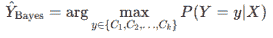

换句话说，分类器选择后验概率最高的类别 Y。

2\. 贝叶斯最优分类器的关键组成部分

1.  先验概率 P(Y)：先验概率表示在观测数据之前对每个类别的置信度。例如，在二分类问题中，如果类别为“垃圾邮件”和“不垃圾邮件”，先验概率可能基于垃圾邮件和非垃圾邮件邮件在数据集中的相对频率。

2.  似然 P(X∣Y)：似然表示在假设类别 Y 的前提下，观测数据 X 的可能性。例如，给定一封标记为“垃圾邮件”的邮件，似然表示如果该邮件是垃圾邮件，某些特定词汇出现的概率。可以通过概率分布（如高斯分布或多项式分布）来估计。

3.  边缘可能性 P(X)：边缘可能性是所有类别的观测数据总概率之和，作为归一化因子，确保所有类别的后验概率之和为 1：

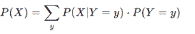

1.  后验概率 P(Y∣X)：后验概率是观测数据 X 条件下类别 Y 的概率。贝叶斯最优分类器使用后验概率进行预测，选择后验概率最高的类别。

3\. 实施贝叶斯最优分类器的步骤

1.  估计先验：首先需要根据训练数据集中每个类别的频率或先验信念来估计每个类别的先验概率。实际中，这可以通过计算每个类别在训练数据中的相对频率来实现。

2.  估计似然：接下来估计似然 P(X∣Y)，即在每个类别 Y 下观测特征 X 的可能性。这通常涉及对特征分布进行建模，例如对连续特征使用高斯分布，对离散特征使用多项式分布。

3.  计算后验：利用贝叶斯定理计算每个类别的后验概率，基于观测数据。对每个类别计算后验概率，并选择后验概率最大的类别作为预测结果。

4.  进行预测：贝叶斯最优分类器预测后验概率最大的类别：

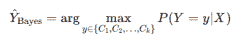

4\. 贝叶斯最优分类器的假设

条件独立性：常见的假设是特征在类别条件下相互独立。这一假设简化了似然项 P(X∣Y)，使其可以表示为各个特征似然的乘积：

P(X∣Y)=P(X1∣Y)⋅P(X2∣Y)⋅⋯⋅P(Xn∣Y)

这一假设导致了朴素贝叶斯分类器，它是贝叶斯最优分类器的一个简化但仍然强大的版本。

正确模型：贝叶斯最优分类器假设我们了解数据的真实分布。在实际问题中，这通常并不成立，因此我们通常依赖近似方法（例如，使用高斯分布来估计连续数据的分布）来估计必要的量。

5\. 贝叶斯最优分类器的优势

最优性：贝叶斯最优分类器在理论上最小化分类错误。在假设模型正确且数据充分的前提下，它能够实现最低的误分类率。

概率输出：它提供概率预测，而不仅仅是类别标签，这在许多应用中非常有用（如风险评估、决策支持）。

纳入先验知识：利用先验知识可以结合专家知识或历史数据关于类别分布的信息，使其在数据有限的情况下仍然有效。

6\. 贝叶斯最优分类器的劣势

计算复杂度：贝叶斯最优分类器需要为所有特征和类别计算似然，这在高维数据或类别数量较大时可能变得计算成本很高。

模型正确性假设：分类器假设我们了解数据的真实分布。在实际问题中，往往没有这方面的信息，需要依赖近似方法（例如，使用朴素贝叶斯假设特征独立）来估计所需的量。

高维限制：当特征数量很大时，计算似然和后验可能变得不切实际，且朴素贝叶斯假设的条件独立性可能不成立，从而限制其有效性。


## 7\. 与其他分类器的比较

**Naive Bayes** 与 **贝叶斯最优分类器**：Naive Bayes 是贝叶斯最优分类器的简化版本，其中特征在类标签给定的前提下被假设为条件独立的。由于其简洁和高效，Naive Bayes 在实际应用中广泛使用，但当特征之间存在依赖关系时，它的表现不如完整的贝叶斯最优分类器。

**支持向量机（SVM）和决策树**：这些分类器通常不提供概率输出，并基于数据采用不同的决策边界。贝叶斯最优分类器在提供类概率方面更具理论依据，但需要对数据分布做更强的假设。

## **NAIVE BAYES CLASSIFIER**

Naive Bayes 是一种概率机器学习模型，用于分类任务。它基于贝叶斯定理，并假设用于预测的特征（或属性）在类标签给定的前提下是条件独立的。尽管特征独立性的简化假设，Naive Bayes 在实践中往往表现出人意料的良好效果，尤其是在文本分类问题（如垃圾邮件过滤）中。

## **1\. 贝叶斯定理在 Naive Bayes 中的应用**

贝叶斯定理提供了计算给定观测数据（特征）后验概率的方法。数学表达式为：

`P(Y∣X)=P(X)P(X∣Y)⋅P(Y)`

其中：

* `P(Y∣X)`：类 Y 在观测数据 X 条件下的后验概率。

* `P(X∣Y)`：观测数据 X 在类 Y 条件下的似然。

* `P(Y)`：类 Y 的先验概率。

* `P(X)`：观测数据 X 的边缘概率（证据）。

Naive Bayes 通过假设特征在类标签给定下的条件独立性，将上式简化，即特征 Xi​ 的出现与其他特征 Xj​ 在类 Y 条件下的出现相互独立。

## **2\. 条件独立性假设**

Naive Bayes 的核心假设是特征在类标签给定下是条件独立的。对于特征向量 X=(X1​,X2​,...,Xn​)，Naive Bayes 假设：

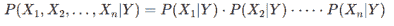

这意味着观测整个特征向量 XXX 在类 YYY 条件下的概率可以分解为各个特征概率的乘积。

## **3\. Naive Bayes 分类器公式**

利用贝叶斯定理和独立性假设，给定观测数据 X=(X1​,X2​,...,Xn​) 的类 Y 后验概率为：

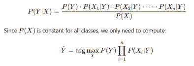分类器预测类 Y^，使其后验概率最大。

## **4\. Naive Bayes 分类器的步骤**

1. 计算先验概率：先验概率 P(Y) 等于训练数据中各类别的频率：

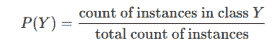

1. 计算似然：似然 P(Xi​∣Y) 是特征 Xi​ 在类 Y 条件下的条件概率。根据特征类型（离散或连续）使用不同的方法估计这些概率：

› 对离散数据：似然是每个特征值在每个类别中的相对频率。

› 对连续数据：常用方法是假设特征在每个类别内服从高斯（正态）分布，并估计每个特征的均值和方差。

1. 计算每类的后验概率：对每个类别，计算后验概率，将先验概率与特征的似然相乘（假设条件独立）。

2. 类别预测：选择后验概率最高的类别作为预测结果。

## **5\. Naive Bayes 分类器的类型**

根据特征分布的假设，常见的三种 Naive Bayes 分类器如下：

**Multinomial Naive Bayes**：

用于计数型数据（如文本分类中的词频）。

假设特征（如词频）服从多项分布。

**Bernoulli Naive Bayes**：

用于二元/布尔数据（如词的出现或不出现）。

假设特征服从 Bernoulli 分布，即每个特征是二元指示器。

**Gaussian Naive Bayes**：

用于连续数据（如身高、体重或其他实数值特征）。

假设特征服从高斯（正态）分布，概率由每类的高斯分布建模。

## **6\. Naive Bayes 分类器的优势**

**简洁性**：

Naive Bayes 易于理解和实现。

参数估计需求低，计算高效。

**快速训练和预测**：

计算效率高，即使在大数据集上也能实现线性时间复杂度（与特征数和训练实例数成正比）。

**适用于小数据集**：

当条件独立假设相对成立时，Naive Bayes 在小数据集上表现良好。

**高维空间的有效性**：

特别适用于高维数据，如文本分类，其中特征数量众多（如大量单词）。

**处理缺失值**：

可以在训练时忽略缺失值，并在预测时仅使用可用特征进行预测。

## **7\. Naive Bayes 分类器的缺点**

**独立性假设**：

主要局限是条件独立性假设。真实数据中特征往往存在相关性，若该假设被违背，模型性能会下降。

**零概率问题**：

若某特征 Xi​ 在某类别 Y 中未出现，则 P(Xi​∣Y) 为零，导致后验概率为零。可通过拉普拉斯平滑（在所有特征概率上加一个小常数）来缓解。

**分布假设**：

对于连续特征，Gaussian Naive Bayes 假设数据服从高斯分布，若实际分布差异较大，模型表现可能不佳。

**灵活性有限**：

Naive Bayes 假设特征之间是简单的概率关系，可能无法捕捉数据中的复杂交互。

## **8\. 拉普拉斯平滑（Laplace Smoothing）**

拉普拉斯平滑用于解决 Naive Bayes 的零概率问题。它在每个特征计数上加一个小常数（通常为 1），确保没有特征的概率为零。

例如，特征 Xi​ 在类 Y 中的概率为：

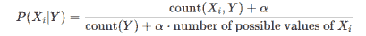其中 α 为平滑参数（通常设为 1）。

## **9\. Naive Bayes 的应用**

**文本分类**：常用于垃圾邮件过滤、情感分析和主题分类，因其在大词表和文本数据上表现出色。

**医疗诊断**：在医疗领域用于根据症状预测疾病是否存在，假设症状在类别条件下相互独立。

**情感分析**：用于判断文本或评论的情感倾向（正面或负面），尤其适用于社交媒体或产品评论。

**推荐系统**：可用于将用户偏好或行为分类，辅助推荐相关内容。

## **10\. 示例：Naive Bayes 用于垃圾邮件分类**

假设我们构建一个垃圾邮件分类器，特征 X=(X1​,X2​) 表示邮件中是否包含特定词汇（如“free”和“buy”）。类别有两种：垃圾邮件和非垃圾邮件。

步骤：

1. 计算先验概率：根据训练数据计算垃圾邮件和非垃圾邮件的先验概率。

2. 计算似然：计算 P(X1​∣Y) 和 P(X2​∣Y)，例如“free”在垃圾邮件中的概率以及“buy”在非垃圾邮件中的概率。


3. 后验计算：使用贝叶斯定理计算两类（垃圾邮件和非垃圾邮件）的后验概率。

4. 预测：选择后验概率较高的类别作为预测结果。

贝叶斯信念网络

贝叶斯网络（BN），也称为信念网络或概率图形模型，是一个有向无环图（DAG），其中：

*   节点表示随机变量（可以是离散的或连续的）。

*   边表示概率依赖或条件依赖。

贝叶斯网络是一个强大的工具，用于建模具有不确定性的复杂系统，并在医疗诊断、决策支持系统和机器学习等多个领域被广泛应用。该网络以紧凑形式编码了一组变量的联合概率分布，从而便于进行推理和推断。

1\. 网络结构

节点：贝叶斯网络中的每个节点代表一个随机变量。这可以是任何事物，从传感器读数到诊断结果。这些随机变量可以是离散的（例如疾病是否存在）或连续的（例如某人的身高）。

边：节点之间的边（箭头）表示变量之间的条件依赖或概率依赖。如果从节点 A 到节点 B 有一条边，则表示变量 A 对变量 B 有一定影响。如果两个节点之间没有边，则它们表示的变量在给定其父节点的条件下是相互独立的。

父子关系：在贝叶斯网络中，父节点直接影响子节点。子节点的概率取决于其父节点。条件依赖关系通过条件概率分布（CPD）捕获，这些分布定义了父节点与子节点之间的关系。

2\. 概率表示

贝叶斯网络使用条件概率分布（CPD）来定义节点之间的关系。每个节点都关联有一个条件概率表（CPT），该表指定了节点在给定其父节点时的概率。

示例：简单的贝叶斯网络

考虑一个简单的贝叶斯网络，其中：

*   A 表示天气（晴朗或下雨）。

*   B 表示某人是否携带雨伞（是或否）。

*   C 表示该人是否会淋湿（是或否）。

结构如下：

css

A → B → C

其中：

*   A → B：天气影响是否携带雨伞。

*   B → C：携带雨伞影响是否淋湿。

每个节点（A、B、C）都会有条件概率分布。例如：

*   P(A)：晴朗或下雨天气的概率。

*   P(B∣A)：给定天气的情况下，携带雨伞的概率。

*   P(C∣B)：给定是否携带雨伞的情况下，淋湿的概率。

3\. 联合概率分布

贝叶斯网络允许计算网络中所有变量的联合概率分布。对于一组变量 X1​、X2​、...、Xn​，联合概率可以表示为条件概率的乘积，利用网络结构进行因子分解：

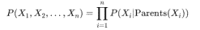

这种因子分解简化了联合分布的计算，将其分解为较小的条件概率。这是贝叶斯网络的主要优势之一——它们能够高效表示和计算复杂的、高维的联合概率分布。

4\. 网络中的推理

贝叶斯网络中的推理是指在给定一些证据（其他节点的观测值）的情况下，计算特定变量（节点）的概率分布。

贝叶斯网络中有两种主要的推理任务：

边际推理：

边际推理涉及计算网络中一子集变量的边际概率分布，同时对剩余变量进行边际化（即对其进行求和/积分）。

条件推理：

条件推理涉及计算在给定某些证据（如部分变量的观测数据）的情况下，某变量的条件概率分布。

条件推理示例：

如果我们观察到某人没有携带雨伞，我们可能想计算在该证据下天气是晴朗（变量 A）的概率。这是贝叶斯网络中条件推理的典型用例。

5\. 网络学习

贝叶斯网络可以从数据中学习，主要有两种方法：

结构学习：这涉及从数据中发现贝叶斯网络的结构（即网络的拓扑）。目标是找到变量之间的依赖关系和独立关系。

参数学习：在结构学习后，下一步是估计每个节点的条件概率分布（CPD），给定其父节点。这可以通过最大似然估计（MLE）或贝叶斯估计等方法进行。

6\. 贝叶斯网络的优势

高效的概率表示：贝叶斯网络能够以紧凑形式表示复杂的联合概率分布。与存储完整的联合分布不同，该模型仅存储父节点与子节点之间的条件分布，从而降低计算和存储需求。

可视化的依赖关系：贝叶斯网络的图形结构直观地展示了变量之间的关系，便于理解复杂的依赖结构。

显式建模不确定性：贝叶斯网络明确建模不确定性，支持在不确定性下进行推理。这在现实世界应用中尤为重要，因为数据常常是噪声或不完整的。

灵活的推理能力：一旦构建完成，贝叶斯网络可用于多种推理任务，包括预测事件发生的可能性或根据观测数据诊断问题。

7\. 贝叶斯网络的劣势

学习复杂度高：学习贝叶斯网络的结构和参数可能计算费 intensive，尤其是在大数据集或包含大量节点的网络中。结构学习需要在大量可能的网络结构中进行搜索。

条件独立性假设：虽然贝叶斯网络能够建模复杂的依赖关系，但仍依赖于边所捕获的关系是条件依赖。在某些实际应用中，这种假设可能不成立，存在更复杂的关系。

推理中的计算挑战：在大型贝叶斯网络中，精确推理可能计算量巨大。为了应对这些挑战，使用近似方法，如马尔可夫链蒙特卡罗（MCMC）和变分推断（Variational Inference），但这些方法仍可能耗时较长。

需要领域知识：构建准确的贝叶斯网络需要对问题领域有良好的理解，以便正确指定变量之间的结构和关系。

8\. 贝叶斯网络的应用

医疗诊断：在医疗领域，贝叶斯网络可以建模症状、疾病和治疗之间的复杂关系，帮助医生根据观测到的症状和疾病的先验概率进行诊断。

决策支持系统：贝叶斯网络用于决策支持系统，帮助用户在不确定性下做出明智的决策，如金融、风险分析和规划。

机器学习与人工智能：在机器学习中，贝叶斯网络用于分类、预测和模式识别任务。它们可以用于概率图形模型中建模不确定性。


机器学习：贝叶斯网络在机器人中用于传感器融合（整合不同传感器的数据）、状态估计以及在不确定条件下的决策。

自然语言处理（NLP）：贝叶斯网络用于诸如语音识别、文本分类和机器翻译等任务，其中需要建模词、短语和意义之间的不确定性和复杂依赖关系。

9\. 示例：医疗诊断中的贝叶斯网络

考虑一个简单的医疗诊断系统，网络包含：

*   D（疾病：流感、感冒等）

*   S（症状：发烧、咳嗽等）

*   T（检测结果：阳性或阴性）

贝叶斯网络可能如下所示：

mathematica

D → S → T

*   P(D)：每种疾病的先验概率。

*   P(S∣D)：给定疾病的症状出现的概率。

*   P(T∣S)：给定症状的检测结果的概率。

如果患者出现症状（例如发烧和咳嗽），系统可以利用贝叶斯网络计算各种疾病的概率，并预测阳性检测结果的可能性。

贝叶斯网络是一种强大的工具，用于通过利用变量之间的概率关系来建模包含不确定性的复杂系统。它能够高效表示联合分布，在不确定性下进行推理，并从数据中学习。尽管学习和推理过程在计算上可能具有挑战性，但由于能够处理复杂的依赖关系和不确定信息，贝叶斯网络在医疗诊断、决策-making、机器学习和人工智能等领域被广泛应用。

EM 算法

EM 算法在两个主要步骤之间交替进行：

1.  预期步骤（E-Step）：在当前参数估计的基础上，估计隐变的期望值（给定观测数据）。

2.  最大化步骤（M-Step）：根据 E-Step 计算的期望对数似然，更新模型参数以使其最大化。

这些步骤会重复，直到收敛，即参数不再发生显著变化。

2\. 数学框架

设：

*   X：观测数据。

*   Z：隐（潜在）数据。

*   θ：模型参数。

*   P(X,Z∣θ)：在参数 θ 下，观测数据和隐数据的联合概率。

*   P(X∣θ)=∑Z​P(X,Z∣θ)：观测数据的边缘似然。

目标是最大化观测数据的对数似然 ln P(X∣θ)。

由于 Z（隐变量）未知，EM 算法通过最大化关于“注意事项”中的“与”观测数据的后验分布来最大化期望对数似然。

对数似然分解

利用 Jensen 不等式，对数似然可以分解为：

ln P(X∣θ)=\ Q(θ∣θ^((t))) + KL(Q∣∣P)

其中：

*   Q(θ∣θ^((t)))=E Z∣X,θ(t)​ [ln P(X,Z∣θ)]：对完整数据的期望对数似然。

*   KL(Q∣∣P)：Kullback‑Leibler（KL） divergence，度量后验分布 Q 与真实分布 P 之间的差异。

EM 算法通过最大化 Q(θ∣θ^((t))) 同时最小化 KL divergence 来实现目标。

3\. EM 算法的步骤

初始化：先给出参数的初始估计 θ(0)。

1\. 预期步骤（E-Step）：计算在当前参数估计 θ(t) 下，隐变量的期望对数似然：

Q(θ∣θ^((t)))=E Z∣X,θ(t)​ [ln P(X,Z∣θ)]。

2\. 最大化步骤（M-Step）：在 E-Step 的期望对数似然基础上，更新参数估计：

θ^((t+1))=\ arg max₍θ₎ Q(θ∣θ^((t))).

3\. 迭代：在 E-Step 和 M-Step 之间交替，直到收敛（即 θ(t+1)≈θ(t)）。

4\. EM 算法的应用

高斯混合模型（GMMs）：EM 用于估计 GMM 的参数，其中观测数据被建模为多个高斯分布的混合，隐变量表示簇分配。

隐马尔可夫模型（HMMs）：EM 在 Baum‑Welch 算法中用于学习 HMM 的参数，包括转移概率、发射概率和初始状态概率。

1.  聚类：在聚类问题中，EM 可以在把簇归属视为隐变量时，为数据点分配簇。

2.  缺失值处理：EM 通过把缺失条目视为隐变量并迭代估计其值，来处理包含缺失数据的数据集。

3.  主题模型：诸如潜在狄里克莱分配（LDA）之类的算法使用 EM 来推断文本数据中的主题。

5\. EM 算法的优势

1.  处理缺失数据：EM 通过把缺失值视为隐变量，对不完整或缺失的数据具有鲁棒性。

2.  收敛到局部极大值：EM 保证每次迭代的似然值递增，但可能收敛到局部极大值而非全局极大值。

3.  灵活性：EM 可应用于广泛的问题，包括聚类、密度估计和参数估计。

6\. EM 算法的缺点

1.  局部极大值：算法可能收敛到似然函数的局部极大值，而非全局极大值。

2.  初始化敏感性：EM 的结果高度依赖于初始参数估计。

3.  计算负荷：对于大数据集或复杂模型，EM 可能计算开销大，因为每次迭代都需要计算期望和最大化。

4. 收敛速度慢：在某些情况下，尤其是似然面平坦时，EM 的收敛速度较慢。

EM 算法是一种用于估计包含隐变量模型参数的有力方法，通过交替进行期望和最大化步骤，有效地处理缺失数据和隐变量带来的挑战。尽管它存在初始化敏感和可能收敛到局部极大值等局限性，但其灵活性和实用性使其成为机器学习、统计学和数据分析中的重要工具。

支持向量机器（SVM）

支持向量机（SVM）是一种受监督的机器学习算法，用于分类、回归和异常检测任务。它通过在高维空间找到最佳超平面来分离不同类别的数据点。

|   ||  ||   |

| --- | --- | --- |

 

## 1\. SVM 关键概念

 

#### 超平面：

超平面是将数据分为不同类别的决策边界。

在二维空间中，它是一条直线；在三维空间中，它是一个平面；在更高维空间中，它是对应的一般化。

### 间隔

间隔是超平面与每个类别最近数据点之间的距离。

SVM 通过最大化这个间隔来实现最佳的类别分离，这种方法称为最大间隔分类器。

### 支持向量

支持向量是那些位于超平面最近的数据点。它们的位置决定了超平面的位置。

移除或修改支持向量会影响超平面的位置。

|   ||  ||   |

| --- | --- | --- |

 

## 2\. SVM 类型

 

### 线性 SVM

线性 SVM 用于数据是线性可分的情况，即存在一条直线超平面可以在不产生错误的前提下将各类别分开。

### 非线性 SVM

当数据不具备线性可分性时，SVM 采用核技巧（kernel trick）将数据映射到更高维空间，使得在该空间中可以找到线性可分的超平面。

|   ||  ||   |

| --- | --- | --- |

 

## 3\. 核技巧


 

The kernel trick is a mathematical function that transforms the original data into a higher-dimensional space without explicitly computing the transformation. It allows SVM to find a hyperplane in this new space, making it effective for non-linear problems.

### 常见核函数：

1.  线性核（Linear Kernel）：用于线性可分的数据。

`K(x,y)=x⋅y`

1.  多项式核（Polynomial Kernel）：允许算法拟合非线性决策边界。

`K(x,y)=(x⋅y+c)d`

1.  辐射基函数（RBF）核（高斯核）：常用于非线性问题。

`K(x,y)=exp(−γ∥x−y∥2)`

1.  逻辑函数核（Sigmoid Kernel）：像神经网络激活函数一样工作。

`K(x,y)=tanh(αx⋅y+c)`

|   ||  ||   |

| --- | --- | --- |

 

## 4\. 数学公式

 

### SVM 的目标

目标是找到一个超平面，使得间隔最大化，同时最小化分类错误。

#### 1\. 优化问题

对于线性可分的数据：

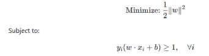

其中：

*   `w`：定义超平面的权重向量。

*   `b`：偏置项。

*   `yi​`：第 iii 个数据点的类别标签（+1 或 −1）。

*   `xi​`：第 iii 个数据点的特征向量。

#### 2\. 软边界（用于不可分离数据）

对于非线性可分的数据，SVM 引入松弛变量（ξi）允许部分误分类：

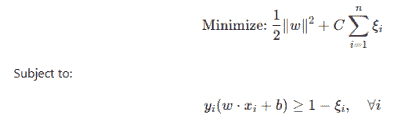

其中：

*   `ξi`：衡量误分类程度的松弛变量。

*   `C`：正则化参数，控制间隔最大化与分类错误最小化之间的权衡。

|   ||  ||   |

| --- | --- | --- |

 

## 5\. SVM 步骤

 

1.  输入数据：

提供带标签的训练数据，特征 `X={x1​,x2​,...,xn​}` 和标签 `y={y1​,y2​,...,yn​}`。

1.  选择核：

根据数据的特性选择合适的核函数。

1.  优化：

求解优化问题，找到最大化间隔的超平面。

1.  预测：

对于新数据点 `xxx`，计算：

`f(x)=w⋅x+b`

若 `f(x)>0`，则预测 `y=+1`，否则 `y=−1`。

|   ||  ||   |

| --- | --- | --- |

 

## 6\. SVM 的优势

 

1.  适用于高维数据：

当特征数量很多时，SVM 表现良好，因为它专注于最大化间隔。

1.  对过拟合鲁棒：

正则化参数 `C` 防止过拟合，尤其在高维和稀疏数据中效果显著。

1.  核函数技巧：

利用核函数的能力，SVM 能够解决非线性问题。

1.  适用于小数据集：

在数据集较小且参数恰当的情况下，SVM 表现优异。

|   ||  ||   |

| --- | --- | --- |

 

## 7\. SVM 的缺点

 

1.  计算复杂度高：

训练 SVM 可能计算开销很大，尤其是大数据集。

1.  核函数选择：

SVM 的性能很大程度上取决于核函数的选择和参数调优。

1.  可扩展性有限：

由于需要解决二次规划问题，SVM 难以处理非常大的数据集。

1.  可解释性差：

与决策树或线性回归等简单模型相比，SVM 模型的可解释性较低。

|   ||  ||   |

| --- | --- | --- |

 

## 8\. SVM 的应用

 

1.  文本分类：

垃圾邮件检测、情感分析、文档分类。

1.  图像分类：

目标识别、人脸检测。

1.  生物信息学：

基因分类、蛋白质结构预测、疾病诊断。

1.  时间序列预测：

财务预测、股市预测。

1.  异常检测：

识别欺诈行为或在数据中检测异常。

|   ||  ||   |

| --- | --- | --- |

 

## 9\. 例子：二分类

 

### 数据集：

假设我们在二维空间中有两类点：

*   A 类：标记为 +1。

*   B 类：标记为 −1。

### 目标：

找到一条直线（超平面）将 A 类和 B 类的点分开，并且间隔最大。

### 步骤：

1.  使用训练数据计算最优超平面 `w⋅x+b=0`。

2.  找出支持向量（最靠近超平面的点）。

3.  通过判断新点到超平面的位置来预测其类别。

支持向量机（SVM）是分类和回归任务的强大工具，特别适用于高维数据或存在复杂非线性关系的场景。尽管需要仔细调参和选择核函数，但其最大化间隔和利用核技巧的能力使其在众多机器学习应用中非常受欢迎。

SUPPORT VECTOR KERNEL

Linear Kernel

最简单的核函数，不改变数据，适用于线性可分的数据。

`K(x,y)=x⋅y`

主要特点：

*   计算高效，效率高。

*   当数据已经线性可分时表现好。

适用场景：

文本分类（如文档分类），特征空间稀疏且维度高。

Polynomial Kernel

允许通过多项式组合特征来构造非线性决策边界。

`K(x,y)=(xy+c)d`

其中：

*   `d`：多项式的度数。

*   `c`：常数，用于平衡高阶项与低阶项的影响。

主要特点：

*   比线性核更灵活，能构造更复杂的决策边界。

*   多项式度数 `d` 决定决策边界的复杂程度。

适用场景：

特征之间存在多项式关系的情况。

1.3. Gaussian Kernel (Radial Basis Function, RBF Kernel)

一种广泛使用的核，将数据映射到无限维空间，基于数据点之间的距离，定义为：

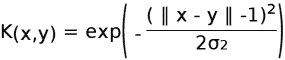

其中：

*   `∥x−y∥2`：`x` 和 `y` 之间的欧氏距离的平方。

*   `γ>0`：控制单个训练样本影响范围的参数。

主要特点：

*   能够处理高度非线性的决策边界。

*   参数 `γ` 决定单个训练点的影响范围：`γ` 很小时，影响范围广，决策边界平滑；`γ` 很大时，影响范围局部，决策边界复杂。

适用场景：

*   非线性可分的问题。

*   图像分类、生物信息学、语音识别等。

2\. 选择核函数

线性核：

*   当数据线性可分或接近线性可分时使用。

*   适合高维稀疏数据，如文本数据。

多项式核：

*   当数据特征之间存在多项式交互关系时使用。

*   需要仔细调参以避免过拟合。

高斯核（RBF）：

*   适用于大多数非线性问题。


需要对参数 `γ` 和正则化参数 `C` 进行调优以实现最佳性能。

Kernels 比较

| Kernel || Equation || Key Parameter(s) || Use Case |

| --- | --- | --- | --- |

| Linear || `K(x,y)=x⋅y` || 无 || 线性可分的数据 |

| --- | --- | --- | --- |

| Polynomial || `K(x,y)=(x⋅y+c)d` || `c,d` || 多项式特征关系 |

| Gaussian (RBF) || `K(x,y)=exp(−γ∥x−y∥2)` || `γ` || 非线性可分性 |

4\. 实用技巧

Kernel 选择：

*   对于简单问题或解释性至关重要的情况，先使用线性核。

*   作为大多数非线性问题的默认核，使用高斯（RBF）核。

*   如果先前知识暗示存在多项式关系，可考虑多项式核。

参数调优：

*   对于高斯核：使用网格搜索和交叉验证等技术调优 `γ` 和 `C`。

*   对于多项式核：尝试不同的度数 `d` 以平衡模型复杂度。

HYPERPLANE—DECISION SURFACE

在机器学习中，特别是分类问题，超平面和决策边界是用来将数据划分为不同类别的数学构造。这些概念是支持向量机（SVM）和逻辑回归等算法的基础。

超平面

超平面是 n−1 维子空间，位于 n 维空间中，它作为边界将空间划分为两个半部分，分别对应不同的类别。

数学表示：n 维空间中的超平面由：

`w⋅x+b=0`

其中：

*   `w`：权重向量（垂直于超平面）。

*   `x`：输入向量（数据点）。

*   `b`：偏置项（决定超平面相对于原点的偏移）。

解释：

*   `w⋅x+b` 的符号决定了点位于超平面的哪一侧。

*   当 `w⋅x+b>0` 时，点属于一类；当 `w⋅x+b<0` 时，点属于另一类。

示例：

*   在 2 维空间中，超平面是一条直线。

*   在 3 维空间中，超平面是一个平面。

决策边界

决策边界是更广义的概念，表示决策发生变化的边界或区域。虽然超平面是线性决策边界，但决策边界可以是线性的也可以是非线性的。

1.  非线性决策边界：当数据不可线性分离时，算法（如 SVM）会利用核技巧将数据映射到更高维空间，使得超平面能够分离类别。该超平面在原始空间投影后成为非线性决策边界。

2.  数学表示：对于非线性决策边界，边界通常通过复杂函数隐式定义，例如：

`f(x)=0`

这可能定义一个曲线边界，在其中决策发生变化。

1.  视觉示例：在 2 维空间中，决策边界可以是分隔两个数据簇的曲线。在 3 维空间中，它可以是一个复杂的表面，将点划分为不同区域。

超平面与决策边界比较

| Feature || Hyperplane || Decision Surface |

| --- | --- | --- |

| Dimensionality || n−1 dimensional (linear boundary) || Can be linear or nonlinear |

| --- | --- | --- |

| Representation || `w⋅x+b=0` || `f(x)=0` |

| Complexity || Linear || May involve nonlinear transformations |

| Use Case || Suitable for linearly separable data || Effective for complex, non-linear data |

机器学习中的应用

1.  支持向量机（SVM）：

SVM 在特征空间中构建超平面，以最大化两类数据之间的边界（margin）。

对于非线性分离，核函数将数据映射到更高维空间，使得线性超平面能够分离类别。该超平面投影回原始空间后形成非线性决策边界。

1.  逻辑回归：

逻辑回归使用线性边界（超平面），但以概率方式扩展，估计点属于某类的可能性。

1.  神经网络：

神经网络隐式建模决策边界，这些边界可以高度复杂且非线性，能够适应数据中的复杂模式。

超平面是用于在机器学习中分离数据的线性边界，而决策边界则将这一概念推广到包括非线性边界在内。超平面适用于线性可分的数据，而决策边界适用于需要更灵活边界的复杂数据集。二者共同构成了理解和设计分类模型的基础。

SVM 的属性

支持向量机（SVM）是一种强大的受监督学习模型，主要用于分类任务，也可用于回归。SVM 旨在找到最佳的决策边界（超平面）以最好地分隔不同类别的数据。以下是 SVM 的关键属性和特征：

1\. Margin Maximization（边界最大化）

SVM 通过找到最大化 margin 的超平面来工作，margin 是不同类别数据中最近的数据点（也称为支持向量）之间的距离。

*   好处：通过最大化 margin，SVM 旨在降低分类错误并提高泛化能力。更大的 margin 意味着过拟合的可能性更小。

*   硬边界 SVM：在数据线性可分的情况下，SVM 尝试找到能够完美分离数据且边界最大的超平面。

*   软边界 SVM：对于非线性可分的数据，SVM 引入惩罚误分类的 slack variables，允许部分数据点被误分类但代价是增加 margin，从而平衡边界大小和分类误差。

2\. Linear and Non-Linear Classification（线性和非线性分类）

*   线性分类：SVM 对线性可分的数据表现良好，能够找到直线（2D）或平面（3D）超平面来分离类别。

*   非线性分类：对于非线性可分的数据，SVM 使用核函数将数据映射到更高维空间，使得线性超平面能够分离类别。常用的核包括：

›  多项式核：使用多项式函数将数据映射到更高维空间。

›  高斯（RBF）核：将数据映射到无限维空间，对复杂的非线性决策边界非常有效。

›   sigmoid 核：使用 sigmoid 函数，类似于神经网络的激活函数。

3\. Support Vectors（支持向量）

支持向量是距离超平面最近的数据点，它们影响超平面的位置和方向。这些点是决定最优超平面的关键。

*   影响：支持向量是定义超平面的唯一数据点，因此 SVM 是一种记忆效率高的模型，因为它不需要存储所有数据点，只需保留支持向量。

*   特性：即使有些数据点离超平面很远，它们对模型的影响也较小，只有支持向量对模型起主要作用。

4\. 过拟合和正则化（Overfitting and Regularization）

*   对过拟合的控制：SVM 通过调整 margin 来自然控制过拟合。更大的 margin 通常导致更好的泛化能力，减少过拟合。

*   C-Parameter：正则化参数 `C` 控制 margin 最大化与分类错误最小化之间的权衡。大 `C` 允许更少的 margin 误差，可能导致过拟合；小 `C` 允许更多的误差，可以增大 margin，从而减少过拟合。

5\. 高计算复杂度（High Computational Complexity）

*   训练时间：SVM 的训练过程计算开销较大，尤其是对于大数据集。复杂度通常是 O(n²) 或 O(n³)，因为需要解决一个二次优化问题，其中 nnn 是数据点的数量。

*   可扩展性：SVM 可能不适合非常大的数据集。不过，像 libsvm 和线性 SVM 实现等优化技术可以帮助提高大规模问题的训练时间。

6\. 二分类（Binary Classification）

*   本质：SVM 本质上是二分类模型，它设计用于将数据分为两类，这是其主要优势。


-   [多类分类：为了将 SVM 扩展到多类分类，采用了一些策略，如 one-vs-one (OvO) 和 one-vs-all (OvA)：]

›  OvA: 需要为每个类别训练一个独立的 SVM，然后根据“获胜”类别进行分类。

›  OvO: 需要为每对类别训练一个 SVM，然后选择获胜次数最多的类别。

7\. 对高维数据的鲁棒性

*   高维空间的有效性：SVM 在高维空间表现良好，特别适合特征数量众多的问题（例如文本分类、图像识别）。

*   特征选择：SVM 处理高维数据时不受维度诅咒的影响，这是其显著优势之一。

8\. 模型可解释性

*   透明度不足：与决策树等某些更简单的模型相比，SVM 通常被认为可解释性较低，尤其是在使用核函数时。很难可视化或解释 SVM 是如何得出决策的。

*   决策边界：虽然决策边界（超平面）可以在二维或三维中可视化，但随着维度增加，其可解释性会显著下降。

9\. 对核函数选择的敏感性

*   核函数选择：SVM 的性能很大程度上取决于核函数的选择以及相关的超参数（如多项式核的度数或高斯核的带宽）。正确调参对于实现最佳性能至关重要。

*   核函数调参：常用的技术包括交叉验证和网格搜索，用于寻找模型的最佳核参数。

10\. 对噪声和离群点的敏感性

*   离群点：当正则化参数 CCC 设置得过高时，SVM 对离群点特别敏感。模型可能会尝试拟合这些离群点，导致过拟合。

*   稳健 SVM：诸如稳健 SVM 或带离群点检测的 SVM 等变体可以更有效地处理离群点。

SVM 性质总结

| Property || Description |
| --- | --- |
| Margin Maximization || 旨在找到类别之间最大的间隔。 |
| Linear/Non-linear || 适用于线性可分和非线性可分的数据。 |
| Support Vectors || 只有支持向量定义了决策边界。 |
| Overfitting Control || 正则化参数 CCC 控制边界大小与误分类之间的权衡。 |
| Computational Complexity || 计算成本高，尤其是大数据集。 |
| Binary Classification || 主要是二分类器，但可以通过 OvA 或 OvO 扩展到多类分类。 |
| High-Dimensional Data || 在高维空间表现有效。 |
| Model Interpretability || 相比更简单的模型，SVM 可解释性较低。 |
| Kernel Sensitivity || 性能高度依赖于核选择和参数调优。 |
| Outlier Sensitivity || 对离群点敏感，尤其是在 C 取值较高时。 |

ISSUES IN SVM

虽然支持向量机 (SVM) 在分类任务中强大且广泛使用，但它也存在一些局限性和挑战，这些问题可能影响模型的性能、计算效率以及在不同情境下的适用性。以下是与 SVM 相关的一些关键问题：

1\. 计算复杂性

训练时间：SVM 的训练过程可能计算开销很大，尤其是对于大数据集。该算法需要解决一个二次优化问题，其时间复杂度为 O(n²) 或 O(n³)，其中 nnn 是数据点的数量。这使得 SVM 在样本数量众多时训练变得缓慢。

可扩展性：随着数据集规模扩大，SVM 的训练需求会显著增加，除非使用优化技术或近似方法（例如线性 SVM 用于大规模数据集或随机梯度下降 (SGD)）来提高效率。

2\. 内存使用

内存需求：SVM 会存储支持向量，这些关键数据点定义了决策边界。对于大数据集，存储所有支持向量可能非常耗费内存，在内存受限的环境中可能造成问题。

大数据集：在处理大量样本和特征时，SVM 可能需要大量内存来存储核矩阵，尤其是在使用非线性核（如高斯径向基函数 RBF）时。

3\. 对核函数选择的敏感性

核函数依赖：SVM 的性能高度依赖于核函数的选择及其参数。选择错误的核函数（例如线性核与多项式核）或未能正确调参可能导致性能不佳。

超参数调优：SVM 需要仔细调整多个参数，如正则化参数 CCC、核类型以及核特定参数（例如多项式核的度数、高斯核的 gamma）。通常需要通过广泛的交叉验证或网格搜索来寻找最佳配置，这可能耗时。

4\. 多类分类的困难

二分类本质：SVM 本质上是二分类模型，设计用于将数据分为两类。虽然可以通过 one-vs-one (OvO) 和 one-vs-all (OvA) 等技术将 SVM 扩展到多类分类，但这些方法在类别数量较多时会增加计算复杂度并产现低效。

训练多个分类器：在多类问题中，SVM 需要训练多个二分类器，这不仅增加计算成本，还使得模型管理变得更加复杂。

5\. 对噪声和离群点的敏感性

离群点敏感：当正则化参数 CCC 设置得过高时，SVM 对离群点特别敏感。如果训练数据中存在离群点，模型可能会过度关注它们，导致过拟合。

处理噪声数据：在存在噪声或标签错误的数据时，SVM 的性能可能下降。模型可能会尝试拟合噪声，尤其是在过度正则化（高 CCC）的情况下。

小 CCC 的影响：另一方面，如果 CCC 参数过小，SVM 可能会容忍过多的误分类，从而导致欠拟合。

6\. 缺乏概率解释

概率输出：与诸如逻辑回归或决策树等其他模型不同，SVM 原生不提供概率输出。它仅给出分类决策（超平面的哪一侧）。

校准：虽然可以使用普拉特缩放 (Platt scaling) 将 SVM 的决策值转换为概率，但这增加了额外的复杂性，并且不一定总能提供准确的概率估计。

7\. 在大特征集（高维度）上的表现不佳

维度诅咒：尽管 SVM 在高维数据上相对表现良好，但在训练样本数量相对于特征数量较少的情况下，仍可能受到维度诅咒的影响。高维空间增加了过拟合的风险，如果未能妥善管理，SVM 可能表现不佳或效率低下。

特征选择：SVM 在高维空间中需要进行特征选择或维度降低（例如 PCA、LDA）以避免过拟合。如果没有适当的特征工程，SVM 在极高维数据集中可能表现差或效率低下。

8\. 缺乏透明度（可解释性）

黑盒模型：SVM 通常被视为“黑盒”模型，这意味着很难理解或解释模型如何做出决策，尤其是在使用复杂核（如 RBF 或多项式核）时。

决策边界：虽然在低维数据中可以可视化决策边界，但随着维度增加，边界变得高度复杂，难以解释。


## 9. 非线性核的计算成本

核计算：非线性核（如径向基函数 RBF 核）在计算上可能非常昂贵，因为需要在特征空间中计算每一对数据点之间的相似度。这会导致一个大小为 n×n 的核矩阵，对于大型数据集来说，这可能是计算上不可承受的。

矩阵反演：在某些 SVM 实现中（特别是针对非线性核），训练阶段需要进行矩阵反演，这会增加计算时间和复杂度。

## 10. 在线学习的有限支持

批量学习：SVM 通常设计用于批量学习，即一次性使用整个数据集进行训练。它们不适合在线学习或数据流场景。

无增量学习：传统 SVM 模型无法通过增量方式更新新数据。相比之下，如逻辑回归和决策树等模型可以轻松适应新数据，无需从头开始重新训练。这使得 SVM 不适合用于动态、实时应用。

## 练习

1. 详细描述设计学习系统所涉及的所有步骤。讨论机器学习的视角和问题。

2. 解释遗传算法在基于知识的技术中的作用。

3. 与传统算法相比，区分遗传算法，并给出合适的例子。

4. 详细说明各种人工神经网络（ANN）架构。

5. 区分监督学习和强化学习。用例子进行说明。

### 单元 III

## 决策树学习

## 决策树学习算法

决策树学习算法是一种递归过程，它根据在每一步中最能区分数据点的特征将数据集划分为子集。目标是通过从数据特征中学习简单的决策规则，构建一个能够预测目标变量的模型。以下是决策树学习算法的过程和步骤概述。

### 决策树学习算法的步骤

1. 输入数据集：

算法从包含多个特征（属性）和目标变量（分类任务中的类标签，回归任务中的连续值）的数据集开始。

在分类任务中，目标变量是离散的；在回归任务中，目标变量是连续的。

1. 检查停止条件：

所有样本属于同一类别：如果所有样本属于同一类，该节点成为叶节点，并标记为该类别。

没有剩余特征：如果没有更多特征可以用于划分（或特征不再提供信息），节点成为叶节点。该节点的标签为该子集中样本多数类别的标签。

最大深度或最小样本数：如果决策树达到预定义深度，或者子集中的样本数量过少以进行进一步划分，算法停止。

1. 选择最佳特征进行划分：

算法评估所有可用特征，选择能实现最佳划分的特征，通常基于不纯度度量或如基尼不纯度、熵（信息增益）或回归任务中的方差减少等标准。

这些标准用于衡量在对特定特征进行划分后，数据的分离程度。最常用的度量包括：

基尼不纯度：衡量随机样本被错误分类的概率。

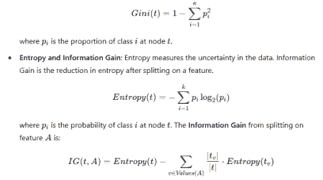

其中，Values(A) 是特征 A 的可能取值，tv 是子集 t 中特征 A 取值 v 的样本子集。

方差减少：在回归任务中，算法选择能最小化目标变量在划分后方差的特征。

1. 划分数据集：

在选择最佳特征后，根据该特征的值将数据集划分为子集。

如果特征是连续的，划分可能基于阈值（例如，小于或大于某个值）。如果特征是离散的，数据集会根据该特征的不同取值进行划分。

1. 递归：

算法对每个子集递归应用相同的过程（创建子树）。对于每个子集，检查停止条件，选择下一步的最佳特征，并继续，直到满足停止条件。

1. 赋值：

当算法到达叶节点时，为节点赋值（类别标签或回归值）。

- 在分类任务中，赋值为该子集中样本的多数类别。
- 在回归任务中，赋值为该子集中目标变量的平均值。

### 决策树学习算法（伪代码）

以下是决策树学习过程的一般伪代码表示：

```python
def decision_tree_learning(data, features):
    if stopping_condition(data):
        return create_leaf_node(data)
    best_feature = select_best_feature(data, features)
    tree = create_node(best_feature)
    feature_values = unique_values(best_feature)
    for value in feature_values:
        subset = filter_data(data, best_feature, value)
        subtree = decision_tree_learning(subset, features - {best_feature})
        tree.add_branch(value, subtree)
    return tree
```

### 伪代码说明：

*   stopping_condition(data)：检查是否满足任一停止条件（所有样本属于同一类、无剩余特征等）。

*   create_leaf_node(data)：创建叶节点，标记为子集中多数类别或回归任务的平均值。

*   select_best_feature(data, features)：根据选定的标准（如基尼不纯度或信息增益）选择最佳划分特征。

*   create_node(best_feature)：创建基于最佳特征的决策节点。

*   unique_values(best_feature)：返回特征的唯一值或阈值。

*   filter_data(data, best_feature, value)：根据特征值过滤数据集。

*   add_branch(value, subtree)：为特征的每个可能值添加分支，连接相应的子树。

### 剪枝决策树

在决策树完全生长后，剪枝用于减小树的大小并提高其泛化能力。主要有两种剪枝方式：

1. 预剪枝（早期停止）：

根据特定条件提前停止树的生长，例如：

- 节点中的样本数少于预定义的最小数量。
- 节点无法提高模型准确率（例如，信息增益过低）。
- 树的深度达到预定义限制。

1. 后剪枝（代码复杂度剪枝）：

树完全生长后，根据分支对模型性能的贡献（例如，通过交叉验证）来移除分支。

- 通常通过评估错误率，移除导致过拟合的分支。

### 决策树学习的优势

*   易于理解和解释：树的结构易于可视化，即使是非技术用户也能理解模型。
*   处理数值和类别数据：决策树可以处理数值和类别数据，无需标准化或缩放。
*   非线性决策边界：决策树可以建模特征与目标变量之间的非线性关系。
*   自动特征选择：算法在每一步自动选择最相关的特征。

### 决策树学习的缺点

*   过拟合：决策树容易过拟合数据，尤其是树过深或数据噪声较多时。
*   不稳定性：小的数据变化可能导致完全不同的树。
*   偏向于特征取值多的特征：特征取值级数多的特征可能主导划分标准，导致树偏向这些特征。


-   [泛化能力差：未剪枝，模型可能过于复杂，难以很好地泛化到未见过的数据。]

-   [决策树学习是一种强大且直观的机器学习算法，它基于特征值构建树状模型以预测结果。虽然它具有简洁性和可解释性等优势，但必须通过剪枝技术和合理选择用于划分的特征，来仔细管理可能出现的过拟合和不稳定问题。]

### INTRODUCTIVE BIAS

-   [引入偏差（Inductive bias）指机器学习算法在学习过程中所融入的假设和先验知识集合。它帮助算法进行预测、从有限数据中泛化，并在竞争模型中进行选择。本质上，引入偏差为算法提供了从训练数据泛化到未见示例的框架。没有引入偏差，机器学习模型将难以进行预测，因为它缺乏指导学习过程的方向或结构。]

### 机器学习中引入偏差的作用

1.  [泛化：引入偏差在使模型从训练数据泛化到新的、未见的示例方面发挥着关键作用。也就是说，它决定了当模型接收到不在训练集中的新输入时的行为。]

    -   [例如，一个具有特定引入偏差的模型可能通过假设相似的输入应导致相似的输出，即使这些确切的输入之前从未出现过，也能实现泛化。]

2.  [搜索空间缩减：偏差指导在广阔的可能模型空间中寻找最佳假设。它通过缩小潜在模型的范围，使学习过程更加高效和可管理。]

    -   [例如，在决策树模型中，偏差可能包括对哪些特征更可能相关的假设，从而减少可能的划分数量。]

3.  [提高学习效率：引入偏差可以通过专注于更可能导致正确预测的假设，使学习更高效。没有引入偏差，算法需要考虑所有可能的假设，这在计算上非常昂贵且耗时。]

### 引入偏差的类型

1.  [线性模型中的偏差：]

    -   [线性回归假设特征与目标变量之间存在线性关系。这一假设简化了学习任务，因为模型只需寻找最佳拟合的线性函数。]

    -   [在分类中，如逻辑回归假设类别之间的决策边界是线性的。]

2.  [决策树中的偏差：]

    -   [决策树假设数据可以根据特征值进行划分。算法递归地将数据集划分为子集，引入偏差假设这些划分能够揭示模式和关系。]

3.  [神经网络中的偏差：]

    -   [神经网络假设复杂模式可以通过在多层神经元中的数据转换来学习。其引入偏差是层级结构（神经元层）能够捕获特征与目标变量之间复杂关系。]

4.  [实例基学习中的偏差（如 k-NN）：]

    -   [在 k 近邻（k-NN）中，偏差假设相似的实例倾向于具有相同的输出。它基于特征空间的 proximity（接近性）对应于输出的相似性这一假设。]

5.  [概率模型中的偏差（如 Naive Bayes）：]

    -   [Naive Bayes 假设特征在类标签给定的条件下是条件独立的。这是一个强假设，但能够在数据有限的情况下高效工作。]

### 引入偏差的重要性

1.  [避免过拟合：引入偏差有助于避免过拟合，即模型学习训练数据中的噪声或无关细节。通过引入领域知识或对数据形式的假设，模型更少可能过拟合，从而更好地泛化到新数据。]

2.  [提升性能：恰当选择的引入偏差可以显著提升模型性能，使学习过程集中在更可能正确的假设上。例如，在计算机视觉中，卷积神经网络（CNN）利用邻近像素相关的偏差，帮助其有效学习空间层次结构。]

3.  [降低计算复杂度：通过将搜索空间限制在与偏差相符的模型子集，学习过程变得更具计算效率。例如，假设分类任务的决策边界是线性的，可以大幅减少模型需要测试的假设数量。]

### 引入偏差的例子

-  [简洁性假设（奥卡姆剃刀）：许多算法假设最简洁的能够拟合数据的模型更可能是最佳的。例如，在决策树中，倾向于较少划分的假设是一种引入偏差，鼓励构建更简单的模型。]

-  [平滑性假设：在 k-NN 等算法中，隐含假设特征空间中接近的数据点更可能拥有相似标签。]

-  [线性决策边界：在线性回归和逻辑回归中，偏差是类别之间的决策边界或输入与输出之间的关系是线性的。]

### 引入偏差的挑战

1.  [偏差-方差权衡：]

    -  [具有强引入偏差的模型（如假设线性关系）可能在简单任务上表现良好，但在复杂任务上表现不佳。相反，偏差过少（如高度灵活的模型）可能导致过拟合。]

    -  [关键挑战是平衡引入偏差，以提高泛化能力而不限制模型学习复杂模式的能力。]

2.  [域特定假设：]

    -  [有时，引入偏差是基于可能不适用于所有数据类型的假设。例如，Naive Bayes 假设特征在类标签给定的条件下是条件独立的，这在许多真实数据集中不成立，从而限制模型性能。]

3.  [有限灵活性：]

    -  [强引入偏差可能限制模型的灵活性。例如，决策树倾向于层次化划分，这可能不适合具有更复杂关系的数据集。]

### 基于决策树的引入推理

-  [引入推理指从具体观察（训练示例）到更广泛概括或假设的过程。在决策树的上下文中，引入推理涉及从给定的训练数据中构建决策树模型，然后利用该模型对未见数据进行预测。]

-  [决策树学习中的引入推理表现为算法递归地根据最具信息性的特征对数据集进行划分。它基于特征与目标变量之间的关系假设，从训练集中学习模式，以泛化到新的、未见的示例。]

### 基于决策树的引入推理步骤

1.  [数据表示：]

    -  [训练数据包含多个实例，每个实例包含特征（属性）和对应的目标值（分类标签用于分类，或连续值用于回归）。]

    -  [引入推理的目标是构建一棵树状模型，最好能够准确地映射输入特征到目标输出。]

2.  [假设生成：]

    -  [假设是决策树本身。树中的每个节点代表基于某个特征的决策点，每个分支代表特征可能的取值。]

    -  [最初，整个数据集作为树的根节点，通过递归划分创建子节点，直到满足特定停止条件（如所有样本属于同一类，或无法进一步改进）为止。


1. `特征选择和划分`：
   该算法评估所有可能的特征，并选择能最好划分数据集的那一个。这基于一种诱导偏见，例如信息增益（基于熵）或基尼杂质。

   例如，信息增益衡量在对某个特征划分数据后，不确定性（熵）的减少量。选择能实现最大熵减少的特征来进行划分。

   `IG(S,A)=Entropy(S)−∑v∈Values(A)∣Sv∣∣S∣⋅Entropy(Sv)`

   其中 `SSS` 是数据集，`SvS_vSv​` 是特征 `AAA` 取值为 `v` 的子集。

   基尼杂质是另一种用于衡量随机选取元素被误分类概率的指标。选择能最小化基尼杂质的特征来划分数据集。

1. `递归划分`：
   在选择最佳划分特征后，数据集被划分为对应该特征每个可能取值的子集。

   诱导推理过程随后对每个子集递归进行，直到满足停止条件（例如节点中的数据已纯净，或树深度达到最大）为止。

1. `叶节点分配`：
   当树达到停止条件后，最终的叶节点会被分配类别标签（用于分类）或数值（用于回归）。

   对于分类，叶节点标签通常是到达该节点的训练实例中多数类。

   对于回归，叶节点值通常是到达该节点的目标值的平均值或中位数。

1. `诱导概括`：
   通过这些诱导推理构建的树用于将新、未见的实例推广到更广泛的模式。从根节点到叶节点的路径代表了基于新实例特征的决策序列。模型预测新实例到达的叶节点所对应的类别或数值。

   `决策树中的诱导偏见`

   决策树学习中的诱导偏见至关重要，因为它影响算法如何从训练数据推广到新、未见的实例。决策树算法的诱导偏见通常包括以下假设：

   - `局部性`：特征空间中相近的实例很可能具有相似的输出。因此，决策树基于特征值划分数据，并将划分后的子集视为比整个数据集更加均一。

   - `层次结构`：决策树假设特征与目标变量之间的关系可以以层次方式表达，树的每一层代表基于特征的更具体的决策。

   - `特征重要性`：模型假设某些特征比其他特征更具信息性，因此在划分数据集时会优先选择这些特征。

   这种偏见指导学习过程，但其实现方式可能导致过拟合（模型过于贴合训练数据）或欠拟合（模型过于简单，未能捕捉底层模式）。

   示例：`决策树中的诱导推理`

   假设我们有一个包含以下属性的数据集：

   - `Age`（数值）：人的年龄（例如 30、40、50）

   - `Income`（类别）：收入水平（例如 低、中、高）

   - `Education`（类别）：教育水平（例如 高中、大学、研究生）

   目标变量是 `Buy`（是/否），表示该人是否购买特定产品。

   | `Age` | `Income` | `Education` | `Buy` |
   | --- | --- | --- | --- |
   | 30 | Low | High School | No |
   | 40 | Medium | College | Yes |
   | 50 | High | Graduate | Yes |
   | 30 | High | College | No |
   | 40 | Low | High School | No |
   | 50 | Medium | Graduate | Yes |

   步骤 1：`选择最佳划分特征`

   决策树学习算法评估哪个特征提供最佳划分。它会计算每个特征的信息增益或基尼杂质。

   如果 `Income` 的信息增益最高，则第一次划分将基于该特征。

   步骤 2：`划分数据`

   数据集根据 `Income` 特征划分。例如，可能得到 "Low"、"Medium" 和 "High" 收入水平的子集。

   然后，我们对这些子集递归应用相同的过程，考虑 `Age` 和 `Education` 等特征。

   步骤 3：`构建树`

   例如，如果 `Income = Low` 的子集大部分为 "No"，则决策树会在相应的叶节点中放置 "No" 标签。

   同样，对于其他子集，决策树会继续基于剩余特征进行划分，直到满足停止条件。

   步骤 4：`推广和预测`

   一旦树构建完成，我们可以根据新实例的 `Age`、`Income` 和 `Education` 值预测该人是否购买该产品。

   `决策树中诱导推理的优势和局限性`

   `优势`：

   - `直观可解释`：树结构易于理解和可视化，因此高度可解释。

   - `处理混合数据类型`：决策树可以处理数值和类别特征。

   - `捕捉非线性关系`：决策树可以捕捉特征与目标变量之间的非线性关系。

   `局限性`：

   - `过拟合`：决策树容易过拟合训练数据，尤其是当树很深时。这发生在模型学习训练数据中的噪声或无关细节时。

   - `不稳定性`：数据的微小改变可能导致截然不同的树。

   - `偏向于特征取值多的特征`：决策树可能偏向于特征取值多的特征，这可能并非总是理想。

   诱导推理在决策树学习中帮助构建一个能从具体训练实例推广到更广泛模式的模型，指导算法在新、未见数据上进行预测。决策树在诱导推理中的有效性源于其能够递归划分数据并基于特征进行推理的能力，前提是每次划分都使模型更接近正确预测。然而，在诱导过程中需要仔细考虑以避免过拟合和其他固有挑战。

   `熵与信息理论`

   `信息理论` 是应用数学和电气工程的一个分支，涉及量化、存储和通信信息。`熵` 是该理论中的一个基本概念，用于量化数据或随机变量中的不确定性或不可预测性。它提供了描述或预测系统状态所需的信息量的度量。

   在机器学习和决策树的语境中，熵用于确定如何最佳划分数据，旨在减少不确定性并改善决策过程。

   `熵`

   `熵`（通常记作 `H`）是系统中不确定性或混乱程度的度量。该概念最初由克劳德·香农在信息理论框架中引入。在机器学习中，它用于评估数据集的纯净度或一致性。如果数据集的熵高，意味着数据集混杂，包含许多不同的结果；反之，熵低则表示数据集纯净，主要由一种结果组成。

   `熵公式`：

   对于离散随机变量 `X`，熵定义为：

   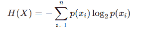

   其中：

   - `X` 是随机变量（例如分类任务中的类别标签），
   - `xi​` 是 `X` 的可能取值（结果），
   - `p(xi)` 是 `xi​` 的概率，
   - 求和遍历 `X` 的所有可能取值，
   - 对数的底数为 2，因此熵的单位是比特。

   `熵的解释`：

   - 如果所有结果等可能（最大不确定性），熵达到最大值。
   - 如果一种结果是确定的（零不确定性），熵为零。

   示例：


考虑一个简单的二分类问题，我们有一个包含两个类别：A 和 B 的数据集。

如果数据集中 A 和 B 的比例各为 50%，则熵为：

H(X)=−\[0.5log⁡20.5+0.5log⁡20.5\]=1 bit

这代表最大的不确定性。

*   如果数据集中 AAA 占 90%，BBB 占 10%，则熵为：

H(X)=−\[0.9log⁡20.9+0.1log⁡20.1\]≈0.468 bits

这表示不确定性较少，因为某一类明显更为普遍。

信息增益

在机器学习中，信息增益用于决定决策树算法中最佳的数据分割特征。信息增益是指根据特定属性对数据集进行划分后，熵的减少量。目标是选择能够实现最大熵减少的特征，从而得到更纯净（更均匀）的子集。

信息增益公式：

当根据属性 AAA 对数据集 DDD 进行划分时，信息增益计算如下：

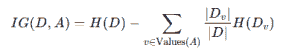

其中：

*   H(D) 是原始数据集 DDD 的熵，

*   Dv​ 是属性 A 的值为 v 的子集，

*   H(Dv​) 是子集 Dv​ 的熵，

*   ∣Dv∣∣D∣​ 是子集 Dv​ 中实例数量占整个数据集的比例。

选择信息增益最高的属性作为划分依据。在决策树学习中，这一过程会递归进行，构建出能够将数据集划分为尽可能纯净子集的树结构。

香农熵在信息论中的应用

信息论中的熵概念由克劳德·香农（Claude Shannon）提出，用于量化消息或数据集的信息内容。它定义为从能够产生多种符号的源接收消息时的“惊讶”或不确定性的期望值。

香农熵公式：

对于一个能够产生符号 x1,x2,...,xn​ 的源，其概率分别为 p(x1),p(x2),...,p(xn)，熵 H(X) 为：

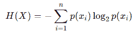

该熵值表示在最佳无损编码下，从该源编码消息所需的最小比特数。

信息论中的解释：

*   高熵：如果源包含许多可能符号且概率相近（例如公平的硬币投掷），熵较高，因为结果的不确定性较大。

*   低熵：如果源主要产生概率很高的单一符号（例如总是发送字母 "A"），熵较低，因为预测下一个符号的不确定性较小。

机器学习中的熵应用

1.  决策树学习：

在 ID3（Iterative Dichotomiser 3）和 C4.5 等算法中，熵用于计算节点分割时的信息增益。目标是选择能够最大化信息增益的特征，从而实现最纯净的划分。

1.  特征选择：

熵用于评估特征的相关性，衡量特征能够多少地减少数据的不确定性。能够显著降低熵的特征被认为更具信息性，从而在模型中被选用。

1.  聚类：

在 k-means 等聚类算法中，熵可用于评估聚类质量。低熵表示簇内实例相似性高，而高熵则表明簇更为混杂或异质。

1.  数据压缩：

熵在数据压缩算法（如 Huffman 编码）中至关重要，目标是根据数据分布的熵，用最少的比特数表示数据。

1.  Naive Bayes 分类器：

熵与 Naive Bayes 等概率分类器中的 Kullback-Leibler 偏差（KL divergence）相关，这些分类器使用概率度量来评估特征给定类别的可能性。

熵是香农在信息论中引入的一种强大的不确定性或混乱度量。在机器学习中，它在决策树算法和其他旨在量化数据不确定性的模型中发挥关键作用。通过最小化熵（或最大化信息增益），机器学习算法能够高效地做出决策和预测，最终学习到能够很好地泛化到未见数据的模式。理解熵是许多机器学习技术的基础，尤其是涉及分类和特征选择的技术。

信息增益

信息增益是决策树学习和机器学习整体中的一个核心概念。它用于衡量根据特定特征或属性对数据集进行划分后，不确定性或熵的减少量。使用信息增益的主要目标是找出能够显著降低不确定性的属性，从而构建更好的预测模型，特别是在决策树中。

信息增益本质上衡量特征在分类数据方面的有效性。能够在数据划分后实现最大不确定性或熵减少的特征被选中用于决策树的构建。该过程会递归进行，直到数据完全被分类。

理解熵

在深入研究信息增益之前，理解熵是很重要的，因为它是用于计算信息增益的不确定性度量。

熵是数据的不可预测性或杂乱程度的度量。如果数据集中所有实例属于同一类别，熵为 0（即没有不确定性）；如果实例在不同类别之间均匀分布，熵较高（即不确定性最大）。

熵公式：

对于一个包含 n 个类别的集合 S，熵定义为：

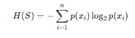

其中：

*   [不要翻译这一行，保持原样]


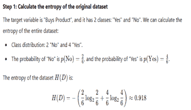步骤 2：根据属性分割数据集

假设我们根据“收入”属性对数据进行分割，该属性有两个可能的值：低和高。

*   对于收入 = 低，我们有以下实例：{ (30, 低, 否), (40, 低, 否), (50, 低, 是) }。

*   对于收入 = 高，我们有：{ (30, 高, 是), (40, 高, 是), (50, 高, 是) }。

步骤 3：计算子集的熵

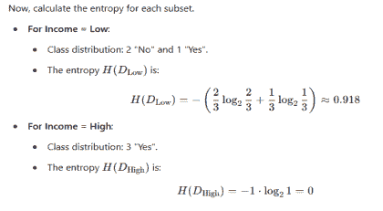步骤 4：计算熵的加权和

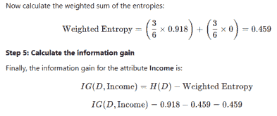

因此，根据“收入”属性对数据集进行分割的信息增益为 0.459。

信息增益是决策树学习中的强大工具。它帮助识别能够将数据分割成尽可能均匀子集的特征。通过计算每个特征的信息增益，决策树算法可以在构建树的每一步中做出明智的决策，选择使用哪个属性进行分割。信息增益最高的属性被选为分割属性，从而构建出高效且准确的决策树模型。

ID-3 算法

ID3（Iterative Dichotomiser 3）是一种广泛使用的决策树算法，它通过递归地根据信息增益最高的属性对数据进行分割来构建决策树。其目标是根据输入特征（属性）预测目标变量（类别）。ID3 由 Ross Quinlan 于 1986 年提出，仍是决策树学习的基石。

ID-3 算法中的关键概念

ID3 算法的核心思想是通过在每个节点选择信息增益最高的属性来构建树。该过程会在数据子集上递归进行，直到数据被正确分类或满足停止条件为止。

ID-3 算法的步骤

1.  选择最佳分割属性：

对于树中的每个节点，算法选择能最大化信息增益的属性。该属性用于将数据分割成子集。

1.  分割数据：

在选择最佳属性后，数据集根据该属性的可能值进行划分。

1.  递归重复：

对于每个子集，算法递归地应用相同的过程：选择最佳属性、分割数据，并继续此过程。递归继续进行，直到满足以下任一停止条件：

*   子集中所有实例属于同一类别。

*   没有更多属性可用于分割（或所有属性均已使用）。

*   达到预定义的最大树深度。

1.  创建叶节点：

当满足停止条件（例如，子集中的所有数据点属于同一类别）时，算法创建叶节点，并将该节点中的数据点的类别作为预测值。

ID-3 算法的详细说明

1.  初始步骤：从根节点开始：

决策树的根节点使用整个数据集创建。算法选择能最大化信息增益的属性，用于在根节点处分割数据。

1.  属性选择：

对于数据集中的每个属性，计算其信息增益。信息增益最高的属性被选中，用于分割数据。

信息增益是衡量在根据属性分割数据后，不确定性（熵）减少的指标。

1.  数据分割：

数据集根据选定属性的值进行划分。如果属性有多个可能值（例如，二元特征的“是”和“否”），则相应地划分数据，为每个值创建子节点。

1.  递归过程：

算法对每个子节点（数据子集）递归应用相同的过程。对于每个子集，计算各属性的信息增益，并选择最佳属性进行分割。

1.  停止条件：

递归继续进行，直到满足以下任一条件：

*   子节点中的所有数据点属于同一类别（纯节点）。

*   没有更多属性可用于分割。

*   达到预定义的停止标准（如最大树深度或节点中最小数据点数）。

1.  创建叶节点：

当递归停止时，创建叶节点，并将该节点中数据点的类别作为预测值。

ID-3 算法示例

考虑一个小数据集，我们希望根据“年龄”和“收入”属性预测某人是否购买产品：

| 年龄 | 收入 | 购买产品（目标） |
| --- | --- | --- |
| 30 | 低 | 否 |
| 30 | 高 | 是 |
| 40 | 低 | 否 |
| 40 | 高 | 是 |
| 50 | 低 | 是 |
| 50 | 高 | 是 |

步骤 1：计算每个属性的信息增益

原始数据集的熵：目标变量有 2 个类别：“否”和“是”。熵是衡量整个数据集不确定性的指标。

根据属性“年龄”分割数据后的熵：根据“年龄”属性分割数据：

*   年龄 = 30：{ (30, 低, 否), (30, 高, 是) }

*   年龄 = 40：{ (40, 低, 否), (40, 高, 是) }

*   年龄 = 50：{ (50, 低, 是), (50, 高, 是) }

计算每个子集的熵，并使用加权和计算信息增益。

根据属性“收入”分割数据后的熵：根据“收入”属性分割数据：

*   收入 = 低：{ (30, 低, 否), (40, 低, 否), (50, 低, 是) }

*   收入 = 高：{ (30, 高, 是), (40, 高, 是), (50, 高, 是) }

同样，计算每个子集的熵，并计算加权和。

步骤 2：选择信息增益最高的属性

信息增益最高的属性被选为根节点的第一个属性。该过程在子节点上重复，直到满足停止条件。

ID-3 算法的优势

1.  简单且易于理解：ID3 实现和理解简单，能够以清晰且可解释的方式构建决策树。

2.  适用于小数据集：对于属性数量较少的小数据集，ID3 可以快速生成决策树。

ID-3 算法的缺点

1.  过拟合：如果树深度过大，ID3 可能会过拟合训练数据，尤其是当数据中包含噪声时。过拟合是模型学习数据中的噪声而非实际模式的现象。

2.  倾向于值较多的属性：该算法倾向于选择可能值较多的属性，因为这些属性更有可能具有更高的信息增益。

3.  无法直接处理数值数据：ID3 更适合处理类别数据。数值属性需要在应用 ID3 之前进行离散化处理。

4.  贪心策略：ID3 采用贪心策略，在每一步都做出局部最优选择，而不考虑全局最优解。

ID-3 算法是一种基于最大化信息增益的决策树学习算法。它在每个节点使用信息增益最高的属性来分割数据，因此对于分类任务来说是一个高效的算法。虽然它简单且易于实现，但可能会出现过拟合和对某些特征的偏见。了解其优势和局限性对于在实际数据集中应用它至关重要。

决策树学习中的问题

决策树学习是分类和回归任务中流行且可解释的方法。然而，在使用决策树时可能会遇到一些问题和挑战。这些问题包括过拟合、偏见以及处理各种类型数据等。以下是一些关键问题：

1.  过拟合


一种常见的决策树学习问题就是过拟合，当模型在训练数据上学习到噪声或无关模式而非很好地泛化到未见数据时就会发生过拟合。这通常发生在树变得过于复杂，捕获了与整体预测无关的具体细节时。

过拟合的症状：

*   树中有许多分支和叶子节点，可能捕获噪声而非整体趋势。

*   模型在训练数据上表现良好，但在验证或测试数据上表现差。

解决方案：

*   剪枝：剪枝去除那些不会显著提高准确度的节点。

*   限制树深度：设置最大深度，防止树过于庞大。

*   最小样本要求：要求节点分裂或叶子节点创建时必须有最小数量的数据点。

2\. 偏向于类别值较多的特征

决策树，特别是 ID3 算法，倾向于偏好可能取值更多的属性，这会导致偏向的划分。例如，如果一个特征有许多不同的值，它可能看起来比实际更具信息性，从而倾向于选择该特征进行划分。

解决方案：

*   信息增益比：使用信息增益比而不是信息增益，可以减少这种偏见。信息增益比会考虑每个属性的取值数量，并通过属性的内在信息对信息增益进行归一化。

*   其他划分标准：如基尼系数或卡方检验等其他标准也可以减轻这种偏见。

3\. 处理连续数据

决策树通常最适合处理类别数据，处理连续（数值）数据可能是一个挑战。当数据包含连续属性时，决策树需要确定适当的分割点，这可能很复杂。

解决方案：

*   离散化：将连续属性转换为类别属性，通过将值分箱（例如“年龄 < 30”，“年龄 >= 30”）。

*   二分法：另一种方法是在选定的阈值处将连续数据分为两个分支（例如“收入 < 50k”和“收入 >= 50k”）。

4\. 对数据小幅变化缺乏鲁棒性

决策树对训练数据的小幅变化高度敏感。例如，在数据集中添加或删除少量样本会导致树结构完全不同。这种缺乏鲁棒性会导致预测的不稳定。

解决方案：

*   集成方法：像随机森林或增强方法这样的技术可以提高鲁棒性。这些方法通过聚合多个树来减少方差并增加稳定性。

5\. 计算复杂度

随着数据集大小和特征数量的增加，决策树可能会变得计算成本高昂。在每个节点处对数据集进行划分并评估所有可能的划分可能很耗时，尤其是在特征数量和数据点数量很多时。

解决方案：

*   特征选择：通过预处理减少特征数量，可以改善性能，使树的构建过程更快。

*   高效算法：像 CART（分类和回归树）这样的优化决策树算法使用更高效的划分标准和剪枝策略，以降少计算复杂度。

6\. 处理缺失值

决策树可能在包含缺失值的数据集上遇到困难。如果某个实例的属性值缺失，树很难确定如何处理该数据点。

解决方案：

*   插补：用基于其他可用数据估计的值填充缺失值（例如使用均值、中位数或众数）。

*   缺失值处理：一些树算法（如 CART）通过使用替代划分（surrogate splits）处理缺失值，即在值缺失时选择其他属性作为替代。

7\. 非线性和复杂的决策边界

决策树倾向于创建轴对齐的决策边界，即基于单个属性进行划分。因此，它们可能难以建模需要非线性决策边界的问题，这会限制它们在某些任务上的性能。

解决方案：

*   集成方法：像随机森林和梯度增强树这样的方法可以通过组合多个树来建模更复杂的决策边界。

*   混合模型：将决策树与其他模型（如神经网络或支持向量机）结合，可能帮助处理复杂的非线性模式。

8\. 可解释性与准确性的权衡

虽然决策树高度可解释，但其复杂度会影响准确性。简单的树易于理解但可能欠拟合数据，而复杂的树可能提供高准确性但难以解释。

解决方案：

*   剪枝：剪枝以在可解释性和准确性之间取得平衡，创建更简单的模型，同时仍然有效。

*   限制树深度：限制树的深度可以确保模型保持可解释，同时仍能实现合理的准确性。

9\. 不平衡数据集

当数据集不平衡（例如，一个类别显著多于其他类别）时，决策树可能会偏向多数类。这会导致少数类的分类性能不佳。

解决方案：

*   类别权重：在训练时为少数类赋予更高的权重，确保树更关注正确分类这些实例。

*   重新采样：使用 oversampling（复制少数类实例）或 undersampling（减少多数类实例）等技术在训练前平衡数据集。

10\. 连续更新或数据漂移

在数据分布可能随时间变化的动态环境中（即概念漂移），决策树可能难以适应新的数据模式。

解决方案：

*   递增学习：一些决策树算法（如在线学习算法）支持递增更新，能够在不重新构建模型的情况下适应新数据。

实例基于学习（IBL）

实例基于学习（Instance-Based Learning, IBL）是一类机器学习算法，它们根据训练数据中的实例来进行预测，而不是构建模型或假设。实例基于学习系统直接存储训练实例，并在需要时使用它们进行预测。这种方法通常被称为记忆基于学习，因为算法“记住”了所有训练实例。

在 IBL 中，关键思想是通过在训练数据中找到与新实例最相似的实例来预测新实例的标签。模型依赖于距离或相似度指标来找到最接近的存储实例。

实例基于学习的工作流程

1. 存储实例：

训练数据集在训练过程中被存储，不进行抽象或建模。每个实例以特征向量和对应的标签形式保存。

1. 查询模型：

当需要对新的、未见的实例（查询点）进行分类或预测时，算法在存储的实例中搜索最相似的实例，基于距离度量。

1. 进行预测：

一旦找到相似的实例，新实例的类别或值就会被预测。有几种方法可以结合相似实例的信息：

*   分类：在分类问题中，通常使用最近邻中多数类别的标签作为预测。

*   回归：在回归任务中，预测值可能是最近邻值的平均值或加权平均值。

实例基于学习的关键特征


# 无明确模型
与许多机器学习算法（如决策树或神经网络）不同，基于实例的学习在训练阶段不构建明确模型。它保留训练数据，并在预测时直接使用这些数据。

# 适应性
基于实例的学习算法可以适应性，意味着它们可以在数据分布发生变化时无需重新训练模型即可处理这种变化。只需向内存中添加或删除实例，即可更新系统。

# 懒惰学习
基于实例的学习被视为一种懒惰学习形式，因为它会在需要进行预测时才延迟计算（例如学习模型）。换句话说，训练阶段没有进行泛化或模型创建，只有记忆。

# 相似性度量
该算法在很大程度上依赖相似性度量（如欧几里得距离、曼哈顿距离或余弦相似度）来找到最相关的实例。这些度量帮助判断新实例与已存储实例有多“接近”。

## 热门的基于实例的学习算法

### k-最近邻居 (k-NN)
k-最近邻居（k-NN）是最知名的基于实例的学习算法之一。对于给定的测试实例，算法会在训练数据中找到与测试实例最相似（最接近）的 k 个训练示例，并使用它们的标签（用于分类）或值（用于回归）来预测测试实例的标签或值。

*   分类：选择 k 个最近邻中出现次数最多的类别标签作为预测。

*   回归：预测通常是 k 个最近邻的目标值的平均值。

### 局部加权学习
该方法在预测时为更靠近的邻居赋予更高的权重。它不像对所有邻居都平等对待，而是使用局部加权函数为最近的邻居分配更多重要性。这在某些情况下可以提高预测的准确性。

### 案例推理（CBR）
案例推理是一种问题解决方法，新问题通过检索并适应存储在内存中的已解决的案例来得到解决。它本质上是基于实例的学习的扩展，新实例会与存储的案例进行比较，以找到最佳的解决方案或预测。

## 基于实例学习的优势

1.  简单性
基于实例的学习背后的概念简单直观。它依靠存储数据并在新实例与已有实例之间进行比较，而不是构建复杂的模型。

1.  无训练阶段
由于没有明确的模型构建阶段，基于实例的学习算法可以快速部署，特别是在数据频繁变化的环境中，因为模型通过简单添加或删除实例自然更新。

1.  灵活性
基于实例的学习灵活，可应用于多种问题，包括分类、回归和异常检测。

1.  适用于非线性问题
由于基于实例的学习方法不假设特征与输出之间存在线性关系，它们可以很好地处理其他模型可能因非线性而失败的问题。

## 基于实例学习的缺点

1.  计算复杂度
在预测阶段，基于实例的学习可能计算开销很大，因为算法需要在整个训练集中搜索最近邻。这在大数据集中尤为突出。

1.  内存需求
系统需要将所有训练实例存储在内存中，这对于大数据集来说可能不切实际或效率低下。当数据集很大或计算资源有限时，这是一个显著的缺点。

1.  对噪声敏感
基于实例的学习方法对数据噪声敏感。如果训练集包含无关或错误标记的实例，预测结果可能会受到影响，导致准确性下降。

1.  缺乏泛化
由于模型本质上“记住”了训练实例而没有进行泛化，它在训练数据不能很好地代表整个问题空间时可能表现不佳。这会导致对未见数据的泛化效果差。

1.  距离度量的选择
基于实例的学习的有效性很大程度上取决于距离或相似度度量的选择。不同的度量可以产生截然不同的结果，选择适合特定问题的正确度量可能需要试验。

## 基于实例学习的应用

*   图像识别：基于实例的学习可以通过将测试图像的特征与标记图像数据库中的特征进行比较，用于图像分类任务。

*   推荐系统：在推荐系统中，基于实例的学习可以用于找到最相似的用户或项目，并基于这些相似性提供个性化推荐。

*   异常检测：在异常或离群点检测中，基于实例的学习可以用于识别与大多数已存储实例显著不同的实例。

*   医疗诊断：在医疗诊断中，案例推理（一种基于实例的学习形式）可以用于将新患者的症状与过去类似的病例进行匹配，从而建议可能的诊断。

## K-NEAREST NEIGHBOUR LEARNING
K-Nearest Neighbors (k-NN) 是一种简单且广泛使用的基于实例的学习算法，适用于分类和回归任务。它是一种懒惰学习算法，意味着它在训练阶段不学习明确模型，而是记忆训练数据，并在查询时使用该数据进行预测。

k-NN 的核心思想是：相似的实例会产生相似的输出。对于一个测试实例，算法会在训练数据中找到与该实例最相似的 k 个邻居，并根据这些邻居的标签或值来预测测试实例的标签或值。

*   分类：选择 k 个最近邻中出现次数最多的类别标签作为预测。

*   回归：预测通常是 k 个最近邻的目标值的平均值。

*   权重 k-NN：在某些变体中，k-NN 会为每个邻居分配权重，通常是距离越近的邻居权重越大，以提高预测的准确性。

*   多种距离度量：k-NN 可以使用不同的距离度量（如欧几里得距离、曼哈顿距离或欧几里得距离）来衡量相似性，具体选择取决于数据的特性。

*   优化 k：选择合适的 k 值（邻居数量）是关键，k 值过小可能导致过拟合，k 值过大可能导致欠拟合，通常通过交叉验证来确定最佳 k。


# 懒惰学习
由于训练阶段没有显式学习模型，所有计算都会推迟到查询阶段进行。这意味着训练阶段相对快速，但预测阶段可能会很慢，尤其是在大数据集上。

# 实例基于
k-NN 是一种实例基于的学习算法，这意味着预测是基于训练集中存储的实例来进行的。

### k-NN 中的距离度量
k-NN 的性能很大程度上取决于用于衡量相似性的距离度量。距离度量的选择会显著影响算法的表现，尤其是在数据高维或包含多种特征类型时。

#### 欧氏距离
最常用的距离度量，它计算为特征空间中两点之间的直线距离：

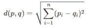

其中 `ppp` 和 `q` 是 `nnn` 维空间中的两个点，`pi​` 和 `qi​` 分别是两点的特征值。

#### 曼哈顿距离（L1 规范）
曼哈顿距离将两点之间的距离定义为其坐标绝对差之和：

`d(p,q)= `  

这种距离常用于数据以网格形式表示的情况（例如某些图像处理任务）。

#### 威斯廷格距离
这是欧氏距离和曼哈顿距离的推广。公式为：

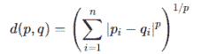

其中 `p` 是控制距离类型的参数。当 `p=2` 时，它是欧氏距离；当 `p=1` 时，它是曼哈顿距离。

#### 鲁棒相似性
在文本挖掘和其他特征向量稀疏的领域中，余弦相似性常被用作距离度量：

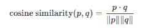

它测量两个向量之间的夹角的余弦值，通常用于判断两个向量在方向上的相似性，而非大小。

## 选择 k 在 k-NN 中
k 的选择对 k-NN 的性能至关重要：

*   小 k（例如 k = 1）：模型对噪声敏感，容易过拟合，因为它仅基于最近的一 neighbors 进行预测。

*   大 k：较大的 k 值使模型更具噪声鲁棒性，但可能导致欠拟合，因为它平滑了决策边界，可能忽略重要的局部模式。

为了找到最佳的 k 值，常用交叉验证的方法。通过在训练数据的不同子集上测试模型，可以选择表现最佳的 k 值。

## k-NN 的优势
1.  简单直观：k-NN 易于理解和实现，是基本分类和回归任务的 excellent 选择。

2.  无训练阶段：由于 k-NN 不需要模型训练，其学习时间在计算上相对便宜。计算成本推迟到预测阶段。

3.  灵活性：k-NN 可用于分类和回归任务，并能轻松处理多类问题。

4.  适合复杂数据：k-NN 可以建模复杂的决策边界，并处理非线性数据关系。

## k-NN 的缺点
1.  预测阶段计算开销大：

由于算法在预测时需要计算查询点与所有训练点的距离，当数据集很大且特征数量多时，性能会显著下降。

1.  内存消耗大：

k-NN 存储所有训练数据，因此对于大数据集可能非常内存密集。

1.  对无关特征敏感：

k-NN 受到“维度诅咒”的影响，即特征数量增多导致距离度量退化。当数据包含许多无关或冗余特征时，会影响算法性能。

1.  对噪声数据敏感：

由于 k-NN 依赖于实例的 proximity，噪声数据或离群点会显著影响预测。大量噪声实例会严重降低性能。

1.  选择合适的距离度量：

k-NN 的性能高度依赖于距离度量的选择。选择不当的度量会导致预测效果差。

## k-NN 的应用
*   图像分类：k-NN 常用于图像识别任务，其中图像被表示为特征向量，算法将新图像与训练集中的标记图像进行比较。

*   推荐系统：k-NN 用于协同过滤，通过找到相似用户或物品来推荐产品或服务。

*   异常检测：在异常检测中，k-NN 可以用于检测与最近邻偏离的实例，从而识别出异常。

*   医疗诊断：k-NN 常用于根据患者数据中的模式预测疾病。

*   文本分类：在自然语言处理中，k-NN 用于根据文档相似性对文本进行分类，如垃圾邮件过滤或情感分析。

k-Nearest Neighbors 是一种简单而有效的算法，广泛用于分类和回归任务。它直观易懂，能够很好地处理复杂的决策边界。然而，其性能可能受到大数据集、无关特征以及距离度量选择的影响。微调 k 值并选择合适的距离度量是实现良好性能的关键。

# 局部加权回归（LWR）
Locally Weighted Regression (LWR) 是一种回归模型，它专注于在查询点附近的数据子集上进行拟合，而不是在整个数据集上拟合全局模型。因此，它是一种非参数回归方法，不假设底层数据分布的具体形式。相反，LWR 构建一个能够适应数据局部结构的回归模型。

LWR 特别适用于特征与目标变量之间存在非线性关系的情况，而全局线性模型（如线性回归）在这些情况下表现不佳。

### 局部加权回归的工作原理
1.  加权训练数据：

当需要预测一个新数据点（查询点）时，LWR 会根据其与训练数据点的距离为所有训练数据点分配权重。权重随距离增加而减小，因此更靠近查询点的点对预测的影响更大。

1.  局部拟合：

随后在加权后的数据集上拟合回归模型（通常是线性回归）。由于对最近邻赋予更高权重，拟合模型更关注与查询点最近的数据点。

1.  预测：

在拟合局部模型后，它会基于拟合模型对查询点进行预测。预测结果主要取决于与查询点最近的数据点，因为它们被赋予了更高的权重。

1.  核函数：

分配给每个训练点的权重通常通过核函数计算。核函数根据训练实例与查询点之间的距离计算权重，常用的核函数包括高斯核或 Epanechnikov 核，它们为更接近的点分配更高权重，距离越远权重递减。

LWR 的一个典型核函数为：

``` 
w(x)=exp⁡(−(x−x0)22σ2)
```

其中：

*   `x` 是一个训练点，

*   `x0​` 是查询点，

*   `σ` 是控制核宽度的参数。

1.  加权线性回归：

在分配权重后，使用加权线性回归来拟合局部模型。加权线性回归的目标是最小化加权平方误差之和：

``` 
min θ∑iw(xi)(yi−y^i)2
```


where `w(xi)w(x_i)w(xi​)` is the weight for the iii-th training instance, and `y^i\\hat{y}\_iy^​i​` is the predicted value for the iii-th training instance based on the parameters `θ\\thetaθ`.

**Locally Weighted Regression (LWR) 的主要特征**

1.  **非参数性：**

    LWR 不假设输入特征与输出之间的关系具有特定形式。它通过局部建模数据，能够比线性回归等参数模型更有效地处理复杂的非线性关系。

2.  **局部聚焦：**

    与全局回归模型不同，LWR 关注与查询点“局部”相近的数据子集。这有助于捕捉局部模式和趋势，这些趋势在假设全局结构的模型中可能被忽略。

3.  **平滑的决策边界：**

    由于其对局部数据的关注，LWR 能够生成平滑的决策边界，使其在决策边界不全局线性或难以明确定义的任务中具有用途。

4.  **计算复杂度：**

    LWR 的主要缺点是预测阶段计算开销较大。因为它需要为每个查询点计算加权回归模型，当数据集很大时会变得非常慢。

**Locally Weighted Regression（本地加权回归）的优势**

1.  **灵活性：**

    LWR 非常灵活，能够逼近参数模型（如线性回归）无法捕捉的复杂非线性函数。它能够局部精确建模，这在许多实际应用中尤其有价值，因为数据往往是非线性的。

2.  **无全局模型假设：**

    由于 LWR 不假设全局模型，它可以自适应地适应特征空间不同区域的数据分布变化。这使其在数据分布随局部变化的场景中表现出色。

3.  **平滑且自适应：**

    通过对邻近点赋予更大的权重，LWR 能够生成平滑的预测，并对局部数据模式敏感。当特征与目标变量之间的关系复杂且非线性时，尤其有用。

5.  **在某些情况下对离群点鲁棒：**

    通过为远离查询点的点赋予较小的权重，LWR 可以在一定程度上对离群点具有鲁棒性，因为离群点通常远离大多数其他数据点。

**Locally Weighted Regression（本地加权回归）的缺点**

1.  **高计算成本：**

    LWR 需要为每个查询点计算一次回归，这在大数据集或特征维度较高时非常耗费资源。预测时对每个数据点的距离计算也会导致速度下降。

2.  **对核函数和带宽的敏感性：**

    LWR 的性能高度依赖于核函数的选择以及控制核宽度的参数（例如高斯核中的 `σ`）。如果选择不当，模型可能出现过拟合或欠拟合。

3.  **内存消耗大：**

    LWR 需要保存全部训练数据，因此对大规模数据集而言内存需求较高。它必须保留完整的训练集以便进行预测，而参数模型只需要存储学习到的参数。

4.  **局部区域过小导致过拟合：**

    当局部邻域过小时（即 `k` 非常小），模型对数据噪声过于敏感，容易出现过拟合。

**Locally Weighted Regression（本地加权回归）的应用场景**

1.  **时间序列预测：**

    LWR 可用于预测时间序列数据，尤其在数据呈现非线性时序关系时。通过关注局部趋势，LWR 能够适应时间序列中的变化模式。

2.  **非线性回归：**

    当自变量与因变量之间的关系非线性，而全局模型（如线性回归）无法捕捉其模式时，LWR 特别有用。

3.  **函数逼近：**

    在底层函数未知或高度复杂的情况下，LWR 可以通过在每个查询点局部建模函数，提供良好的逼近效果。

4.  **图像处理：**

    LWR 可应用于图像分割或去噪等领域，利用局部像素值预测图像中其他像素的值，从而保留局部结构和细节。

**径向基函数网络（Radial Basis Function Network，RBFN）**

径向基函数网络（RBFN）是一种使用径向基函数（RBF）作为激活函数的人工神经网络，主要用于分类、回归和函数逼近任务。RBFN 是前馈神经网络的一个子类，其特点在于隐藏层使用 RBF 来建模数据的复杂非线性关系。

RBFN 的关键特性是隐藏层的神经元响应输入与基函数中心之间的距离，这使其能够构造非线性决策边界和数据逼近。

**RBF 网络的结构**

RBF 网络通常由三层组成：

1.  **输入层：**

    输入层的节点接收输入特征，每个节点对应输入向量的一个特征。该层不进行计算，仅将输入传递给下一层。

2.  **隐藏层：**

    隐藏层是 RBF 实际应用的地方。该层包含若干神经元，每个神经元计算输入向量与其对应基函数中心之间的相似度（通常基于欧氏距离）。每个神经元对应一个基函数，其输出取决于输入向量与中心的接近程度。

    常用的径向基函数包括：

    *   **高斯函数：** `ϕ(x)=exp(−2σ²∥x−c∥²)`，其中 `c` 为中心，`σ` 为函数的带宽，`x` 为输入向量。

    *   **多线性函数（Multiquadric function）**、**反多线性函数（Inverse multiquadric function）** 等。

3.  **输出层：**

    输出层通常使用线性激活函数。输出是隐藏层神经元输出的加权和，这些权重在训练过程中学习得到。分类任务中，输出层常应用 softmax 或阈值函数以确定类别标签。

**RBF 网络的工作原理**

1.  **训练阶段：**

    在训练阶段，RBFN 通过监督学习调整参数（即基函数的中心和神经元的权重）。

    *   **中心：** 中心通常通过 k‑means 聚类或从训练数据中选取。

    *   **宽度/带宽（σ\\sigmaσ）：** 高斯函数的宽度决定了神经元对输入空间中特定区域的敏感程度。带宽越小，神经元对局部区域响应越集中；带宽越大，响应范围越广。

    *   **权重：** 隐藏层与输出层之间的权重通常使用线性方法（如最小二乘）或梯度下降进行学习。

2.  **预测阶段：**

    训练完成后，新输入数据经输入层传递，隐藏层计算输入与各基函数中心的相似度，输出层根据学习到的权重计算最终预测，通常为加权和。

**径向基函数网络（RBFN）的主要特征**

1.  **非线性映射：**

    RBFN 能够通过在输入数据上应用径向基函数，建模复杂的非线性关系，甚至逼近任意连续函数。

2.  **局部响应：**

    隐藏层每个神经元的输出取决于输入与该神经元中心的距离，较近的输入会激活更高的响应，使 RBFN 对数据的局部结构敏感。

3.  **灵活性：**


RBFNs 是高度灵活的模型，能够在拥有足够神经元和正确的中心分布时，近似任何连续函数。这使它们在广泛的应用场景中具有强大的表达能力，包括分类、回归和时间序列预测。

# 可解释性：

RBFN 的结构，特别是使用高斯函数时，相对具有可解释性。网络的决策基于到中心的距离，这可以被理解为输入空间中的影响区域。

## RBF 网络的优势

### 非线性建模：
RBFNs 能够建模输入与输出变量之间高度复杂且非线性的关系，使它们在许多任务中比线性模型更具强大的表达能力。

### 快速训练：
RBFN 的训练通常比其他神经网络类型（如前馈神经网络 MLPs）更快，因为隐藏层的学习通常是无监督的（例如通过 k-means），只需调整隐藏层与输出层之间的权重，使用简单的线性方法即可。

### 适用于小数据集：
由于能够创建局部且灵活的模型，RBFNs 通常在小到中等规模的数据集上表现良好。

### 直观且可解释：
径向基函数的概念使得该模型比像深度神经网络这类黑盒模型更易于解释。

## RBF 网络的缺点

### 参数选择敏感性：
RBF 网络的性能高度依赖于中心的选择以及 RBF 的带宽（`σ\\sigmaσ`）的设定。选择不当的带宽会导致过拟合（带宽过小）或欠拟合（带宽过大）。

### 维度诅咒：
与许多机器学习算法一样，RBF 网络在高维空间中可能受到维度诅咒的影响，因为点之间的距离增大，使得为径向基函数找到合适的中心变得更加困难。

### 大数据集训练时间：
虽然 RBF 网络对小数据集训练快，但当数据集规模变大时，训练时间会增加，因为在训练阶段需要计算数据点之间的两两距离（尤其是在选择中心时）。

### 过拟合风险：
如果隐藏层的神经元数量过多，模型可能会对训练数据进行过拟合，导致在未见过的数据上泛化能力下降。

## 径向基函数网络的应用

### 函数逼近：
RBFNs 在函数逼近中被广泛使用，目标是学习输入到输出的映射，使其能够很好地泛化到未见过的数据点。

### 分类：
RBF 网络用于分类问题，其中决策边界是非线性的。它们在分类复杂数据（如图像、语音和文本）时表现出色。

### 回归：
在回归任务中，RBFNs 可以通过学习特征与目标变量之间的非线性映射来预测连续值，特别是当关系不易用简单模型捕捉时。

### 时间序列预测：
RBFNs 可用于预测时间序列数据，其中随时间变化的模式是非线性的，传统模型可能无法捕捉复杂的时间依赖关系。

### 控制系统：
RBFNs 也用于控制系统，如机器人和自适应控制，它们帮助学习依赖于输入输出非线性关系的控制策略。

## 案例基于学习（Case-Based Learning）

案例基于学习（CBL）是一种机器学习范式，通过引用以前遇到过的、相似的问题（案例）来解决新问题。它受到人类解决问题的启发，即利用过去的经验和知识在新情境中应用。与其他机器学习技术不同，案例基于学习系统不从零开始构建通用模型，而是利用历史数据（案例）进行决策或预测。

在 CBL 中，一个案例通常由问题描述和对应的解决方案组成。系统通过存储这些案例并在此类新问题出现时加以利用来“学习”。这种方法常应用于医疗诊断、法律推理、客户服务以及任何过去经验对决策有帮助的场景。

### 案例基于学习的工作原理

#### 案例表示：
CBL 中的案例通常表示为包含问题特征和解决方案的元组或向量。例如，在医疗诊断中，一个案例可能包含症状和对应的诊断。

#### 案例存储：
维护一个案例库或案例基，这是一个包含所有历史案例及其<unk><unk><unk><unk><unk><unk><unk><unk><unk><unk><unk><unk><unk><unk><unk><unk><unk><unk><unk><unk><unk><unk><unk><unk><unk><unk><unk><unk><unk><unk><unk><unk><unk><unk><unk><unk><unk><unk><unk><unk><unk><unk><unk><unk><unk><unk><unk><unk><unk><unk><unk><unk><unk><unk><unk><unk><unk><unk><unk><unk><unk><unk><unk><unk><unk><unk><unk><unk><unk><unk><unk><unk><unk><unk><unk><unk><unk><unk><unk><unk><unk><unk><unk><unk><unk><unk><unk><unk><unk><unk><unk><unk><unk><unk><unk><unk><unk><unk><unk><unk><unk><unk><unk><unk><unk><unk><unk><unk><unk><unk><unk><unk><unk><unk><unk><unk><unk><unk><unk><unk><unk><unk><unk><unk><unk><unk><unk><unk><unk><unk><unk><unk><unk><unk><unk><unk><unk><unk><unk><unk><unk><unk><unk><unk><unk><unk><unk><unk><unk><unk><unk><unk><unk><unk><unk><unk><unk><unk><unk><unk><unk><unk><unk><unk><unk><unk><unk><unk><unk><unk><unk><unk><unk><unk><unk><unk><unk><unk><unk><unk><unk><unk><unk><unk><unk><unk><unk><unk><unk><unk><unk><unk><unk><unk><unk><unk><unk><unk><unk><unk><unk><unk><unk><unk><unk><unk><unk><unk><unk><unk><unk><unk><unk><unk><unk><unk><unk><unk><unk><unk><unk><unk><unk><unk><unk><unk><unk><unk><unk><unk><unk><unk><unk><unk><unk><unk><unk><unk><unk><unk><unk><unk><unk><unk><unk><unk><unk><unk><unk><unk><unk><unk><unk><unk><unk><unk><unk><unk><unk><unk><unk><unk><unk><unk><unk><unk><unk><unk><unk><unk><unk><unk><unk><unk><unk><unk><unk><unk><unk><unk><unk><unk><unk><unk><unk><unk><unk><unk><unk><unk><unk><unk><unk><unk><unk><unk><unk><unk><unk><unk><unk><unk><unk><unk><unk><unk><unk><unk><unk><unk><unk><unk><unk><unk><unk><unk><unk><unk><unk><unk><unk><unk><unk><unk><unk><unk><unk><unk><unk><unk><unk><unk><unk><unk><unk><unk><unk><unk><unk><unk><unk><unk><unk><unk><unk><unk><unk><unk><unk><unk><unk><unk><unk><unk><unk><unk><unk><unk><unk><unk><unk><unk><unk><unk><unk><unk><unk><unk><unk><unk><unk><unk><unk><unk><unk><unk><unk><unk><unk><unk><unk><unk><unk><unk><unk><unk><unk><unk><unk><unk><unk><unk><unk><unk><unk><unk><unk><unk><unk><unk><unk><unk><unk><unk><unk><unk><unk><unk><unk><unk><unk><unk><unk><unk><unk><unk><unk><unk><unk><unk><unk><unk><unk><unk><unk><unk><unk><unk><unk><unk><unk><unk><unk><unk><unk><unk><unk><unk><unk><unk><unk><unk><unk><unk><unk><unk><unk><unk><unk><unk><unk><unk><unk><unk><unk><unk><unk><unk><unk><unk><unk><unk><unk><unk><unk><unk><unk><unk><unk><unk><unk><unk><unk><unk><unk><unk><unk><unk><unk><unk><unk><unk><unk><unk><unk><unk><unk><unk><unk><unk><unk><unk><unk><unk><unk><unk><unk><unk><unk><unk><unk><unk><unk><unk><unk><unk><unk><unk><unk><unk><unk><unk><unk><unk><unk><unk><unk><unk><unk><unk><unk><unk><unk><unk><unk><unk><unk><unk><unk><unk><unk><unk><unk><unk><unk><unk><unk><unk><unk><unk><unk><unk><unk><unk><unk><unk><unk><unk><unk><unk><unk><unk><unk><unk><unk><unk><unk><unk><unk><unk><unk><unk><unk><unk><unk><unk><unk><unk><unk><unk><unk><unk><unk><unk><unk><unk><unk><unk><unk><unk><unk><unk><unk><unk><unk><unk><unk><unk><unk><unk><unk><unk><unk><unk><unk><unk><unk><unk><unk><unk><unk><unk><unk><unk><unk><unk><unk><unk><unk><unk><unk><unk><unk><unk><unk><unk><unk><unk><unk><unk><unk><unk><unk><unk><unk><unk><unk><unk><unk><unk><unk><unk><unk><unk><unk><unk><unk><unk><unk><unk><unk><unk><unk><unk><unk><unk><unk><unk><unk><unk><unk><unk><unk><unk><unk><unk><unk><unk><unk><unk><unk><unk><unk><unk><unk><unk><unk><unk><unk><unk><unk><unk><unk><unk><unk><unk><unk><unk><unk><unk><unk><unk><unk><unk><unk><unk><unk><unk><unk><unk><unk><unk><unk><unk><unk><unk><unk><unk><unk><unk><unk><unk><unk><unk><unk><unk><unk><unk><unk><unk><unk><unk><unk><unk><unk><unk><unk><unk><unk><unk><unk><unk><unk><unk><unk><unk><unk><unk><unk><unk><unk><unk><unk><unk><unk><unk><unk><unk><unk><unk><unk><unk><unk><unk><unk><unk><unk><unk><unk><unk><unk><unk><unk><unk><unk><unk><unk><unk><unk><unk><unk><unk><unk><unk><unk><unk><unk><unk><unk><unk><unk><unk><unk><unk><unk><unk><unk><unk><unk><unk><unk><unk><unk><unk><unk><unk><unk><unk><unk><unk><unk><unk><unk><unk><unk><unk><unk><unk><unk><unk><unk><unk><unk><unk><unk><unk><unk><unk><unk><unk><unk><unk><unk><unk><unk><unk><unk><unk><unk><unk><unk><unk><unk><unk><unk><unk><unk><unk><unk><unk><unk><unk><unk><unk><unk><unk><unk><unk><unk><unk><unk><unk><unk><unk><unk><unk><unk><unk><unk><unk><unk><unk><unk><unk><unk><unk><unk><unk><unk><unk><unk><unk><unk><unk><unk><unk><unk><unk><unk><unk><unk><unk><unk><unk><unk><unk><unk><unk><unk><unk><unk><unk><unk><unk><unk><unk><unk><unk><unk><unk><unk><unk><unk><unk><unk><unk><unk><unk><unk><unk><unk><unk><unk><unk><unk><unk><unk><unk><unk><unk><unk><unk><unk><unk><unk><unk><unk><unk><unk><unk><unk><unk><unk><unk><unk><unk><unk><unk><unk><unk><unk><unk><unk><unk><unk><unk><unk><unk><unk><unk><unk><unk><unk><unk><unk><unk><unk><unk><unk><unk><unk><unk><unk><unk><unk><unk><unk><unk><unk><unk><unk><unk><unk><unk><unk><unk><unk><unk><unk><unk><unk><unk><unk><unk><unk><unk><unk><unk><unk><unk><unk><unk><unk><unk><unk><unk><unk><unk><unk><unk><unk><unk><unk><unk><unk><unk><unk><unk><unk><unk><unk><unk><unk><unk><unk><unk><unk><unk><unk><unk><unk><unk><unk><unk><unk><unk><unk><unk><unk><unk><unk><unk><unk><unk><unk><unk><unk><unk><unk><unk><unk><unk><unk><unk><unk><unk><unk><unk><unk><unk><unk><unk><unk><unk><unk><unk><unk><unk><unk><unk><unk><unk><unk><unk><unk><unk><unk><unk><unk><unk><unk><unk><unk><unk><unk><unk><unk><unk><unk><unk><unk><unk><unk><unk><unk><unk><unk><unk><unk><unk><unk><unk><unk><unk><unk><unk><unk><unk><unk><unk><unk><unk><unk><unk><unk><unk><unk><unk><unk><unk><unk><unk><unk><unk><unk><unk><unk><unk><unk><unk><unk><unk><unk><unk><unk><unk><unk><unk><unk><unk><unk><unk><unk><unk><unk><unk><unk><unk><unk><unk><unk><unk><unk><unk><unk><unk><unk><unk><unk><unk><unk><unk><unk><unk><unk><unk><unk><unk><unk><unk><unk><unk><unk><unk><unk><unk><unk><unk><unk><unk><unk><unk><unk><unk><unk><unk><unk><unk><unk><unk><unk><unk><unk><unk><unk><unk><unk><unk><unk><unk><unk><unk><unk><unk><unk><unk><unk><unk><unk><unk><unk><unk><unk><unk><unk><unk><unk><unk><unk><unk><unk><unk><unk><unk><unk><unk><unk><unk><unk><unk><unk><unk><unk><unk><unk><unk><unk><unk><unk><unk><unk><unk><unk><unk><unk><unk><unk><unk><unk><unk><unk><unk><unk><unk><unk><unk><unk><unk><unk><unk><unk><unk><unk><unk><unk><unk><unk><unk><unk><unk><unk><unk><unk><unk><unk><unk><unk><unk><unk><unk><unk><unk><unk><unk><unk><unk><unk><unk><unk><unk><unk><unk><unk><unk><unk><unk><unk><unk><unk><unk><unk><unk><unk><unk><unk><unk><unk><unk><unk><unk><unk><unk><unk><unk><unk><unk><unk><unk><unk><unk><unk><unk><unk><unk><unk><unk><unk><unk><unk><unk><unk><unk><unk><unk><unk><unk><unk><unk><unk><unk><unk><unk><unk><unk><unk><unk><unk><unk><unk><unk><unk><unk><unk><unk><unk><unk><unk><unk><unk><unk><unk><unk><unk><unk><unk><unk><unk><unk><unk><unk><unk><unk><unk><unk><unk><unk><unk><unk><unk><unk><unk><unk><unk><unk><unk><unk><unk><unk><unk><unk><unk><unk><unk><unk><unk><unk><unk><unk><unk><unk><unk><unk><unk><unk><unk><unk><unk><unk><unk><unk><unk><unk><unk><unk><unk><unk><unk><unk><unk><unk><unk><unk><unk><unk><unk><unk><unk><unk><unk><unk><unk><unk><unk><unk><unk><unk><unk><unk><unk><unk><unk><unk><unk><unk><unk><unk><unk><unk><unk><unk><unk><unk><unk><unk><unk><unk><unk><unk><unk><unk><unk><unk><unk><unk><unk><unk><unk><unk><unk><unk><unk><unk><unk><unk><unk><unk><unk><unk><unk><unk><unk><unk><unk><unk><unk><unk><unk><unk><unk><unk><unk><unk><unk><unk><unk><unk><unk><unk><unk><unk><unk><unk><unk><unk><unk><unk><unk><unk><unk><unk><unk><unk><unk><unk><unk><unk><unk><unk><unk><unk><unk><unk><unk><unk><unk><unk><unk><unk><unk><unk><unk><unk><unk><unk><unk><unk><unk><unk><unk><unk><unk><unk><unk><unk><unk><unk><unk><unk><unk><unk><unk><unk><unk><unk><unk><unk><unk><unk><unk><unk><unk><unk><unk><unk><unk><unk><unk><unk><unk><unk><unk><unk><unk><unk><unk><unk><unk><unk><unk><unk><unk><unk><unk><unk><unk><unk><unk><unk><unk><unk><unk><unk><unk><unk><unk><unk><unk><unk><unk><unk><unk><unk><unk><unk><unk><unk><unk><unk><unk><unk><unk><unk><unk><unk><unk><unk><unk><unk><unk><unk><unk><unk><unk><unk><unk><unk><unk><unk><unk><unk><unk><unk><unk><unk><unk><unk><unk><unk><unk><unk><unk><unk><unk><unk><unk><unk><unk><unk><unk><unk><unk><unk><unk><unk><unk><unk><unk><unk><unk><unk><unk><unk><unk><unk><unk><unk><unk><unk><unk><unk><unk><unk><unk><unk><unk><unk><unk><unk><unk><unk><unk><unk><unk><unk><unk><unk><unk><unk><unk><unk><unk><unk><unk><unk><unk><unk><unk><unk><unk><unk><unk><unk><unk><unk><unk><unk><unk><unk><unk><unk><unk><unk><unk><unk><unk><unk><unk><unk><unk><unk><unk><unk><unk><unk><unk><unk><unk><unk><unk><unk><unk><unk><unk><unk><unk><unk><unk><unk><unk><unk><unk><unk><unk><unk><unk><unk><unk><unk><unk><unk><unk> [content<unk><unk><unk><unk><unk><unk><unk><unk><unk><unk><unk><unk><unk><unk><unk><unk><unk><unk><unk><unk><unk><unk><unk><unk><unk><unk><unk><unk><unk><unk><unk><unk><unk><unk><unk><unk><unk><unk><unk><unk><unk><unk><unk><unk><unk><unk><unk><unk><unk><unk><unk><unk><unk><unk><unk><unk><unk><unk><unk><unk><unk><unk><unk><unk><unk><unk><unk><unk><unk><unk><unk><unk><unk><unk><unk><unk><unk><unk><unk><unk><unk><unk> [content]...[/content]


5.  在复杂或定义不明确的领域表现良好：在变量之间的关系复杂、难以理解或难以明确建模的情境下（如医疗诊断或法律推理），CBL 可以通过使用示例和先例来发挥优异的性能。

CBL 的缺点

1.  记忆和存储需求：CBL 系统需要大量内存来存储案例，这在大数据集或复杂领域中可能成为问题。管理庞大的案例库可能导致可扩展性问题。

2.  相似度量敏感性：CBL 的性能取决于相似度量的有效性。如果相似度量定义不清或未能很好地捕捉问题的本质，检索到的案例可能无用，导致性能下降。

3.  适应复杂性：将解决方案适应新问题可能很复杂，尤其是当新问题与以往案例差异巨大时。根据领域不同，适应过程可能需要高级技术或人工干预。

4.  过拟合历史案例：如果案例库未更新为新的、多样的案例，或包含过时信息，系统可能过度依赖历史案例，难以很好地泛化到新情境。

5.  缺乏泛化能力：与决策树或神经网络等其他学习方法不同，CBL 不会构建通用模型，而是依赖于过去问题可以被重用的假设。这在问题空间随时间变化的情境下可能不适用。

CBL 的应用场景

1.  医疗诊断：

在医学领域，CBL 系统通过将新患者的症状与历史病例进行比对，从而辅助疾病诊断。系统会检索相似的历史病例，并利用其诊断结果来推荐新患者的可能结果。

1.  法律推理：

在法律领域，CBL 可帮助律师和法官通过检索以往类似案件的判例，为类似法律事务提供参考，辅助案例法研究和决策，引用过去的判决。

1.  客户支持：

在客户服务中，CBL 系统可通过参考以往类似的客户查询来提供解决方案，常用于呼叫中心或自动化帮助台，快速解决问题。

1.  推荐系统：

CBL 可用于推荐系统，根据过去相似用户的偏好或选择来推荐产品或服务，这类应用常见于 Amazon、Netflix 和 Spotify 等平台。

1.  机器人与自主系统：

机器人可以利用 CBL 根据以往经验解决问题。当机器人遇到陌生任务时，它会从案例库中检索相似任务并应用相应的解决方案。

1.  商业决策：

企业可借助 CBL 通过参考过去在类似情境下的成功或失败案例来辅助决策，涵盖财务决策、营销策略和运营管理等方面。

练习

1.  请描述一种密度基聚类技术及其所需的示意图。

2.  比较 K‑means 聚类与层次聚类的方法。

3.  用示例说明 K‑means 聚类算法：请使用欧氏距离，对以下八个样本（A1=(2,10), A2=(2,5), A3=(8,4), A4=(5,8), A5=(7,5), A6=(6,4), A7=(1,2), A8=(4,9)）进行一次迭代，初始中心（簇中心）为 A1、A4 和 A7，找出一次迭代后的三个簇。

单元 IV

人工神经网络

感知机

感知机是一种最简单的人工神经网络类型，用于执行二分类任务。1958 年由 Frank Rosenblatt 提出，感知机是机器学习和人工智能的早期突破。它是线性分类器，将输入特征映射到二元输出，判断输入属于哪一类。

感知机的结构

感知机由以下组件构成：

1.  输入：感知机接收多个输入，每个输入代表数据集的特征。

2.  权重：每个输入都关联一个权重，决定其在决策过程中的重要性。

3.  偏置：偏置项加到加权和上，调整决策边界，提供更大的灵活性。

4.  加权和：感知机计算所有输入值与对应权重的乘积之和，并加上偏置。

5.  激活函数：使用阶跃函数决定输出。若加权和超过阈值，则输出一个类；否则输出另一个类。

感知机的工作原理

1.  前向传播：

计算输入的加权和：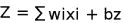 为权重，xix​ 为输入，bbb 为偏置。

应用激活函数：

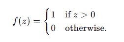

输出为 1 或 0，表示类别标签。

1.  通过训练进行学习：

感知机根据预测输出与实际目标值之间的误差调整权重。

感知机学习规则（Δ 规则）更新权重如下：

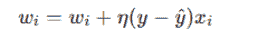

其中：

* η\\etaη 是学习率。

* yyy 是实际目标。

* y^\\hat{y}y^​ 是预测输出。

* xix​ 是输入值。

1.  迭代：

感知机会多次遍历数据集（epoch），在收敛或满足停止条件前不断迭代，以最小化分类错误。

感知机的优势

1.  简洁性：

感知机概念和计算上都很简单，易于实现。

1.  适用于线性可分数据：

在数据可由直线（或超平面）分隔的情况下表现良好。

1.  神经网络的基石：

感知机为现代神经网络奠定了基础，启发了更高级的算法。

感知机的局限性

1.  线性可分性：

感知机只能解决线性可分的问题。例如，它无法解决 XOR 问题，因为单条直线无法将两类分开。

1.  无隐藏层：

感知机为单层网络，缺乏隐藏层，限制了其建模复杂关系的能力。

1.  阶跃激活函数：

阶跃函数不可微，阻碍了基于梯度的优化方法。

感知机的应用

1.  二分类：

常用于垃圾邮件检测或将数据划分为两类等二分类任务。

1.  模式识别：

早期应用包括识别简单图案和形状。

1.  特征加权：

通过分析感知机分配给特征的权重，可帮助识别最具判别性的特征。

感知机在人工智能中的重要性

尽管存在局限，感知机仍是人工智能和机器学习的基石。其概念简洁且具历史意义，为多层感知机（MLP）、深度神经网络及其他高级架构的发展铺平了道路，这些架构能够解决非线性和复杂问题。感知机是理解神经网络及其学习机制的重要入门。

多层感知机

多层感知机（MLP）是一种由多层神经元（节点）按前向结构排列的神经网络类型。与单层感知机不同，MLP 在输入层和输出层之间包含一个或多个隐藏层，能够学习数据的复杂非线性关系。MLP 是现代深度学习架构的基础。

多层感知机的结构

1.  输入层：


输入层接收原始输入数据。神经元的数量对应数据集中的特征数量。

1. 隐藏层：

MLP 包含一个或多个隐藏层，每层包含多个神经元。隐藏层通过应用非线性变换，使网络能够学习复杂的模式。

1. 输出层：

输出层产生最终预测。该层的神经元数量取决于任务类型：

*   回归：单个神经元用于连续输出。

*   二分类：单个神经元配合 sigmoid 激活函数。

*   多类分类：多个神经元配合 softmax 激活函数。

1. 权重和偏置：

相邻层之间的连接被赋予权重，每个神经元还有一个偏置用于调整决策边界。

1. 激活函数：

激活函数引入非线性，使 MLP 能够解决复杂问题。常见的激活函数包括：

*   ReLU（整流单元）：用于隐藏层。

*   Sigmoid：用于二分类输出。

*   Softmax：用于多类分类输出。

## 如何工作

1. 前向传播：

输入数据逐层通过网络。每个神经元计算输入的加权和，应用激活函数，并将结果传递给下一层。

1. 损失计算：

将输出与实际目标值通过损失函数进行比较，以衡量预测误差。常见的损失函数包括：

*   回归任务使用均方误差（MSE）。

*   分类任务使用交叉熵损失。

1. 反向传播（Backpropagation）：

利用链式法则计算损失函数相对于网络权重的梯度。

权重和偏置通过最小化损失函数更新，通常使用诸如随机梯度下降（SGD）或 Adam 等优化算法。

1. 迭代：

前向传播、损失计算和反向传播的过程在多次迭代（epoch）中重复，直到网络收敛到最小损失。

## MLPs 的优势

1. 解决非线性问题：

隐藏层和非线性激活函数使 MLP 能够建模数据中的复杂关系。

1. 通用性：

MLP 适用于广泛的任务，包括分类、回归和函数逼近。

1. 可扩展性：

通过增加隐藏层和神经元数量，MLP 能处理更复杂的问题。

## MLPs 的局限性

1. 计算复杂度：

训练大量层和神经元的 MLP 需要显著的计算资源。

1. 过拟合风险：

没有适当的正则化技术（如 dropout、权重衰减），MLP 可能会记忆训练数据，导致泛化能力差。

1. 黑盒特性：

MLP 缺乏可解释性，难以理解决策是如何做出的。

1. 对数据预处理敏感：

MLP 通常需要仔细的数据预处理，如特征归一化或标准化，才能有效学习。

## 多层感知器的应用

1. 分类任务：

手写数字识别（如 MNIST 数据集）、垃圾邮件检测和医疗诊断。

1. 回归任务：

预测房价、股市趋势和天气状况。

1. 图像识别：

虽然 MLP 可以处理图像，但卷积神经网络（CNN）在该任务上更为高效。

1. 自然语言处理（NLP）：

情感分析和语言模型等任务。

1. 异常检测：

识别欺诈交易或数据中的异常模式。

## 对比：感知机 vs. 多层感知器（MLP）

| Aspect || Perceptron || Multilayer Perceptron (MLP) |
| --- | --- | --- |
| Layers || Single-layer network || Multiple layers (hidden layers) |
| --- | --- | --- |
| Problem Solving || Linearly separable only || Handles non-linear problems |
| Activation Function || Step function || Non-linear functions (ReLU, etc.) |
| Learning Capacity || Limited || High |

多层感知器在感知机之上通过引入隐藏层和非线性激活函数，显著提升了解决非线性不可分离问题的能力。它们是许多神经网络应用的基石，而现代架构如卷积神经网络（CNN）和循环神经网络（RNN）则在专用领域上进一步扩展了能力。MLP 仍是机器学习的基础概念，是多种任务的通用工具。

## 梯度下降与 Delta 规则

梯度下降和 Delta 规则是机器学习中用于优化模型参数（如权重和偏置）以最小化预测误差或损失的基本概念。

### 梯度下降

梯度下降是一种优化算法，用于通过沿负梯度方向迭代来最小化函数。在机器学习中，它用于最小化损失函数，衡量预测值与实际值之间的差异。

梯度下降的步骤：

1. 初始化参数：为模型参数（如权重和偏置）设置随机初始值。

2. 计算梯度：计算损失函数相对于参数的梯度，该梯度指示损失函数最陡峭上升的方向。

3. 更新参数：将参数移动到梯度相反方向，以最小化损失。更新规则为：

```
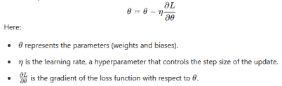
```

1. 迭代：

重复上述步骤，直到损失收敛到最小值或满足停止条件。

梯度下降的类型：

1. 批量梯度下降（Batch Gradient Descent）：

使用整个数据集计算梯度，计算开销较大，适用于小数据集。

1. 随机梯度下降（SGD）：

使用单个训练样本的梯度更新参数，计算快但噪声较大。

1. 小批量梯度下降（Mini-Batch Gradient Descent）：

结合批量和随机方法，使用小子集（mini-batch）计算梯度，是实际应用中最常用的方法。

### Delta 规则

Delta 规则（也称为权重更新规则或 Widrow-Hoff 学习规则）是梯度下降在单层感知机中的具体实现，用于最小化预测值与实际值的差异。

Delta 规则的工作原理：

1. 误差计算：计算训练样本的误差为实际输出 y 与预测输出 y^ 之差：

Error = y - y^

1. 权重更新：

更新权重使用误差和学习率：

Δwi = η ⋅ Error ⋅ xi

其中：

*   wi​：第 iii 个输入的当前权重。

*   η：学习率。

*   xi​：第 iii 个特征的输入值。

1. 迭代：

遍历训练样本，循环更新权重，直至误差最小或满足停止条件。

### 梯度下降与 Delta 规则的关系

梯度下降是适用于多种模型和损失函数的通用优化算法。

Delta 规则是梯度下降在单层感知机中的具体实现，通常使用均方误差（MSE）作为损失函数。

### 应用

1. 梯度下降：

用于训练神经网络、线性回归、逻辑回归及其他机器学习模型。

1. Delta 规则：

专门用于单层感知机和基础线性回归模型。

### 优势

1. 梯度下降：

*   可优化复杂的非线性模型。


灵活且适用于各种机器学习问题。

1. Delta Rule:

简单有效，适用于线性可分问题。

易于实现单层网络。

局限性：

1. 梯度下降：

可能陷入局部极小值或鞍点。

需要仔细调整学习率。

对于大数据集可能计算开销较大。

1. Delta Rule：

仅适用于单层网络。

无法解决非线性问题，如 XOR。

梯度下降是一种强大的优化技术，是训练机器学习模型的基础。Delta Rule 是这种概念在单层感知机上的具体应用，使其成为一种更简单但受限的方法。它们共同突显了训练算法在机器学习中的迭代和基于梯度的特性。

多层网络

多层网络，通常称为多层感知机（MLP）或深度神经网络（DNN）当扩展时，是一种由多层互连神经元组成的人工神经网络。与单层网络不同，多层网络设计用于建模输入和输出之间的复杂非线性关系，使其适合解决一系列困难的机器学习问题。

多层网络结构

1. 输入层：

网络的第一层，接收原始输入数据。该层的每个神经元对应输入数据中的一个特征。

1. 隐藏层：

位于输入层和输出层之间的一个或多个中间层。

每个隐藏层包含多个神经元，其输出通过应用激活函数计算加权和得到。

1. 输出层：

网络的最终层，产生预测或分类结果。

该层的神经元数量取决于具体任务：

* 回归：一个神经元用于连续输出。

* 二分类：一个神经元配合 sigmoid 激活函数。

* 多类分类：每个类别一个神经元，配合 softmax 激活函数。

1. 权重和偏置：

相邻层神经元之间的每条连接都有关联权重。每个神经元也有一个偏置项，用于调整输出。

多层网络的工作原理

1. 前向传播：

输入数据依次通过网络的各层。

在每个神经元中：

加权和是许多机器学习和数学模型（如线性回归、神经网络、支持向量机）的基本操作。它通过将每个输入乘以对应的权重然后求和来计算。数学上，对于输入集 x=[x1,x2,...,xn] 和权重 w=[w1,w2,...,wn]，加权和 z 计算为：

z=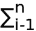wi​xi​=w1​x1​+w2​x2​+⋯+wn​xn​

其中：

* xi​：第 ii 个输入特征或值。

* wiw​：与第 ii 个输入相关的权重。

* zz：得到的加权和。

激活函数用于引入非线性：

a=f(z)

其中 f 是激活函数（如 ReLU、sigmoid）。

1. 损失计算：

前向传播后，网络的输出与真实目标值通过损失函数进行比较（例如均方误差、交叉熵损失）。

1. 反向传播（反向传播）：

损失通过网络向后传播，计算损失函数关于权重和偏置的梯度。

梯度使用微积分的链式法则计算。

1. 参数更新：

通过诸如随机梯度下降（SGD）或 Adam 等优化算法更新权重和偏置，以最小化损失。

1. 迭代：

前向传播、损失计算、反向传播和参数更新的步骤在多个迭代（epoch）中重复，直到模型收敛。

多层网络的关键特性

1. 非线性：

通过引入非线性激活函数（如 ReLU、tanh），多层网络能够建模数据中的复杂关系。

1. 通用逼近：

在足够多的神经元和层数时，多层网络可以逼近任何连续函数。

1. 深度：

网络的深度（隐藏层数量）决定其学习层次化表示的能力。更深的网络能够捕捉更复杂的模式。

多层网络的优势

1. 解决复杂问题的能力：

多层网络能解决非线性可分问题，而单层网络无法解决。

1. 灵活性：

适用于多种任务，包括分类、回归、图像识别和自然语言处理。

1. 特征学习：

隐藏层自动从原始输入数据中学习有意义的特征，减少了手动特征工程的需求。

多层网络的局限性

1. 计算密集：

训练深度多层网络需要大量计算能力和内存，尤其是大数据集时。

1. 过拟合风险：

缺乏适当正则化技术（如 dropout、权重衰减）时，网络可能记忆训练数据而无法泛化。

1. 难以解释：

多层网络作为“黑盒”运行，难以理解其决策过程。

1. 数据需求：

通常需要大量标记数据以实现有效训练。

多层网络的应用领域

1. 图像处理：

用于卷积神经网络（CNN）的任务，如目标检测和图像分类。

1. 自然语言处理（NLP）：

应用于循环神经网络（RNN）或 Transformer 用于情感分析和机器翻译等任务。

1. 医疗诊断：

用于根据症状或影像数据预测疾病（如在 X 光片中检测肿瘤）。

1. 自主系统：

多层网络为自动驾驶汽车和机器人中的决策-making 提供支持。

1. 金融：

用于预测股票价格、信用评分和欺诈检测。

多层网络是现代机器学习和人工智能的基石。其建模复杂、非线性关系的能力使其在广泛的应用领域中不可或缺，从计算机视觉到自然语言处理都产生了重大影响。尽管需要仔细设计和训练，它们的强大和灵活性推动了技术的重大进步。

BACKPROPAGATION ALGORITHM DERIVATION

反向传播算法是训练神经网络的基础技术。它计算损失函数相对于网络权重和偏置的变化，从而使模型能够调整这些参数以提高性能。

1\. 问题设置

神经网络由多个层组成，每层包含权重、偏置和激活函数。输入数据通过网络进行前向传播，生成输出。损失函数衡量输出与真实目标之间的差异。反向传播的目标是计算每个参数（权重和偏置）对损失的贡献，以便更新参数并最小化损失。

2\. 前向传播

在前向传播过程中：

1.  输入数据依次通过网络的各层。

2.  每层计算中间值，先应用权重和偏置，然后通过激活函数。

3.  在最终层，网络输出其预测结果。

损失函数随后将预测值与真实值进行比较，计算误差。

3\. 反向传播概述

反向传播通过在网络中从后向前传播错误，逐层计算每个权重和偏置对错误的贡献。这些贡献用于调整参数，从而减小误差。

4\. 反向传播步骤

步骤 1：输出层的误差


错误在输出层反映了网络预测与真实值之间的差距。该错误受预测值与实际值的差异以及输出层使用的激活函数的影响。

步骤 2：向后传播错误

对于更靠近输入的层，错误是基于前方层的错误计算的。这种错误信息的后向传递确保每一层都为降低整体错误做出贡献。每一层的错误取决于：

1. 连接该层到下一层的权重。

2. 当前层的激活函数。

步骤 3：计算梯度

梯度表示如果我们稍微调整特定的权重或偏置，损失会如何变化。这些梯度为每一层计算：

*   权重的梯度取决于当前层的误差和上一层的激活值。

*   偏置的梯度直接与当前层的误差相关。

步骤 4：参数更新

利用计算出的梯度，权重和偏置被调整。这些调整的大小由学习率控制，学习率决定了网络学习的速度。

5\. 反向传播的直观理解

反向传播利用微积分中的链式法则，使网络能够高效地计算每个参数对损失的影响。从输出层开始向后移动，算法确保所有参数都以协调的方式更新，以减小误差。

6\. 反向传播的优势

*   效率：算法系统性地计算梯度，避免冗余计算。

*   可扩展性：即使在大型多层网络中也表现良好。

*   灵活性：反向传播可应用于任何具有可微分激活函数和损失函数的网络。

7\. 反向传播的挑战

*   消失/爆炸梯度：在深度网络中，梯度可能过小或过大，导致学习困难。

*   计算密集：训练大型网络需要大量资源。

*   过拟合：没有适当正则化，网络可能在训练数据上表现良好，但在未见数据上表现差。

反向传播是现代机器学习的基石，它使神经网络能够调整参数以最小化误差。通过反向传播和逐层计算梯度，算法提供了一种系统的方式来高效训练复杂模型。尽管存在挑战，反向传播仍然是深度学习系统的关键组成部分。

概括

概括指模型在新、未见数据上表现良好的能力，而非仅在训练数据上表现良好。它是机器学习中的基本概念，因为训练模型的主要目标是确保它捕捉数据中的底层模式，并适用于实际场景。

为什么概括很重要

机器学习模型必须在学习训练数据的同时避免过拟合，即模型记忆训练数据但无法在新输入上表现。表现良好的模型能有效弥合这一差距，在不同数据集上提供一致的性能。

影响概括的因素

1. 模型复杂度：

简单模型可能欠拟合，无法捕捉重要模式。

过于复杂的模型可能过拟合，捕捉训练数据中的噪声而非真实模式。

1. 训练数据规模：

训练数据不足可能导致概括性差，因为模型没有看到足够的示例来学习关系。

1. 数据质量：

数据中的噪声或无关特征会阻碍模型进行概括的能力。

1. 正则化：

如 L1、L2 正则化或丢弃（dropout）等技术通过惩罚大权重或特定特征，防止模型过度依赖训练数据中的特定模式，从而提高概括性。

1. 交叉验证：

将数据集分为训练集和验证集，有助于评估模型在未见数据上的概括能力。

概括错误

1. 欠拟合：

当模型未能有效学习训练数据时发生。

表明模型过于简单或训练时间不足。

1. 过拟合：

当模型在训练数据上表现极好，但在验证或测试数据上表现差时发生。

表明模型过度学习数据特定的模式或噪声。

改进概括的技术

1. 数据增强：

通过旋转、缩放、添加噪声（用于图像）或同义词替换（用于文本）等方式扩展训练数据集。

1. 正则化：

惩罚大权重或特定特征，以简化模型。

1. 早停：

在验证性能停止改善时停止训练。

1. 交叉验证：

使用 k 折交叉验证等技术，确保模型在多个数据切分上进行测试。

1. 特征选择：

减少无关或冗余特征，使模型专注于有意义的模式。

1. 集成方法：

结合多个模型（如 bagging、boosting）以提高鲁棒性并减少方差。

评估概括能力

概括能力通常通过验证集或测试集来评估。准确率、精确率、召回率或 F1 分数等指标在未见数据上反映模型的概括能力。比较训练集和验证集的性能也可以帮助识别欠拟合或过拟合。

概括是成功机器学习模型的标志。它确保模型不仅在训练数据上准确，也在未见输入上有效，从而在实际应用中发挥作用。实现概括需要在模型复杂度、适当正则化技术以及高质量、具有代表性的数据之间取得平衡。

无监督学习

无监督学习是一种机器学习类型，模型在没有标签或预定义结果的数据上进行训练。无监督学习的目标是识别数据中的隐藏模式或结构，而不依赖具体输出标签。它与监督学习不同，监督学习使用标记数据（输入与已知输出的配对）进行训练。

无监督学习的关键特征

1. 无标签数据：

在无监督学习中，数据集仅包含输入特征，没有对应的目标标签或结果。

1. 探索性分析：

目标是探索和理解数据的底层结构或分布，而非预测具体输出。

1. 模式发现：

模型自行识别数据中的模式、聚类或关系。

无监督学习的类型

无监督学习可大致分为两类：聚类和维度减少。

1\. 聚类

聚类将相似的数据点根据某种相似度量聚合到一起。它在需要发现数据中的自然分组时有用。

*   K-Means 聚类：将数据分成预定义的 K 个聚类，最小化每个聚类内部的方差。

*   层次聚类：构建聚类的树状结构，每一层代表不同粒度的数据分组。

*   DBSCAN（基于密度的空间聚类）：根据点在区域的密度将数据分组，能够识别形状不规则的聚类。

聚类的应用包括客户细分、图像压缩和异常检测。

2\. 维度减少


Dimensionality reduction aims to reduce the number of input features (or dimensions) while preserving as much of the original data's variability as possible. This is useful for visualization, speeding up computation, or removing noise.

Principal Component Analysis (PCA): A technique that transforms the data into a smaller set of uncorrelated variables called principal components, retaining most of the variance in the data.

t-Distributed Stochastic Neighbor Embedding (t-SNE): A non-linear technique that is particularly useful for visualizing high-dimensional data in two or three dimensions.

Applications of dimensionality reduction include data visualization, pre-processing for supervised learning, and noise reduction.

Applications of Unsupervised Learning

1. Customer Segmentation:

Grouping customers into different segments based on purchasing behavior, allowing businesses to target specific marketing strategies.

1. Anomaly Detection:

Identifying unusual or outlier data points, such as detecting fraudulent transactions or network intrusions.

1. Data Compression:

Reducing the size of large datasets while retaining essential information, useful in image or video compression.

1. Feature Learning:

Automatically discovering useful features from data for downstream tasks, such as in deep learning.

1. Recommendation Systems:

Unsupervised techniques like collaborative filtering can be used to recommend products or services based on user behavior patterns.

Challenges of Unsupervised Learning

1. Lack of Ground Truth:

Without labeled data, it can be difficult to evaluate the performance of the model. It's hard to know if the patterns discovered are meaningful or just random.

1. Determining the Number of Clusters:

In clustering tasks, determining the right number of clusters (e.g., in K-means) can be challenging and may require domain knowledge or experimentation.

1. High Computational Cost:

Some unsupervised algorithms, especially with large datasets, can be computationally expensive and may require specialized algorithms or hardware.

1. Sensitivity to Initialization:

Some algorithms, like K-means, can be sensitive to the initial choice of cluster centers, leading to suboptimal solutions.

Comparison to Supervised Learning

While supervised learning relies on labeled data to train the model, unsupervised learning is concerned with finding patterns or structures without such labels. Supervised learning is typically used for tasks like classification and regression, while unsupervised learning is often used for tasks like clustering, anomaly detection, and dimensionality reduction.

Unsupervised learning is a powerful tool for extracting hidden patterns and insights from data without the need for labeled outcomes. It is widely used across various fields such as data analysis, customer segmentation, anomaly detection, and more. Despite its challenges, unsupervised learning offers flexibility and utility in exploring large and complex datasets.

SOM ALGORITHRM AND ITS VARIANTS

The Self-Organizing Map (SOM) is an unsupervised machine learning algorithm used to map high-dimensional data onto a lower-dimensional grid, typically two-dimensional, while preserving the topological relationships between data points. SOMs are often used for clustering, data visualization, and feature extraction. It was developed by Teuvo Kohonen in the 1980s and is widely used in various fields such as data mining, image recognition, and signal processing.

Key Features of SOM

1. Topological Preservation:

SOM preserves the topological structure of the data, meaning that similar data points remain close to each other in the lower-dimensional representation.

1. Unsupervised Learning:

It doesn't require labeled data, making it ideal for exploratory data analysis and clustering.

1. Dimensionality Reduction:

SOM can reduce the dimensionality of data, allowing for easier visualization and interpretation of complex datasets.

How the SOM Algorithm Works

The SOM algorithm works by mapping high-dimensional input data onto a lower-dimensional grid (typically 2D), where each node in the grid represents a prototype vector. The process involves two main phases: training and mapping.

1\. Initialization

*   A grid of nodes (usually 2D) is initialized, where each node has a weight vector that matches the dimensionality of the input data.

*   The weight vectors are typically initialized randomly.

2\. Training Process

*   The algorithm works iteratively by presenting input data vectors to the network and adjusting the nodes' weight vectors.

*   For each input vector, the algorithm identifies the best matching unit (BMU), which is the node whose weight vector is closest to the input vector.

*   Once the BMU is identified, the weight vectors of the BMU and its neighboring nodes are updated to be more similar to the input vector. The extent of the update depends on:  

    1.  The distance between the BMU and the node being updated (closer nodes are updated more).

    2.  The learning rate, which decreases over time.

    3.  The neighborhood size, which also decreases over time.

3\. Mapping

After training, similar input vectors will be mapped to nearby nodes in the grid, preserving the topology of the input data.

Variants of Self-Organizing Map

While the basic SOM algorithm remains widely used, several variants have been developed to improve its performance or extend its functionality. Below are some notable variants of the SOM:

1\. Hierarchical Self-Organizing Map (HSOM)

Purpose: HSOM is an extension of SOM that organizes the map into a hierarchical structure, where each level of the hierarchy represents a more refined grouping of data.

How it works: HSOM combines the ideas of clustering and SOM, where the SOM maps are divided into clusters that are further mapped using smaller, more specialized SOMs.

Applications: Hierarchical clustering, multi-scale data analysis, and data visualization.

2\. Growing Self-Organizing Map (GSOM)

Purpose: GSOM is a dynamic version of SOM where the map structure can grow during the training process by adding new nodes to the grid as needed.

How it works: The grid starts small and grows incrementally as new nodes are added, which helps the map adapt to the complexity and size of the input data. This allows the GSOM to better capture the underlying structure of large datasets.

Applications: Large-scale clustering, adaptive data representation.

3\. Probabilistic Self-Organizing Map (PSOM)

Purpose: PSOM introduces a probabilistic model to the SOM to model uncertainty in the data and improve the representation of data distributions.

How it works: Instead of directly updating the weights of nodes, PSOM uses a probability distribution to describe the data at each node. This approach can provide a more robust representation of the data, especially in the presence of noise or outliers.

Applications: Pattern recognition, noise filtering, data mining.

4\. Convolutional Self-Organizing Map (CSOM)

Purpose: CSOM extends SOM by incorporating convolutional layers, typically used in deep learning models, to capture local patterns in the data.

How it works: Similar to Convolutional Neural Networks (CNNs), CSOM applies convolutional filters to the input data, allowing the model to capture spatial or local correlations between data points.

Applications: Image processing, feature extraction, object recognition.

5\. Recurrent Self-Organizing Map (RSOM)

Purpose: RSOM integrates temporal aspects into the SOM framework by allowing the map to process sequential data.

How it works: RSOM uses feedback connections to incorporate temporal dependencies and past states of the map into the decision-making process. This allows RSOM to model dynamic data and changes over time.

Applications: Time-series analysis, sequence modeling, dynamic systems.

6\. Vector Quantization Self-Organizing Map (VQ-SOM)


Purpose: VQ-SOM 结合向量量化与自组织地图（SOM）的原理，用更少的向量来表示数据。

How it works: 数据以一组代码簿向量的形式表示，这些向量在 SOM 训练过程中被学习。VQ-SOM 特别适用于需要降维或压缩的任务。

Applications: 数据压缩、语音识别、图像压缩。

7\. Kohonen’s Feature Map with Temporal Learning (TFM)

Purpose: TFM 是一种包含时间动态的 SOM 变体，适用于序列数据，其中输入的时间顺序很重要。

How it works: TFM 根据数据点之间的空间和时间关系更新权重。当输入数据同时具有时空变化特性时，它尤其有用。

Applications: 时间序列预测、语音和信号处理。

Applications of Self-Organizing Map

Data Visualization: SOM 常用于降维并在二维或三维空间中可视化高维数据，便于解释。

Clustering: SOM 在聚类问题中被广泛使用，能够根据特征将相似的数据点聚合在一起。

Feature Extraction: 在许多机器学习任务中，SOM 可通过发现数据中的有意义模式来减少特征数量。

Pattern Recognition: 由于能够保持数据的拓扑结构，SOM 被应用于语音识别、图像识别和异常检测等多个领域。

Advantages of SOM

1.  Topology Preservation: SOM 确保相似的数据点在保持拓扑关系的同时被聚集在一起，对聚类很有用。

2.  Dimensionality Reduction: 通过将高维数据映射到二维网格，SOM 便于可视化和解释。

3.  Unsupervised Learning: 作为无监督学习算法，SOM 无需标签数据即可在数据中发现模式，适合探索性数据分析。

Disadvantages of SOM

1.  Sensitivity to Initialization: 与其他无监督学习算法一样，SOM 对权重初始化敏感，可能导致次优结果。

2.  Fixed Grid Size: 传统 SOM 的网格尺寸需事先固定，这对于结构复杂的数据集可能不理想。

3.  High Computational Cost: 对于非常大的数据集，训练 SOM 可能计算开销很大，尤其是网格尺寸较大时。

Self-Organizing Maps (SOM) are a powerful unsupervised learning tool for clustering, visualization, and dimensionality reduction. With several variants like the Growing SOM, Hierarchical SOM, and Probabilistic SOM, this technique has broad applications in areas ranging from data visualization to feature extraction. While SOM is versatile, its performance can depend on factors like initialization and grid size, so careful tuning is necessary for optimal results.

DEEP LEARNING- INTRODUCTION

Deep Learning 是机器学习的一个子领域，使用具有许多层的人工神经网络（ANNs），通常称为深度神经网络（DNN）。这些深度网络能够从大量数据中自动学习复杂的模式和表示，使其在图像识别、自然语言处理、语音识别等众多任务中表现出色。

Deep learning models are inspired by the structure and function of the human brain. 就像大脑通过一系列相互连接的神经元处理信息，深度学习模型通过多层人工神经元处理数据，每层学习数据的不同层次抽象。

At the core of deep learning are neural networks, which consist of layers of interconnected nodes or neurons. 这些模型之所以“深”，是因为它们有许多层，逐层从原始数据中提取特征。数据经过每一层，网络学习到更抽象的特征，从而提升对复杂任务的性能。

Key Characteristics of Deep Learning

1.  Learning from Data:

Deep learning models automatically learn from data without the need for explicit feature engineering. 给定大量数据时，深度学习模型能够自动识别模式、关联和难以手动指明的关系。

1.  Multiple Layers of Abstraction:

Deep learning networks typically consist of multiple layers, with each layer transforming the data into a more abstract and high-level representation. 这些层使网络能够理解复杂模式，如在图像中识别物体或在句子中理解词义。

1.  End-to-End Learning:

Deep learning systems often perform tasks in an end-to-end fashion, meaning the entire process from raw data input to final output is learned automatically, without the need for human intervention in intermediate steps. 深度学习系统通常以端到端方式执行任务，即从原始数据输入到最终输出的整个过程都自动学习，无需人工在中间环节干预。

1.  Huge Data Requirement:

Deep learning models typically require vast amounts of labeled data to perform well. 这是因为深度神经网络拥有大量参数需要在训练时调整，而大规模数据集是优化这些参数的关键。

1.  High Computational Power:

Deep learning models are computationally intensive, requiring powerful hardware (such as Graphics Processing Units or GPUs) to train on large datasets efficiently. 硬件的进步（如 GPU）对深度学习的成功至关重要。

Components of Deep Learning

1.  Neural Networks:

A neural network is the foundation of deep learning. 它由神经元层组成，通过权重和激活函数处理输入数据。

1.  Layers in Deep Learning:

Input Layer: The first layer that receives the raw data. 输入层：接收原始数据的第一层。

Hidden Layers: Intermediate layers that process the data through learned weights and activation functions. 隐藏层：中间层通过学习的权重和激活函数处理数据。

Output Layer: The final layer that produces the output or prediction based on the learned features. 输出层：基于学习特征生成输出或预测的最终层。

1.  Activation Functions:

Activation functions determine whether a neuron should be activated (i.e., passed on to the next layer). Popular activation functions include the ReLU (Rectified Linear Unit), sigmoid, and tanh functions. 激活函数决定神经元是否被激活（即是否传递到下一层）。常见的激活函数包括 ReLU（整流单元）、sigmoid 和 tanh。

1.  Loss Function:

The loss function measures how well the model's predictions match the true values. During training, the model aims to minimize this loss function to improve its performance. 损失函数衡量模型预测与真实值的匹配程度。训练时，模型力求最小化该损失函数以提升性能。

1.  Optimization:

Deep learning models use optimization algorithms like Gradient Descent to update the weights of the neurons based on the loss function and minimize errors over time. 深度学习模型使用像梯度下降这样的优化算法，根据损失函数更新神经元权重，随时间最小化错误。

Types of Deep Learning Architectures

1.  Feedforward Neural Networks (FNN): The simplest type of neural network where the data moves in one direction: from input to output. It consists of layers of neurons connected in a forward direction, with no loops or cycles. Feedforward Neural Networks（FNN）是最简单的神经网络类型，数据单向流动：从输入到输出。它由前向连接的神经元层组成，没有循环或循环。

2.  Convolutional Neural Networks (CNN): CNNs are specifically designed for processing grid-like data, such as images. They use convolutional layers to automatically detect spatial hierarchies of features, making them highly effective for image recognition, object detection, and similar tasks. 卷积神经网络（CNN）专为处理网格状数据（如图像）设计。它们使用卷积层自动捕捉空间层次特征，因而在图像识别、目标检测等任务中表现出色。

3.  Recurrent Neural Networks (RNN): RNNs are designed for sequence data, such as time series or natural language. They have loops that allow information to persist, making them ideal for tasks like language modeling, machine translation, and speech recognition. 循环神经网络（RNN）用于处理序列数据，如时间序列或自然语言。其循环结构使信息可以持久，适合语言模型、机器翻译和语音识别等任务。

4.  Long Short-Term Memory (LSTM): A special type of RNN that addresses the issue of vanishing gradients by introducing memory cells. LSTMs are particularly useful for learning from long-term dependencies in sequence data. 长短期记忆（LSTM）是一种特殊的 RNN，通过引入记忆单元解决消失梯度问题。LSTM 在学习序列数据的长期依赖时尤为有效。


5. 生成对抗网络（GANs）：GANs 由两个神经网络（生成器和判别器）组成，它们相互对抗。生成器生成数据（如图像），而判别器尝试区分真实数据和生成的数据。GANs 广泛用于生成逼真的合成数据，如图像和视频。

6. 自动编码器：自动编码器用于无监督学习任务，如数据压缩和去噪。它们由一个编码器组成，用于将输入数据压缩到低维表示，以及一个解码器，用于从压缩表示重建原始输入。

深度学习的应用

1. 图像识别：深度学习，特别是卷积神经网络（CNN），已彻底改变了图像处理，使得准确的图像分类、目标检测、人脸识别和图像分割成为可能。

2. 自然语言处理（NLP）：像循环神经网络（RNN）和变换器这样的深度学习模型广泛用于 NLP 任务，如情感分析、机器翻译、语音识别和聊天机器人。

3. 语音识别：深度学习模型用于将语音转换为文本，从而使 Siri、Alexa 和 Google Assistant 等语音助手得以实现。

4. 自主驾驶：深度学习在自动驾驶汽车中发挥着重要作用，包括目标检测、路径规划和决策-making。

5. 医疗保健：深度学习在医学影像、药物发现、基因组学和个性化医疗中用于识别复杂数据中的模式。

6. 推荐系统：深度学习在 Netflix 和 YouTube 等平台上用于根据用户偏好推荐内容，利用复杂的用户行为模式。

7. 游戏玩耍：像 AlphaGo 和 AlphaZero 使用的深度学习模型能够在围棋、国际象棋和视频游戏等复杂游戏中达到超人类水平。

深度学习的挑战

1. 数据需求：深度学习模型需要大量标记数据才能发挥良好性能，这对于某些应用来说可能难以获取。

2. 计算资源：训练深度学习模型需要大量的计算能力，这可能成本高昂且资源密集。

3. 可解释性：深度学习模型，特别是深度神经网络，常被视为“黑盒”，因为很难理解它们如何做出决策，这在医疗等关键应用中可能带来问题。

4. 过拟合：当数据集较小或噪声较多时，深度学习模型容易过拟合。通常使用正则化技术，如 dropout、早停和数据增强，来减轻这一问题。

5. 偏见和公平性：如果训练数据有偏见，模型会继承这些偏见，导致在招聘、执法和贷款等领域出现不公平或歧视性的预测。

深度学习通过让机器自动从数据中学习并在这些领域实现最先进的性能，彻底改变了人工智能领域。随着神经网络架构、计算资源和大规模数据集的进步，深度学习正在推动计算机视觉、自然语言处理等领域的创新。然而，大数据需求、高计算成本和模型可解释性等挑战依然存在，持续的研究致力于解决这些问题，使深度学习更有效、更易于使用。

CONCEPT OF CONVOLUTIONAL NEURAL NETWORK

卷积神经网络（CNN）是一种专门用于处理和分析视觉数据（如图像或视频）的深度学习算法。它们是一种人工神经网络，利用卷积运算（以及池化和全连接层等技术），能够自动学习数据的空间层次特征。

CNN 在图像识别、目标检测、人脸识别以及自然语言处理任务（如文本分类）等领域产生了革命性影响。它们特别擅长识别图像中的边缘、纹理和形状等模式，广泛应用于自动驾驶、医疗影像和人脸识别等场景。

CNN 的工作原理

CNN 由多种类型的层组成，每种层都有特定功能。主要层包括：

*   卷积层：

卷积层是 CNN 的核心构建块，它对输入数据（如图像）应用卷积操作以提取特征。卷积操作本质上是一个滑动窗口（滤波器）对输入图像或特征图进行逐元素乘法并生成特征图。

卷积层用于检测边缘、角点和纹理等特征，这些特征随后传递给后续层进行进一步处理。

*   激活函数（ReLU）：

卷积操作后的输出会经过非线性激活函数，通常是 ReLU（整流单元）函数。ReLU 引入非线性，使网络能够学习更复杂的模式。它将特征图中的负值置为零，使网络关注正值，从而提高学习效率。

*   池化层：

池化是一种下采样操作，用于减小输入的空间尺寸（高度和宽度），这有助于降低计算复杂度并控制过拟合。最常见的池化类型有最大池化和平均池化。

*   最大池化：从特征图的一个区域中选择最大值，保留最重要的特征。

*   平均池化：计算特征图中区域的平均值。

池化有助于在保留重要信息的同时减小数据规模，使网络在后续层中更高效计算。

全连接层（密集层）：

在经过多个卷积层和池化层后，CNN 使用全连接层。这些层会将特征图展平为一维向量，并将所有神经元连接到下一层。

全连接层用于基于前几层学到的特征进行最终预测。它们类似于传统神经网络中的层。

输出层：

输出层提供最终的预测或分类结果。分类任务中，输出通常经过 softmax 函数（用于多类分类）或 sigmoid 函数（用于二分类）。

CNN 的关键组件和概念

1.  过滤器（Kernel）：

过滤器（也称为卷积核）是小矩阵（通常为 3x3 或 5x5），在卷积操作中会在输入图像上滑动。这些过滤器在训练过程中由网络学习，用于检测低层次特征，如边缘、角点和纹理。每个过滤器捕获特定特征，随着数据经过多个层，更复杂的特征会被提取。

1.  步长：

步长指滤波器在输入图像上移动的步数。步长为 1 表示滤波器每次移动一像素，步长更大则跳过像素。较大的步长会减小输出特征图的尺寸。

1.  填充：

填充是指在输入图像的边缘添加额外像素（通常为 0）。这有助于在步长大于 1 时保持输出特征图的空间尺寸，同时维持图像的空间分辨率。

1.  特征图：

特征图是卷积和激活层生成的输出，每个特征图代表在图像特定空间位置学到的一个特征（如边缘、形状等）。

CNN 如何学习特征


CNNs 自动从原始输入数据通过称为“反向传播”的过程学习特征。在训练过程中，网络会调整卷积核（filters/kernels）的权重，以最小化预测输出与实际目标之间的误差。该过程在多次迭代（epochs）中重复，网络在每一层中逐渐学习更复杂的特征。

早期层：CNN 的前几层通常学习基本特征，如边缘、纹理和简单形状。

中间层：随着数据在层间传递，网络开始将基础特征组合成更复杂的形状、模式和物体部分。

深层：更深层的网络捕获高层次特征，如物体、人脸或任务相关的抽象概念。

卷积神经网络的优势

1. 自动特征提取：

与传统机器学习算法不同，CNNs 自动从原始数据中学习最重要的特征，无需手动进行特征工程。

1. 翻译不变性：

CNNs 具备翻译不变性，即无论物体在图像中的位置如何，都能识别该物体。这归功于卷积操作，它在整个输入上应用滤波器。

1. 高效参数共享：

CNN 中的滤波器在输入的不同区域上共享，从而相比全连接网络使用更少的参数，降低计算复杂度并减少过拟合风险。

1. 层次化特征学习：

CNNs 学习层次化特征，即先捕获低层特征，再将它们组合形成更高层次的概念。这有助于在数据中识别复杂模式。

卷积神经网络的应用

1. 图像分类：

CNNs 在图像分类任务中广泛应用，如识别图像中的物体、人脸或场景。例如，人脸识别、车辆识别和医学影像应用。

1. 目标检测：

CNNs 可用于目标检测任务，网络识别并定位图像中的多个物体。YOLO（You Only Look Once）和 Faster R-CNN 等算法在实时目标检测中很受欢迎。

1. 图像分割：

CNNs 用于语义分割，目标是将图像中每个像素分类为特定类别（如道路、行人、建筑物）。

1. 自然语言处理（NLP）：

尽管 CNNs 主要用于视觉任务，它们也成功应用于文本分类、情感分析等 NLP 任务，通过将文本视为二维网格（词为行，词嵌入为列）来处理。

1. 医疗影像：

CNNs 在医学影像分析中被广泛使用，如在放射影像中检测肿瘤、在病理图像中分类细胞、以及在 MRI 扫描中分割器官。

卷积神经网络（CNNs）已成为深度学习中最强大的工、、<unk><unk><unk><unk><unk><unk><unk><unk><unk><unk><unk><unk><unk><unk><unk><unk><unk><unk><unk><unk><unk><unk><unk><unk><unk><unk><unk><unk><unk><unk><unk><unk><unk><unk><unk><unk><unk><unk><unk><unk><unk><unk><unk><unk><unk><unk><unk><unk><unk><unk><unk><unk><unk><unk><unk><unk><unk><unk><unk><unk><unk><unk><unk><unk><unk><unk><unk><unk><unk><unk><unk><unk><unk><unk><unk><unk><unk><unk><unk><unk><unk><unk><unk><unk><unk><unk><unk><unk><unk><unk><unk><unk><unk><unk><unk><unk><unk><unk><unk><unk><unk><unk><unk><unk><unk><unk><unk><unk><unk><unk><unk><unk><unk><unk><unk><unk><unk><unk><unk><unk><unk><unk><unk><unk><unk><unk><unk><unk><unk><unk><unk><unk><unk><unk><unk><unk><unk><unk><unk><unk><unk><unk><unk><unk><unk><unk><unk><unk><unk><unk><unk><unk><unk><unk><unk><unk><unk><unk><unk><unk><unk><unk><unk><unk><unk><unk><unk><unk><unk><unk><unk><unk><unk><unk><unk><unk><unk><unk><unk><unk><unk><unk><unk><unk><unk><unk><unk><unk><unk><unk><unk><unk><unk><unk><unk><unk><unk><unk><unk><unk><unk><unk><unk><unk><unk><unk><unk><unk><unk><unk><unk><unk><unk><unk><unk><unk><unk><unk><unk><unk><unk><unk><unk><unk><unk><unk><unk><unk><unk><unk><unk><unk><unk><unk><unk><unk><unk><unk><unk><unk><unk><unk><unk><unk><unk><unk><unk><unk><unk><unk><unk><unk><unk><unk><unk><unk><unk><unk><unk><unk><unk><unk><unk><unk><unk><unk><unk><unk><unk><unk><unk><unk><unk><unk><unk><unk><unk><unk><unk><unk><unk><unk><unk><unk><unk><unk><unk><unk><unk><unk><unk><unk><unk><unk><unk><unk><unk><unk><unk><unk><unk><unk><unk><unk><unk><unk><unk><unk><unk><unk><unk><unk><unk><unk><unk><unk><unk><unk><unk><unk><unk><unk><unk><unk><unk><unk><unk><unk><unk><unk><unk><unk><unk><unk><unk><unk><unk><unk><unk><unk><unk><unk><unk><unk><unk><unk><unk><unk><unk><unk><unk><unk><unk><unk><unk><unk><unk><unk><unk><unk><unk><unk><unk><unk><unk><unk><unk><unk><unk><unk><unk><unk><unk><unk><unk><unk><unk><unk><unk><unk><unk><unk><unk><unk><unk><unk><unk><unk><unk><unk><unk><unk><unk><unk><unk><unk><unk><unk><unk><unk><unk><unk><unk><unk><unk><unk><unk><unk><unk><unk><unk><unk><unk><unk><unk><unk><unk><unk><unk><unk><unk><unk><unk><unk><unk><unk><unk><unk><unk><unk><unk><unk><unk><unk><unk><unk><unk><unk><unk><unk><unk><unk><unk><unk><unk><unk><unk><unk><unk><unk><unk><unk><unk><unk><unk><unk><unk><unk><unk><unk><unk><unk><unk><unk><unk><unk><unk><unk><unk><unk><unk><unk><unk><unk><unk><unk><unk><unk><unk><unk><unk><unk><unk><unk><unk><unk><unk><unk><unk><unk><unk><unk><unk><unk><unk><unk><unk><unk><unk><unk><unk><unk><unk><unk><unk><unk><unk><unk><unk><unk><unk><unk><unk><unk><unk><unk><unk><unk><unk><unk><unk><unk><unk><unk><unk><unk><unk><unk><unk><unk><unk><unk><unk><unk><unk><unk><unk><unk><unk><unk><unk><unk><unk><unk><unk><unk><unk><unk><unk><unk><unk><unk><unk><unk><unk><unk><unk><unk><unk><unk><unk><unk><unk><unk><unk><unk><unk><unk><unk><unk><unk><unk><unk><unk><unk><unk><unk><unk><unk><unk><unk><unk><unk><unk><unk><unk><unk><unk><unk><unk><unk><unk><unk><unk><unk><unk><unk><unk><unk><unk><unk><unk><unk><unk><unk><unk><unk><unk><unk><unk><unk><unk><unk><unk><unk><unk><unk><unk><unk><unk><unk><unk><unk><unk><unk><unk><unk><unk><unk><unk><unk><unk><unk><unk><unk><unk><unk><unk><unk><unk><unk><unk><unk><unk><unk><unk><unk><unk><unk><unk><unk><unk><unk><unk><unk><unk><unk><unk><unk><unk><unk><unk><unk><unk><unk><unk><unk><unk><unk><unk><unk><unk><unk><unk><unk><unk><unk><unk><unk><unk><unk><unk><unk><unk><unk><unk><unk><unk><unk><unk><unk><unk><unk><unk><unk><unk><unk><unk><unk><unk><unk><unk><unk><unk><unk><unk><unk><unk><unk><unk><unk><unk><unk><unk><unk><unk><unk><unk><unk><unk><unk><unk><unk><unk><unk><unk><unk><unk><unk><unk><unk><unk><unk><unk><unk><unk><unk><unk><unk><unk><unk><unk><unk><unk><unk><unk><unk><unk><unk><unk><unk><unk><unk><unk><unk><unk><unk><unk><unk><unk><unk><unk><unk><unk><unk><unk><unk><unk><unk><unk><unk><unk><unk><unk><unk><unk><unk><unk><unk><unk><unk><unk><unk><unk><unk><unk><unk><unk><unk><unk><unk><unk><unk><unk><unk><unk><unk><unk><unk><unk><unk><unk><unk><unk><unk><unk><unk><unk><unk><unk><unk><unk><unk><unk><unk><unk><unk><unk><unk><unk><unk><unk><unk><unk><unk><unk><unk><unk><unk><unk><unk><unk><unk><unk><unk><unk><unk><unk><unk><unk><unk><unk><unk><unk><unk><unk><unk><unk><unk><unk><unk><unk><unk><unk><unk><unk><unk><unk><unk><unk><unk><unk><unk><unk><unk><unk><unk><unk><unk><unk><unk><unk><unk><unk><unk><unk><unk><unk><unk><unk><unk><unk><unk><unk><unk><unk><unk><unk><unk><unk><unk><unk><unk><unk><unk><unk><unk><unk><unk><unk><unk><unk><unk><unk><unk><unk><unk><unk><unk><unk><unk><unk><unk><unk><unk><unk><unk><unk><unk><unk><unk><unk><unk><unk><unk><unk><unk><unk><unk><unk><unk><unk><unk><unk><unk><unk><unk><unk><unk><unk><unk><unk><unk><unk><unk><unk><unk><unk><unk><unk><unk><unk><unk><unk><unk><unk><unk><unk><unk><unk><unk><unk><unk><unk><unk><unk><unk><unk><unk><unk><unk><unk><unk><unk><unk><unk><unk><unk><unk><unk><unk><unk><unk><unk><unk><unk><unk><unk><unk><unk><unk><unk><unk><unk><unk><unk><unk><unk><unk><unk><unk><unk><unk><unk><unk><unk><unk><unk><unk><unk><unk><unk><unk><unk><unk><unk><unk><unk><unk><unk><unk><unk><unk><unk><unk><unk><unk><unk><unk><unk><unk><unk><unk><unk><unk><unk><unk><unk><unk><unk><unk><unk><unk><unk><unk><unk><unk><unk><unk><unk><unk><unk><unk><unk><unk><unk><unk><unk><unk><unk><unk><unk><unk><unk><unk><unk><unk><unk><unk><unk><unk><unk><unk><unk><unk><unk><unk><unk><unk><unk><unk><unk><unk><unk><unk><unk><unk><unk><unk><unk><unk><unk><unk><unk><unk><unk><unk><unk><unk><unk><unk><unk><unk><unk><unk><unk><unk><unk><unk><unk><unk><unk><unk><unk><unk><unk><unk><unk><unk><unk><unk><unk><unk><unk><unk><unk><unk><unk><unk><unk><unk><unk><unk><unk><unk><unk><unk><unk><unk><unk><unk><unk><unk><unk><unk><unk><unk><unk><unk><unk><unk><unk><unk><unk><unk><unk><unk><unk><unk><unk><unk><unk><unk><unk><unk><unk><unk><unk><unk><unk><unk><unk><unk><unk><unk><unk><unk><unk><unk><unk><unk><unk><unk><unk><unk><unk><unk><unk><unk><unk><unk><unk><unk><unk><unk><unk><unk><unk><unk><unk><unk><unk><unk><unk><unk><unk><unk><unk><unk><unk><unk><unk><unk><unk><unk><unk><unk><unk><unk><unk><unk><unk><unk><unk><unk><unk><unk><unk><unk><unk><unk><unk><unk><unk><unk><unk><unk><unk><unk><unk><unk><unk><unk><unk><unk><unk><unk><unk><unk><unk><unk><unk><unk><unk><unk><unk><unk><unk><unk><unk><unk><unk><unk><unk><unk><unk><unk><unk><unk><unk><unk><unk><unk><unk><unk><unk><unk><unk><unk><unk><unk><unk><unk><unk><unk><unk><unk><unk><unk><unk><unk><unk><unk><unk><unk><unk><unk><unk><unk><unk><unk><unk><unk><unk><unk><unk><unk><unk><unk><unk><unk><unk><unk><unk><unk><unk><unk><unk><unk><unk><unk><unk><unk>


4. 池化：下采样特征图（例如，2×2 最大池化）。

5. 全连接层：聚合特征并为每个类别（例如，数字 0–9）输出概率。

总结表格

| 层 || 目的 || 关键操作 || 输出 |
| --- | --- | --- | --- |
| 卷积层 || 提取特征 || 应用滤波器 || 特征图 |
| --- | --- | --- | --- |
| 激活层 || 引入非线性 || 应用激活函数 || 非线性特征图 |
| 池化层 || 减少空间维度 || 最大池化或平均池化 || 较小的特征图 |
| 全连接层 || 聚合特征用于决策 || 特征的线性组合 || 最终预测 |

这些层协同工作，确保深度学习模型在高效学习、特征提取和预测方面表现出色。

卷积层（一维和二维）概念

卷积是卷积神经网络（CNN）中的基本操作，用于从输入数据中提取空间或时间特征。它通过在输入上应用一个滤波器（或核），来检测诸如边缘、纹理或趋势等模式。

1. 卷积的一般定义

卷积是一个数学操作，将两个函数结合，产生第三个函数，表示一种函数的形状如何被另一种函数修改。在深度学习中，它用于从输入中提取特征。

对于离散数据，卷积操作定义为：

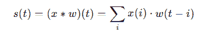

其中：

*   x：输入数据。

*   w：滤波器或核。

*   s(t)：在位置 ttt 处的卷积结果。

2. 一维卷积

定义：

一维卷积作用于一维数据，通常用于时间序列数据、音频信号或序列。

操作：

*   一个一维核在输入上滑动，对每个位置进行逐元素相乘并求和。

*   输出是一个新序列，其中每个元素代表核在特定位置的应用结果。

数学表达：

对于输入序列 x=[x1,x2,...,xn] 和滤波器 w=[w1,w2,...,wm]：

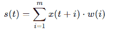

关键参数：

1. 核大小：滤波器的长度。

2. 步长：核每次滑动的步数。

3. 填充：在输入前加零，以控制输出尺寸。

应用：

*   信号处理。

*   时间序列分析。

*   自然语言处理（NLP）。

3. 二维卷积

二维卷积作用于二维数据，如图像，常用于计算机视觉任务。

操作：

*   一个二维核在输入矩阵（如图像）上滑动，对每个位置进行逐元素相乘并求和。

*   输出是一个特征图，突出输入中特定模式。

数学表达：

对于二维输入 I 和二维核 K：

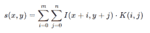

其中：

*   I(x,y)：位置 (x,y) 处的输入像素。

*   K(i,j)：位置 (i,j) 处的核值。

*   s(x,y)：位置 (x,y) 处的输出值。

关键参数：

1. 核大小：滤波器的尺寸（例如 3×3）。

2. 步长：核在水平方向和垂直方向移动的步数。

3. 填充：在输入周围添加零，以控制输出尺寸。

应用：

*   图像识别和目标检测。

*   医学影像分析。

*   视频处理。

一维卷积与二维卷积的关键区别

| 特征 || 一维卷积 || 二维卷积 |
| --- | --- | --- |
| 输入数据 || 一维（例如信号）。 || 二维（例如图像）。 |
| --- | --- | --- |
| 滤波器大小 || 1×k || m×n（例如 3×3）。 |
| 输出 || 一维特征图。 || 二维特征图。 |
| 应用 || 时间序列、音频、文本。 || 图像、视频和空间数据。 |

一维卷积示例

输入：

x=[2,3,1,0]

核：

w=[1,−1]

卷积输出：

s(t)=[2⋅1+3⋅(−1),3⋅1+1⋅(−1),1⋅1+0⋅(−1)]

结果：

s=[−1,2,1]

二维卷积示例

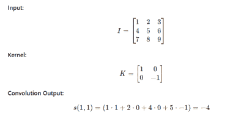

卷积层的优势

1. 参数共享：

相同的滤波器在输入上应用，减少参数数量。

1. 连接稀疏：

每个滤波器关注输入的局部区域（感受野），提高效率。

1. 特征提取：

自动检测边缘、纹理等更复杂的特征。

一维和二维卷积层对于处理序列和空间数据至关重要。它们高效、可扩展，能够使模型学习层次化表示，是现代深度学习架构的基石。

训练网络

训练神经网络意味着让模型从数据中学习，通过优化其参数（权重和偏置）来实现。目标是最小化预测与实际输出之间的误差，使网络能够泛化并对未见数据做出准确预测。该过程包括几个关键步骤和组件。

数据集准备

第一步是准备数据集。数据通常分为三部分：训练集用于学习参数，验证集用于调整超参数和监控泛化性能，测试集用于最终评估。数据预处理，如标准化输入特征或应用数据增强，通常是必要的，以提高鲁棒性并加快训练速度。

损失函数

损失函数衡量网络预测与实际输出之间的差异。回归任务通常使用均方误差（MSE），而分类任务则依赖于交叉熵损失。损失函数的选择取决于所处理的问题类型，并在指导网络学习过程中发挥核心作用。

优化器和学习率

优化器是调整网络权重以最小化损失函数的算法。流行的选择包括随机梯度下降（SGD），它基于小数据批量更新权重，以及自适应方法如 Adam，在训练过程中动态调整学习率。学习率决定权重更新的步长，是一个关键超参数。使用自适应学习率或学习率调度可以提高收敛速度和稳定性。

初始化和前向传播

训练过程从权重初始化开始，可以是随机初始化或使用特定策略（如 Xavier 或 He 初始化）以确保有效学习。在前向传播过程中，输入数据依次通过网络的各层，权重被应用，激活函数引入非线性。输出与真实标签的比较使用损失函数计算误差。

反向传播和权重更新

反向传播利用链式法则计算损失函数对每个权重的梯度。这些梯度向后传播到网络，用于更新权重和偏置。此过程在多个训练周期（即 epoch）中重复，直到模型收敛或达到满意性能为止。

常见挑战

训练神经网络时常见的挑战包括过拟合和欠拟合。过拟合是指模型在训练数据上表现良好，但在未见数据上表现差，可以通过使用正则化技术（如 L1 或 L2 惩罚）、丢弃（dropout）或增加训练数据来缓解。欠拟合是指模型未能捕捉数据中的模式，可以通过增加模型复杂度或训练更多 epoch 来解决。

另一个挑战是消失或爆炸梯度，这阻碍了训练。常见的解决方法包括适当的权重初始化、使用 ReLU 激活函数以及梯度剪辑。学习率选择也至关重要，不合适的学习率会导致不稳定或收敛缓慢。使用学习率调度或自适应优化器可以帮助克服这一问题。

评估指标


为了评估训练过程中的网络性能以及训练后的表现，分类任务使用准确率、精确率、召回率和 F1-分数等指标，而回归任务则使用均方误差（MAE）或均方根误差（RMSE）作为指标。验证指标用于监控泛化效果，早停机制在验证性能停止提升时停止训练，从而降低过拟合风险。

Example: Image Classification

在典型的训练场景中，如图像分类，图像会经过预处理并被划分为训练集、验证集和测试集。模型采用卷积层提取特征，采用激活函数引入非线性，采用全连接层进行分类。网络通过前向传播传递图像、计算损失，并利用反向传播更新权重。训练完成后，在测试集上评估模型的准确率和其他指标，以确保在未见过的数据上表现良好。

Training a neural network is a systematic process that requires careful preparation of data, selection of loss functions and optimizers, and fine-tuning of hyperparameters. It involves multiple iterations of forward and backward propagation, with the ultimate goal of achieving a model that generalizes well to new data while maintaining robustness and efficiency.

CASE STUDY OF CNN FOR EG ON DIABETIC RETINOPATHY

Diabetic Retinopathy (DR) 是糖尿病的并发症，会影响视网膜，若不治疗可能导致失明。通过医学影像进行早期检测至关重要。卷积神经网络（CNN）因其在分析空间特征方面的能力，在自动化从视网膜底片图像中检测糖尿病视网膜病变（DR）方面展现出显著前景。本案例研究探讨了 CNN 在糖尿病视网膜病变的检测与分类中的应用。

Problem Statement

目标是设计一套基于 CNN 的深度学习模型，用于对视网膜底片图像进行分类，分为以下五个阶段：

1. 无 DR。

2. 轻度 DR。

3. 中度 DR。

4. 重度 DR。

5. 增殖性 DR。

分类有助于判断病情严重程度，并支持及时的医疗干预。

Dataset

广泛使用的 DR 检测数据集是 Kaggle 的 Diabetic Retinopathy Detection 数据集。该数据集包含数千张高分辨率视网膜图像，每张图像均标记为五种 DR 严重程度之一。

关键的数据准备步骤包括：

*   预处理：统一图像尺寸、去除伪影、增强对比度。

*   数据增强：采用旋转、翻转、缩放、亮度调整等技术增加数据多样性。

*   标注：图像依据医疗专业人员确定的 DR 严重程度进行标注。

CNN Architecture

可采用定制的 CNN 或预训练模型（如 ResNet、InceptionV3 或 EfficientNet）。本研究选择 ResNet 架构，因其在特征提取和处理深层网络方面高效。

CNN 中的层包括：

1. 卷积层：

   提取空间特征，如微血管瘤、出血和渗出。

1. 池化层：

   降低空间维度，保留关键特征的同时降低计算成本。

1. 全连接层：

   将提取的特征映射到输出类别。

1. 激活函数：

   使用 ReLU 引入非线性，使用 Softmax 进行多类分类。

1. Dropout 层：

   通过在训练时随机停用神经元防止过拟合。

Training Process

1. 损失函数：采用类别交叉熵（Categorical Cross-Entropy），因为这是多类分类问题。

2. 优化器：选择 Adam 优化器，因其自适应学习率且收敛快。

3. 评估指标：

   *   准确率（Accuracy）用于整体性能评估。

   *   灵敏度（Sensitivity）和特异性（Specificity）用于衡量模型正确分类 DR 阶段的能力。

训练过程涉及将数据集划分为训练、验证和测试集。实施早停以避免过拟合，并使用学习率调度器在训练过程中调整学习率。

Results

模型在训练完成后在测试集上进行评估。关键性能指标包括：

1.  Accuracy：衡量整体分类正确性。

2.  Precision、Recall 和 F1-Score：评估各类别的表现，尤其在处理类别不平衡（如严重 DR 案例较少）时尤为重要。

3.  混淆矩阵（Confusion Matrix）：直观展示模型在所有严重程度上的分类表现。

对于训练良好的 ResNet 基模型，准确率可超过 85%，对重度病例的灵敏度和特异性也较高，这对医疗应用至关重要。

Challenges

1. 类别不平衡：

   严重 DR 案例在数据集中常被少数，导致偏见。可通过过抽样少数类或使用加权损失函数来缓解。

1. 图像变异性：

   光照、分辨率和噪声的差异要求强健的预处理和增强技术。

1. 可解释性：

   采用 Grad-CAM 等可解释性技术，突出影响模型决策的视网膜区域。

本案例研究表明，利用 ResNet 等强大架构和稳健的预处理技术，可在医疗诊断中实现高精度和可靠性，展示了深度学习在自动化医疗诊断中的潜力。

BUILDING A SMART SPEAKER

构建智能音箱需要结合硬件和软件，使设备能够通过语音命令与用户交互。以下是整体流程概述：

1. 硬件组件：

*   麦克风阵列：捕获语音输入。

*   扬声器：输出音频响应。

*   处理器：负责语音识别、自然语言处理（NLP）以及任务执行（如 Raspberry Pi 或 Arduino）。

*   网络连接：Wi‑Fi 或 Bluetooth，用于云端处理。

*   电源供应：确保持续运行。

1. 软件：

*   语音助手：利用 Google Assistant、Amazon Alexa 或 Mycroft 等平台实现语音识别和 NLP。

*   语音识别：使用 Google Speech-to-Text 或 CMU Sphinx 将音频转为文本。

*   文本转语音（TTS）：使用 Google TTS 或 Amazon Polly 将文本转换为语音。

SELF-DRIVING CAR

自动驾驶汽车（自动驾驶车辆）结合深度学习模型、传感器和数据处理技术，实现无需人工干预的导航和操作。

Components:

1.  Sensors:

*   LiDAR：通过发射激光束测量物体距离。

*   Cameras：捕获图像用于目标检测和识别。

*   Radar：检测物体并测量其速度。

*   GPS：提供导航用的位置信息。

1.  Deep Learning Models:

*   Convolutional Neural Networks (CNNs) 用于图像和目标识别（如检测行人、交通标志和其他车辆）。

*   Recurrent Neural Networks (RNNs) 或 LSTMs 用于处理序列数据（如预测其他车辆的行为）。

*   Reinforcement Learning (RL) 可用于优化决策，例如变道或在交通信号灯前停车。

1.  Training and Data:

   系统在大规模真实驾驶场景数据集上进行训练，数据涵盖多种路况、交通情况和障碍。

   模拟环境可用于在受控设置中测试和训练自动驾驶系统。

1.  Real-Time Processing:


-   [汽车](https://example.org)实时处理传感器数据以做出转向、刹车和加速等决策。该系统必须能够快速且准确地响应环境的变化。

# 决策：

-   车辆使用深度学习算法根据传感器数据和环境输入做出决策。系统必须确保安全、效率以及遵守交通规则。

## 单元 V

#### 强化学习

#### 强化学习入门

-   强化学习（RL）是一种机器学习方法，其中智能体通过在环境中执行动作来学习决策，以最大化累计奖励。与监督学习不同，监督学习中模型从标记数据中学习，而在强化学习中，模型通过其动作的后果来学习。智能体与环境交互，以奖励或惩罚的形式接收反馈，并利用该反馈改进其决策过程。

#### 强化学习中的关键概念

1.  智能体：

-   智能体是做出决策并与环境交互的实体。它可以是机器人、软件程序，或任何设计用于执行动作并从反馈中学习的系统。

1.  环境：

-   环境是智能体交互的全部内容。它向智能体提供反馈，并定义智能体运行的上下文。例如，在自动驾驶系统中，环境包括道路、障碍物、交通信号灯和其他车辆。

1.  状态（s）：

-   状态表示智能体感知的环境当前情况或配置。它提供信息供智能体决定下一步采取什么行动。例如，在国际象棋游戏中，状态描述了棋盘上所有棋子的位置。

1.  动作（a）：

-   动作是智能体在环境中做出的决定或移动。智能体根据当前状态选择动作，所选动作会导致转移到新的状态。

1.  奖励（r）：

-   奖励是智能体在执行动作后收到的反馈。它量化了该动作在实现智能体目标方面的好坏程度。正奖励鼓励智能体重复该动作，而负奖励则劝阻其。

1.  政策（π）：

-   政策是一种策略或状态到动作的映射。它定义了智能体在任何给定时刻的行为。政策可以是确定性的（在给定状态下始终选择相同的动作），也可以是随机的（根据概率分布选择动作）。

1.  值函数（V）：

-   值函数估计从特定状态出发、遵循某策略时能获得的长期奖励。它帮助智能体判断哪些状态是有利的。它是从给定状态开始、遵循某策略时能实现的预期累计奖励的度量。

1.  Q 函数（Q）：

-   Q 函数（或动作-值函数）评估在特定状态下执行特定动作并随后遵循策略时的预期累计奖励。它帮助智能体学习在特定状态下执行特定动作的价值。

1.  折扣因子（γ）：

-   折扣因子是一个介于 0 和 1 之间的数值，用于决定未来奖励相对于即时奖励的重要性。数值越高，智能体越重视未来奖励；数值越低，它越关注即时奖励。

1.  探索与利用：

-   探索涉及尝试智能体以前未曾尝试的新动作，而利用则是根据以往经验选择已知能最大化奖励的动作。平衡探索与利用对于有效学习至关重要。

#### 强化学习过程

1.  初始化：

-   智能体初始化时拥有初始政策，且对环境没有任何先验知识。

1.  与环境交互：

-   智能体在给定状态下执行动作。环境响应该动作，转移到新的状态并提供奖励。

1.  从经验中学习：

-   智能体利用反馈（奖励）改进其政策和 Q 函数。它更新其知识，以确定在每个状态下哪些动作能带来最佳结果。

1.  优化：

-   智能体通过不断与环境交互来优化其政策。该过程会持续进行，直到智能体收敛到最优策略或达到满意的性能水平。

#### 强化学习算法

以下算法用于强化学习，帮助智能体有效学习：

1.  Q-Learning：

-   Q-Learning 是一种无模型算法，用于估计最优动作-值函数（Q 函数）。智能体通过根据收到的奖励以及下一个状态的值来更新 Q 值，从而学习每个状态下每个动作的价值。

1.  深度 Q 网络（DQN）：

-   DQN 将 Q-Learning 与深度神经网络结合，用于在状态空间较大（如基于图像输入）的环境中近似 Q 函数。它采用经验重放和目标网络来稳定训练。

1.  政策梯度方法：

-   与估计 Q 值不同，政策梯度方法直接学习政策，通过优化神经网络的参数来实现。它们计算预期奖励关于政策参数的梯度，并据此更新参数。

1.  演员-评论员方法：

-   演员-评论员方法结合了值基方法和策略基方法。演员根据政策选择动作，而评论员通过估计值函数来评估动作的好坏。演员和评论员协同工作以改进政策。

1.  蒙特卡罗方法：

-   蒙特卡罗方法通过在多个集数上取平均值来估计状态或动作的价值。它们适用于智能体事先不知道转移模型的环境。

#### 强化学习的应用

强化学习在各个领域都有广泛的应用，特别是在涉及序列决策的领域：

1.  游戏玩耍：

-   RL 已用于开发能够以超人水平玩棋类、围棋和视频游戏的智能体。DeepMind 的 AlphaGo 是最著名的例子之一，它是基于 RL 的智能体击败围棋世界冠军。

1.  机器人：

-   RL 用于训练机器人执行诸如操作物体、行走和导航等任务。通过与环境交互，机器人学会自主完成复杂任务。

1.  自动驾驶汽车：

-   RL 帮助自动驾驶汽车学习在道路上导航、避免障碍并实时做出动态环境中的决策。车辆（智能体）不断从其动作和经验中学习，以优化驾驶行为。

1.  医疗保健：

-   在医疗领域，RL 用于个性化医疗、优化治疗方案和药物发现。RL 系统可以通过学习患者对不同干预措施的反应，为个别患者定制治疗方案。

1.  金融：

-   RL 用于优化交易策略、组合管理和资产配置。智能体可以通过最大化长期财务回报来学习做出投资决策。

1.  广告和营销：

-   RL 可以实时优化广告投放策略，根据点击、转化或收入等指标调整策略以最大化收益。

1.  推荐系统：

-   RL 应用于推荐系统，智能体不断根据用户交互和反馈学习最佳推荐。

#### 强化学习中的挑战

尽管 RL 取得了显著进展，其在实际应用中仍面临若干挑战：

1.  样本效率：

-   RL 通常需要大量的环境交互来学习最优策略，这在计算上可能昂贵且耗时。

1.  探索与利用：

-   在探索新动作和利用已知能最大化奖励的动作之间取得平衡是一个困难的挑战。


# 奖励塑造：

定义正确的奖励结构对于引导代理人有效学习至关重要。设计不当的奖励可能导致不良行为。

# 可扩展性：

强化学习（RL）算法在面对大状态空间和动作空间的环境时可能遇到扩展困难，尽管像深度强化学习（DQN）这样的进步已经在该领域取得了进展。

# 稳定性和收敛性：

在许多强化学习算法中，尤其是使用深度学习的算法，实现稳定的学习和收敛可能很困难，因为政策与环境之间的复杂交互。

强化学习是解决序列决策问题的强大范式。通过使用奖励和惩罚，代理人可以学习各种任务的最优策略。尽管强化学习在效率、可扩展性和稳定性方面面临挑战，但深度学习和算法设计的进步使其在游戏、机器人、医疗和自主系统等领域成为日益实用的工具。

## 学习任务

在机器学习的语境中，学习任务指的是机器学习模型试图通过学习过程来解决的问题或目标。学习任务定义了输入数据的性质、期望的输出以及用于训练模型的学习过程类型。学习任务是选择合适的机器学习算法和评估指标的核心。

机器学习中的主要学习任务可以大致分为以下几类：

1. 监督学习

在监督学习中，模型在标记数据上进行训练，即输入数据与正确的输出相配对。目标是学习输入到输出的映射，以便模型能够对新的、未见过的数据进行预测。学习任务涉及最小化预测值与实际值之间的误差。

监督学习任务的类型：

- 分类：任务是为输入数据分配标签。输出是类别型的，目标是将输入归类到几个预定义的类别之一。例如，在图像识别中，任务可能是判断图像是猫、狗还是鸟。

- 回归：任务是预测连续的输出值。模型尝试找到输入变量与数值输出之间的关系。例如，根据房屋的大小、位置和年龄等特征预测房屋价格。

2. 无监督学习

在无监督学习中，模型在没有标记输出的数据上进行训练。目标是发现数据中的隐藏模式或结构。模型从数据本身学习，而不需要被明确告知要寻找什么。

无监督学习任务的类型：

- 聚类：任务是将相似的数据点分组到簇中。算法识别数据中的模式和相似性，在没有先验群标签的情况下创建组。例如，基于购买行为进行客户细分。

- 维度降低：任务是尽可能保留相关信息的同时减少输入变量的数量。这常用于将高维数据可视化为低维空间，或减少大规模数据集的计算负担。例如，Principal Component Analysis（PCA）用于维度降低。

- 异常检测：任务是识别显著偏离正常模式的数据点或异常。这在欺诈检测、网络安全和工业系统监控中应用广泛。

3. 半监督学习

半监督学习介于监督学习和无监督学习之间。在这种方法中，模型使用少量标记数据和大量未标记数据进行训练。模型利用标记数据学习一般规律，并将所学应用于大量未标记数据。当标记数据稀缺或获取成本高昂，但有大量未标记数据可用时，半监督学习非常有用。

例子：在医学图像分类中，只有少量图像可能有详细标注，但有大量图像可用于训练。

4. 强化学习

在强化学习中，模型（称为智能体）通过与环境交互来学习。智能体执行动作，接收反馈（奖励或惩罚），并调整其动作以最大化长期累积奖励。任务涉及学习最优策略（行动选择策略），使其在长期奖励方面取得最佳结果。

例子：训练智能体玩视频游戏，智能体通过试错学习最大化得分，并根据环境反馈调整其动作。

5. 多任务学习

多任务学习涉及在同一模型上同时解决多个相关任务。这种方法帮助模型更好地泛化，并利用不同任务之间的共享信息。虽然任务之间存在共同特征或结构，但每个任务的输出不同。

例子：模型可能被训练同时执行情感分析（将文本分类为正面、负面或中性）和命名实体识别（在文本中识别名称、日期和地点等实体）相同的输入文本。

6. 迁移学习

迁移学习指的是在一个任务上训练的模型被适应并微调用于另一个相关任务。通常，预先在大规模数据集上训练的模型可以在数据有限的新任务上进行微调。这种方法利用一个领域的知识并应用到另一个领域，从而提高学习过程的效率。

例子：使用在 ImageNet 上预训练的图像分类模型作为起点，训练一个新的图像分类任务模型，该任务使用的图像数量较少。

根据输出类型，学习任务可分为以下两类：

1. 单输出 vs. 多输出：

单输出任务涉及预测单个值（例如二分类或多类分类、回归）。

多输出任务涉及同时预测多个值。例如，多标签分类，其中每个输入关联多个标签。

1. 批量学习 vs. 在线学习：

批量学习使用固定数据集进行训练，一次性处理整个数据集。

在线学习通过小批量（或小块）数据逐步训练模型。模型在处理每个小批量后更新参数，这对于大规模或实时应用非常有用。

根据数据的性质、问题的目标以及机器学习项目的目标，学习任务的选择各不相同。理解不同的学习任务并选择合适的一个对于构建有效的机器学习模型至关重要。无论是监督学习、无监督学习还是强化学习，每种任务都需要特定的方法、算法和技术来实现最佳性能。

## 实际中的强化学习示例

强化学习（RL）在多个领域找到了应用，展示了其通过与环境的试错交互来解决复杂决策问题的能力。以下是一些实际有效应用强化学习的真实案例：

1. 游戏玩耍

强化学习在实践中最著名的例子之一是 DeepMind 开发的 AlphaGo。AlphaGo 是一种基于强化学习的模型，专门用于玩古老的棋盘游戏 Go，这是一款长期被认为机器难以征服的游戏。


**强化学习（RL）依赖于多个关键模型和算法，以使智能体能够在与环境的交互中做出决策并从中学习。** 这些模型和算法帮助定义智能体如何在环境中采取行动、接收反馈并随时间优化其性能。强化学习模型的三个主要组成部分是**马尔可夫决策过程（MDP）**、**Q‑Learning**以及**Q‑Learning 算法**。

1. **马尔可夫决策过程（MDP）**

马尔可夫决策过程（MDP）是一种数学框架，用于模型结果部分随机、部分在决策者（智能体）控制下的决策情境。它为强化学习提供了正式的基础，定义了问题的关键要素：**状态、行动、奖励和转移**。

**MDP 的关键组成部分：**

*   **状态（S）**：智能体可能遇到的所有可能情况的集合。状态表示环境当前的情况或配置。

*   **行动（A）**：智能体在任意给定状态下可以采取的所有可能行动的集合。行动代表智能体可以选择的影响环境的选项。

*   **转移模型（T）**：描述在采取特定行动后，从当前状态转移到下一个状态的概率。通常表示为 **T(s,a,s′)**，其中 sss 为当前状态，aaa 为行动，s′s′ 为下一个状态。

*   **奖励（R）**：智能体在执行状态下的行动后所获得的反馈。奖励函数 **R(s,a)** 为每个在给定状态下采取的行动分配一个数值奖励。目标是最大化累计奖励。

*   **策略（π）**：策略是一种策略或函数，定义了在每个状态下应采取的行动。它是状态到行动的映射，指导智能体的决策过程。

2. **Q‑Learning**

Q‑Learning 是一种无模型的强化学习算法，旨在学习每个状态‑行动对的**Q 值（即预期累计回报）**。通过反复更新 Q 值，智能体逐渐学会选择能够最大化长期回报的行动。

3. **Q‑Learning 算法**

Q‑Learning 算法具体实现了上述 Q 值的迭代更新过程，通常采用如下的更新公式：

```
Q(s,a) ← Q(s,a) + α [r + γ max_a' Q(s′,a′) − Q(s,a)]
```

其中：

*   **α** 为学习率，控制更新的步幅；
*   **γ** 为折扣因子，决定未来回报的重视程度；
*   **r** 为当前采取行动后获得的奖励；
*   **max_a' Q(s′,a′)** 表示在下一个状态 s′ 下所有可能行动的最佳 Q 值。

通过上述机制，智能体在与环境交互的过程中不断调整其行为策略，以实现**最大化累计奖励**的目标，从而在各种复杂任务中实现自动化、适应性和高效性的决策。 


-   [折扣因子 (γ)：一个介于 0 和 1 之间的数值，表示未来奖励的重要性。γ 值越高（接近 1），代理对未来奖励的重视程度就越高，几乎与即时奖励同等；γ 值越低（接近 0），代理则更关注即时奖励。

MDP 在强化学习中：

MDP 用于建模决策过程是顺序的环境，代理的行动会影响未来的状态。代理的目标是找到一个策略（π），在长期内最大化预期总奖励，同时考虑即时奖励和长期收益。

2\. Q-Learning 函数

Q-Learning 是一种非策略强化学习算法，用于为在 MDP 模型环境中与环境交互的代理找到最优动作选择策略。Q-Learning 的核心是 Q 函数，它估计在特定状态下采取特定动作的质量。

Q 函数（质量函数）：

Q 函数记为 Q(s, a)，表示代理在状态 s 下采取动作 a 并随后遵循最优策略时，能够获得的预期未来奖励。Q 值会根据环境反馈进行更新。

Q-Learning 的目标是学习最优 Q 函数，以便在任何状态下确定最佳动作。

3\. Q-Learning 算法

Q-Learning 是一种非策略强化学习算法，利用 Q 函数循环更新状态-动作对的值，基于与环境的交互经验。它通过贝尔曼方程更新 Q 值，以学习最优策略。

Q-Learning 算法：

算法通过代理与环境交互，更新每个状态-动作对的 Q 值。更新过程基于代理获得的奖励以及下一状态的最大 Q 值。

Q-Learning 算法步骤：

1. 初始化：将所有状态-动作对的 Q 值 Q(s,a) 初始化为 arbitrary 值（通常为 0）。

2. 探索：在每个时间步骤，代理根据当前策略选择动作（常用 ε-贪婪策略，代理以概率 ϵ 选择随机动作，以概率 1−ϵ 选择 Q 值最高的动作）。

3. 与环境交互：代理执行动作，获得奖励 Rt+1，并观察新状态 st+1。

4. 更新 Q 值：使用 Q-Learning 更新规则更新状态-动作对 (st, at) 的 Q 值。

5. 重复：过程持续进行，直到多个 episode 后 Q 值收敛到最优值。

Q-Learning 算法在实际中的应用：

探索与开发：算法在探索（尝试新动作以了解环境）和开发（根据已学习的 Q 值选择最佳已知动作）之间取得平衡。

收敛性：在足够的探索和合适的学习率下，Q-Learning 保证收敛到最优 Q 函数，从而找到最优策略。

强化学习的应用领域

强化学习（RL）在众多领域都有广泛应用，从游戏和机器人到医疗和金融。其通过试错优化决策的能力，使其特别适合动态、复杂的环境。下面是一些 RL 成功应用的关键领域：

1\. 游戏玩耍

RL 最著名的应用之一是游戏玩耍。RL 算法在掌握游戏方面展现出显著成功，甚至在某些情况下超越了人类性能。

AlphaGo：由 DeepMind 开发的 AlphaGo 使用 RL 来掌握围棋这一复杂的棋盘游戏。它因击败世界冠军而闻名，此前被认为是人工智能难以完成的任务。

Dota 2 和 StarCraft II：OpenAI 和 DeepMind 利用 RL 创建能够玩实时策略游戏（如 Dota 2 和 StarCraft II）的代理。这些游戏涉及长期策略，需要代理学习如何管理资源、规划攻击并适应不断变化的游戏状态。

国际象棋：DeepMind 的 AlphaZero 使用 RL 在国际象棋上达到超人类水平，无需人类专家即可学习最优策略。

2\. 机器人

强化学习在机器人中被广泛用于需要与环境交互并进行实时决策的任务。RL 帮助机器人自主学习行为和动作，通过持续的反馈实现。

机器人操控：机器人被训练执行诸如抓取和操作物体等任务。它们通过成功或失败的反馈学习如何抓取物体或将其放置在特定位置。

工业机器人：在制造业中，RL 用于优化机器人臂的动作，提高装配、焊接或物料搬运等任务的效率。机器人能够实时适应环境变化，提升效率。

自主无人机：RL 应用于无人机的路径规划、障碍规避和投递系统。无人机通过从环境获取反馈，学会在复杂环境中自主导航。

3\. 自动驾驶车辆

自动驾驶汽车依赖于 RL 来在复杂、动态的环境中做出决策，包括在交通中行驶、规避障碍以及根据道路状况实时调整行驶方式。

导航与控制：RL 用于训练自动驾驶汽车做出安全且高效的驾驶决策。车辆学习根据实时环境反馈调整速度、变道和制动。

交通管理：RL 应用于智能城市的交通流管理，优化交通信号灯，减少拥堵。代理学习如何平衡交通流，以最小化延误并确保安全。

4\. 医疗

强化学习在医疗领域取得显著进展，用于优化治疗、疾病诊断和患者护理。

个性化治疗方案：RL 用于为糖尿病等慢性疾病患者开发个性化治疗方案。系统通过随时间观察患者对药物的反应，调整药物剂量。

药物发现：RL 在药物发现过程中被用于预测分子间相互作用，并优化新药设计，使其更可能有效。

机器人辅助手术：RL 用于提升机器人辅助手术的精度，使机器人能够实时适应患者状况，实现更高精度的操作。

5\. 金融与交易

在金融行业，RL 算法被用于优化投资组合、管理风险以及做出交易决策。

算法交易：RL 用于开发能够最大化利润的交易策略，通过学习何时买入或卖出资产。代理探索市场状况，并根据历史表现不断调整策略。

组合管理：RL 应用于组合管理，决定最优的资产配置。代理学习在历史数据和市场趋势的基础上平衡风险与回报，并在市场条件变化时进行适应。

6\. 自然语言处理（NLP）

在自然语言处理（NLP）领域，RL 用于需要基于语言理解和生成进行决策的任务。

聊天机器人和虚拟助手：RL 用于训练聊天机器人和虚拟助手，使其能够根据用户查询作出恰当响应。系统通过用户满意度反馈不断改进。

文本摘要：RL 用于改进自动文本摘要，代理学习生成简洁且信息丰富的摘要，依据摘要质量获得奖励。

7\. 制造业和供应链优化

在制造业和供应链管理中，RL 可以优化生产线、库存管理和物流，提高效率并降低成本。


# 生产调度
强化学习（RL）被应用于优化工厂中任务的调度，确保生产线以最大效率运行。代理学习分配资源、调度工作，并针对中断进行调整。

# 库存管理
RL 在库存控制中被使用，代理学习何时重新订购产品以及保持多少库存，以最小化成本并防止缺货或积压。

## 8. 营销与客户个性化
营销利用 RL 个性化推荐并优化客户交互，提升用户参与度和销售。

### 推荐系统
RL 用于推荐引擎，如 Netflix、Amazon、YouTube 使用的系统，以个性化内容或产品推荐。系统学习根据用户行为推荐用户可能感兴趣或购买的项目。

### 动态定价
RL 应用于动态定价模型，价格根据需求、竞争对手定价和客户行为等因素实时调整。

## 9. 智能电网与能源优化
在能源系统中，RL 用于电网管理、能源消耗优化和负载平衡，提高电力系统的效率。

### 智能电网管理
RL 用于优化智能电网的运行，代理学习在不同区域之间平衡能源分配和消耗，确保稳定性并减少能源浪费。

### 需求响应
RL 用于管理智能家居或建筑的能源消耗，根据用户偏好和环境条件调整供暖、冷却和照明，以优化能源使用。

## 10. 体育与绩效优化
强化学习也用于体育领域，用于绩效优化、策略制定和提升训练技术。

### 球员策略
RL 在体育模拟中用于开发团队或个人运动员的最优策略。系统学习根据历史数据和结果做出提升绩效的决策。

### 游戏分析
RL 用于分析游戏数据，通过学习在不同情境下最有效的行动或战术来改进策略。

## 11. 教育与自适应学习系统
强化学习正在被用于教育，以创建学生个性化的学习体验。

### 自适应学习系统
RL 用于开发能够适应学生个人学习风格和进度的系统。这些系统根据学生表现调整内容难度和节奏，以最大化参与度和记忆。

强化学习因其能够建模和优化决策过程的能力而在多个领域得到应用，从像 AlphaGo 这样的游戏代理到机器人、金融、医疗和自动驾驶汽车的实际应用。随着 RL 算法的改进，其在实际问题解决中的应用范围预计将扩大，为现实世界问题提供更大的潜力。

## 练习
1. 解释特征选择和特征提取方法在降维中的作用。

2. 解释计算主成分（principal components）的过程。

## 重要 SRC 相关问题
#### 1) 偏差与方差的权衡是什么？
如果模型过于简单且参数很少，则可能出现高偏差和低方差。相反，如果模型参数很多，则会出现高方差和低偏差。因此我们需要在过拟合和欠拟合之间找到恰当的平衡。

#### 2) 梯度下降是什么？
梯度下降是一种用于寻找函数（f）参数（系数）的值，使其使成本函数（cost）最小化的优化算法。当参数无法通过解析方法（如线性代数）直接计算时，梯度下降最适合使用，必须通过优化算法搜索。

#### 3) 解释过拟合和欠拟合以及如何对抗它们？
机器学习/深度学习模型本质上学习输入（训练特征）与目标输出（标签）之间的关系。无论学习到的关系质量如何，其在测试集（与训练输入不同的数据）上的表现都需要评估。

模型拥有可训练参数，这些参数被学习以构建输入-输出关系。根据参数数量，模型可分为更灵活（参数多）和更不灵活（参数少）。

欠拟合发生在模型的灵活性（参数数量）不足以捕捉训练数据中底层模式时。过拟合则是模型过于灵活，以至于“记住”了训练数据。

欠拟合的例子是用一条直线（一阶多项式）拟合二次多项式（二阶多项式）。相反，用十阶多项式拟合一条直线则是过拟合的例子。

#### 4) 如何对抗维度诅咒？
- 特征选择（手动或通过统计方法）
- 主成分分析（PCA）
- 局部线性嵌入（Locally linear embedding）
- 多维尺度（Multidimensional Scaling）

#### 5) 什么是正则化，为什么使用它，以及常见方法的例子？
正则化是一种 discourages learning a more complex or flexible model，从而避免过拟合的技术。常见方法例子：

- 岩 Ridge（L2 规范）
- Lasso（L1 规范）

Ridge 回归的显著缺点是模型可解释性。它会将不重要的预测变量的系数缩小到非常接近零，但永远不会使它们正好为零，因此最终模型仍包含所有预测变量。然而，Lasso 的 L1 处罚会在调制参数 λ 足够大时，强制一些系数估计正好为零，从而实现变量选择，产生稀疏模型。

#### 6) 解释主成分分析（PCA）？
主成分分析（PCA）是一种用于机器学习中降维的技术，旨在在尽可能保留信息的前提下减少数据集的特征数量。它通过找到数据变化最剧烈的方向（主成分），并将数据投影到这些方向构成的低维子空间中来实现。

#### 7) 为什么 ReLU 比 Sigmoid 更常用且更好？
- 计算效率：ReLU 是简单的阈值函数，前向和反向传播更快。
- 减少消失梯度的可能性：ReLU 的梯度在正值时为 1，在负值时为 0；而 Sigmoid 会在输入稍有变化时 quickly saturate（梯度趋近于 0），导致消失梯度。
- 稀疏性：当 ReLU 的输入为负时，神经元不激活，产生稀疏激活，使网络更轻量。

#### 8) 给定步长 S 和每层的卷积核大小，创建一个函数来计算特定节点在（1 维）CNN 中的受容场。即找出通过卷积层连接到一个神经元的输入节点数量。受容场定义为在输入中用于生成该输出的空间部分。

考虑卷积核大小为 k，受容场只包含卷积核使用的输入数量，即 k，乘以卷积操作未缩小输入的维度。因此受容场为 k * a。

```python
def compute_receptive_field(stride, kernel_sizes):
    receptive_field = 1
    for k in kernel_sizes:
        receptive_field = (receptive_field - 1) * stride + k
    return receptive_field
```


为什么需要验证集和测试集？它们有什么区别？

验证集（validation set）用于在模型训练过程中调谐超参数、选择模型结构以及进行早期停止，帮助我们在开发阶段判断模型的泛化能力。测试集（test set）则在模型最终确定后才使用，用于评估模型在未见过的数据上的真实表现，确保评估结果不受过拟合的影响。


当训练模型时，我们将可用的数据分为三个独立的集合：

- 训练数据集用于拟合模型的参数。然而，我们在训练集上得到的准确率并不能可靠地预测模型在新样本上的表现。
- 验证数据集用于衡量模型在未包含在训练数据集中的示例上的表现情况。在验证数据上计算出的指标可以用于调优模型的超参数。然而，每次我们对验证数据进行评估并基于这些分数做出决策时，就会泄露验证数据到模型中。评估次数越多，泄露的信息越多。于是我们可能会对验证数据过拟合，此时验证得分也就无法可靠预测模型在真实世界中的表现。
- 测试数据集用于衡量模型在从未见过的示例上的表现。它只能在我们已经使用验证集调参之后才使用。

因此，如果我们省略测试集，只使用验证集，验证得分就不能是模型泛化能力的良好估计。

#### 25) 什么是分层交叉验证，以及何时应该使用它？

交叉验证是一种将数据在训练集和验证集之间进行划分的技术。在常规的交叉验证中，划分是随机进行的。但在分层交叉验证中，划分保持了训练集和验证集中类别比例相同。

例如，如果我们有一个数据集，其中 10% 属于类别 A，90% 属于类别 B，使用分层交叉验证时，训练集和验证集的比例会保持相同。相反，如果使用普通交叉验证，最坏的情况可能是验证集中根本没有类别 A 的样本。

分层交叉验证可应用于以下情形：

- 数据集中包含多个类别。数据集越小且类别越不平衡，使用分层交叉验证的重要性就越高。
- 数据集中数据分布不同。例如，自动驾驶数据集可能包含白天和夜间拍摄的图像。如果不能保证这两种类型都在训练集和验证集中出现，就会出现泛化问题。

#### 26) 为什么集成学习（ensemble）通常比单个模型得分更高？

集成学习是将多个模型组合起来生成单一预测的方法。关键思想是让模型在错误上互相补偿：当一个模型犯错时，其他模型的正确预测可以抵消其错误，从而使集合的整体得分更高。

构建集成需要多样化的模型，多样性可以通过以下方式实现：

- 使用不同的机器学习算法。例如，可以组合逻辑回归、k 近邻和决策树。
- 使用不同的子集进行训练，这称为装袋（bagging）。
- 对训练集中每个样本赋予不同的权重。如果这种加权是迭代进行的，按照集合错误对样本进行加权，则称为提升（boosting）。许多数据科学竞赛的获胜方案都是集成学习，但在实际机器学习项目中，工程师需要在执行时间和准确率之间取得平衡。

#### 27) 什么是失衡数据集？可以列出一些处理方法吗？

失衡数据集是指不同类别的比例差异显著的数据集。例如，医学影像数据集中用于检测某种疾病，通常有大量的负样本（没有疾病）和少量的正样本（有疾病），比如 98% 的图像是负样本，2% 是正样本。

处理失衡数据集的常见方法包括：

- 过采样或下采样。与随机均匀抽样不同，我们可以使用其他分布方式，使训练数据看起来更平衡。
- 数据增强。通过对少数类的现有数据进行受控修改，生成新数据。例如，可以对患病图像进行翻转，或在保持病变可见的前提下为其添加噪声复制品。
- 使用合适的评估指标。若模型总是预测为负，则准确率可达 98%，但这并不能反映模型在失衡数据上的表现。更合适的指标包括精确率（precision）、召回率（recall）和 F‑score。

#### 28) 可以解释监督学习、无监督学习和强化学习的区别吗？

- 监督学习：在监督学习中，模型学习输入数据与输出数据之间的映射关系，需要有标签（labeled data）来指导训练。
- 无监督学习：只能获得未标记的数据，模型通过自行发现数据的内在结构或表示来进行学习。无监督学习常用于在标签数据稀缺时初始化模型参数——先在大量未标记数据上训练无监督模型，再将其权重用于监督学习。
- 强化学习：模型在与环境交互的过程中获得奖励（reward），通过最大化累计奖励学习行为策略（policy）。强化学习已成功应用于围棋、阿塔里经典视频游戏等领域。

#### 29) 什么是数据增强（data augmentation）？可以给出一些例子吗？

数据增强是通过对已有数据进行修改，合成新的数据，同时保持目标不变或以已知方式改变目标的技术。

计算机视觉是数据增强特别有用的领域，常见的修改包括：

- 调整图像尺寸（Resize）
- 水平或垂直翻转（Horizontal/vertical flip）
- 旋转（Rotate）
- 添加噪声（Add noise）
- 畸变（Deform）
- 调整颜色（Modify colors）

每个任务需要定制化的增强流 ipeline。例如，在 OCR 任务中，水平翻转会改变文字内容，不利于模型；但适当的缩放和轻微旋转可能会提升识别效果。

#### 30) 什么是 Turing test？

Turing test 是用来评估机器是否具备与人类相当智能的测试方法。在该测试中，机器会与人类交互，如果机器能够 fool 人类，使其误以为其是人类，则视为通过了测试，即被认为具备智能。但机器也可以在不完全模仿人类认知的情况下被认为是智能的。

#### 31) 什么是 Precision（精确率）？

Precision（也称为 positive predictive value）是预测为正例的实例中，实际为真正例的比例。

Precision = true positive / (true positive + false positive)

#### 32) 什么是 Recall（召回率）？

Recall（也称为 sensitivity）是模型成功检回的真正例占所有真正例的比例。

Recall = true positive / (true positive + false negative)

#### 38) 定义 F1‑score。

F1‑score 是精确率和召回率的加权平均值，同时考虑了假正和假负两种误差，用于衡量模型的整体性能。

F1‑Score = 2 * (precision * recall) / (precision + recall)

#### 34) 列出不同的激活函数（activation neurons or functions）。

- Linear Neuron（线性神经元）
- Binary Threshold Neuron（二元阈值神经元）
- Stochastic Binary Neuron（随机二元神经元）
- Sigmoid Neuron（ sigmoid 神经元）
- Tanh function（tanh 函数）
- Rectified Linear Unit (ReLU)（ReLU）

#### 35) 定义 Learning Rate（学习率）。

Learning rate 是控制网络权重根据损失梯度进行调整幅度的超参数。

#### 36) 什么是 Momentum（相对于 NN 优化）？

Momentum 是一种加速梯度下降优化的方法，通过在更新权重时累积过去梯度的动量，使得更新更加平滑且能够加速收敛，尤其是在出现狭窄的谷歌或崎岖的梯度景观时尤为有效。


Momentum 让优化算法记住上一步的步长，并在当前步长上加入一定比例的历史步长。这样，即使算法卡在平坦区域或小的局部极小值中，也能跳出并继续朝向真正的极小值前进。

# 37) 批量梯度下降与随机梯度下降的区别是什么？

批量梯度下降使用整个数据集计算梯度。这对于凸形或相对平滑的误差曲面非常合适。此时，我们会相对直接地向最优解（局部或全局）移动。此外，在使用退火学习率时，批量梯度下降最终会找到其所在的吸引盆地中的最小值。

随机梯度下降（SGD）使用单个样本计算梯度。SGD 在误差曲面包含大量局部最大值/最小值时表现良好（不一定比批量梯度下降好，但比批量梯度下降更好）。在这种情况下，使用较少样本计算的相对噪声梯度倾向于将模型从局部极小值中抖动出来，进入（希望）更优的区域。

# 38) 时代、批次与迭代的区别。

- 时代（Epoch）：一次前向传播和一次反向传播的所有训练示例。
- 批次（Batch）：在一次前向和反向传播中，将示例一起处理。
- 迭代（Iteration）：训练示例数量 / 批次大小。

# 39) 什么是消失梯度？

当我们增加越来越多的隐藏层时，反向传播在将信息传递到下层时变得越来越无用。结果是，随着信息的反向传播，梯度开始消失，相对于网络权重变得很小。

# 40) 什么是 Dropout？

Dropout 是一种简单的方法，用于防止神经网络过拟合。它的工作方式是随机“丢弃”部分神经元。它类似于自然的繁殖过程，自然通过组合不同的基因（丢弃其他基因）来产生后代，而不是强化共适应的基因。

# 41) 定义 LSTM。

长短期记忆网络（LSTM）专门用于解决长期依赖问题，通过维护一个状态来决定记住什么和忘记什么。

# 42) LSTM 的关键组件有哪些？

- 门（forget、memory、update & read）
- `tanh(x)`（值在 -1 到 1 之间）
- `Sigmoid(x)`（值在 0 到 1 之间）

# 43) RNN 的变体有哪些？

- LSTM：长短期记忆网络
- GRU：门控循环单元
- End to End Network
- Memory Network

# 44) Auto encoder 是什么，以及几个常见的应用？

Auto encoder 主要用于学习给定数据的压缩形式。常见应用包括：

- 数据去噪
- 维度降低
- 图像重构
- 图像上色

# 45) GAN 的组成部分有哪些？

- Generator（生成器）
- Discriminator（判别器）

# 46) Boosting 与 Bagging 的区别是什么？

Boosting 和 Bagging 都是集成学习技术，它们的共同点在于通过组合多个弱学习者（仅略好于随机猜测的分类器/抑制器）来构建一个强学习者，从而获得准确的预测。Bagging 的做法是从数据集中以放回抽样的方式创建多个 bootstrap 样本，每个样本训练一个（可能）弱学习者。而 Boosting 则使用所有数据训练每个学习者，并且之前学习者错误分类的实例会被赋予更大的权重，使得后续学习者在训练时更关注这些实例。

# 47) ROC 曲线是如何工作的？

ROC 曲线是真实正率（TPR）与假正率（FPR）在不同阈值下的对比图。它常被用作模型灵敏度（真阳性）与误报概率（假阳性）之间的权衡的代理。

# 48) Type I 错误和 Type II 错误有什么区别？

Type I 错误是假阳性，Type II 错误是假阴性。简言之，Type I 错误意味着“声称发生了某事但实际上没有”，而 Type II 错误意味着“声称没有发生某事但实际上发生了”。可以这样想：Type I 错误相当于告诉一个男人他怀孕了，而 Type II 错误相当于告诉一个怀孕的女人她没有怀孕。

# 49) 生成模型和判别模型的区别是什么？

生成模型会学习数据的类别分布，而判别模型只学习不同类别之间的区分边界。判别模型在分类任务上通常优于生成模型。

# 50) 实例基于学习与模型基于学习的区别。

- 实例基于学习（Instance-based Learning）：系统通过记忆训练示例，然后使用相似度量对新案例进行概括。
- 模型基于学习（Model-based Learning）：另一种概括方法是构建这些示例的模型，然后使用该模型进行预测。这称为模型基于学习。

# 51) 什么时候使用标签编码（Label Encoding）而使用一热编码（One Hot Encoding）？

选择取决于数据集和所用模型，但以下几点值得注意：

我们使用一热编码（One-Hot Encoding）的情况：
- 类别特征不是有序的（例如国家名称）
- 类别数量较少，一热编码可以有效应用

我们使用标签编码（Label Encoding）的情况：
- 类别特征是有序的（例如 Jr. kg、Sr. kg、Primary school、high school）
- 类别数量较多，一热编码会导致高内存消耗

# 52) LDA 与 PCA 在维度降低方面有什么区别？

LDA 和 PCA 都是线性转换技术：LDA 是监督学习，PCA 是无监督学习——PCA 忽略类别标签。

我们可以把 PCA 想象为寻找最大方差的方向。相比之下，LDA 试图找到一个特征子空间，使得类别之间的可分性最大。

# 53) 什么是 t-SNE？

t-Distributed Stochastic Neighbor Embedding（t-SNE）是一种无监督、非线性的技术，主要用于数据探索和高维数据的可视化。简单来说，t-SNE 让你直观感受到高维空间中数据的分布方式。

# 54) t-SNE 与 PCA 在维度降低方面的区别是什么？

首先要注意，PCA 于 1933 年被提出，而 t-SNE 于 2008 年出现。自 1933 年以来，计算能力和数据规模的发展极大地改变了数据科学的面貌。其次，PCA 是线性维度降低技术，旨在最大化方差并保持大样本间的距离；也就是说，差异大的样本被拉得更远。这在可视化非线性流形（如球体、柱体、曲线等几何形状）时可能表现不佳。

t-SNE 则通过保留只有小样本间的距离或局部相似性来区别于 PCA，而 PCA 则关注保持大样本间的距离以最大化方差。

# 55) 什么是 UMAP？

UMAP（Uniform Manifold Approximation and Projection）是一种新型的流形学习技术，用于维度降低。UMAP 基于黎曼几何和代数拓扑的理论框架构建，结果是一个实用、可扩展的算法，适用于真实世界数据。

# 56) t-SNE 与 UMAP 在维度降低方面的区别是什么？


-   UMAP 与 t-SNE 的最大区别在于全局结构与局部结构的平衡——UMAP 在最终投影中通常更擅长保留全局结构。这意味着簇间的关系在 t-SNE 中可能更为有意义。但需要注意，UMAP 与 t-SNE 都必须在投影到低维空间时扭曲高维数据的形状，因此低维空间中的任意轴或距离仍然无法像 PCA 那样直接解读。

#### 57) 随机数生成器的工作原理，例如 Python 中的 rand() 函数是如何工作的？

它基于种子生成伪随机数，并使用了一些著名的算法；请参阅下面的链接以获取更多信息。

#### 58) 贝叶斯统计与频繁统计有什么区别？

频繁统计是一个框架，专注于利用样本统计量估计总体参数，并提供点估计和置信区间。

贝叶斯统计则是一个框架，它利用先验知识和信息来更新关于参数或假设的信念，并提供参数的概率分布。

主要区别在于贝叶斯统计将先验知识和信念纳入分析，而频繁统计则不纳入。

|   |

| --- | --- | --- |

 

# 59) LSTM 与 Transformer 的基本区别是什么？

 

LSTM（长短期记忆）模型由设计用于在时间步之间更高效存储和操作信息的 RNN 单元组成。相比之下，Transformer 模型包含一堆编码器和解码器层，每层由自注意力和前馈神经网络组件构成。

|   ||  ||   |

| --- | --- | --- |

 

# 60) RCNN 是什么？

 

循环卷积模型是一种专门用于基于图像序列（通常称为视频）进行预测的模型。它在计算机视觉的目标检测任务中被应用。RCNN 方法结合了区域建议技术和卷积神经网络（CNN）来识别并定位图像中的物体。

## Contributions

贡献备受欢迎。

1. Fork the repository.

2. Commit your questions or answers.

3. Open pull request.

|   ||  ||   |

| --- | --- | --- |

 

# 61) 机器学习有哪些不同类型？

 

机器学习主要有三种类型：

#### 监督学习

在监督学习中，模型基于历史或标记数据进行预测或决策。标记数据是指已添加标签的数据集，从而使其更有意义。

#### 无监督学习

在无监督学习中，我们没有标记数据。模型可以在输入数据中发现模式、异常和关系。

#### 强化学习

使用[强化学习](https://www.simplilearn.com/tutorials/machine-learning-tutorial/reinforcement-learning "强化学习")，模型可以根据其先前动作获得的奖励来学习。

考虑一个代理在环境中工作的情境。代理的目标是实现某个目标。每当代理采取一些行动朝向目标前进，它就会得到正向反馈；如果行动偏离目标，则会得到负向反馈。

|   ||  ||   |

| --- | --- | --- |

 

# 62). 深度学习是什么？

 

深度学习是机器学习的一个子集，涉及使用人工神经网络的系统，这些系统能够像人类一样思考和学习。"deep"一词来源于可以有多个神经网络层的事实。

一个主要的[机器学习与深度学习的区别](https://www.simplilearn.com/machine-learning-vs-deep-learning-major-differences-you-need-to-know-article "机器学习与深度学习的区别") 是，机器学习需要手动进行特征工程。而在深度学习中，神经网络模型会自动决定使用哪些特征（以及哪些不使用）。

这是机器学习面试和[深度学习面试问题](https://www.simplilearn.com/tutorials/deep-learning-tutorial/deep-learning-interview-questions "深度学习面试问题")中常见的问题。

了解更多：[AI、ML 与深度学习的区别](https://www.simplilearn.com/difference-between-ai-ml-deep-learning-article "AI、ML 与深度学习的区别")

|   ||  ||   |

| --- | --- | --- |

 

# 63). 监督机器学习在现代企业中的应用有哪些？

 

监督机器学习的应用包括：

#### 电子邮件垃圾邮件检测

我们使用历史数据训练模型，这些数据包含已分类为垃圾邮件或非垃圾邮件的邮件。这些标记信息作为模型的输入。

#### 医疗诊断

通过提供疾病相关的图像，模型可以被训练判断人是否患有该疾病。

#### 情感分析：

这是使用算法挖掘文档并判断其情感为正面、中性或负面的过程。

#### 欺诈检测：

通过训练模型识别可疑模式，我们可以检测可能的欺诈行为。

|   ||  ||   |

| --- | --- | --- |

 

# 64). 半监督机器学习是什么？

 

监督学习使用完全标记的数据，而无监督学习使用无训练数据。

在半监督学习中，训练数据包含少量标记数据和大量未标记数据。

|   ||  ||   |

| --- | --- | --- |

 

# 65). 无监督机器学习技术有哪些？

 

无监督学习主要使用两种技术：聚类和关联。

#### 聚类

聚类问题涉及将数据分割为子集。这些子集，也称为聚类，包含相似的数据。不同的聚类揭示了关于对象的不同细节，与分类或回归不同。

#### 关联

在关联问题中，我们识别不同变量或项目之间的关联模式。

例如，电商网站可以根据您之前的购买、消费习惯、愿望清单中的项目、其他客户的购买习惯等，向您推荐其他商品。


|   ||  ||   |

| --- | --- | --- |

 

# 66)14. 监督学习与无监督学习的区别是什么？

 

 监督学习 - 该模型从标记数据中学习，并以预测为输出  

 无监督学习 - 该模型使用未标记的输入数据，并允许算法在没有指导的情况下对该信息进行操作。  

|   ||  ||   |

| --- | --- | --- |

 

# 67). 何时会使用分类而非回归？

分类用于你的目标是类别型时，而回归用于目标变量是连续时。分类和回归都属于监督 [机器学习算法](https://www.simplilearn.com/10-algorithms-machine-learning-engineers-need-to-know-article "机器学习算法")。

分类问题的示例包括：

 预测是或否  

 估计性别  

 动物的品种  

 颜色的类型  

回归问题的示例包括：

 估计产品的销售额和价格  

 预测团队的得分  

 预测降雨量  

|   ||  ||   |

| --- | --- | --- |

 

# 68). 什么是过拟合，以及如何避免它？  

  

过拟合是指模型学习训练集过于彻底，将训练数据中的随机波动视为概念。这些波动影响模型的泛化能力，并且不适用于新数据。  

当模型接收训练数据时，它会显示 100%的准确率——技术上是一个略小的损失。但是，当我们使用测试数据时，可能会出现错误并低效。这种情况被称为过拟合。  

避免过拟合的多种方法包括：

 正则化。它在目标函数中加入对特征的成本项  

 构建简单模型。通过减少变量和参数，可以降低方差  

 如 k 折叠交叉验证等交叉验证方法也可以使用  

如果某些模型参数容易导致过拟合，可以使用 LASSO 等正则化技术，对这些参数进行惩罚。  

基础机器学习：简化方法
