# 机器学习基础：神经网络入门指南

## 神经网络简介

### 引言

机器学习（ML）已成为 21 世纪最重要的技术进展之一。它已经渗透到各个领域，改变了行业格局并彻底变革了我们解决问题的方式。本书《机器学习基础：神经网络导论》旨在为机器学习的核心概念和技术提供一个全面且易于理解的介绍，并特别关注神经网络。

机器学习这门学科涉及设计能够从数据中学习，并基于数据进行预测或决策的算法。与显式编码规则的传统编程不同，机器学习使系统能够直接从数据中学习模式并进行推理。这种方法上的根本性转变使得系统能够执行以前被认为仅属于人类认知领域的任务。

机器学习的起源可以追溯到 20 世纪中叶，来自统计学、计算机科学和人工智能等领域对其做出了重要的理论贡献。强大的计算资源的出现以及大型数据集的可用加速了该领域的进展，导致了机器学习技术在学术研究和工业应用中的广泛采用。

### 机器学习技术

机器学习技术可以大致分为监督学习、无监督学习、半监督学习和强化学习。监督学习涉及在标记数据上训练模型，其中每个输入都与相应的输出配对。相反，无监督学习处理的是未标记数据，旨在发现数据内部隐藏的模式或结构。半监督学习结合了监督和无监督学习的特点，利用少量标记数据以及大量的未标记数据语料库。强化学习是一种广泛研究的范式，涉及训练智能体通过与环境交互并接收奖励或惩罚形式的反馈来做出一系列决策。

### 神经网络

机器学习的核心是神经网络，受人类大脑结构和功能启发的计算模型。神经网络由相互连接的神经元层组成，每个神经元都能执行简单的计算。当这些神经元结合时，它们可以近似复杂函数并解决难题。神经网络在图像识别、自然语言处理和游戏等各种应用中的成功刺激了该领域大量的研发。

### 数据预处理与工程

机器学习的一个关键方面是数据预处理和特征工程，这涉及将原始数据转换为适用于模型训练的格式。该过程包括处理缺失值、编码变量、缩放数值特征以及从数据中提取有效信息。适当的数据预处理对于机器学习模型至关重要，因为它直接影响模型的性能和泛化能力。

### 评估指标

机器学习的另一个关键组件是选择合适的评估指标来评估模型的性能。这些指标提供了模型优缺点的见解，指导模型选择和优化的过程。常见的评估指标包括准确率、精确率、召回率、`F1 score` 以及接收者工作曲线下面积（`ROC AUC`）等。

### 挑战与优化

尽管机器学习取得了显著成就，从业者经常面临过拟合等挑战，即模型在训练数据上表现良好，但无法泛化到新数据。正则化技术（如 `L1` 和 `L2` 正则化、丢弃 Dropout 和早停）被用于缓解过拟合并提高模型的泛化能力。

神经网络架构的格局已经显著演变，先进模型如卷积神经网络（`CNNs`）、循环神经网络（`RNNs`）和 transformers 不断突破边界。这些架构在图像分类、目标检测到自然语言理解和机器翻译等任务中展现了卓越的性能。

优化技术在训练神经网络中起着至关重要的作用，因为它们决定了模型从数据中学习的效率。`Gradient descent`及其变体（包括随机梯度下降、`momentum`、`AdaGrad`、`RMSProp` 和 `Adam`）是广泛使用的优化算法，促进了高效的模型训练。

### 实际应用

神经网络的实际应用非常广泛，跨越了医疗保健、金融、自动系统和娱乐等行业。从诊断疾病和预测股价，到驱动自动驾驶汽车和实现真实的游戏环境，神经网络已成为现代技术不可或缺的一部分。

本书旨在让读者对机器学习基础、神经网络架构和实际实现技术有坚实的理解。通过本书，读者将掌握设计、训练和评估神经网络模型所需的知识和技能，为在机器学习这一令人兴奋的领域进一步探索和创新铺平道路。

## 第 1 章：机器学习简介

机器学习是一种变革性技术，使系统能够从数据中学习并在无需显式编程的情况下做出预测或决策。本章提供了机器学习的概述，包括其历史、各种类型（如监督、无监督、半监督和强化学习）以及常用算法。它强调了关键应用并介绍了神经网络，为探索机器学习技术和挑战奠定了基础。本章最后对典型的机器学习工作流进行了检查，并对该领域的未来和持续的挑战进行了讨论。

### 1.1 什么是机器学习？

机器学习是人工智能（AI）的一个分支，专注于算法和统计模型的开发，这些算法和模型使计算机能够在没有显式指令的情况下，仅依赖模式和推理来执行任务。该领域的先驱亚瑟·塞缪尔（Arthur Samuel）曾著名地将机器学习定义为计算机从经验中学习的能力。

机器学习的核心涉及设计和部署模型，这些模型能够处理数据、识别模式并根据这些数据做出决策。这些模型使用各种算法构建，并通过训练不断随着时间的推移来提高其性能。与传统编程（即由人类为特定任务显式地编写指令）不同，机器学习模型从数据输入中学习，通过自我调整来提高其准确性和性能。

考虑一个简单的例子：预测房价。传统编程需要为影响房价的所有因素拟定详细的标准（例如：位置、大小、状况）。相比之下，在历史房价数据集上训练的机器学习模型可以学习不同变量之间的潜在模式和关系，最终在无需人工干预的情况下对新的、未见的数据点进行预测。

#### 机器学习的类型

机器学习系统通常可以分为三大主要类型：监督学习、无监督学习和强化学习。

##### 监督学习

监督学习的特点是使用标记数据集，其中目标结果是已知的。模型学习将输入映射到输出标签，有效地实现了“通过示例学习”。监督学习中使用的典型算法包括线性回归、逻辑回归、支持向量机和神经网络。

##### 无监督学习

在无监督学习中，模型被赋予了未标记的数据，并必须找到其中的模式和结构。与监督学习不同，在训练阶段没有正确答案。无监督学习中的常用技术包括如 `K-means` 和层次聚类等聚类算法，以及如主成分分析 (`PCA`) 等降维技术。

##### 强化学习

强化学习涉及通过与环境交互来训练智能体，以最大化某种累积奖励的概念。这种学习与监督学习和无监督学习显著不同，它关注智能体的经验和迭代改进。`Q-learning` 和策略梯度等算法通常应用于强化学习场景。

#### 编程示例

每种机器学习类型都有独特的方法和应用，但它们都有共同的目标，即使计算机能够根据数据输入进行学习和适应。为了通过编程方式说明机器学习概念，请考虑以下使用 `scikit-learn` 库的 Python 代码段，它使用线性回归执行了一个简单的监督学习任务：

```python
from sklearn.linear_model import LinearRegression
import numpy as np

# Example data
X = np.array([[1], [2], [3], [4], [5]])
y = np.array([100, 200, 300, 400, 500])

# Initialize and train the model
model = LinearRegression()
model.fit(X, y)

# Make a prediction
prediction = model.predict([[6]])
```

上述代码演示了监督学习的工作流，涉及数据准备、模型训练以及使用均方误差和方差得分等指标评估模型性能。这个简单的例子强调了机器学习的精髓：使用数据来训练能够根据新的、未见的数据做出预测或决策的模型。

执行此代码的输出结果提供了对模型性能的洞察：

- 系数：`[938.23786125]`
- 均方误差：`3035.06`
- 方差得分：`0.43`

系数、均方误差和方差得分对模型的有效性和准确性提供了定量衡量，凸显了完善机器学习模型以获得更好结果的迭代性质。

通过这些过程，机器学习赋予计算机执行复杂任务的能力，从图像和语音识别到自动驾驶和预测性维护等。随着数据继续呈指数级增长，机器学习获取可操作洞察和驱动智能决策的能力变得日益重要，巩固了其作为现代技术和人工智能领域基石的地位。

### 1.2 机器学习历史

机器学习的历史与计算机科学和人工智能的演进深度交织。它的根源可以追溯到 20 世纪中期，当时研究人员开始探索让机器从数据中学习的方法。以下详细描述阐述了机器学习发展过程中的关键里程碑和突破。

机器学习的概念可以追溯到数学家和逻辑学家 `Alan Turing`（图灵）的工作，他提出了一种能够通过模拟人类智能来学习和适应的机器。1950 年，图灵引入了 `Turing Test`（图灵测试），这是一项测试机器表现出与人类等同或无法区分的智能行为的标准。尽管 `Turing Test` 主要针对人工智能，但它为机器从交互中学习的想法奠定了基础。

20 世纪 50 年代后期，随着第一批算法的发展，该领域开始成形。人工智能领域的先驱 `Arthur Samuel`（亚瑟·萨缪尔）开发了一个跳棋程序，它能从自己的经验中学习。`Samuel` 的程序使用机械学习，它存储了玩过的每局游戏，并最终通过识别模式来改进。该程序标志着机器通过学习提高性能的首批实例之一。

20 世纪 60 年代见证了更复杂的算法出现以及机器学习作为一个独立领域的正式形成。`Frank Rosenblatt`（弗兰克·罗森布拉特）在 1958 年创建 `perceptron`（感知机）是一个重大事件。感知机是一种能够二分类的人工神经网络。它旨在模拟人脑的思考过程，使用加权输入、求和以及阈值函数产生二值输出。尽管存在局限性，感知机仍为未来的神经网络研究奠定了基础。

20 世纪 70 年代和 80 年代，机器学习经历了热情与幻灭的时期。研究人员开发了更先进的模型，包括聚类算法和决策树，但进展往往受到计算资源有限和算法复杂性的阻碍。该领域遭遇了巨大的批评，特别是由于 `Minsky`（明斯基）和 `Papert` 在 1969 年出版的影响力著作 `Perceptrons`（感知机）中所指出的，感知机无法解决非线性可分的问题。

机器学习兴趣复兴出现在 20 世纪 80 年代和 90 年代，随着计算能力的增强和大型数据集的出现。这一时期见证了仍是机器学习核心的基础算法的发展。关键贡献包括引入用于训练多层神经网络的 `backpropagation`（反向传播）算法，显著增强了其超越单层 `perceptron` 的能力。统计学习理论的创新以及 `Vladimir Vapnik`（弗拉基米尔·瓦普尼克）和 `Alexey Chervonenkis` 对 `support vector machines` (`SVMs` 支持向量机）的公式，能够更好地处理复杂的分类任务。

21 世纪的标志是更先进的机器学习范式的兴起以及这些技术在现实世界问题中的应用。集成方法，如 `Random Forests`（随机森林）和 `Boosting`，通过结合多个模型的优点提高了预测的准确性。无监督学习方法（如 `clustering` 聚类）的发展为发现无标签数据中的模式开辟了新途径。

过去的二十年来，在深度学习的出现和计算资源巨大改进的推动下，机器学习能力实现了指数级增长。深度神经网络的引入和用于并行处理的 `Graphics Processing Units` (`GPUs` 图处理器）的可用，使得在大量数据集上训练大规模模型成为可能。显著成就包括用于图像识别任务的 `convolutional neural networks` (`CNNs` 卷积神经网络）和用于序列数据处理的 `recurrent neural networks` (`RNNs` 循环神经网络）。AlexNet 等模型在 ImageNet 竞赛中的成功将深度学习推向了人工智能研究的前沿。

机器学习现在渗透到各个领域，从自然语言处理、计算机视觉到医疗保健和自主系统。算法的持续演进结合计算能力的不断提升，有望在该领域进一步进展。从早期跳棋程序到复杂的深度学习模型的轨迹，强调了机器学习在解决复杂的现实世界问题方面的变革潜力。

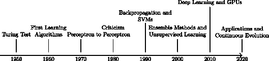

机器学习的历史进程强调了技术进步的迭代性质，以及跨学科研究对推动现代智能系统发展的重要性。

### 1.3 机器学习类型

机器学习涵盖了广泛的方法，每种方法都为解决不同类型的问题定制。这些方法主要分为四类：监督学习、无监督学习、半监督学习和强化学习。理解这些类型对于有效应用机器学习至关重要。

监督学习涉及在标记的数据集上训练模型，这意味着每个训练示例都与一个输出标签相关。目标是让模型学习从输入到输出的映射，以便其对新的、未见过的数据做出准确预测。监督学习的一个共同特征是最小化 `loss function`（损失函数），该函数量化了预测输出与实际输出之间的差异。

运行上述代码段的输出可能如下：

```
array([24.93086001, 23.24463613, 29.56088295, 12.45649195, 21.7151381, ...])
```

无监督学习则处理在没有标记响应的数据上训练模型。目标通常是发现数据中隐藏的模式或内在结构。这可能涉及 `clustering`（聚类）等任务，算法将相似的数据点分组在一起，而不必显式告知哪些数据点属于哪个组。

```
array([0, 0, 0, 0, 0, 0, 0, 0, 0, 0, 0, 0, 0, 0, 0, 0, 0, 0, 0, 0, 0, 0, 0, 0, 0, 0, 0, 0, 0, 0, 0, 0, 0, 0, 0, 0, 0, 0, 0, 0, 1, 1, 1, 1, 1...])
```

半监督学习通过利用标记和无标记数据，在监督学习和无监督学习之间取得平衡。通常，将少量标记数据与大量无标记数据相结合，引导学习过程。这种方法在标记数据昂贵或耗时时特别有益。

```
array([0, 1, 0, 1, 1])
```

强化学习的特点在于其训练方法，智能体通过在环境中执行动作以学习最大化累积奖励。智能体观察环境状态，采取行动，并以奖励或惩罚的形式接收反馈。这种学习类型特别涉及序列决策的场景，例如游戏或机器人。

```
Rendering CartPole-v1...
State: [0.03604128 -0.04063383 0.03632888 0.04112315]
Reward: 1.0
...
```

这些不同的机器学习类型使得模型能够适应广泛的应用，从简单的回归任务到复杂的自主系统，从而在训练数据性质和预期结果的指导下，充分利用数据的潜力。

#### 监督学习

监督学习是机器学习中最突出的方法之一。它涉及在标记的数据集上训练模型，其中每个训练示例都与一个输出标签配对。目标是让模型学习从输入到输出的映射，以便用于对新的、未见过的数据进行预测。监督学习可以大体分为两类任务：回归和分类。

在监督学习的语境下，数据集被结构化为输入-输出对，记为 `D`，其中 `X` 表示特征向量，`y` 表示相应的标签。目标是模拟条件概率分布 `P(y|X)`。

为了说明监督学习，考虑一个预测房价的简单示例。输入特征可能包括房屋面积、卧室数量和房产房龄等属性，而标签则是房屋的价格。

提供的代码演示了如何使用 `scikit-learn` 库中的 `Linear Regression` 模型根据三个特征预测房价。其核心原理是将模型拟合到输入-输出对上，并最小化模型预测值与实际标签之间的差异，回归任务中通常使用均方误差 (`MSE`)。

分类是另一类主要的监督学习任务，涉及预测类别标签。例如电子邮件中的垃圾邮件检测（任务是将电子邮件分类为“垃圾邮件”或“非垃圾邮件”）以及图像中的数字识别。

在这个分类示例中，利用 `Random Forest Classifier` 根据图像特征预测数字。准确率得分衡量了正确分类实例的比例，提供了对模型性能的评估。

有效监督学习的关键要素包括细致的数据预处理、特征选择和模型评估。数据预处理涵盖处理缺失值、特征缩放和类别变量编码。特征选择旨在识别并保留具有预测能力的相关特征。模型评估通常涉及将数据集分为训练集和测试集，或采用交叉验证来稳健地评估模型性能。

算法的选择取决于数据的性质和具体的问题。`Linear regression` 和 `logistic regression` 分别是回归和分类的基础算法。更复杂的算法如 `support vector machines` (`SVM`)、`neural networks` 以及集成方法 `boosting` 和 `bagging` 通常被采用，因为它们在处理复杂数据集时具有卓越的性能。

监督学习中的另一个关键概念是偏差-方差权衡（bias-variance tradeoff）。高偏差意味着模型太简单，无法捕捉数据中的潜在趋势，导致欠拟合。相反，高方差表示模型过度复杂，捕捉的是噪声而非信号，导致过拟合。平衡偏差和方差对于构建能够良好泛化到新数据的模型至关重要。

`Ridge regression` 示例将正则化集成到回归模型中，通过惩罚较大的系数来防止过拟合。`L1` (`Lasso`) 和 `L2` (`Ridge`) 等正则化技术是增强模型泛化能力的关键工具。

总的来说，监督学习的特点是依赖标记数据，并在各个领域有广泛应用。掌握监督学习技术是任何有志的机器学习从业者的基础技能。

#### 无监督学习

无监督学习是机器学习的一种，算法在未标记的数据上进行训练。与监督学习不同（后者每个训练示例都与一个输出标签配对），无监督学习算法必须推断数据点内部存在的自然结构。无监督学习中的常见任务包括聚类、关联和降维。

聚类涉及对一组对象进行分组，使得同一组（或簇）中的对象之间的相似性大于与其他组对象之间的相似性。聚类的一个典型算法是 `K-means`。该算法将 `n` 个观测值划分为 `k` 个簇，每个观测值属于均值最近的簇。`K-means` 算法涉及的步骤为：

`K-means` 聚类可以使用以下伪代码说明：

无监督学习显著应用的另一个领域是关联规则，主要用于市场篮子分析。`Apriori` 算法是一种用于挖掘布尔关联规则频繁项集的流行算法。`Apriori` 算法的指导原则是频繁项集的任何子集必须是频繁的。

降维技术是无监督学习的另一个重要方面。这些方法将数据从高维空间转换到低维空间，同时尽可能保留方差。`Principal Component Analysis` (`PCA`) 是一种常用的降维技术。`PCA` 将数据正交转换为一个新的坐标系，使得数据任何投影的最大方差都落在前几个坐标（称为主成分）上。

`PCA` 算法遵循以下步骤：

使用 Python 中的 `numpy` 实现 `PCA` 的示例代码如下：

```
这种转换通常通过可视化来评估降维的效果。输出可以用多种方式显示，例如绘制显示转换后数据点新坐标的散点图。

### 假设 PCA 将 3 维数据降维到 2 维
 散点图可以显示：
***
*****
******
*****
***
```


# 无监督学习算法

无监督学习算法有助于在不依赖标签的情况下探索数据的内在结构。这可以揭示此前未知的模式和关系，使得这些方法在数据探索、特征工程和预处理步骤中具有极高的价值，适用于异常检测、客户细分等广泛领域。

## 半监督学习

半监督学习是一种介于监督学习和无监督学习之间的范式，它同时利用标注数据和无标记数据来提高学习准确性。当获取标注数据的成本很高或非常耗时，但可以大量获取无标记数据时，这种方法特别有用。半监督学习的目标是使用可用的标注数据来引导学习过程，同时利用无标记数据来提升模型的性能。

在监督学习中，模型在包含输入-输出对的数据集上进行训练，其中输出是标注数据。相比之下，无监督学习涉及在没有任何标记响应的数据上训练模型。半监督学习旨在通过利用较小比例的标注数据结合大量的无标记数据来寻求折中方案。这种整合可以显著降低标注成本和工作量。

### 半监督学习中的假设

半监督学习算法的有效性建立在几个假设之上。这些假设有助于知识从标注数据向无标记数据迁移，引导模型做出准确的预测。

#### 平滑性假设 (Smoothness Assumption)

主要的假设是，如果两个数据点在高密度区域内距离接近，那么它们的输出很可能是相同的。这意味着决策边界不应该经过数据分布的高密度区域。

#### 聚类假设 (Cluster Assumption)

该假设认为不同类别的数据点在数据空间中应形成不同的聚类。如果一个标注样本落在一个聚类中，那么该聚类中的无标记样本很可能被标记为相同的类别。

#### 流形假设 (Manifold Assumption)

流形假设认为高维数据分布在一个低维流形上。在流形上学习可以简化问题，使得模型更容易从标注数据泛化到无标记数据。例如，不同方向和风格的手写数字图像仍然位于低维流形上。

### 方法与技术

半监督学习使用了多种技术和算法来有效利用标注数据和无标记数据的结合。这些包括但不限于：

1.  **自训练 (Self-Training)**：在自训练中，首先在标注数据上训练分类器。然后使用该分类器对无标记数据进行预测。只有置信度高的预测会被作为新的标注样本添加到训练集中。该过程不断迭代直到收敛。

2.  **协同训练 (Co-Training)**：协同训练利用在数据不同视图上训练的多个分类器。每个视图都提供互补信息。在这些视图上训练的分类器为无标记数据标记，然后迭代使用这些新标记的实例来增强训练集并优化分类器。

3.  **生成模型 (Generative Models)**：如变分自编码器 (`VAEs`) 或生成对抗网络 (`GANs`) 等生成模型可以对数据分布进行建模以生成示例。这些示例通过从数据分布中学习特征，有助于提高分类器的鲁棒性。

### 应用与优势

半监督学习应用于标注数据稀缺但有大量无标记数据的各个领域：

*   **自然语言处理 (NLP)**：在 NLP 中，标注数据集相对于大量的文本很小，这使得半监督学习方法在文本分类和命名实体识别等任务中非常有效。

*   **计算机视觉 (Computer Vision)**：在图像分类和目标检测中，标注数据集是一项复杂的任务。半监督学习可以利用无标记图像来增强模型性能。

*   **生物学 (Biology)**：在基因组学和蛋白质组学领域，获取标注数据需要大量的实验室实验。半监督方法可用于基因分类和蛋白质结构预测等任务。

半监督学习的有效性在于它减少了对标注数据的依赖，从而降低了与数据标注相关的成本和工作量。通过更好地利用海量的无标记数据，半监督学习方法能够构建更具鲁棒性且泛化能力更强的模型，并在少量标注样本的情况下实现高准确率。

# 强化学习

强化学习（Reinforcement Learning，RL）是机器学习的一种，智能体通过在环境中执行动作并根据动作的结果接收奖励或惩罚来学习如何行为。这种反馈循环允许智能体随着时间的推移学习并调整行为，以实现累计奖励的最大化。与监督学习（从输入-输出对的数据集中学习）不同，强化学习侧重于从动作的后果中学习，使其天生适用于涉及序列决策的问题。

强化学习的核心是智能体（Agent）的概念，智能体与环境交互，环境包含了智能体之外的所有构建。智能体观察环境状态、采取动作，并接收奖励和更新后的状态作为反馈。智能体的主要目标是找到一个策略 `π : S → A` 来最大化期望回报，其中 `S` 是可能状态的集合，`A` 是可能动作的集合。

智能体与环境的交互可以使用马尔可夫决策过程（MDP）的形式化，它由一个元组定义，其中：

- `S` 是有限状态集，
- `A` 是有限动作集，
- `P` 是状态转移概率矩阵，表示在状态 `s` 下采取动作 `a` 时转移到状态 `s'` 的概率，
- `R` 是奖励函数，其中 `R(s, a, s')` 表示从状态 `s` 通过动作 `a` 转移到 `s'` 时获得的即时奖励，
- `γ` 是折扣因子，决定了未来奖励重要性。

目标是最大化期望累计奖励（也称为回报），对于无限边界问题定义为 `G_t = ∑ γ^k R_{t+k}`，对于具有最终时间步 `T` 的有限边界定义为 `G_t = ∑ γ^k R_{t+k}`。解决强化学习问题的关键是定义一种策略，用 `π` 表示，它指定了在每个状态下应采取的动作。策略可以是确定性的或随机的，确定性策略将状态直接映射到动作，而随机策略提供动作的概率分布。

寻找最优策略有多种方法，但它们通常可以分为三大类：基于价值（value-based）、基于策略（policy-based）和基于模型（model-based）。

## 基于价值的方法

基于价值的方法涉及学习处于特定状态或在这些状态下采取某些动作的价值。该类别中最著名的算法包括 `Q-Learning` 和 `SARSA`。

`Q-Learning` 是一种无模型算法，旨在学习状态-动作对的质量（Q 值）。Q 值代表了在状态 `s` 下采取动作 `a` 并在之后遵循最优策略的期望回报。`Q-Learning` 的更新规则给如下：

```
Q(s, a) = Q(s, a) + α * [R + γ * max(Q(s', a')) - Q(s, a)]
```

其中 `α` 是学习率，`R` 是在状态 `s` 下采取动作后收到的奖励，`s'` 是后续状态。

## 基于策略的方法

基于策略的方法对策略进行参数化，并使用梯度上升法优化参数。基于策略的方法并不学习价值函数，而是侧重于学习最大化期望回报的策略。策略通常由 `θ` 参数化，目标是最大化 `J(θ)`。策略梯度定理为使用梯度上升法更新策略参数提供了基础：

```
∇θ J(θ) = E[∇θ log π(a|s) G_t]
```

其中梯度可以使用各种技术进行估计，例如 `REINFORCE` 和 `actor-critic` 方法。`REINFORCE` 使用以下更新：

```
θ = θ + α ∇θ log π(a|s) G_t
```

## 基于模型的方法

基于模型的方法涉及学习环境模型并使用其规划最优策略。这些方法需要估计状态转移概率矩阵和奖励函数。一旦学习了模型，就可以使用价值迭代（value iteration）和策略迭代（policy iteration）等动态规划方法来寻找最优策略。

在给定准确模型的情况下，基于模型的方法可能更高效地学习最优策略。然而，学习一个准确的模型具有挑战性，特别是在复杂的环境中。

强化学习中的两个关键概念是探索（exploration）和利用（exploitation）。探索涉及尝试新动作以发现它们的影响，而利用利用已知信息来最大化奖励。平衡探索与利用在强化学习中至关重要，通常采用波尔兹曼探索和置信上限（UCB）等策略。

强化学习的应用涵盖多个领域，包括机器人、游戏、金融和医疗。著名的成功包括谷歌的 AlphaGo，它在复杂的棋类游戏中击败了人类冠军，以及自动驾驶技术的进步。

强化学习仍然是一个充满活力的研究领域，在算法、理论基础和现实应用方面不断进步。深度学习与强化学习的结合（被称为深度强化学习）为解决传统方法无法及的高度复杂和高维问题开辟了新途径。

# 常见机器学习算法

机器学习算法是任何机器学习模型的骨干。它们代表了一组模型在理解数据和推导出有用见解时遵循的规则或程序。本节将深入探讨机器学习中一些常用的算法，讨论它们的原理、应用以及实现上的细微差别。

## 线性回归

线性回归是一种基础算法，用于根据一个或多个独立变量预测连续的因变量。它假设输入变量（特征）与目标变量之间存在线性关系。

该模型可以表示为：

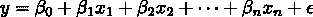

其中 `y` 是因变量，`β0` 是截距，`βn` 是系数，而 `ε` 是误差项。系数通过最小化观测值与预测值之间的平方误差和（`SSE`）来确定。

使用 Scikit-learn 在 Python 中实现：

```python
```

## 逻辑回归

逻辑回归用于二分类问题。与线性回归不同，它的输出变量是类别的，并假设值在 0 到 1 之间。它使用逻辑函数对目标变量的概率进行建模。

逻辑函数公式如下：

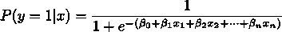

使用 Scikit-learn 在 Python 中实现：

```python
```

## 决策树

决策树是分类和回归任务的流行选择。它们根据输入特征的值将数据划分为子集，形成一个树状的决策模型。树中的每个节点代表一个特征，每个分支代表一条决策规则，每个叶节点代表一个结果。

在算法上，树是通过选择在分裂后产生最大信息增益或最大吉尼纯度减少的特征来构建的。

使用 Scikit-learn 在 Python 中实现：

```python
```

## 支持向量机

支持向量机在分类和回归方面都非常强大。`SVM` 旨在寻找特征空间中能够最好分离类别的超平面。最优超平面是最大化间隔的平面，即超平面与任意一类中最近数据点的距离，称为支持向量。

对于非线性可分的数据，`SVM` 使用内核函数（如多项式或径向基函数 `RBF`）将数据投影到高维空间，在该空间中可以进行线性分离。

使用 Scikit-learn 在 Python 中实现：

```python
```

## K-近邻

K-近邻算法是一种简单的基于实例的学习算法，用于分类和回归任务。它根据数据点在特征空间中 `k` 个最近邻居的多数类对数据点进行分类。对于回归，输出是 `k` 个最近邻居值的平均值。

选择合适的 `k` 值至关重要，因为较小的 `k` 值会让模型对噪声敏感，而较大的 `k` 值可能会使数据过度平滑。

使用 Scikit-learn 在 Python 中实现：

```python
```

## 随机森林

随机森林是一种集成学习方法，它创建了一个决策树集合并聚合它们的结果。每棵树都在训练数据和特征的随机子集上进行训练，最终预测基于多数投票（分类）或平均值（回归）。

这种方法通过减少过拟合来提高模型的稳健性和准确性。

使用 Scikit-learn 在 Python 中实现：

```python
```

## K-均值

K-Means 是一种流行的基于质心的聚类算法。它将数据划分为 `k` 个簇，每个簇由簇内数据点的质心（均值）表示。该算法迭代地将数据点分配给最近的质心，然后根据新的簇成员关系更新质心。

主要步骤为：

1. 随机初始化 `k` 个质心。
2. 将每个数据点分配给最近的质心。
3. 根据所分配点的均值更新质心。
4. 重复步骤 2 和 3 直到收敛。

使用 Scikit-learn 在 Python 中实现：

```python
```

## 主成分分析

主成分分析是一种降维技术。它将原始特征转换为一组新的特征，称为主成分，这些特征是正交的并捕捉了数据中的最大方差。这对于降低模型的计算复杂性和高维数据可视化特别有用。

主成分通过对数据的协方差矩阵进行特征分解来确定。

使用 Scikit-learn 在 Python 中实现：

```python
```

## 梯度提升

梯度提升是一种集成方法，通过逐步优化损失函数来构建模型。每个阶段都会添加一棵决策树，以减少之前树所犯的错误。最终模型是所有树的加权和。

最著名的实现包括 `XGBoost`、`LightGBM` 和 `CatBoost`，它们提供了高效的训练和更高的预测性能。

使用 Scikit-learn 在 Python 中实现：

```python
```

每种算法都有其优缺点和局限性，算法的选择取决于数据的特定特征和解决的问题。实验和验证是为特定任务选择最合适机器学习算法的关键。

# 机器学习的应用

机器学习已成为支撑跨多个领域智能系统开发和部署的关键技术。机器学习的变革性影响跨越多个行业，具有彻底改变传统实践并引入前所未有效率的能力。本节将深入探讨机器学习的一些最重要应用，阐明其广泛的用途和多功能特性。

## 医疗保健

机器学习最突出的应用之一是医疗保健。机器学习算法通过分析医学图像、基因组数据和电子健康记录来协助诊断疾病。例如，`convolutional neural networks`（`CNNs`）在医学图像分类方面表现出卓越性能，能够高准确度地检测肿瘤等异常。一个典型的应用是皮肤癌的早期检测，机器学习模型被用于对皮肤病变图像进行分类。

## 金融

在金融领域，机器学习算法被广泛用于欺诈检测、算法交易、信用评分和风险管理。通过检查交易模式，机器学习系统比传统的基于规则的方法更精确地识别潜在的欺诈活动。此外，在算法交易中，机器学习模型可以处理海量市场数据，发现隐藏模式，并在最佳时机执行交易。

## 自然语言处理 (NLP)

在自然语言处理（`NLP`）领域，机器学习推动了显著进展。情感分析、机器翻译和聊天机器人等任务利用机器学习来理解和生成人类语言。例如，情感分析涉及训练模型来分析文本数据并确定其背后的情感，这在社交媒体监控和客户反馈分析等领域至关重要。

## 汽车行业

在汽车行业，自动驾驶车辆的兴起很大依赖于机器学习。深度学习技术，特别是涉及 `CNNs` 和循环神经网络（`RNNs`）的技术，被用于让自动驾驶车辆感知和解释周围环境、决策并安全导航。目标检测、车道保持和碰撞避免等任务由先进的机器学习算法驱动，这些算法实时处理来自摄像头、激光雷达和其他传感器的数据。

```
Detected Stop Sign at coordinates (x: 305, y: 225)
Object: Pedestrian detected at coordinates (x: 120, y: 210)
Collision warning: Vehicle approaching from the right at speed 30 km/h
```

## 零售

在零售业中，机器学习驱动着个性化营销和推荐系统。通过分析客户行为和购买历史，推荐算法可以建议个人客户可能感兴趣的产品，从而增强客户体验并提高销售额。像 `Amazon` 和 `Netflix` 这样的电子商务平台已有效利用机器学习进行个性化推荐，影响了用户的购买决策。

## 制造业

机器学习还通过预测性维护和自动化改变制造业。预测性维护利用机器学习模型在设备故障发生之前进行预测，从而减少停机时间和维护成本。通过分析来自机械的传感器数据，模型可以预测何时需要维护，并优化维护活动的调度。

## 农业

此外，在农业领域，机器学习有助于精准农业。算法分析来自各种来源的数据（如卫星图像、传感器和无人机），以监测作物健康、预测产量并优化水和化肥等资源的使用。这种数据驱动的方法有助于做出明智的决策，以提高生产力和可持续性。

## 网络安全

机器学习的影响也延伸到了网络安全领域。它通过分析网络流量、检测异常和实时响应安全违规，在识别和缓解网络威胁方面发挥着至关重要的作用。基于机器学习的安全系统不断学习并适应新威胁，为复杂的网络攻击提供稳健的保护。

## 结论

总结来说，机器学习的应用是多方面的，并深度整合到各个行业。机器学习模型的通用性和适应性使其成为解决复杂问题、驱动创新和在众多领域创造效率的宝贵工具。无论是增强医疗保健成果、优化金融运营，还是实现自动系统，机器学习仍然是技术进步的基石。

# 神经网络简介

神经网络是现代机器学习的基础组件，特别是在深度学习领域。它们的灵感源于人类大脑的结构和功能机制，利用互连的节点层（或神经元层）来处理输入数据、识别模式并做出预测。在本节中，我们将深入探讨神经网络的架构、运行机制以及各种类型的神经网络。

神经网络的基本单元是神经元，也称为感知机。每个神经元接收一个或多个输入，通过加权求和对其进行处理，并应用激活函数来产生输出。单个神经元的数学公式可以表示如下：


其中 `y` 是输出，`x` 代表输入特征，`w` 是权重，`b` 是偏置，`f` 是激活函数。激活函数为网络引入了非线性因子，使其能够学习复杂的模式。常用的激活函数包括 sigmoid 函数、双曲正切函数（`tanh`）和正线性单元（`ReLU`）。

## 架构与前向传播

神经网络由输入层、一个或多个隐藏层和一个输出层组成。每层包含多个神经元，这些神经元通过加权连接与相邻层的神经元相连。在前向传播过程中，输入数据流过网络，并在每一层通过上述的加权求和和激活函数机制进行转换。

## 训练与优化

训练神经网络涉及调整权重和偏置以最小化损失函数，损失函数量化了预测输出与实际目标值之间的差异。最常用的优化技术之一是梯度下降，它通过计算损失函数对每个权重的梯度来迭代更新权重。这一过程通过以下更新规则形式化：


其中 `η` 是学习率，`L` 是损失函数。梯度的有效计算是通过反向传播实现的，该算法利用链式法则计算损失函数对每个权重的偏导数。

## 神经网络类型

有多种类型的神经网络，每种都针对特定的应用和数据类型进行了设计：

- **前馈神经网络 (FNNs)：** 这是最简单的神经网络形式，信息从输入到输出单向流动，没有任何循环。它们通常用于分类和回归任务。

- **卷积神经网络 (CNNs)：** 主要用于图像处理和计算机视觉任务，CNN 利用卷积层自动从输入图像中提取特征的空间层次结构。卷积层对输入的局部区域应用滤波器，并在空间维度上共享参数，从而减少了参数数量和计算复杂度。

- **循环神经网络 (RNNs)：** 这些网络专为序列数据设计，如时间序列或自然语言。RNN 维护一个隐藏状态，用于捕捉序列中之前元素的信息。然而，标准 RNN 在处理长序列时面临梯度消失问题。长短期记忆（`LSTM`）网络和门控循环单元（`GRUs`）通过引入门控机制来缓解这一问题，更好地捕捉长期依赖关系。


- **自动编码器：** 自动编码器用于无监督学习任务，如降维或异常检测。它们由一个将输入压缩到低维潜空间的编码器和一个从该表示重构输入的解码器组成。其训练目标是最小化重构误差。

- **生成对抗网络 (GANs)：** GAN 由两个相互竞争的网络组成：一个合成数据样本的生成器和一个区分真实与合成样本的判别器。其目标是让生成器产生越来越真实的样本，使判别器无法将其与真实数据区分。

理解神经网络的架构和运行是部署高级机器学习模型的基础。这些基础知识能够进一步探索更复杂的架构和实际应用。将这些概念与健壮的数据处理流水线和优化技术相结合，可以产生强大的预测模型，驱动现代人工智能解决方案。

# 机器学习工作流

机器学习工作流描述了开发、训练和部署机器学习模型的结构化过程。这是一种确保可靠性、效率和准确性的系统化方法。理解这一工作流对于从业者管理复杂项目和交付最佳结果至关重要。典型的机器学习工作流可以分为几个步骤：数据收集、数据预处理、特征工程、模型选择、训练、评估、超参数调优和部署。每一步都是**必不可少的**，并对模型的整体性能做出贡献。

## 数据收集

第一步是数据收集，即从各种来源收集相关数据。数据的质量和数量会显著影响机器学习模型的性能。数据可以从数据库、在线仓库、传感器或手动输入中收集。也可以采用自动化工具或网络爬虫来确保数据的全面性。确保数据对于当前问题具有代表性且是**充足的**是至关重要的。

## 数据预处理

在数据收集之后，进入了数据预处理阶段。这一步涉及清洗数据，以处理缺失值、离群值和不一致之处。数据通常包含噪声或无关信息。因此，清洗数据并验证其准确性是必不可少的。常见的预处理任务包括归一化、标准化、类别变量编码以及处理缺失值。Python 中的 `pandas` 库经常用于数据预处理。使用 `pandas` 库处理缺失数据的例如所示：

## 特征工程

特征工程是下一步，将原始数据转换为可以增强模型学习过程的有意义特征。特征工程包括许多技术，如选择显著变量、通过数学变换创建新特征，或利用领域知识提取相关信息。这是一个迭代过程，涉及探索不同的变换和选择以寻找最佳特征集。特征工程的重要性不言而喻，因为它直接影响模型性能。

## 模型选择

后续是模型选择。这涉及根据问题的性质、数据集和预期的结果选择合适的机器学习算法。常用的机器学习算法包括线性回归、决策树、支持向量机和神经网络。每种算法根据应用场景均有其优缺点。例如，线性回归适用于连续输出预测，而决策树可能更适合分类任务。通过交叉验证和网格搜索比较不同的模型，有助于选择最合适的一个。

## 模型训练

一旦选定了模型，就需要使用数据集对其进行训练。模型训练涉及将输入数据馈送算法，根据错误率调整参数，并不断迭代直到模型达到所需的准确率。Python 中的库被广泛用于模型训练。例如，使用训练决策树分类器可以如下：

## 评估

训练完成后，使用各种指标（如准确率、精确率、召回率、F1 分数的 ROC-AUC）评估模型性能。这些指标有助于评估模型对未见数据的泛化能力。评估通常在训练期间未使用的保留测试集上进行。混淆矩阵和分类报告为分类任务提供了详细的性能总结。

## 超参数调优

模型性能通常可以通过超参数调优来提高。这一步涉及调整算法的超参数，这些参数是在训练过程中不学习而在过程之前就已经定义的。采用网格搜索、随机搜索和贝叶斯优化等技术寻找最优超参数。以下示例演示了使用网格搜索对决策树进行超参数调优：

```
}
```

## 部署

达到满意性能后，最后一步是部署。这涉及将训练好的模型集成到生产环境中并在新数据进行预测。部署可能需要将模型转换为与生产系统兼容的格式，使用 `Flask` 或 `Django` 等框架进行 API 部署，或使用 `AWS SageMaker` 或 `Google AI Platform` 等云服务。监控部署模型的性能并使用新数据对其进行更新，对于长期保持准确性至关重要。

机器学习工作流中的每一步都建立在之前步骤的基础上，确保了一个稳健、准确且准备好部署的模型。通过遵循这一结构化过程，从业者可以开发出对真实世界数据泛化良好的可靠机器学习系统。

# 机器学习的挑战与未来

机器学习处于技术创新的前沿，但其进展并非没有重大挑战。这些挑战跨越了技术、伦理和解释性领域，表明尽管潜力巨大，但障碍阻碍了机器学习无缝集成到真实世界的应用中。有效应对这些挑战需要研究人员、从业者和政策制定者的共同努力。

一个主要的技术挑战之一是对海量数据的需求。机器学习系统，特别是深度学习模型，以其“数据饥渴”而闻名。训练稳健的模型通常需要大量的标注数据，而收集这些数据既昂贵又耗时。例如，在医学影像领域，图像标注需要专家知识和精耕细致的努力。在标注数据集有限或不存在的专业领域，数据稀缺问题变得更加紧迫。

数据质量问题进一步复杂了数据挑战。高质量的训练数据必须代表模型将部署的真实场景。数据噪声、偏见和不平衡等问题会严重损害模型性能。例如，有偏的训练数据可能导致模型延续现有的性别或种族偏见，从而引发伦理关注。目前人们正在探索数据增强、合成数据生成和迁移学习等技术来缓解这些问题，但尚未提供通用的解决方案。

另一个重大挑战是机器学习模型的可解释性和可说明性。复杂模型（尤其是深度神经网络）通常像“黑箱”一样运行。它们的决策过程并不容易解释，这在医疗和金融等需要透明度的领域引发了一个问题。研究人员正在积极开发解释模型的方法，例如局部可解释模型无关（`LIME`）和沙普利加性解释（`SHAP`），这些方法旨在为模型预测提供洞察。

从训练数据到未见数据的泛化是第三个挑战。当模型在训练数据上表现异常出色，但无法泛化到新的未见数据时，就会发生过拟合。当模型相对于训练数据的数量和质量而言过于复杂时，这是一个突出问题。人们通常采用正则化技术、交叉验证和更简单的模型来解决过拟合，但实现最佳泛化仍然是一个复杂的平衡过程。

将机器学习模型部署到生产系统中也带来了后勤方面的挑战。模型必须高效地集成到现有的工作流中，这通常需要技术和基础设施的调整。模型版本控制、扩展性以及实时推理的需求等部署问题需要复杂的工程解决方案和稳健的基础。对已部署模型进行持续监控和维护，以确保其随时间推移的性能和可靠性，又增加了复杂度。

随着机器学习系统影响生活的各个方面，伦理和社会挑战正变得日益突出。必须解决围绕隐私、公平和责任方面的问题，以培养公众信任。例如，依赖个人数据的机器学习模型必须遵守通用数据保护条例（`GDPR`）等数据保护法规。此外，迫切需要设计避免歧视性并确保所有用户组获得公平对待的模型。

展望未来，可以确定几个很有前景的方向。一个持续的研究领域是开发训练所需数据更少的模型。样本学习、迁移学习和无监督学习范式是减少机器学习模型数据依赖的关键。通过利用先验知识并从小型数据中更高效的学习，这些方法在数据稀缺的环境中具有广泛应用的前景。

跨学科研究是另一个重要的未来方向。将机器学习与神经科学、物理和经济学等学科相结合，可以产生新的方法论和应用。例如，脑启发算法和神经形态计算是新兴领域，旨在模拟生物大脑的效率和适应性。

硬件的进步也将显著塑造机器学习的未来。图形处理器（`GPUs`）、张量处理单元（`TPUs`）和神经形态芯片等专用硬件的发展将实现更高效的训练和推理，可能使机器学习能力的普及民主化。

最后，机器学习与量子计算、分布式账本和物联网（`IoT`）等其他前沿技术的整合将开启新的可能性和应用。例如，量子机器学习探索了量子计算如何解决经典系统无法处理的问题，有望为特定任务提供指数级的加速。

应对这些挑战并利用这些机会需要一种多方面的方法，涉及持续的创新、伦理考量以及跨部门的协作。机器学习的动态性质确保了尽管挑战依然存在，未来仍含着变革性进步的巨大潜力。

# 第二章：神经网络基础

本章深入探讨神经网络的基本概念，从其生物灵感以及被称为感知器的基本构建单元开始。它概述了神经网络的结构，解释了正向传播，并涵盖了激活函数、层和反向传播等关键组件。介绍了梯度下降、损失函数和权重初始化等核心概念。本章以一个从零开始构建简单神经网络的实践指南结束，为进一步的探索奠定了坚实基础。

## 神经网络简介

神经网络是一类受人类大脑结构和功能启发的模型，它利用计算节点（神经元）和加权连接（神经突触）来执行分类、回归和模式识别等任务。其基本目标是通过调整相互连接的权重来最小化预测或输出的误差，从而使机器能够从数据中学习。

神经网络结构为由神经元组成的连接图，分为若干层：输入层、隐藏层（一个或多个）和输出层。每条连接都被分配了一个权重，这是一个修改输入信号的标量因子。这些层充当神经网络的构建块，通过在通过网络中传播时转换输入信号来执行复杂的计算任务。

### 神经元与激活函数

神经网络的基本计算单元是神经元，它聚合输入信号，应用加权和，并将结果通过激活函数传递。形式上，神经元 `i` 的输出定义为：

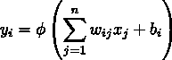

其中 `ϕ` 是激活函数，`w_i` 是连接输入到神经元的权重，`x_i` 是输入，`b_i` 是加到加权和中的偏置项。

激活函数为模型引入了非线性，使神经网络能够捕获复杂的模式和关系。常见的激活函数包括 sigmoid 函数、双曲正函数（tanh）和整流线性单元（ReLU），其定义如下：

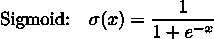 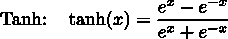 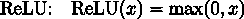

### 网络层

输入层接收原始数据。隐藏层位于输入层和输出层之间，执行中间计算，随着层数的增加（深度网络），复杂度随之增加。输出层提供最终的预测或分类结果。

考虑一个单层网络（也称为单层感知器）的简单示例，它可以解决线性可分问题。配套的代码演示了使用 Python 和 NumPy 的基本实现：

```
Output (example):
Trained weights: [[6.00876977] [6.00876976]]
Trained bias: -2.949999419173143
```

这个简单的神经网络展示了前向传播和反向传播操作的核心过程。前向传播阶段涉及计算加权和并应用激活函数以生成输出。反向传播阶段涉及计算预测标签与实际标签之间的误差，然后根据损失函数对于这些参数的梯度对权重和偏置进行调整。

通过迭代多个轮次（epochs），网络会微调其权重，达到预测误差最小化的状态。这种动态学习能力支撑了神经网络在解决各种复杂任务中的实用性和多功能性，为后续章节中深层次的探索奠定了基础。

## 生物启发

神经网络的起源深植于对大脑结构和功能的理解。大脑包含约 860 亿个神经元，是一个极其复杂的器官，能够同时执行许多任务。大脑中的每个神经元都可以与其他神经元形成数千个突触连接，形成一个错综复杂的互连网络。这些连接大脑能够处理信息、从经验中学习并适应新情况。

在神经网络中，核心目标是人工地模拟这些生物过程。基本思想是复制大脑的神经元结构如何促进学习和决策。本节将探索生物神经元的基本方面，并阐明这些原理如何启发人工神经网络的设计。

### 神经元与突触

神经元由三个主要部分组成：细胞体（胞体）、树突和轴突。树突是自细胞体发散的树状结构，负责接收来自其他神经元的输入信号。细胞体整合这些信号，如果总输入超过特定阈值，就会产生动作电位。这种动作电位沿着轴突传递到突触，在那里释放神经质以与相邻神经元通信。

这些突触连接的强度和效能是动态的，可以通过经验和学习进行调节——这一过程被称为突触可塑性。突触强度的适应性使大脑能够高效地学习和存储信息。

### 人工神经元的启发

人工神经网络在几个关键方面从生物神经元获得灵感。人工神经元类似于生物神经元，接收输入信号、处理这些信号并生成输出。神经网络的基本单元通常被称为感知器。感知器接收多个输入，对这些输入应用一组权重，对其进行求和，然后将结果通过激活函数产生输出。

让 `x` 代表输入信号，`w` 代表相应的权重。人工神经元的输出 `y` 可以用数学公式表示如下：


在这里，`b` 表示偏置项，`f` 代表激活函数。激活函数在输出中引入了非线性，这对于解决非线性可分的更复杂问题至关重要。

### 从突触可塑性学习

突触可塑性的概念启发了人工神经网络中的学习算法，特别是调整权重的机制。人工神经网络中的学习涉及修改权重和偏置以最小化损失函数，这种方法类似于根据经验增强或削弱突触连接的生物过程。

神经网络中的权重调整过程通常使用 `梯度下降`，这是一种数学优化技术。`梯度下降` 通过计算损失函数对于每个权重的梯度，并沿着梯度的反方向调整权重来迭代更新权重。这种迭代过程持续进行直到损失函数收敛到最小值，类似于大脑的自适应学习。

### 神经网络拓扑结构

生物神经网络的互连特性在人工神经网络的拓扑结构中得到了体现。人工神经元层相互连接，信息通过这些连接传播。这种分层结构可以分为三类：输入层、隐藏层和输出层。每一层对输入数据执行特定的转换，类似于大脑的不同区域专门负责各种认知功能。

这些层与加权连接之间的相互作用定义了神经网络的计算能力。通过堆叠多个隐藏层，神经网络可以捕获数据中复杂的模式和关系，使其能够处理图像识别、自然语言处理等项复杂任务。

神经网络的生物启发强调了引导这些人工系统设计和功能的基本原理。通过模拟大脑复杂的架构和自适应学习过程，神经网络已成为解决广泛计算问题的强大工具。

## 感知机：构建模块

感知机是神经网络的基本单元，就像神经元是大脑的基本单元。每个感知机接收多个输入，通过加权和对这些输入进行处理，应用激活函数，然后输出结果。感知机的架构可以用数学方式描述，阐明了它在神经网络中的操作方式和作用。

感知机模型可以用以下数学方程表示：

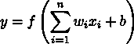

在该方程中：

- `x` 代表输入特征。
- `w` 表示与每个输入特征相关的权重。
- `b` 是偏置项（bias）。
- `f` 是用于为模型引入非线性的激活函数。
- `y` 是感知机的输出。

### 加权和与偏置

感知机中的加权和是输入特征的线性组合，公式如下：

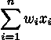

在这里，权重是在训练过程中调整的参数，用以最小化预测输出与实际输出之间的误差。偏置是一个额外参数，通过移动激活函数来帮助模型更灵活地适应数据。如果没有偏置项，决策边界将始终通过原点，这限制了感知机有效拟合数据的能力。

### 激活函数

激活函数 `f` 为感知机引入非线性，使其能够解决复杂问题。常见的激活函数包括阶跃函数、sigmoid 函数、双曲正切（tanh）和线性流单元（ReLU）。激活函数的选择对神经网络的学习能力和收敛性起至关重要的作用。

对于二分类问题，常用的激活函数是阶跃函数，定义如下：

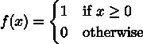

然而，这种基于阈值的方法对于复杂问题可能过于简单，因此在现代神经网络中通常倾向于使用 `sigmoid` 或 `ReLU` 等更细腻的函数。

### 感知机算法

感知机学习算法根据预测误差迭代调整权重和偏置。这是通过梯度下降或其他优化技术实现的。算法流程如下：

1. 将权重 `w` 和偏置 `b` 初始化为小的随机值。
2. 对于每个训练样本：
   - 计算加权和
   - 应用激活函数 `f` 计算输出
   - 计算误差
3. 根据学习规则更新权重和偏置：

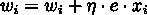

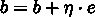

其中 `η` 是学习率。
4. 重复步骤直到收敛或达到指定的训练轮数（epochs）。

以下是 Python 中感知机学习算法的简单实现：

```python
# Simple implementation goes here
```

示例用法的预期输出如下：

`[0 0 0 1]`

如图所示，感知机迭代更新权重，直到准确分类输入数据为止。感知机的简单性和高效性使其成为构建更复杂神经网络架构的基础元素。

## 神经网络的结构

神经网络的结构是其作为计算模型的功能的基础。典型的神经网络由相互连接的节点（或神经元）层组成，这些节点协同工作处理输入数据并生成输出。理解这些网络的架构对于设计有效的模型至关重要。

从数学角度来看，神经网络可以表示为包含多个层的有向图：输入层、一个或多个隐藏层以及输出层。每层包含一定数量的神经元，这些神经元通常与后续层的神经元全连接。

在神经网络模型中，层负责将输入数据转换为有意义的输出。

### 输入层

输入层是网络的第一层，直接接收输入数据。输入层中的每个神经元代表数据中的一个特征。

### 隐藏层

这些层位于输入层和输出层之间，执行将输入转换为输出所需的大部分计算。隐藏层的数量和大小可以不同，这影响模型学习复杂模式的能力。隐藏层中的每个神经元都对其接收到的输入应用激活函数，生成的输出作为下一层的输入。

### 输出层

网络的最后一层提供模型的输出。输出层的结构取决于所解决的问题类型。对于分类问题，它通常对应于数据集中的每个类别包含一个神经元，并使用 `softmax` 激活函数输出概率。对于回归任务，它可能有一个代表连续值的单个神经元。

### 神经元

神经元结合其接收到的输入，通过激活函数应用非线性变换，并将结果传递给下一层。形式上，神经元 `i` 的输出由公式给出：

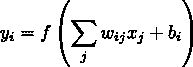

其中 `f` 是激活函数，`w` 是与上一层神经元 `j` 连接的权重，`x` 代表来自神经元 `j` 的输入值，`b` 是神经元 `i` 的偏置项。

权重和偏置是网络的初始参数，会在训练过程中进行更新。权重决定神经元之间连接的强度，而偏置允许模型通过移动激活函数来更好地拟合数据。

### 权重与激活

网络中的每个神经元对其输入应用激活函数。激活函数的作用至关重要；它为模型引入了非线性，使网络能够学习复杂模式。流行的激活函数包括 `Sigmoid`、`Tanh` 和线性流单元（ReLU）。

例如，`ReLU` 激活函数的定义为：


该函数只通过正值，充当阈值，仅在特定输入时激活神经元。

### 前馈

前馈神经网络在评估期间利用前馈机制。在输入层输入的数据传播到每个后续层，最终到达输出层。在此过程中，每层的每个神经元都会处理其接收到的信息并将其向前传递：

```python
# Feedforward logic goes here
```

在这里，`X` 代表输入特征，权重和偏置是网络学习到的参数，`f` 是应用于每层的非线性函数。

### 层


# 层的配置与神经网络结构

层的配置是一个超参数，会显著影响神经网络的容量和性能。常见的配置包括有一个隐藏层的浅层网络和具有许多隐藏层的深层网络。包含多少层以及每层包含多少神经元取决于任务的复杂性以及用于训练的数据量。

对神经网络结构的详细理解对于设计新模型和排查现有模型都至关重要。神经元、层、连接和激活函数的相互作用创建了复杂的架构，使得神经网络（`NNs`）能够执行各种复杂任务，从图像识别到自然语言处理。

# 2.5 前向传播

正向传播是神经网络运行中的一个关键过程。它是输入数据通过网络以生成输出的机制。这一过程涉及数据从输入层开始，经过任何隐藏层，并最终到达输出层的系统化处理。正向传播的概念对于理解神经网络如何进行预测和对数据进行分类至关重要。

考虑一个具有一个输入层、一个隐藏层和一个输出层的简单神经网络。每一层中的每个神经元都与下一层中的每个神经元连接，形成一个全连接网络。神经元之间的连接是有权重的，而学习这些权重对于网络性能至关重要。

正向传播从输入层开始，输入层持有待处理的初始数据。每个输入被分配一个独立的特征，表示为 `x_i`，其中 `i` 的范围从 1 到输入神经元的数量。这些输入神经元通常作为原始数据的载体，不执行任何计算。

下一步涉及隐藏层。假设隐藏层有 `H` 个神经元。隐藏层中的每个神经元 `j` 接收来自所有输入神经元的加权之和：

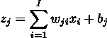

在这里，`w_ij` 代表从输入神经元到隐藏神经元的权重，`b_j` 是与隐藏神经元相关的偏置。包含偏置项是非常重要的，因为它允许激活函数在水平方向上平移。

生成的 `z_j` 随后通过激活函数产生隐藏神经元的输出，表示为：

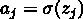

常见的激活函数包括 `sigmoid` 函数、双曲正切函数（`tanh`）和正线性单元（`ReLU`）。例如，`sigmoid` 函数定义为：

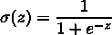

移动到输出层，每个输出神经元 `k` 累加来自隐藏神经元的激活值的加权之和。如果有 `O` 个输出神经元，输出神经元的激活前输入计算方式如下：

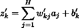

在这里，`w_jk` 表示从隐藏神经元 `j` 到输出神经元 `k` 的权重，`b_k` 是输出神经元的偏置项。

在完成加权求和后，应用激活函数以获得的最终输出：

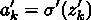

在分类任务中，输出层经常使用 `softmax` 函数。它产生不同类别之间的概率分布，并定义为：

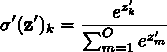

正向传播的实现可以用编程的方式描述。考虑以下实现正向传播的 Python 代码块：

```python
# (Code implementation)
```

上述代码为简单的前馈神经网络初始化了正向传播。通过在隐藏层中使用 `sigmoid` 函数并在输出层中使用 `softmax` 函数，它计算了网络对给定输入的预测。该程序有助于直观地展示正向传播中发生的逐步计算过程。

正向传播过程产生的预测结果为评估网络性能提供了基础，并随后可以通过反向传播和其他学习算法调整权重。

# 激活函数

激活函数是神经网络中至关重要的组件，负责向模型中引入非线性。这种非线性使得神经网络能够近似复杂函数并捕捉数据中复杂的模式。如果没有非线性激活函数，无论层数多少，神经网络在本质上都会表现得像线性模型，从而限制了它解决复杂问题的能力。

在本节中，我们将讨论一些最广泛使用的激活函数、它们的数学公式、属性以及典型用例。

## 1. Sigmoid 函数

`sigmoid` 函数也称为逻辑函数（`logistic function`），其数学定义为：

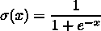

`sigmoid` 函数将输入 `x` 映射到 0 到 1 之间的值。这对于二分类任务特别有用，其中输出代表概率。

`sigmoid` 函数的图展示了其特征性的 S 形，它从 0 平滑过渡到 1。

`sigmoid` 函数的导数是反向传播算法所必需的，其公式为：

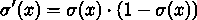

尽管具有这些有用属性，`sigmoid` 函数也有一些局限性，例如梯度消失问题。当输入处于极端的正或负值时，梯度趋于零，导致网络难以学习。

## 2. 双曲正切 (tanh) 函数

`tanh` 函数是另一种 `sigmoid` 形状的激活函数，数学定义为：

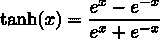

`tanh` 函数将输入 `x` 映射到 -1 到 1 之间的值，使其以零为中心。这有助于缓解一些与 `sigmoid` 函数相关的问题。

`tanh` 函数的导数为：

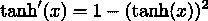

与 `sigmoid` 函数一样，当输入幅度很大时，`tanh` 也会遭受梯度消失问题。

## 3. 正线性单元 (ReLU)

`ReLU` 函数定义为：


`ReLU` 函数通过对任何负输入输出零并保留正值不变，向模型中引入了稀疏性。这有助于缓解梯度消失问题，并导致它在深度学习中被广泛采用。

`ReLU` 函数的导数为：

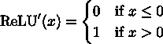

尽管具有这些优势，`ReLU` 可能会遭受“死亡 ReLU”（`dying ReLU`）问题，即神经元可能变为非活动且仅输出零。当权重更新方式使得神经元的大部分输入为负值时，就会发生这种情况。

## 4. Leaky ReLU

Leaky `ReLU` 是 `ReLU` 函数的一种变体，旨在解决“死亡 ReLU”问题。它在输入为负时允许产生小的非零梯度。该函数定义为：

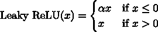

其中 `α` 是一个小的常数，通常为 0.01。

Leaky `ReLU` 函数的导数为：

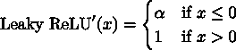

## 5. Softmax 函数

`softmax` 函数主要用于分类神经网络的输出层，将原始输出分转换为概率。该函数定义为：

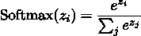

其中 `z_i` 是原始输出分。`softmax` 函数确保输出概率之和为 1，使其适用于多分类任务。

`softmax` 函数的梯度由于其输出的相互依赖性而更加复杂，它通常与交叉熵损失函数结合使用以简化反向传播。

每个激活函数都有其自身的特性、优势和局限性。激活函数的选择可能会影响神经网络模型的性能和收敛。理解这些函数的属性有助于在设计和训练神经网络时做出明智的决策。

# 层的类型：输入层、隐藏层和输出层

神经网络的架构根本上由三类型的层组成：输入层、隐藏层和输出层。这种结构通常被可视化为一系列相互连接的节点或神经元，构成了神经网络架构的骨干。每种层都有特定的角色和功能，共同促进了网络从数据中学习和泛化的能力。

## 输入层

输入层是神经网络的第一层，用于直接接收原始数据。输入层中的每个神经元都对应于输入数据的一个属性或特征。例如，在图像处理任务中，如果输入是一张 28x28 像素的灰度图像，那么输入层将有 784 个神经元，每个神经元代表一个像素的强度值。输入层不进行任何变换或计算；它仅仅充当通道，将输入数据传递给后续层。

## 隐藏层

隐藏层位于输入层和输出层之间，对输入数据进行各种变换和计算，以提取显著的特征和模式。这些层被称为“隐藏层”，是因为它们无法从网络的输入或输出直接观察到。每个隐藏层由多个神经元组成，这些神经元使用加权连接对从上一层接收的数据进行非线性变换。

隐藏层的操作本质可以用前向传播方程来说：

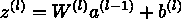

其中：

- `z^l` 是该层的加权输入。
- `W^l` 是连接层激活值到该层的权重矩阵。
- `a^l` 是该层的激活向量。
- `b^l` 是该层的偏置向量。

随后，通过应用激活函数计算该层的激活：

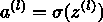

隐藏层使神经网络能够捕捉数据中复杂的模式和关系，允许更深层次、更抽象的表示。具有多个隐藏层的深度神经网络在学习复杂特征方面特别有效，使其非常适用于图像识别、自然语言处理等任务。

## 输出层

输出层是神经网络的最后一层，来自隐藏层的处理后的信息在此处转换为期望的输出格式。输出层的结构和类型取决于神经网络设计执行的任务性质。对于分类任务，输出层通常使用 `softmax` 激活函数将原始分数（`logits`）转换为类别概率：

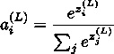

其中 `L` 是最终层，代表类别的概率。对于回归任务，输出层通常使用线性激活函数来预测连续值。

以下 Python 代码提供了使用 `Keras` 库实现的神经网络结构的基本示例，其中清晰定义了输入层、隐藏层和输出层：

```python
import tensorflow as tf
from tensorflow.keras import layers, models

model = models.Sequential([
    layers.Dense(128, activation='relu', input_shape=(784,)),
    layers.Dense(64, activation='relu'),
    layers.Dense(10, activation='softmax')
])

model.compile(optimizer='adam',
              loss='categorical_crossentropy',
              metrics=['accuracy'])
```

上述代码演示了一个神经网络模型的定义，该模型包含一个接收 784 个特征的输入层、两个分别具有 128 和 64 个神经元的隐藏层，以及一个用于分类的具有 10 个神经元的输出层。隐藏层使用的激活函数是 `ReLU`（修正线性单元），而输出层使用 `softmax`。网络使用 `Adam` 优化器和分类交叉熵损失函数进行编译，以衡量性能。

理解不同类型的层及其作用，对于设计针对特定任务的有效神经网络架构至关重要。这些基础知识为更高级的神经网络概念和架构奠定了基础。

# 2.8 反向传播

反向传播（或误差的反向传播）是一种广泛用于训练前馈神经网络的算法。它计算损失函数相对于网络中所有权重的梯度，从而通过梯度下降实现优化过程。“反向传播”一词是指梯度从输出层向输入层反向通过网络，以调整权重并最小化损失函数。

考虑一个包含一个输入层、一个隐藏层和一个输出层的简单神经网络。令 `X` 为输入特征向量，`W¹` 和 `W²` 分别为隐藏层和输出层的权重矩阵，`b¹` 和 `b²` 为这些层的偏置向量。

首先，前向传播包括计算每层的激活值。对于隐藏层，激活函数的输入是：

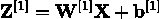

激活输出为：

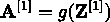

其中 `g` 表示激活函数，它可以是 `sigmoid`、`ReLU` 或 `tanh` 函数。

接下来，对于输出层：

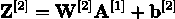

最终输出为：

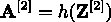

其中 `h` 代表输出层的激活函数。

令 `ℒ` 为损失函数，用于衡量预测值与真实标签之间的差异。

在反向传播中，我们的目标是计算 `ℒ` 相对于 `W¹`、`b¹`、`W²` 和 `b²` 的梯度。过程如下：

## 输出层误差

计算损失相对于输出层激活的导数：

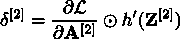

在这里，`h'(a²)` 是输出激活函数的导数，`⊙` 表示逐元素乘法。

## 输出层权重和偏置的梯度

损失相对于 `W²` 和 `b²` 的梯度可以计算为：

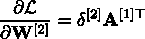


## 隐藏层误差

将误差反向传播到隐藏层：

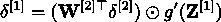

其中 `g'(z¹)` 是隐藏层激活的导数。

## 隐藏层权重和偏置的梯度

损失相对于 `W¹` 和 `b¹` 的梯度给出：

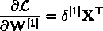


这些梯度随后用于使用梯度下降优化算法更新神经网络的权重和偏置。权重和偏置的更新规则为：

`W^l = W^l - η * ∂ℒ/∂W^l`

`b^l = b^l - η * ∂ℒ/∂b^l`

其中 `η` 是学习率，`l` 表示层索引。

要在代码中实现反向传播，请使用 `NumPy` 的 Python 示例：

```python
import numpy as np

def backward_propagation(X, y, W1, b1, W2, b2):
    # 反向传播逻辑实现
    pass
```

`backward_propagation` 函数的输出列出了用于更新参数的梯度。反向传播高效地计算这些梯度，允许网络通过向减少损失函数的方向调整参数来学习，使其成为神经网络训练的核心技术。

# 2.9 梯度下降

梯度下降（`Gradient Descent`）是一种广泛应用于机器学习和神经网络的优化算法，用于最小化损失函数。它的工作原理是通过沿着损失函数下降最快的方向迭代地调整模型参数，本质上是向局部最小值移动。本节将详细介绍梯度下降的数学公式、类型以及实现过程中的考虑因素。

给定一个关于模型参数的损失函数，目标是找到使损失最小化的参数值。损失函数对参数的梯度记为 `∇L()`，它提供了损失函数上升最快的方向。因此，为了最小化损失，我们需要沿着梯度的反方向移动：

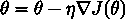

其中 `η` 是学习率，是一个决定每次迭代步长大小的超参数。

从数学角度来看，梯度下降的步骤如下：

1. **初始化**：从参数的初始假设开始。
2. **计算梯度**：在当前参数值处计算损失函数的梯度。
3. **参数更新**：使用公式更新参数：

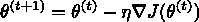

4. **收敛检查**：重复步骤 2 和 3 直到收敛，收敛可以由预设的迭代次数定义，或者损失函数的变化低于某一阈值。

## 梯度下降的类型

- **批量梯度下降 (`Batch Gradient Descent`)**：这种梯度下降变体使用整个数据集计算梯度。虽然它提供了稳定的收敛，但对于大型数据集来说，计算开销很大。
- **随机梯度下降 (`SGD`)**：`SGD` 不使用整个数据集，而是在每次迭代仅使用单个训练样本来更新参数，这可能会引入噪声，但会显著加快处理速度。
- **小批量梯度下降 (`Mini-batch Gradient Descent`)**：这种方法是批量梯度下降和 `SGD` 之间的折中。它将数据集划分为较小的批次，并对每个批次执行更新。
- **学习率**：学习率对梯度下降的成功至关重要。如果学习率过高，算法可能会越过最小值；而学习率太小可能会减慢收敛过程。

损失函数随参数更新的可视化可以说明学习率如何影响收敛：

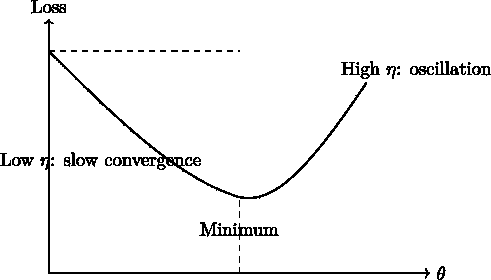

## 自适应学习率

为了解决固定学习率带来的挑战，研究者提出了几种自适应学习率算法，例如：

- **AdaGrad**：它根据特征的频率调整学习率，对频繁出现的参数缩小学习率，有效地提供了逐个元素的学习率。
- **RMSprop**：它通过使用梯度平方的移动平均来改进 `AdaGrad`，从而允许更稳定的更新。
- **Adam (自适应动量估计)**：通过维护梯度的一阶动量（均值）和二阶动量（无中心方差），结合了 `RMSprop` 和动量的优点。

这些方法中的每一种都提高了收敛的稳定性和速度，特别是对于大规模机器学习问题。

## 挑战与考虑

梯度下降对损失函数的形状敏感。局部最小值、鞍点和平坦区域等问题可能会阻碍收敛。可以引入动量等技术来帮助梯度向量在正确的方向上加速，缓解这些问题。理解并选择合适的梯度下降变体并调整其参数对于有效训练神经网络至关重要。

# 2.10 损失函数

在神经网络训练中，损失函数的概念至关重要。损失函数也称为代价函数或目标函数，是一种衡量神经网络预测值与实际目标值匹配程度的指标。它的取值量化了网络预测输出与期望输出之间的“误差”，通过提供如何调整权重的信号来引导优化过程。

从数学角度来看，损失函数 `L` 可以表示为：

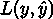

其中 `y` 是实际目标值，`ŷ` 是神经网络产生的预测值。合适损失函数的选择取决于任务的类型，如分类或回归。

## 均方误差 (MSE)

均方误差通常用于回归任务。它被定义为误差平方的平均——即预测值与真实值之间平方差的平均值。对于具有 `n` 个样本的数据集，其 `MSE` 可公式化为：


该损失函数对较大误差的惩罚比较小误差更大，因此聚焦于减少预测中的较大偏差。

## 交叉熵损失 (Cross-Entropy Loss)

交叉熵损失广泛用于分类问题，特别是二分类和多分类。它用于衡量一个输出为 0 到 1 之间概率值的分类模型的性能。对于二分类，交叉熵损失定义为：

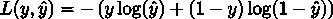

对于具有 `m` 个类别的多分类问题，其广义形式为：

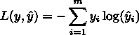

该损失函数通过惩罚预测概率与真实类别指示器之间的偏差，最大化正确类别的似然。

## 平均绝对误差 (MAE)

平均绝对误差，也称为 `L1` 损失，是另一种用于回归任务的损失函数。它定义为预测值与真实值之间绝对差的平均值。对于具有 `n` 个样本的数据集，其 `MAE` 为：


与 `MSE` 不同，`MAE` 对离群点没有那么敏感。

## 合损失 (Hinge Loss)

合损失通常用于训练分类器，特别是支持向量机。它用于二分类问题并定义为：


在这里，`y` 是实际的二分类标签（-1 或 1），`ŷ` 是预测值。合损失函数惩罚位于边界另一侧的预测，以及信心不足的正确预测。

## KL 散度 (KL Divergence)


# Kullback-Leibler 散度

Kullback-Leibler 散度，或 KL 散度，是衡量一个概率分布相对于第二个期望概率分布的离散程度。虽然它本身不是损失函数，但在变分自编码器等领域经常被使用。对于离散概率分布 `P`，`KL 散度` 定义为：

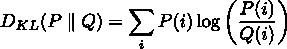

在机器学习中，它衡量真实数据分布 `P` 与模型预测分布之间的差异，引导模型最小化这种散度。

## 实现与使用损失函数

在实践中，损失函数使用支持神经网络训练的库（如 `TensorFlow` 或 `PyTorch`）来实现。例如，在 `PyTorch` 中，均方误差损失可以这样实现：

```python
import torch.nn as nn
criterion = nn.MSELoss()
# ... (进一步实现细节)
```

输出将量化给定数据集预测值与实际值之间的误差。

**输出**: 0.375

选择合适的损失函数对于神经网络的成功训练关键。这需要理解当前的问题和数据的性质，确保优化过程与预期结果正确对齐。

# 权重初始化

有效的权重初始化是建立良好神经网络的关键方面。适当的初始化不仅可以加速训练过程中的收敛，还有防止梯度消失或梯度爆炸等问题。神经网络中的权重初始化经过深思熟虑，以确保每一层的输入都在合适的范围内。

## 权重初始化的重要性

初始权重的选择会影响学习过程的速度和质量。如果权重初始化值过大，反向传播过程中的梯度可能会指数级增长，导致梯度爆炸。反之，如果权重太小，梯度可能会消失，严重损害学习过程。这种现象在深度神经网络中尤为棘手，因为层数的增加会加剧这一问题。

## 常见的权重初始化方法

1. **零初始化 (Zero Initialization)**：在零初始化中，所有权重都被设置为零。然而，这种方法对于训练深度网络是无效的，因为它会导致对称性破坏问题。每层中的零初始化神经元在训练过程中会学习相同的特征，导致它们变得冗余。

2. **随机初始化 (Random Initialization)**：随机初始化从均值为零的正态分布或均匀分布中随机分配权重。虽然这种方法有助于打破对称性，但它不能防止梯度消失或爆炸。例如，考虑从标准正态分布初始化权重。这种方法对于浅层网络效果更好，但对于深层结构可能会出现问题。

3. **Xavier 初始化 (Xavier Initialization)**：也称为 Glorot 初始化，该方法旨在保持跨层输入方差不变。该方法由 Xavier Glorot 和 Yoshua Bengio 提出，通过从具有以下方差的分布采样来设置权重：

   - 对于均匀分布：

     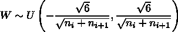

   - 对于正态分布：

     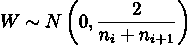

   其中 `n_in` 和 `n_out` 分别代表前一层和下一层的神经元数量。这种初始化适用于 `tanh` 或 `sigmoid` 等激活函数。

4. **He 初始化 (He Initialization)**：由何恺提出的该方法对于采用 `ReLU` 激活函数的网络特别有效。它从具有以下方差的分布中提取权重：

   - 对于正态分布：

     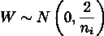

   - 对于均匀分布：

     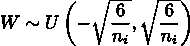

   其中 `n_in` 代表权重张量中的输入单元数量。这种方法旨在通过根据输入单元的数量调整方差，考虑到 `ReLU` 的特性。

## 算法实现

以下是使用 `numpy` 库在 Python 中不同权重初始化方法的实现。

```python
# Implementation code goes here
```

执行上述代码将根据指定的方法初始化权重。例如，选择 `'he'` 方法可以调整权重方差以适应 `ReLU` 激活函数，为深度网络的训练提供稳健的起点。

适当的初始化为优化学习奠定了基础，有效地解决了神经网络训练过程中遇到的常见数值问题。

# 从零构建简单的神经网络

在整个过程中，我们将遵循以下步骤：初始化参数、通过网络向前传播、计算损失、反向传播以更新参数，并迭代这些步骤直到收敛。

首先，我们需要导入必要的库。确保你已经安装了 `numpy`，因为它将是我们进行数值计算的主要工具。

下一步是定义激活函数及其导数。我们将使用 `sigmoid` 函数作为激活函数，它将帮助将线性输出转换到 0 到 1 之间的范围。

接下来，我们初始化网络的参数。为了简单起见，我们将创建一个有一个隐藏层的网络。假设输入特征的大小为 `n_input`，隐藏层有 `n_hidden` 个神经元，输出层有 `n_output` 个神经元。

然后我们进行向前传播步骤。这涉及计算每一层的激活前输出和激活输出。

损失函数将衡量神经网络预测与实际标签的匹配程度。对于这个二分类问题，我们使用二交叉熵损失。

接下来，我们实现反向传播步骤以计算损失函数对参数的梯度。这将用于更新权重和偏置。

使用反向传播期间计算出的梯度，我们现在可以更新参数了。

最后，我们将这些步骤合并成一个训练函数。该函数迭代指定的次数（epochs）以最小化代价函数。

为了测试我们的神经网络，我们需要根据学习到的参数进行预测。这是一个训练该神经网络的简单示例：

```python
# Example execution
Cost after iteration 0: 0.6931471805599453
...
Predictions: [[0 1 1 0]]
```

这就完成了从零开始简单神经网络的上手实现。通过掌握这些基础步骤，你可以将此架构扩展并调整到更复杂的网络和任务中，并利用提供更高层抽象的库。

# 数据预处理简介

数据预处理是机器学习流水线中至关重要的初始步骤，旨在将原始数据转换为适用于模型训练的清洁、结构化格式。它涵盖了多种技术，用以处理原始数据集中的不一致性、噪声和其他形式的不完善性。其主要目标是通过确保输入数据准确、完整且格式适当，来提高数据质量并促进模型学习。

## 数据质量问题

原始数据集经常受到多种质量问题的困扰，这些问题会对机器学习模型的性能产生不利影响。典型问题包括：

- **缺失值**：没有记录的数据点。
- **噪声**：数据中无关或随机的变化。
- **不一致性**：由于数据输入、测量或其他过程中的错误导致的数据差异。
- **离群值**：偏离其他观测值的异常数据点。

预处理旨在系统地解决这些问题，以确保数据集具有尽可能的代表性和信息量。

## 数据预处理的步骤

### 1. 处理缺失值

可以通过插补技术或删除受影响的记录/属性来处理缺失值。技术从简单的均值或中位数插补到更复杂的方法，如 k 近邻 (`KNN`) 或链式方程多变量插补 (`MICE`)。

**示例：**

```
A    B
0  1.0  3.0
1  2.0  2.0
2  2.333333  3.0
3  4.0  4.0
```

### 2. 数据归一化与标准化

这些技术将特征调整到共同尺度，提高某些机器学习算法的性能和收敛速度。归一化将数据缩放到 `[0, 1]` 范围内，而标准化则将数据以均值为中心并保持单位标准差。

**示例：**

```
A        B
0  0.000000  1.000000
1  0.333333  0.000000
2  0.444444  1.000000
3  1.000000  1.000000
```

```
A          B
0  -1.183216  0.000000
1  -0.507093  -1.732051
2  0.000000  0.000000
3  1.690308  1.732051
```

### 3. 类别变量编码

类别变量需要被编码为数值。流行的技术包括独热编码、标签编码和二进制编码。

**示例：**

```
Color_Blue Color_Green Color_Red
0           0           1
1           1           0
2           0           1
3           0           0
4           0           0
Color
0123
```

### 4. 将数据分为训练集和测试集

数据集被分为训练集和测试集，以评估模型性能。这确保了模型在未见的数据上进行测试，以衡量其泛化能力。

**示例：**

```
A    B
3  4.000000  4.0
0  1.000000  3.0
2  2.333333  3.0
A    B
1  2.0  2.0 [0, 0, 1] [1]
```

通过实施这些预处理步骤，我们可以有效地准备数据，为模型训练和更广泛的机器学习任务奠定良好基础。目标是降低与数据质量问题相关的风险，确保机器学习模型能够准确学习模式并良好地泛化到新的未见数据。

## 理解数据类型

数据类型是数据预处理和特征工程的基础。理解不同类型的数据及其属性对于选择合适的预处理技术至关重要。数据类型通常可以分为两大类：数值型和类别型。

### 数值数据

数值数据描述可以量化且具有算术性质的变量。它可以进一步分为两个子类：

- **连续数据**：可以取范围内的任何值。例如身高、体重或温度。
- **离散数据**：由清晰且独立的值组成。典型的例子是对象的计数，例如教室里的学生。离散数据通常是整数。

### 类别数据

类别数据代表可以取有限（且通常是固定的）数量可能值的变量，根据某些定性属性将每个个体或其他观测单位分配给特定的组或名义类别。它可以分为三类：

- **名义数据**：也称为定性数据，涉及没有任何内在顺序的类别。示例包括颜色、名称或标签。它使用‘红’‘绿’和‘蓝’等标签表示。
- **有序数据**：与名义数据类似，但类别之间具有意义的顺序。例如客户满意度调查，回答如“差”、“中等”、“好”、“优秀”等。
- **二分类数据**：名义数据的子集，只有两个类别，通常由 0 和 1 表示，例如“是”或“否”。

### 数据的特殊形式

除了这些基本类型，还有一些特殊形式的数据：

- **时间数据**：与时间相关，如时间戳、日期或时间间隔。
- **文本数据**：由字符字符串组成，需要特定的技术，如文本预处理。
- **空间数据**：代表物体物理位置和形状的信息。

```
age    int64
name   object
has_pet bool
dtype: object
```

# 处理缺失值

数据集中的缺失值是机器学习中一个不可避免的问题，它们会显著影响模型的性能和可靠性。制定识别和处理这些缺失值的策略对于确保分析的完整性至关重要。缺失数据的处理取决于数据的性质和缺失的程度。常见的方法包括删除、插补和基于模型的方法。

## 缺失数据的类型

缺失数据的类型通常可以归类为三类：

### 完全随机缺失 (Missing Completely at Random)

值缺失的概率与观测数据和未观测数据均相互独立。缺失值的出现完全是随机的。

### 随机缺失 (Missing at Random)

值缺失的概率与观测数据有关，但与数据本身无关。例如，收入缺失的可能取决于年龄，但与收入本身无关。

### 非随机缺失 (Missing Not at Random)

值缺失的概率与未观测数据有关；缺失情况与值本身有关。例如，高收入可能更容易无法报告。

## 处理缺失值的技术

处理缺失值的技术根据数据类型和缺失程度而异。下面我们讨论了几个关键方法：

### 1. 列表删除 (Listwise Deletion)

也称为完全案例分析，该方法涉及丢弃所有包含缺失值的记录。虽然它保持了数据集的完整性，但如果缺失广泛存在，可能会导致严重的数据丢失。

**原始数据：**

```
Feature1  Feature2 Feature3
0        1.0      2.0      NaN
1        4.0      NaN      6.0
2        NaN      2.0      1.0
3        7.0      8.0      2.0
```

**列表删除后：**

```
Feature1  Feature2 Feature3
3        7.0      8.0      2.0
```

### 2. 成对删除 (Pairwise Deletion)

成对删除不是丢弃整个记录，而是利用所有可用数据点进行分析。它使用两个值都存在的数据对计算相关性或协方差。这种方法浪费较少但由于不同的计算使用了不同大小的子集，会导致不一致。

### 3. 插补方法 (Imputation Methods)

插补涉及用替换值代替缺失值。常见的插补方法包括：

#### a. 均值 (Mean)

用该变量观测值的平均值替换缺失值。

**输出：**

```
Feature1  Feature2 Feature3
0        1.0      2.0      3.0
1        4.0      4.0      6.0
2        4.0      2.0      1.0
3        7.0      8.0      2.0
```

#### b. 中位数 (Median)

与均值插补类似，但使用的是中位数值。这种方法对异常值更具鲁棒性。

#### c. 众数 (Mode)

利用变量中最频繁的值，适用于分类数据。

#### d. K-近邻 (KNN)

使用 K-近邻算法估计缺失值。它通过最近邻居的平均值（或加权平均值）替换缺失值。

**输出：**

```
Feature1  Feature2 Feature3
0        1.0      2.0      1.5
1        4.0      2.0      6.0
2        5.5      2.0      1.0
3        7.0      8.0      2.0
```

### 4. 基于模型的方法 (Model-Based Methods)

基于模型的插补使用统计模型来预测和替换缺失值。方法包括：

#### a. 回归

使用回归分析根据其他变量预测缺失值。

#### b. 多重插补

生成多个数据集并合并结果，以考虑插补的不确定性，产生更可靠的推理。

**输出：**

```
Feature1  Feature2 Feature3
0        1.0      2.0      1.5
1        4.0      3.5      6.0
2        5.5      2.0      1.0
3        7.0      8.0      2.0
```

## 注意事项

处理缺失值方法的选择取决于多个因素，包括缺失数据的比例、缺失类型以及对分析的潜在影响。评估所选方法对数据集统计属性的影响，并在后续分析中考虑插补的不确定性至关重要。有效理解和管理缺失值可以大幅提高模型的准确性和可靠性，是数据预处理的一项基础技能。

# 数据归一化与标准化

数据归一化和标准化是为机器学习模型准备数据的关键预处理步骤。这些技术主要用于将输入数据转换为更适合模型的格式，确保不同的特征对学习过程做出等贡献。本节将深入探讨归一化和标准化的理论基础、实际方法和应用。

## 归一化 (Normalization)

归一化是将单个样本缩放到具有单位范数的过程。当使用的算法不假设数据的任何先验分布时，这种技术特别有用。归一化的简单形式是最小最大缩放（min-max scaling），它将数据重缩到一个固定范围内，通常为 `[0, 1]`。最小最大归一化公式如下：

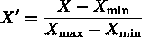

其中 `X` 代表原始值，此处是特征的最小值和最大值，结果是归一化后的值。

## 标准化 (Standardization)

另一方面，标准化将数据转换为具有零均值单位方差。当机器学习算法假设数据围绕零中心并根据方差进行缩放时（例如线性回归、逻辑回归和支持向量机），此过程是有利的。标准化的公式为：


其中 `μ` 是特征的均值，`σ` 是标准差。

可以使用 Python 中的 `scikit-learn` 等库来增强归一化和标准化过程。下面是演示这些技术实现的示例：

上述代码的预期输出将是

**归一化数据：**

```
[[0.         0.         0.]
 [0.33333333 0.33333333]
 [0.66666667 0.66666667]
 [1.         1.         1.]]
```

**标准化数据：**

```
[[-1.34164079 -1.34164079]
 [-0.4472136  -0.4472136 ]
 [ 0.4472136   0.4472136 ]
 [ 1.34164079  1.34164079]]
```

归一化确保所有特征贡献等贡献，防止尺度较大的属性主导学习过程。这一特征对于 K 近邻 (k-NN) 和 K-means 聚类等算法特别关键，因为这些算法的距离量对尺度变化非常敏感。

同时，标准化对于假设数据呈正态分布（高斯分布）的算法至关重要，这些算法利用了特征的均值和方差。主成分分析 (PCA) 和线性判别分析 (LDA) 等算法也受益于标准化，因为它们依赖受数据缩放影响的投影。

# 类别数据编码

类别数据编码是数据预处理流水线中的一个基础步骤，对于为机器学习模型准备类别特征至关重要。由于大多数机器学习算法都需要数值输入，因此类别特征必须转换为模型可以解释的数值格式。本节将探讨编码类别数据的各种方法，包括独热编码、标签编码、目标编码和二进制编码。

类别变量可以分为两大类：名义变量（nominal）和序数变量（ordinal）。名义变量代表没有内在顺序的类别，例如颜色或产品类型。序数变量在类别之间具有清晰的顺序关系，例如排名或教育程度。

## 独热编码 (One-Hot Encoding)

独热编码将类别变量转换为一系列二进制列，每列代表原始变量中的一个唯一类别。该方法适用于名义类别，并使用 Python 中的 `pandas` 库实现。变量中的每个类别被转换为一个二进制向量，其中只有一个位被设置为 1，表示该类别的存在。


例如，考虑一个具有三个类别 `Blue`（蓝色）、`Green`（绿色）和 `Red`（红色）的类别变量 `Color`。该变量的独热编码将创建三个二进制列，如下所示：

```
Color_Blue Color_Green Color_Red
0          0            1
1          0            0
2          1            0
3          0            0
4          0            1
```

独热编码的优势在于它没有在类别之间施加顺序关系。然而，在处理具有大量类别的变量时，它会导致高维特征空间。这种维度的增加被称为“维度灾难”，可能会导致内存使用和计算性能的效率低下。

## 标签编码 (Label Encoding)

标签编码为变量中的每个类别分配一个唯一的整数。这种方法主要用于序数变量，其中整数值可以反映类别之间的相对顺序。在 Python 中，可以使用 `sklearn` 库中的 `LabelEncoder` 执行标签编码：

编码后的特征为：

```
Rating  Rating_encoded
0       Low               1
1       Medium            2
2       High              0
3       Medium            2
4       Low               1
```

在这里，编码尊重了 `Rating` 变量的序数性质。然而，在名义变量上进行标签编码可能会误导统计模型，因为它施加了虚为的顺序。

## 目标编码 (Target Encoding)

目标编码涉及将每个类别替换为该类别目标变量的平均值。在处理高基数类别特征时，这种方法非常有优势。然而，如果不小心应用，可能会引入数据泄露。目标编码通常使用适当的交叉验证技术来避免过拟合。

编码后的数据类似于：

```
Category  Target  Category_encoded
0        A       1.0
1        B       2.0
2        C       3.0
3        A       1.0
4        B       2.0
5        C       3.0
```

## 二进制编码 (Binary Encoding)

二进制编码是独热编码和标签编码之间的折中。每个类别首先转换为整数，然后将这些整数转换为二进制代码。与独热编码相比，这减少了特征空间的维度，同时仍能唯一地表示类别。生成的数据如下：

```
Color_Blue Color_Green Color_Red
0          0            1
1          0            0
2          1            0
3          0            0
4          0            1
```

## 将数据分为训练集和测试集

将数据分为训练集和测试集的根本目的是评估机器学习模型的性能并确保它们具有良好的泛化能力。

### 训练-测试划分 (Train-Test Split)

划分数据集最简单的方法是留算法（holdout method），将数据集分为两个部分：训练集和测试集。训练-测试划分的常见比例为 70-30、75-25 或 80-20。这种划分可以在 Python 中如下实现：

`test_size` 参数定义了包含测试数据的比例，`random_state` 确保了结果的可重复性。

### 验证集 (Validation Set)

除了训练集和测试集之外，创建一个验证集通常是有益的，特别是对于调整超参数和选择模型。这会导致三分：训练、验证和测试。训练集用于训练模型，验证集用于评估和调整超参数，测试集用于最终评估。在这里，`test_size=0.25` 按比例将组合训练和数据的 20% 分配到验证集中。

### 交叉验证 (Cross-Validation)

尽管训练-测试划分非常简单，但由于训练集的潜在偏差，对于小数据集来说可能是不够的。在这种情况下，交叉验证（CV）通过将数据集划分为多个折来提供更可靠的评估。最常见的是 k 折交叉验证，将数据集分为 `k` 折。模型被训练 `k` 次，每次使用不同的折作为测试集，并将剩余的 `k - 1` 折作为训练集。这种方法确保了每个数据点都同时用于训练和验证。在这里，`n_splits=5` 意味着数据集被划分为 5 折，这是默认且最常见的选择。`cross_val_score` 函数返回一个包含每个折准确率分数的数组。

### 分层采样 (Stratified Sampling)

在处理不平衡数据集时，在训练集和测试集之间保持相同的类别分布是关键的。分层采样通过确保每个子集都保留每个类别的样本比例来实现这一点。分层采样在处理某些类别稀少的数据集时尤为重要。这确保了模型在整个数据的代表性子集上进行训练和验证，从而提高其稳健性和泛化能力。通过整合这些方法，从业人员可以有效地划分数据集，确保他们的机器学习模型既得到了良好的训练，又得到了充分的评估。

# 特征缩放

特征缩放是数据预处理流程中至关重要的一步。它涉及调整特征范围，以确保它们对模型的学习过程具有相同的贡献。不同的模型对输入特征的尺度可能敏感，特别是那些依赖距离量的模型，例如支持向量机（`SVM`）和 k 最近邻（`KNN`）。

## 特征缩放的类型

有多种特征缩放技术，每种都有其优点和适用场景。最常用的方法包括最小最大尺度（min-max scaling）、标准化（standardization）和鲁健缩放（robust scaling）。

### 最小最大尺度

最小最大尺度也称为归一化，将特征转换到指定的范围内，通常为 `[0, 1]`。特征 `x` 的最小最大缩放公式为：


其中 `min` 和 `max` 分别是特征的最小值和最大值。这种方法保持了数据值之间的关系，但对离群值敏感。

以下是一个使用 `scikit-learn` 库应用最小最大缩放 Python 代码段：

```python
```

### 标准化

标准化或 z-score 归一化根据特征的均值和标准差来缩放特征。标准化将数据转换为均值为 0、标准差为 1。标准化的公式为：


其中 `μ` 是特征 `x` 的均值，`σ` 是它的标准差。这种方法比最小最大尺度不那么离群值。

可以使用以下代码在 Python 中实现标准化过程：

```python
```

### 鲁健缩放

鲁健缩放使用中位数和四分位距（`IQR`）进行缩放，使其对数据中的离群值更具鲁棒性。鲁健缩放公式为：


其中 `IQR = Q3 - Q1`，`Q3` 是第 75 分位数，`Q1` 是第 25 分位数。鲁健缩放可以在 Python 中实现如下：

```python
```

## 何时需要缩放

特征缩放在以下场景中特别为重要：

-   **基于距离的算法**：如 `KNN`、`SVM` 和 `k-means 聚类` 等算法依赖于欧几里得距离等距离量。缩放确保了所有特征对距离计算都有相同的贡献。

-   **基于梯度的算法**：在梯度下降优化中，尺度较大的特征会不成比例地影响计算出的梯度，可能导致收敛变慢或错误。

## 特征缩放对模型性能的影响

特征缩放会对模型性能和收敛速度产生显著影响。在缩放数据上训练的模型通常具有更好的准确性和稳定性。例如，神经网络受益于归一化的输入数据，从而实现更高效的学习并减少反向传播过程中梯度消失或爆炸的风险。

多项经验研究表明，适当的特征缩放可以增强模型的鲁棒性和泛化能力。从业人员在选择特征缩放方法时，应始终考虑数据的性质和所使用的模型。

在实际应用中，对训练数据测试数据应用相同的缩放转换是至关重要的，以保持整个数据集特征尺度的一致性。这可以通过对训练数据使用 `fit`，然后对训练集和测试集均应用 `transform` 来实现。这确保了模型在训练和评估阶段都能正确缩放的数据中受益，从而获得更可靠的性能指标。

# 降维技术

降维技术在预处理高维数据时至关重要。通过减少特征的数量或维度，我们可以缓解维度灾咒，提高计算效率并增强机器学习模型的性能。本节将讨论了几种关键技术，包括主成分分析（`PCA`）、线性判别分析（`LDA`）和 t 分布随机邻嵌入（`t-SNE`）。

## 主成分分析 (PCA)

`PCA` 是最广泛使用的降维技术之一。`PCA` 将原始特征转换为一组新的不相关特征，称为主成分，这些成分的排序方式使得前几个组件保留了原始数据集中大部分的方差。`PCA` 涉及的步骤如下：

1. 标准化数据，使其均值为 0，标准差为 1。

2. 计算标准化数据的协方差矩阵。

3. 计算协方差矩阵的特征值和特征向量。

4. 将特征值按降序排序，并选择与最大的 `k` 个特征值对应的对应的特征向量。

5. 使用所选的特征向量将原始数据投影到新的子空间。

以下是使用 `numpy` 库实现 `PCA` 的 Python 代码：

```python
```

## 线性判别分析 (LDA)

`LDA` 是另一种重要方法，特别对分类任务非常有用。`LDA` 的目标是找到特征的线性组合，以最好地分离数据集中的类别。`LDA` 的步骤是：

1. 标准化数据。

2. 计算类内散度矩阵和类间散度矩阵。

3. 计算由类内散度矩阵的逆乘以类间散度矩阵所得矩阵的特征值和特征向量。

4. 选择与最大的 `k` 个特征值对应的特征向量。

5. 将数据投影到新的子空间。

以下是 Python 中实现 `LDA` 的示例：

```python
```

## t 分布随机邻嵌入 (t-SNE)

`t-SNE` 是一种非线性降维技术，主要用于数据可视化。`t-SNE` 通过最小化高维对象对与其在低维空间对应物之间概率分布之间的散度来降低维度。`t-SNE` 在 2 维或 3 维可视化高维数据方面特别有效。`t-SNE` 的主要步骤是

1. 计算高维空间数据点之间的两两相似性。

2. 在低维空间定义类似的两两相似性度量。

3. 使用梯度下降最小化这两组相似性之间的差异。

以下示例演示了使用 `scikit-learn` 库在 Python 中使用 `t-SNE`：

```python
```

`t-SNE` 应用的输出可以使用各种绘图库进行可视化。

降维技术在高效管理和解释高维数据方面起着至关重要的作用。技术的选择取决于数据的性质以及当前分析或机器学习任务的具体要求。

# 特征选择方法

特征选择是为机器学习模型准备数据的关键步骤，因为它侧重于识别和利用最相关的特征（或预测变量），同时丢弃无关或冗余的特征。这一过程可以增强模型性能、减少过拟合并提高可解释性。在这里，我们将探索各种特征选择方法，这些方法大致分为过滤法、包装方法和嵌入法。

## 过滤方法

过滤方法根据独立于学习算法的统计量对特征进行排序。常见技术包括：

1. **皮尔逊相关系数**：用于衡量特征与目标变量之间的线性相关性。选择相关系数绝对值较高的特征。其中 `x` 和 `y` 是单个样本点，`x` 和 `ȳ` 分别是特征和目标变量的平均值。

2. **卡方检验**：适用于分类数据，该检验评估每个特征与目标变量之间的独立性。

3. **ANOVA F 值**：这种统计检验特别适用于比较两个或多个组的分布，并选择具有高 `F-values` 的特征。

4. **互信息**：与相关性不同，互信息以非线性方式衡量变量之间的依赖关系。

## 包装方法

包装方法涉及使用特征子集评估模型的性能。这些方法计算密集型，但通常能带来更好的性能。常见技术包括：

1. **顺序特征选择 (SFS)**：这涉及顺序添加（前向选择）或删除（后向选择）特征，并在每一步评估模型性能。

2. **递归特征消除 (RFE)**：该方法根据模型权重递归地删除不重要的特征，直到达到最优特征数量。

## 嵌入方法

嵌入方法在模型训练过程中进行特征选择，从上本质将模型构建和特征选择步骤结合起来。技术包括：

1. **LASSO（最小绝对收缩和选择算子）**：`LASSO` 回归通过正则化将系数限制为精确零，从而消除不重要的特征。

2. **基于树的方法**：集成方法（如 `Random Forest` 或 `Gradient Boosting`）根据特征改进分裂准则的程度（例如 `Gini impurity`、`entropy`）对特征重要性进行排序。

虽然这些方法为特征选择提供了一个稳健的框架，但结合多种技术以获得最佳结果通常是有益的。在解释和验证所选特征时，检查特征重要性、模型性能和领域知识是至关重要的。

### 选择的特征（示例输出）：

1. `Feature_A`

2. `Feature_B`

3. `Feature_C`

4. `Feature_D`

5. `Feature_E`

# 特征提取

特征提取在预处理流程中起着关键作用，旨在从原始数据派导出信息丰富且冗冗的特征。这一过程将原始变量转换为一组新的特征，通过增强其捕捉潜在模式的能力，可能会提高机器学习模型的性能。

特征提取的一种常用技术是使用领域知识，但也存在各种算法方法。其中，`主成分分析 (PCA)`、`独立成分分析 (ICA)` 和 `t 分布随机邻域嵌入 (t-SNE)` 被广泛采用。

## 主成分分析 (PCA)

`PCA` 是一种统计程序，使用正交变换将可能相关的变量的观测值转换为一组线性不相关的变量，称为主成分。其目标是在减少数据维度的同时，保留数据集中大部分的变异。

执行 `PCA` 的步骤涉及以下过程：

1. 标准化数据。

2. 计算标准化数据的协方差矩阵。

3. 计算协方差矩阵的特征值和特征向量。

4. 将特征值及其对应的特征向量降序排序。

5. 选择前 `k` 个特征向量，其中 `k` 是你想要保留的维度数。

6. 构建投影矩阵。

7. 使用投影矩阵 `W` 转换原始数据集 `X` 以获得降维数据集。

`PCA` 转换的数学表示为：

 其中 `Z` 代表转换后的数据集，`X` 是原始数据集，`W` 是所选特征向量的矩阵。

## 独立成分分析 (ICA)

`ICA` 是一种计算方法，用于将多元信号分离为加性的独立非高斯信号。与 `PCA`（假设数据是高斯且相关的）不同，`ICA` 目标是在非高性和统计独立的假设下进行分分离。

`ICA` 的关键步骤包括：

1. 通过减去每个特征的平均值使数据中心化。

2. 对数据进行白化，使组件不相关且具有单位方差。

3. 应用迭代算法（如 `FastICA`）来最大化估计组件的统计独立性。

例如，`FastICA` 算法涉及迭代优化以最大化负熵，负熵是非高斯性的衡量：

 其中 `y` 代表感兴趣的组件，`v` 是高斯变量，`g` 是非二次函数。

## t-分布随机邻域嵌入 (t-SNE)

`t-SNE` 是一种非线性降维技术，主要用于数据可视化。它通过将数据点之间的相似性转换为联合概率，并最小化低维嵌入联合概率与高维数据联合概率之间的 Kullback-Leibler 散度来减少数据维度。

执行 `t-SNE` 的步骤涉及：

1. 计算高维数据点之间的两对相似性。

2. 在高维对象对上定义概率分布，使得相似的对象具有更高的概率被选中。

3. 在低维地图上的点上定义类似的概率分布。

4. 最小化这两个分布之间的 Kullback-Leibler 散度。这种这种优化通常依赖于梯度下降技术。当数据集结构复杂时（例如嵌入高维空间中的簇），`t-SNE` 特别有用。

每种特征提取技术都有其优势和适用场景。例如，`PCA` 对于线性降维非常有效，而 `t-SNE` 适用于将复杂数据集可视化为二维或三维。`ICA` 在目标是从混合信号中识别并分离独立源时非常有价值。

这些技术在适当应用的情况下，通过产生捕捉数据本质的特征来显著提高模型性能。方法的选择应根据数据集的性质、分析的具体目标以及可用计算资源来指导。

# 数据增强

数据增强是机器学习中一种强大的技术，用于在不显式收集新数据的情况下，增加训练数据集的多样性和规模。这在获取额外数据具有挑战性、成本高昂或耗时长的场景下尤为有价值。增强技术通常用于图像、文本和声音数据，以提高机器学习模型的泛化能力并降低过拟合的风险。

在图像数据背景下，常用的增强方法包括旋转、翻转、裁剪、缩放、平移和颜色调整等变换。这些操作创建了原始图像的新变体，允许模型从更多样化的数据集中学习。以下 Python 代码演示了使用 `imgaug` 库的基本图像增强技术：

文本数据增强可以通过同义词替换、随机插入、随机删除和随机交换等方法实现。`nlpaug` 库提供了增强文本数据的工具。以下是一个通过同义词替换单词来增强文本的示例。关于声音数据，增强技术包括时间拉伸、音调偏移、添加噪声和随机裁剪。这些方法产生音频数据的变体，帮助模型对未见过的数据进行更好的泛化。下面提供了一个使用 `audiomentations` 库的示例。

数据增强不仅有助于平衡数据集，还能增强其变性，使模型对不同的现实场景更具鲁棒性。实施增强策略应与目标数据集的特定特征和要求保持，以确保生成的数据保持真实性和相关性。

# 处理不平衡数据

不平衡数据在机器学习中面临着严峻挑战，因为它可能导致模型偏偏，表现出泛泛化能力，尤其是在少数类上。当类别分布不均匀时就会出现不平衡数据集，其特征通常是一个类显著过少。本节深入探讨了处理不平衡数据的几种策略，结合了数据级和算法级的技术。

## 1. 数据级方法

数据级方法通过操作训练数据来平衡类别分布。主要技术包括：

### a. 重采样技术：

- **过采样 (Oversampling)**：这涉及通过复制或生成合成样本来增加少数类实例的数量。一种流行的方法是合成少数类过采样技术 (`SMOTE`)，它通过在现有少数类示例之间进行插值来生成新实例。

- **欠采样 (Undersampling)**：该技术通过减少多数类实例的数量来平衡数据集。例如，随机欠采样涉及从多数类中随机删除样本。

### b. 混合方法：

结合过采样和欠采样可以是有效的。例如，在选择多数类较小子集的同时，增强少数类。

## 2. 算法级方法

算法级方法通过修改学习过程本身来更好地处理不平衡的类别分布。


### a. 成本敏感学习

在这种方法中，为少数类和多数类分配不同的误分类成本，对少数类的误分类施加更严的惩罚。还可以根据反向类别频率或特定领域知识分配自定义类别权重。

### b. 集成技术

集成学习方法（如 `Bagging` 和 `Boosting`）可以适用于不平衡数据。特别是像自适应提升 (`AdaBoost`) 和经过改进的梯度提升等提升算法，更关注被误分类的实例，这些实例通常包含来自少数类的样本。

## 3. 性能指标

使用准确率（accuracy）等标准指标评估在不平衡数据上训练的模型性能是不够的。替代指标包括：

### a. 精率 (Precision)、召回率 (Recall) 和 F1 分 (F1-Score)

这些指标提供了关于少数类预测的精确度以及模型召回少数类实例能力的见解。

### b. 混淆矩阵 (Confusion Matrix)

可视化模型的预测有助于理解误分类，特别是对于少数类。

输出示例：

```
[[1200 50] [30 220]]
```

### c. 接收者工作特征曲线下的面积 (ROC-AUC)

AUC 提供了模型区分能力的衡量，评估了真阳性率和假阳性率之间的权衡。

## 4. 实际考虑

在处理不平衡数据集时，考虑各种不平衡对特定领域的影响。例如，在医学诊断中，假阴性可能比假阳性更关键，从而引导合适的重采样和评估策略。此外，在重采样后应重新检查数据处理和特征工程步骤，以确保合成样本引入了有意义的模式。

这些整合形成了管理不平衡数据集的综合方法，从而提高了机器学习模型的鲁棒性和可靠性。

# 第 4 章：激活函数

本章关注激活函数，它对于在神经网络中引入非线性至关重要。它探索了多种类型的激活函数，包括二阶阶跃、线性、`sigmoid`、`tanh`、`ReLU`、`leaky ReLU`、`parametric ReLU`、`softmax`、`swish` 和 `mish` 函数。解释了每个函数的用途和重要性，并提供了针对不同场景选择合适函数的指南。还讨论了在神经网络中实现激活函数的实际方面。（4.1）

# 激活函数介绍

激活函数是神经网络架构中的关键组件。它们为网络引入了非线性属性，使其能够从数据中学习复杂的模式和关系。如果没有激活函数，神经网络将局限于线性映射，无论网络包含多少层，其能力在实质上都将退化为简单的线性回归模型。

激活函数的根本目的是将神经元的输入信号转换为输出信号。这种转换对于网络建模复杂行为以及捕捉输入数据中存在的各种关系至关重要。从数学上讲，激活函数 `ϕ` 将一组输入映射到输出，如下：


给定一个输入值，激活函数的输出表示为 `f(x)`。选择合适的激活函数会显著影响神经网络的性能和效率。

## 激活函数的原理

使用激活函数的原理在于非线性的必要性。线性模型只能学习输入与输出变量之间的线性关系，并受到线性方程的限制：


其中 `w` 表示权重，`x` 代表输入向量，`b` 是偏置。这种线性映射对于许多现实世界的问题是不够的，特别是当数据包含复杂的相互作用时。激活函数打破了这种线性限制，增强了网络近似非线性函数的能力，从而丰富了假设空间和模型容量。

## 激活函数的类型

鉴于激活函数在引入非线性方面的核心作用，研究人员开发了不同类型的激活函数，每种都有独特的特性和属性。这些函数包括但不限于二阶跃函数、线性函数、`sigmoid` 函数、`tanh`（双曲正切）函数、修正线性单元（`ReLU`）函数、`leaky ReLU`、`parametric ReLU`、`softmax` 函数、`swish` 函数和 `mish` 函数。

每个激活函数都有独特的优势和特定的应用。例如，`sigmoid` 函数因其平滑的梯度和 (0, 1) 的输出范围被广泛应用于二分类问题，使其适用于将网络输出转换为概率估计。`ReLU` 函数由于其计算高效且能够处理梯度消失问题的能力，已成为许多深度学习模型中的默认激活函数。

## 实现与选择

在神经网络框架中实现激活函数非常简单。考虑以下在 Python 中实现 `ReLU` 函数的基础代码：

```python
def relu(x):
    return max(0, x)
```

上面的代码段演示了 `ReLU` 函数如何过滤输入信号，仅允许非负值通过并输出。

鉴于有大量的激活函数，理解它们的属性对于设计有效的神经网络架构至关重要。例如，`tanh` 函数定义为：


提供了 (-1, 1) 的输出范围，使数据居中化，这有助于在训练过程中更快地收敛。尽管如此，激活函数的选择受多种因素影响，包括具体的任务、网络深度以及训练数据的特征。

在网络不同层中正确选择和实现激活函数，有助于整体性能和收敛行为。通过 `ReLU` 及其变体等激活函数引入非线性，有助于克服梯度消失问题等挑战，这个问题通常会阻碍深层使用 `sigmoid` 或 `tanh` 函数的神经网络。

此外，对新激活函数的设计和研究不断进步，旨在解决现有函数的局限性。例如，定义如下的激活函数：


已被证明在特定任务中（特别是深度卷积网络领域）表现优于 `ReLU` 等传统激活函数。

对激活函数及其机制以及对神经网络影响的全面理解，是设计稳健高效的神经网络模型的基石，促进了解决复杂的机器学习问题所需的巨大假设空间的探索。

## 4.2

# 激活函数的作用

激活函数是神经网络的基础组件，在向网络中引入非线性方面起着关键性作用。非线性激活允许网络学习并建模输入与输出之间的复杂关系，而这是单靠线性变换无法实现的。在这里，我们详细探讨激活函数的作用，阐明它们在使神经网络实现深度且有效学习方面的角色。

激活函数的首要作用是将节点（或神经元）的输入加权和（或前一层的输出）转换为该节点的激活值。然后，该激活值会被传播到神经网络的下一层。这种转换的数学符号通常表示为：


其中 `a` 是激活值，`f` 是激活函数，`w` 是权重，`x` 是输入，`b` 是偏置项。

通过激活函数引入非线性使得神经网络能够近似任何连续函数。这一特性被包含在**通用近似定理**中，该定理断言：在适当激活函数的情况下，一个包含有限数量神经元的单个隐藏层的前馈网络可以近似任何连续函数。

线性激活函数虽然更简单，但是不够的，因为连续应用的任意数量的线性变换仍然是线性的。因此，如果没有非线性激活函数，整个网络无论深度如何，都会坍缩为单一的线性变换。这种限制严重限制了网络捕捉和表示数据中复杂模式及关系的能力。

非线性激活函数（如 `sigmoid`、`tanh` 和 `ReLU`（修正线性单元））允许层层堆叠，从而创建出能够学习高阶特征和输入数据更抽象表示的深度网络。这些函数确保了网络能够有效近似从输入到输出的复杂映射。

激活函数的另一个关键目的是引入可微性。大多数现代激活函数都被设计为可微的。这一特性至关重要，因为它允许应用基于梯度的优化方法（如反向传播），这些对于训练神经网络是本质的。在反向传播过程中，需要计算损失函数对权重的导数，这一过程要求激活函数是可微的。例如，`sigmoid` 函数的导数如下：


其中 `f'(x) = f(x)(1 - f(x))`。

可微性确保了误差能够有效地反向传播通过网络，有助于调整权重以逐步最小化损失函数。

激活函数还贡献于网络的收敛特性。高效的激活函数会影响训练过程的速度和稳定性。虽然某些激活函数（如 `sigmoid` 和 `tanh`）可能会遇到梯度消失等问题，但像 `ReLU` 这样的函数通过在深层中保持梯度来缓解这些问题。`ReLU` 函数定义为：


它在激活时保留值，否则产生零，允许梯度更稳健地传播通过整个网络。

另一个至关重要的方面是激活函数通过归一化或限制来调节输出值的能力。例如 `sigmoid`（将任何输入映射到 0 到 1 之间的值）和 `tanh`（将输入映射到 -1 到 1 之间的值）有助于将激活值保持在可控的范围内。这种归一化有助于防止极值（梯度爆炸）导致网络不稳定。

此外，某些激活函数（如 `softmax`）是特定任务定制的。`softmax` 函数主要用于分类网络的输出层。它将原始输出分（logits）转换为不同类别上的概率分布，确保所有输出概率之和等于 1。该函数定义为：


其中 `z_i` 是节点的输入，分母是所有节点输入指数后的和。

每个激活函数都为神经网络引入了特定的属性和行为。激活函数的选择会显著影响网络学习、泛化和高效收敛的能力。因此，理解每个激活函数的底层原理和影响是至关重要的，以便在各种神经网络应用中充分发挥它们的潜力。

## 4.3

# 二值阶跃函数

二值阶跃函数也称为海维德阶函数（Heaviside step function），是人工神经网络设计和实现中使用最早、最简单的激活函数之一。它是一种基于阈值的函数，根据定义的阈值将输入映射到二值输出（通常为 0 或 1）。二值阶跃函数的数学表达式如下：


在二值阶跃函数中，输出在两个状态之间发生突变，这种突变由阈值划分，阈值通常设置为 0。该函数本质上是非线性的，为模拟复杂数据模式和决策边界提供了必要的非线性支持。

从实现的角度来看，二值阶跃函数可以用代码表示为：

```python
def binary_step_function(x, threshold=0):
    return 1 if x >= threshold else 0
```

这种实现可以很容易地集成到神经网络模型的前向传播中，激活函数被应用于神经元的输入，以确定其输出。

## 二值阶跃函数的特性

- **非连续函数**：二值阶跃函数的特征是在阈值点存在不连续的跳跃。这种不连续性意味着该函数在阈值处传统意义上没有导数。

- **缺乏梯度**：由于其阶梯状的性质，二值阶跃函数在阈值以外的所有地方斜率均为零。这意味着除了精确阈值外，所有输入的导数均为 0，这对于反向传播等基于梯度的优化技术构成了严重问题。没有梯度，权重无法有效更新，从而抑制了学习。

- **确定输出**：对于任何给输入，二值阶跃函数都会产生 0 或 1 的确定性输出。这种二值性质在目标是将数据分为不同类别的分类任务中特别有用。

## 实际用途与局限性

二值阶跃函数适用于需要清晰二值决策过程的场景，例如早期神经网络模型中的感知机。然而，由于固有的局限性，它在现代深度学习架构中的应用受到限制：

- **不可微性**：如前所述，该函数的不可微性使其不适用于使用梯度下降算法进行训练的模型。

- **对阈值的敏感性**：阈值处的剧烈转换会导致模型对输入值的微小变化非常敏感，可能导致训练过程不稳定。

- **无法处理概率输出**：二值阶跃函数不传达任何关于输入的概率信息。在需要输出反映确定性的任务（例如跨类别的概率分布）中，更精细的激活函数如 `sigmoid` 或 `softmax` 更合适。

考虑以下示例来阐明二值阶跃函数在神经网络中的应用：

```python
class Neuron:
    def __init__(self, weights, bias):
        self.weights = weights
        self.bias = bias

    def forward(self, inputs):
        linear_output = sum(w * i for w, i in zip(self.weights, inputs)) + self.bias
        return binary_step_function(linear_output)
```

在上面的示例中，创建了一个使用二值阶跃函数的简单神经元。`forward` 方法计算输入与相关重的线性组合，加上偏置，并应用二值阶跃函数产生输出。这种直接的实现突出了此类函数如何集成到神经计算模型中。

尽管二值阶跃函数具有历史意义且简单易，但其局限性要求在应用时必须谨慎。它是理解神经网络激活函数的基础概念，但在当代深度学习实践中通常被更先进、多通的函数所取代。

## 4.4

# 线性激活函数

线性激活函数，也称为恒等激活函数，是神经网络中最简单的激活函数类型之一。它在数学上可以定义为：


其中 `y` 是输出，`x` 是神经元的输入。

线性激活函数本质上意味着输出与输入成正比。该函数不修改输入信号，也不会向网络引入任何非线性。虽然简单性是一个优势，但在神经网络的语境下，理解使用线性激活函数的意义至关重要。

## 特性

- **简单性**：函数非常直观，除了缩放输入外，没有额外的计算。这导致了高效的计算和易于的实现。

- **缺乏非线性**：线性激活函数的主要缺点是无法向网络中引入非线性。非线性对于神经网络对复杂关系进行建模以及从数据中有效学习至关重要。

- **导数**：线性激活函数的导数是常数：


这一属性简化了反向传播过程，但无法帮助捕捉数据的复杂模式或分层表示。

## 多层网络

为了更好地理解线性激活函数的影响，考虑一个使用该函数的多层神经网络。此类网络的输出可以表示为一系列线性变换。在数学上，这可以通过嵌套变换来描述：


其中 `W` 代表权重矩阵，`b` 代表偏置向量，而 `x` 是输入。如果所有激活函数都是线性的，则嵌套表达式可以简化为单一的线性变换：


其中 `W` 和 `b` 是原始权重矩阵和偏置向量的组合。无论网络的深度如何，最终变换仍然是线性的，这限制了网络捕捉输入数据中非线性依赖的能力。

### 代码实现

在代码实现中（例如使用 `TensorFlow` 或 `PyTorch` 等流行库）使用线性激活函数主要出于教学目的。例如，在 `TensorFlow` 中，人们不需要显式地显式地定义线性激活函数，因为未指定激活函数就意味着它是线性的：

```
activation=None
```

在这一段代码片段中，`activation=None` 部分表示模型的两个层都使用了线性激活函数。

### 局限性

- **无法捕捉复杂模式**：如前所述，线性激活函数不引入非线性，导致它们无法对复杂的非线性数据模式进行建模。

- **梯度消失问题**：由于导数是常数，梯度消失问题在线性函数中虽然不那么严重，但问题转变为无法为复杂学习传播有效信息。

- **深层网络效率低下**：在深度网络中，堆叠多个线性层等同于一个单一的线性变换，这没有利用潜在深度的丰富性。

尽管有这些局限性，线性激活函数有时也会用于特定场景。值得注意的是，回归模型的输出层利用线性激活函数来生成不受限于特定范围的预测。此外，线性激活还作为比较更复杂的非线性激活函数行为和性能的基准。

## 示例输出

为了说明这一点，考虑以下神经网络模型应用，其中使用了线性激活，并在回归任务的语境下检查生成的输出。

该代码的执行结果如下：

```
[ 2.5 -1.5 0.5 2. ]
```

该示例表明输入值直接传递而没有经过修改，这正如线性激活所预期。

激活函数的优化利用需要仔细考虑网络的目的以及所建模数据的性质。虽然线性激活函数提供了计算上的简单性，但它们无法模拟非线性关系，这使得必须在简单性优于复杂数据表示需求的场景中使用它们。

## 4.5

# Sigmoid 激活函数

Sigmoid 激活函数通常表示为 `σ(x)`，是神经网络中最广泛使用的激活函数之一。它的数学表示由公式给出：


其中 `e` 表示自然对数的底。该函数将任何实数映射到 0 到 1 之间的值，使其对于需要概率作为输出的模型来说特别有用。Sigmoid 函数的行为如图 4.1 所示。


图 4.1：Sigmoid 激活函数图

## Sigmoid 函数的属性

Sigmoid 函数的输出位于 (0, 1) 区间内，使其适用于二分类任务。

Sigmoid 函数的导给出：


这一属性对于神经网络的反向传播过程至关重要，因为它允许网络在训练期间调整权重。

## 计算考量

虽然 Sigmoid 函数直观且有用，但它也有一些计算局限性。一个显著问题是“梯度消失”问题，对于较大的正负输入值，梯度会趋于零。这会显著减慢训练过程，因为权重的更新变得微乎其微。使用典型的机器学习库在 `Python` 中实现 Sigmoid 激活函数所示如下：

## 在神经网络中的用法

Sigmoid 函数广泛应用于二分类问题，特别是逻辑回归和二分类神经网络。在处理多分类问题时，在“孤对多”（one-vs-all）分类策略中，可以在输出层为每个类使用单个 Sigmoid 神经元。在这种方法中，每个神经元代表其对应类别的概率。

Sigmoid 函数的使用可以通过一个包含输入层、一个隐藏层和一个输出层的简单神经网络来说明。隐藏层和输出层中的每个神经元都使用 Sigmoid 激活函数：

```
Network output: [0.57444252]
```

该示例演示了如何在简单的前向神经网络中使用 Sigmoid 函数将输入转换为非线性输出，使模型能够学习复杂模式。

## 结论

尽管 Sigmoid 激活函数简单且易于实现，但由于 `ReLU`（线性整流单元）具有缓解梯度消失问题并加速训练的能力，它正逐渐被其他激活函数取代。然而，Sigmoid 函数在神经网络和激活函数的研究中仍然是一个基础性概念。

## 4.6

# Tanh（双曲正切）激活函数

`Tanh`，或称双曲正切（Hyperbolic Tangent）激活函数是神经网络中另一种广泛使用的激活函数。它的定义如下：


`Tanh` 函数将输入值映射到 `-1` 到 `1` 之间的范围。这提供了一种归一化效果，通常会提高训练性能，特别是与 `Sigmoid` 激活函数相比。`Tanh` 函数的一个关键特性是它关于原点对称，这可以使数据集中在零附近，并有助于神经网络在训练过程中更快地收敛。


`Tanh` 函数的导数在反向传播算法中起着至关重要的作用，其公式为：

```

```

这是有利的，因为它确保了梯度值处于 0 和 1 之间，有助于权重更新，并在一定程度上防止了梯度消失问题。

在实际应用中，当层输入变化很大时，该激活函数可以表现良好，因为它对输入值进行了归一化。它在时间序列数据和循环神经网络计算中特别有效，因为它自然地将输出缩放到 `-1` 到 `1` 之间，使其更容易处理由于输入尺度变化引起的问题。

### 示例

输入：`x = [-2.0, -1.0, 0.0, 1.0, 2.0]`

输出：`y = [-0.964, -0.761, 0.0, 0.761, 0.964]`

### Tanh 与 Sigmoid 的比较

`Tanh` 函数始终产生 `-1` 到 `1` 范围内的输出值，而 `Sigmoid` 函数输出 0 到 1 之间的值。在需要将输入归一化为零均值的场景下，这种区别可能是关键的。

在处理非线性时，`Tanh` 函数的性能通常优于 `Sigmoid`。这种性能提升归功于 `Tanh` 函数输出关于原点的对称性，这使得优化更容易，并显著减少收敛所需的 epoch 数（迭代）。

使用 `Tanh` 激活可以缓解深度网络中出现臭名的梯度消失问题的风险，尽管像 `ReLU` 及其变体等更高级的函数进一步解决了这一局限性。

尽管 `Tanh` 激活函数具有优势，但在训练期间监控性能和梯度是非常重要的。如果梯度消失问题变得显著，可以考虑备选激活函数，如 `ReLU`。尽管如此，`Tanh` 仍然是许多类型神经网络层的稳健选择，包括隐藏层、残差网络和循环层。

为了直观地理解 `Tanh` 激活及其导数，请考虑以下使用 Python 的 `matplotlib` 库生成的图表：

这些图表说明了 `Tanh` 函数实现的非线性变换及其导数的有限性。这种图形化表示对于理解 `Tanh` 函数如何塑造输出以及在神经网络训练期间影响梯度动力学具有重要作用。

有效地结合 `Tanh` 激活函数需要理解数据特征，并考虑网络架构的深度和复杂度。通过实际应用和经验性能测试，可以恰当地地利用 `Tanh` 函数来提高模型的准确性和训练效率。

4.7

# ReLU（修正线性单元）激活函数

在神经网络的演变过程中，`ReLU`（`Rectified Linear Unit`）激活函数已成为最广泛使用和影响最大的非线性激活函数之一。`ReLU` 函数在输入小于 0 时将其转换为 0，而对于所有正输入，它是斜率为 1 的线性。数学上，`ReLU` 激活函数定义为：

```

```

由于其分段线性的性质，该函数可以简单地实现各种机器学习框架。`ReLU` 函数的简单性是其广泛采用的原因之一。

在这里，`relu` 函数接收一个 NumPy 数组 `x` 并返回一个新数组，其中所有负值都被替换为零，所有非负值保持原样。

### ReLU 的优点

`ReLU` 激活函数提供了多种优势，这使其成为深度学习模型设计中的流行选择：

- **简单性与计算效率**：`ReLU` 函数在计算上是高效的，因为它只需要在 0 处设置简单的阈值。这确保了使用 `ReLU` 的神经网络与 `sigmoid` 或 `tanh` 等涉及昂贵指数运算的其他激活函数相比，可以训练得更快，且计算开销（overhead）更小。

- **稀疏性**：由于 `ReLU` 函数的特性，神经网络中的许多神经元可能会输出 0。这种稀疏性通过有效减少活跃神经元的数量，可以产生更高效、更紧凑的模型，这对于计算和降低过拟合风险都有益。

- **缓解梯度消失**：在深度网络中，`sigmoid` 等激活函数会导致梯度消失问题，即梯度在反向传播过程中可能趋于零，阻碍有效学习。`ReLU` 缓解了这个问题，因为它的梯度要么为 0 或为 1，或者对于正输入保持不变，确保了梯度不会消失。

输出：

`ReLU(3) = 3`

`ReLU(-3) = 0`

### ReLU 的缺点

尽管具有这些优点，`ReLU` 激活函数也有某些局限性：

- **死亡 ReLU（Dying ReLU）**：一个严重的问题是“死亡 ReLU”问题，神经元可能会变为非活跃并只输出 0。这发生在较大的梯度流导致权重更新，使得神经元对任何输入始终输出 0。当许多神经元遭受此问题时，会损害网络的学习能力。

- **无上界**：`ReLU` 函数对正输入输出非常大的值，这可能会在优化过程中产生问题，或者需要梯度裁剪（gradient clipping）等特殊技术来管理可能导致训练不稳定的大值。

输出：

`[[0. 0.]]`

### 在神经网络中实现 ReLU

在神经网络中集成 `ReLU` 函数通常涉及在每个神经元的输入和权重进行线性组合后，应用 `ReLU` 变换。这改变了输入空间并引入了非线性，使神经网络能够学习复杂的模式。

`ReLU` 的实际实现包括在各种机器学习库提供的神经网络架构中将其封装为层。例如，在 Keras 中，`ReLU` 激活可以如下代码段所示集成：

通过应用 `ReLU` 激活函数，神经网络获得了建模更复杂模式的能力，并比仅使用线性激活函数获得了更好的性能。然而，平衡地使用 `ReLU` 并针对性地诊断其局限性对于优化网络性能至关重要。

# Leaky ReLU 和 Parametric ReLU

在追求更有效的激活函数过程中，研究人员发现了线性整流单元（`ReLU`）函数的某些局限性，特别是它在处理负输入值时的表现。标准 `ReLU` 函数在数学上定义为 `f(x) = max(0, x)`，它面临着被称为“死亡 ReLU”（dying ReLU）的现象。当神经元对任何负输入都输出零时，就会发生这种情况，导致它们在反向传播过程中由于不贡献梯度更新而实际上失效了。为了解决这个问题，引入了 Leaky ReLU 和 Parametric ReLU（`PReLU`）等变体。

## Leaky ReLU

Leaky ReLU 在输入为负时允许产生较小的非零梯度。这是通过为负输入值引入一个很小的斜率 `α` 实现的。在数学上，Leaky ReLU 函数表示为：

```

```

其中 `α` 是一个小的常数，通常设置为 `0.01` 等值。这种修改确保了负输入值的梯度不为零，从而在一定程度上缓解了“死亡 ReLU”问题。

考虑以下使用 NumPy 在 Python 中实现的 Leaky ReLU 函数，它封装在 `lstlisting` 环境中：

使用 Leaky ReLU 的一个关键优势是它保留了标准 `ReLU` 的良好特性——如计算效率和简单性——同时提高了网络学习负输入值表示的能力。经验证据表明，与使用标准 `ReLU` 相比，利用 Leaky ReLU 的网络可以实现更快的收敛，并在复杂任务上可能获得更好的性能。

## Parametric ReLU (PReLU)

超越了负值的固定斜率，Parametric ReLU（`PReLU`）引入了一个可学习的参数 `α`，该参数在训练过程中进行适应。`PReLU` 的公式定义为：

```

```

其中 `α` 不再是固定常数，而是一个可以通过梯度下降与其他网络参数一起进行学习的参数。学习 `α` 增加的灵活性允许网络更有效地识别针对不同神经元的最优值，从而可能增强性能。

###

在实现方面，`PReLU` 通常需要对网络的训练循环进行微调，以确保参数 `α` 能够得到适当的更新。以下是一个使用基础神经网络框架的 Python 示例实现：

在此实现中，`alpha` 参数被初始化，然后在反向传播过程中通过计算相对于输入和 `alpha` 的梯度来对其调整。

为了证明 `PReLU` 的理论灵活性，请考虑它在不同数据集上的表现。在处理图像分类的卷积神经网络中，`α` 的适应性有助于保留更细微的边缘特征或纹理模式，特别是在光照条件变化的复杂场景中。相比之下，Leaky ReLU 中固定的 `α` 在不同的特征尺度和类别之间可能没有那么适应。

分析计算成本，`PReLU` 确实引入了学习额外参数的开销，但与模型总量相比，这种开销通常是微小的，并且被改进的表达和学习能力所抵消。

## 结论

在 Leaky ReLU 和 `PReLU` 中，非激活输入区域的微负斜率通过在非线性区域维持微小的梯度流，解决了死亡 ReLU 问题。这种修复允许深层网络在整个训练过程中保持更多活跃的神经元，从而学习更丰富的特征表示，并提高网络对初始化和架构选择的鲁棒性。审计它们的实际影响，近期在特定领域任务（如图像识别，例如利用 `CIFAR-10` 和 `ImageNet` 数据集）或语言建模（例如使用带有 `PReLU` 激活的 `RNNs` 或 `transformers`）中的基准对比显示，`PReLU` 的动态适应性在深层架构中可以产生略微提高的准确率和更快的收敛速度。

# Softmax 激活函数

Softmax 激活函数主要用于神经网络的输出层，特别是在涉及多个类别的分类任务。它将 `logits`（即原始预测得分）转换为和为 1 的概率，使其成为多分类任务的理想选择。对于一组 `K` 个 `logits` `z`，Softmax 函数的数学公式如下：

```

```

在这里，`e` 是自然对数的底。该公式将每个值转换为 0 到 1 之间的数字，且所有类别的这些数字之和等于 1。

## 数学属性

- **范围**：Softmax 函数对任何输入向量的输出都是概率分布。这意味着每个输出值都处于 `(0, 1)` 范围内。

- **和为 1**：Softmax 函数的属性属性之一是所有输出值之和等于 1。这使得它在分类任务的概率解释中特别有用。

- **指数级缩放**：分子中的指数函数使得 Softmax 对输入 `logits` 的相对尺度敏感。`logits` 数量级上的差异可能导致输出非常接近 0 或非常接近 1。

- **对数和指数技巧 (Log-Sum-Exp Trick)**：为了提高数值稳定性，特别是在处理非常大或非常小的数字时，通常做法是在应用 Softmax 函数之前，从所有 `logits` 中减去最大 logit 值。这种技术被称为对数和指数技巧：

```

```

这种调整不会影响最终概率，但有助于避免数值溢出或欠溢。

## 实现示例

### Python 中的 Softmax 函数

在此实现实现中，首先通过减去最大值来调整 `logits` 数组以增强数值稳定性。随后，计算调整后 `logits` 的指数，然后进行归一化以获得最终概率。

### 输出行为

考虑 `logits` 数组如下的示例：

### Softmax 输出示例

此代码段的输出将是：

`[0.65900114 0.24243297 0.09856589]`

该输出表明第一个类别（对应最高 logit）具有最高概率，其次是第二和第三个类别。

## 在多分类中的应用

在神经网络中，Softmax 函数通常与交叉熵损失函数结合使用。交叉熵损失函数的公式如下：

```

```

其中 `y` 是真实标签的独热编码向量。该损失函数衡量了预测概率分布（来自 Softmax 函数）与真实分布之间的差。。最小化该损失函数会鼓励网络产生与真实类别分布一致的概率分布。

## Softmax 梯度

计算 Softmax 函数的梯度对于神经网络训练期间的反向传播至关重要。Softmax 函数对其输入 `logits` 的导数如下：

```

```

其中 `δ_ij` 是克罗内克δ符号（Kronecker delta），当 `i = j` 时为 1，否则为 0。该公式在训练阶段的参数更新步骤具有重要作用。

## 优点与局限性

Softmax 函数提供了概率输出，这对于解释网络的预测是有利的。它的主要缺点是由于指数运算，计算量可能非常密集，而且如果处理不当，绝对值非常大的 logits 可能会导致数值问题。

妥善利用 Softmax 激活函数可以提高神经网络模型的有效性和可解释性，特别是在多分类场景下。

4.10

# Swish 和 Mish 激活函数

Swish 和 Mish 激活函数是现代神经网络使用的激活函数系列中较新添加的内容。它们旨在引入平滑的非线性特征，从而增强深度学习模型的学习能力和性能。这两个函数都解决了传统 `ReLU` 及其变体中发现的局限性，旨在改进梯度流和计算效率。

Swish 激活函数在数学上定义为：

```

```

其中 `σ` 是 sigmoid 函数 `σ(x) = 1/(1 + e^-x)`。这种公式本质上将线性部分与非线性 sigmoid 部分结合，允许 Swish 保持恒等函数和 sigmoid 函数的特性。

使用常用的深度学习框架（如 TensorFlow 或 PyTorch）在 Python 中实现 Swish 函数，可以使用以下代码：

```python
# Sw implementation code here own
```

实证明表明，Swish 激活函数在各种任务中均优于 `ReLU` 及其变体，特别是在更深网络的训练中。它允许较小负值的能力能够提供更平滑的优化区域，这在反向传播期间是有利的。

过渡到 Mish 激活函数，Mish 的定义为：

```

```

其中 `f(x)` 由 `f(x) = x * tanh(softplus(x))`给出。该函数包含了双曲正切和 softplus 函数，创建了一个平滑的、非单调的激活函数，可以实现神经网络更高效、有效的训练。在 TensorFlow 和 PyTorch 中可以这样实现 Mish：

```python
# Mish implementation code here
```

Mish 显示出若干理想属性，如非单调性、平滑性和较小的负值。这些属性可以导致训练深度神经网络时性能的提高和更快的收敛。详细的实证研究和基准测试表明，Mish 在各种复杂数据集和架构（特别是卷积神经网络 CNN）中优于 `ReLU`、`Swish` 和 `ELU` 等其他激活函数。Mish 的平滑特性有助于跨层级保留信息，增强梯度流，并使优化区域更易处理。

虽然 Swish 和 Mish 都比基于 `ReLU` 的传统函数提供了显著改进，但由于涉及 sigmoid 和 tanh 操作，它们的计算复杂度也略有增加。然而，在许多情况下，性能的提升通常证明了额外计算成本的价值。

在 Swish 和 Mish 之间选择取决于任务的具体特征。例如，Mish 在具有复杂数据分布的深层网络中可能更好，而 Swish 可能更适用于简单、浅的架构。此外，必须考虑所选深度学习框架中这些激活函数的硬件和软件优化水平以做出明智选择。在将这些函数集成到神经网络中时，最好监控训练时间、准确率和收敛行为等性能指标，以确保所选的激活函数提供预期的收益。

4.11

# 选择合适的激活函数

为神经网络选择合适的激活函数对其性能至关重要，这取决于多种因素，包括问题的性质、网络架构以及计算考量。激活函数对模型有效学习能力的影响是深远的，它影响了神经元的激活方式和信息的传播方式。

`binary step function`（二阶跃函数）在历史上具有重要意义，但由于缺乏梯度，通常不适用于现代神经网络的隐藏层，这阻碍了通过梯度下降法进行学习。然而，它仍然可以应用于输出层的二分类问题，在这些情况下，可解释性比学习效率更重要。

`linear activation function`（线性激活函数）虽然在 `linear regression`（线性回归）模型等特定场景下有用，但不用于深度网络，因为它没有引入非线性。如果没有非线性，无论网络深度如何，多层网络都会退化为单层模型，从而无法有效利用深度。

`sigmoid` 激活函数在早期神经网络和前馈网络中非常流行，其优势在于具有平滑的梯度且在 0 到 1 之间输出，这有利于神经网络输出的概率化解释。然而，它在面对极高或极低输入值时容易饱和并产生接近于零的梯度，导致了梯度消失问题，特别是在深度网络中。这削弱了基于梯度的学习算法的有效性。

`tanh`（双曲正切函数）激活函数通过输出 -1 到 1 范围的值并使数据中心化，缓解了一些与 `sigmoid` 函数相关的问题。这种中心化由于数据围绕零归一化，可以导致学习收敛更快。尽管如此，它仍然保留了梯度消失问题，尽管与 `sigmoid` 函数相比程度较轻。

`ReLU`（整流线性单元）由于其简单且高效，已成为许多深度学习应用中隐藏层的默认激活函数。它允许更快的计算，并在激活时保持非零梯度，减少了梯度消失的可能性。它的缺点是“死去的 ReLU”问题，即神经元可能变得非活动并只输出零，这可以通过确保适当的学习率和初始化策略来部分缓解。

相比之下，`leaky ReLU` 及其变体 `parametric ReLU`（`PReLU`）通过允许在输入小于零时产生小的非零梯度，解决了 `ReLU` 的死去问题。`leaky ReLU` 为负值提供固定的斜率，而 `PReLU` 引入了一个可学习参数，该参数可以在训练期间进行优化，可能提高特定任务的性能。

`softmax` 激活函数广泛用于分类任务，特别是多多分类神经网络的输出层。它将输出层的激活值归一化为概率分布，有效地为每个可能的输出类分配概率。`softmax` 函数的数学公式确保了输出是一个值和为一的概率向量。

`Swish` 和 `Mish` 是较新的激活函数，它们结合了 `ReLU` 和 `sigmoid` 函数的优点，提供了平滑的非单调变换，已在各种基准测试中显示出改进的结果。定义为 `x = x` 的 `Swish` 增加了深层模型的梯度流，而定义为 `x tanh(softplus(x))` 的 `Mish` 则进一步优化了这种行为以获得稳健的性能。

选择合适的激活函数还涉及经验实验和验证。例如，在用于图像识别的卷积神经网络（`CNNs`）中，`ReLU` 及其变体由于其计算效率和在深度结构中的有效性，仍然是热门选择。相比之下，循环神经网络（`RNNs`）及其变体如长短期记忆单元（`LSTM`）通常受益于使用 `tanh` 和 `sigmoid` 函数，因为它们在处理序列数据时能更好地管理梯度问题。


此外，理解数据的性质和模型的特定需求也至关重要。如果模型容易过拟合，在利用特定激活函数的同时利用正则化技术可以增强泛化能力。例如，`dropout` 可以与 `ReLU` 有效结合，以减少深度网络中的过拟合。

以下是一个使用 Python 库 `TensorFlow` 在神经网络中实现不同激活函数的说明性示例。在实践中，运行此代码段将产生如下模型架构摘要，显示所应用的的层和激活函数。

```
Model: "sequential" ________________________________________________________________
Layer (type)               Output Shape              Param #
==============================================
dense (Dense)              (None, 128)             100480__________________________________________________
dense_1 (Dense)            (None, 64)                8256________________________________________________
activation (Activation)    (None, 64)                0________________________________________________
dense_2 (Dense)            (None, 64)               4160________________________________________________
activation_1 (Activation) (None, 64)                0________________________________________________
dense_3 (Dense)            (None, 64)               4160________________________________________________
activation_2 (Activation) (None, 64)                0________________________________________________
dense_4 (Dense)            (None, 10)                650________________________________________________
activation_3 (Activation) (None, 10)                0________________________________________________
==============================================
Total params: 117706  Trainable params: 117706  Non-trainable params: 0
________________________________________________________________
```

激活函数的选择显著影响神经网络的训练动力学和最终性能。选择良好的激活函数可以增强梯度流，防止梯度消失或爆炸等问题，并有效捕捉数据的内在复杂性。这反过来又转化为既训练高效又在预测能力上稳健的模型。

# 激活函数的实践应用

在实现神经网络时，对激活函数有实性的理解至关重要，因为它们对模型性能有显著影响。本节将深入探讨实践中的考虑因素，展示如何在代码中有效实现和使用各种激活函数、选择时的注意事项，以及神经网络训练中与激活函数相关的常见问题的排除方法。

首先，考虑使用流行的深度学习框架（如 `TensorFlow/Keras`）对带有不同激活函数的神经网络层进行简单实现。以下是一个代码段示例，展示了如何在神经层中整合各种激活函数。

```python
# Example code snippet placeholder 
```

上述代码强调了在典型的前向神经网络中整合 `Sigmoid`、`Tanh`、`ReLU`、`Leaky ReLU` 和 `Softmax` 等多种激活函数。使用不同的激活函数会改变输入数据在通过网络层传播时的转换方式，从而影响网络从训练数据中学习和泛化的能力。

接下来，我们讨论了根据神经网络的特定需求选择合适激活函数的实际考虑因素：

- **二分类任务**：在处理二分类问题时，输出层中的 `sigmoid` 激活函数非常有效。`Sigmoid` 将输出压缩到 `(0, 1)` 范围内，使其适用于概率估计任务。

- **多分类任务**：对于多分类问题，输出层中优选 `softmax` 激活函数。`Softmax` 将 `logits` 转换为每个类别的概率，有利于需要互斥类别预测的任务。

- **隐藏层**：`ReLU` 及其变体（如 `Leaky ReLU` 或 `Parametric ReLU`）通常是隐藏层的默认选择，因为它们能够解决梯度消失问题并提高训练收敛速度。对于深度网络，使用变分启发的激活函数（如 `Swish` 或 `Mish`）可能会由于其更平滑、非单调的特性而增强性能。

此外，在神经网络训练阶段处理与激活相关的常见的陷阱至关重要。一些实用建议包括：

- **梯度消失问题**：`Sigmoid` 和 `Tanh` 等激活函数在深度网络中可能会遭受梯度消失，导致训练缓慢或停滞。利用 `ReLU` 变体可以缓解这一问题。

- **梯度爆炸**：相反，`ReLU` 有时会导致梯度爆炸，即梯度值在反向传播过程中变得过大。实现梯度裁剪技术可以帮助缓解这种情况。

- **ReLU 中的死亡神经元**：`ReLU` 可能会导致神经元死亡，即神经元无论输入如何都输出零。可以使用 `Leaky ReLU` 或 `Parametric ReLU` 来解决这个问题，在单元未激活时允许产生较小的梯度。

处理梯度消失问题的示例图所示：

```python
# Example of gradient clipping
```

通过将 `Adam` 优化器中的 `clipvalue` 设置为 `1.0`，梯度在反向传播期间会被裁剪，这有效地限制了它们的值并防止了梯度爆炸的发生。

在部署神经网络时，通过实证分析不同激活函数的模型的性能至关重要，因为理论考虑并不总是能捕捉真实数据的复杂性。采用系统的超参数调优、交叉验证和性能指标评估，有助于针对特定任务做出明智的激活函数选择。例如，在验证集上系统地比较 `ReLU`、`Leaky ReLU` 和 `Swish` 的性能，可以突出针对特定场景最有效的激活函数。

最后，使用激活函数的实践方面涉及实时调试和迭代优化。监控训练曲线、激活分布和梯度范数可以为网络的内部运行提供见解，引导架构和激活函数选择调整。

总之，神经网络中激活函数的实际实现需要平衡理论知识与实证测试、基于任务需求的有意识选择，以及训练期间的积极监控，以确保最佳的网络性能。

# 第 5 章：神经网络训练

本章介绍了神经网络训练的过程，详细介绍了正向传播和反向传播、损失函数的作用以及梯度下降等各种优化技术。它强调了学习率、批量大小和停止标准的重要性，以缓解过拟合和欠拟合等问题。本章还涵盖了超参数的影响、通过指标监控训练，并为高效有效的模型训练提供了实用建议。

## 5.1 神经网络训练简介

神经网络的训练包含一系列精心设计的步骤，旨在优化网络使其在给定任务上能够有效执行。这一过程是计算密集型的，寻求通过调整网络参数，以最小化预测输出与训练数据中实际目标值之间的误差。从根本上说，训练过程涉及初始化网络参数、将训练数据输入网络、计算损失，并随后调整参数以减少该损失。这通常通过迭代优化技术实现。详细理解这些步骤为理解神经网络训练中涉及的复杂性提供了坚实的基础。

### 权重初始化

训练的基础在于网络参数（通常称为权重）的初始化。正确的权重初始化至关重要，因为它为训练过程奠定了基础。糟糕的初始化可能导致收敛缓慢或陷入次优解。常见的初始化技术包括使用较小高斯噪声的随机初始化、Xavier (Glorot) 初始化和 He 初始化。初始化方法的选择会显著影响训练过程的速度和成功率。

### 前向传播与反向传播

训练期间的核心活动是根据训练数据对权重进行迭代调整，这涉及到前向传播和反向传播的机制。

#### 前向传播

正向传播是将输入数据通过网络以获得预测输出的过程。网络中的每个神经元对其输入进行加权求和，并应用激活函数计算其输出，该输出随后作为下一层的输入。

层 `l` 中单个神经元的输出方程可以表示为：


其中 `a_i^l` 是第 `l` 层神经元 `i` 的激活值，`w_{ij}^l` 是从 `l-1` 层神经元到 `i` 的权重，`b_i^l` 是偏置项，`σ` 代表激活函数。

#### 反向传播

反向传播（或简称 backprop）是利用链式法则计算损失函数对每个权重的梯度的方法，允许通过梯度下降高效地更新参数。这一过程始于计算输出层的误差，并将此误差反向传播通过整个网络层，有效地将预测误差的“归因”（或“责任”）分配给每个权重。

网络最后一层 `L` 中关于权重的误差梯度可以计算为：


这里，`ℒ` 代表损失函数，`z_j^L` 表示输出神经元激活函数的加权输入。

### 损失函数与优化

损失函数在引导优化过程中起着至关重要的作用。损失函数的选择取决于所解决的问题类型，例如回归任务的均方误差 (MSE) 或分类任务的交叉熵损失。损失函数量化了网络预测值与实际目标值之间的差异，最终作为训练过程的目标函数。

优化过程本身使用梯度下降及其变体进行，例如随机梯度下降 (SGD)、小批量梯度下降、Adam、RMSprop 等。这些优化算法中的每种都有更新网络参数的独特策略，通常会在收敛速度和计算效率之间进行平衡。梯度下降通过在梯度相反的方向上迭代移动来最小化损失函数，从而逐渐找到最优权重。

### 实际训练注意事项

为了确保训练实际且高效，必须考虑学习率、批量大小和停止标准等因素。

- **学习率**：学习率决定了梯度下降过程中更新的步长。合适的学习率至关重要——过高会导致不稳定和发散，而过低会使训练过程异常缓慢。

- **批量大小**：指训练过程中每次迭代使用的训练示例数量，它显著影响计算效率和梯度估计的稳定性。训练可以使用全批量（所有训练数据）、小批量（数据子集）或随机（一次一个实例）技术进行。每种方法都有其优势和权衡。

- **停止标准**：规定训练过程何时应当终止。常见的标准包括预定义的训练次数（epochs）、损失函数的收敛、基于验证集性能的早停法，或连续多次迭代没有显著改进。这些标准对于防止过拟合和确保模型在未见数据上有良好的泛化能力至关重要。

超参数调优、通过指标和可视化监控训练进度以及采用各种正则化技术可以进一步增强训练过程。神经网络的有效训练涉及许多组件之间的微妙平衡，每个组件都对模型在现实世界任务中的整体性能和准确性做出贡献。

## 5.2 训练过程

神经网络的训练过程通过迭代优化模型参数，从根本上将原始数据转换为可操作的洞察。本节阐明了构成训练阶段的复杂步骤，重点关注了塑造神经模型从可见示例泛化到未见数据能力的关键活动。

### 初始化

训练始于权重和偏置的初始化。常见的初始化技术包括随机初始化、Xavier 初始化 He 初始化，每种方法都根据所使用的激活函数进行选择。例如：

在这里，权重是从均值为零且方差与输入单元数量成反比的分布中抽取的，确保信号方差在层之间保持稳定。

### 前向传播与反向传播

初始化之后，训练过程的核心由正向传播和反向传播组成。

#### 前向传播

正向传播涉及将输入数据通过网络以输出预测。网络中的每个神经元应用线性变换，随后应用非线性激活函数：

 其中 `h` 表示神经元的输出，`f` 是激活函数，`W` 代表权重，`x` 是输入向量，`b` 是偏置项。

随后，使用预定义的损失函数将正向传播得到的输出与真实值标签进行比较，例如用于回归任务的 `Mean Squared Error (MSE)` 或用于分类任务的 `Cross-Entropy Loss`（交叉熵）。损失函数量化了预测值与实际值之间的差异：

 其中 `y` 是真实标签，`ŷ` 是预测值，`N` 表示样本数量。

#### 反向传播

反向传播（backpropagation）随后通过微积分链式法则计算损失函数对每个权重的梯度。这些梯度指示了最小化损失所需的改变方向和幅度。在数学上，对于每个权重计算梯度 `∂ℓ∕∂W`，这需要后续层的偏导数：

 这种反向传播将误差梯度从输出层传播到输入层，通过 `Stochastic Gradient Descent (SGD)` 等优化技术更新权重。

### 超参数与优化

学习率是一个至关重要的超参数，它控制向损失函数最小值移动的步长。必须在之间取得仔细的平衡，以避免出现发散（如果学习率过高）或收敛缓慢（如果学习率过低）的问题。

在连续的轮次（epochs）中，训练对批数据进行迭代，不断精炼权重，直到满足预定义的停止标准。这些标准可能包括固定数量的轮次、基于损失稳定的收敛，或者通过监控验证性能来防止过拟合的早停机制。

### 评估

训练期间评估使用准确率、`precision`（精确率）、`recall`（召回率）和 `F1-score` 等指标来监控模型的泛化能力。详细的评估机制可以为模型是欠拟合还是过拟合提供见解。

```
Epoch 1/50 - loss: 0.2565 - accuracy: 0.9156 - val_loss: 0.2734 - val_accuracy: 0.9130
Epoch 2/50 - loss: 0.1251 - accuracy: 0.9602 - val_loss: 0.2521 - val_accuracy: 0.9231
```

训练过程持续迭代，更新权重、计算输出并根据观察到的误差进行调整，直到模型达到满意的性能。这种系统方法对于充分利用神经网络的潜力以做出准确且具有泛化能力的预测至关重要。

## 5.3 前向传播与反向传播

在神经网络训练中，正向传播和反向传播在模型的学习过程中起着至关重要的作用。这些机制使网络能够预测，并随后调整参数以最小化预测误差，从而提高网络的性能。

### 前向传播

正向传播代表了输入数据遍历神经网络层以产生输出的过程。考虑一个由输入层、一个或多个隐藏层以及输出层组成的前馈神经网络。数据顺序流过每一层，并在每个神经元处经历由权重、偏置和激活函数定义的变换。

单层正向传播的数学表达式如式所示：


其中 `x` 是该层的输入向量，`W` 是权重矩阵，`b` 是偏置向量，`z` 是输入的线性组合。随后对 `z` 应用激活函数 `f` 以引入非线性：


该过程在每一层上重复进行，直到到达输出层，最终产生网络的预测结果。

### 反向传播

反向传播（或反向传播算法）是网络根据预测输出 `y` 与真实输出之间的误差来更新参数的机制。该误差通过损失函数进行量化。目标是通过调整网络参数来最小化此损失。反向传播使用 `gradient descent` 通过微积分链式法则计算损失函数相对于权重和偏置的梯度来执行优化。

反向传播过程可以分解为以下步骤：

1. **计算损失梯度**：确定损失函数相对于网络输出的梯度。对于损失函数，这表示为 `.`。

2. **反向传播梯度**：使用链式法则将此梯度传回网络层，计算损失相对于每层参数的梯度。推导出每层权重和偏置的梯度。如果 `a` 和 `z` 分别代表上一层的激活和当前层的输入线性组合，则：


其中 `δ` 是第 `l` 层误差项。

3. **更新参数**：使用计算出的梯度和控制更新步长的学习率调整网络的权重和偏置：


### 实际示例

为了详细说明，考虑一个带隐藏层的简单神经网络。令 `W1` 和 `b1` 为隐藏层的权重和偏置，`W2` 和 `b2` 为输出层的权重和偏置。前向传播表示为：


反向传播涉及计算损失 `L` 及其梯度。假设使用均方误差（MSE）损失函数：


损失 `L` 相对于 `a2`（末层激活函数的输入）的梯度为：


最后一层权重和偏置的梯度为：


对于隐藏层，通过网络反向传回：


然后，更新隐藏层的权重和偏置梯度：


最后，如前所述，使用这些梯度更新权重和偏置，迭代应用更新，直到模型性能达到预设标准。这种正向传播和反向传播的迭代过程是有效训练神经网络的基础，确保模型能够逐步学习做出准确的预测。

一次迭代后的损失：0.278652

此实际实现说明了所讨论的理论概念，展示了正向传播和反向传播对于神经网络的功能和训练是不可或的。代码示例展示了这些原理的逐步应用，清晰地解释了它们在最小化损失函数和有效优化网络参数方面的重要性。

## 5.4 损失函数及其重要性


在神经网络中，损失函数在引导学习过程中起着至关重要的作用。训练的主要目标是优化模型参数以使损失最小化。该函数量化了网络预测值与实际目标值之间的差异。从形式上，损失函数 `L` 将预测值 `ŷ` 和真实标签 `y` 映射到一个实数，通常代表误差。

## 反向传播的作用

在反向传播过程中，会计算损失函数相对于网络参数的梯度。这些信息随后被用于在减少损失的方向上更新参数。损失函数的选择会极大地影响训练效率和模型的最终性能。

## 常见损失函数

根据问题的性质（如回归或分类），可以使用不同的损失函数。

### 回归任务

对于目标是预测连续值的回归任务，常用的损失函数包括均方误差（`MSE`）和平均绝对误差（`MAE`）。`MSE` 的定义如下：

```

```

由于平方项的存在，`MSE` 对离群值非常敏感。另一方面，`MAE` 定义为：

```

```

因为它考虑的是绝对差，因此对离群值更具鲁健性。

### 分类任务

对于目标是预测离散类别的分类任务，交叉熵损失（也称为 Log Loss）被广泛使用。交叉熵损失用于衡量输出为 0 到 1 之间概率值的分类模型的性能。二元交叉熵损失公式为：

```

```

对于多分类任务，使用分类交叉熵（Categorical Cross-Entropy），其定义为：

```

```

其中 `C` 是类别数量，如果类别标签 `c` 是正确分类，则其为二值指示（0 或 1）。

## 实现示例

为了说明这一点，考虑一个用于二分类任务的简单神经网络，其在输出层使用了 `sigmoid` 激活函数。网络的输出可以被解释为正类别的概率。在这种背景下，二元交叉熵损失特别有用，因为其相对于 `ŷ` 的梯度为：

```

```

然后，该梯度反向传播通过网络层，使用梯度下降等优化算法来更新模型参数。

## 结论

选择合适的损失函数的重要性不言而喻。它影响训练过程的收敛速度和稳定性。与问题不匹配的损失函数会导致模型性能不佳、收敛缓慢，甚至发散。此外，在处理复杂的数据分布时，可能会引入高级损失函数或正则化项以缓解过拟合，并确保在未见数据上具有更好的泛化能力。总而言之，损失函数是衡量神经网络在训练期间性能的关键指标。选择正确的损失函数并理解其影响，能够有效训练健壮且高性能的神经网络。

上面的示例演示了如何使用 PyTorch 库定义和计算 `MSE` 和二元交叉熵损失。输出值说明了给定预测值与目标之间的误差，体现了这些损失函数所封装的数值偏差。

```
MSE Loss: 0.0400000065565
BCE Loss: 0.223143612146
```

# 梯度下降优化

梯度下降优化是神经网络训练中的一项基础技术。它涉及通过迭代调整网络参数来最小化损失函数。其核心概念围绕着沿着梯度（即下降最陡峭的方向）来寻找函数的最小值。

梯度下降可以用数学形式定义如下。考虑一个损失函数，其中 `θ` 代表神经网络的参数。优化过程涉及在损失函数对参数的梯度的反方向上更新 `θ`：

```

```

在这里，`η` 代表学习率，它控制优化过程中步长的大小。该参数是当前参数值处损失函数的梯度。

根据梯度计算方式，梯度下降可以分为几种类型：

## 1. 批量梯度下降 (Batch Gradient Descent)

在这种变体中，梯度是在整个训练数据集上计算的。具体来说，如果我们有一个包含 `n` 个训练样本的数据集，梯度由：

```

```

其中 `L` 是训练样本的损失。虽然批量梯度下降提供了精确的梯度计算，但对于大型数据集，其计算开销可能非常大。

## 2. 随机梯度下降 (SGD)

与批量梯度下降相反，`SGD` 每次只使用一个训练样本计算梯度：

```

```

其中 `L` 是随机选择的训练样本的损失。虽然 `SGD` 在梯度估计中引入了更多噪声，但由于更新频率更高，它通常收敛更快。

## 3. 小批量梯度下降 (Mini-Batch Gradient Descent)

小批量梯度下降是批量下降和随机下降之间的折中方案。它使用一小部分随机选择的训练数据子集（称为小批量）计算梯度：

```

```

其中 `m` 是小批量的大小。与 `SGD` 相比，这种方法减少了梯度估计中的噪声，同时比批量梯度下降更有计算效率。

## 高级技术

为了提高梯度下降优化的效率和效果，研究人员开发了多种高级技术。这些方法可以调整学习率或结合之前迭代的信息。著名的技术包括：

### 动量 (Momentum)

动量技术通过在持续梯度下降的方向上累积速度向量，帮助加速梯度下降：

```

```

```

```

其中 `β` 是动量系数。这种方法使优化过程能够更有效地越过陡峭梯度和局部最小值。

### AdaGrad

`AdaGrad` 算法根据历史梯度信息为每个参数调整学习率：

```

```

其中 `G_t` 是过去梯度平方的和：

```

```

且 `⊙` 表示逐元素乘法。`AdaGrad` 在处理稀疏数据时特别有用。

### RMSprop

`RMSprop` 是 `AdaGrad` 的变体，它通过应用指数衰减因子解决了学习率下降过快的问题：

```

```

```

```

其中 `β` 是衰减率，`ε` 是为了防止除以零的小常数。

### Adam

`Adam` 优化器结合了动量和 `RMSprop` 的思想。它利用梯度的一阶矩和二阶矩的估计为每个参数计算自适应学习率：

```

```

```

```

```

```

```

```

```

```

其中 `β1` 和 `β2` 是矩估计的指数衰减率，`ε` 是一个小常数。

## 实现

为了说明这些优化技术的实现和输出，请考虑以下 Python 代码段。下面是一个使用 PyTorch 在简单神经网络中实现 `SGD` 的示例：

```python
# Code snippet placeholder 
```

此代码段演示了使用随机梯度下降训练简单神经网络的单次迭代。整个优化过程涉及在多个轮次（epochs）中重复此训练步骤，直到损失函数收敛。

这种梯度下降优化方法不仅对神经网络至关重要，对许多机器学习算法也是如此。理解这些技术及其变体对于训练高效且模型是必少的。

# 学习率及其影响

学习率是一个影响神经网络训练过程的关键超参数。它通常用 `η` 或 `it` 表示，决定了优化过程中权重更新的幅度。学习率控制了模型根据损失函数相对于当前模型参数的梯度对模型参数进行调整的程度。选择合适的学习率对于神经网络的收敛和性能至关重要。

## 学习率的重要性

学习率直接影响学习的速度和质量：

-   **高学习率**使模型能够快速学习，但存在越过最小值的风险，导致损失函数出现发散或震荡。

-   **低学习率**确保了模型能够逐渐且稳健地收敛到最小值，尽管面临着陷入局部最优或需要更长时间训练时间的风险。

在在这段代码中，随机梯度下降（`SGD`）优化器中的学习率被设置为 `0.01`。调整此值需要仔细的考虑和实验性测试，因为次优的设置会严重损害模型性能。

## 对收敛的影响

学习率对神经网络收敛的影响可以通过以下场景来说明：

### 学习率过高

当 `η` 过高时，优化过程可能会越过最优解。这在训练期间损失函数不稳定且不收敛的行为中表现得而易见。

```
Epoch 1/10, Loss: 2.3140
Epoch 2/10, Loss: 2.8881
Epoch 3/10, Loss: 3.4563
...
```

### 学习率过低

相反，极小的 `η` 会显著延长训练时间，因为模型参数以极微且往往是不足的增量进行更新，使得收敛过程异常缓慢。

```
Epoch 1/10, Loss: 2.3140
Epoch 2/10, Loss: 2.3015
Epoch 3/10, Loss: 2.3000
...
```

### 学习率适当

选择合适的学习率在两个极端之间取得了平衡，有助于损失函数高效且稳定地收敛到最小值。

```
Epoch 1/10, Loss: 2.3140
Epoch 2/10, Loss: 1.8881
Epoch 3/10, Loss: 1.4563
...
```

## 自适应学习率

学习率的动态调整可以进一步提高训练效率。学习率调度器（Learning Rate Schedulers）和自适应学习方法等技术通过在训练过程中修改 `η`，解决了固定学习率的局限性。

### 学习率调度器

这些根据预定义的计划更改学习率。例如，可以在指定的轮数（epochs）后降低学习率。

### 自适应学习方法

如 `Adam`、`RMSprop` 和 `Adagrad` 等方法会自动为模型调整学习率。

## 学习率的可视化

可视化可以用于不同学习率的影响。

```latex
\begin{axis}
title={Training/Validation Loss Over Epochs}
xlabel={Epoch}
ylabel={Loss}
legend pos=north east
addplot coordinates {(1,2.3140) (2,2.8881) (3,3.4563)} legend{Too High LR}
addplot coordinates {(1,2.3140) (2,2.3015) (3,2.3000)} legend{Too Low LR}
addplot coordinates {(1,2.3140) (2,1.8881) (3,1.4563)} legend{Appropriate LR}
\end{axis}
```

# 停止标准：何时停止训练

在神经网络训练中，确定合适的停止标准对于实现欠拟合与过拟合之间的平衡至关重要，以确保模型的最佳性能。目前已经提出了多种策略来决定何时停止训练过程，每种策略都根据问题背景提供不同的优势。主要的停止标准包括早停、固定轮数（Epochs）、收敛阈值和耐心参数（Patience）。在这里，我们将深入探讨这些策略。

## 固定轮数 (Epochs)

一种基础但经常使用的方法是使用固定数量的轮数。一个 epoch 指的是整个训练数据集的完整遍历。epoch 的数量是在训练开始前设置的超参数。设置此值需要进行经验调优：虽然这种方法简单，但它无法适应模型的学习进度，可能导致训练时间过长或过早终止。

## 早停

早停是一种更动态的标准，它通过监控模型在验证集上的性能来确定停止训练的最佳时机。评估的主要指标通常是验证损失或准确率。当指标停止改进时，训练就会停止。该标准通过在模型在验证集上的性能开始下降时停止训练，从而防止过拟合。实现过程中通常包含一个耐心参数，指定在停止之前等待改进的 epoch 数量：

```
break
```

带有耐心参数的早停可以确保由于波动不会导致过早停止，允许模型通过额外的 epoch 来克服局部最小值。

## 收敛阈值

另一种停止标准基于收敛性，当验证损失的变化低于预定义的极小值时停止训练。这种方法确保模型从本质上已经停止了从训练数据中学习新模式：收敛阈值方法简单且有效，特别是在验证损失早期进入平台期的场景下。

## 高级指标

在高级训练场景中，可以采用其他指标（如分类任务中的精确率（Precision）、召回率（Recall）、F1 分数的 ROC 曲线下面积（`AUC`），或回归任务中的平均绝对误差（`MAE`）和 R 方（R-squared）作为停止标准。通过监控这些指标，可以确保模型不会为了主要衡量指标的微小收益而牺牲在问题最关键层面的整体性能：

```
break
```

在这里，`F1-score` 被赋予了更高的权重，确保精确率和召回率之间的平衡，这对于不平衡的数据集至关重要。

## 结合标准

结合多个标准可以做出更稳健的训练停止决策。例如，利用早停和收敛阈值的结合可以优雅地处理渐进式学习并确保训练不会无限运行：这种整合使得停止机制具有灵活性和稳健性，能够适应各种训练动态和数据集。

有效的停止对于在不消耗不必要的计算资源的情况下最大化模型泛化能力至关重要。选择合适的标准通常取决于经验。

# 过拟合与欠拟合

过拟合和欠拟合是神经网络中的两个核心概念。过拟合发生在网络对训练数据的学习过于完美，导致无法泛化新数据。从数学上来说，过拟合可以描述为假设空间 `H` 过于灵活，捕捉了离群值。另一方面，欠拟合发生在模型过于简单时。欠拟合会导致性能不佳，因为模型无法捕捉底层模式。

从数学角度来看，偏差-方差权衡（bias-variance tradeoff）解释了过拟合和欠拟合。高偏差模型（过于简单）遭受欠拟合的影响，而高方差模型（过于复杂）则遭受过拟合的影响。均方误差（`MSE`）可以分解为：

```

```

为了直观地理解，我们考虑多项式回归：当 `n` 非常高时，模型可能会过拟合。相反，如果 `n` 太低，模型可能会欠拟合。

## 缓解过拟合的措施

- **数据增强**：通过在现有数据集中引入变化来生成额外数据，增加训练样本的多样性。

- **正则化**：如 `L1`（Lasso）和 `L2`（Ridge）正则化等技术在损失函数中添加惩罚项，抑制过于复杂的模型。`L2` 的修改后损失函数为：

```

```

其中 `λ` 是正则化参数。

- **Dropout（丢弃）**：在训练期间随机将部分激活值置零，这防止了元间的共适应，并强制网络学习更稳健的特征。

- **早停**：监控模型在验证集上的性能，并在性能停止改进时停止训练，从而防止过拟合。

## 解决欠拟合的措施

缓解欠拟合通常涉及：

- **增加模型复杂度**：采用具有更多神经元和层的更深的网络，以捕捉更复杂的模式。

- **特征工程**：引入额外的相关特征为模型提供更多信息，可能帮助其捕捉数据的复杂度。

- **减少正则化**：降低正则化强度，允许模型在拟合数据时具有更高的灵活性。在正则化模型中减少 `λ` 参数有助于减少偏差。

下面展示了不同多项式次数对拟合数据影响的说明性示例。数据集被分为训练集和验证集。输出描述了不同多项式次数如何影响模型拟合： png 图显示了多项式次数 1、3 和 10 的子图

在这个示例中，次数 1 表现出欠拟合，因为模型过于简单。次数 3 很好地拟合了数据，捕捉了本质模式而没有过度。然而，次数 10 显然过拟合了，捕捉了训练数据中的噪声和特定细节，这些细节无法泛化到验证集。

# 超参数在训练中的作用

超参数对于塑造神经网络的性能和效率至关重要。与在训练过程中学习的模型参数不同，超参数在训练开始就已经设置了。它们控制着模型架构和训练动态的各个方面。仔细选择超参数可以显著增强网络从数据中学习复杂模式的能力。

## 学习率 (Learning Rate)

学习率是一个主要的超参数，它决定了向损失函数最小值移动时每次迭代的步长。高学习率可能会导致模型过快地收敛到次优解，从而错过全局最优解。相反，低学习率可能会导致训练过程异常延长，并可能使模型陷入局部最优。合适的学习率通常通过尝试不同的值、观察性能，并可能采用学习率调度或自适应学习率等技术来选择。

## 批大小 (Batch Size)

另一个关键超参数是批大小，即单次正向/反向传播中使用的训练示例数量。较大的批大小由于硬件使用的优化可以带来更快的计算，但它们需要更多的内存。较小的批次可以更频繁地更新模型，但在梯度估计中引入更多噪声，可能导致收敛不够稳定。批大小的选择直接影响计算效率和训练稳定性。

## 轮数与过拟合 (Epochs and Overfitting)

轮数是另一个重要的超参数，定义了遍历整个训练数据集的完整次数。轮数过少会导致欠拟合，即模型无法捕捉底层数据模式；轮数过多则会导致过拟合，即模型会将训练数据中的噪声视为真实信号进行学习。通常采用早停技术在验证集性能开始下降（表明潜在过拟合）时自动终止训练。

## 动量 (Momentum)

动量是基于梯度的优化算法中不可或缺的超参数。它有助于梯度向量在正确的方向上加速，从而实现更快的训练。具体而言，动量有助于抑制梯度下降中的波动，并防止模型陷入局部最优。通常选择动量系数的值在 `0.5` 到 `0.9` 之间。

## 正则化 (Regularization)

正则化技术（如 `L1` 和 `L2`正则化）引入了控制这些技术应用程度的超参数。`L1`正则化（也称为 `Lasso`）将权重绝对值之和添加到损失函数中，以鼓励稀疏性。`L2`正则化（或 `Ridge`）添加权重平方和，以促进整体权重更小。正则化参数 `λ` 决定了正则化的程度，在拟合训练数据与保持模型权重较小以更好地对未见数据进行泛化之间取得平衡。

## 丢弃 (Dropout)

丢弃率是另一个与正则化相关的超参数。在训练期间，dropout 以概率“丢弃”神经网络中的单元。这防止了模型过度依赖特定节点，从而提高了其泛化能力。丢弃率（通常在 `0.2` 到 `0.5` 之间）决定了训练期间每次更新丢弃的单元比例。

## 架构与激活函数 (Architecture and Activation Functions)

神经网络本身的架构由层数和每层单元数等超参数驱动。层数较多的深度网络可以学习更复杂的表示，但需要更多的数据和计算资源。层数较少的浅网络更容易训练，但可能无法捕捉复杂的数据模式。同样，激活函数的选择（例如 `ReLU`、`sigmoid`、`tanh`）也是一个影响网络表达能力训练动态的超参数。

## 优化器 (Optimizers)


另一组重要的超参数是控制优化器的参数。除了学习率和动量之外，`Adam`、`RMSprop` 和 `SGD` 等优化器有自己特定的超参数。例如，`Adam` 需要选择两个超参数：`beta1` 和 `beta2`，它们是动量估计的指数衰减率。

## 调优策略

理解超参数的相互作用和影响不仅需要理论知识，还需要实验。`grid search` 和 `random search` 等工具自动化了超参数的调优过程。网格搜索系统地探索超参数的组合，而随机搜索通过随机采样，在大规模搜索空间中通常能在更短时间内找到更好的配置。

自动超参数优化方法（如 `Bayesian optimization`、`genetic algorithms` 和 `hyperband`）的出现，简化了对最优超参数的搜索。这些方法旨在比手动调优策略更有效地寻找最佳超参数。

仔细监控训练指标并采用验证策略对于评估所选超参数的有效性至关重要。利用 `cross-validation` 框架有助于为模型性能提供更可靠的估计，减少超参数过拟合验证集的概率。

有意识地探索和调优超参数可以将一个性能不佳的模型转变为稳健、高效且高度准确的模型。采用由理论支持和实验证据驱动的结构化超参数调优方法，可以大大加速这一过程。

# 5.11 使用指标和可视化监控训练

对训练过程进行有效监控对于理解神经网络的性能并做出明智调整以改进结果至关重要。本节详细介绍了用于评估模型的关键指标，以及有助于深入洞察训练动态的可视化技术。

神经网络的训练涉及通过梯度下降等优化技术进行迭代改进。观察跨轮次的训练和验证指标的行为，有助于诊断过拟合、欠拟合以及超参数设置不当等问题。常见指标包括准确率、损失、精确率、召回率和 `F1-score`，每个指标根据问题领域提供独特的见解。

## 准确率与损失

准确率衡量预测正确实例的比例，适用于分类任务。它具有重要意义，特别是对于平衡数据集。然而，对于不平衡数据集，它提供的信息较少，此时精确率和召回率等指标更为合适。

损失函数量化了预测值与实际值之间的差异。常见的损失函数包括用于回归任务的 `Mean Squared Error (MSE)` 和用于分类问题的 `Cross-Entropy Loss`。在训练期间监控损失有助于评估模型的学习效果，并引导学习率和其他超参数的调整。

以下 Python 代码演示了如何使用流行的 `keras` 库在神经网络训练期间跟踪准确率和损失的过程：

```python
# (Code implementation placeholder)
```

## 精确率、召回率与 F1-score

精确率衡量预测正例占总预测正例的比例，而召回率衡量预测正例占实际正例的比例。`F1-score` 是精确率和召回率的调和平均数，提供了一个平衡两者的单一指标。

这些指标在医学诊断或欺诈检测等领域特别有价值，在这些领域假阳性和假阴性具有关键影响。如下所示，可以使用 `sklearn` 库计算精确率和召回率：

```python
# (Code implementation placeholder)
```

## 可视化

指标随时间变化的视觉化表示是获取训练过程洞察的强大工具。显示损失和准确率随轮次进展的图表有助于检测过拟合——当验证损失上升而训练损失继续下降时，说明存在过拟合；或者当训练和验证损失都保持高位时，说明存在欠拟合。

以下 Python 代码利用 `matplotlib` 绘制随轮次变化的训练和验证准确率以及损失图：

```python
# (Code implementation placeholder)
```

这些图表对于诊断过拟合非常有用，可以通过训练与验证准确率或损失之间的离散看出。此外，可视化还可以帮助比较不同模型的性能或超参数调优的效果。

热力图和混淆矩阵在某些特定境下也是非常有价值的可视化工具。混淆矩阵提供了正例、负例、假阳性和假阴性的细粒度视图，有助于理解模型在何处出错。以下示例展示了如何使用代码绘制混淆矩阵：

```python
# (Code implementation placeholder)
```

此类可视化提供了关于模型性能的详尽见解，突出了仅从指标可能无法直观看到的改进区域。它们对于神经网络模型的迭代开发和精炼至关重要，能够一眼提供清晰的诊断信息。

# 5.12 提高训练效率的实用技巧

神经网络的高效训练对于实现最佳性能和降低计算成本至关重要。本节提供了增强训练过程的实用技巧，重点关注数据预处理、网络初始化、正则化技术和超参数调优。

数据预处理是机器学习中的关键步骤。它将原始数据转换为适用于模型训练的格式。归一化和标准化是确保数值稳定的常用技术。归一化通常将数据缩放到一个范围，通常是 `[0, 1]`，而标准化则将其转换为均值为零、标准差为一的形式。在 Python 中使用 `NumPy` 实现方式如下：

```python
# (Code implementation placeholder)
```

网络初始化会影响训练期间的收敛速度。权重的适当初始化可以防止梯度消失和爆炸等问题。`He initialization` 和 `Xavier initialization` 是两种流行的方法。`He initialization` 适用于 `ReLU` 等激活函数，而 `Xavier initialization` 适用于 `sigmoid` 和 `tanh` 激活。公式如下：

 

其中 `n` 是进入神经元的输入单元数。在实践中，可以使用现有的库（如 `TensorFlow` 或 `PyTorch`）来实现，它们提供了内置的初始化器。

正则化技术对于缓解过拟合至关重要。正则化在损失函数中添加惩罚以限制模型的复杂度。常见技术包括 `L1` 和 `L2` 正则化、`Dropout` 和 `Batch Normalization`。带有 `L2` 正则化的损失函数可以表示为：


其中 `λ` 是正则化强度。`Batch Normalization` 将每层的激活归一化为零均值单位差，稳定学习过程。`Dropout` 技术在训练期间随机将部分激活置零，防止神经元过度适应。

超参数调优对于寻找训练的最佳参数组合至关重要。超参数包括学习率、批量大小、层数和每层的单元数。`Grid Search`、`Random Search` 和 `Bayesian Optimization` 等技术有助于自动化调优。例如，`Grid Search` 会穷举预定义的参数空间：

```python
# (Code implementation placeholder)
```

使用指标和可视化监控训练过程有助于尽早发现过拟合或欠拟合等问题。`TensorFlow` 的 `TensorBoard` 等工具提供了全面的可视化方案。跨轮次跟踪准确率、损失、精确率和召回率等指标可以为模型性能提供见解。

高效训练还涉及学习率调度和早期停止策略。学习率调度根据预定义的规则或模型性能在训练期间动态调整学习率。早期停止在模型验证集上的性能停止提升时终止训练，从而节省时间并防止过拟合。

通过遵循这些实用技巧，研究人员和从业者可以增强神经网络的训练效率，构建稳健且泛化良好的模型。

# 第 6 章 机器学习中的评估指标

本章探讨了用于评估机器学习性能的各种评估指标。详细讨论了准确率、精确率、召回率、`F1 score`、`ROC` 和 `AUC`、`均方误差`、`均方根误差`、`均绝对误差` 和 `R-squared` 等关键指标。强调了针对不同类型的问题选择合适指标的重要性，并为每个指标如何提供模型性能的独特视角提供了见解。

## 6.1 评估指标简介

在机器学习中，评估指标是衡量模型性能和有效性的关键工具。这些指标提供了量化测量，使从业人员能够解释机器学习模型在给定数据集上的表现如何。它们作为基准，指导着机器学习模型的调优、比较和验证过程。

开发机器学习模型的过程是一个迭代过程，涉及多个阶段，包括数据预处理、模型选择、训练、验证和测试。在这些阶段中，评估指标被用于对模型性能提供反馈，帮助识别过拟合、欠拟合和数据不平衡等问题。它们对于确保模型不仅能从训练数据中学习，还能良好地泛化到未见的数据是不可或缺的，这对于现实应用至关重要。

### 定量评估

评估指标的主要目标是提供模型性能的量化评估。不同的指标从不同角度反映模型预测的效率，涵盖了准确率、精确率、召回率和整体预测能力等方面。通过对这些特征进行量化评估，从业人员可以针对特定任务模型的适用性做出明智决策。

考虑二分类任务，其目标是将实例归类为两类之一。可以使用多种指标来评估此类模型，每个指标都突出了不同的性能方面。例如，准确率衡量的是正确分类实例占总实例数量的比例。然而，在存在类别不平衡的情况下，这可能是不够的，因此需要使用精确率和召回率等指标。

### 类不平衡与指标选择

当不同类别的实例数量差异巨大时，就会发生类不平衡，这给模型评估带来了挑战。在高度不平衡的数据集情况下，准确率可能会产生误导。一个对所有实例都预测多数类的模型，由于正确预测的多数类实例数量巨大，看起来准确率很高，但无法准确地捕捉少数类实例。

为了解决这个问题，精确率、召回率和 `F1 score` 等指标变得至关重要。精确率衡量真正预测与真正及假阳性预测之和的比例，强调了避免假阳性的重要。另一方面，召回率衡量真正预测与真正及假负例预测之和的比例，关注模型识别所有相关实例的能力。`F1 score` 谐和地平衡了精确率和召回率，提供了一个同时考虑假阳性和假负例的单一指标。

### 回归指标

对于目标是预测连续值的回归任务，使用一组不同的指标。与预测为类别的分类不同，回归任务涉及预测数值，因此需要衡量误差大小的指标。均方误差（`MSE`）和均方根误差（`RMSE`）通常用于此目的。它们量化了预测值与实际值之间的平均平方差，其中 `RMSE` 提供与输出变量相同单位的测量值。

平均绝对误差（`MAE`）是回归分析中使用的另一种指标。它衡量了预测值与实际值之间的平均绝对差。与 `MSE` 和 `RMSE` 相比，`MAE` 对离群值不敏感。`R-squared` 也称为决定系数，评估了预测值对实际数据变异的解释程度，提供了模型拟合优度的衡量标准。

### 受者工作特征曲线 (ROC) 和曲线下面积 (AUC)

对于概率分类模型，受者工作特征（`ROC`）曲线和曲线下面积（`AUC`）是极具洞察力的指标。`ROC` 曲线在不同的阈值设置下将真正率与假阳性率进行绘图，说明了灵敏度和特异性之间的权衡。`AUC` 提供了一个标量值，总结了模型在所有阈值水平上的整体性能。`AUC` 接近 1 的模型表示正负类之间具有很高的判别能力。

将这些指标整合到评估过程中，可以对模型性能进行全面理解，有助于开发稳健且可靠的机器学习系统。通过使用适当的评估指标进行系统且全面的评估，从业人员可以确保他们的模型符合预期的性能标准，并适用于预期应用场景。

## 6.2 评估指标的重要性

评估指标在机器学习模型的评估和验证中起着基础作用。这些指标提供了定量衡量标准，用于判断模型的性能，从而使从业者能够就模型对于特定任务的适用性做出明智决策。评估指标重要性在于它们能够为比较和改进提供客观标准。理解这些指标对于选择合适的模型以及确保其在各种条件和约束下良好运行至关重要。

机器学习模型旨在根据数据进行预测。评估指标的目的是衡量这些预测与实际结果的对齐程度。取决于任务的性质——是分类、回归、聚类还是任何其他机器学习问题——不同的指标会有不同的适用性和有用性。评估指标发挥着几个关键功能：

### 客观比较

评估指标提供了一种比较不同模型的标准化方法。例如，在二分类问题中，可以使用 `accuracy`、`precision`、`recall` 或 `F1 score` 对模型进行比较。这种客观比较允许研究人员从业人员根据所选指标实证地确定哪个模型更优。

### 模型选择

当有多个模型可用，评估指标有助于选择最适合部署的模型。具体而言，它们能够评估模型相对于问题领域的性能。例如，在医学诊断中，由于假阳性和假阴性结果可能导致严重后果，`precision` 和 `recall` 可能比 `accuracy` 更为关键。

### 超参数调优

评估指标在超参数调优阶段起着至关重要的作用。超参数是在训练过程之前设置的参数。适当的调优可以显著提高模型性能。指标通过提供关于不同超参数值如何影响模型结果的反馈来指导这一调优过程，实现优化配置。

### 识别过拟合和欠拟合

评估指标是诊断过拟合和欠拟合的工具。当模型在训练数据上表现异常出色但无法泛化到未见数据时，就会发生过拟合。当模型过于简单，无法捕捉数据中的底层模式时，就会产生欠拟合。通过使用训练和验证数据上的指标来评估模型，从业人员可以识别这些问题并采取纠正措施。

### 基准建立

使用评估指标建立基准模型及其性能对于评估更复杂模型的改进至关重要。基准模型通常采用简单且易懂的算法作为参考点。任何新模型必须至少与基准一样好，才能被认为是有效的。

### 反馈与迭代改进

评估指标在模型开发的迭代过程中提供持续反馈。通过持续监控这些指标，数据科学家可以迭代地精炼和改进他们的模型。例如，`cross-validation` 等迭代训练过程高度依赖指标来评估每次迭代的模型性能。

### 领域特定性能

不同的应用领域优先考虑模型性能的不同方面。在垃圾邮件检测中，`recall` 可能更关键，以确保漏掉的垃圾邮件最少。相反，在金融欺诈检测中，`precision` 可能至关重要，以减少对假阳性的调查。评估指标允许对这些领域特定的优先级进行量化和优化。


图 6.1：跨模型不同评估指标的比较

图 6.1 中的插图示例了如何在 `accuracy`、`precision`、`recall` 和 `F1 score` 等标准指标上比较各种模型的性能。此类可视化对于解释每个模型相对于特定指标的优缺点具有重要作用。

评估指标在整个模型开发周期中（从最初的基准阶段到最终部署）都是不可或缺的。它们有助于对模型性能进行细致的理解，帮助确保模型不仅运行准确，而且符合其预期应用的特定要求和约束。如果没有稳健的评估指标，任何关于模型性能的断言都是推测且缺乏依据的。因此，将这些指标整合到模型开发的每个阶段，对于实现可靠且实用的机器学习解决方案至关重要。

## 6.3 混淆矩阵

混淆矩阵是评估分类算法性能的一种基础工具。该矩阵对于理解模型所犯的错误类型具有极具洞察力。混淆矩阵是一种允许算法性能可视化的表格，特别是在处理两个或多个类别时。在二分类中，混淆矩阵由预测值和实际值的四种不同组合组成。其结构如下：

**表 6.1：二分类问题的混淆矩阵**

其中：

- **真正例 (True Positive)**：被正确预测为正例的实例数量。
- **真负例 (True Negative)**：被正确预测为负例的实例数量。
- **假正例 (False Positive)**：被错误预测为正例的实例（第一类错误）。
- **假负例 (False Negative)**：被错误预测为负例的实例（第二类错误）。

混淆矩阵为若干重要指标提供了基础，包括准确率、精确率、召回率、特异性和 F1 分数。

**准确率 (Accuracy)** 的计算方法为正确预测实例（包括真正例和真负例）占实例总数的比值：


**精确率 (Precision)**，也称为正类预测值，衡量预测为正例的实例中有多少实际上是正例：


**召回率 (Recall)**，也称为灵敏度或真正例率，衡量实际正例实例中有多少被正确预测了：


**特异性 (Specificity)** 或真负例率，衡量实际负例实例中有多少被正确预测了：


**F1 分数 (F1 Score)** 是精确率和召回率的调和平均数，提供了一个平衡这两者的单一指标：


为了说明混淆矩阵的实用性，考虑一个使用算法检测邮件是否为垃圾邮件的二分类问题。假设我们的算法对 100 封邮件进行了测试，将 50 封分类为垃圾邮件，50 封分类为非垃圾邮件。实际类别是已知的，混淆矩阵表示如下：

混淆矩阵的输出看起来如下：

```
[[39 11]
 [1 49]]
```

解释此输出：

- **TP**: 49 封邮件被正确分类为垃圾邮件。
- **TN**: 39 封邮件被正确分类为非垃圾邮件。
- **FP**: 11 封邮件被错误地分类为垃圾邮件。
- **FN**: 1 封邮件被错误地分类为非垃圾邮件。

从这个混淆矩阵中，我们可以计算以下指标：

 

混淆矩阵在诊断模型性能和理解其相对于不同类别的行为方面至关重要。通过仔细检查此矩阵，我们可以识别模型是否对特定类别存在偏差（反映在 `FP` 和 `FN` 之间的不平衡中），并相应地完善模型或通过超参数调优模型以增强性能。在涉及不平衡数据集的情况下，该矩阵变得更加关键，因为仅凭准确率可能会产生误导，因为它可能掩盖某些特定类型错误的普遍性。

## 6.4 准确率

准确率是机器学习中用于衡量分类模型性能的最基础评估指标之一。它量化了在检查的总案例数中正确预测的比例。从数学上讲，准确率可以表示为：


为了更好地理解准确率，考虑一个结果为正例或负例的二分类问题。对于模型做出的每种预测，有四种可能的结果：

- **真正例 (TP)**：模型正确预测了正类。


- **真负例 (TN)**：模型正确预测了负类。
- **假正例 (FP)**：模型错误地预测了正类。
- **假负例 (FN)**：模型错误地预测了负类。

给定这些定义，可以使用这些组件重新公式准确率：


### 计算示例

考虑一个包含 100 个样本的数据集，机器学习模型做出了以下预测：

将这些值代入准确率公式：


此结果意味着模型正确预测了 100 个样本中 90 个样本的类别。

### 准确率的局限性

虽然准确率提供了模型性能的直接衡量标准，但它可能会产生误导，特别是在不平衡数据集的情况下。在这种情况下，一个类别的实例数量远多于另一个类别。例如，在一个包含 95 个负例实例和仅 5 个正例实例的数据集中，将每个实例都预测为负例的模型其准确率将：


在这里，尽管准确率很高，但模型未能识别出任何正例实例。这凸显了准确率不是模型评估合适指标的情况。

### 代码实现

使用 Python 的流行库，我们可以编程计算准确率。`scikit-learn` 库提供了一个内置函数来实现此功能：

```python
from sklearn.metrics import accuracy_score
# 使用示例
y_true = [0, 1, 0, 1, 0]
y_pred = [0, 1, 0, 0, 0]
print(f"Accuracy: {accuracy_score(y_true, y_pred):.2f}")
```

执行此代码将产生以下输出：

`Accuracy: 0.80`

此输出表明模型正确分类了 80% 的实例。

## 6.5 实际考虑因素

在以下情况下选择准确率作为评估指标是合适的：

- 数据集平衡，且每个类别的分布大致相等。
- 对于给定问题，识别两个类别（正例和负例）同样重要。

然而，在涉及类别不平衡或假正例和假负例的成本差异巨大的情况下，其他指标（如精确率、召回率和 F1 分数）可能为模型性能提供更有意义的见解。理解准确率的复杂性和局限性，有助于根据给定问题的特定特征更好地选择和解释评估指标，从而确保更稳健、更可靠的模型评估。

# 精准率与召回率

准率（Precision）和召回率（Recall）是评估分类模型有效性的基础性能指标，特别是在类别分布不平衡或假阳性与假阴性成本差异巨大的情况下。通过区分模型所犯的错误类型，这些指标比单一的准确率（Accuracy）提供了更深入的洞察。

准率，也称为正预测值，衡量的是预测为正例的样本中实际正确的比例。高准率表示分类器产生的假阳性率较低。从形式上，准率可以定义为：


其中 `TP`（真正例）是预测正确的正类实例数量，`FP`（假阳例）是被错误预测为正例的实例数量。

召回率，也称为敏感性或真正例率，衡量的是实际正例样本中被模型正确识别的比例。高召回率表示分类器能够识别大多数正类实例。从形式上，召回率定义为：


其中 `FN`（假阴例）是被错误预测为负例的实际正类实例数量。

为了说明这些概念，考虑一个使用混淆矩阵对模型进行评估的二分类问题。例如，使用以下假设的混淆矩阵：

**Table 6.2: 混淆矩阵示例**

| | 预测正例 | 预测负例 |
| :--- | :---: | :---: |
| **实际正例** | 40 (TP) | 10 (FN) |
| **实际负例** | 5 (FP) | 100 (TN) |

从这个混淆矩阵中，我们可以计算准率和召回率。真正例为 40，假阳例为 5，假阴例为 10。


在这里，准率为 0.888，表明预测为正例的实例中约有 89% 实际上是正例。召回率为 0.8，表明模型识别了所有实际正例的 80%。

准率和召回率之间的权衡通常使用准率-召回（PR）曲线表示，该曲线绘制了不同阈值下准率与召回率的关系。在类别严重不平衡的情况下，使用 PR 曲线评估分类器具有极高的参考价值。

在实际实现中，Python 的 `scikit-learn` 库提供了计算这些指标的简单函数。以下是使用 `scikit-learn` 计算准率和召回率的示例：

```python
# 计算准率和召回率的示例
from sklearn.metrics import precision_score, recall_score
y_true = [0, 1, 1, 0, 1, 1, 0, 0]
y_pred = [0, 1, 1, 0, 0, 1, 0, 0]
print(f"Precision: {precision_score(y_true, y_pred):.3f}")
print(f"Recall: {recall_score(y_true, y_pred):.3f}")
```

执行后，输出将为：

Precision: 0.800
Recall: 0.800

在某些问题领域，在准率和召回率之间取得平衡至关重要。常用方法是 `F1 Score`，它是准率和召回率的调和平均数。F1 分将在后续章节中讨论。

## 6.6 F1 Score

`F1 Score` 是机器学习领域一个至关重要的评估指标，特别是在处理不平衡数据集时。它是准率和召回率的调和平均数，提供了一个平衡这两个重要衡量标准权衡的单一指标。F1 分的公式如下：


其中准率和召回率定义为：


`F1 Score` 的范围从 0 到 1，1 表示完美的准率和召回率，0 表示最差的性能。它有效地解决了准率或召回率可能可能无法提供完整视图的问题。

让我们深入探讨它在不同场景下的意义。在具有高度不平衡数据集的情况下，模型可能显示出高准确率，但在少数类上的表现不佳。例如，考虑一个检测罕见疾病的二分类问题。在这里，健康个体（负类）的数量远多于患病个体（正类）的数量。如果模型简单地将每个病例预测为健康，它将获得高准确率，但无法识别患病个体，导致高召回率但低准率。

为了计算 F1 Score，让我们考虑一个混淆矩阵示例：

**混淆矩阵示例**

| | 预测正例 | 预测负例 |
| :--- | :---: | :---: |
| **实际正例** | 50 (TP) | 10 (FN) |
| **实际负例** | 5 (FP) | 100 (TN) |

从这个矩阵中：

- 真正例 (TP): 50
- 假阳例 (FP): 5
- 假阴例 (FN): 10
- 真负例 (TN): 100

首先，计算准率和召回率：


接下来，使用这些值计算 F1 Score：


因此，约 0.87 的 F1 分表明该模型在准率和召回率之间取得了良好的平衡。

`F1 Score` 在类别分布倾斜时特别有用。特别是在二分类问题中，从业人员在考虑其他指标的同时考虑 F1 Score 是关键的，以避免误导性的准确率。当假阳性和假阴性的成本大致相等时，它在实践中常用，提供了一个鼓励减少两类错误的平衡衡量标准。

要在代码中实现 F1 Score，Python 的 `scikit-learn` 库提供了一个方便函数：

```python
# F1 Score 的实现
from sklearn.metrics import f1_score
y_true = [0, 1, 1, 0, 1, 1, 0, 0]
y_pred = [0, 1, 1, 0, 0, 1, 0, 0]
print(f"F1 Score: {f1_score(y_true, y_pred):.2f}")
```

运行上述代码段将产生：

F1 Score: 0.62

这个简单的示例演示了如何为给定的真实标签和预测计算 F1 Score。计算得 0.62 表示模型的性能还可以进一步提高。选择 F1 Score 作为评估指标应与所开发模型的特定目标保持一致。它将准率和召回率统一为单一可解释指标的能力，使其在平衡性能评估中极具价值，特别是在类别不平衡的场景中。无论是在二分类还是多分类问题中，F1 Score 的角色在确保务实模型评估方面始终占据重要地位。

## 6.7 ROC 和 AUC

受试者工作特征（ROC）曲线和 ROC 曲线下面积（AUC）是评估分类模型性能的关键工具，特别是在类别分布不平衡的场景下。这些指标提供了关于模型区分正类和负类能力的洞察，且与决策阈值无关。

ROC 曲线是一种图形化表示，说明了二分类器系统在判别阈值变化时的诊断能力。该曲线在不同的阈值设置下将真阳性率（TPR）相对于假阳性率（FPR）进行绘图。`TPR` 也称为敏感性或召回率（recall），其定义为：


`FPR` 也称为误报率，其公式为：


ROC 曲线通过在不同阈值值下绘制 `TPR` 对比 `FPR` 生成。一个完美的分类器的 ROC 曲线会通过 (0,1) 点，表示 `TPR` 为 1 且 `FPR` 为 0，这代表类别之间完美的区分。

然而，在实际场景中，分类器很少达到完美的区分。ROC 曲线的位置提供了关于 `TPR` 和 `FPR` 之间平衡的洞察。性能良好的分类器的 ROC 曲线会向图表的左上角弯曲。

`AUC` 是 ROC 曲线下的面积。它将 ROC 曲线简化为一个单一标量值，总结了分类器的整体性能。`AUC` 取值范围从 0 到 1，其中 0.5 值表示没有区分能力，等同于随机猜测，而 1 表示完美分类。`AUC` 的计算公式为：


为了说明实际应用，考虑在样本数据集上评估一个分类器。以下是一个使用 Python 计算 ROC 和 AUC 的示例：

```python
from sklearn.metrics import roc_curve, auc
import matplotlib.pyplot as plt

y_true = [0, 0, 1, 1]
y_scores = [0.1, 0.4, 0.35, 0.8]
fpr, tpr, thresholds = roc_curve(y_true, y_scores)
roc_auc = auc(fpr, tpr)

plt.figure()
plt.plot(fpr, tpr, color='darkorange', lw=2, label=f'ROC curve (area = {roc_auc:.2f})')
plt.plot([0, 1], [0, 1], color='navy', lw=2, linestyle='--')
plt.xlim([0.0, 1.0])
plt.ylim([0.0, 1.05])
plt.xlabel('False Positive Rate')
plt.ylabel('True Positive Rate')
plt.title('Receiver Operating Characteristic')
plt.legend(loc="lower right")
plt.show()
```

ROC 绘制的输出有助于视觉化性能：

**图：包含 `AUC` 值的图例的 ROC 曲线。**

在实践中，ROC 曲线和 `AUC` 在医学诊断、风险管理以及任何必须理解分类器在不同条件下行为的领域特别有用。这些工具对类别不平衡不敏感，为评估提供了稳健的指标。

## 6.8 均方误差 (MSE)

均方误差（`MSE`）是一种用于评估回归模型性能的常用指标。它衡量误差平方的平均值，其中误差是观测值与预测值之间的差。由于 `MSE` 对大误差敏感而特别有用，因为对单个误差进行平方会放大离群值的影响。

`MSE` 的数学公式为：


其中 `y` 代表实际值，`y_pred` 表示来自模型的预测值，`n` 是观测数量。分子 `∑` 计算了实际值与预测值之间差的平方和。

考虑一个具有 `n` 对观测值和预测值的数据集。每对数据都通过添加其单个误差（观测值与预测值之差）的平方对整体 `MSE` 做出贡献。这意味着较大的误差对 `MSE` 会产生不成比例的巨大影响，使其成为识别预测值与观测值存在巨大偏差模型的有用指标。

为了说明 `MSE` 的概念，请考虑以下 Python 示例：

```python
import numpy as np
from sklearn.metrics import mean_squared_error

y_true = [3, -0.5, 2, 7]
y_pred = [2.5, 0.0, 2, 8]
mse = mean_squared_error(y_true, y_pred)
print(f"Mean Squared Error: {mse}")
```

此代码的输出如下：

Mean Squared Error: 0.375

此示例演示了如何使用简单的数值数组计算 `MSE`。在这里，每对实际值和预测值之间的差都被平方，并计算了它们的平均值，得到 0.375 的 `MSE`。

使用 `MSE` 的优点之一是其解释直观。由于它是以响应变量的平方单位表示的，它提供了预测误差幅度的衡量。然而，这种平方处理也引入了一个缺点：与响应变量单位相同的指标相比，`MSE` 不够直观。

在实践中，`MSE` 广泛用于模型评估和比较。然而，对其离群值的敏感性保持谨慎至关重要。数据集中的极端值会不成比例地影响 `MSE`，导致对模型误差的过度估计。对数据的定期评估和预处理（包括离群值检测和处理）可以缓解这些问题。

此外，`MSE` 可以通过多种方式扩展以纳入额外的考虑。例如，为了更严重地惩罚较大的误差，可以使用平均绝对误差（`MAE`）或均方根误差（`RMSE`）等指标，将在后续章节讨论。

通过理解 `MSE` 及其特性，我们可以更好地体会它在评估回归模型中的作用，以及选择合适的指标进行性能评估的重要性。

## 6.9 均方根误差 (RMSE)

均方根误差 (RMSE) 是回归任务中常用的指标，用于衡量预测值与实际值之间误差的平均幅度。具体而言，`RMSE` 是预测值与实际观测值之间差平方值的平方根。从数学上看，它的定义为：


其中 `n` 是观测数量，`y_i` 代表实际值，`\hat{y}_i` 表示预测值。

RMSE 具有几个重要属性，使其成为一种非常有价值的指标。它是依赖尺度的，并且与原始数据具有相同的单位，这有助于提高解释性。此外，由于对误差进行了平方处理，RMSE 给较大的误差更高的权重，如果在特定的应用场景下大误差特别不可接受，这一点就尤为重要。

在实践中实现 RMSE 时，请考虑以下 Python 代码示例，它使用了 `NumPy` 库：

```python
import numpy as np
from sklearn.metrics import mean_squared_error

y_true = [3, -0.5, 2, 7]
y_pred = [2.5, 0.0, 2, 8]
rmse = np.sqrt(mean_squared_error(y_true, y_pred))
print(f"RMSE: {rmse}")
```

执行此代码将产生以下输出：

RMSE: 0.6123724356957945

这种 RMSE 的计算可以洞察回归模型的性能如何。RMSE 值为 `0` 表示与数据完美拟合，而较高值则标志着模型预测的误差程度更大。

虽然 RMSE 因其与误差指标的直观接近性而易于解释，但它对离群值也敏感，因为它对每个误差都进行了平方，从而放大了它们的影响。这种敏感性取决于应用对大误差的容忍度，可能是有利的也可能是有害的。在所有偏差（无论大小）都应被视为同等重要的应用中，平均绝对误差 (MAE) 可能是更合适的指标。

在比较不同数据集或模型之间的 RMSE 时，考虑数据的背景至关重要。因为 RMSE 是依赖尺度的，数据的尺度差异可能会导致误导性的比较。可能需要对数据进行标准化或归一化以便进行有意义的比较。

RMSE 指标可以作为优化算法中训练回归模型的目标函数。在训练过程中最小化 RMSE 可以直接减少预测值与实际值之间的差异，从而提高模型准确性。在梯度下降优化算法中，RMSE 的梯度可以引导模型参数的调整，以实现更好的拟合。

为了获得更深入的理解，让我们考虑 RMSE 在更广泛的回归框架中的表现，例如线性、多项式和非线性回归。这些模型中的每一个都可以使用 RMSE 进行评估，为性能比较提供一致的指标。

```python
import numpy as np
from sklearn.linear_model import LinearRegression
from sklearn.preprocessing import PolynomialFeatures
from sklearn.pipeline import make_pipeline
from sklearn.metrics import mean_squared_error

# 示例数据
X = np.array([1, 2, 3, 4, 5]).reshape(-1, 1)
y = np.array([1.2, 1.9, 3.2, 3.8, 5.1])

# 线性回归
lin_model = LinearRegression()
lin_model.fit(X, y)
y_pred_lin = lin_model.predict(X)
rmse_lin = np.sqrt(mean_squared_error(y, y_pred_lin))

# 多项式回归 (degree=2)
poly_model = make_pipeline(PolynomialFeatures(2), LinearRegression())
poly_model.fit(X, y)
y_pred_poly = poly_model.predict(X)
rmse_poly = np.sqrt(mean_squared_error(y, y_pred_poly))

print(f"Linear Regression RMSE: {rmse_lin}")
print(f"Polynomial Regression RMSE: {rmse_poly}")
```

这将产生输出：

Linear Regression RMSE: 0.957427107756338
Polynomial Regression RMSE: 0.6324555320336759

通过比较这些输出，我们观察到与线性模型相比，多项式模型产生了更低的 RMSE，反映了对数据更好的拟合。

在涉及复杂数据模式的场景中，RMSE 计算有助于模型选择过程。它可以扩展到集成方法中，即通过组合多个模型来提高预测准确性。因此，均方根误差在回归模型的严谨评估和选择中起着关键作用，引导数据科学家进行更有效、更可靠的预测性分析。

## 6.10 平均绝对误差 (MAE)

平均绝对误差 (MAE) 是用于评估回归模型性能的一种重要指标。它量化了预测值与实际值之间误差的平均幅度，而不考虑它们的方向。通过表示数据集中预测结果与观测结果之间的平均绝对差值，这种衡量方法提供了模型准确性的直观感受。

从数学上看，MAE 可以定义如下：


其中：

- `n` 是数据集中的观测数量
- `y_i` 代表观测值的实际值
- `\hat{y}_i` 表示观测值的预测值
- `|·|` 表示绝对值运算符

为了理解 MAE 的含义，请考虑以下示例。假设我们有一个小型数据集，包含如下所示的真实值和相应的预测值：

```python
import numpy as np
y_true = [3, -0.5, 2, 7]
y_pred = [2.5, 0.0, 2, 8]
```

要计算 MAE，我们首先计算每个观测值的绝对误差：

```python
absolute_errors = np.abs(np.array(y_true) - np.array(y_pred))
print(f"Absolute errors: {absolute_errors}")
```

接下来，我们将这些绝对误差求和，并除以观测数量：

```python
mae = np.mean(absolute_errors)
print(f"MAE: {mae}")
```

因此，该数据集的 MAE 为 `0.3`。

在解释 MAE 时，至关重要的是理解它衡量的是平均误差幅度，而不考虑误差方向。这一特性使得 MAE 在我们需要对预测准确性进行直观量化的背景下特别有用。此外，它具有直观的意义：即我们从预测中期望获得的平均误差。

MAE 的优势之一是易于理解和解释。与涉及误差平方的均方误差 (MSE) 等指标不同，MAE 与所测量的数据保持相同的尺度。因此，它本质上更具解释性。此外，与 MSE 相比，MAE 对离群值更具健壮性，因为它不对误差项进行平方。

MAE 的一个潜在局限性是它不分大小对待所有误差。这一属性意味着大误差和小误差对总误差的贡献是线性的，这在应该对大误差进行更严罚的场景下可能是不理想的。

在 Python 中实现 MAE 时，可以使用 `NumPy` 或 `scikit-learn` 等库。这是一个使用 `scikit-learn` 中 `mean_absolute_error` 函数的示例：

```python
from sklearn.metrics import mean_absolute_error

y_true = [3, -0.5, 2, 7]
y_pred = [2.5, 0.0, 2, 8]
print(f"Mean Absolute Error: {mean_absolute_error(y_true, y_pred)}")
```

输出：

Mean Absolute Error: 0.3

这个简单的示例演示了使用现有的机器学习库计算 MAE 的便利性。

# R 方（决定系数）

R 方（R-squared），也称为决定系数，是一种统计量，用于解释因变量中可由自变量预测的方差比例。该指标通常用于评估预测分析中回归模型的拟合优度。它量化了模型预测值接近真实目标值的程度，从而为模型的解释力提供了洞察。从数学角度来说，R 方的定义如下：


其中 $RSS$ 表示残差平方和，$TSS$ 表示总平方和。

残差平方和（RSS）或预测残差平方和（SSR）使用以下公式计算：


其中 $y$ 是实际值，$\hat{y}$ 是预测值。总平方和（TSS）的公式为：


其中 $\bar{y}$ 是实际值的平均值。

R 方的值介于 0 到 1 之间。R 方为 1 表示回归预测完美拟合数据。相反，R 方为 0 表示模型未能解释响应数据围绕其均值的任何变异性。

为了说明如何计算 R 方，考虑以下示例：

```python
import numpy as np
from sklearn.metrics import r2_score

y_true = [3, -0.5, 2, 7]
y_pred = [2.5, 0.0, 2, 8]
print(f"R-squared: {r2_score(y_true, y_pred)}")
```

Running this Python code would yield the following output:
R-squared: 0.9486081370449679

这表明因变量中约 94.86% 的方差由模型中的自变量解释。

必须注意的是，较高的 R 方值并不意味着模型更好。如果一个模型具有高 R 方但过拟合了数据，其性能可能仍然很差，因为它捕捉的是噪声而非底层趋势。通过交叉验证方法进行验证有助于评估回归模型的实际性能，且不受过拟合的影响。


此外，R 方指标可以扩展以调整模型中预测变量的数量。调整后 R 方（Adjusted R-squared）用于提供更准确的拟合优度测量，特别是在涉及多个变量时。调整后 R 方的公式为：


其中 $n$ 是观测数，$p$ 是预测变量数。这种调整后的指标对增加不显著的预测变量进行惩罚，有助于选择更具简洁性的模型。使用调整后 R 方而不是普通 R 方可以降低过拟合的风险。

在实际场景中，选择正确的评估指标取决于特定问题的目标和约束。虽然 R 方提供了拟合优度的度量，但应结合其他指标以实现全面的评估。

## 为你的问题选择合适的指标

选择合适的评估指标是机器学习模型开发和评估中的一项关键任务。指标的选择不仅影响评估，还影响模型的优化。不同的问题和背景需要不同的指标来提供有意义的评估。下面，我们将深入探讨基于问题特征的考虑并指导选择过程。

### 二分类问题

对于二分类，指标的选择受类别分布以及与假阳性和假阴性相关成本的影响。常见指标包括准确率（Accuracy）、精确率（Precision）、召回率（Recall）、F1 分数和 ROC-AUC。

准确率是一个简单且直观的指标；但在类别不平衡的情况下，它可能会产生误导性。例如，在一个 95% 样本属于某一类的数据集中，一个始终预测多数类的分类器准确率将达到 95%，但它未能捕捉在少数类上的性能表现。

在假阳性和假阴性成本非对称的场景下，精确率和召回率提供了更深入的洞察。精确率（`Precision = TP / (TP + FP)`）在假阳性成本很高时至关重要，因为它衡量了在所有正预测中真正正例的比例。相反，召回率（`Recall = TP / (TP + FN)`）在假阴性成本很高时非常重要，衡量了识别所有正样本的能力。

F1 分数（`F1 = 2 ⋅ Precision ⋅ Recall / (Precision + Recall)`）作为精确率和召回率的调和平均数，提供了一种平衡衡量，适用于寻求精确率和召回率之间的权衡。

ROC-AUC（接收者工作特征 - 下面积）衡量了分类器在不同阈值下区分正负样本的能力。接近 1 的面积意味着衡量良好，代表了高敏感性和高特异性。它特别适用于不平衡数据集，并提供了不依赖于阈值的评估。

### 多分类问题

在多分类中，准确率、精确率、召回率和 F1 分数等指标需要调整以适应两个以上的类别。一种常用方法是为每个类别单独计算这些指标（一次对多），然后取其平均值。

准确率依然直观，但仍可能受类别不平衡的影响。多分类背景下的精确率和召回率可以使用微平均（Micro averages）或宏平均（Macro averages）进行平均。微平均聚合了所有类别的贡献以计算平均指标，提供了对整体性能的洞察。宏平均则独立地为每个类别计算指标然后取平均值，这种方法对待所有类别，但可能会误曲不平衡数据集上的性能。

F1 分数可以以类似的方式扩展，使用微平均或宏平均。或者，可以计算加权 F1 分数（Weighted-F1），其中每个类的贡献根据其支持度（support，即该类的真实实例数量）加权。

### 回归问题

对于回归任务，通常使用均方误差（MSE）、均方根误差（RMSE）、平均绝对误差（MAE）和 $R$ 方等指标。每个指标为预测误差提供了不同的视角。

MSE（`MSE = ∑(y - ŷy)² / n`）通过平方误差强调较大的误差，使其对离群值敏感。RMSE（`RMSE = √∑(y - ŷy)² / n`）提供了与目标值相同单位的误差，其可解释性受到广泛认可。

MAE（`MAE = ∑|y - ŷy| / n`）给出一个反映平均误差幅的线性评分，与 MSE 和 RMSE 相比，对离群值不敏感。

$R²$ 值或决定系数（$R² = 1 - RSS / TSS$）表示因变量中可由自变量预测的方差比例。$R²$ 越接近 1，意味着拟合得越好。

### 考虑因素

选择最优指标还涉及对特定问题领域的背景理解。例如，在医疗保健领域，检测疾病（正类）可能关乎重大，这使得召回率更为关键。在金融欺诈检测中，假阳性的成本可能很高，因此优先考虑精确率。

有时，可能会开发特定领域的复合指标或成本敏感指标来解决特定背景下的成本或收益。例如，F1 分数、精确率-召回率权衡或自定义损失函数可以根据领域需求进行定制。

# 过拟合与正则化

本章重点关注机器学习模型中的过拟合问题、其成因以及检测方法。它介绍了正则化技术，如 `L1` 和 `L2` 正则化、`dropout` 以及早停，以缓解过拟合。本章还涵盖了数据增强、交叉验证、超参数调优以及平衡偏差与方差的策略，旨在提高模型的泛化能力和在未见数据上的性能。

## 7.1 过拟合简介

过拟合是机器学习模型开发中的一个常见挑战。当模型学习训练数据中的细节和噪声，以至于在训练数据上表现良好但在未见数据上表现很差时，就会发生过拟合。模型变得过于复杂，捕捉了训练集的特性，而这些特性可能并不代表通用的数据分布。这会导致缺乏泛化能力。通过检查模型在训练集和验证集上的误差，可以正式地理解过拟合的概念。如果训练误差显著低于验证误差，则认为模型过拟合了。在数学术语中，当满足以下时可以观察到过拟合：


其中 `loss_train` 是训练误差，`loss_val` 是验证误差。

为了更清楚地理解过拟合，考虑多项式回归问题。假设我们有一个数据集，并对这些数据拟合一个多项式。使用高阶多项式可能会完美拟合数据集中的每个数据点。然而，这种高阶多项式模型在新的未见数据上可能表现糟糕，因为它有效地记忆了训练数据（包括噪声和离群值），而不是学习底层的模式。

机器学习模型的性能可以通过偏差-方差权衡（bias-variance tradeoff）来可视化：

- **偏差（Bias）**是指由于模型的简单假设而导致的误差。高偏差可能导致模型漏掉特征与目标输出之间的相关关系，导致欠拟合。

- **方差（Variance）**是指模型对训练数据中微小波动的敏感性导致的误差。高方差会导致模型模拟训练数据中的随机噪声，导致过拟合。

偏差与方差之间的权衡对于构建泛化良好的模型至关重要。过于简单的模型（高偏差）可能无法捕捉数据中的底层趋势，导致欠拟合。相反，过于复杂的模型（高方差）可能会过拟合训练数据，导致在测试数据上性能不佳。目标是找到一个偏差和方差均最小的平衡点，从而实现低泛化误差。

过拟合可以通过一个 Python 代码示例来说明。考虑对合成数据拟合多项式回归模型。

此代码的输出显示了不同阶数的拟合多项式回归线。

使用 2 次多项式拟合的模型：

- 拟合数据的总体趋势。
- 方差较低，偏差略高。

使用 9 次多项式拟合的模型：

- 完美地拟合每个数据点。
- 具有高方差和极低偏差。
- 由于过拟合，在未见数据上的表现可能很差。

过拟合也可以通过决策树模型来理解。一个具有许多分裂的极深树可能会完美拟合训练数据，但无法良好地泛化到新数据。这种行为可以通过采用正则化技术来缓解，我们将在本章的后续章节中讨论。


## 7.2 过拟合的成因

过拟合发生是因为机器学习模型不仅学习了训练数据中的底层模式，还学习了噪声和离群值，导致在未见数据上性能很差。过拟合的主要成因可以归分为几个方面，包括模型的复杂度、训练数据的大小和质量以及训练过程本身。

首先，考虑模型的复杂度。具有大量参数的过于复杂的模型（例如具有多层和许多神经元的深度神经网络）有能力记忆训练数据而不是从中泛化。使用非线性激活函数会进一步加剧这一点，激活函数允许模型拟合高度非线性的关系。在数学上，如果我们把模型的假设空间标记为更大更复杂的 `ℋ`，则会增加过拟合的概率。这可以表示如下：


其中 `L` 表示损失函数，`Ω` 是正则化项，`(x, y)` 是训练数据的输入输出对。

其次，训练数据的大小和质量起着至关重要的作用。小型数据集特别容易过拟合，因为模型可能会学习训练集的特定特性，而这些特性无法泛化到新数据。当数据包含高水平的噪声或离群值时，情况会更加糟糕。从本质上，数据点越少，每个数据点对模型参数的影响就越大。例如：

- 训练数据：`X = [[2.1, 1.2], [3.5, 4.7], [5.8, 2.4], [6.3, 5.2]]`
- 标签：`y = [0, 1, 0, 1]`
- 复杂模型：拟合精确数据点的深度神经网络示例

训练过程本身的变异性是另一个核心因素。如果模型训练的轮数（epochs）过多，它将开始学习训练数据中的噪声。这种现象可以通过训练和验证阶段损失值的变化来量化。通常，训练损失继续下降，但验证损失在某点之后开始增加，揭示了过拟合。这可以在下面的图中可视化：

```
Epochs: 1 2 3 4 5 6 7 8 9 10
Train Loss: 0.9 0.8 0.7 0.6 0.5 0.4 0.3 0.2 0.1 0.05
Val Loss : 1.0 0.9 0.8 0.7 0.75 0.8 0.85 0.9 0.95 1.0
```

数据集的内在属性也导致了过拟合。高维数据（特征数量超过观测值数量）允许模型发现虚假的相关性。为了对抗这一点，降维技术（如主成分分析 `PCA`）或特征选择算法至关重要。在特征丰富的环境中，每个特征都引入了新的学习关系，从而增加了拟合噪声的风险：


其中 `p` 代表特征的数量。

最后，数据泄露（data leakage）即验证集的信息无意中影响了模型训练，会导致模型过度适应数据集的特定细节，而不是通用模式。将数据正确划分为训练集、验证集和测试集，并确保这些组之间没有重叠，对于缓解这一问题至关重要。

通过解决上述的成因，可以设计出不易发生过拟合的模型和训练流水线，从而提高模型对未见数据的泛化能力。

## 7.3 检测过拟合

检测过拟合对于确保机器学习模型对未见数据具有良好的泛化能力至关重要。当模型学习训练数据中的噪声而非信号时，就会发生过拟合，导致在新数据上的表现不佳。有很多方法和指标可以判断模型是否过拟合。在这里，我们将讨论验证技术、性能指标、可视化检查和模型复杂度作为检测过拟合的有效方法。

### 验证集

检测过拟合的一种主要方法是使用验证集。数据集被分为训练集、验证集以及可能的测试集。模型在训练集上训练并在验证集上验证。训练性能与验证性能之间存在巨大差异表明存在过拟合。例如，低训练误差伴随高验证误差表明模型泛化能力差。

从数学角度讲，如果 `loss_train` 代表训练集上的损失，`loss_val` 代表验证集上的损失，当满足以下条件时可以检测到过拟合：


### 学习曲线

监控学习曲线是另一种实用方法。学习曲线绘制了模型在不同轮次（epochs）中训练集和验证集上的性能变化。过拟合模型学习曲线的典型行为如下：最初，训练误差和验证误差都会下降。然而，在若干轮之后，训练误差继续下降，而验证误差开始增加。这种分叉表明模型开始记忆训练数据，而不是学习底层模式。


### 交叉验证

另一个有用的工具是交叉验证，特别是 k 折交叉验证。数据集被分为 `k` 个子集，模型被训练 `k` 次，每次使用不同的子集作为验证集，并将其余 `k - 1` 个子集作为训练集。计算所有 `k` 次运行的平均性能。折之间的性能不一致，特别是当某些折显示出性能明显较差时，表明存在过拟合。

以下伪代码提供了 k 折交叉验证的概述：

```
Require: data, k
Ensure: average validation score

Initialize: scores = []
for i from 1 to k:
    Train set = All data except fold i
    Validation set = fold i
    Train model on Train set
    Validation score = Evaluate model on Validation set
    Append Validation score to scores

average_score = mean(scores)
Return average_score
```

### 性能指标

精确率、召回率或 F1 分数等性能指标在训练集和验证集上进行评估时也可以指示过拟合。这些指标在验证集上相对于训练集的显著下降表明过拟合。

### 可视化检查

对模型预测进行视觉化检查也有助于检测过拟合。对于回归任务，绘制预测值与真实值的对比图可以揭示模型是否仅很好地拟合了训练集。在分类任务中，训练集和验证集的混淆矩阵可以突出验证性能显著落后于训练性能的不一致之处。

### 模型复杂度

考虑模型复杂度的影响，其特征如决策树的深度或神经网络的层和神经元。简单模型容易欠拟合，而过度复杂的模型容易过拟合。通过控制模型复杂度并进行迭代训练验证，可以找到减少过拟合的平衡点。

最终，使用上述技术和工具进行持续监控和评估，可以及时发现过拟合，从而通过正则化、数据集增强和超参数调优进行干预。

## 7.4 正则化简介

正则化是机器学习领域中一个至关重要的概念，特别是在模型泛化和在未见数据上表现的背景下。它指的是一组通过对模型参数施加约束或惩罚来防止过拟合的技术。这些约束有助于简化模型，确保模型不会过分拟合训练数据，从而提高其在新的、未见数据上的性能。

### 机器学习中的过拟合

在机器学习中，当模型不仅学习了训练数据中的底层模式，还学习了噪声和随机波动时，就会发生过拟合。这导致模型在训练数据上表现优，但在验证或测试数据上表现糟糕。正则化技术将模型对数据的拟合程度与模型复杂度之间寻求平衡的概念形式化。

### 偏差-方差权衡 (Bias-Variance tradeoff)

正则化的主要目标是维持偏差与方差之间的平衡。偏差是指用简化模型近似可能复杂的现实问题时引入的误差。而方差是指由于模型对训练数据中微小波动的敏感性引入的误差。高偏差低方差通常会导致欠拟合，而低偏差高方差则会导致过拟合。正则化旨在这两个极端之间实现和谐的权衡。

### 正则化的机制

正则化为模型学习过程引入了额外的信息，这些信息可以各种形式存在，例如线性模型中系数大小的惩罚。通过增强训练时使用的目标函数，正则化防止了模型过度关注任何单个训练样本。这通常通过在损失函数中添加正则化项来实现，该项会对模型参数的某些属性进行惩罚。

正则化目标函数的通用形式可以表示为：


其中 `L` 是原始损失函数（例如回归任务中的均方误差），`λ` 是正则化参数，`R` 是正则化项或惩罚函数。正则化参数 `λ` 控制惩罚的强度。`λ` 的值越高，对模型参数的惩罚就越大，从而强制执行更大的简单性并减少过拟合。正则化项的常见选择会导致不同类型的正则化技术，例如 L1 和 L2 正则化。

### 正则化技术的类型

#### L1 正则化 (Lasso)

在 L1 正则化（也称为 Lasso，最小绝对收缩和选择算子）中，惩罚函数是模型参数绝对值的和：


这种形式的惩罚倾向于产生稀疏模型，其中某些参数估计恰好为零，从而有效地实现了变量选择和模型简化。

#### L2 正则化 (岭回归)

相比之下，L2 正则化通常称为岭回归（Ridge regression），使用模型参数值的平方和作为惩罚函数：


L2 正则化产生的模型参数估计很小但通常不为零，避免了完全排除任何特征。

#### 弹性网正则化 (Elastic Net)

将这两种形式的正则化结合产生了弹性网正则化，它平衡了 L1 产生稀疏的属性与 L2 的平滑性：


其中 `α` 控制正则化项中 L1 和 L2 的相对比例。

### 在复杂模型中的应用

这些正则化技术不仅限于线性模型，也适用于神经网络等更复杂的模型。例如，在神经网络中，`dropout` 是一种流行的正则化技术，它在训练期间的每次更新时随机将部分输入单元设置为零，这有助于防止单元之间的过度适应。另一种方法 `early stopping`（早停法）涉及监控模型在验证集上的性能，并在验证数据上的性能开始下降时（这标志着过拟合的开始）停止训练。

### 结论

停止准则和正则化技术的选择取决于学习问题的特定特征、数据集以及可用的计算资源。可以结合多种策略来实现最佳的模型性能和泛化。

因此，正则化是机器学习中一个基础性概念，它增强了模型的稳健性和可靠性。它的原理是通过对复杂度施加惩罚，引导学习算法捕捉数据中的本质模式，而避免陷入训练集的特异性中。通过实施适当的正则化技术，可以降低过拟合的风险，并实现有利于有效学习和泛化的平衡。

# L1 正则化 (Lasso)

L1 正则化通常被称为 `Lasso`（最小绝对收缩和选择算子），这是一种强大的技术，通过在损失函数中添加惩罚项来防止机器学习模型中的过拟合。该惩罚项有助于限制模型参数，从而提高稀疏性并降低模型的复杂度。

考虑一个线性模型，其目标是最小化预测值与实际值之间的平方误差之和。不带正则化的损失函数可以表示为：


其中 `h(x)` 表示假设，`θ` 代表模型参数，`x` 是输入特征向量，`y` 是训练样本的目标值，`m` 是训练样本的总数。

为了应用 L1 正则化，我们在损失函数中添加了 L1 惩罚项，结果如下：


在这里，`λ` 是正则参数，用于控制正则化的程度，而 `∑|θ|` 是参数向量的 L1 范数。`λ∑|θ|` 的引入对模型参数的绝对值施加了惩罚，从而促进了稀疏性。

为了可视化这种效果，让我们来看带有 L1 正则化的优化问题。现在的目标是最小化增强后的代价函数，在线性回归模型的背景下，它可以被表示为：


该优化问题可以使用梯度下降等技术求解。在存在 L1 正则化的情况下，梯度下降的权重更新规则也相应地进行了修改。

损失函数对参数的梯度可以按如下方式计算：


其中 `sign(θ)` 表示符号函数，当 `θ > 0` 时返回 `+1`，当 `θ < 0` 时返回 `-1`，当 `θ = 0` 时返回 `0`。该更新规则被迭代用于用于找到最小化正则化损失函数的最优参数。


L1 正则化在高维数据场景下特别有效，在这些场景中，许多特征可能是无关或冗余的。通过驱动某些参数精确地变为零，`Lasso` 执行了特征选择，从而简化了模型。这种稀疏属性使得 `Lasso` 成为需要紧凑且可解释模型的应用的有用技术。

给定一个数据集和选定的 `Lasso` 值，可以在多种编程语言和库中实现正则化。以下是一个使用 `Python` 和 `scikit-learn` 库的示例：

```python
from sklearn.linear_model import Lasso
import numpy as np

X = np.array([[1, 2], [2, 3], [3, 4]])
y = np.array([1, 2, 3])
model = Lasso(alpha=0.1)
model.fit(X, y)
print(model.coef_)
print(model.intercept_)
```

上述代码的输出提供了训练后的 `Lasso` 模型的系数和截距：

`[0. 2.05]` `2.8499999999999996`

此实现演示了 `Lasso` 正则化如何强制使一个系数变为零而保持另一个，从而实现一个更精简的模型。

在选择合适的 `λ` 值时，平衡偏差（bias）和方差（variance）之间的权衡至关重要。较高的 `λ` 会产生更大的稀疏性，但可能会引入偏差，可能导致数据欠拟合。较低的 `λ` 可能导致稀疏性降低，捕捉更多方差，但增加了过拟合的风险。

通常采用交叉验证来寻找最优 `λ`。此过程涉及将数据分为训练集和验证集，并在一系列 `λ` 值范围内评估模型性能，以找到使验证误差最小化的值。

L1 正则化凭借其诱导稀疏性和增强模型可解释性的能力，是对抗过拟合和管理高维数据集的宝贵工具。它的几何解释和实际实现巩固了其重要性。

# Dropout 正则化

Dropout 正则化是一种为了解决神经网络过拟合问题而开发的技术。“Dropout”（丢弃）一词是指在训练过程中随机丢弃神经网络中的单元（包括隐藏层和可见层单元）的过程。通过这种方式，Dropout 防止了单元之间的过度共同适应（co-adaptation），从而促进了更具鲁棒性的特征的发展。

在每次训练迭代中，会有比例的单元会被丢弃，这意味着它们的激活被设置为零。这个比例由名为 `dropout rate`（丢弃率）的超参数控制，通常表示为 `0 < p < 1`。`p` 的常用值范围从 `0.2` 到 `0.5`，但最优值取决于具体的问题和架构。为了保持网络的整体容量，未被丢弃的单元输出在训练期间通过 `1/(1-p)` 进行缩放。这种缩放确保了单元的期望和保持不变。

从数学角度来看，令 `h` 为 dropout 之前的隐藏层激活值，`h~` 为 dropout 之后的激活值。我们引入一个二值掩码 `m`，其中每个元素从伯努利分布中抽取，其为 1 的概率为 `p`（即不被丢弃）：


Dropout 操作可以表示为：


其中 `⊙` 表示元素级相乘。在测试阶段，Dropout 被关闭，取而将输出输出通过 `1 − p` 进行缩放：


这种方法近似了对多个共享权重的神经网络集成进行预测平均的效果，其中每个网络都是使用单元的子集训练的。

为了在神经网络中实现 dropout，可以在训练循环中使用以下伪代码示例：

```
1:
2: h ← h ⊙ m
3: m ← Bernoulli(p)
4:
5: y ← h
6: loss ← loss(y, target)
7: 𝜃 ← gradient
8:
```

最终输出层不受 dropout 过程的影响，而是由转换后的隐藏层激活值来提供信息。

Dropout 正则化的有效性在于它能够在不显著增加计算成本的情况下模拟模型集成。这对于由于参数量巨大而过拟合问题更明显的深度神经网络来说特别有利。

考虑在用 Python 使用 `TensorFlow` 或 `PyTorch` 实现的神经网络全连接层中应用 dropout。以下是一个使用 `TensorFlow` 2.x 的示例：

```python
# 给定的模型定义在每个全连接层后都使用了 dropout，丢弃率为 50%。
# 可以根据网络配置和所需的正则化强度，对 dropout 层进行必要的修改。
```

在评估预测性能的同时，必须确保 dropout 正则化不会过度惩罚模型容量。调整丢弃率、监控验证指标以及利用交叉验证技术，是调优 dropout 参数并实现良好的模型泛化的关键步骤。

Dropout 的显著优势是它在训练期间计算开销极小，且不影响推理时间。将 dropout 集成到神经网络架构中可以显著增强模型对新未知数据的泛化能力，使其成为对抗过拟合工具箱中的重要组件。

# 早停 (Early Stopping)

早停是一种正则化技术，旨在模型开始过拟合训练数据之前停止训练过程以防止过拟合。该方法依赖于训练过程中监控模型在验证集上的性能。其基本原理是，当模型在验证集上的性能开始下降时停止训练，这表明模型开始记忆训练数据而非从中进行泛化。

在典型的监督学习场景中，机器学习模型在训练集上进行训练并在验证集上进行评估。在训练的每个 epoch 中，都会监控模型在两个数据集上的性能。随着训练的进行，模型在训练集上的准确率通常会提高。起初，验证集上的性能也会提高；但在达到某一点后，验证性能可能会开始恶化，而训练性能继续提高。这是过拟合的迹象，模型正在学习特定于训练数据的模式，而这些模式无法泛化到新数据。早停通过在验证性能开始变差时停止训练过程来缓解这个问题。

早停的实现需要两个要素：一个需要监控的验证指标和一个 `patience`（耐心值）参数。`patience` 参数定义了在验证指标上次改进后停止训练之前需要等待的 epoch 数。例如，如果 `patience` 参数设置为 `10`，则在观察到验证指标最后改进后，训练过程将继续进行 `10` 个 epoch。如果在这 `10` 个 epoch 内没有观察到改进，训练将停止。

以下是使用 `Keras` 库在 Python 中实现早停的示例：

```python
early_stopping = EarlyStopping(
    monitor='val_loss',
    patience=10,
    restore_best_weights=True
)
```

在这个示例中，`EarlyStopping` 被用模型训练过程中的一个回调函数。`monitor` 参数指定要监控的指标，通常是 `validation_loss` 或 `validation_accuracy`。`patience` 参数设置了上次改进后继续训练的 epoch 数。`restore_best_weights` 参数确保恢复具有最佳验证性能的 epoch 的模型权重，避免使用可能发生过拟合的后期 epoch 的权重。

训练期间生成的输出日志将提供有关早停行为的见解：

```
Epoch 50/100
202/202 [==============================] - 1s 4ms/step - loss: 0.1000 - val_loss: 0.1500
...
Epoch 60/100
202/202 [==============================] - 1s 4ms/step - loss: 0.0900 - val_loss: 0.1700
...
Epoch 71: early stopping
```

如输出日志所示，训练可能会在 epoch `71` 停止，如果验证损失在 `60` 之后的指定 epoch 数内没有改进，这表明在那个时期开始出现过拟合。

早停的优势包括其简单性以及实现时极小的计算成本。不需要修改模型架构或添加额外的参数。此外，早停通过防止在达到最佳点后进行不必要的训练来节省计算资源。这对于训练时间可能非常长的深度神经网络来说特别有利。

然而，在使用早停时也有一些需要注意的地方。`patience` 参数的选择需要仔细考虑；设置得太可能会导致过早停止，导致模型欠拟合，而设置得太大则可能无法充分防止过拟合。此外，性能监控指标需要经过仔细选择，以准确反映模型的泛化能力。

早停是增强机器学习模型泛化能力的广泛正则化方法中的一种重要技术。通过仔细监控性能指标并适当整合早停，可以显著提高模型处理未知数据的能力。

# 用于正则化的数据增强

数据增强是指在不实际收集新数据的情况下，通过人工增加训练数据集规模和多样性的技术。通过生成多样化且具代表性的样本，数据增强有助于缓解过拟合。这种做法在收集新数据成本高昂、耗时或具有挑战性的领域尤为有价值。

增加训练数据的多样性可以显著提高机器学习模型的泛化能力。多样化的数据允许模型学习到更具代表性的模式，从而增强它们在未见数据上的性能。此外，数据增强减少了模型记忆训练样本的倾向，从而促进了更好的泛化。

标准的数据增强技术根据数据的类型而异。在图像处理中，一些常见的数据增强方法包括：

1. **旋转 (Rotation)**：图像按特定角度（通常以度为单位）进行旋转。这在不改变数据核心结构的情况下，引入了图像物体方向的多变性。

2. **缩放 (Scaling)**：对图像进行放大或缩小处理。这允许模型识别不同比例的物体。

3. **平移 (Translation)**：这涉及沿 x 轴和/或 y 轴移动图像。图像平移有助于模型对图像帧内物体的位置具有不变不变性。

4. **翻转 (Flipping)**：图像的水平或垂直翻转可以通过呈现原始数据的镜像镜像来引入多变性。

5. **裁剪 (Cropping)**：随机移除图像的部分，确保模型即使在物体部分可见时也能识别出同一物体。

6. **添加噪声 (Adding Noise)**：在图像中引入各种形式的噪声（例如 `Gaussian noise`）可以提高模型对噪声或损坏数据的鲁棒性。

以下 Python 代码演示了如何使用 `tensorflow` 库应用常见的数据增强技术：

```python
# 上述代码定义了一组旋转、平移、剪切、缩放和翻转等增强操作，
# 并它们应用于示例图像上。通过可视化增强后的图像，可以观察到其多样性。
```

这些数据增强技术也可以扩展到其他类型的数据，例如文本和时间序列数据。例如，在文本数据中，增强可以包括同义词替换、随机插入单词、随机交换和随机删除。对于时间序列数据，增强技术可能涉及微调时间步、抖动以及应用窗口切片函数。

通过将数据增强集成到你的预处理流水线中，你可以有效降低过拟合的风险并增强模型的泛化能力。这导致在新的、未见数据上性能的提升。此外，数据增强有助于构建更鲁棒的模型，因为它们对训练数据中的各种变换和噪声更具适应性。讨论的方法提供了坚实的基础，但必须根据训练数据集的特定特征来定制增强技术，以获得最佳结果。

## 交叉验证

交叉验证 (`CV`) 是一种用于评估和改进机器学习模型泛化能力的统计技术。具体而言，它作为估计模型在训练阶段未使用的独立数据上效力的稳健方法。使用交叉验证通过更清晰地洞察模型在未见数据上的表现，有助于缓解过拟合。

交叉验证的基本原理是将可用数据集划分为多个子集，在其中一些子集上训练模型，并在剩余子集上进行评估。此过程重复多次，并对生成的性能指标取平均值，以对模型性能提供更全面的评估。

一种广泛使用的交叉验证形式是`k 折交叉验证`(k-fold cross-validation)。在交叉验证中，数据集被分为 `k` 个等大的折。模型被训练和验证 `k` 次，每次使用不同的折作为验证集，并将剩余 `k - 1` 折作为训练集。以下伪代码概述了交叉验证的过程：

```
1: Dataset number of folds k
2: D into k folds:
3: fold i from 1 to k:
4: Let T = D ∖ ⊳ Training set excluding fold i
5: Let V = ⊳ Validation set for fold i
6: Train the model on T
7: Validate the model on V and record the performance metric
8:
9: Average of the recorded performance metrics
```

交叉验证的优点是两个。首先，它确保了每个数据点恰好被用于一次验证和 `k - 1` 次训练，从而产生对模型性能更低偏置的估计。其次，该方法减少了与训练和验证数据随机划分相关的方差，使得评估更加可靠。其他值得关注的交叉验证策略包括`留一交叉验证`(leave-one-out cross-validation) 和`分层交叉验证`(stratified cross-validation)。

### 留一交叉验证 (LOO-CV)

留一交叉验证是一种特殊情况，其中 `k` 等于数据集中的数据点数量。在 `LOO-CV` 中，每个数据点被用一次作为验证集，而其余点形成训练集。这种方法的计算开销很大，但能提供对模型性能几乎无偏的估计。`LOO-CV` 的伪代码如下：

```
1: Dataset D
2: data point i in D
3: Let T = ⊳ Training set excluding data point i
4: Let V = ⊳ Validation set containing only data point i
5: Train the model on T
6: Validate the model on V and record the performance metric
7:
8: Average of the recorded performance metrics
```

### 分层交叉验证

分层交叉验证对于类别分布不平衡的数据集特别有用。在`stratified CV` 中，通过保持每个类的样本比例创建折，确保训练集和验证集是整体类别分布的代表。这种方法增强了模型性能评估的一致性和可靠性，特别是对于具有异质类别的分类任务。

下面的 Python 代码片段演示了如何使用 `scikit-learn` 库实现交叉验证：

```python
# 输出输出是不同折之间平均准确率的量化
# Average Accuracy: 0.842
```

交叉验证对于超参数调优不可不可少。`网格搜索`(Grid search) 结合交叉验证可以在指定的网格上进行穷尽搜索，使用交叉验证评估每个参数组合。这种策略确保了选择在未见数据上最大化模型性能的超参数。将交叉验证纳入学习流水线，阐明了模型复杂度、训练数据与泛化能力之间错综的关系。

# 超参数调优

超参数调优是机器学习中至关重要的一部分，它能够优化模型以获得更好的性能。超参数并非模型从数据中学习的参数，而是在训练过程之前设置的参数。例如学习率、隐藏层层数、批量大小以及神经网络中每层的单元数。调整这些超参数会显著影响模型的性能。

超参数与参数的区别在于，参数是在训练过程中从数据中得出的（例如神经网络中的权重），而超参数则控制训练过程本身，并影响模型学习的方式。寻找最优超参数组合的过程被称为超参数调优。

## 网格搜索

网格搜索是一种简单且详尽的超参数调优技术。它的工作原理是为每个超参数指定一组可能的值，然后评估这些值的所有可能组合下的模型性能。尽管网格搜索非常简单，但其计算开销可能很大，尤其是当超参数的数量及其可能的取数量很多时。

在示例中，对三个超参数进行了网格搜索：估计器的数量、树的最大深度以及划分内部节点所需的最小样本数。使用 `scikit-learn` 库中的 `GridSearchCV` 类执行搜索和交叉验证，以找到能够提供最佳模型性能的超参数组合。

## 随机搜索

随机搜索是网格搜索的替代方案，它从指定的分布中随机采样固定数量的超参数设置。这种方法通常比网格搜索更高效，因为它不需要评估所有可能的组合，允许通过更少的迭代覆盖更广的超参数空间。

在随机搜索示例，使用 `RandomizedSearchCV` 类对指定的超参数分布进行随机搜索。迭代次数 `_` 决定了测试多少种不同的超参数设置。

## 贝叶斯优化

贝叶斯优化是一种更高级的方法，它构建一个目标函数的概率模型，并利用该模型选择最有希望的超参数进行评估。这种方法比网格搜索和随机搜索更有效，因为它通常可以用更少的评估找到最优超参数。

用于贝叶斯优化的流行库是 `hyperopt`。以下示例展示了如何使用它：

在示例中，使用 `hyperopt` 中的 `fmin` 函数来最小化目标函数（在这种情况下为负交叉验证准确率）。`Trials` 对象用于跟踪评估结果。

## 实践中的超参数调优

有效的超参数调优涉及几项重要的实践。首先，考虑使用交叉验证来确保性能估计是可靠的，而不是对特定训练-测试划分产生过拟合的结果。其次，限制一次调优的超参数数量，专注于根据你的特定问题和模型最可能影响性能的参数。此外，在调优过程中要监控过拟合，并在必要时使用早停技术。

在进行超参数调优时，计算成本可能会非常高，特别是在使用大型数据集和复杂模型时。因此，平衡搜索空间的粒度与可用计算资源至关重要。通常，结合不同的方法（例如先进行初步随机搜索，然后进行更有针对性的网格搜索）可以在不产生过度计算成本的情况下产生有效结果。

`hyperopt` 等实用工具使得超参数调优过程变得更容易上手。理解这些方法的优点和局限性，使从业人员能够根据特定的用例选择最合适的方法，从而提高模型在未见数据上的泛化能力和稳健性。

# 偏差与方差的平衡

在机器学习中，平衡偏差（Bias）和方差（Variance）对于开发对未见数据具有良好泛化能力的模型至关重要。偏差和方差是影响预测模型性能的两个基本误差源。理解并管理这两者之间的权衡对于优化模型性能至关重要。

偏差是指使用简化模型来近似现实世界问题（这些问题可能很复杂）引入引入误差。高偏差通常导致模型过于简单，从而无法捕捉数据中的潜在模式，导致欠拟合。另一方面，方差是指模型对训练数据中微小波动的敏感性所引入的误差。高方差会导致模型过于复杂且与训练数据拟合过紧，导致过拟合。

为了将这些概念形式化，考虑模型的总期望误差可以分解为三部分：偏差、方差和不可归误差（噪声）。这种关系通常表示为：


# 不可归误差与偏差-方差权衡

不可归误差是数据中固有噪声的衡量标准，无论使用何种模型都无法消除。因此，机器学习的重点在于管理偏差与方差之间的权衡。

高偏差模型（如线性回归）可能无法捕捉数据的复杂性，导致在训练集和测试集上出现系统性误差。这可以通过在多个数据集上持续的糟糕拟合效果得到体现。相反，高方差模型（如高次多项回归）在训练数据上的表现可能非常好，但由于其对训练样本的特殊特性过度敏感，在测试数据上的表现可能很差。

以二次函数 `y = ax² + bx + c` 为例。尝试拟合该数据的线性模型将表现出高偏差，无法捕捉该函数的二次性质。另一方面，10 次多项式可能几乎近乎完美地拟合训练数据，但它会表现出高方差，在预测新数据点时显示出显著的偏差。

可以采用几种策略来平衡偏差和方差：

## 交叉验证

交叉验证涉及将数据分为子集，在某些子集上训练模型，同时在另一些子集上进行验证。这种方法有助于估计模型对独立数据集的泛化能力，并为模型的最佳复杂度提供见解。

输出：

交叉验证评分：`[0.76, 0.79, 0.77, 0.80, 0.78]`

## 正则化

如 `L1` (Lasso) 和 `L2` (Ridge) 正则化技术在损失函数中引入惩罚项以限制模型的复杂度，从而降低方差。惩罚项有效限制了模型系数的大小，抑制了可能导致过拟合的复杂模型。

### L1 正则化 (Lasso):


### L2 正则化 (Ridge):


## 集成方法

集成方法（如 Bagging 和 Boosting）通过结合多个模型的预测来增强稳定性和精度。Bagging（自助聚合）通过对在数据不同样本上训练的多个模型取平均来降低方差。相比之下，Boosting 通过顺序训练模型来纠正之前模型的误差，从而同时针对偏差和方差。

示例 - Bagging：

示例 - Boosting：

## 通过超参数调节调整复杂度

可以通过调整超参数来调整模型复杂度，例如决策树的深度或神经网络中的神经元数量。适当的调节可以缓解过拟合，同时保持足够的灵活性来捕捉数据中的基本模式。

示例 - 决策树深度调节：

输出：

最佳参数：`{'max_depth': 4}`

通过实施这些策略，可以适地管理偏差-方差权衡，以增强机器学习模型的预测性能和泛化能力。通过对模型复杂度进行严格验证和调节，偏差与方差之间的平衡确保了模型在应用于新数据时既准确又稳健。本章现在探索了平衡偏差和方差的各种方法，能够更高效地开发机器学习模型。

# 第 8 章：高级神经网络架构

本章研究了超越基础模型的先进神经网络架构，以处理复杂任务。包括对用于图像处理的卷积神经网络 (`CNN`)、循环神经网络 (`RNN`)、用于序列数据的 `LSTMs` 和 `GRUs` 的详细讨论。本章还探索了自动编码器、`VAEs`、`GANs`、`ResNets`、注意力机制、`Transformers` 和胶囊网络，强调了它们在不同领域的独特结构、功能和应用。

## 8.1 高级神经网络架构介绍

计算能力的提升和大型数据集的可用性加速了复杂的神经网络架构的发展，这些架构旨在处理日益复杂的任务。这些高级架构超越了传统的前馈网络和简单循环神经网络，为处理包括图像、序列和结构化数据在内的多种数据类型提供了细致的方法。理解这些高级神经网络架构，对于在从图像和语音识别到自然语言处理等领域的实际应用中发挥其威力至关重要。

### 卷积神经网络 (CNN)

基础性进展之一是卷积神经网络 (`CNN`)，它在图像处理任务中表现出色。`CNN` 通常由多个卷积层、池化层和全连接层组成。卷积层使用一系列滤波器从输入图像中提取空间层次化的特征。池化层减少了这些特征的维度，允许网络在关注更高层模式的同时降低计算负载。

### 循环神经网络 (RNNs)

循环神经网络 (`RNNs`) 是另一种用于处理序列数据的关键性进展。与传统的前馈网络不同，`RNNs` 引入了反馈回路，赋予了它们保留之前时间步信息的能力。这使得 `RNNs` 特别适用于序列预测和时间序列分析等任务。尽管具有潜力，但 `RNNs` 面临梯度消失和爆炸等问题，这阻碍了它们学习长期依赖关系。

#### 高级变体：LSTMs 和 GRUs

为了缓解这些问题，开发了更高级的变体，如长短期记忆网络 (`LSTMs`) 和门控循环单元 (`GRUs`)。`LSTMs` 引入了由输入、输出和遗忘门控制的记忆单元，允许网络在长序列中动态维护和修改单元状态。`GRUs` 虽然与 `LSTMs` 类似，但通过合并输入和遗忘门提供了简化方法，从而降低了复杂度。

### 自编码器和 VAEs

自编码器及其高级版本（如变分自编码器 `VAEs` 和去噪自编码器）在无监督学习中起着重要作用。自编码器学习将数据压缩为低维表示然后进行重建，从而有效地学习数据的重要特征。`VAEs` 引入了概率机制，学习数据的潜变量模型，这对于生成新的数据点可能很有帮助。

### 生成对抗网络 (GANs)

生成对抗网络 (`GANs`) 代表了生成建模的范式转变。`GANs` 由生成器和判别器组成，采用极大化博弈论方法，生成器旨在创建真实数据，而判别器试图区分真实数据和生成数据。这种对抗训练过程在生成真实的图像、语音甚至视频数据方面取得了前所未有的突破。

### 残差网络 (ResNets)

残差网络 (`ResNets`) 解决了深度网络中的退化问题，即增加层数会导致训练精度下降。通过引入跳过一个或多个层的快捷连接，`ResNets` 使梯度能够直接通过这些快捷路径流动，从而有助于具有数百甚至数千层的深度架构的训练。

### 注意力机制和 Transformers

注意力机制和 `Transformers` 彻底改变了自然语言处理领域。注意力机制允许模型选择性地关注输入序列特定部分，增强了它们捕捉序列不同部分之间依赖关系的能力。`Transformers` 基于注意力机制，完全放弃了循环层，依赖自注意力和位置编码来并行处理序列。这显著提高了语言模型的准确率和效率。

### 胶囊网络

胶囊网络的出现引入了一种表示数据中空间层次的新方法。胶囊的设计旨在捕捉特定特征的实例化参数，保留空间关系和方向。胶囊网络解决了 `CNNs` 的一些局限性，特别是在传统的最大池化操作中经常丢失的空间层次结构。

## 结论

这些高级神经网络架构中的每一种都具有独特的优势，并解决了不同类型数据和任务中固有的特定挑战。通过利用这些复杂的模型，研究人员和从业者可以推动自动驾驶、医疗诊断和财务预测等多种应用中可实现的边界。总而言之，神经网络架构的发展强调了向更智能、更高效、更灵活的模型的持续推动，这些模型能够解决复杂的现实世界问题。理解这些高级模型的底层原理和应用，对于任何旨在以创新且有影响力的方式利用机器学习力量的人来说都是至关重要的。

## 8.2 卷积神经网络 (CNNs)

卷积神经网络 (`CNNs`) 代表了神经网络领域的重大进展，特别是在图像识别和处理任务中。它们的架构受视觉皮层的启发，允许它们通过卷积层有效率捕获空间层次结构。一个典型的 `CNN` 由几种类型的层组成：卷积层、池化层和全连接层。这些层共同工作，将输入图像数据转换为更易于分类和检测任务的格式。

`CNNs` 的基石是卷积层。该层使用了一组可学习的滤波器或卷积核，这些滤波器在输入图像上滑动以产生特征图。从数学角度来看，大小为某尺寸的输入图像 `I` 与大小为 `f × f` 的滤波器 `K` 之间的卷积操作可以表示为：


其中 `S` 是生成的特征图，`i,j` 是应用滤波器的空间维度。

在卷积层之后，通常会逐元素应用激活函数——通常是修正线性单元（`ReLU`）——以向模型中引入非线性因子。`ReLU` 激活函数的定义为：


卷积和激活之后，通常采用池化层来缩小特征图的空间维度。该层执行下采样，有助于减少计算负载并缓解过拟合。最常见的池化层类型是最大池化，它输出特征图内部子区域的最大值。例如，使用大小为 `2 × 2` 的池化窗口：

输入：

```
1 3 2 4
5 6 1 2
3 8 7 6
0 4 5 3
```

最大池化后的输出 (2x2):

```
6 4
8 7
```

除了卷积层和池化层外，`CNNs` 通常以一个或多个全连接层结束。这些层类似于传统的神经网络，它们将提取的局部特征整合为全局理解，以用于最终的分类或回归任务。

一个在 `Python` 中使用 `TensorFlow` 库的简单 `CNN` 示例如所示：

```python
import tensorflow as tf
from tensorflow.keras import layers, models

model = models.Sequential([
    layers.Conv2D(32, (3, 3), activation='relu', input_shape=(28, 28, 1)),
    layers.MaxPooling2D((2, 2)),
    layers.Conv2D(64, (3, 3), activation='relu'),
    layers.MaxPooling2D((2, 2)),
    layers.Flatten(),
    layers.Dense(64, activation='relu'),
    layers.Dense(10)
])

model.compile(optimizer='adam', loss='sparse_categorical_crossentropy', metrics=['accuracy'])
```

在此代码段中，模型从一个应用了 32 个大小为 3 × 3 且带有 `ReLU` 激活函数的卷积滤波层开始。接着是一个 2 × 2 的最大池化层。该模式通过增加滤波器数量（64）重复，最后以扁平化、一个密集隐藏层以及另一个产生 10 个输出的密集层结束，对应于 `CIFAR-10` 数据集中的 10 个类别。模型使用 `Adam` 优化器进行编译，并使用 `稀疏分类交叉熵` 作为损失函数进行训练。

用于特征提取的卷积层、用于空间维度缩减的池化层以及用于最终分类的全连接层的强大组合，说明了 `CNNs` 在各种图像处理应用中的多功能性和有效性。有效应用这些元素需要仔细调整超参数，包括滤波器大小、滤波器数量、池化窗口大小和步长。

## 8.3 循环神经网络 (RNNs)

循环神经网络 (`RNNs`) 构成了一类能够识别数据中序列和时间上下文重要性的神经网络。与传统的前馈神经网络不同，`RNNs` 设计用于处理具有序列特性的数据。

### 长短期记忆网络 (LSTMs)

长短期记忆（`LSTM`）网络是循环神经网络（`RNNs`）的一种特殊形式，旨在更好地捕获序列数据中跨时间步的依赖关系。虽然传统的 `RNN` 由于梯度消失和爆炸等问题难以处理长程依赖问题，但 `LSTM` 引入了更复杂的结构来缓解这些问题。

`LSTM` 网络的特征是存在一个记忆单元（memory cell），该单元可以随时间维持其状态。`LSTM` 单元使用三个门——输入门、遗忘门和输出门——来控制信息的流向。

控制 `LSTM` 单元的关键方程如下：

在这里，`σ` 表示 sigmoid 函数，`⊙` 表示逐元素乘法，`tanh` 是双曲正切函数。

- `输入门`（input gate）决定了当前输入和上一个隐藏状态生成的新信息中有多少比例应该被添加到单元状态中。
- `遗忘门`（forget gate）决定了应该保留多少之前的单元状态。
- `输出门`（output gate）影响了有多少当前单元状态暴露给下一个隐藏状态。

记忆单元的更新是上一个单元状态和新候选单元状态的组合，分别受遗忘门和输入门的控制。这种门控机制确保了长程依赖可以被维持，并在整个训练过程中可以有效调节梯度。

为了说明 `LSTM` 网络的功能，考虑使用 `Python` 的 `PyTorch` 库实现一个 `LSTM` 单元：

```python
在代码段中，`LSTMCell` 类定义了 LSTM 单元的组成元素及其相互作用。`forward` 方法实现了单个时间步的计算，包括计算门控值以及更新单元状态和隐藏状态。
```

`LSTM` 网络的有效性使其非常适合处理涉及序列数据的任务。它们被广泛地应用于自然语言处理任务（如语言建模、机器翻译和文本生成），以及语音识别、时间序列预测、甚至视频分析等其他领域。它们能够通过缓解梯度消失问题来捕获长程依赖的能力，对于推进序列建模任务中的各种先进结果起着至关重要的作用。

## 8.5 门控循环单元 (GRUs)

门控循环单元（`GRUs`）是循环神经网络（`RNN`）架构的演进，旨在解决梯度消失问题并提高训练效率。`GRU` 包含门控机制，可以调节单元内部的信息流，从而使网络能够更有效地维持更长时间的依赖关系。这种方法是长短期记忆（`LSTM`）单元的一种更简单的替代方案，同时保持了相当的性能。

`GRU` 架构包含两个主门单元：`重置门`（reset gate）和 `更新门`（update gate）。这些单元通过调制过去的隐藏状态和当前输入对新状态的贡献来控制信息流。以下定义和方程描述了 `GRU` 单元的内部机制：

`更新门`（update gate）决定了有多少过去的信息（即从之前的隐藏状态）传递到未来。计算公式如下：


`重置门`（reset gate）控制应该忘记多少过去的信息。它的定义为：


在这里，`W_h` 和 `W_x` 是权重矩阵，`h_{t-1}` 表示之前的隐藏状态，`x_t` 表示当前输入，`σ` 是 sigmoid 激活函数。

接下来，计算候选隐藏状态，它结合了重置门的影响：


最终的隐藏状态通过在上一个隐藏状态和经更新门调制的状态之间进行插值产生：


在这里，`∘` 表示哈达玛积（逐元素乘法）。`tanh` 函数增加了非线性，有助于捕获复杂的模式。与 `LSTM` 不同，`GRU` 缺少额外的记忆单元，简化了其架构。这种简单性有助于减少参数并通常能加快训练速度。

`GRU` 的效用可以在涉及序列数据的应用中，例如时间序列预测、语音识别和自然语言处理。以下是使用 `PyTorch` 库在 `Python` 中实现的 `GRU` 单元示例：

```python
此实现定义了一个自定义 GRU 单元，初始化了必要的层以计算重置门和更新门，并生成新的隐藏状态。当使用示例输入执行提供的 GRU 单元时，考虑以下示例输出：
Input: tensor([[0.5, 0.3, 0.6]])
Hidden: tensor([[0.2, -0.4, 0.1]])
Reset gate: tensor([[0.564, 0.429, 0.520]], grad_fn=...)
Update gate: tensor([[0.631, 0.512, 0.598]], grad_fn=...)
Candidate Hidden: tensor([[0.362, -0.254, 0.278]], grad_fn=...)
New Hidden: tensor([[0.397, -0.336, 0.210]], grad_fn=...)
```

## 8.6 自动编码器

自动编码器是一种用于学习无标记数据高效编码（无监督学习）的人工神经网络。它们的目标是为一组数据学习一种压缩表示（编码），通常用于降维目的。自动编码器由两个主要部分组成：编码器和解码器。编码器将输入压缩为潜空间表示，而解码器则从该表示重构原始输入。

从数学角度讲，令 `x` 为输入向量。编码器函数 `f` 将 `x` 映射到潜空间表示 `h`（其中 `m < n`）。这里，`W` 是权重矩阵，`b` 是偏置向量，`σ` 是如 `ReLU` 或 `sigmoid` 等激活函数。解码器函数 `g` 将潜空间表示 `h` 映射回原始空间 。其中 `W'` 和 `b'` 是解码器参数。

训练自动编码器的目标是最小化重构误差，即输入 `x` 与重构输出之间的差异。这通常使用均方误差（`MSE`）作为损失函数来实现：。典型的训练过程涉及使用梯度下降或其他优化技术来最小化该损失函数。

自动编码器有多种应用，包括数据去噪、异常检测和用于特征提取的降维。值得提到的一种特定自动编码器是去噪自动编码器（`DAE`）。

去噪自动编码器的工作原理类似于基础自动编码器，但其目的是移除输入数据中的噪声。在训练期间，向输入添加噪声，自动编码器学习重构原始的无噪声数据。这对于数据质量受损的任务特别有用。

给定带噪声输入 `x = x + η`，其中 `η` 是噪声项，编码器-解码器结构保持不变，但损失函数现在旨在最小化清洁输入 `x` 与重构输出之间的差异 。

另一种变体是稀疏自动编码器，它对隐藏单元包含了稀疏性约束，促使网络使用较少的神经元来表示输入。这通过在损失函数中添加稀疏性惩罚来实现。这里，`KL` 是 Kullback-Leibler 散度，`ρ` 是稀疏参数（期望平均激活值），`hat_ρ` 是隐藏单元的平均激活值。稀疏约束鼓励自动编码器学习更高效、更紧凑的表示。

总体而言，自动编码器是深度学习中的基础构建模块，为学习稳健的数据表示、降噪和异常检测提供了多功能工具。它们以无监督方式学习有意义特征的能力使其广泛应用于从图像处理到推荐系统的各个领域。

## 8.7 变分自动编码器 (VAEs)

变分自动编码器（`VAEs`）是一类生成模型，通过通过学习训练数据的底层概率分布来生成新的数据点。它们是经典自动编码器的扩展，集成了概率图模型。`VAE` 结合了深度学习和贝叶斯推理的原理，从而实现了降维和数据生成。

`VAE` 解决了传统自动编码器的一个关键局限性。经典自动编码器通过将输入数据编码到压缩的潜空间然后解码回原始输入形式来学习重构。然而，这个潜空间通常不是连续或光滑的，使得生成新且贯的数据点具有挑战性。相比之下，`VAE` 在潜空间上施加了结构，有助于更高效、有效的采样。

### 数学基础


# VAE 的核心假设

VAE 的核心假设是数据是从潜变量 `z` 生成的，该变量遵循某种先验分布（通常是标准多元正态分布）。观测数据 `x` 然后通过似然分布从该潜变量生成。为了编码这个概率模型，生成过程可以表示如下：


其中 `p(x|z)` 是给定潜变量的数据似然性，`p(z)` 是潜空间的先验。目标是确定后验分布，该分布描述了给定观测数据时潜变量的分布。由于涉及复杂的积分，直接计算此后验分布是不可行的。因此，VAE 使用了一种名为变分推理的近似技术。

## 变分推理

变分推理涉及用一个简单、易于处理的分布来近似真实的后验分布。这是通过优化 `q(z|x)` 的参数使其尽可能接近 `p(z|x)` 来实现的。通常，`q(z|x)` 被选择为具有对角协方差结构的多元高斯分布：


其中 `μ` 和 `σ` 是预测均值和协方差矩阵参数的神经网络。

VAE 中的优化目标是证据下界（`ELBO`），通过最大化它来确保 `q(z|x)` 是 `p(z|x)` 的良好近似。ELBO 给出：


这里，`L_recon` 是重构损失，衡量模型从 `z` 重构数据 `x` 的效果；`KL` 是 Kullback-Leibler 散度，用于正则化以接近先验。

## 编码器和解码器架构

VAE 的架构由两个主要部分组成：编码器和解码器。

- **编码器（推理模型）**：编码器通过预测近似后验的均值和协方差矩阵将输入数据 `x` 映射到潜空间。这是通过由权重 `θ` 参数化的神经网络实现的。
- **解码器（生成模型）**：解码器使用从 `q(z|x)` 采样的潜变量 `z` 来重构输入数据。解码器也是由权重 `φ` 参数化的神经网络，定义似然 `p(x|z)`。

## 重参数化技巧

训练 VAE 的一个挑战是反向传播需要通过随机变量进行求导。重参数化技巧是这一挑战的解决方案，允许梯度流过网络。该技巧将 `z` 分解为：


其中 `μ` 和 `ε` 是编码器的输出，`⊙` 表示逐元素乘积。这种公式允许采样过程成为计算图的一部分，从而实现梯度反传播。

## 训练步骤

VAE 的训练涉及使用梯度下降优化 ELBO。编码器和解码器网络联合训练，以最小化重构损失和 KL 散度项。

## 应用与扩展

VAE 具有广泛的应用，包括生成新数据点、去噪以及为下游任务学习稳健的表示。VAE 的扩展，如条件变分自动编码器（`CVAEs`）和半监督 VAE（`SS-VAEs`），通过引入如标签等额外信息来引导生成过程，进一步增强了它们的通用性。

# 生成对抗网络 (GANs)

生成对抗网络 (GANs) 是一类为生成性任务设计的神经网络，由 Ian Goodfellow 及其同事于 2014 年提出。GANs 由两个主要部分组成：生成器和判别器，它们参与了一场双玩家的极小博弈。这种架构在从随机噪声生成真实数据实例（如图像）方面特别强大，已广泛应用于图像生成、超分辨率和风格迁移等任务。

GANs 的底层涉及两个神经网络：

### 生成器

生成器网络接收通常取自均匀分布或正态分布的随机噪声向量，并将其映射到数据空间，产生一个合成实例。生成器的目标是产生与真实数据无区分的数据。

### 判别器

判别器网络接收真实数据实例和生成器产生的合成实例。它是一个二分类器，输出一个概率，其中 `x` 要么来自训练数据的真实样本，要么是来自生成器的合成样本。

## 架构与目标函数

GANs 的目标函数定义如下：


在这里，`p_data` 表示真实数据的分布，`p_z` 表示噪声向量的分布。生成器旨在通过生成导致判别器产生更多错误的数据来最小化该目标，而判别器旨在通过更好地区分真实与合成数据来最大化该目标。

## 训练过程

GANs 的训练过程涉及迭代更新生成器和判别器。在每次迭代中，使用一组真实和生成的样本更新判别器，然后根据判别器的反馈更新生成器。

```
# 对于每次生成器的更新，判别器更新 k 次，以确保其保持区分真伪数据的能力。
```

## 挑战

虽然 GANs 展示了令人印象的结果，但它们也面临若干挑战：

- **模式崩溃**：生成器可能产生种类有限的样本，忽略数据分布的某些模式。
- **训练不稳定**：训练过程可能不稳定，生成器和判别器可能会遇到梯度消失等问题。
- **评估困难**：定量评估生成样本的质量可能是困难的。

已经提出了多种技术来解决这些挑战，包括修改架构、引入额外的损失函数、使用 Wasserstein GAN (WGANs) 等技术以及采用更复杂的训练算法。

## 应用

GANs 在不同领域有广泛应用：

- **图像生成 GANs**：可以从噪声中创建真实的图像，用于艺术创作和数据增强。
- **超分辨率 GANs**：提高图像分辨率，对于卫星成像和医学诊断等应用至关重要。
- **文本生成图像 GANs**：帮助根据文本描述生成图像，适用于图形设计和内容创作领域。
- **异常检测 GANs**：可以训练生成典型的数据模式，有助于识别离群值或异常情况。
- **领域适配 GANs**：可以将模型适配到具有不同数据分布的新领域，增强模型在不同语境下的鲁棒性和性能。

GANs 的多功能性和适应性使其成为机器学习从业者工具箱中强大的工具。它们的开发和应用不断扩展，为进一步的研究和实际实施提供了广阔的途径。

# 残差网络 (ResNets)

残差网络 (ResNets) 代表了深度神经网络训练领域的一大突破。它们缓解了深层架构中常见的梯度消失和退化问题。ResNets 引入了通过快捷连接或“跳跃连接”来跳过一个或多个层的概念。本节将详细介绍残差网络的架构、数学公式及其实际意义。

## 核心概念

在传统的前向传播神经网络中，每一层都学习输入的映射。随着网络深度的增加，由于上述问题，优化变得异常困难。ResNets 通过引入参考层输入学习残差函数的想法来解决这个问题。ResNets 的目标不是直接学习 `H(x)`，而是学习 `F(x) = H(x) - x`。因此，原始函数变为 `H(x) = F(x) + x`。

残差网络的基础构建单元是残差块，其数学表达式如下所示：


其中 `F(x)` 代表待学习的残差映射，`x` 是层的输入，`W` 是与残差函数相关的权重。加法操作是逐元素进行的。


图 8.1：残差块结构

通过将目标映射重新构建为残差函数，ResNets 简化了优化过程。经验表明，优化残差映射更容易，因为 `F(x)` 通常比 `H(x)` 更接近零。因此，快捷连接为梯度的流过提供了直接路径，缓解了梯度消失问题。

## 梯度流

为了更好地理解 ResNets 的卓越性能，考虑一个具有 `L` 层的网络，其中每层执行变换：


现在，让我们分析通过此类网络的梯度流。在反向传播过程中，使用链式法则计算损失函数 $\mathcal{L}$ 对各层的梯度：


对于 ResNet 中的典型层，结果如下：


其中 `I` 是单位矩阵。因此，梯度包含了恒等快捷连接，允许梯度更直接地通过层层。这缓解了在极深网络中经常观察到的梯度消失问题。

## 在 TensorFlow 中的实现

以下是使用 TensorFlow 实现简单残差块的示例代码：

```python
# 当执行时，模型摘要显示了架构：
Model: "model"
________________________________________________________________
Layer (type)               Output Shape              Param #
================================================
input_1 (InputLayer)        [(None, 32, 32, 3)]      0
________________________________________________________________
conv2d (Conv2D)             (None, 32, 32, 64)       1792
________________________________________________________________
batch_normalization (BatchNormalization) (None, 32, 32, 64)      256
________________________________________________________________
activation (Activation)      (None, 32, 32, 64)        0
________________________________________________________________
conv2d_1 (Conv2D)            (None, 32, 32, 64)       36928
________________________________________________________________
batch_normalization_1 (BatchNormalization) (None, 32, 32, 64)      256
________________________________________________________________
activation (Activation)      (None, 32, 32, 64)        0
________________________________________________________________
add (Add)                   (None, 32, 32, 64)        0
================================================================
Total params: 39232
Trainable params: 38976
Non-trainable params: 256
```

# 注意力机制

注意力机制已成为神经网络领域的一项关键创新。注意力的核心概念是允许模型关注输入的不同部分，而不是均匀地处理输入。本节将深入探讨数学公式、实现细节以及各种注意力类型。

注意力可以形式化为值的加权和，其中分配给每个权重是通过关联查询和键的函数计算的。在数学上：


`Q`（查询）、`K`（键）和 `V`（值）是矩阵，`d_k` 是键的维度。softmax 函数确保注意力权重之和为 1，从而便于进行概率解释。

将其分解为：

- 查询、键、值：这些都是源自输入的投影。
- 兼容性评分：计算查询与键之间的相似性。
- 缩放：除以 $\sqrt{d_k}$ 确保点积不会过大，否则可能导致 softmax 函数产生非常小的梯度。
- Softmax：确保权重归一化。
- 加权和：所得的注意力分数用于计算值向量的加权和。

### 自注意力

自注意力（或称为内部注意力）是指查询、键和值均源自同一个源。这与交叉注意力形成对比，后者查询来自一个源，而键和值来自另一个源。自注意力对于机器翻译等文本任务特别有用，因为句子内部词之间的关系非常重要。

### 多头注意力

多头注意力通过采用多个注意力头扩展了单头注意力的概念。每个头都允许模型共同关注不同位置的不同表示空间的信息。其公式如下：


其中每个头的计算方式为：


这里 `W^Q`、`W^K` 和 `W^V` 是该头的投影矩阵，而 `W^O` 是输出投影矩阵。这种方法允许模型捕获更丰富的依赖关系。

### 加法注意力机制

加法注意力（Additive attention）是在序列到序列模型背景下提出的，它使用前馈神经网络来计算兼容性函数：


在这里，$a$ 是查询（query）和键（key）之间的对齐得分，通过权重矩阵 `W` 和偏置向量 `v` 计算。该得分随后通过 softmax 操作进行转换，以确定每个键的权重。

## 注意力机制的应用

- **机器翻译**：注意力机制允许模型在生成目标句子的每个词时关注源句的不同部分，从而更有效地捕捉对齐模式。
- **文本摘要**：模型通过关注具有最高注意力权重的重要句子和标记（tokens）来生成文档摘要。
- **图像描述**：注意力机制可以在生成描述性字幕的同时突出图像的相关部分。

将注意力机制集成到神经网络架构中，促进了诸如 `Transformer` 等强大模型的发展，该模型完全依赖自注意力对数据中的关系进行建模。基于注意力的模型在许多 NLP 任务中取代了传统架构，凸显了它们在处理大规模、复杂数据集方面的多功能性和有效性。

# Transformers

`Transformer` 模型由 Vaswani 等人于 2017 年引入，通过解决传统 `RNN` 和 `CNN` 架构固有的局限性，彻底改变了自然语言处理（NLP）领域。`Transformers` 放弃了递归层，转而采用一种名为自注意力的新机制，这使其能够并行而非顺序处理序列。这不仅加速了训练，还提高了捕捉数据内部长程依赖的能力。

`Transformer` 架构的核心组件是缩放点积注意力机制，它由三个主要向量组成：查询 (`Q`)、键 (`K`) 和值 (`V`)。这些向量通过学习的线性变换从输入嵌入得到。注意力权重的计算如下：


在该公式中，$d_k$ 表示键向量的维度。查询向量和键向量的点积通过 $d_k$ 的平方根进行缩放，以缓解梯度消失问题，然后通过 softmax 函数获得注意力权重。

`Transformer` 模型采用了一种名为多头（multi-head）的机制，其中并行执行多个自注意力层（头）。这允许模型同时关注输入序列的不同部分。每个头的输出被拼接并进行线性变换，以产生最终注意力输出：


其中每个头的计算公式为：


且 $W^Q$、`W^K` 和 $W^V$ 是学习到的参数矩阵。

典型的 `Transformer` 模型由编码器-解码器架构组成。编码器处理输入序列，生成一组特征表示。解码器使用该表示以及之前生成的标记来产生输出序列。编码器和解码器堆栈都由多个层组成，每层包含两个主要组件：多头自注意力机制和位置全连接前馈网络。

每个编码器层可以表示为：


同样，每个解码器层涉及额外的多头注意力机制以关注编码器的输出：


位置编码是 `Transformer` 架构的另一个关键组件。与 `RNNs` 不同，`Transformers` 本身并不捕捉输入序列的顺序。为了解决这个问题，位置编码被添加到输入嵌入中，提供关于序列中每个标记位置的信息。位置编码可以使用不同频率的正弦和余弦函数定义：


在此公式中，$pos$ 表示位置，$i$ 表示维度。这些函数确保了序列中的每个位置都有独特的位置编码，然后该编码被添加到输入嵌入中。

以下是使用 PyTorch 在 Python 中实现缩放点积注意力的示例：

```
The output of the scaled_dot_product_attention function will yield the context vectors that the model uses to generate predictions.
```

`Transformers` 在广泛的任务中取得了最先进的性能，包括语言翻译、文本摘要，甚至在适当适配的情况下图像处理。自注意力机制和并行训练的能力使 `Transformer` 模型成为当代深度学习研究的基石。

# 胶囊网络

胶囊网络（CapsNets）由 Geoffrey Hinton 及其同事提出，这是一种新型架构，旨在解决卷积神经网络（CNNs）固有的某些局限性。传统的 CNN 在识别模式方面非常有效，但往往无法捕捉简单对象与复杂对象之间的空间层次结构。这可能导致分类错误，特别是当对象的方向不同或从不常见的角度观察时。胶囊网络旨在通过引入胶囊（capsules）和动态路由的概念来克服这些挑战。

胶囊是一组神经元，其活动向量代表对象或对象部位的各种属性，例如其位置、取向和尺度。每一层中的每个胶囊代表一个特定对象或部分的实例化参数，而活动向量的长度表示该胶囊所代表的实体出现在当前输入中的概率。

胶囊网络还引入了动态路由的概念，它取代了 CNN 中传统的池化层。池化层通常会降低输入的维度，这可能导致空间层次结构的丢失。相反，动态路由允许胶囊根据其输出的一致性，将输出发送到下一层中合适的父级胶囊。

为了更详细地阐述胶囊网络的架构，请考虑以下关键组件：

### 初级胶囊层 (Primary Capsules Layer)

类似于 CNN 中的卷积层，初级胶囊层将输入图像的低级特征转换为胶囊输出。该层中的每个初级胶囊从底层特征图的局部感受野中捕捉特定特征。

### 高级胶囊 (Higher-level Capsules)

高级胶囊负责捕捉对象更复杂的结构。这些胶囊接收来自底层胶囊的投影向量，并计算更复杂对象或部位存在的概率。

### 基于一致性的动态路由 (Dynamic Routing by Agreement)


# 路由机制

路由机制确保低级胶囊将其输出发送给具有高度一致性的高级胶囊。这是通过迭代路由过程实现的，在该过程中，调整胶囊之间的耦合系数以最大化一致性。以下伪代码说明了具有三次迭代路由的过程：

```
# 在上述算法中，`u_hat` 代表来自低级胶囊的预测输出向量，`r` 是低级胶囊的数量，`l` 是高级胶囊的数量。`softmax` 操作确保耦合系数 `c` 之和为 1，而 `squash` 函数非线性地缩放向量，使其长度不超过 1。
```

## 边界损失 (Margin Loss)

胶囊网络使用边界损失函数来确保当相应实体存在时，胶囊活动向量的长度接近 1，否则接近 0。边界损失定义如下：


其中如果类别 `k` 存在则 `v` 为 1，`u` 和 `l` 是上限和下限（通常设置为 0.9 和 0.1），`λ` 是缺失类别的降权因子，通常设置为 0.5。

## 胶囊解码器网络 (Capsule Decoder Network)

解码网络通常用于正则化并确保胶囊捕捉到有意义的特征。解码网络根据胶囊层的输出重建输入图像，重建损失计算为输入图像与重建图像之间的均方误差。

这些组件的整合使得胶囊网络能够有效处理空间层次结构，对视角和方向的变化提供了更强的鲁棒性。它们代表了相对于传统 CNN 的重大进步，为在各种机器学习任务（特别是计算机视觉）中增强性能提供了可能。

# 第 9 章：优化技术

本章深入探讨了对于高效训练神经网络至关重要的各种优化技术。它涵盖了梯度下降及其变体，包括随机梯度下降、小批量梯度下降、动量优化和 Nesterov 加速梯度。讨论了高级方法如 `AdaGrad`、`RMSProp`、`Adam` 和 `AdamW`，以及超参数调优的实际方面。本章提供了关于选择和应用这些优化技术以提高模型性能和收敛速度的见解。

## 9.1 优化技术介绍

优化技术是训练高效神经网络的骨干。这些方法旨在通过迭代调整神经网络参数，来最小化定义的损失函数，从而提高模型的性能。理解并有效应用这些技术对于开发在未见数据上泛化良好的模型至关重要。

大多数优化方法的核心是梯度下降算法。梯度下降试图通过在梯度最陡峭下降的方向（由梯度的负方向定义）进行迭代移动，来寻找损失函数的极值。梯度下降的更新规则可以用数学形式表示为：


在这里，`𝜃` 表示神经网络的参数，`η` 代表学习率，而 `∇J(θ)` 是损失函数 `J` 相对于 `θ` 的梯度。虽然简单的梯度下降是一种基础原理，但有几种变体扩展了它的功能，解决了其固有的局限性，如收敛缓慢和对学习率敏感。这些变体包括随机梯度下降（`SGD`）、小批量梯度下降等。每种方法都有其优点和权衡，使其适用于不同的场景。

### 随机梯度下降 (SGD)

随机梯度下降（`SGD`）仅使用单个训练样本来更新网络参数，而不是整个数据集。这可以形式化为：


其中 `x^(i)` 是训练样本。这种方法在优化过程中引入了噪声，导致参数震荡，但通常有助于跳出局部最优解。

### 小批量梯度下降

小批量梯度下降通过使用较小的训练样本批量来更新参数，提供了一个折中方案。对于大小为 `b` 的小批量 `ℬ`，其更新规则为：


小批量平衡了每次更新使用更多数据点的效率与 `SGD` 的计算优势。它们有助于平滑 `SGD` 引入的噪声，同时与全批量梯度下降相比，仍能实现更快速的收敛。

### 高级优化技术

在梯度下降的基础上，高级优化技术结合了额外的机制来加速收敛并适应学习率。这些包括动量优化、Nesterov 加速梯度、`AdaGrad`、`RMSProp`、`Adam` 和 `AdamW` 等方法。

#### 动量优化

动量优化引入了一个速度向量，用于累积梯度的方向，使算法能够在一致的下降方向上加速并抑制震荡：

 

#### Nesterov 加速梯度

Nesterov 加速梯度是动量方法的改进，它通过在预测的下一个位置而非当前位置计算梯度，允许前瞻步（lookahead step）：

 

#### 自适应方法

如 `AdaGrad` 等自适应方法会根据梯度的历史在训练期间调整学习率：


其中 `G_t` 是过去梯度的平方和，`𝜖` 是一个为了避免除以零的小数值项。

`RMSProp` 和 `Adam` 通过引入过去梯度平方的指数衰减平均，扩展了 `AdaGrad`。`Adam` 通过维护过去梯度及其平方梯度的指数衰减平均，结合了 `RMSProp` 和动量优化的优点：

偏置修正后的估计和参数更新规则为：

选择适当的优化技术并调节超参数（如学习率、动量系数和衰减因子）对于确保高效有效的模型训练至关重要。理解这些方法的细微差别和数学基础，使从业者具备解决复杂机器学习问题的工具。

## 9.2 梯度下降及其变体

梯度下降是一种基础优化算法，通过迭代调整其参数来最小化神经网络的代价函数。其主要目标是找到最小化预测输出与实际输出之间差异的参数值。这是通过计算梯度来实现的。这种方法通过沿着梯度的反方向移动来对代价函数进行梯度化。梯度下降对 `θ` 的更新规则为：


### 全批量梯度下降

全批量梯度下降对整个训练数据集计算梯度。这确保了精确的梯度估计，但对于大型数据集来说计算密集。更新规则为：


其中 `m` 是训练样本的数量，`(x^(i)), y^(i))` 代表单个样本。

### 随机梯度下降

随机梯度下降通过每次使用单个训练样本更新参数，解决了全批量梯度下降的计算限制。尽管在每次更新中由于高方差导致不准确，但 `SGD` 为大型数据集提供了更快的收敛。更新规则为：


其中 `η` 是学习率，决定了步长。

### 小批量梯度下降

小批量梯度下降是全批量梯度下降和随机梯度下降之间的折中。它将数据集划分为较小的批量，并对每个批量计算梯度。这种方法减少了参数更新的方差，并实现更稳定的收敛。大小为 `b` 的批量更新规则为：


### 动量优化

动量优化通过将之前更新的一部分添加到当前更新中，加速梯度下降的收敛。公式化为：

 

其中 `γ` 是动量因子，通常在 0.5 到 0.9 之间。这种方法有助于平滑通往极值的路径并防止震荡。

### Nesterov 加速梯度

Nesterov 加速梯度是动量的一种变体，它根据当前动量预测参数的未来位置。这是通过查看当前动量将参数带到的位置来实现的。规则为：

 

`NAG` 为动量增加了一个修正因子，实现了更精确和更快速的收敛。

## 9.3 随机梯度下降

随机梯度下降（Stochastic Gradient Descent, SGD）是机器学习领域一种至关重要的优化算法，用于训练神经网络。与标准的梯度下降或批量梯度下降相比，它提供了一种更高效的方法，特别是在处理大型数据集时。在这里，我们将探索它的机制、优势和实现细节。

SGD 通过每次对单个训练样本计算损失函数相对于参数的梯度来更新神经网络的参数，而不是跨越整个数据集。这种方法显著减少了计算时间和内存占用。用 `θ` 表示参数，用 `L` 表示损失函数，并令 `x` 表示单个训练样本。SGD 中的参数更新步骤可以表示为：


其中 `η` 是学习率，`∇L(θ, x)` 是在训练样本处评估的损失函数梯度。学习率 `η` 控制着每次参数更新的步长。

### 算法概述

实现随机梯度下降的基本步骤如下：

1. 初始化参数 `θ`
2. 设置学习率 `η`
3. 对于每次迭代：
4. 选择一个训练样本 `x`
5. 计算梯度
6. 更新参数：`θ := θ - η * ∇L(θ, x)`
7. 直到收敛

### SGD 的优势

- **效率**：对于大型数据集，使用单个实例计算梯度比在整个数据集上计算梯度快得多。
- **逃离局部极值**：由于其随机性，SGD 有的噪声允许算法比批量梯度下降更有效地逃离局部极值。
- **在线学习**：SGD 可以适用于在线学习，即在新数据到达时实时更新模型，使其适用于推荐系统和持续监控系统等应用。

### 实现示例

考虑以下 Python 代码段，它实现了用于简单线性回归问题的 SGD：

```python
import numpy as np

def sgd(X, y, learning_rate, epochs):
    theta = np.zeros(X.shape[1])
    for epoch in range(epochs):
        for i in range(len(X)):
            prediction = np.dot(X[i], theta)
            gradient = (prediction - y[i]) * X[i]
            theta -= learning_rate * gradient
    return theta
```

### 收敛考虑因素

尽管 SGD 有许多优势，但它仍存在几个收敛问题：

- **学习率敏感性**：过高的学习率会导致算法震荡和发散；过低的速率则会导致收敛缓慢。
- **噪声**：虽然噪声可以帮助逃离局部极值，但也可以防止精确地收敛到全局最小值。
- **学习率调度**：应用随时间减少的 `η` 的学习率调度有助于缓解一些收敛问题。典型的调度可能涉及 `η = η0 / (1 + α * t)`，其中 `η0` 是初始学习率，`α` 是衰减因子，`t` 是时间步。

正如后续章节讨论的，调整学习率和批量大小（batch size）等超参数对于 SGD 的有效应用至关重要。这些考虑进一步增强了该方法在训练复杂神经网络时的泛化能力和鲁棒性。

## 9.4 小批量梯度下降

小批量梯度下降是梯度下降算法的一种变体，它在批量梯度下降的计算效率和随机梯度下降（SGD）的收敛速度之间取得了平衡。它涉及将训练数据集分成若干小批量，并对每个小批量进行更新，从而结合了 SGD 和批量梯度下降的优点。

在梯度下降中，目标是最小化给定的代价函数，该函数衡量预测输出与实际输出之间的差异。参数 `θ` 通过向代价函数负梯度的方向移动来迭代更新。


小批量梯度下降通过将训练数据集分成多个指定大小的小批量来修改了这种方法。对于每个小批量，算法计算梯度并更新参数。这种方法有许多优点，包括减少参数更新的方差，导致更稳定的收敛，并利用如 GPU 等现代硬件加速器提供的高效矩阵运算。

小批量的大小通常表示为 `m`，是一个需要仔细选择的关键超参数。`m` 的常见选择范围从 32 到 512 不等，尽管可以根据具体问题和可用的计算资源而变化。批量大小过小会趋近于随机梯度下降的行为，并可能产生噪声更新；而批量大小过大则可能像批量梯度下降一样减慢收敛。

从算法角度来看，小批量梯度下降可以总结如下：

1. 初始化参数 `θ`
2. 对于每个轮次（epoch）：
3. 洗牌训练数据
4. 对于训练中的每个小批量：
5. 计算梯度：`g = 1/m * Σ ∇L`
6. 更新参数：`θ ← θ - η*g`
7. 直到满足条件

为了提供更深入的见解，考虑 Python 中用于线性回归的小批量梯度下降的简单实现：

```python
import numpy as np

def mini_batch_sgd(X, y, learning_rate, batch_size, epochs):
    theta = np.zeros(X.shape[1])
    for epoch in range(epochs):
        indices = np.random.permutation(len(X))
        X, y = X[indices], y[indices]
        for i in range(0, len(X), batch_size):
            X_batch = X[i:i+batch_size]
            y_batch = y[i:i+batch_size]
            predictions = np.dot(X_batch, theta)
            gradient = np.dot(X_batch.T, (predictions - y_batch)) / len(X_batch)
            theta -= learning_rate * gradient
    return theta
```

这段代码展示了小批量梯度下降的关键步骤：

- **初始化与洗牌**：在每个轮次之前对数据进行洗牌，以确保每个小批量代表整个数据集，并防止算法按固定顺序循环数据，这可能会阻碍收敛。
- **小批量处理**：将训练数据分成较小的批量。对于每个小批量，计算梯度并相应更新参数。
- **参数更新**：参数更新是将学习率与计算梯度的乘积从当前参数中减去。此过程在所有小批量上重复进行，直到达到收敛。

选择合适的批量大小对于有效训练至关重要。理想批量大小可以加速收敛，而糟糕的选择可能导致训练缓慢或模型性能不佳。还需要确保所选的批量大小适合硬件的内存，特别是在处理大型数据集和复杂模型时。

为了说明不同批量大小的影响，考虑在神经网络上大小为 32、128 和 512 的批量随时间的训练损失。较小的批量通常会导致更频繁的更新和可能的初始快速收敛，但噪声较大。较大的批量产生的更新更平滑，但初始收敛较慢。

批量大小为 32 的训练损失
-------------------------------
轮 1: 0.562
轮 2: 0.453
轮 3: 0.322
...

批量大小为 128 的训练损失
-------------------------------
轮 1: 0.540
轮 2: 0.410
轮 3: 0.310
...

批量大小为 512 的训练损失
-------------------------------
轮 1: 0.580
轮 2: 0.450
轮 3: 0.330
...

这些数据强调了批量大小在小批量梯度算法的重要性，凸显了不同大小如何影响收敛行为和训练过程的整体效率。

## 9.5 动量优化

动量优化是标准梯度下降算法的一种复杂扩展。它旨在加速神经网络学习的收敛，特别是在目标函数呈现出窄而长山谷的场景下。在这些谷地中，传统的梯度下降方法会沿着陡峭梯度方向产生“之字形”路径，导致进展缓慢。

动量背后的核心思想是引入一个额外的项，该项在梯度下降一致的方向上累积速度向量。这类似于一个顺着斜坡向下滚动的球，球在轨迹上积累速度，同时抑制了垂直于最优路径的震荡。

从数学上来说，动量优化可以通过以下更新规则表示：

```
v_t = γ v_{t-1} + η ∇_θ J(θ_t)
θ_{t+1} = θ_t - v_t
```

其中：

- `θ_t` 是迭代 `t` 处的参数
- `v_t` 代表迭代 `t` 处的速度向量
- `γ` 是动量系数，通常设置为 `0.9` 或 `0.99` 左右的值
- `η` 是学习率
- `∇_θ J(θ_t)` 是代价函数 `J` 在迭代 `t` 处对于参数 `θ` 的梯度

速度向量将先前的速度与当前的梯度相结合。参数 `γ` 控制保留多少先前的速度。接近 `1` 的高值意味着保留了几乎所有的先前速度，而较低的值则减少了之前梯度的影响。

### 动量优化的优势

- **更快的收敛速度**：通过引入速度向量，优化过程可以快速穿过目标函数的平滑区域。
- **减少震荡**：在梯度陡峭的区域，动量有助于抑制震荡，并加速向极小值的迈进。
- **提高稳定性**：动量通过累积过去的梯度提供了更稳定的收敛路径，从而避免了不稳定的更新。

经验证据表明，动量优化可以显著提高神经网络训练的性能。它在深度网络中特别有用，因为仅靠梯度下降可能在收敛缓慢方面遇到困难。

考虑以下通过评估有和无动量的神经网络学习过程而得出的图表表示。该图展示了动量在收敛速度和轨迹平滑方面的有效性：


为了通过动量优化实现最佳性能，选择合适的超参数——特别是学习率 `η` 和动量系数 `γ`——至关重要。过高或过低都会损害动量的优势，分别导致过度的震荡或缓慢收敛。

动量优化是许多高级优化技术的基石。它是本章讨论的其他复杂方法的基础构建块，例如 Nesterov 加速梯度、`RMSProp` 和 `Adam` 优化器。这些方法进一步增强并精炼了动量的基本原理，以便在机器学习任务中遇到的各种复杂优化格局中实现更好的收敛特性。

## 9.6 Nesterov 加速梯度 (NAG)

Nesterov 加速梯度 (NAG) 优化方法是动量（Momentum）优化的一种扩展，旨在提高基于梯度的学习算法的效率和收敛速度。与传统的基于过去累积梯度更新模型参数的动量方法不同，NAG 预测了参数的未来位置，从而实现了更高的精度和更快的收敛。

要理解 NAG，必须首先回顾动量优化的思想。在基于动量的方法中，参数 `θ` 的更新规则定义如下：

```
v_t = γ v_{t-1} + η ∇_θ J(θ_{t-1})
θ_t = θ_{t-1} - v_t
```

其中，`v` 是速度，`γ` 是动量项，`η` 是学习率，`∇_θ J(θ)` 是代价函数 `J` 对时间 `t` 时参数 `θ` 的梯度。


NAG 通过不在当前参数处计算梯度，而是在前瞻位置计算梯度来改进这种方法。这种预见性的更新通常带来更明智且高效的调整。NAG 的更新规则如下：

```
$v_t = \gamma v_{t-1} + \eta \nabla_{\theta} J(\theta_{t-1} - \gamma v_{t-1})$
```

```
$\theta_t = \theta_{t-1} - v_t$
```

### NAG 的关键步骤

1. **速度更新**：使用前瞻位置的梯度计算速度更新：

   ```
   $v_t = \gamma v_{t-1} + \eta \nabla_{\theta} J(\theta_{t-1} - \gamma v_{t-1})$
   ```

2. **参数更新**：通过减去更新后的速度调整参数：

   ```
   $\theta_t = \theta_{t-1} - v_t$
   ```

在 Python 中实现 NAG，可以使用常用的库，如用于矩阵运算和梯度的 `NumPy`，并采用以下代码段：

```python
import numpy as np
# NAG 实现占位符
```

在此示例中，`X` 表示输入特征，`Y` 代表目标变量，`\theta` 是参数向量，`\gamma` 对应动量，`\eta` 是学习率，`iterations` 表示训练的轮次（epochs）。

在执行该算法时，由于 NAG 方法带来的预期加速通常表现为更高的收敛速度和对局部最小值的潜在规避。考虑以下场景，它展示了 NAG 与传统梯度下降的收敛对比：

**标准梯度下降：**

- 初始代价：240.05
- 100 次迭代后的代价：14.63
- 200 次迭代后的代价：2.45

**Nesterov 加速梯度：**

- 初始代价：240.05
- 100 次迭代后的代价：5.82
- 200 次迭代后的代价：0.87

观察到 NAG 代价的减少反映了其在较少迭代中获得最优参数的效率。NAG 还表现出更好的轨迹控制能力，因为它主动估计下一个位置，从而精炼了优化路径。这种主动方法显著缓解了高学习率场景下常见的过冲和震荡问题。

NAG 仍然是实践者中被广泛采用的技术，因为它在简单性和性能之间取得了平衡，特别是在复杂的神经网络架构中。然而，值得注意的是，有效利用 NAG 需要经过调优的动量参数 `\gamma` 和学习率。这些超参数通常通过网格搜索或贝叶斯优化等经验验证技术进行调整，以确保最佳模型性能。

## 9.7 AdaGrad

AdaGrad（自适应梯度算法）优化器通过专门针对参数调整学习率，对基础梯度下降 (GD) 算法引入了根本性的修改。这种适应允许稀疏参数进行频繁且大的更新，而对频繁参数进行较小的更新，使得 AdaGrad 在稀疏数据上特别有效。

从数学上说，AdaGrad 在每次迭代中修改学习率。考虑以下在时间 $t$ 时的公式：

```
$\theta_{t+1} = \theta_t - \frac{\eta}{\sqrt{G_t + \epsilon}} \odot g_t$
```

其中，$G_t = \sum_{i=1}^{t} g_i^2$ 是过去梯度的平方和，$\epsilon$ 是一个平滑项（通常设置为 $10^{-8}$）以防止除以零。$g_t$ 是 $t$ 时刻损失函数关于参数 $\theta$ 的梯度。

为了在 Python 中实现 AdaGrad，考虑使用 `TensorFlow` 库。以下是初始化优化器并应用于训练步骤的简单实现：

```python
import tensorflow as tf
optimizer = tf.keras.optimizers.AdaGrad(learning_rate=0.01)
# 训练步骤逻辑
```

在此实现中：

- `AdaGrad` 优化器使用指定的学习率实例化。
- 定义了损失函数以计算真实值与预测值之间的均方误差。
- 训练步骤使用 `tf.GradientTape` 计算损失关于模型参数的梯度。
- 优化器应用梯度更新模型参数。

让我们考虑一个理论场景来评估 AdaGrad 的有效性。假设我们有一个特征向量，其元素通常是稀疏的，即大多数为零。为了最小化凸函数，AdaGrad 的更新规则确保了出现频率较低的特征具有相对较大的更新。

然而，AdaGrad 的一个关键局限性是，$G_t$ 会随着时间不断增长，导致学习率最终变得非常小。这会导致更新几乎微乎其微，可能导致过早收敛或停滞，进一步的学习受到阻碍。

尽管有这一局限性，AdaGrad 为其继任者 `RMSProp` 和 `Adam` 奠定了基础，这些继任者在其自适应概念的基础上，带有机制来抵消学习率衰减的问题。

# RMSProp

RMSProp，均方根传播（Root Mean Square Propagation），是一种旨在解决梯度下降算法某些缺陷的优化算法，特别是在非平稳目标和梯度缩放不佳的情况下。它由 Geoffrey Hinton 在其 Coursera 课程中提出，由于其自适应学习率的能力，已成为一种被广泛应用的深度神经网络训练方法。

## 纯梯度下降的问题

纯梯度下降的一个显著问题是，当梯度缩放不佳时，可能会表现出收敛缓慢。考虑一个在不同方向上具有不同曲率的损失面；标准梯度下降在梯度最陡的方向上剧烈震荡，导致寻找最优值的效率低下。RMSProp 通过根据近期梯度幅度的运行平均值，为每个参数单独调整学习率，缓解了这一问题。

## 算法描述

RMSProp 本质上通过使用平方梯度的移动平均来标准化梯度，从而修改每个参数的学习率。以下是 RMSProp 的正式算法：

1. 初始化参数 `\theta`
2. 初始化学习率 `\alpha`（例如 `0.01`）和衰减率 `\rho`（例如 `0.9`）
3. 初始化一个用于数值稳定性的 `\epsilon`（例如 `1e-8`）
4. 对于每次迭代
   (a) 计算目标函数对参数 `\theta` 的梯度
   (b) 更新平方梯度的运行平均值：
   
   
   
   (c) 通过以下公式调整参数：
   
   

### 参数与步骤说明

- `\theta`: 模型的当前参数。
- `\alpha`: 学习率，通常设置为类似 `0.01` 的小值。
- `\rho`: 衰减率，控制过去平方梯度的移动平均窗口，通常设置为 `0.9`。
- `\epsilon`: 防止除以零的小型标量值，通常设置为 `1e-8`。
- 时间步 `t` 处损失函数的梯度。
- 平方梯度的指数移动平均值。

## RMSProp 的优点

与原生梯度下降相比，RMSProp 具有以下几个优势：

- **自适应学习率**：RMSProp 根据梯度的幅度为每个参数自适应学习率，这有助于使更新更紧密地符合损失面的曲率。
- **高效的小批量学习**：RMSProp 与小批量学习结合得很好，由于数据集规模巨大，小批量学习在训练深度网络时通常是实用的需求。
- **缓解震荡**：通过标准化梯度，RMSProp 有效缓解了梯度下降中因陡峭梯度可能产生的震荡，特别是在高曲率方向上。

## 实践技巧

使用 RMSProp 时，通常建议：

- **从较小的学习率开始**：考虑到其自适应特性，从如 `0.001` 等较小的学习率开始有助于维持训练过程的稳定性。
- **调优衰减率**：虽然 `\rho` 的典型值为 `0.9`，但取决于特定的数据集和模型，可能需要进行微调。在 `0.9` 到 `0.99` 范围内的值进行尝试。

## 应用示例

考虑在神经网络训练场景中使用 RMSProp。以下代码段演示了如何使用 TensorFlow 和 PyTorch 等常用深度学习库来集成 RMSProp。

RMSProp 自适应学习率的能力使其成为训练深度神经网络的强大工具，增强了收敛性，并能够应对机器学习任务中典型的非平稳目标的挑战。

## 9.9 Adam 优化

Adam（自适应动量估计）是一种专门为训练深度神经网络设计的自适应学习率优化算法。它结合了随机梯度下降其他两种扩展的优点：`AdaGrad` 在稀疏梯度方面表现良好，而 `RMSProp` 在非平稳环境中表现良好。Adam 利用梯度的一阶和二阶矩估计来为每个参数自适应学习率。

Adam 的核心思想是为每个参数维护两个移动平均值：梯度的平均值（一阶矩，类似于动量）和平方梯度的平均值（二阶矩）。这些平均值经过偏差修正，以确保它们是无偏估计器。

## 算法概述

Adam 优化器计算梯度和平方梯度的指数移动平均，并利用这些值计算每个参数的自适应学习率。算法遵循以下步骤：

1. 初始化参数：
   
   

2. 在每个时间步
   
   增加时间步：`t = t + 1`
   
   计算损失函数对参数的梯度：`g_t = \nabla_{\theta} J`
   
   更新有偏的一阶矩估计：`m_t = \beta_1 m_{t-1} + (1 - \beta_1) g_t`
   
   更新有偏的二阶矩估计：`v_t = \beta_2 v_{t-1} + (1 - \beta_2) g_t^2`
   
   计算偏差修正的一阶矩估计：`\hat{m}_t = m_t / (1 - \beta_1^t)`
   
   计算偏差修正的二阶矩估计：`\hat{v}_t = v_t / (1 - \beta_2^t)`
   
   更新参数：`\theta_t = \theta_{t-1} - \alpha * \hat{m}_t / (\sqrt{\hat{v}_t} + \epsilon)`

## 实现

以下是 Adam 算法的 Python 简洁实现：

```python
# Adam 算法实现占位符
```

## 优点

与标准梯度下降和其他优化算法相比，Adam 具有若干优点：

- **自适应学习率**：Adam 根据单独的一阶和二阶矩为每个参数自适应学习率，这可以提高收敛。
- **偏差修正**：对矩估计考虑到其初始化为零的情况进行修正，帮助 Adam 在训练早期阶段表现良好。
- **计算高效**：优化步骤涉及简单的计算，使 Adam 计算效率很高。
- **鲁棒性**：在不同类型的神经网络和问题领域中通常表现良好，不需要大量的超参数调优。

## 超参数

超参数 `\alpha=0.001`、`\beta_1=0.9`、`\beta_2=0.999` 和 `\epsilon=1e-8` 的默认值已知在大多数问题中效果良好。然而，可以修改这些值以适应特定任务：

- **学习率**：控制步长更新。通常设置为 `0.001`，但可以根据具体用例进行调整。
- **Beta1 和 Beta2**：矩估计的指数衰减率。`Beta1` 主要控制梯度的移动平均，而 `Beta2` 控制梯度方差的移动平均。
- **Epsilon**：用于防止除以零的小型常数。它通常保持为 `1e-8` 以维持数值稳定性。

Adam 的有效性已在许多深度学习任务中得到证明，包括卷积神经网络（CNN）、循环神经网络（RNN）和其他架构，使其成为机器学习社区中的首选优化器。

# AdamW: Adam 中的权重衰减

AdamW 是 Adam 优化算法的扩展，它将权重衰减直接整合到更新规则中，这是增强神经网络泛化性能的一项重要调整。与传统的正则化方法通过添加惩罚项来修改损失函数不同，`AdamW` 在参数更新步骤中处理权重衰减。通过这种方式，它将权重衰减与梯度计算解耦，从而实现了更有效的正则化。

`Adam` 优化器源于 `AdaGrad` 和 `RMSProp` 的自适应策略，结合了后者的优点来处理稀疏梯度和非平稳目标。具体来说，`Adam` 维护两个矩估计——一阶矩（均值）和二阶矩（未中心方差），并利用这些值自适应地调整不同参数的学习率。

`Adam` 的参数更新规则如下：

```
$m_t = \beta_1 m_{t-1} + (1-\beta_1)g_t$
```

```
$v_t = \beta_2 v_{t-1} + (1-\beta_2)g_t^2$
```

```
$\hat{m}_t = \frac{m_t}{1-\beta_1^t}$
```

```
$\hat{v}_t = \frac{v_t}{1-\beta_2^t}$
```

```
$\theta_t = \theta_{t-1} - \frac{\alpha}{\sqrt{\hat{v}_t} + \epsilon}\hat{m}_t$
```

其中 $\alpha$ 是学习率，$g_t$ 是时间步的梯度，$\beta_1, \beta_2$ 是控制指数衰减率的超参数。

在 `Adam` 中传统实现的权重衰减涉及向损失函数添加惩罚项。然而，这种耦合方法可能会干扰自适应学习率机制，导致更新结果并非最优。`AdamW` 解耦了这一过程，在参数更新步骤中直接应用权重衰减，如下：

```
$\theta_t = \theta_{t-1} - \frac{\alpha}{\sqrt{\hat{v}_t} + \epsilon}\hat{m}_t - \alpha\lambda\theta_{t-1}$
```

其中 $\lambda$ 是权重衰减系数。这种修改确保了权重衰减不会影响矩估计，维护了自适应学习率机制的完整性。

`AdamW` 的实现可以总结为以下 Python 代码段：

```python
def adamw_step(param, grad, m, v, beta1, beta2, alpha, lambda, epsilon, t):
    m[:] = beta1 * m + (1 - beta1) * grad
    v[:] = beta2 * v + (1 - beta2) * (grad**2)
    m_hat = m / (1 - beta1**t)
    v_hat = v / (1 - beta2**t)
    param -= alpha * m_hat / (np.sqrt(v_hat) + epsilon) + alpha * decay * param
```

该算法可以可视化为：首先考虑梯度信息（包括均值和方差）更新每个参数，随后独立应用权重衰减。这种方法将由于正则化产生的惩罚与基于梯度的更新规则离开来，增强了优化器在非凸和深度学习设置下的性能。

实验结果一致表明，在多个机器学习任务中，`AdamW` 的表现优于带有惩罚项的 `Adam`。这种改进源于权重衰减与梯度更新解耦带来的训练稳定性和更好的泛化能力。值得注意的是，这种解耦缓解了自适应方法容易过拟合的倾向，而这是与随机梯度下降 (`SGD`) 比较时的常见批评点。

在超参数调优的背景下，`AdamW` 简化了过程，因为它只需要较少的调整即可达到最优性能。直接的权重衰减系数 $\lambda$ 是直观的，并且与传统的正则化系数紧密一致，为从业者提供了控制模型复杂性的简单途径。

因此，采用 `AdamW` 增强了神经网络训练方案的稳健性，产生了具有更佳泛化能力和更可靠性能指标的模型。

# 超参数调优

超参数调优是神经网络训练的关键方面，它涉及选择一组决定学习算法行为和性能的最优超参数。与训练过程中学习的参数（例如神经网络中的权重和偏置）不同，超参数在训练过程开始之前设置，并在整个训练过程中保持不变。超参数的示例包括学习率、批量大小（`batch size`）、训练次数（`epochs`）、Dropout 率以及神经网络本身的架构。

有效的超参数调优可以显著提升模型的性能和收敛速度。本节探索了用于为特定任务识别最佳超参数的各种技术方法。

## 网格搜索

网格搜索是超参数调优的一种系统且详尽的方法。该方法涉及为每个超参数指定一组有限的值，并对每种组合对模型进行评估。使用评估指标（如准确率或损失）来确定最优集合。

网格搜索过程的示例所示：

```python
for lr in [0.1, 0.01, 0.001]:
    for batch_size in [16, 32, 64]:
        train_model(lr, batch_size)
```

虽然网格搜索易于实现和解释，但当超参数空间很大时，计算开销会很高。

## 随机搜索

随机搜索是网格搜索的替代方案，它从分布中采样超参数，而不是评估每一个组合。当某些超参数对模型性能的影响较小时，这种方法比网格搜索更高效。

使用随机搜索的示例下所示：

```python
for i in range(num_iterations):
    lr = random.uniform(0.001, 0.1)
    batch_size = random.choice([16, 32, 64])
    train_model(lr, batch_size)
```

随机搜索通常比网格搜索用更少的迭代找到更好的超参数值，使其在处理高维超参数空间时更优。

## 贝叶斯优化

贝叶斯优化是一种基于概率模型的超参数调优方法。它构建一个代理模型（通常是高斯过程）来近似目标函数，并利用该模型对下一步采样的位置做出决策。这种方法比网格搜索或随机搜索更具样本效率，对于昂贵的、有噪声的未知的目标函数特别有用。

贝叶斯优化的基本步骤包括：

1. 初始化高斯过程先验。
2. 在初始点上评估目标函数。
3. 根据结果更新高斯过程模型。
4. 使用采集函数选择下一个评估点。
5. 重复步骤 2-4 直到满足收敛条件。

提供了使用 Python `hyperopt` 库的说明性示例：

```python
def objective(x):
    lr = hp.uniform('lr', -5, -1, log=True)
    return evaluate_model(lr)

best = fmax(obj, space, max_space_eval=100)
```

贝叶斯优化通过平衡探索与利用，高效地导航超参数空间，从而更快地向最优超参数集收敛。

## 群体训练 (PBT)

群体训练是一种现代的超参数调优方法，结合了进化算法和强化学习的思想。在 PBT 中，同时训练一组模型，并根据其性能定期调整超参数。表现较差的模型继承表现较优模型的超参数，并引入某种程度的随机扰动以探索参数空间的新区域。

PBT 的过程可以总结如下：

1. 使用随机超参数初始化一个模型群体。
2. 训练所有模型几个 epoch。
3. 评估所有模型的性能。
4. 将最差的模型替换为较优模型的副本，并对其超参数进行轻微的随机修改。
5. 重复步骤 2-4 直到收敛。

使用 `Tensorflow` 库实现 PBT 的示例代码是可以实现的，但会更复杂，需要对训练循环进行自定义。


# 增强优化的实用技巧

增强神经网络的优化过程涉及方法论的严谨性、参数的精细调优以及可能对模型性能和收敛速度产生重大影响的实际考虑。本节提供了开发稳健优化策略至关重要的实用技巧全面概述。

## 选择学习率

选择合适的学习率对于高效优化至关重要。学习率过高会导致模型过快地收敛到次优解，甚至导致发散。相反，学习率过低会导致收敛过程缓慢。一种常见的策略是从较高的学习率开始，并随着训练的进行逐渐减小。这可以通过学习率调度来实现，如阶梯衰减、指数衰减，或通过 `Adam` 或 `RMSProp` 等算法使用自适应学习率。请参考 `TensorFlow` 中指数衰减的示例：

## 监控与归一化

通过可视化工具监控训练过程，可以洞察是否需要调整。诸如 `TensorBoard` 或类似的可视化框架可以展示随时间变化的 `loss`、`accuracy` 和 `learning rate` 等指标。定期日志和视觉检查有助于在训练过程早期检测到问题，并便于及时干预。

另一种有效技术是使用归一化层，如 `batch normalization`。`batch normalization` 归一化每层的输入，稳定学习过程并允许使用更高的学习率。它还起到正则化的作用，减少了对 `dropout` 等其他形式正则化的需求。

## 正则化与稳定性

正则化技术对于防止过拟合至关重要。常见方法包括 `weight decay`（`L2 regularization`）和 `dropout`。`weight decay` 在训练期间惩罚大权重，鼓励产生简单的模型，而 `dropout` 在训练迭代期间随机将部分输入单元置为零，培养网络内部的冗余和稳健性。

`Gradient clipping` 是另一个基本策略，特别是对于容易梯度爆炸的神经网络。通过在反向传播期间限制梯度，模型可以避免可能导致训练不稳定的过大更新。在 `TensorFlow` 中，可以轻松实现：

# 超参数调优

超参数调优虽然计算成本很高，但在优化模型性能方面起着至关重要的作用。可以使用 `grid search`、`random search` 和 `Bayesian optimization` 等技术来高效地探索超参数空间。`Keras Tuner` 等库提供了简化这一过程的功能。

## 早停与数据预处理

`Early stopping` 是一种防止过拟合的实用方法，特别是在大数据集上训练模型时。通过监控 `validation loss` 并在验证集性能开始变差时停止训练，可以获得泛化能力更好的模型。

确保输入数据经过适当预处理可以带来更稳定、更有效的训练。诸如 `feature scaling`（`standardization` 或 `normalization`）等技术对于确保算法同等对待所有输入特征至关重要。对于图像数据，`rotations`、`translations` 和 `flips` 等增强手段可以在不实际增加数据集的情况下增加训练集的多样性，从而可能增强模型的稳健性。

通过应用这些实用策略，可以提高优化过程的效率和效果，从而获得性能更好、能够在新数据上良好泛化的神经网络。

# 第 10 章：神经网络的实际应用

本章探讨了神经网络在各行业的多种实际应用。它涵盖了 `image recognition`、`natural language processing`、`speech recognition` 和 `time series forecasting`。本章还研究了 `recommender systems`、`generative models`、`medical diagnosis`、`autonomous vehicles`、`financial forecasting`、`fraud detection`、`gaming` 和 `robotics`，展示了神经网络如何应用于解决现实问题并驱动技术进步。

## 10.1 神经网络实际应用介绍

神经网络已经从理论构造演变为各个领域中不可或缺的工具。它们的演进受到计算能力提升、算法创新以及不断增长的数据库的驱动。这些因素使得神经网络能够独特地应对以往无法解决的复杂现实世界问题。本节将概述神经网络展现出重大影响的主要应用领域。

### 计算机视觉与视觉技术

神经网络在需要模式识别的任务中表现出色，这一领域在本质上与图像识别和分类高度契合。卷积神经网络（`CNNs`）已成为图像相关应用的范式模型。通过利用卷积层捕捉视觉数据中的空间层次结构，`CNNs` 彻底改变了计算机视觉和人脸识别领域。这些进展在安全系统、个性化内容推送和数字图像自动标记中具有直接应用。后续章节将讨论这些概念。

### 自然语言处理

在自然语言处理（`NLP`）领域，神经网络带来了变革。循环神经网络（`RNNs`）、长短期记忆网络（`LSTM`）以及最近的 `Transformer` 模型建立了新的基准。`RNNs` 和 `LSTMs` 通过在输入序列中维持持久状态，解决了涉及顺序数据的任务，如语言建模和机器翻译。`Transformers` 引入了注意力机制，促进了并行处理并显著提高了计算效率。应用包括情感分析、聊天机器人和实时翻译服务。

### 语音识别

语音识别是另一个受益于神经网络的突出领域。如连接主义时间分类（`CTC`）和基于注意力机制的神经网络架构实现了端到端的语音转文本系统。这些系统对于虚拟助手、自动转录服务以及为听障人士提供的无障碍工具至关重要。

### 时间序列预测

时间序列预测极大受益于神经网络固有的细致理解。通过学习时间依赖数据中的底层模式，`RNNs` 和 `LSTMs` 等模型被部署于金融市场、气候建模和资源管理中。预测的准确性允许能源、物流和供应链管理等行业采取主动措施。

### 推荐系统

推荐系统是电子商务和内容平台的基础，它们利用神经网络通过个性化建议来增强用户体验。协同过滤和基于内容的过滤在引入神经嵌入技术增强后，显著提升了推荐的相关性。这直接影响了用户参与度和留存率指标。

### 生成式模型

生成式模型，特别是生成对抗网络（`GANs`），为内容创作引入了新颖的方法。`GANs` 由极大极小优化框架下的生成器和判别器网络组成。这种相互作用在生成真实图像、创作艺术甚至用于训练其他模型的数据增强方面具有应用。条件生成网络（`cGANs`）和 `CycleGANs` 等变体进一步扩展了这些能力。

### 医疗领域

在医疗领域，神经网络辅助诊断准确性和预测性分析。医学影像中的卷积网络有助于检测肿瘤等异常，而预测模型则评估疾病进展。这些应用改善了医疗保健系统的临床结果和运营效率。

### 自动驾驶车辆

自动驾驶车辆是一个新兴领域，神经网络在此提供了关键功能。深度学习模型促进了目标检测、路径规划和决策制定，确保了自动驾驶汽车的安全高效运行。包括激光雷达、雷达和相机在内的传感器数据整合，体现了神经网络应用的多模态特征。

### 金融

金融预测和欺诈检测依赖神经网络的预测能力来揭示大型数据集中的模式。这些模型有助于股票市场预测、风险管理和异常交易检测，从而维护金融完整性。

### 游戏

游戏行业利用神经网络，通过先进的 AI 对手和程序化内容生成来增强游戏体验。特别是强化学习，在创建复杂环境中实现超人类性能的智能体方面取得了显著进展。

### 机器人与控制

最后，机器人和控制系统领域将神经网络用于实时电机控制、操作任务和自主导航。通过从传感器输入中学习并适应动态环境，神经网络为自动化和智能系统的进步做出了贡献。

神经网络是多个行业当前和未来发展的核心，凸显了它们在技术创新和问题解决中的重要性。

## 10.2 图像识别与分类

图像识别与分类是现代技术中神经网络最突出且影响最大的应用之一。本节将深入探讨利用神经网络分析和分类图像的基础性概念和方法，以增强我们高效处理视觉数据的能力。

### 卷积神经网络 (CNNs)

卷积神经网络（`CNNs`）是现代图像识别的基石。它们专门用于处理图像中的空间层次结构。一个典型的 `CNN` 架构包含几层：输入层、卷积层、激活层（`ReLU`）、池化层和全连接层。

卷积层对输入图像应用一组滤波器，生成特征图以捕捉边缘、纹理和形状等基本模式。卷积层的滤波器（或 `kernels`）是跨图像高度和宽度滑动的小型矩阵，计算滤波器元素与输入图像元素之间的点积。这种操作强调了如边缘和纹理模式等特定特征。

池化层（通常实现为 `MaxPooling`）通过减小特征图的空间维度，在保留最关键信息的同时减少计算量和内存需求。`MaxPooling` 操作涉及将输入划分为不同的矩形区域，并计算每个区域的最大值。

### 激活与分类

`ReLU`（线性整流单元）激活为模型引入了非线性，使网络能够获取数据中的复杂模式。`ReLU` 的工作原理是应用函数 `f(x) = max(0, x)`，确保所有负值被置零而正值保持不变。

在卷积层和池化层之后，特征图会被展平，将 2D 数组转换为 1D 向量，适用于全连接层。这些层执行分类任务。最后一层通常利用 `softmax` 激活函数，将输出归一化为概率分布，从而实现多分类。

### 训练与评估

`CNNs` 的一个关键方面是训练过程，它涉及通过反向传播和优化技术（如 `Stochastic Gradient Descent` 即 `SGD`）来调整滤波器的权重。损失函数（多分类通常使用 `categorical cross-entropy`）衡量预测标签与实际标签之间的差异，引导优化过程。

数据集的选择对于训练有效的图像识别模型至关重要。常用的数据集包括 `MNIST`、`CIFAR-10` 和 `ImageNet`。这些数据集提供了带标签的多样化图像，为训练和评估 `CNN` 模型提供了坚实的基础。

为了评估图像识别系统的性能，采用了 `accuracy`、`precision`、`recall` 和 `F1-score` 等指标。`Accuracy`（准确率）表示正确预测数占总预测数的比例。`Precision`（精确率）衡量预测正例中 true 例的数量，而 `recall`（召回率）衡量实际正例中 true 的数量。`F1-score` 是 `precision` 和 `recall` 的调和平均数，提供了一种平衡的评估指标，对于类别不平衡的场景特别有用。

- `Accuracy`: 0.95
- `Precision`: 0.94
- `Recall`: 0.93
- `F1-Score`: 0.935

### 高级技术

迁移学习是图像识别中一种非常有价值的技术，它允许在新的任务上复用预训练模型，从而加速开发过程并在数据有限的情况下实现高性能。预训练模型如 `VGG-16`、`ResNet` 和 `Inception` 被广泛用于此。通过在特定数据集上对这些模型进行微调，可以利用其层中编码的知识来有效应对新的和相关的挑战。

数据增强是另一项关键技术，通过人工扩展训练数据集来增强神经网络的泛化能力。旋转、`translation`、`flipping` 和 `zooming` 等操作可以生成不同的训练图像，减少过拟合并提高模型的鲁棒性。

### 应用与透明度

`CNNs` 在图像识别中的集成在各个行业取得了巨大进展。应用范围从自动驾驶导航（实时目标检测和分类至关重要）到医学影像（通过分析 X 射线、`MRI` 和 `CT` 扫描图像辅助诊断疾病）。

`CNNs` 的透明度和可解释性至关重要，特别是在医疗等领域。`saliency maps`、`Class Activation Maps` (`CAM`) 和 `Grad-CAM` 等技术提供了对影响模型决策过程输入图像区域的洞察。这些方法增强了神经网络预测的可信度和解释性。

总而言，利用卷积神经网络进行图像识别和分类，体现了深度学习在解释和理解视觉数据方面的变革潜力，推动了技术进步和众多实际应用的发展。

## 10.3 自然语言处理

自然语言处理（`NLP`）是人工智能（`AI`）中的一个重要领域，专注于计算机与人类（自然）语言之间的交互。它涉及使计算机能够阅读、解释、生成和理解人类语言。神经网络通过提供稳健的方法从文本数据中提取有意义的模式和见解，彻底改变了自然语言处理。

### 文本预处理

NLP 中的一项基础任务是文本预处理，它为原始文本的后续分析做好准备。这涉及到分词（`tokenization`），将文本划分为单词或子词等较小的单元。考虑以下使用自然语言包（`NLTK`）进行分词的 Python 代码：

```
['Natural', 'language', 'processing', 'is', 'fascinating', '.']
```

分词之后，会应用文本归一化步骤，如小写化、词干提取和词形还原。词干提取（`stemming`）去除形态后缀，将单词还原为基形；而词形还原（`lemmatization`）则更为复杂，它利用上下文来确定正确的基形。使用 `NLTK` 进行词形还原的示例：

```
['Natural', 'language', 'processing', 'is', 'fascinating', '.']
```

### 词嵌入

词嵌入（`Word embeddings`）用于在连续向量空间中表示文本，捕捉单词之间的语义关系。由 Mikolov 等人开发的 `Word2Vec` 是实现此目的的流行模型。它使用神经网络来学习词向量。`gensim` 库提供了一个直接的实现：

```
# 此示例从给定的句子中学习嵌入，并检索单词 "processing" 的嵌入。
```

### 循环神经网络

循环神经网络（`RNNs`），特别是长短期记忆（`LSTM`）网络和门控循环单元（`GRUs`），由于其捕捉序列依赖关系的能力，在 NLP 中被广泛使用。由 Hochreiter 和 Schmidhuber 提出的 `LSTM` 解决了传统 `RNN` 中存在的梯度消失问题，使其对于需要长期依赖跟踪的任务非常有效。

考虑一个使用 `TensorFlow` 和 `Keras` 实现的用于文本分类的简单 `LSTM`：

```python
# 简单 LSTM 实现的占位符
```

### Transformers 和 BERT

由 Vaswani 等人引入的 `Transformer` 代表了 NLP 领域的重大进展。这种架构完全依赖注意力机制，促进了并行化并处理更长的依赖关系。由 Devlin 等人开发的 Transformer 双向编码器表示（`BERT`）通过在海量语料上进行预训练，随后在特定任务上进行微调，大幅提升了在各种任务上的性能：

```
tensor([[[[-0.0483, 0.0455, 0.0739, ..., -0.0427, -0.0235, 0.0213],
         [ 0.2536, 0.1048, 0.5689, ..., -0.1133, -0.2103, 0.2434],
         [ 0.1606, 0.1473, 0.0403, ..., 0.0512, -0.3169, 0.3372],
         ...,
         [ 0.1399, 0.0273, 0.0512, ..., -0.0556, 0.0292, 0.1364],
         [ 0.0492, 0.0010, -0.0634, ..., 0.1069, 0.0978, 0.3281],
         [-0.3891, 0.0410, 0.4955, ..., -0.1903, 0.1156, 0.0074]]]])
```

该模型输出隐藏状态，这些状态可以进一步处理用于特定任务，如分类或命名实体识别（`NER`）。`BERT` 及其变体通过上述方法显著提升了性能。

## 10.4 时间序列预测

时间序列预测是神经网络的一个关键应用，涵盖了根据之前观察到的数据点预测未来值的技术。这项任务在金融、经济、气象学和运营管理等许多领域至关重要。神经网络，特别是循环神经网络（`RNNs`）及其变体，如长短期记忆网络（`LSTM`）和门控循环单元（`GRU`），已成为处理时间序列数据中存在的时间依赖不可或缺的工具。

### 循环神经网络 (RNNs)

`RNN` 是一类为序列数据设计的神经网络。与前馈神经网络不同，`RNN` 具有形成定向循环的连接，使其能够维持一个隐藏状态，以捕获来自之前时间步的信息。这种能力使其适用于对上下文和顺序重要的任务。

#### 长短期记忆 (LSTM) 网络

`LSTM` 网络是 `RNN` 的一种高级类型，专门设计用于克服传统 `RNN` 的局限性，例如梯度消失问题。`LSTM` 引入了记忆单元和控制信息流的门控机制。这些门包括输入门、遗忘门和输出门，它们负责维护单元状态并通过网络调节信息处理。

### 门控循环单元 (GRUs)

`GRU` 是 `LSTM` 的简化变体，使用的门控较少。它们由重置门和更新门组成，消除了对独立单元状态的需求。`GRU` 在复杂性和性能之间取得了平衡，通常在使用与 `LSTM` 相当的结果的同时，训练速度更快。

### 用于时间序列预测的神经网络训练

训练这些神经网络涉及表示为历史数据点的序列，目标是预测未来值。通常使用均方误差（`MSE`）损失函数来衡量预测的性能。

### 评估指标

评估时间序列预测模型的准确性通常涉及平均绝对误差（`MAE`）、均方根误差（`RMSE`）和平均绝对百分比误差（`MAPE`）。这些指标提供了关于模型预测值接近真实值的程度的见解。

```
MAE = mean(abs(y_pred - y_true))
RMSE = sqrt(mean((y_pred - y_true)**2))
MAPE = mean(abs((y_pred - y_true) / y_true)) * 100
```

### 应用与案例研究

在金融预测中，神经网络预测股价、汇率和经济指标，性能通常优于传统的统计模型。在公用事业管理中，它们帮助进行电力负荷预测，实现高效的能源分配。

在气象学中，神经网络通过从大气变量的海量数据集中学习模式来预测天气状况。运营管理受益于供应链管理中的需求预测，准确的预测可以带来优化的库存控制和物流规划。

通过解决过拟合和欠拟合、模型可解释性和可扩展性等各种实际挑战，神经网络继续推进时间序列预测的能力，为不同领域提供宝贵的见解和决策支持。

## 10.6 推荐系统

推荐系统旨在预测用户偏好，并建议与个人用户口味高度贴合的产品或服务。这种能力在数字平台中越来越普遍，包括电子商务网站、流媒体服务和社交网络。模型通常利用大型数据集根据历史活动推断用户偏好，从而实现个性化的用户体验。

推荐系统主要范式：协同过滤和基于内容的过滤。

### 协同过滤

协同过滤技术利用用户-物品交互矩阵。这些矩阵记录了用户对物品的评分、点击、购买或其他参与形式。目标是识别用户和物品之间的模式和相关性，以做出准确的推荐。


常用的协同过滤方法是矩阵分解法。该方法将交互矩阵 `R` 分解为两个低维矩阵：`U`（用户）和 `V`（物品）。交互被近似为：


矩阵 `U` 和 `V` 通过最小化观测交互与其近似值之间的差异来学习。这可以表述为一个优化问题：


其中 `λ` 是正则化参数，通过惩罚过度的模型复杂度来防止过拟合。

以下示例说明了使用奇异值分解（SVD）的矩阵分解：

```
Output:
[[4.66665385 2.50762889 1.31296226 1.57211224]
 [4.28365701 2.22192717 1.16783419 1.51531393]
 [1.15319952 0.57319952 1.16783419 1.51531393]
 [1.15319952 0.57947848 4.36235030 5.23575186]
 [0.89734454 0.51735969 3.38336757 4.02155073]
 [1.98671988 1.34850993 4.75030615 4.55629944]]
```

## 基于内容的过滤

基于内容的过滤方法关注物品和用户的特征。它们通过将用户配置文件与物品属性匹配来生成推荐。这种方法在处理新物品或新用户时特别有效，克服了协同过滤固有的所谓“冷启动”问题。

在基于内容的推荐系统中，使用一组特征来描述物品。例如，电影可以通过类型、演员和导演来刻画。推荐是通过比较用户过去的交互与物品特征完成的。这通常涉及计算相似性评分，可以使用各种距离度量完成。

考虑以下使用余弦相似度的实现：

```
Output:
[[0.81649658 0.70710678]]
```

## 混合与神经方法

混合模型可以整合协同过滤和基于内容的过滤方法，从而增强推荐的准确性和稳健性。例如，混合推荐系统可能会先通过协同过滤生成一组候选物品，然后根据与用户配置的内容相似性对这些物品进行重新排序。

神经网络为构建推荐系统提供了先进的方法论，特别是通过深度神经网络（DNN）和卷积神经网络（CNN）等深度学习模型。这些模型可以从海量数据中自动学习复杂的模式。

神经协同过滤模型可以构想为连接用户和物品向量并将其输入神经网络。网络层捕捉了用户和物品之间的高阶交互，从而实现更精细的推荐。

该神经协同过滤模型可以在交互数据上进行训练，以学习用户-物品的亲和力。输出层通常使用 sigmoid 激活函数产生概率评分，表示用户与物品交互的可能性。

# 生成式模型

生成式模型是一类统计模型，旨在捕捉数据集的底层分布，并生成遵循相同分布的新型、此前未见过的数据点。由于其能够从高维数据中生成真实的样本，这些模型在许多机器学习应用中起着至关重要的作用。在神经网络框架中，最著名的生成式模型类型之一是生成对抗网络（GANs）、变分自动编码器（VAEs）和受限玻尔兹曼机器（RBMs）。

# 生成对抗网络 (GANs)

生成对抗网络（GANs）由 Ian Goodfellow 及其同事于 2014 年提出，由两个神经网络组成：一个生成器和一个判别器。生成器通过将随机噪声映射到数据分布来创建伪造数据点。判别器是一个二分类器，试图区分真实数据和伪造数据。`GANs` 的学习过程涉及一个极小博弈，其中生成器试图欺骗判别器，而判别器则提高其检测伪品的能力。从数学上来说，`GANs` 的目标函数可以表示为：


在这里，`G` 代表生成器，`D` 表示判别器，`x` 是从真实数据分布采样的真实数据点，`z` 是从先验采样的噪声向量。

# 变分自动编码器 (VAEs)

变分自动编码器（VAEs）通过编码器-解码器架构学习数据的潜在表示，采用了一种不同的方法。编码器将输入数据映射到概率潜空间，而解码器则从该潜空间重建数据。`VAEs` 包含两个目标项：重构损失（确保重建数据的准确性）和库尔巴克-莱布勒（KL）散度（将潜空间正则化为遵循先验分布，通常为高斯分布）。`VAE` 的损失函数由给出：


其中 `q(z|x)` 代表编码器的输出分布，`p(x|z)` 是解码器的分布，而 `p(z)` 是潜空间的先验分布。

## 受限玻尔兹曼机器 (RBMs)

受限玻尔兹曼机器（RBMs）是玻尔兹曼机器的简化版本，具有二分图结构，由可见单元和隐藏单元组成。`RBMs` 通过对比散度学习输入空间上的概率分布，通过迭代改进参数以最小化系统的能量。`RBM` 的能量函数定义为：


其中 `v` 是可见单元，`h` 是隐藏单元，`a` 和 `b` 分别是可见层和隐藏层的偏置，`W` 代表连接可见和隐藏单元的权重。

## 生成式模型的应用

生成式模型的应用非常广泛。它们彻底改变了图像合成等领域，在这些领域生成高保真图像、文本到图像翻译以及超分辨率。例如，`GANs` 在创建高度真实的图像方面起着作用，这些图像往往与真实照片无异。以下示例演示了使用 Python 和 TensorFlow 实现 `GANs` 的简单方法：

```python
# GAN implementation code would go here
```

上述代码生成的输出可能如下：

```
Epoch: 0, D Loss: 0.693147, G Loss: 0.693147
Epoch: 1000, D Loss: 0.481521, G Loss: 1.237465
Epoch: 2000, D Loss: 0.372836, G Loss: 2.053914
```

生成式模型不断演进，先进架构如 `StyleGAN` 和 `BigGAN` 正在推动图像合成质量的边界。在其他领域，`VAEs` 和 `RBMs` 被应用于包括序列生成、协作过滤在内的应用。

# 医疗诊断与医疗

生成式模型在医疗诊断与医疗领域的应用非常广泛。它们彻底改变了医学图像合成等领域，支持生成高保真医学图像、图像模态转换以及超分辨率重建。例如，`GANs` 在创建高度真实的合成医学图像方面发挥作用，可用于数据增强以缓解数据稀缺问题。以下示例演示了使用 Python 和 TensorFlow 实现 `GANs` 进行医学图像生成的简单方法：

```python
# GAN implementation code would go here
```

上述代码生成的输出可能如下：

```
Epoch: 0, D Loss: 0.693147, G Loss: 0.693147
Epoch: 1000, D Loss: 0.481521, G Loss: 1.237465
Epoch: 2000, D Loss: 0.372836, G Loss: 2.053914
```

生成式模型不断演进，先进架构如 `StyleGAN` 和 `BigGAN` 正在推动医学图像合成质量的边界。在其他领域，`VAEs` 和 `RBMs` 被应用于包括基因序列生成、药物发现协作过滤在内的应用。

# 自动驾驶车辆

自动驾驶车辆（通常被称为自驾驶汽车）利用神经网络进行在无需人工干预的情况下导航所需的复杂决策过程。神经网络在自动驾驶车辆中的应用涵盖多个领域，包括用于目标检测的计算机视觉、传感器融合、路径规划和控制系统。

## 用于目标检测的计算机视觉

自动驾驶车辆的一个主要需求是准确感知周围的环境。卷积神经网络（`CNNs`）被广泛用于此目的。`CNNs` 可以处理和解释来自摄像头的数据，识别包括行人、车辆、交通标志和道路标记在内的各种物体。由于 `CNNs` 能够捕捉图像中的空间层级结构，其架构使其特别适用于与图像相关的任务。

自动驾驶车辆中用于目标检测的典型模型包括 `YOLO`（你只需一次）和 `Faster R-CNN` 等架构。这些模型以高准确率执行实时目标检测，确保车辆能够对动态环境做出相应响应。

在提供的示例中，加载了一个 `YOLO` 模型并对图像进行处理以检测目标。模型输出被检测目标的边界框、置信度和类别 ID，这些是自动驾驶车辆决策过程中的不可或缺的一部分。

## 传感器融合

自动驾驶车辆使用多种传感器组合，包括 `LiDAR`（激光雷达）、雷达、超声波传感器和摄像头，以获取稳健的环境数据。传感器融合是结合这些数据以建立对车辆周围环境全面理解的过程。

神经网络，特别是循环神经网络（`RNNs`）和长短期记忆（`LSTM`）网络，用于处理和整合来自这些传感器的时间数据。这些网络有助于模拟随时间变化的传感器输入序列，这对于跟踪移动物体和预测其轨迹等任务至关重要。

## 路径规划和控制系统

路径规划涉及确定车辆遵循的最优路线。神经网络通过预测车辆和环境可能的未来状态来协助动态路径规划。它们考虑了交通规则、道路状况和规避障碍等各种约束。强化学习（机器学习的一种）经常在此背景下使用。不同驾驶场景下的车辆控制策略通过试错法进行学习，当系统成功应对挑战时给予奖励。

该强化学习智能体使用 `Q-learning` 算法。智能体根据在各种状态下采取行动后收到的奖励来更新其知识，逐渐改进其路径规划策略。

这些组件（目标检测、传感器融合和动态路径规划）的集成，使自动驾驶车辆具备了安全高效地在复杂环境中导航的能力。神经网络架构和训练方法的持续进步进一步增强了这些自驾驶系统的能力，推动了自动驾驶技术的边界。

# 财务预测与欺诈检测

财务预测和欺诈检测是神经网络显示出优异性能的两个关键领域。财务预测涉及预测未来价值，而欺诈检测侧重于识别欺诈活动。

## 财务预测

在财务预测中，神经网络由于能够建模非线性关系而显示出优异性能。主要步骤包括数据收集、预处理、特征选择、训练和评估。

### 数据收集

第一步是收集财务数据，包括股票价格、交易量和宏观经济指标。数据可以来自 `Yahoo Finance` 等供应商。

### 数据预处理

数据预处理涉及清洗数据、处理缺失值和移除异常值。时间序列数据通常需要特定的处理，如差分和缩放。

### 特征选择

特征选择对于提高模型性能至关重要。它涉及选择相关变量，如移动平均线和历史价格。

### 模型训练

训练神经网络涉及将预处理后的数据输入网络，调整权重和偏置以最小化预测值与实际值之间的误差。财务预测中常用的一种架构是长短期记忆（`LSTM`）网络，它特别擅长捕捉时间依赖关系。

### 评估

评估模型对于确保预测准确至关重要。常见指标包括平均绝对误差（`MAE`）、均方误差（`MSE`）和均方根误差（`RMSE`）。

## 欺诈检测

财务交易中的欺诈检测涉及识别指示欺诈活动的模式以确保安全。


## 数据收集

欺诈检测的数据通常来自财务交易记录，包括交易金额、时间戳、位置和参与方等属性。通常使用大型数据集以确保神经网络能够学习各种模式。

## 数据预处理

欺诈检测的预处理包括类别变量转换为数值格式、处理缺失值和归一化数据集。此外，数据通常是不平衡的，因为欺诈交易占总交易的比例很小，因此需要合成少数过采样技术（`SMOTE`）来平衡数据集。

### 模型选择与训练

卷积神经网络（`CNNs`）和循环神经网络（`RNNs`）常用于欺诈检测，因为它们分别可以捕捉数据中的空间时间特征。训练过程涉及迭代调整，以最小化预测结果与实际结果之间的差异。

## 评估

评估欺诈检测模型涉及精确率（`Precision`）、召回率（`Recall`）、F1 分数和 ROC-AUC 分数等指标，用以分析模型在区分欺诈和非欺诈交易方面的性能。在欺诈检测中，通常优先考虑召回率以减少漏报。

# 游戏与强化学习

游戏与强化学习（`RL`）的交叉领域代表了神经网络应用领域中最动态且引人注目的方向之一。强化学习是机器学习的一个子领域，它关注智能体如何通过在环境中最大化累积奖励来学习决策。与需要标记数据的监督学习不同，强化学习智能体通过与环境的交互进行学习，利用其动作结果所提供的反馈。本节将深入探讨游戏背景下强化学习的复杂性，概述关键算法、实施策略以及著名的案例研究。

## 强化学习框架

强化学习框架通常涉及三个主要组成部分：智能体（`agent`）、环境（`environment`）和奖励信号（`reward signal`）。智能体根据策略在环境中采取动作，策略是从环境状态到动作的映射。环境对这些动作做出响应，并为智能体提供新的状态和奖励信号。智能体的目标是学习一种能够随时间最大化累积奖励的策略。这一过程通常建模为马尔可夫决策过程（`MDP`），由一个元组定义，其中 `S` 代表状态空间，`A` 是动作空间，`P` 是状态转移概率，`R` 是奖励函数。

## 强化学习中的关键算法

强化学习中的关键算法涉及解决 `MDP`。其中著名的是基于价值的方法（value-based methods）和基于策略的方法（policy-based methods）。

### 基于价值的方法

基于价值的方法（如 `Q-learning` 和深度 Q 网络（`DQNs`））负责估计价值函数，该函数代表了处于给定状态并采取特定动作的预期累积奖励。`Bellman equation`（贝尔曼方程）是这些方法的基础，它提供了价值函数必须满足的递归关系。`Q-learning` 算法使用以下更新规则更新 `Q-value`：

```
Q(s, a) = Q(s, a) + alpha * (r + gamma * max(Q(s', a')) - Q(s, a))
```

其中 `alpha` 是学习率，`gamma` 是折扣因子，`r` 是在状态 `s` 下采取动作 `a` 后获得的即时奖励，而 `s'` 是下一个状态。

### 基于策略的方法

基于策略的方法（如策略梯度 `Policy Gradient` 和 `Actor-Critic` 算法）直接对策略函数优化。`Policy Gradient` 方法通过沿着预期奖励的梯度来优化策略。策略参数 `θ` 的梯度上升更新规则如下：

```
θ = θ + α * ∇ log π(a|s) * R
```

其中 `R` 代表在策略 `π` 下的预期奖励。

## 深度强化学习

深度强化学习将深度神经网络与 `RL` 算法相结合，以处理高维状态空间，如在 `Go` 和象棋等游戏中所示。例如，`DQN` 利用深度神经网络来近似 `Q-value` 函数。这项创新使得 `RL` 智能体在许多经典视频游戏（如 Atari 2600 套件中的游戏）中实现了超越人类的表现。

## 著名案例研究

### AlphaGo

游戏领域著名的案例是由 DeepMind 开发的 AlphaGo，强化学习在其中起了关键作用。AlphaGo 将来自人类专家游戏的监督学习与来自自对弈的强化学习相结合。一个关键组件是使用价值网络估计从任何给定棋盘状态获胜的概率，并使用策略网络选择步法。训练涉及最小化预测值与实际游戏结果之间的差异，这通过梯度下降实现：

### 程序化内容生成

`RL` 在游戏中的另一个重要应用是程序化内容生成，其中 `RL` 智能体创建关卡和角色等游戏内容。这通常结合使用生成对抗网络（`GANs`）和 `RL` 实现。`GANs` 生成新内容，而 `RL` 智能体对其进行评估，提供反馈以完善生成模型。

### 多人在线游戏

在多人在线游戏领域，`RL` 用于开发非玩家角色（`NPC`）行为和优化游戏匹配算法。这些 NPC 利用 `RL` 根据玩家行为调整其策略，使游戏体验更具吸引力和挑战性。

## 实施示例

为了说明使用 `RL` 实现简单游戏，请考虑一个网格世界环境，智能体学习如何在避开障碍的情况下到达目标状态。该环境可以编写如下：

```python
# 简化环境代码
```

`RL` 智能体采用 `Q-learning` 根据从环境中获得的奖励迭代更新其 `Q-values`。这一迭代学习过程有助于智能体发现到达目标状态的最优策略。

## 结论

总而言之，强化学习在游戏中的应用体现了神经网络在决策和策略优化方面的强大能力。通过算法和实际实施，`RL` 显著提升了游戏体验的真实性和复杂性，证明了机器学习在这一领域的变革性潜力。

训练过的 `Q-learning` 智能体在 `GridWorld` 环境中的示例输出：

```
初始状态: [0, 0]
采取动作: right
新状态: [0, 1]
获得奖励: -1
...
最终状态: [3, 3]
总奖励: -10
```

强化学习的强大实力持续推动游戏行业的创新，未来的研究有望开启更复杂的游戏解决方案和体验。

# 机器人与控制系统

神经网络在机器人领域和控制系统中的应用显著提升了现代机器人的能力，使其能够以精度和适应性执行复杂任务。神经网络已成为解决运动规划、物体操纵和自主导航挑战的不可或缺的一部分。

神经网络，特别是深度学习模型，为从数据中学习复杂模式和行为提供了强大的工具。在机器人领域，这意味着能够处理图像、声音和信号等感官输入，并生成电机指令形式的输出。这种能力在预设规则不足以应对的动态和不确定环境中至关重要。

## 运动规划

运动规划涉及计算机器人从一个点移动到另一个点时避开障碍物时应遵循的路径。传统的算法，如`快速探索随机树`（`RRT`）和`概率地图`（`PRM`）已用于运动规划。然而，整合神经网络可以通过从以往经验中学习来提供更高效的解决方案，从而增强这些方法。

可以训练神经网络来预测路径段的可行性，从而有效地修剪搜索空间并减少计算时间。通过使用`卷积神经网络`（`CNNs`）处理环境数据（如来自摄像头的图像），允许网络理解周围环境并据此规划路径。以下是运动规划中使用的神经网络架构示例：

```
# (Architecture code placeholder)
```

该架构接收大小为 64x64 三个颜色通道的图像输入，通过卷积层和池化层进行处理，并输出下一步的坐标。

## 物体操纵

物体操纵涉及抓取、拿起和放置物体等任务。神经网络通过提供自适应控制策略彻底改变这些任务的方法，这些策略可以处理不同形状、尺寸和重量的物体。强化学习（`RL`）在这里起着至关重要的作用，机器人通过与环境交互学习最优策略。

物体操纵的一种常用方法是结合`CNNs`和强化学习。`CNN`处理视觉数据，而`RL`算法（通常是`Q-learning`算法的变体，如`深度 Q 网络`（`DQN`））决定采取的动作。以下是一个集成神经网络用于物体操纵的简单`Q-learning`算法的示例实现：

```
# (Sample implementation code placeholder)
```

在这段代码中，`QNetwork`类定义了神经网络架构以及预测`Q-values`和更新网络的方法。网络接收环境状态作为输入，并输出对应每个可能动作的`Q-values`。

## 自主导航

自主导航对于在动态不可预测环境中运行的机器人至关重要。神经网络使机器人能够解释感官数据并做出实时决策。例如，自动车辆高度依赖神经网络进行导航、避障和决策。

一种流行的方法是结合用于视觉感知的`CNNs`和用于时间数据处理的`循环神经网络`（`RNNs`）。`CNN`解释实时摄像头馈流，而`RNN`处理序列数据以预测未来状态。这种集成方法提供了一个健壮的导航系统。考虑以下用于自主导航的神经网络模型：

```
# (Model architecture code placeholder)
```

该模型使用`TimeDistributed`层在将数据送入`LSTM`层之前独立地将卷积操作应用于每一帧，`LSTM`层则聚合跨序列的时间信息。最后的全连接层输出每个可能动作的概率。

## 控制系统

控制系统管理机器人的行为，确保它们准确可靠地执行任务。神经网络为更具适应性和更健壮的控制系统做出了贡献。模型预测控制（`MPC`）作为一种常用的控制策略，通过近似动态模型和优化控制动作从神经网络中显著受益。

神经网络可以准确对系统动力学建模，这对于`MPC`至关重要。使用循环网络（如`长短期记忆`（`LSTM`）网络）允许系统捕捉时间依赖并根据历史数据预测未来状态。考虑一个用于建模控制系统的神经网络：

```
# (Control system model code placeholder)
```

在这个示例中，`LSTM`网络接收过去状态的序列（例如位置和速度）并预测下一个状态，这对于`MPC`计算引导机器人到达目标状态的控制动作至关重要。

## 结论

神经网络与机器人及控制系统的集成增强了机器人自主运行、适应新任务以及高精度执行任务的能力。该领域持续的研发工作承诺在未来将出现更复杂、更智能的机器人系统。
