# 稳健机器学习基础：数据科学中异常值与异常处理


## *我们将此书献给*

- 沙希达拉·萨利赫
- 林恩·希尔奇·萨利赫
- 巴扬·马杰祖布


## 前言

异常值几乎存在于每个真实世界的数据集中。它们可能作为所收集数据特征的一部分自然出现。也可能是由于环境中可能无法避免的统计噪声引起的。更常见的是，它们与测量误差或仪器误差相关联。另一个来源是人为错误，例如笔误或对设备测量值的误读。如果存在极端异常值，它们通常被称为异常（anomalies）。有时，真实数据会通过将其称为内点（inliers）来与异常值区分开来。虽然异常值可能只占数据集的一小部分，但其影响可能非常显著。

当今广泛使用的机器学习和数据科学技术在很大程度上忽略了异常值及其潜在的有害影响。对许多人来说，在模型构建和预测过程中，异常值在某种程度上是一种麻烦。在回归和分类问题中，它们都很难检测。因此，忽略它们并希望一切顺利会更容易。或者，人们使用各种临时技术将它们从数据集中删除，即使在此过程中可能无意中删除有价值的内点数据。但是，在数据科学中，我们已经到了这些方法不再可行的地步。事实上，最近出现了一些新方法，它们有潜力妥善处理异常值，并且应该被彻底研究。

忽略这一数据科学中报告不足且常被忽视的方面，其代价可能非常大。特别是，数据集中的异常值和异常（anomalies）可能导致模型不准确，从而做出错误的商业决策、产生可疑的因果解释、得出错误的结论或做出不正确的医疗诊断，这只是其中几个例子。预测的好坏取决于其所基于的模型，如果模型有缺陷，预测也就不可靠。即使只有一个异常值，如果它位于错误的位置，也可能使模型无法使用。机器学习从业者尚未完全采用一类能够提供比当前方法更可靠的模型和更准确预测的稳健技术。稳健方法更适合数据科学，尤其是在存在异常值时。本书的总体目标是提供稳健机器学习的原理和技术，然后在此基础上构建稳健的数据科学。

本书是关于数据集中异常值及其在机器学习中处理方法的全面研究。它评估了现有方法的鲁棒性，例如使用最小二乘法的线性回归和Huber方法，以及用于逻辑回归和神经网络的交叉熵损失的二元分类，还有包括k近邻、支持向量机和随机森林在内的其他流行方法。它提供了一些基于log-cosh损失的新方法，这非常重要


在鲁棒机器学习领域。此外，本书介绍了针对回归和分类问题，从数据集中外科手术式移除异常值的技术。本书致力于追求能够识别异常值对机器学习工具构建的模型产生的不利影响的方法和流程。其目标是推动该领域走向鲁棒数据科学，在此领域中，会使用适当的工具和方法论来处理异常值。本书介绍了许多关于鲁棒机器学习理论与实践的新思路和方法，并鼓励读者在此领域开展进一步研究。

本书为鲁棒机器学习提供了一种跨学科视角。阅读本书需要一定的概率与统计知识，以及机器学习和数据科学的基础。三个领域的内容比重相当。对于初入该领域、希望理解关键概念的读者，我们在每章开头均提供了各学科所需的入门和教程材料。具备本科水平相关知识的读者将从本书中获益匪浅。

你可能听说过“回归均值”这一说法。在本书中，我们讨论“回归中位数”。目前使用的方法以数据的**均值**为目标来估计模型参数。然而，**中位数**是更好的目标，因为它在存在异常值时更加稳定。认识到数据科学应当使用可靠且稳定的方法非常重要，而基于中位数的方法正是能够提供这一点。我们经常听到“中位数房价”或“中位数家庭收入”这样的说法，也是有充分理由的。它是构建容忍异常值模型的关键。此外，无论数据集中是否存在异常值，鲁棒方法都能提供稳定性和准确性。

我们使用“鲁棒机器学习”这一术语，因为许多技术源自鲁棒统计学领域。“鲁棒”一词对某些人来说可能显得有些陌生和令人困惑，但在统计学领域，它是一个已确立的术语。该词汇创造于20世纪50年代，并一直沿用至今。需要注意的是，文献中“鲁棒机器学习”一词也用于其他语境，但在此处，我们特指“容忍异常值”的方法。

有人可能会好奇，为什么鲁棒方法尚未被纳入机器学习工具。这在一定程度上是因为统计学中非鲁棒估计方法有着悠久的历史，并在过去二十年里自然迁移到了机器学习社区。过去尝试使用L1损失函数（它是鲁棒的）并不成功，而L2损失（它不是鲁棒的）则更易于理解和实现。它与高斯分布有着紧密联系，这使其尤其在最大似然估计方面更具说服力。二分类中使用的交叉熵损失也是如此。如今，大多数从业者仍在使用最小二乘法和交叉熵方法，而这两种方法在存在异常值时都不是鲁棒的。我们将展示log-cosh损失是鲁棒的，它可以利用最大似然原理推导出来，并继承了机器学习中损失函数所要求的所有优良特性。这消除了过去不使用鲁棒方法的所有理由。

本书在处理异常值方面采取的方法是展示如何使现有方法鲁棒化，并将其应用于数据科学问题。本书重新审视了聚类、线性回归、逻辑回归和神经网络等几个关键机器学习任务，并描述了如何将它们全部鲁棒化。此外，还介绍了在鲁棒方法语境下惩罚估计量的使用。特别是，描述了岭回归、LASSO和aLASSO方法。根据其减轻异常值影响的能力对其进行了评估。此外，还介绍了一些使用aLASSO进行变量排序的非常有趣的方法。

本书详细介绍了回归和分类问题中的异常值检测。以前的方法无法在不移除有价值数据的同时完成这一功能。这些方法本质上都是临时性的。本书提供了基于鲁棒技术的实际解决方案。值得注意的是一种用于线性回归的迭代箱线图方法，以及一种用于分类问题的直方图法。异常检测是另一种形式的异常值检测，其中异常值位于极端位置，代表数据集中异常且意外的发生。识别此类异常在检测银行欺诈、电子邮件垃圾邮件和网络入侵等可疑活动中非常重要。本书将描述的技术包括k近邻（k-NN）、DBSCAN和孤立森林（Isolation Forest），因为它们是此类别中流行的技术。还包括一种基于鲁棒统计和k-中位数聚类的新方法，称为MADmax，已证明其效果优于当前方法。

我们希望编写一本适合高年级（或四年级）本科生和一/二年级研究生的书籍，同时也可作为该领域研究人员或从业者的独立指南。因此，理论与实践各占半壁江山。每一章都包含详细的推导、对方法的理论支持，以及大量的“内门功夫”和经验，并附带读者可运行以增进理解的代码片段。我们发现，当我们透过异常值的视角审视现有方法时，会对当前方法的工作原理及其可能失效的原因有更深入的理解。就此而言，每一章都能获得一些新知识。

本书提供的编程代码基于Python，这是机器学习社区的主力语言。Python拥有众多库和实用工具。我们介绍了回归和分类的所有技术的代码片段，以及以每章末尾项目形式呈现的异常值移除代码。读者最好在阅读本书描述的同时，尽可能在Python中实现代码。这是从本书中获益最大的最佳方式。

本书共12章。第1章以机器学习简介及在回归和分类问题中考虑异常值的重要性开篇。随后，描述了k-means聚类算法，并将其转换为k-中位数算法，作为使现有方法鲁棒化的示例。第2章涵盖L1和L2损失函数，并描述了一种称为Huber方法的两者组合。第3章对log-cosh损失函数进行了详细分析。第4章讨论异常值检测、度量和标准化。第5章和第6章利用岭回归、LASSO和aLASSO探讨鲁棒惩罚估计。第7章介绍了一种用于分位数回归的灵活log-cosh损失函数。第8至10章涉及二分类和多类分类问题以及各种方法在这些任务中的鲁棒性。第11章探讨异常检测这一重要主题。最后，第12章以将鲁棒方法应用于一些著名的数据科学问题作为结尾。

一个适合的鲁棒机器学习本科课程将包含第1至6章，而研究生课程将包含第7至12章。对于从业者，我们推荐第1章、第4章和第8至12章。对于研究人员，我们推荐第1至3章、第5至7章和第12章。我们希望读者在每一章都能发现有价值的内容，并由此开启许多未来研究和发展的富有成效的方向。

R. Saleh教授谨向他的父母Ehsanes Saleh博士和Shadidara Saleh女士致以感谢，感谢他们的爱与支持。他还感谢Lynn Saleh、Jody Fast、Isme Alam和Raihan Saleh的鼓励与支持。特别感谢Mina Norouzirad博士对所有章程进行了详尽审阅，以及Paolo Pignatelli在本书编写期间的贡献。


S. Majzoub 教授衷心感谢他的父母，Samir Majzoub 博士和 Zeinab Khalidi 女士，感谢他们坚定不移的支持与指导。他由衷感激他的妻子 Bayan Almogharbel 和孩子们 Baraa、Asma 与 Ibrahim，珍视她们的爱与鼓励。特别感谢 Haitham Tayyar、Mulhim Aldoori、Mottaqiallah Taouil 和 Said Hamdioui 在整个旅程中提供的宝贵帮助与鼓励。

A.K. Md. E. Saleh 教授感谢 NSERC 过去四十多年来对其研究的支持。他感谢他亲爱的妻子 Shahidara Saleh，在 70 年的婚姻中给予支持。他也感谢孙辈 Jasmine Alam、Sarah Alam、Migel Saleh 和 Malique Saleh 的悉心照料。

2025 年 4 月

Resve Saleh
加拿大温哥华

Sohaib Majzoub
阿拉伯联合酋长国沙迦

A.K. Md. Ehsanes Saleh
加拿大渥太华

## 关于配套网站

本书配有配套网站：

www.wiley.com/go/HandlingOutliersandAnomaliesinDataScience1e

网站包含：

- 仅限学生：学生 Python 习题
- 仅限教师：答案


# 1 引言

自 2010 年机器学习（ML）领域在学术界和工业界都获得动力以来，该领域发展迅速。在这期间，许多创新理念已被实施并应用于一些极具挑战性的数据科学问题，并取得了巨大成功。这些领域工作的基础是概率与统计领域的数学基础。数据科学、机器学习以及概率与统计这三个领域之间的关系在图 1.1 中得到概念化阐述。这三个学科之间的相互依赖或许是这里需要注意的最重要一点。数据科学在很大程度上依赖概率与统计，以及为特定应用领域构建模型的机器学习工具。应用推动着对需要开发的数学类型和机器学习能力的探索。同样，机器学习依赖于概率与统计中的基础，也依赖于最终将用于开发必要工具的应用的需求。这三个学科之间存在共生关系。本书同样强调这三个领域，以介绍将要描述的思想和概念。因此，对这三个领域中的某一有所了解，将有助于浏览所呈现的材料。

本书关于稳健机器学习。它探讨了数据科学中一个报告不足且常被忽视的方面：异常值对模型构建过程的影响。预测的好坏取决于其所基于的模型，如果模型有缺陷，预测也就不可靠。特别是，数据集中的异常值和离群点可能导致模型不准确，从而造成错误的商业决策、可疑的因果解释、错误的结论或不准确的医疗诊断，仅举几例。即使只有一个异常值，如果恰好位于错误的位置，也会使模型无法使用。稳健方法更适合数据科学，尤其是在存在异常值时。机器学习从业者尚未完全采纳一类可提供比当前方法更可靠模型和更准确预测的稳健技术。本书的总体目标是提供稳健 ML 的原理和技术，然后在此基础上构建稳健数据科学。

本书将涵盖的主题涉及广泛的学科，要在该领域获得深入知识，还有大量内容需要掌握。开篇章节涵盖了入门材料和机器学习中的一些基本概念。首先，介绍了稳健机器学习和稳健数据科学的描述，作为本书其余部分所呈现材料的背景。接下来，我们专注于使一种机器学习算法稳健化。在本入门章节中，有几个选项可供选择，以展示使用稳健方法的价值。在选项中，所选的那个很简单

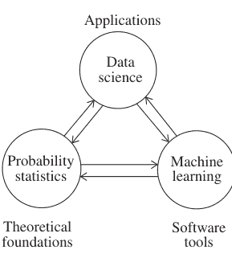

图 1.1 数据科学、机器学习与概率和统计之间的协同关系。

但又能清晰展示稳健方法的一般威力。由于聚类是机器学习的广泛应用之一，它将被用作理解如何将稳健方法应用于处理数据集中异常值的首个载体。它还将作为本书其余部分的模板。

## 1.1 定义异常值

**异常值**通常是同一数据集中与大部分数据偏离的一小部分数据子集。有时，真实数据通过称其为**内点**来与异常值区分开来。异常值的来源可能差异很大。异常值可以作为所收集数据特征的一部分自然出现。异常值也可能源于环境中可能无法避免的显著噪声。更常见的是，它们与测量误差或仪器误差相关。另一个来源是人为错误，例如输入错误或可能误解设备的测量单位。如果数据集的特征方差很大且数据量较小，这可能导致部分数据被声明为异常值。有时，它只是数据收集过程固有的一部分。异常或极端的异常值通常被称为**异常点**。

处理异常值基本有两种选择。第一种是构建对异常值具有容忍度的机器学习工具。这些就是稳健机器学习工具。这包括理解当前机器学习工具的工作原理，然后寻找一种在存在异常值时更有效的替代方法。概念上，当前机器学习方法寻求数据的**均值**来构建模型。稳健方法则寻求**中位数**从而使模型更加稳定可靠。这是本书的主要重点之一。将介绍使用均值所带来的问题，随后是使用中位数的优势。更一般地说，第一种方法是将非稳健机器学习方法转换为稳健方法。许多现有技术不稳健，应予以识别并相应更新。但是，如果一种方法本身就很稳健，则应优于其非稳健的对应方法。

第二种选择是检测并删除异常值，然后应用当前机器学习工具，或从数据集中提取异常值以供进一步检查。在当前实践中，对难以更改或替换的非稳健方法论有大量投资，因此更容易找到消除异常值并使用现有基础设施的方法。由于稳健方法在 Python 中尚未广泛使用（或未被充分理解），删除异常值似乎比基于稳健方法构建新基础设施更容易。

然而，尽管这听起来很有吸引力，但并非简单直接，需要格外小心，以确保不会误删除内点与异常值。在其他一些情况下，项目的目标是找出数据集中的异常值或异常点，而不是构建模型。将检查检测到的异常值，以了解异常点或所收集数据的任何异常方面。最后，有一些统计工具和程序依赖于数据中没有异常值才能产生有意义的结果（例如相关系数和方差分析）。因此，本书的次要重点是描述高效有效的方法，以检测和删除异常值和异常点。

## 1.2 书籍概览

在介绍完背景和预备知识后，我们现在将转向本书的主要重点：研究标准机器学习技术及其稳健对应方法。表 1.1 提供了将要描述的主题及其相关章节的路线图。

## 1.3 什么是稳健机器学习？

机器学习涉及开发软件，该软件基于计算机科学家、工程师和统计学家开发的算法和数学来分析数据并生成预测模型。可以将其视为问题的编程部分，用于构建软件工具和流程来处理数据，以推进特定的数据科学目标。大多数现有技术本质上基于寻找数据的**均值**。本书将描述的稳健方法基于寻找数据的**中位数**。迄今为止，由于其有些神秘的性质，稳健方法尚未得到广泛应用。这些技术在很大程度上借鉴了*稳健统计学*（参见 Maronna et al. 2019），这是一个本身广为人知且历史悠久的领域。然而，稳健方法在机器学习中只是近期才受到关注。本章乃至全书的目标是揭开稳健方法的神秘面纱，以便更多数据科学家在需要时能够使用这些方法。

老实说，大多数现实数据集以某种形式包含异常值。有些相对于其余数据无害，而另一些可能导致重大错误，尤其是在推理或预测过程中。问题是，很难*事先*知道你面对的是哪种情况。除非采取额外步骤确保可靠性，否则你可能无法判断结果是否可靠。例如，如果能以某种有效方式移除异常值，那么传统方法相当有效。然而，异常值检测和移除容易出错，因此这也可能不是一种可靠的方法。这常常被视为篡改数据。除非你能成功诊断并检测大数据集中的异常值，否则在经过修改的数据集上由标准机器学习方法生成的模型应被视为可疑。更审慎的方法是尽可能采用使用稳健程序的机器学习工具，从而完全避免这些问题。

一般来说，稳健机器学习是开发对异常值具有容忍度的工具、程序和方法论。在其最简单的形式中，这意味着使用中位数（或某个邻近分位数）而不是均值，从而产生对异常值具有容忍度的模型。它还包括使用稳健机器学习检测和移除异常值。当然，稳健方法引入了一组必须在有效使用之前解决的不同问题。正如本书将在整个过程中展示的那样，


### 表 1.1 主题、章节和描述。

| 主题 | 章节 | 描述 |
|---|---|---|
| 鲁棒聚类 | 1 | k-means聚类算法 鲁棒k-medians聚类算法 |
| 鲁棒线性回归 | 2 | L₁, L₂, Huber损失函数 |
| | 3 | log-cosh损失函数 |
| | 4 | 异常值检测，指标 (MSE, MAE)，鲁棒标准化 |
| 通过正则化构建的鲁棒模型 | 5 | 惩罚函数 (ridge, LASSO, aLASSO) |
| | 6 | 模型泛化，模型复杂度 |
| 分位数回归 | 7 | 用灵活的log-cosh函数替换分位数检验函数 |
| 鲁棒二元分类 | 8 | 逻辑回归，交叉熵与log-cosh损失函数，SVM，kNN，随机森林 |
| 二元分类与分类指标的神经网络 | 9 | 激活函数: relu, sigmoid，训练，反向传播，梯度下降，交叉熵与log-cosh损失函数，召回率，精确率，F₁分数，AUROC |
| 多类分类与优化 | 10 | 类别损失，softmax激活，修正后的美国国家标准与技术研究院 (MNIST) 数据集，Adam优化 |
| 异常值检测与评估指标 | 11 | kNN，隔离森林，基于密度的带噪声的空间聚类应用 (DBSCAN)，MADmax，精确率，召回率，AUROC |
| 应用于数据科学与人工智能 (AI) | 12 | 波士顿房价，泰坦尼克号数据集，气候变化时间序列 (ARIMA)，可解释人工智能 (XAI) |

鲁棒机器学习的优点远大于缺点。我们的目标是提供传统方法与鲁棒方法的并排对比，以便读者能够自行判断鲁棒机器学习的价值。

### 1.3.1 机器学习基础

在深入探讨本书的核心思想之前，先对机器学习和鲁棒方法提供一些背景材料是很有用的。机器学习起源于20世纪80年代的计算机科学领域，但在20世纪90年代曾一度沉寂，在此期间被视为一个死胡同领域。它在2000年左右重新焕发活力，并在2010年左右出现显著复兴。随着生成式人工智能的到来，它至今仍在不断获得关注和动力。当然，在20世纪80年代，计算机相对较慢，数据集不易获取，机器学习算法仍处于初级阶段。快进几十年，我们会发现格局已发生翻天覆地的变化。今天，高性能计算触手可及，数据无处不在，许多先进的机器学习算法已被开发、实现和测试。它们现在通过开放获取的在线机制广泛可用。

机器学习中的一些算法基于统计理论，而另一些则基于非参数方法或一组启发式规则。我们将研究属于所有这些类别的方法。机器学习工具主要有三种类型：监督学习、无监督学习和强化学习。1 本书仅关注监督学习和无监督学习方法。为了理解这两种方法，请考虑由矩阵 X ∈ R^{n×d} 给出的数据集，其中 n 是观测数量（数据集中的行数），d 是变量数量（数据集中的列数）。与每个观测值关联的“真实值”或真实响应可选择地在向量 y ∈ R^n 中提供。为了对比这两个类别，监督机器学习需要 X 和 y，而无监督机器学习只需要 X。

例如，线性回归、逻辑回归、神经网络、k近邻、基于树的方法等属于监督类别。在本书中，我们关注这些方法的鲁棒性方面。另一方面，数据聚类和异常检测是无监督学习方法的示例。我们将在本章中讨论鲁棒聚类，作为介绍鲁棒概念及其在机器学习中价值的一种方式。异常检测将在第11章中介绍。

对于监督学习，我们主要考虑两类问题：回归和分类。图1.2以图形方式展示了这两种情况。左侧，我们展示了一组用直线拟合的点，其中x轴是年份，y轴是该年的销售量。将直线拟合到数据称为线性回归。在这种情况下，机器学习的目标是使用数据找到直线的斜率和截距，使其“最佳拟合”图中所示给定点。

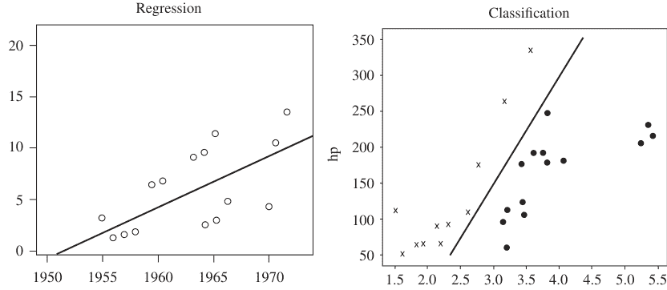

图1.2 线性回归与线性分类。

1. 虽然强化学习是机器学习的一个重要主题，但它超出了本书的范围。

最佳拟合基于优化过程中使用的某些客观函数。实际上，我们正在训练模型以了解数据集。一旦获得这些参数的估计值，就可以对原始数据集中不存在的值进行预测。例如，我们现在可以通过提出问题来测试我们的模型：“年份 = 1968 年的预期销售量是多少？”答案返回为“销售量 = 8.2”。我们以前在数据集中没有这个值，但现在我们可以使用拟合直线进行预测。构建预测模型是机器学习的精髓。

右侧的图显示了两组点，分别使用符号“•”和“x”表示。每个符号代表一个不同的类别。这里机器学习的目标是建立一条线，以最好地将“•”点与“x”点分开。找到两个类别之间的分界线被称为*线性分类*。在这种情况下，数据是线性可分的，分界线很好地定义了两组点之间的*决策边界*。我们说模型是使用给定数据训练的，这实际上意味着我们优化了一个客观函数以产生斜率和截距参数。我们现在可以提出另一个问题：“如果在 wt = 2.5 和 hp = 90 处引入一个新点，它属于哪个类别？”答案将返回为“它属于‘x’类别”。很大一部分监督机器学习工具涉及这种类型的分类。

### 1.3.2 异常值的影响

现在考虑异常值对上述两种情况的影响。图1.3显示了这一点。左侧，有一个新的数据点是异常值。对传统线性回归的影响是移动直线，使其比图1.2更水平。现在如果提出问题“年份 = 1968 年的预期销售量是多少？”，答案将返回为“销售量 = 6.5”，这并不准确。显然，这一个异常值产生了误导性结果。如果用于做出商业决策，这个异常值可能代价高昂。

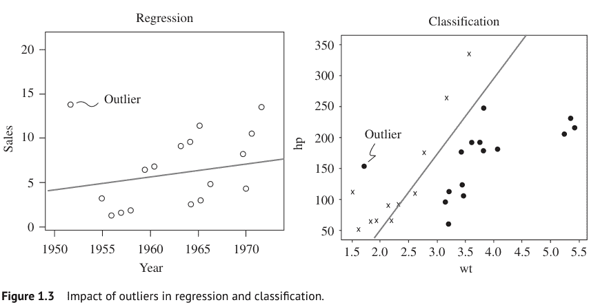

在图1.3右侧的第二种情况下，我们通过在边界左侧（即“x”类成员所在的位置）添加一个“•”来放置一个异常值。这个异常值的效果是“将直线向其移动，相对于图1.2中的相应直线”。异常值不应该影响边界，但它确实影响了。当我们再次提出问题“如果在 wt = 2.5 和 hp = 90 处引入一个新点，它属于哪个类别？”时，答案将返回为“它属于‘•’类别”。当然，这是不正确的。如前所述，它属于“x”类。异常值移动了决策边界，从而改变了预测响应。与以前一样，使用这些结果做出的任何商业决策都可能代价高昂。

理想情况下，我们希望给定图1.3的数据时，能够得到图1.2所示的结果。鲁棒方法提供了这种可能性，以及实现这一结果的方法论。鲁棒机器学习涉及适用于有无异常值的数据集的方法。它们产生的模型仿佛数据没有异常值一样。这是使用鲁棒方法的关键好处。您不需要思考数据集中异常值的影响可能是什么，或者它们位于何处。您只需在所有问题上使用这一类方法，而无需担心异常值。在某些应用中，您可能主要关心检测和删除异常值。鲁棒方法也解决了这个问题，如本书详细所述。

### 1.3.3 什么是鲁棒数据科学？

数据科学涉及一组特定于应用的任务，旨在从大量观测中创建一致的数据集，进行彻底的探索性数据分析（EDA），并仔细解释从机器学习工具和统计分析中获得的结果。这是一个相当广泛的领域，具有许多深度层次和各种各样的应用。我们将简要描述其中的一些层次，并强调这门学科的关键方面。如果我们退后一步，从更高的角度看待统计学和机器学习，就可以理解它们在数据科学中的作用。图1.4展示了传统观点。我们从概率分布形式的基础真理开始（假设这是总体的真实分布）。通过采样这个分布，我们生成一个数据集。一旦有了数据集，传统统计学/机器学习就会寻找最能逼近基础真理（即原始分布）的模型。从这个模型中，我们可以做任何我们想做的事情，例如进行预测。不幸的是，这是对数据科学世界的一种理想化看法。

### 1.3.4 数据集中的噪声

在现实世界中，存在会将异常值观测添加到我们数据集中的噪声。请考虑图1.4的略有修改版本，如图1.5所示。在这里，数据生成路径被修改为包含加性噪声。正是“信号”加“噪声”结合产生了更真实的数据集。

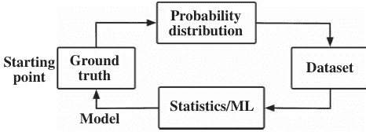

图1.4 模型构建过程的传统视图。


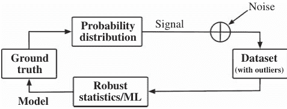

图 1.5 模型构建过程的真实视图。

这并非通常考虑的典型高斯噪声。相反，如果不特别小心，噪声足以导致构建出糟糕的模型。因此，为了构建最能逼近实地真值的模型，我们必须求助于能够有效去除噪声并生成更好模型的稳健统计/机器学习方法。如果没有稳健方法，当存在异常值时，我们可能无法生成能够逼近实地真值的高质量模型。

在稳健数据科学中，重点在于识别异常值，利用数据清洗方法去除不需要的异常值，或应用对这类异常值大体不敏感的程序。我们相信，鉴于所介绍方法的基础和优势，该领域会自然地向这个方向迁移。

### 1.3.5 训练和测试流程

数据科学涉及使用数据集和若干监督及无监督机器学习工具来构建模型。监督学习的典型流程如图 1.6 所示。我们有一个初始数据集，包含设计矩阵 X 和已知响应 Y。在此，Y 通常是一个向量，但也可以是取决于应用场景的响应矩阵。数据集被划分为训练集和测试集。我们使用训练数据构建模型，然后使用测试数据评估准确性。确定整体准确性有多种不同方法，如后续章节所述。图中未显示的是为尝试不同超参数所需的潜在迭代，超参数是用户指定的值，用于引导优化方法朝着理想模型发展。

步骤顺序如下。假设数据集包含异常值。首先，数据被随机划分为训练集和测试集。我们无法知道异常值落在了哪里；它们可能全在训练集中，全在测试集中，或同时在两者中。在实践中，我们必须假设它们同时存在于两者中，并在该假设下开发方法和指标。训练数据显示为

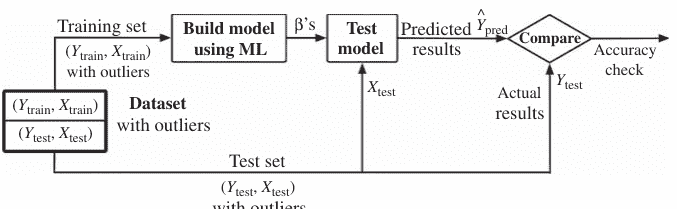

图 1.6 监督学习的训练集和测试集。(X_train, Y_train) 可能包含异常值，作为输入提供给选定的机器学习工具，例如逻辑回归或神经网络，以估计模型参数 β。通常，会使用交叉验证（CV）方案，即将训练集划分为若干子集，称为折，通过组合 k 个不同折的结果来产生更通用的模型。接下来，模型的预测准确性必须在独立测试集 (X_test, Y_test) 上进行评估，以便恰当评估其准确性。具体操作是获取 X_test（可能包含异常值），应用训练好的模型进行预测，然后将预测结果 Ŷ_pred 与真实值 Y_test 进行比较。质量评估通常使用一组合适的指标或统计量进行。² 在存在异常值时使用误差度量必须小心。由于异常值可能出现在训练集、测试集或两者中，可能需要稳健误差度量，其对回归和分类任务有所不同。考虑一种情况：训练集没有异常值，但测试集中充满了异常值。使用标准误差度量，无论进行多少训练都无法在测试集上产生良好结果。因此，我们必须选择合适的稳健误差度量以恰当评估准确性。在无监督学习中，数据集由 X_train 给出，但不涉及 Y_train 或测试集。然而，目标仍然是与特定机器学习任务相关的某些目标函数最小化。无论进行监督学习还是无监督学习，异常值的存在都可能影响模型质量，因此我们必须考虑稳健机器学习。有了这个简要的原理，我们现在可以继续了解稳健机器学习的工作原理及其应用位置。

## 1.4 中位数的稳健性

稳健机器学习的起点是对两个有用统计量的简要回顾：均值和中位数。均值非常著名，是最流行机器学习方法的基础，而中位数则不那么著名，但对我们的目的很重要。

### 1.4.1 均值与中位数

给定一组 n 个值，x = {x1, ..., xn}，均值由以下公式给出

x̄ = mean(x) = (1/n) Σ(i=1 to n) xi, (1.4.1)

即所有值之和除以 n。

中位数取决于 n 是奇数还是偶数。首先，将值从小到大排序。排序后，新集合表示为 {x(1), ..., x(n)}，其中 x(1) ≤ ... ≤ x(n)。这些被称为 x 的阶统计量，其中 x(1) = min {xi, i = 1, ..., n} 和 x(n) = max {xi, i = 1, ..., n}，x(i) 是有序观测值。如果 n 为奇数，则取有序集合中的中间值，

median(x) = x((n+1)/2). (1.4.2)

如果 n 为偶数，则取有序集合中间两个值的平均值。假设上述排序，可以紧凑地表示为：

median(x) = (1/2) [x(n/2) + x((n/2)+1)]. (1.4.3)

在此，上界值 $x_{(\frac{n}{2}+1)}$ 和下界值 $x_{(\frac{n}{2})}$ 被平均以获得中位数，但从技术上讲，*上下界值之间的任何值*都可以作为中位数，这意味着存在无限多个可能值。

我们已经可以看到一个问题：中位数似乎有点复杂，需要几个步骤，并且当 n 为偶数时还有注意事项，而均值只需一个简单方程即可理解。这说明了为什么中位数不如均值那样容易被接受。此外，均值始终是唯一的，而中位数可能唯一也可能不唯一。事实上，它可以是唯一的，也可以是有界区域内 **无限数量的值** 中的任意一个。然而，当涉及到在存在异常值的数据集中找到其本质时，中位数更为重要，如我们稍后将看到。我们之所以会听到“中位数房价”或“中位数家庭收入”这样的说法，是有充分理由的。

表 1.2 对某些琐碎情况下的这两个统计量进行了比较和对比。第一个集合 {3, 1, 4, 2, 5, 3} 对均值和中位数都产生 3。这与对集合中值的目测检查一致。然而，如果将其中一个值从 3 改为 100 以产生第二个集合 {100, 1, 4, 2, 5, 3}，则均值显著增加到 19.2，而中位数为 3.5，与之前的值接近。在这种情况下，值 100 将被视为一个 *异常值*，因为它远离其余数据。均值受一个异常值的极大影响，这使其不稳定。另一方面，中位数在存在一个异常值时似乎相当稳定。

继续这个练习，如果我们检查表 1.2 最后一列中列出的集合 3，即 {100, 100, 1, 4, 2, 5, 3}，现在有两个异常值，均值进一步偏移，超出了集合 1 原始元素从 3.0 到 30.7 的范围。另一方面，中位数保持在 4.0 处相对稳定。出于这个原因，我们称中位数具有 *鲁棒性特性*。

暂且回到集合 2，如果我们让 $x_{(n)}$ 表示异常值，并初始设定 $x_{(n)} = 100$，那么当 $x_{(n)} \to \infty$ 时会发生什么？均值趋于 $\infty$，而中位数保持在 3.5 处稳定。这正是机器学习中需要稳健方法的根本原因。如果存在异常值，使用传统方法则无法信任模型。

### 1.4.2 对标准差的影响

标准差也受异常值的极大影响。设 $\mu$ 为总体均值，并让 Eq. (1.4.1) 中的 $\bar{x}$ 为 $\mu$ 的估计。进一步，定义总体方差 $\sigma^2$ 如下

$$
\sigma^2 = \frac{1}{n} \sum_{i=1}^n (x_i - \mu)^2,
$$

表 1.2 三个小数据集上均值与中位数、标准差（SD）以及标准化中位数绝对偏差（MADN）的比较。

| 指标 | 集合 1 {3,1,4,2,5,3} | 集合 2 {100,1,4,2,5,3} | 集合 3 {100,100,1,4,2,5,3} |
|---|---|---|---|
| 均值 | 3.0 | 19.2 | 30.7 |
| 中位数 | 3.0 | 3.5 | 4.0 |
| 标准差 (SD) | 1.41 | 36.9 | 47.3 |
| MADN | 1.48 | 2.22 | 3.0 |


和 $\sigma$ 的无偏估计量由以下给出

$SD(\mathbf{x}) = \hat{\sigma} = \sqrt{\frac{1}{n-1} \sum_{i=1}^n (x_i - \bar{x})^2}$ (1.4.4)

即样本集的标准差（SD）。然后，随着离群值趋于无穷大，均值也趋于无穷大，结果，标准差也趋于无穷大。因此，一个离群值会对依赖于均值的各种其他统计量产生多米诺骨牌效应。

为解决此问题，每个基于均值的统计量都可以由一个鲁棒的对应项替换。标准差的一种鲁棒统计量是中位数绝对偏差（MAD），由以下给出

$\text{MAD}(\mathbf{x}) = \text{median}_{1 \le i \le n} (|x_i - \text{median}(\mathbf{x})|)$ (1.4.5)

基于**归一化 MAD** 的总体标准差的一致且鲁棒的估计量可计算如下：$^3$

$\text{MADN}(\mathbf{x}) = k \times \text{MAD}(\mathbf{x})$ (1.4.6)

其中 $k = 1.4826$。这样做是为了使 SD($\mathbf{x}$) 和 MADN($\mathbf{x}$) 在无离群值数据下近似相等。如果我们取表 1.2 中的集合 1，即原始无离群值集合，则 SD($\mathbf{x}$) = 1.41 且 MADN($\mathbf{x}$) = 1.48。对于集合 2，其中 $x_{(n)} = 100$，SD($\mathbf{x}$) = 39.6 且 MADN($\mathbf{x}$) = 2.22。请注意，与 SD($\mathbf{x}$) 相比，MADN($\mathbf{x}$) 很稳定。

如果我们现在将集合 2 中的离群值改为 $x_{(n)} = 1000$，则 SD($\mathbf{x}$) = 407.0 且 MADN($\mathbf{x}$) = 2.22；也就是说，MADN 保持不变。显然，单个大的离群值会使均值和标准差等基本统计量偏斜，而中位数和 MADN($\mathbf{x}$) 即使在 $x_{(n)} \to \infty$ 时也能保持相对稳定。对于集合 3，有两个离群值，SD($\mathbf{x}$) = 47.3 且 MADN($\mathbf{x}$) = 3.0。在大多数带有离群值的数据科学问题中，我们寻求这种稳定性。

**练习**：给定集合 $\mathbf{x} = \{1, 2, 3, 4, 5, 1000\}$，计算均值、中位数、SD($\mathbf{x}$) 和 MADN($\mathbf{x}$)。

**答**：mean = 1015/6 = 169.17, median = 3.5, SD($\mathbf{x}$) = 407, MADN($\mathbf{x}$) = 2.2。（注：更精确地说，中位数 $\in (3, 4)$。当我们寻求唯一值时，我们仅为方便使用 3.5 的平均值。）

## 1.5 $L_1$ 和 $L_2$ 范数

在讨论传统方法与鲁棒方法时，有两个与矢量范数相关的范数：所谓的 $L_1$-范数和 $L_2$-范数。这些范数只是衡量矢量大小或两个矢量之间距离的指标。具体来说，具有 $n$ 个元素的矢量 $\mathbf{v}$ 的两个范数如下所示：

$L_1 = \|\mathbf{v}\|_1 = \sum_{i=1}^n |v_i| = |v_1| + |v_2| + ... + |v_n|,$

$L_2 = \|\boldsymbol{v}\|_2 = \sqrt{\sum_{i=1}^n v_i^2} = \sqrt{v_1^2 + v_2^2 + ... + v_n^2}.$

两个向量 $\boldsymbol{u}$ 和 $\boldsymbol{v}$ 之间的曼哈顿距离由以下给出

\( L_1 = \|\boldsymbol{u} - \boldsymbol{v}\|_1 = \sum_{i=1}^n |u_i - v_i|, \)

而欧氏距离由以下给出

\( L_2 = \|\boldsymbol{u} - \boldsymbol{v}\|_2 = \sqrt{\sum_{i=1}^n (u_i - v_i)^2}. \)

**练习：** 设 \(\boldsymbol{x} = (-1, 2, 3)^\top\)。\(L_1\) 和 \(L_2\) 范数的值是多少？

**答：** \(L_1 = 6\), \(L_2 = \sqrt{14}\)。（注：\((-1, 2, 3)^\top$ 中使用的 \(\top$ 上标指向量的转置，因为它为方便起见水平表示而非垂直表示。）

**练习：** 设 \(\boldsymbol{u} = (-1, 2, 3)^\top$ 和 \(\boldsymbol{v} = (-2, 3, 4)^\top$。这两个向量在 \(L_1$ 和 \(L_2$ 范数意义下的距离是多少？

**答：** \(\|\boldsymbol{u} - \boldsymbol{v}\|_1 = 3$, \(\|\boldsymbol{u} - \boldsymbol{v}\|_2 = \sqrt{3}\)。

通常，即使我们对范数值进行平方，也可能会使用“L2”这一短语，如

\( L_2^2 = \|\boldsymbol{u} - \boldsymbol{v}\|_2^2 = \sum_{i=1}^n (u_i - v_i)^2. \)

这种较宽松的定义用于比较相对大小的情况，尤其是距离度量、损失函数或惩罚函数的情况。通常，当我们使用短语“L2”时，指的是平方和；而当提到“L1”时，指的是绝对值和。

**练习：** 设 \(\boldsymbol{u} = (-1, 2, 3)^\top$ 和 \(\boldsymbol{v} = (-2, 3, 4)^\top$。\(\|\boldsymbol{u} - \boldsymbol{v}\|_2^2$ 与由 \(\|\boldsymbol{u} - \boldsymbol{v}\|_2$ 给出的 \(L_2$ 范数相比如何？

**答：** \(\|\boldsymbol{u} - \boldsymbol{v}\|_2^2 = 3$, \(\|\boldsymbol{u} - \boldsymbol{v}\|_2 = \sqrt{3}\)。一个对平方和取平方根，而另一个不取平方根。

## 1.6 高斯分布复习

统计学中最重要的分布之一是众所周知的高斯分布或正态分布。这一主题已在无数论文、书籍和在线资源中讨论过。本书将多次引用它，因此此处为完整起见予以介绍。假设读者对此领域已有较深入的了解作为先决条件，但为了复习目的，这里提供了一个简要教程。

高斯分布具有以下给出的概率密度函数（PDF）

$f_X(x) = \frac{1}{\sqrt{2\pi\sigma^2}} e^{-\frac{(x-\mu)^2}{2\sigma^2}} , \qquad (1.6.1)$

其中 \(\mu\) 是均值，\(\sigma^2$ 是方差。如果任何样本都根据上述方程分布，则称随机变量 \(X$ 服从高斯分布。更紧凑的记法是

$X \sim \mathcal{N}(\mu, \sigma^2). \qquad (1.6.2)$

这与公式 (1.6.1) 等效，只不过我们现在明确说明 \(X$ 是服从均值为 \(\mu$、方差为 \(\sigma^2$ 的高斯分布的随机变量。

高斯分布的累积分布函数（CDF）定义为

$F_X(x) = \mathbb{P}(X \le x) = \int_{-\infty}^x f_X(t)dt. \qquad (1.6.3)$

CDF 给出了随机变量 \(X$ 小于特定数值 \(x$ 的概率。它是通过将 PDF 从 \(-\infty$ 到 \(x$ 积分得到的。根据概率论公理，任何 PDF 下的总面积均为 1.0。因此，积分结果将始终位于范围 \([0, 1]$ 内，因为概率不能超过此范围。

我们通常有兴趣从高斯分布的 CDF 计算概率，但由于公式 (1.6.3) 中的积分没有封闭形式，我们求助于使用具有正态分布的 \(z$-分数的查找表。\(z$-分数计算如下

$z = \frac{x - \mu}{\sigma}, \qquad (1.6.4)$

其中 \(z$ 是 \(x$ 的标准化值，且 \(Z \sim \mathcal{N}(0, 1)$。为记号方便，我们将高斯分布的 PDF 称为 \(\mathcal{N}(\mu, \sigma^2)$，将高斯分布的 CDF 称为 \(\Phi(x$)。

对于随机变量 \(\boldsymbol{X} \in \mathbb{R}^d$，多元高斯分布表示为

$\boldsymbol{X} \sim \mathcal{N}_d(\boldsymbol{\mu}, \boldsymbol{\Sigma}), \qquad (1.6.5)$

其中 \(\boldsymbol{\mu}$ 是 \(d \times 1$ 向量，\(\boldsymbol{\Sigma}$ 是 \(d \times d$ 协方差矩阵，相应的 PDF 由以下给出

$f_{\boldsymbol{X}}(\boldsymbol{x}) = \frac{1}{\sqrt{(2\pi)^d |\boldsymbol{\Sigma}|}} e^{-\frac{1}{2}(\boldsymbol{x}-\boldsymbol{\mu})^\top \boldsymbol{\Sigma}^{-1}(\boldsymbol{x}-\boldsymbol{\mu})}, \qquad (1.6.6)$

其中 \(\boldsymbol{\Sigma}^{-1}$ 是协方差矩阵的逆，\(|\boldsymbol{\Sigma}|$ 是行列式。

虽然高斯分布在统计学中非常宝贵，但我们稍后会发现，为了实现鲁棒性，我们需要远离这个优雅的分布，转而采用其他鲜为人知的分布。

## 1.7 无监督学习案例研究

我们现在准备好迎接第一个属于无监督学习范畴的机器学习问题。在本章剩余部分，我们将深入探讨数据聚类，以介绍和说明机器学习中的许多基本概念，特别关注鲁棒技术的原理和正确使用。当今使用的许多方法都不够鲁棒，因此我们的目标是了解现有工具可能不是良好选择的原因，以及鲁棒性在哪里能提供最大帮助。


### 1.7.1 聚类示例

聚类（参见 James et al. 2023）是机器学习中一个广为人知且广泛理解的问题，因此它是我们学习稳健方法的良好入口。聚类过程涉及取一组未分配的多维数据点 \(\boldsymbol{X} \in \mathbb{R}^{n \times d}\)，并根据它们彼此之间的接近程度将其分配给 \(K\) 个组或簇中的一个。\(K\) 的值始终为整数，并作为用户根据感兴趣的应用指定的超参数，其中 \(K > 1\)（因为 \(K = 1\) 是平凡情况）。我们将从简单问题开始，学习聚类的基础知识，然后逐步深入到非稳健和稳健方法的完整算法集合。在此过程中，我们将遵循图 1.4 和图 1.5 的循环。

练习：设矩阵 \(\boldsymbol{X}\) 定义如下：

\(\boldsymbol{X} = \begin{pmatrix} 1 & 2 \\ 1 & 4 \\ 2 & 3 \end{pmatrix} .\)

在这种情况下，\(n\) 和 \(d\) 的值是多少？在本章中，我们将使用符号 \(\boldsymbol{x}^{(i)}\) 来引用该矩阵的第 \(i\) 行。\(\boldsymbol{x}^{(2)}\) 是什么？\(\boldsymbol{x}^{(2)} - \boldsymbol{x}^{(1)}\) 是什么？

**答.:** 在本书中，符号 \(\boldsymbol{X} \in \mathbb{R}^{n \times d}\) 将用于指代具有 \(n\) 行和 \(d\) 列的实矩阵 \(\boldsymbol{X}\)。在此平凡示例中，由于有 3 行，\(n = 3\)；由于有 2 列，\(d = 2\)。因此，\(\boldsymbol{x}^{(2)} = (1, 4)^\top\)。此外，\(\boldsymbol{x}^{(2)} - \boldsymbol{x}^{(1)} = (0, 2)^\top\)。\(\square\)

### 1.7.2 聚类问题规格说明

给定 \(\mathbb{R}^d\) 中的一组 \(n\) 个点和一个整数超参数 \(K\)，聚类的目标是根据每个点到一组定义的簇中心 \(\mu_1, \dots, \mu_K\) 的接近程度，将每个点分配给 \(K\) 个簇 \(C_1, \dots, C_k\) 中的一个，从而最小化基于距离的代价函数。簇中心是使用分配给每个簇的点集计算的。用于聚类的算法从将点分配到簇的初始分配开始，然后以迭代方式进行，直到实现簇分配的收敛。

要理解聚类过程，请参考图 1.7。左侧图表是原始数据集，在 \(\mathbb{R}^2\) 中由每个点的变量 \(x_1\) 和 \(x_2\) 表示。在此情况下，簇的数量选择为 \(K = 3\)，经过几次迭代后，聚类过程产生右侧图表。代表中心用符号 \(\oslash\) 表示。数据周围的三个圆形/椭圆边界仅显示为视觉辅助，以识别不同的簇。通常，使用不同的颜色或符号来表示不同的簇。

聚类问题比看起来更难；事实上，它属于 NP-hard 问题类，这意味着随着问题规模的增加，它不能在多项式时间内求解。因此，通常使用“贪心”算法寻找局部最优解，先对中心进行初始猜测，然后重复对数据进行聚类并重新计算中心的过程，直到收敛。结果可能会因初始起始点的选择而显著不同。

算法 1.1 显示了一个通用无监督聚类算法。它通过随机选择 \(K\) 个中心开始。然后进入迭代循环。在循环的第一阶段，通过将数据点分配给其最近的中心来定义 K 个组。

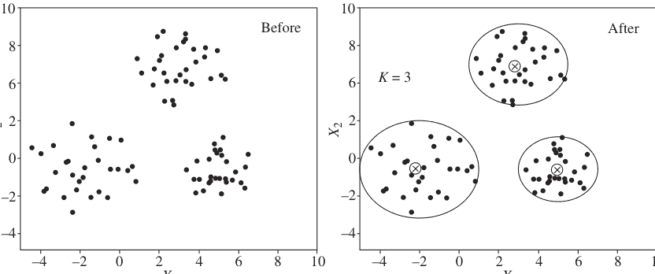

图 1.7 聚类前后的数据集。

在第二阶段，使用分配给每个组的数据点重新计算各组的中心。然后为新的安排计算一个合适的代价函数。迭代继续经过这两个阶段，直到实现收敛。当代价函数最小化且 K 个组不再变化时，就会发生这种情况。该循环被称为 Lloyd 风格迭代过程。

该算法对初始猜测敏感，因此值得讨论一些初始化选项。最简单的方法是从数据集的 n 个总点中选择 K 个随机点，如算法中所建议。不幸的是，这些随机值可能彼此接近，这是不可取的，因为这可能导致不平衡的聚类。另一种方法是选择 K + m 个初始中心，然后移除 m 个中心以产生 K 个簇。这有时用于在数据中找到异常值。第三种初始化方案涉及选择彼此远离的 K 个中心。这允许形成一组更平衡的簇。无论如何，都应该使用某种巧妙的方法来选择 K 个中心。否则，结果可能无法满足其预期目的。

### 算法 1.1 使用 Lloyd 风格迭代的通用聚类算法。

```
1: Input: dataset X, number of clusters = K;
2: Initialize centers using K random points of X, cost_old = 0, cost_new = maxcost;
3: repeat until (|cost_new - cost_old| < ε):
4: Define K new clusters, C1, ..., Ck, by assigning each point to the nearest center;
5: Recompute K cluster centers of C1, ..., Ck;
6: cost_old = cost_new;
7: Compute cost_new using a distance-based cost function;
8: end repeat
9: Output: final clusters, C1, ..., Ck;
```

练习：考虑下面的数据点散点图。在这种情况下，\( d \) 的值和合适的 \( K \) 值是多少？

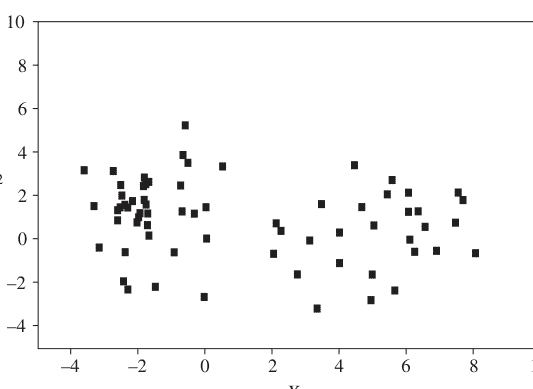

答.: 此处，\( d = 2 \) 因为这是一个二维问题，而且看起来 \( K = 2 \) 是一个合适的选择，因为显然有两个簇。\(\square\)

## 1.8 为聚类创建合成数据

在开发 ML 工具时，我们经常会创建具有代表性的数据集来验证程序的运行情况。这些被称为 *合成数据集*。合成数据还用于测试边界情况、引入人工异常值，并增强现有的真实世界数据集，以提高 ML 工具生成的模型质量。在解决聚类问题之前，我们需要一种在多维空间中生成由任意数量簇组成的合成数据集的方法。我们从某种概率分布开始，如图 1.4 所示。对于聚类，合适的分布是几个高斯分布的线性组合，称为 **高斯混合**。为简单起见，我们从两个簇的情况开始，然后推广到 \( K \) 个簇。为了测试目的，我们还需要生成 1 维、2 维或任何高达 \( d \) 维的点簇。

### 1.8.1 一维数据集

一个包含两个高斯分布的混合的一维问题采用以下形式：

\( f_X(x) = \pi_1 \mathcal{N}(\mu_1, \sigma_1^2) + \pi_2 \mathcal{N}(\mu_2, \sigma_2^2), \quad (1.8.1) \)

其中 \(\pi_i\) 是与形式为 \(\mathcal{N}(\mu_i, \sigma_i^2)\) 的每个分布相关的概率权重因子（**不**是数值 \(\pi\)）。根据定义，\(\pi_1 + \pi_2 = 1\)。如果混合中有 \( K \) 个高斯分布，

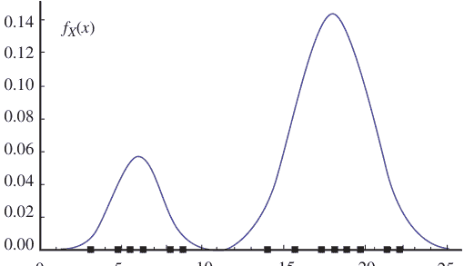

图 1.8 一维高斯混合。

那么我们将要求

$$\sum_{i=1}^K \pi_i = 1$$

以满足与有效 PDF 相关的基本概率公理。

**示例:** 图 1.8 所示的图表代表一个一维高斯混合。它基于方程 (1.8.1) 的高斯混合模型。混合物的参数是 \(\pi_1 = 0.2, \pi_2 = 0.8, \mu_1 = 6, \sigma_1^2 = 2, \mu_2 = 18, \text{ 且 } \sigma_2^2 = 5\)。当我们从这样的分布中抽取 14 个观测值的样本时，我们会沿 x 轴得到一组随机点，如图所示。这就是我们得到的数据集，对原始分布没有任何先验知识。目标是使用这些数据识别两个簇，并重建样本所基于的原始分布，如前面在图 1.4 中所示。也就是说，我们希望仅根据随机点样本，为数据所源于的未知分布构建一个模型。关键概念是，数据始终与某个未知分布相关联。我们用给定数据所能做的最好的事情，就是使用机器学习为其构建一个近似模型。

**练习:** 图 1.8 的高斯混合从 \(-\infty\) 到 \(\infty\) 的曲线下面积（AUC）是多少？

**答.:** 根据有效概率分布的定义，AUC = 1.0。事实上，所有有效 PDF 都具有归一化常数，以确保它们积分为 1。

### 1.8.2 多维数据集

考虑一个更现实的 \(d\) 维高斯分布，表示为 \(\mathcal{N}_d(\boldsymbol{\mu}, \boldsymbol{\Sigma})\)，其中 \(\boldsymbol{\mu} = (\mu_1, ..., \mu_d)^\top\) 且 \(\boldsymbol{\Sigma}\) 是一个 \(d \times d\) 非奇异协方差矩阵。在其最一般形式中，我们有以下高斯混合：

$$f_X(\boldsymbol{x}) = \sum_{i=1}^K \pi_i \mathcal{N}_d(\boldsymbol{\mu}_i, \boldsymbol{\Sigma}_i).$$ (1.8.2)


因此，我们可以将两个 $d$ 维高斯分布的混合定义为

$$f_x(\mathbf{x}) = \pi_1 \mathcal{N}_d(\boldsymbol{\mu}_1, \boldsymbol{\Sigma}_1) + \pi_2 \mathcal{N}_d(\boldsymbol{\mu}_2, \boldsymbol{\Sigma}_2).$$ (1.8.3)

在本章余下部分，我们将假设协方差矩阵采用简化形式 $\boldsymbol{\Sigma} = \sigma^2 \mathbf{I}_d$，其中 $\mathbf{I}_d$ 是一个 $d \times d$ 单位矩阵。这适用于圆形或球形分布的数据。然后，对于 $K=2$ 和任意 $d$，

$$f_x(\mathbf{x}) = \pi_1 \mathcal{N}_d(\boldsymbol{\mu}_1, \sigma_1^2 \mathbf{I}_d) + \pi_2 \mathcal{N}_d(\boldsymbol{\mu}_2, \sigma_2^2 \mathbf{I}_d).$$ (1.8.4)

在 $K=2$ 且 $d=2$ 的情况下，我们有

$$f_x(\mathbf{x}) = \pi_1 \mathcal{N}_2(\boldsymbol{\mu}_1, \boldsymbol{\Sigma}_1) + \pi_2 \mathcal{N}_2(\boldsymbol{\mu}_2, \boldsymbol{\Sigma}_2).$$ (1.8.5)

其中 $\pi_1 + \pi_2 = 1$，$\boldsymbol{\mu}_1 = (\mu_{11}, \mu_{12})^\top$，$\boldsymbol{\mu}_2 = (\mu_{21}, \mu_{22})^\top$，

$$\boldsymbol{\Sigma}_1 = \sigma_1^2 \begin{pmatrix} 1 & 0 \\ 0 & 1 \end{pmatrix} \text{ and } \boldsymbol{\Sigma}_2 = \sigma_2^2 \begin{pmatrix} 1 & 0 \\ 0 & 1 \end{pmatrix}.$$

为便于记法，我们可以定义一个集合 $\Theta = \{\pi_1, \pi_2, \boldsymbol{\mu}_1, \boldsymbol{\mu}_2, \sigma_1, \sigma_2\}$，它包含所有真实参数。可以以与一维情况描述相同的方式，从这个二维高斯混合的概率分布中生成数据。基于数据，我们可以估计混合的参数以重建分布。在计算这些参数时，我们将使用 $\hat{\Theta} = \{\hat{\pi}_1, \hat{\pi}_2, \hat{\boldsymbol{\mu}}_1, \hat{\boldsymbol{\mu}}_2, \hat{\sigma}_1, \hat{\sigma}_2\}$，其中“帽”代表每个参数的估计值。这将构成分布的 **模型**。

**示例**：考虑图 1.9 中的数据。它是通过采样一个未知高斯混合生成的。我们希望用 Eq. (1.8.5) 给出的形式来表示它。我们该如何做？假设我们可以使用某些聚类算法识别出两个簇以及属于每个簇的点。然后我们发现，两个簇的中心分别为 (1.1,1.2) 和 (6.9,7.1)，并且假设两个簇的协方差矩阵是对称的，我们可以分别计算方差为 1.3 和 2.1。此外，我们发现一个簇中的点数是另一个簇的两倍。为了使用 Eq. (1.8.5) 编写高斯混合模型，我们设置 $\hat{\pi}_1 = 1/3$ 和 $\hat{\pi}_2 = 2/3$。两个簇的中心为

$$\hat{\boldsymbol{\mu}}_1 = (1.1, 1.2)^\top, \text{ and } \hat{\boldsymbol{\mu}}_2 = (6.9, 7.1)^\top.$$

然后协方差矩阵为

结果发现，真实值为 $\pi_1 = 0.3$，$\pi_2 = 0.7$，$\boldsymbol{\mu}_1 = (1, 1)^\top$，$\boldsymbol{\mu}_2 = (7, 7)^\top$，$\sigma_1^2 = 1$，且 $\sigma_2^2 = 2$。在这种情况下，模型相当准确，并完成了图 1.4 所示的流程。唯一缺失的步骤是如何首先创建簇，这将是下一节的主题。

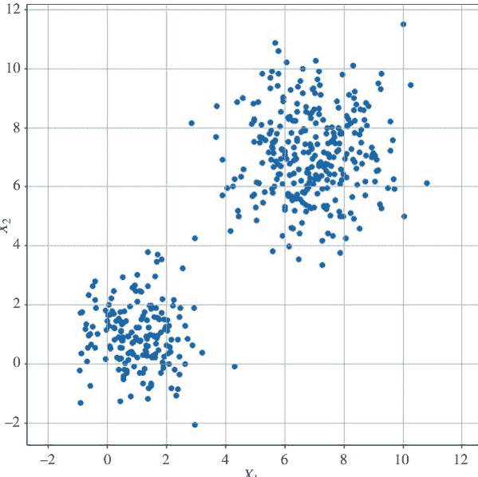

图 1.9 二维高斯混合。

## 1.9 聚类算法

我们已经描述了一种用于生成数据的高斯混合方法和一个通用的 Lloyd 风格迭代循环来创建簇。我们现在研究实现算法 1.1 的两种方法。一旦我们选择了距离度量、代价函数和中心化准则，通用算法就变成了特定算法。

### 1.9.1 k-均值聚类

第一种方法称为 k-均值聚类。在阶段 1 中，点根据 L2 距离度量被分配给其最近的中心。每个距离计算如下：

```
distance(i,j) = \|x^{(i)} - \mu^{(j)}\|_2^2
= (x_1^{(i)} - \mu_1^{(j)})^2 + (x_2^{(i)} - \mu_2^{(j)})^2 ... (x_d^{(i)} - \mu_d^{(j)})^2,
```

其中 \(x^{(i)}\) 是 \(X\) 的第 \(i\) 个观测值，\(\mu^{(j)}\) 是 \(K\) 个可能中心中的第 \(j\) 个中心。然后，根据距离公式，将每个 \(x^{(i)}\)（\(i = 1, \dots, n\)）分配给最近的 \(\mu^{(j)}\)（\(j = 1, \dots, K\)）。在第二阶段，对于所有 \(K\) 个簇，使用分配给每个簇的点计算簇的 *质心*。这只是分配给每个簇的数据点的列均值，

\(\mu^{(j)} = \text{mean } (C_j) \text{ for all } j = 1, \dots, K.\)

在上述中，\(C_j\) 是簇 \(j\) 的簇矩阵。

代价计算为所有簇中，每个簇内数据点到其各自簇中心的所有距离的总和：

\(\text{cost} = \sum_{j=1}^K \sum_{i \in C_j} \|x^{(i)} - \mu^{(j)}\|_2^2.\) (1.9.1)

在上述中，\(C_j\) 是 \(X\) 的行号集合。

将旧代价和新代价与一个小值 \(\varepsilon\) 进行比较，以按以下方式确定收敛：

\(|\text{cost}_{\text{new}} - \text{cost}_{\text{old}}| < \varepsilon.\) (1.9.2)

两阶段循环将持续进行，直到满足收敛准则且在两个连续循环中没有任何中心发生变化。

**练习：** 设 \(x^{(i)}\) 为矩阵 \(X \in \mathbb{R}^{60 \times 2}\) 的第 \(i\) 个观测值，由

\(X = \begin{pmatrix} 1 & 2 \\ 1 & 4 \\ \vdots & \vdots \\ 2 & 3 \end{pmatrix}.\)

上面仅显示了矩阵的第 1、2 和 60 行。设簇 \(C_1\) 仅包含这三个点，具体为 \(x^{(1)}\)、\(x^{(2)}\) 和 \(x^{(60)}\)。按我们的记法，\(C_1 = \{1, 2, 60\}\)。簇的质心是多少，我们将其记为 \(\mu^{(1)}\)？

**答：** \(C_1\) 中的数据点为 \(x^{(1)} = (1, 2)^\top\)、\(x^{(2)} = (1, 4)^\top\) 和 \(x^{(60)} = (2, 3)^\top\)。质心是按坐标分量计算的平均值。因此，质心为 \(\mu^{(1)} = ((1 + 1 + 2)/3, (2 + 4 + 3)/3)^\top = (4/3, 3)^\top\)。

**练习：** 设 \(X \in \mathbb{R}^{60 \times 2}\) 如上定义。从 \(x^{(2)}\) 到簇中心 \(\mu^{(1)} = (4/3, 3)^\top\) 的 \(L_2\) 距离是多少？

**答：** 距离由以下公式给出

\(\text{distance}(2, 1) = \|x^{(2)} - \mu^{(1)}\|_2^2 = (x_1^{(2)} - \mu_1^{(1)})^2 + (x_2^{(2)} - \mu_2^{(1)})^2.\)

因此，\((1 - 4/3)^2 + (4 - 3)^2 = 10/9\)。

**练习：** 设簇 \(C_1\) 包含上述矩阵中 \(X \in \mathbb{R}^{60 \times 2}\) 的三个元素 \(x^{(1)}\)、\(x^{(2)}\) 和 \(x^{(60)}\)。假设 \(\mu^{(1)} = (4/3, 3)^\top\)，该簇的 \(L_2\) 代价是多少？

**答：** \(L_2\) 代价由以下公式给出

\(\text{cost}(C_1) = \|x^{(1)} - \mu^{(1)}\|_2^2 + \|x^{(2)} - \mu^{(1)}\|_2^2 + \|x^{(60)} - \mu^{(1)}\|_2^2.\)

因此，\([(1 - 4/3)^2 + (2 - 3)^2] + [(1 - 4/3)^2 + (4 - 3)^2] + [(2 - 4/3)^2 + (3 - 3)^2] = 24/9\)。

### 1.9.2 k-中位数聚类

k-均值聚类的一个问题是它对异常值不鲁棒。这一问题将在后续章节中强调，但许多聚类问题包含异常值，它们会破坏使用 k-均值获得可接受结果的能力。一个合乎逻辑的替代方案是使用 k-中位数聚类，它采用不同的距离、代价和中心计算方法。距离通常由曼哈顿距离给出（虽然也可以使用欧氏距离），如下：

```
\(\text{distance}(i,j) = \| \boldsymbol{x}^{(i)} - \boldsymbol{\mu}^{(i)} \|_1\)
\(= |x_1^{(i)} - \mu_1^{(i)}| + |x_2^{(i)} - \mu_2^{(i)}| + \dots + |x_d^{(i)} - \mu_d^{(i)}|.\) (1.9.3)
```

这个 \(L_1\) 距离度量用于确定观测值到簇的分配。虽然这通常用于 k-中位数，但 \(L_2\) 距离也适用于此目的。原因是距离在此是相对度量，因此可以使用两种选项之一。对鲁棒性至关重要的是中心的计算。分配后，中心随后被确定为每个簇中观测值的列中位数：

```
\(\boldsymbol{\mu}^{(i)} = \text{median}(\boldsymbol{C}_j) \quad \forall j = 1, \dots, K,\)
```

其中矩阵 \(\boldsymbol{C}_j\) 包含属于簇 \(j\) 的 \(\boldsymbol{X}\) 的行子集。

代价计算如下：

```
\(\text{cost} = \sum_{j=1}^K \sum_{\boldsymbol{i} \in \boldsymbol{C}_j} \| \boldsymbol{x}^{(i)} - \boldsymbol{\mu}^{(i)} \|_1.\) (1.9.4)
```

使用中位数进行中心计算正是使算法鲁棒化的原因。中心不再由异常值控制，使用此方法将找到真正代表每个簇的合理中心值。总而言之，只要使用中位数计算中心，k-均值的代价和距离度量均可用于 k-中位数方法。

**练习：** 设簇 \(C_1\) 包含矩阵中 \(\boldsymbol{X} \in \mathbb{R}^{60 \times 2}\) 的 3 个元素 \(\boldsymbol{x}^{(1)}\)、\(\boldsymbol{x}^{(2)}\) 和 \(\boldsymbol{x}^{(60)}\)：

```
\(\boldsymbol{X} = \begin{pmatrix} 1 & 2 \\ 1 & 4 \\ \vdots & \vdots \\ 100 & 100 \end{pmatrix}.\)
```

因此，在这种情况下，\(C_1 = \{1, 2, 60\}\)。簇的中位数是多少？

**答：** \(C_1\) 中的数据点为 \(\boldsymbol{x}^{(1)} = (1, 2)^\top\)、\(\boldsymbol{x}^{(2)} = (1, 4)^\top\) 和 \(\boldsymbol{x}^{(60)} = (100, 100)^\top\)。中心是按坐标分量计算的中位数。因此，\(\boldsymbol{\mu}^{(1)} = (1, 4)^\top\)。这与之前练习中找到的质心 \((4/3, 3)^\top\) 大致相同，尽管该数据集中有一个异常值 \((100, 100)^\top\)，它属于簇 \(C_1\)。\(\square\)

**练习：** 设 \(\boldsymbol{X} \in \mathbb{R}^{60 \times 2}\) 如上定义。从 \(\boldsymbol{x}^{(2)}\) 到簇中位数 \(\boldsymbol{\mu}^{(1)} = (1, 4)^\top\) 的曼哈顿距离是多少？

**答：** 曼哈顿距离由以下公式给出
\(\text{distance}(2, 1) = \| \boldsymbol{x}^{(2)} - \boldsymbol{\mu}^{(1)} \|_1 = |x_1^{(2)} - \mu_1^{(1)}| + |x_2^{(2)} - \mu_2^{(1)}|.\)
因此，\(|1 - 1| + |4 - 4| = 0\)。\(\square\)


**练习：** 设簇 $C_1$ 由 $\mathbf{X} \in \mathbb{R}^{60 \times 2}$ 的三个元素组成，即上面给定的矩阵中的 $\boldsymbol{x}^{(1)}$、$\boldsymbol{x}^{(2)}$ 和 $\boldsymbol{x}^{(60)}$。假设 $\boldsymbol{\mu}^{(1)} = (1, 4)^\top$，该簇的 $L_1$ 代价是多少？

**答.：** $L_1$ 代价由 cost = $||\boldsymbol{x}^{(1)} - \boldsymbol{\mu}^{(1)}||_1 + ||\boldsymbol{x}^{(2)} - \boldsymbol{\mu}^{(1)}||_1 + ||\boldsymbol{x}^{(60)} - \boldsymbol{\mu}^{(1)}||_1$ 给出。
因此，$|1-1| + |2-4| + |1-1| + |4-4| + |100-1| + |100-4| = 2 + 0 + 99 + 96 = 197. \square$

## 1.10 鲁棒聚类的重要性

有了数据生成和聚类算法，是时候在合成数据集上比较这两种方法了。最初，数据集不会包含任何离群点，以评估每种方法在无离群点数据集上的表现。然后，将插入离群点以检查它们对每种方法的影响。

### 1.10.1 无离群点的聚类

让我们回到图 1.4 所示的简单流程，并跟随循环完成一整套序列。考虑 $\mathbb{R}^2$ 中由以下给出的高斯混合：

$f_{\theta_0}(\boldsymbol{x}) = 0.6 \mathcal{N}_2((-2, -1)^\top, 3\mathbf{I}_2) + 0.4 \mathcal{N}_2((5, 0)^\top, 4\mathbf{I}_2)$, (1.10.1)

这是本示例中的真值。我们从该分布中抽取样本以创建数据集，如图 1.4 循环的上半部分所示。由总共 60 个点组成的数据集如图 1.10 所示，且没有任何离群点。虽然不立即明显，但散点图中有两个簇，因为高斯混合有两项。

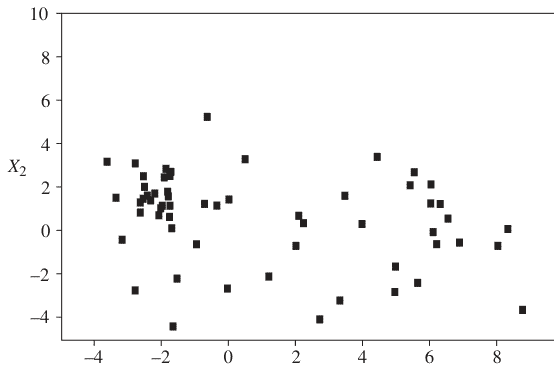

**图 1.10** 聚类前的数据集。

在实践中，我们拥有数据但无法获得真值。假设我们所知道的只是超参数固定在 $K = 2$。问题是，我们能否仅使用给定的数据重建高斯混合，以关闭图 1.4 中的循环？答案是肯定的。我们可以使用一个聚类算法，然后估计 $\Theta$ 的参数来实现这一点。

$k$-均值聚类技术可以通过 `sklearn` Python 库中的 `KMeans` 调用。$k$-中位数方法在 `sklearn` 中不可用，因此可以用 Python 编写一个简单版本以供比较。

如果运行 `KMeans` 算法直到收敛，得到的簇中心为 $\hat{\mu}^{(1)} = (-1.92, 1.17)^\top$ 和 $\hat{\mu}^{(2)} = (4.93, -0.17)^\top$。

这些值与方程 (1.10.1) 的原始分布相关联的簇中心很接近。如果运行 $k$-中位数算法，我们得到

$\hat{\mu}^{(1)} = (-1.89, 1.46)^\top$ and $\hat{\mu}^{(2)} = (5.48, 0.30)^\top$.

这些中心也接近原始分布的值。

结果在图 1.11 中以图形显示。$k$-均值和 $k$-中位数方法产生大致相同的两个簇和中心（图中用 $\otimes$ 表示）。两组结果都是可接受的，因为它们接近原始分布的两个中心。为了关闭图 1.4 的循环，我们需要计算形式为 $\sigma^2\mathbf{I}_2$ 的协方差矩阵以获得每个簇的方差，以及基于每个簇中点数占总点数比例的概率权重。这样做后，使用 $k$-均值，我们得到：

$f_{\hat{\Theta}}(x) = 0.6\mathcal{N}_2((-1.9, 1.0)^\top, 2.4\mathbf{I}_2) + 0.4\mathcal{N}_2((4.9, -0.2)^\top, 3.8\mathbf{I}_2)$ (1.10.2)

以及使用 $k$-中位数，我们得到：

$f_{\hat{\Theta}}(x) = 0.62\mathcal{N}_2((-1.9, 1.5)^\top, 2.5\mathbf{I}_2) + 0.38\mathcal{N}_2((5.5, 0.3)^\top, 3.7\mathbf{I}_2)$ (1.10.3)

两种模型都相当准确。在实践中，我们无法将模型与真值进行比较。仅凭给定的数据，我们只能做到这一步，但无法确定结果是否可接受。要证明我们的模型是正确的将很困难。但由于此数据无离群点且我们知道 $K = 2$，我们可以在本例中对模型的正确性抱有高度信心。

### 1.10.2 带离群点的聚类

迄今为止，我们发现对于给定的无离群点数据集，$k$-均值和 $k$-中位数大致相同。如果其中一个点被意外手动输入为 (-400, -400)，而不是正确值 (-4.00, -4.00)，会怎样？这个离群点连同原始数据如图 1.12 所示。离群点是由于人为错误造成的，我们想调查它对两种竞争聚类方法的影响。请注意，在二维环境下，离群点容易被检测和删除，但在无法可视化的高维环境下，会更加困难。

起初的问题是：两种方法在添加噪声之前，对数据产生的原始分布的复现效果如何。回到图 1.5，噪声就是这个离群点。

4 本章末尾的一个项目中提供了 Python 的 $k$-中位数代码。

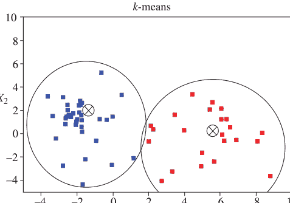

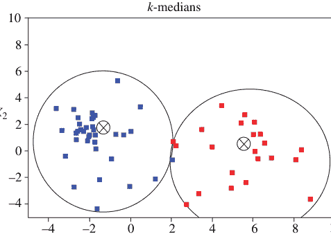

**图 1.11** k-均值和 k-中位数聚类。

由拼写错误引入。k-均值的结果在图 1.13 的上部面板中以图形显示。用所有数据创建了一个大簇，另一个包含仅离群点的簇也被创建。离群点簇在图 1.13 的绘图比例下未显示，但很明显，k-均值算法将其中一个簇中心强制移出了数据区域，因为图中只能看到一个中心。两个中心是

\(\hat{\mu}^{(1)} = (-400, -400)^\top \quad \text{and} \quad \hat{\mu}^{(2)} = (1.10, 0.6)^\top.\)

第一个簇的中心远远位于 (-400, -400) 的簇区域之外。另一个中心位于真实数据的中间。很明显，数据集中甚至一个离群点也会对 k-均值聚类产生显著影响。我们在关于均值与中位数的早期章节中看到了这种效应，并在聚类问题中再次见到。

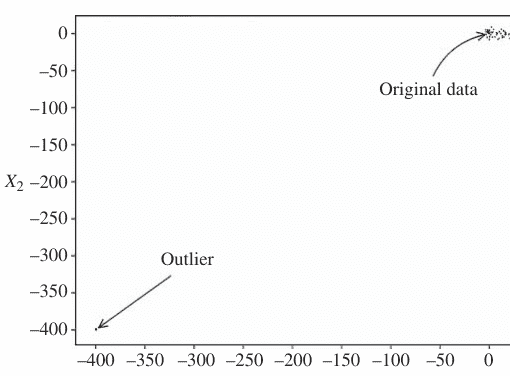

图 1.12 带有 1 个离群点 (-400, -400) 的数据。

运行 k-中位数算法得到以下中心：

\(\hat{\mu}^{(1)} = (-1.89, 1.33)^\top \quad \text{and} \quad \hat{\mu}^{(2)} = (5.48, 0.30)^\top\).

与 k-均值的情况不同，中心变化不大。这一点非常可取，因为它表明离群点没有影响聚类结果。这在图 1.13 的下部面板中以图形显示，其中生成了相同的两个簇。与 k-均值相比，k-中位数的结果相对稳定。这一点值得强调：在存在离群点时，使用鲁棒方法可产生更好的结果；在没有离群点时，可产生相似的结果。

### 1.10.3 离群点的检测和删除

使用 k-均值获得更好结果的一种方法是检测和删除离群点。这需要一些本身具有鲁棒性的技术，因为非鲁棒方法无法解决这个问题。考虑前面部分描述的带有 1 个离群点的数据集。我们必须先运行 k-中位数聚类，因为 k-均值的结果没有意义。更一般来说，为了找到离群点，鲁棒方法始终是方法论的一部分。

一旦我们有了鲁棒聚类的结果，就可以应用简单规则来删除离群点。一种方法是使用“3-σ 编辑”规则。该规则用于检测和删除距离簇 \(C_j\) 中心超过 3\(\sigma_j\) 的任何点，其中 \(j = 1, ..., K\)。该规则的标准是，如果点 \(\mathbf{x}^{(i)}\) 在矩阵 \(\mathbf{C}_j\) 中，

删除 \(\mathbf{x}^{(i)}\) 如果 \(\|\mathbf{x}^{(i)} - \hat{\mu}^{(j)}\|_2 > 3\hat{\sigma}_j\) 对于 \(i = 1, ..., n\)，

其中 \(\hat{\mu}^{(j)}\) 和 \(\hat{\sigma}_j\) 是簇 \(j\) 中点的均值和标准差。不幸的是，簇均值和标准差的计算会受到离群点的影响而失真，因此不可信。

更好的方法是使用 3-σ 编辑规则的鲁棒形式。由于在离群条件下无法可靠地计算均值和方差，可以使用鲁棒统计量来代替。数据只会


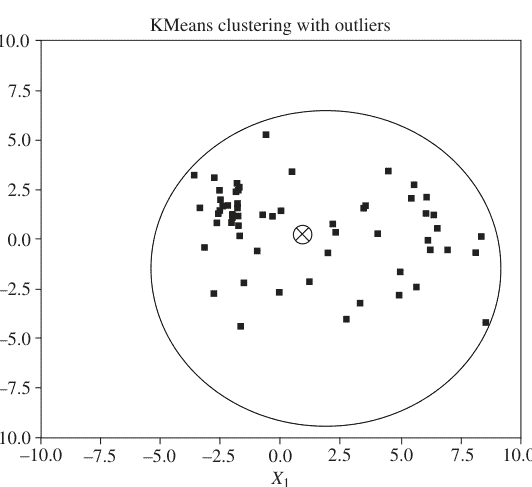

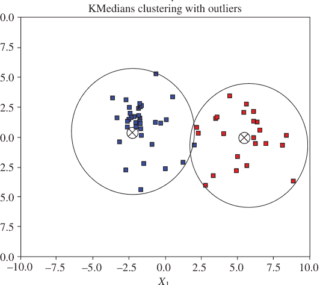

图 1.13 带有一个位于 (-400, -400) 的异常值的 k-means 和 k-medians 聚类，该异常值未显示，因为它超出了图表范围。

如果属于簇 \(j\) 的任何 \(\mathbf{x}^{(i)}\) 满足“3-MADN 编辑”规则，则将其删除。也就是说，对于矩阵 \(\mathbf{C}_j\) 中的所有点 \(\mathbf{x}^{(i)}\)，

若 \(\|\mathbf{x}^{(i)} - \text{median }(\mathbf{C}_j)\|_2 > 3\text{MADN}(\mathbf{C}_j)\)，则删除 \(\mathbf{x}^{(i)}\)，其中 \(i = 1, ..., n\)。

这个强健版本将找出并删除所有异常值，无论其数量以及位于簇区域之外的位置。

要比较这两种方法，首先考虑仅包含一个异常值的先前数据集的标准 3-sigma 编辑规则。如果我们为每个簇使用高斯分布，则会发现 \(\hat{\sigma}_2 = 64.8\)，其值太大而毫无价值。3-sigma 编辑规则将迫使我们拒绝所有方向上距离中心 \(3 \times 64.8 = 194.4\) 单位的点。它不会删除任何点，因此 3-sigma 统计量不实用。将其与强健标准形成对比。MADN(\(\mathbf{C}_2\)) 的估计值为 11.2，因此 3-MADN 编辑规则将得出 \(3 \times 11.2 = 33.6\)。这是一个用作识别和删除异常值阈值的更合理距离，尤其是因为中位数被用作簇中心。这将删除数据中的单个异常值。完成此操作后，均值和方差计算将相当准确。此外，一旦异常值被移除，`KMeans` 工具可用于构建模型。

**练习：** 给定一维数据集 \(\{1, -2, 5, -4, -6, 3\}\) 和 \(K = 2\)，使用 \(k\)-means 计算中心。接下来，使用 \(k\)-medians 重新计算中心。

**答.:** \(k\)-means \(\{-4, 3\}\)。\(k\)-medians \(\{-4, 3\}\)。

**练习：** 给定一维数据集 \(\{1, -2, 5, -4, -66, 3\}\) 和 \(K = 2\)，使用 \(k\)-means 计算中心。接下来，使用 \(k\)-medians 重新计算中心。

**答.:** \(k\)-means \(\{-24, 3\}\)。\(k\)-medians \(\{-4, 3\}\)。

3-MADN 编辑规则有些武断，对于大多数数据集可能过于严格。在实践中，我们可能需要调整规则以避免将内点声明为异常值。例如，10-MADN 编辑规则可能更好，以确保在簇中心远处找到真正的异常值。可能需要一些调整来找到合适的乘数。另一方面，3-sigma 规则会失效，因为 \(\hat{\sigma}\) 的值将不可靠。这里的关键点是，异常值检测需要使用强健程序和强健统计量。

## 1.11 总结

本章强调了将中位数作为强健方法关键的应用。它提供了一个关于如何强健化现有机器学习算法以及如何检测和删除异常值的案例研究。很明显，\(k\)-medians 方法对异常值具有强健性，并且在这方面优于 \(k\)-means。使用 \(k\)-medians 避免了必须查找和删除异常值，或担心中心不足以代表数据而用于其他应用。只有当数据中没有异常值时，才可以安全地使用 \(k\)-means 方法。不幸的是，对于大多数数据集来说，这一假设不现实。另一个关键点是，“数据集中拥有大量数据倾向于减少异常值影响”的神话在这里被打破了。即使数据集中有许多点，任何簇都可能受到仅一个异常值的影响。这更多地涉及异常值的位置及其对簇中心的影响，而非异常值的数量。另一个关键点是，在检测异常值和异常时需要强健方法。随着我们在本书中推进并涵盖需要强健化的不同算法，这将是一个反复出现的主题。

在本书剩余部分，我们将通过异常值和异常的视角来处理机器学习，而不是传统的倾向于忽视或错误处理它们的观点。本章中给出的聚类初始机器学习示例将作为本书中涵盖其他方法的模板。但是，我们的焦点将转移到线性回归、逻辑回归和神经网络的监督学习任务。所有这些领域都会出现相同的问题，因此技术本身必须进行修改以强健化程序。

## 练习题

要完成本书中的项目，您需要一个用于机器学习的 Python 编程环境。推荐使用 Jupyter 笔记本来运行提供的代码段，但您也可以使用 PyCharm 或任何其他集成开发环境（IDE）。您应该在此阶段相应地设置好环境，以便从本书中获益最大。

- 1.1 a) 对于集合 S = {1, 2, 3, 4, 5, 100, 101, 102}，求中位数和均值。在中位数 ≥ 100 之前，需要向集合中添加多少个大于 100 的值？

- b) 对于集合 S = {1, 2, 3, 4, 5, 100, 101, 102}，计算标准差 SD(x) 和归一化中位数绝对偏差 MADN(x)。假设我们要删除异常值。使用 3-sigma 和 3-MADN 编辑规则。哪种方法在删除异常值方面更好？

- c) 对于给定的下列矩阵

  X = 
  \(\begin{pmatrix} 5 & 2 & 7 \\ 1 & 9 & 2 \\ 2 & 1 & 1 \end{pmatrix}\),
  
  计算列方向的中位数和均值。

- 1.2 a) 对于向量量 **u** = (-1, -2, 3, 4, 5)^T，计算 L_1- 和 L_2-范数。哪个范数更大？这将始终成立吗？如果不成立，构造一个向量来演示你的答案。

- b) 对于相同的向量，计算平方 L_2-范数。再次比较 L_1-范数与平方 L_2-范数。哪个更大，这将始终成立吗？如果不成立，请提供反例。

- c) 设 **u** 和 **v** 为 R^d 中的两个向量。||**v**||_1 ≤ ||**v**||_2^2 的可能性有多大？你能找到一个向量 **u**，使得 ||**u**||_1 > ||**u**||_2^2 吗？如果可以，请说明该向量。如果不能，请解释原因。

### 1.3 一个数据矩阵 \(\boldsymbol{X} \in \mathbb{R}^{7 \times 2}\) 被聚类为两组，如下所示：

\(\boldsymbol{C}_1 = \begin{pmatrix} 1 & 1 \\ 1 & 2 \\ 2 & 1 \\ -8 & -8 \end{pmatrix}, \quad \boldsymbol{C}_2 = \begin{pmatrix} 5 & 1 \\ 6 & 1 \\ 6 & 2 \end{pmatrix}\)

- a) 对于 k-means，计算簇均值和总聚类成本。
- b) 对于 k-medians，计算簇中位数和总聚类成本。
- c) 将两个簇的所有点绘制在两个图上，一个用于 k-means，一个用于 k-medians。用 \(\otimes\) 指示均值和中位数。关于两种方法对异常值数据 (-8, -8) 的容忍度，评论结果。
- d) 计算每个簇的协方差矩阵 \(\sigma^2 I\)。这只需要估计每个簇的 \(\sigma^2\)。使用上面计算的均值。对于簇 1 中的 \(\sigma_1^2\)，计算矩阵 \(\boldsymbol{C}_1 - \boldsymbol{\mu}_1\)，然后对所有项的平方求平均值。在 Python 中，`sigma12 = np.mean((C1-mu1)**2)` 会产生该估计值。相同的程序可用于簇 2。
- e) 使用簇中的点数与数据集中总点数的比率来估计 \(\pi_1\) 和 \(\pi_2\)。写出高斯混合模型的表达式。这是一个好的模型吗？
- f) 你将如何使用中位数和 MADN 来构建更好的模型？写出更好模型的表达式。

### 1.4 (项目) 在这个项目中，目标是使用高斯混合创建一个用于聚类的数据集。

- a) 导入所需的库。

```
%matplotlib inline
import numpy as np
import matplotlib.pyplot as plt
from scipy.stats import multivariate_normal
from sklearn.cluster import KMeans
```

- b) 创建由以下给出的高斯混合的数据集

\(f_X(x) = 0.6 \mathcal{N}_2((-2, 1)^\top, 3 \boldsymbol{I}_2) + 0.4 \mathcal{N}_2((5, 0)^\top, 4 \boldsymbol{I}_2).\)

数据可以使用以下代码生成和绘图：

```
np.random.seed(8)
mu = np.array([[-2, 1], [5, 0]])
sigma = np.array([[[3, 0], [0, 3]], [[4, 0], [0, 4]]])
Y1 = np.random.multivariate_normal(mu[0], \\
               sigma[0], size=60)
Y2 = np.random.multivariate_normal(mu[1], \\
               sigma[1], size=40)
X = np.vstack((Y1, Y2))
plt.xlim([-10, 10])
plt.ylim([-10, 10])
```


```python
plt.scatter(X[:, 0], X[:, 1], \
    marker="$.$", color="black")
plt.show()
```

### 1.5 (PROJECT) 本项目的目标是使用与上一项目相同的数据集，比较 KMeans 与 KMedians。

- a) 对于不含任何异常值的数据集，请使用 sklearn.cluster 库中的 KMeans 程序：

```python
kmeans = KMeans(n_clusters=2, init="k-means++", \
    random_state=1).fit(X)
labels = kmeans.labels_
means = kmeans.cluster_centers_
print("Centers from KMeans")
print(means)
```

- b) 下面给出的名为 KMedians 的 Python 代码，可根据 X 和簇数量 K 生成稳健的簇中心。请在 Python 笔记本中输入并运行它。

```python
### Assign points to clusters
def assign_clusters(X, M):
    distances = np.sum(np.abs(X[:, \
    np.newaxis] - M), axis=2)
    clusters = np.argmin(distances, axis=1)
    return clusters
```

```python
### Find the cluster centers
def calculate_cluster_medians(X, clusters, \
num_clusters):
    cluster_medians = np.zeros((num_clusters, \
    X.shape[1]))
    for i in range(num_clusters):
        cluster_rows = X[clusters == i]
        if len(cluster_rows) > 0:
            cluster_medians[i] = \
            np.median(cluster_rows, axis=0)
    return cluster_medians
```

```python
### Compute the cost of this arrangement
def calculate_total_cost(X, clusters, \
cluster_medians):
    total_cost = 0
    for i in range(len(X)):
        cluster_median = \
        cluster_medians[clusters[i]]
        total_cost += np.sum(np.abs(X[i] \
        - cluster_median))
    return total_cost
```

```python
### Plot 2D cluster arrangement
def plot_clusters(X, clusters, cluster_medians):
    plt.figure(figsize=(10, 6))
    num_clusters = cluster_medians.shape[0]
    # Plot each cluster in a different color
    for i in range(num_clusters):
        cluster_points = X[clusters == i]
        plt.scatter(cluster_points[:, 0], \
                    cluster_points[:, 1], \
                    label=f'cluster {i}')
    # Plot the cluster medians
    plt.scatter(cluster_medians[:, 0], \
                cluster_medians[:, 1], \
                color='black', marker='x', \
                s=100, label='cluster medians')
    plt.xlabel('Feature 1')
    plt.ylabel('Feature 2')
    plt.title('clusters and their medians')
    plt.legend()
    plt.show()
```

```python
### Perform k-medians clustering
def KMedians(X, K):
    seed = 0
    np.random.seed(seed)
    n, d = X.shape
    M = X[np.random.choice(n, K, replace=False)]
    prev_cost = None
    new_cost = None
    # Use Lloyd-style iteration
    while (prev_cost is None or \
        np.abs(prev_cost - new_cost) > 1e-4):
        clusters = assign_clusters(X, M)
        num_clusters = M.shape[0]
        M = calculate_cluster_medians(X, \
                    clusters, num_clusters)
        prev_cost = new_cost
        new_cost = calculate_total_cost(X, \
                    clusters, M)
    return clusters, new_cost, M
```

- c) 使用先前生成的数据集 X 运行 KMedians 并绘制结果。在计算簇中心方面，这两种方法有何不同？

```python
K = 2
cluster, cost, medians = KMedians(X, K)
print("Centers from KMedians")
print(medians)
plot_clusters(X, cluster, medians)
```

- d) 使用下面的代码，将 KMeans 和 KMedians 程序的结果并排作为子图绘制出来。

```python
X1md = np.array(X[cluster == 1])
X2md = np.array(X[cluster == 0])
fig, axes = plt.subplots(1, 2, figsize=(12, 5))
axes[0].scatter(X[:, 0], X[:, 1], c=labels, \
    cmap="plasma", marker=".", \
    edgecolors="k", s=50)
axes[0].set_title("KMeans Clustering")
axes[0].set_xlabel("Feature 1")
axes[0].set_ylabel("Feature 2")
axes[0].scatter(means[0, 0], means[0, 1], \
    marker="x", color="red")
axes[0].scatter(means[1, 0], means[1, 1], \
    marker="x", color="red")
axes[0].set_xlim([-10, 10])
axes[0].set_ylim([-10, 10])
axes[1].scatter(X1md[:, 0], X1md[:, 1], c="yellow", \
    marker=".", edgecolors="k", s=50)
axes[1].scatter(X2md[:, 0], X2md[:, 1], c="black", \
    marker=".", edgecolors="k", s=50)
axes[1].set_title("KMedians Clustering")
axes[1].set_xlabel("Feature 1")
axes[1].set_ylabel("Feature 2")
plt.scatter(medians[0, 0], medians[0, 1], \
    marker="x", color="red")
plt.scatter(medians[1, 0], medians[1, 1], \
    marker="x", color="red")
axes[1].set_xlim([-10, 10])
axes[1].set_ylim([-10, 10])
plt.tight_layout()
plt.show()
```

你在每种情况下发现了簇中心的什么情况？

- e) 接下来，使用下面的代码插入异常值，然后重新运行两种方法。对于 KMeans，使用

```python
X[1] = np.array([-400, -400])
X[2] = np.array([-400, 0])
kmeans = KMeans(n_clusters=2, init="k-means++", \
    random_state=1).fit(X)
labels = kmeans.labels_
means = kmeans.cluster_centers_
print("New centers from KMeans")
print(means)
```

对于 KMedians，使用

```python
cluster, cost, medians = KMedians(X, K)
print("New centers from KMedians")
print(medians)
```

在带有 *异常值* 的数据集上对比 KMedians 和 KMeans。

- f) 使用与部分 (c) 相同的绘图代码，再次绘制插入异常值后 KMeans 和 KMedians 的结果，展示每种情况下的簇。每种情况下可以找到多少个簇中心？

### 1.6 (PROJECT) 本项目的目标是检测上一项目数据集中的异常值。为此，我们需要使用 KMedians 的结果和 10-MADN 编辑规则。使用下面的代码可以找出哪些异常值？

```python
### Outlier detection method using MADN
X1md = np.array(X[cluster == 1])
X2md = np.array(X[cluster == 0])
def MADN(r):
    return (1.4826 * np.median(np.abs(r - np.median(r))))
dist1 = (np.abs(X1md - medians[0, :])).sum(axis=1)
mad1 = MADN(dist1)
dist2 = (np.abs(X2md - medians[1, :])).sum(axis=1)
mad2 = MADN(dist2)
for i in range(X1md.shape[0]):
    if (np.sum(np.abs(X1md[i, :] - medians[0, :])) \
    > 10 * mad1):
        print("Outlier found at", X1md[i, :], \
            "in Cluster 1")
for i in range(X2md.shape[0]):
    if (np.sum(np.abs(X2md[i, :] - medians[1, :])) \
        > 10 * mad2):
        print("Outlier found at", X2md[i, :], \
            "in Cluster 2")
```

## 参考文献

- James, G., Witten, D., Hastie, T. 等人 (2023). *Python 应用统计学导论*. Springer.
- Maronna, R.A., Douglas Martin, R., Yohai, V.J., 和 Salibian-Barrera, M. (2019). *稳健统计学：理论与方法（附 R）*. Wiley.

# 2 稳健线性回归

## 2.1 引言

监督学习是机器学习（ML）最常见的形式，本书其余部分将广泛介绍它。由于线性回归是监督学习最简单的形式，它为我们在熟悉的环境中理解这一类 ML 提供了起点。线性回归这一主题经过几十年的深入研究，并在数据科学的许多应用中广泛使用。事实上，它比 ML 本身还要早。我们在此的目标是从数据中**异常值**的角度来探讨线性回归，涵盖研究稳健方法所需的基础知识。

在本章和下一章中，我们将描述用于稳健线性回归的多种不同估计器。在此背景下，我们需要了解如何推导这些估计器，并提供比较它们的机制。将介绍几种不同的标准，以评估哪种方法在什么条件下表现最佳。本章首先简要概述与线性回归相关的技术和问题。然后我们将使用 Huber 方法论证稳健回归的必要性，并指出该方法的某些不足之处。这将引出第 3 章中将介绍的另一种方法。一旦理解了稳健线性回归的基础知识，就可以将其应用于后续章节中的更高级 ML 方法，例如分位数回归、逻辑回归和神经网络。

## 2.2 监督学习

监督学习有多种不同的形式，因为机器学习有大量合适的应用。典型应用包括：根据某地区的房屋数据预测该地区某处房产的价值；或根据现有和以前客户的贷款记录决定谁应该获得贷款；或根据大量标记数字的数据集识别 0 到 9 的手写数字。应用场景无穷无尽，而监督机器学习中使用的技术也各异。

监督学习的基本思想是使用一组数据构建具有预测能力的模型。这是机器学习的价值主张：取一个训练集（可能带有噪声），定义一个合适的


模型，估计模型参数（即训练模型），并使用此参数化模型对测试数据进行预测，希望能达到较高的准确度。由于我们不知道参数的真实值，我们能做的最好是使用一些基础扎实的数学程序和给定数据来估计它们。这导致了合适估计器的发展，即允许我们进行估计的函数。

估计值是由估计器生成的参数的数值。当然，我们希望找到最能拟合数据的参数值，以便模型能够进行良好的预测。但是，如果存在异常值，我们如何知道这是否是一个好的模型呢？我们需要使用带有已知真实标签的未见测试集来检查准确性，以验证整个过程。本书的总体目标是为回归和分类开发稳健模型，使得数据集中的异常值不会对预测结果产生不利影响，并且我们希望最终将这些方法应用于神经网络（见第 9 和 10 章）。然而，理解神经网络的原理始于对线性回归和逻辑回归的深入研究。高级 ML 方法的研究建立在这些基础之上，因此在我们走向稳健 ML 的旅程中，充分理解这些主题非常重要。

## 2.3 线性回归

假设我们给定一对向量，x 和 y，并要求根据数据计算其斜率和截距来为数据拟合一条直线。对于 n 个观测值，我们通常写 x \in R^n 表示与解释变量相关的具有 n 个元素的实向量，并写 y \in R^n 表示与响应变量相关的向量。数据由一组 (x_i, y_i) 对组成，其中 i = 1, ..., n。在这种情况下，适合数据的模型是一条直线。我们可以尝试将更复杂的曲线拟合到数据，但假设我们有先验知识表明 x 和 y 值之间存在线性关系，因此我们需要为数据拟合一条直线。因此，线性回归（见 Montgomery et al. 2012）的目标是估计最能拟合数据的直线的斜率和截距。

图 2.1 显示了点的散点图，感兴趣的两个参数标记在直线上。真实直线（我们未知）由一个著名的方程给出，

```
$y = \beta_0 + \beta_1 x,$ (2.3.1)
```

其中 $\beta_0$ 是截距，$\beta_1$ 是斜率。不幸的是，除非我们可以访问整个总体，否则无法找到这两个参数的精确值。我们能做的最好是从总体的给定样本中估计 $\beta_0$ 和 $\beta_1$。这就是线性回归的目的。

估计器试图最小化损失函数，以生成参数的最优估计集。这通常使用诸如梯度下降之类的数值优化方法来进行。损失函数本质上是一个成本函数，用于评估与特定斜率和截距值相关的总误差。当然，如果我们能以某种方式计算出精确的参数值，它们将不被视为估计值。但是，由于我们只能访问有限数量的数据（即有限样本集），我们生成的参数值必须被视为估计值。一旦我们估计了这两个参数，现在记为 $\hat{\beta}_0$ 和 $\hat{\beta}_1$ 以将其与真实值区分开来，我们可以使用

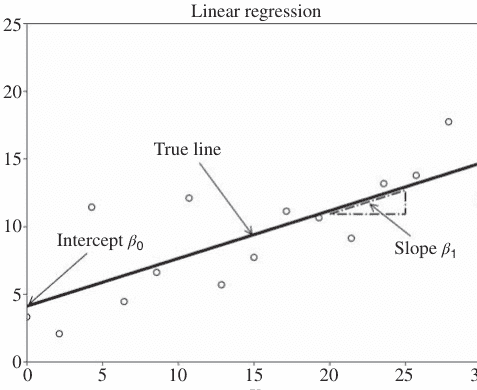

图 2.1 直线的斜率和截距参数。

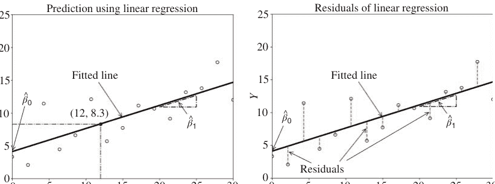

图 2.2 与线性回归相关的预测值和残差。

以预测新值。这两个估计参数显示在图 2.2 的左侧面板中，连同拟合直线本身。使用估计值进行预测相当简单。例如，可以预测 x = 12 处的响应 y，而 x = 12 在原始数据中未表示。在这种情况下，回归直线预测当 x = 12 时 ŷ = 8.3。请注意，图中所示的直线只是许多可能“拟合”给定数据的直线之一，我们将探讨估计斜率和截距参数的许多不同方法。简单线性回归仅涉及一个解释变量（也称为特征或输入）和一个响应变量（或输出）。多元线性回归有许多解释变量，但通常只有一个响应变量。

此处需要提及的一个重要点是，估计值本身带有一定程度的不确定性。更具体地说，它们具有方差，方差是围绕估计值的不确定性的一种度量。不同的估计器具有不同的方差，我们寻找方差较小的估计器。此外，参数估计有多种方法，因此我们不应将任何单一估计器视为金标准，而应将其视为当前应用的众多选项之一。需要考虑许多权衡，方差只是因素之一。另一个因素是对异常值的稳健性。著名的普通最小二乘法（OLS）方法寻求数据的均值以获得估计值。然而，它不稳健。寻求数据中位数的方法是稳健的，因为它们对异常值具有容忍度。本章的目的是说明中位数在稳健回归中为何如此重要。

> 符号：估计值始终使用统计学中的“帽符号”表示法。例如，如果 β₀ 是真实截距，则 β̂₀ 是截距的估计值。如果 β₁ 是真实斜率，则 β̂₁ 是斜率的估计值。同样，ŷ 是使用参数估计值预测的响应。对于多维问题，我们使用粗体版本，即 β 或 β̂（视情况而定）。有时 θ 将用作一维问题中的感兴趣标量参数，例如位置问题，而 θ̂ 是估计值。

## 2.4 残差的重要性

在本节中，我们讨论模型相对于用于构建模型的原始数据所犯的错误。这些错误可以在使用回归后计算，并称为**残差**。它们在定义损失函数、根据其概率分布选择损失函数以及异常值检测方面发挥着重要作用。因此，我们将花些时间来了解它们是什么以及它们为什么重要。

### 2.4.1 定义错误和残差

请注意，在图 2.2 的右侧面板中，回归直线不一定穿过数据中的所有点或任何点。这是线性回归结果的典型特征。回归直线实际上是数据的摘要，以便可以进行预测。原始点和直线之间存在垂直距离。垂直差异被称为**残差**，它们的分布在定义损失函数中起着关键作用，正如我们将很快看到的那样。图 2.2 右侧面板突出显示了回归直线和数据点之间作为垂直条的该数据集的一组残差。

如果在先前为直线给出的方程中加入误差项，则可以将其重写以准确反映数据与直线之间的关系。这就产生了简单线性模型，其形式为

```
**y** = β₀ + β₁**x** + ε, (2.4.1)
```

其中 ε 表示**真直线**与数据点之间的误差。这些误差源于各种原因，例如模型中未考虑的效应或系统中的随机噪声。误差及其分布中包含有价值的信息，将引导我们找到合适的估计器类型。

上述方程也可以写成矩阵形式，

\(\boldsymbol{y} = \begin{bmatrix} 1 & x_1 \\ 1 & x_2 \\ \vdots & \vdots \\ 1 & x_n \end{bmatrix} \begin{bmatrix} \beta_0 \\ \beta_1 \end{bmatrix} + \begin{bmatrix} \varepsilon_1 \\ \varepsilon_2 \\ \vdots \\ \varepsilon_n \end{bmatrix} = \boldsymbol{X}\boldsymbol{\beta} + \boldsymbol{\varepsilon},\)
(2.4.2)

其中 \(\boldsymbol{\beta} = (\beta_0, \beta_1)^\top\)，\(\boldsymbol{X}\) 现在是在第一列插入 1 的矩阵。误差项的方程为

\(\boldsymbol{\varepsilon} = \boldsymbol{y} - \boldsymbol{X}\boldsymbol{\beta}.\)
(2.4.3)

**练习：** 一个数据集具有 \(\boldsymbol{x} = (1, 2, 3, 4, 5)^\top\) 和 \(\boldsymbol{y} = (1.1, 1.9, 3.4, 4.1, 4.8)^\top\)。将矩阵方程写成 Eq. (2.4.2) 的形式。

**答：** 方程采用以下形式：

\(\begin{bmatrix} 1.1 \\ 1.9 \\ 3.4 \\ 4.1 \\ 4.8 \end{bmatrix} = \begin{bmatrix} 1 & 1 \\ 1 & 2 \\ 1 & 3 \\ 1 & 4 \\ 1 & 5 \end{bmatrix} \begin{bmatrix} \beta_0 \\ \beta_1 \end{bmatrix} + \begin{bmatrix} \varepsilon_1 \\ \varepsilon_2 \\ \varepsilon_3 \\ \varepsilon_4 \\ \varepsilon_5 \end{bmatrix}.\)

\(\boldsymbol{X}\) 矩阵第一列中的 1 是为了纳入截距参数 \(\beta_0\) 所必需的。

在上述练习中，这两个参数应被视为 \(\beta_0\) 和 \(\beta_1\) 的真实值。不幸的是，我们不知道它们，因此无法获得真实误差。然而，我们可以使用参数的估计值来计算残差，并将其作为真实误差的代用。残差由下式给出：

\(\boldsymbol{r} = \boldsymbol{y} - (\hat{\beta}_0 + \hat{\beta}_1 \boldsymbol{x}) = \boldsymbol{y} - \boldsymbol{X}\hat{\boldsymbol{\beta}}.\)
(2.4.4)

再次说明，真实误差基于真实参数值，而残差基于估计参数值。

### 2.4.2 损失函数中的残差

在估计中，我们的目标是最小化 *残差函数项之和* 以获得 \(\hat{\boldsymbol{\beta}}\)。这可以通过多种不同的方式完成，但它们都需要使用残差。此外，我们需要假设残差以某种方式分布，以便我们可以应用合适的技术来估计斜率和截距。*对误差分布做出假设，反过来将定义损失函数。* 这是一个重要的观点。当我们选择损失函数时，我们隐含地要求残差服从与该损失函数相关的特定分布。回归后，计算出的残差可用于检查我们对其分布的假设是否正确。

源自著名分布的两个重要损失函数是 \(L_1\) 和 \(L_2\) 损失函数。我们在第 1 章中看到了 \(L_1\)- 和 \(L_2\)- 范数的使用方法，它们将是本章中简单线性回归的两个竞争损失函数。首先，我们将第 \(i\) 个残差定义为，\(r_i = y_i - (\hat{\beta}_0 + x_i \hat{\beta}_1),\)


for $i = 1, \dots, n$. 为方便起见，我们将频繁使用更一般的形式 $r_i = y_i - \mathbf{x}_i^\top \boldsymbol{\beta}$。然后，$L_1$ 损失函数是残差绝对值的总和，给出如下

$L_1 \text{ loss} = \sum_{i=1}^n |r_i|,$ (2.4.5)

而 $L_2$ 损失函数是残差平方和的一半，给出如下

$L_2 \text{ loss} = \frac{1}{2} \sum_{i=1}^n r_i^2.$ (2.4.6)

最小化 $L_1$ 损失通常称为最小绝对偏差（LAD），而最小化 $L_2$ 损失称为最小二乘估计（LSE）。最小化这些损失函数以获得 $\beta_0$ 和 $\beta_1$ 的各自估计值，两者可能相差很大。我们将推导这两个函数，并简要探讨它们的差异。

**练习：** 假设我们知道回归参数的真实值为 $\beta_0 = 3$ 和 $\beta_1 = 1$。使用 LSE，我们得到 $\hat{\beta}_0 = 3.2$ 和 $\hat{\beta}_1 = 1.1$。假设 $\mathbf{y} = (3.3, 4.1, 5.5)^\top$ 和 $\mathbf{x} = (0, 1, 2)^\top$，计算残差和误差（两者不同）。

**答.：** 残差由 $r_i = y_i - (\hat{\beta}_0 + \hat{\beta}_1 x_i)$ 给出：$r_1 = 3.3 - (3.2 + 1.1 \times 0) = 0.1, r_2 = 4.1 - (3.2 + 1.1 \times 1) = -0.2, \text{ 且 } r_3 = 5.5 - (3.2 + 1.1 \times 2) = 0.1$。另一方面，误差由 $\epsilon_i = y_i - (\beta_0 + \beta_1 x_i)$ 给出：$\epsilon_1 = 3.3 - (3 + 1 \times 0) = 0.3, \epsilon_2 = 4.1 - (3 + 1 \times 1) = 0.1, \text{ 且 } \epsilon_3 = 5.5 - (3 + 1 \times 2) = 0.5$。请注意，理想情况下 $\sum r_i = 0$（最小二乘法的一个性质），而 $\sum \epsilon_i = 0.9 \neq 0$。

**注意：** 认识到机器学习的根源在于概率与统计领域至关重要。概率分布、估计量与估计、凸性与收敛性以及误差度量的基础，都建立在该领域提供的理论基础之上。本质上，它们确保机器学习技术将会发挥作用；也就是说，它们将以一定的保证程度和一定的精度水平收敛到所需值。因此，有必要涵盖与手头主题相关的概率与统计基础知识。

### 2.4.3 残差的分布

我们现在准备对回归误差的概率分布进行统计分析。由于我们无法获取真实误差，因此我们将关注可在估计后计算的残差。统计分析的起点是考察随机变量的性质，因为残差本身也是随机变量。在本节中，我们将 $X$ 用作通用随机变量，但你应将其视为表示残差的随机变量。更正式地说，我们定义 $X$ 为独立同分布（i.i.d.）随机变量（r.v.）。这种假设将贯穿全书。

随机变量可能以多种不同的方式分布。概率密度函数（PDF）指定由 $f_X(x)$ 表示的连续分布。累积分布函数（CDF）给出随机变量小于某个特定值的概率，并表示为 $F_X(x)$。这两个函数直接相互关联。如果我们知道 CDF，可以通过微分得到 PDF：

$f_X(x) = \frac{dF_X(x)}{dx}$.
(2.4.7)

同样，如果我们知道 PDF，可以通过积分得到 CDF。即，

$F_X(x) = \mathbb{P}(X \le x) = \int_{-\infty}^x f_X(t)dt$.
(2.4.8)

回顾高斯分布的 PDF 如下：

$f_X(x) = \frac{1}{\sqrt{2\pi\sigma^2}} e^{-\frac{x^2}{2\sigma^2}}$
(2.4.9)

其中 \(\sigma^2\) 是方差。如果随机变量 \(X\) 的任何样本都按上述方程分布，则称随机变量 \(X\) 遵循高斯分布。随机变量 \(X\) 遵循高斯分布所用的紧凑记法为

\(X \sim \mathcal{N}(0, \sigma^2)\).
(2.4.10)

在此处，\(\mathcal{N}\) 符号指正态分布，括号内，0 是均值，\(\sigma^2\) 是方差。从某种意义上说，方程 (2.4.9) 和方程 (2.4.10) 表达的是同一事物；一个只是另一个的紧凑版本。正态分布因多种原因很重要，但就我们的目的而言，它会导出对离群值不敏感的 $L_2$ 损失函数。

另一个重要但不太为人熟知的分布是拉普拉斯分布，通常被称为双指数分布。其基本形式为

$f_X(x) = \frac{1}{2} e^{-|x|}$.
(2.4.11)

就我们的目的而言，有趣的是，这种分布会引出对数据集中离群值不敏感的 $L_1$ 损失函数。因此，我们将在本章及其他章节多次遇到这种分布。

良好行为误差的分布通常取为 \(\epsilon \sim \mathcal{N}(0, \sigma^2)\)。也就是说，均值始终为零，但方差可能因数据集而异。隐含假设是线性回归的残差遵循高斯分布。离群值会导致分布偏离这一标准假设，这就是为什么会考虑涉及使用 $L_1$ 损失的稳健方法。这是一个微妙但重要的观点。如果残差不服从正态分布，则稳健方法可能会产生更好的结果。

在处理概率分布时，两个非常感兴趣的量是期望值和方差。随机变量 \(X\) 的期望值是 PDF 的第一阶矩，给出如下

\(\mathbb{E}[X] = \int_{-\infty}^{\infty} x f_X(x) dx\).
(2.4.12)

为方便起见，我们使用记号 \(\mathbb{E}[X]\) 来表示该积分。它可以看作是期望值算子 \(\mathbb{E}[\cdot]\) 作用于 \(X\)。更简单地说，这是如果你独立选择 \(X\) 大量次数（趋近于无穷）并取平均值时所期望的值。它通常被称为分布的均值。我们还对第二阶矩感兴趣，如下所示：

\(\mathbb{E}[X^2] = \int_{-\infty}^{\infty} x^2 f_X(x) dx.\)

我们对第二阶矩感兴趣的原因是，方差可以用这个量来表示。特别是，X 的方差可以用上述两个期望表示为

\(\text{Var}(X) = \mathbb{E}[X^2] - \mathbb{E}[X]^2;\)

也就是说，第二阶矩减去第一阶矩的平方即为方差。直观地，这给出了随机变量围绕均值的离散程度或变异性的度量。

对于不熟悉表示为 \(\mathbb{E}[X]\) 的期望的人来说，有一种简单的思考方式。每次遇到它时，都将 E 视为对 X 进行平均的算子。如果你从一个分布中抽取 \(x_i\)（X 的一个观测值）n 次，那么平均值 \(\frac{1}{n} \sum_{i=1}^n x_i\) 就是期望的一个估计。现在，如果你无限次抽取 \(x_i\) 并取平均值，你将得到分布的真实均值，表示为 \(\mathbb{E}[X]\)。更严格地说，

\(\lim_{n \to \infty} \frac{1}{n} \sum_{i=1}^n x_i = \mathbb{E}[X].\)

在 \(\mathbb{E}[X^2]\) 的情况下，它可以简单地视为 \(\frac{1}{n} \sum_{i=1}^n x_i^2\)，其中 n 趋于无穷。更严格地说，

\(\lim_{n \to \infty} \frac{1}{n} \sum_{i=1}^n x_i^2 = \mathbb{E}[X^2].\)

这些结果直接源于大数定律和极限理论。

## 2.5 估计背景

在描述了线性回归的目标、模型、误差、残差和两个竞争性损失函数后，我们现在将退一步，构建推导将导致斜率和截距估计的函数所需的知识。我们将简要探讨估计量的可取特性及其如何用于比较目的。本节以使用梯度下降的数值优化的初步描述结束，这是实际计算估计值的方法。

### 2.5.1 线性模型

对于只有一个解释变量的问题，如前面所示，方程为

\(\mathbf{y} = \beta_0 + \beta_1 \mathbf{x}_1 + \varepsilon = \mathbf{X}\beta + \varepsilon.\)

这被称为 **简单线性模型**。对于多个变量的问题，方程变为

\(\mathbf{y} = \beta_0 + \beta_1 \mathbf{x}_1 + \beta_2 \mathbf{x}_2 + \cdots + \beta_d \mathbf{x}_d + \varepsilon = \mathbf{X}\beta + \varepsilon.\)

这被称为 **多元线性模型**。如果有 n 个观测值和 d 个变量，则 \(\mathbf{y} \in \mathbb{R}^n\)，\(\beta \in \mathbb{R}^{d+1}\)，\(\mathbf{X} \in \mathbb{R}^{n \times (d+1)}\)，和 \(\varepsilon \in \mathbb{R}^n\)。与简单线性模型相比的唯一区别是，我们


现在有 \( d + 1 \) 个未知数。求解此设置的方法与简单线性回归相同，以获得 \(\hat{\beta}\)。

### 2.5.2 估计量的可取性质

在本书中，我们将探讨用于稳健回归的多种估计量，因此必须遵循某些准则，以确保它们非常适合机器学习任务。因此，我们应该了解被认为是可取的估计量的某些特性。具体来说，我们偏好那些一致、渐近正态且具有低偏差和低方差的估计量。尽管此处呈现的材料在理论上至关重要，但理解本书其余部分的大部分材料并不需要它。不过，为了完整起见，我们在下面提供了定义

设 \(\theta\) 为感兴趣的标量参数，\(\hat{\theta}_n\) 为使用某个估计量基于样本大小 \(n\) 得到的估计值。那么，若满足下式，该估计量即具有**一致性**：

\(\hat{\theta}_n \xrightarrow{\text{p}} \theta \text{ as } n \to \infty.\)

简单来说，我们希望估计量能够在给定无限多次观测时产生真实值。也就是说，我们希望我们的估计量以“在概率上收敛”（即上述 \(\xrightarrow{\text{p}}\) 符号）的方式收敛到真实值，当数据集中的观测数量趋于无穷大时。这是大数定律（*Law of Large Numbers*）的表达。在实践中，我们拥有有限的数据，但如果估计量是一致的，我们可以合理地期望我们的估计值接近真实值。否则，我们几乎没有希望找到其正确值。

我们偏好表现出**渐近正态性**的估计量，即

\(\sqrt{n}(\hat{\theta}_n - \theta) \xrightarrow{D} \mathcal{N}(0, \sigma^2), \text{ as } n \to \infty.\)

这是一个看起来复杂的表达式，但我们表达的是希望拥有一个能够产生符合高斯分布的估计值的估计量。简单来说，我们希望使用许多不同的样本所获得的估计值的分布，在 \(n \to \infty\) 时为以真实值 \(\theta\) 为中心、方差为 \(\sigma^2\) 的高斯分布。更正式地说，我们希望数量 \(\sqrt{n}(\hat{\theta}_n - \theta)\)“在分布上收敛”（即上述 \(\xrightarrow{D}\) 符号）到一个均值为 0 且渐近方差为 \(\sigma^2\)（即 \(\hat{\theta}\) 的渐近方差）的高斯分布。这一性质源于中央极限定理（*Central Limit Theorem*），并说明估计值具有高斯分布，这使得计算每个估计值周围的不确定性变得更加容易。

最后，估计量的**偏差**定义为

\(\text{bias} = \mathbb{E}[\hat{\theta}] - \theta.\)

也就是说，我们估计量的期望值与真实值有多接近。理想情况下，偏差应为 0，在这种情况下，该估计量被称为**无偏**。本书中的大多数估计量将是无偏的，但那些故意引入偏差以降低方差的估计量除外。有偏估计量的一个显著示例是样本方差。大多数读者都熟悉下面这个公式，

\(\hat{\sigma}^2 = \frac{1}{n} \sum_{i=1}^n (x_i - \bar{x})^2,\)

并倾向于不加太多思考地使用它。然而，这是一个有偏估计量。可以证明，\(\sigma^2\) 的无偏估计量实际上是

\(\hat{\sigma}^2 = \frac{1}{n-1} \sum_{i=1}^n (x_i - \bar{x})^2.\) (2.5.6)

然而，两个估计量都是一致的，这意味着当 \(n \to \infty\) 时，它们都收敛到真实方差。在机器学习中，偏差-方差权衡是一个需要详细理解的重要概念。这就是为什么我们需要在这个阶段引入估计量的偏差。

### 2.5.3 最大似然估计

我们现在准备好使用一种称为*最大似然估计*（MLE）的经典程序，从分布推导估计量。我们之所以对这种程序感兴趣，是因为使用 MLE 推导出的估计量继承了上一节中描述的所有良好特性，前提是满足某些温和的正则性条件。其基本思想是，如果我们有一个 i.i.d. 随机变量 \(X\) 及其样本观测值 \(x_1, x_2, \dots, x_n\)，并且希望使用关联分布来估计参数 \(\theta\)，那么 MLE 可以用来构建一个具有某些良好特性的合适估计量。

具体来说，如果我们有一个 PDF \(f_\theta(x)\) 并且希望估计 \(\theta\)，那么我们可以按如下构建似然函数：

\(L(x_1, x_2, \dots, x_n; \theta) = \prod_{i=1}^n f_\theta(x_i).\) (2.5.7)

这个似然函数是来自 \(f_\theta(x)\) 的 i.i.d. 观测值的联合密度。由于它们是 i.i.d.，我们可以取分布的乘积。我们要找到最大化 \(L(x_1, x_2, \dots, x_n; \theta)\) 的 \(\theta\)，这将构成我们未知参数 \(\theta\) 的估计。实际上，我们试图找到最能代表 \(x_i\) 值所源自分布的 \(\theta\)。这是一个关键点：给定分布 \(f_\theta(x)\)，我们询问在给定一组 \(x_i\) 值时，哪个 \(\theta\) 值最有可能与之关联。存在一个隐含的假设或信念，即 \(x_i\) 值是从某个特定分布中抽取的，但该假设可能不成立。在使用 MLE 时值得牢记这一点。它并不保证数据来自给定的分布。相反，如果数据是从给定分布中采样的，那么估计量 \(\hat{\theta}\) 就是最大化似然函数的那个值。

该估计值本身表示为 \(\hat{\theta}\)。要找到这个值，我们使用

\(\hat{\theta} = \underset{\theta \in \mathbb{R}}{\text{argmax}} L(x_1, x_2, \dots, x_n; \theta) = \underset{\theta \in \mathbb{R}}{\text{argmax}} \prod_{i=1}^n f_\theta(x_i).\) (2.5.8)

这个符号简单地表明，我们应该找到最大化似然函数的 \(\theta\)。换句话说，MLE 找到使 \(n\) 个观测值 \(x_1, x_2, \dots, x_n\) 来自分布 \(f_\hat{\theta}(x)\) 的概率最大的估计值 \(\hat{\theta}\)。

找到 \(\hat{\theta}\) 的方法是对似然函数关于 \(\theta\) 求导并将其设为 0。通过对似然函数取对数（即所谓的对数似然形式）来简化该过程，如下所示：

\(\ell(x_1, x_2, \dots, x_n; \theta) = \log L(x_1, x_2, \dots, x_n; \theta) = \sum_{i=1}^n \log(f_\theta(x_i)).\) (2.5.9)

这样，Eq. (2.5.8) 中的乘积现在已被转换为 Eq. (2.5.9) 中的求和。接下来，我们使用数值优化器来产生 \(\hat{\theta}\)。但是，大多数优化器是设计用于寻找最小值（而不是最大值），因此我们需要对方程进行进一步调整：我们对该量取负。因此，负对数似然表达式为

\(-\ell(x_1, x_2, ..., x_n; \theta) = - \sum_{i=1}^n \log(f_\theta(x_i)).\) (2.5.10)

估计量 \(\hat{\theta}\) 是以下方程的解

\(\frac{\partial \ell(x_1, x_2, ..., x_n; \theta)}{\partial \theta} = 0.\) (2.5.11)

在某些简单的一维情况下，可以找到闭式解。但这并非普遍适用。然而，该方程可以通过优化技术以简单的方式求解，如下一节所述，其步骤可以简洁地表示为

\(\hat{\theta} = \underset{\theta \in \mathbb{R}}{\operatorname{argmin}} \left[ - \sum_{i=1}^n \log f_\theta(x_i) \right].\) (2.5.12)

**示例：** 假设我们认为与随机变量 \(X\) 关联的分布形式为 \(f_\theta(x) = \theta e^{-\theta x}\)，并且希望使用最大似然程序估计 \(\theta\)。对 \(X\) 的一个 i.i.d 样本产生了以下五个观测值：0.1、0.2、0.5、1 和 3。似然函数为

\(L(x_1, x_2, ..., x_5; \theta) = \prod_{i=1}^5 \theta e^{-\theta x_i} = \theta^5 e^{-\theta(0.1+0.2+0.5+1+3)} = \theta^5 e^{-4.8\theta}.\)

如果绘制似然函数以找到 \(\theta\)，则得到 Figure 2.3 的左侧面板，其在所求量处取得最大值。

MLE 程序使用负对数似然，产生

\(-\ell(x_1, x_2, ..., x_5; \theta) = -5 \log \theta + 4.8\theta,\)

如 Figure 2.3 右侧所示，然后求导并将其设为零。这样做，我们发现在 \(\hat{\theta} = 25/4\) 处取得最小值。真实值为 \(\theta = 1\)。使用 MLE 程序的估计值仅用五个观测值就接近实际值。更多的观测值将使估计值越来越接近真实值，因为 MLE 产生一个一致估计量。

**练习：** 使用 MLE 推导 \(L_2\) 损失函数，假设残差 \((r_1, r_2, ..., r_n)\) 是从随机变量 \(R \sim f(r) = e^{-r^2/2} / \sqrt{2\pi}\) 中抽取的 i.i.d 值，其中 \(r_i = y_i - \mathbf{x}_i^\top \boldsymbol{\beta}\)。

**答：** 似然函数为

\(L(r_1, r_2, ..., r_n; \boldsymbol{\beta}) = \prod_{i=1}^n \frac{1}{\sqrt{2\pi}} e^{-r_i^2/2}.\) (2.5.13)

负对数似然表达式为

\(-\ell(r_1, r_2, ..., r_n; \boldsymbol{\beta}) = \frac{n}{2} \log(2\pi) + \frac{1}{2} \sum_{i=1}^n r_i^2.\) (2.5.14)


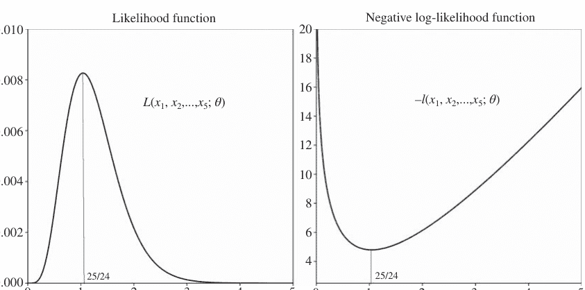

图 2.3 似然函数和负对数似然函数。

对于给定的 n，第一项是常数，在最小化过程中被忽略，由此给出了基于残差的 L2 损失函数：

$L_2 \text{ loss} = \frac{1}{2} \sum_{i=1}^n r_i^2.$ (2.5.15)

**练习：** 使用极大似然估计（MLE），推导 L1 损失，假设 $r_1, r_2, \dots, r_n$ 是从随机变量 $R \sim f(r) = \frac{1}{2}e^{-|r|}$ 中抽取的独立同分布（i.i.d.）值，其中 $r_i = y_i - \mathbf{x}_i^T \boldsymbol{\beta}$。

**答案：** 似然函数由以下给出：

$L(r_1, r_2, \dots, r_n; \boldsymbol{\beta}) = \prod_{i=1}^n \frac{1}{2}e^{-|r_i|}.$ (2.5.16)

负对数似然表达式为

$-\ell(r_1, r_2, \dots, r_n; \boldsymbol{\beta}) = n \log 2 + \sum_{i=1}^n |r_i|.$ (2.5.17)

对于给定的 n，第一项是常数，在最小化过程中被忽略，由此给出了基于残差的 L1 损失函数：

$L_1 \text{ loss} = \sum_{i=1}^n |r_i|.$ (2.5.18)

在连续性和可微性的温和假设下，MLE 过程保证估计量是一致的并且渐近正态。这两个是估计量的重要且理想的特性。此外，它产生的估计量方差较小，这确实也是另一个理想属性。因此，如果可能，我们应当追求遵循 MLE 过程的稳健估计量。虽然我们在此不打算深入探讨极大似然方法背后的理论，但我们将在多个地方使用该过程，因此值得查阅其他来源以进行更深入的研究。

### 2.5.4 梯度下降

本书其余部分描述的大多数技术都涉及优化损失函数以获得感兴趣参数的估计值。因此，花些时间探讨损失函数的理想特性（尤其是凸性）是有价值的。

图 2.4 展示了两个假设的损失函数，标记为 f(x)。左侧面板中的函数是非凸函数。它有三个极小值：一个全局极小值（A）和两个局部极小值（B 和 C）。这类函数通常难以优化，因为常用的技术可能会收敛到两个局部极小值之一，而不是全局极小值。右侧面板展示了一个仅具有一个极小值的凸函数，优化这类函数相当直接。在可能的情况下，我们在机器学习应用中使用的损失函数应当是凸函数并具有唯一解。然而，并非总能找到这样的函数，尤其是在神经网络的情况下。尽管如此，我们通常使用数值优化技术找到一个极小值（无论是局部还是全局），并生成与该点相关的估计值。

检查凸性的许多方法之一是求损失函数的二阶导数，看其是否非负。如果是，则该函数是凸函数且存在唯一解。如果不是，则可能存在多个解或无数个解。事实上，拥有严格凸损失函数是非常理想的，并能导出唯一解。

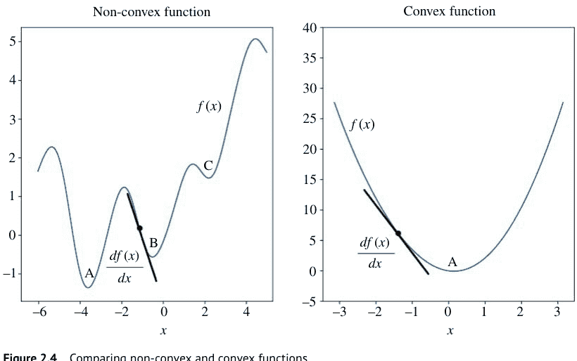

通常用于最小化凸函数的方法称为梯度下降。这种技术有许多变体，但目前理解其基本思想即可。在梯度下降中，我们从函数上的一个随机初始点开始，并求该点处的梯度。这在图 2.4 中分别显示了非凸情况下极小值 B 附近和凸情况下极小值 A 附近的情形。如果斜率为负（如本例所示），则极小值位于该点的右侧。相反，如果斜率为正，则极小值位于初始猜测的左侧。使用 f(x) 作为损失函数，t 作为迭代索引，我们可以使用以下公式更新我们对 x 的最优值的下一个猜测：

```
x^{(t+1)} = x^{(t)} - \frac{df(x)}{dx}|_{x^{(t)}}.
(2.5.19)
```

负号反映了我们应沿斜率的反方向移动这一事实。然而，向某一方向迈出大步可能并不明智，因为我们可能会来回震荡或远远超过最优值。出于这个原因，我们引入一个称为（在机器学习术语中）学习率 \(\ell\) 的因子来调节步长，如下所示：

```
x^{(t+1)} = x^{(t)} - \ell \times \frac{df(x)}{dx}|_{x^{(t)}}.
(2.5.20)
```

\(\ell\) 的值可以固定，也可以在每次迭代期间调整以实现更快的收敛。在凸情况下使用这种简单方法会产生 A 处的极小值，但在非凸情况下，它可能会产生 B 处的局部极小值。显然，凸优化的优势在于始终能得到全局极小值（需对函数及其一阶导数的存在性和连续性做一些温和假设）。

**练习：** 考虑函数 $f(x) = (x - 2)^2$。使用更新公式

```
x^{(t+1)} = x^{(t)} - \frac{df(x)}{dx}|_{x^{(0)}}
```

和初始条件 $x^{(0)} = 3$ 来寻找极小值。仅应用两步迭代。

**答案：** 导数是 $\frac{df(x)}{dx} = 2(x - 2)$。

迭代 1：

```
x^{(1)} = x^{(0)} - 2(x^{(0)} - 2) = 3 - 2(3 - 2) = 1
```

迭代 2：

```
x^{(2)} = x^{(1)} - 2(x^{(1)} - 2) = 1 - 2(1 - 2) = 3
```

这不会收敛，因为它将在两侧之间振荡。

**练习：** 再次考虑函数 $f(x) = (x - 2)^2$。这次，使用更新公式

```
x^{(t+1)} = x^{(t)} - \ell \times \frac{df(x)}{dx}|_{x^{(0)}}
```

和初始条件 $x^{(0)} = 3$ 来寻找极小值。使用 \(\ell = 1/2\) 仅应用两步迭代。

**答案：** 导数是 $\frac{df(x)}{dx} = 2(x - 2)$。

迭代 1:
$x^{(1)} = x^{(0)} - \frac{1}{2} \times 2(x^{(0)} - 2) = 3 - 2(3 - 2)/2 = 2$

迭代 2:
$x^{(2)} = x^{(1)} - \frac{1}{2} \times 2(x^{(1)} - 2) = 2 - 2(2 - 2)/2 = 2$

在两次迭代中发生了收敛。

在考虑用于机器学习的各种损失函数时，我们应检查它们是凸还是非凸。我们可以使用函数的二阶导数来完成此操作。首先，设 $x \in I$，其中 $I$ 是某个感兴趣的区间。那么函数 $f(x)$ 在区间 $I$ 上是凸函数，当且仅当对所有 $x \in I$ 都有 $f''(x) \ge 0$；严格凸函数，当且仅当 $f''(x) > 0$。因此，我们可以使用此准则来检验凸性。对于实践中使用的大多数损失函数，这一条件成立，但应检查任何新的损失函数。然而，在机器学习中，尤其是在深度神经网络中，这可能不成立，且局部极小值是可以接受的。在这种情况下，优化技术将比上述简单的梯度下降复杂得多，如第 9 章和第 10 章中所述。

## 2.6 M-估计

在为机器学习寻找稳健损失函数的过程中，我们需要一种方法来比较沿途遇到的不同候选者。在稳健统计学中，有一类称为 M-估计量（参见 Maronna 2019）的估计量，这将在本书中为此目的一直有用。M-估计量用于稳健回归，其目标是最小化残差的一个函数。理解这些估计量的最简单方式是，它们都由一个通用损失函数定义，如下所示：

```
M-loss = \sum_{i=1}^{n} \rho(r_i) = \sum_{i=1}^{n} \rho(y_i - x_i^\top \beta).
```

其思想是，函数 $\rho(r_i)$ 被选用以提供稳健估计。该函数本身完全取决于你的独创性，而不一定依赖于使用 MLE 进行的严格推导。如果我们能指定 $\rho(r_i)$ 函数，使其为凸函数并给出理想估计，那么我们可以对其进行优化以获得稳健模型。在这里，我们不需要指定分布或执行 MLE 过程的任何步骤。我们只是基于某个满足连续性和凸性若干要求的 $\rho(r_i)$ 开发一个估计量。$\rho(r_i)$ 的导数由以下给出：

```
\psi(r_i) = \frac{\partial \rho(r_i)}{\partial r_i}.
```

连续性要求是为了进行求导，以便可以使用梯度来数值求解方程。假设 $\rho(r_i)$ 是可微的，则估计量是满足以下条件的一组值：

```
\sum_{i=1}^{n} \psi(r_i) = 0.
```


找到唯一极小值需要满足凸性条件。我们可以使用二阶导数来评估损失函数的凸性：

\(\psi'(r_i) = \frac{\partial^2 \rho(r_i)}{\partial^2 r_i}.\) (2.6.4)

那么，**凸性性质**当且仅在以下条件下成立

\(\psi'(r_i) \ge 0 \text{ for all } r_i\) (2.6.5)

并且当 \(\psi'(r_i) > 0\) 对所有 \(r_i\) 成立时，该函数是严格凸的。

用于指定损失函数的 M-估计方法也可用于非鲁棒估计量。对于 \(L_2\)，有

\(\rho_{L_2}(r_i) = \frac{r_i^2}{2}.\)

因此，

\(\psi_{L_2}(r_i) = r_i\)

并且

\(\psi'_{L_2}(r_i) = 1.\)

所以 \(L_2\) 具有严格凸损失函数。现在如果我们检查 \(L_1\)，会发现

\(\rho_{L_1}(r_i) = |r_i|.\)

因此，

\(\psi_{L_1}(r_i) = \text{sgn}(r_i)\)

并且

\(\psi'_{L_1}(r_i) = \begin{cases} \text{undefined} & \text{if } r_i = 0 \\ 0 & \text{if } r_i \neq 0 \end{cases}.\) (2.6.6)

该函数是凸的但不是严格凸的，并且在 \(r_i = 0\) 处未定义。因此我们无法保证存在唯一解。事实上，使用 \(L_1\) 可能存在无限个局部解。

图 2.5 绘制了 \(L_1\) 和 \(L_2\) 的 \(\rho(r_i)\) 和 \(\psi(r_i)\) 函数。请注意，\(L_1\) 遵循绝对函数 \(|r_i|\)，而 \(L_2\) 遵循二次函数 \(r_i^2/2\)。使用 \(L_2\) 的问题是残差被平方，这放大了大残差的重要性。在线性回归中，异常值在某种意义上被认为比大多数数据更重要，因为异常值往往具有较大的残差。因此，它对异常值非常敏感。这是 \(L_2\) 估计量的主要问题。

\(L_1\) 估计量对异常值不那么敏感，因为它在损失函数中对残差的绝对值求和，但它还有其他问题。\(\rho(r_i)\) 函数在 \(r_i = 0\) 处有一个明显的拐点。当我们检查图 2.5 左下角面板中其一阶导数时，会发现它是一个不连续函数，而 \(L_2\) 的一阶导数是连续的，如右下角面板所示。\(L_1\) 的不连续性在用于机器学习时，在数学和数值优化方面都会带来问题。此外，\(L_1\) 的二阶导数在原点处产生一个冲激函数，而 \(L_2\) 的二阶导数在值为 1 处是平坦且连续的。显然，\(L_1\) 和 \(L_2\) 都有显著缺点，因此需要替代方法来处理异常值。

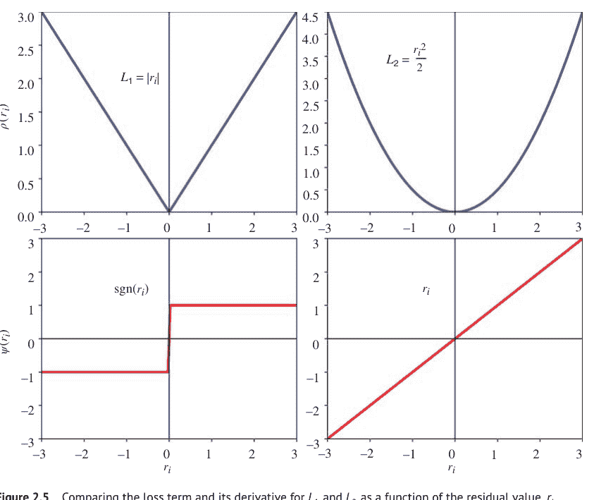

立即出现的问题是：如何提出一个更好的 M-估计量？答案是尝试不同的选项并相互比较。特别是，如果你想找到数据的中位数，并且发现 \(L_1\) 损失函数不合适，那么任何其他寻求中位数的 \(\rho(r_i)\) 函数都将是合适的替代品。在后续章节中，我们将考虑 Huber 估计量作为本章的第一个 M-估计量，随后在下一章中介绍 log-cosh 估计量。

符号：M-估计器的一般形式由以下给出：

\[
\hat{\boldsymbol{\beta}}^* = \operatorname*{argmin}_{\beta} \left[ \sum_{i=1}^n \rho(y_i - \mathbf{x}_i^T \boldsymbol{\beta}) \right].
\]

**argmin** 的使用表示应最小化损失函数以找到位于极小值处的相关 \(\boldsymbol{\beta}\)。上标 * 通常被 L1、L2、LS、LAD、LC 和 H 等缩写替换，以指代所使用的特定类型的损失函数。

## 2.7 最小二乘估计（LSE）

我们现在准备使用适当的符号在更正式的环境中检查最小二乘方法。请考虑以下矩阵形式的多元线性模型：

\(y = \mathbf{X}\boldsymbol{\beta} + \boldsymbol{\varepsilon}.\) (2.7.1)

其中 \(\mathbf{y} = (y_1, \dots, y_n)^T\) 是响应向量，\(\mathbf{X}\) 是包含嵌入 1 列的 \(n \times (d + 1)\) 常数设计矩阵，\(\boldsymbol{\varepsilon} = (\varepsilon_1, \dots, \varepsilon_n)^T\) 是误差项。这里假设 \(\boldsymbol{\varepsilon} \sim N(0, \sigma^2 \mathbf{I}_n)\)，即均值为 0、方差-协方差矩阵为 \(\sigma^2 \mathbf{I}_n\) 的正态分布。回归参数 \(\boldsymbol{\beta} = (\beta_0, \dots, \beta_d)^T\) 是感兴趣的 \(d + 1\) 个系数。

多维问题的解不再是一条直线，而是一个平面或超平面。图 2.6 说明了一个二元回归模型及其解的示例。在此例中，斜率为 \(\beta_1\) 和 \(\beta_2\)，而 y 轴上的截距为 \(\beta_0\)。斜率表示平面在每个维度上的角度。超过两个维度后，平面变为超平面。出于显而易见的原因，超平面无法可视化；然而，相同的概念仍然适用。

我们可以用两种不同的方式写出 L2 损失函数。第一种使用矩阵表示法，如下：

\(J(\boldsymbol{\beta}) = (\mathbf{y} - \mathbf{X}\boldsymbol{\beta})^T (\mathbf{y} - \mathbf{X}\boldsymbol{\beta}).\) (2.7.2)

这只是用矩阵表示法写出的误差平方和。为了获得最小二乘估计量 \(\hat{\boldsymbol{\beta}}^{\text{LS}}\)，我们通过对 \(\boldsymbol{\beta}\) 求 \(J(\boldsymbol{\beta})\) 的导数并将其设为 0 来最小化此损失函数，即

\(\frac{\partial J(\boldsymbol{\beta})}{\partial \boldsymbol{\beta}} = -2\mathbf{X}^T (\mathbf{y} - \mathbf{X}\boldsymbol{\beta}) = 0.\) (2.7.3)

然后，可得

\(-\mathbf{X}^T \mathbf{y} + \mathbf{X}^T \mathbf{X} \boldsymbol{\beta} = 0.\) (2.7.4)

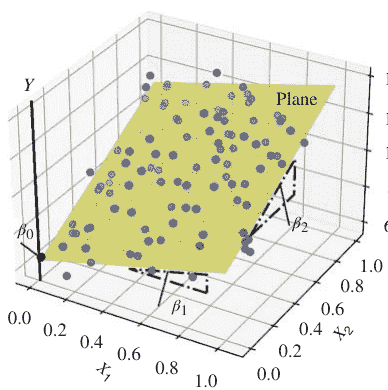

图 2.6 斜率为 \(\beta_1\) 和 \(\beta_2\)、截距为 \(\beta_0\) 的平面，表示两个变量多元线性回归问题的解。

然后可以将其重新排列，以产生众所周知的封闭式解：

\(\hat{\boldsymbol{\beta}}^{\text{LS}} = (\mathbf{X}^{\text{T}} \mathbf{X})^{-1} \mathbf{X}^{\text{T}} \mathbf{y}.\) (2.7.5)

这是 LSE 的直接矩阵解，前提是 \(\mathbf{X}^{\text{T}}\mathbf{X}\) 可逆，它产生最佳线性无偏估计（BLUE）。这里的“最佳”是指方差 _最低_ 的估计量。它在文献中也被称为普通最小二乘（OLS）估计量。有关 OLS 的书籍和信息量非常大，此处不予赘述。

获得最小二乘估计量的另一种方法是应用迭代方法。此前我们看到，\(L_2\) 损失函数由以下给出

\(L_2 \text{ loss} = \frac{1}{2} \sum_{i=1}^n r_i^2 = \frac{1}{2} \sum_{i=1}^n (y_i - \boldsymbol{x}_i^{\text{T}} \boldsymbol{\beta})^2.\) (2.7.6)

然后，最小二乘解按以下方式获得：

\(\hat{\boldsymbol{\beta}}^{\text{LS}} = \operatorname{argmin}_{\boldsymbol{\beta} \in \mathbb{R}^{d+1}} \left[ \frac{1}{2} \sum_{i=1}^n (y_i - \boldsymbol{x}_i^{\text{T}} \boldsymbol{\beta})^2 \right].\) (2.7.7)

与其尝试以封闭形式求解此方程，不如使用梯度下降来寻找极小值。如果我们对 \(\beta_j\) 求损失函数的导数并将其用于梯度下降迭代方程，则得到：

\(\beta_j^{(t+1)} = \beta_j^{(t)} - \ell' \sum_{i=1}^n (y_i - \boldsymbol{x}_i^{\text{T}} \boldsymbol{\beta})(-x_{ij}).\) (2.7.8)

在每次迭代 \(t\) 中，我们只需用梯度项更新每个 \(\beta_j^{(t)}\)，\(j = 0, \dots, d\)，以产生 \(\beta_j^{(t+1)}\)，直到收敛。如果矩阵条件良好，直接矩阵方法和迭代方法产生相同的结果。然而，迭代方法不需要矩阵求逆，因此避免了由大 \(\mathbf{X}\) 矩阵或病态或奇异矩阵的可能性所引起的问题。为了避免多重共线性问题，它也非常适合应用惩罚函数，例如岭回归或 LASSO（如第 5 章所述）。

如果我们以 M-估计量的形式用残差表述损失函数，可以进一步了解解，如下所示：

\(L_2 \text{ loss} = \frac{1}{2} \sum_{i=1}^n \rho_{L_2}(r_i) = \frac{1}{2} \sum_{i=1}^n r_i^2.\) (2.7.9)

这只是对早期 MLE 结果的重述。然后，对 \(r_i\) 求导并将其设为 0，我们得到：

\(\sum_{i=1}^n r_i = 0.\) (2.7.10)

\(L_2\) 损失函数的解是一组估计量，它强制残差之和恒等于 0。因此，实际上，我们正在寻找穿过数据的 **均值** 线，使得平均误差为 0。


## 2.8 最小绝对偏差（LAD）

一种缓解异常值影响的替代最小二乘法（LS）方法是使用 LAD 方法，其中采用如下的 \(L_1\) 损失函数：

\( L_1 \text{ loss} = \sum_{i=1}^n |r_i| = \sum_{i=1}^n |y_i - \mathbf{x}_i^\top \boldsymbol{\beta}|. \) (2.8.1)

目标是最小化残差幅值之和，而不是残差的平方和。这可以表述为：

\( \hat{\boldsymbol{\beta}}^{\text{LAD}} = \underset{\boldsymbol{\beta} \in \mathbb{R}^{d+1}}{\text{argmin}} \left[ \sum_{i=1}^n |y_i - \mathbf{x}_i^\top \boldsymbol{\beta}| \right]. \) (2.8.2)

该方程的解不像看起来那么直接，因此必须小心选择寻找极小值的适当方法。对于 LAD，损失函数是分段线性且连续的。因此，需要使用线性规划方法或等效方法来求解。问题在于可能存在无限多个局部解，并且诸如梯度下降之类的数值优化方法可能会在 \(L_1\) 上遇到困难，因为导数是不连续的。我们很快将看到一种比 \(L_1\) 更有效的替代方法。

如果我们以 M-估计器的形式用残差来表述损失函数，就能进一步了解解：

\( L_1 \text{ loss} = \sum_{i=1}^n \rho_{L_1}(r_i) = \sum_{i=1}^n |r_i|, \) (2.8.3)

这只是对先前极大似然估计（MLE）结果的重述。然后，对 \(r_i\) 求导并令其为 0，我们得到：

\( \sum_{i=1}^n \text{sgn}(r_i) = 0. \) (2.8.4)

\(L_1\) 损失函数的极小值出现在正残差数量等于负残差数量的地方。因此，*直线上方的点的数量应等于直线下方的点的数量*。这是 \(L_1\) 和 \(L_2\) 之间的根本区别。在一种情况下，直线上方和下方的点是平衡的；而在另一种情况下，残差之和必须等于 0（在数值容差范围内）。我们可以开始理解为什么 \(L_1\) 损失能产生稳健估计：它实际上是在计算并平衡直线上方和下方的点，而不关心它们距离直线有多远。因此，我们正在通过数据获得**中位数**直线。\(L_1\) 的两个问题是可能存在无限多个解，并且无法使用梯度下降，因为损失函数的一阶导数是不连续的，二阶导数在某一点未定义。这些问题为实现稳健结果同时避免这些问题的大量其他技术打开了大门。

**练习**：已知来自两个不同估计器（LSE 和 LAD）的残差如下：\(\mathbf{r}_1 = (1.3, 2.3, 4.5, -2.3, -1.3, -2.5, -2.5, 1.0)^\top\) 和 \(\mathbf{r}_2 = (1.3, 2.3, 6.0, -2.3, -1.3, -2.5, -2.5, -1.0)^\top\)。哪一个产生了 \(\mathbf{r}_1\)，哪一个产生了 \(\mathbf{r}_2\)？

答：r1 的正残差和负残差数量相同，因此来自 LAD 估计器，而 r2 的值之和为 0.0，因此来自 LSE。

**练习：** 线性回归问题的残差如下：r = (-1, 1, -1, 1, 1, 1, -1, -1, 1, 10)^T。计算 L1 和 L2 损失。

**答：** 对于 L1，我们计算绝对值之和。因此损失为 20。对于 L2，它是平方和的一半。因此，损失为 55。在 L2 的情况下，值 10 是异常值并会放大损失。

## 2.9 LSE 和 LAD 的比较

为了进一步了解这两种方法，我们考察简单线性模型和位置模型的结果。简单线性模型用于说明两种方法在估计斜率和截距时的差异。位置问题用于探索极小化过程的本质。

### 2.9.1 简单线性模型

对于简单线性模型（参见第 2.5.1 节），我们将使用表 2.1 中提供的比利时电话数据集。它包含 1950 年至 1973 年间比利时拨打的电话数量（以千万为单位）。共有 24 个数据点，其中 6 个异常值是由于 1964 年至 1969 年 6 年期间测量技术的变化（通话时长而非呼叫次数）造成的。

图 2.7 显示了使用 LSE 和 LAD 进行线性回归的结果。散点代表表 2.1 中的数据。请注意，大多数点出现在图表的下半部分。上半部分的点是由于那些年份测量技术差异造成的异常值。这两条线分别基于 LSE 的 Eq. (2.7.7) 和 LAD 的 Eq. (2.8.2) 估计值。

在 LSE 的情况下，我们注意到直线穿过数据的中间，而 LAD 回归直线的位置则将数据分为两半。这是因为 LSE 方法寻找使误差平均为 0 的直线，而 LAD 方法寻找使直线上方和下方的数据点数量相等的直线。我们可以观察到，LAD 忽略了异常值数据并捕捉了真实数据的本质。

**表 2.1** 比利时电话数据集。

| x | 1950 | 1951 | 1952 | 1953 | 1954 | 1955 | 1956 | 1957 | 1958 | 1959 | 1960 | 1961 |
|---|------|------|------|------|------|------|------|------|------|------|------|------|
| y | 0.44 | 0.47 | 0.47 | 0.59 | 0.66 | 0.73 | 0.81 | 0.88 | 1.06 | 1.2 | 1.35 | 1.49 |
| x | 1962 | 1963 | 1964 | 1965 | 1966 | 1967 | 1968 | 1969 | 1970 | 1971 | 1972 | 1973 |
| y | 1.61 | 2.12 | 11.9 | 12.4 | 14.2 | 15.9 | 18.2 | 21.2 | 4.3 | 2.4 | 2.7 | 2.9 |

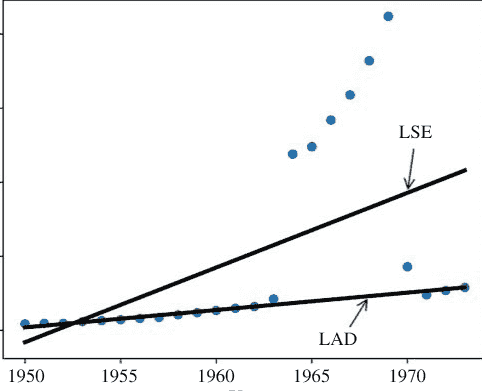

图 2.7 使用比利时电话数据集比较 LSE 和 LAD。LSE 受异常值影响，而 LAD 对异常值具有容忍性。

### 2.9.2 位置问题

为了强调与 L2 相比 L1 损失函数的另一个关键问题，我们将考察位置问题，这是最简单的回归问题，但能更深入地了解两种方法的内部工作原理。位置问题涉及一个一维数据集，用于估计某个随机变量 X 的 n 个观测值 x1, ..., xn 的中心。这可能是样本均值或中位数，或任何其他类似类型的估计，具体取决于总体目标。位置模型的表述如下：

\( x_i = \theta + \varepsilon_i, \quad i = 1, ..., n \)

其中 \(\theta\) 是位置参数，\(\varepsilon_1, ..., \varepsilon_n\) 是表示误差的 i.i.d. 随机变量。为了估计位置参数，我们可以通过最小化以下损失函数来使用 LSE：

\( L_2(\theta) = \frac{1}{2} \sum_{i=1}^n (x_i - \theta)^2. \quad (2.9.1) \)

均值是使用 L2 损失函数得到的。梯度函数是

\( L_2'(\theta) = - \sum_{i=1}^n (x_i - \theta). \quad (2.9.2) \)

或者，估计位置参数的另一种方法是使用 LAD 估计器，它最小化损失函数

\( L_1(\theta) = \sum_{i=1}^n |x_i - \theta|. \quad (2.9.3) \)

中位数是使用 \(L_1\) 损失函数得到的。梯度函数是

\( L'_1(\theta) = - \sum_{i=1}^n \text{sgn}(x_i - \theta). \)

为了说明 \(L_1\) 的一个问题，请考虑数据 \(x = (0, 3, 5, 7, 10)^T\)。我们分别使用 \(L_2\) 和 \(L_1\) 损失函数来寻找均值和中位数。通过检查，均值和中位数均为 5。损失函数已在图 2.8 中与梯度函数一起绘制。请注意，\(L_2\) 损失是连续且平滑的，而 \(L_1\) 损失是连续但 **分段线性** 的。梯度图进一步证实了这一点，其中 \(L_1\) 梯度由一系列阶梯组成，而 \(L_2\) 梯度是线性的。

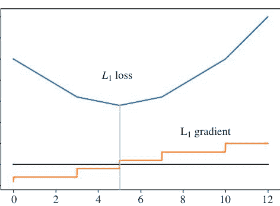

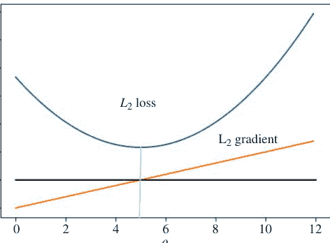

图 2.8 对位置模型中的 \(L_1\) 和 \(L_2\) 进行比较。


$L_1$ 损失函数需要采用特殊的优化技术，以线性规划的形式，例如单纯形法（用于小数据集）或内点法（用于大问题）。然而，$L_2$ 损失可以通过梯度下降来最小化。这种差异在机器学习中至关重要，因为梯度下降技术常用于最小化凸损失函数，而线性规划很少被使用。因此，出于这个原因以及许多其他原因，$L_1$ 损失函数并不理想地适用于机器学习应用。

在确立了 $L_1$ 和 $L_2$ 的细节之后，下一步是探索获得鲁棒估计器的方法，该估计器既不具有 $L_1$ 或 $L_2$ 损失函数的固有局限性，而是利用两者的优势。特别是，我们将考察 Huber 损失函数。

## 2.10 Huber 方法

创建更有效的鲁棒估计器的一种方法是尝试结合 $L_1$ 和 $L_2$ 损失函数。$L_1$ 损失的优点是它对异常值具有鲁棒性。缺点是它在一阶和二阶导数上存在连续性问题，并且需要使用诸如单纯形算法或内点法等复杂的方法来获得准确的估计。$L_2$ 损失是连续可微的，可以使用梯度下降求解，但它对异常值非常敏感。

### 2.10.1 Huber 损失函数

回到图 2.5，Huber 提出了一种方法：在原点附近（即 $L_1$ 的折点所在位置）使用 $L_2$，然后在距离原点一定距离处切换到 $L_1$（参见 Huber and Ronchetti 2009）。该方法非常简单。我们首先定义围绕原点的一个小区间 \([-\delta, +\delta]\)。在此区域内，我们使用 $L_2$ 损失函数，因为它没有折点。在此区域之外，我们使用 $L_1$ 损失，但非常注意在不同区域的接口处匹配函数及其一阶导数。因此，Huber 损失项 \(\rho_H(r_i)\) 及其导数 \(\psi_H(r_i)\) 在所有区域中均为连续。得到的 Huber 损失函数由以下公式给出：

$$
\text{Huber loss} = \sum_{i=1}^n \rho_H(y_i - \mathbf{x}_i^\top \boldsymbol{\beta}) = \sum_{i=1}^n \rho_H(r_i), \tag{2.10.1}
$$

其中损失项为

$$
\rho_H(r_i) = \begin{cases} r_i^2 / 2 & \text{if } |r_i| \le \delta \\ \delta(|r_i| - \frac{\delta}{2}) & \text{if } |r_i| > \delta \end{cases}, \tag{2.10.2}
$$

Huber 损失函数的导数由以下公式给出

$$
\psi_H(r_i) = \rho_H'(r_i) = \begin{cases} r_i & \text{if } |r_i| \le \delta \\ +\delta & \text{if } r_i > +\delta \\ -\delta & \text{if } r_i < -\delta \end{cases}. \tag{2.10.3}
$$

进一步，可以使用 Huber 损失来定义 Huber 估计器，如下所示

$$
\hat{\boldsymbol{\beta}}^H = \underset{\boldsymbol{\beta} \in \mathbb{R}^{k+1}}{\text{argmin}} \sum_{i=1}^n \rho_H(y_i - \mathbf{x}_i^\top \boldsymbol{\beta}). \tag{2.10.4}
$$

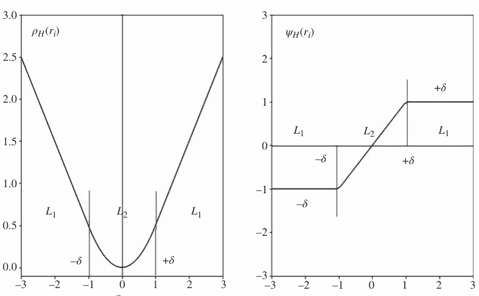

图 2.9 Huber 方法中损失项及其导数随残差值 \(r_i\) 变化的图，其中 \(\delta = 1\)。

考虑图 2.9 中的两个图，其中 \(\delta = 1\)。损失函数定义了总共 3 个区域：\(r_i < -1\)（左侧 \(L_1\) 区域）、\(r_i > +1\)（右侧 \(L_1\) 区域）以及 \(|r_i| \le 1\)（\(L_2\) 区域）。如图所示，区域 \(|r_i| \le 1\) 使用 \(L_2\) 损失项，而由 \(|r_i| > 1\) 定义的两个区域使用 \(L_1\) 损失项。这定义了一个特定的 Huber 损失项，形式如下：

$$
\rho_H(r_i) = \left\{ \begin{array}{ll} r_i^2 / 2 & \quad \text{if } |r_i| \le 1 \\ |r_i| - \frac{1}{2} & \quad \text{if } |r_i| > 1 \end{array} \right.
$$

第二种情况中的 1/2 项用于在不同区域的边界处保持连续性。代入 \(r_i = 1\)，两种情况在等式 (2.10.5) 中均等于 1/2。更重要的是，我们现在有了一个鲁棒损失函数，没有对 LAD 估计器造成麻烦的 \(L_1\) 折点。图中的 \(\delta\) 参数可用于根据每个数据集的需求调整边界，具体取决于其中异常值的数量和位置。默认情况下，常见的做法是基于在多种数据集上的实验将 \(\delta\) 设置为 1.345。这种公式是可接受的，但如果需要，我们可以通过选择区域之间的最优边界来做得更好。

图 2.10 显示了随着 \(\delta\) 变化时 Huber 损失项的行为。本质上，小值（\(\delta \le 1.345\)）导致类似于 \(L_1\) V 形的特征，而大值（\(\delta > 1.345\)）导致类似于 \(L_2\) U 形的特征。我们寻找接近中位数（无论是点、直线、平面还是超平面）的估计，因此当数据中存在异常值时会采用小的 \(\delta\) 值。但是，如果 \(\delta\) 太小，\(L_1\) 的问题将重新出现。

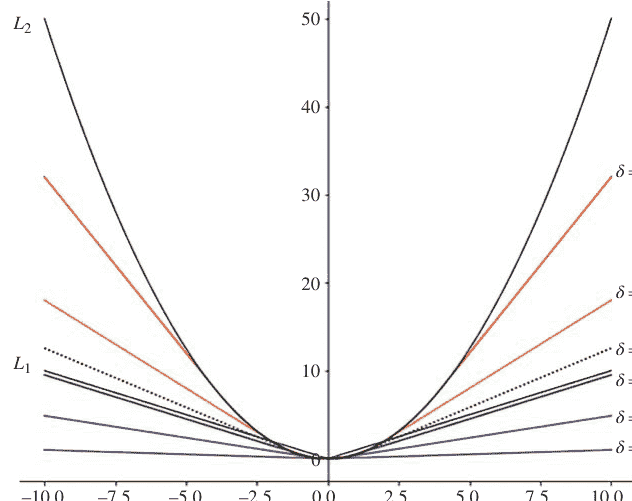

图 2.10 比较 \(L_1, L_2\) 和 Huber（针对不同的 \(\delta\) 值）。

**练习：** 写出 \(\delta = 0.1\) 的 Huber 损失项，当数据集有许多异常值时可能会使用它。假设 \(r_i\) 是第 \(i\) 个残差。说明它们适用的区间（参见图 2.9，左侧面板）。

**Ans.:**
\[
\rho_H(r_i) = \begin{cases} r_i^2/2 & \text{if } |r_i| \le 0.1 \\ 0.1 \left( |r_i| - \frac{0.1}{2} \right) & \text{if } |r_i| > 0.1 \end{cases}
\]

**练习：** 令 \(\delta = 0.1\)。写出 Huber 损失项的导数（参见图 2.9，右侧面板）。

**Ans.:**
\[
\psi_H(r_i) = \begin{cases} r_i & \text{if } |r_i| \le 0.1 \\ +0.1 & \text{if } r_i > +0.1 \\ -0.1 & \text{if } r_i < -0.1 \end{cases}
\]

Huber 方法中存在的另一个问题是损失函数的凸性。虽然损失对于 \(\boldsymbol{\beta}\)（固定 \(\delta\)）总是凸的，但对于 \(\delta\) 和 \(\boldsymbol{\beta}\) 来说不一定是凸的。这带来了特别的挑战，因为 \(\delta\) 和 \(\boldsymbol{\beta}\) 必须迭代且同时确定。这是 \(\delta\) 被设置为特定值（通常为 \(\delta = 1.345\)）的另一个原因。

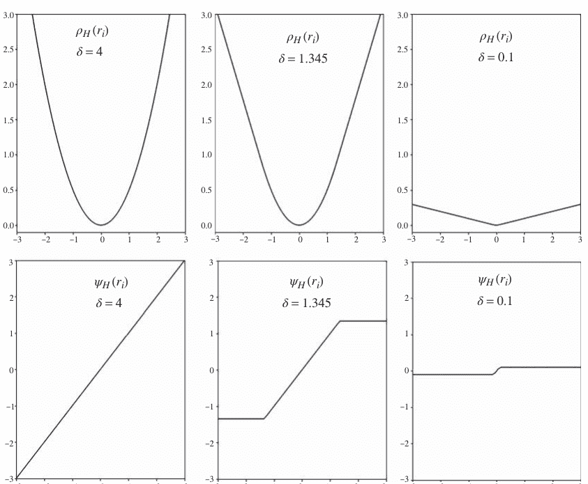

图 2.11 \(\rho(r_i)\) 和 \(\psi(r_i)\) 作为残差值 \(r_i\) 的函数，其中 \(\delta = 4, 1.345\) 和 \(0.1\)。

**练习：** 使用等式 (2.10.2) 和 (2.10.3) 绘制 \(\delta = 4, 1.345\) 和 \(0.1\) 的 Huber 损失项及其导数。评论它们的差异。（提示：参见图 2.10。）

**答：** 解答见图 2.11。当 \(\delta = 4\) 时，图与 \(L_2\) 相似。当 \(\delta = 0.1\) 时，图与 \(L_1\) 相似，只是按 \(0.1\) 进行了缩放。\(\delta = 1.345\) 的图在两者之间取得了平衡。

**练习：** 写出 \(\delta = 0.1\) 的 Huber 函数二阶导数的表达式并绘图。

**答：** 它将有两个不连续点，分别位于 \(-0.1\) 和 \(+0.1\)，如以下等式所示：

$$
\psi'_H(r_i) = \begin{cases} 1 & \text{if } |r_i| \le 0.1 \\ 0 & \text{otherwise} \end{cases}
$$

得到的 \(\delta = 0.1\) 的不连续 Huber 二阶导数图如图 2.12 所示。

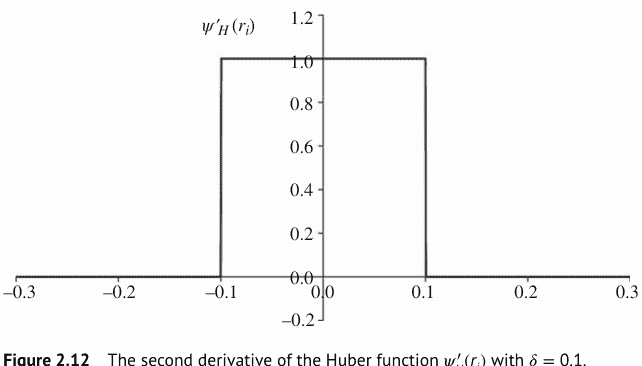

从上面的练习可以清楚地看出，Huber 损失没有连续的二阶导数。因此，人们设计了各种改进方法，使用平滑技术使其连续可微，但这里不再详细阐述，因为这些方法作为副作用会引入其他问题。也许更令人担忧的是，随着 \(\delta\) 减小，优化问题开始类似于 \(L_1\)，这意味着梯度下降不再那么有效，结果变得不可靠。尽管存在这些问题，当存在异常值时，Huber 方法仍然是最小二乘法的流行替代方法。

可以通过以下替代形式表达损失，从而深入了解 Huber 方法的内部工作原理：

$$
\text{Huber loss} = \sum_{i=1, |r_i| \le \delta}^n r_i^2 / 2 + \sum_{i=1, |r_i| > \delta}^n \delta(|r_i| - \delta / 2). \tag{2.10.6}
$$

为方便起见，令 \(\delta = 1\)，如果我们对各区域的损失函数求导并令其等于 0，则会得到

$$
\sum_{i=1, |r_i| \le 1}^n r_i + \sum_{i=1, |r_i| > 1}^n \text{sgn}(r_i) = 0. \tag{2.10.7}
$$

等式 (2.10.7) 表示，两个 \(L_1\) 区域中残差符号之和与 \(L_2\) 区域中残差之和必须等于 0。满足此条件的一种方法是：在两个 \(L_1\) 区域中有相同数量的残差，其余残差位于 \(L_2\) 区域。在 \(L_1\) 区域中，求和的项只能是 -1 或 +1。因此，必须达到总和为 0 的平衡；否则，\(L_2\) 区域将不得不补足差额，使总和等于 0。该方法是鲁棒的，因为 \(L_1\) 区域中残差的大小可以是任何（较大）值，但它们只会对总和贡献 -1 或 +1。因此，只要选择合适的 \(\delta\)，Huber 方法对异常值具有鲁棒性。


| | LSE | LAD | Huber |
|---|---|---|---|
| Intercept | −983.9 | −305.0 | −298.0 |
| Slope | 0.504 | 0.155 | 0.154 |
| δ | — | — | 0.269 |

### 2.10.2 与 LSE 和 LAD 的比较

我们比较了三种估计方法，即 LSE、LAD 和 Huber 方法，在比利时电话数据集上。估计值在表 2.2 中给出。对于 Huber，如前所述，δ 的最优选择取决于数据。在此情况下，最优值为 δ = 0.269。Huber 方法和 LAD 的结果非常相似，并且都与 LSE 截然不同，这与预期一致。

为了更好地理解 δ 的影响，请参考图 2.13 中的线性回归结果图。在此情况下，在 0 到 100 之间选择了 100 个不同的 δ 值。Huber 生成的 100 条线着色了由 LSE 和 LAD 界定的区域。这是预期的，因为在一个极端，Huber 方法退化为 LSE，而在另一个极端，它变为 LAD。同样，δ 取决于数据，但在实践中通常设置为默认值 δ = 1.345。

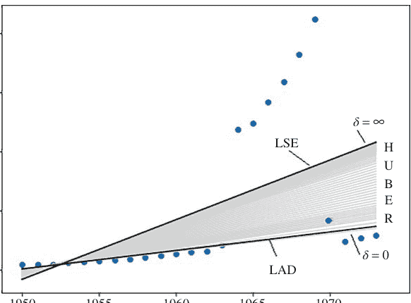

图 2.13 使用比利时电话数据集比较 LSE、LAD 和 Huber。LSE 和 LAD 结果构成了 Huber 结果的边界。

## 2.11 总结

本章介绍了用于线性回归的 \(L_1\)、\(L_2\) 和 Huber 损失函数。\(L_1\) 损失函数对异常值具有鲁棒性，但存在使其实践中难以使用的数学和数值问题。\(L_2\) 损失函数（产生普通最小二乘估计的方法）对异常值不耐受。Huber 方法结合了 \(L_1\) 和 \(L_2\) 损失函数的优点，并对异常值具有耐受性。然而，它也存在一些问题，即其二阶导数不连续，我们必须能够找到 \(\delta\) 的合适值，以及估计值本身。此外，较小的 \(\delta\) 值可能不适合使用梯度下降进行优化。在下一章中，将介绍另一种方法，它避免了 Huber 方法固有的问题，并在鲁棒机器学习中大有前途。

## 练习题

### 2.1 考虑以下小数据集。

| \(x_i\) | 0.10 | 0.20 | 0.30 | 0.40 | 0.50 | 0.60 |
| :--- | :--- | :--- | :--- | :--- | :--- | :--- |
| \(y_i\) | 3.2 | 4.0 | 4.2 | 4.7 | 6.5 | 5.5 |

假设数据按以下模型建模：

\(\mathbf{y} = \beta_0 + \beta_1 \mathbf{x} + \boldsymbol{\epsilon}.\)

执行手动计算，或使用 Python，完成以下任务。

- a) 使用以下公式求最小二乘（LS）估计：

\(\hat{\beta}_1^{LS} = \frac{\sum_{i=1}^n (x_i - \bar{x})(y_i - \bar{y})}{\sum_{i=1}^n (x_i - \bar{x})^2}, \quad \text{and} \quad \hat{\beta}_0^{LS} = \bar{y} - \hat{\beta}_1^{LS} \bar{x},\)

其中 \(\bar{x}\) 和 \(\bar{y}\) 分别是各自变量的均值。

- b) 绘制点和 LS 回归直线。在图中标识斜率和截距。

- c) 在图中使用垂直线指示残差。残差之和是多少？

### 2.2 以下分布的 \(\mu\) 的最大似然估计量是什么？

\(f_\mu(x) = \frac{1}{1 + (x - \mu)^2}\)

### 2.3 位置问题的 \(L_2\) 损失函数由以下公式给出

\(L_2(\theta) = \frac{1}{2} \sum_{i=1}^n (x_i - \theta)^2.\)

梯度函数为

\(L'_2(\theta) = -\sum_{i=1}^n (x_i - \theta).\)

- a) 对于数据集 \(\boldsymbol{x} = \{1, 2, 3, 4, 5, 6, 7, 100\}\)，绘制损失函数和梯度函数。选择 0 到 30 之间的 \(\theta\) 值。
- b) 在最小值处的 \(\theta\) 值是多少，称为 \(\hat{\theta}^{LS}\)。

### 2.4 位置问题的 \(L_1\) 损失函数由以下公式给出

\(L_1(\theta) = \sum_{i=1}^n |x_i - \theta|.\)

梯度函数为

\(L'_1(\theta) = -\sum_{i=1}^n \text{sgn}(x_i - \theta).\)

- a) 对于数据集 \(\boldsymbol{x} = \{1, 2, 3, 4, 5, 6, 7, 100\}\)，绘制损失函数和梯度函数。选择 0 到 10 之间的 \(\theta\) 值。
- b) 在最小值处的 \(\theta\) 值是多少，称为 \(\hat{\theta}^{LAD}\)。

### 2.5 位置问题的 Huber 损失函数由以下公式给出

\(H(\theta) = \sum_{i=1}^n \rho_H(x_i - \theta),\)

其中

\(\rho_H(\theta) = \begin{cases} (x_i - \theta)^2 / 2 & \text{if } |(x_i - \theta)| \le \delta \\ \delta(|x_i - \theta| - \frac{\delta}{2}) & \text{if } |(x_i - \theta)| > \delta \end{cases}\)

梯度函数为

\(H'(\theta) = \sum_{i=1}^n \psi_H(x_i - \theta).\)

其中

\(\psi_H(\theta) = \begin{cases} (x_i - \theta) & \text{if } |(x_i - \theta)| \le \delta \\ -\delta & \text{if } (x_i - \theta) > +\delta \\ +\delta & \text{if } (x_i - \theta) < -\delta \end{cases}\)

- a) 设置 \(\delta = 1\)，并将函数 \(\rho_H(\theta)\)、\(\psi_H(\theta)\) 和 \(\psi'_H(\theta)\) 作为 \(r_i = x_i - \theta\) 的函数进行绘制。该函数是否为凸函数？
- b) 对于数据集 \(\boldsymbol{x} = \{1, 2, 3, 4, 5, 6, 7, 100\}\)，将 \(H(\theta)\) 作为 \(\theta\) 的函数进行绘制。选择 0 到 10 之间的 \(\theta\) 值。
- c) 对于数据集 \(\boldsymbol{x} = \{1, 2, 3, 4, 5, 6, 7, 100\}\)，将 \(H'(\theta)\) 作为 \(\theta\) 的函数进行绘制。选择 0 到 10 之间的 \(\theta\) 值。
- d) 计算数据集 \(\boldsymbol{x} = \{1, 2, 3, 4, 5, 6, 7, 100\}\) 的位置参数 Huber 估计值 \(\hat{\theta}^H\)。
- e) 使用 \(\delta = 10\) 和 \(\delta = 0.1\) 重复第 (d) 部分。在 \(\delta = 1\)、\(\delta = 10\) 和 \(\delta = 0.1\) 中，哪个 \(\delta\) 值最适合此数据集？

### 2.6 本题涉及机器学习中梯度下降的应用。假设目标是为简单线性回归问题最小化 \(L_2\) 损失函数，如下所示：

$$\hat{\beta}^{\text{LS}} = \arg\min_{\beta \in \mathbb{R}^2} \left[ \frac{1}{2} \sum_{i=1}^n (y_i - \mathbf{x}_i^T \beta)^2 \right].$$

最小二乘估计器的更新方程是什么？注意，它将采用以下形式：

$$\beta_j^{t+1} = \beta_j^t - \ell \times \frac{\partial f(\beta)}{\partial \beta_j}$$

其中 \(j = 0\) 或 \(1\)，\(\ell\) 是预定义的学习率，\(f(\beta)\) 是损失函数。

### 2.7（项目）在本项目中，你将使用 Huber 方法的稳健回归求解数据集的斜率和截距。

- a) 导入所需的库。

```
import numpy as np
from sklearn.linear_model import HuberRegressor
import matplotlib.pyplot as plt
```

- b) 创建类似于电话数据集的数据。

```
np.random.seed(0)
X = np.linspace(0, 23, 24).reshape(-1, 1)
y = np.array([ 0.44, 0.47, 0.47, 0.59, 0.66,
0.73, 0.81, 0.88, 1.06, 1.2 ,
1.35, 1.49, 1.61, 2.12, 11.9 ,
12.4 , 14.2 , 15.9 , 18.2 , 21.2 ,
4.3 , 2.4 , 2.7 , 2.9 ])
```

- c) 使用数据拟合 Huber 回归器。

```
huber = HuberRegressor(epsilon=4.0)
huber.fit(X, y)
slope = huber.coef_[0]
intercept = huber.intercept_
print("Slope=", f"{slope:.1f}", "Intercept=", f"{intercept:.1f}")
y_pred = huber.predict(X)
```

- d) 绘制结果。

```
plt.scatter(X, y, color='blue', label='Data points')
plt.plot(X, y_pred, color='red', label='Huber Regressor')
plt.xlabel('X')
plt.ylabel('y')
plt.legend()
plt.title('Huber Regressor with Outliers')
plt.show()
```

- e) 使用 \(\delta = 4, 1.345, \text{和 } 0.1\) 绘制结果（注意：epsilon 是 \(\delta\) 参数）。哪个 \(\delta\) 值产生了稳健解？解释为什么 \(\delta = 0.1\) 可能会是一个问题（提示：它是使 Huber 更接近 \(L_1\) 还是 \(L_2\)？）。

## 参考文献

Montgomery, D.C., Peck, E.A., and Vining, G.G. (2012). 线性回归分析导论（第4版）. Wiley.
Huber, P.J. and Ronchetti, E.M. (2009). 鲁棒统计学（第2版）. John Wiley and Sons.

# 3 对数双曲余弦损失函数

## 3.1 引言

在上一章中，我们介绍了 \(L_1\) 损失函数（更常被称为最小绝对偏差（LAD））和 Huber 损失函数，作为我们首次接触稳健估计量。在本章中，我们探讨了稳健类别中一个更近期的条目，即 log-cosh 损失函数，它是本书中将要介绍的稳健方法的核心。该损失函数属于关联稳健估计量类，因为与 Huber 一样，它也倾向于偏好中位数附近的解而不是均值。另一种观点是，它对数据集中的异常值更加耐受，因为关联估计量家族与 \(L_1\) 估计量相关。一个突出的特点是，它是一个单一的、可连续微分的函数，其性质是参数化的，因此具有估计器的所有理想属性，如凸性、一致性和渐近正态性。这与 Huber 损失形成对比，Huber 损失具有多个分段和不连续的二阶导数。

在本章中，我们将证明 log-cosh 损失函数优于机器学习中的其他稳健估计量。本章通过从第一原理推导（始于其分布）对 log-cosh 损失函数进行了详细和彻底的处理。然后，我们将研究偏差、方差和估计标准误等属性。我们还将使用位置和尺度参数探索基本 log-cosh 损失的各种扩展。最后，将展示 log-cosh 损失的一般 M-估计量形式是鲁棒机器学习的一种非常强大的工具。

## 3.2 Log-Cosh 的直观视图

为了直观地理解 log-cosh，我们需要回到 \(L_1\) 损失函数并找出其主要弱点。最小化该损失函数得到中位数作为估计值，将数据分为两半。然而，损失项存在一个折点，这导致一阶导数不连续且二阶导数未定义$^1$。这意味着损失函数的优化可能无法产生唯一解，且解可能需要除梯度下降以外的方法。事实上，\(L_2\) 今天被广泛使用的原因之一是 \(L_1\) 损失需要线性规划。

1 更准确地说，二阶导数在原点处为冲激函数，其他地方为零。


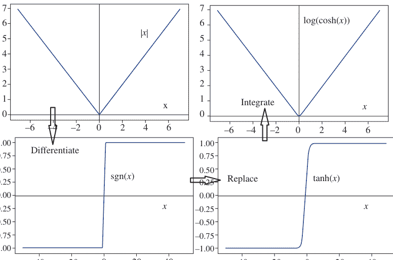

**图 3.1** 使用 log-cosh 开发一个连续的 $L_1$ 函数。

用于优化的方法。如果可以找到一种替代方案，它既保留 $L_1$ 的鲁棒性，又不存在不连续性问题，同时为极小化问题提供基于梯度下降的唯一解，那么它将更适合机器学习。

目标现在已经明确：我们寻找一个具有一阶和二阶连续导数的损失项来替代 $L_1$ 函数。考虑如何从 $L_1$ 损失项入手实现这一点，如图 3.1 左上角面板所示。绝对值损失项 $|x|$ 明显是分段连续的，带有 V 形拐点。对其求导，我们得到 sgn(x)，它在 $x = 0$ 处不连续，如左下角面板所示。这种不连续性在基于梯度的方法中会带来一定麻烦。如果我们用一个连续函数（例如 tanh(x) 函数）来替换不连续的导数函数，会怎么样呢？由于 tanh(x) 在所有区域都是连续的，且取值范围为 -1 到 1，它似乎是替换 sgn(x) 的一个非常好的选择。这在右下角面板中显示。这两个函数 sgn(x) 和 tanh(x) 看起来差不多，但我们知道一个是不连续的，另一个是连续的。

在找到合适的导数替代品后，所剩无几的是通过对 tanh(x) 函数进行积分来获得损失项，从而得到 log(cosh(x))。这在右上角面板中显示。这是一个在原点附近平滑的连续函数。也就是说，它具有 $L_1$ 的典型 V 形，但没有拐点（尽管在图中可能看起来有一个）。因此，我们可以不用将 $|x|$ 作为损失项，而是用 log(cosh(x)) 替换它，并希望以这种方式解决与 $L_1$ 相关的所有问题。这就是所谓的 log-cosh（LC）损失函数的主要动力。

## 3.3 双曲函数

log-cosh 损失使用双曲函数来构建分布、损失函数和导数。因此，有必要重温与双曲三角函数相关的定义和恒等式。我们下面回顾这些方程及其部分性质。

请回顾三个主要的双曲函数为

\(\sinh(x) = \frac{e^x - e^{-x}}{2},\)
\(\cosh(x) = \frac{e^x + e^{-x}}{2},\)

和

\(\tanh(x) = \frac{e^x - e^{-x}}{e^x + e^{-x}}.\)

我们还有由以下给出的双曲倒数函数

\(\text{csch}(x) = \frac{1}{\sinh(x)} = \frac{2}{e^x - e^{-x}},\)
\(\text{sech}(x) = \frac{1}{\cosh(x)} = \frac{2}{e^x + e^{-x}},\)

和

\(\coth(x) = \frac{1}{\tanh(x)} = \frac{e^x + e^{-x}}{e^x - e^{-x}}.\)

一些有用的性质如下：

\(\sinh(-x) = -\sinh(x),\)
\(\cosh(-x) = \cosh(x),$

和

\(\tanh(-x) = -\tanh(x).$

其他有用的方程包括以下内容：

\(\cosh^2(x) - \sinh^2(x) = 1,\)

和

\(\int_{-\infty}^{x} \frac{1}{\cosh(x)} = \arctan[\sinh(x)] + c.\)

## 3.4 M-估计

机器学习中的 log-cosh 损失函数可用于构建 M-估计器（参见第 2 章）。与 M-估计器相关的损失函数具有如下一般形式

\(\text{M-loss} = \sum_{i=1}^n \rho(x_i). \quad (3.4.1)\)

损失项 \(\rho(x_i)$ 可以使用任何所需的函数，只要它满足某些最小条件集。假设我们有兴趣估计某个数量 \(\boldsymbol{\beta}$，它与 \(n \times (d + 1)\) 设计矩阵 \(\mathbf{X}$ 的解释变量和响应向量 \(\mathbf{y}$ 相关联。那么 \(\boldsymbol{\beta}$ 的 M-估计器定义为，

\(\hat{\boldsymbol{\beta}} = \underset{\boldsymbol{\beta} \in \mathbb{R}^{d+1}}{\text{argmin}} \sum_{i=1}^n \rho(r_i),\)

其中 \(r_i = \mathbf{y}_i - \mathbf{x}_i^\top \boldsymbol{\beta}$ 是残差，\(i = 1, \dots, n$。该解通常在机器学习的背景下，采用某种形式的梯度下降进行数值优化来计算。

对于 log-cosh 损失，我们已经确定损失项为

\(\rho_{\text{LC}}(x) = \log(\cosh(x)).\)

然后，可以得出

\(\psi_{\text{LC}}(x) = \rho'_{\text{LC}}(x) = \tanh(x)\)

和

\(\psi'_{\text{LC}}(x) = \rho''_{\text{LC}}(x) = \text{sech}^2(x).\)

因此，一阶和二阶导数可以轻松推导，且所有函数都是连续的。这对于机器学习应用非常重要。我们需要连续可微的函数，以避免在梯度下降收敛过程中出现数值问题。

这三个函数在图 3.2 中有示意。由于 \(\psi'_{\text{LC}}(x)$ 始终为正，这意味着损失函数是严格凸的，优化它会提供唯一解（与 \(L_1$ 不同）。相应的 log-cosh（LC）估计器由以下公式给出

\(\hat{\boldsymbol{\beta}}^{\text{LC}} = \underset{\boldsymbol{\beta} \in \mathbb{R}^{d+1}}{\text{argmin}} \sum_{i=1}^n \log(\cosh(r_i)),\)

由于它是全局凸的，因此可以使用凸优化以直接的方式求解。也就是说，\(\rho_{\text{LC}}(x)$ 的二阶导数始终非负，这是损失函数凸性的条件。

### 3.4.1 渐近行为

\(\log(\cosh(x))$ 的渐近行为涉及 \(x \to \infty$、\(x \to -\infty$ 和 \(x \to 0$ 的分析。请回顾

\(\cosh(x) = \frac{e^x + e^{-x}}{2}.\)

首先考虑第一种情况，当 \(x \to \infty$ 时，\(\cosh(x) \to e^x/2$。然后，在极限下，

\(\log(\cosh(x)) \approx x - \log(2).\)

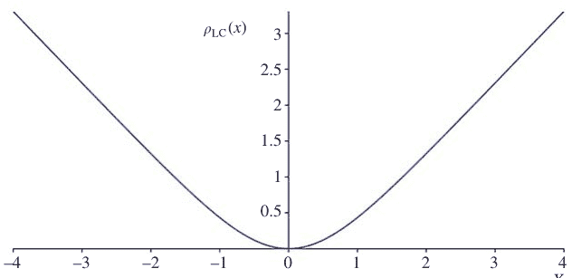

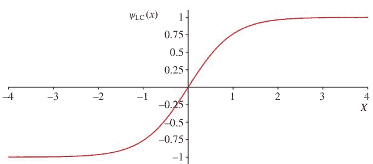

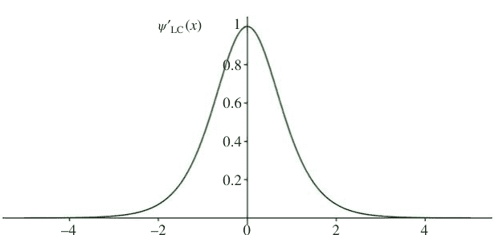

图 3.2 log(cosh(x)) 的 M-估计器函数 \(\rho(x)$、\(\psi(x)$ 和 \(\psi'(x)$。

第二种情况下，当 \(x \to -\infty$ 时，\(\cosh(x) \to e^{-x}/2$ 并且，在极限下，

\(\log(\cosh(x)) \approx -x - \log(2).\) (3.4.8)

因此，远离 \(x = 0$ 时，该函数的行为如下

\(\log(\cosh(x)) \approx |x| - \log(2)\) (3.4.9)

这与 \(L_1$ 类似，只是常数项不同（这一点无关紧要）。

最后，考虑其在原点附近的行为。当 \(x \to 0$ 时，我们可以在 \(x = 0$ 处进行如下泰勒级数展开：

\(\log(\cosh(x)) = \frac{x^2}{2} - \frac{x^4}{12} + \frac{x^6}{45} + O(x^8)\) (3.4.10)

因此，它在一阶上类似于 \(L_2$。也就是说，对于较小的 \(x$ 值，

\(\log(\cosh(x)) \approx \frac{x^2}{2}.\) (3.4.11)

由于它在原点附近的行为类似于 \(L_2$，远离原点时类似于 \(L_1$，因此可以将其视为两者兼得的最佳选择。这个单一函数可以取代 Huber 损失中使用的三段函数。对于鲁棒回归，log-cosh 损失应被视为首选函数。

### 3.4.2 使用 log-cosh 进行线性回归

在进一步进行理论研究之前，使用 log-cosh 损失求解一个简单的线性问题以证明它确实是一个鲁棒估计器，这很有指导意义。LC 估计器由以下公式给出

\(\hat{\beta}^{\text{LC}} = \underset{\beta \in \mathbb{R}^{d+1}}{\text{argmin}} \sum_{i=1}^n \log(\cosh(r_i)),\) (3.4.12)

其中 \(r_i = y_i - \mathbf{x}_i^T \boldsymbol{\beta}$ 是残差。LC 损失函数是

\(\text{LC loss} = \sum_{i=1}^n \log(\cosh(y_i - \mathbf{x}_i^T \boldsymbol{\beta})).\) (3.4.13)

如果我们对 \(\beta_j$ 求损失函数的导数，并将其用于梯度下降迭代方程，则得到：

\(\beta_j^{(t+1)} = \beta_j^{(t)} - \ell' \sum_{i=1}^n \tanh(y_i - \mathbf{x}_i^T \boldsymbol{\beta})(-x_{ij}),\) (3.4.14)

其中 \(\ell'$ 是学习率。在每次迭代 \(t$ 时，我们只需用梯度项更新每个 \(\beta_j^{(t)}, j = 0, \dots, d$ 以产生 \(\beta_j^{(t+1)}$，直到收敛。明显的比较点是与前一章详细介绍的最小二乘（LS）估计器。LS 估计器由以下公式给出：

\(\hat{\boldsymbol{\beta}}^{\text{LS}} = \underset{\boldsymbol{\beta} \in \mathbb{R}^{d+1}}{\text{argmin}} \sum_{i=1}^n \frac{r_i^2}{2}.\) (3.4.15)

图 3.3 显示了在第 2 章的比利时电话数据集上使用 LS 和 LC 进行线性回归的结果。请注意，大多数点出现在图表的下半部分。上半部分的点


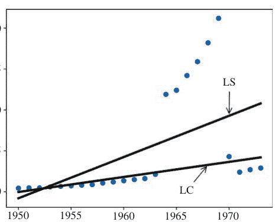

图 3.3 使用第 2 章第 2.9.1 节的比利时电话数据集比较 LS 和 LC。LS 受异常值影响，而 LC 对异常值具有容忍度。

部分数据点因测量技术的差异而成为异常值。在 LS 的情况下，它对这些异常值高度敏感，无法生成可接受的模型。我们注意到，直线受异常值影响很大，而 LC 回归直线拟合了真实数据并有效忽略了异常值。这是因为 LS 方法使用 L2 损失函数，寻求数据的均值（即将误差平均为 0 的直线），而 LC 方法寻求中位数（即直线上方和下方点数相同的直线）。我们可以观察到，LC 忽略了异常值并捕捉了内点数据的本质。这提供了 log-cosh 是鲁棒估计量所需的证据。有了这些知识，我们现在可以继续了解该损失函数的详细数学和特性。

## 3.5 推导 Log-Cosh 的分布

从理论和基础两个角度理解 log-cosh 损失函数非常重要，以便认识到其真正的价值。因此，我们需要研究与此损失函数相关的基于概率的统计模型，并将结果与底层分布联系起来。在本节中，我们将展示如何推导此损失函数，并随后对其起源提供更严谨的数学视角。

log-cosh 损失函数可以通过极大似然法从概率密度函数（PDF）推导出来。挑战在于，当仅知道损失函数时，需要确定使用哪个概率分布作为起点。本节的目标是找到相关的 PDF，$f_X(x)$。为此，请考虑 $f_X(x)$ 与损失函数的一项 $\rho(x)$ 之间的关系。由于我们知道极大似然法（去除常数后）产生 $\rho(x) = -\log f_X(x)$，因此 **逆 MLE 过程** 将要求

$$f_X(x) = \frac{1}{\kappa}e^{-\rho(x)},$$ (3.5.1)

其中 $\kappa$ 是归一化系数。这里，$f_X(x)$ 是我们要寻找的 PDF。应牢记，与损失函数关联的分布必须以 0 为中心；换句话说，我们期望它关于 0 对称。因此，分布的均值为 0，即数学上的 $\mathbb{E}[X] = 0$。逆 MLE 过程可以应用于众所周知的损失函数，例如 $L_1$、$L_2$ 和 Huber。我们在以下示例中说明 $L_1$ 和 $L_2$ 的步骤，并将 Huber 分布的推导留给读者作为练习。

**示例**：要找到与 $L_1$ 损失函数关联的分布，我们从以下项开始

$$\rho_{L_1}(x) = |x|.$$

然后我们应用上述逆 MLE 规则得到

$$f_X(x) = \frac{1}{\kappa}e^{-|x|}.$$

我们可以按以下方式求得 $\kappa$：

$$\kappa = \int_{-\infty}^{\infty} e^{-|x|} dx = 2.$$

因此，$L_1$ 损失分布的基本形式为

$$f_X(x) = \frac{1}{2}e^{-|x|},$$ (3.5.2)

这被称为 *拉普拉斯分布*。

**示例**：要找到与 $L_2$ 损失函数关联的分布，我们从以下项开始

$$\rho_{L_2}(x) = x^2/2.$$

然后我们应用上述逆 MLE 规则得到

$$f(x) = \frac{1}{\kappa}e^{-x^2/2}.$$

我们可以按以下方式求得 $\kappa$：

$$\kappa = \int_{-\infty}^{\infty} e^{-x^2/2} dx = \sqrt{2\pi}.$$

因此，$L_2$ 损失函数分布的基本形式为

$$f_X(x) = \frac{1}{\sqrt{2\pi}}e^{-x^2/2},$$ (3.5.3)

这当然就是高斯分布。

如果我们现在将逆 MLE 规则应用于 log-cosh 损失，我们从以下项开始

$$\rho_{LC}(x) = \log(\cosh(x)).$$

然后我们应用上述逆 MLE 规则得到

\(f(x) = \frac{1}{\kappa}e^{-\rho_{\text{LC}}(x)} = \frac{1}{\kappa}e^{-\text{log}(\text{cosh}(x))} = \frac{1}{\kappa} \frac{1}{\text{cosh}(x)}\) .

我们可以按以下方式求得 \(\kappa\)：

\(\kappa = \int_{-\infty}^{\infty} \frac{1}{\text{cosh}(x)} dx = \pi\) .

因此，与 log-cosh 关联的分布的基本形式为

\(f_X(x) = \frac{1}{\pi} \frac{1}{\text{cosh}(x)}\) . (3.5.4)

生成的 PDF 有时被称为 *双曲正割分布*，但我们将使用术语 **Cosh 分布** 以牢记其与 log-cosh 损失函数的联系。

累积分布函数（CDF）通过将 PDF 函数积分到某个期望点 \(x\) 得到，如下所示：

\(F_X(x) = \int_{-\infty}^{x} f_X(x)dx\) . (3.5.5)

对于 Cosh 分布，CDF 可按以下方式求得：

\(F_X(x) = \int_{-\infty}^{x} \frac{1}{\pi} \frac{1}{\text{cosh}(x)} dx\) . (3.5.6)

然后，积分并将积分常数设为 1/2，CDF 由以下公式给出：

\(F_X(x) = \frac{1}{2} + \frac{1}{\pi} \text{arctan}(\text{sinh}(x))\) . (3.5.7)

CDF 在图 3.4(a) 中绘制，PDF 在图 3.4(b) 中绘制。

更一般地，我们有一个形式为

\(f_X(x; \theta, \sigma) = \frac{1}{\pi\sigma \text{cosh}(\frac{x-\theta}{\sigma})},\) (3.5.8),

其中 $\theta$ 是位置参数，$\sigma$ 是尺度参数（切勿与标准差混淆）。我们在此指出

\(\mathbb{E}[X] = \theta \quad \text{and} \quad \mathbb{E}[X^2] = \frac{\pi^2\sigma^2}{4} + \theta^2\)

因此，该分布的渐近方差为

\(\text{Var}(X) = \mathbb{E}[X^2] - \mathbb{E}[X]^2 = \frac{\pi^2\sigma^2}{4}.\) (3.5.9)

位置参数和尺度参数可从数据（即残差）估计为

\(\hat{\theta} = \frac{1}{n} \sum_{i=1}^n x_i \quad \text{and} \quad \hat{\sigma} = 2\sqrt{\widehat{\text{Var}(X)} / \pi},\) (3.5.10)

分别，其中

\(\widehat{\text{Var}(X)} = \frac{1}{n-1} \sum_{i=1}^n (x_i - \hat{\theta})^2.\) (3.5.11)

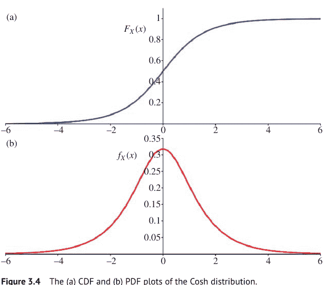

对于 CDF，我们有

$$F_X(x; \theta, \sigma) = \frac{1}{2} + \frac{1}{\pi} \arctan \left( \sinh \left( \frac{x - \theta}{\sigma} \right) \right).$$

通常，用于推导损失函数的分布的位置为 0。因此，对于 $\theta = 0$，CDF 由以下公式给出

$$F_X(x; \sigma) = \frac{1}{2} + \frac{1}{\pi} \arctan \left( \sinh \left( \frac{x}{\sigma} \right) \right).$$

目前为止，将我们提到的四个主要分布（高斯、拉普拉斯、Huber 和 Cosh）进行对比很有趣。这在图 3.5 中给出。Cosh 和 Huber ($\delta = 1.345$) 彼此相似，而拉普拉斯和高斯则差异很大。在鲁棒统计中，拉普拉斯分布被认为具有重尾。它对异常值友好，因为重尾意味着异常值出现的概率更高。也就是说，异常值容易被拉普拉斯分布的 PDF 容纳，而不会显著影响模型，具体来说，就是均值和方差。这使其对异常值更具鲁棒性。相比之下，高斯分布具有轻尾，因此异常值可能对均值和方差产生显著影响。因此，高斯分布不太适合处理异常值。请注意，Cosh 分布具有更重的尾巴，这与拉普拉斯分布相似。在 Huber 的情况下，由于 $\delta = 1.345$，中等尾巴不如 Cosh 重。但是，可以通过降低 $\delta$ 的值使其更重，或通过增加其值使其更轻。

不同分布的重要性现在应该很清楚了。每个分布对异常值的敏感度不同。当我们选择某个损失函数时，实际上是在强制回归残差遵循相关的概率分布。具体来说，如果我们选择 $L_2$ 损失函数，残差将尝试遵循高斯分布（公式 (3.5.3)）。如果我们选择 $L_1$，它将尝试遵循拉普拉斯分布（公式 (3.5.2)）。选择 log-cosh 将遵循 Cosh 分布（公式 (3.5.4)），而选择 Huber 将遵循某种 Huber 分布形式，具体取决于 $\delta$。这一影响是深远的，因为如果存在异常值，我们不应选择 $L_2$ 损失函数（它遵循高斯分布），因为它对异常值高度敏感。这在前面的图 3.3 中已展示。根本上，这就是为什么我们寻求更适合含异常值数据集的鲁棒损失函数的原因。

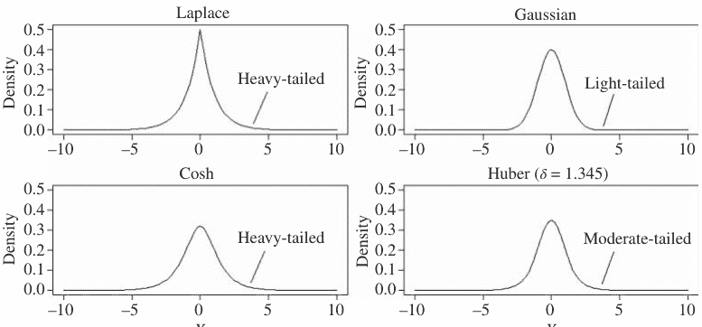

图 3.5 拉普拉斯、高斯、Cosh 和 Huber ($\delta = 1.345$) 的分布。

## 3.6 鲁棒估计量的标准误

标准误（s.e.）是衡量估计值周围不确定性的指标（参见 Montgomery et al. 2012）。由于我们知道总体的不同样本会产生不同的估计值，因此掌握这种不确定性的程度是可取的。事实上，可以证明 log-cosh 估计器产生的估计量在渐近意义上服从正态分布，即它们遵循高斯分布。$^2$ 这大大简化了工作，因为我们可以遵循常规程序来获取标准误，即各参数标准差的估计值。

考虑矩阵形式的多元线性回归模型，如下所示：

$y = X\beta + \epsilon, \qquad (3.6.1)$

其中 $y = (y_1, ..., y_n)^\top$ 是响应向量，$X$ 是一个含常数的 $n \times (d + 1)$ 设计矩阵，且 $X_1 = (1, ..., 1)^\top$；$\epsilon = (\epsilon_1, ..., \epsilon_n)^\top$ 是误差项。回归参数 $\beta = (\beta_0, ..., \beta_d)^\top$ 是感兴趣的 $d+1$ 个系数。此处假设 $\epsilon$ 具有一个均值为 $0 = (0, ..., 0)^\top$ 的已知分布。

2 为了清楚起见，残差服从 Cosh 分布，而估计量服从高斯分布。


在 (d + 1) 维空间中，每个估计值都有其自身的标准误值。最小二乘回归的**协方差矩阵}有广为人知的公式，如下所示：

\(\text{Var}(\hat{\beta}^\text{LS}) = \sigma^2(\mathbf{X}^T\mathbf{X})^{-1}.\)
(3.6.2)

参数方差位于对角线上，其平方根产生标准误，如下所示：

\(\text{s.e.}(\hat{\beta}^\text{LS}) = \sqrt{\text{diag}(\hat{\sigma}^2(\mathbf{X}^T\mathbf{X})^{-1})},\)
(3.6.3)

其中，\(\sigma^2\) 的无偏估计量由以下公式给出：

\(\hat{\sigma}^2 = \frac{1}{n - (d + 1)} \sum_{i=1}^n (r_i - \bar{r})^2.\)
(3.6.4)

因此，需要残差来计算标准误。

当存在异常值时，这种表述会出现问题。具体来说，\(\hat{\sigma}^2\) 的值会被夸大，因为异常值会向总和贡献较大的残差，并且每个残差都会被平方以进一步增大其值。

在 log-cosh 的情况下，需要一种不同的方法，但采用相同的一般表述。对于较大的 \(n\)，我们将估计值视为服从正态分布，其公式为：

\(\text{Var}(\hat{\beta}^\text{LC}) = \nu^2(\mathbf{X}^T\mathbf{X})^{-1}\)
(3.6.5)

然后定义术语 \(\nu^2\) 如下（参见 Maronna et al. 2019）³：

\(\nu^2 = s^2 \frac{\text{E}[\psi_\text{LC}(r/s)]}{\text{E}[\psi'_\text{LC}(r/s)]^2}\)
(3.6.6)

其无偏估计可通过用平均值替换期望来得到：

\(\hat{\nu}^2 = \hat{s}^2 \frac{\frac{1}{n} \sum \psi_\text{LC}(r_i/\hat{s})^2}{\left[\frac{1}{n} \sum \psi'_\text{LC}(r_i/\hat{s})\right]^2} \frac{n}{n - d - 1}.\)
(3.6.7)

在上述公式中，残差为 \(r_i = y_i - \mathbf{x}_i^T\hat{\beta}^\text{LC}\)，并且为了提供 \(\nu\) 的稳健估计，我们使用以下公式估计 \(s\)：

\(\hat{s} = \text{MADN}(\mathbf{r}).\)
(3.6.8)

其中，函数 MADN(x) 在第 1 章公式 (1.4.6) 中已定义。为求和项下的各项进行计算，请回顾：

\(\psi_\text{LC}(x) = \rho'_\text{LC}(x) = \tanh(x)\)
(3.6.9)

以及

\(\psi'_\text{LC}(x) = \rho''_\text{LC}(x) = \text{sech}^2(x).\)
(3.6.10)

这些函数必须在公式 (3.6.7) 中按需应用。标准误计算为协方差矩阵 \(\nu^2(\mathbf{X}^T\mathbf{X})^{-1}\) 对角线元素的平方根。

### 3.6.1 示例：瑞士生育率数据集

我们现在采用广为人知的瑞士生育率数据集来计算 LS 和 LC 的估计值和标准误，以供比较。瑞士生育率数据本身⁴载于表 3.1，变量定义及其缩写载于表 3.2。该数据集包含 5 个可能影响生育率（F）的变量，研究对象为 1888 年的 47 个观测值。这五个变量的缩写为 I、Ex、Ed、A 和 C，其目标是求出系数

表 3.1 瑞士生育率数据集（F = 生育率，A = 农业，Ex = 考试，Ed = 教育，C = 天主教，I = 婴儿死亡率）。

| 地区 | F | A | Ex | Ed | C | I | 地区 | F | A | Ex | Ed | C | I |
|---|---|---|---|---|---|---|---|---|---|---|---|---|---|
| Courtelary | 80.20 | 17.00 | 15 | 12 | 9.96 | 22.20 | Delemont | 83.10 | 45.10 | 6 | 9 | 84.84 | 22.20 |
| Franches-Mnt | 92.50 | 39.70 | 5 | 5 | 93.40 | 20.20 | Moutier | 85.80 | 36.50 | 12 | 7 | 33.77 | 20.30 |
| Neuveville | 76.90 | 43.50 | 17 | 15 | 5.16 | 20.60 | Porrentruy | 76.10 | 35.30 | 9 | 7 | 90.57 | 26.60 |
| Broye | 83.80 | 70.20 | 16 | 7 | 92.85 | 23.60 | Glane | 92.40 | 67.80 | 14 | 8 | 97.16 | 24.90 |
| Gruyere | 82.40 | 53.30 | 12 | 7 | 97.67 | 21.00 | Sarine | 82.90 | 45.20 | 16 | 13 | 91.38 | 24.40 |
| Veveyse | 87.10 | 64.50 | 14 | 6 | 98.61 | 24.50 | Aigle | 64.10 | 62.00 | 21 | 12 | 8.52 | 16.50 |
| Aubonne | 66.90 | 67.50 | 14 | 7 | 2.27 | 19.10 | Avenches | 68.90 | 60.70 | 19 | 12 | 4.43 | 22.70 |
| Cossonay | 61.70 | 69.30 | 22 | 5 | 2.82 | 18.70 | Echallens | 68.30 | 72.60 | 18 | 2 | 24.20 | 21.20 |
| Grandson | 71.70 | 34.00 | 17 | 8 | 3.30 | 20.00 | Lausanne | 55.70 | 19.40 | 26 | 28 | 12.11 | 20.20 |
| La Vallee | 54.30 | 15.20 | 31 | 20 | 2.15 | 10.80 | Lavaux | 65.10 | 73.00 | 19 | 9 | 2.84 | 20.00 |
| Morges | 65.50 | 59.80 | 22 | 10 | 5.23 | 18.00 | Moudon | 65.00 | 55.10 | 14 | 3 | 4.52 | 22.40 |
| Nyon | 56.60 | 50.90 | 22 | 12 | 15.14 | 16.70 | Orbe | 57.40 | 54.10 | 20 | 6 | 4.20 | 15.30 |
| Oron | 72.50 | 71.20 | 12 | 1 | 2.40 | 21.00 | Payerne | 74.20 | 58.10 | 14 | 8 | 5.23 | 23.80 |
| Paysd'enhaut | 72.00 | 63.50 | 6 | 3 | 2.56 | 18.00 | Rolle | 60.50 | 60.80 | 16 | 10 | 7.72 | 16.30 |
| Vevey | 58.30 | 26.80 | 25 | 19 | 18.46 | 20.90 | Yverdon | 65.40 | 49.50 | 15 | 8 | 6.10 | 22.50 |
| Conthey | 75.50 | 85.90 | 3 | 2 | 99.71 | 15.10 | Entremont | 69.30 | 84.90 | 7 | 6 | 99.68 | 19.80 |
| Herens | 77.30 | 89.70 | 5 | 2 | 100.00 | 18.30 | Martigny | 70.50 | 78.20 | 12 | 6 | 98.96 | 19.40 |
| Monthey | 79.40 | 64.90 | 7 | 3 | 98.22 | 20.20 | St Maurice | 65.00 | 75.90 | 9 | 9 | 99.06 | 17.80 |
| Sierre | 92.20 | 84.60 | 3 | 3 | 99.46 | 16.30 | Sion | 79.30 | 63.10 | 13 | 13 | 96.83 | 18.10 |
| Boudry | 70.40 | 38.40 | 26 | 12 | 5.62 | 20.30 | La Chauxdfnd | 65.70 | 7.70 | 29 | 11 | 13.79 | 20.50 |
| Le Locle | 72.70 | 16.70 | 22 | 13 | 11.22 | 18.90 | Neuchatel | 64.40 | 17.60 | 35 | 32 | 16.92 | 23.00 |
| Val de Ruz | 77.60 | 37.60 | 15 | 7 | 4.97 | 20.00 | ValdeTravers | 67.60 | 18.70 | 25 | 7 | 8.65 | 19.50 |
| V. De Geneve | 35.00 | 1.20 | 37 | 53 | 42.34 | 18.00 | Rive Droite | 44.70 | 46.60 | 16 | 29 | 50.43 | 18.20 |
| Rive Gauche | 42.80 | 27.70 | 22 | 29 | 58.33 | 19.30 | | | | | | | |

表 3.2 瑞士生育率数据集定义。

| 特征 | 符号 | 含义 |
| :--- | :--- | :--- |
| 地区 | | 1888年瑞士法语区各省份 |
| 生育率 | F | Ig，一种常见的标准化生育率指标 |
| 农业 | A | 从事农业作为职业的男性比例（%） |
| 考试 | Ex | 征兵中获得军队考试最高分的比例（%） |
| 教育 | Ed | 征兵中接受初等教育以上教育的比例（%） |
| 天主教 | C | 天主教信徒比例（与新教相对）（%） |
| 婴儿死亡率 | I | 活产后不足1岁死亡的婴儿比例 |

表 3.3 瑞士生育率的最小二乘法（LS）和 log-cosh（LC）估计值及标准误。

| 特征 | $\hat{\beta}^{LS}$ | 标准误 ($\hat{\beta}^{LS}$) | $\hat{\beta}^{LC}$ | 标准误 ($\hat{\beta}^{LC}$) |
| :--- | :--- | :--- | :--- | :--- |
| (截距) | 66.92 | 10.706 | 63.12 | 10.556 |
| 农业 | −0.17 | 0.070 | −0.20 | 0.069 |
| 考试 | −0.26 | 0.253 | −0.27 | 0.250 |
| 教育 | −0.87 | 0.183 | −0.89 | 0.180 |
| 天主教 | 0.10 | 0.035 | 0.10 | 0.036 |
| 婴儿死亡率 | 1.08 | 0.381 | 1.40 | 0.376 |

值或估计值，以预测响应变量 F。因此，n = 47 且 d = 5。

首先需要指出，表 3.1 中的所有数据均在 0–100 范围内，因此缩放并非必要，估计值可以相互合理地进行解释。LS 和 LC 方法的参数值如表 3.3 所示。我们发现，无论是估计值还是标准误，LS 和 LC 都相似。这是因为瑞士数据集中没有异常值，如第 4 章所示。本例表明，当没有异常值时，稳健估计值和标准误与最小二乘法相似。

### 3.6.2 示例：波士顿房价数据集

与瑞士数据集相比，波士顿房价数据集要大得多。线性回归问题的目标是构建一个模型，根据 13 个解释变量的相关数据预测中位数房价 (MEDV)。在该数据集中，约 10% 的观测值可被归类为异常值（参见第 4 章）。因此，LS 在获得合理的估计值和标准误方面会遇到困难。表 3.4 列出了 LS 和 LC 的估计值和标准误值。如果比较第二列和第四列，LS 的标准误远高于 LC。这是由于


## 表 3.4 波士顿房屋数据最小二乘法（LS）和对数余弦损失（LC）的估计值及标准误。

| 特征 | \(\hat{\beta}^{LS}\) | s.e. (\(\hat{\beta}^{LS}\)) | \(\hat{\beta}^{LC}\) | s.e. (\(\hat{\beta}^{LC}\)) |
|---|---|---|---|---|
| (截距) | 36.494 | 5.102 | 15.623 | 3.521 |
| CRIM | −0.121 | 0.033 | −0.142 | 0.023 |
| ZN | 0.046 | 0.014 | 0.037 | 0.009 |
| INDUS | 0.020 | 0.062 | 0.017 | 0.042 |
| CHAS | 2.692 | 0.862 | 1.452 | 0.594 |
| NOX | −17.802 | 3.824 | −9.321 | 2.636 |
| RM | 3.813 | 0.418 | 5.258 | 0.288 |
| AGE | 0.001 | 0.013 | −0.028 | 0.009 |
| DIS | −1.482 | 0.199 | −1.026 | 0.138 |
| RAD | 0.305 | 0.066 | 0.182 | 0.046 |
| TAX | −0.012 | 0.004 | −0.010 | 0.003 |
| PTRATIO | −0.954 | 0.131 | −0.747 | 0.090 |
| B | 0.009 | 0.003 | 0.011 | 0.002 |
| LSTAT | −0.526 | 0.051 | −0.302 | 0.035 |

在 LS 情况下，\(\hat{\sigma}\) 的计算会产生较大的残差，这些残差会被平方，从而放大所有 s.e. 值。显然，LC 结果更优，并能更准确地表示数据。

## 3.7 对数余弦损失的统计特性

在本节中，我们推导最大似然估计量（MLE）以理解对数余弦估计量的统计特性。对于希望跳过详细数学解释的读者，您可以继续阅读下一节，而不会影响对整体主题的连贯性。虽然理解这些材料对机器学习可能并不关键，但在将一个估计量与另一个进行比较以及进行进一步数学分析时，了解这些关键特性是有用的。

### 3.7.1 最大似然估计

让我们从概率分布开始，推导位置参数 \(\theta\) 的对数余弦估计量。如果 \(x_1, x_2, \dots, x_n\) 是从分布中抽取的独立同分布随机变量，

\(f(x; \theta) = \frac{1}{\pi \sigma \cosh(\frac{x_i - \theta}{\sigma})},\) (3.7.1)

则似然函数由以下给出：

\(L(x_1, x_2, \dots, x_n; \theta) = \prod_{i=1}^n \frac{1}{\pi \sigma \cosh(\frac{x_i - \theta}{\sigma})}.\) (3.7.2)

负对数似然表达式由以下给出

\(-\ell(x_1, x_2, \dots, x_n; \theta) = n \log \pi\sigma + \sum_{i=1}^n \log \left( \cosh \left( \frac{x_i - \theta}{\sigma} \right) \right) . \quad (3.7.3)\)

假设我们有兴趣估计 \(\theta\)。然后，在去除常数项后，估计量 \(\hat{\theta}\) 可以写成

\(\hat{\theta}^{\text{LC}} = \operatorname{argmin}_{\theta \in \mathbb{R}} \sum_{i=1}^n \log \left( \cosh \left( \frac{x_i - \theta}{\sigma} \right) \right) . \quad (3.7.4)\)

由于对数余弦估计量是使用 MLE 推导的，并假设某些温和的正则性条件，我们发现渐近正态性成立。这意味着估计值周围的不确定性将服从高斯分布。更正式地说（使用第 2.5.2 节给出的符号），当 \(n \to \infty\) 时，中央极限定理告诉我们

\(\sqrt{n} \left( \hat{\theta}^{\text{LC}}_n - \theta \right) \xrightarrow{D} \mathcal{N} \left( 0, \operatorname{Var} \left( \hat{\theta}^{\text{LC}}_n \right) \right) , \quad (3.7.5)\)

其中 \(\operatorname{Var}(\hat{\theta}^{\text{LC}}_n)\) 是渐近方差，可以推导⁵ 得到 \(2\sigma^2\)。因此，我们发现 \(\hat{\theta}^{\text{LC}}\) 的分布为

\(\hat{\theta}^{\text{LC}}_n \sim \mathcal{N} \left( \theta, \frac{2\sigma^2}{n} \right) . \quad (3.7.6)\)

我们还可以说 \(\theta\) 的 MLE 估计量是一致的，即

\(\hat{\theta}^{\text{LC}}_n \xrightarrow{\text{P}} \theta \quad (3.7.7)\)

并且渐近偏差为

\(\text{bias} = \mathbb{E}[\hat{\theta}^{\text{LC}}_n] - \theta = 0 .\)

也就是说，\(\theta\) 的对数余弦估计量是无偏的。总之，对数余弦估计量具有最小二乘法的所有良好特性，但对异常值具有鲁棒性。

## 3.8 一般对数余弦损失函数

还需要对对数余弦损失进行另一项改进，才能使其成为一种优越的稳健方法，这也是本节的主题。我们从使用 M 估计量符号的标准损失项开始，

\(\rho(x) = \log(\cosh(x)) , \quad (3.8.1)\)

及其导数，

\(\psi(x) = \tanh(x) . \quad (3.8.2)\)

\(\tanh(x)\) 函数在原点附近的斜率相当平缓。但是，可以通过引入超参数 \(a\) 使其可调，如下所示：

\(\psi(x; a) = \tanh(ax).\)

新的超参数控制函数从 -1 到 1 过渡时斜率的陡峭程度。通过积分，我们得到

\(\rho(x; a) = \frac{1}{a} \log(\cosh(ax)).\)

这是带有超参数 \(a\) 的一般对数余弦损失项，这使其具有更大的灵活性。这种灵活性实际上控制了一般对数余弦损失的鲁棒程度。我们将此超参数称为鲁棒系数。

损失函数的一般形式可以写成

\(J^{\text{LC}}(x; a) = \sum_{i=1}^n \frac{1}{a} \log(\cosh(ax_i)) = \sum_{i=1}^n \rho(x; a),\)

其中 \(a\) 是可根据需要调整的鲁棒系数。在本章中，我们一直使用 \(a = 1\)，但我们将发现大多数有用的值都与 \(a > 1\) 相关联。

损失项 \(\rho(x; a)\) 对于不同 \(a\) 值的图示如图 3.6 上半部分所示，并与给出的 V 形 \(L_1\) 损失项（以粗体显示）一起展示。导数由以下给出

\(\psi(x; a) = \tanh(ax).\)

增加 \(a\) 对导数的影响是使从 -1 到 1 的过渡斜率更加陡峭，如图 3.6 下半部分所示。为了比较，\(L_1\) 损失的导数以粗体显示。

一般对数余弦估计量定义为

\(\hat{\beta}^{\text{LC}} = \underset{\beta \in \mathbb{R}^{d+1}}{\text{argmin}} \sum_{i=1}^n \frac{1}{a} \log(\cosh(ar_i)).\)

鲁棒系数的重要性无论如何强调都不为过。它决定了损失函数是弱鲁棒（即略好于 \(L_2\)）还是强鲁棒（即接近 \(L_1\)）。

该损失函数所源于的分布可以通过逆向运行 MLE 程序来推导，如第 3.5 节中所示。我们先取求和中的一项，并注意它是负对数似然的结果。因此，我们应对其取负以得到

\(-\rho(x) = -\frac{1}{a} \log(\cosh(ax)).\)

接下来，我们可以将领先系数移入对数表达式中

\(-\rho(x) = \log(\cosh(ax)^{-\frac{1}{a}}).\)

然后对表达式进行指数运算以得到

\(e^{-\rho(x)} = \frac{1}{(\cosh(ax))^{\frac{1}{a}}}.\)

如果我们将其从 \(-\infty\) 积分到 \(\infty\)，将产生归一化系数，

\(\int_{-\infty}^{\infty} \frac{1}{((\cosh(ax))^{\frac{1}{a}})} = \kappa_a.\)

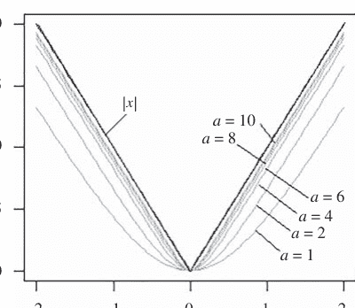

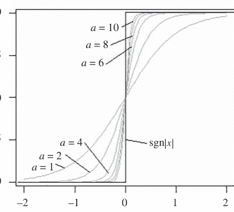

图 3.6 不同 \(a\) 值下 \(\rho(x)\) 和 \(\psi(x)\) 的图，并附带 \(L_1\) 损失项。

因此，PDF 为

\(f_X(x) = \frac{1}{\kappa_a} \frac{1}{((\cosh(ax))^{\frac{1}{a}}}.\quad (3.8.12)\)

这里，\(\kappa_a\) 对于每个选定的 \(a\) 值都不同。我们可以选择不同的 \(a\) 值来检查超参数如何影响分布。在每种情况下，都需要对 Eq. (3.8.11) 进行积分以得到 \(\kappa_a\)，但为了简化过程，我们可以使用给出的拟合方程 \(\kappa_a = (\pi - 2)/a + 2\)。这在图 3.7 中显示。曲线上标注了一些计算值。例如，当 \(a = 1\) 时，我们得到 \(\kappa_a = \pi\)，而当 \(a = 100\) 时，我们得到 \(\kappa_a = 2\)，依此类推。

从结果中，我们发现，随着 \(a\) 从 1 增加到 100，对数余弦分布趋近于 \(e^{-|x|}/2\)，即 \(L_1\) 分布。我们可以在图 3.8 中看到这种影响。分析确认，当 \(a\) 很大时，对数余弦分布族趋近于拉普拉斯分布。这是一个重要结果，因为它清楚地解释了为什么它具有鲁棒性。


图 3.7 \(\kappa_a\) 作为 \(a\) 的函数及其拟合模型 \(\kappa = (\pi - 2)/a + 2\)。

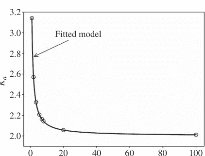

图 3.8 不同 \(a\) 值下双指数分布与 log-cosh 的对比。

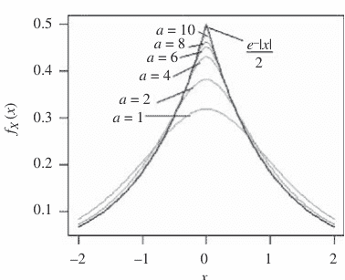

为选择适当的 \(a\) 值，我们回到第 2 章中的图 2.8，该图显示了 \(L_1\) 和 \(L_2\) 的损失与梯度。可以对 log-cosh 作为 \(a\) 的函数生成类似的图表。使用相同的数据来找到位置参数 \(\theta\)，即 \(\{0, 3, 5, 7, 10\}\)，结果如图 3.9 所示。注意，随着 \(a\) 从 1 增加到 100，连续损失变为分段线性，而连续梯度变为阶梯式连续。很明显，log-cosh 损失在一端表现类似于 \(L_2\)，在另一端表现类似于 \(L_1\)。但是，不建议使用大于 10 的 \(a\) 值，因为这可能会在梯度下降中引入收敛问题。因此，log-cosh 损失函数应始终以其最一般形式使用，即

```
LC loss = \(\frac{1}{a} \sum_{i=1}^n \log(\cosh(ar_i))\)
```

机器学习任务中 \(a\) 的典型值设置为 1、1.5、2、5 或 10。对于线性回归，建议设置 \(a = 2\)，原因将在第 4 章中说明。请注意，\(a\) 不像 Huber 中的 \(\delta\) 那样依赖于数据。它仅取决于所执行的机器学习任务类型。线性回归中 log-cosh 估计的标准误差可以使用第 3.6 节中概述的相同程序获得。

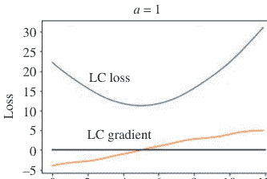

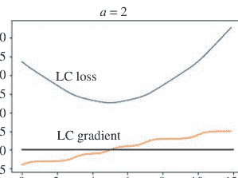

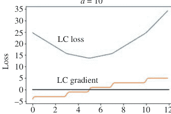

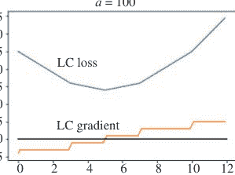

图 3.9 不同 \(a\) 值下 LC 损失与梯度的对比。对于线性回归，建议设置 \(a = 2\)。

## 3.9 总结

log-cosh 损失函数或许是机器学习中最重要的损失函数之一，因为它不仅提供鲁棒性，还具备允许进行详尽数学处理的所有相关正则性条件。在本章中，已识别出损失函数产生的分布，随后对损失函数进行了极大似然推导。还给出了其统计特性及标准误差的计算方法。log-cosh 的标准误差与最小二乘法进行了比较，结果显示对于含有异常值的数据集，其标准误差小于最小二乘法；对于无异常值的数据集，两者相似。基于详细的分析，有充分理由主张使用通用 log-cosh 损失来替代机器学习中许多其他损失函数。

## Problems

### 3.1

证明与 log-cosh 损失相关的 CDF（由以下公式给出）是正确的，方法是对其求导以生成 PDF。（提示：你可能需要用到恒等式 \(\sinh^2(x) + 1 = \cosh^2(x)\)。）

```
F_X(x) = \frac{1}{2} + \frac{1}{\pi} \arctan(\sinh(x)) ,
```

### 3.2

使用逆 MLE 程序找到与 M-loss = \(\sum_{i=1}^n \frac{1}{2} \log(\cosh(2x))\) 相关的分布。

使用以下步骤。
- a) 使用 \(f(x) = e^{-\rho(x)}/\kappa\) 找到分布的形式。
- b) 通过将结果从 \(-\infty\) 积分到 \(\infty\) 来找到归一化常数 \(\kappa\)。

### 3.3

使用逆 MLE 程序推导 Huber 分布。以下给出了前几个步骤，起始项为：

\(\rho_H(x) = \begin{cases} x^2/2 & \text{if } |x| \le \delta \\ \delta \left( |x| - \frac{\delta}{2} \right) & \text{if } |x| > \delta \end{cases}\)

应用上述逆 MLE 规则得到

\(f_X(x) = \frac{1}{\kappa} e^{-\rho_H(x)} = \frac{1}{\kappa} \begin{cases} e^{-x^2/2} & \text{if } |x| \le \delta \\ e^{-\delta \left( |x| - \frac{\delta}{2} \right)} & \text{if } |x| > \delta \end{cases}\)

剩下的步骤仅包括通过对不同区域进行积分并累加数值来找到 \(\kappa\) 的值。使用 \(\delta = 1.345\) 来简化计算。绘制分布图并将其与图 3.5 中的分布进行比较。使用 \(\delta = 0.1\) 和 \(\delta = 10\) 重新做此题。两个图中哪一个尾部更重？哪一个对异常值更鲁棒？

### 3.4 (项目)

在本项目中，你将使用通用 log-cosh 损失的稳健回归来估计数据集的斜率和截距，并将其与 Python 库 sklearn.linear_model 中实现的 Huber 方法进行比较。
- a) 加载 Python 库。

```
import numpy as np
from sklearn.linear_model import HuberRegressor
import matplotlib.pyplot as plt
from scipy.optimize import minimize
```
- b) 手动创建比利时电话数据集。

```
X = np.linspace(1950, 1973, 24).reshape(-1, 1)
y = np.array([ 0.44, 0.47, 0.47, 0.59, 0.66, \
    0.73, 0.81, 0.88, 1.06, 1.2 , \
    1.35, 1.49, 1.61, 2.12, 11.9 , \
    12.4 , 14.2 , 15.9 , 18.2 , 21.2 , \
    4.3 , 2.4 , 2.7 , 2.9 ])
```
- c) 定义通用 log-cosh 损失。

```
logcosh = lambda x: np.logaddexp(x, -x) - np.log(2)
def residual(b,x,y):
    residual_y = y-np.matmul(x,b)
    return residual_y
def LC(beta):
    ri = residual(beta,x,y)
    rho = (1/a)*logcosh(a*ri)
    loss = np.sum(rho)
    return loss
```
- d) 在 x 矩阵中创建一列 1。

```
column_ones = np.ones((24, 1))
x = np.hstack((column_ones, X))
```
- e) 使用 log-cosh 找到斜率和截距。

```
initbeta = np.array([0., 0.])
a = 2
minval = minimize(LC,initbeta)
beta = minval.x
```
- f) 绘制结果。

```
abline = np.zeros(x.shape[0])
for i in range(x.shape[0]):
    abline[i] = beta[0]+beta[1]*x[i,1]
plt.plot(x[:,1],abline)
plt.scatter(x[:,1],y)
plt.show()
```
- g) 使用不同的鲁棒系数 \(a\) 值重新运行。评论结果。
- h) 运行 Huber 回归器。将 \(\delta\)（称为 epsilon）从 4.0 调整到 0.1 以确定其影响。Huber 方法的此实现是否令人满意？

```
X = np.linspace(0, 23, 24).reshape(-1, 1)
huber = HuberRegressor(epsilon=4.0)
huber.fit(X, y)
y_pred = huber.predict(X)
plt.scatter(X+1950, y, color='blue', \
    label='Data points')
plt.plot(X+1950, y_pred, color='red', \
    label='Huber Regressor')
plt.xlabel('X')
plt.ylabel('y')
plt.legend()
plt.title('Huber Regressor with Outliers')
plt.show()
```

### 3.5 (项目)

在本项目中，你将使用最小二乘法对 Swiss 数据集求解估计值和标准误差。数据本身已在表 3.1 中提供。必须创建名为 swiss.csv 的文件以配合以下 Python 代码使用。
- a) 以下代码可用于导入库。

```python
import numpy as np
import matplotlib.pyplot as plt
import pandas as pd
from scipy.optimize import minimize
```
- b) Swiss 数据集可读入以创建 **X** 和 **y** 值，如下所示：

```python
swiss = pd.read_csv("swiss.csv")
swiss['ones'] = 1
X = np.array(swiss.drop(["Fertility"], axis=1))
Y = np.array(swiss["Fertility"])
```
- c) LS 代码如下：

```python
def LS(beta):
    ri = Y-np.matmul(X,beta)
    rho = ri*ri/2
    loss = np.sum(rho)
    return loss
```
- d) 以下代码可用于生成估计值。

```python
### Initialize betaLS
initbetaLS = np.array([-0.1,-0.1,-0.1,0.1,0.1,-0.1])
### Minimize the LS loss function
model = minimize(LS, initbetaLS, method='BFGS')
### Extract the estimates
betaLS = model.x
col_names = swiss.columns
print("Estimates:")
for i in range(len(betaLS)-1):
    print(col_names[i+1],f"{betaLS[i]:.3f}")
print(" (Intercept)",f"{betaLS[len(betaLS)-1]:.3f}")
```
- e) 为了获得标准误差，可以使用公式 (3.6.2)-(3.6.4) 中给出的表达式。

```python
resid = Y-np.matmul(X,betaLS)
n = X.shape[0]
p = X.shape[1]
d = p - 1
sigma2 = np.sum((resid-np.mean(resid))**2) / (n-d-1)
C = np.linalg.inv(np.matmul(X.T,X))
se2 = sigma2*np.diag(C)
```


seLS = np.sqrt(se2)
print("Standard errors:")
for i in range(len(seLS) - 1):
    print(col_names[i + 1], f"{seLS[i]:.3f}")
print("(Intercept)", f"{seLS[len(seLS) - 1]:.3f}")

### 3.6 (项目) 在本项目中，您将使用 log-cosh 方法，针对上一题中的 Swiss 数据集求出估计值和标准误。

- a) LC 代码和 MADN(r) 函数如下：

```
logcosh = lambda x: np.logaddexp(x, -x) - np.log(2)
a = 2
def LC(beta):
    ri = Y - np.matmul(X, beta)
    loss = np.sum((1 / a) * logcosh(a * ri))
    return loss
def MADN(r):
    return 1.4826 * np.median(np.abs(r - np.median(r)))
```

- b) 以下代码可用于生成估计值：

```
### Initialize betaLC
initbetaLC = np.array([-0.1, -0.1, -0.1, 0.1, 0.1, -0.1])
### Minimize the LC loss function
model = minimize(LC, initbetaLC, method='BFGS')
### Extract the estimates
betaLC = model.x
col_names = swiss.columns
print("Estimates:")
for i in range(len(betaLC) - 1):
    print(col_names[i + 1], f"{betaLC[i]:.3f}")
print("(Intercept)", f"{betaLC[len(betaLC) - 1]:.3f}")
```

- c) 要获取标准误，可以使用公式 (3.6.5)–(3.6.10) 中提供的公式。

```
resid = Y - np.matmul(X, betaLC)
se = MADN(resid)
num = np.mean(np.tanh(a * resid / se) ** 2)
denom = (np.mean(a / np.cosh(a * resid / se) ** 2)) ** 2
n = X.shape[0]
p = X.shape[1]
d = p - 1
vthat = (n / (n - d - 1)) * se * se * num / denom
C = np.linalg.inv(np.matmul(X.T, X))
se2 = vthat * np.diag(C)
```

```
seLC = np.sqrt(se2)
print("Standard errors:")
for i in range(len(seLC) - 1):
    print(col_names[i + 1], f"{seLC[i]:.3f}")
print("(Intercept)", f"{seLC[len(seLC) - 1]:.3f}")
```

## 参考文献

- Maronna, R.A., Douglas Martin, R., Yohai, V. J., and Salibian-Barrera, M. (2019). 《稳健统计学：理论与方法（附 R）》. Wiley.
- Montgomery, D.C., Peck, E.A., and Vining G.G. (2012). 《线性回归分析导论，第 4 版》. Wiley.

# 4 异常值检测、度量标准与标准化

## 4.1 引言

本章讨论了与异常值和稳健线性回归相关的三个重要主题。首先，我们描述了查找和移除异常值的技术，以生成无异常值的数据集，而许多不同类型的统计分析都需要这种数据集。本文介绍了箱线图、直方图和分位数–分位数图（quantile–quantile plots）等标准方法。这些方法中的每一种都将用于诊断多个数据集，以展示异常值检测应如何开展。本章还为该问题提供了实用解决方案。提出了一种基于迭代方案和箱线图的算法，用于找出所有异常值，同时保持真实数据完整。传统方法在此任务上并不充分，因为最小二乘法迫使残差服从高斯分布。这往往会掩盖异常值，使其难以被检测。事实上，我们将展示，稳健方法是诊断、检测和移除异常值最可靠的手段。

其次，介绍了在针对含异常值数据集运行的工具时，如何正确选择评估度量标准。如果选择不合适的度量标准来评估存在异常值时的准确性，结果可能会具有误导性或难以解释。本文详细分析了均方误差（MSE）、均方根误差（RMSE）和中位数绝对误差（MAE）度量标准。一旦确立，这些度量标准也可用于选择稳健超参数，例如 log-cosh 方法中的 α（参见第 3 章）和 Huber 方法中的 δ（参见第 2 章）。

最后，为结束本章，讨论了用于标准化数据集的程序。通常，机器学习方法在变量取值范围相似时效果最佳。有些方法要求数据集必须标准化才能正常工作。我们介绍了一种稳健标准化方法，当解释变量包含异常值时需要这种方法。

## 4.2 异常值的影响

异常值是数据科学和机器学习中的一大关注点。它们会对统计程序产生重大影响，不仅仅是对均值和标准差，如前几章所述。例如，在聚类问题中，它们会显著扭曲聚类形状，导致错误的聚类中心（参见第 1 章）。当存在异常值时，线性回归的斜率和截距估计会产生偏差，如第 2 章和第 3 章所示。异常值在统计应用中还会引起其他问题。例如，它们可能导致相关系数高于或低于真实值（参见第 12 章）。方差分析（ANOVA）可能受到影响，使得检测组间差异变得更加困难。插补过程（即替换数据集中的缺失值）可能会因异常值而产生偏差，因为它依赖于数据的均值和方差。异常值还可能影响假设检验中的 t 检验（参见第 5 章）或卡方检验，而假设检验是统计分析的主要支柱之一，可能导致错误的结论。这些只是众多需要无异常值数据集的程序中的几个例子。

不幸的是，异常值通常被视为数据集中令人困扰的观测值，因此稳健方法尚未被广泛采用。它们的影响通常被认为相对无害，尤其是当异常值数量较少时。因此，异常值通常被忽略或完全置之不理。然而，忽略异常值是一种冒险的做法，可能导致误导性结论或数据分析中的重大问题。相反，更好的选择是在使用统计程序之前移除异常值。如果操作得当，这可以是一种非常有效的绕过异常值问题的方法。

在描述不同的异常值移除策略之前，我们首先展示，即使是单个异常值，在使用最小二乘（LS）方法时也会对结果产生实质性影响。其次，我们说明随着数据中异常值数量的稳步增加，其影响如何。结果将与稳健 log-cosh（LC）方法进行对比，该方法如第 3 章详细所述，对异常值具有较高的容忍度。

为了展示仅有一个异常值可能带来的潜在问题，我们在图 4.1 中展示了四种不同情况，基于第 2 章的比利时电话数据集。解释变量是年份，响应变量是呼叫次数。在每种情况下，都会在不同位置手动插入一个异常值。我们会发现，单个异常值对 LS 估计可能产生不可预测的影响，但对 LC 估计几乎没有或没有影响，这取决于它相对于数据集中其他观测值的位置。例如，在图 4.1(a) 中，在 (year = 1963, calls = 12.5) 处插入一个异常值，仅导致 LS 和 LC 之间出现微小差异。两者都产生可接受的结果。这是一个低影响异常值，它让许多人认为其影响相对无害。然而，当异常值移动到 (year = 1985, calls = 12.5) 时，如图 4.1(b) 所示，LS 和 LC 的结果开始出现差异；因此，在这个数据集中，这是一个中等影响异常值。当我们试图解释来自 LS 的任何预测结果时，必须设法解释这样一个事实：模型并未准确表示所有数据点。换句话说，必须以某种合理的方式证明不准确模型的合理性。相比之下，LC 在两种情况下都产生相同的结果。

现在考虑图 4.1(c) 中 (year = 1950, calls = 12.5) 处的异常值情况。这个位置构成了该数据集的高影响异常值。事实上，LS 告诉我们呼叫次数和年份之间没有关系，我们知道这是不正确的。使用此结果做出的任何商业决策也将是不正确的。在多维环境中，该变量可能在模型缩减过程中被惩罚函数无意中移除（参见第 5 章）。试图解释关键变量的移除会很具挑战性，并最终对他人产生误导。在最后一种情况中，图 4.1(d)，放置在 (year = 1940, calls = 12.5) 处的异常值被称为高杠杆点，因为 year 的值远远超出了其余数据的范围。这种类型的异常值对 LS 结果可能产生严重后果。事实上，它显示年份和呼叫次数之间存在负相关，这显然是错误的。高杠杆点可以被检测和移除，但这需要额外的努力。然而，LC 方法在任何一种情况下都不会受到显著影响。

所有这些示例的要点是说明，即使仅存在一个异常值，LS 也具有不可预测性，更不用说多个异常值及其影响了。它们表明，异常值具有不同程度的影响，


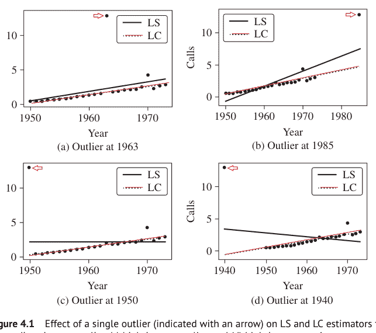

当使用 LS 时，结果各不相同，但当使用 LC 时，所有四种情况的结果都非常稳定。使用这些信息，对所有四种情况解释 LC 模型并做出良好决策会很容易，而试图解释 LS 的结果则会很复杂。

接下来，考虑数据集中存在多个离群点的情况，如图 4.2 所示。有四种不同的情况来研究数据中离群点数量增加的影响。图 4.2 (a)、(b)、(c) 和 (d) 的数据集分别包含 0、2、4 和 6 个离群点。随着离群点数量增加，与 LS 关联的回归线会向离群点偏移，而基于 LC 的回归线则保持相对稳定。这张图表明，LS 估计值很容易因少数几个离群点而发生偏移。问题是，为什么会发生这种情况？书中前面已经详细描述过，但简单的答案是，与 LS 关联的二次损失函数通过平方离群点的误差来放大该误差。这使得离群点比数据本身更重要。因此，为了减少误差并满足 LS 条件（残差之和必须为 0），回归线被迫靠近离群点。不幸的是，这与应该发生的情况正好相反，因为我们希望回归线更靠近内部点。同样，LS 在所有四种情况下的结果各不相同，而 LC 保持稳定。

## 4.3 离群点诊断

本书迄今讨论的处理离群点的方法涉及使用稳健机器学习工具。另一种解决离群点问题的方法是将其删除。然而，这并不像听起来那么简单。存在在删除离群点的同时误删内部点的风险，也存在如果未检测到某些离群点，它们会留在数据集中的可能性。通常，前者发生的频率高于后者。无论如何，必须小心进行，否则修改后的数据集可能不是无离群点的，或者可能缺少重要的内部点。

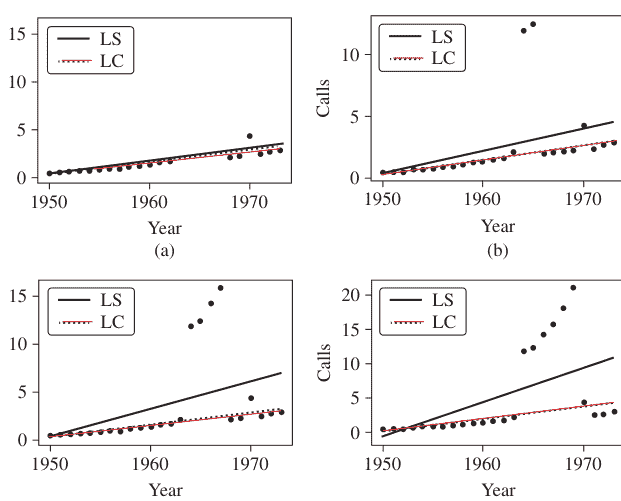

**图 4.2** 使用电话数据集不同版本的四个拟合线图。LC 方法具有强健性和稳定性，而 LS 回归线随离群点数量变化，(a) 无离群点的数据，(b) 两个离群点，(c) 四个离群点，(d) 六个离群点。

在本节中，我们讨论两种常用的离群点诊断方法，其目标是确定数据中是否存在任何离群点。这些方法通常在探索性数据分析（EDA）期间使用。在不运行任何形式的回归分析的情况下，只有解释变量和响应变量可用于诊断。正是在这个阶段，会发生误删内部点的问题，因为此时难以区分离群点和内部点。但是，运行线性回归后，残差可供检查，可用于更准确地识别离群点。在后续章节中，我们将讨论使用残差进行检测和删除。

### 4.3.1 箱线图

识别离群点最简单的方法是使用箱线图。这种紧凑的图形工具以可视化方式表示一维数据值集，快速展示内部点和离群点的概况。箱线图的思路是将数据值从小到大排序，然后确定大多数值所在的位置，以评估此范围之外是否存在离群点。具体来说，我们确定数据的四分位数（第 25、50 和 75 百分位数），并判断是否有数据点显著高于第 75 百分位数或显著低于第 25 百分位数。如果存在，则将其声明为离群点。

创建箱线图的过程如下：

- 首先，找到中位数（Q2）、第 25 百分位数（Q1）和第 75 百分位数（Q3）。第 25 和第 75 百分位数之间的数据定义了四分位距（IQR），其中 50% 的数据位于此范围内。
- 出于可视化目的，在第 25 和第 75 百分位数之间放置一个边界框，并在框内正好位于第 50 百分位数（中位数）处放置一条线。其余数据位于此框之外。
- 接下来，我们希望确定此框之外的一个合理值范围，该范围内的数据仍被视为内部点。经验法则是将每一侧的范围设为 1.5 × IQR。我们在箱线图中用线和须线标记来指示此范围。
- 须线从 Q1 延伸到 Q1 – 1.5 × IQR 以上的最小数据点，并从 Q3 延伸到 Q3 + 1.5 × IQR 以下的最大数据点。这可能导致每一侧须线长度不一。
- 此范围之外的所有值都被标记为离群点，并在须线上方和下方用圆圈标记，具体视情况而定。

图 4.3 显示了三个不同变量的箱线图示例。在每种情况下，框中间的线表示绘制数据的中位数。框本身显示从第 25 百分位数（Q1）到第 75 百分位数（Q3）的范围，即 IQR。延长的线在须线处终止，这表示给定数据的离散程度。下限和上限分别计算为 Q1 – 1.5 × IQR 和 Q3 + 1.5 × IQR，须线分别终止于这些区域中的最低和最高数据值。

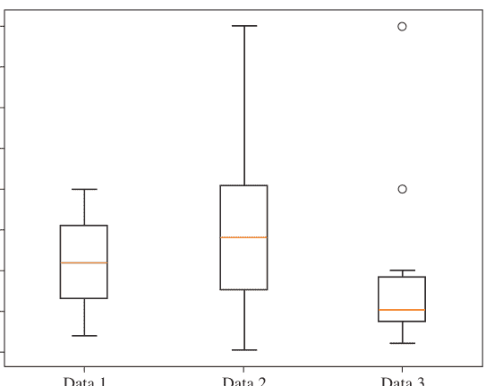

图 4.3 不同样本集的示例箱线图。请注意，最右侧的图清晰地显示了须线外的离群点。

更详细地检查图 4.3 中显示的三个箱线图，我们发现：

- 最左侧的箱线图是对称的，表示数据间距均匀，因此具有紧凑的表示形式，没有离群点。
- 中间的箱线图在须线长度上是不对称的，因为第 75 百分位数以上（但在 Q3 + 1.5 × IQR 区域内）的值比第 25 百分位数以下的值更分散。在这种情况下没有离群点。
- 最右侧的箱线图也是不对称的，且中位数线不在框的中心。中位数的位置取决于数据，因此可能位于框内的任何位置。数据中有两个离群点（用圆圈标记），因为它们位于须线之外。

在 EDA 期间，箱线图用于解释变量和响应变量，以了解数据并在数据集中发现离群点的可能性。

### 4.3.2 直方图

直方图是给定样本集近似分布的图形表示。如果生成得当，它能够快速评估离群点的存在情况。要创建直方图，根据数据的最小值到最大值范围定义一组等宽的箱。所有落在给定箱范围内的值都会被计数，每个箱中的计数会被绘制成直方图。因此，直方图是每个箱中值出现次数的频数图。箱的宽度或箱的数量可以由用户控制。离群点可能出现在与数据主体相距较远且频率相对较低的箱中。关键问题是正确选择箱大小。如果箱大小太小，每个箱内的频率将太低，无法识别离群点。如果箱大小太大，离群点可能会与内部点合并在一起。

图 4.4 显示了一个示例直方图，垂直轴为频数，水平轴为数据值。在评估直方图以查找离群点时，我们寻找位于数据主体之外的箱中的数据。在这种情况下，确实似乎存在数值超过 4 的多个离群点。另一方面，数值 7 可能是更好的选择。决定某些数据是否应被视为离群点的标准称为 *阈值*，其选择在离群点检测中至关重要。第 11 章关于异常检测提供了更多详细信息。

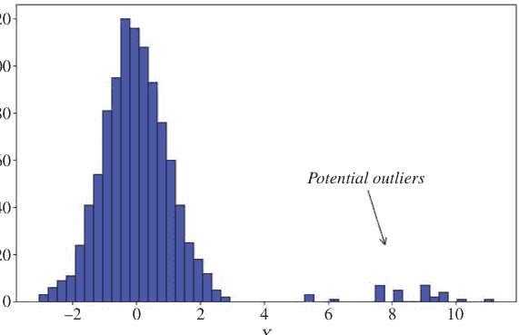

图 4.4 直方图示例。

### 4.3.3 探索性数据分析

探索性数据分析通常从数据列的箱线图和直方图开始，以熟悉数据集。离群点检测的早期阶段仅涉及使用解释变量和响应变量，因为没有其他可用信息。不幸的是，使用传统描述性方法（如输入/输出变量的箱线图或直方图）进行离群点诊断可能会产生误导且不准确。为了说明这些问题，将使用一个众所周知的数据集，即波士顿房价数据集。在此介绍它很合适，因为它已知包含许多离群点。该数据集提供了 13 个解释变量，涉及 1970 年代波士顿地区 506 套住房的中位数价格。数据集中的房价范围从 0 美元到 50K 美元。目标是使用线性回归构建预测模型。在本节中，我们只考虑 11 个解释变量，因为其中 2 个变量是分类性质的，因此不适合用箱线图或直方图表示。数据集的其他细节在此不相关，但数据集本身将在整本书中引用。

请考虑图 4.5 中显示的箱线图（此处为方便起见水平显示）。它们表明许多变量可能包含离群点。根据其箱线图，只有四个变量（INDUS、NOX、AGE 和 TAX）似乎没有离群点。MEDV 响应变量以及 ZN、CRIM、B、LSTAT、DIS、PTRATIO 和 RM 解释变量似乎都有离群点。每种情况下都提供了离群点的估计百分比。问题是：如果我们将所有这些都声明为离群点，那么 506 个观测值中总共需要移除 134 个。这大约占数据集内容的 26%。显然，移除如此大比例是不合理的。如果采用这种方法，可能会误删一些内部点。此外，有些离群点可能未被检测到，并继续潜伏在数据集中。虽然在实践中经常这样做，但本章将描述更有效的方法。

识别离群点的另一种方法是生成变量的直方图并检查其分布。图 4.6 展示了这一点。如果分布是高斯性质的，那么不太可能存在离群点。变量 RM 就是这样的情况。但是，其余变量似乎不是高斯分布，但从分布中很难检测到任何离群点。这是直方图的问题之一：它需要为每个变量单独设置箱大小和阈值才能找到离群点，且不如箱线图提供的信息多。标准化可以提供帮助（如第 4.9 节后面所述），但如果不正确执行，也可能隐藏离群点。另一方面，直方图确实允许您一目了然地发现任何异常特征。例如，响应变量 MEDV 值得进一步调查潜在的离群点。图 4.7 使用更小的箱大小更详细地显示了直方图。它表明存在许多价格正好为 50K 美元的房屋。这种异常数量的 50K 美元房屋的原因不明，但可能是由于 winsorization（见第 4.5.2 节）；也就是说，这些值太大，导致数据偏斜，因此被简单地分配到 50K 美元。因此，不清楚它们是离群点、内部点还是两者的混合。我们不能冒险将它们从数据集中删除，生怕“把婴儿和洗澡水一起倒掉”。总的来说，从箱线图和直方图来看，我们在这个阶段最好能说的是：该数据集可能包含离群点。


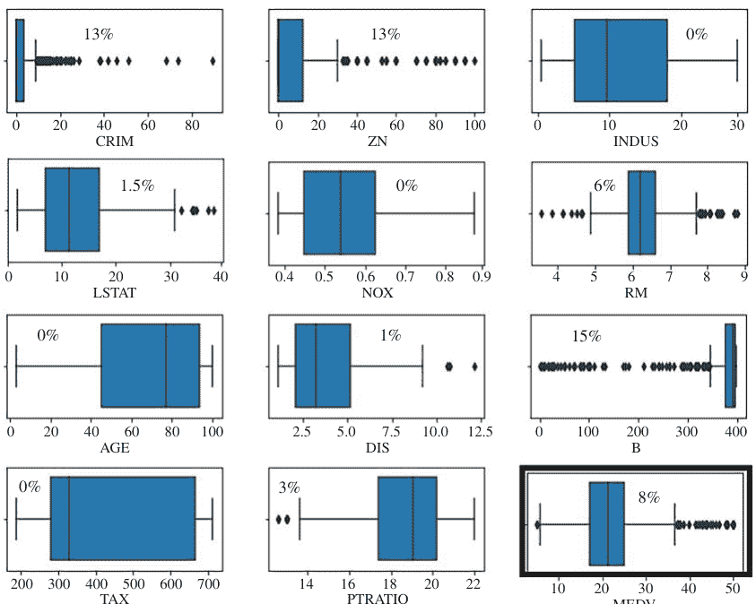

Figure 4.5 箱线图可用于检查波士顿房价数据集中所有变量的异常值。

## 4.4 异常值检测

初步诊断阶段完成后，如果我们知道数据集中存在异常值，就可以进入异常值检测阶段（参见 Aggarwal 2017）。在这里，我们关注数据集中异常值的数量。本节将描述三种广为人知的方法。请注意，本节将描述计算异常值的方法，而删除检测到的异常值将在下一节中描述。

### 4.4.1 3-σ编辑规则

3-σ编辑规则可能是针对高斯分布数据最广为人知的异常值检测方法。其思想是，任何距离均值超过3个标准差的数据点都被视为异常值。这是一种合理的方法，因为在正态分布中，99.7%的数据位于均值μ的±3σ范围内。图4.8显示了一个标记为“真实分布”的高斯分布，以及


Figure 4.6 直方图可用于检查波士顿房价数据集中所有变量的异常值。

MEDV的直方图


Figure 4.7 显示$50K住房数量异常的MEDV分布。


Figure 4.8 说明3-σ编辑规则问题的高斯分布。

右侧存在异常值的区域。x轴上的值有时被称为**分位数**<sup>1</sup>。我们希望找到高于3分位数或低于−3分位数的异常值。为了应用3-σ编辑规则，可以使用以下公式对数据进行标准化，

```
z_i = \frac{x_i - \hat{\mu}}{\hat{\sigma}},
```

以获取z-score，使得所有数据都属于N(0, 1)。\(\hat{\mu}\)和\(\hat{\sigma}\)均使用数据值计算得出。不幸的是，由于异常值的存在，\(\hat{\mu}\)值相对于\(\mu\)会发生偏移，\(\hat{\sigma}\)值相对于\(\sigma\)会被膨胀。这些效应在标记为“计算分布”的分布中显示。异常值倾向于压平和拉伸计算分布，从而掩盖异常值。它们不再位于\(\hat{\mu}\)的\(\pm 3\sigma\)之外。因此，当存在异常值时，3-σ编辑规则几乎或完全没有价值。

### 4.4.2 4.5-MAD编辑规则

像往常一样，我们求助于稳健统计学来处理异常值。\(\mu\)的一个稳健值是中位数(\(\mathbf{x}\))。可以使用以下方法获取3-σ编辑规则中\(\sigma\)的稳健值：

```
\hat{\sigma} = \text{MADN}(\mathbf{x}) = 1.4826 \times \text{MAD}(\mathbf{x}),
```

其中MAD(\(\mathbf{x}\))是中位数绝对偏差(MAD)，由以下公式给出：

```
\text{MAD}(\mathbf{x}) = \text{median}_{1 \le i \le n} (|x_i - \text{median}(\mathbf{x})|) .
```

这产生了4.5-MAD编辑规则，它是3-σ编辑规则的一个稳健版本。正如名称所暗示的，我们检查距离中位数4.5-MAD或更远的异常值。4.5乘数的原因是我们使用的是3-MADN编辑规则，大约为4.5×MAD。在图4.8中，使用稳健统计计算得到的分布看起来将与真实分布相似。

### 4.4.3 1.5-IQR编辑规则

另一个稳健替代方案是在检测异常值数量时使用箱线图参数。它利用数据的四分位数。在前一节中，我们展示了根据箱线图规则，异常值位于区间Q1−1.5×IQR和Q3+1.5×IQR之外。如前所述，这比3-σ编辑规则有效得多。事实上，我们可以使用这种简单的方法来简单直接地计算异常值的数量。

这种方法存在一些问题，如果与解释变量或响应变量一起使用不当，可能会导致异常值数量过多。我们之前在图4.5中为波士顿房价数据集的变量见过这种情况。如果将1.5-IQR规则应用于这组箱线图，我们将无意中删除134个观测值，其中大部分不是异常值。因此，通常需要一个高于1.5的因子来专门识别异常值。

## 4.5 异常值移除

现在已经描述了不同的异常值检测方法，我们可以进入异常值移除的最终阶段。在这个阶段有两个可用选项：第一个是删除所有检测到的异常值，称为_modifying_，即_modifying_... 修正：第一个是删除所有检测到的异常值，称为_modifying_... 不，原文是_modifying_吗？不是，原文是_modifying_？原文是_modifying_？让我再看：原文是 "called _trimming_"。所以翻译为：称为_modifying_... 不，是 _修剪_；第二个是保留所有异常值但调整它们的位置，该过程称为 _Winsorization_。这两者将在以下各节中讨论。

### 4.5.1 修剪方法

异常值移除的常规方法称为修剪。其思想是简单地移除与被认为是异常值的预测变量和响应变量相关联的观测值。它与上述检测方法（3-sigma、4.5-MAD和1.5-IQR）配合使用。通常，使用基于分位数的方法，针对特定比例的异常值（例如5%），而不是使用检测方法的结果。修剪可以是对称的，即移除潜在异常值的最高值和最低值；也可以是非对称的，即只移除潜在异常值的最高值或最低值。这种简单的方法在图4.9中有所说明。首先对原始数据进行异常值诊断，然后将这些观测值从数据集中移除。虽然这种方法在数据科学中被广泛使用，但主要问题是，如果分别使用解释变量和响应变量来应用它，那么内点可能会与异常值一起被剔除，而一些异常值仍然保留在数据集中。这最终可能导致模型不准确。此外，编辑标准本质上都是启发式的，结果的质量取决于具体的应用。

### 4.5.2 Winsorization

修剪的一种替代方法是保留所有观测值，但将解释变量和响应变量的极端值调整为等于某些预定义的最大值和最小值。例如，如果我们


Figure 4.9 修剪数据与Winsor化数据对比。

决定对所考虑的变量进行90% Winsor化，我们在第5个百分位数和第95个百分位数处设置边界。所有超出这些边界的值都被移动到边界处。该过程在图4.9的下方图中有所说明。步骤的简要概述如下：

- 1) 计算百分位数：对于每一列，计算第5个百分位数和第95个百分位数。
- 2) Winsor化：对于每一列，将低于第5个百分位数的值替换为第5个百分位数，将高于第95个百分位数的值替换为第95个百分位数。

在此过程中，没有移除任何数据，而是将它们的值重新设置得更接近数据的主体部分。这在图4.7的波士顿房价数据集的响应变量MEDV中之前有所体现。直方图中$50K住房的频率高于预期，这可能是由于对异常值进行了Winsor化。这可能会引入偏差和一些信息损失，在线性回归过程中可能会产生一些意想不到的后果。因此，使用这种方法时应格外小心。

### 4.5.3 异常值检测方法

另一种可能成本更高但更可靠的技术是使用异常值检测。不同方法的细节在此不予赘述，因为第11章专门讨论了该主题。但是，重要的是要指出，要实施这种方法，必须将解释变量和响应变量合并在一起（而不是分别检查每个变量）。响应向量y被附加到X矩阵上，以形成异常值检测的输入，如图4.10所示。而不是分别处理每个单独变量来寻找异常值，而是采用整体方法，使用异常值检测在R^(d+1)维空间中找到它们。异常值检测器的作用是在该复合数据集中找到极端异常值。其不一定是要找出所有异常值，而是那些可能带来问题的异常值。例如，高杠杆异常值将远离内点数据，并可以被识别为异常值。

为此目的的候选工具是DBSCAN和MADmax，两者均在第11章中有所描述。它们使用聚类技术（参见第1章）来识别内点数据，然后检测


图 4.10 将解释变量和响应变量结合作为异常检测的输入。

| X₁ | X₂ | . | . | . | X_d | Y |
|---|---|---|---|---|---|---|
| X₁₁ | X₁₂ | . | . | . | X₁d | Y₁ |
| X₂₁ | X₂₂ | . | . | . | X₂d | Y₂ |
| X₃₁ | X₃₂ | . | . | . | X₃d | . |
| . | . | Dataset | . | . | . | . |
| . | . | . | . | . | . | . |
| Xₙ₁ | Xₙ₂ | . | . | . | Xₙd | Yₙ |


图 4.11 异常检测的两种情况。左侧，由于离群点孤立且远离簇，因此可以检测到它。右侧，离群点形成一个簇，使得它们更难以检测。

将离群点定义为远离簇的数据点。图 4.11 说明了针对一个解释变量和一个响应变量的异常检测程序。图 4.11 左侧所示的离群点类型可以被检测到，因为它在单个簇中与大部分数据相隔离。然而，如果存在多个形成图 4.11 右侧所示类型簇的离群点，它们可能不会被检测到，因为会形成三个簇且其中任何一个都不会被视为离群点。尽管如此，在使用线性回归之前，删除图中左侧所示类型的高影响和高杠杆离群点很重要，而异常检测具备此能力。

## 4.6 基于回归的离群点检测

如果查找并删除所有离群点是数据科学应用中的关键部分，尤其是对于依赖无离群点数据的统计分析，那么上述描述的技术可能不合适。在本节中，我们探讨对数据执行线性回归后可用的选项。区别在于，我们现在有残差可供处理。可采用涉及分位数-分位数（QQ）图和有序绝对残差的技术来准确检测离群点。此外，还可以使用更有效的方法进行精确删除。特别是，描述了一种使用迭代箱线图方法的新方法，以便在保持内部点完好的同时删除离群点。

### 4.6.1 LS 与 LC 残差

如前所述，使用输入/输出变量在离群点检测中可能不有效。在本节中，我们展示残差具有诊断数据集中离群点所需的信息。请回顾，残差只是所有观测值中真实响应与预测响应之间的差异。线性回归的残差可以在估计后使用一般公式计算，如下所示

$r_i = y_i - \hat{y}_i, \quad i = 1, \dots, n, \quad (4.6.1)$

其中 \(y_i\) 是真实响应，\(\hat{y}_i\) 是基于回归模型的预测值。通常，数据集中的离群点具有较大的残差，而内部点具有较小的残差。因此，可以通过它们在残差直方图中的相对位置来区分它们。无论其大小如何，离群点总是位于某一极端。问题是，当前任务应使用 LS 残差还是 LC 残差？

为回答这个问题，请考虑图 4.12，它绘制了比利时电话数据集中图 4.2(d) 的 LS 和 LC 残差的直方图。对于 LS 残差，由于分布看起来呈高斯分布，因此很难判断是否存在离群点。然而，对于 LC 残差，很明显存在六个离群点。因此，稳健回归的残差包含使用直方图诊断离群点所需的信息。

更多证据表明不应使用 LS 残差来检测离群点，这一点可以从箱线图中看出。在图 4.13 中，我们以箱线图形式展示了糖尿病数据集中 LS 和 LC 的残差。该数据集


图 4.12 基于图 4.2(d) 的 LS 和 LC 残差直方图。


图 4.13 使用 LS 和 LC 残差对糖尿病数据集应用 1.5-IQR 编辑规则的箱线图形式。

该数据集包含 404 个观测值，将 10 个解释变量与一个响应变量相关联。本书其他部分也将使用此数据集，但本章的重点是离群点检测。在 LS 的情况下，仅检测到一个离群点，而实际上存在三个离群点。请注意，使用 LC 残差时，箱线图检测到了所有三个离群点。关键要点是，需要使用稳健方法来找到正确的离群点数量，并且应将其用于任何关键任务的离群点诊断、检测和删除方法中。在 1 章中，在离群点检测过程中遇到了聚类问题，这里也适用相同的概念。

### 4.6.2 检测方法比较

在本节中，将三种方法，即 3-sigma、4.5-MAD 和 1.5-IQR 编辑规则，应用于 Swiss、糖尿病和 Boston Housing 数据集。Swiss 数据集没有任何离群点，而糖尿病和 Boston Housing 数据集确实包含离群点。表 4.1 显示了使用

表 4.1 使用 LC 残差对三个数据集进行三种离群点检测方法的比较。

| | 瑞士生育率 | 糖尿病数据 | 波士顿房价 |
|---|---|---|---|
| 3-sigma | 0 | 0 | 10 |
| 4.5-MAD | 0 | 0 | 30 |
| 1.5-IQR | 0 | 3 | 35 |

这三种方法时得到的离群点数量。在所有情况下，都使用了 LC 回归来获取残差。三种方法都表明 Swiss 数据集中没有离群点。对于糖尿病数据集，只有 1.5-IQR 方法得出了正确结果。另外两种方法无法准确确定离群点的数量。对于 Boston Housing 数据，与其他方法相比，3-sigma 编辑规则表现较差。4.5-MAD 和 1.5-IQR 方法产生了相似的结果，尽管我们稍后会发现离群点数量比这些数字所示的更多。这里的主要结论是，1.5-IQR 方法与 LC 残差结合使用时是最有效的方法。

### 4.6.3 有序绝对残差 (OARs)

除了直方图和箱线图之外，还有许多其他方法可以直观地诊断数据集中的离群点。一种有用的方法是将残差的绝对值按从小到大的顺序绘制出来。无论残差为正还是负，较大的残差都表明存在离群点。将一组值从小到大排序时使用的符号是在变量的下标周围加上括号。如果我们有一组无序的值，例如 x_1, ..., x_n，那么 x_{(1)}, ..., x_{(n)} 被称为序统计量。当我们取这些量的绝对值然后对其排序时，我们使用符号 |x|_{(1)}, ..., |x|_{(n)} 表示绝对序统计量。

练习：给定 x_1 = 0.4, x_2 = -0.6 和 x_3 = 1.7，求序统计量，然后求绝对序统计量。

答：序统计量为 x_{(1)} = -0.6, x_{(2)} = 0.4 和 x_{(3)} = 1.7。绝对序统计量为 |x|_{(1)} = 0.4, |x|_{(2)} = 0.6 和 |x|_{(3)} = 1.7。

请考虑图 4.14，它显示了基于图 4.2(d) 的比利时电话数据集在 LS 和 LC 两种情况下的有序绝对残差。每种情况下总共有 24 个残差。我们沿 x 轴使用 1 到 24 的索引，绘制了从 |r|_{(1)} 到 |r|_{(24)} 的残差绝对序统计量。LS 残差生成的图使得将离群点与其余数据点区分开来变得困难。这是因为 LS 强制残差服从高斯分布，这倾向于模糊内部点和离群点之间的区别。因此，基于左侧面板的图，不容易对是否存在离群点做出明确的结论。


图 4.14 LS 和 LC 估计器的有序绝对残差图。

另一方面，LC 的残差在离群点和其余数据之间显示出清晰的分离。5.0 的阈值提供了一条合适的水平分界线，用于筛选出六个离群点。请注意，在阈值为 5.0 的 LS 情况下，排序并不能帮助将离群点与内部点区分开。在该阈值下，一些内部点会被声明为离群点，这是不正确的。形成鲜明对比的是，在 LC 情况下，我们看到离群点和内部点之间有明显的区别。它们各自的绝对序统计量是 |r|_{(19)}, ..., |r|_{(24)}，因为共有 24 个点，最后 6 个是离群点。

现在可以检查这六个离群点，以确定它们是应保留、修改还是从数据集中删除。如果某些点是由于手动输入错误或可调整的测量校准错误造成的，则可以轻松更正。手动删除离群点容易出错，必须谨慎进行。将在 4.7 节中稍后描述一种使用稳健统计程序以系统方式检测和删除离群点的自动方法。

### 4.6.4 分位数-分位数图

分位数-分位数（或 QQ）图（参见 Maronna et al. 2019）可能是回归后分析中最重要的统计工具。在最基本的层面上，它评估残差是否属于高斯分布。如果是，那么 LS 方法就是数据的合适线性回归方法，因为残差符合相关分布。因此，LS 回归后的第一步之一应该是对残差进行 QQ 图分析，以确定是否需要稳健回归。因此，它提供了另一种定性方法来确定数据集中是否存在离群点。这种推理唯一的问题是，LS 强制残差服从高斯分布，因此即使残差看起来呈高斯分布，仍可能存在未检测到的离群点。出于前文提到的原因，生成 QQ 图时 LC 残差可能更可取。

QQ 图是一种直观比较数据分位数与理论分位数的方法。默认情况下，理论分位数沿 x 轴放置。分位数之前在图 4.8 中与真实分布相关联地显示过。为了理解 QQ 图中的分位数，我们从高斯分布的累积分布函数（CDF）开始，表示为 u = Φ(x)，其中 u ∈ [0, 1]。CDF 只是高斯正态曲线到点 x 为止的下方面积。如果面积为 0.5，则 u = 0.5 且 Φ−1(0.5) = 0。这个分位数位于图 4.8 中 x 轴的中心。我们还注意到 Φ−1(0) = -∞ 和 Φ−1(1) = ∞，因此这些值意味着在 −∞ 处曲线下的面积为 0，在 ∞ 处为 1。QQ 图的所有分位数都将介于这两个极端之间。

要获取理论分位数，我们沿 CDF 的垂直轴在 0 和 1 之间选择均匀间隔的点。如果我们的数据中有 n 个值，那么分位数基于 0 和 1 之间的 n 个均匀间隔点。具体来说，这些点位于 u = 1/(n + 1), 2/(n + 1), ..., n/(n + 1)。对这些值执行逆 CDF，Φ−1(u)，以获取理论分位数。2 样本序统计量沿 y 轴放置。如果 (x, y) 点沿对角线排列，那么我们将样本


将数据视为服从高斯分布。否则，它来自某个未知分布。无论哪种情况，异常值都位于 QQ-plot 的两端，并且通常偏离对角线。

**示例：** 为说明构建 QQ-plot 的过程，我们使用一个仅包含四个值的简单示例。设 \( y_1 = 0.4 \)、\( y_2 = -0.6 \)、\( y_3 = 1.7 \) 和 \( y_4 = -1.8 \)。首先，我们需要如下的顺序统计量：\( y_{(1)} = -1.8 \)、\( y_{(2)} = -0.6 \)、\( y_{(3)} = 0.4 \) 和 \( y_{(4)} = 1.7 \)。为了生成 QQ-plot，必须使用 CDF 图获取理论分位数。理论分位数 \( x_1 \)、\( x_2 \)、\( x_3 \) 和 \( x_4 \) 分别基于 \( u = 0.2 \)、\( 0.4 \)、\( 0.6 \) 和 \( 0.8 \)。我们需要使用逆 CDF 来获取它们，如下所示：\( \Phi^{-1}(0.2) = -0.84 \)、\( \Phi^{-1}(0.4) = -0.25 \)、\( \Phi^{-1}(0.6) = 0.25 \) 和 \( \Phi^{-1}(0.8) = 0.84 \)。

获取理论分位数的过程如图 4.15 所示。它显示了标准正态高斯分布的 CDF，\( \Phi(x) \)。样本值沿 x 轴用“\(\blacksquare\)”标记。理论分位数从 \( x_1 \) 到 \( x_4 \) 标记。\( x_1 \) 分位数是根据与 \( 1/(n + 1) = 1/5 = 0.2 \) 相关联的逆 CDF 获得的。它位于 \( \Phi^{-1}(0.2) = -0.84 \)。其他分位数的过程相同。最后，我们得到了 QQ-plot 所需的值，该图将理论分位数与排序后的实际值进行比较。要绘制的成对点为

\( (-0.84, -1.8), (-0.25, -0.6), (0.25, 0.4) \text{ and } (0.84, 1.7) \)。

包含四个点的前一个示例太小，无法获得有意义的结果，因为通常建议样本量至少为 30 个点才能获得可靠的 QQ-plot。请考虑图 4.16 中的三个实际 QQ-plot。我们看到 x 轴上是理论分位数，y 轴上是样本分位数。为了检查样本分位数是否属于高斯分布，我们期望点沿所示的对角线分布。在左侧面板中，我们发现数据是高斯的，因为点沿


**图 4.15** 从高斯 CDF 获取理论分位数。\( y_{(i)} \) 值（显示为“\(\blacksquare\)”）是样本值的顺序统计量。\( x_i \) 值（显示为“\(\bullet\)”）是理论分位数。


对角线。在第二种情况下，大部分点位于对角线上，但在两端有一些点偏离对角线。然而，该分布被认为是高斯的，因为几乎所有其他点都沿对角线分布，如果不是高斯样本则不会发生这种情况。这是一个判断问题，但这完全在对角线周围的可接受区域内。在第三个 QQ-plot 中，样本分布不是高斯的，而是其他未知分布。根据这个 QQ-plot，数据集中明显存在异常值。在这种情况下，基于 LC 损失的稳健方法适用于线性回归，或者也许在使用 LS 之前删除异常值。

### 4.6.5 用于异常值诊断的四分图

用于检测异常值的四种可视化方法可以组合成残差的“四分图”（quad-plot）。四分图包含所有四种诊断方法，即 OAR-plot、箱线图、直方图和 QQ-plot。通过共同检查所有四个图，更容易确定数据集是否存在异常值。为了说明该过程，我们将瑞士生育率数据集（无异常值）与波士顿房价数据集（有超过 50 个异常值）进行比较。

基于 LC 残差的瑞士生育率数据集的四分图如图 4.17 所示。如果我们分别检查每个图，可能会得到冲突的结果。例如，箱线图显示没有异常值。这由 QQ 图证实。直方图看起来呈高斯分布，也没有明显的异常值。然而，OAR-plot 显示可能存在三个异常值。但 QQ-plot 告诉我们，它们只是三个极端值（一个在顶部，两个在底部），不应被视为异常值。

对于波士顿房价数据集，LC 估计器的残差在图 4.18 中以四分图形式呈现。这些图清晰地描绘了异常值的存在情况，与瑞士数据集的情况形成对比。箱线图提供了最有力的异常值证据，但 QQ-plot 和 OAR-plot 也支持存在大量异常值的说法。直方图偏向一侧，这也表明可能存在异常值。我们现在有一种使用稳健估计器的残差来检测异常值的有效方法。然而，在不丢失任何正常点的情况下外科手术式地删除异常值是另一回事，我们将在下一节中加以探讨。


Figure 4.17 Quad-plot diagnosis of the Swiss LC residuals, r.

## 4.7 基于回归的异常值移除

实际移除异常值的任务充满风险。这是一项危险的工作，这就是为什么我们一直主张使用稳健方法。然而，许多机器学习工具的用户更喜欢删除异常值，而不是切换到稳健方法。某些统计方法要求无异常值的数据。在某些情况下，除了删除异常值外可能别无选择，因此我们必须开发快速且准确的方法以满足预定目的。我们描述了一种使用稳健 LC 回归和箱线图指标来外科手术式移除异常值的方法。

### 4.7.1 迭代箱线图方法


Figure 4.18 Quad-plot of the Boston Housing LC residuals, r.

目前使用的大多数方法都无法精确地区分“精华与糟粕”。通常会漏掉一些异常值，并丢弃一些有用数据。在这里，我们试图仅移除异常值，同时保持有价值的数据完好。请注意，标准的异常值查找方法效果不佳，因为大多数异常值只能在执行稳健回归并计算残差之后才能找到。

迭代箱线图方法是一种快速且准确的替代方案，可用于移除数据集中的异常值。其思路是在迭代循环中使用箱线图方法，在每一步移除异常值，直到不再有异常值为止。它源自 1.5-IQR 方法，但使用 Ifactor-IQR 代替。Ifactor 的值从 1.5 开始，并在每次迭代中根据数据量 n 稳步增加 50/n。这是一个启发式值，但在许多数据集的实际应用中效果良好。每次额外遍历都会对部分清理后的数据进行处理，移除任何剩余的异常值。最终，经过足够的迭代（通常为一到四次），可以检测并移除所有异常值。算法 4.1 给出的过程快速、可靠，且比之前的算法更精确。对于糖尿病数据集，它移除了所有三个异常值。在波士顿房价数据集中，它找到并移除了 52 个异常值。在瑞士数据集中，它无法找到异常值，因为根本不存在异常值。迭代箱线图方法的结果如表 4.2 所示。

表 4.2 三个数据集上迭代箱线图方法检测并移除的异常值。

| | 瑞士生育率 | 糖尿病数据 | 波士顿房价 |
|---|---|---|---|
| 移除的异常值数量 | 0 | 3 | 52 |

```
Algorithm 4.1 Iterative boxplot method for outlier removal.
1: Input: entire dataset X, y;
2: set n=number of observations, d=number of variables,
outliers= n, Ifactor=1.5
3: while outliers > 0 do
4: run LC regression
5: compute residuals r_i = y_i - X_i^T β^LC for i = 1, ..., n
6: compute U = Q3 + Ifactor×IQR for residuals
7: compute L = Q1 - Ifactor×IQR for residuals
8: compute outliers = Σ_{i=1}^n(r_i > U) + Σ_{i=1}^n(r_i < L)
9: for i = 1, ..., n
10: remove row i from dataset if r_i > U or r_i < L
11: end for
12: Ifactor = Ifactor + 50/n
13: end while
14: run LS regression
15: use quad-plot of LS residuals on reduced dataset as a final check
16: Output: outlier-free dataset;
```

## 4.8 带有异常值的回归指标

使用各种指标来评估不同机器学习工具相互之间的性能。这些指标具有统计学特性，如果不谨慎使用，有些容易产生误导，尤其是在数据集中存在异常值的情况下。特别是，如果不使用像 MAE 这样的稳健指标，那么非稳健回归（例如 LS）可能会根据 MSE 指标表现得更好，而实际上稳健回归的表现更好。我们如何判断一个指标是否不稳健？一般来说，每当指标中出现“mean”一词时，都应将其视为非稳健且在存在异常值时有些不稳定。本节的目标是比较和对比 MSE 与 MAE，并提供关于其正确使用的建议。


### 4.8.1 均方误差（MSE）

MSE 是与最小二乘法（LS）一起使用的最流行的指标之一。它由以下公式给出

\( MSE = \frac{1}{n} \sum_{i=1}^n (y_i - \hat{y}_i)^2 = \frac{1}{n} \sum_{i=1}^n r_i^2, \qquad (4.8.1) \)

其中，\( n \) 是数据集中的数据点数量，\( r_i = y_i - \hat{y}_i \)，且 \( y_i \) 表示第 \( i \) 个真实响应，而 \( \hat{y}_i \) 是预测响应。使用此指标处理异常值存在一个问题，我们将使用比利时电话数据集（参见第 4.2 节）来说明。对于使用最小二乘法和 log-cosh 方法的简单线性回归，哪一种方法提供更小的误差？

LS 和 LC 的回归结果及相关残差的直方图在图 4.19 中绘制。如果我们计算两种情况的 MSE，会发现对于 LS 回归，MSE = 29.0，而对于 LC 回归，MSE = 42.4。这告诉我们 LS 优于 LC。不幸的是，事实恰恰相反。数据集中的六个异常值迫使 LS 回归生成一条不能代表真实数据的直线。请考虑图中所示的两个残差值作为 \( r_i \)。在 LS 情况下，由于直线与异常值接近，残差都较小。然而，在 LC 中，回归直线到异常值的距离很大，因此 MSE 必然较高。通过检查图 4.19 中的两个直方图也可以清楚地看出这一点。在 LC 情况下，较大的残差将导致较大的 MSE。因此，我们不应被诱惑在存在异常值时将 MSE 用作可靠的指标。


图 4.19 带有六个异常值的比利时电话数据上 LS 和 LC 的回归直线及残差直方图。

MSE 指标的另一个问题是，其单位与响应变量的单位不相同。这可以通过使用 RMSE 来解决，RMSE 产生与响应变量相同的计量单位。RMSE 由以下公式给出

\( RMSE = \sqrt{\frac{1}{n} \sum_{i=1}^n (y_i - \hat{y}_i)^2} = \sqrt{\frac{1}{n} \sum_{i=1}^n r_i^2} \). \(\text{(4.8.2)}\)

对于图 4.19 的两种情况，LS 的 RMSE = 5.4，LC 的 RMSE = 6.5。当然，根据 RMSE 指标，哪种方法更好的结果没有变化。再次，基于 RMSE，LS 优于 LC，这具有误导性。原因是 LC 拟合的直线远离异常值，从而导致较高的 RMSE。在稳健回归中，异常值始终远离回归直线或超平面，因此情况总是如此。另一方面，LS 会尝试平衡异常值和内向点的残差以减少 RMSE。因此，MSE 或 RMSE 统计量应仅在处理无异常值的数据集时选择。

### 4.8.2 中位数绝对误差（MAE）

我们需要找到一个更好的评估统计量，以考虑异常值。一个稳健的指标是残差 MAE，由以下公式给出

\( MAE = \text{median}(|y_1 - \hat{y}_1|, |y_2 - \hat{y}_2|, \dots, |y_n - \hat{y}_n|). \) \(\text{(4.8.3)}\)

这里，使用了中位数，因此它是一种稳健的误差度量。如果在图 4.19 相同的数据集上计算 MAE，那么对于 LS，MAE = 3.45，而对于 LC，MAE = 0.49。因此，结果在很大程度上偏向 LC。这种稳健指标对于包含异常值的数据集要合适得多，因为它考虑到稳健方法必然会因异常值而具有较大的残差。这一点在图 4.19 的残差直方图中已经看到。

另一个常用的指标是平均绝对误差（MnAE），由以下公式给出

\( MnAE = \frac{1}{n} \sum_{i=1}^n |y_i - \hat{y}_i| = \frac{1}{n} \sum_{i=1}^n |r_i|. \) \(\text{(4.8.4)}\)

通常，此指标与 MAE 使用相同的缩写。两者在文献中均被称为 MAE。为了避免两者之间的混淆，我们使用 MnAE。$^3$ 注意，此指标不稳健，因为它使用了平均值。它略好于 MSE，因为它不对误差进行平方，因此差异不会被夸大。在图 4.19 的例子中，LS 的 MnAE = 4.24，LC 的 MnAE = 3.98。在这种情况下，它略微偏向 LC，尽管此指标不稳健。然而，在其他情况下，即使 LC 更好，它也可能偏向 LS。因此，在比较 LS 和 LC 时，它不如 MAE 可靠。MAE 是唯一真正稳健的指标。

现在考虑图 4.20，其中没有异常值。对于这种情况，LS 的 MSE = 0.169 和 MAE = 0.055，而 LC 的 MSE = 0.170 和 MAE = 0.054。它们几乎相同，这


图 4.20 对比利时电话数据（修改后的无异常值版本）的 LS 和 LC 回归直线及残差直方图。

表明在没有异常值的情况下，LS 和 LC 的表现大致相同。这一点很重要，因为我们希望即使在没有异常值时也能使用 MAE 统计量。通常，在比较两种或多种不同的回归方法时，应同时计算 MSE（或 RMSE）和 MAE。但是，在存在异常值时，应比 MSE 更侧重于 MAE，因为 MAE 是稳健的。

### 4.8.3 现实数据上的 MSE 与 MAE

前一节使用简单数据集的分析结果表明，当涉及稳健方法时，MAE 在比较目的上优于 MSE。这意味着，任何具有最低 MAE 的回归方法都应优于其他方法。这将在更大的数据集上进行测试，即瑞士生育率（无异常值）、糖尿病（3 个异常值）和波士顿房价（超过 50 个异常值）数据集。图 4.21 中的条形图显示了三个不同数据集的相对 MSE 和 MAE 值。由于它们的误差数量级各不相同，这些值已被归一化为 1。在左侧面板中，我们注意到 MSE 表明在所有三种情况下 LS 都优于 LC，因为 MSE 更小。在瑞士数据集的情况下，这在边际意义上可能是正确的。然而，糖尿病和波士顿房价数据都包含异常值，因此它们在使用 LC 时应表现更好。不幸的是，即使在存在异常值的情况下，MSE 也会使我们相信 LS 更好。右侧面板对情况有更准确的看法。随着异常值数量的增加，LS 和 LC 之间的 MAE 比率继续增加。具体来说，波士顿房价数据具有


图 4.21 瑞士、糖尿病和波士顿房价数据集上 LS 和 LC 的 MSE 与 MAE。

52 个异常值，糖尿病数据有 3 个异常值，根据 MAE 指标，使用 LC 而非 LS 更合适。更一般来说，如果有多种稳健方法可供选择，应选择 MAE 最低的方法，而不是 MSE 最低的方法。

### 4.8.4 稳健回归的超参数选择

既然已经描述了 MAE 指标及其正确用法，它可以立即应用于使用 log-cosh 的线性回归的稳健系数 \(a\) 以及 Huber 方法的 \(\delta\) 的选择。回顾第 3 章，一般 log-cosh 损失的形式为

```
\(J^{\text{LC}}(x; a) = \frac{1}{a} \sum_{i=1}^n \log(\cosh(ax)).\) (4.8.5)
```

通过选择六个不同的值并比较 MAE 值，可以获得 \(a\) 的一个合适值。此外，由于此损失函数旨在提供中位数解，直线或超平面以下的点数应为数据的 50%。此标准也可用于选择 \(a\) 的值。

表 4.3 提供了使用六个不同的 \(a\) 值对波士顿房价数据集的 MAE 和直线以下点数（及百分比）。实际上，我们正在比较同一家族中的六个不同稳健估计器。结果表明，\(a = 2\) 是一个合适的值。低于此值时，MAE 更高，且“直线以下点数”超过 50%，这不满足中位数的定义。高于此值时，“直线以下点数”低于 50%。显然，MAE 与满足中位数要求的需求之间存在权衡。\(a = 2\) 的值在两个目标之间取得了良好的平衡，并适用于所有数据集。


表 4.3 使用波士顿房价数据集对 log-cosh 线性回归寻找合适的 $a$-因子。

| | a = 0.5 | a = 0.7 | a = 1.0 | a = 1.5 | a = 2 | a = 10 |
|---|---|---|---|---|---|---|
| MAE | 2.010 | 2.000 | 1.988 | 1.979 | 1.962 | 1.939 |
| 直线下方点数 | 263 | 259 | 255 | 254 | 253 | 252 |
| 数据百分比 | (52.0%) | (51.2%) | (50.4%) | (50.2%) | (50.0%) | (49.8%) |

表 4.4 使用波士顿房价数据集对 Huber 线性回归寻找合适的 $\delta$-因子。

| | $\delta = 0.1$ | $\delta = 0.2$ | $\delta = 0.5$ | $\delta = 1.345$ | $\delta = 2$ |
|---|---|---|---|---|---|
| MAE | 1.975 | 1.962 | 1.979 | 2.017 | 2.080 |
| 直线下方点数 | 251 | 253 | 256 | 274 | 283 |
| 数据百分比 | (49.6%) | (50.0%) | (50.6%) | (54.1%) | (55.9%) |

接下来，回顾第 2 章中的 Huber 方法，如下所示

```
H-loss(x; $\delta$) = $\sum_{i=1}^n \rho_H(x)$, (4.8.6)
```

其中

```
$\rho_H(x) = \begin{cases} x^2/2 & \text{if } |x| \le \delta \\ \delta \left( |x| - \frac{\delta}{2} \right) & \text{if } |x| > \delta. \end{cases}$ (4.8.7)
```

采用与上述相同的程序，我们可以为波士顿房价数据集找到最合适的 $\delta$ 值。结果如表 4.4 所示。在此例中，$\delta = 0.2$ 是 MAE 与超平面下方点数之间的合适折中。MAE 值与 log-cosh 且 $a = 2$ 时相同。不幸的是，$\delta$ 的值仅适用于波士顿房价数据集。对于瑞士数据集，合适的值为 $\delta = 4$，而对于糖尿病数据集，则为 $\delta = 1.2$。$\delta = 1.345$ 通常作为默认值使用，但理想情况下应根据具体情况进行调整。这是 Huber 方法的缺点之一。

## 4.9 数据集标准化

数据转换是每个数据科学问题中必不可少的预处理步骤。在初次接收到数据集时，需要进行各种转换以使其适合机器学习工具。一项关键的转换是标准化，它简化了下游机器学习算法的任务。在此步骤中，将具有不同单位和范围的解释变量进行标准化，以确保一致性和可比性。

在逻辑回归、神经网络、异常检测和变量重要性判定等某些机器学习任务中，需要进行标准化。例如，在逻辑回归或神经网络的梯度下降过程中，如果数据未以某种方式进行归一化4，迭代可能不会收敛。除非数据经过标准化，否则某些异常检测器效果不佳。标准化数据也是良好实践（除非它们是具有离散值的分类数据），以便获得关于变量重要性的可靠信息。5

标准化按列逐列应用于数据，使用 z-得分公式如下：

$z_j = \frac{x_j - \hat{\mu}_j}{\hat{\sigma}_j}, \quad \text{for } j = 1, \dots, d, \quad (4.9.1)$

其中 $\hat{\mu}_j$ 和 $\hat{\sigma}_j$ 分别是第 $j$ 列的计算均值和标准差。本质上，我们使所有解释变量表现得像标准正态变量，使得 $\mathbf{Z} \sim \mathcal{N}_d(\mathbf{0}, \mathbf{I}_d)$。这意味着优化空间更加均匀，从而加快收敛速度。

此类程序的结果可视化如图 4.22 所示，适用于瑞士生育率、糖尿病和波士顿房价数据集。在每种情况下，未标准化值和标准化值并排显示。原始变量（左侧面板）和 z-得分（右侧面板）水平绘制并相互堆叠，以便于比较。在每种情况下，解释变量从 $\mathbf{x}_1$ 到 $\mathbf{x}_d$ 进行标记。未标准化值可能具有不同范围和完全不同的计量单位，如波士顿房价的情况所示。6 因此，必须对该数据集进行标准化。瑞士生育率的值大致在相同范围内，因此此处标准化可能是可选的。糖尿病值在相同范围内，因此不需要标准化。为说明目的，我们对所有数据集都应用了标准化。

标准化后，大部分标准化值介于 -4 和 4 之间。有一些值不在这个范围内（用方块标记），我们可能会想将其声明为异常值。它们是潜在的高杠杆点，可以被删除。然而，它们也可能是我们希望保留的有价值数据点。鲁棒方法更适合正确处理这类异常值，如第 2 章和第 3 章所述。

未标准化
标准化
瑞士生育率
瑞士生育率
糖尿病
糖尿病
波士顿房价
波士顿房价

**图 4.22** 瑞士生育率、糖尿病和波士顿房价数据集的非标准化和标准化变量图。

### 4.9.1 鲁棒标准化

当变量存在异常值时，上述方法不适用。这是因为异常值会损害 $\hat{\mu}_j$ 和 $\hat{\sigma}_j$ 的值。事实上，如本书中多次提到，当任何变量被视为来自高斯分布时，异常值（如果有）往往会被 $\hat{\mu}$ 的偏移和 $\hat{\sigma}$ 的增加所掩盖。换句话说，分布被修改以容纳异常值，仿佛它们是内涵值一样。这一点在图 4.8 中已展示。因此，我们必须转而采用鲁棒替代方案。具体来说，均值和标准差应分别替换为

\(\tilde{\mu}_j = \text{median}(\boldsymbol{x}_j)\) (4.9.2)

和

\(\tilde{\sigma}_j = \text{MADN}(\boldsymbol{x}_j)$。 (4.9.3)

分别。这些是解释变量非高斯分布的适当选择。然后，鲁棒 z-得分通过以下公式获得：

\(\boldsymbol{z}_j^{\text{robust}} = \frac{\boldsymbol{x}_j - \tilde{\mu}_j}{\tilde{\sigma}_j}, \quad \text{for } j = 1, \dots, d.\) (4.9.4)

使用鲁棒标准化的一个注意事项是，它不能盲目应用于二进制或分类数据。原因是这可能导致 MADN(\(\boldsymbol{x}\)) = 0，这在 Eq. (4.9.4) 中会出现问题，因为它位于分母。相反，对于这类变量，可以使用前面介绍的基于非鲁棒方程的标准化，或者将其保留为未标准化变量。

**练习：** 给定 \(\boldsymbol{x}_1 = (0, 1, 1, 0, 0, 1, 0)^\top\)，计算 median\((\boldsymbol{x}_1)\) 和 MADN\((\boldsymbol{x}_1)\)。如果我们尝试计算鲁棒 z-得分，存在什么问题？为解决此问题，请为此变量计算标准 z-得分或提出另一种方法。

**答.：** 我们发现 median\((\boldsymbol{x}_1)\) = 0 且 MADN\((\boldsymbol{x}_1)\) = 0，因此 Eq. (4.9.4) 不适用。然而，均值为 \(\hat{\mu} = 0.429\)，标准差为 \(\hat{\sigma} = 0.535$。因此，\(\boldsymbol{x}_1\) 的 z-得分为 \(\boldsymbol{z}_1 = (-0.802, 1.069, 1.069, -0.802, -0.802, 1.069, -0.802)^\top$。或者，我们可以跳过整个过程，直接使用 \(\boldsymbol{x}_1 = (0, 1, 1, 0, 0, 1, 0)^\top$。

图 4.23 说明了鲁棒标准化与高斯标准化相比的效果。对于瑞士和糖尿病数据集，差异不明显，但可以清楚地看出，在鲁棒标准化的情况下，更多的异常值仍然明显且有影响力。另一方面，波士顿数据集显示了两种方法之间的显著差异。在高斯标准化的情况下，大部分异常值被限制在 -4 到 4 之间，而在鲁棒标准化之后，大部分（如果不是全部）异常值都被保留了。如果标准化过程降低了异常值的“异常性”，则很难检测异常值。事实上，大多数异常检测器在应用前都要求对数据进行某种形式的标准化，如果该过程倾向于隐藏异常值，那就会适得其反。这就是高斯标准化存在问题，而鲁棒标准化更可取的原因。


图 4.23 瑞士生育率、糖尿病和波士顿房价数据集的高斯标准化与稳健标准化变量图。

## 4.10 摘要

本章首先介绍了异常值的诊断、检测和移除方法。通常，需要无异常值的数据集，因为当前大部分机器学习基础设施都是基于这一假设构建的。此外，许多统计程序也需要干净的数据集。本章的关键点之一是，处理异常值的最佳方法是检查稳健回归的残差，而不是解释变量和响应变量。

诊断阶段涉及检查数据集中是否存在异常值。箱线图和直方图对此很有用。在检测阶段，目标是确定此类异常值的近似数量。在此过程中，可以应用各种编辑规则。稳健规则（如 4.5-MAD 或 1.5-IQR）最有效。引入了包含箱线图、QQ 图、直方图和有序绝对残差的残差四分图。在移除阶段，删除数据集中异常值行的过程必须小心进行，否则可能会删除包含有价值数据的行。为此目的介绍了迭代箱线图方法。这是一种简单但有效的移除异常值的方法，不会意外移除内点。

本章最后介绍了稳健度量和标准化主题。应将稳健度量与非稳健度量一起使用，以确保模型准确。特别是，MAE 是稳健的，应始终与 MSE 或 RMSE 一起使用。此外，标准化应使用稳健统计量进行，以保留关于异常值的信息，因为传统方法往往会隐藏它们。

## 问题

- **4.1** 令 $x = \{0, 1, ..., 100\}$。求与箱线图相关的 Q1、Q2 和 Q3 的值。求箱线图上下须的值。绘制与该数据相关的箱线图。如果 $x_{new} > 0$，被视为异常值的新数据点 $x_{new}$ 的最小值是多少？如果 $x_{new} < 0$，被视为异常值的新数据点的最大值是多少？

- **4.2** 下面的 Python 代码为给定数据生成箱线图。运行此代码以检查生成的箱线图。为了理解箱线图的工作原理，修改现有数据（不添加任何新数据），使其生成与图 4.3 中最右侧箱线图大致相同的箱线图。（提示：考虑更改异常值，使其适应箱线图的箱体部分。）

```python
import numpy as np
import matplotlib.pyplot as plt
data = np.array([
    0.7, 1.9, 2.0, 9.4, 10.,
    10.5, 10.8, 11.2, 11.3,
    12.4, 12.6, 13.5, 14.6,
    15.7, 16.3, 18.1, 20.0,
    21.4, 37., 38., 45.,
    108, 111, 127,
    143, 192
])
fig = plt.figure(figsize=(10, 7))
plt.boxplot(data)
plt.show()
```

- **4.3** 对于上一题中的原始数据，使用以下代码生成直方图。

```python
plt.hist(data,bins=1)
plt.show()
```

检测五个异常值所需的分箱数量和阈值的合适值是多少？

- **4.4** 令 $y = \{-0.26, 0.62, -1.47, -0.56, -0.83, 0.59, 1.41, 0.18, -0.40\}$。使用 $y$ 创建 QQ 图并确定其是否服从高斯分布。为此，你需要为分位数 $q = \{0.1, 0.2, 0.3, 0.4, 0.5, 0.6, 0.7, 0.8, 0.9\}$ 求高斯分布的逆累积分布函数（CDF）。例如，$x_1 = \Phi^{-1}(0.1) = -1.28$。对 $q$ 中的所有分位数执行相同操作。要得到 QQ 图，只需绘制 $x$ 对 $y$ 的图即可。

- **4.5 (项目)** 考虑在 Python 中使用最小二乘、log-cosh 和 Huber 估计器，求解与第 2 章比利时电话数据集相关的线性回归问题。目标是比较 MSE 和 MAE 两个度量及其对含异常值数据集的适用性。首先，将使用以下 Python 代码中的最小二乘方法来求解 MSE 和 MAE。

```python
import numpy as np
import pandas as pd
from scipy.optimize import minimize
X = np.linspace(1950, 1973, 24).reshape(-1, 1)
Y = np.array([
    0.44, 0.47, 0.47, 0.59, 0.66,
    0.73, 0.81, 0.88, 1.06, 1.2,
    1.35, 1.49, 1.61, 2.12, 11.9,
    12.4, 14.2, 15.9, 18.2, 21.2,
    4.3, 2.4, 2.7, 2.9
])
column_ones = np.ones((24, 1))
X = np.hstack((column_ones, X))
def LS(b):
    ri = Y-np.matmul(X,b)
    rhoLS = ri*ri/2
    loss = np.sum(rhoLS)
    return loss
initbetaLS = np.array([0., 0.])
minval = minimize(LS,initbetaLS)
betaLS = minval.x
Y_pred = betaLS[0]+ betaLS[1]*X[:,1]
print("Least squares estimation")
print("Mean squared error", \
     format(np.mean((Y - Y_pred)**2), '.3f'))
print("Median absolute error", \
     format(np.median(np.abs(Y - Y_pred)), '.3f'))
```

接下来，可以使用 log-cosh 损失进行稳健回归。运行以下代码并求解 MSE 和 MAE。

```python
logcosh = lambda x: np.logaddexp(x, -x) - np.log(2)
a = 2
def LC(b):
    ri = Y-np.matmul(X,b)
    loss = np.sum((1/a)*logcosh(a*ri))
    return loss
initbetaLC = np.array([0.,0.])
minval = minimize(LC,initbetaLC)
betaLC = minval.x
Y_pred = betaLC[0]+ betaLC[1]*X[:,1]
print("log-cosh estimation")
print("Mean squared error", \
     format(np.mean((Y - Y_pred)**2), '.3f'))
print("Median absolute error", \
     format(np.median(np.abs(Y - Y_pred)), '.3f'))
```

最后，也可以使用 Huber 方法进行稳健回归。运行以下代码并求解 MSE 和 MAE。

```python
def Huber(b):
    ri = Y-np.matmul(X,b)
    n = len(ri)
    rhoH = np.zeros(n)
    for i in range(n):
        if np.abs(ri[i]) <= delta:
            rhoH[i] = ri[i]*ri[i]/2
        else:
            rhoH[i] = delta*(np.abs(ri[i])-delta/2)
    loss = np.sum(rhoH)
    return loss
initbetaH = np.array([0,0])
delta = 1.345
minval = minimize(Huber,initbetaH)
betaH = minval.x
Y_pred = betaH[0]+ betaH[1]*X[:,1]
print("Huber estimation")
print("Mean squared error", \
     format(np.mean((Y - Y_pred)**2), '.3f'))
print("Median absolute error", \
     format(np.median(np.abs(Y - Y_pred)), '.3f'))
```

基于最小二乘、log-cosh 和 Huber 的结果，对于比利时电话数据集等含异常值的数据集，哪个度量更好？对于 Huber，当 $\delta$ 设置为 4.0 和 10.0 时，结果如何比较？请解释为什么随着 $\delta$ 增加，MAE 值会增加。

- **4.6 (项目)** 在本项目中，任务是生成本章中不同可视化方法的四分图。

- a) 导入所需的库。

```python
import matplotlib.pyplot as plt
import scipy.stats as stats
import pylab
import statsmodels.api as sm
%matplotlib inline
```

- b) 通过采样高斯分布生成合成残差集的四分图。其残差数量与瑞士数据集相同。重复该过程几次并评论结果。

```python
#remove the following line for later projects
r1 = np.random.randn(47)

fig, ax = plt.subplots(nrows=2, ncols=2)
### row 0, col 0
ax[0, 0].boxplot(r1)
### row 1, col 0
ax[1, 0].plot(np.sort(np.abs(r1)),
              linestyle='None', marker='o', markersize=2)

### row 0, col 1
ax[0, 1].hist(r1)
fig = stats.probplot(r1, dist="norm", plot=pylab)
plt.tight_layout()
pylab.show()
plt.show()
```

- **4.7 (项目)** 在本项目中，任务是开发一个 Python 程序，实现迭代箱线图方法以移除糖尿病数据集中的所有异常值。

- a) 导入所需的库。

```python
import numpy as np
import pandas as pd
from scipy.optimize import minimize
```


- b) 加载数据集并定义 **X** 和 **y** 值。

```
from sklearn.datasets import load_diabetes
diabetes_dataset = load_diabetes()

diabetes = pd.DataFrame(diabetes_dataset.data, \\
    columns=diabetes_dataset.feature_names)
diabetes['Y'] = diabetes_dataset.target
diabetes["ones"] = 1
X = np.array(diabetes.drop(["Y"],axis=1))
Y = np.array(diabetes["Y"])
```

- c) 定义 log-cosh 损失所需的函数（复用前一题给出的代码）。

- d) 实现迭代 IQR 代码。

```
n = X.shape[0]
d = X.shape[1]
outliers = n
num_outliers = 0
Ifactor = 1.5
while (outliers > 0) :
    initbetaLC = np.random.randn(d) / 10.
    result = minimize(LC,initbetaLC,method='BFGS')
    betaLC = result.x
    r1 = Y-np.matmul(X,betaLC)

    quantiles = np.percentile(r1,[25, 50, 75])
    m = quantiles[1]
    IQR = quantiles[2]-quantiles[0]
    IQR_upper = quantiles[2]+Ifactor*(IQR)
    IQR_lower = quantiles[0]-Ifactor*(IQR)

    outliers = np.sum(r1 < IQR_lower) + \\
        np.sum(r1 > IQR_upper)

num_outliers += outliers
Ifactor += 50/n
if (outliers > 0):
    k = 0
    outliers = np.sum(r1 > IQR_upper) + \\
        np.sum(r1 < IQR_lower)
    rows_to_delete = np.zeros(outliers)
    for i in range(X.shape[0]) :
        if(r1[i] < IQR_lower or r1[i] > IQR_upper ):
            rows_to_delete[k] = i
            k += 1

### delete rows from X
X = np.delete(X, \
    rows_to_delete.astype(int), \
    axis=0)

### delete rows from y
Y = np.delete(Y, \
    rows_to_delete.astype(int), \
    axis=0)

print("Number of Outliers detected and removed:", \
    num_outliers)
```

e) 该程序检测并删除的异常值数量是多少？

### 4.8 (高级项目) 使用问题 4.6 中给出的迭代箱线图代码运行 Boston Housing 数据集。输入数据如下。生成异常值移除前后的四合一图。移除了多少个异常值？

```
import warnings
warnings.filterwarnings("ignore")
from sklearn.datasets import load_boston
boston_dataset = load_boston()
boston = pd.DataFrame(boston_dataset.data, \
    columns=boston_dataset.feature_names)
boston["MEDV"] = boston_dataset.target
boston["ones"] = 1
X = np.array(boston.drop(["MEDV"], axis=1))
Y = np.array(boston["MEDV"])
initbetaLC = np.random.randn(14)
minval = minimize(LC, initbetaLC)
betaLC = minval.x
r1 = Y-np.matmul(X,betaLC)
```

你可以使用问题 4.6 中的代码生成由上述代码产生的新 r1 值的四合一图。然后运行问题 4.7 的异常值移除代码，并使用新的 r1 值生成一个新的四合一图。

## 参考文献

- Aggarwal, C.C. (2017). 异常值分析（第 2 版）. Springer.

- Maronna, R.A., Douglas Martin, R., Yohai, V.J., and Salibian-Barrera, M. (2019). 稳健统计学：理论与方法（附 R 语言）. Wiley.

# 5 惩罚估计器的稳健性

## 5.1 引言

第 2 章和第 3 章中描述的损失函数 $L_1, L_2$, Huber, 和 log-cosh 为预测提供了合理的模型，但可以通过一种称为 *正则化* 的程序进行改进。在此程序中，向损失函数添加一个惩罚项，以便对参数值进行微调以产生更好的模型。将惩罚函数与损失函数一起使用提供了一系列可供选择的模型，目标变为寻找产生最低预测误差的最佳模型。实际上，我们寻求一种既不过拟合也不过欠拟合给定训练集，而是在两者之间取得平衡的模型。惩罚函数也可用于降低模型复杂度。在本章中，我们探讨了可用于正则化回归模型的各种不同惩罚函数的基本属性和特征。在下一章中，将详细探讨过拟合和欠拟合问题以及使用惩罚函数控制模型复杂度的程序。

## 5.2 惩罚函数

惩罚函数（参见 Saleh et al. 2019, 2022; James et al. 2023）及其有效应用在机器学习中非常重要，尤其是对线性回归和逻辑回归模型，以及在一定程度上对神经网络。不幸的是，它们的使用频率不如应有的程度，因为许多关键优势并不被广泛理解。虽然主要优势源于其在正则化中的应用，但它们还有许多其他优点。例如，可用于减轻共线性的影响、降低参数方差、识别重要特征，或者简单地将参数值保持在受控状态。本章将介绍这些及其他功能。在异常值的背景下，我们将深入探讨惩罚函数是否有助于减轻异常值的影响。在本节中，我们将描述惩罚函数的起源、推导方法、函数形式及其主要特性。

### 5.2.1 多重共线性

惩罚函数的最初动机是多重共线性问题。为理解这一概念，请考虑以矩阵形式给出的封闭式最小二乘（LS）解：

$$ \hat{\beta}^{LS} = (X^T X)^{-1} X^T y, $$
(5.2.1)

该解在第 2 章中推导。此处 \(\mathbf{X} \in \mathbb{R}^{n \times d}\) 且 \(\mathbf{y} \in \mathbb{R}^n\)。\(\mathbf{X}\) 矩阵已标准化（参见第 4 章），使得截距为 0。因此，截距未包含在 Eq. (5.2.1) 中。因此，回归系数估计值由 \(\hat{\boldsymbol{\beta}}^{\text{LS}} = (\hat{\beta}_1^{\text{LS}}, \dots, \hat{\beta}_d^{\text{LS}})^\top\) 给出。此表述的一个关键要求是矩阵 \(\mathbf{X}^\top \mathbf{X}\) 可逆，以产生解。回顾 \((\mathbf{X}^\top \mathbf{X})^{-1}\) 也用于构建协方差矩阵，因此 \(\mathbf{X}^\top \mathbf{X}\) 的可逆性值得讨论。

应用 Eq. (5.2.1) 时可能出现两个潜在问题。首先，如果 \(d > n\)，则矩阵 \(\mathbf{X}^\top \mathbf{X}\) 不可逆，参数无法确定。这很容易检查，可以通过添加更多数据点或减少参数数量来解决。其次，如果任何变量呈线性关系，则 \(\mathbf{X}^\top \mathbf{X}\) 可能不可逆，参数同样无法确定。第二种情况会导致 *共线性* 问题，这更难解决。

作为简单示例，设 \(d = 20\)，即 \(\mathbf{X}\) 矩阵中有 20 个列向量，分别为 \(\mathbf{x}_1, \dots, \mathbf{x}_{20}\)。进一步假设：

```
\(\mathbf{x}_7 = 2\mathbf{x}_2,\)
\(\mathbf{x}_1 = 0.6\mathbf{x}_{11} + 0.4\mathbf{x}_4.\)
```

然后，由于第一个方程，我们将在 \(\mathbf{X}\) 中遇到共线性，因为 \(\mathbf{x}_2\) 和 \(\mathbf{x}_7\) 呈线性关系。此外，由于第二个方程，我们将在 \(\mathbf{X}\) 中遇到 *多重共线性*\(^1\)，因为 \(\mathbf{x}_1\)、\(\mathbf{x}_4\) 和 \(\mathbf{x}_{11}\) 都呈线性关系。两个方程中的相应变量被认为高度相关，因此根据上述原因，矩阵将不可逆。变量之间的强相关性表现为协方差矩阵中较大的非对角线值，使其更难逆转。

当三个或更多变量表现出强关系，尽管任何两个变量看起来似乎没有任何相关性时，就会发生多重共线性。如果有数百个变量，很可能存在某种形式的多重共线性。这种状况较难识别，但可能导致参数值不稳定，并使结果的可解释性更具挑战性。异常值在此背景下也可能起作用。高杠杆观测值（即预测变量中具有极端值的数据点）可能会引入表面上的多重共线性。之所以会这样，是因为这些异常值可能会不成比例地影响回归系数，使得看起来变量之间存在线性关系，而实际上这种关系是由异常值驱动的。当移除异常值时，多重共线性可能会消失，揭示出在没有这些高杠杆点的情况下，变量实际上并不共线性。但是，即使在无异常值的数据集中，多重共线性仍可能存在。有趣的是，寻找解决多重共线性的方法最终导致了机器学习中惩罚函数的发现和使用，通常原因与此问题无关。

判断是否存在多重共线性有多种方法，此处不再详述。更重要的是，对于准确的回归建模，变量之间必须相对独立。如果协方差矩阵是对角矩阵，则变量完全独立。任何较大的非对角线项都表明变量之间存在相关性。在回归问题中，解决多重共线性的标准方法是以某种方式强制矩阵变为可逆，


改变协方差矩阵的对角线元素，即使其对角占优。但是，如何在不违反原始最小二乘问题的前提下实现这一点？关键在于，我们主要关心测试集上的预测误差，因此只要最终模型的预测误差降低，我们就可以对模型参数进行任何合理的微调。

最著名的最小二乘法修正形式是

```
\(\hat{\beta}^{\text{LS-ridge}} = (X^T X + \lambda I)^{-1} X^T y\), (5.2.2)
```

其中 **_I_** 是单位矩阵，\(\lambda\) 是一个调节超参数，用于使矩阵可逆。在这个新的表述中，我们所做的只是将 \(\lambda\) 加到 \(X^T X\) 的对角线上，使矩阵变为对角占优，从而对于足够大的 \(\lambda\) 值而言可逆。通过这种简单的表述变更，多重共线性问题可以得到缓解。但是，这种调整不会产生与 Eq. (5.2.1) 中相同的最小二乘估计值，因此它被赋予了不同的名称，即脊回归。

一个自然的问题是，估计值如何随 \(\lambda\) 变化？事实上，相对于最小二乘估计，**估计值会随着** \(\lambda\) **增大而收缩**。使用脊回归相当于对原始最小二乘法施加惩罚，因为它降低了估计值。接着就出现了一个后续问题：如果使用新的脊回归表述，估计值的质量如何？是更好还是更差？答案在于，随着 \(\lambda\) **增大，方差减小而偏差增大**。然后选择 \(\lambda\) 来平衡两者，使预测误差最小化。因此，使用脊回归可以实现总体收益。用于寻找最佳 \(\lambda\) 的过程称为 _正则化_。在理解了这些基本事实后，深入探讨惩罚估计是合适的。

### 5.2.2 惩罚损失函数

在机器学习中，封闭式最小二乘解很少被使用，因为它不适合大规模问题，矩阵可能不可逆，且其他惩罚函数难以纳入。相反，标准做法是对某个目标函数应用梯度下降并将其最小化以获得模型。第 2 章和第 3 章介绍了若干形式为 \(\sum_{i=1}^n \rho(\beta)\) 的损失函数。牢记这一点，我们需要创建一个由损失函数和惩罚函数组成的目标函数。在这种情况下，将惩罚估计视为以下约束最小化问题更为合适：

```
\(\text{minimize}_{\beta \in \mathbb{R}^d} \sum_{i=1}^n \rho(\beta) \quad \text{subject to} \quad P(\beta) \le c.\) (5.2.3)
```

也就是说，原始损失函数受到由 \(P(\beta)\) 施加的惩罚，且受到 \(c\) 的约束。常数 \(c\) 在优化过程中限制了可能解的范围。为了以单个目标函数的形式应用约束，我们可以将问题重新表述为拉格朗日乘数法，如下所示：

```
\(J^{\text{loss-penalty}}(\beta) = \sum_{i=1}^n \rho(\beta) + \lambda P(\beta) = \sum_{i=1}^n \rho(\beta) + \lambda \sum_{j=1}^d p(\beta_j).\) (5.2.4)
```

在上述表达式中，第一项是损失函数，第二项是惩罚函数。在线性回归中，损失函数可以看作“粗调器”，因为它大致调整模型以拟合数据。惩罚函数通过对模型参数进行更微妙的调整，充当“精调器”。超参数 \(\lambda\) 在 Eq. (5.2.3) 的原始约束最小化问题中扮演 \(c\) 的角色。形式为

```
\(\hat{\boldsymbol{\beta}}^{\text{loss-penalty}} = \underset{\boldsymbol{\beta} \in \mathbb{R}^d}{\text{argmin}} J^{\text{loss-penalty}}(\boldsymbol{\beta})\)
```

的回归问题的解称为惩罚估计量。

即使在没有多重共线性的情况下，惩罚损失函数也可用于解决回归问题，这也是实际操作中所做的。多重共线性的概念更多是一种历史性的理由，由于使用惩罚函数能带来巨大的好处，因此很少被提及。例如，它们可以用于防止过拟合，或用于变量选择以降低模型复杂度并提高模型可解释性。这些是通过惩罚估计量实现的主要优势，使其在许多数据科学问题中至关重要。

## 5.3 脊惩罚

最广泛使用的惩罚估计形式是我们已经遇到的脊回归。使用最小二乘损失和脊惩罚的目标函数如下所示：

```
\(J^{\text{LS-ridge}}(\boldsymbol{\beta}) = \frac{1}{2} \sum_{i=1}^n (y_i - \mathbf{x}_i^\mathsf{T} \boldsymbol{\beta})^2 + \lambda \sum_{j=1}^d \beta_j^2.\)
```

令人惊讶的是，它与 Eq. (5.2.2) 等价，尽管除了使用 \(\lambda\) 之外，它看起来与后者几乎没有任何相似之处。但实际上，它们都是惩罚最小二乘法。鉴于上述表述，脊惩罚函数有时被称为 L\(_2\) 惩罚，因为它基于 L\(_2\)-范数。其主要目的是收缩参数，从而使估计值远离无偏值并趋向于 \(\boldsymbol{\beta} = \mathbf{0}\)。通过恰当调节 \(\lambda\)，可以对参数施加足够的收缩，使得得到的有偏估计提供更低的方差和更准确的预测模型。请注意，\(\boldsymbol{\beta} = (\beta_0, \beta_1, \dots, \beta_d)^\mathsf{T}\)，但截距不包含在惩罚函数中。也就是说，\(\beta_0\) 通常被排除在收缩过程之外，而是被调整以适应其他参数的整体收缩水平。

为了简化函数，如果我们令 \(r_i = y_i - \mathbf{x}_i^\mathsf{T} \boldsymbol{\beta}\)，则目标函数变为

```
\(J^{\text{LS-ridge}}(\boldsymbol{\beta}) = \frac{1}{2} \sum_{i=1}^n r_i^2 + \lambda \sum_{j=1}^d \beta_j^2.\)
```

使用 log-cosh (LC) 损失和脊惩罚的目标函数如下所示：

```
\(J^{\text{LC-ridge}}(\boldsymbol{\beta}) = \frac{1}{a} \sum_{i=1}^n \log(\cosh(ar_i)) + \lambda \sum_{j=1}^d \beta_j^2.\)
```

对于线性回归，\(a = 2\)，如第 4 章所讨论。

对于 Huber 情况，我们使用

```
\(J^{\text{H-ridge}}(\boldsymbol{\beta}) = \sum_{i=1}^n \rho_H(r_i) + \lambda \sum_{j=1}^d \beta_j^2,\)
```

其中损失项为

```
\(\rho_H(r_i) = \left\{ \begin{array}{ll} r_i^2 / 2 & \text{if } |r_i| \le \delta \\ \delta \left( |r_i| - \frac{\delta}{2} \right) & \text{if } |r_i| > \delta \end{array} \right.\)
```

使用 Huber 时需要解决的一个问题是指定 \(\delta\) 的值。在许多异常值数量不同的数据集中，\(\delta\) 的值无法 _事先_ 确定。如果没有异常值，较大的 \(\delta\) 值是合适的（介于 4 和 5 之间），而对于异常值较多的情况，则需要较小的值（介于 0.1 和 0.5 之间）。但是，如我们在第 3 章中所见，选择较小的 \(\delta\) 值可能会导致优化问题。因此，使用惩罚函数时通常采用固定值 \(\delta = 1.345\)。

- **练习：** 在一个线性回归问题中，设 _d_ = 2。感兴趣的两个参数是 \(\beta_1\) 和 \(\beta_2\)。写出关于这两个参数的脊惩罚函数，并应用约束 _c_。

- **答：** 带约束的脊惩罚的展开形式是

```
\(P(\beta) = \beta_1^2 + \beta_2^2 \le c.\)
```

对于二维情况，Eq. (5.2.3) 的约束优化问题可以写为

```
\(\text{minimize}_{\beta \in \mathbb{R}^2} \sum_{i=1}^n \rho(\beta) \quad \text{subject to} \quad \beta_1^2 + \beta_2^2 \le c.\)
```

这意味着，随着 _c_ 减小（这相当于增加 \(\lambda\)），两个参数被约束在围绕原点越来越小的 _圆_ 中。因此，随着约束 _c_ 变小，参数值会收缩。

## 5.4 LASSO 惩罚

脊惩罚基于 _L_<sub>2</sub>-范数，因此自然会考虑制定基于 _L_<sub>1</sub>-范数的惩罚。这种惩罚函数被称为 LASSO（最小绝对收缩和选择算子）。目标函数将最小二乘损失与 LASSO 惩罚相结合，如下所示：

```
\(J^{LS-LASSO}(\beta) = \frac{1}{2} \sum_{i=1}^n r_i^2 + \lambda \sum_{j=1}^d |\beta_j|.\)
```

LASSO 一个有趣且独特的特性是，它可以将一些参数设为 0，从而有效地将它们从回归过程中移除。这在许多不同的数据科学问题中很有用，但在变量数量多的高维问题中尤其有用。在这些情况下，许多变量不影响响应，因此可以设为 0。去除不重要变量的过程在机器学习中有时被称为 _特征选择_。

使用 log-cosh 损失和 LASSO 的目标函数如下所示：

```
\(J^{LC-LASSO}(\beta) = \frac{1}{a} \sum_{i=1}^n \log(\cosh(ar_i)) + \lambda \sum_{j=1}^d |\beta_j|.\)
```


最后，在 Huber 情况中，我们使用

$J^{H\text{-LASSO}}(\beta) = \sum_{i=1}^n \rho_H(r_i) + \lambda \sum_{j=1}^d |\beta_j|, \qquad (5.4.3)$

其中 \(\rho_H(r_i)\) 此前已在公式 (5.3.5) 中定义。

**练习：** 在线性回归问题中，设 \(d = 2\)。我们关注的两个参数是 \(\beta_1\) 和 \(\beta_2\)。使用这两个参数并施加约束 \(c\)，写出 LASSO 惩罚函数。

**答.：** LASSO 惩罚的展开形式是

\(P(\beta) = |\beta_1| + |\beta_2| \le c.\)

对于二维问题，公式 (5.2.3) 的约束优化问题可以写成

\(\text{最小化}_{\beta \in \mathbb{R}^2} \sum_{i=1}^n \rho(\beta) \quad \text{受约束于 } |\beta_1| + |\beta_2| \le c. \qquad (5.4.4)\)

这意味着，随着 \(c\) 的减小（这相当于 \(\lambda\) 的增大），两个参数被约束在原点周围越来越紧的 *菱形* 中。因此，随着约束 \(c\) 变小，参数值会收缩。

## 5.5 惩罚函数的效果

在本节中，描述了惩罚函数对未惩罚估计的影响。假设我们有两个参数，\(\beta_0\) 和 \(\beta_1\)，分别表示直线的截距和斜率。惩罚仅应用于 \(\beta_1\)，因为截距通常不予惩罚。然后，随着 \(\lambda\) 的增大，惩罚函数将作用于收缩斜率。收缩参数值有两种基本方式：

- 1) 减去一个值直到达到 0，或
- 2) 除以大于 1 的数。

例如，假设我们使用简单线性回归得出了斜率的一个估计值 \(\hat{\beta}_1^{\text{未惩罚}}\)，并希望通过惩罚来降低其值。在第一种方法中，我们可以简单地设定

\(\hat{\beta}_1^{\text{惩罚}} = \hat{\beta}_1^{\text{未惩罚}} - \lambda\)

并增加 \(\lambda\) 直到达到所需的值的降低。如果 \(\lambda = \hat{\beta}_1^{\text{未惩罚}}\)，则 \(\hat{\beta}_1^{\text{惩罚}} = 0\) 且不允许进一步降低（否则，它将变为负数）。

第二种方法是设定

\(\hat{\beta}_1^{\text{惩罚}} = \frac{\hat{\beta}_1^{\text{未惩罚}}}{(1 + \lambda)}\)

并增加 \(\lambda\) 直到获得所需的降低。然而，在这种情况下，\(\hat{\beta}_1^{\text{惩罚}}\) 不会达到 0，除非 \(\lambda = \infty\)。在两种情况下，我们都会选择产生最低预测误差的 \(\lambda\)。尽管这两种情况看起来简单


图 5.1 LASSO 和岭回归的关键收缩特性

正如这两种情况可能看起来那样，它们是上述两种最流行的惩罚估计器——LASSO 和岭回归——的基础。

这两个重要惩罚函数的特性在单变量情况下如图 5.1 所示。这类图称为迹线，因为它们描绘了随着 \(\lambda\) 增加估计值的路径。在左侧的 LASSO 情况中，估计值随着 \(\lambda\) 增加线性收缩，最终会突然在 0 处停止。这是 L\(_1\) 惩罚的结果。在右侧展示岭回归的图中，估计值逐渐减小并在无穷大处达到 0。这是 L\(_2\) 惩罚的结果。由于这些图针对一元问题，它们无法告诉我们多维环境下的行为。这将在后续章节中介绍。然而，在使用 LASSO 和岭回归惩罚函数时，值得牢记这些一阶表征：岭回归惩罚会逐渐达到 0，而 LASSO 惩罚会随着 \(\lambda\) 增加突然达到 0。在图中，如果 \(\lambda = 15\)，LASSO 会将 \(\hat{\beta}_1^{\text{惩罚}}\) 设为 0，而岭回归会将 \(\hat{\beta}_1^{\text{惩罚}}\) 设为 0.08。

惩罚函数还有一个与方差有关的效果。当估计值的大小减小时，方差也会减小。这意味着围绕估计值的不确定性降低，因此对估计值更有信心。如果将所有估计值都减小到 0，方差会趋于 0，但模型就失去了意义。其权衡是偏差增加（见第 2 章）。估计值最初是无偏的，但随着 \(\lambda\) 增加，偏差会稳步增加。必须平衡这两个因素，从而产生偏差–方差权衡，这将在本章后面部分中描述。

## 5.6 带有离群值的惩罚函数

我们现在要解决本章的两个核心问题。首先，惩罚函数能否减轻离群值的影响？其次，使用稳健损失函数时，惩罚函数是否有助于产生更好的模型？为了说明离群值的影响，我们回到第 2 章中的比利时电话数据集。这是一个贯穿全书用于说明带有离群值的线性回归的一些关键特征的小数据集。在这里，我们研究岭回归和 LASSO 惩罚，并展示当 \(\lambda\) 增加时，随着估计值收缩，回归线斜率会发生什么变化。显然，当只有一个变量时，不存在多重共线性，但出于之前提到的原因，惩罚函数仍然有用。

考虑图 5.2。两个图（一个用于岭回归，一个用于 LASSO）显示了当使用 0、50、500 和 5000 的值调整 \(\lambda\) 时斜率的变化。我们观察到，所有线条都围绕一个枢轴点旋转。对于最小二乘法（LS），枢轴点是质心。岭回归和 LASSO 都从无偏估计值开始，然后


图 5.2 岭回归和 LASSO 对 LS 估计值的影响。

趋于平坦至 \(\hat{\beta}_1^{\text{LS-岭回归}} = 0\)。如果我们检查惩罚函数纠正离群值的能力，我们会发现它无法进行必要的调整，因为它锚定在质心。因此，一般来说，当存在离群值时，惩罚函数帮助不大。尽管如此，随着估计值收缩，方差会降低，预测误差在此过程中可能会略微降低。

接下来，我们探讨如果将稳健损失与惩罚函数结合使用，是否会有所收获。考虑图 5.3，其中 log-cosh 损失分别与岭回归和 LASSO 相结合。在这里，枢轴点位于数据中位数附近。选择非零的 \(\lambda\) 值会有一些收益，因为它可能会提高预测准确性。正如我们稍后将看到的，当存在许多


图 5.3 岭回归和 LASSO 对 log-cosh 估计值的影响。

变量时，岭回归会改善方差，而 LASSO 允许子集选择，但仅使用一个变量时，惩罚估计器的这两个关键优势并不可观察。这里的主要观点是，在稳健情况下，惩罚可以改善模型及其方差。

## 5.7 岭迹线

在多变量环境下，了解当我们改变 \(\lambda\) 时每个参数会发生什么是很有启发性的。随着 \(\lambda\) 的增加，估计值倾向于减小，但它们具体如何减小不容易预测。然而，在之前的章节中，我们看到随着 \(\lambda\) 增加，单个估计值的轨迹要么是逐渐衰减到零，要么是突然下降到零。对于多变量情况，可以将估计值作为 \(\lambda\) 的函数绘制出来，以获得称为惩罚迹线的真实轨迹。

在本章及其他章节中，我们将使用这些迹线来说明惩罚估计器的许多特性和属性。我们使用岭回归来介绍迹线及其含义，但读者应被鼓励非常熟悉这些迹线，因为它们将以同样的方式用于其他惩罚函数。创建迹线的过程非常简单：选择多个 \(\lambda\) 值，计算这些值下的估计值，并将结果作为 \(\lambda\) 的函数绘制出来。通常，估计值作为 \(log(\lambda)\) 的函数绘制，因为由于收缩发生在很大的范围上，这样更具信息量。

瑞士数据集在第 3 章中介绍过。这是一个具有 \(d=5\) 个解释变量（\(Agriculture(\beta_1)\)、\(Examination(\beta_2)\)、\(Education(\beta_3)\)、\(Catholic(\beta_4)\)、\(Infant Mortality(\beta_5)\)）和一个响应变量（\(Fertility\)）的线性回归问题。总体目标是构建一个模型来了解解释变量和响应变量之间的关系。就我们的目的而言，目标是通过使用岭迹线来理解惩罚函数的特性。如前所述，这些只是每个变量估计值作为 \(\lambda\) 函数的图。

要生成岭迹线，我们需要选择许多 \(\lambda\) 值，并使用公式 (5.3.2) 计算每个值下的估计值。瑞士数据集的迹线在图 5.5 中作为 \(log(\lambda)\) 的函数绘制。我们看到，图中所有五个变量都有不同的轨迹。然而，它们都会逐渐趋近于 0。关于迹线真实性质的一个关键洞察是，方差在很大程度上控制收缩率。方差大的估计值会比方差小的估计值收缩得更快。这正是我们所希望发生的。这里有一个值得提及的重要点，可能有助于澄清迹线的含义：如果我们选择任何与特定 \(\lambda\) 值相关的垂直线，该线与曲线的交点将给出该 \(\lambda\) 下的惩罚估计值。

**练习：** 使用图 5.4，找出 \(\lambda = 10^2\) 时每个参数的近似值。（提示：四舍五入到最接近的 0.05）。

**答.：** 如果在图 5.4 上画一条垂直线，则当 \(\lambda = 10^2\) 时，每个参数的近似值为 \(\beta_1 = -0.20, \beta_2 = -0.25, \beta_3 = -0.85, \beta_4 = 0.10, \beta_5 = 0.80\)。

图 5.5 提供了 LS-岭回归、H-岭回归和 LC-岭回归的迹线。它们说明了不同情况之间的相似性和差异。在 LC-岭回归和 H-岭回归中，\(Examination\) 明显

非单调，但在 LS-ridge 情况中不那么明显。回顾一下，瑞士数据集没有异常值。一般来说，LS-ridge 与 LC-ridge 和 H-ridge 的迹线在没有异常值时只会略有不同，但当存在异常值时，差异会更加明显。我们应当注意，特定的 λ 值并没有什么神奇之处。通过检查所有三条迹线的 x 轴值可以理解这一点。它们的范围各不相同，因为它们是由三种不同的损失函数产生的。因此，LS-ridge、LC-ridge 和 H-ridge 都可能产生不同的最优 λ 值，但在不存在异常值时，这些值会导致基本相同的一组估计值。


图 5.4 LS-ridge 估计器的迹线。

## 5.8 弹性网络（Enet）惩罚

一种将尾根和 LASSO 惩罚合并为单个复合惩罚函数的惩罚函数，称为弹性网络，如下所示：

\[
P(\boldsymbol{\beta}) = \lambda_1 \sum |\beta_j| + \lambda_2 \sum \beta_j^2. \tag{5.8.1}
\]

现在有两个调谐超参数，\(\lambda_1\) 和 \(\lambda_2\)。如果 \(\lambda_1 = 0\)，则获得尾根惩罚；而如果 \(\lambda_2 = 0\)，则获得 LASSO 惩罚。会调整这两个超参数 \(\lambda_1\) 和 \(\lambda_2\)，直到达到所需的偏差/方差权衡（即平衡过拟合和欠拟合）。

图 5.5 LS-ridge、H-ridge 和 LC-ridge 估计器的迹线。


在机器学习中，通过令 \(\lambda_1 = \lambda \alpha\) 和 \(\lambda_2 = \lambda(1 - \alpha)/2\) 来制定，从而产生

\[
P(\boldsymbol{\beta}) = \lambda \left[ \alpha \sum_{j=1}^d |\beta_j| + \frac{(1 - \alpha)}{2} \sum_{j=1}^d \beta_j^2 \right].
\]

如果 \(\alpha = 0\)，我们使用尾根；而如果 \(\alpha = 1\)，我们使用 LASSO。在实践中，必须通过为每个参数选择若干离散值，然后尝试这些值的所有可能组合来寻找 \(\lambda\) 和 \(\alpha\) 的最优值，以找到最佳模型——这一过程称为网格搜索。

**练习：** 编写带弹性网络惩罚函数的 log-cosh 损失的目标函数。

**答案：** 完整表达式为

\[
J^{\text{LC-Enet}}(\boldsymbol{\beta}) = \frac{1}{a} \sum_{i=1}^n \log(\cosh(ar_i)) + \lambda \left[ \alpha \sum_{j=1}^d |\beta_j| + \frac{(1 - \alpha)}{2} \sum_{j=1}^d \beta_j^2 \right].
\]

## 5.9 自适应 LASSO（aLASSO）惩罚

当参数数量较大时，使用 LASSO 进行模型简化非常重要。在包含许多变量的数据集中，大多数变量对响应变量的影响都不重要。可以想象一个包含 \(d = 50\) 的数据集通过变量选择被简化为 \(d_0 = 30\)，理想情况下，只有重要的解释变量会被保留在紧凑模型中。一种具有从最重要到最不重要对变量进行排序的固有能力的惩罚函数，据说具有 *oracle 属性*。

不幸的是，LASSO 惩罚不具备此属性。它在移除变量方面很有效，但不一定按照重要性顺序移除。因此，有可能错误变量会被不小心通过将其设为 0 而移除。例如，设 \(d = 7\) 并假设事先知道 *a priori* \(\beta_4 = \beta_6 = 0`（因此它们应被移除）而所有其他参数均非零。如果使用 LASSO，它可能移除两个变量，但不一定是 \(\beta_4\) 和 \(\beta_6\)。因此，这样的惩罚估计器不具有 oracle 属性。不过，它仍可能产生一个紧凑模型，但如果移除了错误的变量，参数值可能就没有那么有意义。这一点很重要，因为涉及模型可解释性。我们希望能够消除模型中不具备对响应变量解释能力的参数，只保留重要的参数。如果估计器具有 oracle 属性，它在渐近意义上（即拥有足够数据时）表现得好像事先知道真实模型一样。每当模型简化和可解释性很重要时，我们都要求惩罚函数中存在 oracle 属性。

已开发出确实具有 oracle 属性的改进方法。其中特别相关的一个方法是 aLASSO。在原始 LASSO 中，所有参数都使用相同的 \(\lambda\) 值。在 aLASSO 中，对每个参数应用额外的权重，如下所示：

\[
P(\boldsymbol{\beta}) = \lambda \sum_{j=1}^d w_j |\beta_j|, \qquad \tag{5.9.1}
\]

其中 \(w_j\) 是每个参数的权重。唯一需要解决的问题是选择 \(w_j\)。

如果设置 \(w_j = 1/|\hat{\beta}_j^*|\)，其中 \(\hat{\beta}_j^*` 是一个已知量，通常设为 \(\beta_j\) 的无惩罚估计值，则得到新的惩罚函数

\[
P(\boldsymbol{\beta}) = \lambda \sum_{j=1}^d \frac{|\beta_j|}{|\hat{\beta}_j^*|} = \sum_{j=1}^d \lambda_j |\beta_j|, \qquad \tag{5.9.2}
\]

其中 \(\lambda_j = \lambda / |\hat{\beta}_j^*|\)。因此，每个参数都有基于无惩罚估计值的各自有效 \(\lambda_j\)。然后，小的 \(\hat{\beta}_j^*` 值会导致大权重，这相当于高 \(\lambda_j\)，而大的 \(\hat{\beta}_j^*` 值相当于小 \(\lambda_j\)。这在直觉上是合理的，因为无惩罚解包含了关于估计值大小的宝贵信息，进而可以作为权重因子，指导 aLASSO 估计朝着移除不重要变量的正确方向进行。尽管与尾根或 LASSO 相比有些复杂，但 aLASSO 方法为模型简化提供了强大的机制。

带 aLASSO 惩罚函数的最小二乘损失的目标函数为，假设无惩罚估计值已知且为 \(j = 1, ..., d\) 的 \(\hat{\beta}_j^{\text{LS}}\)，

\[
J^{\text{LS-aLASSO}}(\boldsymbol{\beta}) = \frac{1}{2} \sum_{i=1}^n r_i^2 + \lambda \sum_{j=1}^d \frac{|\beta_j|}{|\hat{\beta}_j^{\text{LS}}|}.
\]

带 aLASSO 惩罚函数的 log-cosh 损失的目标函数为，假设无惩罚估计值已知且为 \(j = 1, ..., d\) 的 \(\hat{\beta}_j^{\text{LC}}\)，

\[
J^{\text{LC-aLASSO}}(\boldsymbol{\beta}) = \frac{1}{a} \sum_{i=1}^n \log(\cosh(ar_i)) + \lambda \sum_{j=1}^d \frac{|\beta_j|}{|\hat{\beta}_j^{\text{LC}}|}.
\]

最后，在 Huber 情况下，假设无惩罚估计值已知且为 \(j = 1, ..., d\) 的 \(\hat{\beta}_j^{\text{H}}\)，我们使用

\[
J^{\text{H-aLASSO}}(\boldsymbol{\beta}) = \sum_{i=1}^n \rho_H(r_i) + \lambda \sum_{j=1}^d \frac{|\beta_j|}{|\hat{\beta}_j^{\text{H}}|},
\]

其中 \(\rho_H(r_i)\) 在之前的公式 (5.3.5) 中已定义。

## 5.10 惩罚对方差和偏差的影响

在下一章中，我们将进行数学处理，并提供机器学习中偏差-方差权衡的实际应用。在本节中，我们对每个量提供了更定性的观点，为该讨论做准备。

### 5.10.1 对方差的影响

我们首先研究惩罚函数对参数方差的影响。之前已提到，随着 \(\lambda\) 增加，方差会减小。这一影响将通过一系列直方图进行说明。

此时应当清楚，方差是估计值不确定性的度量，但方差的解析表达式可能难以推导。一种替代方法是使用许多数据集为每个参数生成大量估计值，但不幸的是我们只有一个数据集可用。不过，我们可以使用一种称为自助法（bootstrap method）的著名方法，仅使用一个数据集就以直方图形式生成估计值的分布。

自助法的基本思想是对给定数据集多次采样，并为每个样本计算估计值。也就是说，我们可以创建所谓的估计值抽样分布。理想情况下，我们希望使用许多不同的数据集来做到这一点，但由于我们只有一个数据集可用，我们使用有放回抽样策略。这意味着我们将从原始数据集中随机抽取一个观测值，然后将该观测值放回原始数据集，并重复此过程，直到完全构建出新数据集。

更具体地说，在瑞士数据集中，有 47 个观测值（即行）。当我们应用自助法时，我们随机选择 47 个观测值（有放回）来创建一个新数据集，这意味着我们合成的数据集中可能存在重复的观测值。然后我们使用某种方法（本例中为 LS）计算估计值，并多次重复此过程以生成参数分布。估计值围绕均值的离散程度捕捉了方差，并且这可以轻松计算。图 5.6 显示了以这种方式对数据集采样后 LS 估计值（\(\lambda = 0\)）的分布。我们注意到 \(\beta_2\)、\(\beta_3\) 和 \(\beta_5` 具有大方差。此外，\(\beta_0` 具有大方差，但我们不会对其应用尾根惩罚；只有 \(\beta_1, ..., \beta_5` 会被惩罚，因为它们是与响应直接相关的解释变量。

现在当我们使用尾根惩罚并通过增加 \(\lambda` 来缩减估计值时，方差会发生什么变化？仅考虑 \(\beta_2\)，使用 LS-ridge，针对 \(\lambda\) 的若干不同值如图 5.7 所示。当 \(\lambda = 0\) 时，我们得到图 5.6 中给出的原始分布，该分布具有大方差。然而，随着 \(\lambda` 增加，方差减小，估计值向 0 移动。这正是理论预测的结果。这里还隐含着这样一个事实：随着 \(\lambda` 增加，偏差也在增加，因为均值


图 5.6 LS 估计值的抽样分布。


图 5.7 不同 \(\lambda\) 值下 \(\beta_5\) 的 LS 估计抽样分布。

正在偏离其原始无偏值（即 \(\lambda = 0\) 时的分布均值）。方差在减小，而偏差在增加。但我们何时停止？答案是选择能给出最低预测误差的 \(\lambda\)；理想情况下，这发生在偏差和方差平衡时。我们将在下一章更充分地探讨这一权衡，以恰当地回答这个问题。

### 5.10.2 偏差的几何解释

为了理解惩罚估计量的偏差，我们现在使用两个变量来考察三种惩罚函数（ridge、LASSO 和 aLASSO）的几何解释。这些解释也能洞察每种惩罚估计量的内部运作机制，但仅旨在从定性角度展示它们的差异。它们基于以下给出的多元线性模型：

\(y = \beta_0 + \beta_1 x_1 + \beta_2 x_2 + \epsilon,\) (5.10.1)

线性回归中使用最小二乘估计。将要描述的概念以同样的方式适用于稳健回归。

我们先从 ridge 惩罚开始。可以证明，\(L_2\) 惩罚函数实际上对两个参数 \(\beta_1\) 和 \(\beta_2\) 施加了圆形约束，给出如下：

\(\beta_1^2 + \beta_2^2 \le c,\) (5.10.2)

其中 \(c\) 为常数。以原点为中心的这些圆形区域如图 5.8 所示。该图表示可能的 \(\beta_1\) 和 \(\beta_2\) 值的二维空间。圆表示由于 ridge 惩罚函数而对不同 \(c\) 值施加的约束 \(\beta_1^2 + \beta_2^2 = c\)，其中 \(c\) 对应于惩罚函数中的 \(\lambda\)。标记为“x”的点表示无偏 LS 估计。想象一下，无偏解位于山谷底部，周围有等高线。椭圆等高线表示原始损失函数的等值线，而圆表示由于惩罚函数而产生的约束。


图 5.8 Ridge 的几何解释。

从标记为 0 的圆上的无偏解开始，此时 \(\lambda_0 = 0\)，当我们开始应用惩罚函数时，估计值会收缩并沿图中描绘的某种假设轨迹移动，直到在 \(\lambda = \lambda_1\) 处到达圆 1 的边缘。随着 \(\lambda\) 增加到 \(\lambda = \lambda_2\)（圆 2），我们以更大的程度收缩估计值。在 \(\lambda = \lambda_3\) 时，我们到达圆 3。这一过程持续下去，直到所有估计值在原点处于 \(\lambda = \infty\) 时都达到 0。在此过程中，偏差会增加。例如，点 2 处的偏差是从点 0 到点 2 的向量距离。本质上，我们正在将估计值向原点收缩，在原点处偏差最大且方差最小。在实际应用中，我们寻求“无偏估计值（×）”（存在过拟合）与“原点”（存在欠拟合）之间的某个中间点。\(^2\) 我们可以尝试多个不同的 \(\lambda\) 值，直到两者之间达到适当的平衡。找到最优值 \(\lambda_{\text{opt}}\) 以平衡这一 _偏差–方差权衡_ 的过程称为正则化。

\(^2\) 过拟合和欠拟合的定义将在下一章中详细阐述。简而言之，过拟合是指试图尽可能紧密地拟合数据集中的每个点，导致模型失去普遍性；而欠拟合是指无意中拟合的点不足以创建可用模型。

接下来，我们以同样的方式考察 LASSO 惩罚。\(L_1\) 惩罚函数施加的约束是

```
|\beta_1| + |\beta_2| \le c. (5.10.3)
```

得到的约束几何是二维中的菱形，而非圆形，如图 5.9 所示。若 \(\lambda_0 = 0\)，则在“×”处得到无偏估计。随着 \(\lambda\) 增加，菱形大小随之缩小，得到的参数也随之缩小。最终，当 \(\lambda = \infty\) 时，到达原点。但是，在 LASSO 的情况下，两个参数中可能有一个会比另一个更早达到 0。


图 5.9 LASSO 的几何解释。

LASSO 的假设轨迹从点 0 的无偏 LS 估计（“x”）开始，并在 \(\lambda = \lambda_1\) 处终止于点 1。两个估计都在缩小，但都还不是 0。然而，当 \(\lambda = \lambda_2\) 时，路径落在菱形 2 的一个角上，此时 \(\beta_2 = 0\)。于是，我们只剩下 \(\beta_1 \neq 0\) 的模型。现在可以移除 \(\beta_2\) 而仅保留 \(\beta_1\)。这就是 LASSO 进行特征选择的方式。也就是说，它选择了 \(\beta_1\) 而非 \(\beta_2\)，因为前者被认为更重要（需注意，LASSO 不具备神谕性质）。进一步增大 \(\lambda\) 最终会在原点处迫使 \(\beta_1 = 0\)。

最后，以同样的方式考察 aLASSO 惩罚。请回顾，在 aLASSO 中，我们向 LASSO 惩罚引入了权重 \(w_j\)。各参数上的单独权重的影响可以在图 5.10 的几何解释中看到。权重实际上将 LASSO（图 5.9）中的对称菱形重塑为 aLASSO（图 5.10）中的非对称菱形。aLASSO 的约束由以下给出：

```
\(\frac{|\beta_1|}{|\hat{\beta}_1^{LS}|} + \frac{|\beta_2|}{|\hat{\beta}_2^{LS}|} \le c.\) (5.10.4)
```

这种非对称性是由于除以未受惩罚的估计值所致。在图 5.9 的 LASSO 情况下，从“x”开始的轨迹可能到达 \(\beta_1 = 0\) 或 \(\beta_2 = 0\)，因为菱形是对称的。然而，假设图 5.10 的几何结构，aLASSO 很可能首先到达 \(\beta_2 = 0\) 的角，即最近的角。随后，非对称菱形会如 \(\lambda_1\) 和 \(\lambda_2\) 等所指示的那样继续缩小，并在 \(\lambda = \infty\) 时或之前最终达到 \(\beta_1 = 0\)。

在这种情况下，LS-LASSO 和 LS-aLASSO 都得出了 \(\beta_1\) 比 \(\beta_2\) 更重要的相同结论，但这只是一个简单的两变量问题。在更大的问题中，它们往往会找到不同的


图 5.10 aLASSO 估计量中权重的菱形扭曲效应。

变量排序。由于神谕性质，aLASSO 惩罚捕捉了每个参数的神谕轨迹，而 LASSO 通常不具备这一点。我们将在下一章进一步探讨此问题。

## 5.11 变量重要性

数据科学的一个关键目标是确定不同解释变量相对于响应变量的重要性。有许多工具和技术可用于获取变量重要性，本节将介绍其中两种。对于线性回归，我们可以查看估计值的大小以了解其重要性。然而，这要求数据集经过标准化，且未考虑方差。相反，通常的做法是使用 t-统计量来对不同变量的相对重要性进行初步评估。另一种方法是使用 LASSO 和 aLASSO 轨迹来对变量进行从最重要到最不重要的排序。如果将这两种惩罚函数与稳健方法相结合，尤其是在数据集存在异常值时，效果会更好。本节将对比这些不同的方法。

### 5.11.1 t-统计量

t-统计量与 t-分布相关，t-分布是高斯分布的更通用版本，因为它可以处理少于 30 个观测值的小样本量。从正式角度看，t-统计量对于一个


给定估计值，$\hat{\theta}$，其标准误差，s.e.$(\hat{\theta})$ 使用公式计算得出

$$t_{\hat{\theta}} = \frac{\hat{\theta} - 0}{\text{s.e.}(\hat{\theta})} = \frac{\hat{\theta}}{\text{s.e.}(\hat{\theta})}.$$ 
(5.11.1.1)

t-统计量用于假设检验，以确定参数估计值的统计显著性。我们想知道该估计值是否可信。在此情况下，假设检验假设目标值为 0。t-统计量可用于计算 p 值，以量化估计值的显著性。例如，在图 5.11 中，显示了某个估计值的 t 分布。按上述计算的 t-统计量，假设为 $t_{\hat{\theta}} = -2.3$。p 值是曲线下 $-\infty$ 与 $-2.3$ 之间的面积加上 2.3 与 $\infty$ 之间的面积（两个阴影区域）。对于这种情况，p 值为 0.02，这意味着估计值在 $\alpha = 0.05$ 水平（95% 置信度）下显著，但在 $\alpha = 0.01$ 水平（99% 置信度）下不显著。p 值的最大值为 1，最小值为 0。通常，我们希望所有参数的 p 值都非常小，以便对模型充满信心。

p 值是统计分析中最常被引用的数量之一。就我们的目的而言，t-统计量的大小比 p 值本身更具意义，因为它可以提供关于每个变量相对重要性的信息。t-统计量远离 0 的距离越远（无论哪个方向），参数重要性就越大。因此，如果我们考虑 t-统计量的绝对值并相应地对变量进行排序，就能很好地了解变量之间的相对重要性。

如第 4 章所述，如果数据集中存在离群点，$\hat{\theta}$ 和 s.e.$(\hat{\theta})$ 的值都可能受到影响。计算得到的分布可能与真实分布有很大不同，如图 4.8 所示。因此，需要注意的是，t 检验假设数据集没有离群点且符合真实高斯分布。否则，结果可能具有误导性。在牢记这一注意事项的前提下，我们继续描述用于变量重要性的 t-统计量。


图 5.11 使用 t-统计量来查找 p 值。

| 特征 | \(\frac{\hat{\beta}^{LS}}{s.e.(\hat{\beta}^{LS})}\) | 变量顺序 | \(\frac{\hat{\beta}^{LC}}{s.e.(\hat{\beta}^{LC})}\) | 变量顺序 |
|---|---|---|---|---|
| 农业 | -2.43 | 4 | -2.96 | 4 |
| 考试 | -1.03 | 5 | -1.08 | 5 |
| 教育 | -4.75 | 1 | -4.94 | 1 |
| 天主教 | 2.88 | 2 | 3.01 | 3 |
| 婴儿死亡率 | 2.83 | 3 | 3.72 | 2 |

考虑表 5.1 中所示的瑞士数据集的 _t_-统计量分析。该数据集没有离群点，因此可以应用 _t_-检验。表中使用 LS 和 LC 线性回归提供了 _t_-统计量和变量顺序。从这些结果来看，_教育_ 是决定 _生育率_ 的最重要因素，而 _考试_ 和 _农业_ 是最不重要的。参数 _天主教_ 和 _婴儿死亡率_ 属于中等重要性。由于瑞士数据没有离群点，LS 和 LC 产生的顺序大致相同。这是一种简单有效的方法，可以了解参数的相对重要性，前提是没有离群点。

### 5.11.2 LASSO 和 aLASSO 轨迹

LASSO 和 aLASSO 一个有趣的方面是基于其轨迹的特征选择能力。然而，两者中一个比另一个更好，我们将通过检查其轨迹来证明这一点。首先，考虑图 5.12 左侧为瑞士数据集提供的 LS-LASSO、H-LASSO 和 LC-LASSO 轨迹。它们说明了这样一个事实：与岭回归轨迹不同，这些轨迹会在 \(\lambda\) 轴上的某些有限值处突然终止。由于没有离群点，它们在本质上都很相似。同样，在没有离群点的情况下，LS-LASSO 与 LC-LASSO 和 H-LASSO 相比的形状仅略有不同，但当存在离群点时，这种差异会更加明显。

或许更重要的是，它们达到 0 估计值的顺序具有一定的意义。随着 \(\lambda\) 增加，这可以被解释为从最不重要到最重要的变量排序。请注意，当 \(\lambda\) 足够大时，所有变量最终都会得到 0 估计值（零点）。它们到达零点的顺序中包含有价值的信息。如果顺序与其相对重要性相关，那将是非常有价值的。那么，第一个到达 0 的变量将被视为最不重要的，而最后到达 0 的变量将被视为最重要的。但是，已发现 LASSO 惩罚不提供这一理想特性，因为它缺乏神谕属性。然而，aLASSO 惩罚在给定足够数据的情况下具有这一属性，轨迹可以提供变量重要性的可视化。

考虑图 5.12 右侧显示的 LS-aLASSO、H-aLASSO 和 LC-aLASSO 轨迹。它们与 LASSO 轨迹看起来相似，有一个显著的不同：变量到达 0 的顺序发生了变化。这是一个微妙但重要的差异。表 5.2 提供了使用 LS-LASSO、LC-aLASSO 和 _t_-统计量的瑞士数据集顺序汇总。LC-aLASSO 和 _t_-统计量的变量顺序相同，但 LS-LASSO 不同。从


图 5.12 LASSO 和 aLASSO 的轨迹特征。

表 5.2 瑞士生育率数据集的变量重要性。

| 特征 | LS-LASSO | LC-aLASSO | t-统计量 |
|---|---|---|---|
| 农业 (\(\beta_1\)) | 3 | 4 | 4 |
| 考试 (\(\beta_2\)) | 5 | 5 | 5 |
| 教育 (\(\beta_3\)) | 2 | 1 | 1 |
| 天主教 (\(\beta_4\)) | 1 | 2 | 2 |
| 婴儿死亡率 (\(\beta_5\)) | 4 | 3 | 3 |

LC-aLASSO 和 _t_-统计量，_教育_ 是最重要的。其次是 _天主教_ 和 _婴儿死亡率_，然后是 _农业_，最后是 _考试_（三者对此意见一致）。这种排序在逻辑上也是合理的。虽然 _t_-统计量对于此示例是正确的，但一般来说可能不正确，因为它只考虑了 \(\lambda = 0\)。aLASSO 在确定变量顺序时考虑了整个 \(\lambda\) 值范围，因此更可靠。

总结来说，LASSO 不具有神谕属性，而 aLASSO 在有足够数据的情况下具有这一属性。此外，_t_-统计量提供了关于变量重要性的第一阶信息，但应与鲁棒损失函数一起使用。如果存在离群点，LS 估计可能不准确且标准误差可能被夸大。因此，排序可能不正确。最可靠的选择是使用鲁棒损失函数与 aLASSO 以产生正确的排序。

## 5.12 总结

本章介绍了惩罚鲁棒估计量的属性及其在机器学习中的实际应用。引入了几种新思想和概念，以实现鲁棒线性回归和模型构建，这些值得进一步研究。这些主题将在下一章中介绍。我们展示了惩罚估计量在减少方差和识别变量重要性方面的重要性。岭回归惩罚是一种平滑收缩机制，而 aLASSO 具有神谕属性，最适合于变量排序。可以将 LASSO 视为介于两者之间。LASSO 惩罚通常将某些参数设为零，但不一定按正确顺序，因为它不具有神谕属性。由于 LASSO 和 aLASSO 各自惩罚函数的 _L_<sub>1</sub> 性质，其实现存在一些数值挑战，尤其是对于大 \(\lambda\)。

在机器学习中使用鲁棒惩罚估计量的动机在于数据集中存在离群点。LS 方法不能容忍离群点，因此使用 LS 损失的惩罚估计同样存在问题。这就是为什么在适当的情况下，鲁棒方法应取代最小二乘法。在下一章中，将描述使用惩罚估计量的正则化方法和 _k_-折交叉验证技术，这将完善对这些方法价值的认识。


## 问题

### 5.1 考虑以下具有 $d = 2$ 的数据集以研究多重共线性。

| x1 | 132.2 | 501.5 | 904.0 | 227.6 | 66.6 | 43.4 | 1253.0 |
|---|---|---|---|---|---|---|---|
| x2 | 11.7 | 17.9 | 21.1 | 14.7 | 7.7 | 8.4 | 32.8 |
| y | 404.6 | 1180.6 | 1807.5 | 470.0 | 151.4 | 93.8 | 3293.4 |

假设线性回归模型为

$\mathbf{y} = \beta_0 + \beta_1\mathbf{x}_1 + \beta_2\mathbf{x}_2 + \boldsymbol{\epsilon}$。

使用 Python 代码求解以下问题。

- a) 绘制 $\mathbf{x}_2$ 与 $\mathbf{x}_1$ 的图。定性评估是否存在多重共线性的潜力，即两个变量之间的线性关系。（提示：如果两个变量之间存在强相关性，数据集中很可能存在多重共线性。）

- b) 通过对每个变量减去均值并除以标准差，对数据进行中心化和标准化。

- c) 使用中心化数据求 $\beta_1$ 和 $\beta_2$ 的最小二乘估计，如下所示：

$\hat{\boldsymbol{\beta}}^{\text{LS}} = (\mathbf{X}^T\mathbf{X})^{-1}\mathbf{X}^T\mathbf{y}$。

- d) 求 LS-ridge 估计，并使用此处给出的封闭式表达式绘制岭迹图（$I_p$ 是 $2 \times 2$ 单位矩阵）

$\hat{\boldsymbol{\beta}}^{\text{LS-ridge}} = (\mathbf{X}^T\mathbf{X} + \lambda I_p)^{-1}\mathbf{X}^T\mathbf{y}$。

使用 $\lambda = 0, 1, 2, 5, 10, 20, 50, 100, 200, 500, \text{和 } 1000$。当 $\lambda = 50$ 时，$\beta_1$ 和 $\beta_2$ 的值是多少？我们应如何决定哪个 $\lambda$ 最佳？（提示：你需要阅读第 6 章才能回答这个问题。）

### 5.2（项目）本问题使用 Python 库同时获得最小二乘回归与岭回归以及最小二乘回归与 LASSO 的结果。在两种情况下，将绘制并比较迹线。

- a) 加载所需库。

```python
import numpy as np
import math
import scipy
import pandas as pd
from sklearn.linear_model import Ridge
from sklearn.linear_model import Lasso
from scipy.optimize import minimize
import matplotlib.pyplot as plt
```

- b) 读入数据文件（你应该已经在第 3 章提供的数据中将其放在目录下）。

```python
swiss = pd.read_csv("swiss.csv")
swiss['ones'] = 1
X = np.array(swiss.drop(["Fertility"], axis=1))
Y = np.array(swiss["Fertility"])
x = X - np.mean(X, axis=0)
y = Y - np.mean(Y)
colnames = swiss.columns
```

- c) 从 $\lambda = 10^0$ 到 $10^7$ 运行岭回归。

```python
n_lambdas = 200
lambdas = np.logspace(0, 7, n_lambdas)
coefs = []
d = X.shape[1]
for a in lambdas:
    ridge = Ridge(alpha=a)
    ridge.fit(X, Y)
    coefs.append(ridge.coef_[0:d-1])
```

- d) 绘制岭迹图。

```python
plt.figure(figsize=(10, 8))
ax = plt.gca()
ax.plot(lambdas, coefs)
ax.set_xscale('log')
plt.xlabel('lambda')
plt.ylabel('beta 1-5')
plt.title('LS-ridge coefficients as a function of lambda')
betal = coefs[0]
pos = np.zeros(len(betal))
for i in range(len(betal)):
    plt.annotate(xy=[lambdas[0], betal[i] + pos[i]], text=colnames[i+1])
plt.axis('tight')
plt.show()
```

- e) 将上述岭回归代码段替换为 LASSO：

```python
n_lambdas = 200
lambdas = np.logspace(-2, 3, n_lambdas)
coefs = []
d = X.shape[1]
for a in lambdas:
    lasso = Lasso(alpha=a) #LASSO
    lasso.fit(x,y)
    coefs.append(lasso.coef_[0:d-1])
```

再次使用上述绘图代码绘制结果，并将标题更改为反映 LS-LASSO 的使用。比较和对比 LS-ridge 和 LS-LASSO 的结果。LS-LASSO 中什么值的 $\lambda$ 将变量数量减少到 2？

### 5.3（项目）本项目涉及生成 log-cosh 与岭回归以及 log-cosh 与 LASSO 的迹线。

- a) 定义 log-cosh 函数及 LC-ridge 和 LC-LASSO 所需的所有例程。

```python
logcosh = lambda x: np.logaddexp(x, -x) - np.log(2)
def residual(b,x,y):
    residual_y = y-np.matmul(x,b)
    return residual_y
def LCRidge(b) :
    d = len(b)
    diff = residual (b,X,Y)
    #RIDGE
    loss = np.sum(logcosh(diff)) + \\
        lam*np.sum(b[0:d-1]*b[0:d-1])
    return loss
def LCLASSO(b) :
    d = len(b)
    diff = residual (b,X,Y)
    #LASSO
    loss = np.sum(logcosh(diff)) + \\
        lam*np.sum(np.abs (b[0:d-1] ))
    return loss
```

- b) 使用以下代码运行 LC-ridge。

```python
n_lambdas = 25
beta = np.random.randn(d)/10.
lambdas = np.logspace(-3, 5, n_lambdas)
coefs = []
for lam in lambdas:
    res = minimize(LCRidge, beta, method='BFGS')
    beta = res.x
    coefs.append(beta[0:d-1])
```

使用上一个问题中的代码绘制结果，并将标题更改为反映 LC-ridge 的使用。

- c) 使用以下代码运行 LC-LASSO。

```python
n_lambdas = 25
beta = np.random.randn(d)/10.
lambdas = np.logspace(-3, 5, n_lambdas)
coefs = []
for lam in lambdas:
    res = minimize(LCLASSO, beta, method='BFGS')
    beta = res.x
    coefs.append(beta[0:d-1])
```

使用上一个问题中的代码绘制结果，并将标题更改为反映 LC-LASSO 的使用。LC-LASSO 中什么值的 $\lambda$ 将变量数量减少到 2？

## 参考文献

James, G., Witten, D., Hastie, T. et al. (2023). *使用 Python 的统计学习导论：应用*. Springer.

Saleh, A.K. Md. E., Arashi, M., and Kibria, B.M.G. (2019). *带应用的岭回归估计理论*. 纽约: John Wiley and Sons.

Saleh, A.K. Md. E., Arashi, M., Saleh, R., and Norouzirad, M. (2022). *基于秩的收缩与选择：机器学习应用*. 纽约: John Wiley and Sons.

# 6 鲁棒正则化模型

## 6.1 简介

使用机器学习构建模型时，会不断努力在给定数据集上平衡过拟合和欠拟合的可能性。这一问题的根源在于偏差-方差权衡。本章将详细探讨这一权衡，然后考察异常值对模型构建中用于泛化结果的标准程序的影响。本章是前一章的配套章节，介绍了若干可用于构建更好模型的实用正则化技术。待解答的关键问题之一涉及与惩罚函数相关的 $\lambda$ 超参数的选择。总体目标是生成一个紧凑、鲁棒的模型，在存在异常值时能够泛化到未见的测试数据集。这涉及特征选择、惩罚函数和/或 _k_-折交叉验证的应用，所有这些都将予以描述。

本章首先通过线性回归问题中的过拟合和欠拟合示例进行说明。随后，针对选择最优 $\lambda$，提供了对偏差-方差权衡的深入研究。接下来，讨论数据集划分为训练集和测试集时异常值的影响。接下来，将描述各种交叉验证方案下的惩罚估计，作为泛化方法。我们还探讨了泛化程序是否可以缓解异常值的影响。还描述了将惩罚函数应用于特征选择任务。在这种情况下，目标是从可用特征中选择最佳子集。描述了一种将鲁棒惩罚估计与特征选择相结合的方法，以找到具有良好总体预测精度的紧凑模型。

## 6.2 过拟合和欠拟合

图 6.1 提供了线性回归中过拟合和欠拟合的示例。理解过拟合的一种简单方法是：对于给定数据，“参数太多”。对于欠拟合，可以将其视为对于给定数据“参数太少”。例如，在图 6.1 的左侧面板中，使用带有变量 _x_ 的多项式展开的线性回归进行数据拟合。特别是，如果使用 _x_、_x_<sup>2</sup>、_..._、_x_<sup>9</sup> 扩展参数空间，则可以生成一个非常贴合数据的解，从而导致较小的误差。此情形下的回归模型为

$\boldsymbol{y} = \beta_0 + \beta_1 x + \beta_2 \boldsymbol{x}^2 + \cdots + \beta_9 \boldsymbol{x}^9 + \epsilon.$ (6.2.1)


图 6.1 线性回归中的过拟合与欠拟合。

总共有 10 个参数，包括截距（对于此数据来说太多了），这使得回归模型能够捕捉数据的每一个细微差别，但无法得出用于预测目的的通用模型。因此，参数数量过多可能导致过拟合。

在另一极端，可以仅使用一个参数（参数不足）构建模型，使用

\( y = \beta_0 + \epsilon \). (6.2.2)

结果显示在图 6.1 右侧面板中。该模型也令人不满意，因为它没有捕捉数据的一般趋势并且会产生较大的误差。因此，参数少于所需数量可能导致欠拟合。

如果我们盲目执行这两个选项，可能会选择过拟合的情况，因为误差较小。但在过拟合和欠拟合之间存在一个更通用的更好解决方案。这里，一个简单的线性模型就足够了。我们可以尝试中间的几个模型并选择最佳的，但问题在于，如果我们以误差为指导，我们总会选择过拟合的情况。需要另一种方法来解决选择适当**模型复杂度**的问题，它基于偏差–方差权衡。

注意：下一节提供了关于偏差–方差权衡的详细信息，适合希望从根本上理解它的人。它包含数学分析以澄清和巩固概念。可以跳过本节而不会失去连贯性，尽管强烈推荐阅读，因为它是机器学习中的重要概念。

## 6.3 偏差–方差权衡

由于模型真实值与预测值之间的误差 \( y - \hat{y} \) 无法帮助我们决定哪个模型更好，因此需要一种不同的度量。例如，估计参数与真实参数之间的误差 \( \hat{\theta} - \theta \) 是一个可行的选择。这个量对于不同的数据集可以是正数或负数，因此我们可以简单地对其平方得到 \((\hat{\theta} - \theta)^2\)，并定义一个称为**二次风险**（QR）的度量（参见 Saleh et al. 2022），其定义为¹

\(\text{QR} = E[(\hat{\theta} - \theta)^2].\)

该度量背后的想法是监控估计值 \(\hat{\theta}\) 与真实值 \(\theta\) 之间平方差的期望值。我们可以使用这个量来比较各种估计器。在实践中，期望值被替换为平方误差的平均值。

以这种形式使用该方程很困难，因为我们不知道 \(\theta\)，但构成 QR 的两个基本量是偏差和方差。这两个量往往相互背离，这成为 QR 中权衡的基础。我们可以从随机变量 \(X\) 的方差公式（参见第 2 章）开始，得到偏差–方差关系，

\(\text{Var}(X) = E[X^2] - E[X]^2,\)

并将其重新排列以获得

\(E[X^2] = \text{Var}(X) + E[X]^2.\)

然后令 \(X = \hat{\theta} - \theta\)，我们得到

\(E[(\hat{\theta} - \theta)^2] = \text{Var}(\hat{\theta} - \theta) + (E[\hat{\theta} - \theta])^2 = \text{Var}(\hat{\theta}) + (E[\hat{\theta}] - \theta)^2.\)

第一项显然是 \(\hat{\theta}\) 的方差。第二项仅仅是偏差的平方。回顾第 2 章，偏差由以下公式给出

\(\text{bias} = E[\hat{\theta}] - \theta.\)

这是衡量我们估计器的期望值与真实值有多接近的指标。理想情况下，偏差应为 0，此时估计器称为**无偏**。

更具体地说，如果我们有 100 个数据集并使用这些数据集计算 \(\theta\) 的 100 个估计值，我们可以衡量 _这些估计值的平均值与 \(\theta\) 的真实值有多接近_。现在想象无限多个数据集并进行相同的测量。当然，平均值将等于真实值。不一定。只有在估计器无偏时才成立。也许一种等价的思考方式是：“如果我们有无限多个数据集，平均估计值与真实值有多接近？”。

基于对 QR 的这种理解，我们现在可以写出

\(\text{QR}(\hat{\theta}) = E[(\hat{\theta} - \theta)^2] = \text{Var}(\hat{\theta}) + \text{bias}^2(\hat{\theta}).\)

这个方程是偏差–方差权衡的核心，是许多机器学习程序的关键部分。

**练习：** 一个估计器用于 \(N = 5\) 个数据集，每个数据集产生一个不同的估计值，分别为：0.25、0.27、0.29、0.23 和 0.24。真实值为 0.25。计算偏差。（提示：用平均值替换期望。）

**答：** \(E[\hat{\theta}] \approx \frac{1}{5} \sum_{i=1}^5 \hat{\theta}_i = (0.25 + 0.27 + 0.29 + 0.23 + 0.24)/5 = 0.256\)。因此，\(E[\hat{\theta}] - \theta \approx 0.256 - 0.25 = 0.006\)。

1 二次风险常被称为均方误差，但我们将继续使用二次风险以避免与第 4 章中的 MSE 度量混淆。

**练习：** 一个估计器用于 \(N = 5\) 个数据集，每个数据集产生一个不同的估计值，分别为：0.25、0.27、0.29、0.23 和 0.24。估计方差。

**答：** 均值为 \(\overline{\hat{\theta}} = 0.256\)。方差的无偏估计使用 \(N - 1\) 而不是 \(N\) 作为除数。然后，\(\text{Var}(\hat{\theta}) = \frac{1}{4} \sum_{i=1}^5 (\hat{\theta}_i - \overline{\hat{\theta}})^2 = ((0.25 - 0.256)^2 + (0.27 - 0.256)^2 + (0.29 - 0.256)^2 + (0.23 - 0.256)^2 + (0.24 - 0.256)^2)/4 = 0.00058\)。

我们通常寻求 QR 最低的估计器，且 Eq. (6.3.4) 告诉我们每个估计器都会有不同的偏差–方差权衡。理想情况下，我们希望偏差为 0 且方差为 0，但方程不允许这样做，因为如果我们减少方差，偏差会增加，反之亦然。我们所能做的最好的是在两个量之间取得平衡。

示例：本节前面使用快捷方式推导了偏差–方差权衡。正确的推导过程如下。从二次风险的定义开始，我们使用期望的线性性质来产生方程的所需形式：

```
QR = E[(θ̂ - θ)²]
= E[(θ̂ - E[θ̂] + E[θ̂] - θ)²]
= E[(θ̂ - E[θ̂])² + 2(θ̂ - E[θ̂])(E[θ̂] - θ) + (E[θ̂] - θ)²]
= E[(θ̂ - E[θ̂])²] + 2E[(θ̂ - E[θ̂])(E[θ̂] - θ)] + E[(E[θ̂] - θ)²]
= E[(θ̂ - E[θ̂])²] + 2E[(θ̂ - E[θ̂])](E[θ̂] - θ) + E[(E[θ̂] - θ)²]
= var(θ̂) + 0 + bias²(θ̂)
= var(θ̂) + bias²(θ̂).
```

在上述推导的第五行中，第一项是方差的定义，最后一项是偏差的平方，中间项为 0。由于 (E[θ̂] - θ) 是一个数字，它可以移出中间项的期望之外，然后我们有 E[θ̂ - E[θ̂]] = E[θ̂] - E[E[θ̂]] = E[θ̂] - E[θ̂] = 0。请注意，QR 方程在极限下成立，但在有限的 N 值下不一定成立。

## 6.4 岭回归正则化

模型正则化一词是指使用与惩罚函数相关的超参数 \(\lambda\) 调整模型参数，以获得最低二次风险。首先，我们在一个明确定义的上下文中开发一个简单的策略，并给出偏差和方差的封闭形式表达式。然后，基于这一经验，我们可以在现实世界的机器学习环境中形式化该程序。

我们的起点是最小二乘估计器，

```
\(\hat{\beta}^{LS} = (X^T X)^{-1} X^T y,\) (6.4.1)
```

其中 \(\boldsymbol{X} \in \mathbb{R}^{n \times d}\) 且 \(\boldsymbol{y} \in \mathbb{R}^n\)。正如第 2 章所讨论，这是最佳线性无偏估计器。然而，我们想增加灵活性，看看是否可以找到更好的模型。一种方法是应用惩罚函数，即岭回归（参见 Saleh et al. 2019）。第 5 章中的 LS-岭估计器具有以下封闭形式表达式：

\(\hat{\boldsymbol{\beta}}^{\text{LS-ridge}}(\lambda) = (\mathbf{X}^T \mathbf{X} + \lambda \mathbf{I}_d)^{-1} \mathbf{X}^T \boldsymbol{y},\)

其中 \(\mathbf{I}_d\) 是一个 \(d \times d\) 单位矩阵，\(\lambda\) 是岭超参数。我们可以通过更改 \(\lambda\) 构建许多不同的模型，然后选择与最优 \(\lambda\) 相关的模型。这就是我们打算对模型进行正则化的方式。

为了理解正则化过程，我们首先从更基本的层面回顾前面提到的偏差–方差权衡。我们知道方差的含义——它是估计值周围的不确定性程度。在多维环境中，每个参数都会有一个方差。我们需要构建一个协方差矩阵（参见第 3 章，第 3.6 节），然后将对角线上的项相加以得到方差之和。这称为协方差矩阵的 *迹*。记号上，矩阵 \(\mathbf{C}\) 的迹表示为 \(\text{tr}(\mathbf{C})\)。

对于偏差，在多维情况下，一个可行的定义是给定估计器的期望值与真实值之间的 \(L_2\) 距离，\(\| \mathbb{E}(\hat{\boldsymbol{\beta}}) - \boldsymbol{\beta} \|_2\)。如果 \(\mathbb{E}(\hat{\boldsymbol{\beta}}) = \boldsymbol{\beta}\)，则称估计器为无偏。虽然人们可能认为拥有无偏估计器是可取的，但无偏估计器的方差不一定低。事实上，我们更感兴趣的是通过选择适当的 \(\lambda\)，以略高偏差为代价获得较小方差的模型。

**练习：** 设 \(\mathbb{E}[\hat{\boldsymbol{\beta}}] = (-3.2, 0.1, 1.1)^\top\) 和 \(\boldsymbol{\beta} = (-3, 0, 1)^\top\)。计算偏差。然后，给定协方差矩阵的 \(\sigma^2 = 0.25\)，

\[\sigma^2 (\mathbf{X}^T \mathbf{X})^{-1} = \sigma^2 \begin{pmatrix} 3 & 1 & 1 \\ 1 & 2 & 1 \\ 1 & 1 & 2 \end{pmatrix},\]

计算协方差矩阵的迹。最后，计算二次风险。你可以对偏差项和方差项的相对大小说些什么？

**答：** 首先，\(\|\text{bias}(\hat{\boldsymbol{\beta}})\|_2^2 = \| \mathbb{E}[\hat{\boldsymbol{\beta}}] - \boldsymbol{\beta} \|_2^2 = (-0.2)^2 + 0.1^2 + 0.1^2 = 0.06\)。接下来，方差是 \(\text{Var}(\hat{\boldsymbol{\beta}}) = \text{tr}(\sigma^2 (\mathbf{X}^T \mathbf{X})^{-1}) = 3(0.25) + 2(0.25) + 2(0.25) = 1.75\)。因此，\(\text{QR} = 0.06 + 1.75 = 1.81\)。请注意，在这种情况下方差较高而偏差较低。\(\square\)

### 6.4.1 超参数 \(\lambda\) 的选择

为了选择最优 \(\lambda\) 值，有两种可能的选项。一种选择是使用均方误差（MSE），如下所示：

\(\text{MSE} = \frac{1}{n} \sum_{i=1}^n (y_i - \hat{y}_i)^2,\)


选择可最小化该度量的 \(\lambda\)。此方法有一个主要问题：最优值为 \(\lambda = 0\)，因为使用 LS 时 MSE 被最小化。随着 \(\lambda\) 的增大，该值只会变大。

另一种选择是使用二次风险，即方差与偏差平方之和。简而言之，\(\lambda\) 的适当值应基于平衡过拟合与欠拟合来构建我们的模型。请注意，最优 \(\lambda\) 值对每个估计器都是唯一的，并且通常无法在估计器之间进行比较或迁移。此外，在实践中，最合适的 \(\lambda\) 通常位于一个值范围内，而非单一唯一值，因此找到理想值并不关键。在机器学习中，一个近似最优值就足够了。

通过应用惩罚函数，我们可以增加偏差并减少方差，直到估计值最小化 QR 统计量。但是，当我们改变 \(\lambda\) 时，如何知道这种情况正在发生？这在第 5 章中已以定性方式说明。在此，我们提供这些影响的定量证据。对于 LS-ridge，有可用的解析表达式（参见 Montgomery et al. 2012），使我们能够深入了解发生了什么。

多维环境下估计值的 QR 由以下给出：

```
QR(\hat{\beta}^{\text{LS-ridge}}) = \text{tr}(\text{Var}(\hat{\beta}^{\text{LS-ridge}})) + \|\text{bias}(\hat{\beta}^{\text{LS-ridge}})\|_2^2 \qquad \text{(6.4.4)}
```

其中 \(\text{tr}(\text{Var}(\hat{\beta}^{\text{LS-ridge}}))\) 是协方差矩阵的迹，即其对角线元素之和。对于公式 (6.4.2)，LS-ridge 的偏差和方差公式由\(^2\)给出

```
\|\text{bias}(\hat{\beta}^{\text{LS-ridge}})\|_2^2 = \lambda^2 \beta^T (X^T X + \lambda I_d)^{-2} \beta. \qquad \text{(6.4.5)}
```

这是一个标量，以及

```
\text{Var}(\hat{\beta}^{\text{LS-ridge}}) = \sigma^2 (X^T X + \lambda I_d)^{-1} (X^T X) (X^T X + \lambda I_d)^{-1}, \qquad \text{(6.4.6)}
```

这是一个矩阵量（对其取迹以产生标量）。

上述表达式看起来相当笨拙，过于复杂，无法提供对偏差-方差权衡的任何理解。为了简化分析并培养直觉，令 \(X^T X = I_d\)。这得到

```
\|\text{bias}(\hat{\beta}^{\text{LS-ridge}})\|_2^2 = \frac{\lambda^2}{(1+\lambda)^2} \beta^T \beta, \qquad \text{(6.4.7)}
```

以及

```
\text{tr}(\text{Var}(\hat{\beta}^{\text{LS-ridge}})) = \frac{d\sigma^2}{(1+\lambda)^2}. \qquad \text{(6.4.8)}
```

因此，二次风险由以下给出：

```
\text{QR}(\hat{\beta}^{\text{LS-ridge}}) = \frac{d\sigma^2}{(1+\lambda)^2} + \frac{\lambda^2}{(1+\lambda)^2} \beta^T \beta. \qquad \text{(6.4.9)}
```

我们可以看到，如果 \(\lambda = 0\)，则偏差项为零，方差项由 \(d\sigma^2\) 给出。随着 \(\lambda\) 的增大，偏差增加而方差减少。在极限情况下，当 \(\lambda \to \infty\) 时，方差趋近于零，而偏差收敛到 \(\beta^T \beta\)，前提是该量是有界的。这种情况也是不可取的，因为偏差现在太大了。偏差与方差之间的权衡在这个方程中显而易见。这种对最佳 \(\lambda\) 的搜索正是在惩罚估计器上下文中我们所称的正则化。

### 6.4.2 示例：糖尿病数据集

我们现在考虑在 diabetes³ 数据集上使用公式 (6.4.4)-(6.4.6) 的解析表达式来获得最优 \(\lambda\)。该数据集有 n = 442 个观测值和 d = 10 个解释变量。选择该数据集的原因是估计值具有大方差，因此惩罚估计的好处更加明显。我们采用 LS-ridge 并逐渐选取越来越大的 \(\lambda\) 值，以找到更好的一组估计值。目前，数据集的其他细节与此处讨论无关，我们将在正则化过程中使用完整数据集，以查看是否能优于标准 LS 估计值。

结果如图 6.2 所示。如果使用公式 (6.4.3) 的 MSE 度量来寻找最优 \(\lambda\)，我们得到的结果如图 6.2 上半部分所示。不幸的是，随着 \(\lambda\) 的增大，MSE 会增加。因此，如果使用 MSE 作为度量，\(\lambda = 0\) 是最优值。这是合理的，因为 LS 旨在找到最小 MSE，但不提供改进模型的方法。

我们的目标现在很明确：使用 QR 度量而非 MSE 来寻找平衡偏差和方差的最优值 \(\lambda\)。我们已将偏差平方、方差和 QR 的结果绘制在图 6.2 的下半部分。我们可以看到，当 \(\lambda = 0\) 时，偏差最初为零且方差较大。这是过拟合情况。

接下来，考虑随着 \(\lambda\) 增大会发生什么。最初，方差单独决定 QR 的值。随着 \(\lambda\) 的增大，方差下降而偏差增加，这正是我们所预期的。⁴ 最终，偏差单独决定 QR。这是欠拟合情况。在两个极端之间，对于此数据集，QR 在 \(\lambda_{\text{opt}} = 0.0025\) 处达到最小值。QR 看似未减少很多，但请记住，所有方差都已显著降低，这意味着一个更通用、不确定性更小的模型。

表 6.1 提供了 LS 估计值（\(\lambda = 0\)）和相应的 LS-ridge 估计值（\(\lambda = 0.0025\)）及其方差。请注意，对于初始方差较大的变量（s1、s2、s3、s4 和 s5），LS-ridge 的估计值和方差均小于 LS。然而，其余变量（age、sex、bmi、bp 和 s6）的估计值和方差变化不大。这是因为它们已经对通用模型具有良好的估计值。

以图形方式可视化正则化过程也很有启发性。在图 6.3 的上半部分，糖尿病数据集的嵴迹图显示了一条位于最优值处的垂直线。该线与每条迹线的交点即为该参数的相应估计值。

为了完善图景，我们还在图 6.3 的下半部分绘制了方差作为 \(\lambda\) 函数的图。请注意 s1、s2、s3、s4 和 s5 的方差大幅下降。这正是我们希望发生的情况，因为它们的方差极高。超过最优点后的进一步降低会导致偏差增加，因此越过该点并不有效。与此同时，变量 age、sex、bmi、bp 和 s6 的方差起始和结束基本相同。通过此示例，可以清楚地看出，使用嵴惩罚对降低某些有问题参数的方差非常有效，同时使低方差的其他参数基本保持不变。

3 该数据集可从 sklearn Python 库的数据集中获得，并可使用 `diab = datasets.load_diabetes()` 访问。

4 请注意，我们在公式 (6.4.5) 中使用 β = β^LS。


图 6.2 糖尿病数据集的 MSE 与 QR 对比（最优 \(\lambda = 0.0025\)）。

| 特征 | \(\hat{\beta}^{LS}\) | \(Var(\hat{\beta}^{LS})\) | \(\hat{\beta}^{LS-ridge}\) | \(Var(\hat{\beta}^{LS-ridge})\) |
|---|---|---|---|---|
| age | −10.0 | 3570.0 | −8.9 | 3536.5 |
| sex | −239.8 | 3745.7 | −238.1 | 3709.0 |
| bmi | 519.8 | 4422.3 | 520.8 | 4365.9 |
| bp | 324.3 | 4277.2 | 323.0 | 4230.5 |
| s1 | −792.1 | 173622.2 | −618.3 | 104173.8 |
| s2 | 476.7 | 114944.7 | 338.8 | 70905.5 |
| s3 | 101.0 | 45156.3 | 24.4 | 30714.3 |
| s4 | 177.0 | 26082.3 | 156.4 | 23521.5 |
| s5 | 751.2 | 29549.6 | 685.0 | 19774.7 |
| s6 | 67.6 | 4353.9 | 68.7 | 4306.7 |

## 6.5 使用鲁棒估计器进行泛化

上述程序有助于理解偏差-方差权衡，但无法直接用于机器学习。这是因为偏差和方差通常无法以解析形式获得。我们从该练习中实际得到的是对这种重要权衡的理解，它会以不同的形式反复出现。事实上，我们更关心的是从测试集预测准确性的角度泛化模型，而在前一节中，我们是在训练集上优化二次风险。此外，如果数据集中存在异常值，则 LS 不有效，因此需要不同的损失函数和度量。

### 6.5.1 训练集和测试集

需要解决的首要问题是缺乏用于评估候选模型相对于其他可能模型的测试数据。机器学习中采用的方法是将给定数据集分为两部分：训练集（例如，80% 的数据）和测试集（剩余 20% 的数据），如图 6.4 所示。训练集包含 $n - m$ 行，而测试集包含 $m$ 行。然后，可以仅使用训练数据构建模型，并将其应用于测试数据以确定预测误差。

测试集上的误差度量可以是任何合适的度量，例如 MSE、均方根误差（RMSE）或中位数绝对误差（MAE），具体取决于手头的情况。例如，测试误差可以计算为

\(\text{MSE}_{\text{test}} = \frac{1}{m} \sum_{i=1}^m (y_i - \hat{y}_i)^2,\quad (6.5.1)\)

其中 \(y_i\) 和 \(\hat{y}_i\) 分别是测试集上第 $i$ 个响应的真实值和预测值。或者，给定的 RMSE 为

\(\text{RMSE}_{\text{test}} = \sqrt{\frac{1}{m} \sum_{i=1}^m (y_i - \hat{y}_i)^2},\quad (6.5.2)\)


图 6.3 糖尿病数据集中 LS-岭迹线（上方面板）与方差（下方面板）随 $\lambda$ 的变化（最优 $\lambda = 0.0025$）。

图 6.4 将数据集划分为训练集和测试集。


可以使用。对于稳健的测试误差，由以下给出的 MAE

```
MAE_test = median(|y_1 - \hat{y}_1|, |y_2 - \hat{y}_2|, ..., |y_m - \hat{y}_m|)
```

是合适的。

这种整体方法仍然存在一个问题。如果我们将模型调整到一个测试集上，就有可能无法处理其他测试集。我们需要更多的训练集和测试集来生成一个泛化模型。解决这个问题有一个简单的方法。可以使用原始数据集的随机划分生成任意数量的训练集和测试集。这被称为 _k-随机验证_ 方法。由于验证方案的随机性，它能产生一个更具泛化性的模型。当使用 _k_ 个训练集构建 _k_ 个模型并在 _k_ 个测试集上进行验证时，这些模型的平均值被认为是泛化的。通常，_k_ 在 5–10 的范围内足以泛化模型。

### 6.5.2 k-折交叉验证

在标准机器学习应用中，使用了一种更连贯的方案，称为 _k_-折交叉验证（参见 James et al. 2023）。之前的方法可能存在重叠的训练集和测试集。但是，一旦我们使用整个数据集构建最终模型，就不再有测试集来验证整体结果。如果我们的目标是生成一个泛化模型，那么就应该以反映这一目标的方式使用数据集，即创建几个“独立”的数据集。但我们该如何做到这一点呢？

给定一个数据集，我们首先将其划分为一个训练集和一个测试集（我们现在将其视为一个不可见的测试集，称为“保留”集）。测试集可以用于评估最终模型的预测准确性。我们不希望无意中将 \(\lambda\) 调整到特定的测试集，甚至调整到上述描述的随机（且可能重叠）子集，因为预测准确性可能无法完全泛化到任意测试集。

相反，常见的做法是将训练集进一步细分为 _k_ 个不相交的集合，称为交叉验证（CV）集或“折”。数据集分解为 5-折交叉验证方案如图 6.5 所示。右侧的划分表示五个折中的一个。四个未阴影区域共同构成一个折的 CV 训练集，而一个阴影区域是该折的 CV 测试集。同样，其他每个片段代表一个不同的折。在


图 6.5 k-折交叉验证。


图 6.6 解决 k-折交叉验证中的异常值问题。

5-折训练过程结束时，我们将获得五组估计值，可以对其求平均以得到泛化模型。最终模型可以在保留集上进行测试以验证结果。

关于 k-折交叉验证的一个常被忽略的问题是异常值的影响。出现的问题是，k-折交叉验证是否可以用于缓解异常值的影响，因为它能产生更通用的解决方案。要回答这个问题，请参考图 6.6 中的图表。每个点代表数据集中的潜在异常值。在应用 k-折交叉验证时，异常值会落在哪里并不明确。它们可能位于保留集、CV 测试集、CV 训练集中，或是根据异常值的数量分散在所有这些集合中。在不知道确切位置的情况下，不能盲目地使用非稳健方法。因此，不应将 k-折交叉验证视为解决异常值问题的方案。然而，将稳健方法与 k-折交叉验证结合使用，在存在异常值时无疑更适合模型泛化。

其次，在存在异常值的情况下，使用 MSE 也可能不合适。最好同时使用 RMSE 和 MAE，因为它们具有相同的计量单位。如果这两个指标存在显著差异，数据集中可能存在异常值问题。使用保留集进行的最终测试也应同时使用 RMSE 和 MAE 来验证模型。关于选择这两个指标的原因在第 4 章中有所讨论。

## 6.6 稳健泛化与正则化

稳健泛化与正则化的组合将用于糖尿病数据集以选择 \(\lambda\)。在应用任何这些方法之前，应检查数据集中是否存在异常值。一种方法是在线性回归后对残差使用箱线图，如图 6.7 所示。在这里，最小二乘（LS）和 log-cosh（LC）损失都用于完整数据集以获取残差并创建箱线图（参见第 4 章）。LS 残差的箱线图仅指示一个异常值（位于箱线图下方）。LC 残差的箱线图指示三个异常值（一个位于上方，两个位于下方）。后者当然是正确的，因为 LS 不稳健，因此无法找到所有异常值。这是一个需要牢记的关键点：检测异常值需要使用稳健方法，因为 LS 会试图将残差分布为高斯分布，这倾向于隐藏一些异常值。

已发现三个异常值，谨慎起见应使用稳健方法，即使人们倾向于忽略异常值并继续使用 LS 进行前进。无法判断这三个异常值将如何影响估计结果。对于糖尿病数据集，这三个异常值可能没有显著影响，但我们不愿冒险，将使用稳健正则化与岭回归。需要注意的是，岭惩罚对于线性回归中的稳健和非稳健方法的作用大致相同。


图 6.7 糖尿病数据集中 LS 和 LC 的残差箱线图。

### 6.6.1 LC-岭正则化

已知糖尿病数据集中存在异常值，我们将使用 LC-岭回归来构建一个平衡偏差和方差的通用正则化模型。由于我们不再能够获取偏差或方差的闭式表达式，数据集被划分为训练集和测试集，用于 _k_-随机验证技术。这将提供对交叉验证内部工作机制的洞察。为了评估性能，将使用测试集上的 RMSE。这在本例中是可行的，因为异常值不会显著影响结果。更一般地，我们应该同时考虑 RMSE 和 MAE。对于每个生成的训练/测试对，会选择一组 $\lambda$ 值，RMSE 最小的那个值决定了 LC-岭回归的最佳 $\lambda$。

该过程的第一步是找到对超参数 $\lambda$ 进行扫描的范围。这个范围取决于所使用的损失函数，可能会有很大差异，因此可能需要多次尝试生成 LC-岭迹线，但找到合适的范围以获得有意义的结果非常重要。对于使用糖尿病数据集的 LC-岭回归，最优 $\lambda$ 值介于 $10^{-8}$ 和 $10^0$ 之间。

接下来，对数据进行 80–20 的训练/测试划分。然后，在给定范围内对多个 $\lambda$ 值执行 LC-岭回归。对于每个 $\lambda$ 值，基于训练集的模型在测试集上计算 Eq. (6.5.2) 的预测 RMSE。结果在图 6.8 的左侧面板中绘制，对应于一个随机验证集。请注意，曲线呈现特征性下降，直到达到最小值，之后随着 $\lambda$ 增加而上升到饱和值。在一端，由于过拟合存在低偏差和高方差，在另一端，由于欠拟合存在高偏差和低方差。尽管我们没有明确计算偏差或方差，但很明显，RMSE 图符合偏差-方差权衡的基本特征。

我们可以接受大约在 $\lambda = 3 \times 10^{-6}$ 处的最小值，但这只是在一个测试集上进行的一次随机运行。它可能无法泛化到其他测试集。因此，我们应该在多个随机训练/测试组合上多次运行此实验，直到产生一个更具泛化性的结果。这在图 6.8 的右侧面板中显示。灰色曲线是随机试验的五种不同情况。黑色曲线是这五条曲线的平均值。它指示最小值出现在 $\lambda = 8 \times 10^{-6}$。这是一个更具泛化


图 6.8 一次试验的测试 RMSE（左侧面板）和五次试验（灰色，左侧面板）及嵌入的平均曲线（黑色）。


图 6.9 LC-ridge 估计值随 \(\lambda\) 变化的轨迹。

基于五次试验的结果。我们可以继续进行更多运行，但大致会得到相同的结果。

最后一步是使用 LC-ridge 和 \(\lambda = 8 \times 10^{-6}\) 进行估计以获取模型。考虑图 6.9 中的 LC-ridge 轨迹，其中一条垂直线表示得到的模型。请注意，它与图 6.3 中的 LS-ridge 轨迹具有相似特征，且垂直线大致位于同一位置。一条线是使用二次风险生成的，另一条线是使用测试 RMSE 生成的。在这种情况下，仅有三个异常值，预期结果会相似。然而，在其他数据集中，如果异常值比例较大，LS-ridge 的结果可能不可接受，因为估计值不准确且方差较大。因此，含有异常值的数据集将需要稳健正则化来构建准确且具有泛化能力的模型。

## 6.7 模型复杂度

模型复杂度通常指模型使用的参数数量。只有少数参数的模型是低复杂度模型，而参数数量众多的模型是高复杂度模型。在数据科学中，目标是生成一个使用最少变量但仍保持高预测能力的模型。这样做有很多原因。其一，更少的变量能产生更紧凑的模型，这对于避免过拟合非常理想。同样，如果变量较少，也更容易评估它们的相对重要性。第二个问题是，有些变量会给模型增加噪声，最好移除这些变量。第三，或许更微妙的是，如果模型中包含过多变量，残差的方差（理想情况下应较小）可能会很大。要理解这一点，请考虑残差方差的无偏估计量，其公式为

\(\hat{\sigma}^2 = \frac{1}{n - (d + 1)} \sum_{i=1}^n (r_i - \bar{r})^2.\) (6.7.1)

当 \((d + 1)\) 趋近于 \(n\) 时，残差方差趋向于无穷大。因此，保持 \(d\) 较小将减少所有参数的方差，因为它们都依赖于 \(\hat{\sigma}^2\)。

实际上，我们面临另一个涉及模型中变量数量的偏差-方差权衡。如果变量过多，我们会冒着过拟合数据集的风险，从而导致高方差。如果变量过少，我们会冒着欠拟合的风险，从而产生高偏差情况。我们的下一个目标是使用某种形式的特征选择来寻找最佳变量数量。

### 6.7.1 使用 LS-LASSO 进行变量选择

惩罚函数的一个有用应用是使用 LASSO 惩罚来选择最佳参数数量。将使用糖尿病数据集来演示该过程。它有 10 个变量，即 s1、s2、s3、s4、s5、s6、age、bmi、bp 和 sex。借助领域知识，每个变量的相对重要性可能已经知晓。然而，即将描述的方法可以在有或没有领域知识的情况下使用。第一步是生成如图 6.10 所示的 LS-LASSO 轨迹。与 LS-ridge 轨迹相比，LS-LASSO 轨迹都会在 \(\lambda\) 轴上突然终止。每个参数的零点都用 "\(\bullet\)" 标出。通过选择合适的 \(\lambda\)，可以移除变量子集。这就是它通过将某些变量设为 0 来执行变量选择的方式。

为了澄清该过程，如果在 LS-LASSO 轨迹上 \(\lambda = 0.25\) 处画一条垂直线，则线左侧的任何变量都可以移除，而线右侧的变量则保留。在此情况下，s1、age、s2、s4 和 s6 均设为 0，意味着它们已从模型中移除。这样，为糖尿病数据集生成了一个仅涉及 s3、s5、bp、bmi 和 sex 的紧凑模型。LS-ridge 轨迹不提供此能力，因为所有变量都倾向于逐渐而非突然地趋近于 0（参见图 6.3）。

### 6.7.2 使用 LC-aLASSO 进行变量排序

有许多不同的方法来评估变量重要性，但其中大多数依赖于无异常值的数据集。例如，用于子集选择的调整后的 R\(^2\)、BIC、AIC 和 \(C_p\) 指标（参见 James et al. 2023）\(^5\) 要求均值或标准差，这些都不是稳健的。因此，我们建议在使用这些技术之前先移除异常值（参见第 4 章）。另一种方法是使用从 LC 线性回归得到的 t 统计量的绝对值（参见第 5 章）。在本节中，我们描述一种使用 oracle 惩罚函数（具体为 aLASSO）的替代方法。该方法使用惩罚轨迹提供变量排序的可视化（参见 Saleh et al. 2022）。


图 6.10 LS-LASSO 估计值随 \(\lambda\) 变化的轨迹。

在继续之前，我们指出 LS-LASSO 在高维应用中非常有价值，特别是在变量数量众多（例如 d = 10,000）的情况下，因为它将移除大部分不重要的变量。但在这里，我们关注的是对较少数量变量进行适当排序。在此情况下，LS-LASSO 有两个显著问题。首先，显然是 LS 缺乏稳健性。其次，LASSO 缺乏 oracle 性质（参见第 5 章）。我们可以通过利用 LC-aLASSO 来解决这两个问题。

第一步是生成如图 6.11 所示的 LC-aLASSO 轨迹。该图提供了从 1 到 10 标记的 LC-aLASSO 变量排序。根据 LC-aLASSO，最重要的变量是 s5，其次是 bmi，然后是 bp。如果将其与图 6.10 相比，很明显变量达到 0 的顺序与 LS-LASSO 不同。在 LS-LASSO 的情况下，bmi 是最重要的，略高于 s5，然后 bp 是遥远的第三。所有 10 个变量的完整排序见表 6.2，同时还提供了基于未惩罚 LC 估计值的 t 统计量的另一种排序。回顾第 5 章，通过对 |t 统计量| 进行排名，我们可以得到变量的近似排序。t 统计量本身是估计值与标准误的比率。请注意，所有三种方法（t 统计量、LC-aLASSO 和 LS-LASSO）都产生不同的排序（见第 5、6、7 列）。哪个是正确的？t 统计量方法和 LC-aLASSO 在最后五个变量上是相同的。然而，唯一具有 oracle 性质的是 LC-aLASSO，并且我们知道从渐进意义来看，它将产生正确的排序。根据理论，基于给定数据，这是一个良好的变量排序。


图 6.11 LC-aLASSO 估计值随 \(\lambda\) 变化的轨迹，变量排序按从最重要（1）到最不重要（10）标记。

但如何验证这一点呢？有许多方法可以做到这一点，但一种方法是简单地创建一个训练集和测试集，然后在不使用惩罚函数的情况下运行 10 个不同的 LC 回归。第一次运行只包含一个变量；第二次包含两个变量，依此类推。起始变量是最重要的变量，接着添加下一个最重要的变量，依此类推，直到包含所有 10 个变量。变量顺序在表格的 LC-aLASSO 列中提供。对于每种情况，我们在训练集上获得估计值，并监控测试集上的预测误差。根据固有的偏差-方差权衡，得到的图形应具有凸形。如果图形中有任何尖峰，排序可能存在问题，可能是由于有限数据量的限制。

要继续，我们首先定义一个训练集和一个测试集，但这次我们在两者之间选择均等划分。如果不对糖尿病数据集使用 50-50 划分，估计值可能不准确，或者测试 MSE 可能不可靠。一般来说，训练集和测试集都需要有足够的数据才能获得可接受的结果。在每一步，回归变量的数量将不同。训练和测试循环可以使用 k-随机验证来执行，测试 MSE 在所有试验中取平均值。请注意，糖尿病数据集中异常值的影响不显著，因此使用 MSE 是可接受的。

我们首先只在要构建的模型中包含变量 s5，使用训练集，然后计算测试 MSE。当我们逐步将 bmi 然后 bp 添加到回归模型时，我们预期测试 MSE 会下降，因为模型精度在提高。然而，在某个时刻，噪声变量将被添加


表 6.2 log-cosh (LC) 的估计值、标准误（s.e.）和 t 统计量，随后是 LC t 统计量、LC aLASSO 和 LS LASSO 的变量排序。

| | \(\hat{\beta}^{LC}\) | 标准误（s.e.）（\(\hat{\beta}^{LC}\)） | t-统计量（\(\hat{\beta}^{LC}\)） | LC t-统计量顺序 | LC aLASSO 顺序 | LS LASSO 顺序 | 类别 |
|---|---|---|---|---|---|---|---|
| (截距) | 151.52 | 2.7 | 55.78 | 0 | 0 | 0 | |
| s5 | 745.31 | 181.2 | 4.11 | 4 | 1 | 2 | |
| bmi | 461.58 | 70.1 | 6.57 | 1 | 2 | 1 | 关键 |
| bp | 401.75 | 68.9 | 5.82 | 2 | 3 | 3 | |
| s1 | -829.82 | 439.4 | -1.88 | 5 | 4 | 7 | |
| sex | -322.71 | 64.5 | -4.99 | 3 | 5 | 5 | 重要 |
| s4 | 261.88 | 170.2 | 1.53 | 6 | 6 | 8 | |
| s2 | 411.21 | 357.5 | 1.15 | 7 | 7 | 9 | |
| s6 | 41.52 | 69.5 | 0.59 | 8 | 8 | 6 | 不重要（噪声） |
| s3 | 119.52 | 224.1 | 0.53 | 9 | 9 | 4 | |
| age | 6.46 | 63.0 | 0.10 | 10 | 10 | 10 | |

因此测试 MSE 将增加。该验证过程的结果在图 6.12 中绘制。MSE 在每个步骤中都会降低，直到使用六个变量。然后它开始根据基本的偏差-方差权衡而增加。

结果验证了 aLASSO 排序，并告诉我们六个变量足以构建一个紧凑但准确的模型。我们现在可以回到表 6.2 并理解最后一列中的分类。关键和重要变量在前两组中被识别。它们是 s5、bmi、bp、s1、sex 和 s4。这些变量必须包含在模型中。其余变量可以可选地包含，但它们是噪声变量，应考虑移除。请注意，如果没有来自 aLASSO 轨迹的初始排序，这一切都是不可能的。

### 6.7.3 构建紧凑模型

既然糖尿病数据集中的关键变量已被识别，就可以使用带有 k 折交叉验证方案的 LC-ridge 构建紧凑且准确的模型。通常根据数据集大小使用 k = 5 或 k = 10。这里使用 5 折方案。第一步涉及仅使用变量 s5、bmi、bp、s1、sex 和 s4 将训练集细分为五个较小的 CV 训练和测试集（即 5 折）。

来自每个五个 CV 训练集的估计值用于计算各自相关的五个 CV 测试集上的预测 MSE。这是针对每个选定的 \(\lambda\) 值进行的。也就是说，对于每个选定的 \(\lambda\)，会生成一组五个估计值，然后求平均。同样，对于每种情况，都会计算平均预测 MSE。为每个 \(\lambda\) 跟踪最大和最小 MSE 对于绘图很有用。最后，我们选择在


图 6.12 模型复杂度的函数测试 MSE。

交叉验证期间使用的所有选定 \(\lambda\) 值中使平均 MSE 最小化的 \(\lambda\)。当然，我们绝不会在任何时候显式计算偏差或方差。相反，预测 MSE 作为二次风险的代理，因为它可以轻松地针对任何数据集计算。

结果如图 6.13 所示。在上面板中，平均 CV MSE 与留出测试 MSE 一起绘制。CV MSE 的最小值出现在大约 \(\lambda_{opt} = 3 \times 10^{-6}\) 处。留出测试集需要更高的 \(\lambda = 10^{-5}\)，但这不应考虑在内。事实上，5 折 CV 找到的 \(\lambda_{opt}\) 值旨以这种方式定位，以便为所有可能的测试集提供可接受的准确性。这就是“泛化模型”术语的含义。它是最佳的总体值，因为某些测试集可能更喜欢较小的 \(\lambda\)，而其他测试集则更喜欢较大的 \(\lambda\)。估计值由下面板中 LC-ridge 轨迹的垂直线指示。

重要的是要注意，CV 测试 MSE 图显示了标志性的偏差-方差权衡。垂直栏指示 CV 测试集的最小/最大 MSE 值的范围。留出测试集 MSE 图仅用于显示其最小值可能不会出现在与 CV 测试 MSE 相同的点。通常，它不会显示。注意 MSE 图中长长的看似平坦区域。人们可能会疑惑，为什么当 MSE 在 \(10^{-8}\) 到 \(10^{-5}\) 的整个范围内基本保持不变时，我们选择 \(\lambda = 3 \times 10^{-6}\)。答案是，随着 \(\lambda\) 的增加，方差会减少，这意味着估计中的不确定性更小，这是一件好事。因此，较大的 \(\lambda\) 提供了巨大的好处。但是，我们不能走得太远，否则偏差会增加。

上述序列实际上已执行的操作在图 6.14 中描绘。使用 n = 442 和 d = 10 的原始数据集与 LC-aLASSO 一起用于提取变量排序。使用模型复杂度图将变量数量减少到 \(d_o = 6\)。此时，噪声变量已被移除。然后可以使用带有 LC-ridge 的 5 折 CV 方案来找到最优 \(\lambda\)。由于使用了稳健方法，三个异常值被有效忽略，这意味着在这种情况下 \(n_o = 439\)。我们本可以手动移除异常值，但我们使用稳健方法来避免这一不必要的步骤。最终模型使用最优 \(\lambda\) 获得，然后在留出集上验证以完成任务。


图 6.13 糖尿病数据集的测试 MSE（上方板）和 LC-ridge 轨迹（下方板）。


图 6.14 将糖尿病数据集分为 CV 训练和测试集以及留出测试集。

## 6.8 总结

本章专注于偏差-方差权衡及其在构建紧凑且准确的预测模型中的应用。详细阐述了二次风险公式中权衡的数学起源及其在糖尿病数据集上的应用。描述了使用带有惩罚函数的 k 折交叉验证方案来泛化和正则化模型的方法。值得注意的是，这些技术无法减轻异常值的影响。因此，线性回归必须使用稳健方法。描述了使用 log-cosh 损失函数的线性回归紧凑预测模型开发的稳健方法论。这涉及使用惩罚函数，具体为岭回归和 aLASSO。详细解释了变量排序和正则化程序，以便可以为其他应用开发数据科学方法论。特别是，这些方法也可以应用于逻辑回归，如第 8 章所述。

## 习题

### 6.1 正交情况下二次风险（QR）的方程推导如下：

```
QR(\hat{\beta}^{\text{LS-ridge}}) = \frac{d\sigma^2}{(1 + \lambda)^2} + \frac{\lambda^2}{(1 + \lambda)^2}\beta^\top \beta.
```

- a) 用 \(d\)、\(\sigma^2\) 和 \(\beta\) 表示的最优 \(\lambda\) 值的公式是什么？（提示：求导并令其等于 0。）
- b) 设 \(d = 3\)，\(\sigma^2 = 1\)，且 \(\hat{\beta} = (1, 2, 3)^\top\)。绘制方差、bias$^2$ 和 QR。
- c) 根据图表估计与 QR 最小值相关的 \(\lambda\)。
- d) 使用部分 (a) 中的公式计算最优 \(\lambda\)。

### 6.2 下图是根据第 5 章表 5.2 中给出的 LC-aLASSO 结果对瑞士生育率数据集中的 5 个变量进行排序后生成的。然后按照第 6.7.2 节所述，分别运行 1 个变量、2 个变量、3 个变量、4 个变量和 5 个变量，生成每个数据点。


回答以下问题。假设以下缩写：Ex=检查，Ed=教育，C=天主教，A=农业，IM=婴儿死亡率。下列四个选项中变量的排序是什么？也就是说，应将哪些标签应用于图中显示的顶点，顺序如何？

- a) Ex, Ed, C, A, IM
- b) Ed, Ex, C, A, IM
- c) Ed, C, IM, A, Ex
- d) Ed, IM, C, A, Ex

哪个变量最重要，哪个最不重要？在这种情况下，移除最不重要的变量是否合理？

### 6.3 (项目) 在本项目中，你将使用 k-随机验证方法为 LC-ridge 回归找到 \(\lambda_{opt}\)。这将使用在第 3 节中给出的瑞士生育率数据集来完成。你需要 swiss.csv 文件来运行下面给出的代码。在此版本中，根据前一个问题移除了 Examination 变量。输入此 Python 代码并运行程序。基于 CV 测试 MSE，适合的 \(\lambda\) 值是多少？（提示：较高的 \(\lambda\) 值会减少方差。）

```
import numpy as np
import pandas as pd
```


```python
from scipy.optimize import minimize
from sklearn.linear_model import Ridge
from sklearn.model_selection import train_test_split
import matplotlib.pyplot as plt

swiss = pd.read_csv("swiss.csv")
plt.figure(figsize=(8, 6))
n_points = 20
lambdas = np.logspace(-2, 7, n_points)
num_trials = 8
avg_mse = np.zeros(n_points)
for i in range(num_trials):
    mses = []
    mse = np.zeros(n_points)
    j = 0
    train, test = train_test_split(swiss, \
    test_size=0.2,random_state=5*i)
    for lambda1 in lambdas:
        x = np.array(train.drop(["Fertility", \
        "Examination"],axis=1))
        y = np.array(train["Fertility"])
        ridge = Ridge(alpha=lambda1)   #RIDGE
        ridge.fit(x, y)
        intter = ridge.intercept_
        betaRidge = ridge.coef_
        X_test = np.array(test.drop(["Fertility", \
        "Examination"],axis=1))
        y_test = test["Fertility"]
        yhat = intter + np.matmul(X_test, betaRidge)
        test_MSE = np.mean((y_test-yhat)**2)
        mses.append(test_MSE)
        mse[j] = test_MSE
        j += 1
    avg_mse += mse/num_trials
#plt.plot(lambdas,mse)   #Use to plot all mse
ax = plt.gca()
ax.set_xscale('log')
plt.xlabel('lambda')
plt.ylabel('test MSE')
plt.plot(lambdas,avg_mse, color = 'black')
plt.show()
```

6.4 (项目) 在本第二个项目中，你将使用 $k$-折交叉验证（CV）方法来寻找 $\lambda_{\text{opt}}$，用于 LC-岭回归。这将使用与前一个问题相同的瑞士生育率数据集。输入这段 Python 代码并运行程序。哪个 $\lambda$ 值产生最小的 CV 测试 MSE？它与前一个项目中的结果相比如何？

```python
from sklearn.model_selection import KFold
swiss = pd.read_csv("swiss.csv")
numfolds = 5
kf = KFold(n_splits=numfolds)
train, test = train_test_split(swiss, \
    test_size=0.25, random_state=20)
target = swiss['Fertility']
n_points = 20
lambdas = np.logspace(-3, 7, n_points)
mses = []
msetests = []

for lambda2 in lambdas:
    i = 0
    betaAvg = np.zeros(train.shape[1] - 2)
    interceptAvg = 0.0
    mse = np.zeros(numfolds)
    kf = KFold(n_splits=5)
    for train_index, test_index in kf.split(train):
        X_tr, X_cv = train.iloc[train_index], \
            train.iloc[test_index]
        Y_tr, Y_cv = target.iloc[train_index], \
            target.iloc[test_index]
        x = np.array(X_tr.drop(["Fertility", \
            "Examination"], axis=1))
        y = X_tr["Fertility"]
        ridge = Ridge(alpha=lambda2) #RIDGE
        ridge.fit(x, y)
        inter = ridge.intercept_
        betaRidge = ridge.coef_
        X_te = np.array(X_cv.drop(["Fertility", \
            "Examination"], axis=1))
        y_te = X_cv["Fertility"]
        yhat = inter + np.matmul(X_te, betaRidge)
        cv_test_MSE = np.mean((y_te-yhat)**2)
        mse[i] = cv_test_MSE
        i += 1
    betaAvg += betaRidge/numfolds
    interceptAvg += inter/numfolds

    mse_avg = np.mean(mse)
    x_test = np.array(test.drop(["Fertility", \
        "Examination"],axis=1))
    y_test = test["Fertility"]
    yhatt = interceptAvg+np.matmul(x_test, betaAvg)
    msetest = np.mean((yhatt-y_test)**2)
    msetests.append(msetest)
    mses.append(mse_avg)

plt.figure(figsize=(8, 6))
ax = plt.gca()
ax.plot(lambdas, mses, color='red')
ax.plot(lambdas, msetests,color='green')
ax.set_xscale('log')
plt.xlabel('lambda')
plt.ylabel('test MSE')
plt.title('CV (red) and Test MSE (green) as ' \
    'a function of lambda')
plt.axis('tight')
plt.show()
```

6.5 (高级项目) 使用上面给定的代码，将其转换为运行 LC-岭回归。为此，你需要将上述的 LS-岭回归语句替换为相应的 LC-岭回归语句，然后运行极小化器。你需要第 5 章 Problems 部分给出的代码。

## References

James, G., Witten, D., Hastie, T. et al. (2023). *使用 Python 进行统计学习导论*. Springer.

Montgomery, D.C., Peck, E.A., and Vining G.G. (2012). *线性回归分析导论*, 第4版. Wiley.

Saleh A.K. Md. E., Arashi, M., and Kibria, B.M.G. (2019). *岭回归估计理论与应用*. 纽约：John Wiley and Sons.

Saleh, A.K. Md. E., Arashi, M., Saleh, R., and Norouzirad, M. (2022). *基于秩的收缩与选择：机器学习应用*. 纽约：John Wiley and Sons.

# 7

# 使用 Log-Cosh 的分位数回归

## 7.1 引言

我们在第 3 章中学习了 log-cosh 损失函数，作为解决 _L_<sub>1</sub> 损失函数问题的一种方法。它已被证明是线性回归的一种稳健方法，也适用于机器学习中的其他任务，例如异常值检测。在简单线性回归中，log-cosh 损失会穿过数据集中的点建立一条中位数线。众所周知，中位数线表示给定数据点集的第 50 个百分位数，将其分为两半：50% 的点位于线上方，其余 50% 位于线下方。但是，如果我们对其他分位数感兴趣呢？例如，与其关注第 50 个百分位数，不如说我们想找到与第 25 个百分位数（也称为第一四分位数）相关的直线，那该怎么办？在这种情况下，25% 的点将位于线下方，而其余 75% 将位于线上方。同样，与第 10 个或第 20 个百分位数（称为十等分位数）相关的直线又该如何处理？

获取与所需百分位数、十等分位数或四分位数相关的此类直线的方法，统称为分位数回归（参见 Koenker and Bassett 1978; Koenker 2005）。本章专注于分位数回归，该方法已成功应用于计量经济学、生存分析和计算生物学等问题。该方法在这些领域已成熟，并且天然对异常值具有稳健性。然而，分位数回归的原始方法中存在一个已知问题：所谓的“交叉问题”。该问题已被广泛认识并被认为令人棘手。具体来说，它指的是条件分位函数和结构分位函数估计中缺乏单调性。不幸的是，交叉问题困扰着研究人员和从业者已超过四十年。已经做出大量尝试，以寻找简单且通用的解决方案。

为应对这一挑战，一个引人入胜的替代方案在于 log-cosh 函数。这种灵活的函数提供了一个易于理解和实现的解决方案。基本思路是将分段线性的分位数损失函数替换为平滑的 log-cosh 对应物。这种方法类似于第 3 章中对 _L_<sub>1</sub> 损失所做的工作，大大减少甚至完全消除了交叉问题。

## 7.2 理解分位数回归

在最基本的层面上，分位数回归作为稳健线性回归的自然扩展。与通常寻求一条将数据分为两半的单一稳健回归形式不同，分位数回归允许我们使用任何所需的百分位数、十等分位数或四分位数来划分数据。“分位数”一词涵盖了所有可能的情况，通常指定为 0.0 到 1.0 之间的值。

请参考图 7.1，它显示了一个数据集的散点图，以及代表不同分位数的多条回归线。值得注意的是，数据表现出异方差性——这是一种现象，即随着解释变量的增加，数据的分布范围像圆锥一样扩大。这意味着方差按比例增加。这种异方差性对统计程序的质量和可靠性有影响。在标准回归中，我们假设同方差性，即随着沿 x 轴移动，标准误保持一致。然而，在图 7.1 这样的情况下，这一假设可能不成立。分位数回归因其灵活性，非常适合解决此类问题，因为单一回归线可能无法充分捕捉数据的真实特征。

分位数回归的每一组估计值在图 7.1 中都会产生一条直线，该直线基于指定的分位数参数 \(\tau \in [0, 1]\) 的值来划分数据。

- 对于 \(\tau = 0.0\)，我们得到第 0 个百分位数线，位于所有数据点稍下方。
- 对于 \(\tau = 1.0\)，第 100 个百分位数线位于所有点稍上方。
- 对于 \(\tau = 0.5\)，第 50 个百分位数线将数据分为两半。
- 显示的其他线分别对应第 10 个（\(\tau = 0.1\)）、第 25 个（\(\tau = 0.25\)）、第 75 个（\(\tau = 0.75\)）和第 90 个（\(\tau = 0.9\)）百分位数。

注意，当 \(\tau\) 从 0 增加到 1 时，随着更多点落在线下方，直线的斜率会变得更陡。本质上，随着 \(\tau\) 的变化，直线沿着径向（箭头所示）扫过这些点。


**图 7.1** 不同百分位数、十等分位数和四分位数的分位数回归。


从 0 到 1。量子回归程序的关键在于找到一个合适的损失函数进行优化，以找到与给定 \(\tau\) 相关的量子线或超平面。

## 7.3 交叉问题

要引入交叉问题，有必要考虑任何合理的量子回归方法应满足的基本要求。这将是一个被称为 **分位数间的单调性** 的属性。随着 \(\tau\) 值的增加，相关线或超平面下方的点数也应该增加。因此，监控量子回归方法质量的一种自然方法是简单地计算给定量子回归线（或多维中的超平面）下方的数据点数量，以确保其满足要求。

- 中位数（50百分位数）应产生一条下方有一半点的线。
- 第三四分位数应产生一条下方有 75% 数据的线。
- 90百分位数下方应有 90% 的点，以此类推。

不幸的是，情况往往并非如此，原因有二：

- 点数非整数：假设给定数据集中有 47 个点，那么 75% 到底是多少？这将是 35.25 个点。但由于这不是整数，线下方将有 35 或 36 个点。这分别意味着 74.5% 或 76.6%。因此，由于需要匹配精确的百分位数，我们会遇到问题。
- 点位置无意安排：量子回归方法本身可能会无意中在线下方放置比要求更多或更少的点。在上述有 47 个点的示例中，75百分位数线下方可能会有 34 或 37 个点，而不是预期的 35 或 36 个点，这可能会让用户感到困惑。但在传统的量子回归中，这种情况确实会发生。

任何合理的量子回归方法都应强制执行一条规则：较高的百分位数下方应有比较低的百分位数更多的点。点数也可以相同，但肯定不能更少。也就是说，在量子回归过程中，75百分位数下方的点数不应多于 76百分位数下方的点数。再次考虑上述共有 47 个点的示例。假设运行标准量子回归后，我们发现：

- 75百分位数下方有 37 个点，且
- 76百分位数下方有 36 个点。

这种情况将违反量子的基本定义，这是不可取的。这是量子回归中可能出现的非单调性行为的一种类型，称为 _交叉问题_。

图 7.2 进一步说明了这一问题。我们看到两条直线相交，即交叉，这对结果百分位数的单调性有影响。由于直线交叉，75百分位数下方的点比 76百分位数下方的点多。通常，这种情况在相邻量子之间经常发生，但也可能发生在间隔较远的量子之间。并非所有直线交叉的情况都会构成问题，但其含义是：当两条直线在数据的凸包（即内部区域）中交叉时，就发生了不一致。因此，交叉问题总是


**图 7.2** 当较高的量子（76百分位数）下方的点比较低的量子（75百分位数）少时，就会发生交叉问题。

manifests itself as a non-monotonicity problem as percentiles increase. But why would this occur? We will explore this question in the next section.

> 注：我们在此强调，量子回归的直线和超平面如果不平行，总会以某种方式相交。但是，如果交叉发生在凸包之外，该模型仍可被视为可接受。凸包内直线交叉通常会导致非单调性，但并非总是如此；而如果检测到非单调性，则隐含地表明凸包内存在交叉问题。因此，我们需要一种方法来监控量子回归中的任何非单调性行为，以评估不同方法的性能。

## 7.4 标准量子损失函数

本节从研究解释变量对响应变量整个条件分布影响的原始方法出发，描述了量子回归。自20世纪70年代末和80年代初提出初始概念以来，它已被广泛使用。它基于所谓的检查函数，通过设置参数 \(\tau\) 来获得感兴趣的量子。

通过最小化以下 M-estimator 形式的条件损失函数，得到由直线或超平面表示的不同回归量子（RQ），

$$
J^{RQ}(\beta|\tau) = \sum_{i=1}^n \rho_{RQ}(r_i; \tau), \quad (7.4.1)
$$

with

$$
\rho_{RQ}(r_i; \tau) = \left\{\begin{array}{ll} -(1-\tau)r_i & \text{if } r_i < 0 \\ \tau r_i & \text{if } r_i \ge 0 \end{array}\right., \quad (7.4.2)
$$


图 7.3 量子回归中使用的标准检查函数，显示了 \(\tau\) 取不同值时的多种情况。

其中参数 \(\tau \in [0, 1]\) 是量子，\(r_i\) 是第 i 个残差，由 \(r_i = y_i - \mathbf{x}_i^\top \hat{\boldsymbol{\beta}}^{\text{RQ}}\) 给出。要理解这个损失函数，有必要查看 Figure 7.3 中提供的不同 \(\tau\) 值下 \(\rho_{\text{RQ}}(r_i; \tau)\) 的图。

假设我们感兴趣的是中位数，即 50百分位数和第 2 四分位数。我们将设置 \(\tau = 0.5\) 并使用以下函数：

$$
\rho_{\text{RQ}}(r_i; 0.5) = \begin{cases} -(0.5)r_i & \text{if } r_i < 0 \\ 0.5r_i & \text{if } r_i \ge 0. \end{cases} \quad (7.4.3)
$$

这相当于最小绝对偏差（LAD）函数或 \(L_1\) 损失项。从 Figure 7.3 可以看出，对于 \(\tau = 0.5\)，它关于 \(r_i = 0\) 对称，但在 0 处有折点。这是导致 \(L_1\) 函数出现问题的相同特性。由于这个折点，该函数在 0 处的导数是不连续的。

为了进一步说明，假设我们感兴趣的是第 3 四分位数或 75百分位数。那么我们应该如下设置 \(\tau = 0.75\)：

$$
\rho_{\text{RQ}}(r_i; 0.75) = \begin{cases} -(0.25)r_i & \text{if } r_i < 0 \\ 0.75r_i & \text{if } r_i \ge 0. \end{cases} \quad (7.4.4)
$$

这产生了一个不对称图，看起来像一个勾选标记，如 Figure 7.3 中标记为 \(\tau = 0.75\) 的线所示。函数由此得名；\(\tau = 0.75\) 的两条线合起来看起来像一个勾选标记，因此称为检查函数。对于其他百分位数、十分位数或四分位数，只需将 \(\tau\) 设置为不同的值，如 Figure 7.3 所示。\(\tau = 0.1, 0.25, 0.75, \text{和 } 0.9\) 的示例都表现出折点，并且在某一方向上是不对称的。不幸的是，它们的导数也不是连续的。我们之前在第 2 章中对 \( L_1 \) 损失函数见过这种情况，只是在这种情况下，它对每个 \(\tau\) 都出现在检查函数中。

The derivative of the check function is

$$
\psi_{RQ}(r_i; \tau) = \begin{cases} -(1 - \tau) & \text{if } r_i < 0 \\ \tau & \text{if } r_i \ge 0. \end{cases}
$$

If \( r_i = 0 \), then one side of the equation has a value of \( \tau \) while the other side has a value of \( -(1 - \tau) \). Hence, there is a discontinuity at \( r_i = 0 \). It is clearer if we set \( \tau = 0.5 \). Then

$$
\psi_{RQ}(r_i; 0.5) = \begin{cases} -(0.5) & \text{if } r_i < 0 \\ 0.5 & \text{if } r_i \ge 0. \end{cases}
$$

这种不连续性也是第 2 章中描述的 \( L_1 \) 损失项所表现出的相同问题。如前所述，检查函数中的折点（每个 \(\tau\) 一个）意味着不连续的导数，在求解量子时会导致许多数学和数值问题。在最小化由这个检查函数构建的损失函数时，必须求助于线性规划技术，如单纯形类型或内点方法，以获得解。这些方法超出了本书的范围，但可以肯定的是，这可能导致非单调性解。在有界区域中存在无限多个解的可能性，因此给定 \(\tau\) 的任意解选择可能与相邻量子不一致，从而导致交叉问题。无论交叉问题的原因是什么，都需要一种不同的方法来解决这个棘手的问题。

## 7.5 平滑回归量子 (SMRQ)

绕过交叉问题的一种方法是利用 log-cosh 函数的灵活性来平滑检查函数中的折点。为了进一步发展这一想法，我们使用与第 3 章第 3.2 节中使用 log-cosh 平滑 \( L_1 \) 损失项时相同的步骤序列。然而，对于量子回归，我们必须对所有 \(\tau\) 值重复该过程。为方便起见，考虑 \(\tau \in [0, 1]\)，增量为 0.1。Figure 7.4 左上角面板中，Eq. (7.4.2) 的检查函数 \(\rho_{RQ}(x; \tau)\) 作为每个 \(\tau\) 值的虚拟变量 \( x \) 的函数进行绘制。高亮显示的函数与 \(\tau = 1.0\) 相关联。基于 Eq. (7.4.5)，检查函数的导数 \(\psi_{RQ}(x; \tau)\) 在左下角面板中给出。\(\tau = 1.0\) 的不连续导数也被高亮显示。

To remove the kink and discontinuity, we replace the derivative function with

$$
\psi(x; \tau) = \frac{1}{2} \tanh(10x) + \left( \tau - \frac{1}{2} \right)
$$

as shown in the lower-right panel. In the first term of Eq. (7.5.1), the coefficient of 1/2 is used to match the range of the derivative of the check function. The second term is used to shift the \( \frac{1}{2} \tanh(10x) \) function vertically up and down using \( \tau \) to track the derivative of the check function. The \( 10x \) term is used temporarily rather than \( x \) to make the slope of the function rather sharp but it will be adjusted later when


**图 7.4** 从标准检查函数到平滑检查函数的步骤说明。在每个图中，从 0.0 到 1.0 按 0.1 的步长选择了 11 个 \(\tau\) 值。

引入了更一般的形式。与左下角面板相比，右下角面板中 \(\tau = 1.0\) 的函数具有明显的斜度并被突出显示。

**练习：** 使用公式 (7.5.1)，用 \(\tau = 1.0\) 表达这个导数项。相对于 \(\tau = 0.5\)，这引入了多大的偏移？

**答.:** 当 \(\tau = 1\) 时，公式 (7.5.1) 为

```
\(\psi(x; 1.0) = \frac{1}{2} \tanh(10x) + \frac{1}{2}.\)
```

结果是一个垂直偏移 1/2（相对于 \(\tau = 0.5\)），如图 7.4 左下角所示。

剩下的就是对该函数进行积分，得到一个平滑检查函数，其表达式为

```
\(\rho(x; \tau) = \frac{1}{20} \log(\cosh(10x)) + \left(\tau - \frac{1}{2}\right)x.\ (7.5.2)\)
```

这个更平滑的函数紧密遵循原始检查函数，但没有任何折点或不可导点，如图 7.4 右上角面板所示。

我们现在可以使用这个新损失项重新表述分位数回归问题。这涉及最小化一个新的凸损失函数，它是每个 \(\tau\) 的条件分位数函数。通过将虚拟变量 x 替换为 \(r_i\)，我们得到

```
J(\boldsymbol{\beta}|\tau) = \sum_{i=1}^n \rho(r_i; \tau).
```

该损失函数具有唯一解，可以使用梯度下降进行优化。不幸的是，如果平滑程度不足以消除交叉问题，新公式仍可能出现交叉问题。我们需要一个涉及鲁棒性系数 \(a\) 的更一般形式的损失函数，然后必须仔细选择 \(a\) 的值（而不是上面使用的 10），以使函数足够平滑以避免交叉问题，同时提供所需的模型精度。

基于 log-cosh 的用于分位数回归的一般 M-估计量由以下公式给出：

```
\hat{\boldsymbol{\beta}}^{\text{SMQR}} = \underset{\beta}{\text{argmin}} J^{\text{SMQR}}(\boldsymbol{\beta}|\tau),
```

其中

```
J^{\text{SMQR}}(\boldsymbol{\beta}|\tau) = \sum_{i=1}^n \rho_{\text{SMQR}}(r_i; \tau),
```

损失项为

```
\rho_{\text{SMQR}}(r_i; \tau, a) = \frac{1}{2a} \log(\cosh(ar_i)) + \left(\tau - \frac{1}{2}\right) r_i,
```

其中 \(r_i = y_i - \boldsymbol{x}_i^T \boldsymbol{\beta}^{\text{SMQR}}\)，\(a\) 是控制函数所需曲率水平（即折点处的平滑度）的鲁棒性系数。这种公式被称为“平滑回归分位数”（SMRQ）。我们将使用 SMRQ 来指代这个损失函数，而使用公式 (7.4.1) 的分位数回归将简称为“回归分位数”（RQ）。在接下来的章节中，这两种方法将从定性和定量方面进行比较。

\(a\) 的值需要进一步讨论。对于上面使用的 \(a=10\)，损失项中仍然存在明显的拐点。为了获得最佳性能，该值需要在 \(0.5 < a < 10\) 范围内进一步降低。我们推荐使用 \(a = 1.5\)，原因将在 7.6.2 节中详细阐述。得到的损失项为

```
\rho_{\text{SMQR}}(r_i; \tau) = \frac{1}{3} \log \left( \cosh \left( \frac{3}{2} r_i \right) \right) + \left( \tau - \frac{1}{2} \right) r_i.
```

该损失项作为 \(r_i\) 的函数，在图 7.5 中针对不同的 \(\tau\) 值进行了绘制。在顶部，我们注意到 \(\tau=0.0\) 和 \(\tau=1.0\) 的两个案例互为镜像。中间一对案例 \(\tau=0.25\) 和 \(\tau=0.75\) 也是如此。\(\tau=0.5\) 的案例是唯一的对称情况。右下角面板将所有五个案例一起绘制。请注意，标准检查函数中的折点都已被平滑处理。这最终将导致不再出现交叉问题的分位数估计。原因与 SMRQ 损失函数的严格凸性（与 RQ 形成对比）有关，它为每个 \(\tau\) 产生唯一解，以及 log-cosh 检查函数的平滑性，这会导致单调分位数。


图 7.5 不同 \(\tau$ 值下 $a = 1.5$ 的 SMRQ 损失项。右下角图表将所有其他图表合并为一个图表。

## 7.6 分位数方法的评估

考虑图 7.6，它显示了两种不同分位数回归方法的结果。数据和分位数回归线针对 $\tau = 0.0, 0.25, 0.5, 0.75, \text{和 } 1.0$ 进行了绘制。问题是，哪一个更好？这两个图在视觉上看起来相同，但一个存在多个交叉问题，而另一个没有。不幸的是，基于这种并排比较很难确定哪个选项更优。对于高维问题，无法以这种方式呈现结果。我们需要更好的定性和定量措施来比较两种或多种方法，尤其是在高维情况下。


图 7.6 比较两种分位数回归方法。使用这种类型的图表，即使在单变量情况下也难以检测交叉问题。

本节描述了正确比较和评估不同分位数回归方法的方法。最重要的标准应与单调性相关，但与交叉问题严重程度相关的其他标准也很重要。在 7.9 节中，标准误差将被用作另一种比较度量。然而，如果分位数回归方法存在交叉问题，那么所有其他误差度量似乎都变得不那么重要。

### 7.6.1 定性评估

检查交叉问题的一种方法是将线或超平面以下的点数与由 \(\tau\) 参数暗示的目标数进行比较。\(\tau$ 值越大，我们预期线以下的点数就越多。这样，可以针对理想情况评估不同方法的整体性能，或者通过比较每种方法遇到的交叉问题总数来评估。该方法易于扩展到多维，因为它归结为一个计数练习。

例如，第 0 百分位数（\(\tau = 0$）在对应的回归线下方应该有 0 个点。随着 \(\tau$ 从 0.0 增加到 1.0，点数应单调地从 0 增加到 \(n$。第 100 百分位数（\(\tau = 1.0$）在回归线下方应该有所有 \(n$ 个点。如果不满足这些要求，则分位数所需的单调性属性已被违反。实际上，分位数方法已遇到交叉问题。

与绘制数据和回归线不同，该过程是将“线下点数”或“超平面下点数”（视情况而定）与 \(\tau$ 进行绘制。我们称这种图为分位数-点（QP）图。这种图让人联想到第 4 章的 QQ 图，可以以类似的方式解释。因此，理想线是类似 QQ 图的从一角到另一角的对角线。同样，我们希望分位数回归方法的 QP 图在一起绘制时能紧密遵循理想线。

为了说明 QP 图的特性，请考虑图 7.7。在这个包含 \(n = 10$ 的小数据集中，\(x$-轴介于 0.0 和 1.0 之间，\(y$-轴介于 0 和 10 之间。理想情况下，点应该直接位于对角线上，如左侧面板所示，这意味着分位数方法工作完美。在右侧面板中，显示了一个更现实的 QP 图，它显然没有沿着对角线描绘路径。图上的每个点都是使用特定 \(\tau$ 值进行分位数回归，然后计算线下或超平面下点数的结果。这为相关分位数回归方法提供了定性评估。QP 图可以有峰值和谷值，也可以有平坦区域。

我们将 QP 图上任何出现数值下降（而非增加或平坦区域）的点定义为“下沉”。为了理解下沉的定义，请考虑以下示例。我们从第 0 百分位数开始，到第 100 百分位数结束，访问中间的每个百分位数，计算线下点数。假设在运行标准分位数回归直到第 76 百分位数后，我们得到表 7.1 中显示的结果。

在表中，第一行表示线下有 35 个点。然后，从第 72 百分位数到第 73 百分位数存在一个平坦区域，因为线下点数保持在 35。这不被视为问题。从第 73 百分位数到第 74 百分位数，线下点数增加 1，从第 74 百分位数到第 75 百分位数也是如此。这是预期的行为。然而，从第 75 百分位数到第 76 百分位数，我们遇到了一个下沉：线下点数从


图 7.7 QP 图的基本概念。理想图显示在左侧，其中所有点都沿对角线分布。右侧显示了更现实的图，说明了若干个凹陷，表明存在非单调行为。

表 7.1 一组分位数回归结果。

| 百分位数 | 线下方点数 | QP 图特征 |
|---|---|---|
| 第 72 个 | 35 | — |
| 第 73 个 | 35 | 平坦 |
| 第 74 个 | 36 | 增加 |
| 第 75 个 | 37 | 增加 |
| 第 76 个 | 36 | 凹陷 |

从 37 降到 36，这是不可接受的。这种凹陷表明存在交叉问题，因为凹陷意味着分位数回归方法中存在非单调行为。因此，如果没有凹陷，我们可以立即判断分位数方法是否运行正常。

此方法现可应用于图 7.6，以确定哪种分位数方法更优。方法 1 是使用公式 (7.4.2) 的标准分位数回归（RQ）。方法 2 基于使用公式 (7.5.7) 的 log-cosh 分位数回归（SMRQ）。为了生成图 7.8 中的结果，在 0.0 到 1.0 之间以 0.01 的步长执行了 100 次分位数回归。在每种情况下，都统计了结果线下方的点数。

检查两个 QP 图，RQ 中检测到五个交叉问题，而 SMRQ 中一个也没有。在 RQ 中，图形沿对角线分布，但产生了五个凹陷，如圆圈所示。为了清晰起见，其中一个凹陷在内置图中被放大，因为图表分辨率太低，无法观察到它们。在相邻面板中，给出了 SMRQ 图，具有类似的对角线特征，但这次没有凹陷。然而，存在若干个平坦区域，其中一个已在内置图中放大。这些在分位数回归中是完全可以接受的。显然，SMRQ 优于 RQ。此外，这说明使用 log-cosh 损失有能力消除分位数回归中的交叉问题。


图 7.8 使用图 7.6 数据对 RQ 和 SMRQ 进行比较。


图 7.9 QP 图的关键指标。左侧面板定义了平坦区域、凹陷和 maxerr。右侧面板展示了 maxerr、avgerr、sumerr 和凹陷数量的计算方法。

### 7.6.2 定量评估

现在，我们转向分位数回归的定量指标，以确保准确性和单调性。图 7.9 展示了一个假设的 QP 图的特征，并标注了待测特征。如果在直线上或直线下方的数据点数量正好是预期数量，它们将显示为对角线上的点（标记为“无错误”）。但是，如果一个点位于对角线上方或下方，分位数回归中就存在错误。除非它导致交叉问题，否则可能不是严重错误。左侧面板中标记的三个点（标记为“交叉问题”）是由于相对于相邻分位数的非单调行为而产生的，每个点都会生成一个凹陷。图中还可能存在“平坦”区域，其中一个已在图中指明。

为量化错误，可以计算四个指标：最大误差（maxerr）、平均误差（avgerr）、误差总和（sumerr）以及非单调事件数量（dips）。maxerr 是 QP 图中的绝对最坏情况误差，如图 7.9 右侧面板所示，其值为 2。avgerr 是沿对角线绝对误差之和的平均值。在此例中，沿对角线的 10 个数据点（不包括原点）的误差和为 |1| + |-1| + |-2| + |1| + |-2| = 7。因此，avgerr = 7/10。sumerr 告诉我们大多数错误是正还是负。理想情况下，sumerr 应为 0，但在此例中，它是 +1 - 1 - 2 + 1 - 2 = -3。这意味着错误在负方向上有偏差。通过目视检查，凹陷数量为 3。这些参数之间通常存在权衡。例如，当将凹陷数量减少到 0 时，maxerr 和 avgerr 可能会增加，或者 sumerr 可能会向某一方向增加。在定量比较两种分位数方法时，可以使用这四个值来评估其整体性能。

**练习：** 对于下面的 QP 图，计算凹陷数量以及 maxerr、avgerr 和 sumerr 指标。


**答：** 由于图形是单调递增的，凹陷数量为 0。然后，maxerr = 1，avgerr = 4/10，sumerr = 3 - 1 = 2。

作为实际示例，请考虑包含 442 个观测值和 10 个解释变量的糖尿病数据集。四个指标在图 7.10 中给出。基于此信息，SMRQ（0 个凹陷）优于 RQ（10 个凹陷）。此外，SMRQ 的其他三个指标也好得多。请注意，由于交叉问题的数量和严重程度，RQ 的 sumerr 特别高。

接下来，使用 QP 图在瑞士生育率数据集上比较 RQ 和 SMRQ。如前所述，我们期望观察到超平面下方点数随分位数变化的图表呈现单调轨迹。图 7.11 右侧显示 RQ，左侧显示 SMRQ。值得注意的是，RQ 的行为明显非单调，清晰可观，而 SMRQ 则是统一单调的。RQ 中存在大量交叉问题实例，而 SMRQ 中未检测到任何交叉问题。此外，SMRQ 的所有定量指标均更好。

在 SMRQ 中值得注意的是，它并不严格遵循对角线，而是从第 0 个百分位到第 100 个百分位沿分步连续路径描绘。这意味着回归得到的分位数与真实分位数并不完全对齐。有时图表会偏离对角线上方，


图 7.10 糖尿病数据上 RQ 和 SMRQ 的 QP 图比较。


图 7.11 瑞士生育率数据上 RQ 和 SMRQ 的比较。

对角线，而其他时候则低于对角线。然而，对于数据科学目的而言，分位数呈单调性即可，这与 RQ 表现出的非单调行为不同。

## 7.7 鲁棒性系数的选择

我们现在详细讨论选择鲁棒性系数 \(a\) 的问题。我们在第 3 章中看到，该因子控制了 \(\tanh(ax)\) 函数穿过原点时的斜率陡峭程度，以及损失项 \(\frac{1}{a} \log(\cosh(ace))\) 在折点区域附近的平滑度。当 \(a \rightarrow 100\) 时，函数趋近于 \(L_1\) 损失项。量化损失项出于完全相同的原因也适用此规律。这里的区别在于，我们需要选择鲁棒性系数来消除交叉问题，同时尽可能保持错误最小。


图 7.12 不同 $a$ 和 $v$ 值的 SMRQ 损失函数（$\tau = 0.5$ 和 $\tau = 0.7$ 情况）。

请考虑形式如下的平滑分位数损失项

\(\rho_{\text{SMRQ}}(x; \tau, a) = \frac{1}{2a} \log(\cosh(ax)) + \left(\tau - \frac{1}{2}\right)x + v.\) (7.7.1)

为方便起见，引入了新变量 $v$ 以调整损失项的垂直位置，使其与检查函数的相应项对齐（但除此之外对优化没有影响，因为它是一个常数）。图 7.12 展示了通过改变参数 $a$ 和 $v$ 得到的公式 (7.7.1) 的六种不同情况，适用于 $\tau = 0.5$ 和 $\tau = 0.7$。可以观察到 SMRQ 函数提供的不同平滑度级别，可根据需要轻松更改。不同情况的下界是带有折点的原始检查函数。其上方的下一条曲线对应 $a = 10$，它非常密切地遵循检查函数。随着 $a$ 值降低到 $a = 0.5$，函数变得更平滑。问题是，给定的 $a$ 值中哪一个应作为默认设置使用？

表 7.2 提供了答案。如果在瑞士生育率数据集上运行所有这些情况，并从 QP 图中计算凹陷数量、$maxerr$、$avgerr$ 和 $sumerr$，我们会发现 $a = 1.5$ 是一个合理的值。这是没有凹陷的最高值。高于此值，我们会遇到交叉问题。低于此值，错误倾向于增加。在其他数据集上也会得到类似结果。更一般地说，对于给定的数据集，可以使用 QP 图指标来获得更精细的鲁棒性系数分辨率（如果需要）。

表 7.2 图 7.12 中鲁棒性系数值在 0.5 到 10 之间作为函数的误差指标。

| | a = 0.5 | a = 0.7 | a = 1.0 | a = 1.5 | a = 2 | a = 10 |
|---|---|---|---|---|---|---|
| 凹陷数（dips） | 0 | 0 | 0 | 0 | 2 | 4 |
| 最大误差（maxerr） | 2.52 | 2.52 | 2.05 | 1.88 | 1.88 | 1.87 |
| 平均误差（avgerr） | 0.89 | 0.82 | 0.69 | 0.67 | 0.62 | 0.59 |
| 误差总和（sumerr） | -25.9 | -27.0 | -15.9 | -9.9 | -2.0 | 5.0 |


## 7.8 Maximum-Likelihood Procedure for SMRQ

由于 SMRQ 损失函数是检查函数的更平滑版本，可以使用最大似然估计（MLE），如第 3 章所述。要使用最大似然估计程序推导 SMRQ 损失，我们需要一个概率密度函数（PDF），\( f_X(x) \)。由于我们只有损失函数作为起点，因此可以使用反向 MLE 规则（参见第 3.5 节）。也就是说，我们知道 \( \rho(x) = -\log f_X(x) \)。然后，根据反向 MLE 程序得出

\( f_X(x) = \frac{1}{\kappa} e^{-\rho_{SMRQ}(x;\tau)}, \tag{7.8.1} \)

其中

\( \rho_{SMRQ}(x;\tau) = \frac{1}{3} \log \left( \cosh \left( \frac{3x}{2} \right) \right) + \left( \tau - \frac{1}{2} \right)x, \tag{7.8.2} \)

使用 \( a = 1.5 \) 如公式 (7.5.7) 所示。应用该程序，PDF 的形式由以下式给出

\( f_X(x) = \frac{e^{-(\tau - \frac{1}{2})x}}{\kappa \cosh(3x/2)^{\frac{1}{3}}}, \tag{7.8.3} \)

其中归一化常数 \(\kappa\) 将作为所选 \(\tau\) 的函数而变化。对于 \(\tau = 0.5\)，我们得到 \(\kappa\) 如下

\(\kappa = \int_{-\infty}^{\infty} \frac{e^{-(\frac{1}{2}-\frac{1}{2})x}}{\cosh(3x/2)} = 4.857,\)

并且对于 \(\tau = 0.25\)，我们使用以下方法求得 \(\kappa\)

\(\kappa = \int_{-\infty}^{\infty} \frac{e^{-(\frac{1}{4}-\frac{1}{2})x}}{\cosh(3x/2)^{\frac{1}{3}}} = 6.546.\)

对于 \(\tau = 0.75\)，我们使用以下方法求得 \(\kappa\)

\(\kappa = \int_{-\infty}^{\infty} \frac{e^{-(\frac{3}{4}-\frac{1}{2})x}}{\cosh(3x/2)^{\frac{1}{3}}} = 6.546.\)


图 7.14 五个不同 \(\tau\) 值的分位函数 PDF。五个图均合并在右下角面板中。

图 7.13 给出了 \(\kappa\) 与 \(\tau\) 的关系图，使用了多个不同的 \(\tau\) 值。现在可以绘制这些分布以揭示其特征。

从公式 (7.8.3) 和图 7.13 给出的归一化常数 \(\kappa\) 出发，选取了不同的 \(\tau\) 值并将其关联分布绘制在图 7.14 中。所示情况为 \(\tau = 0, 0.25, 0.5, 0.75,\text{和 } 1.0\)。图 7.14 与图 7.5 之间存在一一对应关系。\(\tau = 0.25\) 和 \(\tau = 0.75\) 的分布是镜像关系，\(\tau = 0.0\) 和 \(\tau = 1.0\) 的分布也是镜像关系。唯一的对称分布对应于 \(\tau = 0.5\)。

既然我们现在有了 PDF 的方程，就可以求得期望值和方差。例如，设置 \(\tau = 0.5\)，我们得到

\(\mathbb{E}[X] = 0\) (7.8.4)

并且通过积分得知 \(\mathbb{E}[X^2] = 8.29\)，我们有

\(\text{Var}(X) = \mathbb{E}[X^2] - \mathbb{E}[X]^2 = 8.29 - 0^2 = 8.29\). (7.8.5)

但是，对于 \(\tau = 0.75\)，我们得到

\(\mathbb{E}[X] = -3.7\) (7.8.6)

并且

\(\text{Var}(X) = \mathbb{E}[X^2] - \mathbb{E}[X]^2 = 34.4 - (-3.7)^2 = 20.7\). (7.8.7)

到目前为止本书中遇到的所有分布均值均为 0，但在分位回归中，关联的 PDF 均值均不为 0，除非 \(\tau = 0.5\)。从上面可以看出，\(\tau = 0.75\) 的分布均值为负而非 0，而 \(\tau = 0.25\) 的均值为正而非 0。这可以从图 7.14 中看出。此外，方差不是常数，而是随着 \(\tau\) 接近 1 或 0 而增加。

对于给定的 \(\tau\)，可以使用以下步骤推导 MLE。首先，似然函数为

\(\begin{aligned} L(\mathbf{x}_1, ..., \mathbf{x}_n | \tau) = \prod_{i=1}^n \left( \frac{e^{-(\tau - \frac{1}{2}) x_i}}{\kappa \cosh (3x_i / 2)^{\frac{1}{3}}} \right). \end{aligned}\)

然后，负对数似然为

\(\begin{aligned} -\ell(x_1, ..., x_n | \tau) = \sum_{i=1}^n \left[ \frac{1}{3} \log \left( \cosh \left( \frac{3x_i}{2} \right) \right) + \left( \tau - \frac{1}{2} \right) x_i \right] + n \log(\kappa). \end{aligned}\)

因此，去除常数项后，我们得到损失函数为

\(\begin{aligned} J^{\text{SMRQ}}(\boldsymbol{\beta} | \tau) = \sum_{i=1}^n \left[ \frac{1}{3} \log \left( \cosh \left( \frac{3x_i}{2} \right) \right) + \left( \tau - \frac{1}{2} \right) x_i \right]. \end{aligned}\)

估计是通过选择 \(\tau\) 然后按以下方式进行优化得到的：

\(\begin{aligned} \hat{\boldsymbol{\beta}}^{\text{SMRQ}} = \text{argmin}_{\boldsymbol{\beta} \in \mathbb{R}^{d+1}} \sum_{i=1}^n \left[ \frac{1}{3} \log \left( \cosh \left( \frac{3r_i}{2} \right) \right) + \left( \tau - \frac{1}{2} \right) r_i \right]. \end{aligned}\)

在上述内容中，哑变量 \(x_i\) 被残差 \(r_i = y_i - \mathbf{x}_i^\top \hat{\boldsymbol{\beta}}^{\text{SMRQ}}\) 替换，\(i = 1, ..., n\)。

## 7.9 Standard Error Computation

标准误（s.e.’s）表示估计值周围的不确定性，如第 3 章所述。它基本上是每个估计值的标准差计算值。在使用 log-cosh 的分位回归中，可以使用第 3 章的相同一般公式来获得标准误。然而，每个 \(\tau\) 都会有一组不同的 s.e.’s，因此必须分别为每种情况计算。对于大 \(n\)，我们将估计值视为正态分布，因此可以使用

\(\text{Var}(\hat{\boldsymbol{\beta}}^{\text{SMRQ}}) = \nu^2 (\mathbf{X}^\top \mathbf{X})^{-1},\)

然后定义术语 \(\nu^2\) 如下：

\(\nu^2 = s^2 \frac{\text{E}[\psi_{\text{SMRQ}}(z)^2]}{\text{E}[\psi'_{\text{SMRQ}}(z)]^2},\)

其中 \(z = (r - \mu) / s\)，其无偏估计可以通过将期望替换为平均值来获得（如第 3 章所述）：

\(\hat{\nu}^2 = s^2 \frac{ \frac{1}{n} \sum \psi_{\text{SMRQ}}(r_i / \hat{s})^2 }{ [\frac{1}{n} \sum \psi'_{\text{SMRQ}}(r_i / \hat{s})]^2 } \frac{n}{n - d - 1}.\)

在上述内容中，我们假设 \(\tau = 0.5\)，且

\(\psi_{\text{SMRQ}}(r_i / \hat{s}) = \frac{1}{2} \tanh \left( \frac{3r_i}{2\hat{s}} \right) + \left( \tau - \frac{1}{2} \right),\)

并且

\(\psi'_{\text{SMRQ}}(r_i / \hat{s}) = \frac{3}{4} \text{sech}^2 \left( \frac{3r_i}{2\hat{s}} \right),\)

表 7.3 瑞士生育率数据集中 RQ 和 SMRQ 分位回归的估计值和标准误，\(\tau = 0.5\)。

| 特征 | $\hat{\beta}^{RQ}$ | s.e.$(\hat{\beta}^{RQ})$ | $\hat{\beta}^{SMRQ}$ | s.e.$(\hat{\beta}^{SMRQ})$ |
|---|---|---|---|---|
| 截距 | 63.49 | 15.60 | 62.14 | 10.41 |
| 农业 | −0.20 | 0.10 | −0.20 | 0.07 |
| 检验 | −0.46 | 0.37 | −0.27 | 0.25 |
| 教育 | −0.79 | 0.27 | −0.88 | 0.18 |
| 天主教 | 0.10 | 0.05 | 0.10 | 0.03 |
| 婴儿死亡率 | 1.46 | 0.56 | 1.42 | 0.37 |

其中残差由 \(r_i = y_i - \mathbf{x}_i^\top \hat{\boldsymbol{\beta}}^{\text{SMRQ}}\) 给出，\(i = 1, \dots, n\)。最后，对于所需的 \(\hat{s}\) 和 \(\hat{s}^2\) 项，我们首先按以下方式获得 \(s\) 的鲁棒估计（参见公式 (1.4.6)）：

\(\hat{s} = \text{MADN}(\mathbf{r}),\) (7.9.6)

然后对其求平方。s.e.’s 计算为协方差矩阵 \(\nu^2(\mathbf{X}^\top \mathbf{X})^{-1}\) 对角元素的平方根。

表 7.3 使用瑞士生育率数据集提供了 RQ 和 SMRQ 的估计值和 s.e. 值。在此情况下，感兴趣的分位数为 \(\tau = 0.5\)。表表明，虽然估计值相似，但 RQ 的标准误略大于 SMRQ。

为了在一系列分位数上比较两种方法，一个表格是不够的。由于该数据集有 \(d = 5\) 个解释变量，因此基于 \(L_2\)-范数显示每个 \(\tau\) 的汇总 s.e.’s 是合适的。使用以下公式：

\(\|\text{s.e.}\|_2 = \sqrt{\text{s.e.}_1^2 + \cdots + \text{s.e.}_d^2}.\) (7.9.7)

**练习：** 使用表 7.3 计算瑞士生育率数据集中 \(\tau = 0.5\) 时解释变量的 s.e.’s 的 \(L_2\)-范数。

**答.：** 对于 RQ，\(\|\text{s.e.}\|_2 = \sqrt{0.10^2 + 0.37^2 + 0.27^2 + 0.05^2 + 0.56^2} = 0.732\)。

对于 SMRQ，\(\|\text{s.e.}\|_2 = \sqrt{0.07^2 + 0.25^2 + 0.18^2 + 0.03^2 + 0.37^2} = 0.487\)。\(\square\)

图 7.15 说明了瑞士生育率数据集中 s.e.’s 与分位数参数 \(\tau\) 之间的关系。SMRQ 和 RQ 的标准误的 \(L_2\)-范数在图 7.15 中绘制。在顶部面板的 SMRQ 情况下，针对不同的鲁棒系数 \(a\) 值展示了多个图表。每个图表都有不同的误差轨迹，当 \(\tau\) 从 0 移动到 1 时。与 \(a = 1.5\) 相关的图表为所有 \(\tau\) 值提供了相对较低的标准误。这是 \(a = 1.5\) 是 SMRQ 合适值的又一个原因。其他图表在 \(\tau\) 接近 0 或 1 时开始偏离其中间范围值，尤其是对于 \(a\) 值较低的图表。

在下部面板中，比较了 RQ 和 SMRQ（\(a = 1.5\)）的标准误图表。RQ 的图表明总体标准误较高，并且它不是 \(\tau\) 的平滑函数，原因是众多


**图 7.15** 瑞士生育率数据集分位数回归的聚合标准误。

如前面所述的交叉问题。然而，SMRQ 图表更加平滑，且标准误差要低得多。基于这些比较以及本章前面的其他比较，可以清楚地看出，与使用标准检查函数的 RQ 方法相比，SMRQ 分位数回归方法具有显著优势。

## 7.10 总结

本章描述了分位数回归的方法，分位数回归是计量经济学、生存分析和计算生物学中流行的机器学习方法。本章重点介绍了用灵活的 log-cosh 损失函数替换标准检查函数，以解决分位数回归中遇到的交叉问题。基本思想是用基于 log-cosh 函数的平滑对照物替换标准检查函数，从而消除其折点并消除由标准检查函数引起的下凹。通过采用这种方法，交叉问题可以根据鲁棒系数 \( a \) 的选择来减少或完全消除。值得注意的是，损失函数可以使用梯度下降进行优化，梯度下降是机器学习中常用的方法。

介绍了一系列定性和定量技术，用于比较不同的分位数回归方法。非单调事件的数量（称为“下凹”）可以使用 QP 图检测，作为衡量交叉问题严重程度的指标。还可以计算最大误差、平均误差和误差之和等其他指标。这些值可用于为平滑检查函数选择合适的鲁棒系数，因为存在固有的单调性-误差权衡，需要加以平衡。

采用 log-cosh 表述还能更深入地理解分位数回归。交叉问题的来源可以部分归因于检查函数中的折点，部分归因于使用线性规划方法求解标准分位数损失函数时可能出现的无穷多解。此外，可以应用最大似然程序来探索 log-cosh 情况下与分位数相关的分布。此外，可以绘制不同分位数的 PDF，并计算期望和方差等统计量。确实，这种表述是用于分位数回归的稳健机器学习的一种有前途的方法。

## 问题

- 7.1 绘制 \( L_1 \) 的损失项、Eq. (7.4.2) 的检查函数（使用 \( \tau = 0.5 \)）以及 Eq. (7.5.7) 的 log-cosh 分位数项（使用 \( \tau = 0.5 \)）。比较和对比这三种情况。

- 7.2 对于下面的 QP 图，计算下凹（非单调事件）的数量、最大误差、平均误差和误差之和。


- 7.3 在 Eq. (7.5.6) 中令 \( a = 10 \)。绘制与图 7.5 中相同 \( \tau \) 值的 \( \rho_{SMQ}(x; \tau) \) 损失项。对相同情况绘制 \( \psi_{SMQ}(x; \tau) \)。将 \( a = 10 \) 的结果与 \( a = 1.5 \) 的结果进行比较。

7.4 考虑 Eq. (7.8.3) 的分布，\(\tau = 0.25\)。该分布的期望值 \(\mathbb{E}[X]\) 和方差 Var(X) 是多少？（提示：作为一种捷径，请结合图 7.14 考虑 Eqs. (7.8.6) 和 (7.8.7)，其中 PDF 彼此是镜像。）

7.5 (项目) 在本项目中，任务是开发一个 Python 程序，以实现平滑分位数回归方法，从而避免交叉问题。

- a) 导入所需的库。

```
import numpy as np
import pandas as pd
from scipy.optimize import minimize
import matplotlib.pyplot as plt
%matplotlib inline
```

- b) 加载 Swiss 数据集（假设存储在文件 `swiss.csv` 中，使用第 3 章第 3.6.1 节的数据），并定义 \(\mathbf{X}\) 和 \(\mathbf{y}\) 值。

```
swiss = pd.read_csv("swiss.csv")
swiss['ones'] = 1
X = np.array(swiss.drop(["Fertility"], axis=1))
y = np.array(swiss["Fertility"])
```

- c) 定义分位数 log-cosh 损失所需的函数。

```
logcosh = lambda x: np.logaddexp(x, -x)-np.log(2)
def SMRQ(b):
    beta = b
    ri = y-np.matmul(X,beta)
    LCsum = np.sum((1/(2*a)) *logcosh(a*ri)+
    (tau-1/2)*ri)

    return LCsum
```

- d) 使用 \(a = 1.5\) 和 \(\tau = 0.5\) 运行代码。

```
a = 1.5
tau = 0.5
#Initialize beta with small random values
initbetaSMRQ = np.random.randn(X.shape[1])/10.
#Run the minimizer to obtain the estimates
res = minimize(SMRQ, initbetaSMRQ, method='BFGS')
betaSMRQ = res.x
formatted_values = [f"{value:.3f}" for value \\
    in betaSMRQ]
print("Optimized estimates are:", \, \\
    .join(formatted_values))
```

- e) 针对 \(\tau = 0.75\) 再次运行代码，然后再用 \(\tau = 0.25\) 运行一次。

### 7.6 (项目) 在本项目中，任务是针对 a = 1.5 生成 Swiss 数据集的 QP 图。

- a) 定义 QP 图的代码并运行它。

```
m = 100
a = 1.5
n = X.shape[0]
taus = np.zeros(m-1)
ptsbelow = np.zeros(m-1)
for i in range(m-1):
    # Set value of tau
    tau = (i+1) / (m)
    taus[i] = tau
    # Initialize betaSMRQ
    initbetaSMRQ = np.random.randn(X.shape[1])
    # Perform SMRQ regression
    res = minimize(SMRQ, initbetaSMRQ, \
        method='BFGS')
    # Save estimates
    betaSMRQ = res.x
    # Determine points below line
    count = np.sum(y < np.matmul(X,betaSMRQ))
    ptsbelow[i] = count
```

- b) 使用结果生成 QP 图。

```
plt.plot(taus, ptsbelow, color='black')
plt.title("QP plot of Swiss dataset")
plt.xlabel("tau")
plt.ylabel("points below hyperplane")
plt.show()
```

### 7.7 (高级项目) 在本项目中，任务是编写一个 Python 程序，利用上一题的信息生成 QP 图的下凹数量、maxerr、averr 和 sumerr。使用 taus 和 ptsbelow 数组并计算这些定量指标。结果应与 SMRQ 的图 7.11 匹配。

## 参考文献

- Koenker, R. (2005). *分位数回归*. 剑桥大学出版社.

- Koenker, R. 和 Bassett, G. (1978). 回归分位数。*计量经济学* 46: 33–50.

# 8 稳健二元分类

## 8.1 引言

本章探讨二元分类的机器学习算法。基本概念涉及分析一个数据集，其中解释变量的组合值会导致两种可能结果之一，这些结果被称为类别。目标是建立一个分隔两个类别的边界。通过添加新数据点并评估其相对于边界的位置来确定类别归属，从而进行预测。虽然该概念在概念上可能看起来很简单，但解决该问题有很多方法，理论及其实际实现可能相当复杂。然而，到这一阶段变得很有趣，因为所采用的技术之一——逻辑回归（参见 James et al. 2023）——与线性回归有许多共同特征，而线性回归在本书前面部分已得到充分探讨。

本章首先详细介绍二元分类的知名方法——逻辑回归。随后，我们对其进行修改，采用基于 log-cosh 损失函数的稳健技术，揭示其在数据科学和机器学习应用中未被开发的潜力。具体而言，我们将稳健 log-cosh 方法与常规交叉熵方法进行比较，突出它们的优势和固有局限性。这场讨论为后续在第 9 章中探讨神经网络奠定了基础，因此掌握此处介绍的基础概念至关重要。

二元分类还有其他几种知名方法。有些方法在一定程度上具有稳健性（但对异常值不稳健），而另一些则真正稳健（但仍需要一些调整才能获得可接受的结果）。我们在这里的主要兴趣是评估其稳健性程度。我们首先发展导致支持向量分类器（SVC）的见解。然后将所学概念扩展到支持向量机（SVM）。SVM 被认为是最佳大间隔分类器之一。该方法由计算机科学界开发，不基于基础统计学或任何已知分布，但已成为一种重要的分类方法。接着，我们将了解 k-NN 的稳健性特征，最后介绍基于树的方法。

所有传统方法在文献中已得到广泛研究和记录。因此，我们在此不会深入探讨。本章的主要目标是扩大读者对二元分类中稳健方法的重要性和优势的理解。


## 8.2 二分类问题

二分类是一种机器学习问题，其中给定的一组数据分为两个可能的类别之一，其目标是找到合适的决策边界（可以是线性或非线性的），以将一个类别的成员与另一个类别的成员分开。举例来说，假设一家银行正在发放贷款，并希望根据现有和以前客户的数据，将每个潜在客户分类为符合贷款条件或不符合条件。这是一个典型的二分类问题，因为我们希望识别那些倾向于偿还贷款的客户的特征，作为未来发放贷款的标准。我们的目标群体是那些获得贷款并偿还的客户，标记为属于 1 类，而另一组则由那些获得贷款但未偿还的客户组成，标记为属于 0 类。目标是构建一个模型，预测新客户属于 1 类还是 0 类。

在数据科学中，逻辑回归是二分类的主力方法之一，本章大部分内容将致力于强化这种方法。与其他方法相比，逻辑回归的一个主要优点是，可以对数据集中的所有点（或任何新点）计算其属于某一类别的概率（如有需要）。此外，它还允许我们以类似于线性回归的方式获取特征重要性。逻辑回归的这两个特点使其在许多数据科学应用中更受青睐。

### 8.2.1 为什么线性回归失败

在不了解逻辑回归的情况下，我们的第一反应可能是使用线性回归来看看会发生什么。请考虑表 8.1 中显示的两个数据集。在集合 1 中，x 和 y 的值非常适合线性回归。(xi, yi) 对由实数组成，符合必要的要求。我们可以尝试使用前几章中的稳健线性回归来拟合数据，此处需注意数据表中存在一个异常值（由于数据点 (5.4, 9.73)）。然而，在集合 2 中，响应变量是二进制的；即 yi ∈ {0, 1}。因此，游戏规则必须改变。虽然可以尝试使用线性回归进行某种拟合，但这类数据本身并不适合这种方法。这就是为什么我们转向诸如逻辑回归之类的替代方法。

Table 8.1 使用实数和二进制数表示响应数据及其含义的示例。

| 集合 | x | 0.1 | 1.2 | 2.1 | 3.3 | 4.1 | 5.4 | 6.2 | 7.3 | 8.0 | 9.2 | 10.4 |
|---|---|---|---|---|---|---|---|---|---|---|---|---|
| 1 | y | 0.44 | 1.47 | 2.47 | 2.59 | 4.66 | 9.73 | 5.81 | 7.88 | 7.06 | 9.21 | 10.35 |
| 2 | y | 0 | 1 | 0 | 0 | 0 | 0 | 1 | 1 | 1 | 1 | 1 |

对于二进制响应，我们将观测值分为两类，即类别 0 和类别 1。每类通常在图中用不同的符号表示。我们仍在寻找一条直线（更一般地，超平面），但现在我们希望的是能将数据分为两类的直线，而不是拟合数据的直线。通常，数据几乎可分，但又不完全可分。此外，同一类别中也可能存在与其他点不一致的响应，即所谓的异常值。请注意，当存在异常值时，大多数其他二分类方法表现不佳。我们将描述可处理集合 2 类型异常值（由于数据点 (1.2, 1)）的稳健二分类方法。

**练习：** 如果在表 8.1 的集合 2 上使用简单线性回归模型，则得到 \(\hat{\beta}_0 = 0.035\) 和 \(\hat{\beta}_1 = 0.098\)。绘制数据和回归直线。你能看出这种方法用于二分类时存在哪些问题吗？如果有，请列出这些问题。（提示：考虑每个给定 x 值的预测值。）

**答：** 图 8.1 展示了图表。这种方法并不好，因为直线没有正确地分开点，因此无法产生合适的决策边界。此外，x = 10.4 处的预测值超过 1.0，这是不理想的。预测值应在范围 [0,1] 内。x = 5.8 处的垂直线实际上是此数据集的最佳决策边界，如下一节所示。□


图 8.1 对表 8.1 的集合 2 使用线性回归。

### 8.2.2 二分类中的异常值

在描述各种二分类方法之前，应定义二分类语境下的异常值概念。如果我们回到表 8.1，之前已指出集合 2 中存在一个异常值。回顾上面涉及在集合 2 上使用线性回归的练习，似乎 y = 0.5 处的一条简单水平线可以作为两个类别之间的合适边界，这意味着数据中不存在异常值。然而，这并不正确。虽然对线性回归而言是一个二维问题，但在二分类中它只是一个一维问题，在该场景下，数据集中确实存在一个异常值。

在图 8.1 中，我们错误地在 y 维上表示了响应。这个问题实际上是一维的，yi 值应表示为符号，例如“o”和“•”，沿

**图 8.2** 没有异常值和有异常值的一维二分类问题。如果异常值不显著影响决策边界的位置，则该方法是稳健的。


x 轴。这是在图 8.2 中完成的。上半部分的图表是一个不含异常值的干净数据集，理想边界点应位于何处一目了然。下半部分的图表表示表 8.1 的集合 2，我们现在可以看出，其中确实存在一个异常值。然而，这不应改变理想边界的位置。如果一种方法是稳健的，那么无论是否存在异常值，决策边界都保持不变。但是，这个简单的例子为标准逻辑回归带来了问题，因为它会受到异常值的影响，导致边界向其移动，原因是缺乏稳健性。当然，实际中并不考虑一维问题，但相同的概念适用于更高维度。

现在考虑一个带有线性决策边界的更现实的二维问题。虽然大多数逻辑问题的维数远高于二，但使用两个变量足以深入了解逻辑回归的执行方式。在图 8.3 中，我们看到与 y 相关的二进制数据值用符号“x”和“•”表示。左侧面板中的两个类似乎是线性可分的，图中显示了理想的线性决策边界。逻辑回归计算此类直线的斜率和截距。请注意，边界位于两个类别之间，与两侧的点保持安全距离。这是一些（但并非所有）二分类器特征的高度理想的大边距属性。

在图 8.3 的右侧面板中，数据中存在一个异常值。除了这一个数据点外，可以建立相同的决策边界来分离“x”类和“•”类。但是，标准逻辑回归不会产生这条直线。为什么呢？因为异常值会产生一种吸引力。我们在第 2 章中对线性回归见过这一点。异常值对最小二乘法的影响是改变直线的斜率，使其朝向异常值。标准逻辑回归中会发生同样的类型效应：决策边界将向异常值移动。然而，稳健逻辑回归保持相同的边界线，仿佛不存在异常值一样。

一个值得提出的问题是，这是否仅在所提议的分隔边界语境下属于分类错误。我们可以将其视为分类错误，但那将是不正确的。相反，它应该被视为异常值，因为它位于另一个类别的元素中间，而不在边界附近。分类错误发生在边界附近，而不是发生在由相反类别主导的区域中间。这可以从图 8.3 右侧面板中的异常值中看出。它的最近邻全都是相反类型，且它不靠近边界。

二进制数据中的异常值可以以多种方式产生，但只有在建立决策边界后才能找到它。只有这样，才能清楚哪些点是内点，哪些点是异常值。非线性边界也可能改变我们对异常值和内点的看法。无论指定如何，我们希望


图 8.3 二维环境下的异常值定义与鲁棒性。

以拥有一种足够鲁棒的方法，在存在少量此类异常值的情况下仍能产生良好的模型。事实上，*鲁棒*一词意味着对异常值具有一定的容忍度，即异常值不会显著影响对真实底层模型的估计。因此，模型构建过程应能承受少量此类异常值，并产生仿佛它们不存在般的结果，如图 8.3 右侧面板所示。

不幸的是，标准交叉熵方法深受异常值影响。它们像一种吸引力，将决策边界向其方向移动。本质上，这些方法基于残差的均值，类似于线性回归中的最小二乘法。在鲁棒方法中，使用中位数来构建模型。请注意，它不必精确是中位数。中位数附近的任何分位数都能有效忽略异常值。

当前使用的非鲁棒方法，如果数据中存在异常值，可能会产生误导或错误的结果，而这一事实对用户是不可见的。很多时候，训练集上的预测准确率可能达到 100%，这会让用户对结果充满信心。不幸的是，很可能发生了过拟合。这意味着异常值被参数完美捕获，当特征空间足够大时可能出现这种情况。只有在测试集上的准确率显著低于预期时，才会感受到异常值的影响。有了这一背景，下面将描述标准方法和鲁棒方法的细节。

## 8.3 交叉熵（CE）损失

“交叉熵”的概念起源于信息论，作为量化两个分布之间差异的一种方式。它现在广泛用于机器学习中的损失函数形式，用于比较同一组观测值上的真实标签 **y** 的已知分布与估计分布 **p**。遵循第 2 章线性回归中类似的程序，我们将首先推导用于逻辑回归的此损失函数。我们最终会得到交叉熵损失函数和一个计算 **p** 的方程，因此在开始推导之前，不妨先了解一下这些方程。

CE 损失由以下公式给出：

CE loss = -\(\frac{1}{n} \sum_{i=1}^n [y_i \log p_i + (1 - y_i) \log(1 - p_i)]\). (8.3.1)

其中 \(y_i\) 为真实响应，\(p_i\) 为预测值，\(i = 1, \dots, n\)。它也被称为 *日志损失* 函数。

此损失函数与我们迄今遇到的任何损失函数形式都不同，但请记住，我们现在进行的是逻辑回归，而不是线性回归。项 \(p_i\) 是一种概率，以下述方式取决于解释变量 \(\mathbf{x}_i\) 和模型参数 \(\boldsymbol{\beta} \in \mathbb{R}^{d+1}：

\(p_i = \frac{1}{1 + \exp(-\mathbf{x}_i^\top \boldsymbol{\beta})}\). (8.3.2)

逻辑回归的目标不是预测 0 或 1，而是使用此 **逻辑函数** 为每个观测值预测响应为 1 的概率。如果概率较高，则预测响应被视为 1；如果概率较低，则被视为 0。由于其重要性，我们也将推导此方程，但暂时将其视为已知。与 CE 损失函数最小值相关的 \(\boldsymbol{\beta}\) 估计定义了一个点、线、平面或超平面（取决于 \(\boldsymbol{\beta}\) 的维度），该边界形成决策边界。

*注*：虽然下一节的目标是从第一原理推导以易于理解的形式的交叉熵损失，但可能需要多次阅读才能完全掌握。这是一个需要仔细遵循的重要推导。处理 *d*-维空间中推导的一种方法是，想象我们正在尝试在二维空间中寻找线性边界。这可能有助于保持思路清晰。本节也可以跳过而不会影响连贯性。

### 8.3.1 推导交叉熵损失

为建立推导，我们需要指定与响应变量 \(Y\) 关联的分布作为起点。由于响应只能是 1 或 0，随机变量 \(Y\) 遵循某个未知概率 \(p\) 的伯努利分布。即，\(Y \sim \text{Ber}(p)\)。伯努利分布的概率质量函数（PMF）如图 8.4 所示。这个离散分布描述了我们对 \(Y \in \{0, 1\}\) 的看法，其中为 0 或 1 的概率分别为 \(1 - p\) 和 \(p\)。这个特定分布可以写成以下优雅形式：

\(f_p(y) = p^y(1 - p)^{(1-y)}\). (8.3.3)

为检查此表述是否正确，我们注意到如果 \(y = 1\)，则 \(f_p(y) = p\)；如果 \(y = 0\)，则 \(f_p(y) = 1 - p\)。因此，它确实是伯努利分布。

为推导 CE 损失函数，暂时假设我们可以获得 \((y_i, p_i)\) 对。由于已知分布是伯努利分布，我们可以使用第 2 章概述的最大似然方法。第一步是定义


似然函数，

$$L(y_1, \dots, y_n; p_1, \dots, p_n) = \prod_{i=1}^n p_i^{y_i} (1 - p_i)^{(1-y_i)}.$$ (8.3.4)

然后，负对数似然表达式由以下给出：

$$-\ell(y_1, y_2, \dots, y_n; p_1, \dots, p_n) = -\sum_{i=1}^n [y_i \log(p_i) + (1 - y_i) \log(1 - p_i)].$$ (8.3.5)

这就是交叉熵损失函数，表示如下：

$$\text{CE loss} = -\sum_{i=1}^n [y_i \log(p_i) + (1 - y_i) \log(1 - p_i)].$$ (8.3.6)

该方程计算 \(n\) 个观测值上 \(y_i\) 与 \(p_i\) 之间的总交叉熵。在优化过程中，公式 (8.3.6) 的损失函数会尽力将每个 \(p_i\) 匹配到每个 \(y_i\)，因为当它们匹配时，损失函数恒为 0。例如，对于 \(y_1 = 1, p_1 = 1\) 或 \(y_1 = 0, p_1 = 0\) 的情况，很容易检查此条件。无论哪种情况，损失均为 0。当然，在实践中，我们达不到 0，但希望获得某个最小损失值。在最小值处，我们找到相应的 \(\hat{\boldsymbol{\beta}}^{\text{CE}}\)，它成为我们的模型。

总结一下，平均交叉熵损失为

$$\text{CE loss} = -\frac{1}{n} \sum_{i=1}^n [y_i \log(p_i) + (1 - y_i) \log(1 - p_i)]$$ (8.3.7)

且 CE 估计量由以下给出

$$

可以证明 CE 损失函数是凸的，这是收敛到全局最小值的非常理想的属性。因此，我们获得 \(\hat{\boldsymbol{\beta}}^{\text{CE}}\) 的方式与第 2 章相同：我们使用梯度下降的一种高级形式，使收敛平稳且及时地发生。这些估计用于在两个类之间建立决策边界，新数据可以使用边界线或平面进行分类。本质上，逻辑回归涉及最小化 CE 损失函数，以获得定义两个类之间决策边界的估计。

既然损失函数已推导并理解，逻辑函数将基于 *广义线性模型*（GLM）表述进行推导。该过程涉及将给定 \(p_i\) 时 \(Y_i = y_i\) 的条件概率以指数形式表示，并识别与其关联的标准链接函数。我们再次从伯努利分布开始，如下所示：

$$

接下来，通过取对数再取指数，将其表示为 *指数族* 的形式，如下所示¹：

$$

1 此处，exp() 以这种方式表示指数函数以提高可读性。


收集所有含 $y_i$ 的项（即从两项中提取 $y_i$ 作为公因式），然后按 GLM 标准形式重排，得到

$P(Y_i = y_i|p_i) = \exp \left( y_i \log \frac{p_i}{1-p_i} + \log (1-p_i) \right) .$ (8.3.11)

该表达式中紧随 $y_i$ 之后的项称为链接函数。我们取该项并假设它可以由线性模型表示，如下所示：

$\log \frac{p_i}{1-p_i} = \beta_0 + x_{i1}\beta_1 + \cdots + x_{id}\beta_d.$ (8.3.12)

右边是我们要找的线性模型。左边称为 **logit 链接函数**。这种形式特别有用，因为它最终将导出一个凸损失函数。重排 Eq. (8.3.12) 并求解 $p_i$，我们得到逻辑函数，

$p_i = \frac{1}{1 + \exp(-x_i^\top \beta)}.$ (8.3.13)

这是我们之前使用过的同一个方程，但现在我们已从第一性原理推导出来，因此可以在此基础上使用先前概述的最大似然程序来得到交叉熵（CE）损失函数。

### 8.3.2 理解逻辑回归

现在，假设我们使用 Eq. (8.3.8) 中描述的估计器或任何其他类似分类器找到估计值 $\hat{\beta}$。这些估计值的含义是什么，我们能用它们做什么？我们知道估计值确定了决策边界，但由于我们无法在高维中绘制这样的边界，该如何使用它们呢？答案是，我们可以对某个新数据点 $x$ 使用 **概率测试** 来判断它应被归类为 Class 0 还是 Class 1。第二种选择是对 $x^\top \hat{\beta}$ 使用 **符号测试** 来确定它属于 Class 1 还是 Class 0。

概念上，任何满足 $x^\top \hat{\beta} = 0$ 的点都表示位于边界线或超平面上的一点，该点属于 Class 0 或 Class 1 的概率为 50%。在 Eq. (8.3.13) 中，当 $x^\top \hat{\beta} = 0$ 时，$p_i = 0.5$。因此，$d$ 维中的线性边界（即超平面边界）定义如下：

$\hat{\beta}_0 + \hat{\beta}_1 x_1 + \cdots + \hat{\beta}_d x_d = 0.$ (8.3.14)

注意，$\hat{\beta}_0$ 作为截距，而其余系数 $\hat{\beta}_1, \dots, \hat{\beta}_d$ 则确定超平面在每个维度上的角度。

使用符号测试，我们可以判断 $x$ 落在边界的哪一侧。因此，如果满足以下条件，我们将预测为 Class 1：

$\hat{\beta}_0 + \hat{\beta}_1 x_1 + \cdots + \hat{\beta}_d x_d > 0,$ (8.3.15)

如果满足以下条件，则预测为 Class 0：

$\hat{\beta}_0 + \hat{\beta}_1 x_1 + \cdots + \hat{\beta}_d x_d < 0.$ (8.3.16)

**示例：** 考虑图 8.2 中的一维问题。在这种情况下，我们有两个参数需要估计，\(\beta_0\) 和 \(\beta_1\)（尽管看起来一个参数似乎就足够了）。某个分类器为此问题产生了 \(\hat{\beta}_0 = 58\) 和 \(\hat{\beta}_1 = -10\) 的估计值。有了这些信息，我们可以确定边界点。边界点出现在 \(\boldsymbol{x}^\top \hat{\boldsymbol{\beta}} = 0\) 处，即 \(\hat{\beta}_0 + \hat{\beta}_1 x = 0\)，也就是 \(x = -\hat{\beta}_0 / \hat{\beta}_1 = 5.8$，如图所示。对于新数据 \(x = 2\)，由于 \(\hat{\beta}_0 + \hat{\beta}_1 x = 58 + (-10)(2) > 0$，因此 \(x\) 被认为属于 Class 1；同样，如果 \(x = 7$，则 \(\hat{\beta}_0 + \hat{\beta}_1 x = 58 + (-10)(7) < 0$，因此 \(x\) 被分配到 Class 0。

**示例：** 考虑图 8.3 中的二维问题。分类器为此问题产生了 \(\hat{\beta}_0 = 10\)、\(\hat{\beta}_1 = -4\) 和 \(\hat{\beta}_2 = 0.02$ 的估计值。决策边界出现在 \(10 + (-4)x_1 + 0.02x_2 = 0$ 处。它对应直线 \(x_2 = -\hat{\beta}_0 / \hat{\beta}_2 - \hat{\beta}_1 / \hat{\beta}_2 x_1 = -500 + 200x_1$。因此，对于新数据点 \((4, 100)$，我们发现 \(10 + (-4)(4) + 0.02(100) < 0$，该点被认为属于 Class 0。同样，新点 \((2, 300)$ 被认为属于 Class 1，因为 \(10 + (-4)(2) + 0.02(300) > 0$。

图 8.5 直观地展示了使用 \(\hat{\boldsymbol{\beta}}$ 的两种方式。假设 \(\boldsymbol{x}_i$ 将被分配到特定类别。从图 8.5(a) 开始，如果 \(\boldsymbol{x}_i^\top \hat{\boldsymbol{\beta}} > 0$，我们声明该数据点属于 Class 1，它位于边界的一侧。如果 \(\boldsymbol{x}_i^\top \hat{\boldsymbol{\beta}} < 0$，它属于 Class 0，位于边界的另一侧。或者，我们可以通过计算 \(p_i = \mathrm{P}(Y_i = 1 | \boldsymbol{x}_i)$ 来使用概率测试，使用

\[p_i = p(z_i) = \frac{1}{1 + e^{-z_i}}, \tag{8.3.17}\]

其中 \(z_i = \boldsymbol{x}_i^\top \hat{\boldsymbol{\beta}}$。确定 \(\boldsymbol{x}_i$ 类别的方法如图 8.5(b) 所示。图的一侧是 \(p_i < 0.5$ 的区域，即 Class 0；另一侧是 \(p_i > 0.5$ 的区域，即 Class 1。当 \(z_i = 0$ 时，概率为 0.5。因此，边界线确实位于 \(p_i = 0.5$ 处。这是理解决策边界的关键点。它被定义为概率为 0.5 的线性或非线性边界。


**图 8.5** 使用 (a) 符号测试或 (b) 概率测试来解释逻辑回归结果的两种方式。


**图 8.6** Eq. (8.3.17) 的逻辑函数。

带着对这些概率计算的认识来审视逻辑函数是很有启发的。逻辑函数 p(z) 的图如图 8.6 所示。注意，对于 z 的较大正值，概率渐近地趋近于 1，而对于较大的负值，它渐近地趋近于 0。因变量 y 的真值（即真实值）要么是 0 要么是 1，而预测概率 p(z) 则介于 0 和 1 之间。

**练习：** 设从训练集中得到的估计值为 \(\hat{\beta}_0 = -1.0, \hat{\beta}_1 = -1.0, \hat{\beta}_2 = -1.0, \hat{\beta}_3 = -1.0$，用于逻辑回归问题，其中可能的逻辑响应为 0 或 1。使用符号测试，对于新点 \(\mathbf{x}_1 = (1.0, 2.0, 3.0)^\top$，响应的预测逻辑值（0 或 1）是多少？\(\mathbf{x}_2 = (-1.0, -2.0, -3.0)^\top$ 呢？

**答.:** 对于 \(\mathbf{x}_1 = (1.0, 2.0, 3.0)^\top$，我们有 \(-1.0 - 1.0(1.0) - 1.0(2.0) - 1.0(3.0) = -7.0 < 0$。因此，该元素属于 Class 0。对于 \(\mathbf{x}_2 = (-1.0, -2.0, -3.0)^\top$，我们有 \(-1.0 - 1.0(-1.0) - 1.0(-2.0) - 1.0(-3.0) = 5.0 > 0$。因此，该元素属于 Class 1。

**练习：** 给定 \(\hat{\beta}_0 = -1.0, \hat{\beta}_1 = -1.0, \hat{\beta}_2 = -1.0, \hat{\beta}_3 = -1.0$，求一个向量 \(\mathbf{x}_3$，使得属于 Class 0 或 Class 1 的概率为 0.5。注意，在这种情况下，\(\mathbf{x}_3$ 没有唯一解，因为它可以位于决策边界的任何位置。

**答.:** \(\mathbf{x}_3 = (2.0, 0.0, -3.0)^\top$ 是众多解之一，因为 \(-1.0 - 1.0(2.0) - 1.0(0.0) - 1.0(-3.0) = 0.0$ 且 \(p = 1/(1 + e^0) = 0.5$。

**练习：** 给定 \(\hat{\beta}_0 = -1.0, \hat{\beta}_1 = -1.0, \hat{\beta}_2 = -1.0, \hat{\beta}_3 = -1.0$，使用逻辑函数计算三种不同情况下的概率 P(Yi = 1|xi)，即 \(\mathbf{x}_1 = (1.0, 2.0, 3.0)^\top\)、\(\mathbf{x}_2 = (-1.0, -2.0, -3.0)^\top\) 和 \(\mathbf{x}_3 = (2.0, 0.0, -3.0)^\top$。

**答.:** \(p_1 = 1/(1 + e^7) \approx 0.0$。\(p_2 = 1/(1 + e^{-5}) \approx 1.0$。\(p_3 = 1/(1 + e^0) = 0.5$。

### 8.3.3 梯度下降

用于寻找 \(\hat{\boldsymbol{\beta}}$ 的数值优化技术通常是某种形式的梯度下降。逻辑回归中带交叉熵的目标函数，写为 \(J^{\text{CE}}(\boldsymbol{\beta})$ 以强调其对 \(p_i$ 的依赖，由以下公式给出：

$J^{\text{CE}}(\boldsymbol{\beta}) = -\sum_{i=1}^n [y_i \log p_i + (1 - y_i) \log(1 - p_i)].$ (8.3.18)

这里我们只描述最简单的梯度下降形式。基本上，我们先对初始猜测 \(\boldsymbol{\beta}^{(0)}$ 计算损失函数，然后沿梯度的反方向迈出一步以减小 \(J^{\text{CE}}(\boldsymbol{\beta})$ 的值。该过程重复进行，直到找到 \(J^{\text{CE}}(\boldsymbol{\beta})$ 的最小值。这种迭代方法需要对 Eq. (8.3.18) 中的 \(J^{\text{CE}}(\boldsymbol{\beta})$ 相对于向量 \(\boldsymbol{\beta}$ 中的每个参数求偏导数。

我们从仅涉及一个观测 \(\mathbf{x}$、一个已知二元响应 \(y$ 和一个预测值 \(p$ 的情况开始。从损失函数 \(J^{\text{CE}}(\boldsymbol{\beta})$ 出发，我们可以应用链式法则来获得所需的梯度。对于某个参数 \(\beta_j$，我们有

$\frac{\partial J^{\text{CE}}(\boldsymbol{\beta})}{\partial \beta_j} = \frac{\partial J^{\text{CE}}(p)}{\partial p} \frac{\partial p}{\partial \beta_j}.$ (8.3.19)

然后，Eq. (8.3.19) 第一项中的偏导数为

$\frac{\partial J^{\text{CE}}(p)}{\partial p} = -\frac{y}{p} + \frac{1 - y}{1 - p}.$ (8.3.20)

以及 Eq. (8.3.19) 的第二项，它涉及逻辑函数的偏导数，为

$\frac{\partial p}{\partial \beta_j} = \frac{\exp(-\mathbf{x}^\top \boldsymbol{\beta})}{(1 + \exp(-\mathbf{x}^\top \boldsymbol{\beta}))^2} x_j = p(1 - p)x_j.$ (8.3.21)

将两者结合并简化，我们得到

$\frac{\partial J^{\text{CE}}(\boldsymbol{\beta})}{\partial \beta_j} = -(y - p)x_j = (y - p)(-x_j).$ (8.3.22)

接下来，考虑有 \(n$ 个观测的情况。我们需要为每个参数对每个观测求和 Eq. (8.3.19) 中的此类量。使用上述步骤，每个 \(\beta_j$（\(j = 0, \dots, d$）的更新方程，用于计算下一次迭代值，由以下公式给出：

$\beta_j^{(t+1)} = \beta_j^{(t)} - \ell \times \frac{\partial J^{\text{CE}}(\boldsymbol{\beta})}{\partial \beta_j} = \beta_j^{(t)} - \ell \sum_{i=1}^n (y_i - p_i)(-x_{ij}),$ (8.3.23)

其中 \(i$ 是数据集的行索引，\(\ell$ 是一个调参数，称为 **学习率**，它控制每次迭代所需的步长，以产生平滑且快速收敛到全局解。

## 8.4 Log-Cosh (LC) 损失函数

在本节中，我们将探讨 log-cosh 逻辑回归（LCLR）并将其与上述交叉熵方法进行比较。我们使用 log-cosh 的动机在于它在对异常值的鲁棒性方面具有一些理想特性。就我们在这里的目的而言，鲁棒估计涉及替换


与交叉熵损失函数的 log-cosh 损失函数。此损失函数已在 `keras` 和 `tensorflow` 中实现，它们是开源机器学习平台（参见第 12 章）。因此，详细研究 log-cosh 方法是有价值的。

对于稳健过程，我们从形式为 \(r_i = y_i - p_i\) 的残差分布开始。我们假设残差服从 Cosh 分布，然后使用极大似然法（参见第 3 章）。基于 Cosh 分布的似然函数如下：

\(L(r_1, r_2, ..., r_n; \beta) = \prod_{i=1}^n \frac{1}{\pi \cosh(r_i)}\).

负对数似然表达式如下：

\(-\ell(r_1, r_2, ..., r_n; \beta) = n \log \pi + \sum_{i=1}^n \log(\cosh(r_i))\).

对于给定的 \(n\)，第一项为常数并在最小化期间被忽略。这导出了以残差表示的 log-cosh 损失函数，

\(\text{LC loss} = \sum_{i=1}^n \rho_{LC}(r_i) = \sum_{i=1}^n \log(\cosh(y_i - p_i))\).

按照前面概述的梯度下降步骤，我们得到

\(\frac{\partial J^{LC}(\boldsymbol{\beta})}{\partial \beta_j} = \sum_{i=1}^n p_i(1 - p_i) \tanh(y_i - p_i)(-x_{ij})\).

每个 \(\beta_j\) 的更新方程，用于计算新的参数值，如下所示

\(\beta_j^{(t+1)} = \beta_j^{(t)} - \ell \times \sum_{i=1}^n p_i(1 - p_i) \tanh(y_i - p_i)(-x_{ij})\).

其中 \(\ell\) 是学习率，控制每次迭代 t 所需的步长，以实现平滑且快速收敛到最优解。

为了在一致的框架下比较 CE 和 LC 损失，我们从交叉熵的损失函数开始：

\(\text{CE loss} = -\sum_{i=1}^n [y_i \log(p_i) + (1 - y_i) \log(1 - p_i)]\)

并以某种方式将 \(r_i\) 引入方程，使其采用 M 估计形式（参见第 2 章）。首先，我们认识到 \(r_i = y_i - p_i\)。因此，\(p_i = y_i - r_i\)。接下来，我们注意到当 \(y_i = 1\) 时，只有 Eq. (8.4.6) 的第一项对损失有贡献。当 \(y_i = 0\) 时，只有 Eq. (8.4.6) 的第二项对损失有贡献。因此，我们可以重新定义 CE 损失为

\(\text{CE loss} = \sum_{i=1}^n \rho_{CE}(r_i)\),

其中

\(\rho_{CE}(r_i) = \begin{cases} -\log(1 - r_i) & \text{if } y=1 \text{ (CE}_1\text{)} \\ -\log(1 + r_i) & \text{if } y=0 \text{ (CE}_0\text{)} \end{cases}\).

如果将 \(\rho_{CE}(r_i)\) 和 \(\rho_{LC}(r_i)\) 绘制在同一图上，则得到图 8.7 所示的结果。请注意，残差只能在 [-1, 1] 范围内，因为逻辑响应变量 p 的性质，以及


图 8.7 CE 和 LC 的 \(\rho(r_i)\) 比较。

二元变量 y 均在 0 到 1 的范围内。因此，仅在 x 轴上绘制此区域。此时有几点重要说明。首先，\(\rho_{CE}(r_i)\) 图的两个部分是独立的，因此原点处缺乏平滑过渡并非问题。在图中，两侧分别标记为 \(CE_1\) 和 \(CE_0\)。其次，两个部分的曲线分别在 -1 和 1 趋向无穷大，这在存在异常值时非常不可取。这意味着异常值将附带无穷权重，并强制解远离期望的通用模型。事实上，这解释了为什么异常值对结果模型有强烈影响。第三，LC 损失项不存在这些问题，且对异常值的权重约为 0.43，相当低。这就是为什么它产生对异常值具有稳健性的结果。

另一方面，与 log-cosh 损失函数相关的梯度通常较小，这意味着收敛可能需要更多迭代次数。与交叉熵损失相比，log-cosh 的平滑性导致优化空间更平坦（交叉熵损失通常更陡峭），使梯度下降在每次迭代中能取得更大进展。这可以通过考察 Eqs. (8.3.23) 和 (8.4.5) 来理解。对于求和中的任何一项，可以证明

\(|p_i(1 - p_i) \tanh(y_i - p_i)| \le |(y_i - p_i)|.\) (8.4.9)

对于给定的学习率，log-cosh 较小的梯度和更平坦的优化空间意味着与交叉熵相比收敛较慢。然而，为了获得更稳健且更通用的解，这是一笔可以接受的代价。

### 8.4.1 通用表述

LC 损失的更通用表述是包含稳健系数 \(a\)（如第 3 章所述），如下：

\(J^{LC}(\beta) = \frac{1}{a} \sum_{i=1}^n \log(\cosh(a(y_i - p_i))).\) (8.4.10)

随后，通用 log-cosh 逻辑回归估计量由以下给出

\(\hat{\boldsymbol{\beta}}^{\text{LC}} = \underset{\boldsymbol{\beta} \in \mathbb{R}^{d+1}}{\operatorname{argmin}} \left\{ \frac{1}{a} \sum_{i=1}^n \log(\cosh(a(y_i - p_i))) \right\}.\) (8.4.11)

通常，对于逻辑回归，\(a\) 在 5–10 范围内的值是合适的（参见第 12 章）。求解 Eq. (8.4.11) 的优化技术是梯度下降，但我们需要一组偏导数来应用它。按照前面概述的步骤，我们得到

\(\frac{\partial J^{\text{LC}}(\boldsymbol{\beta})}{\partial \beta_j} = \sum_{i=1}^n p_i(1 - p_i) \tanh(a(y_i - p_i))(-x_{ij}).\) (8.4.12)

每个 \(\beta_j\) 的更新方程，用于计算新的参数值，如下所示

\(\beta_j^{(t+1)} = \beta_j^{(t)} - \ell \times \frac{\partial J^{\text{LC}}(\boldsymbol{\beta})}{\partial \beta_j},\) (8.4.13)

其中 \(\ell\) 是学习率，控制每次迭代 \(t\) 所需的步长，以实现平滑且快速收敛到最优解。

## 8.5 逻辑回归算法

本节描述了使用交叉熵和 log-cosh 损失函数处理二分类问题的算法。请回顾，交叉熵损失函数为

\(J^{\text{CE}}(\boldsymbol{\beta}) = -\sum_{i=1}^n [y_i \log(p_i) + (1 - y_i) \log(1 - p_i)],\) (8.5.1)

而 log-cosh 损失函数为

\(J^{\text{LC}}(\boldsymbol{\beta}) = \frac{1}{a} \sum_{i=1}^n \log(\cosh(a(y_i - p_i))).\) (8.5.2)

两种方法（分别称为 CELR 和 LCLR）的伪代码形式简化算法分别载于算法 8.1 和 8.2 中。实际实现可能更复杂，但或许更重要的是，它们几乎完全相同，仅在第 5 行（损失更新）和第 7 行（梯度计算）有所不同。因此，log-cosh 方法在现有软件中的实现相当简单。

算法首先读入 \(\boldsymbol{X}\) 和 \(\boldsymbol{y}\) 数据，以及所需迭代次数 \(T\) 和学习率 \(\ell\) 的设置。这两个超参数对 CELR 和 LCLR 会有所不同。然后将 \(\boldsymbol{\beta}\) 估计值初始化为某些小值。接下来，执行 **while 循环**，直到达到指定的迭代次数。在循环中，计算损失函数以监控收敛，计算梯度下降的导数并更新参数。当程序退出 **while 循环**时，会生成最终估计值。

何时应使用稳健方法的问题取决于数据集是否被认为包含异常值。许多二分类问题有两个基本可分的类别，但大多数

### 算法 8.1 交叉熵逻辑回归 (CELR)。

| 步骤 | 内容 |
|------|---------|
| 1 | 输入：训练数据集 X, y；迭代次数 (T)；学习率 (ℓ)。 |
| 2 | 设 n = 观测数量，d = 参数数量。 |
| 3 | 设 t = 0。将 β^(0) 初始化为小的非零值。 |
| 4 | while t < T do |
| 5 | 计算损失函数：<br>J^CE(β) = - Σ^n_{i=1} [y_i \log(p_i) + (1 - y_i) \log(1 - p_i)] |
| 6 | for j = 0 to d do |
| 7 | 计算损失对 βj 的梯度：<br>∂J^CE(β)/∂βj = Σ^n_{i=1} (y_i - p_i)(-x_{ij}) |
| 8 | 更新估计值：βj^((t+1)) = βj^(t) - ℓ × ∂J^CE(β)/∂βj |
| 9 | end for |
| 10 | 更新迭代：t = t + 1 |
| 11 | end while |
| 12 | 输出：模型 β^CE |

### 算法 8.2 log-cosh 逻辑回归 (LCLR)。

| 步骤 | 内容 |
|------|---------|
| 1 | 输入：训练数据集 X, y；迭代次数 (T)；学习率 (ℓ)。 |
| 2 | 设 n = 观测数量，d = 参数数量。 |
| 3 | 设 t = 0。将 β^(0) 初始化为小的非零值。 |
| 4 | while t < T do |
| 5 | 计算损失函数：J^LC(β) = \frac{1}{a} \sum^n_{i=1} \log(\cosh(a(y_i - p_i))) |
| 6 | for j = 0 to d do |
| 7 | 计算损失对 βj 的梯度：<br>∂J^LC(β)/∂βj = Σ^n_{i=1} \tanh(a(y_i - p_i)) p_i (1 - p_i) (-x_{ij}) |
| 8 | 更新估计值：βj^((t+1)) = βj^(t) - ℓ × ∂J^LC(β)/∂βj |
| 9 | end for |
| 10 | 更新迭代：t = t + 1 |
| 11 | end while |
| 12 | 输出：模型 β^LC |

往往包含异常值。因此，最好选择稳健方法。可以证明，如果没有异常值，两种方法的结果非常相似。因此，无论是否存在异常值，log-cosh 都能提供可接受的结果。

我们的下一步是通过使用 Python 编写的程序，对多个示例中 CELR 和 LCLR 的优缺点进行探讨。后续章节的结果基于在一个程序中同时实现两种算法，并提供选择 CELR 或 LCLR 的选项，以便进行公平比较，包括与正则化相关的问题以改进模型。


## 8.6 示例：Motor Trend 汽车

我们首先以一个带有单个异常值的二元分类问题进行简单说明。将使用的数据集称为 mtcars。它包含基于马力（hp）和重量（wt）来判断汽车是自动变速还是手动变速（am）的信息。因此，二元响应是 am，而解释变量是 hp 和 wt。该数据集之前已在图 8.3 中作为散点图显示，并附带一条理想的决策边界线。现在，想象一下你是一家汽车公司的员工。你的经理给你 mtcars 数据集，并要求你确定一辆即将设计的汽车（hp = 125，wt = 3.0 Mg，其中 1 Mg = 1000 kg）应使用自动变速还是手动变速。你如何决定该汽车应使用哪种类型的变速器？基于响应变量是二元的这一事实，逻辑回归是一种合适的选择。

如果我们使用 CELR 应用交叉熵方法，我们得到图 8.8(a) 所示的分离边界。乍一看，这是一个有些令人惊讶的结果，因为分隔线应该在哪里在视觉上很清楚，而 CELR 由于一个异常值的影响并未产生该线。不幸的是，这是 CELR 的主要问题——决策边界会因异常值的存在而改变。因此，在此示例中，线性边界实际上导致了四次误分类。还有两个点跨越该线，足够接近以被判定为 1 或 0。因此，即使在 0 和 1 响应之间存在清晰划分的理想设置中，如果存在异常值，CELR 也可能会犯一些错误。为了回答经理关于新设计的汽车（125 hp 和重量 3.0 Mg，在图中用符号 $\Delta$ 表示）的问题，基于 CELR 的决定是将其设为手动变速。

现在考虑图 8.8(b) 中 LCLR 的结果。这是在没有任何异常值存在时人们所期望的结果，从视觉上看，这似乎与先前讨论过的正确结果一致。在此示例中，使用 log-cosh 有效地忽略了异常值。它还表现得像一个大边界分类器，类似于 SVCs（将在后续章节中描述）。作为对经理问题的回答，LCLR 建议使用自动变速器（由位于边界另一侧的 $\Delta$ 指示）。这是正确的决定。显然，稳健解忽略了异常值并产生了更高质量的结果（这最终可能挽救你的工作！）

需要注意的是，我们可以使用逻辑回归获得概率信息。概率可用于判断该点是 0 还是 1，也可以原样用于为商业决策提供更多信息。其重要性有两个原因。首先，在高维环境下，我们无法绘制与 p = 0.5 相关的决策边界并对其进行视觉检查。概率比简单陈述类别更具信息量。其次，确定点是否属于第 0 类或第 1 类的阈值名义上设置为 0.5，但对于特定应用来说，更合适的设置可能要高得多，例如在决定是否发放贷款的情况下，可能高达 0.7。在许多数据科学问题中，我们可能对概率值而非类别感兴趣，而逻辑回归提供了此信息。

图 8.9 是基于逻辑函数计算的概率所示的等值线图。决策边界线是 p = 0.5 的情况。其他概率等值线与此线平行，左侧达到 p = 1.0，右侧达到 p = 0.0。我们仅出于方便才只绘制 p = 0.5 线并将其称为决策边界。从实际角度来看，它可以设置为 0 到 1 之间的任何所需值。


图 8.8 比较带有一个异常值的 CELR 与 LCLR 的决策边界。

## 8.7 逻辑回归的正则化

二元分类问题也面临与偏差-方差权衡（参见第 6 章）相关的问题，通常称为过拟合和欠拟合。在过拟合中，我们可能生成一个在训练集上预测精度很高但在测试集上无法达到相同精度水平的模型。这样的模型被认为具有高方差和低偏差，这意味着过拟合。在欠拟合中，由于缺乏足够的特征，具有高偏差和低方差的模型无法达到足够的训练精度。在机器学习中，我们始终寻求一个通用模型，以使用各种不同的技术来平衡过拟合和欠拟合。


**图 8.9** 来自逻辑回归的概率等值线。

### 8.7.1 过拟合和欠拟合

在图 8.10 中，二元分类中的过拟合和欠拟合概念在二维空间中得到说明。1 代表第 1 类，0 代表第 0 类。模型参数定义两个类之间的决策边界。在图 8.10(a) 中，决策边界显示为穿过数据的某条复杂路径，以分隔 1 和 0。这种过拟合情况在训练数据上产生高精度。请注意，如果存在异常值（如图所示），它们不会被正确预测。因此，即使模型过拟合，在带有异常值的训练集上也可能无法达到 100% 的精度。无论如何，非线性决策边界可能不够通用，无法在测试数据上获得良好的精度。原因是存在被拉伸以捕获 0 的过拟合区域，这可能导致测试集上的分类错误。


**图 8.10** 过拟合、欠拟合和泛化的影响。(a) 过拟合和欠拟合，以及 (b) 泛化结果。

同一图中显示的线性边界是欠拟合的示例。在此情况下，决策边界被限制为线性，因此很难找到良好的解决方案。图 8.10(b) 显示了一个更通用的结果，在此情况下，它产生一个非线性决策边界。它可能在广泛的测试集上产生良好的精度。在构建模型时，目标是以某种方式使用交叉验证、惩罚函数、特征选择或各种其他技术来平衡过拟合和欠拟合。在接下来的两个部分中，我们将探讨用于二元分类的交叉验证和惩罚函数。

### 8.7.2 k 折交叉验证

逻辑回归中泛化的标准方法是使用 k 折交叉验证。该主题在第 6 章中已详细描述，此处不再重复。然而，其与数据集中异常值的关联使用与我们的讨论相关。主要问题是训练集和测试集中异常值的存在以及如何解释结果。首先，训练集将被划分为 k 个折叠，每个折叠可能都有异常值。因此，CELR 方法将如上一节所述受异常值影响，而 LCLR 将表现出其对异常值的特征性鲁棒性。因此，在存在异常值的情况下，使用 k 折交叉验证获得的结果对 LCLR 来说通常会更好。

第二，当存在异常值时，测试集精度存在问题。由于测试集是在训练前从数据集中随机选择构建的，因此在不知晓决策边界的情况下很难控制测试集中的异常值数量。但是，决策边界建立后，可能会导致测试集中出现若干异常值，这些异常值将表现为分类错误。可以使用第 8.9 节中描述的技术检测和删除这些异常值，但在实践中通常不这样做。请记住，不可见的测试集主要用于确认训练好的模型的结果。我们不得调整其内容以获得更好的结果。测试精度可能高于或低于训练期间所取得的精度，但我们期望它在相近范围内以验证模型。在图 8.10 中，想象一下如果测试集中只有异常值出现。精度将为 0%，这不能反映鲁棒模型的实际性能。因此，由于不可见测试集中异常值的不可预测影响，使用训练后的交叉验证得分和测试得分来评估模型非常重要。一般而言，如果使用 LCLR 并有足够的数据可用，两个结果往往会一致。

### 8.7.3 惩罚函数

惩罚函数（如 ridge、LASSO、aLASSO 和 Enet）在第 5 章和第 6 章中已详细介绍。它们有助于微调线性回归模型以平衡过拟合和欠拟合——这一过程称为正则化。逻辑回归的交叉熵损失可以以相同的方式使用惩罚函数进行正则化。在此背景下，正则化可以被视为一种调整参数的方法，直到在交叉验证期间达到高精度。这对 CELR 特别重要，因为它需要调节超参数 λ 以获得可接受的结果。然而，对于稳健逻辑回归，损失函数中内置了一定程度的“自动正则化”，因此惩罚函数不那么重要。出于此原因，我们仅展示 CELR 正则化的结果。


正则化可以通过岭回归应用于交叉熵逻辑回归，如下所示：

```
\( J^{\text{CELR-ridge}}(\boldsymbol{\beta}) = - \sum_{i=1}^n [y_i \log(p_i) + (1 - y_i) \log(1 - p_i)] + \frac{\lambda}{2} \sum_{j=1}^d \beta_j^2, \) (8.7.1)
```

其中，\(\lambda > 0\) 是正则化超参数。通过定义超参数 \(C\)，可将超参数 \(\lambda\) 移至第一项，其中 \(C = 1/\lambda\) 以符合 Python 中逻辑回归软件包使用的记法。因此，

```
\( J^{\text{CELR-ridge}}(\boldsymbol{\beta}) = - C \sum_{i=1}^n [y_i \log(p_i) + (1 - y_i) \log(1 - p_i)] + \frac{1}{2} \sum_{j=1}^d \beta_j^2. \) (8.7.2)
```

通常，该方程写作如下形式

```
\( J^{\text{CELR-ridge}}(\boldsymbol{\beta}) = \frac{1}{2} \sum_{j=1}^d \beta_j^2 - C \sum_{i=1}^n [y_i \log(p_i) + (1 - y_i) \log(1 - p_i)]. \) (8.7.3)
```

对于 LCLR，使用岭回归可能会抵消其稳健性并产生误导性结果。然而，\(k\)-折交叉验证对泛化 CELR 和 LCLR 都至关重要，与是否使用岭回归无关。

### 8.7.4 异常值的影响

我们现在对有无异常值的情况对 CELR 应用岭惩罚，并将其与 LCLR 进行比较。为此，我们回到 mtcars 数据集。一个显而易见的首次实验是移除所有异常值并比较两种方法。如图 8.11 所示。请注意，在图 8.11(a) 中，CELR 在 \(C = 1\) 时无法在线性可分数据上获得良好解，而 LCLR 在图 8.11(b) 中产生理想边界。然而，使用 \(C = 1000\) 确实改善了结果，使其与 LCLR 一致。因此，在 CELR 中需要对 \(C\) 进行超参数调优以获得满意结果。


**图 8.11** 比较无异常值时的 CELR 和 LCLR。CELR 在 \(C = 1000\) 之前无法在线性可分数据上找到合适的边界。LCLR 找到了合适的决策边界。


**图 8.12** 比较带有两个异常值时的 CELR（C = 1、10 和 1000）与 LCLR。CELR 的决策边界由这两个异常值控制，而 LCLR 不受影响，仿佛不存在异常值。

在图 8.12 中，展示了具有两个极端异常值的 mtcars 结果，使用 C = 1、10 和 1000 进行不同级别的超参数调优。每个 C 值都会改变直线的斜率。所有此类直线都锚定在一个枢轴点上，因此，它们无法产生 LCLR 的稳健解。实际上，极大的 C 值对结果的改进远不及 C = 1000 时的直线。显然，在存在异常值的情况下，通过超参数调优进行正则化在 CELR 中产生通用模型的能力是有限的。实际上，所提供的替代解本质上是围绕枢轴点的不同旋转量。调优无法解决 CELR 的异常值问题，但可以在一定程度上缓解它。然而，CELR 中的每个新 C 值都需要一个 k-折交叉验证步骤，这可能成本高昂。在 LCLR 中，这种成本被完全避免，只需要一轮 k-折交叉验证即可泛化模型。

## 8.8 示例：圆形数据集

在本节中，使用一个示例来比较 CELR 和 LCLR，其中数据需要非线性决策边界。需要圆形/椭圆边界的合成数据集如图 8.13 所示。二维点集要么是灰色（0），要么是黑色（1），二分类的目标是找到合适的分离边界。为了将此示例与玩具数据科学问题联系起来，让我们想象 ABC 银行已向其当地附近的客户发放了 337 笔贷款。经过一些分析，银行经理发现 266 笔贷款未全部偿还（灰色点），但 71 笔贷款已完全偿还（黑色点）。这个比例不可接受，因此经理决定使用机器学习来发放所有未来贷款。将要使用的两个特征是客户的归一化年龄和贷款的归一化大小。对数据矩阵中的列进行归一化可确保每个特征对优化过程做出同等贡献，从而提高机器学习算法的性能和准确性。在此情况下，范围是 [-2, 2]，尽管通常归一化范围是 [-1, 1]。数据的散点图显示，中年客户携带中等规模贷款的已全部完全偿还，以及一些高价值贷款的人士也是如此。请注意，灰点和黑点之间存在一个分离区域


**图 8.13** 具有非线性决策边界的二分类问题。

介于灰点和黑点之间。图上部区域还有六个异常值（黑色），代表已偿还的高价值贷款。如果忽略这些点，数据显然可分但不可线性分。年龄和大小这两个变量本身不足以产生非线性边界。我们需要对这些变量进行多项式展开。特别是，如果有两个变量 x1 和 x2，我们必须使用多项式展开来获得 x1、x2、x1x2、x1^2 和 x2^2 作为新特征集，因为解具有圆形边界。在此情况下，不需要 x1x2 项。因此，变量的数量是 4（即 d = 4），这意味着 \(\beta \in \mathbb{R}^5\)，因为截距 \(\beta_0\) 也必须包含在内。

当我们以这种方式（即通过多项式展开）扩展特征空间时，我们将数据投影到更高维空间，希望在那个空间中能找到线性边界。我们可以通过重新绘制数据来示意年龄平方和大小平方空间中的线性边界，如图 8.14 所示。确实存在线性边界，因此我们很可能找到合理的解。显然，当维度大于 2–3 时，很难确定所需的多项式展开次数，但这正是特征工程的艺术所在。

现在我们知道使用多项式展开可以接近良好解，可以继续进行。为了比较稳健方法和非稳健方法，我们可以执行 CELR 和 LCLR，然后比较非线性决策边界。结果如图 8.15 所示。CELR 方法（lambda = 0）由于上部区域异常值的影响，无法找到令人满意的解。事实上，分离边界捕获了中心区域的所有黑点（如所愿），但也意外地捕获了若干灰点（这是不希望的）。从我们的贷款问题角度来看，这意味着即使客户不太可能偿还，未来仍会发放一些高价值贷款。

LCLR 方法找到了一个更好的决策边界，以异常值不存在的方式分离数据。它还获得类似大边界分类器的解。事实上，它实现了 331 次正确分类——这是在存在 6 个异常值的情况下可能达到的最大值。一个尚未解决的问题是


**图 8.14** 圆形数据按 size² 对 age² 的散点图。


**图 8.15** 二分类比较——非线性边界。

惩罚版 CELR 是否会改善情况。我们已经看到了 \(\lambda = 0\) 的情况。使用 CELR-ridge 的几个非零 \(\lambda\) 值下的演变决策边界如图 8.16 所示。最优选择是 \(\lambda = 10\)。随着 \(\lambda\) 增加，边界首先向下移动，然后随着 \(\lambda\) 趋向无穷大，边界开始收缩。因此，正则化对 CELR 很重要。对于 LCLR-ridge，唯一的效果是恶化决策边界，因此不如 CELR-ridge 有用。

这两个简单示例，一个是 mtcars 数据集的线性决策边界，另一个是圆形数据集的非线性决策边界，展示了 LCLR 相对于 CELR 的固有价值。虽然这些是玩具示例，但它们提供了理解差异所需的洞见。第 12 章将展示一个涉及 Titanic 数据集的更大示例，以展示稳健方法的其他优势。


Figure 8.16 CELR-ridge 正则化显示了在 \(\lambda = 10\) 时的合适结果，之后，随着 \(\lambda \rightarrow \infty\)，收缩的决策边界会崩溃到 0。

## 8.9 异常值检测

在二元分类问题中，执行逻辑回归后，可以识别数据集中的潜在异常值。基本思想是检查残差的直方图。由于这是一个二元分类问题，所有点的预测概率与真实值之间的差异介于 -1 和 +1 之间。异常值诊断只需绘制稳健回归残差的直方图。位于 -1 和 +1 附近的残差即为异常值。检测只需统计这两个区域中的异常值数量即可。

请参考图 8.17 所示的直方图。左侧面板是 CELR 的残差直方图，右侧面板显示了使用 LCLR 的残差。在此情况下，异常值全都位于 -1 处，这是由 LCLR 检测到的。请注意，在 CELR 的情况下，与 LCLR 相比，错误更分散。一般而言，LCLR 更有可能区分异常值和正常点，如第 12 章将演示的那样。


Figure 8.17 循环数据集上 CELR 和 LCLR 的残差直方图。

## 8.10 二元分类器的鲁棒性

在二元分类领域，有许多其他方法在实践中已被常规使用数十年。然而，这些方法在抗异常值的鲁棒性方面尚未得到充分研究。在本节中，我们将回顾这些方法，包括支持向量机（SVMs）、_k_-近邻（_k_-NN）和决策树，以说明它们可能受到异常值影响的程度。我们将从 SVC 开始，并通过考察随机森林方法来结束本节。

### 8.10.1 支持向量分类器 (SVC)

大间隔分类器是指将决策边界置于与类别 0 和类别 1 中的点尽可能远的位置的分类器，假设数据线性可分且不存在异常值。我们在 LCLR 中已经看到过这种属性，但在 CELR 中没有。其他二元分类器也具有这种属性，具体来说，就是本节所讨论的 SVC。为了对 SVC 建立直观理解，请回顾前面给出的 CELR 的正则化版本：

```
J^{\text{CELR-ridge}}(\boldsymbol{\beta}) = \frac{1}{2} \sum_{j=1}^d \beta_j^2 - C \sum_{i=1}^n [y_i \log p_i + (1 - y_i) \log(1 - p_i)],
```

其中 _C_ 是正则化超参数。如果我们想改变此分类器的特性，只需选择不同的损失函数即可，即 _C_ 之后的项（在此情况下为交叉熵损失）。

要理解 SVC，请考虑图 8.18 中的图表，该图显示了一个线性可分的数据集。如果目标是找到最大间隔大小的决策边界，结果将是所示的深色线。所谓的间隔由每侧的点线表示。任何位于间隔上的点都称为支持向量<sup>2</sup>，标记为 **SV**。间隔大小为 \(2/||\boldsymbol{\beta}||_2\)，其中 \(\boldsymbol{\beta}\) 是值

<sup>2</sup>“向量”一词来源于这样一个简单事实：所有 **x**_<sub>i</sub>_ 都可以视为 _d_-空间中的向量。


Figure 8.18 支持向量分类器的演示，展示了决策边界、支持向量（SV）和大间隔。

这是我们通过优化所寻求的值。为了获得最大间隔，需要最大化项 \(2/||\boldsymbol{\beta}||_2\)。或者，我们可以最小化 \(||\boldsymbol{\beta}||_2/2\)，或者等价地最小化 \(||\boldsymbol{\beta}||_2^2/2\)（出于数学便利性）。然而，最小化该函数将导致平凡解 \(\beta = 0\)，这将间隔设为无穷大。我们需要施加一些约束以获得非平凡结果。

为了制定优化问题，令 \(y_i \in \{-1, 1\}\)，\(\beta = (\beta_1, \dots, \beta_d)^\top\)，并称 \(\beta_0\) 为偏置。对于逻辑回归，我们说过，如果

```
$(\mathbf{x}_i^\top \beta + \beta_0) > 0$
```

和类别 0 如果

```
$(\mathbf{x}_i^\top \beta + \beta_0) < 0.$
```

现在，我们坚持更大的间隔，使得 \(\mathbf{x}_i\) 仅当属于类别 1 时才

```
$(\mathbf{x}_i^\top \beta + \beta_0) > 1$
```

和类别 0 仅当

```
$(\mathbf{x}_i^\top \beta + \beta_0) < -1.$
```

与其跟踪两个条件，不如简单地写出，当且仅当

```
$y_i(\mathbf{x}_i^\top \beta + \beta_0) > 1.$
```

否则为分类不当。选择合适的 \(\beta\) 时增加的约束是所有数据都被正确分类，这避免了平凡解。

受约束的优化问题可表述为

```
$\underset{\beta \in \mathbb{R}^d}{\text{minimize}} \frac{1}{2} ||\beta||^2 \text{ s.t. } y_i(\mathbf{x}_i^\top \beta + \beta_0) > 1, \forall i = 1, \dots, n.$ (8.10.2)
```

使用拉格朗日乘数公式，我们得到以下目标函数：

$$J^{\text{SVC}}(\beta) = \frac{1}{2} \sum_{j=1}^d \beta_j^2 + C \sum_{i=1}^n \max(0, 1 - y_i(\mathbf{x}_i^T \beta + \beta_0)), \quad (8.10.3)$$

其中 $C$ 是正则化超参数，第二项使用**铰链损失**来强制执行要求 $y_i(\mathbf{x}_i^\top \boldsymbol{\beta} + \beta_0) > 1$。有效地，这只是用铰链损失替换了等式 (8.10.1) 中的交叉熵损失。这个凸优化问题可以以直接的方式求得最小值。在最小值处并非所有点都可能被正确分类，但相对于任何给定问题，它都是最优的。

请考虑图 8.19 中的两个图。左侧面板中无异常值情况下的结果将使用 SVC 生成。决策边界位于定义间隔的两条点线中间。作为大间隔线性分类器，这种方法非常有效。两个支持向量位于与决策边界平行运行的间隔上。它们是定义决策边界所涉及的唯一点。解中其他任何点都无关紧要。从这个意义上说，这是一种鲁棒方法。

然而，它对异常值不鲁棒，这是标准 SVC 的弱点之一。这在图 8.19 右侧的图中显示出来。当引入两个异常值时，结果明显向左移动。原因应该很明确：损失函数对分类错误进行惩罚，每个异常值都会向目标函数增加一个大错误。如果我们回顾等式 (8.10.3)，我们会注意到，如果某点的分类正确，损失函数求和项内的项恰好为 0。然而，如果分类不正确（这总是会发生在间隔错误一侧的异常值上），则该项将大于 1，并对总损失作出很大贡献。间隔内的点会对损失产生贡献，但这些值将很小。

完整的图景在图 8.20 中得到说明，其中绘制了铰链损失，并带有各种段表示每种数据点的成本。正则化在此情况下可能会有些帮助，但这取决于交叉验证过程中异常值的位置和影响。因此，我们可以得出结论：异常值对 SVC 方法构成问题，尽管它在决策边界间隔上的支持向量方面是鲁棒的。


**Figure 8.19** 无异常值和两个异常值情况下的支持向量分类器结果。


Figure 8.20 铰链损失，带有表示对损失计算有贡献的数据点的各个段。请注意，对总成本贡献最大的是分类错误的异常值。

### 8.10.2 支持向量机 (SVMs)

上述基本 SVC 方法只能产生具有大间隔的线性边界。可以使用多项式展开来产生非线性边界。然而，SVM 是一种基于对偶性的更强大的公式，可以在不诉诸多项式展开的情况下实现非线性边界。首先，回顾 \(\beta\) 代表训练集中每个数据列的模型参数。接下来，让 \(\alpha\) 是与训练数据每一行相关的模型参数，如图 8.21 所示。这是我们迄今未考虑过的，但将问题以双重形式公式化是完全可行的。现在，我们希望在公式中关联 \(\beta\) 和 \(\alpha\)，如下所示：

```
\(\beta = \sum_{i=1}^n \alpha_i y_i x_i.\) (8.10.4)
```

换句话说，上述内容捕捉到了基于数据的最优列系数与最优行系数之间的关系。请注意，我们现在有 n 个参数，本质上每个训练样本一个。

| | \(\beta_1\) | \(\beta_2\) | \(\cdots\) | \(\beta_d\) | y |
|---|---|---|---|---|---|
| \(\alpha_1\) | \(X_{11}\) | \(X_{12}\) | \(\cdots\) | \(X_{1d}\) | 1 |
| \(\alpha_2\) | \(X_{21}\) | \(X_{22}\) | \(\cdots\) | \(X_{2d}\) | 0 |
| \(\alpha_3\) | \(X_{31}\) | \(X_{32}\) | \(\cdots\) | \(X_{3d}\) | 1 |
| \(\vdots\) | \(\vdots\) | \(\vdots\) | \(\vdots\) | \(\vdots\) | \(\vdots\) |
| \(\alpha_n\) | \(X_{n1}\) | \(X_{n2}\) | \(\cdots\) | \(X_{nd}\) | 0 |

Figure 8.21 SVM 中 \(\alpha\) 与 \(\beta\) 之间的关系。


对于 $n$ 行中的每一行，而不是针对 $d$ 列中的每一列。但事实证明，大多数 $\alpha_i$ 值均为 0，因为所有在边界外的点对求和均无贡献。只有支持向量具有非零系数，正是这种稀疏性使得 SVMs 从计算角度来看非常高效。支持向量仅包含训练集中少量的点。

我们现在必须使用某种优化方法，在一个具有线性约束的不同问题上求解 $\alpha_i$ 的值。对偶设置是一个最大化问题，定义如下：

```
maximize_{\boldsymbol{\alpha} \in \mathbb{R}^n} \sum_{i=1}^n \alpha_i - \frac{1}{2} \sum_{i,j=1}^n \alpha_i \alpha_j y_i y_j \mathbf{x}_i^T \mathbf{x}_j \text{ s.t. } \sum_{i=1}^n \alpha_i y_i = 0 \text{ and } 0 \le \alpha_i < C.
```

上述推导的细节在这里并不重要，但请放心，可以使用它以高效方式计算 $\alpha_i$。一旦找到，由于非零 $\alpha_i$ 而产生的支持向量有两种情况：一些将位于两个边界上，而另一些将位于边界内。这由正则化因子 $C$ 控制。对某个测试点 $\mathbf{x}$ 的判断的新标准基于符号检验，即将 $\boldsymbol{\beta}$ 替换为 $\boldsymbol{\alpha}$，如下所示：

```
\text{sgn}(\boldsymbol{\alpha}^T \boldsymbol{\beta} + \beta_0) = \text{sgn} \left( \sum_{i=1}^n \alpha_i y_i \mathbf{x}_i^T \mathbf{x} + \alpha_0 \right),
```

其中 $\beta_0 = \alpha_0$。如果符号检验为正，则 $\mathbf{x}$ 属于类别 1，否则属于类别 0。仅使用此公式只能产生线性边界，如前文关于 SVCs 所提及。有趣的是，它取决于 $\mathbf{x}_i^T \mathbf{x}$，其中 $\mathbf{x}_i$ 来自训练数据，$\mathbf{x}$ 是新的测试数据点。这可以更一般地写为 $k(\mathbf{x}_i, \mathbf{x})$，这被称为 *核函数*。

为了获得不同的分类器，我们只需选择不同的核函数，然后计算相关的 $\alpha_i$。三种有用的核函数是 **线性核函数**，。

```
k(\mathbf{x}_i, \mathbf{x}) = \mathbf{x}_i^T \mathbf{x},
```

**多项式核函数**，其展开式最高到 $d$ 次方，定义如下：

```
k(\mathbf{x}_i, \mathbf{x}) = (1 + \mathbf{x}_i^T \mathbf{x})^d,
```

以及 **径向基函数（RBF）核函数** 或高斯核函数，

```
k(\mathbf{x}_i, \mathbf{x}) = \exp(-\gamma ||\mathbf{x}_i - \mathbf{x}||^2).
```

后者，即高斯核函数，是最流行的，并能产生擅长捕捉两类之间复杂边界的非线性决策边界。因此，SVM 是逻辑回归的强大替代方案。

RBF 核函数具有随与支持向量的距离增加而降低值的特性（即，它是一种依赖于 $\gamma$ 超参数的指数衰减）。SVM 相对于 CELR 和 LCLR 有一个额外的优势，即不需要指定变量的所有各种多项式展开式来创建所需的特征。它将使用 RBF 从原始变量和数据中自行找出这些特征。然而，用户必须调整两个超参数 $\gamma$ 和 $C$，以获得满意的结果。使用训练集计算 $\boldsymbol{\alpha}$ 之后，$\mathbf{x}$ 是否属于类别 1 的判断仅基于：

```
\text{sgn} \left( \sum_{i=1}^n \alpha_i y_i k(\mathbf{x}_i, \mathbf{x}) + \alpha_0 \right) > 0
```

以及属于类别 0 的判断基于：

\(\text{sgn}\left( \sum_{i=1}^n \alpha_i y_i k(\mathbf{x}_i, \mathbf{x}) + \alpha_0 \right) < 0.\)

（8.10.11）

现在，通过合理选择核函数，这种方法可以为给定数据集创建非线性和复杂的决策边界，而与先前情况中的线性边界相反。然而，以这种形式，我们不再能直接提取概率，除非通过额外的昂贵过程。相比之下，LCLR 原则上可以提供概率以及大边界。此外，在 SVM 中，与解释变量的直接联系丢失了，因为我们是为行而非列估计参数。除这些局限性外，SVM 是一种非常有效的二元分类方法。

图 8.22 说明了使用 RBF 核的 SVM 的能力。原始数据集显示在左上角圆圈中。数据不可线性分离，但可以在两个区域之间建立合适的线性决策边界。如果我们考虑 SVM 中 \(\gamma = 1\) 和 \(C = 1\) 的情况，则面板在


图 8.22 带有 RBF 核（\(\gamma = 1\)）且 C = 1、10 和 100 的 SVM 与 log-cosh 损失的比较。


图 8.23 带有 RBF 核（\(\gamma = 1\)）且 C = 100 的 SVM 与存在异常值和不存在异常值的 log-cosh 损失的比较。

右上角生成。LCLR 解也绘制在同一图中。请注意，它们不太匹配。然而，当对 SVM 使用 C = 10 时，两个解之间有更好的匹配。SVM 边界的非线性在图中很明显。当 C = 100 时，SVM 解中存在一定程度的过拟合，这是不希望的。总体而言，对于该数据集，C = 10 的情况最为合适，这很可能通过交叉验证找到，并且与 LCLR 解高度匹配。

LCLR 的一个优势是不需要超参数调整。由于其鲁棒性，它具有自动正则化功能。无论是否存在异常值，它都会产生类似的结果。请参考图 8.23。左侧显示了上一张图中 LCLR 和 SVM 在存在异常值时的结果。右侧移除了异常值。LCLR 发生了变化，而 SVM 中有明显的变化。然而，LCLR 只能使用多项式展开来产生非线性边界。这里需要一些应用及其特性的知识。另一方面，SVM 本身对异常值不鲁棒，原因与 SVCs 部分中给出的原因相似。最后，尽管 SVMs 为二元分类提供了有效的解决方案，但在可解释 AI 方面（见第 12 章）它不那么直观。

### 8.10.3 k-最近邻（k-NN）

k-最近邻（k-NN）方法简单直接。它能在短时间内提供良好的结果，并具有鲁棒性。其操作方式是首先计算给定测试点到训练数据中所有点的距离。然后，顾名思义，使用最近的 k 个邻居来基于邻居的简单多数投票或基于测试点距离的加权组合来预测二元结果。例如，如果 k = 3，则使用测试点的三个最近邻来确定测试点的类别。如果两个邻居来自类别 0 且一个邻居来自类别 1，则将测试点分配到类别 0。为了避免平局，偏好奇数的 k。距离可以以多种方式计算，包括欧氏距离、曼哈顿距离或任何其他合适的度量。数据集应进行标准化以获得良好的结果。

### k = 1（过拟合）


### k = 3（过拟合）


### k = 10（正则化）


### k = 41（欠拟合）


图 8.24 k = 1、3、21 和 41 的 k-NN 二元分类比较。

k 的值也决定了过拟合和欠拟合的程度，如图 8.24 所示。如果 k = 1，则测试点简单地被分配到最近邻居的类别。显然，这是一种过拟合的情况。它不能泛化，因为任何异常值都会影响测试点的类别。可以在左上角面板中看到这一点，该面板使用了前一节的数据。训练集被用作测试集以说明这种效果。对于 k = 1 的特殊情况，最近邻居是它自身，因此异常值将保持不变且训练集简单地被复制。当 k = 3 时，如右上角面板所示，异常值的三个最近邻居通常属于相反的类别，因此大多数异常值被移除。然而，仍有三个点被误分类，因为它们邻域中有两个异常值。因此，仍存在一定程度的过拟合。当 k = 21 时（对于该数据集来说相当大），结果相当可接受。所有异常值都消失了，这意味着对于适当设置的 k，该方法对异常值具有鲁棒性。这是正则化的


针对该数据集的解决方案。y轴上高于4.0的点被视为类 1，低于4.0的点属于类 0。分界线在所有四种情况下均显示出来，以说明正则化相对于不同k值的推进过程。最后，当k = 41时，该方法开始欠拟合数据。事实上，如果k = n（k的最大可能值），则整体数据的大多数决定结果，所有数据点都将被分配到类 0。

k-NN的主要问题在于，必须在多维环境中找到合适的k值，并使用交叉验证来平衡过拟合和欠拟合。尚不清楚异常值将如何影响结果，但它会产生一定影响。其次，结果可能不如SVM或LCLR准确，尤其是在两个类别的边界附近。第三，结果的可解释性不如LCLR容易，但远好于SVM。可解释AI的问题将在第12章进一步讨论。

### 8.10.4 决策树和随机森林

在本最后一节中，我们简要描述用于二分类的基于树的方法。一般来说，决策树和随机森林方法对异常值都具有鲁棒性。图8.25左侧显示了三个变量a、b和c的决策树。树是从根节点开始，按顺序遍历变量构建的。对于每个选定的变量，选择一个阈值t，使得训练集中该变量值等于t的行遵循树的一个分支，而低于t的行遵循另一个分支。a、b和c的阈值分别为每个变量单独找到，并分别标记为ta、tb和tc。由于阈值通常在数据的某个中点处选择，异常值不会影响过程的这部分。树中的层数称为树深度。构建完成后，树用于预测。每个新数据点从根节点开始，根据阈值沿树遵循一条路径，直到到达某个叶节点。此时，预测基于树中该叶节点的点。

决策树可能因层数过多且每个叶节点仅有一个点而过拟合。在这种情况下，异常值可能在预测阶段造成问题。树的深度可以通过限制树中的层数和叶节点中的最小样本数来控制。出于正则化目的，树通常受两个超参数`max_depth`和`min_samples`的约束。假设决策树已得到适当正则化，异常值在二分类中对新点的预测可能不起重要作用。此外，决策树的解释能力远强于k-NN和SVM。数据科学家通常关心每个变量的相对重要性，并偏好其结果可以合理化的方法。在图8.25的决策树中，任何新点的二进制结果都可以根据其从顶部根节点到底部某个叶节点穿越树的路径轻松解释，因为每个中间节点都做出了明确的决策。

随机森林对异常值也非常鲁棒，但原因不同。请参考图8.25右侧的插图。它显示了通过从训练集中选择不同的行和列子集创建的m棵随机树。对于预测，将许多树的结果合并以生成结果。在合并树进行预测时，对异常值的容忍度更高，因为一棵树中的错误预测通常会被其他树中的良好预测所补偿。此外，随机森林在设计上即经过正则化，因此不易过拟合，而过拟合会导致对异常值的敏感性。这是机器学习中用于分类问题的一种非常有效的方法。主要问题是结果的可解释性。


图8.25 鲁棒的决策树和随机森林。

将决策与解释变量相关联非常困难。尽管如此，随机森林当今仍然是机器学习中更受欢迎的工具之一。

## 8.11 总结

在本章中，我们探讨了各种用于二分类的鲁棒方法。最初，我们在逻辑回归的背景下讨论了交叉熵损失，即CELR，它缺乏对异常值的容忍度。随后介绍了使用log-cosh损失的异常值容忍逻辑回归方法，即LCLR。即使在没有异常值的情况下，LCLR的鲁棒估计在预测准确性上也可以胜过标准交叉熵方法，尽管可能需要额外的迭代。注意的是，像LCLR这样的鲁棒技术充当大边界分类器，既提供概率值，也提供变量重要性的洞察（更多详情见第12章）。实现这些鲁棒方法很简单，只需在现有机器学习框架内进行最小代码修改。此外，数据科学家可以利用这种方法进行异常值检测。在第12章中，对Titanic数据集进行了CELR和LCLR的进一步比较，包括异常值检测和移除。

接下来，我们探索了现有二分类器的鲁棒性，发现只有决策树和随机森林方法被认为是鲁棒的。这意味着，当存在异常值时，其他方法容易生成可能不足以满足手头数据科学任务精度要求的模型。然而，随机森林不允许模型解释，因此可能不适用于所有应用。总体而言，LCLR为二分类问题提供了所有关键要求。

## 练习

- 8.1 推导本章的公式 (8.3.23)和第2章的公式 (2.7.8)。比较这两个方程。它们与LCLR损失函数的梯度相比如何？将公式 (8.4.9)的两项作为\(r_i = y_i - p_i\)的函数，在区间\([-1,1]\)内，针对不同的\(p_i\)值进行绘图。比较结果。哪个梯度更大？

- 8.2 求给定逻辑回归log-cosh损失函数关于\(\beta_0\)和\(\beta_1\)的偏导数：

\(J^{\text{LCLR}}(\boldsymbol{\beta}) = \frac{1}{n} \sum_{i=1}^n \log(\cosh(a(y_i - p_i))) \quad \text{where} \quad p_i = \frac{1}{1 + \exp(-\boldsymbol{x}_i^T \boldsymbol{\beta})}.\)

（提示：你需要分别计算斜率和截距的偏导数，即两种情况。参见公式 (8.4.12)以获取指导。）

- 8.3 (项目) 此项目涉及创建用于后续问题的圆形数据集。你将使用Python构建类似于图8.13的圆形数据集。如图上区域所示，将有六个数据点被定义为异常值。运行以下Python代码并检查结果。

  - a) 导入所需的库。

  ```python
  import numpy as np
  import matplotlib.pyplot as plt
  import pandas as pd
  import random
  from sklearn.linear_model import LogisticRegression
  ```

  - b) 随机选择点以定义二分类问题。

  ```python
  m = 386
  np.random.seed(4)
  setx = np.random.random(m)*4.0-2.0
  np.random.seed(6)
  sety = np.random.random(m)*4.0-2.0
  y = np.zeros(m)
  for i in range(m):
      if (setx[i]**2 + sety[i]**2) < 0.8:
          y[i] = 0
      elif (setx[i]**2 + sety[i]**2) > 1.5:
          y[i] = 1
      else: #remove these points
          y[i] = -1
  counter = 0
  outliers = 6
  for i in range(100):
      if sety[i] > 1.6 and counter < outliers:
          y[i] = 0
          counter += 1
  ```

  - c) 绘制数据以检查可能的决策边界和六个异常值的位置。

  ```python
  setx_df = pd.DataFrame(setx, columns=["xval"])
  sety_df = pd.DataFrame(sety, columns=["yval"])
  setr_df = pd.DataFrame(y, columns=['flag'])
  setx_df['yval'] = sety_df['yval']
  setx_df['flag'] = setr_df['flag']
  set1 = setx_df[setx_df['flag']==1]
  set0 = setx_df[setx_df['flag']==0]
  plt.scatter(set1['xval'], set1['yval'], color='red')
  plt.scatter(set0['xval'], set0['yval'], color='blue')
  plt.show()
  ```

- 8.4 (项目) 在本项目中，你将使用sklearn库的LogisticRegression()模块运行CELR。以下代码假设前一个项目已完成。

  - a) 创建一个包含两个变量二阶多项式扩展的数据框。

  ```python
  setx_df = pd.DataFrame(setx,columns=["xval"])
  sety_df = pd.DataFrame(sety,columns=["yval"])
  setr_df = pd.DataFrame(y,columns=['flag'])
  setx_df['yval'] = sety_df['yval']
  setx_df['flag'] = setr_df['flag']
  setx_df['x2'] = setx_df['xval']**2
  setx_df['y2'] = setx_df['yval']**2
  setx_df["Ones"] = 1
  train_df = setx_df[setx_df['flag']!=-1]
  train_df.head()
  ```

  - b) 基于CELR运行逻辑回归。

  ```python
  Xd = train_df.drop(["flag","Ones"],axis=1)
  X = np.array(Xd)
  y1 = train_df["flag"]
  y = np.array(y1)
  logreg = LogisticRegression()
  logreg.fit(X, y)
  ```

  - c) 绘制非线性决策边界并对结果发表评论。

  ```python
  b1 = [logreg.coef_[0,0],logreg.coef_[0,1],
  logreg.coef_[0,2], logreg.coef_[0,3],
  logreg.intercept_]
  plt.figure() # Create a new figure window
  set1 = train_df[train_df['flag']==1]
  set0 = train_df[train_df['flag']==0]
  plt.scatter(set1['xval'],set1['yval'], \
  color='red')
  plt.scatter(set0['xval'],set0['yval'], \
  color='blue')
  ```


```text
xlist = np.linspace(-2.0, 2.0, 100)
ylist = np.linspace(-2.0, 2.0, 100)
X1,Y1 = np.meshgrid(xlist, ylist)
F = b1[0]*X1 + b1[1]*Y1+b1[2]*X1**2 + \
    b1[3]*Y1**2 + b1[4]
plt.contour(X1, Y1, F, [0], colors = 'k',
            linestyles = 'solid')
plt.show()
```

- d) 找出 CELR 正确预测的样本数量，理想情况下由于 6 个异常值，应为 337 个中的 331 个。解释任何差异。

```text
Y_pred = logreg.predict(X)
print("Number of samples predicted correctly is ", \
    format(np.sum(Y_pred == y),'d'))
```

### 8.5 (PROJECT) 调整上述代码以包含使用岭惩罚的正则化。

- a) 尝试使用以下代码替换上述项目中的对应代码。这是 C 的默认设置。

```text
logreg = LogisticRegression(C=1.0)
logreg.fit(X, y)
```

- b) 接下来，尝试不同的 C 值，例如 4.0、1.0、0.4 和 0.1。你可以使用上一项目的绘图例程绘制每个决策边界。哪个 C 值能提供最佳结果？

### 8.6 (PROJECT) 在本项目中，目标是编写和执行 LCLR 的代码。它需要逻辑函数、LCLR 例程以及用于实现梯度下降的迭代循环。将需要 Eq. (8.4.12) 形式的偏导数。此外，以下代码假设所有先前的项目都已执行。

- a) 定义 log-cosh 函数和 LCLR 例程。

```text
logcosh = lambda x: np.logaddexp(x, -x) - np.log(2)
def LCLR(b):
    n = X.shape[0]
    p = 1./(1.+np.exp((-np.dot(X.T,b))))
    diff = y-p
    dbi = -p*(1-p)*np.tanh(y-p)/n
    db = np.dot(X,dbi.T)
    cost = np.sum(logcosh(y-p))/n
    return cost,db
```

- b) 定义 X 和 y 数据，然后运行梯度下降的迭代循环直至收敛。绘制结果。

```text
Xd = train_df.drop(["flag"],axis=1)
X = np.array(Xd.T)
y1 = train_df["flag"]
y = np.array(y1)
learning_rate = 0.1
b = np.array([ 0.01,0.02,0.03,0.04,0.05] )
T = 30 # 30 iterations of gradient descent
iterations = np.zeros(T)
for t in range(T):
    loss,db = LCLR(b)
    iterations[t] = loss
    b = b - learning_rate * db.T
b2 = b
plt.plot(iterations)
plt.show()
```

- c) 绘制 CELR 和 LCLR 的结果。比较结果，注意 LCLR 未使用正则化。

```text
plt.figure() # Create a new figure window
set1 = train_df[train_df['flag']==1]
set0 = train_df[train_df['flag']==0]
plt.scatter(set1['xval'],set1['yval'],color='red')
plt.scatter(set0['xval'],set0['yval'],color='blue')
xlist = np.linspace(-2.0, 2.0, 100)
ylist = np.linspace(-2.0, 2.0, 100)
X1,Y1 = np.meshgrid(xlist, ylist)
F = b1[0]*X1 +b1[1]*Y1+b1[2]*X1**2 + \
    b1[3]*Y1**2 + b1[4]
plt.contour(X1, Y1, F, [0], colors = 'k',
    linestyles = 'solid')
F = b2[0]*X1 +b2[1]*Y1+b2[2]*X1**2 + \
    b2[3]*Y1**2 + b2[4]
plt.contour(X1, Y1, F, [0], colors = 'green',
    linestyles = 'dashed')
plt.title("LCLR = green, CELR = black")
plt.show()
```

- d) 找出 LCLR 正确预测的样本数量，理想情况下由于 6 个异常值，应为 337 个中的 331 个。解释任何差异。

```text
p = 1./(1.+np.exp((-np.dot(X.T,b2))))
Y_pred = p > 0.5
print("Number of samples predicted correctly is ", \
       format(np.sum(Y_pred == y),'d'))
```

## 参考文献

James, G., Witten, D., Hastie, T. 等人 (2023). *使用 Python 进行统计学习导论*. Springer.

# 9 使用 log-cosh 的神经网络

## 9.1 引言

本章的目的是在第 8 章（该章讨论了使用 log-cosh 损失函数的逻辑回归）的基础上，探讨将 log-cosh 损失应用于神经网络的可行性。这里的问题变为：log-cosh 方法能否有效地与神经网络结合使用？由于我们已经知道 log-cosh 方法适用于逻辑回归，因此它们自然也应立即适用于神经网络。因此，手头的问题是确定 log-cosh 神经网络相对于交叉熵神经网络在机器学习中的优势，以及它们可能提供什么新功能（如果有的话）。这是本章将要探讨的主要问题。

我们将先简要介绍神经网络的历史（参见 Haykin 2009; James et al. 2023），然后在下一节中描述基本单元和架构，包括激活函数（它们是单元的非线性部分，使神经网络能够学习输入数据的模式和特征）。接着将描述训练神经网络的细节，以及计算训练所需梯度的步骤。本章以二元分类示例和若干通常用于评估准确性的指标结束。

## 9.2 神经网络简史

神经网络（NNs）的研究在 20 世纪 80 年代中期至 90 年代初开始被计算机科学家认真开展，旨在追求人工智能（AI）系统。神经网络最初被宣传为一种模拟大脑中神经元行为和运作的方式，尽管当今并未完全接受这种联系。当时，由于诸如将 sigmoid 函数用于激活并结合开发高效的反向传播方法等突破，人们对 NNs 解决许多无法解决问题的潜力充满热情。但是，当时存在许多技术障碍阻碍其成功，它很快失去了青睐。特别是，计算机速度相对较慢，大数据时代尚未到来。随着怀疑情绪的增长，NNs 被视为一项没有前景的停滞技术，因此沉寂了多年。在随后的几年中，计算机速度显著提高，开发出了新的高效神经网络算法，互联网也作为向全球用户传递大型数据集和开源软件的方式出现了。

到 2010 年，神经网络已从休眠状态中走出，并在许多重要应用中产生了影响，最显著的是语音识别、图像处理和自然语言处理。在医学应用中，它能够快速而准确地识别癌变组织，并在放射学领域占据了稳固的地位。同期还在优化方法以及具有许多神经元层的 NN 架构方面取得了其他进展。一些最困难的问题变得可解，并使用这些先进技术得以解决。20 世纪 80 年代的人工智能系统承诺终于得以实现。总体而言，这些方法被重新命名为“深度学习”。这一术语引起了学术界和实践界的广泛关注，现在用于描述当今几乎所有正在使用的神经网络。从早期使用 NNs 到其今天无处不在的关键驱动因素是大数据的可用性。图像、视频文件、音频文件等是深度学习的常见数据形式，但还有无数其他数据集也正在使用深层 NNs 进行处理。最终，NNs 促成了大型语言模型（LLMs）的发展，这些模型是当今数亿人使用的生成式人工智能系统的核心。

本章的目的主要局限于将传统的交叉熵神经网络（CENNs）与稳健的 log-cosh 神经网络（LCNNs）进行比较。在这里，我们将神经网络视为仅由每层所使用的激活函数进行修改的多层逻辑回归。如果只有一层（即没有隐藏层），则是标准逻辑回归。如果有两层或三层，则是浅层神经网络。如果有多层逻辑回归，则称为深度神经网络，用于深度学习。这种观点可能有些过于简化，但作为理解神经网络的良好起点，值得牢记。层和网络的含义将在本章后面变得清晰，但基本思想是，通过增加问题的参数空间，可以实现自变量与响应变量之间的复杂关系。这类网络的训练使用梯度下降进行，但通常使用 *momentum* 和 *rmsprop* 加速，这些将在第 10 章详细介绍 Adam 优化技术时说明。然而，通过反向传播创建梯度项的方法将在本章中描述。然后，将使用第 8 章中的一个简单圆形数据集来比较和对比 LCNN 和 CENN。将使用 MNIST 数据集的一个更高级应用在第 10 章中比较这两种方法。最后，在最后一节中，将描述诸如 $F_1$ 分数和 AUROC 等二元分类指标。

> 术语：你可能听过 **sigmoid 函数** 和 **logistic 函数** 这两个术语，并想知道它们之间的区别。logistic 函数和 sigmoid 函数是等价的。统计学家通常使用“logistic 函数”这一术语，而机器学习领域的人士更偏好“sigmoid 函数”。一般来说，在指代方程或计算概率时使用“logistic 函数”一词。相比之下，在讨论神经网络中的激活函数时使用“sigmoid 函数”。

## 9.3 定义神经网络

在本节中，我们将描述神经网络的基本构建块。这些构建块将用于构建一个典型的神经网络。作为一种简单思考神经网络的方式，人们


可将其视为逻辑回归的自然扩展。回顾逻辑回归（如第8章所述），其中一个问题是，为了扩大特征空间，需要一种称为多项式展开的技术。然而，展开中需要多少项才能获得可接受的结果尚不清楚。正是在此，神经网络可以发挥关键作用。可以将NN视为一种在输入和输出之间引入多层逻辑回归来扩大特征空间的方法。这样一来，我们就有更好的机会拟合数据，因为神经网络中将有许多可供使用的参数。但是，应该使用多少层，NN应如何构建？本节将解答这些及其他问题。

### 9.3.1 基本计算单元

请参考图9.1中的图表。这是表示逻辑回归运算的另一种方式。在此，有四个自变量，\(x_1, x_2, x_3,\) 和 \(x_4\)，加上截距项 \(b\)，以及一个因变量 \(y\)。每个输入 \(x_i\) 都乘以其各自的参数 \(w_i\)，并求和以形成 \(z\)，如下所示：

\(z = b + w_1x_1 + w_2x_2 + w_3x_3 + w_4x_4.\) (9.3.1)

然后将 \(z\) 应用于逻辑函数以产生概率

\(a(z) = \frac{1}{1 + \exp(-z)},\) (9.3.2)

它与输出相同，因此，\(y = a(z)\)。

对于神经网络，我们只需更改术语即可。该计算涉及输入的线性组合以及激活函数的应用。我们可以说，在这个计算单元中，输入乘以其边缘 **权重**，\(w_i\)，然后添加一个 **偏置**，\(b\)，再应用 **sigmoid** 激活函数 \(a(z)\) 以产生输出。**激活函数** 不一定是sigmoid函数，而可以是任何对输入的线性组合进行操作以产生有用结果的非线性函数。我们刚刚描述的是所有神经网络的基本单元：一个 **激活的乘积求和单元**。剩下的唯一步骤是多次复制该单元以构建全连接神经网络。

图 9.1 神经网络中的计算单元（一个神经元）。


### 9.3.2 四层神经网络

我们现在准备好通过将层数 L 从 L = 1 增加到某个 L > 1 来向神经网络迈出下一步。但是应该添加多少层？正是在此，设计神经网络的艺术发挥作用。为了为给定应用找到合适的架构，可能需要进行各种实验。对于某些问题，有一些众所周知的架构，但每个数据科学问题可能都需要进行一定程度的调整才能获得合适的架构。我们不会深入探讨这一方面，而是专注于一种特定的架构及其运作方式。

首先，我们需要了解神经网络中为何有层。为开始讨论，我们以一个训练集为例，其中包含四个实变量 x1、x2、x3 和 x4 以及一个二元响应 y，如图 9.2 所示。在本章余下部分中，主表中的每个条目将称为 xij，最后一列中的每个响应称为 yi，其中 i = 1, ..., n，j = 1, ..., d。在此情况下，d = 4。假设我们知道，线性边界可能不足以对这个二分类问题中的两个类进行分离。那么，对于非线性边界，我们可以简单地对逻辑回归进行多项式展开，直到达到足够的精度。不幸的是，如果没有一些先验领域知识，要做到这一点并不直接。例如，我们应该使用 4 阶还是 5 阶的多项式展开？我们应该包含所有幂和所有交叉项吗？我们应该对不同变量取各种比率吗？如果我们希望以这种方式继续，获得正确的特征集就是一个试错的问题。

更好的方法是使用神经网络。如果我们采用图 9.1 中所示类型的 12 个计算单元，并按图 9.3 所示排列，并在输出处再添加一个，结果就是一个四层神经网络（为减少图表杂乱，未包含偏置项）。输入和输出之间的单元称为隐藏单元，每一列隐藏单元称为一个隐藏层。这个NN有三个隐藏层和一个输出层，共四层。1 这个特定神经网络的架构是对称的，但实际网络可能高度非对称。也就是说，

| i | x1 | x2 | x3 | x4 | y |
|---|---|---|---|---|---|
| 1 | 0.306 | 0.898 | 0.239 | 0.902 | 1 |
| 2 | 0.294 | 0.863 | 0.176 | 0.871 | 1 |
| 3 | 0.361 | 0.835 | 0.125 | 0.863 | 1 |
| 4 | 0.310 | 0.902 | 0.235 | 0.741 | 0 |
| 5 | 0.298 | 0.871 | 0.173 | 0.314 | 1 |
| 6 | 0.365 | 0.863 | 0.122 | 0.302 | 1 |
| 7 | 0.314 | 0.741 | 0.235 | 0.173 | 1 |
| 8 | 0.302 | 0.733 | 0.173 | 0.122 | 0 |
| 9 | 0.369 | 0.745 | 0.122 | 0.235 | 0 |
| 10 | 0.318 | 0.757 | 0.239 | 0.173 | 0 |
| ... | ... | ... | ... | ... | ... |
| n | 0.235 | 0.173 | 0.310 | 0.902 | 0 |

图 9.2 神经网络的假设训练集。

**图 9.3** 具有relu激活（隐藏层表示为 "r"）和sigmoid激活（输出层表示为 "s"）的四层神经网络（未显示偏置项）。这是一个全连接架构。


每层的单元数可能差异很大，所使用的层数取决于应用及其相关数据集的特征。

由此产生的问题是，这样做有什么好处？首先，参数的数量大幅增加。这使NN能够更多地了解数据中的固有关系，并在非常高维中寻找潜在解决方案。其次，计算单元的每个输出都是其各自输入的非线性函数。不同层中的非线性是神经网络能够产生复杂解决方案的机制。如果没有非线性，它将只是一个大的线性函数，相对于逻辑回归方法没有真正的优势。换句话说，神经网络的关键在于参数空间扩展和所有计算单元中的非线性。

我们称之为 _全连接_ 神经网络，因为前一层的每个输出都连接到后一层的每个输入。从某种意义上说，这似乎是资源的浪费。但是，当初始值设定后（通常设为非常小的随机非零值），每个单元都会产生不同的结果。因此，我们倾向于保留全连接结构，并让神经网络自行确定使用哪些。如果我们想要，可以移除其中一些，但不清楚应该保留哪些、移除哪些。_Dropout_ 是一种启发式方法，在每个周期中随机保留和移除神经元，用于正则化目的。

图 9.3 图表中的每个箭头都代表一个不同的参数。我们可以轻松计算与四层神经网络相关的参数数量。有3层，每层20个参数（16个箭头加上4个用于偏置项，未显示），输出层有4 + 1个参数，总共65个参数。使用这种神经网络架构，我们将参数空间从5大幅增加到65。不幸的是，拥有65个参数的这种架构可能导致过拟合。随着神经网络深度和每层隐藏单元数量的增加，网络中的参数数量（以及过拟合的可能性）会显著增加。因此，需要使用 dropout 进行正则化来抵消这种影响。

### 9.3.3 激活函数

神经网络的非线性由每个单元输出处的激活函数提供。然而，sigmoid函数并非唯一选择。事实上，该函数有很多其他选项：relu(z)、leaky-relu(z)、tanh(z)、elu(z)、linear(z)、softmax(z)、maxout(z)等等。本章将重点介绍最广泛使用的激活函数，即 sigmoid 函数和 relu 函数。


图 9.4 Sigmoid 和 relu 激活函数。通常，relu 应用于隐藏单元以加快收敛，而 sigmoid 应用于输出层以提供概率。

Sigmoid 函数定义为

\[
\text{sigmoid}(z) = a(z) = \frac{1}{1 + \exp(-z)}, \quad (9.3.3)
\]

如图 9.4 左侧所示。它取输入的线性组合（可以是任何实数值），并将其强制限制在 [0,1] 范围内。在优化过程中，我们需要激活函数的导数以用于梯度下降。Sigmoid 函数的导数为

\[
\frac{\partial \text{sigmoid}(z)}{\partial z} = \frac{\exp(-z)}{(1 + \exp(-z))^2} = a(z)(1 - a(z)). \quad (9.3.4)
\]

我们可以在整个神经网络中使用 Sigmoid 函数作为激活函数，但不幸的是，优化过程中的收敛速度将非常慢。这是因为如图 9.4 所示，远离原点的两个平坦区域。当网络中出现较大的 z 值（正或负）时，这些近乎为零的导数会带来重大的收敛问题。当 z 的幅度较大时，梯度被认为会“消失”，因此收敛速度将非常慢。优化景观中导致收敛缓慢的结构通常被描述为“平原”或“陡谷”（有关详细信息，请参见第 10 章）。然而，由于它们发生在多维空间中，可视化它们是一项挑战。无论如何，需要一种不同的方法来加快收敛速度。

Sigmoid 函数最流行的替代方案是**整流线性单元**（relu）函数。² 它广泛用于神经网络的隐藏层中。在图 9.3 中，所有标记为“r”的节点使用 relu 激活，而标记为“s”的节点使用 Sigmoid 激活。relu 函数由两个线性段组成，如图 9.4 右侧所示，可表示如下：

\[
\text{relu}(z) = zI(z) = \begin{cases} 0 & \text{if } z \le 0 \\ z & \text{if } z > 0 \end{cases}
\]

其中 I(z) 是指示函数，通常出于数学方便而使用，定义为

\[
I(z) = \begin{cases} 0 & \text{if } z \le 0 \\ 1 & \text{if } z > 0 \end{cases}
\]

对于梯度计算，relu 函数有一个简化为以下形式的导数

\[
\frac{\partial relu(z)}{\partial z} = I(z) = \begin{cases} 0 & \text{if } z \le 0 \\ 1 & \text{if } z > 0 \end{cases}
\]

当 z > 0 时，relu 函数的斜率为 1。因此，优化方法不太容易陷入前面提到的平原和陡谷，这与 Sigmoid 函数的情况不同。

可能会担心这个 relu 函数过于简单，无法发挥作用。与之相反，relu 与梯度下降配合使用效果极佳，且实现简单直接。除了输出层之外，所有神经元都使用 relu 函数代替 Sigmoid 函数。在输出层使用 relu 函数的问题是，它可以取大于 1 的值。一旦 relu 输出超过 1，就不再能被视为概率。由于分类输出必须在 [0,1] 范围内，输出层需要 Sigmoid 激活。

> 注：接下来两个部分的主题非常重要。如果您能详细跟上描述，您将更深入地了解神经网络如何通过称为训练的过程构建模型：即通过优化找到权重和偏差的适当值集。这是核心思想，它使神经网络的训练能够以有序且高效的方式进行。

## 9.4 神经网络的训练

为了训练多层神经网络，采用基于梯度下降的方法。这是一种数值方法，通过迭代方法寻找目标函数凸区域的最小值。本质上，给定权重和偏差的初始猜测，该点的目标函数斜率用于决定下一步的方向。因此，我们需要对网络中的每个参数对目标函数求偏导数。步长由学习率 \(\ell\) 控制。如果步长太小，将需要许多次迭代。如果太大，该过程可能根本不会收敛。在恰当选择 \(\ell\) 之后，将评估目标函数，计算梯度，并在重复循环中更新参数，直到迭代收敛到某个附近的最小值。

虽然这种方法在理论上很有吸引力，但优化空间的景观将决定收敛所需的迭代次数。由于维度非常高，解空间的真实本质很难掌握。特别是，这不是一个凸优化问题，因为可能存在许多局部最小值。自适应学习率调整在导航复杂配置空间方面只能起到有限的作用。必须尝试许多不同的学习率，才能找到合适的一个。但是，即使有合适的学习率调整策略，神经网络的优化过程也可能陷入两侧有陡峭边缘的陡谷或所有方向都有平坦区域的平原。可能需要数十万次迭代才能逃离陡谷或找到平原的边缘，如果这种情况发生的话。

为了解决这类问题，开发了一种名为**动量**（momentum）的梯度下降的著名改进方法，以加快难以求解空间中的收敛速度。它可以通过另一种名为**rmsprop** 的方法来增强。Adam 优化器包含这些方法以及其他启发式技术，以提高神经网络的收敛性。我们将在第 10 章探讨 Adam 优化器的详细信息。目前，目标只是了解神经网络优化的基础知识。

要考虑的两个目标函数是交叉熵损失和 log-cosh 损失。交叉熵损失函数定义为

\[
J^{CE}(w, b) = - \sum_{i=1}^n [y_i \log(p_i) + (1 - y_i) \log(1 - p_i )]. \quad (9.4.1)
\]

log-cosh 损失函数定义为

\[
J^{LC}(w, b) = \frac{1}{a} \sum_{i=1}^n \log(\cosh((a(y_i - p_i))). \quad (9.4.2)
\]

这两个损失函数均在第 8 章为逻辑回归推导。在本章中，将比较这两者在神经网络训练中的应用。这两个损失函数可以表示为 \(p_i\)、\(w\) 和/或 \(b\) 的函数。因此，根据情况，我们可以使用 \(J(w, b)\)、\(J(w)\)、\(J(b)\) 或 \(J(p_i)\) 中的任意一种。

假设我们要训练一个单层神经网络。那么，\(w\) 是权重向量，\(b\) 是标量偏差。对于梯度下降，我们从某些初始值 \(w^{(0)}\) 和 \(b^{(0)}\) 开始，然后向最小值迈出一步，并在每次迭代中重复此过程，直到达到最小值。在每次迭代中，权重和偏差按照梯度方向的某个比例进行更新，由 \(\ell\) 控制，如下所示：

\[
w^{(t+1)} = w^{(t)} - \ell \times \left( \frac{dJ(w, b)}{dw} \right)^{(t)}, \quad (9.4.3)
\]

\[
b^{(t+1)} = b^{(t)} - \ell \times \left( \frac{dJ(w, b)}{db} \right)^{(t)}. \quad (9.4.4)
\]

这里，\(t\) 是从 0 开始的迭代计数。在训练过程结束时，我们得到最终权重和偏差，它们代表完整模型。对于多层神经网络，过程要复杂得多，如下一节所述。

## 9.5 前向和后向传播

理解训练多层神经网络细节的最佳方法是通过一个示例。假设我们有一个训练集，包含 \(n\) 行、两列用于解释变量的数据列以及一列用于二元响应变量。我们决定使用具有一个隐藏层（由 4 个 relu 单元组成）和一个输出层（带有 1 个 Sigmoid 单元）的神经网络来构建模型，如图 9.5 所示。训练从模型参数的一些初始随机值开始，然后通过前向和后向传播以迭代方式更新模型，直到实现令人满意的收敛。对于这个小示例，每次通过网络都需要六个步骤：前向传播中有四个步骤来计算新输出，然后是两个步骤进行后向传播，其中使用基于输出处误差大小的梯度来调整参数。在逐步介绍步骤之前，首先解决梯度计算的问题。


图 9.5 两层神经网络中的反向传播。在本示例中，$w_3, w_{23}$，和 $b_0$ 将使用反向传播进行计算。

为了在反向传播期间生成完整的梯度集，我们必须计算网络内每个参数相对于损失函数的梯度。更具体地说，从输出处的损失函数开始，我们必须为第 2 层生成五个梯度，即每个权重 $w_1, ..., w_4$ 一个梯度，以及偏置 $b_0$ 一个梯度。对于第 1 层，必须为权重 $w_{11}, w_{12}, w_{13}, ..., w_{24}$ 计算八个梯度，以及为偏置 $b_1, b_2, b_3$ 和 $b_4$ 计算四个梯度。权重和偏置被组织为矩阵和向量，以便于存储和检索，并促进向量化计算。这个小型网络总共需要 17 个梯度，但问题在于，如何将其扩展到具有许多层的大型神经网络以实现深度学习？

反向传播是一种形式化的过程，通过从神经网络的输出开始并反向传播到输入来计算梯度向量和矩阵，因此得名 backprop。反向传播的基本思想是使用链式法则系统地计算梯度。我们只需在反向遍历整个网络时递归应用它即可。然而，随着层数增加，路径数量呈指数级增长，沿所有路径进行此类计算将使深度学习变得不可行。为解决这个问题，反向传播算法在前向传播设置期间存储数据，然后在反向传播期间重用这些存储的数据以及任何新计算的数据来计算梯度。换句话说，反向传播算法是在计算梯度时存储和检索部分数据的一种非常高效的方式。这正是使深度学习在计算上可行的原因。

### 9.5.1 前向传播

在前向传播期间，将输入 $\mathbf{x}_i$ 应用于神经网络并向前传播到输出以生成 $p_i$，如图 9.5 所示。这是通过使用最近的一组参数值进行一系列矩阵-向量计算来完成的。请注意，在训练开始之前，所有权重和偏置都初始化为小的随机数。现在将描述图 9.5 中神经网络的整个操作序列。在接下来的描述中，我们将使用 _j_ 作为输入的索引（两个输入），_k_ 作为隐藏单元的索引（四个单元），_i_ 作为训练集的行索引（_n_ 行）。考虑应用输入向量 \(x_i = (x_{i1}, x_{i2})^T\) 并具有已知响应 \(y_i\) 的情况。在前向传播中，将执行以下四个步骤。

- 步骤 1：首先，将输入值与权重矩阵 **_W_** 相乘，并添加偏置向量 **_b_** 以生成 \(z_i\)，如下所示：

```
\(z_i = Wx_i + b,\) \\
(9.5.1) \\
where \\
\(z_i = \begin{bmatrix} z_{i1} \\ z_{i2} \\ z_{i3} \\ z_{i4} \end{bmatrix}, W = \begin{bmatrix} w_{11} & w_{21} \\ w_{12} & w_{22} \\ w_{13} & w_{23} \\ w_{14} & w_{24} \end{bmatrix} \text{ and } b = \begin{bmatrix} b_1 \\ b_2 \\ b_3 \\ b_4 \end{bmatrix}.\)
```

- 步骤 2：将生成的向量 \(z_i\) 使用 relu“激活”以生成向量 \(a_i\)，如下所示：

```
\(a_i = relu(z_i).\) \\
(9.5.2)
```

- 步骤 3：要生成原始输出 \(z_{\text{out},i}\)，我们只需取 \(a_i = (a_{i1}, a_{i2}, a_{i3}, a_{i4})^T\) 和 \(w = (w_1, w_2, w_3, w_4)^T\) 的点积，并添加偏置 \(b_0\)，如下所示：

```
\(z_{\text{out},i} = w^T a_i + b_0 = w_1 a_{i1} + w_2 a_{i2} + w_3 a_{i3} + w_4 a_{i4} + b_0.\) \\
(9.5.3)
```

- 步骤 4：将原始输出传递 sigmoid 激活函数以生成 \(p_i\)，如下所示：

```
\(p_i = \text{sigmoid}(z_{\text{out},i}) = \frac{1}{1 + \exp(-z_{\text{out},i})}.\) \\
(9.5.4)
```

**练习：** 在图 9.5 中，给定输入 \((x_{i1}, x_{i2})^T\)，\(z_{i1}\) 和 \(a_{i1}\) 的表达式是什么？ \\
**答：** \(z_{i1}\) 的表达式为 \(z_{i1} = w_{11}x_{i1} + w_{21}x_{i2} + b_1\)。然后 \(a_{i1}\) 是 relu 单元的输出，由 \(a_{i1} = relu(z_{i1}) = z_{i1}I(z_{i1})\) 给出。\square

### 9.5.2 反向传播

反向传播中使用的过程比前向传播稍微复杂一些，但在概念上是直接的。最初，由前向传播生成的预测输出值 \(p_i\) 可能与目标值 \(y_i\) 存在相当大的偏差。通过使用梯度下降调整整个网络中的权重和偏置，最小化用 \(y_i\) 和 \(p_i\) 定义的损失函数，以生成最终模型。

要调整参数值，我们必须计算损失函数相对于网络中所有 17 个参数的梯度，然后应用一步梯度下降。梯度是使用链式法则反向通过网络计算的。与其为本示例计算所有梯度（这将冗长且有些重复），不如我们关注三个具有代表性的具体案例：$w_3, b_0, \text{和 } w_{23}$。每个案例在图中都有一个箭头进行突出显示，该箭头从输出处的损失函数开始，反向追踪到感兴趣的权重或偏置。箭头表示梯度计算所需的偏导数序列，如下文所述。

该过程从找到交叉熵损失函数相对于每个参数的偏导数开始。训练集第 \(i\) 行的损失函数由以下给出

```
J^{\text{CE}}(p_i) = -y_i \log(p_i) - (1-y_i) \log(1-p_i). \quad (9.5.5)
```

考虑权重 \(w_3\) 作为我们感兴趣的第一个参数，因为它与输出直接相关。问题是，我们应该如何更改 \(w_3\) 以减少损失？答案是找到其相关梯度，该梯度提供关于变化量和方向的信息。要获得 \(w_3\) 的梯度，我们使用链式法则：

```
\frac{\partial J^{\text{CE}}(\boldsymbol{w})}{\partial w_3} = \frac{\partial J^{\text{CE}}(p_i)}{\partial p_i} \frac{\partial p_i}{\partial z_{\text{out},i}} \frac{\partial z_{\text{out},i}}{\partial w_3}. \quad (9.5.6)
```

图 9.5 中与 \(w_3\) 相关的箭头指的是这个偏导数链式法则。使用交叉熵损失和 sigmoid 函数，将所需的偏导数相乘以获得

```
\frac{\partial J^{\text{CE}}(\boldsymbol{w})}{\partial w_3} = \left( -\frac{y_i}{p_i} + \frac{1-y_i}{1-p_i} \right) p_i (1-p_i) a_{i3} = -(y_i - p_i) a_{i3}. \quad (9.5.7)
```

然后，考虑训练集的所有 \(n\) 行，

```
w_3^{(t+1)} = w_3^{(t)} - \ell \times \frac{\partial J^{\text{CE}}(\boldsymbol{w})}{\partial w_3} = w_3^{(t)} - \ell \times \sum_{i=1}^n (y_i - p_i)(-a_{i3}). \quad (9.5.8)
```

现在，我们确切地知道如何在每次迭代中更改 \(w_3\)。

连接到输出的所有四个权重的通用表达式为

```
w_k^{(t+1)} = w_k^{(t)} - \ell \times \frac{\partial J^{\text{CE}}(\boldsymbol{w})}{\partial w_k} = w_k^{(t)} - \ell \times \sum_{i=1}^n (y_i - p_i)(-a_{ik}), \quad (9.5.9)
```

其中 \(k=1, 2, 3, 4\) 是隐藏单元的索引。

偏置项 \(b_0\) 的更新方程可以通过对上述方程进行小幅修改得到。具体来说，图 9.5 中与 \(b_0\) 相关的箭头具有固定的输入值 \(a_0 = 1\)。在上述方程中使用此值后，\(b_0\) 的更新方程变为

```
b_0^{(t+1)} = b_0^{(t)} - \ell \times \frac{\partial J^{\text{CE}}(b_0)}{\partial b_0} = b_0^{(t)} - \ell \times \sum_{i=1}^n (y_i - p_i)(-1). \quad (9.5.10)
```

总之，权重和偏置更新方程为（步骤 5）

```
\begin{bmatrix} w_1 \\ w_2 \\ w_3 \\ w_4 \end{bmatrix}^{(t+1)} = \begin{bmatrix} w_1 \\ w_2 \\ w_3 \\ w_4 \end{bmatrix}^{(t)} - \ell \begin{bmatrix} \frac{\partial J^{\text{CE}}(\boldsymbol{w})}{\partial w_1} \\ \frac{\partial J^{\text{CE}}(\boldsymbol{w})}{\partial w_2} \\ \frac{\partial J^{\text{CE}}(\boldsymbol{w})}{\partial w_3} \\ \frac{\partial J^{\text{CE}}(\boldsymbol{w})}{\partial w_4} \end{bmatrix},
```


和

$b_0^{(t+1)} = b_0^{(t)} - \ell \times \frac{\partial J^{CE}(b_0)}{\partial b_0}$

这完成了第二层的更新方程。

下一个目标是推导第一层的更新方程。我们使用 $w_{23}$ 作为示例，但相同的步骤适用于该层中的所有其他梯度。我们提出与之前相同的问题：应该如何改变 $w_{23}$ 以减小损失？答案有些复杂，因为我们必须考虑 $w_{23}$ 与输出端损失函数之间的所有乘积求和和激活函数。等价地，我们可以从输出端反向推导到 $w_{23}$，如图 9.5 中的长回退箭头所示。具体来说，它是一条从输出损失函数通过单元 $z_{i_3}$ 到 $w_{23}$ 的反向路径。

第 $i$ 行对应的链式法则如下：

$\frac{\partial J^{CE}(\mathbf{w})}{\partial w_{23}} = \frac{\partial J^{CE}(p_i)}{\partial p_i} \frac{\partial p_i}{\partial z_{\text{out},i}} \frac{\partial z_{\text{out},i}}{\partial a_{i_3}} \frac{\partial a_{i_3}}{\partial z_{i_3}} \frac{\partial z_{i_3}}{\partial w_{23}} \tag{9.5.11}$

前两项在计算第二层梯度期间已经计算过，因此会保存这些信息以供重用。第三项就是与 $a_{i_3}$ 相关联的权重，即 $w_3$，如式 (9.5.3) 所示。第四项取决于第一层的激活函数类型，在此例中是 relu 函数。relu 的导数要么是 1 要么是 0，因为它是一个取决于 $z_{i_3}$ 值的“保留或置零”项。为了得到这个导数，我们需要 $a_{i_3}$ 的表达式。从图 9.5 可以看出，指向第一层中 $z_{i_3}$ 的前向箭头意味着：

$z_{i_3} = w_{13}x_{i_1} + w_{23}x_{i_2} + b_3 \tag{9.5.12}$

因此，使用前面给出的 relu 定义，我们可以写成

$a_{i_3} = \text{relu}(z_{i_3}) = z_{i_3} I(z_{i_3}) \tag{9.5.13}$

其中 $I(\cdot)$ 是指示函数。然后，利用 $\partial a_{i_3}/\partial z_{i_3} = I(z_{i_3})$ 且 $\partial z_{i_3}/\partial w_{23} = x_{i_2}$（这是式 (9.5.11) 的第五项也是最后一项）这一事实，我们可以计算各项

$\frac{\partial J^{CE}(p_i)}{\partial p_i} \frac{\partial p_i}{\partial z_{\text{out},i}} \frac{\partial z_{\text{out},i}}{\partial a_{i_3}} = -(y_i - p_i)w_3 \text{ and } \frac{\partial a_{i_3}}{\partial z_{i_3}} \frac{\partial z_{i_3}}{\partial w_{23}} = I(z_{i_3})x_{i_2}. \tag{9.5.14}$

左侧的方程可以在处理第二层时预先计算并保存，而右侧的方程是专门针对 $w_{23}$ 的新计算。从基本层面来看，反向传播正是通过这种存储预计算数据以供后续使用的方式，节省了梯度计算的时间。

将各项相乘，所有 $n$ 行的最终结果为

$\frac{\partial J^{CE}(\mathbf{w})}{\partial w_{23}} = \sum_{i=1}^n (y_i - p_i)w_3 I(z_{i_3})(-x_{i_2}). \tag{9.5.15}$

由于指示函数的存在，这看起来有些复杂，但请记住它要么是 0 要么是 1。无论哪种情况，计算都相当直接。

第一层中的其他梯度以相同的方式计算。通常，会为第一层组装一个梯度矩阵，输入 $j$ 与隐藏单元 $k$ 之间的每个权重由以下给出：

$\frac{\partial J^{CE}(\mathbf{w})}{\partial w_{jk}} = \sum_{i=1}^n (y_i - p_i)w_k I(z_{ik})(-x_{ij}). \tag{9.5.16}$

其中 \( j = 1, 2 \) 且 \( k = 1, 2, 3, 4 \)。使用上面概述的步骤，可以计算出所有八个梯度来更新 \( W \) 矩阵（步骤 6），如下：

\(\begin{bmatrix} w_{11} & w_{21} \\ w_{12} & w_{22} \\ w_{13} & w_{23} \\ w_{14} & w_{24} \end{bmatrix}^{(t+1)} = \begin{bmatrix} w_{11} & w_{21} \\ w_{12} & w_{22} \\ w_{13} & w_{23} \\ w_{14} & w_{24} \end{bmatrix}^{(t)} - \ell \begin{bmatrix} \frac{\partial J^{CE}(\mathbf{w})}{\partial w_{11}} & \frac{\partial J^{CE}(\mathbf{w})}{\partial w_{21}} \\ \frac{\partial J^{CE}(\mathbf{w})}{\partial w_{12}} & \frac{\partial J^{CE}(\mathbf{w})}{\partial w_{22}} \\ \frac{\partial J^{CE}(\mathbf{w})}{\partial w_{13}} & \frac{\partial J^{CE}(\mathbf{w})}{\partial w_{23}} \\ \frac{\partial J^{CE}(\mathbf{w})}{\partial w_{14}} & \frac{\partial J^{CE}(\mathbf{w})}{\partial w_{24}} \end{bmatrix},\)

同样地，更新偏置向量的四个梯度如下：

\(\begin{bmatrix} b_1 \\ b_2 \\ b_3 \\ b_4 \end{bmatrix}^{(t+1)} = \begin{bmatrix} b_1 \\ b_2 \\ b_3 \\ b_4 \end{bmatrix}^{(t)} - \ell \begin{bmatrix} \frac{\partial J^{CE}(\mathbf{b})}{\partial b_1} \\ \frac{\partial J^{CE}(\mathbf{b})}{\partial b_2} \\ \frac{\partial J^{CE}(\mathbf{b})}{\partial b_3} \\ \frac{\partial J^{CE}(\mathbf{b})}{\partial b_4} \end{bmatrix}.\)

这构成了一次梯度下降迭代。整个过程从步骤 1 开始重复，直到步骤 6 结束，直至达到收敛。

### 9.5.3 Log-Cosh 梯度

对于 log-cosh 损失，反向传播需要一组类似的操作。需要注意的是，除了输出端使用的目标函数外，网络中其余的偏导数计算是相同的。这使得在现有机器学习程序中将 CE 损失替换为 LC 损失变得非常容易。回到图 9.5，要得到 \( b_0 \)，我们会使用梯度

\(\frac{\partial J^{LC}(b_0)}{\partial b_0} = \frac{\partial J^{LC}(p_i)}{\partial p_i} \frac{\partial p_i}{\partial z_{\text{out},i}} \frac{\partial z_{\text{out},i}}{\partial b_0} = \sum_{i=1}^n p_i(1 - p_i) \tanh(a(y_i - p_i))(-1),\) (9.5.17)

要得到 \( w_k \)，我们会使用梯度

\(\frac{\partial J^{LC}(\mathbf{w})}{\partial w_k} = \frac{\partial J^{LC}(p_i)}{\partial p_i} \frac{\partial p_i}{\partial z_{\text{out},i}} \frac{\partial z_{\text{out},i}}{\partial w_k} = \sum_{i=1}^n p_i(1 - p_i) \tanh(a(y_i - p_i))(-a_{ik}).\) (9.5.18)

尽管这些表达式看起来计算成本更高，但这些项只需计算一次，然后通过网络向后传递。那么 log-cosh 权重的更新方程为（步骤 5）：

\(\begin{bmatrix} w_1 \\ w_2 \\ w_3 \\ w_4 \end{bmatrix}^{(t+1)} = \begin{bmatrix} w_1 \\ w_2 \\ w_3 \\ w_4 \end{bmatrix}^{(t)} - \ell \begin{bmatrix} \frac{\partial J^{LC}(\mathbf{w})}{\partial w_1} \\ \frac{\partial J^{LC}(\mathbf{w})}{\partial w_2} \\ \frac{\partial J^{LC}(\mathbf{w})}{\partial w_3} \\ \frac{\partial J^{LC}(\mathbf{w})}{\partial w_4} \end{bmatrix}.\)

偏置的更新方程为：

\( b_0^{(t+1)} = b_0^{(t)} - \ell \frac{\partial J^{LC}(b_0)}{\partial b_0}.\)

对于 $w_{23}$，使用与 CE 相同类型的表达式，区别在于使用 LC 损失函数。第 $i$ 行所需的偏导数为

\(\frac{\partial J^{LC}(\mathbf{w})}{\partial w_{23}} = \frac{\partial J^{LC}(p_i)}{\partial p_i} \frac{\partial p_i}{\partial z_{\text{out},i}} \frac{\partial a_{i3}}{\partial z_{i3}} \frac{\partial z_{i3}}{\partial w_{23}}.\)

那么，与之前一样，我们可以组装与第一层参数相关的矩阵更新方程，如下（步骤 6）：

\(\begin{bmatrix} w_{11} & w_{21} \\ w_{12} & w_{22} \\ w_{13} & w_{23} \\ w_{14} & w_{24} \end{bmatrix}^{(t+1)} = \begin{bmatrix} w_{11} & w_{21} \\ w_{12} & w_{22} \\ w_{13} & w_{23} \\ w_{14} & w_{24} \end{bmatrix}^{(t)} - \ell \begin{bmatrix} \frac{\partial J^{LC}(\mathbf{w})}{\partial w_{11}} & \frac{\partial J^{LC}(\mathbf{w})}{\partial w_{21}} \\ \frac{\partial J^{LC}(\mathbf{w})}{\partial w_{12}} & \frac{\partial J^{LC}(\mathbf{w})}{\partial w_{22}} \\ \frac{\partial J^{LC}(\mathbf{w})}{\partial w_{13}} & \frac{\partial J^{LC}(\mathbf{w})}{\partial w_{23}} \\ \frac{\partial J^{LC}(\mathbf{w})}{\partial w_{14}} & \frac{\partial J^{LC}(\mathbf{w})}{\partial w_{24}} \end{bmatrix}\)

偏置使用以下方式更新：

\(\begin{bmatrix} b_1 \\ b_2 \\ b_3 \\ b_4 \end{bmatrix}^{(t+1)} = \begin{bmatrix} b_1 \\ b_2 \\ b_3 \\ b_4 \end{bmatrix}^{(t)} - \ell \begin{bmatrix} \frac{\partial J^{LC}(\mathbf{b})}{\partial b_1} \\ \frac{\partial J^{LC}(\mathbf{b})}{\partial b_2} \\ \frac{\partial J^{LC}(\mathbf{b})}{\partial b_3} \\ \frac{\partial J^{LC}(\mathbf{b})}{\partial b_4} \end{bmatrix}.\)

当我们检查本例中 CE 或 LC 所需梯度的表达式时，很明显，在反向遍历网络时存在一种自然结构和偏导数的重复使用。这就是反向传播的核心思想：它依赖于这样一个事实，即每一层都需要来自先前计算层的偏导数项。简单地说，反向传播是梯度计算的一种高效实现，得益于预计算偏导数的存储和重用。此外，近年来图形处理单元（GPU）的出现，使得前向和后向传播的矩阵-向量运算可以向量化，从而大大减少计算时间。任务也可以在很大程度上并行化，以进一步缩短训练时间。反向传播、GPU 和并行性的结合使深度学习成为可能，并最终催生了体现在 ChatGPT 中的生成式 AI 能力。

## 9.6 交叉熵和 Log-Cosh 算法

我们现在可以将迄今讨论的所有元素组合起来，为交叉熵神经网络（CENN）和 log-cosh 神经网络（LCNN）提供简单的算法。这些算法在算法 9.1 和 9.2 中给出。

在设置阶段，算法首先读取训练数据 \(\mathbf{X}\) 和 \(\mathbf{y}$。如果数据集较小，我们可以在每次迭代中将所有 $n$ 行作为一个整体一起处理。这称为**批量梯度下降**，每次迭代称为一个**时代**。对于大型数据集，尤其是深度学习问题中遇到的数据集，通常不会一次性处理整个数据集。相反，我们创建大小相等的行子集的小批次，并一次处理一个小批次。


## Algorithm 9.1 交叉熵神经网络 (CENN) 的训练过程

```
1: Input: training dataset \( X \in \mathbb{R}^{n \times d}, y \);
2: Network: # of inputs = \( d \), # of outputs=1,
3: # of Layers(\( L \)), # of units in each layer (\( U_k \)), \( k=1, ..., L \)
4: Activation: layers 1, ..., \( L-1 \) = relu, layer \( L \) = sigmoid
5: Set # of epochs (\( maxIter \)), learning rate (\( \mathscr{E} \))
6: Initialize weights \( w_k^{(0)} \) and biases \( b_k^{(0)} \, k=1, ..., L \)
7: Set \( t=0 \)
8: while \( t < maxIter \) do
9:   Use forward propagation through network to compute \( p_i \, i=1, ..., n \)
10: Use backprop to compute gradients, as follows:
11: for k = L downto 1 do
12:   Compute gradients \( \nabla w_k^{(t)} \) and \( \nabla b_k^{(t)} \) of \( J^{CE}(w, b) \)
13:   Update weight estimates \( w_k^{(t+1)} = w_k^{(t)} - \mathscr{E} \times \nabla w_k^{(t)} \)
14:   Update bias estimates \( b_k^{(t+1)} = b_k^{(t)} - \mathscr{E} \times \nabla b_k^{(t)} \)
15: end for
16: Compute loss function
    \( J^{CE}(w, b) = - \sum_{i=1}^n [y_i log(p_i) + (1 - y_i) log(1 - p_i)] \)
17: Update \( t = t + 1 \)
18: end while
19: Output: model \( w_k, b_k \, k=1, ..., L \);
```

这被称为**小批量梯度下降**，批量大小为 \( m \)。通常，\( m \) 设置为 32、64 或 128，具体取决于应用。在每个 epoch 中，小批量按顺序处理。该过程重复直到收敛，可能需要数百或数千个 epoch。在此上下文中，\( m \) 是一个可调超参数。

在极端情况下，如果一次处理一行数据，则称为**随机梯度下降**，批量大小为 \( m=1 \)。在此，“随机”一词反映了收敛行为中的随机性，因为在训练开始阶段，梯度可能会逐行剧烈波动。最终，随着模型稳定，梯度会趋于稳定。这种方法已被证明在许多深度学习应用中非常有效。

在算法 9.1 和 9.2 中，采用批量梯度下降（即在每个 epoch 中一起处理所有数据）。神经网络架构由隐藏层的数量 \( L \) 和每层的单元数量 \( U_k \, k=1, 2, ..., L \) 定义。输出单元的激活函数为 sigmoid 函数，而所有隐藏层单元均使用 relu 函数。然后，设置两个超参数：epoch 数量（\( maxIter \)）和学习率（\( \mathscr{E} \)）。最后，权重和偏置**初始化为某些小随机值**。这定义了优化的起点，而随机化允许神经元追求不同的学习目标。某些初始条件可能导致局部极小值，从而产生不理想的模型。可能需要后续运行才能获得更好的模型。

两种算法都进入一个 `while` 循环，执行一系列前向和后向传播步骤，以确定每个 epoch 中的参数值。输出由前向传播步骤确定。

## Algorithm 9.2 log-cosh 神经网络 (LCNN) 的训练过程

```
1: **Input:** training dataset \(\boldsymbol{X} \in \mathbb{R}^{n \times d}, \boldsymbol{y}\);
2: Network: # of inputs = \(d\), # of outputs=1,
3:   # of Layers(\(L\)), # of units in each layer (\(U_k\)), \(k=1, ..., L\)
4: Activation: layers \(1, ..., L-1\) = relu , layer \(L\) = sigmoid
5: Set # of epochs (\(maxIter\)), learning rate (\(\ell\))
6: Initialize weights \(\boldsymbol{w}_k^{(0)}\) and biases \(\boldsymbol{b}_k^{(0)}\) \(k=1, ..., L\)
7: Set \( t=0 \)
8: **while** \(t < maxIter\) **do**
9:   Use forward propagation through network to compute \(p_i, i=1, ..., n\)
10:   Use backprop to compute gradients, as follows:
11:   for \(k = L\) **downto** \(1\) **do**
12:     Compute gradients \(\nabla \boldsymbol{w}_k^{(t)}\) and \(\nabla \boldsymbol{b}_k^{(t)}\) of \(J^{\text{LC}}(\boldsymbol{w}, \boldsymbol{b})\)
13:     Update weight estimates \(\boldsymbol{w}_k^{(t+1)} = \boldsymbol{w}_k^{(t)} - \ell \times \nabla \boldsymbol{w}_k^{(t)}\)
14:     Update bias estimates \(\boldsymbol{b}_k^{(t+1)} = \boldsymbol{b}_k^{(t)} - \ell \times \nabla \boldsymbol{b}_k^{(t)}\)
15:   **end for**
16:   Compute loss function
   \(J^{\text{LC}}(\boldsymbol{w}, \boldsymbol{b}) = \frac{1}{a} \sum_{i=1}^n \log(\cosh(a(y_i - p_i)))\)
17: Update \(t = t + 1\)
18: **end while**
19: **Output:** model \(\boldsymbol{w}_k, \boldsymbol{b}_k\ k=1, ..., L\);
```

步骤。后向传播操作涉及计算神经网络中权重和偏置的梯度，然后进行一次梯度下降步骤。每次后向传播都需要从输出层 \( L \) 开始，在计算梯度的同时逆向遍历网络到第 1 层，如算法中所述（注意：为方便起见，梯度使用符号 \(\nabla \boldsymbol{w}_k, \nabla \boldsymbol{b}_k, k=1, ..., L\) 表示）。最后，在进入下一个 epoch 之前计算损失函数。两种算法之间唯一的区别在于损失函数使用 CE 还是 LC，以及相应的梯度计算。除此之外，算法是相同的。

`while` 循环完成后，可以为每个 epoch 以图形方式绘制损失函数，以确保已选择适当的 \(\ell\) 和 `maxIter` 值。对于批量梯度下降，收敛图应平滑，并在迭代过程的后期阶段趋于一个较小的值。如果不是，则必须使用不同的初始化、\(\ell\) 和/或 `maxIter` 值重复该过程。

## 9.7 示例：圆形数据集

在确定了要比较的两种方法及其实现细节后，我们可以进入下一步，即使用合成数据集来了解每种方法的优缺点。为演示起见，将使用第 8 章中的非线性分类问题，其中二进制数据主要由圆形或椭圆决策边界分离（少数离群点除外）。这是一个二维问题，包含变量 x1 和 x2，以及二进制响应 y。在该章中，我们比较了交叉熵逻辑回归 (CELR) 和 log-cosh 逻辑回归 (LCLR)。但是，对于 CELR 和 LCLR，我们都需要将 x1、x2、x2^1 和 x2^2 指定为输入变量，因为解具有非线性边界。换句话说，在逻辑回归中，必须提供变量的合适多项式展开才能获得满意的结果。

回顾第 8 章，对于支持向量机 (SVM)，不需要多项式展开，因为 SVM 将使用由名为 γ 的超参数控制的 RBF 核找到复杂边界。因此，在这方面，SVM 相对于 CELR 和 LCLR 具有明显优势。但 SVM 存在一个缺点，即它们不直接报告概率（许多应用中可能需要概率），并且不易扩展到多类问题。逻辑回归和神经网络都提供概率，并且易于扩展到多类问题，如第 10 章稍后所示。

神经网络相对于逻辑回归的关键优势在于，它们只需要输入变量，因为由于隐藏层及其中的隐藏单元，参数空间非常大。使用逻辑回归创建高度非线性边界可能需要 x1 和 x2 的许多不同组合，但如果给定合适的层数和隐藏单元数，神经网络可能会找到这样的边界。这里的权衡在于，不易确定应用的最佳架构，或者变量与训练模型之间存在什么关系。例如，如果神经网络在内部使用了 x2^1 和 x2^2，我们将无法从最终模型中判断出来。参数值与变量相关，但解释结果将很困难。此外，无法直接从训练模型中评估变量重要性。

无论如何，本阶段的目标是基于 CENN 和 LCNN 方法，在具有已知圆形/椭圆边界的数据集上比较全连接神经网络。为此，本节将仅检查训练集上的性能，如第 8 章所做的那样。圆形数据集可以使用具有一个隐藏层的 NN 架构来处理，该隐藏层有 24 个单元，仅由 x1 和 x2 输入。我们也不必显式处理偏置项，因为它在内部处理。24 个隐藏单元使用 relu 激活函数，而输出层中的单元使用 sigmoid 函数。

选择 1 个隐藏层、24 个单元是基于对问题本身的了解。为了获得圆形，需要大量单元。通常，不容易确定所需的隐藏单元数量，或者说层数也是如此。3 在这种情况下，24 个隐藏单元可以捕获中心区域的数据。在实践中，应尝试多种不同的 NN 架构，使用不同的层数和隐藏单元数，然后在所有尝试的组合中选择最佳架构。这可以通过试错法、网格搜索或先进的超参数调优算法来完成。

原始数据集如图 9.6(a) 所示。共有 337 个点，其中 6 个为离群点。请注意图左上角的六个离群点。因此，分类器最多只能在 337 个点中正确分类 331 个。神经网络产生的非线性决策边界不易以解析形式表示，以便在图中绘制。然而，该问题有一个实际解决方案。如果在感兴趣区域中选取成千上万个随机点，并用它们预测结果为 0 或 1，则可以用两种不同的颜色绘制结果。这就是本例所采用的方法，如图 9.6 所示。


**图 9.6** 圆形数据集（$n = 337$，含 6 个离群点）。部分 (a) 显示原始数据集。部分 (b) LCNN、(c) CENN ($\lambda = 0$) 和 (d) CENN ($\lambda = 4$) 显示每种方法的非线性边界。

我们可以看到，LCNN 找到了一个将数据分离的方案，仿佛不存在离群点一样，如图 9.6(b) 所示。然而，CENN 的情况并非如此，因为它沿离群点的方向扭曲了决策边界，如图 9.6(c) 所示。换句话说，在本例中，CENN 受离群点影响，边界被向上和向左拉伸。乍一看，由于边界的不规则性，可能会觉得 CENN 尚未收敛到最终解。然而，如果我们检查图 9.7 中所示的 LCNN 和 CENN 的收敛图（损失 vs.  epoch），可以看到两者都已平滑且单调地收敛到各自的解。


**图 9.7** 圆形数据集的 CENN 和 LCNN 收敛图。

两个收敛图的特征非常有趣。对于 CENN，起初斜率较陡，接着是一个小平台，最后逐渐下降到最终值。许多 CENN 的收敛图都表现出这种行为：梯度下降法会陷入狭窄的峡谷，然后最终开始下降到最小值。总共需要 15,000 个 epoch（即迭代）才能达到收敛。

LCNN 的收敛图也是 log-cosh 方法的典型特征。起初有一个急剧下降，接着是在平台上停滞，最后更缓慢地下降到最小值。LCNN 也大约需要 15,000 个 epoch 才能收敛，尽管与 CENN 相比通常需要更多。从图中可知，CENN 和 LCNN 确实都达到了各自的最小值，但 CENN 在相同的 epoch 数量内无法产生令人满意的边界。

最后一步是确定岭惩罚（参见第 5 章）是否能改善 CENN 的结果。如果将岭回归应用于 CENN，则采用以下目标函数：

```
$J^{\text{CE-ridge}}(\boldsymbol{w}) = - \sum_{i=1}^{n} [y_i \log (p_i) + (1 - y_i) \log (1 - p_i)] + \lambda \sum_{j=1}^{d} w_j^2, \qquad (9.7.1)$
```

其中 \( w_j \) 表示网络中的每个权重，\( d \) 为权重总数。使用第 6 章中描述的技术，正则化参数的合适值为 \( \lambda = 4.0 \)。改进后的结果如图 9.6(d) 所示。超过此 \( \lambda$ 值后，解会变差。因此，对于 CENN，可以使用岭回归来找到更好的模型，而 LCNN 不需要任何正则化。

## 9.8 分类指标与离群点

本章将通过考察与二元分类问题相关的指标来结束。假设我们有一个机器学习工具，在训练集上执行二元分类以创建一个模型，用于预测同一训练集上的响应。虽然在训练集上获得高预测准确率是可取的，但更重要的是在未见测试集上的准确率。无论哪种情况，要评估二元分类模型的准确率，可以简单地取正确预测的数量除以观测总数来确定成功率，即：

```
Accuracy = \(\frac{\text{Total number of correct predictions}}{\text{Total number of observations}}\).
```

然而，这种分析虽然作为初步评估很有用，但如果只有少数真实响应是 1，其余都是 0，则可能产生误导。那么，如果在所有情况下都猜测 0，可以获得高准确率，但这并不能恰当地表明模型的准确率。可以使用其他方法来评估二元分类中的预测质量，如下所述。

### 9.8.1 精确率、召回率和 \( F_1 \) 得分

在处理二元响应时，通常会在训练集和测试集上都计算 \( F_1 \) 得分。为此，我们需要根据模型是否正确预测了标签 1 或 0 来构建结果表。表 9.1 列出了四种可能的情况。例如，如果真实值为 1 且预测值为 1，则称为真正例（tp）。同样，真实值为 0 且预测值为 0 称为真负例（tn）。另一方面，错误预测要么是假正例（fp），即真实值为 0 而模型预测为 1；要么是假负例（fn），即真实值为 1 而模型预测为 0。我们说在这种情况下模型“混淆”了。

**表 9.1** 混淆矩阵解释。从基准真值和预测的二元值中，tn、fn、tp 或 fp 的四种可能结果以表格形式累积。

| | 真-0 | 真-1 | 矩阵项解释 |
|---|---|---|---|
| 预测-0 | tn | fn | tn = 真负例，fn = 假负例 |
| 预测-1 | fp | tp | fp = 假正例，tp = 真正例 |

此时一个有趣的问题是，离群点如何纳入这些定义？概念层面的答案在图 9.8 中给出。它展示了一个由分类器生成边界的二元分类问题。有些点已被标记以表示其类型。理想情况下，边界右侧的所有点都应标记为 tp，左侧的所有点都应标记为 tn。然而，本例并非如此。事实上，我们可以概括地说，所有离群点要么是 fp，要么是 fn。然而，并非所有 fp 和 fn 都是离群点。例如，边界线附近的 fp 是一个分类错误。可以使用更好的分类器来纠正这一点。不幸的是，无论使用哪种分类器，所有离群点都将保持为 fp 或 tn。在本例中，即使是最好的分类器也会产生两个 fp 和一个 fn。因此，离群点设定了分类方法准确率的上限。在尝试使用不同分类器以获得更好结果却没有明显改进时，这一点值得牢记：可能是由于离群点导致的上限已经达到。

如表 9.1 所示，对角线上的真实值和非对角线上的假值组合构成混淆矩阵。该矩阵非常有助于告诉我们使用某个特定分类器时正在犯哪种类型的错误。一个分类器可能容易产生大量假正例错误，而另一个可能产生更多假负例错误。选择合适的分类器取决于要解决的数据科学问题。这时混淆矩阵就非常有用了，因为它包含所需信息。要获得它，我们可以简单地使用阈值 $P_T$ 对每个预测概率进行离散化，并将总数填入混淆矩阵的四个类别中。通常，$P_T = 0.5$，但可以调整它以提高性能。使用离散化后的信息，我们计算召回率和精确率，这是二元分类中的两个标准指标。最后，使用这两个量计算 $ F_1 $ 得分以评估模型的整体效果。

特别是，召回率（有时也称为 _灵敏度_）由以下公式给出：

```
recall = \frac{tp}{tp + fn}, (9.8.1)
```

而精确率由以下公式给出：

```
precision = \frac{tp}{tp + fp}. (9.8.2)
```

召回率量化了预测为 1 的样本中正确所占的比例。精确率量化了真实为 1 的样本中被正确预测的比例。然后，使用召回率和精确率的组合计算 $ F_1 $ 得分，如下所示：

**图 9.8** 涉及离群点和错误的不同逻辑案例示例。


```
$F_1 = \frac{2 \times \text{precision} \times \text{recall}}{\text{precision} + \text{recall}}$
```

**练习：** 计算下列混淆矩阵的准确率、召回率、精确率和 $ F_1 $ 得分。

| 训练集 | 真-0 | 真-1 |
|---|---|---|
| 预测-0 | 485 | 108 |
| 预测-1 | 64 | 234 |

**答：** 准确率 = (tp + tn)/(tp + tn + fp + fn) = 0.807。召回率 = tp/(tp + fn) = 0.684。精确率 = tp/(tp + fp) = 0.785。然后 $F_1 = 2(0.684)(0.785)/(0.684 + 0.785) = 0.731$。

### 9.8.2 接收者操作特性（ROC）

可以通过简单调整阈值 $ p_T $ 来提高分类器的性能。例如，在图 9.8 中，通过增加 $ p_T $ 可以将决策边界稍微向右移动。这样，只有离群点无法被正确分类，这是能够达到的最佳效果。因此，应选择不同的 $ p_T $ 值，为给定数据集找到最优值以最大化 $ F_1 $ 得分。

当我们有两个分类器 A 和 B，并希望对它们进行公平比较时，会出现一个有趣的问题。如果我们调整了 $ p_T $ 以提高分类器 A 的质量，却忽略对分类器 B 进行此类调整，那将是不公平的，但为两个分类器都调整 $ p_T $ 直到穷尽所有可能值以找到各自的最佳值也可能非常耗时。接收者操作特性（ROC）是在不同 $ p_T $ 设置下比较两个分类器性能的有效指标。它是针对不同 $ p_T $ 值绘制的真正率（TPR）与假正率（FPR）的图，如下所示。对于每个 $ p_T $，TPR 由以下公式给出：

```
$\text{TPR} = \frac{\text{tp}}{\text{tp} + \text{fn}}$
```


真负率（TNR），有时也称为 *特异度*，其计算公式为

TNR = \frac{tn}{tn + fp}. (9.8.5)

那么，假正率（FPR）由以下公式给出

FPR = 1 - TNR = 1 - \frac{tn}{tn + fp} = \frac{fp}{tn + fp}. (9.8.6)

在图 9.9 中，我们展示了几个 TPR 与 FPR 的假设性图示，以说明上述讨论的概念。图示的轨迹从 (0,0) 开始，描绘一条通往 (1,1) 的路径。在 (0,0) 处，分类器预测全部为 0，即没有假正例；而在 (1,1) 处，分类器预测全部为 1，即没有假负例。所有其他情况都介于这两个极端之间，ROC 曲线从一个角落描绘到另一个角落。展示了三条这样的路径。首先，对角线表示随机值分类器的情况。也就是说，一个仅仅猜测结果的分类器会生成一条对角线，代表最差的分类器。其次，标记为 A 的曲线是分类器 A 的图示，它明显优于随机猜测分类器，因为其轨迹位于对角线之上。第三，标记为 B 的曲线是分类器 B 的图示，它优于 A，因为其曲线位于 A 之上。

**示例：** 设 \( p_T \) 为判断分类器输出的概率值应被视为 0 还是 1 的阈值。接下来，从 0 开始以 0.01 为步长选取不同的 \( p_T \) 值，一直到 1——共计 101 个点。对于每个 \( p_T \)，绘制 TPR 和 FPR 以生成 ROC 曲线。分类器的质量可以通过计算 ROC 曲线下面积（AUROC）来确定。图 9.9 比较了三个分类器。具体来说，随机猜测分类器的 AUROC 为 0.5。然而，分类器 A 的总 AUROC 为 0.75，而分类器 B 的 ROC 曲线下总面积为 0.8。因此，B 被认为优于 A。AUROC 可以松散地解释为分类器为数据点分配正确类别的概率。在这种解释下，理想值当然是 AUROC = 1.0。

当 AUROC 与稳健方法一起使用时，结果在一定程度上可能具有误导性。例如，LCNN 的 AUROC 倾向于与 CENN 相似，即使其 F1 结果优于 CENN。事实上，在这种比较中，AUROC 可能不是合适的指标。第 12 章描述了一种更适合此类比较的替代方法。

## 9.9 总结

本章已表明，log-cosh 损失函数在用于神经网络时是有效的。事实上，对于二分类问题，它对异常值具有鲁棒性。神经网络中常用的交叉熵损失受异常值影响，但可以通过使用岭惩罚进行正则化来提高容忍度。然而，log-cosh 损失已被证明具有自动正则化特性，因此不需要惩罚函数。第 10 章和第 12 章将这些概念应用于多个数据科学问题，以说明其在现实世界应用中的使用。使用这种稳健损失函数在神经网络中提供的许多其他功能也将在这些章节中描述。

为结束本章，介绍了用于比较不同二分类工具的各种指标。仅凭预测准确率不足以作为评估指标。相反，召回率、精确率和 F1 分数等指标更为合适。此外，AUROC 在比较不同分类器时也很有用。在第 12 章中，详细讨论了异常值对 AUROC 指标的影响。

## 练习

以下两层神经网络将用于后续的所有练习。标签与项目中提供的 Python 代码相关联。


### 9.1 训练上述网络需要学习多少个总参数？

### 9.2 求 log-cosh 损失函数中 ∂J^LC(b0)/∂b0 的表达式。（提示：推导公式 (9.5.17)，注意偏置项固定为 1。）

### 9.3 应用链式法则求 log-cosh 损失函数中偏导数项 ∂J^LC(w)/∂w1。（提示：这与公式 (9.5.18) 的推导类似。）

### 9.4 如公式 (9.5.19) 所示应用链式法则，使用 log-cosh 损失函数求出 ∂J^LC(w)/∂w13 的完整表达式。（提示：你需要使用指示函数，因为涉及 relu 激活函数。）

### (项目)

该项目涉及创建合成圆形数据集，并实现 CENN/LCNN 算法以找到非线性决策边界。

- a) 导入库。

```
import numpy as np
import matplotlib.pyplot as plt
import pandas as pd
```

- b) 使用 Python 构建类似于图 9.6(a) 的圆形数据集。如图上区域所示，指定六个数据点为异常值。以下 Python 代码适用于此目的。在 Jupyter 笔记本中输入此代码并检查结果。

```
m = 354
np.random.seed(42)
setx = np.random.random(m) * 4.0 - 2.0
np.random.seed(30)
sety = np.random.random(m) * 4.0 - 2.0
y = np.zeros(m)
for i in range(m):
    if (setx[i]**2 + sety[i]**2) < 0.9:
        y[i] = 0
    elif (setx[i]**2 + sety[i]**2) > 1.2:
        y[i] = 1
    else:
        y[i] = -1
    counter = 0
outliers = 6 # number of outliers
for i in range(100):
    if sety[i] > 1.6 and counter < outliers:
        y[i] = 0
        counter += 1
setx_df = pd.DataFrame(setx, columns=["xval"])
```

```
sety_df = pd.DataFrame(sety, columns=["yval"])
setr_df = pd.DataFrame(y, columns=['flag'])
setx_df['yval'] = sety_df['yval']
setx_df['flag'] = setr_df['flag']
set10 = setx_df[setx_df['flag'] == 1]
set00 = setx_df[setx_df['flag'] == 0]
plt.scatter(set10['xval'], set10['yval'], \
color='red')
plt.scatter(set00['xval'], set00['yval'], \
color='blue')
plt.show()
```

- c) 为神经网络创建 X 和 y 数据集。

```
### Create a DataFrame
df = pd.DataFrame({'X': setx, 'y': sety, \
'flag': y})
### Filter DataFrame to exclude rows where z is -1
X_df = df[df['flag'].isin([0, 1])]
Xd = X_df.drop(["flag"], axis=1)
X = np.array(Xd)
y1 = X_df["flag"]
y = np.array(y1)
```

- d) 以下代码用于执行本章详细示例中 CENN/LCNN 的特定神经网络。NN 的架构在前面的图中已提供。前向传播使用四个步骤。后向传播使用两个步骤，需要偏导数来计算权重和偏置的梯度，然后将其存储在矩阵和向量中以便使用。学习率用于获取新的估计值。注意：以下代码以易于跟随的形式编写，而不是为了效率或通用用途。在刚创建的圆形数据集上输入并运行代码。它最初将以 CENN 作为默认设置运行。

```
#Define logcosh function
logcosh = lambda x: np.logaddexp(x, -x) - \
np.log(2)
#Define sigmoid function
def sigmoid(z):
    a = 1./(1.+ np.exp(-z))
    return a
#Initialize weights and biases
np.random.seed(9)
W_matrix = np.random.randn(4,2)*0.001
w_vector = np.random.randn(4)*0.001
b_vector = np.random.randn(4,1)*0.001
```

```
pick_random = np.random.randn(5)*0.001
b0 = pick_random[4]
n = X.shape[0]
#IMPORTANT: CE=1 and LC=0, OR CE=0 and LC=1
CE = 1
LC = 0
if (CE):
    print("Cross-entropy")
else:
    alpha = 5.  # hyperparameter a in log-cosh
    print("Log-cosh")
learning_rate = 0.2
maxIter = 7500
epochs = np.zeros(maxIter)
#MAIN LOOP
for t in range(maxIter):
### FWD PROP
    z = np.matmul(W_matrix,X.T)+b_vector     #Step 1
    a = z*(z>0)   # ReLU function          #Step 2
    zout = np.matmul(w_vector,a)+b0        #Step 3
    p = sigmoid(zout)                      #Step 4
#BACK PROP
    delW_matrix = np.zeros([4,2])
    delW_vector = np.zeros([4])
    delb_vector = np.zeros([4,1])
    delb0 = 0.0
    wvec = np.array([w_vector])
    ones_matrix = np.ones((n, 1))
    for i in range(n):
        Indicator = np.array([z[:,i]>0,z[:,i]>0])
        if (CE):
            fullW_matrix = np.matmul(wvec.T, \
            [X[i,:]])*(p[i]-y[i])
            fullb_vector = np.matmul(wvec.T, \
            [ones_matrix[i,:]])*(p[i]-y[i])
            delW_vector += (y[i]-p[i])*(-a[:,i])
            delb0 += (y[i]-p[i])*(-1.)
        else:
            fullW_matrix = -np.matmul(wvec.T, \
            [X[i,:]])*np.tanh(alpha*(y[i]-p[i]))
            fullb_vector = -np.matmul(wvec.T, \
            [ones_matrix[i,:]])* \
            np.tanh(alpha*(y[i]-p[i]))
```


delw_vector += p[i]*(1.-p[i]) * \\
    np.tanh(alpha*(y[i]-p[i])) * (-a[:, i])
delb0 += p[i]*(1.-p[i]) * \\
    np.tanh(alpha*(y[i]-p[i])) * (-1.)
delW_matrix += fullW_matrix*Indicator.T
Indicator = np.array(([z[:, i]>0]))
delb_vector += fullb_vector*Indicator.T
w_vector -= learning_rate*delw_vector/n #Step 5
b0 -= learning_rate*delb0/n #Step 5
W_matrix -= learning_rate*delW_matrix/n #Step 6
b_vector -= learning_rate*delb_vector/n #Step 6
### LOSS
if (CE):
    loss = -np.sum(y*np.log(p)+(1.-y) * \\
    np.log(1.-p))
else:
    loss = np.sum(logcosh(alpha*(y-p)))/alpha
epochs[t] = loss
if t % 1000 == 0:
    print("Cost after epoch %i of %i: \\
    %f" % (t, maxIter, loss))
print("Done!")
plt.plot(epochs)
plt.show()

### 9.6 (Project) Plot the nonlinear decision boundaries.

- a) In order to obtain the nonlinear decision boundary, one option is to create thousands of points in the region of interest (either as a grid or randomly selected points) and then run the resulting Xtest matrix through the forward propagation steps to get the predicted values. The results can be color-coded to obtain the resulting boundary. First define the prediction code.

```
def predict(X, prob):
    pT = 0.5
    z = np.matmul(W_matrix, X.T) + b_vector
    a = z * (z > 0)
    zout = np.matmul(w_vector, a) + b0
    if (prob):
        Y_prediction = sigmoid(zout)
    else:
        Y_prediction = sigmoid(zout) > pT
    return Y_prediction
```

- b) Next, the predicted values, either 0 or 1, can be obtained using the following code.

```
m = 4000
setx = np.random.random(m) * 4.0 - 2.0
sety = np.random.random(m) * 4.0 - 2.0
setx_df = pd.DataFrame(setx, columns=["xval"])
sety_df = pd.DataFrame(sety, columns=["yval"])
setx_df['yval'] = sety_df['yval']
Xtest = np.array(setx_df)
predictions = predict(Xtest, False)
```

- c) Finally, to observe the nonlinear decision boundary for CENN, use the following code fragment.

```
print("CENN Correct Predictions:", \
np.sum(predict(X, False) == y))
setr_df = pd.DataFrame(predictions, \
columns=['flag'])
setx_df['flag'] = setr_df['flag']
set1 = setx_df[setx_df['flag']==1]
set0 = setx_df[setx_df['flag']==0]
plt.scatter(set1['xval'], set1['yval'], \
color='red')
plt.scatter(set0['xval'], set0['yval'], \
color='blue')
if (CE) :
    plt.title("Cross-entropy Loss")
else:
    plt.title("Log-cosh Loss")
plt.scatter(set10['xval'], set10['yval'], color='black')
plt.show()
```

### 9.7 (Project) In this project, you will replace CENN with LCNN. For this purpose, you need to go back to the main routine of Problem 9.5(d) and change to code to use the following:

```
CE = 0
LC = 1
```

With these changes, we see that only a few lines of code separate LCNN from CENN. Therefore, existing programs can easily be modified to include the log-cosh loss. Repeat the same steps in the previous problem for LCNN and compare the results with CENN.

```
m = 4000
setx = np.random.random(m) * 4.0 - 2.0
sety = np.random.random(m) * 4.0 - 2.0
setx_df = pd.DataFrame(setx, columns=["xval"])
sety_df = pd.DataFrame(sety, columns=["yval"])
setx_df['yval'] = sety_df['yval']
Xt = np.array(setx_df)
predictions = predict(Xt, False)
print("LCNN Correct Predictions:", \
np.sum(predict(X, False) == y))
setr_df = pd.DataFrame(predictions, \
columns=['flag'])
setx_df['flag'] = setr_df['flag']
set1 = setx_df[setx_df['flag'] == 1]
set0 = setx_df[setx_df['flag'] == 0]
plt.scatter(set1['xval'], set1['yval'], \
color='red')
plt.scatter(set0['xval'], set0['yval'], \
color='blue')
if (CE):
    plt.title("Cross-entropy Loss")
else:
    plt.title("Log-cosh Loss")
plt.scatter(set10['xval'], set10['yval'], \
color='black')
plt.show()
```

### 9.8 (Project) Using the results from CENN and LCNN in the previous projects, compute the accuracy, recall, precision, F1 score, and AUROC metrics for the two methods. Compare the results. You may need to run CENN again in order to obtain both sets of metrics.

- a) Predict the outcomes.

```
pred = predict(X, False) # Get logical outputs
```

- b) Compute the metrics.

```
from sklearn import metrics
if (CE):
    print("Cross-entropy metrics")
else:
    print("Log-cosh metrics")
print("Confusion Matrix:")
table = metrics.confusion_matrix(pred, y)
print(table)
accuracy = np.mean(pred == y)
precision = metrics.precision_score(y, pred)
recall = metrics.recall_score(y, pred)
f1 = metrics.f1_score(y, pred)
pred = predict(X, True)
```

```
auroc = metrics.roc_auc_score(y, pred)
print("accuracy =", format(accuracy, '.3f'))
print("precision =", format(precision, '.3f'))
print("recall =", format(recall, '.3f'))
print("F1 score =", format(f1, '.3f'))
print("AUROC score =", format(auroc, '.3f'))
```

### 9.9 (Advanced Project) The goal of this advanced project is to modify the code for the CENN/LCNN program in Problem 9.5(d) to use stochastic gradient descent. Every row will be processed sequentially, rather than all rows at once. In order to do this, move the lines labeled Steps 5 and 6 so that they reside inside the inner for loop (insert one tab space before each of the four lines). Then change the learning rate to 0.006 and maxIter to 1000 (roughly one-eighth of the prior number of epochs). Rerun CENN and LCNN to observe the results. Adjust maxIter and the learning rate as needed to obtain the desired results.

## References

- Haykin, S. (2009). Neural Networks and Machine Learning, 3e. Prentice-Hall.
- James, G., Witten, D., Hastie, T. et al. (2023). An Introduction to Statistical Learning with Applications in Python. Springer.

# 10 Multi-class Classification and Adam Optimization

## 10.1 Introduction

This chapter addresses multi-class classification problems using neural networks (NNs) and the details of their optimization during training. First, the loss functions for multi-class problems are described which require categorical versions of the cross-entropy and log-cosh loss functions. Then, the sigmoid function is extended to incorporate multiple outputs leading to the softmax activation function. The implementation of the softmax activation function is described in detail. It involves a slightly more complicated calculation of the gradients than the sigmoid function used in Chapters 8 and 9. This is followed by an example of a multi-class problem solved using neural networks. Specifically, the MNIST dataset is used as the demonstration vehicle to identify the advantages of using a robust loss function for this type of problem.

To close the chapter, a number of different algorithms that comprise the Adam optimization technique will be described. Advanced algorithms are required in deep learning to navigate through the complicated optimization landscapes posed by neural networks, such as plateaus and ravines. These techniques include momentum, rmsprop and warm-up procedures. It should be noted that deep learning (see Haykin 2009; James et al. 2023) would not be possible without these advanced methods. While the primary aim of this chapter is to compare the cross-entropy neural network (CNN) with the log-cosh network (LCNN), it is important to understand that the foundational elements such as multi-class classification, categorical loss functions, the softmax activation function, and the Adam optimizer are crucial for the development of large language models (LLMs) used in today's generative AI tools. These components will be explained in detail, and it is highly recommended that readers study this material carefully.

## 10.2 Multi-class Classification

In the last two chapters, we focused on classification problems with binary outcomes—either 0 or 1. However, there are more complex classification scenarios where multiple outcomes are possible, but only one is the correct response. For instance, consider predicting which of three stores a customer should visit to purchase a certain type of product. The outcomes can only be Store A, Store B, or Store C. In this case,

| i | x₁ | x₂ | x₃ | x₄ | 商店 A | 商店 B | 商店 C |
|---|---|---|---|---|---|---|---|
| 1 | 0.306 | 0.898 | 0.239 | 0.902 | 1 | 0 | 0 |
| 2 | 0.294 | 0.863 | 0.176 | 0.871 | 0 | 1 | 0 |
| 3 | 0.361 | 0.835 | 0.125 | 0.863 | 0 | 0 | 1 |
| 4 | 0.310 | 0.902 | 0.235 | 0.741 | 0 | 0 | 1 |
| 5 | 0.298 | 0.871 | 0.173 | 0.314 | 1 | 0 | 0 |
| 6 | 0.365 | 0.863 | 0.122 | 0.302 | 1 | 0 | 0 |
| 7 | 0.314 | 0.741 | 0.235 | 0.173 | 1 | 0 | 0 |
| 8 | 0.302 | 0.733 | 0.173 | 0.122 | 0 | 1 | 0 |
| 9 | 0.369 | 0.745 | 0.122 | 0.235 | 0 | 1 | 0 |
| 10 | 0.318 | 0.757 | 0.239 | 0.173 | 0 | 1 | 0 |
| ⋮ | ⋮ | ⋮ | ⋮ | ⋮ | ⋮ | ⋮ | ⋮ |
| n | 0.235 | 0.173 | 0.310 | 0.902 | 0 | 0 | 1 |

Figure 10.1 A dataset with three one-hot encoded classes.

we refer to the set of outcomes as classes and the type of data as **categorical**. Typically, each class is assigned a numerical label: Store A = 1, Store B = 2, and Store C = 3. To represent these labels in a dataset for processing by a neural network (NN), we use **one-hot encoding** whereby each label is converted to a binary vector where only one element is set to 1, while the others are set to 0. Specifically, we can use the following one-hot encoding: Store A = 100, Store B = 010, and Store C = 001. More generally, for a response with c classes, a one-hot coding requires c bits with only one bit set to 1 to indicate the class. By doing so, the **y** vector used in binary classification now becomes a **Y** matrix for multi-class classification.

Consider the hypothetical dataset for the store selection problem depicted in Figure 10.1 that captures customer purchasing behavior for each product. The four key variables are product price, product rating, amount of discount available, and store distance from the customer. They are listed as column headings x₁, x₂, x₃, and x₄ in the table. In row 1 of the table, only one of the three possible responses is set to 1, reflecting the one-hot encoding of the label associated with Store A. Row 2 refers to Store B, rows 3 and 4 to Store C, and so on.

With the dataset in hand, the next step is to build a neural network with four inputs and three outputs. The NN architecture will involve three hidden layers and four hidden units in each layer. The output activation will be performed using the softmax function. Next, a loss function is needed that is specifically designed for categorical outputs. Finally, an optimization technique is required to minimize the loss function to produce the model that can be used for inference. Each of these steps will be outlined in the rest of this chapter.

### 10.2.1 Multi-class Loss Functions

In order to carry out machine learning with the dataset of Figure 10.1, we need to modify the two loss functions discussed in earlier chapters because we now have a large matrix of responses that are either 0 or 1. In particular, we want to use loss functions that focus on the 1’s in the responses which have been


由 one-hot encoding 方便地提供。首先将描述用于多类问题的分类版本的交叉熵（CE）损失。分类 CE 损失函数为

categorical CE loss = - \sum_{i=1}^{n} \sum_{k=1}^{c} y_{ik} log p_{ik} .

其中 c 是类别的数量，n 是数据集中的行数。与二分类术语类似，y_{ik} 是真实标签，p_{ik} 是预测概率。请记住，由于 one-hot encoding，除了一个之外所有的 y_{ik} 都是 0，因此数据集中每一行只有一项会对损失产生贡献。

回顾第 9 章，在随机梯度下降中，一次只处理数据集的一行。让我们专注于这种情况以简化对修改后的损失函数的理解。单行的分类 CE 损失为

categorical CE loss = - \sum_{k=1}^{c} y_{k} log p_{k} .

对于 Figure 10.1 中数据集的第一行，我们将得到

- \sum_{k=1}^{c} y_{k} log p_{k} = -(y_{1} log p_{1} + y_{2} log p_{2} + y_{3} log p_{3}) .

由于选择了商店 A，我们有 y_{1} = 1, y_{2} = 0, 和 y_{3} = 0。因此，

- \sum_{k=1}^{c} y_{k} log p_{k} = - log p_{1} .

使用分类损失和 one-hot encoding，我们得到一个非常简单的损失项。训练集中的每一行都会贡献这样一项。总损失则是所有行的损失项之和，如公式 (10.2.1) 所规定。

**练习：** 使用公式 (10.2.1) 确定 Figure 10.1 中数据集前四行的分类 CE 损失表达式。

**答.：** 对于第一行，损失为 - log p_{11}。对于第二行，损失为 - log p_{22}。对于第三行，损失为 - log p_{33}。对于第四行，损失为 - log p_{43}。

log-cosh (LC) 的分类损失函数由以下给出

categorical LC loss = \sum_{i=1}^{n} \sum_{k=1}^{c} y_{ik} logcosh ( y_{ik} - p_{ik} ).

**练习：** 使用公式 (10.2.5) 分别确定 Figure 10.1 中数据集第 1、2、3 和 4 行的分类 LC 损失项。

**答.：** 对于第一行，损失为 logcosh (y_{11} - p_{11})。对于第二行，损失为 logcosh (y_{22} - p_{22})。对于第三行，损失为 logcosh (y_{33} - p_{33})。对于第四行，损失为 logcosh (y_{43} - p_{43})。

注：softmax 函数可能是深度学习中最重要的激活函数。详细理解这个主题非常重要，因为你将在许多应用中频繁遇到它，包括 ChatGPT 等生成式 AI 工具。

### 10.2.2 Softmax 激活函数

多类问题的一个关键方面涉及使用 softmax 函数。这本质上是 sigmoid 函数的多维版本。回顾一下，sigmoid 函数在二分类中为单个输出生成概率值。在多类问题中，有 k 个输出，等于类别的数量。可以在每个 k 个输出上使用 sigmoid 激活，但会出现一个不一致。由于神经网络的输出可解释为概率，输出处的这些概率总和应等于 1。sigmoid 激活无法保证这一概率公理，而 softmax 函数的设计使得这一点始终成立。这就是为什么在有多个类别和多个输出时，需要 softmax 激活函数。

假设我们有 k 个输出，为了训练目的进行了 one-hot 编码。前向传播后，我们将有 k 个原始输出，z1, z2, ..., zk。在 softmax 操作中，由 S(zi) 给出，神经网络的原始输出按以下方式用于计算第 i 个输出的概率：

\(\mathbb{S}(z_i) = \frac{e^{z_i}}{e^{z_1} + e^{z_2} + \dots + e^{z_k}} = p_i.\) (10.2.6)

实际上，所有 k 个输出的概率都经过了缩放，使它们始终加起来等于 1。可以使用原始输出 z1, z2, ..., zk 进行缩放，但使用公式 (10.2.6) 中的归一化形式有一个很好的原因——它是平移不变的。也就是说，可以向所有原始输出添加一个常数，而它们的概率不会改变。

softmax 的梯度具有简单的表达式，包含所有 k 个输出的影响，而不仅仅是单个输出。我们将通过一个例子展示

\(\frac{\partial \mathbb{S}(z_i)}{\partial z_i} = \frac{\partial p_i}{\partial z_i} = p_i(1 - p_i) \text{ (regular term)}\)
和
\(\frac{\partial \mathbb{S}(z_i)}{\partial z_j} = \frac{\partial p_i}{\partial z_j} = -p_j p_i \text{ (cross terms)},\)

对所有 j = 1, ..., k, j ≠ i 成立。与只有一个求导项不同，现在将有 k 个项：一个正则项和 k − 1 个交叉项。

为了理解 softmax 激活函数的工作原理，请参考 Figure 10.2。它是 Figure 9.3 的四层神经网络，第四层被 softmax 函数替换，因为存储选择问题中有三个输出。对图进行了轻微修改，以显示第四层输出（即原始 zi 值）与 softmax 函数之间的依赖关系。例如，当 z1 作为乘积和量生成时，它对所有三个 softmax 输出 p1、p2 和 p3 都有贡献。在图中，从 z1 发出的三条线用于指示这种依赖性。同样，z2 影响 p1、p2 和 p3，因此又使用了三条线用于同一目的。z3 也是如此。这些箭头不表示权重，不像网络的其他部分那样；它们只指示原始输出与 softmax 概率之间的依赖关系。

**示例：** 为了巩固上述概念，我们将使用 Figure 10.1 中数据集的第 1 行和 Figure 10.2 的神经网络图，以逐步的方式讲解一个 softmax 示例。我们关注权重 $w_1, w_2,$ 和 $w_3$ 的梯度，仅作说明之用。第一步是确定三个输出的 softmax 概率及其对感兴趣的原始输出 $z_1$ 的偏导数：

$p_1 = \frac{e^{z_1}}{e^{z_1} + e^{z_2} + e^{z_3}} \Rightarrow \frac{\partial p_1}{\partial z_1} = \frac{e^{z_1}(e^{z_2} + e^{z_3})}{(e^{z_1} + e^{z_2} + e^{z_3})^2} = p_1(1 - p_1),$
$p_2 = \frac{e^{z_2}}{e^{z_1} + e^{z_2} + e^{z_3}} \Rightarrow \frac{\partial p_2}{\partial z_1} = - \frac{e^{z_1 + z_2}}{(e^{z_1} + e^{z_2} + e^{z_3})^2} = -p_1 p_2,$
$p_3 = \frac{e^{z_3}}{e^{z_1} + e^{z_2} + e^{z_3}} \Rightarrow \frac{\partial p_3}{\partial z_1} = - \frac{e^{z_1 + z_3}}{(e^{z_1} + e^{z_2} + e^{z_3})^2} = -p_1 p_3.$

我们还知道 $p_1 + p_2 + p_3 = 1$，稍后将用到这一点。使用第 1 行的分类 CE 损失，表示为 $\mathbb{L}_{r1}^{CE}$，我们得到

$\mathbb{L}_{r1}^{CE} = -y_1 \log p_1 - y_2 \log p_2 - y_3 \log p_3.$

接下来，我们需要选择一个权重并找到其相关梯度。最初，我们选择 $w_1$，它与 $a_1$ 相乘以产生 $z_1$ 的一个分量，如 Figure 10.2 中的箭头所示。因此，$\partial z_1 / \partial w_1 = a_1$。完整的梯度将由三个项组成，每个输出一个（参见离开 $z_1$ 的三个箭头），如下所示：

$\frac{\partial \mathbb{L}_{r1}^{CE}}{\partial w_1} = \frac{\partial \mathbb{L}_{r1}^{CE}}{\partial p_1} \frac{\partial p_1}{\partial z_1} \frac{\partial z_1}{\partial w_1} + \frac{\partial \mathbb{L}_{r1}^{CE}}{\partial p_2} \frac{\partial p_2}{\partial z_1} \frac{\partial z_1}{\partial w_1} + \frac{\partial \mathbb{L}_{r1}^{CE}}{\partial p_3} \frac{\partial p_3}{\partial z_1} \frac{\partial z_1}{\partial w_1}$
$= - \frac{y_1}{p_1} p_1 (1 - p_1) a_1 - \frac{y_2}{p_2} (-p_1 p_2) a_1 - \frac{y_3}{p_3} (-p_1 p_3) a_1$
$= -y_1 (1 - p_1) a_1 - y_2 (-p_1) a_1 - y_3 (-p_1) a_1$
$= -y_1 a_1 - (y_1 + y_2 + y_3)(-p_1) a_1 = -(y_1 - p_1) a_1.$


Figure 10.2 带有 softmax 激活的四层神经网络。


它是有些惊讶的是，在使用了所有微积分和代数之后，最终形式是一个简单的量，我们在这本书中多次见过。这是因为softmax函数的形式以及 \(y_1 + y_2 + y_3 = 1\) 这一事实，后者方便地将方程简化为紧凑形式。作为最后一步，我们可以使用数据集第一行中与one-hot编码相关的值。由于 \(y_1 = 1\)，\(y_2 = 0\) 且 \(y_3 = 0\)，最终结果为

```
\frac{\partial \mathbb{L}_{r1}^{CE}}{\partial w_1} = -(1 - p_1)a_1.
```

有趣的是，这与将one-hot编码100应用于推导中的早期步骤所得到的结果相同，如下所示

```
\frac{\partial \mathbb{L}_{r1}^{CE}}{\partial w_1} = -1(1-p_1)a_1 - 0(-p_1p_2)a_1 - 0(-p_1p_3)a_1 = -(1-p_1)a_1.
```

接下来感兴趣的梯度与 \(w_2\) 相关。它以与上面相同的方式进行，但涉及交叉项的不同偏导数。我们再次从损失方程开始，

```
\mathbb{L}_{r1}^{CE} = -y_1 \log p_1 - y_2 \log p_2 - y_3 \log p_3.
```

同样，梯度将由三项组成，因为有三个箭头从 \(z_2\) 出发，但对于 \(w_2\) 的情况与 \(w_1\) 不同，如下所示：

```
\frac{\partial \mathbb{L}_{r1}^{CE}}{\partial w_2} = \frac{\partial \mathbb{L}_{r1}^{CE}}{\partial p_1} \frac{\partial p_1}{\partial z_2} \frac{\partial z_2}{\partial w_2} + \frac{\partial \mathbb{L}_{r1}^{CE}}{\partial p_2} \frac{\partial p_2}{\partial z_2} \frac{\partial z_2}{\partial w_2} + \frac{\partial \mathbb{L}_{r1}^{CE}}{\partial p_3} \frac{\partial p_3}{\partial z_2} \frac{\partial z_2}{\partial w_2}
= -\frac{y_1}{p_1}(-p_1p_2)a_1 - \frac{y_2}{p_2}p_2(1-p_2)a_1 - \frac{y_3}{p_3}(-p_3p_2)a_1
= y_1p_2a_1 - y_2(1-p_2)a_1 + y_3(p_2)a_1
= -y_2a_1 + (y_1 + y_2 + y_3)(p_2)a_1 = -(y_2 - p_2)a_1 = p_2a_1.
```

最后，对于 \(w_3\)，我们遵循相同步骤并得到

```
\frac{\partial \mathbb{L}_{r1}^{CE}}{\partial w_3} = -(y_3 - p_3)a_1 = p_3a_1.
```

显而易见，为什么分类交叉熵损失与softmax配合使用效果良好：各项以这种方式相互抵消，从而产生简单且熟悉的梯度。因此，在深度学习应用中，将softmax与分类CE一起实现是常见做法。

**示例**：本示例执行了类似的过程，以求出在与softmax激活配合使用时分类LC损失函数的梯度。我们选择 \(w_1\)、\(w_2\) 和 \(w_3\)，并重复上述相同步骤。使用第1行的分类LC损失，下文将其表示为 \(\mathbb{L}_{r1}^{LC}\)，我们发现

```
\mathbb{L}_{r1}^{LC} = y_1 \log cosh(y_1 - p_1) + y_2 \log cosh(y_2 - p_2) + y_3 \log cosh(y_3 - p_3).
```

由于 \(y_1 = 1\)，\(y_2 = 0\) 和 \(y_3 = 0\)，我们可以将梯度简单地写为

```
\frac{\partial \mathbb{L}_{r1}^{LC}}{\partial w_1} = \frac{\partial \mathbb{L}_{r1}^{LC}}{\partial p_1} \frac{\partial p_1}{\partial z_1} \frac{\partial z_1}{\partial w_1}
= - \tanh(1-p_1)p_1(1-p_1)a_1.
```

同样，对于 \(w_2\) 的情况，我们有

```
\frac{\partial \mathcal{L}_1^{LC}}{\partial w_2} = \frac{\partial \mathcal{L}_1^{LC}}{\partial p_1} \frac{\partial p_1}{\partial z_2} \frac{\partial z_2}{\partial w_2} = - \tanh(1 - p_1)(-p_1 p_2) a_1,
```

对于 \(w_3\)，我们有

```
\frac{\partial \mathcal{L}_1^{LC}}{\partial w_3} = \frac{\partial \mathcal{L}_1^{LC}}{\partial p_1} \frac{\partial p_1}{\partial z_3} \frac{\partial z_3}{\partial w_3} = - \tanh(1 - p_1)(-p_1 p_3) a_1.
```

softmax与LC的高效实现要求使用one-hot编码值，为每个权重仅计算一项损失和一项梯度。所有其他项均恒为0，无需计算。

**练习：** 对于带有超参数 \(a\)（不要与激活输出混淆）的通用log-cosh损失函数，其分类版本由以下给出

```
\text{categorical LC loss} = \sum_{k=1}^c \frac{y_k}{a} \text{logcosh} \left(a(y_k - p_k)\right).
```

求Figure 10.2图中softmax函数对 \(w_1\)、\(w_2\) 和 \(w_3\) 的梯度，使用Figure 10.1中数据集的第一行。

**答：** 按照上述步骤，\(w_1\) 的梯度分量为

```
\frac{\partial \mathcal{L}_1^{LC}}{\partial w_1} = - \tanh(a(y_1 - p_1))p_1(1 - p_1)a_1.
```

同样，对于 \(w_2\) 的情况，我们将有

```
\frac{\partial \mathcal{L}_1^{LC}}{\partial w_2} = - \tanh(a(y_1 - p_1))(-p_1 p_2) a_1
```

对于 \(w_3\)，我们将有

```
\frac{\partial \mathcal{L}_1^{LC}}{\partial w_3} = - \tanh(a(y_1 - p_1))(-p_1 p_3) a_1.
```

现在所有部件都已就绪，可以构建商店选择问题的模型。数据集的关键元素在Figure 10.1中给出，神经网络架构在Figure 10.2中给出。与softmax激活相关的梯度在示例和练习中针对最终层的12个权重中的3个进行了给出。其余9个权重以相同方式推导，连同相关的3个偏置。如第9章所述，可使用反向传播来计算所有权重和偏置的梯度。最后，该章中给出的CENN和LCNN算法可用于使用梯度下降训练神经网络，以生成最终模型，从而结束我们对商店选择问题的研究。

## 10.3 示例：MNIST数据集

在本节中，我们将处理神经网络多类分类领域中的一个更具挑战性的问题，使用MNIST数据集比较LCNN与CENN（参阅第9章）。¹ 请注意，我们考虑的是全连接网络，而不是先进的卷积神经网络（CNN）。CNN更适合图像识别，但我们的目标是比较CENN和LCNN，因此全连接架构足以满足我们的目的。因此，我们将为两种方法使用相同的神经网络架构和相同的学习率。目标是处理一个大型多类问题，以确定LCNN是否适合此目的。

MNIST数据集包含42,000个手写数字（0到9，共10位数字），形式为28 × 28灰度图像，目标是使用神经网络尽可能多地正确识别数字。对于全连接架构，每个28 × 28图像必须首先展开为784个像素，每个像素代表一个输入变量。每个图像关联一个对应的0–9标签，即图像所代表的数字。该数据集没有已知的异常值，但强健方法习惯于在预期没有异常值时也找到异常值。

Figure 10.3提供了这样10个数字的样本。它们是手写数字，例如会用于要邮寄的信件上的美国邮编或街道地址。识别数字具有挑战性，因为每个人写每个数字的方式略有不同。神经网络获得这些图像的一个子集用于训练，其余用于测试。

MNIST数据集属于多类分类范畴。我们不需要网络的一个输出，而是需要10个输出——每个要识别的数字对应一个输出。标准训练方法是将给定图像输入，然后将对应输出设为1，其他所有输出设为0。例如，数字3的图像在输出端将被编码为0001000000，数字7将被编码为0000000100，以此类推。因此，响应现在是一个矩阵Y，其中每个元素 \(y_{ij} \in [0, 1]\)。然后，神经网络在图像数据集上进行训练，每个图像有784个输入和10个输出，并使用one-hot编码标签。


Figure 10.3 MNIST数据集中的十个代表性图像。

¹ 该数据集可在kaggle.com网站的竞赛部分中获取。

### 10.3.1 神经网络架构

要使用的神经网络架构如下：784个输入，隐藏层中有25个单元，输出层中有10个单元，如Figure 10.4所示。每个图像被展开并归一化为784个像素值以用作输入。输出激活基于softmax。25个隐藏单元都使用relu激活。粗略地说，这大约相当于20,000个参数。每个图像从0到9进行标记，然后进行one-hot编码以形成神经网络的二进制输出。这些都是将图像和标签映射到全连接神经网络以进行训练的标准步骤。

练习：Figure 10.4的神经网络中总共有多少个参数？包括所有权重和偏置。

答：对于第一层，有 784 × 25 + 25 = 19,625 个参数。对于第二层，有 25 × 10 + 10 = 260 个。因此，参数总数为19,885。

### 10.3.2 比较交叉熵与Log-Cosh损失

在此设置下，总体目标是确定数据中是否存在异常值以及强健方法是否可以胜过标准方法。使用包含42,000张手写字符图像的数据集来比较LCNN和CENN。为使问题便于演示，训练集减少到2000张带标签的图像。在检查结果之前，确保两种方法都使用带动量的批量梯度下降收敛到解是重要的。Figure 10.5分别显示了CENN和LCNN（a = 10）的收敛曲线。请注意，两种方法具有相似的收敛模式。LCNN通常需要更多的迭代次数才能收敛。具体来说，CENN需要50,000次迭代，而LCNN需要90,000次迭代。

考虑与训练相关的Table 10.1中的第一组结果。我们发现CENN能够拟合100%的训练数据，而LCNN只能拟合97.5%的数据。乍一看，人们可能

Figure 10.4 用于MNIST数据集训练的神经网络架构。


图 10.5 CENN 和 LCNN 收敛轨迹-损失与迭代次数。

表 10.1 MNIST 训练集大小为 n = 2000。LCNN 检测到 50 个异常值。CENN 检测到 0 个异常值。所得模型用于在 n = 40000 的测试集上进行预测。

| 训练 | 准确率 | 匹配 | 异常值 |
|---|---|---|---|
| CENN | 100% | 2000/2000 | 0 |
| LCNN | 97.5% | 1950/2000 | 50 |

| 测试 | 准确率 | 匹配 | 异常值 |
|---|---|---|---|
| CENN | 89.8% | 35,930/40,000 | — |
| LCNN | 90.0% | 36,009/40,000 | — |

相信 CENN 工作做得更好，在某些方面，这是事实。但是，参数非常多（即约 20000 个），而只有 2000 张图像，因此 CENN 和 LCNN 都可能发生过拟合。无论如何，两种方法都实现了收敛，如图 10.5 所示，因此这种差异必有其他原因。原因与异常值有关，如下一节所述。

CENN 和 LCNN 两个模型在测试集 40,000 张图像上预测标签的结果在同一表中给出。在预测阶段，我们希望选择概率最大的输出以确定类别关联。这通常通过 **argmax** 函数完成，该函数将给定图像的最大概率转换为标签。我们发现 CENN 能够正确预测 89.8% 的测试图像（即 40,000 张中的 35,930 张），而 LCNN 能够正确预测 90.0%（即 40,000 张中的 36,009 张）。这是因为 LCNN 产生的模型略优于 CENN。尽管 LCNN 的训练集准确率较低，但它在测试集上实现了更高的预测准确率。这表明在存在异常值的某些应用中，log-cosh 损失可能比交叉熵更有效。


图 10.6 CENN（0 个异常值）和 LCNN（50 个异常值）的残差直方图。

### 10.3.3 MNIST 中的异常值

LCNN 比 CENN 表现更好的原因可以与鲁棒方法在 MNIST 数据集中检测到的异常值相关联。图 10.6 中 LCNN 残差的直方图表明数据中存在 50 个异常值，而 CENN 的直方图未显示任何异常值证据。实际上，CENN 能够拟合 100%，因为有足够的参数对数据进行过拟合，而在 LCNN 的情况下，只有 97.5% 的数字被识别和拟合。剩余 50 张图像被 LCNN 指定为潜在异常值。这充当了一种自动正则化形式，因为 LCNN 构建的模型实际上忽略了 50 张图像。这些异常图像在图 10.7 中显示。请注意，许多带圈的图像不可识别为数字，因此可以被视为异常值。这是在 MNIST 数据集上使用鲁棒方法可能带来的有价值功能。

## 10.4 神经网络优化

为结束本章，我们将重点转移到神经网络优化的关键方面。优化是训练深度学习模型的核心。它决定神经网络调整其权重和偏置以最小化损失函数的速度和效果。虽然梯度下降是基础，但最近的进步引入了更复杂的优化算法。其中，Adam 优化器作为一种强大且广泛使用的技术脱颖而出。本节的目标是通过描述 Adam 优化器及其在深度学习中的作用，弥合神经网络与优化之间的差距。我们涵盖带动量的梯度下降和 rmsprop，以提供 Adam 优化器的完整图景。这种优化算法除了用于原本打算的神经网络外，还可用于线性回归和逻辑回归。

为回顾梯度下降的基本操作，请回顾，参数在每次迭代中根据学习率 \(\ell\) 使用梯度的某一分数进行更新，符号表示如下，其中 \(t\) 为迭代次数

```
\(\mathbf{w}^{(t+1)} = \mathbf{w}^{(t)} - \ell \times \left( \frac{\partial J(\mathbf{w})}{\partial \mathbf{w}} \right)^{(t)} .\) (10.4.1)
```


图 10.7 这些是 LCNN 报告的 50 个潜在异常图像。其中，带圈的数字人类不易识别为数字。数据科学家可以决定是否应保留或删除它们。

这里，目标函数 J(w) 正在被最小化，我们寻找与最小值相关的权重向量 w。这种迭代方法需要对 w 表示的所有权重计算 J(w) 的偏导数。为便于理解，我们专注于优化权重，但偏置也使用类似的公式。描述为简单起见使用向量和标量，但在实践中通常涉及矩阵和向量。

神经网络优化可能相当困难，因为参数空间极大。在如此高维度中，损失函数的实际配置空间难以导航，更难以可视化。为直观展示复杂性，图 10.8 提供了两种不同损失函数关联的不同景观的表示。在图中，y 轴是损失函数值，两个 x 轴是感兴趣的权重，在此例中为 w1 和 w2。左侧，景观呈现出更陡峭的地形，其特征是高原、山脊、峡谷以及无数的曲折。梯度很大，这往往有助于优化器更快地向最小值移动。所示的假设性理想路径始于高原（收敛会很慢），然后蜿蜒穿过崎岖地形，最终到达最小值。这代表了 CE 损失函数的优化空间。

图右侧，景观要平坦得多，具有更浅的山谷和山脊。梯度比 CE 情况更小，这意味着向最小值的进展较慢（假设两者使用相同的学习率）。第 8 章使用 Eq. (8.4.9) 讨论了原因。在此情况下所示了假设性理想路径，但不反映到达最小值的速度。这种类型的景观代表了 LC 损失函数。优化器必须能够处理两种类型的损失函数，并使用动量、rmsprop 和自适应学习率，以便


图 10.8 两种不同损失函数优化景观的概念视图。

以便及时收敛。而且必须在非常高维空间中可靠地完成此操作。这就是为什么深度学习需要先进方法的原因。

### 10.4.1 动量

加速训练过程有多种不同的方法。一种简单的方法是调整学习率 $\ell$。达到可接受准确率所需的迭代次数由学习率控制。如果 $\ell$ 太大，由于一次迭代到下一次迭代之间的振荡，可能不会发生收敛。如果 $\ell$ 太小，收敛速度可能非常慢，这意味着需要大量迭代。因此，自适应学习率调整是神经网络的要求。一般规则是，在接近最小值时降低学习率。

更需要解决的重要问题是优化空间中一个或多个维度上的梯度振荡，这会减慢收敛。如果通过对过去多次迭代的梯度求平均来抑制振荡，将允许更快速的收敛。一种称为带动量的梯度下降的方法正是这样做的。它使用每个参数的梯度历史，利用过去若干个梯度的加权平均。它是一种平滑机制，可防止梯度出现剧烈波动，从而允许使用更大的学习率。

动量通过将过去梯度和最新梯度相结合，使用以下方程生成指数加权移动平均值：

```
$m_{dw}^{(t+1)} = \alpha_1 m_{dw}^{(t)} + (1 - \alpha_1) \left( \frac{dJ(w)}{dw} \right)^{(t)} \quad (10.4.2)$
```

基本上，最新梯度由 $(1 - \alpha_1)$ 缩放，并与过去梯度历史 $m_{dw}^{(t)}$ 相加，该历史由 $\alpha_1$ 缩放，其中 $\alpha_1 \in [0, 1]$。滚动指数加权平均用于更新参数。平滑参数 $\alpha_1$ 控制平均过程中使用的过去迭代梯度的数量，通常设置为 0.9。例如，当 $\alpha_1 = 0.9$ 时，最后 9 个梯度是


averaged and added to the latest gradient. The resulting smoothed out composite gradient is then used to establish the direction of the next step. The new update equation for \(\boldsymbol{w}\) after applying momentum is

```
\(\boldsymbol{w}^{(t+1)} = \boldsymbol{w}^{(t)} - \ell \times \boldsymbol{m}_{dw}^{(t+1)}.\) (10.4.3)
```

Initially, \(\boldsymbol{m}_{dw}^{(0)} = \boldsymbol{0}\) in Eq. (10.4.2). Then, it increases as the gradients are computed and a history is developed. The use of momentum in conjunction with gradient descent has been found to be highly effective in neural networks and is the foundation of the Adam optimizer.

**练习：** Given that \((dJ(\boldsymbol{w})/d\boldsymbol{w})^{(0)} = 5\), \(\boldsymbol{m}_{dw}^{(0)} = 0\), and \(w^{(0)} = 0.1\), compute the value of \(w^{(1)}\) using the momentum equation with \(\alpha_1 = 0.9\) and \(\ell = 0.05\).

**答案：** The momentum term is given by

```
\(m_{dw}^{(1)} = \alpha_1 m_{dw}^{(0)} + (1 - \alpha_1) d\boldsymbol{w}^{(0)} = 0.9 \times 0 + 0.1 \times 5 = 0.5.\)
```

Therefore, \(w^{(1)} = 0.1 - 0.05 \times 0.5 = 0.075\). (Without momentum, it would be \(w^{(1)} = 0.1 - 0.05 \times 5 = -0.15\).)

### 10.4.2 rmsprop 方法

While the momentum adjustment to gradient descent is quite effective, it does not account for the fact that different parameters will produce gradients that range in size from the very small to the very large. Ideally, we would like to have **为每个参数设置不同的学习率** but as the parameter space increases, this can become an unwieldy and expensive task, especially if the learning rate is varied from one iteration to another. Instead, this problem can be handled by simply dividing the learning rate by the absolute value of the derivative as follows:

```
\(\boldsymbol{w}^{(t+1)} = \boldsymbol{w}^{(t)} - \ell \left( \frac{dJ(\boldsymbol{w})/d\boldsymbol{w}}{|dJ(\boldsymbol{w})/d\boldsymbol{w}|} \right)^{(t)}.\) (10.4.4)
```

Therefore, the final term is essentially the sign of each of the gradients rather than the actual gradient. This is similar in principle to the aLASSO penalty function of Chapter 5.

This approach, while simple in nature, has a number of problems, one of which has to do with the absence of the magnitudes of the gradients and the second having to do with absence of the exponentially weighted aspect of the gradients seen in the momentum approach. The rmsprop approach resolves both issues. Rather than using the absolute value term in the denominator, it is more effective to replace it by a root-mean-square value, where the mean is actually the exponentially weighted value. That is, take the square of the gradients of past iterations and then average them and take the square root to obtain the correct scale. In particular, let us define a new term as follows:

```
\(\boldsymbol{r}_{dw}^{(t+1)} = \alpha_2 \boldsymbol{r}_{dw}^{(t)} + (1 - \alpha_2) \left( \frac{dJ(\boldsymbol{w})}{d\boldsymbol{w}} \right)^{(t)} \times \left( \frac{dJ(\boldsymbol{w})}{d\boldsymbol{w}} \right)^{(t)},\) (10.4.5)
```

where \(\alpha_2 \in [0, 1]\) and is typically set to 0.999. Then, the updated equation becomes

```
\(\boldsymbol{w}^{(t+1)} = \boldsymbol{w}^{(t)} - \ell \frac{(dJ(\boldsymbol{w})/d\boldsymbol{w})^{(t)}}{\sqrt{(\boldsymbol{r}_{dw})^{(t+1)}}}.\) (10.4.6)
```

In this form, the derivative is being scaled by \(\sqrt{\boldsymbol{r}_{dw}}\) rather than the absolute value of the gradient. Since the new formulation is intended to modify the learning rate, we could conveniently rewrite it for better understanding as follows:

\(\boldsymbol{w}^{(t+1)} = \boldsymbol{w}^{(t)} - \frac{\ell}{\sqrt{(\boldsymbol{r}_{dw})^{(t+1)}}} \left( \frac{\partial J(\boldsymbol{w})}{\partial \boldsymbol{w}} \right)^{(t)}.\) (10.4.7)

Now the square root of the exponentially weighted squared gradients is in the denominator of the learning rate and implies that each parameter adjusts the learning rate based on its own exponential history of gradients. This has been found to be a very effective update equation. However, if the derivative is 0, the equation goes to infinity. To resolve this issue, we can add a small value, such as \(\varepsilon = 10^{-8}\), to the denominator as follows:

\(\boldsymbol{w}^{(t+1)} = \boldsymbol{w}^{(t)} - \frac{\ell}{(\sqrt{(\boldsymbol{r}_{dw})^{(t+1)}} + \varepsilon)} \left( \frac{\partial J(\boldsymbol{w})}{\partial \boldsymbol{w}} \right)^{(t)}.\) (10.4.8)

**练习：** Given that \(dw^{(0)} = (\partial J(w)/\partial w)^{(0)} = 5\), \(r_{dw}^{(0)} = 0\), and \(w^{(0)} = 0.1\) compute the value of \(w^{(1)}\) using the rmsprop equation with \(\alpha_2 = 0.999\), \(\varepsilon = 0\), and \(\ell = 0.05\).

**答案：** The rmsprop term is given by

\(r_{dw}^{(1)} = \alpha_2 r_{dw}^{(0)} + (1 - \alpha_2) dw^{(0)} \times dw^{(0)} = 0.999 \times 0 + 0.001 \times 5^2 = 0.025\)

Therefore, \(w^{(1)} = 0.1 - \frac{0.05}{\sqrt{0.025}} \times 5 = -1.48\). \(\square\)

### 10.4.3 优化器预热阶段

When applying momentum or rmsprop, there is a startup problem due to the fact that there is no history to draw from for the exponentially weighted gradients at the beginning. In fact, it is not until roughly 10 iterations have been computed that the requisite amount of history is available (assuming \(\alpha_1 = 0.9\)). Therefore, some mechanism is needed to "warm-up" the two methods until enough iterations of history exist. One way to do this is to divide the corresponding terms for each method by a quantity that starts with a large fraction of the initial gradients and then reaches the steady-state value when enough history exists; i.e. the corrected values are

\(\boldsymbol{m}_{dw}^{\text{corr}} = \frac{\boldsymbol{m}_{dw}^{(t+1)}}{1 - \alpha_1^{t+1}}\)

and

\(\boldsymbol{r}_{dw}^{\text{corr}} = \frac{\boldsymbol{r}_{dw}^{(t+1)}}{1 - \alpha_2^{t+1}},\)

respectively. Assuming \(t = 0\) at the start, the denominator for momentum is initially \((1 - \alpha_1)\). Then for \(t = 1\), we use \((1 - \alpha_1^2)\), for \(t = 2\), we use \((1 - \alpha_1^3)\), and so on. The same holds for rmsprop with \(\alpha_2\). Eventually, the denominator approaches 1 in both cases (given that \(\alpha_1\) and \(\alpha_2\) are always less than 1), thereby ending the warm-up phase.

**练习：** Compute the correction terms for momentum and rmsprop for the previous two problems.

**答案：** The corrected terms are

\( m_{dw}^{corr} = \frac{0.5}{1 - 0.9} = 5 \)

and

\( r_{dw}^{corr} = \frac{0.025}{1 - 0.999} = 25 \).

**练习：** Given that \( dw^{(0)} = 5 \), compute \( w^{(1)} \) using the corrected values of \( m_{dw} \) and \( r_{dw} \) of the previous two exercises.

**答案：** Using the corrected terms above, we obtain for momentum,

\( w^{(1)} = 0.1 - 0.05 \times 5 = -0.15 \)

and for rmsprop,

\( w^{(1)} = 0.1 - 0.05 \times 5 / \sqrt{25} = 0.05 \).

They are different even in the warm-up phase.

### 10.4.4 Adam 优化器

Each of the three methods above was presented as separate approaches. However, the Adam (ADAptive Minimizer) optimizer combines all of them into one tool. It applies rmsprop to the momentum update equation along with the warm-up correction to produce a very powerful method that has proven to be extremely efficient at finding a regional minimum in deep neural networks. The combination of the methods produces the following update equation:

\( w^{(t+1)} = w^{(t)} - \ell \times \frac{m_{dw}^{corr}}{\sqrt{r_{dw}^{corr}} + \varepsilon} \). (10.4.9)

**练习：** Given that \( (\partial J(w) / \partial w)^{(0)} = 5 \), \( r_{dw}^{(0)} = 0 \), and \( w^{(0)} = 0.1 \), compute the value of \( w^{(1)} \) using Eq. (10.4.9) with \( \alpha_1 = 0.9 \), \( \alpha_2 = 0.999 \), \( \epsilon = 0 \), and \( \ell = 0.05 \).

**答案：** Using the results from prior exercises, we find that

\( m_{dw}^{corr} = 5 \) and \( r_{dw}^{corr} = 25 \).

Therefore, \( w^{(1)} = 0.1 - \frac{0.05}{\sqrt{25}} \times 5 = 0.05 \).

As shown in Algorithm 10.1, the Adam optimizer begins by initializing \( \alpha_1 \), \( \alpha_2 \), and \( w^{(0)} \) to the appropriate values. In addition, the starting values for \( m_{dw} \) and \( r_{dw} \) are set and the learning rate is specified. The algorithm then enters the convergence loop where the momentum, rmsprop, and warm-up terms are


### 算法 10.1 Adam 优化算法。

- 1: 输入：训练数据集 X, y;
- 2: 设置 \(\alpha_1 = 0.9, \alpha_2 = 0.999, \epsilon = 10^{-8}\)，初始化 \(\boldsymbol{w}^{(0)}\)。
- 3: 设置 \(\boldsymbol{m}_{dw}^{(0)} = 0, \boldsymbol{r}_{dw}^{(0)} = 0, t = 0\)，学习率 \(= \ell\)。
- 4: 当 \(\boldsymbol{w}\) 未收敛时，执行
- 6: 计算动量项
  \(\boldsymbol{m}_{dw}^{(t+1)} = \alpha_1 \boldsymbol{m}_{dw}^{(t)} + (1 - \alpha_1) \left( \frac{\partial J(\boldsymbol{w})}{\partial \boldsymbol{w}} \right)^{(t)}\)
- 7: 计算 rmsprop 项
  \(\boldsymbol{r}_{dw}^{(t+1)} = \alpha_2 \boldsymbol{r}_{dw}^{(t)} + (1 - \alpha_2) \left( \frac{\partial J(\boldsymbol{w})}{\partial \boldsymbol{w}} \right)^{(t)} \times \left( \frac{\partial J(\boldsymbol{w})}{\partial \boldsymbol{w}} \right)^{(t)}\)
- 8: 添加预热调整
  \(\boldsymbol{m}_{dw}^{corr} = \frac{\boldsymbol{m}_{dw}^{(t+1)}}{1 - \alpha_1^{t+1}}, \boldsymbol{r}_{dw}^{corr} = \frac{\boldsymbol{r}_{dw}^{(t+1)}}{1 - \alpha_2^{t+1}}\)
- 9: 更新估计 \(\boldsymbol{w}^{(t+1)} = \boldsymbol{w}^{(t)} - \ell \times \frac{\boldsymbol{m}_{dw}^{corr}}{\sqrt{\boldsymbol{r}_{dw}^{corr} + \epsilon}}\)
- 10: 更新 \(t = t + 1\)
- 11: 结束 while
- 12: 输出：训练好的模型；

已应用。由于使用了动量和 rmsprop，通常可以使用较大的学习率作为自适应方案的一部分。使用学习率，执行 \(\boldsymbol{w}\) 更新阶段并增加迭代计数。这些步骤持续进行直到收敛。2

## 10.5 总结

本章利用两种不同的损失函数，采用神经网络解决了多分类问题。首先，对比了类别交叉熵损失与类别 log-cosh 损失，并详细介绍了它们与 softmax 激活函数的实现。接着，以 MNIST 数据集作为演示载体，识别出了一组无法辨认的手写数字（即离群图像）。这是神经网络配合稳健损失函数所特有的能力。最后，详细介绍了 Adam 优化技术，包括动量、rmsprop 和预热技术。

## 习题

- 10.1 使用类别 CE 损失函数，求出图 10.1 所示数据集最后一行对应的损失表达式。
- 10.2 使用类别 LC 损失函数的通用形式，求出图 10.1 所示数据集最后一行对应的损失表达式。
- 10.3 假设我们有三家商店可供选择购买某产品。将三家商店使用独热编码表示如下：商店 A = 100，商店 B = 010，商店 C = 001。将产品的特征应用于训练好的神经网络。预测后，设 z₁ = –4、z₂ = 0、z₃ = 3 为与类别响应相关的神经网络原始输出。计算每个输出的 softmax 概率。神经网络预测哪家商店是购买该产品最合适的地方？
- 10.4 本题将探讨 softmax 函数的平移不变性。考虑以下归一化候选：

  \(\mathbb{N}(z_i) = \frac{z_i}{z_1 + z_2 + \dots + z_k} \quad i = 1, \dots, k.\)

  所有归一化输出之和为 1，这与 softmax 函数相同。但是，如果将平移值 b 应用于所有原始输出，\(\mathbb{N}(z_i + b)\) 的新表达式是什么？现在，对 softmax 函数 \(\mathbb{S}(z_i)\) 执行相同的操作。比较结果并评论每个函数的平移不变性。

- 10.5 带动量的梯度下降使用动量因子对先前的导数项进行指数加权，动量因子通常设置为 \(\alpha_1 = 0.9\)。更新方程由以下给出：

  \(\mathbf{m}_{dw}^{(t+1)} = \alpha_1 \mathbf{m}_{dw}^{(t)} + (1 - \alpha_1) \left( \frac{\partial L^{LC}(\mathbf{w})}{\partial \mathbf{w}} \right)^{(t)} .\)

  计算该项在 10 次迭代中的值，并将前 10 个导数的系数作为迭代次数的函数进行绘图。初始时，\(\mathbf{m}_{dw}^{(0)} = 0\)。令 \(\left( \frac{\partial L^{LC}(\mathbf{w})}{\partial \mathbf{w}} \right)^{(t)} = \Delta^{(t)}\) 以便更容易推导递归公式。（提示：第一次迭代为 \(\mathbf{m}_{dw}^{(1)} = 0.9 \times 0 + 0.1 \Delta^{(0)} = 0.1 \Delta^{(0)}\)。第二次迭代为 \(\mathbf{m}_{dw}^{(2)} = 0.9 \times \mathbf{m}_{dw}^{(1)} + 0.1 \times \Delta^{(1)}\)。代入 \(\mathbf{m}_{dw}^{(1)}\) 的值。现在令 t = 2 并从该处继续递归。你最终会得到一个长表达式，包含从 \(\Delta^{(1)}\) 到 \(\Delta^{(10)}\) 的项，用于最后一次迭代。）

- 10.6（项目）以下使用 Adam 优化器求解类似第 2 章电话数据集的简单线性回归问题，使用 log-cosh 和最小二乘损失函数。运行代码，绘制损失随迭代次数的变化曲线，以及线性模型与数据，以验证结果。

  a) 导入库。

  ```python
  import numpy as np
  import matplotlib.pyplot as plt
  ```

  b) 输入 Adam 优化器和收敛检查的代码。

  ```python
  # Define class for Adam optimizer
  class AdamOptim():
      # Set default values
      def __init__(self, learning_rate=0.1,
                   alpha1=0.9, alpha2=0.999,
                   epsilon=1e-8):
          self.m_dw, self.r_dw = 0, 0
          self.m_db, self.r_db = 0, 0
          self.alpha1 = alpha1
          self.alpha2 = alpha2
          self.epsilon = epsilon
          self.learning_rate = learning_rate

      def update(self, t, w, b, dw, db):
          # Momentum
          self.m_dw = self.alpha1*self.m_dw + \
                      (1-self.alpha1)*dw
          self.m_db = self.alpha1*self.m_db + \
                      (1-self.alpha1)*db

          # rmsprop
          self.r_dw = self.alpha2*self.r_dw + \
                      (1-self.alpha2)*(dw*dw)
          self.r_db = self.alpha2*self.r_db + \
                      (1-self.alpha2)*(db*db)

          # Warm-up corrections
          m_dw_corr = self.m_dw / \
                      (1-self.alpha1**(t+1))
          m_db_corr = self.m_db / \
                      (1-self.alpha1**(t+1))
          r_dw_corr = self.r_dw / \
                      (1-self.alpha2**(t+1))
          r_db_corr = self.r_db / \
                      (1-self.alpha2**(t+1))

          # Gradient descent
          w = w - self.learning_rate* (m_dw_corr / \
                      (np.sqrt(r_dw_corr)+self.epsilon))
          b = b - self.learning_rate* (m_db_corr / \
                      (np.sqrt(r_db_corr)+self.epsilon))
          return w, b

      # Convergence of w and b
      def check_convergence(dw, db):
          if (np.abs(dw) <= 0.00001) and (np.abs(db) \
                      <= 0.00001):
              return True
          else:
              return False
  ```

  c) 输入 log-cosh 和最小二乘损失函数及梯度例程。

  ```python
  logcosh = lambda x: np.logaddexp(x, -x) - np.log(2)
  # Define loss for LC and LS
  def Loss_function(w_0,b_0,LC):
      diff = y - (x*w_0+b_0)
      if(LC):
          loss = np.sum(logcosh(a*diff)/a)
      else:
          loss = np.sum(diff*diff)/2.
      return loss
  ```

  ```python
  # Define gradients for LC and LS
  def dLoss_function(w_0,b_0,LC):
      diff = y-(x*w_0+b_0)
      if(LC):
          dw = np.sum(np.tanh(a*diff)*( -x))
          db = np.sum(np.tanh(a*diff)*( -1))
      else:
          dw = np.sum((diff)*( -x))
          db = np.sum((diff)*( -1))
      return dw, db
  ```

  d) 输入数据集。

  ```python
  # Define x and y data
  x = np.arange(0, 2.4, 0.1)
  y= np.array([0.44, 0.47, 0.47, 0.59, 0.66, 0.73,
      0.81, 0.88, 1.06, 1.2, 1.35, 1.49,
      1.61, 2.12, 11.9, 12.4, 14.2, 15.9,
      18.2, 21.2, 4.3, 2.4, 2.7, 2.9 ])
  ```

  e) 输入主循环代码并运行代码。默认情况下，它使用 log-cosh 损失函数。

  ```python
  # Find w and b
  LC = True
  LS = False
  reg_type = LC #Choose LC or LS
  if(reg_type):
      print( "Running LC linear regression")
  else:
      print( "Running LS linear regression")
  a = 1.0
  w, b = 10, 10
  ```


```python
adam = AdamOptim(learning_rate=0.1)
t = 0
loss = []
print("Iteration",t, "w = ",format (w, '.3f'), \\
"b = ",format (b, '.3f'))
converged, iter_count = False, 2000
while not converged:
    loss.append(Loss_function(w,b,reg_type) )
    dw, db = dLoss_function(w,b,reg_type)
    w_old = w
    w, b = adam.update(t,w=w, b=b, dw=dw, db=db)
    if check_convergence(dw, db):
        print("Iteration",t, "w = ", \\
        format (w, '.3f'), "b = ", \\
        format (b, '.3f'))
        break
    else:
        t+=1
    if (t%200 == 0):
        loss_at_t = Loss_function(w,b,reg_type)
        print("Loss =",format (loss_at_t, '.3f'))
        print("Iteration",t, "w = ", \\
        format (w, '.3f'), "b = ", \\
        format (b, '.3f'))
    if (t > iter_count):
        converged = True

print("Final result on iteration",t)
print("w = ",format (w, '.3f'), \\
"b = ",format (b, '.3f'))
```

- f) 绘制损失和与数据的线性模型。

```python
plt.plot(loss)
plt.title("Loss as a function of iteration")
plt.xlabel("Loss")
plt.ylabel("iterations")
plt.show()
plt.scatter(x,y,color='black')
y_pred = w * x + b
plt.plot(x,y_pred)
plt.ylim(-5,25)
if(reg_type):
    plt.title("LC linear regression model")
else:
    plt.title("LS linear regression model")
    plt.xlabel("Year")
    plt.ylabel('Calls')
    plt.show()
```

- g) 修改代码以运行最小二乘法并比较结果。

## References

Haykin, S. (2009). 《神经网络与机器学习》（第3版）. Prentice-Hall.

James, G., Witten, D., Hastie, T. et al. (2023). 《Python统计学习导论》. Springer.

# 11 异常检测与评估指标

## 11.1 简介

异常检测（参见 Aggarwal 2017）是一种离群点检测形式，其中离群点位于极端位置，代表数据集中不寻常和意外发生的事件。识别此类异常通常是一项无监督活动。文献中和机器学习常用中报告了多种异常检测方法。本章将描述的技术通常涉及重新利用众所周知的机器学习方法，例如 k-近邻（k-NN）、聚类方法和基于树的方法。k-NN、DBSCAN 和隔离森林的详细信息将予以描述，因为它们是此类别中流行的技术。随后将介绍一种基于稳健统计和 k-中值聚类的新方法，称为 MADmax，研究表明其效果优于当前方法。

就我们在此的目的而言，待考虑的数据集是那些用于聚类的数据集。在这些数据集中，有一些彼此靠近形成一个或多个簇的数据点，以及远离所有簇的其他孤立数据点，我们试图使用异常检测器来识别这些点。有时，一些实际上是内点的点会被声明为异常。这些称为假阳性。在其他情况下，一些异常未被检测到。这些是假阴性。需要方法来根据限制误判数量的能力来评估不同的异常检测器。本章包括对各种指标的考察，以比较不同的异常检测器。

## 11.2 异常检测方法

从定义上讲，“离群点”是一个涵盖性术语，而“异常”是远离其余数据的特定类型的离群点。换句话说，异常是极端离群点，被视为与银行欺诈、垃圾邮件和网络入侵等可疑活动相关的罕见或不寻常事件。更一般地说，异常是数据集中与其他所有数据有些隔离且不常发生的数据点。虽然离群点和异常之间的差异在某种程度上是主观的，但这些术语经常混用，因为许多技术根据各种超参数的设置同时发现离群点和异常。然而，请记住，此处的总体目标是找到数据集中的孤立点。

### 11.2.1 k-近邻

k-NN 算法是一种监督学习技术，最初开发用于分类和回归问题（参见第 8.10.3 节）。在本节中，它将被重定向为无监督学习技术来解决异常检测问题。基本思想是使用给定数据点到其 k 个最近邻数据点的平均距离来确定是否应将其视为离群点。如果平均距离较大，则为离群点；如果较小，则为内点。

结果的质量取决于计算中使用的点数 k。在监督 k-NN 算法中，k 是二分类中某个较小的奇数，以便邻域的多数表决决定新点的预测。在回归中，它是少数 k 个邻域的平均值。在异常检测中，需要在许多邻域上计算平均距离，因此 k 通常要大得多。通常，距离计算中使用欧氏距离。在某些情况下，也可以使用曼哈顿距离。一旦计算出数据集中所有 n 个点的平均距离，就需要一个阈值距离来确定给定点是内点还是离群点。k 和阈值均为用户指定的超参数。它们的适当选择对于获得有用结果至关重要。

选择 k 后，通常的做法是将平均距离绘制为直方图，以识别离群点和内点之间的截断点。直方图在识别可轻松识别离群点的阈值方面非常有用。然而，这在一定程度上是一个主观决定，因为多维空间中点的位置无法可视化，因此离群点和内点之间的界线通常基于经验。k 的选择相对容一些。可以使用多个不同的 k 值来找到能清晰区分离群点和内点的合适值。通常，较大的 k 值（例如 k = √n）能产生更好的结果，因为平均值是在许多点上计算的。这使得平均距离在阈值选择方面更加稳定。

图 11.1 左侧显示了一个示例数据集，其中四个异常点被战略性地放置以供演示。在此示例中，我们假设有两个特征，即 x1 和 x2。图中还显示了似乎是三个独立的簇。使用 k-means 聚类形成这些簇可能会因存在四个异常点而变得棘手（参见第 1 章）。如果我们找到这些异常点并将其移除，则可以向 k-means 方法提供一个干净的数据集。这是在数据科学中使用异常检测的原因之一。如图所示，异常点远离簇且与内点数据隔离。因此，这是一个适合用于说明 k-NN 异常检测器内部工作原理的示例。

k-NN 算法可用于识别这些异常点，假设邻域大小特定，例如 k = 3。首先，为所有数据点计算三个最近邻的平均距离。然后，生成一个直方图，如图 11.1 右侧所示。必须选择合适的箱数以提供选择阈值所需的保真度。在此示例中，选择了 10 个箱。大多数平均距离被挤压到前两个箱中，这是预期的。异常点被识别为远离大多数点的极端情况。可以使用阈值（例如 0.3）将这些离群点分离出来，在这种情况下，任何距离高于该阈值的数据点都被视为异常点。

图 11.2 左侧显示了相同的数据集，在使用 k = 3 和阈值 = 0.3 的 k-NN 方法后，异常点以灰色标识，内点以黑色标识。从数据集中移除四个检测到的异常点后，生成右侧直方图。请注意，距离的分布


图 11.1 一个包含编号 1 至 4 的异常值的数据集示例，包含两个高密度簇和一个低密度簇。右侧的直方图显示距离在 0.7 到 1.0 之间的异常值。


图 11.2 左侧显示与图 11.1 相同的数据集，其中使用 k-NN 检测到的异常值以灰色显示。右侧移除异常值后的直方图与图 11.1 不同。平均距离全部介于 0 和 0.25 之间，而不是 0.0 和 1.0。

数据更加连贯，没有极端情况。这是异常值移除后的预期结果。移除异常值后的数据集适合用于 k-means 聚类算法。

上述方法依赖于对 k 和阈值的手动选择。请考虑对这些超参数进行自动选择。如前所述，选择 k 是获得满意结果的重要步骤。在受监督的 k-NN 算法中，较小的 k 值是合适的。然而，在用于异常值检测的无监督算法中，需要较大的值，因为可能存在彼此靠近的小异常值组，如果 _k_ 较小则这些组将保持未被检测。只有找到合适的 _k_ 才能选择 _阈值_。因此，开发自动化 _k_-NN 需要研究一系列 _k_ 值和 _阈值_ 的特征。

图 11.3 上部图示展示了一个人造数据集，包含一个簇，其中有 190 个内点和 11 个散落的异常值，每个点均已编号。每个点到其邻域内所有其他点的平均距离作为 _k_ 的函数，在图的下部图表中显示。该图中共绘制了 201 条线，每条线对应数据集中的一个点。本图的目的是制定一种方法来自动选择 _k_ 值（一条垂直线）和 _阈值_（一条水平线）。

要更详细地理解图 11.3，请考虑上部图示中的点 1。它是一个距离其他点相对较远的异常值。在下部面板中，与该点关联的曲线标记为 1。对于 _k_ = 1，它始于到最近邻居的较大距离，并随 _k_ 增大而持续增加，意味着平均距离中包含了更多邻居。点 2 表现出类似行为，其曲线由标签 2 给出。

然而，在检查点 3–11 时，情况就不同了。它们到最近邻居的初始距离（_k_ = 1 时）相对较小，因为它们附近有其他异常值。只有当 _k_ 增大到足够大的值时，它们的平均距离才开始显著增加。这些点从与内点关联的平均距离中浮现出来，与其他异常值（点 1 和 2）的平均距离汇合。显然，当存在异常值组时，需要较大的 _k_ 值来将内点与异常值分开。

例如，_n_/3 的值足以将所有异常值与内点分开，如 _k_ = 60 处的垂直线所示，这代表一个合适的 _k_ 值。更一般地，_k_ = _n_/5 可取得良好结果。该固定值可用于大多数数据集，假设异常值不超过数据的 20%。

接下来，如果我们检查垂直轴，它表示数据集中平均距离的范围。我们需要定义一条水平线来分隔异常值和内点。一个合适的选择是 10.0。实际上，本示例的阈值可以设置为 10 到 12.5 之间的任何值以获得相同结果。小于 10.0 的值会错误地将点 12 设为异常值。_阈值_ 值（水平线）通常从直方图中获得，该直方图通过沿 _k_ = 60 处垂直线对数值分箱生成距离，如图 11.3 所示。

可以获取直方图数据，并通过识别较大距离（异常值）与较小距离（内点）来找到合适的阈值。这可以使用一个合适的算法自动完成，该算法获取平均距离的频数计数（例如 30 个分箱），并遍历分箱以选择阈值。使用此策略，_k_-NN 异常值检测方法可以完全自动化。在本章后面将其称为 **自动 _k_-NN**。

_k_-NN 算法简单，在识别异常值和外围点方面可能非常有效。然而，主要缺点之一是计算所有点的平均距离所需的计算量。如果特征数和/或数据点数量较大，计算成本可能难以承受。距离计算的总数为 \(\frac{n^2-n}{2}\)，因此计算复杂度为 O(_n_<sup>2</sup>)，其中 _n_ 是数据点的数量。<sup>1</sup> 因此，它只能处理小型到中型数据集。


图 11.3 作为 k 函数的平均距离值。

### 11.2.2 DBSCAN

要处理非常大的数据集，基于聚类的方法可能非常有效。其思想是，如果可以使用数据形成簇，那么不在簇中的任何点都必须是异常值。这就是称为 DBSCAN 的方法背后的原理，该方法最初是为强健聚类而开发的。因此，它是第 1 章中描述的 k-介数聚类方法的一种替代方案。DBSCAN 代表基于密度的带噪声的空间聚类应用（Density-Based Spatial Clustering of Applications with Noise）。这种基于密度的聚类方法试图识别特征空间的高密度区域，以创建可以采用任意大小和形状的许多簇。簇之间的区域被定义为低密度区域，异常值将在其中被找到。

数据集中的每个数据点都被归为三类之一。核心点是指在由半径 ε 定义的其近邻范围内，与给定数量的其他点距离较近的点。边界点被定义为在此半径内邻居不足的点。其余未被识别为核心点或边界点的点被声明为异常值。因此，异常值作为聚类过程的副产品被发现。DBSCAN 中的用户定义超参数是半径（称为 eps）和识别核心点所需的最小点数（称为 MinPts）。

图 11.4 在一个小数据集上说明了 DBSCAN 定义，展示了核心点、边界点和异常值。在此示例中，用于决定核心点与边界点的半径值为 eps = 0.2，邻近点的最小数量为 MinPts = 10。无论形状如何，DBSCAN 都能找到数据集中的所有簇。最初，DBSCAN 意图用作聚类方法，但它本质上能检测异常值，因此常被重新用作异常值检测器。出于我们的目的，核心点和边界点将被视为内点。其余点被声明为异常值。

要了解 eps 和 MinPts 对结果的影响，请考虑图 11.5，它展示了在图 11.1 中给出的数据集上使用 DBSCAN 作为异常值检测器的情况。每个图表显示


图 11.5 将 DBSCAN 应用于图 11.1 中给出的相同数据集，参数设置为 (a) eps = 4 和 MinPts = 30，(b) eps = 3 和 MinPts = 30，(c) eps = 2 和 MinPts = 15，(d) eps = 5 和 MinPts = 30。检测到的异常值以灰色显示。真实异常值编号为 1–4。

不同 eps 和 MinPts 值的 DBSCAN 结果。如前所述，该数据集有三个簇，两个高密度和一个低密度。对于图中列出的不同设置，只有在情况 (d) 中才检测出所有四个真实异常值。实际上，在情况 (a)、(b) 和 (c) 中发现的异常值都超过四个。如图所示，所有假阳性都来自低密度


簇，且未从高密度簇中报告任何点。尽管此示例仅为演示目的而人为构建，但很明显，当数据集中各簇之间存在密度差异时，由于仅指定一个 eps 值，DBSCAN 可能无法产生最优解。此外，在多维环境中，如果没有试错或领域知识，不易确定合适的参数设置。

通常情况下，只要 eps 和 MinPts 设置得当，DBSCAN 在大多数情况下都能提供可接受的结果。为进一步说明这一点，请考虑图 11.6 给出的四个图，其中内点以灰色突出显示，DBSCAN 发现的外点以黑色突出显示。在左上角，所有 12 个异常都被发现了。在右上角的第二个示例中，有 9 个异常但找到了 10 个外点。只有一个数据点位于内点和外点的边界上。其他点被正确报告为异常。在左下角的情况中，正确检测到了 11 个异常。最后，在右下角的情况中，找到了 10 个异常，尽管似乎还有几个未检测到的异常。我们注意到，通过调整 eps 和 MinPts，可以产生所需的异常集，但在无法可视化的高维空间中这将很困难。


图 11.6 DBSCAN（eps = 4.5，MinPts = 30）应用于四个合成数据集，内点（灰色）和检测到的外点/异常（黑色）。

DBSCAN 对于大规模问题比 $k$-NN 快得多，如果 eps 和 MinPts 选择得当，能产生所需结果。其计算时间与 $k$-means 聚类相似，因为它执行的是类似的任务。然而，这两个超参数的正确选择并不简单，可能需要进行几次迭代，从而增加总体计算时间。因此，对于极大规模的数据集，它可能代价高昂。

### 11.2.3 隔离森林

可用于异常检测的最快方法之一被称为隔离森林（IF）。它是一种基于决策树的流行且有效的方法，适用于非常大的问题（参见第 8 章）。会构建大量随机树，然后通过检查每个数据点的平均树深度来识别异常。平均深度最短的点将基于异常分数被声明为异常。该方法可被视为随机森林（RF）的无监督版本，RF 是一种用于回归和分类问题的稳健监督学习方法。然而，IF 和 RF 的目标完全不同。

IF 的基本思想是异常倾向于成为“异类”，与其余数据隔离。由于这一特征，如果从数据中构建一棵随机树，异常值倾向于出现在树根附近。然而，使用数据构建一棵庞大的单棵树代价高昂。相反，IF 的方法是对数据集进行多次子采样（类似 RF），并为每个子样本创建一棵树。图 11.7 展示了基于数据不同选定子集生成的 100 棵可能树的表示。由于子采样的影响，并非所有点都可能出现在所有树中（参见图中的数据点 1 和 2）。如果异常值在所有生成的树中的平均深度较浅，则将其识别为异常值。例如，图中点 1 在许多树中嵌入较深，因此不太可能是异常。然而，点 2 的深度较浅，因此很可能是异常。为对每个点进行分类，将基于平均深度的异常分数与阈值结合使用，以将其声明为异常值或内点。


图 11.7 隔离森林随机树生成示意图。


图 11.8 隔离树示例：(a) 显示子样本数据集分割的图，(b) 基于部分 (a) 的相应 Tree1，(c) 使用不同特征对同一子样本集的另一种分割，(d) 基于部分 (c) 的相应 Tree2。

图 11.8 展示了树的构建简化示例，以便可以计算异常分数。在此示例中，展示了两棵树的构建，考虑了具有四个特征（F1、F2、F3 和 F4）的数据集，以说明 IF 的非确定性特性。首先，假设第一个子样本中有 12 个数据点（表示为带标签编号的“x”），以及两个特征，即 F1 和 F2。在图 11.8(a) 中，L1 使用 F2 特征的随机划分将子样本分为两个区域（与 RF 不同，RF 使用基尼值或熵函数等特定标准）。然后，下区域进一步沿 L2 随机细分，这次使用 F1 特征，接着是考虑 F2 特征的 L3 和 L4，以此类推。最终树 Tree1 如图 11.8(b) 所示。

在图 11.8(c) 中，为特征 F1 和 F4 选择了包含 12 个数据点的子样本。2 第一个分割首先使用特征 F1，然后是 F4，并以类似方式继续以上述方式生成 Tree2。应当强调，从数据集中选取的行和列以及分割位置都是针对每棵树随机进行的。任何两棵树都不太可能相同。除此之外，每次运行的选择都会改变，这使得 IF 具有高度的非确定性，因此运行间的结果不可重复。

现在考虑基于这两棵树的打分过程，假设它们是在同一次 IF 执行中生成的。检查图 11.8(b) 中的 Tree1，点 1 的深度为 3，而在图 11.8(d) 中的 Tree2，深度为 1。该点的平均深度为 2。设 x 为数据集中感兴趣的特定点。在数学符号中，我们可以定义 h(x) 为与 x 在树中的深度相关的随机变量，我们希望找到 E[h(x)]，本质上是所有 h(x) 值的平均值。对于点 1，

2 虽然子样本中的点数可以是任意随机数量，但本示例中选择了相同的 12 个数据点，以便于稍后将要描述的异常评分。

$h(\mathbf{x}_1) = 3$ 对于 Tree 1 且 $h(\mathbf{x}_1) = 1$ 对于 Tree 2。因此，$\mathbb{E}[h(\mathbf{x}_1)] = (3 + 1)/2 = 2.0$。创建所有树后，以这种方式计算每个点的平均深度。现在可以为每个数据点分配一个异常分数。使用以下公式计算异常分数：

$s(\mathbf{x}, n) = 2^{-\frac{\mathbb{E}[h(\mathbf{x})]}{c(n)}}, \quad (11.2.1)$

其中 $\mathbb{E}[h(\mathbf{x})]$ 被替换为给定数据点 $\mathbf{x}$ 在所有树中的平均深度。对于包含 $n$ 个点的数据集，$c(n)$ 是基于所有数据点路径长度平均值的归一化因子。它可以使用以下公式计算：

$c(n) = 2(\log(n-1) - 0.577) - \frac{2(n-1)}{n}. \quad (11.2.2)$

表 11.1 显示了基于图 11.8 的异常分数。点 1 和 4 似乎具有最高分数。检查图 11.8，两点似乎都位于数据集的边缘。另一方面，点 8 深入嵌入数据中，因此具有最低分数。这为 IF 方法在识别异常时的内部工作原理提供了一些洞察。数据外围的点是异常值的候选者，而嵌入在数据主体内部的点则不是。使用 0.4 的阈值在本示例中对查找两个异常将是有效的（尽管示例太小，无法将任何点声明为异常）。

**练习：** 对于图 11.8 所示的隔离森林，计算点 4 和 10 的异常分数。

**答：** 由于 $n = 12$，我们发现 $c(n) = 2(\log(n-1) - 0.577) - \frac{2(n-1)}{n} = 1.8$。对于点 10，$\mathbb{E}[h(\mathbf{x})] \approx (4 + 7)/2 = 5.5$。因此，我们有

$s(\mathbf{x}, n) = 2^{-\frac{\mathbb{E}[h(\mathbf{x})]}{c(n)}} = 2^{-\frac{5.5}{1.8}} = 0.121.$

表 11.1 隔离森林的异常分数计算。

| 点 | Tree1 深度 | Tree2 深度 | E[h(x)] | 异常分数 |
| :--- | :--- | :--- | :--- | :--- |
| 1 | 3 | 1 | 2.0 | 0.465 |
| 2 | 3 | 4 | 3.5 | 0.261 |
| 3 | 4 | 4 | 4.0 | 0.216 |
| 4 | 2 | 2 | 2.0 | 0.465 |
| 5 | 4 | 7 | 5.5 | 0.121 |
| 6 | 4 | 7 | 5.5 | 0.121 |
| 7 | 4 | 6 | 5.0 | 0.147 |
| 8 | 5 | 7 | 6.0 | 0.100 |
| 9 | 5 | 6 | 5.5 | 0.121 |
| 10 | 4 | 7 | 5.5 | 0.121 |
| 11 | 4 | 5 | 4.5 | 0.178 |
| 12 | 4 | 5 | 4.5 | 0.178 |


对于点 4，我们遵循与上述相同的步骤，得到

$s(x, n) = 2^{-\frac{E[h(x)]}{c(n)}} = 2^{\frac{2.0}{1.8}} = 0.465.$

基于计算结果，与点 10 相比，点 4 更有可能是异常点。同样，在这个小示例中，没有离群点或异常点，但这里的目的是说明孤立森林的基本运作。

孤立森林所需的随机树的数量取决于点的平均深度何时收敛到一组一致的值。通常，100 棵树足以获得可接受的结果。树的形状和大小都会有所不同，但在大约 100 棵树之后，平均深度不会发生显著变化。此外，用于分割特征的值是随机化的。这样一来，所有树的平均值会被正则化，并适用于评分和异常检测。

为评估孤立森林的性能，我们使用前面图 11.1 中显示的同一数据集。孤立森林对包含 201 个点的该数据集使用了 100 棵子采样树。图 11.9(a)、(b)、(c) 和 (d) 分别显示了在异常得分阈值设置为 0.87、0.86、0.78 和 0.5 时得到的不同异常。在图 11.9(a) 中，使用 0.87 作为阈值仅检测到三个异常。将其降低到 0.86 可识别四个异常，如图 11.9(b) 所示。图 11.9(c) 和 (d) 显示了进一步降低阈值时的行为。似乎孤立森林方法始终关注数据集的边缘点，与我们先前发现的一样。这些例子表明，如果阈值超参数设置不正确，孤立森林有时可能无法识别异常。在实际应用中，有一个用户可访问的污染参数，而不是阈值超参数，但其作用方式类似。它是预期为异常的数据集比例，通常设置为较低值。

图 11.10 显示了四种情况（与前一节用于评估 DBSCAN 的情况相同），在所有情况下都使用 contamination=0.02 应用孤立森林。请注意，在左上角的第一种情况下，结果相当好。但是，如果没有使用领域知识对参数逐个案例进行调整，结果是不可预测的，如其他三个图所示。在每种情况下，都需要调整污染水平以仅获得异常。如果不这样做，孤立森林方法可能会将某些数据声明为离群点，如左下角的图所示。请注意，在这种情况下，孤立森林会从两端“侵蚀”数据。

孤立森林的主要优势在于其能够以远快于其他方法的方式处理高维数据和超大规模数据集。这是因为该方法的子采样特性自然降低了用于生成每棵树的数据的维度。另一方面，子采样的随机性意味着运行结果往往会有所不同。这种非确定性行为可能需要多次运行才能对结果建立信心。另一个问题是，离群点簇可能在检测上存在一些困难，因为孤立森林试图隔离单个异常点。二值特征和类别特征也可能存在一些问题。最后，手动设置污染水平控制结果的质量。尽管存在这些不足，它仍然是当今最广泛使用的检测方法之一。


图 11.9 将孤立森林应用于图 11.1 中给出的同一数据集，使用不同的异常得分阈值。(a) 阈值 = 0.87，(b) 阈值 = 0.86，(c) 阈值 = 0.78，(d) 阈值 = 0.50。检测到的离群点显示为灰色。真实离群点编号为 1–4。


图 11.10 将孤立森林（contamination=0.02）应用于四个合成数据集，内点（灰色）和检测到的离群点/异常点（黑色）。

## 11.3 使用 MADmax 进行异常检测

前面描述的方法需要指定某些超参数才能获得合理的结果。此外，它们不直接使用现有的鲁棒技术或鲁棒统计方法。在本节中，我们描述一种不需要用户协助且基于本书中描述的各种鲁棒方法的异常检测方法。它被称为 MADmax，原因将很快变得清晰。该方法利用第 1 章的 k-中位数聚类算法和本节前面描述的 k-NN 异常检测相结合。无需用户干预即可自动检测异常，这是相对于其他方法的一个显著优势，因为如果超参数设置不当，其他方法通常容易出错。在 MADmax 的情况下，参数基于鲁棒统计自动确定，尽管如果需要，仍然可以进行外部调整。将在后续章节中概述导致 MADmax 方法的步骤。

### 11.3.1 鲁棒标准化

任何异常检测方法的第一步都是对数据进行某种形式的标准化。这会生成一个数据集，其中所有特征都经过中心化和缩放，以落在同一范围内。通常，使用均值和标准差计算 z 分数（见第 4 章），然后用其替换原始数据。然而，这些统计量不具备鲁棒性，并倾向于掩盖离群点。因此，在包含离群点的数据预处理中，计算鲁棒 z 分数是明智的。鲁棒等价方法涉及使用中位数和 MAD（见第 1 章和第 4 章）。特别是，每个列 j 的鲁棒 z 分数可以使用以下公式计算：

```
z_j = \frac{x_j - \text{median}(x_j)}{\text{MADN}(x_j)}, \quad j = 1, \dots, d. \quad (11.3.1)
```

回顾第 1 章，MADN(x_j) = 1.426 × MAD(x_j)，其中

```
MAD(x_j) = \text{median}_{1 \le i \le n} (|x_{ij} - \text{median}(x_j)|). \quad (11.3.2)
```

在 MADmax 方法中，所有数据都必须进行鲁棒标准化，这也是所有其他异常检测方法的良好实践。

### 11.3.2 k-中位数聚类

MADmax 的第二步是执行 k-中位数聚类，如第 1 章所述。这是 k-均值聚类的鲁棒版本。簇的数量通常由用户基于领域知识和经验指定。这里的不同之处在于，簇的数量自动计算为

```
K = \lfloor \frac{n}{m} \rfloor, \quad (11.3.3)
```

其中 n 是数据集中的点数，m 是簇的平均大小。上述符号是向下取整函数，用于定义 K 为 n/m 的整数部分。在 MADmax 中，使用 k-中位数聚类不是为了寻找簇，而是为了根据需要创建尽可能多的小簇，每个小簇包含大约 m 个点，以便于找到适合异常检测的阈值。通常，MADmax 中 m = 30。对于包含 91 个点的数据集，将创建 3 个小簇。对于包含 907 个点的较大数据集，即使数据集仅包含 3 个实际簇，也将创建 30 个小簇。相比之下，DBSCAN 在这种情况下会创建三个簇，因为数据集中只有三个簇。大量的小簇使 MADmax 能够处理实际簇可能具有的任何随机形状以及跨簇的密度变化。

示例：要通过详细示例来最好地理解 MADmax 中 k-中位数聚类的原因。考虑图 11.11，它说明了如何确定合适的阈值。左上角显示的原始数据集包含 420 个点。看起来有三个簇和四个异常。右上角显示了 k-中位数聚类的结果。总共创建了 K = [n/m] = [420/30] = 14 个小簇，尽管只有三个可观察的簇。每个小簇都有自己的 MAD 值，该值与小簇的密度相关。我们希望在每个小簇的中位数周围创建圆形区域，以试图包含每个小簇中的所有点。一个好的经验法则是使用 4.5-MAD 编辑规则来计算半径。


图 11.11 MADmax 异常检测方法的开发。(a) 原始数据集，(b) 围绕中位数半径为 4.5-MAD 的圆圈指示的 14 个微簇，(c) 围绕中位数半径为 6.8-MAD 圆圈的 14 个微簇，以及 (d) 围绕中位数半径为 6.8-MADmax 圆圈的 14 个微簇。

这是第 4 章中描述的一种稳健统计量。然后，可以在每个中位数周围生成圆形区域，如右上角所示。不幸的是，它们不能覆盖三个簇中的所有点。因此，我们需要将半径增大到 4.5 倍以上的系数。

为此，半径为 6.8-MAD 在捕获每个中位数周围区域内更多内点数据方面效果更好，如左下图所示。然而，即使是 6.8-MAD 也不能覆盖所有点。此示例以及大多数数据集均属此情况。与为每个微簇使用单独的 MAD 值相比，为所有微簇使用单一值更好。一个合理的选择是 14 个簇集合中最大的 MAD 值。所有 14 个 MAD 值中的最大值，称为 MADmax，用于定义半径为 6.8×MADmax 的圆形区域（在更高维度中为超球面区域），以围绕所有微簇生成区域。³ 这涵盖了所有内点，如右下角所示。所有微簇都使用相同的 MADmax 值，该值确立了内点和外点之间的边界。请注意，云状形状覆盖内点，而外点和异常点均位于云之外。

如前所述，创建许多微簇的优势之一是它允许在程序中容纳任何簇形状和密度。例如，U 形或 S 形的簇可以分解为多个每个约 30 个点的微簇。数据集中簇的原始形状变得无关紧要，簇内部或簇之间的密度变化也是如此。

### 11.3.3 选择 MADmax

我们现在提供涉及选择 MADmax 的方法中第三步的具体细节。在对稳健标准化的数据执行 k-中位数聚类以创建 K 个微簇后，计算每个微簇的中位数和 MAD。微簇 MAD 值的最大值计算如下：

MADmax = max { MAD(d₁), MAD(d₂), ..., MAD(d_K) } ,   (11.3.4)

其中 dᵢ，i = 1, ..., K，表示微簇 i 中所有点到其中位数的距离。然后，可以将所有微簇中的最大 MAD 值 MADmax 乘以给定数量 Cfactor，以建立查找异常的阈值。也就是说，任何距离其自身微簇中位数超过阈值 t_MC = Cfactor × MADmax 的点都将被视为异常候选项。在我们之前的示例中，我们一直使用 Cfactor = 6.8，这是一个良好的默认设置。这种方法非常可靠，因为它使用稳健统计量来确定阈值。

要理解这种方法为何合理，请回想 MAD 只是标准差的稳健版本，标准差是数据离散度或分布的度量。如果数据分布较大，则 MAD 也会较大。但是，如果数据在某个区域内紧密聚集，则 MAD 会很小。因此，每个微簇的 MAD 代表该微簇的局部密度，并可用于定义修剪数据的编辑规则。然而，需要一个适用于所有微簇的 MAD 值。与使用最小 MAD 或平均 MAD 相比，最好使用最大 MAD 以覆盖所有内点。与 Cfactor × MADmax 相关的数据云定义了外点不会存在的区域。特别是，比如说 6.8×MADmax 之外的任何东西都是潜在异常。不幸的是，我们无法保证它是异常，因此如下所述，还需要进一步检查。

### 11.3.4 k-最近邻 (k-NN)

第四步是获取位于内点云之外的候选异常并应用 k-NN 算法。以这种方式使用，与前面描述的 k-NN 方法相比有两个优势。第一是只有少数点会被 subjected to k-NN 测试，因为预计只有少数候选异常。第二是阈值和 k 也会自动确定。为清晰起见，我们使用 k_NN 来指代算法中要考虑的最近邻数量，并使用 t_NN 作为阈值。通常，k_NN 设置为较高数值，例如 k_NN = 25。这意味着最近 25 个邻居的距离会被平均。阈值会自动设置为 t_NN = Afactor × MADmax，


图 11.12 使用 k-NN 对异常候选项进行后处理，接受标准由使用半径 Afactor × MADmax 定义的圆形区域确定。

默认情况下，Afactor = 11.0，原因与给出 Cfactor 的原因相似。这样做，基本 k-NN 方法的所有限制都得以规避。事实上，这是一种更有效的 k-NN 用法，因为只涉及少数点（即仅异常候选项），并且阈值是使用 MADmax 自动计算的。

该过程如图 11.12 所示。候选异常周围有一个半径为 Afactor × MADmax 的圆形区域。如果候选异常的 25 个最近邻的平均距离大于此阈值，则将其声明为异常。在图中，五个候选项将被声明为异常，但靠近内点数据的那个不会被声明，因为其半径侵入了附近的内点。因此，到 25 个最近邻的平均距离将小于 Afactor × MADmax。图中下半部分的一组三个点都将被声明为异常，因为它们到最近 25 个邻居的平均距离将远远超过各个圆圈的大小。事实上，任何小微簇（少于五个点的微簇）中的所有点都将接受 k-NN 测试。以这种方式，可以使用 k-NN 逐个检查每个候选项，而不会带来巨大的惩罚。

### 11.3.5 k-最近中位数 (k-NM)

在涵盖 MADmax 的基本思想后，有一些特殊情况需要处理。例如，以描述的方式创建微簇可能会产生仅由异常组成的微簇。如果这些点彼此远离，则会导致大 MAD 值，从而影响所选的 MADmax。也可能存在我们拥有同时包含内点和外点的微簇的情况。这些类型的情况必须被识别并单独处理。

处理此类特殊情况的一种方法是使用 k-最近中位数 (k-NM) 方法，它是 k-NN 的一种变体，使用微簇的中位数而不是原始数据点。从某种意义上说，中位数是每个微簇的代表，我们可以检查它们彼此之间的接近程度，以评估中位数是与内点还是异常相关。

假设我们已识别出微簇化数据的 K 个中位数。然后，在应用 k-NM 时，我们实际上将问题空间的维度从 R^n 降低到了 R^K。问题变为 O(K^2) 而不是 O(n^2)，计算复杂度要低得多。这样做时，如果发现任何中位数为外点，则其关联的微簇不会包含在 MADmax 的规范中。然后，与该中位数关联的所有数据都是潜在异常，都需要使用前一节中描述的 k-NN 进行检查。微簇中位数测试的阈值由 t_NM = Mfactor × MADmax 决定，其中 Mfactor 是 MADmax 算法中使用的另一个内部参数，默认值为 14.8。

图 11.13 通过内点数据的中位数散点图以及右下角异常数据的一个中位数来说明这种情况。与异常中位数关联的微簇可能包含许多异常，每个异常都必须使用 k-NN 算法进行检查。当然，可能有许多异常中位数需要处理。因此，最后一个问题涉及为 k-NM 选择适当的 k 值，我们将其称为 k_NM。在这种情况下，k_NM = 1 到 5 等小值是合适的。它指定允许在彼此同一附近存在多少个包含外点的微簇。特别是，如果我们决定允许三个异常微簇作为邻居相互紧邻，则设置 k_NM = 3。除了已描述的 MADmax 算法的总体步骤之外，还可以引入额外的启发式方法来处理可能出现的任何边界情况。需要注意的关键点是，一旦内部参数设置好，MADmax 方法就能在无需用户干预的情况下在各种数据集中查找异常。

总结来说，MADmax 的内部参数和乘数因子定义如下：

- MADmax：所有微簇中最大的 MAD 值。
- t_MC：这定义了围绕微簇中心半径为 Cfactor × MADmax 的圆，该圆包含与微簇关联的所有点。
- t_NN：这定义了围绕异常候选项半径为 Afactor × MADmax 的圆，用于将其声明为异常或内点。

图 11.13 中位数散点图，用于检查是否存在异常微簇，测试标准由 Mfactor × MADmax 确定。


**图 11.14** 对四个合成数据集应用 MADmax，其中包含内点（灰色）和检测到的异常点/离群点（黑色）。

- $k_{NN}$: 分析候选异常点时考虑的最近邻数量。
- $t_{NM}$: 这定义了一个以迷你簇中位数为圆心、半径为 **Mfactor** 乘以 MADmax 的圆，用于判断它们是否为异常点的迷你簇。
- $k_{NM}$: 在 k-最近中位数方法中考虑的最近中位数数量。

这些参数只需设置一次，然后即可用于所有数据集。之所以能够做到这一点，是因为在第一步中进行了鲁棒标准化。如果没有它，这些值就需要针对每个数据集进行调整，这将类似于其他需要手动调谐的异常检测器。

图 11.14 显示了在不修改参数的情况下应用 MADmax 时的四种情况（这些情况之前用于评估 DBSCAN 和 IF）。目的是展示使用鲁棒统计和鲁棒技术检测异常的价值和有效性。在所有情况下，结果都相当可接受。还有许多其他改进可以应用，以提高在现实数据集上的整体性能。

## 11.4 定性评估方法

出于多种原因，比较不同的异常检测方法是一项挑战。例如，如果有四种检测方法，其中三种需要手动调整超参数，而第四种不需要，那么比较应如何进行？第二，与其他方法相比，有些方法速度更快或可以更轻松地处理更大的数据集，但其准确度不尽相同。第三，如果所有 4 种方法都检测到 10 个异常，但它们并不都同意哪些是真正例，哪些是假正例或假负例，那么我们如何确定哪一种最好，尤其是在可视化不是选项的多维环境中？最后，如果正确的异常数量是 10，而每种方法获得的异常数量不同且只有一种预测了 10 个，那么我们应如何看待其他检测器的质量。

总的来说，我们必须接受异常检测器难以比较的事实。理想情况下，如果一种方法能在无需用户干预的情况下自动检测异常，那将更可取。此外，如果一种方法能产生正确的异常数量，那将更具吸引力。然而，如果它需要大量的计算机运行时间，那么其价值可能仅能在小型到中型数据集上得到体现。k-NN 和 MADmax 方法准确且可以实现自动化运行。k-NN 更适合小型或中型问题。DBSCAN 和 MADmax 都可以处理较大的数据集，尽管 DBSCAN 可能需要一些调谐。Isolation Forest 可以在极大型数据集上运行，但需要一定的领域知识和用户干预。

在此背景下，我们现在使用一个特定的公开可用数据集对 k-NN、DBSCAN、Isolation Forest 和 MADmax 进行定性比较。这四种方法对问题的处理方式有显著差异，但在基本层面上，它们都在其算法中测量某种形式的“距离”。这些距离被转换为分数，然后用于对数据点进行排名。排名基于阈值确定离群点或内点的指定。整体方法论涉及在相同的设计矩阵 X ∈ R^{nxd} 上将每种方法作为无监督学习任务来使用，如有必要可选择调谐某些超参数。目标是评估它们找到一组已知异常/离群点的能力。

为了说明比较不同方法的复杂性，请考虑已知包含异常点的葡萄酒数据集 4。该数据集包含 130 个观测值（n = 130）和 13 个特征（d = 13）。因此，无法在 13 维空间中直观地检查结果以比较不同的方法。在这种情况下，我们应如何进行，以及如何裁定将数据点识别为离群点或内点？

一个良好的第一步是调用 auto-kNN 方法来查找离群点和异常点。在 11.2.1 节中已提到，k 值和阈值是使用启发式方法自动设置的。虽然该方法可能不适合大型数据集，但它非常适合在小型数据集上识别真正的离群点，这在比较其他方法时充当基线。通常，使用此方法会识别出较多数量的离群点，其中一些是异常点。如果将 auto-kNN 应用于葡萄酒数据集，则总共发现了 14 个离群点和异常点。下一个问题是如何以某种方式可视化这些离群点，以便进行比较。

一种方法是从数据集中选择两个特征，并在该二维空间中仅绘制离群点。请注意，只要离群点的位置分散到足以直观识别，就可以使用任何两个特征。这些离群点位置随后成为其他异常检测器需要命中的目标，以便评估其准确性。这在图 11.15 的左上角显示。运行 auto-kNN 后，14 个阴影点显示了使用 Alcohol 和 Malic Acid 特征的离群点位置。其他三种方法必须命中这些目标才能被视为准确。

将被评估的第一个异常检测器是 MADmax。这种方法不需要用户干预。只需将数据集输入算法，它就会报告其发现。结果显示在图 11.15 的右上角。总共检测到九个异常，每个都命中了 auto-kNN 设置的目标之一（参见黑点）。当然，它遗漏了五个目标，因为只发现了九个异常。对于 DBSCAN，需要一定的调谐才能获得九个异常。DBSCAN 命中的目标


图 11.15 使用葡萄酒数据集比较异常检测，每种方法恰好允许九个异常。

显示在图 11.15 的左下角。如上所述，DBSCAN 可以产生任意数量的离群点，因此在第一次尝试中，调整了超参数以提供九个异常。值得注意的是，它并未命中与 MADmax 相同的所有目标。然而，所有 9 个异常都落在 14 个目标中的一个上，并且有 5 个目标被遗漏。IF 则不尽如此。在这种情况下，它产生了三个假正例并遗漏了八个目标，这些目标被归类为假负例。

第二种评估方法是强制所有检测器产生 14 个离群点。这在图 11.16 中显示。虽然 MADmax 不需要调谐，但如有需要，可以通过更改 Cfactor 进行手动调整。这样做，所有 14 个离群点都命中了 auto-kNN 设置的目标。然而，在这种情况下，DBSCAN 和 IF 都会产生假负例和假正例。使用这些值，可以计算精确率和召回率（见下一节）。此外，还可以为不同方法计算受试者工作特征（ROC）曲线下面积（AUC）。原因在于，在无监督环境中，很难断言哪些点是内点，哪些点是离群点


和异常。即使有标记的数据，也不能保证标记是正确的。然而，此处概述的定性方法对于 \( n \le 20,000 \) 的多维问题非常有用（受限于 \( k \)-NN 的限制）。可以以这种方式进行详细分析，以建立对最终为异常检测任务选择的工具的信心。或者，可以以类似的方式使用数据集的行号而不是此处所示的可视化方法，对许多基准进行比较。这样一来，整个基准测试过程可以实现自动化。

## 11.5 定量评估方法

为开发比较不同离群点检测器的定量指标，可以将第 9 章第 9.8 节中描述的概念作为起点。第一步是根据异常点和内点是否被正确分类，对异常检测器的结果进行表格化。定义在表 11.2 中提供。如果异常检测器检测到一个真正的离群点，则将其视为真正例（tp）。如果将一个内点错误地视为离群点，则为假正例（fp）。如果将一个离群点错误地视为内点，则为假负例（fn）。最后，如果将一个内点声明为内点，则为真负例（tn）。在评估异常检测器的结果时，召回率和精确率都是很好的指标。**精确率**表示异常检测器检测到的离群点中实际为离群点的百分比。通常，人们更倾向于精确率更高的异常检测器。**召回率**表示异常检测器检测到的真正离群点的百分比。这两个指标合起来，可以作为异常检测器的初始定量评估。

**AUROC** 也可以通过将真正率（TPR）与假正率（FPR）进行绘图来比较不同的方法。与二分类情况不同，真正例和假正例的含义是指是否正确检测到了离群点。与之前一样，可以绘制 ROC 曲线以直观地比较不同的检测器。然而，对于离群点，图表是一系列步骤（类似不规则的楼梯），步骤的数量等于离群点的数量。出于此原因，在计算 AUROC 指标时，我们采用与二分类不同的方法。具体来说，如果我们使用异常分数对离群点和内点进行排名，则可以为 AUROC 制定一个紧凑的方程，如下，

$$
AUROC = 1.0 - \frac{\sum_{i=1}^M (\text{rank of outlier } i) - M(M + 1)/2}{M \times N},\quad (11.5.1)
$$

其中 \( N \) 是内点的数量，\( M \) 是离群点的数量。

表 11.2 针对离群点的混淆矩阵解释。tn、fn、tp 或 fp 的四种可能结果以此表格形式从地面真值和检测到的离群点中累积。

| | 真正内点 | 真正离群点 | 矩阵项解释 |
|---|---|---|---|
| 检测到-内点 | tn | fn | tn = 真负例，fn = 假负例 |
| 检测到-离群点 | fp | tp | fp = 假正例，tp = 真正例 |


| 排名 | 地面真实 | 探测器 1 | 探测器 2 | 探测器 3 |
|------|----------|----------|----------|----------|
| 1 | 1 | 1 | 0 | 0 |
| 2 | 1 | 0 | 0 | 0 |
| 3 | 0 | 0 | 1 | 0 |
| 4 | 0 | 0 | 1 | 0 |
| 5 | 0 | 1 | 0 | 0 |
| 6 | 0 | 0 | 0 | 0 |
| 7 | 0 | 0 | 0 | 0 |
| 8 | 0 | 0 | 0 | 0 |
| 9 | 0 | 0 | 0 | 1 |
| 10 | 0 | 0 | 0 | 1 |

要理解这个公式，请参考表 11.3，其中提供了地面真实和三个异常探测器的假设结果。这个小示例中只有 10 个数据点，其中两个是异常值。异常值用 1 表示，内点用 0 表示。内点和异常值的排名基于各自的异常得分，排名 1 最高，排名 10 最低。在地面真实列中，两个异常值的排名为 1 和 2。此案例的 AUROC 始终为 1.0。获取此值的暴力方法是进行异常值与内点的排名比较，同时计算每个异常值上方的内点数量。总共将进行 M × N 次比较。从计数 0 开始，每当内点的排名高于异常值时，计数加 1。由于地面真实中异常值上方没有内点，总和为 0。然后将其除以 M × N，再从 1.0 中减去。同样的步骤将用于三个探测器以获得它们的 AUROC 值。

使用 Eq. (11.5.1) 有一种更简单的方法（无需繁琐的计数过程）。首先，我们对异常值的排名求和。然后，我们减去该和的理想值，一般而言，对于 M 个异常值，该理想值为 M(M + 1)/2。对于大多数实际异常探测器，异常值排名的总和可能高于理想值。最后，两个和的差除以比较的总次数，然后从 1.0 中减去以得出 AUROC。这是一种更简单的方法，因为它只需要异常值的排名。

练习：根据 Eq. (11.5.1) 给出的公式，计算表 11.3 中探测器 1、2 和 3 的 AUROC 分别是多少？

答：首先，我们注意到 M(M + 1)/2 = 2(2 + 1)/2 = 3，且 M × N = 8 × 2 = 16。通过查看表格的第一列，可以轻松求出每个探测器异常值的排名总和。三个探测器的 AUROC 如下：
- 探测器 1：AUROC = 1 − ((1 + 5) − 3) / 16 = 1 − 3/16 = 13/16 = 0.8125
- 探测器 2：AUROC = 1 − ((3 + 4) − 3) / 16 = 1 − 4/16 = 12/16 = 0.75
- 探测器 3：AUROC = 1 − ((9 + 10) − 3) / 16 = 1 − 16/16 = 0

示例：本示例描述了用于生成异常值 ROC 图的步骤，如上文所述，其形状类似不平整的楼梯。图 11.17 给出了一个 ROC 曲线示例。它基于一个包含 n = 100 个点的数据集，其中 10 个是异常值，90 个是内点。在理想情况下（地面真实），异常值的排名为 1, 2, 3, 4, 5, 6, 7, 8, 9, 10，而内点的排名从 11 到 100。一个候选异常探测器将异常值的排名如下：5, 8, 9, 11, 12, 13, 18, 23, 37, 57，其余为内点。要绘制 ROC，我们首先假设所有数据均为内点，并将所有 100 个点放入表 11.2 的“已检测内点”行中。因此，tn = 90 且 fn = 10，而 fp = 0 且 tp = 0。这些值用于以下公式：

FPR = fp / (tn + fp), TPR = tp / (tp + fn)。

最初，FPR = 0 且 TPR = 0，这生成了 ROC 图中的第一个点。接下来，我们按排名顺序遍历数据。从排名 1 到排名 n，如果遇到内点（表中由 0 指示），我们将 tn 的值减 1 并将 fp 的值加 1。如果遇到异常值（表中由 1 指示），则将 fn 的值减 1 并将 tp 的值加 1。然后我们重新计算 TPR 和 FPR。每个异常值在生成的 ROC 的楼梯中产生一个阶梯。对于排名为 5 的异常值，FPR = 4/(4 + 86) = 0.04 且 TPR = 1/(1 + 9) = 0.1。这构成了图 11.17 中的第一个阶梯。总共有 10 个阶梯，尽管分辨率不足以显示所有阶梯。最后一个点由 TPR = 10/(10 + 0) = 1.0 和 FPR = 90/(0 + 90) = 1.0 给出。以这种方式，计算 TPR 和 FPR（共 n 个数据点），然后绘图以生成所示的 ROC。


图 11.17 候选异常探测器的 ROC 图。总共有 10 个阶梯（尽管由于分辨率原因看起来只有 7 个）。

练习：图 11.17 的 ROC 曲线所表示的异常探测器的 AUROC 是多少？

答：此处 N = 90 且 M = 10。于是 M(M + 1)/2 = 55。排名总和为 ∑ 排名 = 5 + 8 + 9 + 11 + 12 + 13 + 18 + 23 + 37 + 57 = 193。因此，AUROC = 1 − (193 − 55) / (10 × 90) = 1 − 138/900 = 762/900 = 0.847。

如果将多个探测器绘制在一起，ROC 告诉我们异常探测器多快能找到大多数异常值，以及哪个探测器最先找到所有异常值。通常，TPR 将从原点快速增加。这是因为在原点处所有数据均为内点，因此 TPR = 0。接着，随着我们发现异常值，TPR 会增加，直到没有异常值可找为止。在某种意义上，我们只关心 ROC 曲线的早期部分。在检测出所有异常值后，可以宣布其中一个异常探测器为胜出者。同样，AUROC 值以一个指标提供这些信息。

练习：使用表 11.3 中的信息绘制探测器 1 和 2 的 ROC。在三个探测器中，哪一个是最佳探测器？

答：探测器 3 默认被判定为最差。然后，如图 11.18 所示，基于 AUROC，探测器 1 优于探测器 2。手动面积计算得出的 AUROC 结果可以与之前练习的结果进行比较（探测器 1 为 0.8125，探测器 2 为 0.75）。两种方法得出的值相同。请注意，探测器 2 早于探测器 1 找到了两个异常值。

精确率–召回率曲线也可以以类似的方式生成，如图 11.19 所示。该图的行为通常不单调，且不如 ROC 曲线那么具有参考价值。然而，它确实告诉我们精确率的最大值出现在哪里，以及与之关联的召回率是多少。由于我们寻求高精确率值，倾向于在该曲线的峰值水平上运行。

图 11.18 表 11.3 中两个异常探测器的 ROC 曲线。


图 11.19 候选异常探测器的精确率–召回率曲线。

## 11.6 总结

本章详细介绍了异常检测的主题，主要聚焦于 k-NN、DBSCAN 和 Isolation Forest。异常是离群点的一个重要子集。它们是相对于其余数据具有不寻常特征的极端离群点，并且通常是垃圾邮件或银行欺诈等可疑活动的症状。对三种主要异常检测方法进行了比较和对比。k-NN 方法效果良好，但在大型数据集上开销很大。DBSCAN 是一种基于聚类的方法，可以处理更大的数据集，但需要仔细调整超参数。Isolation Forest 是用于非常大型数据集中最快且最广泛使用的方法之一。然而，它也需要手动调整，并且由于其在离群点检测中采用启发式方法，可能比其他方法产生更多的假阳性和假阴性。介绍了一种称为 MADmax 的新技术，它使用稳健统计和 k-中位数聚类来检测异常。其速度与 DBSCAN 相当，但不需要调整任何超参数即可获得可接受的结果。最后，描述了用于评估异常探测器的技术和指标，包括精确率、召回率和 AUROC 指标。

## 问题

- 11.1（项目）在本项目中，你将使用人工插入异常的合成数据运行 DBSCAN。运行以下 Python 代码：
- a) 加载所需的库。

```
### Standard imports
%matplotlib inline
from matplotlib.colors import ListedColormap
from itertools import groupby
```


import numpy as np
import matplotlib.pyplot as plt
import pandas as pd
from sklearn.cluster import DBSCAN
from sklearn.ensemble import IsolationForest
from scipy.stats import norm, multivariate_normal

### b) 使用高斯混合模型生成包含三个簇的数据。

```python
### Generate data using Gaussian mixture model
dataset = 1
m1 = [-4,3]
m2 = [7,7]
m3 = [1,7]
cov1 = [[1.5, 1], [1, 1.5]]
cov2 = [[2, -1], [-1, 2]]
cov3 = [[0.8,0.5],[0.5,0.8]]
np.random.seed(np.random.randint(100))
x = np.random.multivariate_normal(m1, \
    cov1, size=(150,))
y = np.random.multivariate_normal(m2, \
    cov2, size=(300,))
z = np.random.multivariate_normal(m3, \
    cov3, size=(120,))
trainx = np.concatenate((x, y, z), axis=0)
print('The dimensions of the trainx are: ', trainx.shape)
```

### c) 在异常检测前绘制原始数据。

```python
plt.figure(figsize=(4, 4))
plt.scatter(trainx[:, 0], trainx[:, 1], marker='.')
plt.axis('equal')
plt.xlabel('X-Axis', fontsize=16)
plt.ylabel('Y-Axis', fontsize=16)
plt.show()
```

### d) 向数据中插入四个异常值并绘制结果。

```python
### Insert anomalies to be detected
trainx[0] = [20, -1]
trainx[1] = [21, -1]
trainx[2] = [-5, 15]
trainx[3] = [15, 15]
plt.figure(figsize=(4, 4))
plt.scatter(trainx[:, 0], trainx[:, 1], marker='.')
plt.axis('equal')
plt.xlabel('X-Axis', fontsize=16)
plt.ylabel('Y-Axis', fontsize=16)
plt.show()
```

- e) 运行 DBSCAN 并调整半径 (eps) 和最小样本数 (min_samples)，直到结果正确。

```python
### DBSCAN code starts here
print("Running DBSCAN on dataset", dataset)
eps, MinPts = 4.5, 10
db = DBSCAN(eps=eps, min_samples=MinPts).fit(trainx)
outlierDB = db.labels_
cats = pd.Series(outlierDB).value_counts()
print("Number of anomalies found:", cats[-1])
if (cats[-1] > 4):
    print("Adjust eps and MinPts to improve results")
```

- f) 绘制结果以确定是否找到了四个异常值。如果未找到，根据需要调整 (eps) 和 (min_samples)。

```python
# Plot DBSCAN results
DBrows_with_anomalies = \
    np.where(db.labels_ == -1)[0]
xdblot = []
ydblot = []
for i in DBrows_with_anomalies:
    xdblot.append(trainx[i, 0])
    ydblot.append(trainx[i, 1])
plt.figure(figsize=(4, 4))
plt.scatter(trainx[:, 0], trainx[:, 1], \
    marker='.', color='lightgray')
plt.scatter(xdblot, ydblot, marker='.', \
    color='black')
print("DBSCAN found", cats[-1], "anomalies")
plt.title("DBSCAN Outliers Detected")
plt.show()
```

### 11.2 (项目) 在本项目中，你将使用与第一个项目中相同的合成数据（手动插入异常值）运行孤立森林。

- a) 通过设置污染参数运行孤立森林。

```python
### Isolation Forest code starts here
print("Running IF on dataset ", dataset)
threshold = 0.1
IF = IsolationForest(contamination=threshold)
IF.fit(trainx)
anomaly_score = IF.decision_function(trainx)
outlierIF = IF.predict(trainx)
rows_to_delete = np.where(outlierIF < 0)
count = 0
IFrows_with_anomalies = []
for i in range(len(outlierIF)):
    if outlierIF[i] == -1:
        count += 1
        IFrows_with_anomalies.append(i)
print("Number of anomalies found:", count)
if (count > 6):
    print("Adjust threshold to improve results")
```

- b) 绘制结果，如果需要调整污染参数。

```python
### Plot IF results
xifplot = []
yifplot = []
for i in IFrows_with_anomalies:
    xifplot.append(trainx[i, 0])
    yifplot.append(trainx[i, 1])
plt.figure(figsize=(4, 4))
plt.scatter(trainx[:, 0], trainx[:, 1], marker='.', \
    color='lightgray')
plt.scatter(xifplot, yifplot, marker='.', \
    color='black')
plt.title("Isolation Forest Outliers Detected")
plt.show()
```

### 11.3 (高级项目) 在本项目中，你将使用与前面项目中相同的合成数据（手动插入异常值）运行 MADmax 的原型版本。代码仅使用 k-中位数和 k-NN 算法来找出异常值。此版本不包含 k-NM 改进。

- a) 开始本项目，你需要第 1 章问题 1.5(b) 中的 k-中位数代码。将该代码输入到你的笔记本中。

- b) 接下来，运行以下代码生成微簇。

```python
### Create mini-clusters for MADmax
m = 30
n = trainx.shape[0]
K = int(n / m)
print("Number of mini-clusters:", K)
cluster, cost, medians = KMedians(trainx, K)
```

### c) 接下来，从微簇中计算 MADmax 的值。

```python
### Find the value of MADmax
def MAD(x):
    return(np.median(np.abs(x - np.median(x))))
MADset = np.zeros(K)
for i in range(K):
    mini_cluster = trainx[cluster == i]
    distL2 = np.sqrt(((mini_cluster - \
    medians[i, :]) ** 2).sum(axis=1))
    mini_cluster_MAD = MAD(distL2)
    MADset[i] = mini_cluster_MAD
MADmax = np.max(MADset)
print('The value of MADmax is ', format(MADmax, '.3f'))
```

### d) 最后，输入 MADmax 代码以查找并绘制异常值。

```python
### Prototype MADmax code: kMedians+k-NN (without k-NM)
print("Running MADmax on dataset ", dataset)
plt.figure(figsize=(4, 4))
plt.scatter(trainx[:, 0], trainx[:, 1], marker='.', \
    color='lightgray')
min_size = 5  # Deal with small mini-clusters
count_outliers = 0

kNN = 25     # internal parameter
Cfactor = 6.8 # internal parameter
Afactor = 11.0 # internal parameter

for i in range(K):
    mini_cluster = trainx[cluster == i]
    distL2 = np.sqrt(((mini_cluster - \
    medians[i, :]) ** 2).sum(axis=1))
    mini_cluster_size = mini_cluster.shape[0]
    for j in range(mini_cluster_size):
        if (distL2[j] > Cfactor * MADmax \
        or mini_cluster_size < min_size):
            out_distL1 = (np.abs(trainx - \
            mini_cluster[j, :])).sum(axis=1)
            sort_dist = np.sort(out_distL1)
            if (np.mean(sort_dist[1:kNN]) > \
            Afactor * MADmax):
                count_outliers += 1
                plt.scatter(mini_cluster[j, 0], \
                mini_cluster[j, 1], marker='.', \
                color='black')
print("Total outliers:", count_outliers)
plt.title('MADmax Anomalies Detected', fontsize=15)
plt.show()
```

- e) 使用以下新数据重新运行所有三种异常检测方法：DBSCAN、IF 和 MADmax。不要调整参数值。比较结果。

```python
dataset = 2
m1 = [0, 3]
m2 = [7, 7]
m3 = [3, 7]
cov1 = [[6, 2], [2, 6]]
cov2 = [[5, -1], [-1, 5]]
cov3 = [[7, 1.0], [1.0, 7]]
np.random.seed(np.random.randint(100))
x = np.random.multivariate_normal(m1, \
cov1, size=(150,))
y = np.random.multivariate_normal(m2, \
cov2, size=(300,))
z = np.random.multivariate_normal(m3, \
cov3, size=(120,))
trainx = np.concatenate((x, y, z), axis=0)
trainx[0] = [20, -1]
trainx[1] = [21, -1]
trainx[2] = [-5, 15]
trainx[3] = [15, 15]
print("Re-run DBSCAN, IF and MADmax")
```

- f) 使用以下新数据重新运行所有三种异常检测方法：DBSCAN、IF 和 MADmax。不要调整参数值。比较结果。

```python
dataset = 3
m1 = [3, 5]
m2 = [10, 10]
m3 = [15, 15]
cov1 = [[6, 3], [3, 3]]
cov2 = [[6, 3], [3, 3]]
cov3 = [[6, 3], [3, 3]]
np.random.seed(np.random.randint(100))
x = np.random.multivariate_normal(m1, \
cov1, size=(1200,))
y = np.random.multivariate_normal(m2, \
cov2, size=(1500,))
z = np.random.multivariate_normal(m3, \
cov3, size=(1200,))
trainx = np.concatenate((x, y, z), axis=0)
trainx[0] = [20, -1]
trainx[1] = [21, -1]
trainx[2] = [-5, 15]
trainx[3] = [15, 15]
print("Re-run DBSCAN, IF and MADMax")
```

## 参考文献

Aggarwal, C.C. (2017). 《异常值分析》，第 2 版。Springer.

# 12 数据科学案例研究

## 12.1 简介

本章我们将使用前面章节中描述的算法和程序来进行稳健的数据科学。重点在于使用两个著名的数据集，将日志双曲余弦（LC）方法与传统的对数似然方法（即最小二乘法（LS）和交叉熵（CE））进行比较。特别是，我们在线性回归、逻辑回归和神经网络上比较了这些竞争方法。示例包括波士顿房价和泰坦尼克号数据集。在有异常值的数据集背景下，讨论了模型构建、预测和特征重要性等数据科学问题。在每种情况下，都采用以异常值为中心的方法，以展示以这种方式进行数据科学的巨大优势。此外，还描述了该领域未来的工作方向，即气候变化时间序列分析和可解释人工智能（XAI）。

## 12.2 示例：波士顿房价数据集

波士顿房价数据集在本书中一直用于评估和比较不同形式的机器学习。该数据集本身包含 506 个观测值，有 13 个解释变量，这些变量影响着 1970–1975 年左右波士顿地区的房价中位数。响应变量和 13 个解释变量均在第 6 章中定义。它在本书中特别引起我们的兴趣，因为它也已知包含许多异常值。一个地区或区域内的房价差异很大，因此通常引用中位数价格，而不是平均价格或特定价格，以考虑异常值。暂时假设，实际异常值数量未知，但其存在是已知的。问题是，当我们知道数据集可能包含潜在有害的异常值时，我们该如何处理？

将使用该数据集执行三项数据科学任务。第一项是执行探索性数据分析（EDA）以详细了解数据集。第二项是构建一个准确、紧凑的模型用于预测目的，这与本书中大多数问题的情况相同。有了模型，只要提供所需的解释变量信息，就有可能预测该地区任何房屋的中位数价格。该模型将使用线性回归生成。


与神经网络。第三个任务涉及变量重要性及其之间的相关性问题。考虑到这些数据科学目标，我们遵循机器学习和数据科学中通常使用的一系列步骤，尽管是经过精简的方式。

### 12.2.1 探索性数据分析

当我们首次获得一个数据集时，对其内容和特征一无所知，因此需要执行 EDA。通常，第一步是确定数据框的任何列中是否存在缺失值。1 波士顿房价数据集存在缺失值，但此处我们将假设使用某种插值方法来解决此问题。

现在我们已拥有完整的数据框，下一项任务是检查数据集的特征。其中一些步骤在第 4 章中已展示。值得注意的是，我们要确定数据集中是否存在异常值，如果存在，有多少个以及位于何处。例如，第 4 章中展示了解释变量和响应变量的箱线图，以解决这些问题。箱线图显示存在异常值；因此，我们对任何假设数据无异常值的操作都需要格外小心。一些初步分析涉及提取描述性统计量，例如最小值、最大值、均值、中位数、四分位数和标准差。检查这些值以确定是否需要标准化，以提高下游机器学习工具的性能和准确性。第 4 章以图形方式提供了特征的数值范围，这表明将需要稳健标准化。

在继续之前，一个有用的步骤是了解数据框中每个变量的异常值数量。另一步是检查相关系数矩阵。其目的是了解变量之间的某些关系。表 12.1 列出了变量名称、使用 1.5-IQR 编辑规则预测的异常值数量（参见第 4 章），以及相对于响应变量 MEDV 的相关系数。异常值数量2 表明我们可能不得不采用异常值删除。因此，我们不能完全信任这些相关系数中的任何一个。但是，我们发现变量 RM 和 LSTAT 很可能与 MEDV 有强相关性。这里的数据科学问题的一部分是找出如何准确计算异常值数量和相关性。我们将在后续章节中探讨选项。

接下来，我们以图 12.1 中的箱线图和直方图形式检查 MEDV。使用这种可视化方式表示数据时，可以观察 MEDV 的频率分布和汇总统计量，从而更容易识别数据中的模式、趋势、异常值和不寻常特征。箱线图在响应变量中识别出总共 40 个异常值。直方图显示有多套价格正好为 $50K 的房屋，考虑到其余数据呈高斯型分布，这看起来可疑。此阶段原因尚不清楚，但可能是由于截尾数据，或者这些房屋的价值虽高但未知，仅被默认分配为 $50K（即第 4 章所述的温莎化数据）。这将创建

表 12.1 使用 1.5-IQR 标准对波士顿房价变量的异常值计数、总数据百分比以及相对于 MEDV 的相关系数。

| 特征集 | 异常值数量 | 百分比 (%) | 相关系数 (MEDV) |
|---|---|---|---|
| CRIM | 65 | 12.9% | -0.39 |
| ZN | 68 | 13.4% | 0.36 |
| INDUS | 0 | 0.0% | -0.48 |
| CHAS | N/A | N/A | 0.18 |
| NOX | 0 | 0.0% | -0.43 |
| RM | 30 | 5.9% | 0.70 |
| AGE | 0 | 0.0% | -0.38 |
| DIS | 5 | 1.0% | 0.25 |
| RAD | 0 | 0.0% | -0.38 |
| TAX | 0 | 0.0% | -0.47 |
| PTRATIO | 15 | 3.0% | -0.51 |
| B | 77 | 15.2% | 0.33 |
| LSTAT | 7 | 1.4% | -0.74 |
| MEDV | 40 | 7.9% | 1.00 |

带来最小二乘（LS）方法的麻烦。我们现在有越来越多的证据表明应该采用稳健方法。

还可以进行另一项检查，以确定两个重要变量中表面异常值的性质。RM 变量与 MEDV 有强正相关性（参见表 12.1），散点图证实了这一点，如图 12.2 所示。LSTAT 变量与 MEDV 有强负相关性，图 12.2 中的散点图也证实了这一点。我们可以观察到两个图中分别位于右上角和左上角的 $50K 房屋。与 LSTAT 相比，RM 似乎存在更多异常值，但此时尚不清楚它们是异常值还是内向点。删除任何内向点都将是一个错误，因此如果我们考虑从数据集中删除所有 $50K 房屋，可能会丢失宝贵信息。同样，在应用任何回归之前删除异常值的想法可能很危险，因为这可能导致模型质量下降和预测误差增加。

### 12.2.2 神经网络架构

在对数据和潜在异常值进行初步分析后，是时候决定如何继续构建模型了。为了比较目的，稳健情况可以使用 LC，而非稳健情况可以使用 LS。可以使用标准线性回归方法，但这是一个特别具有挑战性的数据集。存在多项式展开变量的选项以增加特征空间。解决这个问题的更强大方法是使用神经网络（NN）进行线性回归，如图 12.3 所示。它有 13 个输入、1 个输出和一个包含 39 个 relu 单元的隐藏层。


图 12.1 MEDV 的箱线图与直方图关系，指示可疑异常值和 $50K 处的大幅尖峰。


图 12.2 MEDV 与 RM 和 LSTAT 的散点图，指示可疑异常值。


图 12.3 用于波士顿房价数据集的神经网络。

如第 9 章所述，此神经网络创建 13 × 39 + 39 = 546 个参数，这大大增加了参数空间。这将使模型更好地拟合数据，尽管存在过拟合的高风险。因此，我们需要建立一种方法来生成正则化模型以避免过拟合。

正则化在第 6 章中已详细讨论。例如，降低模型复杂度和使用岭惩罚函数是正则化模型的有效方法。还可以通过控制迭代次数来进行正则化，这也是我们在此处将采用的方法。与其让网络收敛到一组最终参数值，不如建立早停标准，从而生成正则化模型。为此，我们首先使用 80–20 分割将数据集分为训练集和测试集。得到的训练集包含 404 个观测值，测试集包含其余的 102 个观测值。然后，我们将测试集搁置一旁，仅使用训练集来构建模型。为了泛化模型，可以使用 10 折交叉验证（CV）方案（如第 6 章所述）来找到误差最小的最优迭代次数。

k 折交叉验证方案的内部工作机制对用户来说有些不透明。一个更透明的替代方案是使用一种相关的迭代方法，即多次随机将训练集分为 CV 训练集和测试集。在每次迭代中，这两个集被用作 k 折交叉验证方案中的一折。这种所谓的 k-随机验证方案重复多次，例如 10 次，以获得与 10 折交叉验证方案类似的效果。因此，每个 CV 训练集可以经过大量迭代来处理，以找到 CV 测试集上的预测误差最小的迭代次数。然后，可以使用 10 折交叉验证中的最优迭代次数来构建正则化模型。

此过程的结果如图 12.4 所示。此想法背后的动机基于偏差–方差权衡。如果迭代时间过长，最终会导致过拟合。如果迭代不足，则会出现欠拟合。两者之间的最佳平衡点提供了最优的拟合程度。每个生成测试集上的预测误差的衡量标准是均方根误差（RMSE）和


图 12.4 使用 RMSE 和 MAE 寻找正则化的迭代次数。

中位数绝对误差 (MAE)，如第 4 章所述。当测试集中**不**存在异常值时，RMSE 标准是有效的，而 MAE 更适合包含异常值的测试集。将数据拆分为随机 CV 训练集和测试集时，测试集中可能存在未知数量的异常值。因此，最好使用 RMSE 和 MAE 之和来找到最佳迭代次数。

在图 12.4 中，每条灰色轨迹代表上述描述的不同 CV 训练集和测试集的组合。深色轨迹是 10 条轨迹的平均值，它表明大约 300 次迭代适用于该数据集。该值现在已固定，用于后续所有基于神经网络的比较。

### 12.2.3 LSNN 与 LCNN 的比较

下一步是使用上述方法论来比较最小二乘神经网络 (LSNN) 和对数双曲余弦神经网络 (LCNN)。为了进行比较，我们考虑涉及异常值包含和移除的四种不同情况。首先，我们移除探索性数据分析 (EDA) 期间发现的所有异常值（见表 12.1），并运行稳健回归与非稳健回归之间的比较。其次，我们仅移除看起来可疑的 $50K 数据（见图 12.1）并重新运行回归。这两种情况将使我们对仅使用解释变量和响应变量的箱线图、直方图和分位数检测到的异常值移除的固有问题有所了解。第三，我们保留数据集中的所有异常值并重新运行回归。最后，我们使用迭代箱线图方法（见第 4 章）移除所有异常值，这是一种非常有效的方法，并重新运行回归。

表 12.2 显示了四种情况的比较，括号内为移除的异常值数量。比较指标为 RMSE 和 MAE。表 12.2 中有几点值得注意。首先，在所有情况下，训练集上 LSNN 的 RMSE 和 MAE 指标均高于 LCNN。然而，衡量模型质量的真正标准是测试集上的预测准确性。我们可以看到，第一列的错误是四种情况中最高的。这就是使用 EDA 作为异常值检测指南的问题。它在移除一些异常值的同时也移除了部分内点，但不一定移除了所有异常值。

表 12.2 波士顿房屋数据集的 RMSE 和 MAE。

| 异常值移除方法 (异常值) | 移除所有潜在异常值 (158) | 仅移除 $50K 数据 (16) | 保留所有异常值 (0) | 移除所有真实异常值 (52) |
|---|---|---|---|---|
| LSNN | | | | |
| CV 训练 RMSE | 2.66 | 2.13 | 2.42 | 1.72 |
| CV 训练 MAE | 1.27 | 1.22 | 1.37 | 1.02 |
| CV 测试 RMSE | 1.98 | 1.46 | 2.42 | →1.29 |
| CV 测试 MAE | 2.08 | 1.50 | 1.56 | 1.44 |
| LCNN | | | | |
| CV 训练 RMSE | 1.95 | 1.72 | 2.04 | 1.38 |
| CV 训练 MAE | 0.40 | 0.51 | 0.53 | 0.38 |
| CV 测试 RMSE | 1.66 | 1.46 | 2.78 | →1.29 |
| CV 测试 MAE | 1.94 | 1.44 | 1.28← | 1.26← |

第二列仅通过移除 $50K 数据就为 LSNN 带来了显著改进。对于 LCNN，使用 MAE 时训练错误更高，但测试得分更低。在第三列中，我们发现 LCNN 远优于 LSNN，因为 LCNN 具有稳健性且未移除任何异常值。然而，在第四列中，仅移除了真实异常值（共 52 个），因此数据集没有异常值。请注意，左指箭头指出无论是否存在异常值，LCNN 对 MAE 产生的结果几乎相同。同样，第四列中的右指箭头表明，当移除真实异常值时，LCNN 和 LSNN 的 RMSE 值相同。所有值大约都相同，约为 1.3，这被认为是该数据集可获得的最低值。

将迭代箱线图方法提取的 52 个异常值绘制出来以查看它们实际位于原始数据集的哪个位置，这是一个有趣的练习。图 12.5 显示了 MEDV 与先前提到的两个变量（RM 和 LSTAT）的关系。灰色区域为内点数据，深色圆点为异常值。


图 12.5 基于迭代箱线图方法（见第 4 章）的残差得出的实际异常值（黑色圆点）。

显然，有些真实异常值在回归之前无法检测到，因为它们只能在 14 维空间中检测到，而不能在 2 维空间中检测到。这就是在 EDA 期间尝试筛选异常值的危险。如果移除所有 158 个潜在异常值，将会有 106 个内点被无意中移除。如果仅移除 $50K 截尾数据，将减少错误但我们仍无法捕捉所有异常值。唯一可行的选择是不移除异常值而运行稳健回归，或者使用迭代箱线图方法移除真实异常值并使用 LSNN 或 LCNN。如前所述，异常值对 LSNN 模型的整体准确性有显著影响，除非移除异常值，否则不应对该数据集使用该模型。

### 12.2.4 预测房价

我们现在有一个基于神经网络生成的 546 个参数的模型。该模型可用于预测同一地区待售的任何新房屋的价格。就我们的目的而言，我们可以预测原始数据集的价格，并将预测值与原始价格进行比较。预测基于表 12.2 第三列的模型。如图 12.6 所示。请注意，直方图基本相同，但可疑的 $50K 房屋已消失，分布表现良好。根据表 12.2 中的 MAE 值，预测误差约为 $1.3K。这正是我们对由使用稳健方法的神经网络生成的非常准确的模型所期望的。

### 12.2.5 RMSE 与 MAE

表 12.2 中呈现的结果是针对训练集拆分为 CV 组件的一种特定方式获得的。为了巩固对在稳健方法中使用 RMSE 和 MAE 指标时如何解释的理解，我们检查了 10 种不同的训练集拆分的影响，一种用于带异常值的原始数据，另一种用于无异常值数据（即如表 12.2 最后两列所做的那样）。在继续之前，我们应该移除 INDUS 变量，因为在第 6 章中发现它是干扰变量。接下来，我们运行 LCNN 300 个时代，使用 12 个输入和神经网络隐藏层中的 39 个单元。


**图 12.6** 原始和预测的房屋价格。


图 12.7 LCNN 在 10 次试验中比较带异常值和不带异常值数据集的 RMSE 和 MAE 的 CV 测试集错误。

图 12.7 给出了两组数据集上 10 次试验的 CV 测试结果，每组采用 80–20 分割。在左侧，我们可以清楚地看到，与无异常值数据相比，带异常值的数据集 RMSE 较大。这就是为什么不建议在带异常值的数据集上使用 RMSE。它会导致残差膨胀，从而产生较大的 RMSE 值。无异常值数据在所有 10 次试验中产生一个相对恒定的低值。在右侧面板中，我们注意到，无论数据集中是否存在异常值，MAE 大致相同。我们知道，如果使用 LCNN，稳健 MAE 指标在训练集和测试集的许多不同配置中将大致保持恒定（在此情况下约为 1.5），无论是否存在异常值。建议在使用稳健方法时同时观察 RMSE 和 MAE。

### 12.2.6 相关系数

最后，我们回到计算相关系数的问题。在统计学中，相关系数是一种数值度量，用于量化两个变量之间线性关系的强度和方向。相关系数的值范围从 –1（强负相关）到 1（强正相关）。如前所述，表 12.1 中相对于响应变量 MEDV 的相关系数由于异常值的存在而不可信。但是，我们如何获得可信的值？我们必须使用无异常值的数据。这里别无选择。

图 12.8 绘制了两组相对于 MEDV 的解释变量相关系数。一组直接取自表 12.1。另一组使用无异常值数据以相同方式获得。请注意，移除异常值时大多数值都会发生显著变化。有些变高，而有些变低。例如，DIS 变量的原始相关系数值为 0.25。移除异常值后，值跳升至 0.50。这是值的显著变化。对于 AGE，值从 –0.4 下降到 –0.6。如果准确的相关系数值对于某个数据科学应用很重要，那么必须在应用必要的计算之前移除异常值。再次强调，迭代箱线图方法（见第 4 章）是查找和移除异常值最可靠的方法。


图 12.8 含异常值和不含异常值的相关系数（相对于 MEDV）。

## 12.3 示例：Titanic 数据集

Titanic 数据集在数据科学界广为人知，是一个标准的二分类问题。它包含了 1912 年 4 月 Titanic 号不幸首航中幸存者和遇难者的信息，该船在加拿大海岸外 400 英里处撞上了冰山。我们的目标是使用训练集分析 Titanic 乘客的随机子集及其生存率。通过应用逻辑回归，我们可以构建一个模型，并根据给定的测试集预测哪些乘客会生存。这种方法旨在确定生存是否是随机的，或者是否存在可以被预测模型捕获的潜在模式。

我们首先阐述数据科学和探索性数据分析（EDA）的基本要素。然后，对数据集进行处理以创建训练和测试所需的 X 和 y 值。训练集有 891 行，测试集有 418 行。Titanic 数据集可在 Kaggle 网站的竞赛部分获取，网址为 www.kaggle.com。接下来，对两种二分类方法进行比较和对比，即 CELR 和 LCLR，它们在第 8 章中已介绍。Titanic 数据集因其性质预计会有许多异常值，这使我们相信稳健方法更适合此应用。本节的另一个目标是证明，除了预测准确性更高之外，稳健方法还提供许多其他优势。

### 12.3.1 探索性数据分析

初次接触数据集时，通常会遵循若干程序，以便更深入地理解问题并获得一些领域知识。直接在数据集上运行机器学习工具而无需任何修改的情况很少见。本书不同部分已介绍了许多要遵循的步骤。在本节中，我们将执行探索性数据分析的基本元素，以提供更连贯的图景。

为开始分析，我们在表 12.3 中查看 Titanic 数据集的前 10 行。原始数据集包含更多信息，但这种缩减形式足以满足我们在此处的目的。第一列是数据集的乘客 Id，仅用于簿记。第二列是二进制响应，指示乘客是否生存（1）或未生存（0）。这立即告诉我们，这是一个需要使用第 8 章方法的二分类问题。此列将用于形成 y 向量。其余列的一个子集将用于推导 X 矩阵，每个乘客一行。

其他列的定义在表 12.4 中提供。数据集是字符串、分类数据以及实数和整数的混合物。这通常是大多数数据集的特性。它们是不同格式的各种数据类型的混合。为了在 Python 中处理数据，应将其表示为数据框形式，即一种二维表格数据结构，常用于数据操作和分析。Pandas 等库为处理数据框提供了强大工具。我们手头的任务是将所有这些数据转换为数字，以便适合逻辑回归。

我们只会简要了解探索性数据分析，因为表示和可视化数据集的方法有很多。我们首先检查每列中缺失元素的总数，如表 12.5 所示，注意 Titanic 训练集中有 891 行。Cabin 和 Age 列各自都有大量缺失条目，标记为 NaN 或 NA，而 Embarked 仅缺失两个条目。每种情况将分别处理。Cabin 编号的相关性似乎值得怀疑，且许多条目缺失，因此可以删除此列。顺便说一句，Name 列似乎也不相关。不清楚一个人的姓名如何影响其生存，任何家庭或兄弟/配偶关系都在 Parch 和 SibSp 列中捕获。因此，Name 列也可以删除。Ticket 列也是如此。

Age 列中的缺失条目构成了一个实际问题，因为 Age 和 Survived 之间可能存在一些相关性。缺失值可以简单地用年龄的平均值替换。更好的方法是计算图 12.9(a) 中数据的均值和标准差，并从计算的高斯分布中采样 Age 值。采用此方法来填充缺失值。

下一步是更详细地研究每个变量。考虑两个用实数表示的列：Age 和 Fare。这些列适合使用直方图进行可视化，如图 12.9 所示。对于 Age 直方图，可以观察到年轻人频率较高，随着年龄增加而下降。Fare 直方图表明大部分票价在同一范围内，但存在一些异常值。两者均呈右偏。我们通常会调查哪些年龄和票价类别的幸存者最多，以了解年龄和/或票价是否是保留的重要特征。此处跳过这些细节并保留两者，因为它们最终会证明是重要的。此外，我们将年龄缩放 20 倍，票价缩放 50 倍，使其与表中的其他值保持一致。

在此之后，我们检查分类数据列：性别、登船港和乘客等级。这些列可以与幸存列进行交叉表统计，以了解数据相关性的快照。例如，考虑表 12.6 中的表格数据。它表明女性幸存者比男性多得多。如果我们简单猜测所有女性乘客都生存，而所有

表 12.3 Titanic 训练数据前 10 行示例。

| 编号 | 幸存 | 乘客等级 | 姓名 | 性别 | 年龄 | 兄弟/配偶数 | 父母/子女数 | 票号 | 票价 | 舱位 | 登船港 |
| --- | --- | --- | --- | --- | --- | --- | --- | --- | --- | --- | --- |
| 1 | 0 | 3 | Braund, Mr. Owen Harris | 男 | 22.0 | 1 | 0 | A/5 21171 | 7.2500 | NaN | S |
| 2 | 1 | 1 | Cumings, Mrs. John Bradley (Florence Briggs Th...) | 女 | 38.0 | 1 | 0 | PC 17599 | 71.2833 | C85 | C |
| 3 | 1 | 3 | Heikkinen, Miss. Laina | 女 | 26.0 | 0 | 1 | STON/O2. 3101282 | 7.9250 | NaN | S |
| 4 | 1 | 1 | Futrelle, Mrs. Jacques Heath (Lily May Peel) | 女 | 35.0 | 1 | 0 | 113803 | 53.1000 | C123 | S |
| 5 | 0 | 3 | Allen, Mr. William Henry | 男 | 35.0 | 0 | 0 | 373450 | 8.0500 | NaN | S |
| 6 | 0 | 3 | Moran, Mr. James | 男 | NaN | 0 | 0 | 330877 | 8.4583 | NaN | Q |
| 7 | 0 | 1 | McCarthy, Mr. Timothy J | 男 | 54.0 | 0 | 0 | 17463 | 51.8625 | E46 | S |
| 8 | 0 | 3 | Palsson, Master. Gosta Leonard | 男 | 2.0 | 3 | 1 | 349909 | 21.0750 | NaN | S |
| 9 | 1 | 3 | Johnson, Mrs. Oscar W (Elisabeth Vilhelmina Berg) | 女 | 27.0 | 0 | 2 | 347742 | 11.1333 | NaN | S |
| 10 | 1 | 2 | Nasser, Mrs. Nicholas (Adele Achem) | 女 | 14.0 | 1 | 0 | 237736 | 30.0708 | NaN | C |

表 12.4 Titanic 数据集中变量的定义。

| 变量 | 描述 | 数据类型 |
|---|---|---|
| Pclass | 乘客舱位等级（1、2、3） | 分类型 |
| Name | 乘客全名 | 字符串 |
| Sex | 男或女乘客（0、1） | 分类型 |
| Age | 乘客年龄 | 实数 |
| Parch | 父母与子女数量 | 整数 |
| SibSp | 乘客的兄弟姐妹/配偶数量 | 整数 |
| Fare | 乘客实际支付的票价 | 实数 |
| Cabin | 乘客的舱位号 | 字符串 |
| Embarked | 乘客登船地点（S、C、Q） | 分类型 |

表 12.5 每列中实际数据条目的数量。

| 数据列 | 有效条目总数 |
|---|---|
| Survived | 891 |
| Name | 891 |
| Sex | 891 |
| Age | 714 |
| SibSp | 891 |
| Parch | 891 |
| Fare | 891 |
| Cabin | 204 |
| Embarked | 889 |


图 12.9 乘客（a）年龄和（b）票价的直方图。


表 12.6 按性别划分的幸存者交叉列表。

| 性别 | 幸存 | 未幸存 | 总计 |
|---|---|---|---|
| 女性 | 233 | 81 | 314 |
| 男性 | 109 | 468 | 577 |

表 12.7 使用泰坦尼克号数据集的登船港口交叉列表。

| 登船港口 | 幸存 | 未幸存 | 总计 |
|---|---|---|---|
| S | 217 | 427 | 644 |
| C | 93 | 75 | 168 |
| Q | 30 | 47 | 77 |
| 总计 | 342 | 549 | 889 |

男性未幸存，若如此，则在 891 人中有 233 + 468 = 701 个正确预测。未使用机器学习的准确率为 78%。显然，乘客的性别是一个关键特征。此外，我们应将 78% 视为不同分类方法评估的基准准确率，因为通过手工计算很容易获得该值。

我们现在将注意力转向登船港口列。乘客从南安普敦（S）、舍堡（C）或昆士敦（Q）登船。表 12.7 列出了从每个港口登船的乘客人数。各港口的幸存人数似乎与从该港口登船的总人数大致成正比。这种数据评估非常有用，因为我们之前指出有两个数据条目缺失。执行探索性数据分析（EDA）的数据科学家现在必须决定如何填补这两个缺失条目。由于 S 和 C 出现频率最高，一个条目可设为 S，另一个设为 C。这不会显著改变结果，因此这种简单方案是可接受的。最后一步是将每个类别转换为数字。我们应选择 S=3、C=2、Q=1，因为这大致与从各港口登船的乘客人数相关，哪怕仅出于此原因。

Pclass 列可按照与 Embarked 相同的方式进行检查，并进行一些交叉列表工作以评估其相对重要性。此处跳过此步骤。由于没有数据条目缺失，我们选择保留该列，以防其有相关性。最后，Parch 和 SibSp 列是整数量，表示与每个乘客相关的父母/子女数量和兄弟/配偶总数，因此我们选择不做任何修改地保留这两列。现在泰坦尼克号数据集的 EDA 已完成，可为训练集和测试集生成数值数据。

应用上述所有步骤后，我们为训练数据生成 X 和 y，如表 12.8 上部所示。接下来，对测试集应用相同的步骤。表 12.8 下部显示了一部分测试数据。我们必须删除与训练集相同的列，以相同方式替换 NaN 或 NA，并以与训练集相同的方式缩放或标准化数据。否则，逻辑回归模型在预测期间将毫无价值。

## 表 12.8 泰坦尼克号训练集和测试集示例

| 幸存 | 票等 | 性别 | 年龄/20 | 兄弟/配偶数 | 父母/子女数 | 票价/50 | 登船港口 |
| :--- | :--- | :--- | :--- | :--- | :--- | :--- | :--- |
| 1 | 1 | 0 | 1.90 | 1 | 0 | 1.425 | 2 |
| 0 | 3 | 1 | 1.10 | 1 | 0 | 0.145 | 3 |
| 0 | 3 | 1 | 1.10 | 1 | 0 | 0.145 | 3 |
| 1 | 3 | 0 | 1.30 | 0 | 1 | 0.158 | 3 |
| 1 | 1 | 0 | 1.75 | 1 | 0 | 1.062 | 3 |
| 0 | 3 | 1 | 1.75 | 0 | 0 | 0.161 | 3 |
| 0 | 3 | 1 | 1.45 | 0 | 0 | 0.169 | 1 |
| 0 | 1 | 1 | 2.70 | 0 | 0 | 1.037 | 3 |
| 0 | 3 | 1 | 0.10 | 3 | 1 | 0.421 | 3 |
| 1 | 3 | 0 | 1.35 | 0 | 2 | 0.222 | 3 |
| 1 | 2 | 0 | 0.70 | 1 | 0 | 0.601 | 2 |
| ... | ... | ... | ... | ... | ... | ... | ... |
| 0 | 3 | 1 | 1.70 | 0 | 0 | 0.157 | 1 |
| 1 | 3 | 0 | 2.35 | 1 | 0 | 0.140 | 2 |
| 0 | 2 | 1 | 1.55 | 0 | 0 | 0.160 | 1 |
| ... | ... | ... | ... | ... | ... | ... | ... |

在后续结果中，我们将不使用 k-折交叉验证（参见第 6 章），而是使用整个训练集生成模型参数，然后使用测试集进行预测。如有需要，正则化将使用惩罚函数进行。请记住，我们在此目标是使用相同流程比较不同方法。因此，我们可以跳过常规交叉验证方案，仅阐述两种方法的异同。我们的总体目标是提供证据，表明稳健方法可用于产生更出色的结果。

### 12.3.2 LCLR 与 CELR

在本节中，我们比较 CELR 和 LCLR 的结果（两种方法的详情见第 8 章）。前一节的所有步骤均用于生成 X 和 y 数据。机器学习任务是生成用于预测的模型参数。模型生成使用训练集（n = 891, d = 7）；预测使用测试集（n = 418, d = 7）。现在我们可以使用它们来比较两种用于二元分类的机器学习方法。

在多维环境中，模型定义了一个超平面，用于将幸存者与非幸存者分开。由于存在大量异常值，数据不能轻易地用线性或非线性边界分离。由于该数据集代表一个七维问题，我们无法绘制甚至可视化 CELR 或 LCLR 生成的超平面边界。然而，我们可以确定

## 表 12.9 泰坦尼克号训练集和测试集的正确预测数量

| 数据集（训练集 = 891，测试集 = 418） | CELR (C = 100) | LCLR (a = 10) |
|---|---|---|
| 训练集（891 中正确数） | 710 | 725 |
| 训练集（正确百分比） | 79.6% | 81.6% |
| 检测到的异常值 | 57 | 159 |
| 测试集（418 中正确数） | 317 | 325 |
| 测试集（正确百分比） | 75.8% | 77.8% |

训练集和测试集的正确响应数量，以比较两种方法。如表 12.9 所示。结果表明，LCLR 在训练集和测试集上均优于 CELR。值得注意的是，LCLR 在测试准确率上比 CELR 提升了 2%。CELR 使用了 C = 100 的岭正则化，而 LCLR 在未使用任何正则化的情况下执行。LCLR 的鲁棒性参数（a = 10）的选择将在后一节中描述。

对二元分类器性能的适当评估涉及使用其他指标，如召回率、精确率和 F1 分数，这些指标考虑了结果中的假阳性和假阴性（参见第 8 章）。F1 分数由召回率和精确率组成，因此将用作对两种方法的总体评估。两种方法的混淆矩阵如表 12.10 所示。对于 CELR，训练集和测试集的得分分别为 F1 = 0.726 和 F1 = 0.677。对于 LCLR，训练集和测试集的得分分别为 F1 = 0.729 和 F1 = 0.689。因此，基于 F1 指标，LCLR 略好于 CELR。

练习：计算表 12.10 中所有四个混淆矩阵的准确率、召回率、精确率和 F1 分数。哪一组结果更重要，是训练集上的结果还是测试集上的结果？另外，哪种方法整体表现更好？

```
Ans.: For CELR on the training set:

Accuracy = (tp+tn) / (tp+tn+fp+fn) = 710/891 = 0.797.
Recall = tp/(tp+fn) = 240/(240+102) = 0.701.
Precision = tp/(tp+fp)=240/(240+79) = 0.752.
Then F1 = 2(0.701)(0.752)/(0.701+0.752) = 0.726.
```

```
For CELR on the test set:

Accuracy = (tp+tn) / (tp+tn+fp+fn) = 317/418 = 0.758.
Recall = tp/(tp+fn)=106/(106+48) = 0.688.
Precision = tp/(tp+fp)=106/(106+53) = 0.667.
Then F1 = 2(0.688)(0.667)/(0.688+0.667) =0.677.
```

```
For LCLR on the training set:

Accuracy = (tp+tn) / (tp+tn+fp+fn) = 721/891 = 0.801.
Recall = tp/(tp+fn)=229/(229+113) = 0.670.
Precision = tp/(tp+fp)=229/(229+57) = 0.801.
Then F1 = 2(0.670)(0.801)/(0.670+0.801) = 0.729.
```

```
For LCLR on the test set:

Accuracy = (tp+tn) / (tp+tn+fp+fn) = 325/418 = 0.778.
Recall = tp/(tp+fn)=103/(103+51) = 0.669.
Precision = tp/(tp+fp)=103/(103+42) = 0.710.
Then F1 = 2(0.669)(0.710)/(0.669+0.710) = 0.689.
```

测试集结果比训练集结果更重要，因为它们对未见数据上的模型性能更具代表性。由于数据集中存在异常值，LCLR 结果优于 CELR 结果。

### 12.3.3 异常值检测与移除

此时，自然会问如果移除了异常值，这两种方法的表现如何。回到表 12.9，请注意它还包含检测到的异常值数量。在第 8 章中，二元分类问题中的异常值被定义为标签与其紧邻数据点标签相反的数据点。泰坦尼克号数据集包含许多此类异常值，LCLR 能够使用相当简单的方法识别所有潜在异常值。基本思路是计算逻辑回归的残差并绘制相关直方图。两侧的极值很可能是异常值。这已针对 CELR 和 LCLR 完成，如图 12.10 的直方图所示。CELR 右侧的直方图显示残差分布在 -1 到 +1 之间，并在 0 附近有一个较大峰值。LCLR 在 0 附近也有一个较大峰值。然而，许多 LCLR 残差位于 +1 或 -1 附近。这些是 LCLR 中选择 a = 10 导致的潜在异常值。对于 a = 1，LCLR 的直方图将类似于 CELR。

LCLR 和 CELR 异常值的数量可通过设定标准来确定：假阴性为 +0.85 及以上，假阳性为 -0.85 及以下。如表 12.9 所示，CELR 仅报告


图 12.10 针对泰坦尼克数据集的 CELR 和 LCLR 情况中残差 r_i 的直方图。

57 个异常值，占 891 个观测值的 6.3%。LCLR 报告称，在 891 个观测值中有 159 个（即 17.8%）为潜在异常值。假设 LCLR 正确，这让我们了解到，泰坦尼克训练集中可实现的最高准确率约为 82.2%。由于我们知道哪些数据点是潜在异常值，我们可以报告并检查每一个。这可能成为许多数据科学家在二进制分类问题中尝试通过删除不需要的异常值来清理其数据集的重要工具。

接下来要问的问题是，其中有多少是实际异常值，有多少是由于决策边界位置导致的分类器错误？为了回答这个问题，可以从数据集中删除 LCLR 检测到的异常值，并在清洁数据集上执行 CELR 和 LCLR。无异常值训练集上的结果如表 12.11 所示。值得注意的（虽然完全在预料之中）是，这两个表几乎相同。这既适用于训练集，也适用于测试集。与表 12.10 相比，LCLR 的结果变化不大（略有改善），而 CELR 的改进幅度很大。现在准确率为 99%，F1 分数为 0.98，而 LCLR 在测试集上的结果保持相对不变。这就是强健方法能够提供的：无论训练集中是否存在异常值，都能获得稳定的测试结果。

表 12.11 泰坦尼克数据集的训练集（已删除异常值）和测试集的 CELR（左侧）和 LCLR（右侧）混淆矩阵。

| | CELR (C = 100) | | | LCLR (a = 10) | |
|---|---|---|---|---|---|
| 训练集 | 真-0 | 真-1 | 训练集 | 真-0 | 真-1 |
| 预测-0 | 492 | 3 | 预测-0 | 492 | 2 |
| 预测-1 | 8 | 229 | 预测-1 | 8 | 230 |
| 测试集 | 真-0 | 真-1 | 测试集 | 真-0 | 真-1 |
| 预测-0 | 222 | 51 | 预测-0 | 221 | 50 |
| 预测-1 | 42 | 103 | 预测-1 | 43 | 104 |


**图 12.11** 泰坦尼克数据集删除异常值后训练集残差的直方图及测试集指标。

现在可以进行更详细的调查了。共有 153 个真实异常值。这意味着分类器仅犯下了 10 个实际错误（2 个假阴性和 8 个假阳性）。这些本质上是发生在分类边界附近的分类错误。如果我们检查图 12.11 所示的新残差直方图，异常值现在已经消失，但仍有一些残余的分类错误。在异常值删除过程之后，可以计算出一组新的测试指标，并在图中提供。对于 LCLR，指标与原始带异常值训练集保持不变。CELR 方法在使用删除异常值的训练集时也产生相同的结果。这一分析为我们深入了解分类问题中实际发生的情况提供了很多洞察，并使强健方法能够在异常值和分类错误交织之中找到合适的决策边界。

### 12.3.4 Log-Cosh 的强健系数

本节的目标是为 LCLR 选择一个合适的强健系数 a 值。使用 log-cosh 函数的逻辑回归损失函数如下所示：

$$J^{\text{LCLR}}(\boldsymbol{\beta}) = \sum_{i=1}^n \frac{1}{a} \log(\cosh(a(y_i - p_i)))$$

其中 \(p_i = 1/(1 + e^{-x_i^T \boldsymbol{\beta}})\)，如第 8 章所述。

为了演示如何选择合适的 a 值，我们使用泰坦尼克数据集，但该值也适用于所有其他二进制分类问题。为了比较目的，考虑了四个 a 值，具体为 a = 1、2、5 和 10。使用这些值，对四种情况绘制了残差直方图，如图 12.12 所示，并附带了上一节中描述的所有指标和混淆矩阵。左上角的直方图与图 12.10 中 CELR 的直方图非常相似。实际上，其准确率和 F1 分数与 CELR 大致相同。这就是为什么 a = 1 不是合适的强健级别。还要注意的是，当 a = 1 或 2 时，基于直方图，异常值并不明显。有些可以在 +1 附近观察到，但在 -1 处只有少数。然而，随着 a 的增加，异常值开始显现


图 12.12 针对泰坦尼克数据集的四个选定的强健系数 ($a=1, 2, 5, 10$) 的 LCLR 测试集指标。

在 $a = 5$ 时开始显现，并在 $a = 10$ 时围绕 -1 和 +1 处清晰可见。此外，在 $a = 10$ 时所有指标均有所改善。嵌入式图表提供了每种情况下测试集的混淆矩阵，$a = 10$ 产生了最佳结果。此情况指示的异常值将限制可能的最高准确率，因此可选择将其删除以生成无异常值的数据。另一方面，如果目的是获得概率而非异常值检测和删除，则 $a = 2$ 的情况更合适。

### 12.3.5 强健性的含义

在本节中，我们探讨强健性的深层含义。虽然强健方法对异常值具有容忍度，但它们也为结果提供了稳定性。要理解这种稳定性的本质，请考虑逻辑回归中的一个潜在问题，即涉及选择一个阈值 $p_T$，它决定概率是被离散化为 0 还是 1。$p_T$ 的可能取值范围在 0.0 到 1.0 之间。标称值为 0.5。然而，在实践中，如果能产生更好的整体结果，可以选择不同的值。但是，应该如何选择这样的阈值呢？为了回答这个问题，我们首先回顾第 9 章的指标。

请记住，二进制分类方法的质量通常使用 ROC 曲线下面积（见 Aggarwal 2017）来评估。为了生成此曲线，在 0.0


图 12.13 CELR 和 LCLR 的 ROC 曲线。

和 1.0 之间选择不同的 $p_T$ 值。然后将真正率（TPR）与假正率（FPR）进行绘图。生成曲线下的面积即为 AUROC 指标。图 12.13 给出了两条 ROC 曲线的示例。在此，按 ROC 对 CELR 和 LCLR 进行了比较。它们非常相似，并且多次交叉。CELR 的 AUROC 大于 LCLR，因此有人可能会得出结论，在此背景下 CELR 优于 LCLR。然而，这并不完全正确。

在类似这种情况下，ROC 曲线可能具有误导性。我们已经发现，在存在异常值时，LCLR 优于 CELR。这两条曲线过于接近，无法做出任何确定性的判断。此外，它并未表明对于给定的测试集，哪个 pT 值最佳。最终，将选择一个特定的 pT 值，F1 分数必然是 pT 的函数。事实上，最佳 pT 是图中最接近左上角（TPR = 1 且 FPR = 0）的点所对应的值。与使用 AUROC 不同，通过将 F1 作为 pT 的函数来进行考察，可以获得更多洞察。

图 12.14 显示了交叉熵和 log-cosh 情况下，将 F1 分数作为 pT 函数绘制的结果。在左侧，我们观察到 CELR 在这种情况下具有一个由 0.5 给出的最优 pT 值。在右侧，LCLR 产生平坦特性，这意味着 0.1 到 0.8 之间的任何 pT 值都将产生大约相同的 F1 分数。因此，LCLR 在 pT 的选择方面具有强健性，而 CELR 则需要一定的调整才能获得满意结果。换句话说，与非强健方法相比，强健方法对 pT 的具体选择不那么敏感。这就是为什么在与异常值和强健方法一起使用时，ROC 可能不那么有用。在这种情况下，平均 F1 分数将是更合适的指标。

### 12.3.6 岭回归和 aLASSO

本节的最后一步是考察惩罚函数如何影响其应用所实现的结果。5 我们知道，LCLR 在不需要惩罚函数的情况下即可产生最佳结果。


图 12.14 F1 分数作为 p_T 的函数。

但是，CELR-ridge 可以通过调整 C 超参数来改善结果，但它只能带来边际性的改进。逻辑回归的鲁棒形式无需正则化即可获得更优结果。

另一方面，惩罚函数（如自适应 LASSO (aLASSO)）在 LCLR 中仍可发挥重要作用，用于降低方差并评估变量重要性。特别是，aLASSO 轨迹提供了关于变量排序的有用信息，因为 aLASSO 具有 oracle 特性。带有 aLASSO 的 LCLR 轨迹如图 12.15 所示。基于变量排序，我们发现


图 12.15 使用 LCLR-aLASSO 轨迹对泰坦尼克号数据集进行特征重要性可视化。

Sex 是决定乘客是否在泰坦尼克号沉没中幸存的非常重要的参数，因为其轨迹在图 12.15 中 \(\lambda\) 取最大值时达到 0。事实上，与其他变量相比，它是迄今为止最重要的变量。这证实了在 EDA 期间进行的分析。

然后，按照图中给出的顺序，我们依次遇到 Pclass 和 SibSp，然后是 Parch、Fare、Age 和 Embarked。因此，我们可以安全地得出结论：Sex 是最重要的，Pclass 和 SibSp 属于中等重要性，而 Parch、Fare、Age 和 Embarked 则是最不重要的。

总结来说，LCLR 优于 CELR，并让我们了解在该数据集上可获得的最大准确率。它还提供了一份潜在异常值列表，这些值可以被移除以创建清洁数据集。此外，在存在异常值的情况下，可以使用 LCLR-aLASSO 获得特征重要性。

## 12.4 应用于可解释人工智能 (XAI)

本书中描述的鲁棒机器学习技术在数据科学中有着广泛的应用，如本章详细所述。然而，它们也在被称为可解释人工智能 (XAI) 的新兴研究领域中发挥着重要作用。其目标是能够解释 AI 工具生成的决策或预测的“为什么？”，而不仅仅是“如何？”。本书中介绍的机器学习工具，以及包括 ChatGPT 在内的许多生成式 AI 工具，可以提供预测响应，但其决策过程往往缺乏透明度。XAI 旨在通过提供关于 AI 工具如何得出结果的见解来解决这个问题，从而培养更多的信任和信心。

请参考图 12.16 的概念图。它展示了不同机器学习工具的准确性与其可解释难度之间的定性关系。线性回归、逻辑回归和决策树等工具属于基于模型的技术，大多被认为是可解释的。另一方面，神经网络、随机树、支持向量机 (SVM) 和 k 近邻被称为事后技术，更难以解释。例如，在深度神经网络中，可能有数十万个学习到的参数，但要理解最终模型如何做出预测非常困难。随机森林和 SVM 也是如此。创建数千棵树并做出决策很容易，但很难弄清楚特定决策是如何做出的，以及它是否是一个合理的决策。对于 SVM，决策边界


是基于有限数量的支持向量，但在决策过程方面几乎无法获得洞察。为了突出 XAI 研究的性质，我们将逻辑回归作为案例研究，因为它比当今进行的先进研究更容易理解。

### 12.4.1 案例研究：逻辑回归

在本节中，我们在 XAI 的背景下描述了使用逻辑回归的鲁棒版本的重要性。其目的是说明，基于交叉熵损失的逻辑回归可能会因异常值的存在而对某些结果导出不正确的解释。另一方面，来自鲁棒对应项的解释可以更容易、更有信心地得到证明。这将通过基于估计值的概率详细计算来完成。有趣的是，我们之前并未过多关注两种竞争方法产生的实际估计值，但在本节中，我们将详细审视它们，以确定这些值是否可信。对于逻辑回归来说，这更容易做到，因为它是基于模型的，并且这将让我们了解事后技术将面临的挑战。

回顾一下，交叉熵损失函数由以下公式给出（参见第 8 章），

\( J^{CELR}(\boldsymbol{\beta}) = -\sum_{i=1}^n [y_i \log p_i + (1 - y_i) \log(1 - p_i)]. \)

而 log-cosh 损失函数为（参见第 8 章），

\( J^{LCLR}(\boldsymbol{\beta}) = \frac{1}{10} \sum_{i=1}^n \log(\cosh(10(y_i - p_i))). \)

通过最小化这两个损失函数来产生 \(\boldsymbol{\beta}\) 的估计值。如果在泰坦尼克号训练数据上使用 CELR 和 LCLR，则会得到表 12.12 两列中给出的参数估计值。由于 LCLR 是鲁棒的而 CELR 不是，这两组估计值不同。两组看起来都合理，并且通常无法通过简单检查判断哪个更好以及在什么意义上更好。我们可以肯定的是，LCLR 认为 `Sex` 是最重要的变量，因为其系数远远最大。更相关的问题是，哪个模型是可解释的，我们应该信任哪一个？

| 参数 | \(\hat{\boldsymbol{\beta}}_{CELR}\) | \(\hat{\boldsymbol{\beta}}_{LCLR}\) |
|---|---|---|
| \(\hat{\boldsymbol{\beta}}_{Pclass}\) | -1.03 | -1.37 |
| \(\hat{\boldsymbol{\beta}}_{Sex}\) | -2.78 | -8.65 |
| \(\hat{\boldsymbol{\beta}}_{Age}\) | -0.69 | -0.30 |
| \(\hat{\boldsymbol{\beta}}_{SibSp}\) | -0.33 | -1.10 |
| \(\hat{\boldsymbol{\beta}}_{Parch}\) | -0.11 | -1.01 |
| \(\hat{\boldsymbol{\beta}}_{Fare}\) | 0.13 | 0.42 |
| \(\hat{\boldsymbol{\beta}}_{Embarked}\) | 0.16 | 0.63 |
| \(\hat{\boldsymbol{\beta}}_{0}\) | 4.36 | 6.28 |

要定量地回答这些问题，需要测试集的元素，并分析每个变量对概率计算的总贡献。回顾一下，上面损失函数中使用的 $p_i$ 由以下公式给出

\( p_i = (1 + \exp(-\mathbf{x}_i^\top \boldsymbol{\beta}))^{-1} \. \) (12.4.1)

因此，量 \(\mathbf{x}_i^\top \boldsymbol{\beta}\) 决定了概率 \(p_i\)。它是估计值与其对应数据值的乘积之和。我们可以检查详细计算，以识别概率的显著贡献项，从而评估结果是否可解释。

从表 12.8 的泰坦尼克号测试集中选取的两个案例列在表 12.13 的独立列中。每个参数对整体决策的贡献可以通过其估计值（表 12.12）与数据值（表 12.13）的乘积来计算。结果显示在表 12.14 中。例如，在表 12.14 的第一行中，CELR 的 \(\hat{\beta}_{\text{Pclass}} \times p_{\text{Class}} = -1.03 \times 3 = -3.09\)，LCLR 的 \(\hat{\beta}_{\text{Pclass}} \times p_{\text{Class}} = -1.37 \times 3 = -4.11\)。对表中所有行进行相同的计算。乘积值的总和以及每个测试案例对应的 \(p_i\) 值（使用等式 (12.4.1)）和预测响应均列在表末。

表 12.14 的表格数据可以转换为柱状图，如图 12.17 所示，以可视化结果。从右侧的柱状图可以清楚地看出，LCLR 对乘客是否幸存 (1) 或未幸存 (0) 的决策主要归因于乘客的 `Sex`（本例中为男性），`Pclass` 也有一定影响。对于 CELR，则是 `Pclass`、`Sex` 和 `Age` 的组合导致了决策。在两种情况下，基实是乘客 *未幸存* (0)，两种方法都得出相同的决策，CELR 的生存概率为 0.075，LCLR 的生存概率为 0.002。然而，鲁棒解更容易解释且更可信：它主要由乘客的 `Sex` 控制。

表 12.13 用于比较 CELR 和 LCLR 的泰坦尼克号测试集中的两个测试案例。

| 参数 | 测试 1 数据 | 测试 2 数据 |
| :--- | :--- | :--- |
| `Pclass` | 3 | 3 |
| `Sex` | 1 | 0 |
| `Age` | 1.70 | 2.35 |
| `SibSp` | 0 | 1 |
| `Parch` | 0 | 0 |
| `Fare` | 0.157 | 0.140 |
| `Embarked` | 1 | 2 |
| `Survived` (基实) | 0 | 1 |


### 表 12.14 CELR 和 LCLR 在表 12.12 的测试用例 1 和 2 中的参数 x 值。

| 参数 x 值 | 测试 1 CELR | 测试 1 LCLR | 测试 2 CELR | 测试 2 LCLR |
| :--- | :--- | :--- | :--- | :--- |
| \(\hat{\beta}_{pClass} \times pClass\) | -3.09 | -4.11 | -3.09 | -4.11 |
| \(\hat{\beta}_{Sex} \times Sex\) | -2.78 | -8.65 | 0 | 0 |
| \(\hat{\beta}_{Age} \times Age\) | -1.17 | -0.51 | -1.62 | -0.71 |
| \(\hat{\beta}_{sibSp} \times SibSp\) | 0 | 0 | -0.33 | -1.10 |
| \(\hat{\beta}_{Parch} \times Parch\) | 0 | 0 | 0 | 0 |
| \(\hat{\beta}_{Fare} \times Fare\) | 0.02 | 0.07 | 0.02 | 0.06 |
| \(\hat{\beta}_{Embarked} \times Embarked\) | 0.16 | 0.63 | 0.32 | 1.26 |
| \(\hat{\beta}_0 \times 1\) | 4.36 | 6.28 | 4.36 | 6.28 |
| 乘积之和，\(x_i^T \hat{\beta}\) | -2.5 | -6.3 | -0.34 | 1.64 |
| 概率，\(p_1\) | 0.075 | 0.002 | 0.42 | 0.84 |
| 预测响应 | 0 | 0 | 0 | 1 |


图 12.17 CELR 和 LCLR 的条形图，展示了表 12.14 的数值，使用表 12.13 的测试 1。

如果对测试 2 应用相同的步骤，则需要不同的解释。结果也列于表 12.14 中，并以条形图形式显示在图 12.18 中。请注意，女性的 Sex 设置为 0，因此在决策中不发挥任何直接作用（图 12.18 中没有 Sex 的条形图）。在此情况下，实际情况是乘客幸存（1），而 LCLR 确实得出了这一结论，概率为 0.84。使用 \( p_T = 0.5 \) 作为 CELR 的阈值，计算出的概率仅为 0.42，这意味着乘客没有幸存（0），这是错误的。我们在这里看到了差异，只有 LCLR 产生了可接受的结果。当 Sex 设置为 0 时，所有其他变量控制结果。特别是，\( \beta_0 \) 的值需要足够高以克服其他分量才能获得正确的结果。推测是异常值正在损坏 CELR 的估计，使其无法处理此情况。


图 12.18 CELR 和 LCLR 的条形图，展示了表 12.14 的数值，使用表 12.13 的测试 2。

但是 CELR 距离实际情况有多远，以及 LCLR 需要对变量值做出什么改变才会做出错误决策？此类问题被称为**反事实**。它涉及调整测试数据值（通常一次一个）以获得所需结果。对于每个变量，数据被增加和减少，以了解它如何影响响应。在 LCLR 的情况下，我们想知道具体的数值变化会导致错误决策。反之，由于 CELR 是不正确的，我们会询问数据值的哪些变化会导致正确决策。这些问题不寻常，因为我们试图强迫产生与算法结果相反的结局，因此得名反事实。

在测试反事实假设时，将变量值限制在适当范围内很重要。例如，`Age` 值为 150 是不合理的，因此不应允许。同样，`Pclass` 不能设置为 4，因为它只能取值 1、2 或 3。鉴于泰坦尼克数据集上的此类约束，除非增加 `Parch` 和 `SibSp`，否则很难翻转 LCLR 的决策。这意味着 *LCLR 作出的决策非常稳健，且对数据的小变化具有容忍度*。但是，CELR 作出的错误决策可以通过调整 `Pclass`、`Age`、`Fare` 或 `Embarked` 之一轻易翻转。该决策不稳健，反映了 CELR 本身的特征。因此，在面对稳健方法和非稳健方法的选择时，很明显稳健方法为分类问题中的二进制决策提供了做出直观且合理解释的机会，因为它们非常稳定。对于 CELR，在存在异常值时，解释不太可靠。

**练习：** 考虑表 12.8 中泰坦尼克数据集第 3 行的测试数据以及表 12.12 的估计值。使用 CELR 和 LCLR 估计值计算生存概率。哪个更接近实际情况？如果 `Pclass`=1，会发生什么？

**答.：** 使用本节给出的步骤，CELR 的 $p_3 = 0.2$，LCLR 的 $p_3 = 0.007$。在此情况下，LCLR 更接近实际情况（即 0，未幸存）。如果 `Pclass`=1，则 CELR 的 $p_3 = 0.4$，LCLR 的 $p_3 = 0.027$。这对 LCLR 影响不大，而 CELR 受此变化影响很大。

除了在稳健方法和非稳健方法之间做选择之外，惩罚函数方面也存在类似的选择。特别是，对于许多参数值理想情况下为 0 的问题，LASSO 惩罚函数（参见第 5 章和第 6 章）通常与 CELR 耦合。组合损失函数为

```
J^{CELR-LASSO}(\beta) = -\sum_{i=1}^n (y_i \log p_i - (1 - y_i) \log(1 - p_i)) + \sum_{j=1}^d |\beta_j|.
```

不幸的是，CELR 不稳健，且 LASSO 不具备神谕性质，因此可能无法在渐近意义上产生适当的变量排序。另一方面，将 LCLR 与 aLASSO 结合使用可以提供稳健性和神谕性质。组合损失函数由以下公式给出

```
J^{LCLR-aLASSO}(\beta) = \frac{1}{10} \sum_{i=1}^n \log(\cosh(10(y_i - p_i))) + \sum_{j=1}^d \frac{|\beta_j|}{|\beta_j^*|},
```

where \beta_j^* is a known quantity typically set to the unpenalized estimate, \hat{\beta}_j^{LC}. 两种方法的区别在图 12.19 中以泰坦尼克数据集为例进行了说明。图中显示了 CELR–LASSO 和 LCLR-aLASSO 的轨迹，存在显著差异。在 CELR–LASSO 情况下，Pclass 被认为与 Sex 同样重要。然而，我们知道这并不正确。事实上，LCLR-aLASSO 的轨迹显示乘客的 Sex 是最重要的变量，远比 Pclass 重要。此外，CELR–LASSO 表明 Age 与其余变量同样重要，而 LCLR-aLASSO 表明其重要性较低。先前关于每个变量对预测结果贡献的分析表明，Age 不应被视为与 SibSp 同样重要，而这正是 LCLR-aLASSO 在其轨迹中显示的内容。此外，许多 Age 值因缺失而被插补，因此其真实重要性很难衡量。因此，CELR 和 LASSO 都未能达到 XAI 的预期目标，并导致可能不正确的解释。这就是为什么 LCLR 与 aLASSO 的组合更可取。使用此组合得出的结论可能具有更多可信度和稳定性，从而具有可解释性。


图 12.19 泰坦尼克数据集中 CELR–LASSO 与 LCLR–aLASSO 轨迹的比较。

总结来说，稳健方法在 XAI 中可以发挥重要作用。在解释模型预测时，稳健逻辑回归确保极端数据点不会不成比例地影响特征重要性的解释。通过弱化异常值的影响，稳健逻辑回归提供了更可靠的系数估计。即使数据集包含噪声或异常观测，用户也可以信任模型的系数。通过有效处理异常值，它增强了模型决策边界的透明度。在某种意义上，稳健性有助于保持公平，防止异常值不成比例地影响预测。

### 12.4.2 案例研究：神经网络

在上一节中，重点是逻辑回归背景下的模型可解释性问题，但这仅仅是 XAI 领域的一个组成部分。在更广泛的语境下，XAI 是指一系列使 AI 模型的结果和运作方式人类可理解的过程和方法。它涉及可解释性、透明度、信任和偏差。大多数活动都集中在神经网络上，那里的挑战要大得多。

考虑图 12.20，它展示了一个逻辑回归的 4 输入 1 输出模型，以及一个神经网络。逻辑回归中只有 5 个参数，而神经网络中有 65 个参数。逻辑回归的可解释性很简单，因为变量与参数之间存在一一对应关系。神经网络的情况并非如此。要像上一节中那样按顺序逐步理解神经网络中的每个权重如何控制结果以及如何解释结果，非常困难。网络中有太多的参数和非线性，以至于输入与输出之间的复杂关系难以拆解。

将其推向极端，在当今的生成式 AI 中，大型语言模型（LLM）工具（如 ChatGPT）最多有 32,000 个输入（称为标记）和最多 50,000 个概率（即 softmax）输出。训练参数数量超过 1.5 万亿。在这种情况下，XAI 的含义有所不同。由于神经网络（尤其是深度学习模型）的“黑盒”特性，


**图 12.20** 对比 (a) 逻辑回归和 (b) 神经网络中的 XAI。


关于AI模型内部工作机制的透明度，即使其清晰可理解，已成为XAI关注的主要领域。特征重要性、层级关联度传播和注意力机制等技术被用于解释其决策。尤其重要的是响应是否可信以及是否存在系统性内置偏见。

目前，研究正在多个不同方向展开。一种方法是使用贝叶斯神经网络，它是传统神经网络的扩展，结合了贝叶斯统计来估计预测中的不确定性。权重不再具有固定值，而是由概率分布表示。不确定性的程度可以提供关于模型可信度的洞察，并使其更具可解释性。其他有前景的方向包括SHapley Additive exPlanations (SHAP)，它提供关于每个特征对预测贡献程度的信息，以及Layer-wise Relevance Propagation (LRP)，它使用反向传播方案为每个神经元提供关联度分数。虽然这些问题超出了本书的范围，但值得注意的是，关于稳健方法在这一新兴领域中的作用，还需要大量研究。在这一具有挑战性的领域进行的持续研究将涉及寻找机器学习所有方面（包括随机森林和SVM）中模型与结果之间的联系。然而，该领域未来的大部分工作将专注于生成式AI模型。

## 12.5 时间序列示例：气候变化

到目前为止，在本书中，我们已探讨构建对异常值容忍的机器学习工具的方法，并确定了异常值检测和删除的方法。一旦本文中描述的概念被完全消化和掌握，读者应被鼓励寻找应用这些方法的新机会。基本思想可以扩展到许多其他应用领域。为了结束本书，我们考虑其中一项应用，以演示如何利用从本书获得的知识进行未来的数据科学工作。

考虑气候变化问题。由于高CO₂水平加热地球大气层可能产生的破坏性影响，这目前是全球广泛关注的话题。1968年，测得的CO₂水平约为322百万分之一（ppm），而到2025年，它达到了425ppm。在不到6个十年的时间里，增加了约30%。大气中的CO₂产生“温室”效应，导致地球周围陆地和海洋变暖。作为后果，北极和南极周围的冰场正在融化，这导致海平面上升并释放出冰中封存的甲烷（另一种温室气体）。气候紊乱是净结果，如果在不久的将来不加以处理，可能会产生严重后果。

作为随时间变化的加热效应的可衡量指标，1750年至2015年的平均陆地温度如图12.21所示。从1750年到1900年，温度存在剧烈波动，但平均值约为8°C。1900年之后，即工业革命开始之后，温度呈现明显的上升趋势。这就是气候变化的影响。今后，我们希望能够将这些数据视为时间序列，利用机器学习来预测温度上升。因此，我们需要考虑使用时间序列分析中可用的技术。

单变量时间序列是通过在均匀的时间增量（例如每天、每月或每年）中测量某些感兴趣的量来构建的。由于测量值均匀分布，时间序列可以表示为发生在不同整数时间值的一串数字。基于这一假设，已开发出一组用于建模和预测的统计程序。具体来说，我们将考察机器学习中使用的ARIMA时间序列建模方法（参见Cryer and Chan 2008）。缩写ARIMA代表Autoregressive Integrated Moving Average（自回归积分移动平均）。我们将逐一介绍ARIMA的不同组成部分，然后将其应用于图12.21中与气候变化相关的特定时间序列。请记住，本练习的目的是说明如何对现有机器学习技术进行稳健化处理。


图12.21 1750年至2015年地球平均陆地温度的时间序列。

### 12.5.1 自回归模型

ARIMA的第一个组成部分是自回归（AR）模型。在这种模型中，时间序列的未来值被构建为该时间序列过去值的线性组合。我们使用符号AR(p)来指代使用p个过去时间值来预测时间p+1处值的模型。更具体地说，假设我们有一个由{x1, x2, ..., xn}给出的时间序列。如果我们有一个p = 6的模型，我们使用前6个时间点来预测第7个时间点。同样，位置2到7的值用于预测第8个时间点的值，依此类推。可以创建一个矩阵X，每行包含p个值，共有n - p行，以及一个响应向量y，包含与每行关联的第(p + 1)个值。然后，我们可以使用最小二乘估计进行线性回归，从而生成AR(p)模型。或者，也许更符合我们的目标，可以使用log-cosh损失来对AR(p)进行稳健化处理。

更一般地说，对于阶数为p的模型，我们考虑如下形式的线性回归问题，

$$y_t = \varphi_0 + \varphi_1 x_{t-1} + \dots + \varphi_p x_{t-p} + \varepsilon_t, \quad p+1 \le t \le n, \quad (12.5.1)$$

其中，\(\varepsilon_t\)是噪声，\(\varphi = (\varphi_0, \varphi_1, \dots, \varphi_p)^\top \in \mathbb{R}^{p+1}\)是未知自回归参数的向量，响应向量为\(y_t = x_t\)。这被称为阶数为\(p (\ge 1)\)的自回归过程。这是一种自我回归形式，因为它通过基于大小为\(p + 1\)的滑动窗口重复使用其自身时间序列中的值来创建数据集的行。

作为更具体的示例，考虑由以下给出的AR($p$)模型，

$$\mathbf{y} = \mathbf{X} \boldsymbol{\varphi} + \boldsymbol{\epsilon}$$
$$
\begin{pmatrix} x_{p+1} \\ x_{p+2} \\ \vdots \\ x_n 
\end{pmatrix} = 
\begin{pmatrix} x_p & x_{p-1} & \cdots & x_1 & 1 \\ x_{p+1} & x_p & \cdots & x_2 & 1 \\ \vdots & \vdots & \vdots & \vdots & \vdots \\ x_{n-1} & x_{n-2} & \cdots & x_{n-p} & 1 
\end{pmatrix} 
\begin{pmatrix} \varphi_1 \\ \varphi_2 \\ \vdots \\ \varphi_0 
\end{pmatrix} + 
\begin{pmatrix} \epsilon_{p+1} \\ \epsilon_{p+2} \\ \vdots \\ \epsilon_n 
\end{pmatrix} .
$$ (12.5.2)

左侧的$\mathbf{y}$列是从$p + 1$开始、到$n$结束的时间序列。$\mathbf{X}$矩阵的每一行都是时间序列中连续的$p$个值。误差项$\epsilon$假设服从高斯分布。目标是使用稳健线性回归来估计$\boldsymbol{\varphi}$。

**练习：** 给定时间序列$\mathbf{x} = \{x_1, x_2, x_3, x_4, x_5\}$，当$p = 1$时，AR($p$)模型的矩阵方程是什么？

**答：** 由Eq. (12.5.2)，可以直接写出AR(1)模型为

$$\mathbf{y} = \mathbf{X} \boldsymbol{\varphi} + \boldsymbol{\epsilon}$$
$$
\begin{pmatrix} x_2 \\ x_3 \\ x_4 \\ x_5 
\end{pmatrix} = 
\begin{pmatrix} x_1 & 1 \\ x_2 & 1 \\ x_3 & 1 \\ x_4 & 1 
\end{pmatrix} 
\begin{pmatrix} \varphi_1 \\ \varphi_0 
\end{pmatrix} + 
\begin{pmatrix} \epsilon_2 \\ \epsilon_3 \\ \epsilon_4 \\ \epsilon_5 
\end{pmatrix} .
$$

如果我们现在将AR(1)应用于图12.21的平均陆地温度时间序列，并绘制$\mathbf{X}$矩阵的第一列（我们称其为$\mathbf{x}$）与$\mathbf{y}$的关系，我们得到图12.22。请注意，存在一些异常值，因此稳健回归方法可能更适合此问题。稳健回归的结果，接着是使用模型对时间序列进行逐点预测，如图12.23所示，并附有原始时间序列。这里使用了log-cosh损失，而不是最小二乘法。从某种意义上说，这是一个稳健化的AR($p$)模型。

考察图12.23，原始时间序列和预测时间序列非常接近。但这可以理解，因为参数$\varphi_0$和$\varphi_1$是使用原始时间序列学习得到的。因此，它们接近并不令人意外。经过更仔细的检查，预测值滞后于原始值，并且随着时间推移，预测变得更差。请注意，尚未进行未来预测；迄今为止，仅计算了时间序列跨度内的值。

可以通过使用更高阶的AR($p$)来减少时间滞后和误差。例如，在图12.24中，我们看到原始时间序列以及AR(1)、AR(4)和AR(12)的预测。显然，AR(12)最接近原始时间序列，但这种选择存在两个问题。第一是模型有$p + 1 = 13$个参数，可能导致过拟合。第二是它可能比必要的计算成本更高。较小的$p$值可能足以获得更通用的模型，而无需过度计算时间。但这是建模时间序列的一个良好起点，因为所有预测都接近真实值。


图 12.22 平均陆地温度时间序列 AR(1) 模型中 y 与 x 的散点图，指示存在异常值。


图 12.23 将 AR(1) 应用于平均陆地温度时间序列。

### 12.5.2 使用 AR(p) 进行预测

机器学习的目的是能够基于给定的一组数据进行预测，但这里的预测并非刚才描述的那种类型。我们想要预测时间序列的未来，即生成预测，而不仅仅是复制我们已知的关于其过去的信息。实现这一点的方法是


图 12.24 气候变化时间序列上 AR(1)、AR(4) 和 AR(12) 的比较。

定义训练集和测试集，然后从训练集构建模型，并查看其与测试集中时间序列的吻合程度。这与机器学习中的常见做法一致，看起来相当简单直接，但在处理时间序列时要产生准确的预测却具有挑战性。

为了说明难度，考虑使用气候数据的预测问题。具体来说，平均陆地温度的时间序列包含 266 个值，其中 254 个可用于训练模型，12 个可放入测试集用于预测。实际上，我们使用 254 年的数据来预测未来 12 年。为了简化说明，我们在训练集上使用 AR(1) 并构建仅包含 \(\varphi_0\) 和 \(\varphi_1\) 的模型。预测可以使用 \(\varphi_0\) 和 \(\varphi_1\) 的估计值通过迭代方程递归地进行，

```
x_{r+1} = \hat{\varphi}_0 + \hat{\varphi}_1 x_r,
```

在我们的示例中，\(t = 254, ..., 266\)。使用此方程，预测可以在 12 次迭代中完成。


图 12.25 使用气候变化时间序列创建训练集和测试集。测试集和预测位于图的右侧。

**练习：** AR(1) 模型产生估计值 \(\hat{\phi}_0 = 2.0\) 和 \(\hat{\phi}_1 = 0.7\)。预测时间序列在 \(n + 1\)、\(n + 2\) 和 \(n + 3\) 处的下三个值。假设 \(x_n = 9.0\)。

```
x_{n+1} = \hat{\phi}_0 + \hat{\phi}_1 x_n = 2.0 + 0.7 \times 9.0 = 8.3
x_{n+2} = \hat{\phi}_0 + \hat{\phi}_1 x_{n+1} = 2.0 + 0.7 \times 8.3 = 7.8
x_{n+3} = \hat{\phi}_0 + \hat{\phi}_1 x_{n+2} = 2.0 + 0.7 \times 7.8 = 7.5
```

气候变化数据的结果如图 12.25 所示，该图标识了训练集和测试集的时间间隔，并提供了原始时间序列和训练集 AR(1) 预测时间序列的图表。预测也显示在图的测试集区域中。它不仅不准确，而且方向错误。因此，显然在这种情况下单独使用 AR(1) 是不够的。人们可能会认为使用 AR(4) 或 AR(12) 应用相同的程序会改善预测，但增加 \(p\) 并不能（甚至根本不能）大幅提高预测准确性。需要另一种方法才能获得满意的结果。

### 12.5.3 平稳时间序列

要了解问题的根源，重要的是认识到时间序列不是平稳的。平稳时间序列在时间上具有恒定的均值，序列围绕该均值波动（即上下移动），并且围绕该均值的波动范围随时间保持有界。图 12.21 的时间序列不满足这两个要求。由于它不是平稳的，使用 AR(p) 构建良好的预测模型将很困难，因为 AR(p) 的一个基本假设是时间序列是平稳的。然而，解决这个问题有一个众所周知的方法：我们可以对时间序列应用*差分操作*，这会增加其平稳的可能性。如果它仍然不平稳，我们可以应用第二个差分操作（通常两次即可），然后在得到的时间序列上应用 AR(p)。这个过程是 ARIMA 中的*积分*部分，并使用符号 I(d)，其中参数 d（与问题的维数无关）指定所需的差分操作次数（可以设置为 0、1 或 2）。

差分的作用是对时间序列*去趋势化*并使其平稳。也就是说，我们希望消除每个点与其前一点或后一点之间的任何依赖，以便用于回归的点是独立的并来自同一分布。差分操作本身相当简单直接。第一个差分是

\(\delta_t^{(1)} = x_t - x_{t-1} \quad t = 2, ..., n.\) (12.5.4)

符号 \(\delta_t^{(d)}\) 指在时间 \(t\) 进行 \(d\) 次差分操作。在此过程中，新时间序列的长度相对于原始序列减少一。第二个差分由以下给出

\(\delta_t^{(2)} = \delta_t^{(1)} - \delta_{t-1}^{(1)} \quad t = 3, ..., n.\) (12.5.5)

同样，较新时间序列的长度相对于原始序列减少了两个。平均陆地温度时间序列在进行两次差分操作后的结果如图 12.26 所示。请注意，围绕 0 有一个清晰的均值，且波动大多落在图中所示的两个界限之内。最后，我们可以将 AR(p) 应用于这个平稳时间序列，然后反转整个过程来预测平均陆地温度的值。由于 AR(p) 与差分操作的组合从时间序列中删除了早期点，因此只能预测时间序列中最后 $n - p - d$ 个点。但是，在使用推导出的模型来预测未来值时，这并不构成问题。

对于 $d = 2$ 的 AR(1) 情况，$n + 1$ 处下一个时间点的预测方程为

```
\(\delta_{n+1}^{(2)} = \hat{\phi}_0 + \hat{\phi}_1 \delta_n^{(2)},\)
\(\delta_{n+1}^{(1)} = \delta_n^{(1)} + \delta_{n+1}^{(2)}.\)
```

以及

```
\(x_{n+1} = x_n + \delta_{n+1}^{(1)}.\)
```

这些方程可以迭代使用，以构建所需未来间隔的完整预测。扩展到更高阶的 AR(p) 模型很简单。

AR(12) 与 I(2) 这两个步骤的结果如图 12.27 所示。这一次，预测相当好，而且实际上趋势方向正确。因此，$p = 12$ 和 $d = 2$ 是本示例的合适值。另一方面，仍有改进的余地。在此示例中，预测倾向于超过测试集。问题是，我们能做得更好吗？


**图 12.27** 使用带两次差分（$d = 2$）的 AR(12) 来建模和预测平均陆地温度时间序列。

### 12.5.4 移动平均

ARIMA 的最后一部分涉及移动平均（MA），可以进一步改善结果。该术语本身有些误导，因为它涉及在每个时间点的残差周围构建自回归，而不是基于时间序列的真实移动平均。ARIMA 中使用的符号是 MA(q)，其中 q 是 MA 模型的阶数。如果我们想使用这样的模型，其形式为

```
y_t = \theta_0 + \theta_1 r_{t-1} + ... + \theta_q r_{t-q} + \epsilon_t, \quad q + 1 \le t \le n, \ q \ge 1,
```

其中 $r_{t-j}$ 是时间序列中每个点的残差（原始时间序列、第一个差分或第二个差分，具体取决于 $d$ 的值）。奇怪的是，过去的残差被用来预测未来的时间序列值。但如果与 AR($p$) 和 I($d$) 结合使用，它可以产生更准确的模型。为了计算残差，我们必须知道训练集中每个时间点的先前值和预测值。因此，这个过程是迭代的，这给问题增加了更多的计算复杂性，但在实践中可能需要这样做才能获得满意的结果。

完整的 ARIMA(p, d, q) 模型由以下给出

```
y_t = \varphi_0 + \sum_{i=1}^p \varphi_i \delta_{t-i}^{(d)} + \sum_{j=1}^q \theta_j r_{t-j} + \epsilon_t.
```

这里 $y_t = \delta_t^{(d)}$ 按定义，第一个求和中的 $\delta_{t-i}^{(d)}$ 项是相邻时间点之间的差分（由 I(d) 确定），而第二个求和中的 $r_{t-j}$ 项分别是每个时间点（$t-j$）的残差差分。一般来说，$p$、$d$ 和 $q$ 的选择基于经验、良好判断，或者简单的试错法。

**练习：** 给定时间序列 $\boldsymbol{x} = \{x_1, x_2, x_3, x_4, x_5\}$，ARIMA(1,1,1) 模型的矩阵方程是什么？

**答：** 首先请注意，因为 $d = 1$，我们需要求给定数据的第一个差分。因此，$\delta_2^{(1)} = x_2 - x_1$、$\delta_3^{(1)} = x_3 - x_2$、$\delta_4^{(1)} = x_4 - x_3$ 和 $\delta_5^{(1)} = x_5 - x_4$。此外，残差为 $r_i = \delta_i^{(1)} - \delta_{l}^{^{(1)\text{old}}}$，其中 $\delta_l^{^{(1)\text{old}}}$ 是上一次迭代的预测值。然后，我们可以写成

```
\begin{pmatrix} \delta_3^{(1)} \\ \delta_4^{(1)} \\ \delta_5^{(1)} \end{pmatrix} = \begin{pmatrix} \delta_2^{(1)} & r_2 & 1 \\ \delta_3^{(1)} & r_3 & 1 \\ \delta_4^{(1)} & r_4 & 1 \end{pmatrix} \begin{pmatrix} \varphi_1 \\ \theta_1 \\ \varphi_0 \end{pmatrix} + \begin{pmatrix} \epsilon_3 \\ \epsilon_4 \\ \epsilon_5 \end{pmatrix}.
```

回到气候变化问题，之前的示例本质上使用了 ARIMA(12,2,0)，因为未指定 $q$。是时候重新审视 $p$、$d$ 和 $q$ 的设置了。首先，$p$ 的较大值可能导致过拟合并增加训练的计算成本。因此，应选择产生可接受结果的最小 $p$ 值。接下来，对于 $d$，建议使用 1 或 2 的值。最后，对于 $q$，较低的值通常就足够了。图 12.28 所示的结果使用 ARIMA(8,2,1) 来避免过拟合，同时仍能产生可接受的预测。时间序列的预测得到了很大改善，预测现在与基于测试集的预期一致。自回归模型可以使用 log-cosh 损失函数求解，从而使其成为一个稳健的 ARIMA 模型。有必要进一步研究稳健 ARIMA，以识别这种方法的优点和局限性。


图 12.28 使用带有两阶差分 I(d = 2) 和 MA(1) 的 AR(8) 来准确预测和预报平均陆地温度时间序列。

### 12.5.5 时间序列中的离群点发现

与本书其他主题一样，稳健方法的替代方案是检测离群点并以某种方式处理它们。离群点会出现在时间序列中，因为时间序列往往具有噪声并可能出现显著波动，如图 12.21 所示。该图早期年份的平均陆地温度变化显著，但随着时间的推移会趋于稳定。离群点的影响取决于所进行的分析性质。在时间序列背景下，均值、方差和自相关性等统计量都会受到离群点的影响而产生偏差。它们还会使预测变得不可靠。因此，离群点检测是时间序列分析的重要组成部分。

在时间序列中查找离群点有许多方法。可视化是快速识别离群点存在的一种方法，尤其是在一维时间序列的情况下。然而，第 4 章中描述的稳健统计方法更适合离群点检测。特别是，对时间序列的一阶或二阶差分（因为它们已去趋势）应用箱线图，在检测离群点方面将非常有效。稳健 Z 分数也可以与 4.5-MAD 到 15-MAD 之间的编辑规则结合使用，具体取决于感兴趣的时间序列。为此，还可以评估第 11 章中描述的孤立森林和 DBSCAN 等高级方法。此外，MADmax 的稳健聚类技术以及相关的离群点检测方法可能很有用。

至于离群点去除，与其修剪数据（这可能很危险），不如对数据进行缩尾处理更合适，因为每个时间点都需要一些数据。有方法可以对数据设置上下界，然后可以使用这些边界来替换离群点。不同的分位数，例如 5/95 或 1/99 组合，适合用作上下界。在去趋势时间序列而非原始时间序列上使用它们时，必须格外小心。本书中描述的这些以及其他关于离群点检测和去除的细节，都可以调整以用于时间序列。

本书已为你提供了解决这些以及数据科学中其他高级问题所需的知识和“诀窍”。

## 12.6 总结与结论

在本章中，我们通过说明稳健机器学习中可用的一些新功能，为稳健数据科学打开了大门。我们已经证明，它在许多方面都优于传统方法。使用了两个著名数据集，例如波士顿房价和泰坦尼克号，以证明其在线性回归和二分类方面的可行性。其在多类分类和神经网络方面的可行性在前几章中已得到证明。本书提供的信息也应用于时间序列分析，作为本书所得知识如何应用的案例研究。然而，我们只是触及了使用稳健机器学习可能解决的数据科学问题的表面。该领域的许多研究课题也仍未被探索。我们看到未来工作有巨大的潜力，并期望那些追求这一主题的人会有丰硕的成果。我们希望这本书及其中的所有新概念和新想法能引起读者的共鸣，并激励他们在不久的将来更详细地探究其中一些想法。伟大等待着拥有深厚知识的人。

## 练习

在这个阶段，学习本材料没有比编写 Python 代码来生成本章中与泰坦尼克号数据集相关的结果更好的方法了。我们建议您访问 kaggle.com 网站以获取数据集，并查看该网站上的其他 Jupyter 笔记本，以完成以下作业。

12.1（项目）使用 tensorflow 库，编写 Python 代码，使用 12.3 节中描述的一般 log-cosh 损失函数和交叉熵损失函数执行逻辑回归。此处的数据文件名为 titanic.csv。但是，您可能需要根据计算机或网站 kaggle.com 上训练文件的位置对其进行修改。

- a) 导入所需的库。

```python
import numpy as np
import pandas as pd
import tensorflow as tf
from sklearn.model_selection import train_test_split
from sklearn.preprocessing import StandardScaler
import matplotlib.pyplot as plt
import warnings
warnings.filterwarnings("ignore")
```

- b) 读取数据，删除某些不需要的列。

```python
### Read the titanic dataset
train_df = pd.read_csv("titanic.csv")
### Get rid of some unneeded columns
train_df = train_df.drop(['PassengerId', 'Ticket', 'Name', 'Cabin'], axis=1)
```

- c) 处理数据以填补缺失值、对某些列进行缩放，并将字符串转换为数字。

```python
### Process data as described in this chapter
if train_df.iloc[829]['Survived'] == 0:
    train_df['Embarked'] = train_df['Embarked'].fillna('S')
else:
    train_df['Embarked'] = train_df['Embarked'].fillna('C')
train_df['Sex'].loc[train_df['Sex'] == 'male'] = 1
train_df['Sex'].loc[train_df['Sex'] == 'female'] = 0
train_df['Embarked'].loc[train_df['Embarked'] == 'Q'] = 1
train_df['Embarked'].loc[train_df['Embarked'] == 'S'] = 2
train_df['Embarked'].loc[train_df['Embarked'] == 'C'] = 3
### Get average, std, and number of NaN values
average_age_titanic = train_df["Age"].mean()
std_age_titanic = train_df["Age"].std()
count_nan_age_titanic = train_df["Age"].isnull().sum()
rand1 = np.random.randint(average_age_titanic - std_age_titanic, average_age_titanic + std_age_titanic, size = count_nan_age_titanic)
### Fill missing values in Age column
train_df["Age"][np.isnan(train_df["Age"])] = rand1
train_df['Age'] = train_df['Age']/20.0
train_df['Fare'] = train_df['Fare']/50.0
train_df.head()
```

- d) 创建所需的 X 和 y 数据。

```python
X = train_df.drop(["Survived"], axis=1)
y = train_df["Survived"]
```

```python
X = np.array(X)
y = np.array([y])
Y = y.T
print('The dimensions of X and Y are:')
print(X.shape,y.shape)
```

- e) 作为现代程序员，一个优势是像 ChatGPT 这样的生成式 AI 工具可以在几秒钟内生成 Python 代码。以下代码是用 Bing Copilot 仅通过几个提示生成的。它为一般 log-cosh 函数使用自定义损失函数来执行稳健逻辑回归。运行 AI 生成的 LCLR 代码并尝试不同值的鲁棒性因子。另外，将结果与使用交叉熵损失的 CELR 进行比较。

```python
#AI generated code for LCLR
import tensorflow as tf
from tensorflow.keras.models import Sequential
from tensorflow.keras.layers import Dense
from tensorflow.keras.optimizers import Adam

### Split the data into training and testing sets
X_train, X_test, y_train, y_test = train_test_split(X, y, test_size=0.001, random_state=12)

### Define the custom loss function
def custom_logcosh_loss(y_true, y_pred):
    return (1/10) * tf.math.log(tf.math.cosh(10 * (y_pred - y_true)))

### Standardize the features
scaler = StandardScaler()
X_train = scaler.fit_transform(X_train)
X_test = scaler.transform(X_test)
y_train = y_train.astype(np.float32)
#y_test = y_test.astype(np.float32)

### Define the model
model = tf.keras.Sequential([
    tf.keras.layers.Dense(1, activation='sigmoid', input_shape=(X_train.shape[1],))
])

### Compile the model with Cross-entropy loss
#model.compile(optimizer='adam', #loss='binary_crossentropy', #metrics=['accuracy'])
```

```python
### Compile the model with LogCosh loss
model.compile(optimizer='adam', loss=custom_logcosh_loss, metrics=['accuracy'])
### Train the model
model.fit(X_train, y_train, epochs=200, batch_size=32, validation_data=(X_train, y_train))
### Evaluate the model
loss, accuracy = model.evaluate(X_train, y_train)
print(f'Loss: {loss}, Accuracy: {accuracy}')
```

用训练集比较两个模型的总体准确率。

12.2（高级项目）之前的项目使用了 tensorflow 库的组件来执行逻辑回归。虽然生成和运行此类工具非常简单，但过程有些不透明，因为其内部工作原理对用户来说并不容易获得。在本项目中，我们将实现等效的 Python 代码，以允许用户进行进一步的实验，尤其是关于复制本章中的结果。

- a) 首先从第 10 章的问题 10.6(b) 中获取 Adam 优化器的代码，并在你的笔记本中运行它。

- b) 输入以下代码以定义 log-cosh 和交叉熵损失函数及其梯度。

```python
import pandas as pd
logcosh = lambda x: np.logaddexp(x, -x) - np.log(2)
#Define sigmoid function
def sigmoid(z):
    a = 1./(1.+ np.exp(-z))
    return a
#Define log-cosh and cross-entropy loss functions
def Loss_function(w_0,b_0,LC):
    p = sigmoid(np.dot(X,w_0)+b_0)
    if(LC):
        loss = (1/a)*np.sum(logcosh(a*(y-p)))
    else:
        loss = -np.sum(y*np.log(p) + (1.-y)*np.log(1.-p))
        return loss
#Define log-cosh and cross-entropy gradient functions
def dLoss_function(w_0,b_0,LC):
```


p = sigmoid(np.dot(X,w_0)+b_0)
if (LC):
    v = p*(1.-p)*np.tanh(a*(y-p))
    v = v.T
    v_stacked = np.tile(v[:, np.newaxis],
        (1, X.shape[1]) )
    X_multiplied = -X * v_stacked
    dw = np.sum(X_multiplied, axis=0)
    db = np.sum(p*(1.-p)*np.tanh(a*(y-p)) * (-1))
else:
    v = y-p
    v_stacked = np.tile(v[:, np.newaxis],
        (1, X.shape[1]) )
    X_multiplied = -X * v_stacked
    dw = np.sum(X_multiplied, axis=0)
    db = np.sum((y-p)*(-1))
return dw, db

c) 运行以下代码以执行 LCLR 和 CELR。最初，代码设置为在泰坦尼克号训练集上运行 LCLR。该代码假设已成功完成本章的问题 1。

```python
X = train_df.drop(["Survived"],axis=1)
y = train_df["Survived"]
LC = True
CE = False
reg_type = LC #LC or CE
if(reg_type):
    print("Running LC logistic regression (LCLR)")
    adam = AdamOptim(learning_rate=0.005)
else:
    print("Running CE logistic regression (CELR)")
    adam = AdamOptim(learning_rate=0.005)
a = 10.0
w = np.array([-0.1,-0.1,-0.1,0.1,0.1,0.1,-0.1])
b = 0.0
t = 0
loss = []
print("Iteration =", t, "Loss =",
    format(Loss_function(w,b,reg_type), '.3f'))
converged, iter_count = False, 4500
while not converged:
    loss.append(Loss_function(w,b,reg_type))
    dw, db = dLoss_function(w,b,reg_type)
```

```python
w_old = w
w, b = adam.update(t,w=w, b=b, dw=dw, db=db)

t += 1
if (t%1000 == 0):
    print("Iteration =", t, "Loss =",
        format(Loss_function(w,b,reg_type), '.3f'))
if (t > iter_count):
    converged = True
print("Iteration =", t, "Loss =",
    format(Loss_function(w,b,reg_type), '.3f'))
print(w)
print("intercept ", format(b, '.6f'))
```

- d) 绘制损失函数与迭代次数的图表，以确认已发生收敛。

```python
plt.plot(loss)
plt.xlabel('Iteration')
plt.ylabel('loss')
plt.show()
```

- e) 预测结果。

```python
pT = 0.5
z = np.dot(X,w)+b
p = sigmoid(z)
pred = p > pT
```

- f) 运行以下代码以获取准确率、精确率、召回率、F1 分数和 AUROC 的指标。

```python
from sklearn import metrics
if (reg_type):
    print("Log-cosh metrics")
else:
    print("Cross-entropy metrics")
print("Confusion Matrix:")
table = metrics.confusion_matrix(pred,y)
print(table)
accuracy = np.mean(pred == y)
precision = metrics.precision_score(y,pred)
recall = metrics.recall_score(y,pred)
f1 = metrics.f1_score(y,pred)
auroc = metrics.roc_auc_score(y, pred)
print("accuracy =", format(accuracy, '.3f'))
print("precision =", format(precision, '.3f'))
print("recall =", format(recall, '.3f'))
print("F1 score =", format(f1, '.3f'))
print("AUROC score =", format(auroc, '.3f'))
```

- g) 为 CELR 重新运行该序列。将结果与 LCLR 进行比较。

- h) 使用两种方法的可用代码，按照本章步骤复现第 12.3 节和第 12.4.1 节的结果。

假设你已成功完成这些项目，即可使用这些技术进行稳健的数据科学工作，以及/或在稳健机器学习领域解决新的研究问题。恭喜你，祝好运！

## 参考文献

- Aggarwal, C.C. (2017). _异常值分析_, 第2版. Springer.
- Cryer, J.D. 和 Chan, S.-K. (2008). _时间序列分析：R 语言应用_, 第2版. Springer.

## 索引

### a

- a
- 绝对序统计量 110
- Adam 优化器 296
- aLASSO 惩罚 145, 357
- 异常值定义 2
- 异常值检测 106, 303
- AUROC 272, 326, 357

### b

- b
- 后向传播 258, 260
- 批量梯度下降 264
- 偏差 43, 148, 253
- 偏差-方差权衡 146, 162, 227, 341
- 二分类 211
- 箱线图 98, 113

### c

- c
- 类别损失
- 交叉熵 283
- log-cosh 283
- 中央极限定理 43, 84
- 质心 20, 140
- 检验函数 190
- 聚类 14
- DBSCAN 308
- k-means 19
- k-中位数 21
- MADmax 316
- 多重共线性 134
- 凸性性质 47, 50, 60, 72, 217
- 相关系数 345
- 双曲余弦分布 75, 77
- 协方差矩阵 13, 17, 80, 134, 165, 205
- 交叉熵逻辑回归 (CELR) 225, 346
- 交叉熵损失 215, 258, 261
- 交叉熵神经网络 (CENN) 252, 264
- 交叉问题 189
- 累积分布函数 (CDF) 13, 40, 77, 111

### d

- d
- 数据集
  - 波士顿房价 82, 337
  - 糖尿病 108, 115, 123, 167, 199
  - MNIST 288
  - 瑞士 81, 109, 123, 142, 153, 199, 205, 206
  - 合成数据集 16, 231, 266
  - 泰坦尼克号 346
  - 葡萄酒 323
- DBSCAN 308
- 决策树 243
- 丢弃法 255

### e

- e
- 探索性数据分析 (EDA) 7, 101, 338, 346
- 弹性网惩罚 143
- 时代 264
- 估计量
  - 渐近正态性 43
  - 偏差 43
  - 一致性 43
- 估计量（续）
  - 定义 36
  - 性质 43
- 欧几里得距离 12
- 可解释人工智能 (XAI) 359
- 逻辑回归 360
- 神经网络 365

### f

- f
- F1 分数 269, 357
- 假阳性率 (FPR) 271, 326
- 正向传播 259
- 全连接神经网络 253

### g

- g
- 高斯分布 12
- 高斯混合 16, 17
- 梯度下降
  - 基本步骤 47
  - 动量 257, 293
  - rmsprop 294
  - 预热 295

### h

- h
- 厚尾分布 79
- 异方差性 188
- 直方图 100, 113, 305, 340
- 齐方差性 188
- Huber 方法
  - 基本方法 58
  - 连续性 59
  - 默认 δ = 1.345 59
  - 不连续性 61
- 双曲函数 71
- 超参数
  - 聚类 14
  - 定义 8
  - Huber 120
  - log-cosh 120
  - 岭 165

### i

- i
- 内点定义 2
- 隔离森林 311
- 迭代箱线图 114

### k

- k
- k 折交叉验证 171
- k-means 19
- k-中位数 21, 316, 317
- k 近邻中位数 (k-NM) 320
- k 近邻 (k-NN) 241, 304
- k 随机验证 171, 178

### l

- l
- L1 损失函数 40
- L1-范数 11
- L2 损失函数 40
- L2-范数 11
- 拉格朗日乘数 135, 237
- 拉普拉斯分布 41, 76, 79, 86
- LASSO 惩罚 137
- 大数定律 43
- LC-aLASSO 153, 176
- LC-ridge 174
- 学习率 ℓ 48, 257
- 最小绝对偏差 (LAD) 40, 54, 191
- 最小二乘估计 (LSE) 40, 52, 63
- 最小二乘神经网络 (LSNN) 342
- 轻尾分布 79
- 似然函数 46, 204
- 线性回归 36, 95, 107
- 指标 116
- Lloyd 风格迭代 15, 19
- 位置模型 55, 56
- log-cosh
  - 一般形式 85
  - 线性回归 74
  - 最大似然估计 83
  - 神经网络 251, 264
  - 统计性质 83
- log-cosh 逻辑回归 (LCLR) 225, 346
- log-cosh 神经网络 (LCNN) 252, 264, 281, 342, 343
- 逻辑回归 211, 346, 350, 360
- 对数似然 44, 84
- 损失函数
  - 定义 36
  - Huber 58
  - L1 40, 46, 187
  - L2 40, 46
  - log-cosh 69, 192
  - 分位数损失函数 190
  - LS-LASSO 153, 176
  - LS-ridge 140, 166, 170
- 历史 251
- 神经元 251, 253
- 训练 257
- XAI 365
- 标准化中位数绝对偏差 (MADN)
  - 10, 11, 27, 80, 104, 124, 317

### o

- OAR 图 110, 113
- 序统计量 9, 110
- 普通最小二乘法 (OLS) 53
- 异常值定义 2
- 异常值检测
  - 箱线图 98
  - 聚类 25
  - 直方图 100
- 异常值编辑规则 102, 109
  - 1.5-IQR 105, 109
  - 3-MADN 27
  - 3-sigma 25, 102
  - 4.5-MAD 104
- 异常值移除 105
  - 异常值检测 106
  - 迭代箱线图 114
  - 修剪 105
  - 威莎化 105
- 过拟合 161, 228

### m

- MADmax 316
- 曼哈顿距离 12
- 最大似然
  - 基本步骤 44
  - L1 46
  - L2 46
  - log-cosh 75, 83
- SMRQ 202
- 均值与中位数 9
- 均方误差 (MSE) 117, 119, 165, 169
- 中位数绝对偏差 (MAD) 11, 104, 318
- 中位数绝对误差 (MAE) 116, 118, 169, 171, 342, 344
- M-估计
  - 定义 49
  - Huber 58
  - log-cosh 71
- M-估计量 190, 194
- 小批量梯度下降 265
- 模型复杂度 162, 175
- 动量 293
- 多分类 281
- 多重共线性 133
- 多元线性模型 42, 52

### p

- 多项式展开 161, 232
- 精确率 269, 326, 329, 352
- 概率密度函数 (PDF) 13, 40, 75, 86, 202
- p 值 152

### q

- QP 图 196, 199, 201
- QQ 图 111
- 四分图 113
- 二次风险 163
- 分位数回归 187
  - 检验函数 190
  - 交叉问题 189

### n

- 神经网络 251, 281
  - 激活 255
  - 架构 254, 289, 339
  - 反向传播 260
  - 正向传播 259


- 分位数回归（续）
- 单调性 189
- 非单调性 190, 192
- 标准误 204

- 随机梯度下降 265
- 监督学习 5, 35
- 支持向量分类器 (SVC) 235
- 支持向量机 (SVM) 238
- 合成圆形数据集 267

## r

- 随机森林 243
- 召回率 269, 326, 329
- 接收者操作特性 (ROC) 271, 325
- 回归分位数 (RQ) 190, 194
- 残差
    - 定义 38
    - 分布 40
- 逆最大似然规则 76, 202
- 岭惩罚 136, 148, 164, 341, 357
- rmsprop 258, 294
- 鲁棒性系数
    - 定义 85
    - 线性回归 (a = 2) 120
    - 逻辑回归, a = 10 355
    - 分位数回归 (a = 1.5) 200
- 均方根误差 (RMSE) 118, 169, 344

## t

- tensorflow 376
- 时间序列 366
- AR(p) 模型 367
- 移动平均 374
- 异常值 375
- 平稳 371
- 截尾 105
- 真正率 (TPR) 271
- t统计量 151, 177

## u

- 欠拟合 161, 228
- 无监督学习 5, 13, 304, 323

## v

- 变量排序 176-182, 358, 364
- 变量选择 176
- 方差 42, 43, 139, 146

## s

- sigmoid 253
- 简单线性模型 55
- 平滑回归分位数 (SMRQ) 192
- softmax 激活 284
- 标准差 11
- 标准误 79, 204
- 标准化
    - 高斯 124
    - 鲁棒 122, 317

## w

- 威莎化 105

## z

- z得分 13, 104, 122, 317

## WILEY最终用户许可协议

前往 www.wiley.com/go/eula 访问 Wiley 的电子书 EULA.

