# 智能合约安全基础指南


### KEISUKE HONDA 序言


*致给开拓精神。*

## 摘要

智能合约是区块链技术的一种创新应用。作为数字资产的去中心化托管人，它们允许我们减少对第三方的信任，从而更有效地传输价值和信息。

通过消除对中间环节的需求，智能合约具有大规模扩展世界经济的潜力，并释放比传统系统能提供的更快、更高效解决方案的潜力。

但有一个问题：虽然区块链是安全的，智能合约却不然。

智能合约中的安全漏洞导致了超过 2.5 亿美元的价值损失或盗。为了让智能合约技术充分发挥潜力，必须解决这些安全漏洞。

本书由这一动态行业前沿的安全专家编写，教授了最先进的智能合约安全原则和实践。

帮助我们保障区块链技术的未来，从今天起加入我们吧！

### 关键词

区块链；智能合约；智能合约法；安全；网络安全；DLT；分布式账本技术；以太坊；加密货币；比特币；金融科技；创新；去中心化；区块链编程；区块链应用；solidity；密码学


- 作者简介
- 贡献者


### 对《智能合约安全》的赞誉

“我希望《智能合约安全》能吸引更多具有安全意识的人加入区块链领域，并让开发者更积极地进行防御性编程。”
Joseph Lubin, ConsenSys 创始人，Ethereum 创始人

“现在你不需要是 MIT 的研究人员或安全审计师就能学会如何构建智能合约，《智能合约安全》这本书精准地解释了这一点。作为额外好处，符号执行等前沿技术也得到了出色的介绍。”
Harry Halpin, MIT 和 Inria 巴黎区块链研究员

“在 BatchOverflow 和 ProxyOverflow 漏洞出现后，Quantstamp 快速高效的工作确保了我们交易所代币合约是安全的。他们对最新智能合约漏洞的了解以及在自动和手动审计方面的专业知识让我们印象深刻。”
Ted Lin, Binance 首席增长官

“区块链领域关乎民主化。到目前为止，审计智能合约以确保其安全运行需要非资深开发者无法触及的奥秘。现在，这个领域对任何愿意花时间阅读本书并实践其方法的开发者开放了。正因如此，它是改变游戏规则的，是知识库中非常有价值的补充。”
Lane Rettig, 以太开发者

“智能合约和可编程货币开启了丰富的可能性，但其不可变性和公开性意味着安全性必须放在首位。这本书将教你如何做到。”
Eric Ly, LinkedIn 创始人，Hub Token CEO

“区块链的承诺只有在它可以被安全使用时才能实现。这本书分享了这支最了解如何实现这一点的团队的见解。”
Seth Bannon, Fifty Years 创始合人

“这是一份及时且令人印象深刻的资源，由一个专注于智能合约多年的团队编写。他们让我们对智能合约的未来充满信心。”
Mick Hagen, Mainframe 创始人兼 CEO

“对于任何认真智能合约及其安全性的人来说，这都是一份价值的指南。Quantstamp 与我们的智能合约工程师和创建者紧密合作，确保了我们的合约安全且代码质量高。”
Omri Ross, eToro 首席区块链科学家

“Quantstamp 审计过许多高价值的智能合约，书中记录的知识对于所有智能合约开发者来说都是重要的资源。”
Noah Thorp, Sharespost 工程副总裁

“如果你重视安全，请遵循书中的指导。Quantstamp 审计过大规模、任务关键的计划，他们在智能合约安全方面的专业知识是无与伦比的。”
Vansa Chatikavanij, OmiseGO CEO”


自 2008 年作为足球球员赴海外以来，我机会访问了 50 多个国家。这段经历让我意识到，我成长的国家日本是多么么美好。然而，有些国家并不允许言论自由和选择。在某些地方，孩子们因为经济或社会困境而无法追求梦想。我想找到一种改变现状的方法……去尝试并帮助解决这些问题。

作为一种直接的方法，我在 2012 年创办了自己的足球学校。作为一种间接的解决方案，我们从 2016 年开始投资初创企业。我希望支持全球范围内优秀的企业家，将比现在任何时候都更有助于解决全球经济不平等问题。

大约那时，我遇到了`Richard Ma`，并意识到我们在解决这些问题上有共同的同理心。我觉得他正在组建一支出色的团队，成员们也怀着改善世界的热情。`Richard Ma`和他的团队目标是通过增强智能合约的安全性来促进区块链技术的采用。

智能合约是协议或承诺的去中心化，一旦合约部署，就无法违背或更改约定的结果。随着这项技术的不断成熟，最终所有的协议（如合同和证书）都将数字化。

在未来，透明且以分布式方式存储的智能合约将成为一种技术，保护合约持有者的权利免受破坏这些权利或协议的违规企图。在不远的将来，我相信这些受保护的承诺和权利将对许多人的生活产生积极影响，为全球带来更大的和平与繁荣。

我相信`Richard`和`Quantstamp`是产生改变的动力，我致力于支持他们的持续努力。这本书是智能合约增长过程中的重要一步，并为更美好的未来奠定了基础。

`Keisuke Honda`

Dreamers Fund 联合创始人，日本国家队成员（2008–2018）

## 前言

安全性并不是一个酷炫的话题——人们往往认为自己所属机构的安全性是理所当然的。正如《银河系漫游指南》作者`Douglas Adams` 曾幽默地说道：“那是别人的问题。”总有人会处理它的。大脑会自动将其过滤掉。

然而，有时“别人的问题”也会变成你自己的问题。我记得在 2016 年 6 月一个温暖的夏日，我感受到的那种无力感，当时我眼睁睁看着我的`1500 ether`（当时相当于`$21,000`）消失。这后来被称为“DAO 攻击”，它彻底改变了我的生活。

我记得那种失去的诡异感。我记得自己难以置信地看着这一切。我记得胃里翻江倒海的感觉，并问自己：“我该如何确保自己再也不会陷入这种局面？”

这不仅仅是金钱的损失。这关乎被侵犯的失望感，以及无法阻止犯罪者、寻求正义或无法确保这种事不再再次发生在我或他人身上的痛苦。区块链难道不应该是安全的吗？

那是 2016 年，我坐在第一排，目睹了自己的钱在眼睁睁面前被偷走。我在`Twitter`上看到这一过程的发展，白帽黑客们正拼命试图追踪攻击者。直到今天，那个`DAO`黑客仍未被捕。

随后，当我理解`DAO 攻击`的全部影响时，感到了更大的失望，这导致了 2016 年 7 月 20 日`Ethereum`的硬叉。我想：“这是一个巨大的挫折。如果这导致人们放弃这项技术，我们将失去多年的进步。”

我们后来得知`DAO 攻击`是一个简单的漏洞利用。`DAO`项目在 2016 年 6 月 18 日左右被黑。攻击者将超过`3.6m ether`转移到了一个独立的合约中。在攻击发生时，被盗金额超过了`$50M`。智能合约持有数百万美元的资产，是高价值的目标。

回到 2017 年 7 月——`Steven Stewart`和我共同创办了`Quantstamp`，这家公司拥有一个简单而强大的使命：保护智能合约，帮助普通人安全地使用它们，并推广这项不起的技术来解决以前未解决的问题。

“区块链是安全的，智能合约不是，”这后来成了我们在目睹其他导致损失和失望的黑客事件时的常用口号。曾过`Parity`的多签名钱包被攻击，损失了`$30M`。然后是用户触发的钱包冻结，损失了约`$30M`。

区块链是安全的，智能合约不是。

我相信`Richard`和`Quantstamp`是产生改变的动力，我致力于支持他们的持续努力。这本书是智能合约增长过程中的重要一步，并为更美好的未来奠定了基础。

`Richard Ma`

`Quantstamp, Inc.` 联合创始人兼 CEO

2018 年 10 月 30 日

## 致谢

这本书是许多致力于推动智能合约领域知识的人共同努力的成果。许多才华横溢的人在道路上帮助我们将其变为现实。从一开始，编写这本书就是团队合作的成果。如果没有`Jan Gorzny`、`Edward Zulkoski`、`Kacper Bak`、`Olga V. Mack`以及我的合作者们的帮助，我无法完成。他们给我的比我想象更多的想法和灵感。他们在深入研究和推动书籍方面发挥了至关重要的作用。

`Alex Murashkin`、`Dr. Martin Derka`、`Nadir Akhtar`、`Dr. Leonardo Passos`和`Dr. Vajih Montaghami`对本书做出了巨大贡献。在瞬息万变的技术世界中，需要大量的研究。被这样才华的人包围是一种荣幸。

`Dan Zhang`、`Julian Martinez`和`Karina Crooks`是每一页每一个文字的严谨编辑。经过多次迭代，他们提供了急需的反馈来完成这本书。你们在润色我们的文字和构建论点结构方面发挥了关键作用。

`Blake Moorhouse`协助了插图。

我们要感谢我们的学术合作伙伴：`Prof. Vijay Ganesh`、`Prof. Harry Halpin`、`Prof. Prateek Saxena`、`Prof. Martin Vechev`、`Dr. Petar Tsankov`、`Dr. Hubert Ritzdorf`、`Matthias Egli`以及`Bernhard Mueller`。

给`Steven Stewart`一个大拥抱，我忠诚且智慧的联合创始人，他的反馈总是诚实友好的。他是一位珍贵的合作伙伴和朋友，他的周全建议无价之。感谢你出色地管理技术团队，这让这本书成为可能。

向整个`Quantstamp`家庭、世界各个角落的投资者、顾问、教授和朋友表示最诚挚的感谢，他们一直支持我们为数百万人保护新型可编程货币的使命。感谢你们在这里。特别感谢我们服务的`Quantstamp`社区，他们每天通过幽默的打趣和想法启发我们。


我的妻子玛丽，她让世界运转；以及我合作作者的家人，他们在整个旅程中支持了我们所有人。在我们学会相信自己之前，他们一直相信我们。我们衷心感谢每一个人。感谢你们与我们共同这段这段旅程。在我们不断完成又一个冒险时，你们的理解和支持至关重要。对于这些以及更多，我表达最深切的感激和爱意，现在直到永远。

# 第一章 (#contents.xhtml#c1)

# 引言 (#contents.xhtml#c1)

## 1.1 什么是智能合约？ (#contents.xhtml#c1.1)

世界建立在信任之上。从手机里的芯片到钱包里的钞票和卡片，一切都是人与组织之间相互信任的结果。

想想我们平时所信任的东西。我们相信美元钞的价值，信任他人会接受纸币来换取食物和电子产品等昂贵物品。我们每天与同伴、公司及其他人达成协议，信任所有参与方都会履行其责任。我们信任政府和法律机构等机构，以确保违规者受到相应的后果。我们阅读各种可以想象的任何主题的教科书，信任作者的智力并接受他们的话为真理。每一份协议都是信任的结果。

但究竟是什么驱动了这些协议，我们又是如何建立信任的？传统上，法律合同是表达和确认协议的媒介。在通用语言中，双方同意一组条款，信任第三方会在协议条款被违反时介入，公正地调解纠纷并执行合同条款 1。

然而，法律合同是有解释余的。人类语言虽然追求精确，但无论两个人的知识背景多么相似，人类语言对两个不同的人来说其含义往往并不完全相同。因此，用人类语言编写的文档随之需要相应的人类解释和干预。这不仅成本高昂（考虑某些法律案件的持续时间），而且可能导致偏见的第三方干预客观决策。是否存在一种方法，可以建立一种协议，既能让互不信任的双方产生一致的行为，又不需要第三方来执行每份合同？

这正是智能合约大显身场。智能合约捕捉了用数学语言正式描述协议的概念。与传统的法律合同不同，智能合约是用代码编写的，并由机器解释和执行。通过使用计算机语言而非人类语言来编写智能合约，合约的行为现在是可预测的。与人类语言不同，计算机语言没有解释空间；计算机语言中表达的任何内容都会被任何运行正常的计算机以相同的方式解释。因此，智能合约不仅提供了表达法律思想和承诺的不变方法，还从方程式中消除了人的成本和错误。此外，机构性组织不再需要调解局面。相反，通过任何受信任的计算机，合约条款可以一次性完成解释和执行。

然而，存在一个问题：法律合同依赖第三方进行解释和执行。涉及到智能合约时，谁或什么负责决定最终真理？当然，必须是计算机，但是谁的呢？你的？我的？政府的？公司的？任何被委托运行智能合约任务的计算机都不能受到任何其他利益方的操纵。如果是这样，智能合约的意义就了，因为协议条款可能会被欺诈第三方违反。除非存在一个受信任的第三方来执行所有计算，否则智能合约将失去其假设的可靠性 2, 3。

直到区块链技术的出现，智能合约才在大范围内变得可行。通过区块链，计算可以在互不信任的同伴之间进行而没有干扰的风险，因为像 `Bitcoin` 和 `Ethereum` 等公共区块链网络内的所有计算都是由数千个不同的实体执行的。这些实体可以信任它们之间共享的消息是合法的，因为每个实体都会验证收到的消息遵循点对点网络的严格规则。因此，任何两个想要建立智能合约的人都可以使用区块链作为受信任的第三方，因为操纵区块链网络需要获得网络中大多数投票权的控制，这是一项非常困难的任务。

现在，通过将智能合约集成到区块链中，我们实现了一种让任何人都能获得正式协议的方法。然而，还有一个最后的问题需要解决：如果我们的代码中有 Bug 会怎样？毕竟，智能合约的目的是消除对人类干预的需求。然而，在存在 Bug 的情况下，我们遇到了一个棘手的障碍。一个问题随之产生：Bug 是否类似于法律合同中的漏洞，虽然不受欢迎但被允许？还是说这个 Bug 需要由（例如）另一个机构来解决？如果避免人类干预，那么答案必须是 Bug 被视为协议的一部分受到尊重，而尽职调查的责任在于合约作者和协议参与者，而不是在事后反驳协议条款。这一切都归结为一个问题，也是此书的目的：我们如何确保这些协议被编写是正确的？

智能合约安全的存在正是为了通过所谓的“智能合约审计”确保智能合约是以符合预期的方式编写的。智能合约审计是对单个智能合约或智能合约项目进行彻底检查，以确保代码不会以任何方式表现不当或被攻击者滥用。这意味着不仅要寻找常见的计算机科学漏洞，如 `integer overflow` 和 `memory mismanagement`，还要寻找在系统编程中经常遇到的更复杂的漏洞，如 `race conditions`。除了软件漏洞外，智能合约审计还必须调查博弈论安全性，避免激励错位，这种错位可能导致某些者即使在技术上遵循合约逻辑，也能获得不公平的经济优势。

通过智能合约安全，正如后续章节进一步描述的那样，可以为全球各地的行业和群体保障协议。

智能合约是区块链技术的应用。它是将业务逻辑代码化并模拟业务协议逻辑的软件。智能合约做三件事：

1. 它们存储多个方达规则和协议；
2. 它们会自动检测某些条件是否满足；
3. 它们根据自动检测到的条件自我执行协议。

因为智能合约是去中心化的运行在区块链上，它们最小化了对银行、经纪人、律师、法院、托管代理和公司等中间人保证执行的需求。

## 1.2 智能合约简史 (#contents.xhtml#c1.2)


智能合约的概念最早由美国密码学家、程序员尼克·萨波博（Nick Szabo）在 1994 年提出描述，这在 2009 年区块链技术诞生之前已经很久 [\[4\]](#07_References.xhtml#uc7UftIegGekenIUcAadZL9)。他将智能合约定义为“一组以数字形式说明的承诺，其中包括各方在其中履行这些承诺的协议”。萨波博的想法在 1996 年无法实现，因为当时的技术（特别是去中心化计算平台）并不存在。

2009 年，第一种加密货币 `Bitcoin` 被引入 [\[5\]](#07_References.xhtml#u3fJVdrcUqTdPo32wSQiIj2)。这标志着去中心化区块链技术的首次应用。尽管具有创新性，但 `Bitcoin` 区块链只允许简单的交易发生：将比特币从一方转移到另一方。比特币区块链的编程语言 `Script` 刻意提供了一个范围有限的功能，不支持复杂的业务逻辑。`Script` 不是图灵完备的，这意味着它无法执行诸如循环之类的通用计算。尽管如此，比特币为开发智能合约提供了基础以及保障其所需的技术。

2013 年，`Ethereum` 的区块链提供了第一个能够大规模使用智能合约的平台。`Ethereum` 的创始人维塔里克·布特林（Vitalik Buterin）提议在比特币区块链中包含类似于图灵完备脚本语言的内容。通过将准图灵完备语言（见第 2.2.1.1 ）嵌入区块链协议，可以以去中心化的方式执行各种通用计算。`Ethereum` 现在为无数智能合约应用提供了基础，目前托管着超过百万个合约 [\[6\]](#07_References.xhtml#uAkefwTwUTE9q7V9tjFjMz9)。

## 1.3 智能合约用途](#contents.xhtml#c1.3)

每个智能合约涉及两个或多个双方，根据可观测条件独立执行交易。通过智能合约，人们可以轻松交换数字资产，如货币、房地产、商品、证券和其他资产。一旦合同达成，它就会存储并复制在去中心化账本中，其中的信息无法被更改或删除。将智能合约用于某些用例需要像下文那样证明智能合约的收益相对于成本是值得的。

### 1.3.1 智能合约的优势

智能合约具有许多优势 [\[7\]](#07_References.xhtml#uOCweBgEjeJvM4WjIqyekK2)，包括：

* **速度**：法律文件需要几个月甚至数几年才能解读和执行。解读和执行智能合约所需的时间只需要挖掘单个区块的时间。与传统法律合同相比，这节省了宝贵的时间。
*   **独立性**：第三方无法干预安全智能合约的运行。程序本身执行合约协议，不需要受信任的中间人来执行这些协议。
*   **可靠性**：合约内容及其执行情况都比传统合同更可靠。存储在区块链中的数据极不可能被更改或破坏。如果合约中的一方未能完成义务，智能合约条件将保护其他方。此外，一方无法否认采取了某些操作，因为所有的决策和结果都保存在区块链中。
*   **无错误**：自动执行消除了人为错误，
*   **节省**：智能合约消除了中间人并降低了运营成本。然而，节省仅限于特定操作。

### 1.3.2 智能合约的缺点

尽管智能合约具有潜力，但它们也有自己的缺点 [\[8\]](#07_References.xhtml#u8C9f44)：

*   **缺乏监管**：围绕智能合约和加密货币的法律框架仍在发展中。
*   **没有中央治理机构**：因为智能合约是不可篡变的，所以没有中央治理机构。
*   **实施困难**：将现实世界的元素整合到智能合约中在时间和精力上可能很高。
*   **更改合约困难**：智能合约的不可篡改性是一把双刃剑。如果出现新因素，双方无法轻易更改合约。

## 1.4 智能合约可以用在哪里？](#contents.xhtml#c1.4)

智能合约潜力应用于许多领域 [\[9\]](#07_References.xhtml/)。具有行政和法律开销的行业，如金融、电子商务、保险和供应链是明显的合适选择。除了这些明显的用例外，还有许多等待被发现的应用。

下文详细介绍了四种用途：可编程货币（代币）、筹款或首次币发行（ICO）、去中心化组织（DAO）以及可拥有的虚拟资产。

### 1.4.1 可编程货币

使用智能合约对货币进行编程是一个简单的用例。这是在资金转账中附加条件的情况。

#### 1.4.1.1 ERC20 标准

今天智能合约中最常用的资产是基于 `ERC20` 代币标准的代币 [\[11\]](#07_References.xhtml#)。`ERC20` 标准是以太坊区块链上代币的标准接口。该接口描述了 `ERC20` 代币合约必须实现的函数和事件。

`ERC20` 标准通过标准化智能合约中使用代币的基本功能和特性，推动了智能合约行业的发展。标准允许钱包、交易所和区块浏览器等基础设施轻松支持新的 `ERC20` 代币，而无需对其代码库进行重大更改。

需要注意的是，符合 `ERC20` 标准有助于智能合约审计，但不能保证没有漏洞。

### 1.4.2 可编程货币的属性

智能合约允许将限制条件编程到支付特性中。这些限制包括：个人允许支付的时间段、某人发送的最小最小金额、谁可以支付以及谁被允许接收支付。

#### 1.4.2.1 限制可以基于非支付数据

除了区块链原生数据外，智能合约还可以添加依赖现实世界数据来执行协议的限制。预言机服务（Oracle）是将现实世界数据提供区块链的服务，目前由受信任的第三方提供。预言机服务注入区块链的信息示例包括股票或大宗价格、天气信息、体育赛事结果或供应链事件（如集装箱到达港口）。


可以根据需要添加或移除约束。例如，某人可能仅允许向单个个人进行单一转账，但该转账的接收方可以自由将其资金转账给任何人。

### 1.4.2.3 约束可以扩展

智能合约通过允许在现有协议中添加新约束，而不丢失之前定义的约束，使得可编程的约束变得非常灵活。例如，可以允许某人在固定时间内无限制地花费资金。当这段时间过期后，可以添加额外的约束，仅允许该人将资金转账给有限数量的接收者。

### 1.4.2.4 原子交易

由于智能合约支持原子交易，可以在单次交易中同时交换数字资产。原子交易的优势在于它们降低了交易对手风险，因为资产要么同时交换，要么就完全不交换。

### 1.4.2.5 直接控制

用户可以直接向区块链发送并执行交易，而无需第三方的干预。这与传统的支付系统形成鲜明对比，后者在执行支付之前必须先向金融机构发送指令。这使得客户面临账户被金融机构冻结的风险，或面临其所依赖的金融机构发生违约的风险。

### 1.4.3 为什么需要可编程货币

下面列出了可编程货币用途的选示例。这些示例并非详尽，它们仅用于演示可编程货币的属性如何在实践中应用。

#### 1.4.3.1 众筹

可以在众筹中编写一种条件，如果众筹未能在预定时间内募集到预设的金额，则自动进行退款。此外，还可以对募集到的资金花费的速度以及谁可以使用这些资金设置条件。

#### 1.4.3.2 托管

可编程货币可用于将资金放在由第三方控制的信托中。信托可以设置条件，要求在托管资金释放给受益人之前，必须获得多方中的 `M` 个 `N` 个签名。这些条件可以应用于托管直到孩子达到特定年龄的资金，或者是金融交易的抵押品。

#### 1.4.3.3 拍卖

为了尽 de 拍卖中的违约风险，可以要求竞标者将资金发送到托管账户。如果用户赢得拍卖，他们的资金可以程序化立即传输给卖方。此外，拍卖结束后，所有未选中的出价都可以获得退款。

#### 1.4.3.4 慈善捐款

慈善捐款可以设置条件，限制资金转账的时间和接收对象。对谁可以接收付款的限制也可以通过数据预言机进行预审批或授权。其他限制资金使用方式的用例示例还资助金、福利支付和政治捐款。

#### 1.4.3.5 了解您的客户 (KYC)/反洗钱 (AML)

约束也可以限制谁有资格接收付款。例如，我们可以将代币转账的接收者限制在已通过 KYC 和 AML 验证的个人。

#### 1.4.3.6 忠诚积分

组织可以使用可编程货币，对作为光顾奖励存入客户的资金设置条件。

#### 1.4.3.7 直接扣款

资金可以程序化以授权公司定期从客户账户中转出资金。可以设定转账的时间窗口、金额和/或次数。

### 1.4.4 融资 (ICOs)

在加密货币世界中，ICO 通过出售代币来换取法币。智能合约是 ICO 不可缺的组成部分。DAO 通过编码在智能合约中的规则运行。DAO 是一个在互联网上自主存在的实体，但它也高度依赖个人来执行自动化本身无法完成的任务。

在进行 ICO 之前，公司必须优先考虑智能合约。在 2017 年，智能合约处理了数亿美元的加密货币。智能合约中的错误可能会对融资和贡献者产生毁灭性的后果。为了确保 ICO 的成功，分配时间来创建和测试智能合约是非常重要的。审计也是必要的做法。

### 1.4.5 去中心化自治组织 (DAO)

传统上只有少数个人在公司或组织中决策。在 DAO 中，规则和法规由一组管理进展的智能合约执行。DAO 的目标是消除人为错误、偏见和腐，并提高决策效率。DAO 通常被智能合约最复杂的用例。

#### 1.4.5.1 用 DAO 颠覆治理

DAO 有颠覆许多传统治理结构的潜力。我们社会的大部分是按等级组织的，但 DAO 希望提供更加去中心化和自发的协调，而不是僵化的结构。这种新的协调形式旨在解决传统治理结构的两个主要问题：(1) 委托代理困境，(2) 高昂的协调成本。

委托代理问题发生在代理人（个人或实体）代表或影响所谓的委托人（另一个个人或实体）做出决策时。这种情况会产生道德风险的风险。道德风险发生于一个人愿意承担更多风险，因为这些风险由另一个人承担。DAO 旨在通过使用智能合约来消除对委托代理的需求。

DAO 还可能减少与协调和官僚主义相关的问题。通过让参与者公开规则并使用智能合约执行这些规则，推测 DAO 可能会使决策变得更加高效。

#### 1.4.5.2 DAO 如何运作

DAO 的存在需要一种内部资产（如代币），并可以使用该资产作为奖励某些活动的机制。一旦创建了 DAO，参与者通常以太坊换取该 DAO 特有的代币来为 DAO 资金。


**透明度**：一旦部署，理想的 DAO 独立于其创建者，且外部力量无法影响它。为了让 DAO 参与者信任一个 DAO 真正不受外部影响，它依赖于透明度。DAO 运行在开源软件和公开的智能合约上，且 DAO 的财务交易可以在区块链上公开查看。

**共识**：要从 DAO 转移或提现资金，其利益相关者必须通过投票对决策达成共识。即使在 DAO 的智能合约中发现了漏洞，在大多数投票者同意存在漏洞之前，该漏洞都无法修复。尽管这种过程是民主的，但它可能会导致已知的安全漏洞在一段时间内处于可被利用的状态。

**承包商**：DAO 无法无法构建产品、编写代码或开发硬件；它需要人类来执行其目标和决策。承包商可以通过 DAO 代币持有者的投票来任命。

**提案**：决策是通过对提案进行投票做出的。为了防止人们用弱弱或恶意的提案滥扰网络，提案者通常需要提交押金。

**投票**：投票在提案提交后进行。在提案接受后，DAO 可以为人们提供与世界上任何人交换经济价值的机会。理论上，DAO 可以执行项目、筹款和贷款，而不需要中间环节。

## 1.4.6 可拥有虚拟资产（例如，CryptoKitties/非同质化资产）

以太（Ether）是以太坊网络上的加密货币，它是同质化的。如果你交给我 1 个 ether，而现在我的钱包里总共有 2 个 ether，我没有简单的方法可以判断哪一个 ether 是来自你的。这是因为每个 ether 都是相同的、可交换的，且与任何其他 都无法区分。

为了实现虚拟资产的所有权，创建了非同质化代币（NFTs）。NFT 允许用户跟踪具有独特身份和属性的数字资产的所有权。可拥有虚拟资产最著名的例子是 CryptoKitties [\[15, 47\]](#07_References.xhtml#uAvhtcOQTrQHzqGcxlhQHBE)。

CryptoKitties 是由智能合约支持并由 Axiom Zen 开发的虚拟游戏。该游戏允许玩家购买、收集、繁殖和出售不同类型的虚拟猫。CryptoKitties 是将区块链技术用于娱乐和休闲目的的早期尝试之一。2017 年 12 月，该游戏非常成功，导致了以太坊网络的拥堵。

CryptoKitties 不是加密货币。它在以太坊的底层区块链网络上运行，作为每个 CryptoKitty 特有的 NFT。每只 CryptoKitty 都是独的，由用户所有，通过区块链进行验证，其价值可以根据市场意愿升值或贬值。即使是游戏开发者，在没有用户许可的情况下，也无法复制或转让这些 CryptoKitties。

尽管 CryptoKitties 是 NFT 最流行的例子，但 NFT 标准也可以用于跟踪物产、其他数字收藏品以及虚拟现实中土地的所有权。预计未来将出现更多 NFT 的用例。

### 1.4.6.1 CryptoKitties 背后的技术

CryptoKitty 的所有权通过以太坊区块链上的智能合约进行跟踪。它们通过智能合约自动分，速度为每 15 分钟一只（即每周 672 只），持续一年。每只 CryptoKitty 都被表示为一个非同质化的 `ERC-721` 代币 [\[16\]](#07_References.xhtml#unsIOEE9ggyhAbt4dbpdE6E)，允许每个实体拥有独特的“属性”。

总的猫繁殖数量限制为四十亿只。然而，这取决于流通猫的数量限制以及它们有限的基因组。每只猫都将具有独特的视觉外观（“表型”），该外观由存储在智能合约中的不可变基因（“基因型”）决定。由于猫是区块链上的代币，你可以通过数字方式购买、出售或转让它们。

CryptoKitties 既无法复制，在没有用户许可的情况下，即使是游戏开发者也无法转让。

尽管 CryptoKitties 是 NFT 最流行的例子，但 NFT 标准也可以用于跟踪财产、其他数字收藏品以及虚拟现实中土地的所有权。预计未来将出现更多 NFT 用例。

**透明度**：一旦部署，理想的 DAO 独立于其创建者，且外部力量无法影响它。为了让 DAO 参与者信任一个 DAO 真正不受外部影响，它依赖于透明度。DAO 运行在开源软件和公开的智能合约上，且 DAO 的财务交易可以在区块链上公开查看。

**共识**：要从 DAO 转移或提现资金，其利益相关者必须通过投票对决策达成共识。即使在 DAO 的智能合约中发现了漏洞，在大多数投票者同意存在漏洞之前，该漏洞都无法修复。尽管这种过程是民主的，但它可能会导致已知的安全漏洞在一段时间内处于可被利用的状态。

**承包商**：DAO 无法构建产品、编写代码或开发硬件；它需要人类来执行其目标和决策。承包商可以通过 DAO 代币持有者的投票来任命。

**提案**：决策是通过对提案进行投票做出的。为了防止人们用弱或恶意的提案滥扰网络，提案者通常需要提交押金。

**投票**：投票在提案提交后进行。在提案接受后，DAO 可以为人们提供与世界上任何人交换经济价值的机会。理论上，DAO 可以执行项目、筹款和贷款，而不需要中间环节。

## 1.4.6 可拥有虚拟资产（例如，CryptoKitties/非同质化资产）

以太（Ether）是以太坊网络上的加密货币，它是同质化的。如果你交给我 1 个 ether，而现在我的钱包里总共有 2 个 ether，我没有简单的方法可以判断哪一个 ether 是来自你的。这是因为每个 ether 都是相同的、可交换的，且与任何其他无法区分。

为了实现虚拟资产的所有权，创建了非同质化代币（NFTs）。NFT 允许用户跟踪具有独特身份和属性的数字资产的所有权。可拥有虚拟资产最著名的例子是 CryptoKitties [\[15, 47\]](#07_References.xhtml#uAvhtcOQTrQHzqGcxlhQHBE)。

CryptoKitties 是由智能合约支持并由 Axiom Zen 开发的虚拟游戏。该游戏允许玩家购买、收集、繁殖和出售不同类型的虚拟猫。CryptoKitties 是将区块链技术用于娱乐和休闲目的的早期尝试之一。2017 年 12 月，该游戏非常成功，导致了以太坊网络的拥堵。

CryptoKitties 不是加密货币。它在以太坊的底层区块链网络上运行，作为每个 CryptoKitty 特有的 NFT。每只 CryptoKitty 都是独的，由用户所有，通过区块链进行验证，其价值可以根据市场意愿升值或贬值。即使是游戏开发者，在没有用户许可的情况下，也无法复制或转让这些 CryptoKitties。

尽管 CryptoKitties 是 NFT 最流行的例子，但 NFT 标准也可以用于跟踪财产、其他数字收藏品以及虚拟现实中土地的所有权。预计未来将出现更多 NFT 用例。

### 1.4.6.1 CryptoKitties 背后的技术

CryptoKitty 的所有权通过以太坊区块链上的智能合约进行跟踪。它们通过智能合约自动分，速度为每 15 分钟一只（即每周 672 只），持续一年。每只 CryptoKitty 都被表示为一个非同质化的 `ERC-721` 代币 [\[16\]](#07_References.xhtml#unsIOEE9ggyhAbt4dbpdE6E)，允许每个实体拥有独特的“属性”。

总的猫繁殖数量限制为四十亿只。然而，这取决于流通猫的数量限制以及它们有限的基因组。每只猫都将具有独特的视觉外观（“表型”），该外观由存储在智能合约中的不可变基因（“基因型”）决定。由于猫是区块链上的代币，你可以通过数字方式购买、出售或转让它们。

**透明度**：一旦部署，理想的 DAO 独立于其创建者，且外部力量无法影响它。为了让 DAO 参与者信任一个 DAO 真正不受外部影响，它依赖于透明度。DAO 运行在开源软件和公开的智能合约上，且 DAO 的财务交易可以在区块链上公开查看。

**共识**：要从 DAO 转移或提现资金，其利益相关者必须通过投票对决策达成共识。即使在 DAO 的智能合约中发现了漏洞，在大多数投票者同意存在漏洞之前，该漏洞都无法修复。尽管这种过程是民主的，但它可能会导致已知的安全漏洞在一段时间内处于可被利用的状态。

**承包商**：DAO 无法构建产品、编写代码或开发硬件；它需要人类来执行其目标和决策。承包商可以通过 DAO 代币持有者的投票来任命。

**提案**：决策是通过对提案进行投票做出的。为了防止人们用弱或恶意的提案滥扰网络，提案者通常需要提交押金。

**投票**：投票在提案提交后进行。在提案接受后，DAO 可以为人们提供与世界上任何人交换经济价值的机会。理论上，DAO 可以执行项目、筹款和贷款，而不需要中间环节。

## 1.4.6 可拥有虚拟资产（例如，CryptoKitties/非同质化资产）

以太（Ether）是以太坊网络上的加密货币，它是同质化的。如果你交给我 1 个 ether，而现在我的钱包里总共有 2 个 ether，我没有简单的方法可以判断哪一个 ether 是来自你的。这是因为每个 ether 都是相同的、可交换的，且与任何其他无法区分。

为了实现虚拟资产的所有权，创建了非同质化代币（NFTs）。NFT 允许用户跟踪具有独特身份和属性的数字资产的所有权。可拥有虚拟资产最著名的例子是 CryptoKitties [\[15, 47\]](#07_References.xhtml#uAvhtcOQTrQHzqGcxlhQHBE)。

CryptoKitties 是由智能合约支持并由 Axiom Zen 开发的虚拟游戏。该游戏允许玩家购买、收集、繁殖和出售不同类型的虚拟猫。CryptoKitties 是将区块链技术用于娱乐和休闲目的的早期尝试之一。2017 年 12 月，该游戏非常成功，导致了以太坊网络的拥堵。

CryptoKitties 不是加密货币。它在以太坊的底层区块链网络上运行，作为每个 CryptoKitty 特有的 NFT。每只 CryptoKitty 都是独的，由用户所有，通过区块链进行验证，其价值可以根据市场意愿升值或贬值。即使是游戏开发者，在没有用户许可的情况下，也无法复制或转让这些 CryptoKitties。

尽管 CryptoKitties 是 NFT 最流行的例子，但 NFT 标准也可以用于跟踪财产、其他数字收藏品以及虚拟现实中土地的所有权。预计未来将出现更多 NFT 用例。

### 1.4.6.1 CryptoKitties 背后的技术

CryptoKitty 的所有权通过以太坊区块链上的智能合约进行跟踪。它们通过智能合约自动分，速度为每 15 分钟一只（即每周 672 只），持续一年。每只 CryptoKitty 都被表示为一个非同质化的 `ERC-721` 代币 [\[16\]](#07_References.xhtml#unsIOEE9ggyhAbt4dbpdE6E)，允许每个实体拥有独特的“属性”。

总的猫繁殖数量限制为四十亿只。然而，这取决于流通猫的数量限制以及它们有限的基因组。每只猫都将具有独特的视觉外观（“表型”），该外观由存储在智能合约中的不可变基因（“基因型”）决定。由于猫是区块链上的代币，你可以通过数字方式购买、出售或转让它们。


2016 年 6 月，一名黑客在几小时内从 `DAO` 智能合约中盗走了约 360 万以太坊。这些太坊在当时价值约 5000 万美元。黑客能够在 `DAO` 智能合约更新其自身余额之前，多次让合约返回以太坊。这次黑客可以追溯到两个主要缺陷：首先，智能合约在更新其内部代币余额之前就将以太坊转移给了黑客。其次，`DAO` 的代码人员没有考虑到递归调的可能性，而这种调用可以这样做 [18。要详细查看 DAO 攻击的机制，请参阅第 4.4 节——重入攻击。

### 1.5.1.2 硬分叉
DAO 攻击的对以太坊社区产生了深远的政治影响。为了向 `DAO` 参与者退还丢失的太坊，以太坊社区决定创建一个硬分叉，这在本质上从区块链的历史中删除了这次攻击。尽管硬分叉成功地撤销了攻击，但该硬分叉极具争议，因为它没有尊重以太坊区块链的不可篡改性。

### 1.5.2 Parity 钱包攻击
多签名钱包是设计用于通过多个钱包所有者的同意来管理加密资产的智能合约。这些钱包通常允许所有者设置每日提现限制、对提现和所有权变更进行投票，并可以包含其他功能。

2017 年 7 月，一名黑客从 Parity Technologies 开发的热门多签名钱包中盗走了超过 15 万个以太坊，当时价值约美国 3000 万美元 [19。

黑客利用一个漏洞盗取了这些资金，该漏洞允许黑客声称三个多签名钱包的所有权。每次攻击对每个钱包仅发生了两笔交易：一笔用于声称钱包的唯一所有权，另一笔用于移除所有资金。

Parity Technologies 发布了一次更新以尝试解决此问题，但在 2017 年 11 月（3 个月后），另一个漏洞导致 513,744.16 个以太坊（价值超过美国 1.5 亿美元）被永久冻结 [20。几家进行知名 ICO 的公司受到了该漏洞的影响。

### 1.5.3 批量溢出 (BatchOverflow)
`ERC20` 代币符合通用接口，该接口定义了所有权和货币传输的基本规则 [49 展示了这些概念的交易序列。交易 1 创建了输出 (2) 和 (4)，分别被交易 2 和交易 3 花费——这些已被消耗，不再是 `UTXO`。没有交易消耗交易 3 的输出；因此它们都是 `UTXO`。

```
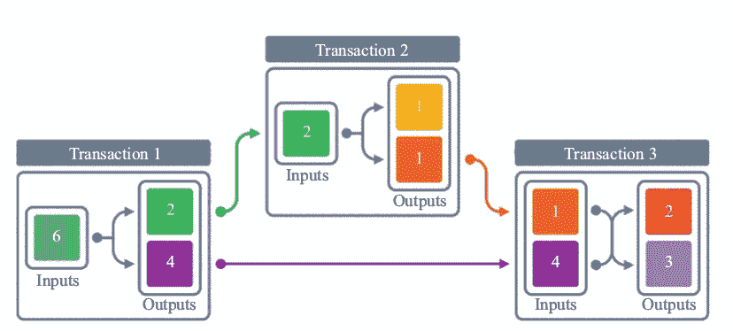
```
图 2.1。`UTXO` 模型中的交易。


与比特币使用的 UTXO 模型不同，以太坊使用的账户模型要稍微复杂一些。在以太坊中，账户地址是一个固定大小的 160 位字符串——即 40 个十六进制字符。

以太坊账户拥有：
1. 一个 Ether 余额（可能为空）；
2. 一个交易随机数（nonce），表示从该账户发送的交易次数；
3. 一个从 256 位字到其他 256 位字的映射映射，代表账户的持久化存储；
4. 给合约的编译代码（字节码）。将代码关联到地址仅适用于智能合约账户。

未关联智能合约以太坊账户称为外部账户（EOA）。从 EOA 发送交易需要对其进行签名以防止身份伪造。签名的工作原理如下：EOA 持有有一对公私钥。EOA 的公钥就是地址。使用私钥对交易进行签名后，该签名交易只能通过对应的公钥（地址）进行验证。因此，签名交易的接收者可以确保其来源。地址的私钥绝不能共享；公钥对区块链的所有参与者都是开放的。

交易的操作方式取决于目标账户的性质。向智能合约账户发送交易会触发函数执行（默认是回退函数）。向 EOA 发送交易则是向该地址转账某些数量（可能为零）的 Ether。

地址关联的字节码是用高层语言（例如 Solidity）编写的智能合约的编译版本。

为了允许其他账户与合约交互，开发者必须将编译后的合约部署到一个唯一的地址上。在以太坊中，开发者无法选择此类地址；它们是自动生成的。一旦部署，智能合约就是不可变的：它们的字节码无法被更改。

## 2.1.2 链接区块：让我们哈希吧！

### 2.1.2.1 区块链内容
区块链中的区块是存储信息的粗粒度单元。一个区块存储了：
1. 一个有序交易集合
2. 一个时间戳
3. 前一个区块的哈希值
4. 一个 Merkle 根（Merkle root）

哈希是哈希函数的输出值，可以被认为是从给定输入（在这种情况下是前一个区块）生成一个唯一表示。该哈希值将每个区块与前一个区块连接起来，形成区块链。唯一不存储前一个区块哈希的区块是第一个区块，也称为创世区块（genesis block）。

Merkle 根是 Merkle 树的根：区块中所有交易的二叉哈希树。Merkle 根有助于验证区块中的交易，并在稍后进行详细解释。

在某些区块链上，区块还存储一个额外值：区块随机数（block nonce）：一个数字，证明了投入了某些计算工作以获得将当前区块添加到区块链的权利。随机数出现在任何使用工作量证明（PoW）共识的区块链中，例如以太坊。我们将在本章稍后解释 PoW 共识机制。

除了最后一个区块外，区块可以是其他区块的父区块——所谓的子区块。图 2.2 提供了一个示例：区块 `n−1` 是区块 `n` 的父区块。也可以说区块 `n` 是区块 `n−1` 的子。

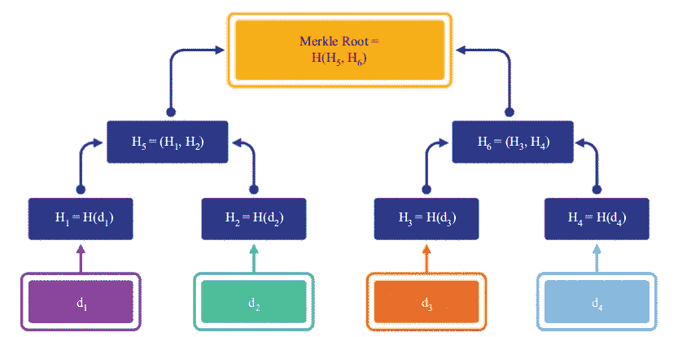

图 2.2 简化的区块链。每个 `bi` 是一个区块，其中 `Merkle Rooti` 是区块 `bi` 中包含的交易的 Merkle 根，且 `h(bi)=h(i||h(bi−1)||Merkle Rooti−1)`，其中 `x||b` 表示字符串 `x` 和 `b` 的拼接。图中未包含随机数。

### 2.1.2.2 密码学哈希
哈希是区块链中的核心概念。这并非巧合；哈希具有有助于构建和保护整个区块链的理想属性。

至少，哈希函数 `h` 有一个压缩的固定大小的输出。无论 `x` 的长度如何，输出 `y=h(x)` 都是一个常数大小，通常为几百位。例如，以太坊使用 `Keccak-256` 哈希函数——给定任意长度的输入，输出始终为 256 位。在实践中，哈希函数还有两个理想属性：

- **H1 确定性**：给定输入 `x`，`h(x)` 总是产生相同的值；
- **H2 高效性**：给定 `x` 计算 `h(x)` 是很快的。

虽然有用，但 H1 和 H2 属性不足以保证区块链的结构。后者需要使用密码学哈希函数。与普通哈希函数相比，密码学哈希函数具有五个额外属性，即：

- **H3 均匀性**：密码学函数 `h` 的输入值均匀地映射到可能的输出值集合；
- **H4 表面随机性**：对于任何两个不同的值 `xi` 和 `xj`，即使 `xi` 与 `xj` 相似，输出 `h(xi)` 和 `h(xj)` 看起来也是随机的；
- **H5 抗碰撞性**：要找到两个输入 `x1` 和 `x2` 使得 `x1≠x2` 且 `h(x1)=h(x2)` 是困难的；
- **H6 抗原像性**：给定适当的（此类函数被称为单向函数）输出大小的输出 `y`（例如以位给出），找到一个输入 `x` 使得 `y=h(x)` 是不可行的；
- **H7 抗二原像性**：给定 `x1`，找到一个 `x2` 使得 `h(x1)=h(x2)` 是不可行的。

在本章的剩余部分中，我们使用哈希函数和哈希术语来指代密码学哈希函数及其产生的输出值。抗碰撞性和抗二原像性是相似但并不等等的属性。

### 2.1.2.3 安全区块链
在理解了什么是密码学哈希函数后，让我们重新回顾区块链结构、区块之间的连接以及产生的安全保障。

正如我们之前讨论的，区块是通过哈希值连接的。由于哈希的随机性和抗碰撞特性，区块之间的连接是唯一的。因此，每个区块只有一个父区块。创世区块是唯一的例外——因为它是第一个区块，所以没有父区块。这种唯一性为防止数据篡改奠定了基础。

例如，假设一个攻击者想要篡改区块 `b`。被篡改的区块（假设为 `t(b)`）其哈希值将与 `b` 不同。由于所有连接到 `b` 的子区块都存储了它的哈希，如果要连接到 `t(b)`，就必须重新计算每个子区块的哈希。这反过来需要更改连接到 `b` 的子区块的每个区块的哈希。这个过程一直持续到 `b` 之后的所有区块都被更改。由于计算哈希相当廉价，重新计算它们的负担未必是不可逾越的。因此，攻击者可能仍有动机篡改区块链。

区块链的设计是为了防止这种类型的数据篡改。以太坊和比特币通过与每个区块关联一个难以猜测的数字来实现这一点。这个数字——区块随机数——本身存储在区块中。因此，为了篡改区块，攻击者被迫不仅重新计算哈希，还要计算每个后续区块的新随机数。因此，通过确保重新计算区块哈希必须要求攻击者花费大量的时间和计算能力，这些区块链防止了数据篡改。


在比特币和以太坊中，交易数据都是通过默克尔树（merkle tree）记录在区块中的。默克尔树是一种依赖于加密哈希函数的数据结构。简单来说，默克尔树有一个根节点，它是某组数据哈希值的哈希值。因此，更改数据（在本例中为交易）就会更改根节点。因此，默克尔根是区块中数据的简洁签名。

给定一组数据 `D`，默克尔树是一棵具有 `|D|` 个叶节点的二叉树：对应每个数据项 `d` ∈ `D` 的一个。每个叶节点存储其所代表的数据 `d` 的哈希值 `H(d)`，并扩展有一个子节点，该节点包含明文的 `d`（即哈希之前的）。树中的每个内部节点都是其（最多两个）子节点 `c1` 和 `c2` 的哈希 `H(c1,c2)`。由于这种构造，更改任何一个叶节点的值都会改变从树根到该叶节点路径的所有哈希值，包括最重要的根哈希值本身。默克尔树的一个示例所示图 2.3。


图 2.3. 存储四个数据的默克尔树。

检查数据是否存在于默克尔树是高效的。为了确定某个叶节点是否包含某个值，只需要该值的哈希值以及用于计算从叶节点到根节点哈希值的路径。由于具有 `l` 个叶节点的二叉树有 `log2(l)` 层，因此只需要 `log2(l)` 个哈希；这意味着当 `l > 2` 时，哈希值的数量严格少于所有存储的数据。

### 2.1.3 交易与区块挖掘

区块主要聚合交易。交易是对区块链全局状态的更新。此类更新可以改变某人的余额或智能合约中的变量。在后的情况下，通常通过调用目标合约的特定函数间接完成。

#### 2.1.3.1 交易有效性

当用户想要发起新交易时，他们创建交易，用私钥对其进行数字签名，并将其广播到构成区块链网络的节点。网络维护着一个未确认交易池，这些是已广播到网络但尚未包含在区块中的交易。某些被称为矿工的节点从该池中提取交易，对其进行验证，并将其包含在一个新的区块中。

如果资金发送者目前拥有这些资金、这些资金之前未被花费，且交易上的签名可以被验证，则该交易是有效的。调用智能合约调用（或部署合约，从而调用其构造函数——一个与智能合约同名的可选函数）的交易，如果在执行该交易时相同的区块链状态下，另一次执行会产生相同的结果，则该交易是有效的。

#### 2.1.3.2 交易费用

交易为用户提供了与区块链交互并更新它的的方法。由于执行交易需要一些计算工作，对于网络中的节点来说，它们具有隐性成本（例如电费）。因此，大多数区块链都会收取交易费。

交易费是给矿工验证交易有效性的奖励，也是在其他交易中包含某个特定交易的激励。矿工在区块中可以包含的交易数量有一个限制，这取决于区块可以存储的交易数量限制。由于矿工可以从未确认交易池中选择任何交易，矿工通常会选择费用最高的交易。由于这种激励机制，用户可以选择支付更高的费用，以最大化其交易被选中进入区块的概率，从而获得更交易处理。

或者，用户可能希望支付较低费用以节省资金，这可能导致交易被包含在新区块中的时间增加。


通而言之，PoW 算法的核心思想是寻找一个区块随机数（nonce），该随机数与提议区块的数据拼接后，其哈希值为一个低于某个阈值的小值。图 2.4 进一步详细说明了这一点。由于哈希值是随机的，无法预测随机数应该取什么值；最佳方法是尝试所有值。将阈值设置得足够小，就足以在找到合适的随机数之前，平均需要数十亿次猜测。一旦节点找到了随机数，其值就会包含在区块中，然后提交到区块链。当这种情况发生时，该区块被称为“已挖矿”。在以太坊中，平均每 15 秒就会挖出一个新区块 [\[41\]](#07_References.xhtml#umKIBlUKiCRMKtOr5lT8yJ9)。

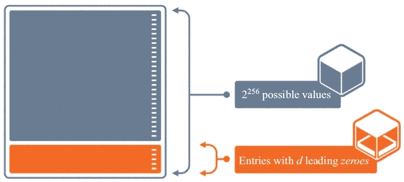

图 2.4。输出大小为 256 位的哈希函数有 $2^{256}$ 种可能的结果，每个结果与其他任何结果的概率都相同（加密哈希函数的属性 H3）。找到一个值 `n` 使得 `H(n||bi)` 以特定数量的前导 0 开头，需要不断猜测值，直到出现目标范围内的哈希值。

### 2.1.4.2 矿工奖励

除了手续费外，PoW 还包括额外的矿工奖励，因为猜测数十亿个哈希值是一个代价昂贵的过程。成功提交有效区块（带有有效随机数）的矿工将获得新铸货币的某些价值。这种奖励抵消了挖掘区块的硬件运行成本。目前，挖出一个新的以太坊区块会奖励矿工 2 ether。

PoW 参数（如矿工奖励和挖矿难度）不是固定的。例如，通常挖掘新区块的奖励会随着时间推移而减少。这种减少考虑了单位货币预期价值的增长，同时防止了新币在给定网络上的泛滥。挖矿难度往往随着时间推移而增加。这是为了抵消随着市场上推出的快速计算硬件性能的提升。

### 2.1.4.3 分叉 (Forks)

在挖矿过程中，多个矿工可能会在同一时间提议区块。在这种情况下，会发生分叉，区块链被分裂。因此，矿工在提议新区块时可能有多个链可以扩展。在发生分叉时，选择最长链 2（又称规范链）作为反映区块链当前状态的链。这是因为最长链是投入了最多计算努力的链。然而，偶尔会发生矿工将其区块添加到最终没有成为最长链的链中。这些区块被称为“孤立区块”（orphaned blocks）。让我们来看一个例子。

回到图 2.2，区块 `n'` 是孤立的；`block n−1←block n←block n+1` 是规范链。与规范链上某个父区块处于同一的孤立区块被称为“叔叔区块”（uncle block）。回到我们的示例，区块 `n'` 是区块 `n+1` 的叔叔区块。

孤立链上的矿工奖励（以及赚取的交易费）是没用的，除非该链明确奖励这些区块。3。同样，孤立区块中的交易在链明确奖励这些区块之前是不最终的。在发生分叉时，最长链是投入了最多计算努力的链。然而，偶尔会发生矿工将其区块添加到最终没有成为最长链的链中。这些区块被称为孤立区块。

### 2.1.4.4 矿工的困境

孤立链上的矿工奖励（以及赚取的交易费）是没用的，除非该链明确奖励这些区块。3。同样，孤立区块中的交易在链明确奖励这些区块之前是不最终的。

### 2.1.4.5 权益证明 (Proof of Stake)

除了 PoW 之外，还提出了其他共识算法，特别是权益证明 (PoS)。

## 2.2 区块链环境层

2.2 区块链环境层

区块链设计上有多个安全层，通过加密原语和经济模型来实现。智能合约由虚拟机保护，在某些情况下由其所编写语言的语义保护。

### 2.2.1 加密学

任何区块链的安全第一层都是其底层哈希函数。正如我们在上一节提到的，哈希函数在连接区块方面起着关键作用，而数字签名确保了交易不被伪造。

### 2.2.1.1 哈希函数

以太坊使用 Keccak-256 哈希函数 [\[28\]](#07_References.xhtml#uIiRjvMEdn6RJNrNEZZHB)，它将输入映射为 256 位固定长度。Keccak 是具有不同安全属性的族。需要注意的是，以太坊中的哈希函数经常被称为 SHA-3（定义在 [\[29\]](#07_References.xhtml#ubpIRgD5TAqO4SjBybhJps3)）。这是错误的。


给定一个输出长度为 `n`（位）的哈希函数，可以在 `2n` 时间内找到原像 5，在 `2n` 时间内找到次原像，并在 `\sqrt{2n} \=2n/2` 时间内找到碰撞。如果要采用碰撞攻击（即找到输入 `x` 和 `x’` 使得 `h(x’)=h(x)` 且 `x’≠x`），则必须选择输出长度，使得即使检查所有可能输出的平方根也是不可行的。因此，`n/2` 通常被称为输出大小为 `n` 的哈希函数的安全性位数。

### 2.2.1.2 数字签名

以太坊使用椭圆曲线数字签名算法 (`ECDSA`) [\[32\]](#07_References.xhtml#u45g74SBujAqDFPBCwmKkB)。数字签名用于验证交易的来源和完整性。如上一节所述，以太坊账户是一个账户的公钥。账户所有者对相应的私钥保。私钥的所有者可以使用其私钥签名某些消息 `m`，任何拥有对应公钥的人都可以验证所有者是否签名了 `m`。

适当的数字签名方案必须验证交易的来源源自其声称的来源。这防止了伪造，从而防止了盗窃。假设一个人的私钥没有被盗取，数字签名还可以证明该账户发送了这笔交易。

交易本身也必须通过 `ECDSA` 保护。这是通过对给定交易 `t` 的哈希 `h(t)` 进行签名来实现，确保内容不被更改。如果没有这种保证，从一个账户转移到另一个账户的 ether 交易可能会被更改为发送任意数量的 ether，而不是预期的金额。

### 2.2.2 漏洞

尽管上述加密原语提供了高水平的安全性，但区块链并非完美，可能会通过其他手段被破解。例如，由于智能合约的确切状态难以预测，时间戳可能会被修改，依赖随机性的智能合约可能会向矿工暴露漏洞，而矿工可能处于利用随机化过程的位置。

### 2.2.2.1 以太坊虚拟机

以太坊网络可以看作是一个去中心化的执行环境。网络中的每个节点都独立于其他节点执行；随后，节点对区块链应该是什么状态达成共识。当节点执行交易时，它们是在虚拟机的环境中执行的。以太坊中，这被称为以太坊虚拟机 (`EVM`)。

`EVM` 执行以太坊字节码。字节码是低级的、机器可读的代码，但它并不是为人类阅读设计的。相反，开发者依赖于 `Solidity` 等高层语言来编写智能合约，然后使用编译器将他们的合约翻译成机器友好的字节码。每个字节码指令都引用一个 `opcode`——这是 `EVM` 支持的操作数值标识符。每个 `opcode` 都有预定义的 gas 费用。每当交易耗尽 gas 时，交易状态就会回滚，且 gas 会被消耗。

从理论上来说，如果给予无限的 gas，`EVMs` 非常强大。它们的 `opcodes` 构成了一个图灵完备的指令集，也就是说，它们可以模拟任何图灵机的执行（更多信息请参见 [\[27\]](#07_References.xhtml#ufEcpHjlQrwY8SDDBAgNe74)）。这等同于说 `EVM` 能够执行任何其他计算机可以执行的程序。然而在实践中，情况并非如此——任何交易的执行都受到上限 gas 的限制。因此，大型计算是不可行的；即使是简单但缓慢的算法，例如尝试数独问题的每一个解，由于需要大量的计算而被证明是困难的。因此我们说 `EVM` 是准图灵完备的。

当执行交易时，执行的初始状态对于发起者往往是不可预测的。回想矿区块聚合了交易，对矿工如何排序交易没有限制。因此，交易可能被放在区块的末尾，其前面可能是另一个影响该交易所调用的合约状态的交易。例如，彩票智能合约可能为任意账户提供提取所有资金的机会。一个账户可能希望此类提款，但矿工也可能希望在区块中包含类似的交易。矿工可以对交易排序，使其自己优先，从而赢得竞争并获得智能合约中的资金。缓解这种威胁的方法描述在 [\[38\]](#07_References.xhtml#ucNigRjmk6LEiHGRjP) 中。

此外，在挖掘区块时区块时间戳可以被操纵。然而，如果智能合约的执行取决于区块的时间戳，矿工可能会修改它。这是可能的，因为区块链对时间戳有容忍。以太坊区块链的容忍度为 15 分钟 [\[24\]](#07_References.xhtml#uQfYagzXbgs5JR8zFvw29)。

`EVM` 是确定性的。任何区块之后的智能合约状态都是已知的，任何创建区块的矿工应该提供相同的输出——除非他们是恶意的或错误的。`EVM` 缺乏生成随机数的 `opcode`。因此，伪随机性通常是依赖非确定性合约的唯一选择。智能合约编写者必须小心确保即使在面对公开种子和数字生成函数时，合约的行为也符合预期。

另一种，随机性可以从未来的区块或隐藏的承诺中产生。可以通过获取未来区块的信息来生成随机数，这些是难以预测的。然而，未来区块的矿工仍可能从修改这些区块的数据中受益。智能合约可以通过要求参与者哈希一个随机数并发送该哈希值以及押金来获取随机数。在一段时间后，参与者被要求提交他们哈希的数字，否则将面临失去押金的风险；随机数可以作为这些提交值的函数使用。如果攻击者看到他人提交的数值（在区块链上以明文传输）结合他们自己的值会导致不利的结果，他们仍然可以牺牲自己的押金。

`EVM` 经过了充分测试，但并不一定有良好的文档记录。黄皮书 [\[24\]](#07_References.xhtml#uQfYagzXbgs5JR8zFvw29) 首次提供了对 `EVM` 中 `opcodes` 的描述；其他人随后形式化地描述虚拟机的语义 [25, 26, 33, 111]。后后这些来源提到，黄皮书包含错误和遗漏。考虑到 `EVM` 的复杂性，这并不意外。幸运的是，这些错误都没有导致智能合约执行的任何安全风险。

为了进一步识别 `EVM` 实现中的潜在缺陷，一些研究人员试图获取 `EVM` 的形式模型或形式规范。目前存在竞争性的模型。例如使用 K Framework [\[25, 111\]](#07_References.xhtml#ueJdeky7zPYwZG9L3mdRaxE) 和 F\* 证明助手 [\[33\]](#07_References.xhtml#uXPVeMt2nK2c5zkZTUQcWa9) 编写的模型。这些模型能够检查 EVM 内部的属性，以及在 EVM 上执行的智能合约的属性。


`K` 框架通过对 EVM 的形式化规范、EVM 测试套件的预期行为以及实际 EVM 行为建模，实现了一个可执行的 EVM 环境。`K` 框架允许对执行状态进行属性检查，从而使用户（以交互方式）检查其智能合约在部署到以太坊区块链上时，某些属性是否会保持不变。

[33 中使用的 `F*` 证明辅助器依赖于一套 EVM 字节码的完整语义。该语义是可执行的，并通过了官方 EVM 测试套件的验证。这种形式化方法允许编码各种安全属性和超属性（在多个合约上成立的属性），从而能够对运行在 EVM 之上的智能合约进行形式化验证。

### 2.2.3 Solidity 及其他语言

`Solidity` [36 是一种为了编写以太坊智能合约而设计的高级语言。`Solidity` 是命令式的语言，语法类似于 `Javascript`。其设计受到 `C++`、`Python` 和 `Javascript` 的影响。目前存在针对 `Solidity` 的一些自动化分析工具（例如 [34, 94）。

#### 2.2.3.1 Solidity 的特殊之处

`Solidity` 有一些特殊之处，如果不注意，很容易导致漏洞。

- 每一个合约属性都可以被他人读取，即使被标记为 `private`。私有属性无法被直接访问，但可以从区块链本身读取。
- 在合约中调用不存在的函数并不一定会导致错误，而是会尝试调用合约的 `fall-back` 函数——这被称为“对未知的调用”（call to the unknown）。
- 异常处理是另一个关注点；错误并不一定能跨越调用栈传播——这可能取决于目标函数的某些细节（例如，参见 `.call()` 与 `.send()` 相对于 `.transfer()` [55）。
- 在链上未占据完整 32 字节的类型可能会在未使用字段中存储任意数据（“脏位”）。
- 继承是该语言的另一个主要问题。由于 `Solidity` 支持多重继承，要确定最终调用了哪些函数是非常困难。这特别令人担忧，因为如果继承顺序不正确，可能会在最终合约中暴露错误。6

`Solidity` 并不是编写智能合约的唯一语言。在下文中，我们将简要讨论其他编译为 EVM 字节码的语言。还有一些正在开发中的语言在此未进行讨论（例如 `Flint` [37）。

#### 2.2.3.2 LLL

与 `Solidity` 不同，`低级 Lisp 类语言` (`LLL`) 是一种用于编写智能合约的函数式语言。正如其名所示，`LLL` 受到 `Lisp` 的深度影响——它是计算机科学中最早提出的函数式语言之一（起源追溯到 50 年代后期）。虽然 `LLL` 是以太坊编写智能合约的早期几种语言之一，但它并没有在开发者中获得广泛采用；事实上，该项目已基本被废弃。

#### 2.2.3.3 Serpent

一种扩展了一些高级构造的类汇编语言。不建议将其用于通用合约的编写。相反，当开发者需要执行低级操作码（opcode）操作时，应当使用它。

#### 2.2.3.4 Bamboo

`Bamboo` 是一种较新的智能合约语言，带有一些有趣的特性。使用 `Bamboo` 编写的合约作为状态机，可以避免重入（reentrancy）。这种语言在设计时考虑了安全性和可读性。例如，`Bamboo` 允许递归调用，这是被允许的。重入攻击（reentrancy）是其核心的一个广为人知的漏洞。

#### 2.2.3.5 Vyper

虽然处于实验性语言阶段，`Vyper` [35 在设计时充分考虑了安全性和可审计性。与 `Bamboo` 不同，`Vyper` 禁止了循环，其边界是变量。这使得它在计算上是安全的。`Vyper` 编译器由伊利诺伊大学厄巴纳-香槟城的 `Formal Systems Lab` 以及 `Runtime Verification Inc.` 进行形式化验证 [39, 40）。`Vyper` 的设计在很大程度上保证了人类可读性。该语言不支持继承。

***

第 3 章

***

设计选择、设计缺陷与经济学

智能合约的设计不仅影响合约的底层安全性，还影响终端用户对系统的预期属性。使用智能合约的系统必须仔细实现，以避免编程错误（例如重入），而且在设计时要考虑中心化和经济学问题。期望系统产生特定结果的用户应该相信，只要代码编写正确，系统就不会出现技术问题。

在本章中，我们将讨论在设计智能合约时可以做的选择，这些选择可能会影响外部问题（如代币价值或计算正确性），还会引入可能产生错误来源的复杂代码。与此类选择相关的风险在代币销售合约中进行了详细说明。关于智能合约治理协议经济学选择的更通用问题，将在章末进行高层次讨论。

### 3.1 设计选择](#contents.xhtml#c3.1)

设计选择是开发智能合约时所做的相对高层次的决策。设计选择可能包括：选择有上限或无上限的代币销售、通过给早期 ICO 贡献者奖励或平等对待所有贡献者、以及选择你的应用程序是中心化的还是去中心化的。智能合约作者会经历多种设计选择，这些选择对价值如何转移、谁可以转移价值甚至为什么人们会有动力使用特定的智能合约具有重大影响。

#### 3.1.1 中心化应用还是智能合约？

在设计智能合约之前要问的首要问题是，区块链是否是解决问题的正确方案。去中心化给定的网络应用是否有意义？可以说，2017 年 ICO 热潮期间提出的许多想法根本不需要区块链。许多应用程序如果作为中心化服务实施将运行得良好，在某些情况下，这些应用程序如果是中心化的性能甚至更好。那么，什么时候区块链是首选方案呢？在回答这个问题之前，让我们看看中心化网络应用的一些属性。


中心化应用由单一受信实体托管，该实体拥有硬件、软件以及用户数据。如果该实体消失（例如，破产），就没有其他人能继续运行该服务，特别是当它是一个专有应用时。中心化应用已经存在了几十年，因此，它们受益于在改进其可扩展性方面付出的巨大努力（例如，`MapReduce` [\[57\]](#07_References.xhtml#uq2y59wFJStilHUQK4UlvS8)），以及通过在线支付处理器与传统金融系统的无缝集成。另一方面，它们也容易受到审查、监控、停机和数据篡改。在决定中心化和去中心化应用架构之间进行权衡时，这些都是需要考虑的重要考量。

如果对第三方的缺乏信任是主要担忧，那么区块链是正确的解决方案：即当审查、数据完整性、透明度、持久性、互操作性或隐私是所构建软件不可逾越的特性时。拥有这些特性会带来一个重要的缺点：由于冗余的数据存储和计算导致效率降低。然而，正是这种冗余使得智能合约默认情况下是无法停止的。除非另有代码规定，否则只要网络上至少有一个活动节点，它们就会一直运行下去。

### 3.1.2 特权所有者还是缺乏所有权？

尽管运行智能合约的区块链在设计上是去中心化的，但智能合约的编写方式可以赋予某些用户特殊特权（如所有权），而不赋予其他用户。有效而言，这种设计允许在原本是去中心化的应用中实现权力中心化。这似乎与驱动区块链和智能合约开发与应用的去中心化哲学相冲突。然而，取决于智能合约的角色，中心化可能是一个不必要的风险，也可能是一个必要且理想的特性。智能合约作者需要决定在所有者手中应该保留多少对智能合约的影响。在下文中，我们查看两个重要的用例：代币合约和代币销售合约（即 ICO 合约）。

#### 3.1.2.1 代币合约

去中心化加密货币的前提是代表不受任何特定实体控制的数字资产。加密货币与中央银行发行和控制的传统法币不同。代币合约是去中心化加密货币的一个子集，代表可编程货币。它们是以太坊网络上智能合约的一大类——主网上已部署了超过 13,000 个代币 [\[59\]](#07_References.xhtml#uiub8gICtbTGiYi8TcxwhSB)。

一个典型的代币智能合约是一个分布式账本，维护账户和相应余额的映射（例如，参见图 3.1），并提供（某些）以下功能：（1）转移到另一个账户，（2） 允许另一个账户代表所有者转移代币，（3）铸造（创建代币），以及（4）销毁（破坏代币）。在我们的审计实践中，我们尽可能建议所有者对这些功能没有额外特权，并让加密货币保持真正的去中心化，以降低恶意攻击者破坏货币的风险。我们观察到某些设计师采取了相反的设计。表 3.1 总结了这些设计选择及其理由和可能的风险。

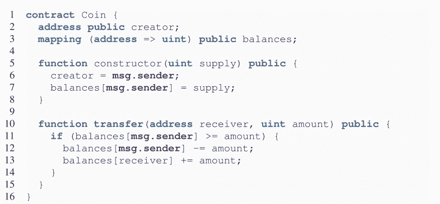

图 3.1 具有转移功能的简单代币合约。

表 3.1 代币智能合约中权力中心化的示例及可能的风险

| 限制 | 理由 | 恶意合约所有者的风险 |
| --- | --- | --- |
| 所有者可以随时暂停转移。 | 如果合约被黑，则停止代币转移。 | 防止用户使用其代币，使合约失效。 |
| 所有者可以对任意地址设置白黑名单。 | 限制谁可以转移代币。 | 审查。 |
| 所有者可以进行任意转移。 | 如果合约被黑，从恶意攻击者处恢复代币。 | 在任何时间从任何用户处没收代币。 |
| 所有者可以无限铸造。 | 针对进入的以坊按承诺速率进行手动代币销售。 | 在不遵守约定速率的情况下任意增加供应。 |
| 仅所有者可以销毁代币。 | 限制谁可以销毁代币。 | 用户可以通过将代币发送到虚假地址（如 `0x0`）来销毁代币，而不调整总供应量。

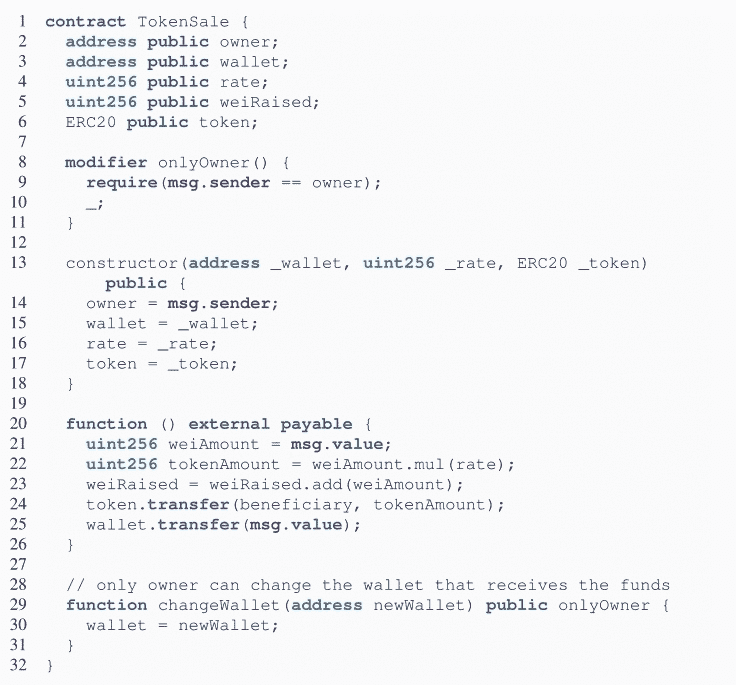

图 3.2 简单代币销售合约。

在代币销售期间，所有者可能对合约和代币拥有额外特权。这种权力中心化仅是暂时的，因为它仅涉及销售期间的代币销售合约。它还可能扩展到代币，以便在销售结束前启用或禁用某些功能（如转移），并可能用于将代币与销售合约耦合（例如，参见图 3.3）。这种耦合允许代币销售规则作为智能合约执行，以自动完成销售而无需所有者的进一步输入。当代币销售结束（通常从几秒到几周不等），所有者不再拥有特权，代币销售合约也无法再影响代币。

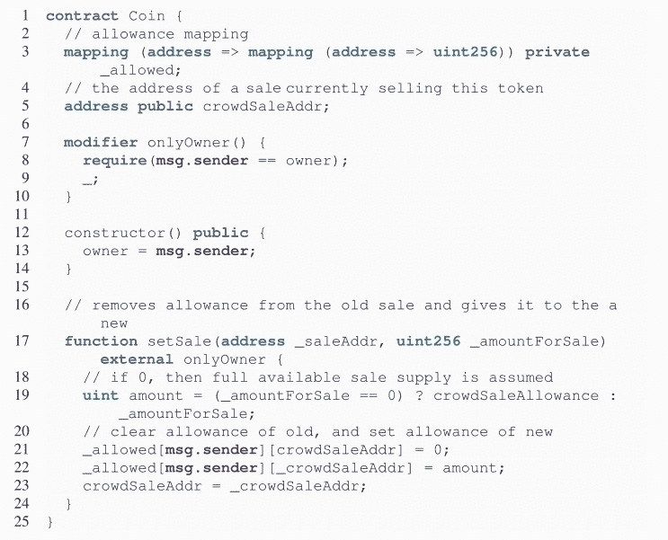

图 3.3 简单代币合约片段，包含仅限所有者调用的函数。

### 3.1.3 估值的确定性还是参与的确定性？

大多数代币销售合约要么被构建为上限销售（例如，参见图 3.4）或无上限销售（例如，参见图 3.2）。上限销售意味着以固定价格提供固定数量的代币，因此估值是固定的。这种方法的缺点是热门的上限众筹通常过度认购；其代币在几秒钟内售罄，少数个人能够参与（例如，`BAT` 代币在 30 秒内售罄）[\[60\]](#07_References.xhtml#u98Yxa84DaVUm7TEHI82sA8)。无上限众筹没有这个问题，因为接收的以坊没有上限：任何人都可以加入众筹。这种方法的缺点是参与者无法预知代币估值，因此无法知道他们将拥有总供应量的百分比。

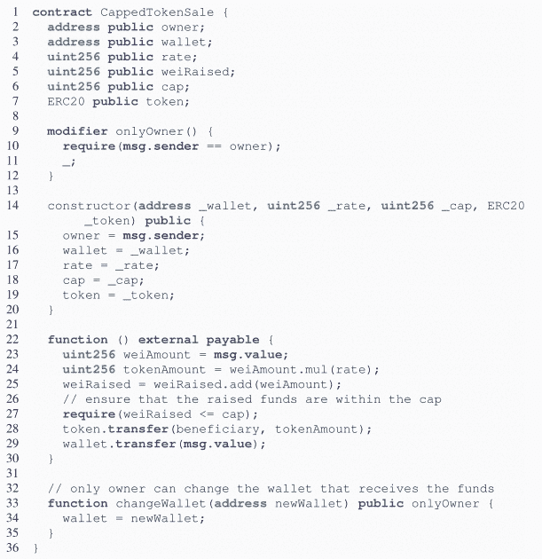

图 3.4 简单的上限代币销售合约。


交互式代币销售，又称交互式 ICO (IICO)，是一种能够保证估值确定性和参与确定性的协议。它通过多轮销售来实现这一点。在每一轮销售中，每个用户都被允许提议他们想要购买的代币数量以及对应的总限额上限（不同用户之间的上限可能不同）。因此，估值的确定性得到了满足，因为通过多轮销售可能需要几个小时（甚至几天）。此外，在每一轮中，如果筹得的总金额超过了某些用户的上限，其条目将被移除。用户允许在下一轮加入新的提议。当募集资金与上限达到平衡时，协议结束。

## 3.2 设计缺陷

通常，当我们考虑网络安全时，考虑的是密码学。然而，智能合约的安全性不仅是代码中的位和字节。一个智能合约即使表面上运行正常，也可能因为逻辑上的微小偏差而损坏。正如在 DAO 攻击中所示，几行代码改变了历史。

一切都取决于合约的要求和意图。本节将深入探讨“正常”合约中意外改变行为的各种漏洞。

### 3.2.1 渐进式代币销售

大多数众售合约默认一次性向所有用户释放所有购买的代币。但如果合约在特定时期内分批释放代币呢？这种设计会是什么样的？

首先，需要维护一个购买者列表。其次，还需要维护一个从购买者到其总金额的映射。需要两个函数：一个用于用户购买代币，另一个用于合约发放。这些代币销售合约的基本逻辑允许我们构建智能合约的框架。图 3.5 提供了实现此类代币销售的初步方法。

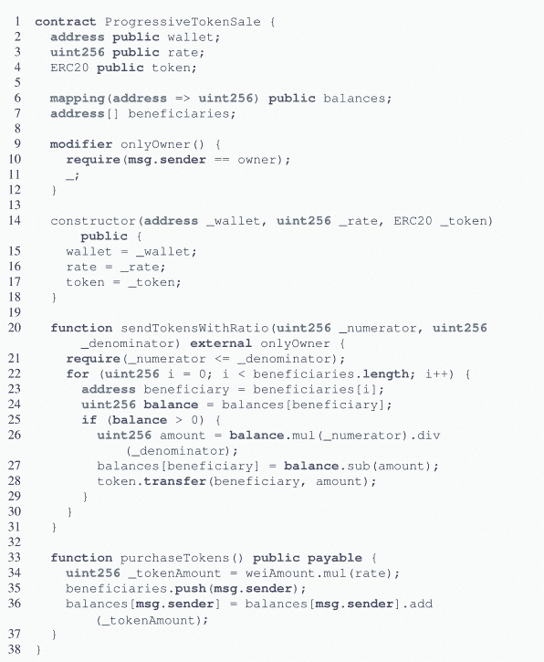

图 3.5。合约分批交付代币而非一次性交付。

显然，这样做很好。`purchaseTokens()` 包含了用户购买特定数量代币的逻辑，所有者可以通过 `sendTokensWithRatio()` 逐渐发放代币。众售结束后，`sendTokensWithRatio()` 函数查找 `beneficiaries` 数组，将每个受益者的余额乘以某些比例，从代币销售合约中减去结果，然后发送到实际代币合约。然而，这种逻辑存在一个重大缺陷，会导致结果偏离预期。

明确指出，此合约的目标是允许用户根据其提供的以太坊金额比例购买特定数量的代币。所有者根据自己的裁量调用 `sendTokensWithRatio()` 并传入任何比例（在 Solidity 缺乏浮点变量的情况下）。每个地址在调用结束时，应该只收到给定比例的代币。让我们深入研究该合约是如何微妙地违背预期的。

仔细观察 `purchaseTokens()` 函数。在该函数内部，每当用户进行购买时，他们的名字就会添加到 `beneficiaries` 列表中。这看起来是合理的——在每次调用时跟踪每个购买者的收益——但当一个用户进行多次购买时会发生什么？根据当前合约的功能，每次调用 `purchaseTokens()` 函数，用户的地址都会推送到 `beneficiaries` 数组的末尾。有了这些知识，我们能否构造出一个反例来证明合约违背了预期？

选取一个随机用户 Bob，他想从该合约购买代币。无论有意还是无意，通过调用 `sendTokensWithRatio()`，Bob 得到的将超过他的公平份额。假设 Bob 想购买 200 个代币。他用相应的以太坊金额调用 `purchaseTokens()`，合约将他的地址添加到 `beneficiaries` 列表中。几天后，他决定再购买 200 个代币，使其余额总额达到 400。他再次用相同的以太坊金额调用 `purchaseTokens()`，他的地址再次被添加到 `beneficiaries` 列表中。这里的问题在于？

假设所有者在 Bob 第二次购买代币后，决定通过调用 `sendTokensWithRatio(1,2)` 分发每个受益者的代币。根据 `sendTokensWithRatio()` 的设计，整个 `beneficiaries` 数组会被检查。提醒一下：对于每个成员，他们的余额乘以有效比例。乘积从他们的代币销售合约账户中减去，然后发送到实际代币合约账户。当 Bob 的地址在 `sendTokensWithRatio()` 的循环中第一次出现时，他的余额将是 400 个代币。从代币销售合约转移到代币合约的金额正好是 400 的一半，即 200 个代币。该金额从他的余额中减去，然后通过代币合约转给他。现在，Bob 收了 200 个代币，余额中还有 200 个等待中。然而，有一个陷阱：因为 Bob 调用了两次 `purchaseTokens()`，他的地址在同一次调用的 `beneficiaries` 数组中再次出现。在循环结束之前，他的余额会被再次加载，现在是 200。200 的一半（即 100）将从他的余额中减去并发送给他，这为 Bob 产生了第二次交易！循环结束，Bob 现在总共收到了 300 个代币。即使所有者只预期他收到 200 个，因为 Bob 的地址在 `beneficiaries` 列表中保存了多次，且 `sendTokensWithRatio()` 或其他地方没有检查重复项。虽然合约代码本身没有漏洞，但合约的设计违背了预期。

那么我们该如何修复这个问题？

一种可能的修复是在 `purchaseTokens()` 内部设置一个条件，在将地址添加到 `beneficiaries` 数组之前防止地址被重复添加。已知当用户第一次调用 `purchaseTokens()` 时，其余额为零。由此推导出，只有当其当前余额为零时，地址才会被推入数组，从而确保用户只被添加一次。

人们可能认为所有问题都已解决。然而，即使有了这项规定，仍然存在问题：如果狡猾的攻击者发送多次 `msg.value` 为 0 的 `purchaseTokens` 调用呢？他们的余额将保持为 0，但他们的地址每次仍仍被添加到列表中，偏离了合约想要的功能。为了缓解这种狡猾的攻击，必须同时满足第二个条件：`msg.value > 0`。这一条件将阻止攻击者反复向列表添加自己。


图 3.6. 一个正确实现的渐进式代币销售合约。

从比特位和字节到整体设计，检查智能合约实现的迭代过程进一步证明了安全性是一个光谱，而不是非黑即白的状态。为了巩固这一观点，这里有一个转折：信不信信你信不信，取决于所有者如何使用该合约，该合约仍然存在一个问题。诚然，这个问题可以被认为是一个边缘情况，并且可能超出了所有者的考虑范围，但这种异常功能确实存在。

如果所有者在众筹结束之前分配了所有代币，即调用了 `sendTokensWithRatio(1, 1)`，问题就会出现。如果发生这种情况，任何在所有者调用 `sendTokensWithRatio()` 之前调用过 `purchaseTokens()` 的用户，在向合约再次发起一次代币购买调用后，将再次添加到 `beneficiaries`（受益者）数组中，因为他们的余额已被所有者的调用重置为 0，并将满足被添加到合约的条件。要修复这个问题，可以在每次分配所有代币时清空 `beneficiaries` 数组。每种解决方案通常都会带来另一个被打破的假设和另一个需要考虑的安全漏洞。

### 3.3 密码经济学 (Cryptoeconomics)

密码经济学是区块链空间中一个广泛使用的术语，描述了区块链上密码协议的经济学。这是一个重要的概念，因为在该领域开发的许多协议并非证明证明安全的，它们之所以安全仅仅是因为攻击该系统的成本高到令人无法接受。

这种现象的第一个例子是比特币或以太坊等工作量证明区块链。尽管管理链运行的密码协议（如 `ECDSA` 和所使用的哈希函数）被认为是安全的，但这两条链仍然容易受到极富翁的参与者的攻击。回想第 2 章，这两条区块链都强制将新区块添加到规范链上。拥有无限资金来源的参与者可以利用这种行为。特别是，攻击者可以使用其无限的财富增加计算能力，以便他们能够计算出比网络其他部分总和更多的工作量哈希值。在给定时刻，攻击者可以开始从网络上的某个区块（例如 `bi`）开始挖掘额外的区块，并在他们挖掘的每一个区块之上挖掘新区块。通过保留这些新挖掘的区块，直到他们拥有了一条比公开规范链更长的足够大的链，他们就可以引发经济动荡。如果他们在网络上宣布自己的区块，这些区块会自动在网络上传播。未来的区块——即使是诚实参与者挖掘的区块——也要求被添加到这条新链中，因此在公共链上添加到 `bi` 的任何区块现在都变成了孤立区块（orphaned blocks）。特别是，这些区块中包含的用户资金转账以及这些区块的矿工奖励将不再有效。如果网络用户想要花费在新孤立区块中收集的资金，他们将无法再次做到。

如果攻击者拥有网络上用于计算哈希的 51% 计算能力，他们就可以引发问题。这是大多数工作量证明区块链面临广为人知的威胁，而且并不一定正在被积极应对 [61]。

虽然这种攻击是可能的，但不太可能发生，因为极其昂贵。要匹配比特币目前的矿工哈希算，需要几个服务器场，每个机场都配备数千个 ASIC 芯片或 GPU，这二者都是昂贵的。此外，随着更多诚实成员加入网络，攻击者所需的处理器数量也会增加。此外，如果网络是以这种方式组成的，诚实用户可能会放弃网络。在这种情况下，控制网络对攻击者来说并不理想：它挖掘的资金效用将更低，会有更少的人接受。

考虑到这一点，我们说比特币或以太坊这样的网络在密码经济上是安全的。它们存在缺陷，但不太可能发生，因为参与者是理性的，而且这种攻击的成本可能会高于任何收益。

密码经济学安全不仅限于第一层（区块链本身）。应用层也必须防止非理性参与者的攻击，特别是当去中心化参与者负责采取行动或履行其获得回报的特殊角色时。这些担忧通过用例得到最好的说明。

#### 3.3.1 TrueBit 协议的密码经济学

TrueBit [44] 是一种用于以太坊网络扩展计算规模的协议。由于以太坊网络的 gas 限制（见第 2 章），以太坊智能合约无法执行大型计算。此外，在 gas 限制内的某些计算如果 gas 价格较高，在链上计算的成本可能仍然很高。TrueBit 旨在通过激励参与者在链外执行计算来解决这些问题；即在他们自己的系统中进行计算，并仅将（正确的）结果提交到链。

在可信的环境中，这是易易的。如果用户无法在本地或链上执行计算，他们可以支付亚马逊 AWS 等服务，上传代码，并在适当收到结果。另一方面，如果无法信任 Amazon，这种情况就会变得困难：如果 Amazon 更改了计算环境怎么办？

TrueBit 包含了密码经济系统来抑制这种行为，这些系统通过用户押金和对小型计算的链上判定来实现。

在 TrueBit 中，用户 `S` 提交一个指定奖励的任务 `T`。具有计算能力的用户可以运行 `T` 并将结果哈希提交给 TrueBit 智能合约，同时提交押金。假设用户 `U` 提交了结果 `u`。另一个用户可以重新计算结果并决定是否想要挑战。如果他们得到相同的结果，就不会；如果他们得到不同的答案，他们应该挑战。这种用户被称为验证者，如果他们挑战，需要提交押金和他们的结果 `v`（注意 `v != u`）。此时 TrueBit 智能合约可以查询 `U` 和验证者 `V` 的小型程序状态，以找到分歧点：它们接收相同的输入，因此存在共同点，并且计算了不同的输出，因此产生了分歧。合约找到计算 `u` 和 `v` 的最大公共前缀，使得下一个单个操作的结果导致分歧。这个单个操作足够小，可以在链上执行，由于以太坊网络是可以信任的，因此结果被认为是正确的。提交正确结果的用户将获得另一个用户的押金，以及 `S` 承诺的奖励。

通过这个简单的描述，TrueBit 协议已经非常有趣且有用了。当然，它存在一些局限性：TrueBit 要求 `S` 提交符合某些属性的任务，例如，`T` 必须用 Rust 等特定语言编写，且 `T` 必须是确定性的。对于许多应用程序，这些局限性是合理的。然而，对协议操作的仔细分析（如前所述）揭示了一个细微的缺陷。


如前所述在 TrueBit 中，假设前 1,000,000 个任务由诚实的求解者计算，那么验证者将不再有动力参与其中。验证者只有在他们捕获到恶意求解者时才能获得奖励；如果没有恶意求解者，他们实际上是在进行无意义的重复计算，并且损失了调用交易将结果发送到协议合约时产生的 Gas 费用以及运行计算相关的能量成本。因此，随着时间的推移，理性的验证者可能会意识到资金正在流失，并停止参与该协议。此时，求解者的工作将将得不到检查，并被报告为正确（因为没有受到挑战），即使它是错误的。诚然，在只有一个诚实验证者的情况下，恶意求解者可能无法保证百分之百成功，但如果计算结果也符合他们的利益，他们可能愿意尝试一试。如果恶意参与者的数量多于诚实验证者，那么错误的计算将被标记为正确。

TrueBit 从扑克游戏中吸取了教训来解决这个问题。在扑克牌中，如果你从不诈唬，你的对手将一直等待手牌足够的情况下，而你会输得更频繁。如果你偶尔诈唬，就能让对手保持猜疑，他们无法根据你的行为来引导自己的下注策略。TrueBit 应用了同样的原理。它偶尔会要求求解者提交一个无效结果，以便使挑战变得合合理。此外，通过从所有贡献到巨额奖金的交易中收取费用，赢得这些特定强制性错误的验证者可以获得巨额奖励，这即使这些错误很罕见，也能激励他们在协议中保持活跃性。实现这些点的技术方法非常有趣，但在此处讨论过于冗长。更多细节请参阅 TrueBit 白皮书 `[44]](#07_References.xhtml#ukX9fgZIIf3ggBEznL89IHF)`。

总结来说，尽管 TrueBit 的原始描述（不包含强制错误）可能被正确实现，但系统用户最终可能会由于忽略了强制错误等机制而遭受选择带来的损失。去中心化应用的设计选择引入了攻击向量，这比利用智能合约本身的漏洞更为复杂。

### 3.3.2 Astraea 预言机的加密经济学

对于某些问题，我们拥有的唯一去中心化解决方案依赖于加密经济学才能正确运行。其中一个问题就是预言机问题：一种将现实世界中存在的信息引入区块链的协议 `[62]](#07_References.xhtml#u2Qx4Oasjjb444XZ9mqdnA4)`。简单的中心化服务是可能的：付钱让人将该信息的表示放在链上，如果他们值得信任，结果就是准确的。然而，在必须不断从链外向区块链导入信息的去中心化系统中，则需要一个去中心化的预言机。预言机也可以被视为 TrueBit 解决的计算问题的特殊用例，但这种类比很生硬。特别是数据的表示可能不是确定性的，而且涉及的计算并不一定是资源密集型的；因此，探索这一协议作为一个示例具有价值。

Astraea `[63]](#07_References.xhtml#ueniB32cGOrcOmZtjNggPpF)` 是依赖加密经济学正确运行的去中心化预言机。在该协议中，提交者提交一个非真即假的命题，并为确定其为哪种命题提供赏金。投票者对结果是真是假进行投票。认证者通过对结果的正确性投入大量质金来为结果提供额外支持。

投票者通过质押少额资金发挥作用，并获得少量回报。他们被随机分配对某些命题进行投票，并在分配命题之前进行质押。质押使他们承诺对某个命题投票，无论最终结果如何。如果他们投得正确（在协议结束时确定），他们将从投票正确的人的质押总和中获得份额，而这笔资金来自提交者提供的赏金。

认证者质押大量资金以证明结果的正确性。在协议结束时，拥有最大质押（来自投票者的存款和认证者的存款）的结果，除非出现平局。在平局的情况下，结果是未知的，投票者将失去他们的质押。通过仔细的参数调整，Astraea 使攻击者制造错误结果变得异常困难。其技术证明可以在论文 `[63]](#07_References.xhtml#ueniB32cGOrcOmZtjNggPpF)` 中找到。

# 第 4 章

## 常见漏洞

本章讨论了智能合约中的常见漏洞。所讨论的漏洞基于过去导致资产损失的现实攻击、我们对智能合约的人工审计经验，以及研究人员描述的理论攻击 `[81, 116]](#07_References.xhtml#uXbs3tN9wyUtnrr2p8)`, `[77]](#07_References.xhtml#uEdMaAygTLhx45n4ZfTAMH)`主要面向开发者，并大量使用代码示例来提供漏洞、利用方法和修复的具体案例。然而，我们尽可能用通俗易懂的英语解释漏洞的作用机制和影响，以便经理、高管和其他没有编程背景的读者仍能通过浏览本章获得价值。

### 4.1 深度解析以太坊交易

以太坊网络可以看作是一个状态机。状态的变化由用户提交到网络的交易触发。因此，智能合约的常见安全漏洞面向交易并不令人意外。为了正确理解这些漏洞和漏洞，我们首先需要详细了解以太坊交易。

每个以太坊交易都是一个数据负载，由多个编码并广播到网络的参数组成。这些参数包括：

- `nonce`：确定发送者在此之前广播了多少次交易。它唯一地标识同一发送者发送的交易顺序，并用于防止交易重复执行。
- `gasPrice`：与 `gas` 概念相关。Gas 是发送者执行修改区块链状态的交易时需要支付的虚拟货币单位。`EVM` 中的每条指令都规定了用户执行需要支付多少 gas。`gasPrice` 则决定了用户愿意为每个单位 gas 支付多少以太坊。交易的总以太坊价格通过 `gasPrice` 乘以所有执行指令的成本来确定。
- `data`：可选的字节字符串，编码了交易调用的智能合约方法以及传递给调用的参数。


* `value`: 一个可选的数字，决定了随此交易发送的 ether 数量。
* `chainId`: 以太坊网络的常量数值标识符，用于区分以太坊网络（ETH）与其他基于以太坊的网络（如以太坊经典 ETC）。ETH 的 `chainId` 为 1。
* `v,r,s`: 决定交易签名的加密值。通过这些值，可以推导出发送者的公钥，而从公钥可以推导出发送者的以太坊地址。

在创建以太坊交易时，还有两个信息非常重要，但它们没有编码在交易负载本身中：

* `to`: 以太坊网络中的一个地址，决定交易的接收者。如果交易的目的是创建一个新的智能合约，则接收者是特殊地址 `0x0`。另一个特殊接收者是用于销毁 ether 的地址 `0xdead`。
* `gasLimit`: 用户愿意为执行交易购买的 gas 数量。如果执行交易所需的 gas 总量超过 `gasLimit`，交易将失败，链的状态将回滚。

当用户生成交易时，他们会为上述所有字段指定 `value`，使用其私钥对交易进行签名，并将其提交到以太坊节点。节点验证交易有效并将其广播到网络。签名与广播的分离允许交易在离线机器上签名，并传输到不同的在线机器（例如通过 USB 或二维码）以进行广播。

当交易被广播时，它就变成了所谓的交易内存池（mempool）的一部分。矿工随后从内存池中选择交易，并使用工作量证明将其组织成区块。然后，新区块被添加到链中，交易成为区块链的一部分。

每个以太坊节点都维护网络的状态。该状态捕了每个账户地址到其 ether 余额、nonce、存储（storage）和程序代码（后两者仅供智能合约使用）的映射。当以太坊节点接收由矿工挖出的新区块时，它会读取该区块包含的交易并使用以太坊虚拟机（`EVM`）对其进行解释。这种解释改变了该节点所理解的以太坊状态。由于以太坊在其区块链上维持共识，状态变化会传播到网络，直到所有节点都维持相同的状态。

这一基础介绍使我们能够描述智能合约的一些常见漏洞和安全缺陷。我们将在接下来的章节中详细阐述 `EVM`、交易表示和执行的相关细微差别。请读者参考第 2 章或 [\[65\]](#07_References.xhtml#uAdYvXqPxV7cyNfKPmxJSJF) 获取关于以太坊工作原理的更深入解释。

## 4.2 整数溢出与下溢](#contents.xhtml#c4.2)

整数溢出和下溢在数字系统中广为人知的。数字被表示为有限长度的位序列。由于位数有限（在 Solidity 和 `EVM` 中限制为最多 256 位），可以表示的数字范围也是有限的。如果存储在变量中的数字大于最大值或小于最小值，可能会产生意外的后果（这些后果可以被利用）。

### 4.2.1 机制

人们可以通过想象里程表超过最大值来轻松理解溢出——它会回绕并从 0 开始重新计数（参见图 4.1）。当数字太大时，`EVM` 中数字的二进制表示也会发生同样的情况——它们会超过给定数据类型的最大值，并变成该类型的最小值。对于无符号整数，此最小值是 0；对于有符号类型，则是可表示的最负数。整数下溢是一个类似的问题，里程表向后滚动——它会回绕 0 到其最大值。这会在无符号类型中发生。对于有符号类型，表示将回绕最负数。

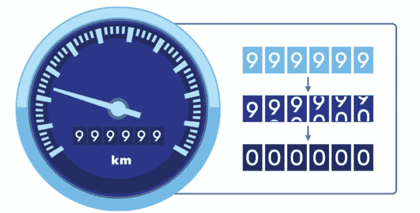

图 4.1. 里程表整数溢出的插图。

图 4.2 显示了一个易受整数下溢影响的智能合约。它展示了 `approve()` 方法的一种简单实现，该方法是 ERC20 代币标准要求的（将在 4.3 节深入讨论）。授权（Approval）是一种允许第三方用户从账户转账资金的机制，而 `approve()` 为此类转账设置限制。由于第 4.3 节讨论的原因，社区还建议实现 `increaseAllowance()` 和 `decreaseAllowance()` 方法。OpenZeppelin 框架 [\[66\]](#07_References.xhtml#usPkYXNnutvd3O6DrinuhS5) 目前在其 ERC20 标准的实现中包含了这些方法。

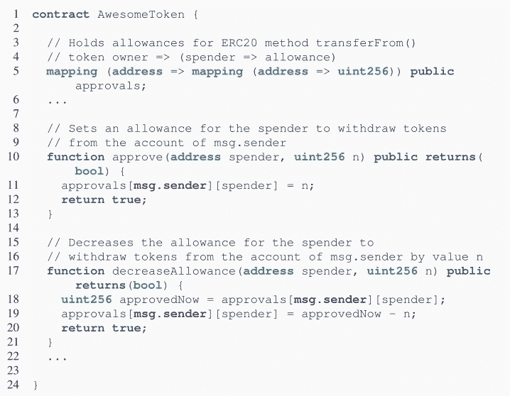

图 4.2. 易受整数下溢影响的智能合约。

如果支出者（spender）说服账户所有者发送一次使支出者额度低于 0 的转账，在这种实现中，支出者将获得一个天文数字额度，这可能让他们提取账户的全部余额。在这种情况下，拥有 1,000,000 个代币的 Alice 授权支出者 Mallory 15 个代币。随后，她将 Mallory 的额度减少了 16。代表 Mallory 额度的 `approvals[msg.sender][spender]` 中的值发生了下溢，并变为 `2²⁵⁶ − 1`。Mallory 现在可以提取 Alice 所有的代币。

#### 4.2.1.1 示例

整数溢出漏洞的示例所示于图 4.3。该智能合约代表了一个黄金交易业务的虚拟代币化。该业务持有金条和由代币表示的现金。用户可以将金条（记录在属性 `goldBars` 中）交换代币（记录在属性 `balances` 中），反之亦然。为了合约的简单性，我们假设汇率始终为 1:1。对于用金条换代币，合约暴露了 `sell()` 方法。用户可以指定任意数量的金条，合约将其作为其服务的佣金。

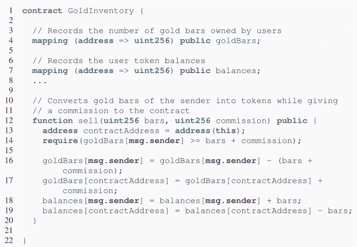

图 4.3. 易受整数溢出影响的智能合约。

注意，`bars` 和 `commission` 两个字段都是用户提供的参数。因此，它们可以是任意值。如果 Mallory 使用参数 `bars = 2²⁵⁶ − 1` 和 `commission = 1` 调用 `sell()` 方法，第 16 行的和将溢出并变为 0。因此，它将通过检查。结果是智能合约将在其内部状态中记录错误的余额。执行该方法后：

* Mallory 拥有的金条数量将与之前相同，因为 `bars + commission = 0`。
* 假设在执行此代码之前 Mallory 的余额为 0，现在它将变为 `2²⁵⁶ − 1`。
* 如果合约在执行代码之前拥有的金条少于 `2²⁵⁶ − 1` 条，它将额外获得一个作为佣金传入的金条；如果正好是 `2²⁵⁶ − 1` 条，则将拥有 0 条。
* 由于整数下溢，如果执行代码之前余额少于 `2²⁵⁶ − 1`，合约将假设余额增加了 1 个代币；如果正好是 `2²⁵⁶ − 1`，则为 0。

Mallory 现在可以随心所欲使用她天文数字般的余额。

#### 4.2.1.2 预防

避免整数下溢和溢出的最好方法是检查算术结果是否有效。例如，如果两个无符号整数 `a` 和 `b` 相加，结果 `a + b` 应该大于或等于 `a`。如果发生溢出，该属性就会被违反。


OpenZeppelin 框架包含了 `SafeMath` 库，该库提供了无符号整数算术操作的安全版本，能够确保结果的有效性（关于 `SafeMath` 库的代码，请读者参阅 OpenZeppelin 的 Github 仓库 [[66]](#07_References.xhtml#usPkYXNnutvd3O6DrinuhS5)）。开发者可以使用这些函数防止整数下溢和溢出。使用 `SafeMath` 算术函数实现的黄金库存合约的安全实现如图 4.4 所示。

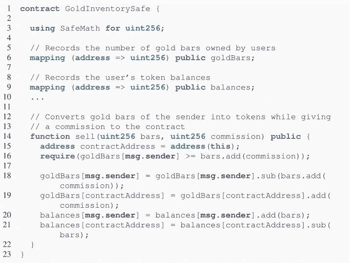

图 4.4 防止了整数下溢的黄金库存智能合约。

整数溢出和下溢漏洞可以通过自动化的智能合约分析工具进行检测。遗憾的是，这些工具往往会报告假阳性（更多细节请参阅第 5 章）。为了区分假阳性和真实问题，有必要对这种漏洞有充分的理解。

## 4.3 ERC20 中的竞态条件

由于 Solidity 和以太坊缺乏同步原语，交易可能会发生竞态条件。竞态条件最常见的可能性之一存在于 ERC20 标准中。

### 4.3.1 ERC20 标准

以太坊社区发布了称为 ERC 的认可标准。这些标准通常规定了具有某些标准用途的合约 API。最经常引用的 ERC 可能是 ERC20 [[64]](#07_References.xhtml#uS9w7bTa5Vv886RtIxZgvvG)，它已是以太坊网上发行代币的标准。ERC20 规定每个代币都支持以下方法：

* `totalSupply()` – 返回代币的总供应。
* `balanceOf()` – 返回账户余额。
* `transfer()` – 将代币发送到另一个地址。
* `transferFrom()`– 从一个地址向另一个地址发送代币。用于允许代表他人发送代币，例如，“存入”到合约地址和/或收取子货币费用。如果“发送方”账户没有通过 `approve()` 刻意授权消息发送者转移代币，则该命令应该失败。
* `approve()` – 允许花费者从消息发送者的账户中提款，可能多次，直到指定的金额。如果此方法被多次调用，它每次都会覆盖当前的额度。
* `allowance()` – 返回花费者仍被允许从所有者账户中提取的金额。

方法 `totalSupply()`、`balanceOf()`、`transfer()`、`transferFrom()`、`approve()` 和 `allowance()` 的签名和语义如图 4.5 所示。该标准还规定了用于日志记录的事件 `Approval` 和 `Transfer`。更多细节请参阅 [[64]](#07_References.xhtml#uS9w7bTa5Vv886RtIxZgvvG)。

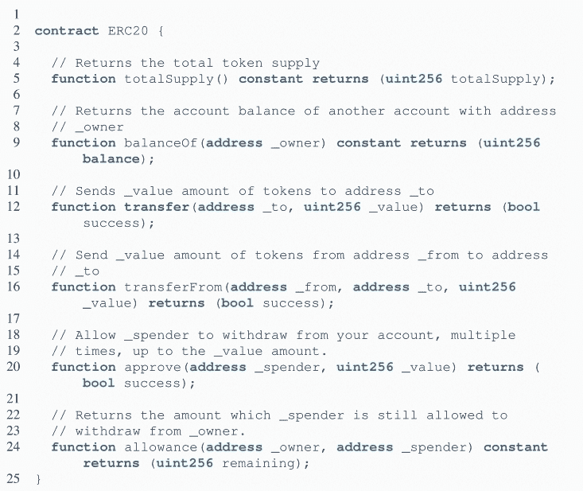

图 4.5 由 ERC20 标准定义的接口。

现在考虑图 4.6 所示的以下场景。Alice 拥有一个钱包并并允许 Mallory 提走 10 个代币，作为 Mallory 为 Alice 的项目实现的优秀代码的报酬，因此她批准了 Mallory 10 个代币。随后 Mallory 与 Alice 交流，说服她应该因为所做的出色工作获得 5 个代币的奖金。因此 Alice 将 Mallory 的批准额设置为 15 个代币。然而，就在她发送交易之前，Mallory 调用 `transferFrom()` 提走了她的 10 个代币。

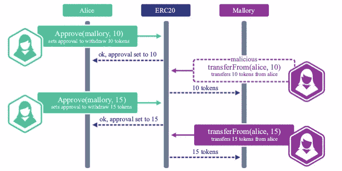

图 4.6 Mallory 的恶意交易利用了 ERC20。

这被称为双重提取漏洞。它是由于 Solidity 和以太坊缺乏同步原语导致的竞态条件。在没有额外努力的情况下，Alice 确保在修改额度的交易之间插入另一笔交易。这种双重提取漏洞。

### 4.3.2 预防

ERC20 标准众周知包含这种竞态条件，建议在设置新值之前将代币所有者的额度重置为 0。这是一种最佳实践，而不是标准的一部分。另一种常用的方法是实现增加和减少额度的特定方法。

### 4.4 重入

计算机科学家认为，如果一个过程在执行过程中可以被中断并重新启动（重入），则该过程是重入的。在以太坊智能合约的上下文中，重入可能导致严重的漏洞。最著名的例子就是 DAO 攻击。ERC827 标准也表现出这种漏洞 [[67, 68]](#07_References.xhtml#uRexOogadnpY)，目前被认为是不安全的。

### 4.4.1 机制

重入过程的一个示例可以是发送电子邮件。用户可以使用他们喜欢的客户端开始写邮件、保存草稿、发送另一封邮件，稍后再完成邮件。这是一个无害的示例。然而，想象一个用于转账的糟糕在线银行系统，其仅在初始化步骤检查账户余额。用户可以启动多次转账而不提交任何一个。银行系统会确认用户的账户对于每笔转账都有足够的余额。如果在实际提交时没有额外的检查，用户就可以提交所有交易并可能超过其账户余额。这是著名的 DAO 攻击中使用的重入漏洞的主要机制。

### 4.4.2 现实案例——DAO 攻击

DAO 是一个基于智能合约的流行去中心化投资基金。2016 年，DAO 智能合约积累了超过 150,000,000（当时）个以太坊。如果请求资金的项目收到了 DAO 社区的支持，该项目的以太坊地址就可以从 DAO 提取以太坊（图 4.7）。遗憾对于 DAO 来说，转移机制在更新内部状态并标记余额已转移之前将以太坊转移到外部地址。这为攻击者提供了通过重入从合约中提取超过其资格金额以太坊的配方。

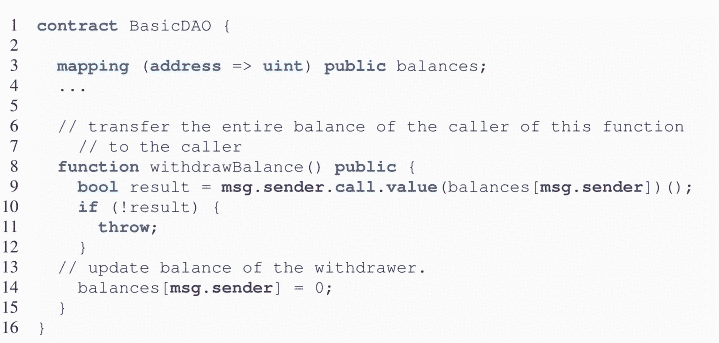

图 4.7 在 `withdrawBalance()` 方法中存在重入漏洞的简化 DAO 合约。

DAO 攻击利用了以太坊的回退函数来执行重入攻击。每个以太坊智能合约字节码都包含一个所谓的默认回退函数，其默认实现如图 4.8](#04_Chapter_4.xhtml#ch4fig8)所示。

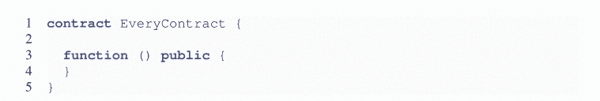

图 4.8 默认回退函数的默认实现。

如果开发者覆盖了默认实现，此默认回退函数可以包含任意代码。如果它被覆盖为 `payable`，则智能合约可以接受以太坊。该函数每当以太坊转移到合约时（见下文 `send()`、`transfer()` 和 `call()` 方法的描述），或者当交易尝试调用合约未实现的方法时就会执行。


在本书编写时，除了调用可支付方法外，Solidity 还支持三种在钱包和智能合约之间传输 ether 的方法。这些支持的 ether 传输方法有 `send()`、`transfer()` 和 `call.value()`。这些方法的区别在于它们传递给传输以执行其他方法（当接收者是智能合约时）的 gas 数量，以及它们处理异常的方式。`send()` 和 `call.value()` 在失败时仅返回 `false`，但 `transfer()` 会抛出异常，这会将状态回滚到函数调用之前的状态。这些方法总结在表 4.1 中。

#### 表 4.1. 传输 ether 的方法。默认情况下，使用 `call.value()` 时所有剩余的 gas 都是可用的，但开发者可以选择减少该数量。

|   | `address.send()` | `address.transfer()` | `address.call.value()` |
| --- | --- | --- | --- |
| 可调整 gas | 否 | 否 | 是 |
| Gas 限制 | 2300 | 2300 | 全部/可设置 |
| 错误行为 | 返回 false | 抛出异常 | 返回 false |

在 DAO 智能合约的情况下，ether 是使用 `call.value()` 方法传输的。这允许传输使用可能的 gas 限制，并防止在可能发生异常时回滚状态。因此，攻击者能够创建一系列递归调用，使用一个类似于图 4.9 中所示的智能合约从 DAO 中抽走资金。

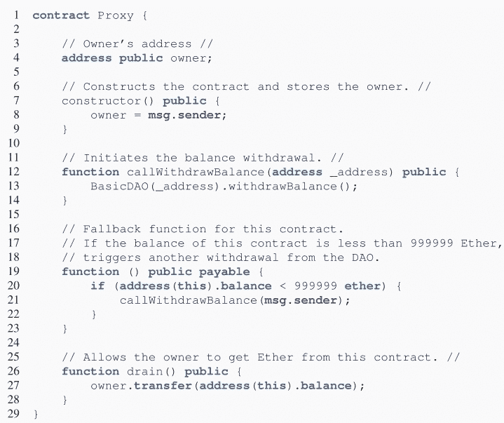

图 4.9. 用于利用图 4.10 中 BasicDAO 重入攻击漏洞的智能合约。

结果是以下的操作序列（也描绘在图 4.10 中）：

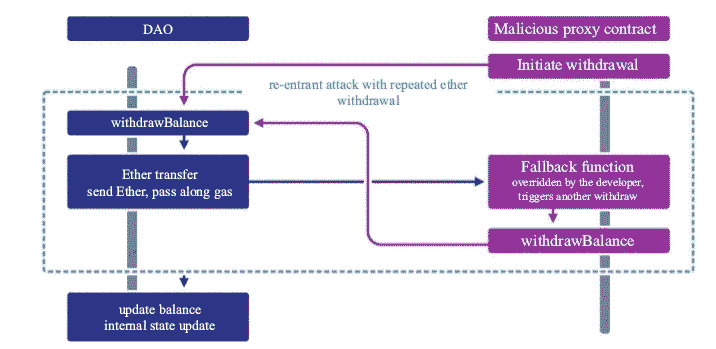

图 4.10. 重入攻击的插图。

1. 代理智能合约会请求一次合法的提款。
2. 从 `BasicDAO` 到代理智能合约的传输触发了回退函数（fallback function）。
3. 代理智能合约的回退函数会向 `BasicDAO` 请求另一次提款。
4. 从 `BasicDAO` 到代理智能合约的传输触发了回退函数。
5. 代理智能合约的回退函数会向 `BasicDAO` 请求另一次提款。
6. …

注意，代理智能合约的余额从未更新（这发生在传输之后）。此外，请注意，除非到代理合约的传输失败，否则永远不会抛出异常，状态也不会回滚。

### 4.4.3 预防

DAO 合约中的重入攻击可以通过多种方式避免。使用 `send()` 或 `transfer()` 函数代替 `call.value()` 将由于 gas 补贴较低而无法进行递归的提款调用。手动限制传递给 `call.value()` 的 gas 数量也可以达到相同的效果。

然而，有一种更简单的最佳实践，可以使任何重入攻击变得不可能。请注意 DAO 合约在 ether 传输后更新用户余额。如果是在传输之前执行此操作，任何递归提款调用都将尝试传输余额为 `0` 的 ether。这一原则通用的——如果在 ether 传输或方法内部的外部函数调用之后没有发生内部状态更新，则该方法对于重入漏洞是安全的。这使得重入漏洞相对容易被自动化工具检测（更多信息请参阅第 5 章）。

### 4.5 交易排序依赖性（TOD）与抢跑](#contents.xhtml#c4.5)

Ethereum 上处理交易的顺序由矿工决定。恶意的矿工可能会利用这种权力以有利于他们自己的方式对交易进行排序。

当交易提交时，它会进入内存池。矿工随后从内存池中选择交易并使用工作量将它们组织成区块。一旦矿工打包了区块，就会将其广播到网络。

这里需要考虑的两个风险：

1. 交易在打包之前在内存池中是可见的。
2. 交易顺序完全取决于矿工的裁量。

考虑图 4.11 中的合约，它允许匿名接收者安全传输 ether。创建者在创建合约时指定一个哈希。接收者通过提供正确的哈希来证明身份。

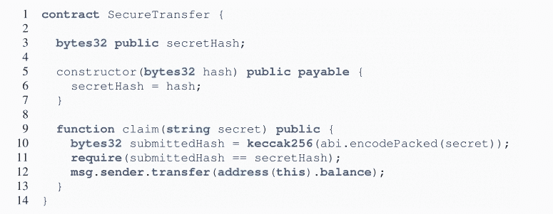

### 4.11. 用于安全传输的合约。

首先，考虑秘密值对多个用户已知的情况。他们可以通过提交交易来同时领取合约余额。真实的接收者将由组织交易到区块的矿工决定。如果所有交易同时提交，这最可能是 gas 价格最高的交易。

其次，考虑只有一个用户知道秘密值的情况。他们提交交易尝试领取余额。该交易首先由用户的 Ethereum 节点验证，然后广播到其他节点和矿工的网络。它现在位于内存池中等待被矿工选取并放入区块。这可能需要一段时间，特别是当网络拥堵时。

由于任何人都可以读取内存池，秘密是完全暴露的。任何用户都可以决定提交自己的交易并竞争合约余额，可能具有高得多的 gas 价格。再次处于第一种场景。

### 4.6 时间戳依赖性](#contents.xhtml#c4.6)

与交易排序的概念类似，矿工也控制着交易时间戳。在某些情况下，例如在治理骗局中，矿工可能会为了利益而操纵时间戳。

#### 4.6.1 机制

回想 Ethereum 上所有的交易都由矿工处理。矿工从内存池中选择交易。如果激励足够，没有什么能阻止他们随意从区块中排除交易，或轻微操纵有关区块的信息。成功挖掘区块的矿工提供区块打包的时间戳。时间戳需要是递增的，且不能离未来太远，否则会被网络节点拒绝。然而，为了允许某些时间同步延迟，网络具有某种程度的容忍度。这种容忍度在以太太皮书中没有明确规定 24，但根据流行的 Ethereum 节点的实现，目前估计高达 15 秒 78。因此，受到激励的矿工可能会操纵时间戳。

#### 4.6.2 真实案例：GovernMental

名为 GovernMental 的骗局是一个包含多个安全漏洞的智能合约。著名的漏洞是一个链表，其增长到遍历所需的 gas 超过了区块限制，导致该智能合约遭受拒绝服务（DoS）攻击。这在第 4.7 节中进行了详细讨论。对于本节而言，我们关注矿工操纵时间戳的可能性。


智能合约的简化版本如图图 4.12 所示。该方案的原理是用户可以投入以太坊，其中一部分将加入奖金池。任何用户都可以调用`resetInvestment()`方法，该方法将验证自上次投资以来是否已经过去至少一分钟，如果是，则将奖金转移给最后一名投资者。

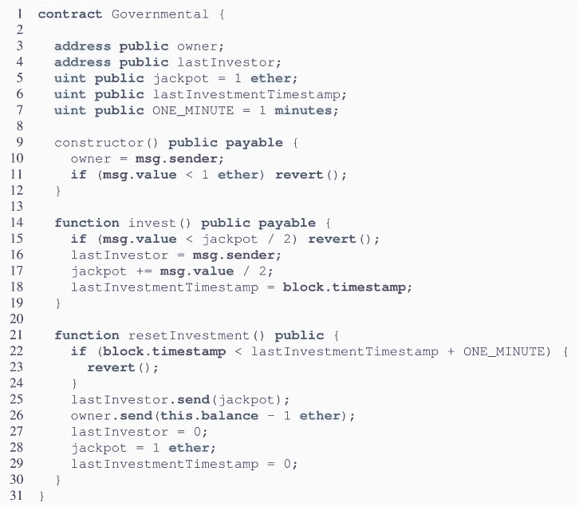

图 4.12。GovernMental 智能合约。

既是投资者又是矿工的人可以主动排除其他投资者的交易，其目的是使其无法超过一分钟的时间限制。更重要的是，成功的矿工会提供区块挖掘的时间戳。因此，一个挖掘区块的投资者-矿工可以对区块时间戳进行前推处理，从而获得奖金。

关于 GovernMental 所有漏洞的全面总结可以在[\[76\]](#07_References.xhtml#uaZGEDqczYhVhioBARz2zu4)中找到。

## 4.7 拒绝服务：超过区块 Gas 限制

除了单个交易的 gas 限制外，以太坊还有一个区块 gas 限制。这是针对整个区块的 gas 限制，由矿工设置。交易不能超过区块 gas 限制，否则将失败。这可以被利用来创建拒绝服务（Denial of Service）攻击。

某些情况下，智能合约需要向多个以太坊账户支付以太坊。一个例子是在所有代币发行后，向代币销售的参与者退还剩余的以太坊。考虑此功能的缺陷实现，如图图 4.13 所示。

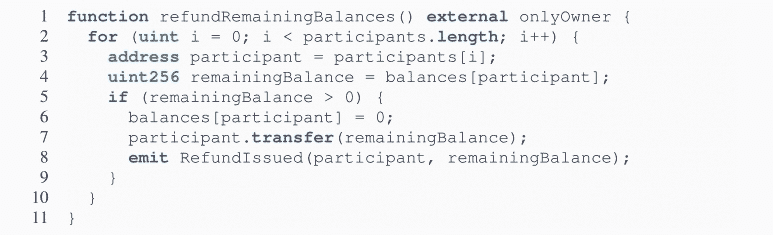

图 4.13。当数组过长时会导致拒绝服务的方法。

该方法遍历一个贡献者（在此例中为参与者）数组，并检查每个人的剩余余额。如果余额大于零，该方法将使用`transfer()`发放退款。该机制看起来很直观，但它存在一个严重问题。

如果数组变得过大，调用该方法会导致超过以太坊的区块 gas 限制。在之前显示的合约代码中，发送`refundRemainingBalances()`交易所需的 gas 量与参与者数组的长度成正比。向 1,000 名贡献者退款的成本超过了一百万 gas：在我们的快速实验中，它是 1138944。在编写本书时，以太坊主网的区块 gas 限制约为八百万。有了这个 gas 限制，当符合退款资格的参与者数量接近 8,000 时，就会超过此限制，调用抛出“block gas limit exceeded”异常，没有任何参与者能收到退款。所有者必须支付与方法调用相关的所有 gas 费用，无论成功与否。

尽管在没有恶意用户的情况下该合约的设计是有缺陷的，但它也制造了拒绝服务（DoS）攻击的可能。攻击者可以创建一个新的以太坊地址，以最快、最廉的方式成为合约的参与者，并重复此过程，直到参与者数组长到足以导致区块 gas 限制异常。当这种情况发生时，没有任何参与者将收到退款。

在某些情况下，合约所有者可能采取限制多账户参与的措施来防止这种漏洞，但总的来说，将现实实体与以太坊地址关联是一个困难的问题。许多区块链应用程序没有良好的机制来处理这个问题，而这种机制的实现和维护可能成本高昂。

除了 DoS 攻击外，恶意用户可能通过增加合约所有者操作合约的成本来造成损害。这对于发布定期付款的合约来说是一个高风险。

图 4.14 显示了一个示例，智能合约开发者意识到了区块 gas 限制问题，因此他没有一次性交付所有退款，而是创建了一个分批交付余额的合约。所有者可以使用两个新添加的参数：`startIndex`和`endIndex`来控制批大小和偏移量。同一交易中收到退款的参与者数量现在由合约所有者控制。

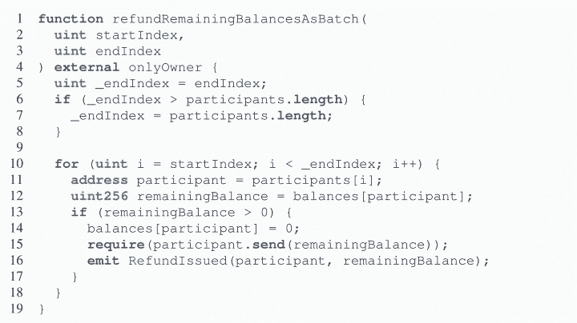

图 4.14。将迭代分批进行，以确保迭代不会超过 gas 限制。

尽管在没有恶意用户的情况下该合约的设计是有缺陷的，但也制造了拒绝服务（DoS）攻击的可能。攻击者可以创建一个新的以太坊地址，以最快、最廉的方式成为合约的参与者，并重复此过程，直到参与者数组长到足以导致区块 gas 限制异常。当这种情况发生时，没有任何参与者将收到退款。

尽管在没有恶意用户的情况下该合约的设计是有缺陷的，但也制造了拒绝服务（DoS）攻击的可能。攻击者可以创建一个新的以太坊地址，以最快、最廉的方式成为合约的参与者，并重复此过程，直到参与者数组长到足以导致区块 gas 限制异常。当这种情况发生时，没有任何参与者将收到退款。

尽管在没有恶意用户的情况下该合约的设计是有缺陷的，但也制造了拒绝服务（DoS）攻击的可能。攻击者可以创建一个新的以太坊地址，以最快、最廉的方式成为合约的参与者，并重复此过程，直到参与者数组长到足以导致区块 gas 限制异常。当这种情况发生时，没有任何参与者将收到退款。

尽管在没有恶意用户的情况下该合约的设计是有缺陷的，但也制造了拒绝服务（DoS）攻击的可能。攻击者可以创建一个新的以太坊地址，以最快、最廉的方式成为合约的参与者，并重复此过程，直到参与者数组长到足以导致区块 gas 限制异常。当这种情况发生时，没有任何参与者将收到退款。

尽管在没有恶意用户的情况下该合约的设计是有缺陷的，但也制造了拒绝服务（DoS）攻击的可能。攻击者可以创建一个新的以太坊地址，以最快、最廉的方式成为合约的参与者，并重复此过程，直到参与者数组长到足以导致区块 gas 限制异常。当这种情况发生时，没有任何参与者将收到退款。

尽管在没有恶意用户的情况下该合约的设计是有缺陷的，但也制造了拒绝服务（DoS）攻击的可能。攻击者可以创建一个新的以太坊地址，以最快、最廉的方式成为合约的参与者，并重复此过程，直到参与者数组长到足以导致区块 gas 限制异常。当这种情况发生时，没有任何参与者将收到退款。

尽管在没有恶意用户的情况下该合约的设计是有缺陷的，但也制造了拒绝服务（DoS）攻击的可能。攻击者可以创建一个新的以太坊地址，以最快、最廉的方式成为合约的参与者，并重复此过程，直到参与者数组长到足以导致区块 gas 限制异常。当这种情况发生时，没有任何参与者将收到退款。

尽管在没有恶意用户的情况下该合约的设计是有缺陷的，但也制造了拒绝服务（DoS）攻击的可能。攻击者可以创建一个新的以太坊地址，以最快、最廉的方式成为合约的参与者，并重复此过程，直到参与者数组长到足以导致区块 gas 限制异常。当这种情况发生时，没有任何参与者将收到退款。

尽管在没有恶意用户的情况下该合约的设计是有缺陷的，但也制造了拒绝服务（DoS）攻击的可能。攻击者可以创建一个新的以太坊地址，以最快、最廉的方式成为合约的参与者，并重复此过程，直到参与者数组长到足以导致区块 gas 限制异常。当这种情况发生时，没有任何参与者将收到退款。

尽管在没有恶意用户的情况下该合约的设计是有缺陷的，但也制造了拒绝服务（DoS）攻击的可能。攻击者可以创建一个新的以太坊地址，以最快、最廉的方式成为合约的参与者，并重复此过程，直到参与者数组长到足以导致区块 gas 限制异常。当这种情况发生时，没有任何参与者将收到退款。

尽管在没有恶意用户的情况下该合约的设计是有缺陷的，但也制造了拒绝服务（DoS）攻击的可能。攻击者可以创建一个新的以太坊地址，以最快、最廉的方式成为合约的参与者，并重复此过程，直到参与者数组长到足以导致区块 gas 限制异常。当这种情况发生时，没有任何参与者将收到退款。

尽管在没有恶意用户的情况下该合约的设计是有缺陷的，但也制造了拒绝服务（DoS）攻击的可能。攻击者可以创建一个新的以太坊地址，以最快、最廉的方式成为合约的参与者，并重复此过程，直到参与者数组长到足以导致区块 gas 限制异常。当这种情况发生时，没有任何参与者将收到退款。

尽管在没有恶意用户的情况下该合约的设计是有缺陷的，但也制造了拒绝服务（DoS）攻击的可能。攻击者可以创建一个新的以太坊地址，以最快、最廉的方式成为合约的参与者，并重复此过程，直到参与者数组长到足以导致区块 gas 限制异常。当这种情况发生时，没有任何参与者将收到退款。

尽管在没有恶意用户的情况下该合约的设计是有缺陷的，但也制造了拒绝服务（DoS）攻击的可能。攻击者可以创建一个新的以太坊地址，以最快、最廉的方式成为合约的参与者，并重复此过程，直到参与者数组长到足以导致区块 gas 限制异常。当这种情况发生时，没有任何参与者将收到退款。

尽管在没有恶意用户的情况下该合约的设计是有缺陷的，但也制造了拒绝服务（DoS）攻击的可能。攻击者可以创建一个新的以太坊地址，以最快、最廉的方式成为合约的参与者，并重复此过程，直到参与者数组长到足以导致区块 gas 限制异常。当这种情况发生时，没有任何参与者将收到退款。


以太坊的全局状态通过去中心化的共识来维护，该共识涉及应该执行哪些计算以及这些计算的输入是什么。如果节点有生成随机数的选项，将无法对全局状态达成共识。因此，以太坊上的所有计算必须是确定性的，且以太坊不能提供生成随机数的原语。

开发者经常尝试使用与区块链状态相关的信息[\[87\]](#07_References.xhtml#uxOyBzSeTNvstHWwhAjvsAE) 来克服此类原语的缺失。这最常见的是通过调用 `blockhash(block.number)` 获取当前区块哈希值。有时，开发者还会使用区块被挖掘的时间（内置的 `block.timestamp`），或者将这些信息作为某些生成随机数算法的种子。

此类做法建立在一个共同假设之上，即合约方法仅由人类调用。然而，这种观点是错误的，因为智能合约方法可以被其他智能合约调用。由于这些合约共享区块链的相同状态，它们可以在实际调用之前复制计算并生成所有的随机数。根据生成的值，它们可以决定进行此类调用是否有利。

### 4.9.2 示例

考虑图 4.17 中的合约，该合约允许两个玩家进入游戏，每个人拥有 1 ether。一旦发生，第一个进入的玩家预期调用奖励胜者的方法。胜者根据当前区块哈希产生：如果区块哈希为偶数，则第一个玩家胜，否则另一个玩家胜。胜者获得全部的 `balance`。

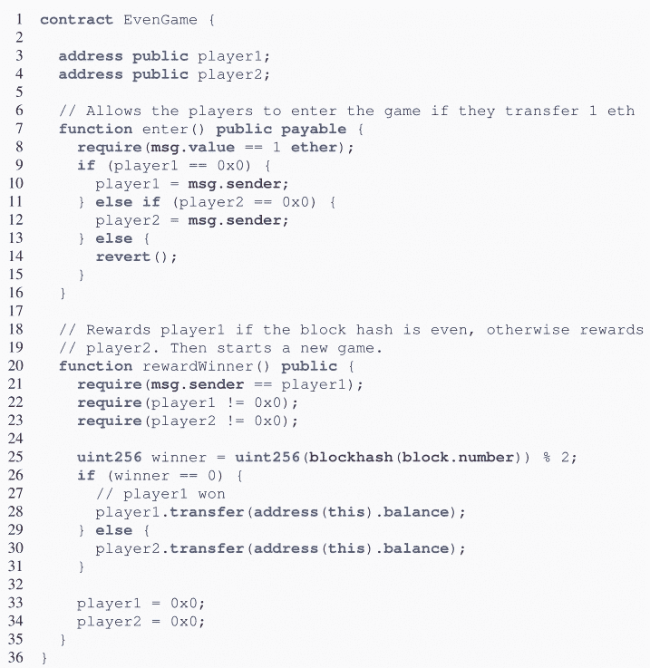

图 4.17. 一个尝试使用随机性确定胜者的游戏合约。

第一个玩家可以实现一个代理合约（参见图 4.18），允许既作为玩家注册，又调用 `rewardWinner()` 方法。此外，在调用 `rewardWinner()` 方法之前，合约可以检查区块哈希、谁将成为胜者，以及现在调用该方法是否有利，还是留到以后再说。

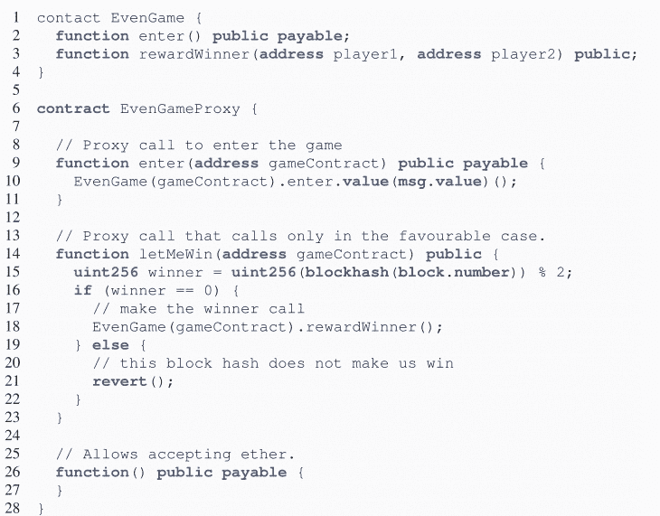

图 4.18. 一个可以进入图 4.17 中 EvenGame 且总是获胜的代理合约。

这种漏洞最近在 Fomo3D 游戏中被发现，该游戏承诺向参与游戏的用户提供随机空投[\[84\]](#07_References.xhtml#uACuT2kvhKfnMVBV7TfS7LC)。Fomo3D 使用多条信息生成随机数，但在相同的核心原理上失败了。我们将在 4.10.1 节中详细讨论 Fomo3D。

### 4.9.3 防止

到目前，还没有在链上生成随机数的正确方法。某些来源建议考虑跨链信息，例如比特币链的状态[\[78\]](#07_References.xhtml#uUftMH9JvwBNCkKVNNdEp27)，但这绝非易事。

在我们 EvenGame 示例或类似的抽奖中，另一种方案是在确定胜者之前记录用户的决策。在这种情况下，胜者可能基于链的某些未来状态的数据。

使用这种图 4.19 所示的方法，EvenGame 将强制玩家 1 等待若干数量的区块。这种技术在 \[76, 87] 中也有描述。

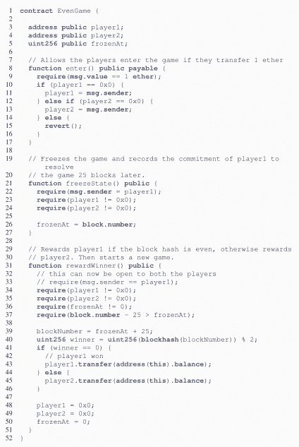

图 4.19. 一个缓解了随机数生成的 EvenGame 版本。


`Fomo3D` 智能合约于 2018 年 7 月 6 日发布在以太坊上并迅速流行。当其余额超过 17,000 ETH 时，以太坊社区开始关注 `Fomo3D` 对以太坊生态系统产生的潜在影响，并对其最终结果做出了一些预测。最可能的预测是，`Fomo3D` 将不断累积太坊，直到余额变得非常大，以至于矿池最终为了赢得游戏而发生合结。另一个值得注意的预测是，该游戏有潜力通过消耗所有现有的（或至少是绝大部分）太坊并将这些太坊转移给单个用户来摧毁以太坊网络。然而，上述情况均未发生。2018 年 8 月 22 日，该游戏通过对以太坊主网的一次精心攻击被攻破，获胜者获得了 10,469.66 ETH。

在 `Fomo3D` 第一轮期间发生了一些值得关注的事件，从智能合约安全的角度来看非常有意思。首先，为了鼓励参与者购买密钥，在每次购买密钥后，智能合约会将流入的太坊的 1% 转到一个专门用于空投的池中。每次购买超过 0.1 ETH，智能合约就会“随机”评估购买者是否有资格获得该池的空投。遗憾的是，这种“随机性”并不随机。智能合约并没有生成真正的随机数，而是根据从以太坊当前状态中获取的几个种子执行了确定性计算。

从第 4.9 节，我们知道在以太坊上是不可能生成真正的随机数的。随机数的存在将违背网络的基本原理。因此，以太坊上的所有计算必须是确定性的，随机性作为一种特征是不可能存在的。

由于这一局限性，`Fomo3D` 的作者决定通过对 `block.timestamp`、`block.difficulty`、`block.coinbase`、`block.gaslimit`、区块时间戳、区块高度和 `msg.sender` 进行计算，从区块链的当前状态中推导出“随机性”。当用户向网络提交交易时，这些值中的某些是很预测的（因为用户不知道交易将在哪个区块中被挖矿），但在执行交易计算时，所有值都是已知的。这意味着，如果用户创建一个代理智能合约，它可以先评估所有这些种子，复制产生“随机性”的确定性计算，并根据结果决定是否应该进行外部调用并触发交易。这一点已经被注意到了。该技术在图 4.17 和图 4.18 的智能合约中得到了演示。

为了防止这种可能的利用，`Fomo3D` 的开发者决定禁止任何非直接来自外部所有账户（即不是智能合约）的购买。出于这一目的，他们使用了 EVM 汇编指令 `extcodesize(_address)`，该指令返回与以太坊地址相关的代码大小。他们假设智能合约的代码大小永远不为 0，但正如第 4.10 节所解释，这一假设在智能合约的整个生命周期内并不有效。具体来说，如果从地址 `_address` 的合约构造函数中调用 `extcodesize(_address)`，它将返回 0。

这就是攻击者攻击 `Fomo3D` 空投功能所需的全部内容。通过实现一个在构造函数内部检查种子是否产生预设“随机”结果的智能合约，可以对该智能合约编程为仅在保证空投时购买密钥。如果空投价值超过购买密钥的成本，整个购买过程将导致正数的太坊流入攻击者的账户。

正如第 4.10 节和图 4.22 所示，防止某个方法被其他合约调用的方法是 `require(msg.sender == tx.origin)`，但可能有更好的方法来保护合约。在 `Fomo3D` 中实现空投功能的正确方法应该是采用如第 4.9 节描述的方法，即在特定区块提交用户决定，然后在稍后的区块解析结果。

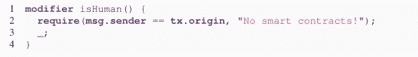

图 4.22. 此修饰符防止智能合约对该方法的调用。

围绕 `Fomo3D` 的第二个有趣事件发生在第一轮结束时。尽管普遍假设游戏将由合结的矿池赢得，但该轮由于一种不同的攻击而结束。`Fomo3D` 第一轮是由用户通过一个代理智能合约赢得的，该合约执行了一场利用以太坊矿工追求利润行为的系统性攻击。

当用户广播以太坊交易时，它会成为交易内存池的一部分。然后矿工从内存池中选择交易，将它们组织成区块，然后通过工作量将区块附加到区块链上。这里需要注意的关键点是，放入下一个区块的交易选择由矿工自行裁量。因为矿工受利润驱动，有价值的交易（即那些消耗大量 gas 且发送者指定了最高 gas 价格交易）将比其他交易先打包进区块中。此外，每个区块的 gas 最大限制是有额限制的（当前为 8000000）。因此，通过提交许多几乎耗尽整个区块并为矿工产生 gas 收益的交易，攻击者能够阻止其他交易被挖矿。

攻击者在区块 619196 中购买了一个密钥，然后刻意地在区块 619198 和 619206 之间导致网络拥堵，这足以让下一次密钥购买的时间限制过期。在攻击期间，每个区块的交易数量从约 100 个减少到不到 10 个。这种方式操纵交易的可能性在 Fomo3D 之前就有详尽记录；但它一直被认为是来自矿工侧的潜在攻击。以太坊社区也收到过警告，合结的矿工可能会主动从区块中排除其他参与者的交易，以此作弊并自己赢得游戏。然而，Fomo3D 第一轮的结束是外部用户首次利用追求利润且可预测的交易选择算法。此外，这种攻击只需要太坊来覆盖高昂的 gas 成本。

### 4.11 零余额假设

考虑图 4.23 所示令牌销售合约的回调函数片段。除非处于激活状态，否则交易将立即回滚，并拒绝太坊贡献。否则，`amountRaised` 将增加贡献金额（`msg.value`）。然后是一个 `assert()`，它检查合约余额是否高于贡献金额（`amountRaised`），否则抛出异常。


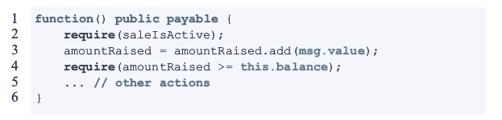

### 图 4.23. 一段误认为合约余额的代币出售合约。

智能合约所有错误地假设合约余额将始终等于或低于贡献金额。他们假设，除非所有人在销售开始后提取了部分资金，否则合约余额将等于贡献金额，导致余额低于筹集的金额。

然而，存在并非如此的情况。`selfdestruct` EVM 调用不会触发合约的回退函数（fallback function）（如 [[71]](#07_References.xhtml#uyydYy24t3YjG7SL9JDDzL6）所示）。在销售开始之前，攻击者通过销毁另一个合约并指定当前合约为受益者，强制地将某些以太坊移动到当前合约。为了便于示例起见，假设被销毁的合约余额为 15 Ether，因此强制移动到当前合约的金额也是 15 Ether。

销售开始后，普通用户向合约贡献了 10 ether。在这种情况下，`amountRaised` 为 10 ether，而 `this.balance` 为 10 + 15 = 25 ether。因此，断言 `amountRaised >= this.balance` 被违反，贡献被意外拒绝。这导致销售合约部分不可用，因为没有人可以贡献低于初始强制移动余额的金额。

使用合约地址作为挖矿的受益者也可以实现类似的效果。然而，这实现起来更困难，因为矿工必须付出更多努力并成功挖掘区块。

智能合约永远不应该依赖于初始余额为零的假设。没有任何办法阻止以太坊发送到以太坊账户。

#### 4.12 已废弃的调用栈深度攻击

调用栈深度攻击（Call Stack Depth Attack）是对以太坊调用栈 1024 层硬性限制的利用。该漏洞已通过 `EIP150` [[72]](#07_References.xhtml#uiehuIlmfaCtMstszDy2LmE)修复，但在此列出是为了教学和提供信息之目的。

考虑图 4.24 中的代码示例。`buyItem` 方法允许用户通过发送匹配或超过物品价格的以太从当前所有者处购买物品。当前所有者变为 `lastOwner` 并接收新所有者发送的全额以太。

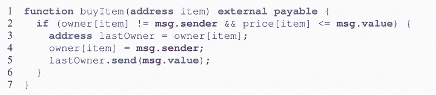

### 图 4.24. 容易受到已废弃的调用栈深度攻击的代码。

在 `EIP 150` 硬叉之前，图 4.24 中的代码容易受到调用栈深度攻击的影响。攻击者创建一个智能合约来代表他们购买物品。攻击者的智能合约方法被设计为调用 `buyItem` 方法之前递归地调用自己 1023 次。当该方法被调用时，`send` 方法未成功并返回 `false`，因为超过了调用栈限制（1024）。然而，在 `send` 调用之后没有对返回值进行检查，因此 `buyItem` 物品的所有权通过了转移。结果是，`lastOwner` 不再拥有该物品，并在 `return` 中意外地一无所获。

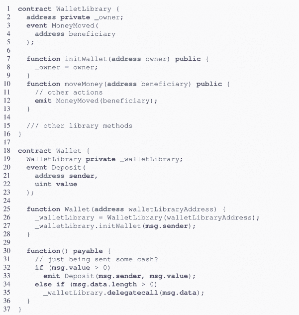

### 图 4.25. 允许意外钱包所有权转移的库。

`EIP 150` 硬叉引入了 gas 逻辑的变化，随着调用栈深度的增加，减少了允许的最高 gas 数量。子调用（嵌套）递归调用不允许消耗超过父级调用约 63/64 的 gas。因此，运行调用栈深度攻击的事务将在达到 1024 限制很久以前触发“gas 不足”（out of gas）异常。目前可能的最大调用栈大小约为 340。

#### 4.13 库的设计缺陷

某些以太坊合约实现了可以在其他合约重用的功能。示例包括链上数据结构、代币合约接口、多签名钱包等。此类合约或库通常在区块链上部署一次，然后被需要此功能的其他智能合约或客户端合约多次引用。

客户端合约使用 `delegatecall()` 方法与库进行交互。使用 `delegatecall()` 时，库代码在调用用的客户端合约的上下文中执行。这意味着在类执行期间访问或存储的任何数据都位于客户端的存储空间中，而不是库中。

虽然库提供了封装共享功能的明显优势，但存在一个重要的安全考虑因素。如果库存在安全漏洞，所有使用该库的客户端合约实例都面临风险。以太坊智能合约的不可变性加剧了这个问题：如果检测到或利用了漏洞，无法通过重新部署到相同地址来“修复”库。此外，许多客户端合约没有从一个库版本切换到另一个版本的方法，使得它们硬绑定到缺陷库版本上。

库攻击的两个常见示例是 Parity 多签名钱包攻击 [[20, 73]](#07_References.xhtml#ux8LJxOFB54rQgsSyUWtIOC)。这两个攻击都发生在 2017 年，分别是 7 月和 11 月。

第一个示例涉及一个允许意外所有权转移的库漏洞。该漏洞在 2017 年 7 月被利用，当时未知方设法访问钱包并移动资金 [[73]](#07_References.xhtml#C8SIFPksDQwT2hZNQ)。.25 中的示例说明了该漏洞。

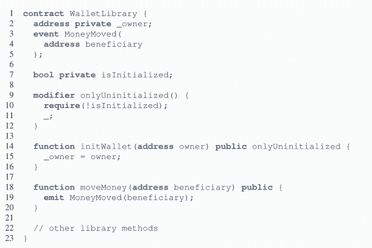

### 图 4.26. 合约的简化更新。

`WalletLibrary` 提供了 `moveMoney()` 和 `initWallet()` 方法。一个实际钱包——`WalletLibrary` 的客户端——通过部署 Wallet 合约实例创建。客户端钱包是“薄的”：它不包含大量逻辑，并将钱包操作（如 `moveMoney()`）委托给库合约。

在此示例中，Wallet 回退函数实现了“超类调用”机制。对 Wallet 未定义方法的调用转发到库合约。例如，用户在 Wallet 实例上调用 `moveMoney()`。Wallet 合约没有定义 `moveMoney()` 方法。因此，“捕获”回退函数执行并对库合约执行 `delegatecall()`。`msg.data` 作为参数传递：它包含了方法名——`moveMoney()` 以及传递给它的任何参数。随后库合约处理该调用，就像是直接发送给它一样。

攻击者能够以以下方式利用这种机制。攻击者创建一个带有攻击者地址的 initWallet() 交易并将其发送到钱包合约。Wallet 合约不包含 `initWallet()` 方法的定义。交易中没有发送以太坊，因此 `msg.value` 为 0，分支 `msg.value > 0` 被跳过。执行继续检查 `msg.data.length > 0`，这在当前情况下为真：`msg.data` 包含了 `initWallet()` 方法名。接下来，合约对库实例执行 `delegatecall()`，这实际上是尝试在 `WalletLibrary` 合约上调用 `initWallet()`。库包含 `initWallet()` 方法的定义，该方法被执行。由于没有确保未初始化的条件，该方法成功执行并将所有者设置为攻击者的地址。正如之前所述，`delegatecall()` 在客户端合约的上下文中执行库代码，因此，所有者的设置不是针对库，而是针对客户端合约。


2017 年 7 月 20 日，部署了一个新版本的库合约，解决了该问题。更新的核心内容体现在 图 4.26 所示的示例中。

添加的 `onlyUninitialized()` 修饰符防止了钱包的重复初始化。这使得重复调用 `initWallet()` 不再可能。

然而，更新后的库仍然是一个普通的 Solidity 合约。当使用 `delegatecall()` 操作进行调用时，之前所示合约充当库的角色，并使用客户端合约的上下文和存储空间。相比之下，当直接调用时，该合约仅作为一个普通的合约运行，拥有自己的所有者和存储。

这一事实在 2017 年 11 月 6 日被利用 [[20]](#07_References.xhtml#ux8LJxOFB54rQgsSyUWtIOC)。在更新后的库部署后，它保持在未初始化状态。后者并没有阻止钱包的工作，因为库是通过 `delegatecall()` 调的，该调用使用了客户端的上下文，而客户端已经过初始化。换句话说，对于单个客户端合约，`isInitialized()` 为真，但对于库来说为假。因此，可以初始化库并设置其所有者。

首先，攻击者通过调用库上的 `initWallet()` 来初始化库 [[74]](#07_References.xhtml#uLOxrxdmBy6LRdMLwZllbuA)。该方法允许设置合约的所有者，攻击者成为了库的唯一所有者。注意的是，无法从攻击者那里夺回所有权，因为新的修饰符防止了初始化发生后的所有权转移。

接下来，攻击者调用 `kill()` 方法，使用 `SUICIDE` EVM 指令销毁合约。这里不涉及访问控制违规，因为该方法对所有者开放，而攻击者实际上正是所有者。

由于库已不存在，任何对库方法的委托调用都将无法工作。这包括用于将资金转出合约的 `moveMoney()` 方法。因此，留在引用被利用库的钱包中的资金被“冻结”了。

### 4.13.1 预防措施

漏洞之所以能够发生，部分原因在于库是有状态的（stateful）。更好的做法是将库设计为无状态的（stateless）。库不需要拥有自己的状态，因为每当使用 `delegatecall()` 调用库时，改变的是客户端的状态而非库的状态。Solidity 支持 `library` 关键字，它更适合创建库 [[75]](#07_References.xhtml#uvIweiJYwooZpYeXKUK4Tt7)。

## 4.14 异常处理

King of the Ether Throne [[80]](#07_References.xhtml#uhuwtyjkiDB3sQAgK6ttiKC) 是一个运行在 2016 年 2 月 6 日至 2016 年 2 月 8 日之间的庞氏骗局 dApp，尽管该合约在区块链上仍然可用。合约的简化版本所示在 图 4.27 中（完整源代码可以在网上找到 [[82]](#07_References.xhtml#uojcoxFgwXWloQbaolHHWVH)）。该方案的原理如下：用户支付一定数量的 ether 来成为“以太之王”。如果另一个用户支付更多的 ether，他们就可以继位并成为新王。随后，其中部分 ether 将作为补偿支付给被替换的王。

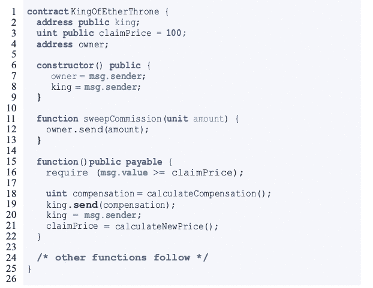

图 4.27. 基于 [[81]](#07_References.xhtml#uXbs3tN9wyUtnrrOTd2pSH8) 的 King of the Ether Throne 智能合约的简化更新。

回想一下 Solidity 中传输 ether 有三种方法，如第 4.4 节所示（表 4.1）。King of the Ether Throne 合约开发者使用 `send()` 将资金转给离开的王（图 4.27 第 19 行）。该方法接收 2300 wei 的小额补贴作为 gas 限制。此 gas 限制足以触发一个事件，无法执行任何其他代码。此外，如果传输失败，函数将返回 `false` 但不会回滚状态（revert）。

当合约尝试在基于合约的钱包补偿之前的王时，会无意中执行了他们的回退函数（fallback function）。如果该函数包含触发事件之外的任何代码，传输将失败，因为传递给调用的 gas 补贴太低。由于 `send()` 在内部通过返回 `false` 失败且不回滚整个执行，且合约没有检查返回值，新王可以在不补偿旧王的情况下继位。这导致合约余额增加，合约所有者可以以佣金的形式将其收割。

有多种方法可以正确地实现此合约。为了确保回退函数的正确执行，应使用具有足够高 gas 限制的方法调用（将所有可用的 gas 传递给此调用是最安全的）。然后，就由用户来提供足够高的 gas 限制。其次，合约需要检查调用的返回值，如果调用返回 `false`，则主动调用 `revert` 或 `throw`。

然而，即使采取这些预防措施也无法让合约完全安全。新王可以在 图 4.15 所示的回退函数中实现一个 `revert`。由于这种主动的 `revert`，向此类王传输 ether 的尝试将始终失败并回滚状态。这将导致针对合约的拒绝服务（DoS）攻击，因为王永远无法被替换。

正确实现 King of the Ether Throne 合约的方法是使用设计 [[70]](#07_References.xhtml#uSV8WMD5)，类似于 图 4.16 所示的 refund 方法。合约应在内部记录符合条件的王，并暴露一个供他们的方法。当问题被报告时，King of the Ether Throne 的运营者在其网站上发布了公告。他们进行了调查，并向符合条件的人退还了 ether，还发布了详细的事后报告 [[3]](#07_References.xhtml#uVhGYgztNEhs3F)。


EVM 将从 `n` 中“借用”高位位以确定完成地址所需的令牌数量。此数字 `n` 将在右侧用零填充，实际上相当于执行了左移。

EVM 将解释的表示形式为：

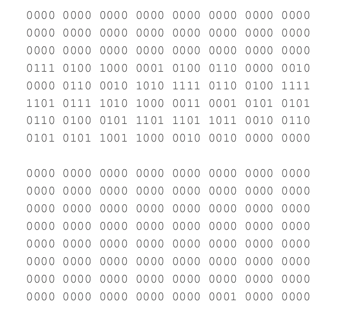

链上智能合约经常与离线系统交互。例如，中心化交易所可能会在离线数据库中维护用户余额账本，并将这些余额对应的以太存储在几个仅允许所有者（即交易所本身）交互的智能合约中。

当用户想要资金时，他们通过交易所的用户界面提交请求。系统检查其离线账本上的余额，如果余额充足，就会向智能合约发送交易，自动将以太传输到提供的 `address` 中。

想象一下，如果用户在这样的交易所开户，并提供了一个如之前所示省略了末尾零的地址，会发生什么？如果交易所的用户界面没有对地址进行验证，4，内部账本可能会为截断的地址记录非零余额。如果用户请求提取代币，余额充足的检查将通过交易所内部账本，但当参数打包成提交到以太坊的交易时，地址中位的缺失会导致位移，从而实际上增加了正在提取的代币数量。如果交易所智能合约本身没有清理地址并验证用户余额，它将传输错误数量的代币。

以太坊短地址漏洞曾被发现 [\[69\]](#07_References.xhtml#uhVtJLjFFqkAqIbWLci2cTB)，但从未在实践中使用。幸运的是，代币传输失败了，因为以太坊地址的缩短导致了巨大的位移，超过了合约的余额（实际上超过了代币本身的供应量）。因此，这种攻击仍然处于理论阶段。

以太坊短地址漏洞可能表现为离线系统的安全漏洞。然而，这里的核心信息是，智能合约永远不要依赖离线系统来验证余额等状态，并且永远不应假设调用该方法时的数据是格式良好的并能够正确解码为有效参数。

***

# 第五章

***

## 编写安全的智能合约

如前面的章节所示，在工程智能合约时可能会出现许多往往是细微的问题。使用不安全的编码模式（例如在调用另一个合约后写入状态变量）可能会导致重入攻击。或者，可能存在更深层的博弈论设计缺陷，例如无意的中心化。那么，开发者在编写智能合约时如何避免这些陷阱呢？

虽然这个过程最初可能令人敬畏，但有许多资源可以帮助防止这些问题。学术论文和博客文章经常描述新发现的漏洞、设计模式和智能合约开发的最佳实践。智能合约分析器可以自动检查常见的安全漏洞。各种工具可以帮助为你的智能合约开发健壮的测试套件。或者，智能合约安全专家可以手动审计智能合约以进一步确保正确性。在本章中，我们将介绍这些资源，以及开发安全智能合约的一些最佳实践。虽然开发没有“唯一的正确方法”，但不安全也没有“唯一的正确方法”。

### 工程流程与标准

遵循适当的标准是第一道防线。尽管这些原则某些是针对 Solidity 的，但许多是通用的，可以适用于任何项目。

### [通用结构]

大多数项目都在 `ganache` 等框架内开发，该框架允许本地部署和测试。最好通过包管理器导入依赖，而不是直接将文件克隆到项目中，例如 OpenZeppelin-Solidity [\[93\]](#07_References.xhtml#u6Chd6)。工具也可以用于自动评估代码的某些质量，正如第 5.2 节进一步讨论的那样。

理想情况下，在 `git` 等系统内部使用版本控制以促进协作。在典型项目中，会开发不同的分支以缓解生产环境中出现的问题。错误修复或其他任务在单独的分支中开发，并在通过拉请求（pull requests）经过开发者审核后合并到 `develop` 分支。`develop` 分支作为活动开发的主分支。在合并之前应该考虑某些检查：

* 新代码是否执行了想要的功能，无论是修复 Bug 还是添加了新功能？
* 如果适用，是否添加了新测试来运行新代码的功能？
* 代码是否符合格式标准（可以通过现成的 linter 检查 [\[90\]](#07_References.xhtml#uOsxR)）？
* 代码是否有充分的注释？
* 是否有更好的替代实现可以考虑？

如果代码满足所有要求，就可以合并到 `develop` 分支。在此之后，master 或 production 分支中的代码应该是准备好供公众使用的稳定版本，并在可行的情况下可以部署到主网。在这里应该考虑额外的审核，例如在主网之外的公共网络（如 Ropsten）上进行手动测试。


- 在调用外部合约时，确保在调用之前已经检查了所有前置条件并更新了状态变量。这有助于缓解重入攻击漏洞。此外，如果必须绝对避免重入攻击，请使用互斥锁（mutex）100。
- 使用 `require` 语句来验证函数输入和预条件检查，并使用 `assert` 来确保其他不变性始终成立。记住，`assert` 会消耗交易中剩余的所有 gas，而 `require` 会退还所有剩余的 gas。
- 确保重要函数是可暂停的（参见 101），以在在遭受攻击时能够减轻损失。
- 确保外部合约的任何 `call()` 或 `send()` 调用结果在返回时都经过检查。在大多数情况下，优于使用 `transfer()`，因为它在被调用函数失败时会抛出异常。
- 避免在涉及发送 ether 等关键操作的条件中使用时间戳，因为它们可能会被矿工操纵。
- 尽可能限制敏感智能合约的余额，这样当智能合约受到攻击时，风险将会降低。这可以通过手动将 ether 转移到安全钱包，或者在智能合约余额过高时限制向该合约转账来实现。
- 通过使用 `SafeMath` 函数避免整数溢出和下溢漏洞 102。
- 函数修饰符（modifiers）要明确，并选择允许的最严格的修饰符。

图 5.1。开发智能合约推荐的设计模式和实践。取自 98, 99。

### 5.1.3 文档

良好的文档允许系统的开发者和终端用户能够更好地评估您的智能合约的预期功能和正确性。即使代码中没有明显的漏洞（例如重入漏洞），代码的语义也可能无法反映智能合约编写者的意图。在智能合约领域，文档通常以白皮书、需求和规范文档、README 文件以及代码级注释的形式存在。

需求文档规定了智能合约所需的内容。这些需求应该包括功能性需求和非功能性需求。功能性需求规定了智能合约在各种场景下应该做什么。例如，一个 ICO 智能合约的功能性需求可能规定，在第一轮融资期间购买代币的投资者将获得投资 200% 的奖金。非功能性需求规定了对智能合约的其他质量或属性的要求。例如，非功能性需求可以规定智能合约不允许任意用户更改所有者。

规范文档详细阐述了智能合约（以及周边基础设施）将如何设计和开发。这些可能包括描述 dApps 等其他系统如何与智能合约交互的图表、将暴露的 API 信息，或者关于智能合约如何与其他智能合约或库链接的细节。

白皮书通常包含与需求或规范文档许多相同的细节，但通常面向更广泛的受众定制，并包含与代码功能无关的细节。因此，最好在白皮书之外准备额外的技术文档。项目还应该在代码仓库中包含 README 文件，以便终端用户快速熟悉使用您的 dApp 或智能合约。这还应该包含供开发者进一步研究项目的说明，例如运行测试套件的说明。

在代码层面，每个合约和函数都应该根据其预期功能进行注释，并在适当的情况下说明输入和输出变量的含义。这应该足够明确，以至于变量的预期值不会产生歧义。

### 5.2 测试

上述所有模式讨论了大多数智能合约项目应该遵循通用指南。然而，确保您的代码遵循所有指南并不能保证它正确实现了项目的预期语义。换句话说，即使没有前面提到的可能的攻击，也不意味着代码按照开发者的意图运行。额外的手动测试对于确保代码的正确性非常有用。

目前，开发智能合约最常用的环境是 trufflele 项目 89。由于关于 truffle 开发和测试的资源丰富，我们在这里不再深入探讨。还有一个名为 `solidity-coverage` 的工具可以评估测试套件的代码覆盖率 93。它可以与 `truffle` 良好交互，并快速评估测试套件的行覆盖和分支覆盖率。

考虑图 5.2 中的代码片段。该合约编码了一个计算谜游戏，如果用户提交了谜问题的正确答案，他们将获得奖励。`owner` 和 `reward` 作为状态变量存储，另外两个状态变量 `multiplier` 和 `locked` 用于编码后续 `guess` 函数的逻辑。`set_owner` 函数允许调用者将自己设置为所有者，只要尚未设置过。所有者可以通过 `destroy_puzzle` 函数结束谜题，从而将奖励发回所有者。最后，默认的可支付回调函数有两个主要的执行路径。如果合约所有者调用该函数且谜题尚未解决，则所有者可以使用新值更新奖励。否则，任何其他地址都可以提交答案，如果符合算术约束，合约将奖励发放给发送者，并锁定谜题以宣布已解决。

```
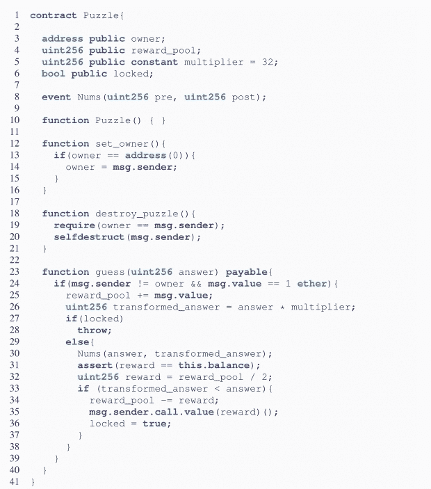
```
图 5.2. 一个允许用户猜数值的示例合约，猜中的者将获得一半的押金作为奖励。


有两种主要的测试类型需要考虑。单元测试（Unit tests）用于执行源码合约的各个部分（例如函数）。为了妥善测试函数的完整行为，应该考虑不同的输入和合约状态。在我们在图 5.2 中运行的示例中，为了执行 `guess` 函数的功能，我们可能会编写如下测试：`msg.sender` 为所有者或不是所有者、`msg.value` 等于 `1 ether` 或不等于、答案是一个非常小或非常大的数字等。端到端测试（End-to-end tests）旨在执行从“开始”到“结束”的应用程序完整行为。假设我们正在开发一个众筹合约，该合约有一个给定的开始时间、结束时间、一个指示必须接收多少 ether 才能宣布众筹成功的资金目标，以及一个在未达到资金目标时的退款阶段。一个端到端测试场景可能首先确保在开始之前没有用户可以参与众筹，随后是一个资助期，期间的贡献金额不足以达到资金目标，最后是确保所有贡献者都能获得其贡献的退款测试。

在评估测试套件时，两个常见的质量衡量标准是行覆盖（line coverage）——即某些测试用例执行过的代码行百分比；分支或路径覆盖率（branch or path coverage）——即已测试分支（例如 `if/else` 路径）的百分比。通常建议在智能合约测试套件中追求 100% 的行和分支覆盖率，但必须是，覆盖率本身并不是测试套件质量的良好衡量标准[\[103\]](#07_References.xhtml#uEXKTVeKoWDekBQKuI92dr2)；可能需要经过更深熟设计的测试。

## 5.3 使用符号执行进行自动化智能合约分析](#contents.xhtml#c5.3)

由于智能合约中存在无数潜在的安全问题，要确保智能合约完全正确是非常的。此外，即使是覆盖率极高的测试套件也可能错过导致你的智能合约变得毫无用处的关键漏洞。幸运的是，已经开发了复杂的分析器来自动检测一些最常见的（且灾难性的）漏洞。在这里，我们将讨论几种智能合约分析的方法及其优缺点，最重要的是，你如何利用它们来创建更安全的智能合约。因此，我们只关注公开可的分析器。这并不是为了全面介绍这些工具如何工作（这本身就可以是一本书），而仅仅是为了提供关于工具如何运行的实用知识，以及如何最好利用其结果。

### 5.3.1 程序分析与符号执行入门

简而言之，寻找漏洞的工具（或分析器）寻找会导致程序进入错误状态的执行轨迹。这些可能是更“通用”的漏洞，例如由特定输入参数触发的断言语句（assertion statement）违例，或者是领域特定的漏洞，例如通过一系列函数调用窃取合约余额。不同的分析器倾向于针对不同类别的漏洞。

分析的一个关键组件是确定是否存在某些输入会导致这种错误状态（可行性）。考虑图 5.2 中的 `guess` 函数。假设我们想确定第 30 行的 `assert` 语句是否可以被违反。为了首先到达该行，交易的参数必须满足第 24 行的条件，`locked` 必须仍为 `false` 以避免第 29 行的 `throw` 语句，最后我们必须实际上违反 `assert` 中的条件。因此，必须同时满足以下约束：

```bash
msg.sender != owner && msg.value == 1 ether && !locked &&reward != this.balance
```

只要某个非所有者用户在谜题解锁前发送带有 `1 ether` 的交易，前三个约束显然是满足的。最后一个约束需要额外的分析。如果到此为止对 `guess` 的每次调用恰好等于 `1 ether`，那么 `reward` 应等于 `Puzzle`#05_Chapter_5.xhtml#footnote-01。从非所有者账户以 `1 ether` 的值发生此类交易后，由于条件是由 `if-statement` 而非 `require`，这将触发断言语句。

通常情况下，这些逻辑约束可以通过被称为可满足性模理论（SMT）的求解器工具来解决。SMT 求解器能够自动确定如所示的公式是否可满足，即是否存在一个同时满足所有约束的变量赋值。如果是，求解器为每个变量分配一个具体值。否则，求解器返回公式不可的证明。由于这种原因，SMT 求解器形成了许多符号分析器的骨干。SMT 求解器 `Z3` 是目前智能合约符号分析器中最常用的求解器[\[97\]](#07_)。

符号分析器通过在考虑程序的每条路径时构建逻辑公式来工作。这些分析器的“符号”方面源于在遍历这些路径时，遇到的变量（无论是状态变量、函数参数还是局部变量）并不具有具体值。逻辑公式是通过沿路径的赋值语句或条件构建的。当遇到条件语句时，调用 SMT 求解器来确定是否可以根据约束分配具体值。如果是，分析器继续向下（例如进入 `if-statement` 的体），否则，路径被剪枝并在其他地方继续。如果遇到“感兴趣的语句”（例如断言语句），可以使用 SMT 求解器检查额外的公式，如果结果表明存在漏洞，则向用户报告。为了确定是否会其他漏洞（如重入攻击），必须构建更复杂的逻辑公式。我们在后续章节中讨论示例。

### 5.3.2 符号分析器的架构

现在已有多种智能合约分析器，例如 `Oyente`[\[94\]](#07_References.xhtml#uXY5MTtZIR22romVlUI2xZG)、`Maian`[\[95\]](#07_References.xhtml#ugo249kgmtEukv95bSEnfU8) 和 `Mythril`[\[96\]](#07_References.xhtml#uriGN7snyz7apz3c36UE7)，它们检查社区众知的各种漏洞。图 5.3 展示了一个示例分析器架构。细节自然在于其中，但所讨论的每个分析器与此架构都有相似之处。

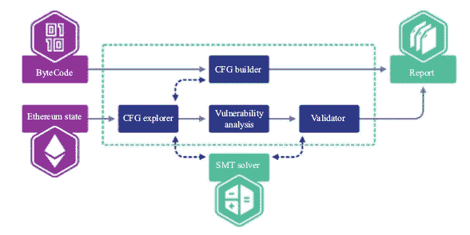

图 5.3. 智能合约分析器的示例架构。


尽管我们的示例遍历了通过源代码的路径，但大多数分析器是在字节码层面运行的。如果输入一个 Solidity 智能合约，它首先会被编译为 EVM 字节码。在此过程中，会维护字节码操作与源代码行数之间的映射关系，这样当发现漏洞时，就可以将相应的代码行报告给最终用户。

作为第二部分输入，分析器可能会接收有关区块链全局状态的。。这可能包括对状态变量的当前赋值，或者相关智能合约的代码（如果分析器支持此类跨合约分析）。包含有关全局状态的信息可以通通过考虑真实设置来精炼所执行的分析。如果未给出全局状态，则分析器可能会简单地为这些变量分配符号变量。这可能会导致误报，因为从求解器派出的具体变量可能无法反映现实。

在编译为字节码后，操作被分解为基本块（basic blocks）——即必须一直在一起运行的代码序列。考虑图 5.2 中 `guess` 函数的第 25 行和第 26 行，它们更新了 `reward_pool` 并实例化了 `transformed_answer`。由于没有条件分支或跳转语句分隔这些语句，可以保证这两行要么都执行，要么都不执行，因此它们形成了一个基本块。考虑图 5.4。图中的每个框都构成了 `guess` 函数的一个基本块。图本身将基本块组合成控制流图（CFG），该图通过分隔它们的条件语句连接基本块。这种抽象允许分析器能够更有效地推理通过代码的可能路径，而不是逐个处理每个操作。

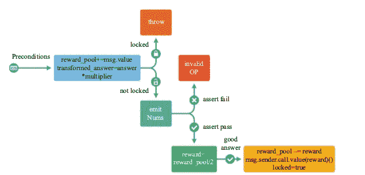

图 5.4。来自图 5.2 的 `guess` 函数的控制流图。

一旦获得 CFG，分析器就可以开始对 CFG 的轨迹进行符号执行，以寻找漏洞（标记为“Explorer”）。该组件频繁与底层的 SMT 求解器交互，以确定轨迹的可行性。这里大多数符号分析器中一个常见问题被称为状态爆炸问题；随着条件分支和跳转数量的增加，可能轨迹的数量会呈指数级增长。这使得探索所有可能的轨迹变得不可行；因此，设计决定决定了如何探索 CFG 以及对搜索实施哪些限制。例如，可配置参数可以将沿给定路径发生的跳转操作次数限制为某个固定常数，剪掉任何超过限制的轨迹。如果代码中存在未知上限的循环（例如依赖于某些输入参数的循环），分析器可能会限制该循环符号执行的次数。某些路径对于 SMT 求解器评估可行性来说过于困难：在这种情况下，超时限制可能会剪掉困难的轨迹。分析器还可能选择深度优先搜索而非广度优先搜索，以便更快找到更“深层”的漏洞。大多数分析器都为这些限制提供了合理的默认值；然而，它们通常是可配置的，这可能对发现的漏洞类型产生重大影响。

“漏洞分析”组件抽象地定义了所有目标漏洞检测器。例如，重入漏洞检测器在检测到外部函数调用时可能会执行额外的分析。搜索时间戳依赖的分析器可能会检查任何轨迹是否有依赖于区块时间戳的条件分支。整数溢出检测器关注算术表达式，检查结果是否可以超过数值类型的最大值。我们将在下一节中深入研究几个示例。

最后，许多分析器包含一个“验证”步骤，该步骤尝试确保发现的利用策略可以通过显式交易实际实现。这可能涉及启动测试网络并发布交易以确保故障行为发生。这有助于避免某些误报。

分析器及其底层基础设施的不同属性决定了可以发现的漏洞类型。如果分析器仅考虑过程内的（intraprocedural），则它只考虑通过单个函数的逻辑路径，抽象掉其他函数和对外部合约的调用。正如我们将在后续章节中看到的，这对于检测某些类型的重入攻击是足够的，例如 DAO 漏洞[[104]](#07_References.xhtml#uIuZC2Uxcp5a8pxZZApO3KDKD)。如果分析器跟踪函数调用的执行，而不是符号地抽象其行为（这可能会引入误报），则它是跨过程（inter-procedural）。也可以分析函数调用序列或轨迹，这对于检测某些利用策略通常是必要的，例如 Parity 漏洞[[105]](#07_References.xhtml#uXdOqbSy5ANJKvwudIWx4E9)。注意，跨过程分析并不意味着跟踪对其他函数的所有调用，特别是当调用的合约无法预知时，这样做是不可能的。

### 5.3.3 示例分析

在这里，我们将讨论符号分析器如何利用我们在图 5.2 中的运行示例来检测常见漏洞。

#### 5.3.3.1 使用符号分析寻找重入攻击

假设我们想要确定图 5.2 中的 `guess` 函数是否容易受到重入攻击。与任何重入利用一样，为了发生这种情况，`guess` 必须调用某些外部函数，该函数在相关状态变量更新之前再次调用 `guess`，从而可能获取比智能合约预期的更多的资金。为了发生这种情况，我们必须首先检查第 35 行的外部函数调用是否可到达，这等同于检查以下约束 2：

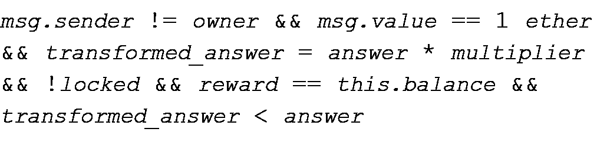(5.1)

前五个约束通过从所有者以外的任何地址发送 1 ether 的交易即可满足。为了满足最后的约束 `transformed_answer < answer`，我们可以利用 `SafeMath` 未用于乘法的这一事实，并由于表达式 `answer * multiplier` 中的整数溢出，将 `answer` 设置为高于 2251 的任何值。

此时，分析器有一个路径约束，指示了为了发生单次外部调用必须满足的所有条件。然而，仅凭外部调的可到达性不足以表明存在重入漏洞。分析器随后可以通过检查在第一次调用更新所有状态变量后路径约束是否仍然成立，来检查是否可以再次调用。在示例中，由于唯一更新的状态变量是 `reward_pool`，通过上述推理，约束仍然是可以满足的。这表明该函数确实可以通过重入攻击进行利用。在这种情况下，该函数可以被反复调用，每次调用都会抽走一半剩余 ether。Oyente 分析器使用这种方法检查重入[[94]](#07_References.xhtml#uXY5MTtZIR22romVlUI2xZG)。


现在，假设我们通过将赋值语句 `locked = true` 移动到外部函数调用之前修复了 `guess` 中的漏洞。当分析器尝试寻找允许重入式调用的变量赋值时，它会迅速判断出这是可能的，因为在第一次调用之后，我们拥有约束条件 `locked == true`（由于赋值现在位于从函数开始到外部调用的整个语句路径上），而为了能够第二次访问该调用，我们必须满足 `locked == false`。底层的 SMT 求解器确定这两个约束是矛盾的，这表明我们已成功修复了该漏洞。

`Mythril` 分析器在检测重入漏洞时采取了比 `Oyente` 更严格的方法。`Mythril` 并不是判断在第一次调用后是否可以再次到达外部函数调用（如 `Oyente` 那样），而是在外部调用之后是否会发生任何状态变化（例如，状态变量赋值），如果是这样，则会发出重入警告。这符合建议在外部调用之前更新所有状态变量的设计模式精神。

### 5.3.3.2 使用跨过程分析检测 Parity 漏洞

前文所示的重入攻击只需要分析单个函数 `guess` 即可找到利用漏洞。然而，某些漏洞可能需要一系列函数调用。如第 4 章讨论的，Parity 漏洞涉及恶意用户首先通过一个不受保护的函数获取合约所有权，然后调用 `kill` 函数导致合约失效。如图 5.2 所示，`Puzzle` 中也存在类似的利用方法，通过调用 `set_owner` 随后调用 `destroy_puzzle`。尽管在直觉上非常简单，但这种漏洞无法通过过程内分析器发现，因为利用需要两次函数调用。

为了检查是否存在 Parity 漏洞，跨过程分析器可能会首先检查智能合约任何地方是否存在 `selfdestruct` 操作。如果是，分析器将对所有可以从外部调用的函数进行深度优先搜索（达到某个深度限制），目标是使用所有者以外的地址调用 `selfdestruct` 操作。全局状态在同一条追踪的调用之间保持维护，函数内部的路径分析方式与过程内分析器相同。`Maian` 分析器构建在 `Oyente` 之上，支持跨过程的函数调用序列或“追踪”。通过这种方法，`Maian` 能够检测出 `Puzzle` 合约中的 Parity 漏洞，其追踪为调用 `set_owner` 随后调用 `destroy_puzzle`。

#### 5.3.3.3 其他分析

大多数过程内智能合约分析器都支持许多相同的漏洞类型。整数溢出和下溢是通过检查整数表达式是否可能超过最大整数值或低于零来检测的。在我们运行的示例中，表达式 `answer * multiplier` 触发了警告，因为 `answer` 的任何大于 `2⁵¹` 的值都会导致溢出。如果使用了 `SafeMath` 将表达式更改为 `answer.mul(multiplier)`，在实际乘法发生之前会包含一个断言语句，从而消除溢出的可能性。

另一个例子是时间戳依赖，即函数中的条件路径需要与区块时间戳进行比较，这在可能的情况下通常应被避免，因为矿工可能会操纵时间戳以改变交易结果。给定对应于合约中某些追踪的路径条件（由 CFG 构建阶段构建），分析器可以简单地检查区块时间戳是否参与了条件内的任何表达式。注意，这种检查不需要调用 SMT 求解器。

`Maian` 支持三类主要的追踪漏洞。第一类寻找允许未特权用户调用 `selfdestruct` 操作的追踪，如之前提到的 Parity 漏洞。`Mythril` 也增加了对这类类型漏洞的支持。第二类被称为“挥霍型漏洞（prodigal bugs）”，即从未与智能合约交互过的任意用户能够提取以太。这两类漏洞被归类为安全属性（safety properties）——确保永远不会发生“坏事件”的属性。第三类被称为“贪婪型漏洞（greedy bugs）”，特征是合约没有释放以太的方法，也就是说合约中有非零以太余额被永久锁定。这被认为是一种活性属性（liveness property），确保某些“好事”最终会发生。

### 5.3.4 终究没有万灵妙药

大多数这些分析器都支持“一键式”全自动分析——只需将代码传递给工具，它就会处理剩下的工作！简单对吧？

遗憾的是，全自动化是有代价的：通常，检查程序的非平凡语义属性是一个不可判定问题，也就是说，无法创建一个能够正确判断该属性对于任何给定输入程序是否成立算法。因此，这些分析器依赖于对分析进行抽象或限制，以便在大多数时候提供有意义的结果。考虑[图 5.5]。错误主要有两种类型。误报（False positives）发生在分析器断言程序中存在漏洞或问题时，而实际上程序是正确的。漏报（False negatives）发生在程序中确实存在漏洞或问题，但分析器未能检测到它。

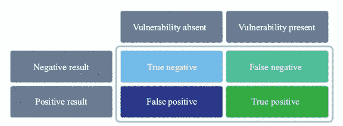

图 5.5. 分析器的可能结果。一个良好的分析器应该努力最大化真阳性，同时最小化假阳性。

上述的每种工具都会产生误报和漏报，虽然这些错误中的许多是所执行分析的固有的，但另一些是由于工具的设计决策。让我们看看从这些分析器的结果可能会产生的一些问题。我们注意到，这些工具仍在积极开发，行为在未来的版本中可能会发生变化。

**误报。**

误报的主要来源是缺乏智能合约周围环境的信息（例如对其他合约的外部调用），或者是分析器的工程设计标记了代码中的无关问题。例如，`Mythril` 将语句 `reward += msg.value;` 标记为潜在整数溢出的源。然而，要让这种情况发生，发送者需要拥有数量级为 `2⁵⁶` 的以太，这表明比这些分析器试图解决的问题更大的问题。尽管如此，无论利用概率如何，在习惯中使用 `SafeMath` 也不是坏主意。

作为环境抽象如何导致误报的例子，考虑[图 5.6]中的以下简单合约。`Main` 合约通过获取 `Helper` 合约的地址进行初始化。假设合约部署正确，传递给 `Main` 构造函数的地址指向 `Helper` 合约，则 `withdraw` 函数中的条件将永远无法满足。因此，我们多次看到的重入问题实际上不会发生，因为这些代码行实际上是死代码。然而，由于分析器不假设初始化是正确的，对 `external.always_false()` 的外部调用被替换为了一个可以取任何值的符号值（例如 true），并报告了重入漏洞。

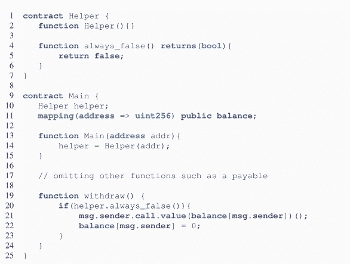

图 5.6. 调用已知外部函数的合约。


搜索空间的限制也可能导致误报。请参考图 5.7。在合约合约中，只有当大多数合约所有者确认交易时，第 12 行才能将 `ether` 发送到目标地址，这被抽象为第 9 行上的 `isConfirmed(tId)` 调用。假设合约有七个所有者，且至少有四个人必须确认交易。那么，一个发送 `ether` 的合约追踪必须包含至少 6 条交易：一个用于创建提议的交易、四个所有者的批准，以及一个实际执行交易的交易。由于 `Maian` 默认只考虑长度为二的追踪，因此该合约将被标记为贪婪的（greedy），因为它无法找到最多两条交易内导致 `ether` 传输的序列。增加追踪长度可以让 `Maian` 确定该合约不是贪婪的。

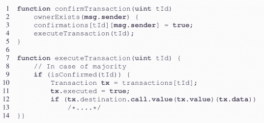

图 5.7. 由于搜索空间限制，`Maian` 可能会错误地将该合约标记为贪婪。最初描述于 [\[95\]](#07_References.xhtml#ugo249kgmtEukv95bSEnfU9)。

### 漏报 (False Negatives)
即使分析器声称能处理某些类的漏洞，通常也无法保证能发现所有问题。这通常由于两个原因：(1) 工程上的选择限制了其在某些情况下发现漏洞的能力；(2) 由于状态爆炸问题，通过合约可能的路径搜索空间没有被完全探索。

作为一个示例限制，假设我们对 `Puzzle` 合约进行了简单修改，删除了 `multiplier` 的 `constant` 修饰符。尽管这个变化看似无害（特别是因为没有函数可以更改该变量），`Oyente` 再也无法检测到可能的重入攻击，无法检测到 `guess` 和 `destroy_puzzle` 调用之间的交易顺序依赖。此外，`Mythril` 也无法再检测出表达式 `answer * multiplier` 中的整数溢出。遗憾的是，理解这种局限性的存在需要探索这些工具工程实现的更深层次细节，但该例子提醒我们，这些工具无法对代码的正确性提供保证。

重要的是，大多数工具仍处于开发早期，可能有自己的漏洞，从而限制了它们发现漏洞的能力。此外，如果没有对被分析智能合约的深度了解，通常不清楚如何设置 `max call depth` 等参数。分析器带有合理的默认值，这些值在典型情况下有效，但对于所有合约来说可能并不足够。此外，分析器底层的细微差别可能导致即使在看似简单的情况下也会遗漏某些漏洞。

这并不是说这些分析器没用——它们对于确保智能合约的正确性至关重要；只需不要将它们的结果视为真理即可。最终，确保不存在安全漏洞的责任在你（以及你智能合约的终端用户）手中。

## 5.4 Securify

上述所有分析器都遵循符号执行相同的辅助范式：对合约进行符号化追踪，并利用路径条件的可满足性以及特定漏洞的约束来检测利用。这些方法存在两个主要弱点：首先，它们既不是完备的（存在误报），也不是完全的（存在漏报）；其次，它们不易于扩展到新的、可能针对特定合约的分析中。例如，假设合约编写者想要检查特定的函数调用是否被限制为由特定地址调用（例如，它是一个 `onlyOwner` 函数），而不是任意地址。由于之前所示符号分析器只检查重入漏洞等全局性问题模式，因此没有简单的方法使用这些工具确保这种特定合约的属性。

`Securify` [\[116\]](#07_References.xhtml#uPUjXbThBCOcEcHBlV9xAQH) 旨在解决这两个问题。为了构建特定合约属性检查，`Securify` 定义了一种领域特定语言 (DSL) 来定义对应于这些属性的代码模式。重入检测等常见分析也用这种语言编码。`Securify` 以一个智能合约和一组模式作为输入，并判断代码是否合规或违反了任何给定的模式。`Securify` 会区分代码是确定违反了某种模式，还是分析不完整（即工具无法验证代码是否符合或违反了某种模式），后者则提供警告作为输出。虽然这没有完全消除误报和漏报问题，但这是正确方向的一步，因为其他工具通常只输出警告，而不保证其任何结果的正确性。如果 `Securify` 的大部分输出是模式的确定违规，这将减少用户必须手动验证的输出量。

与之前讨论的工具不同，`Securify` 不使用典型的符号执行方法来推理智能合约，而是如下工作的。考虑图 5.8，它包含了我们来自图 5.2 的 `guess` 函数的注释版本。4 我们将这个例子来描述如何检测重入漏洞。

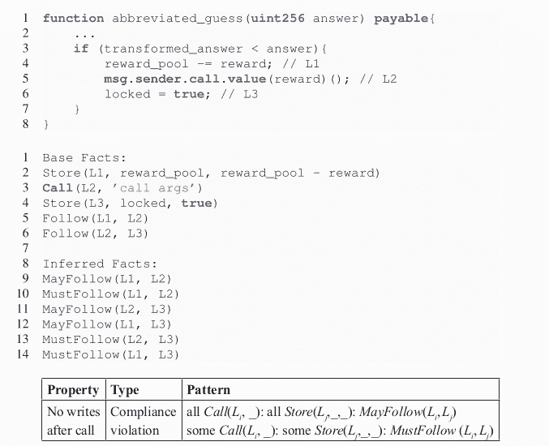

图 5.8. 图 5.2 中 `guess` 函数的简短版本。行带有 `Securify` 推断的标签注释。仅列出了与重入漏洞检测相关的事实；通常，每行都会包含许多推断的事实。调用后无写入的模式所示（采用自 \[116\]](#07_References.xhtml#uPUjXbThBCOcEcHBlV9xAQH)）。

给定 EVM 字节码，`Securify` 首先将代码反编译为单静态赋值 (SSA) 表示（参见脚注 2），并为反编译代码的每个语句 `s` 分配一个唯一标签 `Ls`。行带有语义事实标记，这些事实描述了关于行的属性，并用于推理安全模式。标记过程最初分配基础事实，主要有两种类型：指令类型事实和基础控制流事实。指令事实简单描述了语句中发生的操作。例如，第 6 行对状态变量 `locked` 的赋值被标记为标签 `Store(L3, locked,true)`。`Follow` 标签用于指示连续执行的指令；例如，标记为 `L1` 的行紧随 `L2` 之后，因此被标记为 `Follow(L1, L2)`。虽然在示例中未描述，但 `Join` 和 `Goto` 标签用于描述条件分支下的控制流。

接下来，使用一组语义规则从基础事实推导出推断事实。例如，事实 `MayFollow` 通过以下两个规则导出：

```
MayFollow(Li, Lj) ←Follow(Li, Lj)

MayFollow(Li, Lj) ←MayFollow(Li, Lk), Follow(Lk, Lj)
```


直观地说，执行过程中任何可能在另一条指令之后发生的指令都会被相应地标记为 `MayFollow`。用于推推理事实的规则是递归应用的。例如，由于 `Follow(L1, L2)` 是图 5.8 中的基础事实，根据第一规则我们知道 `MayFollow(L1, L2)` 必须为真。通过将基础事实 `Follow(L2, L3)` 和新推导出的事实 `MayFollow(L1, L2)` 应用第二规则，我们可以推导出 `MayFollow(L1, L3)`。`MustFollow` 标签以类似的方式推断，然而，无法保证后续执行（由于分支原因）的语句不会获得该标签。虽然在我们的示例中，每个 `MayFollow` 标签都有对应的 `MustFollow` 标签，但包含分支的函数 `MustFollow` 标签通常会少于 `MayFollow`。推断事实使用底层的分层 Datalog 系统自动导出 [[115]](#07_References.xhtml#ujwy5caq4C4PBzrGAsJbMtF)，该系统需要推理规则和基础事实作为输入。其他事实（例如与数据依赖相关的事实）也会纳入 Securify——但我们将在示例中省略它们。

一旦我们用所有可能的推断事实饱和系统，就可以检查特定漏洞的模式以确定代码是否存在任何问题。调用后无写入的规则列在图 5.8 中。正如之前在图 5.1 中讨论的，这种模式应该被避免，因为它容易受到重入攻击。合规性模式可以解释为：“对于每一个标记为 `Li` 的调用指令和标记为 `Lj` 的存储指令，`Lj` 不得跟在 `Li` 之后。” `_` 术表示该模式不关心参数的值。如果此模式成立，那么我们就知道无论程序采取何种路径，存储指令永远不会跟在调用指令之后。相反，违反模式说明程序中存在某些调用指令 `Li` 和存储指令 `Lj`，使得 `Lj` 必须跟在 `Li` 之后。在我们的运行示例中，我们可以看到 `guess` 通过 `Li = L2` 和 `Lj = L3` 违反了这一模式。

总来说，Securify 能够通过这种基于模式的方法检测出与 Oyente 和 Mythril 许多相同的漏洞。基于模式的方法也可以扩展到特定合约的分析，这对于检查特定项目的特定需求可能很有用。另一个优势是，它的方法通常可以保证智能合约违反或符合某种模式，从而减少用户需要进行的一些手动检查。然而，该工具确实存在一些局限性。首先，它假设所有程序语句都是可触达的，也就是说没有死代码。为了说明这是一个问题，假设我们 `guess` 函数中的约束条件是不可满足的，因此没有可能的输入可以执行导致重入的存储和调用语句。由于工具不检查这些行是否可触达，即使重入攻击已不再可能，工具仍会标记出重入攻击。其次，分析器无法稳健地处理算术约束，而这是符号分析器中底层 SMT 求解器的强项。这两个局限性都可能表明，应该采用一种混合方法，将符号分析器的可达性分析和数值分析优势与 Securify 中基于模式的匹配相结合。

### 5.4.1 分析器概览

前两节讨论了实践中几种最常用的智能合约分析器。然而，这是一个快速发展的领域，已经有其他几种工具可用或即将推出。Manticore 符号分析器支持之前所示的许多相同分析，例如重入和溢出检测。它还通过 Python 接口支持自定义分析。Zeus 分析器 [[110]](#07_References.xhtml#uTF8qF3qOmYE5onFEqFHZIF) 声称通过将 EVM 字节码和约束编译为 LLVM 字节码的方法实现了零漏报，这些字节码可以由 LLVM 静态分析器处理 [[109]](#07_References.xhtml#uktcZUVkx48oRUfCIMr8Qz2)。CertiK 平台 [[112]](#07_References.xhtml#uj8KezsCC2wm56siXte35F7) 将代码翻译为 `kEVM` [[111]](#07_References.xhtml#uVDFzKmAQz2pOgoNAkSBDXC)，这是 `K` [[113]](#07_References.xhtml#uJkBNH6W5puzhLYSxmJigxD)（第 2 章简要讨论）中 EVM 语义的形式化验证版本。它支持自定义分析，但必须作为被分析函数的前置和后置条件编写。

表 5.1 总结了所讨论四个分析器各自支持的分析。尽管 Oyente、Mythril 和 Securify 支持的分析存在重叠，但运行所有可用工具通常是有价值的。由于这些工具的实现显著不同，无法保证它们会发现相同的漏洞。

表 5.1 开源智能合约分析器支持的分析总结

| | Oyente | Mythril | Securify | Maian |
| --- | --- | --- | --- | --- |
| 整数溢出/下溢 | 是 | 是 | | |
| 重入 | 是 | 是 | 是 | |
| 交易顺序依赖 | 是 | 是 | 是 | |
| 时间戳依赖 | 是 | 是 | 是 | |
| 调用栈深度 | 是 | 是 | 是 | |
| Parity Bug | 是 | 是 | 是 | |
| 未检查的自毁 | | | 是 | |
| 锁定的以太 | | | 是 | |

### 5.5 审计

正在开发一个可能接触大量用户的 dApp？已经熟悉了上述工具和最佳实践？太棒了！很有可能，代码仍有改进空间。智能合约开发是一个极其棘手的领域，即使是该领域的资深人士也可能错过漏洞，从而导致巨大的财务影响 [[104, 105]](#07_References.xhtml#uIZC2Ucp5a8pxZZKD)。很多情况下，最好让新的视角查看代码以确保其确实正确。

几专业的智能合约审计公司（如 Quantstamp、Chain-Security、ConsenSys 和 Trail Of Bits）通过经过培训的安全专家提供人工审计。这些审计人员经过训练，能够理解复杂的智能合约代码，使用工具检查漏洞并确保代码行为符合预期。作为审计过程的一部分，通常会创建一个报告来描述审计期间发现的所有问题。该报告的作用有两个：首先，审计请求方可以对报告描述的问题采取行动；其次，报告可以用于增强合约编写者以及希望与合约交互的终端用户对产品正确性的信心。在某种程度上，报告向大众证明了合约编写者已尽职确保了产品的正确性。

为了有效评估您的智能合约，审计人员需要的不仅仅是代码。如果没有适当文档，审计人员只能推断代码的预期语义，无法正确评估合约行为的正确性。通常，可以在[[13]](#07_References.xhtml#uxgCTzLKd5sDm2GODcPo6)处找到一套概述了典型审计步骤和要求的指南。在图 5.9 中，我们仅突出了主要要求。

*   准备关于智能合约预期行为的文档。这通常以白皮书和/或需求规范文档的形式存在。

*   提供源代码以及相关的项目制品（例如测试套件）。


* 在您的合同中指定特殊要求，例如编译器信息、使用的自定义代码以及非标准语言实践。
* 识别审计的其他任何特殊要求，例如保密性要求。
* 确定您完成审计的目标日期。
* 准备好与审计人员进行往来沟通。

[图 5.9]。 智能合约审计准备检查清单。进一步的步骤和细节请参阅 [13]。

首先，应该按照第 5.1.3 节所讨论的内容准备文档。只有当行为被清晰且明确地记录时，才能检查其正确性——理想情况下，在智能合约开发的审计阶段之前，就应该准备好需求文档或规格说明文档。

其次，应该为审计准备一个代码包，其中不仅包括源代码，还包括其他项目产物，如部署脚本和单元测试。在许多情况下，这表现为一个 `tffle` 项目以及一个详细的 `README` 文件，用于指示如何部署或运行测试。智能合约应该包含详细的注释；函数应该有注释块来说明代码的意图行为，以及对输入和输出变量的描述。单元测试通常根据覆盖率进行评估；未经过测试的程序行或控制路径可能表明开发过程中存在疏忽，应当进一步考虑。在大多数情况下，建议代码覆盖率达到 100%（项目依赖的标准库合约除外）。

第三，如果智能合约出于特定原因故意违背标准做法，则应向审计人员说明。例如，某些项目可能选择避免使用 `require` 语句，转而使用在返回之前发送事件的 `if` 条件语句。如果 `dApp` 的另一个组件在出错时需要以事件形式的反馈，这将非常有用。另一个例子，如果测试环境与典型设置有显著不同（即带有关联单元测试的 `tffle` 项目），则应指定额外说明，说明开发者如何评估其测试框架，特别是在覆盖率方面。

剩余的步骤涉及在审计后勤方面对审计人员保持开放态度。例如，如果智能合约非常复杂，不太可能在几天内完成有意义的审计。虽然与代币销售相关的常见合约通常可以在几天内完成审计，但最复杂的审计可能需要数周时间。最后，能够与审计人员进行沟通至关重要；如果需求看起来说明不详尽，或者代码部分不清楚或与需求不符，通常需要进行澄清。

### 5.5.1 众筹审计

众筹和代币合约是最常见的智能合约类型之一，由于涉及的资金巨大，它们也是最常审计的类型之一。在 [图 5.10] 中，我们讨论了一些针对众筹的特殊考虑，作为开展成功众筹的指南。

* 您的代币是可以铸造（mintable）和/或销毁（burnable）的吗？
* 是否会有地址管理系统（即白黑名单系统）？
* 代币上限和价格是多少？价格在销售期间会调整吗？
* 是否使用了双重身份验证 (`2FA`) 来保护钱包/网站/电子邮件账户等？

[图 5.10]。 众筹智能合约准备检查清单。进一步的步骤和细节请参阅 [13]。

在设计代币经济模型时，必须考虑代币的不同功能。可铸造代币可以在初始众筹后创建，而不可铸造代币的全供应量在代币合约部署时创建。可销毁代币允许用户销毁持有的代币，从而减少总供应量。销毁代币的一个常见案例是在众筹后减少剩余代币，使开发者获得总代币的预设比例。在审计之前，应对这些选项中的每一个进行深思考虑。

其次，应该考虑众筹是否需要地址白名单。在这种情况下，只有预先批准的地址才允许购买代币，且通常有指定的购买上限。这有助于防止参与者购买不成比例的代币（有时被称为“巨鲸”），这可能会破坏代币的经济模型。监管机构甚至可能要求某些国家白名单，使得只有特定类型的投资者允许购买代币。这可能需要智能合约之外的额外基础设施，例如 ID 白名单管理系统。

第三，必须提前确定代币的成本（通常以 `ether` 值表示）。这在很大程度上取决于社区对代币的需求。作为进一步的激励因素，众筹通常会给早期投资的用户提供可配置的奖励值，本质上是“启动”众筹。后期参加众筹的用户通常会获得较低的奖励。

也许最重要的是，您应该确保众筹的所有周边基础设施都得到适当保护。所有相关的设备、地址、电子邮件和其他组件都应通过双重身份验证进行保护。员工和社区成员应该意识到各种安全威胁，例如可能损害系统的钓鱼攻击。

### 5.6 指南

开发安全的智能合约没有“唯一的正确方法”。尽管如此，最佳实践可以减少问题出现的概率。在本章中，我们介绍了缓解智能合约开发中安全问题的基本方法。[图 5.11] 中的以下检查清单可以作为指南，并对开发过程中应采取的关键步骤起到提醒。

* 通过遵循 [图 5.1] 建议的良好实践和常用设计模式来避免常见漏洞。
* 妥善编写文档，确保每个函数及其参数和返回值都有意义的描述。
* 创建单元测试和端到端测试。理想情况下，代码和路径覆盖率应接近 100%（然而，高覆盖率并不一定意味着有一个良好的测试套件）。
* 运行可用的智能合约分析工具，并解决所有标记的问题。
* 确保 `dApp` 周围的基础设施得到适当保护，并在全程使用双重身份验证。
* 关注新发现的漏洞。
* 如果您正在开发一个潜在估值很高或复杂的项目，可能值得以审计的形式对智能合约的安全性寻求第二次意见。

[图 5.11]。 智能合约开发的主要指南。


对于区块链领域的任何成功创业而言，安全都应该是公司成功的基础支柱之一，因为这项技术的最终目标是让数百万人能够轻松且安全地使用。正如我们在区块链之外的广泛世界（如 Facebook 和 Equifax 数据泄露事件）中所看到的，信任很容易丢失，却难以恢复。对于试图构建下一个“杀手级应用”的公司来说，信任是需要培养和保护的宝贵资源。

虽然本书侧重于技术、协议和工具，但仅将安全视为技术挑战将是不够的。要解决智能合约的安全挑战，在你的整个团队和组织中融入审慎的业务实践至关重要。

## 6.2 将迭代方法应用于安全

智能合约仍然非常新。我们可以预计技术、解决方案和安全格局将发生不断的变化。新的漏洞和安全风险不断被发现，新的最佳实践也将随着时间的推移而出现。正如本书所示，失败的代价可能是巨大的。实施更改可能涉及艰难的选择。鉴于此，我们需要拥抱迭代的安全方法。

1.  在创建智能合约时要追求**简单**。承担风险和发挥创意有时机宜——但涉及到智能合约时，请考虑遵循经过测试的模式和最佳实践以降低风险。复杂的智能合约会增加攻击面。
2.  编写适当的文档是关键。高质量的文档有助于你的团队理解智能合约的预期的行为，并帮助他们了解智能合约在开发过程中的当前状态。文档对于未来的团队成员来说是救命稻草，对于外部审计员执行其工作也至关重要。
3.  目标是在发布之前发现漏洞和缺陷。聘请独立的审计机构，特别是对于高价值的智能合约。
4.  失败和错误在所难免。如果发现了漏洞，确保你的团队已有一套计划，能够快速高效地升级你的智能合约。
5.  跟上这个快速发展领域的动态。了解最新的漏洞、升级和安全技术至关重要。
6.  可视化、静态和动态工具以及代码检查器（linters）正在飞速发展。跟上这些工具的更新同样重要。

## 6.3 安全是一个涉及人员、系统和流程的整体性问题

安全本身（不仅仅是智能合约安全）变得越来越重要且复杂。一个安全框架适用于三个主要部分：

### 人
适当的员工培训和审查是一个重要步骤。公司需要考虑可能来自员工和团队成员的故意和无意威胁。制定一个安全计划，包括教育你的员工和团队成员智能合约安全。如果员工或团队成员没有接受过最佳实践的教育，任何技术都无法为公司或项目提供帮助。

遗憾的是，有些公司没有预见到威胁可能来自其组织或团队内部。事实上，内部威胁是一个常见风险，应该在你的安全计划予以解决。

### 系统
除了充分的培训和流程，技术是安全战中前线防线的一部分。本书详细介绍了智能合约的安全选项、开发和格局。当然，为了你业务和项目的整体安全，你还需要跟进其他安全风险缓解技术，例如网络和应用程序安全。

### 流程
仅让智能合约专家与你的团队合作可能不足以确保你的安全。如果没有良好的流程，安全计划在执行过程中可能会失败。经常测试你的安全计划，创建带有审查的检查点，并根据测试结果进行调整。

## 6.4 共同构建可编程货币的世界

我们相信智能合约和可编程货币是关键创新，将在未来十年带来变革浪潮。10 年前，随着第一代 iPhone 的发布，世界被彻底改变了。未来 10 年将会是什么什么样？

我们未来 10 年的目标是帮助第一十亿人以安全的方式使用区块链。随着新平台的开发、新漏洞的发现以及第一批百万级 dApp 的发布，将发生巨大的变化。我们相信，对于任何希望获取市场份额并防止被颠覆的业务来说，对这一新潮流采取战略方法至关重要。

理解这一不断发展的领域将为各行业专业人士的职业增长释放前所未潜力。随着新技术的发展，对于那些投入时间理解这些技术的人来说，了解如何与这些技术协作将是一项巨大的资源。

在 Quantstamp，我们相信向智能合约驱动的经济转型是不可避免的。我们认为许多尚未想到的用例将对人们转移价值和相互互动的方式产生巨大影响。在 1994 年，很难想象互联网对今天我们会产生什么影响。信息被民主化并以前所未有的速度传播。其影响可以与印刷机相提。我们相信区块链和智能合约技术将产生与里程碑式技术相同的影响。

尽管我们相信智能合约的应用是不可避免的，但无法保证在短期内发生。为了让智能合约实现主流应用，用户需要对他们交互的智能合约充满信心。遗憾的是，由于领先开发者编写的智能合约丢失或被盗了价值数百万美元的加密货币，目前要求用户拥有这种信心是不现实的。

在某种程度上，这在开发的这个阶段是可以预期的，但为了渡过这一阶段，我们需要开发必要的安全实践来创建安全的智能合约。这就是编写这本书的灵感所在；我们希望这本书能成为未来智能合约开发者的基础。通过审计智能合约的经验，我们已经非常熟悉智能合约安全的最新水平和最佳实践。如果智能合约要成功，这些知识需要被广泛获取。

尽管本书包含了最新的信息，但它不应该是你关于智能合约安全阅读的最后文档。我们将再次强调，我们仍然处于这项快速发展的技术的婴儿阶段。为了开发安全的智能合约，你必须跟上该领域的最新发现。

我们非常感激处于这个快速发展的行业中心，并感谢来自全球的巨大支持。我们期待你加入这段旅程。

## References

[1] Botsman, R. n.d. “How the Blockchain is Redefining Trust.” Wired, December 27, 2017. [`wired.com/story/how-the-blockchain-is-redefining-trust/`](https://www.wired.com/story/how-the-blockchain-is-redefining-trust/) (accessed February 7,2019).

[2] Werbach, K., and N. Cornell. 2017. “Contracts Ex Machina.” Duke Law Journal 67, p. 313.

[3] King of Ether. February 2016. “Post-Mortem Investigation.” https://kingoftheether.com/postmortem.html](https://kingoftheether.com/postmortem.html) (accessed October 2, 2018).


[4] Szabo, N. n.d. “智能合约”。[`fon.hum.uva.nl/rob/Courses/InformationInSpeech/CDROM/Literature/LOTwinterschool2006/szabo.best.vwh.net/smart_contracts_2.html`](http://fon.hum.uva.nl/rob/Courses/InformationInSpeech/CDROM/Literature/LOTwinterschool2006/szabo.best.vwh.net/smart_contracts_2.html) (访问于 2018 年 10 月 28 日)。

[5] Marr, B. n.d. “每个人都应该阅读的比特币和加密货币简史”。福斯，2017 年 12 月 6 日。[`forbes.com/sites/bernardmarr/2017/12/06/a-short-history-of-bitcoin-and-crypto-currency-everyone-should-read`](https://forbes.com/sites/bernardmarr/2017/12/06/a-short-history-of-bitcoin-and-crypto-currency-everyone-should-read) (访问于 2019 年 2 月 7 日)。

[6] Hertig, A. n.d. “以太坊智能合约是如何工作的？”CoinDesk。[`coindesk.com/information/ethereum-smart-contracts-work`](https://coindesk.com/information/ethereum-smart-contracts-work)

[7] ChainTrade. n.d. “使用智能合约的 10 个优势”。最后修改于 2017 年 12 月 26 日。[`medium.com/@ChainTrade/10-advantages-of-using-smart-contracts-bc29c508691a`](https://medium.com/@ChainTrade/10-advantages-of-using-smart-contracts-bc29c508691a)

[8] Mik, E. 2017. “智能合约：术语、技术局限与现实世界的复杂性”。《法律、创新与技术》第 9 卷，第 2 期，第 269–300 页。

[9] Ream, J., Y. Chu, and D. Schatsky. 2016. “升级区块链：工业中的智能合约用例”。德勤洞察，2016 年 6 月 08 日。[`www2.deloitte.com/insights/us/en/focus/signals-for-strategists/using-blockchain-for-smart-contracts.html`](https://www2.deloitte.com/insights/us/en/focus/signals-for-strategists/using-blockchain-for-smart-contracts.html)

[10] 以太坊百科。n.d. “ERC20 代币标准”。https://theethereum.wiki/w/index.php/ERC20_Token_Standard](https://theethereum.wiki/w/index.php/ERC20_Token_Standard) (访问于 10 月 29 日)。

[11] Blockgeeks. 2018. “ERC20 代币：完整的起源故事”。[`blockgeeks.com/guides/erc20-tokens/`](https://blockgeeks.com/guides/erc20-tokens/) (访问于 2018 年 10 月 28 日)。

[12] Investopedia. n.d. “首次代币发行 (ICO)”。[`investopedia.com/terms/i/initial-coin-offering-ico.asp`](https://investopedia.com/terms/i/initial-coin-offering-ico.asp) (访问于 2018 年 10 月 28 日)。

[13] 智能合约安全联盟。n.d. “智能合约安全审计标准”。https://smartcontractsecurityalliance.com/](https://smartcontractsecurityalliance.com/) (访问于 2018 年 10 月 23 日)。

[14] Hertig, A. n.d. “什么是 DAO？”CoinDesk。[`coindesk.com/information/what-is-a-dao`](https://coindesk.com/information/what-is-a-dao) (访问于 2018 年 10 月 12 日)。

[15] CryptoKitties. n.d. “区块链驱动的可收藏与可繁殖猫咪”。https://cryptokitties.com/](https://cryptokitties.com/) (访问于 2018 年 10 月 28 日)。

[16] Nash, G. n.d. “ERC721 非同质代币的解析”。Medium，2017 年 12 月 23 日。[`medium.com/crypto-currently/the-anatomy-of-erc721-e9dbabfc4`](https://medium.com/crypto-currently/the-anatomy-of-erc721-e9dbabfc4)

[17] Hertig, A. n.d. “什么是去中心化应用？”CoinDesk。[`coindesk.com/information/what-is-decentralized-application`](https://coindesk.com/information/what-is-decentralized-application) (访问于 2018 年 10 月 11 日)。

[18] Finley, K. n.d. “50 万美元攻击证明了 DAO 是人性的”。Wired，2016 年 6 月 18 日。[`wired.com/2016/06/50-million-hack-just-showed-dao-human`](https://wired.com/2016/06/50-million-hack-just-showed-dao-human)

[19] Aventinus, C. n.d. “Parity 多签名钱包被黑，是怎么回事？”Coin Telegraph，2017 年 11 月 13 日。[`cointelegraph.com/news/multisig-wallet-hacked-or-how-come`](https://cointelegraph.com/news/multisig-wallet-hacked-or-how-come)

[20] Parity Technologies. “Parity 多签名库自毁事后分析”。2017 年 11 月 15 日。[`parity.io/a-postmortem-on-the-parity-multi-sig-library-self-destruct/`](https://parity.io/a-postmortem-on-the-parity-multi-sig-library-self-destruct/) (访问于 2019 年 2 月 7 日)。

[21] Town, S. n.d. “BatchOverflow 攻击产生了数万亿以太坊代币，各大交易所停止存款。”Crypto Slate，2018 年 4 月 25 日。[`cryptoslate.com/batchoverflow-exploit-creates-trillions-of-ethereum-tokens`](https://cryptoslate.com/batchoverflow-exploit-creates-trillions-of-ethereum-tokens)

[22] Antonopoulos, A.M., and G. Wood. 2018. “精通以太坊：构建智能合约与 Dapps”。O’Reilly。[`github.com/ethereumbook/`](https://github.com/ethereumbook/)

[23] Ethereum. n.d. “以太坊白皮书”。https://github.com/ethereum/wiki/White-Paper](https://github.com/ethereum/wiki/White-Paper) (访问于 2018 年 10 月 9 日)。

[24] Wood, G., and V. Buterin. n.d. “以太坊：安全的去中心化账本”。https://ethereum.github.io/yellowpaper/paper.pdf](https://ethereum.github.io/yellowpaper/paper.pdf) (访问于 2018 年 10 月 1 日)。

[25] Hildenbrandt, E., M. Saxena, X. Zhu, N. Rodrigues, P. Daian, and D. Guth. 2017. “KEVM：以太坊虚拟机的完整语义”。

[26] Grishchenko, I., M. Maffei, and C. Schneidewind. n.d. “EtherTrust：以太坊字节码的可靠静态分析”。

[27] Sipser, M. 1996. 《计算理论导论》。SIGACT News。

[28] Bertoni, G., J. Daemen, M. Peeters, and G.V. Assche. 2011. “Keccak 参考文档”。最后修改于 2011 年 1 月 14 日。[`keccak.team/files/Keccak-reference-3.0.pdf`](https://keccak.team/files/Keccak-reference-3.0.pdf)

[29] Dworkin, M.J. 2015 年 8 月. “SHA-3 标准：基于置换的哈希和可扩展输出函数。”（联邦信息处理标准 (NIST FIPS)-202）。

[30] Stack Exchange. n.d. “以太坊使用哪种加密哈希函数？”https://ethereum.stackexchange.com/questions/550/which-cryptographic-hashfunction-does-ethereum-use](https://ethereum.stackexchange.com/questions/550/which-cryptographic-hashfunction-does-ethereum-use) (访问于 2018 年 10 月 15 日)。

[31] Hoffstein, J., J.H. Pipher, and J. Silverman. 2008. 《密码学导论》。Springer，纽约。

[32] X9 委员会。2005 年. “用于金融服务的椭圆数字签名算法 (ECDSA)”。

[33] Grishchenko, I., M. Maffei, and C. Schneidewind. 2018. “以太坊安全的语义框架”。《安全与信任原理》，Springer，斯姆。

[34] Luu, L., D.H. Chu, H. Olickel, P. Saxena, and A. 2016. “让智能合约更智能”。IACR 存档，633。

[35] GitHub. n.d. “Vyper”。https://github.com/ethereum/vyper](https://github.com/ethereum/vyper) (访问于 2018 年 10 月 3 日)。

[36] GitHub. n.d. “Solidity”。https://github.com/ethereum/solidity](https://github.com/ethereum/solidity) (访问于 2018 年 9 月 29 日)。

[37] Schrans, F. n.d. “Flint：一种用于以太坊安全智能合约的新语言”。Medium，2018 年 4 月 15 日。[`medium.com/@fschrans/flint-a-new-language-for-safe-smart-contracts-on-ethereum-a5672137a5c7`](https://medium.com/@fschrans/flint-a-new-language-for-safe-smart-contracts-on-ethereum-a5672137a5c7)

[38] Breidenbach, L., I.C. Cornell Tech, P. Daian, F. Tramer, and A. Juels. 2018 年 8 月. “进入九头蛇：迈向原则化的漏洞赏金和抗攻击智能合约”。第 27 届 USENIX 安全研讨会 (USENIX Security 18)。马里兰州巴尔的摩。

[39] Daian, P. 2018 年 3 月. “RV Inc. 与 FSL @ UIUC 形式化以太坊的 Viper”。https://runtimeverification.com/blog/rv-inc-fsl-uiuc-to-formalize-viper-language-and-compiler/](https://runtimeverification.com/blog/rv-inc-fsl-uiuc-to-formalize-viper-language-and-compiler/) (访问于 2018 年 10 月 2 日)。

[40] GitHub. n.d. “K 框架中的 Vyper 语义”。Kframework。最后修改于 2018 年 4 月 12 日。[`github.com/kframework/vyper-semantics/wiki`](https://github.com/kframework/vyper-semantics/wiki) (相关 \[19\])。


[41] CryptoCompare. n.d. “为什么以太坊与比特币不同？” 最后修改于 2015 年 7 月 31 日。https://cryptocompare.com/coins/guides/why-is-ethereum-different-to-bitcoin/

[43] Readthedocs. n.d. “Vyper.” [`vyper.readthedocs.io/en/latest/`](https://vyper.readthedocs.io/en/latest/) (访问于 2018 年 10 月 11 日)。

[44] Teutsch, J., and C. Reitwiebner. n.d. “一种用于区块链的可扩展验证解决方案。” 2017 年 11 月 16 日。https://people.cs.uchicago.edu/~teutsch/papers/truebit.pdf

[45] Cusce, C. n.d. “以太坊 Plasma – 第 2：其工作原理。” [`medium.com/@collin.cusce/why-business-needs-ethereum-plasmanow-how-it-works-key-components-pt-2-37a82737cd54`](https://medium.com/@collin.cusce/why-business-needs-ethereum-plasmanow-how-it-works-key-components-pt-2-37a82737cd54) (访问于 2018 年 10 月 28 日)。

[46] Poon, J., and V. Buterin. n.d. “Plasma：可扩展的自治智能合约。”https://plasma.io/plasma.pdf](https://plasma.io/plasma.pdf) (访问于 2018 年 10 月 7 日)。

[47] CryptoKitties. 2018. “CryptoKitties：区块链技术赋能的可收集与可繁殖猫咪。”https://cryptokitties.co/ (访问于 2018 年 10 月 28 日)。

[48] King, S., and S. Nadal. n.d. “PPCoin：基于权益证明的点对点加密货币。” 2012 年 8 月 19 日。[`peercoin.net/whitepapers/peercoin-paper.pdf`](https://peercoin.net/whitepapers/peercoin-paper.pdf)

[49] GitHub. n.d. “eip-20.md” Ethereum. 最后修改于 2018 年 10 月 15 日。[`github.com/ethereum/EIPs/blob/master/EIPS/eip-20.md`](https://github.com/ethereum/EIPs/blob/master/EIPS/eip-20.md)

[53] Buntinx, J.P. n.d. “什么是以太坊叔叔（Uncles）？” The Merkle, 2017 年 7 月 17 日。[`themerkle.com/what-are-ethereum-uncles/`](https://themerkle.com/what-are-ethereum-uncles/)

[54] StackExchange. n.d. “以太坊‘家园协议’中实现的具体‘最长链’规则是什么？”[`ethereum.stackexchange.com/questions/13378/what-is-the-exact-longest-chain-rule-implemented-the-ethereum-homestead-p`](https://ethereum.stackexchange.com/questions/13378/what-is-the-exact-longest-chain-rule-implemented-the-ethereum-homestead-p)

[55] Ethereum Smart Contract Best Practices. n.d. “Solidity 智能合约安全建议。”https://consensys.github.io/smart-contract-best-practices/recommendations/](https://consensys.github.io/smart-contract-best-practices/recommendations/) (访问于 2018 年 10 月 28 日)。

[56] Daian, P. n.d. “Solidity 反模式：玩转继承。” Phil Security, [`pdaian.com/blog/solidity-anti-patterns-fun-inheritance-dag`](https://pdaian.com/blog/solidity-anti-patterns-fun-inheritance-dag) (访问于 2018 年 6 月 11 日)。

[57] Dean, J., and S. Ghewat. 2004. “MapReduce：集群上的简化数据处理。” OSDI.

[58] Teutsch, J., V. Buterin, and C. Brown. “交互式货币发行。”https://people.cs.uchicago.edu/~teutsch/papers/ico](https://people.cs.uchicago.edu/~teutsch/papers/ico) (访问于 2017 年 12 月 17 日)。

[59] Etherscan. n.d. “Etherscan 代币追踪器。”https://etherscan.io/tokens](https://etherscan.io/tokens) (访问于 2018 年 10 月 17 日)。

[60] Buterin, V. n.d. “分析代币模型。” 2017 年 6 月 9 日。[`vitalik.ca/general/2017/06/09/sales`](https://vitalik.ca/general/2017/06/09/sales)

[61] Learn Cryptography. [`learncryptography.com/cryptocurrency/51-attack`](https://learncryptography.com/cryptocurrency/51-attack)

[62] BlockchainHub. n.d. “区块链预言机。”https://blockchainhub.net/blockchain-oracles/](https://blockchainhub.net/blockchain-oracles/) (访问于 2018 年 10 月 4 日)。

[63] Adler, J., R. Berryhill, A. Veneris, N. Poulos, and A. Kastania. 2018. “ASTRAEA：一种去中心化的区块链预言机。”https://arxiv.org/pdf/1808.00528](https://arxiv.org/pdf/1808.00528) (访问于 2018 年 8 月 1 日)。

[64] Vogelstellar, F. n.d. “ERC 标准 #20。”https://github.com/ethereum/eips/20](https://github.com/ethereum/eips/20) (最后修改于 2017 年 9 月 29 日)。

[65] Antonopoulos, A.M., and G. Wood. n.d. “精通以太坊。”https://github.com/ethereum/ethereumbook](https://github.com/ethereum/ethereumbook) (最后修改于 2018 年 10 月 21 日)。

[66] Zeppelin. n.d. “Open Zeppelin。”https://github.com/Openppelin/solidity](https://github.com/Openppelin/solidity) (最后修改于 2018 年 10 月 3 日)。

[67] von Kleist, L. n.d. “为什么 ERC827 容易受到重入攻击以及如何防止。”https://medium.com/chainsecurity/why-erc827-can-make-you-vulnerable-to-reentrancy-attacks-and-how-to-prevent-them-61aeb4bebbf](https://medium.com/chainsecurity/why-erc827-can-make-you-vulnerable-to-reentrancy-attacks-and-how-to-prevent-them-61aeb4bebbf) (访问于 2018 年 10 月 4 日)。

[68] Lemble, A. n.d. “ERC827 标准（ERC20 扩展）。”https://github.com/ethereum/EIPs/issues/827](https://github.com/ethereum/EIPs/issues/827) (最后修改于 2018 年 6 月 28 日)。

[69] Bylica, P. n.d. “如何通过阅读区块链发现 1000 万。” Medium,https://blog.golemproject.net/how-to-find-10m-by-just-reading-blockchain-6ae9d3fcd95](https://blog.golemproject.net/how-to-find-10m-by-just-reading-blockchain-6ae9d3fcd95) (访问于 2017 年 4 月 6 日)。

[70] Solidity.readthedocs. n.d. “常见模式。”https://solidity.readthedocs.io/en/v0.4.24/common-patterns.html](https://solidity.readthedocs.io/en/v0.4.24/common-patterns.html) (访问于 2018 年 10 月 16 日)。

[71] Solidity.ReadtheDocs. 2018. “安全性。”https://solidity.readthedocs.io/en/v0.4.24/security-considerations.html](https://solidity.readthedocs.io/en/v0.4.24/security-considerations.html)

[72] Buterin, V. n.d. “为了缓解垃圾攻击的长久 Gas 更改。”https://github.com/ethereum/EIPs/issues/150](https://github.com/ethereum/EIPs/issues/150) (最后修改于 2017 年 8 月 16 日)。

[73] Parity Technologies. n.d. “多签名攻击：事后分析。”https://parity.io/the-multi-sig-hack-a-postmortem](https://parity.io/the-multi-sig-hack-a-postmortem) (访问于 2017 年 7 月 20 日)。

[74] Etherscan. n.d. “触发 Parity Bug 的地址。”https://etherscan.io/address/0x86df6bfa4469f3ead08f92a5c1a907](https://etherscan.io/address/0x86df6bfa4469f3ead08f92a5c1a907) (访问于 2019 年 3 月 31 日)。

[75] Solidity.ReadtheDocs. n.d. “合约。”https://solidity.readthedocs.io/en/v0.4.24/contracts.html](https://solidity.readthedocs.io/en/v0.4.24/contracts.html)

[76] Bahrynovska, T. n.d. “以太坊漏洞、攻击及其修复历史。”https://applicature.com/blog/history-of-ethereum-security-vulnerabilities-hacks-and-their-fixes](https://applicature.com/blog/history-of-ethereum-security-vulnerabilities-hacks-and-their-fixes) (访问于 2017 年 9 月 27 日)。

[77] ConsenSys. n.d. “已知攻击。”https://consensys.github.io/smart-contract-best-practices/known-attacks](https://consensys.github.io/smart-contract-best-practices/known-attacks) (访问于 2018 年 10 月 23 日)。

[78] ConsenSys. n.d. “Solidity 智能合约安全建议。”https://consensys.github.io/smart-contract-best-practices/recommendations/](https://consensys.github.io/smart-contract-best-practices/recommendations/) (访问于 2018 年 10 月 1 日)。

[79] Solidity.ReadtheDocs. n.d. “应用二进制接口规范。”https://solidity.readthedocs.io/en/v0.4.24/abi-spec.html](https://solidity.readthedocs.io/en/v0.4.24/abi-spec.html) (访问于 2018 年 10 月 1 日)。

[80] King of the Ether. n.d. “以太坊之王。”https://kingoftheether.com/thrones/kingoftheether/index.html](https://kingoftheether.com/thrones/kingoftheether/index.html) (最后修改于 2017 年 5 月 25 日)。

[81] Atzei, N., M. Bartoletti, and T. Cimoli. 2017. “以太坊智能合约攻击综述 (SoK)。” 在第 6 届国际安全与信任原则会议论文，164–86。https://eprint.iacr.org/2016/1007.pdf](https://eprint.iacr.org/2016/1007.pdf)


## 参考文献

[82] Humiston, P.E. n.d. “智能合约攻击[第 2 部分]-失控的庞氏骗。” Hackernoon, https://hackernoon.com/smart-contract-attacks-part-2-ponzi-games-gone-wrong-d5a8b1a98dd8 (访问于 2018 年 7 月 23 日)。

[83] Toliuyi. n.d. “警告！Fomo3D 会摧毁以太坊吗？” [`ethresear.ch/t/alert-will-fomo3d-destroy-ethereum/2630`](https://ethresear.ch/t/alert-will-fomo3d-destroy-ethereum/2630) (访问于 2018 年 11 月 23 日)。

[84] Karalabe. n.d. “如何破解 FoMo3D，新手指南。” https://reddit.com/r/ethereum/comments/916xni/how\_to\_pwn\_fomo3d\_a\_beginners\_guide (访问于 2018 年 10 月 1 日)。

[85] SECBIT. n.d. “赢者是如何获得 Fomo3D 奖励的——详细解释。” [`medium.com/coinmonks/how-the-winner-got-fomo3d-prize-a-detailedexplanation-b30a69b7813f`](https://medium.com/coinmonks/how-the-winner-got-fomo3d-prize-a-detailedexplanation-b30a69b7813f) (访问于 2018 年 10 月 3 日)。

[86] SECBIT. n.d. “类 Fomo3D 游戏漏洞的全面解决方案。” [`hackernoon.com/a-comprehensive-solution-to-bugs-in-fomo3d-like-gamesab3b054f3cc5`](https://hackernoon.com/a-comprehensive-solution-to-bugs-in-fomo3d-like-gamesab3b054f3cc5) (访问于 2018 年 10 月 10 日)。

[87] Reutov, A. n.d. “预测以太坊智能合约中的随机数。” [`blog.positive.com/predicting-random-numbers-in-ethereum-smart-contracts-e5358c6b8620`](https://blog.positive.com/predicting-random-numbers-in-ethereum-smartcontracts-e5358c6b8620) (访问于 2018 年 10 月 1 日)。

[88] Fomo3d. n.d. “Fomo3D 详解。” [`fomo3d.hostedwiki.co/pages/Fomo3D%20Explained`](https://fomo3d.hostedwiki.co/pages/Fomo3D%20Explained) (最后修改于 2018 年 8 月 7 日)。

[89] ConsenSys. n.d. “Truffle Suite。” https://truffleframework.com (访问于 2018 年 10 月 1 日)。

[90] Protofire. n.d. “SolHint。” https://protofire.github.io/solhint (访问于 2018 年 10 月 1 日)。

[91] ConsenSys. n.d. “Ganache CLI。” [`github.com/trufflesuite/ganache-cli`](https://github.com/trufflesuite/ganache-cli) (访问于 2018 年 10 月 1 日)。

[92] OpenZeppelin. n.d. “OpenZeppelin-Solidity。” [`github.com/OpenZeppelin/openzeppelin-solidity`](https://github.com/OpenZeppelin/openzeppelin-solidity) (访问于 2018 年 10 月 1 日)。

[93] GitHub. 2018. “Solidity-Coverage。” Sc-forks. [`github.com/sc-forks/solidity-coverage`](https://github.com/sc-forks/solidity-coverage) (访问于 2018 年 10 月 1 日)。

[94] Luu, L., D.H. Chu, P. Saxena, and Hobor. 2016. “让智能合约更智能。” IACR Cryptology Archive 2016, p. 633.

[95] Nikolic, I., K. Aashish, and Hobor. 2018. “大规模的贪婪、浪费与自杀型合约。” arXiv preprint:1802.0638.

[96] Mueller, B. 2018. “为了乐趣和利润破解以太坊合约。” SECCONF Amsterdam。

[97] De Moura, L., and N. Berliner. 2008. “Z3：一种高效的 SMT 求解器。” 系统构建与分析国际会议，337–40. Berlin。

[98] Wohrer, M., and U. Zdun. 2018. “以太坊生态系统中的智能合约模式。” 区块链定向软件工程 (IWBOSE),2–8. IEEE.

[99] ConsenSys. n.d. “Solidity 安全建议。” https://consensys.github.io/smart-contract-best-practices

[100] Solidity.readthedocs. n.d. “修饰符。” Contracts。https://solidity.readthedocs.io/en/contracts.html#function-modifiers (访问于 2018 年 10 月 23 日)。

[101] OpenZeppelin. n.d. “Pausable（暂停功能）。” [`github.com/OpenZeppelin/openzeppelin-solidity/blob/master/contracts/Pausable.sol`](https://github.com/OpenZeppelin/openzeppelin-solidity/blob/master/contracts/Pausable.sol) (访问于 2018 年 10 月 23 日)。

[102] OpenZeppelin. n.d. “SafeMath。” [`github.com/OpenZeppelin/openzeppelin-solidity/blob/master/contracts/SafeMath.sol`](https://github.com/OpenZeppelin/openzeppelin-solidity/blob/master/contracts/SafeMath.sol) (访问)

[103] Inozemtseva, L., and R. Holmes. 2014. “覆盖率与测试套件有效性并非强相关。” 第 36 届软件工程国际会议论文集，435–45。

[104] Buterin, V. n.d. “紧急更新：DAO 漏洞。” [`blog.ethereum.org/2016/06/17/critical-update-re-dao-vulnerability/`](https://blog.ethereum.org/2016/06/17/critical-update-re-dao-vulnerability/) (访问于 2018 年 10 月 23 日)。

[105] Parity Technologies. n.d. “任何人都可以杀死你的合约。” [`github.com/paritytech/parity-ethereum/issues/6995`](https://github.com/paritytech/parity-ethereum/issues/6995) (访问于 2018 年 10 月 23 日)。

[106] Cytron, R., J. Ferrante, B.K. Rosen, M.N. Wegman, and F.K. Zadeck. 1991. “高效计算单赋值形式和控制依赖图。” ACM 编程语言与系统事务 (TOPLAS) 13, no. 4, pp. 451–90.

[107] Rice, H.G. 1953. “可枚举集的类及其判定问题。” 美国数学学会交易 74, no. 2, pp. 358–66.

[108] “Maian。” 2018. MAIAN-tool. [`github.com/MAIAN-tool/MAIAN`](https://github.com/MAIAN-tool/MAIAN) (访问于 2018 年 10 月 23 日)。

[109] Lattner, C., and V. Adve. 2004. “LLVM：一个终身进化的编译框架。” 代码生成与运行时国际对称会议，75, IEEE 计算机学会。

[110] Kalra, S., S. Goel, M. Dhawan, and S. Sharma. 2018. “Zeus：分析智能合约的安全性。” NDSS。

[111] Tsankov, P., A. Dan, D.D. Cohen, A. Gervais, F. Buenzli, and M. Vechev. 2018. “Securify：智能合约的实用安全分析。” arXiv preprint:1806.01143.

[112] “Certik。” 2018. [`certik.org/`](https://certik.org/) (访问于 2018 年 10 月 23 日)。

[113] Rosu, G. n.d. “K 语义框架概述。” 第 31 届计算机安全基础 (CSF)。10.1109/CSF.2018.0022

[114] Atlassian. n.d. “JIRA。” [`atlassian.com/software/jira`](https://atlassian.com/software/jira) (访问于 2018 年 10 月 23 日)。

[115] Ullman, J.D. 1984. 数据库原理。Galgotia。

## 关于作者

Richard Ma 是 Quantstamp 的联合创始人兼首席执行官。在创立 Quantstamp 之前，Richard 曾在算法交易领域担任量化策略师和程序员，最近在旧金山的 Tower Research Capital 工作。Richard 毕业于康奈大学，获得电气与计算机工程学位。

Jan Gorzny 是 Quantstamp 的区块链研究员。他拥有维多利亚大学的数学硕士学位和伦多大学的计算机科学硕士学位。Jan 在 Quantstamp 的职责是跟踪新兴技术、协助协议设计并与工程团队共同开发。他的学术研究兴趣包括复杂度理论、软件验证与形式化方法以及离散数学。

Edward Zulkoski 是 Quantstamp 的高级研究工程师。他最近在滑铁卢大学获得了计算机科学博士，研究方向为 CDCL SAT 求解器和 SMT 求解器，并拥有威尔克斯斯大学的数学与计算机科学学士学位。


Kacper Bak 是 Quantstamp 的高级研究工程师。他是软件建模与验证专家，在滑铁卢大学因其对软件产品线建模与分析的研究而获得计算机科学博士学位。他曾在 MathWorks（`MATLAB` 和 `Simulink`）、Opera Software 和三星工作过。


Olga V. Mack 现任 Quantstamp 的策略副总裁。她最近担任 ClearSlide 的总法务，并在 Visa、Zoosk、Wilson Sonsini 和 Yahoo 工作过。她是伯克利法学院的兼任教授，并在加州大学伯克利分校获得法学博士和学士学位。

## 贡献者 (#contents.xhtml#con)

如果没有以下者的慷慨贡献，这本书将是不可能的：

* Martin Derka, PhD
* Alex Murashkin, M Math
* Nadir Akhtar
* Leonardo Passos, PhD
* Vajih Montaghami, PhD
* Dan Zhang
* Julian Martinez
* Karina Crooks

## 索引 (#contents.xhtml#ind)

### A
* 基于账户的模型 (Account-based model), 18–19
* 反洗钱 (AML) 过程, 9
* 专用集成电路 (ASIC) 矿, 25
* Astraea 预言机 (Astraea oracle), 48–49
* 审计 (Audits), 3
* 代码包 (code package), 111
* 众筹 (crowdsale), 112–113
* 文档 (documentation), 111
* 物流 (logistics), 112
* 专业审计公司 (professional auditing companies), 110
* 特定项目原因 (project-specific reasons), 111–112
* 需求 (requirements), 111

### B
* Bamboo, 34
* BatchOverflow 攻击 (BatchOverflow hacks), 15
* 比特币区块链 (Bitcoin blockchain), 2, 4
* 区块链安全 (Blockchain security)
    * Bamboo, 34
    * 内容 (contents), 19–20
    * 加密哈希值 (cryptographic hashes), 20–21
    * 数据篡改 (data tampering), 22
    * 以太坊虚拟机 (Ethereum Virtual Machine), 30–32
    * 低级类 Lisp 语言 (Low-level Lisp-like Language), 33
    * Merkle 树 (merkle tree), 22–23
    * 权益证明共识 (proof of stake consensus), 28
    * 工作量证明共识 (proof of work consensus), 25–28
    * Serpent, 33
    * Solidity 特性 (solidity peculiarities), 32–33
    * 交易 (transaction), 23–25
    * 未花费交易输出模型 (unspent transaction output model), 17–18
    * Vyper, 34
* 区块链技术 (Blockchain technology), 2, 3
* 区块随机数 (Block nonce), 20
* 可燃代币 (Burnable tokens), 112

### C
* 堆栈深度攻击 (Call Stack Depth Attack), 79–80
* 有上限代币销售合约 (Capped token sale contract), 41
* CertiK 平台 (CertiK platform), 109
* 持续集成 (CI), 91
* 控制流图 (CFG), 98–99
* 众筹审计 (Crowdsale audits), 112–113
* 加密货币经济学 (Cryptoeconomics)
    * Astraea 预言机 (Astraea oracle), 48–49
    * 工作量证明区块链 (proof-of-work blockchain), 45–46
    * TrueBit 协议 (TrueBit protocol), 47–48
* 加密学 (Cryptography)
    * 数字签名 (digital signatures), 29–30
    * 哈希函数 (hash function), 20–21, 29
    * CryptoKitties, 12–13

### D
* 去中心化应用 (dAPPs), 13
* 去中心化自治组织 (DAO)
    * 共识 (consensus), 11
    * 合约商 (contractors), 11
    * 攻击 (hacks), 14–15, 60–62
    * 提案 (proposals), 11
    * 代币 (tokens), 11
    * 透明度 (transparency), 11
    * 投票 (voting), 11
* 拒绝服务 (DoS) 攻击
    * 批量处理方法 (batching approach), 68
    * 区块 gas 限制 (block gas limit), 66, 67
    * 缺陷实现 (flawed implementation), 67
    * 多账户参与 (multi-account participation), 67
    * 交易回滚方法 (transaction revert approach), 68–69
* 设计选择 (Design choices)
    * 中心化应用 (centralized applications), 36
    * 估值确定性 (certainty of valuation), 39–40
    * 特权所有 (privileged owner), 36–39
    * 设计缺陷 (Design flaws), 41–45
    * `destroy_puzzle()`, 93
    * 数字签名 (Digital signatures), 29–30
    * 领域特定语言 (DSL), 106
    * 双提取攻击 (Double withdrawal exploit), 59

### E
* 椭圆曲线数字签名 (ECDSA), 29, 30
* 端到端测试 (End-to-end tests), 95
* 工程流程与标准 (Engineering processes and standard)
    * 设计模式 (design patterns), 91–92
    * 文档 (documentation), 92–93
    * 基于 solidity 的项目 (solidity-based projects), 90–91
    * ERC20 代币标准 (ERC20 token standard), race conditions
    * 接口 (interface), 58
    * 签名与语义 (signatures and semantics), 58
    * 代币支持方法 (token supporting methods), 57–58
* 以太坊 (Ethereum)
    * Fomo 庞氏骗 (Fomod Ponzi scheme), 75–78
    * 短地址攻击 (short address attack), 85–88
    * 交易 (transaction), 51–53
    * 以太坊虚拟机 (EVM), 53
    * 区块时间戳与容 (block timestamps and tolerance), 31
    * 字节码 (bytecode), 30
    * 形式模型 (formal model), 32
    * 交易 (transaction), 31
    * 图灵完备指令集 (Turing complete instruction set), 30
    * 黄皮书 (Yellow paper), 32
    * 外部账户 (EOA), 19
    * 空投功能 (airdrop feature), 77
    * 以太坊生态系统 (Ethereum ecosystem), 75–76
    * 以太坊交易 (Ethereum transaction), 77–78
    * EVM 指令 (EVM instruction), 77
    * 代理合约 (proxy contract), 77
    * 智能合约 (mental smart contract), 65
    * 融资 (Fundraising), 9–10
    * 贪婪漏洞 (Greedy bugs), 102

### H
* BatchOverflow, 15
* DAO 攻击 (DAO hack), 14–15
* Parity 钱包攻击 (parity wallet hacks), 15

### I
* 首次币发行 (ICOs), 9–10
* 交互式币发行 (ICO), 40
* 交互式代币销售 (Interactive token sale), 40
* 过程间分析器 (Inter-procedural analyzers), 99–100
* 过程内分析器 (Intraprocedural analyzers), 99

### K
* Keccak-256 哈希函数, 21, 29
* 以太坊王 (King of the Ether Throne), 83–85
* 身份验证 (KyC) 过程, 9

### L
* 法律合约 (Legal contracts), 1, 2
* 库设计缺陷 (Library design flaws)
    * 意外钱包所有 (unexpected wallet ownership), 80–83
* 低级类 Lisp 语言 (LLL), 33

### M
* Manticore 符号分析器 (Manticore symbolic analyzer), 109
* Merkle 根 (Merkle root), 20
* Merkle 树 (Merkle tree), 22–23
* 可铸造代币 (Mintable tokens), 112
* `moveMoney()`, 83

### N
* Nakamoto 共识算法 (Nakamoto Consensus Algorithm), 25
* 非同质化代币 (NFTs), 12

### O
* OpenZeppelin 框架 (OpenZeppelin framework), 3, 56
* OpenZeppelin-Solidity, 90

### P
* 委托代理问题 (principal-agent problem), 10
* 特权所有 (Privileged owner), 37
* 去中心化 (decentralization), 37
* 功能 (functionalities), 37
* 销售规则 (sale rules), 38–41
* 可编程货币 (Programmable money)
    * 反洗钱 (anti-money laundering), 9
    * 慈善捐赠 (charity donations), 8–9
    * 众筹 (crowdfunding), 8
    * 直接扣款 (direct debits), 7–8
    * 托管 (escrow), 8
    * 身份验证 (know your client), 9
    * 受益人数组 (beneficiaries array), 44, 45
    * 正确实现 (correctly implemented), 44–45
    * 众筹合约 (crowdsale contracts), 42–44
    * purchaseTokens(), 42–44
    * 随机用户 (random user), 42–44
    * 代币设计 (token design), 42
* 渐进式代币销售 (Progressive token sale)
    * 权益证明 (PoS) 共识, 28
    * 工作量证明 (PoW) 共识, 20
    * 计算挑战 (computational challenge), 25
    * 矿工困境 (Miner’s Dilemma), 27–28
    * 矿奖励 (mining rewards), 26
    * Nakamoto 共识 (Nakamoto consensus), 25
    * 游戏示例 (game example), 72, 73
    * 代理合约 (proxy contract), 70
    * 预防 (prevention), 71–72
    * 伪随机数 (pseudo-random number generation), 69–70
    * 重入攻击 (Re-entrancy attack)
    * 默认回调实现 (default fallback implementation), 61
    * 动作序列 (sequence of actions), 62
    * 转以太坊 (transferring ether), 61
    * `call.value()`, 62
    * `withdrawBalance()`, 60–61
    * 符号分析器 (symbolic analyzers), 100–101
    * 回归测试套件 (Regression test suite), 91

### S
* 可满足性模理论 (SMT) 求解器, 96–97
* 脚本 (Script), 4
* 安全智能合约编写 (Secure smart contract writing)
    * 审计 (audits), 110–113
    * 工程流程与标准 (engineering processes and standard), 89–93
    * 指南 (guidelines), 113–114
    * securify, 106–110
    * 符号分析器 (see Symbolic analyzers)
    * 测试 (testing), 95
* Securify
    * 基础事实 (base facts), 107
    * 模式 (pattern), 108
    * 定义 (definition), 106
    * 猜测函数 (guess function), 107
    * 推导事实 (inferred facts), 108
    * 开源智能合约分析器 (open-source smart contract analyzers), 119
    * 基于模式的方法 (pattern-based approach), 119
    * 语义事实 (semantic facts), 107
    * 违反模式 (violation pattern), 108
* 安全缺陷 (Security flaws)
    * 调用栈深度攻击 (Call Stack Depth Attack), 79–80
    * 拒绝服务攻击 (Denial of Service attack), 66–69
    * 以太坊短地址攻击 (short address attack), 85–88
    * 以太坊交易 (Ethereum transaction), 51–53
    * 异常处理 (exception handling), 83–85
    * 整数溢出 (integer overflows), 53–56
    * 整数下溢 (integer underflows), 54–56
    * 库设计缺陷 (library design flaws), 80–83
    * ERC20 竞态条件 (race conditions), 57–59
    * 伪随机数生成 (random number generation), 69–70
    * 重入攻击 (re-entrancy attack), 59–63
    * 时间戳依赖 (timestamp dependence), 71–72
    * 交易顺序依赖 (transaction-ordering dependence), 63–65
    * 零余额假设 (zero balance assumption), 78–79
* Serpent, 33
* 智能合约 (Smart contracts)
    * 优势 (advantages), 4–5
    * 审计 (audit), 3
    * 区块链网络 (blockchain networks), 2, 3
    * 计算机语言 (computer language), 2
    * 加密货币经济学 (cryptoeconomics), 45–49
    * 去中心化应用 (decentralized applications), 13
    * 去中心化自治组织 (decentralized autonomous organizations), 10–11
    * 设计选择 (design choices), 36–40
    * 设计缺陷 (design flaws), 41–45
    * 劣势 (disadvantages), 5
    * 融资 (fundraising), 9–10
    * 历史 (history), 3–4
    * 整体问题 (holistic problem), 116–117
    * 迭代方法 (iterative approach), 115–116
    * 法律合约 (vs. legal contracts), 2
    * 需求 (need for), 16
    * 可所有虚拟资产 (ownable virtual assets), 11–13
    * 可编程货币 (programmable money), 6–9, 117–118
    * 安全缺陷 (see Security flaws)
    * 技术挑战 (technical challenge), 115
* Solidity
    * 区块链安全 (blockchain security), 32–33
    * 项目 (projects), 90–91
    * 覆盖工具 (Solidity-coverage tool), 93
* 状态爆炸问题 (State explosion problem), 99
* 符号分析器 (Symbolic analyzers)
    * 基础块 (basic blocks), 98–99
    * 字节码操作 (bytecode operations), 97
    * 约束 (constraints), 96
    * 假阴性 (false negatives), 105–106
    * 假阳性 (false positives), 103–105
    * 全自动分析 (fully-automated analysis), 103
    * “通用”漏洞 (“generic” bugs), 95–96
    * 全局状态，区块链 (global state, blockchain), 97–98
    * 整数溢出和下溢检测 (integer overflow and underflow detection), 102
    * 过程间分析 (inter-procedural), 99–100
    * 过程内分析 (intra-procedural), 99
    * Parity 漏洞检测 (parity bug detection), 101–102
    * 重入攻击发现 (re-entrancy attacks finding), 100–101
    * 时间戳依赖 (timestamp dependence), 102
    * 追踪漏洞 (trace bugs), 102
    * 验证步骤 (validation step), 99
    * 漏洞分析 (vulnerability analysis), 99
* T


# 交易

- 费用，24–25
- 有效性，23–24
- 交易顺序依赖 (TOD)
- 合约余额，64
- 合约创建者与接收者，64
- 恶意矿工，63
- 内存池，64
- 秘密值，64
- TrueBit 协议，47–48
- Truffle 项目，90
- 图灵完备的脚本语言，4

# U

- 无限额众筹销售，40
- 未花费交易输出 (UTXOs) 模型，17–18

# V

- 版本控制系统，90
- 投票，DAO，11
- Vyper，34

# W

- `WithdrawBalance()` 方法，60–61

# Z
- Zeus 分析器，109

## 此标题来自我们的《计算机工程基础、现状与轨迹》（Computer Engineering Foundations, Currents, and Trajectories）系列丛

Lisa MacLean，编辑

Momentum Press 是工程、数学、健康和应用科学领域领先的图书出版社之一。Momentum Press 提供超过 30 个丛书，包括航空航天、生物医学、土木、环境、纳米材料、岩土工程等。

Momentum Press 正在积极寻找丛书编辑及作者。欲了解更多成为 MP 作者或丛书编辑的信息，请访问 `http://www.momentumpress.net/contact`

# 宣布由管理员打造的数字内容

Momentum Press 提供由领域领军人物编写的先进工程主题的权威性数字内容。MP 托管在 ebrary 上，为工程、科学和工业领域的从业人员、研究人员、教职员工和学生提供传感器与控制工程、先进能源工程、制造和材料科学领域的创新电子内容。

Momentum Press 提供对友的条款：

- 支付一次性费用即可永久访问
- 无需订阅或访问费用
- 允许无限并发使用
- 提供可下载的 PDF
- 包含免费 MARC 记录
- 免费试用

Momentum Press 数字图书馆价格非常实惠，且未来几年没有购买义务。

欲了解更多信息，请访问 [www.momentumpress.net/library](http://www.momentumpress.net/library)，若在美国境内设置试用，请联系 mpsales@globalepress.com。

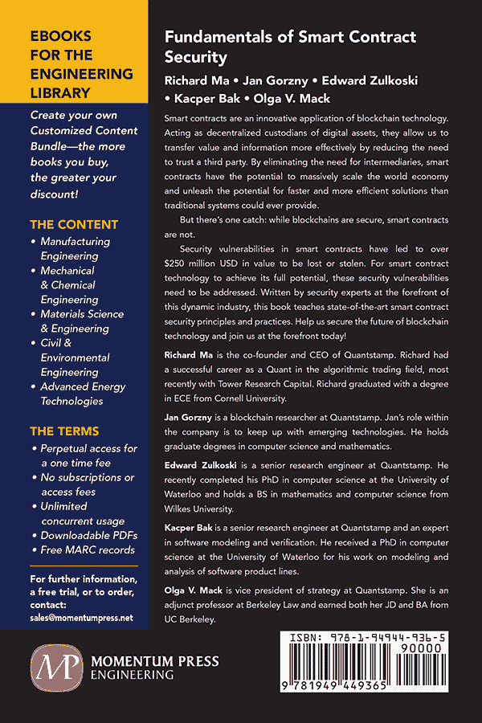

