## 先进图像处理、数据分析与网络安全的人工智能与机器学习融合指南（第一版）


## 关于编辑

Arun Kumar Rana，博士

*加尔戈蒂亚工程与技术学院电子与通信工程系，大诺伊达，印度*

**Arun Kumar Rana，博士，**目前担任加尔戈蒂亚工程与技术学院电子与通信工程系助理教授，地点在印度大诺伊达。他拥有超过 15 年的经验。他的研究兴趣包括图像处理、无线传感器网络、物联网、人工智能、机器学习和嵌入式系统。他在国内外期刊和会议上发表了 100 多篇 SCI/ESCI/Scopus 索引论文。他还与国内外多家出版社（如美国 Taylor and Francis）出版了多本书籍。他参加过研讨会和教师发展项目，并指导了六名 MTech 学生。他担任多家国际期刊和会议的审稿人和编辑。他也是亚洲研究学会的成员。他持有六项国内外专利，并举办了许多关于物联网及其在工程、无线网络、模拟器等方面应用的研讨会。他对教授和实施与无线和物联网技术相关的最新技术有浓厚兴趣。他获得了各种国际组织颁发的许多国际奖项。

Rashmi Gupta，博士


## 教授，电子与通信工程系，阿姆贝德卡先进通信技术与研究学院，隶属于印度德里国家首都辖区政府

Rashmi Gupta，博士，目前担任阿姆贝德卡先进通信技术与研究学院电子与通信工程系教授，该学院隶属于印度德里国家首都辖区政府。她还担任由德里政府资助的孵化中心 AIACTR-IRF 的创始主任。在此之前，她在工业界和多个学术机构积累了丰富经验。Gupta 教授在各种著名的国际期刊和会议上发表了 90 多篇研究论文。她已发表专利，并参与了 DST 资助的项目。Gupta 教授作为编辑委员会成员和审稿人，与多个国际研究组织有合作关系。她的主要研究兴趣包括机器学习、计算机视觉、信号和图像处理。她获得了印度德里大学德里工程学院的电子与通信工程硕士和博士学位。

## Sharad Sharma，博士

### 教授，电子与通信工程系，马哈里希·马克恩德什瓦尔大学（被认定为大学），穆兰纳，印度

Sharad Sharma，博士，目前担任印度马哈里希·马克恩德什瓦尔大学（被认定为大学）穆兰纳分校电子与通信工程系教授。他在教学和行政岗位上拥有超过 20 年的丰富经验。拥有 20 多年的教学经验，他主持了关于软计算及其在工程中的应用、无线网络、模拟器等主题的众多研讨会。他对教学充满热情，并致力于在无线和移动通信中实施最新技术。此外，他作为分支辅导员建立了 IEEE 学生分会。他的研究兴趣包括使用自然启发式计算、物联网和空间通信等技术对无线网状网络进行路由协议设计、性能评估和优化。他是多个专业组织的活跃成员。他获得了印度那格浦尔大学那格浦尔分校的电子工程学士学位、印度帕蒂亚拉塔帕尔理工学院的电子与通信工程硕士学位，以及印度库鲁克舍特拉国家技术学院的博士学位。

## Ahmed A. Elngar，博士

### 副教授兼计算机科学系主任，贝尼苏夫大学计算机与人工智能学院，埃及

Ahmed A. Elngar，博士，是埃及贝尼苏夫大学计算机与人工智能学院计算机科学系副教授兼系主任，同时也是技术与信息学研究中心（TISC）的主任。Elngar 博士是科学创新研究小组（SIRG）的创始人兼负责人。Elngar 博士在享有盛誉的国际期刊上发表了 55 多篇科学研究论文，并出版了 20 多本涵盖数据挖掘、智能系统、社交网络和智能环境等多样主题的书籍。他是埃及数学学会和国际粗糙集学会的成员。他的其他研究领域包括物联网（IoT）、网络安全、入侵检测、机器学习、数据挖掘、人工智能、大数据、身份验证、密码学、医疗保健系统和自动化系统。他是世界各地许多国际期刊的编辑和审稿人。Elngar 博士获得了多个奖项，包括 2019 年全球外联教育峰会颁发的计算机科学工程青年研究员奖。

## Sachin Dhawan，博士

### 助理教授，帕尼帕特理工学院，萨姆尔卡，印度

Sachin Dhawan，博士，目前担任印度萨姆尔卡帕尼帕特理工学院助理教授。Dhawan 教授在印度新德里 Dwarka 的古鲁·戈宾德·辛格·因德拉普拉斯特大学下属的 AIACT&R 获得了电子与通信工程博士学位。他曾担任印度库鲁克舍特拉卡尼普拉吉塔管理与技术学院助理教授。他在各种国际期刊和会议上发表了 20 多篇研究论文。他的论文也发表在 IEEE 会议和 Scopus/SCI 索引期刊上。他目前的研究兴趣包括信号和图像处理、物联网、人工智能和机器学习。他还是全印度工程师学会的准会员和亚洲研究学会的成员。他担任多个期刊和国际会议的审稿人。他还发表了两项专利。他完成了印度库鲁克舍特拉大学库鲁克舍特拉分校的学士学位，以及印度库鲁克舍特拉大学下属工程与技术学院的电子与通信工程硕士学位。

## 贡献者

### Alankrita Aggarwal

印度哈里亚纳邦帕尼帕特萨姆尔卡帕尼帕特理工学院

### K. N. Agrawal

项目协调员，ICAR–中央农业工程研究所，印度博帕尔贝里亚区纳比巴格

### Anupam Bonkra

印度旁遮普邦昌迪加尔工程学院

### Nidhi Chahal

印度旁遮普邦昌迪加尔工程学院

### N. S. Chandel

科学家，ICAR–中央农业工程研究所，印度博帕尔贝里亚区纳比巴格

### Pummy Dhiman

印度旁遮普邦奇特卡拉大学

### M. Shanmuga Eswari

印度泰米尔纳德邦克里希南科伊卡拉萨林伽姆研究与教育学院计算机应用系

### Shivani Gaba

印度哈里亚纳邦帕尼帕特萨姆尔卡帕尼帕特理工学院

### Siddharth Gautam

印度德里 GGSIPU 计算机科学与工程系

### Sunita Gond

印度中央邦博帕尔巴尔卡图拉大学 BUIT 计算机应用硕士系教师

### Ravi Gorli

印度安得拉邦维沙卡帕特南阿尼尔·尼鲁孔达理工学院与科学院信息技术系助理教授

### N. Indumathi

印度钦奈拉贾拉克希米理工学院计算机科学与工程系助理教授

### Rishabh Jha

尼泊尔加德满都特里布万大学兰比尼学院计算机应用系系主任

### Priyanshu Joshi

印度德里 GGSIPU 计算机科学与工程系

### Sandeep Kajal

韩国首尔庆熙大学全球校区工学院

### Saurabh Katiyar

印度北方邦格诺伊达加尔戈蒂亚工程与技术学院

### Amandeep Kaur

印度旁遮普邦奇特卡拉大学

### Inderpreet Kaur

印度北方邦格诺伊达 GCET 计算机科学与工程系

### M. V. Kishore

印度安得拉邦维沙卡帕特南阿尼尔·尼鲁孔达理工学院与科学院信息技术系助理教授

### Ram Krishna

印度北方邦格诺伊达 G.L. 巴贾杰技术与管理学院电子与通信工程系

### Arun Kumar

印度北方邦格诺伊达加尔戈蒂亚工程与技术学院

### Deepak Kumar

印度哈里亚纳邦帕尼帕特萨姆尔卡帕尼帕特理工学院

### Shally Nagpal

印度哈里亚纳邦帕尼帕特萨姆尔卡帕尼帕特理工学院

### R. Ramalakshmi

印度泰米尔纳德邦克里希南科伊卡拉萨林伽姆研究与教育学院计算机科学与工程系

### Sanjeev Kumar Rana

印度哈里亚纳邦安巴拉穆兰纳马哈里希·马克恩德什瓦尔大学（被认定为大学）计算机科学与工程系

### Sumit Kumar Rana


Assistant Professor, Panipat Institute of Engineering and Technology, Samalkha, India

**Poonam Rani**

Department of Computer Science and Engineering, GGSIPU, Delhi, India

**Renu**

Department of CSE, GCET, Greater Noida, Uttar Pradesh, India

**R. Revathy**

Department of Computer Applications, Kalasalingam Academy of Research and Education, Krishnankoil, Tamil Nadu, India

**Meena Sachdeva**

Department of CSE, GCET, Greater Noida, Uttar Pradesh, India

**Sudhir Kumar Sharma**

Jaipur National University, Jaipur, Rajasthan, India

**Anjali Kumari Singh**

BSc Nursing, Norvic International Hospital, Kathmandu, Nepal

**Poonam Sinha**

Head, Department of Electronics and Communication Engineering, BUIT, Barkatullah University, Bhopal, Madhya Pradesh, India

**Priya Trivedi**

Aisect College of Professional Studies, Indore, Madhya Pradesh, India

**Nitin Tyagi**

Department of Computer Science and Engineering, GGSIPU, Delhi, India

**Aditi Upadhyay**

Jaipur National University, Jaipur, Rajasthan, India

**Shrikant Upadhyay**

Cambridge Institute of Technology, Bangalore, Karnataka, India

**K. Upendar**

PhD Research Scholar, ICAR–Central Institute of Agricultural Engineering, Nabi Bagh, Berasia, Bhopal, India

## 前言

本书聚焦于人工智能与机器学习在先进图像处理、数据分析和网络安全领域的融合。本书汇编并讨论了基于不同人工智能范式的各种工程解决方案。本书探讨了这些领域的最新技术进展，并考虑了人工智能、机器学习、深度学习、软计算和进化计算技术如何用于设计、实现和优化工程解决方案。本书旨在为读者提供必要的洞察力，以利用数字成像工具解决新问题。

本书组织如下：

1. 第 1 章 介绍了基于 AI 和 IoT 的医学影像技术在医疗应用中的概述，包括其需求、优势、挑战、现有结构以及可能的未来技术。

2. 第 2 章 讨论了使用深度学习进行青紫性先天性心脏病的早期诊断，并详细说明了相关的优势和挑战。

3. 第 3 章 涵盖了基于 AI 和 IoT 的智能医疗与图像处理的问题和挑战。它还讨论了故障穿越能力的进展及其解决方案。

4. 第 4 章 讨论了医学中的 cyber-physical systems，详细描述了先进医疗系统的控制策略。

5. 第 5 章 关注机器学习（ML）和自然语言处理（NLP）在情感分析中的重要性，情感分析用于提高数据预测能力。

6. 第 6 章 介绍了智能创新系统，对当前电网应用的挑战和应急情况提供了多学科视角。

7. 第 7 章 描述了云计算和 IoT 在人工智能中的应用。

8. 第 8 章 讨论了基于区块链的模型的基础，以保存司法证据的真实性。它包括关于保存司法证据系统真实性的详细案例研究。

9. 第 9 章 描述了机器学习和深度学习技术在农业中用于杂草和作物病害检测与分类的各种应用。

10. 第 10 章 涵盖了使用初步评分方法进行视频图像识别和验证的基础和结构，用于身份验证和安全增强。

11. 第 11 章 关注机器学习和网络防御，审视炒作与现实。

12. 第 12 章 描述了车载自组网中安全与隐私的有效调查及其预防措施。

最后，第 13 章 讨论了利用人工智能和模式识别方法进行图像处理自动化的各种挑战和研究视角。

编辑和撰稿作者希望读者能从中受益，并对人工智能和机器学习在先进图像处理、数据分析和网络安全领域有基本的了解。本书旨在增强读者的知识，并在不久的将来对全球实现未来新兴技术产生影响。

## 第一部分 人工智能与机器学习在医学和医疗保健领域的应用

## 第 1 章 基于 AI 和 IoT 的医疗应用医学影像技术：未来研究

SANDEEP KAJAL,^(¹)

### 摘要

最近，在放射学中使用人工智能（AI）和物联网（IoT）引起了广泛关注。尽管部分关注可能源于对技术可能比放射科医生更好地完成某些工作的过高期望，但越来越多的证据表明其在医学影像中的局限性。由于计算机的无限潜力，IoT 和 AI 是提供放射科医生为提供卓越患者护理所需的统一性、一致性和可靠性的完美选择。医学影像中的 IoT 将减少患者和医生的等待时间和挫败感。随着数字化渗透到医疗技术的许多领域，它也为医疗设备的监控和管理铺平了道路。为了展示 IoT 和 AI 在医学影像技术中的重要性，本章回顾了用于医疗应用的基于 IoT 和 AI 的医学影像技术。

### 1.1 引言

将物联网（IoT）和人工智能（AI）相结合并非新鲜事，但计算能力、数据可访问性和算法性能的最新进展引发了一场“AI 文艺复兴”，AI 正在被应用于几乎每个行业，目标是最大限度地提高生产力、效率和准确性。有关深度学习（DL）算法在少数几个专业领域可能达到人类水平的报告引发了对 IoT 和 AI 的前所未有的兴趣 \[1\]。人工神经网络（ANN）可用于各种非医疗目的，例如识别草书手写体、无人驾驶汽车、光学望远镜对焦等。图 1.1 展示了医疗领域中 IoT 和 AI 的一些应用。

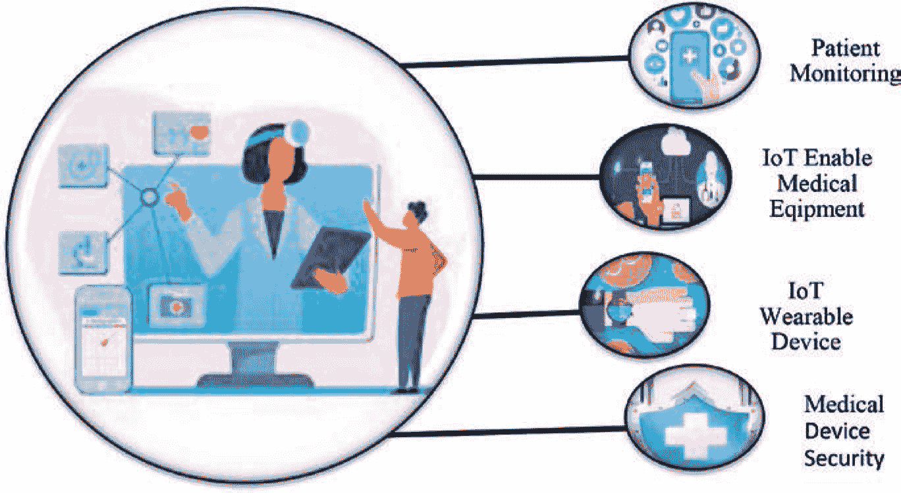

图 1.1 医疗保健中 IoT 和 AI 的应用。


## 医疗数据、云计算与物联网概述

医疗领域的扩张以及计算机断层扫描（CT）和磁共振成像（MRI）等技术的产生，每天都会产生大量高维且变量丰富的数据 \[2, 3, 4 and 5\]。因此，医学影像数据库的规模正在快速增长。由于医疗数据库的发展导致数据量不断增加，管理文件系统具有挑战性。医疗数据的管理一直是美国医疗服务提供者的首要问题 \[6, 7, 8 and 9\]。因此，由于云计算在医学图像使用上的简便性，它已被应用于医疗行业以存储和处理医疗数据。云计算根据用户需求，从远程位置提供可扩展且灵活的计算机资源 \[10\]。它在高端计算机环境中提供计算资源方面也很有效 \[11\]。由于云平台用于云计算中的数据存储，客户不需要在自己的设备上拥有存储或服务器。

因此，消费者不再需要在个人电脑中拥有大量服务器或存储空间 \[12\]。因此，云计算和长期医学图像记录存储对于解决医疗行业的许多问题很有效 \[13\]。云计算在医疗行业被广泛用于存储、处理和共享患者医疗记录。在云计算环境中，医院只需从文件中收集患者数据并将其发送到云端进行存储。在这种情况下，AI 很有用，因为它可以快速从数据中推断结论。机器学习（ML）系统可以提供比传统商业智能工具早 20 倍且更准确的运营预测，传统工具通常监控数值阈值是否被超过 \[14\]。

物联网（IoT）一词指的是一个完全互联的世界 \[15\]。它通过技术连接一切，创造了一个新的宇宙，孩子们可以通过互联网相互交互。物联网不仅仅是一个想法；它有可能彻底改变技术并改变人们的生活方式 \[16\]。物联网将影响任何物理或理论概念，因为它需要对象通信。任何人都应该能够随时随地从任何设备访问任何材料，无论其位于何处，属于哪家公司或服务，通过任何路径或网络。从积极意义上说，“可用性”是影响物联网性能的关键组成部分 \[17, 18 and 19\]。

### 1.1 动机、目标与贡献

车辆、手机、手表、超市、房屋、高速公路和桥梁、家电、工业和农业设备以及可穿戴技术中的传感器和嵌入式设备，已经使新型信息成为可能，并改变了信息的创建、消费和体验方式。物联网和人工智能为数据分析的进步提供了巨大潜力。物联网、数据存储和处理以及机器学习之间的联系很明显，并且已经获得关注。主要目标如下：

*   本章从能源和安全要求的角度，回顾了物联网和人工智能在医学影像应用中的应用。
*   讨论医疗行业中可用的医学影像来源。
*   解释物联网和人工智能的愿景和术语。
*   为未来研究将解决的开放物联网和人工智能的问题和困难展开辩论。
*   阐述五层物联网架构。

### 1.2 文献综述

由于当前医疗服务的创新，医疗数据正在迅速扩张。医疗领域的医疗服务涵盖疾病、损伤和精神健康状况的诊断、治疗、疗法和预防。这些医疗领域的质量依赖于高效的问题解决和资源分配，这需要应用、收集和管理医疗数据 \[21\]。在现代技术出现之前，许多组织依赖以报告形式组织的手写患者记录 \[22\]。然而，现代技术现在对于分析和管理大型数据集至关重要。物联网和云计算已被采用以高效地处理、存储、处理和传输医疗数据。云计算提供了一种灵活且动态的方法来管理医疗数据，而物联网则实现了设备、应用程序、数据、对象和传感器之间的连接，显著影响了医疗行业的数据传输过程 \[23\]。在云计算环境中，物联网使设备和传感器之间能够持续交互和通信。

由于其使操作更加便捷，越来越多的组织现在开始使用物联网和云计算技术 \[24\]。此外，从事制药和医学研究的组织正在使用云计算和物联网，它们的应用有潜力显著改善社会。卷积神经网络（CNN）在深度学习技术中拥有最强大的架构，并提供卓越的分类准确性 \[25\]。CNN 是一种用于解决挑战性分类问题的深度学习技术 \[26\]。对于大型数据集，它提高了计算效率和准确率。此外，它自动提取与训练数据相关的特征图。

在分类过程中，模型使用相关且充足的数据进行预训练，之后分配模型的特征描述。因此，模型不是从随机变量开始，而是从与任务相关的模式开始。如果没有相关数据，CNN 就无法发挥良好性能，因此学习过程仍然需要与测试数据集相关的训练数据集 \[27\]。为了模拟非线性函数，CNN 与模糊逻辑系统结合以创建模糊 CNN。模糊 CNN 改善了函数逼近效果。

### 1.3 五层架构

五层架构被认为是在涉及一系列尖端技术和多样化应用领域的项目中最有效的架构 \[28\]。如图 1.2 所示，五层模型比基本模型多出两个层级，是物联网基本设计的扩展。

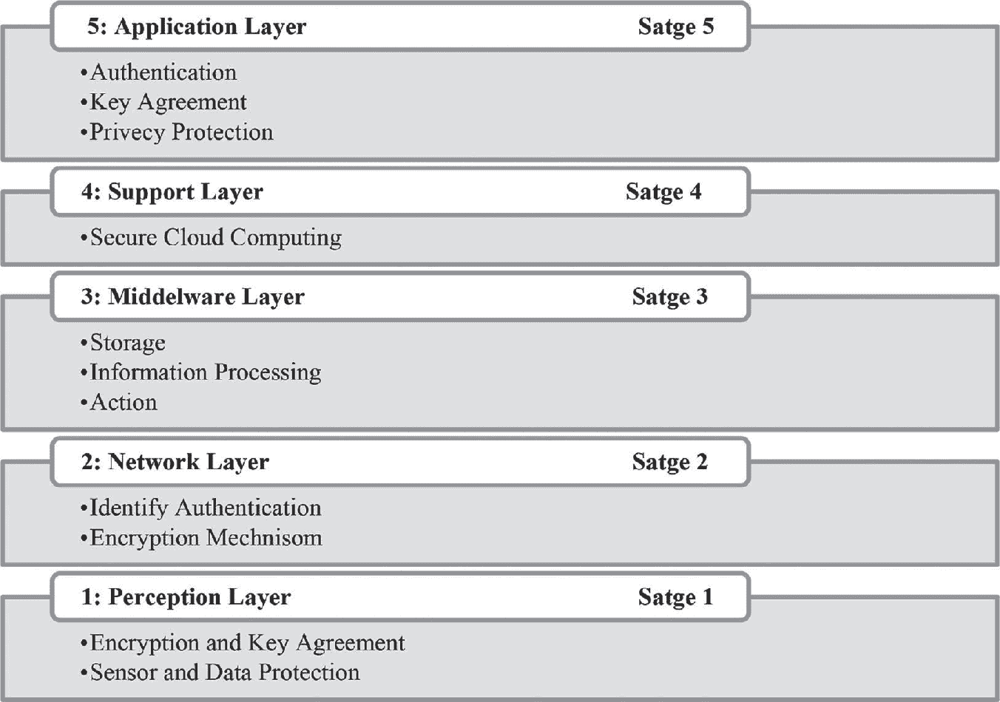

Figure 1.2 Five-layer architecture of internet of things.

#### 1.3.1 感知层

物联网架构的第一层是感知层。它由大量传感器和执行器组成，用于收集温度、湿度、入侵检测系统（IDS）、噪音等有价值的信息。该层的主要目的是从环境中收集数据并将其传输到另一层，以便根据该数据采取行动。


### 2. 网络层

顾名思义，它是连接感知层和中间件层的层。它使用 3G、4G、UMTS、Wi-Fi、红外线等网络技术，从感知层获取数据并将其发送到中间件层。由于它负责感知层和中间件层之间的通信，因此也被称为通信层。所有数据传输均安全进行，收集的信息保持机密。

### 3. 中间件层

这包括存储、计算、处理和采取行动等复杂功能。它保存所有数据，并根据设备的地址和名称将数据发送到相关设备。它还可以根据对传感器数据集进行的计算做出判断。

### 4. 业务/支持层

任何设备的成功不仅取决于其采用的技术，还取决于它如何呈现给用户。这些责任由设备的业务层管理，其中包括创建流程图、图表、分析数据，以及确定如何改进设备等任务。

### 5. 应用层

应用层使用从中间件层获取的数据来处理所有应用程序活动。该应用程序可用于执行各种功能，包括发送电子邮件、设置闹钟、开启或关闭安全系统、可穿戴设备以及智能农业。

### 1.4 医学影像源

为了诊断、监测或治疗医疗疾病，“医学影像”一词指的是用于可视化人体的各种不同技术。每种技术类型都会提供关于正在检查或治疗的身体部位的独特信息，与潜在疾病、损伤或医疗护理的疗效相关。物联网的连接性使医学影像设备能够更高效、更有效地运行，同时降低成本。本节详细介绍了各种医学影像源以及物联网如何通过医学影像促进疾病检测，如 图 1.3 所示。医学界用于诊断疾病的有限医学影像源也在本节中详细介绍 \[29\]。

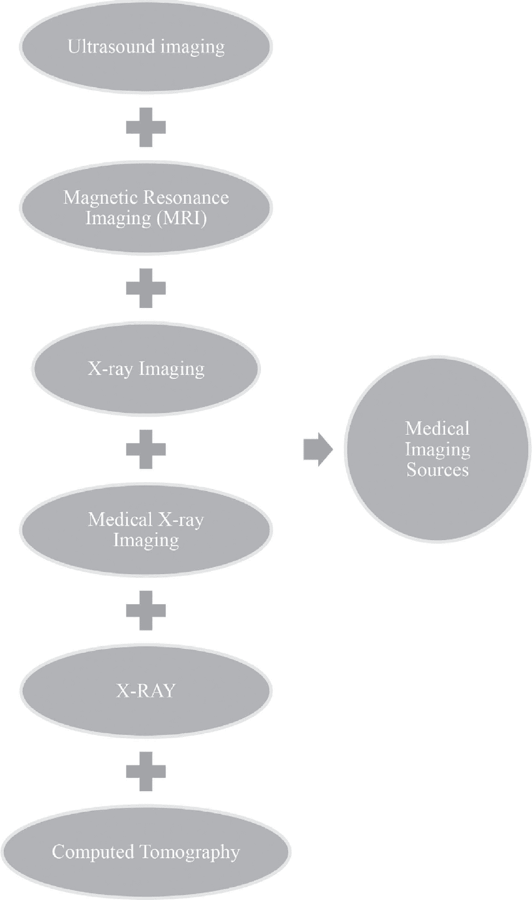

Figure 1.3 Medical imaging sources.

#### 1. 超声成像（超声检查）

超声成像（也称为超声检查）使用高频声波来观察体内情况。实时超声成像可以显示血液在血管中流动以及人体内部器官的运动。与 X 射线成像不同，超声成像不会让患者暴露于电离辐射之下。

在超声检查过程中，换能器（探头）被放置在皮肤上或体腔内。皮肤上覆盖了一层薄薄的凝胶，以便超声波能够穿过凝胶进入体内。

Figure 1.4 描绘了超声检查中使用的探头（换能器）。超声图像是由声波反射身体结构而形成的。创建图像所需的信息由声音信号的强度（振幅）和声波穿过身体的持续时间提供。

![Figure 1.4 Transducer (probe) used during an ultrasound exam \[20\]. Source: Degum. https://www.degum.de/presse/pressemitteilungen/im-detail/news/bauchultraschall.html](images/fig1_4_B.jpg)

Figure 1.4 Transducer (probe) used during an ultrasound exam \[20\]. Source: Degum. [`www.degum.de/presse/pressemitteilungen/im-detail/news/bauchultraschall.html`](https://www.degum.de/presse/pressemitteilungen/im-detail/news/bauchultraschall.html)

#### 2. 磁共振成像（MRI）

MRI 是一种医学成像过程，用于创建人体内部结构的图像。MRI 扫描仪使用无线电波（射频能量）和高磁场来创建图像。水和脂肪分子中的质子构成了 MR 图像中绝大部分的信号。

在 MRI 检查过程中，电流通过线圈产生患者体内的瞬态磁场。设备中的发射器和接收器广播和接收无线电波，这些信号用于创建被扫描身体部位的数字照片。根据被检查的身体部位，一次常规 MRI 扫描可能需要 20 到 90 分钟 \[30\]。

#### 3. 儿科 X 射线成像

医学 X 射线成像改善了各种儿科医疗疾病的识别和管理。根据《联邦食品、药品和化妆品法》（FD&C Act），儿科患者是指在诊断或治疗时年龄未满 21 岁的患者。他们通常根据年龄范围（新生儿、婴儿、儿童和青少年）分为几个类别。对于医学 X 射线成像来说，儿科患者的体型甚至比年龄更需要考虑，因为患者的体型会影响产生高质量医学图像所需的辐射量 \[31\]。

#### 4. 医学 X 射线成像

得益于医学影像，现在可以更准确地诊断和治疗儿童和成人的众多医疗疾病。医学影像过程有各种形式或模态，每种都采用独特的工具和方法。放射摄影（包括乳腺造影、CT 和透视）使用电离辐射来提供人体图像。然而，如果人体暴露于电离辐射下，可能会增加终生患癌的几率，因为电离辐射具有足以潜在损害 DNA 的能量。

#### 5. X 射线（X 辐射）

辐射的使用使得 X 射线能够提供清晰、精确的成像。X 射线通过用电磁辐射穿透内部结构来创建图像，这对于诊断和识别体内异常非常有用。在 Kieffer 等人的研究 \[32\] 中，描述了 X 射线在医学影像中的应用。

为了增强某些 MRI 扫描的对比度，会使用静脉（IV）药物，例如基于钆的造影剂（GBCAs）。GBCAs 是基于稀土金属的，通常通过手臂上的静脉注射给药。

#### 6. 计算机断层扫描（CT）

CT（有时也称为“计算机断层扫描”或“计算机轴向断层扫描”（CAT））是一种非侵入性医疗程序，它使用专门的 X 射线设备创建人体的横断面图像。类似于面包片中的切片，每个横断面图像显示被检查者的一个“切片”。这些横断面图像具有各种诊断和治疗应用。

CT 扫描可以在身体的任何部位进行，用于多种目的，例如诊断、治疗计划、干预或筛查。大多数 CT 扫描作为门诊手术进行。

### 1.5 物联网与人工智能（AI）


物联网（IoT）的应用和安装越来越多地采用人工智能（AI）。过去两年中，结合 AI 和 IoT 的公司的投资和收购有所增长。主要的 IoT 平台软件公司目前提供集成的 AI 功能，包括基于机器学习（ML）的分析。以前需要人工分析的信息，现在可以通过语音识别和计算机视觉等其他 AI 技术从数据中提取出来。IoT AI 应用程序帮助组织减少非计划停机时间，提高运营效率，创造新产品和服务，并更好地管理风险。AI 支持的 IoT 还可以提高运营效率。通过处理连续的数据流来识别人眼不可见或基本仪表无法显示的模式，ML 可以预测运营状况，并识别可以实时调整以保持最佳结果的参数 \[33\]。

### 1.6 未来研究

物联网（IoT）和人工智能（AI）在医疗领域的应用有着悠久的发展历史。因此，医疗领域中几个持续存在的问题和困难也促使许多研究团队密切关注 AI。由于引入了物联网（IoT）、云计算、大数据和 5G 移动网络等尖端技术，AI 技术现在在医疗行业得到更广泛的应用。此外，AI 和 IoT 技术的完全融合使得医疗诊断和治疗能力不断提升，有效地服务于大众。未来的医疗设备，包括手术室、重症监护室、急诊室、病房甚至可穿戴社区和家庭健康设备，将逐渐连接到 IoT 终端以产生大量医疗数据。边缘计算凭借其出色的实用性、可部署性和可用性，被集成到医疗设备的 IoT 接入终端中，用于本地数据处理、存储和边缘智能服务。在不久的将来，具备边缘计算功能的医疗设备 IoT 终端设备将稳步发展。

本章的主要目标是全面概述物联网（IoT）和人工智能（AI）在医学影像领域的未解决问题和挑战。在本节中，我们将介绍一些关于新兴问题和将进一步研究的想法的背景信息。根据最近的贡献和研究出版物，大多数挑战源于各种类型流量的不断增长的流量需求、数据格式的更大差异、各种物联网（IoT）和人工智能（AI）设备、异构网络等。这些元素中的每一个都显著影响物联网（IoT）和人工智能（AI）系统的有效性。在计算和通信能力、服务质量（`QoS`）、移动性、可靠性、隐私和安全性等方面存在特定的应用需求。物联网（IoT）和人工智能（AI）应用程序依赖于其他系统，例如云计算，以满足这些需求。物联网（IoT）和人工智能（AI）系统的架构可能包括其他基于云的技术，如雾计算、云微数据中心（cloudlets）、移动边缘计算（MEC）和移动云计算（MCC）\[34\]。当今大多数可用的物联网（IoT）和人工智能（AI）应用程序和服务都是基于云的，利用智能设备和云基础设施之间的数据交换来提供服务。这种方法面临几个挑战，包括技术挑战（如网络延迟、吞吐量和可靠性）、财务挑战（如将数据传输到云端的成本）以及社会和行政挑战。

过去一年中，雾计算、云微数据中心（cloudlets）、移动边缘计算（MEC）、移动云计算（MCC）等架构和计算范式已被引入，以将基础设施部署得更靠近数据源。不同的模型由其与物联网（IoT）和人工智能（AI）组件的“基础设施距离”、分配功能的基础设施类型以及其他元素来区分。网络边缘设备的存储和计算能力不如云计算。它最适合长期项目，如数据存储和模式分析。它可能基于一种算法，允许优化物联网（IoT）和人工智能（AI）子系统之间的负载分配。利用这种评估，可能可以根据其性能特征（例如 `QoS` 需求）为物联网（IoT）和人工智能（AI）应用程序提供分类策略。这种评估也可用于比较替代应用程序架构和资源管理策略。这种方法也可用于评估 `QoS` 和 `QoE`，以及模拟物联网（IoT）和人工智能（AI）系统。足够的物联网（IoT）和人工智能（AI）系统数学表述和评估方法可以突破未来的进步 \[35\]。

未来，物联网（IoT）和人工智能（AI）将涉及医院管理和护理的方方面面。得益于物联网（IoT）、专为医疗设备资产设计的基于二维码、RFID 等技术的电子标签，库存和材料的准确性得到了提高。通过使用物联网（IoT）感知终端，可以实现设备状态的实时监控。重要的是，这将支持对医疗设备进行全面和公正的管理。医院和其他医疗机构中医疗废物的收集、分类、包装和存储，以及随后的医疗废物处理和管理，都受益于对整个过程的监督和控制。

### 1.7 结论

三十多年来，临床研究、转化和实践一直由医学影像信息学推动。本章强调的相关研究领域的进步，有可能通过实现明智、更准确的诊断、及时的预后和高效的治疗计划，彻底改变目前在整个医疗连续体中使用的影像信息学。医学影像信息学构成了已获美国食品药品监督管理局（`FDA`）批准的基于 AI 的研究驱动技术的很大一部分。为了提供智能服务，物联网（IoT）和人工智能（AI）必须实现任何人、任何事物、随时随地的无缝通信。这包括识别、感知、网络、处理和可视化能力。这一理念为大规模服务和产品开发开辟了大量新选择，从而带来了大量新想法和商业前景。新的物联网（IoT）和人工智能（AI）应用程序以及新兴技术带来了研究社区需要解决的新挑战。我们通过设想最引人注目的未来研究主题和进步，总结和分析了这些挑战，并描述了主要障碍。对有趣的研究主题的简要概述、基于特定功能领域的重大问题分类，以及对特定新兴挑战和想法的见解，都有助于促进未来的研究。因此，这项工作可以作为未来研究的宝贵起点，造福研究社区。处理、索引、查询和分析数字病理学数据对影像研究人员构成挑战。由于实际的存储和处理限制，不可能全面比较高维数据库中查询数据与每个样本。管理将随时间继续增长的相对大规模、多维数据集是关键问题之一。第二个挑战在于准确检查来自各种模态的数据的特征。

### KEYWORDS

### References

1. Alseelawi, N., Hazim, H. T., & Salim, A. H. T., (2022). A novel method of multimodal medical image fusion based on hybrid approach of NSCT and DTCWT. International Journal of Online & Biomedical Engineering, *18*(3).


2. Ibrahim, R. W., Jalab, H. A., Karim, F. K., Alabdulkreem, E., & Ayub, M. N., (2022). 基于广义分数偏微分方程类的医学图像增强. Quantitative Imaging in Medicine and Surgery, *12*(1), 172.

3. Yu, Q., et al., (2022). Crosslink-net: 用于医学图像分割的通过融合垂直和水平卷积的双分支编码器网络. IEEE Transactions on Image Processing.

4. Behera, T. M., Mohapatra, S. K., Samal, U. C., Khan, M. S., Daneshmand, M., & Gandomi, A. H., (2019). 用于 IoT 和 AI 应用的 WSN 中基于剩余能量的簇头选择. IEEE Internet of Things Journal, *6*(3), 5132–5139.

5. Behera, M., Samal, U., & Mohapatra, K., (2018). 用于 IoT 和 AI 应用的能量高效修改 LEACH 协议. IET Wireless Sensors System, *8*(5), 223–228.

6. Tsiknas, K., Taketzis, D., Demertzis, K., & Skianis, C., (2021). 针对工业 IoT 和 AI 的网络威胁：攻击与对策调查. IoT and AI, *2*(1), 163–188.

7. Ojanperä, T., Mäkelä, J., Majanen, M., Mämmelä, O., Martikainen, O., & Väisänen, J., (2021). 面向连接车辆的移动网络边缘 LiDAR 数据处理评估. EURA SIP Journal on Wireless Communications and Networking, (1), 1–23.

8. Rana, A. K., & Sharma, S., (2021). 基于 IoT 和 AI、云计算及大数据的工业 4.0 制造：制造目的场景. In: Advances in Communication and Computational Technology (pp. 1109–1119). Springer, Singapore.

9. Oktian, Y. E., Witanto, E. N., & Lee, S. G., (2021). 去中心化计算、存储和网络方面的 IoT 和 AI 基础设施概念架构. IoT and AI, *2*(2), 205–221.

10. Almezhghwi, K., Serte, S., & Al-Turjman, F., (2021). IoT 和 AI 时代胸部 X 射线分类的卷积神经网络. Multimedia Tools and Applications, *1*–15.

11. Bhushan, B., Khamparia, A., Sagayam, K. M., Sharma, S. K., Ahad, M. A., & Debnath, N. C., (2020). 智慧城市的区块链：架构、集成趋势和未来研究方向综述. Sustainable Cities and Society, *61*, 102360.

12. Bhushan, B., Sahoo, C., Sinha, P., & Khamparia A., (2021). 区块链与物联网的统一 (BIoT and AI)：要求、工作模型、挑战和未来方向. Wireless Networks, *27*(1), 55–90.

13. Inam, H., & Al-Turjman, F., (2021). 基于辐射能量空间现象的智能免费能源使用：修改型 Bedini 发电机的 IoT 和 AI 驱动原型. Microprocessors and Microsystems, *104319*.

14. Jamil, H., Umer, T., Ceken, C., & Al-Turjman, F., (2021). 基于大数据和机器学习的实时 IoT 和 AI 分析决策模型. Wireless Personal Communications, *1*–13.

15. Berntzen, L., Johannessen, M. R., & Florea, A., (2016). 传感器与智慧城市：为基于传感器的智慧城市项目创建研究设计. In: ThinkMind//SMART, The Fifth International Conference on Smart Cities, Systems, Devices and Technologies.

16. Lin, K., Chen, M., Deng, J., Hassan, M. M., & Fortino, G., (2016). 用于智能建筑中 IoT 和 AI 定位的增强指纹识别和轨迹预测. IEEE Transactions on Automation Science and Engineering, *13*(3), 1294–1307.

17. Alletto, S., Cucchiara, R., Del Fiore, G., Mainetti, L., Mighali, V., Patrono, L., & Serra, G., (2015). 用于基于 IoT 和 AI 的智能博物馆的室内位置感知系统. IEEE Internet of Things Journal, *3*(2), 244–253.

18. Kaur, M. J., & Maheshwari, P., (2016). 使用 IoT 和 AI 及基于云的架构构建智慧城市应用. In: 2016 International Conference on Industrial Informatics and Computer Systems (CIICS) (pp. 1–5).

19. Sun, Y., Wu, T. Y., Zhao, G., & Guizani, M., (2014). 智能建筑系统的高效规则引擎. IEEE Transactions on Computers, *64*(6), 1658–1669.

20. McAuliffe, M. J., Francois, M. L., McGarry, D., William, G., Karl, C., & Benes, L. T., (2001). 临床研究中的医学图像处理、分析和可视化. In: Proceedings 14th IEEE Symposium on Computer-Based Medical Systems. CBMS 2001 (pp. 381–386). IEEE.

21. Scholl, I., Aach, T., Deserno, T. M., & Kuhlen, T., (2011). 医学图像处理的挑战. Computer science-Research and Development, *26*(1), 5–13.

22. Zhang, X., Pipattanasomporn, M., Chen, T., & Rahman, S., (2019). 用于智能建筑的基于 IoT 和 AI 的热模型学习框架. IEEE Internet of Things Journal, *7*(1), 518–527.

23. Tournier, J. D., Smith, R., Raffelt, D., Tabbara, R., Dhollander, T., Pietsch, M., & Connelly, A., (2019). MRtrix3：用于医学图像处理和可视化的快速、灵活开源软件框架. Neuroimage, *202*, 116137.

24. Maier, A., Syben, C., Lasser, T., & Riess, C., (2019). 医学图像处理中深度学习的温和介绍. Zeitschrift für Medizinische Physik, *29*(2), 86–101.

25. Bhattacharya, S., Maddikunta, P. K. R., Pham, Q. V., Gadekallu, T. R., Chowdhary, C. L., Alazab, M., & Piran, M. J., (2021). 深度学习与医学图像处理在冠状病毒 (COVID-19) 大流行中的应用：调查. Sustainable Cities and Society, *65*, 102589.

26. Jasti, V., Zamani, A. S., Arumugam, K., Naved, M., Pallathadka, H., Sammy, F., & Kaliyaperumal, K., (2022). 基于机器学习和图像处理的乳腺癌诊断医学图像分析计算技术. Security and Communication Networks, *2022*.

27. Dhiman, G., Juneja, S., Viriyasitavat, W., Mohafez, H., Hadizadeh, M., Islam, M. A., & Gulati, K., (2022). 用于医学图像处理中肿瘤识别的新型基于机器学习的混合 CNN 模型. Sustainability, *14*(3), 1447.

28. Debauche, O., Mahmoudi, S., & Moussaoui, Y., (2020). 物联网学习：智能建筑自动化的实际案例. International Conference on Cloud Computing and Artificial Intelligence: Technologies and Applications. Marrakech, Morocco.

29. Pierleoni, P., Conti, M., Belli, A., Palma, L., Incipini, L., Sabbatini, L., & Concetti, R., (2019). 基于 MQTT 协议的实时建筑监控 IoT 和 AI 解决方案. In: IEEE 23rd International Symposium on Consumer Technologies (ISCT) (pp. 57–62).

30. Alezabi, K. A., Hashim, F., Hashim, S. J., Ali, B. M., & Jamalipour, A., (2020). 4G/5G 异构网络高效身份验证和再身份验证协议. EURASIP Journal on Wireless Communications and Networking, *1*–34.

31. Hajjaji, Y., Boulila, W., Farah, I. R., Romdhani, I., & Hussain, A., (2021). 智能环境中基于大数据和 IoT 和 AI 的应用：系统综述. Computer Science Review, *39*, 100318.

32. Chegini, H., Naha, R. K., Mahanti, A., & Thulasiraman, P., (2021). IoT 和 AI–雾–云生态系统中的流程自动化：调查和分类学. IoT and AI, *2*(1), 92–118.

33. Zhang, Y., Sun, Y., Jin, R., Lin, K., & Liu, W., (2021). 云环境中高性能 IoT 和 AI 医疗隔离计算技术. IEEE Internet of Things Journal, *1*–10.


34. Jacob, T. P., Pravin, A., Ramachandran, M., & Al-Turjman, F., (2021). Differential spectrum access for next-generation data traffic in massive-IoT and AI. Microprocessors and Microsystems, *82*, 103951.

35. Kuwahara, Y., Aihara, N., Yamazaki, S., Ohuchi, K., & Mizuno, H., (2021). Energyefficiency comparison of Ad-Hoc routings in a shadowing environment for smart IoT and AI. International Conference on Information Networking (ICOIN). (pp. 801–804). IEEE.

## 第 2 章 基于深度学习的青紫性先天性心脏病早期诊断

RISHABH JHA^(²)

### 摘要

先天性心脏病（CHD）是婴儿出生时即存在的心脏正常功能缺陷的特殊情况。根据英国国家医疗服务体系（NHS UK）\[1\]，CHD 影响英国多达每 100 名新生儿中的 1 名。同样，根据美国疾病控制与预防中心（CDC USA）\[1\]，每年约有 1% 的新生儿受到 CHD 影响，仅在美国每年就多达近 40,000 例病例。随着计算机科学的进步，医学科学的奥秘正不断被揭开。在医学科学的所有领域，如诊断、预后和治疗中，机器学习（ML）和深度学习（DL）通过与医学专家合作，为病情提供清晰图景，做出了重大贡献。本章提出了一种新颖的技术，利用 DL 在早期阶段诊断青紫性先天性心脏病，以最大限度地降低因 CHD 导致死亡的风险。该拟议研究基于卷积神经网络（CNN），这是一种 DL 算法，将通过智能可穿戴设备对潜在婴儿的 SpO[2] 数据进行应用。

### 2.1 引言

心血管疾病是发展中国家和欠发达国家人民死亡的主要原因之一。尽管大多数心血管疾病都有先进的基础设施治疗，但晚期诊断往往会导致严重症状的发展，并最终导致死亡。早期诊断在大多数情况下可以完全治愈，但当前的医疗基础设施缺乏预测这些疾病可能性的能力，尤其是先天性心脏病（CHD）和风湿性心脏病，这些疾病从出生或早期儿童期就开始表现。对于高危人群，远程健康监测是提供预防性护理和早期干预的有用工具。得益于物联网（IoT）概念的最新改进，此类监测系统现在已经可用，实现了无处不在的监测 \[11, 12, 13, 14, 15 和 16\]。鉴于被监测患者的危急状况，这些系统在可用性和准确性等功能方面需要高质量。深度学习（DL）算法在大量数据可访问的健康应用中显示出巨大的前景，并取得了令人满意的性能 \[2, 17, 18, 19, 20, 21, 22, 23, 24, 25 和 26\]。本章将重点介绍使用 DL 技术解决 CHD 晚期诊断问题。

#### 2.1.1 先天性心脏病（CHD）

先天性心脏病（CHD）是一种发生在胎儿出生前的心血管疾病，导致心脏结构损伤和功能障碍。它可能与胸腔内大血管的异常有关。CHD 是其他先天性疾病中死亡的最常见原因。尽管 CHD 的确切原因尚不清楚，但有多种因素会影响其发展。它可能源于遗传易感性和环境因素的组合。在遗传原因方面，染色体异常，主要是非整倍体，是主要因素。21、13 和 18 三体综合征以及特纳综合征是导致胎儿发育期间心脏结构畸形的促成因素，最终导致 CHD。环境因素包括孕妇疾病、苯丙酮尿症、药物暴露以及妊娠期间的病毒感染。

#### 2.1.2 体征和症状

* 皮肤发青或发紫（青紫）；

* 心跳加快（心动过速）；

* 呼吸急促（呼吸过速）；

* 腿部、腹部或眼周肿胀；

* 儿童被动行为；

* 肺水肿。

#### 2.1.3 类型

根据各种原因和所致情况，CHD 大致分为两种类型：

1. **青紫性 CHD：** 这些会导致由于缺氧而引起的皮肤发青。此类别包括一组致命的 CHD，如肺闭锁、三尖瓣闭锁、动脉干和左心发育不良综合征。

2. **非青紫性 CHD：** 这些是导致充血性心力衰竭的疾病。它们包括室间隔缺损、房间隔缺损、动脉导管未闭等。

#### 2.1.4 成人先天性心脏病（CHD）的发展

如果没有适当的诊断和护理，CHD 可能导致成人出现危及生命的情况。其中一些情况包括：

1. **心律失常：** 它是指心跳不规则，当协调心跳的电信号不能正常工作时发生。在这种情况下，心跳可能过快、过慢或不规则。在严重情况下，如果不治疗，可能导致中风或猝死。

2. **心内膜炎：** 它是心脏内膜（称为心内膜）的感染。如果不治疗，可能导致心脏瓣膜损伤甚至中风。

3. **中风：** 在成人 CHD 的发展过程中，血栓可能通过血流到达人脑，导致大脑供氧减少，并最终导致中风。

4. **心力衰竭：** 在某些情况下，CHD 可能导致充血性心力衰竭，即心脏无法泵出足够的血液以满足身体的需求，最终导致死亡。

5. **妊娠失败：** 一些复杂的 CHD 病例可能导致妊娠失败。此外，患有 CHD 的男性和女性都有将疾病以某种形式传给子女的风险。

#### 2.1.5 深度学习（DL）

深度学习（DL）是机器学习（ML）的一个子集，而 ML 又是人工智能（AI）的一个子集，如 图 2.1 所示。

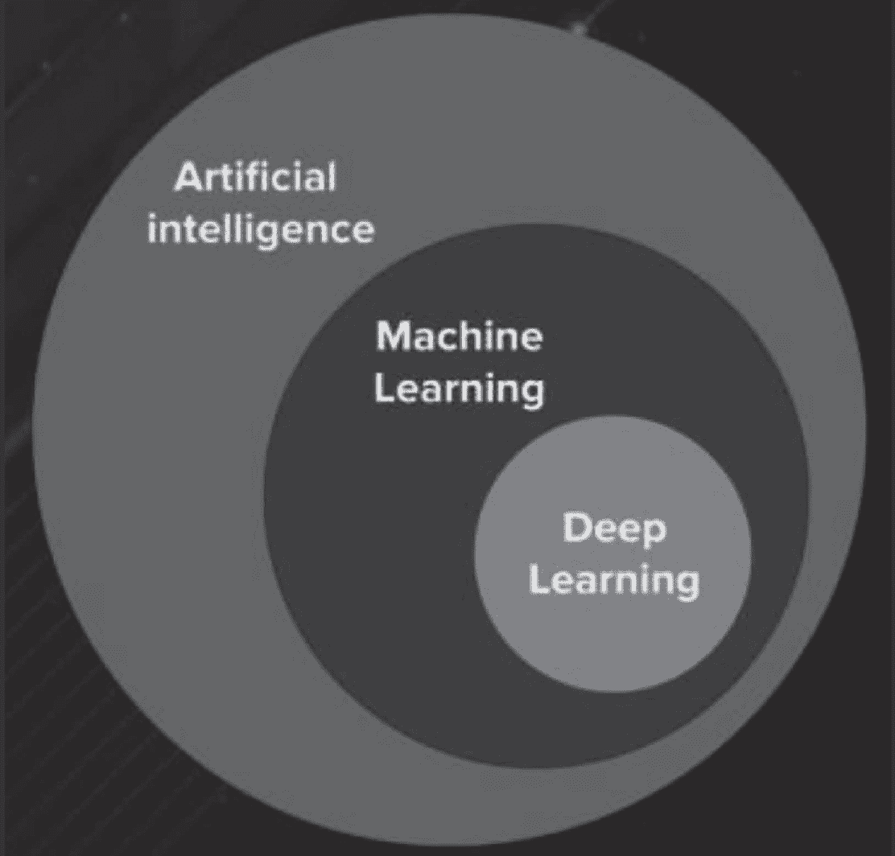

图 2.1 AI vs. ML vs. DL.

DL 从人类神经元形成学习网络的方式中汲取灵感，训练机器学习新概念。DL 算法的基本结构是神经网络，由多个层级中互连的节点组成。这种互连网络使得在任何给定领域处理复杂数据成为可能，允许在大型数据集中识别模式、图像处理和自然语言处理等任务。

DL 采用统计方法，因为它将复杂问题分解为许多较小的模块，然后在这些模块上应用 ML 算法，如 图 2.2 所示。神经网络由多个连接层的网络组成。在第一层（即输入层）和最后一层（即输出层）之间，有许多节点层的互连网络。这些中间层称为隐藏层，它们处理大量数据以学习数据的复杂特征。

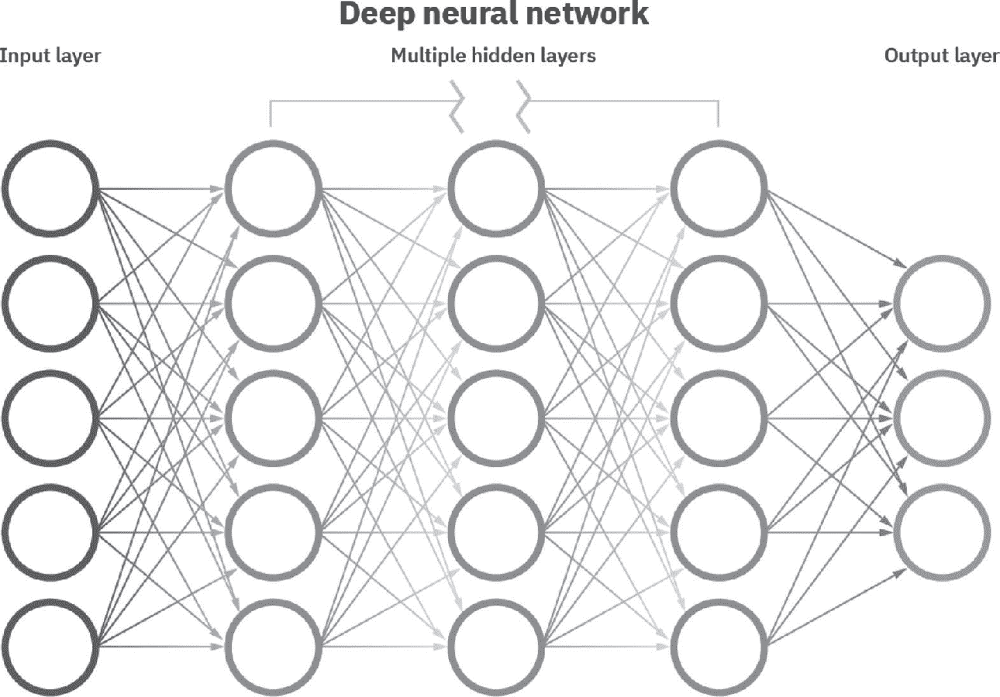

图 2.2 神经网络架构。*来源：* IBM.

一些常见的深度学习算法包括：


## 2.2 研究方法

拟议算法如 图 2.4 所示。

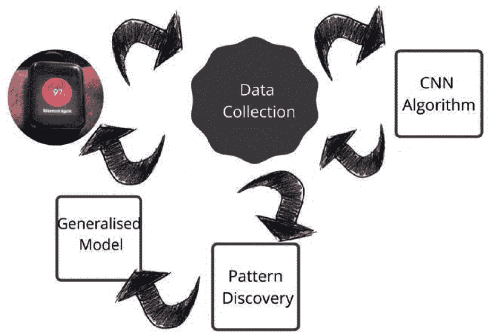

图 2.4 拟议模型。

*   **步骤 1：** 设备配置：首先，需要根据我们的需求配置一种智能可穿戴设备（例如 Apple Watch），该设备能够测量血液中的 `SpO[2]` 水平，并将数据收集到附近的智能手机中。

*   **步骤 2：** 数据收集：可以使用智能可穿戴设备来收集即将接受青紫性先天性心脏病（Cyanotic CHDs）可能性检测的儿童的 `SpO[2]` 水平。一定时期内的数据将被存储并准备进行处理，然后输入神经网络。

*   **步骤 3：** 决策：在此步骤中，将分析特定时间间隔内儿童的标准化 `SpO[2]` 水平。如果其低于无先天性心脏病的阈值水平，将建议进行超声心动图检查。

*   **步骤 4：** CNN 算法的裁决：`SpO[2]` 水平中表现出的模式，加上利用 CNN 算法的推荐器和图像处理能力对超声心动图进行的图像分析，将产生儿童发生青紫性先天性心脏病的最终概率。这些概率随后将需要医疗专业人员做出最终决定。

## 2.3 文献综述

在医学科学领域，使用 AI 进行的工作之前已有大量开展。这一点在心血管疾病领域尤为明显，可以观察到 AI 在未来医学和治疗方法中的潜在作用 \[3\]。同样，心血管疾病在亚洲和非洲等发展中国家和欠发达地区更为普遍 \[4\]。数据挖掘技术长期以来一直被用于揭示医疗保健的奥秘。医生已直接受益于使用数据挖掘工具来评估治疗效果并确定最佳实践 \[5\]。此外，知识发现工具被用于就各种医疗实践和疾病诊断做出决策。在许多情况下，仅靠人工干预不足以得出最终结论，这就是知识发现工具发挥作用的地方 \[6\]。因此，信息科学和 AI 已成为当今医学科学领域的主要工具 \[7\]。

不仅是深度学习和复杂的神经网络，即使是最简单的监督学习方法也被用于解决医疗和医疗保健系统中的问题，例如实验室医学 \[8\]。像 CNN 这样的深度学习算法已被专门用于分析医学图像。这种图像分析在分析超声心动图报告方面尤其有帮助，超声心动图是诊断心血管疾病的金标准测试。因此，CNN 算法在解决心血管疾病诊断中各种未解决的问题方面具有巨大潜力 \[9\]。在本研究中，CNN 的使用方法与推荐系统的方法类似 \[10\]。

## 2.4 结论与未来工作

如果在早期阶段进行心血管疾病的诊断，则可以完全预防因心血管疾病导致的死亡和严重程度。其中一些疾病从出生时就存在，使得诊断和预测其发生变得困难。青紫性先天性心脏病（CHD）就是其中一种疾病，本章即基于此疾病。研究方法旨在识别一种模式，通过该模式可以开发出一个通用模型，以检测儿童中任何青紫性先天性心脏病的发生，而无需复杂的医疗诊断方法。本研究还可以进一步开发，用于诊断某些自身免疫性和遗传性心血管疾病。

### 关键词

### 参考文献

1.  Kagawa, M., Takeshita, M., Yatō, S., & Kitamura, K., (1983). Brain abscess in congenital cyanotic heart disease. Journal of Neurosurgery, *58*(6), 913–917.

2.  Dhawan, S., Gupta, R., & Rana, A. K., (2021). Internet of things: Security issues, challenges, and its applications. In: Multimodal Biometric Systems (pp. 111–124). CRC Press.

3.  Yan, Y., Zhang, J. W., Zang, G. Y., & Pu, J., (2019). The primary use of artificial intelligence in cardiovascular diseases: What kind of potential role does artificial intelligence play in future medicine? J. Geriatr. Cardiol., *16*(8), 585–591. doi: [10.11909/j.issn.1671-5411.2019.08.010](http://dx.doi.org/10.11909/j.issn.1671-5411.2019.08.010).

4.  Hirotsugu, U., Akira, S., Katsuyuki, M., Tanvir, C. T., Naoyuki, T., Yoshikuni, K., Makoto, W., et al. (2021). Cardiovascular Disease and Risk Factors in Asia. doi: [10.1161/CIRCULATIONAHA.108.790048](http://dx.doi.org/10.1161/CIRCULATIONAHA.108.790048) [`doi.org/10.1161/CIRCULATIONAHA.108.790048`](https://doi.org/10.1161/CIRCULATIONAHA.108.790048).


5. Koh, H. C., & Tan, G., (2005). 医疗保健中的数据挖掘应用. J. Healthc. Inf. Manag., Spring, *19*(2), 64–72. PMID: 15869215.

6. Karys, A., (1998). 终结技术悖论：用于临床决策的医疗保健管理技术. J. Healthc. Inf. Manag. Fall, *12*(3), 25–32. PMID: 10338784.

7. Skinner, R. I., (2003). 医疗保健中信息技术的价值. Front Health Serv. Manage. Spring, *19*(3), 3–15. PMID: 12645778.

8. Hooman, H. R., Nam, T., Samer, A., & Luke, T. D. (2020). 医疗保健和实验室医学中的机器学习：监督学习和 Auto-ML 的一般概述. [`https://doi.org/10.1111/ijlh.13537`](https://doi.org/10.1111/ijlh.13537).

9. Dormer, J. D., Halicek, M., Ma, L., Reilly, C. M., Schreibmann, E., & Fei, B., (2018). 使用 CT 图像和左心房补片检测患病心脏的卷积神经网络. Proc. SPIE Int. Soc. Opt. Eng., *10575*, 1057530. doi: [`10.1117/12.2293548`](http://dx.doi.org/10.1117/12.2293548).

10. Dan, Y., Jing, Z., Sifeng, W., & Xue, D. Z., (2019). 基于时间感知 CNN 的个性化推荐系统. Complexity, *2019*, 11. Article ID 9476981. [`https://doi.org/10.1155/2019/9476981`](https://doi.org/10.1155/2019/9476981).

11. Rana, A. K., & Sharma, S., (2019). 用于物联网应用的无线传感器网络中增强的节能异构路由协议. Int J Eng Adv Technol (IJEAT), *9*(1)*.*

12. Rana, A. K., Krishna, R., Dhwan, S., Sharma, S., & Gupta, R., (2019). 人工智能与物联网的综述：问题、挑战与机遇. In: 2019 2nd International Conference on Power Energy, Environment, and Intelligent Control (PEEIC) (pp. 383–387). IEEE.

13. Sharma, S., Dudeja, R. K., Aujla, G. S., Bali, R. S., & Kumar, N., (2020). DeTrAs：基于深度学习的医疗保健框架，用于物联网辅助阿尔茨海默病患者. Neural Computing and Applications, *1*–13.

14. Rajan, J. P., & Nadar, E. R. S., (2019). Smart-monitor：基于深度学习的物联网医疗保健系统患者监测系统. IETE Journal of Research, *1*–8.

15. Rana, A. K., & Sharma, S., (2021). 用于物联网应用中低功耗和损耗网络 (RPL) 的 IPv6 路由协议的 Contiki Cooja 安全解决方案 (CCSS). In: Mobile Radio Communications and 5G Networks (pp. 251–259). Springer, Singapore.

16. Rana, A. K., & Sharma, S., (2021). 基于物联网、云计算和大数据的工业 4.0 制造：制造目的场景. In: Advances in Communication and Computational Technology (pp. 1109–1119). Springer, Singapore.

17. Rana, A. K., Sharma, S., Dhawan, S., & Tayal, S. (2021). 迈向物联网机器人事物的安全部署：架构、应用和挑战. In: Multimodal Biometric Systems (pp. 135–148). CRC Press.

18. Kumar, A., & Sharma, S., (2021). 物联网 (IoT) 与能源领域：挑战与发展. In: Electrical and Electronic Devices, Circuits and Materials (pp. 183–196). CRC Press.

19. Kumar, A., & Sharma, S. (2021). 基于语义网络的 IFTTT 依赖方法，用于简化物联网应用中最终用户应用程序的触发-动作编程. Semantic IoT: Theory and Applications: Interoperability, Provenance and Beyond, *385*.

20. Dhawan, S., Chakraborty, C., Frnda, J., Gupta, R., Rana, A. K., & Pani, S. K., (2021). SSII：用于物联网的基于智能混合优化算法的安全高质量隐写术. IEEE Access.

21. Paras, C., & Rajesh, K., (2014). 具有 RF 开关的新型六边形可重构天线的设计与制造，用于移动终端. Journal of the National Science Foundation of Sri Lanka, *42*(3*),* 257–263. ISSN 1391–4588.

22. Paras, C., & Rajesh, K., (2015). 具有 RF-MEMS 开关的新型螺旋频率可重构天线，用于移动 RF 前端. Applied Electromagnetics and Mechanics (Vol. 47, pp. 323–335). IOS Press, Birmingham, Alabama 35201 USA, ISSN 1383–5416.

23. Paras, C., & Rajesh, K., (2016). 一种利用神经计算方法设计和分析分形天线的新方法，用于可重构 RF MEMS 天线. Turkish Journal of Electrical Engineering & Computer Sciences, Academic Journal (Vol. 24, No.3, pp. 1265–1278). Ankara – TURKEY (ISSN 1300–0632).

24. Anupma, G., Ankush, K., & Paras, C., (2019). 具有方形环形耦合地平面的贴片天线设计，用于体内/体外通信. International Journal of Electronics (pp. 1814–1828). (TET N), Taylor & Francis, ISSN: 0020–7217.

25. Ayush, D., Bhawna, G., Paras, C., Apoorav, M. S., & Sanjeev, K., (2020). 实时图像去雾澄清数字图像 (Vol. 56, No. 1, pp. 91, *92*). Laser Focus World, Pennwell Publ Co., USA, ISSN: 1043–1809.

26. Dhawan, S., Gupta, R., & Rana, A. K., (2021). 基于机器学习的隐写术与隐写分析. In: Internet of Things (pp. 249–257). CRC Press.

## 第 3 章 基于 AI 和 IoT 的图像处理智能医疗保健

PRIYA TRIVEDI^(³)

### 摘要

得益于人工智能 (AI)，人们在医疗保健领域取得了令人钦佩的进步。AI 与其他尖端技术一起，使医疗保健设施和流程更加高效和实用。提供极其有效的治疗和洞察力操作的临床及其他应用就是其结果。AI 是少数几种有能力彻底改变全球医疗保健系统并帮助克服所有行业难题的技术之一。AI 可以大大缩短提供医疗保健服务所需的时间，同时提高效率。一种新的高科技医疗保健系统现在正在帮助全世界发现和治疗疾病。它还在延长我们的寿命并提升我们社区的福祉。健康信息现在更加安全、质量更高，并且在需要时随时随地都能轻松获取，通过采用安全的健康信息技术，为每个人带来更低的护理成本和更高的效率。我们现在生活在一个全新的计算时代，所有与健康相关的数据都已数字化。在同样的背景下，本章重点介绍了医疗保健系统（健康 IT 系统）中基于 IoT 和 AI 的应用，这些系统用于各种疾病的诊断、预防和治疗。

### 3.1 引言

我们对图像并不感到惊讶。图像是通过使用各种观测系统观察客观世界而获得的，每种系统都能直接或间接影响人眼并产生视觉感知。人类视觉是一种观测系统，客观场景的心理表征就是它产生的图像。普通图像是模拟图像，意味着它们包含的信息是不断变化的模拟量。因此，术语“数字图像处理”常用于描述计算机上的图像处理。

零售、工业、汽车，现在还有医疗保健，都从物联网 (IoT) 和 AI 中受益。虽然对所有这些行业来说，融合这些技术以寻找答案至关重要，但医疗保健将从中受益最大。


IoT 为医生、护士、患者、研究人员甚至保险公司开辟了新的可能性。医生现在几乎可以随时随地监测患者的健康状况，患者可以通过 IoT 在指尖与医生沟通。来自世界各地的研究人员可以在不见面的情况下进行协作，专业人员可以获得解决最复杂诊断问题所需的帮助。

在 IoT 出现之前，患者的互动仅限于与医生进行视频会议、发送短信和就诊。医生或医院无法定期评估患者的健康状况并提出适当的建议。

在医疗保健行业，通过 IoT 赋能的设备/设备现在可以实现远程监控，这些设备可以通过提供 AI 和 IoT 设计的临床解决方案，为保持患者健康和安全提供更优质的治疗。与医生的进一步联系现在更加便捷和高效。此外，它还增强了患者的参与度和满意度，而对患者健康的远程监控有助于防止再次入院并缩短住院时间。

IoT 通过重新定义技术和人性化关怀在医疗解决方案交付中的作用，显然正在改变医疗保健行业。医疗保健中的 IoT 应用使患者、家庭、医生、医院和保险公司受益。

术语“健康信息技术”指的是医疗专业人员和患者用于存储、共享和分析健康数据（健康 IT）的计算机系统。

健康信息技术的示例包括：

1. **电子病历（EMRs）：** 这些记录使医生能够更好地跟踪您的健康信息，并且即使他们的诊所在您遇到问题时关闭，他们也可能能够查看这些信息。EHR 还使您的医生能够轻松地与专家沟通信息，确保需要您信息的专家能尽快获得。

2. **个人健康信息（PHIs）：** 它类似于 EHR，区别在于您对进入其中的信息有更多控制权。个人健康记录（PHR）可用于跟踪医生预约的信息，但它也可以代表您在医生办公室之外的生活和您的健康优先事项，例如跟踪您吃什么、您锻炼的频率以及您的血压。您的 PHI 和您医生的 EHR 有时可能会关联。

3. **电子处方（E-Prescribing）：** 纸质处方可能会丢失或被误解。您的医生可以通过电子处方直接与您的药房联系。这意味着您可以去药店而无需随身携带纸质处方。

4. **保密性和安全性：** 所有这些电子解决方案都有可能改善您健康信息的安全性。例如，电子数据可以被加密，以确保只有授权人员才能访问它。健康信息技术还可以方便地跟踪谁访问了您的数据。

### 3.2 文献综述

医疗保健是每个人生活中重要的方面。考虑到这一点，IoT 技术最近受到了广泛关注，许多研究人员正在研究其在增强医疗保健系统方面的潜力，原因是人口老龄化和慢性疾病增加。通过专注于 LPWAN 并强调其在 IoT 系统中的特定适用性，它进一步为原始研究做出了贡献。

现有的 IoT 技术被评估其在帕金森病患者监测系统中的价值 \[1\]。几位研究人员提出了监测糖尿病患者血糖水平的实用方法。在这种方法中，患者在预设间隔手动测量血糖水平 \[2\]。配备心电图（ECG）和血压传感器的蜂窝电话将血压、心率、体温和血氧饱和度数据传输到基站 \[3，4 和 5\]。该系统利用加速度计和磁力计的传感器数据，以及行人推算、阈值处理和决策树（DT），来确定一个人在四个房间区域内的位置，并检测跌倒、躺下、站立、坐着和行走等动作。一些研究提出了无线体域网络（BAN）医疗监测系统的容错技术 \[6\]。该方法基于网络编码，采用贪心分组算法建立分层网络结构。随后，使用随机线性网络编码生成线性无关的编码组合 \[7\]。在本章中，肾脏交换问题被建模为有向图最大权重循环打包问题。根据研究人员的说法，这种方法可能允许比当前公式的匹配方案多让一名患者获得肾脏移植。为了在互联网上实现患者与护理人员之间的安全通信，Rana & Sharma \[8\] 提出了一种安全认证和处方安全策略。该协议使用 Rubin 逻辑形式化建模和 NS-2 模拟进行验证。Zheng 等人 \[9\] 发表了一项关于在蛋白质-蛋白质相互作用网络中检测蛋白质复合物或功能模块的研究。他们的技术基于基因本体论和简化蚁群优化（SSO）算法。SSO 技术用于聚类具有相似活性的蛋白质，而 GO 用于提高检测准确性并帮助功能复合物识别。关键原理是第二心音波形的主动脉成分不受呼吸影响，而肺动脉成分表现出延迟。为了测试这种策略，使用了已知变化分离的模拟第二心音 \[10\]。为了设计一种独特的统计技术来区分溃疡像素和非溃疡像素，我们使用了颜色带作为特征向量，并使用带有网格搜索的支持向量机（SVM）作为分类器。在实验室中，该方法得到了评估，并被发现具有出色的准确性、灵敏度和特异性来诊断溃疡。

IoT 可以有效地随时随地连接人与人、物与物以及物与其他物。在智能环境中，传感器和设备通过 IoT 隐形连接，使跨平台信息交换变得简单。数字照片是 IoT 中信息的重要组成部分，可以连接各种类型的信息。图像处理与 IoT 之间的链接在 图 3.1 中描述。图像传感器由 CCD 或 CMOS 制成，用于捕获图像数据，是 IoT 网络的一个组成部分。

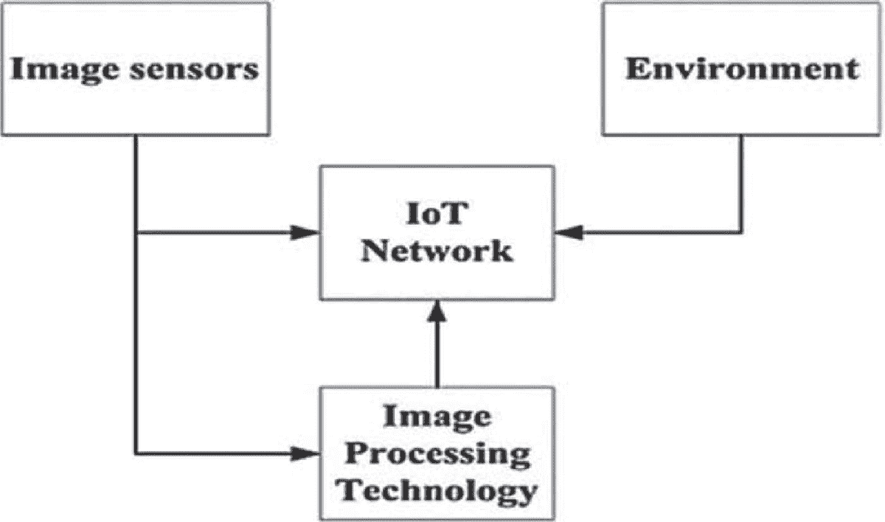

图 3.1 IoT 与图像处理的关系。 *来源*：物联网与智慧城市的崛起。[`ebrary.net/201930/engineering/internet_things_image_processing`](https://ebrary.net/201930/engineering/internet_things_image_processing)


图像传感器充当物联网网络中人的类比，用于收集来自外部世界的修改后的图像。人脑的视觉处理区域用于分析和增强这些图像，类似于配备 DIP 技术的处理器。然后，处理器将转换后的结果传输到物联网网络的其他节点，以便它们可以响应任务。因此，配备 DIP 技术的物联网网络可以获取更准确的信息并更快速地响应任务。

### 3.3 改善医疗保健系统中的信息

近年来，为了整体改革医疗保健系统，做出了重大努力，更加强调将资源和决策权下放到区级。这种转变将需要在地方一级改善卫生信息系统。同时，很明显，当地人和家庭必须参与卫生数据的收集、传播和分析。物联网设备为医疗保健从业者追踪患者及其患者的进展提供了许多新机遇。因此，众多可穿戴物联网设备为患者和医疗保健从业者带来了益处和问题。

#### 3.3.1 远程患者监测 (RPM)

为了探讨图像处理技术在远程监测和智能医疗系统中的应用，提出了基于虚拟局域网的远程智能图像处理系统的理念和实现技术。该技术探讨了远程图像监测中需要解决的关键技术，并采用先进的数字图像压缩编解码技术以及数字图像传输技术。远程患者监测 (RPM) 是医疗保健中物联网设备最流行的应用。无法前往医院、诊所或医疗机构的患者可以利用物联网设备收集血压、体温和心率等健康指标和数据 \[11, 12, 13, 14, 15 和 16\]。

首先，物联网设备收集患者信息，然后将其发送到软件应用程序中，医疗保健专业人员和/或患者可以轻松查看。接下来，使用算法评估数据并提供治疗建议或推荐。例如，如果患者的物联网传感器检测到心率过低，它会触发警报，以便医疗保健从业者可以进行干预。图 3.2 显示了一个 RPM 系统。RPM 设备的关键挑战之一是确保物联网设备收集的高度个人数据的安全性和隐私性 \[17, 18, 19, 20, 21 和 22\]。

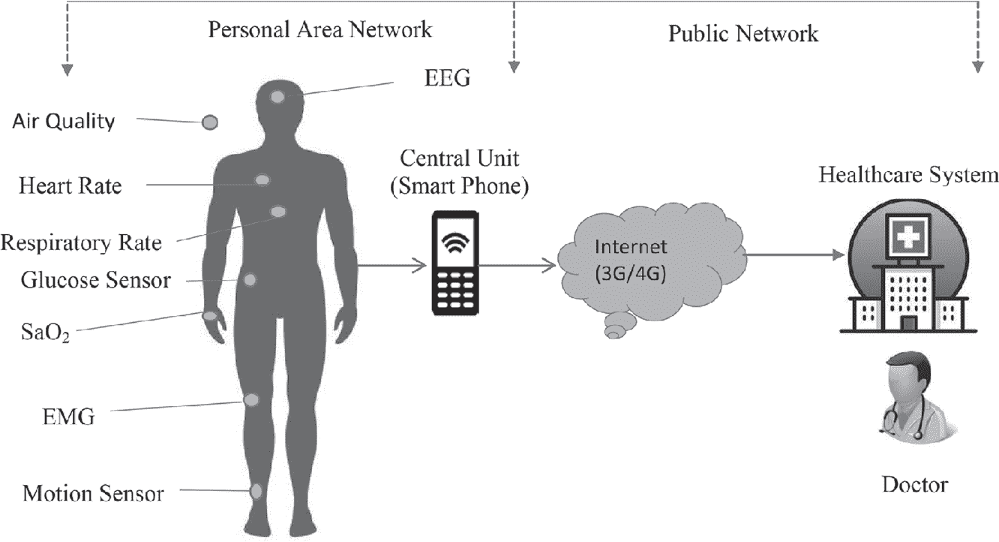

Figure 3.2 Remote patient monitoring system with image processing. Source: Adapted from Kumar et al., 2022.

从某种意义上说，所有可穿戴设备都必须将患者数据传输给其医疗保健提供者，这通常通过专用智能手机应用程序完成。虽然有多种协议可用于将 RPM 设备的数据传输到智能手机，但最常见的是低功耗蓝牙 (BLE) 通信。图 3.3 显示了 RPM 设备的类型。

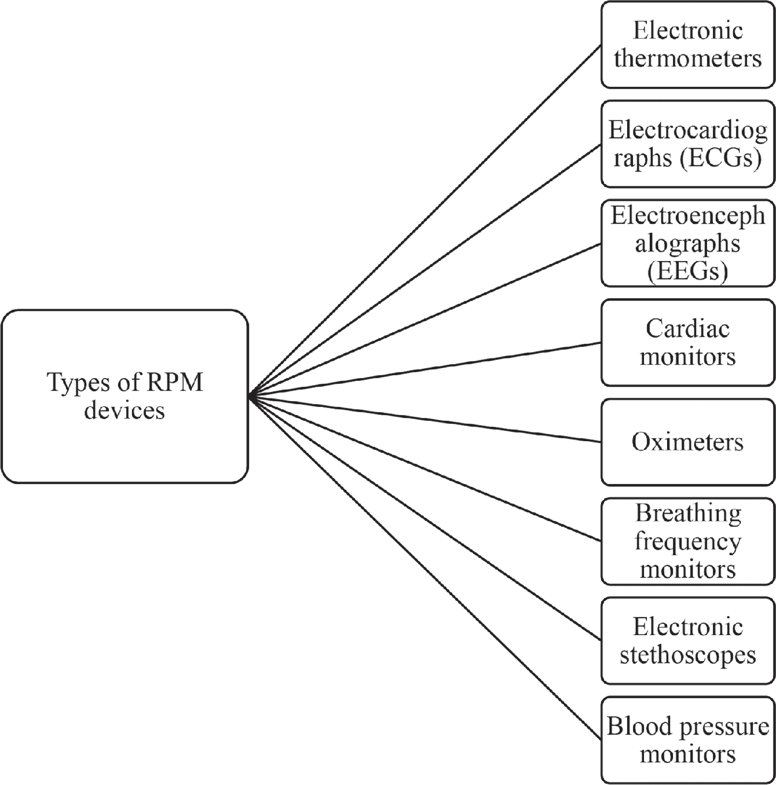

Figure 3.3 Types of RPM devices.

#### 3.3.2 血糖监测

血糖监测长期以来对数百万印度人以及患有 1 型或 2 型糖尿病的美国人来说一直是一项挑战。手动检查和记录血糖水平不仅繁琐，而且只能提供测试时患者的血糖水平信息。如果水平波动显著，定期检测可能不足以识别问题。

物联网支持的设备可以通过为患者提供连续和自动化的血糖监测来帮助解决这些问题。血糖监测设备减少了人工记录的需求，当患者的血糖水平危险地低或高时会提醒患者。

通过物联网设计血糖监测设备应当：

* 小巧、易于携带，并持续监测患者的血糖水平；
* 消耗的电力少到不需要经常充电是一项挑战。

图 3.4 展示了一个面临诸多障碍的血糖监测设备，但解决这些障碍的技术有潜力改变患者监测血糖水平的方式。

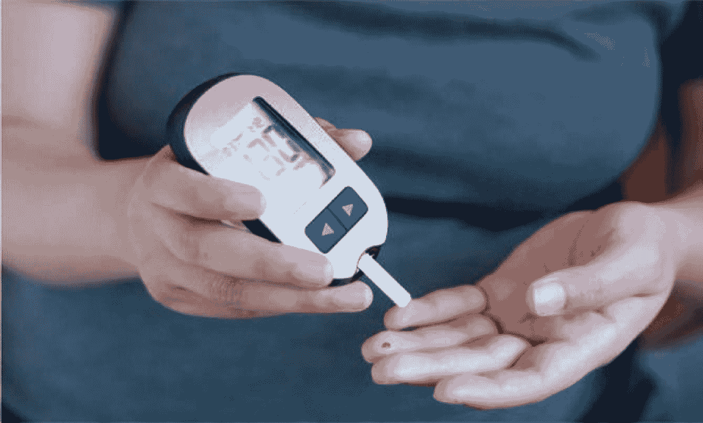

Figure 3.4 Glucose monitoring device. Image credit: Kwangmoozaa (iStock)

#### 3.3.3 心率监测

在医疗机构中，即使对于患者来说，持续监测心率、血糖水平和其他生命体征也可能具有挑战性。定期心率监测无法防止心率快速变化。即使是用于持续监测心脏活动的传统医院设备也会使患者永久地连接到有线机器上，限制了他们的活动。

如今，有各种小型物联网设备可用于心率监测，允许患者在心脏持续受到监测的同时自由走动。尽管实现超精确读数仍然是一项挑战，但大多数现代设备可以达到 90% 或更高的准确率。使用物联网测量心率如图 3.5 所示。

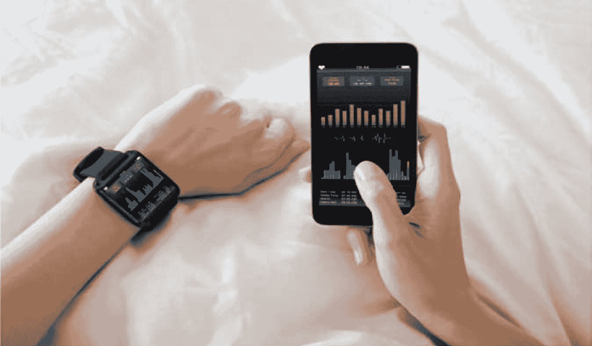

Figure 3.5 Measuring heart rates through IoT. *Image credit*: AndreyPopov (iStock)

#### 3.3.4 手部卫生监测

在过去，无法保证医疗机构中的医生和患者彻底洗手以限制传播感染的风险。物联网设备现在在许多医疗机构和医院中被使用，以提醒患者在进入医院和病房前洗手。新设计的物联网设备还可以提供如何清洁双手的说明，以降低特定患者的特定风险。这些设备的一个主要问题是，它们只能提醒个人擦手，而不能替他们完成。尽管如此，数据表明，这些新设计的物联网设备可以将医院感染率降低 60% 以上。

#### 3.3.5 抑郁症和情绪监测

患者的抑郁症状信息和整体情绪数据传统上很难定期收集。患者可以定期向医疗保健提供者报告自己的感受，但他们无法预测情绪波动。患者往往难以适当地表达自己的情绪。具有“情绪感知”功能的物联网设备可以帮助解决这些问题。通过收集和分析心率、情绪和血压等数据，这些新设计的物联网设备可以收集或预测关于患者精神状态的信息。先进的物联网情绪监测设备甚至可以跟踪患者的眼动等数据。

主要挑战是，这种类型的数据无法有效预测抑郁症状或其他警示信号。虽然像上面提到的可穿戴设备是医疗保健中最常见的物联网设备形式，但其他设备超越了监测，提供治疗，甚至可以“实时”驻留在患者体内或体表。

#### 3.3.6 连接吸入器


哮喘和慢性阻塞性肺疾病（COPD）是两种常见导致突发且无诱因发作的疾病。患者可以从物联网连接吸入器中受益，因为它们可以追踪发作频率并收集环境数据，以协助医疗专业人员确定诱发攻击的原因。此外，连接吸入器可以在患者将吸入器落在家中时通知他们，使他们面临在没有吸入器的情况下遭受攻击的风险，或者在患者滥用吸入器时通知他们。

#### 3.3.7 带有互联网连接的隐形眼镜

智能隐形眼镜提供了另一种被动且非侵入式收集健康数据的方法。它们还可能包含微型摄像头，允许佩戴者用眼睛拍照，这就是为什么谷歌为连接式隐形眼镜申请了专利。

智能眼镜有可能将人类的眼睛转变为数字交互的强大工具，无论是用于改善健康结果还是其他目的。

#### 3.3.8 机器人手术

通过将微型、联网的机器人植入人体，外科医生可以执行人手难以完成的复杂手术。同时，使用小型物联网设备进行机器人手术可以最大限度地减少手术所需的切口大小，从而实现更少侵入性的过程和更快的患者康复。

这些设备必须足够小且可靠，以最大限度地减少手术过程中的干扰。它们还必须能够解释复杂的内部条件，以便在手术中做出尽可能好的决策。然而，物联网机器人目前正在手术中使用，证明这些挑战可以得到有效解决。

### 3.4 在医疗保健中使用物联网和图像处理技术的优势

#### 3.4.1 以患者为中心的护理

医疗物联网使患者能够成为其治疗的积极合作伙伴，从而获得更好的护理。此外，IoMT 提高了患者对整体护理的满意度，并促进与医务人员的适当沟通，通过气候控制和智能照明等功能增强身体舒适度。

#### 3.4.2 护理相关成本降低

许多没有立即危险的患者可以在家中舒适地使用基于云的医疗物联网设备。他们可以追踪、收集和传达其健康数据，并继续远程接受医疗护理。此外，患者有选择通过远程医疗技术与护士和医生预约电子就诊，无需亲自前往医院。

#### 3.4.3 减少再入院

带有生物传感器的患者应用程序有助于确保遵守出院计划，提供健康状况变化的早期识别，并允许与医疗专业人员进行远程沟通。

### 3.5 未来展望

在本节中，我们将探讨物联网在医疗保健领域的未来。物联网已被证明是医疗保健行业的宝贵工具，为患者、临床医生和研究人员提供先进的医疗服务。智能诊断、可穿戴健康追踪设备、患者管理等服务均可使用。此外，物联网设备已帮助减轻医疗保健系统的压力 \[23\]。

通过安全网络，医疗设备可以将患者的健康数据直接传输给医生。这使临床医生能够诊断偏远地区的患者：

1. **居家康复：** 随着技术的进步和物联网健康监测系统的发展，居家康复将成为一种可行的替代方案。患者将不再需要通过实时监测和其他组件的集成在医院病床上接受治疗。

2. **正念：** 可穿戴技术的集成使居家康复成为可能，而不仅仅是潜力。可穿戴设备可以追踪患者的状况，同时在出现问题时通知其医生。

3. **独立健康监测：** 您可能听说过或有过独立健康监测的个人经历。可能是您使用智能手表追踪心率，或使用智能手机应用程序监测睡眠情况，但随着物联网以如此快速的速度发展，这些令人惊叹的创新将很快过时 \[24, 25, 26 和 27\]。

    预计物联网将促进独立健康监测，使患者能够从世界任何地方获得帮助。如果您有健康问题或受伤且无法呼救，健康监测系统将能够做出反应并自动通知您的医生或护理人员。物联网在协助退休人员和残疾人方面具有巨大潜力。

4. **按时服药：** 您有多少次忘记按时服药？我们大多数人都有过。似乎遗忘就在我们人类的 DNA 中。患者可以通过使用物联网监测设备，确信自己正在按时服用正确的药物。此类设备可以帮助痴呆症或阿尔茨海默病患者进行追踪，并减少患者和护理人员的困惑。

物联网正在改变医疗保健行业。随着时间的推移，可能会有一些小故障需要解决，但物联网在医疗保健方面的可能性是无限的。物联网不仅将有助于简化医疗保健的行政方面，还将改善患者护理并挽救生命 \[28\]。

### 3.6 结论

本章将医疗保健系统的主要分销商定义为物联网最重要的应用之一。它消除了地理、时间和其他限制，使人们能够随时随地获得医疗保健，同时提高覆盖率和效率。得益于物联网健康革命，消费者现在可以以可负担的成本获得高质量的护理。这些应用程序产生大量传感器数据，需要得到妥善监测和管理。在医疗保健领域，云计算是高效知识处理的可行选择。所提供的框架是独特的，可以以多种方式利用。它能够管理来自云设备和网络的患者特定数据。基于物联网及其设计原则构建的云应用程序，促进了传感器设备之间的直接通信，并提供存储的数据、用户和传感器。无线传感器网络为嵌入式传感器控制系统和整个系统服务提供单一访问点。本章的目标是建立一个完全集成的基于物联网的医疗保健系统，认识到需要更好地集成各种物联网服务。安全问题仍需针对不同的实施阶段加以解决。

### 关键词

### 参考文献

1. Rana, A. K., & Sharma, S., (2021). 区块链和物联网技术与工业 4.0 的融合。在：智能通信与自动化系统（第 275–290 页）。CRC Press。

2. Ali, F., El-Sappagh, S., Islam, S. M. R., Kwak, D., Ali, A., Imran, M., & Kwak, K. S., (2020). 基于集成深度学习和特征融合的心脏病预测智能医疗监测系统。Inf. Fusion, 63, 208–222。

3. Kumar, A., & Sharad, S., (2021). 基于 IFTTT 的语义 Web 方法，用于简化最终用户应用程序与物联网应用程序的触发-动作编程。在：语义物联网：理论与应用（第 385–397 页）。Springer, Cham。

4. Kaur, S., Singla, J., Nkenyereye, L., Jha, S., Prashar, D., Joshi, G. P., El-Sappagh, S., et al., (2020). 使用人工智能（AI）算法的医疗诊断系统：原理与展望。IEEE Access, 8, 228049–228069。\[Google Scholar\] \[CrossRef\]。


## 第 4 章 医学中的网络物理系统

NITIN TYAGI, POONAM RANI, SIDDHARTH GAUTAM, and PRIYANSHU JOSHI

Department of Computer Science and Engineering, GGSIPU, Delhi, India

### 摘要

医学网络物理系统（MCPS）是关乎生命的系统，其首要任务是确保患者安全。它们保证技术的有效性，并提出一种更安全、更高效的医疗保健方法，旨在不牺牲治疗效果的前提下提高生产力。基本方法是以有组织且先进的方式利用现有技术，扩大其应用范围。MCPS 是网络物理系统（CPS）趋势的一部分，该趋势已经在全球解决了众多问题。MCPS 包括通过各种设备进行患者监测，并引入新技术。它优先考虑工作中的安全性和透明度，解决以前被忽视或容易处理的问题。本章全面概述了 MCPS 和 CPS，并探讨了其实施如何造福现代世界。

## 4.1 简介

5. Afzal, M., Islam, S. M. R., Hussain, M., & Lee, S., (2020). 精准医学信息学：原则、前景与挑战. IEEE Access, 8, 13593–13612. [Google Scholar] [CrossRef].

6. Rana, A. K., Ram, K., Sachin, D., Sharad, S., & Rashmi, G., (2019). 人工智能与物联网综述—问题、挑战与机遇. In: 2019 年第 2 届电力能源、环境与智能控制国际会议（PEEIC）（第 383–387 页）. IEEE.

7. Kumar, A., Sharma, S., Goyal, N., Singh, A., Cheng, X., & Singh, P., (2021). 基于新兴技术 IoT 的安全且节能的智能建筑架构. Comput. Commun., 176, 207–217. [CrossRef].

8. Rana, A. K., & Sharma, S., (2019). 面向物联网应用的无线传感器网络中增强型节能异构路由协议. Int. J. Eng. Adv. Technol., 9, 4418–44250.

9. Pasluosta, C. F., Gassner, H., Winkler, J., Klucken, J., & Eskofier, B. M., (2015). 帕金森病管理的新时代：可穿戴技术与物联网. IEEE Journal of Biomedical and Health Informatics, 19(6), 1873–1881.

10. Chang, S. H., Chiang, R. D., Wu, S. J., & Chang, W. T., (2016). 面向糖尿病患者的上下文感知型交互式 M-健康系统. IT Professional, 18(3), 14–22.

11. Chung, W. Y., Lee, S. C., & Toh, S. H., (2008). 基于 WSN 的移动 u-医疗保健系统，具有 ECG 和血压测量功能. In: 2008 年 IEEE 工程医学与生物学学会第 30 届年会国际会议论文集（第 1533–1536 页）. 温哥华，不列颠哥伦比亚省，加拿大.

12. Tan, S. L., Garcia-Guzman, J., & Villa-Lopez, F., (2012). 面向智能环境中普适健康监测的无线体域网络. In: 2012 年 IEEE 消费电子国际会议（ICCE-Berlin）论文集（第 47–51 页）. 柏林，德国.

13. Dziak, D., Jachimczyk, B., & Kulesza, W. J., (2017). 医疗保健应用的基于 IoT 的信息系统：设计方法方法. Appl. Sci., 7, 596.

14. Peng, Y., Wang, X., Guo, L., Wang, Y., & Deng, Q., (2017). WBAN 中基于网络编码的高效容错机制，用于智能医疗监测系统. Appl. Sci., 7, 817.

15. Yuh, J., Chung, S., & Cheong, T., (2017). 肾脏交换计划 IT 医疗保健平台的重构-线性化技术方法. Appl. Sci., 7, 847.

16. Mahmood, Z., Ning, H., Ullah, A., & Yao, X., (2017). 使用无处不在的 IoT 进行远程医疗服务的安全认证和处方安全协议. Appl. Sci., 7, 1069.

17. Zheng, X., Wu, L., Ye, S., & Chen, R., (2017). 基于简化蚁群优化的蛋白质-蛋白质相互作用网络中功能模块检测. Appl. Sci., 7, 412.

18. Tang, H., Chen, H., & Li, T., (2017). 利用呼吸调制和呼吸分裂测量，从第二心音中区分主动脉和肺动脉成分. Appl. Sci., 7, 690.

19. Suman, S., Hussin, F. A., Malik, A. S., Ho, S. H., Hilmi, I., Leow, A. H. R., & Goh, K. L., (2017). 基于统计分析的 WCE 图像中溃疡病变的特征选择与分类. Appl. Sci., 7, 1097.

20. Rghioui, A., Lloret, J., Harane, M., & Oumnad, A., (2020). 糖尿病患者的智能血糖监测系统. Electronics, 9, 678. [Google Scholar] [CrossRef].

21. Dhawan, S., Chakraborty, C., Frnda, J., Gupta, R., Rana, A. K., & Pani, S. K., (2021). SSII：基于智能混合优化算法的 IoT 安全高质量隐写术. IEEE Access.

22. Paras, C., & Rajesh, K., (2014). 面向移动终端的带有 RF 开关的新型六边形可重构天线的设计与制造. 斯里兰卡国家科学基金会期刊（第 42 卷，第 3 期，第 257–263 页）. ISSN 1391–4588.

23. Paras, C., & Rajesh, K., (2015). 面向移动 RF 前端的带有 RF-MEMS 开关的新型螺旋频率可重构天线. 应用电磁学与力学（第 47 卷，第 323–335 页）. IOS press, Birmingham, Alabama 35201 USA, ISSN 1383–5416.

24. Paras, C., & Rajesh, K., (2016). 基于神经计算方法的分形天线设计与分析新方法，用于可重构 RF MEMS 天线. 土耳其电气工程与计算机科学期刊，学术期刊（第 24 卷，第 3 期，第 1265–1278 页）. 安卡拉 – 土耳其，ISSN 1300–0632.

25. Rana, A. K., & Sharma, S., (2021). 面向物联网应用中低功耗和损耗网络（RPL）的 IPv6 路由协议的 Contiki cooja 安全解决方案（CCSS）. In: 移动无线通信与 5G 网络（第 251–259 页）. Springer: Singapore.

26. Anupma, G., Ankush, K., & Paras, C., (2019). 用于体内/体外通信的带有方形环形耦合地面的贴片天线设计. 国际电子学期刊（第 1814–1828 页）. (TET N), Taylor & Francis, ISSN: 0020–7217.

27. Ayush, D., Bhawna, G., Paras, C., Apoorav, M. S., & Sanjeev, K., (2020). 实时图像去雾澄清数字图像（第 56 卷，第 1 期，第 91, 92 页）. Laser Focus World, Pennwell Publ Co., USA, ISSN: 1043–8092.

28. Rana, A. K., & Sharma, S., (2021). 基于 IoT、云计算和大数据的工业 4.0 制造：制造目的场景. In: 通信与计算技术进展（第 1109–1119 页）. Springer: Singapore.

29. Kumar A, Sharma S, Singh A, Alwadain A, Choi B-J, Manual-Brenosa J, OrtegaMansilla A, Goyal N. 物联网未来基础设施的革命性策略分析与拟议系统. Sustainability. 2022; 14(1):71. [`doi.org/10.3390/su14010071`](http://dx.doi.org/10.3390/su14010071)


## 网络物理系统（CPS）

网络物理系统（CPS）是指新一代系统，其具有统一的能力和功能，能够与人类交互，并使虚拟世界与现实世界更加紧密。多年来，研究一直致力于寻找方法，以减轻人类感到疲劳且耗时的任务 \[1\]。CPS 不仅减少了人类的努力，还通过设备提供额外功能并提高效率。各行业和公司开发了各种系统，这些系统最适合当前的工作场景，即在工作量保持不变的情况下，工作提取量翻倍 \[2\]。先进系统和技术日益增加的复杂性挑战着我们，要求我们充分利用它们，并尽最大努力做好准备。构建下一代控制系统的需求现在已成为一种必然。CPS 需要工具和机制的结构化模型，以满足制造商和消费者的需求。计算机科学在现代技术领域取得了足够的进步，在未来的时期，我们期望它能实现多样化 \[3\]。CPS 将在各个领域发挥重要作用，帮助人类实现几年前不可能达到的高度 \[4\]。我们需要正确的理论和工具来准确实施 CPS，帮助我们获得成本效益高、可靠且高效的资源，从而更轻松、更快速地解决问题 \[5\]。开发 CPS 时需要注意的基本步骤包括设计、分析和验证所使用的组件、系统和软件架构，进行定期阶段检查以监控性能、效率、准确性和改进领域。CPS 研究仍处于早期阶段，对传感器设备、通信和网络设备、控制理论、数学计算、软件工程和计算机科学给予了孤立的关注。通过关注这些领域，我们可以提取出有史以来生产的最佳机械，这将有助于改善当前的生活水平、医疗保健以及影响我们日常生活的现代需求。CPS 领域的进步可以通过识别工业发展各个领域中的机遇、挑战和需求来加速 \[6\]。目标是构建兼容、节能、低维护，最重要的是高效的新技术。用户的安全也必须是一个关注点，设备或机械必须符合开发规则。

## 医疗领域的网络物理系统（CPS）

医疗领域的网络物理系统（CPS）是指医疗服务的关键网络。与目前医疗中使用的独立设备不同，这些设备监测或为个人建议治疗方案，CPS 很快将增强为能够同时监测多名患者并协助医护人员。这将涉及患者健康状况的连贯显示，将虚拟世界与现实世界结合起来。数据、药物、处方和基本详情将仅对授权人员轻松且安全地可访问 \[7\]。这一革命性趋势极大地影响了 CPS 领域。

## 安全可靠的医疗网络物理系统（MCPS）的开发

开发安全可靠的医疗网络物理系统（MCPS）需要完美的设计、架构、结构化规划以及验证和确认技术。由于该领域复杂性和规模的增加，基于模型的技术是必要的。MCPS 设计还涵盖整个场景中的通信和设备。MCPS 将在医疗领域开辟新的机遇，不仅在进步方面，而且在成本效益方面也是如此。然而，获得在患者治疗中使用 MCPS 的批准需要一种新的监管和管理程序。美国食品药品监督管理局（FDA）目前使用的基于流程的监管制度非常广泛、昂贵且复杂。Figure 4.1 说明了医疗组织的工作流程，并描绘了分析个人可信度的实际过程。

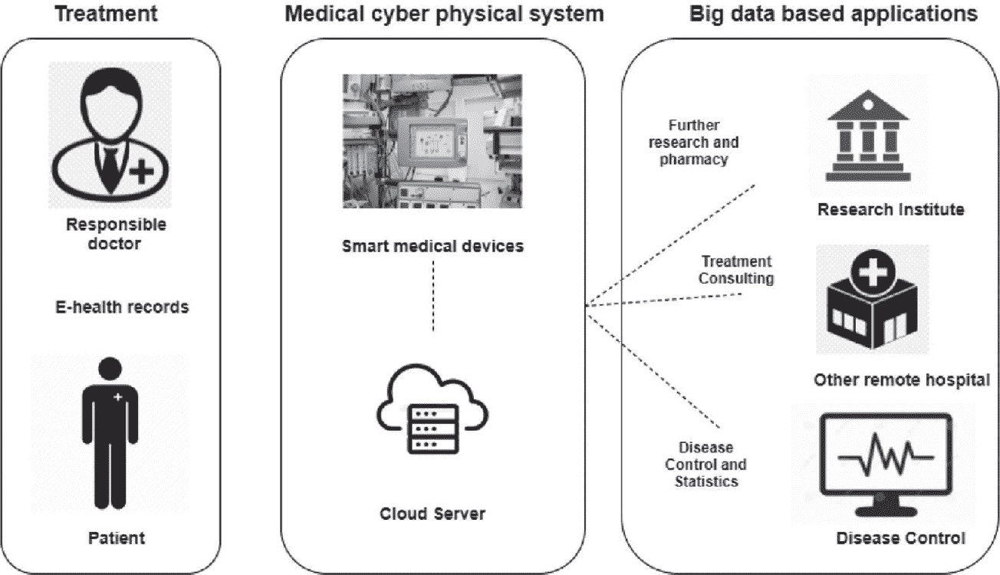

Figure 4.1 Medical cyber physical system workflow.

本章剩余部分的组织如下：Section 4.2 讨论 MCPS 的分类法。在 Section 4.3 中，将讨论当前使用的设备。Section 4.4 将包括 MCPS 系统面临的挑战及其解决方法，以及我们能从中提取最大价值的程度。Section 4.5 包括 MCPS 的优势，这些优势将有助于改善我们的医疗领域，而 Section 4.6 将包含结论以及 MCPS 的未来展望。

### 4.2 医疗领域中 CPS 的分类

上面显示的设备/系统将在下文详细讨论。这些系统有助于整体改善 MCPS，并建议市场上的持续技术，以及可以对其进行改进的更改。Figure 4.2 描绘了医疗保健中 CPS 的分类法，其中包括六种系统或设备。

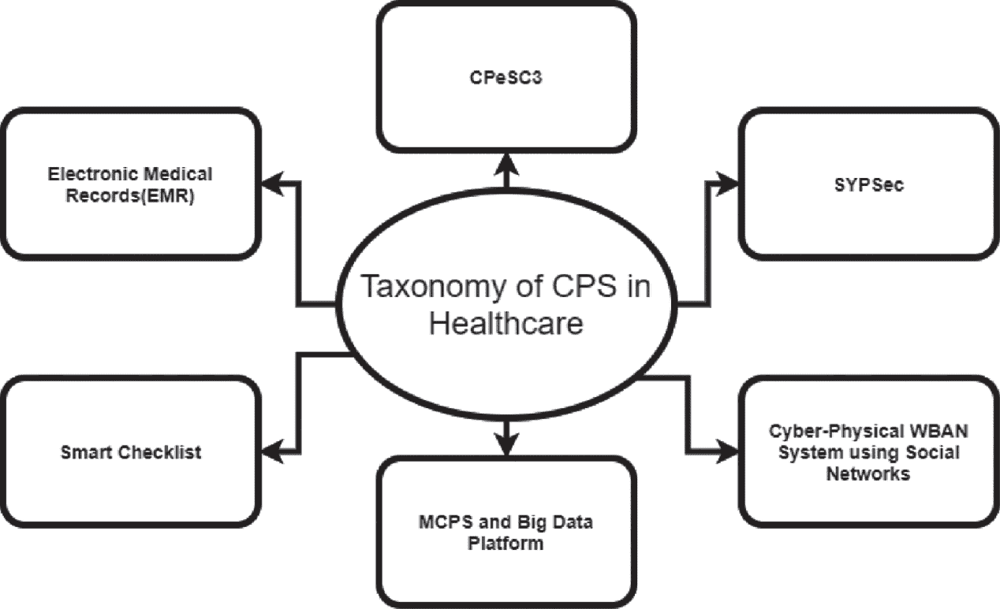

Figure 4.2 Taxonomy of CPS in healthcare.

#### 4.2.1 电子病历（EMR）

电子病历（EMR）是指用于自动读取生命体征的虚拟-物理接口的结构。该接口作为监测过程中耗时且容易出错的过程的解决方案。该接口的设计允许网络收集并将数据存储到 EMR 系统中。该设计的关键元素包括 EMR、一种称为数据处理器的软件适配器，以及基于硬件拓扑的生命体征读取站 \[8\]。该系统遵循三层架构，如 SDD 中所述，以解决虚拟-物理方法。这种方法确保对一个层中的组件所做的更改不会影响其他层中的组件 \[9\]。实施 EMR 带来多种好处。患者数据可以在特定时间线内跟踪，并可由授权的医疗贡献者访问。这有助于识别需要进行常规检查和预约的患者，以及监测他们的特定需求，例如疫苗接种和血压读数。EMR 的设计旨在支持组织为患者提供系统且准确的护理。

#### 4.2.2 CPeSC3

由 Wang 等人提出，CPeSC3 的布局由三个主要组件组成：通信核心、计算核心、资源调度和管理核心。采用了云计算技术，具体指医疗保健应用。这里展示了一个医疗应用场景，该场景建立在实际测试平台上以供确认 \[10\]。CPeSC3 的优势包括增加功能并验证医生提供的治疗。它使医疗系统能够轻松监控大量数据，减少冗余，并及时提供高效服务。

#### 4.2.3 CYPSec


由 Venkatasubramanian 等人提出的网络物理安全（`CYPSec`）是一种与其他安全解决方案同步的方案，结合了传统安全措施和环境因素 \[11\]. `CYPSec` 的设计原则和挑战可以通过两个示例来说明：基于生理信号的密钥协商（`PSKA`）和关键感知访问控制（`CAAC`）。`PSKA` 促进体域网（`BAN`）中传感器设备之间基于身体生理信号的自动密钥协商。另一方面，`CAAC` 提供负责任地建立和管理紧急情况的权限。`CYPSec` 提供多项优势。它将传统方法与现代方法相结合，确保患者数据的安全性并增强组织的可信度。数据不易被篡改，从而保证准确有效的医疗服务。

#### 4.2.4 基于社交网络的虚拟-物理 WBAN 系统

Zhang 等人提出了一种利用权力游戏来缓解 WBAN 中通信中断的方法。该方法基于涵盖个人之间社交互动的信息。贡献体现在以下方面：构建 WBAN 间干扰并计算中断的距离分布，为携带 WBAN 的个人创建检测和预测社交通信的算法 \[12\]. 使用社交网络的网络物理 WBAN 系统具有多项优势：它增强了互动，缩短了患者与医生之间的距离，使医疗服务提供者能够与患者家属密切接触，并为未来提供更好的指导。技术进步简化了患者与医生之间的互动，使其更加便捷 \[13\].

#### 4.2.5 MCPS 与大数据平台

Don & Dugki 提出了一种用于 MCPS 的大数据处理基础设施，该基础设施将物理世界与动态相结合，并为医疗决策系统中的虚拟世界提供灵活性。该框架声称可以降低医院费用并简化诊所医生进行的常规体检。此外，它将通过各种传感器将心电图机、血氧水平和脉搏率收集的数据传输到远程应用服务器，从而帮助改善偏远地区的设施。然后，医生可以分析这些数据来监测所有患者的状况并相应地开具处方 \[14\]. 优势：MCPS 中的大数据建立了一个完全感知的系统，确保高效且无故障的交付。该系统需要各种子系统来执行过滤、监听、处理、加速和丰富等任务，最终创建一个功能齐全的系统并增强整体功能 \[15\]. 大数据是一项不断增长的趋势，在合适的资源和指导下，它可以为医疗行业的改善和交付的提升而蓬勃发展。

#### 4.2.6 智能清单

Avrunin 等人提出了一种智能清单，以支持和协助参与者完成各自的任务。该系统还促进了设备与软件应用程序之间的交互。在重症监护中使用时，该系统旨在帮助医疗专业人员进行药物管理、数据收集以及患者的其他标准活动。但是，该系统尚不适用于所有医疗程序，需要进一步修改 \[16\]. 智能清单的优势包括改进的协助、更快的响应和更高效的结果。智能清单有助于提升服务并减少错误的可能性，这是使用它的另一个好处。

### 4.3 MCPS 中使用的设备

医疗中使用的设备不仅减轻了医生和工作人员的工作，还为患者提供了便利。市场上可用的设备使患者能够在线跟踪他们的健康状况、之前的记录、预约以及其他与医疗相关的事项。这彻底改变了整个系统，并为其提供了更好的方法 \[17\]. MCPS 中使用的设备在子章节中列出。图 4.3 以系统化的方式展示了设备。

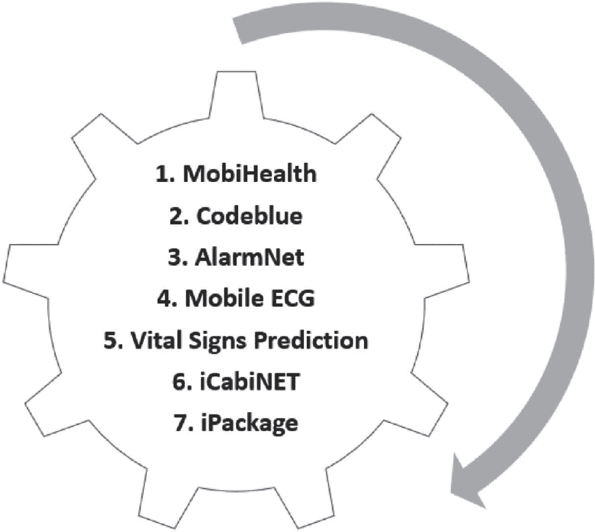

图 4.3 MCPS 中使用的设备。

#### 4.3.1 Mobihealth

该系统旨在收集监测您医疗状态的智能可穿戴设备的数据。在紧急情况下，它还尝试收集音频和视频信号。数据由智能传感器分析并发送到系统服务器。如果有任何异常读数，服务器将收到警报。这可以提高在事故或其他紧急情况下的响应时间和反应。

#### 4.3.2 Codeblue

它是一种与以下生物医学传感器合并的原则：(i) 脉搏血氧仪血氧饱和度测量设备；(ii) 双导联心电图；以及 (iii) 基于发布-订阅路由框架的软件架构的运动传感器。其工作是高效地管理和通信医疗设备 \[19\]. 该系统促进了智能路由和网络内聚合的早期使用。

#### 4.3.3 Alarm-Net

它是一个生物传感设备的无线系统，说明了包含以下内容的网络：(i) 脉搏率；(ii) 心率；(iii) 血氧饱和度评估；以及 (iv) 心电图。空间上下文数据通过温度和湿度等环境参数提供。该系统还考虑了隐私、电源管理和查询。它利用信息收集和存储单元之间的路径 \[20\]. 此外，该系统包括一个 GUI，以帮助医疗专业人员确定患者的生命体征。

#### 4.3.4 移动心电图

该心电图架构将智能手机用作界面和数据收集器，而家用设备则作为心电图和分析的测量工具。智能手机通过蓝牙从移动心电图记录设备接收心电图数据。如果被认为必要，智能手机会分析并将数据传输给医疗专业人员 \[21\]. 图形界面还具有显示心电图读数和脉搏率的功能。

#### 4.3.5 生命体征预测

该心电图架构将智能手机用作界面和数据收集器，而家用设备则作为心电图和分析的测量工具。智能手机通过蓝牙从移动心电图记录设备接收心电图数据。如果被认为必要，智能手机会分析并将数据传输给医疗专业人员 \[21, 22\]. 图形界面还具有显示心电图读数和脉搏率的功能。

#### 4.3.6 药物消耗应用程序

当人们面临分析障碍时，它可以照顾他们。

##### 4.3.6.1 Icabinet

在 `iCabiNET` 的情况下，使用智能 RFID 包装，当 RFID 电路中的电流中断时，它会检测到药片的取出。通过家庭中可用的住宅网络使用 RFID 阅读器观察药物摄入系统 \[23\]. 如果您使用带有此系统的智能家电，您还可以监控需要购买库存不足的药物。此外，它可以提醒您按时并按准确剂量服药 \[24\].

##### 4.3.6.2 Ipackage


不同于 RFID 封装，这是 Pang 等人提出的一种具有智能封装功能的原型。该系统监测药物摄入量以及生命体征。该系统利用一系列受控剥离材料（CDM）薄膜，这些薄膜集成了统一控制电路。CDM 薄膜由三层组成：铝制下层和上层，以及中间的粘合电化学环氧树脂层 \[25\]。当向下层（底层）施加大于特定能量的电压时，中间层内会发生电化学反应 \[26\]。所有这些技术细节确保 iPackage 只能通过一个必要的控管设备访问，该设备还授权对剂量的电源控制，以防止事故或误用。

### 4.4 MCPS 中的挑战

我们将讨论 CPS 中的挑战，然后再转到 MCPS 中面临的挑战。CPS 中的挑战从缺乏 CPS 标准到 CPS 的架构 \[27\]。图 4.4 提供了 MCPS 以及 CPS 中面临的挑战概览。只有当我们了解 CPS 中面临的挑战时，才能更好地理解 MCPS 中的挑战。

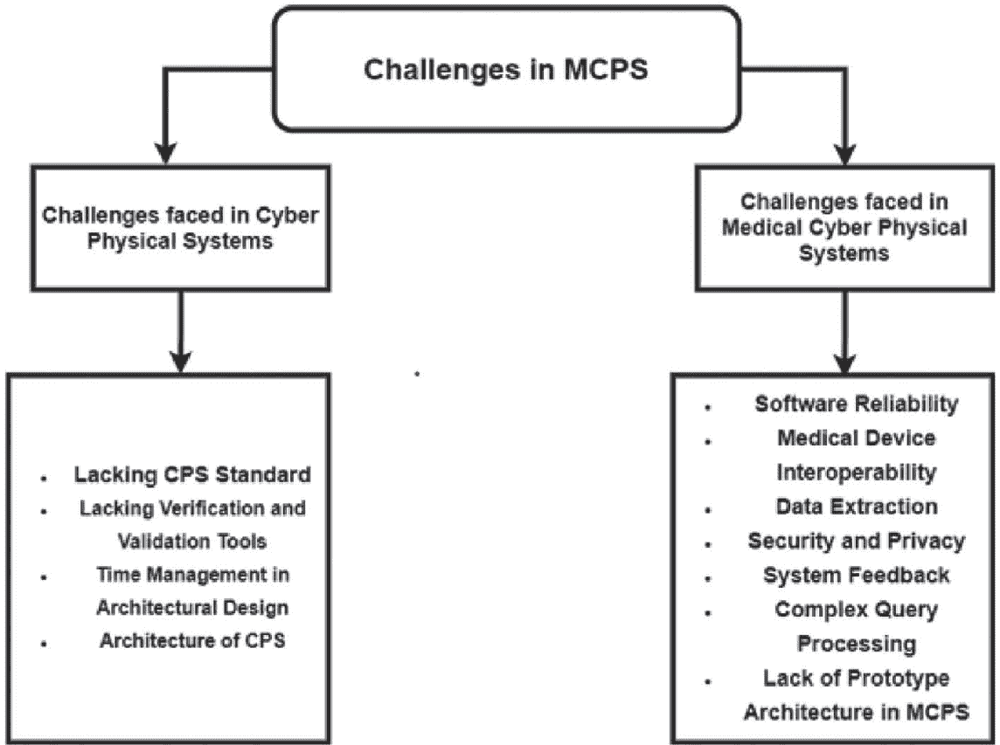

Figure 4.4 Challenges in MCPS.

#### 4.4.1 网络物理系统（CPS）中面临的挑战

##### 4.4.1.1 缺乏 CPS 标准

识别安全、隐私和安全等理论的基于信息的解释和计算是一项科学上具有挑战性的任务 \[28\]。即使概念已被识别，它也会带来不确定性，即利用和进一步推理将如何进行。例如，即使专业人士也被委托保护医患保密和患者数据隐私 \[29\]。一个问题是，隐私在什么程度上会被视为被泄露。这清楚地突显了 CPS 标准在现代情况下的缺失，在现代情况下隐私至关重要。

##### 4.4.1.2 缺乏确认和验证工具

我们可以利用 CPS 应用程序来集成无线传感器网络（WSN）和云计算架构。尽管有 WSN 和云计算建模与仿真工具可用，但仍需要新的仿真工具来全面设计 CPS 系统。这些工具应能够处理系统内异构传感器、通信层和其他数据类型的收集、分析、处理和激活 \[30\]。这确保系统保持集成和响应。

##### 4.4.1.3 架构设计中的时间管理

在 CPS 中，由于云集成和异构传感器的应用，时间管理是一个关键问题。鉴于 MCPS 对实时应用的需求，时间管理是首要任务。这包括时间缩放、时间同步、确定参考时间，以及在考虑时间特性的同时与各种传感器设备交互 \[31\]。时间管理中的错误可能会产生灾难性的后果，因为生命可能处于危险之中。因此，时间管理在每个案例中都必须完美无缺。

##### 4.4.1.4 CPS 的架构

CPS 中面临的挑战源于计算和物理动态的复杂性。这些挑战包括时间管理、数据正确性和标准。当务之急是一种通用或整合的架构，可以解决上述所有问题。这种架构将在未来的 CPS 设计中发挥关键作用。

#### 4.4.2 MCPS 中面临的挑战

##### 4.4.2.1 软件可靠性

程序（软件）是医疗设备的重要资产，它确保设备及其他功能的功能性。它还管理患者和医疗设备之间的适当协调。因此，安全性和高效管理依赖于适当的软件设计和开发。当软件更具响应性、保持良好的记录历史并始终保持准确时，系统也会得到改善。当一切就绪时，可以实现完美的医疗系统。

##### 4.4.2.2 医疗设备的互操作性

各种医疗设备应具有不同的通信接口，以实现顺畅通信。我们需要一个管理系统来监督这一点，并确保所有各种医疗设备都受到保护、可靠且经过验证。互操作性使设备能够更好地运行，并防止由混乱通信引起的事故和紧急情况。这种受管理的方法将确保有效性，并避免对用户（无论是医疗保健提供者还是患者）产生任何不良影响。

##### 4.4.2.3 数据提取

医疗设备通过各种生理标准从多个患者处收集数据，有助于提供关于患者的广泛基本信息。它还有助于预防未来的疾病，并在消除紧急情况方面有效。尽管设计一种能够从患者处无缝提取生理数据的设备具有挑战性，但它将是一种革命性的设备。许多此类设备已经在开发中。

##### 4.4.2.4 安全性和隐私

在组织和处理患者数据时，隐私是首先要考虑的事情。患者的数据被盲目地信任给医疗系统，因此系统应当是可信的。私人数据和详细信息的丢失甚至可能导致精神不安和滥用，这可能进一步损害患者的健康。可以通过在系统中实施端到端加密来改善隐私。加密确保没有第三方可能会篡改或滥用数据。这可以确保系统的正常运行和顺畅。目前许多正在使用的系统依赖于离线文件和文书工作，这可能会很混乱。采用有组织的方式可以增强安全性和患者满意度。

##### 4.4.2.5 系统反馈

由于缺乏反馈系统或患者护理改进的设计稳定性，开发反馈系统对 MCPS 来说具有挑战性。MCPS 已经使用机敏的报警系统实现了一个强大的反馈系统。这种报警设备对于提醒护理提供者潜在威胁、疾病或任何紧急场景至关重要。然而，报警系统面临着几个挑战，例如确定生理参数的类型、处理结构复杂性以及确保有效实施以增强整体功能。有必要仔细选择相关的生理变量来规划报警系统，考虑到广泛的疾病范围。由于需要从各种概率中检测特定疾病，这项工作可能会令人筋疲力尽 \[32\]。

##### 4.4.2.6 复杂查询处理

由电池供电的无线传感器由于异构生物传感器的可用性而面临挑战，包括较低功耗和有限的精炼能力等问题，这些问题阻碍了复合查询处理。复杂查询处理在减少传输量和实现上下文感知预测方面非常有帮助，从而反过来降低了有限能量安排中的功耗。我们可以使用这种方法来访问各种生理变量并预先计算可能的疾病。然而，处理这种方法需要复杂的设计和算法技能集。

##### 4.4.2.7 MCPS 中缺乏原型架构


在当前场景中，该架构缺乏安全可靠的原型，用于包含医疗设备的实验、评估和系统增强。这是导致在不确定环境场景中无法确保 MCPS 架构正确性的又一个因素。

### 4.5 MCPS 的优势

现代世界中技术有许多优势，MCPS 的部分优势列在子章节中。Figure 4.5 说明技术如何影响并推动医疗领域的繁荣。现在，让我们讨论 MCPS 的优势，包括网络集成和其他各种好处。

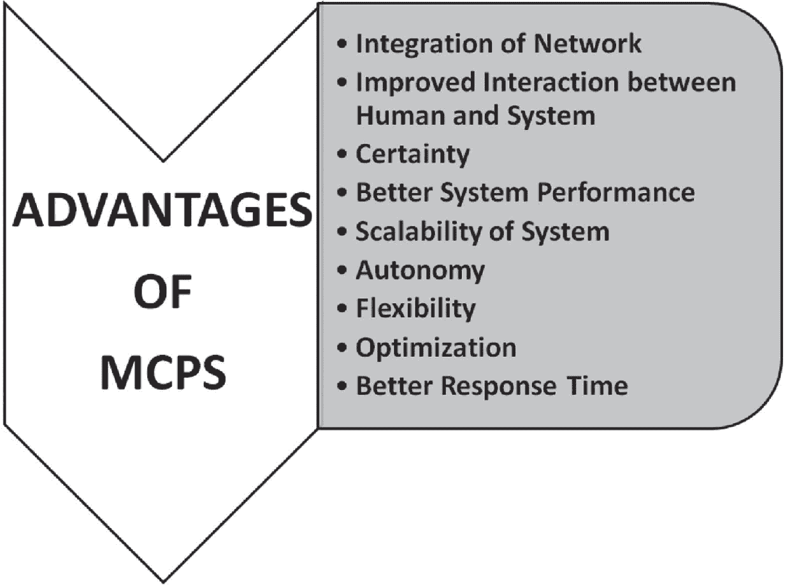

Figure 4.5 Advantages of MCPS.

#### 4.5.1 网络集成

CPS 被认为与 WSNs 和云计算集成，可以在关联层级中提供一致性。CPS 还包括通过通信网络通信的各种算法平台。网络集成还改善了整体系统通信。

#### 4.5.2 改善人机交互

有必要理解需求并相应地设计结构。对决策至关重要的变量对周围变化的适应性也得到了增强。因此，对于复杂和动态系统来说，这也变得至关重要。通过这个集成系统，交互变得更加容易，因为人们通常很难通过独立系统来构建。

#### 4.5.3 确定性

确定性涉及提供证据证明设计是合理且可信的过程。证明可以包括过去的证据或在模拟和样本中的实验。CPS 被构建为能够与新的和不可预测的环境合作并正常运行。预计它将检测系统的任何未知行为，以便研究和改进系统。

#### 4.5.4 更好的系统性能

CPS 在响应和机器人重新设计方面提供了增强的系统性能，这要归功于传感器设备与网络结构之间的紧密交互。更好的资产和虚拟子例程确保了各种感知实体和各种通信机制的可用性，最终确保 CPS 具有更大的组织执行能力。

#### 4.5.5 系统可扩展性

CPS 有能力根据需求扩展结构，适当利用云计算的资源。人们可以在不需要额外资源的情况下访问关键基础设施，这提供了一个巨大的机会。CPS 本质上是异构的，因为它集成了物理动力学与计算过程。这确保了需求能够及时、高效且准确地得到满足。

#### 4.5.6 自主性

CPS 能够提供自主性，因为它包括传感器-云集成，这本质上是一个闭环系统。这允许传感器设备执行物理动力学的计算，然后在网络子系统中使用。这些子系统最终驱动设备和应用程序，进而影响物理过程。

#### 4.5.7 灵活性

少数基于 CPS 的现有系统相比之前在 WSN 和云计算领域的研究工作提供了更大的灵活性。CPS 系统提供稳定性、改进的功能和更快的响应时间。这反过来增强了 CPS 系统的整体灵活性。

#### 4.5.8 优化

我们目前拥有的生物医学传感器和云基础设施为各种应用提供了更好的优化。

#### 4.5.9 更好的响应时间

传感器和云基础设施更快的通信和处理能力带来了更好的反应时间，提供对任何远程故障的早期检测以及带宽等共享资源的适当实施。更好的响应时间还确保安全性，改进领域可以轻松考虑。当你知道自己滞后的领域时，你可以为了更大的利益而改进系统。

### 4.6 结论与未来展望

本章对医疗领域的 CPS 进行了详细分析。为了确保对 MCPS 的正确理解，首先以概括的方式对 CPS 进行了回顾。还提供了 CPS 和 MCPS 的分类法，包括八个不同的组件。上述分类在实现与 CPS 中某些应用相关的趋势、方法和可能解决方案方面很有用。这不仅将改进现有系统中的故障区域，还将提供一个反映 CPS 和 MCPS 未来可能性的视野。

CPS 在医疗领域的未来范围包括：

1. **AI 医疗：** 人工智能（AI）是一个蓬勃发展的趋势，当与医疗领域的 CPS 系统合并时可以高效使用。AI 的准确性和智能可以有效管理紧急情况，甚至为其提出解决方案。

2. **移动医疗服务：** 安装了先进 MCPS 系统的车辆可以对医疗领域的发展产生重大影响。受远程地区服务缺乏影响的人们可以通过这些移动医疗服务访问该系统。

3. **智能家居：** 这是照顾自己或亲人的一种非常好的方式。他们将体验辅助生活，输入系统的指令将允许它管理他们的健康，并提供药物服用、常规体检的及时提醒，甚至在紧急情况下呼叫救护车。

### 关键词

### 参考文献

1. Sonntag. (n.d.). Medical cyber-physical systems. Cyber-Physical System Design with Sensor Networking Technologies, *311*\-333. [`doi.org/10.1049/pbce096e\_ch13`](http://dx.doi.org/10.1049/pbce096e_ch13).

2. Finkbeiner, B., Keller, A., Schmidt, J., & Schwenger, M., (2021). Robust monitoring for medical cyber-physical systems. Proceedings of the Workshop on Medical Cyber-Physical Systems and Internet of Medical Things. [`doi.org/10.1145/3446913.3460318`](http://dx.doi.org/10.1145/3446913.3460318).

3. Li, T., Cao, J., Liang, J., & Zheng, J., (2014). Towards context-aware medical cyber-physical systems: Design methodology and a case study. Cyber-Physical Systems, *1*(1), 5-23. [`doi.org/10.1080/23335777.2014.972686`](http://dx.doi.org/10.1080/23335777.2014.972686).

4. Ivanov, R., Weimer, J., & Lee, I., (2018). Context-aware detection in medical cyber-physical systems. In: 2018 ACM/IEEE 9th International Conference on Cyber-Physical Systems (ICCPS). [`doi.org/10.1109/iccps.2018.00030`](http://dx.doi.org/10.1109/iccps.2018.00030).

5. Tiwari, A., Sharma, N., Kaushik, I., & Tiwari, R., (2019). Privacy issues & security techniques in big data. In: 2019 International Conference on Computing, Communication, and Intelligent Systems (ICCCIS). doi: [10.1109/icccis48478.2019.8974511](http://dx.doi.org/10.1109/icccis48478.2019.8974511).

6. Tyagi, N., Gautam, S., Goel, A., & Maim, P., (2021). A framework for blockchain technology including features. In: Hassanien, A. E., Bhattacharyya, S., Chakrabati, S., Bhattacharya, A., & Dutta, S., (eds.), Emerging Technologies in Data Mining and Information Security: Advances in Intelligent Systems and Computing (Vol. 1286). Springer, Singapore. [`doi.org/10.1007/978-981-15-9927-9\_62`](http://dx.doi.org/10.1007/978-981-15-9927-9_62).


### 参考文献

7. Sharma, N., Kaushik, I., Bhushan, B., Gautam, S., & Khamparia, A., (2020). WSN 和生物识别模型在医疗保健领域的适用性. Deep Learning Strategies for Security Enhancement in Wireless Sensor Networks Advances in Information Security, Privacy, and Ethics, `304`-329. doi: [10.4018/978-1-7998-5068-7.ch016](http://dx.doi.org/10.4018/978-1-7998-5068-7.ch016).

8. Nitin, T., Bharat, B., Siddharth, G., Nikhil, S., & Santosh, K., (2021). 区块链与大数据在医疗保健领域的综合方法. In: Applications of Machine Learning in Big-Data Analytics and Cloud Computing (pp.183-205). River Publishers.

9. Kathuria, R. S., Gautam, S., Singh, A., Khatri, S., & Yadav, N., (2019). 基于深度学习（Keras）的 Twitter 数据实时情感分析. In: 2019 International Conference on Computing, Communication, and Intelligent Systems (ICCCIS) (pp. 69-73). doi: [10.1109/1CCC1S48478.2019.8974557](http://dx.doi.org/10.1109/1CCC1S48478.2019.8974557).

10. Malik, A., Gautam, S., Khatoon, N., Sharma, N., Kaushik, I., & Kumar, S., (2020). Ad-hoc 网络中黑洞攻击及其缓解技术分析. Deep Learning Strategies for Security Enhancement in Wireless Sensor Networks Advances in Information Security, Privacy, and Ethics, `211`-232. doi: [10.4018/978-1-7998-5068-7.ch011](http://dx.doi.org/10.4018/978-1-7998-5068-7.ch011).

11. Harjani, M., Grover, M., Sharma, N., & Kaushik, I., (2019). 各种心脏脉搏预测机器学习算法分析. In: 2019 International Conference on Computing, Communication, and Intelligent Systems (ICCCIS). doi: [10.1109/icccis48478.2019.8974519](http://dx.doi.org/10.1109/icccis48478.2019.8974519).

12. Kathuria, R. S., Gautam, S., Singh, A., Singh, A., & Yadav, N., (2021). 基于卷积神经网络的图像情感分析. In: Hassanien, A. E., Bhattacharyya, S., Chakrabati, S., Bhattacharya, A., & Dutta, S. (eds.), Emerging Technologies in Data Mining and Information Security; Advances in Intelligent Systems and Computing (Vol. 1300). Springer, Singapore. [`doi.org/10.1007/978-981-33-4367-2\_20`](http://dx.doi.org/10.1007/978-981-33-4367-2_20).

13. Plourde, J., Arney, D., & Goldman, J. M., (2014). OpenICE: 用于医疗网络物理系统的开放互操作平台. In: 2014 ACM/IEEE International Conference on Cyber-Physical Systems (ICCPS). [`doi.org/10.1109/iccps.2014.6843734`](http://dx.doi.org/10.1109/iccps.2014.6843734).

14. Mahmoud, M. S., & Hamdan, M. M., (2019). 受网络和物理攻击影响的网络物理系统的改进控制. Cyber-Physical Systems, `5`(`3`), 173-190. [`doi.org/10.1080/23335777.2019.1631889`](http://dx.doi.org/10.1080/23335777.2019.1631889).

15. Konstantinou, Charalambos, Michail Maniatakos, Fareena Saqib, Shiyan Hu, Jim Plusquellic, & Yier Jin (2015). 网络物理系统的物理基础设施. Cyber-Physical Systems (pp. 1, 2). [`doi.org/10.1201/b19206-2`](http://dx.doi.org/10.1201/b19206-2).

16. Sharma, A., Sharma, N., Kaushik, I., Kumar, S., & Khatoon, N., (2020). 基于混合机器学习模型和 IoT 的 2 型糖尿病预测分析. IoT Security Paradigms and Applications, `303`-320. doi: [10.1201/9781003054115-14](http://dx.doi.org/10.1201/9781003054115-14).

17. Goyal, S., Sharma, N., Bhushan, B., Shankar, A., & Sagayam, M., (2021). 安全医疗保健的 IoT 赋能技术：应用、挑战和未来方向. In: Hassanien, A. E., Khamparia, A., Gupta, D., Shankar, K., & Slowik, A., (eds.), Cognitive Internet of Medical Things for Smart Healthcare, Studies in Systems, Decision and Control, (Vol. 311). Springer, Cham. [`doi.org/10.1007/978-3-030-55833-8\_2`](http://dx.doi.org/10.1007/978-3-030-55833-8_2).

18. Alamelu, J. V., Priscilla Dinkar Moyya, & Mythili Asaithambi. “Medical Cyber Physical System Architecture for Smart Medical Pumps.” In Deep Learning Applications for Cyber-Physical Systems, pp. 207-221. IGI Global, 2022.

19. Sharma, N., Kaushik, I., Rathi, R., & Kumar, S., (2020). 基于混合遗传算法的意外死亡记录评估. SSRN Electronic Journal. doi: [10.2139/ssrn.3563084](http://dx.doi.org/10.2139/ssrn.3563084).

20. Stojmenovic, I., & Zhang, F., (2014). ‘Cyber-Physical Systems’ 创刊号. Cyber-Physical Systems, `1`(`1`), 1-4. [`doi.org/10.1080/23335777.2015.970764`](http://dx.doi.org/10.1080/23335777.2015.970764).

21. Goel, A., Bhushan, B., Tyagi, B., Garg, H., & Gautam, S., (2021). 区块链与机器学习：背景、集成挑战和应用领域. In: Tavares, J. M. R. S., Chakrabarti, S., Bhattacharya, A., & Ghatak, S., (eds.), Emerging Technologies in Data Mining and Information Security; Lecture Notes in Networks and Systems (Vol. 164). Springer, Singapore. [`doi.org/10.1007/978-981-15-9774-9\_29`](http://dx.doi.org/10.1007/978-981-15-9774-9_29).

22. Mann, P., Tyagi, N., Gautam, S., & Rana, A., (2020). IoT 环境中各种攻击类型的分类. In: 2020 12th International Conference on Computational Intelligence and Communication Networks (CICN) (pp. 346-350). doi: [10.1109/CICN49253.2020.9242592](http://dx.doi.org/10.1109/CICN49253.2020.9242592).

23. King, A. L., Feng, L., Sokolsky, O., & Lee, I., (2013). 保障按需医疗网络物理系统的安全性. In: 2013 IEEE Pt International Conference on Cyber-Physical Systems, Networks, and Applications (CPSNA). [`doi.org/10.1109/cpsna.2013.6614238`](http://dx.doi.org/10.1109/cpsna.2013.6614238).

24. Rathi, R., & Kumar, S. (2013). 移动网络物理系统. Cyber-Physical Systems (pp. 55-68). [`doi.org/10.1201/b15552-7`](http://dx.doi.org/10.1201/b15552-7).

25. Gautam, S., Malik, A., Singh, N., & Kumar, S., (2019). IoT 环境中各种攻击的最新进展与对策. In: 2019 2nd International Conference on Signal Processing and Communication (ICSPC) (pp. 315-319).

26. Yu, Wenjin, Tharam Dillon, Fahed Mostafa, Wenny Rahayu, & Yuehua Liu (2018). 将网络物理系统引入工业实践, 2018 IEEE Industrial Cyber-Physical Systems (ICPS). [`doi.org/10.1109/icphys.2018.8390758`](http://dx.doi.org/10.1109/icphys.2018.8390758).

27. Goel, A., Gautam, S., Tyagi, N., Sharma, N., & Sagayam, M., (2021). 基于密码分析的生物识别框架安全保障. Intelligent Data Analytics for Terror Threat Prediction, `181`-208. [`doi.org/10.1002/9781119711629.ch9`](http://dx.doi.org/10.1002/9781119711629.ch9).

28. Srinivasa, Krishnarajanagar Gopalalyengar, Nabeel Siddiqui, Abhishek Kumar, & Anita Kanavalli. (2015). 网络物理系统：超越传感器网络和嵌入式系统. Cyber-Physical Systems, `98`-123. [`doi.org/10.1201/b19206-8`](http://dx.doi.org/10.1201/b19206-8).

29. Rustagi, A., Manchanda, C., Sharma, N., & Kaushik, I., (2020). 基于组合深度神经网络的抑郁症解剖分析. Advances in Intelligent Systems and Computing International Conference on Innovative Computing and Communications, `19`-33. doi: [10.1007/978-981-15-5148-2\_3](http://dx.doi.org/10.1007/978-981-15-5148-2_3).


30. Bordel, Borja, Ramon Alcarria, Tomas Robles, & Diego Martin (2015). 面向网络物理系统的无线传感器网络. Cyber-Physical Systems, (pp. 124-145). [`doi.org/10.1201/b19206-9`](http://dx.doi.org/10.1201/b19206-9).

31. Rathi, R., Sharma, N., Manchanda, C., Bhushan, B., & Grover, M., (2020). 网络物理系统中的安全挑战与控制. In: 2020 IEEE 第 9 届通信系统与网络技术国际会议 (CSNT). doi: [10.1109/csnt48778.2020.9115778](http://dx.doi.org/10.1109/csnt48778.2020.9115778).

32. Rana, A., Gautam, S., Maim, P., & Tyagi, N., (2020). 大数据工具分类及其挑战和问题. SSRN Electronic Journal. [`doi.org/10.2139/ssrn.3746970`](http://dx.doi.org/10.2139/ssrn.3746970).

33. Tanik, U. J., & Begley, A., (2013). 网络物理系统设计自动化的自适应网络物理系统框架. Applied Cyber-Physical Systems, *125*\-140. [`doi.org/10.1007/978-1-4614-7336-7\_11`](http://dx.doi.org/10.1007/978-1-4614-7336-7_11).

## 第二部分 智能决策与分析技术

## 第 5 章 机器学习和自然语言处理在情感分析中的重要性

PUMMY DHIMAN,^(⁴)

### 摘要

随着 Web 2.0 的引入，情感分析（SA）已大幅扩展。互联网为人们表达观点提供了平台。如今，个人在网上自由分享各种话题的观点，这些评论在决策过程中发挥着重要作用。SA 的目标是利用这些数据收集关于流行观点的关键信息，这些信息可用于增强公司决策、政治竞选和消费者行为。因此，SA 已成为一个新的研究领域。在本研究中，使用了公开可用的 Twitter 数据集，并使用 `NLTK` 进行处理，以展示 AI 方法和机器学习（`ML`）在 SA 中的重要性。采用了三个分类器对给定输入进行二进制分类。实验结果表明，`SVC` 达到最高准确率。

### 5.1 引言

情感是指一个人表达的情绪、态度或任何意见 \[1\]。如今，几乎每个人都利用互联网或社交媒体平台来表达对各种事物的看法，例如产品、软件、应用程序、电影、网络剧等。随着社交网络站点、商业模式和产品经理利用反馈表收集宝贵的客户反馈并分析以做出更好的商业决策，这些观点变得越来越重要。情感分析（`SA`）是理解文本并识别用户视角的过程。通过 `SA`，文本可以分为不同的情感，无论是积极、消极还是中性。这种文本分类被数据分析师、业务分析师等用于快速分析收集的数据和反馈。情感分类有三种主要方法：基于词典、机器学习（`ML`）/深度学习（`DL`）和混合方法 \[2\]，如 图 5.1 所示。`SA` 是一种用于分析脚本或文本以提取思想、观点和主观性，并确定极性 \[3\] 的技术，无论是积极、消极还是中性 \[1\]。意见挖掘是 `SA` 的另一个术语 \[4\]。

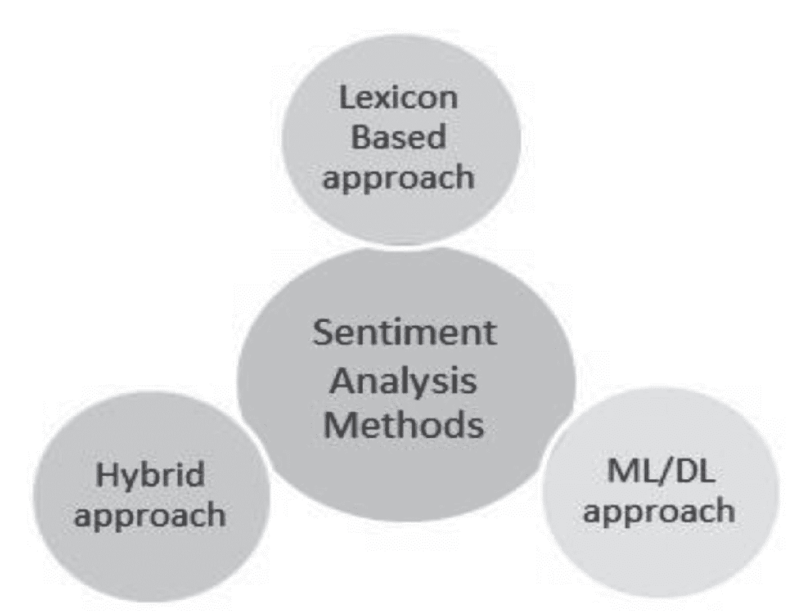

图 5.1 情感分类方法。

#### 5.1.1 基于词典的方法

`SA` 有三种可用方法：监督方法在性能上优于基于词典的方法，混合方法结合了两者。在词典方法中，从文本中提取的表达式与其词典进行比较以提供标签。这种方法使用情感词典解释文本内容的（积极、消极和中性）极性 \[5\]。Twitter 的态度可以使用各种 NLP 技术检测，包括停用词删除、词性标注、命名实体识别（`NER`）和大量词汇等。在这些方法中，词典用作参考。不需要训练，因此需要的计算能力较少。借助词典，我们正在使用词典方法将文本分为两类：“积极”和“消极” \[24\]。词典类似的词汇集，或词汇表，是单词按字母顺序分组的集合。基于词典的方法和基于语料库的方法是这种策略的两种变体。在这里，我们正在采用基于语料库的方法。语料库是单词或文本的重要集合，它分析不同语言之间的关系，并从该语言的文本中制定一套管理自然语言的概念规则 \[25\]。

#### 5.1.2 ML/DL 方法

深度学习（`DL`）和语义 `ML` 都旨在创建模仿人类能力（如索引、验证、预测和推理）的 AI。这两个学科对数据和知识的分析以及相关的概念制定产生了重大影响。`ML/DL` 使用训练-测试分割机制和预定义算法来分类情感。

#### 5.1.3 混合方法

`SA` 的混合方法采用统计和基于知识的技术进行极性检测。它受益于基于词典策略的稳定性和 `ML`（统计方法）的更高准确性。该过程从混合标准分类开始，然后细化为一种复杂的技术，包括通过模糊集建模的语义分歧的语言目录。`SA` 的整体方法利用统计和基于知识的方法进行极性识别。它受益于基于词典策略的稳定性和 `ML` \[6, 7\] 的更高准确性。

### 5.2 动机

众所周知，消费者和生产者相互依赖。消费者反馈对于生产者做出更好的商业决策至关重要 \[8\]。然而，分析人们的观点并非易事。情感也在影响人们思想方面发挥着重要作用。社交平台的可用性正在被用来组织大规模集会和反对压迫。社交媒体也可用于煽动对某一类人群或特定民族的仇恨，这可能导致重大人员伤亡。因此，拥有能够检测和缓解此类现象的 `SA` 系统至关重要。因此，需要能够检测此类现象的 `SA` 系统。本研究的目标是使用 `ML` 技术来预测给定数据集上的标签。

### 5.3 相关工作


自然语言处理中的一项关键任务是从文本中识别情感，这对推动包括人工智能和人机交互在内的多个领域具有巨大潜力。在本章中，作者建议根据推文的潜在情感对大量推文进行标记。研究人员使用深度学习算法将表达的情感分类为积极或消极。他们在三个独立的数据集上进行了实验，采用循环神经网络（RNNs）和长短期记忆网络，展示了高泛化能力，并在两个子类中均达到了 91.3%的准确率 \[9\]。本章描述了印度语言情感分析的进展。该研究比较了各种印度语言的情感分析，以及基于词典、字典和机器学习的分类方法。此外，它列出了可用于印度语言情感分析的词汇资源，并讨论了在资源有限的情况下创建此类资源所面临的挑战 \[10\]。这项研究有助于消费者评论分类的情感分析领域，这对于分析大量包含高度复杂观点（积极、消极或中性）的推文非常有益 \[11\]。这项工作的目标是使用机器学习技术开发一个分类器，以预测评论的极性。他们的研究包括三个主要步骤：数据提取、处理和建模。他们利用`NLTK`数据集构建模型。然后使用文本挖掘算法生成和处理变量。在创建分类器以根据肯定和消极情绪对推文进行分类后，他们进行了两项实验来评估模型的有效性 \[12\]。这项最新研究专注于分析与乌里大屠杀相关的推文，以评估情感和极性。使用手稿删除算法提取用于激情和极化的推文。通过预处理和重新编码 5000 条推文，创建了一组常用词汇。`R`在本研究中被实现用于分析极性和情感，94.3%的研究参与者对乌里袭击表示厌恶 \[13\]。本章的目标是考察印度公民对政府全国封锁的看法，该封锁旨在遏制冠状病毒的传播。使用自然语言处理和机器学习分类器对印度居民发布的推文进行了情感分析。在 2020 年 4 月 5 日至 4 月 17 日期间，检索了包含“India lockdown”短语的总共 12,741 条推文。实验中使用了线性 SVC 分类器和一元语法，达到了 84.4%的精确度。根据研究结果，大多数印度人口同意政府在冠状病毒爆发期间实施封锁的决定 \[2\]。在处理讽刺文本或同一文本中同时存在乐观和消极观点时，分析原始文本的情感变得特别具有挑战性。该模型可以应用于各种商业模式，并提供约 95%的准确率和精确度 \[1\]。该研究的第一个发现是，推文数量的增加必然会导致算法执行时间变长。第二个发现是，`RF`的执行时间明显长于`SVM`和`NB`。因此，这项文献研究系统地调查和评估了企业和社区白皮书、学术研究文章、期刊和报告，以考察和分析情感分析的概念 \[14\]。这项研究有助于消费者评论分类的情感分析领域，这对于分析大量包含高度非结构化观点（积极、消极或中性）的推文数据非常有益 \[12\]。一种称为潜在语义分析（`LSA`）的技术使用精确的数学计算来检查文本，并分析文档中术语之间以及语料库中文档之间的联系。`LSA`表明，一个单词可以有多种含义，可以压缩具有相同语义的多个概念，并以更少维度的概念空间表示文本 \[15\]。自然语言处理（`NLP`）是 Twitter 情感分析中使用的技术。在这个名为 Twitter 情感分析的项目中，我们探索每条推文中表达的情感。我们识别三种情感：积极、中性和消极。最初，分析每条推文背后的情感是最大的挑战，但`ML`现在可以解决这个问题 \[21\]。情感分析可以用于评估书面交流的积极性、消极性或中性。人们使用各种社交媒体渠道，例如 Facebook 和 Twitter，其中可以准确评估观点。

这项研究利用了多种`ML`技术。Twitter 被用来分析未经训练的数据，然后将其与能够确定中性、消极或积极性的训练软件进行比较。通过从书面材料中删除主观信息，可以在社交网络数据上进行有效的情感分析 \[22\]。基于原始照片和难以捉摸的人类情感对图像情感进行分类对计算机来说可能是一项挑战性任务。在图像情感分类领域，尤其是在社交数据分析方面，有大量的研究空间。如今，个人经常通过将照片上传到 Facebook、Instagram、Twitter 等各种社交媒体平台来表达他们的想法。这项研究采用`DL`方法来探索图像情感分析的最新进展。除了`DL`算法，还比较了传统的`ML`方法。该研究表明，快速循环神经网络与`CNN`的结合可以在最小时间复杂度下实现高准确率。根据之前的研究 \[23\]，`CNN`在对 Flickr 图片集合中的情感进行分类时，平均准确率约为 96.50%。

### 5.4 方法论

以下工具和方法论被用于实现情感分析的目标。这项研究工作使用`Python`作为编程语言，`Anaconda`作为编程环境，以及各种相关库，例如`Pandas`、`NumPy`、`NLTK`、`Scikit-learn`、`Matplotlib`等。图 5.2 表示研究方法论流程。研究模型将描述不同的部分：（i）数据集收集；（ii）预处理；（iii）`ML`分类器；以及（iv）性能指标评估。

 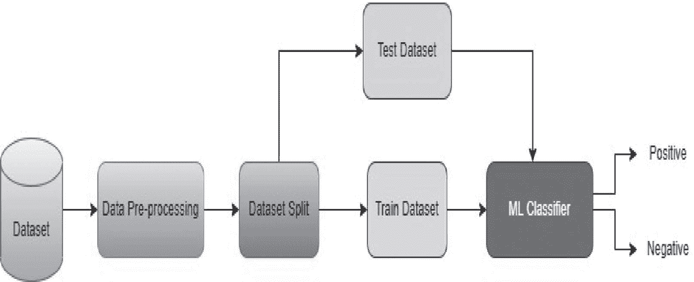

图 5.2 方法论。

#### 5.4.1 数据集

本研究中使用的数据集包含 31,962 条`CSV`格式的标记推文。它可在公共领域获得，并包括推文 ID、标签和推文本身的条目。该数据集包含短推文，标签“1”表示种族歧视（积极）推文，“0”表示非种族歧视（消极）推文。

#### 5.4.2 软硬件要求

本研究使用了 Intel(R) Core(TM) i3-5005U CPU @ 2.00 GHz 2.00 GHz、8 GB RAM、Windows 操作系统、`Anaconda` IDE 和`Python`版本 3.10。实验使用了`Pandas`、`NumPy`、`Matplotlib`、`NLTK`和`re`库。

#### 5.4.3 预处理


## 预处理原始情感文本

在将原始情感文本输入模型之前，预处理是必要的。第一步是消除停用词。之后，对单词进行拼写检查以清理数据集。在整个文本中，使用空格分隔每个段落，并对单词进行词干提取以去除后缀。最后，使用空格分隔单词标记以呈现干净的语料库，该语料库随后已被分词以供模型使用。如 图 5.3 所示，它使用 `NLTK` Python 库进行预处理以处理 NLP \[16\] 任务。下一步使用 `sub()` 方法删除某些模式，然后管理 Twitter 账号的删除。

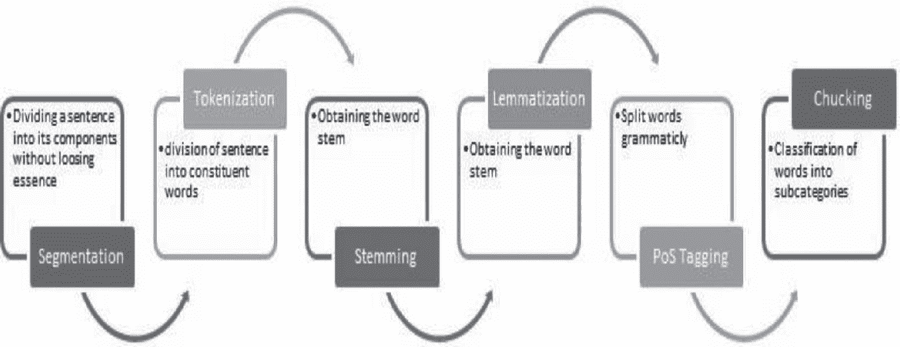

Figure 5.3 NLP process.

之后，如果给定字符串中存在任何特殊字符，则已使用 `NLTK` 方法将其删除 \[17\]。已删除短于 3 个字符的较短单词。下一步处理分词，即将给定字符串分为标记。之后，使用 `stem()` 方法进行词干提取。为了发现各种模式，还进行了探索性数据分析 (EDA)。在数据清理步骤完成后，有必要对数据进行向量化。文本通过向量化转换为数值二维矩阵，以降低时间复杂度 \[18\]。

预处理步骤完成后，数据集需要分为两部分，即训练-测试分割。ML 算法在数据集（称为训练数据）上进行训练，并优化以在数据中找到特定的模式或输出。规则和数据结构是学习到的 ML 模型的组成部分。第一部分用于训练目的，即构建模型，下一部分用于测试构建的模型。在此情况下，75% 的数据用于训练，25% 用于测试。实验使用推文和标签。预处理后，数据被输入到监督 ML 分类器 \[19, 20\]。ML 算法是一种用于检测数据集中模式的数学方法。统计学、微积分和线性代数经常用于 ML 算法。线性回归、决策树 (DT)、随机森林 (RF)、SVM 和 XGBoost 是一些流行的 ML 算法。为此，使用了三个监督 ML 分类器：逻辑回归 (LR)、SVM 和决策树：

1. **逻辑回归 (LR)：** 用于确定输入是否属于特定组。

2. **支持向量机 (SVM)：** 这些通过在 n 维空间中生成坐标，根据对象的共同特征将其分组。

3. **决策树 (DT)：** 这些像分类器一样，用于通过遍历树的叶子和节点来确定输入属于哪个类别。

### 5.5 性能指标 (PM)

模型的效率使用以下性能参数进行评估：准确率、精确率、召回率和 F1 分数。根据 表 5.1，所有这些参数都源自 图 5.4 所示的混淆矩阵：真阳性 (TP)、假阳性 (FP)、真阴性 (TN) 和假阴性 (FN)。

Figure 5.4 Confusion matrix.

|  || Predicted || Predicted |

| --- | --- | --- |

| **Actual** || **TP** || **FN** |

| --- | --- | --- |

| **Actual** || **FP** || **TN** |

Table 5.1 Parameter Explanation

| Parameter || Explanation |

| --- | --- |

| TP || Positive prediction and actually it is also positive. |

| --- | --- |

| FP || Positive prediction but in actual it is negative. |

| TN || Negative prediction and actually it is also negative. |

| FN || Negative prediction but in actual it is positive. |

Table 5.1 给出了混淆矩阵参数的解释。

1. **准确率 (`TN + TP/TP + FP + FN + TN`)** = 识别正预测占预测总数的比例。

2. **精确率 (`TP/TP + FP`)** = 确定模型正确预测正类的频率。

3. **召回率 (`TP/TP + FN`)** = 识别在所有正标签中，模型正确识别了多少个。

4. **F1 分数 (`2\*(Precision\*Recall)/(Precision + Recall)`)** = 精确率和召回率的调和平均数。

### 5.6 结果

本节解决以下研究问题——传统 ML 模型在分析给定数据集中的情感方面准确度如何？在预处理数据集后，应用了 ML 算法，监督学习方法在 Twitter 评论分类中取得了满意的结果。表 5.2 报告了各种传统 ML 模型的性能。对于 LR，TP 为 7362，FP 为 348，FN 为 65，TN 为 215。对于决策树分类器，TP 为 7131，FP 为 255，FN 为 296，TN 为 308。对于 SVC，TP 为 7394，FP 为 372，FN 为 33，TN 为 191。

Table 5.2 Result Analysis

|  || LR || DT || SVC |

| --- | --- | --- | --- |

| Accuracy || 0.948310 || 0.931039 || 0.949312 |

| --- | --- | --- | --- |

| Precision || 0.767857 || 0.509934 || 0.852679 |

| Recall || 0.381883 || 0.547069 || 0.339254 |

| F1-Score || 0.510083 || 0.527849 || 0.485388 |

在此得出结论，SVC 在实现准确率和精确率方面优于其他分类器。但是，召回率和 F1 分数仍有改进空间。三个模型的效率在 图 5.5 中以图形方式展示。

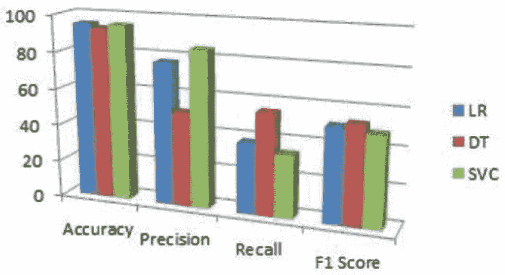

Figure 5.5 Graphical representation of results.

三个模型的效率在 图 5.5 中以图形方式展示。得出结论，SVC 在实现准确率和精确率方面优于其他分类器。但是，召回率和 F1 分数仍有改进空间。

### 5.7 结论

在当今的数字时代，我们触手可及地获取信息。我们进行网上购物，观看网络剧集，并在线分享我们的意见，以告知他人产品情况。我们在购买或做出决定之前也依赖评论。因此，近年来，在线评论引发了对情感分析 (SA) 的广泛研究。这些评论是用人类语言编写的，计算机难以理解。NLP 在弥合这一差距方面发挥着重要作用。Twitter SA 数据集已使用 ML 模型进行探索，以将推文分类为正面或负面情感，并按准确率进行比较。但是，通过利用基于 Transformer 的技术和混合方法，在实现更高效的结果方面仍有改进空间。

### 关键词

### 参考文献

1. Pati, S. P., & Pradhan, B. B., (2020). Comparison between machine learning algorithms used for sentiment analysis. Int. J. Adv. Res. Eng. Technol., *11*(12), 220–228. doi: [10.34218/IJARET.11.12.2020.026](http://dx.doi.org/10.34218/IJARET.11.12.2020.026).

2. Gupta, P., Kumar, S., Suman, R. R., & Kumar, V., (2021). Sentiment analysis of lockdown in India during COVID-19: A case study on Twitter. IEEE Trans. Comput. Soc. Syst., *8*(4), 939–949. doi: [10.1109/TCSS.2020.3042446](http://dx.doi.org/10.1109/TCSS.2020.3042446).

3. Wu, X., Cheng, S., & Chai, Z., (2017). Fake News Stance Detection. 9(1), 611–625.

4. Alonso, M. A., Vilares, D., Gómez-Rodríguez, C., & Vilares, J., (2021). Sentiment analysis for fake news detection. Electron., *10*(11). doi: [10.3390/electronics10111348](http://dx.doi.org/10.3390/electronics10111348).

5. Sadia, A., Khan, F., & Bashir, F., (2018). An overview of lexicon-based approach for sentiment analysis. Int. Electr. Eng. Conf., No. IEEC (pp. 1–6).


6. Appel, O., Chiclana, F., & Carter, J., (2016). 混合情感分析方法. In: 2016 IEEE Congr. Evol. Comput., No. CCI (pp. 4950–4957). doi: [10.1109/CEC.2016.7744425](http://dx.doi.org/10.1109/CEC.2016.7744425).

7. Gupta, I., & Joshi, N., (2020). 基于混合方法并考虑局部上下文语义的增强 Twitter 情感分析. J. Intell. Syst., *29*(1), 1611–1625. doi: [10.1515/jisys-2019-0106](http://dx.doi.org/10.1515/jisys-2019-0106).

8. Mohammad, S. M., (2021). 情感分析. Emot. Meas., *323*–379. doi: [10.1016/b978-0-12-821124-3.00011-9](http://dx.doi.org/10.1016/b978-0-12-821124-3.00011-9).

9. Shilpa, P. C., Shereen, R., Jacob, S., & Vinod, P., (2021). 基于深度学习的情感分析. Proc. 3^(rd) Int. Conf. Intell. Commun. Technol. Virtual Mob. Networks, ICICV 2021 (pp. 930–937). doi: [10.1109/ICICV50876.2021.9388382](http://dx.doi.org/10.1109/ICICV50876.2021.9388382).

10. Shelke, M., & Deshmukh, S., (2020). 印度语言情感分析的最新进展. Int. J. Futur. Gener. Commun. Netw., *13*(4), 1656–1675.

11. Gautam, G., & Yadav, D., (2014). 基于机器学习方法和语义分析的 Twitter 数据情感分析. In: 2014 7^(th) Int. Conf. Contemp. Comput. IC3 2014 (Vol. 12, No. 6, pp. 437–442). doi: [10.1109/IC3.2014.6897213](http://dx.doi.org/10.1109/IC3.2014.6897213).

12. Kalangi, R. R., Maloji, S., Tejasri, N., Chand, P. P., & Ch, V. P., (2021). 基于机器学习的情感分析. Proc. – 2021 3^(rd) Int. Conf. Adv. Comput. Commun. Control Networking, ICAC3N 2021 (pp. 116–121). doi: [10.1109/ICAC3N53548.2021.9725499](http://dx.doi.org/10.1109/ICAC3N53548.2021.9725499).

13. Kawade, D. R., & Oza, D., K. S., (2017). 情感分析：机器学习方法. Int. J. Eng. Technol., *9*(3), 2183–2186. doi: [10.21817/ijet/2017/v9i3/1709030151](http://dx.doi.org/10.21817/ijet/2017/v9i3/1709030151).

14. Pandey, S., Tekchandani, H., & Verma, S., (2020). 胰腺分割中机器学习技术应用的文献综述. In: 2020 1^(st) Int. Conf. Power, Control Comput. Technol. ICPC2T 2020 (pp. 401–405). doi: [10.1109/ICPC2T48082.2020.9071443](http://dx.doi.org/10.1109/ICPC2T48082.2020.9071443).

15. Kherwa, P., & Bansal, P., (2018). 隐语义分析：理解文本语义的方法. Int. Conf. Curr. Trends Comput. Electr. Electron. Commun. CTCEEC 2017, *870*–874. doi: [10.1109/CTCEEC.2017.8455018](http://dx.doi.org/10.1109/CTCEEC.2017.8455018).

16. Rajput, A., (2019). 自然语言处理、情感分析和临床分析. Innov. Heal. Informatics A Smart Healthc. Prim. (pp. 79–97). doi: [10.1016/B978-0-12-819043-2.00003-4](http://dx.doi.org/10.1016/B978-0-12-819043-2.00003-4).

17. Khurana, D., Koli, A., Khatter, K., & Singh, S., (2017). 自然语言处理：现状、当前趋势与挑战. doi: [10.1007/s11042-022-13428-4](http://dx.doi.org/10.1007/s11042-022-13428-4).

18. Raza, H., Faizan, M., Hamza, A., Mushtaq, A., & Akhtar, N., (2019). 基于机器学习技术的科学文本情感分析. Int. J. Adv. Comput. Sci. Appl., *10*(12), 157–165. doi: [10.14569/ijacsa.2019.0101222](http://dx.doi.org/10.14569/ijacsa.2019.0101222).

19. Wankhade, M., Chandra, A., Rao, S., & Kulkarni, C. (2021). 情感分析方法、应用与挑战综述, *123*AD. doi: [10.1007/s10462-022-10144-1](http://dx.doi.org/10.1007/s10462-022-10144-1).

20. Drus, Z., & Khalid, H., (2019). 社交媒体中的情感分析及其应用：系统文献综述. Procedia Comput. Sci., *161*, 707–714. doi: [10.1016/j.procs.2019.11.174](http://dx.doi.org/10.1016/j.procs.2019.11.174).

21. Singh, S., (2020). 基于机器学习的 Twitter 情感分析. Int. J. Sci. Res. Comput. Sci. Eng. Inf. Technol., *3307*, 312–320. doi: [10.32628/cseit206456](http://dx.doi.org/10.32628/cseit206456).

22. Kalangi, R. R., Maloji, S., Tejasri, N., Chand, P. P., & Ch, V. P., (2021). 基于机器学习的情感分析. In: Proc. – 2021 3^(rd) Int. Conf. Adv. Comput. Commun. Control Networking, ICAC3N 2021 (pp. 116–121). doi: [10.1109/ICAC3N53548.2021.9725499](http://dx.doi.org/10.1109/ICAC3N53548.2021.9725499).

23. Salunke, V., & Panicker, S. S., (2021). 基于深度学习的图像情感分析. In: Ranganathan, G., Chen, J., & Rocha, Á., (eds.), Inventive Communication and Computational Technologies. Lecture Notes in Networks and Systems (Vol. 145). Springer, Singapore. [`doi.org/10.1007/978-981-15-7345-3\_12`](https://doi.org/10.1007/978-981-15-7345-3_12).

24. Nigam, N., & Yadav, D., (2019). 基于 R 语言的推特情感分析词典方法：第二届国际会议 ICACDS 2018 (pp. 372–380). Dehradun, India. doi: [10.1007/978-981-13-1810-8](http://dx.doi.org/10.1007/978-981-13-1810-8).

25. Singh, V., Singh, G., Rastogi, P., & Deswal, D., (2018). 基于词典方法的情感分析. PDGC 2018 – 2018 5^(th) Int. Conf. Parallel, Distrib. Grid Comput. (pp. 13–18). doi: [10.1109/PDGC.2018.8745971](http://dx.doi.org/10.1109/PDGC.2018.8745971).

## 第 6 章 智能创新系统：关于当前挑战与应急的多学科视角经验

N. INDUMATHI,^(⁵)

先进技术已在实践中重塑了人类存在的方方面面，包括在各个领域实施机器学习（ML）创新，例如智能决策系统。在当前时代，ML 应用正被寻求部署于医学、工业安全和农业等领域，旨在预测未来事件。在医学领域，计算机辅助决策支持系统和机器智能可轻松用于疾病预测和诊断。这些系统从生物医学数据集中学习重要特征，并基于新数据进行预测。同样，ML 在预测未来结果方面的有效性在工业安全管理中已得到认可。主动安全管理需要使用先行指标来监控和评估防护措施的有效性，旨在防止事件发生。在农业领域，ML 智能系统可以帮助农民优化作物产量，考虑气候条件、降雨量、土壤条件、灌溉系统以及病虫害管理等因素。为应对这些挑战，本章提出了一种用于预测工业事故、诊断医疗环境中的疾病以及预测农业作物产量的智能方法。本章采用不同的 ML 算法和强大的分类器，识别潜在危险的项目特征和场地条件，早期识别糖尿病视网膜疾病、乳腺癌、组织病理学、组织分割、心脏疾病、慢性肾脏疾病和脑肿瘤，并提升农业领域的作物产量及其质量。该系统还通过统计指标进行验证，通过比较预测准确率和误差率来确定算法的效率。

### 6.1 引言


## 6.2 方法与讨论

#### 6.2.1 医疗领域中的机器学习（ML）

##### 6.2.1.1 糖尿病视网膜疾病检测

糖尿病视网膜病变是影响视力的主要不可逆视网膜疾病之一 \[12\]。早期检测对于防止视力丧失至关重要。DR 的诊断是通过检测眼底图像中的渗出物来实现的，如 图 6.1 所示。DR 的分类和预测是使用集成 ML 算法（如 AdaBoost、NB、RF 和 SVM）来确定的 \[13\]。

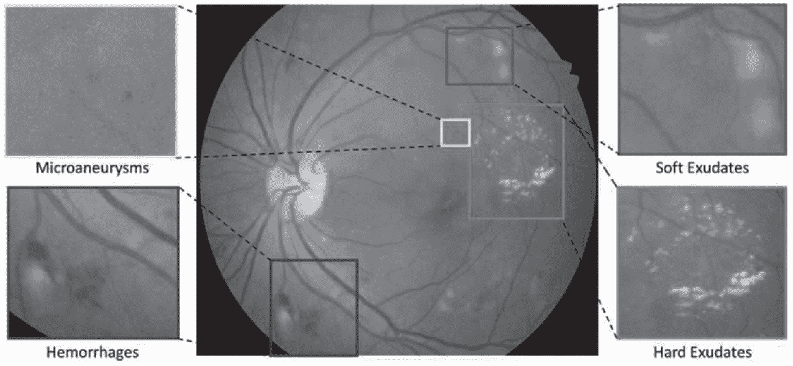

图 6.1 糖尿病视网膜病变二维眼底图像。

OCT 图像用于有效分类糖尿病视网膜疾病，如糖尿病性黄斑水肿、DR 和 AMD (图 6.2)。使用 DL 定制的 CNN OCT-NET 在 SD-OCT 公共数据集 SERI-CUBK 上实现了 93% 的精度和 0.99 的曲线下面积 \[14\]。

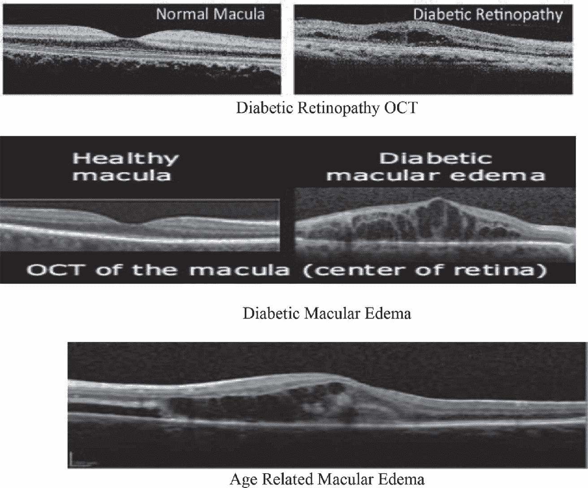

图 6.2 糖尿病视网膜疾病的 OCT 图像。

糖尿病性黄斑水肿影响视网膜的视网膜下液（SRF）和 PME。使用结合空洞空间金字塔池化的深度神经网络来分割 DME 的 OCT 图像 \[15\]，而使用卷积网络进行基于渗出物的 DME 检测。应用 ML 决策树分类器来检测糖尿病性黄斑水肿肿块，性能指标为 92% 的准确率、89.8% 的灵敏度和 94.8% 的特异性 \[16\]。

##### 6.2.1.2 乳腺癌诊断

乳腺癌一直是影响全球女性的常见疾病之一。根据世界卫生组织（WHO）的数据，2018 年约有 15% 的女性死于乳腺癌 \[17\]。早期检测对于防止死亡至关重要。ML 算法已被用于在乳腺 X 线摄影图像中检测乳腺癌 (图 6.3)。CNN 与优化方法一起被用于分类病理图像数据集 \[18\]。分类器的性能是根据恶性肿瘤的识别来评估的，使用了归一化、权重正则化、浅 SoftMax 回归和浅逻辑回归（LR）等技术 \[19\]。

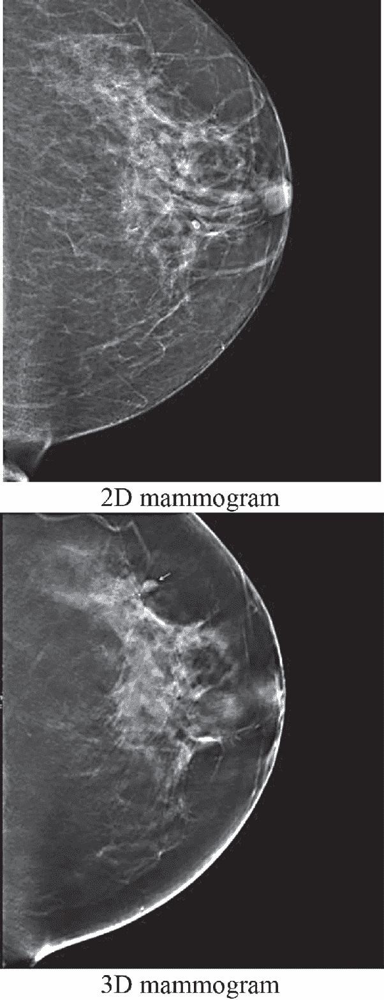

## 引言

近来，计算机辅助决策支持系统已实施机器学习（ML）方法，并已在多学科领域中实际应用。该系统学习生物医学数据集的重要特征，并基于新数据进行预测。ML 实现现在包括二维和三维图像。基于 ML 的算法能够预测事故和未来的安全措施以最大限度地减少事故。然而，这些方法是为特定的领先指标开发的，限制了它们的应用，因为对安全性能的影响在不同组织和项目之间有所不同。关于预测火灾事故的研究旨在鼓励实施针对性的安全控制并提高安全性能。精准农业的主要目标是提高作物产量。作物生长和产量取决于环境属性，如气候变量、土壤参数、灌溉、病虫害管理等。ML 算法和强大的分类器已被开发用于预测生物医学成像和信号、预测事故，以及在医疗、安全性能和农业领域预测作物生产力。

糖尿病视网膜病变是影响视力的主要不可逆视网膜疾病之一 \[1\]。早期检测对于防止视力丧失至关重要。DR 的诊断是通过识别眼底图像中的渗出物来实现的。DR 的分类预测是使用集成 ML 算法（如 AdaBoost、朴素贝叶斯（NB）、随机森林（RF）和支持向量机（SVM））来确定的 \[2\]。深度学习（DL）卷积神经网络（CNN），特别是 GoogLeNet 和 AlexNet ImageNet 模型，用于特征提取，并配合 SGD、Adam、AdaGrad、NAG 和 RMSprop 等求解器，以实现最高 74.5% 的准确率 \[3\]。光学相干断层扫描（OCT）图像被用于有效分类糖尿病视网膜疾病，包括糖尿病性黄斑水肿、DR 和年龄相关性黄斑变性（AMD）。基于 DL 的定制 CNN OCT-NET 在 SD-OCT 公共数据集 SERI-CUHK 上实现了 93% 的精度和 0.99 的曲线下面积 \[4\]。糖尿病性黄斑水肿影响视网膜的视网膜下液（SRF）和色素上皮剥离（PME）。结合空洞空间金字塔池化的深度神经网络用于 DME 的 OCT 图像分割 \[5\]，而卷积网络用于基于渗出物的 DME 检测 \[6\]。ML 决策树分类器用于检测糖尿病性黄斑水肿肿块，实现了 92% 的准确率、89.8% 的灵敏度和 94.8% 的特异性的性能指标 \[7\]。

使用 ML 计算需要大量数据来触发各种机械循环中的动态过程。通过这种方式，实施网络物理系统和物联网等创新原理，能够生成不同类型的本土知识，如大数据分析领域所观察到的那样。通常，数据遵循特定的生命周期（来源、收集、存储、处理、可视化、传输、应用）。但是，大多数情况下，将在后续步骤中处理的收集数据与整体环境中生成的噪声数据混合在一起，使得很难将原始数据集与噪声分离开来 \[8\]。

根据 Liakos 等人的统计报告 \[9\]，ML 模型被应用于农业的各种应用，例如作物产量预测（20%）、土壤管理（61%）和病虫害检测（22%）。在大多数情况下，基于机器的预测在许多方面获得了准确的预测。它还证明了大多数农业研究实施了人工神经网络模型（ANN）和 SVM 模型以做出更好的决策。很可能，ANN 模型用于作物改良、土壤和水资源管理的实施。当 ML 与传感器数据一起实施时，模型正在演变为人工智能（AI）系统，以提供有价值的洞察，帮助做出明智的决策，其最终目标是提高作物生产力。

ML 技术可用于土壤管理领域以提取土壤参数。它们还可以根据土壤湿度、天气条件和灌溉特征等因素来预测作物生长。因此，ML 方法有助于高效的自动灌溉 \[10\]。许多农民仍然遵循传统的作物发展系统，在降雨不足的情况下可能导致产量下降。为了提高作物生产力，已实施了具有混合算法的 ML 技术，取得了有希望的结果 \[11\]。本章概述了医学、安全管理和农业等各个领域中使用的 ML 模型。讨论重点在于这些模型如何有效地分类医学图像数据、在早期分析和预测火灾事故，以及识别和监测作物冠层特征、土壤湿度、病虫害。


Figure 6.3 Breast cancer mammogram images.

Multiple instance learning is used to identify histopathological images of breast cancer. A two-step DL model is employed for mammogram image classification. A deep convolutional pre-trained network is applied to achieve multi-view classification of mammogram images with an ROC of 0.9 \[20\].

Transfer learning techniques were implemented to achieve an AUC of 0.81 in the classification of breast cancer tumor mammographic images \[21\]. An extreme learning machine (`ELM`) technique was applied to diagnose the breast cancer mammographic dataset with an accuracy of 96.02% \[20\]. Tele mammographic images have played an important role in telehealth monitoring systems. ML was implemented using a J48 decision tree, RF, k-nearest neighbor (`KNN`), and multilayer perceptron (`MLPs`) \[21\].

##### 6.2.1.3 Brain Tumor Detection

Brain tumors are defined as the mass growth of abnormal cells in the brain, which can lead to death. Magnetic resonance imaging (`MRI`) is used for detecting this type of tumor (Figure 6.4). Nowadays, computer-aided systems are used for easy and fast diagnosis. CNN kernel-based algorithms are implemented to segment the `MRI` brain images \[22\]. Deep neural network classifiers are applied to classify the types of brain tumors. The popular `SVM` ML algorithm is used for classifying brain `MRIs`. Auto multi-task medical image segmentation is demonstrated in the form of a single CNN that includes three tasks: brain `MRL` Breast `MRL` and cardiac `CTA` \[23\].

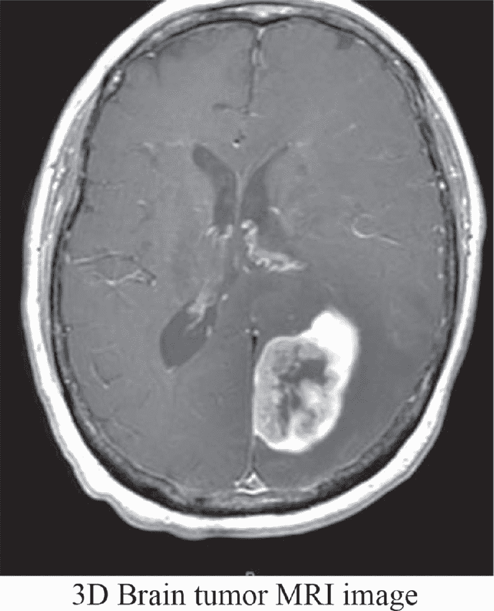

Figure 6.4 Brain tumor MRI image.

#### 6.2.2 Machine Learning (`ML`) in the Industrial Safety Performance Sector

Humanity has achieved enormous advances in industrial manufacturing during the last 300 years. The third industrial revolution, which began in the 1950s, increased digitalization through the use of semiconductors and, more recently, communication networks, which made automated development possible. AI and `ML` have been extensively used in the manufacturing sector during the past 10 years, enabling more efficient operations, less resource waste and sustainable resource utilization, better working conditions, and improved quality and productivity. By allowing defect identification and prediction, optimum use of raw materials and resources, leveraging heterogeneous big data analysis, and networked manufacturing facilities, AI/`ML`-based manufacturing may bring about a number of industrial advancements \[24\].

##### 6.2.2.1 Occupational Risk Prediction

A branch of machine language is based on “deep learning” and demonstrates how some of the gaps in risk assessment can be addressed. `ML` refers to computer programming techniques for learning through experience. Through DL techniques, a computer can be trained to evaluate risk for safety-critical industries such as fireworks manufacturing, mining industries, and oil and gas. This involves analyzing a large volume of data, including indicators from regular operations and past incidents, ranging from mishaps to major accidents. Due to the subjective nature of the risk concept, professional oversight is required as the degree of risk cannot be applied with certainty to each case. This supervised learning enables DL. Once the model has been trained for risk categorization, it utilizes its expertise to assess major risks based on the condition of the controlled device, such as a fireworks, mining, or oil and gas field \[25\]. Figure 6.5 represents the development of DL for industrial risk assessment.

![Figure 6.5 Industrial risk assessment approach by deep learning. Source: Reprinted with permission from Ref. \[52\]https://creativecommons.org/licenses/by/4.0/](images/fig6_5_B.jpg)

Figure 6.5 Industrial risk assessment approach by deep learning. *Source:* Reprinted with permission from Ref. \[52\][`creativecommons.org/licenses/by/4.0/`](https://creativecommons.org/licenses/by/4.0/)

###### 6.2.2.1.1 Classification and Regression (`CART`)

The classification and regression tree (`CART`) is a selected tree-based information extraction methodology used by numerous scientists for studying work-related accidents. The `CART` framework aims to establish a relationship between accident severity, working environmental factors, risk factors, and accident factors. By utilizing `CART`, it is possible to determine the anticipated scenarios and logical outcomes of business interactions within a real-world industry sector incidents \[26\].

###### 6.2.2.1.2 Support Vector Machine (`SVM`)

Nonlinear kernel `SVM`s have been successfully and often used in supervised classification due to their capability to represent data in the required space where groups are clearly distinguishable. `SVM` algorithms have shown comparable or higher accuracy in regression and classification tasks compared to other empirical ML methods. `SVM` statistical models have very reliable output on binary classification issues \[27\].

The explanation for this is the `SVM` algorithm, which determines an optimum boundary capable of separating the two groups of the target variable. The three popular meta-heuristic algorithms for `SVM` include linear, radial basis function, and the degree d of the probability density function \[28\].

###### 6.2.2.1.3 Decision Tree (`DT`)

Decision trees (`DT`s) have become more common because they are clear, easy to interpret, and efficient classification algorithms The key reason for using `DT`s is to analyze quantity and quality trends in the data for the purpose of exploring hidden knowledge. Among the different classifications of `DT` algorithms, boosting has been considered one of the most significant developments in ML over the last 20 years, as it can transform a group of different learners \[29\].

###### 6.2.2.1.4 Naïve Bayes (`NB`)

Bayesian classifiers are based on Bayes’ theorem, which uses conditional probabilities to determine the likelihood of the dependent variable given the independent variables. The Naive Bayes classifier is one of the most widely used classifiers in AI. It simplifies the complexity of Bayesian classifiers by making the naive assumption of independence, reducing the number of parameters to be evaluated from `2^(2n-1)` to just `2n` when modeling `P(X)`, where `X` is the independent variable, `Y` is the dependent variable, and `n` is the number of independent variables used in the experiment \[30\].

###### 6.2.2.1.5 Reinforcement Learning (`RL`)

Specific reference to the unsupervised learning method involves determining if the chosen action resulted in a reward for a specific performance metric. Reinforcement learning (`RL`) looks at sequential actions and seeks out their outcomes, selecting those that are best suited to the problem at hand. Thus, `RL` is very different from other types of learning, which concentrate on the utilization of historical information, the production of knowledge from previous decisions and rewards \[31\]. The ML categories and key aspects are demonstrated in Figure 6.6.

![Figure 6.6 Machine learning categories and key aspects. Source: Reprinted with permission from Ref. \[53\] https://creativecommons.org/licenses/by/](images/fig6_6_B.jpg)

Figure 6.6 Machine learning categories and key aspects. *Source:* Reprinted with permission from Ref. \[53\] [`creativecommons.org/licenses/by/`](https://creativecommons.org/licenses/by/)

##### 6.2.2.2 Predictive Model For Safety Domain


安全领先指标是主动安全管理的重要组成部分，能够提供关于组织防护绩效的有用信息 \[32\]。安全专业人士得出结论，仔细收集、评估和减轻领先指标将带来真正的功能改进 \[33\]。已制定了选择有用领先指标的标准，包括有效性、可靠性、响应性、代表性、对偏差的开放性以及成本效益 \[34\]。图 6.7 表示在工业安全和事故中识别的关键参数。

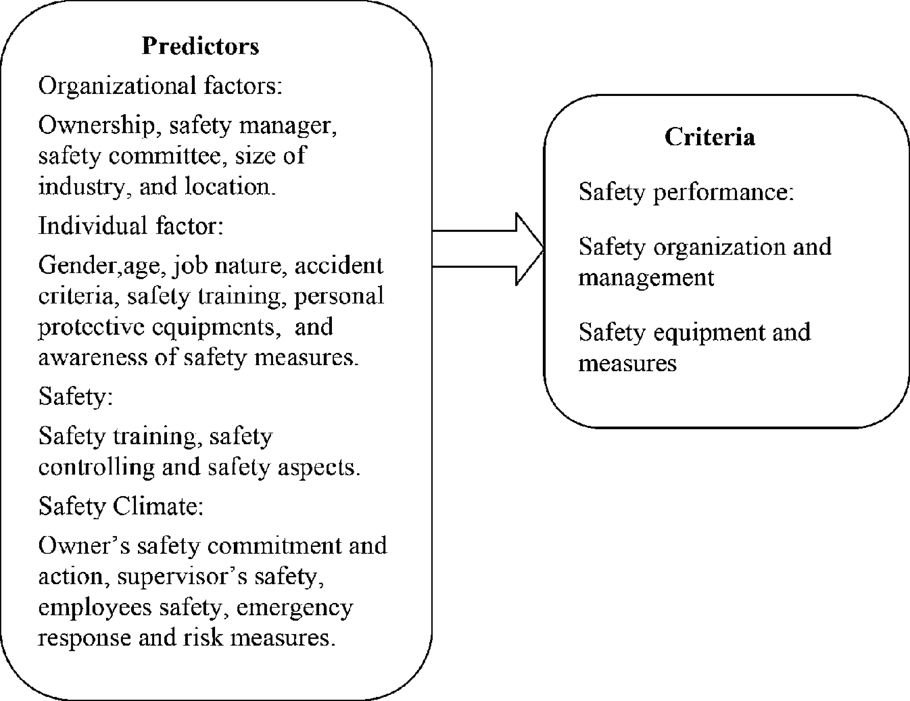

图 6.7 职业事故风险和安全参数。

此外，有效的安全措施应进行数值评估，频繁更新，并反映所选的整体安全决定因素 \[35\]。人们相信，与多个领先指标的聚集和分析相关的交互的潜在影响将产生最大的预期结果 \[34\]。先前的研究表明，促进零伤害状态和预测性防护模型不仅仅需要个人防护装备 (`PPE`) 和主动预防策略 \[37\]。绩效可能在弥合差距方面发挥关键作用。如果公司能够预见并为安全绩效的潜在改进做好准备，它们将能够更迅速、更高效地制定事故预防计划 \[38\]。

单家公司利用尖端和预测分析结合不断增长的安全数据收集来降低事故率的能力。为了主动预测职业伤害可能发生的时间和地点，已创建了各种预测模型 \[39\]。应建立各种模型来全球预测建筑安全绩效。它们表明，所有构建模型中索赔和特权实例的多样性，以及每个合格利润类别中的公司数量，都能预测安全结果。各类负责任收益类别中公司的普遍性以及工作场所伤害的频率也被证明与安全结果呈正相关且相关性显著 \[40\]。

为了评估风险变量在预测安全绩效方面的精度，采用基于主成分分析 (`PCA`) 的线性预测模型。为了彻底分析基础设施项目中的安全风险因素并确定项目安全状态的概率，世界钢铁协会 \[41\] 提出了一种基于贝叶斯网络的混合系统。虽然他们的方法在预测安全结果方面证明是有效的，但仅限于小规模项目。

##### 6.2.2.3 职业事故预测

职业伤害是所有领域的重要关切。根据国际劳工组织 (`ILO`) 提供的统计数据，每年工作场所报告的事件和危险事件超过 3.17 亿起，导致每年超过 230 万例过早死亡。仅在印度，据报道每年有超过 48,000 名员工因工作相关事故死亡，近 3700 万例病例导致至少 3 天的病假。该研究还揭示，印度每 1,000,000 名员工中有 114 例致命事故率，以及每 1,000,000 名员工中有 8,700 例事故率 \[38\]。

根据世界钢铁协会，工人的保护和健康对可持续性至关重要 \[42\]。职业风险由两个参数定义：一个显示伤害发生率，另一个与伤害严重程度相关。职业事故报告可以按包含事故年份、地点、员工标准、员工年龄、事件时间、事故描述等参数的格式分类。上述标准包括伤害类型、涉及的物质因素、伤害类型、受影响的身体部位、事件中涉及的危险状况以及事件中涉及的危险活动。

优化方法是创建一个测量模型，使用 `GA` 方法来确定职业危害，同时考虑职业伤害的规模和频率。据报道，工业安全与更高的绩效相关，最有效的钢铁制造商也被发现是最安全的。因此，当今的一大关切是，尽管我们拥有严重、有害和导致时间损失事件的充分经验，但我们可能无法从过去的记录中吸取教训。如果我们能够利用历史证据预测未来事件的发生，这将有助于相关行业。工作场所伤害分析领域也已产生预测。

它被描述为一种基本策略，其核心前提是如果事件可以预期，则可以避免。因此，在工作场所安全分析实践中预测工作场所伤害已被证明很重要，以尽量减少可能发生的伤害风险 \[43\]。

##### 6.2.2.4 职业模型

识别可能与 `ML` \[44\] 相关的新技术：

1. **预测性维护：** 在中断发生前准确预测制造线面临的挑战的能力对制造商来说无价之宝。它使雇主能够在最合适的时间计划停机并减少不必要的延误。未计划的中断严重影响毛利，并可能导致客户基础的流失。预计 `ML` 在预测性维护方面的应用将在工厂中增加约 38%，因为它有潜力通过消除未计划停机来提高毛利。

2. **个人防护装备 (`PPE`)：** 它是一种保护个人免受健康和安全危害的设备。不佩戴 `PPE` 会显著增加受伤风险，在某些情况下，可能导致因受伤而受到经济处罚，甚至导致不佩戴防护装备（如口罩和安全眼镜）的工作人员丧失生命。实施 `ML` 进行 `PPE` 识别使公司能够最大限度地降低工人受伤风险，防止工作场所事故，提高运营效率，并收集工作场所安全数据。

3. **智能制造：** `AI` 和 `AI` 的一个关键目标是使能够开发制造车间的数字副本。数字孪生的创建将通过基于模型的系统工程过程 (`MBSE`) 的努力来实现，使用 `AI` 算法和获取的数据作为基础。数字孪生将作为进行“如果...会怎样”场景以发现未知的平台。此外，数字孪生可用作端到端模型，用于设计更高可靠性的组件并优化生产线机器之间的交互以提升性能 \[45\]。

4. **人机交互：** 人与机器之间的劳动分工通常在技术先进的运营环境中观察到，分配的工作被归类为机器特定和人类特定。与计算机集成制造 (`CIM`) 的概念不同，工业 4.0 旨在在人类-网络-物理框架 (`HCPS`) 内的协作工作空间中结合人和机器，而不是无工人的生产设施 \[26\]。


5. **开放获取：** ML 驱动技术的最新进展以及 DL 的出现，为革新工业 4.0 及其后续领域开辟了新的机遇。这些进步使得在复杂且动态的环境中，实现高度自主和高效的工业运营成为可能，同时改进故障检测、减轻人为错误、确保安全并防止意外损失 \[43\]。

AI 和 ML 在人类社会各个方面的融合，在提供提升生活质量和保护生态系统可持续性的令人兴奋的新机遇方面发挥了关键作用。在工业 4.0 的背景下，AI/ML 在制造业领域带来了众多改进，增强了包括减少浪费、自动化和产品质量在内的流程。实现工业 4.0 愿景的一个非常重要的领域是及时检测和预防故障，利用工业物联网的解决方案，并随后获取和处理各种大规模数据 \[46\]。图 6.8 说明了使用 ML 算法进行工业风险评估预测和预防。

![Figure 6.8 Industrial risk assessment prediction and prevention using ML. Source: Reprinted with permission from Ref. \[53\] https://creativecommons.org/licenses/by/](images/fig6_8_B.jpg)

图 6.8 使用 ML 进行工业风险评估预测和预防。 *来源：* 经 Ref. \[53\]许可转载 [`creativecommons.org/licenses/by/`](https://creativecommons.org/licenses/by/)

#### 6.3 农业技术领域中的机器学习（ML）

##### 6.3.1 天气与作物预测

作物产量主要取决于天气条件和土壤变量，如 pH 值和养分。温度、太阳辐射、相对湿度和降雨量等天气参数在作物的生长和发育中起着重要作用。由于气象数据中天气变量的波动，预测作物产量具有挑战性。循环神经网络（RNN）可以有效地用于天气预报 \[47\]。此外，作物可以根据天气使用 SVM、C4.5、C5.0、CART 和 RF 等分类算法进行分类，如图 6.9 所示。尽管 RNN 能够成功处理时间序列数据，但将 RNN 与广义自回归条件异方差（GARCH）等统计模型相结合，可以增强预测过程。与传统神经网络相比，RNN 允许将前一步的输出转发到当前步骤，使 RNN 的隐藏层能够记住网络的序列。因此，这些值彼此相关 \[48\]。在对作物进行分类或预测天气之前，有必要对气候或作物数据进行数据预处理，以填补缺失值。

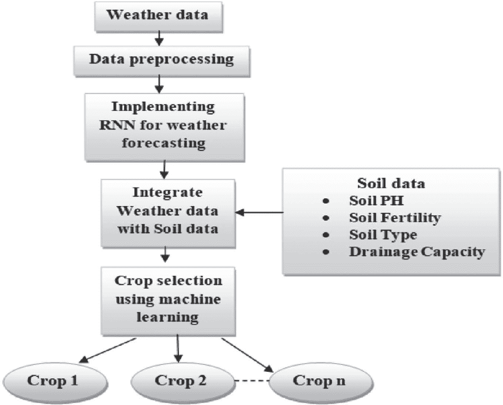

图 6.9 用于作物预测的天气数据。

##### 6.3.2 病虫害管理

作物必须受到病虫害的保护，以便通过高效的 ML 方法提高作物产量。C4.0 和 C5.0 等 ML 决策树算法可用于对农业作物病虫害图像进行分类。这两种算法都使用训练数据集构建决策树 \[49\]。使用分割的测试数据集进行准确性预测。C4.5 和 C5.0 都是构建 DT 和生成规则集的有效分类器。C4.5 算法在构建过程中使用深度优先策略，允许剪枝并紧凑地处理缺失和噪声数据。但是，在某些情况下，C5.0 在处理速度、内存和效率方面优于 C4.5 \[50\]。CNN 是一种神经网络，可应用于农业领域对病虫害图像进行分类。病虫害图像中的特征提取是通过神经网络中神经元的自适应学习实现的 \[51\]。病虫害识别和分类的流程图如图 6.10 所示。

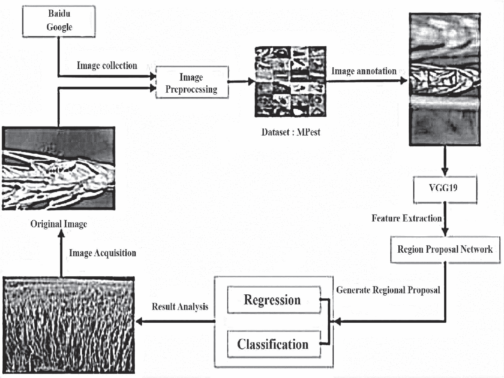

图 6.10 病虫害识别和分类流程图。

##### 6.3.3 土壤与灌溉管理

所有作物的生长都取决于土壤类型、养分和灌溉情况。因此，选择合适的土壤进行种植以最大限度地提高作物产量非常重要。土壤和天气条件的变化对水资源管理系统有明确的影响，导致作物产量下降。因此，建议使用利用土壤传感器数据和天气数据的智能自动灌溉系统，如图 6.11 所示。土壤湿度水平数据通过 Wi-Fi 调制解调器传输到云端。采用 ML 分类技术根据土壤数据对灌溉策略进行分类。因此，在实现高精度模型的同时，可以减少自动灌溉系统的用水量 \[36\]。

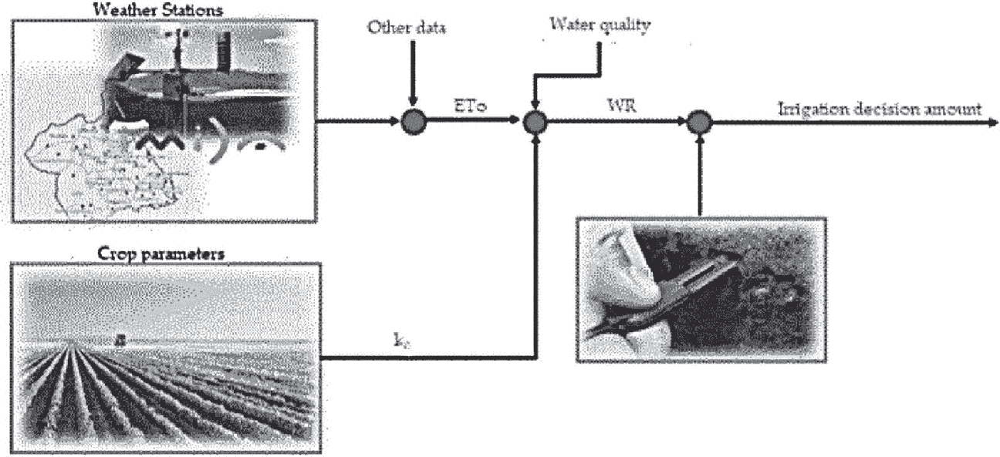

图 6.11 智能自动灌溉模型。

### 6.4 结论

机器学习（ML）模型在过去几年中迅速发展。这些算法的发展可能会提供更有意义的数据集，当与复杂的算法结果相结合时，为医学、安全管理和农业领域的更好预测和决策铺平了道路。许多 ML 模型已经在各个领域得到智能实现。本章主要揭示：

*   具有优化的 CNN 和其他 DL 模型在检测癌症和肿瘤方面提供了有效的图像分类。

*   分类、回归和网络模型适用于在爆竹城市最早阶段预测火灾事故。这些模型被认为是工业中进行风险评估回归分析的有前途的工具，能够衡量事故，并为安全管理措施提供宝贵的知识。

*   SVM、决策树、NB 和神经网络等机器学习模型增强了作物产量、土壤管理、灌溉系统、病虫害及疾病管理的预测。

### 致谢

前三位作者谨向卡拉萨林伽姆研究与教育学院的管理层表示感谢，感谢其提供奖学金以开展研究工作。

### 关键词

### 参考文献

1.  Nathan, G. C., David, S. F., & Thomas, L., (2003). Important causes of visual impairment in the world today I JAMA JAMA Network. [`jamanetwork.com/journals/jama/article-abstract/197460`](https://jamanetwork.com/journals/jama/article-abstract/197460) (accessed on 20 February 2024).

2.  Bhatia, K., Arora, S., & Tomas, R., (2016). Diagnosis of diabetic retinopathy using machine learning classification algorithm. In: 2016 2’d International Conference on Next Generation Computing Technologies (NGCT) (pp. 347-351). doi: [10.1109/NGCT.2016.7877439](http://dx.doi.org/10.1109/NGCT.2016.7877439).

3.  Lam, C., Yi, D., Guo, M., & Lindsey, T., (2018). Automated detection of diabetic retinopathy using deep learning. AMM Jt Summits Transl. Sci. Proc., *2018*, 147-155.


4. Perdomo, O., Rios, H., Rodeiguez, F. J., Otalora, S., Meriaudeau, F., Muller, H., & Gonazalez, F. A., (2019). 基于光学相干断层扫描的深度学习方法糖尿病相关视网膜疾病分类. Computer Methods and Programs in Biomedicine, *178*, 181-189. doi: [10.1016/j.cmpb.2019.06.016](http://dx.doi.org/10.1016/j.cmpb.2019.06.016).

5. Junjie, H., Yuanyuan, C., & Zhang, Y., (2019). 基于深度神经网络的 OCT 黄斑水肿自动分割. Medical Image Analysis, *55*, 216-227.

6. Juan, M., Lei, Z., & Yangqin, F., (2018). 基于级联深度残差网络的视网膜图像渗出物为基础的糖尿病性黄斑水肿识别. Neurocomputing, *290*, 161-171. Elsevier.

7. Mahendran, G., Periyasamy, M., Murugeswari, S., & Karthika, D. N., (2020). 基于机器学习算法的视网膜疾病分析. Materials Today: Proceedings. doi: [10.1016/j.matpr.2020.03.691](http://dx.doi.org/10.1016/j.matpr.2020.03.691).

8. Rehman, M. H., Yaqoob, I., Salah, K., Imar, M., Jayaraman, P. P., & Perera, C., (2018). 工业物联网中大数据分析的作用. Future Gener. Comput. Syst., *99*, 247-259.

9. Liakos, K. G., Busato, P., Moshou, D., Pearson, S., & Bochtis, D., (2018). 农业中的机器学习：综述. Sensors, *18*(8), 2674.

10. Storm, H., Baylis, K., & Heckelei, T., (2020). 农业和应用经济学中的机器学习. European Review of Agricultural Economics, *47*(3), 849-892.

11. Bhimanpallewar, R. N., & Narasingarao, M. R., (2020). 农业咨询系统的机器学习替代方法. In: 2020 10th International Conference on Cloud Computing, Data Science & Engineering (Confluence) (pp. 27-31). IEEE.

12. WHO I Breast Cancer. Who. [`www.who.int/cancer/prevention/diagnosis-screening/breast-cancer/en/`](http://www.who.int/cancer/prevention/diagnosis-screening/breast-cancer/en/) (2024 年 2 月 20 日访问).

13. Kwadwo, S., You, F., & Tettey, O., (2020). 基于深度学习优化器的高效、超简便乳腺癌组织病理学图像分类方法. Ijca, *177*(37), 1-9. doi: [10.5120/ijca2020919875](http://dx.doi.org/10.5120/ijca2020919875).

14. Ferdaus, J., (2020). 基于不同逻辑回归的神经网络乳腺癌诊断. \[Online\]. Available: [`www.doria.fi/handle/10024/177454`](https://www.doria.fi/handle/10024/177454) (2024 年 2 月 20 日访问).

15. Sudharshan, P. J., Petitjean, C., Spanhol, F., Oliveira, L. E., Heutte, L., & Honeine, P., (2019). 组织病理学乳腺癌图像分类的多实例学习. Expert Systems with Applications, *117*, 103-111. doi: [10.1016/j.eswa.2018.09.049](http://dx.doi.org/10.1016/j.eswa.2018.09.049).

16. Dhungel, N., Carneiro, G., & Bradley, A. P., (2016). 来自乳腺 X 线摄影的乳腺肿块分类深度特征自动学习. In: Medical Image Computing and Computer-Assisted Intervention - MICCAI 2016 (pp. 106-114). Cham doi: [10.1007/978-3-319-46723-8\_13](http://dx.doi.org/10.1007/978-3-319-46723-8_13).

17. Carneiro, G., Nascimento, J., & Bradley, A. P., (2015). 基于预训练深度学习模型的未注册多视图乳腺 X 线摄影分析. In: Medical Image Computing and Computer-Assisted Intervention - MICCAI 2015 (pp. 652-660). Cham. doi: [10.1007/978-3-319-24574-4\_78](http://dx.doi.org/10.1007/978-3-319-24574-4_78).

18. Huynh, B. Q., Li, H., & Giger, M. L., (2016). 基于深度卷积神经网络迁移学习的数字乳腺 X 线摄影肿瘤分类. Jmi, *3*(3), 034501. doi: [10.1117/11M1.3.3.034501](http://dx.doi.org/10.1117/11M1.3.3.034501).

19. Xie, W., Li, Y., & Ma, Y., (2016). 基于极限学习机的数字乳腺 X 线摄影乳腺肿块分类. Neurocomputing, *173*, 930-941. doi: [10.1016/j.neucom.2015.08.048](http://dx.doi.org/10.1016/j.neucom.2015.08.048).

20. Syed, L., Jabeen, S., & Manimala, S., (2018). 远程乳腺 X 线摄影：一种基于小波图像处理和机器学习技术的早期乳腺癌检测新方法. In: Hassanien, A. E., & Oliva, D. A., (eds.), Advances in Soft Computing and Machine Learning in Image Processing (pp. 149-183). Cham: Springer International Publishing.

21. Pereira, S., Pinto, A., Alves, V., & Silva, C. A., (2016). MRI 图像中基于卷积神经网络的脑肿瘤分割. IEEE Transactions on Medical Imaging (Vol. 35, No. 5, pp. 1240-1251). doi: [10.1109/TMI.2016.2538465](http://dx.doi.org/10.1109/TMI.2016.2538465).

22. Mohsen, H., El-Dahshan, E. S. A., El-Horbaty, E. S. M., & Salem, A. B. M., (2018). 基于深度学习神经网络的脑肿瘤分类. Future Computing and Informatics Journal, *3*(1), 68-71. doi: [10.1016/j.fcij.2017.12.001](http://dx.doi.org/10.1016/j.fcij.2017.12.001).

23. Gurusamy, R., & Subramaniam, D. V., (2017). MRI 脑肿瘤分类的机器学习方法, *18*.

24. Lu, J., (2017). 工业 4.0：技术、应用和开放研究问题调查. J. Ind. Inf. Integr., *6*, 1-10.

25. Goodfellow, I. J., Bengio, Y., & Courville, A., (2016). 深度学习. The MIT Press, Citeseer, Cambridge, Massachusetts, US.

26. Cheng, C., Leu, S., Cheng, Y., Wu, T., & Lin, C., (2012). 应用数据挖掘技术探索台湾建筑业职业伤害的促成因素. Accident Analysis & Prevention, *48*, 214-222.

27. Xu, L. D., & Duan, L., (2019). 工业 4.0 中面向网络物理系统的大数据：综述. Int. J. Enterp. Inf. Syst., *13*, 148-169.

28. Reiman, T., & Pietikainen, E., (2011). 系统安全的领先指标：监测和推动组织安全潜力. Safety Science, *50*(10), 1993-2000.

29. Indumathi, N., Ramalakshmi, R., & Ajith, V., (2021). 烟花工业风险因素分析：使用决策树分类器. In: 2021 International Conference on Advance Computing and Innovative Technologies in Engineering (ICACITE) (pp. 811-814). IEEE.

30. Hale, A., (2009). 为什么需要安全绩效指标？ Safety Science, *47*(4), 479, 480.

31. Oien, K., Utne, I. B., & Herrera, I. A., (2011). 构建安全指标：第一部分 理论基础. Safety Science, *49*(2), 148-161.

32. Hinze, J., Thurman, S., & Wehle, A., (2013). 建筑安全绩效的领先指标. Safety Science, *51*(1), 23-28.

33. Schultz, G. 使用高级分析预测和预防工作场所伤害. Online: [`ohsonline.com/Articles/2012/07/01/UsingAdvanced-Analytics-to-Predict-and-PreventWorkplace-Injuries.aspx`](https://ohsonline.com) (2024 年 2 月 20 日访问).

34. Ghodrati, N., Yiu, T. W., Wilkinson, S., & Shahbazpour, M., (2018). 建筑业安全结果预测的新方法. Safety Science, *109*, 86-94.

35. Kuhn, M., & Johnson, K., (2013). 应用预测建模. Springer, New York, NY.


36. Torres-Sanchez, R., Navarro-Hellin, H., Guillamon-Frutos, A., San-Segundo, R., Ruiz-Abellon, M. C., & Domingo-Miguel, R., (2020). 用于灌溉管理的决策支持系统：不同学习技术的分析与实现. Water, *12*(2), 548.

37. Esmaeili, B., Hallowell, M. R., & Rajagopalan, B., (2015). 基于属性的安全风险评估 II：使用广义线性模型预测安全结果. Journal of Construction Engineering and Management, *141*(8), 04015022.

38. Xia, N., Zou, P. X. W., Liu, X., Wang, X., & Zhu, R., (2018). 用于预测建设项目安全性能的混合 BN-HFACS 模型. Safety Science, *101*, 332–343.

39. Safety and Health at Work, (2016). Ilo.org, \[Online\]. Available: [`http://www.ilo.org/global/topics/safety-and-healthat-work/lang--en/index.htm`](http://www.ilo.org) (访问日期：2024 年 2 月 20 日).

40. Hämäläinen, P., Takala, J., & Saarela, K., (2006). 职业事故的全球估计. Safety Science, *44*(2), 137–156.

41. World Steel Association – Safety and Health, (2016). Worldsteel.org, \[Online\]. Available: [`http://www.worldsteel.org/steel-by-topic/safety-and-health.html`](http://www.worldsteel.org/steel-by-topic/safety-and-health.html) (访问日期：2024 年 2 月 20 日).

42. Website: [`https://www.machinedesign.com/automation-iiot/article/21838038/how-machinelearning-is-transforming-industrial-production`](https://www.machinedesign.com/automation-iiot/article/21838038/how-machinelearning-is-transforming-industrial-production) (访问日期：2024 年 2 月 20 日).

43. Hastie, T., Tibshirani, R., & Friedman, J., (2009). 统计学习基础：数据挖掘、推断与预测. Springer Science & Business Media.

44. Zhou, J., Li, P., Zhou, Y., Wang, B., Zang, J., & Meng, L., (2018). 迈向新一代智能制造. Engineering, *4*, 11–20.

45. Zheng, X., Wang, M., & Ordieres-Meré, J., (2018). 在工业 4.0 背景下应用深度学习进行人类活动识别的数据预处理方法比较. Sensors, *18*, 2146.

46. Lesjak, C., Hein, D., & Winter, J., (2015). 工业 IoT 的硬件安全技术：TrustZone 和安全控制器. In: Proceedings of the IECON 2015—41st Annual Conference of the IEEE Industrial Electronics Society (pp. 2589–2595). Yokohama, Japan.

47. Jain, S., & Ramesh, D., (2020). 基于天气的作物选择的机器学习融合. In: 2020 IEEE International Students’ Conference on Electrical, Electronics and Computer Science (SCEECS) (pp. 1–6). IEEE.

48. Murali, P., Revathy, R., Balamurali, S., et al., (2020). 用于产量预测的 RNN 与 GARCH 结合鲸鱼优化算法的集成：一种混合机器学习方法. J. Ambient Intell. Human Comput. [`https://doi.org/10.1007/s12652-020-01922-2`](https://doi.org/10.1007/s12652-020-01922-2).

49. Revathy, R., & Lawrance, R., (2017). 使用 C4.5 算法对作物病虫害数据进行分类. In: 2017 IEEE International Conference on Intelligent Techniques in Control, Optimization and Signal Processing (INCOS) (pp. 1–6). IEEE.

50. Revathy, R., Balamurali, S., & Lawrance, R., (2019). 使用基于 Hadoop MapReduce 的 C5.0 算法对农作物病虫害数据进行分类. Journal of Cyber Security and Mobility, *8*(3), 393–408.

51. Xia, D., Chen, P., Wang, B., Zhang, J., & Xie, C., (2018). 基于改进卷积神经网络的昆虫检测与分类. Sensors, *18*(12), 4169. Processing, Data Analysis, and Cyber Security

52. Nicola Paltrinieri, Louise Comfort, Genserik Reniers (2019). 关于风险的学习：用于风险评估的机器学习，Safety Science, *118*, 475–486,

53. Angelopoulos A., Michailidis E.T., Nomikos N., Trakadas P., Hatziefremidis A., Voliotis S., Zahariadis T. 应对工业 4.0 时代的故障——机器学习解决方案和关键方面调查. Sensors. 2020; 20(1):109. [`https://doi.org/10.3390/s20010109`](https://doi.org/10.3390/s20010109)

## 第 7 章 云计算与物联网在人工智能中的应用

POONAM SINHA^(⁶)

### 摘要

随着云计算和计算机科学技术的加速发展与应用，物联网（IoT）和云计算在医疗辅助环境、农业领域和 AI 云等各种应用中发挥着重要作用。将人工智能（AI）与云计算相结合的概念目前很流行，并正在被企业实施。AI 云本质上由 AI 的共享基础设施组成，可同时支持众多项目和各种工作负载，并与物联网（IoT）相结合。物联网是云计算的原始应用，因为云计算和物联网是两种在我们日常生活中都有应用的不同技术。预计未来将出现一种融合云计算和物联网的新型模型，提供增强且高效的平台。

云服务提供商之所以加入物联网，是因为其提供的创新，提供了一个现成的基础设施，设备可以无缝连接并利用其服务。云服务提供商与设备制造商之间的合作使人们能够获得先进技术和监控，促进持续创新，并向消费者提供可靠且无缝的数据流。

物联网不仅仅是设备通过 AI 与我们通信，还涉及设备之间的相互通信。在物联网中，云应用程序充当中介和通信助手。为应用程序开发人员和产品创建者提供强大的 API（应用程序平台接口），云通信充当即插即用解决方案，类似于我们智能手机中使用的解决方案。

这种移动革命促使我们考虑物联网与云计算结合所带来的隐私和安全问题。然而，云计算基础设施和物联网中的最新 API 可以通过增强技术并提供远程处理能力、轻松监控、服务间和设备间的顺畅通信以及确保用户安全和隐私等优势来解决这些问题。

### 7.1 云计算：简介与应用

云计算是一种计算机网络模型，可提供对各种计算机系统资源（尤其是数据存储和计算能力）的访问，无需直接的用户干预和管理。数据通过互联网连接的数据中心随时可供多个用户使用。大规模云在多个地点向用户提供，并连接到中央服务器以确保云的正常运行。

云数据和环境可以设为私有，仅限特定组织使用，也可以向所有云用户开放。云计算基于资源共享原则，实现连接性和成本效益。

迁移到云环境使公司能够减少或消除与投资基础 IT 基础设施相关的成本。它提供了各种好处，包括高峰需求期间的快速应用程序性能、增强的可管理性、最小的维护、高计算资源以及硬件和软件的灵活性。


它是一种按用户付费的模式，用户只需为其使用和从云服务提供商处获取的资源付费。云服务提供商按需向用户提供服务，并自行承担成本和风险，维护服务质量（QoS）和各种安全措施（图 7.1）。

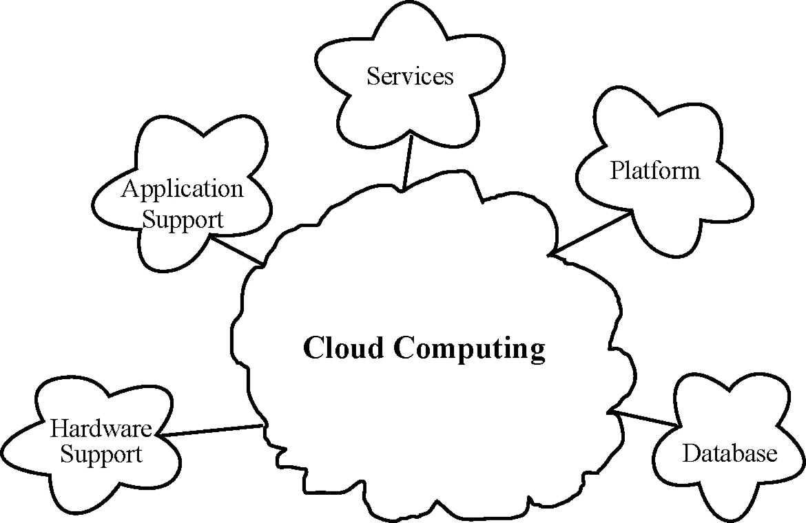

图 7.1 云计算。

#### 7.1.1 云计算的优点

1. **可扩展性：**云服务可快速调整计算资源的规模，以满足用户的各种需求。

2. **经济实惠：**云服务成本较低，因为硬件升级和维护责任由服务提供商处理。

3. **安全：**服务提供商提供各种安全的云服务，以确保我们在第三方环境中的数据安全，并维护严格的安全协议。

### 7.2 各种云计算模型

云计算支持的三种模型是：

* SaaS（软件即服务）；

* IaaS（基础设施即服务）；以及

* PaaS（平台即服务）。

每种云模型都有其自身的优势，以满足各种企业的需求。我们需要根据具体需求了解要求和优势（图 7.2）。

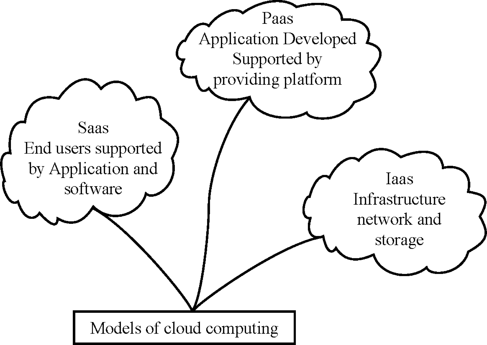

图 7.2 云服务模型。

1. **软件即服务（SaaS）：**它是一种提供快速访问各种基于云的 Web 应用程序的模型。服务提供商控制整个计算堆栈，可以通过任何 Web 浏览器轻松访问。运行在云上的各种应用程序可以按需付费使用，而一些应用程序也可免费访问，但功能有限。

在您组织现有的计算基础设施中，SaaS 不需要任何类型的安装或下载，因为应用程序维护和安装均由服务提供商处理。SaaS 的一些著名示例包括 Google G Suite 和 Dropbox（图 7.3）。

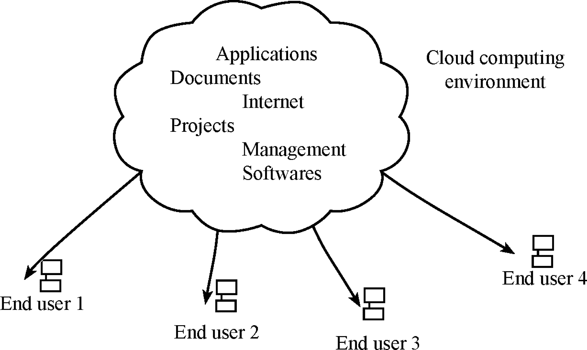

图 7.3 软件即服务（SaaS）。

2. **平台即服务（PaaS）：**它为我们提供了一个平台，用于根据业务需求开发、测试和组织不同的应用程序。实施 PaaS 通过提供虚拟运行时环境，改变了企业软件开发的流程，使我们能够以灵活且方便的方式开发和测试应用程序。服务提供商还提供灵活的定价标准，允许我们根据需求选择服务器、存储和网络等资源。这些资源可以由公司本身或服务平台提供商管理。一些重要且著名的示例包括 Google App Engine 和 AWS Elastic Beanstalk（图 7.4）。

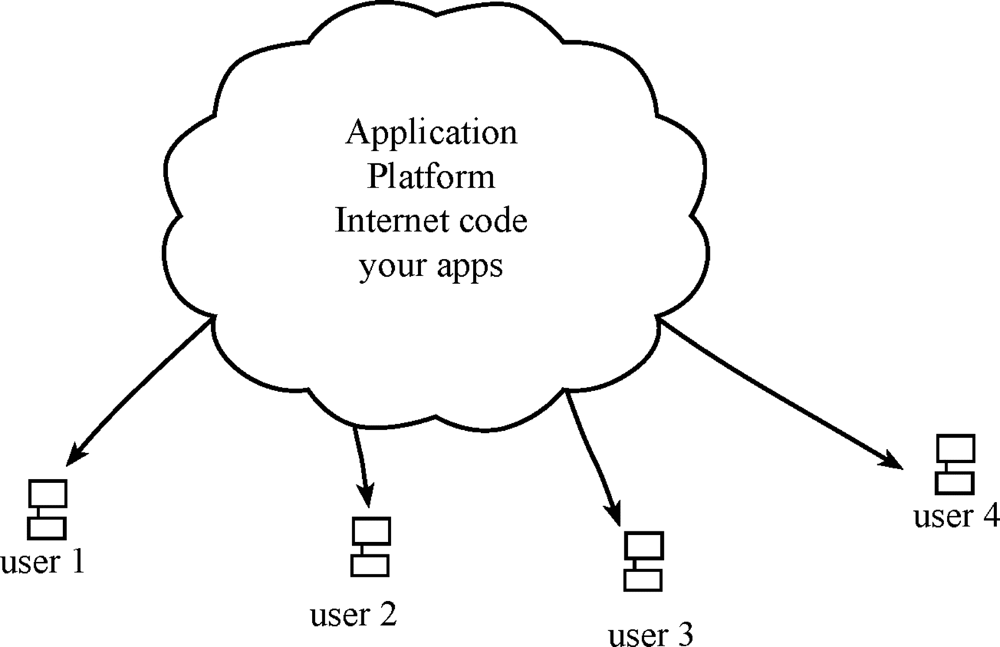

图 7.4 平台即服务（PaaS）。

3. **基础设施即服务（IaaS）：**服务提供商向我们提供云上各种计算资源的虚拟化。这些服务称为 IaaS。IaaS 云服务提供商向我们提供一整套计算基础设施，例如存储、服务器和网络硬件，以及维护和支持。企业可以在所需场所使用计算资源，而无需安装硬件。一些重要且著名的示例包括 Amazon Web Services 和 Microsoft Azure（图 7.5）。

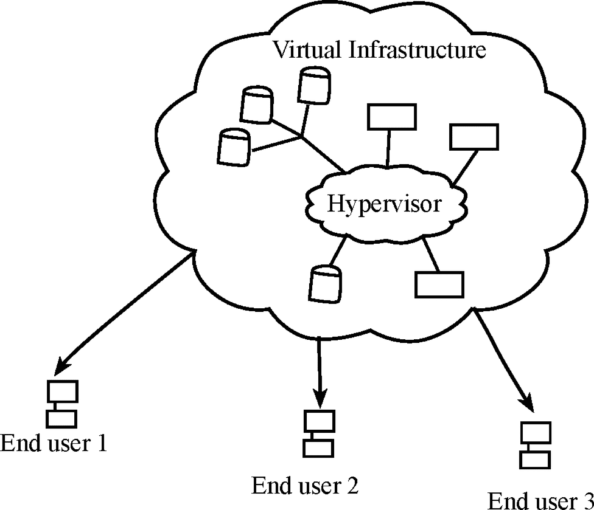

图 7.5 基础设施即服务（IaaS）。

#### 7.2.1 SaaS 的优点

1. **投资较少：**SaaS 降低了购买基础设施、安装费用、计算硬件维护和升级成本等费用。

2. **可访问性：**SaaS 为我们提供了一个环境，允许我们使用任何设备（例如智能手机）从任何位置访问服务。这有助于消除与本地软件相关的限制。

3. **现成环境：**我们可以轻松快速地使用 SaaS 服务，这意味着它们在极短的时间内即可投入使用。您只需注册即可使用服务，并访问环境提供的快速且强大的计算资源。

SaaS 提供基于通信、内容分发和简化会议安排的服务。它最适合没有额外预算和资源投资于本地硬件的小型企业和行业。

#### 7.2.2 IaaS 的优点

1. **降低成本：**这种云模型消除了对本地硬件的需求，从而降低了与硬件基础设施相关的成本。

2. **可扩展性增强：**它是最灵活的云计算模型，允许我们根据需求调整计算资源的规模。

3. **结构简单：**该模型可轻松部署服务器、处理、存储和网络等服务，以确保其随时可用。

IaaS 是最灵活的云模型，在 IT 硬件基础设施方面为我们提供了最佳选择。但是，它比 SaaS 或 PaaS 云模型更昂贵。

#### 7.2.3 PaaS 的优点

1. **缩短开发时间：**这种云模型可以缩短开发时间，因为它提供了各种计算资源，例如服务器端组件，从而简化了流程。这使开发团队可以专注于开发部分。

2. **支持多种编程语言：**它提供了一个支持多种编程语言的平台，这对于软件开发公司很有用，可以轻松利用该环境为各种项目构建应用程序。

3. **支持团队协作：**无论项目团队成员身在何处，这种云模型都可以通过共同平台增强团队成员之间的协作。在有多个开发人员和多个服务提供商的情况下，这种云模型工作高效。它通过提供一种应用程序开发流程来支持创建定制应用程序，该流程可最大限度地降低总组织成本。PaaS 的一个重要缺点是它基于虚拟化技术，因此我们对数据处理的控制较少，且比 IaaS 云模型不够灵活。

### 7.3 云计算架构

云计算架构由许多松散耦合的云组件组成，包含三个部分（图 7.6）：

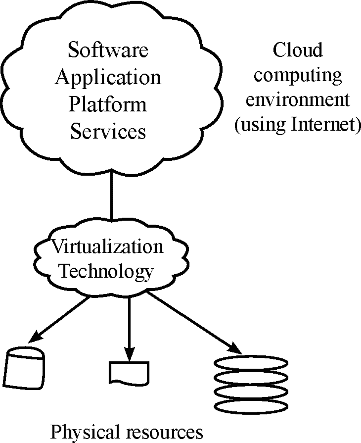

图 7.6 云计算架构。

* 前端；

* 后端；以及

* 虚拟化。

互联网在连接云计算组件方面发挥着重要作用。以下是云计算架构的图形视图：

1. **前端：**它提供访问云计算平台所需的界面和应用程序。

2. **后端：**它包含提供云计算服务所需的所有资源，例如大型数据存储、虚拟机、应用程序、服务、服务器等。

3. **虚拟化：**云计算背后的重要原理是虚拟化。虚拟机监控程序是一种低级程序，充当虚拟机管理器，允许各种用户共享单个物理云资源实例。

4. **管理软件：**用于在云计算环境中维护和配置基础设施。

5. **部署软件：**用于在云上分发和集成各种应用程序。


### 7.4 物联网 (IoT)

物联网 (IoT) 是一种无需直接的人与人或人与计算机交互即可运行的系统。相反，它依赖于分配给机械和数字机器的唯一标识符，使它们能够通过网络进行交互和传输数据。

IoT 的发展得益于多种技术、实时分析、机器学习 (ML)、商品传感器和嵌入式系统的融合。IoT 基础设施包括嵌入式系统、无线传感器网络、控制系统、自动化以及实现 IoT 所需的其他基本要求。IoT 技术支持各种应用，例如智能家居照明设备和家庭安防系统。然而，尽管具有诸多优势，但仍存在一些需要进一步探索的关注领域，例如隐私和安全 (Figure 7.7)。

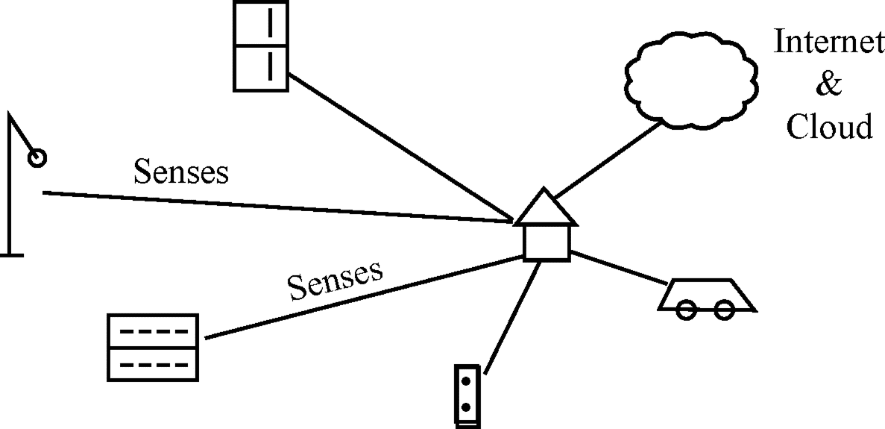

Figure 7.7 Internet of things.

支持 IoT 基础设施的重要支柱包括平台、接入技术、数据存储和处理、数据分析以及安全。IoT 与云计算之间的差异列于 Table 7.1。

Table 7.1 The Differences between IoT and Cloud Computing

| Parameter || Internet of Things || Cloud Computing |

| --- | --- | --- |

| Big data || It is a source for big data. || Means to manage big data over internet. |

| --- | --- | --- |

| Reachability || Have limitation || Far spread, wide |

| Storage || Very less || Very large storage space. |

| Virtualization technology || Not supported || Based on the concept of virtualization. |

| Computing capabilities || Very limited || Unlimited |

| Components || Support and works on hardware components. || Support virtual machines. |

#### 7.4.1 各种 IoT 应用

1. **Smart Home:** IoT 支持智能家居等应用，包括在您外出时关闭灯光并为朋友和亲戚打开家门的功能。这有助于通过节省时间、能源和金钱来简化并方便我们的生活。

各种智能家居公司，如 Nest、Ecobee、Ring 和 August，可帮助您将计划变为现实。

2. **Wearables:** 这些设备在市场上需求爆炸，谷歌和三星等公司提供这些设备，这些设备配备了传感器和软件，用于收集用户数据和信息。然后对这些数据进行预处理，以筛选出必要的用户数据。

3. **Cars Connected Solution:** 汽车数字技术也致力于借助 IoT 优化车辆的内部功能。联网汽车是一种旨在通过利用各种传感器和互联网连接为乘客提供舒适体验的车辆。

该领域的主要品牌，如特斯拉、宝马、苹果和谷歌，正致力于在汽车行业开启下一场革命。

4. **Internet for Industry:** IoT 用于通过传感器、软件和大数据分析赋能工业工程，支持智能机器的发展。这些机器以其在处理数据方面的准确性和一致性而闻名，这有助于企业消除低效率，实现更好的质量控制和可持续性。有各种应用可用于跟踪货物、在供应商和零售商之间共享实时库存信息，并支持自动化交付。

5. **Smart Cities:** 这是 IoT 支持的另一项强大应用。各种智能城市应用包括监控、交通自动化、能源管理系统、水资源分配、污染监测、交通拥堵、停车管理、安全、气候和环境监测等。

6. **Smart Technology in Agriculture:** 智能农业和农耕是增长最快的领域之一，需要新的发明。IoT 通过帮助农民感知土壤湿度、土壤养分、控制植物生长的水位以及定制肥料等，彻底改变了农业。

7. **Smart Retailing:** 我们也可以在零售领域利用 IoT 的潜力，因为它为零售商提供了与客户联系并提升店内体验的机会。零售商可以利用智能手机与客户互动。

8. **Healthcare Sector:** IoT 拥有巨大的潜力来连接医疗系统和智能医疗设备，使人们能够过上更健康的生活。收集的数据还将有助于对个人健康进行个性化分析。

#### 7.4.2 云计算在 IoT 革命中的作用

IoT 拥有巨大的潜力，可以与云计算协同工作以转变日常任务。IoT 包括各种对象，如物理设备、车辆和建筑物，所有这些都配备了嵌入式电子设备、软件、传感器和网络连接。这使得对象能够收集、发送和接收数据。

云计算是一种计算机网络模型，允许用户从集中式、有组织的计算资源中访问数据和程序，该资源可以根据需求进行扩展。云部署主要有三种类型：公有云、私有云和混合云：

1. **Private Cloud Services:** 这是一种安全的云计算模型，专为特定组织提供服务。

2. **The Public Cloud Service:** 这是一个允许与其他组织共享数据的云网络。它还允许通过互联网在公共网络上传输数据。该网络允许第三方提供商通过互联网提供云服务，通常根据用户要求收费。

3. **Hybrid Cloud:** 这是一种结合本地、私有云和第三方公有云服务的云计算环境。

任何对象，无论是人造的还是自然的，只要可以分配 IP 地址并具有通过网络传输数据的能力，都属于 IoT 的应用范畴。云计算和 IoT 都有潜力提高日常任务的效率，并且相互补充。IoT 产生大量数据，而云计算为数据传输提供了途径。云用户可以访问数据，使开发人员能够更好地协作，他们可以立即共享和使用云环境中远程可用的数据。云计算对 IoT 很重要，原因如下：

1. **Cloud Computing Act as a Catalyst:** 在云计算环境中使用 IoT 已成为各种 IoT 应用程序开发和部署的催化剂。云计算和 IoT 的协作是两种未来的互联网技术，为成功提供了平台。

2. **Cloud Computing Space:** 带有公有云服务的 IoT 在 IoT 领域非常有用，因为它为基础设施提供了轻松的第三方访问。当今 IoT 设备的需求是存储用户数据，这可以由 StoneFly 和 Microsoft Azure 等云提供商提供。

3. **Cloud Computing in Performance:** IoT 设备产生的大量数据需要强大的性能来相互交互和轻松连接。因此，通过云共享信息为设备之间共享信息提供了必要的连接，从而最终提高整体性能。

4. **Pay-as-per-Demand:** 云计算为我们提供了根据使用情况增加或减少需求的便利，我们只需为所使用的内容付费。IoT 以 SMS 或移动通知的各种格式提供数据，使云计算环境成为 IoT 应用所必需的。


## 5. 增加数据可用性

云技术赋能物联网（IoT），使其适用于空调、冰箱等常规家电。云端提供海量存储和数据可用性，且云与物联网的结合使用也在不断增加。

## 6. 提供安全性和隐私保护

没有安全性，物联网（IoT）便不完整，但云与物联网的协作使物联网通过预防、调查和预防措施变得更加安全。它能够通过身份验证和加密协议为用户提供强大的安全措施。

#### 7.4.3 云与物联网协同工作的挑战

### 数据处理

处理因物联网与云融合而不断演变的大量数据，是管理大数据的一项重大挑战。

### 网络与通信中使用的协议

在云与物联网协同工作的基础设施中，大量机器对机器通信涉及各种类型的设备和各种协议。因此，管理多种协议并非易事。

### 传感器网络管理

处理和管理大量传感器数据及网络并非易事，因为这会显著增加云计算在数据处理方面的负担。此外，云计算在云环境中聚合传感器数据时引入了新的挑战，这可能导致安全和隐私问题。

### 安全性和隐私问题

物联网设备使我们能够自动化任务，但与之相关的各种安全和隐私问题依然存在。虽然云端提供强大的加密和身份验证协议，使其成为用户的安全平台，但关于身份隐藏和数据滥用的担忧依然存在。云端数据的可用性使这一问题变得尤为重要。因此，从安全性角度来看，物联网应用与云平台的融合是一个研究课题。

#### 7.4.4 人工智能（AI）的作用

人工智能用于解决和执行复杂且关键的认知任务。它使得在技术革命之前甚至不可能实现的事情成为可能。通过使用前向链和后向链等推理规则，它试图得出结论，并以结构化的方法模拟人脑。人工智能适用于处理来自各种来源的大量数据，例如在线应用程序、传感器以及社交媒体中的结构化和非结构化数据。机器学习（ML）与物联网和云计算相结合，用于在各种决策场景中分析模式并检索可靠且相关的数据。云在增强融合人工智能的应用程序能力方面发挥着重要作用。人工智能（AI）包括机器学习、语音识别以及云服务提供商用于提供智能且支持人工智能的 API 类应用程序的其他技术。物联网将云环境中可用的人工智能设备连接起来，以便更好地控制家庭和商业电器。

### 7.5 结论

物联网（IoT）通过为各种问题提供多种解决方案，正在改变世界。当与云计算应用程序结合时，它的工作效率更高。物联网监控数据流并集成控制，例如交通拥堵避免技术，从而实现动态且高效管理的交通网络。物联网与云计算应用程序还参与实施物联网医疗监测等服务，在医院信息系统中利用云计算方法 \[1, 2, 3, 4, 5, 6, 7, 8, 9, 10, 11, 12, 13, 14, 15, 16, 17 和 18\]。

将云与物联网集成的主要挑战之一是设备、操作系统、平台和可用服务的广泛异质性。云-物联网允许设计新型应用程序，其中物联网作为大数据的主要来源，云帮助长期存储数据并实现复杂分析。

目前，人工智能（AI）主要由信息技术主导，因为它为用户提供了更好的服务。为应对当前和未来的挑战，云、物联网和软件定义网络（SDN）等关键技术正在成为未来应用。将人工智能与这些创新技术相结合带来了各种好处并提高了效率水平。这有助于使系统更加可靠，并改善来自异构设备的数据性能，这些数据被操作、存储、管理和分析。人工智能与物联网和云技术的整体性能具有挑战性，但在技术导向的结果中发挥着重要且突出的作用。

### 关键词

### 参考文献

1. Li, J. H., Zhao, S., & Wang, Y. R., (2014). Using cloud computing and the internet of things to construct vehicle condition fault diagnosis platform. Applied Mechanics and Materials, *574*.

2. Mao, Y., (2014). Applied Mathematics and Algorithms for Cloud Computing and IoT.

3. Wang, Y., & Wang, X., (2014). The novel analysis model of cloud computing based on RFID internet of things. Journal of Chemical and Pharmaceutical Research, *6*(6).

4. Talia, D., (2014). Towards internet intelligent services based on cloud computing and multi-agents. Advances onto the Internet of Things. Springer International Publishing.

5. Bonomi, F., (2014). Fog computing: A platform for internet of things and analytics. Big Data and Internet of Things: A Roadmap for Smart Environments. Springer International Publishing.

6. Soldatos, J., (2014). Design principles for utility–driven services and cloud–based computing modelling for the internet of things. International Journal of Web and Grid Services, *10*(2).

7. Xie, F., & Liang, C. Z., (2014). Research of internet of things based on cloud computing. Applied Mechanics and Materials, *443*.

8. Fang, S., (2014). An integrated system for regional environmental monitoring and management based on internet of Things. IEEE Trans. Industrial Informatics, *10*(2).

9. Ding, H. J., (2014). Traffic flow data collection and signal control system based on internet of things and cloud computing. Advanced Materials Research, *846*.

10. Biswas, A. R., & Giaffreda, R., (2014). IoT and cloud convergence: Opportunities and challenges. Internet of Things (WF-IoT), IEEE World Forum on IEEE.

11. Antoine de Saint-Exupery (2009). European Research Projects on the Internet of Things (CERP-IoT) Strategic Research Agenda (SRA). Internet of Things – Strategic Research Roadmap. Google Scholar.

12. Armbrust, M., Fox, A., Griffith, R., Joseph, A. D., Katz, R., Konwinski, A., Lee, G., et al., (2010). A view of cloud computing. Communications of the ACM 53(4), 50–58. \[CrossRef\]. Google Scholar.

13. Ali Sunyaev. (2005). International Telecommunication Union (ITU), internet reports. The Internet of Things. Google Scholar.

14. Hancke, G. P., Markantonakis, K., & Mayes, K. E., (2010). Security challenges for user-oriented RFID applications within the internet of things. Journal of Internet Technology, *11*(3), 307–313. Google Scholar.


15. Presser, M., Barnaghi, P. M., Eurich, M., & Villalonga, C., (2009). SENSEI 项目：将物理世界与未来网络的数字世界相集成。IEEE Communications Magazine, *47*(4), 1. \[CrossRef\] \[Google Scholar\].

16. Broll, G., Rukzio, E., Paolucci, M., Wagner, M., Schmidt, A., & Hussmann, H., (2009). 物联网中的普适服务交互。IEEE Internet Computing, *13*(6), 74–81. \[CrossRef\] \[Google Scholar\].

17. Hong, S., Kim, D., Ha, M., Bae, S., Park, S. J., Jung, W., & Kim, J., (2010). SNAIL：一种基于 IP 的无线传感器网络物联网方法。IEEE Wireless Communications, *17*(6). \[CrossRef\] \[Google Scholar\].

18. Atzori, L., Iera, A., & Morabito, G., (2010). 物联网：一项调查。Computer Networks, *54*, 2787–2805. \[CrossRef\] \[zbMATH Google Scholar\].

## 第 8 章 基于区块链的司法证据真实性保护模型

SUMIT KUMAR RANA^(⁷)

### 摘要

在这个数字化时代，每个领域都受到技术进步的影响。司法系统是一个需要改进其存储和保护证据流程的领域，以便以高效的方式进行。由于证据可能被连接到特定调查的多方访问，必须保持证据的原始性。为了保存证据的原始性，从证据收集到提交法院的整个过程必须记录在防篡改的数字账本中。去中心化访问控制机制与存储证据整个生命周期的不可变账本相结合，可以成为解决方案。在这种情况下，区块链技术可以非常有效，因为它具有维护证据真实性所需的功能。在本章中，提出了一种基于区块链技术的新方法，以避免篡改并保持证据的真实性和完整性。

### 8.1 简介

任何民主制度的主要支柱之一是其司法系统。它负责在法律案件或争议中适用和捍卫法律。如果司法系统运作正常，它可以帮助解决系统中的多个问题。然而，司法系统面临着各种挑战，例如判决延迟、语言障碍和逮捕令签发等。所有这些问题背后的一个共同问题是证据完整性和安全性的保存。证据是公正判决的基础。当案件提交法院时，为该特定案件收集的证据在最终裁决中起着至关重要的作用 \[1\]。证据收集和管理的过程被称为保管链，如 图 8.1 所示。它涉及多个步骤，从证据收集到在审判期间提交法院。该链按时间顺序记录调查的每个阶段，包括证据收集、分析以及谁在何时访问了它的详细信息。这些文件在陪审团面前的法庭听证会上提出，控方律师旨在确立证据与嫌疑人的相关性。


图 8.1 传统的证据收集和管理流程。

另一方面，辩护律师寻找保管链流程中的漏洞，以便他们可以证明证据没有被妥善处理，或者伪造的证据被制作出来使嫌疑人看起来有罪 \[2\]。为了使证据在法庭上具有法律可采性，必须证明其真实性且为原始形式。因此，该过程必须具有以下特征以确保其法律可接受性：

1. **完整性：** 这意味着保护证据免受未经授权实体的篡改。

2. **来源：** 这意味着记录对证据的访问历史，例如谁在何时访问了证据。

3. **身份验证：** 必须有一种方法来验证参与案件和证据调查的各方。

4. **可验证性：** 该过程必须随时可验证。

法官或陪审团无法自行进行调查过程，因此他们必须根据提交法院的证据做出决定 \[3\]。然而，如果这些证据被操纵或篡改，他们的决定将挑战民主制度中最受信任组成部分的完整性。

#### 8.1.1 传统司法方法的问题

在传统方法中，手动填写表格以记录从收集到提交法院期间发生的所有活动以及相应的证据。随着证据在调查过程中推进，可以记录以下信息：

* 证据的产生日期和地点；

* 证据的物理描述；

* 谁在何时、处理了多长时间以及处理了证据的所有详细信息；

* 参与调查的每个人的唯一身份标识；

* 证据从一个人转移到另一个人的过程。

下面讨论了可能导致重要证据可能无法在法庭上采纳并使其法律上毫无价值的几个问题。

在当前的司法系统中，原告可以通过律师提交投诉。对于普通人来说，由于缺乏对法律程序的充分了解，法律过程最终变得昂贵。因此，他们必须完全依赖律师 \[4\]。这种盲目信任可能导致各种后果，例如被欺骗或面临不当开支。

1. **问责制：** 没有法院官员对法庭程序的延误承担责任，通常以工作量大为由为自己辩解。然而，最终承担后果的是普通人 \[5\]。

2. **来源：** 证据很容易被操纵。在当前系统中，我们无法将证据追溯到其原始形式 \[6\]。

3. **透明度：** 当前系统在法律文件和证据方面缺乏透明度，允许法院官员在其他利益相关者不知情的情况下滥用信息。

4. **数据集成：** 司法系统维护各自辖区的记录。因此，当案件涉及多个辖区时，集成记录变得困难。

5. **可扩展性：** 如果案件跨越多个州或国家，可扩展性将是管理法律过程的问题。我们需要一种可以解决上述问题并支持证据管理和提交过程的技术。区块链是可以帮助实现这一目标的技术。

## 8.2 区块链技术的作用

区块链是一系列通过哈希技术连接在一起的块，如 图 8.2 所示。区块链技术支持分布式账本，以其不可变、防篡改和去中心化的特性而闻名。

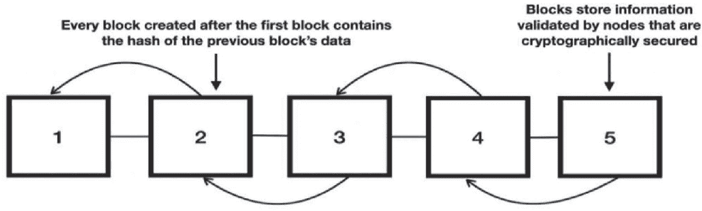

图 8.2 区块链概念示意图。

作者调查了共享医疗记录的传统方案，并识别出信任、数据集中化和隐私等多个问题。因此，作者专注于一种用于医疗数据共享的区块链支持方法。分析了公有链和私有链，并讨论了基于区块链的医疗数据共享的潜在研究课题 \[7\]。


## 区块链技术基础概念

任何区块链支持的应用程序的基础概念包括交易、点对点网络、共识算法、去中心化账本和智能合约。交易是指点对点网络中节点之间的任何类型的交互，包括加密货币转账、文件所有权转移、数据存储和数据访问。点对点网络由具有相同功能或资源的节点组成，没有客户端或服务器的区别。共识算法是点对点网络中的节点用于批准或拒绝交易决策的技术。去中心化账本存储网络中所有已执行的交易，并由点对点网络中的所有节点共享 \[8\]。智能合约是设计用于支持通信方之间协议的计算机程序，由系统中的特定事件触发。

区块链技术在保险、数字资产管理等多个领域有着广泛的应用。该技术增长最显著的例子之一是其对司法系统的影响。也许是因为这种分布式账本技术可以以数字形式存储文档并保护其完整性。这基于点对点网络，因此各方可以共享或交换数据。所有数据均经过加密保护。对数据的每次访问都会记录在账本上，从而实现完全透明。对数据完整性的任何攻击都可以被追踪和验证。提出了一种模型，将区块链技术与后端数据存储相结合。该数据存储将用于存储数字证据，所有证据访问交易都可以存储在区块链上。

### 8.3 相关研究

作者们探讨了视频证据在调查中的重要性。然而，篡改视频证据是一个严重的问题。为了解决这个问题，作者们提出了一种基于区块链的完整性验证模型。在这个模型中，使用基于哈希的方法生成视频完整性代码。如果任何视频片段被篡改，该完整性代码将发生变化，从而通过比较两个视频完整性代码来轻松检测篡改。比较分析表明，所提出的模型在视频证据安全性方面表现更好 \[9\].

此外，作者们提出了一种从云环境中积累调查证据的模型。该模型利用 SDN 和分布式账本技术来保存证据。此外，引入了一种新算法来为收集的数据提供安全性。完整系统已使用 Java 语言和 NS3 进行模拟。所提出模型的评估分析表明，与集中式系统相比，其效率更高 \[10\].

研究人员开发了一种用于 IoT 取证的方法，以维护个人共享数据的隐私。PRoFIT 方法论与所讨论的方法结合使用。研究了从 IoT 环境中积累数字证据的模型。该方法通过在具有不同隐私需求的不同场景中应用来进行评估。评估表明，所提出的模型能够在保密性与基于物联网（IoT）的调查原则之间取得平衡 \[11\].

作者们解决了保险领域客户面临的歧视和正义问题。他们开发了一种方案，为存储的保险记录和文档提供安全性和不可篡改性。该方案采用了区块链技术与星际文件系统（IPFS）相结合。这种组合提供了安全性和不可篡改性，同时也避免了否认问题。未来，研究人员也有兴趣在该方案的实现中使用智能合约 \[12\].

研究人员调查了 IoT 环境中各种取证证据、信息格式及其他复杂性。他们的主要兴趣是积累连接到 IoT 网络的各种设备上的信息和对象。在收集对象和信息后，研究人员检查证据之间的关系，然后将其记录在基于区块链的取证模型中 \[13\].

作者们研究了在集中式网络中存储或交换患者医疗信息时面临的问题。他们发现了各种问题，例如机密性、未经授权的访问和缺乏历史数据。作者们提出了一种结合区块链技术与密码学的模型，以解决集中式网络的上述问题。所有信息在相关方同意后上传，数据可以根据相关方的共识进行访问 \[14\].

研究人员探讨了数字证据收集过程中不同利益相关者的要求。他们还分析了系统必须有一种方法来确保证据在法庭上的可采纳性。因此，他们开发了一个由区块链和智能合约支持的系统，可以与利益相关者收集、存储和共享证据。本章还讨论了所提系统的实用性 \[15\].

作者们探讨了区块链技术在司法领域的应用。区块链的属性，如来源、透明度和去中心化，可以帮助维护证据收集和共享过程的完整性和信任。作者们提出了一种用于电子证据生成的基于区块链的系统。借助该系统，司法实体可以验证法庭审判中提出的任何证据的有效性。对系统的分析表明，所提系统为应用领域提供了来源、信任和效率 \[16\].

研究人员证明，仅通过哈希数据无法保护我们的数据，因为它不提供关于哈希计算时间的任何信息。因此，需要一种方法来对哈希过程进行时间戳标记。研究人员提出了一种基于区块链的解决方案。在所提方法中，使用了公共区块链来防止数据篡改并提高数据透明度。司法过程的不同利益相关者可以随时追踪和分析证据。该模型可以作为同一领域新研究人员的基础 \[17\].

作者们探讨了区块链技术在医学研究社区中的应用。他们提出了一种用于存储和查询药理基因组学数据的模型，该模型使用基于以太坊区块链和 Solidity 智能合约进行了演示。对算法的分析表明，所提模型速度快，并在 10,000 个查询的查询池中减少了查询时间。该算法在开发时考虑了 Solidity 的约束，例如变量数量和 Gas 要求。该模型中使用的算法在医学领域取得了成功。作为未来工作，作者们希望将同一模型实现到其他领域 \[18\].


作者展示了在数字取证中司法证据维护可能存在的安全和隐私相关问题。他们提出了一种名为 `LEChain` 的基于区块链和智能合约的模型。该模型包含了证据采集和报告的完整流程。该模型使用 `ABE` 方案来确保对证据的细粒度访问控制。所提出的模型还保护了调查过程中目击者的隐私。由于证据数据上传到区块链上，恶意实体无法对其进行修改。该模型使用以太坊测试网络实现 \[19\]。

### 8.4 提出的模型

在所提出的模型中，采用分布式账本技术，利用以太坊区块链和 IPFS 为证据提供安全保障。让我们讨论一下该模型的各种概念以及所提出模型的工作流程。

#### 8.4.1 系统模型

所提出模型的关键组件包括司法证据、公共区块链平台以太坊、用于后端数据存储的 IPFS 以及系统的各种用户。上述组件以这种方式连接，以便根据需要在它们之间交换信息。让我们讨论这些组件：

1. **司法证据：** 它是用于任何法庭案件公正判决的证明文件。它是所提出模型中最重要的组件。各种实体在法庭案件处理过程中会访问证据。主要目标是确保这些证据的安全性和完整性，因为被篡改或操纵的证据可能导致错误的判决 \[20\]。此类错误决定可能会削弱人们对司法系统的信任。因此，使用以太坊区块链平台构建了一个去中心化和透明的系统。

2. **以太坊区块链：** 构建可信和透明的系统需要权力的去中心化。这种去中心化可以借助名为以太坊的公共区块链平台实现。以太坊具有一个分布式账本，该账本在对等网络的所有利益相关者之间共享。所有交易，例如上传、删除或访问，都存储在这个账本中。账本是不可更改的，这意味着一旦某内容写入其中，就无法更改或删除 \[21\]。但是，由于区块链的块大小较小，证据无法存储在其上。因此，使用 IPFS 来满足我们的链下存储需求。

3. **IPFS：** 由于我们的目标是构建一个去中心化的系统，我们还需要一个非集中式的存储机制。可以使用 IPFS 来满足这一需求。IPFS 通过利用位于不同地理位置的节点以分布式方式存储数据。当数据存储在此存储系统上时，会返回一个唯一的哈希值，称为文档的内容地址（`CID`）。这个 `CID` 可以在将来用于检索文件。如果上传相同数据的文件，将返回相同的 `CID`，从而避免数据重复。在所提出的模型中，司法证据将存储在 IPFS 上 \[22\]。

4. **系统用户：** 该拟议系统的用户将包括警察局官员、起诉律师、辩护律师等。每个用户都将获得一对密钥，可用于访问特定案件相关的证据。这些密钥将对用户进行身份验证并防止否认。

#### 8.4.2 工作流程

该模型的工作流程可以根据通信分为两个阶段。阶段 I 描述了证据上传者（`UE`）与系统之间的通信，如 图 8.3 所示。阶段 II 描述了访问请求者（`RA`）与系统之间的通信，如 图 8.4 所示。在这些阶段之前，做出了一些假设：每个用户都是注册用户，未注册无法访问系统。

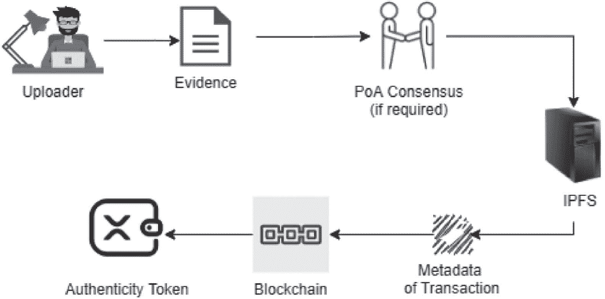

图 8.3 工作流程阶段 I。

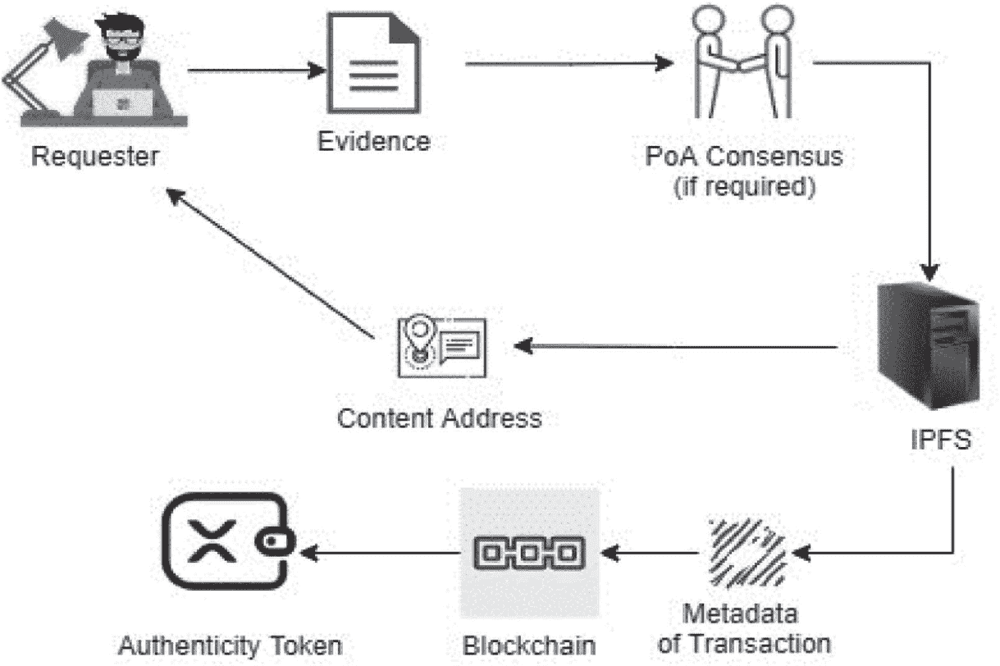

图 8.4 工作流程阶段 II。

* **阶段 I：** `UE` 是警察局的一名官员，他将把证据文档（`DE`）上传到 IPFS。首先，`UE` 将把数字签名（`SignD`）附加到 `DE`，并将此组合提交给系统以便上传到 IPFS。在上传到 IPFS 之前，系统将重新计算 `SignD` 并将其与接收到的 `SignD` 进行比较，以验证文档是否完整并避免否认。如果两个 `SignD` 值相同，`DE` 将以加密形式上传到 IPFS。您将收到一个称为内容地址（`AC`）的哈希值。这个 `AC` 用于检索存储在 IPFS 上的证据的实际内容。此上传交易的元数据（`TiM`）存储在区块链上。`UE` 将收到一个区块号（`Bi`），其中交易 `Ti` 的元数据存储在区块链上。

* **阶段 II：** 当任何注册用户 `Ri` 想要访问证据 `DE` 时，此阶段开始。`Ri` 将使用提供的凭据登录系统。然后，`Ri` 将能够看到与其案件相关的证据列表。如果 `Ri` 点击任何证据以查看它，将向相关案件的其他相关方发送请求。这些相关方将使用权威证明（`PoA`）批准或拒绝该请求。批准后，`Ri` 将收到该证据的访问代码（`AC`）。通过使用此 `AC`，`Ri` 可以访问该特定的 `DE`。此访问交易的元数据存储在区块链上。

### 8.5 提出模型的优势

所提出的模型在法律过程中采用区块链技术，提供了各种优势，如下所述：

1. **无需可信第三方的证据共享：** 使用所提出的模型，所有证据都可以轻松共享给案件中涉及的所有实体，而无需任何第三方来验证交易。因此，可以避免任何信任问题或失败 \[23\]。

2. **保留证据完整性：** 区块链技术具有不可更改性的特点。由于这一特性，如果任何交易写入账本，就无法删除或更改。因此，一旦与证据相关的信息存储在此，就没有人可以操纵这些信息。这就是如何保留证据的完整性 \[24\]。这在当今数字世界中非常重要，因为由于流传的假照片或视频，数字媒体的可靠性岌岌可危。

3. **数字证据存储：** 长期维护纸质文件非常困难。例如，纸质文件会随着时间的推移而磨损，图像会褪色。因此，最好将这些文件以数字形式存储。这可以借助所提出的模型轻松实现 \[25, 26\]。

4. **证据追踪：** 所有证据都已上传到 IPFS，其元数据存储在以太坊区块链上。以太坊区块链将跟踪所有访问交易，包括谁在何时访问了它，从其来源时间到当前时间点 \[27\]。

5. **通过提高透明度减少欺诈：** 对任何证据的访问只有在涉及各方达成共识后才会被允许，访问交易将更新到所有各方的账本中。因此，这种透明度将降低证据被欺诈或操纵的可能性 \[28\]。


## 6. 多国调查

在某些情况下，可能需要多个国家合作开展任何案件的调查。在这些情况下，共享和维护证据可能会产生问题。通过所提模型，证据共享可以在跨境调查中轻松进行 \[29\]。

### 8.6 结论

民主制度依赖于其司法制度。如果司法制度失败，则是民主制度的失败。当前的司法制度正被律师和其他官员利用。它存在各种问题，可能导致不公正或司法延迟。它缺乏透明度和问责制。区块链技术提供了各种功能，可以帮助解决传统司法制度的问题。区块链利用分布式账本，该账本在所有利益相关者之间共享，确保完全透明。采用密码学技术来确保信息的安全性和隐私性。不可更改性是一项关键特性，使其适用于司法领域，因为记录在账本中的任何交易都无法更改、删除或否认。将区块链技术与司法制度相结合将增强安全性和可追溯性。这将显著提高对司法制度的信任，因为没有人能够滥用系统谋取私利。借助所提区块链解决方案，可以实现恢复普通民众对司法制度信任的最终目标。

### 关键词

### 参考文献

1. Nieto, A., Roman, R., & Lopez, J., (2016). Digital witness: Safeguarding digital evidence by using secure architectures in personal devices. IEEE Netw., *30*(6), 34-41.

2. Cebe, M., Erdin, E., Akkaya, K., Aksu, H., & Uluagac, S., (2018). Block4forensic: An Integrated Lightweight Blockchain Framework for Forensics Applications of Connected Vehicles (pp. 50-57). arXiv.

3. Tian, Z., Li, M., Qiu, M., Sun, Y., & Su, S., (2019). Block-DEF: A secure digital evidence framework using blockchain. Inf. Sci. (Ny)., *491*, 151-165.

4. Lin, X., Chen, T., Zhu, T., Yang, K., & Wei, F., (2018). Automated forensic analysis of mobile applications on Android devices. Proc. Digit. Forensic Res. Conf. DFRWS 2018 USA, *26*, S59-S66.

5. Shafarenko, A., (2020). A PLS Blockchain for IoT Applications: Protocols and Architecture. arXiv.

6. Guo, R., Shi, H., Zhao, Q., & Zheng, D., (2018). Secure attribute-based signature scheme with multiple authorities for blockchain in electronic health records systems. IEEE Access, *6*, 11676-11686.

7. Jin, H., Luo, Y., Li, P., & Mathew, J., (2019). A review of secure and privacypreserving medical data sharing. IEEE Access, *7*, 61656-61669.

8. Pourvahab, M., & Ekbatanifard, G., (2019). An efficient forensics architecture in software-defined networking-IoT using blockchain technology. IEEE Access, *7*, 99573-99588.

9. Ghimire, S., Choi, J. Y., & Lee, B., (2020). Using blockchain for improved video integrity verification. IEEE Trans. Multimed., *22*(1), 108-121.

10. Pourvahab, M., & Ekbatanifard, G., (2019). Digital forensics architecture for evidence collection and provenance preservation in IAAS cloud environment using SDN and blockchain technology. IEEE Access, *7*, 153349-153364.

11. Nieto, A., Rios, R., & Lopez, J., (2018). IoT-forensics meets privacy: Towards cooperative digital investigations. Sensors (Switzerland), *18*(2).

12. Sun, J., Yao, X., Wang, S., & Wu, Y., (2020). Non-repudiation storage and access control scheme of insurance data based on blockchain in IPFS. IEEE Access, *8*, 155145-155155.

13. Li, S., Qin, T., & Min, G., (2019). Blockchain-based digital forensics investigation framework in the internet of things and social systems. IEEE Trans. Comput. Soc. Syst., *6*(6), 1433-1441.

14. Lusetti, M., Salsi, L., & Dallatana, A., (2020). A blockchain-based solution for the custody of digital files in forensic medicine. Forensic Sci. Int. Digit. Investig., *35*, 301017.

15. Aparecido, P. B. C., Gonçalves, R. F., Sérgio De, A. I. P., Reis, J. Z., & Dolce, U. G. J. M., (2020). Smart contracts applied to a functional architecture for storage and maintenance of digital chain of custody using blockchain. Forensic Sci. Int. Digit. Investig., *34*.

16. Chen, S., Zhao, C., Huang, L., Yuan, J., & Liu, M., (2020). Study and implementation on the application of blockchain in electronic evidence generation. Forensic Sci. Int. Digit. Investig., *35*, 301001.

17. Burri, X., Casey, E., Bollé, T., & Jaquet-Chiffelle, D. O., (2020). Chronological independently verifiable electronic chain of custody ledger using blockchain technology. Forensic Sci. Int. Digit. Investig., *33*(xxxx).

18. Gürsoy, G., Brannon, C. M., & Gerstein, M., (2019). Using Ethereum Blockchain to Store and Query Pharmacogenomics Data Via Smart Contracts (pp. 1-11). bioRxiv.

19. Li, M., Lal, C., Conti, M., & Hu, D., (2021). LEChain: A blockchain-based lawful evidence management scheme for digital forensics. Futur. Gener. Comput. Syst., *115*, 406-420.

20. Kosba, A., Miler, A., Shi, E., & Wen, Z., (2016). Hawk: The blockchain model of cryptography and privacy preserving smart contracts. IEEE Symposium on Security and Privacy, *839*\-858.

21. Buterin, V., (2013). A Next Generation Smart Contract & Decentralized Application Platform- Ethereum White Paper (pp. 1-36). Ethereum.org.

22. Norvill, R., Pontiveros, B. B., State, R., & Cullen, A.,(2018). IPFS for reduction of chain size in Ethereum. IEEE Conference on IoT, Green Computing, Smart Data, Blockchain, Congress on Cybernetics (pp. 1121-1128).

23. Simmross, U., (2014). Appraisal of scientific evidence in criminal justice systems: On winds of change and coexisting formats. Law, Probability and Risk, *13*, 105-115.

24. Pereira, R. S., (2013). Evidence models and proof of causation. Law, Probability and Risk, *12*, 229-257.

25. Rana, A. K., & Sharma, S., (2021). Industry 4.0 manufacturing based on IoT, cloud computing, and big data: Manufacturing purpose scenario. In: Advances in Communication and Computational Technology (pp. 1109-1119). Springer, Singapore.

26. Rana, A. K., & Sharma, S., (2021). Contiki cooja security solution (CCSS) with IPv6 routing protocol for low-power and lossy networks (RPL) in internet of things applications. In: Mobile Radio Communications and 5G Networks (pp. 251-259). Springer, Singapore.

27. Rana, S. K., & Rana, S. K., (2020). Blockchain-based business model for digital assets management in trust less collaborative environment. Journal of Critical Reviews, *7*(19), 738-750.

28. Khan, S., Loukil, F., Guegan, C. G., Benkhelifa, E., & Bani, H. A., (2021). Blockchain smart contracts: Applications, challenges, and future trends. Peer-to-Peer Networking and Applications. Springer.

29. Dias, D., & Benet, J., (2016). Distributed web applications with IPFS. In: ICWE (pp. 616-619). Springer LNCS.

## 第三部分 机器学习与深度学习在农业中的应用

## 第 9 章 机器学习和深度学习技术在农业中用于杂草和作物病害检测与分类的应用

K. UPENDAR, K. N. AGRAWAL, and N. S. CHANDEL


ICAR–Central Institute of Agricultural Engineering, Nabi Bagh, Berasia, Bhopal, India

### 摘要

传统机器学习（ML）模型和基于卷积神经网络（CNN）的深度学习（DL）模型已广泛应用于农业领域的植物病害检测、杂草和植物分类。颜色、纹理、形状和光谱特征有助于识别和分类不同类别的对象。传统的 ML 和 DL 分类算法比传统扫描技术或手动分类技术更简单、更快。使用迁移学习模型（`VGGNet`、`AlexNet`、`GoogleNet` 和 `DenseNet`）进行特征提取，比使用传统图像处理技术进行形状和纹理特征提取更受关注。`Python` 提供了多个用于图像处理和构建 ML 算法的免费库。`TensorFlow` 是开发基于 CNN 的 DL 模型最常用的 `Python` 库。这些 DL 模型已转换为 `TensorFlow Lite` 并部署在边缘计算设备上，例如 `Raspberry Pi`。科学和技术的这些进步将使机器人未来能够检测害虫并向患病植物喷洒杀虫剂。此外，机器人将以定点方式喷洒除草剂，并最大限度地减少除草剂的需求。

### 9.1 引言

在过去二十年中，光电系统的进步与计算能力的提升相结合，使用户能够实时捕获和分析图像。基于图像处理、机器学习（ML）和深度学习（DL）的计算机视觉已被持续用于在农田中快速、准确且非破坏性地检测植物病害和杂草 \[1\]。ML 允许机器从数据集中学习，而不依赖于一组规则和显式编程。得益于传感设备的进步和硬件组件的高计算能力，现代农业中实时定点施用农药或除草剂已成为一种非常有前景的技术。因此，自动检测系统对于识别杂草和患病植物以进行早期诊断并立即实施必要的控制措施至关重要。自动检测系统节省时间，并帮助农民通过早期诊断和及时治疗来提高作物质量并减少病害发生 \[2\]。

检测植物病害和杂草的过程始于图像获取，随后是预处理和图像分割。各种 ML 和 DL 模型已被用于将从分割图像中提取的特征分类为簇 \[3\]. `Google Colab`、`Microsoft Azure` 和 `Kaggle Notebooks` 是公共云计算平台，为基于 ML 和 CNN 的 DL 应用提供图形处理单元（GPU）和张量处理单元（TPU）。`Scikit-learn` 是一个开源的 `Python` 库，用于构建回归、聚类和分类模型。`TensorFlow` 是开发基于 CNN 的 DL 模型最常用的 `Python` 库。ML 和 DL 模型已应用于各种农业应用，包括作物病害识别、杂草和害虫分类 \[4\]。

### 9.2 特征类型

土壤背景、杂草、主作物、健康和不健康作物的颜色、形状、纹理和光谱特征对于使用机器和 DL 模型进行检测和分类至关重要。基于颜色的分类准确性主要取决于颜色差异和正在研究的特定植物。颜色特征对比例、位置和大小具有鲁棒性 \[5\]。颜色特征通常用于从土壤背景中分割植被。多种植被指数（如过量绿色指数（`ExG`）、过量红色指数（`ExR`）和过量绿色减红色指数（`ExGR`））对植被分割准确性的性能已得到广泛研究 \[6\]。然而，仅靠颜色特征不足以将主作物与杂草或不同类型的杂草分类，因为在大多数情况下，主作物和杂草通常都是绿色的。

形状特征是用于除草或作物检测以及作物物种识别最常用的特征。形状特征列表在 表 9.1 中提供。形状特征已成功用于植物物种识别任务 \[7, 8\]。植物叶片通常是扁平的，具有不同的叶脉纹理和叶片表面粗糙度。在基于纹理的杂草或植物病害检测中，特征提取最常用的技术在 表 9.1 中给出。从主作物、杂草或患病植物中获得的纹理信息在分类任务中起着重要作用 \[9\]。

表 9.1 特征类型

| 类别 | 技术 |
| --- | --- |
| **颜色特征** \[15\] | |
| --- | --- |
| 颜色模型 | 红色（`R`）、绿色（`G`）、蓝色（`B`）色调（`H`）、饱和度（`S`）、亮度（`V`）亮度、色度、色度（`YUV`） |
| **形状特征** \[5\] | |
| 形状参数 基于区域的描述子 基于轮廓的描述子 | 周长、紧凑度、面积、直径、短轴长度、矩形度、长轴长度、圆度、偏心率、凸性和实心度。二维傅里叶描述子（`FD`）和 `Hu` 矩不变量。空间位置描述子、一维 `FD`、曲率尺度描述子。 |
| **纹理特征** \[5\] | |
| 统计方法结构方法基于模型的方法基于变换的方法 | 灰度共生矩阵（`GLCM`）：10 个统计量，灰度梯度共生矩阵（`GGCM`）：15 个统计量。局部二值模式（`LBP`）分形维度基于 `Gabor` 的方法 |

除了颜色、形状和纹理特征外，光谱特征在植物或杂草分类问题中也起着重要作用。当杂草类的光谱反射率与主作物的光谱特征显著不同时，可以用来区分杂草和主作物 \[10\]。与形状和纹理特征相比，光谱特征对叶片部分遮挡具有鲁棒性 \[11\]。研究人员已研究了使用荧光 \[12\]、多光谱或高光谱成像（`HIS`） \[13\]、可见光和近红外光谱 \[14\] 用于植物和杂草的分类。

### 9.3 机器学习（ML）模型类型

机器学习（`ML`）模型分为回归、分类和聚类。回归和分类技术称为监督学习算法。类标签或目标是回归问题中的连续变量（图 9.1）。然而，在分类和聚类问题中，类标签是分类变量。聚类算法称为无监督学习算法。监督 `ML` 模型需要特征和相应的真实标签来训练和测试模型。线性回归、决策树（`DT`）、逻辑回归（`LR`）、人工神经网络（`ANN`）、随机森林（`RF`）、支持向量机（`SVM`）和 K-最近邻（`KNN`）是监督 `ML` 模型。


图 9.1 机器学习（`ML`）模型类型。


## 无监督机器学习算法与模型开发

在无监督机器学习（ML）算法中，类别标签未定义；相反，数据集中定义了若干个簇 \[1\]。无监督 ML 模型包括基于密度的空间聚类带噪声应用（DBSCAN）和 K-means 聚类。开发 ML 模型涉及多个阶段。受监督和无监督 ML 模型列表如 Figure 9.2 所示。ML 或 DL 模型开发中涉及的不同阶段如 Figure 9.3 所示。

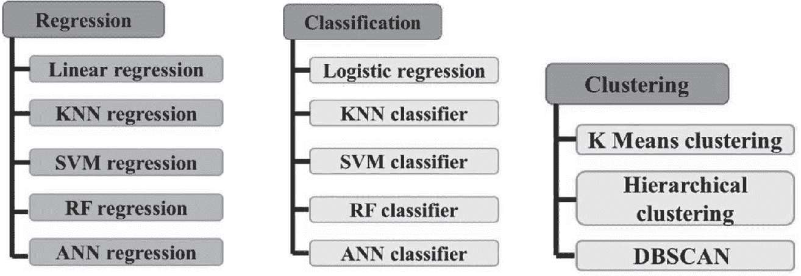

Figure 9.2 List of supervised and unsupervised machine learning models.

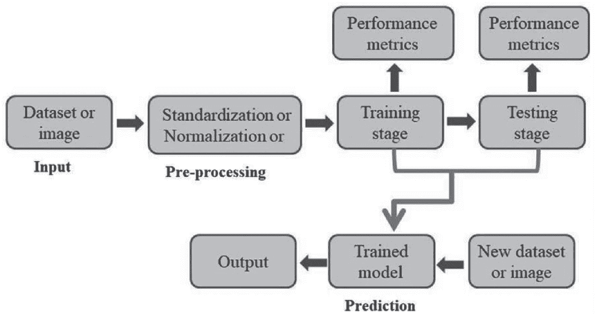

Figure 9.3 Stages involved in the development of machine learning or deep learning models.

### 9.3.1 传统机器学习（ML）与深度学习（DL）的区别

数字彩色相机以红、绿、蓝（RGB）颜色格式存储颜色信息。每个层代表一张灰度图像。根据要求，RGB 颜色模型可以转换为 HSV（色调、饱和度、明度）、CIE Lab 和 YUV。Meng 等人 \[15\] 报告称，HSV 颜色模型中的色调通道在野外条件下的图像处理应用中优于 RGB 和 YUV 颜色模型。在传统 ML 模型中，需要使用图像处理技术手动提取特征（**Figure 9.4**），然后将其输入到分类、回归和聚类模型中。使用 Figure 9.4 中提到的滤波器从颜色模型中提取特征，然后用于学习模型的训练和测试。

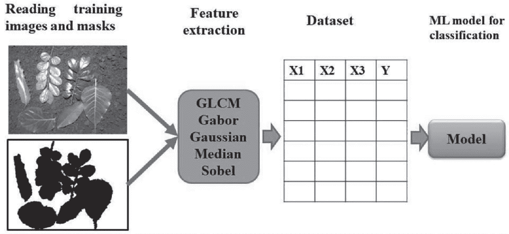

Figure 9.4 Stages involved in traditional machine learning approaches.

在基于卷积神经网络（CNN）的 DL 网络中，不同类型的滤波器/内核是网络的一部分（**Figure 9.5**），它们从图像中提取显著特征。这些特征用作输入，并通过深度神经网络进行分类和回归任务。基于 CNN 的 DL 网络包含两个阶段。第一阶段是特征学习，第二阶段是分类或回归问题。

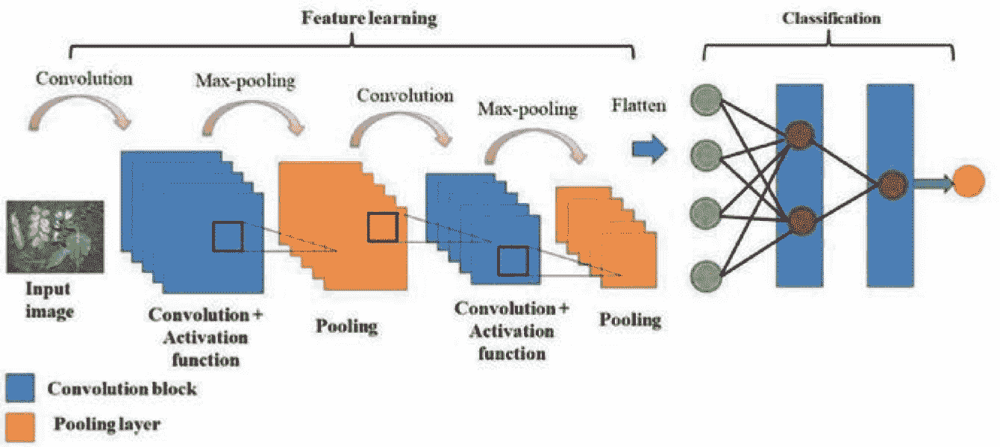

Figure 9.5 Stages involved in CNN based deep learning approaches.

第一阶段包含多个操作，例如卷积、池化、步幅和展平操作。在 CNN 的上下文中，内核也被称为滤波器和特征检测器。假设方形内核，滤波器的维度为 3×3。滤波器将与输入图像的通道进行卷积，如 Figure 9.6 所示（输入维度：高度 x 宽度 x 通道）。卷积操作的工作流程如 Figure 9.6 所示。

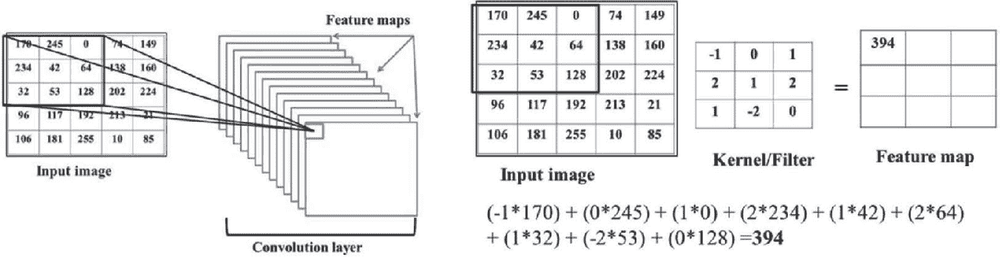

Figure 9.6 Working flow of Kernal or filter operation.

池化操作可以以三种方式执行：最大池化、平均池化和求和池化。在 Figure 9.7 中，显示了大小为 5 x 5 的特征图。要执行池化操作，选择了 2 x 2 的数组大小（Figure 9.7）。2 × 2 数组大小常用。当 2 x 2 数组应用于特征图时，数组内的元素为 0、1、0、1。在最大池化的情况下，四个元素中选择最高的数字。在此示例中，1 是剩余三个元素中最高的。在平均池化的情况下，考虑所有四个元素的平均值。在求和池化的情况下，考虑所有元素的总和。CNN 架构的输出为数组格式。在将数组发送到稠密神经网络之前，需要将其展平，如 Figure 9.8 所示。

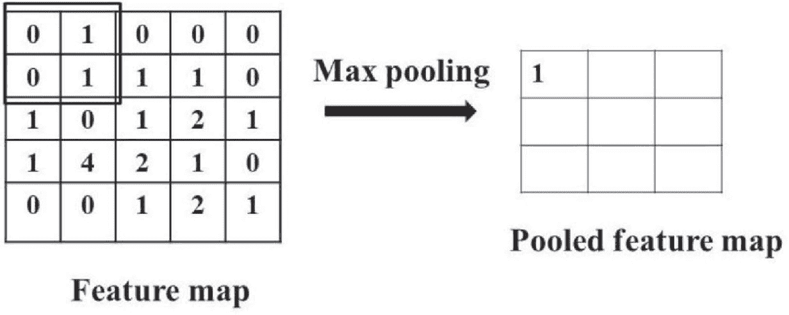

Figure 9.7 Working flow of max pooling operation.

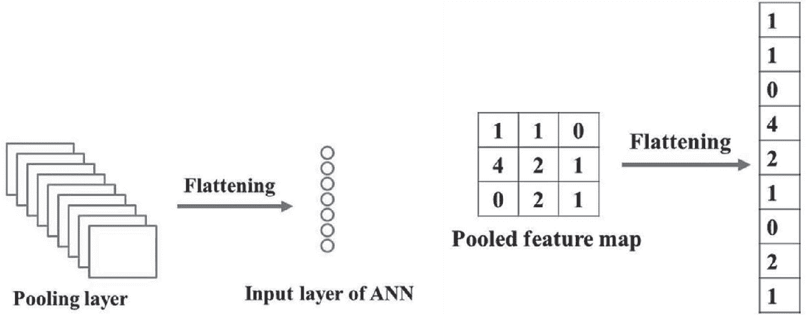

Figure 9.8 Working flow of flattening operation.

Yu 等人探索了 DL CNN，例如 VGGNet、Alex Net、Google Net 和 Detect Net \[16\]。这些模型在大量数据集上进行了训练。许多开源图像数据集可用于基于 CNN 的 DL 模型训练和测试。这些数据集经过手动注释，包含不同类别的图像。COCO \[17\]、Open Images \[18\]、ImageNet \[19\] 和 Pascal VOC \[20\] 数据集可免费提供给科学界。多位研究人员使用这些预训练模型（**Figure 9.9**

Figure 9.9 Pre-trained models for feature extraction and traditional machine learning models for classification.

### 9.3.2 分类算法的性能指标（PM）

已采用多种性能指标（PM）来衡量 ML 模型在回归和分类问题中的能力。有必要衡量具有不同超参数的模型的性能准确性。真阳性（TP）、假阳性（FP）、真阴性（TN）和假阴性（FN）是混淆矩阵的一部分。准确率、精确率和召回率源自 TP、TN、FN 和 FP \[21\]。F1 分数、准确率、精确率和召回率用作分类模型的 PM（**Figure 9.10**）。如果模型将杂草预测为杂草，则称为 TP，而如果杂草被分类为主作物，则称为 FN。同样，如果主作物被模型分类为主作物，则称为 TN，而如果模型将主作物预测为杂草，则称为 FP \[22\]。

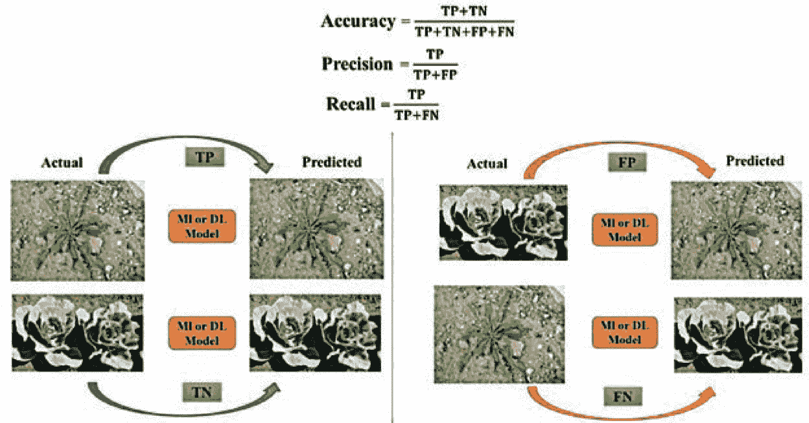

Figure 9.10 Performance metrics of classification problem.

## 9.4 杂草检测

杂草是除疾病外对作物产量最大的严重威胁。杂草控制中最困难的方面是检测并将其与作物区分开来。除草剂是杂草控制中最常用的工具，这引发了担忧。特定地点除草剂应用技术通过仅在杂草侵染区域喷洒来消除除草剂的全面施用。特定地点除草剂应用需要感应和喷洒单元；因此，机器视觉在农业自动化中至关重要。

### 9.4.1 传统机器学习（ML）模型


基于共生矩阵的纹理特征被用于从图像中提取有意义的信息，随后对其进行检查以检测野生蓝莓植物、裸露斑块和杂草 \[23\]。纹理特征使用 `MATLAB` 软件从照片中提取，并使用 `SAS` 软件进行分析。从色相、饱和度、强度和 NTSC 亮度 (`L`) 通道中推导出了约 44 个纹理特征。算法的选择将取决于最终用户应用程序是优先考虑处理速度还是准确性。与其他颜色空间相比，HSI 颜色模型的色相和饱和度特征对准确性的影响更大。Rehman 等人 \[24\] 利用颜色共生矩阵 (`CCMs`) 从野生蓝莓田中的一串黄草中提取纹理特征。据报道，使用色相和饱和度颜色通道在训练集和测试集中均实现了超过 90% 的总体准确率。

对于谷物田中的杂草检测，同时考虑了颜色和形状特征 \[25\]。使用彩色图像的绿色和红色通道创建了归一化差分指数 (`NDI`) 以区分植被和背景。形状特征被用于区分主要作物和杂草。杂草检测模型的性能与目视调查进行了比较，当采用形状分析时，相关性从 75% 提高到 85%。使用贝叶斯规则的杂草检测准确率为 74.5%，而 `KNN` 达到了 79.2% 的杂草检测准确率。通过同时考虑作物和杂草识别中的形状特征和颜色，检测准确率从 75% 提高到 85%。形状特征在增强现场可部署系统的性能和对环境条件的抵御能力方面显示出潜力。然而，遮挡仍然是一个挑战。需要进一步研究来解决叶片分割的计算成本，并探索形状特征与颜色指数在玉米检测中的联合使用。

叶片重叠是基于形状的杂草识别方法的另一个缺点 \[26\]。根据形状和纹理对四种类型的杂草进行了分类 \[27\]。`SVM` 被用作分类器。首先，从杂草图像中分割图像背景（土壤）。然后，从分割后的图像中提取形状和纹理特征。该模型实现了 93.3% 的分类准确率，分类算法的处理时间为 1.18 秒。分形维数、纹理和植物叶片形状特征被用于杂草识别 \[28\]。这三个特征提高了 `SVM` 分类器的分类能力，尤其是对于小型数据集。Bakhshipour 等人 \[29\] 使用 `ANN` 进行甜菜中的杂草分割。他们研究了小波纹理特征在将杂草图像与甜菜作物分离方面的潜力。为杂草分割任务提取了总共 52 个纹理特征，然后使用主成分分析 (`PCA`) 将其减少到 14 个主成分。即使在叶片大量遮挡和重叠的情况下，小波纹理特征也能有效区分杂草和作物。

Bakhshipour 等人 \[30\] 比较了 `SVM` 和 `ANN` 在甜菜田杂草检测中的性能。两个形状特征，矩不变量和傅里叶描述子 (`FD`)，被用作 `SVM` 和 `ANN` 分类模型的输入。`SVM` 的分类准确率（95.00%）高于 `ANN`（92.92%）。`ANN` 正确分类了约 93.33% 的甜菜和 92.50% 的杂草，而 `SVM` 正确分类了 93.33% 的杂草和 96.67% 的甜菜。

`SVM` 被用于三种作物的分类 \[31]。使用局部二值模式 (`LBP`) 算子提取了萝卜、`Brassica napus`（油菜）和 `Zea mays`（玉米/玉米）作物的纹理特征。数据集大小为 30,000 张图像。数据集的子类包括土壤背景、玉米、油菜和萝卜。在训练过程中，使用 24,000 张图像训练模型，6,000 张图像用于模型验证。`SVM` 模型将图像分类为四组的分类准确率报告为 91.85%。Gabor、方向梯度直方图特征 (`HOG`)、`GLCM`、Hu 不变矩特征、旋转不变 `LBP` 特征和 `GGCM` 特征被用于使用 `SVM` 分类器进行玉米秧苗和杂草检测 \[32\]。数据集包含 2,000 张玉米秧苗和杂草图像。图像背景通过 `K-means` 聚类和 `LAB` 颜色模型去除。`PCA` 用于降维。

### 9.4.2 基于 CNN 的深度学习 (DL) 模型

Yu 等人 \[16\] 探索了深度学习 (`DL`) `CNN`，如 `VGGNet`、`AlexNet`、`GoogleNet` 和 `DetectNet`，以识别多年生黑麦草中的地锦、蒲公英和斑点叶大戟。`DCNN`（特别是 `VGGNet` 和 `DetectNet`）的训练方法显示出在多年生黑麦草中开发基于计算机视觉的定点除草剂控制器的潜力。Chechliński 等人 \[33\] 还使用 `Raspberry Pi 3B+` 调查了用于杂草识别的 `DL` `CNN` 模型。`CNN` 架构包括 `DenseNet`、`MobileNet`、`U-Net` 和 `ResNet` 迁移学习模型，用于在不同生长阶段和光照条件下分类四种植物物种。单帧的处理时间在每帧 50 到 100 毫秒之间。

Sudars 等人 \[34\] 使用了包含六种食用作物和八种杂草物种的数据集。数据集大小为 7,853。为了引入变异性，食用作物和杂草既在田地里种植，也在受控环境中种植。数据集由专家手动标注。使用三台 `RGB` 数字彩色相机在不同生长阶段拍摄作物和杂草的图像。用于拍摄食用作物和杂草物种图像的图像分辨率为 640×360×3、720×1,280×3、480×384×3、640×480×3 和 1,000×750×3 像素。该数据集可在线获取（开放访问），可用于训练 `DL` 模型以识别食用作物和杂草物种。Jiang 等人 \[35\] 进行了一项实验，使用基于 `CNN` 的 `GCN` 和 `ResNet-101` 来识别作物和杂草。数据集由混合杂草、玉米、生菜和萝卜组成。`DL` 模型在玉米上的分类准确率为 97.80%，生菜为 99.37%，萝卜为 98.93%，混合杂草类为 96.51%。Espejo-Garcia 等人 \[36\] 使用 `DL` 网络作为特征提取器，并使用传统的 `ML` 算法作为分类器。`DL` `CNN` 网络，如 `DenseNet`、`Vignette's`、`MobileNet`、`Inception-Resnet` 和 `Xception`，被用作特征提取器。从 `DL` 模型中提取的特征随后被用作传统 `ML` 模型（包括 `SVM`、`LR` 和 `XGBoost`）的输入。在所有网络和分类算法的组合中，`DenseNet` + `SVM` 表现出最高的分类准确率。`F1-score` 发现为 99.29%。

### 9.5 植物病害检测


作物产量在很大程度上依赖于适当的病害管理。在种植区域均匀喷洒农用化学品是最广泛使用的方法，但在露天和覆盖栽培中，这种方法会导致大量化学品浪费、高成本和环境损害。农民和有经验的人传统上依靠肉眼，根据经验和传统智慧来识别作物病害。然而，这种视觉病害扫描方法耗时且劳动密集，对于大型农场来说不切实际。对于植物病害检测，传统 ML 和基于 CNN 的 DL 分类方法等现代技术在节省时间和检测准确性方面优于旧方法（专家判断）\[37\]。

### 9.5.1 传统机器学习（ML）模型

颜色特征被用于分类患病植物和健康植物 \[38\]。RGB 颜色空间被转换为 YCbCr 和 CIELAB。图像平滑处理使用中值滤波器进行。OTSU 阈值技术用于图像分割。唯一剩下的问题是区分同色叶脉和病斑。作者提出了一种茄子作物叶片病害检测模型。一种名为 K-means 聚类算法的无监督机器学习算法被用于背景像素去除。Gabor 滤波器被用于从健康和不健康的茄子作物叶片中提取特征。ANN 被用于茄子健康和不健康植物叶片的分类。

开发了一种用于检测马铃薯植物叶片病害存在的模型，该模型结合了 ML 和图像处理 \[39\]。训练和测试是在从“Plant Village”数据集获得的图像上进行的。在进行训练和测试之前，去除了图像背景并创建了掩码图像。从掩码图像中提取了颜色和纹理特征，这些特征被用作 ML 模型的输入。使用 GLCM 方法从图像中提取了纹理特征。SVM 被用作分类器。在 300 张图像上测试时，病害检测模型的准确率约为 95%。

Mahmud 等人 \[21\] 采用 GLCM 纹理分析来检测自然和人工云层光照条件下的草莓白粉病。在将彩色图像转换为 HSI（色调、饱和度、强度）图像后，从 HSI 颜色通道中提取了 10 个特征。偏移角和方向角分别为 1° 和 0°。使用 GLCM 从四个通道（绿色比例、色调、饱和度和强度）中提取了患病和健康植物的纹理特征。从照片中恢复了总共 50 个纹理特征；然而，使用逐步判别分析来选择 25 个特征用于病害识别。判别函数分析用于患病和健康植物的分类。Mahmud 等人 \[40\] 使用 GLCM 纹理分析从草莓白粉病病害图像中提取特征。他们还使用 ANN 技术处理图像并将其分类为病害图像和非病害图像。研究人员采用了带有 tanh sigmoid 激活函数和 15,000 个时代大小的反向传播 ANN。现场 I 的召回率、精确率和 F 值分别最高，分别为 82.09%、87.65% 和 85.09%。现场 II 和 III 的召回率、精确率和 F 值最低。由于风速高（>8 km/h）、存在另一种病害（红蜘蛛）、叶片倾斜和重叠，系统性能出现了微小差异。使用 HSI 传感器获取甜菜病害（健康和不健康）的图像 \[41\]。这项研究旨在识别甜菜病害。使用 SVM 算法和 11 个光谱植被指数对甜菜病害进行分类。该模型在将图像分类为健康和不健康时的分类准确率报告为 97%。

### 9.5.2 基于 CNN 的深度学习（DL）模型

开发了一种智能手机辅助的病害检测系统 \[42\]。该研究主要受到智能手机全球使用量增加以及通过 DL 在计算机视觉方面取得的最新进展的推动。使用包含 54,306 张在受控条件下拍摄的健康和受损植物叶片照片的公开数据集，训练了一个深度 CNN 来识别 14 种作物物种和 26 种病害。这些图像从“Plant Village”数据集获得，并调整大小为 256 x 256 像素。探索了各种训练和测试分割组合。在开发 DL 模型时遵循了两种方法。第一种方法涉及使用预训练的迁移学习模型来开发分类模型。在第二种方法中，从头构建了一个基于 CNN 的分类模型。研究了图像类型对分类准确率的影响，将彩色图像、灰度图像和去除背景的图像用作网络的输入。使用 F1-score 评估了两个模型的准确率。GoogleLeNet 和 AlexNet 的平均 F1-score 分别为 98.86% 和 98.48%。该模型的分类准确率最高可达 99.35%。

开发了一个基于 CNN 的 DL 网络，用于将块茎分为五个类别，即健康和四种病害类别 \[43\]。该数据集包含在正常条件下获得的不同形状、大小和色调的马铃薯。该数据集由学科专家手动标记。将整个数据集分为各种训练和测试分割组合，以观察对模型准确率的影响。在训练数据集大小为 90%、测试数据集大小为 10% 时，达到了最高分类准确率 96%。在 TensorFlow 上实现了 GoogleLeNet 和 Inception v3 模型，用于检测木薯作物中的两种害虫和三种病害 \[44\]。该数据集包含 11,670 张图像，用于训练、验证和测试阶段。使用的性能指标是混淆矩阵。分类准确率在 80% 到 93% 之间。

Waheed 等人 \[45\] 利用优化的 DenseNet DL 模型来检测和分类三种玉米叶片病害。可训练参数的总数为 77,612 个。将优化的 DenseNet 的分类准确率与 VGGNet、XceptionNet、EfficientNet 和 NASNet 进行了比较。DL 模型在 12,332 张图像的数据集上进行训练，每张图像的分辨率为 250×250×3。采用了裁剪、填充和水平翻转等数据增强技术来增加相关数据。发现 DenseNet 模型的准确率为 98.06%。未来，研究人员打算开发一个用于玉米叶片病害检测和分类的移动应用程序。


AlexNet、VGG16 和 VGG19 CNN 模型被用于水稻田病害检测 \[46\]。训练了三种模型来分类四种水稻病害，即褐斑病、细菌性条斑病、矮缩病和稻瘟病。SVM 分类器用于检测这四种水稻病害。在本研究中，CNN 模型利用来自 5,932 张病害图像的特征提取器。在第二阶段，提取的特征被输入到 SVM 分类器中。AlexNet（特征层：fc8）和 ResNet50 结合 SVM 算法表现出优于其他算法的分类性能，F1-分数达到 98.38%。一个基于 CNN 的 DL 模型使用 10,000 张标记图像进行训练，用于检测木薯作物病害 \[47\]。图像使用自适应直方图均衡化技术进行处理。模型的准确率范围从 76.9% 到 99.30%。CNN 和 ANN 模型被用于植物病害检测 \[48\]。在田间条件下，不同位置或叶片角度下，CNN 特征提取与 ANN 分类的效果优于其他监督式 ML 模型。

### 9.6 使用 ML 和 DL 技术进行病害和杂草检测的影响因素

与实验室条件相比，露天田间成像是一项具有挑战性的任务。纹理和形状特征在分类问题上显示出了良好的效果，但其性能受高风速 \[21\]、重叠和高杂草密度等因素的影响。作物因素，包括叶片角度、叶片重叠 \[26\] 和叶片密度，也起着作用。叶片重叠和风速会影响分类器在真实田间条件下的性能。当叶片重叠或受虫害损坏时，计算形状特征变得困难。因此，将纹理特征与形状特征结合考虑可以提高 ML 模型的性能。光照强度在一天中会有所变化 \[49\]，风速是田间的一个主要问题。不受控制的室外光照会影响成像传感器的性能。分类模型的准确率和精确度受输入图像质量的影响。人工照明条件和防护布可以帮助保障成像传感器的性能 \[21\]。基于计算机视觉的 ML 和 DL 算法可以增强杂草检测和分类，而不会产生任何不利的环境影响。科学和技术的这些进步将使机器人在未来能够检测害虫并向患病植物喷洒杀虫剂。此外，机器人将能够以定点的方式喷洒除草剂，最大限度地减少除草剂的使用量。

### 9.7 使用机器学习 (ML) 和深度学习 (DL) 技术进行病害和杂草检测的优缺点

传统 ML 和 DL 基础分类的优点是它比传统扫描技术或人工分类技术更简单、更快速。传统 ML 基础分类或回归的主要优点是，与 DL 模型相比，训练模型所需的数据量较少。此外，ML 模型的训练时间更短，且不需要高性能 GPU 进行计算。DL 模型可以转换为 `TensorFlow Lite` 并部署在任何微控制器上，例如 `Raspberry Pi`。此外，可以将喷洒单元连接到微控制器上，以实现定点除草剂或杀虫剂喷洒。DL 的缺点是它需要大量数据集来开发 DL 模型。生成数据耗时，雨、云、光照和风等环境因素会影响数据采集过程。DL 模型计算密集，需要 `GPU` 和 `TPU`。

### 关键词

### 参考文献

1. Sharma, A., Jain, A., Gupta, P., & Chowdary, V., (2020). 精准农业的机器学习应用：全面综述. IEEE Access.

2. Liu, L., Dong, Y., Huang, W., Du, X., Ren, B., Huang, L., Zheng, Q., & Ma, H., (2020). 基于哨兵-2 多光谱影像的小麦赤霉病高效检测病害指数. IEEE Access, *8*, 52181–52191.

3. Singh, V., Sharma, N., & Singh, S., (2020). 植物病害检测成像技术综述. 人工智能农业, *4*, 229–242.

4. Liu, B., & Bruch, R., (2020). 选择性喷洒的杂草检测：综述. 当前机器人报告, *1*(1), 19–26.

5. Wu, Z., Chen, Y., Zhao, B., Kang, X., & Ding, Y., (2021). 基于计算机视觉的杂草检测方法综述. 传感器, *21*(11), 3647.

6. Hamuda, E., Glavin, M., & Jones, E., (2016). 田间植物提取和分割图像处理技术综述. 农业计算机与电子学, *125*, 184–199.

7. Agrawal, K. N., Singh, K., Bora, G. C., & Lin, D., (2012). 基于叶片参数的图像处理技术杂草识别. 农业科学与技术杂志. B, *2*(8B), 899.

8. Deng, L. M., Tang, J., & Ma, W. J., (2014). 基于图像处理的玉米叶片特征提取与识别系统. 中国机械工程学报, *35*, 72–75.

9. Dryden, I. L., Scarr, M. R., & Taylor, C. C., (2003). 基于可逆跳马尔可夫链蒙特卡洛方法的杂草和作物图像贝叶斯纹理分割. 皇家统计学会杂志：C 系列（应用统计）, *52*(1), 31–50.

10. Jinglei, T., Ronghui, M., Zhiyong, Z., Jing, X., & Dong, W., (2017). 农田高光谱图像分类中 ROI 的基于距离的可分性准则. 国际农业与生物工程杂志, *10*(5), 177–185.

11. Slaughter, D. C., Giles, D. K., & Downey, D., (2008). 自主机器人杂草控制系统：综述. 农业计算机与电子学, *61*(1), 63–78.

12. Longchamps, L., Panneton, B., Samson, G., Leroux, G. D., & Thériault, R., (2010). 基于 UV 诱导荧光光谱签名的玉米、禾本科杂草和双子叶杂草鉴别. 精准农业, *11*(2), 181–197.

13. Huang, Y., Lee, M. A., Thomson, S. J., & Reddy, K. N., (2016). 作物生产中杂草管理的地面高光谱遥感. 国际农业与生物工程杂志, *9*(2), 98–109.

14. Shapira, U., Herrmann, I., Karnieli, A., & Bonfil, D. J., (2013). 小麦和鹰嘴豆田杂草检测的野外光谱学. 国际遥感杂志, *34*(17), 6094–6108.

15. Meng, Q., Qiu, R., He, J., Zhang, M., Ma, X., & Liu, G., (2015). 基于机器视觉和模糊控制的农业机具系统开发. 农业计算机与电子学, *112*, 128–138.

16. Yu, J., Schumann, A. W., Cao, Z., Sharpe, S. M., & Boyd, N. S., (2019). 基于深度学习卷积神经网络的多年生黑麦草杂草检测. 植物科学前沿, *10*, 1422.

17. Lin, T. Y., Maire, M., Belongie, S., Hays, J., Perona, P., Ramanan, D., & Zitnick, C. L., (2014). Microsoft COCO：上下文中的常见对象. 在：计算机视觉欧洲会议（第 740–755 页）. Springer, Cham.


18. Kuznetsova, A., Rom, H., Alldrin, N., Uijlings, J., Krasin, I., Pont-Tuset, J., & Ferrari, V., (2020). 开放图像数据集 V4. 国际计算机视觉杂志, *128*(7), 1956–1981.

19. Deng, J., Dong, W., Socher, R., Li, L. J., Li, K., & Fei-Fei, L., (2009). ImageNet: 大规模分层图像数据库. 在: 2009 年 IEEE 计算机视觉与模式识别会议 (第 248–255 页). Ieee.

20. Everingham, M., Van, G. L., Williams, C. K., Winn, J., & Zisserman, A., (2010). Pascal 视觉对象类 (VOC) 挑战. 国际计算机视觉杂志, *88*(2), 303–338.

21. Mahmud, M. S., Zaman, Q. U., Esau, T. J., Price, G. W., & Prithiviraj, B., (2019). 基于机器视觉开发人工云光照条件系统用于草莓白粉病检测. 农业计算机与电子学, *158*, 219–225.

22. Chandel, N. S., Chakraborty, S. K., Rajwade, Y. A., Dubey, K., Tiwari, M. K., & Jat, D., (2021). 使用深度学习模型识别作物水分胁迫. 神经计算与应用, *33*(10), 5353–5367.

23. Chang, Y. K., Zaman, Q. U., Schumann, A. W., Percival, D. C., Esau, T. J., & Ayalew, G., (2012). 开发基于颜色共现矩阵的机器视觉算法用于野生蓝莓田. 农业应用工程, *28*(3), 315–323.

24. Rehman, T. U., Zaman, Q. U., Chang, Y. K., Schumann, A. W., Corscadden, K. W., & Esau, T. J., (2018). 优化影响颜色共现矩阵性能及杂草 (金露花) 识别准确性的参数. 生物系统工程, *170*, 85–95.

25. Perez, A. J., Lopez, F., Benlloch, J. V., & Christensen, S., (2000). 用于谷物田杂草检测的颜色和形状分析技术. 农业计算机与电子学, *25*(3), 197–212.

26. Utstumo, T., Urdal, F., Brevik, A., Dørum, J., Netland, J., Overskeid, Ø., & Gravdahl, J. T., (2018). 蔬菜行间机器人杂草控制. 农业计算机与电子学, *154*, 36–45.

27. Zhu, W., & Zhu, X., (2009). 支持向量机在杂草分类中的应用. 在: 2009 年 IEEE 智能计算与智能系统国际会议 (第 4 卷, 第 532–536 页). IEEE.

28. He, D., Qiao, Y., Li, P., Gao, Z., Li, H., & Tang, J., (2013). 基于 SVM-DS 多特征融合的杂草识别. 农业机械学报 = 中国农业机械学会学报, *44*(2), 182–187.

29. Bakhshipour, A., Jafari, A., Nassiri, S. M., & Zare, D., (2017). 使用从小波子图像提取的纹理特征进行杂草分割. 生物系统工程, *157*, 1–12.

30. Bakhshipour, A., & Jafari, A., (2018). 评估支持向量机和人工神经网络在使用形状特征进行杂草检测中的应用. 农业计算机与电子学, *145*, 153–160.

31. Le, V. N. T., Apopei, B., & Alameh, K., (2019). 基于局部二值模式算子和多类支持向量机方法组合的有效植物歧视. 农业信息处理, *6*(1), 116–131.

32. Chen, Y., Wu, Z., Zhao, B., Fan, C., & Shi, S., (2021). 基于多特征融合和支持向量机的田间杂草和玉米幼苗检测. 传感器, *21*(1), 212.

33. Chechliński, Ł., Siemiątkowska, B., & Majewski, M., (2019). 杂草和作物识别系统——在 Raspberry Pi 上使用 MobileNets、DenseNet 和自定义修改实现超过 10 FPS. 传感器, *19*(17), 3787.

34. Sudars, K., Jasko, J., Namatevs, I., Ozola, L., & Badaukis, N., (2020). 用于机器人计算机视觉控制的标注食品作物和杂草图像数据集. 数据简报, *31*, 105833.

35. Jiang, H., Zhang, C., Qiao, Y., Zhang, Z., Zhang, W., & Song, C., (2020). 用于智慧农业中杂草和作物识别的基于 CNN 特征的图卷积网络. 农业计算机与电子学, *174*, 105450.

36. Espejo-Garcia, B., Mylonas, N., Athanasakos, L., Fountas, S., & Vasilakoglou, I., (2020). 迈向通过迁移学习提供杂草识别辅助. 农业计算机与电子学, *171*, 105306.

37. Nagaraju, M., & Chawla, P., (2020). 植物病害检测中深度学习技术的系统综述. 系统保证工程与管理国际杂志, *11*(3), 547–560.

38. Chaudhary, P., Chaudhari, A. K., Cheeran, A. N., & Godara, S., (2012). 基于颜色变换的植物叶片病斑检测方法. 计算机科学与电信国际杂志, *3*(6), 65–70.

39. Islam, M., Dinh, A., Wahid, K., & Bhowmik, P., (2017). 使用图像分割和多类支持向量机检测马铃薯病害. 在: 2017 年 IEEE 第 30 届加拿大电气与计算机工程会议 (CCECE) (第 1–4 页). IEEE.

40. Mahmud, M. S., Zaman, Q. U., Esau, T. J., Chang, Y. K., Price, G. W., & Prithiviraj, B., (2020). 使用移动机器视觉系统实时检测草莓白粉病. 冻学, *10*(7), 1027.

41. Rumpf, T., Mahlein, A. K., Steiner, U., Oerke, E. C., Dehne, H. W., & Plümer, L., (2010). 基于高光谱反射率的支持向量机植物病害早期检测与分类. 农业计算机与电子学, *74*(1), 91–99.

42. Mohanty, S. P., Hughes, D. P., & Salathé, M., (2016). 使用深度学习进行基于图像的植物病害检测. 植物科学前沿, *7*, 1–10.

43. Oppenheim, D., & Shani, G., (2017). 使用卷积神经网络进行马铃薯病害分类. 动物生物科学进展, *8*(2), 244–249.

44. Ramcharan, A., Baranowski, K., McCloskey, P., Ahmed, B., Legg, J., & Hughes, D. P., (2017). 基于图像的木薯病害检测深度学习. 植物科学前沿, *8*, 1852.

45. Waheed, A., Goyal, M., Gupta, D., Khanna, A., Hassanien, A. E., & Pandey, H. M., (2020). 用于玉米叶片病害识别和分类的优化密集卷积神经网络模型. 农业计算机与电子学, *175*, 105456.

46. Sethy, P. K., Barpanda, N. K., Rath, A. K., & Behera, S. K., (2020). 基于支持向量机的深度特征水稻叶片病害识别. 农业计算机与电子学, *175*, 105527.

47. Sambasivam, G., & Opiyo, G. D., (2021). 农业中的预测机器学习应用: 使用卷积神经网络对不平衡数据集进行木薯病害检测和分类. 埃及信息学杂志, *22*(1), 27–34.

48. Shin, J., Chang, Y. K., Heung, B., Nguyen-Quang, T., Price, G. W., & Al-Mallahi, A., (2020). 使用监督机器学习技术的方向增强效应: 草莓白粉病检测案例研究. 生物系统工程, *194*, 49–60.

49. Kazmi, W., Garcia-Ruiz, F. J., Nielsen, J., Rasmussen, J., & Andersen, H. J., (2015). 使用植被指数在甜菜田中检测匍匐蓟. 农业计算机与电子学, *112*, 10–19.

## 第四部分 人工智能与机器学习在安全解决方案中的应用


## 第 10 章 使用初步评分方法进行视频图像识别与验证，以实现身份验证和安全增强

ADITI UPADHYAY,^(⁸)

### 摘要

图像是个人身份的一种体现，反映了其情感、感受、年龄等信息。它有助于在不知晓姓名、种姓或年龄的情况下收集个人信息。在用于国内或框架应用程序时，这可能并不十分重要。但是，当图像涉及多媒体时，隐私成为每个人的主要关切。每个人都希望接收原始图像，且未经授权的个人不得对其进行篡改。由于图像认证在多媒体和各种应用中广泛使用，因此备受关注。数字图像通过计算机网络在信道上的非安全传输在全球范围内日益增加，使得每张图像的认证成为一项挑战性任务。因此，国防、航天、医疗和质量测量图像必须防止对原始图像的错误操纵或更改。为了确保多媒体图片的真实性，已提出了各种方法，包括数字签名、水印、加密以及基于图像内容的脆弱性。本章的目标是使用初步评分方法识别和验证实时视频图像。该方法通过提取特征、使用 `Viterbi` 算法对其进行评估，并将输入图像转换为嵌入状态，来帮助在初始阶段评估图像的真实性。然后对得到的矩阵进行变换，并在此基础上，在对每张图像进行多次迭代后生成初步评分估计。最后，使用上述方法对测试图像进行验证，以保护并为原始图像提供安全性。该方法可用于各种监控应用，用于实时图像识别和验证。

### 10.1 引言

在过去几年中，面部识别及其验证在计算机视觉、模式识别和生物识别领域受到了广泛关注。研究人员特别关注识别个人的显著能力，考虑到人类活动在日常生活和多媒体中的相关性。面部分析涉及提取或收集年龄、性别、姿态、地标和身份等信息。它具有多种应用，包括执法、交易面部生物识别、自动驾驶汽车以及设备上的主动验证 \[1, 2, 3, 4, 5 和 6\]。

面部识别和验证系统通常包含三个阶段。第一阶段需要一个面部标识符来定位图像中的人脸，该标识符应具有强大的特性来处理光照、比例和姿态的变化。此外，高效的面部标识符应始终产生准确的结果，同时限制感兴趣区域 \[7\]。第二阶段定位面部指标，如鼻尖、眼中心、耳垂尖端和嘴角。然后使用这些指标对齐面部，考虑缩放和平面内旋转效应。第三阶段涉及一个特征提取器，它将身份统计信息编码为高维定位器。然后使用这些全面描述来评估相似面部之间的相似性或分数。一个强大的特征提取器能够处理管道中之前阶段引入的错误：面部对齐、面部检测和地标定位 \[8\]。图像识别和验证涉及的步骤在 图 10.1 中显示。面部具有许多优势，使其成为区分个人的高效生物识别特征。首先，面部不仅反映身份，还反映幸福或悲伤等内部情绪（感受），包括该人的大致年龄。其次，即使在远距离，捕捉面部生物识别也很容易。这一特征使面部识别在个人识别以及人机交互中都很重要 \[9\]。

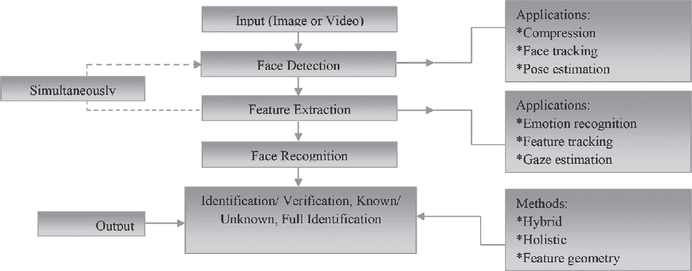

图 10.1 识别和验证涉及的步骤。 *来源：* 经 Upadhyay 等人，2023 年许可复制。[`creativecommons.org/licenses/by/4.0/`](https://creativecommons.org/licenses/by/4.0/)

面部生物识别受到多种外在和内在变化的影响，例如光照、姿态、年龄和表情。在过去几十年中，面部识别的性能有了显著提高，但在许多应用中仍低于可接受水平 \[10, 11, 12, 13, 14, 15 和 16\]。最近的努力主要集中在不同的特征、3D（三维）模型和视频输入上，以克服 2D 静态面部识别的性能限制。从几何上讲，面部本质上是一个由大量多边形组成的 3D 空间，可以由与面部几何相关的面部特征和像素来表示。图像数据可以计算地表示为向量形式。例如，一个 xxy 2D 图像可以通过将图像的每一行和每一列连接起来对像素元素进行排序，映射到向量 `PeRxY`。不同情绪的不同面部在 图 10.2 中显示。其中；`P=(P[1],P[2]...P[i]...P[N])` 表示 `nxN` 数据矩阵；其中；`P.` 是从 xxy 面部图像连接而来的维度为 `n` 的面部向量，其中 n=xx y 表示像素总数。

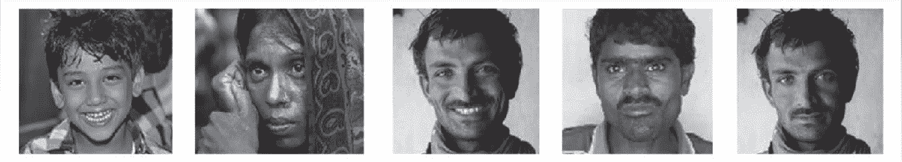

图 10.2 带有情绪的人类面部。 *来源：* 经 Upadhyay 等人，2023 年许可复制。[`creativecommons.org/licenses/by/4.0/`](https://creativecommons.org/licenses/by/4.0/)

### 10.2 初步评分方法


面部识别的初步阶段将使用具有未观测状态的隐马尔可夫模型（`HMM`）进行。这些状态不直接反映面部的身份，而是生成序列形式的标记，以突出序列状态的信息。变量 `a(t)= { a[i],a[2],a[3]}` 是时间 `t` 的状态（隐藏），变量 `b(t)= {b[1], b[2],b[3]}` 在时间 `t`。现在，使用灰度进行 1D `HMM`，面部区域按从上到下的顺序覆盖头发、额头、眼睛、鼻子和嘴巴。面部识别系统如 图 10.3 所示。可以观察到，每个面部区域在 1D 中从左到右被分配给一个状态。但是，2D 中嵌入的 `HMM`s 已被用于图像表示和识别，`Y={ Y,}={ Y[o],}` 使用空间索引 `(p,q)` 并由 `HMM` 排列设计，该排列由一组称为超状态 `S[pq]` 的集合组成，不允许嵌入状态和超状态之间有任何类型的交叉 \[17, 18, 19, 20, 21, 22 和 23\]。一个完全综合的状态包括五个特征，这些特征在垂直方向上恰当地覆盖额头、眼睛、鼻子、嘴巴和下巴，以及初始状态和状态转移概率。`{Π[v], B[v]}={π[fn];b[fnFn+1]}`。现在，每个状态（超）本身是一个包含用于面部建模特征的嵌入状态的 1D 标准 `HMM`，并在水平方向上具有 21 个嵌入状态。

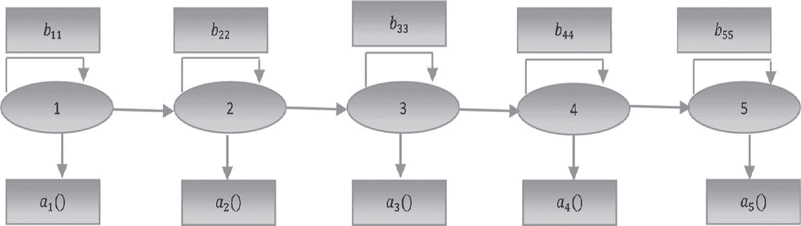

图 10.3 用于面部识别的 HMM（从左到右）。 *来源：* 经 Upadhyay et al., 2023 许可复制。[`creativecommons.org/licenses/by/4.0/`](https://creativecommons.org/licenses/by/4.0/)

(1)

```
\begin{array}{l} {b\_{pqr}(x) = p\left( {xIr\_{pqr},p\_{b}} \right)} \\ {= {\overset{'}{O}}\_{1\_{\text{pq}}}^{\\text{N}\_{1}}\text{w}\_{\text{pq}}\text{rl}\_{\text{pq}}\text{N}\left( {\text{xI}{\grave{\text{i}}}\_{\text{pqr}}1\_{\text{pq}},{\overset{'}{O}}\_{\text{pqr}}1\_{\text{pq}}} \right)} \\ \end{array}
```

两个不同视频的分布以达到不同分数级别的值如 图 10.4(a) 和 (b) 所示。


图 10.4 两个不相似视频的特征分布（(a) 和 (b)），其中一些值达到零，而其他特征达到接近一的值。这表明高保真帧具有最大分数，而差帧具有最小分数。这里，x 轴表示特征质量值，y 轴表示帧数。 *来源：* 经 Upadhyay et al., 2023 许可复制。[`creativecommons.org/licenses/by/4.0/`](https://creativecommons.org/licenses/by/4.0/)

### 10.3 图像认证

认证意味着验证真实值或内容，在未被篡改的情况下实现。在实时应用中，由于周围环境或通信设备产生的各种原因，很难保持原始身份。图像认证不接受图像数据中的任何篡改。基于密码学的传统方法使用哈希函数从图像中评估消息认证。然后使用发送者的私钥对该哈希函数进行加密并附加到图像上。为了各方之间更安全的数据交换，可以使用受益人的公钥对哈希进行加密。认证和验证过程如 图 10.5(a) 和 (b) 所示。收件人评估附加到恢复图像并使用私钥解密的接收图像中的哈希。使用列和行函数对图像进行哈希评估，这些哈希被存储并与要验证的图像的每一列和每一行获得的哈希进行比较。如果观察到哈希函数有任何不匹配，则图像被宣告为被篡改；否则，它被宣告为真实。由于哈希函数对二进制数据或图像像素中的任何微小变化非常敏感，这限制了许多应用中的图像验证。脆弱水印方法用于创建水印并将其放置在要保护的图像中，这样任何发现的变化也会反映在放置的水印中。验证放置水印的存在批准图像的真实性，并最终定位损坏区域。这种方法不接受任何失真的图像，并且仅在所有像素保持不变时才进行认证。生成和验证过程如 图 10.6(a) 和 (b) 所示。

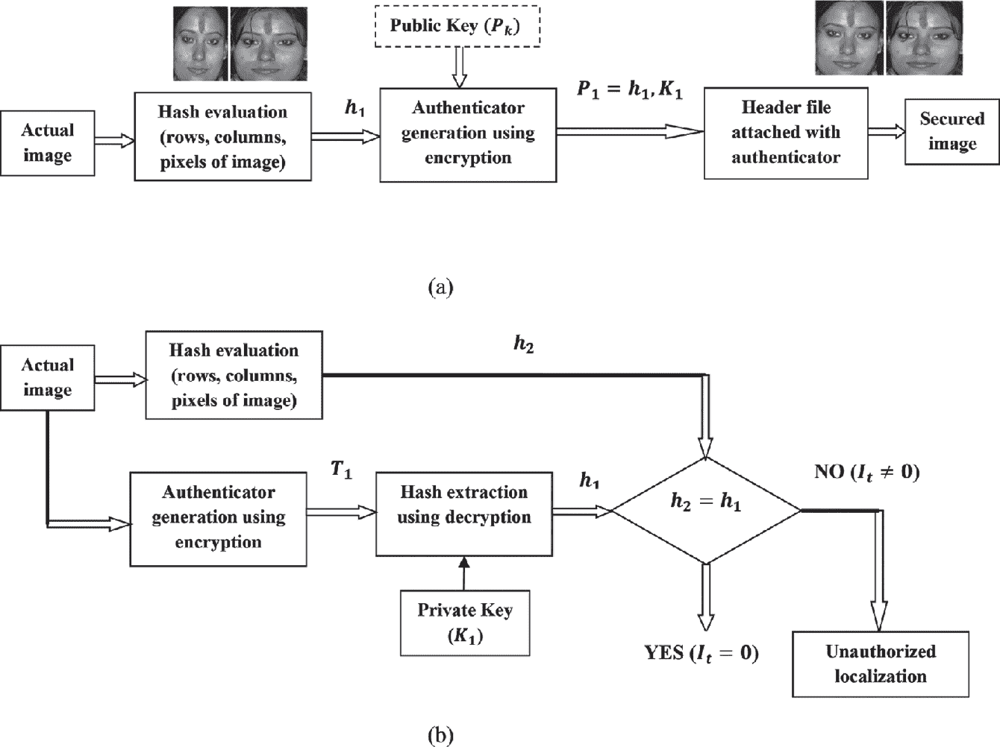

图 10.5 使用密码学的认证系统 — (a) 认证器生成器；和 (b) 真实性验证。 *来源：* 经 Upadhyay et al., 2023 许可复制。[`creativecommons.org/licenses/by/4.0/`](https://creativecommons.org/licenses/by/4.0/)


图 10.6 使用脆弱水印的认证 — (a) 认证器生成器；和 (b) 真实性验证。 *来源：* 经 Upadhyay et al., 2023 许可复制。[`creativecommons.org/licenses/by/4.0/`](https://creativecommons.org/licenses/by/4.0/)

脆弱水印算法基于从图像身份形成水印，水印从一组图像像素中评估。从密钥 `SK[I]` 获取的像素集可以使用密钥 `SK[I]` 与另一组的最低有效位进行加密。为了增强算法的安全性，像素集可以由另一个密钥 `SK[2]` 确定。

数字签名的目的是以电子方式签署文件，例如签署合同或从银行提取资金。数字签名可以与签署的信件一起以电子方式传输。但是，数字签名存在几个问题。

首先，数字签名需要一个算法附加到签名以进行电子传输。其次，存在与验证和签名认证相关的问题。例如，当使用信用卡/借记卡进行购买时，通过将某人的签名与其认证签名进行比较来验证签名。这种认证方法不够强大，因为很容易复制认证人员的签名。因此，任何了解验证算法的人都可以测试电子签名。


## 10.4 帧选择与平均分算法

视频图像帧选择算法及其最大平均分的估计系数将在以下步骤中讨论：

1. 视频帧选择基于离散小波变换方法的平均值，该方法首先识别给定的输入图像（`I`），其可评估为：

   `I^I(DWT) = [I^I[ap], I[v, h, d]^I]`

   其中；`I[ap]` 表示图像的估计系数；`I[v,h,d]` 包含垂直、水平和垂直边带的系数细节。

   Fusion of Artificial Intelligence and Machine Learning for Advanced Image Processing, Data Analysis, and Cyber Security

2. 将应用高通滤波器和低通滤波器进行滤波过程，用于父小波的分解。

3. 下一级 DWT 现在已应用于第一步近似带中实现的第一个近似。

   `I^I(DWT) = [I^I[ap], I[v, h, d]^I]`

   其中；`I^I[ap], I[v, h, d]^I` 表示输入图像（`I`）的第二级估计。

4. 通过将图像分为 `xxy` 窗口并捕获它们来评估每个 DWT 带的平均值。`H(j) = - ∑(i=1 to m) P(j_i) log₂P(j_i)` 其中；`P(j[j])` 是概率质量函数，以概率形式指示像素值，反映在邻域中；`m` 是像素总数。

5. 如果窗口大小为 `L xW` 则：`x yP(j_i) = m_ji / (L_x × W_y)` 其中；`m[ii]` 表示窗口中的像素数量。

6. 现在将每个窗口的平均值合并以评估带的特征值。`FH = ∑(i=1 to μ) (|E_i|)` 其中；`FH` 表示特征分数值；`p` 是窗口数量；`E[i]` 是 `i[th]` 窗口的熵。

7. 图像 `I,FH (I)` 的最终总分是通过单独平均每个带的特征值得到的：`FH(I) = FH(I[ap]^I) + FH(I[h, v, d]^I) + FH(I[h, v, d])`

8. 对于视频图像 `V[i]`；帧的特征分数 `(f[i])` 由 `FH(f[i])` 表示，并使用以下公式获得最大-最小归一化：`m_min = (FH(f_i) - min(FH)) / (max(FH) - min(FH))` 其中；`FH` 表示 `V[i]` 的所有特征分数；`min(FH)`，`max(FH)` 表示 `FH` 的最小值和最大值。

9. 一旦评估了每个单独帧的分数，将执行帧选择的自适应过程以识别最佳帧集合。`θ_i = {1, if n_i ≥ σ_n + μ_n / 2; 0, otherwise}` 其中；`µp[n]` 表示适合特征值的均值；`σ[n]` 表示标准差。

10. 对从数据库检索到的丰富特征帧进行了测试，并使用匹配分数进行了验证以实现完美身份验证。与 Eigen、随机和正常特征图像相比，特征训练图像的误接受率和误拒绝率较高。从安全角度来看，有必要保持这些率较低，以实现理想的高验证性能。然而，特征训练图像的高误接受率是实现高验证率的积极指示。这有助于在视频监控和身份验证等实时图像应用中保持安全措施，如 图 10.8 和 图 10.9 所示。


图 10.8 误接受率 (FAR)。 *来源：* 经 Upadhyay et al., 2023 许可复制。[`creativecommons.org/licenses/by/4.0/`](https://creativecommons.org/licenses/by/4.0/)


Figure 10.9 False rejection rate (FRR). *Source:* Reproduced with permission from Upadhyay et al., 2023. [`https://creativecommons.org/licenses/by/4.0/`](https://creativecommons.org/licenses/by/4.0/)

### 10.5 Proposed Model For Identification And Verification

The proposed model for face identification and verification is shown in Figure 10.10. It is used to identify the succession of faces from the given input and track the identified face over successive frames. The model selects the most suitable and best face for proper identification, assuming that the background is previously known and fixed. If no face is detected, the system estimates the background by using information from the previous frame. In the final stage of the verification process, if a new face is identified, it is switched to the training stage to create a new face model. If the face is identified from the stored face in the database, the analogous face model is re-trained. Based on the proposed model, identification and verification have been performed on four input images (feature trained, Eigen, random, and random). The verification percentage is calculated by comparing the false acceptance rate of the observed results \[31, 32, 33 and 34\]. Real-time images have been captured from various sources such as YouTube videos, social networking sites, and our own database. The results have been simulated to achieve good performance, as discussed in the “Results and Discussions” section.


Figure 10 Proposed model for face identification and verification with training and testing stages.

### 10.6 Results And Discussions

The experiments are performed with the images gathered from social networking videos, including your database, which contains 10-100 frames with a duration of 2-6 seconds. These frames have informativebased features that were first trained and tested using the proposed model mentioned above for verification percentages. We analyze the performance for a fixed number of frames, without considering adaptive methods or any frame selection algorithms.

The performance report depicted in Figures 10.11-10.14 indicate that the accuracy of feature-trained images for different subjects is more efficient compared to Eigen, random, and normal feature images. Instagram shows higher accuracy compared to other platforms such as Facebook, YouTube, and the self-database images. This may be due to the fact that Instagram images are unaltered and contain all their captured features, whereas YouTube images have lower accuracy compared to other images. Preliminary scores can help evaluate the overall score of each frame, and by averaging the scores at the maximum level, the desired verification rate can be achieved. Security levels can be further improved by assigning each image an unpredictable coding with a private key instead of hash coding (Tables 10.1-10.4).


Figure 10.11 Self-collected images performance from the video.

Table 10.1 Database (Self-Created)

| Image Type | Identification Accuracy Rate (%) | Verification |
| --- | --- | --- |
| Error (%) | Hit (%) | |
| Random | 90.12 | 9.88 | 3.65 |
| Eigen | 91.54 | 8.64 | 7.45 |
| Feature trained | 98.33 | 1.67 | 8.43 |
| Normal feature | 88.89 | 11.11 | 2.34 |


Figure 10.12 Performance report for YouTube video images.


Figure 10.13 Performance report for Facebook images.


Figure 10.14 Performance report for Instagram images.

Table 10.2 YouTube

| Image Type | Identification Accuracy Rate (%) | Verification |
| --- | --- | --- |
| Error (%) | Hit (%) | |
| Random | 85.62 | 14.38 | 5.63 |
| Eigen | 91.43 | 8.57 | 7.45 |
| Feature trained | 93.12 | 6.88 | 9.11 |
| Normal feature | 90.67 | 9.33 | 3.29 |

Table 10.3 Facebook

| Image Type | Identification Accuracy Rate (%) | Verification |
| --- | --- | --- |
| Error (%) | Hit (%) | |
| Random | 85.10 | 14.9 | 1.39 |
| Eigen | 93.42 | 6.58 | 3.74 |
| Feature trained | 95.89 | 4.11 | 5.01 |
| Normal feature | 87.34 | 12.57 | 0.65 |

Table 10.4 Instagram

| Image Type | Identification Accuracy Rate (%) | Verification |
| --- | --- | --- |
| Error (%) | Hit (%) | |
| Random | 88.39 | 11.61 | 6.87 |
| Eigen | 98.54 | 1.46 | 2.49 |
| Feature trained | 99.11 | 0.86 | 9.35 |
| Normal feature | 90.67 | 9.33 | 4.34 |

### Keywords

### References

1. Ranjan, R., Bansal, A., Zheng, J., Xu, H., Gleason, J., Lu, B., Nanduri, A., et al., (2015). A fast and accurate system for face detection, identification, and verification. Journal of Latex Class Files, *14*(8), 1-16.

2. Phillips, P. J., Grother, P., Micheals, R. J., Blackburn, D. M., Tabassi, E., & Bone, M., (2003). Face Recognition Vendor Test 2002: Evaluation Report. Tech. Report NISTIR 6965. NIST, 188-103.

3. Li, S. Z., & Jain, A. K., (2005). Handbook of Face Recognition. Springer-Verlag, Secaucus, New Jersey.

4. Li, H., & LiJing, J., (2010). Implement of face recognition system based on hidden Markov model. In: IEEE, Sixth International Conference on Natural Computation (ICNC). *978*\-1-4244.

5. Jen-Tzung, C., & Chih-Pin, L., (2008). Maximum confidence hidden Markov modeling for face recognition. IEEE Trans. on Pattern and Intelligence, (4), 606-616.

6. Rogier, N., & Chauvaud, P., (1997). MD2 is not secure without the checksum byte. Designs Codes Cryptograph, *12*(3), 245-251.

7. Matsuo, T., & Kaoru, K., (2004). On parallel hash functions based on block-ciphers. In: Proceedings of the IEICE Transactions on Fundamentals of Electronics, Communications and Computer Sciences (pp. 67-74).

8. Xiaotie, D., Chan, L., & Huafei, Z., (1999). A proposal for secure hash algorithm. In: Proceedings of the 1999 International Workshop on Cryptographic Techniques and E-commerce (pp. 254-258).

9. Hampel, H., Arps, R., & Chamzas, C., (1992). Technical features of the JBIG standard for progressive bi-level image compression. Signal Process Image Commun., *4*(2), 103-111.

10. Venkatesan, R., Koon, S., & Jakubowski, M., (2000). Robust image hashing. In: Proceedings of the IEEE International Conference on Image Processing, *3*, 664-666.

11. Goljan, M., Fridrich, J. J., & Du, R., (2002). Distortion-free data embedding for images. In: Proceedings of the 4^(th) International Workshop on Information Hiding (pp. 27-41).

12. Marvel, L. M., & Hartwig, G. W., (2000). Compression compatible fragile and semifragile tamper detection. In: Proceedings of the SPIE International Conference on Security and Watermarking of Multimedia Contents (Vol. 2, pp. 3971-3981).

13. Jang, D., Yoo, C. D., & Lee, S., (2005). An SVD-based watermarking method for image content authentication with improved security. In: Proceedings of the IEEE International Conference on Acoustics, Speech, and Signal Processing (Vol. 2, pp. 525-528).


14. Krawczyk, H., Gennaro, R., & Jarecki, S., (1996). Robust threshold DSS signatures. Advances in cryptology—EUROCRYPT. In: Proceedings on the International Conference on the Theory and Application of Cryptographic Techniques; Lecture Notes in Computer Science (Vol. 1070, pp. 354-371). Springer.

15. Tian, J., (2002). Reversible watermarking by difference expansion. In: Proceedings of Workshop on Multimedia and Security (pp. 19-22).

16. Fridrich, J., Goljan, M., & Du, R., (2001). Invertible authentication. In: Proceedings of the SPIE, Security and Watermarking of Multimedia Contents (pp. 23-26). San Jose, California.

17. Pfitzmann, B., (1996). Digital signature schemes: General framework and fail-stop signatures. Lecture Notes in Computer Science, 1100. Springer, Berlin.

18. Brassard, G., (1993). Cryptologie Contemporaine. Masson, Paris.

19. Matsuo, T., & Kaoru, K., (2004). On parallel hash functions based on block-ciphers. In: Proceedings of the IEICE Transactions on Fundamentals of Electronics, Communications, and Computer Sciences (pp. 67-74).

20. Skala, V., & Kucha, M., (2001). The hash function and the principle of duality. In: Proceedings of the Computer Graphics International (Vol. 200, pp. 167-174).

21. Trappe, W., & Washington, L. C., (2002). Introduction to Cryptography: With Coding Theory. Prentice-Hall, Upper Saddle River, New Jersey.

22. Goswami, G., Bhardwaj, R., Singh, R., & Vatsa, M., (2014). MDLFace: Memorability augmented deep learning for video face recognition. In: IEEE International Joint Conference on Biometrics.

23. Barr, J. R., Bowyer, K. W., Flynn, P. J., & Biswas, S., (2012). Face recognition from video: A review. International Journal of Pattern Recognition and Artificial Intelligence (Vol. 26, No. 05).

24. Mintzer, F., Braudaway, G., & Yeung, M., (1998). Effective and ineffective digital watermarks. In: Proceedings of the ICIP’97. Santa Barbara, CA, USA.

25. Yeung, M. M., (1998). Digital watermarking introduction. Commun. ACM, *41*(7), 31-33.

26. Bhatt, H. S., Singh, R., & Vatsa, M., (2014). On recognizing faces in videos using clustering-based re-ranking and fusion. IEEE Transactions on Information Forensics and Security, *9*(7), 1056-1068.

27. Kirby, M., & Sirovich, L., (1990). Application of the Karhunen- loève procedure for the characterization of human faces. IEEE Trans. Pattern Analysis and Machine Intelligence, *12*, 831-835.

28. Darrell, T., Azarbayejani, A., Wrem, C., & Pentland, A., (1995). Real-time tracking of the human body. IEEE Trans. on Pattern Analysis and Machine Intelligence, *19*, 780-785.

29. Chen, M., He, Y., & Kundu, A., (1992). Handwritten word recognition using hidden Markov models with adaptive length Viterbi algorithm. IEEE Int. Conf. on Acoustics, Speech, and Signal Processing, *3*, 153-156.

30. Ben, A. J., & Nandy, D., (1998). A volumetric/ iconic frequency domain representation for objects with application for pose invariant face recognition. IEEE Trans. on Pattern Analysis and Machine Intelligence, *20*, 449-457.

31. Muhammad, S., Jamal, H. S., Sajjad, M., & Mudassar, R., (2013). Sub-holistic hidden Markov model for face recognition. Research Journal of Recent Sciences, *2*(5), 10-14.

32. Othman, H., & Aboulnasr, T., (2003). A separable low complexity 2D HMM with application to face recognition. IEEE Trans. on Pattern Analysis and Machine Intelligence, *25*(10).

33. Bicego, M., Castellani, U., & Murino, V., (2003). Using hidden Markov models and wavelets for face recognition. Proc. of IEEE International Conference on Image Analysis and Processing, *52*\-56.

34. Portera, G., & Doran, G., (2000). An anatomical and photographic technique for forensic facial identification. Forensic Science International, *114*, 97-105.

## Chapter 11 Machine Learning and Cyber Defense: Hype Vs. Reality

RENU, MEENA SACHDEVA, and INDERPREET KAUR

Department of CSE, GCET, Greater Noida, Uttar Pradesh, India

### Abstract

Modern businesses need to secure crucial assets, ranging from critical infrastructures to personal information, from cyber-attacks while achieving optimized business processes. Artificial intelligence (AI) is being used with huge potential to support information security. Machine learning (ML) can be utilized to prevent our information from a number of attacks, but this is not an acceptable solution. The technology also helps to combine all customer data, which serves as input to produce new vulnerabilities. Different opinions consider it as a game between attackers and security providers. In this chapter, we discuss the application areas, true potential, and limitations of ML. ML-based technologies are improving business processes by providing opportunities to design defense mechanisms against large-scale frauds. However, attackers can also misuse it to launch new threats. We demonstrate the ways of utilizing ML by both defenders and attackers. An extensive review and experiments performed on real enterprise systems are taken into account to draw conclusions.

### 11.1 Introduction

Machine learning (ML) works as an important tool in enhancing the protection measures in attack detection systems. ML algorithms are grouped into supervised and unsupervised learning algorithms based on the input. Supervised learning relies on labeled training data, while unsupervised learning relies on unlabeled training data to infer the classes on its own \[1\]. A Comparative Survey covers the Influence of ML Techniques on cybersecurity. Various researchers and organizations have claimed that AI is not immune to attacks \[2\]. The chapter is divided into several sections. Section 11.2 illustrates the paradigms of ML algorithms for cyber defense. Section 11.3 outlines the application of ML algorithms for cybercrime. Section 11.4 includes the Survey and Evaluation, and Section 11.5 covers the current trends of ML algorithms in the cyber industry. Finally, Section 11.6 concludes the chapter with user awareness.

### 11.2 Paradigms of Machine Learning (ML) and Applications in Security

ML algorithms are commonly referred to as shallow learning (SL) and deep learning (DL). Both categories are utilized in cybersecurity, as shown in Figure 11.1.


Figure 11.1 Machine learning algorithms and applications in cyber security.


浅层技术需要人类专家在算法最终实现之前识别相关数据及其特征。另一方面，DL 使用多层输入数据，并通过无标签学习自动选择特征 \[3\]。SL 和 DL 都包含众多技术。SL 算法的流行技术包括 `K-nearest neighbor (KNN)`、`support vector machines (SVMs)`、`naïve bayes (NB)`、`logistic regression (LR)`、`random forest (RF)`、`hidden Markov models (HMMs)` 和 `shallow neural network (SNN)` \[4\]。这些技术大多用于分类，有时会由人类专家组合使用。`Deep neural networks (DNNs)` 是任何 DL 算法的基础，由能够自主学习的大型神经网络组成。一层中的神经元可能完全连接，形成 `fully-connected feedforward deep neural networks (FNN)`，或者仅部分连接到下一层的子集，形成 `convolutional feedforward deep neural networks (CNN)`。

### 11.3 机器学习（Ml）在网络犯罪中的应用

罪犯也在利用这种工具来策划恶意活动，每天针对数千人。手动执行此类活动是一项枯燥且耗时的工作；黑客可以借助 ML 实现自动化。这些活动根据其目标和危害程度分为 5 组：

1.  **信息收集：** 这是每次网络攻击的开始。信息越多，网络攻击成功的概率就越高。收集到的信息可以在线和离线组织和收集。`Neural networks` 及其相关的聚类和分类方法可用于分析受害者在社交网络上的帖子。现代网络是 `software-defined networks (SDN)`，`ML` 可以协助对手。黑客可以收集关于安全工具和其他 `quality of service (QoS)` 相关策略的信息。攻击者可以从分析流量和流规则中受益。最近，`Social Mapper` 工具被设计用于使用 Google 图像在各种社交平台上定位个人。

2.  **冒充：** 它允许攻击者通过垃圾邮件、网络钓鱼和欺骗等各种方法针对受害者。最古老且最流行的形式之一是电子邮件垃圾邮件，其中 `ML` 已被网络攻击者采用。通过训练 `neural network`，垃圾邮件过程可以自动化，生成垃圾邮件而不会引起怀疑。通过电子邮件进行冒充相对简单，一个人的行为可以通过其帖子轻松追踪。最近，`Markov model` 已与 `recurrent neural networks (RNNs)` 结合使用，以基于之前的推文生成新推文。

3.  **未经授权的访问：** 在 `ML` 可以提供帮助的两个流行领域中，未经授权的访问很常见。`Captcha bypassing` 是大规模黑客攻击中最流行的方法，其中对象分割是通过 `support vector machines (SVMs)` 方法实现的。`ML` 被用于以 82% 的准确率破解 `reCAPTCHA` 图像 \[7\]。另一个领域是密码暴力破解，其中可以借助 `ML` 猜测密码。`Markov models` 首先被训练以生成一组相似密码的模式。

4.  **ML 用于攻击：** 大多数攻击是由于网络钓鱼而执行的，这会导致下载恶意软件、间谍软件、勒索软件或其他恶意程序。`Fuzzing` 是黑客中常见的做法，用于发现系统漏洞。借助基于 AI 的更智能技术，可以快速找到新的文档示例来崩溃任何应用程序。此外，可以使用基于 `ML` 的算法以具有成本效益的方式加速漏洞发现。

5.  **自动化犯罪：** 罪犯可以自动化各种活动中涉及的任务。虽然没有关于将自动化什么的具体预测，但与网络犯罪相关的组织正在聘请专家为其开发支持软件。

### 11.4 文献综述与评估

本节将介绍 ML 的优点和副作用。它还将为行业提供指南，以决定是否应用 ML 算法。目前，没有算法可以在没有人工干预的情况下应用。有两个方面使 ML 成为行业的良好选择。首先，可以轻松收集大量有用数据以提供初始安全级别。各种工具旨在帮助自动排序、切片和挖掘大量数据，协助安全分析师。大量工作已在使用 `ML` 的 `intrusion detection systems (IDS)` 上完成。了解数据源是任何安全策略的第一步。不同研究人员已尝试将 `ML` 应用于 `IDS` 的各种方法。一种非常流行的攻击检测方式是 `Packet-Based`，其中数据包提供所有通信相关详细信息。数据包信息首先借助无监督学习进行解析。Hu 等人引入了一种基于模糊 C-means 的算法 \[8\]。`Yang Tian-Yi et al.` \[9\] 提出了数据包解析方法和有效载荷分析方法。`Aaron Adler et al.` 提出了带有 TCP 连接和 HTTP 请求攻击检测的 `Behavior-Based Access Control`。`Gong et al.` \[10\] 提供了 SDN 中数据传输的可行性分析。另一个问题是合格、经验丰富的安全分析师的可用性。设计高效的防御策略是一场复杂的博弈，一个错误的决定就足以为漏洞敞开大门。`AI` 驱动的攻击正变得非常频繁，在当今数据无处不在的世界中，对安全专家的需求日益增长。在网络世界中，组织仍然犹豫是否信任基于 `ML` 的防御机制。`ML` 已被黑客和安全社区广泛使用 \[11\]。当然，与同行建立信任比与 `ML` 模型建立信任更可取。在未来几年，`ML` 模型和安全专家的结合将更受青睐。

### 11.5 网络安全中机器学习（Ml）算法的当前趋势

目前，各种 ML 方法的大多数正在用于设计“警告”系统，但它们仍然需要人类专家进行最终决策。入侵检测、恶意软件分析和垃圾邮件检测是应用 ML 算法的三个主要领域 \[12\]。ML 模型正在以不同的名称用作防御，其中一些很受欢迎并在此列出：

1.  **Splunk：** 它是一种软件，应用范围从简单的 IT 运营到分析和网络安全。`ML` 用于用户行为分析，以识别用户的数字弱点并快速自动地响应恶意软件攻击。

2.  **Chronicle：** 它是一种软件，应用范围从简单的 IT 运营到分析和网络安全。`ML` 用于用户行为分析，以识别用户的数字弱点并快速自动地响应恶意软件攻击。

3.  **Microsoft：** Windows Defender，名为“高级威胁防护” (`ATP`），专门用于预防、违规检测和自动恢复。它在多个层级利用云 AI 和 `ML` 算法来识别和缓解威胁。

### 11.6 结论


## 第 12 章 车载自组网络安全与隐私的有效调查及预防措施

SHALLY NAGPAL, SHIVANI GABA, ALANKRITA AGGARWAL, and DEEPAK KUMAR

Panipat Institute of Engineering and Technology, Panipat, Samalkha, Haryana, India

### 摘要

车载自组网络（VANETs）可以使街道更安全、更清洁、更智能。它可以提供广泛的服务，这些服务可能与安全相关，也可能与安全无关。众多与安全相关的 VANETs 应用程序是实时且关键任务性质的，这将需要严格的安全性和可靠性保障。确实，与安全无关的交互式多媒体应用程序，这些应用程序在未来可能发挥关键作用，也将需要安全支持。缺乏这种安全性和隐私保护是 VANETs 大规模应用的关键障碍之一。不可靠且不可信的 VANET 可能比没有 VANET 支持的框架更危险。因此，确保“关键安全”数据足够安全以供依赖是根本性的。保障 VANETs 的安全，同时为驾驶员或车辆所有者提供适当的安全保障，是一项极具挑战性的任务。在本章中，我们总结了 VANETs 中的攻击，并比较了安全需求和挑战。

### 关键词

### 参考文献

1. Ghasem, Z., Frommholz, I., & Maple, C., (2015). Machine learning solutions for controlling cyberbullying and cyberstalking. J. Inf. Secur. Res., *6*(2), 55–64.

2. Mbaziira, A., & Jones, J., (2016). A text-based deception detection model for cybercrime. In: Int. Conf. Technol. Manag.

3. Sultana, N., Chilamkurti, N., Peng, W., & Alhadad, R., (2019). Survey on SDN-based network intrusion detection system using machine learning approaches. Peer-to-Peer Networking and Applications, *12*(2), 493–501.

4. Prabakaran, S., & Mitra, S., (2018). Survey of analysis of crime detection techniques using data mining and machine learning. In: Journal of Physics: Conference Series (Vol. 1000, No. 1, p. 012046). IOP Publishing.

5. Ford, V., & Siraj, A., (2014). Applications of machine learning in cyber security. In: Proceedings of the 27th International Conference on Computer Applications in Industry and Engineering.

6. Yavanoglu, O., & Aydos, M., (2017). A review on cyber security datasets for machine learning algorithms. In: 2017 IEEE International Conference on Big Data (Big Data) (pp. 2186–2193). IEEE.

7. Apruzzese, G., Colajanni, M., Ferretti, L., Guido, A., & Marchetti, M., (2018). On the effectiveness of machine and deep learning for cyber security. In: 2018 10th International Conference on Cyber Conflict (CyCon) (pp. 371–390). IEEE.

8. Zen. (2021). AI and machine learning in cyber security. In: Towards Data Science: A Medium Publication Sharing Concepts, Ideas, and Codes.

9. Tian-Yi, Y., et al., (2019). Network traffic anomaly detection based on incremental possibilistic clustering algorithm. J. Phys.: Conf. Ser.

10. Michael, J. M., Michael, A., Aaron, A., & Rachel, G., (2015). Use of Machine Learning in Big Data Analytics for Insider Threat Detection, *10*(1), 120.

11. Aaron, A., Michael, J. M., Jeffrey, C., Michael, A., & Rachel, G., (2013). Using machine learning for behavior-based access control: Scalable anomaly detection on TCP connections and HTTP requests. In: 32nd Military Communications Conference (MILCOM 2013). San Diego, CA.

12. Gong, S., Siddiqui, M. K., Luo, Y., et al., (2017). Feasibility analysis of data transmission in SDN. Journal of Intelligent and Fuzzy Systems, *33*(5), 3145–3152.

## 第 12 章 车载自组网络安全与隐私的有效调查及预防措施

SHALLY NAGPAL, SHIVANI GABA, ALANKRITA AGGARWAL, and DEEPAK KUMAR

Panipat Institute of Engineering and Technology, Panipat, Samalkha, Haryana, India

### 摘要

车载自组网络（VANETs）可以使街道更安全、更清洁、更智能。它可以提供广泛的服务，这些服务可能与安全相关，也可能与安全无关。众多与安全相关的 VANETs 应用程序是实时且关键任务性质的，这将需要严格的安全性和可靠性保障。确实，与安全无关的交互式多媒体应用程序，这些应用程序在未来可能发挥关键作用，也将需要安全支持。缺乏这种安全性和隐私保护是 VANETs 大规模应用的关键障碍之一。不可靠且不可信的 VANET 可能比没有 VANET 支持的框架更危险。因此，确保“关键安全”数据足够安全以供依赖是根本性的。保障 VANETs 的安全，同时为驾驶员或车辆所有者提供适当的安全保障，是一项极具挑战性的任务。在本章中，我们总结了 VANETs 中的攻击，并比较了安全需求和挑战。

### 12.1 引言

车载自组网络（VANETs）受到学术界和汽车工业的广泛关注。VANETs 提供了通过车辆之间的通信来提高道路安全性的机会，而无需额外的固定基础设施。VANET 应用程序可分为三个子类别：安全应用程序、非安全应用程序和基本应用程序。安全应用程序专注于保护用户并告知他们道路事件，例如交通碰撞。非安全应用程序旨在提高用户便利性并有助于交通优化。此外，VANET 为驾驶员和道路使用者提供实时道路安全信息，以帮助他们保持安全。然而，VANET 生态系统并非免疫于威胁，因为它容易受到车载网络固有漏洞的影响。

专用短程通信（DSRC）在 16.9 GHz 频段运行，并与车载环境无线接入（WAVE）协议一起使用，该协议基于 IEEE 802.11p 标准。大多数车辆到 RSU 的连接是通过无线网络实现的，也称为车载无线接入或基于 WAVE 的设备。WAVE 连接确保旅行者的车辆拥有最新的相关信息，并准确跟踪交通流量，从而提高行人和骑行者的安全性。此外，它还增强了交通流量和交通管理系统的性能。在 VANET 中，OBU、RSU 和 TA 是负责收集有价值的车辆详细信息（如速度、加速度、功率等）的单位 \[1\]。然后网络通过无线连接将此信息传输到本地车辆。RSU 单元还通过有线网络连接到 TA。TA 是所有元素的负责人，负责维护 VANET 的正常运行。

图 12.1 描绘了基于无线的车载网络的典型场景，其中各种车辆通过无线技术互连 \[2\]。


图 12.1 基于无线的车载网络场景。

1. **远程特定用户（RSUs）：** 固定在高速公路旁或指定位置（如停车场或路口）的计算机。通常使用电缆帮助在附近道路上行驶的车辆保持连接。RSU 包括使用 IEEE 802.11p 无线电技术进行专用短程网络（DSRC）的网络设备。此外，RSU 是与其他网络中其他计算机通信的一种特别有效的方法 \[3\]。


## 2. 车载单元（OBU）

基于 GPS 的跟踪系统几乎总是安装在任何车辆中，允许 RSU 和其他 OBU 监控共享的车辆详细信息。RCP、传感器、接口和读/写存储都是构成 OBU 的电子设备包的一部分。OBU 的主要责任是通过 IEEE 802.11p 无线连接连接到另一个 OBU。此外，汽车电池是 OBU 的主要电源，每辆车都包含用于监控位置和环境条件的传感器、事件数据记录器（`EDR`）和运动传感器，所有这些都有助于向 OBU 提供反馈 \[4\]。

## 3. 可信机构（TA）

它负责整个 VANET 方案，包括注册网络资源、提供操作指南和监督车辆使用。它还需要验证车辆身份验证、用户 ID 和 OBU ID，以确保 VANET 保护并防止任何车辆损坏。在发生任何恶意消息或异常活动的情况下，TA 将暴露 OBU ID 和信息 \[5\]。TA 系统还能够识别罪犯。

### 12.2 VANET 中的性能、隐私和安全问题

由于实现和设施多样，例如改进的交通质量、乘客安全和信息娱乐，VANET 已得到广泛研究。因此，车联万物（`V2X`）技术必须解决众多技术挑战，因为它们灵活性较差、能力较弱，并且提供低带宽和有限的计算能力。在 VANET 中，云计算被认为是满足这些要求的潜在解决方案。然而，传统的云计算可能无法满足下一代 VANET 标准对自动驾驶汽车的要求，这些要求包括高移动性、低延迟、实时实现和网络功能 \[6\]。

大多数 VANET 实现要么面向安全，要么面向非安全。在 VANET 中，安全应用程序用于提供与安全相关的信号，例如帮助道路车辆响应以避免危险状况和事件的警告。安全信息包括道路交通更新、交通拥堵、维护工作和紧急车辆警告。低延迟和高可靠性对于这些安全应用程序至关重要。另一方面，VANET 的非安全用途非常方便且有效。交通控制应用程序可以分为两类：保护和娱乐。在交通管理中，软件用于优化交通流量并减少路线上的拥堵。信息和娱乐技术用于为旅行者提供互联网连接，例如存储记录、下载视频和拨打电话。然而，在 VANET 中，准确且快速地传播重要事件记录（如事故报告）至关重要。虽然 VANET 可用于传播事件信息，但在车辆运动时，向特定位置提供及时且准确的信息具有挑战性。这是由于 DSRC 的传输范围相对较小以及 IEEE 802.11p 中基于竞争的载波侦听多路访问方案所致。MAC 竞争会导致重要消息延迟，这不利于 VANET。未能及时且精确地传播时间敏感信息可能会导致附近车辆遭受附带损害。最近，人们已经研究了蜂窝网络在为车载用户提供大覆盖范围和高数据速率的同时支持 VANET 服务的可行性 \[7\] (Figure 12.2)。


Figure 12.2 Graph of number of deaths in respective years.

相比之下，虽然单一无线通信技术（例如 DSRC 或蜂窝网络）可以在负载重、移动性高且网络拓扑复杂的区域支持某些 ITS 服务，但单一无线通信技术（例如 DSRC 或蜂窝网络）提供完整的 ITS 支持可能不可能。异构车载自组网可以是一种潜在媒介，通过结合蜂窝网络和 IEEE 802.11p，可以满足许多具有挑战性的连接标准。在 VANET 中，空间分离的车辆之间可以建立无缝数据通信 \[1\]。

传统上，VANET 技术不足以处理智能车辆数据（包括视频和传感器数据），这些数据可能会产生大量交通数据。需要在分布区域部署额外服务器，以捕获和处理大量即时交通信息。云计算方法结合 VANET 可能是这种用途的最佳选择。

最近的研究表明，移动用户现在正在使用云计算来执行本地难以或无法完成的复杂计算。已经进行了许多关于将云计算纳入 VANET 的研究，以进一步提升 VANET 的潜力。大多数车辆的上传和下载都使用时间和资源 \[8\]。目前，云存储无法满足城市地区车辆密度的位置识别、可访问性辅助和延迟标准。

### 12.3 基于 VANET 环境的挑战

由于 VANET 中的漏洞导致信息通信漏洞，VANET 容易受到攻击。为了确保车对车（`V2V`）和网络稳定性，VANET 安全系统必须满足特定要求。虽然所有网络都必须遵守相同的标准，但只有某些网络需要为 VANET 遵守这些标准。条件如下：

1. **身份验证：** VANET 应要求车辆相互进行身份验证，以便实现 `V2V` 通信。该方法可以涉及识别发送者的身份并验证发送者的真实性。

2. **可用性：** 在此上下文中，可用性是指 VANET 系统随时能够正常运行和操作的能力。与任何系统一样，响应时间是任何程序的重要考虑因素。

3. **隐私：** 在 VANET 中至关重要。车辆的名称和位置必须保密。

4. **完整性：** 它是指信任。在内容自由流动的情况下，不能有修改攻击。正是因为如此，知识才可靠。


## VANETs: 智能车载网络概述

一个强大、清洁、富有洞察力且引人入胜的大众运输系统依赖于 VANETs，它们也是该领域的基础技术之一。如今，人们在汽车中花费的时间巨大。基于 VANETs 的智能车辆应运而生，旨在使时间更加稳定、可靠、友好、无污染且经济。通过确保重要事件（例如与安全相关的事件）被准确报告，可以创造更多保护。通过减少道路拥堵和噪音，并改善旅行时间可预测性，可以实现高效运输。当你在路上使用 VANETs 时，它们会连接到互联网并为你提供可下载的信息，以及社交网络的链接。VANETs 使用的信号要么是信标，要么是保护消息。车辆使用发射器以 100 毫秒的间隔传输和中继状态信息。信标发送给附近的车辆，包括发送者的速度、位置和伪 ID。另一个角度是，安全警报通常作为道路上驾驶员的紧急信息，帮助他们避免潜在的危及生命的状况，并在需要时实现及时救援。船舶在遇到路线上的事件时会广播 WAVE 短消息（WSM）。消息负载包括车辆位置、消息发送时间、车辆位置和本地道路活动。在车辆接触范围内，每辆车都会收集其他车辆的信息。我们考虑异构 VANETs，其中车辆使用 IEEE802.11p 和 LTE 蜂窝技术，也被视为异构 \[9\]。

虚拟局域网（VLANs）使用远程特定用户（RSUs）作为网关，在路上连接到云提供商。交通和多媒体数据由车辆节点通过云服务获取。车辆位于网络的外缘，而云位于中心。通过基于云的 VANET，可以跟踪网络中所有汽车的位置并实时估计交通模式，为有需要的人提供个性化安全警报。虽然 VANETs 利用互联网来解决当前挑战，但智能车辆的扩展仍然需要解决某些基本问题。未来的 VANETs 是 VANETs 快速增长和改进的结果 \[10\]。

### 12.4 攻击与威胁视角

由于高流动性和持续断开连接等固有特性，VANETs 更容易受到攻击。汽车中节点的流动性以及 VANETs 的星型拓扑变化迅速。虽然 MANET 模拟中的节点以典型速度 20 m/s 移动，但 VANETs 中的车辆速度更高。这也意味着 V2V 网络中断很常见。特别是，行驶方向不同的汽车只能相互交互几秒钟，这些间隔通常会被车辆网络中缺乏连接所填补。由于汽车不再相互看到，它们不知道正在朝谁驶去。这使得 VANETs 更容易成为目标，并且更难被识别为可疑汽车 \[11\] (Figure 12.3)。


Figure 12.3 GPS-based advanced internet of vehicles.

为了确保在开放访问框架中传播安全警告，VANETs 中联系的完整性会被涉及消息修改、注入或拦截的攻击所破坏。这些攻击对 VANETs 的安全性构成重大风险，因为攻击者可以操纵消息中的信息以进一步利用漏洞。VANETs 在应对这些危险时面临各种类型的威胁和挑战 \[12\]。

在 VANETs 中，入侵者旨在为自身利益损害整个网络。VANETs 中有四种不同的攻击者分类。入侵者是在网络中经过身份验证的攻击者，而外部人员是未经过身份验证且缺乏访问网络能力的攻击者。主动攻击者是那些主动发送或生成虚假消息的人，而非活跃攻击者不传输或传递消息。此外，攻击者可以分类为恶意或理性。恶意攻击者寻求在没有任何个人利益的情况下造成最大损害，而理性攻击者旨在获取利益。本地攻击者使用少量车辆进行攻击，而扩展攻击者利用一整套车辆来攻击多个网络。

VANETs 安全运行至关重要，因为需要对威胁和攻击有充分的了解。在此背景下，我们将讨论 VANETs 中每种不同安全服务所面临的风险和攻击 \[13\]。

#### 12.4.1 缺乏访问

信息的可访问性在 VANET 方法中至关重要。在出现可访问性问题时，VANETs 的可靠性可能会受到损害。本节分析了针对 VANETs 可用性的威胁和攻击。

拒绝服务（DoS）攻击包括基于车辆的拒绝服务攻击和针对网络车辆的外部攻击。V2V 通信的干扰可能导致网络中所有可用选项的路障。分布式拒绝服务（DDoS）也称为多对多 DDoS。

#### 12.4.2 干扰攻击

在此场景中，入侵者使用与现有网络传输链路相同频率的高功率信号。这些设备的主要漏洞在于缺乏安全信号，因为威胁无法被检测到。为了使干扰攻击成功，干扰器必须有效地执行同时阻止有价值信号的操作 \[14\]。

#### 12.4.3 恶意软件入侵

机器可以通过支持 OBU 和 RSU 设备的程序受到攻击。在 VANET 中发生恶意软件攻击时，VANET 框架的其他功能可能会变得无法操作。

#### 12.4.4 广播篡改攻击

不可信的车辆可能会通过修改消息信息或在 VANETs 中创建和插入消息来操纵相同的消息。结果，危险事件可能无法被检测到，这可能是导致事故的一个促成因素。

这是房间中最常用的攻击，并且出现在自组网和 VANET 环境中。针对 VANETs 最常见的攻击形式是由 VANETs 的注册用户执行的。为了确定被指控的节点是否正常运行，数据包会发送到该节点，并且它无法接受网络贡献。恶意节点会干扰路由表，这将阻止重要消息根据节点假装帮助的不切实际的情况发送给接收者 \[15\]。

主动攻击的形式包括恶意汽车，例如 Smurfs 和欺骗数据包。这些 Smurfs 收集敏感数据，但不转发，而是将其丢弃。恶意车辆滥用 MAC 协议来扩展带宽并使其他用户付出代价，称为贪婪行为攻击。结果，传输通道上的交通溢出，导致崩溃，破坏授权客户的合法设施。攻击者用大量垃圾消息（例如商业广告）淹没 VANET，通过消耗更多带宽来过载网络。


保密性可以通过使用凭证并在所有交换消息中分发公钥来确保。这使得节点外部的车辆无法理解车辆之间通信的私密和机密信息。安全的加密解决方案可保护保密性。在本节中，我们将介绍最常见的保密性风险 \[16\]。

有线网络系统（如 MANETs 和 VANETs）经常面临窃听攻击。此攻击的主要目标是访问包含敏感信息的安全数据。由于此攻击，注册个人的私密信息（例如身份和位置数据）可能被未注册用户访问，并用于追踪车辆。这是对交通分析构成挑战的机密威胁之一。在此攻击期间，攻击者分析消息传输频率并尽可能收集大量信息。

#### 12.4.5 中间人攻击

在某些情况下，V2V 通信发生在中间人攻击的过程中，以监控并可能更改通信。入侵者获得访问权限和控制权，但通信机构认为他们应该私下相互交互。

#### 12.4.6 社交分心

它用于分散驾驶员对道路的注意力。就驾驶员而言，施害者对不道德和不诚实行为有深入了解。攻击者的目标是在发送此类消息后引发车辆的响应。因此，它影响 VANET 方案中车辆的驾驶和效率。VANET 协议的一个关键方面是身份验证，用于对抗可能试图渗透系统的恶意节点。VANET 通过身份验证受到内部和外部攻击的保护。在本节中，我们将探讨 VANET 中的身份验证风险。

女巫攻击的首次提及出现在之前的研究中。在此场景中，节点使用虚假 ID 发送多条消息。通过采用某些技术，入侵者可以干扰车辆的操作系统，然后利用 V2V 消息机制收集其响应。结果，轨道上出现拥堵，导致需要改变路线以避免阻碍其他车辆。靠近虫洞入侵的地方，存在已知的隧道攻击。攻击者利用相同的基础设施建立私有通信链路，然后通过隧道连接 VANET 中的两个不同点。这允许相距较远的节点相互通信。在此攻击中，入侵者采用欺骗技术生成虚假 GPS 坐标，诱使车辆相信这些坐标在另一个区域有效。

#### 12.4.7 节点冒充攻击

当攻击者错误地识别 VANET 中独特访问者的正确 ID 时，他们正在参与节点冒充攻击。在与合作安全通信连接时，会进行虚假身份验证尝试。恶意用户可以利用其他用户的身份验证贡献，从而在此攻击中绕过自身的身份验证。在这种情况下，这是一种搭便车行为的示例。如果此攻击有效，可能会对合作数字签名构成重大挑战。

重放攻击也是最常用的攻击之一。当合法数据被欺诈性分发或导致创建暂停，从而产生不想要的恶意影响时，就会发生此攻击。为了克服此攻击，VANET 需要大量内存用于缓存，以及更多的时间源来比较消息。

车辆 ID 攻击是由使用其他汽车的重复代码和/或凭证进行身份验证触发的。此攻击的主要目标是向可信机构（TA）提供虚假信息，以产生怀疑 \[17\]。攻击方法包括 V2V 或 V2I 通信中的消息篡改。

为了掩饰其行踪，入侵者使用虚假身份冒充另一辆车辆。当用户未显示自身身份，而是冒充另一用户以获得未经授权的访问权限时，就会发生此攻击。

### 12.5 数据完整性妥协

确保传输过程中的数据保密性是维护传输数据完整性的唯一手段。我们将在本节中介绍数据完整性的各种风险。一条看似来自注册节点的消息正在广播。在紧急情况下，交通拥堵期间识别车辆可能会出现问题，因为恶意施害者计划通过提供有效数据并注入 VANET 网络之前接收的信标和消息来重复或暂停传输。

#### 12.5.1 错误篡改攻击

当入侵者修改或调整即将发送的最近消息数据时，此攻击通常会发生。例如，攻击者可以在拥堵区域重新路由交通。这可能会影响用户在驾驶方面的行为。

#### 12.5.2 幻觉攻击

此攻击从周围天线收集信息，并利用交通灯传感器发出虚假交通警告信号，原因是车道上存在危险。幻觉攻击将导致车辆碰撞和交通拥堵。此外，它旨在通过利用不利带宽来降低 VANET 系统的效率。

### 12.6 不可否认性攻击

当施害者阻止所有发送者和接收者否认消息已发送和接收时，就会发生此攻击。施害者在发生任何冲突时都不会进行通信。

#### 12.6.1 关键视角与维度

由于车辆自动化在帮助驾驶员和乘客在路上保持健康方面具有巨大潜力，因此获得了 ITS 研究界的大量关注，并已成为智能交通系统（ITS）中最突出的研究领域之一。

ITS 正在积极致力于提供可靠的连接，以增强交通管理、道路安全并缓解交通拥堵 \[18\]。V2X 通信能力为 ITS 提供了实质性好处，包括改善交通质量、减少交通死亡人数，并提供实时更新以增强驾驶体验，例如事故警报、交通减速信息、交通拥堵警告和其他交通服务。

传输速率和延迟是 V2V 通信的关键特征。为了促进 V2V 通信，车辆可以中继有用信息，例如紧急刹车、碰撞检测和交通状况。车辆到基础设施（V2I）通信使车辆和网络基础设施能够交换有价值的信息。

该网络与许多其他网络（包括互联网）连接，以在车辆和 RES 系统之间传输信息。由于它们与网络有直接链接，V2I 系统需要比 V2V 系统更多的带宽，但它们不易受到攻击。

现在，V2X 技术最近已可用。V2X 连接网络旨在促进 V2V 通信。由 3GPP 创建的 V2X 被认为是能够执行 C-V2X 通信的网络技术。它能够集成所有车辆，并与之共同负责合作智能交通系统（C-ITS）的框架，该系统有助于减少交通拥堵并改善交通质量。


LTE-V、long-term evolution (LTE) 和 C-V2X 是 2016 年首次公布的规范，现在分别称为 LTE-V、LTE 和 C-V2X。由于 LTE 具有高数据率、广覆盖和高渗透率，因此支持稳定的 V2I 通信。尽管 LTE 是去中心化的，但在 V2V 通信中面临多种障碍，因为缺乏足够的资源来促进 V2V 通信。

当消息需要发送给单个车辆或一组车辆时，使用此通知。例如，如果发生事故或碰撞，警报将发送给仍在行驶路线上的驾驶员，以停止交通延误并提高交通安全。将警报消息仅发送到目的地的方法是一种新的路由算法，需要该算法来管理此问题 \[19\]。

#### 12.6.2 车辆对车辆 (V2V) 组通信

只有具有共同特征的车辆才能参与此通信。这包括同一品牌的车辆及其在给定时间的位置。车辆信标：附近的车辆接收周期性信号，RSU 也会收到通知。这些消息包含接收车辆的速度、方向和速度信息。

如果发生碰撞或事故的可能性，车辆交通警告将通过 RSU 从连接传输到附近的所有车辆。当道路弯曲、遇到交叉路口或道路狭窄时，这一点尤其重要。

### 12.7 结论与未来展望

无线架构的主要元素之一是 VANET，其中车辆设备通过先进的协议和算法互连。在某些情况下，智能交通网络与 VANET 一起用于道路上的智能通信。人们认识到，它们已发展成更广泛的概念：“车辆物联网 (IoV)”。这种集成预测，这些更大的概念最终将发展为名为“自动驾驶汽车物联网”的概念。Wi-Fi 等无线网络技术可用作 VANET 的基础，或者使用中距离无线技术（如 AMI 广播）和长距离无线技术（如 SAT-radio（标准 Wi-Fi 或 ZigBee））。蜂窝网络或 LTE 也对 VANET 有用。可见光通信 (VLC) 是这种网络技术的最新技术（红外传输和接收）。车辆自组网 (VANET) 的快速采用正在将物联网 (IoT) 推向前沿。本手稿介绍了 VANET 的各种视角及其现实世界攻击，这些攻击应被消除，以便累积环境免受不同攻击，保持安全可靠。该工作的未来范围与基于区块链的技术和协议在安全环境中的使用相结合。如今，区块链技术在安全感知环境中非常突出；该工作可以与区块链的高级实现相关联。

### KEYWORDS

### References

1.  Kumar, A., Varadarajan, V., Kumar, A., Dadheech, P., Choudhary, S. S., Kumar, V. A., & Veluvolu, K. C., (2021). Black hole attack detection in vehicular ad-hoc network using secure AODV routing algorithm. Microprocessors and Microsystems, *80*, 1033162.

2.  Yahiabadi, S. R., Barekatain, B., & Raahemifar, K., (2019). TIHOO: An enhanced hybrid routing protocol in vehicular ad-hoc networks. EURASIP Journal on Wireless Communications and Networking, *2019*(1), 1–19.

3.  Akhter, A. F. M., Ahmed, M., Shah, A. F. M., Anwar, A., Kayes, A. S. M., & Zengin, A., (2021). A blockchain-based authentication protocol for cooperative vehicular ad hoc network. Sensors, *21*(4), 1273.

4.  Almalki, M. N. S., Challoob, A. L., & Al-shareeda, M. A., (2021). ID-PPA: Robust identity-based privacy-preserving authentication scheme for a vehicular ad-hoc network. In: Advances in Cyber Security: Second International Conference, ACeS 2020 (Vol. 1347, p. 80). Penang, Malaysia, Revised Selected Papers. Springer Nature.

5.  Rajeshwari, M. R., (2021). Privacy preserving data transmission in malicious vehicular ad-hoc Networks. Turkish Journal of Computer and Mathematics Education (TURCOMAT), *12*(3), 167167–16761.

6.  Ramamoorthy, R., & Thangavelu, M., (2021). Group-based dual mode key management scheme for secure communication in vehicular ad-hoc networks. Wireless Personal Communications, *1*–216.

7.  Sheikh, M. S., Liang, J., & Wang, W., (2020). Security and privacy in vehicular ad-hoc network and vehicle cloud computing: A survey. Wireless Communications and Mobile Computing, *2020*. Statista Research Portal, URL Statista.com 2021.

8.  Chaubey, N. K., & Yadav, D., (2020). A taxonomy of Sybil attacks in vehicular ad-hoc network (VANET). In: IoT and Cloud Computing Advancements in Vehicular Ad-Hoc Networks (pp. 174–190). IGI Global.

9.  Manivannan, D., Moni, S. S., & Zeadally, S., (2020). Secure authentication and privacy-preserving techniques in vehicular ad-hoc networks (VANETs). Vehicular Communications, *216*, 100247.

10.  Al-Shareeda, M. A., Anbar, M., Hasbullah, I. H., Manickam, S., & Hanshi, S. M., (2020). Efficient conditional privacy preservation with mutual authentication in vehicular ad hoc networks. IEEE Access, *8*, 1449167–144968.

11.  Ali, I., Hassan, A., & Li, F., (2019). Authentication and privacy schemes for vehicular ad hoc networks (VANETs): A survey. Vehicular Communications, *16*, 416–461.

12.  Wu, L., Sun, Q., Wang, X., Wang, J., Yu, S., Zou, Y., & Zhu, Z., (2019). An efficient privacy-preserving mutual authentication scheme for secure V2V communication in vehicular ad-hoc network. IEEE Access, *7*, 16160160–1616063.

13.  Majumder, S., Mathur, A., & Javaid, A. Y., (2019). A study on recent applications of blockchain technology in vehicular ad-hoc network (VANET). In: National Cyber Summit (pp. 293–308). Springer, Cham.

14.  Liu, J., Yu, Y., Jia, J., Wang, S., Fan, P., Wang, H., & Zhang, H., (2019). Lattice-based double-authentication-preventing ring signature for security and privacy in vehicular Ad-Hoc networks. Tsinghua Science and Technology, *24*(16), 16716–1684.

15.  Kumar, A., & Sinha, M., (2014). Overview on vehicular ad hoc network and its security issues. In: 2014 International conference on computing for sustainable global development (INDIACom) (pp.792–797). IEEE.

16.  Lin, X., Lu, R., Zhang, C., Zhu, H., Ho, P. H., & Shen, X., (2008). Security in vehicular ad-hoc networks. IEEE Communications Magazine, *46*(4), 88–916.

17.  Samara, G., Al-Salihy, W. A., & Sures, R., (2010). Security analysis of vehicular ad-hoc networks (VANET). In: 2010 Second International Conference on Network Applications, Protocols and Services (pp. 1616–1660). IEEE.

18.  Sumra, I. A., Ahmad, I., & Hasbullah, H., (2011). Behavior of attacker and some new possible attacks in vehicular ad-hoc network (VANET). In: 2011 3rd International  Congress on Ultra Modern Telecommunications and Control Systems and Workshops (ICUMT) (pp.1–8). IEEE.

19.  Wasef, A., Lu, R., Lin, X., & Shen, X., (2010). Complementing public key infrastructure to secure vehicular ad-hoc networks \[security and privacy in emerging wireless networks\]. IEEE Wireless Communications, *17*(16), 22–28.


20. Aggarwal, A., Shivani, G., & Mamta, M., (2021). 与 IoT 和区块链协作的共识算法比较研究. Transforming Cybersecurity Solutions using Blockchain (pp. 115–140). Springer, Singapore.

21. Aggarwal, D., & Shivani, G., (2018). 比较研究：回顾移动自组网中路由协议的性能, `109`–113.

22. Azam, F., Yadav, S. K., Priyadarshi, N., Padmanaban, S., & Bansal, R. C., (2021). 车载自组网中身份验证方案综述. IEEE Access, `9`, 31309–31321.

23. Sharma, A., et al., (2020). 一种改进的量子密码学模型用于优化网络通信. Recent Trends in Communication and Intelligent Systems (pp. 47–54). Springer, Singapore.

## Part V 图像处理自动化

## Chapter 13 基于人工智能和模式识别方法的图像处理自动化

RAVI GORLI 和 M. V. KISHORE

助理教授，信息技术系，阿尼尔·尼鲁克恩达科技与科学学院，维沙卡帕特南，安得拉邦，印度

### 摘要

正如神话所说，基于人工智能（AI）和模式识别的显微图像处理技术正在获得认可。自动化和降维很常见。在不久的将来，我相信 AI 将对协作显微产生最大的影响。许多人花了很多时间设置设备以确保流程顺利。整合来自多个来源的数据可以让你扩大选择范围。当 AI 用于特定应用时，它只是众多可能解决方案中的一种。非线性映射很少使用，因为线性正交多元统计分析更常见。以前，大多数无监督自动分类和 HAC（层次聚类）研究都忽略了分区（聚类）。这些是最常见的图像比较和注册标准。如果你询问不同的人关于同一个问题，你可能会得到不同的答案。从这个意义上说，多个解决方案是冗余的，因为它们以不同的方式处理问题。专家系统、统计学和神经网络都可以用于解决有监督分类问题。一种类似但略有不同的策略对特定问题效果更好。考虑所有可用的聚类方法，每种方法都在参数空间中运行，同时假设某些聚类几何假设。尽管第二种解释经常被提出，但我更喜欢我的解释。最终用户必须先检查工具的行为，然后再决定哪种工具最适合新应用。大量的选项和短期的截止日期使这个项目难以完成。显微成像的计算机视觉和 AI 算法相对较新。只有少数系统性比较研究被进行，以确定特定实例最合适的工具。新工具的有效性，如果它完美适合你的情况，如果它被证明不合适，可以吸引或失去你的注意力。我预计随着人们意识到并欣赏各种技术，将会有更多的比较研究。当这种情况发生时，AI 和模式识别系统将被降级为原始工具。

### 13.1 简介

在显微成像领域，图像处理和分析变得越来越重要。用于完成此任务的仪器源自广泛的领域和学科。在大多数情况下，图像分析扩展的一维信号处理技术被用于此环境。当涉及滤波操作时，信号理论提供了所使用的大部分策略。滤波操作是调整图像频率内容以实现特定目标的过程。因此，在这种背景下执行时，图像处理在很大程度上是线性的。然而，与线性工具相比，大量非线性工具已被提出并已普遍使用。数学形态学在图像处理和图像分析中的应用非常频繁，特别是当二进制数学形态学和灰度数学形态学一起使用时。尽管这两个学派起源于不同的地方，但它们最近已被纳入图像代数这一伞形概念下，这相当有趣。

接下来的文章将采取与上一篇不同的方法。我有兴趣更深入地探讨人工智能（AI）衍生工具在社会进步中的作用。数字图像处理可以通过将 AI 应用于成像来整体表征。这与分析人脑图像形成对比，后者可以被视为借助 AI 表征人脑成像。需要注意的是，本章讨论的 AI 方法仅限于图像，并且只能应用于照片。这使它们与先前提到的方法有所区别。不使用“独特”这个词来描述其独特性是具有挑战性的。同样适用于那些更习惯于使用信号处理或数学形态学领域工具的个人，这在两个方向上都成立。同样，受模式识别启发的方法也可以这样描述。这将通过调查模式识别和 AI 方法是否已在显微研究领域以及其他领域找到一席之地来实现。因此，值得考虑这些技术的未来应用是否会为显微图像处理领域带来任何新事物，以及以前未解决的问题是否会从其使用中受益。

### 13.2 应用

在介绍中，已说明 AI 可以应用于在计算机上执行的任何图像分析，这在本例中可以说是成立的。例如，使用 Part II 中描述的一项或多项方法（如降维和学习数据融合，以及不确定性演算）的应用数量可能有限。降维和自动分类是两个这样的示例。未来只会考虑有限数量的应用。分类在这些应用中的大多数中以某种形式使用，无论是像素分类（分割）、图像分类，还是图像中的结构分类等。这些应用的其他部分使用模式识别技术。在这种环境中，模式识别应用的两个优秀示例是简单几何结构的识别（例如使用 Hough 变换）和纹理/分形模式的识别（两者都使用 Hough 变换）。关于数据融合技术应用的其他初步报告将在会议上提出。

### 13.3 像素分类

图像分割的能力对图像处理应用至关重要。根据以下示例，单个图像被分成许多部分，例如前景和背景或单个项目的不同区域，然后将这些部分组合起来，像前面的示例中那样将原始图像完整地恢复。此外，分割已被证明是各种环境中持续存在的困难，也是最难执行的任务之一。研究人员已经调查将照片拆解为基本部分的最佳方法近四十年了。像灰度直方图计算和灰度全局阈值处理这样的成像技术，两者都用于从单个组件进行图像分割，可以用于将图像分成许多组件。


存在多种边缘检测技术，包括最大梯度边缘检测、拉普拉斯边缘检测的零交叉以及其他方法。边缘跟踪用于估计对象或区域的边界，这是一种通过扩大考虑区域来评估同质性的方法。

一种更复杂的方法是使用可变轮廓方法实现的，该方法结合了同质性需求与不连续性要求（称为蛇形轮廓）。特别是，分水岭技术用于数学形态学领域，在该领域中它特别有效。

多组分图像在微分析中变得越来越重要，而微分析也变得越来越普遍。除了 X 射线和电子能量损失微分析之外，还可以使用其他技术记录多张图片（通常称为映射），这些图片与材料中不同化学物种的存在相关。这些技术包括奥热和离子微分析等 \[1》。这表明，分割的目标是生成一张单一的标记图像，在分割过程中，图像的每一块都将代表标本的不同组分。

多组分图像有用的另一个主题是电子能量损失映射领域，这是多组分图像的另一种应用。为了对特征信号的真实幅度和位置进行可靠估计，需要捕获大量特征信号的照片。这使得能够正确完成背景模型和减法操作。该方法最近的发展包括谱成像，它涉及拍摄一系列照片（谱中每个能量通道一张照片）或光谱（谱中每个能量通道一个光谱），并将它们缝合在一起形成谱的单一图像（图像中每个像素一个）。尽管图像分割并不总是以官方身份执行，但从复杂数据集中自动提取信息，数据减少和自动分类方法可能在此背景下发挥作用，从而从复杂数据集中自动提取信息。

在多组分照片的分析和分割方面，单组分图像分割方法可以有效地使用。像素使用特征向量进行标记。每个像素由一个 D 属性数组组成，排列成 D 维数组，每个属性都组织成 D 维数组。据我所知，这在实践中一直是公认的业务方式。属性的数量与已记录的信号数量相同。在此背景下，研究无监督分类与有监督分类之间的区别至关重要。如果专家能够指导系统，例如，通过提供与必须分离的众多类别相对应的受控良好示例，并且专家能够做到这一点，则可以使用有监督分类来分离类别。如上所述，无论何时既不可能也不适合建立学习集，都必须使用无监督分类来代替。

### 13.3.1 图像分割示例

在分割多组分图像时，交互式相关分区（ICP）是目前可用的最简单、最成功的方法（ICP，第 II.B.1 节）。使用二维或三维交互式云选择方法，以下是该方法的一些应用示例。

包括 Paque 等人在内的多位作者 \[2》使用三维散点图来说明他们的研究结果。

如果你在寻找更具挑战性的内容，可以通过使用专家选择的训练集来了解不同类别之间的差异。随后，新收集的信息用于分割多组分图像的其余组件，这是一个耗时数小时的耗时程序。以矿物学领域为例，Tovey 等人 \[3》提供了一个优秀的示例，说明如何成功应用这种方法。用户可选择的训练区域使学生能够了解一系列矿物，例如石英、长石以及各种类型的长石和石英。通过分析不同的训练区域，可以构建一个包含各种矿物类别灰度分布统计数据的协方差矩阵。任何剩余像素都使用最大似然分类方法进行分类，该方法用于限制最终分类中的假阳性数量。为了解决分类难题，在应用量化方法（例如过分割）之前，对标记图像进行了后处理步骤。

### 13.3.2 无监督多组分图像示例

最终分割结果应与前一个示例相同，但无需专家协助。参数空间中将存在簇，但它们将基于像素同质性进行分离。这些簇应通过聚类轻松区分。当只需要两个或三个模型组件时，散点图很有用。

在多部件组装中，首先进行降维。在高维环境中，当数据点不足时（即组件数量较大时），聚类会变得有问题。

一项研究涉及一种光谱 X 射线荧光相机照片（通常为 50×50 像素，1024 个通道）。将光谱分割以形成通常包含 5 到 15 个组分的图像。然后，使用主成分分析（PCA）进行了降维。分析特征值揭示了三个主要类别，这些类别解释了 89%的方差。对花岗岩样本的进一步分析识别出了微斜长石、阿尔比特和不透明矿物群，这些类别解释了 77%的方差（*参见* 图 13.1）。


图 13.1 大分子图像分类背景下的分类。 *来源*：转载自 Quora.com The Science Space. Silk Road. [`www.quora.com/Why-do-IQ-tests-only-revolve-around-patterns`](https://www.quora.com/Why-do-IQ-tests-only-revolve-around-patterns)

他们使用 C-means 聚类对照片进行分类。通过比较信号强度与对象距离，他们能够识别图像并预处理像素数据。他们还利用罗马玻璃研究来展示 PCA + C-means 聚类相对于仓促决策的优势。确定理想策略需要进一步调查，因为做出全球判断似乎是不可能的。为了为每个应用设计最有效的技术，应该采用数据评估，因为它不太可能对所有应用都相同。

此外，还进行了奥热微分析。Haigh 及其同事于 1997 年开发了自动相关分区，该方法为每种材料取向使用 D 维强度直方图来识别簇。然后使用统计测试来验证直方图峰值的检测。


荧光显微镜可以对图像中的像素进行分类。可以使用荧光显微镜获得类似的数据集，但每种荧光团有大量图像，而不是每个样本只有一张图像。与前一种情况一样，散点图和 ICP 都被使用。其他数据集包括具有不同时间和深度的图像，或具有不同波长（谱图像）的图像。荧光视频显微镜和共聚焦显微镜的数据必须使用现代数据处理技术进行处理。许多数据集是多维的，必须在分析之前进行降维。这种降维是使用 `PCA` 或 `CA` 完成的。大型数据集可以使用 `MSA` 降维为特征图和得分。数据集并不总是正交的，因为修改它们的信息源并不总是正交的。因此，如果解构生成定量数据，则需要因子分析（或斜交分析）\[4\]。对于该领域，我选择了 Kahn 及其团队的项目。FAMIS 方法可以处理延时、多光谱和深度依赖的共聚焦显微镜图像 \[5\]。研究人员在两种不同的标本上使用了两种不同的荧光团来确定深度分散。他们还能够通过观察光漂白速率，在动态系列中单独区分荧光团。该技术有助于细胞遗传学中的染色体研究。他们利用荧光 *in situ* 杂交来检测 HPV DNA 的低拷贝数。此外，他们还利用三维（3D + 时间）共聚焦图像序列（`FISH`）。

与单独处理每个像素不同，Hannequin & Bonnet \[6\] 采用多元统计分析来同时处理多个能量滤波图像。根据他们的研究结果，使用因子滤波来去除非必要成分。

值得注意的是，Hannequin & Bonnet \[6\] 尝试利用 `MSA` 为特征信号提供定量结果。斜交分析对于建立新旋转轴之一与化学源之间的联系是必要的。`MSA` 仅接收背景图像。这些图像是通过

`MSA` 仅接收背景图像。这些图像是通过重建并从匹配的实验照片中消除背景获得的。在另一项研究中，拍摄了非典型能量损失的图像以估计未知背景。在此过程中，每个像素都携带了一个独特的信号。

### 13.4 图像/子图像分类

在将图像集作为像素分类的替代方案来处理时，有必要考虑图像（或子图像）的分类。这项活动在生物学和材料科学等领域具有广泛的潜在应用。第一个领域涉及单个 3D 大分子 2D 图像的分类，这属于其范畴。在分类的第二个领域中，也包括晶体图像中表示为图像的亚单位，生物或硬晶体被归类为属于分类的第二个领域。

#### 13.4.1 大分子 2D 视图

获得宏观分子组装的 3D 结构信息，其分辨率足以区分四级特征，是生物电子显微镜中最具挑战性的方面之一。换句话说，目标是像 X 射线晶体学（目前被认为是金标准）一样精确地描述颗粒架构 \[7\]。因此，结构是统计推导的，噪声通过大量可比图像被消除。

包含数百或数千张图像的数据集可能是异质的，因为包含了不同的结构、同一三维结构的多个视角，或两者的结合。自动分类对于根据颗粒类型和观察角度建立统一的视图类是必要的。

图像是高维对象；因此，建议对其进行缩减（单个图像可以由与其像素数量一样多的属性来定义）。显微镜学家大约在二十年前就知道了这一知识。缩减在保留数据中大部分关键信息的同时去除了冗余，因为像素的强度水平密切相关。

非线性映射将在后面更详细地介绍。用于归一化和因子图像分类模型。数据缩减因子 1 到 400 将空间维度减小十倍（对于 32×32 或 64×64 像素）。不相关噪声会累积成算法可以轻松识别和忽略的大成分。此外，`CA` 可以 – (i) 拒绝异常值；和 (ii) 最小化噪声。

研究分子结构动力学使新的研究途径成为可能，特别是痕迹结构分析。因子空间是第一步，其中单个图像现在具有更少的特征，类似于较小因子区域中的得分。分类可以在没有管理员协助的情况下进行。已对 C-means、DCC 和模糊 C-means 算法进行了研究。另一项研究发现，模糊技术对图像分类效果良好，并建立了判断分区质量的新标准。

##### 13.4.1.1 算法

他们的方法包括“一个快速 HAC 算法骨干、一个分区增强后处理器，以及一些额外的调整和解释辅助。”后一种算法在元素从一个类移动到另一个类时减少合并成本函数。预计它不会陷入类内方差最小值。异常值将从数据中删除。

##### 13.4.1.2 混合类

该方法的高计算需求是一个问题。使用 HAC 与 C-means 聚类可以帮助减少它。这会导致许多小类（C’）。然后 HAC 合并中间类。而不是使用 C-means 方法，提出了动态聚类算法。然后它再次被使用。

最近，研究了一系列用于分类大分子图像的创新技术，作为 HAC 及其修改的替代方案。首先，我将概述一项尝试，旨在使用自组织映射（`SOM`）在分类数据的同时最小化维度。我的下一个主题将是介绍我们最近对各种策略（如神经网络）进行维度降低和分类的比较和评估工作。使用自组织映射。

Marabini & Carazo \[8\] 最初尝试了大分子模式检测和分类，并发表了他们的研究结果。分类和排列，这两个与种群变异相关的难题，将在一个步骤中解决。这对他们来说是一个巨大的成功。要生成二维 SOM，只需要少量神经元，最终地图包含的类数几乎与预期相同。这就是它们的工作方式（即，5×5 或 10×10）。在他们的初始应用中，GroEL 伴侣蛋白颗粒首先进行平移排列但不进行旋转排列。研究人员表明，颗粒可以使用 SOM 在平面上的方向进行分类。他们的第二个应用重点是 TCP-1 复合物的侧视图。他们发现，即使对于对称性较差的颗粒，颗粒方向分类也证明是成功的。


使用两组照片，他们构建了第三个示例，分别展示了 TCP-1 和 TCP-1/肌动蛋白二元复合物的顶视图。他们能够将如此广泛的信息分类为 100 个独特的组。本章还提供了从 `SOM` 衍生并应用于该数据集的学习向量量化（`LVQ`）方法，但未作说明。`SOM` 已由 Barcena 等人 \[9\] 成功应用于研究 `SPP1 G40P` 解旋酶蛋白六聚体的种群。

模糊 Kohonen 聚类网络（`FKCN`）是 `SOM` 的一种推广，用于基于模糊 C-均值思想的聚类应用（也称为 `FLVQ`，即模糊学习向量量化），被用于无监督地对单个照片进行分类。对 `FKCN` 和 `SOM` 在旋转功率谱中的结果进行了比较，随后进行交互分组，分为四组：二倍对称、三倍对称以及缺乏对称性（图 13.1）。根据研究结果，`FKCN` 表现出比其他技术更少的主观性，两种方法之间的一致率高达 96%。对包含 388 张具有三倍和六倍对称性的照片的数据集进行了重新审查，以探索任何新发现。`SOM` 和 `FKCN` 应用于图像本身，而非旋转功率谱。研究人员观察到，`FKCN` 方法将图像分为三类，对应于逆时针手性的类被分为两个子类，每个子类具有不同水平的三倍对称性。然而，`SOM` 未能区分这两类。

研究人员试图将 `SOMs` 应用于生物大分子电子显微图像的研究，但未成功。他们的网络结构与先前的方法大相径庭，因为他们使用了环、双环和球体，而不是平面。这是他们的策略与其他方法最不同的地方。电子束在三维中识别粒子图像，因此研究人员着手实现这一点。需要注意的是，他们使用了更复杂的傅里叶谱，而不是实时采集的照片。

本文研究并对比了降维和自动分类算法。大分子图像分类仅研究了可用于降维和自动分类的方法中的一小部分。评估了大量方法，包括以下内容：

*   多变量 `PCA` 和 Sammon 映射是降维技术的示例。

*   自动分类技术包括 `HAC`、`C-means`、模糊 `C-means`、基于 `ART` 的神经网络以及 Parzen/流域方法。

*   “在此背景下，解决了各种特定主题和问题，包括以下列出的问题：

*   非线性映射方法是否比线性映射方法更准确和精确？

*   在使用非线性方法时，是否需要先使用像 `PCA` 这样的线性方法对数据进行预处理？

使用现实模型（具有 47 和 48 个亚基的假设结构）和现实图像来解决与 `GroEL` 伴侣蛋白相关的所有这些问题。这些问题的答案可以总结如下：就云可修复性而言，当 `PCA` 首先应用时，发现其优于非线性映射。这种优势归因于 `PCA` 拒绝噪声的能力，如前所述。`PCA` 在这两步技术中的目的不是将数据集的维度减少到最小可行值，而是将其减少到大约 10 维，然后再使用非线性方法进一步减少。Sammon 映射和 `AANN` 的结果可比，但它们需要大量的处理时间。不可否认，这些算法在可用于在现实世界中同时映射数千个项目之前需要进行微调。经过多次尝试，Guerrero 等人保留了使用散点图熵的概念，该散点图描述了原始空间中对象间距离（`Dij`）以及映射后的相同距离（`dij`）。当对象间距离被保留时，散点图主对角线上的对数更集中，而对（`Dij`，`dij`）分布在主对角线之外（`p(Dij, dij)` 更大）。由于距离 `dij` 依赖于降维空间维度（`D’`），熵也受此影响。因此，可以将熵的导数确定为熵常数 `D.’` 的函数。当该导数达到其最大值时，似乎是最优降维空间维度的良好信号。值得注意的是，替代聚类算法在大分子图像分类的背景下被使用得如此之少。当 Guerrero 和同事运行模拟时，创建了若干聚类，`HAC` 是在此背景下最广泛使用的技术，排名垫底。并非每个数据集都相同，但研究的作者表示，这特定于他们使用的数据集。因此，他们鼓励自动系统的用户谨慎行事。在同意单一分类方法及其相关结果之前，应极谨慎地使用分类方法，并比较来自众多分类方法的结果。

#### 13.4.2 晶体标本的单位晶胞

##### 13.4.2.1 生物学

由于 2D 晶体在数学上是完美的结构，基于傅里叶的滤波方法也基于这一假设。Sherman 等人列出了用于解决单位晶胞层面挑战的其他方法。这些方法包括严格的相关平均。

需要进行分类以排除某些单位晶胞不相同的可能性。上述程序仍然适用。研究界表示，`MSA` 和 `HAC` 正在成为治疗的流行选择。

该领域的近期应用利用斑块平均、`SOMs` 和多尺度分析来研究噬菌体 `29p10` 连接体二维晶体中的结构变异。该研究的目的是比较斑块平均后进行 `MSA` 分析的准确性，与使用 `SOM` 作为斑块平均和 `MSA` 分析之间中间步骤的准确性。在 `4×4` `SOM` 中，聚类之间的空白节点将 16 个神经元分为三或四类。这导致对同一类中的斑块进行平均。在 `SOM` 代码字上使用 `MSA` 而不是斑块有助于理解特征向量及其关系。

Sherman 及其同事 \[10\] 在一个 4,300 个单位晶胞的晶体中发现了四类不同的 `gp32*I` 蛋白变异体，并独立对它们进行了平均（*参见* 图 13.2）。考虑每个类是如何由单位晶胞组成的。它们之间的差异不是由晶体的大尺寸弯曲造成的，而是由每个单位晶胞内部的差异造成的。已提出许多解释来解释类别差异。许多假设涉及单位晶胞在晶格内的平移、单位晶胞分子或分子的内部振动以及晶体平面的局部倾斜。为了改善三维重建的结果，作者预计将应用多个平均值（每个类一个），而不是单个平均值。他们的假设是正确的。


图 13.2 自动分类方法示意图。

##### 13.4.2.2 材料科学


材料科学领域在晶体亚单元研究中具有重要应用，特别是在模式识别和分类方面。高分辨率电子显微镜（HREM）允许将图像与亚单元进行比较，这在医学成像中特别有用。该方法已被广泛用于量化表面化学成分的变化。

针对这一特定应用，我将介绍一种在第二部分中未涉及但与交叉相关系数密切相关的模式识别技术。Ourmazd 及其团队开发了这种方法 \[11\]。

在多维特征向量中，构成单元的像素的灰度级作为分量，例如，30×30 = 900 个像素。位于界面之外的平均单元的化学成分与两个参考特征向量进行比较。这种比较揭示了未知向量与参考向量之间合理的关系，以及一些合理的连接指标。Ourmazd 及其同事使用以下度量：

$$\\chi = \\frac{{ArcCos}\\left( \\theta\_{X} \\right)}{{ArcCos}(\\Delta\\theta)}$$  

如果实验条件（如失焦和样品厚度）得到适当调整，就可以估计并绘制界面中任何单元对应的实际浓度。Quantitem 技术是一种更先进的模式识别技术版本，最终被开发出来 \[12, 13\]。一种方法是使用定义向量的单元遍历图像。样品电位的变化由样品厚度和/或化学成分的变化（在参数空间中）来解释。经过校准后，这条路径上的单个单元可以跟踪地形变化或样品化学成分的变化。要获得成分函数，请执行以下操作——由动机对差分图像进行去卷积；对成分函数进行最小二乘拟合，这在数学上等同于“差分卷积”。

这种多元统计分析应用作为初步研究项目的一部分。我们使用了 GaAs/AlGaAs 系统的模拟和实验图像，以及线性多元统计分析，来确定界面中铝的含量。与仅依赖计算单个指标或一组指标来预测未来的技术不同，MSA 会产生中间输出。

Aebersold 等人对镍基超合金的界面进行了监督分类。他们使用 PCA 将参数空间的维度降低，以学习类中心和扩展。他们为每个类别选择了代表性区域。研究人员随后尝试了三种方法来对单元中的每个单元进行分类。

可以使用 MDCM、ML 或 PE 概率对信息进行分类。我们的 PCA 和 ML 研究表明，无论是否使用更多数量的组件（D'），结果均不受影响。

### 13.5 对象推导图像

除了两种极端情况外，分类系统的另一个用途是在分割后对图像中的对象进行分类（像素分类和图像分类）。形状、纹理、颜色和其他特征都可用于识别对象。粒子和缺陷分析等应用属于这一领域。它包括特征的计算、降维和选择，以及监督和非监督数据的分类。由于讨论特征计算问题需要一本书，我在此不再详细阐述。我只在此举几个例子。

AI 第一次被应用于解决双生体识别问题。Kohlus & Bottlinger \[14\] 使用神经网络基于傅里叶系数对颗粒进行分类（多层前馈 NN 和 SOMs）。Nestares 等人使用纹理分割来自动化 Sb 材料中受短时激光脉冲影响区域的分割过程，取得了令人鼓舞的结果。第二部分中描述的 ISODATA 版本的 C-means 算法被用于对大小和形状相似的像素进行分组。Livens 等人 \[15\] 使用纹理分析来表征腐蚀图像，如下文所述。他们使用小波分解定义特征，然后以各种方式旋转这些特征。一位主管监督了组织的编码系统。它使用学习向量量化（LVQ）。这种方法经常优于其他方法，如高斯二次分类器和 K-最近邻（KNN）分类器。

神经网络和专家系统用于研究橡胶中的微观磨损颗粒。形状和纹理用于构建特征。将表面分为光滑、粗糙、条纹和点蚀。正在将计算机视觉系统与基于知识的系统相结合，以帮助生成一个集成系统，该系统可以根据机器的过去情况预测其故障。纹理分析和分类长期以来一直用于生物学，例如血液学 \[16\]。它们也可用于研究染色质结构以进行癌症预后。对于宫颈细胞学细胞，Smeulders 等人 \[17\] 使用核染色质图案纹理特征来表征它们。

共生矩阵的熵用于比较监督学习中的特征能力。使用刀切法和留一法判别分析来选择前四个属性。这四个参数在分类肿瘤标本时达到了 90% 的成功率，并显示出肿瘤核中极小的变化。使用共聚焦显微镜，获得三维图像。

#### 13.5.1 Hough 变换

该技术直到 1989 年才应用于电子显微镜，当时研究人员能够研究电子衍射图样，并首次专门检测低对比度的基库奇线。这种方法未来有望用于研究电子背散射图样。

基于这些观察，得出结论：自动化 Hough 变换能够检测带状结构，其精度可与人工操作者相媲美。最近，人们对该技术在自动解释汇聚束电子衍射图样（CBED）方面的兴趣日益增加，这些图样于 1999 年首次创建并发表。图 13.3 展示了由铝制成的带轴 CBED 装置，演示了该过程的实际应用。


图 13.3 Hough 变换的应用示例。

#### 13.5.2 分形分析

多项研究利用数字环形暗场扫描透射电子显微镜（STEM）观察了聚集的铁晶粒。另一项研究使用扫描电子显微镜（SEM）将空气中的颗粒分为八个不同的类别。颗粒的形状和化学成分是使用几何矩不变量和 X 射线光谱确定的。当用于颗粒分组时，这种神经网络优于层次递进分类方法。


## 13.5.3 图像比较

对于迭代结构优化，可以使用高分辨率电子显微镜来比较模拟图像和实验图像。尽管许多电子显微镜专家非常重视这一方面，但我不会在此详细讨论，因为图像比较方法几乎完全依赖于最小二乘准则。这又是一个我可以写的主题。

在另一项研究中，交叉相关技术可以用于 HREM 拍摄的晶界结构，以确定拍摄之间的相似性，并可使用相关系数来实现这一点。利用图像交叉相关，我们能够确定晶界和块体材料内部哪些位置相似，以及它们在 1 到 10 的尺度上有多相似。尽管这种模式识别技术已被证明是有益的，但作者指出了各种缺点，例如相关系数的变化不一定表明发生了哪种类型的结构偏差。研究作者发现，对失真的参数化解释优于早期的研究结果。

最小二乘准则技术的替代方法，虽然不确定，但在图像比较和分析中将会有所帮助。

## 13.6 数据融合

据我所知，在显微镜成像中尚未有显著的数据融合应用，数据融合是指将多个图像所呈现的不同程度的信念合并以生成结论，或整合多个图像所提供的数学上不同的信念程度以做出判断。研究人员通常依赖经验方法来应对特定挑战。

使用高倍光学显微镜创建一张对焦的单幅图像是一项具有挑战性的任务。例如，Farkas 等人 \[25]; 以及光学显微镜中的多模态技术正在被探讨。在同一样本上使用荧光和免疫荧光显微镜可以实现互补数据采集。明场 (BF)、相差 (PC) 和微分干涉对比 (DIC) 显微镜是可用的方法之一。Glasbey 和 Martin 展示了使用三模态图像 (BF、PC 和 DIC) 对数据集进行预处理的方法。这些技术主要集中在图像配准上，因为光学设置的变化可能导致图像偏移。作者还尝试确定照片内容是否表现出相关性或负相关性。使用红、绿、蓝 (RGB) 通道中仅包含一个分量的彩色图像来帮助区分图像。然而，定量分析仍然非常具有挑战性。作者建议使用主成分分析 (PCA) 来开展此项目。根据他们的研究，他们发现 BF DIC 和 PC 图像的相关性以及负相关性，在其案例研究中几乎占据了整个变异的 74%。这个成分（占变异的 23%）显示了三张照片之间难以通过视觉察觉的相关性。剩余成分可以利用负相关部分（仅解释 3% 的方差）来生成光学厚度图像。

另一项研究使用共聚焦显微镜创建结合了荧光和透射光的图像。开发了三维散点图和阈值处理来应对多模态数据并检测像素聚类。尽管这是初稿，但它很好地展示了事物的发展方向。结合光学显微镜和荧光图像可以改善光学显微镜结果。有几种方法可以结合来自不同来源的数据。

在电子显微镜中，有几种方法可以结合来自不同来源的数据。这项工作使用 STEM 光谱学，包括暗场成像、Z 对比成像和电子能量损失光谱 \[26\]。

结合 X 射线和 EEL 微分析 \[27, 28 和 29\]，以及带有多个传感器的表面分析设备、透射电子显微镜，或 X 射线分析与显微镜的组合 \[1, 3\]。到目前为止，用户的大脑一直被用于结合数据，而不是计算机数据融合技术。以下论文提供了更深入的临床研究示例。

Barkshire 等人 \[30\] 使用图像相关来调整定量表面显微镜（多光谱奥格显微镜）中的束流波动。另一项研究声称，四个背散射电子探测器结合起来以建立地形对比。

Leapman 等人 \[31\] 使用数据融合来解决 EELS 中的低信噪比问题。由于冷冻切片细胞的钙含量较低，研究人员着手测量它。在记录谱图像时，很难对记录的多个光谱进行平均。他们需要帮助来找出哪些像素是均匀的（因此可以安全地平均）。同时记录氮可映射信号，使他们能够根据氮浓度波动区分不同的感兴趣区域（内质网、线粒体）。平均光谱使他们能够计算每个目标位置的平均钙含量。

## 13.7 结论


## 人工智能与显微图像处理中的模式识别

人工智能（AI）和基于模式识别的技术似乎正在获得青睐，用于处理显微图像，这与传统观点相反。例如，自动分类和降维经常被使用。我认为协作显微技术在不久的将来将从 AI 中获益最大。大部分精力都投入到了为这些流程运行所需的仪器设置上。下一阶段是扩展从各种来源合并数据的选项，这就是数据融合技术派上用场的地方。当 AI 技术目前在应用中使用时，通常只会调查几个可行解决方案中的一个。非线性映射很少被使用，因为线性正交多元统计分析更受欢迎。在无监督自动分类中，划分大多被忽略，类似于层次聚合分类（聚类）。虽然存在其他图像比较和注册标准，但最小二乘准则及相关相关系数是使用最广泛的。对单一问题的多种解决方案可以以不同方式感知。多种解决方案是冗余的，因为每一种以独特的方式解决问题。专家系统、统计学和神经网络都可能以类似的方式处理监督分类问题。然而，与类似但略有不同的策略相比，每种方法更适合解决特定类型的问题。考虑各种聚类方法，它们都对参数空间中的聚类几何做出隐式假设。尽管存在一些重复，但我通常更喜欢第二种解释。潜在最终用户必须研究工具的行为，以确定哪一种最适合其新应用的需求。鉴于选项众多且搜索迫在眉睫，这将是一项艰巨的任务。在这方面，用于显微图像的 AI/模式识别算法仍处于早期阶段。尽管本研究前几节讨论了大量工具，但很少有系统的比较研究来评估特定情况下的最佳工具。新工具可能会引起兴趣（如果它适合该情况），或者让人失望并被拒绝（如果不适合）。我预计随着更多人熟悉并理解各种方法，将会有更多的比较研究。当这种情况发生时，AI 和模式识别系统将成为功能有限的基本工具。

### KEYWORDS

### References

1. Le Furgey, A., Davilla, S., Kopf, D., Sommer, J., & Ingram, P., (1992). J. Microsc., *165*, 191–223.

2. Paque, J. M., Browning, R., King, P. L., & Pianetta, P., (1990). In: Michael, J. R., & Ingram, P., (eds.), Microbeam Analysis (pp. 195–198). San Francisco Press, San Francisco.

3. Tovey, N. K., Dent, D. L., Corbett, W. M., & Krinsley, D. H., (1992). Scanning Microsc. Suppl., *6*, 269–282.

4. Malinowski, E., & Howery, D., (1980). Factor Analysis in Chemistry. Wiley-Interscience, New York.

5. Di Paola, R., Bazin, J. P., Aubry, F., Aurengo, A., Cavailloles, F., Herry, J. Y., & Kahn, E., (1982). IEEE Trans. Nucl. Sci. NS, *29*, 1310–1321.

6. Hannequin, P., & Bonnet, N., (1988). Optik, *81*, 6–11.

7. Harauz, G., (1988). In: Gelsema, E. S., & Kanal, L. N., (eds.), Pattern Recognition in Practice (pp. 437–447). North-Holland.

8. Marabini, R., & Carazo, J. M., (1994). Biophysical Journal, *66*, 1804–1814.

9. Barcena, M., San, M. C., Weise, F., Ayora, S., Alonso, J. C., & Carazo, J. M., (1998). J. Mol. Biol., *283*, 809–819.

10. Sherman, M. B., Soejima, T., Chiu, W., & Van, H. M., (1998). Ultramicroscopy, *74*, 179–199.

11. Ourmazd, A., Baumann, F. H., Bode, M., & Kim, Y., (1990). Ultramicroscopy, *34*, 237–255.

12. Kisielowski, C., Schwander, P., Baumann, P., Seibt, M., Kim, Y., & Ourmazd, A., (1995). Ultramicroscopy, *58*, 131–155.

13. Maurice, J. L., Schwander, P., Baumann, F. H., & Ourmazd, A., (1997). Ultramicroscopy, *68*, 149–161.

14. Kohlus, R., & Bottlinger, M., (1993). Part. Part. Syst. Charact., *10*, 275–278.

15. Livens, S., Scheunders, P., Van De, W. G., Van, D. D., Smets, H., Winkelmans, J., & Bogaerts, W., (1996). Microsc. Microanal. Microstruct., *7*, 1–10.

16. Landeweerd, G. H., & Gelsema, E. S., (1978). Patt. Rec., *10*, 57–61.

17. Smeulders, A. W., Leyte-Veldstra, L., Ploem, J. S., & Cornelisse, C. J., (1979). J. Histochem. Cytochem., *27*, 199–203.

18. Oleshko, V., Kindratenko, V. V., Gijbels, R. H., Van, E. P. J., & Jacob, W. A., (1996). Mikrochim. Acta Suppl., *13*, 443–451.

19. Hermann, H., & Ohser, J., (1993). J. Microsc., *170*, 87–93.

20. Hermann, H., Bertram, M., Wiedenmann, A., & Herrmann, M., (1994). Acta Stereol., *13*, 311–316.

21. Keough, K. M., Hyam, P., Pink, D. A., & Quinn, B., (1991). J. Microsc., *163*, 95–99.

22. Nonnenmacher, T. F., Baumann, G., Barth, A., & Losa, G. A., (1994). Int. J. Biomed. Comput., *37*, 131–138.

23. Fernandez, E., Eldred, W. D., Ammermüller, J., Block, A., VonBloh, W., & Kolb, H., (1994). J. Compar. Neurol., *347*, 397–408.

24. Paciornik, S., Kilaas, R., Turner, J., & Dahmen, U., (1996). Ultramicroscopy, *62*, 15–27.

25. Farkas, D. L., Baxter, G., BeBiaso, R. L., Gough, A., Nederlof, M. A., Pane, D., Pane, J., et al., (1993). Annu. Rev. Physiol., *55*, 785–817.

26. Engel, A., & Reichelt, R., (1984). J. Ultrastruct. Res., *88*, 105–120.

27. Leapman, R., Fiori, C., Gorlen, K., Gibson, C., & Swyt, C., (1984). Ultramicroscopy, *12*, 281.

28. Oleshko, V., Gijbels, R., Jacob & Alfimov, M., (1994). Microbeam Analysis, *3*, 1–29.

29. Oleshko, V., Gijbels, R., Jacob, W., Lakière, F., Van, D. A., Silaev, E., & Kaplun, L., (1995). Microsc. Microanal. Microstruct., *6*, 79–88.

30. Barkshire, I. R., El-Gomati, M. M., Greenwood, J. C., Kenny, P. G., Prutton, M., & Roberts, R. H., (1991). Surface Interface Analysis, *17*, 203–212.

31. Leapman, R. D., Hunt, J. A., Buchanan, R. A., & Andrews, S. B., (1993). Ultramicroscopy, *49*, 225–234.

32. Arndt-Jovin, D. J., & Jovin, T. M., (1990). Cytometry, *11*, 80–93.

33. Bandarkar, S. M., Koh, J., & Suk, M., (1997). Neurocomputing, *14*, 241–272.

34. Bright, D. S., Newbury, D. E., & Marinenko, R. B., (1988). In: Newbury, D. E., (ed.), Microbeam Analysis (pp. 18–24).

35. Buchanan, B. G., & Shortliffe, E. H., (1985). Rule-Based Expert Systems. Addison-Wesley, Reading.

36. Dubois, D., & Prade, H., (1985). Theorie des Possibilités. Application à la Représentation des Connaissances en Informatique. Masson, Paris.

37. Duda, R. O., & Hart, P. E., (1973). Pattern Classification and Scene Analysis. Wiley Interscience, New York.

38. Guersho, A., (1979). IEEE Trans. Info. Proc., *25*, 373–380.

39. Haigh, S., Kenny, P. G., Roberts, R. H., Barkshire, I. R., Prutton, M., Skinner, D. K., Pearson, P., & Stribley, K., (1997). Surface Interface Analysis, *25*, 335–340.

40. Han, J. H., Koczy, L. T., & Poston, T., (1994). Patt. Rec. Lett., *15*, 649–658.

41. Haralick, R. M., (1979). Proc. IEEE, *67*, 786–804.

42. Harauz, G., Chiu, D. K. Y., MacAulay, C., & Palcic, B., (1994). Anal. Cell Pathol., *6*, 37–50.


43. Hawkes, P. W., (1993). Optik, *93*, 149–154.

44. Hawkes, P. W., (1995). Microsc. Microanal. Microstruct. 6, 159–177.

45. Heindl, E., Rau, W. D., & Lichte, H., (1996). Ultramicroscopy, *64*, 87–97.

46. Henderson, R., Baldwin, J. M., Downing, K. H., Lepault, J., & Zemlin, F., (1986). Ultramicroscopy, *19*, 147–178.

47. Henderson, R., Baldwin, J. M., Ceska, T. A., Zemlin, F., Beckmann, E., & Downing, K. H., (1990). J. Mol. Biol., *213*, 899–929.

48. Herbin, M., Bonnet, N., & Vautrot, P., (1996). Patt. Rec. Lett., *17*, 1141–1150.

49. Hillebrand, R., Wang, P. P., & Gösele, U., (1996). Information Sciences, *93*, 321–338.

50. Hough, P. V. C., (1962). U.S. Patent 3,069,654

51. Huang, S. H., & Endsley, M. R., (1997). IEEE Trans. Syst. Man Cybern., *27*, 465–474.

52. Hÿtch, M. J., & Stobbs, W. M., (1994). Microsc. Microanal. Microstruct., *5*, 133–151.

53. Illingworth, J., & Kittler, J., (1988). Comp. Vision Graph. Im. Proc., *44*, 87–116.

54. Kenny, P. G., Barkshire, I. R., & Prutton, M., (1994). Ultramicroscopy, *56*, 289–301.

55. Kohonen, T., (1989). Self-Organization and Associative Memory. Springer, Berlin.

56. Kraaijveld, M. A., Mao, J., & Jain, A. K., (1995). IEEE Trans. Neural. Net., *6*, 548–559.

57. Kramer, M. A., (1991). AIChE Journal, *37*, 233–243.

58. Kullback, S., (1978). Information Theory and Statistics. Smith, Gloucester, MA.

59. Lebart, L., Morineau, A., & Warwick, K. M., (1984). Multivariate Descriptive Statistical Analysis. Wiley, New York.

60. Lippmann, R., (1987). IEEE ASSP Magazine April 1977, 4–22.

61. Mandelbrot, B. B., (1982). The Fractal Geometry of Nature. Freeman, San Francisco, CA.

62. Marabini, R., & Carazo, J. M., (1996). Patt. Rec. Lett., *17*, 959–967.

63. Mitra, S., & Pal, S. K., (1996). IEEE Trans. Syst. Man Cybern., *26*, 1–13.

64. Nestares, O., Navarro, R., Portilla, J., & Tabernaro, A., (1996). Ultramicroscopy.

65. Pal, N. R., Bezdek, J. C., & Tsao, E., (1993). IEEE Trans. Neu. Net., *4*, 549–557.

66. Shen, D., & Ip, H. H. S., (1999). Patt. Rec., *32*, 151–165.

67. Shepard, R. N., (1966). J. Math. Psychol., *3*, 287–300.

68. Tence, M., Chevalier, J. P., & Jullien, R., (1986). J. Physique, *47*, 1989–1998.

69. Tickle, A. B., Andrews, R., Golea, M., & Diederich, J., (1998). IEEE Trans. Neu. Nets, *9*, 1057–1068.

70. Hammel, M., & Kohl, H., (1996). Inst. Phys. Conf. Ser., *93*, 209–210.

71. Hoekstra, A., & Duin, R. P., (1997). Patt. Rec. Lett., *18*, 1293–1300.

72. Aldi & Hornik, K., (1989). Neural Networks, *2*, 53–58.

## Index

### A

*   Acyanotic CHDs, 21

*   Advanced threat protection (ATP), 186

*   Ag filaments, 226

*   Age-related macular edema (AMD), 85, 86

*   Agricultural

    *   applications, 142

    *   sector, 84, 141

*   Agri-technology, 102

    *   domain, 98

*   Alarm system, 59

*   Albite, 214

*   AlexNet, 85, 141, 151, 154, 155

*   Algorithm, 4, 14, 19, 20, 23–25, 27, 34, 36, 52, 71–74, 76, 78, 84–86, 88, 89, 92, 97–101, 129–131, 141, 143, 144, 150, 152–156, 164, 169–171, 175, 178, 181–186, 202, 210, 217, 218, 220, 221, 224, 229, 230

    *   verdict, 25

*   Algorithmic

    *   platforms, 60

    *   skill set, 59

*   Aluminum (Al), 55, 225

*   Amacrine, 226

*   Amazon web services, 112

*   Amplitude, 9, 212

*   Analog quantity, 32

*   Analogous, 35, 174

*   Aneuploidies, 20

*   Anomalies, 12, 24, 25

*   Antennas, 200

*   Anticipate mood fluctuations, 40

*   Anticorrelation, 228

*   Aortic component, 34

*   Apple watch, 25

*   Application, 6, 7, 9, 14, 36, 52, 57, 84, 85, 107, 108, 110, 114, 117, 118, 128, 131, 142, 149, 150, 155, 156, 181, 182, 184, 209–211, 215, 219, 223, 226, 229

    *   activities, 9

    *   layer, 9

*   Architecture, 7, 8, 14, 24, 48, 49, 51, 54–57, 59, 114, 115, 147, 151, 202, 217, 225

*   Area under curve, 85, 86

*   Array, 55, 147, 213

*   Arrhythmia, 21

*   Artificial

    *   intelligence (AI), 1, 3–6, 12–16, 19, 22, 26, 27, 31, 32, 44, 47, 62, 63, 69, 71, 72, 83, 86, 90, 93, 97, 107, 108, 120–122, 125, 141, 161, 163, 178, 181, 182, 184–186, 189, 209–211, 224, 229, 230

        *   applications, 4, 13–15

        *   devices, 13

        *   renaissance, 4

        *   subsystems, 14

        *   systems, 14

        *   technologies, 13

        *   vision, 6

    *   neural network (ANN), 4, 86, 144, 150, 151, 153, 155

*   Assessment, 14, 91, 98, 101

*   Asthma, 40


### A

#### 心房间隔缺损
21

#### 空洞空间金字塔
85, 87

#### 奥格
212

##### 微分析
215

#### 身份验证
34, 119, 120, 127, 163, 167–170, 173, 178, 191, 194, 199

##### 目的
200

#### 真实性
125, 163, 164, 168–170, 194

#### 自动多任务医学影像
89

#### 自身免疫性心血管疾病
27

#### 自动

##### 解释
225

##### 灌溉
86, 101

##### 读数
50

#### 自动化
16, 97, 115, 117, 149, 201

#### 自主
97, 183, 192, 202

## B

### 细菌性枯萎病
155

### 带宽
62, 192, 198, 201

### 贝叶斯
92, 93, 95

#### 分类器
92, 93

### 信标
195

### 大数据
13, 52, 85, 90, 116, 117, 120, 121

#### 分析
85, 117

#### 处理
52

### 二进制

#### 数据
168

#### 数学形态学
210

### 生物分形
226

### 生物医学

#### 数据集
84

#### 成像
84

#### 传感器
62

### 生物识别
164

### 生物感应设备
54

### 双极细胞复杂性
226

### 区块链
128–136, 203

#### 技术
125, 128–131, 135, 136

### 血液

#### 血块
22

#### 葡萄糖
34

#### 压力
33, 34, 36, 40, 51

#### 血管
9

### 血流
22

### 蓝牙
36, 54, 55

### 低功耗 (BLE)
36

### 体腔开口
9

### 身体

#### 体域网络 (BAN)
34, 51

#### 结构
9, 10

#### 体温
34

### 大脑
22, 35, 84, 88, 89, 120, 211, 228

#### MRI
89

#### 肿瘤
84, 88, 89

### 油菜
151

### 乳房

#### 癌症
84, 88

##### 乳腺 X 线摄影数据集
88

#### MRI
89

### 明场 (BF)
227, 228

### 广播篡改攻击
197

### 繁琐
37

### 商业

#### 分析师
70

#### 交互
92

#### 模式
70, 73

## C

### 微积分
76, 211

### 校准
223

### 癌症预后
225

### 油菜籽
151

### 心脏

#### 活动
38

#### CTA
89

#### 死亡
21

#### 疾病
84

### 心血管疾病
20, 26, 27

### 木薯作物疾病
155

### 细胞
88, 221–223, 225, 226, 228

### 蜂窝

#### 网络
192, 193

#### 电话
34

#### 技术
195

### 集中式网络
130

### 保管链
126, 136

### 醛固酮酶
219, 220

### 化学成分
223, 226

### 染色质
225, 226

#### 构型
225

### 染色体

#### 异常
20

#### 研究
216

### 慢性

#### 疾病
33

#### 肾脏疾病
84

#### 慢性阻塞性肺疾病 (COPD)
40

### 编年史
185

### 时间顺序
126

### 规避
199

### 分类和回归树 (CART)
92, 99

### 闭环系统
61

### 云
108, 156

#### 基于的技术
14

#### 计算
5–7, 13, 14, 43, 44, 51, 57, 60–62, 107–109, 113–116, 118–122, 142, 192, 193

#### 环境
5, 115, 118, 119

#### 设备
43

#### 环境
108, 119–121, 129

#### 基础设施
14, 62

#### 集成
57, 61

#### 平台
5

#### 服务
109, 118, 119, 195

#### 存储
194

#### 技术
121

### 云微数据中心
14

### 集群
142, 144, 214, 216, 221

#### 几何
210, 229

#### 蛋白质
34

### 聚类
142, 143, 146, 151, 153, 183, 209, 210, 214, 215, 218, 219, 221, 228, 229

#### 问题
143

### 系数量化
170

### 线圈
11

### 协作显微镜
209, 229

### 附带损害
192

### 同事
215, 221–223

### 碰撞
202

### 胶体银
226

### 颜色

#### 共现矩阵 (CCMs)
150


*   空格，150，157

*   通信，5，6，8，14，15，34，36，41，42，44，48，49，52，57，58，60–62，74，90，108，113，133，167，185，190，193，194，197，199–202

    *   核心，51

    *   层，8，57

    *   网络，60，90

    *   技术，193

*   复杂

    *   诊断问题，32

    *   医疗诊断方法，27

    *   网络拓扑，193

    *   查询处理，59

*   复合查询处理，59

*   计算核心，51

*   计算

    *   算力，14，142

    *   资源，5，108

*   计算

    *   轴向断层扫描（CAT），12

    *   断层扫描（CT），5，12

*   计算机，4，32，74，79，186，190

    *   辅助

        *   决策，83，84

        *   系统，88

    *   数据融合技术，228

    *   集成制造（CIM），97

    *   网络，163

    *   编程技术，91

    *   资源，5

    *   科学，19，47，48，83，107，125

    *   视觉，13，142，151，154，156，164，224

*   计算机断层扫描，12

*   计算

    *   设备，141

    *   范式，14

    *   算力，4，70，108，192

*   共聚焦

    *   图像，216

    *   显微镜，216，225，228

*   混淆矩阵，77，149，155

*   先天性

    *   疾病，20

    *   心脏病（CHD），19，20–22，24，25，27

*   拥塞，117，121，192，194，199–202

*   充血性心力衰竭，21，22

*   连词，95，130，184

*   消费者，5，43，72，108

    *   行为，69

*   内容地址（CID），133

*   受控分层材料（CDM），55

*   常规密码算法，170

*   收敛束电子衍射

    *   图样（CBED），225

*   ConvNets，24

*   卷积

    *   层，24

    *   网络，85，88

    *   神经网络（CNN），7，19，23–25，27，74，85，86，88，89，100，101，141，142，146–148，151，152，154，155，157，183

    *   预训练网络，88

*   共现矩阵，149

*   合作智能（C-ITS），201，202

*   冠状病毒，73

    *   爆发，73

*   语料库，70，74，75

    *   基于的方法，70

*   相关性，150，213，221，223，227–229

*   腐蚀，224，226

*   成本，9，108，109，112–114，152

    *   有效性，49，94，108

*   逆时针，219

*   协变量，171

*   崩溃检测，201

*   凭证，134，198，200

*   标准，58，95，193，209，218，229

*   关键意识访问控制（CAAC），51

*   裁剪，84–86，98–102，142，143，149–155

    *   检测，143

    *   开发系统，86

    *   疾病，142

    *   物种，143，154

    *   产量预测，85

*   交叉

    *   边境调查，135

    *   相关性技术，227

    *   横断面图像，12

*   跨平台信息，35

*   冷冻切片细胞，228

*   加密货币，129

*   密码技术，136

*   密码学，130，164，167，168，170

*   晶体学，217

*   晶体，217，221，222，226

*   连笔手写体，4

*   客户 CT 扫描，12

    *   反馈，70

*   尖端技术，7，31

*   发绀，21

*   发绀性 CHD，21，25

    *   先天性

        *   疾病，19

        *   心脏病，27

*   网络

    *   攻击者，184，186

    *   防御，182，186

    *   物理

        *   系统，47，49，56，63，85

        *   WBAN 系统，52

    *   安全，182

    *   子系统，61

*   网络攻击，183

*   网络犯罪，182，184，186


## D

### Dandelion
151

### Data
#### accessibility
4

#### analysts
70

#### analytic advancements
6

#### collection
25, 53, 95, 156, 219, 227

#### collector
54, 55

#### formats
13

#### fusion techniques
211, 229

#### handler
50

#### integrity
200

#### mining
##### techniques
26

##### tools
26

#### privacy
56

##### processing
13, 114, 216

#### storage
5, 6, 14, 108, 115, 116, 129, 132

#### structures
76

#### transfer
8, 14, 118

#### transmission process
6

### Dataset
6, 7, 15, 23, 72–76, 78, 79, 84–86, 88, 101, 142, 144, 148, 150–156, 216, 217, 219
#### collection
74

### Death
20–22, 88

### Decentralized
#### access control
125, 136

#### ledger
129

### Decentralizing resources
35

### Decision
#### making
36, 60, 69, 83, 101, 121
#### processes
69

#### systems
52, 83

#### making
60, 69

#### support systems
83

#### tree (DT)
34, 76–79, 85, 88, 92, 99, 100, 144

### Decoding technology
36

### Dedicated short-range communications (DSRC)
190, 192, 193

### Deep
#### belief networks (DBNs)
23

#### learning (DL)
4, 7, 19, 20, 22–25, 27, 70–72, 74, 85, 86, 88, 91, 97, 101, 141–146, 148, 151, 152, 154–156, 182, 183, 186

#### neural network
89, 183

### Democratic system
126, 127, 136

### Denial of Service (DoS)
197

### DenseNet
141, 151, 152, 155

### Density
#### based spatial clustering of applications with noise (DBSCAN)
144

#### function
92

### Deploy
#### ability
13

#### infrastructure
14

### Depressive symptoms
40

### Detection
185

### Detectors
228

### Device
#### broadcast
11

#### configuration
25

### Diabetes
37
#### individuals
34

#### macular edema
85–87
##### lumps
85–87

### Diagnose
9, 19, 27, 42, 88

### Diagnosis
6, 11–13, 15, 19–21, 27, 32, 42, 84–86, 88, 142

### Diagnostic applications
12

### Dictionaries
70

### Differential interference contrast (DIC)
227, 228

### Digital
#### digital photographs
11

#### image
##### processing
32

##### transmission technology
36

#### interactions
41

#### pathology data
15

#### photos
35

#### proof collection process
130

#### signatures
164, 169, 170, 199

#### technology
117

#### twin
97

### Digitalization
90

### Digitization
4, 125

### Dimensions
5, 74, 147, 213, 219

### Discriminant function analysis
153

### Discrimination
130

### Disease
9, 20, 26, 27, 32, 84–88, 99, 149, 152–155
#### detection
85, 141, 143, 152–155, 157

#### diagnoses
26

#### management
84, 102, 152

### Distributed denial of service (DDoS)
197

### Diverse implementations
192

### Domains
15, 19, 48, 83, 101, 129, 131

### Drop box
110

### Drug
15, 49, 63

### Dynamic
52, 57, 218
#### approach
6

#### environments
97

#### processes
85

#### systems
60

# E

### Eccentricity
144

### Echocardiogram
25, 27

### Edge
#### computing
13, 141

#### intelligent services
13

### Eigen
173–178, 216

### Electric current
11

### Electrocardiography (ECG)
34, 52, 54, 55

### Electrochemical
#### epoxy
55

#### reaction
55

### Electromagnetic radiation
12


# E

### Electron
- 探测器
- 能量
- 显微学家
- 显微术

### Electronic
- 电子病历 (EMRs)
- 解决方案
- 标签

### Email
- 垃圾邮件

### Embedded devices

### Emergency rooms

### Employees

### Encryption

### End users

### Endocarditis

### Endocardium

### End-to-end encryption

### Entropy

### Environmental
- 因素
- 场景

### Envisioning future research

### Epithelium

### E-prescribing

### Error
- 易错过程

### Ethereum blockchain

### Evaluation

### Event
- 数据记录器 (EDR)

### Excess
- 绿色指数 (ExG)
- 绿减红指数 (ExGR)
- 红色指数 (ExR)

### Experimental images

### Exploratory data analysis (EDA)

### Extreme learning machine (ELM)

### Eyewitnesses

# F

### Face
- 对齐
- 检测
- 几何

### Facebook

### False
- 假阴性 (FN)
- 假阳性 (FP)

### Fat molecules

### Fatal accident

### Fatalities

### Fault-tolerance techniques

### Feasibility analysis of data transmission

### Federal Food, Drug, and Cosmetic Act (FD&C Act)

### Feedback system

### Feedforward deep neural networks (FNN)

### Feldspar

### Fetal development

### Fetus

### Financial challenges

### Fireworks

### Five-layer
- 架构
- 模型

### Flawless

### Flowcharts

### Fluorescence
- 显微术
- 图片

### Fluoroscopy

### Fog computing

### Food and Drug Administration (FDA)

### Fostering trust

### Fourier descriptors (FD)

### Four-room zones

### Fractal
- 分析
- 维度
- 几何

### Framework

### Framing
- 应用

### Frustration

### Fundus image

### Fuzzy
- CNNs
- Kohonen 聚类网络 (FKCN)
- 逻辑系统
- 集合

# G

### Gabor

### Gadgets

### Gadolinium
- 基于造影剂 (GBCAs)

### Ganglion

### Gauges

### Gel

### Gene ontology

### Generalized autoregressive conditional
- 异方差性 (GARCH)

### Generative adversarial networks (GANs)

### Genetic
- 心血管疾病
- 病因
- 易感性

### Geometrical moment

### Glucose
- 水平
- 监测

### Google
- App Engine

### G suite

### GoogleLeNet

### Gradient co-occurrence matrix (GGCM)

### Graph

### Graphical
- 界面
- 处理单元 (GPU)
- 表示

### Gray
- 级共生矩阵 (GLCM)
- 灰度图像

### Ground ivy

# H

### Hackers

### Hairy leukemic cells

### Handwritten patient records

### Haphazard communication

### Hardware
- 安装
- 拓扑

### Hazard

### Hazardous
- 活动
- 项目

### Health
- 应用
- 数据
- 指标


# H

* information, 31, 33

* IT system, 44

* sector, 43, 59

* Healthcare, 1, 4–6, 15, 16, 26, 27, 31–34, 36, 38, 40, 42–44, 47–54, 57, 58, 60, 62, 63, 118, 122

    * Healthcare

        * applications, 4, 51

        * continuum, 15

        * facilities, 15, 31, 38

        * institutions, 40

        * mysteries, 26

        * professionals, 33, 36, 40, 54

        * sector, 6, 42, 49, 50, 52, 60, 62, 63, 122

        * service, 5, 6, 31, 42, 48, 51, 52

        * solution delivery, 32

        * system, 27, 31–33, 42–44, 51, 58, 118

* Heart

    * rate, 34, 36, 38, 40, 43, 54

    * valve, 21

* Helicase protein hexamers, 219

* Hematology, 142, 149, 156, 225

* Herbicide, 149, 151, 156

    * application, 149

* Herbicides, 149

* Heterogeneous, 13, 57, 59, 61, 90, 121, 193, 195, 217

    * biosensors, 59

    * devices, 121

    * networks, 13

    * sensors, 57

* Hidden

    * layers, 23, 25, 99

    * Markov model (HMM), 166, 183

* Hierarchical

    * agglomerative clustering (HAC), 209, 230

    * ascendant, 226

    * network structure, 34

* High

    * dimensional, 5, 164, 217

    * database, 15

    * environment, 214

    * end computer context, 5

    * frequency sound waves, 9

    * magnetic fields, 10

    * quality medical image, 11

    * resolution electron microscopy (HREM), 223, 227

    * technology healthcare system, 31

* Histogram of oriented gradient feature (HOG), 151

* Histopathological

    * image dataset, 88

    * images, 88

* Historical information, 93

* Hoc network, 193

* Holistic approach, 71

* Horizon, 62

* Hospital administration, 14

* Hough transform, 211, 225, 230

* Hue, saturation, value (HSV), 145

* Human

    * brain, 22, 35, 120, 211

    * computer interaction, 72, 165

    * cyber-physical framework (HCPS), 97

    * vision, 32

* Humanity, 90

* Humidity, 54, 98

* Hybrid, 70, 79, 86, 95, 118

    * approach, 70, 79

    * method, 71

    * standard classification, 71

* Hybridization, 216

* Hyper-spectral imaging (HIS), 143

* Hypo plastic left heart, 21

# I

* Illness detection, 9

* Illumination, 156, 164, 170, 171

* Illusion attack, 200

* Image

    * analysis, 25, 27, 210, 211

    * authentication, 178

    * comparison methods, 227

    * data, 165

    * pixels, 168

    * processing, 23–25, 32, 35–37, 141, 145, 146, 153, 157, 209–212, 230

    * quality, 171

    * segmentation, 85, 89, 142, 153, 212, 213, 230

* Imaging, 3–6, 9–13, 15, 16, 84, 88, 143, 155, 156, 210, 211, 213, 223, 226–228

* Immunofluorescence microscopy, 227

* Immutable ledger, 125

* Impersonation, 183, 184, 199

* Implementation technique, 36

* In situ, 216

* Incisions, 41

* Indeed, 189

* Independent

    * health surveillance, 43

    * systems, 61

* Indexing, 15, 71

* India

    * lockdown, 73

    * population, 73

* Individual aerosol particles, 226

* Industrial

    * advancements, 90

    * development, 48

    * internet, 97

    * risk assessment, 91

    * safety management, 83, 84, 94

* Infants, 11, 19

* Information

    * sources, 216

    * technology, 31, 33, 121

* Infrastructure, 14, 20, 52, 61, 95, 107–110, 112, 113, 115, 116, 119, 120, 122, 181, 190, 199, 201

    * as-a-Service (IaaS), 109, 112, 122

    * distance, 14

    * treatments, 20


# I

*   伤害，6, 95–97

*   不公正，136

*   创新，43, 83

*   创新技术，121

*   Instagram，74, 175, 177, 178

*   集成系统，61, 224

*   完整性，126, 135, 194

*   智能

    *   通信，202

    *   环境，35

    *   医疗系统，36

    *   模型，102

    *   服务，15

    *   系统，84

    *   智能交通系统 (ITS)，201

*   强度，9, 150, 153, 156, 216, 217

*   重症监护，53

*   交互，6, 34, 52, 53, 60, 72, 94, 115, 129, 165

*   交互相关性分区 (ICP)，213, 216

*   互连网络，23

*   内部结构，12

*   国际劳工组织 (ILO)，95

*   互联网，3–5, 8, 16, 32, 34, 35, 41, 44, 69, 74, 97, 107, 108, 115–119, 121, 122, 130, 192, 194–196, 201–203

*   物联网

    *   物联网 (IoT)，3–9, 12–16, 20, 32–44, 85, 97, 107, 108, 115–122, 130, 202, 203

    *   应用，32, 119, 120

    *   架构，6

    *   设备，36, 38, 40–42, 119, 120

    *   健康革命，43

    *   网络，35, 130

    *   性能，5

    *   平台软件，12

    *   感知，14

    *   服务，44

    *   技术，13, 33, 115

    *   终端设备，13

    *   车联网 (IoV)，202

*   互操作性，58

*   行星间文件系统 (IPFS)，130, 136

*   中断，52, 96, 195

*   交叉路口，190

*   干预，12, 20, 26, 184

*   静脉注射 (IV)，12, 161

*   有趣的，15, 210

*   入侵者，196–200

*   入侵检测系统 (IDS)，7, 185

*   调查，125–127, 130, 131, 135, 212, 215

*   离子微分析，212

*   电离

    *   辐射，9, 12

*   灌溉，84, 86, 100–102

*   迭代结构优化，227

# J

*   干扰器，197

*   干扰攻击，197

*   期刊，73

*   法官，127

*   判决，8, 126, 132, 152, 215, 227

*   司法

    *   证据，131–133, 136

    *   系统，125–129, 132, 136

*   司法机构，136

*   陪审团，126

*   正义，130, 136

*   合理的，61

*   儿童患者，11

# K

*   Kaggle 笔记本，142

*   内核，88, 92, 147

*   关键

    *   方面，93

    *   问题，15

    *   参数，94

    *   原理，34

*   肾脏，34

    *   移植，34

*   菊池线，225

*   K-近邻 (KNN)，88, 144, 150, 183, 224

*   知识，25, 26, 43, 71, 72, 85, 92, 93, 102, 127, 128, 170, 217, 224, 227

    *   基于知识的系统，25, 224

    *   知识发现工具，26

# L

*   实验室，27, 34, 155

    *   药物，27

*   劳动密集型，152

*   地标定位，164

*   大规模服务，15, 98, 181, 222

*   延迟，192, 194, 201

*   隐语义分析 (LSA)，73, 74

*   执法，164

*   学习向量量化 (LVQ)，219, 224

*   分类账技术，129, 132

*   合法数据，199

*   致命性冠心病，21

*   生菜，152

*   词汇表，70, 72

    *   方法，70

*   光学显微镜，227, 228

*   线性

    *   代数，76

    *   多元统计分析，223

    *   回归，76, 144

    *   SVC，73

    *   向量，25

*   语言学编目，71

*   局部二值模式 (LBP)，144, 151

*   本地化数据处理，13

*   封锁，73

*   逻辑结果，92

*   逻辑回归 (LR)，76, 78, 79, 88, 144, 152, 183

*   长

    *   短期记忆网络 (LSTMs)，24, 27, 72

    *   演进 (LTE)，195, 202, 203

*   亮度 (L)，150

### M


*   `Machine learning (ML)`, 1, 5, 6, 13, 19, 22, 23, 69–74, 76, 78, 79, 83–86, 88–93, 96–99, 101, 102, 115, 121, 141–146, 148, 149, 152, 153, 155–157, 161, 181–183, 185, 186, 224

    *   `algorithm`, 76, 84, 102, 141, 182

    *   `intelligent systems`, 84

    *   `model`, 76, 185

*   `Macromolecule`, 217–220, 230

*   `Magnetic resonance imaging (MRI)`, 5, 10–12, 88–90

*   `Magnetometers`, 34

*   `Maize`, 150, 151

*   `Malfunctioning`, 20

*   `Malicious`, 196, 198

    *   `effect`, 200

    *   `entities`, 131

    *   `nodes`, 199

    *   `software intrusion`, 203

*   `Malignant tumors`, 88

*   `Malware`, 184–186, 197

*   `Mammogram`, 88, 89

    *   `images`, 88, 89

*   `Management`, 5, 6, 11, 14, 15, 42, 43, 57, 58, 101, 102, 108, 117, 120, 126, 128, 129, 190, 192, 201

    *   `core`, 51

    *   `system`, 58, 101, 190

*   `Markov model`, 184

*   `Mathematical`

    *   `calculations`, 48

    *   `computations`, 73

    *   `method`, 76

    *   `morphology`, 210, 212

*   `Matplotlib`, 74, 75

*   `Max pooling`, 147

*   `Mean pooling`, 147

*   `Measurement`, 54, 55, 96, 102, 163

    *   `tool`, 54, 55

*   `Mechanisms`, 48, 61, 181, 185, 226

*   `Media`, 70, 72, 135, 189

    *   `platforms`, 70, 74

*   `Medical`

    *   `care`, 9, 42

    *   `community`, 9

    *   `cyber physical systems (MCPS)`, 47, 49, 50, 52, 53, 56, 57, 59, 60, 62, 63

    *   `data`, 5, 6, 13, 128

    *   `databases`, 5

    *   `devices`, 54, 57, 58, 118

    *   `disorders`, 9, 11, 12

    *   `equipment`, 4, 13, 14

    *   `experts`, 19

    *   `field`, 4, 6, 13, 48, 83, 102

    *   `image`, 5, 27

        *   `data`, 86

    *   `imaging`, 3–9, 12, 13, 15, 16, 223

        *   `databases`, 5

        *   `informatics`, 15

        *   `processes`, 12

        *   `technology`, 4

    *   `industry`, 5, 6, 13

    *   `information`, 130

    *   `organization`, 49

    *   `professionals`, 53–55

    *   `records`, 5, 128

    *   `research`, 7, 131

    *   `science`, 19, 26, 63

    *   `technology`, 4

    *   `waste`, 14, 15

    *   `X-ray imaging`, 11, 12

*   `Medication`, 12, 55

    *   `administration`, 53

*   `Medicine`, 26, 27, 55

    *   `consumption application`, 55

    *   `intake`, 55

*   `Mental`

    *   `health conditions`, 6

    *   `representation`, 32

*   `Metadata`, 133–135

*   `Meta-heuristic algorithms`, 92

*   `Meteorological data`, 98

*   `Methodology`, 26, 27, 51, 74, 92, 96, 121, 130, 211, 221

*   `Metric evaluation`, 74

*   `Microanalysis`, 212, 215, 226, 228

*   `Micro-cameras`, 41

*   `Microcline`, 214

*   `Microparticles`, 226

*   `Microscope pictures`, 229

*   `Microscopic`, 41, 211, 224

    *   `imaging`, 210

*   `Microscopists`, 217, 227

*   `Microscopy`, 209, 216, 217, 225–229

*   `Microsoft`, 112, 119, 142, 186

    *   `azure`, 112, 119, 142

*   `Middleware layer`, 7–9

*   `Mindfulness`, 42

*   `Mineralogy`, 214

*   `Mining`, 26, 73, 91

*   `Mitigation`, 93

*   `Mitochondria`, 229

*   `Mobile healthcare services`, 63

*   `MobileNet`, 151, 152

*   `Mobility`, 14, 108, 192, 193, 195

*   `Model-based frameworks building`

    *   `measure (MBSE)`, 97

*   `Monitor crop canopy`, 86

*   `Monitoring`, 4, 14, 20, 32, 34, 36–40, 42–44, 47, 50, 51, 88, 108, 117, 121


### M

*   系统，20, 34, 42, 88

*   情绪感知，40

*   运动传感器，54, 191

*   安装证明，3

*   多组件图像，212–214

*   多国调查，135, 136

*   多维数据集，15

*   多层感知机 (MLP)，24, 88

*   多层

    *   输入数据，183

    *   结构，24

*   多媒体，163, 164, 195

    *   图片，163

*   多重

    *   连接层，23

    *   实例学习，88

*   多光谱奥格显微镜，228

# N

*   朴素贝叶斯 (NB)，73, 85, 86, 92, 102, 183

*   命名实体识别 (NER)，70

*   自然语言处理 (NLP)，23, 72, 74, 79

*   N 维空间，77

*   新生儿，11

*   网络，5, 7, 13, 14, 23, 34, 35, 42, 44, 48, 50, 54, 60, 95, 99–101, 115, 118, 120, 121, 129–131, 146, 152, 154, 163, 183, 186, 190, 191, 193–198, 200, 201, 203, 219

    *   编码，34

    *   边缘设备，14

    *   设备，190

    *   集成，60

    *   延迟，14

    *   层，7

    *   资源，191

*   网络互联

    *   设备，48

    *   硬件，112

    *   技术，7

*   神经网络，4, 7, 23, 25, 27, 74, 85, 87, 89, 99, 100, 102, 146, 147, 183–185, 209, 218, 220, 224, 226, 229

*   神经元，23, 100, 183, 219, 221

*   中性，70, 72–74

*   下一代控制系统，48

*   氮，229

*   节点冒充攻击，203

*   非疾病图像，153

*   非侵入性医疗，12

*   非线性

    *   函数，7

    *   核，92

    *   映射，209, 220, 229

*   非种族歧视（负面）推文，75

*   非溃疡像素，34

*   归一化差值指数 (NDI)，150

*   NS-2 模拟，34

*   核染色质，225

*   数值阈值，5

*   NumPy，74, 75

*   营养素，98, 100, 117

# O

*   斜视分析，216

*   观测系统，32

*   过时，43

*   障碍，15, 37, 202

*   职业

    *   事故，95

    *   危害，96

    *   伤害，95, 96

    *   风险，95

*   无处不在的监控，20

*   车载单元 (OB)，191

*   网上购物，79

*   不透明，214

*   开放获取，196

*   运营

    *   效率，13, 97

    *   预测，5

*   运算符，151, 225

*   意见，69, 79, 229

    *   挖掘，70

*   压迫，72

*   光学

    *   相干断层扫描 (OCT)，85–88

    *   望远镜，4

*   乐观意见，73

*   优化，88, 96, 101, 190

    *   方法，88

*   光电系统，142

*   组织保护，93

*   组织，6, 7, 13, 51, 84, 118, 182, 184, 185

*   重叠，150, 151, 155, 156

*   过载，198

*   监督车辆，191

*   过度分割，214

*   脉搏血氧评估，54

*   氧气，21, 22, 52

    *   饱和度，34

        *   测量设备，54

# P

*   数据包

    *   信息，185

    *   解析方法，185

*   水稻病害，155

*   Pandas，74, 75

*   文书工作，58

*   参数空间，210, 214, 223, 224, 229

*   参数化解释，227

*   母小波，172

*   帕金森病，34

*   乘客，117, 201

*   被动行为，21

*   动脉导管未闭，21

*   患者数据，5, 36, 51, 58

    *   医生保密，56

    *   眼动，40

    *   血糖水平，37

*   模式分析，14

*   有效载荷分析方法，185

*   行人惯性导航，34

*   儿科

    *   医疗障碍，11

    *   患者，11

*   对等网络，128, 129, 132

*   感知层，7, 8

*   渗流网络，226

*   多年生黑麦草，151

*   性能指标 (PM)，77, 148, 149

*   犯罪者，199–201

*   个人

    *   健康

        *   信息 (PHIs)，33


*   record (PHR), 33

*   保护设备 (PPE), 94, 96

*   悲观主义

    *   感受, 73

    *   观点, 73

*   害虫, 84–86, 99, 100, 102, 142, 154, 156

*   农药, 142

*   制药研究, 7

*   药房, 33

*   相位对比 (PC), 227

*   苯丙酮尿症, 20

*   钓鱼, 183, 184

*   照片, 11, 74, 211–213, 219, 228

*   物理

    *   动力学, 57

    *   运动学, 61

    *   世界, 52

*   医生, 26, 32, 40, 51, 52

*   生理

    *   数据, 58

    *   参数, 59

    *   基于信号的密钥协商 (PSKA), 51

*   图片, 10, 12, 32, 35, 41, 163, 212, 214, 219, 220, 224, 228, 229

    *   代数, 210

*   视网膜色素上皮脱离 (PME), 85

*   柱, 116, 126

*   像素, 34, 152, 154, 165, 168–170, 172, 214, 216, 217, 223, 224, 229, 230

    *   数据, 215

    *   元素, 165

*   植物, 142, 143, 149, 153, 156

    *   疾病, 142, 155

        *   检测, 143

    *   村庄, 153, 154

*   平台即服务 (PaaS), 109, 110, 122

*   极性, 70–73

*   偏振, 73

*   政治竞选, 69

*   多边形, 165

*   池化, 25, 85, 88, 147

    *   层, 25

    *   操作, 147

*   民众, 13

*   积极情绪, 79

*   潜在

    *   疾病, 9

    *   威胁, 59

*   功率

    *   消耗, 59

    *   管理, 54

*   频谱, 219

*   精度, 73, 77–79, 84–86, 95, 149, 153, 154, 156

*   可预测性, 194

*   预先存在的系统, 62

*   妊娠, 20, 22

*   初步评分方法, 164, 178

*   主成分分析 (PCA), 95, 151, 214–216, 220, 224, 228

*   主动安全管理, 84

*   探针, 9, 11

*   预后, 19, 225

*   编程, 74, 91, 113, 142

    *   环境, 74

    *   语言, 74

*   及时预后, 15

*   权威证明 (PoA), 134

*   起诉律师, 126

*   防护设备, 94

*   蛋白质-蛋白质相互作用网络, 34

*   协议, 34, 36, 109, 119, 120, 190, 198, 199, 202, 203

*   质子, 10

*   原型, 55

*   来源, 126, 127

*   修剪, 100

*   肺

    *   闭锁, 21

    *   成分, 34

    *   水肿, 21

*   脉搏血氧仪, 54

*   Python, 74, 75, 141, 142

    *   库, 75, 141, 142

# Q

*   服务质量 (QoS), 14, 108, 183

*   定量表面显微镜, 228

*   定量技术, 223

*   石英, 214

*   准分形, 226

*   查询, 54, 131

*   查询

    *   数据, 15

    *   池, 131

    *   时间, 131

*   查询操作, 15, 131

*   探索, 4

*   快节奏, 43

*   更快速度, 48

*   机敏报警系统, 59

# R

*   径向, 92

*   径向基函数网络 (RBFNs), 24

*   辐射, 11, 12

*   无线电

    *   技术, 190, 203

    *   波, 10, 11

*   射频能量, 10

*   放射摄影, 12

*   放射科医生, 3

*   萝卜, 151, 152

*   随机, 7, 34, 76, 85, 144, 173–175, 183, 226

    *   随机森林 (RF), 73, 76, 85, 86, 88, 99, 144, 183

    *   线性网络编码, 34

*   勒索软件, 184

*   原材料, 90

*   现实世界行业领域, 92

*   推荐系统, 24, 27

*   整流

    *   线性

        *   激活函数, 25

        *   单元 (ReLU), 24, 25, 27

    *   网络, 25

*   整流函数, 25

*   循环神经网络 (RNN), 24, 72, 99, 184

*   红绿蓝 (RGB), 145, 152, 153, 228

*   减少冗余, 51

*   强化学习 (RL), 93

*   远程

    *   地点, 5

    *   监控, 32, 36

    *   远程患者监护 (RPM), 36–38, 44


# R

*   特定用户（RSUs），190，195

*   否认，130，133

*   研究

    *   社区，15，131，201，221

    *   驱动技术，15

    *   方法论，74

    *   模型，74

    *   出版物，13

*   住宅网络，55

*   ResNet，151，152

*   资源，5，35，48，52，61，62，72，90，108–110，112，113，115，129，191，194，202

    *   分配，6

    *   管理策略，14

    *   优化，16

    *   调度，51

*   受限玻尔兹曼机（RBMs），24，27

*   视网膜，85，87，226

*   视网膜病变，85–87

*   革命化技术，5

*   风湿性心脏病，20

*   水稻疾病，155

*   风险，91，197–200

    *   评估，91，98，101

    *   因素，92，95

*   机器人重新设计，61

*   鲁棒，59，120，143，164

*   Rubin 逻辑形式建模，34

# S

*   安全

    *   与安全性，109

    *   应用，190，192

    *   眼镜，96

    *   危害，96

    *   管理，84，86，93，101，102

    *   措施，84，94

*   显著特征，146

*   讽刺文本，73

*   饱和，25，34，144，145，150，153

*   扫描透射电子显微镜（STM），226

*   散点图，216，220

*   场景，59，92，97，130

*   Scikit-learn，74，142

*   安全性

    *   感知环境，203

    *   增强，178

    *   服务，197

    *   系统，9，115，194

*   分割过程，84，85，89，142，143，150，153，184，211–214，224，230

*   自我

    *   数据库图像，175，178

    *   自组织映射（SOM），24，218，219，221，224

*   语义分歧，71

*   半导体，90

*   传感器，6，7，34，35，44，52，54，57，59，62，115，117，118，120，156，191，200，228

    *   控制系统，44

    *   数据，8，34，43，86，101，120，193

    *   设备，44，48，51，57，61

*   情感，69–71

    *   分析（SA），69–74，79

    *   词典，70

*   序列动作，93

*   浅层

    *   学习（SL），182，183

    *   神经网络（SNN），183

    *   技术，183

*   短推文，75

*   氯化银晶体，226

*   简化蚁群优化（SSO），34

*   模拟，34，57

    *   工具，57

*   小型企业，113

*   智能

    *   家电，55

    *   检查表，52，53

*   智能手机，25，36，43，54，55，108，112，118，154

    *   分析，54，55

*   平滑度，58

*   社交

    *   通信，52

    *   映射工具，183

    *   媒体，72，74，121

    *   网络，52，63，74，174，175，183，194

    *   社交网站，70，174

*   软计算技术，3，19，31，47，69，83，107，125，141，163，181，189，209

*   SoftMax 回归，88

*   软件，36，48，50，53，54，57，58，70，74，108–110，112，113，117，118，122，149，150，183–185，192，203

    *   适配器，50

    *   应用，53

    *   架构，48，54

    *   即服务，109，122

    *   定义网络（SDN），121，122，129，183，185

    *   设计，57

    *   开发，110，113

    *   工程，48

*   土壤，84–86，98，100–102，117，143，150，151

    *   湿度，86

    *   管理，85，86，102

    *   含水量，86，101，117

    *   参数，84，86

*   太阳辐射，98


# S

*   超声检查，9

*   复杂技术，71

*   垃圾邮件，183, 184

*   空间上下文数据，54

*   标本，216, 225

*   谱，143, 213, 214, 226, 228, 229

*   谱反射率，143

*   光谱学，228

*   谱-图像，228

*   语音

    *   识别，13, 121

    *   标注，70

*   Splunk，185

*   欺骗，183

*   大戟，151

*   间谍软件，184

*   利益相关者，128, 130–132, 136

*   独立设备，48

*   统计

    *   方法，71

    *   数据，214

    *   措施，84

*   钢铁制造商，96

*   词干提取目的，76

*   停用词移除，70

*   存储空间，5, 6, 8, 13–15, 54, 85, 108, 110, 112, 113, 115, 116, 119, 129, 132, 133, 191

*   策略，94, 101, 218

*   草莓白粉病，153

*   结构

    *   复杂性，59

    *   变形，20

*   亚视网膜液 (SRF)，85, 87

*   后续治疗，15

*   后缀，75

*   甜菜，150, 151, 154

*   求和池化，147

*   优越

    *   准确性，71, 72

    *   患者，4

*   支持

    *   层，8

    *   向量

    *   分类器，79

    *   机器 (SVM)，34, 73, 76, 77, 85, 86, 89, 92, 99, 102, 144, 150–155, 183, 184

*   外科手术，41

*   系统

    *   通信，60

    *   漏洞，184

# T

*   心动过速，21

*   呼吸过速，21

*   策略，210

*   篡改，58

*   防篡改数字账本，125

*   分类学，49, 50, 62

*   技术

    *   进步，52

    *   挑战，14, 192

*   技术，3–6, 8, 9, 13, 31–33, 35–37, 42, 48, 49, 51, 98, 102, 107, 108, 114–116, 119–121, 125, 128–132, 135, 136, 142, 149, 156, 181, 193, 195, 201, 203, 216, 223

*   远程乳腺 X 光图像，88

*   电话会议，32

*   远程医疗

    *   监测系统，88

    *   技术，42

*   张量处理单元 (TPU)，142

*   TensorFlow，141, 142, 154, 156, 157

*   文本挖掘算法，73

*   纹理，141, 143, 149–151, 153, 156, 224, 226

    *   分析，225

*   理论构想，5

*   治疗应用，12

*   第三次工业革命，90

*   三

    *   维，84, 165, 213, 216, 217, 222, 225

        *   图像，84, 225

        *   散点图，228

    *   三层架构，51

*   阈值水平，25

*   阈值处理，34, 153, 212, 228

*   时间

    *   耗时，48, 50, 152, 156, 183

    *   损失事件，96

    *   管理，57

    *   敏感信息，192

    *   序列，99

    *   同步，57

*   组织分割，84

*   T 淋巴细胞，226

*   分词，75

*   断层扫描，5, 12, 85

*   地形

    *   变化，223

    *   对比度，228

*   传统

    *   商业智能工具，5

    *   司法方法，136

*   交通

    *   拥堵，117, 200–202

    *   安全，202

*   训练-测试分割机制，71

*   换能器，9

*   瞬态磁场，11

*   传输，6, 36, 59, 85, 163, 192, 197, 198, 200, 203, 228

*   发射器，11

*   透明度，47, 128, 129, 131, 135, 136

*   治疗计划，12, 15

*   三尖瓣闭锁，21

*   三模态图像，227

*   三体综合征，20

*   真

    *   阴性 (TN)，77, 78, 149

    *   阳性 (TP)，77, 78, 149

*   动脉干，21

*   可信机构 (TA)，190, 191, 200

*   可信机构 (TAs)，200

*   肿瘤，88, 90, 225

    *   核，225

*   矩绿病，155

*   特纳综合征，20

*   龟视网膜，226

*   推文，72, 73, 75, 76, 79, 184


### U

*   溃疡，34

*   超精确，38

*   超声波

    *   检查，9

    *   波，9

*   超声

    *   检查，9

    *   成像，9

    *   图像，9

*   未经授权的访问，130, 184, 200

*   无偏管理，14

*   无限潜力，4

*   U-net，151

*   单词，73

*   唯一

    *   识别，127

    *   集合，12

    *   统计技术，34

*   前所未有的程度，4

*   不可预测的环境，61

*   未解决的问题，13, 27

*   非计划停机，13

*   城市地区，194

*   Uri

    *   攻击，73

    *   大屠杀，73

*   用户行为分析，185, 186

*   利用率，12, 56, 90, 93, 227

# V

*   向量，34, 79, 85, 144, 165, 183, 184, 213, 219, 223, 224

*   向量化，76

*   植被，143, 150, 154

    *   指数，143, 154

*   车辆

    *   信标，202

    *   ID，200

    *   操作系统，199

    *   所有者，189

    *   车联网（V2X），192, 201, 202

    *   车路协同（V2I），200–202

    *   车车通信（V2V），194, 195, 197–202

*   车载

    *   自组网（VANETs），189, 190, 192–199, 202, 203

        *   加强，189

        *   生态系统，190

        *   方法，197

        *   保护，191

        *   服务，192

    *   设备，202, 203

    *   网络，190, 191, 195

    *   室间隔缺损，21

    *   用户，192

    *   无线，190

*   判决，25, 126

*   验证技术，49

*   船舶，20

    *   广播，195

*   附近，202

*   视频完整性码，129

*   病毒感染，20

*   虚拟

    *   局域网（VLANs），36, 195

    *   物理

        *   方法，51

        *   接口，50

    *   世界，48, 49, 52

*   虚拟化，112, 114–116

*   可见光通信（VLC），203

*   视觉

    *   疾病扫描方法，152

    *   感知，32

*   可视化，15, 85

*   职业，4

*   电压，55

*   漏洞，184, 197

# W

*   等待时间，4

*   行走动作，34

*   病房，13

*   警告，192, 196, 201, 202

    *   迹象，40

*   逮捕令，126

*   减少浪费，97

*   手表，6

*   水，10, 86, 101, 117

    *   管理，86

    *   管理，101

    *   分子，10

*   水印，168, 169

*   分水岭技术，212

*   波形，34

*   小波，150, 151, 171, 224

    *   纹理，150, 151

*   可穿戴，6, 9, 13, 19, 25, 36, 42, 54

    *   社区，13

    *   设备，40, 42

    *   技术，6, 42

*   天气，86, 98–101

    *   预报，99

*   网络剧，70, 79

*   杂草，141–143, 149–152, 155, 157

    *   类别，143, 152

    *   控制，149

    *   检测，149–151, 157

    *   图像，150

    *   受害区域，149

    *   识别，150

    *   分割，150

*   重量，24

    *   正则化，88

*   空格，75

*   广泛采用，5

*   Wi-Fi，7, 101, 203

*   野生蓝莓植物，149

*   Windows defender，186

*   电线，11

*   有线

    *   机器，38

    *   网络，190

    *   网络系统，198

*   无线，34, 190, 191, 193, 202

    *   车载环境无线接入（WAVE），190, 195

    *   无线通信技术，193

    *   无线网络技术，190, 202

    *   无线传感器网络（WSN），44, 57, 62, 115

    *   系统，54

    *   技术，190

*   智慧，152

*   世界

    *   卫生组织（WHO），88

    *   钢铁协会，95

*   书面材料，74

# X

*   X 射线（X-Radiation），9, 11, 12, 212, 214, 217, 226, 228

    *   分析，228

    *   设备，12


# Y

*   Yield, 78, 84, 85, 94, 98–102, 149, 152, 155

# Z

*   Z-contrast imaging, 228

*   `Zea mays`, 151

*   Zero-injury, 94

*   Zones, 34, 128, 214, 224

* * *

1.  ¹ College of Engineering Global Campus, Kyung Hee University, Seoul, South Korea↩

2.  ¹ HOD, Department of Computer Applications, Lumbini Academic College, Tribhuvan University, Kathmandu, Nepal↩

3.  ¹Aisect College of Professional Studies, Indore, Madhya Pradesh, India↩

4.  ¹Chitkara University, Punjab, India↩

5.  ¹Assistant Professor, Department of Computer Science and Engineering, Rajalakshmi Institute of Technology, Chennai↩

6.  ¹Head, Department of Electronics and Communication Engineering, BUIT, Barkatullah University, Bhopal, Madhya Pradesh, India↩

7.  ¹Assistant Professor, Panipat Institute of Engineering and Technology, Samalkha, India↩

8.  ¹ Jaipur National University, Jaipur, Rajasthan, India↩

