# 未来与金融科技：ABCDI 及更远

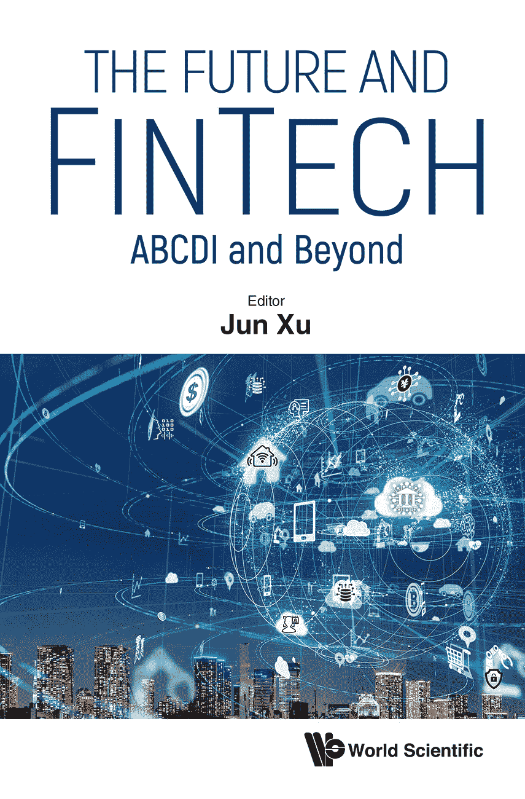

## 前言

《未来与金融科技》探讨了基础金融技术及其对银行、金融服务和保险（BFSI）行业日益增长的影响。2020 年全球投资超过 1000 亿美元，金融科技的普及奠定了支付、贷款、财富管理、保险和数字资产的发展方向。

本书从工业视角出发，结合架构及其基本构建模块（例如 `Artificial Intelligence (AI)`、`Blockchain`、`Cloud`、`Big Data`、`Internet of Things (IoT)` —— 此后我们将这五种技术简称为 `ABCDI`）及其与实际工作应用的联系，阐述了金融科技。它详细指导了金融科技如何在一些新概念（如 `AIOps`、`MLOps` 和 `DevSecOps`）的帮助下，实现业务运营数字化、提高生产力和效率、优化资源管理。读者还将发现金融科技创新如何通过日益增长的 `Open Banking`、`Banking-as-a-Service (BaaS)` 和 `FinTech-as-a-Service (FaaS)` 将 BFSI 与世界其他领域连接起来。

为了帮助读者理解金融科技如何为挖掘庞大的实质性客户群体解锁了无数机会，本书通过实际案例和应用，配合示意图和汇总表，展示了正在进行的大规模变革，并提供了对未来变革的洞见，使本书成为涵盖所有金融科技事项的实用速查手册。

本书的组织结构如下。第 1 章“金融科技创新与战略”，概述了金融科技行业及其创新应用和发展战略。深入讨论了挑战、风险和机遇，并提出了一些潜在解决方案。第 2 章“金融科技的技术基础：ABCDI 及更多”，进一步解释了金融科技背后的基础技术及其功能、相互间的交互，旨在使非技术读者能从概念上理解金融科技。

第 3 章“人工智能理论及其在金融行业的应用”，讨论了 AI 理论及其在金融行业的应用。从通用 AI 分类法和方法论入手，随后总结了不同业务领域的典型应用。负责任 AI 和可持续 AI 等热门话题连同其发展趋势一并探讨。第 4 章“金融行业的 AI 公平性：一种机器学习流水线方法”，聚焦于 AI 伦理的一个具体主题——公平性与偏见如何在整个机器学习（ML）生命周期中纠缠不清。流水线中的关键点通过实质性的工作流图表和清单得以突出。第 5 章“知识图谱及其在金融领域的应用”，阐述了知识图谱对金融服务的重要性。介绍了构建和维护业务知识图谱的实用方法，并通过一个简化的示例用例进行了说明。

第 6 章“从传统金融市场向数字资产世界的迁移”，和第 7 章“央行数字货币：后疫情时代的机遇与挑战”继续讨论基于区块链和 DLT 技术的数字资产。特别是第 6 章探讨了从传统金融市场向数字资产世界迁移过程中的变化与挑战，而第 7 章则对央行数字货币（CBDC）及其机遇、框架、挑战和技术进行了深入研究。涵盖了包括技术可用性、资产负债表影响和法律框架在内的最新发展状况。还研究了一些用例，例如新加坡的 Ubin 项目。

## 第 8 章和第 9 章：数据管理

第 8 章“大数据时代数据管理中的人工智能与机器学习”，展示了大数据时代 AI 和 ML 用于数据管理的方法论、解决方案和平台。还介绍了企业数据管理中广泛集成 AI/ML 的案例研究，以及相关的挑战和未来方向。

第 9 章“利用云基础设施进行数据集成的技术与策略”，概述了用于数据集成的云数据技术及其战略意义。除了用于数据摄取、存储、处理和生命周期管理的常见云服务外，主要云平台、领先数据技术公司和开源社区还提供各种工具，用于实现数据安全和敏感数据管理。还介绍了一家领先金融服务公司如何利用云数据基础设施实现银行业务数字化的案例研究。

## 第 10 章和第 11 章：物联网 —— 智能家居与生物识别

第 10 章“面向金融服务的智能家居：安全、隐私与解决方案”以及第 11 章“金融科技中的生物识别：技术综述”，探讨了物联网中的两个重要主题 —— 智能家居和生物识别。智能家居是物联网最普遍的应用之一。物联网设备感知的生物识别信息，例如语音、人脸、指纹和行为，可用于验证个人身份。除了家电控制，借助 AI、区块链、云和生物识别技术，智能家居未来可能成为具有增强安全性的综合金融服务个人金融中心。第 11 章进一步解释了生物识别的技术、应用、挑战和未来方向。

## 第 12 章至第 14 章：数字化转型的 DevOps

第 12 章至第 14 章强调了数字化转型最重要的技术之一 —— DevOps，即开发与运维在生产化生命周期中的集成。

第 12 章“DevOps：加速金融应用交付上市”，概述了 DevOps。敏捷和 CI/CD 概念及其工具（例如 `microservice` 和 `Docker`）也得到了解释。还重点介绍了金融行业的一些 DevOps 成功案例。

第 13 章“DevSecOps：在金融应用的 DevOps 中集成安全”，进一步将安全顾虑融入 DevOps，并分析了 DevSecOps 的现状及其挑战、实践和工具。

第 14 章“金融行业的 MLOps：理念、实践与工具”，将 DevOps 应用于 AI/ML 生命周期以实现 MLOps，这可以大幅降低 ML 采用成本，并提升银行、金融服务和保险业的 AI 责任。提供了关于如何在大型银行实施 DevOps、DevSecOps 和 MLOps 的案例研究。

## 第 15 章：开放银行生态系统

第 15 章“开放银行生态系统及其演变”，展示了开放银行结合 `BaaS` 和 `FaaS` 为平台化生态系统带来的力量。讨论了它们在不同国家的实施策略和顾虑。特别地，我们重点介绍了它们在中国的发展，并认为随着金融科技的融合，未来的银行业将更加开放和智能。

## 致谢

在本书筹备期间，编辑得到了汇丰银行众多同事和校友的支持。在此仅列举几位 —— 夏勇博士、徐亚历克斯、金新明博士、Amy Shi-Nash 博士、叶伊罗斯、徐国清博士、许雯妮、陈文妮、范山姆、赵江、陈亚当、刘爱德华、刘安德鲁、顾杰、吴罗宾、郑谢尔、钱克洛伊、Sandeep Sharma、Dave Vijay、罗阿斯特、李乔、刘丹尼尔、Chioma Anyanwu-Akpom、Jennifer Doherty、何伟、姚马可、韩亚历克斯等。一些朋友也帮忙审阅了部分章节 —— 乔马丁博士、刘马克、吴维克多、刘肯尼斯、何奔跑。我目前的同事也提供了很大帮助，人数太多无法一一列举。特别感谢我的妻子吴格蕾，她通读了全书并提供了许多有用的建议。作为全球领先高科技公司的高管，在成为本书的首位读者后，她对金融科技的理解呈指数级增长，这标志着本书是技术领导者和非技术管理人员的理想指南。深深感谢出版社的 Yan Hong Ng 博士、Amanda Yun 和 Karimah Samsudin 的专业支持。

徐军

2022 年 3 月

© 2022 世界科学出版公司

[`doi.org/10.1142/9789811250903_fmatter`](https://doi.org/10.1142/9789811250903_fmatter)

## 编辑与贡献者简介


**徐军博士** 是一家顶级金融机构的机器学习（ML）工程总监，也是华南理工大学（SCUT）的客座教授。他曾任汇丰银行数据科学家高级副总裁、西部数据首席工程师和淡马锡实验室研究科学家。他还曾在国际期刊和会议（如 *Unmanned Systems*、ICCA 和 ICARV）担任编辑职务。他是电气电子工程师学会（IEEE）高级会员。

他的跨学科工作经验包括人工智能（AI）、机器学习（ML）、金融科技、数据存储、机器人技术、物联网（IoT）、大数据、云计算、数字化转型、系统架构、优化与建模。他出版了 3 本书，拥有 16 项专利（及申请中），并发表了约 60 篇同行评审论文。他获得中国东南大学理学学士（BS）学位，以及新加坡南洋理工大学（NTU）博士学位。

他是本书的编辑，也是第 1 章–第 4 章、第 10 章、第 11 章、第 14 章和第 15 章的作者。


**葛志宇博士** 是资深定量风险与估值分析师，汇丰银行高级副总裁。他是大数据和机器学习领域金融技术创新的爱好者，助力银行实现更数字化和数据驱动。加入汇丰银行前，他曾任贝莱德定量风险与分析团队副总裁，以及美林投资管理公司固定收益定量分析师。他以优异成绩获得加州大学伯克利分校统计学博士学位。

他是第 5 章、第 8 章和第 9 章的作者。他还为第 3.2 节贡献了部分内容。


**胡 Steven 博士** 是一家领先银行集团的数字资产执行总监。在这个角色中，他专注于建立银行的数字资产能力，推动数字货币、资产代币化等领域的举措，以及孵化新业务模式。

此前，Steven 在汇丰银行领导分布式账本技术（DLT）项目，隶属于全球流动性与现金管理业务。他专注于 DLT 战略和路线图的制定，利用分布式账本推动支付领域的创新。Steven 领导专家团队创建了汇丰银行的链上支付解决方案，通过连接基于区块链的生态系统，使多方参与者能够以多种货币近乎即时、全天候地进行交易，从而简化支付流程。其团队解决方案获得的行业奖项，如 The Assets Triple A 最佳数字协作奖，证明了他的工作成果。加入汇丰银行之前，他曾在法国巴黎银行等国际银行以及推动数字化转型议程的技术公司工作。

### 史蒂文·胡（Steven Hu）

史蒂文是全球数字金融咨询委员会成员、新加坡区块链协会数字货币分委会联合主席。他担任多个国家级金融科技资助计划的资助评审员。他曾在多家央行的咨询/工作委员会任职，致力于批发型和零售型央行数字货币（CBDC）的设计工作。史蒂文毕业于新加坡国立大学，获博士学位。他持有多项金融科技和技术专利，并发表了多篇期刊/会议论文。他最近的一项名为“区块链与链下处理的集成”的专利提出了一种新颖的“始终在线”且可编程的银行支付技术，与央行数字货币和稳定币并行。他经常在国际会议（如新加坡金融科技节）上就“货币的未来”发表演讲。

他是第 7 章的作者。


### 周继海博士

周继海博士毕业于英国伦敦帝国理工学院，获博士学位。他曾在不同银行（巴克莱银行、汇丰银行、瑞银集团等）和腾讯工作，拥有 10 年以上领导 DevOps/DevSecOps 转型的工作经验。2018 年至 2021 年间，他以演讲者身份出席了在不同国家举办的 30 多场技术会议（如开源峰会、DevOpsDays 等），分享其在 DevOps/DevSecOps 方面的经验。2021 年，其首部著作*《DevSecOps 指南与实践》*在中国出版。

他是第 12 章和第 13 章的作者。


### 唐弗兰克博士

唐弗兰克博士是 QBN Capital 的管理合伙人。弗兰克毕业于哥伦比亚大学，获博士学位，曾在 IBM 研究院工作，随后在香港中文大学（CUHK）担任终身教职。后来他加入 TDK 株式会社，负责光学业务单元。此后，弗兰克在多家机构担任高级管理人员，包括汇丰银行、香港应用科技研究院（ASTRI）和海信。他目前是香港中文大学的兼职教授，以及我们香港基金会研究委员会的成员。

他是第 6 章的作者。


### 张玉玲女士

张玉玲女士就职于德勤云咨询。她毕业于香港科技大学（HKUST），获金融科技理学硕士学位并获得优秀奖学金。2018 年，她通过香港金融管理局推出的“金融科技职业加速器计划”加入汇丰银行 IT 创新部门。她在香港、新加坡和中国大陆的金融科技领域拥有工作经验。

她是第 15 章的作者。


### 戚菲莉亚女士

戚菲莉亚女士曾任英国政府科技政策顾问。她非常熟悉英国和欧洲的科技生态系统及投资格局，以及与开放银行、数据保护和数字经济相关的政策。她目前领导 QBN Capital 的金融科技和深度科技风险投资，重点关注区块链、人工智能、网络和数据安全，业务覆盖英国和香港。戚菲莉亚在科技领域拥有广泛的人脉，连接大学、风险投资机构和公共部门机构，具有独特优势，能够架通东西方。

她是第 6 章的作者。

# 第 1 章

## 金融科技创新与战略

### 徐军

### 1.1 背景

COVID-19 大流行给全球金融机构（FI）带来了诸多变化和挑战。自 2021 年初以来，许多国家开始放宽封锁限制，金融机构成功应对了 COVID-19 危机的即时压力，并认识到在这种新常态下数字化转型的重要性。这种情形在后疫情时代很可能会持续下去，因此，在我们能够彻底消除严重流行病威胁之前，数字化转型将成为许多组织生存的关键条件。

数字化对大多数金融机构并非新概念——移动银行和网上银行多年前就已向客户提供，数字化运营平台的可用性使银行员工能够远程监控、操作和管理部分内部资源。COVID-19 大流行加速了金融机构的数字化进程，因为客户期望在疫情期间发生了变化，这些变化给大多数金融机构带来了新挑战，但也将帮助它们应对疫情带来的更严峻的经营环境。新风险正在涌现，银行业务模式和监管正在接受考验。

金融科技（简称 FinTech）是帮助金融机构克服一个又一个挑战的主要力量之一。尽管现代金融科技通常被认为始于 2008 年，但金融科技的历史甚至可以追溯到 150 多年前。金融科技最初被定义为旨在与传统金融方法和模式竞争、提供新型金融产品和服务的技术和创新。从更广泛的意义上讲，它可以是“任何根据不同业务场景提出技术解决方案以改进金融服务流程的创新理念，这些理念也可能催生新的商业模式甚至新的商业机会”。因此，金融科技可以是金融服务行业中具有端到端流程的任何新应用、新流程、新产品或新商业模式。

金融科技的进步既由新技术发展驱动，也由新业务需求驱动。例如，中国无信用卡人群的金融需求和肯尼亚无银行账户人群的需求，加上智能手机的广泛使用和互联网的增长，分别加速了中国支付宝和微信支付，以及肯尼亚 M-PESA 的推出。这些新需求也在不断演变。

### 1.2 金融科技分类学与范围

金融科技公司已抢占先机，并推出技术以变革金融服务，特别是在客户体验、流程自动化和决策制定领域。如今，我们已见到许多颠覆性力量，例如金融机构通用服务的成本商品化、价值链中的利益重新分配（金融科技公司与金融机构间形成新的合作伙伴关系形式）、客户界面与主导平台的体验所有权、数据的实时变现、智能机器人增强人类能力等[1]。所谓即将到来的“银行 4.0 时代”意味着，您的银行要么通过技术融入世界，要么将不复存在[2]。

四大类金融科技公司正在推动这一演变[1]：

*   第一类是金融科技初创公司，通常规模中小，但在特定领域拥有新技术和/或新商业模式。该类别中的领军企业包括 `Stripe`、`Revolut`、`Chime`、`Klarna` 和 `coinbase`。
*   第二类包括一些传统信息技术（IT）基础设施和服务提供商，如 `IBM` 和 `CISCO`。这些公司在数字化和现代化方面建立了强大能力，可协助金融机构驾驭技术转型之旅。
*   互联网和云计算巨头，如 `Google`、`Microsoft`、`AWS`、`Alibaba` 和 `Tencent`，属于第三类。它们凭借大规模客户群构建了自己的生态系统，其中一些可能拥有自己的金融基础设施和服务，例如 `Apple Pay`、`Alipay`（支付宝）和 `WeChat Pay`（微信支付）。许多深远的颠覆源于这些科技巨头。通过利用其生态系统中的社交平台，这些科技巨头成功将商业模式从单一业务线转型为渗透至我们日常生活的多元业务线。
*   第四类是传统金融机构，它们积极参与金融科技的采用、开发和孵化。事实上，许多金融机构已开始在整个价值链（包括业务逻辑、商业模式、运营模式、风险控制等）进行该领域的战略规划。在中国，大多数大型银行，如 `China Merchants Bank`（招商银行）和 `PingAn Bank`（平安银行），都拥有自己的金融科技子公司。

虽然一些金融科技初创公司已对市场产生重大影响，例如 `Stripe`、`Klarna`、`Plaid` 和 `Robinhood`，但许多其他公司仍在与现有巨头竞争中挣扎，并探索另类金融基础设施。部分公司可能选择与金融机构合作作为替代方案。

相比之下，成功的现有金融机构拥有与金融科技公司合作的自由，以伙伴关系和/或收购的形式构建创新与新能力的生态系统。在大多数情况下，金融科技公司对金融机构具有互补性，而后者是前者最大的客户。加速的变革正推动着从成本与产品领导力向业务敏捷性的转变——公司构建新能力和伙伴关系的速度决定了其成败。

尽管即使金融科技市场近期已增长至约 1000 亿美元规模，新进入者仍可能面临更多挑战，但金融科技生态系统的发展和金融基础设施的开放也降低了准入门槛。我们相信，更多金融科技初创公司将涌现于市场，尽管风险投资（VC）的直接投资在疫情期间略有下降。前 100 家 VC 支持的金融科技独角兽总估值超过 5000 亿美元，越来越多的金融科技独角兽正在全球资本市场寻求 IPO 机会。请注意，金融科技公司面临技术、经济和监管环境带来的挑战。例如，在探索阶段，过度宽松的监管环境往往导致快速但野蛮的发展。在中国，这促成了许多金融科技公司的成功，如 `Ant Technology`（蚂蚁科技，`Alipay`支付宝）和 `JD Digital`（京东数科）。然而，中国近期的监管变化将金融科技置于与银行相似的监管之下。甚至处于“太大而不能倒闭”类别的公司，如 `Ant technology`（蚂蚁科技）、`WeBank`（微众银行）和 `JD Digital`（京东数科），也可能面临一些新挑战。

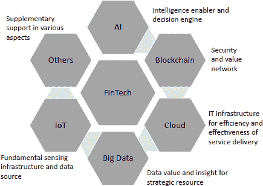

**图 1.1.** 支撑金融科技的主要技术——ABCDI 及其他

#### 1.2.1 推动金融科技的基础技术

过去 20 多年来，一些主要技术，如人工智能（AI）、区块链（及分布式账本技术，即 DLT）、云计算、大数据、物联网（IoT）等，如图 1.1 所示，加速了金融科技的整体发展，推动了商业模式重构，并影响了金融行业的竞争格局。^(1) 当今的技术进步有望重塑明天的金融版图及更长远的未来。

第 2 章将提供关于这些技术及其在金融机构中通用适用领域的更多细节，以构建本书自包含的内容体系。

#### 1.2.2 通用领域

金融机构提供广泛的服务（参见第 1.7 节，附录 1.1 了解银行业基础设施示意图）。随着数字化成为金融服务行业的主流实践，当今的金融科技创新主要也聚焦于数字服务。

##### 1.2.2.1 数字支付


支付格局在过去 20 年里发生了剧变，从在线支付（如 `PayPal`、`Stripe`）、移动支付（如 `Apple Pay`、`AliPay`、`WeChat Pay`），到加密货币支付（如 `coinbase`）。无卡支付现已成为许多国家的主流模式。

在中国大多数三线及以上城市，由于电子商务的爆发式增长，产生了对用户友好、安全在线支付服务的巨大需求，移动支付已成为主流。2018 年，中国约 83% 的支付通过移动支付完成，用户总数于 2020 年增至 8.5252 亿。他们享受着来自 `Tenpay`（财付通，`Wechat Pay` 微信支付或 `QQ Wallet` QQ 钱包）、`Alipay`（支付宝）、`China Union Pay`（中国银联）及其他支付应用的便利。[它们都属于无卡支付模式。]

全球支付网络不仅为全球规模的商户开辟了新机遇，也帮助消费者通过数字移动设备顺畅地享受金融服务。根据 Finaria 的一份报告^(2)，全球数字支付市场规模预计将从 2020 年的 5.4 万亿美元增长至 2021 年的 6.6 万亿美元。

正如本书其他章节所述，数字支付有望通过 AI 技术变得更智能（见第 3 章），通过增强的生物识别技术变得更安全（见第 11 章），并通过加载在各种场景智能边缘设备上的物联网技术变得更便捷、更友好（见第 10 章）。

### 1.2.2.2 数字借贷

数字借贷被定义为利用技术发起和续贷，以提供更快的服务和决策、更好的客户体验以及更具成本效益的产品。数字化流程始于信息收集（如在线申请表、征信档案等）、信息处理（如身份证件光学字符识别（`OCR`）、为了解您的客户（`KYC`）进行实体识别等），并涵盖决策制定（基于规则和 AI 模型的数据洞察）及贷后催收（如贷款状态监控、自动通知、自动外呼等）。

# 数字借贷平台

数字借贷平台可由银行、非银行金融公司（`NBFC`）和金融科技公司构建。存在多种模式，例如销售点（`POS`）交易型借贷、市场模式和点对点（`P2P`）借贷。为满足新一代客户的需求，服务提供了更高程度的个性化。换言之，专业的数字贷款机构正试图大规模了解客户的特定需求，以定制其贷款要求。

由于 2010 年代初期缺乏重大监管，中国的在线借贷行业在过去十年中迅速增长，导致市场上出现大量参与者。另一方面，这给整个中国市场带来了潜在的系统性金融风险。过去几年，中国金融监管机构发布了越来越多的监管要求。例如，中国的 `P2P` 平台在 2017 年达到约 5000 家高峰，随后在 2020 年底随着日益收紧的监管几乎降至零。事实上，如果没有足够的借贷风控，那些在野蛮增长下的平台一旦整个行业的蛋糕急剧萎缩，将难以生存。只有极少数平台已转型为金融科技服务平台，通过与银行和其他金融机构合作提供风险准备金。显然，监管机构不想“扼杀”创新，而是要为整个生态系统培育一个更健康的环境。例如，花呗和借呗等小额贷款平台曾是年轻人的主要金融平台。现在它们被要求增加资本储备、停止小额贷款与其他金融产品的不当关联、降低信用额度等。

尽管发生了上述监管变化，全球数字借贷市场规模仍在快速增长。根据 Mordor Intelligence 数据，预计到 2026 年将达到 5872.7 亿美元，高于 2020 年的 3110.6 亿美元，预测期内（2021–2026）复合年增长率（`CAGR`）约为 11.9%。^3

## 数字融资

数字融资与数字借贷（如 `P2P` 借贷）密切相关。事实上，它们通常集成在同一平台中。众筹是数字融资的基本形式之一，即通过从大量人群中筹集少量资金来为项目或创业提供资金。它大致可分为投资型和非投资型众筹。前者通常涉及股权、收入、利润分成、房地产和大宗商品，而后者通常与捐赠和/或奖励相关。

众筹的一种流行方式是通过区块链或分布式账本技术（`DLT`）支持的数字代币进行。例如，2010 年代上半叶著名的首次代币发行（`ICO`）是一种投资者用法定货币和/或加密货币兑换数字代币以参与项目的方式。代币代表持有者相对于发行人的权益或履约权利。发行数字代币的方式已从 `ICO` 迅速演变为首次交易所发行（`IEO`），即由交易所收集代币、发行并出售。2010 年代中期，它继续演变为证券型代币发行（`STO`），其中发行的数字资产旨在遵守适用的证券法规。随着全球监管机构开始制定数字代币监管框架，发行方和投资者正转向其他能够符合适用法规的数字融资解决方案。一些平台（如 `Globacap` 和 `Realbocks`）属于这一类别，它们结合区块链和机器学习（`ML`）提供统一的数字融资解决方案。

## 数字储蓄

数字储蓄解决方案（如 `SaveBetter` 和 `Qapital`）通常比传统储蓄账户更灵活、更快捷。在许多情况下，数字储蓄账户是客户开设的第一个账户，且提供的收益率高于实体银行。一些数字平台将储蓄、投资、预算和借贷功能整合到一个统一的财富管理工具中。

## 财富管理与投资

机器人顾问的出现改变了财务顾问与客户互动的方式。传统上，财务顾问提供与投资管理、财富管理及其他金融服务相关的建议，并收取费用。机器人顾问依靠人工智能（`AI`）和机器学习（`ML`）提供财务规划和投资建议，与传统投资顾问相比，机器人顾问提供的服务通常相同或更先进，且成本更低。虽然机器人顾问被认为是基本投资决策的最佳选择，但它们可能不适合复杂决策，例如与房地产规划相关的决策。许多银行（如中国四大国有银行和新加坡三大本地银行）在其移动应用中提供机器人顾问。

根据 Statista 数据，机器人顾问管理的全球资产（`AUM`）预计 2021 年将达到 1.427 万亿美元，高于 2020 年的近 1.1 万亿美元，预计将以 18.83% 的年增长率增长（2021–2025 年 `CAGR`）。^4

其他创新形式包括量化顾问（机器人顾问的延伸，专注于投资策略的主动管理）、机器人养老（机器人顾问的另一延伸，专注于养老投资组合）、具有算法交易和社交交易功能的交易平台（机器智能与专家知识的结合；也称为数字经纪）以及微投资（通过小额信贷或小额投资促进储蓄和投资）等。

该领域所有这些金融科技创新共享一个新术语：财富科技（`WealthTech`），即利用技术和扎实的金融知识进行投资的新方式。

## 保险

保险科技（`InsureTech`，也称为 `InsurTech`）是指金融科技应用于保险行业的术语，即利用技术创新提高现有保险行业参与者的效率，如直接保险公司（专属代理人）、智能保险规划与管理、保险市场（聚合器）和 `P2P` 保险等。

我们以 `P2P` 为例进行说明。随着共享经济的兴起，`P2P` 保险网络不断发展。第一家 `P2P` 保险公司 Friendsurance 于 2011 年在德国成立。此后，Guevara、Lemonade、Uvamo、insPeer 等许多保险公司推出了 `P2P` 保险网络。它们通常服务三类客户：(i) 为自己风险投保者，(ii) 为他人风险投保者，(iii) 通过收取保费为他人风险投保者。

一些数字化保险公司（如 `Clover Health`、`众安保险`、`Root Insurance`、`PolicyBazaar`、`Lemonade`、`Acko`、`PolicyStree`、`SingLife` 和 `DirectAsia`）致力于提供负担得起且个性化的保险产品。它们通常利用 `AI`、大数据分析、区块链和物联网（`IoT`）来构建客户画像、强化风险管理、快速优化产品功能并提升客户体验。

根据 Allied Market Research 数据，全球保险科技市场预计到 2030 年将达到 1589.9 亿美元，2021 年至 2030 年复合年增长率为 32.7%。^5

## 数字货币：加密货币与央行数字货币

# 数字货币

数字货币，也称为数字资金、电子货币、电子币或网络货币，是仅以数字或电子形式存在的货币。所有加密货币都是数字货币，但并非所有数字货币都是加密货币。加密货币的主要特征是去中心化。这意味着货币不受任何中央机构（如中央银行）的控制。加密货币的主要原则是加密（因此得名）。每个单位都有自己的代码或哈希值。该代码作为每个单位的唯一标识符。自第一种加密货币比特币问世以来，市场上已出现数千种加密货币，例如以太坊、莱特币、点点币、`EOS`、卡尔达诺等。

尽管人们对加密货币的信任度正在上升（例如，电动汽车制造商特斯拉允许使用比特币支付购车款），且加密货币价值屡创新高（例如，比特币于 2021 年 4 月突破 85,000 美元/枚，以太坊于 2021 年 5 月升至 4,000 美元以上），但许多中央银行和货币当局已实施更严格的监管，以防范潜在风险，如洗钱和逃税。

另一方面，由中央银行以受监管形式发行的中央银行数字货币（`CBDC`）吸引了更多关注。在本书中，我们将不讨论哪种形式的数字货币优于另一种，因为它们的存在各有其目的。关于 `CBDC` 的更多细节将在第 7 章中讨论。

请注意，代币是数字货币最重要的形式。代币要被视为数字货币，需要满足特定条件。它必须是由中央机构（如中央银行）发行的价值单位。它必须被一个参与者生态系统所接受，这些参与者愿意用商品和服务交换该代币。同时，它必须易于存储和交易。

## 数字资产与共识服务

数字资产是一个涵盖数字货币、基金、私募股权和商业房地产的通用概念。广义上讲，它是指使用加密方法存储在区块链或分布式账本技术（`DLT`）上的任何类型的数字数据。在大多数情况下，它与实物资产相关联，如债券、股票、汽车等。它不仅包括加密货币和 `CBDC`，还涵盖软件、合约以及代表所有权的任何其他类型的数据。请注意，数字资产的托管也应予以仔细考虑。第 6 章将从多个维度讨论数字资产。

## 金融科技与监管科技

金融科技是一个宽泛的概念，因为金融服务涵盖广泛的领域（示例请参见第 1.7 节，附录 1.1）。当考虑特定领域时，金融科技可能有同义词。除了前面提到的财富科技和保险科技，银行科技（也称为 `BankTech`）是金融科技应用于一般银行业务领域的另一个术语，即为银行系统创建的新一代技术，通常使用 `AI` 和 `ML` 等方法。

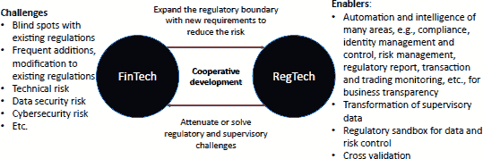

**图 1.2.** 金融科技与监管科技的协同发展

没有互补的监管科技解决方案，金融科技创新就是不完整的。监管科技是指基于技术的创新解决方案，旨在缓解监管和监督挑战，包括金融科技扩张带来的挑战，同时做到精明且安全（参见图 1.2）。

监管科技使组织能够自动化信息监控，并改进监管前提条件的程序。每项新法规都为监管科技业务部署新技术以服务金融机构和金融科技公司创造了机会 [[3]](#chap1.xhtml#rref3)。

另一个常被提及的术语是监管科技（`SupTech`，监督科技），有时会根据不同的适用主体有意将其与监管科技区分开来，即监管科技满足金融机构和金融科技公司的需求，而监管科技则为监督者和监管者提供帮助。然而，在本书中，我们将监管科技视为监管科技的一部分，即监管科技是面向监督者的监管科技。

## 从 BaaS、FaaS 到平台化生态系统

银行即服务（`BaaS`）是一种运营模式，持牌银行将其数字银行服务直接与其他非金融机构企业（如零售商、航空公司、连锁餐厅或酒店）的产品集成。因此，这些非金融机构企业可以在不拥有自己的银行牌照的情况下，提供数字银行账户、借记卡、贷款、保险、财富管理和支付服务等金融服务。对非金融机构企业而言，这是提供金融服务最可行、高效且最有价值的替代方案。由于其可扩展和敏捷的特性，它可以轻松进入新市场并快速扩张。根据不同类型的应用程序编程接口（`API`），`BaaS` 可进一步细分为借贷即服务、发卡即服务、经纪即服务等。一些典型的 `BaaS` 平台包括平安一账通、`ClearBank`、`StarlingBank`、`SolarisBank` 等。

`BaaS` 是开放银行的自然扩展（参见第 15 章），银行也为非银行企业提供 `API`，而不必整合银行的整个客户群。它还为数字银行轻松进入企业核心银行服务提供了“捷径”。

另一方面，金融科技即服务（`FaaS`）描述了另一种模式，即金融科技公司通过其 `API` 平台向金融机构提供技术服务。通过利用 `FaaS`，金融机构可以优化其端到端流程，定制产品和服务以获得更好的用户体验，并加强法律合规和内部安全机制。例如，中国的金融科技公司数禾科技提供集成的机器人流程自动化（`RPA`）、光学字符识别（`OCR`）、自然语言处理（`NLP`）和 `API`，帮助银行通过端到端管道处理其内部文件，如合同、发票、财务报表。银行可以轻松实现贷款流程和理赔流程的自动化。简化的文档分析还可以帮助识别法律文件中的潜在风险，从而结合大数据分析实现了解你的客户（`KYC`）和反洗钱（`AML`）的数字化。

`BaaS` 和 `FaaS` 的普及表明，这些新模式正在蓬勃发展，并为金融行业塑造新的机遇。它们还推动了“嵌入式金融科技”的概念，本质上是将金融功能引入现有的消费者和商业应用程序。在此背景下，分离的金融功能正与其他领域融合，例如媒体、教育、医疗、交通、社交网络等。由于来自多个领域的服务通常要求统一的认证门户以便客户享受便利，基于生物识别的数字身份可能是一个选择（参见第 11 章）。

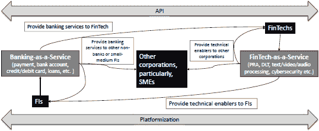

**图 1.3.** 统一的 `BaaS` 和 `FaaS`

虽然 `BaaS` 为金融机构带来了新的增长机遇，但也引入了新的风险。金融机构必须对每项 `BaaS` 产品和合作伙伴关系进行全面的尽职调查和风险评估。从这个意义上说，`FaaS` 可以提供由 `AI` 和大数据支持的风险评估与合规服务。由于 `BaaS` 和 `FaaS` 都基于 `API` 平台，二者的结合催生了一个名为“银行即平台”的新范式，如图 1.3 所示。从本质上讲，银行通过将金融科技公司的数字服务与自身的产品组合相融合，构建了一个整合的业务生态系统，从而能够通过更广泛的客户渠道（全渠道）提供更广泛的服务和产品（甚至超越金融领域）。请注意，类似的 `BaaP` 也可能由聚合服务提供商提供。一些聚合平台整合了来自金融机构和金融科技公司的各种 `API`，以提供复杂的服务。

客户可能只使用一个平台，却能享受来自多个领域的服务。因此，`BaaP` 逐渐发展其价值链并栖身于其生态系统中，影响客户日常生活的方方面面。虽然金融机构历史上向所有客户提供全套金融产品和服务，但金融科技公司开始获得关注，并主要瞄准狭窄的垂直领域和客户细分市场。亚马逊、谷歌、阿里巴巴、腾讯和京东等大型科技公司以类似的方式建立了自己的帝国，最终影响了电信、物流和制造等其他领域。

有了所有的 `API` 和平台基础设施，“开发者即客户”成为以敏捷方式推动金融科技发展的重要力量之一。取代传统的“金融机构 → 客户”路径，新路径“金融机构 → 开发者 → 客户”可能成为近未来的主流之一。此外，当银行业务被通用数字资产取代时，路径进一步演变为“数字资产 → API 平台 → 开发者 → 客户”。

### 1.3 金融科技创新

大型组织中的金融科技创新部门执行多种职能，如图 1.4 所示。它应拥有独特的资源，例如新兴技术领域的市场领先专家。它拥有从构想到解决方案成功交付创新的经验。它与全球领先的研究机构、技术供应商和金融科技公司建立合作伙伴关系。它创建沙箱环境的访问权限，以协助在安全环境中进行开发和测试。通常，它为内部和外部项目及初创公司提供资金，专门设立专项资金以加速初步评估和概念验证，快速交付创新成果。

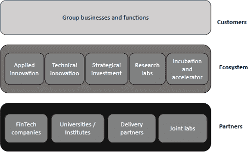

**图 1.4.** 常见的创新组织架构图

#### 1.3.1 创新组织

金融科技创新部门的核心目标包括但不限于：

*   建立内部开放共享的创新文化，孵化创新业务构想
*   通过让业务单元参与开发新技术并追求其带来的机遇来激发创新
*   教育业务部门了解新技术在解决业务问题和应对挑战方面的潜力
*   通过连接内外部创新合作伙伴来促进创新发展，实现价值最大化
*   利用沙箱环境加速并规模化交付业务赞助的实验
*   通过战略创新投资基金支持对外部金融科技公司的投资
*   鼓励与顶尖研究机构合作，探索未来技术

更重要的是，有必要为每项主要技术（如 `AI` 和云计算）的采用与开发设立首席职位。这些职位必须由具备深厚领域知识、丰富实战经验和卓越过往业绩的人士担任。他们不仅能预判技术趋势，还能洞悉技术细节。他们应成为组织技术委员会中的关键决策人，并推动组织的技术路线图。

金融机构对金融科技创新的采用大体可分为两类：(i) 应用创新和 (ii) 创新开发与孵化。前者识别、提供准入并支持跨所有业务单元和职能的技术创新交付。

应用创新团队应：

1.  向业务提供技术专长
2.  通过技术尽职调查支持战略创新投资，以准入目标公司
3.  与内部客户合作交付实验
4.  提供供应商成熟技术、产品和服务的准入
5.  与高校、研究机构和实验室合作开展金融科技项目的研发 (`R&D`)

相反，创新孵化更侧重于新技术和商业模式，这些可能尚不成熟，无法直接投入生产采用。它通常花费一年多时间研究新想法的可行性，再花一年或更长时间通过最小可行性产品 (`MVP`) 进行演示。

鼓励从政府机构获得资金以支持长期研发项目。例如，新加坡金融管理局 (`MAS`) 设有多项创新拨款，涵盖投资、数字解决方案采用、`AI`/数据分析技术采用、网络安全增强等各个方面。

#### 1.3.2 创新挑战

金融科技创新对许多银行家来说是个“性感”的概念，但对于实际执行者而言可能并非如此，因为总体上存在许多内生和外部挑战。本节也将讨论一些内部挑战。

首先，内部潜在的官僚流程和遗留系统往往是创新的主要障碍之一。由于复杂的内部政策，引入一项金融科技解决方案的审批流程耗时超过 1 年的情况并不少见，即使该方案已被行业同行采纳。许多金融机构的首席执行官、首席信息官和首席技术官等高管将其遗留核心系统视为创新的最大障碍。转型过程可能缓慢、昂贵且痛苦。因激进的“革命”导致的历史失败让许多高管望而却步。由于稳定性是其首要任务之一，核心系统及其延伸服务的创新之路变得非常缓慢。

其次，某些层级制或网格型组织架构可能损害创新的敏捷性和有效性。许多跨国公司可能在总部设有全球创新团队，同时在国家层面也共存一些团队（但可能不向全球团队汇报）。此外，部门和/或业务单元层面可能还成立了多个创新团队。在某些情况下，这种模式运作良好，例如可能存在特定的国家级监管要求，需要专门的解决方案。在其他情况下，不同的创新团队可能会争夺有限的预算/资源和高管关注。以下是这种架构中一些常见错误的示例：


*   缺乏对全球团队和本地团队角色与职责的明确界定。通常，全球团队应负责为整个组织制定并执行总体创新战略，而本地团队则应设计其国家、业务和职能层面的具体创新应用，以与全球战略保持一致。例如，全球团队可能分别为 IT 基础设施和应用创新确定 `Cloud-first`（云优先）和 `AI-first`（AI 优先）战略，并可能拥有少量供全集团参考的示范性创新项目或商业模式。当全球团队注意到多个业务单元从同一供应商采用同一解决方案用于多个应用时，应协调以实现更好的资源利用，并建立中央资源池以供内部协作。

*   缺乏针对不同层级创新团队的明确预算规划。一些创新团队具有层级汇报关系，如零售银行、批发银行或 IT 部门，因此它们不得不为这些项目争夺预算，即使这些项目的目标相同。这可能导致资源浪费和采用延迟。

*   业务主导团队与技术主导团队之间的争议。当业务团队发现内部开发竞争性产品或服务的机会时，他们倾向于聘请相应技术领域的专家（然而，招聘方往往缺乏足够经验来评判面试者），或者有时仅仅是重新安排被认为具有“潜力”能力的内部员工。这往往导致技术角色的错配。当涉及领导或决策职位时，我们可能会观察到高概率出现无效团队交付模糊战略且使用低价值工具的情况。组建一支拥有正确技能和经验的团队，并在团队中培养协作文化，是成功交付的关键。

第三，许多银行建立了自己的创新实验室（如 `DBS Asia X`、`Citi Innovation Labs` 和 `Deutsche Bank innovation labs`）、加速器（如 `Barclays Accelerator`、`Wells Fargo Startup accelerator`）或孵化器（如 `CommerzBank group main incubator`），或设立了投资基金（如 `HSBC`）。它们关注来自自身员工或 FinTech 初创公司的创新想法和举措。内部实验室或加速器通常没有长期预算。通常在 3 年的试运行期后，它们因缺乏资源和资金而难以为继。当加速器或孵化器开始与 FinTech 中心合作时，解决方案更有可能始终仅处于概念验证（`PoC`）阶段。必须在一开始就建立对产出的现实预期，例如直接的业务影响和投资回报率（`ROI`）。

### 1.4 创新技术平台

健康的创新文化应当是开放和共享的。因此，对于大型组织，我们建议构建如图 1.5 所示的三大支柱平台。

第一个平台是用于 FinTech 实验。这是一个统一平台，用于将内部 FinTech 能力输出给所有集团业务和集团职能单元（`GB/GF`），例如基于 `AI/ML` 的分析、基于 `Blockchain` 的安全、基于 `Big Data` 的数据处理以及基于 `Cloud` 的可扩展性。每项主要技术可能都有其专用门户，包含图 1.6 所示的三个组件，分别是：

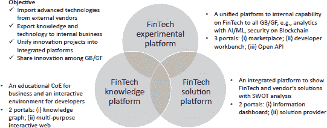

**图 1.5.** FinTech 平台的三大支柱

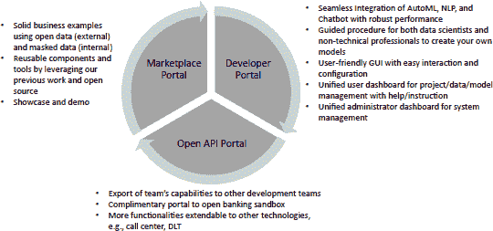

**图 1.6.** AI 平台中的三个门户

*   **开发环境和工作台。** 工作台通常是特定技术的集成开发环境（`IDE`）或用于配置的 Web 用户界面（`UI`）。开发人员使用此工作台交付项目；有时会提供沙箱，用于在安全的实验环境中进行 `PoC`。

*   **市场。** 它展示一些内部现有的技术应用，可能连同指向用例的演示链接。用户可以轻松发现在其自身领域内潜在的复用和再生机会。同时，冗余资源也可在此处出售或共享。

*   **开放 API。** 该组件将相应技术的能力直接导出给开发人员或最终用户，以便他们通过简单的 API 调用即可获得该能力。

第二个是 FinTech 知识平台。这是一个面向业务的教育卓越中心（CoE）和面向最终用户的交互式环境，旨在推广创新文化。图 1.7 列出了该平台中发挥关键作用的核心组件，例如：

*   **带可视化的知识图谱（`KG`）。** FinTech 领域知识以 `KG` 的形式重新组织，以便于推理。网络化可视化使用户能够方便地找到关联信息。第 5 章将提供关于 `KG` 的更多信息。

*   **多功能交互式聊天机器人和 Web。** Web `UI` 提供一个中央门户，用于搜索知识、按类别筛选用户发现，并提供问答功能。

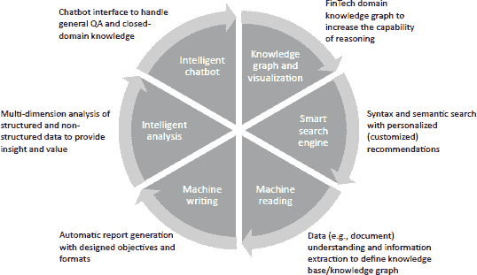

**图 1.7.** 知识平台的组件

第三个是 FinTech 解决方案平台。这是一个集成平台，用于演示 FinTech 解决方案（主要来自供应商）并进行业务分析（例如 `SWOT`）。对于大型 `FI`（金融机构），极有可能联系或咨询数百家 FinTech 供应商以寻求潜在解决方案，随后由不同业务单元（`BUs`）进行评估。尽管其中一些已记录在内部知识库（如 `Confluence`）中，但大多数仅在小范围内共享，组织内的大多数受众并不知情。因此，解决方案共享平台有助于推广处于不同阶段（包括听闻、联系、评估、 `PoC`/演示和产品化）的潜在解决方案。它有助于实现以下目标：

*   收集技术提供商（特别是 FinTech 公司）的知识和信息；
*   教育业务负责人了解业务应用的必要性和可行性；
*   通过 `AI`（如 `KG`）提供用例与解决方案提供商之间的业务需求映射/匹配；
*   将创新团队的咨询能力输出给 `GB/GF`。

该平台包含图 1.8 所示的以下组件：

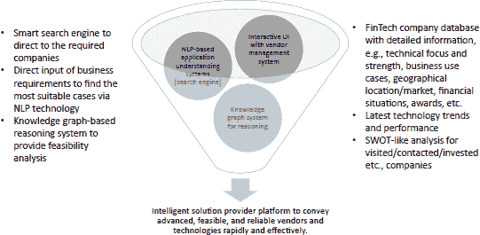

**图 1.8.** 解决方案平台

*   **带分类解决方案提供商的信息仪表盘。** 这与供应商管理系统集成。应为供应商解决方案打上多个维度的标签，例如业务领域、应用技术等。
*   **带筛选和推理的智能搜索引擎。** 该引擎也可利用 `KG` 的优势。例如，用户只需输入其项目背景和范围即可找到潜在解决方案。

这三大支柱相互紧密关联。例如，知识平台可作为其他两个平台的“帮助”图标。实验平台和解决方案平台中的用例可相互参考，以判断相似性和相关性。用例也可用于阐释知识平台中的概念。

由于许多组织可能已拥有一些类似的仪表盘或组件，建议的平台可直接将它们集成为统一门户作为起点。例如，所有平台均可通过访问控制（如认证和授权）经由统一门户访问，以便只有获授权人员才能访问适宜的内容。

让我们分别以 `AI` 和 `Blockchain` 的实验平台为例。`AI` 和数据分析平台可提供以下功能：

#### AI 平台目标

*   通过市场展示内部分析能力，特别是 AI 和 ML。
*   为技术和非技术人员提供 AI/ML 概念验证（PoC）项目的快速开发平台。
*   通过 API 和工作台将能力导出并共享给各个研发团队。

图 1.9 展示了该 AI 平台的一个示例结构。关键在于通过数据中台共享数据（见下一节）以及在 MLOps 概念下共享 ML 平台（见第 14 章），并包含一些核心组件，例如 `Jupyter lab`、`DataRobot`、`Seldon`、`HopsWorks` 等。通过可扩展的云服务和容器技术，统一门户可以触达组织内的更多用户。

```
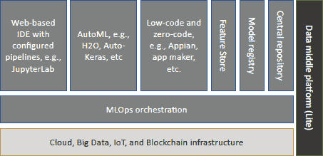
```

**图 1.9.** AI 平台的示例结构

#### 区块链实验平台目标

用于创新的区块链实验平台旨在：

*   利用容器技术支持多种区块链/DLT 技术，例如 `Corda`、`Hyperledge`、`Ethereum` 等。
*   展示区块链/DLT 的知识和技术。
*   让业务负责人了解业务应用的必要性和可行性。
*   为区块链/DLT 概念验证（PoC）项目提供快速开发平台。
*   将咨询和开发能力输出至 GB/GF。

### 1.5 基础设施创新

创新平台高度依赖 IT 和数据基础设施。然而，拥有悠久历史的大型金融机构（FI），如汇丰银行、渣打银行、花旗银行和纽约梅隆银行，总是拥有庞大的遗留系统，这是前述创新步伐缓慢的根本原因。单一平台的开发和/或不同平台的集成是部分银行在近期的首要任务之一。

大多数银行采用渐进式现代化方法，如果当前系统能在未来 5 到 10 年内稳定运行，这是一个稳妥的选择。其本质是保留遗留核心平台，但逐步削减其功能，并在其周围构建现代架构。换句话说，这是一种双模架构，包含传统核心（通常是封闭的、孤岛式的中心化架构）和数字核心（通常是开放的、云端的分布式架构）。然而，对于“新”银行和近期的数字银行，它们可能会用新技术栈完全替换核心架构，或从零开始构建新技术栈。

当数据成为金融机构最重要的资产时，数字核心的关键组件之一就是数据平台。从数据仓库、数据湖到湖仓一体和数据网格/数据织构，数据平台经历了持续演进。自 2014 年阿里巴巴建立所谓的数据中台战略以来，类似概念已逐渐被许多中国金融机构采纳。数据中台包含三大核心组件 [4, 5]：

*   **`OneData`** 本质上是一个数据管理系统。它包括全局数据仓库/数据湖规划、数据规范定义、数据建模研发、数据接入抽取、数据运维监控、数据资产管理工具等。
*   **`OneEntry`** 是用于数据探索、数据分析和其他服务的数据资产目录。它使业务部门和开发部门的用户能够在平台上协作创造数据价值。
*   **`OneService`** 为业务系统提供各种服务 API 以供直接调用，支持实时和批处理任务，例如基于跨数据库平台（如 `Hadoop`、`Spark`、`Oracle` 等）的统一类 SQL 接口主题数据服务和多样化功能。该组件可以是轻量级的（例如仅提供基础数据服务）或重量级的（例如高级数据分析和 ML 服务）。

`OneData` 是 `OneEntry` 和 `OneService` 的基础。数据中台解决了金融机构的一些痛点，例如：不同业务单元（BU）的数据孤岛、大量重复的重复性数据建设、缺乏统一的数据模型和目录、业务与开发部门沟通低效、薄弱的数据治理体系、对业务变更响应缓慢等。

数据中台可能对内部流程、服务和产品产生重大影响。在第 1.8 节，附录 1.2 中，讨论了统一的三道防线（3LoDs），其中审计即服务（AaaS）成为一种可嵌入业务生命周期的可能解决方案。同样，我们可以拥有所谓的合规即服务、风控即服务、法务即服务、财务即服务等。它们可能共享一些通用的技术和数据核心，但将其特定领域应用抽象为一种服务。

统一数据平台的进一步发展可能导致未来基于云的银行架构，如图 1.10 简化所示，其中混合云可能融合以提供智能 IaaS。专用金融 PaaS 可支持比通用云服务更高的安全级别；BaaS、FaaS 和 BaaP 可协同工作，提供嵌入我们日常生活各种应用中的更广泛银行服务。

```
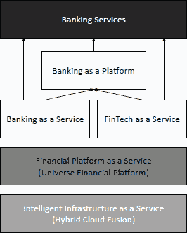
```

**图 1.10.** 云端未来银行架构

然而，在许多金融机构内部构建这样一个平台并非易事。第 8 章和第 9 章分别从云和 AI 的角度提供了一些通用指导；第 12 章至第 14 章则从技术开发和运营的角度进行了讨论，即 DevOps、DevSecOps 和 MLOps。尽管存在通用指南，但在设计数据中台时，金融机构在组织架构、数据需求、数据基础和数据应用能力等方面可能存在差异，这不可避免地导致建设和实施策略的巨大差异。随着外部和内部环境的变化，数据中台也在不断演进，不存在“放之四海而皆准”的解决方案。金融机构应根据自身需求选择解决方案，而非“大而全”的方案，后者往往导致工具的臃肿堆砌，进而导致成本高昂但效率低下的平台。金融机构在设计阶段也可应用“平台的平台”概念。

### 1.6 挑战、风险与机遇

在前几节中，我们已就监管环境和基础设施需求方面讨论了金融科技公司面临的挑战和风险。在此，我们列出其他挑战、风险和潜在机遇。

首先，随着 AI 和大数据分析在金融科技中应用越来越多，数据安全和隐私保护成为一大关注点。客户应像掌控其他个人资产一样，完全掌控自己的个人数据。金融科技公司不应滥用数据和违反数据法规以获取优势。另一方面，如何明智地利用客户数据进行业务分析已成为热门话题。

其次，随着更多金融科技解决方案应用于金融行业，网络安全问题将变得更加严峻，例如：金融机构内部金融科技解决方案的第三方访问、具有多个网关的云迁移、遗留系统与金融科技系统之间的系统复杂性与兼容性、具有多种服务的数字平台集成、洗钱、欺诈交易和恶意软件攻击等。金融机构始终面临网络安全威胁的压力，因为潜在的数据隐私违规、数据泄露、资金损失和声誉受损容不得半点差错。因此，金融机构在该领域投入巨资以实现多层次防护。同时，客户也接受了网络安全重要性的教育，金融科技公司可以利用数百个风险点中的一个或几个方面来开发其独特的产品和服务。

#### 第三部分：可持续与绿色金融

从可持续与绿色金融的角度来看 [[6]](#chap1.xhtml#rref6)，根据新加坡金融管理局（MAS）的要求，金融机构（FI）应建立额外能力，以“将环境、社会和治理（ESG）因素纳入融资决策，并推动长期可持续的经济增长”。^(6) 金融科技公司通常旨在降低成本和信息不对称、提高效率，因此天然契合金融可持续性。一些金融科技公司和项目直接致力于碳中和。例如，有一些由金融科技公司主导的正在进行的绿色项目，如蚂蚁集团的“蚂蚁森林”已在中国种植了超过 1 亿棵树，并扩展至菲律宾的 GCash Forest。一些公司瞄准碳抵消“监管科技”，利用高分辨率卫星影像监测项目和/或利用大数据分析对项目进行评级。保险科技公司随后可采用参数化解决方案，为气候相关项目提供动态定价。

#### 第四部分：准入不平等与服务公平

对金融科技服务的不平等准入可能引发对服务公平的新诉求。新技术的采用在很大程度上取决于经济状况、年龄、教育程度和其他社会因素。即使微信是中国最大的社交通讯工具，仍有许多人未被其覆盖，这为利基市场带来了创新机会，例如：为 60 岁以上人群优化财富的“长寿银行”、涵盖教育和职业规划的青年成年人财务管理等。

#### 第五部分：成熟领域的创新机会

即使在一些“成熟”领域，由于准入壁垒的存在，仍存在创新机会。例如，数字支付被认为是过去 20 年金融科技最成功的创新之一。它涵盖了许多金融方面，如数字开户、实时交易流、个性化客户互动、首选支付、实时欺诈分析、用于合规自动化的机器人流程自动化（`RPA`）等。然而，跨境交易在许多国家仍处于发展阶段，因为这需要多国间的合作。疫情期间，支付失败率上升，意味着基础设施仍需改进，且许多不同的支付方式彼此不兼容。新的创新机会依然存在，例如“先买后付”（BNPL）和全渠道支付。另一个例子与薪资发放有关，金融科技可通过独特的薪资体验使工资获取更加灵活。

#### 第六部分：个性化需求

客户对个性化有强烈需求。例如，跨越客户旅程的个性化互动可为客户提供独特体验，当他们从社交媒体、数字营销、移动应用消息等不同媒体渠道被吸引而来时。这一因素至少驱动了三个创新方面：(i) 利用 `AI` 和大数据进行精细化客户画像，(ii) 全渠道定制化广告，以及 (iii) 用于互动的个性化 UI 设计。

#### 第七部分：IT 基础设施与统一数据平台

从 IT 基础设施的角度来看，统一数据平台可作为创新的基石，也是许多金融机构长期追求的目标。当“云优先”成为许多大型组织的战略时，所谓的金融 `PaaS`（平台即服务）变得愈发重要。特别是，当许多金融机构选择多家云服务商作为其主要供应商时，混合金融 `PaaS` 平台必须被认真考虑。

#### 第八部分：新兴技术

量子计算、元宇宙与数字孪生、脑机接口、脱氧核糖核酸（`DNA`）计算与存储、超自动化等新兴技术，能产生大量新的商业机会。例如，基于元宇宙的数字银行可在虚拟现实中为客户提供基于其数字身份的独特体验，这可能推动纯数字新银行的蓬勃发展。量子计算可能要求金融机构重新设计其安全和 `AI` 系统。

#### 第九部分：系统性风险与监管

最后但同样重要的是，随金融科技扩张而来的潜在系统性风险，可能对金融稳定产生巨大影响。为应对本地和全球的经济金融需求，监管正在快速变化。各国基于自身的经济和金融市场状况，监管差异不可避免。在强有力的监管支持下，金融科技在美国、中国、英国、新加坡以及亚洲、非洲和南美洲的许多其他国家蓬勃发展。例如，中国中央政府通过多个五年规划，在投资和制定长期战略方面给予了强力推动，中国凭借其庞大的人口、人才库和现代化基础设施，始终处于金融科技的前沿。特别是，稳定的中美双边关系也是金融科技可持续发展的一个关键因素。`RegTech`（监管科技）为监管机构和金融机构创造了创新的监管驱动型变革。

### 附录 1.1：通用银行架构

一些大型银行可能将其内部部门划分为两部分：(i) 集团业务（`GB`）和 (ii) 集团职能（`GF`）。`GB` 通常包含零售银行（有时也包含私人银行和财富管理）、批发银行（也可能包含企业、商业和机构银行）以及投资银行。`GF` 通常指所有支持职能，如法务、审计、合规/风险、人力资源、财务、IT 和后勤。图 1.11 展示了一个包含四大核心业务和各类支持职能的通用银行架构。

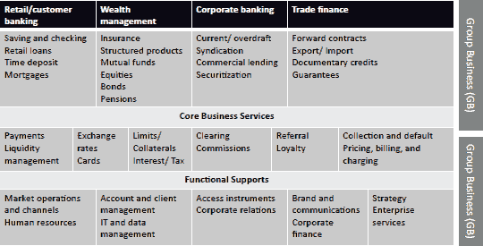

**图 1.11.** 通用银行架构

零售银行专注于个人客户（主要为零售客户），而批发银行主要处理大型群体、组织或公司（如其他银行和金融机构、政府机构、大型企业和房地产公司）。有时，银行可能对相对大型的组织使用批发或企业银行，而对相对较小的组织使用商业银行。由于一些小公司的服务需求与个人相似，银行可能会将部分商业银行业务（如个体工商户）划入零售银行。银行也可能设有机构银行，为大型机构提供全套产品和服务。为进一步降低成本，一些银行可能会合并零售和批发银行的部分职能。

### 附录 1.2：统一三道防线（3LoDs）

基于数据中台，`GB` 和 `GF` 均可直接获益。一些传统企业架构可能发生根本性变革。在以下示例中，我们采用三道防线（`3LoDs`），而非核心银行业务（参见图 1.12）。尽管 `3LoDs` 各司其职，但其本质均为风险控制与管理。观察图 1.13 和图 1.14，`3LoDs` 在数据和技术功能方面实际上存在一些重叠。然而，从传统意义上讲，第一道防线更偏向“实时”模式，第二道防线接近“近实时”模式，而内部审计通常采用“离线”和“批处理”流程。

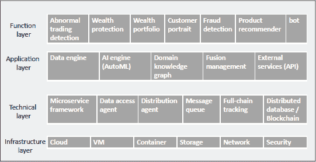

**图 1.12.** 3LoDs 简化四层架构

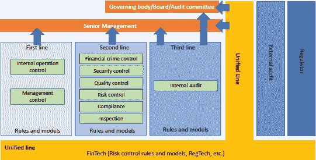

**图 1.13.** 统一防线

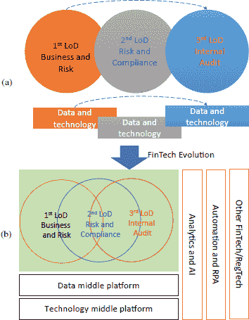

**图 1.14.** 3LoDs 演进

#### 内部审计的角色重塑与未来展望


# 以内部审计（IA）为例

以内部审计（IA）为例，其更侧重于向监管机构和外部审计师提供保证，即风险控制在设计和运行层面均有效。现在的问题是如何衡量这种有效性。一种直接的方法是“复制”业务逻辑，然后应用审计控制；另一种则是仅检查高层控制/实施。我们应当注意到，在当前形势下，审计对象的领域知识仍源自业务（因此，审计师无法超越这一知识范畴），且数据通常只是相应业务数据的子集。在考虑自动化（如持续监控和持续审计）时，业务、合规和审计可能使用相似的技术来实现类似的功能。换句话说，IA 可能会“复制”逻辑并重新实现，以自动化方式验证业务结果。这可能会受到少数人的推崇，因为这种`权宜`的自动化可能覆盖某些特定审计主题的“全量”。然而，考虑审计控制/主题的“全面”覆盖（如离散点与系统性视角的对比）可能更有意义。

随着数据中台的建设，共享数据和技术将成为趋势。三道防线最终将基于相同的数据和技术中台（既为了问责也为了透明），尽管访问权限可能不同。事实上，依我之见，三道防线的基础技术几乎相同。^[7] 虽然大多数当前的自动化项目利于短期目标，但审计的创新规划应聚焦长期目标，因为如果整体平台已被“审计”证明为有效且高效，组织通常不需要 IA 进行“重复”工作。因此，随着数字化的进步和共享平台的到来，IA 在组织中的重要性会降低吗？答案是否定的！这取决于如何重新定义角色，例如：

## IA 的新角色定义

1.  **中层内部监督者**（相较于现有的执行管理层内部监督者），如针对已发生和新兴风险的增强型保证角色。IA 可能不聚焦于“直接”的业务结果验证（这可能是第一、二道防线控制单元的重点）；而是在对平台进行完整审计并实施持续审计/监控后，强调实施和运行的有效性。

2.  **敏捷协调者与协作者**，如从初始设计阶段到最终项目评估阶段全程参与平台/项目（保证端到端生命周期）；审计师不是为了找麻烦，而是为了预防/减少未来的麻烦。协作可通过分享审计知识帮助第一、二道防线避免不必要的问题。凭借第一手知识对任何系统变更的敏捷响应，是敏捷审计的关键之一。

3.  **风险捕获/识别先锋**，即识别因新兴技术（如区块链、数字孪生、复杂 AI 模型及伦理）、新形势和事件（如 COVID-19 大流行）以及新的高影响力变革（如结构性、组织性和政治性变革）而产生的新型风险。

4.  **通用顾问与教育者**，如为目标 GB/GF 提供持续的咨询和教育服务。

因此，IA 应保持独立，但同样重要的是，应保持开放心态、协作与共享。独立性不应成为 IA 停止跨组织及组织外协作的借口。作为支持职能，IA 没有足够的资金用于长期创新。为在数字化世界中保持 IA 的强劲与敏捷，IA 应对内外部合作伙伴的广泛机会保持开放。

## 审计即服务（AaaS）

审计即服务（AaaS），如图 1.15 所示，基于数据平台可行，数据靠近决策模块以提高效率，审计可利用 `API` 实时或近实时地以灵活配置嵌入业务，适应不同场景。审计决策工作流可能类似于图 1.16。

总之，IA 传统的概念性独立性可能已过时；取而代之的，在共享数据和技术服务方面的更多协作可能是未来。IA 应主动朝此方向重新定位。许多审计自动化项目只是第一、二道防线业务逻辑和风险控制的复制，这可能不是第三道防线的主要工作；相反，更高层级的监督自动化可能更具吸引力。敏捷性也是主要方法，它使 IA 能让审计师参与业务项目、产品和服务的初始设计和最终实施。利用 `AI`、`RPA`、自动化等对生命周期进行持续审计，可能更加有效和高效。

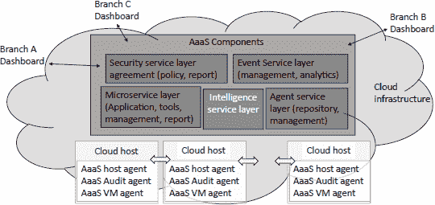

**图 1.15.** 云端的 AaaS

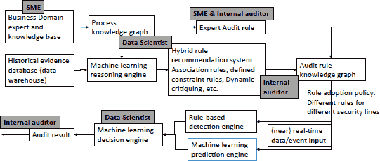

**图 1.16.** 利用 AI 进行审计决策的工作流

## 参考文献

[1] World Economic Forum and Deloitte, “Beyond Fintech: A Pragmatic Assessment Of Disruptive Potential In Financial Services,” 2017.

[2] B. King, *Bank 4.0: Banking Everywhere, Never at a Bank,* Wiley, 2019.

[3] Toronto Centre, FinTech, RegTech and SupTech: What They Mean for Financial Supervision, Toronto Leadership Centre, 2017.

[4] Z. Deng, Big Data Innovation: *Alibaba’s Cloud-Based Data Middle Platform* (Chinese), Publishing House of Electronics Industry, 2018.

[5] D. Fu, M. Jiang, Y. Ren and S. Sun, *Data Middle Office: Move Data Valuable* (Chinese), China Machine Press, 2020.

[6] C. C. Vergara and L. F. Agudo, “Fintech and Sustainability: Do They Affect Each Other?,” *Sustainability,* Vol. 12, p. 7,012, June 2021.

[7] S. Brown, *The Innovation Ultimatum: How six strategic technologies will reshape every business in the 2020s,* 1, Ed., Wiley, 2020.

---

[¹] 略有不同于[[7]](#chap1.xhtml#rref7)，后者认为关键数字技术包括 `AI`、`DLT/区块链`、`IoT`、自主机器、虚拟与增强现实以及 `5G` 通信，我们认为后三类是五大核心技术的衍生：`AI`、区块链、云计算、大数据和 `IoT`，简称为 `ABCDI`。

[²] J. Kranjec. “Digital Payments to Hit $6.6T Value in 2021, a 40% Jump in Two Years”. Finaria, <https://www.finaria.it/pr/digital-payments-to-hit-6-6t-value-in-2021-a-40-jump-in-two-years/>. Accessed Nov 20, 2021.

[³] “Global Digital Lending Market (2021 to 2026) — Growth, Trends, COVID-19 Impact. And forecasts — ResearchandMarkets.com”, BusinessWire [Accessed: Nov 20, 2021]. [Online]. Available: <https://www.businesswire.com/news/home/20210406005479/en/Global-Digital-Lending-Market-2021-to-2026---Growth-Trends-COVID-19-Impact-and-Forecasts---ResearchAndMarkets.com>.

[⁴] “Robo-Advisors”. Statista [Accessed: Nov 20, 2021]. [Online]. Available: <https://www.statista.com/outlook/dmo/fintech/personal-finance/robo-advisors/worldwide>

⁵ A. Goswami, P. Borasi, and V. Kumar. “Global Insurtech Market: Opportunities and Forecast, 2021–2030”. Allied Market Research, [`www.alliedmarketresearch.com/insurtech-market-A12373`](https://www.alliedmarketresearch.com/insurtech-market-A12373). Accessed: Nov 20, 2021.

⁶ “Sustainable Finance”. Monetary Authority of Singapore, [`www.mas.gov.sg/development/sustainable-finance`](https://www.mas.gov.sg/development/sustainable-finance). Accessed: Nov 20, 2021.

⁷ 由于第一、第二道防线通常拥有更多资金购买商业软件和/或雇佣更多（内部和/或外部）开发人员，其工具可能比`ad hoc`审计的自动化工具更“先进”。然而，由于工具仍由人工操作，审计工作可能会在实施和运行有效性上花费更多时间。内部审计（IA）也可能从系统设计和实施阶段就参与其中。

© 2022 World Scientific Publishing Company

[`doi.org/10.1142/9789811250903_0002`](https://doi.org/10.1142/9789811250903_0002e)

# 第 2 章 金融科技的技术基础：ABCDI 及其他

**Jun Xu**

## 2.1 背景

在人工智能（`AI`）、区块链、云计算、大数据和物联网（`IoT`）的驱动下，技术真正影响了金融服务的各个方面，并构建了金融科技的基础。这些不同的技术通常共享一些共同特征，并相互依赖。例如，它们都拥有专用算法（软件）、芯片和设备（硬件）来实现特定功能。再如图 2.1 所示，`AI` 可从其他技术获得智能支持，物联网收集数据作为 `AI` 的“粮食”，云计算可提供算力和存储资源以训练和部署模型，区块链在过程中保护数据隐私，最后大数据平台充当 `AI` 的数据`ETL`（抽取、转换、加载）和注入工具。

为简便起见，本章将这五大核心技术——`AI`、区块链、云计算、大数据和物联网——分别记为 `A`、`B`、`C`、`D`、`I`。除了`ABCDI`，还有许多其他技术孕育了金融科技的发展，汇总见图 2.2。本章旨在全面介绍金融科技的技术背景，读完本章后，读者将能从概念和架构层面大致理解这些技术如何为金融机构（`FIs`）赋能。我们将从各技术的基本概念和特性入手，再通过对比研究探讨其功能。除五大核心技术外，我们还将简要涉及量子计算和元宇宙等其他技术。

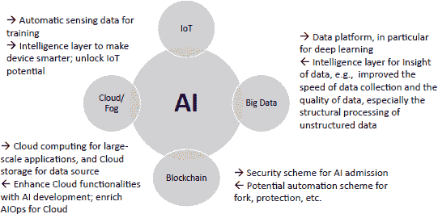

**图 2.1.** AI 与 BCDI 的关系

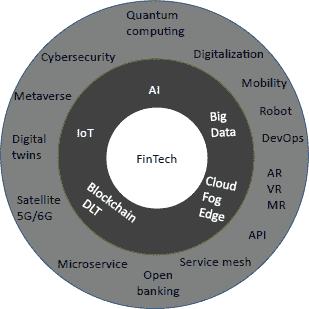

**图 2.2.** 金融科技技术全景

### 2.1.1 人工智能（AI）

人工智能（`AI`）是机器展现出的智能，即机器以类人的方式执行任务或做出决策。它是机器以我们认为“智能”的方式完成任务这一能力的更广泛概念。它为金融机构（`FIs`）带来了诸多益处，例如：

*   通过更高程度的自动化和更好的洞察力提高运营效率，降低运营成本和风险，如机器人流程自动化（`RPA`）和光学字符识别（`OCR`）；
*   加快业务决策速度，如贷款和信贷相关决策；
*   为业务和运营流程生成新模型，如价格预测与分析、理赔处理、财富管理咨询服务和投资流程自动化；
*   利用推荐引擎和聊天机器人创建高度定制化和个性化的金融产品与服务，以提升客户体验；以及
*   通过欺诈检测、合规监管、网络安全监控等手段，增强整体风险管理体系。

如图 2.1 所示，`AI` 与 `BCDI` 技术紧密相关。几乎所有主要金融机构都制定了 `AI` 战略并采用了众多应用（示例见图 2.3）。在第 3 章中，我们将在金融服务背景下探讨 `AI` 理论与应用。鉴于伦理对负责任和可持续 `AI` 采用的重要性日益凸显，第 4 章将通过机器学习（`ML`）实验的方式讨论 `AI` 偏见与公平性。

### 2.1.2 区块链/DLT

区块链创建共享账本数据库，也称为分布式账本技术（`DLT`）。本书中区块链与 `DLT` 交替使用，尽管某些定义认为二者有别。^(1) 其主要特征如下：

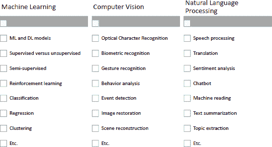

**图 2.3.** AI 在金融应用中的场景

*   **不可篡改。** 所有经验证的记录均不可逆、不可更改。对于比特币等某些区块链，除非有人能同时控制超过 51%的节点，否则无法篡改。
*   **分布式与去中心化。** 所有参与节点均拥有账本副本。无需中心化节点，数据可在分布式基础上记录、存储和更新。
*   **透明。** 因所有节点均持有账本副本并参与任何数据访问，故对所有节点透明，以建立信任。
*   **可编程。** 部分区块链支持内置编程协议，如智能合约。

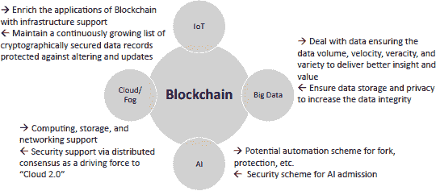

**图 2.4.** 区块链与 ACDI 的关系

*   **开源.** 大多数区块链代码为建立信任而向所有人开放。部分区块链甚至公开其记录，供人们创建相关应用。
*   **自主性.** 共识协议保障数据传输或更新的安全，且所有记录单独加密，使区块链系统总体上可自主运行。
*   **匿名性.** 带时间戳的共识机制解决了节点间的信任问题，因此数据传输甚至交易可匿名或化名进行，即使用区块链地址代替个人身份。

图 2.4 简要说明了区块链与 `ACDI` 的关系。第 6 章和第 7 章将详细介绍其应用，如数字资产和加密货币。

### 2.1.3 云计算与雾/边缘计算

云计算通过互联网按需提供 `IT` 资源服务。这些资源包括但不限于通过互联网提供的计算、存储、网络、数据库、软件、分析、虚拟机和智能服务，其中计算、存储和网络是三大核心服务。通常，客户采用按需付费模式使用云服务，根据使用量和需求灵活扩缩容。表 2.1 列出了云计算的主要特性。

云计算有三大服务模式，即基础设施即服务（`IaaS`）、平台即服务（`PaaS`）和软件即服务（`SaaS`）。许多金融机构正在采用所谓的“云优先”战略，将原有的本地基础设施迁移至云端。主要顾虑在于云端数据安全（如传输中和静态数据策略，对敏感数据采用代币化和加密）。第 9 章将探讨应用云基础设施进行数据集成时的相关技术和策略。

“云原生”技术被越来越多的组织所接受，因为它们通过容器、服务网格、微服务、不可变基础设施、无服务器计算和声明式 `API` 等多种方式，赋能组织在现代动态云环境中开发、部署和维护可扩展、灵活且具有弹性的应用程序。

“雾计算”（或称雾化）一词是云计算的延伸，它代表由多个直接连接物理设备且具备计算能力的边缘节点组成的结构 [1]。该术语由思科于 2014 年提出。其主要目标是支持需要低延迟的资源密集型物联网应用，即将部分 `IT` 资源从云端下沉到边缘。因此，雾计算是本地硬件与远程服务器之间的中介。与雾计算类似，边缘计算也试图将更多流程放在本地节点。我们将不刻意区分它们。雾/边缘技术常与物联网协同工作，为金融机构创造新机遇。例如，通过利用客户的上下文信息，可通过其自身的边缘设备提供个性化的银行产品推荐。

**表 2.1.** 云计算的主要特征

| **项目** | **描述** |
| --- | --- |
| **特征** | * 按需自助服务，采用按量付费模式<br>* 广泛的网络访问<br>* 弹性伸缩与高可用性<br>* 多租户与资源池化<br>* 高安全性与弹性 |
| **优势** | * 通过自动化实现轻松部署和维护<br>* 几近无限的资源<br>* 高效恢复，例如数据和应用程序的备份与还原<br>* 通过 `API` 改善协作与移动性<br>* 卓越的可访问性与扩展灵活性<br>* 对初始投资的要求有限 |
| **劣势** | * 控制有限或不再受控，例如停机、连接问题等<br>* 服务定制化程度有限<br>* 供应商锁定，尽管可通过混合云缓解<br>* 安全与数据隐私顾虑<br>* 互联网带宽 |

表 2.2 对比了云计算与雾计算的差异，尽管二者在许多情况下相辅相成。图 2.5 突出了云/雾与 `ABDI` 之间的联系。

**表 2.2.** 云计算与雾计算对比

| | **云** | **雾** |
| --- | --- | --- |
| **计算位置与模式** | 集中于少数大型数据中心（`DC`），尽管逻辑结构可以是分布式的。大型提供商在全球部署数据中心以实现灾难恢复。 | 通常广泛且物理分布，因为边缘设备可能分布在广阔的地理区域，更靠近云-物连续体上的用户，尽管逻辑控制可以是集中式或分布式的。 |
| **规模** | 云数据中心通常规模巨大，每个通常拥有数万甚至数百万台服务器。 | 每个位置的雾系统通常是更靠近最终用户的较小系统。多个雾节点可互联形成大型雾系统。 |
| **运维** | 由大型公司技术专家团队在相对静态的环境中全权运维。 | 在主要由客户需求决定的各种环境中运行。雾系统通常根据其控制机制以自主方式运行。 |
| **部署** | 尽管存在一些云数据中心标准，但通常需要复杂的部署规划。 | 通常为极少规划的`临时`部署。 |
| **应用** | 通常支持几乎所有应用，除需毫秒级或更低响应时间的实时服务外。其他例外可能是数据高度受限的核心银行系统。 | 通常支持比云更多的时间关键型和高安全性应用。 |
| **互联网连接与带宽需求** | 服务全程需要客户端与云之间的网络连接。带宽是影响用户体验的重要因素。 | 互联网连接非必要条件，因为雾可自主运行，在间歇性连接甚至无互联网情况下提供不间断服务。 |
| **供应商** | 亚马逊云科技 (`AWS`)、微软 `Azure`、谷歌云平台、IBM 云服务。 | `AWS`、`Azure`、谷歌、IBM、思科等。 |

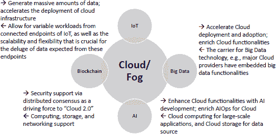

**图 2.5.** 云与 ABDI 的关系

### 2.1.4 大数据

大数据的定义因数据集、处理、价值等属性而异 [2]。维基百科中强调数据集的定义解释道：“大数据是指那些太大或太复杂，以致传统数据处理应用软件无法妥善处理的数据集的术语。案例多（行多）的数据提供更大的统计功效，而复杂度高（属性多或列多）的数据可能导致更高的虚假发现率。”^(2) 另一个来自 `DBpedia` 的定义侧重于数据处理：^(3) “大数据是一个领域，它处理分析方法、从数据集中系统性地提取信息，或以其他方式处理那些太大或太复杂、无法用传统数据处理应用软件处理的数据集。”


事实上，定义本身在不断演进，例如最初的三大主要特征（容量、多样性、速度）已扩展为五个、六个甚至八个特征，如图 2.6 所示。^(4) 例如，多样性意味着数据可能以各种格式存在，如结构化、非结构化或半结构化，且来源多样。多样性对机器学习至关重要，因为它使数据驱动模型足够稳健以应对各种场景。价值是从大数据集中提取的有价值信息，即内在价值应通过评估准确性、完整性等质量来衡量。一个直观的例子是数据能为金融机构带来的盈利能力（图 2.7）。

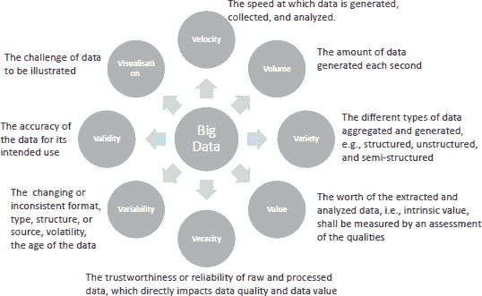

**图 2.6.** 大数据的 8 个“V”

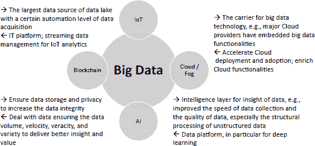

**图 2.7.** 大数据与 ABCI 的关系

金融机构利用大数据解决许多实际问题，如汇总客户画像、评估社交媒体影响、应对日益增长的数据量与查询需求。此外，大数据还广泛应用于欺诈检测、网络安全、客户获取与留存、风险建模和合规报告等。

### 2.1.5 物联网

物联网本质上是一个网络的网络，它识别并连接具有物理对象和感知功能的数字实体 [3]。在我们的定义中，物联网涵盖从 `5G/6G`、无线传感网络、`Li-Fi`、卫星通信，到生物识别、`增强现实/虚拟现实/混合现实 (AR/VR/MR)` 和机器人等广泛主题。概念上，物联网代表对象的一种新型身份标识。技术上，物联网也称为 `Internet+`，因为它是互联网向网络物理系统的延伸。还有其他一些同义词，如万物互联（思科提出）、工业 4.0、物云、物联网、未来物联等。

完整的物联网技术栈包含若干层。图 2.8 列出了物联网平台不同分层结构的定义。我们不能说哪一个绝对更好。这取决于业务应用的实际需求。第 10 章 提供了包含完整技术栈的更多物联网概念。

许多金融应用植根于物联网基础设施及其采集的数据，例如：

*   移动应用是最基础且必要的物联网应用。当移动银行和电子商务在行业中盛行时，智能手机成为金融机构获取洞察的最可靠数据来源，涵盖客户浏览行为、交易记录、用户交互和产品评价等领域。
*   数字传感器广泛部署在银行网点和设施等物理单元中，以自动化部分内部流程并分析消费者行为。这些结合 AI 技术的数字传感器能够识别异常行为、服务异常和系统问题。
*   `VR/AR` 设备和可穿戴设备提供特殊的用户体验，以提高个性化程度。

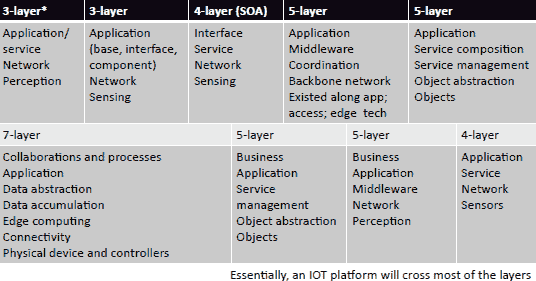

**图 2.8.** 各类物联网平台中的层级定义

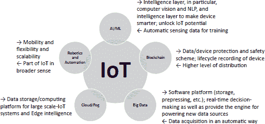

**图 2.9.** 物联网与 ABCD 的关系

因此，物联网总体上可被视为许多其他技术的“基础设施”。图 2.9 表示物联网与 ABCD 之间的交互，以大数据与云计算的交互为例。金融大数据最重要的组成部分之一是金融云。如果大数据是丰富的矿产，那么云就是通往矿山的入口和设施。开采效率取决于基础设施的安全性和可靠性。同时，大数据与 AI 也是共生关系。AI 基于收集数据的质量、量级和精度，帮助物联网感知、认知、分析和预测金融世界。反之，AI 通过提高数据收集效率和增强数据质量，推动数据技术演进，以加速从物联网收集的大数据进步。

表 2.3 在 ABCD 的辅助下提供了一些典型的物联网金融案例。这些应用有时被视为“万物银行”的一部分。

物联网的演进伴随着来自技术、业务和社会视角的挑战。在技术视角上，我们必须考虑其复杂性、异构性、通信范式、数据管理、软/硬件（如数据中心基础设施）、标准、安全等。一些技术仍不成熟，例如量子传感。在业务方面，我们必须解决孤岛与水平应用领域、收入（按设备、连接或数据）、价值链、新商业模式等问题。从社会角度来看，我们必须考虑隐私、安全、易用性、社会协作、法规等。以碳中和为例。全球物联网监测网络仍在建设中，利用物联网数据的业务尚待探索。

**表 2.3.** 使用物联网的金融应用

| **应用** | **描述** |
| --- | --- |
| 数字统一账户管理 | * 客户可通过数字界面（如第 15 章所述的开放银行）在统一门户中访问其多个银行账户，例如自动驾驶汽车或飞机上的娱乐系统、智能家居系统（见第 10 章）。 * 生物识别可简化这些新型“随处”数字渠道的账户访问（见第 11 章）。因此，创建数字签名或身份，用于具有多级安全性的认证和授权。 |
| 自动支付与智能钱包 | * 智能手机和智能卡：嵌入 SIM 卡的银行卡（可能由电池供电或可充电）；多层 SIM 卡（可能增加薄层作为令牌） * 其他包括可穿戴设备、智能家居、联网汽车等。 * 结合统一账户管理，具有唯一数字身份的“万物钱包”可提供跨多个物联网设备的收入、成本和支出的综合视图。 |
| 物联网赋能的智能合约 | * 物联网设备连同智能合约和数字身份，可使支付部分或完全自主化（即自我执行和自我强制执行）。 * 示例：家电试用期后付款、健康自诊及满意反馈后付款、家用太阳能板发电费自动收取、基于及时付款合同的租赁房屋受控访问等。 |
| 点对点 (P2P) 金融 | * P2P 服务，如本地和国际即时支付（低成本），适用于真实货币和虚拟货币，基于可信物联网平台构建的物联网社区保险等。 |
| 租赁金融自动化 | * 基于物联网的系统可对有形资产的状态和使用情况进行实时监控，为租赁资产提供关键定价信息。可应用智能合约。 * 定位技术和电子围栏可限制资产的移动区域。 |
| 智能抵押品 | * 物联网可对客户抵押的资产（如汽车、制造机械、房屋和家用电器）及其状态提供实时控制和/或监控。 * 可密切监控资产状况，若检测到任何违规可触发警报 * 所有权转移可通过智能合约自动完成。 |
| 贸易金融中的风险缓释 | * 可通过 `RFID`、`蓝牙`、`ZigBee`、`NFC` 等对资产进行细粒度追踪，类似于智能抵押品，例如：对温敏商品进行温度测量、对贵金属进行质量测量、对农业和耕作领域进行区域作物分析等。 |
| 语境化个人财务管理 | * 个人财务规划师连同智能钱包应用，可利用来自物联网设备的数据提供更具语境的警报和建议，例如：基于天气、成本和其他因素修改休闲旅行计划，基于位置和停车费调整附近停车位，基于实时定价切换不同电力供应商，基于当前家庭库存建议食品杂货采购清单等。 |
| 无摩擦客户准入与 KYC | * 物联网设备可记录用户日常行为，还可深入挖掘社交网络、邮件和用户感兴趣的网站以获取用户社交行为（见第 11 章）。 * 通过加密技术的唯一数字身份可关联所有数据。 * 在获得客户同意的情况下，金融机构可全面洞察客户财务行为，提供比某些纸质文件更准确的信息。 |
| 细粒度车险 | * 物联网系统为汽车提供车载追踪和诊断功能，为驾驶员提供监控功能，以指示驾驶行为。 * 保险价格可基于驾驶习惯、驾驶环境和车辆健康状况进行调整。 * `5G` 和车车网络使其更加可靠。 |
| 实时寿险/健康险 | * 多个可穿戴设备配合智能手机可近乎实时地追踪健康状况。寿险或健康险可按近“实时”方式定价。 * 这些数据最终将被聚合并发送至云端，以构建“数字孪生”或元宇宙中的化身。 |

#### 2.2 比较研究：ABCDI 之间的关系与差异

在本节中，我们将讨论这五大技术之间的关系。通过比较研究，我们旨在识别其独特特征，并更好地理解它们如何协同工作以助力金融机构发展。

##### 2.2.1 AI 与物联网

物联网本质上是植入联网设备中的传感器，通常通过网络连接提供数据流。物联网更侧重于硬件，而 AI 更侧重于软件，特别是源自数据的机器学习模型，这些数据可能由物联网设备收集。表 2.4 列出了 AI 与物联网的差异。^(5)

所有物联网相关服务不可避免地遵循五个基本步骤，称为创建、通信、聚合、分析和行动。AI 可以通过提供与硬件协同工作的智能层、实时边缘处理单元、适合物联网领域的特定分析模型、传感过滤与融合等，帮助完成最后三个步骤。

有了这些功能，AI 可以提升运营效率、提供更好的风险管理、增强产品和服务质量、增加物联网可扩展性并减少停机时间。AI 与物联网的无缝集成催生了所谓的物联网分析，这是数据分析的主要应用之一。有时，如果物联网基础设施跨越大规模和大范围，还需要大数据和云的辅助（详见第 2.2.10 节）。

**表 2.4.** AI 与 IoT 的区别

| **方面** | **AI** | **IoT** |
| --- | --- | --- |
| 共同特征 | * 均提高金融服务效率<br>* 均提供互操作性保障<br>* 均高度依赖系统架构和硬件基础设施<br>* 均可使用互补云以提高效率<br>* 均可在线或离线模式运行 | * 均提高金融服务效率<br>* 均提供互操作性保障<br>* 均高度依赖系统架构和硬件基础设施<br>* 均可使用互补云以提高效率<br>* 均可在线或离线模式运行 |
| 数据获取与使用 | 数据是 AI 的“粮食”，或者说 AI 由数据驱动。然而，当前 AI 技术无法创建原始数据，即使它能生成合成数据，合成数据仍基于某些原始数据。 | 物联网收集数据并馈送至数据仓库、数据湖等，用于基于 AI 的分析；其核心在于感知数据。 |
| 成本 | 部分通用应用（如人脸识别、机器翻译）价格下降，而部分先进 NLP 应用（如文本生成）价格上升。 | 通用传感器价格大幅降低。 |
| 可扩展性 | 对于计算密集型项目扩展性较差。 | 作为基于云的原生特性，具有天然可扩展性。 |
| 系统与对象 | AI 基于数据识别系统行为模式；AI 系统不依附特定对象。 | 物联网主要关注系统中的感知对象。 |
| 算法与行为 | AI 高度依赖机器学习和深度学习算法来学习系统行为。 | 物联网完全围绕感知数据，用于创建算法以构建系统行为。大多数物联网设备在一组预定义规则下运行，尽管部分设备开始通过 AI 嵌入本地智能。 |

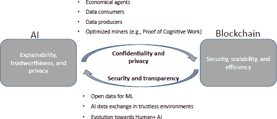

**图 2.10.** AI 与区块链的相互视角

##### 2.2.2 AI 与区块链

传统区块链本质上是以点对点方式在不同方之间共享的数字事件不可变记录，其主要关注点在于安全性、可扩展性和效率。

如图 2.10 所示，AI 和区块链都有各自的痛点和挑战。例如，区块链可能面临网络安全、可扩展性和效率问题。在 AI 的辅助下，区块链可以提高其安全性和透明度。同时，区块链可以为 AI 组件和应用提供去中心化市场和协调平台，例如安全的数据和模型共享、`AI` 赋能的计算资源等。

##### 2.2.3 AI 与云

AI 依赖云计算进行大规模应用，依赖云存储作为数据源（特别是来自物联网的数据）。主要云服务提供商（如 Google、AWS 和 Azure）通过其云基础设施提供 AI 服务。它们支持复杂 AI 操作的抽象，例如调用简单的 API 以启用认知计算能力。同时，AI 也增强了云技术，例如 `AIOps` 可以显著提高云运营效率（见第 3 章）。

重要的是要注意，AI 应部署在云端或设备端（边缘）。边缘 AI 通过本地化数据处理实现实时机器学习，从而增强安全性并提升客户体验；云 AI 可降低实施门槛、改善知识共享并支持复杂模型。当速度和延迟对某些应用至关重要时（例如计算机视觉和用于 `5G` 的虚拟无线接入网络），或隐私是主要顾虑时（例如限制上传到云端的数据），边缘侧实施是较好选择。然而，通过大量数据进行计算密集型深度学习模型训练，可能更适合在云端进行。

为了在 AI 和云之间取得平衡，我们需要仔细考虑计算资源、延迟、能耗、安全性和连接性等因素。^(6) 事实上，边缘 AI 和云 AI 相辅相成，边缘 AI 用例几乎总是涉及云资源。近年来，随着更好的网络基础设施和新的边缘计算架构（例如所谓的 AI 驱动芯片）的兴起，中心化云 AI 与分布式边缘 AI 工作负载之间的壁垒正在被打破。例如，金融认证授权设备可在边缘侧嵌入人脸和指纹识别等生物识别技术作为第一级安全防线，而云侧可进一步将生物识别信息与在线数据库匹配以进行潜在风险检测。换句话说，边缘 AI 专注于即时本地决策，而云 AI 可提供全局优化。以联网自动驾驶汽车为例，边缘 AI 通过本地数据处理感知周围环境，并随即刹车和/或调整方向盘。同时，云 AI 掌握附近所有联网汽车的信息并访问路线全局地图，因此可提供优化驾驶路径。

##### 2.2.4 AI 与大数据

尽管表 2.5 所示大数据与 AI 存在差异，但二者的相互依赖更为天然。AI 训练依赖大量数据。另一方面，AI 本身提高了数据收集的速度和质量，特别是非结构化数据的结构化处理（见图 2.11）。同时，人类是调节因素，例如以监督角色指导和训练 AI。

**表 2.5.** 大数据与 AI 对比

| | **大数据** | **AI** |
| --- | --- | --- |
| 数据 | 通常采用 ELT 技术接受原始数据。 | AI 模型通常需要处理后的数据以便提取特征。 |
| 计算 | 通常应用传统计算方法，其反应和响应是被动的，无预测性。 | 允许机器执行具有未来行为预测功能的认知功能。 |
| 目标 | 提供历史数据洞察。 | 为未来做出更好决策。 |

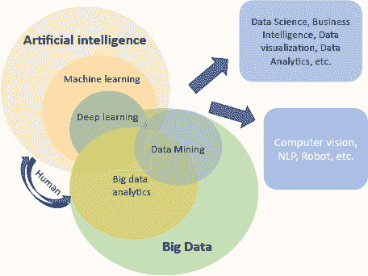

**图 2.11.** AI 与大数据的交互

除了持续增长的数据使 AI 系统更具意义和上下文相关性外，大数据基础设施还可以帮助扩充 AI 和 ML 人才队伍。大数据与 AI 的结合加速了许多组织采用大数据分析这一新概念。大数据分析基于先进分析技术（通常包括 ML、大规模并行处理、内存数据库和计算、分布式文件系统和数据库、云、`MapReduce` 等）在超大数据集上进行。典型的大数据分析平台包括 `Microsoft HDInsight`、`Apache Hadoop + Mahout`、`Oracle Analytics Cloud`、`Cloudera Analytics`、`Databricks` 等。

##### 2.2.5 区块链与云

一些专家认为，区块链在演进过程中真正是“云 2.0”，即一个真正透明且互联的网络，无需中心化的交易授权机构，这解决了云计算大部分棘手的安全风险。表 2.6 对比了区块链与云计算的差异。

###### 区块链即服务

区块链即服务，源自软件即服务模式，是一种第三方基于云的基础设施和管理模型，供公司构建和运营区块链应用。由于其便利性，`BaaS` 可能成为区块链技术广泛采用的驱动力之一。Microsoft Azure 于 2015 年提供了以太坊 `BaaS`，^(7) AWS 于 2019 年推出了亚马逊托管的用于以太坊和 `Hyperledger Fabric` 的区块链。^(8)

###### 去中心化云计算

另一个受区块链去中心化特性启发的云概念——去中心化云计算——也正在兴起。两者都能提供对高质量基础设施的访问，并具备额外的数据泄露安全防护和数据存储成本的灵活性。请注意，去中心化云计算不一定建立在区块链协议之上，尽管存在一些基于区块链的去中心化云计算平台。

**表 2.6.** 区块链与云计算的对比

| | **区块链** | **云计算** |
| --- | --- | --- |
| **共同特征** | 计算架构：分布式系统<br>改变企业工作环境和传统计算工作方式的驱动力。 | |
| **交互** | 区块链即服务需要云计算的支持，即云计算可以推动基于区块链技术的项目执行 | |
| **数据存储** | 去中心化或分布式 | 通常为中心化数据中心，尽管可能在少数不同位置存在多个副本。 |
| **数据验证** | 分布式共识或验证协议 | 数据恢复依赖于 `RAID/EC` 算法 |
| **安全性与加密** | 不可篡改<br>原生加密 | 可篡改<br>按需加密 |
| **透明度** | 公有区块链的核心特征之一。 | 可见性取决于其是公有还是私有。 |
| **访问权限** | 取决于区块链类型，为许可制（企业/私有）或无许可制（公有） | 许可制 |

##### 2.2.6 区块链与大数据

区块链确保数据存储、安全性和隐私以提高数据完整性，而大数据确保数据属性的 8 个“V”以提供更好的洞察和价值。尽管两者存在差异（如表 2.7 所列），但与大数据相关的需求和挑战完全可以由区块链技术满足，后者提供了透明度和安全性 [4]。

**表 2.7.** 区块链与大数据的对比

| | **区块链** | **大数据** |
| --- | --- | --- |
| **优势** | 去中心化、灵活性、透明度和安全性。 | 提高生产力、节省时间和成本、基于客户洞察的高效决策。 |
| **数据完整性** | 通常结构化、丰富且完整，使其成为进一步分析的完美来源 | 通常为原始数据；不一定高质量；需要进一步处理 |
| **数据共享** | 提供安全性 | 非原生功能 |

大数据分析对于追踪交易至关重要，并呈现了商业决策制定的根本性转变。一方面，区块链可以通过以下多种方式改进业务流程：

*   通过去中心化必要技术，扩大数据分析工具对区块链的高性价比可访问性。
*   创造新形式的数据货币化，即通过彻底消除中间商，实现数据分析共享和货币化的民主化。
*   实现流畅的数据交换，即允许用户处理大量数据，同时也极大地抑制了这些数据的交换方式。

另一方面，使用区块链的金融机构（FI）享受来自大数据分析的益处（可能也结合 AI，如“AI 与区块链”和“AI 与大数据”章节所述）。事实上，通过在区块链上利用数据分析策略，可以识别出数据生产和交换中的趋势、模式和威胁。这些问题通常通过模式挖掘、文本挖掘和异常值检测算法来解决。例如，大数据应用可以从数百万甚至数十亿次区块链交互中执行模式识别任务，以识别欺诈用户和滥用活动。同时，区块链数据可以通过机器学习算法进行聚类和分类，以评估开发者和用户的可信度。类似的想法也适用于数字支付系统和保险理赔系统。

这种融合创造了一些基于区块链的大数据平台，例如表 2.8 中列出的 `StorJ` 和 `Endor Protocol`。然而，要找到一个一劳永逸的解决方案并不容易，因为有许多挑战需要克服，如安全性、隐私、复杂性、标准等。例如，当区块链带来加密数据时，也伴随着计算开销。如果存在实时响应要求，额外的计算资源开销并非小数目。由于无许可区块链允许任何用户无需许可即可加入链，在分析过程中可能会发生更高的潜在网络威胁。

**表 2.8.** 基于区块链的大数据平台与工具

| **名称** | **应用** | **描述** |
| --- | --- | --- |
| `Streamr` | 物联网数据市场 | 利用“分片”技术从个人用户和物联网设备收集大型数据集，使网络中的每个节点无需承担整个数据库的重量，从而创建一个涵盖所有数据的快速网络。 |
| `ReBloc` | 房地产交易 | 使用验证协议确保其平台上房地产交易的准确性和可信度。 |


| FileCoin | 开放存储市场 | 旨在创建一个去中心化存储网络，允许用户在开放市场上买卖存储资源。 |
| Endor Protocol | 社会知识 | 利用从基于人类的在线来源提取的数据，结合 AI 分析生成基于群体的智慧。它采用一种名为“社会物理学”的方法来回答未来问题。 |
| StorJ | 存储解决方案提供商 | 允许数据以完全端到端的去中心化方式存储在云端。 |
| BigChainDB^(9) | 安全数据库 | 从大数据分布式数据库起步，随后添加区块链特性——去中心化控制、不可篡改性和数字资产转移。 |
| Wibson | 数据市场 | 旨在创建一个数据交易所，使消费者为数据使用付费，而贡献者因数据共享获得报酬，即用户可以将其匿名私人信息货币化，而贡献者通过基于代币的系统获得报酬。 |

## 2.2.7 区块链与物联网

基于区块链的物联网解决方案可以构建，以维护一个不断增长的、经过加密保护且不可篡改的数据列表 [5, 6]。将区块链用于物联网可带来三大关键优势：

*   建立信任，即在各方和设备之间建立信任，并降低串通和篡改的风险；
*   通过消除与中介相关的开销来降低成本；
*   加速交易，例如将结算时间从数天缩短至近乎即时。

因此，区块链与物联网的集成平台对于智能抵押品、租赁自动化、实时车险和人寿保险等极具价值。`数字孪生`作为物联网中物理对象或系统的虚拟副本，通常与该集成平台协同工作，以实现更好的管理和优化。

然而，这种集成可能面临许多挑战，例如可扩展性、安全性、隐私、存储等，如图 2.12 所示。例如，网络边缘的物联网设备通常算力和存储空间有限，可能无法满足区块链的要求，因为区块链通常需要密集的数据加密和共识协议操作，并维护大体量的账本副本。有时，不成熟的`区块链即服务（BaaS）`可能导致设备和账户不安全，从而造成严重的安全风险。

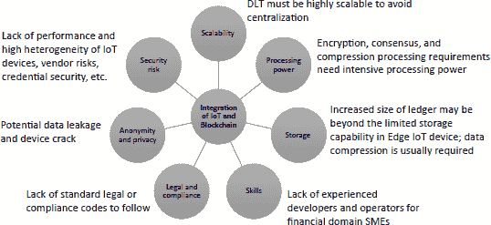

**图 2.12.** 物联网与区块链集成的挑战

## 2.2.8 云计算与大数据

从本质上讲，“大数据”是指具有 8 个“V”特征的大量数据集合，而“云计算”是指远程存储数据并在该数据上执行指定操作的存储和计算机制。^(10) 表 2.9 展示了云计算和大数据的共性与独特特征。^(11) 例如，由于大数据平台的动态特性，可扩展性是其基本要求之一，这导致这些平台越来越多地部署在云端。

## 2.2.9 云计算与物联网

云计算和物联网在数据处理的不同层面上共享许多共同特征，尽管它们各自拥有独特的特征，如表 2.10 所示。

**表 2.9.** 云计算与大数据的对比

| **项目** | **云计算** | **大数据** |
| --- | --- | --- |
| 共同特征 | 与数据处理相关<br>高度可扩展且稳健 | 与数据处理相关<br>高度可扩展且稳健 |
| 交互关系 | 云平台可作为大数据技术的载体，例如主流云服务商内嵌了大数据功能。 | 大数据概念加速了云计算的部署与采用。 |
| 定义 | 按需提供远程资源（如计算、存储、网络）。 | 一种组织海量数据并生成洞察的方式。 |
| 目标 | 提供对云服务的通用访问。 | 解决处理海量数据集的技术问题。 |
| 参考模型 | SaaS、PaaS、IaaS<br>公有云、私有云、混合云 | 结构化、非结构化、半结构化。 |
| 挑战 | 高可用性、安全顾虑、计费模式等。 | 数据多样性、数据集成、数据高效处理和资源管理等。 |
| 格式 | IT 资源的新范式 | 各种结构和格式的所有类型数据。 |
| 使用场景 | 当需要快速部署和应用扩展，同时保持集中式访问时。 | 当传统集中式方法和框架失效，且需要分布式框架处理大数据集时。 |
| 优势 | 低维护成本、无前期成本的集中式平台、灾难恢复等。 | 高度可扩展、高性价比、稳健的生态系统、提高生产力和效率、并行性等。 |
| 主要厂商 | Google、Amazon Web Service (AWS)、Microsoft、Dell、Apple、IBM、Alibaba、Tencent | Cloudera、Hortonworks、Apache、MapR |

它们通常相互补充，因为云计算提供：

*   集中式数据中心中按需动态的资源池，几乎是“无限”的；
*   具有高弹性的可扩展资源和服务管理；
*   服务（如数据 IO）方面更加同质化，利于互操作性；
*   与位置无关，可从任何地方访问；
*   高度可靠且易于访问的服务，具有一定的鲁棒性；以及
*   从本质上弥补物联网的技术约束（如存储、处理和通信）；

而物联网提供：

*   以更分布式和动态的方式呈现现实世界的事物和应用；以及
*   在大量现实生活场景中交付新服务

因此，这促成了物联网与云计算的融合，即云计算为物联网提供计算、存储和通信功能以支撑物联网愿景的实现，而物联网为云服务的扩展提供巨大机遇。换句话说，物联网平台以两种主要类型与云平台集成：(i) **以云为中心的物联网**（将物联网功能引入云端）和 (ii) **以物联网为中心的云**（将云功能引入物联网），如表 2.11 所示。要选择合适的平台，必须至少考虑四个方面：(i) 用户管理和人机交互，(ii) 设备通信和管理，(iii) 基于聚合数据的应用集成服务，以及 (iv) 访问门户和控制。

最近出现了许多新模型，例如`传感即服务` [7]，允许访问传感器数据；`数据即服务（DaaS）`，提供对任何类型数据的无处不在的访问；以及`身份与策略管理即服务（IPMaaS）`，提供对身份和策略管理的访问。特别是，根据物联网节点的处理能力，物联网基础设施可设计为在云和雾结构之间达到平衡。注意，某些物联网基础设施如有必要可使用本地网络。

**表 2.10.** 云计算与物联网的对比

| | **云计算** | **物联网** |
| --- | --- | --- |
| 共同特征 | 两者都涉及不同层面的数据收集、存储和计算。 | 两者都涉及不同层面的数据收集、存储和计算。 |
| 交互关系（互补关系） | 物联网产生的海量数据可利用云基础设施从源头传输至目的地。此类路径可针对各种工作负载提供可扩展性和灵活性。 | 物联网产生的海量数据可利用云基础设施从源头传输至目的地。此类路径可针对各种工作负载提供可扩展性和灵活性。 |
| 特征 | 互联网上的无处不在的 IT 资源 | 普适且真实的物理对象 |
| 处理能力 | 虚拟且近乎无限 | 有限 |
| 连接性 | 通常通过互联网进行服务交付 | 通常通过互联网作为汇聚点 |
| 大数据 | 大数据的管理手段 | 大数据的来源 |

**表 2.11.** 以云为中心的物联网与以物联网为中心的云

| | **以云为中心的物联网** | **以物联网为中心的云** |
| --- | --- | --- |
| 核心 | 利用云基础设施优势将物联网数据引入云端。 | 通过物联网基础设施提供机会，将服务、工作负载、应用和大量数据交付至网络边缘。 |
| 处理方式 | 几乎所有其他组件均通过云连接，例如数据处理、计算和管理工具部署均在云端。 | 在靠近用户/数据源处处理和存储数据，例如将数据分发至靠近最终用户的边缘以消除延迟、众多跳数，并支持边缘/移动计算和数据流；创建密集的地理分布；在本地处理数据和执行服务；支持最终用户安全。 |
| 场景 | 服务通过多地点的物联网对象提供；用户可容忍网络处理延迟。 | 服务通过同一位置的数据提供，具有严格的实时要求。 |
| 平台示例 | ThingWorx、Carriots、Axeda 等。 | Microsoft Azure IoT、IBM、AWS IoT、Google Cloud IoT。 |

## 2.2.10 大数据与物联网

# 大数据、物联网及其他技术

大数据简单来说就是关于数据的一切，即使使用了许多形容词来描述“大”的概念。物联网也是关于数据的，但更侧重于连接设备的数据，无论其大小。表 2.12 列出了它们的一些差异。值得注意的是，物联网正成为大数据最大的数据来源。

## 分析能力

就分析而言，将数据加载到`数据湖`并执行数据分析仍属于大数据领域。要利用大数据技术构建物联网分析平台，必须具备以下能力：

*   **数据流能力**，用于摄取、聚合（例如某些统计和过滤操作）和压缩从网络中各种边缘传感器设备收集的实时高容量数据，以及
*   **边缘分析**，利用`边缘计算`和 `AI` 技术，实现依赖于网络边缘低延迟和高数据吞吐量的实时用例，以进行运营绩效优化、行为异常检测等。

**表 2.12.** 大数据与物联网的对比

| | **大数据** | **物联网** |
| --- | --- | --- |
| **核心** | 从数据中寻找洞察以辅助更好的决策 | 提供设备间互联以创建用于自动化的智能环境 |
| **数据源** | 通常以累积方式包含人工生成和机器生成的数据 | 通常来自各类传感器的海量低延迟、短时效或高容量机器生成数据 |
| **分析** | 更多针对大范围的长周期用例；通常能力更强 | 更多针对本地场景的实时用例；边缘端能力通常有限 |
| **应用** | 预测性维护、容量与资源规划、客户画像与收入预测 | 运营优化、实时广告竞价、欺诈检测、反洗钱及安全漏洞检测 |

总之，物联网的感知、大数据的燃料以及 AI 的大脑，将使智能互联世界的未来成为现实。

## 2.3 其他技术与概念

数字化、移动性、开放银行等其他概念和技术，通常依赖于五大核心技术。因此，我们可以将它们嵌入主要由 `ABCDI` 支持的平台中。这种集成往往能带来令人难以置信的创新。以下是一些新兴示例。

### 2.3.1 量子计算

量子计算是一种遵循量子力学定律、通过调控量子信息单元进行计算的新型计算模式。它利用量子叠加和纠缠等物理特性，以微观粒子组成的`量子比特`作为基本单位，通过量子态的可控演化实现计算。要进一步理解它，我们可以从量子力学的三大基本原理入手：

*   **不确定性原理**意味着观察者不可能同时知道一个粒子的位置和动量。换句话说，测量后的粒子与测量前的状态相比必然会发生改变。
*   **不可克隆原理**意味着未知的量子态不能被完全克隆，即不可能实现未知量子态的精确复制，使得每个复制态都与初始量子态完全相同。
*   **非正交量子态的不可区分原理**意味着不可能同时精确测量两个非正交量子态。事实上，无论采用何种测量方法，测量结果都会存在误差。

上述三大基本原理导致了量子态的三个基本特征，如下所示：

*   **叠加性**，即量子态可以叠加，因此量子信息也可以叠加。这是实现量子计算并行性的重要基础，即`量子比特`的叠加态可以同时输入和运算。
*   **纠缠性**，即两个或多个量子在特定环境（如温度、磁场）中可以处于相对稳定的量子纠缠状态。基于这种纠缠，一个粒子的作用会瞬间影响另一个粒子。
*   **干涉/相干性**，即量子力学中微观粒子的叠加可以产生类似经典力学中光的干涉现象。

与经典计算相比，量子计算在处理某些特定问题时具有指数级加速优势。例如，它为密码分析、天气预报、石油勘探、药物设计等所需的大规模计算问题提供了解决方案。它有望揭示高温超导和复杂物理学的奥秘，并为先进材料制造和新能源开发奠定科学基础。

然而，在与经典计算机相同的操作条件下，很难实现高比特量子计算机。例如，量子计算本质上是概率性的，且受本征噪声影响，这与经典计算的确定性输入输出不同。`量子纠错（QEC）`码的实现通常消耗大量的硬件和软件资源开销。此外，目前尚无成熟的`量子随机存取存储器（QRAM）`能够像经典计算机中的 `RAM` 那样可靠地长期存储量子信息，尽管理论上我们不必担心存储空间问题。再者，受工程限制，许多量子理论尚需通过近似或启发式方法来实现。谷歌、IBM、英特尔、微软、华为、腾讯、阿里巴巴和百度等众多科技巨头已在早期构建了第一波量子计算机。

量子计算机的实现提出了若干技术路径，如混合方法和模拟方法。前者通过量子算法进行优化步骤、通过经典算法进行迭代控制来在两者间切换，例如橡树岭国家实验室的 `XACC` 和 `D-Wave Hybrid`。后者利用直接量子模拟和量子退火，采用可控演化技术将初始量子态过渡到对应最终结果或优化解的目标状态，例如 `InfinityQ`。在硬件和材料方面，目前的主要路线包括超导量子比特（如谷歌、IBM、英特尔、D-Wave、麻省理工、中国科学技术大学、Rigetti、SeeQC、Quantum Circuits、IQM Finland）、离子阱（如 IonQ、霍尼韦尔、桑迪亚国家实验室）、硅量子比特（如英特尔、Leti、IMEC）、光子（如 Xanadu、PsiQuantum）等。

量子计算通常可应用于随机模拟、组合优化、机器学习和安全领域。例如，迁移学习可在`量子机器学习`中应用混合方法，让量子计算机重新训练神经网络的部分层。模拟方面，如`量子蒙特卡洛方法（QMC）`，很可能代表了近期投入生产使用的最佳机会，相较于经典计算具有更切实的优势，特别是在从参数分布或近似数据分布进行模拟时（例如通过`量子生成对抗网络`方法）。在安全方面，`量子密钥分发（QKD）`可安全地生成和共享加密密钥，以更好地保护敏感信息并更好地遵守隐私政策和法规。其他潜在应用场景包括量子传感和量子通信。

### 量子计算与元宇宙在金融领域的应用

#### 量子计算的金融应用场景

随着算力提升、交易速度加快和能耗降低带来的普遍效益，典型的金融应用案例如下：

*   **交易策略**：得益于强大的随机性和组合能力，涵盖资产定价、交易风险分析（如通过 `QMC` 计算 `VaR` 和 `CVaR`）、投资组合构建与优化，以及交易、对冲或套利策略优化。
*   **营销、销售与物流**：基于网络分析的优势。
*   **市场与经济分析**：如不稳定性检测。
*   **量子机器学习应用**：涉及核函数计算困难、高度复杂的神经网络结构和自然语言处理（`NLP`）的特征选择优化、分类与回归，应用于信用评分、欺诈检测和营销等场景。
*   **模型可解释性**：基于可逆逻辑门，如贷款申请和信用评分。
*   **金融加密相关活动**：采用更强的量子加密算法和密钥，用于认证、授权和数据传输。

金融机构（`FIs`）应着手调查现有基础设施和算法以备未来之需，尽管它们不具备直接开发新量子设备和算法的技术能力。应在中央 `CTO/CIO/CDO` 办公室或全球创新部门组建一个小团队，探索潜在应用。他们应与研究机构和解决方案提供商紧密合作，开发必要能力。投资量子初创企业和大学项目也是获取知识产权（`IP`）的好途径。

### 2.3.2 元宇宙

**元宇宙**（`Metaverse`）一词源自作家 Neal Stephenson 创作的科幻小说《雪崩》（*Snow Crash*），书中描述了一个人们以虚拟形象在三维（`3D`）空间中与各种软件交互的世界。元宇宙是虚拟时空的集合，是增强现实（`AR`）和虚拟现实（`VR`）在互联网上的直接延伸。总体而言，元宇宙是一个与现实世界平行且高度互操作的虚拟世界。随着物联网、`AR`/`VR`/`MR`、人机交互、云计算、`AI`、数字孪生、区块链、`5G` 等技术的持续发展，以及元宇宙第一股 Roblox 的上市，元宇宙正从概念走向现实。

元宇宙具有若干基本特征。Roblox 总结了八大特征：身份、好友、沉浸感、随地接入、低摩擦、内容多样性、经济系统和文明，具体阐述如下：

*   **沉浸式体验**：随地接入的低摩擦沉浸体验带来超越现实的冲击。虚拟世界与物理世界分离且独立，但通过“虫洞”连接，实现两个平行宇宙间的瞬时空间转移或时间旅行。
*   **无限创造力**：基于 `AI` 和区块链的简单易用创作工具赋予人们无限创造力。同时，元宇宙的多样性提供了丰富多样的内容，包括游戏玩法、道具、艺术素材等。
*   **虚拟身份社交**：虚拟身份社交是元宇宙的标配，类似于现实中使用的工具，如美国的 Facebook（现 Meta）和 TikTok（字节跳动）、中国的微信、日本的 Line。
*   **虚拟经济**：作为虚拟社会，元宇宙离不开“虚拟”经济。元宇宙经济严格定义了数字资产在数字市场中从创造、交换到消费的全生命周期。作为数字经济的特殊形式，元宇宙经济遵循数字经济的一项基本原则（如市场规模越大，经济越繁荣），但也具有独特特征（如边际成本递减、边际收益递增，以及随着市场规模扩大交易成本趋近于零）。
*   **文明形态**：所谓文明，是整合人类社会行为与自然行为。每个人都是“多面的”。在元宇宙中，人们以化身（`Avatars`）示人，内心可能拥有不同欲望。参与者可体验比游戏更丰富多彩的生活。因此，元宇宙中形成的文明与物理世界的文明既有相似性也有差异性。然而，元宇宙主要满足人类的非物质精神需求，无法满足实际物质需求。换言之，没有现实世界的物质支撑，人类无法完全脱离现实世界进入虚拟世界。虚拟世界与现实世界的妥善协调至关重要。

英伟达、Facebook/Meta、谷歌、腾讯、字节跳动等科技巨头正大举进军元宇宙。Facebook 于 2021 年 6 月宣布雄心勃勃的元宇宙新计划，并于 2021 年 8 月发布 `Horizon Workrooms`，此前已于 2014 年收购 Oculus 布局 `VR`。英伟达于 2020 年发布全球首个为元宇宙建立提供基础的模拟与协作平台——`NVIDIA Omniverse`。微软云通过整合 `Microsoft Mesh` 和 `HoloLens`、`Microsoft Power Platform`、`Azure Synapse Analytics`、`Azure Maps`、`Azure Digital Twins` 和 `Azure IoT` 基础设施等多个组件，提供元宇宙技术栈。腾讯持续投资与元宇宙概念相关的公司和产品，如 Roblox 和 Epic。

元宇宙也是金融机构的关键战略举措，预计在疫情新常态下该市场将呈指数级增长，尤其需要吸引千禧一代和 Z 世代客户。同时，新兴的虚拟经济为金融业带来新机遇。例如，元宇宙平台有助于创建从实体网点、公关及招聘展位延伸出的虚拟空间。该虚拟空间除提供常规金融服务外，还可提供娱乐、电商、旅游等广泛服务，从而逻辑上推动数字货币的普及。

韩国在将元宇宙应用于产业方面十分活跃。由政府机构牵头成立了所谓的“K-Metaverse 联盟”，成员超 450 家。新韩银行应用元宇宙主题举措开发自有平台，提供虚拟银行网点和金融教育。韩亚银行于 2021 年 8 月成立虚拟元宇宙专项任务组，旨在激发业务场景、吸引年轻一代，计划构建线上线下融合的元宇宙平台并设计基于 `VR` 的金融服务。


元宇宙仍处于起步阶段，社交和游戏仍主导着一个尚不成熟的数字经济。事实上，自 2020 年以来，迅速扩张的元宇宙热潮（包括非同质化代币 `NFT`、虚拟货币等相关要素的极度炒作）已显露出脱离现实世界的隐性风险，以及当前缺失的监管必要性。因此，金融机构在踏上构建元宇宙业务的征程前，必须审慎评估其元宇宙举措（如 `Finverse`，即金融元宇宙的简称），涵盖风险、ROI、数据安全和知识产权等问题。

有许多新兴的基础技术，例如 `DNA` 数字数据存储、脑机接口、脑读取和 `6G`，这些技术可能会影响未来的金融行业。其他一些衍生技术，例如量子 `ML`、语义网、行业云、数字人、生成式 `AI` 和影响力工程，本质上是前文讨论的 `ABCDI` 的更高级阶段。由于我们无法在单卷中讨论所有这些技术，读者可以期待我们的下一版。

### 参考文献

1. E. Hernández-Nieves, G. Hernández, A.-B. Gil-González, S. Rodríguez-González and J.-M. Corchado, “Fog computing architecture for personalized recommendation of banking products,” *Expert Systems With Applications,* Vol. 140, pp. 112, 900, Feb 2020.

2. J. B. Awotunde, “Application of Big Data with Fintech in Financial Services,” in *Fintech with Artificial Intelligence, Big Data, and Blockchain,* Springer, 2021.

3. N. Bansal, *Designing Internet of Things Solutions with Microsoft Azure: A Survey of Secure and Smart Industrial Applications,* Apress, 2020.

4. N. Deepa, Q.-V. Pham, D.-C. Nguyen and *et al.,* “A Survey on Blockchain for Big Data: Approaches, Opportunities, and Future Directions,” arXiv:2009.00858, 2021.

5. A. Panarello, N. Tapas, G. Merlino, F. Longo and A. Puliafito, “Blockchain and IoT Integration: A Systematic Survey,” *Sensors,* Vol. 19, No. 8, p. 2,575, Aug 2018.

6. A. Reyna, C. Martín, J. Chen, E. Soler and M. Díaz, “On blockchain and its integration with IoT. Challenges and opportunities,” *Future Generation Computer Systems,* Vol. 88, pp. 173–190, Nov 2018.

7. M. Alarbi and H. Lutfiyya, “Sensing as a Service Middleware Architecture,” in *IEEE 6th International Conference on Future Internet of Things and Cloud (FiCloud),* 2018.

---

¹ 在其他定义中，`DLT` 是一个比区块链更宽泛的概念。`DLT` 是一个由多个参与者跨多个节点管理的去中心化数据库。区块链作为 `DLT` 的一种，其交易记录带有哈希值，这是一种不可变的加密签名。

² “Big data”. Wikipedia, [`en.wikipedia.org/wiki/Big_data`](https://en.wikipedia.org/wiki/Big_data). Accessed Nov 21, 2021.

³ “Big data”. DBpedia, [`dbpedia.org/page/Big_data`](https://dbpedia.org/page/Big_data). Accessed Nov 21, 2021.

⁴ K.C. Cheung. “Big Data: All the Stats, Facts, and Data You’ll Ever Need to Know”, Algorithm-XLab, [`algorithmxlab.com/blog/big-data/`](https://algorithmxlab.com/blog/big-data/). Accessed Nov 21, 2021.

⁵ “Artificial Intelligence versus IoT”. Gangboard, [`www.gangboard.com/blog/artificial-intelligence-vs-iot#difference`](https://www.gangboard.com/blog/artificial-intelligence-vs-iot#difference). Accessed Nov 21, 2021; “4 Unique Differences between IoT vs AI for 2021”. Data Flair, [`data-flair.training/blogs/iot-vs-ai/`](https://data-flair.training/blogs/iot-vs-ai/). Accessed Nov 21, 2021; P. Vadapalli. “IoT vs AI: Difference Between Internet of Things and Artificial Intelligence”. upGrad, [`www.upgrad.com/blog/iot-vs-ai/`](https://www.upgrad.com/blog/iot-vs-ai/). Accessed Nov 21, 2021.

⁶ G. Lawton. “Finding the balance between edge AI vs. cloud AI.” TechTarget. [`searchenterpriseai.techtarget.com/feature/Finding-the-balance-between-edge-AI-vs-cloud-AI`](https://searchenterpriseai.techtarget.com/feature/Finding-the-balance-between-edge-AI-vs-cloud-AI). Accessed Nov 21, 2021.

⁷ M. Gray, “Ethereum Blockchain As a Service Now On Azure”. Microsoft Azure. [`azure.microsoft.com/en-us/blog/ethereum-blockchain-as-a-service-now-on-azure/`](https://azure.microsoft.com/en-us/blog/ethereum-blockchain-as-a-service-now-on-azure/). Accessed Nov 21, 2021.

⁸ “Announcing General Availability of Amazon Managed Blockchain”, AWS, [`aws.amazon.com/about-aws/whats-new/2019/04/introducing-amazon-managed-blockchain/`](https://aws.amazon.com/about-aws/whats-new/2019/04/introducing-amazon-managed-blockchain/). Accessed Nov 21, 2021.

⁹ “Meet BigchainDB: The blockchain database”. BIGCHAINDB. [`www.bigchaindb.com/`](https://www.bigchaindb.com/). Accessed Nov 21, 2021.

¹⁰ “Difference between Big Data and Cloud Computing”. GeeksforGeeks. [`www.geeksforgeeks.org/difference-between-big-data-and-cloud-computing/`](https://www.geeksforgeeks.org/difference-between-big-data-and-cloud-computing/). Accessed Nov 21, 2021.

¹¹ P. Pedamkar. “Cloud computing vs Big Data analytics”. EDUCBA. [`www.educba.com/cloud-computing-vs-big-data-analytics/`](https://www.educba.com/cloud-computing-vs-big-data-analytics/). Accessed Nov 21, 2021; R. Stark. “Which is best in cloud computing and big data analysis?” CISIN. [`www.cisin.com/coffee-break/Enterprise/which-is-best-in-cloud-computing-and-big-data-analysis.html`](https://www.cisin.com/coffee-break/Enterprise/which-is-best-in-cloud-computing-and-big-data-analysis.html). Accessed Nov 21, 2021.

© 2022 World Scientific Publishing Company

[`doi.org/10.1142/9789811250903_0003`](https://doi.org/10.1142/9789811250903_0003)

# Chapter 3

### 金融行业的人工智能理论与应用

**Jun Xu**

#### 3.1 简介

银行在过去几十年中持续应用最新技术，以在服务、产品以及客户体验上实现突破性创新。从 1960 年代的自动取款机（`ATM`）、1990 年代的网上银行和点对点（`P2P`）支付、2000 年代的移动银行、2010 年代的聊天机器人、增强现实（`AR`）和虚拟现实（`VR`）、生物识别技术，到近年来由分布式账本技术（`DLT`）支持的数字资产和交易，几乎所有这些创新都由技术驱动。

特别是人工智能（`AI`），作为最大的价值创造者之一，每年有可能为各行业释放一万亿美元的增量价值。自 1990 年代末以来，`AI` 已取得许多里程碑，给世界带来了无数惊喜。例如，`IBM` 的 `Deep Blue` 于 1997 年击败世界冠军，`Apple` 的 `Siri` 于 2010 年作为首个智能个人助理问世，`IBM` 的 `Watson` 于 2011 年击败《危险边缘》冠军，微软和谷歌的机器于 2015 年在第 6 届 `ImageNet` 挑战赛中在图像识别上击败人类，`DeepMind` 的 `AlphaGo Zero` 于 2016 年在围棋游戏中取得非凡成功，`Google` 的 `BERT`（`Bidirectional Encoder Representations from Transformers`）于 2018 年位居几乎所有自然语言处理（`NLP`）榜单首位，为学术界和工业界开启了新窗口，`Deepfake` 于 2019 年用虚假照片和视频欺骗了许多人，`OpenAI` 的生成式预训练变换模型（`GPT-3`）于 2020 年延续其前身并构建了许多有趣的应用，`DeepMind` 的 `AlphaFold 2` 于 2020 年在医学科学和生物学领域震惊世界，并于 2021 年开源，我们还可以列出更长的清单。

经过几十年的快速发展，一些 `AI` 技术在 `Gartner` 2020 年的成熟度曲线图表中已趋于成熟。^1 例如，机器学习（`ML`）和聊天机器人已处于“幻灭低谷期”，而深度学习（`DL`）和自然语言处理（`NLP`）处于其边界。另一方面，仍有技术处于快速演变中，例如负责任的数据和智能数据。

在这个阶段，云服务提供商和 `AI` 公司都在加速其务实的商业化进程。`AI` 成为一种工具，而非神话。人们享受 `AI` 给日常生活带来的便利，例如银行提供的人脸识别和聊天机器人服务。

许多银行开始在其上云战略的同时实施所谓的 `AI-first` 战略（`AI` 优先战略）。`IDC` 和微软于 2019 年进行的一项调查显示，52% 的金融机构已经踏上了 `AI` 之旅。^(2)

在本章中，我们将从通用 `AI` 知识入手（例如其分类法），然后介绍 `AI` 在金融机构 (`FI`) 中的应用。还将讨论一些近期的热门话题，例如负责任 `AI` 和可持续 `AI`。最后，我们将展示金融行业面临的 `AI` 挑战和趋势。

#### 3.2 AI 分类法

`AI` 是一个术语，指通过编程模拟人类思考和行动的机器智能。它通常分为三个阶段：(i) 专用或弱 `AI`，(ii) 通用或强 `AI`，以及 (iii) 人工超级智能。尽管过去几年发展迅速且不断演进，我们仍处于弱 `AI` 阶段，其中 `ML`（机器学习）和 `Deep Learning (DL)`（深度学习）是两个最具代表性的概念。如图 3.1 所示，`DL` 是 `ML` 的子集，而 `ML` 本质上是计算机科学、信息论、神经科学等多学科的凝练。

各种 `ML` 算法已找到切入点，或可被应用于大规模协助复杂的金融任务。常见 `ML` 分类法的高层概览如图 3.2 所示，其中 `ML` 可被描述为不同类型。通常，我们考虑以下四种类型的 `ML`：(i) 监督学习，(ii) 无监督学习，(iii) 半监督学习，和 (iv) 强化学习。

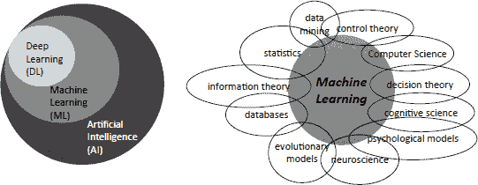

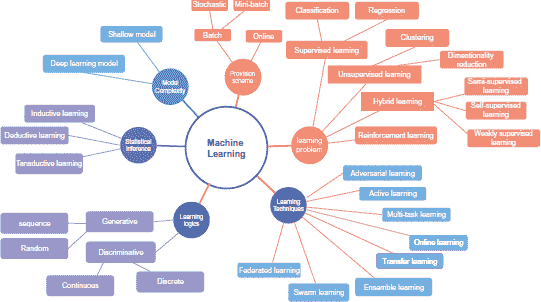

##### 3.2.1 监督学习

监督学习使用带标签的数据来训练算法，以建立特征（输入）和响应（输出）之间的函数关系，从而预测结果或对数据进行分类。因此，它通常分为两类：(i) 分类和 (ii) 回归。监督学习可按如下方式应用于数据分析（附典型算法示例）：

*   **分类：** `Logistic regression`（逻辑回归）、`KNN (K Nearest Neighbor)`（K 近邻）、`SVM (Support Vector Machine)`（支持向量机）、`decision tree`（决策树）、`random forest`（随机森林）、`naive Bayes classifier`（朴素贝叶斯分类器）、`hidden Markov model`（隐马尔可夫模型）和 `conditional random fields`（条件随机场）。

*   **回归：** `Linear regression`（线性回归）、`generalized linear regression`（广义线性回归）、`nonlinear regression`（非线性回归）、`support vector regression (SVR)`（支持向量回归）、`regression tree`（回归树）和 `naive Bayes for regression`（用于回归的朴素贝叶斯）。

许多先进的 `ML` 算法，如梯度提升算法（例如 `GBM`、`XGBoost`）、`Convolutional Neural Network (CNN)`（卷积神经网络）、`Recurrent Neural Network (RNN)`（循环神经网络）、`Gated Recurrent Unit (GRU)`（门控循环单元）、`Long-Short Term Memory (LSTM)`（长短期记忆网络）和 `Bayesian network`（贝叶斯网络），均可处理这两类任务。

##### 3.2.2 无监督学习和自监督学习

与监督学习不同，无监督学习主要处理无标签数据，以发现数据内嵌入信息的模式和关联/相关性（而非预测）。无监督学习有两个常见类别：

*   **聚类：** `Hierarchical clustering`（层次聚类）、`K-means`（K 均值）、`mixture models`（混合模型）、`spectral clustering`（谱聚类）、`density-based clustering methods`（基于密度的聚类方法）（例如 `DBSCAN/OPTICS`）、`self-organizing maps`（自组织映射）等。

*   **降维：** `Principal Component Analysis (PCA)`（主成分分析）、`kernel PCA`（核主成分分析）、`linear/generalized discriminant analysis`（线性/广义判别分析）、`nonlinear dimensionality reduction approaches`（非线性降维方法）（如多维缩放、`t`-distributed stochastic neighbor embedding（t 分布随机邻域嵌入）、`isomap`、`locally-linear embedding`（局部线性嵌入）、`autoencoders`（自编码器）、`self-organizing maps`（自组织映射）等。


# 自监督学习

自监督学习是一种特殊的无监督学习，具有自生成的监督信号或标签。“自监督”并非由预设先验知识的任务诱导；换句话说，这种学习方法仅需无标签数据即可构建预文本学习任务，其目标可在无监督情况下计算得出。`DL` 中的一个通用示例是 `AutoEncoder`（自编码器），它预测其输入（即将输入视为目标输出）及其变体，例如 `variational AutoEncoder (VAE)`（变分自编码器）。另一个例子是 `generative adversarial networks (GANs)`（生成对抗网络），它由至少一个直接生成样本的生成器和至少一个作为生成器对手的判别器构成，判别器能区分从训练数据中提取的样本和生成器创建的样本。根据不同的自监督信号或标签，任务大致可分为四类：(i) 基于数据生成（恢复），(ii) 基于数据变换，(iii) 基于多模态，和 (iv) 基于辅助信息。例如，照片中颜色的恢复（即预测颜色表示/上色）和缺失部分的修复属于数据生成任务。

虽然自监督学习是一种生成式建模，但对比学习是另一种无监督学习，专注于学习共同特征并区分它们的差异。不同于生成式学习，对比学习无需关注实例的繁琐细节。相反，它需要在抽象语义层面的特征空间中区分数据，因此模型优化变得更简单，其泛化能力也变得更强。

## 3.2.3 半监督学习和弱监督学习

虽然监督算法通常需要大量人工标注的训练数据，但半监督方法已被采用以减少标注工作量。在典型的半监督学习设置中，我们拥有相对较少的带标签训练数据，以及相对大量的无标签训练数据。我们可以利用无标签数据来帮助提高监督学习在带标签数据上的性能，或者利用带标签数据来增强无监督学习在无标签数据上的效果。

如果我们的目标是基于无标签训练数据进行预测，这种半监督学习称为转导学习。如果目标是将学习器泛化以预测未来的测试用例，则称为归纳式半监督学习。无标签数据可能有助于预测模型构建的原因在于这样的直觉：假设带标签和无标签数据来自同一分布，则无标签训练集中的数据结构可能揭示带标签训练集中的数据结构。换句话说，如果我们认为相似的数据点应具有相似的输出，那么无标签数据在揭示哪些数据点相似方面就有价值。在训练中，无标签数据信息通常作为正则化项纳入目标函数，以平衡模型在带标签部分和无标签部分之间的拟合。一些典型的半监督方法包括生成模型、`Semi-Supervised Support Vector Machines (S3VM)`（半监督支持向量机）、基于图的模型、协同训练/多视角训练、`positive and unlabeled (PU) learning`（正例和无标签学习）等。例如，`PU learning` 是半监督学习的一个特例，其中仅可观测或获取正标签，而无标签训练集同时包含正例和反例。当然，面对这种更“受限”的数据，建模需要对标记机制做出更强的假设，且这些假设需要在概念上得到证明和/或经验验证，以便我们对模型有足够的信心。

## 3.2.4 强化学习

强化学习算法在与环境交互的过程中学习产生策略驱动的动作，并根据结果获得奖励或惩罚。目标通常是找到使长期奖励加权和最大化的策略。如果我们拥有足够的环境动力学先验知识，可以将强化学习问题建模为马尔可夫决策过程。否则，可以应用无模型算法，如 `Q-learning`、`状态-动作-奖励-状态-动作`、`深度 Q 网络` 和 `深度确定性策略梯度`。

## 3.2.5 其他学习方法

除了上述主流方法外，还有一些特殊的训练技术，它们生成独特的算法以适应特定的应用场景。例如，与离线学习算法相反，在线学习会在有新数据到来时更新模型，即模型预期能使用优雅的算法基于新数据自适应地至少部分更新。有时它也与增量学习相关联。许多机器学习模型都有其在线版本，例如 `SVM`、`极限学习机`、`自编码器` 等。这类算法适用于数据频繁更新且模式发生变化的场景。

单个简单模型可以通过集成学习进一步整合。该方法将至少两个模型（有监督或无监督）的得分结合起来以产生最终结果。预期集成后的模型性能优于任何单个模型。它通常包含三种技术：

*   **Bagging** — 它通常结合同质弱学习器，并行构建独立模型，然后使用确定性平均过程或其他加权方法生成最终结果。
*   **Boosting** — 它通常让同质弱学习器以自适应方式顺序训练模型，例如让新模型更多地关注那些分类错误的样本。
*   **Stacking** — 类似于 Bagging，它考虑异质弱学习器，通常将各个弱学习器的输出作为新输入来训练另一个元模型。

此外，我们想强调一些可应用于工业界的特殊学习方法，尽管它们可能尚不成熟。其中一些关系密切，在方法论上可能存在重叠。

*   **主动学习：** 与半监督学习类似，主动学习从相对较少的标记数据和大量未标记数据开始。然而，不同于标准半监督学习，主动学习允许我们选择部分未标记数据向预言机（如人类专家）查询其真实标签。原始学习器随后可借助额外的标记数据得到增强。因此，这可被视为半监督方法的“人在回路中”版本。为最小化查询预言机的成本，我们需要仔细选择最有价值的未标记训练实例进行标记。一些主动学习算法在选择标准中考虑了样本的信息量和/或代表性。
*   **迁移学习：** 迁移学习是在没有大量标记训练数据时用于深度学习的另一种常用方法。其思路是利用在丰富数据集上预训练的基础机器学习模型，该模型与从头开始学习新模型所需的训练数据相似或相关。如果基础模型能提供底层网络结构和/或特征，我们只需使用相对较少的额外数据来训练高层网络结构和/或特征。除了节省较少训练数据的成本外，仅训练高层网络结构在模型开发期间还能节省大量计算资源。迁移学习已在计算机视觉和自然语言处理中证明了其价值，进而可应用于数据管理任务中的信息抽取和语义解析。此外，由于已有高质量的预训练基础机器学习模型，它也可用于代码优化和日志数据处理等其他领域。应强调的是，即使对于 `GPT-3` 这类强大的预训练模型，基础模型本身可能在特定领域应用中效果不佳。基础模型通常需要使用特定领域数据进行细化、定制和测试。
*   **多任务学习：** 这本质上是设计一种可在多个相关任务上训练的模型的监督学习。与在任何单一任务上训练相比，模型的性能和泛化能力可通过多任务训练得到提升。通常，这些任务共享一些公共特征或深度神经网络中的某些基础层；输出可能由模型的不同部分预测。例如，自然语言处理中的词嵌入可跨多任务使用，如命名实体识别、文本分类和文本生成。在某些定义中，人们将其视为迁移学习的一个子集。
*   **元学习和小样本学习。** 元学习模型从其他学习算法（有监督或无监督）中学习。当它应用 Stacking 技术结合其他学习算法的输出时，它可能是一种集成学习。当它跨多个相关预测任务学习时，它可能是一种多任务学习。小样本学习是一种使用极少量样本的有监督元学习。许多方法将小样本学习表征为元学习问题。小样本学习有时也被视为迁移学习的一个特例。从这个意义上说，元学习与迁移学习紧密相连，它们的结合——元迁移学习——也可应用于小样本学习。

### 联邦学习与群体学习

不同于需要将数据聚合在一台服务器或集群中的传统集中式学习，联邦学习在多个去中心化的边缘节点（如设备或服务器）上训练模型，每个节点持有自己的本地数据集，即这些节点之间不交换数据，而由专门的参数服务器负责聚合和分发本地学习（以参数为中心）。联邦学习在充分利用所有数据信息的同时，确保了不同参与方的数据隐私或数据保密性。群体学习[[1]](#chap3.xhtml#rref1)是联邦学习的一种扩展，它通过群体网络（如基于区块链的点对点网络）训练参数，并在没有中央参数协调器的情况下，在边缘节点的私有数据上独立构建模型。这消除了持有中心参数服务器的第三方带来的潜在风险。

这两种学习方法为金融机构充分利用其数据提供了途径。例如，在一家跨国银行中，不同国家的数据可以输入此学习框架，而无需将数据移出其所在国家。不同银行也可以在不共享数据的情况下构建统一模型，这在金融犯罪检测和风险管理（如了解你的客户 `KYC` 和反洗钱 `AML`）方面非常有用。

### 隐私保护机器学习 (PPML)

此类别包括但不限于同态加密、差分隐私、安全多方计算和匿名化，可应用于集中式学习和联邦学习。一个相关概念是隐私增强技术，旨在为敏感数据提供可信环境（如机密计算），并以去中心化方式进行加密数据处理。

## 3.2.6 知识图谱与图神经网络

知识图谱 (`KG`) 代表了一种统一框架，用于组织、管理和使用与目标业务应用和数据相关联的实体（概念、层级、关系、交互等）的互联集合。它能够以非常类似于人脑处理和存储信息的方式来处理和表示数据与知识。因此，它能够将人类专业知识融入机器学习模型，以做出有意义的决策。

当“连接”起关键作用时，`KG` 在金融机构中有着广泛的应用。它是数据管理的绝佳工具，可解决所谓的孤立数据孤岛问题，因为它可以链接数据、元数据、数据系统架构、数据访问控制或日志、安全事件识别或缓解、数据策略、数据访问策略、合规策略、分析、数据流程或工作流、商业智能 (`BI`) 仪表板或报表、生成或消费数据的应用程序或 `API` 等。

通过连接所有内部数据并提取内部关系，它可以提供数据价值、企业风险和监管合规的全谱视图，并可应用于 `KYC`、尽职调查、投资决策、保险承保、理赔处理、监管报告、交易监控等。

它也是金融反欺诈和反犯罪的重要组成部分，如 `AML`、异常检测、内部威胁、可疑活动报告、伪造等。`KG` 可以通过遍历基于 `CRM`、交易、贷款、交易记录、日志和第三方数据构建的社交网络和交易网络中的海量节点和边，实时识别欺诈模式。同样，推荐系统也可以利用嵌入常识的用户与产品之间的连接来寻找合适的推荐建议。聊天机器人可以利用内置的推理网络提供更好的对话体验。

`KG` 也面临许多挑战，如完整性、正确性等。图神经网络 (`GNN`) 是克服这些挑战的解决方案之一。`GNN` 是一类带有图嵌入的深度学习 (`DL`) 方法（如卷积神经网络 `CNN`）。它们为处理节点级、边级和图级预测任务提供了简单的手段。事实上，利用图结构数据，`GNN` 可以解决各种问题，如节点分类（对节点表示的样本进行分类）、图分类（将整个图分类为不同类别）、图聚类（以图的形式对数据进行聚类）、链接预测（预测节点间的连接）和图可视化（以网络形式呈现数据）。另一个相关概念是图嵌入，它将图的节点表示在低维向量空间中，同时保留网络拓扑和节点信息，以便现有的 `ML` 算法可直接应用于后续的图分析任务。一些基于 `DL` 算法的图嵌入也属于图神经网络。`GNN` 和图嵌入也是自然语言处理 (`NLP`) 的重要工具。更多细节请参见第 5 章。

# 3.3 金融行业的 AI 应用

借助各种 `AI` 和 `ML` 技术，可以形成一些通用应用。例如：

### 图像识别

可帮助识别图像中的物体（目标检测）并识别其类别（图像分类）。最新技术能够“理解”图像内容并生成描述性文本和故事。最著名的例子是人脸识别。如今，在理想的静态条件下，识别准确率可高达 99.99%，误报率低于 0.001%。

### 文本识别

可识别图像中的文本，如标签、数字等。最著名的例子是光学字符识别 (`OCR`)，它是扫描文档进一步文本处理的第一步。高级 `OCR` 可将文本转换为其原始格式，例如带有原始位置信息的表格。一些利用 `OCR` 技术开发的自动化工具用于发票、合同、报价和交易处理。

### 文本处理

有助于从文档中提取关键信息并分析这些文档的属性。例如，对于合同文档，它可能返回合同价值、当事方、时间等，然后我们可以检查合同中的当事方和价格是否正确。

### 文本分类

可判断一份文档属于哪个类别。例如，一些历史文档可根据其功能（如发票、录用通知书、合同）、类型（如新闻、娱乐、体育）、国家和业务单元进行分离。

### 情感分析

是文本分类的一种特殊形式，通过文本描述和表情符号分析情感情绪（如愤怒、喜悦、平淡、厌恶、担忧、悲伤等）和态度（如同意或不同意）。例如，我们可以通过分析在线评论来识别公司的风险。如果许多在线评论对某公司持负面态度，该公司可能风险较高。我们也可以在内部使用它来分析员工对某些话题的态度。

### 语音识别

可将音频转换为文本，如电话通话、会议对话和技术演示等。它常用于音频会议、客户服务和审计。例如，它可以帮助呼叫中心将音频文档转换为文本，以便我们稍后分析文本以提高服务质量和进行内部审计。

### 模式识别与异常检测

可从数据中发现模式并检测异常或离群值。例如，`ML` 可用于识别网络安全中的攻击模式。

上述提到的一些技术是同时应用的。例如，我们可以应用图像处理和异常检测算法，找出监控视频中人类的异常行为。表 3.1 进一步列出了一些在多个领域使用的典型 AI 应用。

**表 3.1.** 部分应用的解释

| **应用** | **解释与效益** |
| --- | --- |
| 聊天机器人 | * 自动解决方案建议与推荐，例如问答、知识库等。<br>* 全渠道与其他系统集成，例如 CRM。 |
| 信用评分 | * 更精准地描绘客户风险画像，考量的是具体个人，而非刻板印象。 |
| 反欺诈与安全 | * 分析开户文档（监管科技），检测账户内模式的异常等。 |
| 机器人流程自动化 (RPA) | * 替代常规可重复性工作，例如发票处理、薪资、销售订单、客户/人力资源信息处理（入职/离职）等。<br>* 文档、工作流等方面的半自动化。 |
| 资产管理 | * 快速准确的预测以减少中介环节，有助于降低运营成本。 |
| 供应链与库存优化 | * 以更低成本预测库存/路线/供应商等的最佳方案。 |
| IT 系统分析 | * 自动化部署、模块化、使用微服务，避免过早进行过度细粒度的优化。<br>* 大数据分析与预测性维护以防止故障。 |
| 协作机器人 | * 完成 IT 硬件/软件的安装/维护/监控等。 |

## 3.3.1 通用应用

与制造业、食品业等其他传统行业相比，金融机构在 AI 采用方面处于领先地位，尽管有时在应用最新的 ML 发展时略显保守。AI 技术已应用于金融机构的前、中、后台各个环节，覆盖零售银行、批发银行、私人银行、IT、审计等各类金融服务领域。表 3.2 总结了行业内一些流行的 AI 应用，如价格预测、资源配置、风险分析以及贷款或信用审批应用。

通过这些 AI 应用，金融机构期望实现：

*   更优质的服务与客户体验；
*   改善的生产生命周期，以及提升的生产连续性和节奏；
*   更高程度的自动化、增强的员工效率、协作与生产力；
*   运营和维护工作的可用性、准确性和一致性提高。

在下一节中，我们将以通用银行为例描述一些典型应用。大型银行通常将其组织划分为两部分：集团业务 (GB) 和集团职能 (GF)，这在第 1 章中已有论述。GB 通常包含零售银行（可能还包括私人银行和财富管理）、批发银行（可能还包括企业、商业和机构银行）以及投资银行。GF 通常指支持职能，如法务、审计、合规/风险、人力资源、财务、IT 和后勤部门。GB 和 GF 在一定程度上可能会融合。

## 3.3.2 零售与私人银行

随着越来越多的银行提供相似的服务和产品，用户体验成为吸引和留住客户的关键。

一些面向客户的应用，如聊天机器人和文档 RPA（定义见表 3.1），快速采用 AI 以提高服务效率和质量。例如，汇丰银行的虚拟助手、富国银行的 Facebook Messenger 聊天机器人、大华银行 (UOB) 的处理机器人，以及美国银行的移动语音助手“Erica”，正在取代客户服务专员原本的工作。由于对准确性有严格要求，这些机器人大多拥有预定义的问答对，这限制了最新生成式 NLP 模型的使用。对于面向内部员工的聊天机器人，这种限制有所缓解，因为其可能需要比精确率更高的召回率。因此，一些最新的阅读理解模型（即 AI 引擎对文本的理解）可直接应用于内部文档，使聊天机器人能够回答用户的问题。

**表 3.2.** 金融机构中的 AI 应用

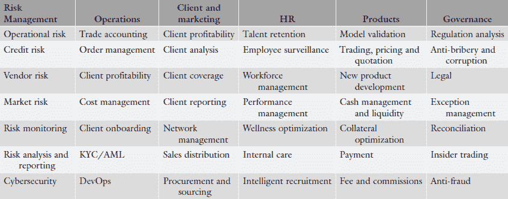

RPA 的基本目标是在软硬件一定程度的辅助下，自动化一些常规可重复性工作。此类常规工作可涉及发票处理、薪资、销售订单、客户投诉等。RPA 早期主要基于规则，但在 ML 技术的加持下，现在变得更强大。

AI 也广泛应用于服务中心，范围涵盖从服务质量监控到自动外呼。例如，根据中国的某些法规，销售人员在销售金融产品前，必须明确告知客户产品风险。这些对话必须录音。AI 引擎可用于理解全部对话内容（而非人工抽样检查），从而检测关键信息是否已由员工陈述并经客户确认。通过情感分析，我们可以进一步识别客户和员工的情绪，并评估其对服务的满意度。

AI 辅助的信用评分系统也广泛用于银行，以推动个性化和即时决策。在中国的一些数字银行，如微众银行（腾讯）和网商银行（阿里巴巴），近乎即时的贷款已开展多年。

通过结合物联网（见第 10 章）和自动化的各种 AI 技术，个性化特质可融入产品和服务中，例如个人财务助手（智能投顾）来管理您的收入、消费、投资、贷款等。投资组合经理也可从投资组合优化、选择和配置中获益。

因此，AI 实际上可以陪伴客户完成全程银行旅程。例如，当潜在客户开始申请开户时，他/她可在申请过程中遇到问题时使用聊天机器人。通过网页或移动端进行在线申请期间，银行可能使用 AI 机器人检测申请人是真人还是机器人代理。填写完所需表格并提交文件后，入职系统将使用 OCR 处理一些图像文档，如扫描的身份证、工资单和地址证明。提取的所有客户信息将通过尽职调查步骤进一步验证，如 KYC。结合传统的征信查询，基于知识图谱的引擎可提供关于申请人的更广泛知识。AI 算法将向银行员工建议批准或拒绝的决定。一旦申请被接受，银行可能使用画像系统更好地了解客户，并随着客户在该银行的金融活动进一步优化。银行可能利用第三方数据（如社交网络和电商）为客户打造更强化的“标签”。推荐引擎可帮助客户经理明智地利用所有数据，向客户提供潜在的金融服务或产品。交易监控系统始终在后台运行，以识别交易是否违法。

## 3.3.3 批发银行

批发银行正加大力度，利用 AI 技术简化客户账户的应收和应付流程。例如，AI 支持的机器人用于前端活动，如保障客户身份安全、提供无摩擦的入职流程、简化流程并提升用户体验。

## 3.3.4 全球市场与交易


算法交易长期以来一直应用 ML，买入或卖出决策由算法模型做出。它将基于第一性原理的模型丰富为数据驱动模型，特征包括历史价格、买卖价差、限价订单簿、仓位规模等。最近，它还将工程运营的 AI 驱动微观经济学整合到其财务结果中，以应对高度竞争的格局、持续的定价压力和波动的需求周期。AI 支持的新闻/博客分析（例如，发现潜在风险）和用户行为分析（例如，识别客户态度）也通过使用 DL 模型（如 `CNN`、`LSTM` 和深度 Q 学习）嵌入其中。

类似技术也应用于资产定价和衍生品市场，例如期权、期货、远期合约、对冲策略等。随着加密货币和区块链的兴起，交易价格预测也正在积极研究中。

### 3.3.5 IT

利用上述基本功能，我们还可以将 AI 应用于 IT 的许多领域。例如，ML 可用于 IT 系统分析，包括数据抽取-转换-加载（`ETL`）、数据分析、系统分析等。它可用于自动化部署、模块化和微服务的使用。它对于预测性维护特别有用。一些行业（如银行）每分钟的停机成本高达数万美元。预测性维护有助于预测潜在故障。在实际系统发生故障之前，您可以做好准备以避免同等程度的损失。

另一个例子是协作机器人（`Cobot`），它利用 ML 实现与人类协作的自动化和灵活流程。`Cobot` 可以从过去的经验中学习以进行模仿。因此，它可以帮助 IT 运维人员完成许多硬件部署和维护工作。然而，最有前景的用途可能是 `AIOps`，将在第 3.6.1 节中讨论。

### 3.3.6 审计

一般审计流程通常有七个步骤，如图 3.3 所示 [[2]](#chap3.xhtml#rref2)。传统上，大多数步骤都是人工处理的。然而，借助 AI 技术，一些具有高审计样本覆盖率的自动化变得可行。

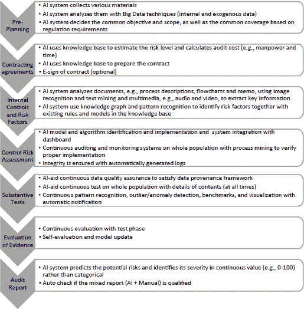

**图 3.3.** 审计程序

例如，在预先规划的第一步中，我们应尝试了解审计业务领域。目前，该步骤中的几乎所有活动均为人工执行。然而，基于 AI 的解决方案可以收集和分析内部和外部数据，以制定共同目标和范围。更先进的系统甚至可以根据监管要求理解审计覆盖范围。在第二步和第三步中，机器阅读技术可以理解预定义格式中的图表流程，并将其转换为知识图谱。之后，AI 推理算法可以估算风险等级和相应成本。

AI 还可以利用 NLP 技术自动编制合同和审计报告。最重要的是，AI 允许对近 100% 的总体覆盖范围进行持续监控和持续审计。

## 3.4 更多考量

### 3.4.1 AI 风险

尽管算法和模型性能是早期的主要考量因素，但金融机构（FIs）已意识到 AI 风险（如数据和模型）的重要性，因为金融机构面向大众并承担社会责任。图 3.4 列出了一些主要 AI 风险。事实上，许多数据驱动决策源于社会背景，同等程度地影响并被社会和个人数据所影响。此外，AI 系统可能面临针对数据集、特征、模型和 IO 接口的各种攻击，如图 3.5 所示 [[3]](#chap3.xhtml#rref3)。以下将进一步讨论数据隐私、模型可解释性和伦理风险。

### 3.4.2 数据隐私与合规使用

金融数据代表了客户、企业和品牌之间的关系。金融机构与消费者之间，在消费者如何看待其金融机构以及金融机构认为自己被如何看待这两者之间，往往存在认知差距。客户期望通过共享数据获得回报，形式包括优惠、降低利率、认可和其他奖励。然而，并非所有金融机构都有能力通过数字渠道实时从数据中提供先进且动态的洞察。

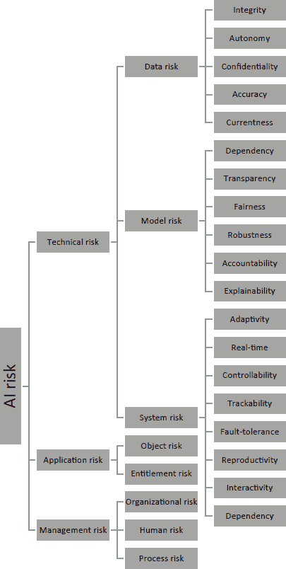

**图 3.4.** AI 风险

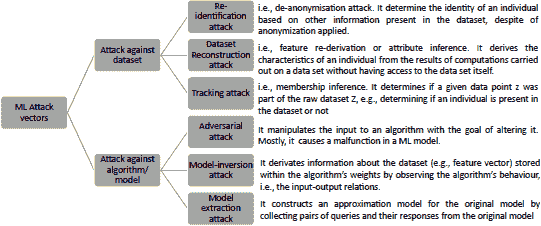

**图 3.5.** ML 攻击类型

表 3.3 展示了 AI 应用的一些典型数据用途。合规使用应同时遵循外部监管要求（如欧盟 GDPR、新加坡 PDPA）和内部合规与风险要求。金融机构应关注数据收集和传输过程中的安全性、数据处理和应用过程中的协作性，以及数据分析共享过程中的流通性。更多信息请见第 4 章。

数据驱动的 ML 无法自动学会通过类比推断知识；因此，其鲁棒性较差（即容易受噪声影响）。ML 与人类学习的机制和方法论存在巨大差异。为增强 ML 能力，有必要整合从人类学习机制中获得的心理学、认知科学和神经科学，并将常识和推理融入学习过程。

### 3.4.3 可解释 AI

可解释 AI（`XAI`；有时与可解释性互换使用）最近受到越来越多的关注。从本质上讲，`XAI` 旨在使 AI 系统（包括建模和结果）更易于人类理解。它通过人类可理解的语言解释结果来提高透明度，通过增强决策信心来建立信任，并通过规范数据模式和模型行为来减少偏见。

**表 3.3.** 金融应用的数据用途

| **应用** | **基本信息** | **高级信息** |
| --- | --- | --- |
| 申请（信用卡） | 个人基本信息、家庭基本信息、就业情况、银行账户 | 网络数据 |
| 精准营销（信用卡） | 个人基本信息、家庭基本信息、就业情况、银行账户、征信 | 电商、个人物联网数据、网络数据、社交网络 |
| 精准营销（贷款） | 个人基本信息、家庭基本信息、资产、就业情况、银行账户、征信 | 电商、个人物联网数据、网络数据、社交网络 |
| 支付违约 | 个人基本信息、家庭基本信息 | 网络数据、资产、电商 |
| 反欺诈（信用卡） | 个人基本信息、家庭基本信息、网络数据 | 电商、个人物联网数据、社交网络 |
| 核保（健康） | 个人基本信息、家庭基本信息、健康基本信息 | 个人物联网数据、网络数据 |

*   个人基本信息 — 身份证、性别、年龄、教育程度、联系方式、居住地等。

#### 数据维度

*   **家庭基础** — 婚姻状况、子女等
*   **健康基础** — 历史重大疾病、当前重大疾病等
*   **电商** — 购买行为与历史
*   **Web** — 浏览行为、App 使用模式、微博等
*   **社交网络** — 电信、Facebook、Twitter、微信、QQ、交友等

---

对于安全性和合规性要求极高的金融应用，在可解释性程度上存在差异。尽管可解释性并非 AI 研究的主要目标，但越来越多的金融机构因业务决策、客户及内部治理要求，实施其内部的 XAI 框架。

正如人类智能本身仍是一个“黑箱”（即无法解释的人脑），某些深度人工神经网络目前尚不完全可解释，尽管它们在解释决策过程方面表现更好。分层 XAI 可能拥有源自数学（如严格数学证明）和统计学（如因果推断）的最严格可解释性，以及源自可视化的最直观方法。2018 年的一项调查 [[4]](#chap3.xhtml#rref4) 为学习 XAI 关键方面提供了切入点，将 XAI 分为两类：(i) 内在方法（均为模型特定，如决策树、线性回归）和 (ii) 事后方法（通常为模型无关，如 `LIME` [[3]](#chap3.xhtml#rfn3) 和 `SHAP` [[4]](#chap3.xhtml#rfn4))。加州大学伯克利分校 Yi Ma 教授的最新研究试图从数据压缩和判别表示（及“群不变性”）原理出发，为解释现代深度（卷积）网络提供合理的理论框架，表明前向传播无需反向传播即可推导出所有参数，如深度架构和线性算子 [[5]](#chap3.xhtml#rref5)。

可解释性与预测准确性往往是两个相互矛盾的指标。正如高计算性能与低功耗、广泛通用性与高效率之间的矛盾，两者难以兼得。然而，当人工神经网络的“低级”错误伴随其高预测性出现时，提高可解释性是防止错误的建议途径。不同应用对可解释性的要求差异巨大。

### 3.4.4 通用人工智能 (AGI)

近年来，深度学习，特别是 NLP 和计算机视觉 (CV)，取得了显著进展。在斯坦福大学主办的斯坦福问答数据集 (SQuAD) 以及纽约大学等机构主办的 GLUE/SuperGLUE 基准测试中，深度学习取得了优于人类平均分的成绩。甚至在更困难的测试中，如 Winograd Schema Challenge (WSC)，`GPT-3` 和 `BERT` 也获得高分（最新基准为 90.1%）。

在许多领域，我们发现随着算力增加，AI 能力显著增强。研究人员和开发者过去依赖各种特征工程训练 AI 模型，现在则依赖大量计算资源让深度学习模型发挥威力，从而超越特征工程。`AlphaGo Zero` 等程序能自行发现规则。然而，正如 AI 从业者指出的，我们可能高估了这些模型的推理能力。例如，当前深度神经网络 (DNN) 模型仍无法在没有卷积和 `LSTM` 组件等人类知识的情况下自行开发结构。即使对于 `AlphaGo Zero`，强化学习中“规则的规则”仍由人类定义。机器可能仍缺乏人类拥有的强大能力，如“反事实”能力。

日本东京大学的 Noriko Arai 教授花费近 10 年时间组织约 100 人研究团队，实施“东大机器人”项目，旨在让机器人于 2021 年“通过东京大学入学考试”。该项目被视为第五代计算机后日本最具影响力的 AI 研究项目之一。尽管机器人击败了 80% 的应试学生，但最终未能达到设计目标。2020 年，她明确指出当前 AI 技术存在许多无法逾越的障碍，最大的困难是“常识”。

2021 年 6 月 5 日，清华大学宣布录取首位虚拟大学生“华智冰”，入读计算机系。学校意在利用该虚拟学生测试 2021 年 6 月 2 日发布的超大规模 AI 模型“悟道” V2，并通过机器学习持续提升虚拟人系统的通用智能水平。然而，在三年内将华智冰的智力培养至大学毕业生水平的雄心引发了激烈争论。

这些项目只是人类朝所谓通用人工智能 (AGI；有时也称 General AI 或 Strong AI) 努力的少数尝试。AGI 是现代 AI 研究的终极目标。那么，这一目标何时能实现？2018 年对全球 23 位顶尖 AI 学者的调查 [[6]](#chap3.xhtml#rref6) 显示，最乐观专家预测 2029 年，最悲观专家认为要到 2200 年。平均预测时间为 2099 年，尚不算“临近”。通过获取足够背景知识、赋予机器更多常识，AI 系统的通用性可逐步提升，但近期无需将类人脑的最大通用性作为主要研究目标。我们可能有更紧迫的研究目标，如鲁棒性、对复杂环境和特定应用的适应性，以及智能系统的安全性与伦理。

### 3.4.5 负责任 AI

负责任 AI (RAI) 是涵盖伦理和法律层面的治理框架。包含多个主题，如可解释性（即 XAI 是 RAI 的一部分）；公平性（见 第 4 章）；可靠性、安全性或鲁棒性；隐私或安全；透明度；问责制、可复现性或可监控性；正当性；效率等。RAI 以人为中心，使模型结果（如预测、推荐和决策）的影响能通过用户体验（人机交互）高效反映。

实践中，我们应始终确保：

*   设计与实现有文档记录，并在多元文化协作与支持氛围中进行
*   数据与模型可度量、可问责，具有高置信度，且能用人类语言解释
*   实施针对偏见或公平性的综合测试，结合 AI 安全工程等

尽管 Microsoft、Google、IBM 等科技巨头已创建或实施其负责任 AI 框架，但大多数金融机构才刚起步。2019 年，Deutsche Bank、Standard Chartered Bank、Visa 与 Linklaters、Microsoft 组建跨行业小组，探索 RAI 原则在金融服务中的应用 [[5]](#chap3.xhtml#rfn5)。2020 年，HSBC 和 UOB 加入新加坡金融管理局 (MAS) 的 Veritas 项目 [[6]](#chap3.xhtml#rfn6)。近期，MAS 启动首届全球 Veritas 挑战赛，加速负责任 AI 解决方案创新 [[7]](#chap3.xhtml#rfn7)。

### 3.4.6 可持续 AI

## 3.5 挑战

对于任何技术而言，如果无法大规模商业化，其自身价值将大打折扣。应用 AI 技术的终极目标是降低成本、提高效率并改善用户体验；否则，AI 技术的开发与应用将失去意义。这已逐渐成为行业共识。

AI 技术在金融机构中提供了许多极具前景的应用。然而，在许多银行中，其落地过程并不顺利。事实上，就商业化而言，AI 大规模生产化的困难可沿技术与场景应用的多个维度进行总结，详见表 3.4。

首先，许多 AI 技术尚不够成熟，或其性能在现实中可能不足以满足业务需求。例如，许多 OCR 引擎利用其特定数据集在某些国际竞赛中取得了高分。然而，当它们应用于现实中的印刷体与手写体混排字符时，准确率可能低于 95%，特别是应用于字形模式远多于拉丁字符的中文字符时。因此，当业务要求支票识别准确率达到 99.9% 时，技术与业务需求之间存在明显的错位。即使是广为人知的人脸识别和语音识别，在某些特殊情况下我们仍可能遇到困难。例如，在新冠疫情常态化共存的“新常态”下，人脸识别必须适配佩戴口罩的场景。由于常规人脸识别模型仅能达到约 95% 的准确率，因此必须利用新数据重新设计和开发人脸特征模式。

**表 3.4.** AI 开发与落地的挑战

| **类别** | **项目** |
| --- | --- |
| 认知与技能 | *   对大众而言神秘莫测，导致过高期望或低估<br>*   尽管 `AutoML` 正在积极发展，仍需要技术娴熟、经验丰富的 ML 团队和角色，如 `data scientist` 和 `ML engineer`；复杂项目需要紧密协作<br>*   技术成熟度/性能与业务需求不匹配 |
| 数据 | *   需要大量数据以保证模型质量<br>*   数据隐私与伦理顾虑，以及 AI 相关的数据风险<br>*   给组织的数据集成战略增加了复杂性 |
| 算法与模型 | *   因数据偏差和算法脆弱性导致的模型复用性问题<br>*   复杂模型（特别是深度学习模型）需要巨大算力，即模型准确率与计算成本之间的平衡<br>*   数据变异性和算法偏见对模型复用性和可解释性的影响<br>*   通用处理与特定模式的对比 |
| 基础设施 | *   ML 框架：谁主导市场；为何没有 AI 专用编程语言；ML 专用编译器的必要性<br>*   算法与硬件的交互：统一的软硬件接口？<br>*   AI 芯片架构的巨大多样性：融合可能性、指令集与编译器<br>*   AI 生态系统 |
| 监管 | *   AI 模型的审计与监管难度<br>*   AI 性能与风险之间的平衡 |

以上所有案例表明，利用当前 AI 技术开发的模型，必须针对特定场景拥有足够的个性化或定制化数据，才能为该场景创建切实可行的应用。此类数据的缺失使得 AI 无法进行“深度学习”。换句话说，认知类非例行任务仍难以通过 AI 技术实现全面自动化。换言之，由数据和算法引发的技术问题已成为 AI 大规模落地的主要障碍。

其次，从基础设施角度来看，现代深度学习（如某些 NLP 模型）需要巨大的计算资源，从而带来高昂的能耗。尽管算力增长在加速，但深度学习的计算需求增长得更快。这促使工程师开发面向深度学习的专用硬件加速器，例如 Google 的张量处理单元（`TPU`）^(10) 和 Intel 的 Agilex `FPGA`^(11)。一项极具前景的技术可能是光子计算 \[8\]，文中解释了光子芯片如何执行神经网络计算，以及基于光的计算如何降低深度学习的能源需求。另一个方面是数据基础设施。数据孤岛在金融机构中依然存在。当银行拥有大量分散的数据源且数据未能良好连接和组织时，银行很难开发高质量的 AI 产品。正如第 1 章所建议的，一个具备合理扩展性和能力的统一数据分析平台是必要的。

第三，AI 风险不仅存在于模型生成的过程中，也存在于模型本身。开发和交付流程可能包含人为错误，无论是否故意。例如，2019 年美国一名退休工程师因在代码中植入后门（定期生成错误）而被起诉，导致公司不得不每年支付巨额费用请他维修系统。极少数心怀不轨的“恶意”开发者利用特权，可能通过某些 AI 程序篡改账户，使其无法被内部简单规则检测到。在其他情况下，如果评估不充分，AI 模型可能继承某些风险。许多 AI 模型常被视为“黑箱”，特别是深度学习模型通常拥有数百万参数，导致其输出难以用易懂的方式解释。

### 系统性创新应对 AI 挑战

为了克服挑战并缓解如图 3.4 所示的 AI 风险，金融机构可采用全组织的系统性创新，在整体考量下实现 AI 行业带来的效益。单点技术创新仅能解决局部问题，而非组织层面的重大命题。一种可能的系统性方法如下：

*   为全组织制定清晰的 AI 战略（如“AI 优先”）和数据资产战略，并夯实技术核心；
*   构建统一的数据基础（如数据中台或数据网格），并与技术池集成；
*   开发专门的 AI 风险管理与控制框架，明确界定 AI 或 ML 风险；指派专人负责 AI 模型验证、审计和管理；
*   建立灵活高效的 AI 开发与运营框架，例如以 `MLOps`（`ML` + `DevOps`；见第 14 章）方式运营的 AI 中台，明确各角色在 AI 开发与运营中的职责；
*   使 AI 采纳更稳健、更普惠。例如，可将自动（辅助）编程技术或利用 AI 的自动进化技术引入 `MLOps`。OpenAI 与 Github 的近期试点项目 `Copilot`，为自动编程时代打开了大门。^(12)

## 3.6 趋势探讨

毫无疑问，强 AI 或通用 AI 仍处于起步阶段，我们必须解放思想，争取“百花齐放、百家争鸣”。对于弱 AI，我们应毫不犹豫地大力开发和推广，拓展更多场景，将 AI 技术融入数字经济和智慧社会。

### 3.6.1 MLOps 与 AIOps 对比

`MLOps` 和 `AIOps` 是两个不同的概念。前者将 `DevOps`（见第 12 章）应用于 ML 生命周期，使整个生命周期易于管理和交付；后者则利用 AI 技术增强 IT `DevOps` 能力。详见表 3.5 对比。我们将在第 14 章详细讨论 `MLOps`。

根据 Gartner 定义，`AIOps` 平台通过自动化和智能化，从大数据、现代 ML 及其他高级分析技术中获得主动、定制化和动态的洞察，直接或间接改善 IT 运维（如监控、维护、诊断和服务台），如图 3.6 所示。

**表 3.5 MLOps 与 AIOps 对比**

| | **MLOps** | **AIOps** |
| --- | --- | --- |
| **主要职责** | 利用 `DevOps` 实现一定程度的自动化，标准化 ML 生命周期 | 利用 AI 技术实现 IT 运维和系统的自动化 |
| **主要收益** | 提升团队协作、效率与生产力；自动化并复现 ML 实验；降低 ML 风险与偏见等 | 自动化重复流程；轻松实现异常检测、预测性运维和根因分析/解决；支持数据驱动决策等 |


| **工具** | Azure ML, Amazon SageMaker, Kubeflow, MLflow, DataRobot, Databricks | Splunk, IBM Watson AIOps, ServiceNow, BMC Helix, AppDynamics, Dynatrace, Moogsoft |

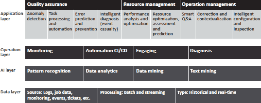

**图 3.6 AIOps 技术栈**

传统 IT 是被动响应的，如同僵尸大军的战斗。只有问题发生时，我们才试图解决。最好的预期结果也是 0:0 平局。`AIOps`是一种主动方法，它能提前预测数步，快速生成相关洞察，并迅速采取行动预防同类问题及其蔓延，从而实现强有力的 IT 进攻。

除 IT 运维（可能也在`DevOps`框架下）外，`AIOps`还能支持服务台和信息安全团队的工作，同时服务于业务领导者和操作人员。

`AIOps`的第一层级是利用 IT 系统的物理与软件拓扑，结合 AI 技术聚合告警，简单地检测异常和例外、关联事件分组，并在同一时期减少误报。

下一层级是应用因果分析找出系统错误的根因。部分功能由`AIOps`工具提供，如`BMC`、`Moogsoft`、`Splunk`和`ELK`（`ElasticSearch`、`Logstash`、`Kibana`）。这通常用统计 ML 或图计算实现。可通过多种方法查看拓扑信息，找出拓扑中最可能发生重要事件的节点。然而，从因果分析（找出问题根因）到主动诊断（主动修复问题）仍存在巨大鸿沟，即概念构想与实际有效落地在近期内仍有差距。我们应制定循序渐进的计划并设定合理的切入目标，同时提升`AIOps`平台能力。在金融机构应用`AIOps`时，其他挑战还包括数据监管、ROI（投资回报率）成本考量、过多遗留 IT 系统供 AI 学习等。

根据 Gartner 预测，到 2023 年，约 30%的大型企业将在其非遗留 IT 资产中采用`AIOps`平台和数字体验监测技术。特别是 COVID-19 大流行，使人们更广泛地认识到`AIOps`的必要性；IT 运维中更多手工和例行工作将被自动化的`AIOps`取代。随着近期 AI 技术（如`NLP`、因果推理等）的进步，我们可期待更快的事件响应、增强的安全性，以及面向远程和自动化 IT 运维的预防性预后。

`AIOps`和`MLOps`实际上都暗示了 AI 工程化的一个重要趋势，这使 AI 在各领域的采纳更容易，对最终用户更便捷。

#### 3.6.2 低代码/无代码与 AutoML

低代码通常是基于图形用户界面（`GUI`）的编程/开发方法，仅需极少人工编码即可加快应用交付。无代码更进一步，即开发过程几乎完全无需人工编码。

低代码/无代码平台通常构建于云架构（如`AWS`、`Microsoft Azure`、`GCP`）之上，具备像`Kubernetes`和`Docker`这样的自动弹性伸缩容器化能力。这些平台通过支持业务与 IT 紧密协作的快速解决方案构建，在一定程度上实现了应用开发的民主化。这些平台通常基于模型驱动概念，通过拖拽式界面开发端到端的企业级应用，便于与现有系统的定制和集成。通过向公民开发者屏蔽底层复杂性（如 AI 模型、数据库、`UX`、安全、集成等），平台能更快构建和交付“革命性”解决方案。值得注意的是，底层的`AutoML`（自动化 ML）支持在无深厚数据科学知识的情况下构建高质量 AI 模型。因此，这些平台能激发 AI 创新、提升用户体验、推进数字化转型，并为应用带来更多个性化。

金融机构在考虑采纳这些平台时，必须考量成本与`ROI`（投资回报率）、基础设施、开发者资源、安全性等因素。平台必须与数据平台集成并建立合适的数据管道，以便无缝输入高质量数据。`DevOps`（`MLOps`）可能是平台的一部分，以实现快速交付。典型平台包括`Salesforce`、`Mendix`、`OutSystems`、`Microsoft Power Apps`、`Appian`、`ServiceNow`、`Google App Maker`等。这些平台已在金融机构的部分应用中使用。表 3.6 列举了一些示例。

正如 Gartner 指出的那样，到 2024 年，超过 65% 的应用程序开发活动将由低代码开发处理，其开发技术市场规模在 2021 年将达到 138 亿美元。^(14)

**表 3.6.** 使用低代码或零代码平台的应用

| **银行** | **解决方案提供商** | **应用** |
| --- | --- | --- |
| Aviva（英国跨国保险公司） | Appian | 利用来自 22 个系统的数据构建了单一客户视图，从而实现了更高效的呼叫中心运营。客户服务响应时间提高了 9 倍，成本降低了 40%。 |
| Bendigo Bank（澳大利亚最大的零售银行之一） | Appian | 通过以每月超过一个的速度开发和部署 23 个一级企业应用，转变了客户体验。 |
| 汇丰银行、渣打银行、新加坡发展银行等 | ServiceNow | 快速构建了其内部聊天机器人和服务门户。 |
| 合作银行（荷兰跨国银行） | Mendix | 开发了其完全集成的网上银行门户，为超过 50 万客户管理 180 亿欧元资产，并实现了 IT 成本减半。 |

请注意，这些平台可能并不适用于所有情况。例如，一些具有高安全性和合规性要求的应用程序，可能无法在平台内找到合适的开箱即用框架。一些高性能应用程序也可能面临挑战，因为与经验丰富的开发人员编写的定制代码相比，自动生成的代码可能效率不够高。考虑到总体成本，传统开发可能前期成本更高，但应用程序通常独立于平台运行。因此，传统开发用于扩展的长期成本较低。此外，明智地使用这些平台仍然需要平台本身的“专业知识”，这意味着存在学习曲线。事实上，即使对于 Microsoft Office（Word、PowerPoint、Excel、Access）等常见且“简单”的软件，真正掌握其高级功能（如宏、模板、插件等）的人也不多。正如 3.5 节 所讨论的，特定的 AI 应用通常需要特定的实现，这对于某些 NLP 任务尤其如此，因为目前的 AutoML 技术还不够智能，无法达到 AGI（通用人工智能）的水平。问题建模和建模、相关数据处理、特征工程以及模型训练/微调以满足业务多目标，对于非专家来说仍然难以驾驭。因此，尽管 AutoML 和低代码或零代码平台是 AI 民主化最重要的驱动力之一，但要实现真正的民主化，还有很长的路要走。

#### 3.6.3 预训练语言模型

PTM（预训练语言模型）的出现开启了 NLP 的新纪元 [9]。从第一代词嵌入（如 `word2vec`、`fasttext`）到最新的 Transformer 模型（如 `GPT` 和 `BERT`），PTM 被应用于越来越多的领域，例如问答、情感分析、文本分类、NER、文本摘要等。基于海量文本语料库的 PTM 通常可以为各种下游任务学习通用的语言表示。从 PTM 开始，新模型的初始化通常优于随机初始化，因此在微调后收敛得快得多。即使在小数据集上训练，PTM 也能在一定程度上避免过拟合。最近，这种“预训练、微调”模式进一步发展为“预训练、提示、预测”模式，利用文本提示重新构建下游任务。

PTM 的架构已从浅层发展到深层。自 `GPT` 和 `BERT` 以来，PTM 变得越来越大。OpenAI 于 2020 年 5 月发布了无监督 PTM 模型 `GPT-3`。该模型基于 45 TB 的数据集，包含 1750 亿个参数，在上下文查询、文本生成、机器阅读理解、机器翻译等方面打破了多项纪录。Google 于 2021 年 1 月发布了其 Switch Transformer（首个万亿参数模型），并于 2021 年 5 月发布了 `LaMDA`（对话应用语言模型，新一代聊天机器人）和 `MUM`（多任务统一模型，新一代搜索引擎）。2021 年 6 月，北京智源人工智能研究院（BAAI）发布了其拥有 1.75 万亿参数的模型，当时位居世界首位。

由于训练和应用超大型 PTM 的难度和复杂性，一些研究人员也在寻找利用模型压缩技术减小模型规模的方法，例如参数量化/二值化、网络剪枝、知识蒸馏等。

PTM 可以通过知识增强模型（嵌入领域知识）、多语言模型和多模态模型（文本结合视频、图像、音频等）进行增强。它们也被扩展到文本以外的领域，如代码（例如 `Copilot` 和 `Codex`）和表格（例如 `Tapex`）。因此，我们可以预期 PTM 将拥有更广泛的应用。

利用金融专用语料库，可以训练金融专用 PTM，并将其应用于前面提到的多种 NLP 任务；`FinBert`^(15) 就是其中一个例子。

#### 3.6.4 面向分析和 AI 的集成数据平台

从数据库、数据仓库，到数据湖和湖仓一体，将内部数据源统一到合适的数据存储和管理系统中以挖掘数据价值，始终是金融机构内部的热门话题。随着边缘感知设备的广泛使用，如何统一本地部署、云和边缘的数据变得更具挑战性。金融机构采用了来自不同供应商的各种数字化解决方案和平台。然而，通常一个解决方案或平台只能解决一个问题。

因此，“平台的平台”概念应运而生，旨在提供“最佳组合”解决方案。该策略允许金融机构通过集成来自多个不同供应商的产品（如软件、平台、硬件和基础设施）来组装其现有解决方案。它利用了金融机构现有的 IT 决策和投资，并允许金融机构专注于提供最有价值的服务和产品。数据中台最初由阿里巴巴使用，是该领域的应用之一。

#### 3.6.5 生成式合成内容

众所周知，合成数据可用于提升 AI 模型质量。通过数据增强技术（例如针对图像的几何、颜色、空间变换、核滤波、随机擦除或剪枝；针对文本的词、短语或句子打乱和替换；针对语音的噪声注入和偏移），AI 模型可以适应更多场景。

合成内容不止于此。借助上述先进的 PTM，AI 可以帮助撰写新闻、诗歌、小说、音乐作品、代码等。然而，NLP 并不是生成合成内容的唯一 AI 领域。Deepfake（深度伪造），一种基于深度学习的虚假内容生成技术，能够合成人类难以辨别的图像、视频和声音，例如换脸、傀儡术（模拟面部或全身动作和行为）、声音克隆、对口型、人像合成等。

生成对抗网络（GAN）在创作虚假艺术品方面展现了非凡的成就，这与作为许多 NLP PTM 基础的 Transformer 类似。通常，GAN 需要大量训练集。然而，一些最新的发展利用数据增强方法大幅降低了数据需求。

合成技术也可广泛应用于金融机构。例如，营销邮件和电话可以个性化定制，服务中心的通知和催收可以由 AI 机器人取代。元宇宙内的虚拟银行（见 第 2 章 和 第 10 章）可能带来更生动的虚拟形象，以提供更好的用户体验。

当它们为金融机构带来利益时，也可能因恶意使用而导致一些伦理风险，例如诈骗、欺诈、政治虚假信息、伪造身份等，这些威胁着心理安全、政治稳定和业务可持续性。金融机构必须捍卫 AI 信任，并通过增强的 AI 技术采取适当的对抗措施来保障其安全。

#### 3.6.6 网络安全

随着网络攻击在技术上变得更加复杂且攻击目标更加多样化，网络安全近期变得愈发重要。事实上，网络攻击的数量和类型逐年增长。根据 Experian 2021 年的一份报告，55% 的公司将安全列为首要任务。金融机构将重点打击数字交易过程中的各种风险，如数据泄露、欺诈、泄露点和洗钱。

反网络攻击工具应能提前预测漏洞并最终消除它们。金融领域的 AI 可帮助您发现安全系统中的漏洞并探索潜在解决方案。它将能够分析账户注册信息、检测异常活动等。预计 AI 将有助于解决许多人工无法解决的问题。例如，AI 可通过深入挖掘海量数据以发现威胁模式来识别未知威胁，通过分析用户行为生物识别特征的背景信息来提高认证等级，立即响应异常交易以防止某些欺诈行为等。所谓具有集中策略编排和分布式策略执行的网络安全网格，需要 AI 赋能器使其具备响应性和主动性。同时，AI 模型必须足够稳健以防止对抗性攻击，因此，隐私保护计算和联邦学习将为此目的而融合。利用机密计算对高度敏感数据进行分析和建模将在可信执行环境中进行。

### 3.7 结论

AI 正在彻底改变金融机构利用数据获取有价值洞察、做出快速决策以及自动化部分重复性任务的方式。流行的 AI 应用范围涵盖算法交易、欺诈检测、反洗钱、风险评估，到各业务单元中的虚拟金融助手，这些使得金融机构的 `BAU`（日常业务运营）成为可能，尤其是在 COVID-19 大流行重创“正常”生活时。事实上，AI 正被广泛集成到客户用户界面/用户体验（`UI/UX`）、自动聊天服务、全渠道营销与客户支持、异常检测和安全报警中。这不仅使银行员工能专注于解决更复杂的问题，也有助于客户获得更高的满意度。更广泛地说，AI 颠覆性技术可显著增强金融机构在盈利能力、效率、个性化和创新生命周期方面的能力。

然而，由于数据和模型的限制（例如各种监管要求、内部可用性和易用性）、`ROI` 和成本、实际的伦理与可解释性实施等，AI 应用的历程通常并不平坦。尽管如此，`AIOps`、`MLOps`、低代码/无代码平台、`PTM`、可解释 AI、可持续 AI 等的最新进展，可能在技术上为 AI 在金融机构中更广泛、更深入的采用铺平道路。同时也鼓励金融机构充分利用 `FinTech-as-a-Service`（`FaaS`，金融科技即服务）的进展，以快速获得 AI 能力。

总之，一个 AI 驱动的金融机构必须拥有完整的能力栈以实现价值创造。图 3.7 为现代银行提供了一个示例，其栈涵盖方法论、数据、核心技术、AI 能力与应用以及创新服务体验。关键在于在组织内部建立敏捷、分析型和创新的文化，整合核心数据和核心技术的平台的平台，通过 `FaaS` 和内部开发提供 AI 能力层，最后创建以客户为中心的层，以交付高质量产品并提高客户满意度。

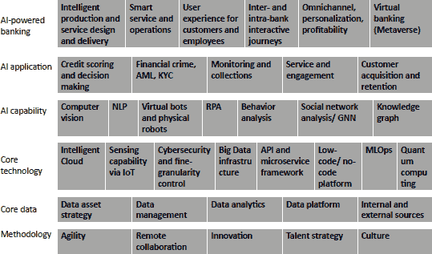

**图 3.7.** AI 驱动型银行的能力栈

### 参考文献

1. S. Warnat-Herresthal, H. Schultze and *et al.*, “Swarm Learning for decentralized and confidential clinical machine learning,” *Nature*, Vol. 594, pp. 265–270, May 2021.

2. Editorial, “Research Ideas for Artificial Intelligence in Auditing: The Formalization of Audit and Workforce Supplementation,” *Journal of Emerging Technologies in Accounting*, Vol. 13, No. 2, December 2016.

3. G. A. Kaissis, M. R. Makowski, D. Rückert and R. F. Braren, “Secure, privacy-preserving and federated machine learning in medical imaging,” *Nature, Machine Intelligence*, pp. 305–311, June 2020.

4. A. Adadi and M. Berrada, “Peeking Inside the Black-Box: A Survey on Explainable Artificial Intelligence (XAI),” *IEEE Access*, Vol. 6, pp. 52, 138–52,160, September 2018.

5. K. H. R. Chan, Y. Yu, C. You, H. Qi, J. Wright and Y. Ma, “ReduNet: A White-box Deep Network from the Principle of Maximizing Rate Reduction,” [`arxiv.org/abs/2105.10446`](https://arxiv.org/abs/2105.10446), May 2021.

6. M. Ford, *Architects of Intelligence: The truth about AI from the people building it*, Packt Publishing, 2018.

7. A. van Wynsberghe, “Sustainable AI: AI for sustainability and the sustainability of AI,” *AI and Ethics*, February 2021.

8. R. Hamerly, “The Future of Deep Learning is Photonic,” *IEEE Spectrum*, June 2021.

9. X. Qiu, T. Sun, Y. Xu, Y. Shao, N. Dai and X. Huang, “Pre-trained models for natural language processing: A survey,” *Science China Technological Sciences*, No. 63, pp. 1,872–1,897, September 2020.

---

¹ L. Goasduff. “2 Megatrends Dominate the Gartner Hype Cycle for Artificial Intelligence, 2020”. Gartner. [`www.gartner.com/smarterwithgartner/2-megatrends-dominate-the-gartner-hype-cycle-for-artificial-intelligence-2020/`](https://www.gartner.com/smarterwithgartner/2-megatrends-dominate-the-gartner-hype-cycle-for-artificial-intelligence-2020/), retrieved Nov 21, 2021.


² D. Morissey. “4 Principles of Responsible AI in financial services”. Microsoft Industry Blogs. [`cloudblogs.microsoft.com/industry-blog/financial-services/2021/03/29/4-principles-of-responsible-ai-in-financial-services/`](https://cloudblogs.microsoft.com/industry-blog/financial-services/2021/03/29/4-principles-of-responsible-ai-in-financial-services/), retrieved Nov 22, 2021.

³ “Lime: Explaining the predictions of any machine learning disaster”. Github. [`github.com/marcotcr/lime`](https://github.com/marcotcr/lime). Accessed Nov 21, 2021.

⁴ “A game theoretic approach to explain the output of any machine learning model”. Github. [`github.com/slundberg/shap`](https://github.com/slundberg/shap). Accessed Nov 21 2021.

⁵ “From principles to practice: Use cases for implementing responsible artificial intelligence in financial services”. Linklaters. [`www.linklaters.com/en/insights/publications/2019/november/from-principles-to-practice-use-cases-for-implementing-responsible-ai-in-financial-services`](https://www.linklaters.com/en/insights/publications/2019/november/from-principles-to-practice-use-cases-for-implementing-responsible-ai-in-financial-services). Accessed Nov 21, 2021.

## 第 4 章

### 金融行业的 AI 公平性：一种机器学习流水线方法

#### Jun Xu

#### 4.1 引言

人工智能（AI）技术和机器学习（ML）算法在我们的日常生活中激起了极大的热情，从智能电视、手机、无人驾驶汽车到登陆火星的机器人。特别是随着“大数据”的创建、收集和存储，以及大型商业和金融组织中算力和存储能力的高度集中，ML 算法展示了在海量数据集中识别人类可能无法察觉的非直观和隐性相关性的能力。因此，ML 模型已被金融机构（FIs）广泛采用，作为决策过程的一种手段，涵盖高频交易、网络安全，以及各种金融产品和服务。

近年来，如何妥善使用 AI 重新引起了大众的广泛关注。事实上，当 AI 带来大量益处时，如果不仔细考虑 AI 伦理，特别是 AI 公平性，某些利用 AI 的应用可能会对人类社会造成危害。例如，美国司法系统中使用的“替代制裁罪犯管理画像系统”（COMPAS）软件已被证明对非裔美国人存在偏见。医疗系统的一个住院评分模型偏向特定种族群体。

在金融行业，AI 公平性也扮演着重要角色。机器做出的决策可能影响金融产品和服务的大量用户群体，例如信用评分和贷款，且固有的一定程度的偏见客观存在。从金融机构客户收集的某些数据可能容易产生偏见和不平衡，例如，持有世界顶级商务信用卡的男性持卡人多于女性持卡人。此类偏见也可能存在于聊天机器人、在线广告和营销冠军、面部识别等领域。

然而，由于大多数 ML 和深度学习（DL）算法的黑盒本质，算法输出的公平性成为一个严重的担忧，尽管人们期望利用机器的“公平性”从决策过程中消除人类的偏见！因此，已进行了许多研究和实验，旨在将公平性嵌入 AI 建模中。

本章提出了一个解决上述问题的实用框架。它从 AI 伦理和公平性的高层概念前景入手。然后，我们制定了构建 ML 流水线方法的指南。ML 与公平性概念之间的联系与矛盾得到了深入讨论。通过示例演示了如何在 ML 流水线方面考虑公平性。本章的贡献有三方面：(i) 总结了金融机构中 AI 公平性的关键点；(ii) 引入 ML 流水线方法，详细解释了具有结构化表示的公平性处理；(iii) 详述了实质性的工作流图表和检查清单。

#### 4.2 AI 伦理与公平性

许多政府组织已深入讨论 AI 伦理，例如，新加坡金融管理局（MAS）提出了 FEAT 原则（即公平性、伦理、问责制和透明度）及实践，美国国防部采用五项原则（即负责、公平、可追溯、可靠和可治理），欧盟于 2018 年发布了可信 AI 伦理准则，澳大利亚政府也发布了包含八条规则的版本。中国、英国和澳大利亚等其他国家也发布了 AI 伦理准则。在图 4.1 中，我们建议了七个主要特征。

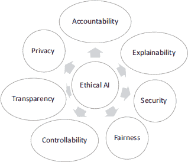

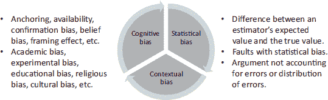

关于公平性的定义，已提出多个版本。粗略地说，公平意味着“无偏见和无歧视”，即具有相似属性的人应受到相似对待，否则应受到不同对待。

---

⁶ “Fairness metrics to aid responsible AI adoption in financial services”。新加坡金融管理局。 <https://www.mas.gov.sg/news/media-releases/2020/fairness-metrics-to-aid-responsible-ai-adoption-in-financial-services>。访问日期：2021 年 11 月 21 日。

⁷ “MAS launches global challenge to accelerate innovation in responsible AI solutions”。新加坡金融管理局。 <https://www.mas.gov.sg/news/media-releases/2021/mas-launches-global-challenge-to-accelerate-innovation-in-responsible-ai-solutions>。访问日期：2021 年 11 月 21 日。

⁸ The 17 goals, Department of Economic and Social Affairs, UN. <https://sdgs.un.org/goals>. Accessed Nov 21, 2021.

⁹ K. Crawford et al. AI Now: 2019 Report. The AI Now Institute. <https://ainowinstitute.org/AI_Now_2019_Report.pdf>. Accessed Nov 21, 2021.

¹⁰ “Cloud TPU: Train and run machine learning models faster than ever before”。Google Cloud。 <https://cloud.google.com/tpu>. Accessed Nov 21, 2021.

¹¹ “FPGA vs. GPU for Deep learning”。Intel。 <https://www.intel.com/content/www/us/en/artificial-intelligence/programmable/fpga-gpu.html>. Accessed Nov 21, 2021.

¹² “Your AI pair programmer”。Github。 <https://copilot.github.com/>. Accessed Nov 21, 2021.

¹³ P. Prasad, P. Byrne, and J. Chessman. “Market Guide for AIOps Platforms”。Gartner Research。 <https://www.gartner.com/en/documents/4000217/market-guide-for-aiops-platforms>. Accessed Nov 21, 2021.

¹⁴ P. Vincent, K. Iijima, M. Driver, J. Wong, and Y. Natis. “Gartner Magic Quadrant for Enterprise Low-Code Application Platforms”。Gartner。 <https://www.gartner.com/en/documents/3956079/magic-quadrant-for-enterprise-low-code-application-platf>. Accessed Nov 21, 2021; K. Costello and M. Rimol. “Gartner forecasts worldwide low-code development technologies market to grow 23% in 2021”。Gartner。 <https://www.gartner.com/en/newsroom/press-releases/2021-02-15-gartner-forecasts-worldwide-low-code-development-technologies-market-to-grow-23-percent-in-2021>. Accessed Nov 21, 2021.

¹⁵ “FinBert: Financial Bert (in Chinese)”。 <https://github.com/valuesimplex/FinBERT>. Accessed Nov 21, 2021.

¹⁶ “2021 Global Identity and Fraud Report: Protecting and enabling customer engagements in the new digital era”。Experian。 <https://www.experian.com.sg/wpcontent/uploads/2021/04/Experian-Global-Identity-Fraud-Report-2021.pdf>. Accessed Nov 21, 2021.

© 2022 World Scientific Publishing Company

<https://doi.org/10.1142/9789811250903_0004>

有些偏见是固有且不可避免的，但大多数并非如此；相反，它们只是被简单地误用或被操纵了。图 4.2 从总体上展示了三种常见的偏见类型，如果我们保持谨慎，就能避免大多数认知偏见和情境偏见。

公平性实际上与准确性、隐私、可解释性和安全性等其他因素密切相关（图 4.3）。公平性通常与可解释性同向，但在某些场景下可能与其他因素不同向；因此，我们可能需要在设计阶段进行权衡。例如，AI 系统通常难以同时实现高度的隐私和准确性。同样，更多的隐私信息可以使公平待遇更具可调性。请注意，我们需要考虑应用场景，因为有时准确性更为重要，且存在隐私和公平性的合理依据。然而，有时必须以牺牲准确性为代价来满足公平性指标。因此，风险缓解技术对于在不同指标之间实现正确的平衡是必要的。

在 AI 和数据驱动建模中，我们通常使用“受保护”变量来表示可能导致公平性问题的因素，例如性别、年龄、种族、国籍、残疾状况、性取向、宗教、文化、神学、传统、社会阶层、资源可得性和族裔。相对的是“非受保护”变量，指市场上可获得的公开信息。

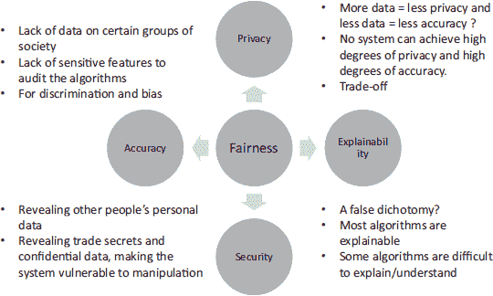

**图 4.3.** 公平性与其他因素的关系

受保护变量通常涉及个人隐私，其使用方式因金融产品类型而异。例如，申请信用卡可能需要个人收入，但开设一般银行账户则不需要。这些受保护变量可进一步细分为特权和非特权类别。例如，残疾人和少数族裔通常被视为非特权类别。

AI 伦理不应被视为对金融机构为股东增加利润能力的约束。事实上，AI 伦理原则可作为创新发展的关键设计标准之一，旨在改善福祉、减少不平等和偏见，并帮助人们实现目标。例如，因种族原因被错误预测为高风险而拒绝放贷，既是声誉风险，也是错失良机。通过消除此类偏见，金融机构可能吸引更多高净值客户。

因此，金融机构应建立其 AI 伦理框架。正如新加坡个人数据保护委员会（PDPC）所指出的^6，该模型框架旨在广泛适用——它应与算法、技术、行业、规模和商业模式无关。AI 中公平待遇的设计应遵循类似规则。由于 ML 流水线可应用于大多数设计和开发流程，我们选择将其作为主干来讨论 AI 公平性。在接下来的两节中，我们将首先讨论通用 ML 流水线，然后介绍公平性流水线的更多细节。

#### 4.3 ML 流水线

流水线是许多行业广泛接受的概念和方法论。产品流水线是一系列组件，用于减少已完成任务之间的延迟。它具有一定程度的自动化，并提高了产品生命周期各阶段的吞吐量。流水线通常包含批处理，即收集数据、通过网络发送数据并对其进行处理，以提供预计算的结果和指导，供下一阶段使用。

ML 流水线用于创建正式且自动化的 ML 工作流。它构建了数据和模型生命周期中必要的组件和步骤。例如，数据流水线使一系列数据能够在发送至模型进行训练、测试和评估之前，被提取、转换、过滤和清洗。模型流水线还包含模型部署和维护。ML 生命周期通常包含五个阶段：项目设计、数据处理、模型开发、模型/系统部署和模型维护，如图 4.4 所示。

通用的 ML 生命周期流水线如图 4.5 所示。ML 生命周期中 ML 流水线的抽象概念称为 MLOps，将在第 14 章中进一步讨论。

对于一个完整的新项目，其问题陈述、范围和目标必须首先由业务利益相关者和 SME（领域专家）明确定义。开发团队研究其可行性并提供潜在解决方案。项目启动前应估算资源和成本。项目正式启动后，需申请批准以访问各种 ML 相关资源（如数据、工作台、ML 平台和云）。然后，原始数据将从数据库或其他数据源摄入，在阶段 1 进行预处理和分析，随后送入阶段 2 的 ML 开发环境。

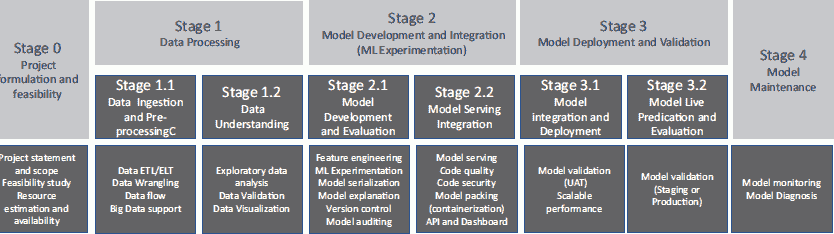

**图 4.4.** 五阶段 ML 生命周期

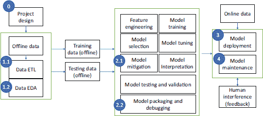

**图 4.5.** ML 流水线

ML 开发通常是一个迭代过程，旨在通过阶段 2 的适当评估指标来增强特征并改进模型。处理后的数据和特征可存储在 `Feature Store` 中。相关代码、配置和文档将存储在 `Git`（一种文件版本控制和管理系统，如 `Bitbucket` 或 `Github`）中，模型将注册在 `Model Inventory`（模型清单，或 `Model Registry` 模型注册表）中，并可在 `Central Repository` 中访问。ML 开发人员可从 `Central Repository`（如 `Artifactory`，一种通用制品仓库管理器）获取所需工具和仓库，并获得容器镜像的访问权限（如打包好的 ML 模型和环境）。一旦所有必要的制品准备就绪，模型（可能集成到系统中）将部署在不同环境中（如用户验收测试 (UAT) 和预发布环境，用于测试和验证）。不满意的 ML 指标结果可能导致 ML 模型重新训练（即从阶段 3 返回阶段 2）。

如果所有测试均通过，且模型/系统由授权人员签署批准，则可将模型和系统推广至正式生产环境。`Feature Store` 可向 ML 模型输入实时数据，用于实时或批量推理。必须实施适当的监控和诊断配置，以应对潜在的 ML 问题（如模型性能下降、数据漂移等），这可能会触发带有适当流程治理的重新训练事件。

请注意，并非每个项目都必须包含此处所示的所有五个阶段或所有组件。有时，即使流水线中的执行顺序也可能不同。合理的流水线设计应取决于实际项目需求，而非固定结构。更多细节将在第 14 章中讨论。

#### 4.4 公平性流水线

遵循 ML 流水线，我们可以创建类似的公平性流水线。图 4.6 强调了每个阶段需要提出的几个问题，表 4.1 强调了每个阶段的关键考量。

消除偏见的前提是在产品和服务设计阶段对公平性进行恰当的定义和度量。为简单起见，我们可将其分为三个阶段：建模前、建模中和建模后，如表 4.2 所示，每个阶段的重点分别为数据、模型和维护。

To quantitatively assess the degree of fairness, many metrics for data and models have been created. Data bias is usually assessed from its statistical properties (such as mean, maximum, minimum, distribution functions, etc.), while model bias requires more elegant algorithms to identify. Figure 4.7 lists some commonly used metrics for (discrete) classification problems, including binary classification problems such as fraud/non-fraud, approve/non-approve, etc. For multi-class problems, we can apply similar ML training techniques (such as one-vs-rest or one-vs-one) to these metrics.


For continuous cases such as regression, bias metrics can be built around aggregate functions of errors produced by the model on different types of individuals (such as Mean Squared/Absolute (Percentage) Error, i.e., `MSE`, `MSPE`, `MAE`, `MAPE`), or by testing the distributional similarity of these errors across subgroups. The continuous outcomes produced by predictions add complexity to fairness definitions, requiring consideration of the magnitude of errors. For example, we need to choose between a model with large errors on minority groups versus one with relatively small errors on majority groups.

```
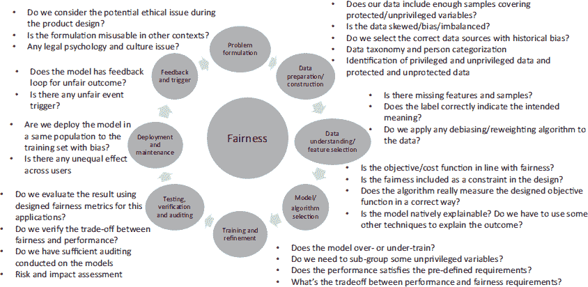
```

**Figure 4.6.** General points of fairness pipeline in ML lifecycle

**Table 4.1.** Fairness pipeline considerations

| **Stage** | **Fairness Considerations** |
| --- | --- |
| Design | * Task, scope, business domain, end users<br>* Stakeholders, product owners<br>* Potential errors and harms |
| Data | * Data provenance, ETC compliance<br>* Data representation, privacy, security<br>* Data validation procedures through qualitative and experimental surveys and other research<br>* Data EDA for historical/representation bias |
| Model | * Feature engineering and selection readiness for protected data and non-privileged classes<br>* Explainable mechanisms of the model<br>* Logic behind model decisions<br>* Supporting evidence, consistency between human and machine decisions<br>* Twyman's Law: The more unusual the result, the more likely it is to be wrong |
| Deployment | * Appropriate audit processes<br>* Ensure optimization and guardrail metrics align with responsible practices and harm prevention |
| Maintenance | * Identification and response as failures and harms occur<br>* Continuous monitoring, including feedback channels from end users<br>* Feedback loops for model adjustment |

**Table 4.2.** Key modeling points

| **Pre-modeling/processing (mainly for data)** | **In-modeling/processing (mainly for modeling)** | **Post-modeling/processing (mainly for deployment and maintenance)** |
| --- | --- | --- |
| Data quality (completeness, accuracy, etc.) | Model and feature selection | Performance and fairness testing and validation |
| Data bias | Model fairness metrics | Audit conditions |
| Data fairness metrics | Model explainability | Performance and fairness triggers |
| Protected features (privileged/non-privileged) | Model regularization for bias | Sensitivity analysis |
| Data preprocessing (fairness, augmentation, etc.) | Model mitigation (trade-offs) | Maintenance strategies |

```
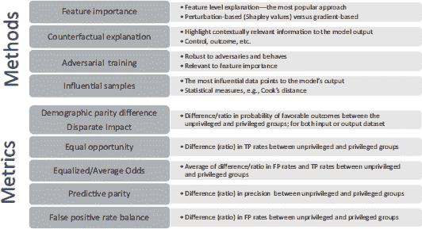
```

**Figure 4.7.** Common fairness methods and metrics

Once bias is detected (e.g., fairness metrics do not meet certain standards), debiasing and risk mitigation procedures should be applied. For example, during model training, the trade-offs between business needs, model performance, and fairness must be carefully evaluated.

Human judgment within an appropriate framework is also a key factor in maintaining fair models, such as human expert decision systems, audit procedures, human-in-the-loop, etc.

### 4.4.1 Design

Product/project designers, managers, and owners should consider the impact of fairness on customers. Several general considerations are as follows [[3]](#chap4.xhtml#rref3):

*   **Harm:** Will it harm customers' lives or damage the company's reputation? Are price changes for products or services affordable for customers? Are products or services favored only by specific groups?
*   **Scale:** Will the financial product or service change the lives of large populations (e.g., credit scoring models)?
*   **Opacity:** Are the model's underlying assumptions clearly explained and validated? Is the model created in a black box? If the model's decision process is questionable and difficult to understand, fairness is likely to be an issue.

### 4.4.2 Data

Data bias manifests in various phenomena. Examples include:

*   Data from large-scale historical human decisions naturally carries societal biases, which models learn as unfairness.
*   Data is dirty and often simply wrong.
*   Large-scale data often encodes protected characteristics such as race, ability, health markers, etc.
*   Restricted options or menu-driven identity misidentification produces useless or dirty data.
*   There is no ground truth to validate our hypotheses against big data. For protected classes, big data is often not big data. Less data for protected classes means larger margins of error and worse predictions [[4]](#chap4.xhtml#rref4).

Sometimes, bias hides in available samples (observations). A famous example is the statistics of surviving bombers in WWII. When engineers tried to find vulnerable spots from bombers that survived the war, they did not include the engines, which was counterintuitive. This is because bombers with engine damage rarely returned safely. Therefore, observing only "survivor" data is inappropriate. Similarly, when models are built based on the mainstream population in financial institutions, there may be problems for minority groups. For example, when a local bank primarily serves locals, it may not handle loan applications from foreigners well. In this sense, in addition to considering known protected features as described in Section 4.3, we should also check for unknown protected features.

In fact, certain variables may implicitly act as protected variables. For example, demographic variables used for modeling are often available for statistical methods of bias. However, modelers instead use proxy variables that implicitly provide the same signals. Zip code is one such case; it may correlate with income and neighborhood; in turn indicating wealth and class, and even race in some places.

To systematically measure data bias, we can consider both statistical properties and certain distortions. In addition to the general privacy and security of data attributes (see Table 4.3), we should also consider factors listed in Table 4.4, such as biases in population, behavioral activity, content, association, and temporal events. More specifically, we can further categorize data bias into seven types, as shown in Table 4.5.

**Table 4.3.** Data privacy goals [[4]](#chap4.xhtml#rref4)

| **Goal** | **Explanation** |
| --- | --- |
| Transparency | Consensus on who can access, the meaning of data, how data will be used, with whom data is shared, how long it is held by users, etc. |
| User-driven | Users have full and fine-grained access control over their own data wherever it is shared. |
| Anonymity | User identity is not disclosed through IoT applications. |
| Pseudonymity | Trade-off between anonymity and accountability. In practice, an individual's actions are not linked to their identity but to a pseudonym (random identifier). Pseudonymity can be used for various purposes, including addressing privacy and accountability in financial institutions. |

### 4.4.3 模型

一旦数据偏差被移除或缓解，AI/ML 模型将被构建或训练以预测设计目标。图 4.8 说明了建模过程中的一般概念，其中左侧显示了用户参与公平性应用的常见步骤，右侧选择了循环中的一些常见规则及其问题和职责。由于模型可能是灰盒或黑盒，我们通常对模型应用 XAI 技术。

```
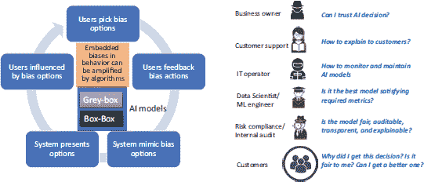
```

**图 4.8.** 模型公平性概念

#### 可解释 AI (XAI)

模型可解释性对于实现模型透明度、问责制和公平性至关重要。通常有两大类别 [[5]](#chap4.xhtml#rref5)：

*   **类别 1：设计并生成可解释的 AI 模型**，这通常是内在的。
    *   某些模型具有自我解释性，例如 `logistic regression`、`decision trees`、`decision lists and sets`、`generalized additive models (GAMs)`。
*   **类别 2：对 AI 模型的事后解释**，这与模型无关。
    *   **局部解释** 试图解释模型如何针对给定实例进行预测，涉及输入特征、有影响力的样本、局部特征重要性、局部决策规则等。
    *   **全局解释** 通常试图解释整个模型的整体问题，例如模型如何预测以及数据集如何影响决策。它通常可以应用诸如 `partial dependence plots`、`global feature importance`、`global decision rules` 等术语，从“平均”意义上进行解释。

通过提高模型的透明度和信任度，XAI 可用于改善对模型偏差和公平性的理解 [[5]](#chap4.xhtml#rref5)。例如，受保护特征的特征重要性直接说明了模型公平性，例如，如果受保护特征（如 `age` 和 `gender`）的重要性指数非常小，则意味着模型对受保护特征不敏感，因此通常是公平的。

#### 训练


尽管模型性能通常是数据科学家在训练过程中的首要任务，但某些业务可能要求将额外约束（例如 `profit`）纳入目标，这有时与公平性指标相矛盾。主要使用三种方法来利用这一点。一种是将公平性指标（见表 4.6）直接嵌入目标函数中，即将其作为优化目标或约束变量。第二种是风险缓解方法（详见第 4.4.6 节）。第三种是两步模型选择方法，例如迭代优化性能和公平性这两个目标。

为了妥善选择一个公平的模型，我们可以考虑以下选项：

**表 4.6.** 公平性指标

| **类型** | **公平性指标** |
| --- | --- |
| 建模前（数据） | 公平数据分布，统计奇差差异 |
| 建模中（训练，测试） | 差异影响，统计奇差差异，平均赔率差异，机会均等差异，获益-损害率 |
| 建模后（部署，维护） | 长期差异影响，获益-损害率 |

*   从在整体感兴趣评估指标上具有相似性能（在合理阈值内）的多个模型中计算公平性，然后选择公平性指数最好的那个；也适用于同时考虑多个公平性指标的情况。
*   绘制性能与公平性指数之间的权衡曲线。了解为了达到不同级别的公平性，在性能方面需要付出多少“代价”。
*   如果更关注跨多个子群体（例如多个种族/民族/地区类别、多个年龄组等）的公平性，除了探索跨群体表现相似的模型外，还应探索每个子群体中表现最好的模型。请注意，可以对不同群体应用不同的阈值以实现更公平的结果。

### 测试和验证

测试步骤的关键是确保“子群体测试分数的差异效度”。一些通用的测试方法如下：

*   **针对性测试** 通常特定于领域（例如 `image`、`language` 等）。
*   **A/B 测试** 可在整个开发周期中快速执行。
*   **综合测试** 用于使用真实世界数据从生态学角度验证结果。
*   **差异测试** 旨在通过各种“作弊”技术发现模型漏洞。
*   **对抗测试** 试图寻找毒针（隐蔽的恶意样本）。

### 4.4.4 部署

此阶段的一个潜在偏差在于模型或其预测在实践中可能如何被应用。例如，模型可能由与训练数据集不同的人群部署。在正式部署到生产环境之前，我们应审核模型的预测结果。例如，在分类应用中（例如 `loan/credit card approval`），给定现有或新流程的标记结果，可以应用偏差检测和识别工具来确定该流程是否产生公平的结果。这些程序可能不需要直接涉及 ML 模型，因为某些公平性指标可以针对任何一组决策和结果获得，无论决策是源自 ML 模型、启发式规则还是其他流程。

### 4.4.5 维护

应为数据和模型漂移事件实施一些检测器和触发机制，以更新（例如 `retrain the model`）、调整（例如 `revise the output policy`）或停止（例如 `decommission`）模型，例如：

*   特征漂移（独立变量漂移），即独立数据属性的变化，例如总体统计属性变化
*   标签漂移（先验概率漂移），即目标数据属性的变化
*   概念漂移，即独立变量与目标变量之间关系的转移
*   预测漂移，即预测性能下降
*   公平性指标下降

此处的一个伦理决策是，这些触发器是否可以在无人工审核的情况下自动执行，就像在开发迭代期间那样。不同于阿里巴巴、京东、拼多多等科技公司使用持续交付（CD）管道频繁更新其推荐模型，受严格监管的金融机构可能需要更多的人工介入。

### 4.4.6 偏见/风险缓解

如前所述，表 4.6 和图 4.7 中描述的指标可从多个方面予以考量——审计现有模型和流程以确保结果公平、选择合适的模型进行部署、决定如何将所选模型投入生产，或使用某些技术缓解风险。

偏见缓解算法旨在通过修改数据集、训练算法和/或预测过程来提高公平性。表 4.7 列出了机器学习不同阶段中现有的一些风险缓解技术和算法 [6, 7]。例如，预处理方法通常对类别进行重新加权、重新选择或修改。处理中方法往往增加更多正则化/损失函数约束，并使模型能适应受保护变量的变化。后处理方法调整置信度或概率分数校正，提升或降低边界决策，并在传统分类器之上构建封装器。

**表 4.7.** 风险缓解 [6]

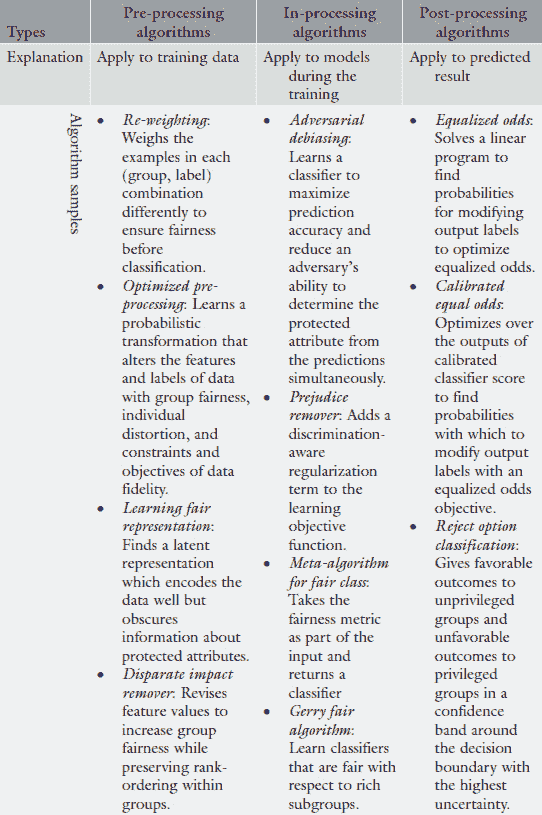

### 4.4.7 AI 生命周期中的“人”

尽管 AI 技术的目标之一是实现自动化并部分替代人类的重复性工作流程，但通常需要人类参与整个 ML 生命周期，即“人在回路中”（HIL）。事实上，在许多情况下 [8]：

*   人类可以区分 AI 系统与人类之间的交互。
*   人类可以根据推理过程，辨别决策是由 AI 系统还是人类做出的。
*   AI 可以定期改进以满足人类的需求和技术标准。

如图 4.8 所示，各种角色的人类，如产品设计师、产品经理、项目经理、数据科学家、ML 工程师、IT 架构师、系统管理员、审计师等（详见第 14 章），参与 AI 模型的整个生命周期。当人类纠正一种偏见时，可能同时将其他偏见带入模型。组织内部的正式机构应制定一些适当的标准和指南。图 4.9 提出了一个 AI 伦理与公平治理框架。

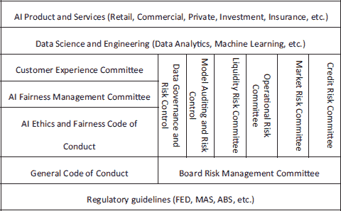

**图 4.9.** 建议的 AI 公平治理框架

## 4.5 营销冠军案例研究

本节提供一个示例，说明该框架如何应用于实际金融应用。营销活动是为实现公司营销目标而计划的任何行动，侧重于客户需求及其整体满意度。目标可能是提高产品、服务和业务的知名度或销量，或其他目的。通常考虑四个方面：(i) 产品及其人群细分，即目标客户；(ii) 触达客户的分销渠道（全渠道），如电话、广播、电视、社交媒体、邮件、客户推荐等；(iii) 价格，如在客户接受度与盈利能力之间取得平衡的最佳报价；(iv) 促销策略，即使营销活动更有效的适当方式。AI 或 ML 技术可帮助将客户与合适的产品和/或服务连接起来，预测客户可能选择的策略，预测销售，从而调整目标等。

### 问题陈述

电话营销仍是金融机构吸纳新客户的主要途径之一。此处我们使用 UC Irvine 机器学习存储库^(7) 和 Kaggle^(8) 的一个开放数据集，该数据来自一家葡萄牙银行机构，用于其通过电话进行的直接营销活动。银行职员经常多次致电同一客户，以评估客户是否会订阅银行定期存款 [9]。定期存款是金融机构提供的一种存款，具有固定利率，资金将在特定到期时间返还。

使用了一些受保护属性，即 `age`、`job`、`marital status` 和 `education`。其他变量包括 `credit default`、`housing`、`loan` 和 `account balance`、`contact type`、`contact time`（`month`、`day`、`duration`）、`campaign times` 等。结果表示为“yes”（订阅）或“no”（未订阅）。

### 基础分析

该数据集包含 11,162 条记录，受保护变量上的分布显然不均匀（图 4.10）。

通过使用成对图，我们可以发现所选受保护变量与其他变量之间的关系。图 4.11 显示了 `marital status` 与其他变量关系的一个示例。如果我们考虑“age”和“balance”这一对，可能会发现“divorced”（离异）人群的余额金额可能比其他婚姻状态的人群更小。图 4.12 说明了变量的相关性矩阵。显然，“age”与“marital”高度相关。

“pdays”与“previous”相对高度相关，仿佛如果之前未被联系过，则极有可能被联系。进一步的探索性数据分析（EDA）显示，最年轻群体订阅定期存款的概率为 71%，而最年长群体为 77%（见图 4.13）。这意味着模型可能倾向于最年轻和最年长的类别。另一个观察是“job”属性；考虑年龄因素，潜在客户中学生或退休人员订阅定期存款的可能性最大。退休人员倾向于拥有更多定期存款，以获得一些利息收入。

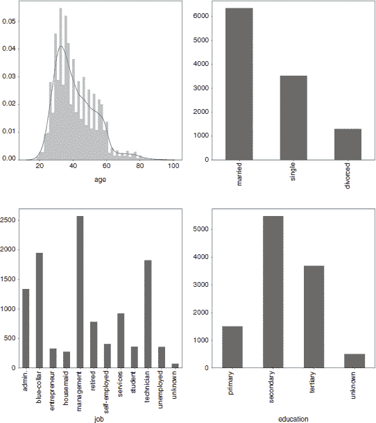

**图 4.10.** 受保护变量的分布

现在我们使用分类器来考虑特征对“deposit”的影响。我们不使用简单的分类值，而是为它们定义所谓的独热编码，并使用分类值的字符串作为列名的扩展。例如，“marital”有三种状态，所以我们得到三个独热编码——“marital_divorced”、“marital_married”和“marital_single”。

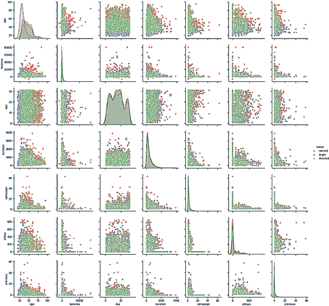

**图 4.11.** 营销数据的成对图

对于采用交叉验证方法的不同 ML 分类器，我们可以使用接收者操作特征曲线下面积（AUC）作为其主要性能指标，例如：

*   梯度提升分类器：0.92
*   神经网络分类器：0.92
*   随机森林：0.92
*   朴素贝叶斯分类器：0.81

借助 SHAP，我们得到了随机森林的 Shapley 值，如图 4.14 所示。我们可以看到变量“age”对结果有相对较大的影响，尽管其平均值（0.025）很小。然而，其他三个受保护变量对结果几乎没有影响。因此，我们可以说 ML 模型对受保护变量“marital”、“job”和“education”相对不敏感。

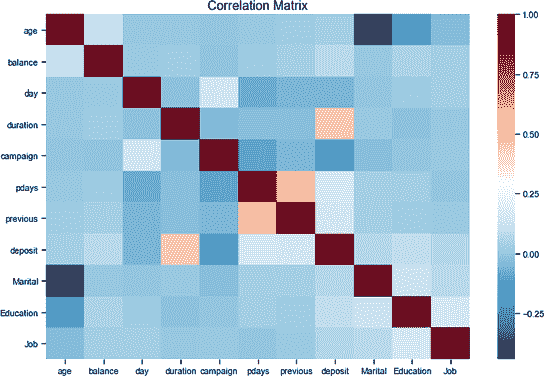

**图 4.12.** 营销数据的相关性矩阵


**图 4.13.** 年龄的影响


**图 4.14.** 特征重要性的 Shapley 值

### 去偏处理

如图 4.12 所示，受保护变量“age”（年龄）对模型预测敏感，这在图 4.15(a)中也有体现。我们可以使用第 5.5 节介绍的方法来缓解偏见带来的困扰。为简化起见，我们将年龄分为两组：G1 为 25 至 60 岁，G2 为超出此范围。根据对图 4.12 的观察，我们将 G2 设为优势群体。此处，我们应用了预处理类别的重加权方法、处理中类别的对抗去偏方法以及后处理类别的拒绝选项分类来减轻偏见。


**图 4.15.** 处理后公平性指标数值的变化


**图 4.16.** ROC 对比

从图 4.15(a)到 4.15(d)可以看出，几乎所有指标的偏见总体上都有所降低，特别是均等差异和不同影响。

请注意，在这种情况下，整体性能（例如 AUC）未受去偏算法的大幅影响，如图 4.16 所示。

## 4.6 相关工作

正如第 3 章所讨论的，AI 已在金融机构中广泛采用。例如，文献 [10] 对金融应用的深度学习进行了调查，根据预期的金融子领域对相关工作进行分类，并基于其深度学习模型进行分析。文献 [11] 总结了信用风险方面的机器学习方法和应用。

AI 伦理作为 AI 采纳的重要考量因素，已被深入讨论，例如文献 [12–14]。文献 [12] 似乎是第一本专门讨论 AI 公平性并包含大量技术细节的专著。文献 [14] 提供了关于 AI 伦理的综合综述，并给出了一种分类法来分析文献。文献 [13] 重点关注各方面的偏见与公平性，并考虑了一些机器学习技术，例如变分自编码器、对抗学习等。文献 [15] 为 AI 系统偏见提供了广泛的多学科概述，集中于技术挑战、解决方案，以及植根于法律框架的方法的新研究方向建议。文献 [6] 通过实证研究说明可解释性如何有助于公平性判断。文献 [16] 试图探索各类 AI 公平性解决方案以进行优劣对比。文献 [17] 为消费者金融服务提供了关于公平且负责任的机器学习/AI 的综述。它从社会背景和结构性不平等的角度解释了偏见。文献 [18] 利用可解释机器学习从某种意义上讨论公平性。文献 [19] 简要讨论了金融数据建模的挑战与解决方案，并提供了一个违约信用卡的示例作为说明。

所有这些论文均未像本章这样明确展示机器学习流水线的工作流及其在公平性流水线中的应用。不过，我们确实注意到，各类 AI 会议上的某些主题演讲和教程也提供了深度解决方案并涉及机器学习流水线，例如文献 [20–22]。然而，并无像本章这样呈现的详细工作流。

除了第 4.2 节讨论的政府层面和组织层面的框架与指南外，一些咨询公司也贡献了其在该领域的见解，例如麦肯锡为 AI 从业者以及业务或政策领导者建议了 6 条潜在的前进道路。^(9) 大多数主要 AI 相关公司，如 Facebook、Amazon、Google、IBM、Microsoft 等，均发布了其 AI 原则，并开源了 AI 公平性评估与缓解工具（见附录 4.1 中的表 4.9）。许多知名大学，如纽约大学、麻省理工学院、哈佛大学、斯坦福大学、复旦大学等，发布了关于 AI 伦理与公平性的白皮书。一些 AI 专业组织也已成立，以提供指导与监督。例如，由 Facebook、Amazon、Google、IBM、Microsoft 等发起的“AI 伙伴关系”汇聚了多元的全球声音，以实现 AI 的承诺。^(10)

## 4.7 结论

已有大量研究与开发工作致力于 AI 伦理与公平性。本章采用机器学习流水线方法，并尝试将其与统一框架相关联。图 4.17 详细展示了工作流。我们还提供了一份检查清单，其结构类似于文献 [23]，但按机器学习流水线的结构组织。

我们应当注意，偏见或歧视并非抽象概念。相反，它通常具有领域特定性和应用特定性，因为它极有可能极大地影响人们的日常生活。它也是特征特定和框架特定的，因为它与过去支撑不公正和系统性不利待遇的社会显著特质高度相关。

尽管本章讨论了许多令人振奋的工作，我们在 AI 公平性方面仍面临诸多挑战，例如：

*   **框架特定问题。** 我们普遍缺乏通用机器学习模型的标准、工具或接口（例如 `API`），这导致可插拔的公平性解释难以实现。此外，将公平性流水线的数据、模型和应用集成到单一框架中始终并非易事。
*   **应用特定问题。** 不同的公平性标准实际上取决于用户需求和问题规范，这难以标准化。此外，算法的 AI 可解释性取决于各个方面，例如用例、模型类型、数据属性等。
*   **权衡问题。** 用户需求应在各个维度上取得平衡。首先，考虑可解释性、问责制、性能、可审计性、公平性和隐私之间的平衡目标。例如，如何平衡伤害与收益，如何识别长期伤害，如何快速缓解伤害和不当行为，以及如何提高对故障模式（机器学习组件间的交互）的鲁棒性和可解释性。其次，确定不同人与机器之间的关系。例如，我们需要从模型开发者、业务利益相关者和最终用户的角度考虑依赖关系。我们应在流水线和自动化中设置适当的人工干预（HIL）。


**图 4.17.** AI 公平性工作流

我们在表 4.8 中提供了 AI 公平性检查清单 [2, 8, 12, 20, 23, 24]。

**表 4.8.** AI 公平性检查清单

| **阶段** | **项目** |
| --- | --- |
| 设计 | * 在声称系统公平时，需要在多大程度上考虑组织外部因素？<br>* 服务和产品的输出预期用途是什么？总体受众是谁，受影响最大的群体是谁？<br>* 如果指定人员对所有决策和结果承担最终责任，例如在 AI 系统与人之间明确界定，以及责任如何分担；影响个人生活、生活质量、健康或声誉的最终决策。<br>* 人类是否始终能够监控、控制和停用系统？谁是模型质量和风险控制的负责人？ |

## 4.8 附录 4.1：公平性工具

市场上有许多可用的工具，其中许多是开源的。表 4.9 列出了一些相对成熟的工具，主要来自 Github。

**表 4.9.** 一些开源工具

| **名称** | **功能** | **Github** |
| --- | --- | --- |
| Fairness Measures | 用于在各种数据集和公平性指标上测试给定算法的框架。 | [`github.com/megantosh/fairness_measures_code`](https://github.com/megantosh/fairness_measures_code) |
| Fairness Comparison | 可扩展的测试平台，便于直接比较算法在公平性指标方面的表现。包含原始和预处理后的数据集。 | [`github.com/algofairness/fairness-comparison`](https://github.com/algofairness/fairness-comparison) |
| Themis-ML | 基于 scikit-learn 构建的 Python 库，实现了公平性感知的机器学习算法。 | [`github.com/cosmicBboy/themisml`](https://github.com/cosmicBboy/themisml) |
| FairML | 关注模型输入的显著性，以量化预测对输入的依赖程度。 | [`github.com/adebayoj/fairml`](https://github.com/adebayoj/fairml) |
| Aequitas | 既是 Web 审计工具，也是 Python 库。为给定模型和数据集生成偏见报告。 | [`github.com/dssg/aequitas`](https://github.com/dssg/aequitas) |
| Fairtest | 检测算法输出与受保护群体之间的关联。 | [`github.com/columbia/fairtest`](https://github.com/columbia/fairtest) |
| Themis | 接受一个黑盒决策过程，并自动设计测试用例以探索该过程可能表现出基于群体或因果歧视的地方。 | [`github.com/LASER-UMASS/Themis`](https://github.com/LASER-UMASS/Themis) |
| Audit-AI | 基于 scikit-learn 构建的 Python 库，包含用于分类和回归任务的各种统计检验。 | [`github.com/pymetrics/audit-ai`](https://github.com/pymetrics/audit-ai) |
| AIF360 | 综合的偏见度量和缓解工具箱（包含来自 IBM Research 的独特算法）。 | [`github.com/ibm/aif360`](https://github.com/ibm/aif360) |


| Interpret ML | 拟合可解释模型。解释黑盒机器学习。 | [`github.com/interpretml`](https://github.com/interpretml) |
|---|---|---|
| fairlearn | 评估并提升机器学习模型的公平性。 | [`fairlearn.github.io/`](https://fairlearn.github.io/) |
| fairness indicators | 结合更广泛的 TensorFlow 工具包，用于评估、改进和比较模型在公平性方面的表现。 | [`github.com/tensorflow/fairness-indicators`](https://github.com/tensorflow/fairness-indicators) |

### AI 系统评估清单

#### 数据

*   大量观测值是否存在缺失值？
*   是否存在可能影响输出和/或影响其他特征的缺失特征？
*   是否存在任何意外的特征值，可能被视为异常值？
*   训练数据集是否足以保证多样性和可靠性？是否仅收集了必要的数据（例如，尊重隐私和数据权利）？
*   是否有针对数据的可理解的安全方法？
*   服务是在哪些数据集上训练和测试的？（提供用于测试的数据集链接，以及相应的数据说明书）
*   服务使用的数据集是否经过偏见检查？观察到了哪些类型的统计数据偏斜？
*   从数据摄入到模型服务的数据生命周期是怎样的？
*   为确保其具有公平代表性做出了哪些努力？

#### 模型

*   我们是否需要新法律（而非差别影响/待遇）来应对这些系统？
*   自动化决策在伦理上是否不同于人类决策？
*   除群体差异外，是否可能存在其他原因导致的不公平模型？
*   我们应该将公平性*与*隐私、安全、透明度……结合起来研究，还是不结合？
*   数据还是模型是机器学习决策中偏见的成因？模型输出潜在的最坏场景是什么？
*   该模型应用了哪些算法或技术？
*   测试方法和测试结果是否解释清楚？
*   服务结果或模型输出是否可解释和/或可阐释？
*   服务是否具有偏见检测和补救机制？
*   服务是否对未见数据或分布不同的数据有任何预期或实施了任何处理机制？

#### 部署与维护

*   服务是否足够稳健以抵御对抗性攻击？
*   模型更新频率如何？上次更新是什么时候？
*   更新是自动还是手动进行的（审批人是谁）？
*   使用服务时是否有关于偏见、伦理或其他风险问题的反馈？
*   是否提供了简单直观且可解释的监控系统？
*   是否有定期策略来定义模型改进以满足人类需求和技术标准？是否有模型重训练和模型退役策略？
*   AI 系统是否稳健、有效且可靠？

### 治理

*   我们是否识别了全部范围的风险（有害、恶意使用及后果）和收益（良好、有益使用及后果）？
*   是否有针对 AI 系统滥用/误用的计划，包括向所有受影响人员共享相关信息的沟通计划，以及管理已识别推测性风险的缓解计划？
*   是否有适当的流水线确保数据、算法和模型恰当且可验证？整体流程是否经过适当审查和批准？
*   是否为人类提供了置信度和上下文以做出适当决策？
*   是否为推荐和结果提供了透明的理由？

### 参考文献

1. T. Grote and B. Philipp, “On the ethics of algorithmic decision-making in healthcare,” *Journal of Medical Ethics,* Vol. 46, No. 3, November 2020.
2. N. Arvind, “Tutorial: 21 fairness definition and their politics,” ACM FAT (Fairness, Accountability and Transparency) Conference, 2018.
3. C. O’Neil, “Weapon of mass destruction,” Broadway Books, 2016.
4. A. Ouaddah, A. A. Elkalam and A. A. Ouahman, “FairAccess: A new blockchain-based access control framework for the internet of things,” *Security and Communication Networks,* Vol. 18, No. 9, pp. 5,943–5,964, February 2017.
5. A. Das and P. Rad, “Opportunities and Challenges in Explainable Artificial Intelligence (XAI): A Survey,” arXiv:2006.11371, 2020.
6. J. Dodge, V. Q. Liao, Y. Zhang, R. K. Bellamy and C. Dugan, “Explaining models: An empirical study of how explanations impact fairness judgment,” in *ACM International Conference on Intelligent User Interfaces,* 2019.
7. R. K. E. Bellamy *et al.,* “AI fairness 360: An extensible toolkit for detecting, understanding, and mitigating unwanted algorithmic bias,” [`arxiv.org/abs/1810.01943`](https://arxiv.org/abs/1810.01943), 2018.
8. E. Wall, L. M. Blaha, L. Franklin and A. Endert, “Warning, bias may occur: A proposed approach to detecting cognitive,” in *IEEE Conference on Visual Analytics Science and Technology (VAST),* 2017.
9. S. Moro, P. Cortez and P. Rita, “A data-driven approach to predict the success of bank telemarketing,” *Decision Support Systems,* Vol. 62, pp. 22–31, June, 2014.
10. A. M. Ozbayoglu, M. U. Gudelek and O. B. Sezer, “Deep learning for financial applications: A survey,” *arXiv:2002.05786,* 2020.
11. J. L. Breeden, “A survey of machine learning in credit risk,” SSRN, 2020 年 5 月。
12. S. Barocas, M. Hardt and N. Arvind, *Fairness in Machine Learning: Limitations and Opportunities*, [fairmlbook.org](http://www.fairmlbook.org), 2019。
13. N. Mehrabi, F. Morstatter, N. Saxena, K. Lerman and A. Galstyan, “A survey on bias and fairness in machine learning,” arXiv:1908.09635, 2019。
14. S. Tolmeijer, M. Kneer, C. Sarasua, M. Christen and A. Bernstein, “Implementations in machine ethics: A survey,” arXiv:2001.07573, 2020。
15. E. Ntoutsi *et al.*, “Bias in data-driven artificial intelligence systems — An introductory survey,” *WIREs Data Mining Knowledge Discovery*, 2020 年 2 月。
16. I. Akbari, “On fair representation in machine learning,” DOI: 10.13140/RG.2.2.28800.66565, 2020。
17. S. C. Rea, “A survey of fair and responsible machine learning and artificial intelligence: Implications for consumer financial services,” *SSIN*, 2020。
18. U. Bhatt *et al.*, “Explainable machine learning in deployment,” in Conference on Fairness, Accountability, and Transparency (FAT), 2020。
19. Y. Zhang and L. Zhou, “Fairness assessment for artificial intelligence in financial industry,” arXiv:1912.07211v1, 2019。
20. H. Cramer *et al.*, “Challenges of incorporating algorithmic fairness into practice,” *Conference on Fairness, Accountability, and Transparency (FAT)*, 2019。
21. K. Crawford, “The trouble with bias,” Conference on Neural Information Processing Systems (NeurIPS), Keynote, 2017。
22. S. Corbett-Davies and S. Goel, “Defining and designing fair algorithms,” in International Conference on Machine Learning (ICML), Tutorial, 2018 年 7 月。
23. C. J. Smith, “Designing trustworthy AI: A user experience (UX) framework,” in *RSA Conference*, 2020。
24. F. Ian, G. Rayid, J. S. Ron, K. Frauke and L. Julia, *Big Data and Social Science — Data Science Methods and Tools for Research and Practice* (2nd), Chapman and Hall/CRC, 2020。

---

¹ J. Angwin, J. Larson, S. Mattu, and L. Kirchner. “Machine Bias: There’s software used across the country to predict future criminals. And it’s biased against blacks.” ProPublica. [`www.propublica.org/article/machine-bias-risk-assessments-in-criminal-sentencing`](https://www.propublica.org/article/machine-bias-risk-assessments-in-criminal-sentencing). 访问时间：2021 年 11 月 21 日。

² “Veritas Initiative addresses implementation challenges in the responsible use of artificial intelligence and data analytics”. Monetary Authority of Singapore. [`www.mas.gov.sg/news/media-releases/2021/veritas-initiative-addresses-implemen-tation-challenges`](https://www.mas.gov.sg/news/media-releases/2021/veritas-initiative-addresses-implemen-tation-challenges). 访问时间：2021 年 11 月 21 日。

³ C. T. Lopez. “DOD adopts 5 principles of artificial intelligence ethics”. US Department of Defense. [`www.defense.gov/Explore/News/Article/Article/2094085/dod-adopts-5-principles-of-artificial-intelligence-ethics/`](https://www.defense.gov/Explore/News/Article/Article/2094085/dod-adopts-5-principles-of-artificial-intelligence-ethics/). 访问时间：2021 年 11 月 21 日。

⁴ “Draft ethics guidelines for trustworthy AI”. European Commission. [`ec.europa.eu/digital-single-market/en/news/draft-ethics-guidelines-trustworthy-ai`](https://ec.europa.eu/digital-single-market/en/news/draft-ethics-guidelines-trustworthy-ai). 访问时间：2021 年 11 月 21 日。

⁵ “Australia’s artificial intelligence ethics framework”. Australian Government: Department of Industry, Science, Energy and Resources. [`www.industry.gov.au/data-and-publications/building-australias-artificial-intelligence-capability/ai-ethics-framework/ai-ethics-principles`](https://www.industry.gov.au/data-and-publications/building-australias-artificial-intelligence-capability/ai-ethics-framework/ai-ethics-principles). 访问时间：2021 年 11 月 21 日。

⁶ IMDA, Singapore. *Model Artificial Intelligence Governance Framework.* 2nd ed. [Online]. Available: [`www.pdpc.gov.sg/-/media/files/pdpc/pdf-files/resource-for-organisation/ai/sgmodelaigovframework2.pdf`](https://www.pdpc.gov.sg/-/media/files/pdpc/pdf-files/resource-for-organisation/ai/sgmodelaigovframework2.pdf). 访问时间：2021 年 11 月 21 日。

⁷ UC Irvine Machine Learning Repository. UC Irvine. [`archive.ics.uci.edu/`](https://archive.ics.uci.edu/). 访问时间：2021 年 11 月 21 日。

⁸ *Marketing dataset: Predict if a client will subscribe a bank term deposit,* Kaggle, [Online]. Available: [`www.kaggle.com/c/marketing-dataset/data`](https://www.kaggle.com/c/marketing-dataset/data). 访问时间：2021 年 11 月 21 日。

⁹ J. Silberg and J. Manyika. “Tackling bias in artificial intelligence (and in humans).” McKinsey Global Institute. [`www.mckinsey.com/featured-insights/artificial-intelligence/tackling-bias-in-artificial-intelligence-and-in-humans#`](https://www.mckinsey.com/featured-insights/artificial-intelligence/tackling-bias-in-artificial-intelligence-and-in-humans#). 访问时间：2021 年 11 月 21 日。


## 第 5 章

### 知识图谱及其在金融领域的应用

#### 葛志宇

#### 5.1 简介

知识图谱（KG）是一种基于图的知识抽象，其中实体（如对象、事件、情境和概念）表示为节点，关系表示为边，并在数据和信息的此类图表示之上构建了一个语义层。语义层链接知识图谱所涵盖的所有数据和元数据，并提供了一种将知识表示为显性语义的结构。知识图谱提供了一个强大的框架，用于组织、连接、管理、探索、共享和扩展数据、信息和知识。因此，它在社会学、科学、技术、商业等各个学科领域都有许多重要的应用。

尽管“知识图谱”这一术语几十年前就已提出，但直到过去十年左右，知识图谱才重新涌现为一种实用且极具影响力的企业知识管理工具。2012 年 5 月推出的 Google 知识图谱是首个大规模运行的知识图谱。自那时起，数据、算力和算法等其他领域的技术进步为这一领域注入了新的活力，并使大规模构建、维护和利用知识图谱成为可能。企业知识图谱（EKG）有助于整合分散在不同孤岛中的数据、信息和知识，提供业务知识及其关联连接的全景视图，使组织掌握更及时、相关、丰富和完整的知识，从而能够有效且高效地开展战略规划、业务运营、IT 运营、风险管理以及审计或合规活动。

#### 5.2 知识图谱的特征与功能

知识图谱拥有一系列特征与功能，使其独特、有趣、引人注目且实用。这些特征与功能可被利用以带来收益，但其中一些也可能带来挑战。我们将在本章末尾讨论主要挑战。

##### 5.2.1 知识图谱的基本结构与组成部分

##### 5.2.2 语义链接或连接

重要的是要注意，知识图谱在语义层面而非物理层面连接数据。这意味着知识图谱并不连接数据对象的内容以形成新的数据对象，而是建立数据对象之间的语义链接。此类链接可以显式指定，由本体中嵌入的规则自动生成，或由 AI 或 ML 算法创建。因此，知识图谱实际上将知识和数据结合在同一位置，以便它们可以一起被查询。

如果我们将单个数据源视为数据对象，知识图谱可以通过使用 `URIs` 跨越本地部署和云端系统或平台上的数据源。知识图谱不要求其底层数据源标准化，也不强制要求特定模式来获取数据，尽管通常需要一致且因此可合并的词汇表和本体。在某些应用中，可能需要元数据上某种形式的模式。

统计或 ML 建模任务通常需要以表格形式呈现的组合数据（就特征或标签及训练实例而言）。然而，对于查询、分析和商业智能 (BI)，在许多情况下，我们可能不必直接访问底层详细的表格数据、数据存储或数据库，可能只需处理元数据以及抽象的信息和知识，而非底层数据本身。知识图谱在此类应用中表现良好甚至卓越，因为我们不必转换并将所有底层数据集成到数据仓库中。知识集成不要求将所有内容放入单一数据湖或数据仓库，数据可以是分布式的，但仍通过知识图谱连接。从这个意义上说，无论数据在哪里，无论是在单一数据湖或数据存储中，还是分布在多个数据湖或数据存储中，它们仍可由知识图谱连接。特别是，这使得知识图谱成为跨微服务链接数据的合适工具，即使内部数据可能不可见。

##### 5.2.3 灵活性和通用性

知识图谱提供了极大的灵活性。它对模式没有严格要求。创建知识图谱时，您不必预先指定详细模式。相反，知识图谱允许模式演进，以便用户在查看数据后增强或修改数据模型。这种灵活性使知识图谱更具前瞻性，因为您可以修改或更新模式以适应新数据，而无需从头重建知识图谱。

知识图谱用途广泛。除了数据实例外，任何数据对象、数据系统或数据应用 API 都可以在知识图谱中表示为节点，它们的连接表示为边。它可以嵌入领域知识、业务词汇表和分类法；可以表示实体和关系上的任意结构；并且能够融合不同语言的结构化和非结构化数据（文档、邮件、报告、演示文稿及其他文本或非文本文件等）。知识图谱还可以融合多个领域及其关联的本体，以及这些本体之间的连接。这种通用性源于图是数据和数据模型的通用表示这一事实。

知识图谱是动态且可扩展的。随时可以更新现有数据或信息、添加新数据或信息、移除过时数据或信息。因此，知识图谱可通过用户反馈促进持续学习，并能轻松扩展以适应新概念、对象或关系，提供弹性和可持续性。如果开发得当，知识图谱可以轻松合并，或者您可以将重点限制在子图上。这是因为根据设计，任何图（或图元素）都可以链接到其他图（或其元素），关系信息不仅可以通过边嵌入图中，还可以通过与节点和/或边关联的属性嵌入。合并知识图谱时，您实际上是通过合并节点或边并添加任何额外边来合并相应的本体（它们本身也是图）和底层图数据。当您将重点限制在子图上时，只需查看该子图内的节点及连接这些节点的边。

知识图谱可以是分布式且可扩展的。各种来源的数据无需汇聚。知识图谱查询语言（如 `SPARQL`，即 SPARQL Protocol and RDF Query Language 的递归首字母缩写）可以对分布式图数据执行联邦查询。通常无需强制更改现有数据系统来构建或维护知识图谱。它可以与现有数据系统协同工作。本体或知识表示管理可以与底层源数据系统的日常管理分离。因此，构建或维护知识图谱不会干扰现有数据系统的维护或改进。您可以将知识元素（实体或关系）链接到任何合适的数据后端，如数据系统、数据库、数据对象和数据 API。

#### 5.3 应用领域

其底层图结构的灵活性和通用性与其语义能力相结合，使知识图谱独特地定位于满足与企业应用相关的许多实质性数据和信息管理挑战。在某些情况下，它可能是最合适的主要工具，而在其他某些情况下，它可以显著增强其他工具的性能。我们专注于金融服务的应用，但其中一些也普遍适用于许多其他业务、科学和技术领域。

##### 5.3.1 企业数据和信息管理

###### 利用知识图谱实现高效且有效的企业数据管理

在企业规模上实现高效且有效的数据与信息管理，始终是一项充满挑战但回报丰厚的业务当务之急。数据和信息是数字时代任何组织生存与成功的命脉。目前已有大量工具和应用程序的开发，旨在协助关键的数据与信息工作负载，例如数据协调、数据编目、数据血缘追踪、数据应用/API 管理、数据分析、BI 仪表盘、AI/ML 模型生命周期管理等。鉴于知识图谱在表示和连接数据方面具有极大的灵活性，它特别适合整合来自不同数据源、各种格式的海量结构化和非结构化数据，并能增强现有工具和应用在各个数据与信息工作负载中的功能。知识图谱已成为企业数字化转型的重要工具。

企业数据将持续保持分布式状态，但不应形成孤岛。仅将它们简单聚合到数据湖中无法解决问题，我们仍面临数据集成或可用性挑战。仅靠集中式视图无法应对现代数据管理的挑战。知识图谱可以成为在语义层面集成数据的有效工具，并有助于指导物理层面的数据集成。对于数据集成而言，将数据语义集成到知识图谱中，无需在物理上合并甚至汇聚来自不同来源的数据，而是汇聚元数据，然后在其之上构建语义层，以对数据进行编目、搜索和发现，进行推理并衍生新知识。知识图谱在设计上即可作为分布式系统，且具备良好的能力来处理分布式数据的集成。虽然它有助于构建单个数据驱动型应用，但其影响最深远的用途，或许是作为分布式企业数据战略的骨干，不仅连接数据，还连接整个组织各部分的信息与知识。

知识图谱可以提供一个总体框架，以捕获、管理和利用与数据、元数据、数据系统及数据应用相关的所有信息。特别是，位于所有数据资产、信息系统和数据工作负载之上的企业知识图谱（EKG），能提供一个统揽性结构，全方位地管理企业数据和信息系统，并作为制定和维护企业数据战略及数据模型的有效工具。EKG 的语义层包含从底层实际数据的复杂性中抽象出的信息和知识，使得实际数据可以留在原地，无需移动、转换或复制。借助完善的 EKG，我们不仅能在企业层面获得清晰且聚合的数据与信息资产视图，还能帮助我们洞察关键要素间的连接和流程流向，从而实现数据资产的搜索与发现、数据血缘追踪、数据处理关键路径识别、强弱环节辨析、制定修复关键缺陷和增强数据系统的计划、衍生新的战略业务洞察等。在 EKG 的指引下，我们能快速定位数据和信息管理问题的可能源头，并通过通往各个数据系统和应用的链接，深入钻取至数据和信息管理系统的任何具体组件，以提取更详细的信息和/或开展更有针对性的调查。虽然数据目录管理元数据并作为企业数据治理基础设施的骨干，但由知识图谱驱动的企业数据目录还能智能地关联元数据，并为这种关联赋予含义。

在数据库层面，知识图谱有助于增强传统关系型数据库管理系统（RDBMS）的设计与性能。通过在数据库模式之上放置一个知识图谱，我们可以在数据表字段之间增加一层语义连接和约束。这支持自动化的模式映射、模式约束强制执行和 ETL（抽取、转换、加载）治理。这种传统 RDBMS 的替代方案被称为范畴数据库 [[1]](#chap5.xhtml#rref1)，并正在拥有大量关系数据和复杂依赖关系的组织中变得越来越流行。

##### 5.3.2 业务运营

知识图谱能够快速高效地整合来自不同来源、各种格式的数据，这使其非常适合企业数据集成、编目和治理，而这些确实是知识图谱最广泛采用的用例。然而，数据管理并非唯一的用例类型。事实上，知识图谱的许多业务应用也源于这一同一能力。此外，由于知识图谱中的所有语义均可由机器处理，以知识图谱表示的业务流程可被用于自动化业务运营。下文将讨论金融领域的一些业务应用示例。

客户 360 全景视图是金融及许多其他行业中备受推崇的知识图谱用例。基于知识图谱增强的客户 360 视图，可汇聚来自所有异构来源、所有格式的客户数据，并将其串联起来，以协助营销、身份验证（用于安全访问和监控）、客户体验、客户服务、风险分析、欺诈检测等。以数字平台上的零售银行为例；基于知识图谱的客户 360 分析可帮助识别个别客户、验证安全访问、检索客户信息（如过往体验、客户偏好、订单或服务历史），并进行针对性推荐，所有这些均可实时完成。在客户服务方面，客户数据还可关联服务记录和客服代表，以追踪服务质量、识别改进领域，并促进智能投诉处理。多元化的客户 360 信息还可用于更有效的业务分析和机器学习建模，以识别有潜力的客户获取线索。

对于业务战略制定，知识图谱可纳入客户、供应商、员工、竞争对手、投资者、监管机构的目录和信息，以及这些主体间的各类关系和依赖，外加市场信息、供需和风险/收益数据。它可通过分析复杂的交互和知识图谱推理，帮助我们评估市场事件、业务活动或业务计划的潜在影响。

对于证券交易、融资和做市，一个构建良好的知识图谱可帮助紧密追踪许可工具清单上的所有证券（交易所交易、场外交易或私募），以及相关的证券概况、订单簿、交易执行、清算、结算，和市场信息，如结构、契约、评级、发行人概况、所有权、负担、指数、市场参与者、买/卖/簿价格、成交量、需求、供给、交易对手、抵押品等，以及这些实体间的关系、依赖或约束。这种实时信息网可帮助交易员及时评估市场机会、证券可用性、证券流动性、供需趋势、订单簿匹配、对冲策略、对冲工具、融资条款、交易后监控等。知识图谱的遍历和推理能随着市场条件演变，及时识别深层链接模式和连接。

知识图谱可用于股票、债券、大宗商品、货币、房地产等领域的投资策略研究。投资研究的很大一部分在于识别关联并分析后果，而知识图谱非常适合这两项任务。例如，在事件驱动投资中，知识图谱可以将名称（一家公司、一个商业地产信托、一个企业发行人、一个主权实体等）和事件（信用违约、盈利惊喜、破产等）作为节点，并通过代表事件发生的边将名称链接到事件，同时结合代表其他市场实体和关系的额外类型的节点和边。分析师随后可以基于嵌入在知识图谱中的信息和知识，结合其他 AI/ML 技术，动态估算一对名称与事件之间未来事件关联的可能性。此外，分析知识图谱中的关联并进行推理，可能有助于揭示关系中的异常模式，并生成套利机会的信号。借助知识图谱，分析师可以轻松追踪现有关联、发现隐藏关联，并利用内置的推理能力推导出新事实。从知识图谱衍生出的信息和知识还可用于特征工程，以开发用于下游 AI/ML 建模的相关因子。

在保险承保方面，知识图谱可以关联来自各种传统和非传统来源的潜在客户数据，并根据预先开发的业务词汇表和本体，快速将非结构化数据组装成结构化信息。此类结构化信息随后可输入下游由 AI/ML 驱动的承保流程，以确定最优保单。以人寿保险为例；知识图谱能够纳入各类替代数据，如电子健康记录、生物特征识别数据和基因组学数据（在法律允许的范围内），此外还包括潜在客户访谈数据和体检数据。对于财产保险，各类客户画像数据、财产数据和灾害数据均可在知识图谱中关联并结构化。

在金融和业务分析方面，知识图谱可用于处理自然语言查询的语义。不同类型的信息可由不同的节点类型表示，自然语言查询可在自然语言处理的帮助下解析，以将搜索词映射到知识图谱中的相关节点。随后，基于节点间的关系以及嵌入在知识图谱中的推理功能，可推导出语义合法且相关的机器查询。例如，如果用户询问按信用评级划分的融资额度提取金额，知识图谱可以识别融资节点类型和信用评级节点类型，并链接底层数据源以执行查询。对于模糊的自然语言查询，知识图谱可以找到所有包含该查询关键词且符合烘焙在知识图谱本体中的业务逻辑的合法查询。然后，自然语言查询引擎可以对这些候选查询进行排序并返回最可能的查询，或者请求用户澄清以缩小范围。

##### 5.3.3 风险与合规

知识图谱在风险管理和监管或法律合规方面也有其应用。企业知识图谱可作为所有数据类型快速集成和分析的基础。快速集成、广泛的数据覆盖面和上下文化的信息，有助于提供聚合风险的全面且更新的图景，检测隐性风险，并及时识别新出现的风险。基于此类关联数据的监管报告也能变得更准确、及时和自动化。以下讨论了一些知识图谱在风险与合规方面的用例示例。

对于了解你的客户或了解你的业务（KYC/KYB）以及金融犯罪合规，金融机构需要开展有效的尽职调查，以在建立和维护业务关系时确立客户身份、了解客户活动并评估金融犯罪风险。在知识图谱中集成的来自多个来源的各类结构化和非结构化客户数据，有助于构建更完善的客户 360 画像。同时，知识图谱灵活且可扩展的数据结构，能轻松容纳新的和更新的客户信息及交易活动信息，从而便于持续监控。

欺诈检测和金融犯罪分析是知识图谱的一个著名用例。对于欺诈检测和预防，来自公共记录、KYC、网络安全、销售和营销等不同来源的客户身份数据、行为数据、网络数据和交易数据，可以在知识图谱中关联起来，从而在隐蔽的欺诈模式和异常出现时将其发现。此外，通过追踪知识图谱中的关联，调查结果具有更好的可解释性（相较于黑箱生成的信号），从而使识别出的可疑活动更具体，并降低误报率。这使得异常检测和欺诈预测更有效、更及时。同样，知识图谱在优化反洗钱检测的交易监控方面也展示了其效用。《巴拿马文件》调查 [[2]](#chap5.xhtml#rref2) 是利用知识图谱的力量，系统且自动地筛选海量交织信息，揭露涉及复杂离岸实体网络、富豪和公职人员的大规模逃税、金融欺诈和洗钱活动的著名成功案例。

对于零售信用风险分析，各类客户 360 数据和传统个人信用数据可在知识图谱中快速集成，从而快速建立客户信用画像，供信贷官员做出更快、更明智的决策。对于企业信用分析，知识图谱有助于梳理供应商、分销商、合作伙伴和竞争对手之间复杂的关系，以及交叉持股情况，从而更好地评估企业基本面。知识图谱中的目标实体（个人客户或公司）画像、交易历史、财务记录等及其关联关系，也可用于开发预测性风险分析，以构建更精准的信用评分模型。

由于监管合规关注度提高、交易量巨大、交易类型繁多，以及 COVID-19 大流行带来的新挑战，金融机构（尤其是大型跨国银行和资产管理公司）的交易监控变得越来越苛刻。为了检测交易异常和市场滥用行为，合规团队必须监控跨多个地理区域和大量资产类别（股票、债券、衍生品、大宗商品、贵金属、外汇、加密货币等）的各类市场相关的交易活动、限制名单、关注名单、交易团队、人力资源数据、电子邮件通信、电话录音、新闻报道、研究报告等信息。由知识图谱驱动的智能监控解决方案，通过为事件/行为主体识别、监管与业务需求对齐、交易惯例与规则解读、交易类型特定条件与约束验证等提供更好的关联信息，可显著提高自动警报生成、管理和报告的效率与精准度。

##### 5.3.4 搜索引擎优化与推荐系统

知识图谱（KG）还可以作为企业搜索工具以及问答（Q&A）自助服务工具的知识库。知识图谱中的关系信息有助于增强信息的可发现性，使得知识图谱辅助的搜索引擎能够提供更相关、准确、一致、个性化和优化的信息，从而带来更好的数字化客户体验。知识图谱还引入了来自非结构化或半结构化数据的信息，这些数据以前难以搜索，使得搜索结果更加全面。此外，搜索引擎还可以通过知识图谱的语义能力得到增强，不仅返回相关的文档或陈述，还能返回任何文档中未明确陈述的相关事实。优化的搜索性能可以让客户更容易搜索到合适的银行和财富管理产品，例如，从而提高客户获取率、降低获客成本并增加销售额。

推荐系统通常采用算法来寻找模式，以揭示项目与用户之间的关联性和相似性。它们可以从由知识图谱关联在一起的异构数据源中受益，以包含更多关联内容，并允许通过更多方式来识别相似性。推荐系统在金融领域有许多应用，例如网上银行中的金融产品交叉销售、在信贷审批中为借款人寻找合适的贷款、推荐个性化保险单和附加险条款、为投资组合管理识别最优资产配置策略、基于投资者画像和投资目标构建候选股票/债券投资组合等。对于这些依赖众多因素及其相互作用的复杂问题，知识图谱通过提供替代信息和额外上下文，在传统方法之上增加了额外收益。

#### 5.4 知识图谱的关键技术组件

知识图谱（KG）建立在两个关键技术组件之上：（i）数据的图表示和（ii）知识的显式表示。其他支持技术包括存储、计算和数据技术（特别是云技术栈）、分布式图数据库和知识图谱功能交付技术，以及相关的 AI/ML 算法，如自然语言处理（NLP）和命名实体识别（NER）。


在图数据技术方面，有多种方式将数据表示为图。例如，图数据模型可以从头使用键值存储来实现。也有提供更高抽象层级的图数据库，供用户定义更复杂的图结构、填充数据以及执行查询/分析。图数据库提供图表示、图数据存储和图查询语言。图表示工具允许用户定义指定图数据结构的图本体，而图查询语言允许用户应用图算法来搜索模式并生成图分析。图本体是一种执行自上而下的信息查找或检索的方式，而图查询语言允许自下而上的查找或检索。因此，知识图谱通常利用图数据库作为坚实的基础来构建进一步的功能，特别是语义层。主要有两类图数据库，即资源描述框架（RDF）图数据库和标签属性图（LPG）数据库，每类都有其优缺点（将在单独章节讨论），具体取决于用例。

在图数据库之上，知识图谱需要一个语义中间件层，该层由分类法和本体编辑器、实体/关系抽取器、用于可视化的图映射器、图验证和搜索工具等组件组成。语义中间件组件允许人类或其他系统与知识图谱交互；即处理图数据库中的数据，并开发和维护一个功能性的知识图谱，供人类或其他系统进行知识检索。数据是字符串和二进制，信息是结构化数据，而知识是人类可理解、可关联且可执行的信息。打一个不完美的建筑类比：数据如同原材料粘土，信息如同砖块，知识如同大楼，而将信息转化为知识的中间件则如同砂浆。

本体是知识图谱嵌入语义的主要机制。它指定实体的类别或分类，以及相关联的属性和实体类别之间的关系。本体可以捕捉业务概念或流程、业务模型、数据模型及其相互联系。它可以被视为跨数据自动映射关系的蓝图。或者换一种说法，它可以作为高层图数据模式或数据模型，用于自动编目和关联数据实例。它们可以融合业务词汇表和业务逻辑，提供一种实用、灵活且可扩展的方式，将领域知识与数据关联起来。它还可以利用内置约束来检查图数据的一致性。金融行业业务本体（FIBO）和金融行业业务数据模型（FIB-DM：用于 SAP PowerDesigner、erwin、Sparx EA、ER/Studio、Visual Paradigm 及其他数据建模工具中的 FIBO）是金融领域标准化本体的示例。

虽然本体将基于规则的语义嵌入知识图谱，但自然语言处理（NLP）算法可以产生基于 AI/ML 的语义，以补充基于规则的语义，并协助知识图谱构建（例如实体消歧、数据记录与本体的关联、生成新知识等）以及中间件组件的开发，如可视化、搜索引擎和推荐系统。关于知识图谱与 AI/ML 关系的更详细讨论将在后续章节提供。

企业知识图谱（EKG）是为规模而构建的，因此对先进的大数据技术有很高的需求。事实上，正是大数据存储和计算的进步，使得企业知识图谱对于大规模企业数据、信息和知识管理变得更加切实可行。随着大数据变得分布式，以及图数据库也变得分布式，企业知识图谱也严重依赖高性能网络来交付知识图谱功能。云平台尤其涵盖了成功实施和应用企业知识图谱所需的所有这些大数据技术组件。云服务商提供的商用图数据库包括 AWS Neptune、Azure Cosmos DB、IBM Graph 和阿里云图数据库。TigerGraph 专为分布式图存储和计算而设计，可直接在云上使用，其他领先的 LPG 供应商（如 Neo4j）也已建立利用云基础设施的分布式计算框架。

## 5.5 资源描述框架图与标签属性图对比

资源描述框架（RDF）图和标签属性图（LPG）是建模图数据的两种最流行方法。两者都允许用户将图数据表示和存储为节点和边（尽管这些术语在 RDF 和 LPG 之间可能有不同的内涵）。RDF 是一种数据模型，它将信息表示为“主语-谓语-宾语”三元组。这种三元组形式可以自然地在原子层面表示图数据，其中“主语”和“宾语”都是节点（实体），而“谓语”是有向边连接（关系）。RDF 图在最细粒度的语义三元组层面表示数据，而 LPG 则利用数据结构（键值结构体）将实体（对象和概念）表示为节点，将关系表示为边。节点和边可以拥有标签，相关的数据结构可以由键值对作为属性组成。LPG 数据模型和图通常比 RDF 更具事务性且更紧凑。

### RDF 与 LPG 的关键差异

除了图数据表示的差异外，RDF 与 LPG 之间的其他关键区别如下所述：

#### 语义捕获

**RDF** 在图内部捕获含义（在语义层面具有表达力，并通过可解析的标识符实现），RDF 图中的语义既可被人阅读，也可被机器处理，且可被任何用户统一且一致地解释。推论可通过标准工具直接从图中生成。

对于 **属性图**，虽然我们可以尝试通过节点/边属性来标注和存储尽可能多的信息，但大量的知识和解读可能仅存在于分析师的大脑中，这对于未参与图开发的其他用户来说可能不够透明。LPG 的推论通常依赖于带有关联查询语言的查询逻辑。

#### 模式与约束管理

模式和约束可以主要在 **数据层面** 管理（如 RDF 图），也可以主要在 **代码层面** 管理（如属性图）。这两种方法各有利弊。

*   **代码层面管理**：在数据结构上拥有更多自由度，允许我们在查看数据后指定模式和约束，但这给个别用户带来了更多责任，以确保数据之间以及数据与查询之间的兼容性和一致性。
*   **数据层面管理**：情况相反。

LPG 具备一些基本的内置模式和约束管理，以确保图结构并为数据库事务处理提供 **ACID**（原子性、一致性、隔离性、持久性）支持，而其他模式和约束需要通过 LPG 查询语言显式编程。此外，属性图数据模型的变更可能需要重构图及其关联查询。

对于 RDF，模式和约束可在数据层面、语义层面和逻辑层面设置并自动强制执行，为数据摄入提供更高级别的数据质量保证，并且随着数据模型的演进，只需对现有图数据和查询进行最小化更改。

#### 查询与图分析能力

不同的图数据模型需要不同的图查询语言。

*   **SPARQL** 是 RDF 图的标准查询语言，用于处理模式匹配/搜索和基于规则集的推理。
*   **SPARQL\*** 是 SPARQL 的属性图扩展，用于查询可以将 RDF 三元组作为主语和宾语资源引用的 RDF\* 三元组。
*   **LPG 查询语言** 尚未标准化，且在不同供应商平台上语法各异。此外，LPG 查询必须根据数据结构的定义方式编写。

LPG 查询语言和 RDF 图的标准 SPARQL 查询语言都允许用户更新图数据库中的数据。

关于图分析和算法（如图遍历、模式匹配、节点中心性、聚类、PageRank、最短路径等），LPG 起步较早，许多 LPG 平台已构建了丰富的分析能力。RDF 平台正在追赶，但由于 RDF 处理数据的原子分解，而 LPG 使用可针对特定应用定制的更高层级抽象，LPG 通常具有更好的查询效率和更快的分析性能，且更易于与 AI/ML 集成。

#### 可扩展性

得益于 **W3C**（万维网联盟）等全球 RDF 标准，RDF 图可以共享通用的全局实体标识符、通用的数据表示和通用的本体，使用户能够轻松地基于新数据扩展其图，并跨不同的 RDF 图执行联邦查询。

另一方面，LPG 用户倾向于使用 **本地实体标识符**（图内部）、**临时数据结构**（用于节点和边的表示与标注）以及 **定制本体**。这些可能为手头任务提供灵活性和便利性，但可能难以推广到更广泛的应用范围，或难以以统一的方式合并图之间的信息。

#### 复杂性与灵活性

考虑到 RDF 的原子数据表示及其必须遵守一组标准的事实，RDF 在结构和可操作性方面往往更为 **僵化**。其数据表示甚至某些 RDF 标准可能对特定领域应用不够友好或直观。因此，它更难学习，且设置的开销成本更高。

另一方面，LPG 数据结构更 **灵活**，因为它不受三元组结构的限制。节点/边结构的更高层级抽象使 LPG 能够比 RDF 更容易地构建丰富的内部图数据结构。属性图更直观、敏捷、轻快，且更能适应特定领域的需求。它更易学习、设置和使用，因此更加用户友好。

在 LPG 中，节点和边都可以携带属性，这对于捕获和处理 **时序关系** 特别有用，因为图可以轻松地将生效日期和过期日期作为节点/边属性纳入其中。

#### 标准化

RDF 是 **W3C** 全球标准和技术的一部分，旨在支持语义网。因此，RDF 图可以利用 W3C 社区开发的一整套标准和工具栈。

除了有助于识别唯一实体的标准化全局标识符集外，**OWL**（Web Ontology Language，网络本体语言）是用于定义和实例化 RDF 本体的语言。**RDFS**（RDF Schema）和 **OWL** 设定了模式的 W3C 标准，而 **SHACL**（SHApes Constraint Language）可用于指定约束。**RIF**（Rule Interchange Format）和 **OWL** 可处理基于逻辑和基于本体的推理以发现新关系。**SPARQL** 是 RDF 图和语义网的查询语言。**PROV** 标准定义了一个数据模型，以支持在异构环境中交换溯源信息，这对数据血缘追踪非常有帮助。

另一方面，LPG 要么缺乏此类标准化功能，要么需要建立一些变通方法来利用这些 RDF 工具。特定应用的模式、约束和推理可能需要通过 LPG 查询语言显式编程。LPG 不要求标准化的实体标识符、词汇表和本体，不同的 LPG 平台拥有各自独立的查询语言。不过，目前正在努力跨 LPG 平台标准化这些查询语言。

## 5.5 RDF 与 LPG：选择合适的方法

这并非关乎哪种方法胜过另一种，因为两者各有优劣，导致在不同类型的用例中呈现出不同的长处与短处。由于 **RDF** 是图数据的一种原子化、通用且标准化的表示形式，因此它在不同的 **RDF** 图实例和 **RDF** 图数据系统之间具有很强的互操作性。此外，**RDF** 在语义表达能力和推理方面拥有更丰富的功能，允许将更高层级的、机器可操作的语义信息直接融入 **RDF** 图并从中推导得出。因此，对于互换性至关重要的用例，以及需要更显式地捕获、处理和推理语义信息的应用，**RDF** 可能是更好的选择。

另一方面，**LPG** 面向对象且更高层级的图数据模型抽象可能更直观、更高效且更易于使用。计算机编程中的一个类比是：虽然二进制算术运算是原子化、通用且互操作的，但我们无需将每个计算任务都表示为一系列此类运算并直接编程二进制算术运算。**LPG** 数据结构有助于使图数据表示更紧凑，并使图查询和分析更高效，从而节省存储空间和时间。在搭建图数据库和熟悉分析软件方面，它也更简单、耗时更少。因此，**LPG** 方法可能更适用于涉及大规模图分析、对语义和/或推理需求不高，且敏捷性和上线时间是重要考量因素的用例。

### RDF 与 LPG 的集成

值得注意的是，在整合这两种方法以兼得两种图数据模型优势方面已取得一些进展。由于 **RDF** 比 **LPG** 更原子化且语义表达能力更强，理论上 **LPG** 可无损转换为 **RDF**，用于图数据交换、集成和推理等。然而，由于 **LPG** 通常不在内部嵌入高层级的语义，导出的 **RDF** 图将无法捕获 **LPG** 外部的知识，尽管推理在一定程度上可能有所帮助。

在另一个方向上，已开发出框架和软件应用，可将 **RDF** 图无损转换为 **LPG** 图。例如，**LPG** 平台 **Neo4j** 开发了 **neosemantics (n10s)**，这是一个插件，支持在 **Neo4j** 中使用 **RDF**，并集成了 **GraphScale**，通过更具表达力的推理使查询性能更优。一项 **Neo4j** 研究 [[3]](#chap5.xhtml#rref3) 表明，与通过 **SPARQL** 进行的基于 **RDF** 的推理相比，这种组合具有更快的查询性能。当然，在 **RDF** 和 **LPG** 之间转换会产生一些额外成本。**TigerGraph** 也可导入 **RDF** 图和本体，用于在其 **LPG** 平台上构建 **KG**。

凭借现有技术，只要词汇表和本体在两者之间映射良好，**RDF** 和 **LPG** 之间即可双向无损转换。理论上，**LPG** 的词汇表或本体设计具有足够的灵活性来映射所有 **RDF** 词汇表和本体，反之亦然。然而，用户是否想要或需要这样做，以及供应商是否选择提供完整的转换功能，是另一个问题。归根结底，**RDF/RDF\*** 可作为不同类型图（即 **RDF** 图或 **LPG** ——当然是在转换为 **RDF/RDF\*** 表示之后）之间进行图数据交换和图数据集成的共同基准。

最近，有人提出了 **语义属性图 (SPG)** [[4]](#chap5.xhtml#rref4) 方法，旨在通过重构并将特定 **RDF** 节点和边转换为属性图的属性，从而兼得两者之长，这种方式既能保留 **RDF** 功能，又能使生成的 **SPG** 在规模上更紧凑（就内存和存储而言），并在可扩展图分析方面更高效。

### 在知识图谱中的应用

就知识图谱的具体应用而言，**KG** 可使用任一图数据模型构建，尽管“知识图谱”一词传统上且仍普遍指代基于 **RDF** 的 **KG**。然而，**RDF** 可能更适合作为大规模 **EKG** 的战略工具，而 **LPG** 可能更适合作为更敏捷、更局部化的 **KG** 用例的战术工具。正如 **Neo4j** 的 Jesús Barrasa 所言，我们需要“在表达性和性能之间取得平衡，避免陷入不必要的复杂性”。归根结底，现有工具可将基于 **LPG** 的 **KG** 转换、连接并集成到更广泛的 **EKG** 中。

目前，就谷歌搜索热度而言（这可能不代表实际使用情况），得益于其直观的设计、更快的图遍历/模式匹配以及易用性，图数据库领域由 **LPG** 主导 [[5]](#chap5.xhtml#rref5)。然而，对于大规模 **KG** 和 **EKG** 应用，标准化和可交换性可能很重要，语义或推理能力也会有所帮助。这就是为什么用于语义数据或信息集成的行业级和网络级 **KG** 及 **EKG** 通常基于 **RDF** 标准构建。以 **LPG** 开启 **KG** 构建之旅完全没问题，这能平滑学习曲线并加快交付，但由于非标准数据模型、词汇表和查询语言导致的不一致性会作为技术债累积，日后在跨 **KG** 进行知识集成时可能会反噬你。因此，基于 **LPG** 的 **KG** 需在组织的不同部门间就标识符、词汇表和本体进行精心设计。否则，我们只是在创建未来可能难以集成的孤立 **KG**。**LPG** 社区需要向 **RDF** 社区学习或借鉴标准化经验，不仅是通用查询语言，还包括数据结构抽象和实体引用。

## 5.6 机器学习的作用

演绎推理从一般性中得出具体结论。归纳推理从具体观察中作出广泛的概括。人类智能结合了演绎和归纳推理。机器智能（即 **AI**）的实现方式没有理由应当与此不同。对于机器演绎推理，**KG** 是通过词汇表、本体和推理来捕获领域术语、分类体系、假设和逻辑的有效工具。对于机器归纳推理，数据驱动的分析和建模，特别是 **机器学习 (ML)**，非常契合这一目标。学术界还定义了第三种推理类型，即从不完整的观察集中作出最可能的解释，称为溯因推理。为便于讨论，我们将其归入归纳推理范畴，因为机器学习同时回应了这两者。

### 知识图谱是一种结构化且自然的方法，用于表达领域知识，并可随后移植到 AI 应用中

在知识图谱中，规则集由词汇、本体和逻辑管控。它们定义了正式概念和清晰的关系，实体和语义均无歧义。推理结果也是确定性的。已经有可供使用且持续增强的特定领域词汇和本体。示例包括 `FIBO`（金融行业业务本体）、`BMO`（电子商务模型本体）和 `KPIOnto`（用于描述关键绩效指标的本体）。这些标准化的公共词汇和本体的相关子集可被精心挑选，并通过引入组织特定的业务词汇表、业务分类法和业务流程等进行扩充。未显式指定但合法且逻辑一致的规则，也可通过知识图谱的推理能力自动推导。当需要清晰度和准确性时，基于知识图谱的演绎语义可独立使用，例如用于政策和程序管理、合同管理及法律应用。尽管演绎语义具有高度的准确性和精确性，但可能不完整，因为可显式指定或逻辑推导的规则数量仍是有限的。相比之下，基于 `ML`（特别是 `NLP`）的归纳语义是数据驱动的，因此在很大程度上具有概率性。可识别新模式、发现额外规则并揭示隐藏关联。然而，基于 `NLP` 的归纳语义和推理可能存在错误和歧义。当需要高度的清晰度和准确性时，它们可能不适用。知识图谱和机器学习可以相互增强。机器学习有助于丰富知识图谱中显式或隐式嵌入的规则集，而知识图谱中的规则可用于约束或指导机器学习模型训练，以提高机器学习的准确性和精确性。

### 5.6.1 面向知识图谱的机器学习

构建知识图谱，尤其是大规模知识图谱，通常需要依赖基于规则和/或基于模型的算法，以自动化与知识表示和知识获取相关的任务。知识表示是指在低维向量空间中表示实体和关系，以及评估实体和关系合理性的标准和方法。适当的知识表示在可被机器处理的同时，保留了数据中的含义或语义结构。它们可用于下游语义处理，如知识获取和知识图谱扩充，以及知识感知应用，如机器学习特征工程、自然语言理解（`NLU`）和推荐系统。虽然对于较简单的用例，我们可能能够为领域知识表示开发定义明确的词汇和本体，但要指定所有可能的实体类型及其关系，可能需要大量的人工工作。在大规模用例中，我们可能受限于可用的人力资源，以及我们通过人工工作全面指定所有内容的能力。大多数时候，我们确实需要至少从数据中开发部分知识表示，统计/机器学习方法（如知识图谱嵌入、基于能量的语义匹配、线性/双线性编码、分解、深度神经网络（`DNN`）、卷积神经网络（`CNN`）、循环神经网络（`RNN`）和图神经网络（`GNN`））可用于此任务。其中一些方法还能处理与关系事实相关的不确定性（作为置信度分数）。

知识获取涉及实体抽取、关系抽取和知识图谱补全（填补实体间缺失的关系或关系中缺失的主语/宾语）。机器学习方法，特别是 NLP 方法，可帮助爬取结构化和非结构化源数据，抽取/消解实体，识别这些实体间的关系，并将这些实体映射为知识图谱中的节点、关系映射为边。更先进的机器学习算法还可帮助发现更深层、更微妙的模式，并将信息提炼为关联知识，以便将此类知识直接嵌入知识图谱（例如，[[6]](#chap5.xhtml#rref6)）。


# 为抽取实体和关系而进行的文本挖掘

可在数据模型层面进行，以建立概念（实体/节点类）和高层关系（连接节点类的边），这些是知识图谱词汇和本体的要素。也可在数据实例层面进行，以识别具体的实体实例、关系和关联属性。

对于命名实体识别（`NER`），除特定语言和主题领域的基于规则的方法及传统机器学习方法（如多类分类和条件随机场（`CRF`））外，还可使用 `Keras` 和 `Tensorflow` 等机器学习库实现 `LSTM-CNN`、`LSTM-CRF` 和 `Stack-LSTM` 等先进深度学习算法。为减少标签标注劳动力，可采用半监督学习方法。机器学习算法也可用于命名实体分类（`NET`），将命名实体分类为各类型（可能是分层的）；命名实体链接/消歧（`NEL`/`NED`），链接源数据与知识图谱间的实体；以及实体对齐，映射知识图谱间的实体。

从文本中进行关系抽取（`RE`）通常比实体抽取更复杂。基于规则的方法通常召回率低，而由于缺乏足够准确的标注数据，监督学习通常不切实际。因此，`RE` 通常采用弱监督学习、自监督学习或远程监督学习完成，其中标签由强启发式规则机器生成、由一组手工规则生成、从与现有知识库的平行性生成，或以其他方式从预存 NLP 系统的输出中推导。用于这些学习类型进行 `RE` 的常见神经网络包括 `CNN`、`RNN`、`GNN`、生成对抗网络（`GAN`）、强化学习等的变体。

除了从文本语料库中进行实体/关系抽取和分类外，还有机器学习算法可将文档标记到概念，包括文档中未直接提及的语义相关概念，以及对图/子图进行分类。所有这些机器学习算法均允许在知识图谱构建中自动且大规模地完成实体/关系抽取和语义标记。

实体/关系抽取完成后，可利用 `RDF` 技术提供的语义推理功能（由本体和逻辑驱动）执行知识图谱补全。或者，可使用数据驱动的机器学习方法补充基于规则的补全，以增强知识图谱语义。机器学习算法可接收知识图谱嵌入和其他辅助信息，以预测缺失的实体和关系。例如，可逐步进行以捕捉深层链接（多跳）关系。也存在潜在的更高效的多跳推理和路径查找算法，如随机游走和基于强化学习的路径查找算法 [[7]](#chap5.xhtml#rref7)、[[8]](#chap5.xhtml#rref8)，用于多跳机器推理。知识图谱中的关系表示往往是倾斜的，某些关系拥有大量关联观测值（三元组），而许多其他关系则很少。元关系学习方法 [[9]](#chap5.xhtml#rref9) 试图利用图卷积网络（`GCN`）、长短期记忆（`LSTM`）、`GAN` 等机器学习算法，来解决这一极具挑战性的小样本链接预测问题。

## 5.6.2 知识图谱辅助机器学习

### 结合知识图谱与机器学习以实现更高效的 AI

#### 在机器学习工作流中利用知识图谱

已提出新的 ML 框架，以在模型训练和预测中利用领域知识 [10]。在 ML 工作流中利用 KG 中的信息、知识和推理有多种方式，例如：

*   集成来自不同数据源的数据
*   扩充训练数据
*   指导自动特征选择
*   融合图数据/分析以进行特征工程
*   在神经网络设计中嵌入图结构
*   将领域知识作为声明式规则或约束直接嵌入神经网络训练
*   验证 ML 模型的有效性
*   从 ML 投影中进行增强推理

由于 KG 是一种集成各种数据（来自不同来源、各种格式的结构化和非结构化数据）的非常有效的工具，它可以快速汇集数据密集型 ML 训练任务所需的广泛数据，而从数据仓库生成训练数据的传统方式可能相对较慢且范围有限，因为它依赖 ETL 仅处理结构化数据。

##### 特征工程

对于特征工程，嵌入在 KG 中的机器可处理领域知识可用于自动确定对特定学习任务最相关和最具预测性的特征，方法是根据 KG 中描绘的关系（指定的或衍生的）评估原始输入特征。这对于 AutoML 和强化学习来说是一项高度期望的功能。由于 KG 集成了另类数据并为非结构化数据创建了结构，它也是创建新特征以增强 ML 模型可预测性的良好来源。新特征可以直接从 KG 的显式数据/信息中提取，也可以通过图分析和图嵌入间接提取，后者是保留语义含义的节点、边和子图的低维向量表示。

##### 训练数据扩充

领域知识也可用于为 ML 生成或扩充标记训练数据。例如，在计算机视觉的物体分类中，图像变换（如旋转、轻微扭曲或背景噪声、翻转）通常不会改变图像中物体的分类。因此，可以将这些变换应用于原始训练图像集以创建变体，从而扩充可用于训练的图像样本。对于实体消歧，同一实体的已知变体也可以添加到训练数据中，从而提高解决方案的准确性。通常，显式存储在 KG 中并从 KG 规则集衍生的所有观察结果都可以在适当的情况下添加到 ML 训练数据中。ML 模型训练数据也可以用从 KG 中嵌入的规则算法生成的数据实例进行扩充。那些机器生成的实例反映了先验知识，在小样本学习等情况下可能非常有帮助。类似于实例加权，只要在 ML 模型训练数据中有足够的表示，先验知识就会渗透进去。

##### 神经网络架构与声明式规则

图神经网络（`GNN`）[11]（如循环 `GNN`、卷积 `GNN`、图自编码器 (`GAE`) 和时空 `GNN`）是旨在以图形式捕获领域结构的神经网络架构。已提出新的 DNN 框架（例如 [12–14]），将声明式规则和约束（通过添加额外神经元来表示此类规则或约束，或将其转化为正则化项）作为端到端深度神经网络模型训练的组成部分，以便训练出的模型能自动符合 KG 中捕获的领域知识或向其倾斜。从这个意义上说，KG 可以作为 ML 练习的默认数据模型并指导机器学习。此外，ML 可以将 KG 中现有的学习成果作为起点或先验，避免冷启动问题，并有可能减少对大量标记训练数据的需求。

##### 语境化 ML 推理

KG 不仅可以通过指导模型训练来为 ML 提供语境，还可以通过从 ML 模型进行推理来提供语境。在解释 ML 预测或创作时，KG 可以提供语境，将 ML 输出转化为语义和知识，从而增强 ML 的可解释性。从机器学习获得的知识可以融入 KG 并通过 KG 推理运行，以衍生额外知识，或通过检查 KG 原生知识与 ML 获得的知识之间的一致性来验证 ML 模型，所有这些都由机器自动完成。一旦来自 ML 的获取知识嵌入 KG，它就可以被其他用户和计算机系统看到、发现和理解。

### 结合知识图谱与机器学习以实现更高效的 AI

虽然 KG 和 ML 为不同类型的机器推理提供了解决方案，但它们可以紧密交织并相互作用，以构建更高级的 AI 解决方案。语义 AI [15] 是将机器学习和知识图谱融合在一起以交付自动化应用的一个显著示例，例如语义分类、语义搜索、智能编目、内容管理、推荐系统、对话系统、NLU 以及与自然语言处理相关的更多应用。语义 AI 方法还可以实质性地增强数据管理，提供企业数据资产的结构化、关联化、信息丰富且整体的视图，使这些数据资产更易于发现、搜索、解释和重用。更好的数据管理反过来有助于开发更好的 AI/ML。

没有必要通过 ML 重新发现已在 KG 中捕获的知识。一个完善的 KG 可以作为迁移学习的强大基础模型，即在此 KG 之上训练 ML 模型，并将 KG 中的现有知识用作约束。作为主动学习工具，KG 可以在语义上融合来自人机交互的反馈，从而允许持续改进 ML 模型质量。反之，来自 AI/ML 的学习成果也可以固化并融入 KG 中现有的知识体系，提供更全面的知识库以及用于进一步迁移学习的更强大学习基础。

NLP 的暴力深度学习方法试图从文本语料库中捕获词汇关联和语义，而不显式考虑语音学、形态学、句法、语义学和语用学等语言规则。此类方法通常需要海量文本语料库和大量训练时间来重新学习这些规则。而利用包含哪怕一些最常见语言规则的语言学 KG，都有助于减少训练语言模型所需的数据量和时间，并提供性能改进。这是一种高度可行的方法，因为语言本身就是符号化和规则治理的系统。同时，通过微调从大规模语料库（如 `BERT` 和 `GPT-2/3`）预训练的深度语言模型，为特定领域自动获取的任何额外知识都可以添加到特定领域的 KG 中，以提高知识感知应用的性能。

### KG 与 NLP 有着天然的紧密联系

KG 与 NLP 有着天然的紧密联系，因为两者都旨在捕捉语义，并能相互作用以实现更好的 AI 性能。例如，Google 借助 NLP 利用 Google 知识图谱来回答 Google Assistant 和 Google Home 的语音查询。反过来，部署在 Google Cloud Platform (`GCP`) 上的这些机器学习算法也能在 Google 知识图谱的帮助下得到改进。

#### 命名实体识别 (NER)

对于命名实体识别 (`NER`)，实体的抽取和分类可以采用基于统计/深度学习和基于 KG 的方法相结合的方式。基于嵌入在 KG 中的规则和模式的 `NER` 具有精确性和无歧义性，且不需要训练数据；然而，其范围可能较窄，仅限于 KG 中捕获的语义信息。通过统计/ML 建模的 `NER` 本质上是概率性的，不需要任何先验知识结构，但其开发过程可能非常消耗数据和算力。组合方法可以被视为一种半监督学习，即用于 ML 训练的某些标签可以基于 KG 自动推导；也可以被视为一种迁移学习，即基础模型源自 KG。如果你迭代地应用此过程，即利用 ML 增强 KG（通过丰富词汇表和本体以及嵌入新模式），然后利用 KG 增强 ML（链接到背景/上下文信息和约束），你将获得一个良性循环，从而持续改进 `NER` 算法的功能和性能。

#### 金融应用示例

作为结合 KG 和 ML 进行金融应用的一个示例，利用这种组合打击金融犯罪已有许多成功案例。在欺诈和洗钱检测领域，已存在大量手工编制的规则和模式，并已被证明是有效的，特别是当它们被纳入一个连接的 KG 并在 KG 推理的协助下时。这些规则或模式不需要用 ML 重新学习。相反，将它们作为约束条件或将其转化为 ML 训练中的额外特征，可以让建模者更高效地训练出更有效的模型，并专注于发现新的模式或规则，在某些情况下，还能减少对大量数据的需求。反过来，这些新模式和规则可以链接到 KG 中现有的模式和规则，以揭示更多信号和洞察，并为发现结果提供更好的上下文解释。


## 5.7 构建和维护业务知识图谱

KG 通常不是一次性开发完成的，而通常是一个迭代过程。为了演示，我们采用一个常见用例并说明遵循的高层步骤，假设我们从零开始。KG 开发流程的草图如 Figure 5.1 所示。

### 5.7.1 明确知识图谱的业务目标

正如许多其他先进技术创新项目一样，我们可以从识别一个相关且可控的用例入手，该用例能立即为组织增加价值。潜在的快速获胜候选可能来自语义搜索、数据编目、人才管理、推荐系统、运营风险识别、金融欺诈检测等领域。KG 构建的利益相关者可能包括知识科学家、数据架构师、数据工程师、数据科学家、MLOps、领域专家、业务用户等，最好让这些利益相关者都在 KG 开发团队中有代表。

对于这个高层讨论，我们以人才管理中的一个示例用例为例，这是所有组织普遍关注的问题。鉴于人才管理仍是一个非常宽泛的领域，我们可以进一步缩小项目范围，专注于项目分配的技能匹配。这是一个有意义的问题，因为许多组织正在通过使资源跨团队边界更具可替换性来优化现有员工队伍。对于我们的示例项目，领域专家可能来自 HR 部门，业务用户可能是业务单元经理或部门主管。

### 5.7.2 分析相关的数据对象类型和数据模型

为了决定 KG 中应包含什么内容，我们需要对手头项目所需的数据和信息以及可用的数据和信息有很好的整体理解。相关数据和信息可能包括结构化数据、半结构化数据、非结构化数据（如电子邮件、报告、仪表盘、文章、文本文件、视频/音频文件等）、元数据以及业务词汇表或分类法。例如，借助企业数据资产上的另一个 KG 或用于数据发现和共享的数据编目，可以实现这一点。对源数据清单有清晰的了解有助于确保纳入 KG 的信息的相关性和完整性。此外，如果缺少、不完整或不准确任何关键信息（如元数据不足），则需要采取额外的数据收集、清洗和整理行动。某些应用可能只需要元数据（例如，如果数据资源标记良好，用于数据编目的 KG），而其他应用可能需要深入数据资产内容以提取语义信息。在后一种情况下，如果涉及半结构化/非结构化数据，我们需要确定合适的信息抽取方法。如果可用，业务词汇表和分类法也包含对 KG 构建非常有帮助的数据模型信息。

对于我们的示例项目，我们可能需要员工档案（如技能组合、教育背景、资质、经验和兴趣）和项目信息（如项目类型、项目描述、涉及的任务/方法列表、所需技能组合和项目关键词）。相关文档可能包括员工简历和项目描述的网页、员工简历、详细的项目规格文档、相关过往项目的报告或文档、员工撰写的报告、公司组织架构图、功能操作手册、相关学科领域信息（各种内部文档、网页、文章、书籍等）、项目时间表、员工假期或休假安排、相关业务领域分类法（如商业银行、投资银行、资产管理、IT、风险管理、财务）、相关 HR 分类法等。显然，该项目涉及非结构化文本文档，需要文本挖掘技术进行信息抽取。

### 5.7.3 开发功能性词汇表和本体

词汇表是 KG 可以引用的一组受控且标准化的术语。它通常专注于特定领域，并代表该领域中与 KG 相关的所有对象和概念。每个术语都应具有特定且无歧义的含义，并可被唯一标识。另一方面，本体描述词汇表中术语之间的所有关系。它在概念层面或类别、类、类型层面捕捉关系，而非在数据实例层面。

现有的业务词汇表和分类法是为知识图谱定义所需词汇和本体的良好起点。可以举办以用户和/或领域专家为中心的设计会议，进行头脑风暴并确定关于业务概念和流程的额外术语和关系。如果涉及多个业务词汇表和分类法，我们需要跨它们进行标准化，然后添加表示知识图谱中所需所有概念所需的任何额外术语或关系。最终术语集之间以及分类法之间的连接随后被识别并协调，以形成词汇表和本体的初始版本。设计词汇表和本体通常需要所有利益相关者的共同努力。该过程本身可以是分布式的，例如通过卡片分类练习，团队成员首先提出自己的建议，但也需要集中协调、聚合和标准化。在这项工作中，可以使用正式的本体语言，如 Web Ontology Language (`OWL`) 及其增强版 `OWL2`，来帮助构建本体。对于某些常见的主题/业务领域，已经有可用的标准化公共词汇表和本体。我们可能不需要从头开始，而是可以评估这些标准集是否适用，选择一个子集作为基础词汇表和本体，然后根据我们特定的业务环境和实践对其进行丰富或修改。鉴于知识图谱的灵活性和可扩展性，其词汇表和本体可以通过增量方式构建：从涵盖即时应用所需关键概念和关系的简单版本开始，然后逐步增强，每次根据领域专家/用户反馈和业务需求添加新元素。

对于我们的示例项目，让我们从一个仅包含三个概念的简单本体开始 —— (i) Employee（员工），(ii) Skill（技能），和 (iii) Project（项目） —— 连同一些基本关系，如 Figure 5.2 所示。

我们还假设我们的技能词汇表仅包含应用程序所需的五个示例技能：(i) data processing (`DP`，数据处理)，(ii) data visualization (`Vis`，数据可视化)，(iii) machine learning (`ML`，机器学习)，(iv) Python，和 (v) SQL。我们的目标是根据技能组合（拥有的和需要的）、员工经验和员工兴趣将员工与项目匹配。当然，在现实环境中，这些概念中的每一个可能都有自己的层级结构（分类法），并且可能存在更多关系、更丰富的词汇表以及更多匹配考量因素，如地理位置、项目时间线和员工可用性，但我们可以将这些留待未来增强。


**Figure 5.2.** A simple ontology for project assignment use case illustration

### 5.7.4 将知识数据嵌入知识图谱

本体是知识图谱的骨架。一旦我们有了它，就需要将知识数据实例作为血肉添加到知识图谱中。手动将单个数据实例映射到本体在一般情况下是不切实际的。我们需要自动化此过程。对于小规模应用和具有结构化输入的应用，从原始数据到图表示的基于规则的映射可能是可行且足够的。然而，当数据量变大且数据源或类型变得多样化时，我们将不得不寻找智能方法来处理原始数据并将其与本体关联。这通常需要基于 NLP 的知识获取，涉及实体抽取、关系抽取、属性抽取和 KG 补全等技术。请注意，知识表示是这些技术的基础。它指的是用于文本挖掘的语义的机器内部表示，而不是数据的图表示（`RDF` 三元组或属性图结构）。

除了或除了解析非结构化数据的内容并提取结构化信息以纳入知识图谱外，我们还可以选择利用确定性或 AI/ML 算法为每个非结构化源对象生成元数据，并将此类元数据嵌入知识图谱。例如，我们可以使用 NLP 技术对文档进行分类，并在知识图谱中将每个单独文档表示为一个节点，将其文档类别作为节点的一个属性。同样，我们也可以标记数据集甚至数据库，并将它们作为节点引入。只要在语义上有意义，在同一个知识图谱中混合不同类型的节点没有任何限制。在这种方法中，无需复制或转换任何底层数据资产，它们可以物理地保留在原处，但通过知识图谱在语义上被链接起来。

相同的 NLP 技术也可用于提取本体所需的概念和关系。假设上，这允许完全从数据生成本体而无需任何人工输入。然而，考虑到本体所需的高度相关性和准确性，这通常不被推荐。如果本体出现混乱，知识图谱的质量可能会受到实质性影响。不过，我们可以采用这种方法来补充人类专家开发的本体，并让人类专家决定是否应将 ML 发现的新本体元素添加到知识图谱中。

对于我们的示例用例，假设在对员工和项目的结构化和非结构化原始数据进行实体/关系抽取练习后，我们有以下可用数据。

我们有三个项目及其所需技能组合：

1.  Analytics：`DP`, `SQL`
2.  BI Dashboarding：`DP`, `Vis`
3.  AI/ML：`DP`, `Python`, `ML`

我们有三名员工，包含其拥有的技能组合、项目经验和兴趣：

1.  Alice
    *   Skills：`ML`, `Vis`, `Python`, `SQL`
    *   Has experience in：AI/ML
    *   Interested in：BI Dashboarding

2.  Bob
    *   Skills：`DP`, `Vis`, `SQL`
    *   Has experience in：Analytics, BI Dashboarding
    *   Interested in：AI/ML


### 3. Cathy

*   **Skills**：`DP`, `Vis`
*   **Has experience in**：`BI Dashboarding`
*   **Interested in**：`Analytics`

使用这些数据根据我们之前开发的本体填充知识图谱，我们得到三个员工节点、三个项目节点和五个技能节点，以及数据指定的相应箭头（关系）。

请注意，作为实体/关系抽取练习的副产品，我们可能还能够根据实际员工数据和项目数据，扩展技能词汇表以包含额外技能，或扩展现有概念集以包含“availability”（可用性）等概念。

#### 5.7.5 存储、评估和部署知识图谱

抽取的实体和关系可以序列化为各种图数据格式（如 `RDF/XML`、`RDF/JSON`、`Turtle`、`N-Triples`、`N-Quads`、`JSON-LD` 用于 RDF，以及各种 LPG 格式如 `Neo4j` 和 `TigerGraph`）以进行存储和分析。RDF 序列化格式和映射相当标准化，但属性图格式和映射则不然。对于 LPG 序列化，根据数据模型设计，某些实体和关系可能被映射为属性而不是节点或边。

##### 将知识图谱投入生产前

在将知识图谱投入生产之前，我们还需要评估其质量。测试可能涉及使用手动或算法生成的真实样本进行知识图谱查询和知识图谱推理检查，也可以抽取知识图谱事实样本并人工检查其有效性。然而，对于大型复杂的知识图谱，这种方法可能变得过于复杂或难以扩展。此外，不同的用例需求可能要求不同的性能指标（如语义准确性、句法有效性、一致性、相关性、相似性、简洁性、完整性）或不同性能指标的组合。例如，对于推荐系统（如我们的示例用例），推荐的相关性以及项目需求与员工资质之间的匹配度（相似性）可能比句法有效性或简洁性更重要。为限制测试复杂性，单独的测试可侧重于知识图谱的较小子集或特定应用需求。

初始知识图谱可在较窄的范围内开发和测试（就使用简化的词汇表和本体及/或原始数据样本而言）。一旦证明其功能性和实用性，便可通过扩充词汇表和本体、加载更多原始数据，以及知识图谱与机器学习之间良性循环的增强交互，逐步对其进行扩展和优化。从这个意义上说，知识图谱可以按 `CI/CD` 基础进行部署。

#### 5.7.6 查询知识图谱

查询提取并存储在知识图谱中的结构化信息（无论在本体中还是在图节点/边中）都非常直接。`SPARQL` 是基于 RDF 的知识图谱的查询语言，LPG 供应商也提供自己的图查询语言（如 `Neo4j` 的 `Cypher` 和 `TigerGraph` 的 `GSQL`），可用于基于 LPG 的知识图谱。查询基于 RDF 的知识图谱时，`SPARQL` 可自动推理出底层数据或元数据中未显式包含的额外知识。对于基于 LPG 的知识图谱，用户可能需要编写特定的查询片段以推导额外信息。

知识图谱也可拥有自己的搜索 API，允许其他应用查找信息。对于基于 RDF 的知识图谱，此类 API 可基于 W3C 标准 [schema.org](http://www.schema.org) 类型构建。基于 LPG 的知识图谱 API 需建立在底层 LPG 数据库 API 之上。`GraphQL`（尽管其名字包含 Graph，但不限于图应用）是通过 API 查询知识图谱的非常有效的工具，知识图谱的本体提供了 `GraphQL` 描述数据所需的模式。

对于我们的示例用例，我们可以查询员工与项目的一对一匹配。若以经验为标准，查询应返回：Alice 匹配 AI/ML，Bob 匹配 Analytics，Cathy 匹配 BI Dashboarding。若以兴趣为标准（例如为了职业发展），查询应返回：Alice 匹配 BI Dashboarding，Bob 匹配 AI/ML，Cathy 匹配 Analytics。

#### 5.7.7 生命周期管理

由于知识图谱本质上灵活且动态，其词汇表和本体可演进，其底层数据也可能发生变化。词汇表或本体管理以及数据更新管理变得至关重要。需建立策略和程序，通过适当的治理来控制创建、读取、更新和删除（`CRUD`）操作。需监控基于知识图谱的应用性能，以识别并修复潜在问题。词汇表或本体设计需接受持续验证和增强，知识图谱构建中涉及的底层机器学习算法亦然。收集用户持续反馈的能力也非常重要。例如，对于我们的项目分配推荐系统，我们可以请求用户就资源推荐的相关性提供反馈，可以是是/否选项，也可以是滑动评分。

初始知识图谱可扩展以覆盖更广泛的领域，子领域知识图谱可合并形成 `EKG`。例如在我们的示例用例中，一旦确立了将资源分配给项目的实用性，我们可能考虑增加将员工或外部候选人匹配到职位空缺的类似功能，并迭代知识图谱构建程序以纳入额外的概念、词汇、关系和相关数据。新知识图谱可进一步扩展以覆盖人员配置的其他领域，并与职业发展、薪酬、安全健康、员工与劳资关系的知识图谱相结合，作为人力资源管理的 `EKG`。

企业级知识图谱开发和治理策略有助于协调不同领域间的开发工作，确保标准和质量的一致性，优化覆盖范围，并最大限度减少未来的集成问题。

### 5.8 知识图谱解决方案

本节简要调查知识图谱开发和维护的工具、平台及软件解决方案。该调查不旨在详尽无遗。我们留给读者一个很好的练习：为该主题开发一个知识图谱。文中还提供了公开可用的知识图谱示例和基于知识图谱的服务，包括一些专门面向金融服务行业的服务。以下讨论仅供参考，不应被解释为对文中提及的任何服务提供商的广告或背书。

#### 5.8.1 知识图谱开发和维护解决方案

##### 5.8.1.1 图数据库解决方案

尽管图数据库的原型早在数十年前就已出现，但直到 2000 年代中期至后期，具有 `ACID` 保证的操作型图数据库才开始流行。至今，已有十多种功能齐全的图数据库可用于托管知识图谱。

LPG 数据库（如 `Neo4j` 和 `TigerGraph`）使用非常直观的数据结构来表示图数据。尽管它们在语义表达力上不如 RDF 图，但易于用户学习，搭建知识图谱灵活友好，且足够敏捷以快速取得成果。这些 LPG 平台可能拥有自己的查询语言和/或图计算引擎，提供比 RDF 对应产品更好的查询和分析性能。因此，开发人员通常首选 LPG 数据库作为其首个知识图谱。此外，`Neo4j` 内置了许多功能，包括用于 RDF 图的转换工具，使知识图谱构建和维护更具可行性和实用性。另一方面，`TigerGraph` 在原生支持大规模并行处理（`MPP`）方面具有优势，使其数据库更具扩展性，图查询和分析性能更佳（特别是深度链接图遍历和分析）。其他常见的 LPG 数据库包括 `ArangoDB`、`OrientDB`、`JanusGraph`、`Dgraph` 等。

基于 RDF 的知识图谱语义表达力更强，并由推理和推演等语义能力提供支持。然而，这种表达力和推理能力在多大程度上是必需的，取决于用例。对于图查询和分析比语义更重要的用例，语义开销会拖慢分析速度。因此，基于 RDF 的知识图谱更适合语义和推理是更重要考量因素的用例。无论如何，与 RDF 相关的标准化确实提供了更好的数据交换能力，从而使跨知识图谱的集成变得容易得多。由于语义和标准化优势，RDF 数据库更常用于支持大规模知识图谱和企业知识图谱。流行的 RDF 图数据库（三元组存储）包括例如 `Apache Jena`、`GraphDB`、`AllegroGraph`、`Stardog` 和 `AnzoGraph DB`。后两者也支持 LPG。

###### 云图数据库服务

一些云服务商也提供自己的图数据库服务。例如，`Azure Cosmos DB` 支持 LPG，`AWS Neptune` 支持 RDF 和 LPG，`IBM Graph` 支持 LPG，而 `Graph Database on Alibaba Cloud` 支持 LPG。此外，许多第三方 SaaS 图数据库产品也可在云市场上获得。自托管的 `Neo4j` 数据库可部署在包括 `Amazon Web Services`、`Google Cloud Platform` 和 `Microsoft Azure` 在内的主要云平台上。全托管的 `Neo4j (Aura)` 可在 `GCP` 上使用。`TigerGraph Cloud` 可通过 `AWS`、`Azure` 和 `GCP` 的云市场获得。云市场上可用的其他图数据库包括 `GCP` 上的 `JanusGraph`（由 `Google Cloud Bigtable` 支持）和 `AWS`，`AWS`、`GCP` 和 `Azure` 上的 `Dgraph`，`AWS` 和 `Azure` 上的 `Virtuoso`，以及 `AWS` 和 `Azure` 上的 `OrientDB` 等。

###### 图计算框架

图计算引擎从图存储中读取图数据，并处理数据以获取查询结果和分析。它们实现全局图计算算法。虽然图数据库通常针对事务进行优化（联机事务处理，即 OLTP），但图计算引擎通常针对批量扫描和处理数据进行优化（联机分析处理，即 OLAP）。有内存/单机图计算引擎，如 `Cassovary`，也有分布式图计算引擎，如 `Apache Giraph`、`Apache Spark – GraphX`、`GraphLab`、`Tencent Plato`、`Katana Graph Engine` 和 `Microsoft Graph Engine`。`Apache TinkerPop` 是一个属性图计算框架，同时适用于图数据库（OLTP）和图分析系统（OLAP），并支持内存和分布式图计算。

### 面向信息处理的机器学习解决方案

有许多用于信息处理的机器学习解决方案和工具包，它们在知识图谱的构建和维护中发挥着重要作用。接下来将讨论一些相关的流行开源 ML 库和工具包。

###### Transformers

该代码库包含用于 `Pytorch` 和 `TensorFlow 2.0` 的最先进的预训练通用 NLP 模型（如 `BERT`、`GPT-2`、`RoBERTa`、`XLM`、`DistilBert` 和 `XLNet`）。特别是，它包含语言表征自监督学习方法的实现，如用于在标注数据有限时增强 NER 的 `ELECTRA` 和 `ALBERT`。

###### spaCy

它提供工业级的 `Python` NLP，专为生产环境设计。它包含 60 多种语言常见 NLP 任务的预训练模型和管道。它是一个流行的开源库，用于构建信息抽取或自然语言理解应用程序，以及为深度学习预处理文本。

###### Spark NLP

它是一个构建在 `Apache Spark ML` 之上的 NLP 库。它拥有 190 多种语言中 1,100 多个预训练管道和模型的丰富集合，并支持许多最先进的 transformers。

###### HanLP

Han Language Processing 是一个构建在 `PyTorch` 和 `TensorFlow 2.x` 之上的多语言 NLP 库。它为与知识图谱相关的常见 NLP 任务提供解决方案，包括 NER、句法和语义依存分析、文档分类等。版本 2.1 涵盖英语和中文等 104 种语言。

###### Gensim

它是一个用于主题建模、文档索引和相似度检索等 NLP 任务的 `Python` 库。它在内存管理和分布式计算方面高度优化，因此可以处理大规模文本语料库。然而，对于其核心优势之外的其他 NLP 任务，需要利用其他库。

###### PyTorch Geometric

它是一个用于几何深度学习的方法库，处理图和其他非规则结构上的深度学习。它包含许多图神经网络变体，包括 `GCN`、图注意力网络（`GAT`）、图循环网络（`GRN`）以及图自编码器/变分自编码器。

###### DGL (Deep Graph Library) 和 DGL-KE

`DGL` 是一个实现图神经网络模型的开源库，由 `Amazon Web Services (AWS)` 的研究人员贡献。在 `DGL` 之上，`AWS` 开发了 `DGL-KE`，这是一套用于深度图学习知识嵌入的工具，亚马逊用它来驱动他们自己的知识图谱，包括支持 Alexa 问答服务的那个。`DGL-KE` 在不同的并行计算环境下提供不同的计算优化，从而显著提高了知识嵌入算法的性能。

也有用于信息处理的云 SaaS NLP API。示例包括：

###### AWS 上的 NLP

`Amazon Textract` 可自动从手写和扫描文档的表单和表格中提取文本和数据。`Amazon Comprehend` 是 `AWS` 内置的用于从非结构化数据中抽取信息的工具。用户只需提供少量自己的数据样本，即可训练自定义 ML 模型，以构建用于实体识别和文档分类的定制应用程序。`AWS Marketplace` 上的 `Twinword` 可以识别文本片段之间的距离、关系和相似度。`AWS` 将构建在 `MXNet` 之上的深度学习 NLP 框架 `GluonNLP` 与 `SageMaker` 集成。`AWS` 最近还与 `Hugging Face` 合作，将 `Transformers` 库中的数千个 NLP 模型引入 `Amazon SageMaker`。

###### Google Natural Language API 和 AutoML Natural Language

`Natural Language API` 包含用于 NLU 应用的预训练模型，如情感分析、实体分析、实体情感分析、内容分类和句法分析。`AutoML Natural Language` 是一个无代码工具，用户只需上传自己的训练数据即可训练和测试自定义 ML 模型。

###### Microsoft Azure 知识挖掘解决方案

`Azure Cognitive Search` 不仅是一个搜索工具，还提供 AI 扩充功能，以有意义地索引非结构化数据。`Azure Cognitive Services` 除其他认知 API 外，还包括用于自然语言文本含义预测和信息抽取的 `Language Understanding Intelligence Service (LUIS)`，以及用于情感分析、关键短语提取和语言检测的 `Text Analytics` 服务。这些 API 解决方案提供对预构建模型的访问。或者，用户也可以通过 `Azure Databricks` 或 `Azure HDInsight` 访问 `Spark NLP` 来构建自定义模型，后者提供全托管的 Spark 服务。

### 语义中间件解决方案

语义中间件基于语义标准而非单纯交换数据，在应用程序之间交换信息。它比传统中间件更强大。传统中间件仅基于数据模式使用连接器，而语义连接器则利用推理实现原生互操作性。语义中间件解决方案通常利用机器学习算法从非结构化数据源中提取和处理信息。语义中间件以及企业数据和信息集成解决方案提供商的示例包括：

###### Cambridge Semantics 的 Anzo 平台

`Anzo` 构建在 `AnzoGraph DB` 之上，后者是 Cambridge Semantics 自家的图数据库，采用内存 MPP 处理范式，并针对 OLAP 进行了优化。`AnzoGraph DB` 支持 `RDF*`、LPG 和 Cypher。除了 W3C 标准化、知识查询、知识推理、本体管理和元数据管理等标准知识图谱功能外，它还将知识图谱与一套丰富的 AI/ML 工具和图算法集成，用于数据整理、信息抽取、知识图谱补全、知识图谱管理、图遍历、模式匹配、图分析、推荐制定等。结合内置的知识图谱工作流，该平台支持为现代数据集成和数据管理实现数据结构。`Anzo` 平台构成了 `Anzo Smart Data Lake` 解决方案的骨干。该平台还为 `TIBCO Spotfire`、`Tableau` 和 `Microsoft Power BI` 等第三方商业智能工具提供连接。

### 语义中间件与企业知识图谱平台

*   **PoolParty Semantic Suite** (Semantic Web Company)：提供用于元数据管理、企业知识图谱管理、文本挖掘和 NLP、图自动化以及语义 AI 应用的综合语义中间件平台。它可以帮助自动化生成、使用、分析和共享信息资产上的元数据（包括语义元数据和活跃元数据）的过程。`PoolParty Vocabulary Hub` 包含指向特定行业分类法和本体的信息和链接，包括金融服务 FIBO、世界银行主题分类法、XBRL 和货币名称权威列表的知识模型。`PoolParty Semantic Suite` 可以直接利用这些公开可用的 SKOS 分类法和 OWL 本体。

*   **Ontotext Platform**：提供企业解决方案，将信息和文档组织成企业知识图谱。它使用文本分析和 ML 模型来提取知识、标注非结构化文档并生成语义元数据。它可以自动从本体生成 `GraphQL` 访问，提供语义搜索、推荐、可解释的预测和推理，并支持内容丰富和来源追踪。Ontotext 还是 `GraphDB` 的发明者，后者是一个可扩展的图数据库，在语义推理方面实力雄厚，并支持 `RDF*`。

*   **Perfect Memory Digital Asset Management Platform**：通过 AI/ML 驱动的连接器从非结构化数据中提取信息（如命名实体识别、视频分析、人脸识别、语音转文本、自然语言处理和语义分割标注、自动内容标注和丰富、基于分类法的内容索引），对数字资产进行语义集成以实现集中管理。

*   **Smartlogic’s Semaphore**：用于组织企业数据资产以将信息置于上下文中、生成新见解并自动化业务决策的语义 AI 平台。它利用信息提取来创建和管理语义元数据和活跃元数据，并为信息治理、流程自动化、明智分析以及认知应用（如智能上下文搜索和推荐引擎）提供基础，以支持客户体验、合规监管、合同生命周期管理和信息安全。

该领域的其他解决方案提供商包括 Stardog、Franz、阿里云 Ant Graph Intelligence Platform、Semantic Arts、KgBase（无代码知识图谱）、timbr.ai 等。

许多提供语义中间件和企业数据及信息集成平台解决方案的公司也开发了自己的行业领先图数据库，例如 Cambridge Semantics 的 `AnzoGraph DB`、Ontotext 的 `GraphDB`、Franz 的 `AllegroGraph` 以及 `Stardog Enterprise Knowledge Graph` 平台（从名称上看它不仅仅是一个图数据库）。

#### 5.8.1.5 图可视化


## 图可视化工具

对于图可视化，一些图数据库自带可视化工具，例如 `Neo4j Bloom` 和 `TigerGraph GraphStudio` 中的可视化分析环境。其他独立的图可视化工具能够连接多个图数据库。这些工具包括：

*   **Arcade**：一个面向企业的图可视化和分析平台，具备企业级安全性和用户级权限。它集成了许多流行的关系型和图数据库（Oracle、MySQL、PostgreSQL、Neo4j、OrientDB、TigerGraph、JanusGraph、Cosmos DB 和 Neptune）。其企业版可在本地部署和云端部署（AWS 和 Azure）。开源社区版免费。
*   **AntV G6**：由蚂蚁金服开发的简单、可配置、交互式、高性能且用户友好的开源 JavaScript 解决方案。
*   **Gephi**：一个开源的、类 `Photoshop™` 的工具，运行在 Windows、Mac 和 Linux 上。它以图形方式显示图数据及分析结果。
*   **KeyLines 和 ReGraph**：来自 Cambridge Intelligence 的图可视化工具包，面向 JavaScript 和 React 开发者。
*   **Linkurious**：提供一个面向企业的本地部署图可视化和分析平台，内置对主流图数据库的支持。
*   **Graphistry**：一个基于浏览器、GPU 加速且交互式的大数据可视化和分析工具，能够处理图数据。

## 5.8.1.6 基于知识图谱的搜索

由于 KG 在语义上组织和链接各类信息，KG 自然能促进智能上下文搜索。在 KG 上进行搜索的能力对于将 KG 投入生产至关重要。事实上，Google 和 Bing 等流行搜索引擎均由其各自的网络级 KG 提供支持，Alexa、Siri 或 Google Assistant 等语音助手也由 KG 支持。KG 中的信息可作为元数据添加到智能搜索引擎中。搜索可以是语义化的，且比纯关键词驱动更具上下文感知能力；搜索结果可根据 KG 中捕获的实体和关系进行排序、组织和标注。它还可以帮助增强搜索框的自动完成功能。

Google、Amazon 和 Microsoft 的云搜索 API 都可与知识图谱集成，其他高级搜索 API（如 `Elasticsearch`）也是如此。例如，在 AWS 上，存储在 `Amazon Neptune` 中的知识图谱可作为元数据添加到 `Amazon Kendra` 以帮助找到更相关的结果。`Neo4j` 拥有一个用于 `Elasticsearch` 的框架，以便在 `Neo4j KGs` 上进行搜索。传统的本地部署搜索解决方案正在追赶这一趋势。一些可以促进基于知识图谱的自然语言搜索的额外工具包括：

*   **SIREn**（Semantic Information Retrieval Engine，语义信息检索引擎）：将 `Elasticsearch` 与知识图谱（以及其他数据源）集成，以搜索和可视化信息。它最初作为开源解决方案推出，但后来商业化。`SIREn` 目前部署在执法和情报、金融犯罪、网络威胁狩猎和生命科学等应用领域。
*   **Open Semantic Search**：一款基于 `Apache Solr` 或 `Elasticsearch` 开源企业搜索以及面向链接数据、语义 Web 和链接开放数据集成的开放标准的免费软件，用于构建自定义搜索引擎。该框架允许生成的搜索引擎搜索采用开放标准的 KG。

## 5.8.2 公开可用的知识图谱和本体

有大量公开可用或可访问的 KG 和本体。它们分为两类：

1.  **通用知识图谱**：用于语言、百科全书和 Web 信息，可能与金融服务应用相关。
2.  **领域特定知识图谱**：包括针对金融服务应用的特定图谱。

尽管其中一些可以借用来帮助构建 EKG，但没有一个能覆盖公司的内部知识。

*   **Google Knowledge Graph** 为 `Google Search`、`Google Assistant` 和 `Google Knowledge Panel` 等 Google 应用提供支持。除了能通过各个应用访问外，Google 还提供 `Knowledge Graph Search API`，允许用户查询 Google Knowledge Graph 中的实体。`Google Maps` 是一个知识图谱，也可通过 `Google Maps Platform API` 访问。同样，`Microsoft Satori` 是为 `Bing` 和 `Cortana` 提供支持的 KG，可通过 `Bing Entity Search API` 访问。
*   **BabelNet** 是一个多语言百科词典和大型语义网络，包含约 2000 万个条目，由语义关系连接的概念和命名实体组成。给定含义在多种不同语言中的同义词被归类为同义词集或 `synsets`。`BabelNet` 通过整合多个词典、词汇表、百科全书、数据库和知识库自动生成和更新。

### Wikidata

根据其自身定义，Wikidata 是一个“免费、协作、多语言的二级数据库，收集结构化数据以支持维基百科、维基共享资源、维基媒体运动的其他维基项目，以及世界上的任何人。”它既可供人类阅读，也可供机器阅读。

### DBpedia 知识库

DBpedia 知识库代表了一个开放知识图谱，通过众包方式构建和维护，旨在从各个维基媒体项目创建的信息中提取结构化内容。它支持多语言，并涵盖众多领域。

### Zhishi.me

Zhishi.me 是一个中文链接开放数据知识图谱，从最大的中文百科全书——百度百科、互动百科和中文维基百科中提取而来。

### 开放行业/领域特定知识图谱与本体

开放的行业/领域特定知识图谱和本体（如用于金融业务应用的 `FIBO`、用于生物相关化学实体的 `ChEBI`、用于汽车行业的汽车本体 (`AUTO`)，以及用于欧洲技能、能力、资格和职业的 `ESCO` 本体）可被复用和改编，以构建定制化的企业知识图谱。

#### 金融服务应用

特别是对于金融服务应用，通用知识图谱中的信息可直接用于公司、经济或市场研究等应用，也可间接作为金融建模中机器学习模型训练的替代数据来源。例如，来自 `Wikidata` 的公司概况信息可帮助分析师在执行 KYC 尽职调查时识别法律实体。`Google Map` 数据可用于规划网点开设。

#### FIBO

`FIBO` 是一套相当全面的本体集合，按分类法组织：从领域层开始，随后是后续的子领域层（模块），底层为单个本体。`FIBO` 领域包括商业实体、业务流程领域、公司行动与事件领域、衍生品领域、金融业务与商业、基础、指数与指标、贷款、市场数据领域和证券。`FIBO` 可供在线使用（通过专用本体工具）或离线使用（下载），并按季度更新。

除了 `FIBO`，金融行业还有其他标准化知识模型，例如：

1.  **世界银行专题分类法**，涵盖世界银行的组织架构、主题领域和活动，可供公私部门的其他银行利用；
2.  **XBRL**，这是数字商务报告（如财务报表、风险和绩效报告）的开放国际标准；
3.  **货币名称权威列表**，这是一个受控词汇表，包含货币、其权威代码及欧盟官方语言中的标签。

跨不同金融机构采用这些标准，可极大地增强知识图谱在单个组织内部及组织之间的互操作性。

## 5.8.3 由知识图谱驱动的服务

许多成功的商业服务产品在幕后基于知识图谱提供。`Airbnb`、`Amazon`、`Google`、`LinkedIn`、`Uber` 和 `Zalando` 等公司均在其核心业务中利用知识图谱。除了前文讨论的智能搜索引擎和语音助手，接下来将讨论两个与金融行业相关的常见商业知识图谱服务示例。

### 数据目录

作为所有数据资产及其关联标签或元数据的清单，数据目录是企业数据和信息管理的关键组件。数据目录存储和组织的是元数据而非实际数据。它可用于以有意义且智能的方式关联数据资产，帮助识别或发现数据、追踪数据血缘、管理敏感数据，并提供相关信息以评估数据质量、来源及其针对预期用途的适用性。知识图谱可以成为数据关联的高效工具，不仅体现在追踪显式分类和连接上，还体现在通过实体识别、关系抽取、知识图谱补全和知识图谱推理，在数据资产间建立语义链接上。因此，知识图谱辅助的数据目录远比传统的基于规则的目录强大，并作为编织企业数据结构的关键机制。基于知识图谱的商业数据目录服务示例包括：

*   **Collibra Data Catalog**，由 Collibra 的 Context Graph 提供支持
*   **Informatica Enterprise Data Catalog**，利用知识图谱和机器学习进行数据搜索、发现、关联、治理和使用
*   **Cambridge Semantics Anzo Smart Data Lake**，包含 Anzo Catalog 作为其关键组件之一
*   **data.world 云原生企业数据目录**
*   **Zeenea Data Catalog**，由知识图谱和机器学习驱动

除了这些数据目录产品，许多语义中间件和企业数据与信息集成解决方案平台也能支持创建和托管定制化的语义数据目录。

### 金融数据与智能服务

金融数据和智能服务提供商越来越多地转向知识图谱，不仅用于内部管理数据和信息，还用于为客户提供结构更佳的内容和更具洞察力的见解。

**Dow Jones DNA** 是一项支持机器学习和知识图谱的高级新闻数据交付服务。此类数据不仅是从新闻文章中提取的简单事实，而是通过人物、组织、地点、事件等之间的相互关联而得到丰富。DNA 平台提供灵活的 API 以访问机器可读的新闻和事件数据，这些数据通过智能分类法和元数据进行标记和结构化。专业结构化和策展的数据使用户能更专注于构建自己的实时应用（如事件风险建模、市场情报和投资/交易策略），而无需在数据预处理上花费额外时间和资源。此外，凭借平台自动筛选“虚假新闻”的能力，用户对接收数据的准确性可更有信心。

**Thomson Reuters 知识图谱数据源** 是一项由知识图谱驱动的服务，提供多面向且关联的金融数据。提供两个商业数据源包：核心实体和价值链关系。

*   **核心实体** 包包含涉及资本市场、权益工具、高管和董事以及金融市场元数据的实体。
*   **价值链关系** 包包含供应商和客户关系、可比公司、合资企业和战略联盟以及行业分类。

该数据源服务提供的这些数据和关联元数据可帮助分析师获得相关领域全貌的整体视图，获得对个别实体更明智且关联的视图，并发现隐藏的关联。

# 5.9 挑战与未来方向

鉴于现有技术，如今为敏捷应用构建一个相对小规模的可用知识图谱并不困难。然而，在将知识图谱扩展到更广泛、更复杂的领域和更大规模的数据，以及在更广泛的信息管理框架内应用和集成知识图谱方面，仍存在相当多的方法论和实践挑战。

## 5.9.1 方法论挑战

在方法论层面，虽然基于知识图谱的应用能从知识图谱捕获的语义关系中获得更好的可解释性，但知识表示的可解释性本身仍是一个活跃的研究领域，因为并非所有形式的知识表示都足够透明以供人类理解，特别是基于深度神经网络的表示。基于此类表示生成的语义可能需要领域专家审核，尤其是在本体层面。

### NLP 算法与 KG 补全的质量

用于实体/关系抽取和 KG 补全的 NLP 算法质量，会对 KG 本身的质量产生实质性影响。尽管针对英语的某些最先进 NER 系统在特定主题领域能达到接近人类的表现，但其总体性能无法得到保证，且可能不够稳健。关系抽取算法的表现通常更差。已有基于图的方法被提出，旨在利用以图形式呈现的可用信息来辅助实体/关系抽取。这契合了通过迭代过程实现 KG 与 ML 相互提升的主题。

即使 KG 具有灵活性和动态性，能够适应知识演进，但对时态实体、关系和属性的知识表示增加了另一层难度。此类知识表示还应考虑 KG 的某些时态不变属性。已有方法（如 [[16]](#chap5.xhtml#rref16)）被提出，用于解决时态信息嵌入（例如通过向传统嵌入添加时间维度）、实体动态、关系动态以及时态逻辑推理。然而，这些领域仍需更多研究。

对于 KG 评估，语义准确性测试的主要困难在于缺乏足够的标注测试样本。部分研究聚焦于高效的抽样设计，如聚类抽样 [[17]](#chap5.xhtml#rref17)，以降低标注成本；另一些则聚焦于基于常见数据质量测试用例模式的测试用例自动生成 [[18]](#chap5.xhtml#rref18)。除了语义准确性，KG 质量还有许多其他方面，如可用性、许可、互链、安全性、性能、句法有效性、一致性、简洁性、完整性、相关性、可信度、可理解性、时效性、互操作性、可解释性和通用性。视用例而定，某些方面可能比其他方面更重要，且它们在对 KG 质量的影响方面可能相互作用。每个质量方面都需要其自身的一套指标。知识图谱评估是一个复杂问题，总体而言，针对不同应用需求的可扩展和针对性解决方案仍属于研究不足的领域。

## 5.9.2 与其他信息系统的应用与集成

在应用 KG 及/或将其与其他信息系统集成时，可能会面临在计算框架内嵌入 KG 领域知识和整合 KG 语义的挑战。利用 KG 构建基于规则的决策/推荐系统相对简单，但用其来指导 AI/ML 应用则未必。这取决于下游应用处理此类语义信息的能力。例如，采用现有方法，利用 KG 中的事实和规则进行 ML，主要是通过精心选择的机器学习网络设计、通过对知识表示和/或损失函数施加约束、通过机器学习正则化和/或通过数据增强来实现。这些方法本质上倾向于对事实和规则进行软约束，试图最小化偏离的程度或概率，而非禁止偏离。然而，在 ML 训练和预测中强制执行确切的 KG 事实和语义规则，可能需要额外的研究和针对特定领域应用的 *ad hoc* 处理。

考虑到 KG 开发数据和开发方法中存在的不确定性和潜在错误来源，抽取出的事实中可能存在潜在不准确性。下游应用对来自 KG 的输入可能存在的错误的鲁棒性也需要评估，容错程度取决于具体用例。例如，法律应用对 KG 质量和事实准确性的要求，可能与搜索/推荐系统截然不同。

## 5.9.3 实际考量

EKG 规模可能巨大，编码复杂领域的知识并使其具备功能性可用性，需要时间和资源。从零构建 EKG 可能涉及众多业务单元和支持团队的许多人员，通常是一项长期工程。资源密集型任务包括：开发标准化、一致、完整且功能性的企业词汇表和本体；从海量数据源识别和聚合结构化及非结构化数据；训练和部署 ML 模型以将信息抽取并嵌入 KG；标准化和合并子域 KG；以及持续评估和维护 EKG 的所有组件等。因此，组织可能无法从投资中立见成效，收益可能需要数年才能完全显现。

强烈建议通过增量和分布式方法构建 EKG。各个业务单元或职能领域可先构建自己的子域专用 KG，从小规模起步，然后根据业务需求在先前 KG 的基础上增量构建，在此过程中收获切实收益。最后，将不同子域的 KG 集成以形成 EKG。增量和分布式方法还享有正向网络效应，即随着更多数据源被 EKG 连接，可生成更多新的业务洞察和价值。逐步构建各业务单元级别的 KG，以及通过集成业务单元 KG 从零构建 EKG，并不一定需要重构或替换访问底层数据的现有数据应用。相反，KG 和 EKG 通过在语义上链接底层数据资产，使此类应用和相关数据可复用、可集成，以供其他应用衍生新知识和洞察。只要底层 KG 遵循相同的词汇表和本体标准构建，即可轻松集成。否则，可能需要标准化和转换工作。设计子域 KG 时，我们需要权衡未来扩展性与当前敏捷性，以及其是否以及如何贡献于 EKG，进而选择最合适的工具，如底层图数据库（`RDF` 与 `LPG`）和语义平台。构建 EKG 是一项长期工作，EKG 本身也需持续改进。

虽然所有数据都可用图形式表示，但这未必是最高效的方式。与关系型数据库（`RDB`）相比，图数据库处理稀疏矩阵数据更高效、更有效。然而，`RDB` 通常是管理大型关系表中密集矩阵数据的更好选择。这种相对优劣势对我们需要在何种粒度级别将数据嵌入 KG 这一问题有重要启示。将所有 `RDB` 数据转换为 KG 可能消耗巨大的计算和存储资源，膨胀 KG 规模，并显著影响查询性能。对于文档等非结构化数据，将其中陈述的所有事实抽取到 KG 中可能产生类似效果。另一种选择是，若仅将这些大型数据集、数据库和文档作为节点连同相关元数据一并引入 KG，生成的 KG 会精简且易于管理得多。事实上，对于特定应用，尤其是企业数据管理，这种替代方法可能已相当充分、有效且高效。

EKG 在开发和维护方面都极其消耗资源。它需要大量的计算、存储和网络基础设施以及先进的技术栈。云平台派上了用场，因为用户无需从头组装所需的技术组件，且可以轻松扩展。考虑到计算效率与模型表达能力之间的权衡，语义表达能力更强的 KG 需要更强大的计算资源和更高效的分布式计算平台来进行图数据处理和分析。此外，并非 KG 构建的所有步骤都易于自动化。某些步骤可能劳动密集型。构建 KG 可以是一个迭代过程，早期版本的 KG 为后续的 KG 增强/扩充提供监督，且每次所需劳动力希望能逐渐减少。

安全性和隐私是 KG 和 EKG 的重要考量因素。因为它们涵盖了组织部分或全部的广泛信息，所以需要制定适当的政策和程序来管控其开发、维护和使用。就开发和维护而言，增量和分布式方法有助于将开发人员限制在其被授权处理的 KG 部分及底层数据上。在 KG 使用方面，可根据“需知原则”授予访问权限。可实施安全和隐私策略，将用户访问限制在图的子集、元数据或仅数据层面。对单个数据源的访问可单独管理，并保持作为源系统访问控制的一部分。

从数据集成角度来看，KG 的工作方式不同于数据中心。在整体层面，KG 可作为虚拟的单一事实来源，它可由多个物理数据中心及其他数据源组成，每个数据中心作为一个物化的单一事实来源。这有助于组织在数据集中化与分发之间取得平衡。集中化有利于更好的可见性、准确性、标准化和规模经济，而分发有利于更好的敏捷性。KG 可帮助弥合两者之间的差距。在 KG 帮助连接、发现和共享数据中心内部及跨数据中心的数据后，我们只需物理集成所需的数据，而非所有数据。出于企业数据集成目的，KG 主要构建在元数据之上。虽然有效 KG 所需的某些元数据可能通过手工规则或统计/机器学习算法自动提取，但大多数可能仍需人工整理。因此，元数据收集方案需精心设计，DataOps 团队需付出严谨努力，以确保底层数据资产、数据系统和数据应用拥有完整且高质量的元数据。


KG 可与现有数据或信息系统及应用协同工作并加以增强，而非取代它们。它从各种数据和信息源组织、管理和检索知识。它是一种结构化、分布式、人类可理解且机器可操作的方式，用于描述、存储、查找、更新、删除和推导知识以获取洞见，也是许多知识感知应用的关键构建模块。在大数据时代，KG 将发挥越来越重要的作用，利用机器能力系统且智能地将数据和信息处理为可执行的知识和洞见。企业业务战略和实践持续演进，鉴于其灵活性和可扩展性，EKG 可轻松适应业务战略和实践的变化。新的业务对象/概念可在不影响现有数据的情况下添加。过时信息可通过忽略或删除相关节点/边来排除。更新既可在概念层面（词汇、分类法和本体）进行，也可在数据实例层面（命名实体及关联关系）进行。组织可从精心设计、开发和维护的 EKG 中获益，只要业务持续存在。

### 5.9.4 知识图谱作为数据、信息和知识的通用数据库

随着非结构化和半结构化数据随结构化数据一同爆发式增长，组织正在许多应用中从传统关系数据模型转向 NoSQL 数据模型，而 KG 是这一趋势的自然延伸，旨在允许更灵活的数据管理和利用、在语义层面集成数据并指导物理数据集成。在某种意义上，它是一种更广泛类型的“伞式数据库”，可将关系型和非关系型数据库均作为其数据/信息源。从这个意义上说，它可被视为通用数据库。有了完善的 KG，你可以轻松识别数据、信息和知识的来源，并在必要时深入这些源头进行进一步调查。当然，专用数据库（如 RDB、键值存储和文档存储）拥有专用工具，能更高效地处理和查询特定类型的数据，这可能是 KG 所不擅长的。因此，它们仍有其发挥作用的空间。

KG 中的节点可关联数据存储（如键值存储）以捕获额外属性。这些节点中的每一个也可拥有自己的紧凑知识图谱（称为语义足迹），捕获与该节点关联的连接元数据。语义足迹可被视为底层数据/文档源的数字孪生。

查询可在本体层面、元数据层面、通过推理或在底层数据实例层面得到满足。因此，如果 KG 还包含作为节点的数据库、数据集或文档及其关联元数据，则可实施两步查询设计。首先在步骤 1 中，我们可针对 KG 本体、元数据和推理执行图查询。若找到所需信息，则查询得到满足。否则，我们可搜索元数据以识别所请求信息的可能来源，并进入下一步。在步骤 2 中，我们使用这些数据源关联的查询工具（RDB 用 SQL、非关系型用 NoSQL、图数据库用图查询语言等）查询已识别的单个数据源以获取结果。第二层级查询可实现并自动化，例如使用 `GraphQL`，它是一种开源 API 查询语言和运行时。尽管名为 `GraphQL`，它实际上是一种通用工具，很大程度上与目标 API 的底层数据结构无关，不仅限于图数据库相关的 API。这种将 KG 查询与底层源数据查询解耦的方式，使用户无需在源数据模式每次变更时都更改其语义查询。源数据模式的变更及用户查询向源数据查询的转换可由 `GraphQL` 处理。当然，要使这种两步方案成功运行，需要精心设计和整理适合查询类型的元数据。

### 5.10 结论

总之，知识图谱本身就是一种强大的工具，能够系统且语义化地关联业务领域内的所有数据和信息，从而生成更好、更快的商业智能。它拥有许多实际应用，包括各种各样的金融行业应用，能够增加显著的商业价值。目前其最普遍的应用或许是业务数据的语义集成，它不仅便利，而且对于企业级的数据、信息、知识管理以及新洞察生成都行之有效。此外，知识图谱与机器学习的结合为神经符号 AI 提供了一种实用方法，该方法融合了知识表示、机器学习和逻辑推理，以实现更有效、可解释和可信的下一代 AI。

### 参考文献

1. D. A. Nelson and B. N. Rossiter. “Prototyping a Categorical Database in P/FDM,” in *Advances in Databases and Information Systems. Workshops in Computing,* J. Eder, L.A. Kalinichenko, Eds. London, UK: Springer, 1996, pp. 432–456.

2. The International Consortium of Investigative Journalists. “The Panama Papers: Exposing the Rogue Offshore Finance Industry,” \[Online\]. Available: [`www.icij.org/investigations/panama-papers/`](https://www.icij.org/investigations/panama-papers/)

3. T. Liebig. “Neo4j: A Reasonable RDF Graph Database & Reasoning Engine \[Community Post\].” [`neo4j.com/blog/neo4j-rdf-graph-database-reasoning-engine/`](https://neo4j.com/blog/neo4j-rdf-graph-database-reasoning-engine/), February 27, 2018.

4. S. Purohit, N. Van, and G. Chin. *Semantic Property Graph for Scalable Knowledge Graph Analytics* \[Online\]. Available: [`arxiv.org/abs/2009.07410`](https://arxiv.org/abs/2009.07410), 2020.

5. D. McCreary. Enterprise Knowledge Graph 2020 \[Online\]. Available: [`dmccreary.medium.com/enterprise-knowledge-graph-2020-58fc0c494f7c`](https://dmccreary.medium.com/enterprise-knowledge-graph-2020-58fc0c494f7c), 2020.

6. H. Wang, K. Qin, R. Y. Zakari, G. Lu, and J. Yin. Deep Neural Network Based Relation Extraction: An Overview \[Online\]. Available: [`arxiv.org/abs/2101.01907`](https://arxiv.org/abs/2101.01907), 2021.

7. W. Xiong, T. Hoang, and W. Y. Wang. DeepPath: A Reinforcement Learning Method for Knowledge Graph Reasoning \[Online\]. Available: [`arxiv.org/abs/1707.06690`](https://arxiv.org/abs/1707.06690), 2018.

8. Y. Liu, M. Hildebrandt, M. Joblin, M. Ringsquandl, R. Raissouni, and V. Tresp. Neural Multi-Hop Reasoning with Logical Rules on Biomedical Knowledge Graphs \[Online\]. Available: [`arxiv.org/abs/2103.10367`](https://arxiv.org/abs/2103.10367), 2021.

9. M. Chen, W. Zhang, W. Zhang, Q. Chen, and H. Chen. Meta Relational Learning for Few-Shot Link Prediction in Knowledge Graphs \[Online\]. Available: [`arxiv.org/abs/1909.01515`](https://arxiv.org/abs/1909.01515), 2019.

10. A. Borghesi, F. Baldo, and M. Milano. Improving Deep Learning Models via Constraint-Based Domain Knowledge: A Brief Survey \[Online\]. Available: [`arxiv.org/abs/2005.10691`](https://arxiv.org/abs/2005.10691), 2020.

11. Z. Wu, S. Pan, F. Chen, G. Long, C. Zhang, and P. S. Yu. A Comprehensive Survey on Graph Neural Networks \[Online\]. Available: [`arxiv.org/abs/1901.00596`](https://arxiv.org/abs/1901.00596), 2019.

12. N. Muralidhar, M. R. Islam, M. Marwah, A. Karpatne, and N. Ramakrishnan. “Incorporating Prior Domain Knowledge into Deep Neural Networks,” presented at the 2018 *IEEE Int. Conf. Big Data (Big Data).* 2018, pp. 36–45.

13. T. Li and V. Srikumar. Augmenting neural networks with first-order logic. \[Online\]. Available: [`arxiv.org/abs/1906.06298`](https://arxiv.org/abs/1906.06298), 2019.

14. M. Fischer, M. Balunovic, D. Drachsler-Cohen, T. Gehr, C. Zhang, and M. Vechev, “DL2: Training and querying neural networks with logic,” presented at the *Proc. 36th Int. Conf. on Machine Learning,* 2019, Vol. 97, pp. 1,931–1,941.

15. Semantic Web Company. “What is Semantic AI? The Fusion of Machine Learning and Knowledge Graphs” \[Online\] Available: [`www.poolparty.biz/semantic-ai`](https://www.poolparty.biz/semantic-ai)

16. B. Yu, H. Yin, and Z. Zhu, “Spatio-temporal graph convolutional networks: A deep learning framework for traffic forecasting,” presented at the *Proc. 27th Int. Joint Conf. Artificial Intelligence,* 2018, pp. 3,634–3,640.

17. J. Gao, X. Li, Y. E. Xu, B. Sisman, X. L. Dong, and J. Yang, “Efficient knowledge graph accuracy evaluation,” presented at the *Proc. VLDB Endowment,* 2019, Vol. 12, Issue 11, pp. 1,679–1,691.

18. D. Kontokostas, P. Westphal, S. Auer, S. Hellmann, J. Lehmann, and R. Cornelissen, “Test-driven Evaluation of Linked Data Quality,” presented at the *Proc. 23rd Int. Conf. World Wide Web,* 2014, pp. 747–758.

© 2022 World Scientific Publishing Company  

[`doi.org/10.1142/9789811250903_0006`](https://doi.org/10.1142/9789811250903_0006)

## 第 6 章

### 从传统金融市场向数字资产世界的迁移

**Philea Chim and Frank Tong**

#### 6.1 数字资产的崛起

自 2008 年比特币问世以来，世界对区块链和更广泛的分布式账本技术（`DLT`）产生了浓厚兴趣。`DLT` 的不可篡改特性提供了过去无法实现的安全级别，从而催生了无数用例，尤其是在金融行业。比特币价格的飙升和众多加密货币的涌现，迅速吸引了零售和机构投资者的关注。仅前 10 大加密货币交易所的日交易量今年就达到了 2500 亿美元。面对如此旺盛的需求，甚至连传统金融机构也在积极考虑将加密资产作为另类投资产品提供给客户。

然而，数字资产并不局限于加密货币。代币化概念结合 `DLT`，为金融市场提供了一种新范式。数字代币可以在分布式账本或区块链上创建，以代表资产。底层资产可以是数字或实物资产，范围涵盖从股权、房地产到应收账款等各类资产。代币化允许将资产分割为份额所有权，从而为市场提供更多流动性，因为更大规模的投资者群体可以参与其中。曾被视为流动性差且大众投资者无法接触的资产，现在可以在二级市场交易。证券组合也可以代币化以创造新的金融产品。代币化证券的发行成本更低、更安全、负担更轻。

非同质化代币（`NFT`）是数字资产的另一种形式，旨在代表所有权并证明资产的唯一性。数据存储在分布式账本或区块链上以确保不可篡改性，并在艺术、游戏、音乐和知识产权领域日益流行。`NFT` 有潜力引入非常规但有价值的资产（如艺术品），使其能像市场上的其他常规金融产品一样进行交易。

`DLT` 不仅赋能新创新，还为新旧资产的分发创造了更多数字化渠道。

#### 6.2 DLT 与金融市场

全球金融市场代表超过一千万亿美元（quadrillion）的资产（参见图 6.1），由 71 万亿美元的股票、255 万亿美元的债券和 640 万亿美元的衍生品组成。此外，还有 20 万亿美元的大宗商品、17 万亿美元的贸易融资、289 万亿美元的房地产，以及 3.6 万亿美元的私募债务和私募股权。所有这些传统市场产品都有可能利用 `DLT` 进行数字化、代币化和交易。^(1) 作为比较，目前整个加密货币市场仅约 2 万亿美元；数字资产市场拥有巨大的增长空间和潜力。


**图 6.1.** 全球金融市场规模对比。图片由 QBN Capital 提供

债务资本市场（DCM）主要由债券组成，为 `DLT` 和代币化提供了巨大机遇。当前的债券发行流程陈旧且碎片化。不存在覆盖整个价值链的单一解决方案，也不存在规模经济。如今的债券发行成本高昂、不透明、用户体验差且效率低下。发债各方互不连通，因为各方都采用自己的专有系统。基于 `DLT` 的平台整合了交易前、前/中/后台、定价和交易后环节，存在自动化机会，可显著降低时间和成本。该系统将借款人、银行、投资者和监管机构引入同一平台；交易的每一步都将记录在区块链上，所有各方均可访问以进行价格发现、监管监控、交易和结算。

目前，大多数债券认购者为机构，且在场外交易（OTC）市场交易。基于 `DLT` 的平台可通过消除对手方风险和提供更快的结算，极大地增强债券二级市场交易。数字化发行还有潜力使债券市场民主化，允许那些原本因发行成本过高而无法推出的中小型债券得以发行和交易。

美国债务资本市场历史悠久且规模庞大。而在世界其他地区则不然。随着欧洲和亚洲的银行及企业转向更多债券发行，它们也在引领采用新技术，将债券市场转型为适应新数字时代的市场。全球首单 3 亿美元数字债券于 2020 年在新加坡由汇丰银行和淡马锡在新交所（SGX）的数字资产发行、存管和服务平台上完成。香港机遇巨大，中国是全球第二大债券发行国。目前，通过“债券通”在香港发行的离岸人民币债券占比仍很低——市场正待颠覆。

另一个可成为可行数字资产的传统金融活动是基金交易。当前的基金交易实践涉及四个阶段：(i) 股权交易执行，(ii) 清算，(iii) 结算，以及 (iv) 基金管理人、基金服务提供商和基金分销商的资产服务。投资者通过交易所或场外市场购买基金。随后在中央证券存管机构和中央对手方清算所进行登记和结算。对投资者而言，基金购买成本高昂且流程往往不透明。对基金管理人而言，竞争激烈且漫长的流程链条增加了成本和风险。对基金服务提供商和分销商而言，由于缓慢且昂贵的陈旧流程，其利润空间进一步被压缩。基于 `DLT` 的基金交易平台将彻底改变局面。多家传统基金公司已加入这场向 `DLT` 基金交易转型的运动。最终，代币化基金也可在二级市场以高透明度进行交易。

贸易融资历史悠久，且至今许多流程仍与维多利亚时代无异。传统上，买卖双方缺乏信任，意味着需要中介——银行，且往往不止两家——介入。无论是贸易还是融资文件的来回传递都成本高昂且效率低下，多个版本的信息在各方间流转。如今，`DLT` 使贸易文件得以数字化并记录在区块链上。各方可登陆同一平台，获取同一单一版本的真相。这极大地减少了行政工作量，提高了效率并降低了成本。拥有统一的文档并跟踪所有变更、可追溯，也增强了安全性和合规性。已成立多个联盟在贸易融资中使用 `DLT`——如 Contour、Komgo、Marco Polo 等。随着文件和融资流程数字化并迁移至 `DLT` 平台，贸易融资——发票——也被代币化并在二级市场交易并非不可想象。

#### 6.3 市场基础设施与监管


随着各类数字资产进入市场，一种新型交易平台——证券型代币交易所（STX）——应运而生。STX 遵循与传统交易所相同的运营原则，需要广泛的系统架构，但得益于新技术的可用性，基础设施建设将更简单。生态系统的前提是拥有覆盖代币全生命周期（从铸造、交易、托管到销毁）的服务。与传统交易所一样，STX 需要经纪商、流动性提供商、资产管理（基金和结构化产品）及其他金融服务支持，特别是法律、保险和审计。生态系统必须包含中央证券存管机构和中央对手方清算所的运营。DLT 将使清算和结算流程更简单、更快、更便宜。

为便于说明，图 6.2 概述了传统交易所和基于 DLT 的交易所中不同参与方的关系及流程，不言自明。

金融服务业长期受到严格监管。若数字资产要成为市场上的常规金融产品，它们也不例外，将接受同等级别的监管审查。在监管机构眼中，证券型代币仅仅是传统受监管证券的数字化版本。

各司法管辖区采纳 DLT 和 STX 的步调不同，但大多参考欧盟和美国监管机构的做法，因其拥有先进且全面的金融法律。英国金融行为监管局（FCA）、瑞士金融市场监管局（FINMA）和德国联邦金融监管局（BaFin）正在授予多边交易设施（MTF）牌照以运营 STX。香港证监会（SFC）已开始向 STX 运营商发放自动化交易系统（ATS）牌照。新加坡金融管理局（MAS）也在发放相应牌照以运营 STX。其他司法管辖区如直布罗陀、阿布扎比全球市场、马来西亚纳闽等也积极参与其中。

### 6.4 央行数字货币（CBDC）的重要性

研究显示，全球 80% 的央行^[2] 正认真研究基于 DLT 的央行数字货币（CBDC）（参见图 6.3）。^[3] CBDC 具有诸多益处。首先，像 CBDC 这样的稳定币对任何货币垄断和支付方式多元化具有深远影响。其次，基于 DLT 的解决方案可显著缩短跨境结算所需时间，从而减少代理行的资本需求及其资产负债表压力。


**图 6.2.** 传统与证券代币交易生态系统的流程对比。由 Archax Limited 提供


**图 6.3.** 全球央行在 CBDC 方面的进展。由 Our Hong Kong Foundation 提供

2020 年是重要的一年，中国央行数字货币（称为 eCNY）启动了试点。这是全球首个除备受追捧的批发功能外，专注于零售用户的 CBDC。试点计划最初从 5 个中国城市起步，现已扩展至 10 个中国城市。此外，香港金融管理局、泰国央行、阿联酋央行和中国人民银行正在与国际清算银行（BIS）合作开展 mCBDC 项目，进行跨境结算试点。^[4]

除了零售领域，CBDC 还可潜在地用于金融市场交易。一旦代币化，债券、基金、衍生品、大宗商品可在 CBDC 中发行和交易。凭借基于 DLT 架构的不可篡改和可追溯特性，CBDC 可提供市场监测的额外功能，以最大限度减少欺诈并防止恶意攻击。所有这些都需要建立相应的代币处理基础设施和生态系统。

### 6.5 展望未来

十年前“区块链”成为家喻户晓的术语以来，大众对加密资产的采用显著增加。从“只有极客懂加密货币”，到散户外行和成熟机构纷纷参与，这一趋势传播迅速。这也促使各国政府加速针对加密相关活动的监管工作。虽然 DLT 有潜力解放金融行业，但央行和监管机构必须发挥领导作用，制定规则和边界，以保护金融体系和投资者。旧有的遗留系统不会一夜之间被取代；市场参与者需要确保传统资本市场与日益突出的数字金融市场之间存在无缝桥梁。

正如 2000 年代初的互联网一样，DLT 已不可逆转地改变了金融行业，这场革命将在未来几年持续下去。

---

¹ World Economic Forum. *Digital Asset, DLT and the future of Capital Markets.* (2021). Accessed: September 2021. [Online]. Available: [`www3.weforum.org/docs/WEF_Digital_Assets_Distributed_Ledger_Technology_2021.pdf`](http://www3.weforum.org/docs/WEF_Digital_Assets_Distributed_Ledger_Technology_2021.pdf)

² Bank for International Settlement. *Central bank digital currencies for cross-border payments.* (2021). Accessed: September 2021. [Online]. Available: [`www.bis.org/publ/othp38.pdf`](https://www.bis.org/publ/othp38.pdf)

³ Our Hong Kong Foundation. *Central Bank Digital Currency — The Cornerstone of Digital Financial Infrastructure.* (2021). Accessed: October 2021. [Online]. Available: [`ourhkfoundation.org.hk/sites/default/files/media/pdf/20210910_CBDC_report_E.pdf`](https://ourhkfoundation.org.hk/sites/default/files/media/pdf/20210910_CBDC_report_E.pdf)

⁴ Bank for International Settlement. *Multi-CBDC arrangements and the future of cross-border payments.* (2021). Accessed: September 2021. [Online]. Available: [`www.bis.org/publ/bppdf/bispap115.pdf`](https://www.bis.org/publ/bppdf/bispap115.pdf)

© 2022 World Scientific Publishing Company

[`doi.org/10.1142/9789811250903_0007`](https://doi.org/10.1142/9789811250903_0007)

## 第 7 章

### 央行数字货币：后疫情时代的机遇与挑战

#### Steven Hu

#### 7.1 引言

在 COVID-19 大流行出现之前，我们已经看到了世界经济放缓的预警信号。2019 年美国主权债务证券收益率曲线倒挂，表明市场面临流动性压力。英国脱欧和中美贸易战增加了经济环境的不确定性。许多国家也面临着结构性改革的挑战。

COVID-19 大流行的爆发只会使情况恶化，对供应链及其产出造成严重影响。一波波冲击接踵而至，扰乱了经济的供给与需求。一方面，由于封锁和流动限制，国内和全球对商品和服务的需求急剧下降。另一方面，由于企业活动受限，许多材料和产品无法到达最需要它们的地方。此外，股市发生了巨大变动。随着 COVID-19 感染病例增加，富时指数、道琼斯工业平均指数和日经指数均经历了大幅暴跌。加剧的经济挑战导致数百万人失业或减薪。根据美国劳工统计局数据，失业率从 2010 年到 2019 年持续下降，从上一场危机中复苏。然而，随着病毒广泛传播，该数字在 2020 年 5 月迅速攀升至 13% [1]。另一端的大陆情况也不妙。根据贸易工业部（MTI）数据，COVID-19 严重影响了新加坡的航空运输、住宿和其他旅游相关行业 [2]。毫无疑问，COVID-19 大流行给世界造成了巨大损害。为应对大流行，世界各国政府宣布了一揽子支持计划，帮助企业和民众度过难关。刺激计划为重创企业和个人提供了暂时缓解（见国际货币基金组织对 197 个国家政策响应的总结 [3]）。2020 年 12 月启动的大规模疫苗接种计划给数百万渴望恢复正常生活的人带来了希望。然而，截至 2021 年 6 月 8 日，全球仅约 12% 人口至少接种了第一剂疫苗 [4]。疫苗推广还面临全球短缺和分配不均的挑战。科学家警告称，即使全力开展疫苗接种，COVID-19 群体免疫也可能不可能实现 [5]。不幸的是，抗击 COVID-19 可能成为一场持久战。世界领导人、学者和业界人士正在探索多种方案，利用新技术逐步恢复经济活动。

央行数字货币（CBDC）是正在被积极讨论和辩论的创新之一。图 7.1 显示了从 2014 年 4 月到 2021 年 5 月 CBDC 的 Google 搜索趋势，自 2020 年 1 月起，关注度随时间明显飙升。

##### CBDC 在后疫情时代以多种方式呈现机遇

首先，政府可以利用数字货币以更少的时间和成本发放刺激计划。这在触达无银行账户群体时尤为有效。此外，CBDC 有助于确保支付领域的竞争格局。随着我们的生活方式转向数字化和在线化，由于数据巨头垄断数据而导致的集中度风险和数据隐私担忧，令政府和公民忧心忡忡。CBDC 可通过在市场中创造可竞争性来提升支付效率。在极端情况下，CBDC 还可充当冗余系统的角色。其他机遇包括铸币税保留，以及成为一种新货币政策工具的潜力——前提是 CBDC 设计为计息型。CBDC 与以往试验的区别，真正在于智能合约与区块链技术结合所激发的新想象。货币的可编程性与记录的不可篡改性，呈现了我们对货币、利率和债务认知的革命性视角，让人一窥未来金融基础设施的轮廓。话虽如此，仍有诸多障碍待克服，涵盖技术问题、商业影响以至法律挑战。重要的是，面对技术与创新的进步，CBDC 需要找到“杀手级应用”以及可行的融资方案以维持发展。信任是 CBDC 的固有属性，但仅凭这一点并不能保证在长期内自动实现用户采用。转型风险也需审慎管理，以减轻对商业银行战略重点和资源规划的潜在干扰。


**图 7.1.** CBDC 的谷歌搜索趋势

本章旨在持续进行的 COVID-19 大流行背景下，概述 CBDC 领域的最新发展状况。第 7.1 节 介绍框架的定义与分类，并解释批发型与零售型 CBDC 的区别。同时也提供了该领域最新的全球发展动态。第 7.2 节 阐述央行踏上此征程时的主流动机。在第 7.3 节中，在回顾智能合约和区块链之后，将讨论基于区块链的 CBDC 的关键要求。我们还将概述将 CBDC 集成到银行体系的框架。第 7.4 节 列出 CBDC 发展的关键挑战，包括技术可用性、资产负债表影响、法律挑战、“杀手级应用”的寻觅以及可行的融资方案。我们将用两个轶事来挖掘开发 CBDC 的先验知识和经验。第 7.5 节 展示新加坡 Ubin 项目的案例研究。本章在第 7.6 节中得出结论结束。

##### 7.1.1 CBDC 的定义

几十年来，央行发行两类货币：(i) 实物钞票和硬币形式的现金，以及 (ii) 电子格式的银行准备金。两者均代表央行账面上的债权负债。现金面向公众获取，并根据当地法律被接受为法定货币。现金不付利息。作为无记名工具，现金交易涉及的各方是匿名的。一旦现金易手，结算即为最终且不可逆。无中央方负责账本记录——各方自行负责自己的记录。事实上，现金类似于分布式支付系统的许多特征。

银行准备金供授权银行和金融机构获取，并记录在央行维护的账户中。在许多国家，银行准备金是计息的，例如在美国。银行准备金余额通常用于银行间支付结算。银行间系统的参与者经过预登记、验证和授权，方可由央行准入并在金融市场基础设施中进行交易。通常，交易在由央行或其授权实体运行的实时全额结算 (RTGS) 系统中结算。在新加坡，MAS 电子支付系统 (MEPS+) 是由 MAS 实施和运营的 RTGS 系统，支持大额本币银行间资金划转和无纸化新加坡政府证券结算。在许多国家，RTGS 系统已就位，以促成每日无数的支付结算交易。

现金和银行准备金均为央行负债，并被视为“无风险”。

央行数字货币 (CBDC) 是在现金和银行准备金之上的货币近期创新。在讨论 CBDC 时，弄清其内涵至关重要，尤其是在央行已以电子格式发行货币的情况下。CBDC 在很大程度上仍属假设和研究阶段，因此迄今尚无普遍接受的 CBDC 定义。早在 2014 年，中国人民银行前行长周小川便主导了将主权人民币数字化所需的详细工程、设计和政策工作。然而，据作者所知，“CBDC” 一词是由英格兰银行的研究人员创造的，并最早出现在该行货币政策副行长本·布罗德本特 2016 年的一篇演讲中 [[6]](#chap7.xhtml#rref6)。当前概念很大程度上受区块链加密货币（如比特币）启发，但 CBDC 与加密货币不同，因为它们由央行发行。现金、银行准备金和 CBDC 之间也存在显著差异。这项货币创新有潜力在新数字技术和流程的赋能下，补充现有的实体货币体系。在下文中，我们试图借鉴现有文献，解释与 CBDC 相关的关键概念。在本章其余部分，缩写“CBDC”用于指代央行数字货币。

从根本上说，CBDC 必须履行货币的三大职能：(i) 安全的价值储存，(ii) 稳定的计价单位，和 (iii) 无成本的交换媒介。^[1] 考虑到结构与准入、代币制或账户制、计息与否、匿名程度等因素，关于 CBDC 定义的文献大量涌现，措辞各异。定义在过去几年中已有演变。表 7.1 展示了部分高被引研究论文中的措辞。得益于领域内日益增长的兴趣和活跃的发展，清晰的趋同与成熟趋势显而易见。

**表 7.1.** 央行数字货币 (CBDC) 的定义


表 7.1 中最引人注目的是，更近期的关注集中在向“更广泛公众”提供 CBDC，即零售应用，这可能是因其重大影响所致。央行也给出了更技术性的定义，如中国人民银行，强调中国央行数字货币“数字人民币”（又称“DC/EP”）是 M0^[2] 货币供应量的替代物。在所有定义中，[[11]](#chap7.xhtml#rref11) 中的定义更具描述性而非确定性，强调与现有央行货币形式的差异。其意义在于它可涵盖更广泛的背景，包括零售和批发两类，从而形成更完整的货币分类学。

##### 7.1.2 CBDC 分类学

早期对 CBDC 的研究聚焦于国际清算银行 (BIS) 给出的“货币之花”类型学，如图 7.2 所示。


**图 7.2.** 国际清算银行货币花：货币分类法 [[11]](#chap7.xhtml#rref11)。

图 7.2 提供了一些有用的视角，将 CBDC 置于更广泛的货币背景中。图 7.2 中的分类法基于四个维度对货币进行分类：(i) 可及性（公众或受限），(ii) 发行主体权威（央行或私营），(iii) 形式（数字或模拟），以及 (iv) 技术（基于代币或基于账户）[[11]](#chap7.xhtml#rref11)。前三个维度很容易理解，但最后一个可能需要详细阐述以求清晰。基于代币和基于账户的货币在我们当前的货币体系中均存在。代币是一种可转移资产，承载即时可兑换价值。实物钞票就是代币的一个例子，因为价值可以从一方即时转移给另一方。因此，在债务结清前不存在“清算”过程。换句话说，“清算”和“结算”步骤合二为一。因此，交易处理过程中不需要中介机构来执行计算和对账。相反，基于账户的货币涉及由账户服务机构（如银行）集中管理的电子货币。资金通过中介机构进行余额检查和更新。就银行准备金而言，交易记录在央行保存的账本账户中。另一个不同之处在于，验证支付对象有效性的责任在于接收方。以现金为例，接收方在接受前应确保钞票无伪造。当支付对象易手时，现金即时完成支付。从性能角度来看，基于代币的货币不如基于账户的货币高效，但能支持具有更高匿名性的点对点交易。在当今世界，绝大多数金融交易都是使用银行维护的账户进行的。在很大程度上，支付创新关乎账户结构、账户类型的创建与优化，以及账户相关流程管理方面的创新解决方案。值得注意的是，CBDC 既可以是基于代币的（利用区块链和加密技术），也可以是基于账户的（由金融机构或央行直接集中管理）。图 7.2 另一个有趣之处在于，它强调了两类非央行货币——(i) 银行存款和 (ii) 私营发行的数字货币。私营发行货币包括基于加密技术的比特币、以太币和稳定币。

接下来，让我们将各类货币之间的资金流动视为一个系统来考量。在图 7.2 中，现金通过商业银行持有的银行存款流回央行体系。事实上，目前不存在有效渠道将流动性从私营发行的数字货币引导回现有的银行体系。由于对反洗钱 (AML)、反恐融资 (CTF) 以及支付透明度要求的担忧，加之全球监管清晰度不足，这种摩擦是有意为之。一些银行禁止客户接触私营发行的数字货币 [[15]](#chap7.xhtml#rref15)。然而，流动性仍可能通过流出现有银行存款找到出路，从而带来流动性紧缩的风险。如果更多私营发行的数字货币获得大规模采用的临界质量，也可能导致恶性通胀这一不理想状态。在短期未来，我们可能开始见证行业方法的分化——纳入监管体系或对其进行监管。

遵循上述分类法，我们提出了如图 7.3 所示的拓扑结构，重点关注 CBDC 的分类。借此，我们将方便地利用树状图表示法考察各种计划。


**图 7.3.** CBDC 分类法的树状表示。

在图 7.3 中，分支 (a) 至 (n) 用于代表不同的货币类别。例如，分支 (a) 是央行发行的用于批发应用的基于账户的数字货币，即银行准备金。CBDC 体现在分支 (b)、(g) 和 (i) 中。现金用分支 (m) 和 (n) 表示，将继续存在，由央行或商业银行发行（例如港币钞票）。有趣的是，分支 (b) 反映了摩根大通、星展银行和淡马锡控股最近采取的一步，即创建一个基于区块链的共享平台，用于支付、贸易和外汇结算，所有这些均使用商业银行数字货币 [[16]](#chap7.xhtml#rref16)。同样值得指出的是，技术在图 7.3 中并非输出类别的解释变量。在下一节中，我们将更详细地讨论批发和零售 CBDC。

##### 7.1.3 批发与零售 CBDC


批发 CBDC 如图 7.3 中分支 (a) 和 (d) 所示，是类似于央行结算账户安排的数字货币。它允许预先登记的金融机构受限接入，由央行或央行指定的运营机构发行、存储和更新。此类数字货币无匿名性要求，且可保障交易对手数据隐私，从而降低设计复杂性。批发 CBDC 有助于提高支付结算效率并降低成本。例如，如果 CBDC 集成到基于区块链的生态系统中，可能会开辟更多机会，促进结算的资金端，例如在 `MarketNode`（债券发行和资产服务平台）和 `Contour`（贸易融资平台）中。由于兴趣日增，央行正在探索联手开发可互操作的批发 CBDC 框架，例如 `m-CBDC Bridge` 计划 [[17]](#chap7.xhtml#rref17)。

在一定程度上，批发 CBDC 可被视为银行准备金的替代品，引发了对 RTGS 系统的重新构想。新加坡的 `Ubin` 项目已证明了具备 RTGS 功能的 CBDC 在技术上的可行性。该项目指出，去中心化基础设施可能需要从系统治理、流动性管理、服务水平协议监管、系统审计员和调解人等视角，进一步探讨央行的角色。与其他实验类似，`Ubin` 项目的研究假设了零付息条件。如果准备金与新的 CBDC 安排之间存在利率差距，则需要更多研究来了解其政策含义。

接下来，如图 7.3 中分支 (g) 和 (j) 所示，零售 CBDC 面向消费场景中的个人、家庭和企业开放。零售 CBDC 有助于降低现金生产成本，作为私人电子货币系统的冗余备份，并改善金融包容性，仅举几例。鉴于对参与者和金融系统有更深远的影响，零售 CBDC 的设计相对更为复杂。也就是说，从用户体验角度来看，最终用户可以使用由中央银行或其指定实体提供的钱包（软件或硬件）、卡片或其他应用程序来访问其 CBDC。零售 CBDC 的设计参数包括是否计息、基于代币还是账户的数据模型、流通机制、法律依据和技术。在这方面，中国在数字人民币（也称为 `e-CNY`，最初命名为“DC/EP”）的开发方面处于领先地位 [18]。用户需要使用钱包来访问该数字货币。金融机构促进 CBDC 的发行和回收，利用私营部门的经验、风险管理实践和技术。`e-CNY` 不计息，也不取代现金；因此 `e-CNY` 不太可能成为一种新的货币政策工具。此外，伪匿名性还使政府具备了更强的监控和控制资金流向的能力，以打击腐败、查处逃税和其他非法活动。

与批发 CBDC 实验不同，零售 CBDC 的发展主要集中在研究国家授予的、广泛可及的、电子化的、7×24 小时的、计息的中央银行资产负债表准入所带来的经济后果。我们在表 7.2 中列出了批发和零售 CBDC 之间的主要相似点和差异。

批发和零售 CBDC 的全球发展现状呈现在图 7.4 中。有兴趣的读者可参考文中的参考文献以获取更多详情 [19]。随着研究界对这种新形式货币的理解不断加深，CBDC 的定义和分类将继续演变和扩展。建设性的辩论有助于为中央银行、政府和其他利益相关者提供意见并制定建议。

##### 表 7.2. 零售 CBDC 与批发 CBDC 对比

| **属性** | **零售 CBDC** | **批发 CBDC** |
| --- | --- | --- |
| 可及性 | 公众 | 受限 |
| 计息 | 可行 | 可行 |
| 匿名性 | 伪匿名 | 不需要 |
| 基于区块链 | 不适用 | 可行 |
| 代币化 | 不可行 | 可行 |
| 政策影响 | 复杂 | 中等 |
| 技术复杂度 | 高 | 中等 |
| 可用性 | 7×24 小时 | 7×24 小时 |
| 可编程性 | 可行 | 可行 |


**图 7.4.** CBDC 全球发展格局

#### 7.2 动机与机遇

##### 7.2.1 金融包容性

金融包容性是指一系列措施和流程，使个人和企业能够获得有用、负担得起且及时的金融产品和服务。这些包括负责任且可持续地提供支付、贷款和保险。金融服务准入是长期规划和财务健康的前提。它还有助于个人、家庭和企业实现长期财务目标，并在失业等意外情况下提供应急支持。

根据世界银行 [20] 的数据，仍有约 17 亿人未开立银行账户，尽管在发达国家银行账户拥有率几乎普及。大多数未开户成年人为女性——占总人口的 56%。其经济体中最贫困家庭的未开户成年人数量是最富裕国家的两倍。大约一半的未开户成年人仅居住在七个国家。由于人口基数大，中国和印度占据最大份额，尽管它们拥有较高的银行账户拥有率。这 17 亿未开户人群无法接触金融基础设施，也无法利用金融机构来保障其财产、收发付款或投资财富。一些人选择不与银行建立关系，但许多人别无选择。这要么是由于金融基础设施不足，要么是由于负担不起。许多人转向抵押贷款或影子银行，后者收取高额费用并以牟利为目的剥削金融弱势群体。反过来，非正规资金来源和金融服务加剧了有银行账户者与无银行账户者之间的鸿沟。让这 17 亿未开户人群接入金融体系，将成为人类历史上最大规模的市场扩张。

全球 `COVID-19` 大流行进一步加剧了这一挑战，超过 30 亿人面临工作场所全面或部分关闭。根据国会研究服务局 [1] 的数据，美国失业率达到了 14% 的历史高位——自 1948 年开始收集数据以来的最高记录。`COVID-19` 大流行也对经济板块产生了不均衡的影响。休闲和酒店业自 2020 年 1 月以来失去的就业岗位最多。在此背景下，全球各国政府纷纷宣布刺激计划和就业支持方案，针对家庭和企业，以使工人保持就业、企业维持生存。目前，发放主要通过传统支付工具进行，如支票、银行转账或预付卡。在美国，数百万人不得不等待数月才能收到救助包；对于未开户人群来说，等待时间只会更长 [21]。

人们对基于 CBDC 现代化支付基础设施的兴趣日益浓厚。调查结果表明，金融包容性是发行 CBDC 的关键动机之一，特别是在许多新兴和发展中国家，如图 7.5 所示。

这并不奇怪，因为政府可以利用 CBDC 的力量直接触达公民，从而在更短的时间和更低的成本下覆盖受益人。经济刺激计划可以更高效地实施，确保支持通过统一的数字支付轨道快速分发。基于 CBDC 的发放方案能够提供更多数据点来反映经济活动。因此，刺激计划的成果和有效性可以更准确地衡量，并在必要时进行调整。此外，没有可行的用例就无法实现金融包容性。上述政府主导的用例，以及无数其他用例，对于改善金融包容性至关重要。考虑到众所周知的可用性痛点，尽管加密货币评论员热情高涨，但这在加密货币中是不可能实现的。此外，CBDC 有潜力大幅削减存储资金和支付的成本。账户拥有率——金融服务的入口——将大幅跃升，财富保值能力将得到增强，从而改善生活质量，缓解日益扩大的收入不平等鸿沟。


**图 7.5.** 金融包容性是发行 CBDC 的关键动机之一

##### 7.2.2 促进支付创新

随着技术的出现，支付格局已被新进入者、支付服务提供商和大型科技公司迅速改变。全球化和电子商务的激增见证了支付行业前所未有的增长。因此，支付系统已从“盐矿”升级为“董事会”级别的战略议题。

支付业务成为银行、金融科技公司和大型科技公司的第一前沿阵地和战场，是有原因的。首先，与投资银行或企业银行等其他银行业务线相比，支付业务更容易涉足。涉及的利益相关者远少于资本市场。例如，一笔公司债券发行需要簿记管理人、付款代理、法律顾问、中央证券存管机构、托管人等众多参与者。相比之下，支付业务主要涉及清算银行和监管机构。报文网络 `SWIFT` 稳健且经过验证。大型科技或数据巨头可以轻松利用其品牌，在新业务中复制客户亲密度。规模、品牌效力和数据可以迅速转化为商业可行性。因此，`Diem`（`Facebook` 重新命名的 `Libra` 加密项目）一直面临全球监管机构的持续施压。

央行有责任确保支付市场的竞争性，同时为潜在危机和集中度风险做好准备。首先，支付表现出强烈的网络效应，因此关键采用规模可以迅速达成。`蚂蚁金服` 集团旗下的 `支付宝` 拥有超过 4 亿用户。中国通讯应用 `微信` 是引入 P2P 支付交易的先驱。其次，科技公司擅长创新商业模式，如“免费增值”。收入将伴随通过交叉销售和高级版销售而快速增长的用户群而随之而来。值得注意的是，支付创新的成功与集中度风险如影随形，这导致了更高的准入和创新门槛。监管机构越来越担心中心化支付服务提供商可能滥用其市场支配地位。支付行业缺乏竞争性尤其令人担忧，更不用说隐私担忧了。此外，央行应能在数字时代提供韧性，因为对社会的负面后果是无法承受的。

CBDC 可以通过在支付市场创造可竞争性来提高支付效率。由于 CBDC 具有零交易成本且设计安全，这可能会促使物理钞票和电子货币被替代。电子货币提供商、金融科技公司、大型科技公司和银行将竞相翻新其产品组合，以留住客户亲密度、资金流和分销渠道。银行的全渠道收单解决方案可能会进行彻底改造，以支持新的客户需求。跨越银行卡网络、收单行、支付处理商和发卡行的十年收入价值链将被重新分配。从 `API` 接口到日终批处理作业的十年核心银行基础设施，需要进行现代化改造以支持 CBDC 交易。从中长期来看，物联网 (`IoT`) 中的支付和机器对机器支付将要求货币具备可编程特性。CBDC 可以提供无数机会，让算法指定规则和条件。传统网络尚未升级以支持这一创新。公司正在竞争以获得先发优势。

此外，我们还可能看到一种新形式的公私合作伙伴关系，以从零售和批发两个角度促进 CBDC 的采用。合作伙伴关系模式的一个例子是中国数字人民币（又称“DC/EP”）项目的两层架构。另一个例子是 `淡马锡控股`、`摩根大通` 和 `星展银行` 合资创建 `Partior`，作为新加坡 `Ubin` 项目商业化的努力。我们将在本章后面详细讨论 `Ubin` 项目案例研究。

最后但同样重要的是，与类现金 CBDC 相比，计息 CBDC 可以在支付格局中促进更大的创新。由于 CBDC 存储价值，运营账户和存款不可避免地会流向 CBDC 钱包。银行可能会通过提高存款利率来挽回流失给 CBDC 的存款基础。新的财富管理产品可能会被包装并推出以保住市场份额。交易过程中的真空期可能会催生新的金融科技或支付服务提供商。在极端情况下，当私人支付服务发生故障时，CBDC 可以作为其冗余备份。

##### 7.2.3 铸币税保留

铸币税是指央行通过发行货币获得的利润，特别是纸币和硬币的面值与生产成本之间的差额。例如，美国印制 1 美元纸币的成本为 6.2 美分 [24]。此外，还有与货币分发以及防伪研发 (`R&D`) 相关的成本。

铸币税可以是正数，也可以是负数。当铸币税为正时，央行将获得经济收益；而负铸币税将导致经济损失。当按面值将纸币分发给银行时，银行将相应资金汇往央行。这些资金可投资于国债等国家发行的证券以产生利息收入。

我们可以用简单的数学术语描述铸币税，如下所示，

```
S = V * I - P
```

其中 `S` 为铸币税收入，`V` 为流通纸币面值，`I` 为现行利率，`P` 为纸币生产和分发成本。正如公式 7.1 所示，流通纸币面值越大，铸币税收入越高。

随着支付格局日益数字化，过去十年现金使用量急剧下降，且这一趋势预计将持续。央行关注的一个问题是，实物钞票使用量的下降可能对铸币税收入构成威胁。公式 7.1 显示，随着 *V* 的增加和 *P* 的减少，铸币税大幅下降。铸币税的减少可能削弱央行覆盖生产运营成本及其自主性的能力。另一方面，发行 CBDC 可能提供新的收入来源，因为“挖掘”数字货币的成本预计将低于“印刷”实物钞票。考虑到流通货币在央行资产负债表中的权重，这可能受到发达经济体和发展中经济体的欢迎。额外的支持将意味着日常业务开展能力的提升。因此，考虑到收入增加的影响，央行可能有动力推出 CBDC。

##### 7.2.4 新货币政策工具

`COVID-19` 大流行导致产出大幅下降，并引发了一场非同寻常的经济危机。加上 2008-2009 年金融危机的余波，主要经济体陷入了流动性陷阱。低利率一直是增加总需求和推动经济的催化剂。在某些经济体中，政策利率已进入负值区域。例如，日本的政策利率在 2016 年降至零以下，截至 2021 年 4 月设定为 -0.1%/年。在欧洲，欧洲央行（`ECB`）管委会设定关键利率。银行可用于向欧洲央行体系进行隔夜存款的存款机制利率于 2013 年变为零，自 2019 年以来设定为 -0.5%，而再融资利率自 2016 年以来一直为零。

非常规宽松和前瞻性指引方法在美国、欧洲和日本等主要发达国家对 GDP 增长和核心通胀没有显著影响。核心通胀仍远低于各央行的通胀目标。实物钞票或现金不计利息，因此限制了央行降低名义利率的努力。理想情况下，实际利率应下降至负利率的均衡点，以有效增加总需求并提振经济产出。

无论此类 CBDC 是由央行直接运营还是通过公私合作伙伴关系运营，带有限额控制的类现金 CBDC 不太可能对货币政策的实施产生重大影响。作为非计息工具，实物钞票不太可能被 CBDC 完全取代。因此，归因于现金的利率下限将保持不变。在政策利率为负的经济体中，有效下限有可能被推向零。在政策利率为正的国家，CBDC 几乎肯定将具有运营性质，换句话说，类似于零用现金。因此，调整钞票供应量及其数字对应物不太可能成为央行有效的货币政策工具。一旦推出，总供应量仍将由央行按规定的条款和条件控制。此类 CBDC 更有可能通过协调且平稳的过渡将干扰降至最低。

关于计息 CBDC 是否可作为实施货币政策的主要工具，已有活跃的研究。根据文献 [[7]](#chap7.xhtml#rref7)，如果遵循特定设计原则，CBDC 将在货币政策框架内促进真正的价格稳定。从广义消费价格指数来看，CBDC 的实际价值将随时间保持稳定。此前的研究还表明，由于结算银行的套利机会，预计央行储备利率与 CBDC 利率将保持一致。在负利率环境下，CBDC 用户倾向于将 CBDC 转换为实物钞票。央行可能需要取消实物钞票或在转换环节引入摩擦，以维持负利率。此外，计息 CBDC 导致的数字化挤兑风险也应仔细研究和管理。

CBDC 对货币政策、金融体系和更广泛经济的影响仍是一个需要仔细评估的研究课题。预期的收益和结果取决于经济和技术层面的设计选择。决策中存在权衡，我们预期央行将在决策过程中保持审慎。

#### 7.3 技术考量

CBDC 不一定必须基于区块链技术。基于传统数据库解决方案的中心化技术设计足以实现央行发行货币。然而，与传统数据库解决方案相比，区块链具有透明性、加密安全性和弹性等特点，使得基于区块链的 CBDC 更具吸引力。此外，智能合约的可编程性特征以及存储在区块链上、在预设条件满足时运行的软件程序，激发了对未来金融世界的无限想象。

##### 7.3.1 区块链与智能合约

区块链是一种以分布式方式实现（即无中央存储库）且通常无中央权威的防篡改、抗篡改数字账本 [[25]](#chap7.xhtml#rref25)。数字化的最新趋势导致区块链理论和应用的研究激增 [[26]](#chap7.xhtml#rref26)。过去几年的研究结果表明，区块链可为解决复杂的分布式业务网络用例提供解决方案，范围涵盖加密货币、数字生态系统到 CBDC。也就是说，区块链并非新概念。公认 `David Chaum` 是 1982 年在其博士论文中首次提出类区块链协议的人 [[27]](#chap7.xhtml#rref27)。`Stuart Haber` 和 `W. Scott Stornetta` 的后续研究基于加密技术开发了一个安全的区块链 [[28]](#chap7.xhtml#rref28)。自比特币这一开创性加密货币问世以来，该技术已广泛普及 [[29]](#chap7.xhtml#rref29)。在比特币中，通过在去中心化系统中将区块链与其他多种计算和通信技术相结合，实现了价值的数字化转移。

比特币中使用的原始区块链在一定程度上类似于经典的链表数据结构——计算机课程中教授的基本数据结构概念。然而，在区块链中，数据对象通过加密指针“链接”在一起，形成具有更复杂和集成功能的序列。与链表不同，区块链不允许在任意位置插入、删除和更新数据。当交易被分组为区块并通过加密方式链接在一起时，就形成了一条记录链。记录的集合称为区块，记录称为交易。账本对网络中所有授权参与者公开。交易经排序并通过预配置协议成功验证后添加到账本中。图 7.6 说明了区块链概念。

###### 区块链

区块链依赖于这样一个前提：记录的序列通过算法的自主执行而收敛，从而达成共识并降低信任成本。这与我们赖以生存的大多数现有基础设施不同，在后者中，信任是由中介机构来保证的。尽管发展迅速，但区块链技术总体上仍受限于系统性能。比特币的交易吞吐量约为每秒 7 笔，而 `Visa` 平均每秒处理 1,700 笔交易。为提升性能所做的努力包括引入许可型区块链（相对于比特币等无许可型区块链）以及计算强度较低的共识算法。然而，研究结果表明，主流区块链平台的系统吞吐量远未超越现有的中心化数据库。随着节点数量的增加（数据块存储在节点上），网络延迟会恶化 [[26]](#chap7.xhtml#rref26)。


**图 7.6.** 区块链——一种用哈希指针构建的链表

比特币或其他替代币是利用区块链在参与方之间转移价值的影子加密货币。同样，基于区块链的央行数字货币（CBDC）使用区块链作为底层数据结构，因此继承了其优势和局限性。该技术的主要优势在于不可篡改性、运营韧性、透明度和数据完整性。话虽如此，这些优势也伴随着成本或风险。例如，虽然基于区块链的 CBDC 可以避免任何单点故障，但如果存在软件漏洞，则需要协调升级所有参与节点。

智能合约本质上是可执行文件。该概念最早由计算机科学家 `尼克·萨博` 于 1994 年提出。他将智能合约定义为“执行合同条款的计算机化交易协议”。其初衷是“满足常见的合同条件（如付款条款、留置权、保密性，甚至执行条款），将恶意和意外的异常情况降至最低，并将对受信中介的需求降至最低” [[30]](#chap7.xhtml#rref30)。在区块链系统中，智能合约是存储在区块链上、在满足预定条件时运行的程序。传统智能合约可执行条件自动化，但因单点执行和无法防篡改而面临缺乏信任的问题。为此，区块链凭借其不可篡改性、透明度、基于共识的信任等特性，可以解决单点智能合约的问题。基于区块链的智能合约通过可编程性、不可变性、透明度和可追溯性提高了自动化水平。值得注意的是，并非所有区块链平台都支持合约。常见的区块链平台及智能合约特性汇总见 表 7.3。我们将不深入探讨非本文目标的平台特性。有兴趣的读者可参考文中的参考文献了解更多详情 [[25]](#chap7.xhtml#rref25)。

**表 7.3.** 常见区块链平台及智能合约特性

| **平台** | **智能合约** | **共识** |
| --- | --- | --- |


| Hyperledger Fabric | Go, Javascript | 可插拔 |
| Corda | Kotlin, Java | Raft |
| Hyperledger Besu | Solidity, DAML | PoW, PoA |
| Quorum | Golang | Raft |
| Bitcoin | **—** | PoW |
| Ethereum | Solidity | PoW |
| VMWare | DAML | BFT |
| Ripple | **—** | Ripple 共识 |
| Multichain | C++ | 受信验证者 |

### 7.3.2 基于区块链的 CBDC 的需求

期望的 CBDC 特性、目标和用例将是确定技术需求的关键。许多需求仍不确定，但在 CBDC 社区中有几项关键需求得到了合理认可，现详述如下。

#### 7.3.2.1 安全且可扩展的可编程货币

智能合约为 CBDC 提供了可编程货币的前景，即存储在区块链上、由智能合约控制现金的数字现金。除了收益外，智能合约也可能引入已知和未知的风险。例如，以太坊加密货币因软件漏洞导致大量损失。损失包括意外损失或逻辑漏洞，使区块链容易遭受蓄意网络攻击。如果 CBDC 融入智能合约功能，则在设计时考虑安全性和保障性将至关重要。在安全性与可扩展性之间取得平衡非常重要。该解决方案应具备可扩展性和稳健性，以适应未来经济，如机器对机器（M2M）交易。现有的基于代币的 CBDC 还面临代币选择竞争条件的挑战，即性能受限于对同一代币的并发访问。因此，可能需要动态拆分和合并代币的代币规模管理 CBDC，以确保并发支付的最佳代币数量。

#### 7.3.2.2 链上与链下互操作性

由于多种原因，现实世界的 CBDC 需要与现有金融基础设施共存。首先，并非所有交易详情都需要存储在区块链上。例如，如果敏感和私密信息存储在区块链上，可能面临泄露风险。其次，区块链系统不具备无限的存储容量。第三，集成是遗留系统和基础设施对数据完整性和一致性的要求。这些需要对当前系统、技术和流程进行多方面的集成。在 CBDC 从沙箱环境毕业之前，所有这些都需要经过精心设计。图 7.7 展示了一个基于 CBDC 的支付系统。


**图 7.7.** 基于 CBDC 的支付系统示意图

参考图 7.7，我们可以看到区块链连接了央行、商业银行和大型企业。智能合约在将 CBDC 交易同步到现有链下系统中发挥着重要的编排作用。编排任务包括执行会计分录、链上链下余额对账、期初或期末账户余额更新，以及错误检测和预防步骤等各项活动。得益于 API 技术，同步可实时执行。此外，与链下账本的集成可能需要大量工作来升级现有的核心银行系统等。因此，银行和私营合作伙伴的参与对 CBDC 设计和推出的成功至关重要。读者可参考 [[31]](#chap7.xhtml#rref31) 了解支付系统中链上链下互操作性的详细研究。

#### 7.3.2.3 隐私与合规

CBDC 系统在确保遵守监管和金融犯罪合规要求的同时，保护用户隐私至关重要，以降低洗钱、逃税和数字货币其他非法用途的风险。英特尔®软件防护扩展（Intel® SGX）等新技术可作为解决 CBDC 隐私需求的选项。该硬件设计利用一个称为飞地的私有执行区域，在账本存储时对其整体进行加密。这可以防止交易历史的意外泄露。另一种可能性是利用零知识证明等复杂的加密算法，在不透露身份的情况下确保合规。然而，零知识证明算法计算量大，目前仍处于早期采用阶段。

### 7.3.3 面向银行的 CBDC 集成框架

Depending on the design of the CBDC, the technical integration work of commercial banks will also vary. Nevertheless, banks must be prepared to support retail and corporate clients as soon as possible after the CBDC launch. For example, merchant acquiring business will handle CBDC in retail scenarios, and acquiring banks need to support automatic deposits from CBDC to bank deposits. This requires upgrading existing banking infrastructure and interfaces. It is very important for banks to keep pace with CBDC development and prepare from a technical perspective. Banks also need to mitigate the risk of a large number of central banks launching CBDCs simultaneously, which could severely disrupt the strategic focus and resource planning of global banks. Due to the fee-free nature of CBDC transactions, commercial banks and industry participants need viable financing solutions to fund the transformation and ongoing operations.

Figure 7.8 illustrates the potential CBDC integration points for commercial banks.

In Figure 7.8, electronic channel upgrades include the front-end and back-end technology and process changes required to support CBDC/fiat and fiat/CBDC conversion. In certain jurisdictions, this may also include upgrades to Automated Teller Machines (ATMs). Balance sheet management practices cannot be ignored, as CBDC may affect the bank's liquidity position. If the CBDC is interest-bearing, cash demand may decrease, requiring analysis and simulation of the impact on bank deposits, to name just a few.


**Figure 7.8.** Bank CBDC Integration Points

Furthermore, it is recommended that banks assess current processes early to determine how they fit into the CBDC system and create a Target Operating Model (TOM) accordingly. This assessment is also critical for sustaining revenue generation by offering new CBDC-related products and services. Business, operational, and technology impact analyses should also include gap analysis of data protection (e.g., GDPR, MIFD) requirements and non-functional performance assessments. Figure 7.9 illustrates a phased approach to bank CBDC integration. Interactions and reviews between phases will help optimize integration efforts.

In addition, as various stages of development and approaches emerge, industry participants have launched initiatives to help central banks and commercial banks explore how CBDCs can meet national needs. Before formal integration, a virtual platform can be used to simulate the operating environment for CBDC issuance, distribution, circulation, and redemption. For example, Mastercard has developed a CBDC sandbox capable of demonstrating customer payment journeys, reviewing technical designs, and assessing development effort [32]. Similarly, ConsenSys' CodeFi Payments has deployed a CBDC-as-a-Service ecosystem, a permissioned network or test environment providing CBDC platform functionality [33].


**Figure 7.9.** Phased Approach to Bank CBDC Integration

### 7.4 Challenges and Risks

The adoption of CBDC comes with a range of challenges and risks from business, technical, economic, and legal perspectives, which will be explained below.

#### 7.4.1 Technical Limitations

Whether permissionless or permissioned blockchains serve as the backbone of financial market infrastructure, they face challenges and risks. While blockchains possess some ideal characteristics, many limitations must be overcome for blockchain-based CBDC to be implemented in the current financial system.

##### 7.4.1.1 Adherence to Financial Market Infrastructure Principles

Current financial market infrastructures are well-established with clear principles and responsibilities. For example, the Committee on Payments and Market Infrastructures (CPMI) and the International Organization of Securities Commissions (IOSCO) have enhanced coordination of standard policy design and implementation involving clearing, settlement, reporting, and other matters. In the global financial community, payment systems, etc., are regarded as Financial Market Infrastructures (FMIs). To date, according to the guidance of the IOSCO Technical Committee, central banks, market regulators, and other relevant authorities have 24 principles and responsibilities. It is not difficult to notice that the design of blockchains, especially permissionless blockchains, does not fully comply with these principles.

The Principle of Settlement Finality states: "An FMI should provide clear and certain final settlement, at the latest by the end of the value date." Rules and procedures must also define the point of settlement finality. In contrast, many blockchain systems (including the widely used Ethereum) currently use the Proof-of-Work (PoW) consensus mechanism, resulting in non-deterministic transaction settlement. Although they can approach a state of settlement finality, there is a risk of unforeseen events occurring, which poses risks to users. Furthermore, the Principle of Money Settlement guides: "An FMI should settle in central bank money where practical and available." Referring to Section 7.1 of this chapter, central bank money refers to the use of bank reserves for payment settlement. Therefore, if a token form on a blockchain is used for settlement, the principles will require clarification of the exact design of the blockchain-based CBDC, if not revision. Another challenge is: "An FMI should have objective, risk-based, publicly disclosed participation criteria allowing fair and open access," while, as the name implies, permissionless blockchains do not require permission.

The above analysis is not exhaustive but aims to demonstrate the gap that exists between the new and old worlds. The use of permissioned blockchains can mitigate some of these challenges through more advanced designs. However, CBDC must be financially inclusive. For the sake of this argument, a permissioned blockchain directly accessible to China's 1.4 billion population is no different from a permissionless blockchain. In other words, in the context of CBDC, distinguishing blockchain frameworks based on permission levels is irrelevant. Bridging the gap requires advancement in technology as a whole.

##### 7.4.1.2 Technical Standards and Performance


# 区块链技术现状与 CBDC 面临的挑战

事实上，区块链技术仍处于发展早期阶段。技术问题有待彻底解决，例如缺乏技术标准、可扩展性问题，以及已知和未知的网络安全风险。IEEE 标准协会（IEEE Standards Association）正通过跨多个行业领域的各种活动，积极推进区块链标准化工作，认识到标准在区块链技术发展和采用中的关键作用 [35]。撰写本文时，已发布 6 项标准，另有 52 项正在制定中，涵盖广泛的应用和数据模型。区块链技术标准的成熟度有待提高。

此外，以太坊、Parity 和 Hyperledger Fabric 的研究工作表明，随着节点数量的增加，吞吐量往往会下降，延迟往往会增加 [26]。这限制了基于区块链系统（包括 CBDC）的总体可扩展性。因此，区块链的可用性受损，导致其尚未准备好进行大规模使用。设计和代码库仍在不断完善中。某些系统（如以太坊）具有较高的技术成熟度等级（TRL），但由于编程语言模型不一致，将智能合约从一个平台移植到另一个平台的工作繁琐且容易出错。随着更多区块链平台的出现，我们预计这种情况会恶化，直到达到收敛阶段。只有到那时，才能在 CBDC 背景下做出明智、清晰的选择，决定是否使用以及使用哪种区块链系统。

## 7.4.1.3 代币选择竞争条件

在基于账户和基于代币的 CBDC 表示中均存在局限性，同一账户无法并发进行，因为每笔交易都需要之前的余额或代币输出作为交易输入。这被称为代币选择竞争条件。因此，区块链交易需要排队、排序并逐个执行。由于所需的共识算法和区块链通用的通信开销，吞吐量受此依赖关系限制。Hyperledger Fabric 等项目尝试通过反转排序和执行的顺序来改进这一点，但这反过来又导致了交易冲突管理的复杂性。动态分裂和合并代币的代币大小管理可能有助于确保并发支付的最佳代币数量。另一种可行的方法是，在链上和链下集成时，利用核心银行系统中链下超级计算机或大型机的超高并行处理能力 [31]。尽管如此，由于区块链技术采用率低，这些解决方案的有效性尚未在复杂的现实应用中得到验证。

## 7.4.1.4 事实来源

与传统基础设施隔离的区块链系统是不可持续的。链上和链下账本需要在某个时间点进行集成。当两个账本都存储交易副本和相关信息时，这会引入复杂性。哪一个应被视为单一事实来源？在当前的区块链世界中，单一事实来源常被视为基于区块链系统的显著优势。这对于生活在链上的社区可能是真的，但当区块链交易与链下账本连接时，就会产生混淆。例如，链下账本可以是银行的核心银行系统。先驱项目的规则手册或合作协议往往必须明确规定，单一事实来源毫无疑问是链下账本，以满足当前的数据框架，而区块链交易仅作为次要参考。这损害了区块链的实用性，特别是当该技术用于 CBDC 等重要基础设施系统时。

随着研究的深入，CBDC 设计的核心要求和区块链的各种技术问题逐渐显现。希望研究能找到一种解决方案，在区块链的创新和当前市场基础设施的实用性之间取得平衡，鉴于这项革命性技术的巨大潜力。

## 7.4.2 资产负债表影响

中央银行维护一份资产负债表，列出资产和负债，这与其他商业组织类似。资产包括国库券、衍生品或现金外汇存款等项目，而负债包括流通货币和银行准备金等。在金融危机期间，中央银行可以通过公开市场操作（OMO）扩大资产负债表。银行准备金的使用权限仅限于在大额支付系统中运营的金融机构或支付服务提供商。在新加坡，`MEPS+` 是即时且不可撤销地结算银行间支付义务和无纸化政府证券的 RTGS 系统。通常，只有有资格在中央银行开立结算账户并满足特定技术和运营要求的参与者才能参与 `MEPS+` 操作。

另一方面，流通货币（如实物钞票）约占中央银行资产负债表总负债的 10%–20%。实物钞票（也称为现金）是一种匿名持有人票据。此外，它不需要中介机构来促成交易，即无需依赖基于银行账户的基础设施即可进行点对点交易。这是现有的、公众可获取的、无风险且不计息的中央银行货币，被消费者和投资者广泛使用。新加坡金融管理局报告的资产负债表负债部分样例如图 7.10 所示。


**图 7.10.** 2021 年 3 月 31 日新加坡金融管理局（MAS）发布的资产负债表中的负债

在其他条件不变的情况下，随着经济中流通 CBDC 的增加，流通货币引起的负债在总负债中的比例将会上升。这种增加可能导致法定货币价值下降的挑战性局面。简单来说，将会有大量货币追逐过少的商品和服务，导致所谓的“需求拉动型通货膨胀”或总需求增加。在 COVID-19 大流行的不确定时期，额外的总需求来源可能导致关键材料、商品和服务的分配和交付出现复杂情况，这从经济角度来看是不可取的。关于对中央银行资产负债表扩张影响的详细研究，请参阅文中的参考文献 [36]。

此外，如果保证可兑换性且不设金额上限，银行存款的需求将大幅减少。从零售余额向 CBDC 的转移将使银行融资的更大部分依赖于利率更高的批发市场。银行可能还必须提高零售存款利率以挽回零售存款，进一步压缩银行利润率。在市场恐慌发生时，流动性短缺可能引发严重的数字化银行挤兑后果，对金融稳定构成迫在眉睫的威胁。因此，在设计和过渡到 CBDC 时审慎行事非常重要，同时要认识到对金融市场的潜在风险。

## 7.4.3 法律挑战

传统货币由当局明确定义和监管，但在 CBDC 的引入方面存在法律空白。根据国际货币基金组织（IMF）的说法，CBDC 的发行应基于中央银行法中“强有力的、理想情况下明确的法律依据” [37]。对现有法律框架的全面审查将确保从法律角度正确理解政策选择。审查范围可能超出中央银行法和货币法的范围，例如刑法和税法。IMF 对 CBDC 法律方面的初步研究指出了重要结论。本章不打算深入探讨法律事务。因此，我们仅转载 [37] 中的一些关键供读者参考：

## 7.4.4 寻找“杀手级应用”

随着超过 80% 的央行处于 CBDC 不同开发阶段，评论家声称 CBDC 可能成为区块链技术的“杀手级应用”。这或许属实，但随之而来的问题是：CBDC 的“杀手级应用”会是什么？

从批发视角来看，在世界许多地方，银行准备金已经是数字化的。尽管 RTGS 系统（实时全额结算系统）存在局限性，但各央行正在进行持续的项目以升级实时支付（RTP）框架。例如，美联储将构建并运营 `FedNow` 服务，这是一项新的银行间 7×24 小时全天候 RTGS 服务，具有集成清算功能，旨在支持更快支付 [[38]](#chap7.xhtml#rref38)。`Fedwire®` 资金服务和国家结算服务的运营时间也预计将扩展至 7×24 小时全天候。在已建立 RTGS 系统的国家，用另一种版本的“数字”银行准备金替换现有 RTGS 系统的益处可能并不明显，且考虑到我们所解释的技术不确定性，切换成本很高。亚洲的实验指向跨境支付方向，例如香港金融管理局（HKMA）和泰国央行（BoT）联合开展的“狮子岩-因塔农项目”（Project Lionrock-Inthanon）。近期，该倡议已演变为一个名为“m-Bridge”（多边央行数字货币桥）的多央行架构，欢迎阿联酋中央银行（CBUAE）和中国人民银行（PBoC）作为新参与者加入。“m-Bridge”也在香港金管局的“金融科技 2025”蓝图中被重点提及，以面向未来的 CBDC 做好准备 [[39]](#chap7.xhtml#rref39)。新加坡金融管理局（MAS）在“乌宾项目”（Project Ubin）中的探索也指出了批发型 CBDC 在简化跨境支付方面的类似潜力。

从零售视角来看，杀手级应用将决定 CBDC 成败的程度。信任是 CBDC 的固有属性，但这并不会自动转化为采用率或交易流量。历史往往惊人地相似。我们向读者呈现两个轶事如下。

### 7.4.4.1 轶事一：香港的 Mondex 大战 Octopus

`Mondex` 和 `Octopus` 是 1990 年代中期香港两种可重复使用的支付卡。两者诞生时间大致相同，却以截然不同的命运收场。

`Octopus` 卡最初由地铁公司（Mass Transit Railway Corporation）推出，用于收取大众运输系统的车费，但其用例迅速扩展至一系列零售业务。如今，`Octopus` 卡常用于港铁、便利店、停车场以及许多需要小额支付的场所，被认为是世界上最成功的电子支付卡之一 [[40]](#chap7.xhtml#rref40)。相比之下，`Mondex` 卡由拥有合法地位且值得信赖的汇丰银行（HSBC）和万事达卡国际组织的合资企业推出。当时，汇丰银行（包括恒生银行）管理着香港超过 30% 的银行存款，并是由金管局授牌的发钞银行。凭借货币的完全法律地位，`Mondex` 是最具“现金属性”的电子现金智能卡，被视为“实体钞票的有效替代品”。然而，`Mondex` 智能卡在五年内以彻底失败告终。今天，即使大多数汇丰员工也不知晓汇丰历史上的这一创新插曲。

回顾过去，至少以下因素导致了这一结果。

*   **杀手级应用：** `Octopus` 拥有清晰的用例——交通费支付，具有高频使用场景和庞大的目标用户群，即公共交通乘客。与传统车票相比，`Octopus` 在功能和用户体验方面也拥有清晰的差异化优势。网络效应和规模经济使 `Octopus` 能迅速拓展至非交通领域，获取巨大回报。无论是回报还是增长都是可持续的。反观 `Mondex`，它被作为一种“一揽子”解决方案进行推广，缺乏一个清晰的用例来展示用 `Mondex` 替代现金的益处。起初有超过 5,000 家商户同意接受 `Mondex`，但消费者采用并不成功。结果，商户开始退出，形成了使用率的下行螺旋。

*   **初始用户群：** 在初期阶段，港铁和当时的九广铁路在两到三个月内让所有乘客将传统车票更换为 `Octopus`。尽管初期存在不满，`Octopus` 卡在三个月内迅速积累了超过 300 万持卡用户。相比之下，`Mondex` 的采用是“民主的”，即用户可以自主选择是否使用 `Mondex`。当商户和消费者看不到切换的明确益处时，这便是灾难性的。

*   **技术：** `Mondex` 采用接触式磁条技术执行读/写操作。`Octopus` 采用最先进的射频识别（RFID）技术。它是非接触式的，读/写速度快达 0.3 秒。在交通费支付的用例中，RFID 带来的体验是革命性的。

*   **信任层级：** 显然，`Mondex` 背后的金融机构比一家私营交通公司可信得多。然而，信任并没有神奇地转化为预期结果。此外，信任层级是动态的。在 `Octopus` 赢得关键大规模采用后，金管局于 2000 年向 `Octopus` 发放了存款牌照。商业世界的竞争是多维度的。除了信任，用户体验和商业化策略等也在决定结果方面发挥着作用。

### 7.4.4.2 轶事二：芬兰的 Avant

另一个轶事是芬兰央行（BoF）曾于 1992 年 12 月推出首个国家发行的零售用电子货币——`Avant`。该电子货币旨在替代现金，采取了储值支付卡的形式。`Avant` 的设计特性包括普遍的商户接受度、匿名性、效率和安全性。该卡基于微芯片并增加了安全措施。ATM 机经过改造，允许现金与 `Avant` 电子货币相互兑换。资金绝对安全，因为它们由央行担保。图 7.11 展示了发行框架。

正如图 7.11 所示，发行框架是一个两层结构，由芬兰银行作为发行方、分销商、商户和消费者组成。分销商最初被确定为商业银行，后来改为大型便利店网络。一年内，流通卡总数达到 500,000 张。在 `Avant` 推出之前，芬兰银行彻底审查了货币体系的各个方面，例如货币政策影响、铸币税收入、法定货币地位和金融稳定性，正如我们今天对 CBDC 所做的那样。结论是，鉴于 `Avant` 具有“类现金”特性，它不太可能对货币体系产生重大影响。由于维护系统的高昂成本，充值和取款收取少量费用，导致消费者不满。由于成本问题，以及借记卡/信用卡网络变得更加高效，`Avant` 于 2003 年销声匿迹。


**图 7.11.** 1990 年代芬兰 `Avant` 的分销结构 [[41]](#chap7.xhtml#rref41)

参考第 7.1 节，芬兰的 `Avant` 类似于当今零售 CBDC 概念的关键特征。分销框架和对货币体系影响的讨论点也与零售 CBDC 的情况相似。其推出归因于芬兰银行当时的假设。有趣的是，这个轶事为我们提供了重要的教训。

*   **杀手级应用：** 面对银行卡网络的进步，`Avant` 没有能维持其生存的高频使用场景。没有杀手级应用，挑战在于维持用户粘性。

*   **初始用户群：** `Avant` 拥有 500,000 张流通卡的良好初始用户群。然而，维护央行发行的电子货币的成本被证明是高昂的。将成本转嫁给用户阻碍了其更广泛的采用。当 ATM 取款和存款费用免费时，额外成本并未超过 `Avant` 的收益。

*   **技术：** `Avant` 基于最先进的技术构建，但与传统 ATM 网络的互操作性给芬兰银行带来了问题。用户体验往往因不兼容性而受到不利影响。传统技术的升级无法一蹴而就。

*   **信任度：** 央行发行保证了资金安全，从而提高了信任度。也就是说，在低价值支付场景中，更高信任度的优势并不会在长期自动转化为理想结果。

为了使零售 CBDC 成功，其差异化因素必须不仅限于央行提供的“信任”因素。实施框架可能从两层结构变为直接分发，但为了在长期内保持相关性，需要一个深思熟虑的“商业化策略”。采用情况取决于用户行为变化和零售 CBDC 的用户体验。技术必须跟上私营部门的创新。央行拥有推出国家发行电子货币的所有能力和动员力。然而，“类现金”的零售 CBDC 不太可能对支付格局产生革命性影响。

这一次可能不同的地方实际上是智能合约和区块链技术引入的新能力。可嵌入电子货币的可编程性可能导致支付发展的巨大飞跃。但如果私营电子货币提供商也开始发行可编程电子货币怎么办？零售 CBDC 将如何应对竞争？好消息是央行正投入更多资源进行研究。学术界和业界参与者也在努力推进智能合约和区块链技术。

# 7.5 案例研究 — 新加坡的 Ubin 项目

`Ubin` 项目是新加坡的 CBDC 倡议，利用公私合作伙伴关系共同探索区块链和分布式账本技术（`DLT`）在支付和证券清算结算中的应用。其目标是帮助新加坡金融管理局（`MAS`）和金融行业更好地了解区块链技术，发掘潜在利益，并通过实际实验探索其在新加坡金融市场基础设施中的适用性。该倡议符合开发比现有系统和技术更简单、更高效替代方案的最终目标 [[42]](#chap7.xhtml#rref42)。

`Ubin` 项目从 2016 年到 2020 年跨越五个连续阶段，并已正式结束。每个阶段侧重于行业面临的一组特定的当前挑战和关注点。第 1 和 2 阶段探索技术能力，构建国内支付网络背景下所需的基础设施。第 3 和 4 阶段侧重于基于区块链的生态系统和网络在货银对付（`DvP`）和货币对货币（`PvP`）应用中的互操作性问题。作为项目的最后阶段，第 5 阶段从提供技术概念转向证明价值，包括了解此类新模式如何提高结算效率，以及对更广泛生态系统的潜在利益。图 7.12 展示了新加坡 `Ubin` 项目的发展历程。


**图 7.12.** `Ubin` 项目历程：第 1 至 5 阶段

## 第 1 阶段：代币化新加坡元

2016 年 11 月 16 日，新加坡金融管理局（`MAS`）宣布将与九家金融机构合作，在技术初创公司 `R3` 的支持下，进行银行间结算的概念验证。财团成员包括美国银行美林、瑞信、星展银行、香港上海汇丰银行（`HSBC`）有限公司、摩根大通、三菱 UFJ 金融集团、华侨银行（`OCBC`）、新加坡交易所（`SGX`）和大华银行（`UOB`）。`BCS Information Systems` 也被列为技术供应商。

`Ubin` 项目的目标是评估分布式账本上的代币化新加坡元（`SGD`）对新加坡金融基础设施的影响。开发了一个基于 `Ethereum` 的概念验证（`POC`）原型，利用现有的 `MAS MEPS+` 系统，在分布式账本上实现国内银行间支付。该原型经测试具备 7×24 小时实时交易能力、单点故障恢复能力以及结算的及时性。

`Ubin` 项目由两个工作流调查：(i) 负责交付 `Ubin POC` 原型的技术工作流；以及 (ii) 专注于研究、分析和记录在生产环境中实施该解决方案的各种相关潜在影响的研究工作流。

技术工作流开发了一个原型，建立了分布式账本网络、一组用于与 `MEPS+` 和仪表板交互的智能合约，以及网络与 `MEPS+` 系统的连接。`MAS` 能够发行 `SGD` 面值的存托凭证并为参与银行创建钱包。其他参与者能够质押、转移和提取存托凭证。基于私有 `Ethereum` 的原型成功集成到 `MEPS+` 系统，以同步链上和链下会计分录。使用的共识机制是众所周知的工作量证明（`PoW`）机制（遗憾的是，其结算是概率性的，因此不是确定性的）。`Ubin` 项目第 1 阶段的高层系统架构如图 7.13 所示。

如图 7.13 所示，RTGS 系统（`MEPS+`）通过“DLT 连接器”集成到 `Ubin` 网络中。在 `MEPS+` 中，为每家银行创建了一个名为“DR 现金托管账户”的新账户，以支持分布式账本上的 DR。该账户的功能类似于 `MEPS+` 系统中现有的 FAST 现金托管账户。余额会定期调整，以匹配账户持有人应得的 DR 未偿还价值。


**图 7.13.** Project Ubin 第一阶段高层系统架构


当执行质押和赎回操作时，相应的账户分录会反映在现有的 RTGS 账户和新的“DR 现金托管账户”中。有关账户分录的更多详情，请参阅参考文献[43]。值得注意的是，发放给个别银行的 DR 可以在链上隔夜持有，无需日内赎回。通过这种方式，Project Ubin 参与者可以全天候进行银行间结算，不受 MEPS+ 系统运营时间的限制。

研究工作流由主题专家组成，旨在调查业务、监管、货币和政策影响，并在此领域发展思想领导力。

从风险角度来看，建议 Project Ubin 第一阶段的方法未给参与者带来信用风险，其依据是：央行货币具有约束力的债权转移以及央行本身不存在违约风险。也就是说，需要适当的法律结构，以确保数字新元的转移等同于底层债权的完全且不可逆转的转移。此外，建议考虑一种新形式的“货币市场”，允许银行在不向 MAS 存放现金的情况下向其他银行借入流动性。这样做可以优化新加坡市场的流动性需求，但需要对信用风险影响进行详细研究和评估。

假设所有参与者均以全额基础为其预期付款提供资金，因此分布式账本中不存在流动性风险。如果一名参与者发生故障或失效，其余参与者仍能继续履行其付款义务。如果分布式账本成为与 MEPS+ 并存的永久设施，可能会引入资金不足的风险，因为银行必须决定向每个系统分配多少流动性。银行将需要先进的流动性管理技术，以优化新加坡市场的可用流动性。在“货币市场”的情况下，需要仔细考虑流动性风险的影响，例如 MAS 作为潜在流动性提供者的角色。

Project Ubin 第一阶段以以下交付成果告一段落：

*   开发了一个基于以太坊的国内银行间支付结算网络，并与现有的 MEPS+ 系统互联互通；
*   研究了各种账户分录和资金转移机制，并选择了连续存托凭证模型，允许银行用现金抵押品换取分布式账本上的存托凭证；
*   研究了对信用风险和流动性风险及挑战的影响；以及
*   确定了运营 Ubin 网络所需的未来工作，指出了证券交付对付（DvP）和跨境支付（PvP）的方向。

### 第二阶段：重塑 RTGS

2017 年 10 月 5 日，新加坡金融管理局（MAS）和新加坡银行公会（ABS）宣布，由它们牵头的财团已为去中心化实时全额结算（RTGS）系统开发了三个系统原型。花旗银行（Citi）和渣打银行（SCB）正式加入了 Project Ubin 第二阶段原有的九家金融机构财团。技术合作伙伴包括埃森哲、R3、IBM、ConsenSys 和微软，他们基于微软 Azure 云基础设施构建原型模型[44]。

目标是通过专注于资金转移、排队和流动性节约机制（LSM），评估部署分布式账本技术（DLT）用于特定 RTGS 功能的潜在影响。此外，该阶段还调查了如何利用分布式账本技术确保 RTGS 系统中的隐私。

三个软件原型由独立的工作流开发。每个原型构建在不同的平台上——R3 Corda、Hyperledger Fabric 和运行在微软 Azure 云基础设施上的 Quorum。这些解决方案基于一套通用的业务和功能需求，以便对这三个平台进行公平的评估和比较。所有工作流均未进行定量或非功能性评估。除了项目报告外，每个原型的详细设计规范及源代码均在 MAS 的 GitHub 账户上公开。MAS 的代码库采用 Apache License Version 2.0 许可。有关更多信息，请参阅参考文献[45]中的链接。

图 7.14 展示了 Project Ubin 第二阶段的功能范围。

如图 7.14 所示，有六个关键标准需要解决，即：（i）支付数字化，（ii）去中心化处理，（iii）支付队列处理，（iv）交易隐私，（v）结算最终性，以及（vi）流动性优化。

核心 RTGS 功能（如僵局解决）使用分布式账本技术实现。分布式且有弹性的基础设施确保了无单点故障。开发了排队机制以提供挂起、优先处理和取消功能。相关交易详情仅对预定义的各方可见。与第一阶段使用概率性结算不同，所有三个原型均使用确定性最终性。测试了净额结算和流动性节约算法，以最大化流动性效率。

除了 Corda、Hyperledger Fabric 和 Quorum 的关键发现和观察外，财团银行代表还提出了一些问题。这些问题包括跨组织弹性、灾难恢复和高可用性策略、与 7×24 小时运营相关的运营考量、对所有银行公平对待流动性节约机制、去中心化对小型银行的成本效益、节点托管安排的运营级协议和服务级协议，以及对央行角色的影响。值得注意的是，在去中心化 RTGS 系统中，央行的角色可能需要从集中式运营商转变为系统治理者、审计员和调解员，或整体流动性管理者。


**图 7.14.** Project Ubin 第二阶段功能范围

总之，第二阶段的发现表明，Corda、Hyperledger Fabric 和 Quorum 均可执行现代 RTGS 系统的关键功能（资金转移、排队和僵局解决），且不损害交易隐私。该阶段讨论了从可扩展性、性能和弹性等方面的主题，并确定了原型在投入生产前可增强的领域。

### 第三阶段：交付对付（DvP）

2018 年 8 月 24 日，MAS 和新加坡交易所（SGX）宣布计划在不同的分布式账本平台上试验代币化资产的交付对付（DvP）[46]。代币化资产为 MAS 发行的新加坡政府证券（SGS）和 MAS 发行的以数字新元形式存在的央行数字货币[47]。

#### 项目目标

以下是既定的项目目标：

*   验证建立在独立 DLT 平台上的现金账本与证券账本之间的账本互操作性；
*   通过在现金和证券账本上启用恢复机制，缓解 DvP 中的交易对手风险；
*   通过交易对手与结算成员实现 7×24 小时的 DvP 结算最终性；以及
*   通过安全可靠的恢复机制，增强投资者信心并提升 DvP 中的用户体验。

#### 高层架构

高层架构如图 7.15 所示。

正如图 7.15 所示，Anquan、德勤和纳斯达克构建了三个原型。每个原型中的现金和证券账本均采用不同技术实现，旨在探究互操作性并实现 DvP 结算。认可市场运营商（RMO）角色是网络的所有者和运营商。

RMO 角色对交易拥有完全可见性，并作为仲裁者负责争议解决。由 MAS 和 SGX 分别管理的现金和证券账本，用于促进现金和证券代币的发行、存储和转移。买方和卖方是交易所注册交易员，持有现金和证券账户。


**图 7.15.** Ubin 项目第二阶段功能范围

#### 原型特性

为实现适用的 DvP，原型开发了以下特性：

*   **时间边界：** 卖方在结算流程启动前指定一段时期，在此期间将进行现金和证券两个环节的交割；
*   **合约锁定：** 底层资产被锁定，在合约根据特定条件解除前，参与者无法将其用于其他交易；
*   **账户控制：** 交易对手在结算流程的特定步骤需满足多重签名条件；
*   **自执行智能合约：** 自执行代码实现流程自动化，并提供更高程度的保护；以及
*   **安全密钥：** RMO 生成的密钥以 PDF 文件形式发送给链下交易方，为实现 DvP 最终性的交易后任务提供额外安全层。

#### 测试场景

在以下 DvP 证券结算场景中对特性和技术进行了测试和评估：

*   场景 I：成功结算；
*   场景 II：结算失败并自动恢复；
*   场景 III：需要仲裁的失败交易；以及
*   场景 IV：带有仲裁的失败交易。

#### 方案对比

通过实验，Anquan、德勤和纳斯达克开发的解决方案的一些关键设计要素和特征可总结如表 7.4 所示。

**表 7.4.** Anquan、德勤和纳斯达克解决方案对比


Ubin 项目第三阶段原型成功验证了各种正向和负向场景。总之，该项目证明了通过在区块链技术上设计和构建的特定解决方案，可以实现 DvP 结算最终性、账本互操作性和投资者保护。

### 第四阶段：跨境货币兑换支付（PvP）

2018 年 11 月 15 日，加拿大央行（BoC）、英格兰银行（BoE）和新加坡金融管理局（MAS）联合发布了一份报告，探讨了旨在提升跨境支付和结算的新型、更高效假设模型的提案 [49]。来自一组商业银行（汇丰银行、华侨银行、道明银行和大华银行）的主题专家提供了领域知识。通过深入了解跨境支付中的挑战和问题，该项目得出结论：目前进行的举措仅是渐进式变革，从长远来看，可能需要由区块链等新技术赋能的范式转变来应对这些挑战。中央银行、商业银行和最终用户面临的一些挑战总结如下。

#### 中央银行

*   遗留系统限制了向 7×24 小时运营的转型。
*   专有标准和协议导致网络和系统间缺乏互操作性，并削弱了境内网络适应和促进创新的能力。

#### 商业银行

*   代理行银行模式的复杂性，加上跨司法管辖区监管标准的差异，增加了总体成本。
*   持续关联结算系统（CLS）仅为 60 家银行提供 18 种货币的货币兑换支付结算，并受其运营市场的制约。
*   CLS 系统的开放窗口并不总是可用于即期交易，且时间可能很短，因为它需要与实时全额结算（RTGS）系统的开放时间协调。
*   货币范围有限，取决于特定 RTGS 运营商参与系统的能力，这需要巨大的法律和运营工作量。

#### 最终用户

*   支付状态和成本缺乏透明度。
*   代理行银行链条中收取的费用缺乏透明度和可见性，增加了最终用户的财务风险敞口。
*   由于跨境支付的独立银行指南和流程，导致支付处理延迟。
*   服务可用性受多司法管辖区截单时间的限制。

#### 提议模型

为此，项目讨论了三种可能的模型，以潜在地解决上述挑战。

*   模型 1：正在进行和计划中的行业举措的集合
*   模型 2：境内 RTGS 运营商扮演“超级代理行”的扩展角色，而非依赖中介机构。
*   模型 3a、3b 和 3c：基于批发型 CBDC 的变体，使用代币化的限制准入形式的央行负债。

前两种模型在不改变现有代理行银行模式的前提下，强化现有的境内银行间支付系统。第三种模型考虑了基于发行批发型 CBDC 的三种变体。随后，MAS 和 BoC 整合了各自的实验性批发型 CBDC 网络，并开展了跨境支付实验。在报告 [50] 中，讨论了利用批发型 CBDC 增强跨境支付的三种潜在方法，即：(i) 中介方法，(ii) 扩大准入方法，和 (iii) 多货币方法。中介方法已得到实施，如图 7.16 所示。

如图 7.16 所示，原型已构建跨链原子交换以实现跨账本价值交换。对哈希时间锁定合约（`HTLC`）感兴趣的读者可参考文献 \[51\]。新加坡和加拿大两端各有一个中介机构，每个机构运行一个区块链节点。理论上，`HTLC` 可用于两个以上的网络，但受限于项目范围，涉及三个或更多网络的原子交易未经测试。然而，`HTLC` 也存在局限性，例如接收端的中介机构未能在规定时间内将秘密传递给发送端的中介机构。此外，项目假设网络运行在不同平台上；但在实践中这可能并不成立。如果两个网络基于同一协议，跨账本价值交换会更加直接。


**图 7.16.** 新加坡金融管理局（`MAS`）与加拿大央行（`BoC`）批发型 `CBDC` 平台互联概览

### 第 5 阶段：实现广泛的生态系统协作

第 5 阶段是 `Ubin` 项目的最后阶段，标志着实验历程的成功结束。该阶段侧重于价值证明，为未来的生产化工作奠定基础。与第 4 阶段相比，最终阶段开发了一个基于区块链的多币种支付网络，可促进多币种支付。第 5 阶段网络的开发基于高度的生产保真度，采用了 `JP Morgan` 的生产就绪系统。报告从 `Ubin 5` 网络的架构视角切入，并描述了关键特性 \[52\]。总共展示了涵盖资本市场、贸易、供应链金融和发行领域的 16 个用例。

图 7.17 展示了 `Ubin 5` 网络的高层架构。

在图 7.17 中，货币发行方是指促进数字货币发行的实体。货币发行方可以是中央银行或商业银行。该平台构建了一组功能以执行支付、`DvP`、条件支付和支付承诺。平台连接至最终用户的钱包，使数字货币能在第三方生态系统和平台中流通。表 7.5 列出了 `Ubin 5` 项目组确定的 16 个用例。

随着 `Ubin` 项目五个阶段的完成，`MAS` 持续引领 `CBDC` 发展，特别是在区块链技术的实验和生产化方面。其开源政策和协作方法广受国际社会认可。


**图 7.17.** `Ubin` 项目第 5 阶段系统架构

**表 7.5.** `Ubin` 项目第 5 阶段项目组确定的 16 个用例 \[52\]

| 关注领域 | 描述 | 用例 |
| :--- | :--- | :--- |
| 私募股权 | 促进非上市公司股权交易的私有交易所 | `1exchange` |
| 私募股权 | 数字证券发行、托管和交易平台 | `iSTOX` |
| 债券 | 数字证券发行及全生命周期管理的交易与结算平台 | `STACS` |
| 银团贷款 | 银团贷款的一级发行与二级交易 | `iLex + IHS Markit` |
| 投资 | 以低成本、安全方式为基础设施资产融资 | `Allinfra` |
| 支付 | 利用数字货币进行跨境证券结算和股息支付 | `Sygnum` |
| 供应链 | 用于交换贸易单据的采购付款平台 | `Digital Ventures` |
| 供应链 | 连接买卖双方进行订单、物流和支付的统一平台 | `Invictus` |
| 供应链 | 贸易数据的交换、验证和自动匹配 | `Marco Polo` |
| 供应链 | 银行支付承诺交易中贸易数据的电子匹配 | `essDOCS` |
| 融资 | 利用非银行机构资本为中小企业提供供应链融资 | `Crediti` |
| 医疗保健 | 保险理赔的全生命周期管理 | `Digital Asset` |
| 保险 | 汽车保险理赔信息的共享与记录 | `Inmediate` |
| 媒体与广告 | 程序化广告数字供应链的流线化 | `Aqilliz` |
| 支付 | 面向实时、精准薪资发放的人力资源支付解决方案 | `Octomate + Adecco` |

#### 7.6 结论

`COVID-19` 大流行给全球经济带来了重大挑战。各方投入大量努力以减轻冲击，帮助企业和个人渡过前所未有的难关。在各种应对措施中，央行数字货币（`CBDC`）被积极讨论和辩论，作为提高政府措施有效性的一种选择。然而，鉴于其新颖性、复杂性和成熟度，我们在这一金融创新中面临着机遇与挑战并存的局面。本章结合全球大流行背景，阐述了 `CBDC` 的基本原理、动机、机遇与挑战。基于分析，`CBDC` 的发展必须遵循分阶段的方法，以实现宏伟目标。央行应聚焦终局、引领发展、审慎执行每一步。

历史证明，仅凭信任这一 `CBDC` 的固有属性，并不能自动保证成功的未来。商业银行在转型期可能面临挑战，需规避转型风险，但 `CBDC` 也是创新和升级能力的巨大机遇。最终，企业和个人将从创新中受益。为实现美好未来，业界必须继续协作，提升智能合约和区块链技术的技术成熟度（`TRL`）。

### 参考文献

1. G. Falk, P.D. Romero, I. Nicchitta, and E. Nyhof, “Unemployment Rates During the COVID-19 Pandemic”, Congressional Research Service, R46554.
2. C. Saw, J. Lin, and Y. Wong, “Impact of the COVID-19 Pandemic on the Singapore Economy”, Economic Survey of Singapore First Quarter 2020, pp. 36–44, 2020.
3. International Monetary Fund, “Policy Responses to COVID-19”, Available: [`www.imf.org/en/Topics/imf-and-covid19/Policy-Responses-to-COVID-19`](https://www.imf.org/en/Topics/imf-and-covid19/Policy-Responses-to-COVID-19)
4. Our World Data, “Coronavirus Vaccinations”, Available: [`ourworldindata.org/covid-vaccinations`](https://ourworldindata.org/covid-vaccinations)
5. C. Aschwanden, “Five Reasons Why COVID Herd Immunity is Probably Impossible”, *Nature*, Vol. 591, pp. 520–522, 2021, March 18, 2021.
6. B. Broadbent, “Central Banks and Digital Currencies”, BIS Central Bankers’ Speeches, March 2, 2016.
7. M. D. Bordo and A. T. Levin, “U.S. Digital Cash: Principles & Practical Steps”, Hoover Institution Economics Working Papers, No. 19101, January 2019.
8. J. Barrdear and M. Kumhof, “The Macroeconomics of Central Bank Issued Digital Currencies”, Bank of England Staff Working Paper, No. 605, July 2016.


9. W. Engert and B. Fung, “Central Bank Digital Currency: Motivations and Implications”, Bank of Canada Staff Discuss Paper, No. 2017-16, November 2017.

10. K. E. Gurtler, K. Rasmussen, S. T. Nielsen and M. Spange, “Central Bank Digital Currency in Denmark”, Danmarks Nationalbank Analysis, No. 28, December 2017.

### 参考文献

11. 国际清算银行，“央行数字货币”，支付与市场基础设施委员会，2018 年 3 月。

12. M. Kumhof 和 C. Noone，“央行数字货币——设计原则与资产负债表影响”，英格兰银行员工工作文件，第 725 号，2018 年 5 月。

13. J. Kiff, J. Alwazir, S. Davidovic, G. Huertas, A. Khan, T. Khiaonarong, M. Malaika, H. Monroe, N. Sugimoto, H. Tourpe, P. Zhou，“零售央行数字货币研究综述”，国际货币基金组织工作文件，WP/20/104，2020 年 6 月。

14. U. Bindseil，“分级央行数字货币与金融体系”，欧洲中央银行工作文件系列，第 2351 号，2020 年 1 月。

15. T. Wilson，*汇丰禁止客户购买比特币支持者 MicroStrategy 股份*，来源：<https://www.reuters.com/business/finance/hsbc-bans-customers-buying-bitcoin-backer-microstrategy-shares-2021-04-12/>，2021 年 6 月。

16. 淡马锡新闻。*淡马锡、星展银行、摩根大通与淡马锡将建立平台，在新数字时代变革银行间价值转移* [在线]，来源：<https://www.temasek.com.sg/en/news-and-views/newsroom/news/2021/dbs-jp-morgan-temasek-establish-platform-to-transform-interbank-value-movement-new-digital-era>，2021 年 4 月 28 日。

17. 国际清算银行，*多边央行数字货币桥接* [在线]，来源：<https://www.bis.org/about/bisih/topics/cbdc/mcbdcbridge.htm>，2021 年 6 月。

18. 中国人民银行，*中国数字人民币研发进展* [在线]，来源：<http://www.pbc.gov.cn/en/3688110/3688172/4157443/4293696/2021071614584691871.pdf>，2021 年。

19. CBDC Tracker，*央行数字货币追踪器* [在线]，来源：<https://cbdctracker.org>，2021 年。

20. 世界银行，“无银行账户人群”，全球金融包容性数据库，2017 年。

21. A. Fowers 和 H. Long，*数月后，超过 100 万美国人仍在等待失业救济* [在线]，来源：<https://www.washingtonpost.com/business/2021/01/04/unemployment-never-recevied>，2021 年。

22. M. Belinky, E. Rennick 和 A. Veitch，*金融科技 2.0 白皮书：重启金融服务* [在线]，来源：<https://www.oliverwyman.com/content/dam/oliver-wyman/global/en/2015/jun/The_Fintech_2_0_Paper_Final_PV.pdf>，2021 年。

23. J. Barrdear 和 M. Kumhof，“央行发行数字货币的宏观经济学”，英格兰银行员工工作文件，第 605 号，2016 年 7 月。

24. 美联储系统，*生产货币和硬币的成本是多少？* [在线]，来源：<https://www.federalreserve.gov/faqs/currency12771.htm>，2021 年。

25. S. W. Lo, Y. Wang 和 D. K. C. Lee，“区块链与智能合约：面向金融科技的设计思维与编程”，世界科学出版社，新加坡，2021 年。

26. T. A. D. Tien, R. Liu, M. Zhang, G. Chen, B. C. Ooi 和 J. Wang，“理清区块链：区块链系统的数据处理视角”，《IEEE 知识与数据工程汇刊》，2017 年。

27. D. Chaum，“由互不信任群体建立、维护和信任的计算机系统”，博士论文，加州大学伯克利分校，1982 年。

28. S. Haber 和 W. S. Stornetta，“如何给数字文档加时间戳”，《密码学杂志》，第 3 期，第 99–111 页，1991 年 1 月。

29. S. Nakamoto，*比特币：一种点对点的电子现金系统* [在线]，来源：<https://bitcoin.org/bitcoin.pdf>，2008 年。

30. N. Szabo，*智能合约* [在线]，来源：<https://www.fon.hum.uva.nl/rob/Courses/InformationInSpeech/CDROM/Literature/LOTwinterschool2006/szabo.best.vwh.net/smart.contracts.html>，1994 年。

31. B. Hu, F. Kwan, M. Ng, L. Lee, R. Craig 和 L. Sun，“区块链交易与链下处理的集成”，新加坡，专利申请号 `PCT/SG2021/050143`，2021 年 3 月 18 日。

32. 万事达卡，*万事达卡推出央行数字货币(CBDC)测试平台，使央行能够评估和探索国家数字货币* [在线]，来源：<https://investor.mastercard.com/investor-news/investor-news-details/2020/Mastercard-Launches-Central-Bank-Digital-Currencies-CBDCs-Testing-Platform-Enabling-Central-Banks-to-Assess-and-Explore-National-Digital-Currencies/default.aspx>，2021 年。

33. Consensys，*推出面向数字货币的 Codefi 支付沙盒* [在线]，来源：<https://consensys.net/blog/codefi/the-digital-currency-technology-sandbox-powered-by-codefi-payments/>。

34. 国际清算银行，“金融市场基础设施原则”，国际证监会组织技术委员会，2012 年 4 月。

35. IEEE，*区块链与分布式账本标准委员会* [在线]，来源：<https://sagroups.ieee.org/bdlsc/>，2021 年。

36. M. Kumhof 和 C. Noone，“央行数字货币——设计原则与资产负债表影响”，英格兰银行员工工作文件，第 725 号，2018 年 5 月。

37. W. Bossu, M. Itatani, C. Margulis, A. Rossi, H. Weenink 和 A. Yoshinaga，“央行数字货币的法律层面：央行与货币法考量”，国际货币基金组织工作文件，第 2020/254 号，2020 年 11 月 20 日。

38. J.C. Boggs, M. Hanson, J. King 和 G. William，*FedNow 服务试点项目获得关注与支持* [在线]，来源：<https://www.jdsupra.com/legalnews/fednow-service-pilot-program-gaining-2523613/>，2021 年。

39. 香港金融管理局，*关于多边央行数字货币(m-CBDC)桥接项目的联合声明* [在线]，来源：<https://www.jdsupra.com/legalnews/fednow-service-pilot-program-gaining-2523613/>，2021 年 2 月。

40. L. L. Siu，“强制共识：八达通电子支付系统的意外成功”，《PISTA》，2008 年。

41. A. Grym，“从世界首个央行数字货币吸取的教训”，芬兰银行经济评论，第 8 期，2020 年。

### 参考文献

42. 新加坡金融管理局，*Project Ubin：利用分布式账本技术的央行数字货币* [在线]，获取地址：<https://www.mas.gov.sg/schemes-and-initiatives/project-ubin>

43. 新加坡金融管理局，*未来已来：Project Ubin：分布式账本上的新加坡元* [在线]，获取地址：<https://www.mas.gov.sg/-/media/MAS/ProjectUbin/Project-Ubin--SGD-on-Distributed-Ledger.pdf>

44. 新加坡金融管理局，*Project Ubin 第二阶段：利用分布式账本技术重新构想银行间实时全额结算系统* [在线]，获取地址：<https://www.mas.gov.sg/-/media/MAS/ProjectUbin/Project-Ubin-Phase-2-Reimagining-RTGS.pdf?la=en&hash=02722F923D88DE83C35AF4D1346FDC2D42298AE0>

45. Project Ubin GitHub，<https://github.com/project-ubin>

46. 新加坡金融管理局，*新加坡金管局与新交所携手 Anquan、德勤和纳斯达克利用区块链技术实现代币化资产结算* [在线]，获取地址：<https://www.mas.gov.sg/news/media-releases/2018/mas-and-sgx-partner-anquan-deloitte-and-nasdaq-to-harness-blockchain-technology>

47. 新加坡金融管理局，*新加坡金管局与新交所成功利用区块链技术实现代币化资产结算* [在线]，获取地址：<https://www.mas.gov.sg/news/media-releases/2018/mas-and-sgx-successfully-leverage-blockchain-technology-for-settlement-of-tokenised-assets>

48. 新加坡金融管理局，*分布式账本技术上的货银对付* [在线]，获取地址：<https://www.mas.gov.sg/-/media/MAS/ProjectUbin/Project-Ubin-DvP-on-Distributed-Ledger-Technologies.pdf?la=en&hash=2ADD9093B64A819FCC78D94E68FA008A6CD724FF>

49. 新加坡金融管理局，*跨境银行间支付与结算——数字化转型的新兴机遇* [在线]，获取地址：<https://www.mas.gov.sg/-/media/MAS/ProjectUbin/Cross-Border-Interbank-Payments-and-Settlements.pdf?la=en&hash=5472F1876CFA9439591F06CE3C7E522F01F47EB6>

50. 新加坡金融管理局、*设计文件：利用 DLT 实现跨境高价值转账* [在线]，获取地址：<https://www.mas.gov.sg/-/media/MAS/ProjectUbin/Jasper-Ubin-Design-Paper.pdf?la=en&hash=437222C94FD39314FB4C685EA31FC3AAA5CA5DA1>

51. J. Frankenfield，*哈希时间锁合约* [在线]，获取地址：<https://www.investopedia.com/terms/h/hashed-timelock-contract.asp>

52. 新加坡金融管理局，Project Ubin 第五阶段：实现广泛的生态系统机遇 [在线]，获取地址：<https://www.mas.gov.sg/-/media/MAS/ProjectUbin/Project-Ubin-Phase-5-Enabling-Broad-Ecosystem-Opportunities.pdf>

---

¹ 关于数字现金设计原则的全面综述，请参阅 Bordo 和 Levin 的论文“美国数字现金：原则与实践步骤”（见参考文献部分 [7]）。

² M0 是货币供应量最流动的衡量指标，包括流通中的硬币和纸币以及其他易于转换为现金的资产。

© 2022 世界科学出版公司

<https://doi.org/10.1142/9789811250903_0008>

## 第 8 章

### 人工智能与机器学习在数据管理中的应用

#### 葛智宇

#### 8.1 引言

在大数据时代，数据管理在信息处理、知识积累、决策制定，以及最终以数据为中心的组织的生存与发展中发挥着至关重要的作用。高效且有效的数据管理为组织充分发挥其数据资产在分析、商业智能（`BI`）和机器学习（`ML`）方面的潜力铺平了道路，从而释放数据资产的全部威力，生成及时且有价值的商业洞察。

数据准备通常是人工智能（`AI`）/`ML` 项目中最耗时/耗资源的任务。高效且有效的数据管理框架对 `AI`/`ML` 计划成功的重要性怎么强调都不为过。首先，数据需要集成。为 `ML` 模型训练组装特征通常需要从多个来源提取数据，且往往涉及结构化和非结构化数据，需要大量的数据主数据管理工作。其次，对于大规模 `ML` 项目，数据量可能巨大，因此需要高度可扩展的数据管理系统。第三，准确可靠的 `AI`/`ML` 应用依赖于数据的广度和质量，这只有经过良好控制和良好运行的数据管理系统才能提供。良好的数据管理为构建包括 `AI`/`ML` 在内的数据驱动型应用提供了坚实基础。没有良好数据管理的支持，`AI`/`ML` 可能难以理解且不可靠。

反之亦然，`AI`/`ML` 也能提高数据管理的有效性和/或效率，并有助于应对以下多重数据管理挑战：

*   多数据源，
*   数据格式、质量和复杂性的多样性，特别是 `NoSQL` 数据库和 `BLOB` 存储中的非结构化数据，
*   巨大的数据量，以及
*   高吞吐量处理（例如基于 `Hadoop`/`Spark` 的分布式处理）和实时流处理的需求。

仅靠基于规则的系统无法满足当今企业大数据管理的高要求，而 `AI`/`ML` 可被用来补充传统方法，以在现代数据管理中实现更高的敏捷性、更快的速度和更优的成本效益。在某些情况下，`AI`/`ML` 算法甚至可能是大规模完成复杂数据管理任务的唯一可行解决方案。正如 `AI`/`ML` 技术可以成为为商业成功做出数据驱动决策的非常有用的工具一样，它们也有助于为数据做出数据驱动决策，从而实现更可扩展、更自动化、更有效的数据管理。

现代数据管理系统已将各种 `AI`/`ML` 功能作为不可或缺的组件内置其中，以实现更好的数据治理、更轻松的数据发现和敏感数据识别、更透明的数据血缘、更高的数据质量、增强的可扩展性、更强的通用性和更广泛的自动化。即使对于遗留数据管理系统，将 `AI`/`ML` 至少集成到部分数据工作流中，也能在现有基础设施之上提高效率和有效性。`AI`/`ML` 对数据管理的影响是本章讨论的重点。

#### 8.2 应用领域

在各种数据管理和治理工作流中，已经出现了成功的 `AI`/`ML` 应用，同时还有许多其他极具潜力的潜在用例。以下应用领域将分别进行更详细的讨论：

*   数据获取、清洗和维护
*   数据主数据管理，以构建单一事实来源和业务 360 视图
*   数据编目和血缘
*   合成数据生成
*   `DataOps` 工作负载和工作流优化
*   数据隐私、安全、审计和合规

##### 8.2.1 数据获取、清洗和维护

基于 `AI`/`ML` 的技术已被用于识别数据录入、数据提取和数据创建模式，以实现自动数据捕获、从非结构化数据中自动提取信息（`IE`）以及自动属性赋值/缺失值填补。我们许多人在填写在线表单时亲身体验过的自动填充功能，就是 `AI` 驱动数据捕获的一个简单示例。关于利用 `ML` 方法论从文本、语音、图像和视频数据中提取结构化信息的大量文献已可获取，并拥有众多现实世界的应用。基于这些先进的 `IE` 技术，已经开发出各种自动化数据录入应用，例如发票扫描、表单处理和网页抓取。

大数据清洗可以被视为一个大规模 `ML` 问题，其中数据错误被视为信号，`ML` 算法可用于信号检测，以及识别这些信号之间的相关性和依赖性。从这个意义上说，数据修复可以被表述为一个预测错误或缺失数据条目正确值的问题。修复可以在用于检测的同一 `ML` 算法内完成，也可以结合单独的传统/`ML` 算法完成。我们可以使用 `AI`/`ML` 来检测数据问题的模式，以及数据问题模式中的模式（元模式）。理解模式有助于自动发现数据问题，而理解元模式则有助于生成规则以发现新的/未见过的数据问题类型。

除了自动数据捕获、异常值/错误检测和数据修复外，`AI`/`ML` 算法还可以帮助优化数据备份策略以防止数据丢失，并建立自动化的灾难恢复协议。`ML` 还可用于从故障数据存储设备中恢复数据。

##### 8.2.2 数据主数据管理，以构建单一事实来源


# 数据主数据管理

数据主数据管理是协调和统一来自不同来源数据的核心过程。在正常业务运营过程中，组织可能在其各个业务单元内产生了孤岛数据，或者其内部数据可能仅提供了对其客户和/或市场的部分视图。为了获得关注实体（供应商、客户、产品、服务等）的更全面视图，需要整合来自不同来源的数据。利用 AI/ML 增强或强化现有的数据主数据管理流程，有助于提高主数据发现、主数据提取、数据结构和关联识别、语义映射/模式匹配以及实体解析（去重、记录链接和规范化）的效率和有效性。在大数据时代，AI/ML 为揭示复杂的数据关联、扩展主数据工作流、自动化冲突解决提供了重要工具，如果做得得当，还能减少需要人工干预的异常情况数量。

## 遗留数据系统迁移

遗留数据系统迁移通常是一项艰巨的任务。遗留数据可能是结构化或非结构化的，可能分散在多个位置且采用多种格式，并且可能彼此不一致或不兼容，或与当前数据平台不兼容。上述讨论的相同数据主数据管理技术可应用于大规模自动化转换和集成过程，以帮助应对这些挑战。

## 8.2.3 数据编目和血缘

数据目录是数据资产的有组织清单。它包含元数据集合，以及用于处理此类元数据的工具，这些工具支持数据发现、数据搜索、数据追踪、数据评估（针对预期用途的适用性）、清单管理和报告等。创建和维护数据目录涉及数据和元数据识别/标记、分类、语义映射、为数据链接识别数据关系以及依赖追踪。鉴于数据来源和格式的多样性，加上巨大的数据量和数据资产间错综复杂的关系，AI/ML 可以帮助智能地自动化这些步骤，从而实现诸如用于数据搜索和发现的 ML 推荐、自然语言查询、智能数据血缘追踪以及用于隐私增强的动态数据掩码等功能。由 AI/ML 驱动的数据目录带来了更便捷的数据访问、更好的数据利用、增强的数据可解释性和改进的数据治理。

## 8.2.4 合成数据生成

合成数据是指并非直接观察或测量获得，而是通过编程方式生成的数据。它们常被用作真实数据的替代品，以降低成本、保护隐私并促进应用测试。一般来说，为了使合成数据有用，它需要捕捉其旨在模仿的数据中的重要特征和关系。对于涉及复杂数据结构的任务，简单的基于规则的算法和专家系统可能无法合成模拟出类似于原始数据的新数据。这就是深度学习算法可能派上用场的地方，它们能捕捉真实数据中错综复杂/隐藏的结构和模式，以保留模拟数据的效用。基于 AI/ML 的合成数据生成算法已在计算机视觉、神经编程、生物信息学、自然语言处理（NLP）、软件/ML 算法开发和测试、数据隐私保护以及环境模拟等领域找到了成功的应用。例如，在金融欺诈检测中，我们可能无法观察到经确认的真实欺诈案例用于建模。然而，我们可以使用已知“真实”事件的合成数据来开发/测试模型。作为另一个例子，在数据隐私保护方面，我们可以过滤敏感数据并用合成信息替换它们，以便在遵守数据隐私法律法规的同时仍能提取分析洞察。对于在多个地区/国家运营的公司，合成数据也可用于促进跨境数据共享和汇聚。

## 8.2.5 DataOps 工作负载和工作流优化

海量数据量、高速度以及非结构化数据的存在，是导致 DataOps 在大数据管理中面临困难的主要原因。在存储、分布式计算和网络等先进 IT 技术的基础上，许多 DataOps 工作负载（例如数据库/系统管理、ETL、备份作业、模型服务、BI 和分析）可以通过 AI/ML 技术进一步优化。以下是几个示例。

AI/ML 算法可以通过智能地将数据分类为存储层级（从热到冷）并提出存储建议，帮助我们优化数据存储。特别是，组织通常仅出于合规目的保留其数据的很大一部分。此类暗数据的识别和管理可能具有重大的成本影响。AI/ML 技术可以帮助筛选暗数据，并提出分类/保留建议以辅助人工决策。

对于数据库索引，除了传统的 `B` 树、哈希映射和布隆过滤器，还可以使用更灵活、更快、更小的机器学习神经网络来大规模捕获关键数据结构 [[1]](#chap8.xhtml#rref1)。这种方法不仅为适应不同的数据结构并生成定制化索引提供了一种系统化的方式，而且随着底层数据库的演进，学习型索引还可以重新训练。另一种实质性提升查询性能的方法是利用机器学习优化数据库缓存策略。

包括数据系统在内的 IT 系统每天都会生成海量的机器数据。除非是 IT 专家，否则此类日志数据可能无法被人类阅读。即使对于专家来说，逐行阅读日志也效率低下。相反，他们依赖查询工具和分析来理解此类数据。AI/ML 技术有助于分析数据系统提供的遥测数据、监控系统性能/利用率、监控数据访问，并实时提供性能优化建议。更广泛地说，在系统资源管理方面，AI/ML 工具可协助资源规划与接入、作业优先级排序/调度、感知工作负载的自动扩缩容、计算集群管理，以及服务中断的识别/规避。AI/ML 还可用于分析来自算法/模型性能监控和软件性能监控的数据，并促进自动化应用程序开发/测试以及持续集成和持续部署 (CI/CD)。最后但同样重要的是，AI/ML 可以通过 NLP 技术在改进人机交互界面方面发挥建设性作用。

## 8.2.6 数据隐私、安全、审计与合规

大数据处理中的多数据源、分布式存储/计算，以及非结构化数据的激增，给数据隐私和安全管理带来了巨大挑战。巨大的数据量以及管理多数据平台的复杂性加剧了这一问题。AI/ML 有助于应对这些挑战。

传统的基于规则的算法在识别敏感数据（如个人身份信息 PII）时，可能难以处理大量的数据源和数据格式，尤其是当敏感数据嵌入在非结构化数据中时。存在一些机器学习算法，能够扫描大量文本、文档和图像，实时自动检测和/或遮盖 PII。其他基于 AI/ML 的工具也可用于在数据集被复制或转换用于下游流程时，追踪 PII 的血缘关系。

在信息安全方面，AI/ML 工具可帮助监控数据访问模式，实时检测并缓解未经授权或欺诈性的访问。各级别（如数据文件、表、列/行和单元格）的细粒度数据访问策略可根据用户画像和项目需求自动动态生成并强制执行。数据事件模式也可被学习，以实现自动化事件预防。数据访问日志可被分析和分类，以发现合规违规行为，并为进一步调查提供结构化的审计追踪。在数据退役前，可自动检查数据策略要求，以验证其相对于保留期限的资格，以及该数据是否涉及任何正在进行的诉讼。AI/ML 还可协助其他法律或法规合规任务，例如为《通用数据保护条例》(GDPR) 识别自然人。

# 8.3 用于数据管理的 AI/ML 方法

各种各样的机器学习算法已找到切入点，或可应用于协助大规模复杂的数据管理任务。下文对常见机器学习建模方法的高层回顾适用于数据管理用例及其他场景。更多详情请参见 第 3 章。


**图 8.1.** 适用于数据管理工作流的常见 AI/ML 方法

## 8.3.1 监督学习

监督学习涉及标记数据，其目标是在响应变量和特征之间建立函数关系，以预测新增/新观测值的响应。常见的监督学习任务包括分类和回归。

监督学习可用于协助数据管理任务，如 PII 识别、数据分类、命名实体识别、数据错误纠正、缺失值插补、语义映射、数据推荐系统等。

监督学习通常需要足够大且高质量的标记数据，这在数据管理应用中通常是一种奢望。更常见的情况是，我们手头只有未标记数据或部分标记数据。在这些情况下，可采用无监督、半监督或弱监督学习技术。

## 8.3.2 无监督学习

与监督学习相反，无监督学习主要处理未标记数据。其目标是发现数据中嵌入的先前未知的模式和关联/相关信息（而非进行预测）。除了聚类和降维外，无监督学习还可用于执行以下数据分析（及典型算法）：

*   数据关联/相关性识别：关联规则学习
*   未指定信号或模式的检测，包括异常检测：单类 SVM、局部异常因子、隔离森林、复制器神经网络、自编码器、变分自编码器、贝叶斯网络、隐马尔可夫模型、偏离关联规则和频繁项集 [[2]](#chap8.xhtml#rref2)、基于聚类分析的异常值检测等。
*   概率分布拟合、密度估计和模拟：混合模型、核密度估计、谱密度估计、矩估计法、最大似然法、玻尔兹曼机、变分自编码器、生成对抗网络 (GAN) 等。

无监督学习可用于协助数据管理任务，如数据清洗、增量语义映射、数据编目、模式匹配、合成数据生成、数据防泄漏（数据入侵检测和损坏数据识别）以及数据推荐系统等。

介于监督学习和无监督学习之间的一种学习方法是所谓的半监督学习，它使用相对较少量的标记训练数据与相对大量的未标记训练数据相结合来训练模型。类似地，弱监督学习进一步考虑了带有噪声标签的训练数据 [[3]](#chap8.xhtml#rref3)。半监督学习和弱监督学习均可结合并改进现有的监督学习方法，以应对数据管理应用中更现实的数据标记机制。

## 8.3.3 其他学习方法

还有许多其他的机器学习方法适用于数据管理，如强化学习 (RL)、主动学习、迁移学习、多任务学习、元学习、联邦学习等。

例如，强化学习是一种策略驱动的方法，通过奖励期望行为和/或惩罚非期望行为来进行学习。它可用于协助与数据管理相关的任务，如作业调度、资源管理、网络流量调度、数据库查询处理、传感器数据流和物联网数据流的同步，以及数据推荐系统/对话代理等。

### 元学习

元学习（也常被称为学会学习）侧重于从多个学习情节中学习以改进学习算法，这与利用数据实例进行预测、分类和模式识别的传统机器学习形成对比。尽管一些较知名的机器学习技术（如交叉验证超参数调优和主动学习）可被视为元学习的特例，但更广泛地说，其主要目标是学习元知识，即跨学习任务通用的知识，并将其泛化到新的学习任务中。通过利用元知识，元学习旨在减少新学习任务的学习工作量和/或提高学习过程的学习质量。虽然每个单独的学习情节都有其自身的学习目标，但在元学习设定中，也存在一个显式定义的元层面目标。元目标的例子包括：优化学习情节中的某些预测性能指标、学习算法对新学习任务的快速适应（无论是否存在领域偏移），以及为对抗防御优化学习算法。Hospedales *等人* [6] 对元学习目标、元知识表示、元优化方法和元学习应用进行了很好的综述。元学习的一个重要应用领域是小样本学习，在该领域中，基础模型可仅凭极少量的任务特定标注数据得到改进。这对数据管理中的许多人工智能/机器学习应用具有重大意义，因为标注数据通常昂贵且难以整理。当然，由于元学习通常涉及计算密集型的双层优化（一个嵌套在另一个内部的优化问题），其在时间和内存方面的计算成本可能很大。分布式计算框架（如 `Apache Ray`）在此能提供帮助。`Apache Ray` 已在大规模超参数调优中展现出成功，且可想而知，它也将成为通用双层优化问题的绝佳工具。

## 8.3.4 用于信息管理和数据治理的知识图谱

知识图谱（KG）提供了一个统一框架，用于捕获、管理和利用与数据、元数据、数据系统架构、数据访问控制/日志、安全事件识别/缓解、数据策略、数据访问策略、合规策略、分析、数据流程或工作流、BI 仪表板或报告、以及生产/消费数据的应用程序或 API 等相关的所有信息（概念、层级、关系、交互等）。它可以涵盖数据管理几乎所有组件的信息。例如，它可以提供一个有效工具，支持企业对数据可用性、相关性、可用性、完整性、血缘、溯源和安全性的整体管理。知识图谱自身的基本架构使其成为捕获和探索数据对象间关系的理想工具。数据目录和血缘本身可以是该知识图谱的一个子集，而数据安全、数据主数据管理和数据治理都能直接从中受益。它实现了自助服务。用户可以查询知识库，以获取关于数据、分析、报告、策略、标准、流程等的信息。聊天机器人可以促进相关数据对象和数据信息的搜索，例如，CapitalOne 的 Risk ML Bot [4] 用于实时信用风险敞口监控/趋势预测。

为数据管理构建的知识图谱可以融入业务词汇表，并关联到涵盖业务本体所有要素的更广泛的业务领域知识图谱。将数据管理知识图谱纳入更广泛的企业业务知识图谱，为将数据融入日常业务运营和风险管理提供了重要途径。

知识图谱灵活且动态，允许组织简化知识发现、促进更好的数据连接（数据、数据生产者和数据用户之间）、更轻松地纠正/更新信息、产出更好的数据洞察，并通过捕获新概念、实体和关系持续扩展现有知识库。作为一种 AI 工具本身，知识图谱可输入其他 AI/ML 应用，以帮助产生更强大的信息驱动型业务洞察。其他 AI/ML 技术（如 NLP 和神经符号计算）也可用于数据管理知识图谱和更广泛的企业业务知识图谱的开发。

知识图谱为涉及遗留数据系统的数据集成提供了另一条路径。对于某些应用，无需直接转换所有遗留数据，仅使用从遗留源提取的特定结构化数据和/或元数据片段，将遗留数据与其他数据资产关联即可。这种集成方法不需要转换和合并底层遗留数据本身，而是提供遗留数据的摘要，并在语义层面建立数据连接，用于数据编目、信息融合和新洞察生成。这种知识图谱反过来有助于跨遗留和现代数据系统标准化数据集成，并作为数据发现、数据利用和数据治理的统一平台。更多信息请参见第 5 章。

# 8.4 面向数据管理应用的可用 AI/ML 平台和软件解决方案

前几节概述了数据管理的 AI/ML 应用领域和通用 ML 方法。本节重点介绍利用 AI/ML 工具执行数据管理任务的数据/分析平台和软件解决方案。这些平台和解决方案可集成到 ETL 流水线以及分析和 ML 工作流中。

让我们从一些旨在解决特定数据管理挑战的专用平台和 AI/ML 辅助软件解决方案开始。

*   **数据众包平台** 由一组专家/非专家生成数据标签，其中一些还提供其他众包数据管理服务。示例包括 Amazon Mechanical Turk、Lionbridge AI、Scale API、Appen 和 Cloud Factory。
*   **HoloClean 系统** 是一个开源的弱监督 ML 系统，利用特定的高层领域专用信息对结构化数据进行数据修复和预测。它可以利用参考数据集、纳入可用的规则和约束，并从相似条目的示例中学习，以识别和修复拼写错误、异常值、数据不一致和缺失条目等数据错误。数据整理工具（如 `Trifacta` (GCP Dataprep) 和 `Paxata`）也利用 ML 模型来促进数据探索、隐藏模式检测和概率数据质量规则生成。
*   **数据主数据管理系统**（如 `Tamr`、`Zaloni DataOps Arena`、`TIBCO MDM`、`Infosys MDM` 和 `Informatica`）提供由基于规则和监督式 ML 技术相结合驱动的数据整理和集成。`Dedupe.io` 是一个基于 ML 的工具，通过扫描相似行来识别 Excel 电子表格或数据库中的匹配项。`Amperity AI-Powered Identity Resolution` 有助于构建客户 360 度档案。

## 用于数据处理和治理的 AI/ML 工具

### 资源利用与工作负载优化

在资源利用和工作负载/性能优化方面，Informatica CLAIRE 拥有智能优化器，可为大数据工作负载决定最佳引擎，并能根据成本和启发式规则智能地更改 ETL 的连接顺序。NetApp Active IQ 为最佳存储健康状况提供可操作的智能洞察。Datadog 应用 ML 自动分析基础设施和应用程序性能，并检测应用程序和服务的异常错误率、延迟升高和网络问题。Splunk Machine Learning Toolkit 和 Splunk Machine Learning Environment 赋予用户利用机器日志/消息数据将 ML 模型投入运行的能力，并允许对预训练模型进行部分拟合，以便用户利用迁移学习定制自己的应用程序。

### 机器学习目录

机器学习目录可跨多个数据源自动且持续地爬取和索引企业数据资产，以建立目录。它们还可能包含血缘追踪、自然语言查询、ML 推荐和动态敏感数据屏蔽等功能。ML 数据目录市场的供应商包括 Alation、Collibra、Informatica、Oracle、IBM、Talend Data Catalog、erwin Data Catalog 和 Google Cloud Data Catalog 等。一些目录由知识图谱驱动或可搜索知识图谱，例如 Collibra、Informatica、data.world 和 Cambridge Semantics Anzo Catalog。Alation 和 Collibra 是主动数据治理的先驱之一，主动数据治理涵盖数据质量、数据发现、数据安全和治理。

### 数据隐私保护与访问控制

数据隐私保护和访问控制策略是数据治理 2.0 的两个基本要素。AI/ML 算法可帮助检测数据漏洞，并推荐或应用适当的安全策略。自动化数据治理平台（如 Immuta、Privacera 和 BigID）提供 GDPR 合规工具，用于敏感数据识别、数据扩散控制（特别是针对 PII）、数据访问控制/监控和策略执行。Data Capsule 是一种用于自动敏感数据追踪和策略执行的智能范式。在此范式中，数据及其关联策略的组合形成一个胶囊；胶囊经分析程序（如 ETL 和机器学习）处理后，策略会根据分析程序中的数据操作集自动相应更新。生成的更新后策略（残留策略）随后与分析程序的输出相结合，形成一个新的胶囊。通过这种方式，数据隐私策略从一开始就与数据封装在一起，并自动级联到下游数据处理和模型运行中。

许多此类专业解决方案也可在公有云上获取，例如适用于 AWS/Azure/GCP 的 Informatica、AWS 上的 Alation Data Catalog 和 Data Governance、AWS/GCP 上的 Collibra Data Governance and Catalog、AWS/Azure/GCP 上的 Immuta、AWS/Azure 上的 Zaloni’s Arena，以及 AWS/Azure/GCP 上的 Tamr。

公有云提供商（如 AWS、Azure 和 GCP）为其客户提供大量基于云的数据、分析和 AI/ML 服务，这些服务为 AI/ML 辅助的数据管理解决方案提供了构建模块。除了通过云市场提供的第三方托管数据管理解决方案外，公有云平台上还提供许多原生/集成 ML 功能和支持技术，可促进构建用于安全且自动化的数据处理和分析的智能管道，甚至可从原始数据实时获得有用洞察。

表 8.1 总结了前三大公有云平台上的主要原生/集成 ML 能力。这绝不代表这些云平台上用于数据管理的所有 AI/ML 能力的完整列表。其中一些 AI/ML 功能将在下文中更详细地讨论。其他一些将在 第 5 章 中讨论。

**表 8.1.** 主流公有云平台上用于数据管理的主要 ML 能力


## 8.4.1 亚马逊云科技 (AWS) 上用于数据处理和治理的 AI/ML 工具

AWS 拥有令人印象深刻的数据处理和数据治理技术栈。其中许多已启用 AI/ML 或赋能 AI/ML。


# Amazon SageMaker

Amazon SageMaker 是 AWS 的全托管机器学习服务，可帮助用户完成端到端的 ML 工作流，包括数据标注、数据清洗、特征管理、模型训练、模型验证、模型部署、模型监控、持续集成和持续交付 (CI/CD)。它还提供 AutoML 功能，可自动探索不同解决方案以找到最佳模型。此外，SageMaker 还为常见用例提供预置的 ML 解决方案，支持一键部署。

# Amazon Kendra

Amazon Kendra 是一款基于 ML 的企业搜索工具，用于搜索跨越多样化的内部/外部以及本地/云端数据源的文档中的数据和信息。查询可通过自然语言搜索输入执行。Kendra 可获取配置数据源内的文档以及用户提供的可选常见问题解答 (FAQ) 集，然后使用智能 ML 算法为这些文档和 FAQ 构建搜索索引。NLP 和 NLU 不仅用于语义查询，还用于帮助提取和索引这些文档之间的关键词、概念和关系。用户也有灵活性创建自己的自定义索引。所有这些功能使 Kendra 能够综合考虑内容、用户上下文和查询输入，实现智能搜索。它不仅具有高度可扩展性并与其他 AWS 服务紧密集成，搜索结果还能考虑组织的安全模型，仅向用户交付适当安全级别的内容。

# Amazon Macie

针对 PII 识别和去标识化，Amazon Macie 是 AWS 提供的全托管数据安全和数据隐私服务。它允许用户定义一组标准，通过确定性方法和/或智能 AI/ML 算法检测敏感数据。发现结果可发送至下游流程（如 `AWS Lambda` 和 `AWS Step Functions`），以进行自动修复，包括去标识化。Macie 可扫描 AWS 简单云存储 (S3) 存储桶中的数据项。对于其他 AWS 存储中的数据项，用户可将其临时移至 S3 进行扫描。可通过 AWS 管理控制台、AWS 命令行工具（`AWS CLI` 和 `AWS Tools for PowerShell`）、AWS SDK 和 Amazon Macie REST API 访问 Macie。

# Amazon Connect AI/ML 功能

对于通常需要实时信息和分析的联络中心活动，Amazon Connect 提供了多项 AI/ML 功能，例如 Connect Wisdom（预览版），它接收实时客户输入（如语音、聊天），在知识库中搜索内容，并提供相关推荐/答案，以实现更快、更有效的客户服务。Connect Customer Profiles 可快速从多个来源汇总统一的客户档案信息，使座席拥有关于客户的所有信息，从而实时提供更好的个性化服务。Connect Contact Lens 提供由 ML 驱动的实时联络中心分析，分析联系记录以标准化并确保服务质量、预防冲突、促进客户服务培训，并自动生成警报以升级客户问题。Connect Tasks 是一款工具，可帮助分配、优先处理和跟踪客户服务任务，并根据可用性和专业知识管理后续行动。Connect Voice ID（预览版）使用声纹进行实时客户身份验证，增加了一层安全保护。

# 其他适用的 AWS AI/ML 服务

其他适用的 AWS AI/ML 和 AI/ML 赋能服务包括例如：

*   Amazon Textract，用于从扫描文档中提取数据，
*   Amazon Comprehend，用于在文本中发现洞察和关系，
*   AWS Lake Formation FindMatches，用于记录匹配，

## 8.4.2 用于 Azure 上数据处理和治理的 AI/ML 工具

微软最近推出了 **Azure Purview**（预览版），这是其统一的数据治理服务，用于管理跨本地和云端系统的企业数据。它是 **Azure Data Catalog** 的扩展和增强版本。它可以提供客户数据资产的整体、最新视图，并具备智能功能，包括自动化数据发现、敏感数据分类和端到端数据血缘。它利用 **Microsoft Information Protection** 背后的 AI/ML 技术，帮助用户识别敏感信息、对其进行分类，并实施适当的保护策略。它还可以结合业务词汇表/分类法来增强数据索引和搜索。微软应用 Purview 来满足其自身对 **GDPR** 和 **加州消费者隐私法案 (CCPA)** 等数据隐私法规的合规要求，并且也可以在客户端利用它来将合规风险降至最低。

Azure 还为用户提供了多种开发 ML 模型的选项：**Azure Machine Learning**、**Azure Cognitive Services**、**Azure SQL Managed Instance Machine Learning Services**、**Azure Synapse Analytics 中的机器学习**、**Azure SQL Edge 中结合 ONNX 的机器学习和 AI**，以及 **Azure Databricks**，它们各自具有特定的功能和用途。特别是，**Azure Cognitive Services** 包含用于 **OCR**（**表单识别器**）、语音数据（**语音服务**）、文本数据（**翻译**、**文本分析**、**语言理解**、**问答生成**）和异常检测（**异常检测器**）等的预训练 ML 模型。

## 8.4.3 用于 Google Cloud Platform (GCP) 上数据处理和治理的 AI/ML 工具

**Cloud DLP** 是 GCP 的全托管服务，用于敏感数据发现、分类和保护。除了确定性规则外，**Cloud DLP** 还采用 AI/ML 算法，从 **Cloud Storage/Datastore/BigQuery** 中的数据资产识别敏感信息、对文本和图像进行匿名化和转换，并提供风险分析以衡量敏感数据保护情况。与其他一些云平台一样，自动检测几乎可以实时进行，用户可以构建工作流，在将数据移动到存储桶之前扫描其敏感性，以防止 **PII** 泄露。

支持 AI/ML 的 **Google Cloud Data Catalog** 是数据治理的有用工具。它由智能 **Cloud Search** 提供支持，并与 **Cloud DLP** 交互，利用 **DLP** 强大的自动标记机制自动识别敏感数据。它可以自动编目 **BigQuery**、**Cloud Storage**、**Cloud Bigtable** 和 **Google Sheets** 中的数据资产，以及 **Pub/Sub** 中的主题。还可以创建和使用自定义标签进行数据搜索。

**Cloud Dataprep (Trifacta)** 是一项无服务器、可扩展且智能的数据清洗服务。它使用户能够以可视化方式探索、清理和准备结构化和非结构化数据，以供下游分析、商业智能和 ML 使用。除了确定性数据质量规则外，它还使用 ML 来推导概率数据质量规则，以评估数据是否适合特定用途。**Cloud Dataprep** 还可以根据所选数据推断用户的数据转换意图，并自动生成一组按排名排序的建议和模式以匹配所选内容。

全托管的 **Google Cloud AI Platform** 为用户提供了一个强大的工具箱，用于开发用于数据管理等目的的自有 ML 模型。与 **Amazon SageMaker** 一样，它也提供端到端 ML 工作流的全覆盖。它利用其他 Google Cloud 服务，例如用于标记训练数据的 **Data Labeling Service**、用于数据准备的 **BigQuery**、用于数据清洗的 **Dataprep**、托管 **Jupyter Notebook** 和用于 ML 模型训练的 **AI Platform Training**、用于模型验证的 **AI Explanations** 和 **What-If Tool**、用于模型服务的 **AI Platform Prediction**、用于无代码自动模型选择的 **AutoML**、用于模型性能监控的 **Continuous evaluation**、用于 **CI/CD** 的 **MLOps tools**，以及用于 **TensorFlow** 实例的企业级支持和托管服务 **TensorFlow Enterprise**。**Google Contact Center AI** 和 **Document AI** 套件也提供了可潜在用于数据管理的工具。此外，**BigQuery ML** 允许用户使用 **结构化查询语言 (SQL)** 创建和评估各种统计和 ML 模型并进行模型预测。

在 2021 年 5 月的 **Google Data Cloud Summit** 上，Google 宣布了 **Dataplex**（预览版），这是一个智能数据结构，用于在元数据、智能、生命周期、治理和安全方面实现统一数据管理。Google 的 AI/ML 能力被用于自动化数据发现、元数据生成/丰富、数据生命周期管理和数据质量保证工作流。此外，**BigQuery** 现在结合其“内置”机器学习能力引入了数据异常检测。

## 8.4.4 集成数据、分析和 ML 平台

除了主要的公共云服务外，集成数据、分析和 ML 平台（如 **Databricks**、**Snowflake+Datarobot**、**Dataiku**、**Alteryx**、**SAS** 和 **MathWorks**）允许用户利用数据准备、ML 模型训练和 AI 辅助自动化方面的丰富功能，构建自己的定制化智能数据管理解决方案和管道。

许多通用 ML 算法可以作为定制 AI/ML 数据管理解决方案的构建模块。例如，流行的 ML 编程库/模块（如 **Scikit-Learn**、**Keras**、**Caffe**、**PyTorch**、**MXNet** 和 **Tensorflow**）实现了各种各样的 ML 算法，包括数十种半监督、弱监督和迁移学习算法。还有主动学习库，如 **ModAL**、**Libact** 和 **Alipy**。你可以在 **Python** 的 **PyPI 存储库** 中找到其他 ML 包。下面列出了一些专业 ML 包和插件的示例：

*   **Snorkel** 利用标注函数 —— 能够结合领域特定规则、逻辑和启发式方法的代码片段 —— 以编程方式为未标注实例分配标签。
*   **OpenAI API** 是 **GPT-2** 和 **GPT-3** 语言 API 的开发者；**OpenAI Gym** 是一个用于开发和比较强化学习算法的工具包。
*   **Synthetic Data Vault** 包含用于深度学习算法（如 **变分自编码器 (VAE)** 和 **生成对抗网络 (GAN)**）的开源库，用于生成和评估合成数据，以及用于合成数据生成的强大聚类算法 **高斯混合模型 (GMM)**。
*   **Dataiku** 提供 **Active Learning Plugin**，通过高效的数据标注流程提高数据质量，而结合 **Dataiku** 的深度学习图像插件的迁移学习也有助于加速计算机视觉领域的学习。

# 8.5 案例研究：Informatica 如何利用 AI/ML 改进数据管理

**Informatica** 是一家企业云数据管理和数据集成解决方案提供商。它是在应用 AI/ML 以增强企业数据管理中的自动化和智能化方面的行业领导者。

## Informatica 智能数据管理云

2021 年 4 月，Informatica 推出了其新的智能数据管理云，该云平台由 200 多项智能数据服务提供支持，涵盖了关键的企业数据管理和数据集成工作流，如摄取、发现、转换、清洗、元数据管理、主数据管理、安全/隐私和治理。Informatica 智能数据平台 (IDP) 的核心是云规模 AI 驱动的实时引擎 (CLAIRE)，它为数据工程师、数据科学家、数据分析师、数据管家、DataOps、DevOps、SecOps 和业务用户提供各种数据管理解决方案和产品。图 8.2 展示了 CLAIRE 所支持的 AI/ML 解决方案的广泛性，这使其成为高层级 AI/ML 集成到端到端数据管理流程中的一个优秀范例。


**图 8.2.** CLAIRE 关键智能数据管理能力

这些能力将在下文中进行更详细的讨论：

### 数据编目

利用 IDP 收集和管理的丰富元数据集，CLAIRE 基于 ML 的数据发现引擎可以扫描并编目企业范围内的数据资产。对于数据集关系发现，借助 ML 算法，可以自动识别结构化数据集中的主键、唯一键和连接。ML 算法可以从用户反馈中学习以提高其性能。对于智能数据映射，可用智能算法来评估数据列之间的相似性，并为数据发现、分类、去重、合并等提出建议。该引擎还可以智能地为数据字段应用语义标签，以实现自动数据分类。这种自动标记的数据域可用于聚合相关数据字段，以组装适合相应业务实体的数据集，再次利用 ML 进行智能数据聚合和业务实体识别，通过从用户示例中学习。

### 分析工作流

CLAIRE 可以利用组织数据管道中的元数据，应用 AI/ML 进行数据转换推荐。基于用户对推荐的接受或拒绝，底层 AI/ML 算法可以逐步改进。它应用自适应优化方法来执行数据管道，例如设计数据连接操作计划和选择最佳处理引擎以达到期望的性能水平。对于数据集合并，它可以根据字段标签推荐连接键，并通过学习用户的过往经验，向数据科学家和数据分析师推荐可用于其项目的数据集。对于数据可视化，它生成推荐并利用 `Apache Zeppelin` 根据用户选择生成图表。CLAIRE 还为 Informatica 智能结构发现 (ISD) 提供支持，可在文件摄取和数据引入过程中自动提取结构化信息。

### 数据质量和主数据管理

利用元数据驱动的 AI，CLAIRE 可以根据相似数据的处理方式推断数据清洗规则。基于相似性的方法也被用于检测和移除重复数据。它采用确定性、启发式和概率算法的组合，以及上下文综合匹配和主动学习实体匹配，将来自各种来源的数据拼接起来，以获得业务实体的 Business 360 视图。综合匹配用于利用从非结构化数据源提取的“上下文属性”，帮助匹配不同类型的业务实体（例如，将潜在客户与客户匹配）并识别隐藏关系。ISD 还利用自然语言理解进行命名实体提取，以辅助数据主数据管理。针对身份匹配，应用了各种经典和现代技术，使用人名、组织名、地址、身份证号、日期和其他识别数据。对于实体解析，CLAIRE 应用声明式规则和通过有监督主动学习训练的机器学习随机森林分类器的组合。

### 数据治理和合规

Informatica 数据治理工具，包括 Axon Data Governance、Informatica Data Quality 和 Informatica Enterprise Data Catalog，利用 CLAIRE 智能自动化数据治理工作流的许多方面，例如数据质量评估、数据质量丰富，以及通过用业务语义丰富和链接元数据、推荐机器学习规则来识别数据质量问题和数据关联，将业务术语与物理数据集关联起来。

### 数据隐私和保护

除了用于敏感数据标记的 ML 算法外，CLAIRE 还为用户提供跟踪敏感数据移动和扩散、检测关于敏感数据访问和处理的策略违规的能力。主体注册表身份映射允许用户评估数据组合与主体身份之间的相关性。该工具可用于查找个人身份的间接标识符。可以通过模拟评估不同隐私保护方案的潜在影响。异常数据用户行为，如冒充、凭证劫持和权限提升攻击，可以通过用户行为分析 (UBA) 进行监控，UBA 由无监督学习算法生成。实时 API 数据保护功能监控 API 之间的敏感数据传输，并提供选项以在 API 调用中阻止敏感数据。

### DataOps 工作流

CLAIRE 可用于资源和容量管理，例如监控资源利用率、预测资源利用率趋势，并应用自动扩展以满足运行时需求。它监控数据系统的健康状况，如作业运行时间、数据使用量、资源消耗、吞吐量等，并通过考虑季节性影响来检测作业运行中的异常。

我们的讨论仅集中在已纳入 Informatica IDP 的 AI/ML 技术范围上，旨在帮助自动化数据管理工作流并提供智能推荐。Informatica 正专注于扩展 CLAIRE 的 AI/ML 能力，以提供更智能和自动化的解决方案，帮助组织适应快速演变的数据环境。关于 CLAIRE 中基于 ML 的创新如何帮助推动数据管理的新进展，读者可参阅 Informatica 白皮书“面向数据驱动型智能企业的人工智能” [[5]](#chap8.xhtml#rref5)。我们留给读者根据您的特定数据管理需求来评估 IDP 的性能和成本/收益概况。

# 8.6 挑战与前进之路

传统的数据管理实践不足以应对数据激增和爆发带来的挑战。在大数据时代，AI/ML 不仅仅是数据管理的时尚点缀，而是日益成为一种必需品。渴望在数字化方面取得成功的组织，需要认真考虑构建能力和容量，将 AI/ML 作为现代数据管理不可或缺的一部分。这段旅程极不可能是一帆风顺的，因为前方存在许多挑战。

# 8.7 结论

大数据是 AI/ML 的命脉，而一个高效且有效的数据管理系统对于 AI/ML 应用开发至关重要。反过来，AI/ML 又能为大规模数据管理提供巨大帮助。二者相辅相成。海量数据和高速数据流要求具备扩展性，而数据的多样性和真实性则要求超越基于规则的系统。AI/ML 非常契合这一需求。现实世界中已有许多成功的数据管理 AI/ML 应用，带来了切实显著的效率/效能提升。展望未来，没有理由怀疑其不会获得更广泛的采用。将 AI/ML 应用于数据管理的未来一片光明。

## 培育数据驱动文化面临的挑战

也许最大的潜在挑战与文化有关。在组织内培育数据驱动文化本身就需要付出巨大努力，此外，我们还需要为应用尖端技术做好另一层思想准备。某些人类行为因素和短期企业目标导致了组织在创新方面的惯性。有时，我们可能只是过于习惯传统的做事方式，或持有“如果没坏，何必修”的心态。另一种观点倾向于先建立数据驱动文化，再考虑更先进的技术。问题在于世界其他地方正在快速前进，不会等我们追赶。如果我们不主动开始构建能力、寻找解决当前面临的明确大数据管理问题的最高效、最有效方案，我们将永远无法为未来做好准备，更不用说引领未来了。

## 面向 AI/ML 的数据可用性与易用性


即使对于涉及大数据的数据管理任务，我们仍可能面临面向 AI/ML 目的的数据可用性和易用性受限的问题，这限制了我们训练高性能 ML 模型的能力。对于有监督和无监督学习任务，我们可能首先需要使用数据集成工具来统一跨孤岛的训练数据。对于通常需要大量标注数据的有监督学习，有一些策略可应对标注数据不足的问题，例如通过众包、合成数据、半监督学习、弱监督学习以及带反馈循环的主动学习。迁移学习也被证明能大幅减少文本、图像、音频和视频数据应用所需的标注训练样本数量。我们还需要节约用数据，并建立长期数据收集策略，主动且全面地评估组织需要收集哪些新数据项，包括当下虽无即时用途但未来可能有帮助的数据，并开始日积月累地收集此类数据。我们必须谨慎对待丢弃原始数据。例如，采用传统 ETL 方法构建数据仓库时，如果仅存储最终转换后的数据，可能会丢失嵌入在原始数据中的某些信息，而这些信息恢复成本高昂甚至根本无法恢复。历史上，我们仅保留转换后的数据以降低存储成本，但随着存储成本降低，我们需要仔细权衡存储成本与因丢失潜在有价值信息而产生的机会成本。除了数据记录，其他数据资产（如元数据、分析结果、图表、仪表板、BI 报表、模型、数据 API 以及模型/API 的元数据）也可纳入收集范围。除满足法规留存要求外，所有这些都有助于数据编目、血缘追踪和 ML 模型训练。

### 弥合 AI/ML 知识鸿沟

数据运维和业务运维团队对 AI/ML 技术缺乏了解是一个合理的担忧。DataOps 和业务专家通常不具备完全掌握底层 ML 算法内部运作的技术诀窍。这就是团队中的数据科学家可以发挥作用的地方：他们可以向其他同事普及基础知识、选择合适的算法、训练高性能模型、了解局限性、评估适用性并监控模型性能。此外，如前所述，已有许多内置 AI/ML 且开箱即用的应用，面向所有人而非仅限数据科学家。技术公司、学术研究机构和开源社区持续推动 AI/ML 的普及，我们应期待更多面向各类业务领域的用户友好型 AI/ML 工具。认为 AI/ML 只是少数技术特权阶层专属的观念是一种误解。我们有责任紧跟最新进展并尝试应用。由于许多 AI/ML 应用需要用户反馈来改进（例如聊天机器人），我们使用得越多、提供的反馈越多，其性能就能变得越好。持续的用户反馈也有助于缓解数据可用性问题。

### ML 算法在数据管理中的局限性

现有 ML 算法的质量、准确性和能力可能无法满足所有相关数据管理任务的需求。一般来说，标注数据（及有监督学习）比未标注数据（及无监督学习）更具信息量。然而，对于许多（如果不是大多数）数据管理任务而言，标注数据难以获取。即使有标注数据可用，针对不同的数据标注机制和不同级别的标注准确性，也需要不同的机器学习方法。有一些通用框架可处理标注数据不足的问题，如半监督学习和弱监督学习，但它们可能需要针对特定用例进行调整。面向数据管理的 ML 算法质量仍处于持续研究和改进之中。特别是在利用 AI/ML 将领域知识嵌入数据清洗过程中，挑战依然存在，要让机器像人类专家一样胜任地判断保留、修改或重新格式化哪些数据，并非易事。知识图谱在一定程度上有助于提供更好的上下文、揭示更多关联，并拓展机器寻找额外模式和规则以更自主地处理数据的能力。然而，建立数据转换规则的数据处理过程仍主要是一项依赖人力的密集型工作。

### 资源限制与预算分配

缺乏足够资源可能阻碍运维团队开展 AI/ML 辅助的数据管理计划。若因预算限制，则预算分配决策可参考成本/收益分析，纳入未来企业需求考量，而非仅寻求满足当前需求的最低成本方案。在有限预算内，我们可以通过一些易于实施的 AI/ML 辅助流程优化和/或自动化，从效率快速见效处着手，实现初步资源节约。这将让运维团队腾出更多时间专注于进一步创新等。这样，获得的效率提升可通过良性循环自我强化。

### 与企业系统集成

数据管理不能孤立进行。它需要与业务运营和风险管理紧密集成。AI/ML 辅助的数据管理系统也需要其他先进技术的支持，以更好地发挥其潜力。企业系统（包括数据管理系统）需要通过 API、微服务和消息系统（如 `Google Cloud Pub/Sub` 和 `Apache Kafka`）等技术进行互通。数据系统内部数据资产间的连接以及企业系统间的连接，可由企业知识图谱捕捉，而企业知识图谱本身可结合其他 AI/ML 工具进行开发和支持。

## 参考文献

[1] T. Kraska, A. Beutel, E. H. Chi, J. Dean and N. Polyzotis, *The Case for Learned Index Structures*, 2018. [Online]. Available: <https://arxiv.org/abs/1712.01208>

## 第 9 章

### 利用云基础设施进行数据集成的技术与策略

**葛智宇**

#### 9.1 简介

全球各地的企业越来越依赖数据来提供业务洞察和高级分析，以支持数据驱动的决策。这一目标需要一个设计良好的企业数据存储和处理框架，该框架能集成来自组织各部门、多个数据源、多种格式的数据。云基础设施不仅能提供存储空间和计算能力，还能为跨不同业务单元和支持职能部门管理、集成和共享数据提供坚实基础。规模经济也使得云实施成为一种具有成本效益的解决方案。企业日益意识到，基于云的数据解决方案应成为其企业数据战略的重要组成部分。本章讨论企业可用于利用云基础设施进行数据集成的最新技术和策略。

#### 9.2 云数据集成服务

我们首先对主要的云数据集成服务进行高层概览。以三大主要云服务提供商 Amazon Web Services (AWS) [[1]](#chap9.xhtml#rref1)、Azure [[2]](#chap9.xhtml#rref2) 和 Google Cloud Platform (GCP) [[3]](#chap9.xhtml#rref3) 的数据集成服务为例进行并行讨论。其他主要云服务提供商也在其各自的平台上提供类似的服务。下文的表 9.1 对这些公有云平台上可用的一些常见云集成服务提供了高层概览。

云平台在数据移动方面提供了极大的灵活性。主要云服务提供商开发并维护大量连接器，用于从各种外部来源（包括客户本地系统、物联网设备和其他云平台）摄取数据。特别是 AWS 和 GCP 都拥有多个解决方案组件，可针对不同规模、来源和延迟的组合摄取数据。例如，本地数据库可使用 `AWS Database Migration Service`、`Azure Database Migration Service` 和 `Google Cloud Storage Transfer Service` 进行批量加载。来自物联网设备的流式数据可通过 `AWS Kinesis`、`Azure Event Hubs` 和 `GCP Pub/Sub` 进行传输。这种数据移动的灵活性使企业能够将来自不同来源的数据聚合到云环境中，以便进一步集成。

**表 9.1.** 常见云数据集成服务摘要


在数据存储库方面，云拥有巨大的存储空间，对单个客户而言容量几乎无限。企业可以使用云数据湖来存放来自各种数据源的结构化、半结构化和非结构化数据，具有高耐久性、灵活性、可用性、可扩展性和安全性。与本地数据中心相比，它是一种低成本的替代方案。数据湖可托管在 `Amazon Simple Storage Service (S3)`、`Azure Data Lake Storage` 和 `Google Cloud Storage` 上。数据仓库可由 AWS 上的 `Redshift`、Azure 上的 `Synapse Analytics`（前身为 `SQL Data Warehouse`）和 GCP 上的 `BigQuery` 进行管理。`Delta Lake` 在现有数据湖之上增加了一个结构化的 ACID（原子性、一致性、隔离性和持久性）事务层，是最新的最先进数据存储库，能显著提升数据管理和数据利用在速度、容量、质量和功能方面相较于数据湖的水平。云上的托管 `Delta Lake` 服务由 `Databricks` 提供。

云上的数据处理利用了云基础设施自带的巨大算力。可使用具有自动扩缩容功能的 `Spark` 和 `Hadoop` 集群进行高级分布式处理。还可应用 `Parquet` 列式格式和智能数据分区，以进一步最大化数据处理效率、降低延迟并提高吞吐量。在 AWS 上，`EMR (Elastic Map-Reduce)` 是一项完全托管的数据湖服务，支持分布式数据处理。`Google Cloud Dataproc` 提供类似的服务、功能和性能。`Azure Data Lake` 是微软完全托管的数据湖服务，包含 4 个关键构建模块：(i) 核心数据湖基础设施，(ii) `Azure Data Lake Storage (ADLS)`，(iii) `Azure Data Lake Analytics (ADLA)`，和 (iv) `Azure HDInsight`。`AWS Glue` 是一项完全托管的 ETL（抽取、转换、加载）服务。其 Azure 对应产品是 `Azure Data Factory`，GCP 对应产品是 `Cloud Data Fusion`。云上还提供第三方托管的企业级分布式数据处理解决方案，如 `Databricks`、`Snowflake`、`Confluent` 和 `Cloudera`。

云平台还提供数据生命周期管理工具，用于创建、执行和管理数据管道，创建和维护数据目录，以及跟踪数据血缘。`AWS Data Pipeline`、`Azure Data Factory` 和 `GCP Dataflow` 可用于在云中调度常规的数据移动和数据处理活动。它们都能与本地和基于云的存储系统集成。`AWS Glue` 可为 ETL 生成数据目录，`Azure Purview Data Catalog` 和 `GCP Data Catalog` 也能实现相同功能。`AWS Glue DataBrew` 可跟踪和可视化数据血缘，安装在 `Amazon EMR` 之上的 `Apache Atlas` 提供血缘、发现和分类功能。在 Azure 上，`Data Factory`、`Data Share`、`Power BI` 和数据存储系统可在数据移动过程中捕获数据血缘，而 `Azure Purview` 可将血缘信息拼接在一起，展示端到端的数据集依赖关系。`GCP Cloud Data Fusion` 提供数据集级和字段级的血缘，并可随时间跟踪血缘。`Informatica Enterprise Data Catalog` 是一项在 AWS、Azure 和 GCP 上均可用的第三方托管服务，可利用 AI 驱动的数据目录跟踪数据血缘。`Zaloni Arena` 是一个包含数据目录服务的端到端 DataOps 平台，也可在 AWS Marketplace 上获取。

## 参考文献

[2] J. Leskovec, A. Rajaraman and J. D. Ullman, *Mining of Massive Datasets,* 3rd Ed. UK: Cambridge University Press, 2020.

[3] H. Song, M. Kim, D. Park, Y. Shin and J. Lee, *Learning from Noisy Labels with Deep Neural Networks: A Survey,* 2021. [Online]. Available: [`arxiv.org/abs/2007.08199`](https://arxiv.org/abs/2007.08199)

[4] B. Davay and Y. Bogdanov, “Disrupting risk management through emerging technologies”, Spark+AI Summit 2020, [`databricks.com/session_na20/disrupting-risk-management-through-emerging-technologies`](https://databricks.com/session_na20/disrupting-risk-management-through-emerging-technologies). Accessed: June 24, 2020.

[5] Informatica. *Artificial Intelligence for the Data-Driven Intelligent Enterprise,* 2020. Accessed: December 31, 2020. [Online]. Available: [`www.informatica.com/content/dam/informatica-com/en/collateral/white-paper/artificial-intelligence-for-data-driven-disruption_white-paper_3328en.pdf`](https://www.informatica.com/content/dam/informatica-com/en/collateral/white-paper/artificial-intelligence-for-data-driven-disruption_white-paper_3328en.pdf)

[6] T. Hospedales, A. Antoniou, P. Micaelli and A. Storkey, *Meta-Learning in Neural Networks: A Survey,* 2020. Accessed: November 7, 2020. [Online]. Available: [`arxiv.org/abs/2004.05439`](https://arxiv.org/abs/2004.05439)

© 2022 World Scientific Publishing Company

[`doi.org/10.1142/9789811250903_0009`](https://doi.org/10.1142/9789811250903_0009)

#### 9.3 云中的数据安全、隐私与访问控制

除了原生云解决方案外，主要云平台上还提供第三方托管的统一数据分析解决方案，这些方案不仅处理端到端的数据管道和数据生命周期管理，还能与下游分析、数据科学、机器学习建模、可视化以及 BI 报表系统集成。其中一个例子是 `Databricks`，它利用云基础设施为高效、及时、可靠且安全的大数据管理提供企业级解决方案，并提供用于下游分析、BI 和机器学习工作流的工具与服务。`Databricks` 可在 `AWS`、`Azure` 和 `GCP` 上使用。

我们的讨论仅涉及这些公有云平台上丰富数据服务的冰山一角，而且这些平台提供商不断推出新的数据服务并增强现有服务。凭借如此强大的云数据功能，这为企业在数字化转型过程中尽可能使用云作为企业数据集成平台提供了有力依据。

尽管数据安全、隐私和访问控制也是内置于云平台的基础服务之一，但该主题值得专门讨论。在本节中，我们将讨论云上用于解决数据安全、隐私和访问控制问题的功能和工具。对数据迁移策略和云中敏感信息保护的影响将在本章最后一节讨论。

在云数据中心强大的物理安全之上，主要的云数据安全功能包括身份管理、防火墙、入侵检测/防范、加密、访问控制策略和数据恢复。主要云提供商拥有专门且资质优良的安全专家，他们持续监控安全威胁并改进数据保护，以确保云安全保持最新状态。重要的是要理解，云数据安全是云提供商和客户的**共同责任**。云提供商负责其全球基础设施，包括硬件、软件、网络和设施，以及其托管服务的内置安全功能。客户负责其使用的云 `IaaS`、`PaaS` 和托管服务产品的用户配置。对于不同产品，用户配置集合可能不同，但总体而言，客户应用程序和客户数据的访问控制是客户的责任。帮助客户控制此类访问的工具（如身份管理、防火墙配置和访问策略管理）可通过云提供商提供的安全服务和云市场获得。如果使用得当，它们提供的保护至少与本地安全系统一样安全有效。

尽管云安全功能和工具强大，但如果这些工具被误用（例如，客户端防火墙配置错误），且客户内部数据保护政策和程序设计不稳健或执行不力，数据泄露仍可能发生，2019 年 Capital One 数据泄露事件即是例证。为了充分享受云安全基础设施的优势并弥补技能和知识差距，企业必须培训内部云管理员和内部用户正确使用云安全机制，确保每个人都了解其功能和潜在漏洞，并制定和严格执行合理的云安全政策。（请记住，用户是信息安全链中最关键也最薄弱的一环。）企业不应仅因 Capital One 此类安全漏洞事件而退避云技术。如果防火墙配置不当或政策未被遵守，同类泄露也可能发生在本地数据中心。与本地安全系统相比，对于大规模企业数据保护，云安全基础设施允许更便捷地部署和访问先进工具和功能，以实现实时或近实时的安全漏洞检测和防范（如带有事件日志记录的入侵检测/防范系统）。云安全日志还赋予客户跟踪应用程序和数据访问事件的能力，以便在需要时进行进一步分析/调查。因此，底线是——信任云安全基础设施，了解它，并正确使用它。

除了数据安全，保护客户数据隐私也是云提供商的重中之重。未经客户同意，云提供商不会访问或使用客户内容，并提供 `API` 供客户配置驻留在云上的数据以及在云环境中开发和/或部署的客户服务的访问控制权限。客户可以选择共享什么数据以及如何共享，无论是内部还是外部。为了满足监管对数据驻留和隐私的要求，全球云基础设施允许客户完全控制其数据所在的物理区域。许多云数据服务还具备屏蔽、加密、删除和/或追踪个人数据使用情况的能力。客户可以对自己的数据实施额外的隐私增强技术（如匿名化和差分隐私），或利用云市场上第三方供应商的数据隐私解决方案。对于个人身份信息 (`PII`) 管理，`Amazon Macie` 和 `Google Cloud Data Loss Prevention (DLP)` 是云提供商直接提供的全托管服务示例，用于敏感数据发现、分类和保护。在 `Azure` 上，可使用 `Azure Cognitive Search` 和 `Microsoft Presidio` 检测 `PII`。更多关于敏感数据识别和追踪的讨论见下一节。


# 数据访问控制

数据访问控制在数据安全和数据隐私保护中都起着至关重要的作用。主要有两种数据访问控制范式：(i) 基于角色的访问控制 (`RBAC`) 和 (ii) 基于属性的访问控制 (`ABAC`)。`RBAC` 是现行且迄今为止最常见的方法，几乎被所有 IT 系统（包括本地/云上数据系统）采用。典型的传统基于 `RBAC` 的数据访问控制将手动创建的静态策略（数据集级、列级、行级或单元格级等）分配给指定角色。`ABAC` 相对较新，但潜力巨大。使用 `ABAC` 时，数据访问由用户特征、数据特征和环境特征等属性决定。这些特征可以包括（例如）群组、部门、角色、职位、位置、项目、数据库/数据集元数据、设备类型、`IP` 地址等。在某种程度上，`ABAC` 比 `RBAC` 更全面，并可将 `RBAC` 作为其子集。`ABAC` 更通用，因为它可以将所有这些属性作为变量用于可扩展访问控制标记语言 (`XACML`) 中，后者是一种实现 `ABAC` 逻辑的流行编程语言。它不仅允许对这些变量的任意组合实施细粒度访问控制，还能以编程方式动态即时生成和强制执行细粒度访问控制策略，为自动化提供了巨大潜力。特别是，当基于数据集属性（如列属性和行属性）实施 `ABAC` 规则时，用户可以实现动态的基于列、基于行和基于单元格的数据访问控制。由于 `ABAC` 执行比 `RBAC` 更复杂和动态的搜索，它确实需要更多计算资源。然而，在云环境中实施 `ABAC` 时，云提供的可扩展弹性分布式计算能力可以很好地解决这一劣势。

## ABAC 和 RBAC 组合策略

ABAC 和 RBAC 可以通过不同方式进行组合，以针对不同应用最大化访问控制框架的有效性和性能。例如，一种方式是将基于角色的控制作为第一层，然后在各个角色内部使用 ABAC 策略实施细粒度的数据元素访问控制。或者，我们可以先针对用户属性、环境属性和数据属性应用 ABAC 策略，将访问请求分配给指定的一组角色。

### 用于策略实施的开源工具和托管工具

有可用的开源工具，例如 `Casbin` 和 `Accesscontrol`，可自动实施 ABAC 或 RBAC 数据访问策略，以符合法律、法规和内部数据隐私控制要求。云提供商和供应商（如 `Immuta`、`NextLabs`、`Qualys` 和 `PHEMI Systems`）提供托管云数据隐私和安全解决方案，其中一些也提供自动数据访问策略实施。`Databricks Unity Catalog` 允许用户利用 ANSI SQL DCL 在数据、模型和其他数据资产上实施细粒度 ABAC。在原始数据包含受限访问的敏感信息的情况下，这些自动策略实施工具不仅可以阻止非授权访问，还能帮助对数据进行匿名化、转换或编辑，以在相关法律、法规和道德边界内最大程度地利用信息。此外，在云环境中实施此类工具，使用户能够利用云基础设施中集成的大数据处理能力和技术，例如云存储、云计算、安全计算和基于 Apache Spark 的数据平台，大规模匿名处理敏感数据。

## 9.4 敏感数据识别、追踪与处理

借助云数据湖，各种格式、来自各种来源的更多数据可以汇聚到中央数据存储库中。云促进了数据处理和共享，使数据更容易扩散。然而，逐个检查原始数据项以评估敏感度，或手动标记源自敏感来源的衍生数据，这并不切实际。我们该如何大规模智能、自动地识别和追踪敏感数据？幸运的是，对于文本和图像等一些常见数据类型，已经有基于人工智能 (AI) 或机器学习 (ML) 算法以及知识图谱 (KG) 等方法的有前景的解决方案。

### 云提供商的 PII 识别与去标识化解决方案

针对 PII 识别和去标识化，`Amazon Macie` 是 AWS 提供的全托管数据安全和数据隐私服务。它允许用户定义一组标准，通过确定性方法和/或智能 AI/ML 算法来检测敏感数据。发现结果可发送给下游流程，例如 `AWS Lambda` 和 `AWS Step Functions`，用于自动补救（包括去标识化）。`Macie` 可扫描 S3 存储桶中的数据项。对于其他 AWS 存储中的数据项，用户可将其临时移至 S3 进行扫描。`Macie` 可通过 AWS 管理控制台、AWS 命令行工具（`AWS CLI` 和 `AWS Tools for PowerShell`）、`AWS SDKs` 以及 `Amazon Macie REST API` 访问。在 Azure 上，`Azure Cognitive Search` 和 `Microsoft Presidio` 均利用 ML 算法自动检测 PII，随后可使用其他 Azure 数据处理服务对 PII 数据进行掩码、编辑或移除。`Azure Information Protection (AIP)` 构建在 `Microsoft Information Protection (MIP)` 解决方案之上，扫描云端和本地文件存储库，以标记、分类和保护敏感内容。`Cloud DLP (Data Loss Prevention)` 是 GCP 的全托管服务，用于敏感数据发现、分类和保护。它应用确定性和 AI/ML 算法来识别敏感信息、匿名化和转换文本及图像，并提供风险分析以衡量敏感数据保护水平。存储在 `Cloud Storage`、`Datastore` 和 `BigQuery` 中的数据对象内的敏感数据均可被检测和分类。用户可通过 GCP 控制台、RESTful `Cloud DLP API` 或流行编程语言中的 `Cloud DLP 客户端库` 调用 `Cloud DLP`。借助这些云平台，自动检测几乎可实时进行，它们还允许用户构建工作流，在将数据移至数据存储桶前扫描其敏感性，以防止 PII 泄露。

### 语义数据目录与知识图谱

除了敏感数据识别/去标识化工具外，由知识图谱驱动的语义数据目录可用于存储和查询敏感数据依赖关系。知识图谱非常适合此类问题，并能使企业系统中的敏感数据追踪更加高效，因为它避免了关系数据库中复杂的表 JOIN 操作和复杂查询。语义数据目录方法还为利用语义查询和模式映射以及目录程序合成来帮助识别敏感字段及其依赖关系打开了大门。该领域的云解决方案示例包括 `Data.world Cloud native enterprise data catalog`、`Cambridge Semantics Anzo Catalog` 和 `Informatica Enterprise Data Catalog`。

### 自动化敏感数据追踪与策略实施框架

还存在敏感数据追踪和策略实施框架，允许用户在初始云数据加载时以编程方式或使用 AI/ML 算法辅助发现的方式标记敏感字段，随后以编程方式追踪这些敏感字段的下游处理过程，从而在数据发布给最终用户之前，自动确保所有下游依赖项也被正确标记并根据数据访问策略进行检查。此类追踪工具利用数据集属性（或元数据），其中可包含关于哪些列是敏感字段、加密字段和/或明文字段的信息，以及衍生字段的列依赖关系。在执行各种数据操作时，列依赖关系可被自动捕获。在后台，此方法还构建包含数据集/列和分析程序作为节点的流程图。追踪可通过图遍历算法完成。这样，无需扫描衍生数据以重新识别敏感字段。相反，此类信息可记录在与衍生数据集关联的元数据中。所有这些元数据随后可纳入 ABAC 数据访问策略，从而对原始和下游衍生数据集实时实施合规性和访问控制。

#### 用于自动敏感数据追踪和策略执行的此类框架之一是数据胶囊范式 [[4]](#chap9.xhtml#rref4)

在该范式中，数据与相关策略的组合形成一个胶囊，胶囊经分析程序（如数据聚合、清洗、提取、转换和机器学习模型）处理后，策略会根据分析程序中的数据操作集自动相应更新。生成的更新后策略（残留策略）随后与分析程序的输出结合，形成一个新的胶囊。通过这种方式，数据隐私策略从一开始就与数据封装在一起，并自动级联传播到下游的数据处理和模型运行中。`PrivGuard` 作为数据胶囊管理器，维护数据胶囊图（数据和分析工作流），传播隐私策略和元数据，并在分析程序上计算残留策略。即使数据被复制或转换多次，`PrivGuard` 也能追踪所有依赖关系，并在所有副本上自动执行策略操作（例如：基于同意的访问、自动通知、检索、修改或删除主体数据、自动匿名化、解密或发布数据等）。尽管 `PrivGuard` 可部署在现有数据基础设施之旁（云端或本地），但云端部署可享受云分布式计算和元数据管理服务的优势，从而在企业规模上处理大量数据和元数据。

#### 针对敏感数据处理

除了匿名化、加密和差分隐私等常见的隐私增强技术外，对于最关键的敏感数据，尤其是既隐秘又同时要求高计算精度的数据，还有两种替代性的隐私保护计算方法值得一提。在这种情况下，匿名化和差分隐私可能无法提供充分保护，还会导致计算精度损失，而标准加密可能使加密数据在计算方面变得毫无用处。

##### 其中一种替代方案是密码学计算

其中明文数据通过同态加密映射（加密）到加密空间中。可以在加密空间中的密文数据上执行计算（并非明文世界中的相同数值运算），然后将结果映射回（解密）明文空间。这样，即使是执行密码学计算的工作人员也不需要看到明文输入或最终的明文输出，从而确保了完全的秘密保护和高计算精度。`Google Private Join and Compute` [[5]](#chap9.xhtml#rref5)（2019 年 6 月开源发布）是一种采用同态加密的安全双方计算工具，帮助组织内部和跨组织的团队协同处理机密数据集。`HEAWS` [[6]](#chap9.xhtml#rref6) 是 `AWS FPGA`（可重编程硬件设备，可实现任意逻辑功能）上同态加密的加速器，可帮助配置用户自己的硬件以实现密码学计算的最优执行。`CrypTFlow` [[7]](#chap9.xhtml#rref7) 是微软的开源系统，可将 `Tensorflow` 和 `ONNX` 模型转换为安全多方计算（`MPC`）协议，用于机器学习推理。当然，密码学计算并非没有代价。它可能计算密集度极高，甚至令人望而却步（例如大规模深度神经网络训练），若使用本地计算基础设施更是如此，这正是云计算可以大显身手的地方，事实上，分布式云计算更适合密码学计算。尽管如此，云计算在目前的状态下并非密码学计算的万能药，因为云端密码学计算成本（就计算时间而言）对于大数据问题可能依然过于高昂。

##### 一种更具成本效益和高效的隐私保护计算方法是可信执行环境（`TEE`）或安全飞地

在飞地方法中，来自不同来源（云端或本地分区）的加密数据被发送到 `TEE` 中。只有飞地能在安全处理器内解密数据，并执行数据处理、分析和模型训练的明文计算。一旦任何数据离开安全处理器，它会在被释放到内存前加密。除了使用单个大型 `TEE` 外，还可以使用分布式 `TEE` 来应对分布式数据存储和处理（这是数据驻留合规的一个好方案）。尽管 `TEE` 仍不断发现并修复漏洞，但基于云的 `TEE` 解决方案已有一些行业应用，例如 `Google Confidential VM` [[8]](#chap9.xhtml#rref8)、`Amazon Nitro Enclaves` [[9]](#chap9.xhtml#rref9) 和 `Azure Confidential Computing` [[10]](#chap9.xhtml#rref10)。

##### 其他可在云上实现的开源安全计算解决方案

包括来自 `UC Berkeley RISE Lab` 的 `Oblivious Coopetitive Queries (OCQ)` [[11]](#chap9.xhtml#rref11)、`Coopetitive XGBoost`、`HELEN` [[12]](#chap9.xhtml#rref12) 和 `Cerebro` [[13]](#chap9.xhtml#rref13)。`OCQ` 是一个基于硬件飞地的合作竞争（协作+竞争）分析通用框架。它允许组织利用彼此的机密数据进行隐私保护的大规模安全分析，而无需共享任何一方的实际数据库或查询执行中的中间结果。`Coopetitive XGBoost` 是 `XGBoost`（一种流行的机器学习算法）的安全飞地实现，允许各方在不共享明文数据的情况下联合开发机器学习模型。`HELEN` 促进了基于线性模型的恶意安全合作竞争学习，而 `Cerebro` 允许自定义计算策略和安全策略以处理各种机器学习算法。`HELEN` 和 `Cerebro` 均基于密码学计算。

虽然许多敏感数据识别、追踪和处理任务也可在本地系统中执行，但云实现能使底层工具更易获取，并使这些解决方案的执行在大规模下更加高效和有效。利用云计算处理敏感数据有助于我们在隐私、效率和数据可用性之间取得更好的平衡。

## 9.5 云数据迁移、数据集成及云端敏感数据管理的策略考量

既然我们已对云数据集成服务及相关技术的特性有了宏观了解，便可以探讨一些关于构建和执行合理高效的云数据迁移、数据集成和敏感数据管理策略的启示。尽管此处的讨论仅聚焦于云端数据处理，但企业在制定整体云迁移策略时，还应考虑基础设施迁移、应用迁移、业务流程迁移和合规性等其他因素和需求。

虽然云平台提供了便捷的服务，可从本地和其他云平台的各种来源摄取数据，但数据上云不仅仅是数据摄取，需要精心规划和执行。在任何数据迁移之前，企业需要建立适当的云数据治理框架，该框架应涵盖策略和程序、角色和职责、数据编目、数据使用、数据安全、数据隐私和数据完整性。

### 9.5.1 云数据迁移

图 9.1 描绘了一个典型的云数据迁移过程，包括迁移规划、数据准备、审批流程和迁移执行。

#### 数据迁移规划与执行

在数据迁移规划阶段，需评估业务、项目和技术需求。业务需求可能包括识别利益相关者，以及考量业务需要、预期和风险。项目需求可能包括架构设计、数据资产及其依赖关系的识别、时间表和资源需求。技术需求涉及技术栈，例如用于数据清洗和集成的应用程序或服务，及其可用性。在此阶段，强烈建议确保满足所有数据治理前置条件。


**图 9.1.** 云数据迁移流程示意图

##### 数据准备阶段

在数据准备阶段，需识别各个数据资产的所有者。对数据资产进行剖析、清洗，并在必要时进行转换，以确保质量和可用性。为数据编目而生成或丰富元数据。

审批流程可能涉及审批请求、数据所有者认证（涉及数据完整性及数据上传同意）、网络安全审查、数据隐私审查、合规性审查，以及相关监督委员会、业务负责人和区域/国家监管机构的背书（如适用）。

##### 迁移执行阶段

迁移执行阶段可能始于迁移管道的设计与实施。随后可启动小规模试点运行，以测试管道的功能性和稳健性，并修复任何问题。试点运行成功后，可根据精心规划的执行时间表启动实际迁移工作流。应监控进度，并及时解决任何额外问题。迁移工作流完成后，最终结果需由业务用户验证并接受。

##### 合规性

对于金融机构，适用多项数据隐私法律法规，包括美国的 `California Consumer Privacy Act (CCPA)`、`Fair Credit Reporting Act (FCRA)`、`Gramm Leach Bliley Act (GLBA)` 等，以及国际法规如 `European Union General Data Protection Regulation (GDPR)` 和 `Chinese Personal Information Protection Law (PIPL)`。特别是，企业在将数据加载到全球云平台时，必须遵守管辖跨国数据传输的规则。

#### 云数据上线考量

##### 加载哪些数据到云端？

这取决于多个因素，包括业务需求、数据与分析需求、安全/隐私策略、预算限制和其他资源限制等。理想情况下，企业应在许可范围内，尽可能加载所有允许的原始数据和所需的相关处理后数据。将原始数据保留在云端，而非仅保留 `ETL` 工作流中转换步骤后的处理后数据，可确保无信息损失，并便于数据保留、恢复和时光旅行。即使暂时用不到所有加载的原始数据，当需要支持新业务计划或应用新建模方法以提取更好洞察时，这些数据也将派上用场。实质上，通过保留原始数据而非仅保留处理后数据，我们是以存储换取更好的数据可用性和效用。这更具前瞻性，长远来看能提供更高的生产力。对于遗留数据，企业也可选择以处理后的形式加载，因为无需在云端重新处理。对于新数据，建立云数据工作流以在企业规模上进行处理，未来会更高效。好消息是，按单位数据成本计算，云存储比本地存储更便宜。此外，根据访问频率和存储时长，用户可选择不同的云存储类别以优化存储成本。例如，`Google Cloud Storage` 提供 `Standard Storage`、`Nearline Storage`、`Coldline Storage` 和 `Archive Storage`；`AWS S3` 提供 `Standard`、`Standard-IA`（用于不频繁访问的数据）、`Glacier`、`Glacier Deep Archive` 等；`Azure` 提供三个 `Blob Storage` 层级——`Hot Access`、`Cool Access` 和 `Archive Access`。

##### 上云前是否必须对敏感数据进行匿名化？

上云前对敏感数据进行掩码处理可能带来安全感和控制感，但并非真正必要。主流云平台提供充分的安全和隐私保护功能及工具，帮助客户在云端管理和使用敏感数据。例如，数据可在传输中、静止时和使用中加密。云平台可轻松大规模执行敏感数据匿名化，并通过访问策略和自动强制执行控制数据访问。云端还提供安全计算协议，同时保护数据安全和隐私。上云前掩码可能拖慢云数据迁移，且在某些情况下，掩码任务本身可能效率低下，难以用本地系统执行，尤其是涉及大数据的项目。除了常见的隐私保护功能，云端还支持更先进和自动化的 `AI/ML` 工具，帮助客户发现并匿名化直接和间接标识符。因此，云端能提供一个至少与本地数据中心同等安全有效的环境，用于存储和管理企业敏感数据。

话虽如此，如果企业为求绝对安全，决定不在云端保留任何个人可识别信息（`PII`）数据，可先创建云暂存存储/落地区以临时托管原始数据，然后利用云 `PII` 识别/去识别工具（如 `Dataguise’s DgSecure`）对 `PII` 进行掩码或过滤，再将去识别化数据写入生产云数据湖。当然，这样做用户需自行在本地系统单独保留 `PII` 信息及其管理。

##### 如何将数据加载到云端？


通常有两种不同方法——零碎加载法（“涓流式”）和批量加载法（“大爆炸式”）。在零碎加载法中，数据迁移局限于特定用例，并按个案批准。如果用户没有需要利用云环境的合法用例，通常不允许上传数据到云端。加载的数据通常仅限于相关用例的数据所有者和开发人员访问。若存在敏感数据，通常还要求上云前对 `PII` 进行掩码。因此，用户可能需要几天到几周甚至更长时间，才能完成所需审批流程并加载数据。在批量加载法中，数据加载不依赖特定用例，而是基于对整个组织数据效用的整体评估，无论是否有即时数据使用需求。数据文件和数据库可按优先级，根据规划良好的迁移时间表大批量加载到云端。采用此法，我们先加载数据，再在云端应用安全和隐私控制。这些控制措施很大部分可利用前述云安全和隐私功能及工具大规模自动化。云端的集中式数据还能促进更好的数据共享。数据一经加载并编目，用户就能更容易发现适合其 `BI`、分析和建模需求的正确数据。批量加载法能成为组织内更快实现数据民主化的强大推动力。

分批迁移法更加敏捷，可用于协调特定业务应用的数据迁移与应用/业务流程迁移。特别是当数据与应用之间存在紧密依赖关系，或涉及高度机密数据时，分批迁移法可针对特定需求进行定制，以确保安全性、一致性和连续性。此外，数据得到良好控制，可实现最高级别的数据访问保护，但代价是潜在的过度保护和低效率。采用分批迁移法，您无需加载超出当前即时需求的数据，但即使不考虑机会成本，云存储在显性资金节省方面的总体效果可能并不显著。虽然分批迁移法在初期有利于企业积累云数据服务的经验和专长，并有助于识别与云数据迁移相关的潜在运营或安全问题，但作为长期解决方案并不高效，且由于单独的用例审批、单独的加载工作设置开销、利用大规模运行更高效的大数据处理工具的能力下降，以及数据共享机会有限，导致其难以扩展。如果速度和效率是企业云迁移项目的高优先级考量因素，那么批量加载将是更好的选择。当然，在实践中，企业可能采用混合方法，即大部分云数据引入通过批量加载完成，而部分选定数据（包括最敏感的数据）则通过分批迁移法加载。具体的平衡点取决于云迁移旅程的阶段和业务需求。

## 9.5.2 云端数据集成

图 9.2 在高层级上展示了一个从摄取到利用的常见云数据集成管道。数据可通过云数据摄取服务提供的连接器，从各种本地数据系统、其他云平台和物联网设备摄取，并存储在云存储中。随后可利用云数据集成服务对不同格式和存储单元中的数据进行清洗、转换和关联。该过程的输出结果随即加载到云数据仓库中，供下游数据应用（包括分析、BI 报告和数据科学）消费。

接下来讨论与该过程相关的几个具体考量因素。

### ETL 还是 ELT？

数据转换/集成过程通常包含三个步骤：(i) 抽取 (Extract)，(ii) 转换 (Transform) 和 (iii) 加载 (Load)。`ETL` 和 `ELT` 以不同顺序执行这些步骤。`ETL` 将数据加载到数据仓库，且转换步骤必须在加载前完成。而 `ELT` 将数据加载到数据湖，转换发生在加载之后、数据进一步处理进入数据仓库/数据库之前。`ELT` 可能需要更多存储空间，因为它直接加载原始数据，而原始数据通常大于转换后的数据；`ETL` 在存储成本方面更经济，但因数据转换可能导致信息丢失。然而，如今云存储低廉，且强大的云计算和数据服务可用于在数据湖中对结构化、非结构化和半结构化数据执行转换步骤。`ELT` 可保留所有源信息以供未来使用，最大限度减少数据丢失，并有助于数据恢复和时光旅行。典型的数据仓库对已加载数据执行额外转换的能力可能有限且效率较低，但先进的云数据仓库（如 `AWS Redshift` 和 `Google BigQuery`）能大规模且相对轻松地处理额外转换。此外，Lakehouse（湖仓一体）范式（如 `Databricks` Delta Lake）中的强大数据处理和细粒度数据访问控制工具，可解决 `ETL`/`ELT` 工作流在任何规模下面临的许多实际挑战。因此，从现代企业数据管理的角度来看，`ELT` 可能代表未来方向，且更具前瞻性。不过，`ETL` 仍可能用于遗留数据管道和工作流，许多现有成熟的 `ETL` 工具可改造以辅助 `ELT` 管道和工作流。

```

```

**图 9.2.** 云数据集成管道示例

### 设计或选择云数据集成解决方案时应关注什么？

需要企业数据集成解决方案的公司应寻找以下理想特性：

1.  **大数据能力**：对于数据应用而言，仅仅部署在云端并不保证其具备大数据处理能力。企业数据集成解决方案需利用 `Hadoop` 和 `Spark` 等分布式处理框架。

2.  **互操作性**：集成解决方案需可在不同云平台间移植。这对采用多云策略的企业尤为重要。

3.  **同时支持基于 ELT 和 ETL 的数据工作流**：现代企业数据集成始于数据湖层而非数据仓库层。`ELT` 和 `ETL` 均用于不同层面的集成。

4.  **AI/ML 赋能**：`AI/ML` 工具可为数据驱动决策带来速度、质量和精准的可预测性。例如，`AI/ML` 可用于大规模辅助：

    1.  数据目录与数据血缘/依赖追踪；
    2.  数据主数据管理，如实体解析、匹配、合并和去重；以及
    3.  敏感数据识别/去标识化

5.  **开放集成框架**：开放框架可将云数据中心与本地数据中心连接，并轻松集成自动化数据治理和隐私管理、元数据管理、`API` 管理及主数据管理工具。它们支持通过轻松嵌入内部或第三方开发的新工具/功能来实现持续改进。它们还支持超越数据的集成，提供统一解决方案以将数据与分析、数据科学、`BI`、`ML` 建模和可视化等应用集成。强大的开放集成框架通常拥有健壮的合作伙伴生态系统，涵盖应用、数据库和大数据集成。

云端有符合要求的统一数据集成和分析平台，如 `Databricks`、`Talend` 和 `SnapLogic`。其中一些供应商还维护其各自数据应用的开源版本。

## 9.5.3 云端敏感数据管理

### 如何利用云数据访问控制保护敏感数据？

对于已经加载到云端的敏感数据，可以通过 `RBAC` 和 `ABAC` 方法控制向目标用户发布数据。

为了最大化数据效用并最小化信息损失，任何必要的数据匿名化处理都可以在向目标用户发布数据之前立即应用。如果过早对数据进行匿名化，用户可能难以处理匿名化字段。例如，如果年龄通过哈希进行掩码处理，那么如果用户稍后决定为建模定义年龄组，他/她可能无法从掩码字段中恢复该信息。如果内部政策要求所有敏感数据在加载到云端之前必须进行匿名化，则可能出现这类问题。除了过早匿名化导致的潜在信息损失外，在云端外部对大数据集进行匿名化也可能很困难。一种解决方案是将所有明文数据加载到安全的云区域，在那里执行必要的明文数据操作，并在数据发布给授权用户之前，对敏感字段（原始和衍生）进行匿名化处理。静态和自动化的云数据访问控制策略可用于控制匿名化和/或明文数据的发布和访问。

细粒度的数据访问控制策略和数据掩码策略可以根据可编程的安全和隐私控制逻辑，利用前面讨论的技术（通过策略变量）大规模地动态、自动生成和强制执行。这种方法可以将手动的云数据加载/访问审批流程转变为自动化访问控制。当然，并非所有业务审批流程都可以自动化。即使对于可自动化的流程，有时我们也可能选择引入人工复核以确保关键业务控制。因此，手动/半年度审批流程仍有其存在的位置。尽管如此，至少在企业数据管理领域，自动化访问控制提供了极高的效率、及时性，并避免了人为错误。

此外，可以在云端实现自动敏感数据追踪和策略执行框架（如 `Data Capsule`），以智能追踪敏感数据的流向，并自动执行策略操作，包括但不限于控制对原始和处理后敏感数据的访问和发布。

### 如何在云端执行隐私保护的数据处理和计算？

在云端执行隐私保护的数据处理和计算有多种方法。对于涉及 PII 的主键/外键数据表，用户可以对这些键进行哈希处理，然后基于哈希键值进行匹配。此方法在云端的实现难度与在本地部署时一样简单。云端提供多种用于数据库索引的哈希函数。

差分隐私是一种非常流行的隐私保护技术，且有开源库可用于实现各种差分隐私算法。一个流行的库是 `PyPI` 中的 Python Differential Privacy Library。Google 也在 `github` 上发布了其用于聚合统计的差分隐私库。该库有助于支持 Google 的一些核心产品，包括 Google Maps、Fi MVNO 和 Gboard。该功能目前提供 C++、Go 和 Java 版本。Google 还于 2019 年推出了开源 Python 库 `Tensorflow Privacy` [[14]](#chap9.xhtml#rref14)，供模型开发者利用差分隐私进行机器学习模型训练。微软和哈佛大学联合开发了 `OpenDP`（开放差分隐私）平台 [[15]](#chap9.xhtml#rref15)，其中包含一个差分隐私算法的开源库。这些差分隐私库可以结合 `AWS`、`Azure`、`GCP` 和其他云平台上的云客户端库/云 API 使用。

另一种隐私保护计算方法是通过云端服务器端和/或客户端加密。云环境配置设置可用于在数据摄入时和静态存储时对数据进行加密。云客户端加密库允许用户使用行业标准和最佳实践对数据进行加密和解密。此外，云密码计算能力（通过同态加密）可用于处理使用中的数据加密，以便在不泄露明文信息的情况下对加密数据执行数值计算。云机密计算的可信执行环境（`TEE`）方法也对安全处理器外部的任何数据（输入、中间或输出）采用加密。因此，它可被视为一种“使用中加密”方法，用于防范内部和外部的安全/隐私威胁。对于企业最敏感的数据，用户还可以在摄入云端前对其进行加密或匿名化，然后在摄入时由云端再次加密，这样即使云端安全受到威胁，其最敏感的数据仍受保护。然而，缺点是用户无法对这种双重加密的数据执行计算。

在多方设置中，例如，如果我们需要在雾计算中利用大量边缘设备的私有数据，或者多家公司或同一公司内的多个部门/区域联合计算分析或训练 ML 模型，同时保持各自的私有数据不泄露，则可以实现多方计算（`MPC`）协议以进行隐私保护计算。在 `MPC` 协议中，各方的私有数据不会被传输或聚合到中心位置。相反，分析/模型参数首先在各方自己的设备上计算（本地计算步骤），然后聚合以得出总体分析/模型参数（中心协调步骤）。可能需要在本地计算和中心协调步骤之间进行迭代过程，以获得最终所需的输出。广义上，根据不同的安全和隐私要求级别，这些 `MPC` 协议可分为两类：(i) 联邦学习和 (ii) 合作竞争学习。在联邦学习中，中心协调需要一个可信的中央服务器。该中央服务器将接收来自各方的中间输出，并可能从中推断出某些私有信息。因此，联邦学习通常结合差分隐私使用，以帮助降低潜在信息泄露的程度。而在合作竞争学习中，协调步骤由所有各方共同执行，不采用可信的中央方。在每次迭代中，各方向所有其他各方广播加密的中间数据（如汇总统计、损失函数、梯度、参数更新等），并在本地计算步骤中执行加密计算。然后将它们的本地结果同步为一组全局结果。零知识证明可用于验证各方之间的本地计算。虽然合作竞争学习协议能提供最高级别的安全和隐私保护，但如果涉及太多方，通信成本可能很高。因此，它们更适合机构或组织之间的协作，而非数百万个人零售客户。合作竞争学习也可以通过 `TEE` 方法实现，以减轻用户在大数据项目中承担的高昂同态加密计算成本。

对于涉及敏感数据的隐私保护计算，除了哈希/加密工具和差分隐私库之外，用户还可以利用主要云平台提供的机密计算服务。对于多方安全计算（MPC），`Tensorflow Federated` 可作为开源库使用，`Private Join and Compute` 可在命令行安装并运行，而云合作伙伴解决方案（如 `Enveil ZeroReveal` 和 `Inpher XOR`）则可在云市场上获取。前文讨论的 UC Berkeley RISE Lab MC2 套件中的多个开源合作竞争学习协议也可部署在云端。此外，另一个 RISE 协议 `Delphi` 可用于促进深度学习推理，其中云端持有模型而用户持有输入向量，双方无需共享模型或输入数据。

## 9.6 案例研究：Capital One 向云端迁移数据的历程

Capital One 是一家财富 500 强金融服务公司，提供信用卡、消费银行（如消费贷款和汽车贷款）及商业银行服务。2020 年，Capital One 完成了从本地数据中心到公有云的全面迁移 [[16]](#chap9.xhtml#rref16)。他们的云迁移历程可供其他组织借鉴学习。

2015 年，Capital One 确立了“云优先”战略。他们决定为云端重新架构现有应用程序，同时在云端开发所有新应用程序。自此，该公司从未回头。他们首先将本地数据服务组件与云数据服务组件进行匹配，并采取“提升并迁移”方法将应用程序迁移到云端。随后，他们转向云原生数据服务——这些服务在本地要么不存在，要么构建/搭建成本高昂，并利用这些服务充分发挥云平台的最大潜力。他们意识到，云端赋予的强大能力和灵活性，若利用不当也会带来更高风险。他们遵循 `AWS Well-Architected framework`（AWS 优化架构框架）的指导方针在云端构建应用程序和基础设施。该框架涵盖五大支柱：(i) 运营卓越性，(ii) 安全性，(iii) 可靠性，(iv) 性能效率，和 (v) 成本优化。从一开始就更专注于前两大支柱，使 Capital One 能够在此过程中为其他三大支柱打下坚实基础。

随着云平台通过现有服务的增强和新服务的增加而持续演进，Capital One 一直密切关注云技术的最新进展，并改进其自身的云基础服务。他们还大量利用云 DevOps 工具来促进 `Infrastructure as Code (IaC)`（基础设施即代码）、`Microservices`（微服务）、`Continuous Integration and Continuous Delivery (CI/CD)`（持续集成和持续交付）以及 `Monitoring and Logging`（监控和日志记录）的使用，这在持续反馈循环中极大地增强了他们的数据和软件生命周期管理。他们敏捷的云端 DevOps 流程使他们能够快速开发新功能和产品，高效地近实时处理大量数据，并提供一个高效平台来生成业务分析、训练机器学习模型并驱动数据驱动决策。

尽管取得了显著成就，他们的云端之旅远非一帆风顺。包括 2019 年 7 月发生的大规模数据泄露事件在内的某些挫折，曾引发质疑并动摇了公众对其执行云战略能力的信心。然而，他们吸取教训，强化云治理框架，坚定不移地继续云端征程，并最终取得成功。借助云端的强大力量，Capital One 在金融行业引领潮流，为客户提供全新的银行体验，并建立高效的数字银行基础设施，助力塑造数字银行的未来。

## 9.7 结束语

云及相关技术作为高效企业数据集成的强大赋能者。云提供了更强的可扩展性、可靠性、可用性、灵活性、移动性、协作性、可访问性，以及更多的自由度和解决方案选择。如何将这些工具的潜力发挥到极致，取决于我们自己。

### 参考文献

1. “AWS Documentation”. Amazon Web Services. [`docs.aws.amazon.com/index.html`](https://docs.aws.amazon.com/index.html). Accessed: November 20, 2021.

2. “Azure documentation”. Microsoft. [`docs.microsoft.com/en-us/azure/`](https://docs.microsoft.com/en-us/azure/). Accessed: November 20, 2021.

3. “Google Cloud Documentation”. Google. [`cloud.google.com/docs`](https://cloud.google.com/docs). Accessed: November 20, 2021.

4. L. Wang, J. Near, N. Somani, P. Gao, A. Low, D. Dao and D. Song, Data Capsule: A New Paradigm for Automatic Compliance with Data Privacy Regulations. Accessed: August 30, 2019. [Online]. Available: [`arxiv.org/abs/1909.00077`](https://arxiv.org/abs/1909.00077)

5. “Helping organizations do more without collecting more data”. Google Security Blog. [`security.googleblog.com/2019/06/helping-organizations-do-more-without-collecting-more-data.html`](https://security.googleblog.com/2019/06/helping-organizations-do-more-without-collecting-more-data.html). Accessed: June 19, 2019.

6. F. Turan, S. Roy and I. Verbauwhede, “HEAWS: An Accelerator for Homomorphic Encryption on the Amazon AWS FPGA,” *IEEE Transactions on Computers,* Volume 69, Issue 8, pp. 1,185–1,196, 2020.

7. N. Kumar, M. Rathee, N. Chandran, D. Gupta, A. Rastogi and R. Sharma, CrypTFlow: Secure TensorFlow Inference. Accessed: March 19, 2020. [Online]. Available: [`arxiv.org/abs/1909.07814`](https://arxiv.org/abs/1909.07814)


# 第 10 章

## 面向金融服务的智能家居：安全、隐私与解决方案

### 徐军

#### 10.1 引言

家庭是人类社会的中心。许多人将家庭视为最休憩、最舒适的地方，并在家中度过超过一半的时间。随着技术进步，特别是物联网（IoT）[1–8]的发展，这一观点得到了强化。智能家居主要基于物联网技术，将智能化融入住宅管理和家庭运营中，因为物联网边缘与云服务结合人工智能（AI）和区块链技术，提供了泛在感知、数据安全和智能计算功能。

从技术角度来看，传统智能家居旨在通过互联网和局域（无线）网络连接传感器、家用电器和智能设备，以实现对居住环境的（远程）监控、访问和控制。换句话说，它利用物联网范式实现自动化能力，以响应居住者的需求，提供便利、舒适和安全。从社会角度来看，智能家居应具备环境智能、敏感和自适应的环境，以满足现代人类和社会需求。智能家居的目标是提高家庭自动化水平，简化资源管理（如能源和水资源），减少资源浪费（如环境排放和污染），改善生活条件，并为家庭带来更多效益。

同时，在金融科技（FinTech）的帮助下，如今许多金融服务（如支付、转账、贷款、保险等）均可通过网上银行或手机银行提供。事实上，超过一半的银行业务可在家中而非银行网点办理。自 2019 年底 COVID-19 大流行以来，基于家庭的服务无疑为客户带来了便利和效益。

现在的问题是，当大流行成为“新常态”时，如何将金融服务以高安全性和高客户满意度无缝集成到智能家居系统中。在本章中，我们将讨论融合物联网、人工智能和区块链技术的集成解决方案，这展示了一个面向未来金融服务的有前景的智能家居平台。

#### 10.2 智能家居

##### 10.2.1 应用与分类

智能家居系统已广泛应用于我们的日常生活，从家门到娱乐系统无处不在。我们将智能家居的应用总结为八大类，如表 10.1 所示。

目前，家庭控制占智能家居应用的最大比例。市场上有许多成熟产品，例如 `Google Home` 和 `Amazon Echo`。语音助手系统已与家庭控制设施紧密集成。视频监控是家庭安全类别中最重要的应用之一。中国供应全球近三分之二的消费级监控摄像头，`海康威视`（Hikvision）和 `大华股份`（Dahua）位居世界前三。

在家庭公用事业方面，中国许多城市已部署 `NB-IoT` 或 `Bluetooth`（蓝牙）计量设备，可自动向服务提供商传送读数。在新加坡，一些新近推出的建屋发展局（HDB）组屋楼宇在公共设施中嵌入了类似的计量装置。

家庭娱乐系统可向住户推荐合适的视频、音乐和软件。您也可以在 AI 助手的陪伴下玩虚拟现实（VR）游戏。如果您倾向于居家办公，这在“新常态”大流行期间已成为首选，智能工作空间设施将让您的工作轻松高效。理想情况下，智能家居应具备足够的接口以连接其他智能对象和服务，例如智能教育、智能医疗、智能电网、智能交通等。例如，为了充分利用私人车位进行公共停车，您可以在闲置时段将其出租。您家中收集的太阳能也可以出售给公共电网。大多数这些服务均可集成到智能家居中枢中，例如 `AWS Echo`、`Google Home`、`小米智能家庭`（Xiaomi Home）和 `天猫精灵`（AliGenie）。

对于基于家庭的数据服务，例如家庭设备和个人移动设备产生的数据如何被妥善用于金融服务并共享，目前关注度尚显不足。当智能家居概念被广泛采用时，家庭层面收集的数据将比从个人单一设备收集的数据更具价值。因此，数据聚合的价值日益增加。当智能家居用户能从自身的感知数据中获益时，专门用于交换的数据银行因此成为必要。

**表 10.1.** 物联网分类

| **类别** | **示例** |
| --- | --- |
| 家庭控制 | * 恒温器/暖通空调控制<br>* 照明控制<br>* 家用电器（冰箱、洗衣机、烹饪设备、热水器、吸尘器等）<br>* 机器人<br>* 室内/室外植物浇水<br>* 智能卧室、厨房、浴室、客厅等中的许多其他应用 |
| 家庭安全与安防 | * 远程监控（远程视频摄像头、窗户、门或电器运动传感器）<br>* 入侵检测（运动检测、玻璃破碎、红外光束中断等）<br>* 门窗锁具和智能门铃<br>* 药物、烟雾、漏水、冰柜、高温、火灾、燃气、二氧化碳、一氧化碳等的检测与报警 |
| 家庭公用事业或公共服务 | * 水、电、燃气等管理<br>* 能源管理，如太阳能发电 |
| 家庭娱乐 | * 数字内容：视频、音乐、软件等<br>* 游戏系统（VR/AR） |
| 智能工作空间或家庭办公室 | * 远程学习和居家办公<br>* 远程呈现（远程活动/会议等） |
| 智能接口与智能家居中枢 | * 面向智能教育、智能穿戴、智能医疗、智能生活、智慧城市、智能电网、智能交通等的接口 |
| 数据服务 | * 智能数据中枢<br>* 数据管理的各个方面 |
| 电子商务与金融服务 | * 用于电子商务的智能设备，如音箱、平板电脑和电视<br>* 金融服务的替代场所 |

图 10.1 展示了来自多种类型物联网设备的数据源，例如某些环境传感器和家用电器。我们应当注意到，家庭服务器可以作为边缘计算的潜在设备，能够提供一定程度的智能，而云端则可提供深度分析。表 10.2 总结了智能家居系统的主要需求 [4, 6, 8, 9]。智能性绝对是客户采纳和满意度的关键因素。我们看到，许多智能中枢（如 AWS Echo 和 Google Home）正在取代之前基于路由器的中枢。随着更多设备和数据集成到单一中枢中，安全和隐私问题正引起更多关注。

```

```

**图 10.1.** 智能家庭中的物联网设备

**表 10.2.** 智能家居的主要需求

| **目标** | **说明** |
| --- | --- |
| 异构性 | 在给定网络中连接异构事物并实现它们之间信息交换的能力。 |
| 自配置与诊断 | 自动注册、修改和删除事物，并诊断潜在问题的能力。 |
| 可扩展性与可伸缩性 | 改变事物功能、网络规模、采用新技术以及连接到其他智能家居网络的能力。 |
| 上下文感知 | 识别事物及其环境变化的能力，例如何时、何地、何事。 |
| 易用性 | 用户友好性 —— 易于使用和学习。 |
| 安全与隐私保护 | 保护智能家居免受恶意攻击和私人信息未经授权使用的能力。 |
| 智能性 | 凭借边缘端或云端强大的计算和存储能力，与人类进行交互的能力。 |

##### 10.2.2 安全与隐私

安全与隐私是当前物联网生态系统中的两大主要问题 [9, 10]。据报道，2017 年有超过 50 万台物联网设备被攻破。物联网安全目标列于表 10.3 [19]。例如，认证通常与对象或服务注册相关，即建立连接的第一步；而授权意味着用户需要权限才能使用服务。

隐私在概念上不同于安全。例如，如果一个存储无用数据的物联网设备被盗或被攻破，这是一个安全问题，但不是隐私问题，因为它不包含任何机密内容。一些隐私设计的通用目标列于表 10.4。智能家居的隐私本质上与个人活动、位置和时间戳相关 [18]。从面向数据的角度来看，它包含感知数据的聚合和传输（例如个人的私人数据）；从面向上下文的角度来看，它指与位置和时间相关的机制，即保护用户生成数据的位置和时间免遭不必要的暴露。我们应当注意，最终用户和服务提供商通常持有不同的观点。

**表 10.3.** 物联网安全目标

| **目标** | **说明** |
| --- | --- |
| 认证或真实性 | 验证所提供凭证或属性的真实性或来源的行为。 |
| 授权 | 指定对相关资源的访问权限/许可的过程。例如，资源可能是包含个人信息的数据表。 |
| 问责制 | 追溯相关资源历史活动的能力。 |
| 机密性 | 限制对相关资源访问的行为或规则。例如，确保数据仅可由预期目的地读取。 |
| 完整性 | 保证相关资源准确、完整且可信。 |
| 可用性或可访问性 | 为授权人员提供可靠、稳健的相关资源访问。 |
| 不可抵赖性 | 对特定合同或交易承担完全义务的含义。 |
| 新鲜性 | 保持数据和密钥新鲜度的能力。 |

**表 10.4.** 隐私目标

| **目标** | **说明** |
| --- | --- |
| 透明性 | 在数据访问和处理过程中，对人员和活动理解的一致性，例如访问时长、操作员、权限等。 |
| 用户主导 | 用户对自己数据的完全控制，即对其在网络中共享数据的全面且细粒度的访问控制。 |
| 匿名性 | 在物联网应用中不披露用户身份。 |
| 假名性 | 匿名性（隐私）与问责制之间的折衷。个人行为与假名或随机标识符相关，而非真实身份。 |
| 不可关联性 | 假名性的一种程度，即同一个人的具体行为不应相互关联，从而在一定程度上防止物联网中的个人画像分析。 |
| 不可观测性 | 资源或服务的访问历史不允许被未授权人员观测的能力，即未授权用户和/或主体无法判断某操作是否正在执行。 |
| 去中心化 | P2P 共享，即网络中的每个节点直接与其他节点共享数据，无需任何第三方或可信实体的干预。 |

由于受限的计算和存储资源，大多数物联网设备无法使用全栈实现，这增加了实现高等级安全和隐私保护的难度。表 10.5 列出了维持高安全标准面临的一些挑战。例如，许多组织在推广各自的标准，使得制定通用标准变得困难。

**表 10.5.** 物联网安全挑战

| **项目** | **说明** |
| --- | --- |
| 受限资源 | 特别是有限的计算和内存资源对系统设计施加了约束。 |
| 异构设备 | 由于物联网的异构本质，不同设备间采取不同的安全措施。 |
| QoS | 允许差异化交付并确保服务质量。 |
| 信任管理 | 保持隐私机密。 |
| 轻量级认证/授权 | 在资源受限设备中的实现。 |
| 密钥与身份管理 | 不存在绝对的保险箱。应应用多重加密规则。 |
| 协议、中间件等的标准化 | 迄今为止，尚无通用平台能统一所有协议，尽管我们可以看到某些协议正在成为市场主流，一些中间件、平台或操作系统（OS）正在融合或嵌入更多功能。 |

##### 10.2.3 信任评估

系统设计完成后，我们应评估其是否可信 [11, 12]。信任被定义为建立可靠性、可信度和设备间连接性的关键属性，以确保服务和应用的安全与防护。表 10.6 列举了一些评估指标。例如，系统应总体上具备鲁棒性和自适应性。

**表 10.6.** 物联网系统信任评估

| **指标** | **解释** |
| --- | --- |
| 可信度 | 能够抵御各种潜在攻击的鲁棒性。研究应防止物联网系统遭受各种攻击，例如 DoS 攻击、节点控制、伪造源攻击等。 |
| 适应性 | 能够在动态支持下适应上下文变化。在物联网应用场景中，节点间的关系是动态变化的，例如节点在极短时间内加入和离开系统。 |
| 易用性 | 关于用户-设备交互，用户可用，以提供更多与人交互的智能服务。 |
| 隐私性 | 在收集用户数据进行信任评估时保护用户隐私。应允许合法用户最大程度地保护其隐私。 |
| 准确性 | 能够准确评估信任或声誉。 |
| 效率 | 能够高效地动态管理物联网系统中的信任关系，以确保网络层安全。 |
| 一致性 | 用户凭借可信的可信度投票以评估对象信任值时保持一致。 |
| 全面性 | 支持各种信任影响因素，以实现准确评估。 |
| 通用性 | 适用于各种物联网系统和服务，可在不同应用场景中通用。 |

#### 10.3 金融服务

金融服务涵盖多个方面，例如：发起和接收支付（国内及跨境）；储蓄、消费或稍后投资；当前借贷以消费或投资；管理与收入、储蓄和交易相关的风险；以及就上述所有方面提供咨询等。对于消费银行而言，其日常业务包括储蓄账户、活期账户、抵押贷款、贷款、信用卡和借记卡。部分服务可通过网上银行或手机银行办理。

如今，金融机构（FIs）正面临技术创新的压力。特别是，金融科技初创企业正在从传统金融机构手中接管许多业务，并拓展金融行业的领域，例如支付和贷款。俗话说，“银行服务至关重要，但银行未必不可或缺”。如果没有成功的数字化演进或革命，传统零售银行可能会灭绝。

金融科技的关键驱动力是数字化、Web 规模计算、混合事务/分析处理等对高可扩展性、低延迟和高可用性的要求（参见图 10.2）。它们还由人工智能、大数据、物联网、区块链和云计算等主要基础技术进一步驱动，这些技术本质上要求升级当前的计算和存储资源，以获得更好的性能和可扩展性。这些技术并非孤立存在。技术融合在技术演进中十分活跃。在第 2 章中，我们解释了这些技术之间的关系 [8, 13–16].

```

```

**图 10.2.** 金融科技的计算需求

---

### 参考文献

8. “Introducing Google Cloud Confidential Computing with Confidential VMs”. Google Security and Identity Blog. [`cloud.google.com/blog/products/identity-security/introducing-google-cloud-confidential-computing-with-confidential-vms`](https://cloud.google.com/blog/products/identity-security/introducing-google-cloud-confidential-computing-with-confidential-vms). Accessed: July 14, 2020.

9. “Announcing General Availability of AWS Nitro Enclaves”. Amazon Web Services. [`aws.amazon.com/about-aws/whats-new/2020/10/announcing-general-availability-of-aws-nitro-enclaves/`](https://aws.amazon.com/about-aws/whats-new/2020/10/announcing-general-availability-of-aws-nitro-enclaves/). Accessed: October 28, 2020.

10. “Confidential computing on Azure”. Microsoft. [`docs.microsoft.com/en-us/azure/confidential-computing/overview`](https://docs.microsoft.com/en-us/azure/confidential-computing/overview). Accessed: November 11, 2021.

11. A. Dave, C. Leung, R. Popa, J. Gonzalez and I. Stoica, “Oblivious coopetitive analytics using hardware enclaves,” *Proc. 15th European Conf. Computer Systems,* Article No.: 39, pp. 1–17, April, 2020.

12. W. Zheng, R. Popa, J. Gonzalez and I. Stoica, Helen: Maliciously Secure Coopetitive Learning for Linear Models. Accessed: September 3, 2019. [Online]. Available: [`arxiv.org/abs/1907.07212`](https://arxiv.org/abs/1907.07212)

13. W. Zheng, R. Deng, W. Chen, R. Popa, A. Panda and I. Stoica, Cerebro: A Platform for Multi-Party Cryptographic Collaborative Learning. *30th USENIX Security Symposium (USENIX Security 21),* pp. 2723–2740, August, 2021.

14. “TensorFlow Privacy”. Google *et al*. [`github.com/tensorflow/privacy`](https://github.com/tensorflow/privacy). Accessed: December 21, 2020.

15. "OpenDP: Open Differential Privacy" Microsoft and Harvard University. [`github.com/opendp`](https://github.com/opendp). Accessed: November 19, 2021.

16. D. du Preez, "Capital One closes its data centres and goes all in with AWS". Diginomica. [`diginomica.com/capital-one-closes-its-data-centres-and-goes-all-aws`](https://diginomica.com/capital-one-closes-its-data-centres-and-goes-all-aws). Accessed: January 12, 2021.

¹ Databricks is a first party service on Microsoft Azure cloud, and Databricks is also available on AWS and GCP.

© 2022 World Scientific Publishing Company

[`doi.org/10.1142/9789811250903_0010`](https://doi.org/10.1142/9789811250903_0010)


# 嵌入了许多物理资产和数字设备的智能家居，比单个个人可穿戴设备提供了更安全的身份认证

某些银行服务，例如中国的“开立新 I 类账户”，可能要求在银行网点进行现场实名核验，这通常无法在单个移动设备（如智能手机）上在线完成，因为该设备无法保证在安全可靠的环境中呈现唯一真实的身份，即使采用了活体面部检测技术。然而，拥有更多感知设施的智能家居使这成为可能。我们将在以下章节进一步解释。

## 10.4 通用基础设施

图 10.3 提出了一个概念性基础设施。它由一些构建模块组成——智能家居、金融机构、政府组织、公共服务提供商和 ICT 基础设施提供商。中央安全分析云连接所有这些部分。请注意，为了实现更高的灵活性，整个系统需要支持软件定义 [17]，例如数据平台与控制平面的分离。


**图 10.3.** 智能家居架构的简化工作流


**图 10.4.** 基于小型家庭的金融服务概念性基础设施

图 10.4 的简化架构展示了传感器、边缘设备、云和移动设备之间的基本工作流。数据在发送给其他方或云之前必须加密。一种可能的加密解决方案是所谓的隐私执行点（PEP）。

### 10.4.1 智能家居感知网络

从技术上讲，本地智能家居系统包含四个构建组件：(i) 可控设备，(ii) 传感器、执行器和控制器，(iii) 感知与控制的（无线）网络，以及 (iv)（远程）控制设备。图 10.5 展示了智能家居系统的组件栈通用基础设施。

### 10.4.2 数字孪生与数字身份

虽然数字孪生的概念自 2002 年以来就已存在，但正是物联网技术使其变得经济实惠且为许多企业所用。数字孪生是一个过程、产品或服务的虚拟或数字模型。虚拟世界与物理世界的这种配对，允许对数据进行分析和对系统进行监控，以便在问题发生前预判、防止停机、开发新机遇，甚至通过仿真和模拟为未来做规划。简而言之，它通常利用物理系统的数字副本执行实时优化。通常，采集实时状态、工作条件或位置数据的智能物联网传感器与物理设备或系统集成。该设备或系统通常连接到基于云的系统，后者接收并处理所有感知数据，并结合业务和其他上下文数据进行进一步分析。随着人工智能和分布式计算技术的发展，更多分析在边缘侧进行，例如活体面部和语音识别。此外，新兴的空间计算将云对象数字化，使传感器和电机能够对交互事件做出反应，进而构建现实的数字表征。


**图 10.5.** 构建模块的通用物联网基础设施

数字孪生技术通过更好地理解客户需求、改进现有产品、运营和服务，以及推动新业务创新，帮助金融行业改善客户体验。借助数字孪生，金融行业还能结合物联网和生物识别技术，为目标对象获得安全可靠的身份认证（参见第 11 章）。

数字孪生通常采集预先存在的（私有）数据并将其转化为仿真和预测。在此过程中，区块链可以使数字孪生永久化、不可篡改且去中心化。因此，它们无法被删除或更改；相反，可以从多个位置访问。如果使用传统技术为人类构建数字孪生，仍需我们信任一个中心中介机构来持有所有数据并执行分析以进行预测。虽然机器不在乎谁拥有其数据，但人类通常会在意。区块链则允许技术在不可变账本上创建这些身份，且无中心方拥有该数据。这意味着它实现了自主身份，数据所有者决定谁可以访问其数据，并能追踪所有访问者。在某些情况下，受信任的第三方代理也可能使用联盟分布式账本技术（DLT），而非完全去中心化的区块链。

数字孪生与 AR、VR 和 MR（混合现实）技术的融合催生了另一个概念——元宇宙，一个与现实世界平行且高度互操作的虚拟世界（参见第 2 章）。与物理世界相比，Gartner 提出的所谓“全方位体验”（结合多重体验、客户体验、员工体验和用户体验以转变业务成果）可以在元宇宙中相对容易地实现和演示。

### 10.4.3 基于区块链的解决方案

为确保智能家居数据的安全性和隐私性，我们可以使用区块链技术。图 10.6 提供了一个用于智能家居金融服务的基于区块链的解决方案。本质上，应实施混合区块链。例如，智能家居协会可以组织或申请一条公链，而金融机构（FI）实施联盟分布式账本技术（DLT）。不同的链可能使用不同的数字货币或代币系统，并在覆盖网络中设有兑换代理。


**图 10.6.** 基于区块链的智能家居结构


**图 10.7.** 感知数据的简化工作流

我们使用覆盖网络，因为它可以聚类某些节点并虚拟化网络。它还提供了一种额外的安全机制。众所周知，区块链并非绝对安全的解决方案。因此，我们必须在每一层仔细设计安全协议。

让我们考虑一个智能家居出售并发布其感知数据的示例。图 10.7 说明了感知数据如何由物联网数据经纪人和设备制造商进行验证和估值。链接展示了数据在四方之间如何流动。首先，我们必须确保感知设备是可信的。因此，数据经纪人与设备制造商之间的验证应通过公钥机制进行。一旦数据经过验证，数据经纪人将其发布到区块链。在此，我们可以灵活选择联盟链或公链网络。

#### 10.4.3.1 共识协议

由于物联网设备算力有限，通常难以应用 PoW（工作量证明）作为底层共识策略。因此，我们可以采用所谓的 PoW + PoS（权益证明）+ PoT（时间证明）策略。此处的 PoW 是一种伪工作量证明，因为它不执行实际的计算工作。它通过一个由两部分组成的辅助奖励系统与 PoT 配合工作。一部分是物联网设备向数据平台贡献的感知数据的质量和数量。感知数据可根据其质量、数量和隐私级别出售给买家。第二部分是参与在线活动的程度，例如物联网设备参与由智能合约控制的通用平台任务或任务的活跃度。例如，完成特定场景的远程感知、服务共享、游戏等在线任务。

PoS 可通过与交易平台直接关联的积分来实现。这意味着用户可以增加积分以获得更高的出块概率。请注意，应在一定程度上维持真实货币与价值相对稳定的虚拟数字货币之间的动态兑换比率。

#### 10.4.3.2 智能合约

图 10.8 说明了如何在没有中心经纪人的情况下通过智能合约出售数据或其他商品。支付可通过加密货币进行，例如比特币、以太坊和智能家居币，或央行数字货币（CBDC）。从这个意义上讲，交易是否受到金融机构或政府的密切监控，取决于所使用的数字货币类型。当然，智能合约也可以在不同的 DLT 设置中以受监管的方式签署。


**图 10.8.** 通过合约进行的智能交易

#### 10.4.3.3 可重构区块链

由于某些智能家居设备资源有限，它们通常无法存储频繁交易链的所有区块。因此，有必要定义多个集成和安全级别，以允许用户选择其偏好。例如，用户可以选择仅在其物联网设备上存储最近七天的数据，而从智能家居中心或其协会的云服务器查询其他数据。

## 10.5 基于智能家居的金融应用

一旦构建了区块链和 AI 辅助平台，我们就可以开发各种具有设计业务目标的基于智能家居的金融应用。在本节中，我们列出一些潜在示例。

### 10.5.1 混合货币

数字资产和虚拟/数字货币是重要的应用。例如，一旦冰箱制造完成，一笔交易就会被发送到区块链。因此，它在网络中拥有唯一且不可变的记录。任何所有权变更都可以简单地在线完成。以下是一些一般情况：

*   资产虚拟化/数字化（区块链/DLT）

    *   物理资产，如房地产、汽车、家用电器等。

    *   货币资产，如现金、股票、公积金（CPF）等。

    *   数据资产，如物联网数据、创意数字作品等。

*   具有真实价值的虚拟货币

    *   不局限于游戏中的虚拟货币

    *   IoTCoin —— 保护消费者信息，例如针对不同商店的不同等级和原生奖励系统

### 10.5.2 智能支付

智能支付服务现在被广泛使用，例如移动应用和电子钱包。新的用例和能够发起远程支付的商业物联网应用无疑正在涌现，包括智能助手（语音设备，如 Amazon Echo、AliGenie 和 Google Home）、冰箱和车载仪表盘系统。替代货币，如 IoTCoin 或智能家居币，可能在不久的将来可用于您的数字物品或家庭设施。它可用于自动或移动支付，例如在线购物（可能通过 AR/VR/MR，具有自动产品比较和推荐）；软件、游戏、视频、音乐、书籍等的许可证；电视、VoD、新闻、课程和其他数字内容的订阅；远程监控和医疗服务的订阅；公用事业（燃气、电力、水等）；为效率和节约自动调整使用量和频率；异常事件的实时警报系统等。

### 10.5.3 定制化贷款


# Loans (housing, personal, auto, etc.) are one of the basic financial services, which still rely on a passive mode. In this mode, customers usually initiate requests. The so-called credit card balance transfer is one of the simplest cases.

For the active mode, banks proactively recommend suitable loans to customers. In this case, the bank needs to understand the customer's actual needs, which can most likely be obtained by analyzing data collected from the smart home hub with user consent. Unfortunately, this may seriously infringe on customer privacy. Therefore, banks need appropriate solutions to maintain a balance between recommendation and privacy, subject to customer consent.

## 10.5.4 Personalized Insurance

Similarly, personal or home insurance has both passive and active modes. The passive mode is similar to traditional counter services (initiated by the customer), although some online services are also provided (i.e., shopping carts with multiple options, question-based wizards, etc.). The active mode attempts to understand the status of the insured object in real-time, such as a trip. The following are a few examples:

*   On-demand insurance, such as micro-duration and atomized insurance per project;
*   Smart home and property insurance with smart home sensing capabilities;
*   个人健康承保 —— 通过智慧医疗和可穿戴技术获取健康状况；
*   车险 —— 通过智能感知技术获取车辆状况，例如驾驶行为感知与分析、远程信息处理和无人驾驶汽车；
*   天气保险 —— 与天气相关的活动，例如户外旅行保险。

## 10.5.5 智能投资

可根据结合专家模式和 AI 模式，提供从保守到激进目标的无齿轮定制化方案，例如具有不同利率的保本存款，以及具有不同回报率的非保本投资。对于 AI 辅助选择，系统需要充分了解客户的投资偏好，然后推荐可调整和定制化的理财计划。这也可能导致投资平台发生变化，例如从传统银行的直接投资转变为 P2P（银行背书）投资。从某种意义上说，合约将变得更复杂但更“标准”。

## 10.5.6 数据银行与市场

智能家居中的海量信息收集应进行分类、索引和估值。数据交换代理也会参与连接以实现价值变现。该服务还可通过数字化和代币化扩展至其他资源的交换，例如太阳能电池板产生的能量。此类服务的集合可能在监管下形成一个（虚拟）数据银行或市场。

## 10.5.7 物联网承包商或经纪人

理想情况下，可能会存在一个物联网信息市场，使分类信息公开透明，这很可能会增强透明度、创造流动性交易市场，并减少交易流程中的摩擦。然而，信息不对称可能仍然存在，具体取决于你如何明智地利用公开信息。因此，授权“代理”可以提供多种微服务，例如智能物体交易和安全交易。经纪人可以利用物联网传感器生成和分析信息，以发掘新的可能性。特别是，物联网数据经纪人可以建立微计费框架、智能佣金系统等。

## 10.5.8 全方位管理

用于个人或家庭财务管理的集成物联网和 AI 系统可以：

*   持续监控你的社交活动和线上或线下行为，以了解你的个性；
*   智能分析你的财务状况，如保险、贷款、银行账户等，以了解你的风险等级和偏好；并提供专属数字金融助手进行全方位财务管理，例如投资、养老金等；
*   密切追踪你的健康状况并提供建议；
*   提供具有多级隐私保护的智能家居数据经纪服务。

数字孪生和元宇宙技术有助于了解财务管理的效率并提升你的财务质量。请注意，用户应完全掌控自己的数据，并决定其数据是否可以共享给第三方。

## 10.6 结论

本章描述了面向金融服务的智能家居概念性基础设施和潜在实施方案。从本质上讲，它是物联网、AI、云计算、区块链和大数据技术的融合。受 COVID-19 大流行的影响，居家办公安排已成为当今工作环境中日益增长的趋势，更多活动将在家中进行，包括许多金融相关事件，例如网购、在线交易等。智能家居设施不仅提供便利，还提供安全。应为物联网数据隐私和安全实施适当的治理框架。智能家居也是智慧城市和智慧国家的重要组成部分。例如，新加坡的“智慧组屋城镇框架”概括了组屋发展局引入智慧住宅区的四管齐下的方法 —— 智慧规划、智慧环境、智慧城镇和智慧生活。类似的概念和技术可以轻松扩展到智能汽车，在某些国家，智能汽车是移动的“家”。

根据 Markets and Markets 的数据，金融市场中的物联网技术市场规模预计将从 2018 年的 2.494 亿美元增长到 2023 年的 20 亿美元，在 2019–2024 年预测期内的复合年增长率 (CAGR) 为 52.1%。^(1)

### 参考文献

1. C. Perera, C. Liu and S. Jayawardena, “The emerging internet of things marketplace from an industrial perspective: A survey,” *Emerging Topics in Computing, IEEE Transactions on,* Vol. 3, No. 4, pp. 585–598, Jan 2015.

2. C. Perera, C. H. Liu, S. Jayawardena and M. Chen, “A survey on internet of things from industrial market perspective,” *IEEE Access,* Vol. 2, pp. 1,660–1,679, Dec 2014.

3. M.-C. C. Chun-Wei Tsai, Chin-Feng Lai and L. T. Yang, “Data mining for internet of things: A survey,” *IEEE Communications Surveys and Tutorials,* Vol. 16, No. 1, pp. 77–97, Nov 2013.

4. L. D. Xu, W. He and S. Li, “Internet of things in industries: A survey,” *Industrial Informatics, IEEE Transactions on,* Vol. 10, No. 4, pp. 2,233–2,243, Jan 2014.

5. H. Zhou, *The Internet of Things in the Cloud: A Middleware Perspective.* Boca Raton, London, New York: CRC Press, 2013.

6. A. Al-Fuqaha, M. Guizani, M. Mohammadi and M. Aledhari, “Internet of things: A survey on enabling technologies, protocols, and applications,” *IEEE Communications Surveys and Tutorials,* Vol. 17, No. 4, pp. 2347–2376, Jun 2015.

7. P. N. Flavio Bonomi, Rodolfo Milito and J. Zhu, *Big Data and Internet of Things: A Roadmap for Smart Environments,* ser. Studies in Computational Intelligence. Springer, 2014, Vol. 546, Ch. Fog Computing: A Platform for Internet of Things and Analytics, pp. 169–186.

8. E. Borgia, “The internet of things vision: key features, applications and open issues,” *Computer Communications,* Vol. 54, pp. 1–31, Dec 2014.

9. E. M. Jorge Granjal and J. S. Silva, “Security for the internet of things: A survey of existing protocols and open research issues,” *IEEE Communication Surveys* & *Tutorials,* Vol. 17, No. 3, pp. 1,294–1,302, Jan 2015.

10. J. Gubbi, R. Buyya, S. Marusic and M. Palaniswami, “Internet of things (IoT): A vision, architectural elements, and future directions,” *Future Generation Computer Systems,* Vol. 29, p. 16451660, Sept 2013.

11. I. Mashal, O. Alsaryrah, T.-Y. Chung, C.-Z. Yang, W.-H. Kuob and D. P. Agrawal, “Choices for interaction with things on internet and underlying issues,” *Ad Hoc Networks,* Vol. 28, p. 6,890, May 2015.

12. J. Mineraud, O. Mazhelis, X. Su and S. Tarkoma, “A gap analysis of internet-of-things platforms,” arXiv: 1502.01181, Tech. Rep., 2015.

13. A. R. Biswas and R. Giaffreda, “IoT and cloud convergence: Opportunities and challenges,” in *Internet of Things (WF-IoT), 2014 IEEE World Forum on,* Seoul, Mar 2014, pp. 375–376.

14. G. Fersi, “Middleware for Internet of Things: A study,” in *International Conference on Distributed Computing in Sensor Systems (DCOSS),* Fortaleza, Jun 2015, pp. 230–235.

15. E. I. Gaura, J. Brusey, M. Allen, R. Wilkins, D. Goldsmith and R. Rednic, “Edge mining the internet of things,” *IEEE Sensors Journal,* Vol. 13, No. 10, pp. 3,816–3,825, Jun 2013.

16. V. Gazis, M. Gortz, M. Huber, A. Leonardi and K. Mathioudakis, “A survey of technologies in internet of things,” in *Wireless Communications and Mobile Computing Conference (IWCMC), International,* Dubrovnik, Aug 2015, pp. 1,090–1,095.

17. Y. Jararweh, M. Al-Ayyoub, A. Darabseh, E. Benkhelifa, M. Vouk and Rindos, “SDIoT: a software defined based internet of things framework,” *Journal of Ambient Intelligence and Humanized Computing,* Vol. 6, No. 4, pp. 453–461, Aug 2015.

18. A. Ouaddah, A. A. Elkalam and A. A. Ouahman, FairAccess: a new Blockchain-based access control framework for the Internet of Things, *Security and Communication Networks,* Vol. 9, pp. 5943–5964, 2016.

19. O. Sangpetch and A. Sangpetch, Security Context Framework for Distributed Healthcare IoT Platform, International Conference on IoT Technologies for HealthCare, pp. 71–76, 2016.

---

¹ “IoT in Banking and Financial Services Market”. Markets and Markets. [`www.marketsandmarkets.com/Market-Reports/iot-banking-financial-services-market-172304505.html`](https://www.marketsandmarkets.com/Market-Reports/iot-banking-financial-services-market-172304505.html)

© 2022 World Scientific Publishing Company

[`doi.org/10.1142/9789811250903_0011`](https://doi.org/10.1142/9789811250903_0011)

# 第 11 章

## 金融科技中的生物识别技术：技术综述

### 徐军

### 11.1 引言

生物识别是一个技术术语，用于描述对人体的测量和计算。它指的是某些人类特征的度量或指标，这些特征可以在一定便利性水平下，为认证某人的身份提供合理的置信度。因此，生物识别认证（或至少是现实的认证）被作为一种身份识别和访问控制的形式加以应用。

到目前为止，生物识别技术已广泛应用于执法、公共安全（如犯罪嫌疑人调查）、民事登记、边境、旅行或移民控制、民事身份识别和医疗保健（如国家身份证件验证、居民或选民识别）、电子商务，以及物理和逻辑访问控制（如所有者、用户、员工、承包商或合作伙伴识别）。在金融机构中，生物识别技术已在各种服务和产品中得到广泛采用，如电子银行、在线支付和电子开户。在 COVID-19 大流行期间，无接触、无密码和无摩擦的基于生物识别的方法正被越来越多的客户所接受。

自 2010 年初以来，生物识别市场迅速扩张，根据 MarketsandMarkets 的预测，预计到 2022 年其价值将达到 327 亿美元。^(1) 全球行业分析师的另一项预测表明，其市场规模将在 2027 年达到 828 亿美元，从 2020 年约 241 亿美元按 19.3%的复合年增长率（CAGR）增长。^(2) 移动生物识别应用最为普遍，预计其市场规模将在 2027 年达到 798 亿美元，从 2020 年的 180 亿美元按 23.7%的复合年增长率增长。^(3)

#### 11.1.1 分类学

生物识别标识符通常分为两类：（i）生理特征和（ii）行为特征。生理特征通常与身体形状相关，如指纹、人脸识别、掌静脉、DNA、掌纹、手部几何结构、虹膜、视网膜、气味和体味。行为特征通常与人类行为模式相关，包括但不限于签名、打字节奏、步态和唇动。少数生物识别特征可能同时具有物理和行为特征，例如声音、心跳和脑电波。图 11.1 展示了具有生理特征、行为特征或两者结合的典型生物识别技术。表 11.1 更详细地描述了这些生物识别技术的关键特征[1, 3, 5]。

指纹、人脸和声音是典型的物理生物识别特征，并已广泛用于金融应用。由于传感设备和识别算法的快速改进，其他一些生物识别技术，如虹膜识别和视网膜扫描、手掌、手指、耳部几何结构和静脉识别，正变得越来越流行。


**图 11.1.** 生物识别分类

**表 11.1.** 生物识别技术摘要

| **指标** | **描述** |
| --- | --- |


| 脑电波/EEG | * 它测量来自大脑的信号，以在数据库上构建独特的个体特征集。一些研究人员认为 EEG 用于生物识别认证的准确率为 100%。它通常由脑电图（`EEG`）设备测量。 |
| 指纹 | * 它利用图像特征，如线型、核心点、三角点、脊计数、脊模式（斗型、弓型、箕型），来创建指纹模式。 |
| 足迹和足部动态 | * 它采集人类足迹的生物识别特征，与指纹相比是相对较新的技术。 |
| 步态 | * 它通过一个人的漫步、大摇大摆、款款而行等方式，分析人类行走或奔跑的姿态。<br>* 现在广泛用于监控目的。 |
| 手势 | * 它可以由身体的任何部位产生，特别是手、臂、腿、手指、头部，甚至面部表情。<br>* 几个动作的组合甚至更具表现力，因此更准确。 |
| 手部/手指几何结构 | * 它表示人类手部特征在多个维度上的形状。 |
| 心跳测量/ECG | * 多种现象，如电、光、压力和声学，可用于感知心跳。但通常由心电图（`ECG`）设备测量。 |
| 虹膜 | * 该指标通过控制瞳孔的直径和实际大小以及到达视网膜的光量，测量人眼有色圆环中的独特模式。 |
| 唇动 | * 它分析人类的唇部运动，并根据其活动创建模式。 |
| DNA | * 脱氧核糖核酸（`DNA`）是每个活细胞的本质，在人的一生中不会改变。需要有形的物理样本，以非实时方式进行。 |
| 气味 | * 利用人体气味进行验证和识别。 |
| 脉冲响应 | * 它基于人体对电脉冲的独特响应，在个体双手各持一个二极管并让微弱电流（如 1V）通过时进行测量。 |
| 视网膜扫描 | * 它通常使用红外技术，通过角膜和晶状体捕捉人类视网膜血管的独特模式。 |
| 皮肤反射 | * 由多个 LED 产生的各种波长的光反射到人体皮肤上，光电二极管读取散射光，随后对其进行分析以执行认证。 |
| 签名和手写 | * 它捕捉手写的主要特征（动态或静态），如速度、速率和压力。它捕捉图像（静态），具有较高的用户接受度等。 |
| 汗液 | * 它捕捉汗液特征，有时甚至可以测量汗孔。<br>* 通常作为辅助指标使用。 |
| 热成像 | * 红外相机用于捕捉人体皮肤下的血液流动。<br>* 通常与其他测试（如人脸识别）一起应用于人类“活体”测试。 |
| 打击和击键 | * 它捕捉用户的打字模式，如速度、按下和释放速率、停留时间（按键被按下的持续时间）、飞行时间（释放一个键到按下另一个键的间隔）、按键的独特模式、比较等。<br>* 击键动力学测量人类在键盘上打字的方式和节奏。 |
| 声音和语音 | |

它是生理和行为生物识别技术的结合，用于捕捉语音/声音特征，例如频率、鼻音、语调、时长、语速等。

它也被称为自动语音识别（ASR）、计算机语音识别或语音转文本（STT）。

虽然许多生物识别技术有一些共同特征，但它们通常各自具有独特的特性。例如，虽然虹膜和视网膜是具有高准确性的相似生物识别技术，但它们有一些本质区别，如表 11.2 所示。虹膜控制瞳孔的直径、实际大小以及到达视网膜的光线量。虹膜有两层，即基质（前部）和色素上皮细胞（后部）。虹膜识别通过测量虹膜的独特特征来执行，例如波长和黑色素。两种典型的识别处理方法是 Daugman 系统和 Wilders 系统。另一方面，人类视网膜是由神经细胞组成的、对光高度敏感的组织层，位于眼球后部，是眼球的第三层和内层。红外技术可用于通过角膜和晶状体捕捉人类视网膜血管的独特模式。

**表 11.2 虹膜与视网膜的对比**

| | **虹膜** | **视网膜** |
| --- | --- | --- |
| **共同点** | * 基于眼部的独特生理特征<br>* 非接触式图像采集设施<br>* 终身通常稳定（视网膜除少数疾病外）<br>* 高准确性（尽管视网膜扫描的准确性甚至高于虹膜扫描） | |
| **性能** | * 误报率：极低<br>* 漏报率：接近 0%<br>* 可靠性：极高，因其唯一性<br>* 识别速度：快 | |
| **特征** | 眼睛有色圆环的模式 | 眼睛视网膜血管的模式 |
| **差异：疾病影响** | 特征稳定；几乎不受疾病影响 | 可能因糖尿病、青光眼和视网膜退行性疾病等疾病而改变 |
| **测量距离** | 正常距离，如拍照般获取准确扫描 | 人与视网膜扫描仪之间需近距离测量 |
| **复杂性** | 相对容易，比视网膜扫描复杂度低 | 相对复杂，在许多场合下不可接受 |
| **接受度** | 绝大多数商业场合高度接受；适用于物理和数字场景 | 一般商业用途不广泛接受；适用于物理身份识别 |
| **侵入性** | 普通拍照，无侵入性问题 | 虽然可见光照射入眼不算侵入性，但可能引起不适 |

与大多数物理生物识别技术不同，行为生物识别技术通常可以从现有硬件中采集，例如用于步态的监控摄像头、计算机或智能手机的键盘和鼠标用于打字、移动和击键。这通常使得行为生物识别技术通过软件实现更简单、成本更低。例如，打字速度、字母间的时间间隔、键盘敲击力度、鼠标移动、以及触控板或触摸屏上的手指运动，都是个人独有的，且通过简单的应用程序即可轻松检测。然而，由于其检测准确性相对低于指纹、人脸或虹膜，它们可作为补充指标使用，例如检测输入是来自人类还是机器人、设备使用者是否变更等。因此，它们对在线欺诈检测很有用。

语音、心跳和脑波具有很强的物理特征，同时也受人类行为（更具体地说是生理行为）的显著影响。例如，平静情绪和焦虑情绪下的心跳模式可能截然不同。

将生物识别技术应用于业务产品和服务中，可以为金融机构带来大量收益。

### 11.1.2 生物识别技术带来的收益

从本质上讲，生物识别技术在不牺牲便利性的前提下，为金融服务的认证和授权提供了高级别的安全性。它对所有个体具有普遍性且唯一，在大多数情况下是永久的、可记录和可度量的。在同等安全级别下，与基于 PIN 或令牌的传统方法相比，生物识别技术提供了许多优势，包括：

*   由于便利性和可用性带来的卓越用户体验，例如无需复杂的密码和 PIN 码；
*   更低的运营成本，例如大型呼叫中心不再需要人工认证；
*   为客户提供全渠道可用性，在包括 Web、移动应用、自动取款机（ATM）、电话银行、网上银行、网页聊天、店内或在线购物、数字助手（如 Alexa、天猫精灵等）在内的所有渠道中，能够一致、便捷、安全地使用，无需重复认证过程。例如，智能手机中的支付宝 App 可以关联您的银行账户、查询余额，并在数百万家线上线下商店支付消费；
*   避免泄露因恶意数据泄露而被窃取的信息。

**表 11.3 生物识别技术的优缺点**

| | **一般情况** | **特定情况** |
| --- | --- | --- |
| **优点** | 安全性、准确性、可追责性、便利性、灵活性、可信度、节省时间 | 投资回报率（ROI）、可扩展性、节省成本 |
| **缺点** | 物理特征不可更改、错误率、环境和使用场景延迟、系统集成 | 不卫生、肢体残疾人士访问/操作困难、某些高级生物识别技术的成本（如脑波） |

表 11.3 进一步阐述了一般情况和特定情况的优缺点。

虽然生物识别技术为人类提供了独特的“通行证”，但一个普遍的问题是生物识别技术未来是否能实现防欺诈的金融服务。简单的回答是：虽然不能 100% 保证，但通过多种生物识别技术的融合，极有可能接近这一目标。

### 11.2 生物识别特征

在决定为金融应用使用哪种生物识别技术时，我们必须仔细考虑其特征。表 11.4 列出了需要考虑的一些主要属性，尽管它们的权重在不同场景下会有所变化。例如，对于关键金融应用（如贷款发放的个人认证），其性能（如准确识别正确的人）始终是首要标准。然而，选择一种易于被客户接受和使用的技术也很重要，特别是在移动设备上。因此，我们至少应考虑普遍性、便利性、可采集性和可用性。

**表 11.4 理想属性 [[2]](#chap11.xhtml#rref2)**

| **指标** | **属性** |
| --- | --- |
| **普遍性** | 每个个体都应具有该特征并拥有该特质。 |
| **唯一性** | 每个个体都应具有独特的特征，以区别于他人。 |
| **鲁棒性** | 该特征不应随时间显示变异，例如随时间的变异。它应能检测活体，而非伪造的视频、图片或合成语音。 |
| **可采集性和可扩展性** | 该特征应易于从主体中提取或采集，例如采集过程应无痛且无害。在注册和采集声明步骤中，它还应具有处理所选生物识别技术的高效能力。 |
| **非侵扰性** | 生物识别技术应最大程度透明。理想情况下，应以被动方式使用，无需向用户的正常行为添加任何额外要求，或与用户交互。 |

#### 11.2.1 比较

为了为应用选择一种或几种合适的生物特征，我们需要沿多个指标对它们进行比较。表 11.5 总结了一些常用生物特征之间的比较。^(4) 例如，DNA 比指纹更准确；然而，在便利性和成本方面，它并不比指纹具有优势。指纹识别设备现在可以做得足够小巧薄型，以便嵌入信用卡中；然而，对于通常在实验室使用的 DNA 设备来说，这是不可能的。表 11.6 至 11.8 进一步列出了生物特征的主要特征及其优缺点 [1, 3–5]。

**表 11.5.** 生物特征特性比较


**表 11.6.** 生理指标比较


**表 11.7.** 行为指标比较


**表 11.8.** 组合指标比较


### 11.3 数据事项

#### 11.3.1 数据隐私与安全

生物特征数据被定义为一类特殊的个人数据，可用于唯一识别自然人。更准确地说，生物特征数据是“与自然人的生理、生理或行为特征相关的特定技术处理所产生的个人数据，该数据允许或确认对该自然人的唯一识别，例如面部图像或指纹数据。”^(5) 生物特征的安全性比密码更重要，因为如果密码泄露，可以轻松修改，而生物特征则不能。

生物识别数据受个人数据保护法规保护，例如欧盟的 GDPR 和新加坡的 PDPA。生物特征数据的使用必须获得相关人士的同意。必须防止第三方滥用生物特征。与 AI 技术类似，金融机构在应用生物特征技术时，必须考虑伦理、法律和社会因素。

此处需重点强调的一个风险是数据泄露和窃取，例如，数据可在从传感设备传输到远程数据库的过程中，在某一交易中被捕获，然后在另一交易中被欺诈性地复制。为避免这种情况，金融机构必须在其核心系统中实施严格的数据保护和隐私措施，以确保数据传输、处理和存储的安全。它们需要确保数据完整性，防止可能导致身份欺诈的数据泄露。

#### 11.3.2 数据存储

生物特征数据的存储方法因用户场景而异。数据可存储在远程系统（如云端）或本地设备中。以下是两种典型类型：

1.  第一类是便携式设备，例如智能手机和智能卡（令牌），可在其中存储个人生物特征数据。由于用户可自由控制自己的生物特征数据，因此对这些设备的接受度有所提高。一些带有处理单元的设备（如智能手机）在用户认证期间提供了快速响应的可行优势，因为参考模板存储在本地，无需互联网即可快速获取。由于智能手机的普及，这是目前最常见的方式。金融机构甚至不需要自行收集和存储信息。一些带有加密货币的智能令牌也可能采用这种方法。
2.  第二类是网络化（远程）设备或服务器，例如集中式生物特征数据库或分布式服务器。通常，使用中央生物特征数据库服务器（可能在云端）来保存生物特征模板。平均而言，这是一种相对廉价的生物特征认证实现方式，且有利于多地点认证，尽管如果设计不当，集中化可能会成为性能瓶颈。

在一些国家，人脸和指纹的集中式数据库是在全国范围内建立的。例如，印度创建了其 Aadhaar 数据库，包含其 12 亿公民中的许多人的生物特征，如指纹和眼部扫描，并在过去几年中向商业实体（如科技公司、医疗服务提供商和应用开发商）提供了这些数据。一些金融机构（如 Ujjivan 和 IDFC）在其应用程序中使用 Aadhaar。中国也收集人脸信息，大多数金融机构利用这些数据进行客户识别。一些中国全国性的数字支付应用，如微信和支付宝，也在用户同意的情况下使用生物特征。

### 11.4 生物识别访问

在金融服务的认证服务中应用生物识别技术，通常分为两个步骤。

*   **注册**（采集、转换/密码系统、存储）。此过程仅执行一次，以创建用于比对的参考数据或模板数据，并将其安全地存储在设备或数据库中，通常每台设备仅执行一次。用户可独立完成，也可在网点由银行员工协助完成。
*   **认证**（采集、识别、辨识、验证）。用户每次拟进入服务时均会执行此过程。一般流程如下：
    *   从个人采集生物识别数据（如：获取）；
    *   通过提取和转换特征集来准备生物识别数据模板。如有必要，执行加密或解密；
    *   将转换后的生物识别模板与数据库或设备中的参考模板进行比对，以完成辨识和验证。通常返回两类结果：(i) “通过”或“失败”；(ii) 辨识出的 ID。

#### 11.4.1 攻击向量

在生物识别认证的访问过程中，可能发生多种潜在攻击，例如：

*   **伪造生物特征**，包括物理和数字类型，通常从输入端用于伪装攻击和重放攻击。伪装攻击使用伪造的生物识别数据，如数字化面部图像和潜在指纹，这些数据可从目标用户接触过的表面或存储模板的设备内存中提取。重放攻击，或虚假数据注入，发生在生物识别系统内部，以重放参考数据集或模板。它可能涉及中间人攻击，即捕获生物识别数据并在稍后重放。另一种方式是在传感器和处理系统之间注入虚假数据流，或覆盖特征提取。虚假数据可以是由 AI 模型生成的合成数据。
*   **特征、模板或参数覆盖或修改**常发生在处理端。例如，接受阈值或其他关键系统参数可能被修改以接受虚假或低质量数据，生物识别模板可能被篡改而未经适当授权。
*   硬件、操作系统 (OS) 和网络中的其他一些通用攻击技术包括访问权限修改、判决覆盖和拒绝服务。薄弱的硬件和算法设计常导致未经授权访问设备存储以窃取生物识别模板或绕过被攻破的模板。

因此，金融机构的安全部门必须将生物识别风险纳入其监控组合中。

#### 11.4.2 多模态生物识别系统与多因素访问

智能手机已成为生物识别访问最重要的媒介，2020 年 11 月全球流通的智能手机达 35 亿部。^(6) 手机及其辅助设备可提供多种感测信息。其直接传感器包括但不限于图形、运动、触摸或运动模式、语音识别、面部识别、指纹、虹膜识别等。其来自穿戴设备（如手表、眼镜）的部分辅助传感器可测量心跳或节律、脉搏等。换言之，智能手机本身就是一个多模态生物识别系统 (MBS)，因为它结合了多种生物特征进行认证。

关键交易的典型方式是使用来自多个传感器的混合认证或授权技术（可能集成现有技术，如密码、双因素认证 (2FA)、电子令牌的使用、硬件 SIM 叠加）以增强安全性。然而，多因素访问 (MFA) 并非一帆风顺；事实上，它面临许多挑战，如图 11.2 所示。例如，它可能增加系统集成和鲁棒性的难度。首先，我们应建立一个具备一定容错度的适当流程。一些大型银行甚至可能与手机制造商（如华为、三星、联想、小米）建立直接合作，以获取专用的安全认证解决方案和应用。

数字账户访问的 MFA 可能具有以下安全级别递增的方式：


**图 11.2.** 多因素访问 (MFA) 面临的挑战

*   **第 1 级**：数字密码、图案或签名，或通过一个或多个传感器进行基于智能手机的身份识别，如人脸、虹膜、指纹、签名和打字模式。
*   **第 2 级**：通过短信、专用硬件令牌或软件令牌进行认证。

在更关键的场景中，可能还有更多级别：

*   **第 3 级**：在专用 App 中进行基于语音和视频的验证认证。
*   **第 4 级**：在附近的类 ATM 自助终机上进行认证，利用更高质量的传感器通过人脸、虹膜、指纹、掌纹和手势来确认活体和唯一性。
*   **第 5 级**：在网点内的专用设备中进行认证，如视网膜、静脉和心电图 (ECG)。

MFA 还可从云服务中获益，例如，某些生物特征可作为复杂 MFA 系统的一部分存储在云端。对于基于物联网的带有生物识别系统和边缘计算设备的通用认证，其工作原理如下——传感器对生物识别原始数据进行预处理和提取，然后边缘设备用于生成并可能存储部分生物识别模板数据，以便与本地数据库中的参考数据进行模式匹配。若参考数据在云端，则加密的模板数据将被发送至云端以进行进一步验证。

### 11.5 安全增强：嵌入式 AI

人工智能 (AI) 可分析生物识别特征以创建数字身份，从而实现更安全的认证，这对金融服务至关重要。它还可用于索引、模板保护、欺骗攻击检测、ROI 检测、性别分类等。[6]。例如，人脸的原始数据可用几百个覆盖全脸的参考点进行几何表示。在新冠疫情期间人们佩戴外科口罩时，传统方法可能因捕获的特征点减少而失效。借助深度学习技术，可从几张照片或一段人脸视频中处理更多信息，并将其输入不可逆的哈希加密函数，创建不可逆的模式数据发送至云端以实现更好的验证。深度学习技术还在帮助活体检测算法变得更准确。因此，操纵指纹阅读器和扫描仪现在需要远超基础欺骗手段的更高专业水平。

许多专用的 AI 芯片，例如华米、云天励飞、安视科技、Syntiant 和 Xailient，已为此目的开发完成或正在开发中。华米黄山 2 芯片（`MHS002`）基于 RISC-V 架构，作为 AI 支持的心脏生物识别引擎。Syntiant 的边缘 AI 处理器解决方案瞄准语音控制的“多模态”AI 处理器，而云天励飞、安视科技和 Xailient 则瞄准超快速的生物特征人脸检测和识别芯片。

当 AI 提升生物识别技术的安全性时，它也被用于攻击。事实上，AI 可以通过使用合成指纹、篡改的打印 3 维（3D）人脸图像或面具等欺骗手段击败标准生物识别系统。暴力破解攻击可利用此类合成数据编排实施，尝试每一种选项直到穷尽。例如，Apple Face ID 可在短短 120 秒内被一副改装眼镜欺骗。Deepfakes^(7) 是一种令人愉悦却也充满威胁的工具，可用于人脸生物识别的活体检测。

### 11.6 金融服务中的生物识别应用

本节将详细讨论生物识别在金融服务中的应用。

#### 11.6.1 总体类别

生物识别本质上用于识别个人特征，尽管也可应用于医疗保健和个人健康保险。此处，我们主要考虑其在数字身份和网络安全方面的个体认证和群体区分应用。

##### 11.6.1.1 移动和网上银行


这是目前最常见的应用，采用各种生物识别技术，例如指纹、人脸、虹膜等。几乎所有银行、保险公司和交易平台都提供其移动应用和在线门户以进行业务操作，即它已成为现代金融机构的标准组件。

近期的几项进展可用于改进 MFA 方法，以提供更好的便利性和安全性，例如基于生物识别的单点登录（SSO）服务、AI 支持的硬件安全模块（HSM）和持续用户认证。

### 11.6.1.2 数字支付

通常分为线上和线下两类。线下设备可以是嵌入生物识别的卡片（如信用卡）、令牌设备或移动设备。例如，中国发行的央行数字货币（CBDC）支持离线支付。线上设备通常基于智能手机。许多银行支持通过自拍支付和人脸识别及指纹激活虚拟信用卡的移动应用（例如 `Apple Touch ID`）。

根据 Juniper 的研究^(8)，到 2023 年，通过移动生物识别认证的线下和远程支付市场价值将达 2 万亿美元，且移动生物识别验证的商业交易将占生物识别交易总量的 57%，而 2018 年这一比例为 28%。

### 11.6.1.3 无缝数字开户、KYC、AML

据《福布斯》报道^(9)，数字开户（DAO）自 2018 年起已连续三年成为银行业最流行的技术之一。2020 年，近 80% 的银行和信用社要么在增加新的 DAO 系统，要么在改进现有系统。

了解你的客户（KYC）是一项强制性的尽职调查流程，用于在开户时识别和验证客户身份，例如 DAO。它已成为打击金融犯罪和洗钱的重要环节。基于生物识别的认证允许金融机构（FI）大幅加快其尽职调查和电子 KYC 活动，提供快速无缝的开户体验，将耗时从数小时缩短至几分钟。

新加坡银行可享受 `Singpass` 及其移动应用的优势，以认证客户并授权访问客户的政府认证个人档案以开立新账户。英国的 NatWest 是首批使用自拍和 AI 支持的实时验证开立账户的主要街边银行之一。分行视频柜员机（VTM）和移动 VTM（如便携式专用设备或员工平板电脑）配备人脸识别和其他生物识别传感器，支持开立新账户、发行借记卡，并即时或在客户所在地提供个人识别码（PIN）。

从反洗钱和反恐融资（AML/CTF）的角度来看，客户开户（登记）和交易验证是两个最重要的步骤。借助多模态生物识别系统（MBS），潜在的不良行为者、机器人以及合成或欺诈身份可在开户阶段被识别，而账户接管欺诈、身份盗窃和网络钓鱼等非法活动可在认证阶段被预防。因此，AML/CTF 流程可通过缩短开户时间和成本、减轻金融欺诈和犯罪、提高合规效率，以及预防未经授权的账户访问、欺诈性支付和洗钱骡子等诸多犯罪事件而得到显著增强。

### 11.6.1.4 在线欺诈检测和网络安全

当金融机构经历数字化转型并增加数字服务种类时，特别是在 COVID-19 大流行期间，网络攻击者变得日益复杂。在不损害用户体验的前提下，针对全渠道检测网络犯罪的智能安全措施变得更加重要。同时，在线欺诈持续大幅增长，欺诈者不断利用新策略改进其攻击机器人和代理，以识别漏洞并突破防线。

前文提到的表 11.1 和图 11.1 列出了行为生物识别技术，它们捕获多种交互手势、击键、鼠标移动或点击和输入模式，以分析用户的在线物理和认知行为。通过区分欺诈者和可信用户常见的数字行为特征模式，行为生物识别可用于识别合法人类用户与非人类网络犯罪行为者（如机器人），并检测异常会话等。这种分析通常结合 AI 和大数据技术以获得更高的准确性。许多公司提供相对成熟的解决方案，如 `ThreatMark`、`LexisNexis` 和 `BioCatch`。

### 11.6.1.5 无卡 ATM 交易

现金在大多数国家仍被广泛使用。传统 ATM 仅允许客户使用实体卡和数字 PIN 取款，这导致 2018 年欧洲因 ATM 欺诈（如复制卡片和 PIN 丢失）损失约 2.5 亿欧元。^(10) 然而，由于通常难以追踪不法用户，ATM 的反欺诈检测在技术上较为困难。因此，一些使用生物识别技术的新型 ATM 被构建以增强安全性：

1.  **配备生物识别的 ATM。** 客户可使用指纹、人脸、掌纹、虹膜等进行认证。然而，此方法虽具有易于采用的优势，但将数据存储安全问题留给了银行。

2.  **App 赋能 ATM。** 用户可通过设备端生物识别认证自己，并使用相应银行的 App 发起交易。一个例子是 `Mastercard` 与 `Diebold Nixdorf` 合作，提供无卡 ATM 的银行体验。^(11)

类似的思路可应用于银行的保管箱服务。

### 11.6.1.6 现场营销

在一些现场路演和促销活动中，推广人员需要在潜在客户路过现场时立即识别他们。经验丰富的推广人员可能从人的外貌、情绪和移动轨迹中捕捉关键信息，并快速判断其是否有购买产品或服务的意向。基于 AI 的生物识别检测系统可利用训练有素的模型实现相同功能。

### 11.6.1.7 监控

除了 ATM 机和网点的摄像头等通用视频录制功能外，现代视频监控系统还能实时检测异常。焦虑和紧张的情绪、异常的运动轨迹、僵硬的身体姿态等信号，可与可疑包裹、背包、衣物等其他信息结合，以识别潜在风险。

近期，金融机构（FIs）也利用视频技术协助在 COVID-19 疫情期间的合规工作。随着我们适应“新常态”，金融机构需要为所有员工和客户创造更安全的环境，同时不降低服务质量。

## 11.6.2 真实应用案例

由于配备指纹扫描仪和摄像头的智能手机普及，采用指纹和面部识别进行身份验证的应用程序已成为许多金融机构的标准配置，包括劳埃德银行集团、渣打银行、巴克莱银行、澳大利亚联邦银行、汇丰银行、摩根大通、万事达卡、德意志银行、USAA、Bunq、Visa、IDFC、海湾银行、法国巴黎银行、Nequi、三井住友银行等。

语音生物识别也被澳新银行、巴克莱银行、花旗集团、富国银行、桑坦德英国银行、汇丰美国、弗吉尼亚信用合作社、TIAA、俄罗斯联邦储蓄银行、渣打银行等银行广泛采用。虹膜和视网膜识别的应用规模相对较小，因为它们不如面部、指纹和语音识别设备方便。一些金融机构还利用在线和移动行为来检测异常。由于感应手掌/手部几何特征或静脉的设备仍过于庞大，不便于个人携带，通常部署在网点、ATM 机和自助服务机上。图 11.3 列出了金融机构中生物识别应用的更多示例。

## 11.7 未来发展方向

随着智能手机和物联网可穿戴设备的普及，生物识别技术已成为全球日常生活的一部分。当生物识别认证成为主导方式时，金融机构通过移动应用和数字/在线银行服务与客户互动，方式更加便捷安全。基于目前的进展，我们预计近期将出现以下趋势：

*   **传统生物识别技术持续提升在复杂场景下的准确性。** 例如佩戴口罩时的面部识别、带降噪功能的语音识别。

*   **更先进的生物识别技术（如心电图 ECG 和脉搏响应）将被广泛采用。** 目前，ECG 模块已内置于 `Apple Watch Series 4`、`三星 Galaxy Watch 3`、新款 `Fitbit Sense` 和 `华为 GT2` 中。这些模块利用闪烁的 LED 穿透皮肤感应血流和每分钟心跳数（BPM）。随着更多 ECG 模块获得高精度的医疗认证，ECG 有望在几年内成为常规生物识别手段。**脑电波可能是生物识别技术的下一波浪潮。** 脑机接口（BMIs/BCIs）是未来开发改变生活应用的最有前景领域之一。脑电图（EEG）现在可通过无创设备以比过去高得多的精度采集。结合 VR/AR 设备，金融机构可为客户提供极佳的虚拟银行体验。

*   **在用户同意下，“隐形”多因素认证（MFA）可能广泛应用。** 例如，进行面部识别扫描时，可同时进行虹膜和手势识别，即一个动作可包含多模态过程。


**图 11.3.** 金融机构中的示例应用

*   **动态生物识别和基于场景的生物识别均有助于提升安全级别。** 近期一些面部识别技术不再采集静态图像，而是捕捉包含多种手势的动态视频以检测活体。眨眼、情绪表达、张合嘴等设计动作已用于特定场景。语音识别方面，可能要求即时朗读随机句子，以防止预录制或 AI 生成的语音。动态、连续或基于场景的生物识别通常能防止模仿。

*   **复用或重新发明“旧”组件，以创新方式采集新的生物特征。** `HeadFi` 是一种新的设计范式，赋予耳机智能。`HeadFi` 将耳机变为多功能传感器，可催生涵盖移动健康、用户界面和情境感知的心率监测及手势识别等众多新应用 [[7]](#chap11.xhtml#rref7)。

*   **生物识别传感模块正变得更紧凑智能，内嵌 AI 处理器。** 智能传感器卡可能作为信用卡或借记卡的增强版而普及。随着中国数字人民币（CBDC）等数字货币的推出，这些实体或数字卡不一定需要联网。

*   **生物识别数据可与其他数据集成以拓展应用。** 例如，打字模式和导航标准（如鼠标移动、手指移动）结合互联网数据（如浏览器历史、社交媒体等），可用于在线信用卡申请的反欺诈。整合所有相关信息可能形成一个名为“行为互联网”（IoB）的新概念。

从本质上讲，基于生物识别的个人身份可应用于物理和虚拟世界。当银行即服务（BaaS）和金融科技即服务（FaaS）普及，各类 API 在多平台间密集交互时，生物识别可在保障平台间及客户至平台安全方面发挥关键作用。同时，当虚拟世界（如元宇宙，见第 2 章）吸引更多投资者、开发者和用户关注时，由生物识别生成的数字身份将成为虚拟或数字经济的关键资产。为获取这些红利，金融机构应在完善的监管框架下制定自身的数字身份采集策略。

## 参考文献

1. S. Dargan and M. Kumar, “A comprehensive survey on the biometric recognition systems based on physiological and behavioral modalities,” *Expert Systems with Applications,* Vol. 143, No. 113114, April 2020.

2. MEI, “Security guidelines for use of biometric technology in e-governance projects,” Technology, Ministry of Electronics and Information, Government of India, New Delhi, 2017.

3. M. S. Obaidat, I. Traore and I. Woungang, *Biometric-Based Physical and Cybersecurity Systems,* Springer, 2019.

4. R. Jiang, S. Al-maadeed, A. Bouridane, D. Crookes and A. Beghdadi, *Biometric Security and Privacy,* Springer, 2017.

5. S. Bilan, M. Elhoseny and J. D. Hemanth, *Biometric Identification Technologies Based on Modern Data Mining Methods,* Springer, 2021.

6. G. Jaswal, V. Kanhangad and R. Ramachandra, AI and Deep Learning in Biometric Security: Trends, Potential, and Challenges, CRC Press, 2021.

7. X. Fan and *et al.,* “HeadFi: Bringing intelligence to all headphones,” in *MobiCom* ’21, 2021.

---

¹ “Biometric system market with COVID-19 impact by authentication type”. Markets and Markets. <http://www.marketsandmarkets.com/PressReleases/biometric-technologies.asp>. Accessed: Nov 21, 2021.

² Global Industry Analysts. “Biometrics — Global Market Trajectory & Analytics”. Research and Markets. <https://www.researchandmarkets.com/reports/5141259/biometrics-global-market-trajectory-and>. Accessed: Nov 21, 2021.

# 第 12 章

## DevOps：加速金融应用交付上市

### 周济海

## 12.1 FinTech 为何需要 DevOps

如今，我们正迈入一个新时代，在这个时代里，所有公司和每个行业都正在成为软件公司。如果软件无处不在，正如 Marc Andreessen 在 2011 年的名言[¹]所言，首当其冲受到冲击的将是金融行业。随着新型在线/移动支付服务的出现，例如 `Apple Pay`、`支付宝`等，无论规模大小、人员多少，FinTech 公司都开始意识到，加速向客户交付新功能和新应用，是保持竞争优势和赢得市场份额的关键之一。为满足这一业务需求，应用开发和运维团队面临巨大压力，因为其针对新功能和增量更新的应用开发流程（编码、构建、测试和发布）需要在更短的周期内完成。这就是 DevOps 能在 FinTech 公司的软件开发和部署流程中发挥重要作用的地方。

然而，并非所有 FinTech 公司都对加速交付感兴趣。例如，有些公司可能不需要每天发布 10 次，而是根据业务需求仅需每周或每月发布一次。此外，从成本角度来看，失败的应用部署及相关的回滚消耗了最多的 IT 预算。针对这种情况，DevOps 可在稳定性、安全性和合规性方面提供帮助。得益于持续反馈，由于能尽早捕获并修复缺陷，产品质量得以提升和维持。持续交付或部署实现了开发流程自动化，从而进一步将人为操作错误的风险降至最低。遵循“左移”指导原则，可在软件开发生命周期（SDLC）早期复制生产环境，因此微小变更不会导致整个应用崩溃，从而实现更高质量的发布。当事故发生时，应用的平均恢复时间（MTTR）显著缩短。简而言之——快速失败或快速修正，以及持续反馈，是采用 DevOps 的另一关键优势。此外，云技术还凭借其提供的灾难恢复和可扩展容量技术，帮助 FinTech 公司节省基础设施成本，并构建稳健的应用。

在此基础上，DevOps 对 FinTech 整体大有裨益。根据优先级及所构建的 FinTech 解决方案类型，Aaron Contorer [[1]](#chap12.xhtml#rref1) 谈到了 DevOps 如何在不同领域助力 FinTech：

*   **加密货币** —— 自动化测试中的更完善测试套件、独立的虚拟机 (VM)、凭据管理和存储冗余，将提供稳健安全的服务，将加密货币系统遭受攻击的风险降至最低。

*   **人工辅助与自动化交易** —— 自动化测试和自动化部署可确保任何变更都能在严格管控下快速、频繁地交付至生产环境。

*   **资产估值、市场分析与研究** —— DevOps（如基础设施即代码、监控、回滚流程和版本控制）有助于管理和维护其大规模数据库和复杂的数据馈送流。

*   **消费者银行业务与账户管理** —— DevOps 能很好地集成其遗留应用，以满足客户需求并防范攻击。

*   **合规、监管与可审计性** —— 凭据管理、可追溯性和验证将把生产环境的风险降至最低。

*   **安全性与抵御直接攻击的韧性** —— DevOps 在防御方面能做的远超许多人认知，并能最大化您的安全预算效用。

FinTech 行业有几个重点关注 DevOps 的年度技术会议，例如 `FINTECH: CODE` 和 `FinConDX Virtual Summit`，供来自银行、资产管理公司和保险公司的从业者及专家参会，分享他们在企业级采用和扩展 DevOps 方面的经验。

## 12.2 DevOps 简介

传统上，在软件开发生命周期 (SDLC) 中，不同群体/角色的人各自为政。例如，开发人员编码完成后，将代码移交给测试人员 (QA)；测试完成后，测试人员将制品移交给运维团队进行发布和生产支持。这一流程的弱点在于，不同群体/角色的人必须等待彼此完全完成各自的工作，因协作和流程低效导致交付周期漫长。这种传统工作方式不适应快速变化的市场，需要一种新颖的开发方式来快速响应竞争激烈的市场。在此背景下，如何高效运行开发流程已成为软件开发行业的挑战。现在，DevOps (Development Operations) 应运而生，旨在解决这一问题。

[¹]: 参考 Marc Andreessen 2011 年的声明。

“DevOps”一词由 Patrick Debois 于 2009 年创造，他自 2009 年起在比利时根特开始举办社区驱动的 DevOpsDays 会议，以推广 DevOps 方法论。到 2020 年，DevOpsDays 已在全球 80 多个城市举办了 300 多场会议，供人们分享 DevOps 经验和实践。此外，Gene Kim 于 2013 年出版的《*凤凰项目*》，以及 Gene Kim、Jez Humble、Patrick Debois 和 John Wills 于 2016 年合著的《*DevOps 手册*》，被视为 DevOps 领域的必读指南。

自 2012 年以来，DevOps 研究与评估（DORA）和 Google Cloud 每年发布“加速：DevOps 现状”报告，展示 DevOps 在全球范围内的状态和增长。最新报告[[2]](#chap12.xhtml#rref2)根据评估结果发布了性能概况——48%的团队被评为高绩效团队（其中 7%为精英团队）；37%的团队被评为中等绩效团队；仅 15%的团队被评为低绩效团队。高绩效团队的比例逐年增长，这表明行业在 DevOps 方面持续改进。


# DevOps 概述

DevOps 是一组软件开发实践和方法论，旨在整合开发人员、测试人员和运维人员，使其思维统一、打破孤岛、共担责任，并通过自动化基础设施和工作流以及衡量开发流程性能，最终提高协作和生产力。DevOps 实践强调开发、运维、测试和质量保障团队之间更有效沟通与协作的方法。在开发团队中实施 DevOps 需要思维模式的转变和新工具。思维转变使开发团队能够通过持续反馈和持续改进调整工作方式，并接受新方法论（如敏捷）。新工具是基础，帮助团队建立新技能，通过自动化一切来高效管理开发流程。

为了更快、更高质量地交付代码，DevOps 中引入了许多方法论和新技术：

*   **敏捷** 通过小步变更和迭代流程改变人们的思维模式和文化。
*   **持续集成和持续交付/部署（CI/CD）** 通过采用 DevOps 工具自动化开发流程来加速交付。
*   **微服务** 将应用架构设计为许多小型服务，以实现快速发布。
*   **云和容器技术** 进一步提高基础设施效率、灵活性并降低成本。

随着 DevOps 的发展，组织中创建了一些新的 DevOps 岗位和角色，以推动和实施技术变革。

1.  **DevOps 倡导者或负责人** —— 负责在组织内跨团队推动 DevOps 并使其实施落地；与应用团队合作，识别必要的举措以提升效率和质量；推动团队更快交付、展现更好绩效，并针对这些举措设定当前和未来的目标。
2.  **DevOps 工程师** —— 负责 DevOps 实施并专注于 DevOps 工具；帮助应用团队建立和维护持续集成和持续交付或部署（CI/CD）流程；并为快速交付和质量提升提供基础自动化基础设施。
3.  **DevOps/敏捷教练** —— 培训团队新的工作方式，教育团队 DevOps 实践如何帮助开发团队更快、更好地交付；保持团队内部持续反馈，推动团队持续反思绩效并探索更好的工作方式。

## 12.3 敏捷开发

敏捷是一种基于迭代开发的软件开发方法论，需求和解决方案可通过自组织跨职能团队间的协作不断演进。与瀑布方法论不同，后者在软件开发生命周期（SDLC）的每个阶段都有独立且专门的流程供团队遵循，以交付和发布一个大型项目；敏捷将一个大项目划分为多个迭代周期，并将 SDLC 的所有过程包含在每次迭代中，这要求小步交付和发布。有多种框架可用于实施敏捷方法论。最著名的两个框架是 `Scrum` 和看板。它们有许多共同点，但也有不同的方法和侧重点。

### Scrum

`Scrum` 是一种敏捷框架，将项目分解为可在特定周期内完成的行动，称为冲刺，通常为两周甚至更短，最长不超过一个月。在每个冲刺期间，会建立多种方法来帮助团队跟踪进度、计划和评审。此外，团队中定义了以下不同角色以分配责任并确保冲刺顺利执行。

*   **产品负责人** —— 代表产品干系人，负责对产品待办列表进行优先级排序，并最大化团队交付的价值。
*   **Scrum Master** —— 负责促进 `Scrum` 会议，确保团队遵循 `Scrum` 框架和商定的流程进行交付。不同于项目经理或团队负责人，`Scrum Master` 更专注于流程管理而非人员管理。
*   **开发团队** —— 负责每个冲刺交付产品功能和更新。

标准 `Scrum` 工作流涵盖以下四个 `Scrum` 会议（参见图 12.1）。


**图 12.1.** Scrum 框架

 **冲刺计划** —— 在每个冲刺开始时，准备并选择待办事项，讨论潜在工作范围和工作量，确定优先级，最后达成一致决议。

 **每日 Scrum（或每日站会或每日碰头会）** —— 冲刺期间的每一天，团队将花费少量时间（即 15 分钟），由每位成员更新“昨天做了什么？”、“今天计划做什么？”以及“有什么阻碍或问题？”。

 **冲刺评审** —— 定义并向产品负责人展示当前冲刺的交付成果（即已完成和未完成的工作）。

 **回顾** —— 在冲刺结束时；回顾哪些做得好、哪些做得不好，以及当前冲刺期间可以改进的地方；识别并商定持续改进行动。

### 看板

看板是一种精益方法，通过平衡需求与可用产能来管理工作。它要求实时沟通产能并保持工作完全透明。看板基于三个基本原则：（i）可视化当前工作（工作流），（ii）限制在制品（WIP）数量，以及（iii）优化流动。看板提倡持续协作，并通过定义最佳团队工作流，鼓励积极、持续的学习和改进。工作项在看板上可视化，以便团队成员随时跟踪每项工作的状态。虽然物理看板简单易用，易于被某些团队接受，但软件工具（如 `Jira`）提供的虚拟看板拥有更多功能，能帮助开发团队更高效地管理和跟踪进度状态。此外，虚拟看板易于保留历史数据以供分析。

`Scrum` 和看板都专注于早且频繁地发布到生产环境，并要求高度协作和自管理的团队，但它们仍是不同的方法。表 12.1 总结了这两种方法的差异。

#### 表 12.1 Scrum 对比看板

| | **Scrum** | **看板** |
| --- | --- | --- |
| 节奏 | 固定长度的定期冲刺（即 2 周） | 持续流动 |
| 发布 | 每个冲刺结束时，经 PO 批准后 | 持续交付 |
| 角色 | 产品负责人 (PO)、Scrum Master、开发团队 | 无预设角色 |
| 关键指标 | 速率 | 周期时间 |
| 变更 | 冲刺期间最好不做变更 | 可随时发生 |


**图 12.2.** 持续集成和持续交付/持续部署

## 12.4 持续集成和持续交付/部署 (CI/CD)

正如上一节所述，敏捷是一种专注于流程和人员以管理软件开发工作流的方法论。敏捷与持续集成和持续交付/部署 (CI/CD) 相关，但它们描述的是软件开发完全不同的方面。CI/CD 是敏捷的自然演进，但它依赖自动化来消除最终导致软件发布和改进出现瓶颈的人为因素（参见图 12.2）。

*   **持续集成 (CI)** 是一种开发实践，要求开发人员每天多次将变更集成到共享代码库的源代码中。每次提交都会由自动化构建和测试进行验证，以供团队使用。通过定期集成，可以及早发现错误和问题，并向开发人员提供反馈，以便他们在早期阶段进行修复。
*   **持续交付 (CD)** 是持续集成的延伸，旨在确保新变更能够尽快发布到生产环境。除了自动化构建和自动化测试外，部署过程也应实现自动化，以确保在出现问题时，小批量发布易于排查。然而，当变更获批发布到生产环境时，持续交付可能仍需要人工干预和操作（即点击按钮进行发布）。
*   **持续部署 (CD)** 更进一步。一旦新代码被提交，变更将自动构建、测试并部署到生产环境，无需任何人工干预。持续部署通过更频繁地将变更交付到生产环境，是加速与客户反馈循环的绝佳方式。

CI/CD 被称为持续软件开发，它允许企业利用自动化更快速地开发、构建、测试和部署高质量代码，从而更快地响应市场变化。为了实施和执行持续集成和持续交付/部署 (CI/CD)，建议在开发生命周期的不同阶段使用 DevOps 工具栈或工具链来实现流程自动化。

*   编码 — 源代码管理 (SCM)、代码开发和代码质量分析
*   构建 — 自动化构建
*   测试 — 单元测试和自动化测试
*   打包和部署 — 制品管理和自动化发布
*   配置 — 基础设施即代码
*   监控 — 应用性能持续监控和问题分析

## 12.5 DevOps 工具

实施 CI/CD 的方式是在整个 SDLC 中采用 DevOps 工具。市场上有大量的 DevOps 工具（开源或商业产品）可供选择。DevOps 流程遵循流水线或工作流，在每个阶段执行工具以实现流程自动化或衡量开发质量。在本节中，我们将介绍 DevOps 流程不同阶段的一些流行且知名的 DevOps 工具（参见图 12.3），如任务管理、源代码管理 (SCM)、持续集成 (CI)、静态代码分析、构建、制品管理、自动化测试、自动化部署、监控、日志分析等。


**图 12.3.** DevOps 流程

### 12.5.1 任务/问题管理工具

市场上最流行的任务管理工具是 Atlassian 开发的 `Jira`。它支持用于敏捷项目管理的 `Scrum` 和看板功能。`Jira` 的工作流功能为人们提供了一种可视化的方法来轻松管理流程。`Jira` 的服务台功能还为业务和生产支持目的提供了方案。`Jira` 可以轻松与其他工具集成（如 `Github` 和 `Jenkins`），特别是 Atlassian 产品（即 `Bitbucket` 和 `Bamboo`），以便在相关任务仪表板上显示提交信息和构建状态，这为人们提供了一种轻松将所有开发信息集中在一个中心位置的方式。此外，`Jira` 有大量插件可用于扩展其功能，如测试报告。

### 12.5.2 源代码管理工具

`Git` 是一个开源的分布式版本控制系统，旨在在开发过程中跟踪源代码变更。与其他 SCM 工具（`Subversion`、`Perforce` 和 `ClearCase`）不同，`Git` 提供了分支（主分支、发布分支、开发分支和特性分支）、便捷的暂存区和多种工作流等特殊功能。有几个基于 `Git` 的流行 SCM 工具 — `Github`、`GitLab` 和 `Bitbucket`（以前称为 `Stash`）。

`Github` 是一个基于 Web 的源代码管理 (SCM) 和版本控制工具。它有一个开源版本，支持公开和有限的私有项目。企业版为大型开发团队提供无限私有仓库，适用于企业希望将其仓库保留在公司防火墙后的场景。到目前为止，`Github` 可能是最大的代码托管平台，拥有超过 3800 万个项目（其中有超过 1940 万个开源项目）。2018 年，它被微软收购。

`Gitlab` 几乎可以做 `Github` 能做的所有事情。`Gitlab` 社区版是自托管的免费版本，适合那些希望完全控制代码库并拥有资源维护自己服务器的人。`Gitlab` 的云托管计划允许无限数量的用户在无限数量的公开和私有项目上协作，但每个仓库的空间有限。

关于分支策略，有四种不同的流行方案：

*   **主干开发** 只有主分支和发布分支。开发工作在主分支上进行。当代码准备好进行测试时，从主分支创建发布分支。错误修复在发布分支上进行。
*   **Git flow** 拥有多个分支 — 主分支、开发分支、发布分支、特性分支和热修复分支（图 12.4）。主分支应始终保持稳定且为最新版本代码。开发分支源自主分支，主要用于开发目的。特性分支源自开发分支，用于应用特性或功能开发。当开发分支上的代码准备好进行测试时，则创建发布分支。成功部署后，发布分支合并回主分支。热修复用于错误修复。如果在生产发布前发现错误，则从发布分支创建热修复分支；如果在生产发布后发现错误，则从主分支创建热修复分支。由于 `Git flow` 为不同的开发场景引入了许多分支，因此通常用于复杂的开发环境和大型团队。
*   **Github flow** 只有主分支和特性分支，因此提供了一种简单的开发方案。`Github flow` 通常用于小型变更和快速部署场景，其中变更和错误修复没有太大区别。
*   **Gitlab flow** 引入了生产分支和预生产分支，以应对复杂的部署场景。


**图 12.4.** Git flow

### 12.5.3 持续集成工具

#### Jenkins

`Jenkins` 是最流行的开源持续集成 (CI) 工具或自动化构建服务器，由 `Java` 编写而成。`Jenkins` 拥有庞大的社区，提供数百个插件以扩展额外功能，并能轻松与其他工具集成。基于 `Jenkins` 的构建场可以通过安全外壳协议 (SSH) 将 `Jenkins` 的主节点与多个从节点连接，从而轻松建立。`CloudBees`（企业版 `Jenkins`）是开源 `Jenkins` 的商业扩展，提供企业级支持。`CloudBees` 引入了运维中心，以集群方式管理多个 `Jenkins` 主节点。

2016 年，`Jenkins` 发布了名为 `Jenkins 2` 的新版本，给 `Jenkins` 带来了巨大变革。`Jenkins 2` 提供的新功能亮点是“流水线即代码”。流水线是一项提供可视化工作流的功能，用于持续跟踪开发过程的进度和状态。`Jenkins 2` 不仅支持从任务配置流水线的传统方式，还提供了一种用 `Apache Groovy` 编写的代码方式来构建开发流程流水线，这更容易被开发者接受。

#### TeamCity

`TeamCity` 是一款商业 CI 产品，但也提供免费版本（`TeamCity Professional`），可支持三个构建代理和多达 100 个构建配置。与 `Jenkins` 相比，`TeamCity` 没有强大的“流水线即代码”功能，也没有大量用于扩展功能的插件。然而，`TeamCity` 拥有友好的用户界面，并对 `.NET` 开发提供更好的支持（如 `MSTest`、`NUnit`、`NuGet` 包和部署），因此深受 Windows 和 `.NET` 开发者欢迎。

## 构建工具

### Ant

`Ant` 是一个用于 `Java` 应用程序自动化构建的 `Java` 库。从许多方面来看，`Ant` 类似于“Make”，但其构建文件采用 `XML` 格式编写。`Ant` 的主要优势在于其灵活性。然而，`Ant` 不强制规定任何编码约定或项目结构，这意味着 `Ant` 要求开发者自行编写所有命令，这可能导致庞大且难以维护的 `XML` 构建文件。

### Apache Maven

`Apache Maven` 是基于项目对象模型 (POM) 概念的最流行的 `Java` 依赖管理和自动化构建工具，该模型基于 `XML` 格式。与 `Ant` 相比，`Maven` 同样使用 `XML` 文件，但方式更易于管理。换句话说，`Ant` 虽然允许灵活配置，但要求从头编写所有内容。`Maven` 依赖约定并提供预定义命令。此外，`Maven` 拥有一套依赖管理方案，这让开发者的工作变得轻松。

### Gradle

另一款流行的 `Java` 自动化构建工具是 `Gradle`，它建立在 `Ant` 和 `Maven` 的概念之上。然而，`Maven` 和 `Gradle` 的主要区别在于 `Gradle` 不使用 `XML` 文件，而是使用基于 `Groovy` 的领域特定语言 (DSL) 进行配置，因此更受开发者青睐，并在更复杂的代码库中得到广泛采用。

### MSBuild

与 `Java` 不同，`.NET` 最流行的构建工具是 `MSBuild`，它是一个用于构建 `.NET` 应用程序的平台。`MSBuild` 同样采用 `XML` 模式的项目文件来控制构建配置和过程。`Visual Studio` 使用 `MSBuild` 来加载和构建项目。`MSBuild` 可在 `Visual Studio` 中作为命令提示使用，或与持续集成 (CI) 工具（如 `Jenkins`）集成。

## 静态代码分析工具

### SonarQube

`SonarQube` 是一款开源静态代码质量分析工具，不仅能展示应用程序的健康状况，还能突出显示引入的问题。`SonarQube` 支持多种语言，如 `Java`、`C#`、`JavaScript`、`XML`、`PHP` 等。通过安装额外插件，可为更多语言添加编码标准规则。`SonarQube` 的质量阈功能提供了一种机制：如果代码质量不满足条件（即严重问题数 > 0），则中断构建。这种方法保证了开发者交付高质量代码。`SonarQube` 的另一大亮点是在一个仪表盘上展示代码信息，如代码行数、复杂度、重复率、代码质量（问题）、代码覆盖率等。时光机功能显示历史数据，帮助开发团队了解和分析其代码质量或技术债务趋势。`SonarQube` 还为开发者提供了灵活性，可自定义编码标准规则或添加新规则以适应团队情况。

### FindBugs

`FindBugs` 是一款免费的静态代码分析工具，用于检测 `Java` 中可能存在的缺陷。根据影响程度，错误分为四个不同级别：(i) 最可怕，(ii) 可怕，(iii) 麻烦，(iv) 关注。通过安装额外插件，可以丰富编码标准规则集。由于 `FindBugs` 以 `Java` 代码质量分析闻名，已为其开发了许多插件，以便轻松与其他工具集成，如 `Jenkins`、`Eclipse`、`IntelliJ IDEA`、`Maven`、`Gradle` 等。

### FXCop

`FXCop`，也称为 `FxCop` 分析器，是微软生产的一款开源静态代码分析工具，基于 `.NET` 编译器平台。它在编译器执行和项目构建期间运行源代码分析，并随编译器结果一起报告。`FXCop` 还拥有相关的 `NuGet` 包/插件，可与 `Visual Studio` (IDE) 和 `Jenkins` (CI) 集成。

### Cppcheck

C/C++ 领域最流行的开源静态代码质量分析工具是 `Cppcheck`，它提供独特的代码分析来检测缺陷，专注于检测未定义行为和危险的编码结构。`Cppcheck` 支持多种静态检查，旨在仅检测 C/C++ 代码中的真实错误。此外，`Cppcheck` 社区还提供了一些插件，使 `Cppcheck` 能轻松集成到其他工具中以触发执行并在仪表盘显示结果，如用于 `Jenkins`、`Visual Studio` 等的插件。

## 制品管理工具

市场上有两款流行的制品管理产品，两者都提供免费版和企业版：(i) `Sonatype Nexus` 和 (ii) `JFrog Artifactory`。`Sonatype Nexus` 的一大亮点是 `Nexus OSS`（免费版）免费支持 `NuGet`（.NET 制品格式）。然而，`JFrog Artifactory` 支持更多语言和仓库类型（如 C++），但仅限付费版。此外，`JFrog Artifactory` 与 CI 工具（如 `Jenkins`）集成更好，且制品可追溯至构建任务。`Sonatype Nexus` 仅能通过付费版插件实现相同功能。两款产品的付费版均支持企业级功能，如多仓库管理、外部仓库管理、集群和高可用性。

## 自动化测试工具

单元测试是一种软件测试方法，针对源代码的各个单元，将一组一个或多个模块连同相关控制数据、使用过程和操作过程一起测试，以确定其是否适用。关于单元测试框架，`JUnit` 是 `Java` 开发最流行的框架，`NUnit` 是所有 `.NET` 语言最流行的框架。`JUnit` 和 `NUnit` 都属于 `XUnit` 家族，在测试驱动开发 (TDD) 中发挥着重要作用。


根据“测试自动化挑战调查” [[3]](#chap12.xhtml#rref3)，Selenium 作为 Web 应用开源自动化测试工具排名第一，84% 的测试人员在项目中使用过它。对于有编码和脚本经验的开发者或测试人员，Selenium 非常灵活。用户可以用多种不同语言编写测试脚本，如 `Java`、`Groovy`、`Python`、`C#`、`Ruby` 等，这些脚本可在多种操作系统和 Web 浏览器上运行。

### JMeter

JMeter 是一款免费的测试工具，用于负载测试和性能测量。它主要专注于 Web 应用程序，并支持多种类型的应用程序、服务器和协议，如 Web、SOAP、FTP、TCP、LDAP、SOAP 等。JMeter 的亮点包括轻量级、界面简单易用、测试结果回放功能、强大的测试集成开发环境 (IDE) 以及动态报告。

### Cucumber

Cucumber 是一款基于 Ruby 编写的开源工具，基于行为驱动开发 (BDD) 进行设计。它通过运行最能描述应用程序行为的测试用例，来执行自动化验收测试。它提供了一份单一的、最新的、动态的文档，同时包含规格说明和测试文档。

### 12.5.8 自动化部署和配置工具

基础设施即代码是通过机器可读文件（即代码）来管理和预置基础设施及硬件设备（如服务器、数据库等），而非通过物理配置交互式配置工具。这种方法的优势在于以编码方式管理和配置基础设施，使开发人员更容易配置大规模的基础设施设备。有三款流行的开源工具用于自动化配置，也可用于自动化部署。

#### Puppet

Puppet 是分布式应用和基础设施的开创性自动化配置与部署编排解决方案。开源版 Puppet 基于 Ruby 构建，提供自定义领域特定语言 (DSL) 和嵌入式 Ruby (ERB) 模板。Puppet 采用代理架构，代理安装在节点上，根据从主节点发送的信息和命令控制配置。

#### Chef

与 Puppet 类似，Chef 也采用代理架构和基于拉取的方法，并提供基于 Ruby DSL 的配置。

#### Ansible

与 Puppet 和 Chef 相比，Ansible 旨在简化复杂的编排和配置管理任务。Ansible 由 Python 编写，允许用户使用 YAML 编写脚本。与 Puppet 和 Chef 不同，Ansible 不需要在每台服务器上安装代理，并提供多种推送模式，通过 SSH 将命令模块发送到节点并按顺序执行。中央 Ansible 服务器用于管理所有剧本（配置信息）和清单（目标服务器列表），并将配置推送到目标服务器执行。

### 12.5.9 监控工具

#### Prometheus

Prometheus 是一款流行的开源分布式应用和服务监控工具，是云原生计算基金会 (CNCF) 的项目。它按特定间隔从配置的应用程序收集指标，在仪表板显示结果，并在给定阈值被突破时触发告警。Prometheus 支持多维数据模型、用于时间序列收集的 HTTP 拉取模型，以及用于批处理作业的时间序列推送。

#### Grafana

Grafana 是一款开源的、基于 Web 的通用仪表板和图表编排工具。它可用于多种不同的数据存储之上，如 `influxDB`、`Graphite` 和 `MySQL`。针对每个数据源，Grafana 都有一个特定的查询编辑器，可根据该数据源包含的特性和功能进行定制。凭借其在图表仪表板上的强大功能，Grafana 帮助用户轻松创建和编辑仪表板，并利用智能坐标轴格式创建综合图表。

### 12.5.10 日志分析工具

主要有两款流行的日志分析工具：(i) ELK，由三个工具组成的开源组合 —— Elasticsearch、Logstash 和 Kibana；(ii) Splunk，一款商业产品。顾名思义，Elasticsearch 是一个搜索和分析引擎。Logstash 是一个服务端数据处理管道，可同时从多个来源收集数据，然后转换并发送数据到 Elasticsearch。Kibana 是一个可视化工具，用于显示图表和图形。ELK 的亮点在于它提供了运行日志搜索、分析并在仪表板显示结果的功能，最终帮助开发和运维团队进行故障排查和问题或事件分析。

## 12.6 微服务

微服务（参见图 12.5）也称为微服务架构，是一种架构风格，它将应用程序构建为一组高度可维护、可测试、松耦合、可独立部署、并围绕业务能力自组织的服务集合。因其优势，微服务在架构设计中备受青睐，但这并不意味着没有缺点。由于存在多个小型服务，开发分布式系统、多服务管理、配置、监控、打包、补丁、测试和部署变得复杂。这就是 SpringCloud 等微服务框架出现的原因。


**图 12.5.** 微服务架构

关于如何成功采用微服务的主要思想和关键概念可记录如下：

* 微服务应基于领域，而非功能。
* 每个微服务应由专门的团队负责。
* 微服务应可独立部署。
* 安全是每个服务都应关注的事项。
* 监控和日志变得更加分布式。

微服务架构通过将大型复杂应用程序分解为不同的较小服务来提高模块化，从而实现大型复杂应用程序的持续交付/部署。每个小服务都是自管理的，并拥有自己的代码库和 CI/CD 流水线（参见图 12.6）。由于这些小服务相互独立，每个小服务的变更都可以通过 CI/CD 流水线快速发布到生产环境。此外，小服务可以完美契合每个冲刺期间的任务拆解，帮助团队轻松运行和管理其迭代流程。


**图 12.6.** 微服务与 CI/CD

## 12.7 云与容器技术

云计算技术发展极快，目前已非常成熟。它提供共享服务，提高了资源利用效率。云技术涵盖从基础设施到平台再到软件应用。用户无需自行购买、构建和维护，而是可以按“即用即付”方案租用这些服务以节省成本。有三种不同的云部署类型或模型：

### 公有云

公有云是由第三方提供商提供和运营的云服务，如 AWS、Google Cloud 和 Microsoft Azure。用户通过 Web 浏览器访问服务（由云提供商拥有和管理的硬件或软件）。

### 私有云

私有云是通常物理位于组织内部数据中心的云基础设施，由公司自行拥有并在私有网络上维护。

### 混合云

混合云结合了公有云和私有云，通过允许数据和应用程序在它们之间共享的技术将两者绑定在一起。通过允许数据和应用程序在私有云和公有云之间移动，混合云为企业提供了更大的灵活性、更多的部署选择，并有助于优化现有基础设施、安全性和合规性。

大多数云服务分为三类：(i) 基础设施即服务 (IaaS)，(ii) 平台即服务 (PaaS)，(iii) 软件即服务 (SaaS)。这些有时被称为云计算栈，因为它们彼此构建。

### 基础设施即服务

最基础且常见的云计算服务。用户可以从云服务提供商租用 IT 基础设施（服务器、VM、存储、网络等），而无需自行构建和维护基础设施。

### 平台即服务

提供按需环境的服务，用于开发、测试、交付和管理软件应用程序。

### 软件即服务

提供按需软件应用程序的服务，用户通过互联网（通常使用 Web 浏览器）连接使用。采用 SaaS 时，云服务提供商托管并管理软件应用程序及底层基础设施，并处理所有维护工作。

DevOps 和云技术都能提供更高的效率和业务影响力，但 DevOps 更侧重于流程改进、自动化和文化变革，而云技术则基于技术和服务让生活更轻松或节省成本。尽管二者侧重点不同，但理解并让 DevOps 与云技术协同工作，对于帮助企业实现数字化转型目标至关重要。

DevOps 也能从云技术中受益。通过采用云技术，基础设施容量将不再成为限制 DevOps 实施的阻碍，特别是在应用弹性和白天发布等方面。例如，如果基础设施资源不足以支持热备双活架构，开发团队可能只能在周末发布到生产环境，导致交付缓慢。此外，基础设施资源的缺乏也会影响应用的稳定性，最终影响生产环境的质量。IaaS 可以通过以低成本提供充足、动态且快速的基础设施来解决此问题。此外，SaaS 和 PaaS 也能为开发者提供快速动态的 CI/CD 解决方案，使其专注于编码，无需自行构建和维护 CI/CD 解决方案。在这方面，云技术不仅帮助 DevOps 团队消除阻碍，还能进一步提升其效率。

### 容器

容器是一种标准的软件单元，它将代码及其所有依赖项打包在一起，使应用程序能够从一个开发环境快速可靠地运行到另一个环境。容器和虚拟机（VM）具有相似的资源隔离和分配优势，但容器虚拟化的是操作系统而非硬件。容器是应用层的一种抽象，将代码和依赖项打包在一起（参见图 12.7）。VM 是物理硬件的抽象，将一台服务器虚拟化为多台服务器。多个容器和 VM 都可以在同一台机器上运行。然而，容器与其他容器共享操作系统内核，各自作为用户空间中的隔离进程运行；而每个 VM 都包含一个完整的操作系统副本、应用程序、必要的二进制文件和库（大小可达 GB 级别）。基于此，容器占用空间比 VM 少，启动也更快，因此容器更具可移植性和高效性。一些流行的容器和管理工具包括 `Docker`、`Kubernetes` 等。


**图 12.7.** 容器化应用程序

容器解决了不同环境之间的应用冲突。间接地，容器拉近了开发人员和 IT 运维的距离，使他们能更有效地协作。采用容器工作流为许多客户提供了他们追求已久的 DevOps 持续性，而此前他们不得不通过更复杂的发布和构建流水线配置来实现。换句话说，容器简化了 DevOps 中的 CI/CD 流水线。容器化和微服务的使用在开发过程中带来了新挑战，这些挑战又催生了对 DevOps 工具的新需求。

## 12.8 在金融科技领域实施 DevOps 的挑战

过去 10 到 20 年兴起的互联网公司（如 Google 和 Facebook）容易接受新方法论和新技术，因为它们没有遗留资产负担。此外，互联网产品的生产方式天然契合敏捷开发模式。与互联网公司不同，金融公司更为传统——存在遗留应用、瀑布流程、严格监管、庞大复杂的架构设计等。所有这些都可能成为阻碍，减缓金融行业的 DevOps 实施进程。

在一些传统银行和保险公司中，仍存在需要运行在专用硬件和操作系统（如大型机 `mainframe`、AS400 等）上的遗留应用。大多数 DevOps 工具不支持这些已有 20 到 30 年历史的遗留应用。此外，大多数遗留应用被设计为一个庞大复杂的整体架构，且数十年保持不变，因此一个微小的变更可能导致巨大影响。在这方面，遗留应用对金融行业的 DevOps 工具和微服务实施均构成挑战。

金融系统通常庞大且复杂。虽然敏捷开发可以采用小步快跑、迭代的方式进行，但其容错和实验性开发成本远高于互联网产品。这就是为什么瀑布方法论在复杂应用开发中更流行的原因，因为它可能需要恰当、稳定且详细的架构设计和开发，以避免高昂的实验成本。

在金融行业，严格的法规、流程以及安全要求，旨在最小化交付风险，但也阻碍了 DevOps 实施。一个例子是因严格监管而导致的生产发布前审批流程。通常需要数天或数周才能获得不同角色或不同群体的批准。如何在遵守法规和安全要求的前提下，简化审批流程以缩短等待时间。

## 12.9 金融行业 DevOps 成功案例

在报告“DevOps Success Stories in the Financial Services Industry”、“How the Financial Industry Is Doing DevOps”以及“Why Financial Services is Turning to DevOps”中，列举并展示了金融行业的多个 DevOps 成功案例 [[4]](#chap12.xhtml#rref4), [[5]](#chap12.xhtml#rref5)。部分示例包括：

* **Barclays 银行** 于 2015 年开始采用 DevOps，开启数字化转型之旅。得益于 DevOps 实施，代码质量提升，代码复杂度降低，帮助开发团队降低交付风险并提高服务质量。
* 英国另一家银行 **HSBC** 通过成为 Google Cloud Platform 的用户，采用云原生技术和 DevOps，改善其为客户提供的核心银行服务。
* **Capital One** 是自 2011 年起最早采用敏捷和 DevOps 的机构之一。遵循规模化敏捷框架（SAFe），Capital One 从敏捷培训起步，逐步通过采用持续交付流水线实现流程自动化，转向 DevOps。到 2016 年，Capital One 已有 700 多个团队以敏捷和 DevOps 方式工作。
* 荷兰第三大银行 **ABN AMRO Bank** 从一开始就采用容器技术，但随后面临合规、治理和安全方面的诸多挑战。为解决此问题，ABN 组建了一个名为“Stratus”的团队，负责为开发团队构建易用的平台，以便快速向业务交付安全且高质量的产品。

### 案例研究：金融机构的 DevOps 实施

* **LMAX** 是一家全球性金融科技公司，起步于结对编程、TDD 和持续集成，随后专注并大力投资于自动化测试和最佳实践。LMAX 还通过考量单元测试覆盖率、网络安全测试和代码质量分析，在流水线中引入了质量门禁，以保证交付高质量的软件。
* **SIX** 是通过采用微服务、CI/CD、容器和网络安全，在技术和组织变革两方面成功实施 DevOps 转型的最佳案例之一。例如，SIX 的 ATM 网络依赖于微服务的容器管理和自动化测试。
* **ING** 是银行转向自动化 CI/CD 流水线的另一个典范，该流水线包含代码分析、单元测试、静态安全测试、合规性检查，以及功能和性能测试。
* **BBVA** 首先解决了其面临的挑战 —— 不一致的手动流程、薄弱的自动化测试和孤岛式的交付团队。基于现状分析，BBVA 采用 DevOps，通过构建具有自动化审批标准和行为强制执行的自动化交付流水线、可视化度量指标以及建立 DevOps 文化，来缩短上市时间并提高应用可靠性。
* **JP Morgan** 定期向高级管理层汇报与交付速度（发布频率）和生产稳定性（业务事故数量）相关的关键指标，以获得领导层的认可和支持。他们还与开发团队就业务变更需求保持定期沟通，并作为 DevOps 流程的一部分协助业务干系人。基于业务与 IT 团队之间更好的沟通，这种业务参与模式提供了一种更高效的方式，并节省了因误解业务需求而产生的补救成本。
* **Fidelity Investment** 也是云技术的早期采用者，旨在实现应用现代化并将技术债务降至最低。此外，Fidelity 曾有过将 CI 从开发环境迁回开发人员本地机器的经历，使开发人员能够掌控自己的工作负载，并参与到知识共享的文化中。结果显示部署时间从几分钟缩短到了几秒钟，这有利于团队实现每日部署。

## 12.10 案例研究：某大型银行的 DevOps 实施

### 12.10.1 背景

近年来，IT 应用在金融行业对业务变得愈发重要。如果一家银行能比竞争对手更快地交付应用，它将占据优势，并可能影响业务成交和市场份额。以 A 银行为例，该行拥有数千名 IT 员工以支持其全球业务。为了以高效的开发方式支持业务，该行同时采用了敏捷和 DevOps，并在 2016 年至 2018 年间在不同层面开展了 DevOps 计划，内容如下：

* DevOps 工具链
* DevOps 仪表盘
* 敏捷培训与业务参与
* DevOps 社区
* 微服务与云迁移
* 团队组织变革

### 12.10.2 DevOps 工具链

在工具层面，A 银行在软件开发生命周期（SDLC）的不同阶段采用了 DevOps 工具，并将它们集成为 DevOps 工具链以实现流程自动化。A 银行的大多数应用使用 `Java` 编码，其 DevOps 工具栈如图 12.8 所示。为提供全球化的先进服务，考虑采用了企业级工具。然而，随着越来越多的团队成为 DevOps 工具链的用户，提供稳健且响应迅速的服务成为一大挑战。A 银行在 SDLC 不同阶段使用的工具如下：


**图 12.8.** Java 应用的 DevOps 工具链

* 任务管理：`Jira`
* 源代码管理：`Github (Enterprise)`
* 持续集成：`Jenkins (Enterprise)`
* 构建：`Maven`
* 代码分析：`Sonarqube (Enterprise)`
* 单元测试：`JUnit`
* 制品管理：`Nexus (Enterprise)`
* 自动化测试：`Selenium` 和 `Jmeter`
* 自动化部署：`Ansible Tower (Enterprise)`
* 监控：`Prometheus`

### 12.10.3 DevOps 仪表盘

当开发团队开始使用 DevOps 工具时，便可轻松从不同工具收集数据，随后进行集中化、分析，最终在仪表盘上展示 DevOps 指标。

为影响开发团队的思维模式并建立 DevOps 文化，银行采购了电视显示器并部署在开发团队旁边，从代码质量、构建状态、测试结果与状态、部署状态、生产监控等多个维度实时展示 DevOps 仪表盘。其目的是通过展示相关数据，帮助开发团队更加了解 DevOps 流程。此外，DevOps 仪表盘还为管理者/领导提供了视图或报告，使其能轻松了解开发过程中的情况，评估团队绩效，并衡量团队产出。

### 12.10.4 微服务与云迁移

尽管 A 银行已采用敏捷培训改善团队协作，并采用 DevOps 工具链实现流程自动化，但仍有许多架构庞大复杂的遗留应用阻碍了更快的交付。为解决此问题，A 银行为新旧应用分别制定了两套标准。针对新应用/项目，架构采用微服务设计，并配合 CI/CD 自动化流水线，从一开始就实现应用的快速交付。与新应用不同，遗留应用的架构早已以复杂方式设计，因此需要花费时间逐步以微服务方式重构，分步实施。尽管微服务提供了诸多优势，仍需考虑重构成本，以决定是以微服务方式重构遗留应用架构，还是淘汰该遗留应用。


如前一节所述，云和容器技术提高了基础设施利用率，改善了开发流程效率。A 银行也决定迁移上云，特别是考虑到网络安全顾虑，主要迁移至内部/私有云。云中可用的工具被纳入考量，以协同 DevOps 工具链提供更好的 DevOps 服务。几个月后，几个试点团队成功将其应用和开发流程迁移至云环境。然而，由于法规和网络安全的限制，云迁移在银行环境中仍然进展缓慢。

### 12.10.5 敏捷培训与业务参与

在 A 银行，开发团队接受了适当的敏捷培训。敏捷教练/负责人陪伴开发团队，对其进行 `Scrum` 和 `Kanban` 培训，使其受益于更好的沟通、更高效的任务管理，以及更小批量、更频繁的交付。

由于 A 银行的开发团队负责交付业务需求，大部分工作量源自业务端。当 DevOps 在 A 银行跨团队推广时，许多管理者发现，尽管他们对 DevOps 非常热衷，但团队忙于业务交付，没有时间进行 IT 改进（DevOps）。此外，DevOps 相关工作始终被视为“低优先级”任务，团队可能永远没有机会去实施它。在此基础上，你会发现 DevOps 不仅关乎 IT，也与业务息息相关，这正是进一步实施 DevOps 的关键。

为了解决这个问题，需要建立业务团队与开发团队之间的互动。业务团队需要了解 DevOps 的优势，并乐于见到开发团队投入时间运行 DevOps 以提高开发效率。作为回报，业务团队将从更快、更高质量的交付中受益，同时还能节省成本。

然而，教育业务团队接受 DevOps 比教育 IT 团队更具挑战性。一个建议是，你可能需要像商人一样思考，并尝试根据他们最关心的事情来说服他们。例如，如果他们对快速交付不感兴趣，那节省成本呢？

### 12.10.6 DevOps 社区

A 银行内部建立了一个 DevOps 社区，并定期组织活动来影响人们，逐步改变人们的思维模式，并在组织中建立 DevOps 文化。例如，邀请内部或外部专家分享他们的 DevOps 经验。由一群 DevOps 专家组成 DevOps 委员会，编写“DevOps 最佳实践”作为知识库，以惠及开发团队。此外，为了促进不同部门团队之间的更多交流，组织了多场闪电演讲活动，让人们展示和演示他们的 DevOps 改进，供其他团队学习。不仅如此，A 银行内部团队之间的联系得到了加强，还建议开发团队通过参加外部技术会议、社区等，与外部组织建立联系并向其学习。

### 12.10.7 团队组织变革

A 银行的开发团队组织结构非常传统。它设有专门的大型开发团队、测试团队和运维团队，因此不同团队之间存在一道无形的屏障。为了实现更好的团队协作，团队结构从以下几个方面进行了变革：

*   基于应用的大型开发团队被拆分为多个小型的基于服务的团队，称为“Pod”团队，每个团队成员不超过 10 人。
*   专门的测试团队被解散，测试人员被分配到相关的 Pod 团队从事自动化测试工作。
*   专门的运维团队被解散，运维人员被分配到相关的 Pod 团队，同时负责应用支持和脚本编写（如基础设施即代码）。
*   团队重组后，虽然每个 Pod 团队成员很少（少于 10 人），但拥有所有必需的角色（开发、测试和运维）。团队结构变革的最终目标是打破开发、测试和运维之间的团队壁垒，使他们能够协同工作，从而改善团队协作和沟通。此外，开发、测试和运维之间应进行知识交流，以便他们学习更多技能并能够部分地相互备份。
*   然而在实践中，由于人们习惯了传统的工作方式，很难过渡到新的团队结构，挑战来自多个方面：
    *   开发、测试和运维不知道如何协同工作，因此需要培训和足够的时间让他们适应新的工作方式。
    *   为了更好的沟通和协作，每个 Pod 团队通常设计为本地团队。然而，本地团队无法轻松为全球业务应用提供 7×24 小时支持。
    *   开发、测试和运维进行知识交流需要时间。
    *   团队重组后，出现了多个小团队，每个团队都有一名 Pod 负责人，这意味着需要更多具备领导力和管理技能的人员。

总体而言，与技术变革（即自动化和微服务）及团队文化变革相比，团队组织变革是 DevOps 中最具挑战性的工作。从结构变革中获得的任何收益，都伴随着巨大的挑战，通常需要数年时间团队才能逐步完成变革。

### 12.11 总结

DevOps 是一种新方法论，它提倡一种文化和实践，使应用程序能够以快速且高质量的方式进行开发。它为金融科技领域带来了巨大机遇，能够开发出真正改变金融组织方法和成果的前沿应用。通过采用 DevOps，金融科技公司将能够为客户和公司的成功赋能文化、实践和流程，并在市场竞争中占据优势。

然而，在金融科技公司实施 DevOps 仍面临诸多挑战，如遗留系统、严格监管、瀑布流程等。此外，传统 DevOps 较少考虑网络安全，但安全是金融行业的重中之重。我们将在下一章讨论 DevSecOps（DevOps + 安全），看看 DevSecOps 如何进一步帮助金融科技公司。

### 参考文献

1. A. Contorer, “Fintech best practices: DevOps Priorities for Financial Technology Applications.” FPComplete. [`www.fpcomplete.com/blog/fintech-best-practices-devops-priorities-for-financial-technology-applications/`](https://www.fpcomplete.com/blog/fintech-best-practices-devops-priorities-for-financial-technology-applications/). Accessed: March 01, 2021.

2. N. Forsgren and J. Humble, *Accelerate: State of DevOps,* IT Revolution Press, 2020.

3. P. Belagatti, “DevOps Success Stories in the Financial Services Industry.” DZone. [`dzone.com/articles/devops-success-stories-in-the-financial-services-i`](https://dzone.com/articles/devops-success-stories-in-the-financial-services-i). Accessed: April 1, 2021.

4. J. Miranda, “How the Financial Industry Is Doing DevOps”. InfoQ. [`www.infoq.com/news/2017/06/does-financial-industry/`](https://www.infoq.com/news/2017/06/does-financial-industry/). Accessed: January 01, 2021.

5. S. Carey, “Why Financial Services is Turning to DevOps.” InfoWorld. [`www.infoworld.com/article/3584761/why-fs-is-turning-to-devops.html`](https://www.infoworld.com/article/3584761/why-fs-is-turning-to-devops.html),” Accessed: February 1, 2021.

---

¹ M. Andreessen, “Why Software is Eating the World”, *The Wall Street Journal,* August 20, 2011.

© 2022 World Scientific Publishing Company

[`doi.org/10.1142/9789811250903_0013`](https://doi.org/10.1142/9789811250903_0013)

## 第 13 章

### DevSecOps：在金融应用的 DevOps 中整合安全

#### 周济海

#### 13.1 为什么金融科技需要 DevSecOps

在金融行业，银行产品分发的重大变化之一是从以网点为主的传统银行向数字银行转型。数字银行意味着最终用户体验的简化。然而，它使安全问题复杂化，因为它增加了数字渠道中的攻击向量数量。例如，数字交易通过互联网传输，暴露在网络攻击之下。存款和用户账户也可能通过互联网渠道被黑客开设和关闭。黑客可以利用应用程序的弱点访问个人身份信息，并将其用于金融欺诈和数据窃取。此外，许多公司可能直到为时已晚才意识到自己正遭受攻击。根据 Bitdefender 的调查，约 64% 的公司不知道其应用程序中存在数据泄露。

根据 Verizon 2020 年数据泄露调查报告，“网络攻击风险逐年持续增长。应用层攻击从 2016 年开始成为数据泄露的主要原因，而 Web 应用程序是针对金融服务机构的主要网络攻击模式，2019 年发生了 1509 起事件。”此外，在第六届年度银行调查中，接受咨询的 70% 的银行将数据安全列为首要关注点。在《DevSecOps 白皮书》[[1]](#chap13.xhtml#rref1) 中，预测到 2021 年，由于各种形式的网络犯罪，全球成本将超过 6 万亿美元。文中还列举了一些近年发生的真实泄露案例，例如 Target 公司，2013 年多达 4000 万张信用卡和借记卡数据被盗；以及 Tesco Bank，该银行在 2015 年遭遇数据泄露，因罚款总计损失 8000 万美元。

当金融服务机构遭遇数据泄露时，不仅会损失数据和资金，还会损害其声誉，并摧毁客户和投资者的信心。为了对抗可怕的网络犯罪并保护公司免受网络攻击，许多金融公司在其安全部门/团队和基础设施上投入了巨资。根据德勤和金融服务信息共享与分析中心（FS-ISAC）的数据，银行将其信息技术（IT）预算的 6% 至 14% 投入到网络安全中。卡巴斯基的研究表明，金融服务组织的支出约为非银行公司的三倍。然而，尽管金融公司有巨额可用预算来建设网络安全团队，但熟练的安全专业人员仍然短缺。

在这方面，网络安全对于保障交易安全、防范潜在欺诈者变得更加关键，因此需要适当的安全措施贯穿开发全过程并实现全自动化。如前一章所述，金融科技初创企业连同传统银行和保险机构，已采用敏捷和 DevOps 实现新能力和服务的快速部署，以应对竞争激烈的市场。它们的业务受益于持续集成/持续交付（`CI/CD`），简化并加速了应用开发流程，并通过持续测试确保产品质量。然而，快速创新可能与安全性产生冲突。一些公司更关注 DevOps 加快产品上市的优势，因此降低了安全意识，因为他们认为安全会拖慢软件开发流程，这一点在 Gartner 2016 年的调查中得到了证实。此外，许多公司还面临另一个普遍问题——网络安全通常只在软件开发生命周期的末尾才被考虑和解决，这不仅可能拖慢流程，还会因修复而增加额外成本。Venafi 首席安全策略师 Kevin Bocek 指出：“金融服务组织利用 DevOps 技术在当今竞争激烈的市场中交付新功能并改善客户体验。然而，DevOps 带来的竞争优势不能以牺牲安全、数据隐私和合规性为代价”[[2]](#chap13.xhtml#rref2)。

为了在业务交付中实现快速且安全的软件开发，采用 DevSecOps（DevOps + 网络安全）在传统银行向数字银行转型的历程中变得至关重要，同时也在所有金融科技公司的未来中扮演关键角色。DevSecOps 可以消除此前安全团队与开发团队之间存在的孤岛和界限，将安全融入开发过程的全生命周期，而不仅仅作为部署清单的一部分。DevOps 与应用安全的结合，满足了将安全从专业的 AppSec 团队扩展到开发团队的需求，且不增加开发人员的安全决策负担。然而，要实施真正的 DevSecOps，应用团队不仅需要采用 DevSecOps 技术和工具，还需要应用文化变革。在以下章节中，我们将详细讨论 DevSecOps。

#### 13.2 从 DevOps 到 DevSecOps

2012 年，Gartner 引入了“DevSecOps”这一术语（最初称为 DevOpsSec），并于 2017 年在 RSA 大会上成为热门话题。DevSecOps 旨在将网络安全思维“左移”至开发团队，使每个人对安全负责。“信息安全架构师必须以协作的方式将安全集成到 DevOps 工作流的多个节点中，这种方式对开发人员大体透明，并保留了 DevOps 和敏捷开发环境的团队协作、敏捷性和速度，从而实现‘DevSecOps’”—— Gartner [[3]](#chap13.xhtml#rref3)。

在了解什么是 DevSecOps 后，人们可能会开始问——为什么我们需要在 DevOps 中引入网络安全？敏捷和 DevOps 帮助开发团队将软件交付时间从几个月缩短到几天。然而，原始的 DevOps 并未考虑网络安全，主要关注速度和质量。当开发团队加快交付时，网络安全就成了瓶颈。

图 13.1 提供了一个示例，对比了三种不同的开发流程——（i）传统流程，（ii）DevOps 流程，和（iii）DevSecOps 流程。当开发团队在传统开发流程下运行时，第一阶段需花费三周进行需求收集、架构设计、编码、构建、测试，最后准备部署到生产环境。发布前，安全团队需花费一周时间通过运行网络安全评估来评估潜在风险并发现应用中的漏洞。当采用 DevOps 流程（如自动化、微服务、更好的团队协作等）时，开发效率提高，将开发流程时间从三周缩短至一周。然而，第二阶段没有变化，因此仍需一周完成安全评估。现在，很容易理解为什么网络安全成为 DevOps 的瓶颈，尤其是当团队的 DevOps 成熟度较高时。为了打破这一瓶颈，DevSecOps 流程应运而生，旨在消除 DevOps 与安全之间的障碍。它通过在开发过程的早期阶段识别安全问题，将安全从被动转为主动。


**图 13.1.** 传统、DevOps 和 DevSecOps 流程

DevSecOps 提供了在 DevOps 流程的每个阶段或检查点构建安全所需的策略和技术，使开发团队能更快地交付质量更高、更安全的产品。为实现这一目标，开发团队必须改变传统工作方式，开始建立人人对安全负责、以兼顾 DevOps 和安全的方式开发软件的新思维和文化。DevSecOps 为开发团队提供的三大核心优势可总结为以下三个方面：

*   **更快** —— DevSecOps 通过自动化 DevSecOps 工具，将安全评估工作左移至设计、编码或测试阶段，使团队能尽早发现并修复安全问题，最终缩短安全评估时间，从而缩短上市时间。
*   **风险可控** —— DevSecOps 为漏洞识别和修复提供基准安全标准，使项目团队能在可接受的风险标准内对应用进行自我认证以便部署，从而降低业务和内部应用的整体风险。
*   **节省成本** — DevSecOps 降低了对网络安全团队的整体依赖，不再需要人工进行发布后的代码和基础设施检查，从而整体降低了修复成本。

#### 13.3 DevSecOps 现状

自 2017 年以来，DevSecOps 越来越流行，并开始被一些早期采用者采纳。每年都有许多报告来展示和分析 DevSecOps 的现状。其中一份热门的 DevSecOps 报告名为“DevSecOps 社区调查 2020” [4]，由 Sonatype、CloudBee、Twistlock 等组织的 DevSecOps 社区发布。该报告主要在许多不同的应用安全方面，对拥有 DevOps 精英实践的团队和没有 DevOps 实践的团队进行对比。

另一份名为“2020 年 DevSecOps 实践与开源管理” [5] 的 DevSecOps 报告由 Synopsys 发布，该公司采访了约 1,500 名 IT 员工，其中包括 79% 的开发人员和 21% 的安全工程师，主要来自全球七个国家——65% 的受访者来自亚洲（即中国、日本和新加坡）；18% 来自欧洲（英国、德国和芬兰）；17% 来自美国。

根据调查结果，报告显示 33% 的团队已为其业务交付良好地采用了 DevSecOps 实践，另有 30% 的团队正在逐步部分或全面运行 DevSecOps。这是一个良好的迹象，表明许多开发团队开始对 DevSecOps 产生兴趣，且 DevSecOps 的采用率正在快速增长。

Synopsys 的报告还指出，成功的 DevSecOps 解决方案需要一套完整的安全工具集，其中包括静态应用安全测试（`SAST`）、动态应用安全测试（`DAST`）、交互式应用安全测试（`IAST`）、软件成分分析（`SCA`）、运行时应用自我保护（`RASP`）和渗透测试工具，以在软件开发生命周期（`SDLC`）的早期阶段全面解决安全问题。

`SAST`、`DAST` 和 `IAST` 是顶级的 DevSecOps 工具，已被开发团队广泛采用。`SCA` 工具也称为免费开源软件安全（`FOSS`）工具，通过检测开源软件（如第三方库、依赖项、许可证等）来分析应用程序。它生成一份清单或物料清单（`BOM`），以保存代码库中所有的开源信息（如版本和潜在漏洞）。全面的 `SCA` 解决方案监控 `BOM`，以便向客户提供新漏洞的早期通知，甚至提供升级或补丁指南。此外，随着云和容器技术采用的增加，当团队开始迁移到云端时，容器安全将变得越来越重要。

关于针对发现的关键开源漏洞的响应，调查发现超过一半的团队需要花费两到三周的时间来申请开源补丁以修复漏洞，这意味着风险（可能被黑客攻击）将在应用程序中停留两到三周。更糟糕的是，四分之一的团队忽视其应用程序中的风险长达一个月，只有 16% 的团队能在一周内修复漏洞。在这方面，大多数开发团队对关键漏洞的响应速度不够快，因此使其应用程序处于风险之中。开发人员可能没有正确的心态来意识到漏洞，可能没有足够的知识来修复漏洞，可能没有自动化解决方案来加速处理，或者可能不得不经历复杂漫长的流程来处理安全问题。以上任何一点都可能导致对发现的关键漏洞响应缓慢，使应用程序面临潜在的攻击风险。

#### 13.4 实施 DevSecOps 的挑战


尽管 DevSecOps 提供了一种新颖的方法论来解决 DevOps 与网络安全之间的问题，并使安全在开发过程中成为每个人的工作，但从 DevOps 向 DevSecOps 的迁移之旅并不容易，它需要文化或思维模式的转变，需要建立新的治理、工作流和流程，并采用新技术。在此，实施 DevSecOps 的挑战主要分为以下两大领域。

### 13.4.1 技术挑战

软件开发是一个复杂的过程，可能会使用不同的编程语言、大型源代码仓库和杂乱的开源库及包。DevSecOps 需要能够支持所有这些。不幸的是，到目前为止，市场上可用的 DevSecOps 工具并不多。此外，许多 DevSecOps 工具尚不成熟，仍存在弱点，这可能会减缓 DevSecOps 工具的推广和广泛采用。更多细节将在下一节讨论。

### 13.4.2 人员/文化挑战

与技术挑战相比，最大的挑战来自人员。安全往往是事后诸葛亮，在软件开发生命周期中关联度差，因此人们通常缺乏足够的网络安全意识。此外，许多开发人员认为网络安全是专门的网络安全部门或团队的工作，而 DevSecOps 只是额外的工作。

2018 年，Threat Stack [6] 进行了一项调查，表明 52% 的公司为了满足业务截止日期或目标而削减了安全预算。该报告还考察了 DevSecOps 为何在大多数组织中未能成为现实的主要原因，即缺乏高级管理层的支持，他们热衷于业务交付而非网络安全。如果没有高级管理层的认可从上到下推广 DevSecOps，团队要广泛采用 DevSecOps 将会困难且缓慢。

### 13.5 DevSecOps 最佳实践

为了克服上述实施 DevSecOps 的挑战，并最终在公司建立 DevSecOps 文化，必须采用 DevSecOps 最佳实践，同时考虑新技术、新流程和思维模式的转变。

#### 13.5.1 技术创新

技术使 DevSecOps 流程得以正确执行，并确保安全缺陷在软件开发生命周期的早期阶段被发现，而不是在末期甚至在客户端才被发现。

##### 自动化安全 — 在持续交付中自动化安全测试

为了消除网络安全评估导致的 DevOps 流程瓶颈，自动化是关键解决方案。通过 `CI/CD` 流水线运行静态和动态安全分析，自动化安全源代码扫描和二进制扫描，从而加快安全代码交付。在集成开发环境（`IDE`）中集成安全工具将进一步帮助开发人员在编码阶段检测和修复漏洞，这比持续集成阶段更早。此外，部署前/后的审计和扫描使企业能够全面了解其风险状况。

##### 安全仪表盘 — 可视化技术安全债务

安全测试工具发现的安全问题或漏洞需要被报告、显示在仪表盘上，并对所有人可见。安全仪表盘可被视为对开发人员的反馈，以便在每个迭代开发过程中持续跟踪技术安全债务的改进情况。相关的安全问题分析和学习教程也能帮助开发人员以更高效的方式修复漏洞并减少技术安全债务。此外，可视化的安全仪表盘将有助于在开发团队的管理层（安全愿景与意识）和开发人员（在日常工作中轻松跟踪和修复安全问题）两方面建立 DevSecOps 文化。

##### 安全门禁 —— 在开发流水线中集成风险控制

需要在开发过程的不同阶段增加安全门禁，作为控制风险的检查点。可在安全门禁处设置多个条件，以满足特定的安全质量阈值（例如，零关键漏洞）。如果扫描结果未通过安全门禁的条件，流程将被阻断，直到开发人员修复相关漏洞以满足条件为止。安全门禁提供了一种方案，保证开发人员交付高质量、安全的代码，并将漏洞风险降至最低地投入生产环境。

##### 安全即代码

代码驱动的自动化配置管理工具（如 `Chef`、`Ansible` 和 `Puppet`）可利用通用模板轻松在数百台服务器上建立标准化配置，从而将黑客利用未修补服务器的风险降至最低。在此基础上，在制作 `Chef` cookbooks、`Ansible` playbooks 和 `Puppet` manifests 时应考虑网络安全，以确保基础设施配置管理自动化解决方案足够安全。

##### 新安全流程

DevSecOps 的最终目标之一是创建可重复的工作方式，以确保安全的透明度。例如，需要创建一个短小的、反馈驱动的、整体的基于模型的安全循环，以快速识别问题、迅速响应，并推动流程改进和文化变革。此外，还需要建立处理安全问题的机制和程序。例如，如何处理从源代码、开源包等中发现的安全问题；或如何像管理软件问题或业务任务一样管理安全问题。

#### 13.5.2 文化与思维模式的转变

改变人们习惯的工作方式极具挑战性，因此文化和思维模式的转变并不容易，通常需要数年才能实现。有许多不同的方法可以影响人们，最终使他们接受新的工作方式。

##### 持续的培训与教育

良好的培训确保标准得到正确实施，并让开发人员更快地获得所需知识。安全培训可通过多种渠道开展，如在线培训课程、工具、教程和咨询，学习媒介需要灵活且量身定制，以帮助开发人员轻松了解黑客行为、不同漏洞及其修复方案。

##### DevSecOps 推动者

DevSecOps 推动者是一个新角色，要求具备 DevOps 和网络安全两方面的合格专业经验。DevSecOps 推动者负责通过协调和连接开发团队与网络安全团队、在 `CI/CD` 流水线中自动化 DevSecOps 工具、跟踪安全问题，最终帮助团队从 DevOps 转型为 DevSecOps。

##### 业务参与

与 DevOps 类似，业务方是推动 DevSecOps 的利益相关者。在此基础上，业务方需要理解 DevSecOps 的价值，并最终提供全力支持以推行 DevSecOps 转型。

##### 安全演练与活动

组织安全活动，如安全编码竞赛、安全讲座、安全游戏等，将逐步改变人们的思维模式，并在开发团队中建立 DevSecOps 文化。

### 13.6 DevSecOps 工具

DevSecOps 工具的主要目的是帮助开发团队在软件开发生命周期（SDLC）的不同阶段发现并可视化安全漏洞。应用安全工具分为以下几类：

*   静态应用安全测试（SAST）工具
*   动态应用安全测试（DAST）工具
*   交互式应用安全测试（IAST）工具
*   软件成分分析（SCA）工具

#### 13.6.1 静态应用安全测试（SAST）工具

根据近期统计数据，超过 50% 的安全漏洞源于编码。开发人员通常更关注业务功能，因此往往忽视安全开发实践，且缺乏网络安全知识，这将导致源代码中存在潜在风险或漏洞。为了从一开始就将风险降至最低，需要在源代码层面实施安全测试方案。

静态应用安全测试（SAST）工具，也称为“白盒安全测试”工具，是一套旨在分析应用源代码、字节码和二进制代码的编码及设计条件的技术，这些条件表明存在安全漏洞。SAST 解决方案还能在不执行底层代码的情况下确保符合编码规范和标准，因此能在非运行状态下从“内向外”分析应用。以下是 SAST 的一些优缺点（图 13.2）：


**图 13.2.** SAST 10 维雷达图

**优点：**

*   准确锁定导致漏洞的代码位置。
*   原理易于理解，为开发人员所接受。

**缺点：**

*   准确性差、误报率高，因此需要额外投入资源来验证结果。
*   随着代码量增加，扫描速度变慢。

总体而言，SAST 易于理解，并能标记源代码问题以帮助开发人员轻松修复。然而，导致额外成本的高误报率是阻碍 SAST 广泛采用的主要问题。

市场上有几款流行的 SAST 商业产品 —— `Checkmarx`、`Fortify`、`IBM Appscan` 等。`Checkmarx` 是一种源代码分析解决方案，提供工具用于识别、跟踪和修复源代码中的技术和逻辑缺陷，如安全漏洞、合规性问题和业务逻辑问题。它支持大量编程语言和框架（即 `Java`、`JavaScript`、`.NET`、`ASP`、`C/C++`、`PHP`、`Spring`、`Node.js`），并可轻松集成到 `CI` 流水线中，连接源代码管理（SCM）系统，在签入/按计划时扫描源代码，以自动化漏洞扫描流程。`IBM AppScan` 是另一个 SAST 工具示例，可在源代码级别运行，检测可能的安全漏洞，如 OWASP Top 10 发布的漏洞，即 SQL 注入、XSS 等。

#### 13.6.2 动态应用安全测试（DAST）工具

动态应用安全测试（DAST），也称为黑盒测试（即从外向内测试），旨在检测应用在运行状态下表明存在安全漏洞的条件。在此基础上，DAST 可称为“行为测试”，因为问题不特定关联到某个代码模块，而是发生在使用过程中。DAST 一直被视为主要的应用安全技术和工具之一，主要用于发布到生产环境之前。


**图 13.3.** DAST 10 维雷达图

DAST（图 13.3）擅长发现外部可见的问题和漏洞，且仅需提供 URL 即可轻松运行。DAST 不依赖任何语言或平台。与 SAST 相比，扫描结果更准确，且无需花费大量精力进行验证。然而，DAST 的缺点是严重依赖专家编写安全用例，导致难以扩展。此外，它无法锁定漏洞来源的具体位置。由于其“攻击行为”特性，可能会向测试环境引入“脏数据”。

关于市场上流行的 DAST 工具 —— `IBM AppScan`、`AWVS` 和 `Web Inspect` 均为商业 DAST 产品，而 `OWASP ZAP` 是 OWASP 社区提供的开源 Web 安全工具，由志愿者维护。`OWASP ZAP` 功能足够且简单易用，它帮助开发团队在开发和测试应用程序时自动发现 Web 应用程序中的漏洞。你只需输入 URL 地址并点击“Attack（攻击）”按钮，几分钟内即可开始并获取结果。在“Alerts（警报）”部分，将显示 `OWASP ZAP` 检测到的每个单独漏洞，以及其名称、URL 地址、风险级别、可靠性和参数。此外，它还会显示问题的可能解决方案，以帮助开发人员消除 Web 应用程序的任何风险。总体而言，`OWASP ZAP` 是一款用于运行渗透测试以发现 Web 应用程序风险和漏洞的高级开源工具。

为了实现 DAST 流程自动化，`OWASP ZAP` 可以与 `Jenkins` 集成（参见图 13.4）。首先，需要在 `Jenkins` 实例上安装 `Jenkins OWASP ZAP` 插件。接下来，在 `Jenkins` 的“Configure System（系统配置）”部分配置该插件，例如主机地址和端口。配置完成后，需创建一个构建任务并提供相关配置信息。任务设置好后，`Jenkins` 将能够自动触发 `OWASP ZAP` 对 Web 应用程序运行渗透测试。最后，测试结果将生成并在 `Jenkins` 仪表盘向用户提供反馈。

#### 13.6.3 交互式应用安全测试（IAST）工具

IAST（交互式应用安全测试）是一项新兴技术，它通过自动化测试、人工测试人员或任何与应用程序功能进行“交互”的活动，在应用程序运行时分析其安全漏洞。它实时报告漏洞，这意味着不会给你的 `CI/CD` 流水线增加任何额外时间。IAST 在应用程序内部工作，这使其区别于 SAST 和 DAST。这种测试类型也不测试整个应用程序或代码库，而仅测试功能测试所覆盖的部分。


**图 13.4.** OWASP ZAP 由 Jenkins 自动触发以对 Web 应用程序运行渗透测试


**图 13.5.** IAST 10 维雷达图

IAST 的设计旨在结合 SAST 和 DAST 的优势（图 13.5）。IAST 在应用程序中安装一个 Agent，并实时执行所有分析以分析整个应用程序，例如所有代码、HTTP 请求和响应、控制流和数据流信息、配置信息、库、框架等。对如此大量信息的访问使 IAST 引擎能够比 SAST 或 DAST 产生更准确的结果。

市场上有几款 IAST 产品。`Contrast Security` 就是一款 IAST 工具，它以被动方式评估正在运行的应用程序的安全状况。它适用于在 `CI` 流水线中拥有完全自动化测试能力的团队。该解决方案的开发要求将 Agent 与被评估的应用程序集成。一旦设置完成，随着应用程序的使用，结果将反馈给管理服务器。


**图 13.6.** SAST、DAST 和 IAST 的对比

图 13.6 提供了 SAST、DAST 和 IAST 之间的对比。下方的表 13.1 给出了 SAST、DAST 和 IAST 的更多详细信息。

#### 13.6.4 软件成分分析工具

免费和开源软件允许用户和开发人员编辑、修改或重用软件的源代码。这使开发人员有机会更高效地开发软件。由于免费和开源软件通常由第三方开发和共享，存在潜在的安全风险，因此开发人员经常下载并使用未知的、有漏洞的开源组件和框架。

软件成分分析（SCA）是一种验证应用程序中使用的第三方库、框架、插件和组件潜在漏洞的技术。换句话说，所有非你和你的团队编写的代码，都应由 SCA 工具进行考量。不同于 DAST 和 IAST，SCA 工具不在应用程序运行时在应用程序内部运行安全扫描。相反，SCA 工具分析依赖项列表，将其与已知漏洞依赖项列表进行交叉引用，然后将匹配的依赖项作为发现结果报告。

**表 13.1.** SAST、DAST 和 IAST 的对比


2020 年，DevSecOps 社区调查 [[4]](#chap13.xhtml#rref4) 显示，开源安全风险迅速扩大，归因于开源组件或依赖项漏洞的泄露事件从 2017 年到 2018 年增加了 50% 以上。尽管自 2018 年以来开源组件相关的泄露事件持续下降，但仍频繁发生。

市场上有多款 SCA 产品。`Sonatype IQ Server` 和 `JFrog Xray` 均为商业产品，而 `OWASP Dependency-Check` 是 OWASP 社区提供的免费 SCA 工具。`Dependency-Check`（参见图 13.7）旨在检测项目依赖项中包含的公开披露漏洞。核心引擎包含一系列分析器，用于检查项目依赖项并收集有关依赖项的信息片段。它通过确定给定依赖项是否存在通用平台枚举（CPE）标识符来实现这一点。如果发现漏洞，它将生成一个报告，链接到相关的通用漏洞披露（CVE）条目。

为了实现安全问题扫描自动化，`Dependency-Check` 可以与 `Jenkins` 集成，以便自动触发并生成结果。首先，需要在 `Jenkins` 实例上安装 `Jenkins OWASP Dependency-Check` 插件及其相关依赖。接下来，在 `Jenkins` 的“Configure System（系统配置）”部分配置 `Dependency-Check` 插件。配置完成后，需创建一个构建任务，以便 `Jenkins` 能够自动触发 `OWASP Dependency-Check` 运行开源漏洞扫描。最后，测试结果将生成为 HTML 文件并显示出来。


**图 13.7.** OWASP Dependency-Check

### 13.7 案例研究：某银行的 DevSecOps 实施

In the previous sections, we discussed the importance of DevSecOps for fintech companies and detailed DevSecOps, including its current state, challenges, best practices, tools, etc. After understanding DevSecOps, you may be more interested in how to implement DevSecOps in a fintech company and what it takes to achieve this goal. In this section, we will take a large global bank (referred to as Bank B) as an example, using its DevSecOps transformation program as a case study to demonstrate how to implement DevSecOps and ultimately win the benefits of DevSecOps for development teams, while establishing a DevSecOps culture and mindset.

#### 13.7.1 Background

Bank B has been running an enterprise-level DevOps program for two years since 2016. It invested heavily in toolchains to automate processes and in agile training to change people's mindsets. "Double the release frequency, halve the business incidents" was used to measure the outcomes of application teams adopting DevOps. After 2 years of the DevOps program, the overall DevOps maturity of development teams improved to the expected level. Although some legacy applications remain difficult to adopt DevOps, most application teams improved during the DevOps transformation, accelerating delivery speed, developing higher-quality products, and saving costs, which greatly benefits their competitiveness in the financial market.


With business delivery speed and product quality improved due to DevOps adoption, cybersecurity became the next hot topic for Bank B to maintain its technology leadership and further support its business, as a top-level requirement of the bank. With this in mind, the DevSecOps program was proposed and launched at the end of 2018.

### 13.7.2 DevSecOps Implementation Model and Operating Model

Before running the DevSecOps program, the first step is to clarify what needs to be done and how to do it. To achieve this, the DevSecOps Implementation Model and the DevSecOps Operating Model were formulated.

The DevSecOps Implementation Model (see Figure 13.8) identifies what needs to be done to achieve the ultimate goal of the DevSecOps program: establishing a DevSecOps culture and mindset.

*   The first step is to gain the capability to discover vulnerabilities from applications by adopting DevSecOps tools. These tools need to be integrated into the `CI/CD` pipeline to automate the process and visualize vulnerability scan results on dashboards or notify users for reporting.
*   The second step is to provide training for developers so they possess sufficient skills to remediate vulnerabilities.
*   After introducing DevSecOps tools and providing training to development teams, the ultimate goal of the DevSecOps program is for everyone to have a DevSecOps mindset and to establish a DevSecOps culture within teams. Additionally, each development team is expected to have at least one "Security Champion" who possesses advanced application security skills to help the team remediate tricky vulnerabilities and train other team members.


**Figure 13.8.** DevSecOps implementation model

After understanding what needs to be done and the goals of the DevSecOps program, the DevSecOps Operating Model (see Figure 13.9) provides the solution for executing the DevSecOps implementation. It defines the responsibilities of different roles as follows:

**DevSecOps Champion:**

*   Leads the DevSecOps program, responsible for promoting DevSecOps culture and helping development teams establish a DevSecOps mindset.
*   Connects development teams and cybersecurity teams.
*   Collects feedback from development teams and reports to the cybersecurity team or experts so they can provide technical/training solutions.


**Figure 13.9.** DevSecOps operating model

**Development Teams:**

*   Integrate DevSecOps tools into the `CI/CD` pipeline to automate the process and visualize security scan results on dashboards.
*   Receive DevSecOps training to gain sufficient application security knowledge and possess sufficient skills to remediate vulnerabilities.
*   Use DevSecOps tools and knowledge in actual projects and daily work, gradually changing mindsets and establishing a DevSecOps culture within the team.

**Cybersecurity Team:**

*   Provide DevSecOps tool support.
*   Provide application security training support.
*   Provide consulting services on demand.

### 13.7.3 Integrating DevSecOps Tools into the CI/CD Pipeline

After evaluation, the security department decided to procure several commercial products as the DevSecOps tool solution, such as `Checkmarx` (SAST tool), `Sonatype IQ Server` (SCA tool), and `Contrast Security` (IAST). After successfully setting up the tools for pilot teams, the next step was to integrate the tools into the `CI/CD` pipeline to automate their security scan execution. Scan results and discovered vulnerabilities need to be displayed on dashboards. If necessary, security rules within the `DevSecOps` tools can be customized according to the team's situation and needs.

To integrate `DevSecOps` tools into the `CI/CD` pipeline, the first step is to install relevant plugins on the `CI` server to connect the `DevSecOps` tool server and the `CI` server. Taking `Checkmarx` and `Jenkins` as an example. From the `Jenkins` dashboard (see Figure 13.10), click "Manage Jenkins" and go to the "Manage Plugins" section. After the "Plugin Manager" screen appears, select the "Available" tab and check the "Checkmarx Plugin" box. Click "Install without restart" or "Download now and install after restart", and `Jenkins` will automatically install the plugin. After successfully installing the `Checkmarx` plugin on the `Jenkins` server, you need to complete the `Checkmarx` configuration in the `Jenkins` "Configure System".


**Figure 13.10.** Manage Jenkins Dashboard


**Figure 13.11.** Checkmarx scan configuration

After completing all installation and configuration work, the next step is to create and configure a `Jenkins` job. There are two ways to configure a job in `Jenkins` to automatically execute `Checkmarx` vulnerability scans (see Figure 13.11). One solution is the traditional configuration method of creating a job by filling out a form. From the "Jenkins Dashboard", select a "job" and click Configure. After the job configuration appears, scroll down to the "Build" section, click "Add build step" and select "Execute Checkmarx Scan". After Execute Check Scan appears, fill in the form below by entering required information such as the `Checkmarx` server URL, credentials, source code project/location, and other parameters.

After successfully running the `Checkmarx` scan, results will be displayed simultaneously on the `Checkmarx` dashboard and the `Jenkins` dashboard, with vulnerabilities categorized into different levels such as High, Medium, and Low.

### 13.7.4 DevSecOps Training

The primary purpose of adopting `DevSecOps` tools is to help teams discover vulnerabilities from applications. However, tools cannot help teams fix security issues; development teams should possess sufficient capability to remediate vulnerabilities on their own. To achieve this, relevant training is crucial as part of the `DevSecOps` program.

Some tools have incorporated learning tutorials as part of their features to guide users on how to fix vulnerabilities when discovered. Such learning materials provide a practical and simple way to educate developers. However, they may not cover a sufficient number of vulnerabilities for users to understand.

不同于工具中的学习教程，在线培训课程为开发团队提供了一种适当的方式，以便在网络安全的整体知识上进行教育。然而，人们在参加在线培训课程时可能会感到枯燥。为了解决这个问题，安全部门购买了一个基于攻击故事的在线培训平台，以实用的方式指导开发人员学习安全知识。

为了建立 `DevSecOps` 文化，组织了多场安全编码竞赛活动。这些活动让开发人员在竞争性和引人入胜的环境中，以有趣的方式编写安全代码，并衡量和提升他们的安全编码技能。此外，这些活动还为开发团队提供了机会，针对安全开发技术和实践来评估其安全成熟度级别。

### 13.7.5 DevSecOps Maturity Model

在引入 `DevSecOps` 工具以发现和可视化应用程序中的漏洞，并为开发团队提供培训使其具备修复漏洞的足够技能之后，如何衡量开发团队达到的 `DevSecOps` 级别？此外，开发团队/业务如何从 `DevSecOps` 实践中受益？`DevSecOps` 成熟度模型正是为了回答这些问题而诞生的。

在 `DevSecOps` 成熟度模型（**图 13.12**）中，共有五个不同级别。使用若干参数从不同角度衡量开发团队的应用安全能力。例如：修复高危漏洞所需时间；漏洞历史数据的趋势；团队中的每个人是否都参加了最低 2 小时的培训课程等。**图 13.12** 提供了一个简单示例，基于培训课程的投入时间和需要达到的相关技能，来衡量和定义不同的 `DevSecOps` 级别。

如果一个团队希望被评估并授予成熟 `DevSecOps` 团队的称号，它需要满足以下两个条件：

*   所有团队成员至少需要通过一级。
*   团队中至少有一名成员必须达到三级或以上。


**图 13.12.** DevSecOps 成熟度模型

这意味着所有团队成员都应具备基本的 `DevSecOps` 技能。例如，所有团队成员在编码时都需要具备应用安全意识，以从源头上将风险降至最低。此外，所有团队成员都应能够修复简单的漏洞。另一个条件意味着团队中应至少有一名“安全专家”，具备高级应用安全技能，以帮助团队成员修复棘手的漏洞并培训其他团队成员。如果同时满足这两个条件，该开发团队将被授予成熟的“`DevSecOps` 团队”称号。

一旦团队通过 `DevSecOps` 成熟度评估并成为成熟的 `DevSecOps` 团队，该团队将获得安全部门的豁免，这意味着强制性的安全评估流程（发布到生产环境之前）将被简化，因此由于安全评估时间缩短，交付时间也将减少。换句话说，如果应用安全在 `SDLC` 早期阶段就已良好运行，则无需在 `SDLC` 末期重复做同样的工作。

经过半年的试点团队实验，在 2019 年 8 月，一个试点应用团队通过了 `DevSecOps` 成熟度评估，成为首个成熟的 `DevSecOps` 团队。由于 `DevSecOps` 计划的成功，`DevSecOps` 被定义为银行 B 2020 年十大策略之一，以供更多应用团队广泛采用。

### 13.8 Summary

在金融行业，数据非常敏感、受监管且高度专有。金融服务机构持续成为黑客的主要目标，因此网络安全在建设面向未来的 `FinTech` 公司中发挥着关键作用。`DevOps` 是开发团队以快速、高质量且节省成本的方式开发软件的一场革命。然而，快速交付与 `FinTech` 公司的安全性存在冲突。基于 `Venafi` 于 2016 年 11 月进行的一项研究 [[2]](#chap13.xhtml#rref2)，该研究针对 `DevOps` 团队的加密安全实践和态度，尽管许多金融服务组织在其生产环境中拥有强有力的网络安全策略，但它们往往无法在其 `DevOps` 实践中强制执行相同的关键措施。


作为`DevOps`的一个增强版本，`DevSecOps`（`DevOps`+网络安全）是一种将`DevOps`与网络安全相结合的新方法论，提供了一种既快速又安全地开发软件和交付业务的解决方案。在本章中，我们主要讨论了从`DevOps`到`DevSecOps`的演进，以及`DevSecOps`的挑战和最佳实践。关于`DevSecOps`技术，我们主要关注`DevSecOps`工具，如`SAAT`、`IAST`、`DAST`和`FOSS`。最后，我们以一家全球银行的案例，演示了如何成功地在真实开发环境中实施`DevSecOps`。

### 参考文献

1. F. Raynaud, *DevSecOps Whitepaper,* DevSecCon, 2018.
2. K. Bocek, “Venafi DevOps Study: Mature vs Adopting Programs,” Venafi, 2016. Accessed: April 1, 2021. [Online] Available: [`www.venafi.com/research/mature-devops-study`](https://www.venafi.com/research/mature-devops-study).
3. N. MacDonald and I. Head, “DevSecOps: How to Seamlessly Integrate Security Into DevOps,” Gartner, 2016. Accessed: March 1, 2021. [Online]. Available: [`www.gartner.com/en/documents/3463417/devsecops-how-to-seamlessly-integrate-security-into-devo`](https://www.gartner.com/en/documents/3463417/devsecops-how-to-seamlessly-integrate-security-into-devo).
4. “DevSecOps Community Survey 2020.” Sonatype. [`www.sonatype.com/2020survey`](https://www.sonatype.com/2020survey). Accessed: February 1, 2021.
5. “DevSecOps Practices and Open Source Management in 2020,” Synopsys, 2020. Accessed: April 1, 2021. [Online]. Available: [`www.synopsys.com/software-integrity/resources/analyst-reports/devsecops-practices-open-source-management.html`](https://www.synopsys.com/software-integrity/resources/analyst-reports/devsecops-practices-open-source-management.html).
6. “52% of Companies Sacrifice Cybersecurity for Speed — Webinar Recap,” Threat Stack, 2018. Accessed: March 1, 2021. [Online]. Available: [`www.threatstack.com/blog/52-of-companies-sacrifice-cybersecurity-for-speed-webinar-recap`](https://www.threatstack.com/blog/52-of-companies-sacrifice-cybersecurity-for-speed-webinar-recap).

© 2022 World Scientific Publishing Company  

[`doi.org/10.1142/9789811250903_0014`](https://doi.org/10.1142/9789811250903_0014)

## 第14章

### 金融行业的MLOps：理念、实践与工具

#### 徐军

#### 14.1 ML生命周期与复杂性

随着数据驱动和技术驱动的概念成为大多数金融机构（`FIs`）的口号，人工智能（`AI`）、机器学习（`ML`）和数据科学（`DS`）转而成为内部改变产品生命周期的最强力量之一。换句话说，对管理和跟踪可部署并驱动结果的`ML`生命周期实验的需求日益增加。

##### MLOps：整合DevOps与机器学习

传统上，在整个软件开发生命周期（SDLC）中，不同群体的人员独立工作。例如，在完成软件开发后，开发人员将其移交给质量保证（QA）测试人员，后者再将软件包移交给运维部门进行发布和生产支持。由于不同群体的人员必须等待彼此完全完成各自的工作，这种流程因协作低效而需要漫长的交付时间。因此，鉴于市场的快速变化，迫切需要开发更快的响应机制以满足市场需求，并实现敏捷产品交付。

在现实世界中，ML生命周期是一个复杂的过程，如图14.1所示。数据科学的ML代码仅占生产环境中ML生命周期的一小部分，而生命周期的大部分与工程组件相关（见谷歌指出的图14.2[[1]](#chap14.xhtml#rref1)），如特征工程和模型运维。事实上，在ML生命周期的设计、开发、测试、部署和维护阶段，存在许多与工程相关的痛点。


**图14.1.** ML生命周期中的主要组件


**图14.2.** ML代码仅占ML系统的一小部分

首先，职能角色（见附录表14.8）通常分布在不同部门，协作有限。跨职能谈判在许多情况下会导致延迟。此外，不同职能的员工不共享相同的思维模式和理解。图14.3展示了ML生命周期中不同角色之间的典型交互。开发人员和测试人员通常持有不同的观点和视角。数据科学家更关注数据异常值、概念漂移和偏见，并以此为基础构建模型。然而，测试人员可能更关注风险，以确保不会出现严重问题。这可能导致一种场景：开发人员制造了一件防弹背心，但测试人员却瞄准腿部射击。此外，精通ML算法和数学模型的优秀数据科学家未必是优秀的软件工程师，因为他可能缺乏编写端到端应用程序的经验。再者，负责生产环境软件管理的运维人员可能不理解AI和DS模型，从而导致部署延迟、误解和对模型的误读。


**图14.3.** 不同角色间的交互

专业知识的不匹配总是导致这种“神话” —— 数据科学家花费一个月开发模型；而直到第10个月末，模型才出现在生产环境中；业务最终用户一年后才开始使用它。一项调查显示，87%的ML项目从未上线[[1]](#chap14.xhtml#fn1)，主要归因于上述的复杂性。当企业ML开发依附过多工具和框架时，其开发速度缓慢，难以标准化和扩展。这些因素往往导致流程延迟、团队摩擦和资源浪费。

其次，ML开发的本质通常是持续且迭代的。万物皆在流变 —— 新数据、算法、库和框架持续影响模型性能，从而改变测试、验证和监控的方式。

第三，内部治理流程往往相互孤立，通常是手动且低效的。特别是由于金融机构（FIs）的严格监管，数据和模型验证及治理程序通常繁文缛节、手动且缓慢。在许多公司，没有配备自动化工具的专门ML QA团队。此外，ML开发有一些特殊要求，例如：生产数据可能用于开发环境；IT团队的开发人员可能阅读未标记的业务数据以了解其实际含义；模型需要频繁重新训练以保持性能等。

第四，AI生产的依赖关系通常很复杂，不仅体现在人员、技术和工具上，还体现在数据变更和业务需求的转变或增加上。例如，某些复杂模型（如深度神经网络）具有高计算复杂度且训练时间长，这推动了对加速器（如GPU、TPU和FPGA）的高需求。此外，大量精力常用于处理数据并从原始数据中寻找最佳特征集以进行最佳建模。然而，往往缺乏合适的自动化流水线。同时，ML模型应具备可扩展性，例如，模型能从小规模平滑过渡到大规模，在部署和维护中无痛苦。

最后但同样重要的是，外部客户提出了更高要求，监管机构施加了更严格的要求。我们可以看到该领域实施了更多新法规和实践，例如AI伦理（见第4章）。模型资产不应隐匿于暗处。所有模型都应妥善保管并在组织内可见。例如，在风险应用中，客户需要明确的理由说明他们为何受到决策的不利影响，例如信用卡或贷款申请。

在这方面，构建高效的ML生命周期流程成为行业的一个挑战。现在DevOps（见第12章）应运而生以解决这一问题。特别是，DevOps与ML的整合产生了一个名为MLOps的新概念（见图14.4）。


**图14.4.** 整合为MLOps

###### 14.1.1 特征

MLOps通常应表现出一些特殊特征，如表14.1所列：可复现性、可审计性（问责制）、验证、自动化、可观测性、协作性和可扩展性。例如，可复现性对于ML模型的容错、迭代筛选和适当审计至关重要。它需要阐明以下方面的变异来源：(i)模型架构；(ii)超参数；(iii)初始化方法，如层权重（随机初始化/梯度）；(iv)数据集打乱；(v)训练策略，如轮数和误差容忍度；(vi)ML/DL框架和库；(vii)CPU设置，如多线程；(viii)GPU设置，如浮点数、混合精度。

请注意，MLOps的概念应与ML框架、编程语言、平台和基础设施无关。然而，实际实现可能是特定的。作为最佳实践，MLOps应在开始时具有明确的业务目标和ML靶标、经过验证的高质量数据集、一个紧密协作的团队（见附录表14.8），具备高效沟通和互补技能、适合ML实验的正确开发环境，以及使用流水线进行复现。

**表14.1.** MLOps的特征


###### 14.1.2 优势

实施这些特征后，MLOps平台能以可复用或可复现的方式，更快、更轻松、更频繁地开发和部署ML产品：

*   集中管理特征或模型的跟踪、版本控制和监控
*   整合不同技术，如不同类型的ML/DL平台、模型格式、算法组件等
*   减少科学与工程之间的摩擦，增强各角色间的协作，如数据科学团队和IT/运维团队
*   最小化偏见并提高可解释性，如可将XAI组件嵌入框架
*   降低风险，如自动化可审计流水线
*   以组织良好且高效的方式比较模型质量和性能
*   朝着该领域的标准化迈进，并实现可复现性
*   通过持续集成/持续交付(CI/CD)管道支持持续学习
*   通过迅速且无缝地将机器学习的真正潜力转化为组织内现有或创新的业务流程和系统，来扩展机器学习模型和系统。

例如，生产环境中的风险来自多个方面——模型可能提供意外的预测结果；性能可能随时间下降；由于模型复杂性，计算资源可能不足；或者由于逻辑缺陷，模型可能不可用。借助MLOps，模型会被持续监控，以实时检测异常，从而能够及时以（半）自动化方式修复问题。图14.5说明了简化流程中的典型组件。

#### 14.2 MLOps概念

为了实现这些效益，我们需要阐明一些基本概念，这些概念可能不同于通用软件开发[2, 3]。


**图14.5.** MLOps流程

##### 14.2.1 元数据

元数据是MLOps特性（如可审计性和可复现性）的核心。它是“提供关于其他数据信息的数据，即关于数据的数据。”^2 在机器学习生命周期中，除了数据的元数据，我们还需要知道：

*   你使用什么数据进行训练？
*   你如何转换/排除异常值？
*   通过探索性数据分析(EDA)得出的数据统计特性是什么？
*   你如何为训练转换数据？
*   训练结果是什么？
*   你完成了哪些公平性测试？
*   代码和生产环境之间有什么变化吗？
*   这些结果与之前的结果相比如何？
*   客户看到了哪个版本？
*   如何回滚到之前的版本？
*   你实际提供（给此人）的是什么模型？等等。

因此，主要有三类元数据：


**图14.6.** 特征存储

1.  关于训练、测试或验证数据及特征，以及数据服务（批处理或流处理）的元数据。一个扩展概念是DataOps，由IBM于2014年提出，旨在快速提供开箱即用的业务数据，专注于数据质量和元数据管理[2]。另一个概念是特征存储，被视为原始数据之上的一个额外层（参见图14.6），用于存储和管理机器学习特征数据。
2.  关于训练模型的元数据，例如模型代码、训练历史、版本、配置、参数等。应使用模型注册表来管理这些信息。
3.  关于运维的元数据，例如自动化工作流、运维环境、部署、结果、异常等。

所有这些元数据应相互关联，以维护其连接和血缘关系。

##### 14.2.2 治理

需要进行数据治理、模型治理和流程治理这三类治理：

1.  数据治理依据内部数据标准和外部法规要求，考量数据的可用性、易用性、完整性、安全性和隐私性。目标是确保数据得到妥善组织、管理和使用。强有力的治理策略能确保所有业务相关方适当使用数据，鼓励数据共享，并通常能带来更准确的模型。它贯穿DataOps和MLOps。
2.  模型治理，例如代码审查和问卷、模型性能、模型伦理、发布前签署确认等。当MLOps大规模应用于工件时，可提供丰富的机器学习实验。它还可能允许对管道进行快照以分析关键时刻。MLOps的日志记录功能和审计追踪也可用于报告和维护合规性。针对生产环境中模型的稳健治理机制和监控流程有助于持续保持其准确性。请注意，CD管道中的自动化模型重新训练和重新部署可能与某些现有的软件治理策略冲突，这促使了一些潜在的变更，例如：重新部署时如何在新旧模型间切换、如何共存多个模型、如何在治理框架内自动化重新训练等。
3.  流程治理确保机器学习生命周期中每个节点的所有治理关注点均已得到解决，且必要记录已完整准确地保存。它侧重于将机器学习生命周期中的步骤和流程形式化。一些关键步骤应配合支持材料进行仔细审查和记录。

这一治理过程通常繁琐。然而，借助DevOps，通过自动化，流程变得更高效。例如，自动化监控工具可针对数据漂移和模型变化提供及时反馈，从而快速采用重新校准。从另一个角度看，DevOps管道中的灵活自动化需要标准化。这无法通过单一创新实现，还需要集体协调，这需要时间。

##### 14.2.3 人员

如图14.3所示，机器学习生命周期中有许多角色（即比通用软件开发更多角色）。虽然每个角色都有其“明确”的工作范围，但通常需要在MLOps领域了解更多。然而，由于系统复杂性不断增加，这变得难以实现。例如，并非所有数据科学家都有DevOps背景并始终遵循最佳实践，尽管后者绝对能带来更高的效率和效果。

附录中的表14.8显示了机器学习生产生命周期中一些常见角色的一般范围[2]。根据其工作要求，每个角色的工作范围各不相同。例如，在某些初创公司中，机器学习工程师必须跨越数据架构与工程、数据科学与统计学、以及DevOps或软件工程等多个学科，而在大型组织中，其对应角色的范围可能要窄得多。

同时，我们可以看到许多角色在知识库上有重叠（参见图14.7），并且并非所有角色都是机器学习产品交付所必需的。例如，在公有云中进行开发和部署时，机器学习架构师的职责可由机器学习工程师承担，因为在这种情况下IT架构主要由服务提供商维护。如果机器学习工程师的软件开发技能足够好，则无需引入另一位软件工程师来优化软件架构和代码。


**图14.7.** 不同角色的知识领域

图14.8给出了四个角色及其技能刻度的粗略雷达图，例如：

*   数据工程师专注于数据生命周期，在数据处理方面拥有更复杂的技术和软件技能。
*   数据科学家通常接受过数学和机器学习算法的严格训练，并具备一些领域知识。
*   机器学习工程师通常擅长计算机科学，拥有软件工程经验，并具备一些机器学习背景。
*   数据分析师花费更多时间从数据角度理解业务需求，并向业务合作伙伴解读数据洞察。
*   更多角色分析请参见附录中的表14.8。


**图14.8.** 四个角色间的技能差异

这四个角色之间可能存在许多重叠，但可以说数据科学家可以同时承担机器学习工程师、数据分析师和数据工程师的工作职责，反之则不然。在本章中，我们的观点是收集、存储、分析和呈现数据以创造价值是团队的责任。团队成员需要就其职责达成共识，每个角色都有其自身的贡献和重要性。一个关键点是确保管理层拥用所有可用信息以进行协调一致的决策，并且机器学习产品能够以高效的方式交付到市场。

##### 14.2.4 CI/CD

CI/CD是软件工程DevOps中的一个关键概念（参见第12章和[4, 5]）。通常，CI/CD流程利用流水线，每当代码发生变更时（例如`git push`或`merge`）触发，以自动构建软件资产、运行测试并部署编译后的包。

然而，通用的软件CI/CD流水线与ML流水线截然不同（参见表14.2）。除了响应代码变更的通用操作外，ML流水线还经常因模型和数据变更，以及环境和配置变更，而按请求或计划触发运行。另一方面，CI组件在MLOps中具备测试和验证数据模式、数据及模型的能力，而CD组件支持模型部署和最终的模型服务（可能与应用程序一起）。有时，另一个术语——持续测试（CT）——用于指代在原始CI/CD框架内的自动模型重新训练和优化。

##### 14.2.5 对比

MLOps工作流利用DevOps原则，并可应用于ML运维。例如，MLOps中的数据或模型版本控制是除通用DevOps中的代码版本控制之外的额外需求。模型可复现性与软件复用截然不同，因为前者需要基于场景和数据进行调优。此外，可复现性应同时针对计划任务和按需任务实现，因为模型会随时间衰减，部分原因是数据漂移和概念漂移。

**表14.2.** CI与CD的对比

| | **持续集成** | **持续交付** |
| --- | --- | --- |


## MLOps 与相关概念

| 阶段 | ML 开发术语和工作流 | ML 运维（部署、监控、维护、诊断）术语和工作流（有时也可能包含 CI） |
| :--- | :--- | :--- |
| 目标 | 生成一个准备好部署到服务器或机器上的打包制品 | 安全且可重复地将制品交付到生产环境 |
| 通用操作 | 开发、合并冲突、管理代码、检查代码完整性、检查库/包版本、代码审查、测试代码（单元测试/集成测试）、安全检查 | 发布、部署和监控应用程序 |
| ML 专用操作 | 检查数据/元数据/模式完整性，测试和验证模型（UAT/预发布、常规特征工程）；持续训练（CT） | 监控模型性能；触发模型重新训练 |

除了 MLOps，还有一些源自 DevOps 且具有独特特性的其他概念。DataOps 工作流基于类似的原则构建，例如协作和自动化，作为数据管理工作流。这些工作流可以消除源自数据层面的孤岛。ModelOps 涵盖 ML 实验。在此，DataOps 和 ModelOps 被视为 MLOps 的一部分，尽管某些文献将 MLOps 狭义地定义为 ModelOps。图 14.9 展示了 DataOps、ModelOps 和 DevOps 之间的联系，它们形成了 MLOps 流程以集成和复用现有的 IT 资源。GitOps 是一种特定的 MLOps，以 Git 为核心组件，通过 Git 请求（如 `pull` 和 `merge`）完成 CI/CD 动作。表 14.3 对比了 DevOps、DataOps 和 MLOps 之间的差异。


**图 14.9.** DataOps、DevOps 和 ModelOps 汇聚为 MLOps 的关系图

**表 14.3.** DevOps、DataOps 和 MLOps 的对比


另一个概念 DevSecOps（参见第 13 章），将开发、安全和运维原则统一到一个统一框架中。该工作流通常通过持续反馈循环实现自动化。这确保开发人员将时间花在关键任务上，并持续改进和保障代码安全。这一理念也可以融入 MLOps，因为如果代码安全性和模型鲁棒性不足，ML 数据和模型可能容易受到某些攻击（参见第 3 章）。MLOps 与安全的结合（MLSecOps）可用于从一开始就防止漏洞进入 ML 项目。

目前的 MLOps 以模型为中心的方法为主导。特别是，ML 实验几乎聚焦于模型选择、超参数调优和模型验证。然而，一些研究人员认为以数据为中心的方法可能更适合未来的 MLOps。通用的格言“垃圾进，垃圾出”以及“数据科学家约 80% 的时间花在清洗数据上”说明数据实际上是 ML 生命周期中最重要的组成部分之一。这与 Andrew Ng 的观点“不管是数据，都是 AI 的食物”不谋而合。^(3) 以模型为中心的方法将 ML 平台与关键数据流水线和生产环境分离开来，导致 MLOps 操作通常分散在多个不同的平台上。由于以数据为中心的方法试图从“固定”模型中榨取最佳性能，数据流水线和模型流水线应当无缝集成。这意味着带有流水线工具的数据和 ML 平台应重新设计和重新开发，以满足新的集成需求。

## 14.3 MLOps 工具与平台

为解决 MLOps 挑战所做的努力可以追溯到人们尝试将一些（开源）ML 和 DevOps 工具集成到平台开发中的时期。AI（和 ML）工具版图复杂，不同工具专注于不同的细分领域，在某些情况下，存在以不同方式解决相似问题的竞争工具。表 14.4 展示了一些常用工具，可用于构建特定的 MLOps 平台。^(4) 我们可以从 Linux 基金会的 AI 项目中找到更详细的版图，以获取分类工具列表。^(5)

**表 14.4.** AI/ML 工具链

| **功能** | **工具（候选）** |
| :--- | :--- |
| 数据 | 版本控制：`DVC`、`Pachyderm`、`Dolt`<br>带时光旅行查询和增量拉取的版本控制：`Delta Lake`、`Apache Hudi`、`Apache Iceberg`<br>标注：`Labelbox`、`Scale`、`Prodigy`、`Diffgram`<br>验证：`TFX data validation`、`Deequ`、`Apache Beam`、`Pandera`<br>数据库：`Mysql`、`HBase`、`PostgreSQL` 等<br>存储：`AWS S3`、`Ceph`、`NFS` 等 |
| 特征存储 | `Hopsworks`、`Feast`、`AWS feature store`、`Tecton` 等 |
| ML 框架 | `Sklearn`、`Tensorflow`、`keras`、`pytorch`、`mxnet` 等 |
| IDE/工作台 | `colab`、`deepnote`、`coun` 等<br>`Jupyter`、`Pycharm`、`visual code`、`spyder` |
| 超参数调优/AutoML | `Katib`、`Keras Tuner`、`Optuna`、`RayTune`、`Hyperas`、`SIGOPT` 等<br>`H2O`、`DataRobot` 等 |
| 可解释性 | `Alibi`、`XAI`、`SHAP`、`LIME` |
| 序列化<br>序列化、优化、 | `ONNX`、`joblib`、`openViNO`、`TensorRT` 等 |
| 模型分析 | `Google What-If tool` |
| 版本控制与管理 | 源代码：`Github`、`bitbucket`、`gitee`<br>模型：`ModelDB`、`DVC`、`Pachyderm`、`Snorkel` |
| 编排<br>服务<br>端点、服务、 | ML 实验管理：`ModelChimp`、`Randopt`、`ModelDB`、`Forge`、`Lore`、`Datmo`、`Studio ML`、`Domino`、`Sacred`、`MLFlow`、`Polyaxon`<br>编排：`Mesos`、`Airflow`、`Kubernetes`、`AWS ECS`、`Kubeflow`<br>服务：`Seldon`、`KFServing`、`TFServing` |

##### 表 14.5. MLOps 平台对比

| 部署云 | GCP, AWS, Azure, Heroku, paperspace, floydHub 等 |
| :--- | :--- |
| 监控 | Elasticsearch, Kibana, Prometheus, Sentry, Grafana, FluentBit, Datadog, Tensorflow board, hydrosphere.io, superwise.ai 等 |
| SaaS | GCP AI Platform, AWS SageMaker, Azure ML Studio, Algorithmia, Determined AI, Databricks, Seldon IO, Daitaku DSS, Paperspace, H2O AI, Peltarion, FLOYD, Dotscience, Domino AI, Polyaxon, Weights & Biases, Spell, Gradient, Stack ML, Comet, Valohai, Neptune AI, Verta 等 |


如表 14.4 和表 14.5 所示，MLOps 有许多可用的组件和平台。然而，其中大多数都是半成品解决方案，且构建在开源技术之上。主要云服务提供商（如 AWS、Azure 和 GCP）提供其 SaaS MLOps 平台，一些初创公司与主要参与者合作提供互补功能，例如 Azure Databricks 和 Hopsworks 特征存储。要为您的公司找到合适的解决方案，需要深入理解图 14.7 和图 14.8 所示不同领域的知识。对于使用开源工具的内部开发，图 14.10 展示了一些 MLOps 和编排工具的流行度。

## 14.4 MLOps 实施

对于拥有强大技术团队的金融机构，它们可能会基于一些流行的开源工具开发定制化的 MLOps 平台。对于有意向外包和使用现成产品的机构，它们可能会使用基于 SaaS 的或企业版 MLOps 平台。例如，开发团队可以使用 `Git`、`Jupyterlab`、`MLflow` 和 `Kubeflow` 的开源版本自行构建 MLOps 框架，或者直接使用 AWS 或 Databricks 的 AI 平台。

图 14.11 列出了实现企业级顺畅 MLOps 所需的一些主要组件（并非全部）。例如，可以构建一个统一的 MLOps 门户，以描述所有必要步骤，并通过与敏捷开发工具的全面集成来配置所有环境。

新项目必须首先在“项目”管理门户中注册，由项目负责人或项目经理处理，并录入所有必要信息，例如标题、业务、目标、团队成员、资金等。根据项目性质（如 PoC、MVP、生产环境），所需条目各不相同。用户可以在以往记录中搜索类似案例作为参考；或使用“市场”来联合熟练的团队。`Jira` 任务列表可根据项目性质自动生成，包含强制性（监管或合规）和补充性条目。为实现这一点，审批任务需要通过“治理”模块与默认责任人关联。


供应组件（如云虚拟机、流水线[编排]、容器和工作台）应处于适当的访问控制和治理之下。例如，云中的资源使用情况和容器中的环境设置应同时考虑成本和风险。某些商业软件的工作台价格昂贵，轮换使用可能是一种高效的解决方案。组件间的连接示意请参见图 14.12。

请注意，项目内的所有数据、特征、模型、项目、源代码和其他工件均通过 API 和/或平台插件、手动脚本及输入相互连接，因此，流水线中的 ML 实验复现和审计成为可能。例如，模型注册表（类似于项目管理）包含模型工件的所有必要信息，这些 ML 工件需要以图网络格式进行组织。

流水线自动化（CI/CD 编排）是 MLOps 的脊柱。大多数金融机构的 IT 部门都有自己的工具，如 `Jenkins` 和 `Control-M`。尽管某些 ML 平台具有内置的流水线工具（如 Azure pipeline 或 Hopsworks 中的 `Airflow`），但这些工具仍需与金融机构现有的工具集成，因为大多数治理流程已嵌入现有工具中。


在本节中，我们提供两种简化但典型的配置，以在一定程度上实施 MLOps。根据不同的场景和需求，MLOps 可能不涵盖前面提到的所有方面。

### 14.4.1 基于 MLflow 的案例研究

#### 14.4.1.1 简介

`MLflow` 是由 Databricks 开发的开源工具，用于管理 ML 生命周期，例如 ML 实验、模型注册、模型复现和部署。`MLflow` 目前提供四大主要组件，如表 14.6 所示。

由于所有功能均可通过 CLI 和 REST API 以多种语言（如 Python API、R API 和 Java API）访问，`MLflow` 与 ML 库/框架和编程语言无关。

###### 表 14.6. MLflow 组件

| 组件 | 说明 |
| :--- | :--- |
| MLflow Tracking | 用于记录和查询 ML 实验（如代码、数据、模型、配置和结果）的 API，通过交互式 UI 访问 |
| MLflow Projects | 将 ML 和系统代码打包为一种格式（来自任何 ML 库），以便在 Docker、GCP、Apache Spark、Azure ML 和 AWS SageMaker 等任何平台上实现复现 |
| MLflow Models | 在各种服务环境中部署 ML 模型 |
| MLflow Model Registry | 在中央存储库中存储、注释、发现和（协作）管理模型 |

#### 14.4.1.2 场景

一家银行打算利用 ML 实现 ATM 补钞计划的自动化，例如何时补钞以及补钞多少。主要目标是在保持现金可用性的前提下，减少补钞次数。主要挑战在于必须在有限时间内构建大量模型，因为有超过 5,000 台具有不同属性（如位置和容量）的 ATM，且每台 ATM 都有其专属的 ML 预测模型。如果遵循传统方法逐个构建模型，显然效率低下，难以按时达成目标。

#### 14.4.1.3 实施

使用 `MLflow` 和其他一些工具演示了一个简化的流水线。

1.  该问题本质上是一个 ML 回归问题，用于预测每台 ATM 的取现模式。通过计算 ATM 内剩余现金，我们可以决定 ATM 何时会耗尽现金。预测按小时频率进行。
2.  开发人员的 IDE 为 `Jupyterlab` 和 `Pycharm`，均配置连接至 `Github` 服务器。
3.  原始数据每五分钟从 ATM 核心网络提取至数据库。调度器获取数据更新并将其送入数据处理服务器。基于 `Pandas` 的预处理函数处理潜在数据问题，如缺失数据和逻辑错误。由于部分特征数据来自外部来源（如事件和天气），有一张表通过 Web 界面维护该信息。所有这些过程均可由数据工程流水线处理。

##### 4. 特征工程与模型构建

对于特征工程，数据科学家可能会在 `Feature Store` 或 `Databricks` 的工作台中进行处理。特征可以在 `Feature Store` 内进行版本控制。^(9) 对于初始模型构建，数据科学家可能会选择一些典型模型，例如 `ARIMAS`、`LightGBM`、`Extra tree`、`LSTM`、`AutoEncode` 等，作为候选模型。`Optuna` 被用作模型的超参数调优器。为了降低为每台 ATM 调优模型的计算成本，首先根据 EDA（探索性数据分析）识别出一些典型的 ATM 使用场景。^(10) 然后，调优过程仅应用于选定样本的典型场景。`MLflow` 的内置函数和自定义 Python 脚本均用于流程中以记录工件。训练结果存储在 `MLflow` 跟踪服务器中，我们可以从那里为每个场景选择最佳算法或候选模型。一旦某个场景的调优过程完成，调优后的模型结构将应用于同组中的 ATM，除非发生某些事件触发器。ML 实验由 ML 工程师优化为流水线。

##### 5. 模型服务

`MLflow` 的服务功能可用于生成 RESTful 端点。然而，它通常是一模型一 API，这可能不适合本案例。相反，它可用于测试阶段，面向一小组 ATM。在生产阶段，会编写内部函数以批量加载模型进行预测。

##### 6. 用户界面与监控

基于 `Django` 的 Web 服务用作运营人员的用户界面，以获取预测信息和一些补钞报表。实现了一个后台性能监控功能，用于发现模型性能下降和数据漂移，这可以根据预定义的控制规则，自动使用 ML 实验流水线为特定 ATM 触发模型重新训练过程。^(11)

图 14.13 展示了基于 `MLflow` 的 MLOps 示意图。

### 14.4.2 基于 Kubeflow + Github 的案例研究

#### 14.4.2.1 简介

`Kubeflow` 最初由 `Google` 开发，并于 2018 年作为开源项目发布，旨在用于在 `Kubernetes` 之上使用 `Tensorflow` 的 AI/ML 应用，以最大程度地减少 MLOps 工作量。`Google` 一直在使用基于 `TFX` (`Tensorflow Extended`) 的流水线，通过基于 `Kubernetes` 的基础设施部署生产环境中的 ML 模型。如今，`Kubeflow` 已扩展至其他现代 AI/ML 框架，例如 `PyTorch`、`MXNet` 和 `Chainer`，这使得开发人员能够在 `Kubernetes` 中快速创建、训练和调优 ML 模型，以实现动态资源配置。`Kubeflow` 有助于改进 AI/ML 模型的部署、可移植性和管理，如图 14.14 所示。

图 14.15 展示了 `Kubeflow` 及其主要组件的架构示意图。作为一种“开放”结构，它可能接受更多功能项纳入其体系。


**图 14.13.** 基于 `MLflow` 的 MLOps


**图 14.14.** `Kubeflow` 特性


**图 14.15.** `Kubeflow` 架构

#### 14.4.2.2 场景

我们继续使用前面的 ATM 现金流预测示例，但将部署范围从单一市场扩展到全球市场。IT 基础设施因市场而异；因此，我们需要开发一种高效的方法，在有限时间内实现这一目标。

#### 14.4.2.3 实施

`Kubernetes` 有几种不同的变体，例如 `Google Kubernetes Engine (GKE)`、^(12) `Amazon Elastic Kubernetes Service (EKS)`、^(13) 和 `Microsoft Azure Kubernetes Service (AKS)`。^(14) 因此，用户可以选择带有特定工具包的相应云平台；或使用原始 `Kubernetes` 的本地部署设置，甚至是本地 `Minikube` 集群。

虽然 `Kubeflow` 功能强大，足以包含我们在表 14.4 中列出的许多工具，但我们仅考虑一个主要包含 `Kubeflow` 和 `Gitlab` 的简化案例。示例流程如下：

1.  数据科学家在目标开发环境（通常是 `Jupyter lab`）中，基于从历史数据衍生出的特征，开发用于训练 ML 模型的源代码。
2.  平台或某些特定代码将每次训练的工件记录为实验中的一次运行。
3.  数据科学家查询 ML 实验，获取所有运行记录的指标。如果指标不满足期望标准，则回到步骤 1 并迭代以优化模型。
4.  数据科学家或 ML 工程师可将标准和阈值形式化为测试（流水线）代码。特征可连同相应的处理代码和设置存储在 `Feature Store` 中（如果有）。
5.  一旦找到满意的运行，数据科学家将持久化模型并在模型注册表中注册。还应开发流水线的评分脚本。
6.  数据科学家或 ML 工程师将 ML 实验代码形式化，并开发模型推理阶段的源代码。


7. 数据科学家或 ML 工程师将代码提交到自己的分支，提交带有变更描述的 Pull/Merge Request，并请求合并到主仓库的 `master` 分支。该请求可能伴随自动化构建和测试；有时，也会在流水线中包含代码质量和安全检查。

8. 指定的审查员或批准人（例如高级数据科学家/ML 工程师）将审查代码和模型变更（以及自动化构建（如有）和测试输出），并对变更发表评论和提供反馈。如果最终满足所有条件，他们可能会批准合并。

9. 成功合并（或新版本发布）将触发 CI/CD 平台中向 `Kubeflow` 部署新代码，即执行一条流水线，或可能按计划执行。这通常发生在开发环境或用户验收测试（UAT）环境中。

10. 可能会生成新的模型工件（例如配置文件、评估指标、模型分布等），并复制到中央仓库（或单独的模型注册表、git 等）。有时，对于计算密集型案例，可能直接使用存储在任何工件仓库中的数据科学家训练模型。

11. 流水线将自动更新仓库中相应配置的模型信息，提交变更，并创建合并请求，以便发布版本包含所有变更。

12. 指定的审查员或批准人（例如首席数据科学家或数据科学负责人）将评估模型，以确保模型满足部署的所有要求（例如性能、风险、伦理等）。

13. 合并批准将触发另一次 CD 部署到 UAT、预发布或生产环境。“推理”应用（链接和模型）将被更新。通常，在首次生产部署之前，需要进行 UAT。这需要业务利益相关者的批准，并结合主题领域专家（SME）的反馈。生产环境的重新部署可能需要 UAT，也可能不需要。

14. 由 DevOps 工程师维护的监控和诊断流水线将在 ML 在生产环境中运行后执行。应定义模型退役和模型重训的标准，以便事件触发相应的通知和流水线来处理棘手情况。

请注意，主要云服务提供商（如 GCP、Azure、AWS 和阿里云）也拥有各自的流水线。例如，Azure MLOps 实现了团队间的更紧密协作，并通过更快的开发和部署、更好的监控、验证和治理来改进模型生命周期。Azure MLOps 能够在高级治理和管理下，通过对所有工件（如数据集、特征、配置和代码）的高级跟踪来复现模型。它利用 CI/CD 高效地构建和部署具有自动扩缩容能力的模型。

#### 14.5 现状：没有放之四海而皆准的方案

MLOps 对于现代机器学习生命周期至关重要，原因在于业务利益相关者与各类开发角色之间的协作性质、机器学习生命周期操作的复杂性、数据处理中的挑战、数据和模型方面受限的治理策略、耗时的机器学习工件管理，以及机器学习服务的可扩展性需求等。预计越来越多的金融机构将采用 MLOps 以实现高效且有效的 AI 战略。根据 Gartner 识别的趋势，MLOps 市场规模预计到 2025 年将增长至近 40 亿美元。^(15)

一个优秀的 MLOps 解决方案可能会利用现有的云机器学习平台和工具（如 Amazon SageMaker、Microsoft Azure 和 GCP），以加快并简化机器学习生产流程，服务于“人在回路中”的关键决策。组织应充分利用成熟且普及化的 API，例如语音识别、翻译和人脸识别模型，以实现现代化的金融科技创新。

然而，由于公司规模、项目性质、数据量和开发人员技能等多种因素，不存在放之四海而皆准的解决方案。例如，开发人员在机器学习生命周期中可能会遇到许多不同的情况：有些可能需要高性能的实时处理，而其他一些可能只需要批处理；有些模型可能太大，无法适应当前的基础设施；旧的预测可能是“一次性”的；有些系统可能需要可解释性，而其他系统可能需要可持续性。正如俗话所说，“一千个读者就有一千个哈姆雷特”。MLOps 平台也可能各不相同，例如，机器学习生命周期中的组件可能不同，某些工作流可能是可互换的。以下列出了一些 MLOps 的通用考量因素，例如：

1. 确立清晰的业务目标，这些目标可以映射为机器学习指标。

2. 确保机器学习角色之间的开放沟通与协作；鼓励技能层面的重叠，以便团队成员能够相互理解和支持。

3. 搭建策略性的 MLOps 工具包，并利用容器化实现顺畅的 CI/CD 编排，以自动化某些操作、加速交付、扩展部署，并启用主动监控。

    1. 将数据提取、模型（重新）训练、测试、（重新）部署和监控自动化为一个尽可能可视的端到端解决方案，以服务于协作团队和可扩展交付。

    2. 通过存储所有模型训练相关工件（如数据版本控制、参数和元数据），使机器学习生产具备可审计性和可复现性。

表 14.7 总结了 MLOps 中三大核心资产——（i）数据（特征）、（ii）模型和（iii）代码——的操作实践。^(16)

**表 14.7.** MLOps 实践总结


#### 14.7 附录：MLOps 中的不同角色

机器学习生命周期通常比通用软件开发更复杂，涉及的角色更多，例如数据科学家、机器学习工程师、机器学习架构师等。[2]

**表 14.8.** MLOps 中的不同角色 [2]

| **角色** | **总体范围** | **MLOps 中的角色** |
| --- | --- | --- |
| 领域专家 (SME) 或业务负责人 | * 提供围绕机器学习项目的业务问题陈述、目标或目的<br>* 持续验证模型输出，并确保其性能与业务需求一致或能解决业务需求 | * 在数据科学家的帮助下，易于用业务术语解释模型输出<br>* 易于反馈性能不匹配和异常情况（相对于业务预期） |
| 数据科学家 | * 进行探索性数据分析<br>* 构建解决 SME 提出的业务问题的模型和算法<br>* 使用生产数据在生产环境中交付合适的可运营化模型<br>* 与 SME 共同评估模型质量（包括训练、测试和实时环境），确保其满足业务要求<br>* 信息（数据/模型）可视化<br>* 类似角色——研究科学家、应用科学家 | * 能够调查每个模型的数据流水线，以便快速进行评估和调整，无论该模型最初由谁构建<br>* 能够开发测试以确定已部署模型的质量并持续改进<br>* 所有已部署模型的性能可见性和可解释性 |
| 业务/数据分析师 | * 从数据角度理解业务需求<br>* 收集和解读数据<br>* 识别数据趋势和模式<br>* 从统计意义上进行数据可视化和报告<br>* 扩展——数据专家 | * 对业务流程和数据流程的可见性<br>* 能够提供数据/程序级别的业务逻辑抽象 |
| 数据工程师 | * 设计数据的提取、转换和加载 (ETL)（有时为 ELT）<br>* 使用并优化（并可能构建）实现最佳 ETL/ELT 所需的基础设施<br>* 开发、构建、测试、维护和处理大规模数据集<br>* 推荐提高数据可靠性、效率和质量的方法；有时也负责实施<br>* 管理整个数据生命周期并准备数据以驱动机器学习模型<br>* 为数据建模、挖掘和生产开发数据处理流水线<br>* 扩展——大数据工程师 | * 能够看到数据工程的全貌和各个数据流水线的细节<br>* 为机器学习构建各种自动化的数据预处理流水线 |
| 机器学习工程师 | * 设计和开发机器学习/深度学习系统<br>* 使用更高效（计算层面）的方式（重新）实现数据科学家的模型和算法<br>* 可能实现并行和/或分布式计算算法以提高模型效率<br>* 运行机器学习测试和实验<br>* 扩展——全栈机器学习工程师 | * 将机器学习实验代码优化为流水线<br>* 对所有已部署模型的性能具有可见性<br>* 自动化模型打包和部署到生产环境<br>* 可能使用容器和 API 技术；或为机器学习流水线编写脚本<br>* 机器学习工件版本控制 |
| 机器学习架构师 | * 确保从设计、开发、部署到监控的机器学习生命周期拥有可扩展且灵活的环境<br>* 在适当的时候引入新技术，以提高生产环境中机器学习模型的性能 | * 设计整体机器学习生命周期及其流水线<br>* 对模型及其所需资源的高层概览<br>* 确保所有 MLOps 阶段的顺利执行<br>* 具备深入机器学习流水线以评估和调整基础设施需求的能力 |
| 软件工程师 | * 使用 API、仪表盘等进行系统开发和与机器学习的集成<br>* 确保机器学习模型与其他非机器学习组件无缝协作<br>* 扩展——全栈工程师 | * 版本控制和自动化测试<br>* 能够以并行或分布式方式扩展机器学习应用 |
| 软件架构师 | * 除机器学习架构外的所有软件架构 | * 设计整体系统集成和平台基础设施 |
| DevOps 工程师 | | |

##### MLOps 角色与职责

###### ML 工程师

* 引入流程、工具和方法论，以平衡 ML 生命周期各阶段的需求，从 ML 开发和部署，到维护和更新
* 构建和管理 `CI/CD` 流水线
* 协助与其他角色（如 ML 工程师、数据工程师等）共同实现 MLOps 流水线的各个方面
* 将 MLOps 融入企业更大范围的 DevOps 战略中
* 为 ML 项目无缝实施 MLOps，例如与 ML 工程师协作的部署流水线
* 实施自动化监控和维护策略

###### 风险控制员/审计员

* 将模型对公司的整体风险降至最低
* 确保在整个 ML 生命周期中遵守内部和外部监管要求（例如，模型投产前检查；定期审计模型使用情况）
* 使用嵌入式 ML 风险与伦理监控工具（通常为带有报告和日志记录功能的仪表板），用于持续监控和审计目的

###### 项目经理/产品负责人

* 定义产品范围，例如业务价值、挑战、ROI、业务需求、数据全貌（来源、量级、速度、质量、元数据等）、产品交付形式、进度安排等
* 利用 MLOps 框架内的潜在优势，优化整体项目进度和进度安排

###### Scrum Master（敏捷教练/Scrum 主管）

* 与 ML 架构师和数据科学家一起执行敏捷实施
* 将 ML 项目分解为主要特性和里程碑，进行规划，并记录用户故事和任务
* 密切监控进度，并调整进度安排和任务（子任务）
* 加速 ML 生命周期中的 MVP 迭代
* 通过 `CI/CD` 流水线优化需求变更对项目的影响
* 在 `Jira` 等工具中管理冲刺（可灵活调整优先级）和产品待办列表，这被视为 MLOps 平台的一部分

### 参考文献

1. D. Sculley 等人，“机器学习系统中的隐性技术债”，载于《神经信息处理系统会议 (NIPS)》，加拿大蒙特利尔，2015 年。

2. M. Treveil 和 Dataiku 团队，《MLOps 导论：如何在企业中规模化机器学习》，O’Reilly，2020 年。

3. S. Alla 和 S. K. Adari，《基于 MLFlow 的 MLOps 入门：在 AWS SageMaker、Google Cloud 和 Microsoft Azure 中部署模型》，Apress，2021 年。

4. H. Hapke 和 C. Nelson，《构建机器学习流水线：使用 TensorFlow 自动化模型生命周期》，O’Reilly Media，2020 年。

5. S. Vajjala、B. Majumder、A. Gupta 和 H. Surana，《实用自然语言处理：构建真实世界 NLP 系统的综合指南》，O’Reilly Media，2020 年。

---

^(1) [`venturebeat.com/2019/07/19/why-do-87-of-data-science-projects-nevermake-it-into-production/https://www.forbes.com/sites/enriquedans/2019/07/21/stop-experimentingwith-machine-learning-and-start-actually-usingit/?sh=5c8672703365`](https://venturebeat.com/2019/07/19/why-do-87-of-data-science-projects-nevermake-it-into-production/https://www.forbes.com/sites/enriquedans/2019/07/21/stop-experimentingwith-machine-learning-and-start-actually-usingit/?sh=5c8672703365)

^(2) [`en.wikipedia.org/wiki/Metadata`](https://en.wikipedia.org/wiki/Metadata)

^(3) Gil Press，“Andrew Ng 发起以数据为中心的 AI 运动” [`www.forbes.com/sites/gilpress/2021/06/16/andrew-ng-launches-a-campaign-for-datacentric-ai/?sh=1f2f90ab74f5`](https://www.forbes.com/sites/gilpress/2021/06/16/andrew-ng-launches-a-campaign-for-datacentric-ai/?sh=1f2f90ab74f5)，访问于 2021 年 11 月 21 日。

^(4) “用于部署、监控、版本控制和扩展机器学习的精选开源库列表。” Github. [`github.com/EthicalML/awesome-production-machine-learning`](https://github.com/EthicalML/awesome-production-machine-learning)

^(5) “开源 AI 与数据全景图。” Github. [`github.com/lfai/lfai-landscape`](https://github.com/lfai/lfai-landscape)

^(6) 此图表使用 star-history 工具创建。

^(7) 由于临时补钞通常比批量处理昂贵得多（即在给定时段内为附近地点的更多 ATM 补钞），我们必须为 ATM 找到一个合适的时段（通常是深夜到清晨）。此逻辑独立于 ML 模型实现。我们仅在 MLOps 中考虑 ML 流程。

^(8) “JupyterLab 的 Git 扩展。” Github, [`github.com/jupyterlab/jupyterlab-git`](https://github.com/jupyterlab/jupyterlab-git)

^(9) 注意，图 14.13 中所示的特征存储使用的是 `Hopsworks`，可替换为 `Databricks` 企业版内置的特征存储。

^(10) `EDA` 流程未集成到流水线中，通常由数据科学家手动执行，尽管有一些可用的工具和脚本。某些特殊场景单独处理。

^(11) 在某些公司，任何“新”模型都需要人工审计。如果是这种情况，应通过邮件或消息通知审批人采取后续行动。

^(12) [`cloud.google.com/kubernetes-engine`](https://cloud.google.com/kubernetes-engine)

^(13) [`aws.amazon.com/eks/`](https://aws.amazon.com/eks/)

^(14) [`azure.microsoft.com/en-us/services/kubernetes-service`](https://azure.microsoft.com/en-us/services/kubernetes-service)

^(15) Cognilytica，“MLOps 的快速增长”，2020 年 4 月 2 日。

^(16) 部分内容来源于 [`ml-ops.org/content/mlops-principles`](https://ml-ops.org/content/mlops-principles)

© 2022 World Scientific Publishing Company

[`doi.org/10.1142/9789811250903_0015`](https://doi.org/10.1142/9789811250903_0015)

## 第 15 章

### 开放银行生态系统及其演变

#### 张玉玲 和 徐军

#### 15.1 简介

开放银行是指银行通过 `应用程序编程接口 (API)` 共享数据访问权限，向授权第三方进一步开放自身。数据包括银行提供的公开信息以及银行内部的客户专属数据。`API` 是程序之间相互通信的接口，无需了解对方的详细结构。借助各种数据访问 `API`，数据可以在机构间受控地轻松访问。由于这项服务是数据驱动的，开放银行也被称为“开放银行数据”。

开放银行的引入可追溯至 2015 年 10 月，当时欧洲议会通过了欧盟委员会提出的修订版《支付服务指令 2 (PSD2)》。`PSD2` 的一项关键规则是基于对支付账户信息的访问，开放 `欧洲联盟 (EU)` 支付市场，这迫使 `欧洲经济区 (EEA)` 的传统银行向授权第三方共享客户账户信息。此举的主要目的包括促进创新以及提高 `EEA` 支付服务的安全性。

##### 感知推动银行业与金融业发展的势头

感知到推动银行业与金融业发展的势头，以及开放银行在商业用例方面的潜力，来自不同国家和地区的多个监管机构和商业机构纷纷采取行动，跟进欧盟在开放银行方面的实践。英国（UK）和澳大利亚为其主要银行出台了强制性的开放银行实施法规，而新加坡金融管理局（MAS）和香港金融管理局（HKMA）则采取了指导与合作相结合的方式，发布开放 API 指引。中国和美国的一些金融机构（FIs）也推出了自己的开放 API 平台，以拥抱开放银行的精神。

从政府的角度来看，开放银行是刺激银行业增长的新动力。随着开放银行的实施，金融科技（FinTech）公司能够以比直接网页抓取更高的准确性和安全性，便捷地高效收集银行数据。这为中小型金融科技公司获取数据扫清了一些障碍，从而加速了银行业在众多机遇上的创新进程，包括但不限于定制化金融产品、更可靠的信用审查以及账户聚合服务。这些创新解决方案还可以通过 API 直接嵌入日常场景，为客户提供无缝的金融服务体验。因此，银行服务变得越来越以客户为中心，也越来越贴近客户的日常生活。


与此同时，开放银行为大型传统银行带来了挑战与机遇并存的局面。与第三方共享数据招致了新的竞争对手进入市场。与客户直接联系可能减弱，以及在数据安全和系统维护方面的额外义务，进一步增加了这些银行的运营风险。另一方面，凭借来自其他大型银行的可用数据及其庞大的客户群，大型银行在开放银行中仍处于相对有利的地位。它们可以通过推出创新解决方案来留住并吸引新客户，从而拓展业务。

鉴于开放银行带来的潜在颠覆性创新的重要性，人们认为将建立一个新的银行业生态系统，即银行 4.0。这一生态系统还伴随着一种开创性的银行模式，称为银行即服务（BaaS）。面对这些机遇与挑战，监管机构、传统银行和金融科技公司等关键利益相关者正在采取新策略，以拥抱开放银行带来的演变。在本章中，我们将揭开开放银行的面纱，揭示开放银行带来的新银行业生态系统和策略演变。

## 15.2 新银行业生态系统

围绕 API —— 开放银行的核心 —— 可以发掘出多重机遇，为 API 提供方和 API 使用方带来新的增长点。这波创新机遇的颠覆性极强，极有可能将银行业带入一个新时代，即银行 4.0。本节将从开放银行的基本要素 —— API 类别入手，继而介绍创新机遇 —— API 用例，最后阐述建立在它们之上的新银行业生态系统。

### 15.2.1 API 类别

银行通常提供三类 API，即银行信息类 API、客户信息类 API，以及补充或功能类 API（参见图 15.1）。


**图 15.1.** 三大 API 类别

**银行信息类 API** 是直接访问银行信息的接口。此类常见 API 包括自动柜员机（ATM）或网点查询 API、金融产品政策 API、信用卡奖励或促销 API。通常在获得银行许可后即可获取数据。英国和香港均将此类信息 API 设定为首批向公众开放的 API 组别。

**客户信息类 API** 是访问客户专属信息的接口，包括账户详情、交易记录、借记卡和信用卡详情。访问这些记录需要客户的同意。因此，开发了一些用于认证的辅助 API 来支持这类 API。一些基础 API 仅提供只读访问，而其他高级 API 可能同时支持读和写功能。

**补充或功能类 API** 不提供数据共享服务；相反，它们为开放银行提供辅助或高级服务。版本控制 API 和客户授权 API 是典型的补充类 API。支付 API 是近期银行和互联网金融机构常用的一种功能类 API。它通常用于使金融机构能够在第三方移动应用程序或网站上发起支付。

除了这三大类别，银行还可以为其优质客户（如私人银行客户）提供优质 API。通过优质 API，银行可以向客户推荐精选的外部产品，并对其优质客户服务进行专门照料，从而增加客户粘性。

为了管理这些 API，可以使用 API 管理工具，例如 `Apigee` (Google)、`Azure` (Microsoft)、`Anypoint` (Mulesoft)、`WSO2` 和 `Tyk`，将这些 API 集成到一个统一的平台中。在此过程中，如图 15.2 所示，API 通常会通过纳入访问控制、使用限制和其他指定的业务需求，被打包成 API 产品。同时，将创建 API 规范（说明 API 如何工作、API 如何连接到其他 API，以及使用 API 时的预期结果），以供用户参考。`Swagger` 是生成 API 规范的常用工具。通过 API 管理工具创建用户门户后，API 产品和规范将发布到该门户。API 使用方随后可以访问门户以使用授权的开放 API，而 API 提供方将通过 API 管理工具监控和控制 API 的使用情况。


**图 15.2.** API 与 API 平台

对 API 使用方而言，开放数据 API 可以在确保检索数据准确性的同时，降低账户凭证管理的风险。如果没有开放数据 API，为了享受聚合银行服务，用户需要向第三方服务提供商提供个人凭证，第三方服务提供商将使用这些凭证登录用户的网上银行网站，然后使用网络爬虫工具从这些网站中识别和抓取相关信息。这种方法不仅增加了用户银行账户的风险，还引发了关于能否准确识别和检索信息的担忧。然而，有了开放数据 API，这些风险和担忧便可轻松缓解。

对 API 提供方而言，接入银行支付 API 的公司越多，银行的支付服务覆盖面就越广。因此，银行客户可以在不同的日常场景中享受更便捷的服务。货币化机会（如来自中介机构的佣金费用）也可能随之产生。除了通过 API 与商业机构合作，银行还可以利用 API 向监管机构提供所需信息，从而降低编制多份报告的成本。

### 15.2.2 API 用例

有了上述 API，开发人员和公司可以开发各种创新功能以满足用户需求。

#### 个人财务管理 (PFM)

*个人财务管理 (PFM)* 涵盖了从个人预算到储蓄、消费以及投资跟踪管理的各个方面。在各大银行开放 API 的支持下，用户可以轻松地在一个地方清晰地处理其收支情况。Mint 和 Quicken 是美国领先的预算追踪和规划工具。用户可以通过网页或移动应用访问其服务，以监控和管理个人财务。新加坡金融数据交换平台 (SGFinDex) 通过整合用户的财务信息，提供了新加坡人财富组合的全面视图。

#### 移动支付

*移动支付* 让用户能够使用移动设备付款，从而摆脱了携带实体现金或卡片的束缚。随着支付 API 的引入，来自不同银行的支付接入可以被整合。常见示例包括 PayPal、Apple Pay、Samsung Pay、支付宝和微信支付。

#### 产品比较

*产品比较* 可以通过利用银行的金融产品信息 API 来实现。MoneyHero 是一个在香港提供跨个人贷款、信用卡、保险、证券账户和按揭等全方位金融比较的网站。

#### 信用审查

借助开放银行 API 提供的客户历史财务数据，*信用审查* 在贷款发放环节可以更快、更准确地进行。这推动了包括 P2P 借贷在内的在线借贷市场的增长。

#### 开放银行创新模式

正如上述用例所示，聚合来自多家银行的数据或功能是开放银行创新的主要来源之一。另外，银行也可以利用其开放银行 API 直接与非银行机构连接。例如，与特定银行合作的电商平台可能会为其客户提供专属的消费分期付款计划。银行也可能针对其大型企业客户，利用开放银行 API 提供定制化的金融解决方案。

除了单纯提供数据外，金融服务提供商获取这些外部数据或功能以增强自身服务也是一个不错的选择。例如，银行可以获取更多信息以进行信用筛查、描绘客户画像，并聚焦目标客户以提供定制化服务。这在外部支持下改善了整个银行业务价值链上的服务。

尽管目前大多数开放银行 API 侧重于零售银行业务，但从长远来看，某些 API 也可能提供给中小企业甚至大型企业服务。跨行记账服务、跨行流动性与现金管理、以及跨行支付发起与状态追踪是面向企业的潜在目标服务。另一个巨大障碍是跨境支付。国际清算银行创新中心新加坡中心和新加坡金融管理局 (MAS) 于 2021 年 7 月启动了“星链计划”，旨在增强全球实时零售支付网络的连通性。

开放 API 还可以与其他技术融合，以挖掘新机遇。借助自然语言处理 (NLP)、机器人流程自动化 (RPA) 以及来自开放 API 的客户数据，客户可能享受到从个性化聊天机器人（避免等待）到优化且定制化的了解你的客户 (KYC) 产品等更便捷的服务。在光学字符识别 (OCR) 技术的辅助下，支票和其他纸质表单也可以通过 API 录入银行系统，减少了客户前往实体网点的需求。随着成熟的物联网 (IoT) 实施，开放 API 还可以集成到不同场景中，如增强现实 (AR)、虚拟现实 (VR) 和混合现实 (MR)。如果物联网系统本身能弄清所需，然后上网浏览并推荐最佳交易，并直接通过开放银行支付 API 完成支付，那将极具裨益。无数机遇正等待着有才华的开发者或公司去唤醒。

除了向授权第三方提供外部 API 访问权限外，一些银行还将其开放 API 平台向内部用户开放，旨在促进内部创新开发。中国银行和平安保险采用了这一策略，为内部使用提供了一个统一且一致的平台。

### 15.2.3 银行即服务与银行 4.0

开放银行的核心是向经授权的第三方开放数据访问和其他功能访问。这为创新增加了一个额外的层级。

图 15.3 展示了引入开放银行与未引入开放银行的商业模式对比。在传统模式下，当客户想要满足日常需求时，客户必须前往各个银行手动处理其金融需求，这非常不便。从银行的角度来看，它们负责整个银行业务价值链，即从交易的基础处理、银行产品开发、风险管理，到客户关系和技术维护。这种对银行业务价值链的广泛覆盖也给银行带来了挑战，因为银行很难妥善照顾价值链上的每一项活动，尤其是当客户期望越来越高时。

有了开放银行，银行服务嵌入到了客户的日常场景中。因此，客户不必像传统模式那样，先去处理日常需求，再去银行办事。客户可以同时处理银行业务和日常需求，节省了客户前往银行的精力。这种开放银行场景可以通过两种方式实现：即 (i) 引入聚合商，或 (ii) 日常场景与银行直接连接。


**图 15.3.** 引入开放银行与未引入开放银行的商业模式示例

在这两种方法中，银行都不必独自处理整个价值链。相反，银行服务被拆解成小块。每当这些银行服务“碎片”符合聚合商或企业的需求时，这些“碎片”就可以直接集成到他们的平台中。由于银行仍然管理银行服务，而聚合商或企业可以享受这些银行服务，而无需过多关心银行服务的详细运营或牌照问题，这种运营模式也被称为银行即服务。

在 BaaS 模式下，银行不需要在价值链的每项活动中都表现卓越，因为第三方可以承担原本属于银行价值链上的某些职责。银行仍需承担的最关键角色是整个生态系统的基础设施层。这意味着银行提供基础银行服务，而创新理念的引入则刺激了行业发展。

即使银行定位为基础设施层，它们仍可根据自身在该生态系统中的优势和策略，选择承担其他角色。例如，银行可以作为面向客户的聚合商提供更好的用户体验，或者利用其在合规和风控方面的知识为其他聚合商提供服务。另一方面，银行也可能从其他提供商（如金融科技公司）那里补充自身能力。与 BaaS 类似，金融科技即服务 (FaaS) 指金融科技公司通过 API 向银行提供服务。这些服务可能是由技术能力（如 AI、IoT 和 OCR）支持的运营改进。一些银行还建立了银行即平台 (BaaP) 来欢迎和管理外部 API。

银行服务“碎片化”的理念也利好中小型银行。它们可以将资源投入到价值链上产出最高的活动中。聚合商的服务也增加了中小银行提供的产品和服务被最终客户看到和选择的机会。

回顾过去，银行业随着技术的发展而演变。Brett King 在其著作《Bank 4.0》中概述了银行业的演变历程。在他看来，Bank 1.0 主要依赖实体网点作为主要接入点。随着 ATM 和网上银行服务的引入，Bank 2.0 提供了营业时间之外的银行服务，强调自助银行的概念，即客户可以随时办理银行业务。当智能手机普及时，银行服务也转移到了移动设备上，带来了移动支付和 P2P 等新商业模式。这是 Bank 3.0，客户不仅可以随时办理银行业务，还可以随地办理。

在 Bank 4.0 中，重点在于银行服务的无处不在和无摩擦交互。客户可能不直接与银行互动，但他们到处都在使用银行服务。这正是我们在此介绍的开放银行商业模式。因此，开放银行不仅开放了银行数据和功能，也为银行业开启了新的篇章。

## 15.3 策略演变

自欧盟首次引入开放银行以来，监管机构一直扎根于开放银行。同时，API 提供方和 API 使用方已采取新策略，以应对开放银行的演变。

### 15.3.1 监管机构

由于挑战现状是开放银行的一个重要成果，并有潜力推动行业发展，监管机构自然成为推动开放银行变革的核心参与者。尽管不同监管机构可能从不同角度看待开放银行，但它们对开放银行的回应通常分为以下三类：(i) 制定带有强制性开放银行法规的立法，(ii) 引导银行或与国内银行业共同探索开放银行，或 (iii) 让市场自主引领开放银行的发展。

欧盟、英国和澳大利亚已将开放银行纳入立法，强制这些国家的银行采取相应的开放银行策略。新加坡和香港分别通过发布 API Playbook 和高层级开放 API 框架，采取了指导与合作的方式。另一方面，中国和美国的监管机构尚未颁布直接法律，为银行机构和其他科技公司留下了巨大的自主探索空间。

#### EU

开放银行是欧盟为支付服务提供商创造公平竞争环境的一个组成部分。2016 年 1 月 12 日，修订后的支付服务指令 (PSD2) 生效，成为旨在促进更一体化、更高效的欧洲支付市场的关键欧盟立法。它是首个支付服务指令 (PSD1) 的修订版，考虑了新兴和新型支付服务。PSD2 的一项关键增强是为提供账户信息和/或支付发起服务的第三方提供商 (TPP) 创造公平竞争环境，这是通过强制银行通过 API 共享客户数据并向授权的 TPP 开放支付网关来实现的，即欧盟版的开放银行。欧洲经济区国家（28 个欧盟成员国和 3 个欧洲自由贸易联盟国家）被强制遵守该指令，并须在 2018 年 1 月 13 日前将 PSD2 转化为其本地立法。PSD2 计划于 2019 年在整个欧洲经济区全面实施。

#### UK


# Open Banking Implementation Across Jurisdictions

One of the most important functions of UK open banking is to maintain full market competition in the banking and financial industry. In 2016, the UK Competition and Markets Authority (`CMA`) published a report on the UK retail banking sector, concluding that larger, older banks do not have to work as hard for consumers' business as smaller, newer banks.^[1] Therefore, open banking was chosen as one of the strategies to boost competition in UK retail banking. The Open Banking Implementation Entity (`OBIE`) was established to drive open banking, and the nine largest UK banks by market share were required to build and adopt a common open banking service. Regarding `PSD2`, although the UK confirmed Brexit after the referendum on June 23, 2016, the UK chose to continue complying with `PSD2` by introducing the Payment Services Regulations 2017, which came fully into force in January 2018.

## Australia

Open banking is one of the first applications of the Consumer Data Right introduced by the Australian government. Following the Federal Treasurer's announcement that the government would introduce open banking in the 2017-2018 Budget, an Open Banking Review was conducted to recommend the best way to implement open banking in Australia. The review was published in late 2017, themed around giving customers choice, convenience, and confidence. The Australian government subsequently released a draft Consumer Data Right (`CDR`) Rules Framework^[2] for consultation in September 2018. It has been determined that `CDR` will be applied first to the banking sector. The Australian four major banks were required to provide data according to the implementation timeline, and all other banks must follow up 12 months after the dates set for the four major banks. Other sectors such as energy and telecommunications have also been proposed to follow suit.

## Singapore

Singapore adopts a supportive, guidance-based approach to open banking. In November 2014, an initiative to drive digitalization and smart technology adoption was proposed as one of the Smart Nation strategies, marking the start of open data and payments. Subsequently in 2016, the Monetary Authority of Singapore (`MAS`), together with the Association of Banks in Singapore (`ABS`), released a detailed roadmap titled "Finance-as-a-Service: API Playbook", covering recommended APIs, API standards, governance, and use cases. `MAS` also established the Financial Industry API Register as the first landing page for open APIs from financial institutions.^[3] The API Exchange (`APIX`) was launched in November 2018 as a collaboration platform to bridge financial institutions and fintech companies. However, there is no legislated or mandated timeline for open banking adoption yet.

## Hong Kong

The Hong Kong government adopts a collaborative and phased approach to advance open banking. The Hong Kong Monetary Authority (`HKMA`) announced its commitment to a new era of smart banking in September 2017. Open banking is part of this long-term strategy. After 6 months of consultation and receiving 41 submissions, `HKMA` released the "Open API Framework for the Hong Kong Banking Sector". The framework outlines 4 phases for implementing open banking in Hong Kong and provides guidance on API selection, implementation, and governance. Banks are required to provide open API implementation roadmaps to `HKMA`.

## China

虽然中国并未强制要求开放银行，但中国早已在全国范围内大力推动大数据发展。2018 年 5 月，中国银行保险监督管理委员会（`CBIRC`）发布了《银行业金融机构数据管理指引》^(4)，要求所有相关银行业金融机构遵循该指引，统一其数据治理方法。这被视为为未来几年银行业的大数据应用奠定了基础。工业和信息化部还发布了《大数据产业发展规划（2016–2020）》^(5)，鼓励资源丰富、技术先进的大数据龙头企业建设大数据平台，开放平台数据、算力、开发环境等基础资源，降低创新创业成本。2020 年 2 月，中国人民银行（`PBOC`，中国的中央银行）发布了商业银行应用程序接口安全管理规范（`JR/T 0185-2020`）。^(6) 该规范参考了英国的开放银行标准、香港的开放 API 框架以及新加坡的 API 行动指南。该规范主要关注 API 设计、部署、集成、运行和维护的安全性。

## United States

美国没有类似`PSD2`的立法或待定立法来为美国开放银行的实施创建框架。然而，多个监管机构已发布其他相关指南。消费者金融保护局（`CFPB`）发布了一套关于消费者数据获取和使用的数据共享原则；联邦金融机构检查委员会（`FFIEC`）发布了关于零售支付系统和外包技术服务的指南。一些行业团体也自行制定了开放银行标准。这些文件从不同角度为美国开放银行的实施提供了指导支持。

图 15.4 显示了不同司法管辖区开放银行覆盖范围和实施模式的摘要。欧盟强制要求所有 EEA 成员将`PSD2`转化为其本地立法；英国要求`CMA9`实施开放银行；澳大利亚先让四大银行开放数据，其他银行随后跟进。对于新加坡、香港、中国和美国，由于开放银行非强制性，覆盖范围不具体。


**图 15.4.** 不同地区及其银行覆盖范围

注：*英国直到 2020 年 1 月 31 日一直是欧盟成员国。*

根据不同司法管辖区监管机构实施开放银行的时间线，新加坡是最早发布开放 API 详细技术指南的地区之一（2016 年），而 2018 年是多个地区/国家发布开放 API 指南的共同年份。欧盟发布了其监管技术标准，英国将其开放银行标准更新至 3.1 版并推出了客户体验指南。香港也在 2018 年中咨询后发布了最终的开放 API 框架。表 15.1 总结了不同国家/地区监管机构实施开放银行的详细情况。

尽管不同国家或地区可能选择按不同的时间表或功能实施开放银行，但大多数都是从通过 API 开放公共信息数据开始，到客户交易数据，再到支付功能，从只读访问到读写访问。图 15.5 概述了欧盟、英国、澳大利亚和香港的开放银行实施时间表。

`PSD2`于 2016 年 1 月 12 日生效，所有 EEA 成员须于 2018 年 1 月 13 日或之前将其转化为本地立法。所有 EEA 成员均已成功转化其对应的`PSD2`本地版本，且`PSD2`自 2019 年 9 月 14 日起全面生效。对于英国，`CMA9`首先提供银行公共信息 API，如网点定位 API 和 ATM 定位 API。中间数据（如客户交易数据、账户余额）拟于 2017 年第一季度开放。一年后，由开放数据和匿名化及聚合数据支持的大多数用例应予以开放。至 2019 年第一季度，应提供交易（即支付）的读写访问权限。2020 年，英国客户能够通过开放银行 API 管理财务、获取信贷和进行支付。英国于 2020 年批准了开放银行路线图的最后阶段。预计未来将提供更多支付功能，如退款。

同样，澳大利亚四大银行被要求在 2019 年 7 月 1 日前提供信用卡和借记卡、存款和交易账户的产品参考数据，在 2020 年 2 月 1 日前提供抵押贷款数据和联名账户数据，在 2020 年 7 月 1 日前提供所有建议产品的消费者数据。澳大利亚其余银行通常被要求在四大银行之后额外 12 个月内遵守该时间表。到目前为止，澳大利亚客户可以授权第三方数据接收方访问其抵押贷款和联名银行账户数据。

**表 15.1.** 从监管机构视角按国家/地区划分的开放银行实施摘要


**图 15.5.** 不同国家/地区开放银行实施时间表概览

香港将开放银行实施分为四个阶段。在截至 2019 年 1 月的前六个月阶段，拟提供产品和服务信息的只读访问。客户获取流程是针对随后 12 至 15 个月的第二阶段。剩余两个阶段（账户信息检索与变更以及支付功能）的时间表拟稍后确定。第一阶段按计划进行，所有开放 API 均可在香港科技园的一个名为 Data Studio 的网站上找到。`HKMA`也于 2018 年发布了其自有的开放 API 平台。然而，由于对数据安全的担忧，进展自 2019 年 11 月起已暂停。^(7) 预计第三、四阶段的进一步安排将于 2021 年下半年发布。

### 15.3.2 API Providers

对于受监管的银行，它们通常别无选择，只能遵守监管机构的要求。然而，有趣的是，`CMA9`中的六家银行曾告知`CMA`，它们无法在 2018 年 1 月 13 日前发布所有个人活期账户和企业活期账户的读/写数据集。因此，`CMA`分别向这六家银行发布了指令，规定交付剩余数据集的时间表。目前，英国和 EEA 的大多数银行已开始采用开放银行，并按立法要求向授权第三方开放其数据，为其本地市场提供了新机遇。

同样，在澳大利亚，Westpac 和 CommBank 也曾因高成本和安全问题呼吁延长开放银行截止日期。^(8) 另一方面，澳大利亚国民银行（`NAB`）和澳新银行集团（`ANZ`）已推出自有的开放银行 API 平台，支持汇率、网点和认证 API。2020 年 7 月 1 日，这四家银行均按时开放其数据，启动了澳大利亚的开放银行进程。

### 15.3.3 API Consumers

随着金融机构提供的 API 数量不断增加，许多企业应运而生，为客户提供聚合服务，包括用于个人财务管理的 Mint 和 Quicken、用于聚合支付服务的 PayPal 和 Apple Pay，以及一些其他产品比较网站。

除了金融科技初创公司，金融机构自身也充当了使用开放数据的活跃参与者。汇丰银行在英国推出了 Connected Money 应用程序^(10)，使客户能够在一个地方查看其在不同银行的账户。巴克莱银行还在其手机银行应用程序中整合了开放银行服务，允许其客户在一个地方查看其在其他银行的活期账户。^(11)

卡组织（如 Visa 和 MasterCard）是一类特殊的 API 用户。它们天然聚合来自多家银行的数据和支付功能，这使它们成为天然的服务聚合者。两大国际卡组织 Visa 和 MasterCard 积极拥抱开放银行。2020 年，MasterCard 收购了 Finicity，这是一家为信贷决策提供金融数据聚合服务的初创公司。^(12) 同样在同年，Visa 提议收购 Plaid，后者是一家为公司提供金融科技解决方案、将人们的财务数据连接到应用程序和服务的金融科技公司。^(13) 尽管 Visa 的收购因监管反垄断担忧而失败，但这仍显示了 Visa 在开放银行领域的战略考量。从银行的角度来看，看到这些成熟的银行卡组织积极参与开放银行也符合银行的利益，因为它们作为开放银行底层基础设施的一部分，在 API 数据/功能共享过程中承担了某些风险。

## 15.4 中国的演进

尽管开放银行在中国并非强制性的，但中国的银行也抓住了这一机遇，探索业务潜力。考虑到移动支付服务在中国的强势地位，观察银行如何借助开放银行为自己定位颇具趣味。中国银行业的数字化进程也可为其他国家/地区提供良好参考。同时，各类服务聚合者应运而生，覆盖支付、财富管理、个人财务管理和贷款申请等领域。

### 15.4.1 银行

与一些西方国家类似，中国的银行业由几家主要银行主导，包括中国工商银行（`ICBC`）、中国建设银行（`CCB`）、中国农业银行（`ABC`）和中国银行（`BOC`）。还有 12 家全国性股份制商业银行，其市场份额近期不断增加。城市商业银行、民营银行和外资银行等其他银行在中国银行业也扮演着重要角色。

在中国，移动支付实现了爆发式增长，覆盖了各类日常支付场景。在此基础上，网购在全国范围内也变得越来越普及。希望满足客户移动支付和网购需求的银行，必须向各类第三方移动支付服务商或在线商户开放其支付及支付相关 API。此外，通过主动提供 API，银行也有更高的可能性与更多机构合作，这有望增加其自身银行服务的使用量。因此，中国的银行并非仅从信息类 API 起步，而是引入支付 API 以保持自身竞争力。

除了支付相关服务，银行近期还推出了更广泛的 API，如信用卡申请、贷款申请和财富管理服务。这些 API 渗透至各类场景，并产生新的业务构想以支持银行业务。例如，浦发银行在支付宝上开通了信用卡申请渠道。支付宝是中国广泛使用的移动支付应用，还连接了多家线上线下商户。客户通过支付宝申请该行信用卡后，可享受支付宝为该信用卡专门定制的多重优惠。因此，客户更有可能使用其新信用卡，从而提高了该行新信用卡客户的留存率。

开放银行传统上更关注零售客户，即面向 C 端。由于银行天然与机构有更深的金融关系，中国的银行也探索与企业客户和政府的 API 业务机会，即面向 B 端和面向 G 端。例如，企业需要向员工或客户付款，这些是高频、金额各异的支付场景。工商银行、平安银行、民生银行等已介入提供 API 解决方案，以支持这些高频企业支付场景。工商银行已将此用例应用于华为和中国人寿保险股份有限公司。随着中国数字化进程的推进，中国政府也发起了简化政务服务的举措。主要途径之一是建立各类智慧城市在线服务平台。一些银行也抓住了这一机遇。建设银行利用其金融科技能力，与全国各级政府合作，支持这一举措。

表 15.2 总结了中国银行的开放银行平台。这些银行主要是国有大型商业银行或全国性股份制商业银行。它们通常支持通用技术功能，如为主流编程语言提供软件开发工具包（`SDK`）并适用于各类平台。其 API 类别主要涵盖产品信息、银行账户服务、贷款服务、财富管理服务和支付服务。部分银行（如招商银行）还提供其他关键技术功能的 API，如 OCR 和人脸识别，以补充其银行业务。这些开放银行平台通常面向外部开发者开放，而中行、招行和平安银行等银行也利用该平台面向内部员工，以鼓励内部创新。

**表 15.2.** 中国开放银行平台汇总


### 开放银行平台的使用与发展

#### 开发者注册与验证流程


要使用这些开放平台的 API，开发者通常需要使用手机号和电子邮件地址在这些平台上注册。这将解锁开发者门户的最基本功能。开发者需要完成真实官方名称的验证，才能开始使用 API。此过程通常通过验证开发者的银行凭证来进行（前提是开发者在相关银行拥有银行账户）。企业开发者还需通过提供营业执照等各类企业文件进行验证。

完成注册和验证流程后，开发者可在开放银行平台上创建应用请求并申请相关 API。若获得银行批准，开发者将收到测试证书和一对公私钥，并可使用它们在银行提供的沙箱环境中测试其应用。测试完成后，开发者可申请用于实际生产环境的新证书。但值得注意的是，由于银行拥有这些 API，是否批准完全取决于银行的决定。

## 银行的关切与主动探索

银行对开放银行的一大担忧是**去中介化**，这意味着未来银行可能在金融行业仅充当基础设施层角色，不再频繁直接与最终客户打交道。中国的银行并未完全让第三方服务提供商使用这些 API 触达最终客户，而是主动利用其 API 能力，探索面向最终用户的业务解决方案。

在较早阶段，开放平台仅面向开发者，仅列出可用 API；但近期，银行开始在其开放平台上展示可能的业务场景。在此模式下，银行的开放银行推广更好地服务于更关注业务痛点的企业领导者，企业可直接将银行的解决方案与自身需求匹配。明确业务需求后，银行与企业可进一步探讨技术细节，如 API 规范。近期常见场景包括信用卡分期方案、信用卡申请、贷款申请、停车缴费和薪资发放。

## 综合金融解决方案与 SaaS/PaaS 服务

除在单一业务场景提供解决方案外，部分银行更进一步，一次性提供多项金融解决方案。企业和机构通常涉足各类金融场景，如发放员工薪资、收取杂费、供应链融资等。若能在一个平台或软件中整合这些功能，将极大地方便这些企业或机构。然而，科技公司通常缺乏足够的商业银行或对公银行业务知识，也无法直接触达这些企业和机构。反之，银行天然与它们有深厚的金融关系。若银行能善用其技术资源，即可解决这一痛点。因此，部分银行将开放 API 与云服务等其他技术结合，提供各类软件即服务（SaaS）或平台即服务（PaaS），使这些企业或机构可直接对接银行，将所有金融需求整合到一个定制化平台中。

- **工商银行（ICBC）** 为教育、物业管理、旅游景区等多个行业提供云解决方案。

- **招商银行（CMB）** 为教育机构、医院等提出智慧解决方案。招行的智慧教育系统已服务于中国科学技术大学、同济大学、山东大学等。具体而言，招行还在其开放平台上展示了区块链集成服务解决方案，用于商品溯源及交易/金融信息存储。

## 跨行服务与灵活性

为保持竞争力，银行也可为未持有其本行账户的客户提供灵活性。

- **平安银行** 在其开放平台上直接提供跨行支付和跨行资金收单解决方案。

- **工商银行** 的薪资发放解决方案也支持非工行账户客户。

## 中小型传统银行的挑战与应对

开放银行浪潮也给中国中小型传统银行带来挑战。它们通常缺乏开放银行及相应网络服务所需的充足技术能力。例如，当将产品移至线上时，可能无法检测在线欺诈活动、控制网络风险或管理客户。与其自行构建完整生态系统，更好的选择是与合作伙伴（如技术合作伙伴）合作，尝试融入更大的生态系统。

## 银行转型为技术服务提供商 (FaaS)

部分银行看到了开放银行的技术潜力，主动提供技术支持。

- **兴业银行** 设立金融科技子公司**兴业数金（CIB FinTech）**，专门为金融机构提供包括开放银行在内的相关解决方案。

- **微众银行**（腾讯于 2014 年创立的民营银行）也推出了金融科技平台，旨在通过开放平台、开放创新和开放协作塑造“银行 4.0”。该平台特别提供 AI、区块链、云计算和大数据方面的技术能力。

二者均可视为中国的**金融科技即服务（FaaS）**。

## 互联网银行与外资银行的探索

**互联网银行**也是中国新兴的银行群体，旨在利用技术提供更好的银行服务。前述的微众银行即属于此类。尽管极少数已开放平台提供自有银行服务 API，但部分消息表明，一些此类银行正在准备 API 并通过 API 与外部合作伙伴合作。这些银行包括**百度和中信银行发布的 aiBank** 以及**北京中关村银行**。

**外资银行**在中国也在探索开放银行。

- **渣打银行** 于 2018 年向第三方公司开放 API，用于虚拟账户 API 项目。

- **汇丰银行** 于 2019 年第二届中国国际进口博览会期间推出了基于 API 技术的智慧贸易解决方案。

### 15.4.2 聚合服务商

除了银行自行打包 API 提供集成解决方案外，还有多家第三方服务提供商聚合各类银行服务面向最终客户，覆盖支付、财富管理、个人财务管理和贷款申请等服务。

#### 15.4.2.1 支付

支付是最常见的聚合银行服务之一。支付聚合商接受来自各银行的资金转账，用户可通过支付聚合商直接使用其在各银行的存款或信用额度进行日常支付。该过程通常涉及二维码：商家可扫描付款人的二维码收款，或付款人扫描商家二维码付款。它们通常也支持点对点（P2P）转账。

两大知名支付聚合商为**阿里巴巴的支付宝**和**腾讯的微信支付**。二者均在其门户或 App 上引入了多种日常支付场景。用户可直接通过这些支付 App 进行手机话费缴费、水电煤缴费、叫网约车或外卖、预订演出票或铁路/机票、网购等。它们还为中国多个城市的公交和地铁引入了二维码支付，城际列车也受支持。例如，在大湾区，用户进站时可直接扫描广深城际列车指定二维码乘车，无需提前购票。

除支付场景外，它们还提供货币市场理财产品，供用户管理电子钱包中的资金。支付宝还提供信用额度，让用户先消费、后在还款日还款。平台上也提供小额贷款和保险服务。

##### 其他主要支付聚合机构

其他主要支付聚合机构包括来自[京东](http://www.JD.com)的京东支付、来自银联的云闪付 App，以及来自中国建设银行（CCB）的龙支付。[京东](http://www.JD.com)是中国最大的电子商务平台之一。银联是中国成立的唯一银行卡组织。

有趣的是，它们也提供开放 API 平台以探索更多商业机会。表 15.3 详细列出了它们的功能、技术、API 类别和合格用户。它们的 API 通常涵盖各种支付方式，如二维码支付、网页支付、外部 App 支付或应用内小程序支付，以及其他支付支持功能，包括认证、交易查询、退款和风控。

**表 15.3.** 中国非银行 API 提供机构开放平台摘要


与银行类似，它们也采用场景化方法在其开放平台上吸引业务。在此基础上，它们提供更多开发者培训指导。支付宝和银联均为开发者新手提供教学视频。支付宝甚至创建了开发者社区，供开发者相互讨论和交流。此外，微信支付、支付宝和银联都欢迎中国大陆以外的合作。它们都提供开放平台的英文版本。

在上述支付聚合机构之上，还存在聚合机构，包括两大常见类别：(i) 聚合收单服务提供商，和 (ii) 技术服务提供商。

由于来自银行和非银行 API 提供机构的支付方式日益增多，从客户处收款的流程变得复杂，这正是聚合收单服务发挥作用的地方。最常见的方式是使用一张聚合二维码供所有客户扫码支付，以支持各类支付 App；或使用一台扫码枪识别来自不同 App 的各类二维码。来自立刷商务的“扫呗”和“快钱 POS”是此类服务的两个典型代表。

除了支付设备，为企业和商户提供技术服务支持以实现综合支付解决方案，是 `PING++` 和 `Paymax` 等公司的另一重点。通过其服务，用户可以快速连接来自各种支付渠道的多个 API，而无需自行逐一摸索 API 对接方法。

图 15.6 提供了这两类聚合机构的一些示例。

#### 15.4.2.2 财富管理

财富管理是服务聚合的另一个可能应用场景。聚合机构从各家银行收集产品信息并在其 App 上展示。用户可以对比这些产品并据此做出投资决策。银行理财产品通常指短期货币市场工具。


**图 15.6.** 中国商户聚合支付服务

壹贯财智大数据科技集团^(14)推出了一款名为“识贝比”的 App，定位为银行理财的第三方推荐引擎。其已与 100 多家银行合作。用户可直接通过该 App 投资这些理财产品。App 还会根据用户兴趣推荐产品。除了服务零售用户，壹贯财智还向企业客户开放其理财服务。企业可通过 API 将这些银行理财产品接入自有平台。壹贯财智的另一项举措是通过香港开放 API 框架整合香港银行产品，以服务香港居民、中国内地居民及合格海外投资者。壹贯财智于 2020 年 4 月完成了 1 亿元人民币（约合 1500 万美元）的 Pre-C 轮^(15)融资。

钱先生^(16)是另一款提供类似功能的 App。直销银行可在其平台注册，随后银行产品可免费在 App 上展示。该 App 上约有 200 家银行。公开信息显示，该公司于 2014 年获得了 A 轮^(17)融资。

科技巨头也在进入银行理财产品市场，包括百度的度小满金融和京东数科（来自[京东](http://www.JD.com)）。

与支付聚合机构相比，理财聚合机构不够成熟。这可能是由于大众投资者对这类聚合机构的认知度相对较低。投资者对这些 App 可靠性的担忧也可能阻碍此类聚合机构的发展。

#### 15.4.2.3 个人财务管理与贷款申请

个人财务管理（PFM）聚合机构聚合用户跨行的银行卡信息，并在其基础上提供增值服务。

云闪付 App 是跨行银行卡管理领域热门的服务提供商之一。银联是中国成立的唯一银行卡组织，这使其天然适合提供此类服务。用户可在 App 上查询几乎所有主要中资银行及部分外资银行银行卡的余额和近期交易。它还展示各家银行的特色优惠，涵盖餐饮、住宿、出行等多个场景。用户也可直接在该 App 上还款信用卡账单。微贷服务也在该 App 上提供。

其他 PFM 服务提供商包括卡牛和 51 信用卡管家。它们通常从用户的银行账单邮件或网银导入用户的银行卡账单。增值服务包括信用卡还款提醒、设置信用卡自动还款、多家银行信用卡申请、特惠优惠、微贷申请和理财。

关于贷款申请服务，服务提供商通常直接向客户提供利率，而非展示不同银行的贷款产品信息，尽管这些贷款的资金来源可能来自银行。在这种情况下，这些服务提供商自行进行客户信用审核并承担贷款风险。从客户角度来看，仅涉及贷款服务提供商，微贷发放流程可缩短至分钟或秒级，带来更多便利。

## 15.5 影响与建议

伴随开放银行带来的所有机遇，传统银行和非银行机构需考虑若干高层面的关键要点。

### 15.5.1 传统银行

随着开放银行的引入，对银行将产生若干主要影响。

#### 竞争更加激烈

银行数据源于其自身业务运营，这些数据反过来助力银行为客户提供更合适的产品。通过开放数据接入，银行邀请第三方利用其数据在其领域提供新产品或服务，从而加剧了市场领域（尤其是零售银行市场）的竞争程度。

#### 更高的技术要求

在提供公开 API 时，银行需确保 API 使用的安全性，并防范潜在网络攻击。同时，为满足用户期望，API 预期需低延迟、平稳运行。因此，开放银行的这一额外义务对银行提出了更高的技术要求。

#### 与客户的连接松动

随着开放银行发展，聚合机构将成为个人客户的新连接触点。在此方面，银行直接向客户推广产品变得更加困难。此外，随着聚合机构汇聚更多选择，客户可轻松转向其他金融机构的产品。

### 15.5 开放银行机遇

尽管开放银行给银行带来了巨大挑战，但银行仍有多重机遇可在该领域探索。开放银行中有四大主要角色，即 API 提供方、API 使用方、监管方和促进方（参见图 15.7）。银行天然是 API 提供方。从另一个角度看，它们也可以扮演 API 使用方的角色，以加入与聚合商的竞争。

就 API 提供方和 API 使用方的角色而言，建议银行考虑以下方面。

#### 客户需求

尽管开放银行正在改变银行业世界，但银行服务或产品的核心并未改变，即银行能为客户提供多少价值。通过 API 提供方或 API 使用方角色提供的产品或服务也应遵循这一原则。产品越有吸引力，客户就越有可能选择该产品，即使是从第三方应用程序中选择。

#### 技术

为确保 API 或聚合服务应用的良好用户体验，技术是一大关注点。这包括确保其技术产品安全所需的基础设施，以及一些可为产品提供额外新功能的最新技术，如人工智能（AI）、区块链和物联网。换言之，安全顾虑与用户体验之间的恰当平衡需要经过仔细研究。


#### 治理

内部员工的建议可能是银行自身创新的重要来源。善用内部建议有望释放巨大的正能量。从更广阔的视角看，简化相关创新变革的实施流程，并利用银行内部既有成果减少重复工作，可能是开放银行落地的两项重要考量。

#### 战略方向

开放银行是银行必须考虑的明确趋势，但各家银行思考自身相对于其他银行或非银机构的比较优势仍至关重要。建议银行在长期战略规划中充分利用其比较优势，而非仅盲目追随开放银行的趋势。此外，尽管世界倾向于将一切从线下转向线上，但全球零售网点的实体存在仍是银行的一大资产，尤其是在与零售银行业新进入者对比时。未来如何利用这一庞大的实体资产将是银行的一个有趣课题。

由于银行主导着当前的基础金融服务市场，其建议或意见对监管方具有相对较大的分量。因此，银行不应被动跟随趋势，甚至可以引领未来开放银行的趋势。在此意义上，建议银行进一步了解其他银行和金融科技初创企业近期的动向。它们还可以主动邀请其他方共同制定开放银行运营框架或技术框架的指导原则或标准，如 API 标准、数据安全、数据共享边界、合作伙伴准入政策等。

目前，银行相较于非银机构仍具备巨大优势。它们拥有庞大的客户基础，降低了吸引客户使用新产品的难度。在招募专业人才方面，银行通常拥有广阔的人才平台，且与初创企业或中小企业相比，更有能力提供具有竞争力的福利待遇。凭借在银行服务市场的主导份额，其在客户中的声誉为其在开放银行上探索新数字产品提供了额外溢价。然而，随着越来越多企业嗅到开放银行趋势带来的潜在商机，银行的优势可能会随时间推移而减弱。因此，建议银行抓住开放银行的机遇尽早自我提升，以充分发挥其优势。

### 15.5.2 非银机构

作为开放银行的关键激励因素之一，为非银机构敞开大门以引入更多银行业创新，非银机构自然是开放银行推广的主要受益者。然而，其内部竞争及来自现有传统银行的压力应引起其重视。以下是非银机构需考虑的方面。

#### 客户需求

与银行在零售银行服务市场的强大市场地位相比，非银机构的产品在多大程度上满足客户需求，成为其建立成功基石的关键。满足客户需求的程度，可通过评估产品在多大程度上减少了客户完成同一任务的精力，或为客户带来了多少意想不到的额外价值来衡量。理解客户需求要求非银机构进行深入研究，具备敏锐的市场洞察力和创新思维。

#### 安全性

安全性始终是利益相关者的主要关注点。在欧洲，网络安全、数据保护和信用风险管理已被纳入欧洲央行（ECB）对金融科技企业获牌的要求中。除了遵守监管要求外，若产品承诺更高级别的安全标准，可能赢得客户和 API 提供方的额外青睐。然而，在确保安全性和可靠性的同时，维持令人满意的用户体验也至关重要。

#### 客户基础

不同于银行，获取新聚合产品或服务的客户可能是非银机构的一大担忧。微信支付和支付宝在早期阶段提供了数十亿优惠券以培养用户支付习惯，这已被证明是成功的。拥有大型知名企业作为合作伙伴、供应商、客户或投资者，也有助于吸引客户。

关于非银机构在开放银行中的角色，除了作为 API 使用方，它们还可作为促进方。例如，协助聚合商连接各 API 提供方的 API 并搭建定制化平台，可能适合技术型企业；而为聚合商提供法律咨询或财务支持，可能是相关领域专业机构的合适业务方向。建议机构分析自身相对于他人的优势，找到最适合自己的发展路径。

### 15.5.3 未来银行

突如其来的 COVID-19 大流行显著改变了世界，如居家办公令、封锁令和社交距离。人们改变了行为，更多地依赖数字服务，如网上银行或手机银行。正如《Bank 4.0》作者 Brett King 于 2020 年分享的后疫情时代预测，当前的信用评估体系将发生变革，行为信用评分体系将在世界大部分地区盛行，AI 和行为游戏化将被用于培养客户在财富管理方面的健康行为。

## 15.6 附录：中国开放平台网站

*   中国农业银行 — 开放银行。网址：<https://openbank.abchina.com/Portal/index/index.html>
*   支付宝。网址：<https://global.alipay.com/>
*   中国银行 — 开放平台。网址：<https://open.boc.cn/doc_info_4167.html>
*   中信银行 — 开放银行。网址：<https://open.citicbank.com/#/>
*   中国建设银行 — 开放银行。网址：<https://open.ccb.com/>
*   招商银行 — 开放 API 平台。网址：<https://openapi.cmbchina.com/?category_id=home>
*   中国民生银行 — 开放银行。网址：<https://openbank.cmbc.com.cn/>
*   兴业数金开放银行服务。网址：<https://open.cibfintech.com/portal/index.html>
*   中国工商银行 — 开放平台。网址：<https://open.icbc.com.cn/>
*   京东支付。网址：<https://www.jdpay.com/home/>
*   平安银行 — 开放平台。网址：<https://210.21.216.211:567/main.html>
*   上海华瑞银行 — 开放平台。网址：<https://open.shrbank.com/index.html>
*   上海浦东发展银行 — API 开放平台。网址：<https://open.spdb.com.cn/develop/#/index>
*   银联国际。网址：<https://www.unionpayintl.com/en/>
*   银联商务 — 开放平台。网址：<https://open.chinaums.com/index>
*   微众银行金融科技。网址：<https://fintech.webank.com/>
*   微信支付。网址：<https://pay.weixin.qq.com/>

### 参考文献


## 参考文献

1.  ABS 和 MAS。*ABS–MAS 金融世界：金融即服务 API 剧本。* (2016)。访问日期：2021 年 9 月 13 日。获取地址：<https://abs.org.sg/docs/library/abs-api-playbook.pdf>

2.  财政部，“澳大利亚开放银行审查：最终报告”，澳大利亚，2018 年。

3.  德勤，“2018 年银行业展望”，2017 年。[在线]。获取地址：<https://www2.deloitte.com/si/en/pages/financial-services/articles/gx-banking-industry-outlook.html>

4.  香港金融管理局。*香港银行业开放 API 框架。* (2018)。访问日期：2021 年 12 月 1 日。[在线]。获取地址：<https://www.hkma.gov.hk/media/eng/doc/key-information/press-release/2018/20180718e5a2.pdf>

5.  竞争与市场管理局，“零售银行业市场调查”，2016 年。

6.  英国财政部，“2017 年支付服务条例”，2017 年。

7.  普华永道。*金融犯罪观察 — 开放银行：美国是下一个。* (2018)。访问日期：2021 年 12 月 1 日。[在线]。获取地址：<https://www.pwc.com/il/he/bankim/assets/2018/Open%20banking-US%20is%20next.pdf>

8.  欧洲议会，“欧洲议会和理事会指令 (EU) 2015/2366”，2015 年。

9.  B. King，*Bank 4.0: Banking everywhere, never at a bank*，第 1 版。英国：Wiley，2019 年。

---

[¹]: “Retail banking market investigation”。GOV.UK。<https://www.gov.uk/cma-cases/review-of-banking-for-small-and-medium-sized-businesses-smes-in-the-uk>。访问日期：2021 年 9 月 13 日。

[²]: “Consumer data right (CDR)”。澳大利亚竞争与消费者委员会。<https://www.accc.gov.au/focus-areas/consumer-data-right>。访问日期：2021 年 9 月 13 日。

[³]: “Financial Industry API Register”。新加坡金融管理局。<http://www.mas.gov.sg/Singapore-Financial-Centre/Smart-Financial-Centre/Financial-Industry-API-Register.aspx>。访问日期：2021 年 9 月 14 日。

[⁴]: “中国银保监会发布《银行业金融机构数据管理指引》”。中华人民共和国国务院。<http://www.gov.cn/xinwen/2018-05/23/content_5292938.htm>。访问日期：2021 年 12 月 1 日。

[⁵]: “大数据产业发展规划 (2016–2020)”。<https://www.ndrc.gov.cn/fggz/fzzlgh/gjjzxgh/201706/t20170622_1196822.html?code=&state=123>。访问日期：2021 年 12 月 1 日。

[⁶]: “《商业银行应用程序接口安全管理规范》金融行业标准正式发布”。中国金融标准化技术委员会。<https://www.cfstc.org/en/2932554/2976200/index.html>。访问日期：2021 年 9 月 13 日。

[⁷]: “The Future of Banking: One year on, Hong Kong’s open banking initiative hits a roadblock”。标普全球评级。<https://www.spglobal.com/ratings/en/research/articles/191003-the-future-of-banking-one-year-on-hong-kong-s-open-bankinginitiative-hits-a-roadblock-11181238>。访问日期：2021 年 12 月 1 日。

[⁸]: “Westpac and CommBank hit back at Aus open banking plans”。Finextra。<https://www.finextra.com/newsarticle/31946/westpac-and-commbank-hit-back-at-ausopen-banking-plans>。访问日期：2021 年 12 月 1 日。

### 参考文献补充

⁹ “Citi corporate bank joins UK open banking framework”. Finextra. [`www.finextra.com/newsarticle/32194/citi-corporate-bank-joins-uk-open-bankingframework`](https://www.finextra.com/newsarticle/32194/citi-corporate-bank-joins-uk-open-bankingframework). Accessed: December 1, 2021.

¹⁰ R. Browne. “HSBC’s new money management app has racked up 300,00 users in a year”. CNBC. [`www.cnbc.com/2019/04/30/hsbc-connected-moneyapp-has-racked-up-300000-users-in-a-year.html`](https://www.cnbc.com/2019/04/30/hsbc-connected-moneyapp-has-racked-up-300000-users-in-a-year.html). Accessed: December 1, 2021.

¹¹ “Barclays becomes the first UK high street bank to allow customers to bring their other current accounts into its Mobile Banking app”. Barclays. [`home.barclays/news/press-releases/2018/090/barclays-becomes-the-first-uk-high-streetbank-to-allow-customer`](https://home.barclays/news/press-releases/2018/090/barclays-becomes-the-first-uk-high-streetbank-to-allow-customer). Accessed: February 20, 2022.

¹² “Mastercard extends open banking efforts with close of Finicity acquisition”. Mastercard Newsroom. [`www.mastercard.com/news/press/2020/november/mastercard-extends-open-banking-efforts-with-close-of-finicityacquisition/`](https://www.mastercard.com/news/press/2020/november/mastercard-extends-open-banking-efforts-with-close-of-finicityacquisition/). Accessed: December 1, 2021; “Visa and Plaid abandon merger after antitrust division’s suit to block”. The United States Department of Justice.

¹³ “Visa and Plaid Abandon Merger After Antitrust Division’s Suit to Block”. U.S. Department of Justice. [`www.justice.gov/opa/pr/visa-and-plaid-abandonmerger-after-antitrust-division-s-suit-block`](https://www.justice.gov/opa/pr/visa-and-plaid-abandonmerger-after-antitrust-division-s-suit-block). Accessed: December 1, 2021.

¹⁴ “Bicai is always a wise choice in finding the best WMP”. Bicai. [`www.bicai365.com/about.html`](https://www.bicai365.com/about.html). Accessed: December 1, 2021.

¹⁵ 融资包含多轮。当完成 B 轮融资但尚未达到 C 轮时，该融资称为 pre-C 轮（Pre-C round）。

¹⁶ “Qianxiansheng”. Qianxiansheng. [`www.qianxs.com/website/index.html`](https://www.qianxs.com/website/index.html). Accessed: December 1, 2021.

¹⁷ 融资包含多轮。当完成天使轮融资但尚未达到 A 轮时，该融资称为 pre-A 轮融资。

¹⁸ “Solid: Your data, your choice”. Solid. [`solidproject.org/`](https://solidproject.org/). Accessed: December 1, 2021.

¹⁹ Chekk. [`www.chekk.me/`](https://www.chekk.me/). Accessed: February 17, 2022.

© 2022 World Scientific Publishing Company  

[`doi.org/10.1142/9789811250903_bmatter`](https://doi.org/10.1142/9789811250903_bmatter)

## 结论

人工智能（`AI`）、区块链（及分布式账本技术，即 `DLT`）、云计算（`Cloud`）、大数据（`Big Data`）和物联网（`IoT`），简称 “`ABCDI`”，构成了金融科技的基础和技术驱动力。例如，使用聊天机器人、光学字符识别（`OCR`）、机器人流程自动化（`RPA`）和算法交易的 `AI` 解决方案已在业内广泛采用。自然语言处理（`NLP`）预训练模型、自学习和小样本学习、知识图谱（`KG`）及隐私保护技术的持续开发和改进，使 `AI` 成为金融机构（`FIs`）不可或缺的工具。

结合量子计算和元宇宙等相关领域的技术进步，`ABCDI` 及其集成复合技术创新引领着金融科技的趋势。事实上，市场份额和产品的激烈竞争使得底层技术和数字化创新比以往任何时候都更加重要。“无技术，无金融”已成为行业共识。

金融科技应用和解决方案存在于几乎所有业务线中，范围涵盖后端信息系统的数字化和自动化、前端金融产品和服务的个性化和移动化，到中台的智能化和灵活化优化。它们通常用于与支付结算、数字货币、存款、贷款和融资、投资管理及市场基础设施相关的各类交易。

为加速金融科技的创新与应用，`FIs` 应增加在人才、技术和数据池方面的投资，培育开放创新的文化，并孵化其生态系统。

金融科技体现了一种跨学科方法，专注于经济学和金融学中高级分析方法的技能发展，以及有效利用 `ABCDI` 和相关技术促进创新。因此，关键人才通常具备多领域的知识和能力。他们专注于真实场景中的数据驱动应用，借助金融科技优化业务流程，并全球范围内监测技术领域的新思想和趋势。人才培养需覆盖从操作员到技术专家的所有职业层级，例如，`FIs` 需制定金融科技职业路径规划，并重新设计领导力和技术双轨制以留住关键人才。此外，高管可能需要审慎重访其外包策略。

金融科技创新每天都在改变工作的性质。例如，“举升迁移”式云迁移正向云原生平台转变，以扩展分布式基础设施中 “`X-as-a-service`” 的能力；机器学习（`ML`）计算倾向于使用隐私增强计算环境以获得更好的安全性；跨链协议和去中心化金融（`DeFi`）在区块链社区变得更加稳健；量子计算正在改变未来银行的计算基础设施；元宇宙可能改变银行的运营方式。为解决技能差距，人才库若要充分参与新经济，需学习新技能。人才库的发展是一个持续且动态的过程。

为保持敏捷并主动采取前瞻性方法管理技术池，`FIs` 应制定清晰的技术演进框架。该框架可基于现有框架构建，但须不断调整和重构以应对新机遇和挑战。

`FIs` 扩充技术池有几个渠道，包括内部开发、收购其他金融科技公司、购买知识产权（`IPs`），以及与供应商和机构合作。例如，`FIs` 可与外部方合作开发先进 `AI` 技术，如 `NLP` 的 `Transformer` 模型和 `AI` 专用芯片，同时也可完善内部 `AI` 工程，如 `MLOps` 和负责任 `AI` 框架。

除了人才和技术，数据正成为 `FIs` 最有价值的资产之一。数据通常构成业务领导者制定业务战略、将机遇转化为成功的基础。对数据收集和传输安全的普遍关注，以及数据处理、协作与数据共享之间的协同效应，均应嵌入数据池建设之中。

### 整合技术构建统一框架

通过将数据中台、金融云、数据结构、数据分析存储和数据网格等各种技术整合到一个统一框架中，可以克服数据隔离、数据隐私和数据质量等问题。一旦确认了业务智能（`BI`）和 `AI` 的业务需求，金融机构（`FIs`）就可以决定基础数据结构的形式，即数据仓库、数据湖或数据湖仓一体。基于可下标访问的数据资产，金融机构可以构建其技术和业务平台。

### 建立开放创新文化与治理

对于金融机构而言，建立开放创新的文化，并建立完善的风险控制和合规治理同样重要。金融科技创新可以是增量式的，也可以是颠覆式的；虽然它为业务决策和运营效率带来了巨大收益，但也可能导致两大风险：

1.  与技术相关的风险
2.  技术驱动的新业务风险

例如，对于场景化金融服务（即金融场景），风险可能来自流程、数据、交易和信贷。因此，金融机构必须深入细分场景，以精准获客、积累场景数据资产、控制授信额度使用，并应用风险缓释方法来缓解运营、交易、欺诈和违约的潜在风险。对于监管机构而言，引导正确方向始终至关重要。换句话说，监管机构也应密切关注新兴趋势，并在技术创新与风险缓释之间取得平衡。

### 构建最佳金融科技生态系统

最后，为您的组织构建最佳的金融科技生态系统。银行即服务（`BaaS`）是开放银行体系的自然延伸，使金融机构能够渗透其他行业。而金融科技即服务（`FaaS`）则加速金融机构从金融科技公司的 `API` 平台采用新技术解决方案。二者的融合进一步带来了所谓的平台化生态系统，这意味着交通、医疗、农业、教育、建筑、电信和制药等不同领域的服务被整合到一个通用的统一平台中。通过该生态系统，金融机构能更好地实现其战略目标，如金融民主（如普惠金融）、人才与服务多样性，以及业务可持续性（如绿色金融和碳中和），这一切都通过这一广泛的协作生态系统来达成。
