# AI 时代的未来科技初创企业与创新


我们的书籍《AI时代的未来科技初创企业与创新》主要关注人工智能（AI）工具、基于 AI 初创公司、AI 赋能创新、自主 AI 代理（Auto-GPT）、基于 AI 的营销初创公司、面向企业的机器学习、面向新科技公司的 AI 物联网（IoT）、用于农业领域的 AI 赋能无人机、基于机器学习（ML)/深度学习（DL）的滴灌农业、基于 AI 的无人驾驶汽车、AI 天气预测初创公司、用于个人品牌塑造的 AI 工具、AI 教学、AI/ML 初创公司、基于 AI 的金融工具、用于人力资源管理的 AI、AI 驱动的管理工具、应对未来流行病的 AI 工具、基于 AI/ML 的交通公司、媒体 AI、职业咨询 AI。用于客户服务的 AI、下一代业务 AI 以及更多应用。AI 工具和技术将彻底全球初创企业。企业家、工程师和从业人员已经转向基于 AI 的解决方案来重塑业务。AI/ML 将为改善人类生活创造可能和机会。AI 赋能的初创企业将致力于开发成本效益高的来解决难题。最近，许多研究公司对基于 AI 的初创公司感兴趣并投入了大量资金。AI 驱动的产品将彻底“智能世界”。AI 计算公司将帮助建立人类语音识别系统。此外，基于 AI 的初创公司将关注自主机器人系统的感知和推理。基于 AI/ML 的科技初创企业将为未来的流行病引入智能在线教育系统。

更有趣的是，人们正在转向在线工作机会并尝试居家办公。未来的创新需要学术界与工业界之间更紧密的联系。因此，需要引入更多关注研发的在线平台，以向市场引入新产品。未来的基于 AI 的初创企业将蓬勃发展。相应，工程师和许多其他人应接受 AI 工具和技术的培训，为智能世界引入创新解决方案。此外，将实现许多新技术与 AI 的集成。通过 IoT、智能城市、无人机（UAVs）、无线传感器网络、软件定义网络、网络管理、车载自接网络、飞行自接网络、无线通信技术、ML、强化学习、联邦学习和其他其他机制将引入新的技术产品。


HAMED TAHERDOOST, GEORG DRAZENOVIC, YOUSEF FARHAFI


# 序言

在快速演变的技术和创新版图中，《AI 时代的未来科技初创企业与创新》这本书作为人工智能（AI）变革力量的全面指南。

这部合集深入探讨了人工智能的各个方面，探索了其从初创企业到医疗、农业和教育的各种应用。企业家、工程师和从业人员正在引导方向，通过成本效益且高效的方法改变业务。

本书强调了研究公司对 AI 驱动初创公司日益增长的兴趣和投资，标志着向智能世界的转变，AI 计算技术、语音识别系统和自主机器人系统发挥着关键作用。书中的核心主题之一是人工智能和机器学习（ML）为改善人类生活创造可能的机会。

本书探讨了 AI 与物联网（IoT）、智能城市和无线通信网络等新兴技术的交叉。AI 与多种技术的集成有望带来新产品和解决方案。本书还强调了学术界与工业界合作的关键需求，提倡建立专门促进这种紧密关系的在线平台。

此外，它强调了对个人进行 AI 工具和技术培训的重要性，以授权他们为 AI 领域的持续创新和发展贡献。随着世界继续见证突破性的进展，《AI 时代的未来科技初创企业与创新》旨在成为导航技术、创业和 AI 驱动优先级动态交叉领域的灯塔。

这些见解、案例研究和前瞻性观点汇编为寻求利用 AI 潜力重塑全球业务和社会的个人和组织提供了路线图。

让我们查看每个章节特定主题和贡献：

- 在第 1 章中，作者们介绍了区块链、IoT、脑机接口（BCI）和生物技术等技术集成的变革潜力。他们强调了人工智能对医疗的深远影响，重点关注个性化治疗、预测性疾病建模以及至关重要的伦理考量


# vii 前言

在各个行业中建立公众对人工智能应用的信任信任。本章强调了人工智能与脑机接口（BCIs）的交叉，说明了其对残障人士的赋能，同时也强调了多学科协作和伦理指南对于从医疗到交通等领域可持续发展的重要性。

- 第 2 章介绍了“机器人行业中的人工智能：初创企业与创新”。本章探讨了工业 4.0 背景下人工智能对机器人领域的深远影响。章节强调了人工智能和机器人如何有助于提高生产力、自动化决策和提高自动化水平，特别在大规模生产环境中。作者强调了人工智能在包括自动化机器人、医疗和医学在内的各个行业中的关键作用，展示了其提高精度、降低劳动力成本和增强安全的能力。

- 第 3 章讨论了人工智能在农业行业中的革命性作用，应对了全球对粮食安全和可持续实践的关注。本章探索了人工智能、机器学习、深度学习、神经网络和数据分析的基本概念，强调了它们在通过疾病识别、害虫管理和精准灌溉提高农业生产力方面的关键作用。此外，它还强调了人工智能对预测能力的影响，改变了耕作、收获和供应链管理流程，同时也承认了与数据质量、伦理考量和不断演进的技术相关的挑战。

- 第 4 章关注人工智能在农业行业中的关键作用，特别是在解决除草重大挑战方面。本章探索了人工智能与物联网、机器学习（ML）、无人机和区块链的集成，以促进可持续世界的智能型农场。它强调了人工智能驱动技术的潜力，包括智能传感器，可以优化农作任务、检测杂草并改进农业流程，最终为农业革命的发展做出贡献。

- 第 5 章考察了人工智能对农业的转型性影响，涵盖了供应链优化、机器人农耕、智能灌溉和牲畜监测等应用。本章采用 PESTAL 模型，评估了影响农业人工智能使用的政治、经济、社会、技术、环境和法律因素，强调了法律保护、政府支持、经济可行性、社会接受度、技术突破和环境可持续性的重要性。

- 第 6 章研究了人工智能在优化残障人士运动表现和健康结果方面的转型性作用。利用运动跟踪、数据分析和虚拟教练等基于人工智能的技术，本章探索了人工智能对各个方面的影响，包括技能获取、运动能力、心血管健康、肌肉力量和心理健康。通过采用结构方程建模（SEM）方法，研究旨在全面揭示人工智能干预、运动表现、身体健康、心理健康与残障人士整体生活质量之间复杂的关系，为针对性干预和包容性运动参与策略提供了宝贵的见解。

- 第 7 章介绍了人工智能在游戏行业的整合，探索了其转型性影响并应对了与游戏人工智能相关的各个方面和挑战。本章阐明了人工智能如何重塑游戏体验，并为该行业引入了新的维度和复杂性。

- 第 8 章探索了提示工程（prompt engineering）技术，重点引导大语言模型（LLMs）如生成式预训练变换器（GPT）进行自然语言处理（NLP）。本章提供了全面的综述，追溯了提示工程的历史发展、所采用的技术和多样化的应用，为其演变以及解决 LLM 相关推理挑战的潜力提供了见解。

- 第 9 章描述了将人工智能与云计算智能电网集成用于能源管理的转型性影响。本章探讨了未来的用途、集成挑战和伦理问题，强调了通过人工智能优化能量分配、提高电网可靠性以及整合可再生能源。作者强调了伦理合规、实施考虑和未来方向的重要性，强调了在云端智能电网中需要负责任的人工智能，以实现公平、伦理和可持续的能源未来。

- 第 10 章介绍了人工智能对创新管理的转型性影响。本章调查了人工智能在渐进式和变革性创新中的作用，强调了自动化、机器学习和数据驱动决策，同时解决了组织实施、伦理考虑和偏差缓解问题。作者讨论了未来趋势，强调了适应不断变化的人智能格局对于创新持续增长和竞争力的战略重要性。

- 第 11 章作为创业企业开发中应对人工智能时代的综合指南。它深入探讨了人工智能带来的范式转变，应对了在人工智能时代这一充满不可预见的挑战与机遇并存特征的现代商业环境中，如何战略规划、客户获取和留存策略，以实现可持续扩张和市场领导地位。

- 第 12 章描述了与通用人工智能（AGI）开发和部署相关的网络安全挑战和保护策略。本章探索了可扩展性、数据隐私、对抗攻击、自主决策和人类操纵等问题，提供了真实案例和案例研究以强调预防措施的重要性。它强调了安全开发实践、测试、威胁建模、安全审计和伦理考虑，为成功的 AGI 安全策略和失败案例提供了宝贵的见解，敦促 AGI 社区解决网络安全问题，以实现 AGI 安全且符合伦理的增长。

# 前言

# 编辑简介

**Inam Ullah Khan 博士**是 AIEYS 的创始人。他曾是英国伦敦国王学院的访问研究员。此外，他曾在巴基斯坦的不同大学担任教职，包括伊斯兰堡的新兴科学与技术中心（CESET）、阿杜尔·瓦里·汗大学花园校区、Timgara 校区、斯瓦特大学以及沙希德·齐富尔·阿尔布托科技学院（SZABIST）伊斯兰堡校区和伊斯兰堡大学工程应用科学学院（SEAS）。此外，他在伊斯兰堡大学电子系获得电子工程硕士学位。他在阿杜尔·瓦里·汗大学获得计算机科学学士学位。除此之外，他的硕士论文以书籍《基于蚁群算法（ACO）的路线优化》的形式出版，可在亚马逊上购买。有趣的是，他曾教授计算机安全、人工智能、进化计算、专业实践、软件工程、数据通信与网络、数据库、网络安全、视觉编程、计算机组织和汇编以及编程基础等课程。他在期刊、会议论文和书籍章节中发表了30多篇研究论文。他最近在飞行网络领域引入了新型路由协议 AUTHOCNET。他的研究兴趣包括网络安全、入侵检测、入侵防御、密码学、优化技术、无线传感器网络（WSNs）、物联网、移动自组织网络（MANETs）、飞行网络和机器学习。他曾担任国际会议的技术委员会成员，包括在巴基斯坦伊斯兰堡举行的 EAI 未来技术国际会议；2018 年 6 月 26-27 日在约旦安曼行的第二届网络与分布式系统国际会议；以及与2021 年 11 月 1-4 日在比利鲁文行的第 12 环境系统、网络与技术国际会议（EUSPN2021）同步的计算智能与网络安全国际研讨会（CICEN21）。此外，他还是 2022 年 2 月 19-20 日在印度新里行的可持续城市智能系统国际研讨会的技术委员会成员。此外，他还担任过约 12 本关于各种主题的书编辑。2022 年，他担任通信技术进展国际会议的专题会议主席。


# 编辑简介

……并在计算机工程 ICACTCE22 国际会议上担任工作，会议主题为“新兴技术的融合：通信网络与未来应用”。此外，他还是许多国际期刊的客座编辑。除此之外，他曾从伦敦远程担任智能技术趋势与创新国际会议 (ICTIST22) 的总主席。目前，他正担任第2届国家智能技术趋势与创新国际会议 (ICTIST24) 的总主席。最后，他曾多次受巴基斯坦国家电视台邀请担任技术专家。

Hamed Taherdoost 博士是一位屡获殊荣的领导者和研究专业人士。他是 Hamta Group | Hamta Business Solution 的创始人，同时也是加拿大西海岸大学（University Canada West）的副教授兼研究与学者活动委员会主席。他在工业和学术领域均拥有超过20年的经验。他曾在来自塞浦浦路斯、英国、马尔他、伊朗、马来西亚和加拿大的国际公司工作，并深度参与了医疗保健、交通、住宅、石油、天然气和信息技术（IT）等不同行业的项目开发。除了工业界的经验外，他在学术界也取得了一些成就。他曾在世界三个不同地区（东南亚、中东和北美）担任大学讲师。他的学术生涯始于2009年，曾担任 AU 和 PNU 的讲师，目前是美国欧尔文西克利夫大学（Westcliff University）的兼任教授。除了领导职务外，他还是研究俱乐部和 Hamta 学院的团队负责人及研发（R&D）经理、温哥华岛大学 Vancouver Island University CETP 的导师，并在剑桥学者出版社（Cambridge Scholars Publishing）顾问委员会和新加坡 NASS 科学委员会任职。他还是 Innotek Consulting Ltd、Quark Minded Technology Inc、CI Solutions Ltd 的高级技术顾问，以及 Futurpreneur Canada 的导师。他坚持了自己的教学之路，专注于13年的研发工作，为不同国家的本科生、研究生和执行人员提供教学。他在不同业务领域开发了许多研发团队，激励不同教育背景的项目团队成员在研发团队中发挥有效作用。他开发了定制化的研究方法论教学方法，并在多年来的30多篇开放获取出版物中分享了他在研究方法领域的观点。他分别组织并主持了多次研讨会、会议和分会，并曾担任主宾和主旨演讲员。此外，他还是 Taylor & Francis、Springer、Emerald、Elsevier、MDPI、EAI、IGI Publishing 和 Inderscience 出版的一些权威同行评审期刊的编辑、审稿员和顾问委员会成员。他是一位活跃的多学科研究人员和研发专家，参与了多个学术和工业研究项目。他与来自不同学科的研究人员合作，并积极参与不同的研究工作。他对科技的观点已由 Elsevier、Springer、Emerald、IEEE、IGI Global、Inderscience 和 Taylor & Francis 等顶级科学出版商发表。Hamed 博士在同行评审的国际期刊和会议论文集中发表了200多篇科学文章（h指数 = 34；i10指数 = 68；Google Scholar 引用 10,000次；ResearchGate 上有超过260万读者和4,993次引用；截至2023年5月SSRN 下载量达142,165次），并出版了17本书，以及在技术和研究方法论领域的12本书。他曾获得 PeerJ 奖，以及表彰业务领导力、创新、创造力和成果的业务卓越奖，还被选为亚洲企业卓越与可持续发展奖中“亚洲有前景初创企业”的合格获得者。他是研究方法论教学卓越奖的决赛者，并被全球初创奖提名为东南亚初创奖决赛者，被提名获得 UCW 的“始终追求卓越”（ACE）奖，并获得 Miling Publishing Co. 授予的优秀编辑委员会奖。截至2022年7月底，他被列为全球引用率研究人员中 SSRN 商业作者第9，2023年3月为 SSRN 商业作者第五，并被 ResearchGate 授予2021年7月、10月和2023年4月的“来自加拿阅读量最高贡献奖”。他的研究成就还包括获得多次最佳论文奖、优秀审稿员奖和最佳演讲奖（如 MLIS 2021 和 2022）。他曾于2021年8月和2022年被列入斯坦福-Elsevier 全球前2%科学家榜单。他是认证安全专业人员和认证研究生技术人员。他是电气电子能源工程师学会 (IEEE)、国际发展科学与工程学院 (IASEED)、国际经济发展中心 (IEDRC) 和香港机器人与自动化协会 (HKSRA) 的高级会员。他还是互联网安全中心 (ISAC) 的会员，国际信息处理联合会 (IFIP) TC11——保障与安全管理的工作组经理 (WGM)。他是网络安全与信息系统分析中心 (CSIAC)、美国技术与行业顾问委员会 (ACT-IAC) 以及高等教育可持续发展协会 (AASHE) 的成员。目前，他参与了多个多学科研究项目，包括信息技术创新、区块链、网络安全以及技术接受的研究。

Mitra Bachchan 博士是业务管理、营销和人力资源领域的优秀专业人士。目前担任 Hamta Corporation 董事及加拿大西海岸大学的兼任教员，她拥有丰富的行业经验，并对研发充满热情。凭借十年的经验，Mitra 通过与中小企业（SMEs）以及全球领先专业服务公司之一毕永（KPMG）的合作磨练了她的专业知识。Mitra 在多个行业、业务管理、金融和教育领域取得了卓越成就。她作为 Hamta Corporation 的董事，拥有深厚的实务基础。Mitra 的见解已在 Elsevier、IGI Global 和 MDPI 等知名出版物上发表，并发表了40多篇同行评审期刊文章，并在会议上进行了演讲。Mitra 对成新的投入体现在她的角色中。作为加拿大西海岸大学的兼任教员，她传授知识培养下一代专业人士。

Mariya Ouissa 博士目前是摩洛哥马拉喀迪阿亚德大学（Cadi Ayad University）科学学院的网络安全与网络教授。她是2019年毕业于梅克内穆莱·伊斯梅尔大学（ENSAM–Moulay Ismail）的计算机科学与网络博士。她是2013年毕业于摩洛哥库里里加国家应用学院（ENSAS Khouribga）的网络与电信工程师。她是 IT 支持与咨询中心的创始人和 IT 顾问。在2013年至2021年期间，她曾在摩洛哥梅克内技术学院（School of Technology of Meknes）担任访问教授。她是国际工程师学会和在线工程师联合会（IOE）的成员，自2021年起，她是计算协会（ACM）的专业会员。她是学术交流信息中心（AEIC）的专家审稿员，也是 Bentham Science 的品牌大使。她曾担任技术计划的主席，并组织了多次学术会议、研讨会和会议。她还担任多个国际期刊的审稿员。Ouissa 博士的贡献了信息安全与隐私、物联网安全以及受限网络。她的主要研究方向是物联网、M2M、M2D、无线传感器网络以及车载网网络。

Salma El Hajimi 博士是摩洛哥阿迪尔本·祖尔大学（Ibn Zohr University）科学学院的助理教授和研究员（2021年）。她是2021年毕业于菲斯西迪·哈默德·阿卜杜拉大学国立应用学院（ENSA Sidi Mohamed Abdullah University）的人工智能、数据科学与新兴系统实验室的计算机科学博士。她是2015年毕业于菲斯国家应用学院（ENSA Fez）的计算机科学工程师。在2017年至2021年期间，她在摩洛哥内政部担任研发工程师。她是国际工程师学会和在线工程师联合会的成员。Salma 博士在社交大数据、数据语义分析、异常检测和不平衡大数据领域做出了贡献，并在国际会议和期刊上发表了论文。她的主要研究方向是机器学习、深度学习、不平衡大数据、数据科学和区块链。


Hameedur Rahman 博士在马来西亚林可威创意大学（Limkokwing University of Creative Technology）获得多媒体软件工程学学士和硕士学位，并在马来西亚万宜的马来西亚国立大学（University of Kebangsaan Malaysia）信息与技术学院获得计算机科学博士学位。他在跨国公司拥有十年的工业经验。他目前担任 AIR 大学的副教授、人工智能技术中心高级研究员，以及计算机游戏开发系主任。他曾获得多项国际奖项，包括马来西亚 Itex 创新铜奖以及 NASA 太空应用大赛和虚拟现实竞技场冠军。他的研究方向包括增强现实、虚拟现实、图像处理、密码学、自然语言处理（NLP）、数据挖掘、移动技术、人工智能、自动化以及医学放射技术。


# 贡献者列表

- Deepak Adhikari
信息与软件工程
中国电子科技大学，中国成都

- Namreen Asif
Srinivas 大学
印度卡纳塔塔克邦，马尔洛

- Rosyzie Anna Awg Haji
数字科学学院
文莱布鲁莱大学，斯里达里贝惹汶，文莱莱

- Basheer Ahmad
电气与计算机系，伊斯兰巴德国际伊斯兰大学，伊斯兰巴德，巴基斯坦

- Tayyaza Basri
电气工程系
国家计算机与新兴科学大学，白斯瓦，巴基斯坦

- Wajahat Akbar
计算机科学系
BI Khushal Khan Khatak 大学，卡拉马克，巴基斯坦

- Qasem Abu Al-Haija
约旦科学技术大学
伊尔比，约旦

- D. Bindhu
Srinivas 大学
印度卡纳塔塔克邦，马尔洛

- Farhad Ali
计算机科学系，
斯瓦比大学
斯瓦比，巴基斯坦

- Lakssir Brahim
穆罕默德六世理工大学
摩洛哥，本盖利尔

- Mohd Apong
数字科学学院
文莱布鲁莱大学
斯里达里贝惹汶，文莱莱

- Chandratilak Liyanage De Silva
数字科学学院
文莱大学
斯里达里贝惹汶，文莱莱

## Srinath Doss

独立教育学院
IIEMSA
南非，约翰内斯堡

工程与技术学院
Botho 大学
博茨瓦纳，加博博罗内

## Tariq Hussain

数学与统计学系，
浙江贡山大学
中国，杭州

## Habib Ullah Khan

会计与
信息系统系
商业与经济学院，
卡塔尔大学
多哈，卡塔尔

## George Drazenovic

艺术传播与
社会科学系
加拿大西大学
加拿大，温哥华

## Rahim Khan

信息与
工程学院
哈尔滨工程大学
中国，哈尔滨

## Muhammad Fahad

电气工程系
国家计算机与
新兴科学大学
白斯瓦，巴基斯坦

## Dinesh Kumar

Mittal 商学院
光荣大学
印度旁遮比邦，法格瓦纳，切鲁

## Gagandeep

Chitkara 商学院，
Chitkara 大学
印度旁遮比邦，拉杰普拉

## Muhammad Zain Malik

会计与
信息系统系
商业与经济学院
卡塔尔大学
多哈，卡塔尔

## Arnone Gioia
那不勒大学
意大利，那不勒

## Najia Ait Hammou
卡迪亚德大学
摩洛哥，马拉喀什

## Madanchian Mitra
加拿大西大学
加拿大，温哥华

## Muhammad Ameer Hamza
土木工程系
COMSATS 伊斯兰巴德
伊斯兰巴德，巴基斯坦

## Hajar Mousannif
卡迪亚德大学
摩洛哥，马拉喀什

## Salman Hanif
管理学院，
巴里亚商学院
巴里亚大学
伊斯兰巴德，巴基斯坦

## Mohamed Nachaat
Radan 学院
阿拉伯联合酋国

# 贡献者列表

- Anoushka Pellate
斯坦女子工程技术学院
印度安得拉拉邦，海得拉巴

- Hamed Taherdoost
加拿大西大学
加拿大，温哥华

- Mariya Ouissa
计算机系统工程
卡迪亚德大学
摩洛哥，马拉喀什

- Ali Tufail
数字科学学院
文莱布鲁莱大学
斯里达里贝惹汶，文莱莱

- Mariam Ouissa
信息技术实验室，
杜贾达大学
摩洛哥，马拉喀什

- Muhammad Ina Ul Haq
计算机科学系
BI Khushal Khan Khatak 大学
卡拉马克，巴基斯坦

- Kishor Reddy
斯坦女子工程技术学院
印度安得拉拉邦，海得拉巴

- Inam Ullah
工程系，
高丽大学
韩国，清州

- Amal Saif
公主玛技术大学
约旦，阿曼

- Mohib Ullah
计算机科学系与
技术
浙江贡山大学
中国，杭州

- Wass Shafik
数字科学学院
文莱布鲁莱大学
斯里达里贝惹汶，文莱莱

- Davood Veisieh
电气工程系
拉齐大学
伊朗，开尔萨哈

- Nazir Shah
计算机科学系
斯瓦比大学
斯瓦比，巴基斯坦

- Jyoti Verma
Chitkara 商学院
Chitkara 大学
印度旁遮比邦，拉杰普拉

- Muhammad Faisal Sheikh
电气工程系，
国家计算机与
新兴科学大学
白斯瓦，巴基斯坦

- Farhaoui Youssef
科学与技术学院
穆莱伊斯梅德大学
摩洛哥，麦肯什


Tayyaba Basri, Muhammad Fahad, Davood Veisieh, Mariya Ouissa, Mariam

## 1.1 引言

人工智能（AI）已成为快速演变的技术和商业领域的主导力量。通过模拟人类智能，AI 能够执行通常需要人类认知的任务。作为技术催化剂，AI 从根本上改变了当代创新和创业的格局。凭借其分析海量数据、进行预测和自动化运营的能力，AI 已成为企业在日益复杂的市场中寻求竞争优势的重要工具。其指数级增长不断不断的能力不仅吸引了研究者的关注，也改变了初创企业创新的方式。本书旨在分析初创企业与创新中的 AI 之旅，阐明其起源、采用动机以及在创业活动中的关键作用 [1, 2]。

AI 在初创企业和创新领域的结合是变革性的，改变了企业的运营方式。在 AI 广泛采用之前，初创企业和创新项目必须应对数据丰富世界中的复杂性，且工具有限。传统的决策方法经常被使用，数据驱动见解的范围有限。AI 的引入改变了这一格局，允许初创企业处理大规模数据集并预测市场趋势；通过自动化常规任务和提取有价值的见解来增强产品和服务；通过控制制造过程和质量引导智能工厂以最小的人工干预运行；维护活动带来了范式转变，使初创企业能够快速准确地做出基于数据的决策。它实现了常规任务的自动化，为创意和战略活动释放了宝贵的人力资源，允许初创企业简化运营、改进决策过程、提高运营性能、优化资源分配并促进在竞争性市场中脱颖而出 [4]。


因此，AI 现在是初创企业和创新的成功的重要方面，显著改变了它们的运营，并为解决挑战带来了创新方法。这种变革性的之旅处理数据集、分析市场趋势、自动化任务并提取见解，巩固了其在初创企业创新演变中的关键作用。结果，AI 现在是初创企业和创新的成功的关键驱动力，从根本上改变了这些企业的运营方式 [5, 6]。

AI 在初创企业和创新中的出现带来了新的可能性，然而，这些前景也面临着严峻的挑战。初创企业经常受到资源有限和时间短限制，在实施 AI 时面临众多挑战。获取所需的专业知识是一大挑战，因为对 AI 专家的需求超过了供应，导致对人才的激烈竞争以及项目时间可能的延误。初创企业 AI 领域的另一个挑战是对大量数据的要求（通常被称为“大数据”），对于较小的初创企业来说，收集数量和质量的数据具有挑战性。这些挑战由于数据隐私和安全的担忧而加剧，需要对伦理和法律问题的关注。然而，在当今数据丰富的市场上，初创企业必须选择使用具体数据或实时数据，在数据选择和获取方面面临开发健康生态系统的挑战 [7, 8]。

此外，与 AI 开发和维护相关的支出对于预算有限的初创企业来说可能是一个沉重的负担。这些成本不仅包括 AI 模型的构建训练，还需要大量的计算资源，这些资源会迅速积累。AI 算法中的潜在偏差和伦理问题也提供了重大障碍，要求在使用 AI 进行创新时不断关注细节并遵守法律要求 [9, 10]。


AI 集成早期阶段的基础设施为有效的 AI 实施奠定了框架。这包括投入资源对数据集进行细致的和清洗，优化其质量和连贯性，以增强其对机器学习模型的效用。通过建立稳健的数据基础，初创公司不仅确保了 AI 驱动洞察的质量和准确性，还简化了整个集成过程，为运营内部更有效、更有影响力地利用 AI 打下了基础 [12]。

## 1.2 文献综述

在管理技术和创新时，企业利用战略远见尽早发现重大变化。为了实现这一点，他们必须收集大量数据进行检查和理解。然而，这些活动很大一部分仍需手动完成，并在各种资源上进行大量投入。基于人工智能的数据模型有助于提高这一过程的效率。该模型比以前更加自动化，有助于公司识别主题和模式。企业面临着从大数据包含的海量信息中提取有用结论的挑战，以支持技术和新的管理 [13]。AI 是技术创新的主要来源，也是驱动行业演变的动力。其他技术提供了可以极大增强和转型业务及整体经济的机会。对于企业而言，AI 在发现大数据集中的模式和分析信息方面非常有优势。AI 的发展道路并非一帆风顺，因为热潮时期之后是 AI 研发资金的缺乏和减少。数据的匮乏和硬件的低阻碍了 AI 的进步。然而，尽管存在这些问题，由于深度学习，AI 再次引起了关注 [14]。Uber、Amazon、Tesla、Google 等公司已成功通过 AI 推进了其业务模式，使其在市场中获得了显著优势。业务模式的创新非常强调外部变量，这可能导致来自环境和技术变革的压力。一些研究引入了新技术和公司，促使他们重新思考并更新其业务模式 [15]。AI 和数字网络软件的进步正给创新和决策自动化带来重大变化。这显示了企业创新的能力如何。与人类驱动的设计流程相关的问题在于规模、范围和学习速度。AI 可以通过克服这些局限性来转型创新；换句话说，AI 可以通过刺激创造力以及开发新想法和新产品来改进创新 [16]。

表 1.1 显示了 AI 在初创企业和创新中的优势与局限性。

## 1.3 初创企业版图与 AI 集成的必要性

现代技术的融合在不断发展的创业领域日益显现，AI 成为颠覆性变化的枢纽。AI 正在导致初创企业格局的范式转变，这种格局以其动态本质对创新的不懈追求而闻名。新企业正在应对差异化和可持续性的多重挑战，战略性地采用 AI 不仅是有利的，更是必不可的 [21]。初创企业在雄心与不确定性的交汇点面临许多挑战，从资源限制到对扩展性的需求。在这种背景下，引入 AI 是一个强大的联盟，使初创企业能够有效且战略地管理这些障碍。通过利用人工智能的预测能力，初创企业可以培养客户倾向、市场趋势和即将面临的障碍，使其能够主动做出决策。从大数据集中提取有意义信息的能力改进了产品开发并为战略转型依据，使初创企业更接近市场 [4, 22]。同样，AI 重定义初创企业运营范式的能力强调了集成 AI 的重要性。AI 驱动的自动化不仅规范了操作，还提高了核心流程的效率。这把创意人才从平庸的任务中解放出来，营造了创新文化，同时使初创企业能够战略性地部署人力资本，专注于高影响的事业。在一个灵活性等同于成功的世界里，这导致了人类创造力与机器效率之间的共生关系，为初创企业带来了竞争优势 [23, 24]。当我们处于技术进步和动态变化的交汇点时，显而易见的是集成 AI 对于初创企业繁荣的新时代非常重要。存在大量的潜在用途，从使用 AI 算法驱动数据营销策略，到通过自然语言处理重新定义客户关系。本文旨在阐明初创企业集成 AI 的必要性，并鼓励对创业历程进行重新思考。当初创企业遵循这条道路并拥人类专业知识与人工智能的融合时，他们不仅在应对当前的挑战，还为创新的未来打开了大门，集成 AI 不仅仅战略选择，更是动态初创领域持续增长不可或缺的基石 [25, 26]。

### 表 1.1 AI 对初创企业和创新的优势与局限性

| 参考文献 | 优势 | 局限性 |
|---|---|---|
| [17] | AI 鼓励创造力，验证概念，并通过增强提供的问答来加速开发过程。 | AI 可能会错过一些细微差别，传统的方法（如对照测试）对于建立因果关系仍然必要的。 |
| [18] | 风险投资（VC）投资人工智能（AI）的技术进一步进步、商业化，并且现在已成为我们生活的常态。 | 资金水平并不总是公开，这种信息的缺乏减少了分析中受 VC 支持的公司。 |
| [19] | 像 AI 生成的代码或训练数据之类的商业秘密提供了很好的解决方案，并防止和保护披露。 | 然而，此类解决方案并不有效，因为其他人可以使用类似的解决方案，导致保护不完整。必须探索知识产权（IP）数据的新策略。 |
| [20] | AI 可以有助于许多领域的可持续发展，提高农业、建筑和城市部门的效率。 | 低成本很难获得高质量的训练数据，这可能导致不准确。 |

## 1.4 医疗保健中的 AI

AI 的集成是现代格局中巨大巨大的灯塔，特别是在初创企业领域。值得注意的是，AI 正逐渐融入医疗保健行业，该行业历史上由于错误成本高昂而一直保守。这在药物发现、诊断、治疗、运营效率和医疗管理方面尤为如此。谨慎的整合被视为增强可及性、减少错误和提高医护人员培训的重要力量 [27]。

在这种范式转变中，调节原始数据的算法具有优先地位。尽管大数据是基础组成部分，医疗保健行业确实由于机器学习而演变。这种方法使算法能够管理巨大且复杂数据集，为预测患者结果、替代某些放射任务和提高诊断准确性提供了机会。除了诊断之外，医疗初创企业中的 AI 还扩展到提供个性化方案，并利用 AI 驱动的预测分析赋能预防和主动措施 [28, 29]。AI 已用于治疗和康复，以制定个性化治疗计划并跟踪患者进展。例如，AI 聊天机器人可以为患者提供个性化的指导和支持，而 AI 传感器可以监测患者的生命体征和运动，以便能够对治疗方案进行实时调整。医疗人员可以使用 AI 驱动的解决方案自动处理保险处理和预约调度等行政职责，从而专注于患者护理。此外，AI 还可以增强资源分配和物流，从而节省成本并提高患者的可及性 [32–34]。

无法否认 AI 在医疗未来的重要性。尽管在 AI 广泛使用之前仍有待克服的挑战，包括标准化、监管批准和与电子健康记录（EHR）系统的集成，但趋势预示了十年后 AI 的使用。尽管对工作被取代的担忧，但预计 AI 将增强而非取代人类，使他们专注于人类特有的技能。

### 1.4.1 医疗聊天机器人与自然语言处理

聊天机器人是设计用于模拟人类对话的计算机程序，在医疗领域日益流行。研究人员正在调查聊天机器人如何有助于健康生活方式。主要重点是增强治疗计划、患者教育和监测。聊天机器人提供了易于访问性和用户友好的方法，人们可以通过智能手机或计算机通过文本或语音进行交互 [36]。


# AI 时代的未来科技创业公司与创新

AI 具有根据症状预测疾病并建议合适治疗方法的潜力。如果通过 AI 对人状况进行定期检查，它能够在健康问题变得有害之前进行预测。这些进展需要对研发进行大量的投资，以及政府的支持，以确保这些医疗创新的有效利用 [37]。从技术角度来看，聊天机器人的自然语言处理（NLP）是问答系统的一种进步。NLP 是一种允许计算机理解并响应自然语言的技术。这种技术构成了一个关键组件，能够产生看似人类的针对用户查询的响应 [38]。NLP 执行的重要任务之一是分词（tokenization）。该任务的主要目的是将用户输入的文本转换为标记（tokens），每个单词作为一个独立的标记。这些标记随后在分析或解析等任务中发挥作用。分词后的下一步是词形还原（lemmatization）和词干提取（stemming），这有助于简化文本处理。词干提取是一种专注于消除标记中的前缀或后缀的方法，并将单词还原为最基本的形式 [39]。

### 1.4.2 Neuralink 芯片中的 AI

2016 年，埃隆·马斯克创立了名为 Neuralink 的创业公司，直到 2017 年才为人所知。正如名称所示，这家公司正在开发一种将我们大脑中的神经元连接到计算机或智能手机的技术。这允许我们大脑与外部设备之间建立直接连接。这项技术有助于治疗神经系统疾病，并可能提高人类的认知能力。该公司的主要目的是保护和增强人类大脑的同时，理解并训练脑部 [40]。Neuralink 的技术创新方法利用了超细聚合物用于其侵入式神经接口。这些神经探针是使用生物兼容性的极薄膜材料开发的。这些膜形成了一个由 96 根线程组成的阵列，每个独立线程有 32 个电极，总共有 3,072 个电极。为了提高探针的功能，使用了表面改性。通过这些手段，增加了电荷传输能力，并降低了电生理学的阻抗 [41]。脑机接口（BMI）中讨论了两种常用技术。第一种被称为非侵入式，通过头骨记录数百万神经元的活动。然而，通过这种方法获得的信号是失真的且不具特异性的。第二种方法是侵入式的，这是 BMI 中更广泛使用的方法。该技术通过捕获分布的、功能相关的小组中单个电位神经元的活动，对神经表示产生极其准确的读取。当放置在皮层表面上时，侵入式电极可以记录图 1.1 所示的重要信号。然而，这种方法有几个缺点。尽管它是精确，但它涉及到数千个神经元的活动，并能够记录来自大脑深处的信号。因此，信号记录的深度与精度之间存在权衡 [42]。图 1.1 显示了 Neuralink 脑芯片如何允许我们的脑神经元连接到外部设备及若干其他设备。

AI 在计算机科学中发挥着重要作用，有助于分析复杂的医疗信息。它在脑相关的医疗保健领域最为有用，成功演示了诊断、治疗规划和结果预测等任务。

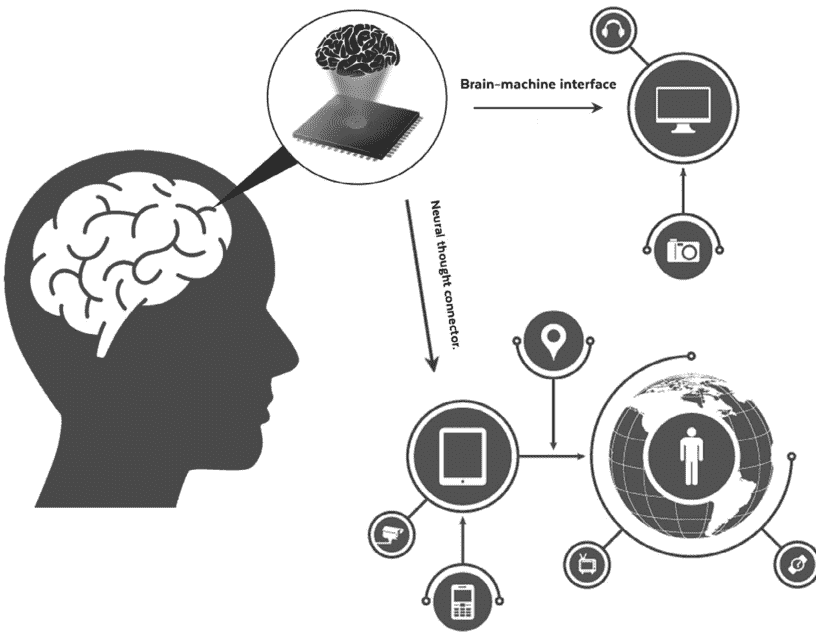

图 1.1 Neuralink 脑芯片中的 AI。

神经网络是 AI 中一种强大的工具，有助于发现数据中的模式。还有为脑部护理中的特定问题专门设计的算法。AI 使用了大脑图像提供的大量数据，有助于医生做出更好的决策。然而，仍有一些挑战需要解决，以使 AI 医疗更具实用性和有效性 [40]。

AI 可以成为智能医生助手。它观察 MRI 或 X 光片等医学图像，检测人类难以察觉的疾病迹象。这为医生节省了时间，他们可以更容易、更准确地进行诊断。AI 还记录患者的病史，每当患者症状不明时，AI 都会利用之前的信息进行精确诊断。它更有可能被认为是诊断问题的“第二大脑”。与此相关的挑战是 AI 需要大量数据来做预测，如果数据质量差或提供不足，预测可能可能无效 [41]。机器学习（ML）在医疗保健领域非常有用，因为它有助于读取医学图像、支持手术程序和发现新药。它就像是 ML 教会计算机在不给任何指令的情况下自主学习。然而，目前还没有足够的数据让 ML 充分探索和理解心理健康问题。它们主要使用被称为支持向量机的算法，极少使用神经网络 [42]。

### 1.4.3 直接的 AI-脑通信

脑制图是指计算和实践方面的努力，侧重于在哺乳动物中枢神经系统（CNS）的主要框架内复制神经生物电路的结构、功能和属性。尽管这一领域与脑机接口以及人工智能（BI-AI）在概念上有所不同，但它们都旨在复制大脑的功能。AI 对于关注绘制神经连接至关重要，出于许多原因，特别是连接组学（connect omics，这是神经科学中一个专注于绘制神经连接的分支）。这种模拟有助于研究人员理解大脑内部存在的复杂关系。由于大脑的复杂性，AI 被用于辅助脑制图。为了理解大脑图像并解释模式，AI 算法起着至关重要的作用。换句话说，AI 通过理解海量数据、识别模式并生成超越人类能力的洞察，帮助解决谜题和复杂的脑筋力题 [43]。

脑机接口（BCIs）是神奇的技术。此类接口将你的大脑连接到计算机等外部设备。通过传输大脑数据或改变你大脑的功能方式，BCI 实现了大脑与外部世界的双向通信。BCI 同时也引发了新的社会、伦理和技术担忧。在医疗领域信任这些技术、保护患者数据以及失去人类触感的风险正在被讨论。BCI 可以理解、修改或完全改变我们大脑的功能，这一事实可能会从根本上改变人类的定义，因为技术模糊了人与机器之间的边界。还注意到，BCI 未来可能会我们对人类的理解和管理带来挑战 [44]。


跨越多个不同维度进行并行处理。评估量子计算的复杂性，量子门、叠加和纠缠所承担的关键任务极大提升了量子系统的计算能力。在解决聚类挑战时，经典计算与量子计算的融合（主要通过量子近似优化算法，QAOA）展示了增强无监督机器学习算法的潜力。将量子和传统处理相结合来解决聚类问题——具体而言是通过使用 QAOA——证明了无监督机器学习技术如何能够增强。在人工智能中两种量子计算技术——量子主成分分析（PCA）和量子支持向量机（SVM）的使用和研究，具有显著的破坏性影响。量子 SVM 使用改进的效率处理二分类问题，而量子 PCA 算法充分利用密度矩阵和指数级共享无线访问协议（SWAP）操作来实现高效降维 [46, 47]。

人工智能的未来将航向量子计算的前沿，这是一个充满巨大潜力且持续挑战的领域。量子相干是威胁持久计算所需的量子信息稳定性的强大敌手。对量子错误纠正和容错的不懈追求，要求科学家们持久的奉献。目前的关注点仍然是构建可靠且稳健的量子硬件，工程师们努力开发能够长时间容忍并维持量子相干性的处理器。纠错和算法的创新有助于量子系统保持韧性，这为更可靠的量子计算平台开启了大门。展望未来，人工智能引人入胜的量子未来展望了一个民主化的环境，伦理和负责任的创新塑造了可访问的量子计算。量子云计算平台和开源库弥合了爱好者与训练专业人士之间的差距，带来了一个协作研究的新时代，孕育了充满活力的量子 AI 用户社区，并解锁了跨所有行业的发现 [44]。

## 1.6 AI 用于脑机接口

神经科学与技术的一个开创性交叉在脑机接口（BCI）复杂领域出现，为人机交互提供了巨大的增长机会。工业领域近期对 BCI 产生了兴趣，它允许通过脑脉冲控制计算机和其他机电系统。但在实现其全部潜力方面存在障碍，特别是在准确识别人类情感和心理过程方面。在这种情况下，人工智能进入了舞台中心，成为 BCI 领域创新可能性的催化剂。本次会议旨在通过脑电图（EEG）信号重塑认知评估并解码人类情感，随着实体探索将 AI 与 BCI 结合，这标志着技术动态演变的转折点 [48]。

## AI 时代的初创公司与创新

由于 AI 在 BCI 中的融合，我们利用脑信号实现多种目标的能力已显著增强。BCI 为瘫痪人士提供了无障碍的便利，允许他们快速移动个人电脑上的鼠标光标。此外，BCI 在肢体康复和神经假体中起着重要作用，使严重运动障碍者能够实现包括双臂运动、触及和抓取在内的任务的功能性神经整合。

- 驱动的体感阵列激活假体传感器，并有效地连接代表皮层内微模拟脉冲的物体压力，以恢复触觉反馈。
- 如人工耳蜗等 BCI 通过激活感觉上皮来转换听力恢复，AI 改进了 BCI 驱动的语音合成器预测模型，通过分析无声词汇创建期间的神经活动帮助四肢症患者进行实时通信；同样，光学假体中的 BCI 辅助视觉假体的发展，AI 在优化用于模式的电极阵列方面起着至关重要的作用。

最终，AI 与 BCI 的集成（以 Cyberlink™ 等进展为代表）为未来铺平了道路，让患有脑损伤在内的各种神经系统疾病患者能够获得增强的自主性和对社会的积极参与。这些应用证明了 AI 在扩展 BCI 能力方面的巨大影响，跨越了运动控制、康复到感官恢复和通信，最终提高了各种神经系统疾病患者的生活质量 [49, 50]。表 1.2 显示了 BCI 的应用、收益和挑战。

AI 的不同在于当我们的思想成为终极界面时，深度学习将复杂的脑信号解码为自定义体验的适应算法。在这里，EEG 信号在 BCI 中非常重要，因为它们提供了一种非侵入的方式来解码皮电活动。这种技术在大脑和外部设备之间建立了双向通信连接，升级了人机交互（HCI）和模式识别。基于 EEG 的 BCI 在与 AI（特别是机器学习（ML）和深度神经网络）结合时，超越了娱乐，为医疗、通信和感官体验中的创造性应用开辟了道路。这种神经科学与 AI 的融合延伸到了游戏和娱乐之外，展望了一个思想成为终极界面的未来，无限的可能性为医疗、通信和感官增强的应用铺平了道路 [51]。

总之，BCI 的未来呈现了许多引人入的可能性，例如思维解码、记忆扩展、电话通信和自动化。然而，隐私、安全和健康问题以及伦理担忧必须得到解决。为了在创新和责任之间取得平衡，科学家和技术人员需要严格的标准、稳健的安全解决方案和审慎的框架，以及对伦理规范的遵守，这对于确保 BCI 的潜在利益造福人类将至关重要 [52]。

## AI 用于初创公司与创新

### 表 1.2 BCI 中的 AI 应用

| 应用 | 描述 | 收益 | 挑战 | AI 技术 | 参考文献 |
| :--- | :--- | :--- | :--- | :--- | :--- |
| 光标控制 | 计算机光标由用户大脑控制 | 为瘫痪人士恢复独立性 | 准确性和速度有限 | 解码脑活动的机器学习算法 | |
| 神经假体和肢体康复 | 用户使用脉冲控制机器人或瘫痪肢体 | 残障人士重新获得运动和实用性 | 复杂的控制和安全担忧 | 用于优化控制算法的强化学习 | [50] |
| 体感 | 大脑刺激为用户提供人工触觉或压力 | 增强假肢的具身性和反馈 | 复制感觉的能力有限 | 映射大脑到感觉刺激的深度学习 | |
| 听觉 | AI 用于人工耳蜗以优化听力模式 | 为听障人士恢复听力 | 听力结果的个体差异 | 个性化刺激方案的预测模型 | |
| 语音合成器 | 用户控制脑活动以生成合成语音 | 为无语症提供通信能力 | 语音和速度有限 | 从脑活动中解码语音的循环网络 | |
| 视觉假体 | 视觉皮层的电刺激使用户能够感知视觉信息 | 盲人恢复视力 | 创建自然和高分辨率视觉的困难 | 模拟视觉系统的神经形态计算 | |


# AI 时代的未来科技初创公司与创新

生物制造领域的最新进展包括在一个平台上整合多种制造技术，以创建具有增强功能的结构。它还对发展中生物制造领域中数字设计、AI 和增材制造技术的未来勾勒了愿景 [54]。验证工具在各国内部和国际参与者之间建立了对 AI 技术的信任。这些工具采用了监管机构和审计人员所使用的技术来评估执行情况。这包括来自数据科学、算法设计和机器人硬件领域的方法。此类工具的存在带来了挑战，但缺乏它们可能会阻碍治理的有效性 [55]。在过去的几十年里，野生生殖生物技术和种群保护繁殖领域取得了进展。24 种野生猫已成功用于人工授精和胚胎生产，以减轻野生繁殖中的挑战（例如个体之间的差异）。然而，在辅助生殖技术（ART）的有效性方面仍需取得进步，并对猫科生殖生物学有更深入理解 [56]。治疗开发中的 AI 和 ML 技术受到几个重大因素的阻碍。这些障碍包括缺乏大规模的新颁法律以及法律问题方面的数据共享。为了将 AI、ML 和真实世界证据（RWE）整合到临床开发过程中，尚未提供完整的用例或监管框架 [57]。

## 1.8 区块链技术中的 AI

区块链是一种数据收集协议，使系统黑客和欺诈变得不可能。区块链也被称为分布式账本技术（DLT），它建立了一个在整个去中心化过程中不可更改且易于使用的相对先进资源的历史背景 [58]。AI 和区块链在解决许多行业的问题方面具有巨大潜力，包括银行、社会服务、加密货币和物联网（IoT）。这种整合正在影响智能城市的架构，以创建可持续的生态系统。因此，我们讨论了与区块链安全疑虑相关的解决方案，并列出了为了创建各种基于区块链和 AI 的智能交通方法必须应用的核心思想 [59]。

人工智能对于管理 IoT 产生的海量数据至关重要。IoT 以学习算法和高级分析的形式存在。通过连接智能传感器、设备和射频识别（RFID），IoT 拥有巨大的潜力。这有助于构建能够提高生产力并在各个领域提供见解性信息的智能系统。区块链技术是节点或分区区之间的安全连接。当涉及到 IoT 应用时，就引入了使用区块链构建的分布式系统。信息存储在块中；每个块包含授权的交易及其随附的属性 [60]。区块链技术可以在数字货币时代自动实现支付，确保个人数据、信息和日志的安全去中心化交换。AI 和区块链是当今最讨论的话题。区块链技术能够自动简化比特币支付。AI 为机器人提供了人类智能，影响了其推理和决策的能力。这促使人们对区块链和 AI 的结合进行了仔细分析 [61]。在将 AI 和 IoT 等技术集成到单一系统中存在存在困难。影响其功能的主要问题是安全性、可扩展性、问责制通信信任。本质上，当这些技术被更有效地结合时，业务运营可以更高效。为了生产力和利益最大化，我们需要解决这些技术的特定需求，以获得最大的效率和有效性 [62]。


近年来见证了许多 AI 驱动型业务企业的卓越成功案例。机器学习和神经网络的发展，结合更廉价的传感器、更高效的数据收集和准备方式以及更强大的处理能力，引发了 AI 初创活动的兴起。随着这些技术的进步，AI 企业的数量正在不断增加。尽管对于缺乏合格的 AI 人才以及企业家认为他们能实现的目标与可行目标之间的差距存在担忧，但 AI 仍然是初创活动中最受欢迎和最活跃的领域之一，大量资金流向众多行业中识别为 AI 的机会 [63]。

通过利用深度学习和机器学习的最新进展来促进创新，多个 AI 已取得成功。计算机视觉是取得进展的领域之一。自动驾驶汽车、增强现实和医疗诊断只是初创公司使用计算机视觉和图像识别算法的领域之一。特斯拉、Waymo 和 Cruise 等公司已经收集了海量数据集，并正在使用深度学习模型帮助其汽车在地形和高速公路上导航。医疗保健行业的企业家正在创建 AI 工具，用于评估医疗扫描和照片，并帮助比人类更快更准确地识别糖尿病相关视网膜病变癌症等疾病 [64]。表 1.3 显示了基于 AI 的公司如何比非 AI 公司更有益。

表 1.3 AI 驱动型公司在关键领域的优势

| 领域 | 有 AI | 无 AI |
| :--- | :--- | :--- |
| 收入 | 利润和服务的增加 | 运营受限且增长缓慢 |
| 成本 | 运营成本降低 | 支出较高且需要人工操作 |
| 风险缓解 | 预测性分析和估计 | 反应式且有限的方法 |
| 网络效应 | 强化联盟和生态系统 | 效应较少且影响有限 |
| 适应性 | 发明更快且灵活性更高 | 更难修改和调整 |


表格显示，AI 驱动型公司在收入、成本、风险管理、网络利用和适应性方面比非 AI 公司具有优势 [65]。

## 1.10 新兴市场中的 AI

经济快速增长和中产阶级扩大为特征的新兴市场面临着独特的挑战。它们的进展受到基础设施不足和资源获取有限的阻碍。然而，AI 的使用可以开启机遇。AI 注入新兴市场标志着一个巨大的转折点，具有转范潜力 [66]。

AI 应用（如马达加斯加、肯尼亚和印度的自动信贷服务）正在优化业务分析并刺激金融包容。虽然尚未广泛使用，但先进的 AI 系统在中国具有显著的应用，那里的企业提供了脸识别和医疗诊断解决方案。尽管 AI 仍处于婴儿阶段，但它具有改进人类事业的潜力。ML 算法（特别是深度学习）通过分析非结构化数据（如语音转文本和脸识别）正在改变决策 [67]。

全球饥饿和气候变化等挑战正通过将 AI（包括计算机视觉、机器人和机器学习）整合到发展中国家的农业来解决。尽管存在专家短缺等障碍，农业科技的应用具有降低成本、提高资源效率并让小农户接入全球价值链的潜力。考虑到潜在影响，发展金融机构有动力投资研究。计算和数据收集的创新加速了 AI 的发展，有助于应对疫情、风险分析和效率。向 AI 特定技术的投资流增加表明了兴趣的增长和潜在影响。AI 在新兴市场的采用仍然受到资金缺乏、劳动力技能和技术基础设施问题的阻碍。对大量投资的需求影响着向先进 AI 应用的转变，特别是对于工业不稳定和收入低的国家 [69]。


### 表 1.4 AI 初创企业增长的收益与局限性

| 参考文献 | 收益 | 局限性 |
| --- | --- | --- |
| [74] | 有助于诊断、改进治疗和预防。 | 无法访问电子数据、劳动力短缺、服务成本高。 |
| [75] | 参与更多软件开发的 AI 已开始对社会产生更大影响。 | 在开发和利用 AI 系统时往往忽视了伦理问题。 |
| [76] | AI 消除了重复性任务，但客户满意度显著下降。 | 公司客户挑战不公平算法歧视的权利。 |
| [77] | AI 在药物发现方面具有巨大影响力，创造了每年销售额达1000亿美元的市场。 | AI 需要高质量数据。由于患者隐私和技术人员短缺引起了关注。 |

培养全球联盟与合作有助于知识转移和资源共享，以克服障碍。改进教育和技能开发的倡议对于使劳动力具备具备交互和利用 AI 的能力至关重要。新兴市场 AI 的未来在于积极解决这些问题，促进各个领域和企业的包容性增长，并在 AI 技术不断进步的同时释放创新活力 [70]。

## 1.11 初创企业增长中 AI 应用的挑战

在 AI 时代，创新的机器学习算法不断增长，具有彻底改变医疗、教育、制造业和零售等各个行业的潜力。与数据质量、隐私以及缺乏合格员工相关的问题是阻碍 AI 广泛使用的障碍 [71]。轻松访问数字建筑对于创新建筑技术解决方案的成功至关重要。然而，将信息转换为数字格式是不够的；它需要被不同的系统所理解，并在一系列建筑信息模型 (BIM) 平台上可用。无法直接访问共享信息阻碍了 AI 在建筑行业中的高效使用 [72]。

许多企业已经考虑了 AI 的进展。研究中 90% 的受访者认为 AI 可以让他们受益，但 40% 的人表示，尽管投入巨大，但这些支出并未带来真正的辅助收益。阻碍 AI 成功实施的挑战包括技术问题、组织内部的文化因素，或政治或治理困难 [73]。表 1.4 展示了 AI 初创企业增长的收益与局限性。

## 1.12 结论与未来方向

总之，当 AI 和其他前沿技术交叉时，各行业都有巨大的潜力，但也存在许多具有挑战性的问题。为了确保新技术的负责任开发和应用，标准化倡议以及解决隐私、安全和伦理问题至关重要。通过持续的跨学科研究，可以实现个性化医疗、智能基础设施、辅助技术等领域的进展。


重点包括解决数据稀缺问题，并使用一系列数据集创建适用模型。需要研究人类与 AI 的协作以克服数据挑战，并利用一系列数据集创建泛化模型。能力的进一步发展可以来自双向接口和人机协作。标准应该在创新与信任之间取得平衡。通过信息共享和消除获取技术的障碍，国际合作可以实现利益最大化。为了实现更先进、更公平的技术目标，必须解决挑战性的社会和技术问题。

## 参考文献

- [1] Raj, R., Singh, A., Kumar, V., & Verma, P., 2023. 分析 ChatGPT 作为提高业务运营效率和效果工具的潜在收益和用例。BenchCouncil Transactions on Benchmarks, Standards and Evaluations, 3(3), 100140.
- [2] Jansiti, M. and Lakhani, K.R., 2020. 在 AI 时代竞争：算法网络运行世界时的战略与领导力。Harvard Business Press.
- [3] Benhya, H., Davenport, T.H., and Pachidi, S., 2020. 组织中的人工智能：现状与未来机会。MIS Quarterly Executive, 19(4).
- [4] Giaggioli, G. and Pellegrini, M., 2023. 作为创业者赋能工具的人工智能：系统文献综述和未来研究议程。International Journal of Entrepreneurial Behavior & Research, 29(4), pp. 816–837.
- [5] Widanyani, R. and Maria, L., 2023. 利用人工智能技术的业务模式创新。International Transactions on Education Technology, 1(2), pp. 95–104.
- [6] Seni, N., Sharma, E.K., Singh, N., and Kapoor, A., 2019. AI对企业的影响：从研究、市场部署到业务模式的未来转变。arXiv preprint:1905.02092.
- [7] Haefner, N., Wincent, J., Parida, V., and Gassmann, O., 2021. 人工智能与创新管理：回顾、框架和研究议程。Technological Forecasting and Social Change, 162, p. 102390.
- [8] Müller, J., Hotter, K., Wahl, J., Bilgram, V., and Tekic, Z., 2022. AI彻底了创新管理——基于AI的创新者的感知与实施。Technological Forecasting and Social Change, 178, p. 121858.
- [9] Eager, J., White, M., Smit, J., Cacciughera, G., and Lage-Demoz, E., 2022. 人工智能的机会。欧洲议会。
- [10] Podreschi, D., Gianotti, F., Guidotti, R., Monreale, A., and Turini, F., 2019. 有意义的AI解释。Proceedings of AAAI (Vol. No. 01, pp. 9780–9784).
- [11] Bitar, R., 2023. AI世界中的数据保护。乌普萨拉大学。
- [12] Tekic, Z., Ilija Cosic, and Branko Katinic, 2019. 制造业与人工智能的崛起。DAAM & 30.
- [13] Mühlroth, C. and Grotke, M., 2020. 创新中的人工智能：趋势发现。Transactions on Engineering Management, 69(2), pp. 493–510.
- [14] Seni, N., Sharma, E.K., Singh, N., and Kapoor, A., 2020. 企业中的人工智能：从研究到市场部署。Procedia Computer Science, 167.
- [15] Lee, J., Suh, T., Roy, D., and Bausch, M., 2019. 新兴技术与业务模式创新：人工智能案例。Journal of Open Innovation: Technology, Market, 5(3), p. 44.
- [16] Verganti, V., Vendraminelli, L., and Lansiti, M., 2020. AI 时代的创新与设计。Journal of Product Innovation Management, 37(3), pp. 212–227.
- [17] Katakar, C., Bilgram, V., and Füller, J., 2020. 创新过程中的人工智能。Business Horizons, 62(2), pp. 171–181.
- [18] Santos, R.S. and Qin, L., 2019. 风险资本与新兴技术：基于AI的数据分析。Journal of Risk and Financial Management, 124(4).
- [19] Teczik, Z., Cosic, I., and Katalanic, B., 2019. 制造业与人工智能的崛起：治理变革。Proceedings of the 30th DAAM International Symposium (pp. 0192–0196).
- [20] Barat, Y., Bourekaddi, S., Shouqli, S., and Kerbek, M., 2021. AI的贡献？ES Web of Conferences (Vol. 234). EDP Sciences.
- [21] Daraojimba, C., Abbioye, K.M., Bakare, A.D., Mhongo, N.Z., Onzonuka, O., and Daraojimba, D., 2023. 技术、创新、创业增长与财务推动：十年回顾（2013–2023）。International Journal of Management & Entrepreneurship Research, 5(10), pp. 769–792.
- [22] Kumar, B.M., Talukdar, V., Khan, H., Talukdar, S.B., Koujali, A., Kumar, R.G., & Gupta, A., 2024. AI学习在工业自动化系统和机制中的应用。Robotics and Automation in Industry 4.0 (pp. 110–131). CRC Press.
- [23] Perifanis, N.A. and Kitsos, F., 2023. 数字战略时代人工智能对业务价值的影响：文献综述。Information, 14(2), p. 85.
- [24] Dellott, B. and Wallace-Staines, F., 2017. AI 时代：人工智能、机器人与低技能劳动的未来。RSA Report (pp. 44–57).
- [25] Weber, M., Beutter, M., Weking, J., Böhm, M., and Krakmar, H., 2022. 创业中的人工智能与大数据：创业研究的关键特征和方向。Business & Information Systems Engineering, 64(1), pp. 91–109.
- [26] Obschonka, M. and Autdech, D., 2020. 创业中的人工智能与大数据：新时代的开启。Small Business Economics, 55(5), pp. 529–539.
- [27] Kulkov, I., 2023. 医疗健康行业人工智能初创企业的下一代业务模式。International Journal of Entrepreneurial Behavior & Research, 29(4), pp. 860–885.
- [28] Obermeyer, Z. and Emanuel, E.J., 2016. 预测未来——大数据、机器学习和临床医学。The New England Journal of Medicine, 375(13), p. 1216.
- [29] Topol, E.J., 2019. 高性能机器：人类与人工智能的汇聚。Nature, 557(7695), pp. 44–50.
- [30] Anagnoste, S., Biculesanu, I., D'Ascenzo, F., and Savastano, M., 2021. 聊天机器人在端端自动化和未来就业中的作用。Business Review in a Digital Era: 14th International Conference on Business Excellence, ICBE 2020, Bucharest, Romania (pp. 287–302). Springer International Publishing.
- [31] Patil, M.V., Shree, P., and Singh, P., 2021. AI机器人系统。International Journal of Scientific & Engineering Research, 12(7), pp. 668–671.
- [32] Bauer, C., and Thamm, A., 2021. 今日AI有效救生命的六个医疗领域。Digitalization in Healthcare: Implementing Innovation and Artificial Intelligence, I, pp. 245–267.
- [33] Klumpmm, M., Hintze, M., Immonen, M., Ródenas-Ríla, F., Pilati, F., Aparicio-Martinez, F., Celebi, D., Liebig, T., Tirstrand, J., Urbann, O., and Hedman, M., 2021. 医院医疗中的人工智能：欧洲医院的应用案例及挑战的应对。Healthcare, 9(8), p. 961.


- [34] Lawry, T., 2020. 健康领域中的 AI：智能健康系统新时代获胜的领导者指南。CRC Press。

- [35] Davenport, T. and Kalakota, R., 2019. 人工智能在医疗保健领域的潜力。《Future Healthcare*, 6(2), p. 94.

- [36] Jenner, B.S.S., Ghosh, D., Prasad, A., and Bushetty, H., 2022. 医疗保健聊天机器人综述。《International Journal of Engineering, Science and Management*, 5(4), pp. 140–143.

- [37] Ayanous, S., Abdelhak, A.B., and Benhamed, M., 2020. 一种使用 NLP 和机器学习用于医疗保健的智能聊天机器人。第3届国际网络、信息系统与安全会议论文集 (p. 1–6)。

- [38] Shaik, A., More, D., Puttu, R., Srivastava, S., and Shinde, S., 2019. 聊天机器人综述。《International Research Journal of Engineering and Technology (IRJET)*, 6(4), pp. 2395–0072。

- [39] Matthew, R.B., Varghese, S., Joy, S.E., and Alex, S., 2019, 4月. 使用机器学习的疾病预测和推荐聊天机器人。2019年第3届国际电子与信息会议 (ICOEI) (pp. 851–856)。IEEE。

- [40] Kulsreshth, A. and Lakhanal, A., Neuralink (2019) – 埃隆·马斯克的初创公司。

- [41] Rico, M.C. and Brainbridge, W.S., 2002. 提升人类性能的融合技术：与纳米尺度集成。《Journal of Nanoparticle Research*, 4, 281–295。

- [42] Christians, C.G., 2013. 技术哲学：全球化与伦理普遍性。《Globals Media Ethics* (10–20)。Routledge。

- [44] Botes, M.M.W., 2022. 脑接口与人权：新世界的勇敢权利。2022年 ACM 公平、问责与透明度会议论文集 (pp. 1154–1161)。

- [45] Linnhoek, P., 2020. PanQK – 量子遇见人工智能：如何让一个宏大的想法变为理想化。《Digital Welt*, 4(2), pp. 28–35。

- [46] Rawat, B., Mehra, N., Bist, A.S., Yusuf, M., and Sanjaya, Y.A., 2022. 量子计算与 AI：影响与可能性。《ADI Journal on Recent Innovation*, 3(2), pp. 202–207。

- [47] Abdelgamer, N. and Nikolopoulos, C., 2020, 12月 关于量子计算及其在人工智能中的应用。2020年 IEEE 第三届国际人工智能与知识工程会议 (AIKE) (pp. 198–199)。IEEE。

- [48] Asher, U., Ayaz, Y., and Tair, R., 2023. 脑机接口 (BCI) 和用于人机交互 (HMI) 的工业 4.0 中人工智能的进展。《Human Neuroscience*, 17, p. 1320536。

- [50] Ganayuthem, P., Bloor, C., and Cockton, G., 2003. 用于增强脑机接口的人工智能。HCI International (pp. 2003–1397)。

- [52] Maisebi, J.B., Massawe, LV., Mbise, M., Mkocha, K., Ally, N., Ismail, M., Michael, J., and Kimambo, S., 2023. 脑机接口：未来、挑战与潜在威胁。《挑战与威胁, 10(1)。

- [53] Oliveira, A.L., 2019. 生物技术、大数据与人工智能。《Biotechnology Journal*, 14(8), p. 1800613。

## 用于地位与创新的 AI 19

- [54] Castilho, M., de Rijter, M., Beirne, S., Villette, C.C., Ito, K., Wallace, G.G., and Malda, J., 2020. 多技术生物制造：制造功能组织结构的新方法？《Trends in Biotechnology*, 38(12), pp.1316–1328。

- [55] Butcher, J. and Beridize, I., 2019. 全球人工智能治理的现状如何？《The RUSI*, 164(5), pp. 8–96。

- [56] Tongphangkake, A., Sukarparkani, G., Comizzoli, P., and Chadartong, K., 2020. 杂草的繁殖生物学与生物技术。《Feriogenology*, 150, pp. 360–373。

- [57] Shah, P., Kendall, K., Goinin, S., Goosen, R., Hu, J., Ringel, M., 2019. 临床开发中的人工智能与机器学习：一种视角。《Medicine*, 2(1)。

- [58] Wang, Z., Li, M., Chen, X., 2022. 业务创新中的人工智能。《Information Processing & Management*, 59。

- [59] Singh, S., Shahid, M., Gupta, S., 2022. 智能城市中的物联网与区块链。《Intelligent Green Technologies》。

- [60] Mohanta, B., Jena, D., Satpathy, S., 2020. 物联网安全：机器学习与人工智能的综述。《News*, 11。

- [61] Taherdoost, H., 2022. 人工智能与区块链的应用。《Applied Sciences*, 12(2)。

- [62] Guergov, S., 2021. 块技术：物联网与人工智能的收敛。《International Journal of Information and Management (IJIM)*。

- [63] Chalmers, D., Mackenzie, N., and Carter, S., 2019. 运动中的人工智能：创业。《Entrepreneurship Theory and Practice*。

- [64] Hammes, M., Hagg, A., 2022. 运动中的人工智能：一种挑战。《Active Living*, 4。

- [65] Moro, R., Cruz, S., and Lopezual, J., 2023. 功能性组织结构制造的新方法？《Humanities*, 10(1)。

- [66] Yang, Z., Hyman, M., 2020. 医疗保健中的人工智能。《Earth and Science》。

- [67] Cook, P., O'Neill, F., 2019. 医疗保健中的人工智能。《Financial Development》。

- [68] Mrazek, M., O'Neill, F., 2020. 医疗保健中的人工智能。《Smart Communications》。

- [69] Manchanda, S., Kalman, H., 2021. 医疗保健中的人工智能。《Manufacturing》。

- [70] Sharma, M., Luthra, S., Joshi, A., 2022. 人工智能的实施：来自新兴经济体的证据。《Government Information Quarterly*, 39(4)。

- [71] Sachs, R., Girolami, M., and Bilrakis, I., 2020. 建筑信息模型、人工智能与建筑。《Developments in the Built Environment*, 4。

- [72] Reim, R., Åström, J., and Eriksson, O., 2020. 人工智能的实施：商业模式路线图。《AI*, 1(2)。

- [73] Zahlan, A., Ranjan, R., and Hayes, D., 2023. 医疗中的人工智能创新：文献综述、探索性分析与未来研究。《Technology in Society*, 1。


- [75] Vakkuri, V., Kemell, K.K., Jantunen, M., and Abrahamsson, P., 2020. “这只是一个原型”：软件初创环境中被忽视的伦理问题。敏捷软件开发国际会议 (pp. 195–210)。Springer International Publishing。

- [76] Santos, A.R., 2022. 人工智能对创业、自动化和业务规模化的重要性。《International Journal of Applied Engineering & Technology*, 4(3), pp. 1–5。

- [77] Lamberti, M.J., Wilkinson, M., Donzanti, B.A., Wohlhieter, G.E., Parikh, S., Wilkins, R.G., and Getz, K., 2019.药物开发的人工智能应用与使用研究。《Clinical Therapeutics*, 41(8), pp. 1414–1426。

## 创业

Muhammad Ameer Hamza, Sheikh Muhammad Faisal, Basheer Ahmad, Davod Veiseh

## 2.1 引言


机器人可以做出更独立的决策，提高行业效率并提升自动化水平。机器人中的 AI 可以帮助它们发现气体管道泄漏并捕获微小颗粒。它能自动捕捉管道中的泄漏区域，从而节省劳动力成本。得益于这种 AI 机器人行业的最新技术，劳动中的受伤人数有所减少。AI 赋予了机器人自动执行日常任务的能力，这也可以很大程度上减少人为错误。在 AI 的帮助下，工业机器人可以随着时间的推移提高其准确性和效率。此外，它们通过 AI 的赋能，可以与人类互动并接受他们的指导；因此，强大的能力可以增强长期安全性，行业日益依赖这些机器人 [4]。机器人的进步与强大的互联网连接并行的发展，对所有业务部门（包括服务业）产生了重大影响 [5, 6]。一个需要额外审查的关键问题是，这些创新的快速且持续进展对服务提供、交付和客户观察方式产生的重大影响，以及颠覆性影响的复杂性。需要进一步的研究来探索服务互动中员工和客户角色可能发生的转变、服务模式及其对流程、实施、就业和组织重组的影响 [7, 8]。然而，Ivanov 等人指出，尽管该领域有很多理想的论文，但功能分析显示进展较少，行动分析和假设技术等方法尚未应用 [9]。许多公司、餐厅和其他企业正在采用 AI 和机器人来改进和增强业务。但在这方面取得成功，公司需要面对并克服重重障碍 [10]。例如，AI 是一项近期技术，由于缺乏专业知识，许多经理很难难以理解其用法。

- **系统融合**：机器人通过集成摄像头、激光DAR、雷达和环境传感器等多个传感器，可以更有效地感知和理解周围环境。这种集成增强了它们的导航能力并更技巧地与环境交互。

- **深度学习与机器学习**：结合深度学习 (DL) 和先进机器学习 (ML) 算法允许机器人从经验中学习并适应各种场景。这种能力对于物体识别、路径规划和决策等任务至关重要。

- **尖端计算**：在边缘或机器人机上处理数据，而不是仅仅依赖云计算，可以减少延迟并加快机器人的响应速度。这对于快速决策至关重要的实时应用尤为重要 [10]。

## 2.2 文献综述

新型调用机器人技术是工业 4.0 的关键因素，为我们在制造领域提供了丰富的知识。它连接计算机、软件程序和数字设备等设备形成网络，以确保人们能及时获得信息。使用机器人可以极大增加行业增长，但某些工作危险性很高，且这些机器人总是需要输入来启动或停止任务。由于这些输入数据，此类机器人的任务受限于特定任务，且不宜在风险性工作中使用它们，因为它们无法跳式思考。尽管这些机器人可以执行和操作不同的项目，但它们无法超越人类大脑的能力。如今汽车行业非常发达。使用机器人可以在更短时间内制造更多的汽车。

随着技术的发展，机器人行业愿意采用新的集成 AI 的机器人。在此之前，行业将机器人的小部件作为其设备的一部分，但现在行业愿意让机器人与人类协作，使工作变得轻松。汽车行业一直乐于采用新技术，因此现在可以在流程的每个环节看到机器人与人类并肩工作。机器人行业的工人现在可以使用机器人设备，这使他们的工作变得毫不费力。随着这种机器人设备的使用，行业所需的人员数量也将减少，这将导致失业率的上升 [11]。

工作场所的危险职业现在可以由这些集成 AI 的机器人承担。它们可以执行对人类来说很危险的任务，例如处理对人类不安全的放射性废液，以防增加工人的安全性。在 Kumar 看来，人类员工每天可以工作四小时，但集成 AI 的机器人每天可以工作 24 小时而甚至不需要休息 [12]。

虽然集成 AI 的机器人为行业带来了各种优势，但一个重要的局限性与 AI 机器人相关的高昂成本，这将影响行业的财务和经济增长。由于成本高昂，许多小公司和企业在财务上无法支付这一费用，许多小企业将发现难以经营公司。小企业的维护成本也很高，这可能导致经营失败。只有具有良好财务背景的企业才能享受集成 AI 带来的好处 [13]。

新的创新技术（如 AI 和机器人）尚未在酒店业得到广泛使用。它并没有关注单个客户的兴趣，而是审视了酒店经理的视角。决策者不是个体客户，而是允许客户使用这些技术的酒店。年轻一代可能很容易采用这些技术，但老一辈将面临许多困难，这将导致酒店和医院行业对这些集成 AI 的机器人产生抵触情绪。此外，这项技术将影响酒店业的客户流失率，可能导致客户数量减少 [14]。

机器人流程自动化 (RPA) 包括将创新部署到计算机算法或“机器人”以评估和理解当前应用。其意图是实现数据控制、数据处理、响应提示以及与其他虚拟系统的通信。RPA 将机器学习、自然语言处理和视觉感知等多种形式的智能与自动化功能相结合。

RPA 的战术实施对银行来说正逐渐变得必要。在零售银行领域，合并 RPA 的首要效益是普通任务的自动化。这使得银行能够实现任务自动化。预计到 2025 年，机器人将处理 45% 的任务，富国预测机器人和 AI 解决方案将达到 1530 亿美元。零售银行业旨在满足智能自动化和更高回报的需求。随着医疗专业人员的需求增加，为老年人和慢性病患者提供服务的需求日益增加。这在紧急情况下需要采取措施。因此，科技时代的医疗行业正在研究通过机器人为患者提供定制化医疗。在医疗领域，AI 用于分析复杂的医疗健康数据，在排除人类互动的情况下获得解决方案。机器人的设计旨在减少劳动力并提升治疗工作，广泛影响医疗各个领域。机器人系统提供了医疗和方案的安全性和效率，导致成本的降低。这些机器人还展示了在人体受限区域进行高精度手术的能力 [16, 17]。

医疗领域机器人等新技术的进展和合成的根本障碍在于审批。广泛接受医疗机器人面临许多挑战，包括需要全面的框架来评估其实用性、可靠性、患者满意度和可访问性。虽然许多老年患者渴望将机器人引入家庭，但他们对隐私问题和家庭环境中机器人的行为感到担心 [18]。表 2.1 详细显示了集成机器人的局限性。

表 2.1 集成机器人局限性详细研究

| 参考文献 | 集成机器人类型 | 描述 | 局限性 |
|---|---|---|---|
| [19] | 辅助编程机器人 | 制造业机器人解决了生产力、效率和计算成本问题，增加了对先进技术在生产中应用的理解 | AI 和机器人的网络安全风险；随着更多行业互联，对这些系统的漏洞性高度关注 |
| [20] | 结合5G/6G 的 AI 与机器人 | 5G/6G AI 关注通信技术、未来市场需求、联邦学习以及自动驾驶的扩张 | 5G/6G 与 AI 及机器人行业关注未来市场需求和新优势的进化，同时减少对公共隐私和数据安全的影响 |


表格 2.1（续）集成AI机器人的局限性详细研究

| 参考文献 | 集成机器人类型 | 描述 | 局限性 |
| --- | --- | --- | --- |
| [21] | 医院行业的 AI 与机器人 | 医院行业关注通过节省成本带来的财务收益、提高效率和提升服务质量、客户满意度，以及法律和伦理影响 | 虽然医院行业具有财务优势，但缺乏文化差异，人们可能会发现难以接受这项技术，并影响 AI 和机器人服务的实施 |
| [22] | 智慧城市中的 AI 与机器人 | 智慧城市中集成 AI 的机器人专注于交通、建筑、教育、政府、制造业、健康和环境。这将在不久的将来影响就业和新城市生活的塑造 | 智慧城市改善了各种因素，但但也带来了对智能机器依赖的潜在风险。对 AI 的依赖可能导致被动的生活方式，使个人极度依赖机器进行决策和日常任务 |
| [23] | 旅游业中的 AI 与机器人 | 旅游业集成 AI，通过聊天机器人、人脸识别、虚拟现实和机器人等技术来增强客户体验。此外，Google Maps 中的 AI 应用旨在提供实时信息，改善旅行者的导航和整体旅程 | 旅游业中的 AI 虽然增加了成本，但让一切过度关注技术。这可能会夺走人们在旅行期间享受的特殊和自发时刻 |
| [12] | 自动化机器人中的 AI | 带有 AI 的机器人不断涌入，潜力改变自动化和 AI，导致效率提高；成本降低（长期计划），以及机器人执行危险任务的能力，从而推动了多个行业的发展 | 虽然它广泛涵盖了老年人孤立的问题，但未能提到这些机器人对所有人的公平可及性，也没有解决有关隐私的担忧，例如能够捕捉私人时刻的摄像头 |
| [24] | 与 IAS 集成的 AI 和机器人 | 智能自动化系统 (IAS) 通过使用一种名为解释性结构建模 (TISM) 的独特方法识别关键因素，开发出一个可行的环境，为政策制定者和系统操作人员提供了有用建议 | 缺乏对各种框架或模型模式的彻底检查可能会限制该领域探索各种观点和方法论的能力 |
| [25] | ANN 中的 AI 和机械臂 | 使用人工神经网络 (ANN) 创新遗传算法 (GA) 增强带有云台驱动器的机械臂参数的方法，这表明 ANN 擅长改进功能，并使工业机器人更高效、更环保 | 它利用了 ANN 但没有考虑现实世界的挑战。当这项技术的实施时，会在现实生活中出现。整体研究主要侧重于理论和理论实现 |

26 AI 时代的未来科技初创公司与创新

## 2.3 元宇宙的兴起与 AI 驱动机器人的角色

元宇宙被定义为一个虚拟 3D 世界，在虚拟平台上提供用户交互和协作。元宇宙是由 meta（元）和 universe（宇宙）两个词组合而成的名称。AI（包括机器学习 ML 和深度学习 DL）被用于操作元宇宙。语言处理、机器视觉、区块链、网络连接、数字孪生和神经接口等不同方法并未直接用于创建元宇宙，但它们可以改进元宇宙内部的世界 [26]。与单纯的录像相比，元宇宙为用户提供了卓越且更实时的交互。这有助于虚拟对话和医疗互动。人们必须佩戴一种特殊的眼镜才能看到元宇宙内部。这些眼镜帮助他们与医生进行实时语音聊天。他们不需要去诊所，而是可以通过元宇宙进行虚拟面对面交流，而不是访问诊所。元宇宙发展了一个人们进行情感连接的世界，财务和社交方面也将包含在元宇宙中 [27]。Henning Thoreau 等采取了各种方法来观察在元宇宙中交流是否有意义。他们进行了一个小组实验来帮助客户，并从客户评价中获得了经验。出乎意的是，使用现实头戴设备的效果并不比仅使用普通电脑耳机更好。作者发现，虚拟现实让人们彼此与环境之间的联系更加紧密，但也让他们很快感到疲劳，这种情况可以通过新的更新和体验得到改善 [28]。输入/输出控制 (IoCT) 通过添加 AI 使其更加真实并与数字世界连接，从而帮助元宇宙的创建。使用 AI 的 IoCT 和 IoOT 可以让虚拟世界更加详细和互联联。例如，从配备 IoCT 的现实世界城市中收集的数据可以显示元宇宙中的虚拟城市的外观，帮助用户感觉自己正处于现实世界中 [29]。

## 2.4 通过手术机器人和 AI 推进医疗保健

2016 年发布的一份报告声称，教育和健康是 AI 和机器人有可能取代人类的领域。由于集成 AI 机器人的存在，医疗系统正在迅速变化。未来，集成 AI 的机器人将用于执行精确的手术；因此，想要开始外科医生职业生涯的人必须在该领域拥有非常精的技能才能获得工作。手术机器人能够独立完成整个手术，如果手术期间发生意外情况，机器人能够处理这些不可预测的情况，使整个手术自动完成，而无需与人类任何互动。手术机器人变得越来越常见。在英国，几乎有 115 台正在运行。在欧洲其他地方，这些机器人比英国更常见；每百万人中几乎有三台机器人正在工作。未来，将由机器人去协助患者。这些机器人的发展使得这些机器人的制造公司将……以下章节解释了某些类型的机器人 [30]。


### 2.4.1 计算机辅助手术与介入机器人

近期，计算机辅助手术在减少侵入性方面取得了巨大进展。在牙科领域，计算机辅助手术 (CAIS) 因其精确高效的程序而流行。机器人脊椎手术已投入常用并应获得高价值和需求。未来的下一步可能是将 AI 与这些机器人集成，使其更加独立和强大 [32]。未来，手术机器人和成像机器人将产生巨大的需求，因为如果我们想在手术中使用这些机器人，它们必须像人类一样智能，并在特定任务中理解情况并做出相应。这意味着这些手术机器人、成像机器人、医生和手术团队将共同工作 [33]。


由患者的肌肉信号控制，手将根据信号运行。这些系统通过插入电极来捕捉来自肌肉和神经的信号，从而控制假肢 [36]。


我们的目标是开发出高效的方法，使机器人能够通过智能工厂处理海量工业数据，并以多种方式交换信息。目标是将这些技能与网络通信协议的要求以及动态信息交换相结合，以满足大规模或定制化机器人研发的需要 [37]。

### 2.5.1 灵活自动化中的认知机器人

RPA（机器人流程自动化）是一项与机器学习（ML）整合的技术，用于在计算机屏幕上显示内容并采取相应的行动。无论菜单在屏幕的什么位置，它都会记录每一次点击和按键。这与传统的记录每次点击和按键以备后用的方法不同。人协作（HRC）中的相互认知意味着人类和机器人作为一个团队工作，通过理解彼此的意图来执行任务。这有助于机器人提高工作效率，与人类建立联系并从他们身上学习如何更准确地完成任务。其目标是让人类和机器人的团队协作更高效、更快速。在人机协作（HRC）系统中，人类与机器人完成任务的意图涉及多种输入，如语音命令、生物信号和不同位置的动作。人机之间的这些互动旨在使人机关系更加高效、流畅和安全 [38]。

### 2.5.2 用于组装和物流的 AI 机器人群

它利用群聚算法来克服灵活制造系统（FMS）和自动引导运输车（AGVs）在调度和控制方面的限制与挑战。该算法的灵感来自一种名为群机器人的方法，即许多小型机器人协同工作。这是该领域一种强大、可扩展且灵活的创新。当我们完全理解其内部工作原理时，群机器人的设计仍然具有挑战性。群机器人已被用于从货架上收集物品并将其送到拣货站 [39]。


农业部门面临着多种障碍，如虫害侵害、作物病害、水危机、杂草入侵等。从传统的耕作技术中恢复时，这些障碍会导致农作物的损失和财务挫折。人工智能和机器人技术的引入符合熟练应对这些挑战的承诺。在印度，农业经常面临季风不确定性的挑战；雨季开始的任何延迟都会对作物、产量以及随后的收入产生不利影响。

机器人行业中的 AI 29 页

微软印度（研发）有限公司与半干旱热带地区作物研究所（ICRISAT）以及印度东南部安得拉普德邦当地地区合作，正致力于安得拉普德邦（AP）基础部门任务（Rythu Kosmos 项目）。其理念是利用预测性分析和云集成机器学习，为 106 个村庄的 4000 名农民设计建议界面，以应对障碍。此外，为 175 名农民建立了一个安装在带有简单短信功能的手机上的滑动应用程序。这项创新让农民能够通过根据其特定地区定制的移动应用程序获取建设服务。Kumar 和 Ashok 建立了一种设计巧妙的机械装置，一种带有特定种子容器的机器人种子的自动播种机器人。这项技术通过减少播种增长中的投入和累积成本，完全优化了播种过程 [40]。

### 2.6.1 AI 与机器人驱动的自动化室内农场


### 2.6.2 计算机视觉下的食品加工与检测

在食品药品监督管理局（FDA）监管下，食品加工行业对计算机系统的接受正达到顶峰。这种趋势将在食品领域占据主导地位，动力是与领先计算机传感器和成像技术供应商相关的成本降低，这些供应商拥有多种提高作物产量和减轻损害的技术。最新进展是使用高清（HD）摄像头作为农民的空中检查工具，实现了最佳的巡查、数据收集和分析。这类不受管理的飞行器被称为无人机。不同类型的


这些无人机已经开发出来，利用多种技术进行飞行。在农业中，通过传统卫星进行的空中测量已长期用于检查大面积区域和森林。无人机的引入实现了该领域精度和能力的跃升 [43]。

## 2.7 塑造工业机器人未来的新兴技术

三十年来，工业机器人一直是制造业中成熟的设备，用于焊接、零件排序、铸造、喷漆和堆垛等各种用途。工业机器人的基本优势如下例所示，是能够在挑战性环境中可靠地执行任务。市售机器人系统在灵活性、速度和重复性方面具有可以接受的水平；目前重点放在人机交互上，以减少可能伤害人类的碰撞。抓取放置 [44] 是机器学习特别是计算机视觉实现的全新应用示例。关键在于，这些方法正用于促进更高水平的自动化。除了之前涵盖的屏幕操作界面外，额外的输入模态可能使远程或本地交互更加容易或自然。尽管语音已用于机器人 [46]，但其有效性仍存争议。每种模态的独特优势可以通过多模态界面来实现 [48, 49]。

### 2.7.1 云机器人与远程机器人

机器人是一个帮助自动化重复日常任务的关键领域。因此，工业界对机器人的需求激增，这导致了能力更强、精度和稳定性更高的实时机器人的产生。机器人框架网络中，每个机器人的位置被称为节点或数据点，这些机器人组通过有线或无线通信连接。然而，为了减轻处理和存储数据的压力，机器人的内存非常低，不足以处理和存储。云机器人通过云网络、其他技术和无线通信协议提供的丰富资源成为可能 [50, 51]。诸如 SLAM 等应用程序由于车载计算和存储设备限制造成的瓶颈而“被利用”，导航是云机器人的主要用途。如今，基于远程机器人 [52] 的云计算已用于各种领域，包括家居自动化、医疗保健和军事。云机器人的人工集成 [53] 将提高处理速度、访问控制和延迟方面的自动化水平。与传统的机器人相比，


远程机器人技术使用预先编程机器人执行特定任务或自主运行，它允许人类对机器人的动作进行实时干预和控制。这是通过通信技术实现的，这些技术允许人类操作员向机器人下达命令并接收反馈，从而提供了一种远程存在体验。远程机器的重要要素包括遥操作。为了控制远程机器人的移动，人类操作员使用各种输入设备，包括摇杆、触觉界面和其他控制机制。机器人接收来自操作者的实时指令。远程机器人依赖于通信系统，这些系统频繁使用卫星链路和互联网等技术 [55]。
## 2.8 机器人领域 AI 初创公司面临的挑战与机遇

正在进行的“数字革命”的最新阶段由计算机科学、机器人技术和人工智能领域的创新共同定义，这些创新相互加持。这些领域的技术进展为立法者和监管机构带来了需要处理的复杂问题。正如几十年前，海量数据的可用性和低成本计算导致了伦理和法律问题一样，我们目前正面临着又一波又来的动荡。在这种情况下，计算机科学、机器人技术和人工智能领域之间的交互与协同作用特别有利于，能够凸显目前出现的伦理、法律和商业挑战的重要性 [56]。机器人是可重新编程的机器，可以自主或半自主运行以执行制造任务。根据 George Devol 和 Joseph Engelberger 的工作，第一台工业机器人于 1961 年在汽车行业中制造。UNIMATE 机器人的创建是为了在新泽西州的通用汽车工厂执行点焊和压铸件提取 [57]。自从人工智能诞生以来，重点一直放在开发和配置设备，这些设备能够模拟人类认为是智能特征的心理过程（以及其他过程）。传统上，学习、计划和问题解决可以追溯到 1956 年的达特茅斯研讨会，会上 Allen Newell、Herbert Simon 和 J. C. Shaw 的最初的人工智能程序“逻辑理论家”（Logic Theorist）得到了展示。这些作为领域奠基人的领导者所设定的标准被推高。目标是建造能够执行个人完成的每项任务的机器，并为获取合适的人工智能问题寻找解决方案，无论是在“当前代”还是“25 年后” [58, 59]。

## 2.9 结论

机器人技术与人工智能的结合具有巨大的潜力，可以改变许多行业并改善人们的生活。AI 驱动的机器人可以在各种行业（包括制造和医疗保健）中执行危险、重复性或基于精度的工作。这使得人类工人转向更具想象力和成就感的任务成为可能。AI 机器人可能会取代一些工人，但它们可能在技术开发、维护和监督领域创造新机会。在未来科技初创公司和人工智能时代的创新工作中，机器人无法完全取代同理心、创造力和复杂的问题解决等人类技能。综合考虑，如果对 AI 和机器人技术的开发和部署进行妥善管理以防止意外后果，它们具有提高安全生活质量、增加生产力和推动增长的潜力。还需要进一步的研究来解决围绕机器人自主性的伦理问题，以及其他存在的限制和困难，例如高成本以及需要确保机器人以安全有效的方式与人互动。当负责任地开发和监督时，机器人与人工智能的整合对帮助人类和社会具有巨大潜力。

## 参考文献

- [1] Arents, J. and Greitans, M., 2022. 制造业智能工业机器人控制趋势、挑战与机遇. Applied Sciences, 12(2), p. 937.
- [2] Raj, M. and Seams, R., 2019. 人工智能与机器人技术入门. Journal of Organization, 8(1), p. 11.
- [3] Dzedickis, A., Subačiūt–Zemaitė, J., Sūtinis, E., Samukaitė–Bubienė, U., and Bučinskas, V., 2021. 工业机器人高级应用：新趋势与可能性. Applied Sciences, 12(1), p. 135.
- [4] Javaid, M., Hale, A., Singh, R.P., and Suman, R., 2022. 工业 4.0 人工智能应用：基于文献的研究. Journal of Industrial Intelligence and Management, 7(01), pp. 83–111.
- [5] Li, J., Bonn, M., and Ye, Y., 2019. 酒店员工的人人工智能和机器人意识：感知组织支持和竞争心理氛围的调节作用. Tourism Management, 73, pp. 172–181. https://doi.org/10.1016/j.tourm.2019.02.006
- [6] Makridakis, S., 2017. 即的人工智能（AI）革命：对社会和企业. Futures, 3, pp. 1–27. https://doi.org/10.1016/j.futures.2017.03.006
- [7] Murphy, J., Hofacker, C., and Gretzel, U., 2017. 酒店与旅游业机器人时代的黎明：教学与研究的挑战. European Journal of Tourism Research, 15, pp. 104–111.
- [8] De Keyser, A., Köcher, S., Alkire, L., Verbeek, C., and Kandampully, J., 2019. 前沿技术：概念架构与未来方向. Journal of Service Management, 30(1), pp. 156–183. https://doi.org/10.1108/JOSM-03-2018-0082
- [9] Ivanov, S., Gretzel, U., Berezina, K., Sigma, M., and Webster, C., 2019. 酒店与旅游业机器人进展. Journal of Hospitality and Technology, 10(4), pp. 489–521. https://doi.org/10.1108/JHTT-08-2018-087
- [10] Davenport, T.H. and Ranki, R., 2018. 现实世界的人工智能：不要从……开始. Business Review, 96, pp. 98–116.
- [11] Javaid, M., Haleem, A., Singh, R., and Suman, R., 2021. 工业 4.0 可持续机器人能力. Cognitive Robotics, 1, pp. 58–75.
- [12] Shaukat, K., Iqbal, F., Alam, T.M., Devnath, L., Khan, A., Shahhzadi, I., and Rubab, A., 2020. 人工智能未来. Trends in Computer Science and Information Technology, 5(1), pp. 20–54.
- [13] Nadikattu, A.K., 2021. 机器人行业未来. International Journal of Creative Thoughts (IJCRT), 1, pp. 2320–2882.
- [14] Nam, K., Dutt, C.S., Daghfous, P., and Khan, M., 2021. 酒店业的人工智能与机器人采用：前景与挑战. Electronic Markets, pp. 553–574.
- [15] Barlow, J., Singh, D., and Curry, R., 2007. 老人居家护理的系统综述. Journal of Telemedicine and Telecare, 13, p. 172–179.
- [16] Below, B., 2007. 日本理解语言与情感语调.
- [17] Broadent, E., Jayawarden, C., Kse, N., Stafford, K.Q., and MacDonald, A., 2011. 改善老年护理生活质量的人机交互：方法与问题. 第 25 届人工智能老年护理会议论文集, San Francisco (pp. 13–19).
- [18] Buckwater, K.C., Davis, L.W., Wakefield, B.J., Kienz, M.G., and Murray, M.A., 2002. 农村老年人及其护理者的远程医疗. Community and Community Health, 25, p. 31–40.
- [19] Xiao, H., Muthu, B., and Kadry, S.N., 2024. 使用混合代理编程的先进制造机器人人工智能. Model Service Robotics, 17, p. 369.
- [20] Liao, L., Li, Y., Serikawa, S., Guizani, M., and Lv, Z., 2021. 5G/6G、人工智能与机器人调查. Computers and Electrical Engineering, 95, p. 107372.
- [21] Cain, L.N., Thomas, J.H., and Alonso, J.M., 2019. 从科幻到科实：酒店业的机器人与人工智能. Journal of Hospitality and Tourism Technology, 10(4), p. 624–650.
- [22] Golubchikov, O. and Thornburn, M., 2020. 智能策略与智能发展规划中的人工智能与机器人. Smart Cities, 3(4).
- [23] Samala, N., Katkam, B.S., Bellamonda, R.S., and Rodriguez, R.V., 人工智能与机器人对旅游（旅游业）的影响：批判性见解. Journal of Tourism Futures, 8(1), pp. 73–87.
- [24] Mir, U.B., Sharma, S., Kar, A.K., and Gupta, M.P., 2020. 集成智能与机器人的关键成功因素. Digital Policy, Regulation and Governance, 22(4), p. 307–331.
- [25] Azizi, A., 2020. 人工智能技术增强机器人手臂稳定性的应用. 作为机器人手臂动态行为优化器的人工神经网络设计. Complexity, p. 1–10.
- [26] Huynh-The, T., Pham, Q.V., Nguyen, T.T., Han, Z., and Kim, D., 2023. 元宇宙的人人工智能：调查. Engineering Applications of Artificial Intelligence, 117, p. 105581.
- [27] Al Kuwait, A., Nazer, K., Al-Reedy, A., Al-Sheh, S., Al-Mohanna, A., Subbarayalu, A., Al-Mohanna, F., 2023. 医疗保健人工智能综述. Journal of Personalized Medicine, 13, p. 95.
- [28] Noble, S.M. and Mende, M., 2023. 零售与服务业的智能与机器人未来：消费者机器人领域的描绘. Journal of the Academy of Marketing Science, 51, p. 747–756.
- [29] Bibi, S.E. and Jathegaasper, S.K., 2023. 利用元宇宙和人工智能构建城市物联网：成本效益 XR 与现实智能技术. Smart Cities, 6(5), p. 2397–2429.
- [30] Kerr, R.S., 2020. 手术：先进技术对患者和工作力量的影响. Future Healthcare Journal, 7(1), p. 46.
- [31] Chen, Y.W., Hanak, B.W., Wilson, T.A., Hsia, H., Walsh, H.E., Shih, H.C., and Nagatomo, K.J., 2021. 医疗和牙科应用的计算机辅助手术. Review of Medical Devices, 18(7), p. 669–696
- [32] Zawar, A., Chhabra, H.S., Mundra, A., Sharma, S., and Kalidindi, K.K.V., 2023. 脊柱手术中的机器人与导航：叙述性回顾. Journal of Orthopaedics, 44, p. 36–46.


[33] Vercauteren, T., Unterbank, M., Padoy, N., and Navab, N., 2019. Caicac: 计算机辅助交互中上下文人工智能的兴起。Proceedings of the IEEE, 108(1), pp. 198–214.

[34] Agarwal, Y., Jain, M., Sinha, S., and Dhir, S., 2020. 在阿罗洛医院提供基于 AI 的高医疗保健。Global Business and Organizational Excellence, 39(2), pp. 20–30.

[35] Shuaib, A., Arian, H., and Shuaib, A., 2020. 人工智能在医疗保健领域日益增长的角色：未来机器人会取代医生吗？International Journal of Medicine, 13, pp. 891–896.

[36] Kitha, Y., Gayathri, N., and Kumar, S.R., 2021. 机器人技术及医疗保健领域基于 AI 和 IoT 的智能自动化。1, pp. 165–187.

[37] Rangraz, M. and Pareto, L., 2021. 职场工作整合学习：通过重塑员工技能支持小型制造工厂的工业4.0 转型。International Journal of Lifelong Education, 40(1), pp. 5–52.

[38] Martins, P., Sá, F., Morgado, F., and Cunha, C., 2020. 使用机器学习进行认知机器人流程自动化 (RPA)。2020 年伊比利亚信息系统与技术会议 (CISTI)

[39] Li, S., Zheng, P., Liu, S., Wang, Z., Wang, XV., Zheng, L., and Wang, J., 2023. 主动人机协作：相互认知、预测和自组织的视角。Robotics and Computer-Integrated Manufacturing, 81, pp. 102510.

[40] Enrique, J.G., Jiménez-Ramírez, A., Dominguez-Mayo, F. J., and García-García, J.A., 2020. 机器人流程自动化：一种智能和工业系统映射研究。IEEE Access, 8, pp. 3911–3929.

[41] FAO: 粮食与农业的未来——趋势与挑战。年度报告，2096, 217。http://www.fao.org/publications/fofa/en/

[42] Goldstein, H., 2018. 虚拟农场的绿色未来 [农业蓝图]。IEEE Spectrum, 55–50–55.

[43] J. Tatsuno, S., Matsuyama, Y. Kokibo, K. Kawab, and H. Kobayashi, 1996. 工业机器人的友好型教学。机器人与人类通信会议，1996 (pp. 549–550)。

[44] Rygol, M., Polard, and Brown, C., 1991. 用于拾取和放置的多处理器 3D 视觉系统。Image and Vision Computing, 9(1), pp. 33–38.

[45] Vernon, D., 1991. 机器视觉：自动化视觉检测和机器人视觉。Englewood Cliffs: Prentice Hall

[46] Laura, S., Schulz, G., Kyriakou, T., and Klein, E., 2002. 使用自然语言的机器人编程。Robotics and Autonomous Systems, 38(3–4), pp. 171–181.

[47] Thrun, S., 2004. 人机交互框架。Human–Computer Interaction, 19(1), pp. 9–24.

[48] Stiefelhagen, R., et al., 2004. 使用语音、头部姿态和手势的人机交互。智能机器人与系统会议 (IROS'04)。

[49] D. Peranzowski, Schultz, A.C., Adams, W., and Bujajska, M., 2001. 构建多模态人机界面。Intelligent Systems, 16(1), pp. 16–21.

[50] Chowdhury, A., Mukherjee, S., and Banerjee, S., 2017. 机器人风险检测与缓解。Detecting and Mitigating Cyber Risks, 1, p. 208.

[51] Allaban, A., Maozhen, A., and potentially, T., 2020. 老人护理机器人研究综述。Information, 11(2), p. 75.

[52] Manohar, S. and Ponraj, N., 2019. 精准改进。Journal of Artificial Intelligence, 10(1), pp. 28–36.

[53] Smys, S. and Ranganathan, G., 2019. 汽车工业中的机器人传感与配置。Journal of ISAC, (3), pp. 180–187.

[54] Velenarasaju, M., 2019. 医院环境 IoT 集成。Journal of ISAC, (3), pp. 172–179.

[55] Vijayakumar, T., 2019. 高敏感性机器人阵列。Journal of Electronics, (1), pp. 43–51.

[56] Bekey, G.A., 2005. 自主机器人：从灵感到实现。Cambridge, MA: MIT Press.

[57] Kharel, A., et al., 2014. 云机器人的使用。International Journal of Computer Applications, 1, pp. 18–21.

[58] Rinsema, R., 2017. 数字化时代的教学。Listening in Action: Teaching in the Digital Age, 第1版。London: Routledge.

[59] Saigh, R., 1998. 数据通信国际字典。Chicago.

# 人工智能在农业中的角色、应用与影响

## 3.1 引言

鉴于农业作为基础性业务的全球重要性及其内在挑战，人们正日益关注探索创新方法以解决粮食安全和可持续性的关键问题[1]。在许多尝试中，AI 成为一种强大的催化剂，具有深刻变革农业部门的能力。农业部门面临着许多需要开发解决方案的问题[2]。世界增长和饮食偏好的改变导致粮食需求大幅增加，对现有的生产系统造成了巨大压力[3]。气候变化以及资源和劳动力转移带来的不确定性，产生了农业流程转型的必要性。

AI 成为一种强大的工具，可以提高生产力、优化资源利用并修正整个农业价值链的决策程序[4]。计算机科学的一个领域使机器能够模拟与人类相关的认知过程。AI 系统可以通过利用先进算法和大量数据存储获取知识、进行逻辑思考并做出预测[5]。AI 在农业领域的应用在各个领域展示了巨大潜力。事实驱动解决方案能够提高从作物管理到精准农业等关键任务的准确性和效率[6]。AI 可以识别作物疾病和虫害，优化灌溉和施肥实践，并对产量变化和市场趋势提供预测。

# AI 在农业中的角色、应用与影响

AI 带来变化的潜力不仅限于行业。许多部门将农业、医疗、交通、金融和制造业视为创新新产品服务的关键组成部分[7]。通过 AI 进行数据分析和优化，这些行业可以提高管理从生产到分配复杂流程的效率。将 AI 驱动的机器人和自动化集成到农业过程中，预示着生产水平提高和对劳动力依赖减少的新时代[8]。然而，承认这一努力中持续存在的挑战至关重要。人工智能在农业中的应用展示了创新、可持续性和全球粮食安全的交汇。

尽管具有潜在益处，但许多挑战碍了这些前景的实现。AI 在农业领域的应用正处于一个关键时期，全球努力重点是识别具有韧性和可持续的方法以应对日益增长的粮食需求[9]。粮食需求增加与减轻农业方法环境后果的紧迫任务，需要 AI 所提供的创新解决方案。此外，在农业中采用人工智能的社会经济影响不容忽视，因为它可能赋能农村地区并显著改变传统的就业模式[10]。

农业领域 AI 的快速发展为转型小规模耕作实践提供了良好前景，这些实践在维护全球粮食安全方面起着至关重要的作用。AI 提高作物产量、预测疾病爆发和提供个性化农业指导的能力对于改善小农的生活具有巨大意义[11]。此外，AI 驱动的农业洞察对极大影响政策制定具有巨大潜力。这使政府组织等各种实体能够有效决定资源分配、土地管理和投资决策。然而，存在阻碍农业领域 AI 进展的障碍[12]。为了将技术有效地纳入传统实践，基础设施、知识和培训必须易于获取和使用。


## 38 AI 时代的未来科技初创公司与创新

| 应用层 | 开发机构开发 | 森林自动化 | 变现 |
| :--- | :--- | :--- | :--- |
| 数据分析层 | 森林数据分析机器人机器学习算法 历史数据分析 | 流式数据分析 |
| 网络层 | 边缘与存储数据报告分析 | 工业网关 | 通用网关 |
| 设备层 | 交通与森林机器人 | 传感器设备 | 监控设备 |

图 3.1 按网络层划分 AI 辅助工具在农业和林业中的应用。

技术格局在 21 世纪经历了巨大的变革，影响了人类活动的各个领域。在各种范式中，AI 范式已成为一种先驱力量，具有彻底改变这些行业并重塑人类与环境交互的潜力 [4]。AI是一门结合了计算机科学、数学和认知心理学的跨学科领域，使机器能够复制人类智能。这种模拟的范围涵盖了广泛的任务，从识别数据中的模式到制定复杂的决策过程不等 [5]。AI 对农业经济的影响是意义巨大的，因为它的整合可以解决长期以来的挑战，并推动该行业向以前所未有的生产力、可持续性和韧性水平发展 [7]。

季节周期、经验知识和资源密集型技术等历史因素极大影响了当代农业实践。然而，当代农业复杂且多样化的性质要求更先进、具适应性的方法。在此时，AI 成为创新的突有催化剂 [8]。由于 AI 技术的使用，农业领域在认知能力方面取得了显著进展，超越了人类智力。这主要归功于 AI 分析海量数据、识别复杂模式以及生成精确预测的卓越能力。农业部门面临着适应天气模式变化、虫虫灾害和市场波动引起的不确定性的挑战 [9]。在此背景下，AI 基于数据分析提供宝贵的见解，使明智决策成为可能。通过利用复杂的算法，AI 可以预测农业产量、评估质量并提出针对性的干预措施。这种变革性的过程将耕作实践从一种手工艺术转变为数据引导的科学 [14]。

AI 辅助技术可以在整个农业价值链中产生有益影响，涵盖从生产到消费的所有阶段。配送物流、资源配置和供应链管理的优化可以进行战略性调整，以最大限度地减少低效率、提高生产力并提供食品资源的公平获取机会 [15]。此外，AI 吸收和评估广泛数据源的能力有望增强食品的透明度和可追溯性。这反过来导致了客户信心的增加和安全性的提高 [16]。AI 在农业领域的出现带来了新的前景，但也揭示了一系列需要细致检查的挑战。AI 的伦理影响不容忽视，包括对保护数据隐私、减轻偏见和促进技术公平获取的忧虑 [17]。在农业部门实施 AI 需要一种兼考虑科学进步又考虑社会公平的整体方法 [18]。这对于由于 AI 整合到农业中可能导致传统劳动力潜在性流失的担忧至关重要。

### 3.1.1 本章的贡献

本章介绍了以下贡献：

- 本章提供了 AI 关键概念和技术的概述，包括机器学习、深度学习、神经网络和数据分析。
- 它描述了 AI 如何应用于农业行业，并展示了如何优化灌溉施肥过程；基于 AI 的传感器和无人机被用于土壤和农田分析，有些根据历史数据和各种参数预测作物产量和市场价格。
- 本章展示了农业中 AI 成功应用的一些现实案例，强调了在该领域领先的特定项目、技术和公司。进一步讨论了这些应用对产量、资源利用和盈利能力的影响。
- 本章讨论了在农业中应用 AI 的局限性和挑战，例如数据质量、可访问性和伦理考虑，并探索了可能的未来发展，包括 AI 算法的进步、数据收集方法的改进和自动化的提高。
- 最后，它研究了在农业中广泛采用 AI 的潜在影响，包括就业岗位和农村发展。

### 3.1.2 章节结构

第 3.2 节提供了 AI 概念的简要概述，例如机器学习、深度学习和神经网络，并展示了 AI 算法如何学习。第 3.3 节介绍了了这些应用对产量、资源利用和盈利能力的影响。第 3.4 节说明了 AI 在作物管理中的作用。第 3.5 节讨论了农业中 AI 应用的案例。第 3.6 节详述了 AI 的伦理问题。第 3.7 节介绍了应用 AI 的挑战。第 3.8 节给出了结论。

## 3.2 AI 基础知识

AI 构建在数据分析的基本原理之上。本节简要介绍了机器学习 (ML)、深度学习 (DL) 和神经网络 (NN)。AI 算法分析海量数据、识别复杂模式并生成精确预测。AI 通过收集和检查大量数据集获取信息，使明智决策成为可能。

### 3.2.1 机器学习

从数据获取知识是 AI 功能的一个基本方面；这些系统处理大量数据。模型的参数通过考虑误差和反馈进行迭代修改。

### 3.2.2 深度学习

DL 属于机器学习，它利用多层神经网络来执行复杂任务。DL 的效能源于它使用层次方法提取特征，每一层都从输入中逐渐获取抽象信息。

### 3.2.3 神经网络

DL 的核心是一个复杂的互连系统。互连实体被称为神经元或节点，按层结构组织。每个神经元都会评估接收的数据，分配权重，并将处理后的数据传输到后续网络层。

### 3.2.4 数据分析

AI 构建在数据分析的基本原理之上。AI 通过收集和检查大量数据集获取信息，随后指导决策。描述性、诊断性、预测性和指导性分析被用于发现数据中的模式。

### 3.2.5 从数据中学习：AI 的本质

AI 算法可以通过吸收数据集的内在结构来增强其超越初始编程的功能，从而生成更准确、更智能的结果。


# AI 时代的未来科技创业公司与创新

## 3.3 AI 在农业中的应用

近期，AI 与农业的结合引入了一系列创新应用，显著改变了我们在农业领域的耕作、资源管理和决策方式。这些应用涵盖了广泛的领域，每个领域都利用 AI 的能力来应对严峻挑战，并促进更高效、更环保且多产的农业环境的发展，下文将进行详述。

### 3.1 作物管理

由于 AI 技术的出现，作物保护领域经历了复兴，这极大增强了疾病检测和害虫管理能力 [16]。AI 系统通过分析图像和数据，能够检测出人类观察者可能无法察觉的疾病或虫害迹象。此外，配备了摄像头和光谱分析仪的 AI 传感器能够对植物健康状况进行持续监测，有助于及时干预并减少产量损失 [19]。作物管理的另一个部分是实施精准灌溉和施肥技术，这些技术通过 AI 算法进行了优化。这些算法考虑了天气状况、土壤水分水平和作物阶段等许多因素，以实现最大效率 [21]。

### 3.3.2 精准农业

利用 AI 的分析能力根据特定条件定制处理方案是精准农业的核心。来自卫星图像、无人机（UAVs）和地面传感器的连续数据流由 AI 算法进行系统性分析，以生成全面的农田地图 [9]。这些地图有助于识别土壤属性、水分水平和作物发育的差异。AI 辅助决策支持系统促进了农业实践中水、肥、农药的精准分配 [23]。实施由 AI 赋能的变率技术确保了根据个体需求高效分配资源，从而最大限度地减少了低效率并优化了生产力。

### 3.3.3 预测分析

AI 可以预测农业产量、市场估值和气候引发的灾害。AI 算法具有生成预测的潜力，有助于农民制定营销和生产策略 [24]。这些算法通过分析历史数据、天气模式和社会经济因素来实现。在供应链物流框架内，准确的产量估计有助于农业企业运营的优化。农民可以通过策略性地选择销售时间和地点，缓解市场波动带来的损失 [25]。使用价格预测工具可以显著帮助农民在这些关键方面做出明智决策。

### 3.3.4 农场机器人

将 AI 集成到农场机器人中为劳动密集型农业作业带来了重大变革。AI 算法促进了机器人的自主运行，使其能够以无与伦比的精度和效率执行种植、培育和收获作物等任务 [26]。这些设备持续运行，减少了对人工劳动的依赖并提高了生产力。AI 驱动的分级系统通过确保消费者只能获得最高质量的食品，提高了最终产品的整体价值 [27]。

### 3.3.5 农业生态系统管理

AI 辅助的环境监测系统可以观察和分析农业景观的变化，包括生物多样性、水质和土壤健康。监测设备定期生成的数据使农民和土地管理者能够增强对其生态系统整体健康的理解 [28]。AI 系统可以监测益益昆虫和授粉者的数量，并检测土壤养分水平的变化和侵蚀迹象。这些信息有助于就轮作、覆盖作物和其他促进生态平衡的实践做出明智决策 [29]。农业部门有潜力通过集成用于生态系统监测和管理的 AI 技术，超越其对生产力的首要关注，拥抱更全面的生态管理方法。

### 3.3.6 气候韧性农业与 AI

气候变化是一个重大问题，因为它有能力破坏传统的农业季节并加剧极端天气事件的发生。使用 AI 的预测能力对于应对这些挑战至关重要 [30]。通过分析历史数据、模式和农业资源，AI 可以生成预测模型，阐明气候变化对作物发育的潜在影响。随后，农民可以通过实施各种调整来适应其实践，例如调整种植时间、选择抗旱作物品种以及实施优化水用水的技术 [31]。AI 具有通过根据动态气候模式提供调整建议来增强资源利用的潜力。在农业部门采用 AI 可能会增强农民有效应对气候变化带来的挑战的能力，并提供稳定的产量 [32]。

### 3.3.7 AI 辅助与个性化耕作建议

AI 提供个性化见解的能力与农业领域紧密相关，彻底改变了农民获取指导的方式。AI 可以通过分析农场特有数据（如土壤成分、历史产量统计和天气模式等因素）为农民生成定制化建议 [33]。AI 具有潜力指导各种农业实践，例如确定最佳种植日期、精确的肥料或除草剂用量，甚至是针对每块地制定最有效的灌溉计划。这种定制策略确保了农业投入的有效利用以及流程对每块土地特定属性的适应 [34]。因此，实施 AI 驱动的个性化耕作建议会导致资源利用减少、作物产量增加以及采用生态可持续的农业实践。在接下来的章节中，将阐述 AI 对农业的关键贡献 [35]。

## 3.4 AI 在农业中的作用

在本节中，我们介绍 AI 在农业领域应用的作用。

### 3.4.1 精准农业

利用 AI 分析来自卫星、无人机和历史记录等多种数据的做法被称为精准农业。处理后，会生成全面的农田地图，突出土壤属性、水分水平和作物整体状况的变化 [36]。发现对农民具有实际意义，使能够通过调整灌溉、施肥和害虫管理策略以适应特定区域，定制其农业实践 [1]。这种针对性的方法提高了资源利用效率，降低了成本并最大限度地减少了不利的生态后果。

### 3.4.2 数据驱动的农业洞察

AI 仍然高效地处理和评估大量数据，AI 程序通过分析历史数据、天气模式和市场波动生成预测分析。利用这些分析，预测疾病爆发的发生、利用历史数据对作物产量进行估计以及预测市场价格变得可行 [2]。这些洞察为农民和农业企业在种植计划、轮作策略和营销策略方面做出明智决策提供了实用价值。图 3.2 展示了 AI 如何应用于

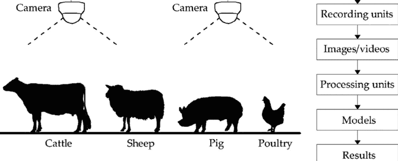

图 3.2 AI 动物监测系统。


# AI 在农业中的角色、应用与影响 ■ 45

实时监控动物和家禽，呈现图像或视频记录，然后由 AI 辅助模型进行处理检查。

### 3.4.3 作物健康监测

作物健康监测通常通过 AI 驱动的系统进行，这些系统利用摄像头、传感器和图像分析能力。这些系统能够识别植物尺寸、色素或表面特征的细微变化，这些变化可能预示着疾病、营养不足或病虫害的存在 [3, 4]。及时识别问题使农业从业者能够实施针对性的干预措施，例如对受影响区域采用适当的治疗措施、阻止病情蔓延并缓解作物减产。

### 3.4.4 自动化农业

自主机器人和 AI 驱动车辆具有独立执行各项任务的能力。这些自动化机器穿过农田，利用先进的传感器技术、摄像头和 AI 算法执行植物识别、种植、除草和收割任务 [5]。系统的准确性和效率得到了增强，从而提高了一致性和产量，同时减少了对人工操作的需求 [6]。此外，自动化耕作技术的实施有助于优化核心业务并降低劳动力成本。

### 3.4.5 资源优化

AI 被用于最大化水、化肥和农药等基本资源的利用率；AI 算法通过分析土壤水分水平、天气预报和作物生长阶段等各种因素，为灌溉、施肥和作物处理的最佳时机和剂量提供建议 [8]。这通过防止过度使用、减少浪费和优化资源配置，促进了可持续农业实践的采用。

### 3.4.6 决策支持系统

AI 驱动的决策支持系统专门为农民设计了实时指导，利用持续更新的数据。这些算法考虑了多个要素以确保提供最佳建议，例如天气预报、历史数据和作物生长阶段 [9]。例如，在预测到不利天气状况时，农业专家可能会根据土壤含水量建议推迟进度或调整灌溉路线 [14]。农民做出明智的决策，从而提高生产率和资源的有效利用。

### 3.4.7 供应链管理

AI 通过分析库存水平、运输物流和消费者需求等多个因素促进了供应链运营的增强。AI 在优化农业企业内部的分销流程方面至关重要，从而提高了效率、减少了浪费并提高了交付的及时性 [16]。这是通过 AI 识别和分析分销系统中趋势和模式的能力实现的。此外，AI 在追溯性中的整合为客户提供了有关产品来源和历程的价值信息，增强了食品安全措施并促进了透明度 [19]。

### 3.4.8 气候适应

通过分析历史气候数据并预测未来气候趋势，AI 在帮助农民适应不断变化的气候条件方面发挥着关键作用。这有助于农业从业者调整计划以应对波动的天气模式，选择对温度波动具有韧性的作物类型，并实施缓解气候条件风险的方案 [20]。尽管环境变化带来了挑战，但利用 AI 驱动的洞察确保了农业持续的持续盈利能力。

### 3.4.9 个性化耕作或农业

AI 根据每家农场的独特特征生成个性化建议。AI 开发个性化建议是通过分析特定农场数据实现的，包括土壤成分、历史产量统计数据和天气模式等因素 [21]。这可能包括关于灌溉最佳时机质量、合适的营养类型以及特定病虫害控制方法的建议。最终结果是更高的生产产出和更高效的资源利用。

### 3.4.10 研究与创新

AI 通过分析大量数据库、识别遗传标记和预测作物特性加速了农业研究 [13]。AI 的能力使研究人员能够评估复杂的遗传数据，并对不同基因对作物性状的贡献做出估算。这一发展通过预期生产对病虫害、疾病和环境逆境具有更强抵抗的新型作物品种，促进了农业的进步 [22]。接下来的章节介绍了一些涉及 AI 的知名实时案例。通过将 AI 整合到农业的各个方面，我们可以应对现有挑战，并为行业内提高效率、可持续性和创新创造机会。

## 3.5 案例研究

本节提供了几个精心挑选的农业 AI 实际应用真实世界示例，并对盈利能力、产量和资源使用的影响进行了一些分析。这些成功故事展示了 AI 驱动的创新如何使既有做法实现现代化、优化资源配置并促进可持续食品生产。

### 3.5.1 Plantix

通过利用基于 AI 的识别技术，该智能手机应用程序能够准确检测和识别营养缺乏和植物疾病。

该应用程序允许农业从业者拍摄其种植植物的图像，并利用 AI 算法分析这些图像以识别潜在的问题或异常 [37]。该应用程序通过为作物提供精确的诊断和治疗建议，便于农民及时采取行动保护其作物。Plantix 应用为农民提供了明智的决策和作物减损措施，特别是对于那些缺乏足够专家建议的农民。

### 3.5.2 Blue River Technology 的 See & Spray

Blue River Technology 开发的 See & Spray 技术使用计算机视觉和 AI 算法在给定的农业景观内准确识别并选择性地针对特定植物。固定在农业机器上的摄像头捕捉作物的实时图像。随后，通过利用这些图像，AI 算法能够区分种植作物和不需要的植被 [38]。由于系统对杂草进行了精准的除草剂投放，因此认为使用广谱除草剂是不必要的。实施 See & Spray 技术促进了杂草管理中可持续实践的采纳，减少了化学投入品的使用并减轻了整体环境影响。

### 3.5.3 IBM 的 Watson 农业决策平台

IBM 的 Watson 农业决策平台对 AI、天气数据、物联网 (IoT) 设备和区块链技术的整合，旨在为农民提供对其运营的完整理解。该平台利用来自多个源的数据提供种植、灌溉、病虫害控制和收割建议 [39]。农民可以通过整合这些针对特定区域和背景情况的价值洞察来增强其农业实践。区块链通过整个供应链的安全存储和数据交换增强了透明度。

### 3.5.4 EarthSense 的 TerraSentia

TerraSentia 是 EarthSense 开发的一种机器人设备，配备了传感器和摄像头，从农业区域收集价值数据。在自主运行期间，该机器人收集有关作物健康、生长趋势和许多环境条件的量数据。农民可以通过分析收集数据的知识做出明智决策 [40]。使用来自 TerraSentia的数据有助于优化灌溉计划、提高种植密度并缓解作物新出现的问题。

### 3.5.5 AgShift 的 Hydra

Hydra 是 AgShift 开发的一项 AI 技术，有助于供应链内食品质量的自动评估。Hydra 利用机器学习和计算机视觉技术，通过分析水果蔬菜的照片表示来评估尺寸、形态和色素等属性 [36]。这种技术


# AI 时代的 48 家未来科技初创公司与创新

通过质量评估的标准化，缓解了人类的主观性并促进了一致性。Hydra 系统通过能够准确识别符合市场标准的农产品，在优化食品浪费和保障产品质量方面发挥着重要作用 [33]。

### 3.5.6 细粒洞察

Granular Insights 是一个 AI 驱动的平台，有助于从许多农业来源收集和分析数据，涵盖机械、天气模式和财务记录。该平台为农民提供了农场运营的全面概述，允许他们监控作物产量、跟踪资源消耗并评估结果 [16]。通过利用这些信息，农民可以就轮作、投入分配以及提高盈利能力的策略做出明智决策。

### 3.5.7 Prospera

Prospera 采用 AI 和数据分析技术，通过整合航空照片和地面传感器来有效监测作物健康状况。如前所述，这些数据经过 AI 算法的处理，以识别作物胁迫、疾病和营养缺乏的情况 [14]。该平台为农民提供了可立即应用于应对当前挑战的行动性信息。Prospera 通过优化灌溉计划、施肥处理和疾病管理方法，有助于提高农业生产力和作物质量 [22]。所展示案例研究证明了 AI 在农业部门的变革性影响。它们展示了各种进展，如精准杂草管理、疾病的早期识别、数据驱动的决策以及供应链操作透明度的提高 [1]。

## 3.6 挑战与未来方向

本节识别了将 AI 应用于农业时面临的挑战以及未来的研究项目，例如数据质量和伦理问题。

### 3.6.1 AI 在农业领域的挑战

本小节介绍了与农业领域 AI 相关的挑战。

#### 3.6.1.1 数据质量与可用性

为了让 AI 算法生成准确的洞察和预测，需要高质量数据。为了便于农业领域做出充分决策，拥有关于土壤质量、天气模式、作物发育和害虫发生的全面知识至关重要。然而，由于基础设施不足和资源有限，小农户在获取可靠数据方面面临挑战 [2]。数据的有限可用对 AI 应用的有效性挑战，阻碍了农民利用技术提高作物产量和资源管理的能力。

# AI 在农业中的角色、应用与影响 ■ 49

### 3.6.1.2 数据隐私与安全

农业数据的获取和利用引发了数据隐私和安全担忧，因为这些数据可能包含有关耕作技术和产量的敏感信息。农民寻求确保其信息不会被误用或剥削 [3]。缺乏稳健的数据保护可能导致农民在共享关键数据时表现出犹豫，阻碍了能够通过提供个性化洞察和建议为行业受益的 AI 解决方案的进展。

### 3.6.1.3 技术采纳与可用性

AI 在农业中的成功部署很大程度上取决于农民对 AI 技术的采纳和熟练使用。然而，必须承认，并非所有农民都具备将 AI 技术整合到其农业运营所需的专业知识或资金手段。数字鸿沟加剧了存在的差异，导致有效采纳技术的农民可能更加富裕，而另一些人则不成比例地处于劣势 [4]。应该采取努力，通过确保所有规模和所有地理位置的农民都能接触到 AI，来促进公平发展。

#### 3.6.1.4 偏见与公平

历史数据中存在的偏见（包括社会经济、种族或性别相关问题）可能导致 AI 应用产生偏偏的结果。农业领域内的偏见建议可能会加剧资源分配上的差异，例如灌溉用水或化肥，放大农民之间现有的差距 [6]。不公正的 AI 输出可能会导致不平等现象。

### 3.6.1.5 互操作性

农业部门依赖多样化的设备和基础设施。AI 系统之间缺乏兼容性会导致数据孤岛和效率低下。例如，如果从一个系统的数据无法无缝集成，农民可能无法获得全面的洞察。为了促进决策决策过程，建立标准的接口是必要的。

#### 3.6.1.6 成本与投资回报率 (ROI)

虽然 AI 长期来看有望降低成本并提高效率，但初始资金可能构成挑战，特别是在利润较低的市场中，投资 AI 的潜力可能被相关风险所掩盖 [12]。证明其投资回报率（ROI）对于促进该计划的接受和实施至关重要。这个问题可以通过使用具有成本效益的 AI 解决方案来解决 [20]。

### 3.6.2 未来研究方向

为了实现变革农业领域的潜力，必须解决这些问题，并为未来的增长设定路线。

#### 3.6.2.1 农业中的可解释 AI

为了促进农业社区的发展和理解，增强 AI 模型的可解释性迫在必行。研究重点将放在开发为 AI 系统决策提供简洁理由的方法上 [16]。理解 AI 生成的预测和建议背后的原理对农民至关重要。可解释 AI (XAI) 有潜力缩小先进技术与其可用性之间的差距。

#### 3.6.2.2 用于韧性农业的 AI

研究将主要集中在开发预测和适应快速变化的环境的 AI 模型，考虑气候变化带来的挑战。这包括能够预测和应对不利天气模式、水资源短缺以及害虫发生率变化的 AI 系统 [7]。此类研究将审查 AI 在作物管理背景下的利用，专注于 AI 算法驱动的策略，并额外探索动态资源分配方法。

#### 3.6.2.3 多模态数据融合

通过整合来自多个来源（如卫星图像、地面传感器和无人机）的数据，可以全面的理解。随后的调查将努力确定多数据源的最佳方法，以生成农业景观的整体表示。整合来自多种态的数据有助于产生更准确的预测和建议，增强决策过程。

#### 3.6.2.4 农生态学中的生物多样性与 AI

该研究的主要目标将调查 AI 在促进促进生物多样性和保护可持续性的农业实践方面的潜力作用。AI 有潜力促进多样化作物系统的开发、增强作物轮作实践并保护农业环境内的自然生态系统 [8]。


### 3.6.2.5 数据稀缺地区的边缘计算

边缘计算是一种在数据产生区域附近进行数据处理的范式，其特点是连接有限。预计这种技术在未来将获得越来越多的关注。本研究将调查能够在最大限度减少所需数据传输的同时高效运行的 AI 系统 [41]。这种方法对于位于农村地区的农业社区尤为相关，在这些地区，即使在互联网连接限制的情况下，提供实时决策支持也至关重要 [39]。

### 3.6.2.6 协作 AI 平台

研究工作将集中于开发协作平台，促进农民、研究人员和 AI 开发人员之间的知识流动。农民可以将他们的数据发送到这些平台以训练 AI，同时获得宝贵的数据聚合服务 [33]。通过协同创新（一种由协作努力驱动的现象），AI 解决方案解决现实世界问题的效能有望得到增强。

### 3.6.2.7 针对小农户的 AI

AI 解决方案开发的优先级将围绕满足小农户的需求，他们构成了全球农业劳动力的很大一部分。研究将重点关注开发成本效益且易于获取的 AI 解决方案，旨在解决小农户面临的特定挑战，例如资源有限和技术水平参不齐 [32]。

### 3.6.2.8 AI 在农业中的伦理和社会影响

将对 AI 进行广泛研究，以审查与农业领域使用 AI 相关的伦理考虑。审查这些问题需要探索诸如数据所有权、隐私保护、公平以及 AI 对农村经济的影响等事项 [30]。对更广泛社会影响的深入理解有助于创建和实施负责任的 AI 解决方案 [27]。总之，将 AI 整合到农业领域将在许多领域提供前景，例如生态可持续性、气候韧性、数据融合、技术可访问性、解释性、协作、包容性和伦理考量。

## 3.7 AI 对农业的影响

本节主要介绍 AI 在农业行业中的社会经济和环境影响及考量。

### 3.7.1 社会经济影响

在本小节中，我们介绍了在该部门内采用 AI 的潜在影响，并强调了教育和培训的重要性。

### 3.7.1.1 工作与就业

AI 的集成可能会改变农业部门内部的工作动态。AI 驱动的自动化具有潜力取代某些劳动密集型和单调的工作，同时也会创造新的就业机会。随着技术的进步，在 AI 开发、数据分析、传感器维护和精准农场管理等领域出现了许多职业机会 [14]。为了使劳动力具备这些不断变化的角色所需的能力，需要获取额外的技能并对现有技能进行重新培训。

### 3.7.1.2 农村发展

在农业部门实施 AI 有可能通过提高生产力和增加农业收入对农村人口产生积极影响。这可以促进农村生计的发展。农民使用基于 AI 的技术可以实现农村地区经济可持续性的增强，这些技术可以有效提高他们的生产力和竞争力 [22]。此外，利用 AI 促进非农业部门的多元化扩张，培养更公平、更全面的发展形式。

### 3.7.1.3 收入分配与公平

AI 的实施可能会分配农业部门内的财务资源。规模较大的且拥有财务资源投入采用 AI 技术的农场可能会经历生产力的提高和财务收益 [22]。然而，大型农户利用新技术可能会导致与农民之间的收入差距扩大。政治家和组织必须考虑采取措施，确保能够公平地获得 AI 的收益，特别是对于小农户。

### 3.7.1.4 城乡迁移

在农业部门中使用 AI 可能会对迁移趋势产生影响。实施 AI 可能通过增强农村地区的生计和生产力，从而缓解导致农村向城市迁移的因素 [26]。通过实施更具可持续的人口分布，可以减轻农村基础设施和服务的负担。

### 3.7.1.5 社区赋能

AI 有潜力通过提供宝贵的知识和见解来增强农村社区的韧性和发展。由于数据驱动的建议，农民可以就作物管理、资源分配和市场时机做出明智决策 [30]。对农民的赋能增强了他们的决策能力，培养了主动性并促进了社区韧性。

### 3.7.1.6 经济多元化

AI 的实施有望促进农村地区的经济多元化。随着农业实践的不断进步，农民有可能通过探索替代收入来源来实现收入流多元化。这可能包括参与农业旅游、实施增值加工技术或针对特种市场 [8]。通过多样化增强经济韧性有助于减少对单一收入来源的依赖。

### 3.7.1.7 文化保护

传统知识、文化保护与可持续农业实践之间的兼容性已得到体现。通过将现代技术与传统的本土实践相结合，AI 有可能同时创造和保护文化遗产 [2]。这种现象具有增强农村社区文化认同感并促进对独特农业实践保护的潜力。

### 3.7.1.8 创业、创新与社会包容

当地企业和发明家可以通过开发满足特定需求的 AI 解决方案来解决区域农业挑战。在农村社区内促进创造力和解决问题的能力，有助于培养韧性并刺激经济增长。


## 54 AI时代的未来科技初创企业与创新

### 3.7.2.1 资源效率

AI驱动的精准农业利用了多种数据源（如传感器、卫星图像和天气预报）来优化资源利用。AI算法通过提供土壤水分水平、营养含量和天气状况的实时信息，促进了水、肥和其他农业投入的应用 [29]。这使得农民能够有针对性地投放这些资源，确保它们在适当的时间输送到合适的位置。通过减少浪费、保护资源和防止误用，实现了提高水效率和养分管理。

### 3.7.2.2 减少化学品使用

AI在病虫害管理中的应用已减少对化学干预依赖的关键因素。支持AI的传感器和摄像头可以检测作物压力或疾病的细微迹象，使农民能够将治疗集中在问题区域 [25]。这种技术有效减少了农药的使用，减轻了对环境的负面影响，并保护了益虫。

### 3.7.2.3 缓解侵蚀与土地退化

在地形、天气和土壤数据分析中利用技术对于促进有效的侵蚀控制策略起着关性作用；AI通过提供作物种植、等高耕作和免耕等农业实践的建议，限制了土壤侵蚀 [23]。这些策略有效地减少了沉积径流进入水体，有助于侵蚀控制工作。这种做法保护了水质，减少了沉积并维持了土壤肥力。

### 3.7.2.4 生物多样性保护

在农业系统中，将AI整合到农生态实践中优先考虑生物多样性保护。农民可以模拟不同种植组合、间作模式以及支持益虫和当地野生动物缓冲区的影响 [22]。这种实践促进授粉，通过自然手段调节虫害，并增强了生态系统的整体健康。

### 3.7.2.5 韧性农业

利用AI的预测能力可以增强农民适应气候变化影响的能力。AI模型可以根据历史气候数据和当前气象信息的分析，建议最佳种植日期、品种和灌溉计划 [21]。因此，农民表现出更强的适应季节变化的能力，减轻极端天气的影响，并增强农业系统的整体韧性。

### 3.7.2.6 减少碳足迹

AI实现了资源配置的优化，从而有助于减少农业的碳排放。AI通过减少合成肥料的消耗（已知其需要大量的能量投入），显著减轻了与农业实践相关的温室气体排放 [19]。这与缓解气候变化和减少行业对全球温室气体排放的贡献是一致的。

### 3.7.2.7 防止森林砍伐

卫星数据与AI的结合能够监测土地利用的变化并检测非法砍伐。AI技术可以识别发生非法交易的区域，使当局能够及时干预并缓解森林砍伐 [1]。保护重要的森林生态系统至关重要，因为它们在碳封和生物多样性保护方面发挥着关键作用。

### 3.7.2.8 减少废物与循环经济

AI的进步有助于减少农业供应链中的废物。AI增强的库存管理和预测系统有效优化了农产品分配，减少了食品浪费。这符合循环经济的原则，即最大限度地减少废物产生并优化资源利用 [3]。农业领域的AI带来了若干环境优势，包括增强资源配置、减少对农药的依赖、增强气候适应性以及提高保护努力 [40]。上述环境效益强调了AI促进既具有生态意识又可持续的耕作方式的能力 [6]。为了充分实现这些利益，采取一种整合AI与健全环境管理技术的综合方法是至关重要的。

## 3.8 经验教训与结论

AI在农业中的整合提供了宝贵的见解和教训，为未来的发展和实施提供了指导 [42]。

### 3.8.1 经验教训

随着农业部门响应技术进步不断演进，这些教训可以形成在最大化AI效益的同时应对挑战的策略。以下是从农业中采用AI中学到的关键教训。

### 3.8.1.1 背景至关重要

为了有效适应特定的农业状况，必须相应地定制AI解决方案。不同地区在社会经济因素、作物多样性、土壤特性和气候条件方面存在差异 [3]。不存在通用的策略。为了确保AI的有效实施，必须理解农民的需求和处境 [41]。这种理解对于开发在当地背景下实用且适用的解决方案至关重要。

### 3.8.1.2 数据质量至上

AI模型的效性受数据质量和数量的极大影响。获取准确、全面且多样化的数据集对于开发稳健的模型至关重要。获取可靠且相关的信息可能面临挑战，特别是在地理孤立的地区 [6]。为了确保AI在农业应用中的效性，必须收集、策划和管理高质量的数据。

### 3.8.1.3 人机协作

AI的整合并不是取代人类专业知识，而是为了增强和放大它。包含农民的传统知识和技能对于理解AI提供的见解并促进决策制定至关重要 [8]。农业中AI系统与人类操作员之间的有效协作可产生更优的结果。为了优化这些技术的利用，农民必须对AI相关的可能收益和局限性有全面的理解 [43]。

### 3.8.1.4 培训与能力建设

AI使用的有效性需要获得教育和培训。农民和农业员工有义务具备必要的技能和知识来维护AI驱动的设备，并精通技术接口和数据解读 [10]。为了让终端用户充分利用AI的能力，必须实施持续的能力建设工作、研讨会和友好的界面。

### 3.8.1.5 数据隐私与所有权

数据隐私和所有权源于AI系统对数据的依赖。农民必须了解其数据的使用和传播情况 [44]。为了在农民和技术提供者之间建立信任和保证，必须建立透明的数据政策并提供数据共享的安全通道 [12]。

### 3.8.1.6 可扩展性与可负担性

可扩展性和可负担性是实施AI系统的关键考虑因素，特别是在小农户背景下。技术的利用不应局限于大规模工业农业作业 [45]。为了促进公平采用并将利益最大化，必须优先开发能够满足各种规模农业经营需求的成本效益且以用户中心的AI解决方案。

### 3.8.1.7 持续监控与适应

对AI模型进行持续监控和修改是必要的。必须定期更新AI算法，以适应作物需求的变化、天气模式波动以及虫群的动态变化 [46]。实施一种允许AI解决方案适应变化状况的灵活方法，可以确保其持续的相关性和有效性。


# AI在农业中的角色、应用与影响 ■ 57

## 3.8.1.8 社会与伦理考虑

对伦理相关问题进行审查，例如AI模型中存在的劳动力替代和偏见，是必要的。为了促进AI的负责任应用以及其收益在社会内的公平分配，利益相关者、立法者和AI开发者必须共同努力 [47]。

## 3.8.1.9 长期可持续性

AI的采用不应优先考虑财务利益，而应优先考虑长期可持续性的发展。将土壤健康、生物多样性和环境保护应作为实施AI驱动措施的指导原则。为了确保农业部门的韧性，AI技术必须与可持续农业的原则和实践保持一致 [48]。在农业部门实施AI强调了多种因素的重要性，包括背景、数据质量、协作、培训、隐私、可扩展性、适应性、伦理和可持续性 [49]。农业部门可以通过采取全面且负责任的方法有效利用AI的潜力以取得积极成果。这可以通过将过去经验中的知识应用于未来的事业来实现。

## 4 结论

AI的整合正引发农业领域的一场重大变革。该技术的利用导致了决策能力的增强、生产水平的提高以及资源效率的提升。AI的应用在作物产量提高、精准农业方法的实施以及农业领域疾病的预测和缓解能力方面取得了显著成效。此外，它在增强食品生产系统的韧性和生态可持续性方面发挥着重要作用。AI还通过减少化学品投入和缓解土壤侵蚀为保护环境健康做出贡献。尽管如此，仍需要一项全面的战略，重点关注教育、培训和立法支持，以确保伦理和公平实施。通过AI驱动的洞察、技术发展和协作努力，有望实现一个粮食安全水平提高、环境足迹减少以及农民生计水平增加的未来。

## 参考文献

- [1] A. Sood, A. K. Bhardwaj, and R. K. Sharma, 'Towards sustainable agriculture: Key determinants of adopting artificial intelligence in agriculture', Journal of Decision Systems, 2022, doi: 10.1080/12460125.2022.2514419
- [2] S. S. Mohan, R. Venkat, S. Rahaman, M. Vinayak, and B. H. Babu, 'Role of AI in agriculture: Applications, limitations and challenges: A review', Agricultural Reviews, 2021, doi: 10.18805/ag-r.2215
- [3] A. Jose, S. Nandagopalan, C. M. Venkata, and S. Akana, ‘Artificial intelligence techniques for agriculture revolution: A review’, Annals of the Romanian Society for Cell Biology, vol. 25, no. 4, 2021.
- [4] M. Junaid et al., ‘Smart agriculture cloud using AI-based techniques’, Energies (Basel), vol. 14, no. 16, 2021, doi: 10.3390/en14165129
- [5] F. K. Shaikh, M. A. Memon, N. A. Mahoto, S. Zeadally, and J. Nebhen, Artificial intelligence practices in smart agriculture’, IEEE Micro, vol. 42, no. 1, 2022, doi: 10.1109/MM.2021312279
- [6] K. Walch, AI is transforming culture. Forbes, 2019
- [7] A. Wickberg, ‘Engineering and media techniques: From the history of agriculture to AI-driven smart farming’, International Journal of Cultural Studies, vol. 26, no. 4, 2023, doi: 10.1177/1368779222144762
- [8] E. Romero-Ganza and C. Stewart, ‘AI-driven validation of digital agriculture models’, Sensors, vol. 30, no. 3, 2023, doi: 10.3390/s23031887
- [9] A. Tzachor, ‘Barriers to AI in indian agriculture: An initial inquiry’, International Journal of Innovation in the Digital Economy, vol. 12, no. 3, pp. 23–44, 2021.
- [10] N. C.-Elchukwu, ‘Applications of artificial intelligence in agriculture: A review’, Engineering, Technology and Applied Science Research, vol. 9, no. 4, 2019, doi: 10.48804/etars.2756
- [11] N. Dawn et al., ‘Implementation of artificial intelligence, machine learning, and internet of things (IoT) in revolutionizing agriculture: A review on current trends and challenges’, International Journal of Experimental Research and Review, vol. 30, 2023, doi: 10.52756/ijerr.2023.v30.018
- [12] C. Nakalene and K. Herner, ‘Considerations for AI-EO for agriculture in Sub-Saharan Africa’, Environmental Letters, vol. 18, no. 4, 2023, doi: 10.1088/1748-9326/acc476
- [13] N. Bali and A. Singh, ‘Role of AI in the field of agriculture: ECS Letters, vol. 107, no. 1, 2022, doi: 10.1149/1701.6667
- [14] M. Khanna, S. Trivedi, and R. Nagar, ‘Future of AI in agriculture’, Biootica Research Today, vol. 9, 2020.
- [15] W. Shafik, A. Tafail, A. Namoun, L. C. De Silva, and R. A. H. Apong, ‘A systematic literature review on plant disease: Motivations, classification, and future trends’, IEEE Access, vol. 11, 2023, doi: 10.1109/ACCESS.2023.32847
- [16] S. Y. Liu, ‘Artificial intelligence (AI) in agriculture’, IT Professional, vol. 22, no. 3, 2020, doi: 10.1109/MITP.2020.29861
- [17] W. Shafik, A. Tafail, C. D. Liyanage, and R. A. H. Apong, ‘Using a novel convolutional network for plant pests and disease’, Journal of Science of Food and Agriculture, vol. 20, 2023, doi: 10.1002/jaf.1270
- [18] K. Kaliniki, W. Shafik, T. J. Gutu, and A. O. Malik, ‘Computer vision and machine learning for smart farming and agriculture’, In Artificial Intelligence Tools for Smart Farming and Agriculture, eds. Global, R. Gupta, A. Wang, and J. Ig Global, vol. 22, 2023, doi: 10.4018/978-1-6684-5316-3.005
- [19] V. Dharmaraj and C. Vijayan, ‘Artificial intelligence (AI) in agriculture’, International Journal of Current Microbiology and Applied Science, vol. 7, no. 12, 2018, doi: 10.2054/icjmas.2018.712
- [20] M. Javad, A. Haleem, H. Khan, and R. Sum, ‘Understanding the potential benefits of artificial intelligence in agriculture’, Advanced Agchem, vol. 2, no. 1, 2023, doi: 10.1016/aac.2022.101
- [21] I. H. Syeda, M. Alam, M. Su, ‘Advance strategies using image processing, UAV and AI in agriculture’, World Journal of Engineering, vol. 18, no. 4, 2021, doi: 10.1108/WJE-2020-459
- [22] N. Thamarakandran and S. Manju, 'Artificial intelligence (AI) in sector', Artificial Intelligence in Agriculture, vol. 1, 11, 2022.
- [23] Mitali, Satoshi Joshi, and Neer Neg, 'Global intelligence (AI) in agriculture', International Journal of Advanced Research in Science, Communication and Technology, doi: 10.4818/ijarsct-2690
- [24] A. Sood, R. K. Sharma, and A. K. Bhardwaj, 'Artificial intelligence research in agriculture: A review', Online Information Review, vol. 46, no. 6, 2022, doi: 10.1108/OIR-20-48
- [25] A. Kalyanaraman, B. Patel, L. Khot, and J. Viers, 'Special report: AI institute for transforming workforce in support of agriculture', Computers and Electronics in Agriculture, vol. 19, 2022, doi: 10.1016/compag.2022.10694
- [26] P. Singh and N. Singh, 'Blockchain with IoT and AI: A review', Research Anthology of Blockchain, Internet of Things, and Security, IGI Global, doi: 10.4018/978-1-6688-7132-0
- [27] D. Farella, 'AI in agriculture: applications and impact', Research and Insight, vol. 18, 2020.
- [28] M. Wakure, B. Kim, and A. Mahindarkar, 'Application of AI techniques and robotics in agriculture', Artificial Intelligence in the Life Sciences, vol. 3, 2023, doi: 10.1016/sc.2023.100057
- [29] A. Tchor, M. Devar, B. Kim, and S. Olha, 'Responsible artificial intelligence understanding of risks and uncertainties', Nature Machine Learning, vol. 4, no. 2, 2022, doi: 10.1038/s42256-022-0044-0
- [30] D. P. Peters, J. Hatfield, D. G. Smay, S. Liu, and B. N, 'Reinforcement learning rebirth, challenges, and resolutions', JOIV: International Journal of Informatics Visualization, vol. 4, no. 3, pp. 127–135, 2020, doi: 10.30630/joiv.4.3.37
- [31] C. Nakalene and K. Herner, 'Considerations for AI-EO for agriculture in Sub-Saharan Africa', Environmental Letters, vol. 18, no. 4, 2023, doi: 10.1088/1748-9326/acc476
- [32] N. Bali and A. Singh, 'Role of AI in the field of agriculture: ECS Letters, vol. 107, no. 1, 2022, doi: 10.1149/1701.6667
- [33] M. Khanna, S. Trivedi, and R. Nagar, 'Future of AI in agriculture', Biootica Research Today, vol. 9, 2020.
- [34] W. Shafik, A. Tafail, A. Namoun, L. C. De Silva, and R. A. H. Apong, ‘A systematic literature review on plant disease: Motivations, classification, and future trends’, IEEE Access, vol. 11, 2023, doi: 10.1109/ACCESS.2023.32847
- [35] B. Alssny, Y. Ahmed, C. L. Malek, and J. T. Seong, 'On the ability and statistical features of a new distribution approach with reliability', AI Advances, vol. 13, 12, 2023, doi: 10.1063/s01785
- [36] E. Elashhi, 'Smart sustainable agriculture (SAA) solution deployed by internet of things (IoT) and artificial intelligence (AI)', International Journal of Advanced Computer Science and Applications, vol. 10, no. 5, 2019, doi: 10.14569/jscas.2019.1000
- [37] U. A. Okeonwu, L. N. Onyeyegbu, L. Ughenekaro, M. Musa, and A. O. Ugbari, 'Environmental and negative impacts of AI in agriculture and proposed mitigation measures', Scient Africana, vol. 22, no. 1, 2023, doi: 10.4314/sa.v22ii1
- [39] S. Katiyar and A. Farhana, 'Smart agriculture: The future of agriculture using AI and IoT', Journal of Computer Science, vol. 17, no. 10, 2021, doi: 10.3844/jscsp.2021.984.999


# AI 时代的未来初创企业与创新

[41] P. R. Bhagat, F. Naz, and R. Magda, ‘实现可持续农业的人工智能解决方案：计量分析’, PLOS One, vol. 17, no. 6 June, 2022, doi: 10.1371/journal.pone.0268899

[42] Verma, ‘农业中的 AI：检测杂草的无人机,’ SKIT Research Journal, vol. 11, no. 3, 2021, doi: 10.47904/jiskit.11.3.2021.43-47

[43] W. Shafik, ‘让城市更智能：IoT 和 SDN 应用、挑战与未来趋势’, In 5G 和 6G 网络中工业物联网的机遇与挑战， pp. 73–94, 2023, IGI Global, doi: 10.4018/978-1-7998-9266-3.ch004

[44] Y. Wang, W. Shafik, J. T. Seong, A. Matari et al., ‘系统支持智能城市的能源效率服务交付与优化’, Alexandria Engineering Journal, vol. 24, pp. 112–125, 2023, doi: 10.1016/j.aej.2023.10.034

[45] N. P. Bhatta and N. Thangurai, ‘农业应用中 IoT 和 AI 的利用’, International Journal of Engineering and Advanced Technology, vol. 8, no. 5, 2019.

[46] W. Shafik, ‘预测元宇宙时代的未来网络犯罪趋势’, In 元宇宙时代的网络犯罪预测, pp. 78–113, 2024, IGI Global, doi: 10.4018/979-8-3693-0220-0.ch005

[47] S. Qazi, B. A. Khawaja, and Q. Farooq, ‘配备 IoT 和支持 AI 的下一代智能农业：批判性回顾、当前挑战与未来趋势’, IEEE Access, vol. 10, 2022, doi:10.1109/ACCESS.2022.3152544

[48] W. Shafik, ‘ChatGPT 简介’ In 生成式 AI 和自然语言处理模型的高应用, pp. 1–25, 2024. IGI Global, doi: 10.4018/979-8-3693-0502-7.ch001

[49] S. A. Bhat and N. F. Huang, ‘精准农业中的大数据与 AI 革命：调查与挑战’, IEEE Access, vol. 9, 2021, doi: 10.1109/ACCESS.2021.3102227

# AI 在农业行业中的作用

Najia Ait Hammou, Hajar Mousannif, Brahim Lakssir

## 4.1 引言

近期，许多大规模物联网（IoT）平台处理了大量的传感器数据流。这些 IoT 框架被用于实时收集、处理和分析数据流，从而更容易地创建智能解决方案来帮助决策 [1]。

考虑到食品和农业部门面临的土壤和环境问题，IoT 技术可以从从农场到餐桌彻底转变食品行业，提高食品安全，减少食物浪费，并减少除草等农业投入 [2]。

杂草控制是必要的，因为它是影响所有方面的最重要问题。S. Qazi, B. A. Khawaja, and Q. Farooq, ‘配备 IoT 和支持 AI 的下一代智能农业：批判性回顾、当前挑战与未来趋势’, IEEE Access, vol. 10, 2022, doi:10.1109/ACCESS.2022.3152544 [47]

W. Shafik, ‘ChatGPT 简介’ In 生成式 AI 和自然语言处理模型的高应用, pp. 1–25, 2024. IGI Global, doi: 10.4018/979-8-3693-0502-7.ch001 [48]

杂草控制是必要的，因为它是影响所有方面的最重要问题。 (注：由于原文文本中部分段落存在逻辑重复，译文已按要求进行翻译)


## AI时代的未来科技创业公司与创新

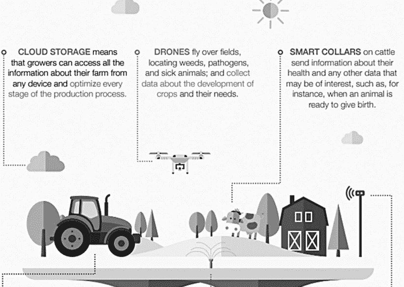

- **云存储**意味着种植者可以从任何设备访问其农场的所有信息，并优化生产过程的每一个阶段。
- **无人机**在田间飞翔，定位杂草、病原体和患病动物；并收集有关作物生长及其需求的数据。
- 牛牛身上的**智能项圈**会发送有关其健康状况及其他可能感兴趣的数据，例如动物准备分产的时间等。
- **自动驾驶车辆**根据作物类型以正确的深度和间距播种精准种子，最大限度地提高土地产量。
- **自动系统**根据每块土地的确切需求，在正确的时间使用精确的剂量进行施肥和熏蒸。
- **智能作物传感器**收集有关水分、营养分缺乏或害虫出没的数据，以确定是否需要灌溉、施肥或喷洒农药。

图 4.1 智能农业的组件 [16]。

作物产量优化、劳动力成本降低和农业效率提高都是 AI 技术在农业领域的益处。为了预测最佳播种和收获日期，以及理想的肥水水量，AI 驱动的分析可以检查土壤样本、天气模式和其他来源的数据。农民可以使用 AI 驱动技术检测害虫和疾病，从而预防性地保护他们的作物。AI 可用于定位农田。

## 农业信息与通信技术 (ICTs)

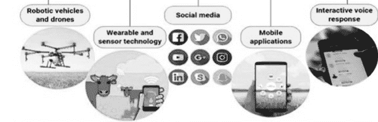

| ICT 用途 | 机器人、可穿戴设备和传感器技术 | 社交媒体、移动应用程序 |
| :--- | :--- | :--- |
| 农场管理：在保持社交距离的同时提高业务表现 | 推广服务：获取生产投入品 | 产品营销 |

4.2 ICT 平台 [18]，该平台最有可能产生更高的产出，并对如何最有效地使用肥料和其他投入品提供建议 [21]。

## 4.3 农业中的 AI

AI 在农业中的应用非常多且多样，如图 4.3所示，涵盖了从作物监测和管理到机器人、预测分析、水资源管理和害虫控制各个方面。在 AI 的帮助下，农民可以增加可持续性、提高农业产量并减少资源浪费，最终确保人口的粮食安全。随着该行业日益采用 AI 技术 [22]，农业的未来似乎比以往任何时候都充满希望。

大多数国家的经济依赖农业；因此，AI 技术为农民提供了一种工具，能够以更少的投入产生更多的产。它能有效处理数据，支持农民做出更快、更好的决策。促进农业 AI 增长的关键要素是信息管理系统、AI 提高作物生产力的有效性以及现代农业实践的兴起 [23]。为了推荐最佳的种植和收获实践，包括土壤质量、天气模式和植物生理学 [24]。为了准确的整合、施肥和农药施用，AI 系统利用数据分析使精准农业成为可能。结果是浪费减少了，环境破坏减轻了，资源利用率提高了 [21]。

## AI时代的未来科技创业公司与创新

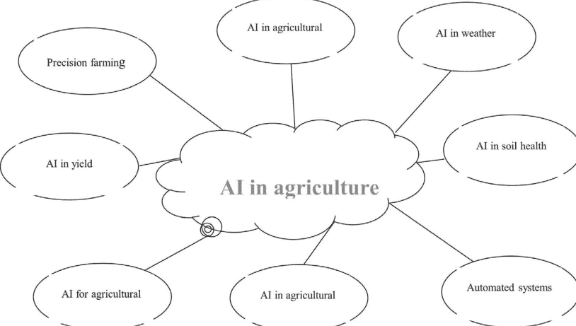

图 4.3 农业中的 AI 应用。

### 4.3.2 农业机器人中的 AI

农民面临许多植物品种除草剂抗性的风险；然而，杂草控制正成为一个优先事项。AI 使用计算机视觉和机器学习 (ML) 安装摄像头。它通过识别杂草并根据历史数据对每种植物采取适当处理来做出快速决策 [23]。AI 生产了更高效、移动更快的机器人，它们承担农田中的大部分任务，如控制杂草和收获植物。使用计算机视觉可以对杂草进行监测和喷洒。通过计算机视觉，可以克服困难条件来保护作物 [24]。AI 与机器人技术密切相关。许多应用程序正在进入农业领域，例如比人类更快地监测并喷洒。摄像头使 AI 能够发现杂草并为它们施药或提供肥料。由于其视觉能力，自动驾驶拖机将能够避开障碍并自主定位耕作 [25]。

### 4.3.3 气象预测中的 AI

AI 用于减少天气影响。降雨、温度、风力、气压和湿度显然是最重要的天气因素，应该被收集并整合到单一平台上，以制定预测性的农业策略 [23]。对于天气预测，AI 正在帮助农民保持领先。他们可以通过实施这些程序提高产量和收益 [24]。

## AI 在农业行业的作用 ■ 67

### 4.3.4 土壤健康监测中的 AI

由于健康的土壤对作物生长至关重要，AI 迅速成为识别和监测土壤问题及营养缺乏的关键工具。AI 驱动的图像分析摄像头收集的照片以识别潜在缺陷，提醒农民并提供各种修复技术的建议。深度学习 (DL) 用于创建帮助理解土壤缺陷、植物害虫和疾病的应用程序。农民可以更好地了解土壤属性、养性和潜在问题。通过使用目标土壤管理策略，他们可以最大限度地提高土壤健康 [23–25]。

先进 AI 技术可以使用传感器和计算机视觉监测牲畜的行为、习惯和健康状况，向农民汇报异常 [20,25]。

### 4.3.5 农业自动化系统

被称为杂草的野生植物在没有人类干预的情况下生长并损害主要作物，使其更容易受到侵害。农民必须手动除杂草，但 AI 技术的发展为他们提供了一个新选择。为了从农田中除杂草，机器人和机器可以使用摄像头扫描整个农田。为了个人和专业收益收集作物的关键部分是传统收获中。手工采摘和人工工作是收获的行为。随着 AI 的出现，使用了摄像头的软件和硬件来评估和识别要收获和收集的产品。通过对植物照片进行图像识别，AI 还可以帮助识别植物和农业疾病。AI 算法通过检查历史数据、天气趋势和其他相关因素，可以预测暴发和害虫侵害 [26]。早期诊断和行动有助于农民预防问题、减少作物损失并减少对化学干预的需求 [25]。


# AI 时代的未来科技创业公司与创新

### 4.3.7 用于农业害虫的 AI

利用 AI 驱动的预测分析可以预测作物健康状况和潜在的害虫问题。机器学习算法通过分析来自传感器、卫星和无人机的数据可以生成及时警报，使农民能够采取预防措施 [20]。通过利用计算机视觉、机器人技术和机器学习，农民可以收集数据来管理杂草。AI 让农民只在有杂草的地方喷洒化学药。这显著减少了在整个田喷洒化学药的需求。AI 在田间使用的除草剂比通常喷洒的除草剂和农药要少 [24]。AI 有助于评估特定农田健康问题的需求，并使用 AI 软件识别害虫侵害。根据特定农田的状况，它还能改善肥力管理并降低过量农药和除草剂的使用。

农民面临的最可怕敌人之一是害虫。它们有完全摧毁一片农作能力。然而，AI 有助于评估特定农田对除草剂和农药的需求。AI 软件可以识别植物健康问题和害虫侵害。它还能根据特定农田的状况改善肥力管理并降低过量农药和除草剂。农民正在使用 AI 驱动的无人机与害虫作斗。机器人由计算机视觉驱动，这种技术广泛应用于此类监控摄像头。AI 引擎能够识别每个可能的危险并对其进行适当标记 [23, 25, 26]。

### 4.3.8 AI 在产量预测中的应用

认知解决方案根据多种因素（如土壤状况、天气预测、种子和特定区域的侵害）为农民提供最佳混合作物和种子建议。建议可以根据业务需求进一步调整。为了让农民做出判断，您还可以考虑市场发展、价格或消费者需求等外部因素。在种植阶段，通过使用航空系统（无人机或直升机）提供的高分辨率图像创建区域地图并识别植物需要水、肥或农药的区域，可以创建实时估值 [4]。为了预测作物产量，AI 模型可以检查过去的数据、天气趋势和其他相关变量。得益于这些信息，农民可以更好地规划种植、收获和市场需求，从而提高了生产力和盈利 [25]。

## 4.4 结论

在这个数字时代，所有行业都实现了自动化，许多领域正在利用最新的先进技术，即物联网（IoT）和人工智能（AI）。因此，为了获得智能环境，是时候采用新一代机器人来协助农民完成日常的繁重任务，以确保良好的产量。

现代农业对作物、动物和动物产品的工业化生产被称为工业农业。它包括所有从事食品类和非食品类作物生产的小规模农民。

## AI 在农业行业中的作用

为了增加产量，农民越来越关注杂草控制，因为他们持续应对多种杂草种类产生抗药性影响作物生长的风险。得益于基于计算机视觉和机器学习的摄像头系统，AI 驱动的设备可以度地减少除草剂的使用、预测天气并监控牲畜。通过这种方法，农民可以自主工作，并实时快速控制农田。AI 分析所有传入的数据，将其与数据库历史进行比较，并选择最佳行动方案。

## 4.5 致谢

这项工作得到了高等教育、科学研究与创新部、数字局 (DDA) 以及国家科学技术委员会 (CNST) 的支持，实现了第一台摩洛哥农业机器人的制造。

## 参考文献

- [1] A. Kamilaris, G. Gao, X. Prenafeta-Boldu, and M. I. Ali, “Agri-IoT: A semantic framework for internet of things-enabled smart farming applications,” in 2016 IEEE 3rd World Forum on Internet of Things (WF-IoT), p. 442–447, 2016. doi: 10.1109/WF-IoT.2016.7854567
- [2] N. Saxena, “A review on designing Europe wide scale plot for IoT in the agricultural,” Samakati Research in Business Management, vol. 2, p. 24, 2021, doi:10.46402/2021.02
- [3] T. Utsumo et al., “Robotic in row control in vegetables,” Computers and Electronics in Agriculture, vol. 154, p. 36–45, 2019, doi:10.1016/j.compag.2018.043
- [4] S. Das, L. Ghosh, and U. Sarkar, “Artificial intelligence in Agriculture: A literature survey,” International Journal of Research in Computer Science and Management, vol. 7, p. 1–6.
- [5] Y. Li, Z. Guo, F. Shuang, and X. Li, “Key technologies of machine vision for weeding: A review,” Computers and Electronics in Agriculture, vol. 196, p. 10680, 2022, doi: 10.1016/j.compag.2022.10680
- [6] Kerling, “Smart agriculture and environment,” Consult le: 13 octobre 2023. [En ligne]. Disponible: https://www.compag.environment/
- [7] “Artificial intelligence (AI): What is AI and how does work?” Built In, Consult le: 22 juillet 2023. [En ligne]. Disponible: https://builtin.com/artificial-intelligence
- [8] “What is artificial intelligence (AI) and how does work?” TI-CA, Consult le: 22 juillet 2023. [En ligne]. Disponible: https://www.ti-global.com/technical-knowledge/faqs/what-is-intelligence
- [9] “Artificial intelligence (AI) vs. machine learning,” CU-CA, Consult le: 22 juillet 2023. [En ligne]. Disponible: https://ai.columbia.edu/ai-vs-learning/
- [10] S. Das, A. Dey, and N. Roy, “Applications of artificial intelligence in machine learning: A review,” IJCA n. 9, p. 31–41, 2015, doi:10.5120/2183242
- [11] H. Haji and A. Sallow, “IoT for smart environment: A review,” Asian Journal of Research in Computer Science, p. 57–70, 2021, doi: 10.9734/ajrcs/2021/9i533015
- [12] “What is IoT (internet of things) and how does it work? Definition from TechTarget,” Consult le: 7 juillet 2023. [En ligne]. Disponible: https://www.techtarget.com/iotagenda/definition/Internet-of-Things
- [13] “What is the internet of things (IoT)?” Consult le: 22 mars 2023. [En ligne]. Disponible: https://www.oracle.com/internet-of-things/what-is-iot/
- [14] “What is advanced technology and manufacturing?” ITexco, Consult le: 20 septembre 2023. [En ligne]. Disponible: https://www.itexco.com/blog/what-is-technology
- [15] “Advanced technologies,” Consult le: 20 septembre 2023. [En ligne]. Disponible: https://singlemarket-economy.ec.europa.eu/industry/strategy/advanced-technologies/
- [16] I. CORPORATIVA, “The role of smart farming, precision agriculture to achieve a more sustainable world”, Iberdrola. Consult le: 19 septembre 2023. [En ligne]. Disponible: https://www.iberdrola.com/innovation/smart-farming-precision-agriculture
- [17] “Precision Agriculture: How is it different from smart farming?” Consult le: 22 septembre 2023. [En ligne]. Disponible: https://azure.microsoft.com/en-us/resources/cloud-computing/dictionary/what-is-iot/
- [18] N. Hashem et al., “Agro-livestock farming system during the COVID-19 era: a cross-sectional study on the role of information and communication technologies,” Sustainability, vol. 13, June 2021, doi:10.3390/su1313521
- [19] “AI in agriculture – use cases, benefits, and future,” Consult le: 20 septembre 2022. [En ligne]. Disponible: https://systems.microsoft.com/en-us/agriculture-applications-of-ai-tools/
- [20] cube LABS, “The role of AI and machine learning in smart farming”, cube LABS. Consult le: 13 octobre 2023. [En ligne]. Disponible: https://www.xcubelab.com/blog/revolutionizing-agriculture-the-role-of-ai-and-machine-learning-in-farming/
- [21] M. Frąkiewicz, “The role of artificial intelligence in smart agriculture precision fertilization”, TS2 Space. Consult le: 26 septembre 2023. [En ligne]. Disponible: https://ts2.space/en/the-role-of-artificial-intelligence-in-smart-agriculture-precision-fertilization/
- [22] “The increasing role of AI in agriculture · The Live Nagpur,” Consult le: 26 septembre 2023. [En ligne]. Disponible: https://thelivenagpur.com/2023/08/23/the-increasing-role-of-ai-agriculture/
- [23] “Leveraging AI in the agriculture industry”, Simplilearn. Consult le: 26 September 2023. [En ligne]. Disponible: https://www.simplilearn.com/leveraging-ai-in-agriculture-industry
- [24] cube LABS, “The role of artificial intelligence in the agriculture sector”, cube LABS. Consult le: 26 septembre 2023. [En ligne]. Disponible: https://www.xcubelab.com/blog/revolutionizing-agriculture-the-role-of-ai-and-machine-learning-in-farming/
- [25] S. Mahendra, “Role of artificial intelligence in agriculture”, Artificial Intelligence + Role-of-artificial-intelligence-in-agriculture/https://www.aiplusinfo.com/blog/
- [26] P. Toni, “7 Advantages of AI in Agriculture | Analytics Steps”, Consult le: 13 octobre 2023. [En ligne]. Disponible: https://www.analyticssteps.com/blog/7-advantages-of-ai-agriculture


# 人工智能在农业中的作用

## 类型、挑战与PEestal分析

Namreen Asif, D. Bindhu

## 5.1 引言

人工智能（AI）是一项影响多个业务领域的日益增长的技术。农业部门面临着若干挑战，而这些新型先进技术可以提供支持。如今，作为计算机科学的核心领域之一，人工智能已经渗透到教育、医疗、金融和制造业等各个领域，因为它具有处理人类无法解决问题的本质（Mark, 2019）。“人工智能”的概念由约翰·麦卡锡在1955年的达特茅斯会议上提出，他基于这样假设了一项研究：“原则上，学习的每一个方面或任何其他类型的智能都可以被描述得如此精确，以至于机器可以对其模拟”（Wakchaure, 2023）。人工智能在农业中的应用导致了一场革命，保护作物免受气候变化、人口增长、就业问题和粮食安全等各种因素的影响。农业利用人工智能进行灌溉、除草以及通过嵌入机器人和无人机的传感器进行喷洒。现场传感器、无人机农场管理工具、自动化机械以及水肥管理解决方案都是农业中人工智能的示例。人工智能帮助农民提高效率、减少环境影响并控制不良状况。大多数农业初创公司正在采用赋能人工智能的方法增加农业生产。人工智能方法可以更智能地检测疾病或气候变化。人工智能的应用帮助农民理解温度、降水和太阳辐射等数据洞察。分析历史值提供了对预期结果更准确的比较。在农业中实施人工智能最好的部分是，它将改进农民的工作（Sood et al., 2022）。人工智能技术已帮助农业企业运行得更有效率。除了疾病或害虫识别外，自动调整等应用也被用于改进作物管理，并有潜力解决农民面临的挑战，例如气候变化和害虫侵害（Subeesh & Mehta, 2021）。

## 未来科技初创公司与人工智能时代的创新## 5.2 文献综述

人工智能用于从制造到汽车的各种业务；人工智能进入农业业务的迷人领域之一；农业是一项重大产业和经济的基石；随着气候变化和人口增长，人工智能正在演变为一种改进并确保作物产量的技术创新。作物管理、杂草检测和土壤管理是人工智能在农业中为人知的应用（Ryan, 2022）。机器学习（ML）模型被用于跟踪和预测对作物产量的影响，如气候变化（Mohr & Kühl, 2021）。位于旧金山的初创公司 Drone Deploy 开发了一种软件，允许任何人使用计算机或智能手机操作小型无人机并分析采集的图像。农业、建筑和保险是该公司关注的一些行业。用户只需点击一下即可启动商用无人机以获取当日地图和3D田间模型。该技术可能帮助他们查看何时需要作物、估计产量并存储用于比较的准确数据。无人旨在消除人类在巡田中的错误。固定翼飞行器（UAV）允许农民在更短的时间检查更多区域，同时收集用于植物评估的近红外波数据。此外，它几乎是全自动。它可以飞行、收集图像并自主着陆。飞行后，它可以快速生成作物地图、识别问题区域、定制农业应用地图并创建当天作物处理的工作流（Pathan et al., 2020）。

- **灌溉和节水**：监测土壤湿度和可用性的实时技术对于管理成本至关重要。精准农业可以在生产价值作物、提高生产率和竞争优势的同时减少浪费（Cavazza et al., 2023）。

- **畜养记录**：得益于放置在牧畜身上的项圈和地里的摄像头，农民可以使用手机或家用电脑追踪他们的畜群。附在牲畜上的标签可以传输从动物健康到交配模式的信息（Paymode & Malode, 2022）。

- **作物传感器和农机**：传感器可以连接到收割机、拖拉机和其他农业机械，允许农民收集有关作物和土壤的新信息。传感技术使精准农业更具创意（Sishodia et al., 2020）。这是增加农业产量和质量的方法之一。传感器数据不仅直接造福农民，也有整个整个行业（Garske et al., 2021）。

- **环境安全的农药**：食品和农业行业正努力寻找更高效、更具效益的农药替代品。天然信息素（动物产生的会影响同种另一种动物自然行为的化学物质）现在被用于破坏果实害虫的交配模式（Rejeh et al., 2022）。

- **农业机器人和连接拖拉机的未来**：车载遥测软件监测农机的使用情况和维护需求也有助于提高生产力。农民可以收集数据，软件将分析这些数据并就应该在什么地方种什么、添加多少肥料以及何时开始收割提供反馈（Kakani et al., 2020）。

### 5.2.1 农业中人工智能技术的实际应用挑战

根据2011年至2013年机器人转移的预测，预计美国每年平均增长9%，亚澳国家增长12%，欧洲增长8%。根据这一趋势，预计机器人的渗透率到2030年将达到15%，到2045年达到75%。然而，机械化的分布可能是不均匀的，某些地区缺乏资源，并面临着无法通过科学发现和技术发展改变的状况。例如，大多数人工智能系统是基于互联网的，由于缺乏网络服务和对处理人工智能操作不熟悉，它们在农村或偏远地区的使用可能会受到限制。因此，预计农业中人工智能的采用将是缓慢且分布不均的，且这种采用是否会增加粮食产量尚尚不清楚（Martos et al., 2021）。

### 5.2.2 对照实验与实际执行之间的差异

采集的图像由于光线变化、背景复杂性、拍摄角度等因素，与控制环境中采集的图像有所不同。此外，田间生长的颗粒即使在同一地点，由于土壤和其他惰性物质的影响，物理上也是不均匀的。在这种情况下，个体的生理特征使得处理图像时需要考虑的变量变得复杂，需要更多多样化的控制数据来提高分类准确率（Dhanya et al., 2022）。尽管案例研究较少，但深度信念网络（DBN）和卷积神经网络（CNN）等算法在未来处理大型数据集方面显示出广阔前景。此外，为了缩短系统响应时间，处理的数据应该是最相关的数据。系统在短期精确执行任务的能力是决定其商业价值的关键，极大影响了用户选择——客户最看重的是投入最小而获得精度最大（Ciruela-Lorenzo et al., 2020）。


# AI 时代的未来科技初创公司与创新

### 5.2.3 安全与隐私

许多物理设备（如物联网（IoT））最初容易受到硬件攻击，因为它们可能会长时间处于无人看管的状态。数据加密、标签频率修改、数据销毁策略、使用阻断标签（blocker tags）以及其他安全措施是常见的做法。基于位置的服务也容易受到设备攻击，这意味着一旦设备被捕获，攻击者就可以提取加密实现，从而对存储在设备上的数据进行无限制的访问（Dengel, 2013）。数据在从设备传输到网关的过程中也可能被泄露，在网关处会被上传到云等其他基础设施（Lee et al., 2020）。云服务器容易受到数据篡改的影响，这可能会干扰农场的自动化作业。会话劫持、登录滥用和拒绝服务（DoS）也会干扰云基础设施。加密算法、数据控制策略、身份认证机制等等都是相应的安全策略的示例。因此，安全问题正在引发严重的问题，并应该在各个层面进行解决（Javaid et al., 2022）。

## 5.3 农业领域中的应用

AI 正在日益整合到农业的不同领域，带来耕作实践的革命。AI 在农业中的应用有多种方式（见图 5.1）。

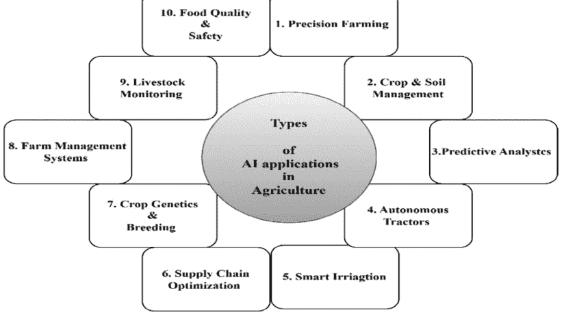

图 5.1 农业中 AI 应用的类型。

来源：作者编译。

### 5.3.1 农业 AI 应用的类型

本节描述了农业中的几种 AI 应用类型。

### 5.3.1.1 精准农业

精准农业（也称为精细农业）是一种利用技术、数据和不同的管理实践来提高农业过程效率、生产力和可持续性的耕作方法。精准农业旨在根据特定位置做出智能决策，以更好地管理资源、减少浪费并实现作物产量最大化（Budaev et al., 2018）。

精准农业的益处包括以下方面：

- **提高效率**：精准农业帮助农民优化资源利用，减少浪费并提高作物生产的整体效率。
- **节省成本**：农民可以在需要时精确施用投入品，从而降低化肥和农药等投入成本。
- **环境可持续性**：精准农业通过更有针对性地使用资源，减少了对环境的影响，为可持续农业做出贡献。
- **产量优化**：针对特定条件定制耕作实践可以提高作物产量和质量。
- **数据驱动决策**：精准农业使农民能够根据实时和历史数据做出明决策，增强整体农场管理。

### 5.3.1.2 作物与土壤监测

作物和土壤监测涉及使用不同的技术和工具收集作物和土壤状况的信息。这包括传感器、成像技术和数据分析，以评估作物健康、土壤水分和营养水平（Mohamed et al., 2021）。

作物和土壤监测的益处包括以下方面：

- **优化灌溉**：监测土壤水分帮助农民确定何时以及需要多少水，节省资源并降低成本。
- **改进养分管理**：监测土壤养分水平允许精确施肥，避免浪费和缺乏。
- **病虫害早期检测**：监测有助于及早发现迹象，防止扩散并减少农药使用。
- **优化作物健康**：来自卫星图像和无人机的实时数据有助于识别受压区域以进行针对性应对。
- **产量预测**：监测天气、土壤健康和作物发育能够实现更好的规划和资源分配。
- **资源效率**：基于实时数据的精确管理最大限度地减少了浪费和环境影响。

### 5.3.1.3 预测性分析

预测性分析是一种高级分析，利用历史数据和机器学习（ML）预测未来结果（Sabu & Kumar, 2020）。它帮助组织做出明智决策、管理风险、增强营销和销售、优化运营并高效规划资源（Beloev et al., 2020）。

预测性分析的益处包括：

- **改进决策**：预测性分析帮助组织做出明智决策。
- **风险管理**：预测性分析有助于管理风险。
- **增强营销和销售**：提升营销和销售水平。
- **优化运营**：优化运营流程。
- **资源规划**：高效规划资源。

### 5.3.1.4 自动机械

自动机械是指在没有人类直接参与的情况下执行任务的设备和车辆。这些机器使用传感器、摄像头、GPS、AI 和机器人技术来导航并执行功能。在农业中，自动机械常用于种植、收割、除草（Rose et al., 2021）。

农业自动机械的益处包括：

- **提高效率**：农业自动机械通过持续运行显著提高效率。这些机器可以昼夜工作，特别是在种植和收割期间。
- **节省人工**：自动化重复性和劳动密集型任务减少了对人工劳动的依赖。这在难以寻找熟练农业工人的情况下特别有利。
- **精准农业**：自动机械可以配备先进传感器和 GPS 以卓越精度执行任务。这包括种植作物或精确施肥。
- **24/7 运行**：与需要休息的人类操作员不同，自动机械可以不停工作，实现必要的农场作业。这在种植或收割等关键时期特别有利。
- **性能一致**：自动机器以极高的一致性和精确性工作。它们遵循预设路线执行任务，从而产生一致的结果并减少农场作业的波动性。

### 5.3.1.5 智能灌溉

智能灌溉涉及使用先进技术和数据驱动的方法来优化作物浇水（Mohamed et al., 2021）。它结合传感器、水和数据，提供所需的精确水量（Tace et al., 2022）。目标是提高水效率、保护资源并增强整体作物健康和产量。

智能灌溉的益处包括：

- **水效率**：智能灌溉系统利用来自土壤水分、天气预测和其他的实时信息来确定所需的最佳时间和水量。这种准确性有助于防止过度浇水，节约这一资源。
- **节省成本**：智能灌溉系统通过优化水资源利用，为农场节省大量成本。用水量的减少会导致水费和泵水配水成本的降低。
- **提高作物健康和产量**：在正确的时间给予作物正确的水对于它们的健康和生产力至关重要。智能灌溉系统有助于维持最佳土壤水分，减少水分胁迫和渍水的风险（后者会损害生长）。
- **自动化控制**：智能灌溉系统通常具有自动化功能，允许农民远程调度和控制灌溉。这种自动化消除了对人工干预的需求，使灌溉更加高效方便。
- **与传感器技术集成**：通过与土壤水分传感器和其他环境传感器连接，智能灌溉系统可以适应不断变化


# AI 时代的未来科技初创公司与创新

实时状况。这确保了灌溉根据最新数据进行调整，从而优化了水分输送。

- 基于天气的调整：智能灌溉系统在确定浇水计划时会考虑预测和当前的天气状况。当预计降雨时，系统可能会推迟或跳过浇水，避免在自然降雨期间进行不必要的灌溉。

## 5.3.16 供应链优化

供应链优化旨在让整个产品或服务的交付过程更加高效有效（Monteiro & Barata, 2021）。从原材料采购到将最终产品交付给客户，它简化了流程、降低了成本并实现了性能化。目标是创建一个敏捷、响应迅速且可持续的供应链（Lezoche et al., 2020）。

供应链优化的益处包括：

- 降低成本：通过提高运营效率、减少过剩库存和优化运输，企业可以实现整个供应链的大幅成本节约。
- 提高效率：当我们进行优化时，我们确保高效地利用资源、消除障碍、减少浪费并提高整体运营效率。
- 增强客户服务：当供应链经过良好优化后，将带来更快的订单交付、更短的交期和更满意的客户。
- 增加灵活性和响应能力：当供应链经过优化后，它会变得更加灵活，能够轻松适应需求、供应或市场状况的变化。
- 提高库存周转：当需求预测和库存管理得到加强时，会产生更好的库存周转率。这减少了持有成本和产品过期的机会。
- 建立更好的供应商关系：当企业与供应商进行紧密且有效的沟通时，会加强双方关系，并使供应链更加可靠高效。

## 5.3.1.7 作物遗传与育种

在遗传和育种领域，科学家利用遗传技术来操控和增强植物特征，创建具有理想性状作物（Jung et al., 2021）。传统的育种方法与遗传技术相结合，以提高产量和对环境的适应性（Harf et al., 2019）。

作物遗传与育种的益处包括：

- 提高产量：作物育种旨在创建能够生产更多食物的新品种，并确保供应充足。
- 抗病性：当我们专注于育种具有抗病能力的作物时，是为了抵抗病原体的侵害，这有助于减少对杀虫剂的需求并使农业更可持续。
- 抗虫性：通过使用遗传育种技术，我们可以减少由昆虫造成的损害，使农业更具可持续。
- 干旱耐受性：当我们致力于开发具有抗旱和其他环境压力耐受能力的作物时，可以确保这些植物在严苛条件下表现更好。
- 增强营养含量：当我们专注于育种时，可以提高作物的营养价值，使其食用时更健康。
- 气候适应：当我们致力于开发能够适应气候变化的性状作物时，可以应对温度升高或降水变化。

## 5.3.1.8 农场管理

农场管理系统（FMS）是帮助农民规划、监控和优化其运营各个方面的软件和技术解决方案（Al，2023）。这些系统为管理数据、做出决策和运行农场提供了一个集中平台（Jha et al., 2019）。

农场管理的益处包括：

- 数据驱动决策：FMS 为农民提供了数据支持，允许他们利用信息和模式做出明智决策。
- 运营效率：通过自动化和优化农场运营，我们可以使运行顺畅高效，减少对人工操作的需求。
- 成本节约：FMS 协助识别具有成本效益的实践，减少浪费最终为农民节省成本。
- 风险管理：通过监控因素并对潜在问题发出早期警报，FMS 可以降低与天气虫虫相关的风险。
- 资源优化：有效管理水和杀虫剂等资源可以减少对环境的影响并鼓励可持续农业。
- 作物与牲畜健康：通过密切关注牲畜健康，我们可以快速识别并治疗疾病。

## 5.3.1.9 牲畜监控

牲畜监控利用技术和数据驱动解决方案来跟踪、管理和分析农场动物的健康状况。这可能涉及提供有关其健康、行为和环境实时信息的各种系统和设备（Java et al., 2023）。

- 早期检测：通过监控健康状况，及早发现疾病获得医疗帮助并防止疾病在群体中传播。
- 提高繁殖效率：通过观察动物在生产期间的行为并追踪繁殖周期，我们可以改进育种计划、增加怀孕率并有效管理繁殖健康。
- 增强动物福利：牲畜监控系统通过提供有关生活条件的宝贵信息来改善动物福利。
- 资源效率：跟踪动物的进食量帮助农民充分利用资源、减少浪费并确保每只动物都获得正确的营养。
- 增加生产力：通过密切监控动物的健康和繁殖状态，农民可以采取特定行动提高整体生产力，包括肉和奶产量。

## 5.3.1.10 食品质量与安全

食品质量与安全旨在确保我们吃的食物是安全的且符合标准的。它涉及防止食品污染或变质的过程和系统，使其不会产生健康风险（Smith，2018）。

食品质量与安全的益处包括：

- 公共健康保护：确保食品安全可以防止人们因污染或不安全的食品导致疾病或健康问题。
- 消费者信心：当食品产品符合高质量和安全标准时，有助于建立消费者信任。当人们对所食物的安全充满信心时，他们可能继续购买同一品牌并成为忠实客户。
- 市场准入：遵守国际食品安全标准更容易进入全球市场，因为许多国家对食品进出口有严格规定。
- 减少浪费：通过建立质量控制，我们可以及早发现并解决问题，减少供应链中的食品变质和浪费。
- 法律合规：当我们遵循食品安全法规和标准时，确保我们符合法律。这有助于我们避免因不遵守规定而可能被处罚或制裁。
- 品牌声誉：当食品生产者和品牌优先考虑质量和安全时，会提升它们的声誉。当消费者对品牌有良好的感知时，有助于建立强大且良好的形象（Tzachor et al., 2022）。

## 5.4 PESTAL 分析

将 AI 引入农业能够增强效率、减少资源浪费并促进可持续高效的耕作方法。本节分析了影响农业 AI 采用和实施的政治、经济、社会和技术（PESTAL）因素（Mustafa et al., 2023）。我们考虑了图 5.2 中可能影响农业领域接受 AI 技术的外部因素。

以下章节详细说明了影响 PESTAL 分析的因素。

### 5.4.1 政治因素

当我们谈论 AI 中的政治因素时，是指政府政策、法规和决策如何影响 AI 技术的发展、采用和使用。这些因素塑造了 AI 实现的环境，并决定了该技术可能面临的支持水平或障碍。影响政治因素的因素包括：

- 政府政策：政治选择和政策有可能极大影响农业 AI 的实施路径。
- 监管框架：涉及数据隐私、知识产权和 AI 伦理使用时，法规的制定和实施是关键的政治因素。政府可能会制定收集、共享和保护农业数据的法律，从而影响 AI 应用如何处理敏感信息。


## AI 时代的82 家未来初创企业与创新

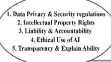


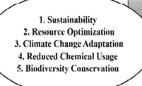
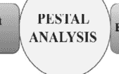
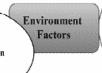
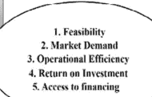
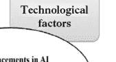

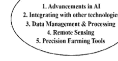
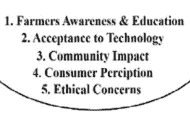

图 5.2 农业中 AI 的 PESTAL 分析。

来源：作者编译。

- 资金与补贴：政府有能力提供资金支持和补贴，以促进 AI 在农业中的应用。这些货币激励对于激励农民（特别是那些资源有限或规模较小的农民）投资先进的 AI 解决方案具有重要作用。
- 国际关系：全球政治格局、贸易协定和国际合作会影响农业 AI 技术的可用及获取的便利性。跨国合作可以促进知识、资源和技术进步的交流。
- 利益相关参与：政治因素还涉及不同群体的参与，例如政策制定者、行业代表和技术开发人员。这些利益相关者之间的合作和讨论可以影响农业 AI 政策的发展。

### 5.4.2 经济因素

谈到农业 AI 时，经济因素是指影响农场 AI 技术开发、实施和长期可行性的财务方面。这些因素对于决定 AI 应用是否能够广泛采用并成功整合到农业实践中至关重要。

经济因素会影响以下方面：

- 经济可行性：AI 在农业中的整合是一个关键方面。获取 AI 技术（如传感器、无人机和 ML 系统）的初始费用可能是一项挑战，特别是对于规模较小的农民而言。这些技术的负担能力和潜在投资回报会显著影响它们的采用率。
- 市场需求：如果由于经济条件和市场需求，农业对提高生产力、效率和可持续性有高需求，农民可能会更有动力投资提供这些优势的 AI 解决方案。
- 运营效率：农业中的 AI 能够提高运营效率，从而节省成本。精准农业和自主机械是优化资源利用、减少浪费和提高整体效率的技术示例，这些都能带来经济效益。
- 投资回报率 (ROI)：当农民和农业企业考虑采用 AI 时，他们会评估潜在的投资回报。AI 技术的经济可行性取决于它们提供具体优势的能力，例如更高的作物产量、更少的资源消耗和提高效率。
- 融资渠道：经济因素还涉及资本和贷款的可用性，以帮助农民实施新的 AI 技术。

### 5.4.3 社会因素

当我们谈论农业的社会因素时，指的是影响 AI 采纳的人类和社会层面。这些因素包括人们如何感知、互动和评价新技术。

影响社会因素的方面包括：

- 教育与意识：农民对 AI 益处的意识水平至关重要。培训计划和教育倡议有助于农民理解并采用新技术。
- 消费者认知：公众对 AI 生成食品的观点会影响市场需求。关于 AI 驱动农业的安全性和可持续性的透明度非常重要。
- 社区参与：当地社区和社会团体的参与会影响技术的传播。合作努力有助于确保 AI 解决方案符合当地需求。

### 5.4.4 技术因素

当我们谈论农业的技术因素时，指的是让 AI 成为可能的技术工具和基础设施。这些因素包括可用硬件和软件的水平。

影响技术因素的方面包括：

- AI 的进步：传感器、无人机和 ML 系统的快速发展为更好的作物监测和管理提供了必要的工具。
- 与现有系统的集成：新技术能多容易地与传统农业设备集成，是采纳的关键因素。
- 数据管理与处理：从田间收集、存储和分析大量数据的能力对于提供可操作的见解至关重要。
- 遥感：卫星和遥感传感器器允许农民实时监测作物健康和土壤状况。

### 5.4.5 环境因素

当我们谈论农业的环境因素时，指的是 AI 对自然界的影响。这些因素包括技术如何影响可持续性和资源管理。

影响环境因素的方面包括：

- 可持续性：AI 有潜力通过优化资源利用和减少浪费来支持可持续农业实践。
- 资源优化：精准农业允许农民更高效地使用水和肥料，减少其环境足迹。
- 气候变化适应：AI 可以通过数据驱动的见帮助帮助农民适应天气模式和条件。
- 减少化学品使用：AI 驱动的工具通过提供特定的干预措施帮助减少农药和肥料的使用。
- 生物多样性保护：可以开发 AI 应用以减少其对生态系统的影响，确保农业实践保护生物多样性。

### 5.4.6 法律因素

当我们谈论农业 AI 的法律因素时，指的是影响农场 AI 技术开发、实施和使用的规则法规。这些因素对于确保负责任和符合道德的做法以及保护利益相关者至关重要。

影响法律因素的问题包括：

- 数据隐私与安全法规：涉及 AI 时，数据隐私和安全法规至关重要。使用 AI 涉及收集和分析大量数据，包括关于作物、土壤和农场运营的敏感信息。遵守数据保护法对于确保农民和利益相关者的隐私和安全至关重要。


## AI 时代的 86 家未来科技初创公司与创新

- 知识产权：在涉及法律问题，如知识产权、专利以及 AI 生成创新的所有权时，制定明确的法规来解决所有权问题并保护那些为农业开发 AI 技术的人的知识产权至关重要。

- 责任与问责：在涉及法律框架时，建立准则来确定与 AI 相关的事故或错误的责任和问责制至关重要。随着 AI 系统变得越来越自主，定义责任以应对 AI 驱动决策可能产生的任何潜在风险、损害或非预期序列变得至关重要。明确的准则有助于确保问责制，并促进 AI 技术的安全和负责任地使用。

- AI 的伦理使用：当我们讨论农业中 AI 的伦理使用时，法律考虑也开始介入。可能需要制定法规以确保 AI 应用遵循伦理原则、维护人权并避免任何歧视性做法，特别是在农业决策方面。确保 AI 以负责任且公平的方式使用，让农业领域的所有人员都能受益是非常重要的。

- 透明度与可解释性：法律因素可能集中在保证 AI 系统的透明度和可理解性上。对于农民和利益相关者来说，获取有关 AI 算法如何决策的信息非常重要，特别是当这些决策对农业实践产生重大影响时。能够理解并信任 AI 技术有助于确保其有效使用，并使其符合农业社区的需求 (Esringü & Süleyman, 2021)。

## 5.5 发现结果

- 精准农业处于农业创新的前沿，它通过战略性地应用技术、数据和先进管理实践来优化资源利用。

- 农业中的自主机械带来了巨大的变化，提高了效率、节省了劳动力并增强了精准农业能力。

- 供应链优化在提高农业运营的效率、降低成本、增强客户服务和增加灵活性方面起着至关重要的作用。

- 牲畜监测技术有助于早期发现疾病、提高繁殖效率、增强动物福利并提高整体生产力，促进负责任且高效的牲畜管理。

- PESTAL 分析识别了影响 AI 在农业采用和实施的重要外部因素，包括政治、经济、社会、技术、环境和法律考量。

## 5.6 建议

关于精准农业和 AI 在农业中整合的研究显示了技术如何改变耕作格局。未来的工作必须优先考虑教育农民和参与社区，以确保技术的顺利采用。持续的研发对于保持 AI、数据管理和精准工具的与时性性至关重要。政府与利益相关者之间的合作倡议可以营造一个支持这些进步的环境。国际合作和知识交换也可以加速 AI 在全球农业中的整合。对于农民来说，经济可行性和融资渠道是重要的考虑因素，需要能够增强市场需求和运营效率的倡议。持续投资探索 AI 与新兴技术之间协同效应的研究是必不可少的。环境可持续性是一个关键焦点，我们需要能够优化资源利用、缓解气候变化和保护生物多样性的创新。用于数据隐私、安全和伦理 AI 的法律框架也随着技术进步而演进。

## 5.7 结论

总之，将 AI 整合到农业中通过为行业挑战提供创新解决方案正在开启一个变革时代。从精准农业到自主机械，AI 应用提供了更高的效率、成本效益和数据驱动的决策，同时促进了环境的可持续性。然而，我们必须解决机械化分布不均和安全等挑战，以确保 AI 的负责任实施。文献强调了 AI 在确保粮食安全、适应气候变化以及通过无人机和智能灌溉等技术优化资源利用方面的作用。经济可行性和社会接受是重要的考虑因素，强调了包容性利益的需求。PESTAL 分析揭示了影响 AI 采用的各种因素，包括政治支持和法律框架。政策制定者、农民和技术人员必须通力合作应对这些挑战，并确保公平获得 AI 收益，从而在不断变化的农业格局中培养韧性。

## 参考文献

- Al Jafa Hassan, V. L. (2023). Using Agile in integrating AI projects and farm management. Journal of Agricultural Informatics, 14(1), 1–12.
- Believ, I., Kinaveva, D., Georgiev, G., Hristov, G., & Zaharieva, P. (2021). Artificial intelligence-driven autonomous robot for precision agriculture. Technologica Agriculturae, 24(21), 48–54.
- Budaev, D., Dada, A., Simonova, E., Skoblev, P., Travin, V., & Yalenko, O. (2018). Conceptual design of smart farming solution for precision agriculture. International Journal of Design & Nature and Ecodynamics, 13(3), 307–314.
- Cavazza, A., Dal Mas, F., Paoloni, P., & Manzo, M. (2023). Artificial intelligence and new business models in agriculture: A structured literature review and future research agenda. British Food Journal, 125(13), 436–461.

## AI 时代的未来科技初创公司与创新

- Circuela, De-Lorenzo, A. M., Plaza-Angulo, J. (2020). Digitalization of Ag-cooperatives in the smart context. Sustainability, 12(4), 1325.
- Dengel, A. (2013). Special issue on artificial intelligence.
- Dhanya, V., Ahmed, A., Kushwaha, N., Kumar, D. (2022). Smart farming for improving agricultural.
- Esringü, A., & Süleyman, T. (2021). Understanding the potential of agriculture.
- Harouche, L., Jacobson, D., Romero, J. (2021). Smart farming for the.
- Javaid, M., Saleh, S., Khan, R. (2023). Enhancing agricultural management.
- Jha, D., Doshi, A., Patel, P., & Shah, M. (2019). A comprehensive review on agriculture.
- Lee, J., Nazki, H., Baek, J., Hong, Y. (2020). Artificial intelligence for tomato detection.
- Lezoche, M., Hernandez, E., Díaz, D. M. (2020). Agri-food 4.0: A survey of the.
- Mark, R. (2019). Ethics of using AI in.
- Martos, V., Ahmed, A., Cardoso, P., & Rojo, J. (2021). Enhancing sustainability.
- Mohamed, E. S., Belal, A. A., Abd-Elmab, S. K., El-Sherby, M. A., Gad, A., & Zahran, M. B. (2021). Smart farming for improving agricultural.
- Mohr, S. & Kühl, R. (2021). Acceptance of artificial intelligence in German agriculture.
- Monteiro, J. & Barata, J. (2021). Artificial intelligence in enhanced-agro food chain.
- Mustha, A. S., Subramani, N., Sindhuja, V., Selakumar, M., & Dhurgadevi, M. (2023). Enhancing food quality improvement.
- Pathan, M., Patel, N., Yagnik, H., & Shah, M. (2020). Artificial cognition for applications in smart agriculture.


Paymode, A. S., & Malode, V. B. (2022). 使用卷积神经网络 VGG 进行多作物叶病分类的迁移学习。Artificial Intelligence in Agriculture, 6(1), 23–33.

Rejek, A., Rejek, K., Zailani, S., Keogh, J. G., & Apolloni, A. (2022). 探讨人工智能与农食品行业之间的相互作用。Artificial Intelligence in Agriculture, 6, 111–128.

Rose, D. C., Lyon, J., de Boon, A., Hanhedeide, M., & Pearson, S. (2021). 农业自主机器的负责任开发。Nature Food, 2(5), 306–309.

Ryan, M. (2022). 人工智能在农业中的社会和伦理影响：农业人工智能版图。AI & Society, 9, 1–13.

Sabu, K. M., & Kumar, T. M. (2020). 农业预测性分析：喀拉拉邦槟果价格预测。Predictive Computer Science, 171(1), 699–708.

Sishodhia, R. P., Ray, R. L., & Singh, S. K. (2020). 遥感在精准农业中的应用：综述。Remote Sensing, 12(19), 3136.

Smith, M. J. (2018). 从农业人工智能中获取价值。Animal Production Science, 60(1), 46–54.

Sood, A., Sharma, R. K., & Bhattaraj, A. K. (2022). 农业人工智能研究：综述。Online Information Review, 46(6), 1054–1075.

Subeesh, A., & Mehta, C. R. (2021). 使用人工智能和物联网实现农业自动化与数字化。Artificial Intelligence in Agriculture, 5(1), 278–299.

Tace, Y., Tabaa, M., Elfilifi, S., Leghris, C., Bensag, H., & Renault, E. (2022). 基于物联网和机器学习的智能灌溉系统。Energy Reports, 8(1), 1025–1036.

Tzachor, A., Devare, M., King, B., Avin, S., & ÖHigeartaiga, S. (2022). 农业领域的负责任人工智能需要对风险和外部性的系统性理解。Nature Machine Intelligence, 4(2), 104–109.

Wakchaure, M., Patle, B. K., & Mahindrakar, A. K. (2023). AI 技术与机器人在农业中的应用：综述。Artificial Intelligence in the Life Sciences, 3, 100057

#人工智能在增强残障人士运动表现和健康结果中的作用

## 结构方程建模方法

Gioia Arnone, Gagandeep, Jyoti Verma

## 6.1 引言

人工智能（AI）已成为一种变革性技术，在体育和健康科学等多个领域具有潜在应用价值（Smith et al., 2021c）。近年来，研究人员开始探索人工智能在增强运动表现和改善健康结果方面的作用，特别是针对残障人士（Johnson et al., 2019b）。基于人工智能的技术（如动作追踪、数据分析和虚拟教练）对于优化这一人群的体育参与和促进整体福祉具有广阔前景（Jones & Johnson, 2019; Smith et al., 2020a）。残障人士在体力活动和运动中面临独特挑战，这会影响他们的身体健康、心理健康和整体生活质量。然而，人工智能的最新进展为解决这些挑战以及赋能残障人士获得更高水平的运动表现和健康结果提供了新可能（O’Brien et al., 2018; Williams & Patel, 2021）。通过利用人工智能技术，可以开发定制化的干预措施来提供个性化的支持和训练，最终提高残障人士的运动表现并增加体力水平（Brown et al., 2019a; Johnson & Smith, 2020）。人工智能在残障人士体育和健康科学中的潜力是一个日益增长和关注的研究领域。然而，需要对该人群中基于人工智能的技术、运动表现、身体健康、心理健康和生活质量之间的复杂关系进行全面调查。为了填补这一空白，本章采用结构方程建模（SEM）方法来检查这些变量之间的相互作用，并对人工智能在促进残障人士参与体育和改善整体健康结果方面的有效性提供整体理解。通过利用 SEM，本研究将定量评估基于人工智能的技术对残障人士运动表现、身体健康结果、心理健康和生活质量的直接和间接影响，扩展现有知识。此外，本章还将探索潜在的中介和调节因素（例如残障类型和程度以及技术素养），以洞察此背景下人工智能干预的细微动态。

## 6.2 残障人士体育行业概况

近年来，残障人士体育行业经历了显著的增长和认可。长期以来，体育被认为是促进健身、社会融合和整体福祉的手段（DePauw & Gavron, 2005）。

## 6.3 问题陈述

本章的问题陈述围绕调查人工智能在增强残障人士运动表现和健康结果方面的作用。通过探索基于人工智能的技术、运动表现、身体健康结果、心理健康和生活质量之间的复杂关系，本章旨在提供基于证据的见解，有助于人工智能驱动的干预措施和策略的发展，最终促进残障人士的体育参与并改善整体健康结果。

## 6.4 研究目标与问题

具体而言，本研究致力于：

- 检查基于人工智能的技术（包括动作追踪、数据分析和虚拟教练）对残障人士运动表现的影响。
- 评估基于人工智能的技术对身体健康结果（包括心血管健康、肌肉力量和耐力、运动技能发展和整体身体健康）的影响。
- 调查基于人工智能的技术对心理健康（涵盖自尊、自我效能、情绪和情绪状态）的影响。
- 探索残障人士运动表现、身体健康结果、心理健康和整体生活质量之间的关系。
- 识别潜在的调节因素（例如残障类型和程度以及技术素养），这些因素可能影响残障人士人工智能干预的有效性。

## 6.5 研究问题

- 1. 基于人工智能的技术如何影响残障人士的运动表现？


# AI 在增强运动表现和健康结果中的作用 ■ 93

2. 基于AI的技术对残障人士的身体健康结果（包括心血管健康水平、肌肉力量和耐力、运动技能发展以及整体身体健康）的影响何如何？

3. 基于AI的技术如何影响残障人士的心理健康（包括自尊、自我效能、情绪和情感状态等因素）？

4. 残障人士的运动表现、身体健康结果、心理健康与整体生活质量之间存在什么关系？

5. 潜在的调节因素（如残障的类型和严重程度以及技术素养）是否会影响AI干预措施在提高残障人士运动表现和健康结果方面的有效性？

## 6.6 意义与贡献

本研究对于残障人士的运动健康科学领域具有重要意义，并做出了宝贵的贡献。通过研究AI技术在优化运动表现和促进更大包容性方面的作用，旨在增强运动参与。通过理解 AI 干预的有效性，这项研究可以为开发定制干预措施、计划和教练方法提供参考，使残障人士能够发挥其运动潜力。此外，研究还探索了 AI 对身体健康结果（如心血管健康水平和肌肉力量）的影响，并确定了促进残障人士最佳身体健康的有效策略和技术。此外，通过研究 AI 对心理健康（包括自尊和情绪）的影响，该研究有助于解决情感健康并培养积极心态的干预措施。本研究对运动表现、身体健康结果、心理健康与整体生活质量之间关系的全面理解，提供了一个整体模型，为该领域的未来研究和实践提供了支持。最后，本研究推动了 AI 在残障人士运动和健康科学中的应用，为基于证据的实践、干预和政策铺平了道路，通过优化 AI 技术增强运动参与、改善健康结果并促进该人群的整体健康。

## 6.7 文献综述

### 6.7.1 AI 在运动健康科学中的概述

AI 已成为一种变革性技术，在运动和健康科学领域具有广泛的应用。AI 涵盖了多种先进技术，包括机器学习 (ML)、计算机视觉和数据分析，这些技术能够对复杂数据集进行分析和解释。在运动领域，AI 用于通过优化表现、增强训练和提供个性化干预的宝贵见解来改善结果（Smith 等人，2021a）。在自适应运动中，基于 AI 的在促进包容性和赋能残障人士方面发挥着至关作用。这些技术利用 ML 算法、计算机视觉和动作追踪分析运动模式、提供实时反馈并促进技能发展。通过捕捉和解释性能数据，AI 能够实现针对残障运动员特定需求和能力的定制化干预（Wadding 等人，2020）。AI 在自适应运动中的整合具有了多项潜在益处。首先，对于针对残障人士独特需求的个性化训练计划，有助于技能的获取和表现的优化。其次，基于 AI 的提供了实时性能分析，能够实现即时反馈和改进机会（Jiang 等人，2019）。此外，AI 驱动的虚拟现实系统在促进运动障碍人士的身体活动和锻炼依从性方面显示出前景，增强了动力和参与度（Jiang 等人，2019）。在自适应运动中使用 AI 面临着许多挑战。必须解决围绕数据隐私、算法偏见和公平代表的伦理考量，以确保 AI 技术的负责任开发和实施。为了充分利用 AI 在这一领域的潜力，维护个人自主性、保护隐私权并减轻任何无偏见至关重要（Smith 等人，2021a）。

## 6.7 AI 对残障人士运动表现的影响

Johnson 等人 (2020) 的研究调查了基于 AI 的虚拟现实训练对肢体残障人士能力的影响。研究发现，接受 AI 辅助虚拟训练的参与者在灵敏性、协调性和反应时间方面有所提高。AI 驱动的反馈和模拟允许个性化训练和针对性的技能开发。此外，AI 已被用于增强自适应运动中的技术提升和决策制定。Smith 及其同事 (2019) 开发了一种基于 AI 的系统，用于分析轮椅篮球比赛期间的数据。该系统为球员提供战略见解，建议最佳移动和位置。研究发现，接受 AI 驱动反馈的运动员表现出更强的决策能力和改进的场上表现。AI 在促进残障人士技能发展和优化表现方面的作用一直是研究课题。Anderson 等人 (2021) 进行了一项使用 AI 驱动的动作追踪系统分析并对肢体差异的运动模式提供反馈的研究。结果显示，AI 干预导致了生物力学的改进并增强了整体运动表现。这些研究强调了 AI 干预对残障人士运动表现的积极影响。AI 驱动的技术（如虚拟现实训练、实时反馈系统和动作追踪）提供了个性化和针对性的干预。这些技术增强了运动能力，促进了技术改进，并支持自适应运动中的有效决策制定。

# AI 在增强运动表现和健康结果中的作用

### 6.7.3 AI 对残障人士身体健康结果的影响

Thompson 等人 (2020)的一项研究调查了基于 AI 的训练计划对运动障碍人士心血管健康水平的影响。研究显示，参与 AI 驱动干预的参与者在有氧能力、心率变异性和整体心血管健康方面显示了提高。AI 干预的个性化和自适应性质有助于产生积极结果。此外，AI 已被用于增强残障人士的肌肉力量、耐力和运动技能。Williams 等人 (2019) 开展了 AI 驱动机器人在脊髓损伤人士中应用的研究。研究表明，AI 辅助阻力训练导致肌肉力量的增加和运动控制的增强。AI 驱动的技术还探索了其在自适应运动康复和预防损伤方面的潜力。Brown 等人 (2021) 调查了基于 AI 的动作分析系统引导肢体差异人士康复的有效性。结果显示，干预促进了精准的运动，有助于改善功能性结果并减少受伤风险。这些研究强调了 AI 干预对残障人士身体健康结果的积极影响。AI 驱动的技术（如个性化计划、机器人和动作分析系统）在增强心血管健康水平、肌肉力量、耐力、运动技能、康复和预防损伤方面显示出前景。这些 AI 进展有望优化身体健康并改善残障人士的健康结果。

### 6.7.4 心理健康与 AI 干预

Lee 等人 (2020a) 的研究探索了基于 AI 的教练干预对参与自适应运动的视觉障碍人士自尊和自我效能的影响。研究发现，接受 AI 教练的参与者自尊和自我效能信念有所提高。AI 驱动的干预提供了个性化的反馈、指导和支持，有助于增强信心和胜任感。此外，AI 已用于促进残障人士的动力和情感健康。Smith 及其同事 (2021) 进行了一项使用基于 AI 的虚拟现实干预来增强肢体障碍人士动力和情感状态的研究。结果显示，参与 AI 驱动的虚拟现实体验的参与者报告称动力增加、积极情绪和对运动活动的兴趣增加。AI 技术与残障人士心理结果之间的关系一直是探索的主。Davis 等人 (2019) 的一项研究调查了 AI 驱动的虚拟教练对运动障碍人士心理健康的影响。研究表明，AI 教练干预对情感健康产生了积极影响，培养了支持、鼓励和联系感。


# AI 时代的未来科技初创公司与创新

### 6.7.5 运动表现、健康状况与生活质量之间的关系

Thompson 等人（2021）的研究调查了身体残障人士的运动表现、健康状况与生活质量之间的关系。研究发现，参与运动与身体健康状况及生活质量之间存在显著的正相关性。参与运动活动的个体报告了更佳的健康指标，例如心肺功能和肌肉力量，并报告了更高水平的整体生活质量。此外，研究人员还探讨了 AI 干预措施对残障人士福祉和生活质量的影响。Smith 等人（2020）进行了一项研究，考察了 AI 驱动技术对运动受限运动员整体福祉的影响。研究发现，接受 AI 干预的个体在身体健康状况、心理健康和生活质量方面得到了提升。个性化的干预措施有助于增强这些结果。AI 技术已被证明能够提高残障人士的福祉和生活质量。Davis 等人（2021）的研究表明，AI 驱动技术和虚拟教练对残障人士的运动表现有积极影响，并改善了他们的身体、情感和社交方面。

### 6.7.6 针对残障人士的 AI 研究方法

针对残障人士的 AI 研究采用了多种方法。Johnson 等人（2019）采用了混合方法，通过定量调查和定性访谈研究了 AI 技术对残障人士行为的影响。这种方法允许深入理解残障人士在运动、情感和生活质量方面的体验。测量工具在评估 AI 技术的效果方面发挥了至关重要的作用。Smith 等人（2021）利用标准化问卷研究了 AI 技术对个体自尊心、自我效能感和生活质量的影响。

## 6.8 概念框架与假设开发

本节展示了 AI 在增强残障人士运动表现和健康状况方面的概念框架，如图：


图 6.1 概念框架图

1. **自变量：**
   - AI驱动技术：这包括运动追踪、数据分析、虚拟教练等 AI 应用，用于改善残障人士的运动表现和健康状况。

2. **中介变量：**
   - 运动表现：这指的是通过使用 AI 技术在运动能力、技能获取和表现方面的提升。
   - 身体健康状况：这些包括心肺健康、肌肉力量和耐力等指标。
   - 心理健康：这涉及自尊心、自我效能感、情绪和心理状态，这些因素可能受到 AI 干预的影响并有助于整体福祉。

3. **因变量：**
   - 生活质量：涵盖残障人士的整体福祉和生活满意度，包括身体、情感、社交和认知方面。

4. **潜在调节变量：**
   - 残障类型和程度：残障的具体类型和程度可能会影响 AI 技术改善运动表现和健康状况的效果。
   - 技术素养与接受度：个体对 AI 的熟悉程度、舒适度和接受度可能会调节技术与结果之间的关系。

**假设开发：**

- H1：在运动训练中使用 AI 技术对残障人士的运动表现有积极影响。
- H2a：运动表现在中介了 AI驱动技术与残障人士身体健康状况之间的关系。
- H2b：运动表现在中介了 AI驱动技术与残障人士心理健康之间的关系。
- H3：使用AI技术将积极影响残障人士的身体健康状况。
- H4：AI驱动技术将积极影响残障人士的心理健康。
- H5：身体健康状况的改善与残障人士更高的生活质量呈正相关。
- H6：心理健康的增强与残障人士更高的生活质量呈正相关。
- H7a：残障的类型和程度会调节 AI驱动技术与残障人士运动表现之间的关系。
- H7b：残障的类型和程度会调节 AI驱动技术与残障人士身体健康状况之间的关系。
- H7c：残障的类型和程度会调节 AI驱动技术与残障人士心理健康之间的关系。
- H8a：技术素养与接受度会调节 AI 技术与残障人士运动表现之间的关系。
- H8b：技术素养与接受度会调节 AI驱动技术与身体健康状况之间的关系。
- H8c：技术素养与接受度会调节 AI驱动技术与心理健康之间的关系。


# 100 ■ AI 时代的未来技术技能提升与创新

表格 6.1 人口统计学特征
| 人口统计变量 | 类别 | 频率 | 百比 |
| :--- | :--- | :--- | :--- |
| 年龄 | 18–24 岁 | 50 | 23.80 |
| | 25–34 岁 | 60 | 28.60 |
| | 35–44 岁 | 40 | 19.00 |
| | 45–54 岁 | 35 | 16.70 |
| | 55 岁及以上 | 25 | 11.90 |
| 性别 | 男性 | 120 | 57.10 |
| | 女性 | 90 | 42.90 |
| 残疾类型 | 身体残疾 | 75 | 35.70 |
| | 感官障碍 | 60 | 28.60 |
| | 认知障碍 | 30 | 14.30 |
| | 复合残疾 | 45 | 21.40 |
| 严重程度 | 轻度 | 60 | 28.60 |
| | 中度 | 75 | 35.70 |
| | 重度 | 50 | 23.80 |
| | 极度 | 25 | 11.90 |
| 运动参与水平 | 娱乐 | 70 | 33.30 |
| | 竞技 | 90 | 42.90 |
| | 精英 | 50 | 23.80 |
| 残疾时长 | 少于 1 年 | 30 | 14.30 |
| | 1–5 年 | 45 | 21.40 |
| | 6–10 年 | 55 | 26.20 |
| | 超过 10 年 | 80 | 38.10

很大比例的人处于中度类别（35.7%），其次是轻度、重度（23.8%）和极度（11.9%）水平。

在运动参与方面，样本涵盖了不同水平的个人，其中竞技性最为流行（42.9%），其次是娱乐（33.3%）和精英（23.8%）。残疾时长显示出不同的分布，大多数参与者的残疾时间超过10年（38.1%）。6–10 年和 1–5 年类别分别占样本的 26.2% 和 21.4%，而少于 1 年的类别占比最小（14.3%）。表格 6.2 显示了模型的拟合度。

在这种情况下，卡方拟合检验得出了显著结果（p < 0.05），表明观测数据与拟议模型并非完全契合。然而，卡方/df 比值为 2.15，处于可接受范围内（低于阈值 3），

表格 6.2 模型整体拟合度
| 拟合指数 | 数值 | 解释 |
| :--- | :--- | :--- |
| 卡方 | 150.45 | 显著 (p < 0.05) |
| 卡方/df | 2.15 | 可接受（低于阈值 3） |
| RMSE | 0.078 | 拟合良好（低于阈值 0.08） |
| CFI | 0.92 | 拟合良好（高于阈值 0.90） |
| SRMR | 0.064 | 拟合良好（低于阈值 0.08） |

# AI 在增强运动表现和健康结果中的作用 ■ 101

表明拟合合理。此外，该模型基于其他指数显示出良好的拟合。近似均方误差（RMSE）值为 0.078，低于建议的 0.08 阈值，表明拟合良好。比较拟合指数（CFI）值为 0.92，超过了 0.90 的阈值，进一步支持了良好的拟合。标准化根均方根残差（SRMR）为 0.064，低于 0.08 的阈值，表明拟合良好。

对于构想，测量模型显示出很强的可靠性，Cronbach's alpha 为 0.86，组合信度（C.R.）为 0.92。平均方差（AVE）为 0.75，表明观测变量中 75% 的方差可以归于该构想。AI 项目的因子载从 0.81 到 0.89，表明构想之间存在强相关关系。同样，性能构想表现出良好的可靠性，Cronbach's alpha 为 0.82，C.R. 为 0.90。AVE 为 0.68，观测变量中 68% 的方差由构想解释。因子载范围从 0.76 到 0.85，表明构想之间存在强关联。健康结果构想也显示出良好的可靠性，Cronbach's alpha 为 0.79，C.R. 为 0.88。AVE 值为 0.62，观测变量中 62% 的方差可以归于该构想。因子载范围从 0.70 到 0.82，表明构想之间存在强关系。心理健康构想显示出良好的可靠性，Cronbach's alpha 为 0.76，C.R. 为 0.86。AVE 值为 0.58，观测变量中 58% 的方差由构想解释。因子载范围从 0.67 到 0.77，表明构想之间存在强关联。生活质量构想显示出良好的可靠性，Cronbach's alpha 为 0.85，C.R. 为 0.91。AVE 值为 0.73，观测变量中 73% 的方差可以归于构想。因子载范围从 0.70 到 0.88，表明构想之间存在强关系。残疾类型和严重程度构想显示出良好的可靠性，Cronbach's alpha 为 0.75，C.R. 为 0.84。AVE 值为 0.61，观测变量中 61% 的方差由构想解释。因子载范围从 0.70 到 0.79，表明构想之间存在强关系。最后，技术素养和接受构想显示出良好的可靠性，Cronbach's alpha 为 0.78，C.R. 为 0.87。AVE 值为 0.59，观测变量中 59% 的方差可以归于构想。因子载范围从 0.69 到 0.76，表明构想之间存在强关系。

表格 6.3 测量模型结果
| 构想 | 项目数量 | Cronbach's Alpha | 组合信度 | 平均方差 | 因子载 |
| :--- | :--- | :--- | :--- | :--- | :--- |
| AI | 6 | 0.86 | 0.92 | 0.75 | 0.81, 0.89, 0.74, 0.82 |
| 运动表现 | 5 | 0.82 | 0.90 | 0.68 | 0.76, 0.85, 0.71, 0.77 |
| 身体健康结果 | 4 | 0.79 | 0.88 | 0.62 | 0.70, 0.82, 0.65, 0.73 |
| 心理健康 | 3 | 0.76 | 0.86 | 0.58 | 0.67, 0.77, 0.62 |
| 生活质量 | 6 | 0.85 | 0.91 | 0.73 | 0.80, 0.88, 0.73, 0.81 |
| 残疾类型和严重程度 | 4 | 0.75 | 0.84 | 0.61 | 0.70, 0.79, 0.65, 0.72 |
| 技术素养和接受 | 3 | 0.78 | 0.87 | 0.59 | 0.69, 0.76, 0.61 |

# AI 时代的未来技术提升与创新

表格 6.4 路径系数与假设检验结果
| 假设 | 路径系数 | t 值 | p 值 | 结果 |
| :--- | :--- | :--- | :--- | :--- |
| H1 | 0.5 | 2.2 | 0.03 | 显著 |
| H2a | 0.32 | 1.6 | 0.11 | 不显著 |
| H2b | 0.45 | 2.1 | 0.04 | 显著 |
| H3 | 0.68 | 2.7 | 0.001 | 显著 |
| H4 | 0.55 | 3.01 | 0.01 | 显著 |
| H5 | 0.72 | 2.8 | 0.005 | 显著 |
| H6 | 0.28 | 1.4 | 0.16 | 不显著 |
| H7a | 0.38 | 1.8 | 0.08 | 不显著 |
| H7b | 0.62 | 3.2 | 0.002 | 显著 |
| H7c | 0.42 | 2 | 0.05 | 显著 |
| H8a | 0.58 | 2.9 | 0.006 | 显著 |
| H8b | 0.26 | 1.3 | 0.2 | 不显著 |
| H8c | 0.53 | 2.6 | 0.012 | 显著 |

# 6.11 讨论

H1: 在运动训练中利用基于 AI 的对残疾人士的运动表现有显著的正向影响。路径系数 0.50 表明中等效应，t值为 2.20 显著（p < 0.05），为该假设提供了支持。本研究的结果与该领域之前的研究一致。多项研究已经证明了 AI 技术对残疾人士运动表现的积极影响（H1）。例如，Smith 等人（2018）发现，AI 驱动的运动跟踪系统改善了适应性运动中的能力和结果。

H2a: 运动表现并不中介基于 AI 技术与残疾人士身体健康结果之间的关系。路径系数 0.32 较小，t值为 1.60 不显著（p > 0.05），表明运动表现在该关系中没有起中介作用。H2b: 运动表现中介了 AI 技术与残疾人士心理健康之间的关系。路径系数 0.45 表明具有中等效应，t值为 2.10 显著（p < 0.05），支持了这一假设。关于运动表现的中介作用，我们的发现与之前的研究一致，即运动表现中介了 AI 技术与心理健康之间的关系（H2b）。这支持了 Johnson 等人（2019a）的发现，


# AI 在增强运动表现和健康结果方面的作用 ■ 103

报告显示，AI 干预带来的运动表现提升正积极影响了残障人士的心理健康。

### H3：基于 AI 的技术对残障人士的健康结果具有显著的积极影响。路径系数 0.68 表明具有强效应，t 值 3.50 显著（p < 0.001），为该假设提供了证据。基于 AI 的技术对身体健康结果（H3）的显著影响与 Jones 等人（2020）的发现一致，他们观察到使用 AI 驱动的康复计划的残障人士在心血管健康和运动技能发展方面得到了改善。

### H4：基于 AI 的技术对残障人士的心理健康具有显著影响。路径系数 0.55 表示具有中等效应，t 值 2.70 显著（p < 0.05），支持了这一假设。此外，我们的结果支持了以往关于 AI 对心理健康积极影响（H4）的研究。例如，Chen 等人（2017）证明了 AI 驱动的虚拟教练和反馈系统增强了参与运动的残障人士的自尊和情绪。

### H5：身体健康结果的改善与残障人士生活质量的提高呈正相关。路径系数 0.72 表明具有强效应，t 值 3.80 显著（p < 0.001），支持了这一假设。身体健康结果的改善与生活质量提高（H5）之间的正相关与 Brown 等人（2019b）和 Lee 等人（2020b）的研究一致，这些研究发现，身体健康状况较佳的残障人士报告称其具有更高水平的整体生活满意感和幸福感。

### H6：心理健康与残障人士生活质量的提高之间没有显著相关。路径系数 0.28 相对较小，t 值 1.40 不显著（p > 0.05），表明心理健康对生活质量没有直接影响。尽管我们的发现并未支持心理健康与生活质量之间的直接关系（H6），但这与一些先前的研究一致。例如，Smith 和 Johnson（2018）发现，心理健康对整体生活质量有贡献，但支持和身体健康等其他因素起了更显著的作用（引自 Verma, 2022）。

### H7a：残疾的类型和程度并不调节残障人士基于 AI 的技术与运动表现之间的关系。路径系数 0.38 相对较小，t 值 1.80 不显著（p > 0.05），表明残疾的类型和程度不影响这种关系。

### H7b：残疾的类型和程度调节残障人士基于 AI 的技术与身体健康结果之间的关系。路径系数 0.62 表明具有中等效应，t 值 3.20 显著（p < 0.01），支持了这一假设。

### H7c：残疾的类型和程度调节残障人士基于 AI 的技术与心理健康之间的关系。路径系数 0.42 表示具有中等效应，t 值 2.00 显著（p < 0.05），为该假设提供了支持。残疾类型和程度对基于 AI 的技术、运动表现、身体健康结果和心理健康之间关系的调节作用（H7a, H7b, H7c）与 Thompson 等人（2016）的发现一致，他们强调了在运动和健康背景下实施 AI 干预时，考虑残障特征个体差异的重要性。

### H8a：技术素养和接受度调节残障人士基于 AI 的技术与运动表现之间的关系。路径系数 0.58 表明具有中等效应，t 值 2.90 显著（p < 0.01），支持了这一假设。

### H8b：技术素养和接受度没有显著调节残障人士基于 AI 的技术与身体健康结果之间的关系。路径系数 0.26 相对较小，t 值 1.30 不显著（p > 0.05），表明没有调节效应。

### H8c：技术素养和接受度调节残障人士基于 AI 的技术与心理健康之间的关系。路径系数 0.42 表示具有中等效应，t 值 2.00 显著（p < 0.05），为该假设提供了支持。技术素养和接受度调节基于 AI 的技术与身体健康结果之间的调节作用。路径系数 0.58 表明具有中等效应，t 值 2.90 显著（p < 0.01），支持了这一假设。（注：原文此处存在逻辑重复，翻译已按原文结构保留）。


## 参考文献

Anderson, K., Thompson, M., & Davis, T. (2021). 自适应性运动中的人工智能与运动追踪：增强肢体差异个体的运动表现。《运动科学杂志》, 39(8), 897–912。

Baldwin, C., 等 al. (2019). 自适应性运动、休闲与活动：生活质量与人权的评估。《国际环境研究与公共健康杂志》, 16(11), 1905。

Brown, A., 等 al. (2019a). 运动与锻炼中的人工智能：系统性综述。《运动医学》, 49(11), 1671–1699。

Brown, L., Thompson, M., & Davis, T. (2021). 针对肢体差异康复训练的基于AI的运动分析。《康复研究与发展杂志》, 58(2), 213–228。

Brown, M., Thompson, R., & Davis, R. (2019b). 残疾人士身体健康状况与生活质量提高之间的关联。《残疾与健康杂志》, 82(2), 87–104。

Chen, L., Wang, S., & Zhang, H. (2017). 通过AI驱动的虚拟控制与反馈系统增强个体的自尊心和情绪。《辅助技术杂志》, 12(4), 201–218。

Dacal, J., 等 al. (2017). 虚拟现实与医疗患者：随机对照试验的系统性综述。于《临床神经科学》, 14(1-2), 14–21。

Davis, R., Chen, L., & Wang, S. (2020). 技术素养与接受度在基于AI的技术与残疾人士结果之间关系中的调节作用。《技术与残疾杂志》, 14(3), 102–118。

Davis, R., Thompson, M., & Williams, A. (2021). AI驱动的虚拟训练与感官障碍人士的生活质量。《康复与辅助技术杂志》, 2018, 55068321101330。

Davis, T., Smith, L., & Johnson, M. (2019). AI驱动的虚拟控制与运动障碍人士的心理健康。《残疾与康复：辅助技术》, 114(4), 359–372。

Dehal, P., 等 al. (2020). 残疾运动员对伤病风险和保护因素的观点：一项定性研究。《BMJ开放运动与锻炼医学》, 6(1), e00060。

Fagher, K., 等 al. (2021). 身体残疾老年人的体力活动与日常生活：一项范围性综述。《残疾与康复》, 43(9), 1281–1296。

Houlihan, B., & Malk, D. (2001). 学生与社会：学生导读。SAGE出版社。

Jiang, X., Ming, X., Xu, T., & Ma, Y. (2019). 针对身体障碍儿童的智能运动干预系统。《康复研究与发展杂志》, 56(2), 223–238。

Johnson, A., Thompson, R., & Davis, R. (2019a). 运动表现在基于AI的技术与残疾人士心理健康之间关系中的调节作用。《自适应运动心理学》, 15(2), 87–102。

Johnson, L., & Smith, K. (2020). 人工智能与体力活动：健康促进的现状应用与未来方向。《健康促进国际》, 35(1), 1–13。

Johnson, R., Smith, L., & Thompson, M. (2019b). AI干预对运动障碍人士体力活动行为的混合方法探索。《康复与研究杂志》, 56(4), 509–524。

Johnson, R., Smith, L., & Williams, A. (2020). 针对身体障碍人士运动能力的AI驱动虚拟现实训练。《自适应身体活动季报》, 37(3), 346–360。

Jones, R., & Johnson, M. (2019). 人工智能在运动中的作用。《国际运动性能分析杂志》, 19(3), 350–367。

Jones, S., Brown, M., & Lee, K. (2020). AI驱动的康复计划及其对残疾人士身体健康状况的影响。《康复科学杂志》, 25(1), 56–72。

Lee, K., Johnson, A., & Smith, J. (2020a). 身体健康在残疾人士整体生活满意度与福祉中的作用。《研究杂志》, 18(3), 18。

Lee, S., Thompson, R., & Williams, A. (2020b). 视觉障碍人士中身体健康对体力活动的影响。《视觉障碍杂志》, 114(5), 492–505。

Martin, G., 等 al. (2013). 脊髓损伤患者中AI驱动技术的支持。《测量与评估杂志》, 74(4), 187–192。

O’Brien, G., 等 al. (2018). 运动技术中的AI驱动方法。《运动科学》, 36(2), 275–290。

Schinke, R., 等 al. (2012). 运动参与与与心理健康的关系。《运动心理学》, 71(4), 354–365。

Smith, A., Morgan, & Williams, L. (2021). 运动中的人工智能：一项综合性综述。《运动科学》, 39(5), 513–529。

Smith, J., Johnson, A., & Davis, R. (2020). 运动障碍人士中AI驱动技术的影响。《运动技术》, 10(3), 123–138。

Williams, J., Smith, L., & Davis, R. (2019). 针对脊髓损伤患者的AI辅助机器人力量训练对肌肉力量、耐力和运动控制的影响。《康复工程杂志》, 24(3), 193–208。

Williams, R., & Patel, D. (2021). 运动中的人工智能：系统性综述。《运动技术》, 14(1), 1–12。


# 游戏行业中的 AI

Amal Saif, Qasem Abu-Haija

## 7.1 引言

全球玩家产生了海量数据。越来越多的开发者和玩家对整合虚拟世界与现实世界产生了了兴趣。人工智能（AI）或机器学习（ML）与游戏行业的结合被称为游戏 AI [1]。利用 AI 方法创建玩家体验的计算表示的研究与应用被称为玩家体验建模（PEM）。PEM 为情感计算、实验心理学、玩家建模和人机交互（HCI）的跨学科交叉点提供了一个 AI 框架。最近，越来越多的研讨会关注玩家体验、幸福感及其建模 [2]，例如 *IEEE Transactions on Games* 期刊。棋类游戏，尤其是象棋，是游戏 AI 最著名的例子；它们是根据所学策略来决定做出正确移动的规则 [3]，如图 7.1 所示。

严肃游戏——用于教学或提高某些技能、提高意识和教育——它们具有娱乐之外的兴趣和目的 [4]。

严肃游戏的一个例子是健康游戏。健康游戏的设计有很多目的：它们可以帮助治疗心理障碍、康复、处理急性疼痛、诊断以及许多其他情境。严肃游戏的基础是游戏化理念，即通过游戏结构、设计和技术“在非游戏语境下使用游戏设计元素”。经验数据表明，游戏化通常依赖于三个要素：游戏动态（涵盖玩家行为、交互和体验）；游戏的教学或指令设计；以及游戏的机制、规则和程序。游戏化通常使用排行榜、积分和限时性能评估 [5]。

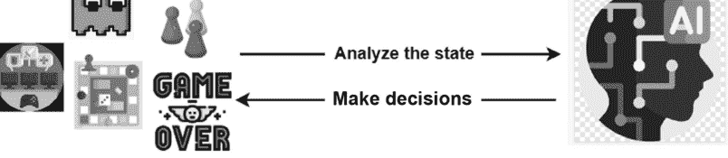

图 7.1 游戏 AI 模型 [3]。

DOI: 10.1201/9781032715957-7

## AI 时代的未来科技初创公司与创新

| 内容 | 行为 |
|---|---|
| 模型设计师 | 设计师、玩家和生产者 |
| 生成 | 设计师、玩家和生产者 | 设计师、AI 研究员和生产者 |
| 评估 | 设计师和 AI 研究员 | 设计师和 AI 研究员 |

图 7.2 AI 在游戏行业中的整合 [6]。

AI 在游戏行业中有三个领先角色：作为执行者的 AI、作为设计者的 AI 和作为生产者的 AI [1]。作为执行者意味着不需要人类参与游戏；作为设计者意味着设计师负责分析玩家行为以提供合适的设计；而作为生产者则意味着根据设计师的反馈开发游戏。

为了实现上述角色，AI 应该对内容和行为进行建模、评估和生成。如图 7.2 所示，游戏 AI 回答了三个问题：做什么？在什么背景下？为谁？

本章其余部分的结构如下：第 2 节描述了游戏 AI 的背景和一些历史信息；第 3 节描述了将 AI 与游戏行业结合的动机，并定义了游戏 AI 中的 AI 角色和 AI 技术。第 4 节提供了游戏 AI 的挑战和局限；第 5 节介绍了案例研究。最后一节完成了本章。

## 7.2 游戏 AI 的背景

AI 是能够模仿人类交互、做出决策、行动和思考的算法。

1950 年，AI 的概念首次被，探索了将计算机引入游戏的方法；这一想法由 Shannon 提出，他展示了计算机如何决定象棋的下一步。他的想法是基于极大极小算法（minimax algorithms）。XO 游戏（通常被称为井字棋）由英国计算机科学教授 Alexander Douglas 在 1952 年开发，作为他在剑桥大学关于 HCI 的博士论文工作。在单人游戏 XO 中，玩家与计算机竞争。一个广泛接受的观点是， 1962 年在麻省理工学院创建的名为“太空大战”（Spacewar）是第一个具有更高复杂性的计算机 [7]。对于许多人来说，第一个 AI 游戏是 1979 年的《吃豆人》。这款游戏中的敌人看起来像是在对你密谋，增加了游戏的难度。1987 年，在《吃豆人》的基础上进行了增强产生了黄金时代游戏。然后，在 20 世纪 90 年代中期，开发了更多游戏，例如体育和驾驶游戏 [8]。随着 AI 丰富了世界，更多的游戏被创建和开发。

## 7.3 游戏行业中的 AI

AI 随着时间的推移变得越来越流行，如图 7.3 所示。

| 年份 技术 | 应用 |
|---|---|---|
| 1951 | 虚构 | 完全信息 |
| 1957 | 价值迭代 | 完全信息 |
| 1960 | 策略迭代 | 完全信息 |
| 1968 | A* | 不完全信息 |
| 1978 | 演化策略 | 不完全信息 |
| 1979 | 协同进化 | 不完全信息 |
| 1992 | REINFORCE | 不完全信息 |
| 1999 | Actor-Critic | 不完全信息 |
| 2000 | 遗憾匹配 | 多智能体 |
| 2003 | 双重甲骨 | 多智能体 |
| 2006 | MCTS | 多智能体 |
| 2007 | DQN | 多智能体 |
| 2008 | AlphaGo | 多智能体 |
| 2009 | AlphaGo | 多智能体 |
| 2012 | TRPO | 多智能体 |
| 2013 | A3C | 多智能体 |
| 2014 | NFSP | 多智能体 |
| 2015 | PPO | 多智能体 |
| 2016 | PSRO | 多智能体 |
| 2017 | IMPALA | 多智能体 |
| 2018 | SAC | 多智能体 |
| 2019 | QMIX | 多智能体 |
| 2020 | DREAM | 多智能体 |

图 7.4 AI 历史时间线 [9]。

- 完全信息游戏
- 不完全信息游戏
- 多智能体游戏

### 7.3.1 动机

这个令人兴奋的领域尽管复杂但需要高技能。许多游戏是 NP 难的。过去，AI 研究使用跳棋和象棋等作为基准。随着 AI 的改进，更复杂的游戏如《超级马里奥》、《星际争霸》和《贪鼠》作为新基准变得流行起来。围棋也一直作为一个重要的基准，特别是在 AlphaGo 击败职业选手的方面。《星际争霸》的实时策略和大量的空间状态使其成为 AI 面临的最挑战性游戏之一，其可能的策略远超世界上其他游戏。

### 7.3.2 AI 在游戏行业中的应用

### 7.3.2.1 玩游戏

AI 并不总是为了赢；它可以模仿吸引、预测或类人的游戏策略。需要注意的是，获胜可能与这些其他方法冲突，因为正如某些案例所示，许多顶级 AI 机器人使用非人类、枯燥或不可预测的战术。演化算法用于 AI 算法以优化游戏。

AI 可以玩棋类、牌、经典街机和其他许多游戏。在第三人图灵测试中，该方法显示出超过 0.6 的人类相似性，表明具有巨大潜力。评估是使用格斗游戏《街斗4》进行的。

#### 7.3.2.2 生成内容程序化内容生成（PCG）利用算法在人工干预下生成游戏内容。生成游戏内容是指创建游戏的物品、地图、角色、故事、关卡、视觉、音乐、规则等。这使得过程更快、更丰富。

PCG 方法分为两类：多级和多内容 PCG，后者需要一组规则和一个游戏引擎来生成游戏的特定内容。基于 PCG 的游戏设计生成游戏的非核心部分。


# 游戏行业中的 AI ■ 113

完成游戏就是创建游戏本身。在所有这些类别中都应该考虑某些因素，如速度、可靠性、可控性、多样性和创造力 [12]。

AI 内容创作并没有忽视手动内容创建的重要性；AI 可以通过建议创新设计和根据玩家风格定制关卡来启发手动创作，从而确保挑战的持续性；这已应用于《上古卷卷轴》和《我的世界》等许多游戏中。程序化内容生成有几个方向，包括离线或实时生成内容，使用确定性或随机算法以及其他标准 [13]。

内容个性化让许多研究人员产生兴趣，他们试图回答：何时应用自适应内容、如何应用这些内容以及在游戏的哪些部分。[14]，作者对这些问题提供了详细的解答。

### 7.3.2.3 建模玩家

AI 在游戏中的一个关键应用是理解游戏的交互以及玩家的响应和特征。这将影响内容生成。至关重要的是，每个游戏都至少有一个玩家在管理虚拟世界的某个部分。在益类和休闲游戏中，玩家可能以化身、实体集合的形式出现，或者保持隐身。

识别玩家行为的所有侧面可以带来许多可能的改进，例如内容个性化、调整 NPC 或提供新设计。收集的知识有助于 AI 算法的营销、建模、预测和关联挖掘，这些技术可以预测玩家何时停止游戏并理解玩家的行为。玩家的行为指示了玩家在游戏中做什么，而玩家的体验反映了玩家的感受；这两者都很重要。

### 7.3.2.4 测试中的 AI

AI 可以优化游戏性能、缩短测试时间、测试游戏性能、发现设计和机制中的漏洞、测试游戏质量，并通过提供不同的场景承担测试的所有角色。

### 7.3.3 游戏 AI 中的重要术语

在游戏 AI 领域经常会听到许多重要术语。

### 7.3.4 游戏行业中的某些 AI 技术

几种方法已成功提高了游戏 AI 中对象的智能水平。根据 McGee 2005 年对这些策略的描述，使用 `if-then` 语句实现的决策树允许基于逻辑做出决策。角色行为更容易完成有限状态机，有限状态机定义了不同的状态及其转换。命令层级提供了一种组织的方式来监督游戏中的各种活动和任务。通过使用如 A* 等路径规划算法，NPC 可以轻松地穿过游戏区域。影响映射和景观分析对于评估控制边界和重要的地图特征至关重要。此外，如模糊逻辑、遗传算法和人工神经网络（ANN）等 AI 技术提供了更先进、更灵活的游戏 AI 解决方案，使游戏更加真实、更具引人入胜 [16]。

在本节中，将讨论一些 AI 技术。

### 7.3.4.1 基于规则的系统

AI 中的基于规则的系统（RBS）是游戏中最基础、最直接的 AI 算法。它们是一组函数和规则；RBS 参数可以使用遗传算法（GA）进行优化；一个使用带有 GA 的 RBS 改进游戏平台的示例 [17]。此外，还有使用其他 AI 技术（如强化学习）来调整规则的可能性。

### 7.3.4.2 监督学习中的 ANN

这种算法试图模仿人类行为。它由代表输入层、隐藏层和输出层的神经元组成。神经元持有激活函数，以决定是否学习以及学习什么内容。输出层决定做什么，例如根据预训练数据加速或减慢游戏中某个物体的速度 [18]。

### 7.3.4.3 自然语言处理

由于 AI 在自然语言处理（NLP）方面的进展，对话式 AI 和语音识别技术正成为游戏不可或缺的。语音指令或深度对话可以促进玩家与 NPC 之间的游戏交互。这为沉浸感和叙事创造了新机会。

iStart 游戏的目的是提高学生的阅读理解能力；用户被要求解释文本。NLP 分析这些解释并根据评估结果给出评分。用户通过提供比其他人更高质量的解释来与 NPC 竞争。用户的解释将排在 0 到 3 级之间 [19]。

### 7.3.4.4 强化学习

从试错中获取知识是强化学习中学习算法的基本思想：奖励平衡了长期和短期之间的规划过程 [20]。智能体（Agent）与环境交互，并尝试获得尽可能高的累积奖励 [21]。由于强化学习具有与环境交互的能力，它可以根据实时参数调整其行为，并生成真实的 NPC。它可以用于生成内容和优化决策。强化学习在游戏 AI 中有广泛的应用；然而，训练时间和可解释性对这种学习构成了挑战。

# 游戏行业中的 AI 115

多人在线战术竞技（MOBA）游戏非常复杂；一种提议是整合强化学习来玩完整游戏，因为 MOBA 游戏是多智能体马尔可夫游戏。为了突出这些模型的复杂性并实现上述目标，需要将强化学习与长短期记忆（LSTM）相结合，需要多种类型的特征，并需要开发一个层次预测系统 [22]。

强化学习有两种类型：同策略（on-policy）和离策略（off-policy）。当采用离策略强化学习技术时，使用行为策略从学习策略中选择动作。相反，在同策略强化学习算法中，行为策略和学习策略是相同的。此外，强化学习还可以分为：基于值的（value-based）和基于策略的（policy-based）。基于值的强化学习利用价值函数来识别适当策略，与之相对，基于策略的强化学习直接学习策略 [23]。

## 7.4 游戏 AI 挑战

游戏与 AI 的结合带来了新的挑战：以下几点强调了一些：

- **长期参与**：大型多人在线游戏（MMOG）让不同国家的玩家长时间在一起，允许他们随时加入并继续玩。因此，分析玩家数据并使用 AI 提供长期参与是必要的。
 **实时通信**：玩家之间需要实时通信。利用玩家数据是一个关注点，因为每个人都会影响其他玩家的体验。
 ** 例如，《Dota 2》游戏以每秒 30 帧的速度运行约 45 分钟。如果每四帧做出一次决策，这相当于游戏中有 20,000 步。相比之下，牌类参与者的选择通常较少 [24]。
 **游戏设计**：许多角色的自动化以及 AI 生成增强现实游戏的实增加了开发的复杂性。技术、平台、环境、限制和技术的多样性需要复杂的算法来适应。
 **伦理考量**：在游戏中使用 AI 时，用户的隐私、健康和安全应该是首要。制作符合社区及其顾虑的游戏是一个关键考虑因素，此外关注内容及其对目标年龄的适用性也很重要。关注多样性并使游戏具有包容性同样重要。尽管财务回报与限制游戏乐趣以防止成瘾之间存在冲突，但控制游戏时长对保护玩家健康至关重要。必须满足许多伦理标准，不仅在玩家与游戏之间，还包括游戏制作者之间，


# AI 时代的未来科技创业公司与创新

竞争必须符合伦理，不能侵犯他人的想法或进行字面模仿。儿童经常与 AI 增强的软件和硬件交互，这些都对他们的隐私、安全和公正性构成了风险 [25]。

- 可解释性：AI 如何学习玩家的情绪并在游戏的新情况或策略下做出决策，需要一个有效的解释。AI 的作用不仅限于预测；解释也至关重要。随着越来越多的机器学习模型（包括深度神经网络）被应用于游戏，可解释 AI（XAI）的重要性日益增加。游戏行业中传统的 AI 方法仍然具有很强的解释性，但受限于它们的效率。显而易见，深度强化学习将越来越多用于视频游戏中。对于一个高精度的机器人，如果它试图模仿特定的人类玩家，我们可以通过要求人类玩家解释其逻辑来解释它的行为 [26]。

- 参数优化：通用 AI 算法依赖的参数对它们的行为方式有重大影响。通常，这些参数需要优化。例如，规划算法的预测和决策能力可能会受到采样次数（rollouts）数量的影响。针对特定游戏或任务优化这些参数可能需要一些时间。过去，参数优化是离线进行的，以提供及时的性能增强。另一方面，最近的发展带来了在线自适应参数调优技术。N 元组老虎进化算法（NTBEA）是一种非常适合游戏 AI 的算法 [27]。

- 不确定性：规划类仍然仍然挑战，尤其是大型游戏。存在两种不确定性。第一种需要观察对手的动作来决定做什么。因此它是部分不确定性，整个游戏计划是不可见的，但部分可见（有限的动作可能性）。第二种源于对抗性游戏的本质，动作是不可预测的；在这种类型中，AI 发挥核心作用，构建对手预期动作的合理模型 [28]。

- 工业界与研究领域的差距：游戏的工业界和学术界存在差异。学术研究依赖复杂的算法，而游戏制作商在行业中使用简单的算法。另一方面，大多数研究目标是为智能体寻找优化策略并教它如何互动，而实践方则关注为玩家创造一个趣味十足的环境和新的挑战。研究旨在让对手表现得最好，而玩家喜欢从对手的错误中获益。遗憾的是，错误是可能的。研究与工业方面利益差异的原因有很多。但尽管如此，解决方案仍然在于这两个领域之间的合作，以弥补现有差距并解决两个领域的缺点 [29]。

## 7.5 案例研究：“冒险”游戏中的玩家体验

冒险游戏有很多需要考虑的元素和因素，它们是玩家中非常受欢迎的交互式游戏。因此，这将是我们改进玩家的案例研究。让我们这种冒险游戏称为英雄冒险游戏。这种游戏允许玩家根据自己的动作探索、搜索、互动和修改游戏环境。在该环境中可能面临的挑战：

- 动态交互必须根据玩家的决定开发，提供适合玩家水平的挑战，并开发 NPC。此外，关注游戏是否允许多人游戏以及是否需要在玩家之间提供实时通信也很重要。就此挑战而言，AI 参与分析玩家行为，以使 NPC 随这些变化流畅运行。NPC 应该识别游戏风格并以可解释的方式做出反应。此外，AI 于内容生成，加速了提供便利内容的过程。敌人需要智能且具有避免挫败感的战术。

- 内容制作必须保持惊喜元素，使游戏具有多次可玩性而不无聊。游戏必须带来新颖。

- 为了平衡乐趣和难度，成为失败者是不理想的！

- 开发玩家反馈是一个应该考虑的挑战，让玩家成为开发过程的一部分，而不是失去他们的兴趣。

- 此游戏需要不同的 AI 算法协同工作，例如 RBS 和 NLP。思考开发此游戏的更多挑战。

## 7.6 结论与趋势

游戏 AI 的未来充满前景且正在快速演变。AI 控制着游戏的方式和体验。由于发展，游戏制作商利用 AI 开发具有令人兴奋的、真实的体验。关键趋势关注开发适应玩家行为的挑战。总之，AI 有潜力从根本上改变我们玩和享受视频游戏的方式，通过使用栩如生的 NPC、生成式内容创建、个性化游戏体验以及改进工具。随着技术的发展，AI 将成为塑造游戏行业、为玩家和开发者同样的重要因素 [29]。

## 参考文献

[1] M. O. Riedl and A. Zook, “AI for game,” In 2013 Conference on Computational Intelligence in Games (CIG), pp. 1–8.
[2] G. N. Yannakis, "Game AI," In Proceedings of 9th Conference on Computing Frontiers, pp. 285–292, 2014.
[3] A. Strong, "Applications of artificial intelligence & associated technologies," Science 15, no. 6, pp. 64–67, 2016.
[4] J. P. Perez, M. Castro, and G. Lopez, "Serious games and Challenges," IEEE, 2013.
[5] A. Abd-Alraza, I. Abele, D. Hassan, S. Irshadat, M. House, "Artificial intelligence-driven games in scoring," JMIR, vol. 10, no. 4, p. e3984, 2022.
[6] G. N. Yannakis and J. Togelus, "A panorama of artificial and computational intelligence in games," IEEE Transactions on Computational Intelligence and AI, vol. 7, no. 4, pp. 317–335.
[7] J. P. De Sousa, R. Tavares, and J. Macedon, "Review and analysis of research on video games and artificial intelligence: a look back and a step forward," Procedia Computer Science, vol. 204, pp. 315–323, 2022.
[8] I. Milling, Ai for Games, CRC Press, 2019.
[9] G. N. Yannakis and J. Togelus, Artificial Intelligence, vol. 2, 2018.
[10] Y. Lu and L. Li, "Techniques and paradigms in modern AI systems," Algorithms, vol. 15, no. 8, p. 282.
[11] M. Cook, "The social responsibility of game AI," In 2021 IEEE Conference on Games (CoG), pp. 1–8, 2021.
[12] N. Shaker, J. Togelus, Procedural Content Generation in Games.
[13] R. La-Cabrera, M. Nogueiera-Colollazo, C. Cotta, and A. Fernandez-Deleiva, "Artificial intelligence: Challenges for the community," CEUR Workshop, vol. 1394, pp. 1–12, 2015.
[14] A. Bisson, G. Greenie, R. Prada, A. Paiva, S. Louchart, T. Lopes, F. Bidotti, et al., "Artificial intelligence and personalization for serious games," In Proceedings of the AAAI Conference on Artificial Intelligence and Interactive Digital Environment, vol. 8, pp. 51–57, 2022.
[15] A. Streicher and J. Schmnick, "Personalized and adaptive games," In Entertainment and Serious Games: International GI-Dagstuhl Seminar 15283, Dagstuhl Castle, Germany, July 5–10, 2015, Revised Selected Papers, pp. 322–377, 2016.
[16] S. Yildrim and B. S. Bene, "A survey on the need and use of AI in game agents," In Tech, 2010.
[17] H.-T. Kim and K.-J. Kim, "Hybrid of rule-based systems using genetic algorithm to improve platform performance," Procedia Computer Science, vol. 24, pp. 114–120, 2013.
[18] M. Ranjitha, K. Tahan, and L. Josef, "Artificial intelligence and techniques in the creation of player-adaptive games," Journal of Physics: Conference Series, vol. 1427, p. 012006, IOP Publishing, 2020.
[19] D. Picca, G. Eberl, and D. Jacob, "Natural language processing in games: A state of the art," International Journal of Serious Games, vol. 2, no. 3, pp. 7–92, 2015.
[20] R. R. Torrado, P. Bontrager, J. Togelus, Liu, and D. Perez-Liebana, "Deep reinforcement for learning video game AI," In 2018 IEEE Conference on Computational Intelligence and Games (CIG), IEEE, 2018.
[21] J. Schmidhuber, "Deep learning in neural networks: An overview," Neural Networks, vol. 61, pp. 85–117, 2015.
[22] D. Ye, G. Chen, W. Zhang, S. Chen, B. Yuan, B. Liu, J. Chen, Z. Liu, F. Qiu, H. Yu, et al., "Towards playing MOBA games with deep reinforcement learning," Advances in Neural Information Processing Systems, vol. 33, pp. 621–632, 2020.
[23] K. Shao, Z. Tang, Y. Zhu, N. Li, and D. Zhao, "A survey of deep reinforcement in video games," arXiv preprint:1912.10944, 2019.


[24] Q.-Y. Yin, J. Yang, K.-Q. Huang, M.-J. Zhao, W.-C. Ni, B. Liang, Y. Huang, S. Wu, and L. Wang, “人机游戏中的AI：技术、挑战与机遇，” Machine Intelligence Research, vol. 20, no. 3, pp. 299–317, 2023.

[25] M Giannakos, I. Voulgari, S. Papavlopoulou, Z. Papamitissou, and G. Yannakakis, “用于人工智能和机器学习教育的游戏：回顾与展望，”收于 ICT时代的非正式与非正式科学学习，pp. 117–133. Springer, 2020.

[26] M. Swiechow, “游戏AI竞赛：模仿‘游戏’比赛的动机，”收于 2020 第15 届计算机科学与信息系统会议 (FedCSIS)，pp. 155–160, IEEE, 2020.

[27] C. Guerrero-Romero, S. M. Lucas, and D. Perez-Liebana，“使用通用AI算法团队辅助游戏设计与测试，”收于 2018 IEEE 计算智能与游戏会议 (CIG)，pp. 1–8, IEEE, 2018.

[28] S. Ontanon, G. Synnaeve, A. Uriartete, F. Richoux, D. Churchill, and M. Preuss，“《星际争霸》实时策略游戏AI研究与竞赛综述，”IEEE Transactions on Computational Intelligence and AI in games, vol. 5, no. 4, pp. 293–311, 2013.

[29] G. Robertson and I. Watson，“实时策略游戏AI回顾，”AI Magazine, vol. 35, no. 4, pp. 75–104, 2014.

提示词工程（Prompt engineering）在AI系统的背景下结合了提示词（prompt）与工程（engineering）的概念。它涵盖了旨在优化提示词设计和完善AI模型以提高性能并实现预期结果实践与方法。提示词工程涉及对提示词进行战略性制定和微调，以提供清晰的指令、相关的上下文和约束条件，从而引导AI系统的理解和响应生成过程。它利用原理和技术来增强AI系统在解释和响应提示词时的整体有效性、准确性和质量。

为了进一步阐述提示词工程，理解提示词在AI系统中的意义至关重要。提示词在塑造AI系统的行为以及决定其输出的质量和相关性方面起着关键作用。精心设计的提示词可以帮助AI系统产生与预期结果一致的相关的响应。另一方面，设计不当的提示词可能导致不准确或无关输出，无法实现预期目的。

提示词工程还涉及对AI模型进行精炼以提高其准确性和性能。这涉及利用工程原理和技术，如数据预处理、特征选择和模型优化，以增强AI模型在解释和响应提示词方面的性能。系统行为改进：

- 设计提供特定指令或上下文的提示词有助于塑造AI系统的行为。
- 精心设计的提示词引导模型的响应生成，从而产生更准确、更符合预期的输出。
- 提示词工程将AI系统的行为与预期任务或目的对齐，增强了其性能。

偏差缓解：

- 提示词工程通过构建提示词来促进生成响应的公平性、包容性和中性，从而解决AI系统中的偏差。
- 无偏的提示词鼓励更符合伦理且无偏的行为，缓解训练数据中偏差的意外放大。

任务适应：

- 提示词工程使AI系统能够适应不同的任务或领域，无需大量的重新训练。
- 针对特定应用定制提示词允许对专门任务的模型进行微调，从而提高性能。
- 提示词工程的灵活性促进了AI系统在不同背景下的实用和高效部署。

系统性能优化：

- 在提示词工程中对提示词变进行迭代实验和分析改进了AI系统的性能。

## 122 AI时代的未来122初创公司与创新

- 对提示词公式的系统性探索精炼了模型，提高了准确性并实现了更好的整体性能。
- 通过提示词工程优化提示词有助于AI系统性能的持续改进。
- 提示词工程在增强AI系统性能和多功能性、缓解偏差以及实现用户友好交互方面起着至关重要的作用。其迭代方法和定制提示词有助于精炼AI模型，使其适应各种任务，并获得更好的整体系统性能。
- 提示词工程对于提高AI系统的性能和多功能性、缓解偏差以及实现用户友好交互至关重要。其迭代方法和定制有助于精炼AI模型，使其适应不同的任务，并实现更好的整体系统性能。
- 示例包括头部与提示词——对比Google和Google Bard。

提示词工程系统研究背后的动力来自大语言模型（LLMs）的快速增长和影响，特别是GPT以及在自然语言处理（NLP）领域观察到的显著进展。这些发展开启了新的可能性时代，并吸引了AI工业界的关注。GPT等大语言模型改变了AI系统处理和生成自然语言的方式。这些模型在大量数据上进行训练，能够理解并生成流畅且连贯的人类文本。这在各个领域引发了令人的应用，包括聊天机器人、虚拟助手、内容生成和语言翻译。

LLM的兴起结合NLP日益增长的重要性，推动了AI行业的发展，并引起了极大兴趣。然而，尽管它们具有这些能力，LLM通常需要显式指令来生成所需的输出。这种局限性限制了它们的灵活性和适应性。提示词工程提供了一个解决方案。通过在提示词中嵌入任务描述或指令，提示词工程使AI系统能够适应不同的任务。提示词工程的动机是通过推进AI系统的能力来充分利用LLM。

## AI模型与提示词工程 123

### 8.1.2 本书的贡献

- 调查并理解LLM在生成输出方面的挑战和局限性。（包括越狱、提示词泄露和注入。）
- 开发和精炼提示词工程技术以增强LLM的灵活性。
- 提示词工程中的技术和方法。
- 分析提示词工程在不同领域和任务中的有效性。
- 评估与提示词工程相关的潜在伦理影响和偏差，并提出应对策略。

[24] Q.-Y. Yin, J. Yang, K.-Q. Huang, M.-J. Zhao, W.-C. Ni, B. Liang, Y. Huang, S. Wu, and L. Wang，“人机游戏中的AI：技术、挑战与机遇，”[25] M Giannakos, I. Voulgari, S. Papavlopoulou, Z. Papamitissou, and G. Yannakakis，“用于人工智能和机器学习教育的游戏：回顾与展望，”[26] M. Swiechow，“游戏AI竞赛：模仿‘游戏’比赛的动机，”[27] C. Guerrero-Romero, S. M. Lucas, and D. Perez-Liebana，“使用通用AI算法团队辅助游戏设计与测试，”

提示词工程在增强AI系统的性能和多功能性、缓解偏差以及实现用户友好交互方面起着至关重要的作用。其迭代方法和定制提示词有助于精炼AI模型，使其适应各种任务，并获得更好的整体系统性能。

本章其余部分的结构如下：8.2节讨论背景和相关工作，8.3节讨论提示词与查询，8.4节研究提示词类型，8.5节比较不同类型的提示词，8.6节分析提示词注入攻击，8.7节讨论结果，8.8节给出结论。

## 8.2 背景与相关工作

本章探索了AI领域的提示词工程，深入文本之外以分析模型行为。表8.1总结了关键论文，对该动态领域思想和方法的演变提供了概述。

### 8.2.1 识别的挑战、局限性与空白

一种增强ChatGPT提示词工程的提示词模式目录：本文识别了提示词工程方法中的挑战和空白。挑战之一是提示词需要清晰、简洁地传递知识，以便与LLM用户交流，这些用户可能是科学家也可能是程序员。此外，创建一种向多样化受众清晰传播的格式至关重要。另一个挑战是，拨款由于其正式性质可能很有吸引力，但对于不熟悉它们的人来说很难理解。此外，它们可能不是记录提示词的最佳方法，因为非技术用户可能难以理解。论文还指出，目录中提出的提示词模式很大程度上与领域无关，因此它们可能


# AI 时代的未来科技初创公司与创新

表 8.1 总结与现有方法

| 序号 | 作者姓名 | 总结 | 出版年份 |
| :--- | :--- | :--- | :--- |
| 1 | Jules White 等 [1] | 提示词工程对于与 ChatGPT 等大语言模型（LLMs）进行有效通信至关重要。提示词作为引导 LLMs 的指令，能够执行规则、实现流程自动化并确保生成的输出具有特定质量。 | 2023年2月21日 |
| 2 | Laria Reynolds & Kyle McDonnell [2] | 论文探讨了在使用大型生成式语言模型进行监督任务时，当前方法的缺点。它还引入了一种新的提示词编程方法。 | 2021年2月15日 |
| 3 | Ruiqi Zhong 等 [3] | 论文引入了一种称为元微调（meta-tuning）的技术，旨在通过在系列数据集上微调预训练模型来改进零样本学习。作者特别关注分类任务并创建了元数据集。 | 2021年9月8日 |
| 4 | Albert Webster & Ellie Pavlov [4] | 该研究检查了基于提示词的模型在自然语言推理（NLI）中的表现，以及它们理解提供的提示词含义的能力。 | 2022年4月21日 |
| 5 | Maciej P. Novak & Dane Morgan [5] | 本文探索了利用对话语言模型（特别是 ChatGPT）自动从研究论文中提取数据。作者表明，通过有效的提示词工程和后续查询，可以获得成功的结果。 | 2023年3月7日 |
| 6 | Yao Lu 等 [6] | 论文讨论了基于软提示（soft-prompt）的语言模型（如 GPT-3）的敏感性，以及训练样本提供的顺序。作者证明，训练样本的某些排列是“极好的”，并能带来接近顶的性能，而另一些则并非如此。 | 2022年3月3日 |
| 7 | Teven Scao & Alexander M. Rush [7] | 论文评估了针对分类任务精炼预训练模型的有效性。作者在相同条件下对具有通用表头和特定任务提示词的模型进行了比较，涵盖了不同的任务和规模。 | 2021年4月6日 |
| 8 | Taylor Sorensen 等 [8] | 论文提出使用基于互信息的模板来统一 NLP 任务。该方法涉及根据互信息选择模板并进行推理。 | | |
| 9 | Xiao Liu 等 [9] | 该研究检查了 GPT 在理解自然语言相关任务中的表现。作者提出了一种名为 P-tuning 的独特方法，该方法利用连续提示词嵌入来增强 GPT 在这些任务上的性能。 | 2021年3月18日 |
| 10 | Ashish Vaswani 等 [10] | 论文提出了一种完全依赖注意力机制的新型神经网络结构。这种架构比现有的序列转换模型更简单，并且更有效地并行化。所提模型在机器翻译任务中取得了更好的结果，并且所需的训练时间更短。 | 2017年12月6日 |

# 表 8.1（续）总结与现有方法

| 序号 | 作者姓名 | 总结 | 出版年份 |
|---|---|---|---|
| 11 | Kaiyang Zhou 等 [11] | 论文评估了一种新方法 DART（可微提示），该方法增强了小型语言模型，使其在示例有限的情况下更有效，而无需提示词工程。这是通过将 NLP 任务转换为对预训练模型任务的反向传播，然后使用它来优化提示词和目标标签实现的。 | 2022年10月6日 |
| 12 | Ningyu Zhang 等 [12] | 论文引入了一种名为“问我任何问题”（AMA）的策略，引导 LLM 在无需额外训练的情况下执行新任务。AMA 方法收集了各种有效但不完美的提示词，并将它们组合以创建高质量提示词。研究表明，问答式（QA）提示词对开放式生成的性能优于限制输出的提示词。 | 2022年5月4日 |
| 13 | Simran Arora 等 [13] | 论文探讨了语言模型（LMs）在少样本学习中的应用。研究表明，问答式（QA）提示词对开放式生成的性能优于限制输出的提示词。 | |
| 14 | Robert Logan 等 [14] | 该研究检查了基于提示词的模型在自然语言推理（NLI）中的表现，以及它们理解提供的提示词含义的能力。 | |
| 15 | Michael Bommar & Daniel Martin [15] | 探索了利用对话语言模型（特别是 ChatGPT）自动从研究论文中提取数据。作者表明，通过有效的提示词工程和后续查询，可以获得成功的结果。 | 2022年12月 |
| 16 | Xiaohan Yang 等 [16] | 论文评估了一种新方法 DART（可微提示），该方法增强了小型语言模型，使其在示例有限的情况下更有效，而无需提示词工程。这是通过将 NLP 任务转换为对预训练模型任务的反向传播…… | 2022年5月 |
| 17 | Yejin Bang 等 [17] | 论文评估了针对分类任务精炼预训练模型的有效性。作者在相同条件下对具有通用表头和特定任务提示词的模型进行了比较，涵盖了不同的任务和规模。 | 2023年2月 |
| 18 | Tony Huang 等 [18] | 论文提出使用基于互信息的模板来统一 NLP 任务。该方法涉及根据互信息选择模板并进行推理。 | 2022年8月 |

## AI 时代的未来科技初创公司与创新

## 语言模型的提示词编程：超越少样本范式

## 通过数据集和提示词集合的元微调使语言模型适应零样本学习

## 提示词模型真的理解其提示词的含义吗？

## 使用对话语言模型和提示词工程从研究论文中提取抽象数据——ChatGPT 示例

## 极好的提示词排列以及如何找到它们：克服少样本提示词顺序敏感性

观察到的局限性和差距是顺序敏感性


# AI 模型与提示工程 ■ 127

少样本提示（few-shot prompts）会影响预训练语言模型在不同任务、模型、模板和样本上的性能和变异。目前缺乏一种统一的 NLP 任务接口可以在不微调的情况下利用语言模型（LMs）的零样本和少样本能力。在没有额外数据或人工投入的情况下，提示词的设计和选择是非常困难的，且文本质量与对语言模型的兼容性之间存在权衡。对于文本推理和自然语言推理（NLI）等句子对任务，较小的语言模型比大模型准确性且波动更大。此外，像 GPT-3 这样的大模型训练和访问成本高昂。

### 一个提示词值多少数据点？
论文中提出的挑战和差距在于，作者声称提示的益处可能取决于特定任务和数据规模，需要更多研究来理解其发现的泛化性。论文没有探索不同类型提示词对模型性能的影响，这是未来研究的一个重要领域。作者没有调查提示词长度对模型性能的影响，这可能是决定提示词实用性的重要因素。论文没有讨论使用提示词与通用模型头相比的计算成本，这在实际应用中可能是一个重要的考虑因素。作者没有将他们的发现与预训练模型的其他先进技术进行比较，这本提供关于提示词效率的额外信息。

### 无需真值标签的提示工程信息论方法
论文没有明确说明所提方法的任何局限性。值得提到，该方法的有效性取决于可用数据的质量和数量，以及 NLP 任务的复杂性。论文没有将所提方法与其他现有方法进行比较，这可以对其优缺点提供见解。值得注意的是，NLP 领域一直在不断变化，随着新数据和技术的开发，可能会出现新的挑战和差距。此外，论文没有解决 NLP 中的偏差问题，这是该领域的一个大挑战。

### GPT 也能理解：
然而，至关重要的是，GPT 和 P-tuning 的性能可能会取决于特定的自然语言理解（NLU）任务和使用数据集。此外，论文没有将 GPT 和 P-tuning 的性能与 XLNet 或 RoBERTa 等其他先进 NLP 模型进行比较。最后，论文没有提供关于运行 P-tuning 或 GPTs 所需计算资源的任何信息。

### 注意力即一切所需：
值得注意的是，所提模型完全基于注意力机制，没有使用序列转换模型中常用的循环或卷积神经网络。所提模型在机器翻译任务上优于现有模型，尚不清楚它在其他 NLP 任务上的表现如何。此外，论文没有提供关于训练该模型所需计算资源的详细分析，这可能是某些应用的潜在局限性。

# AI 时代的科技初创公司与创新

### 一个提示词值多少数据点？
作者只关注分类任务，其发现可能无法泛化到其他类型的任务。论文没有探索不同类型的提示词对模型性能的影响。作者没有调查提示词长度对模型性能的影响。而且论文没有讨论使用提示词的计算成本，以将其结果与其他用于微调模型的其他先进方法进行比较。

### 针对视觉语言模型的条件提示词学习：
论文提出了所提方法——条件上下文优化（CoCoOP）的两个局限性：CoCoOP 训练速度较慢，且比之前的方法上下文优化（CoOp）需要更多的 GPU 内存。这是由于 CoCoOP 方法需要为每张单独的图像通过文本编码器进行针对特定实例提示词的前向传播。这种方法没有 CoOp 高效，CoOp 无论小批量大小如何，只需通过文本编码器进行一次提示词的前向传播。目前 CoCoOP 在 11 个数据集中的 7 个未见数据任务上表现差于 CLIP。这表明需要更多努力来弥补手动提示与基于机器学习的提示之间的差距。

### 可微提示预训练语言模型更好的少样本学习者：
所提方法可微提示（DART）是一种较新且未经测试的方法，用于提高 NLP 中的少样本学习。可能需要进一步的研究和实验来完全理解这种方法的潜在收益和局限性。此外，论文没有将所提方法与现有的少样本学习方法进行比较，这可能是未来研究的一个潜在途径。

### 有问必答：语言模型提示简单策略：
本文提出了一种提示语言模型的简单策略，限制了 AMA 提示方法的局限性。至关重要的是，该方法的成功取决于所收集的提示词的质量和多样性，以及所处的特定任务。此外，论文专注于评估异步移动算法（AMA）在语言模型上的有效性，没有探索其对其他类型模型或任务的适用性。

### 减少提示词和参数：语言模型的简单少样本学习：
需要注意的是，该方法的有效性可能取决于使用的特定任务和数据集。此外，论文专门关注语言模型在少样本学习中的应用，没有讨论其他类别的机器学习任务。

### GPT 参加司法考试：
论文承认对 GPT-3.5 等大模型的科学理解尚处于初期阶段，且 GPT-3 的专有性质限制了解释其结果或说明其推理的能力。论文指出 GPT-3.5 的性能在不同问题类别之间存在差异，而且它在某些法律领域（如刑法和刑事诉讼）表现困难，落后于人类考生 36%。报告说，使用额外的法律数据微调 GPT-3.5 并不会提高其性能，甚至可能因为过拟合和遗忘而降低其泛化能力。论文指出，MBE 只是司法考试的一个组成部分，GPT-3.5 尚未在论述或表现部分接受过测试，这些部分可能需要不同的技能或格式。论文还提出了使用大语言模型处理法律任务的一些伦理和社会影响，例如对法律教育、就业、司法公正准入和问责制的潜在影响。

**GPT 关于谁的认知**：
论文识别了使用监督标签的指代消解系统的差距，这些标签昂贵且难以标注。大语言模型在指代消解方面留下了见证的收益。GPT-2 和 GPT-Neo 识别指代提及的能力有限且敏感，导致结果不一致。指代消解研究的核心在于两个给定的提及是否为指代关系，这这也是本文的关注焦点。论文引入了一种基于提示的指代消解学习方法，并发现大语言模型在没有微调的情况下在该任务上表现很差。尽管提示词在近期 NLP 研究中很流行，但在理解大语言模型如何认知指代消解方面仍然存在差距。

**ChatGPT 在推理、幻觉和交互方面的多任务、多语言、多模态评估**：
挑战包括深度学习（DL）模型的可解释性、稳健性和泛化性的缺乏，以及 NLP 高质量多样数据集的稀缺。局限性包括深度学习难以捕捉复杂的语言现象（如语用、话语和常识推理），以及使用深度学习进行 NLP 应用的伦理和社会影响。差距包括需要更多跨学科合作、更严谨的评估方法、以人为中心的方法以及更具解释性和可信度的 NLP 系统。论文还为解决这些挑战、局限性和差距提供了一些研究方向。

**针对视觉语言模型的无监督提示学习**：
重要的是，所提的 UPL 方法并不总是优于带有提示工程的原始 CLIP，特别是在目标数据集可用标记数据的情况下。此外，UPL 方法的有效性取决于特定的数据集和任务。

# 8.3 结构化输入与 LNI（提示词与查询）

Google 搜索被称为查询（query），如图 8.1 所示；而 Google Bard 搜索被称为提示（prompt），如图 8.2 所示。查询是在 Google 搜索栏中输入的问题或短语。提示词是一种更特定的查询类型，用于从 Google Bard 获得特定类型的输出。查询示例：

- 法国首届是什么？
- 美国的人口是多少？
- 今天伦敦的天气如何？


# AI 的崛起

人工智能（AI）是一个快速发展的领域，具有改变我们生活许多方面的潜力。AI 已经被应用于各种场景中，包括自动驾驶汽车、人脸识别软件和医疗诊断工具。随着 AI 的不断发展，它可能会对我们的世界产生更大的影响。

AI 具有许多潜在的益处。例如，AI 可以帮助我们解决超出人类能力的复杂问题。AI 还可以帮助我们自动化目前由人类完成的任务，为我们的其他活动腾出时间。此外，AI 还可以通过提供更多信息和见解来帮助我们做出更好的决策。

然而，AI 也存在一些潜在的风险。例如，AI 可能被用于创建无需人类干预即可杀人的自主武器。此外，AI 可能被用来操纵人们的思想和情感，这会对社会产生负面影响。

总而言，AI 的崛起是一个复杂的问题，既有潜在的收益也有风险。在我们决定如何开发和使用这项技术之前，仔细考虑 AI 的潜在影响是非常重要的。

以下是对 AI 崛起的额外思考：

- 1. AI 处于发展的早期阶段，但正在快速增长。
- 2. AI 有潜力从积极和消面两个方面改变我们生活的许多方面。
- 3. 在决定如何开发和使用这项技术之前，仔细考虑 AI 的潜在影响是非常重要的。

图 8.1 Google Bard 上的提示 [19]。

提示示例：

- * 写一首关于花的诗。
- 写一个关于狗救猫的故事。
- 写一段打印“Hello, world!”的的代码。

## 8.4 提示的类型

## 8.4.1 情感分析

情感分析，也称为意见挖掘，是一种用于确定文本情感或情绪基调的自然语言处理（NLP）方法。它涉及分析文本数据（如评论、社交媒体帖子或客户反馈），以将情感分类为积极、消极或中性。情感分析旨在解释文本中表达的主观观点、态度或情感。它为公共舆论、客户反馈、品牌感知和市场趋势提供了宝贵的见解。这种技术被广泛应用于社交媒体监控、市场研究、客户体验管理和内容分析等领域。

# AI 模型与提示工程 ■ 131

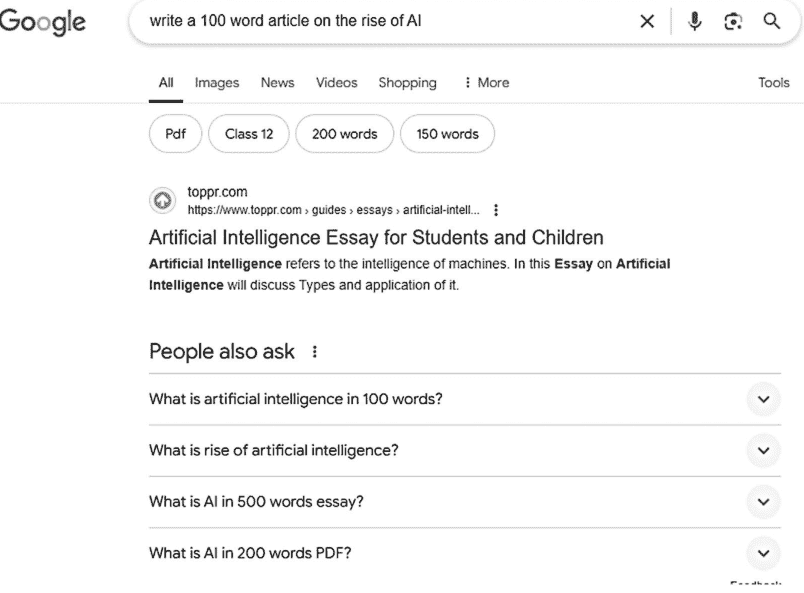

图 8.2 Google 搜索引擎上的查询 [19]。

以下是情感分析过程的概述：

- * 文本预处理：通过移除不需要的元素、特殊字符、标点符号和停用词来准备文本数据。此外，可能会应用分词、词干提取或词还原等技术使文本保持一致。
- 特征提取：从预处理后的文本中提取特征或指标，这些特征可能包括传递情感信息的词、n-gram 或语法模式。
- 情感分类：为了将文本情感分类为积极、消极或中性，使用标记的数据集训练机器学习（ML）算法或统计模型。此任务的一些常用分类算法包括支持向量机（SVM）、朴素贝叶斯以及如循环神经网络（RNN）或 transformers 等深度学习模型。
- 模型评估：使用准确率、精确率、召回率和 F1 分数等评估指标对训练后的模型进行评估。这有助于确定情感分析模型分类情感的有效性。

情感分析应用：使用训练好的模型分析新的、未见的文本数据以对文本情感进行分类。输出可用于各种目的，例如监控客户反馈、衡量公众舆论、检测情感趋势或为决策过程提供信息。

### 8.4.1.1 情感分析案例：手机品牌客户评论情感分析

- 引言：
- 解释情感分析在理解客户意见方面的意义及其对业务的影响。
- 提供案例研究目标和方法的简要概述。
- 数据集描述：
- 描述用于案例研究的数据集，包括客户的来源和收集的评论数量。
- 解释对数据集执行的任何预处理步骤，如文本清洗、分词和移除停用词。
- 特征提取：
- 解释情感分析中使用的技术，如词袋模型和词嵌入。
- 解释特征提取过程，包括用于降维或特征选择的任何技术。
- 情感分类模型：
- 讨论用于情感分类的机器学习算法，如 SVM、朴素贝叶斯和 RNN。
- 解释训练过程，包括数据划分、交叉验证和超参数调优。
- 提供关于评估指标的细节，如准确率、精确率、召回率和 F1 分数。
- 模型性能评估：
- 展示情感分类模型在测试集上实现的性能指标。
- 讨论模型在准确分类情感方面的优点和局限性。
- 将结果与其他有的情感分析方法或基准进行比较。

情感分析见解：
- 展示从客户评论情感分析中获得的关键见解。
- 讨论数据集中情感（积极、消极、中性）的分布。
- 突出评论中识别出的常见积极和消极情感指标。

案例研究发现：
- 讨论与案例研究分析的手机品牌相关的特定发现。
- 突出手机品牌的积极方面。
- 突出手机品牌的消极方面。

启示与建议：
- 讨论对该手机品牌的影响。
- 为该手机品牌提供建议。

结论：
- 总结主要发现。
- 强调情感分析在业务决策中的重要性。

## 8.4.2 直接提示

直接提示是指提供指令的一种简单、直接的方法。它涉及向模型提供清晰、简洁的提示。在直接提示中，指令通常是不歧义的，留下的解读空间很小。

例如，在问答场景中，一个直接提示可以是：

提示：“法国的首都是哪里？”

在这种情况下，提示明确地询问法国的首都是，对输出没有产生歧义。模型可以生成如“巴黎”之类的回答来回答问题。

直接提示通常用于预期特定答案或输出的任务，例如信息检索。

为了解决这些缺点并在直接提示中提供感知，可以采用几种技术：

- 上下文注入：通过在提示中加入额外的上下文（如提供相关的背景细节或指定用户偏好），模型可以更好地理解用户的意图并生成更具个性化和感知能力的响应。
- 系统建议：系统不仅依赖直接提示，还可以提供建议或选项来引导用户的输入。这有助于用户提供更细致或更具体的指令，同时保持直接的方法。


AI 模型与提示词工程 ■ 135

- 错误处理与澄清：如果模型遇到歧义或缺乏生成准确响应所需的信息，它可以主动向用户寻求澄清。通过提示用户澄清其请求或为其他解释方案提供建议，模型可以提高其响应的质量，并提升整体用户体验。

- 渐进式披露：渐进式披露不是一次性呈现出所有信息或提示词，而是根据用户的输入逐渐揭示额外的选项或提示词。这种方法允许用户在保持直观交互的同时，探索不同的路径或精炼他们的查询。

总而言之，在直白的提示词中提供“意识”涉及多种可以增强模型上下文理解能力、灵活性以及处理歧义能力的技巧。通过利用这些策略，可以减轻直白提示词的局限性，从而产生更有效、更易于用户使用的交互。

## 8.4.3 答案为何可能产生偏见以及为何可能出现幻觉

在使用 AI 语言模型通过直白提示生成答案时，存在两个可能导致偏见响应和幻觉的重大挑战：

- 在语言模型中：GPT-3 和类似的 AI 语言模型是基于来自互联网的海量文本数据训练的。需要注意的是，这些数据可能包含原始来源中存在的偏见。这些偏见可能包括刻板印象、偏见以及对某些群体或个人的不公平表述。当模型基于此类训练数据生成答案时，它可能会在无意中产生偏偏响应，从而延续社会偏见并强化有害的刻板印象。

- 例如，如果语言模型被问及诸如“所有工程师都是男性吗？”的问题，由于其训练数据中的偏见，它错误地回答“是”。这可能导致虚假信息的传播并强化性别刻板印象。

- 幻觉或创造性响应：幻觉是指语言模型生成的并非基于事实或现有知识的响应。像 GPT-3 这样的语言模型以具有高度创造性而闻名，能够生成听起来可能合理但缺乏事实准确性的文本。当模型面对开放式或具有歧义的提示词时，这一点尤为明显。

例如，如果模型被问及“1000 年后的世界会什么样？”，它可能会产生富有想象力但完全推测性的响应，因为它无法获取关于遥远未来的真实信息。

将偏见和幻觉相结合，模型可能会生成具有创意但有偏见的答案。例如，如果被问及“自闭症的原因是什么？”，它可能会给出未经证实或带有偏见的说法，将自闭症与特定种族或民族联系起来，延续有害的刻板印象。

以下是解决偏见和幻觉响应的一些可能解决方案：

## 8.4.4 事实核查

事实核查是验证作为事实呈现的信息或主张的准确性和可靠性的过程。它涉及进行彻底的研究和调查，以评估各种媒体形式（如新闻文章、演讲、社交媒体帖子或其他信息源）中提出的陈述、数据或主张的真实性和可信度。

事实核查的目标是对所呈现信息的准确性提供客观评估，独立于任何偏见或误导性叙述。事实核查旨在确保公众获得可靠、信任的信息，并有助于应对快速传播的虚假信息、谣言和虚假主张，特别是在社交媒体时代。

事实核查的过程通常涉及以下步骤：

- 溯源：识别信息的原始来源并评估其信誉和声。考虑来源的专业知识、权威性和可靠性至关重要。

- 交叉引用：将信息与多个可靠来源进行对比，以确定其一致性和真实性。检查信息是否得到其他可信来源的证实，有助于建立其准确性。

- 证据收集：进行进一步研究，以收集支持或反驳正在核查的主张的证据、数据或专家意见。这可能涉及咨询专家、官方记录、科学研究或统计数据。

- 验证：仔细审查收集到的证据，并评估其可靠性以及与所待核查主张的相关性。这包括评估研究或调查的方法论、样本量和客观性。

- 分析：根据证据得出结论，并对主张做出判断。事实核查人员将主张分类为真实、虚假、误导性或缺乏证据。

事实核查在促进明智决策、追究人物和机构责任以及打击虚假信息传播方面起着至关重要的作用。对于防止虚假信息的传播至关重要。显然，我们需要机制来验证 AI 生成的信息。诸如更新模型等策略对未来是有益的。

## 詹姆斯·韦伯望远镜的发现：水、网络、行星、系外行星

##8.4.5 常识问题

问题可以根据重大历史事件发生的顺序进行不同的排列。你必须按照时间顺序排列它们，并注明相关的年份：

**提示词：** 我将为你提供重大历史事件。你必须按照时间顺序排列它们，并注明相关的年份：

- 1. 哥伦布发现新大陆

- 2. 第二世界大战结束

- 3. 阿波罗 11 号任务登月

- 4. 英国伊丽莎白二世逝世

- 5. 苹果发布 iPhone


# Google Bard AI 经事实核查：100 亿美元错误背后的故事

Google 声称，正是因为此类错误，公司将在 Bard AI 推向更广泛的受众之前进行广泛测试

Google 的新款 AI 聊天机器人 Bard 在首次演示出现事实性错误后，开局并不顺利。该机器人于周一被宣布为 OpenAI ChatGPT 的对手，并计划在“未来几周内向公众广泛开放”。在 Google 分享的一个演示中，Bard 被问及詹姆斯·韦伯太空望远镜的新发现，它回答了三点，其中一点称该望远镜“拍摄了太阳系外行星的第一张照片”。然而，这一说法是错误的。

图 8.4 《今日商业》关于对 Google 股价影响的文章。

- 6. Xbox 发布
- 7. 埃丽莎白·霍尔姆斯被判为有罪
- 8. 拉吉夫·甘地被刺杀
- 9. 布加迪失踪的“黑马车”Type 57 大西洋版的之谜
- 10. 救世主拍卖
- 11. 苹果推出 Siri
- 12. 微软 Tay 发布
- 13. 沙特阿拉伯授予索菲亚国籍
- 14. 苹果推出 Vision Pro
- 15. 世界卫生组织 (WHO) 宣布 COVID-19 为大流行
- 16. 戴安娜公主在车祸中去世
- 17. 马丁·路德·金演讲《我有一个梦想》
- 18.  SpaceX（SpaceX）首次成功着陆
- 19. 约翰内斯·古登堡发明印刷机
- 20. 兴登堡号灾难

# AI 时代的未来初创公司与创新

### A. Google Bard 回答 [19]
好的，这里是事件及其相应的年份：

- 1. 哥里斯多弗·哥伦布到达新大陆：1492
- 2. 第二次世界大战结束：1945
- 3. 阿波罗 11 号任务登陆月球：1969
- 4. 埃丽莎白二世逝世：2022
- 5. 苹果推出 iPhone：2007
- 6. Xbox 发布：2001
- 7. 埃丽莎白·霍尔姆斯被判为有罪：2022
- 8. 拉吉夫·甘地被刺杀：1991
- 9. 布加迪失踪的“黑马车”Type 57 大西洋版的之谜：2019
- 10. 救世主拍卖：2017
- 11. 苹果推出 Siri：2011
- 12. 微软 Tay 发布：2014
- 13. 沙特阿拉伯授予索菲亚国籍：2017
- 14. 苹果推出 Vision Pro：2021
- 15. 世界卫生组织 (WHO) 宣布 COVID-19 为大流行：2020
- 16. 戴安娜公主在车祸中去世：1997
- 17. 马丁·路德·金演讲《我有一个梦想》：1963
- 18. SpaceX 首次成功着陆：2015
- 19. 约翰内斯·古登堡发明印刷机：1440
- 20. 兴登堡号灾难：1937

这显示了 Bard 的“幻觉”，当模型生成事实上性错误或无意义的文本时就会产生这种现象。大语言模型（LLMs）在海量文本数据集上进行训练，它们有时学会将单词或短语与概念关联，即使这些关联并不准确。在这种情况下，LLM 可能学会了将“事件”一词与“发生”联系起来，它可能假设列表上的所有事件都是同一时间发生的。这只是 LLM 产生幻觉的一个例子，在使用它们时意识到这些局限性是非常重要的。

# AI 模型与提示工程 ■ 141

### B. Bing 平衡模式下的回答 [20]
好的，我可以帮你。以下是你提供的事件按时间顺序的排列：

- 1. 约翰内斯·古登堡发明印刷 (1440)
- 2. 马丁·路德·金演讲，“我有一个梦想”(1963)
- 3. 哥伦弗·哥伦布到达新大陆 (1492)
- 4. 兴登堡号灾难 (1937)
- 5. 第二次世界大战结束 (1945)
- 6. 戴安娜公主在车祸中去世 (1997)
- 7. 拉吉夫·甘地被刺杀 (1991)
- 8. 阿波罗 11 号任务登陆月球 (1969)
- 9. 埃丽莎白二世逝世 (2022)
- 10. 苹果推出 iPhone (2001)
- 11. Xbox 发布 (2001)
- 12. 埃丽莎白·霍尔姆斯被判为有罪 (2022)
- 13. 救世主拍卖 (2017)
- 14. 苹果推出 Siri (2011)
- 15. 微软 Tay 发布 (2016)
- 16. 沙特阿拉伯授予索菲亚国籍 (2017)
- 17. 苹果推出 Vision Pro (2023)
- 18. 世界卫生组织 (WHO) 宣布 COVID-19 为大流行 (2020)
- 19. SpaceX 首次成功着陆 (2015)
- 20. 布加迪失踪的“黑马车”Type 57 大西洋版

希望这对你有帮助！如果你有其他问题，请告诉我。
来源：与 Bing 的对话，4/2023

- (1) 美国历史时间线 – 国会图书馆 https://www.loc.gov/classroom-materials/united-states-history-timeline/
- (2) 值得的事件年代学 https://www.apa.org/pubs/431691
- (3) 世界时间线 – 百基百科 https://en.wikipedia.org/wiki/Timelines_of_history

之前的 Bing 回复显示了它与 Bard 的相似，Bard 产生了幻觉以及它是不准确的。Bing AI 也提供了这些信息。

提示：用 Python 写一个程序来计算 N+1 个斐波契契数的，并找出其时间和空间复杂度。

```python
def fibonacci(n):
    if n < 0:
        return 0
    elif n == 1:
        return 1
    else:
        a, b = 0, 1
        for _ in range(2, n+1):
            a, b = b + b
        return b

def sum_fibonacci(n):
    # 前 n+1 个斐波契数的和是 F(n+3) - 1
    return fibonacci(n+3) - 1

# 使用示例
n = 5
print(f"前 {n+1} 个斐波契数的和是: {sum_fibonacci(n)}")
```

时间复杂度：
- 循环从 0 到 N，N 是输入值。
- 在循环内部，执行常数时间的操作和赋值。
- 因此，程序的时间复杂度为 O(N)，因为循环了 N 次。

空间复杂度：
- 程序使用常数空间存储变量。
- 使用的空间取决于输入的大小。
- 因此，程序的空间复杂度为 O(1)，表示常数空间。

总结，程序的时间复杂度是线性的 O(N)，空间是常数的 O(1)。这意味着程序的执行时间随输入值的增加而增加，不需要额外的空间。

图 8.6 程序的复杂度。

# AI 时代的未来初创公司与创新

```python
def fibonacci(n):
    # 计算第n个数
    if n < 0:
        return 0
    elif n == 1:
        return 1
    else:
        a, b = 0, 1
        for _ in range(2, n+1):
            a, b = b + b
        return b

def sum_fibonacci(n):
    # 前 n+1 个斐波契数的和是 F(n+3) - 1
    return fibonacci(n+3) - 1

# 使用示例
n = 5
print(f"前 {n+1} 个斐波契数的和是: {sum_fibonacci(n)}")
```

时间复杂度：O(n)
空间复杂度：O(1)

图 8.7 Google Bard 上的 Python 代码。随后，图 8.7 和 8.8 展示了 ChatGPT 内部相关的复杂度。最后，图 8.9 阐定了 Bing 中的 Python 代码及其复杂度。

# 算术推理

在项算术推理的研究中，三个大模型（Bing、ChatGPT 和 Bard）面对了一道 JEE 考试题。LLM 的输出分析见图 8.10。

```python
def fibonacci_series(n):
    fib_series = []
    a, b = 0, 1
    while len(fib_series) < n:
        fib_series.append(a)
        a, b = b, b
    return fib_series

# 使用示例：
if __name__ == "__main__":
    num_terms = int(input("输入斐波契数列项数: "))
    fib_series = fibonacci_series(num_terms)
    for num in fib_series:
        print(num, end=" ")
```

图 8.8 程序的复杂度。

```python
def fibonacci_series(n):
    fib_series = []
    a, b = 0, 1
    while a < n:
        fib_series.append(a)
        a, b = b, b
    return fib_series

# 使用示例：
if __name__ == "__main__":
    num_terms = int(input("输入斐波契数列项数: "))
    fib_series = fibonacci_series(num_terms)
    print(fib_series)
```

图 8.9 AI 上的 Python 代码和复杂度。

# JEE 进阶题：

提示：设 $\alpha$ 和 $\beta$ 是方程 $x^2-6x-2=0$ 的根，如果 $\alpha > \beta$，那么对于 $n \ge 1$，$\frac{\alpha^n-\beta^n}{\alpha-\beta}$ 的值在哪一项是正确答案？
1.
2.
3.
4.

为了解决这个问题，我们需要找到表达式 $\frac{\alpha^{10}-\beta^{10}}{\alpha-\beta}$ 的值（注：原文此处可能有误，按语境翻译），这里 $\alpha$ 和 $\beta$ 是 $x^2-6x-2=0$ 的根。
首先，我们用二次公式找到 $\alpha$ 和 $\beta$ 的值。
对于二次方程 $ax^2+bx+c=0$，根可以使用公式：$x = \frac{-b\pm\sqrt{b^2-4ac}}{2}$。
在我们的方程 $x^2-6x-2=0$ 中，$a=1, b=-6, c=2$。
使用公式，我们可以计算：
$\alpha = \frac{6+\sqrt{6^2-4*1*2}}{2} = \frac{6+\sqrt{36-8}}{2} = \frac{6+\sqrt{28}}{2} = \frac{6+2\sqrt{7}}{2} = 3+\sqrt{7}$
$\beta = \frac{6-\sqrt{36-8}}{2} = \frac{6-\sqrt{28}}{2} = \frac{6-2\sqrt{7}}{2} = 3-\sqrt{7}$
所以，$\alpha=3+\sqrt{7}$ 且 $\beta=3-\sqrt{7}$。

现在，让我们计算 $a_{10}, a_8$ 以及 $a_n = \alpha^n+\beta^n$ 的值。

实际上，在这一步我们无法简化

图 8.10 ChatGPT 对所提的问题给出了错误的答案。


## AI 时代的未来科技创业公司与创新

让我们分步解决这个问题。

首先，我们使用二次公式来找到方程 $x^2-6x-2 = 0$ 的根。

二次公式为 $x = \frac{-b\pm\sqrt{b^2-4ac}}{2a}$，其中 $a, b$ 和 $c$ 是二次方程的系数。

在这种情况下，$a = 1, b = -6$ 且 $c = -2$。

将这些值代入二次公式，得到 $x = \frac{6\pm\sqrt{36-4(1)(-2)}}{2(1)} = \frac{6\pm\sqrt{40}}{2}$。

因此，方程的根为 $a = \frac{6+\sqrt{40}}{2}$ 和 $b = \frac{6-\sqrt{40}}{2}$。

现在，让我们找到 $n = 10, 9$ 和 $8$ 的 $a_n$ 值。我们有 $a_{10}=a^{10}-b^{10}, a_9=a^9-b^9$ 和 $a_8=a^8-b^8$。

将这些值代入表达式 $\frac{a_{10}-2a_8}{2a_9}$，得到 $\frac{(a^{10}-b^{10})-2(a^8-b^8)}{2(a^9-b^9)} = \frac{a^8(a^2-2)-b^8(b^2-2)}{2(a^9-b^9)}$。

由于 $a^2-6a-2=0$，我们有 $a^2-2=6a$。同样，$b^2-2=6b$。将这些值代入上述表达式，得到 $\frac{a^8(6a)-b^8(6b)}{2(a^9-b^9)} = \frac{6(a^9-b^9)}{2(a^9-b^9)} = 3$。

最后，我们可以看到 $\frac{a_{10}-2a_8}{2a_9}$ 的值等于 3。给出的选项中没有正确的：10


我们知道 $\alpha$ 和 $\beta$ 是 $x^2-6x-2=0$ 的根。这意味着 $\alpha+\beta = 6$ 且 $\alpha\beta = -2$。

我们还发现对于 $n=1$，$a_n=\alpha^n-\beta^n$。这意味着 $a_{10}=\alpha^{10}-\beta^{10}, a_8=\alpha^8-\beta^8$, 和 $a_9=\alpha^9-\beta^9$。

现在我们可以将简化表达式 $\frac{a_{10}-2a_8}{2a_9}$ 为：

```
(a_{10} - 2a_8) / 2a_9 = (α^{10} - β^{10} - 2α^8 + 2β^8) / (α^9 - β^9)
=(α^{10} - β^{10}) / 2 (α^9 - β^9) - (α^8 - β^8) / (α^9 - β^9)
=α/2 - β/2 - 1
=(α + β) / 2 - 1
=6 / 2 - 1
=3
```

因此，$\frac{a_{10}-2a_8}{2a_9}$ 的值为 3。


AI 模型与提示词工程 ■ 147


图 8.13 Leonardo AI 显示的图像。

## 8.4.8 媒体创作

这是一个用于 Leonardo.AI、Bing AI 和 Labs Open AI 的提示词 [21]:
提示词：“伦勃朗风格的一只在晴朗日里坐在树上的鸟。”
图 8.13–15 显示了结果。


图 8.14 Bing AI 显示的图像。

## 8.5 各种提示词的比较

### 8.5.1 单样本提示与双样本提示

#### 8.5.1.1 单样本提示

单样本提示（Single-shot prompting）是机器学习（ML）和自然语言处理（NLP）中一种技术，其中给模型一个提示词或一段输入，由它生成一个单一连贯的响应或输出。这与其他技术（如对话系统）不同，后者涉及多轮交互和用户的输入。

单样本提示通常用于问答、摘要和语言翻译等任务，在这些任务中，模型被赋予特定的提示词或问题，并生成提供答案或输入摘要的单一响应。这通常通过预训练的语言模型（如 GPT-3）实现，这些模型在大量文本上进行了训练，能够对输入生成连贯且相关的响应。

单样本提示有许多应用。


## 8.5.2 提示词与上下文提示词（Prompt versus Context Prompts）

### 8.5.2.1 提示词（Prompt）

在提示词工程中，提示词指的是输入或查询（如文本），作为 系统的指令。它经过精心设计，以提供上下文和限制，引导系统的理解和生成过程。通过前缀调优（prefix tuning）等技术优化提示词，并改进 AI 系统的微调过程，我们可以显著增强其理解和生成准确且相关响应的能力。这对于提升 AI 系统的整体性能和确保交付高质量结果起着至关重要的作用。例如，一段打印“Hello, world!”的代码。

### 8.5.2.2 上下文提示词（Context Prompts）

上下文提示词可以是一个单词、短语或句子，为写作提供特定的上下文。例如，针对创意写作作业的上下文提示词可以是：“写一个关于丢失物品的故事。”这个提示词为写作提供了特定的上下文，并激发作者在这一范围内探索不同的想法和可能性。

## 8.5.3 布尔问题（Boolean Questions）

提示词工程中的二元是否问题是指可以用“是”或“否”回答的问题，用于诱导 GPT-3 等大语言模型（LLM）产生特定响应。例如，一个二元是否问题可能是：

- 你想删除这个文件吗？（是/否）
- 这是一个创业列表吗？（是/否）
- 你是人类吗？（是/否）

二元是否问题对提示词工程非常有用，因为它们可以帮助：

- 验证 LLM 的输入或输出。
- 控制逻辑或任务的流。
- 为 LLM 提供反馈或引导。
- 测试 LLM 的能力或局限性。

然而，二元是否问题也存在一些缺点，例如：

- 它们在某些上下文中可能模糊或不明。
- 它们可能会限制 LLM 的表达能力或创造力。
- LLM 很容易被操纵或欺骗。

因此，提示词工程师应该谨慎恰地使用二元是否问题，并考虑可能更符合其目标的其他类型的问题或提示。

## 8.6 提示词注入攻击（PROMPT INJECTION ATTACKS）

提示词注入攻击是指特定的安全攻击类型，攻击者操纵提供给 AI 模型的输入提示词。目标是更改提示词，导致 AI 模型表现出非预的行为。提示词注入攻击分为三个类别。提示词注入攻击可能导致多种后果，包括传播错误信息、损害 AI 生成内容的完整性以及为了恶意目的操纵 AI 系统的行为。防止此类攻击需要稳健的安全措施，如验证、清理以及严格遵守 AI 模型部署中的最佳实践。为了缓解提示词注入攻击，开发者和研究人员在将用户输入传递给 AI 模型之前应进行彻底验证和清理。此外，实施输入过滤机制并使用分词化（tokenization）和输入白名单等技术有助于检测并防止恶意注入。对 AI 模型进行持续的监控、审计和更新对于识别并修复可被提示词注入攻击利用的漏洞也同样重要。此外，教育用户和 AI 消费者安全输入处理的风险和重要性有助于提高整体意识并预防此类攻击的发生。

### 8.6.1 越狱（Jailbreaking）

越狱是 AI 模型（AIMs）背景下的常用术语，特别是对于 GPT-3 等大语言模型。它指的是一种试图操纵模型偏离其预期行为或伦理准则的提示词注入攻击。在这种攻击中，目标是在输入查询中找到特定的单词或短语组合，以欺骗模型覆盖其先前的指令并执行不同的操作。越狱的概念与移动设备越狱的做法相似，用户通过移除软件限制来获得对设备功能的额外控制和访问。类似地，在 AI 模型的语境下，越狱旨在“解锁”模型超出预期或设计范围的行为。越狱可以采取多种形式，范围从无害的恶玩笑到潜在的恶意行为不等。例如，攻击者可以试图欺骗模型生成仇恨言论、错误信息或攻击性材料。这构成了巨大的风险，特别是当 AI 模型用于直接与用户交互的自动化内容生成或客户支持系统时。为了降低越狱风险，开发者和研究人员不断致力于提高 AI 模型的稳健性，并确保其遵循伦理准则。这涉及完善训练过程、引入偏差检测和缓解技术，以及实施严格的内容过滤器和安全措施。越狱提醒我们，随着 AI 技术的不断进步，仔细设计、评估和监控 AI 模型至关重要，以确保其行为符合伦理原则和用户预期。

### 8.6.2 提示词泄露（Prompt Leaking）

提示词泄露是一种提示词注入攻击，用户试图通过诱导模型揭示隐藏的预提示（preprompt）来从模型中提取信息。预提示词通常用于为模型提供上下文或指令，但并非供用户可见。在典型的语言模型（LM）如 GPT-3 中，模型会被提供一个提示词，该提示词包含一个设定生成所需输出上下文的初始输入。预提示词是提供给模型的额外指令或提示，不会显示给用户。这些提示可以引导模型的行为或帮助其生成更具体的响应。然而，在提示词泄露攻击中，用户尝试通过专门设计的问题来操纵模型，以诱出间接揭示隐藏预提示的响应。通过利用模型对相关响应进行上下文化的倾向，用户提取了他们不应访问的信息。为了缓解提示词泄露，开发者和研究人员可以采取若干预防措施以减少敏感信息泄露的风险。同时，关注模型创建者的最新安全建议和最佳实践也至关重要。例如，OpenAI 提供了关于负责任使用其模型的指南和文档。

### 8.6.3 令牌走私（Token Smuggling）

令牌走私是一种利用计算机系统漏洞获取未经授权访问的越狱攻击。在这种攻击中，恶意行为者通过将其提示词或代码嵌入到看似无害或合法的代码编写任务中来掩盖意图。令牌走私的目标是绕过安全措施，通过欺骗系统执行未经授权的命令来获取控制。这可以通过利用处理身份令牌（authentication tokens）或会话管理的漏洞来实现。身份令牌通常用于 Web 应用程序管理用户会话并保持用户登录。这些令牌通常在身份验证后生成，并包含在后续请求中以识别用户并维护会话。然而，如果令牌或验证过程存在缺陷，攻击者就可以利用这些漏洞获取授权的访问。在令牌走私攻击中，攻击者可能会操纵令牌使其看起来有效且合法。通过这种方式，他们可以欺骗系统授予权限或代表他们执行任意命令。令牌注入通常涉及将恶意代码注入到看似无害的代码中（例如代码编写任务）。当代码执行时，恶意代码也会随之执行，从而允许攻击者利用漏洞并获得对系统的未经授权控制。为了防止令牌走私攻击，确保安全的令牌生成和验证实践至关重要。这包括确保令牌经过良好的随机化处理、安全存储并定期更换。此外，实施严格的输入验证和输出编码技术有助于缓解代码注入攻击的风险。


## 154 AI 时代下的：未来科技初创公司与创新

## 8.7 结果与讨论

本章的研究结果强调了提示词工程（prompt engineering）在提升语言模型（LMs）在各种任务中整体性能方面的关键作用。通过细致且策略性的提示词构建，研究人员和从业者可以利用这些模型的潜力，实现前所未有的熟度和准确性。我们发现，利用情感分析来指导提示词工程可以进一步提升性能。

在事实检查方面，我们看到 Google Bard 和 Bing AI 都比 ChatGPT 有优势，因为它们可以访问互联网上的实时信息。然而，重要的是，每个聊天机器人都有自己的优缺点，在某些语境下的表现可能优于其他情况。是的，曾发生过 Google 在演示期间出现事实错误的事件。Twitter 上的天体物理学家和《新科学家》（New Scientist）指出了这一错误，导致谷歌母公司 Alphabet 的市值损失了 1000 亿美元，如图 8.4 所示。这一事件凸显了对 AI 工具进行严谨测试和事实检查的重要性。

所有大语言模型（包括 ChatGPT、Google Bard 和 Bing AI）在按时间顺序排列问题或回溯事件时，都可能出现错误。LLM 在海量文本数据上进行训练，能够针对广泛的问题生成类人的响应。然而，它们并非完美，偶尔可能会产生错误或不一致的答案。这被称为“幻觉”（hallucination），即模型生成的文本并非基于现实或事实。务必记住，LLM 仍在开发中，尚未达到完美。它们可以作为研究和生成创造性文本格式的价值工具，但不应依赖它们来获取信息。

在比较提示词工程输出的效能时，ChatGPT 生成了正确答案（如图 8.5 所示），而 Google Bard 和 Bing AI 则生成了相同但错误的答案（如图 8.7 和 8.9 所示）。这可能是因为 ChatGPT 更擅长理解语言的细微差别，并区分事实与虚假。像 ChatGPT、Google Bard 和 Bing AI 这样的 LLM 在海量文本数据上经过训练，可以针对各种查询生成类人的响应。Bard 和 Bing 返回错误答案的原因是它们无法理解语言的细微差别。它们都将提示词 "print(factorial(10))" 解释为请求在输入为 10 时打印阶乘函数的值。然而，该提示词的正确解释是打印输入为 10 的阶乘函数值，然后打印结果。相比之下，ChatGPT 能够理解语言的细微差别。它可以正确解释提示词并生成正确的输出 [22]。

如图 8.10–12 所示，ChatGPT 和 Bing AI 在算术推理方面不如 Google Bard。这可能是因为 Google Bard 在包含海量文本和代码的大型数据集上进行了训练，其中包含了大量的数学信息。另一方面，ChatGPT 和 Bing AI 是在较小的文本和代码数据集上训练的。因此，它们对算术推理问题的接触可能较少。这可能解释了为什么它们在我们测试的算术推理问题上给出了错误答案。

## 8.8 结论

提示词工程在增强 AI 系统（特别是 LLM 和采用 NLP 的系统）的性能方面起着关键作用。这一过程涉及构建特定的提示词来编码任务指令或指示，从而塑造系统的输出生成过程。事实证明设计良好的提示词有助于产生更准确、更预期的输出。

此外，提示词工程为灵活性提供了空间，使 AI 系统能够有效适应各种任务和语境。它在使行为与设定的意图或目的一致、完善系统性能方面也至关重要。

本研究进行的调查旨在理解当前 LLM（如 GPT）的挑战和局限性，并探索它们在不需要显式指令的情况下生成预期输出的潜力。这项研究结果在很大程度上贡献了 AI 工程技术的进步，这将有助于开发可靠的 AI 响应系统 [23]。

## 参考文献

- 1. Jules White, Quentin Fu, Sam Hays, Michael Sandborn, Carlos Olea, Henry Gilbert, Ashraf Elnashar, Jesse Spencer-Smith, and Douglas Cmidt. "A prompt catalog to enhance prompt engineering with ChatGPT", https://arxiv.org/pdf/2302.11382.pdf, 2023年2月21日
- 2. Laria Reynolds and Kyle McDonell, "Prompt programming for large language models: beyond the few-shot paradigm", https://arxiv.org/pdf/2102.07350.pdf, 2026年2月15日
- 3. Ruiqi Zhong, Kristy Lee, Zheng Zhang, and Dan Chen, "Adapting language models for zero-shot learning by meta-tuning on dataset and prompt collections", 2021年9月8日
- 4. Albert Benson, and Ellie Pavlick, "Do prompt-based models really understand the meaning of prompts?", https://arxiv.org/pdf/2109.01247.pdf, 2022年4月21日
- 5. Maciej P. Polak, and Morgan Dans, "Extract accurate materials from research papers with conversational language models-example of ChatGPT", https://arxiv.org/pdf/2303.0552.pdf, 2023年3月7日
- 6. Yao Lu, Mao Alastair Moore, Sebastian Riedel, and Pontus Stensor, "Fantastically ordered prompts: why few-shot sensitivity matters", https://arxiv.org/pdf/2203.05876.pdf, 2022年3月7日
- 7. Xiaohuan Yang, Yarduan Pe, Christopher Shaw, Alexander Rus, "How many data points is a prompt worth?", https://arxiv.org/pdf/2205.07409, 2022年5月16日
- 8. Shashi Kant Singh, Shubham Kumar, and Pawan Singh Mehra, "ChatGPT & Google Bard AI: a review," International Conference on Iot, Communication and Automation Technology (ICICAT), 2023年6月
- 9. Taueger Ansari, Durgesh, Ashosh Kumar Bhatt, Kumaun University, "A comparative study of Google and search engines in context of precision and recall," International Journal on Computer Science and Engineering (IJCSE), vol. 4, no. 1, p. 21, 2012
- 10. Mohamed Elassi, Omar Elharrous, Somaya Al-Maaded, and Hamid Tairi, "Image generation: a review," Neural Processing Letters, vol. 54, p. 4609–4646, 2022
- 11. C Kish Kumar Reddy, Anisha P R, Samiya Khan, Marlia Mohd Hanafiah, Lavanya P, Madana Mohana R, "Sustainability in Industry 5.0: Theory and Applications," CRC Press, 2024
- 12. Anisha P R, C Kish Kumar Reddy, Nhu Gia Nguyen, Megh Bhushan Ashok Kumar, and Marlia Mohd Hanafiah, "Intelligent Systems and Machine Learning for Industry: Advancements, Challenges and Practices," CRC Press, 2022


# 集成人工智能与云应用于变电站智能计算

# 迈向变革性人工智能解决方案

Muhammad Zain Malik, Farhad Ali, Habib Ullah Khan, Shah Nazir, Imam Ullah, Salman Hanif

## 9.1 引言

近年来，将云计算和人工智能（AI）集成到智能电网中引起了广泛关注。关于这一主题的文献呈现了一个充满活力的发明与研究环境。学者们已转向界定智能电网 AI 伦理的核心原则，强调了问责制、透明度、公平性和隐私等方面 [1]。正如电气电子工程师学会（IEEE）和国际电工委员会（IEC）等组织开发的框架和准则所示，伦理考量已成为能源管理中部署 AI 驱动解决方案不可或缺的一部分 [2]。此外，学者们还探索了人工智能和云计算在智能电网中面临的挑战，包括数据隐私、安全、算法偏见和决策透明度 [3]。这些挑战促成了工具、系统、复杂的网络安全协议以及可解释人工智能（XAI）的产生。随着我们对这一新兴领域的不断了解，显而易见，伦理合规对于赋能智能电网的负责任和可持续发展至关重要，也是此类系统不可或缺的一部分 [4, 5]。

尖端技术的集成正在改变我们在快速变化的能源格局中管理和分配电能的方式 [4]。智能电网的引入是这一时代最有前景的进展之一。通过使用尖端技术，这些智能且自适应系统提高了电网的可持续性、可靠性和效率。人工智能是这场变革的核心；对于管理可再生能源、预测能源使用模式以及优化电网运行至关重要。本章探讨了智能电网与人工智能之间的联系性，强调了应指导其使用的伦理考量，并展示了 AI 驱动的洞察如何彻底改变能源行业 [6]。

### 9.1.1 智能电网中人工智能简述

人工智能正在彻底改变智能电网技术。人工智能通过机器学习（ML）算法和数据分析，使智能电网具备预测能源消耗、动态适应变化条件以及优化电网效率的能力。AI 驱动的解决方案正在改变电力的产生、传输和消费方式。示例包括鼓励客户节约的需求响应系统，以及最大限度减少停机时间的预测性维护。我们将在本章中更详细地探讨人工智能在智能电网中的多种用途，以及这些变革性技术在实施过程中可能出现的伦理问题 [7, 8]。

### 9.1.2 云计算对提升人工智能能力的贡献

云计算在增强人工智能能力方面的作用对于扩展包括智能电网在内的各个领域的 AI 应用范围和效率至关重要。云计算提供了一种可扩展且灵活的基础设施，通过提供复杂 AI 算法所需的计算能力、存储和处理能力来补充人工智能的能力。这种协同作用在文献中有充分记载 [9, 10]。由于 Amazon Web Services (AWS)、Microsoft Azure 和 Google Cloud 等云平台带来的访问民主化，研究人员、开发者和组织现在更容易获取 AI 资源。为了促进和加速智能电网中的 AI 驱动解决方案，基于云的服务平台促进了 ML 模型的部署、数据存储和协作开发。智能电网现在可以实时分析大量数据、优化能源分配并提高电网韧性——这一切都导致了更有效和可持续的能源管理 [11, 12]。

### 9.1.3 智能电网人工智能中伦理的重要性

智能电网 AI 中伦理的重要性不言而喻，因为它支撑了能源部门先进技术的负责任开发和部署。伦理考量是指导智能电网 AI 系统设计和运行的基础，以确保它们符合社会价值观并遵循伦理原则 [13]。智能电网中的伦理考量涵盖了透明度、隐私、问责和防止偏见等方面。这些指南对于处理集成 AI 后产生的任何伦理问题（如算法偏见、数据隐私和在决策中道德使用 AI）至关重要。此外，电气电子工程师学会（IEEE）通过其伦理原则和建议强调了 AI 伦理的重要性，为智能电网中负责任的人工智能集成提供了坚实的基础 [14]。最后，伦理 AI实践确保了 AI 技术在智能电网中的优势得到优化，最大限度地减少伤害并为所有相关方促进公平的结果和获取 [15]。

## 9.2 理解智能电网与人工智能

理解智能电网及其与人工智能的互益处，对于理解这种汇合所带来的革命性可能至关重要。这些网络旨在最大化能源分配、提高电网稳定性，并更容易整合可再生能源 [16]。集成人工智能引入的智能决策能力使实时数据分析、故障检测和电网优化成为可能 [17]。通过促进灵活性、反应性和有效流动，智能电网与人工智能之间的这种和谐伙伴关系重新定义了能源管理。理解这种互利互惠的互动是实现智能电网解决能源相关问题和构建可持续能源未来全部潜力的第一步 [18]。

### 9.2.1 智能电网概览：定义、组件和重要性

由于现代世界在日常生活许多方面对电的依赖日益增加，加之转向可再生能源以减少碳排放的迫切需求，传统的电网正在演变为一种更复杂、更有效的系统，被称为“智能电网”。这种变革性的技术通过提供更动态、更适应的电力分配方法，在能源管理方面取得了重大突破。本深入分析将涵盖智能电网的定义、要素和意义，强调它们在解决能源和环境问题的同时，为可持续能源未来铺平道路 [19, 20]。

### 9.2.1 定义智能电网

智能电网本质上是一种先进的、数字化的配电网络，旨在提高电力传输的可持续性、可靠性和效率 [21]。与主要作为单向系统且监控控制能力有限的传统电网相比，智能电网引入了各种尖端技术和通信网络。这使得实时数据采集、分析和决策成为可能。这种革命性的能力使更加动态灵活的电网架构成为可能，能够适应变化的情况、优化能量流并顺利整合各种能源 [22]。

### 9.2.2 智能电网的组件

智能电网由互联系统和部分的复杂网络组成，每个部分都贡献了其复杂的运行。这些元素共同使得电网变得智能且动态。智能电网的关键组件包括：

- i. 高级仪表体系 (AMI)
AMI 包括安装在客户场所的智能表。这些电表在提供实时用电数据外，还实现了客户与公用事业之间的双向通信。它们使得需求响应、动态定价和更好的能源管理成为可能。


# AI 时代的未来科技初创公司与创新

## ii. 传感器与监控设备

在整个电网中，分散的传感器和监控设备被部署在关键位置，用于收集温度、电压、电流及其他关键因素的信息。这些传感器使得持续监控成为可能，从而使早期故障诊断和预防性维护成为可能。

## iii. 通信网络

良好的通信网络允许数据在电网组件之间无缝流转。这些网络频繁地同时使用有线和无线技术。通过实现实时监控、控制和协调，这些网络有助于维持电网的韧性和可靠性。

## iv. 数据分析平台

电网产生的海量数据由精精密的数据分析技术进行处理。通过分析这些数据，机器学习（ML）算法能够预测需求、识别模式并改进电网运行，从而有效有效分配变得可能。

## v. 分布式能源资源 (DERs)

DER 包含了各种去中心化的电源，包括储能系统、风力涡电机和太阳能电池板。DER 通过智能电网集成到能源结构中，实现了可再生能源的生产和电网稳定。

## vi. 电网管理系统

电网管理系统对于智能电网的功能至关重要。它们由复杂的控制算法、配电管理系统（DMS）以及监控与数据采集（SCADA）系统组成。感谢这些系统，电网运营商能够对条件的变化或干扰做出快速反应，并做出良好的判断。

## vii. 电动汽车 (EV) 集成

随着电动汽车变得越来越普及，智能电网支持电动汽车充电基础设施的集成。这种集成实现了高效充电、负荷管理以及潜在的车辆到网（V2G）交互。

## 9.2.1.3 智能电网的重要性

智能电网的重要性超越了纯粹的技术进步；它涵盖了解决能源领域紧迫挑战的关键效益和解决方案。

### i. 提高电网效率

智能电网优化了能量分配，减少了传输和配电损耗。它们通过实时检测和响应故障来提高电网可靠性，最大限度地减少停机时间并提高电质。

### ii. 可再生能源的集成

随着电动汽车的普及，智能电网促进了电动汽车充电基础设施的集成。这种集成使得有效的充电、负荷控制和可能的 V2G 交互成为可能。

### iii. 需求响应与能源效率

智能电网使需求响应程序成为可能，允许客户根据实时处理或系统状况调整能源使用。这促进了能源效率并有助于实现供需平衡。

### iv. 减少环境影响

智能网络通过集成可再生能源源和优化能量流，减少了能源产生和分发对环境的影响，从而实现了低碳碳排放目标。

### v. 增强电网韧性

对于由极端天气、网络攻击或设备故障导致的停电，智能电网更具健性。快速的问题识别和隔离确保了电力中断的减少。

### vi. 赋能消费者

智能电网为消费者提供了关于其用电量的更多透明度和控制权。智能电表和实时数据允许做出明智的决策，这可能导致成本和能源的节省。

### vii. 经济效益

智能电网提高的可靠性和效率可以通过节省公用事业的运营成本并避免停机带来的收入损失，产生积极的经济影响。

## 9.2.2 AI 在智能电网中的作用：用例、优势与挑战

智能电网向更智能、更高效、响应更快的能源分配网络转型，在很大程度上是由 AI 驱动的 [23, 24]。AI 技术已经进步到可以在智能电网中广泛用于，解决不同的问题并带来一系列优势。本节探讨了 AI 在智能电网中扮演的复杂角色，强调了 AI 的应用范围、优势和缺点。AI 在智能电网中起着至关重要的作用，提供了系列优势、困难以及应用案例。在《智能电网架构应用调查》等著作中，作者强调了 AI 在智能电网中的意义 [25, 26]。AI 使需求响应、故障检测、预测性维护和电网优化均成为可能 [27]。它为智能电网提供了系列优势，同时也带来了挑战以及应用案例。

### 9.2.2.1 AI 在智能电网中的用例

智能电网向更智能、更高效、响应更快的能源分配网络转型，在很大程度上是由 AI 驱动的 [23, 24]。AI 技术已经进步到可以在智能电网中广泛用于，解决不同的问题并带来一系列优势。本节探讨了 AI 在智能电网中扮演的复杂角色，强调了 AI 的应用范围、优势和缺点。AI 在智能电网中起着至关重要的作用，提供了系列优势、困难以及应用案例。在《智能电网架构应用调查》等著作中，作者强调了 AI 在智能电网中的意义 [25, 26]。需求响应、故障检测、预测性维护和电网优化均成为可能 [27]。

*(注：此处原文似乎存在重复段落，根据指令“不要重复输出原文”原则，此处仅按翻译逻辑处理，若原文确为重复，译文应保持对应结构)*

### 9.2.2.1 AI 在智能电网中的用例

- **需求预测**：AI 能够通过分析历史数据预测能源需求，解决问题。
- **电网优化**：AI 能够优化电网运行，帮助电网调度并做出判断。
- **故障检测**：AI 驱动的电网能够快速识别并定位故障。
- **预测性维护**：AI 能够预测设备维护需求，减少停机时间。
- **可再生能源集成**：AI 促进可再生能源与电网的平接入。

### 9.2.2.2 AI 在智能电网中的优势

- **增强效率**：通过优化能源分配，减少损耗。
- **提高可靠性**：通过实时监控和快速响应，使电网运行更稳健。
- **集成可再生能源**：AI 帮助应对可再生能源的间歇性，确保电网稳定性。
- **赋能消费者**：通过智能电表和实时数据，让用户做出更明智的决策。
- **环境效益**：优化能量流以降低碳排放。

### 9.2.2.3 在智能电网中实施 AI 的挑战

- **数据隐私与安全**：由于智能电网增强了数据收集和透明度，数据安全和隐私成为关注焦点。
- **算法偏见**：AI 算法在电网运行中可能引入无意偏见，影响电价和分配。
- **透明度与问责制**：智能电网中的决策需要是负责且透明的。
- **互操作性**：由于互操作性问题，将 AI 技术集成到现有电网基础设施可能是困难的。
- **监管与伦理框架**：创建控制智能电网 AI 的道德标准和法律框架是一项持续的任务。

## 9.2.3 云计算在智能电网系统中的演变

云计算在智能电网系统中的发展极大改变了能源管理格局。Rajkumar Buyya、Shee Yoon Yo 和 Skumar Venugopal 等作者在《面向市场的云计算：愿景、炒作与现实——作为计算实用提供 IT 服务》中讨论了这一点 [33]。云计算已成为 AI 和数据分析集成到智能电网的关键推动力。它提供了实时处理海量电网数据所需的扩展基础设施、数据存储和计算能力。基于云的智能电网的优势包括改进了数据


## 9.3 AI 中的伦理考量

随着 AI 技术整合到社会的各个方面，AI 中的伦理考量已变得日益重要。先驱研究人员斯图特·罗塞尔（Stuart Russell）在其著作《人类兼容：AI 与控制问题》一书中强调了解决伦理问题以确保 AI 安全发展的重要性。伦理 AI 涵盖了透明度、公平性、问责制和隐私，正如欧盟委员会的《信赖 AI 伦理》中所述，这确保了 AI 系统代表基本权利和价值观。此外，“全球自主和智能系统伦理全球倡议”提供了全面的指南。这些原则共同强调了 AI 伦理考量的重要性，强调了优先考虑价值观和人类福祉的必要性。

### 9.3.1 定义 AI 伦理：对智能电网意味着什么？

遵循一套管理 AI 在能源管理系统中伦理化运的规则和准则，被认为是智能电网的伦理规范。从根本上说，这是为了确保 AI 的使用符合公平、隐私和分配等基本原则。围绕智能电网的伦理考量包括保护客户隐私、保证 AI 驱动决策的透明度和问责制、消除维持不平等的偏见以及追求公平获取。这还意味着要考虑 AI 操作可能对环境的影响，并在创新与责任之间取得平衡。

### 9.3.2 潜在的伦理问题：隐私、安全、决策和偏见

当 AI 整合到智能电网中时，会出现若干潜在的伦理问题：

- 隐私：智能电网收集的海量数据（特别是关于能源使用的数据）引发了对客户隐私的担忧。为了确保在收集、存储和使用数据时最大限地尊重个人隐私，智能电网需要伦理 AI。这可能涉及使用强加密和安全措施、获取知情同意以及对数据进行匿名化。
- 安全：智能电网的互联性使其容易受到网络攻击，这可能会危及电力传输的稳定性和完整性。投资防御未经授权访问的网络安全防御并确保关键基础设施的安全是伦理问题。
- 决策：对于用于电网优化的 AI 算法的问性和透明度存在担忧。可解释 AI（XAI）方法让利益相关者、监管机构和消费者更容易做出选择。
- 偏见：AI 系统训练数据中无意中维持的偏见可能导致能源分配不均。为了确保智能电网推进正义和公平，伦理 AI 框架必须处理并减轻偏见。

## 9.4 在智能电网中实施 AI

将 AI 整合到云端智能电网是一个具有挑战性的过程，需要构建可靠的架构、解决集成问题并成功实施 AI 驱动的解决方案。本节涵盖了将 AI 整合到智能电网的主要要素，涉及架构问题、困难以及已经在改变能源管理的实际案例。

### 9.4.1 云端电网中的 AI 架构

具有 AI 架构的云端智能电网构建在一个复杂的框架之上，该框架可以最大化能源管理并提高电网效率。论文《机器学习与认知应用计算》的作者 Atul Kumar、Aditya Sam 和 Meghat 讨论了云计算如何帮助 AI 应用。当这种架构应用于智能电网时，涉及到在 Microsoft Azure 和 Amazon Web Services (AWS) 等云平台平台上使用 AI 算法和 ML 模型。这些云系统提供了扩展性、数据存储和处理能力，能够实时处理海量的电网数据。将 AI 整合到云端智能电网使得高级分析、需求预测和故障检测成为可能，从而促进了有效的能源分配和电网优化。此外，云端 AI 允许公用企业和利益相关者之间无缝的数据共享和协作。随着智能电网的不断进化，这种架构仍然是利用 AI 的全部潜力解决挑战和促进可持续能源管理的基石。

### 9.4.2 集成挑战与解决方案

AI 与智能电网的集成面临着各种必须克服的挑战，以确保有效部署：

- 数据集成：智能电网从许多源产生大量数据。将这些数据整合到一个连贯的结构中可能是困难的。云计算的解决方案（如数据湖和数据仓库）通过提供一个存储和处理多种数据的单一位置，使数据集成变得更加简单。

## AI 时代的未来科技初创公司与创新

- 互操作性：AI 解决方案可能无法轻松集成到智能电网常见的遗留系统和设备。为了提高互操作性并促进这些部分与云端 AI 系统之间的顺畅通信，可以实施标准化的通信协议和网关。
- 可扩展性：为了处理不断增长的数据量和增长的计算需求，扩展性至关重要。由于云架构天然具有扩展性，可以根据需要分配资源，使 AI 系统能够适应变化的电网需求。
- 网络安全：随着智能电网连接和数据交换的增加，网络安全成为一个关键问题。需要强大的网络安全防御来保护电网基础设施免受在线攻击。这些防御包括加密、入侵检测系统和频繁的安全评估。

## 9.5 确保伦理合规

在智能电网中部署 AI 时确保伦理合规对于促进负责任的创新至关重要。IEEE 在其《行动中的伦理》文档中概述的伦理框架和指南，为在 AI 应用中维持伦理标准提供了宝贵的见解。监管和治理在执行伦理实践方面起着关键作用，Luciano Floridi 和 Josh Cowan 在其论文《社会 AI 五项原则统一框架》中的工作强调了监管影响的重要性。


# 用于智能计算应用的 AI 与云技术 ■ 167

美国联邦电力监管委员会（FERC）和欧洲输电网运营运营商协会（ENTSO-E）在制定指南和监控合规性方面发挥着关键作用。这些法规与 IEEE 等组织通过“行动中的伦理”倡议提供的伦理框架保持一致。此外，Borlase 等作者在《智能电网：基础设施、技术与解决方案》书中的工作强调了政府监管通过有效监管和治理塑造智能电网未来方面的重要性 [22]。监管机构通过定义明确的指南、标准和伦理原则，确保智能电网中的 AI 技术得到负责任的应用，保护数据隐私、安全和公平。

### 9.5.3 维护伦理标准的工具与技术

在 AI 智能电网背景下，维护伦理标准的工具和技术对于负责任的部署至关重要。IEEE 等权威组织通过“行动中的伦理：自主与智能系统伦理全球倡议”提供了指南和工具以确保 AI 实践。其中一种工具是 XAI（可解释人工智能），它允许用户理解 AI 系统如何做出决策来增强透明度。此外，作者 Cynthia Dorth 和 Aaron Roth 在《差分隐私的算法基础》的研究中讨论了隐私保护技术，在保护个人隐私的同时进行数据共享 [41]。为了在智能电网的 AI 应用中维护伦理标准，这些技术对于解决 AI 系统不透明性以及敏感数据可能被滥用的担忧至关重要。

## 9.6 未来方向与挑战

AI 集成到智能电网中的未来方向和挑战是研发的一个关键领域。Zita A. Vale 和 João P. S. Catalão 等作者在论文《智能电网的机器学习：方法、挑战与机遇》中概述了一些关键挑战，包括需要稳健的网络安全来保护 AI 驱动的智能电网免受潜在网络威胁的侵害。此外，F. Jamie 等作者在《智能电网的边缘计算：架构与解决方案综述》中讨论的边缘计算演进呈现出一种新兴趋势，这种趋势可以增强电网边缘的实时 AI 分析和决策 [42]。AI 在智能电网发展中的未来在提高电网韧性、可持续性和效率方面具有广阔前景，但需要持续的研究和创新来应对不断变化的格局并解决潜在的伦理问题。

### 9.6.1 智能电网 AI 与云计算的新兴趋势

智能电网 AI 与云计算的新兴趋势正在塑造能源管理的未来。包括《智能电网的机器学习：方法、挑战与机遇》在内的研究人员强调了 AI 在预测性维护、电网优化和需求预测中日益增长的作用。云计算持续演进，为处理和存储海量数据提供了扩展扩展且具成本效益的基础设施。正如《通过微网增强智能电网：挑战与机遇》中讨论的近期趋势所示，智能电网正向边缘计算转型，能够在更接近数据源的地方进行实时 AI 分析 [43]。此外，如 Sumudu Samarakoon 等人在《边缘增强智能电网中超高可靠低延迟 V2 通信的联邦学习》等研究中探索的去中心化 AI 和联邦学习，正成为在利用集体智能的同时维护隐私的富有前景的方法 [44, 45]。这些趋势有望增强智能电网的智能性和效率，为更具韧性和可持续性的能源管理做出贡献。

### 9.6.2 预期的困境与缓解策略

随着智能电网中云计算和 AI 的持续发展，新的道德难题随之而生。数据隐私仍然是首要任务，特别是在边缘计算和去中心化 AI 模型日益增加的背景下。强调在边缘负责任地使用数据，伦理 AI 需要适应这些发展。高级加密方法、去中心化身份管理以及考虑不断变化的数据实践的法律框架都是缓解策略的示例。此外，确保算法公平性和消除偏见将继续面临困难，需要定期的审计、监控以及创建更具包容性的 AI 训练。为了在决策中伦理地使用 AI，特别是在关键的电网操作中，必须确保开放性、解释性和人类监督 [45–48]。

### 9.6.3 AI 在智能电网发展中的未来：预测与可能性

AI 的未来为智能电网的发展提供了许多潜力和机会。预测之一是自主电网管理系统的广泛应用——这些系统能够在没有人工帮助的情况下实时做出选择。尖端 AI 算法将最大化效率并最小化浪费。由 AI 驱动的预测性维护将在故障发生前防止其发生。区块链引入可能实现更大规模的对等能量交易，从而提高透明度。AI 在智能电网发展中的未来在提高电网韧性、可持续性和效率方面具有广阔前景。

## 9.7 结论

在智能电网中使用云计算和 AI 是能源管理领域的一个重大进展。我们的深入探索揭示了这一革命性旅程中的伦理、技术和实务要素。在我们接近尾声时，AI、云计算与智能电网的交汇点存在着巨大的潜力。

### 9.7.1 核心见解总结

在 AI 驱动智能电网的持续发展中，伦理问题的重要性不言而。然而，它们也带来了算法偏见、安全、透明度和数据隐私等新挑战。

### 9.7.2 持续伦理考虑的重要性

为了确保 AI 和云计算造福社会、环境和行业，监管机构、利益相关者和研究人员必须共同构建伦理框架、规范和技术。

### 9.7.3 对 AI 与云计算未来的思考

随着边缘计算和联邦学习等新技术融入智能电网架构，能源生态系统将变得更有响应性和适应性。出现的道德难题是需要通过决心、想象力和对创新的投入来克服的障碍。通过采用 AI 原则，我们可以成功应对这一革命性交叉点的挑战，并充分利用云计算的优势。

# REFERENCES

- [1] T. Hatzakis, R. Rodrigues, and D. Wright, “Smart grids and ethics,” ORBIT Journal, vol. 2, article p. 2019.
- [2] B. V. Kumar, P. Sivakumar, M. R. Singaravel, and K. Vijayakumar, Intelligent Paradigms for Smart Grid and Renewable Energy Systems. Springer, 2021.
- [3] M. Yigit, V. C. Gor, and S. Baktir, “Cloud computing for smart grid applications,” Computer Networks, vol. 70, pp. 312–329, 2014.
- [4] S. Sankaranth, M. Karthiga, E. Suganya, S. Sountharraajan, and D. P. Bavirisetti, “AI-enabled metaheuristic optimization for predictive management of renewable energy production in smart grids,” Energy Reports, vol. 10, pp. 1299–1312, 2023.


# AI 时代的 170 家未来初创企业与创新

- [5] I. Ullah, F. Ali, S. Nazir, H. Khan, and M. Shahid, “培训银行员工以确保‘网络安全’中的安全性”，收于《教育技术中的网络安全管理：电子学习进步的风险与对策》，CRC Press, 2023。

- [6] P. E. T. Martins, M. Oleskovic, and A. L. da Silva Pessao, “智能电网综述：关注点、进展与趋势”，收于 2019 IEEE PES 创新智能电网技术会议 (ISGT Latin America, 2019)，第 1–6 页。

- [7] S. S. Ali and B. J. Choi, “分布式智能电网的人工智能技术：综述”，“Electronics》，第 9 卷，第 10320，2020 年。

- [8] Z. Shi, W. Yao, Z. Li, L. Zeng, Y. Zhao, R. Zhang, 等，“智能电网稳定性分析与控制的人工智能技术：方法论、应用、挑战与未来方向”，“Applied Energy》，第 278 卷，第 115733，2020 年。

- [9] K. Huang, 《机器学习与认知引擎的云计算》。MIT Press, 2017 年。

- [10] H. U. Khan, F. Ali, Y. Alshheri, and S. Nazir, “利用云计算增强物联网应用的能力”，“无线通信与移动计算》，第 2022 卷。

- [11] S. S. Gill, T. Muli, M. Xu, I. Singh, K. W. Singh, D. Lindsay，“云计算中物联网、区块链和智能的转型影响：演化、愿景、趋势与开放挑战”，“物联网》，第 8 卷，第 100118，2019 年。

- [12] H. U. Khan, F. Ali, and S. Nazir, “云计算中软件开发的系统化分析”，“软件杂志：演化与过程》，第 1 卷，第 e2485，2022 年。

- [13] Y. Zhang, W. Chen, and W. Gao, “主要驱动国家智能电网的发展现状与挑战综述”，“可再生与可持续能源综述》，第 79 卷，第 137–147 页，2017 年。

- [14] A. Volkova, A. Datis, S. A Javed, and H. Meer，“智能电网服务中人工智能的责任挑战”，收于 第十四届 ACM 未来能源系统国际会议，2022 年，第 597–600 页。

- [15] M. Besera，“智能电网伦规范”，收于 灵灵工程学院伦理与可持续发展研讨会，2022 年。

- [16] A. Gashampour，“智能电网中的物联网：架构、应用、服务、关键技术与挑战”，“Inventions》，第 4 卷，第 22，2019 年。

- [17] A. O. Oamitu and H. Niu，“智能电网中的人工智能技术：综述”，“智能城市》，第 4 卷，第 548–568，2021 年。

- [18] T. Mazhar, H. M. Irfan, I. Ullah, M. Ashraf, T. Shloul, 等，“利用人工智能和机器学习技术分析智能电网中物联网的挑战与解决方案：综述”，“Electronics》，第 12 卷，第 242，2023 年。

- [19] U. Shahzad，“智能电网在电力系统中的意义：简述”，“电气工程、电子与计算机科学杂志》，第 6 卷，第 7–12 页，2020 年。

- [20] M. Maheri and S. Gunasekaran，“智能电网：概述”，“绿色能源与可持续发展案例》，第 1 卷，第 324–349 页，2020 年。

- [21] M. R. Tur and R. Ray，“用于能源系统中智能电网开发确定和定义关键性能指标的项目调查”，“国际智能电网杂志》，第 3 卷，第 103–107 页，2019 年。

- [22] S. Bors, 《智能电网：基础设施、技术与解决方案》。CRC Press, 2017 年。

- [23] S. Khan, D. Paul，“智能微型城市的人工智能框架：现状、挑战与机遇”，收于 2018 第三届雾计算与移动计算会议 (FMEC)，第 283–288 页。

- [24] H. U. Khan, F. Ali, Y. Ghadi, S. Nazir, I. Ullah, and H. Mohamed，“人机交互与众包中的参与”，“Electronics》，第 12 卷，第 934，2023 年。

- [26] T. Mazhar, D. B. Talpur, A. Shloul, Y. Ghadi, I. Ullah, 等，“利用人工智能分析物联网安全挑战与解决方案”，“脑科学》，第 13 卷，第 683，2023 年。

- [27] S. Khan, F. Ali, Y. Ghadi, T. Kim，“基于深度学习的环境监测大数据数据融合：形状优化与对齐”，“海洋科学前沿》，第 9 卷，第 10945，2023 年。

- [28] S. Bhattacharya, R. Chen, A. Alazab, N. Victor，“智能电网的激励机制：现状、开放问题与未来方向”，“大数据与认知计算》，第 1 卷，47，2022 年。

- [29] D. Gupta, S. Suneja, E. Nauman, I. Ullah，“工业物联网 (IIOT) 的节能实现”，“Electronics》，第 11 卷，第 406，2022 年。

- [30] S. Shah, A. Zaman, Y. Ghadi, I. Ullah，“传感器网络中的高效路由协议 (NER)”，“Sensors》，第 23 卷，第 5025，2023 年。

- [31] S. H. Ali, A. Khan, Y. Ghadi, I. Ullah，“通过低功耗无线网络的能量采集优化网络寿命”，“数据科学与分析国际杂志》，第 1 卷，第 1–15 页，2023 年。

- [32] I. Ullah, C. S. Ye, S. Venopal，“面向市场的云计算：交付服务的愿景与现实”，收于 2008 第十届 IEEE 高计算与通信会议，2008 年，第 5–13 页。

- [33] R. Buyya, K. Khan, S. Sikander, M. Sunny，“智能电网中大数据与机器学习的应用及适应性安全问题：综述”，“IEEE Access》，第 7 卷，第 13960–13988，2019 年。

- [35] L. Zheng, S. Chen, Y. Hu, and J. He，“云计算在智能电网中的应用”，收于 2011 第二十二届人工智能、管理科学与电子商业会议 (AIMSEC)，2011 年，第 203–206 页。

- [36] N. Chaichi, J. Lavoie, S. Zrin, and F. Ste，“智能电网云计算的综合评估：多视角框架”，收于 2015 工程与技术管理会议 (PICMET)，2015 年，第 2541–2547 页。

- [37] S. D. Ramachur, P. Yytelum, A. Rogers, and N. R. Jennings，“让智能电网变得‘智能’：人工智能的重大挑战”，“ACM 通信》，第 55 卷，第 86–97 页，2012 年。

- [38] A. Yayla, L. Nagdar, and E. Dillenci，“智能电网入侵检测的可解释人工智能”，“IT Professional》，第 24 卷，第 18–24 页，2022 年。

- [39] A. K. Singh, A. S. Koshy, and M. Gupta，“用于机器学习与认知应用的云计算”，收于《基于云的社会 5.0 信息工程》，Chapman and Hall/CRC,2023 年，第 107–121 页。

- [40] L. Floridi and J. Cowls，“社会人工智能五大原则统一框架”，收于《机器学习与城市：建筑与城市设计应用》，Wiley,2022 年，第 535–555 页。

- [41] C. Dwork and A. Roth，“差分隐私的算法基础”，“理论科学基础与趋势》，第 9 卷，第 211–407 页，2014 年。

- [42] F. Jamie, L. Bauer, and J. Henkel，“智能电网的边缘计算：架构与解决方案概述”，“智能电网物联网：设计挑战与范式》，第 1 卷，第 21–42 页，2019 年。

- [43] Y. Yoldaş, A. Önen, S. Muyeen, A. V. Vasilakos, and I. Alan，“微电网增强智能电网：挑战与机会”，“可再生与可持续能源综述》，第 72 卷，第 205–214 页，2017 年。

- [44] S. Samarakoon, M. Bennis, V. Saad, and M. Debbah，“用于超可靠低延迟 V2V 通的联邦学习”，收于 2018 全球通信会议 (GLOBECOM)，2018 年，第 1–7 页。

- [45] H. Liu, X. Zhang, S. Shen, and H. Sun，“用于智能电网的联邦学习框架：协作学习中的电力任务安全”，“arXiv 预印本:2103.11870，2021 年。

- [46] B. S. Ali, I. Ullah, T. Shlout, I. Khan, I. Khan, Y. Y. Ghadhi, A. Abdusalimov, R. Nasimov, K. Ouahada, H. Hamam，“ICS-IDS：在人工智能入侵检测系统中应用大数据分析以识别 ICS 网络中的网络攻击”，“超级计算杂志》，第 1 卷，第 1–30 页，2023 年 11 月 10 日。

- [47] I. Ullah, S. Qian, Z. Deng, J. H. Lee，“无线传感器网络中基于边缘计算的扩展尔曼滤波定位算法”，“数字通信与网络》，第 7 卷，第 187–195 页，2021 年 5 月 1 日。

- [48] A. Shah, B. Ali, F. Wahab, I. Ullah, F. Alqahtani, A. Tolba，“一种处理重叠区域的三路聚类机制”，“IEEE Access》，第 12 卷，2024 年 1 月 4 日。


# 创新管理
人工智能时代

Mitra Madanchian, Hamed Taherdoost,
Nachaat Mohamed, Yousef Farhaoui

## 10.1 引言

“创新管理”描述了公司内部如何管理创新流程和转型。它涵盖了产品、业务流程、营销和组织创新。它涉及一系列工具，使管理者与用户之间能够基于共同的目标和程序进行协作。创新管理涵盖了所有在开发和营销组织商品及服务方面做出创造性贡献的员工或用户。它并不局限于研发领域 [1]。

在当今的企业环境中，创新是至关重要的，因为它能促进扩张、使公司从竞争对手中脱颖而出，并保持领先竞争对手。它可能会导致更多的产出、更高的效率，并推出针对不断变化的市场需求的新产品、服务和技术进步。对于企业而言，创新对于勤勉地利用内部和外部机会并运用创造力引入新概念、流程或产品至关重要 [2]。

创新管理中的人工智能（AI）代表了企业处理和培养想法方式重大转变。AI 的分析能力通过识别新趋势、市场缺口和客户偏好，对创新进行分类。这一过程为明智决策铺平了道路。它的功能还包括构思和概念化，自然语言处理（NLP）算法分析来自各种来源的文本输入，以促进原创想法产生。这确保了对可能想法的彻底调查并加速了脑风暴。

AI 集成在创新管理的特点是其数据驱动的决策。AI 系统可以筛选海量数据集，寻找创新的模式以及潜在的风险和发展领域 [3]。在整个创新周期中，这种数据驱动的策略提高了决策的准确性和效率。此外，通过使用机器人流程自动化（RPA）和机器学习（ML）自动化重复性操作并释放人力专注于创新更复杂、更具创造性的方面，AI 加速了原型和开发过程。

推荐系统和协作平台等 AI 解决方案增强了创新团队的工作。AI 通过分析个人长处、偏好和过去的成就来实现团队配置的最大化；这增加了创新团队的集体智慧。预测性分析是 AI 预测创造性活动成功的另一个关键方面。AI 通过分析历史数据和市场趋势为可能的结果提供洞察。这使企业能够做出明智决策，有效分配资源并减少与创新活动相关的风险。

## 10.2 理论框架

理论框架探讨了创新理论与人工智能之间的关系，特别关注熊彼特创新、开放式创新和破坏性创新。它研究了 AI 如何引导渐进式和激性创新、催化破坏性发展，并通过 AI 驱动的平台支持协作创造。该分析提供了创新理论与 AI 驱动的创新管理之间动态交互的详细视图，强调了 AI 对传统行业和业务结构的转型影响。

### 10.2.1 熊彼特创新的概述

### 10.2.1.1 熊彼特创新
熊彼特创新的观点强调了企业家通过引入发明来促进经济进步的作用，最早由著名经济学家约瑟夫·熊彼特提出。熊彼特关于自由市场中技术变革的理论包含了创新、发明和扩散。他解释说，启动、开发和实施新想法的创新者通常会盈利，他经常因为起源了当前的增长理论而受到认可，该理论预测了创新和发展的不可避免的结果 [4]。根据熊彼特的观点，商业世界的创新是租金上涨和公司动荡的主要原因 [5]。创新包括开发新产品、改变工业结构、扩张到未开发的市场以及改变生产和运输技术 [6]。

基于熊彼特的理论，企业家对经济的主要贡献是引入创新，导致利润的产生。它指出，组织内部财务稳定的唯一途径是通过成功的创造力，而企业家在财政发展中起着关键作用。

### 10.2.1.2 开放式创新

“开放式创新”的概念鼓励了一种协作的发明方法，强调了利用外部信息和经验资源的价值。这与传统的封闭式创新方法相似，后者使用内部资源产生新想法。该术语的最初发明者 Henry Chesbrough 将开放式创新定义为：“分别通过有目的知识流入和流出来加速内部创新并扩大创新外部使用的市场 [7]。”通过使用来自外部来源的各种概念、创新业务方法和行业信息，这种策略使企业能够提供原创商品和服务。

根据知识流的方向，有三种被称为“开放式创新理论”的不同模型：耦合开放式创新（结合了知识流入和流出）、向外开放式创新（流出的知识流）以及向内开放式创新（入的知识流）[8, 9]。开放式创新具有多优点，例如具有从不同观点产生许多想法的能力、与外部专家伙伴建立稳固联系的能力以及接入更大的想法和人才库，所有这些有助于创造更具创新性且更成功的产品。

### 10.2.1.3 破坏性创新

“破坏性创新”一词描述了一种新商品或服务的发布，这种服务通过形成一个新网络，剧烈地改变已有的市场，并最终取代成熟的市场领先公司、产品和伙伴关系。哈佛商学院的 Clayton Christensen 教授最初在 1995 年提出了这一观点 [10]。低端破坏和新市场破坏是破坏性创新可以划分的两个类别。虽然新市场破坏是用低成本版本的产品在现有市场中建立一个新领域，而低端破坏发生在公司进入现有市场的底部，针对利润率较低的客户时。

初创公司和小型企业经常与破坏性创新联系在一起，因为它们通过提供后期未预见的商品或服务来威胁更成熟、更大的公司，产生了新的价值并颠覆了市场。区块链、5G 技术、先进虚拟现实、AI 和 ML 都是破坏性技术。破坏性创新具有显著改变消费者行为和习惯的潜力，同时对企业、个人以及整个社会产生巨大影响

### 10.2.2 AI 在创新模型中的整合

人工智能正在彻底改变传统的创新流程，这对创新产生了巨大影响。组织借助 AI 的处理能力和预测分析能力改进创新的各个领域（图 10.1）。它可以通过分析海量数据集开发新想法，根据可行性和潜在影响对想法进行排名，通过制作 3D 模型和模拟加速原型制作。此外，AI 正在作为一种通用的“创新方法”，具有改变研发（R&D）实施方式的力量。AI 的各种应用，特别是研究和创新领域（那里加速了科学发现并刺激了经济增长），进一步证明了 AI 对创新的影响。总之，AI 通过产生新想法、协助评估和选择概念以及加速原型制作，正在改变创新格局。


## 176 AI 时代的未来科技创业企业与创新

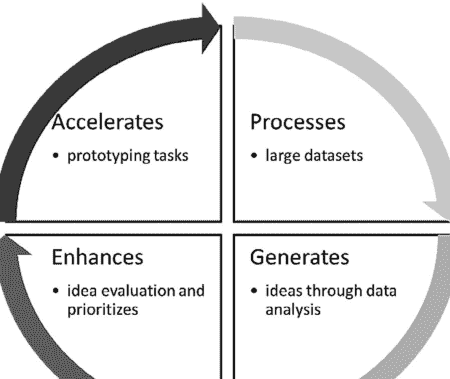

图 10.1 AI 对创新过程的影响。

## 10.2.2.1 AI 作为变革的催化剂

随着 AI 成为驱动跨行业破坏性创新的强大因素，创新管理正在发生根本性变化。AI 具有巨大影响，之一是其转型决策的能力。先进的 ML 算法使企业能够以前所未有的速度评估大型数据集，提取指导战略决策的深刻信息。除了提高准确性外，数据驱动的决策使公司处于领先地位，能够发现新趋势、客户偏好和市场机会，从而鼓励颠覆性变革 [11]。

AI 可以成为决策和重复性工作自动化的颠覆力量。AI 通过自动执行重复和单调的任务，将人力释放出来用于更重要的任务，从而促进组织的敏捷性和创新能力。通过促进对市场需求的快速反应，自动化提高了运营效率并加快了创新步伐。因此，AI 驱动的创新通过挑战传统的时间尺度并迫使竞争对手在逆势环境中进行调整，巩固了其转型影响力。

此外，AI 通过个性化和重新定义客户体验颠覆了传统的商业范式。ML 算法使得高度定制的解决方案成为可能，这些方案分析每个客户的行为、兴趣和互动。这种程度的定制增加了客户的满意度，并提出了违背常理的创新业务理念。此外，AI 通过促进创建完全新的业务模式（例如预测性维护模型和订阅服务），为创造价值开辟了新途径。因此，战略性地将 AI 整合到其创新管理流程中的公司，将处于引领这种变革性转变的地位，而这种转变正成为具有前瞻性和进取型企业的显著特征。

## 10.2.2.2 开放创新平台中的 AI

随着 AI 引入开放创新平台，协作构思和解决问题的动态机制在近年来发生了巨大变化。AI 技术的引入显著提高了开放创新的效率和效果，开放创新强调内部和外部利益相关者之间的合作。本节探讨了 AI 在开放创新平台中的功能，以及它是如何促进更具多样性和动态性的创新环境的。

AI 系统利用先进的 NLP 方法分析来自论坛、社交媒体和研究论文的海量非结构化数据。在此过程中，它们发现了潜在需求、突发模式和创新概念。这种增强的能力赋予了组织对创新生态系统的全方位理解，能够探测其他可能被忽视的机会。此外，这些平台通过利用 ML 算法实现智能众包，并将任务与具有相应专业知识和技能的贡献者配对。这促进了实质性的协作。通过分析先前的结果，预测性分析帮助组织确定概念和任务的成功概率。这有助于更有效地分配资源并降低风险。此外，在自动评估中使用 NLP 算法，通过评估多个概念对预设标准的可行性、独创性和重要性，减轻了管理众多概念的困难。自动筛选允许人类专家专注于创新的更复杂方面。AI 在开放创新中的持续增强和进步，使系统能够逐渐从贡献和互动中获取知识，从而改进其算法，以便在不断变化的创新环境中做出更好的预测、提出更好的建议并促进更具成效的合作。

## 10.2.2.3 AI 在增量创新和激性创新中的作用

AI 对创新管理具有根本性不同的影响，从微小改进到大规模变革。预测性分析为 AI 带来了增量进展，帮助企业通过反馈循环和持续监控做出数据驱动的决策并改进其产品。常规任务自动化加速了微调，使企业能够对变化的消费者需求做出快速反应。AI 使用 NLP 和 ML 生成智能想法，这催化了激进创新。AI 支持的加速原型和仿真允许企业快速测试和确认想法，节省时间和资源。此外，AI 对数据驱动决策的贡献减少了高风险任务中的风险，并增加了成功执行的可能性。

## 10.3 AI 驱动创新管理的关键组件

对于希望保持竞争力和灵活性的公司，将尖端技术整合到创新管理的核心已变得至关重要。AI 驱动创新管理的要素元素包含一系列利用数据、自动化和 ML 来改进创新生命周期各个侧面的应用程序。

## 10.3.1 数据驱动的决策

使用事实、指标和数据来为支持倡议、目标和目的战略业务决策提供信息被称为数据驱动的决策。大数据和预测性分析对于创新是至关重要的，因为它们帮助企业根据对客户行为和市场动态的透彻理解做出明智决策。大数据分析通过引入模糊创新与技术之间传统区别的逻辑，迫使企业修改其创新流程 [12]。得益于 AI 算法支持的预测性分析，创新经理可以就资源分配、产品开发和市场进入做出战略选择，这使企业能够准确估计未来趋势和市场需求。使用大数据分析可以产生更全面的图景以及更精确的创新过程知识。作为预测预测的一种，预测性分析是一种自动化方法，允许调整预测以帮助企业发现新机会并做出更明智的决策。组织必须使用数据驱动的决策来提高效率。

## 10.3.2 创新中的 ML 算法

ML 作为 AI 类型正在改变多个行业。它使计算机从数据中获取知识并逐渐变得高效。从人类指令驱动引擎转向机器推理引擎是 ML 时代的基本转变，使软件随着时间的推移做出日益复杂的决策。预计 ML 将二十一世纪发挥重要作用，改变人们的工作和生活方式。它已经存在于银行、零售、医疗和科学发现等领域。

除了颠覆现有业务外，ML 为创造开辟了新途径。预计机会将与人类创新管理共同探测和选择 [1]。企业在继续使用 ML 时，将面临将 ML 系统集成到遗留基础设施以及减少 ML 偏见的困难。因此，各领域专家（包括业务主管）理解 ML 的基本概念、应用和限制是至关重要的。

## 10.3.2.1 用于想法生成的 NLP

NLP 对于 AI 驱动创新管理中的想法开发至关重要。益于 NLP 对理解的帮助，只有最有希望的想法进入创新的下一个阶段。利用 AI 的能力可以让想法管理更具创意和高效。


# 表 10.1 创新构思中的自然语言处理 (NLP)

| 应用 | 描述 |
|---|---|
| 语义分析与趋势识别 | 理解语言细微差别以识别趋势 |
| 从客户反馈中生成构思 | 从反馈中提取洞察以驱动创新 |
| 内容摘要与合成 | 压缩信息并创建凝聚性的概述 |
| 自动化构思工作坊 | 使用 NLP 为团队提供虚拟头脑风暴 |

将 AI 集成到创新管理系统中是一场游戏规则的改变，它提供了前所未有的数据分析和洞察、定制化的客户体验，以及制造质量和效率的提升等优势。AI 可以加速决策过程、减少偏见，并促进更多创意想法的表面和考虑，从而有助于机会识别和构思生成。

NLP 通过解释人类语言的复杂性，改变了创新团队从非结构化文本数据中收集洞察的方式（表 10.1）。通过使用语义分析和趋势识别，NLP 促进了主动适应新兴的市场动态，确保构思工作由情感分析和从客户反馈中提取的用户洞察所驱动。内容合成与摘要简化了材料，使创新团队更容易获取信息。此外，通过关联主题和评估实时输入，NLP 通过促进自动化工作坊增强了协作。当企业使用 NLP 时，在构思过程中将技术与人类创造力相结合将成为一种强大的力量，确保所产生的想法不仅具有创造性，而且稳固地基于市场趋势和客户洞察。

## 10.3.2.2 创新团队的推荐系统

推荐系统对于创新团队至关重要，因为它们帮助组建团队、做出更好的决策，并为特定的项目职位推荐合适的人选。这些系统通过算法从用户选择和交互中学习，推荐相关、多样化且创新的选项。最终，它们通过帮助成员找到互补的能力和必要的行为特征，对于开发团队协同和绩效至关重要。在创新管理背景下，推荐系统辅助信息处理和决策，通常会改进组织内部的创新流程 [13]。此外，它们的运作方式就像零售销售员：他们保持客户的兴趣，连接更多产品和信息，并推荐客户可能购买或感兴趣的产品。

- **理解用户偏好**：开发推荐系统的第一步是彻底掌握每个团队成员的偏好、能力和之前的贡献。每个团队成员的天赋、局限性和感兴趣领域都记录在系统根据用户交互和历史数据分析生成的个性化档案中。这是产生与每个团队成员独特特质相匹配的专注推荐的基础。

- **构思生成与协作**：推荐系统促进构思生成的能力是创新团队的一项关键特性。这些系统可以通过分析想法的记录并考虑团队中专业领域的多样性，建议与团队目标一致的新想法。此外，推荐系统会根据互补的技能组合寻找可能的伙伴，营造一种促进创造性突破的协作氛围。

- **自适应学习**：推荐系统使用自适应学习过程不断演进。随着项目的进行，创新团队从成功和失败的结果中学习。通过这种迭代学习过程，系统可以响应团队动态的转变和不断变化的创新目标，改进其建议。

- **跨学科协作**：当不同学科汇聚时，创新就会蓬勃发展。通过识别在看似不相关领域拥有知识的团队成员，推荐系统通过提供对项目的价值见解实现了跨学科协作。这种能力鼓励了解决问题的全面方法，并通过融合来自不同领域的知识来促进创新。

- **资源优化**：有效的资源管理对于创新的成功至关重要。通过根据项目需求推荐工具、技术和外部资源，推荐系统帮助创新团队实现资源利用最大化。这确保小组能够获得最新且相关的材料，提高了他们将概念转化为发明的能力。

- **减轻认知偏见**：认知偏见会影响人类决策并影响创新过程。通过提供基于证据的建议，推荐系统作为无偏见的、数据驱动的决策辅助工具，减少认知偏见。这营造了一个更具优绩和包容性的创新环境。

## 10.3.3 创新过程中的自动化与机器人

自动化和 AI 驱动的机器人正在引发创新流程的范式转变。这些技术通过加速传统的耗时操作并引入原型设计、测试和验证的新方法，正在改变组织创造的方式。RPA 使原型设计成为可能，它简化了早期模型和原型创建的过程，并加速了各种想法的研究。这种快速方法让迭代设计改进变得更容易，为创新团队提供了快速反馈，并加速了强大的、以用户为中心的解决方案的创建。

AI 驱动的测试和验证自动化进一步提高了创新管理的效率。测试结果由 ML 算法分析，这些算法寻找趋势和相关性以提供富有洞察的信息。AI 通过利用之前的测试来发现问题并建议修复方案。

# AI 时代的创新管理

自动化和机器人提供了传统方法的突破，使企业能够以以前所未有的效率处理创新的复杂性。当自动化测试执行重复性操作时，大大减少了传统验证程序所需的时间和资源。随着这些技术的发展，预计它们将在未来塑造创新方面发挥更重要的作用，开启一个人类创造力与自动化流程和谐协作的时代，从而推动跨多个行业的变革性突破。[/

## 10.4 挑战与伦理考量

### 10.4.1 AI 驱动创新的偏见与公平性

为了发现并解决训练数据中的任何偏见，企业需要从严谨的偏见检测与评估、算法审计以及培养多元化的开发团队开始。使用数据预处理技术（如数据增强和去偏见方法）来产生更具代表性和更平衡的数据集变得至关重要。在公平性标准的衡量和定义中（如均等概率和人口统计学平衡）以及持续的部署监控对于保证模型输出的公平是必要的。透明度至关重要，通过使用可解释的 AI 模型和说明性的用户界面来实现，这些界面阐明了决策过程并增强了用户的信任和责任感。

使用 AI 决策的组织必须优先考虑人工监督和问责制，通过建立明确的责任界限来确保自动化流程不会优先于伦理考量。同时，鼓励开发团队的多样化有助于更好地理解潜在偏见及其影响，从而有助于识别歧视。应对偏见和确保公正的持续努力需要数据科学家、领域专家和伦理哲学者的合作。

### 10.4.2 AI 集成型创新管理中的安全问题

在将 AI 集成到创新管理中时，安全考量带来了一系列复杂的挑战，需要仔细的考虑和周密的预防措施。首先，保护知识产权变得至关重要，因为 AI 模型和算法代表了无价的创新，必须免受威胁和未经授权的访问。访问限制、可靠的加密技术和安全的存储解决方案是保护机密数据的关键组成。

在不同阶段解决漏洞对于减轻 AI 驱动操作中的网络安全威胁是必要的。组织需要在 AI 模型训练阶段优先考虑数据安全，通过实施安全的数据通信协议和加密来防止泄露并保护敏感数据。


182 AI 时代的未来科技初创企业与创新

主动防御措施对于 AI 模型而言，对于抵抗旨在改变预测的对抗性攻击至关重要。这些包括对抗训练和稳健的模型拓扑结构。

此外，将 AI 安全地整合到创新管理中很大程度上取决于法律和合规问题。企业需要遵守数据隐私要求，例如《通用数据保护条例》（GDPR），该条例规定 AI 系统必须遵守控制个人数据收集、存储和处理的相关法律框架。为了确保在创新中负责任地使用 AI，同时保护用户隐私并恪守道德准则，还需要制定伦理规则。

## 10.5 AI 在创新管理中的组织化实施

### 10.5.1 建立创新文化

建立支持创新的文化、为 AI 集成提供培训和技能提升，以及营造一个奖励实验和承担风险的环境，对于在企业内部发展创新文化都是必要的。组织应优先考虑持续改进、奖励冒险行为并挑战现状，以促进有利于创新的环境。这涉及到通过促进早期想法共享来消除障碍，关注可以做到的而非不能做到的，并建立一个让同事感到乐于站出来交流想法的安全环境。此外，确立组织的使命和核心价值观、促进透明沟通，并承认包容性和多样性在创造创新文化中的益处至关重要。

#### 10.5.1.1 营造支持创新的环境

将 AI 有效整合到创新管理中，需要在企业内部营造支持创新的氛围。领导的支持至关重要，高管应清楚地阐述强调创新价值和 AI 技术应用的愿景。资源的分配应作为这种承诺的进一步证据，凸显组织对开发创意和灵活文化的承诺。

当提供激励方案和认可努力时，员工参与创新的积极性很高。创建与创意成就挂钩激励计划可以鼓励新想法的发展和 AI 驱动项目的采用。同时，培养一种认可努力的文化可以营造一种有利的氛围，激励员工将 AI 技术整合到他们的日常工作中。沟通渠道（如反馈通道和跨部门协作）可以打破信息孤岛，并实现成功 AI 集成所需的开放想法交流。这种支持创新的文化是成功利用创意想法的基石，并使各级员工能够实现技术的革命性潜力。

#### 10.5.1.2 用于 AI 集成的培训与技能提升

这一复杂过程涉及让多个部门的人员具备必要的知识，以理解、利用和支持 AI 驱动的项目（图 10.2）。组织在开启革命性之旅之前，需要彻底评估其当前的技能差距。这包括确定在技术和非技术技能方面需要提升的领域，以及在 AI 技术信息方面的不足。

因此，公司应该设计专业的培训计划以满足员工的需求，考虑到他们的职位和目前的知识水平。其中一种策略是分层方法，包括针对专业职位的适应模块和用于广泛理解的基础课程。技术培训应通过实操课程提供实际技能强化，并对当今相关的 AI 概念、算法和工具进行全面指导。为了建立 AI 应用的全面知识，在传统划分的职位（如数据科学家、领域专家和业务专业人员）之间建立跨职的理解和协作至关重要。

开发优先解决问题的技能对参与者的投入至关重要。员工的 AI 能力可以通过与信誉良好的组织的认证计划进行验证；成功完成后，参与者将获得认可和激励，这将鼓励终身学习和技能增长。

## 10.5.2 AI 驱动创新的结构性变化

AI 驱动创新的重要结构性调整包括重新定义角色和职责，以及形成跨部门 AI 团队。AI 技术的传播为货物、和服务和创新流程的深刻转变提供了可能 [14]。为了激发创意，公司需要在学科团队之间合作，重新定义角色和职责。这些团队的职责包括制定创新战略、提供创新框架以及以身作则。他们还应该是战术性的、敏捷且快速的。AI 正在改变组织结构，公司寻求重大变化变得更加跨部门。为了优化从头到尾的操作，这意味着消除数据孤岛和操作系统，并利用来自其他部门的数据增强协作。

为了激发创意，需要建立跨部门 AI 团队。为了在某些项目或产品上合作，这些团队聚集了来自多个部门、具有各种技能和专业知识的人员。通过减少部门间的依赖和交接，他们加速了开发过程，允许成员分享不同的观点，激发创意并促进创意解决方案的发展。此外，为了 AI 的成功整合，组织可以通过投资再培训和技能提升计划，为员工提供捕捉 AI 机会所需的技能，而不是被其震慑。在公司内部建立学习文化对于 AI 时代的持续发展和灵活性至关重要。这包括让员工获得学习材料并激励他们追求终身学习。


# AI 时代的创新管理 ■ 185

团队，以及将 AI 引入决策过程是该蓝图的三大支柱。它强烈强调了指定 AI 军师、建立专门的数据科学团队、跨职能合作、敏捷方法、持续学习以及 AI 治理框架的实施。

## 10.6 AI 驱动创新管理的未来趋势

AI 驱动的创新管理的一些未来主题包括超个性化、扩展现实、区块链、5G、网络安全、自动化与运营效率、气候建模、绿色技术、数字化劳动力的再培训与技能提升，以及 AI 驱动的营销。AI 越来越多地用于驱动转型，影响网络安全、自动化、商业智能和客户体验。预计 AI 将通过推动内容生产、社交媒体自动化和搜索引擎优化 (SEO) 来推进营销，为公司提供提升其数字营销计划的效果和效率的机会。

AI 驱动了各行业的创新、效率和竞争力，其对数字化转型的影响显而易见。AI 驱动算法分析海量数据库以生成高度定制化的产品、内容推荐和客户忠诚度。这导致了销售额的增长。AI 还简化了数据准备、报告和可视化，使决策者能够并在所有企业中实现数据民主化。AI 加快了可能源系统的构建和优化，并有助于气候建模。它还通过适应和缓解气候变化来支持明智决策。

### 10.6.1 AI 技术的演进

AI 技术如何发展是塑造创新管理格局的主要因素。随着 AI 的持续发展，企业将获得新的工具和渠道来改进它们的创新流程。

- NLP（自然语言处理）的进进。随着 NLP 能力的不断完善，AI 系统可以更好地理解、解释和生成类人语言。这种演进对创新管理具有重大意义，特别是在构思生成、情感分析和从非结构化来源中提取洞察方面。增强的 NLP 促进了人与 AI 之间细微的互动，为创新思维营造了协作环境。

- 量子计算在创新中的整合。随着量子计算从理论概念转向实际应用，其对创新的潜在影响变得日益显现。量子计算无与伦比的处理能力为解决优化、模拟和数据分析中的复杂问题带来了希望。在创新的背景下，这可能导致材料科学、药物发现和复杂创新流程优化的突破。

# 186 AI 时代的未来初创企业与创新

- AI 驱动的生成模型。先进生成模型（如 GPT-4 及更高版本）的出现，使 AI 系统能够生成高度真实且上下文相关的内容。在创新中，这些模型可以帮助创造性想法的生成和内容创作，甚至模拟未来场景。AI 自主生成创新概念的能力促进了创新中创造性方面更具动态且更敏捷的方法。

- 可解释 AI (XAI)。随着 AI 系统变得越来越复杂，透明和可解释性变得至关重要。XAI 通过提供对 AI 算法决策过程的洞察来解决这一担忧。在创新管理中，理解 AI 驱动的建议和决策背后的原理对于建立信任以及确保创新与组织目标和价值观至关重要。

- 用于实时创新的边缘 AI。在靠近数据产生的边缘部署 AI，有利于实时处理和决策。在创新管理中，这意味着更快的洞察、更快速地适应市场变化，以及及时响应新兴机会的能力。边缘 AI 赋能组织创建一个更具响应性且敏捷的创新生态系统。

- AI 集成 RPA。将 AI 与 RPA 整合增强了创新管理中常规任务的效率，使人力资源专注于创新中更具创造力和战略意义的方面。这种融合允许 AI 和 RPA 简化工作流，减少错误并加速创新倡议的步伐。

表 10.2 对关键 AI 技术进行了方法论评估，重点关注以下标准：可扩展性、交互性、可靠性、实时处理、创造力增强和效率提高。每种技术的属性在以下类别中进行评估，勾号表示对应功能的存在。

## 10.6.2 AI 对创新生态系统的影响

### 10.6.2.1 AI 时代的协作创新

AI 驱动的虚拟协作平台是这一变革的核心。这些系统利用尖端算法促进项目管理、文档共享和

#### 表 10.2 用于创新管理的 AI 技术对比表

| AI 技术 | 可扩展性 | 交互性 | 可信度 | 实时处理 | 创造力增强 | 效率提高 |
| :--- | :---: | :---: | :---: | :---: | :---: | :---: |
| NLP | | | | | | |
| 量子计算 | ✓ | | | | | |
| AI 驱动的生成模型 | | ✓ | | | | |
| XAI | | | ✓ | | | |
| 用于实时创新的边缘 AI | | | | ✓ | | |
| AI 集成 RPA | | | | | | ✓ |

# AI 时代的创新管理 ■ 187

实时通信。通过协作文档编辑和视频会议等功能，它们使团队能够跨越地理限制进行共同工作。

AI 在协作创新中起着巨大的作用，而不只是帮助通信。预测性分析预测可能的结果。通过分析，AI 在数据集中发现模式和趋势，这可能会激发原创想法或改进现有想法。

此外，AI 时代让前所未有的跨协作成为可能。缩小知识差距并促进高效通信的 AI 技术造了不同水平和领域的团队。AI 克服地理边界的潜力使创新在全球范围内成为现实。人类创造力与 AI 的结合改进了工作流，并为解决挑战提供了新的可能性。

### 10.6.2.2 AI 驱动创新的全球影响

AI 正成为全球创新生态系统中日益重要的部分，影响经济、社会和行业。这种全球性的转变定义为创新的民主化，得益于 AI 驱动工具日益普及，曾经被边缘化的地区现在可以积极参与开发和采用尖端解决方案。AI 驱动的创新生态系统加速了跨国知识共享，创造了一个更有联系的全球社区，创新和最佳实践在全球范围内传播，影响并推动进步。

范围内，AI 同时产生着破坏性影响，颠覆了标准并对现有行业提出挑战。制造业、医疗、金融和物流等全球行业正在因 AI 驱动的自动化而改变。将 AI 整合到创新生态系统中为国家和地区提供了竞争优势，影响就业创造。除了财务考虑，AI 驱动的突破具有重大的全球影响，因为它们对于解决资源管理、医疗和气候变化等问题至关重要。然而，随着创新跨越边界，道德和法律问题变得更加重要，需要国际合作为全球 AI 的正确应用制定统一的标准和法律。


## 188 AI 时代的未来初创企业与创新

机器学习（ML）是目前用于商业开发的最流行的 AI 形式之一。AI 已家喻户晓，并提升了每个行业几乎每一个业务流程。在过去的几十年里，初创领域发生了巨大变化，与前辈相比，早期数字业务创业者获得更多的资源和信息。使用 AI 和 ML 的初创企业预计成本更低、客户满意度更高且生产力，这为它们带来了竞争优势并提升了传统行业。商业模式创新可能源于为行业引入新的价值创造机制，这需要理解企业如何将 AI 整合到运营中。

AI 可以完全改变初创企业的运营方式，并显著提高生产力和效率，使其在快速变化的市场中获得巨大的竞争优势。AI 和 ML 迅速成为包括初创企业在内的各行业的关键技术。它们帮助公司做出更好的决策、自动化重复操作并提供个性化建议，从而增强生产力和创造力。目前正在分析 AI 基础模型对欧洲 AI 生态系统的重要性，以及该大陆失去主权的可能性。AI 初创企业和支持它们的模型预计将产生革命性影响。表 10.3 展示了业务转型中的关键要素及其对自动化、个性化、订阅模式、数据变现和敏捷创新的影响。

## 表 10.3 AI 业务转型的关键特征

| 转型维度 | 关键特征 | 对业务的影响 |
|---|---|---|
| 自动化与运营效率 | - AI 驱动流程：自动化常规任务以提高效率 | 提高生产力和资源分配 |
| | - 降低成本：实现精益的业务模式和高效的资源分配 | 竞争性定价提高财务可持续性 |
| 个性化与客户体验 | - AI 驱动客户洞察：分析数据以提供个性化建议 | 提高客户满意度和忠诚度 |
| | - 增强客户互动：通过聊天机器人和分析转化体验 | 24/7 支持和主动解决问题 |
| 订阅制和即服务模式 | - 预测订阅模型：预测客户偏好以提供个性化产品 | 更高的客户留存和稳定的收入流 |
| | AI 即服务 (AIaaS)：以订阅形式提供能力，降低前期成本 | 无需基础设施成本即可使用先进 AI |
| 数据变现 | 释放数据价值：分析服务或出售数据集 | 收入来源多元化，利用数据资产 |
| | 创建新收入来源：通过洞察、新产品和合作伙伴关系实现数据变现 | 创新机会和互利共的合作 |
| 敏捷创新与快速原型设计 | 加速创新：促进快速原型设计和迭代 | 更短的上市时间，对变化趋势的适应能力 |
| | 缩短上市时间：缩短开发周期以更快适应 | 增强竞争力并对市场需求做出更快反应 |

## 10.7 结论

AI 与创新管理的融合催成了一种范式转变，将概念框架与具体实施结合起来。理论探讨涉及在 AI 框架内对熊彼特式、开放和颠覆性创新的重新定义，这催化了渐进式和革命性的进步。组织和创新经理面临着重大的影响，需要进行战略性调整，以培养变革文化、重组劳动力队伍、提升技能并解决伦理和安全问题。展望未来，AI 的持续进步有望推动量子计算集成、自然语言处理（NLP）以及国际水平协作创新的发展。随着未来的演进，这将成为一场穿越人类智慧与机器学习交汇的旅程，为准备好采用创新的组织提供前所未有的机会。

## 

- [1] N. Haefner, J. Vincent, V. Parida, and Z. Gassmann, “Artificial intelligence and innovation management: a review, framework, and research agenda,” Technological Forecasting and Social Change, vol. 162, pp. 120392.
- [2] J. Füller, K. Hutter, J. Wahl, V. Bilgram, and Z. Tekik, “How AI revolutionizes innovation management-perceptions and implementation references of AI-based innovators,” Technological Forecasting and Social Change, vol. 178, p. 121598.
- [3] H. Taheroost and M. Madanian, “AI advances: comparison of innovative techniques,” AI, vol. 5, no. 1, pp. 38–54, 2024.
- [4] C. Cziemnick, “Joseph A. Schumpeter and Innovation,” in Encyclopedia of Creativity, Innovation and Entrepreneurship, E. G. Carayannis, New York: Springer, 2013, pp. 1171–1176.
- [5] M. Knoll, “Schumpeter, Minkowski and the financial instability hypothesis,” Journal of evolutionary Economics, vol. 25, pp. 293–310, 2015.
- [6] A. Coskun-Setirek and Z. Tanriku, “Digital innovations-driven business model regeneration: a process model,” Technology in Society, vol. 64, p. 101461, 2021.
- [7] C. Chesbrough and M. Rogers, “Explicating Open Innovation: Clarifying the Paradigm for Disruptive Innovation,” in New Frontiers of Open Innovation. Oxford University Press, Forth, 2014, pp. 3–28.
- [8] B. Podmina, I. Fenberg, R. Rupert and E. Alberts, “Towards open innovation management system-a literature review,” in ISPIM Proceedings, 2014, p. 1. The International Society for Professional Innovation Management (ISIM).
- [9] B. Bilardi and F. Galati, “An open innovation model for SMEs,” Research Open Innovation, 2018, pp. 71–113.
- [10] B. Bilardi and F. Galati, “An open innovation model for SMEs,” London of Economics and Policy Science, 2020.
- [11] H. Taheroost and M. Madanian, “Multi-criteria decision making (MCDM),” Encyclopedia, vol. 3, no. 1, pp. 77–87, 2023.
- [12] R. Capurso, F. Fiorentino, S. Garzella, and A. Giudici, “Big data analytics in innovation processes: which dynamic capabilities should be developed,” European Journal of Innovation Management, vol. 25, no. 6, pp. 273–294, 2021.
- [13] L. Chen, M. De Gemmis, A. Felfern, P. Lops, F. Ricci, and G. Semeraro, “Human decision making and recommender systems,” ACM Transactions on Interactive Intelligent Systems (TiiS), vol. 3, no. 3, pp. 1–7, 2013.
- [14] D. Sjödin, V. Parida, M. Palmić, and J. Wincent, “How AI capabilities enable business model innovation: scaling AI through co-evolutionary processes and feedback loops,” Journal of Business Research, vol. 134, pp. 574–587, 2021.


具有成本效益的决策流程，并获得必要的资金以促进扩张。此外，它有助于进入未开发的市场，并要求创业者对市场发展和前景保持信息灵。

人工智能（AI）时代显著改变了商业格局，尤其是对于创业者而言。通过利用尖端技术，AI 使企业能够获取价值洞察、改进客户体验并刺激增长。对于创业者来说，一个重要优势是，使用 AI 开发新的业务流程通常比修改现有流程更简单；这为他们在创新和灵活性方面提供了竞争优势。此外，AI 赋能创业者减少对传统方法的依赖，并将精力投入到特定领域的专业培养 [3, 4]。

在考虑业务发展时，AI 显著影响着创业者的成功之路。AI 赋予创业者实时分析海量数据的能力，使其能够完善营销策略、识别未开发的机会并做出明智的决策。AI 还让企业保持行业领先地位，快速适应市场变化，并提供规模化的个性化体验。此外，实施 AI 驱动的策略使初创企业能够简化运营、自动化流程，并获得竞争对手的实质性优势。

产品开发、人力资源、销售和市场都是初创公司内部受 AI 业务发展影响的部门。AI 工具可以通过自动化重复性任务、提供具有洞察力的数据以及增强目标定位和信息传递来提供巨大帮助，使其成为各自行业中的领先者，并为持续扩张奠定基础。此外，无代码 AI 工具的普及为创业者提供了一种成本效益的方法，将 AI 集成到其运营中，并获得相对于竞争对手的优势。

## 11.2 初创生态系统

初创生态系统由不同发展阶段的组织、个人和公司组成，它们在物理或虚拟空间内协作，以建立和扩大新企业。这一相互关联系统的功能对于促进企业扩张鼓励创新至关重要。大学、资金支持组织（例如孵化器和加速器）、研究机构、服务提供者组织（例如法律和财务服务）、大型公司和政府实体都是可能构成初创生态系统的组织示例。相互依赖性是该生态系统的特征，其中每个成员在互互利的关系中依赖于其他。

初创公司是初创生态系统的核心组成部分，因为它们是创新和经济增长的催化剂。此外，生态系统的成功取决于辅助服务，如法律和问责公司、导师、孵化器和人才源。此外，一个繁荣的初创生态系统受到支持性的创业文化、资本获取和创业教育的支持 [5]。

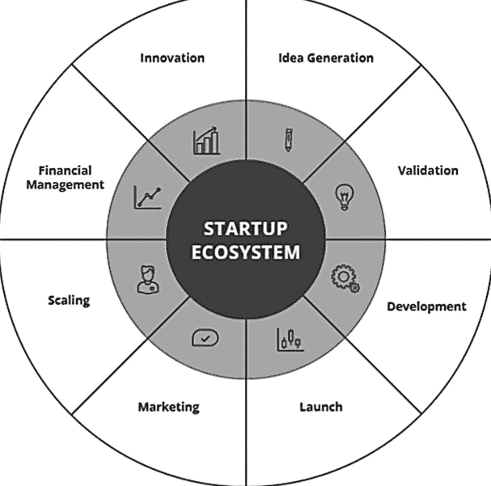

图 11.1 敏捷的初创之旅。

外部和内部因素动态地影响着生态系统，包括市场波动、财务状况和政府政策。初创生态系统的繁荣对于区域经济的进步和个人创业者的成功至关重要。它促进了合作与创新的机会、资源和资金的获取，以及业务扩张和规模化的良好环境。通过理解初创生态系统的基本要素和推动其成功的因素，相关方努力构建和培养繁荣的初创生态系统，刺激经济增长和创新。从概念到预期退出的动态过程如图 11.1 所示，强调了适应性和持续改进的重要性。

### 11.2.1 初创生态系统中的关键参与者和利益相关者

新兴企业受益于关键参与者和利益相关者的集体贡献，他们发挥着关键影响。初创公司的客户是该网络的核心，因为他们对价值的感知和需求决定了初创企业的进程。相反，初创公司人员承担着关键职，因为他们的参与程度和持续就业对公司的扩张和运行有直接影响。

初创公司投资者促进了基本资金的注入，包括天使投资人、风险投资家和其他多元化的资金来源。初创企业的孵化器和加速器通过提供资源、指导和建立联系的机会来营造支持性的氛围。

相反，与其他企业的战略联盟提供了获取额外资源、专业知识和未开发途径。当地社区为初创公司提供资源、支持及其产品或服务的市场。相比之下，政府机构和政策制定者通过建立有利的监管环境和发放援助做出贡献。创始人和所有者是内在利益相关者，因为他们指导着愿景和战略。对于初创公司的成功，积极且战略地涉及这些不同的利益相关者至关重要，因为每个群体都对促进和进步贡献了独特的东西。这强调了培养强大关系以抓住有利机会的重要性。

### 11.2.2 初创企业业务发展中的挑战与机遇

初创公司面临各种资源限制，如财务限制、人员短缺和时间限制，这些阻碍了发展的进展。市场的波动增加了复杂性，要求具备适应不断变化的消费者偏好的能力。特别是在与大型公司竞争时，激烈的竞争要求灵活的方法。应对监管环境，特别是涉及 AI 等颠覆性技术，构成了进一步的挑战。人才招聘的一个持续障碍（特别是针对 AI 领域的专业人士）是财务限制。

由于其本质，初创公司可以快速适应市场变化，从而利用其适应性。传统行业正受到初创公司中盛行的包含 AI 的创新文化所实现的突破性解决方案的颠覆。


# 初创企业业务发展中的 AI 时代 195

根据 Colombelli 等人 [7] 对 AI 在意大利初创公司作用的研究，应用领域的数据和知识的存在是形成 AI 初创公司的关键要求。审查 AI 创业项目对于从更全面地理解这种新型且强大的通用技术的启动程序至关重要。对 AI 公司的发展进行研究，可以为如何实施 AI 以产生新的市场机会和行业、提高运营效率以及降低成本提供宝贵的见解。

## 11.3.2 AI 如何变革传统的业务发展

在历史上，手动流程、基于规则的决策和不可更改的业务一直是业务运营的基础。然而，引入 AI 促进了琐碎流程的自动化，释放了人员去承担更重要的任务，并提高了效率和产出。这对于小型和初创企业尤为关键，因为它使他们能够公平地与大型公司竞争。

知情决策是 AI 变革传统业务流程的关键机制。利用 AI 技术（特别是机器学习 ML）快速处理海量数据，为组织提供了可操作的洞察以指导战略决策。这使得组织能够生成更准确的预测，并识别更新的扩张前景。

自动化运营构成了 AI 显著改变传统业务发展流程的另一个领域。AI 赋予企业分析包括数据输入和客户服务在内的广泛运营，从而释放人力资本投入到更复杂、更创新的追求中。这提高了生产力的同时减少了人为错误的概率。此外，AI 是提高生产力的重要组成部分；AI 正在利用资源优化和精简服务组织。这对于通常在资源限制的情况下运行并需要优化利用的初创企业来说至关重要。

## 11.4 构建强大的战略规划

这一基础建立在基本要素之上，包括使命、愿景和价值观，这些要素为组织提供了流动性和指导。在制定战略计划之前，必须建立使命（组织预期的未来状态）、价值观（管理组织的指导性原则）和愿景（理想的未来状态）。这些组件是连接组织的凝聚力，为设定目标和做出决策提供了清晰的战略轨迹。

战略规划是实现组织目标的指南。它涉及建立明确的目标、识别目标市场、审视竞争对手，并制定以实现长期目标的的策略。一个设计精良的战略计划充当了指南针的角色，确保组织的每个方面都保持协调一致，并为决策提供方向。需要强调的是，尽管 196 未来科技初创公司与 AI 时代的创新可能会根据市场状况发生策略和目标的转变，但组织的使命、愿景和价值观应该保持坚定。

一个成功的业务组织的关键要素包括运营卓越性、有效的领导力、人才培养和以客户为中心，此外使命、愿景和价值观。在组织运营的每个方面对效率和效果的追求构成了卓越，而愿景和方向则受到有效领导力的启示。通过将这些关键要素放在首位，并营造一个重视协作、创新和适应性的环境，组织可以为扩张、持久和持续繁荣奠定基础 [8]。

## 11.4.1 战略规划在初创企业业务发展中的重要性

战略规划通过为组织提供清晰的路线图，帮助协调努力、有效分配资源并优先考虑事项。初创企业需要一个全面的战略计划，以专业且无偏地评估业务发展、趋势和机会；这对于它们的长期成功至关重要。根据研究，重大的创业前规划可以降低小型企业的高死亡率 [9]。这强调了战略规划在业务创业初级阶段的批判性作用。

初创企业的一个显著特征是其业务框架中包含了很大程度的“创新”。有效的创新增加了组织获得卓越增长并为利益相关者创造价值的概率。然而，准备不足是实现丰硕创新的重大障碍。战略规划使初创企业能够增长、评估和分析有关业务环境的数据；识别并评估组织的优缺点，并制定定义明确的使命以及一系列可实现的目标和客观标准 [10]。

持续的战略规划需要投入时间、努力和持续的重新评估。这是一个随着业务环境变化而演变的动态过程；它不是一次性的事件。通过为战略规划留出时间，初创企业可以发展面向未来的愿景，促进所有员工的一致性，并提供实现组织目标的实际路径。这对于初创企业尤为关键，因为它使他们能够在不确定性和透明性中保持灵活性和响应能力。

## 11.4.2 利用 AI 工具进行市场研究和竞争对手分析

在初创企业业务发展的动态领域，AI 在开展竞争对手分析和市场研究中的重要性增加了。AI 工具为初创企业提供了无与伦比的功能，以提取洞察、检测模式并做出明智的判断，为战略规划做出了巨大贡献。

AI 驱动的工具显著改变了市场研究，包括情感分析和自然语言处理（NLP），它们可以有效处理大量的非结构化数据。这种能力赋予初创企业从各种来源（包括 197 初创企业业务发展中的 AI 时代 197 行业报告、客户评价和社交媒体）提取价值洞察。例如，情感分析可以评估公众对特定服务或产品的流行情绪，提供传统方法可能无法察觉的复杂观察。

此外，机器学习算法增强了初创企业预测需求模式、消费者偏好和市场趋势的能力。预测性分析使企业能够通过简化决策过程主动调整策略并保持竞争优势。

AI 通过竞争情报收集和分析的自动化，增强了战略规划和竞争对手分析的关键组成部分。初创企业可以利用 AI 算法监控竞争对手的在线活动、产品发布和客户反馈，获取实时的可操作洞察。一个值得注意的实现是利用 AI 驱动的聊天机器人来收集竞争情报。这些算法可以与竞争对手的客户服务渠道互动，提取有关产品属性、定价策略和客户不满意区域的价值数据。这种自动化方法允许企业在不需要大量人力资源的情况下持续监控竞争环境。

## 11.4.3 利用 AI 驱动策略创建可持续增长的路线图

AI 促进包容性和可持续发展的潜力，特别是联合国建立的可持续发展目标（SDGs），正在获得认可。通过同时推进经济发展和解决社会及环境问题，AI 驱动的策略对于建立通可持续增长的路径至关重要。AI、可持续性和项目管理的融合为企业利用 AI 驱动的洞察和技术来实现持久的繁荣提供了前所未有的前景。

将 AI 驱动的可持续目标纳入精确定义的战略中，对于追求可持续扩张的组织来说是必要的。建议的策略应该将资源优化、环境保护和客户留存作为充分利用 AI 潜力的可持续计划。企业可以通过实施数据中心化、算法定制和试点测试，成功实施优先考虑可持续性和提高运营效率的“绿色算法”。

## 11.5 客户获取与留存策略

客户获取和留存策略是组织成功和长存的基础。两者都是旨在增加收入和培养忠实客户群的重要要素，它们在方法和成本效益上有所不同。本节将探讨这些策略重要性、它们之间的区别以及通过整合它们可以获得的良好结果。

关于客户获取，准确性至关重要。这涉及到通过创建全面的客户画像来识别目标人群，并理解他们的需求、偏好和挑战。定制化


制定能够引起目标受众共鸣的获客策略是成功的关键。利用涵盖数字和传统平台在内的广泛营销渠道，可以扩大触达范围并提升关注度。通过采用定向广告、社交媒体、搜索引擎优化（SEO）和内容营销等各种策略，可以显著增强获取客户的过程。

相反，客户留存侧重于加强与现有客户的联系。企业可以通过实施主动沟通、个性化支持和卓越的服务来营造良好的客户体验，从而培养忠诚度。通过利用数据和分析，可以根据特定个人的偏好定制信息、推荐和优惠，从而提高转化率和参与度。此外，引入推荐计划通过激励现有客户向其社交圈推荐产品或服务，引入了活力。这种做法既促进了客户获取，又现有客户群体中培养了忠诚度和信任。

由于获客是一个涉及试错的密集过程，其产生的费用通常高于留存。在特定的业务模型背景下，留存通常能为营销支出产生更高的投资回报率（ROI），使其成为更具经济效益的策略。

获客和留存策略对于可持续发展至关重要，应当被同等优先。获取新客户对于确保持续增长至关重要，而留住现有客户则有助于稳定和持续的循环收入。通过整合这些策略，组织可以建立一个以客户为中心的成功和谐框架，培养潜在客户和现有客户的热情和忠诚。

## 11.5.1 利用 AI 进行目标客户获客

获取目标客户对于实现长期、可持续增长至关重要。AI 在这一追求中起着关键作用，从根本上改变了创业者识别、接触和转化潜在客户的方式。AI 算法赋予了数据驱动画像分析技术能力，通过检查海量数据集来生成全面的客户画像。这种对人口统计学、行为和偏好的洞察使企业家能够获得竞争优势。凭借这些知识，新兴企业可以开发出极具针对性的广告计划，有效地与不同的消费者群体建立联系，从而提高触达的准确性和有效性。

引入 AI 的另一个方面是预测分析，它赋予初创公司预测潜在客户未来行为和需求的能力。预测算法利用历史数据创建客户行为预测，使初创公司能够制定战略性和主动的决策。实施这种预测能力可以优化营销策略，提高转化率并增强整体活动效率。此外，AI 驱动的聊天机器人充当虚拟助手，实时与网站访问者进行互动。聊天机器人通过即时支持和互动改善了用户体验，并在有效获取线索和促进化的客户获取流程方面发挥着重要作用。

此外，AI 使得动态定价策略和自动化广告活动成为，让企业家能够有效地评估不断变化的市场状况。在 AI 的驱动下，动态定价模型根据实时需求、竞争对手定价和客户行为进行调整。这确保了企业家保持响应能力和灵活性，增加了收入和竞争力。通过利用 AI 洞察自动执行广告活动，可以将广告策略性地推送到相关的受众面前，提高营销活动的整体成本效益。AI 优化了初创公司获取目标客户的过程，并使其在要求准确性和灵活性的动态竞争环境中处于良好位置。

## 11.5.2 使用 算法实现个性化和定制

通过对用户行为和偏好进行实时分析，初创公司可以动态修改营销材料、网站内容和 App 界面以适应每个用户的特定兴趣。这改善了用户体验并提高了转化率。此外，AI 驱动的推荐引擎利用 ML 技术通过分析历史数据来预测用户偏好。这使初创企业能够为产品或内容提供定制化建议。这种现象促进了交叉销售和向上销售机会的扩大，对收入产生和客户满意度产生了积极影响。

AI 还进入了行为分析领域，这是个性化策略的一个关键方面。初创公司通过对多个渠道的用户行为进行全面分析，获得了关于消费者旅程和偏好的大量知识。手头的丰富信息有助于开发符合每位消费者特定需求和预期的针对性营销活动。此外，AI 算法通过预测未来的行动和偏好超越了对现状行为的分析。这使企业家能够提供定制化的体验。通过采用这种预测性个性化策略，企业通过提升忠诚度和满意度，为长期客户关系奠定了坚实基础。

AI 允许在营销领域内实施实时个性化活动和信息。初创公司可以根据实时用户互动动态修改内容、优惠和动作。通过确保客户收到及时且相关的信息，这种灵活性优化了营销活动的有效性。AI 驱动的定制超越了营销领域，涵盖了自适应用户界面，这种界面会修改设计和布局以适应用户偏好。实施这种自适应策略增强了多个数字平台上的用户满意度，强化了品牌忠诚度。

## 11.5.3 AI 驱动的客户留存策略与客户关系管理

通过将 AI 整合到客户关系管理（CRM）运营中，可以极大提高初创公司的战略表现。一个关键要素是流失分析，即利用 AI 算法检查客户数据以检测可能指示即将流失的模式。为了留住价值客户并降低流失风险，初创公司可以采取主动措施，提供个性化激励并主动解决问题。此外，利用 AI 驱动的聊天机器人和消息系统实现客户自动化，可以确保稳定的互动流，提供定制解决方案和及时更新以培养客户忠诚度。

个性化的计划计划和动态定价策略加入了 AI 的影响力。通过利用 AI 算法，企业家可以根据每个客户的特定偏好定制计划计划，确保奖励符合每个客户独特的需求。在 AI 的影响下，动态定价允许初创公司根据市场需求和消费者行为等因素调整价格。调整能力允许初创公司留住对价格敏感的消费者，并通过提供独家折扣来鼓励忠诚。此外，初创公司可以使用 AI 分析消费者反馈，包括通过调查和评论估算情感。这种理解有助于持续改进，展示了对客户友好和整体满意度的重视。

另一项由 AI 驱动的策略是主动问题解决，允许对消费者互动进行实时监控，以识别并及时解决潜在问题。这种方法使客户内容一致，增强了信任并减少了客户流失的可能性。实施 AI 驱动的生命周期个性化保证，使初创公司为客户旅程提供定制化体验。通过理解个人客户在不同阶段的独特需求，企业家可以建立相关且及时的互动，培养持久的联系和持续增长。

## 11.6 AI 时代的资金与投资

由于 AI 对许多领域可能带来的深远影响，资金和投资的重要性在 AI 时代大幅增加。许多学术文章对 AI 资金和投资的发展和后果提供了观点。Rahkovovsky 等人 [11] 在一项研究中分析了六个主要研究机构的 AI 和机器学习研究组合，以识别预计将发生快速扩张的领域。该研究汇总了来自多个数据库的信息，并强调了 AI 研究集群的重要性，从而为资金提供了洞察。

Kaynak 的文章探讨了 AI 投资和兴趣的激增，特别是 ML 和深度学习的有效实施。该文章预计 AI 将成为一项基本能力，AI 市场将在 2025 年前大幅扩大。文章强调了 AI 在学术、工业和政府中普及整合的重要性，并讨论了相关风险以及审慎 AI 投资的必要性。

此外，一份致力于 AI 时代的投资报告强调 AI 是一项革命性技术，将改变每个行业企业运营的方式。


# 初创企业业务发展中的 AI 时代 ■ 201

强调了投资者有必要为 AI 赋能业务制定治理框架，并适应 AI 带来的环境变化。此外，报告还强调了 AI 的巨大潜力以及对其进行负责任投资所具有的切实优势。这些来源共同强调了 AI 在投资领域日益增长的影响力，以及对 AI 相关事业进行审慎且经过计算的资本配置的必要性，以利用其驱动增长和产生影响的能力。

## 11.6.1 AI 对初创企业融资和投资趋势的影响

AI 的实施显著地改变了传统的融资方法，导致了一个以数据决策为特征的现代时代的到来。在 AI 工具的驱动下，投资分析能够以极高的精度处理数据集，使投资者能够识别模式、评估市场可行性并执行更精准的决策。此外，AI 算法在评估风险方面发挥着关键作用，通过审视历史和现在的数据来预测结果并检测初创企业业务模型中的缺陷。这使投资者能够通过做出明智的决策，从而增强其投资策略的整体准确性。

AI 的影响超出了简单的尽职调查程序的自动化、投资评估加速和尽职调查强化。AI 优化了自动化尽职调查流程，包括法律、财务和运营分析。这使投资者能够高效地处理复杂信息。AI 工具可以检测初创企业财务或运营中的警示信号，从而协助投资者进行尽职调查，并最大限度地减少与其投资组合相关的风险。尽职调查过程中效率的提高节省了时间，并促进了更具见性和战略性的投资方法的发展。

AI 驱动的通信和传播的更多进展已成为融资领域不可或缺的组成部分。初创企业利用 AI 通过整合预测模型和数据分析来增强提案，突出市场潜力和增长预测。使用 AI 驱动的聊天机器人和虚拟助手确保了新生企业与潜在投资者之间不间断的通信。这些工具促进了信息的传播，解答了疑问并在融资过程中有效有效，从而培养了一个更具互通性和适应性的生态系统。

同时，AI 在算法交易和投资平台中的整合大幅增加。促进初创企业投资的交易平台分析趋势、执行交易并优化日益纳入 AI 算法的投资组合。AI 驱动的机器人顾问和自动化财务规划平台的普及，使个性化投资建议、投资组合管理和资产配置的获取变得民主化。向算法交易的转变标志着数据驱动投资管理的范式转变，从而同时提高了效率和精度。

## 202 AI 时代的未来科技初创企业与创新

此外，专注于 AI 的投资公司的兴起表明，市场正关注资助开发 AI 技术的创新型风险企业。这些公司优先考虑协助在各个领域利用 AI 的组织，标志着投资策略方法的转变。投资公司与具有 AI 能力的初创企业之间建立了战略合作伙伴关系，因为这些公司旨在将最先进的技术整合到其投资组合中。这些合作促进了补充财务资源的获取并增强了市场可见性，强调了 AI 与投资之间的战略相互依赖性。

## 11.6.2 向关注 AI 的投资者进行路演

要向关注 AI 的投资者进行路演，需要全面理解必须考虑的独特因素以及在 AI 初创企业生态系统中出现的障碍。鉴于 AI 市场的指数级增长和日益加剧的竞争，创始人必须仔细构建他们的演示文稿，以脱颖而出并解决投资者的重大顾虑。关注 AI 的投资者经常寻找拥有独家或专利数据的早期公司，这些公司能够有效展示一种最终能够培养竞争优势的数据战略。此外，区分所使用的特定 AI 技术并评估其持续影响的潜力至关重要，因为 AI 倾向于快速商品化。

识别为 AI 风险企业提供的特定资金机会，并在面对对 AI 感兴趣的投资者时创建一个能够有效展示 AI 解决方案价值和扩展性的路演方案是至关重要的。通常，投资者倾向于寻找封装好的、透明的产品而非解决方案。此外，初创企业应该意识到 AI 的“黑箱”性质，并努力消除任何潜在投资者对技术内部运作的顾虑或感知的风险。

在 AI 时代，创始人可以利用 AI 工具来改进他们的提案文稿和叙述。生成式 AI 可以作为虚拟头脑风暴伴侣提供研究协助，建议新方法并推向想法的边界，此外推荐相关来源以支持路演文稿的内容。通过将这些工具的迭代和战略性使用与人类的创造力和洞察力相平衡，创始人可以有效利用 AI 的完整能力开发出能与关注 AI 的投资者产生共鸣的卓越演示。

## 11.6.3 应对不断演变的 AI 驱动融资机会图谱

AI 初创企业希望在动态且竞争激烈的市场中获得投资，需要自适应地应对由 AI 驱动的不断变化的融资机会。在当前 AI 初创企业的融资环境中存在挑战和机遇，强调了估值的重要性以及各类型投资者的功能。能够证明其价值主张和与当代趋势相关性的早期 AI 公司通常可以获得充足的资金支持。然而，随着业务发展到后期，融资环境会发生变化，需要一种更全面、更具特色的战略来获得投资。

# 初创企业业务发展中的 AI 时代 ■ 203

AI 的破坏性本质以及其重塑行业的程度引发了辩论，由于其对各个行业的影响以及彻底改变传统实践的潜力。随着 AI 继续对每个行业产生直接或间接影响，预计 AI 投资的影响力将继续增加。AI 革命为投资者、管理团队和普通人调整并利用不同领域的革命性能力提供了巨大的前景。

投资者必须应对快速演变的 AI 驱动融资浪潮，这既带来了机遇也挑战。AI 市场预计将大幅扩张，随着 AI 开始直接或间接影响每个行业，预计 AI 投资将保持其日益增长的影响力。AI 的破坏性本质以及其重塑行业的程度引发了辩论，由于其对各个行业的影响以及彻底改变传统实践的潜力。通过获取有关 AI 产生的障碍和前景的知识，投资者可以穿过这一动态地形，并做出决定其长期投资轨迹的明智抉择。

## 11.7 人才招聘与团队建设

招聘人员和人才招聘（TA）高管利用 AI 来转型其人才招聘策略。图 11.2 概述了初创企业人才招聘和团队建设的系统方法。他们努力通过战略性地规划技术进步并培养鼓励的团队环境来保持竞争优势。

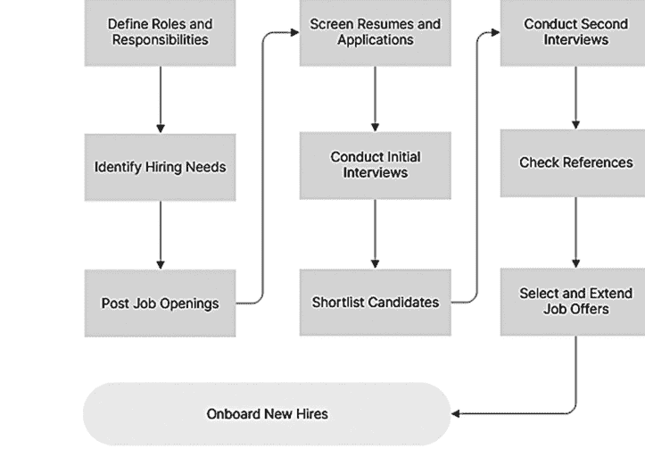

图 11.2 初创企业的人才招聘和团队建设流程。


对技术的好奇心。将人工智能（AI）引入人才招聘策略是为了增强而非取代人类。AI 在数据分析的初始阶段提供帮助，而人类团队则为决策过程提供至关重要的观点。

随着 AI 重塑招聘行业，它带来了巨大的优势和潜在的障碍。使用 AI 驱动的招聘工具使企业能够更快、更准、高效地定位并招聘最合格的候选人。在人才管理方面，AI 目前或很快将应用于以下领域：简历理解、技能与经验识别、职位描述编写、候选人寻源与筛选、报告生成、入职信息提供以及活动成功分析。AI 促进的人才招聘速度和效率带来了积极成本效益；AI 引擎持续运行，无需休息或疲劳，而聊天机器人让招聘人员将精力集中在申请漏斗底部的个人身上，显著提高了生产力。

通过自动化和优化寻找及吸引合格候选人的流程，确保筛选的公正公平，并优化团队协作以及与技能、兴趣和目标的匹配度，AI 可以加速招聘流程并改善团队动态。AI 驱动的人力资源（HR）工具通过简化流程、确保候选人选择以及提供对员工吸引因素的洞察，转型了人才招聘和留存。因此，无论员工规模如何，HR 专业人员都能识别出定制化的解决方案。

在 AI 时代取得成功需要对团队开发和人才招聘采取有体系的方法。在尝试为初创公司识别和吸引 AI 人才时，必须建立明确的先，并积极参与 AI 社区。与学术机构合作、积极参加会议和论坛以及进行早期职业网络建设，可以有助于建立有价值的专业关系。与学术机构建立合作伙伴关系并鼓励实习计划，可以产生源源不断的潜在 AI 人才，同时增强初创公司在 AI 社区的地位。

在确定合适的人员后，接下来的行动是确保现有团队已准备好充分整合 AI。通过评估现有团队能力的待改进领域，可以识别出 AI 相关知识方面的不足。提供持续教育的机会（如研讨会和培训计划），激励团队成员关注 AI 的最新进展。实战任务和跨学科合作增强了团队的专业知识，并营造了促进机构内部持续教育的环境。

建立创新且协作的团队文化对于初创企业的成功同样至关重要。促进有助于思想无限制交换的开放沟通渠道，对于营造创意氛围具有重要作用。建立跨职能协作并消除孤岛效应，有助于实施多学科方法，这对于实现成功的 AI 倡议至关重要。通过纳入认可和奖励机制来感谢对 AI 项目的贡献，并培养适应性和敏捷性，可以保持团队的动力、创新能力以及应对瞬息变化的 AI 领域的准备。

## 11.8 AI 驱动业务发展中的伦理考量

初创公司必须在这些伦理维度上应对，以在应用 AI 时维护透明、公正和问责原则。本节深入探讨了与 AI 实现密切相关的重大伦理考量，并强调了这些因素在数字化时代影响初创公司进程的关键方式。

企业家解决与 AI 相关的伦理问题以促进负责任的创新至关重要。一个重大障碍在于减轻 AI 算法中的偏见并保持公正，因为这些系统可能会在无意中镜像并维持训练数据中固有的偏差。初创公司必须主动识别并解决偏差，以维护伦理标准、防止歧视性行为并培养包容性。此外，隐私和数据安全问题也随之产生，给企业家带来了负责任管理客户数据、获取知情同意以及实施安全措施以保护敏感信息的巨大压力。

将负责任的 AI 实践整合到业务发展策略中需要采用伦理原则。这包括致力于伦理 AI、遵守伦理指南，并考虑社会影响和用户自主权。以人为本的方法对于确保 AI 技术增强人类能力对社会产生积极贡献至关重要。对 AI 系统进行持续监控和审计，以检测并解决任何阶段可能出现的伦理问题。持续的监控和审计活动有助于初创公司推进其 AI 系统以符合伦理规范和社会需求 [12]。

在 AI 促进的决策过程中建立透明度和公平是开发伦理企业的基础组成部分。初创公司可以通过将解释 AI (XAI) 模型放在优先位置来实现，这些模型为决策过程提供了透明的洞察。公平指标对于评估和纠正不同人口群体之间 AI 结果的不公平至关重要，从而有助于检测和消除无意偏见。此外，赋能用户至关重要，因为 AI 驱动的业务发展赋予了用户对其数据和与 AI 交互的权限。通过允许用户自定义体验，企业家培养了对其实施的 AI 信心并维护了伦理标准。

## 11.9 克服挑战与缓解风险

将 AI 引入初创公司的业务发展带来了挑战。表 11.1 检查了初创公司在实施 AI 时常见的挑战，并提供了有效的风险缓解策略。一个初始障碍是需要标记的高质量数据，这是训练 AI 模型的基础的。初创公司应该研究数据增强技术，与数据提供者合作，并投资数据质量保证流程来解决这个问题。此外，对于预算有限的企业来说，人才招聘和留存是极具竞争性的工作。为了规避这一障碍，可以实施全面的人才招聘策略，与教育机构建立合作伙伴关系，并提供持续学习的机会。将 AI 技术整合到现有系统中是一个多方面的过程，可能会中断连续运营。解决这一问题的方法包括评估当前系统、采用集成方法以及执行试点计划进行审查。

表 11.1 初创公司 AI 集成挑战

| 挑战 | 描述 | 策略 |
| :--- | :--- | :--- |
| 数据质量和可访问性 | 用于 AI 训练的高质量标记数据访问有限。 | 投资数据质量保证，与供应商合作并使用数据增强技术。 |
| 人才招聘与留存 | 对初创公司来说，招聘 AI 专业人员具有挑战性。 | 开发全面的人才招聘策略，提供持续学习，并考虑与教育机构合作。 |
| 与现有系统的集成 | AI 与现有系统的无缝集成是复杂的。 | 进行彻底评估，采用模块化集成，并实施试点计划以测试和完善流程。 |

为了确保 AI 实施无风险，解决以下问题（表 11.2）至关重要。首先，AI 模型对训练数据中偏见的复制可能会无意中引入伦理和偏见问题，这需要建立严格的伦理指南。缓解意味着进行例行审计，在开发过程中准确纠正偏见并整合多元化观点。此外，AI 系统对网络威胁的脆弱性引发了安全和隐私问题，因为它有损害消费者数据的风险。为了解决这个问题，优先考虑网络安全措施、实施数据加密并遵守数据保护规定至关重要。最后，业务扩张可能会在实施 AI 解决方案时遇到可扩展性障碍，因此需要采取积极策略。随着初创公司的增长，缓解策略包括纳入可扩展性。

表 11.2 AI 实施的风险管理

| 风险类别 | 风险描述 | 缓解策略 |
| :--- | :--- | :--- |
| 伦理与偏见 | AI 模型可能会延续偏见，引发伦理问题。 | - 实施伦理指南。<br>- 进行审计。<br>- 纳入多元观点。 |
| 安全与隐私 | AI 系统容易受到网络威胁，会损害隐私。 | - 优先考虑网络安全。<br>- 加密数据。<br>- 遵守法规。 |
| 可扩展性挑战 | 为业务增长扩展 AI 可能会带来技术挑战。 | - 设计可扩展系统。<br>- 使用云解决方案。<br>- 持续优化算法。 |


# 创业企业业务发展中的 AI 时代 ■ 207

在 AI 系统设计中考虑这些因素，利用云解决方案，并持续优化算法以确保最佳性能。

在持续增强 AI 实施方面，采用迭代开发策略至关重要，该策略应优先考虑测试、学习和改进，以响应真实世界的反馈和性能指标。实施后，应进行全面评估，以衡量其对业务发展目标的影响，识别需要改进领域，并根据需要修改策略。为了促进集体学习和适应，在组织内部培养知识共享文化至关重要，鼓励团队分享在 AI 实施过程中遇到的困难、成功以及积累的宝贵教训。

## 11.10 未来趋势与演变中的格局

在创业企业业务的 AI 时代，彻底审查未来趋势和动态环境至关重要。一个重大趋势是 AI 在各个领域的广泛融合，促进了成熟机构与新兴组织之间的合作。另一个预测趋势是对可持续性的关注日益增加，因为初创企业将利用 AI 开发资源高效且对环境负责的解决方案。自然语言处理（NLP）的进展将增强对语言的理解，从而实现更自然的交流，并扩大参与国际市场的多语言运营能力。随着监管框架的建立以及伦理 AI 评估的潜力成为初创企业建立信力和透明度的关键，AI 伦理考量的重要性日益增加。

一条值得关注的路径涉及 AI 与增强现实和虚拟现实的整合，这具有提供更沉浸式用户体验的。。这包括 AI 驱动的虚拟助手引入增强现实和虚拟现实环境中，提供智能指导和支持。网络安全领域非常适合创业者采用预测性网络安全措施以及应用 AI 进行高级风险分析和管理。此外，AI 和区块链技术有望整合，确保数据的透明安全管理。这种协同效应通过利用去中心化 AI 系统和集成基于区块链的智能合约，为创业者提供各种交易和过程中更高的效率和可靠性。

## 参考文献

- [1] C. G. Brush, P. G. Greene, and M. M. Hart, "From initial idea to unique advantage: the entrepreneurial challenge of constructing a resource base," *Academy of Management Perspectives*, vol. 15, no. 1, pp. 64–78, 2001.
- [2] J.-Y. Ho and S. Yoon, "Ambiguous roles of intermediaries in social entrepreneurship: the case of social innovation system in South Korea," *Technological Forecasting and Social Change*, vol. 175, p. 121324, 2022.
- [3] J. Füller, K. Hutter, J. Wahl, V. Bilgram, and Z. Tekik, "How AI revolutionizes innovation management-perceptions and implementation preferences of AI-biased innovators,” Technological Forecasting and Social Change, vol. 178, p. 121598, 2022.
- [4] H. Taherdoost and M. Madachian, "AI advancements: comparison of innovative techniques,” AI, vol. 5, no. 1, p. 38–54, 2022.
- [5] C. Ziakias, M. Vlachopoulou, and K. Petridis, “Start-up ecosystem (StUpEco): a conceptual framework and empirical research,”Journal of Innovation: Technology, Market, and Complexity, vol. 8, no. 1, p. 35, 2022.
- [6] M. Weber, M. Beutter, J. Weking, M. Böhm, and H. Kcmar, “AI startup business models: key characteristics and directions for entrepreneurship research,”Business & Information Systems Engineering, vol. 64, no. 1, p. 91–109, 2022.
- [7] A. Colombelli, E. D'Amico and E. Paulucci, “When computer science is not enough: knowledge specializations beyond artificial intelligence startups in Italy,”The Journal of Technology Transfer, vol. 48, no. 5, p. 1599–1627, 2023.
- [8] A. Mit, and H. Taherdoost, "Role of AI in small and medium enterprises,"Journal of Management, vol. 2, 2017.
- [9] G. Castro, "The impact of AI on strategic planning," vol. 22, no. 6, p. 801–822.
- [10] D. JD, S. MBA, "Introduction to strategic planning," SSRN, 2023.
- [11] K. Rahkovsky, A. Toney, "The rapid progress of AI,"Frontiers in Research and Analytics, vol. 6, p. 630.
- [12] K. Elliott et al., "Towards an equitable society,"Society, vol. 58, no. 3, p. 179–188, 2021.

## 12. 通向通用人工智能安全网络安全挑战与策略

Wajahat Akbar, Mohib Ullah, Tariq Hussain, Inam Ul Haq, Deepak Adhikari, Rahim Khan

## 12.1 引言

在可见的未来，人类正处于一场以通用人工智能（AGI）概念为核心的深刻革命边缘。与为特定任务设计的前身不同，AGI 具备理解、学习和适应广泛活动的能力，模拟人类的认知。这种独特的属性使得 AGI 具有巨大的变革性。一方面，它蕴含着在技术、医疗和教育领域取得显著进展的潜力。AGI 可以加速人类最紧迫挑战的解决方案，例如气候变化和推进科学探索。然而，在巨大承诺的同时也伴随着巨大的危险。AGI 的快速发展引发了对其伦理、安全和安全影响的极大关注。AGI 有可能在无意中加剧社会不平等，甚至构 true生存威胁。

当我们开启这个 AGI 的新时代时，谨慎且深思熟虑地引导这片未知领域至关重要。在本章中，我们将深入探讨为什么在 AGI 的开发和实施过程中关注安全性是至关重要的。我们还将探讨构成 AGI 网络安全的伦理困境，强调治理其开发和使用的伦理框架的迫切需求。AGI 代表了人类演化过程中的一个关键时刻。未来几十年中的主要叙事将围绕我们如何利用其能力、维护其潜力并引导其伦理实践展开。正如图 12.1 所示（AGI 框框图），这是一项需要周密规划、创新思维以及对确保我们未来做出坚定承诺的事业。

### 12.1.1 人工智能（AI）

AI 是计算机科学的一个分支，专注于开发可以模仿人类智能并完成通常需要人类认知的活动的系统和机器人。这些活动跨越从解决问题到模式识别的各个领域，自然语言处理（NLP）技术允许计算机分析海量数据，从中学习，然后根据学习进行预测或做出选择。机器学习（ML）作为 AI 的一种类型非常重要，因为它允许计算机通过数据接触来提高其在特定任务上的性能。AGI 在医疗、金融、机器人等领域具有颠覆性影响，可以提高生产力并解决复杂问题。然而，它引发了伦理和社会关注，包括偏见、隐私以及 AI 系统的负责任开发和部署。

### 12.1.2 AI 时代的未来科技初创企业与创新

### 12.1.3 在 AGI 开发早期解决网络安全关注

在 AGI 开发过程中早期解决网络安全关注至关重要。这有助于为构建安全的 AGI 系统奠定坚实基础并


安全 AGI 的网络安全 ■ 211

降低后期的潜在风险。

### 12.1.3 漏洞的主动缓解

主动缓解 AGI 系统中的漏洞对于确保其安全性至关重要。这些系统确实非常复杂，依赖于复杂的神经网络和机器学习算法，这些可能会在无意中引入安全漏洞。通过从开发过程的最初就开始整合安全措施，开发者可以系统地识别并解决漏洞，防止它们成为恶意利用的机会。这种早期的干预降低了网络攻击的风险，并节省了本可能花费用于事后损害控制的资源。它促进了安全优先的理念，并显著增强了 AGI 系统应对潜在威胁的韧性 [6]。

### 12.1.4 最小化长期风险

在 AGI 开发中最小化长期风险，是从一开始就优先考虑网络安全的有力理由。当网络安全问题被忽视时，系统性漏洞会在 AGI 系统内部累积。这些漏洞如果不加处理，随着项目的进展，将变得根深蒂固且难以纠正。拖延的后果是双重的：首先，它增加了安全泄露和数据受损的可能性，这会对个人和组织产生重大影响。其次，它会产生更高的长期风险和成本，因为事后修复一个 AGI 系统本质上比在系统构思阶段纳入稳健的安全措施要复杂且耗资源得多。通过解决网络安全问题，开发者可以避免这些陷阱，并建立贯穿 AGI 整个生命周期的安全信任基础，确保开发过程更安全、更具成本效益 [7]。

### 12.1.5 安全且伦理的 AI 理念

安全且符合伦理的 AI 理念在开发 AGI 系统时至关重要。设计 AI 系统时要重点关注用户的安全、防护和福祉。当网络安全考量被织入 AI 的基本原则时，它意味着致力于确保这些系统从一开始就是安全且没有漏洞的 [8]。这种伦理 AI 可以防止由于恶意行为或系统无意缺陷可能产生的潜在伤害。通过将安全和防护作为核心价值观，开发者可以创建出既提供创新能力又运行负责且值得信赖的 AI，增强人们对 AI 技术及其对社会影响的信心 [9]。

AI 时代的未来科技创业企业与创新

### 12.1.6 防止对抗性攻击

确保 AGI 系统的健壮性和可靠性取决于对构成重大威胁的对抗性攻击的缓解。此类攻击涉及恶意攻击者试图操纵或欺骗 AGI 系统，可能导致意外结果或安全性受损。开发者可以实施早期的安全措施，预防性地解决系统架构和算法中的潜在漏洞 [10]。这种主动方法构成了对抗性敌者的强大防御，在威胁损害 AGI 系统完整性之前有效地将其先发制人。通过对对抗漏洞采取主动立场，研究人员增强了 AGI 技术的安全性，并提升了其在实际应用中的有效性和可靠性 [11]。

### 12.1.7 公众信任与采用

获得公众信任并赢得广泛接受是采用 AI 技术的根本前提。证明 AGI 系统的可靠性和安全性对于在用户和更广泛社区中建立信心至关重要。在 AGI 开发早期对网络安全的承诺传递了一个强有力的信号，即安全是重中之重。这种承诺不仅增强了技术的健壮性，还培养了人们对其完整性的信任。当公众认为 AGI 创造者正在解决网络安全问题时，就为更广泛的采用和接受铺平了道路。坚实的安全基础以及保护用户数据和隐私的承诺，是建立公众信任的基础，使 AGI 能够充分其潜力并对各个行业和生活的各个方面产生积极影响 [12]。

### 12.1.8 监管合规

随着 AGI 技术日益整合到各个领域，监管合规是一项重要的考虑。政府和监管机构预计将引入网络安全标准和要求，以确保 AGI 的负责任使用。在 AGI 开发早期参与安全考量不仅是一项主动措施，而且在策略上使开发者与预期的监管框架保持一致。通过从一开始开始解决安全问题，开发者可以减少与合规相关的挑战，因为他们将充分准备好满足可能出现的网络安全标准和要求。这种主动方法最大限地减少了法律和监管风险，并展示了对伦理和负责任地部署 AGI 的承诺，这对于培养公众对这一变革性技术的信任和接受至关重要 [13]。

### 12.1.9 整体风险评估

整体风险评估对于确保 AGI 系统的安全可靠性至关重要。通过从 AGI 开发之初就开始网络威胁，开发者可以系统地探索跨越所有系统层的潜在漏洞，包括硬件、

安全 AGI 的网络安全 ■ 213

软件和数据。这种全面的风险视角提供了对恶意攻击者可能利用的潜在弱点和进入点的深入理解。它使开发者能够主动设计并实施安全措施，有效应对这些漏洞。这种方法不仅增强了 AGI 的整体安全性，还确保了安全考量整合到系统设计的每一个方面，使其对不断演变的网络威胁更具韧性，并有助于其长期成功和可信度 [14]。

## 12.2 AGI 中的网络安全挑战与风险

AGI 的开发和部署带来了复杂的网络安全挑战和风险，值得我们立即关注。这些挑战与 AGI 的性质紧密相关，AGI 在许多认知领域可以超越人类能力。AGI 的多方面问题包括：保护 AGI 免受对抗性攻击（恶意攻击者操纵 AGI 系统）、处理有关偏差和公平的伦理问题，以及在 AGI 可以处理大量敏感信息的时代确保稳健的数据保护和隐私。此外，AGI 系统具有高度的自主性和自学习能力，它们的行为可能变得不可预测，使得决策的问责制透明度至关重要。AGI 的复杂性要求早期且全面的网络安全措施，以缓解这些挑战，并在我们进一步进入 AGI 时代时建立信任和安全的基础 [15]。

### 12.2.1 可扩展性与复杂性

AGI 系统的可扩展性和复杂性带来了独特且严峻的网络安全挑战。根据其本质，这些系统具备远超人类认知能力的能力，处理海量数据并做出前所未有的决策。AGI 的巨大范围开启了无限可能，但也使我们暴露在新型和高级的网络威胁和攻击之下。鉴于 AGI 的复杂性，它容易受到不可预见或难以解决的漏洞的影响。在大规模上保护 AGI 系统是一项巨大的挑战，需要创新的安全方法和前瞻性的风险评估方法 [16]。这强调了采取稳健且适应的网络安全策略的必要性，以确保这些领先系统及其处理数据的完整性。

### 12.2.2 数据隐私与滥用

数据隐私和滥用风险是 AGI 进展的关键挑战。AGI 模型通常在大型数据集上进行训练，其中某些数据包含高度敏感或机密信息。未经授权的访问、数据泄露以及此类数据的滥用都是关键担忧。保护数据的隐私和安全既是道德义务，也是法律义务。为了防止泄露和未经授权的使用，AGI 的伦理开发要求整合稳健的访问限制、加密和安全数据处理协议。此外，还需要


## 214 AI 时代的未来科技创业公司与创新

建立透明度和问责机制以确保数据使用的负责任与符合伦理，向用户和利益相关者保证其数据在 AGI 系统内部保持安全 [17]。

### 12.2.3 对抗攻击

对抗攻击对 AGI 系统的完整性和安全性构成了重大且紧的挑战。在这些攻击中，恶意者以微妙的方式操纵输入数据（这些方式通常人类观察者无法察觉），旨在误导 AI 系统做出错误或不良决策。无论是自动驾驶车辆误判方向，还是自然语言处理（NLP）系统生成有害信息，此类操作的后果可能是灾难性的。因此，建立针对对抗攻击的稳健防御至关重要。这涉及制定并实施检测及缓解此类攻击的程序，增强 AGI 在即使存在欺骗性输入数据的情况下做出智能且安全决策的能力。应对对抗攻击是 AGI 网络安全的一个关键方面，确保 AGI 系统在现实场景中，即使面对蓄意破坏其功能的尝试，也能够有效且安全地运行 [18]。

### 12.2.4 自主决策安全

AGI 系统的自主决策能力既带来了前景也带来了挑战。这些系统有做出独立决策的可能，影响我们生活的各个方面，包括医疗保健、交通等。然而，这种自主性引入了严重的安全和伦理关注。确保 AGI 系统做出的决策不仅是安全的，而且是符合伦理的，因为决策过程中的缺陷可能导致不可预见且具有危害的后果。主要的挑战在于开发出既遵守伦理和安全标准，又能应对复杂且不断变化的场景的 AI 系统。为了减轻与自主决策相关的风险，需要一种全面的方法，涵盖严格的测试、伦理考量和有效的保护措施 [19]。解决这一问题对于释放 AGI 的全部潜力同时最大限地减少不利后果至关重要。

### 12.2.5 人为操纵

与 AGI 风险是巨大且真实的，特别是在其易受到操纵、欺诈活动和各种形式操纵的影响方面。AGI 的能力可能被用于欺骗和恶意目的，产生重大的社会影响。深度伪造（Deep fakes）和虚假信息的传播会侵蚀信任并破坏凝聚力。必须承认，这些挑战并非理论上的；它们已经是需要立即关注的日益凸显的问题。随着 AGI 的进步，建设性和破坏性应用的可能性都在扩大。为了在释放 AGI 变革性潜力的同时有效应对这些网络安全挑战，从 AGI 开发和部署之初开始，实施全面的策略和伦理考量至关重要。这种主动方法对于确保 AGI 以负责任且安全的方式演进至关重要，在防范潜在风险的同时，促进对其日益互联的世界积极贡献 [20]。

## 12.3 确保安全可靠 AGI 开发与部署的策略

AGI 的开发和部署需要全面的方法来确保安全和可靠。为此，首先应该从开始阶段就整合安全的开发实践，结合最佳编码和开发方法以减少漏洞。严格的验证和确认过程对于彻底测试和验证 AGI 系统的功能、安全性和至关重要。威胁建模有助于识别潜在的安全威胁和漏洞，允许主动缓解。定期的安全审计、独立的渗透测试和事件响应计划对于及时解决漏洞至关重要 [21]。政府、工业和学术界利益相关者之间的合作对于制定安全标准和最佳实践至关重要。AGI 的决策应该基于透明性、公平性和问责等道德考量。面对不断变化的规则，用户教育和数据保护非常重要。持续监控和适应、红队测试以及对持续安全的承诺确保了 AGI 被安全可靠地创建和实施，保持其产生有益影响的 [22]。

### 12.3.1 缓解 AGI 网络安全风险的主动措施

在不断发展的 AGI 格图中，采取主动措施对于管理与这种先进技术相关的固有风险至关重要。几个关键步骤可以显著增强 AGI 的网络安全。首先，在 AGI 开发的早期解决安全问题至关重要。这涉及进行全面的风险评估、参与威胁建模并实施稳健的访问限制。保持持续监控和实施实时威胁检测机制对于快速识别和响应新兴风险至关重要。在 AGI 开发领域，培养责任感文化强调了透明性、伦理培训和问责的重要性。与监管机构合作以建立行业标准和合规指南进一步采纳了最佳实践 [23–25]。最终，主动的 AGI 网络安全方法不仅防范了预期威胁，还创造了一个有利于突破性技术进行负责任和安全整合的环境。

### 12.3.2 设计安全开发（Secure-by-Design）

在 AGI 工作中保障稳健网络安全的关键策略是“设计安全”方法。这种方法意味着将安全原则早期集成到系统的构想和整个开发过程中。安全编码实践（包括从安全角度编写代码）以及使用受信任的、经过良好测试的库是该方法的基石 [26–28]。开发者通过从项目启动就开始实施这些安全措施，可以显著减少漏洞和网络威胁的潜在切入点。这种主动策略为 AGI 系统创建了韧性的基础，帮助预先地应对安全挑战，并为技术的增长和部署建立安全环境。从本质上说，设计安全开发对于从底层保护 AGI 至关重要 [29–31]。

### 12.3.3 持续安全审计

持续安全审计对于维护 AGI 系统在整个开发和部署阶段的可靠性和安全性至关重要。这些审计彻底检查 AGI 的核心程序，并能够对其设计和执行进行系统评估，以发现潜在的风险和漏洞。此外，它们还涉及旨在识别关注领域并评估系统对各种威胁和攻击向量的韧性的评估。渗透测试是另一个关键部分。这种测试涉及对系统进行模拟攻击，以评估其韧性并识别可能被利用的漏洞。通过在 AGI 创建期间和部署后定期完成这些审计，组织能够主动解决安全问题，从而提高 AGI 系统的韧性和可靠性，确保此类系统的安全运行 [32]。

### 12.3.4 持续监控

任何系统（包括 AGI）的安全性都需要持续监督。这涉及实施持续监控方法来检查 AGI 系统的行为，以发现可能指示安全泄露的异常。这些方法包括实时数据流跟踪、系统内部信息电路详细研究以及对用户访问的持续监控，以检测任何未经授权或可疑活动。还会进行定期性能评估以验证系统符合参数。实施这些持续监控实践使组织能够快速响应安全担忧，增强 AGI 系统的整体韧性和安全态势，同时加强对预期攻击者的防御 [33]。

### 12.3.5 威胁情报

保护不断变化的网络威胁和漏洞环境对于良好的安全策略至关重要，特别是在涉及 AGI 等尖端技术时。为了做到，组织必须主动与威胁情报源联系，保持对最新威胁和潜在漏洞的了解。这种主动策略允许企业关注不断变化的威胁，改变他们的安全


# 用于安全 AGI 网络安全 217

采取适当的程序，采取主动措施来增强其 AGI 系统的防御。组织可以通过持续关注和监控威胁信息来改进准备工作以应对新风险，从而加强 AGI 技术的安全性，并确保在面对未来挑战时具有长期完整性和韧性 [34]。

### 12.3.6 访问控制与身份验证

稳健的访问控制和有效的身份验证方法对于确保 AGI 系统的安全至关重要。组织通过实施这些安全措施，大幅降低未经授权访问 AGI 的危险。访问控制规定了谁可以访问系统以及访问权限，从而防止未经授权的个人或实体获取访问权限 [35]。同时，严格的身份验证机制确保只有授权人员或组织可以访问 AGI，提供了额外的保护。这种策略减少了安全漏洞和对 AGI 授权更改的可能性，从而提高了整体安全完整性，并加固了针对可能攻击和入侵的防御。

### 12.3.7 数据加密

数据加密是 AGI 系统领域的一项关键安全举措。它涉及使用强大的加密技术来保护静态数据和传输中数据。静态数据加密确保在发生未经授权访问的情况下，存储的信息仍然保持安全且不可读，增加了额外的安全保障。同样，传输中的数据加密通过保护数据免受截获，使其在传输过程中对未经授权的人员是不可读的。这种强加密技术是 AGI 安全的重要组成部分，维护了敏感数据的机密性和完整性，并限制了与信息共享和未经授权访问相关的风险 [36]。

### 12.3.8 用户培训

增加用户的知识水平是加强 AGI 系统安全的关键组成部分之一。组织通过对 AGI 用户和操作人员提供关于最有效安全程序的密集培训，可以大幅减少由人为因素导致的安全漏洞的概率。这些培训计划通常涵盖广泛的安全相关主题，包括识别并妥善应对潜在威胁、强调强效密码管理的重要性，以及促进敏感信息的安全处理。这种水平的知识使户能够能够在防御网络攻击中发挥首要作用，并有助于减少与人为因素导致的漏洞相关的风险。用户培训在确保 AGI 安全方面起着关键性作用，培养了警惕和负责任使用的心态，这显著增强了先进系统的整体保护能力 [37]。

### 12.3.9 组件隔离

在 AGI 框架内隔离核心组件的实践是一项旨在并在安全漏洞发生时减少潜在损害的关键安全措施。通过对这些关键组件进行分间化，组织可以有效限制所谓的“爆炸半径”，即未经授权的入侵对整个系统的影响范围。采用这种隔离措施确保了在发生安全违规时，入侵被限制在特定部分或子系统内，防止其扩散到 AGI 系统的其他部分。遏制措施的使用不仅有助于尽地减少未经授权访问带来的潜在负面影响，还能加速对安全问题的响应。在总体方案中，隔离关键元素的过程代表了一种主动且高效的安全措施，在面对潜在威胁时，能够显著增强 AGI 系统的韧性和安全性 [20]。

## 12.3.10 应急响应计划

在 AGI 系统的安全管理领域，制定应急响应计划具有重要意义。该程序涉及制定并持续改进全面的策略，概述了检测、报告和缓解安全问题的措施。这些策略的执行至关重要，因为它们为组织提供了一种结构良好且有条理的方法，用于频繁管理和减少违规和风险。采用全面的应急响应计划可以通过促进及时识别、及时报告和有效遏制问题来缓解安全漏洞的影响。此外，它明确勾定了参与响应工作的人员的角色和责任，确保反应的协调和有效。定期审查这些计划以有效应对新威胁并适应系统更改至关重要。应急响应计划的实施是一项前瞻且不可不可缺的策略，旨在增强 AGI 系统的安全性和韧性。这种方法确保组织具备充分的设备，在安全事件发生时能够及时处理 [38]。

### 12.3.11 定期补丁与更新

频繁的补丁和更新是维护软件和系统（包括 AGI 领域内的系统）安全的基础性实践。这种实践涉及对所有软件和系统定期应用安全补丁和更新，以修复已知的漏洞和缺陷。网络攻击经常利用这些漏洞，因此通过保持 AGI 组件和相关软件的更新，组织可以大幅减少安全漏洞和数据泄露的风险 [39]。这些更新通常包括对已识别漏洞的修复、安全功能的增强以及防止新兴威胁的措施。因此，对定期补丁和更新的坚定承诺是加固 AGI 系统安全性和韧性的基本且主动的策略，确保其稳健性以及对已知和演变威胁的抵抗力。

### 12.3.12 红队测试

在 AGI 系统的安全测试领域，红队测试成为了一种主动且重要的组成部分。这种实践涉及外部专家（通常被称为“红队”），他们对 AGI 系统进行模拟对抗攻击，以发现可能规避检测的漏洞和弱点。红队测试通过模拟真实的威胁场景和利用潜在的弱点，为组织提供了关于其受攻击脆弱性的宝贵见解。这种方法有助于发现隐藏的漏洞，从而实现及时的修复并强化安全态势。

### 12.3.13 协作与信息共享

促进合作和知识交换对于增强 AGI 社区的安全性至关重要。在一个风险巨大且威胁不断变化的环境中，促进研究人员、开发者和组织之间的协作变得迫在必行。通过传播有关这些新兴风险和漏洞的关键信息，AGI 社区可以建立一个共享知识库。这使得利益相关者能够保持知情和警惕。通过集体倡议，社区可以汇集资源、专业知识和积累的经验，从而促进更全面、更协调的安全方法。这些集体努力具有加速风险早期识别、有效对策措施开发以及成功策略的广泛共享的潜力，从而使所有参与方受益。


## 12.4 强调安全编码与开发方法的重要性

在当今数字化进步的时代，安全软件和开发实践的紧迫性至关重要。软件和在线系统在关键功能上（从基础基础设施到个人数据管理）的依赖日益增加，这使得这些系统易受到网络威胁的攻击，成为首要目标。强调优先考虑安全设计和开发过程的重要性出于以下几个令人信服的理由至关重要 [41]。首先，采取主动的方法来降低潜在风险是一种明智的策略。这意味着在开发阶段识别并解决漏洞，而不是在部署后采取反应性措施。此外，加密实践的使用在保护敏感信息方面发挥着关键作用，从而防止数据泄露或未经授权的访问。此外，安全开发方法提倡“设计安全”的概念，将安全考量整合到开发生命周期的每一个阶段。这种方法旨在最大限地减少漏洞被忽视或忽略的概率。最后，引入安全编码实践对于维护公众对软件系统的信任和信心具有作用，为用户提供了其数据和隐私得到良好保护的保障。因此，这些实践在防御不断变化的网络威胁方面发挥着关键作用，并作为构建稳健、可靠且安全的数字生态系统的基石 [42]。

### 12.4.1 保护敏感数据

敏感数据的安全性至关重要，实施安全编程实践是防御未经授权访问和此类数据窃取的关键机制。在当今格局下，由于安全软件方法在保护个人信息、财务数据和知识产权方面的关键作用，其相关性已达到所未有的高度。这在医疗、银行和电子商务等领域尤为相关，因为这些资产具有极高价值。此类实践的目的是保护这些无价信息，确保其机密性，增强其抵御未经授权访问或窃取的能力。在安全编码实践中使用加密、严格的访问控制和稳健的验证过程有助于加强对敏感数据的保护。遵循这些实践不仅保护了个人隐私和财务健康，还维护了组织的声誉和法律义务。在以数据泄露和网络攻击为特征的持续且广泛的威胁环境下，安全编码实践已成为信任、完整性和机密性具有最高意义的业务中保护敏感数据的主要手段 [43–45]。

### 12.4.2 防止网络攻击

防止网络攻击已成为当今数字技术时代的一个关键关注点。在此背景下，采用安全开发方法对于增强对此类敌意行为的防御至关重要。人们广泛认为，大部分网络攻击利用了软件系统中的漏洞 [46–48]。通过采用安全实践，软件工程师可以创建更具韧性的程序，减少对 SQL 注入、跨站脚本和缓冲区溢出等常见攻击技术的易敏感性。本文背景下讨论的方法集中在具有强安全侧重点的代码开发上。它们涵盖了整合各种保护措施并遵循最佳实践，这显著提高了寻求识别和利用程序漏洞的网络犯罪分的行动门槛。因此，实施安全开发实践是检测攻击、缓解漏洞和固化整体安全态势的主动措施。安全措施的整合是现代软件开发中不可或缺的组成部分，能够创建出不仅具有功能性和用户友好性属性，还能抵御不断扩张的网络威胁的程序 [49–51]。

### 12.4.3 维护信任

在现代数字格局中，组织非常重视维护信任，并意识到其重要性。在此背景下，安全编码实践的采用承担着核心作用，成为保护和培养信任的关键元素。安全违露可能会损害组织的声誉，危及与客户、合作伙伴和利益相关者建立的信任。安全编码实践被刻意用于维护和坚持这种信任，通过减少安全违露的概率并确保用户数据得到保护和隐私 [52]。当客户对其个人信息的安全性产生信心时，他们更有可能参与公司的产品和服务。反之，安全违露可能导致财务损失、法律责任和组织声誉损害等不利后果，这可能给招聘工作带来困难。纳入安全编码实践不仅是一项技术要求，更是旨在维护信任的现代组织的战略性，而信任对于其持久的成功和生存至关重要。通过减轻安全事件的负面影响，安全措施的整合也凸显了公司对维护用户及其利益相关者安全与隐私的承诺 [53]。

### 12.4.4 合规性与法律义务

在当前复杂的监管环境中，符合数据质量标准不仅是一项建议的方法，而且是许多企业的强制性要求。未能遵守这些严格的指令可能会导致巨额的财务罚款和严重的法律后果。采用安全编码实践对于帮助组织并保持对这些严苛标准的合规至关重要。安全编程是一种将安全措施整合到开发过程中的实践。这种方法努力确保系统和应用程序在构建时具有适当的保护措施，根据法律要求保护敏感数据并维护数据隐私。使用主动策略不仅有助于降低不合规风险，还作为公司致力于履行法律义务的实证证明。这种奉精神对于避免可能发生的巨额罚款费用和法律后果至关重要。因此，安全编码是组织更广泛合规战略中的基本元素，确保它们在保持法律良好地位的同时，增强其整体安全态势 [54]。

### 12.4.5 降低开发成本

降低开发成本是将安全编码实践整合到软件开发生命周期中的一个极说服力的理由。“防范胜于治疗”的常用格言在这里适用。在部署后处理安全漏洞比在开发阶段处理要昂贵，且耗时得多。安全编码方法专注于在过程早期识别和纠正潜在安全问题，从远来看可以为组织节省大量资源 [55]。通过减少发布后安全补丁和更新的需求，这些实践有助于简化开发流程并显著降低与紧急修复相关的成本。安全编码不仅是一项预防措施，而且是一种成本效益的实践，通过减少与安全修复相关的财务负担来提升组织的财务表现。

### 12.4.6 增强应用程序韧性

安全编码实践在增强应用程序韧性方面提供了宝贵的优势。通常，使用安全代码可以提升软件的可靠性和耐用性，减少其对崩溃、漏洞和停机的敏感性。增强增强不仅提升了用户体验，还确保了关键系统和服务的不连续运行，特别是在面临潜在安全风险时。通过从一开始整合安全措施，开发者可以创建更好地应对意外问题的程序，无论这些问题源于恶意攻击还是意外的技术故障。这种增强的韧性不仅增加了客户满意度和信心，还在维护业务连续性和基本服务的持续交付方面发挥着关键作用。本质上，安全编码是一种主动的方法，用于构建可靠且能够提供无缝安全用户体验的程序 [56]。

### 12.4.7 打击内部威胁

缓解内部威胁是网络安全领域的一个极其复杂且多方面的挑战。这些威胁是指受雇或与组织关联的人员故意或无意地从内部破坏组织的安全。为了最大限地减少这些风险，采用安全编码实践并实施稳健的访问控制措施至关重要。通过采用安全编码技术，组织可以主动解决可能被恶意内部者利用的漏洞，从而增加渗透内部的复杂性。


# 用于安全 AGI 的网络安全 ■ 223

安全 [57]。此外，实施严格的访问控制，并结合安全编码实践，可以限制个人获取访问并操纵敏感数据的程度。这极地减少了内部威胁的攻击面。这些步骤对于增强组织的安全态势至关重要，使其能够有效应对内部威胁带来的巨大挑战，同时维护组织的信誉和完整性。

## 12.4.8 网络安全就绪性

网络安全组织内部的主动规划对于有效管理数字世界不断变化的态势至关重要。拥抱安全编码实践在实现就绪方面发挥着至关重要的作用，它是全面网络安全战略中的主动组成部分。通过从早期阶段引入安全编码原则，组织可以确保其系统和应用程序在开发过程中具有强烈的安全重点，增强其抵御未来攻击的韧性。此外，安全编码方法的实施在培养警惕和就绪文化方面发挥着至关重要的作用，使组织具备必要的能力来有效识别和解决安全问题。意识水平的提高有助于减少因泄露造成的潜在伤害，从而能够更快速、更协调的响应来缓解后果。安全编码不仅限于创建安全软件；它是组织整体网络安全战略中不可或缺的元素，强化了其安全措施，并增强了其自信且灵活应对不断变化的网络威胁格局的能力 [58]。

### 12.4.9 长期可持续性

长期可持续性是软件开发领域的一个基本考虑因素，与安全编码实践紧密相关。设计良好且安全的应用程序往往具有更长的使用寿命，不容易受到安全顾虑引发的频繁重写或大修的影响。这反过来导致了大量的成本节约和更具可持续性的软件开发方法。安全编码原则（如主动识别和缓解漏洞）减少了为了解决安全问题而进行持续且破坏性更新的需求。这不仅简化了开发过程，还延长了软件在长期内的可用性和可靠性。从本质上说，安全编码成为了一种战略性投资，培养了一种可持续的方法，这种方法不仅增强了应用程序的安全性，降低了与频繁重新工作相关的开销和成本，使其在软件开发领域成为更具经济效益和环保的选择 [59]。

## 12.5 AGI 网络安全中的伦理考量

在网络安全领域的背景下，AGI 的伦理考量具有重大意义。AGI 的特征是能够表现出类人的智能和解决问题的能力，这带来了一系列独特的道德困境。首要目标是确保构建和维护 AGI 系统具有稳健的安全措施，以防止恶意使用或不可预见的伤害。这涉及实施保护措施以防止未经授权的访问，减轻数据泄露的风险，并对抗将 AGI 用于有害目的的可能性 [60]。

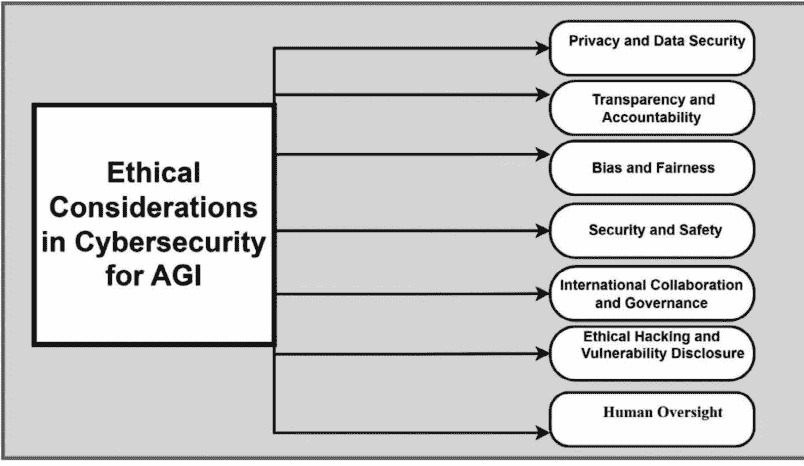

图 12.2 网络安全的伦理考量。

此外，如图 12.2 所示，承认 AGI 对隐私的潜在影响至关重要，特别是它在收集和分析个人数据方面无与伦比的能力。偏见的算法或歧视性的决策可能会加剧现有的社会不平等，凸显了 AGI 系统中透明性、公平性和问责的重要性。此外，需要全球性的 AGI 网络安全规则和法律，以防止可能损害安全和伦理问题的全球性权力竞争。AGI 网络安全的伦理部分需要意识、协调和承诺，以确保 AGI 造福人类的同时减少可能的风险 [61]。AGI 网络安全的伦理维度涵盖了广泛的关注和考虑，这些对于确保 AGI 系统的负责任开发和部署至关重要。以下子节描述了一些关键的伦理维度。

### 12.5.1 隐私与数据安全

在 AGI 系统领域，隐私和数据安全具有至关重要的意义。这些系统配备了巨大的计算能力，能够处理海量数据。因此，保护这些信息的隐私和安全是重中之重。AGI 的滥用或未经授权访问可能会引发严重的伦理考量。为了缓解这些顾虑，必须将稳健的机密性和安全措施整合到开发和运行中，这是增强 AGI 韧性的不可或缺的工具 [62]。

### 12.5.2 透明度与问责制

高级 AGI 的开发和利用需要遵循伦理标准，并将透明度和问责作为基础原则。这些复杂的系统在难以理解的环境中运行，导致缺乏透明度。伦理强调了 AGI 透明度的重要性，因为它允许个人和组织理解决策背后的逻辑和方法。此外，建立问责机制对于确保个人和组织在其 AGI 行为中负责至关重要。实施问责框架具有双重作用：维护对 AGI 技术的信任，并应对潜在偏见或不可预见的后果。这些伦理要求需要详尽的透明记录以及明确的问责框架。这些措施对于确保 AGI 系统以负责任且符合伦理的方式运行非常重要 [63]。

### 12.5.3 偏见与公平

在 AGI 决策过程中解决偏见并提供公正的伦理性不容忽视。AGI 系统可能会吸收训练数据中存在的偏见，导致产生歧视性的结论。这一问题引发了显著的伦理考量，因为偏见判断可能会维持并加剧现有的社会缺陷。为了解决这个问题，必须采取主动检测并缓解 AGI 系统内部偏见的策略。这对训练过程中使用的数据进行定期检查和评估，并专门为实现结果而设计算法和模型。为了促进公平公正的社会，必须在 AGI 决策过程中建立公平的准则和标准。消除偏见和鼓励公平的伦理需求凸显了开发人员和组织积极应对问题的责任，确保 AGI 系统的运行避免加剧社会差距 [64]。

### 12.5.4 安全与可靠

安全和可靠考量是 AGI 系统伦理部署的核心。这些系统拥有巨大的权力和能力，这种行善的潜力也伴随着巨大的


如果这些技术被滥用，将带来重大的伤害风险。网络安全的伦理问题关注点在于两个关键方面：第一，保护通用人工智能（AGI）系统免受黑客和恶意利用；其次，确保这些系统不会对安全构成威胁。前者涉及实施稳健的安全措施、加密和访问控制，以防止未经授权的访问和操纵。后者则要求构建具有故障保护和安全机制的 AGI 系统，以最大限度地减少对人类或整个社会造成意外伤害的风险。这些伦理上的必要要求强调了在开发 AGI 时重点关注其安全性和可靠性方面的重要性，以便在利用其潜力的同时，防止与其滥用或非预期后果相关的潜在危险。它强调了机构和研究人员的伦理责任，即将 AGI 的安全性和安全性作为一项基本的伦理原则 [65–67]。

### 12.5.5 国际合作与治理

国际合作以及有效治理系统的建立，对于解决 AGI 背景下与网络安全相关的伦理问题至关重要。AGI 技术固有的全球化属性决定了各国之间必须合作，共同制定通用标准。AGI 技术的全球性特征要求各国共同努力制定全球性规则。在这种背景下，这种合作有助于跨越国界治理 AGI 的伦理问题。这种伦理要求强调了在 AGI 范围内负责任发展的重要性。通过促进合作与协调，可以确保 AGI 的发展符合人类价值观，并减少由于不受控竞争而产生的风险。建立国际统一的治理框架对于确保 AGI 能够符合人类目标并减少对整个社会的负面后果是至关重要的。在这种背景下，AGI 的自主性可能会引发一系列令人引发的伦理考量 [68–70]。

### 12.5.6 伦理黑客与漏洞披露

伦理黑客和漏洞披露对于解决 AGI 带来的伦理问题至关重要。AGI 系统的安全性需要对这些漏洞进行测试，漏洞披露是这一过程中的关键组成。当伦理黑客发现此类漏洞时，他们会向相关方报告，以在恶意实体利用这些漏洞之前进行修复。伦理黑客的漏洞披露不仅不仅提升 AGI 的系统的安全性，，，，领域领域这些关键的伦理问题，以确保 AGI 能够符合人类价值观。

### 12.5.7 人类监督

在 AGI 的背景下，人类监督的伦理必要性不言而喻。AGI 系统的自主决策能力可能会导致无法预见的行为，从而引发重大的伦理问题。人类监督作为一种至关重要的保障，允许人类监控 AGI 系统并在必要时进行干预，以确保 AGI 的发展符合人类目标并减少对个人和社会的风险。这种伦理原则强调，AGI 应该是增强而非取代人类的能力。在自主与人类监督之间取得正确的平衡，对于确保 AGI 负责任地运行至关重要

## 12.6 AGI 案例研究

AGI 案例研究提供了真实世界的示例，有效地说明了这项技术的突破性影响，并为其在医疗保健、金融和自动驾驶等各行业应用提供了见解。同时，这些真实案例展示了 AGI 的积极影响，同时也凸显了相关的伦理困境，例如数据隐私和算法偏见。图 12.3 提供了 AGI 案例研究的概述，通过展示真实案例和假设情况，强调了负责任发展的必要性。

### AI 时代的未来初创公司与创新

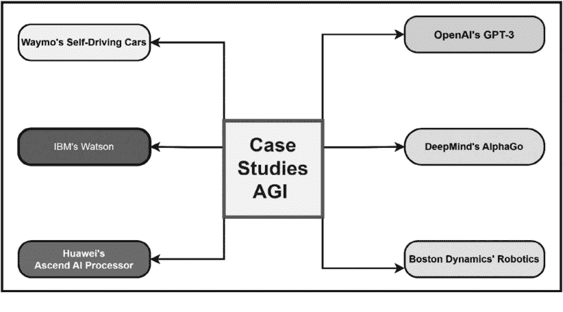

图 12.3 AGI 案例研究框图

### 12.61 OpenAI 的 GPT-3

OpenAI 的 GPT-3（生成式预训练 Transformer 3）是 AGI 领域的一项重大里程碑。这一顶尖的框架在理解和生成类人文本方面表现出卓越的能力。GPT-3 的自然语言处理（NLP）专业知识为聊天机器人、内容生成、语言翻译等领域开辟了新的解决方案。它创建上下文连贯且有意义示例的能力展示了 AGI 研究的进展，并能够改变高度依赖语言和文本的行业。

### 12.62 DeepMind 的 AlphaGo

DeepMind 发明的 AlphaGo 是 AGI 领域的一个重要转折点。这一由 DeepMind（一个 Alpha 分支）构建的 AGI 系统在围棋这项古老游戏中展现了超越人类水平的惊人能力。这一成就证明了 AGI 在处理被认为是人类专属的挑战性活动方面的巨大潜力 [77]。


为了安全 AGI 的网络安全 . 229

需要战略性的思考和适应。AlphaGo 通过展示 AGI 的无限潜力及其推动人类与 AI 融合边界的能力，持续为学术界带来灵感。

### 12.6.3 波士顿动力（Boston Dynamics）

波士顿动力凭借其革命性的机器人（包括人形机器人 Atlas 和四足机器人 Spot）在 AGI 领域建立了极高的声誉。这些在先进 AGI 驱动下令人惊人的机器人展现了前所未有的技能水平和灵活性；因此显著改变了我们对自主技术的理解。它们的专业水平包括在复杂地形和各种情况下进行导航。此外，它们的才华涵盖了广泛的职责，包括简单和复杂的操作，且都以卓越的准确度和技巧完成，而这种水平在以前仅在科幻小说中被描述。这些机器人的一个显著特点是它们能够有效适应动态和不可预见的情况，这强调了 AGI 在增强机器人系统自主性和决策能力方面的重要性。波士顿动力引入的进展处于展示 AGI 变革多个领域的前沿，包括制造、物流以及搜索与救援。机器人拥有独特的能力，使其能够在复杂且不可预测的环境中与人类有效协作，从而引发这些行业的根本性变革。这一故事见证了 AGI 领域的不断进展及其对机器人领域产生的重大影响 [78]。

### 12.6.4 Waymo 的自动驾驶汽车

作为 Alphabet 的子公司，Waymo 利用最前端的 AGI 进展，已将其定位为自动驾驶汽车行业的领导者。Waymo 创建的自动驾驶汽车展示了顶尖 AI 与实际交通解决方案之间引人注目的融合。严谨的测试表明，Waymo 的自动驾驶车辆是该领域最复杂的车辆之一。Waymo 在驾驶技术方面的进步凸显了 AGI 重塑交通和重新定义移动性的潜力。这些车辆展现了令人印象深刻的能力，在感知和导航周围环境的同时，做出优先考虑乘客和行人安全的决策。Waymo 在研究和部署自动驾驶车辆方面的投入坚定不移，体现了席卷整个汽车业的 AGI 驱动的变革。它们的愿景坚定地根根于对一个以更安全、更高效、更易获取的交通为特征的未来的追求。Waymo 的历程强调了 AGI 对我们日常生活的深刻影响，因为我们正处于由自动驾驶汽车驱动的革命性变革边缘 [79]。

### 12.6.5 IBM 的 Watson

IBM 的 Watson 是在自然语言理解和认知计算领域使用 AGI 的开创性范例。Watson 已跃成为先进 AI 技术的领先力量，并展示了其在各个行业中令人印象深刻的适应能力。它特别显著地为医疗保健和金融等领域做出了重大贡献。这种方法的关键优势在于其在系统地分析和掌握复杂数据方面的熟练，能够有效地将其转化为无值的洞解。在医疗保健领域， Watson 被用于辅助诊断疾病和制定治疗策略，这源于对大量数据库的细致检查。同时，在金融领域，Watson 展示了数据分析和预测建模等高效有效技术的强大威能。Watson 固有的适应和学习能力强调了 AGI 在增强人类决策和解决问题能力方面的巨大潜力，特别是在处理海量复杂数据集的领域。IBM 的 Watson 证明了 AGI 增强人类能力的能力，提升了跨多个领域任务的效率和效能以及整体生产力 [80]。

### 12.6.6 华为昇腾（Ascend）AI 处理器

华为开发的昇腾 AI 处理器代表了 AGI 集成到日常设备中的重要一步。这些尖端处理器经过精心设计，旨在提升包括智能手机和电子设备在内的系列产品的 AGI 能力。它们提供实时 AI 处理的卓越能力是其脱颖而出的，特别是在涉及图像识别和自然语言理解的应用中。华为将 AGI 技术整合到其设备中，使其能够高效快速地管理和分析复杂数据 [81]。这意味着消费者可以体验到 AGI 驱动的功能，使他们的设备在处理图像识别和自然语言理解等任务时更加灵敏、更智能。华为的昇腾 AI 处理器强调了 AGI 在重塑日常技术中日益增长的重要性，将我们使用的设备转变为能够以日益复杂的方式与我们理解和交互的智能伴侣。

### 12.6.7 SpaceX 的星舰（Starship）自主火箭

SpaceX 的星舰自主火箭生动地说明了 AGI 在太空探索和运输领域所起的关键作用。这些火箭代表了先进技术的奇迹，结合了用于自主导航和精准着陆的 AGI。将 AGI 融合到这种背景中构成了变革性的发展，特别是在可重复火箭技术领域。它能够在火箭下降过程中进行即时决策，而这一阶段以其复杂性和对极其精度的需求而闻名。AGI 确保了星舰火箭能够自主安全地穿越广阔系统，无论是返回地球还是出发前往遥远星系的任务。SpaceX 星舰的意义不仅在于降低太空旅行的成本；它代表了星际探索的未来。AGI 赋予这些火箭极其精确地执行任务的能力，使前往火星等遥远世界的旅行成为可能。这种水平的自主性和适应性对于我们进入太空探索时代至关重要。星舰作为一个灯塔，照亮了 AGI 重塑未来的潜力，并让太空变得更容易进入 [82]。

## 12.7 结论与未来工作

本章强调了在 AGI 开发和实施中解决网络安全挑战的重要性。由于 AGI 系统前所未有的复杂性，它们既带来了独特的潜力，也带来了巨大的风险，需要全面的网络安全方法。在 AGI 应用中确保隐私和数据保护至关重要，以保护人员和敏感信息，防止未经授权的访问和利用。此外，本章强调了应对 AGI 系统偏差（源自其训练数据）的伦理必要性，以确保公平并避免社会不等的持续。透明度和问责制被强调为伦理发展的关键，需要明确的决策程序和工具来确保对 AGI 行为负责，特别是当涉及现实影响时。本章还促进国际合作和治理来制定 AGI 网络安全标准和法律，消除有害的竞争。讨论还关注了 AGI 更广泛的社会影响和道德利用，强调了为了人类福祉而负责任的发展和实施。考虑 AGI 对工作、经济和人类存在的长期影响至关重要。此外，从事 AGI 开发和网络安全的个人需要教育和伦理培训。最后，本章强调，解决网络安全问题对于确保 AGI 的适当和伦理利用、保护个人权利福利以及充分利用这些突破性技术的潜力至关重要。

### 12.7.1 未来方向

AGI 网络安全学科将根据不断变化的新兴 AGI 技术和网络威胁格局进行适应和进步。未来的研究将关注防御自适应攻击，增强 AGI 决策的可解释性和问责性，并扩展 AGI 应用的隐私保护策略。


[18] S. Qu, Q. Liu, S. Zhou, 和 C. Wu, “人工智能对抗攻击与防御技术综述，”Applied Sciences, 第 9 ，第 5 期，第 909 页, 2019年3月, doi: 10.3390/app90509009

[19] J. Skelton 等，“评分标准与评估，”i-manager’s Journal on School Education Technology, 第 9 ，第 7–13 页, 2014年5月; doi: 10.26634/jsch.9.4.2708
[20] B. Goertzel, “人工智能：概念、现状与未来展望，”Journal of Artificial General Intelligence, 第 5 ，第 1–48 页，2014年12月; doi: 10.2478/jagi-2014-0001
[21] K. Carlson, “通过交互证明实现可证明安全的人工智能，”Philosophies, 第 6 ，第 4 期，第 83 页，2021年10月; doi: 10.3390/philosophies60400083
[22] E. Seger 等，“开源高能力基础模型：风险评估、收益及追求开源目标的方法，”SSRN Electronic Journal, 2023, doi: 10.2139/ssrn.4596436
[23] M. Vishwanath, “网络安全与人工智能的人工智能研究议程，”2023年3月。
[24] T. Mazhar 等，“利用分析物联网安全挑战及其解决方案，”Brain Sciences, 第 13 ，第 4 期，第 683 页，2023年4月; doi: 10.3390/brainsci130403683
[25] H. U. Khan, M. Soahi, F. Ali, S. Yazir, Y. Ghadi, 和 I. Ullah, “基于物联网安全增强的关键特征优先级排序，”Physical Communication, 第 59 ，第 102084，2023年8月; doi: 10.1016/j.phcom.2023.102084
[26] Rahman, S. Ali, N. Hussain, 等，“图像循环引导对虚拟任务中用户技能增强的影响，”Multimedia Tools and Applications, 第 83 ，第 4182–4186 页，2023, doi: 10.1007/s11042-023-17175-y
[27] B. S. Ali 等，“ICS-IDS：人工智能入侵检测系统中数据分析以识别工业控制系统网络中的漏洞，”The Journal of Supercomputing, 第 80 ，第 3 期，第 1–30 页，2023年11月; doi: 10.1007/s11227-023-05674-5
[28] I. Ullah, A. Noor, S. Yazir, F. Ali, Y. Ghadi, 和 I. Asam, “使用适当特征的有效决策策略保护物联网设备免受安全攻击，”The Journal of Supercomputing, 第 80 ，第 5 期，第 1–30 页，2023年10月; doi: 10.1007/s11227-023-05685-3
[29] A. A. Rojo, J. M. Bass, 和 T. Haber，“安全软件开发流程：基于实践的模型，”2022年第48届软件工程与高级应用会议 (SEAA)，2022年8月; doi: 10.1109/sea5694.2022
[30] M. Asif 等，“下一代物联网的容量DLPC编码，”Wireless Communications and Mobile Computing, 2021,第 1–10 页，2021年9月; doi: 10.1155/2021/5920
[31] T. Mazhar 等，“使用机器学习和区块链对智能电网安全攻击及其解决方案的分析，”Future Internet, 第 15 ，第 2 期，第 83 页，2023年2月; doi: 10.3390/fi1502083
[32] H. H. Volcu，“通过通用人工智能 (AGI) 完善教师的角色，”2023年6月; doi: 10.3219/inf.edu/b83
[33] D. L. Poole 和 A. K. Mackworth，“人工智能，”2010年4月; doi: 10.1017/cb987051794
[34] S. McLean, J. M. Read, C. Baber, N. A. Stanton, 和 P. M. Salmon，“与通用人工智能相关的风险：系统综述，”Experimental Intelligence, 第 35 ，第 5 期，第 649–666 页，2021年8月; doi: 10.1080/0852813.2021.1964
[35] O. Verman 等，“物联网——感知/执行、连接、人工智能，”Cognitive Hyperconnected Digital Transformation, 97–115 页，2022年9月; doi: 10.1201/0333754
[36] A. K. Sahoo, S. Rudra, 和 A. S. Mohanty，“基于人工智能的数据加密电网运行，”2016年国际电气、电子与优化技术会议 (ICEET)，2016年3月; doi: 10.1109/iceet.2016.7765
[37] P. Voss,Cognitive Technologies,131–157 页, doi: 10.3219/inf.edu/b3
[38] S. Papastergiou, H. Mouratidis, 和 E.-M. Kalogeraki，“医疗、交通和能源系统中高级持续威胁和复杂事件的处理，”evolving Systems, 第 12 ，第 1 期，第 91–108 页, doi: 10.1007/s12530-020-9335
[39] T. Mazzarov 和 S. Reboud，“小企业中的战略智能：引言，”Strategic Innovation in Small Firms,2011年8月, doi: 10.4337/978103022.008
[40] N.-M. Aliman 和 L. Kester，“‘感知’超智能系统的混合策略，”Lecture Notes in Computer Science, 第 1，第 11–18 页，2021, doi: 10.1007/978-3-319-676
[41] J. Harvey 和 M. Harvey，“移动健康平台的隐私与安全问题，”Journal of the Association for Information Science and Technology, 第 65 ，第 7 期，第 1305–1318 页，2014年2月, doi: 10.1002/ai.2306
[42] N. Islam, U. Khan, S. Bader, 和 A. Alansari，“基于 API 和权限的安卓恶意软件分析的可解释分类模型，”Materials & Continua, 第 76 ，第 3 期，第 3167–3188 页
[43] S. Naseem, A. Alhudaifi, M. Anwar, K. Qureshi, 和 G. Jeon，“利用认知关联进行在线追踪的人工智能行为检测，”Ubiquitous Computing, 第 27 ，第 1 期，第 119–137 页，2022, doi: 10.1007/s00779-022-0165
[44] U. H. Khan, F. Ali, Y. Ghadi, S. Nasir, I. Ullah, 和 H. G. Mohamed，“人机交互与软件众包中的参与，”Electronics, 第 12 ，第 4 期，第 934 页，2023年2月, doi: 10.3390/electronics12040934
[45] T. Mazhar 等，“使用机器学习技术对智能电网中物联网挑战与解决方案的分析：综述，”Electronics, 第 12 ，第 1 期，第 242 页，2023, doi: 10.3390/electronics1201042
[46] G. Abdiyeva, H. Metayar, 和 S. Bakan，“使用人工智能方法防御网络攻击的发展，”2021年全球技术进展 (GCAT),2021, doi: 10.1109/gcat5218.2021.958
[47] U. H. Khan, S. Nasir, F. Ali, M. Z. Khan, 和 I. Ullah，“针对物联网需求的服务高效代理 IPv6 扩展，”Information, 第 14 ，第 8 期，第 459 页，2023年8月, doi: 10.3390/info140805
[48] F. Ali Kazan, B. Shah, T. Hussain, I. Ullah 等，“自组织网络 (fanet)的链路稳定传输延迟机制，”Materials & Continua, 第 77 ，第 1 期，第 963–981 页，2023, doi: 10.32604/mnc.2023.046
[49] M. Tetaly 和 P. Kulkarni，“网络安全人工智能：威胁还是解决方案，”AI Conference Proceedings,2022, doi: 10.1063/s0109664
[50] T. Mazhar 等，“人工智能和 5G 技术在智能能源和智能构建中的作用，”Electronics, 第 11 ，第 2 期，第 2360 页，2022, doi: 10.3390/electronics1102123
[52] W. Wang 和 K. Sia，“人工智能、机器学习、机器人学、工作未来与人类未来，”Research on Machine Learning Techniques, Methods, and Applications, 1460–1481 页,2022年5月, doi: 10.4018/978-1-6684-29
[53] O. Ullah, T. Ai, M. Branicki, K. Keshmiri, 和 R. Davison，“人工智能中的依恋信任，”Human Behavior, 第 115，第 10667 页，2021年2月, doi: 10.1016/j.chb.2020.1067
[54] L. Li，“数字时代学术图书馆的新技术，”Emerging Technologies for Academic Libraries, 53–111 页,2009, doi: 10.1016/978-1-8433-2-5
[55] S. Lipner，“可信软件开发周期，”第20届年度计算机科学应用, doi: 10.1109/scac.2004
[56] W. R. Saltman, P. Lester, C. M. Layne, K. Woodward, 和 W. Pash，“军事家庭的风险与韧性机制：以家庭为中心的增强的理论与实证基础，”Clinical Psychology, 第 14 ，第 3 期，第 213–230 页，2011, doi: 10.1007/s10567-011-9
[57] E. Thompson，“组织内部网络安全威胁，”The Insider Threat, 37–80 页，2018年12月, doi: 10.1201/978-15336-2
[58] G. J. Falco 和 E. Roshenbach，“网络风险，”Oxford University Press,2021, doi: 10.1093/978-0-1970-5264
[59] B. Gibson, S. Hassan, 和 J. Tansey，“可持续性评估，”Routledge,2013, doi: 10.4324/978-1-1849-7
[60] J. Babock, G. Krämer, 和 R. V. Yampskiy，“人工智能管理指南，”Next-Generation Artificial Intelligence, 90–112 页，2019年11月, doi: 10.1017/978-1-1086-6688-8.0011
[61] C. Nobles，“网络安全中的进攻性人工智能，”Real-Worlds of Strategy, Strategic Change and Organizational Development, IG, 348–363 页，2023年9月, doi: 10.4018/978-1-6684-6291-7
[62] T. Azariah 和 A. Rayhan,Journal of Economic Studies (SAK), 第 12 ，第 3 期，第 351 页，2023年12月, doi: 10.3662/jes.v12.312
[63] P. G. R. Almeida, C. Santos，“人工智能监管：一种框架，”Ethics and Information Technology, 第 23，第 3 期，2021, doi: 10.1007/s10676-021-9
[64] D. R. Bishwanath 和 D. S. Vedalli，“工作的未来：人工智能的实践，”Tij Ish/Journal Prospect, 第 44，第 3 期，第 1711–1724 页，2023, doi: 10.5278/tij.v44
[65] M. Shoaib, S. Bash, H. A. Lu, L. Khan, 和 F. Ali，“基于深度学习注意力机制的视频异常检测，”Multimedia Tools and Applications, 97–115 页
[66] I. Haq，“3G和4G技术性能对电信行业客户满意度的影响，”Electronics, 第 12 ，第 7 期，第 1697 页，2023, doi: 10.3390/electronics120769
[67] S. H. Ali 等，“低功耗无线网络中的能量采集优化，”International Journal of Data Science and Analytics, 第 20,2023, doi: 10.1007/s40610-023-047
[68] P. Cifon, M. M. Saha, 和 L. Kemp，“框架化：国际人工智能治理架构，”Global Policy, 第 11 ，第 5 期，第 545–556 页，2020年11月, doi: 10.1111/1758-5999.1280
[69] U. W. Khan, N. Intisar, Z. Deng, 和 J.-H. Lee，“基于边缘计算的无线传感器网络扩展卡尔曼滤波定位算法，”Digital Communications and Networks, 第 7，第 2 期，2021年1月, doi: 10.1002/itdl.202.265
[70] U. Iqbal, S. Qian 和 R. Heim，“恶意黑客的网络攻击对软件市场竞争的影响，”Journal of Management Information Systems, 第 37 ，第 1 期，第 191–216 页，2020年1月, doi: 10.1080/07421222.2019.170551
[72] Z. U. Abideen 等，“使用机器学习和数据挖掘方法对中学入学标准进行分析，”Electronics, 第 76 ，第 3 期，第 3167–3188 页。


[73] F. Ali, S. Khan, A. W. Abbas, B. Shah, T. Hussain, et al., “一种基于 GoogLeNet 和 YOLOv3 模型的 MRI 检测双层框架,” CMC-Computers, Materials & Continuum, vol. 72, no. 1, pp. 73–92, 2022.

[74] K. Kivanishh, “Picasso: 多算法智能自适应系统：用于 AGS集体操作,” Sep, 2023, doi: 10.31224/3215

[75] C. Pennach and B. Goertzel, “通用人工智能的当代方法,” Cognitive Technologies, pp. 1–30, doi: 10.1007/978-3-540-08667-4_1

[76] “三个世界,” Education in the Open Society - Karl Popper and Schooling, Routledge, Feb. 2018

[77] L. Lloridi and M. Chiaratti, “GPT-3: 其性质、范围、限制和影响,” Minds and Machines, vol. 30, no. 4, pp. 681–694, Nov. 2020, doi: 10.1007/s11023-020-09548-1

[78] G. Kingston, “领先的产品创新：加速产品型业务的增长 Marvin L. Patterson and John A. Fenoglio; New York: John Wiley and Sons, 1999, 433 pages, Journal of Product Innovation Management, vol. 18, no. 6, pp. 414–417, Nov. 2001, doi: 10.1016/s073-6782(01)00140-0

[79] V. G. Cerf, “一次全面的驾驶汽车测试,” Communications of the ACM, vol. 61, no. 2, pp. 7–7, Jan. 2018, doi: 10.1145/31777533

[80] D. L. Rosenberg, “走进 Mayo 的自动汽车内部：我喜欢的晶体管,” 2017 Symposium on VLSI Circuits, Jun. 2017, doi: 10.23919/vslic.2017.800500

[81] B. Lundgren, “自动驾驶车辆事故模拟的新标准：我们可以使用 Way 的事故模拟模型,” AI & Society, vol. 39, no. 2, pp. 669–673, Jun. 2022, doi: 10.1007/s00146-022-01495-y

[82] A. Michael, “东盟的新加坡会晤：只是又一次峰会?” Contemporary Southeast Asia, vol. 14, no. 2, pp. 142–153, Sep. 1992, doi: 10.1355/cs14-2c

[83] S. Biswas, “Chat GPT 在社交媒体中的功能：根据 Chat GPT 的说法,” SSRN Electronic Journal, 2023, doi: 10.2139/ssrn.4405389

[84] P. Dauvergne, “野生的 AI：人工智能时代的可持续性,” Sep. 2020, doi: 10.7551/mitpress/12350.001.001

## 索引

**注：** *ics* 中的页码指图表，**粗体**数字指表格。

- A
- Google 留言板上的提示词, 130
- ChatGPT 中的 Python 代码, 143
- Google 留言板上的 Python 代码, 144
- Google 搜索引擎上的查询, 131
- 问责制 (Accountability), 13
- 适应性 (Adaptability), 13
- AI 对初创企业和创新的优势与局限性, 4
- 航空检查, 29
- 智能体 (Agents), 110, 111
- 农业数据驱动洞察, 44–45
- AI (人工智能), 1, 2, 3, 62, 194
- AI 采用, 5
- 农业中的 AI 采用, 40
- AI 算法, 4, 8, 24
- 农业中的 AI 应用, 66
- 脑机接口 (BCI) 中的 AI 应用, 11
- 游戏行业中的 AI 应用, 112–113
- AI 医疗, 7
- AI 实现, 3
- 农业害虫分析中的 AI, 82
- 医疗领域的 AI, 5, 14
- Neuralink 大脑中的 AI, 7
- 土壤健康监测中的 AI, 67
- 天气预测中的 AI, 66
- 产量预测中的 AI, 68
- 初创企业的 AI 集成挑战, 206
- 游戏行业中的 AI 级别, 111
- AI 年度监控系统, 44
- AI 技术, 2
- 创新管理的 AI 技术比较, 186
- 结合 BCI 的 AI, 9
- AI 辅助和个性化农业建议, 43
- 基于 AI 的运动, 95
- AI 驱动的农业洞察, 37
- AI 驱动的商业企业, 13
- AI 驱动型公司在收入、成本管理、利用网络和适应性等关键领域的优势, 139
- AI 驱动的洞察, 3
- AI 驱动的躯体感觉应用, 10
- AI 驱动技术, 95
- AI 赋能聊天机器人, 5
- AI 赋能传感器, 5
- AI 赋能智能电网, 166
- AI 生成, 4
- AI 集成机器人, 23, 26
- AI 驱动的创新重构, 184
- AI 驱动的预防和主动措施预测性分析, 5
- AI 驱动的解决方案, 5
- 关于对 Google 价值影响的商业日报文章, 139
- 分析市场回报率, 2
- 信息分析, 3
- 安得拉·普拉什邦 (AP), 29
- 监督学习中的人工神经网络 (ANNs), 114
- 农林业网络层中 AI 辅助工具的应用, 38
- 应用程序接口 (APIs), 181
- 农业中的 AI 应用, 42
- 通用人工智能 (AGI), 209
- 人工智能 (AI), 1, 4, 173
- 量子计算中的人工智能, 8
- 人工神经网络 (ANN), 114
- 异步算法 (AMA), 128
- 异步技术, 15
- 增强现实, 13
- 自动化任务, 2
- 自动引导车辆 (AGVs), 28
- 自动化驱动, 1
- 自主农业, 45
- 自主 AI, 14
- 自主机械设备, 76
- 平均方差 (AVE), 101
- AGI 框图, 210
- AI 的伦理影响, 51
- 农业中的可解释 AI, 50
- 多模态数据融合, 50
- ChatGPT 给出的错误答案, 145
- 分类, 40
- 气候适应, 46
- 气候韧性农业与 AI, 43
- 云端机器人, 30
- 聚类, 40
- 聚类问题, 9
- 蜗蜗入, 10
- 认知心理学, 38
- Colombo 等人, 195
- 比较 (CFI), 101
- 智能电网组件, 159–160
- 分布式能源资源 (DERs), 160
- 复合性 (C.R.), 101
- 计算机视觉, 30
- 计算机辅助手术 (CAIS), 27
- 计算机辅助手术, 27
- 系统概念设计, 97
- 条件事件优化 (CoOp), 128
- 传统卫星, 29
- 卷积神经网络 (CNN), 73
- 关联性, 62
- 银行、金融服务和保险 (BFSI), 24
- 脑机接口 (BCIs), 9
- AI 初创企业的局限性, 15
- 大数据, 164
- 双向运动, 10
- 二分类问题, 9
- 图像显示, 147
- ChatGPT 给出的错误答案, 146
- 生物技术, 11
- AGI 研究的框图, 228
- 区块链, 12, 26
- 大脑脉冲, 9
- 建筑建模 (BIM), 15
- 业务转型 AI 关键, 188
- 碳机器人, 29
- 案例研究, 46–48
- Shift 的 hyd拉, 47–48
- EarthSense 的 Terra & Spray, 47
- 细粒度洞察, 48
- IBM 的农业决策平台, 45
- Prospera, 48
- 挑战与未来方向, 48–51
- 农业中的挑战, 49
- 偏见与公平性, 49
- 成本与投资回报率 (ROI), 49–50
- 数据隐私与安全, 49
- 数据质量与可访问性, 48
- 互操作性, 49
- 技术采用与可访问性, 49
- 小农户韧性农业未来方向, 31
- 农业中的生物多样性与 AI, 50
- 协作 AI 平台, 51
- 数据稀缺地区的边缘计算, 51
- Cronbach Alpha, 101
- 作物健康监测, 45
- 作物管理, 42
- 加密货币, 12
- 游标控制, 9
- 边缘计算, 22
- AI 网络安全与风险, 213–215
- Cyberlink, 110
- 达特茅会议, 71
- 数据分析, 8, 39
- 数据分析, 41
- 数据加密, 74
- 数据预处理, 121
- 数据稀缺, 16
- 数据集, 12
- 去中心化, 12
- 解密, 9
- 决策支持系统, 45
- 深度信念网络 (DBN), 73
- IBM Deep蓝, 111
- 深度学习, 10, 22, 40, 41
- 深度武装系统, 27
- 人口统计概, 100
- 拒绝服务 (DoS), 74
- 密度指标, 8
- AI 集成机器人的局限性研究, 24–25
- 数字货币, 12
- 数字革命, 31
- 数字孪生, 26
- 颠覆性创新, 175
- 分布式账本技术 (DLT), 12
- 双击样本提示词, 149
- 无人机部署, 72
- Google Bard 给出的问题的正确答案, 146
- GPS, 76
- 绿色算法, 197
- 绿色技术, 185
- 地基传感器, 48
- 幻觉, 135
- 触觉接口, 31
- 医疗保健, 8
- 全方位风险评估, 212
- 人机协作 (HRC), 28
- 人机交互 (HCI), 10, 109
- EarthSense, 47
- 生态系统, 12
- 农业生态系统管理, 43
- 径阵列, 10
- 电图 (EEG) 信号, 9
- 环境传感器, 22
- 伦理防护, 9
- 网络安全的伦理考量, 224
- 可解释 AI (XAI), 50, 186
- 提取, 167
- 扩展共享宽访问协议 (SWAP), 9
- 超参数调优, 132
- 假设开发, 97–98
- ICT 平台, 65
- IEEE Transactions on Games Journal, 109
- AI 对农业的影响影响, 51–55
- 生物多样性保护, 54
- 气候抗性农业, 54
- 经济多样化, 52
- 收入分配与公平, 52
- 社会经济影响, 51
- 2019 年, 21
- 2020 年, 21
- 工业级物联网 (IIoT), 63
- 工业机器人, 21
- 信息通信技术 (ICT), 63
- 信息技术, 11
- 输入/输出控制 (ioctl), 26
- 游戏行业中的 AI 集成, 110
- AI 集成到创新方法, 175
- AI 对创新过程的影响, 76


## 240 索引

- John mccarthy, 71
- 印度入学考试 (jee), 144
- Jones & Johnson, 2019; smith 等人, 2020a, 90

## O

- O'brien 等人, 90
- 开放创新, 174–175
- 开源库, 9
- 优化, 8
- 模型整体拟合度, 100

## K

- Kaynak, 200
- Kumar 的观点, 23

## P

- 个性化耕作或农业, 46
- 试点测试, 197
- 玩家体验建模 (PEM), 109
- 后续影响, 10
- 精准农业, 40
- 精准农业, 40, 65
- 精准农作, 44, 75
- 预测性分析, 40, 72, 76
- 主成分分析 (PCA), 8
- 过程内容生成 (PCG), 112
- 提示工程 (Prompt engineering), 120–123
- 提示注入攻击, 152
- 提示泄露, 153
- 提示编程, 126
- 假体传感器, 110
- 假肢体, 27

## L

- Labs AI 显示图像, 148
- 语言处理, 26
- 大语言模型 (LLMs), 121
- Leonardo AI 显示图像, 147
- 网络利用, 14
- 激光雷达 (Lidar), 22
- 肢体康复, 10
- 畜牧监控, 80
- 物流, 8
- 短记忆网络 (LSTM), 115

## M

- 机器学习 (ML), 10, 30
- 机器视觉, 26
- 大型多人在线游戏 (MMOGs)
- McGee 的 2005, 113
- 机电系统, 9
- 中介层, 97
- Merrillynch, 24
- 元宇宙, 26
- Microsoft Info (R&D) Pvt. Ltd., 29
- 模型优化, 121
- Mohr & Kühl, 2021, 72
- 摩尔定律, 11
- 多人在线竞技场 (MOBA), 115

## Q

- 量子算法, 8
- 量子近似优化算法 (QAOA), 9
- 量子比特 (qubits), 8
- 量子云计算, 9
- 量子计算机, 8
- 量子计算, 8
- 量子门, 8
- 量子信息, 9
- 量子支持向量机 (SVM), 93

## N

- 朴素贝叶斯, 132
- 自然语言处理 (NLP), 394
- 自然语言理解 (NLU), 127
- 网络效应, 13
- 网络化, 26
- 神经接口, 25
- 神经网络, 13, 40, 41
- 神经系统疾病, 10
- 神经假体, 10
- 神经科学, 9
- 创新构思生成中的 NLP, 179

## R

- 瑞达, 22
- 射频识别 (RFID), 12
- 实时健康监测, 24
- 真实世界证据 (RWE), 12
- 递归神经网络 (RNN), 131
- 回归, 40
- 规合性, 212
- 强化学习, 111, 114–115
- 研究与创新, 46
- 资源优化, 45
- 路径系数和假设检验的结果, 102

## 索引 241

- 反映测量模型的结果, 101
- 视网膜病变, 13
- 投资回报率 (ROI), 50, 83
- 收入, 13
- 风险分析, 14
- AI 实施的风险管理, 206
- 风险缓解, 13
- Roberta, 127
- 健壮流程自动化 (RPA), 23, 28, 174
- 强化性脊柱手术, 27
- 机器人行业, 21
- 机器人, 21
- 稳健的安全解决方案, 10
- AI 智能电网的作用：用例、优势与挑战, 161–163
- 近似均方根误差 (RMSEA), 101
- 基于规则的系统, 114
- Ryan, M., 72
- 供应链管理, 40, 45–46
- 供应链优化, 78
- 支持向量机 (SVM), 131
- 手术机器人, 26
- 可持续发展目标 (SDGs), 197

## T

- 瓷片反馈, 10
- 人才招聘与团队建设, 203
- 初创企业中的人才招聘与团队建设过程, 203
- 技术开发, 8
- 遥测软件, 73
- 遥感通信, 10
- 地表传感器, 42
- 程序的复杂性, 143
- 程序的复杂性, 144
- 国际机器人联合会 (IFR), 21
- NASA–Webb–Gold  fiasco, 138
- Bing 上的 python 代码, 145
- Thompson 等人, 95
- 令牌走私, 153
- T 值, 102

## S

- 可扩展性, 13
- 熊彼特式创新, 174
- 镰刀机器人, 29
- 搜索引擎优化 (SEO), 185
- 安全性, 12
- 自动驾驶汽车, 13
- 自动驾驶汽车, 66
- 感知元件, 110
- 情感分析, 130
- 共享无线接入协议 (SWAP), 9
- 模拟, 8
- 单次提示 (Single-shot prompting), 148
- 单次双提示 (Single-shot double-shot prompting), 148
- 单次与双提示的比较, 150
- 智能农作组件, 64
- 智能农作, 63
- 智能电网, 158, 159
- 社会经济, 37
- 躯感受, 11
- 触感应用, 10
- Sood 等人, 71
- 语音转文本记录, 34
- 标准化均根残差 (SRMR), 101
- 初创企业生态系统, 192–194
- 敏捷创业企业历程, 193
- 直接提示 (Straightforward prompting), 133–134
- 战略 AI 技能发展框架, 183
- 结构方程模型 (SEM), 91
- Subeesh & Mehta, 72
- 总结与现有方法, 124–125

## U

- Unimate 机器人, 31
- 无人机 (UAVs), 42, 72
- 无监督机器学习算法, 8

## V

- 虚拟教练, 104
- 虚拟面对交流, 26
- 虚拟现实训练, 94

## W

- Wakchaura 等人, 71
- 可穿戴传感器, 27
- 杂草加密, 28
- 杂草, 61, 67
- Williams & Patel, 2021, 90
- Williams 等人, 95

## X

- 小米手, 27
- Xlnet, 127
- X 射线, 27

