# 未来冲击：计算机科学新动向

致全体成员
计算机科学与工程学院，
新南威尔士大学
过去、现在和未来的

Taylor & Francis
Taylor & Francis Group
http://taylorandfrancis.com

## 前言

Merriam Webster 词典将未来冲击定义为一个人无法应对社会和技术变化的快速性而遭受的身体和心理困扰 [1]。该术语首次于1965年使用，随后通过阿尔文·托夫勒撰写的书籍获得即时知名度，该书由海蒂·托夫勒合著，虽未署名，于1970年出版 [2]。在他们众多正确与不正确的预测中，“电子前沿”的预测启发了史蒂夫·凯斯，后者最终创立了后来成为AOL的公司 [3]。

今天的计算与1970年时期的领域相比已面目全非，即使对其众多倡导者而言也是如此。自1970年代作为电气工程学院下属部门成立以来，新南威尔士大学计算机科学与工程学院如今正应对计算机科学众多前沿及其社会影响，其中一些甚至导致了更多的未来冲击。本卷展示了CSE学术与研究社区的实力及其在应对这些前沿并缓解未来冲击方面的努力。主题范围广泛，从人工智能与伦理、教育技术、设计思维与工程教育、计算机界面设计与认知负荷管理的未来以及逻辑数学建模，到确保计算机硬件安全。

我祝贺将本卷汇编在一起的编辑 Dr Sebastian Sequoiah-Grayson，并衷心感谢所有贡献者分享他们在此时对计算领域重大事件的见解。我希望读者能在快速变化的格局中找到本卷是有用的指南。

Prof Arcot Sowmya
计算机科学与工程学院院长
悉尼，2024年12月18日

- 1. https://www.merriam-webster.com/dictionary/future
- 2. Toffler, Alvin, Future Shock, Bantam Books, New York, 1970
- 3. https://www.fastcompany.com/1695307/future-shock-40-what-tofflers-got-right-and-wrong, Fast Company. 15 October 2010.

Taylor & Francis
Taylor & Francis Group
http://taylorandfrancis.com

## 序言

当乔治·诺特（当时任泰勒与弗朗西斯旗下CRC Press）与我首次会面讨论那个最终会变成你现在正在阅读的这本书的想法时，我们怎么也想不到计算机科学即将迎来在公众意识中的飞跃。

那是新冠疫情尾声，大学校园仍大都空无一人，而ChatGPT4尚未向世界释放图灵测试级别的生成式人工智能。

当乔治和我坐在新南威尔士大学图书馆塔顶的The Lounge——新南威尔士大学的咖啡馆和餐厅——喝茶喝咖啡时，我们知道我们不想写一本关于编码或编程本身的书。已经有大量此类书籍，而且这种内容如今大多通过视频传播。

我们想要的另一方面，是分享计算机科学作为当今实践的学术学科的内部故事——或者至少分享那些最常被隐藏的部分。我们也想分享新南威尔士大学计算机科学与工程学院的魔力。

计算机科学与工程学院——以熟悉的方式简称为‘CSE’，但其成员称之为“学院”——已是我过去三年的学术家园。我从未如此快乐。学院规模庞大。近100名全职学术人员，7000名本科生（这不是笔误），数千名硕士生，以及天知道有多少博士生和博士后。我写这篇序言时距离稿件截止日期只有一天左右。

鉴于规模之大，学院比太阳燃烧得更炽烈。更重要的是，它无疑是澳大利亚最好的计算机科学学院，也是世界上最好的学院之一。增长速度令人难以置信。学术和专业人员的奉献与善意，加上学生群体的奉献与善意，使其成为它所是的样子。正如一直以来一样，是人使事物成为它所是的事物。这在不久的将来不太可能不再成立。

我欠下许多感谢。感谢乔治·诺特本人，感谢他主动联系并邀请我首次与CRC出版。

感谢当时担任院长的亚伦·奎格利，如今是CSIRO Data61的科学总监和副主任。我当时刚加入学院，由于COVID-19限制，尚未有机会与许多学院成员面对面相见。亚伦在早期是睿智的向导，我欠他的债并不小。

这份感谢或许是最重要的。乔治·诺特离开泰勒与弗朗西斯投身新冒险不久后，被勇敢的杰拉尔德·博克接替，担任计算机科学和统计学的委约编辑

Chapman and Hall for CRC Press at Taylor and Francis. 我既没有合适的词语，也没有足够的时间或空间来充分表达杰拉尔德在这整个项目中展现出的最优秀的人类美德的程度，其中耐心尤为突出。杰拉尔德，如果你正在阅读此文，我永远无法充分感谢你。

对我的朋友兼 CSE 同事 Paul Hunter 表示非常重要的感谢。Paul 在梳理大型 LaTeX 项目中更为复杂的部分时所表现出的无私善意，是促成项目完成的关键。Paul——没有他就不行。杰拉尔德，如果你正在阅读此文，请知道 Paul 是你没有等待更久的真正原因之一。

致 Taylor and Francis 的每一位——Gerald Bok、Kasturi Ghosh、George Knott、Chelsea Low 和 Katie Peace——感谢你们的一切。

向本书的所有贡献者——Ali Darejeh、Nadine Marcus、Eric Martin、Sara Mashayekh、Hammond Pearce、Jake Renzella、Alexandra Vassar 和 Toby Walsh——我谨向你们致以最诚挚的感谢，感谢你们在时间和思想上的慷慨贡献。

非常诚挚地，我想感谢我们的学院院长 Arcot Sowmya。Sowmya 深明大义的建议和坚定不移的公平正义堪称传奇，而且当之无愧。学院院长的工作即使在学院规模很小时也很艰难。当学院的规模超过许多大学——正如这里 CSE 的情况——这份工作几乎难以想象。如果没有 Sowmya 在过去几年里的领导，本书以及许多其他事情都不可能实现。

最后，但绝非最不重要，我欠我的伴侣 Lex 一切。正如我们这些写过或编辑过书籍的人深知，这往往是在第一份工作之上的第二份工作。Lex 一路陪伴在我身边，同时 somehow 兼顾着她自己的重要职业和同样重要的学业。谢谢你 Lex！

Sebastian Sequoiah-Grayson
*计算机科学与工程学院*
*新南威尔士大学*
*2024年12月*

## 贡献者名单

### Ali Darejeh
计算机科学与
工程
新南威尔士大学

### Nadine Marcus
计算机科学与
工程
新南威尔士大学

### Eric Martin
计算机科学与
工程
新南威尔士大学

### Sara Mashayekh
教育学院
新南威尔士大学

### Hammond Pearce
计算机科学与
工程
新南威尔士大学

### Jake Renzella
计算机科学与
工程
新南威尔士大学

### Sebastian Sequoiah-Grayson
计算机科学与
工程
新南威尔士大学

### Alexandra Vassar
计算机科学与
工程
新南威尔士大学

### Toby Walsh
计算机科学与
工程
新南威尔士大学

## 1 引言

*Sebastian Sequoiah-Grayson*
计算机科学与工程学院，UNSW 悉尼
肯辛顿，澳大利亚

### 1.1 绪论

“事情升级得很快” 是在线世界 meme 景观中潜伏的著名短语。就短语而言，它在很大程度上是有用的。事情确实，如今或许比以往任何时候都更如此，升级得很快。在计算机科学本身，没有几个地方比这里更能说明这一点。

即使在该学科年轻成员的活生生的记忆中，计算机科学也曾是少数着迷者学术兴趣所在。事情已经改变。数字技术现在影响着我们生活的几乎每一个方面——无论是个人还是职业。计算机科学，作为数字的 *卓越* 学科，如今正处于学术、政治、地缘政治和大众世界的中心。从金融到太空旅行，从医学到军事，从农业到教育，计算机科学都处于其中。

数据是新的黄金，而数字信息处理是其提取和提炼的方法。人工智能时代已经到来，我们正面对面地迎接量子计算的黎明。在这里，在加密货币、网络战、深度伪造、生成式人工智能等之中，对数字生态系统的真正概念素养是现代人的标志。

本书的目的是为读者提供一个机会——希望不止一个——直接追求这种素养。所选主题之所以被选中，是因为它们既重要，而且在很大程度上超出了公众的视野（如果不是学术界某些更偏远领域的视野的话）。

唯一的例外是本书开头的章节。在 *人工智能与伦理* 中，Sebastian Sequoiah-Grayson 和 Toby Walsh 向读者介绍了一个现在在许多人工智能辩论中处于前沿的主题。人工智能是一个技术能力以超光速发展的领域。因此，作者们努力为读者提供能够经受住这种加速的基础问题理解。为此，本章围绕一系列思想练习和对伦理与人工智能基础问题的审慎、有目的探索的邀请来组织。

在 *教育技术未来* 中，Jake Renzella 探索了计算机科学技术影响高等教育积极成果的潜力——既有现实的也有推测的。有趣的是，这里不仅仅是交易性的、量化的衡量。Renzella 是一位充满热情的教育先驱，他阐述了计算机科学技术如何恰好能激发学生和教师双方的最好表现——无论是在计算机科学本身还是在更广阔的领域。

在 *探索设计思维融入工程学科* 中，Alexandra Vassar 写下了她在计算机科学工程教育早期接触设计思维的有力轶事历史，这如何影响了她的智力和学术成长，以及她如何将此融入对下一代计算机科学家和工程师的培养中。Vassar 非常关注校园创客空间的潜力，揭示了创造力在数字技术中的作用及其精炼的潜力。

在 *元宇宙和脑机接口如何革新教育行业* 中，Ali Darejeh 和 Sara Mashayekh 探索虚拟和增强现实技术——统称为 *沉浸式技术*——如何影响知识获取。随着价格实惠的脑机接口的最新出现，Darejeh 和 Mashayekh 探索了界面设计的未来以及此类设计所带来的可能性。

在 *基于认知负荷理论的 UX 设计* 中，Nadine Marcus 和 Alexandra Vassar 探索用户体验与认知心理学之间的关系。从 iPhone 到 ChatGPT，数字技术的社会心理接受度取决于与人类在世界中导航方式的持续共生。Marcus 和 Vassar 带领读者仔细探索数字技术成功所依赖的心理结构地形。

在 *Ripple Down 规则与分类* 中，Eric Martin 将知识获取和学习的理论带入逻辑-数学建模领域。Martin 探索了人工智能的三个子领域—— *知识获取*、*知识表示* 和 *形式学习理论*，并将它们纳入 *ripple down rules* 的单一框架中。Martin 的章节需要一定的数学素养，但不会超出任何一本好的逻辑和数学推理入门书籍所提供的范围。读者花时间做到这一点是值得的，因为这种数学素养是解锁理论计算机科学丰富世界中众多抽象奇迹的关键。

在 *伪造品与自毁开关：硬件安全如何影响你* 中，Hammond Pearce 将我们带回 *硬件安全* 的物理世界。作为网络安全日益重要的一部分，*硬件攻击* 涉及“上游”制造和供应链的致命破坏。这种破坏可能通过蛮力物理拦截发生，也可能通过远程破坏发生。硬件攻击极难检测，却易于规模化，对网络安全尤其是计算机科学和社会总体而言构成了当今最令人兴奋也最令人恐惧的挑战之一。Pearce 为我们共同分享的数字未来中将不断出现的生态系统提出了几条有前景的防御路线。

## 2 人工智能与伦理

*Sebastian Sequoiah-Grayson*
计算机科学与工程学院，UNSW 悉尼
肯辛顿，澳大利亚

*Toby Walsh*
计算机科学与工程学院，UNSW 悉尼
肯辛顿，澳大利亚

### 2.1 人工智能与伦理

随着人工智能（AI）开始走出实验室，进入我们生活的诸多方面，我们需要开始关注它所产生的影响。这在人工智能应用于社会公益问题时尤为重要。我们可能试图帮助的目标群体往往是我们社区中最贫困、最弱势的群体。我们可能试图帮助无家可归者、残疾人士、种族或其他少数群体。我们可能关注气候变化的影响、保护受到人类活动威胁的生态系统，或发展中国家中特别脆弱的群体。因此，审视我们是否做得正确至关重要。这就要求我们思考关于最佳行动方案以及我们所构建的系统的一系列伦理问题。

### 2.2 伦理学

伦理学是哲学的一个分支，研究哪些行为是对的、哪些是错的。哲学家们已思考这些问题数千年，并提出了许多不同的答案。规范伦理学，例如，探讨我们如何最好地做出*道德判断*。道德判断是对某项行为的道德或伦理地位的断言。（在下文中，我们将把‘道德’与‘伦理’视为同义。）道德判断的例子包括诸如*说谎是不对的*、*行善是好的*、*披头士的音乐是堕落的*、*曼森家族有点可疑*之类的陈述，等等。

道德判断通常以透明的*规范性*形式出现。确实，正因如此，规范伦理学常被称为‘规范伦理’。例如，我们可以将上述四个道德判断改述为*人不应说谎*、*不应听披头士的音乐*、*不应与曼森家族成员交往*，等等。十诫是最为人熟知的规范性道德判断体系之一。还有其他例子。

常识性的、规范的观点认为，道德判断可以是真或假，就像关于其他事物的判断一样。在此阶段等待我们的主要问题在很大程度上是认识论性质的。承认道德判断可能是真或假，我们如何知道，对于某个特定的道德判断，它实际上是真且正确的判断？

应对此类认识论关切的一种久经考验的传统方式是通过论证。一个论证由一个称为结论的判断和一些称为前提的判断组成。其思想是，一个好的论证是前提为我们提供断言或相信结论的充分理由或正当性的论证。我们常常用‘因此’一词将前提与结论分隔开。例如——所有人类都是会死的，苏格拉底是人类；因此，苏格拉底是会死的。

这看起来是一个好的论证。如果前提为真，那么它们就为我们相信结论提供了充分的理由。这个论证美妙之处在于，首先前提为真，其次它们的真实性相对无争议。其他论证就没有这么简单了。

道德论证是指结论为道德判断的论证。但其前提呢？什么样的判断能为我们相信道德判断提供充分理由？正如你所注意到的，道德判断往往是争论的焦点。考虑关于死刑、动物实验、性取向、刑事司法、人工智能等方面的讨论，等等。

一个好的道德论证应通过为我们接受或拒绝道德论证的结论这一道德判断提供充分理由，使道德判断不那么有争议。我们如何构建此类论证？主要有三个答案——功利主义、康德伦理学和美德伦理学。我们将考察这三种理论，首先从功利主义开始。

#### 2.2.1 功利主义

功利主义[22]是一种结果主义。对结果主义者而言，行为本身没有内在的道德价值。相反，只有后果或情境状态具有内在的道德价值。简而言之，带来总体上道德上好的后果的行为是道德上好的行为。同样，带来总体上道德上坏的后果的行为是道德上坏的行为。

哪些后果算作好或坏，取决于所考虑的结果主义的类型。对功利主义者而言，唯一重要的衡量标准是幸福。具体来说，道德上正确的行为是能够实现幸福最大化超过不幸的行为（因此上面段落中强调了‘总体’）。作为一个玩具例子，假设我们在考虑应该执行两个行为 A1 和 A2 中的哪一个。假设 A1 会带来 10 个单位的幸福和 5 个单位的不幸或痛苦。假设 A2 也会带来 10 个单位的幸福和 11 个单位的痛苦。效用度量 U 是幸福 H 超过痛苦 S 的净平衡：H − S = U。据此，A1 为 10 − 5 = 5 个单位的效用，A2 为 10 − 11 = −1 个单位的效用。从功利主义的角度看，A1 是正确的做法。

这是简化的，当代功利主义者会计算*预期效用*——即*可能*带来的幸福度量乘以*会*发生的可能性——但基本思想保持不变。再次强调，这一思想是，在决定针对特定情境应采取哪种行为时，重要的是幸福的净数量，仅此而已。功利主义为我们提供了一种明确的方法来裁决相互竞争的道德判断。它对上述认识论问题的回应是明确的。

功利主义的一大吸引力在于其对道德判断的认识论立场使其易于与自然主义的顾虑相兼容。*自然主义*值得单独一章，但简单来说，它可以被视为对*超自然主义*的拒绝。根据自然主义者，存在的一切都是自然世界。自然秩序之外没有东西，因此如果要对事物进行恰当解释，就必须以其内部的事物来解释一切。由于幸福是人类在世界中的一种状态，效用度量使得道德判断能够被经验的、科学的方法所涵盖。功利主义者拒绝关于不可变、超越的道德真理的任何主张。

##### 2.2.1.1 问题与回应

功利主义推动了许多现代道德关切，尤其是与人工智能讨论密切相关的关切。如今臭名昭著的*电车难题*涉及以下情境中我们应该做什么。一辆失控的列车沿着轨道 1 驶向一组人，你能够切换轨道，使列车转到轨道 2，从而拯救轨道 1 上的人。将列车切换到轨道 2 是正确的做法吗？好吧，这取决于轨道 2 的情况。它与轨道 1 不同，是空无一人的，还是上面也有人？粗糙的功利主义会说，正确的做法是确保列车沿着人数较少的轨道继续行驶。但这对吗？如果一条轨道上的人数较少，但他们是我们亲近和珍爱的人呢？功利主义似乎对这类考虑视而不见。有些功利主义者可能会坚持我们这样做是对的。

#### 2.2.2 康德伦理学

功利主义在行为中不赋予任何内在的道德价值。行为中任何道德价值都是其*后果*的函数。义务论或康德伦理学[17]拒绝这种观点。对康德而言，行为*本身*才是具有首要道德价值的东西。后果不是考虑因素。许多人对功利主义的疑虑是，如果它导致了足够的净幸福，它可能会把任何行为都视为道德上好的。它可以为说谎、酷刑或奴隶制辩护，前提是只有一小群人被残酷对待，而这导致了总体净幸福。

然而，康德认为有些事情绝对是对的或错的，无论如何。非常重要的一点是，根据康德，我们可以推导出正确的道德

判断是 *仅仅 bys*

康德伦理学避免了功利主义所呈现的一些陷阱——即诸如奴隶制和酷刑之类的恐怖行为，如果导致了足够的净幸福度就会被视为道德上良好。然而，功利主义因过度偏向情境敏感性而受到批评，而康德伦理学则因完全拒绝对情境的任何让步而受到批评。臭名昭著的是，康德伦理学上的 *无论如何* 条件是极端的，完全不允许任何灵活性。如果一群精神病杀人犯敲响你的门寻找他们的受害者——比如一个躲在你床下的无辜孩子——那么通过对他们撒谎来欺骗杀人犯以拯救孩子的生命仍然是错误的事情。一种毫不眨眼的康德式回应是，杀人犯的行为由他们自己承担，完全由他们自己承担。你有义务告诉他们真相。

#### 2.2.3 美德伦理学

我们已经看到了对功利主义和康德伦理学都不满意的一些理由。对这两种理论可以说的是，它们都是 *短视的*。前者试图将道德简化为效用最大化的追求，后者试图将道德简化为最大化理性的追求。当然，追求幸福而非痛苦，以及追求对我们行为的理性令人信服的理由，应该在我们的道德判断中发挥 *作用*，但是否两者都应 *穷尽*？

美德伦理学家 [9] 不这么认为。独特的是，他们在道德判断中为 *情感* 定位了一个独特的作用。尽管从功利主义和康德伦理学的角度来看，情感在道德判断中的作用是陌生的，但这并非没有一定的动机。举例来说，考虑一个孩子愉快地用放大镜烧蚂蚁。从功利主义观点来看，这里并没有痛苦。事实上，恰恰相反，鉴于我们这个手持阳光的孩子所产生的幸福。同样，从康德的角度来看，并不明显有任何绝对命令被违反。如果孩子们随意一个接一个地烧蚂蚁，那又如何？

然而，根据美德伦理学家，我们当然必须认为孩子在做 *做错了什么*，而且在道德上是错误的。孩子的情感反应令人不安，某种程度上出卖了他们道德 *品格* 更深层次的潜在问题。一个人的人格由其在特定情况下可靠地以特定方式行事的倾向组成。*美德* 是道德上良好的倾向，而 *恶习* 是道德上不良的倾向。但美德相对于恶习 *处于* 何处，我们又如何 *知道* 某种倾向是美德而不是恶习？亚里士多德的 *中庸之道* 和 *激情的理性* 分别是对这两个问题的答案。

中庸之道是美德总是恶习对的一半的平均值的思想。举例来说，取 *勇气* 的美德。根据亚里士多德，勇气介于 *懦弱* 和 *鲁莽* 的恶习之间。对认识论问题的回答——即我们如何知道像勇气这样的倾向实际上是美德而不是恶习——揭示了情感对美德伦理学家所发挥的独特作用。情感，或 *激情*，在我们理性地区分美德与恶习时发挥着核心作用。如何做到？好吧，正如我们使用视觉感知能力来感知颜色，使用听觉感知能力来感知声音一样，我们使用 *情感感知* 能力来感知美德。再次以勇气为例，是 *恐惧* 的情感让我们能够感知勇气。但要做到这一点，我们必须以合适的数量或合适的程度拥有这种情感。太多的恐惧会使我成为懦夫，而太少会使我鲁莽。

在正确的情况下以正确的程度拥有正确的情感并不是我们一夜之间就能学会的。相反，它是我们一生中不断完善的技能。拥有其他美德，如诚实、谦逊、仁慈等等，是拥有任何一种美德的必要条件，因为它们不能在 *孤立* 中存在。一个美德不能以牺牲另一个美德为代价，因为美德之间的 *平衡* 本身就是一种美德。因此，指导性的，或 *元美德* 的 *实践智慧*，是所有美德中最重要的美德。通常被翻译为 *实践智慧*，*实践智慧* 是真正有美德的人必须拥有的美德，以便以正确的方式为特定情况在各种美德之间进行裁决。

与功利主义和康德伦理学不同，在美德伦理学中，一个人的动机对行为的道德地位至关重要。对功利主义者来说，如果据此采取行动会产生正确的结果，那么道德判断就是正确的。对康德主义者来说，如果是通过纯粹理性的正确原则得出的，那么道德判断就是正确的。对美德伦理学家来说，如果据此采取行动体现了 *美德品格*，那么道德判断就是正确的。仅仅模仿一个有美德的人是不够的。为了真正有美德，因而真正善良，一个人必须被与有美德的人相同的关切和情感以相同的方式所驱动。

##### 2.2.3.1 问题与回应

亚里士多德以及许多美德伦理学家认为，就像斧头一般，人的一般功能是正确的。人的独特功能——与其它物体和实体不同——是他们是 *理性* 的。回顾亚里士多德关于情感理性的观点，当我们过着美好生活时，我们就是好人，而美好生活是由对精炼理性的追求所引领的。这一立场不出所料地招致了美德伦理学是 *精英主义* 的指控。对此，美德伦理学家可能会认罪。

更尖锐的批评是，美德伦理学是一种 *混乱的* 道德理论。它不像功利主义和康德伦理学那样，对道德问题给出整洁的答案。美德伦理学并不整洁地回应我们在此讨论开始时提出的问题——即我们如何 *知道*，对于某个特定的道德判断，它实际上是真实且正确的判断？在这里，美德伦理学家也可能会认罪，并回应说功利主义和康德伦理学虽然在智力上令人印象深刻，但却危险地简单。道德是许多东西，美德伦理学家可能会说，但整洁它不是。

在规范伦理学的框架现在对我们来说已熟悉之后，我们可以将注意力转向人工智能中的应用。

#### 2.2.4 伦理框架：进一步阅读与练习

对 AI 通过自动驾驶汽车施加的伦理要求的详细探讨——这与下面的练习尤其相关，请参阅 [3]。

Hooker 和 Kim [15] 发展了一种系统性的义务论方法来研究人工智能伦理。他们认为义务论伦理的规则基础特性特别适合机器应用，并通过量化模态逻辑正式地提出了他们的理论。

Shannon Vallor [24] 在技术哲学和人工智能伦理领域中阐述并捍卫了一个经过仔细论证的美德伦理立场。Vallor 的分析包括对美德伦理本身的细致阐述，并涵盖了社交媒体、隐私问题、武装军事机器人、超人类主义（通过技术将人类心智和身体增强到“后人类”领域）等内容。

### 练习 1：

回顾上文关于功利主义的“问题与回应”部分中的“电车难题”。电车难题很快变得复杂。例如，如果第一条轨道上有两个人，第二条轨道上有一个人怎么办？你应该在这种情况下干预吗？再一次，粗糙的功利主义会说你应该这样做，因为在其他条件相同的情况下，为确保只有一个人被杀而不是两个人而采取行动是更好的。更复杂地说，如果第一条轨道上有一个年轻人，他面前还有整个人生，而第二条轨道上有五个人，他们都年老且接近生命的尽头怎么办？更复杂的是，如果选择是在一条轨道上有十个残忍而施虐的人，另一条轨道上有一个人他一生致力于仁慈的医学研究怎么办？从道德上讲，某个人或某些人所在的轨道是否会对我们的行动产生影响？

这是你的练习。想象你是负责设计无人驾驶汽车/自动驾驶汽车防撞协议的人。鉴于此类车辆采取的避撞措施将从一开始就被编程，关于此类协议性质应做出的决定与关于电车难题各种延伸应做出的决定非常接近。

考虑并反思以下问题。你认为从功利主义、康德主义和美德伦理的角度来看，避撞协议应该是什么？在决定此类协议时，你认为其中哪一种，如果有的话，最能指导你？如果车辆能够通过移动设备或面部识别等方式检测到人们的身份和“社会地位”，那么这是否应该是一个相关因素？所有车辆都应该使用相同的协议进行编程，还是允许它们有所不同——从私人车辆到紧急服务车辆？购买或升级车辆时，司机是否应该能够从不同的“协议包”中选择？这样的协议是否应该像巡航控制一样可以在车内进行调整？车辆是否知道其环境中其他车辆正在运行的协议？这里的所有答案都很重要；没有一个是容易的。

### 2.3 人工智能的伦理原则

像功利主义这样的伦理框架提供了一种为正确行动方案辩护的机制。它们可以同样应用于人类决策和机器决策。事实上，它们最初都是为了理解人类而非机器的决策而设计的。我们接下来考虑如何将此类论证专门化到人工智能。特别是，我们问如何将此类道德判断具体化以应对人工智能带来的特定挑战？

事实证明，对这个问题有很多不同的答案。许多政府、企业和非政府组织提出了一些不同的伦理原则来规范人工智能的负责任部署。例如，在 2018 年 6 月，Google 宣布了一套指导其使用人工智能的原则。

**Google 的 AI 原则：**
我们认为人工智能应该

- 1. 具有社会效益。
- 2. 避免产生或强化不公平偏见。
- 3. 为安全而构建和测试。
- 4. 对人负责。
- 5. 融入隐私设计原则。
- 6. 坚持高标准的科学卓越性。
- 7. 可用于符合这些原则的用途。

除上述原则外，Google 还承诺不“设计或部署人工智能于以下应用领域”：

- 1. 导致或可能导致整体伤害的技术。
- 2. 武器或其他主要目的或实施方式为对人造成伤害或直接促成伤害的技术。
- 3. 收集或使用信息进行监视违反国际公认规范的技术。
- 4. 其目的违反国际法和人权广泛接受原则的技术。

其中一个原则似乎是不必要的。违反国际法本来就已受法律禁止。其他原则实际上与伦理无关。例如，坚持科学卓越标准有助于确保科学进步、可重复性等。它与任何道德判断关系不大。你可以将 Google 的原则与美国国防部于 2020 年 2 月提出的 AI 使用伦理原则进行比较。

### 美国国防部的 AI 使用伦理原则：

- 1. 负责。国防部人员将在保持对人工智能能力开发、部署和使用的负责的同时，行使适当的判断和谨慎程度。
- 2. 公平。部门将采取有意的步骤以尽量减少人工智能能力中非预期的偏见。
- 3. 可追溯。部门的人工智能能力将在开发和部署时使相关人员对适用于人工智能能力的技术、开发流程和运营方法具有适当的理解，包括透明且可审计的方法、数据源以及设计程序和文档。
- 4. 可靠。部门的人工智能能力将具有明确且定义良好的用途，并且此类能力的安全性、安全性以及有效性将在其整个生命周期内在这些定义用途范围内接受测试和保证。
- 5. 可治理。部门将设计和工程化人工智能能力以履行其预期功能，同时具备检测和避免非预期后果的能力，以及在部署系统表现出非预期行为时脱离或停用系统的能力。

在过去六年左右提出的数十个旨在规范人工智能的伦理框架中，你可以找到许多类似的原则。你如何理解这种观点的多样性？这种多样性的一个原因是其中一些原则存在冲突。例如，透明度会使系统变得不那么稳健，因为坏行为者现在可以操纵其行为。作为第二个例子，我们可能会对集体利益与个人伤害给予不同的重视。不同的框架可能会对这种权衡做出不同的决定。

我们也可以从其他（更老）的技术中学习。毕竟，人工智能并不是第一个触及我们生活的科技，每一项我们发明的其他技术都带来了伦理挑战。

我们非常担心新技术对人们生活影响的一个领域是医学。伦理在医学中成为主要关注点并不令人惊讶，因为医生经常处理生死攸关的情况。因此，医学有一些非常完善的伦理原则来指导技术如何触及我们的生活。事实上，如果我们暂时搁置机器自主性这一棘手问题，医学似乎提供了一套足够完善的伦理原则来指导人工智能的发展。过去两千年来发展起来的四项核心伦理原则被用来指导医学实践。

医学伦理中通常考虑的前两个原则是 *行善* 和 *不伤害*。它们密切相关。行善的意思是“行善”，而不伤害的意思是“不作恶”。行善涉及在治疗带来的风险和成本之间权衡其益处。净收益的医疗干预被认为是有伦理的。另一方面，不伤害意味着避免伤害。当然，伤害可能无法完全避免，但任何潜在的伤害都应与潜在的益处成比例。

事实上，Google 或美国国防部原则中提出的人工智能原则都源于确保行善和不伤害。例如，为安全而构建和测试是为了确保人工智能不会造成不必要的伤害。隐私侵犯是人工智能可能促成的常见伤害。而坚持人工智能系统应具有社会效益则源于行善。

医学伦理中通常考虑的第三个原则是 *自主*。它要求医疗从业者尊重人们就自己的医疗护理做出知情决定的权利。在任何医疗治疗之前都需要患者的同意。患者需要了解所有风险和益处，并在做出决定时免受胁迫。再一次，Google 提出的某些人工智能原则源于重视人类与人工智能系统互动时的自主性。例如，人类问责制源于对人类自主性的尊重。其他像透明度这样的伦理原则使自主性得以实现。而对人类自主性的尊重也解释了为什么应避免欺骗性人工智能。

医学伦理中通常考虑的第四个也是最后一个原则是有些模糊的 *正义* 原则。这要求我们公平地分配利益、风险、成本和资源。特别是，正义原则要求新医疗治疗的负担和利益在社会各群体中平等分配。如前所述，许多提出的人工智能原则源于追求正义。正义要求人工智能系统应避免产生或强化不公平偏见。人工智能系统还应透明并提供解释，以便可以看到正义得以实现。

当然，人工智能不是医学。医学中常用的四项伦理原则是一个很好的起点，但远非人工智能所需的一切。与医学不同，人工智能不具备医学中常见的共同目标和受托责任。人工智能也缺乏医学中确保这些伦理标准得到维护的悠久而丰富的专业历史和规范。此外，人工智能缺乏医学中确保问责制的健全法律和专业结构。

## 医学伦理的四大核心原则。

- **行善：**行善。
- **不伤害：**不造成伤害。
- **自主：**尊重人的自主性。
- **公正：**公平分配利益、风险、成本和资源。

#### 2.3.1 人工智能的伦理原则：进一步阅读与练习

对人工智能提出的众多不同伦理原则进行详细调查并尝试统一的，请参阅[11]。关于专注于人工智能造福社会的项目所必需的伦理因素的讨论，请参阅[12]。

### 练习 2：

再次回顾电车难题（练习 1）。

考虑并反思以下问题。基于谷歌的人工智能原则，你认为无人驾驶汽车/自动驾驶汽车的规避协议应该是什么？美国国防部的伦理原则是否会建议不同的协议或实施决策？如果车辆能够检测到人们的身份和“社会地位”（例如通过移动设备或面部识别），那么基于谷歌的人工智能原则，这应该是一个相关因素吗？根据谷歌的人工智能原则，所有车辆是否都应使用相同的协议进行编程，还是应允许它们有所不同——从私家车到紧急服务车辆？购买或升级谷歌车辆时，驾驶员是否可以从不同的“协议包”中选择？此类协议是否应像定速巡航一样可在车内调整？车辆是否知道其环境中其他车辆所运行的协议？

### 2.4 决定使用人工智能

也许最重要但常被忽视的伦理问题是，我们是否真的应该使用人工智能。一旦我们决定使用人工智能，我们就可以利用行善、不伤害、自主和公正等原则来指导其负责任的部署。但仍然存在一个根本问题：我们是否一开始就应该使用人工智能。请考虑以下内容。

### 案例研究（相术）。

2018年，Michal Kosinski 和 Yilun Wang 因发表有争议的研究而成为头条新闻，该研究声称计算机视觉算法可以从一个人面部的单张图像中预测其性取向。2021年，Kosinski 变本加厉，发表后续研究声称计算机视觉算法也可以从一张面部图像中预测一个人的政治取向。这两种技术都是令人不安的，无论它们是否有效。

假设一下，你可以从单张图像中预测某人的性取向。仍有一些国家同性恋是非法的。在阿富汗、文莱、伊朗、毛里塔尼亚、尼日利亚、沙特阿拉伯、索马里和阿联酋，同性恋者甚至可能被判死刑。还有几个国家同性恋者面临迫害和暴力。那么，你必须问，Wang 和 Kosinski 为什么要做这项工作？从面部图像检测某人性取向的软件能带来什么好处？很难想象这种软件不会被用于一些可怕的用途。

Wang 和 Kosinski 作出回应：

> > “你可能会想，这些发现是否应该公之于众，以免启发我们所警告的正是那种应用。我们对此表示担忧。然而，由于政府和公司似乎已经部署了旨在检测私密特征的基于面部的分类器，迫切需要让政策制定者、公众和同性恋群体意识到他们可能已经面临的风险。延迟或放弃发表这些发现可能会剥夺个人采取预防措施的机会，并剥夺政策制定者为保护人民而立法的能力。”

但在同性恋非法的那些国家，个人可能采取什么预防措施？整容或逃离该国似乎是个人避免伤害的唯一可能行动。是什么阻止沙特阿拉伯和阿联酋等地的政策制定者不利用这些技术来保护，而是用来起诉同性恋者呢？

越来越常见的是，人们会划定“红线”，即人工智能不应使用，或需在严格监督下使用。例如，拟议的欧盟人工智能法案确定了若干高风险的人工智能应用，这些应用将受到严格监管。其中包括执法中的预测性警务和量刑工具、福利支付系统和学生评估工具。此外，该法案还确定了若干禁止的人工智能应用，包括潜意识营销工具、“实时”远程生物识别识别系统，除在即将发生恐怖袭击等非常具体的情况下外，以及我们在中国看到使用的“社会信用评分”工具。

还有一些人工智能应用，其风险和收益并不那么明确。一个挑战是对我们试图产生社会影响的社会有充分的了解。现有的不公正现象有哪些可能被这些系统放大？利益是否证明了任何伤害？伤害是否集中在某个特定少数群体上？这些问题往往难以回答，因为它们关乎我们想要构建的社会类型。我们如何在社会中分享有限资源？我们如何解决你言论自由与我文明接待权利之间的冲突？我们如何平衡短期增长与长期可持续性？

#### 2.4.1 决定使用人工智能：进一步阅读与练习

关于何时为项目使用（或不使用）人工智能的文献很少。因此，我们鼓励读者反思并分享他们的经验。一个例外是[27]，它关注基于代理的人工智能方法，但有些过时。对于医学等特定领域，可以找到探讨使用人工智能的非预期和不幸影响的文章（例如[4]）。

### 练习 3：

再次回顾无人驾驶汽车/自动驾驶汽车。

反思并考虑以下问题。引入自动驾驶汽车的好处是什么？潜在的危害是什么？哪些群体将受益？哪些群体可能受到伤害？我们如何减轻危害？在允许自动驾驶汽车上公共道路之前，它们需要有多安全？什么样错误是可以接受的？什么是不可以接受的？如果自动驾驶汽车比人类驾驶汽车更安全，人类是否应该被禁止驾驶？我们如何在目前充斥着人类驾驶车辆的世界中安全地引入无人驾驶汽车？

### 2.5 公平性问题

人工智能系统在公平性方面引发了重大而具有挑战性的问题。这并不是因为公平性是一个新问题。我们对公平、正义和公平性问题已经担忧了数千年。例如，这类关切在许多宗教的教义中发挥着重要作用，从基督教到佛教再到伊斯兰教。然而，人工智能确实使这些问题变得更加严重。我们将本节的教导分解为七个简单的教训。

### 教训 1：数据具有历史性，因此本质上存在偏见

假设你正在构建一个机器学习系统，根据过去的偷猎数据预测偷猎者在哪里偷猎。历史数据本身就反映了其被捕获的系统的偏见。也许巡逻队集中在特定的水源地，因此在这些地方附近抓获了更多的偷猎者？其他地方可能存在严重的偷猎，但你从未发现。如果不小心，你会将这些历史偏见固化到你的人工智能系统中。

**案例研究（谷歌翻译）：**
2017年，媒体机构 Quartz 发现谷歌翻译中存在显著的性别偏见。例如，在芬兰语中，只有一个代词‘hän’涵盖第三人称单数。而在英语中，另一方面，有两个这样的代词，‘he’和‘she’。因此，当谷歌翻译从芬兰语翻译成英语时，它必须选择‘hän’是指‘he’还是‘she’。尽管自2017年以来对此问题进行了大量工作，结果仍然令人失望。

| 芬兰语 | 英语 |
|---|---|
| Hän tekee työn. | 他做这项工作。 |
| Hän huolehtii lapsista. | 她照顾孩子们。 |
| Hän tekee rahaa. | 他赚钱。 |
| Hän tekee kotityöt. | 她做家务。 |
| Hän on pääministeri. | 他是总理。 |
| Hän on vaalea. | 她是金发。 |
| Hän juo olutta. | 他喝啤酒。 |
| Hän hakee avioeroa. | 她正在申请离婚。 |

事实上，芬兰是世界上唯一一个发达国家，父亲每天花在学龄儿童身上的时间比母亲多。芬兰最近也有一位女性领导人，是世界上最年轻的在任总理，而且当时的联合政府中的五个政党都由女性领导。

像谷歌翻译这样的工具是在大型语料库上训练的，这种性别偏见可以在此类英语（也许是芬兰语）文本中找到。尽管人们已经知道这一点，但即使对于拥有谷歌资源和专业知识的公司来说，从翻译中消除此类偏见也证明是困难的。

### 教训 2：你经常没有你正在预测的统计数据

假设你正在构建一个机器学习工具来预测向哪些人提供贷款。问题是你没有关于某人偿还贷款可能性的统计数据。因此，你可能会使用信用评分等代理指标。但信用评分不佳的个人可能过去从未借过钱，但

会偿还贷款。使用代理指标会形成反馈循环，从而强化这种偏见。

作为第二个例子，假设你试图提高社交媒体平台上的参与度。问题在于，你很难轻松衡量人们对该网站的参与程度。当然，你可以开展精心设计的调查，在其中监测并询问人们关于其参与度的问题。但使用简单的代理指标要容易得多，例如用户在平台上花费的时间以及他们点击的链接数量。正如 Facebook 多年来所证明的那样，这种代理指标会鼓励极端内容和用户两极分化，而非积极和建设性的参与。

### 案例研究（患者护理）：
Powers *et al.* 研究了一种广泛使用的工具，用于识别‘高风险护理管理’项目 [20] 的患者。此类项目为复杂和慢性病提供额外资源，以帮助确保患者护理得到良好协调。在美国及其他地区，此类干预措施被广泛认为在改善结果和满意度的同时降低成本方面非常有效。不幸的是，他们的分析发现该工具存在显著的种族偏见。这种偏见使被确定为需要额外护理的黑人患者数量减少了一半以上。偏见产生的原因是患者‘健康需求’没有简单的衡量标准，因此算法将过去的医疗费用用作患者健康需求的代理指标。然而，出于各种医疗、社会和政治原因，历史上在黑人患者身上花费的资金较少。因此，该工具错误地假定黑人患者比同样生病的白人患者更健康。

## LESSON 3: 偏见往往无法消除

对 AI 工具中不想要的偏见的识别产生的自然反应是设法消除此类偏见。虽然存在减少偏见的方法（例如，预处理方法在建模前修改数据以使其更具代表性、内处理方法在训练期间解决歧视，以及后处理方法如调整阈值以在准确性和公平性之间进行权衡），但值得注意的是，并非所有偏见都可以消除。归纳偏置是机器学习算法的一个重要特征——它们如何在训练中未见过的新输入数据下在不同可能的输出之间进行选择？算法需要在未见过的输入上工作，因此需要适当的归纳偏置。

考虑一个类似为工作挑选人选进行简短名单和面试的场景，或从长期等待名单中决定哪位患者接受捐赠器官。你是从可能很大的集合中选择一个或多个候选人。没有无偏见的答案。它应该偏向于在工作中最有能力的人，或最值得进行移植的人。它最好不要基于社会认为不公平的理由如种族或性别而产生偏见。然而，这可能会引发具有挑战性的问题。如果某个少数族裔社区中肾脏疾病的患病率更高怎么办？我们如何比较为一个非常虚弱的老年人进行移植与为一个病情较轻的年轻人进行移植？我们又如何决定确切地为面试列入简短名单的人选？难道不公平仅仅是选择资格最好的人吗？也许他们来自享有更好教育资源的特权群体。然而，算法会要求你对这些问题做出精确的说明。

## LESSON 4: 公平意味着许多不同的东西——我们需要做出选择

这就引出了一个根本问题。公平究竟意味着什么？这不是一个容易回答的问题，因为公平意味着许多不同的东西，并且在许多不同的背景下以不同的方式应用。例如，在分类中，公平可能意味着我们对不同群体一视同仁，而在资源分配中，公平可能意味着没有个人会嫉妒他人的分配。部署 AI 系统要求我们对公平的含义更加精确。过去，我们可以将其留给人类判断和问责。然而，现在我们需要精确地对其进行编码。

让我们回到分类的问题。公平地进行分类意味着什么？机器学习研究人员已经研究了至少 21 种不同的公平数学定义 [25]。以下是其中一些最受欢迎的定义，仅供你了解：

**Demographic or statistical parity:** 不同群体中的人们获得积极分类的机会相同。例如，相同比例的亚洲人和高加索人应被提供贷款。请注意，这忽略了亚洲人和高加索人成功偿还贷款的可能性可能不同。

**Equal opportunity:** 不同群体的合格人员获得积极分类的机会相同。更精确地说，不同群体的真正阳性率应相同。例如，同样比例的会成功偿还贷款的亚洲人实际上会被提供贷款，如同高加索人一样。请注意，这忽略了我们对那些不会成功偿还贷款的人——亚洲人或其他人——的分类（不）准确性。

**Equal precision:** 在不同群体中，被积极分类的人中正确分类的比例相同。例如，每个群体中被提供贷款的人中，成功偿还贷款的比例相同。请注意，这忽略了被判定为不符合贷款条件的人的准确性。

**Causal non-discrimination:** 改变受保护特征不会改变结果。例如，将输入种族从亚洲人改为高加索人不会改变某人是否被提供贷款。

**Fairness through unawareness:** 受保护特征不应在分类中使用。例如，种族不应作为决定谁获得贷款的输入。通常这还不够，因为 ML 系统非常擅长识别相关性，并且可能存在相关特征（例如，邮政编码或邮区可能与种族密切相关，因此系统可能会学习根据邮政编码进行歧视）。

根本挑战在于，这些不同的公平度量通常不兼容，除非在三种退化情况下：（1）分类器是 100% 准确的；（2）分类器是 0% 准确的；（3）不同群体在各方面实际上完全相同。因此，我们通常面临权衡问题，因为优化一种公平度量可能会使另一种变差。那么问题就变成我们愿意接受何种权衡？

### 案例研究（COMPAS）：

任何关于公平的讨论都不完整，如果不提及这一有争议的案例。Correctional Offender Management Profiling for Alternative Sanctions（COMPAS）是由 Northpointe 开发并被美国至少 20 个州的法院使用的决策支持工具，用于评估被告再次犯罪的可能性。

调查揭示了其预测中存在显著的种族偏见 [10]。特别是，该工具被证明未能提供机会均等。被工具预测会再次犯罪的不会再次犯罪的黑人人数远多于白人。另一方面，Northpointe 强烈为该工具辩护，因为它被优化以确保精确度均等。被工具预测会再次犯罪的黑人实际上会再次犯罪的比例与白人相似。

这是一个经典例子，说明我们无法同时优化多种公平度量，必须选择我们更偏好的。避免关押不会再次犯罪的人更好吗？还是我们更关心没有种族群体因错误被不成比例地关押？

## LESSON 5: 公平触及公正社会的核心

识别这些权衡将我们带回关于社会何为公正和公平的一些根本问题。我们是否，例如，采用功利主义观点，最大化总效用并关心整个社会的净利益？还是我们采用更平等的观点，最小化任何个人伤害并只关心最弱势者？AI 工具可能让我们创造新的市场场所，从而迫使我们做出如此艰难的选择。

例如，考虑一家健康保险公司对 UK Biobank 进行数据挖掘，该库包含 50 万人的基因型和表型信息。假设这确定了一种新的肠癌基因检测。通过他们自己的过错，人们如果在该检测中失败，现在可能会有更高的健康保险费率。这公平吗，还是这些人的治疗负担应继续由社会共同分担？作为第二个例子，考虑一家超市使用的机器学习工具，用于分析销售数据并增加利润。如果该工具建议向有孩子的客户提供含糖饮料的折扣呢？或者提高素食餐的价格，尽管气候活动人士呼吁我们饮食中减少肉类？

## 第6课：团队多样性有所帮助

负责地构建 AI 系统是复杂且困难的。对于粗心者而言陷阱众多，而避免这些陷阱的标准程序却很少。更糟的是，AI 是一个缺乏多样性的领域。女性比例顽固地维持在约 20% 左右，许多群体（种族、酷儿等）仍然代表性不足。在构建 AI 的团队中实现多样性是一个重要目标，有助于确保所构建的工具能够公平、负责任地部署 AI。企业报告称，多元化的团队在发现偏见和创造性解决问题方面更胜一筹。损失显得比收益更大。另一个例子是风险规避。假设你再抛一次公平硬币，这次如果硬币正面朝上，你赢得 20 美元，但反面朝上，你损失 10 美元。我可以付你 9 美元让你让我替你玩这个游戏吗？玩这个游戏，平均而言你能赢 5 美元。但大多数人更偏好确定性而非风险，会接受 9 美元，尽管它更少。这不是理性经济人会做出的选择。

算法承诺能够战胜所有这些认知偏见，做出完全理性、公平且基于证据的决策。事实上，它们甚至承诺在人类无能为力或无法胜任的情境中做出决策，例如需要计算精确条件概率的决策，或基于超出人类理解规模的数据集的决策。不幸的是，现实是算法在这种更优决策方面几乎毫无建树。很难找到算法不仅取代了人类决策而且改进了其公平性的例子。

唯一的重大例外是国家住院医师匹配计划。这是一个 1952 年在美国成立的非营利组织，将医学生与教学医院的培训项目匹配。此处的算法使学生与医院的匹配过程对学生而言更加公平。1995 年，医学界出现担忧，认为长期用于匹配医学生与医院的算法偏向医院而非学生。解决这种偏见的方法很简单：将算法的输入调换，使其偏向学生而非医院。

实际上，切换到这种“更公平”的算法的影响更多是理论上的而非实践上的。两种算法的输出在实践中几乎相同：不到 1000 名申请者中有 1 人会得到不同的匹配结果。好的一面是，大多数（但并非全部）被新算法匹配到不同岗位的少数申请者情况有所改善。尽管如此，这一改变对于恢复医学界对匹配系统的信任非常重要。

#### 2.5.1 公平性：进一步阅读与练习

请参阅 [19] 以了解机器学习中偏见与公平性的最新综述。[25] 中描述了二十一种不同的公平性定义。公平性是一个复杂的概念，其含义因领域和学科而异。例如，请参阅 [5] 以了解社会选择中公平性的简要总结。

**Exercise 4:**

再回顾一下无人驾驶汽车/自主车辆。

假设你在一家建设自动出租车服务的公司工作。这包括用于感知环境（例如计算机视觉和激光雷达系统）、推理和行动（例如寻找最短路线的路径规划算法、将出租车分配给等待客户的算法）以及学习（例如交通和乘车预测方法）的多个 AI 系统。

在构建此类出租车服务的背景下讨论以下问题。用于训练的数据中可能存在哪些历史偏见，从而造成问题？我们可能想要预测哪些统计数据，但实际上不可用或难以收集？我们可以收集哪些替代指标？这些替代指标可能带来什么问题？这里是否需要考虑不同类型的公平性？它们将如何影响我们出租车服务的设计和性能？该服务如何让社会变得更好，又如何使其变得更糟？

### 2.6 关于自主性的担忧

新技术可能带来新的伦理挑战。自主性可以说是 AI 引入的唯一、也许是仅有的新伦理挑战。AI 引入的其他挑战，如偏见，都是我们以前就面临过的挑战。例如，我们几十年来一直在努力解决种族偏见。AI 可能使这个问题恶化。但这是一个老问题。自主性则完全是一个新问题。

我们从未拥有过能够独立于人类主人做出决策的机器。以前机器只做我们决定它们应该做的事情。从某种意义上说，过去的机器一直只是我们的仆人。但我们很快将拥有能够做出许多自主决策的机器。的确，任何拥有特斯拉汽车的人都已经拥有一台这样的机器。这种自主性引发了一些非常具有挑战性且全新的伦理问题。谁应对自主 AI 的行为负责？应对自主 AI 施加哪些限制？如果自主 AI 有意或无意地伤害或杀害一个人会怎样？

自动驾驶汽车的发展是 AI 与伦理讨论最详细、最新颖的领域之一。这并不令人意外。自动驾驶汽车实际上是一种机器人。而且我们很少制造其他能够以每小时超过 100 英里的速度自主行驶的机器人。许多讨论都集中在上述讨论的“电车难题”上。请记住，这是英国哲学家菲利帕·福特在 1967 年构想的道德困境。人们似乎忘记了它被设计成一个困境，就像所有困境一样，你需要在两个都不理想的结果之间做出选择。

#### 2.6.1 战争中的自主性

自动驾驶汽车并非设计用来杀人。事实上，它们被设计用来做相反的事情，拯救生命。但当事情出错时，它们可能会意外杀人。然而，还有其他自主机器进入我们的生活，它们被专门设计用来杀人：致命自主武器，或媒体喜欢称之为“杀人机器人”。世界面临关于在战场上应用自主性的一个非常关键的选择。制造自主武器的技术已准备好走出研究实验室，并由世界各地的军火制造商开发和销售。联合国迄今为止的持续讨论主要集中在保持对致命自主武器的有意义的人类控制上。

首先，最重要的是，反对杀人机器存在强有力的道德论据。如果我们把是否让某人活下去的决定交给机器，我们就放弃了我们人性中至关重要的一部分。机器没有情感、同情或同理心。那么机器如何能够适合决定谁生谁死？除了道德论据之外，还有许多技术和法律原因让我们担心我们是否能够制造出能够遵守战争规则的机器人。

从外部看，战争似乎是一种相当无法无天的活动。战争中很多人被杀。而在和平时期，杀人通常是不被允许的。但存在国际商定的作战规则。这些规则同样适用于机器人和人类。战争规则区分了 jus ad bellum，即字面上的发动战争的正当行为，以及 jus in bello，即字面上的战争中的正当行为。用更通俗的语言来说，战争规则区分了国家可以诉诸战争的条件，以及一旦国家合法处于战争状态，战争进行的条件。这两套规则是有意相互独立的。

*Jus ad bellum* 例如要求，战争必须为正义事业而战，例如拯救生命或保护人权。它还要求战争必须是防御性的而非侵略性的，并且必须由政府等有能力的当局宣布。目前，机器自行宣布战争的可能性不大。因此可以合理推测，人类仍然是把我们带入战争的人。

让我们转而关注 *jus in bello*。规范战争行为的规则旨在尽量减少痛苦，并保护所有武装冲突受害者，尤其是非战斗人员。这些规则适用于双方，不论冲突的原因或他们为之战斗的事业的正义性如何。如果不是这样，法律将几乎毫无用处，因为每个参与方无疑都会声称自己是侵略的受害者。

jus in bello，即战争行为，有四个主要原则。第一个是人道原则，也被称为马尔滕斯条款。这是由俄罗斯代表弗里德里希·马尔滕斯在 1899 年《海牙公约》序言中引入的。它要求战争应根据人道法和公众良知的指示进行。马尔滕斯条款是一个相当模糊的原则，是一个概括性条款，禁止公众可能认为令人厌恶的行为和武器。例如，我们如何精确地确定公众良知？马尔滕斯条款通常被解释为，例如，优先俘虏敌人而非伤害他们，伤害优先于杀害，并禁止造成过度伤害或痛苦的武器。

jus in bello 的第二个原则是区分原则。必须区分平民人口与战斗人员，以及平民目标与军事目标。唯一合法的目标是军事目标。它要求防御方避免将军事人员或物资置于平民目标或附近，而攻击方只能使用效果具有区分性的攻击方法。

jus in bello 的第三个原则是相称原则。这禁止对军事目标的攻击，预计会杀伤平民或对平民目标造成损害，而这种损害与预期的军事优势相比是过度的。该原则要求攻击方采取预防措施以尽量减少附带损害，并在可能的情况下选择预计对平民和平民目标造成最小危险的目标。

jus in bello 的第四个也是最后一个原则是军事必要原则。这将武力限制在具有合法军事目标的行动上。这意味着避免对敌人造成无谓的伤害。必要原则在一定程度上与马尔滕斯条款重叠。两者都考虑到了士兵受伤的人道主义关切。两者都禁止造成不必要痛苦的武器。

## 战争规则：

Jus ad bellum：国家可以诉诸战争的条件。

Jus in bello：国家合法处于战争状态后进行战争的条件：

- 1. 人道原则（马尔滕斯条款）；
- 2. 区辨原则；
- 3. 比例原则；
- 4. 必要性原则。

#### 2.6.2 杀人机器人的道德性

我们能否构建具有显著自主性的 AI 系统，使其遵守战争行为的四项 jus in bello 原则？例如，考虑马尔滕斯条款。大多数公众反对致命自主武器的想法。的确，正如联合国秘书长明确指出的那样，我们中的许多人认为它们在道德上令人厌恶。因此似乎致命自主武器直接与马尔滕斯条款相冲突。

其他三项原则也遭到致命自主武器的违反。例如，我们不知道如何制造能够充分区分战斗人员和平民的武器。部署在土耳其-叙利亚边境的 Kargu 无人机使用人脸识别来识别目标。然而我们知道，在实际环境中，这类人脸识别软件可能极其不准确。那么很难想象 Kargu 无人机如何维护区辨原则。

我们也无法构建尊重比例原则和必要性原则的自主系统。我们可以构建像自动驾驶汽车这样的自主系统，使其感知世界足够良好以避免事故。但我们无法构建能够对特定武器造成的预期损害做出细微判断的系统。或在各种不同目标之间做出人道主义权衡。

jus in bello 的某些原则，如区辨原则，可能在未来某个时候由 AI 系统实现。例如，在未来几十年里，机器可能能够充分区分战斗人员和平民。的确，有论点认为机器有一天可能比人类更擅长维护区辨原则。毕竟，机器可以拥有更多传感器、更快的传感器、能在人类看不到的光波长下工作的传感器，甚至像雷达和激光雷达这样的主动传感器，它们在能击败像我们眼睛和耳朵这样的被动传感器的条件下也能工作。因此可以合理推断，杀人机器人有一天将比人类更好地感知世界。

然而，像马尔滕斯条款这样的其他原则，很难想象机器将永远能够遵守。机器将如何理解厌恶感？机器如何确定公众良知？类似的担忧也出现在比例原则和必要性原则周围。当一些叛乱分子藏匿在医院附近时，机器能否充分理解军事指挥官所考虑的人道主义关切？在我们对这些问题有可接受的答案之前，我们必须继续坚持对致命自主系统进行有意义的人类控制。

### 2.7 关于透明度的担忧

对许多伦理担忧的一种回应是 AI 系统需要变得更加透明。例如，IBM 已将其使命的核心部分设为透明度。的确，它是指导 IBM 使用 AI 的仅有的三个伦理原则之一。但提升透明度到极其重要的地位的不仅仅是 IBM。它在世界各国政府、企业和非政府组织提出的许多 AI 伦理框架中发挥着核心作用。

透明度无疑是构建 AI 系统的有用工具，尤其是那些具有显著自主性的系统。但充其量，它只是实现目的的手段。它本身并不是目的。的确，存在透明度不被期望的情况。例如，许多公司使用商业秘密来保护有价值的知识产权。谷歌理所当然地不分享其搜索算法的秘诀。这不仅是保护其投入数十亿美元改进搜索的唯一方式，而且还有助于防止恶意行为者操纵搜索结果。这里的透明度将是一件坏事。

也有透明度可能无法实现的环境。我们对人类视觉的工作原理的透明度有限。而且完全不清楚我们是否会永远对人类视觉有显著更大的透明度。可能要求计算机视觉系统比人类系统神奇地更透明是不可能的。如果我们不要求透明度，计算机视觉本可以避免的事故中，每年全球仍有数百万人死于道路交通事故，这难道是正确的吗？

### 2.8 环境问题

可以说，本世纪人类面临的最大道德问题是气候紧急状态。今天迫切需要我们考虑 AI 如何促成这一伦理挑战。一方面，AI 如何帮助应对气候紧急状态？另一方面，AI 又如何可能加剧气候紧急状态？

在过去几年里，担心 AI 算法使用的可怕能源量已成为一种时尚。一项在 2015 年广泛报道的研究预测，到 2030 年数据中心可能消耗全球一半的能源，并将负责排放到大气中的四分之一温室气体。然而，现实似乎正在以完全不同的方式发展。

数据中心变得更高效的速度比它们规模增长的速度更快，而且大多已转向绿色可再生能源。因此，它们的碳足迹并未像 2015 年预测的那样增加。的确，如果有的话，数据中心的足迹可能略有下降。当然，如果数据中心行业对其绿色未来更透明会有所帮助。但即使我们不计入其尚未兑现的承诺，该行业也做得相对不错。

另一种视角并非来自 AI 的总足迹，而是来自个体。单个 AI 模型使用多少能源并产生多少二氧化碳？这不是一个容易回答的问题。机器学习模型例如有多种不同的规模。2020 年 5 月，OpenAI 宣布了 GPT-3：当时这是迄今为止构建的最大 AI 模型，拥有令人印象深刻的 1750 亿个参数。臭名昭著的是，GPT 尤其是生成式 AI 总体上当然在此之后取得了进一步发展。

训练这个庞大模型估计产生了 85 吨二氧化碳。为了便于理解，这相当于四个人从伦敦到悉尼往返商务舱飞行所产生的排放量。

85 吨二氧化碳这一数字假设用于训练 GPT-3 模型的能源来自传统能源。实际上，许多数据中心运行在可再生能源上。三大云计算提供商是 Google Cloud、Microsoft Azure 和 Amazon Web Services。Google Cloud 声称其“净碳排放为零”。Microsoft Azure 的云运行在 60% 的可再生能源上，并自 2014 年以来抵消了其余部分。的确，到 2030 年，微软整体计划实现碳负排放。Amazon Web Services 是最大的提供商，市场份额超过三分之一，但绿色程度较低。然而，它已承诺到 2040 年实现净零排放。今天，计入抵消因素后，亚马逊使用约 50% 的可再生能源。

还需要在训练和预测之间做出区分。训练模型的成本远高于使用它进行预测的成本。训练可能需要数天甚至数月，动用数千甚至数万个处理器。相反，预测只需毫秒，通常在单个核心上完成。因此，即使使用非常大的 AI 模型进行预测所产生的二氧化碳量也可以以克为单位衡量。使用生成式 AI 生成一张图像的碳足迹大致相当于给手机充电。因此，我们应该将训练模型产生的二氧化碳量除以模型实际用于预测或输出的次数。

AI 的碳足迹是真实的，但也许并不是 AI 带来的最大伦理挑战。我们可能应该更专注于 AI 的使用，例如延续过去的偏见。另一方面，AI 确实有望帮助解决一些棘手的环境问题，例如减少向我们家庭交付商品的碳排放、打击偷猎者以及管理对生物多样性的其他威胁。

#### 2.8.1 环境问题：进一步阅读和练习

Kate Crawford 详细研究了 AI 的环境成本 [8]。她的分析超越了碳排放，还包括锂和稀土等资源

硬件中使用的金属以及准备和标注数据集所需的人力资源。

## Exercise 5:

再次回顾无人驾驶汽车/自动驾驶汽车。

假设你为一家制造自动驾驶舱的公司工作。请反思并考虑以下问题。从环境角度来看，每辆这样的舱应搭载多少人？这些舱实际上会增加 CO₂ 排放吗？你应考虑占用率、行驶距离、停车和利用率等问题。在今天的大多数城市中，平均每辆车的乘客在 一到两人之间。如果汽车实现自主驾驶，占用率是否可能降至每辆车不足一人？你可以讨论不同情景以探索不同的可能未来。

### 2.9 REGULATION AND STANDARDS

就负责任地部署 AI 而言，伦理并不能提供完整的解决方案。并非每个人或每个组织都会投入相同的精力和关注来在伦理上思考其 AI 应用。伦理判断也可能高度个人化和文化化。此外，伦理判断可能允许那些在道德上并非错误、但仍可能损害社会的行为。例如，伦理对不成熟的投资者如何或应如何投资其退休资金几乎没有可说之处。但许多国家会监管此类投资以保护不明真相者。因此，监管和标准在支持 AI 的负责任部署方面也发挥着重要作用。

#### 2.9.1 AI REGULATION

人工智能是一种通用技术。对于其他通用技术，如电力，我们主要监管其应用于特定任务。同样，AI 的监管往往最好聚焦于特定应用，例如执法中使用面部识别软件或在社交媒体中对广告进行微定向。我们还必须小心，监管不要扼杀创新。

欧盟内部正在进行一项将 AI 作为通用目的技术进行监管的持续项目。欧盟人工智能法案是基于风险的。它确定了一份高风险应用清单，其中在 AI 系统投入使用或投放市场之前有明确的安全评估和风险缓解等要求。它还确定了欧洲认为不可接受的应用，例如政府的社会评分。其他风险有限的 AI 系统仍将承担透明度义务。例如，聊天机器人的用户应被告知

对伦理语言的挪用以及更广泛的伪道德姿态。掠夺性开采——AI 为盈利而提取资源的过程，如自然物理资源，以及劳动、数据和社会资源，如身份、文化套路等。然后正如我们将看到的那样，对伦理洗白和掠夺性开采相关问题的适当考虑，很快就会迫切需要承认并直面 AI 与权力之间关系的伦理。

#### 2.10.1 ETHICS WASHING

伦理洗白是通过挪用伦理语言和更广泛的伪道德姿态来模拟伦理行动 [26]。指控并非全无根据，即科技行业内部对 AI 伦理的主流做法在很大程度上是营销和公共关系的空洞练习 [28]。

仅举一个众多例子中的一个，考虑 IBM 的 [16] 声明，即“伦理必须从一开始就嵌入到 AI 创造的设计和开发过程中”。在这里，“伦理”，更广泛地说诸如“值得信赖的 AI”、“伦理设计”等术语，都只是空洞的流行语。它们的目的，以及更广泛的伦理洗白的目的，是分散对在 AI 和机器学习这一基本未受监管领域中进行有意义监管的需求，并延迟这种监管 [6]、[29]。

伦理洗白涉及对伦理语言的工具化。这带来了两重挑战。不仅这种工具化使上述伦理洗白得以实现，它还威胁到将这种伦理洗白与真正的道德哲学混为一谈。这种混淆可能导致伦理抨击。正如 Elettra Bietti [2] 有力地论证的那样，对被洗白的“伦理”的抨击或嘲弄主要出于两个原因。首先，存在将工具化的伦理洗白与真正的道德哲学混为一谈的真实倾向，因此对前者的正当不满被外推到后者。其次，存在对真正道德哲学本身所提供的可能性一无所知——或 outright 敌视。真正的道德哲学，而不是帮助生产晦涩的伪伦理口号，是一种探究模式——以道德论证为基础——它将使我们能够对科技行业道德洗衣店所产生的“伦理”主张的基础进行审慎和有根据的批判性分析。

此类主张常常显得像是“凭空捏造” [28]，几乎没有如果确实存在的话，其产生的规范性伦理推理的任何迹象 [28]。此外，这种方法上的不透明削弱了我们识别和解决可能在一方预设的道德规范之间，以及在这些规范与世界之间发生的冲突的能力。真正的道德哲学的一项益处是减轻这种边缘化。

对伦理洗白的担忧已扩展到对透明度洗白的更广泛担忧。透明度洗白是一种趋势，Zalnieriute [29] 将其追溯到对微观问题合规的“程序迷恋”，例如入职模块和“伦理培训”研讨会。这种合规允许其自身以透明的方式呈现，以牺牲任何关于道德行为的实践有意义的改变为代价。透明度洗白并非科技行业的专属领域。相反，它是一种文化产物，源于一种蔓延的企业规避责任文化 [29]。透明度可能不再是实现目的的手段——即在伦理失误后改革实践——而成为目的本身。

关于 AI 的特别令人担忧的是 *participation washing*——“以参与式设计之名进行的社区参与的剥削性和掠夺性手段” [1]。参与式洗白是打勾式操作，伪装成真正的咨询。它是将人们和社区视为声誉管理的资源，而非道德成长过程中的真正合作伙伴。例如，如果你的 AI 系统继续将无辜的有色人种误识别为通缉犯，或“大猩猩” [13]，那么在咨询机构中拥有有色人种就是一种空洞的姿态。同样，咨询酷儿社区成员毫无意义，如果你的 AI 被要求从生理特征中检测性取向。回顾本章上文中的面相学案例研究，像 Queer in AI 这样的组织警告说，无论其可靠性如何，此类技术的武器化都是令人恐惧的 [1]。

此类伦理关切使我们超越了伦理洗白，进入了对 *extractivism and power* 的考量。我们现在依次处理其中的每一个。

#### 2.10.2 EXTRACTIVISM

掠夺性开采是从利润角度提取资源的过程。传统上，重点一直放在对自然物理资源的提取上。虽然这仍然是 AI 伦理的重点，但对提取的伦理成本的最新讨论已扩展到包括劳动、数据以及身份、文化套路等社会资源的提取。

用于营销 AI 的视觉套路是干净的、无实体的、超真实的高分辨率母题，比指向具体和血肉之外的 CGI 世界景观更光滑，承诺着超越。希望 AI 真的如此空灵。

事实上，AI 的出现和依赖不仅在于纯粹的理性空间和抽象思想，还在于我们星球自然资源的大规模提取系统。正如本章上文所讨论的，Kate Crawford [8] 详细探讨了内华达州的锂矿为何对当代计算至关重要。锂是可充电锂离子电池的主要成分，我们所有移动设备都依赖于此，支撑机器学习和 AI 的数据中心备份系统也依赖于此。此类设备的制造带来了巨大的碳足迹。蒙古的白云鄂博矿含有约 70% 的地球稀有矿物，附近巴图人工湖因超过 1.8 亿吨有毒废物而漆黑一片。为绝缘电线电缆所需乳胶的需求导致了马来西亚和新加坡丛林的毁灭。从亚马逊和谷歌到 NSA，数据中心的原始能源消耗及其冷却成本，如上文所述，都是真实存在的。所有这些都揭示了 AI 的基础设施，其伦理 imperative 超远了我们最熟悉的科幻美学所暗示的范围。

我们星球的自然资源是“共同体”的一种维度。提取主义影响到其他方面——那些属于“社会生产和社会生活”这一宽泛范畴之内的事物 [14]。例如 ImageNet 事件就凸显了个人细节——在这种情况下是自拍图像——是如何被采集和提取用于训练人工智能的。数百万张个人图像被从互联网上抓取，而未经其所有者或拍摄对象同意。基于 ImageNet 数据库构建的物体和人脸识别系统在机器学习训练数据集的构建中发挥了基础性作用。

ImageNet 的训练数据集并非由 ImageNet 的人工智能制作。它们必然早于人工智能存在，因为它们首先被用来训练它。相反，这项劳动是通过亚马逊的 Mechanical Turk 服务外包给分布式劳动力来完成的。这项大规模的标注任务由人类工人以计件工资完成。同样，ImageNet 所进行的这种劳动提取主义揭示了人工智能的基础设施，其伦理要求远远超出了任何科幻美学所暗示的范围。而且，用于图像分类的标签远非在伦理上无害。分类法中包括了“妓女”、“猿人”等，更糟糕的也有。以下两点至关重要。首先，训练数据集永远不是中立积累的 [21]。其次，关于此点的讨论将推迟到下一节，分类行为是权力的行为。

我们的医疗历史被保险公司分类和提取，并通过生成统计模型的方式由其人工智能做出决策，以减轻影响我们生活的收入风险。我们的在线行为记录被分类和提取，以便为预测算法创建人群类别。

诸如 Queer in AI 等组织已开始警告不要因参与式洗白实践而对边缘化社区进行提取，正如上文所述。诸如《女权主义数据集》[23] 等项目是尝试积累数据集的尝试，这些数据集虽然并非道德中立，但以某种方式聚合以缓解迄今为止概述的一些既有实践。然而，人工智能训练/机器学习所需的海量数据使得诸如《女权主义数据集》之类的项目仅成为概念验证 [7]。实施如此规模的数据集所需的资源，以实现真正具体的 AI 训练，远远超出了此类项目目前的范围。同样，我们可以看到，审视提取主义与人工智能和机器学习伦理的关系，很快就会导致对权力的讨论需求。

#### 2.10.3 POWER

我们已在上文看到，人工智能的基础设施可以利用、剥削并从自然和社会领域中提取资源——从稀土矿物和水，到电力消耗、劳动力、社会资本和身份认同。这种提取主义既是巨大权力的体现，也是其巩固。

之前的观察——训练数据集永远不是中立积累的——如果说保守也算不上保守。Crawford [8] 进一步指出，数据抓取、标注以及将数据用于系统训练的更广泛实践从根本上说是一种政治行为。标注或分类的行为可能具有改变生活的后果。

例如，澳大利亚政府的“Robodebt”计划（自动化的就业收入确认系统）因一个有缺陷的算法而错误且非法地将数十万名澳大利亚人归类为欠政府约三十亿澳元的偿还款项，用于多领的社会保障福利。说白了，这只是初级平均错误的结果。作为对 Gordon Legal 提起的联邦法院集体诉讼的回应，澳大利亚政府已取消了数十万笔不正确的债务，并承诺向所有受影响者偿还近十亿澳元被错误且非法追回的资金，以及超过一亿澳元的赔偿。这一丑闻震惊全国，并对近五十万名社会保障领取者造成了无法估量的心理和社会伤害——这些人正是社会中不太可能拥有为自己辩护所需的政治资本的成员。截至撰写时，成立皇家委员会似乎很可能。

接下来怎么办？Crawford [8] 引用了哲学家阿奇利·姆贝姆贝 [18] 的话：

> > [AI] 是关于提取、捕获、数据的崇拜、人类思维能力的商品化，以及为了编程而抛弃批判性理性。现在比以往任何时候都更需要对技术、对技术生活体验进行新的批判。

在我们自动化决策之前，我们可以问问我们这样做的理由是什么。例如，在屈服于对自动驾驶汽车的热情之前，我们可以仔细质询供应商。车辆的规避系统将如何指导，更重要的是，它们所运行的软件有多安全？

这种批判并不是呼吁拒绝人工智能本身。然而，遵循 [1] 中的建议，人工智能开发者与人工智能用户之间的距离需要最小化，作为任何对话的前提，而对话又是进步的前提。在此，我们的义务是多方面的。

我们有义务调查和传达人工智能伦理的细微差别，以及人工智能所带来的所有机遇和风险。同样，我们在自我教育和教育他人，以及促进对这些问题的公民讨论方面的义务是非常真实的。信息就是力量，所以我们可以从这里开始。

### 2.11 CONCLUSIONS

在为社会利益开发和部署人工智能系统时，必须考虑由此产生的多样且复杂的伦理挑战。无法提供清单来解决需要考虑的许多微妙问题。然而，这篇简短的介绍希望能帮助你开始提出一些正确的问题。

我们将以下内容留给感兴趣的读者供考虑。上述许多问题都源于对准确性、偏见和公平性的担忧。并且理应如此。让我们假设——为论证起见——这些担忧已经得到缓解。这是否意味着伦理担忧也得到了缓解？并不明显。

考虑一种 COMPAS 类型的系统已被优化以缓解上述担忧的情况。假设该系统在预测再犯方面的准确性远远超过任何人类评估者。在这种情况下，准确性问题如果没有完全缓解，也有所缓解。这是否会进而缓解伦理担忧？这值得怀疑。这种预测准确性很可能源于会导致再犯预测输出的内部计算机制被“黑箱化”的那种计算复杂性。在这种情况下，审理法官除了说“好吧，这就是程序所说的，它很少出错”之类的谦卑证词之外，不可能为其决定提供理由。这其中多多少少带有反乌托邦的意味。

如果这种情景显得过于推测性，请注意，截至撰写时，学术界正面临一个真实具体的类似情况。所涉案例是学术人员调查学生在评估中非法使用生成式人工智能的情况。用于检查并对生成式人工智能的使用进行评分的算法是黑箱化的专有应用程序。这些应用程序本身基于人工智能，并包含数百万次（或更多）的计算。在这些情况下，学术人员无法向被怀疑的学生提供我们所能认可为理由本身的理由。如果学生要求解释检测算法为何输出其所输出的预测，学术人员该如何回答？

人工智能——生成式或其他——已经兑现了效率的承诺。我们应该注意，效率只是众多属性之一。一种实践可能效率低下，但对实践者而言仍有价值。例子很多，包括律师事务所初级律师准备法律简报、初级学者批改大量试卷等。在这些情况和其他类似情况下，尽管人工智能可以更高效地完成任务，但追求这一点完全是本末倒置。正是通过这些任务，我们作为某一专业成员塑造自己的品格。通过它们，我们学会把他人置于自己之前，并将粗糙的物质产出与我们作为道德主体所遵循的道德美德的获得区分开来。我们对人工智能的使用将如何促进人类品格的完善，这是一个真正开放的问题。我们的道德职责是回答它。

## REFERENCES

- 1. William Agnew, Juan Pajaro, Arjun Subramonian, et al. Rebuilding trust: Queer in AI approach to artificial intelligence risk management. arXiv preprint arXiv:2110.09271, 2021.

- 2. Elettra Bietti. 从伦理洗白到伦理抨击：从道德哲学内部看技术伦理。载于 *2020年公平性、问责制与透明度会议论文集*，第210–219页，2020年。
- 3. Jean-Francois Bonnefon、Azim Shariff 和 Iyad Rahwan. 自动驾驶汽车的社会困境。*科学*，352(6293):1573–1576，2016年。
- 4. Federico Cabitza、Raffaele Rasoini 和 Gian Franco Gensini. 机器学习在医学中的非预期后果。*美国医学会杂志*，318(6):517–518，2017年。
- 5. Yann Chevaleyre、Ulle Endriss、Jérôme Lang 和 Nicolas Maudet，编辑。
- 6. Giovanni Commandé. 展开可信人工智能的法律要素：避免伦理洗白的必要。*已接受发表于 Annuario di Diritto Comparato e di Studi Legislativi，即将出版*，2020年。
- 7. Yan Cong 和 Kristen Zheng. 构建女性主义数据集：通过深思熟虑的数据收集实践来对抗算法偏见。
- 8. Kate Crawford. 人工智能图鉴。载于 *人工智能图鉴*。耶鲁大学出版社，2021年。
- 9. Roger Crisp. *亚里士多德：《尼各马可伦理学》*。剑桥大学出版社，2014年。
- 10. J. Dressel 和 H. Farid. 预测再犯的准确性、公平性及局限性。*科学进展*，4(1)，2018年。
- 11. Luciano Floridi 和 Josh Cowls. 人工智能社会应用的五项原则统一框架。*哈佛数据科学评论*，1(1)，7，2019年。
- 12. Luciano Floridi、Josh Cowls、Thomas C. King 和 Mariarosaria Taddeo. 如何为社会公益设计人工智能：七大关键因素。*科学与工程伦理*，26(3):1771–1796，2020年。
- 13. Jessica Guynn. 谷歌照片将黑人标记为‘大猩猩’。*今日美国*，1，2015年。
- 14. Michael Hardt 和 Antonio Negri. *集会*。牛津大学出版社，2017年。
- 15. John N. Hooker 和 Tae Wan N. Kim. 迈向非直觉基础的机器与人工智能伦理：基于模态逻辑的义务论方法。载于 *2018年AAAI/ACM人工智能、伦理与社会会议论文集*，第130–136页，2018年。
- 16. IBM. 人工智能的日常伦理。https://www.ibm.com/watson/assets/duo/pdf/everydayethics.pdf。
- 17. Christine M Korsgaard. *康德：《道德形而上学基础》*。剑桥大学出版社，2012年。
- 18. Achille Mbembe. 行星思考：与 Achille Mbembe 的访谈。载于 *去殖民化新自由主义大学*，第122–136页。Birkbeck Law Press，2021年。
- 19. Ninareh Mehrabi、Fred Morstatter、Nripsuta Saxena、Kristina Lerman 和 Aram Galstyan. 机器学习中的偏见与公平性综述。*ACM计算调查*，54(6)，2021年7月。
- 20. Ziad Obermeyer、Brian Powers、Christine Vogeli 和 Sendhil Mullainathan. 剖析用于管理人群健康的算法中的种族偏见。*科学*，366(6464):447–453，2019年。
- 21. Matteo Pasquinelli 和 Vladan Joler. 显现的无境学：人工智能作为知识提取主义的工具。*AI与社会*，第1–18页，2020年。
- 22. George Sher. *功利主义*。Hackett 出版公司，2001年。
- 23. Caroline Sinders. 女性主义数据集。开放源艺术诊所。https://carolinesinders.com/wp-content/uploads/2020/05/Feminist-Data-Set-Final-Draft-2020-0517.pdf，2020年。
- 24. Shannon Vallor. 技术与美德：通向值得渴望的未来的哲学指南。牛津大学出版社，2016年。
- 25. Sahil Verma 和 Julia Rubin. 公平性定义解析。载于软件公平性国际研讨会论文集，FairWare '18，第1–7页，美国纽约，2018年。Association for Computing Machinery。
- 26. Ben Wagner. 伦理作为规避监管的手段。从“伦理洗白”到伦理购物？2018年。
- 27. Michael J. Wooldridge 和 Nicholas R. Jennings. 基于智能体的软件工程：陷阱与失足。IEEE Internet Computing，3(3):20–27，1999年5月。
- 28. Karen Yeung、Andrew Howes 和 Ganna Pogrebna. 以人权为中心的 AI 治理：设计、审议与监督——终结伦理洗白。《人工智能伦理牛津手册》，牛津大学出版社，2019年。
- 29. Monika Zalnieriute. 数字时代的“透明度洗白”：程序拜物的企业议程。《数字时代：程序拜物的企业议程》，第21–33页，2021年。

## 3 教育技术的未来

*Jake Renzella*
计算机科学与工程学院，UNSW悉尼
肯辛顿，澳大利亚

### 3.1 教育技术的未来

技术的冲击对高等教育产生了根本性的改变，改变了教学、学习和评估环境。现代机构优先采用教育技术以支持高等教育大众化的可扩展性和成本降低。虽然这意味着大学教育的可及性提高，但也导致了现代学术环境与学生导师关系恶化、学生不信任以及学术诚信屡屡被破坏相关联。大型语言模型（LLMs）如 ChatGPT 和 Gemini 已经到来，威胁着现代大众化高等教育环境的根基。

但技术能做的不仅仅是增加选课的学生数量。在本章中，我们展望未来并探讨教育技术如何、已经如何以及将如何释放教育者改变学生生活的潜力。人工智能可能挑战现代评估方法，但替代性应用可以提供动态、个性化的学习路径，帮助为每位学生量身定制体验。游戏化可以提高外在动机，帮助学生实现他们认为不可能实现的目标。诸如说话人验证等机器学习技术可以以学生友好的方式加强学术诚信。扩展现实（XR）的进步将改变学生与学习环境互动的方式，引入以前不可能的学习机会，例如将学生带入丰富的三维建模世界，在那里他们可以互动并练习真实活动以备战职场。

虽然技术确实可能在学生和教育者之间引入摩擦，但通过深思熟虑和协作的应用，我们在地平线上拥有释放令人惊叹的教育体验的潜力，这些体验可以改善学习成果、加强学术诚信并改善学生与教育者的关系——但构建它们取决于我们。

### 3.2 澳大利亚通向大众化的技术路径

在我们探索教育与技术的未来之前，重要的是退一步审视历史，了解技术如何帮助教育行业成为今天的庞然大物。

高等教育是澳大利亚最大的出口之一。数百万学生来到澳大利亚就读大学，他们每年为经济注入365亿。

我们并非一夜之间达到此境。图3.1绘制了自1949年以来澳大利亚大学入学人数随时间的变化。所用数据集来自两个来源：1949年至2019年的教育部，以及2001年至2019年的uCube——高等教育统计数据[12]。

# 澳大利亚高等教育入学人数（1949–2019）

图3.1 1949年至2019年澳大利亚高等教育入学人数增长。1949年至2000年数据来自教育部。2001年至2019年数据来自uCube——高等教育统计

除2000年代初出现一次跃升（通常归因于数据收集方法的变化）外，增长一直缓慢而稳定。澳大利亚已明确有意地将自己定位为全球教育格局中的主要贡献者。

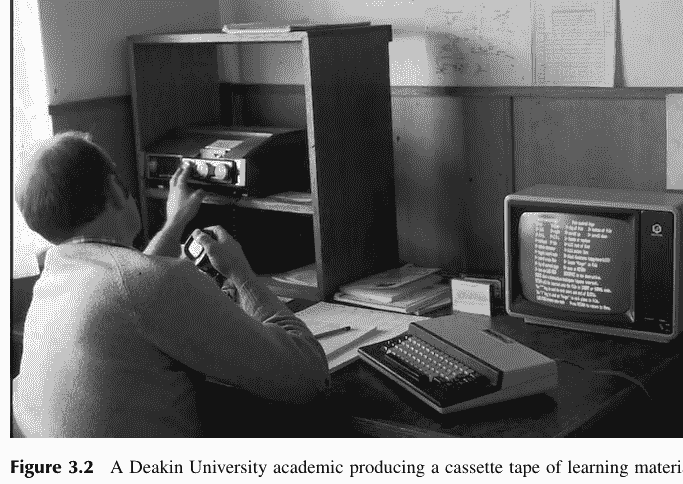

图3.2 德金大学一名学者制作学习材料磁带，归属德金大学博客

自该行业诞生以来，大学就战略性地拥抱教育技术。技术不仅是改善学生学习的工具，还促进了高等教育的大众化。这种技术采纳在支持可扩展性和成本降低方面发挥了关键作用，从根本上改变了教学、学习和评估环境。

澳大利亚成为教育出口强国的历程与其技术采纳密不可分。在线学习平台、数字资源和虚拟课堂打破了地理障碍，使澳大利亚大学能够触及全球学生群体。

德金大学在技术驱动的教育普及方面处于前沿。早在1978年，这所位于吉朗（澳大利亚维多利亚州的一所地区性院校）的大学就采用了当时最尖端的技术：盒式磁带。学者们将讲座和讨论提示等教育材料录制到盒式磁带上，然后邮寄给全国各地的地区学生（图3.2）[11]。

早在1978年，我们就看到技术和“地区性大学”创造了此前根本不可能的机会。

> *校外学习适合各行各业的人，但尤其受到乡村女性的欢迎，许多是年长且与来自农村地区的家庭一起工作的女性。‘来自Wycheproof的家庭主妇’是课程编写所依据的典型形象。– 德金大学档案馆*

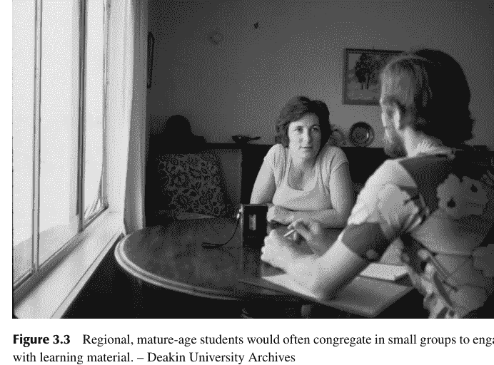

图 3.3 地区性、成熟年龄的学生经常会聚集在小团体中参与学习材料。– Deakin University Archives

自 1978 年以来，技术基础设施不断促进学生人数（包括本地和国际学生）的持续增长，这一趋势从未减弱。在 1980 年代，个人电脑开始进入课堂，首批教育软件也随之出现。在 1990 年代，CD-ROM 使数据保存现代化，首批学习管理系统也在早期互联网上出现。在 2000 年代，我们看到交互式白板和移动技术改善了可访问性和易用性。在 2010 年代，我们见证了大规模开放在线课程（MOOCs）的兴起，成千上万的学习者报名参加了 MOOC，例如由 Andrew Ng 主讲的斯坦福大学机器学习课程，该课程获得了 3,739,475 次注册 [4]。

因此，教育技术并非新鲜事物，虽然技术无疑在全球范围内提高了大学教育的<|message|>可及性，但也导致了充满挑战的现代学术环境。学生与导师比例和关系的下降、学生信任度降低以及学术诚信违规令人担忧的上升，都可归因于大规模化。

如今，像 OpenAI 的 ChatGPT 和 Google 的 Gemini 这样的大型语言模型（LLMs）为教育领域投下了熟悉的阴影，威胁着进一步破坏教育工作者所追求的目标的本质。这些复杂的 AI 工具挑战了传统的评估和署名观念，为本已紧张的系统增添了另一层复杂性。

## 专业化 - 3 课程系列

机器学习专业化课程是由 DeepLearning.AI 与 Stanford Online 合作创建的基础在线项目。 这个适合初学者的项目将教授您机器学习的基础知识以及如何使用这些技术构建现实世界的 AI 应用。
阅读更多

图 3.4 Andrew Ng 的斯坦福机器学习 MOOC

然而，当我们站在这个技术十字路口时，必须认识到推动大规模化的相同力量也掌握着应对其挑战的关键。教育技术的潜力远不止于增加注册人数。通过深思熟虑和协作的应用，我们有机会利用技术解锁以前不可能的教育体验，加强学术诚信，并重建学生与教育工作者之间的关系。

展望未来，我们面前的问题不是是否要在教育中拥抱技术，而是如何以提升而非削弱学习质量的方式做到这一点。未来的道路在于探索技术的创新应用。在本章中，我们将探讨关键的技术力量，并探讨它们所蕴含的双刃剑。特别是，我们将探讨 AI、游戏化、机器学习和扩展现实——不是作为人类教育者的替代品，而是作为增强他们改变学生生活能力的工具。

技术推动的高等教育大规模化让我们走到今天。现在，塑造技术明天将带我们走向何方，就取决于我们了。

### 3.3 生成式人工智能

简单来说，生成式人工智能是指基于 Transformer 架构、能够创建新内容（如文本、图像或音乐）的人工智能系统。大多数人通过 OpenAI 的 ChatGPT¹ 的发布了解到生成式人工智能，它在展示了文本生成能力的巨大飞跃时震惊了学术界和普通用户。

¹ https://openai.com/chatgpt/

2023 年 11 月的一个早晨，世界醒来发现了一个工具，它可以用莎士比亚的风格写论文，编写正确的计算机程序，当然，最相关的是对教育工作者而言，它可以为学生写出完整且及格的论文。

这些能力对教育乃至更广泛的社会都具有深远的影响。一些知名的人工智能人物，包括 Elon Musk，以及其他知名科技领袖和研究人员，于 2023 年 3 月签署了一封公开信，敦促对像 GPT-4 这样强大的 AI 系统的训练实施为期六个月的暂停 [1]。该信由生命未来研究所组织，表达了对快速发展的人工智能技术潜在风险和伦理影响的担忧，强调了共享安全协议和全面监督的必要性。

撇开伦理和社会问题不谈，很明显，生成式人工智能能力，尤其是大型语言模型，将在教育未来中发挥重要作用。

本节探讨生成式人工智能如何在教育中得到利用，分为三个大类：学生主导的使用、工具主导的使用，以及对承诺中的个人 AI 导师的展望。

#### 3.3.1 学生主导的生成式人工智能

学生主导的生成式人工智能涵盖了使用 ChatGPT 等大型语言模型工具的各种教学用途。学生可以直接利用这些工具进行头脑风暴、生成大纲，甚至获得写作技能的反馈。教育工作者已经开始鼓励或将 LLMs 纳入学习活动，例如要求学生修改 LLM 提示以产生更高质量的回应。

生成式人工智能还可以帮助学生在传统论文之外进行内容创作。例如，学生可能会使用 AI 驱动的工具为演示文稿创建视觉辅助材料，为计算机科学项目生成代码，甚至为创意艺术作业作曲。这些方法不仅教授有用的 AI 识读技能，还拓宽了学习任务的可能性。

生成式人工智能工具对具有多样化学习需求的学生也特别有益。例如，LLMs 擅长提供实时语言翻译，使非母语者更好地理解课程材料或与教育工作者互动。同样，文本转语音和语音转文本功能可以帮助有视觉或听觉障碍的学生，促进更具包容性的教育环境。

#### 3.3.2 工具主导的生成式人工智能

工具主导的生成式人工智能是指将人工智能技术集成到现有的教育工具和系统中，通常无需学生直接与人工智能交互。

工具主导生成式人工智能的一个潜在应用是集成到学习管理系统（LMS）中的系统。例如，集成到 LMS 平台中的 AI 聊天机器人可以即时回答学生关于课程后勤、截止日期或基本内容澄清的常见问题。拥有一个能够对常见问题提供准确且即时回应的工具，可以减轻教学人员的行政负担，并确保学生可以将时间集中在学习活动上。

评估是工具主导生成式人工智能可以提供重大价值的另一个领域。AI 驱动的系统可以帮助教育工作者快速生成多样化和个性化的评估项目，减少准备测试所需的时间。此外，这些工具有可能自动化某些类型作业的评分过程，为教师节省宝贵时间用于更高影响力的教学活动。

生成式人工智能也在教育内容本身的创建中得到利用。AI 工具可以帮助生成教科书补充材料、交互式模拟和昂贵的图形，以补充课程作业。这有可能大幅降低开发教育材料相关的成本和时间，使高质量资源更容易被更广泛的机构和学习者获取。

#### 3.3.3 展望：个性化人工智能导师

生成式人工智能的圣杯之一就是个人 AI 导师。将 LLMs 和其他生成模型应用于构建 AI 学习伴侣或导师，被宣称为现代人工智能的“游戏规则改变者”之一。

一个 24/7 的个人导师，能够激励、教授、测试并在学习路径上以其他方式支持学生，显然将是一个有价值的工具，但我们距离这一承诺成为现实还有多远？

首先，事实准确性和可靠性问题至关重要。LLMs 在大量数据上训练，但容易产生不正确或无意义的输出。这种现象被称为“幻觉”，是 LLMs 最大的挑战之一 [24]，许多努力都在寻求减少这种行为的频率 [23]。在教育环境中，信息的准确性至关重要，这带来了重大障碍。当前的人工智能模型缺乏持续区分事实信息和错误信息的能力，这可能误导学生或强化错误观念。

其次，虽然人工智能模型可以与学生进行对话，但它们目前缺乏人类导师所具备的对个体学生需求和情感状态的深刻理解。它们是基于文本的模型，无法读取肢体语言或社交线索。基于学生细微线索实时调整教学方法，或在困难时期提供激励支持的能力，仍然是人工智能系统的复杂挑战，在这方面人类很可能保持优势。

尽管存在这些挑战，该领域的发展迅速且前景光明。最近在多模态人工智能模型方面的进展，这些模型可以处理和生成文本、图像甚至语音，使我们更接近 AI 导师体验。这些模型

可能提供视觉解释，回应口头提问，甚至分析学生的手写内容或草图。

此外，在强化学习和少样本学习等领域的持续研究正在提升 AI 模型的可适应性和个性化能力。这可能导致 AI 导师能够更有效地根据个别学生的需求和学习轨迹量身定制其方法。

还值得注意的是，AI 导师的实施不必是非此即彼的选择。我们很可能会看到 AI 辅导能力逐步整合到现有的教育技术和实践中。例如，AI 驱动的作业助手、互动教材和个性化测验生成器已开始进入课堂和家庭。

##### 3.3.3.1 案例研究：DCC Help
调试 C 编译器（DCC）Help 项目 [20] 由新南威尔士大学（UNSW）的学者开发，旨在将生成式 AI 功能整合到编译器中。编译器是所有程序员用来将源代码转换为可在计算机上运行的程序的工具，以使用困难而闻名，尤其是在出现问题时难以理解。当特定程序出现问题时（例如，输入错误字符或逻辑错误），编译器会生成编程错误信息，旨在向程序员传达出了什么问题以及在哪里。

提升编译器错误信息质量的追求与工具本身一样古老，但相关努力旨在支持为帮助专业开发者快速查找和修复错误而设计的错误信息。为了改善初学者程序员的代码调试培训和支持，DCC Help [21] 将大型语言模型直接集成到编译器中。该集成提供了准确、适合新手的编程错误解释。这一系列 AI 工具已被 UNSW 计算专业的学生使用超过 400,000 次，以在编程错误后重新上手，并是生成式 AI 在教育中工具集成应用的范例。

关键的是，该工具的大部分使用发生在工作时间之外，这展示了 AI 驱动工具在教学团队不可用时支持学生学习的作用，以及减轻有限资源压力的能力。

通过设计 LLM 驱动工具的定制集成，教育工作者可以确保教学护栏得到执行。例如，DCC Help 限制学生使用工具的频率，温和地提醒 AI 帮助功能在期末考试中将不可用。

### 3.4 个性化学习
AI 在教育中最有前景的应用之一是创建自适应或个性化学习系统。这些系统使用机器学习算法分析学生表现并实时调整学习路径。

### $dcc --help
DCC Help 将生成式 AI 的强大功能带入调试 C 编译器，利用额外上下文生成有帮助的、情境化的解释。

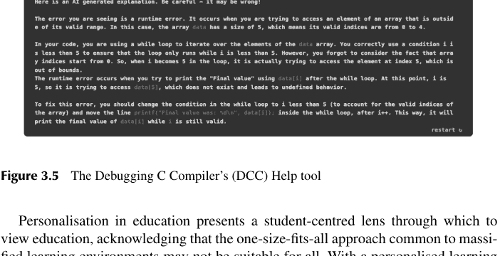

图 3.5 调试 C 编译器（DCC）的 Help 工具

教育中的个性化提供了一种以学生为中心的视角来看待教育，承认在规模化学习环境中常见的“一刀切”方法可能并不适合所有人。在个性化学习系统中，节奏、评估甚至概念都是动态的 [9]。这对于高等教育来说是一个相当大的转变，后者通常在所涵盖的概念上具有刚性，且评估时间表提前数年设定。

前 Transformer 时代的人工智能，即早于 LLM 背后技术的一种 AI，是个性化学习的核心。对于所有基于 AI 的个性化方法，算法均可利用先前学生行为和结果、以及个人学生的进度、学生参与度、历史表现等数据集来确定下一步。例如，轻松通过知识检查测验的学生可以跳到更具挑战性的主题，而遇到困难的学生则可以获得当前主题更深入的复习材料。

卡内基学习公司的 MATHia 是一款 AI 驱动的数学学习软件，可适应每个学生的学习节奏，提供个性化指导和练习题。它使用认知模型来理解学生如何思考数学概念，调整难度并提供有针对性的反馈 [?]。

此外，像 Duolingo² 这样流行的平台使用 AI 来个性化语言学习。该应用根据用户最近的表现或知识测试的表现调整练习难度，确保学习者不断受到挑战但不至于不堪重负。它还会重新复习学习者难以掌握的词汇和语法，使用间隔重复技术来增强记忆。

图 3.6 个性化的 Duolingo 学习环境

教育中的预测分析是学习分析的一种应用，可以通过分析出勤率、参与度、表现数据等关键指标的模式来识别有风险的学生。这种主动方法使教育工作者能够及早干预，提供有针对性的支持以帮助学生取得成功。

#### 3.4.1 个性化高等教育
在高等教育中实施个性化的挑战与其说是技术问题，不如说是一个系统性问题。当前大学的政策和结构往往侧重于标准化课程和固定时间表，这些难以适应 AI 驱动的个性化学习的灵活、个体化方法。传统的评估方法，如标准化的预定考试和评分系统，也不太适合适应个性化的节奏和内容。

另一个挑战是确保个性化学习路径与认证标准和学位要求保持一致。大学必须确保这些个性化体验符合其项目所期望的必要学术标准和学习成果。这可能意味着重新思考学分小时和课程完成度的衡量方式。

尽管存在这些挑战，个性化学习在高等教育中的益处是巨大的。它可以提高学生参与度、改善留存率，并更好地适应多样化的学习风格。随着 AI 技术的不断发展，将个性化学习整合到高等教育中很可能会变得更加普遍，提供更灵活、以学生为中心的方法。

### 3.5 游戏化：为 TikTok 世代的教育
游戏化是将游戏设计元素和原则应用于非游戏情境，如教育。它利用积分、徽章和排行榜等元素来鼓励参与并增强学习体验。核心思想很简单：通过激发外在奖励机制，让学习更有趣、更有乐趣。

从学生角度来看，外在动机涉及参与活动以获得奖励或避免负面结果，这与内在动机形成对比，内在动机描述的是学生因为某事本身有趣、有价值或愉快而自发去做。回顾来看，高等教育通常依赖于学生的内在动机，这些学生反复被朋友、家人和社会保证，他们的努力会得到回报。

游戏化对高等教育来说并不新鲜。传统上，高等教育和社会都重视学生的成绩。大学会为持续取得高成绩的学生授予特殊称号（一等荣誉），而行业则审查包含数字等级的学生成绩单。普遍的观点是，更高的成绩应提高学生获得理想工作的机会。这就是外在动机的一个例子，激励学生的不是学习和成就本身，而是高加权平均分（WAM）。在就业市场变化、生活成本上升和注意力缩短的背景下，也许进一步触动外在动机的心弦可以成为激励学生学习的一种方式。

在高等教育中，适当的、由技术驱动的游戏化应用包括使用积分、徽章和排行榜 [16]。积分是游戏化的基本元素，可以在完成任务、回答

回答问题正确，或参与课堂讨论。理想情况下，基于积分的系统可以整合到学习管理系统中，以提供即时反馈、跟踪进度，甚至可以兑换小奖励。

徽章作为对实现特定里程碑或掌握特定技能的认可形式。它们可以代表各种成就，例如完成课程模块、在某学科展示熟练程度，或表现出良好的学习习惯。徽章提供了成就感，但也允许学生向同伴展示自己的成就，培养社区感和友好竞争。此外，徽章的收集可以鼓励学生探索不同的学习路径，并在新领域挑战自己。

排行榜是另一种有效的游戏化工具，通过为学习引入竞争元素来提升动力。通过根据学生的表现或参与度对学生进行排名，排行榜可以营造一种兴奋感。新南威尔士大学计算机科学与工程学院（CSE）的课程，如软件工程基础，已成功利用排行榜匿名排名学生的软件准确性。匿名或伪匿名对于避免打击表现较差的学生至关重要。通过认可不同类型的成就，例如努力或进步，而不仅仅是最高分，排行榜可以变得更具包容性。这种方法确保所有学生无论初始技能水平如何都感到有动力和被重视。

游戏化已应用于许多其他领域，包括游戏本身以激励特定行为和参与度。非常受欢迎的视频游戏 Dota 2 使用了各种游戏化元素，包括徽章、积分和排行榜，前者如图 3.7 所示。

图 3.7 用于奖励玩家进度的热门 DotA 2 徽章系统

当深思熟虑地整合到教育过程中时，像积分、徽章和排行榜这样的游戏化元素可以增强学生的学习动机、参与度和整体学习成果。

### 3.6 学术诚信与机器学习

基于 Transformer 的机器学习（为 ChatGPT 等工具提供动力的技术）的最新发展在评估界引起了冲击。这些系统可以生成连贯、高质量的书面内容，使得学生更容易绕过学习过程并提交并非自己完成的作业。由于输出是新颖的，现有的抄袭检测系统如 TurnItIn 无法成功检测不当行为。这带来了一个严重问题：教师如何在现代高等教育的规模下确保学生参与学习活动？在本节中，我们将探讨技术如何帮助解决它所助长的问题。

#### 3.6.1 学习分析

学习分析是数据科学技术在教育领域特殊性上的应用 [15]。学习分析有许多应用，从自动检测有风险的学生，到获得有效优化课程和培训所需的知识。

我们将要探索的第一个前瞻性学习分析应用是学术不当行为检测。通过分析写作模式、参与度、来源材料和语言风格，基于机器学习的验证系统负责识别潜在的不当行为实例，例如与合同作弊服务互动，或将评估外包给生成式 AI。

检测学术不当行为主要有两种方法。第一种是通过击键记录和点击流数据，尝试检测学生在一段时间内完成评估时在学习环境中的行为异常 [22]。该方法虽然简单有效，但有两个主要批评。首先，该方法依赖于学生在指定环境中开发其评估（论文、代码编写等）。这对于使用第三方作者工具的学生，例如出于无障碍目的的学生，可能会造成不公平 [19]。该方法的第二个批评围绕一般隐私，许多学生、教育工作者和隐私倡导者担心在线监考考试是一种监视 [10]。

使用学习分析检测学术不当行为的第二种方法是风格检测。风格检测是随时间对风格进行算法验证 [7, 5]，其核心思想是每个个体的输出都有其特异性。大多数风格验证工作集中在写作风格上，但在代码编写和其他领域也在探索类似方法。该方法虽然更复杂且容易出现假阳性 [6]，但与行为记录相比有明显优势，因为评估的作者身份发生地变得不那么重要，且不需要侵犯隐私的监控。最终产品（无论是论文、源代码还是其他任何书面作品）只需与学生作品的先前示例进行验证即可。

这些方法为学术界和教育工作者对使用生成式 AI 生产新作品日益增长的担忧提供了一种潜在的“出路”。

#### 3.6.2 在线监考与伪监考

挤满紧张学生匆忙撰写期末考试的拥挤讲堂是世界各地许多人熟悉的画面。面对面监考考试几个世纪以来一直为学术机构服务，有其充分理由——它们提供高水平的评估安全。然而，自 COVID-19 大流行迫使替代面对面考试以来，澳大利亚的机构表现出不愿恢复面对面考试的态度。虽然出于教学目的反对期末考试有很多充分的理由，但很明显，举办面对面考试的高成本是关键因素。场地成本、人员成本和材料成本都导致机构举办考试的相对高成本。

在 COVID-19 大流行期间，机构寻求考试替代方法时，在线监考或在线监考技术承诺了两全其美：学生可以在卧室中参加的监考考试。

在线监考考试软件，如 Proctorio 3 和 ProctorU4 在受大流行影响的教学期间被广泛使用。这些工具通过在考试期间不断监控学生的环境音视频 feed，并由人工监考员或机器学习算法分析 feed，以确保 a) feed 中的人脸与注册学生的照片 ID 匹配，以及 b) 学生似乎没有从他人在线或在房间内获得帮助。

许多教育工作者和学者对这些监考系统表示严重关切， citing 数据隐私违规、偏见和歧视指控。在一份报告中，媒体网站 The Verge 探讨了对在线监考系统的调查，该系统错误地将有色人种学生标记为学术不当行为团队，因为机器学习算法无法在画面中检测到人类 [3]

> > ‘You’re being watched and recorded, every breath’

随着 COVID-19 教学紧急应对的尘埃落定，技术驱动的学术诚信的未来需要隐私友好的替代方案变得更加清晰。

##### 3.6.2.1 案例研究：与 Deep Speaker 的 Real Talk

由于对全面监考方法的严重担忧，学者们探索了更以学生为中心和隐私友好的替代方案。维护学术诚信的一种创新方法是说话人验证。该技术利用语音识别在口试或评估期间验证学生的身份 [18]。通过确保注册课程的学生与参加在线评估的人为同一人，机构可以防止冒名顶替，并确保评估反映学生的自身理解和能力。这种方法比其他形式的监视更不具侵入性。

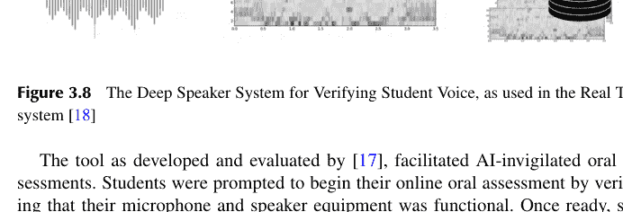

图 3.8 用于验证学生声音的 Deep Speaker 系统，如 Real Talk 系统中使用 [18]

该工具由 [17] 开发和评估，促进了 AI 监考口试。学生被提示通过验证其麦克风和扬声器设备是否正常工作来开始在线口试。一旦准备就绪，学生会被播放由其教师朗读的预录音频问题。这些问题虽然为特定评估的所有学生提供，但会针对学生的作业提出具体问题。例如，“你能逐行解释你在评估 A 中编写的代码吗”。学生随后必须实时回答问题，AI 系统验证受访者的身份。研究发现，该工具成功地在大规模计算课程中提供可扩展的口试，并描绘了未来隐私友好的高风险评估方法图景。

#### 3.6.3 未来评估安全

合同作弊和生成式 AI 工具为在高等教育中维护学术诚信带来了新的挑战。与此同时，威胁评估的正是技术为这些挑战提供了有希望的解决方案。学习分析，包括击键记录和风格检测，提供在不进行侵入性监视的情况下验证学生作业的方法。在线监考系统虽然有争议，但提供了传统面对面考试的替代方案。像说话人验证这样侵入性较小的方法在诚信和隐私问题之间取得了平衡。

随着教育行业向前发展，很明显，机构有各种开关和杠杆可以应用于设计不同安全性和成本水平的评估。更复杂、更准确的风格检测算法

可以对一段时间内进行的评估进行监控，而在高风险评估环境中可以应用学习分析和在线监考工具的合乎道德的方法。

总体而言，目标是创造一个拥抱技术进步，同时保持教育完整性和价值的学术环境。随着人工智能不断发展，我们对学术诚信的方法也必须随之演进，在安全、隐私和公平的教育获取之间取得平衡。

### 3.7 教室中的技术

高等教育机构正面临鼓励学生重返校园的挑战。诸如录制讲座、长时间通勤和高昂的生活成本等在线课程材料促使学生以异步方式参与学习。虽然这种灵活性对许多学生来说是积极的，但教育工作者为了满足现代教育不断变化的需求，不得不向空荡的讲堂授课。想象一个混合学习环境，能够融合面授和在线学生，创造一个可访问且灵活的学习体验。

*为了确保远程工作的学生和教育工作者能够充分参与小组协作和会议，教育工作空间需要技术来弥合旧的面授模式与新的混合和远程空间之间的差距。⁵*

图 3.9 微软对未来教室的设想

互联教室是现有视听和网络技术的融合，通常具有以下特点：

- 宽敞的视频屏幕：大显示屏让远程学生能够以一比一的比例参与，仿佛亲临现场，实现与教师和同伴的面对面互动。
- 高质量音频系统：现代音频信号处理技术，如感知房间的 3D 音频，有助于在三维环境中定位虚拟扬声器
- 交互式白板：这些白板允许实时共享内容和注释，所有学生无论身处何地均可见。

虽然教育工作者希望看到学生大规模重返校园，但地理限制和健康问题等为仅参与面授教育的学生带来了诸多障碍。面向未来的互联教室为所有学生提供灵活性和更高质量的学习环境，同时为他们日益远程的工作未来做好准备。

##### 3.7.1.1 案例研究：UNSW 的未来教室

新南威尔士大学工程学院的 AI 驱动互联教室是一个先进的 Microsoft Teams 连接教室。该教室允许动态多摄像头视图，教师和学生都可以轻松地相互互动。

> *UNSW 工程学院的数字教学工作室，由 Microsoft Surface、Steelcase、QSC 和 Crestron Electronics 合作打造，从零开始构建以让智能 Microsoft Teams Room 功能发挥最佳效果。这可能是世界上最复杂的会议室，它回应了后疫情时代大学的挑战——大卫·凯勒曼副教授*

### 3.8 教育中的扩展现实（XR）

扩展现实（XR）是一类技术，包括虚拟现实（VR）、增强现实（AR）以及其他类似技术，旨在增强、替代或提升视听感官信息。

本节探讨 XR 技术如何在教育中应用，以为学生创造令人震撼、发人深省且具有变革性的学习机会。

图 3.11 一款现代飞行模拟器

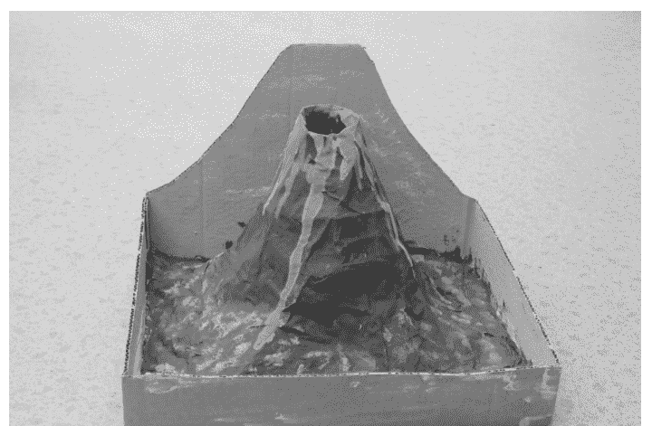

图 3.12 纸浆糊火山

虽然传统的火山模型允许学生亲手制作并观察模拟喷发，但 XR 将这一概念提升到新的高度。虚拟现实（VR）作为扩展现实的子集，可以将学生带到真实的火山环境，让学生站在活火山脚下，感受到脚下的震颤，并以高保真细节和规模见证喷发的壮观景象。

借助增强现实技术（AR），图像叠加将教室桌面转变为板块运动的动态三维模型。

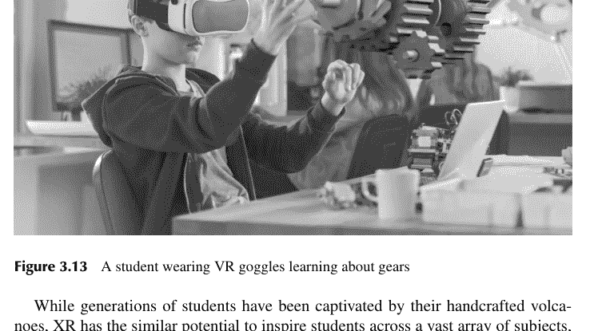

图 3.13 一名佩戴 VR 眼镜的学生正在学习齿轮知识

虽然几代学生都被他们亲手制作的火山所吸引，但 XR 具有同样的潜力，可以在广泛的学科中激发学生的兴趣，使其成为 21 世纪的“纸浆糊火山”——一种多功能、引人入胜的工具，以新的方式让学习栩栩如生。

随着头戴式显示器（HMD）（最常见的虚拟现实形式）成本大幅下降，探索 VR 在课堂中的采用已开始。[13] 分析了在 K-12 学校环境中实施 HMD VR 的组织、机构、情境和实践挑战与机遇。他们发现，虽然教师设想了 VR 技术在课堂中的潜力，但经济薄弱被强调为主要障碍。在自带设备（BYOD）课堂中，围绕平等和获取的严重担忧仍然限制着 VR 的潜力。

展望未来⁷，我们可以推断成本将继续下降，直到该技术可供发达国家大多数学生使用 [8]。一旦可及性问题得到解决，VR 在教育中的应用将无穷无尽。[25] 探讨了诸如食物消化等应用，展示人体如何消化食物，到教授电磁学和磁场概念，以及创造体验式学习机会，例如将学生带回史前时代、运动场或行星。

### 3.9 未来的道路

当我们站在感觉上像是教育新时代的边缘时，我们必须不忘从丰富的教育技术历史中学到的教训。从最早教授救生技能的飞行模拟器，到通过简单的盒式磁带实现的教育的普及，改变生活的潜力依然令人兴奋。一次又一次，教育工作者和学者共同站在这场革命的最前沿。

展望未来，教育面临的最大挑战正是技术本身带来的挑战。生成式人工智能带来的学术诚信威胁或许给大规模教育环境带来了最大压力。从这个意义上说，未来的道路充满挑战。机构需要保持对学习成果的关注，保护学术诚信，优先考虑隐私，并可能牺牲一些迄今为止得益于技术而享有的规模化。

但随着技术的演进，教育工作者的最终目标保持不变：培养好奇心，发展批判性思维，并为学生准备好他们将继承的充满挑战的世界。从简单的盒式磁带，到价值百万美元的飞行模拟器，技术在这一最古老的追求中始终只是一种工具。

## 参考文献

- 1. Elon Musk joins call for pause in creation of giant AI ‘digital minds’ — Artificial intelligence (AI) — The Guardian.
- 2. Flight simulator – Wikipedia.
- 3. Students of color are getting flagged to teachers because Proctorio testing software can’t see them – The Verge.
- 4. The 50 Most Popular MOOCs of All Time (Updated For 2021) – Online Course Report.
- 5. Sadia Afroz, Michael Brennan, and Rachel Greenstadt. Detecting hoaxes, frauds, and deception in writing style online. Proceedings – IEEE Symposium on Security and Privacy, pages 461–475, 2012.
- 6. Nawaf Ali, Musa Hindi, and Roman V. Yampolskiy. Evaluation of authorship attribution software on a Chat bot corpus. 23rd International Symposium on Information, Communication and Automation Technologies, ICAT 2011, 2011.
- 7. Alexander Amigud and Phillip Dawson. The law and the outlaw: is legal prohibition a viable solution to the contract cheating problem? Assessment and Evaluation in Higher Education, 45(1):98–108, 1 2020.
- 8. Paola Araiza-Alba, Therese Keane, and Jordy Kaufman. Are we ready for virtual reality in K–12 classrooms? Technology, Pedagogy and Education, 31(4):471–491, 8 2022.

- 9. Oyebola Olusola Ayeni, Nancy Mohd Al Hamad, Onyebuchi Nneamaka Chisom, Blessing Osawaru, and Ololade Elizabeth Adewusi. AI 在教育中：个性化学习和教育技术的综述. https://gsconlinepress.com/journals/gscarr/sites/default/files/GSCARR-2024-0062.pdf, 18(2):261–271, 2024.
- 10. Phillip Dawson. 使用在线监考考试的策略.
- 11. Deakin University. Deakin 的远程学习：从 1978 年至今, 2021. 访问日期：2023-07-24.
- 12. Department of Education and Training. uCube – 高等教育统计. 技术报告, 2018.
- 13. Göran Fransson, Jörgen Holmberg, and Claes Westelius. 从教师视角看 K-12 学校中使用头戴式虚拟现实的挑战. Education and Information Technologies, 25(4):3383–3404, 2020.
- 14. Karsten Hytten. 水中直升机坠毁：模拟器逃生训练的影响. Acta Psychiatrica Scandinavica, 80:73–78, 1989.
- 15. Mohammad Khalil and Martin Ebner. 什么是学习分析？2013-2015 年使用的不同方法的调查. 2016.
- 16. Jonathon Meyers, Andrew Cain, Jake Renzella, and Alex Cummaudo. 将游戏化整合到任务导向型作品集评估中的提案. 2018 IEEE 教学、评估与工程学习国际会议论文集, TALE 2018, 页码 1022–1027, 2018.
- 17. Jake Renzella, Andrew Cain, and Jean Guy Schneider. 真实对话：利用真实讨论工具阐明在线学生的理解. 收录于 SIGCSE 2021 – 第 52 届 ACM 计算机科学教育技术研讨会论文集, 页码 886–892. Association for Computing Machinery, Inc, 2021.
- 18. Jake Renzella, Andrew Cain, and Jean-Guy Schneider. 使用深度说话人验证口头评估中的学生身份. Computers and Education: Artificial Intelligence, 3:100044, 2022.
- 19. Lesley T. Sefcik, T. Veeran-Colton, M. Baird, C. Price, and S. Steyn. 对在线评估期间远程监考的学生用户体验 (UX) 和感知的考察. Australasian Journal of Educational Technology, 38(2):49–69, 2022.
- 20. Andrew Taylor, Jake Renzella, and Alexandra Vassar. 先打基础：通过调试 C 编译器提高 C 语言在入门编程课程中的可行性. 收录于 SIGCSE 2023 – 第 54 届 ACM 计算机科学教育技术研讨会论文集, 第 1 卷, 页码 346–352. Association for Computing Machinery, Inc, 2023.
- 21. Andrew Taylor, Alexandra Vassar, Jake Renzella, and Hammond Pearce. dcc - help: 通过大型语言模型生成上下文感知的错误解释来转变编译器的角色. 收录于 SIGCSE 2024 第 55 届 ACM 计算机科学教育技术研讨会论文集, 第 1 卷, 页码 1314–1320. Association for Computing Machinery, Inc, 2024.
- 22. Kelly Trezise, Tracii Ryan, Paula de Barba, and Gregor Kennedy. 使用学习分析检测学术不端行为. Journal of Learning Analytics, 6(3):90–104, 2019.

## 4 探索设计思维在工程学科中的整合

Alexandra Vassar
计算机科学与工程学院，UNSW 悉尼
肯辛顿，澳大利亚

### 4.1 探索设计思维在工程学科中的整合

请某人描述‘设计’一词可以应用于何处，很可能他们的思维会转向美学——一件衣服的剪裁、家具的曲线、房屋的建筑元素或一件艺术品的构图。我想像中很少有人会在那个清单里提到工程，即使它处于问题解决的核心，而设计作为一门学科，专注于理解问题并打造解决方案。同样地，利用设计思维来指导工程中问题的定义这一想法正在获得动力，并代表了我们对待技术教育和问题解决方式的巨大转变。

设计思维与工程的结合认识到，现代工程师面临的挑战不仅仅是技术性的，往往还涉及需要更综合方法的人文、社会和环境因素。而比同理心更具人性化的又是什么——把人放在解决方案的核心？众多案例研究和现实世界的例子证明了设计思维在应对棘手问题方面的有效性，从改善医疗服务到应对气候变化问题。成功整合的一个例子是梅奥诊所的 OB Nest 项目，该项目利用设计思维探索了一种新的低风险孕产护理模式 [9]。孕产护理通常侧重于临床结果，并伴有频繁医疗预约的复杂流程。平均而言，低风险妊娠的女性在四十周期间需要参加 12-14 次预约。利用设计思维同理待产母亲并了解她们在护理模式中的需求，新模式通过提供自我测量工具和持续灵活地接触护理团队，根据个体患者需求重新分配护理 [9]。将低风险妊娠的产前护理去医疗化所带来的结果是女性整体体验得到改善，placing as

### 4.2 设计思维

设计的过程从来都不简单。想象一串套娃。这些套娃是为谁准备的？是为小手，还是大手？无论如何，每一个都必须大小合适才能套进下一个。思考这些娃娃是为谁准备的会改变它们打开的难易程度，也会影响娃娃本身的图案。娃娃的两半必须精确吻合才能保持视觉连贯性。谁能想到这样一个简单的玩具会涉及如此多的思考，而思考只能在我们确定这些套娃的归属对象后才开始。同样在现实生活中，设计涉及思考目标受众，同时还要考虑系统内部多个相互作用的元素层级，这些元素可能是嵌套的或与另一个系统相连，继而又与另一个系统相连，等等。

设计原则的核心是能够参与 [20]。然而，作为一门学科，设计思维直到二十世纪后期才出现，当时 Rowe 将‘Design Thinking’用作其书籍的标题 [37]。在随后的几十年里，这一过程从创新流行语转变为广泛传播的实践 [25, 32]。出现了多个描述设计思维的模型 [10]，社区一致认为需要一个框架来在各个行业中维持这一过程。人们对设计思维的认知各不相同，有人将其描述为一种思维方式或一组特征和原则 [34, 12]；另一些人则认为它更像是一个具有明确阶段的过程 [32, 24, 31]。Liedtka 提到，尽管呼吁采用设计思维过程，“即使是这个术语本身在从业者和倡导者中也是有争议的。” [25, p. 926]。事实上，设计思维过程的定义似乎仍然存在相当大的差异，而对其优点的一致性 [32, 18, 7, 6, 17]。

这种紧张关系或许源于该术语不同的起源 [17]。虽然设计学者已在设计背景下广泛描述了这一过程 [23]，但该术语直到过去十年才在管理实践中被广泛认可为创造性问题解决的过程 [25]。Micheli 等人在其对该过程的系统文献综述中，提出了设计思维的十一个关键主要属性 [32]。与设计思维过程相关的文献中最常见的主题之一是创造力和创新 [32]。其他常见主题包括该过程以用户为中心，经常被引用为设计思维的核心特征 [7]、其有效解决问题的能力、设计思维的迭代和实验、跨学科合作、溯因推理以及对模糊性和失败的容忍度等。

尽管存在争议，设计思维作为一种非规定性的问题解决方式，最为人所知的是其被划分为阶段。虽然所包含的阶段名称和数量存在差异，但当考虑最常引用的模型时，仍会出现一定程度的共性 [32]。设计思维是一种非线性的、以用户为中心的理念和过程，提供了一种基于解决方案的问题解决方式，始终考虑解决方案如何满足用户的需求 [34]。它以应对“棘手”问题而闻名，这些问题定义不清，本质上是独特的，并且没有解决方案的即时或最终检验。这些棘手问题的解决方案不是真或假，而是

good-or-bad [27]。这类问题需要创造性、跳出思维定式的思考和解决方案。

许多框架对该过程进行了定义，但所有框架中都可以看到一些不同的阶段。在设计思维过程中，我们首先采取的共同核心步骤之一是通过共情来理解用户及其需求（进行共情）。这有助于我们定义问题，其中从共情中收集到的洞察被综合起来，以清晰地阐述需要解决的核心问题。过程的后半部分涉及产生想法——因此这是一个不带评判的区域。在头脑风暴之后，被认为最有前景的想法会被制作成原型，从而可以在设计过程早期探索不同的可能性并识别潜在问题。最后，原型会被测试，然而，过程并不止于此！这是一个迭代过程，这意味着我们在所有阶段都从用户那里收集反馈，并将其应用以帮助重新定义问题和定义解决方案。该过程同时具有溯因性（我们试图解决什么）、归纳性（我们如何试图解决这个问题？）和演绎性（我们在解决问题中寻求什么结果？）[10]。这意味着从理解实际要解决的问题是什么开始，方程的所有部分都会被考虑。然而，在整个过程中，设计思维过程的主要方面是其对用户需求的关注，同时在实践中灵活地使用一些试错方法 [10]。

你可能会惊讶地发现，2009年，提供全球民宿住宿的公司AirBnB濒临破产。在创业领域，他们只是一个被吞没的想法之一，公司每周收入仅为200美元 [13]。这家企业的三位联合创始人花了数小时研究搜索结果，以了解业务为何没有增长，而引起他们注意的是，房源的照片质量根本不达标。人们使用手机相机拍摄，或使用其他图像，这些图像分辨率往往不对、模糊，或不适合展示房源。难怪客户不预订房源，因为他们甚至不确定那些房源到底是什么样子！令人惊讶的是，团队决定自己动手，前往纽约与房东共度时光，并帮助他们拍摄分辨率更高、更专业的房源照片。此时团队确实是在凭直觉行事，但这种直觉源于对客户需求更深入的理解。一周后，收入翻了一番——这是公司大约八个月来首次取得财务改善 [13]。此后Airbnb稳步发展成为一家数十亿美元的在线平台。然而，如果没有创始人设身处地为客户着想并更深入了解客户需求的那一刻，这将是公司未来真正的转折点。

不难看出设计思维为何真正有效。为一群参与首先理解问题的人解决问题——这无疑是成功的秘诀。另一天我路过一系列明信片

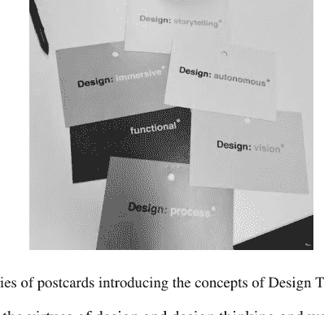

图4.1 一系列向学生介绍设计思维概念的明信片

它们宣传着设计和设计思维的优点，并邀请学生了解更多关于这些关键概念的信息（图4.1）。这组明信片最有趣的地方在于，也许设计师在设计这些明信片时并未考虑设计思维的原则。尽管它们具有美学价值，但看起来“共情”步骤被遗忘了，其中一些明信片出现了令人质疑的对比度。例如，解释设计思维过程中功能性的明信片在深色背景上使用了深色文字，而具有讽刺意味的是，关于设计思维愿景的明信片在浅色背景上使用了浅色文字，因此几乎无法想象。这只是当设计思维的关键概念未被考虑时可能发生情况的一个简单例子。

### 4.3 工程教育中的设计

从我的经验来看，大约二十年前我是一名工程专业的学生。就在二十年前，大学工程课程中根本没有教授设计思维，甚至几乎没有教授设计。课程充满了评估和考试，主要由清晰明确的问题组成，其中绝对有一个正确答案。这强调了死记硬背、记忆事实和公式并背诵出来。我觉得这相当缺乏灵感。这种情况一直持续到我在大学三年级时，纯属偶然选择了人机交互作为选修课。这是我第一次接触以用户为中心的思维、迭代设计流程，以及在解决问题中的创造力介绍。这对我来说是一个转折点，因为在此之前，我曾考虑过转专业。但在这里，我终于窥见了我为何选择工程专业，以及我发现特别迷人的问题解决类型！让我觉得很有意义的是让用户参与进来，并专注于通过试错过程迭代各个阶段，直到达到最佳解决方案（请注意，它可能并不完美）。

很合理的是，在我们认真考虑将这种思维纳入课程之前，这只是时间问题。自2020年首次开设以来，新南威尔士大学的每个工程学科现在都要求学生在第二年完成一门核心课程，重点是将设计思维应用于现实世界问题。我自己讲授过这门课程两次，我发现本科工程专业的学生常常被这门课程难倒——他们不太清楚该如何定位它以及如何学习材料。在软件工程专业，虽然大多数学生带着能够“轻松过关”材料的想法进入课程，但一旦开始学习，他们会发现庞大的问题空间和所提问题的复杂性实际上导致了大量时间和精力的投入。我希望这对学生来说可能是一个转折点，就像对我一样，有些学生在多年后会给我发邮件，描述他们对该过程的喜爱，并询问关于他们正在进行的其他项目中应用相同过程的建议。

但这类课程在工程教育中可能发挥巨大作用。传统的工程教育往往高度关注技术技能和理论概念，有时以牺牲现实世界应用为代价。设计思维通过将重点转移到共情上来解决这个问题。与用户共情有助于最初定义问题，并重新构想保持以用户为中心的解决方案。学生学会考虑工程问题的人文方面，而不仅仅是技术规范。弥合理论知识与实际应用之间的差距，这些课程最重要的元素是它在未来的工程师中点燃了某种魔力——没有什么比头脑风暴和共同努力解决困难问题更令人愉悦的了——这可能正是他们最初选择工程专业的理由。

那么问题仍然存在，将设计思维实践整合到工程课程中对学生学习成果有何影响，如果有的话。教育理论似乎支持设计思维的原则——事实上，设计思维的主要特征，如协作和迭代，与教育理论和认知心理学相关。协作对学习有益的概念早在1970年代就已提出，作为维果茨基社会学习理论的一部分 [44]，迭代的概念融入到我们的成长心态和自我理论中 [11]，这也与学习成绩更高和学生更具韧性相关 [46]。设计思维的迭代性质——涉及共情、定义、头脑风暴、原型制作和测试等阶段——教会学生将失败视为学习机会并不断完善自己的想法。这进一步强化了成长心态，并与行业保持一致，在行业中创新和持续改进至关重要。通过鼓励多次迭代和快速原型制作，设计思维帮助学生培养韧性和适应能力，这些都是在工程快速发展的世界中取得成功的关键特征。

这类课程的一个重要方面，以及头脑风暴过程，是能够与其他人一起工作，这可能是在你自己的学科内，或跨越多个

学科。任何涉及团队合作的课程都会引起学生和教育工作者同样的强烈反应（并不总是积极的）。网络上流传着大量否定团队合作美德的梗图，还有更多梗图集中在不断被队友拖累的经历上。撇开梗图不谈，在现实生活中，工程挑战很少孤立存在；它们经常与经济、社会和环境问题相交织。这种复杂性往往需要在行业及更广泛范围内进行协作，而设计思维本身就培养了这种协作精神。对于那些在协作环境中获得积极体验的人来说，在所有学生都来学习并参与过程和项目的情况下，他们得以体验到思想的麦加。团队通常由具有不同背景、技能和经验的个人组成，这种组合更有可能产生创新解决方案。对于那些关系不如人意的情况，学生培养了在职场成功所需的沟通和人际交往技能，以及潜在的冲突解决技能。然而，也有教育理论支持团队合作和协作学习 [19, 42]。

协作学习引入了集体工作记忆的概念，基于认知负荷理论的原则，即任务的认知负荷在群体成员之间共享 [42]。正如 Kirschner（2018）[19] 所指出的，这种共享的认知资源为团队成员提供了动态的信息支架，这些信息并非来自外部来源，而是源于团队本身的互动。这种集体记忆成为一个随时可用的知识库，恰好在需要时可用，从而显著增强学习机会。因此，团队能够解决个人单独工作时无法解决的更复杂问题。团队的集体知识和技能使得对挑战和潜在解决方案的探索更加透彻。这种过程的协作性质也培养了持续学习和适应的文化，因为团队成员在设计思维之旅中不断分享、批评并在彼此的想法之上构建。这种迭代的团队方法不仅提高了成果的质量，还加快了整体设计过程。

此外，将设计思维技能整合有助于培养学生在传统工程课程中常被低估的关键软技能。良好的沟通技能得以发展，因为学生需要持续清晰地向同伴阐述自己的想法。创造性思维和“跳出框框思考”的方面受到鼓励，从而有助于培养重要的创造力技能。最后，问题解决技能得到练习，因为学生被赋予了定义模糊的领域问题，这与现实生活中的工程问题相似。合在一起，这些有助于培养韧性以及重视挑战的心态。

学科内和团队内的多样性是推动创新并为所有人创造包容环境的[content]
学科。任何涉及团队合作的课程都会引起学生和教育工作者同样的强烈反应（并不总是积极的）。网络上流传着大量否定团队合作美德的梗图，还有更多梗图集中在不断被队友拖累的经历上。撇开梗图不谈，在现实生活中，工程挑战很少孤立存在；它们经常与经济、社会和环境问题相交织。这种复杂性往往需要在行业及更广泛范围内进行协作，而设计思维本身就培养了这种协作精神。对于那些在协作环境中获得积极体验的人来说，在所有学生都来学习并参与过程和项目的情况下，他们得以体验到思想的麦加。团队通常由具有不同背景、技能和经验的个人组成，这种组合更有可能产生创新解决方案。对于那些关系不如人意的情况，学生培养了在职场成功所需的沟通和人际交往技能，以及潜在的冲突解决技能。然而，也有教育理论支持团队合作和协作学习 [19, 42]。

协作学习引入了集体工作记忆的概念，基于认知负荷理论的原则，即任务的认知负荷在群体成员之间共享 [42]。正如 Kirschner（2018）[19] 所指出的，这种共享的认知资源为团队成员提供了动态的信息支架，这些信息并非来自外部来源，而是源于团队本身的互动。这种集体记忆成为一个随时可用的知识库，恰好在需要时可用，从而显著增强学习机会。因此，团队能够解决个人单独工作时无法解决的更复杂问题。团队的集体知识和技能使得对挑战和潜在解决方案的探索更加透彻。这种过程的协作性质也培养了持续学习和适应的文化，因为团队成员在设计思维之旅中不断分享、批评并在彼此的想法之上构建。这种迭代的团队方法不仅提高了成果的质量，还加快了整体设计过程。

此外，将设计思维技能整合有助于培养学生在传统工程课程中常被低估的关键软技能。良好的沟通技能得以发展，因为学生需要持续清晰地向同伴阐述自己的想法。创造性思维和“跳出框框思考”的方面受到鼓励，从而有助于培养重要的创造力技能。最后，问题解决技能得到练习，因为学生被赋予了定义模糊的领域问题，这与现实生活中的工程问题相似。合在一起，这些有助于培养韧性以及重视挑战的心态。

学科内和团队内的多样性是推动创新并为所有人创造包容环境的重要因素。多年以来，工程学科一直以性别失衡著称 [43]。在澳大利亚，仅有 15% 的 STEM 毕业生是女性 [14]。研究已探讨了这种失衡的原因，各种文献显示女性更偏好工程的社会和人道主义方面——解决造福人类的难题 [3, 15, 30]。将设计思维纳入工程课程，其中以以人为本的方法为核心，可能是工程项目吸引那些原本会被纯技术导向所劝退的学生的一种方式。促进多样性长期以来一直是工程领域的目标，增加 STEM 职业中的女性人数也有着悠久的尝试历史——也许应用设计思维过程也能推动这一棘手问题的解决。

#### 4.3.1 创客空间

创客运动是一个迅速增长的趋势，其中一群人或个人创造产品 [21]。我最喜欢的定义之一由 Martin [28, p.30] 提出，并将创客运动描述为“……一个由业余爱好者、 tinkerer、工程师、黑客和艺术家组成的社区，他们为娱乐和实用目的创造性地设计和构建项目……”。大量以创客为中心的[content]
学科。任何涉及团队合作的课程都会引起学生和教育工作者同样的强烈反应（并不总是积极的）。网络上流传着大量否定团队合作美德的梗图，还有更多梗图集中在不断被队友拖累的经历上。撇开梗图不谈，在现实生活中，工程挑战很少孤立存在；它们经常与经济、社会和环境问题相交织。这种复杂性往往需要在行业及更广泛范围内进行协作，而设计思维本身就培养了这种协作精神。对于那些在协作环境中获得积极体验的人来说，在所有学生都来学习并参与过程和项目的情况下，他们得以体验到思想的麦加。团队通常由具有不同背景、技能和经验的个人组成，这种组合更有可能产生创新解决方案。对于那些关系不如人意的情况，学生培养了在职场成功所需的沟通和人际交往技能，以及潜在的冲突解决技能。然而，也有教育理论支持团队合作和协作学习 [19, 42]。

协作学习引入了集体工作记忆的概念，基于认知负荷理论的原则，即任务的认知负荷在群体成员之间共享 [42]。正如 Kirschner（2018）[19] 所指出的，这种共享的认知资源为团队成员提供了动态的信息支架，这些信息并非来自外部来源，而是源于团队本身的互动。这种集体记忆成为一个随时可用的知识库，恰好在需要时可用，从而显著增强学习机会。因此，团队能够解决个人单独工作时无法解决的更复杂问题。团队的集体知识和技能使得对挑战和潜在解决方案的探索更加透彻。这种过程的协作性质也培养了持续学习和适应的文化，因为团队成员在设计思维之旅中不断分享、批评并在彼此的想法之上构建。这种迭代的团队方法不仅提高了成果的质量，还加快了整体设计过程。

此外，将设计思维技能整合有助于培养学生在传统工程课程中常被低估的关键软技能。良好的沟通技能得以发展，因为学生需要持续清晰地向同伴阐述自己的想法。创造性思维和“跳出框框思考”的方面受到鼓励，从而有助于培养重要的创造力技能。最后，问题解决技能得到练习，因为学生被赋予了定义模糊的领域问题，这与现实生活中的工程问题相似。合在一起，这些有助于培养韧性以及重视挑战的心态。

学科内和团队内的多样性是推动创新并为所有人创造包容环境的重要因素。多年以来，工程学科一直以性别失衡著称 [43]。在澳大利亚，仅有 15% 的 STEM 毕业生是女性 [14]。研究已探讨了这种失衡的原因，各种文献显示女性更偏好工程的社会和人道主义方面——解决造福人类的难题 [3, 15, 30]。将设计思维纳入工程课程，其中以人为本的方法为核心，可能是工程项目吸引那些原本会被纯技术导向所劝退的学生的一种方式。促进多样性长期以来一直是工程领域的目标，增加 STEM 职业中的女性人数也有着悠久的尝试历史——也许应用设计思维过程也能推动这一棘手问题的解决。

#### 4.3.1 创客空间

创客运动是一个迅速增长的趋势，其中一群人或个人创造产品 [21]。我最喜欢的定义之一由 Martin [28, p.30] 提出，并将创客运动描述为“……一个由业余爱好者、tinkerers、工程师、黑客和艺术家组成的社区，他们为娱乐和实用目的创造性地设计和构建项目……”。大量以创客为中心的[content]
学科。任何涉及团队合作的课程都会引起学生和教育工作者同样的强烈反应（并不总是积极的）。网络上流传着大量否定团队合作美德的梗图，还有更多梗图集中在不断被队友拖累的经历上。撇开梗图不谈，在现实生活中，工程挑战很少孤立存在；它们经常与经济、社会和环境问题相交织。这种复杂性往往需要在行业及更广泛范围内进行协作，而设计思维本身就培养了这种协作精神。对于那些在协作环境中获得积极体验的人来说，在所有学生都来学习并参与过程和项目的情况下，他们得以体验到思想的麦加。团队通常由具有不同背景、技能和经验的个人组成，这种组合更有可能产生创新解决方案。对于那些关系不如人意的情况，学生培养了在职场成功所需的沟通和人际交往技能，以及潜在的冲突解决技能。然而，也有教育理论支持团队合作和协作学习 [19, 42]。

协作学习引入了集体工作记忆的概念，基于认知负荷理论的原则，即任务的认知负荷在群体成员之间共享 [42]。正如 Kirschner（2018）[19] 所指出的，这种共享的认知资源为团队成员提供了动态的信息支架，这些信息并非来自外部来源，而是源于团队本身的互动。这种集体记忆成为一个随时可用的知识库，恰好在需要时可用，从而显著增强学习机会。因此，团队能够解决个人单独工作时无法解决的更复杂问题。团队的集体知识和技能使得对挑战和潜在解决方案的探索更加透彻。这种过程的协作性质也培养了持续学习和适应的文化，因为团队成员在设计思维之旅中不断分享、批评并在彼此的想法之上构建。这种迭代的团队方法不仅提高了成果的质量，还加快了整体设计过程。

此外，将设计思维技能整合有助于培养学生在传统工程课程中常被低估的关键软技能。良好的沟通技能得以发展，因为学生需要持续清晰地向同伴阐述自己的想法。创造性思维和“跳出框框思考”的方面受到鼓励，从而有助于培养重要的创造力技能。最后，问题解决技能得到练习，因为学生被赋予了定义模糊的领域问题，这与现实生活中的工程问题相似。合在一起，这些有助于培养韧性以及重视挑战的心态。

学科内和团队内的多样性是推动创新并为所有人创造包容环境的重要因素。多年以来，工程学科一直以性别失衡著称 [43]。在澳大利亚，仅有 15% 的 STEM 毕业生是女性 [14]。研究已探讨了这种失衡的原因，各种文献显示女性更偏好工程的社会和人道主义方面——解决造福人类的难题 [3, 15, 30]。将设计思维纳入工程课程，其中以人为本的方法为核心，可能是工程项目吸引那些原本会被纯技术导向所劝退的学生的一种方式。促进多样性长期以来一直是工程领域的目标，增加 STEM 职业中的女性人数也有着悠久的尝试历史——也许应用设计思维过程也能推动这一棘手问题的解决。

#### 4.3.1 创客空间

创客运动是一个迅速增长的趋势，其中一群人或个人创造产品 [21]。我最喜欢的定义之一由 Martin [28, p.30] 提出，并将创客运动描述为“...一个由业余爱好者、tinkerers、工程师、黑客和艺术家组成的社区，他们为娱乐和实用目的创造性地设计和构建项目...”。大量以创客为中心的[content]
学科。任何涉及团队合作的课程都会引起学生和教育工作者同样的强烈反应（并不总是积极的）。网络上流传着大量否定团队合作美德的梗图，还有更多梗图集中在不断被队友拖累的经历上。撇开梗图不谈，在现实生活中，工程挑战很少孤立存在；它们经常与经济、社会和环境问题相交织。这种复杂性往往需要在行业及更广泛范围内进行协作，而设计思维本身就培养了这种协作精神。对于那些在协作环境中获得积极体验的人来说，在所有学生都来学习并参与过程和项目的情况下，他们得以体验到思想的麦加。团队通常由具有不同背景、技能和经验的个人组成，这种组合更有可能产生创新解决方案。对于那些关系不如人意的情况，学生培养了在职场成功所需的沟通和人际交往技能，以及潜在的冲突解决技能。然而，也有教育理论支持团队合作和协作学习 [19, 42]。

协作学习引入了集体工作记忆的概念，基于认知负荷理论的原则，即任务的认知负荷在群体成员之间共享 [42]。正如 Kirschner（2018）[19] 所指出的，这种共享的认知资源为团队成员提供了动态的信息支架，这些信息并非来自外部来源，而是源于团队本身的互动。这种集体记忆成为一个随时可用的知识库，恰好在需要时可用，从而显著增强学习机会。因此，团队能够解决个人单独工作时无法解决的更复杂问题。团队的集体知识和技能使得对挑战和潜在解决方案的探索更加透彻。这种过程的协作性质也培养了持续学习和适应的文化，因为团队成员在设计思维之旅中不断分享、批评并在彼此的想法之上构建。这种迭代的团队方法不仅提高了成果的质量，还加快了整体设计过程。

此外，将设计思维技能整合有助于培养学生在传统工程课程中常被低估的关键软技能。良好的沟通技能得以发展，因为学生需要持续清晰地向同伴阐述自己的想法。创造性思维和“跳出框框思考”的方面受到鼓励，从而有助于培养重要的创造力技能。最后，问题解决技能得到练习，因为学生被赋予了定义模糊的领域问题，这与现实生活中的工程问题相似。合在一起，这些有助于培养韧性以及重视挑战的心态。

学科内和团队内的多样性是推动创新并为所有人创造包容环境的重要因素。多年以来，工程学科一直以性别失衡著称 [43]。在澳大利亚，仅有 15% 的 STEM 毕业生是女性 [14]。研究已探讨了这种失衡的原因，各种文献显示女性更偏好工程的社会和人道主义方面——解决造福人类的难题 [3, 15, 30]。将设计思维纳入工程课程，其中以人为本的方法为核心，可能是工程项目吸引那些原本会被纯技术导向所劝退的学生的一种方式。促进多样性长期以来一直是工程领域的目标，增加 STEM 职业中的女性人数也有着悠久的尝试历史——也许应用设计思维过程也能推动这一棘手问题的解决。

#### 4.3.1 创客空间

创客运动是一个迅速增长的趋势，其中一群人或个人创造产品 [21]。我最喜欢的定义之一由 Martin [28, p.30] 提出，并将创客运动描述为“...一个由业余爱好者、tinkerers、工程师、黑客和艺术家组成的社区，他们为娱乐和实用目的创造性地设计和构建项目...”。大量以创客为中心的[content]
学科。任何涉及团队合作的课程都会引起学生和教育工作者同样的强烈反应（并不总是积极的）。网络上流传着大量否定团队合作美德的梗图，还有更多梗图集中在不断被队友拖累的经历上。撇开梗图不谈，在现实生活中，工程挑战很少孤立存在；它们经常与经济、社会和环境问题相交织。这种复杂性往往需要在行业及更广泛范围内进行协作，而设计思维本身就培养了这种协作精神。对于那些在协作环境中获得积极体验的人来说，在所有学生都来学习并参与过程和项目的情况下，他们得以体验到思想的麦加。团队通常由具有不同背景、技能和经验的个人组成，这种组合更有可能产生创新解决方案。对于那些关系不如人意的情况，学生培养了在职场成功所需的沟通和人际交往技能，以及潜在的冲突解决技能。然而，也有教育理论支持团队合作和协作学习 [19, 42]。

协作学习引入了集体工作记忆的概念，基于认知负荷理论的原则，即任务的认知负荷在群体成员之间共享 [42]。正如 Kirschner（2018）[19] 所指出的，这种共享的认知资源为团队成员提供了动态的信息支架，这些信息并非来自外部来源，而是源于团队本身的互动。这种集体记忆成为一个随时可用的知识库，恰好在需要时可用，从而显著增强学习机会。因此，团队能够解决个人单独工作时无法解决的更复杂问题。团队的集体知识和技能使得对挑战和潜在解决方案的探索更加透彻。这种过程的协作性质也培养了持续学习和适应的文化，因为团队成员在设计思维之旅中不断分享、批评并在彼此的想法之上构建。这种迭代的团队方法不仅提高了成果的质量，还加快了整体设计过程。

此外，将设计思维技能整合有助于培养学生在传统工程课程中常被低估的关键软技能。良好的沟通技能得以发展，因为学生需要持续清晰地向同伴阐述自己的想法。创造性思维和“跳出框框思考”的方面受到鼓励，从而有助于培养重要的创造力技能。最后，问题解决技能得到练习，因为学生被赋予了定义模糊的领域问题，这与现实生活中的工程问题相似。合在一起，这些有助于培养韧性以及重视挑战的心态。

学科内和团队内的多样性是推动创新并为所有人创造包容环境的重要因素。多年以来，工程学科一直以性别失衡著称 [43]。在澳大利亚，仅有 15% 的 STEM 毕业生是女性 [14]。研究已探讨了这种失衡的原因，各种文献显示女性更偏好工程的社会和人道主义方面——解决造福人类的难题 [3, 15, 30]。将设计思维纳入工程课程，其中以人为本的方法为核心，可能是工程项目吸引那些原本会被纯技术导向所劝退的学生的一种方式。促进多样性长期以来一直是工程领域的目标，增加 STEM 职业中的女性人数也有着悠久的尝试历史——也许应用设计思维过程也能推动这一棘手问题的解决。

#### 4.3.1 创客空间

创客运动是一个迅速增长的趋势，其中一群人或个人创造产品 [21]。我最喜欢的定义之一由 Martin [28, p.30] 提出，并将创客运动描述为“...一个由业余爱好者、tinkerers、工程师、黑客和艺术家组成的社区，他们为娱乐和实用目的创造性地设计和构建项目...”。大量以创客为中心的[content]
学科。任何涉及团队合作的课程都会引起学生和教育工作者同样的强烈反应（并不总是积极的）。网络上流传着大量否定团队合作美德的梗图，还有更多梗图集中在不断被队友拖累的经历上。撇开梗图不谈，在现实生活中，工程挑战很少孤立存在；它们经常与经济、社会和环境问题相交织。这种复杂性往往需要在行业及更广泛范围内进行协作，而设计思维本身就培养了这种协作精神。对于那些在协作环境中获得积极体验的人来说，在所有学生都来学习并参与过程和项目的情况下，他们得以体验到思想的麦加。团队通常由具有不同背景、技能和经验的个人组成，这种组合更有可能产生创新解决方案。对于那些关系不如人意的情况，学生培养了在职场成功所需的沟通和人际交往技能，以及潜在的冲突解决技能。然而，也有教育理论支持团队合作和协作学习 [19, 42]。

协作学习引入了集体工作记忆的概念，基于认知负荷理论的原则，即任务的认知负荷在群体成员之间共享 [42]。正如 Kirschner（2018）[19] 所指出的，这种共享的认知资源为团队成员提供了动态的信息支架，这些信息并非来自外部来源，而是源于团队本身的互动。这种集体记忆成为一个随时可用的知识库，恰好在需要时可用，从而显著增强学习机会。因此，团队能够解决个人单独工作时无法解决的更复杂问题。团队的集体知识和技能使得对挑战和潜在解决方案的探索更加透彻。这种过程的协作性质也培养了持续学习和适应的文化，因为团队成员在设计思维之旅中不断分享、批评并在彼此的想法之上构建。这种迭代的团队方法不仅提高了成果的质量，还加快了整体设计过程。

此外，将设计思维技能整合有助于培养学生在传统工程课程中常被低估的关键软技能。良好的沟通技能得以发展，因为学生需要持续清晰地向同伴阐述自己的想法。创造性思维和“跳出框框思考”的方面受到鼓励，从而有助于培养重要的创造力技能。最后，问题解决技能得到练习，因为学生被赋予了定义模糊的领域问题，这与现实生活中的工程问题相似。合在一起，这些有助于培养韧性以及重视挑战的心态。

学科内和团队内的多样性是推动创新并为所有人创造包容环境的重要因素。多年以来，工程学科一直以性别失衡著称 [43]。在澳大利亚，仅有 15% 的 STEM 毕业生是女性 [14]。研究已探讨了这种失衡的原因，各种文献显示女性更偏好工程的社会和人道主义方面——解决造福人类的难题 [3, 15, 30]。将设计思维纳入工程课程，其中以人为本的方法为核心，可能是工程项目吸引那些原本会被纯技术导向所劝退的学生的一种方式。促进多样性长期以来一直是工程领域的目标，增加 STEM 职业中的女性人数也有着悠久的尝试历史——也许应用设计思维过程也能推动这一棘手问题的解决。

#### 4.3.1 创客空间

创客运动是一个迅速增长的趋势，其中一群人或个人创造产品 [21]。我最喜欢的定义之一由 Martin [28, p.30] 提出，并将创客运动描述为“...一个由业余爱好者、爱摆弄者、工程师、黑客和艺术家组成的社区，他们为娱乐和实用目的创造性地设计和构建项目...”。大量以创客为中心的[content]
学科。任何涉及团队合作的课程都会引起学生和教育工作者的强烈反应，并不总是积极。网络上流传着大量否定团队合作美德的梗图，还有大量梗图集中在不断被队友拖累。撇开梗图，现实中工程挑战很少孤立，经常与经济、社会和环境问题相交织。这种复杂性往往需要在行业及更广泛范围内协作，而设计思维本身就培养这种协作精神。那些在协作环境中有积极体验的学生，在所有人都来学习并参与过程和项目时，能体验到思想的麦加。团队通常由背景、技能和经验各异的个人组成，更易产生创新方案。对于关系不够融洽的团队，学生也能培养职场所需的沟通、人际交往及潜在的冲突解决技能。然而，也有教育理论支持团队合作和协作学习 [19, 42]。

协作学习引入了集体工作记忆的概念，基于认知负荷理论，任务的认知负荷在群体成员间共享 [42]。Kirschner（2018）[19] 认为，这种共享认知资源为团队成员提供动态信息支架，来源不是外部，而是团队互动本身。这种集体记忆是随时可用的知识库，恰在需要时提供，从而显著提升学习机会。因此团队能解决个人无法处理的复杂问题。团队的集体知识和技能使对挑战和方案的探索更充分。协作过程也培养持续学习和适应的文化，成员在设计思维旅程中不断分享、批评并在此基础上构建。这种迭代的团队方法不仅提升成果质量，也加快整体设计进程。

此外，整合设计思维技能有助于培养传统工程课程常被低估的关键软技能。沟通技能得到发展，学生需持续清晰地向同伴阐述想法。创造性思维和“跳出框框”思考受鼓励，有助于培养创造力。最后，问题解决技能得到练习，学生面对定义模糊的问题，与现实工程问题相似。合在一起，这些有助于培养韧性和重视挑战的心态。

学科内和团队内的多样性是推动创新并创造包容环境的重要因素。工程学科长期存在性别失衡 [43]。在澳大利亚，仅 15% 的 STEM 毕业生为女性 [14]。研究探讨了失衡原因，文献显示女性更偏好工程的社会和人道主义方面——解决造福人类的难题 [3, 15, 30]。将设计思维纳入工程课程，重视以人为本的方法，可能是吸引原本会被纯技术导向劝退的学生的方式。促进多样性长期是工程目标，增加 STEM 女性也有长期尝试——也许应用设计思维过程也能推动这一棘手问题的解决。

#### 4.3.1 创客空间

创客运动是快速增长的趋势，一群人或个人创造产品 [21]。我最喜欢的定义由 Martin [28, p.30] 给出，描述创客运动为“...一个由业余爱好者、爱摆弄者、工程师、黑客和艺术家组成的社区，他们为娱乐和实用目的创造性地设计和构建项目...”。大量创客中心学习常与 STEM 学科关联 [39]。仍有大量争论质疑创客学到什么以及如何学习 [39]。但也有教育理论支持此类空间并将其定位为整体学习过程的重要部分。例如，建构主义基于学生通过做来学习 [5]，学生利用周围环境和可用信息构建知识——这都与创客空间密不可分。围绕具身认知的认知理论也推动创客空间及其重要性，强调学生通过运动构建知识——连接环境、身体和知识 [41]。但也有证据表明，在制作产生积极学习效果前，必须先进行明确的教学和学习 [42]。

将设计思维纳入澳大利亚大型大学课程的趋势导致校园内出现设计工作室和创客空间。这类空间提供了有效实施设计思维原则所需的物理基础设施。它们不仅提升技术技能，还培养创造力、协作和创新——未来工程师必备的品质。我常强烈希望学生时代就有这类空间，我也常在创客空间里花上数小时尝试不同想法和制作东西——或许这正是我成为工程师的最初原因之一。UNSW 的工程创客空间始终是活动中心，培养工程系内外创客和创新者的社区。我喜欢与使用创客空间的不同性格的人聊天，尤其是运营创客空间的人——他们总有进行中的项目，令人兴奋地讨论！2023 年 12 月左右，这些创客空间开始为假期放假清理，这正是我最喜欢沉浸在空间里的时段。大量小边角料、人们制作自制礼物、空气中有阳光（毕竟我们在澳大利亚！）——合在一起营造出某种魔幻氛围。

更严肃地说，尽管它为我提供了使用边角料制作夸张耳环的方式，这些空间在现代工程教育中发挥关键作用，尤其在设计思维背景下。它们是创造力、创新和动手学习的催化剂。我们的创客空间设计鼓励学生有开放的互动空间、自由的想法交流，整体上走进空间时那种淡淡的锯末味，周围环绕着创意，这种感觉也显著激发学生对机会的兴奋。创客空间常聚集来自不同工程学科甚至其他领域如工业设计或商业的学生。这种思想交叉促进跨学科思维，对解决复杂现实问题很重要。这类交流对学生摆脱片面思维、拥抱不同想法和解决方案很重要。创客空间也适合项目式学习，这是设计思维的关键组成部分——除非几个人同时操作锯子，否则空间会变得有点吵！我们在外面过道设有桌椅，让学生能在长期项目上工作，模拟现实工程挑战（同时还能在新鲜空气中工作，学期进行时他们有时会忘记）。借助 3D 打印机、激光切割机和 CNC 机床，学生能快速原型化想法。这种快速迭代是设计思维的关键原则，也是迭代生命周期的核心部分。这为学生提供了每个原型开发阶段适用工具的良好基准，并允许无惧失败地实验。学生可以尝试非常规想法，从成功和失败中学习。

当然，这类空间也并非没有挑战。建立和维护这些空间需要大量设备和人员投资。UNSW 创客空间环境积极，这体现在你进入空间时总会被迎接并得到帮助。

#### 4.3.2 游戏设计

我想谈谈我教授且非常喜欢教授的另一门课程——游戏设计。这是设计的一个有趣分支，因为游戏研究直到最近才被正式承认为合法的学术学科，建立连贯框架成为过程的重要部分 [35]。文献提供了多种游戏设计方法见解 [8]。弥合理论框架与游戏设计实际操作之间的差距，一些方法强调迭代生命周期的重要性并建议使用 原型/试玩/评估/完善 周期，这与设计思维过程一致 [38]。该方法强调玩本身的重要性，因为它是获得有意义反馈的唯一途径，这使得该周期部分绝不能只是事后想法（正如测试常是）。在此基础上，并纳入构思过程，Schell [40] 提出了一种以玩为中心的迭代方法，更接近设计思维过程，阶段为 构思、原型制作、测试和评估。两位作者都强调

首先强调与玩家共情的重要性，并将其作为一种方式，在设计过程早期设定具体的玩家体验目标，以持续指导创意和设计探索。然而，这一设计领域的复杂性很大程度上源于定义、语言和体验的多样性，这使得建立统一框架变得困难。Cormio 等人 [8] 在对四十位游戏设计师的访谈中发现，受访者都承认存在结构游戏设计流程的共同步骤，并强调整体游戏设计框架的重要性，以确保开发步骤不会因误解而碎片化。

在我的游戏设计课程中，我深受设计思维流程本身的影响，并鼓励在游戏设计中使用以玩家为中心的框架。我们也充分利用创客空间，然而只有在明确讲解概念和想法之后，以确保学生具备理论基础，并拥有共同的框架来建立初步创意。有趣的是，在 UNSW 这门小型四年级课程最近一次开设时，学生们带着开始编写游戏代码的期望到来。这些学生沉浸于游戏之中，却从未真正思考过构成游戏本身的要素、构建模块以及游戏的设计本身。似乎对迭代的理解很少，对以玩家为中心设计的重要性理解更少。当我询问他们期望编写什么代码时，他们常常感到不知所措，很大程度上是因为他们尚未考虑事物本身的实际设计。

设计思维的迭代本质与游戏开发的现实高度契合。游戏很少能在第一次尝试中就完美无缺。它们需要不断的精炼和平衡。设计思维拥抱这一点，鼓励设计师将每次迭代视为改进的机会。这可能涉及尝试游戏机制、完善用户界面，或调整游戏的难度曲线。即使在游戏发布之后，这一迭代过程通常也会通过更新和潜在的扩展而持续。这一贯穿过程核心的迭代类型鼓励实验、创造性思维和持续的游戏测试。

在此之前，游戏设计师必须了解他们的玩家、他们的动机和行为。这种理解超越了简单的 demographics；它可能涉及创建详细的玩家角色画像，并绘制玩家在体验游戏时可能经历的情感旅程。通过设身处地为玩家着想，设计师可以打造与玩家产生共鸣的体验，创造出不仅仅是被玩，而是被感受的游戏。我第一次玩名为“To the Moon”¹的游戏时，开场曲目直击心弦。故事的前提是一种被感受的体验，而这些感受足以让人原谅剧情中的一些缺口。

与玩家共情、思考不同类型的玩家的过程，也鼓励游戏设计师考虑更广泛的可访问性和包容性问题。通过牢记玩家多样化的需求，设计师可以创造出
让更广泛受众愉快的游戏。2020年，《最后生还者 第二部》开始因设计师在可访问性领域的创新而获奖。终于有一款游戏考虑到了能力的多样性并满足了玩家的需要。自那以后，可访问性在游戏设计中变得越来越重要。诸如 Can I Play That?² 之类的网站会根据游戏的视觉、音频、认知和运动可访问性对游戏进行评级。它们是拼图中的重要一块，突出了设计全面游戏的重要性。最近，Forza Motorsport³凭借其盲人驾驶辅助功能获得了可访问性大奖。这些功能为在赛道的各个路段驾驶提供音频指示、加速和减速提示、换挡提示，甚至是驶错方向的提示。其他功能如辅助转向、自动换挡、辅助刹车以及全屏阅读器支持，让盲人和视力低下的玩家能够获得他们希望的独立性。

¹ https://www.nintendo.com/us/store/products/to-the-moon-switch/

设计思维也有助于游戏设计师应对其工作中固有的伦理考量。游戏有影响行为和塑造认知的能力。通过采取整体、共情的方法，设计师可以创造出不仅娱乐而且促进积极行为并对社会产生积极贡献的游戏。作为我们课堂上的一项练习，我们使用了四款游戏并首先分析了它们的包容性。虽然这并不是首先考虑的事情，但我们发现大多数桌游中缺乏包容性角色。很有趣的是，我们使用了一款桌游，它确实有更新版本，而更新版本在角色包容性方面有所提升——看到游戏设计师现在开始思考这些问题并将其置于前沿，真是令人惊叹。在我们的练习中，我认为每个人对这一发现都相当惊讶，但随后重新构想这些游戏在包容性氛围中的练习激发了一些惊人的想法、被排斥和被接纳的故事，以及游戏在创造欢迎环境方面的重要作用。头脑风暴在游戏设计中是创造力真正蓬勃发展的阶段。设计师可以开始集思广益，探索创新的游戏机制、独特的叙事结构、包容性角色、可访问性选项和新颖的视觉风格。这一阶段鼓励跳出思维定式，挑战关于游戏可以是什么以及如何玩的传统观念。往往是在这个阶段，最具突破性的想法出现，这些想法可以重新定义类型或创造全新的类型。

### 4.4 工程设计中的行业视角

对工程课程中可迁移能力理解的需求首次于1996年提出，当时波音公司在其招聘广告中要求“good communication skills: written, verbal, graphic, listening, ability to think both critically and creatively, curiosity and a desire to learn – for life, and profound understanding of the importance of teamwork...” [29]。随着工程问题变得越来越复杂和多面——更“wicked” [27]，此类能力不仅是期望的，而且通常是我们的工程毕业生所必需的，并且通常是认证机构要求的一部分，例如 Engineers Australia。在计算机领域，计算机协会的课程指南列出了理论与实践之间相互作用的应用、良好的沟通能力、作为团队一部分工作的能力，作为计算机领域工程师的众多期望特征之一 [33]。因此，随着学术准备与职业期望之间的差距不断演变，我们的工程课程能够传授此类能力变得越来越重要。存在一种假设，即学术界需要重新思考经典的工程教育形式，并通过确保学生能够领导和管理团队、创造性地解决问题并有效解决日常问题来为现代工作场所做准备 [1]。许多行业领袖已确定近期工程毕业生与现代工作场所所需能力之间存在显著技能差距。虽然毕业生通常拥有强大的技术知识，但他们经常缺乏实践设计技能、跨学科技能。为应对这一挑战，领先的公司越来越多地与大学合作，以加强工程项目中的设计教育。这些合作形式多样，从客座讲座和行业赞助项目到课程开发和研究合作。例如，像 IBM、Google、IDEO 和 Autodesk 这样的公司已与大学建立合作伙伴关系，将设计思维和以用户为中心的设计原则整合到工程课程中 [26]。这些合作通常涉及将现实世界的设计挑战带入课堂，让学生从事真实项目并获得行业专业人士的反馈。一些公司更进一步，与大学共同开发整个课程或学位项目。例如，戴森已与几所大学合作创建工程学位，强调实践设计技能与传统工程理论并重 [2]。这些产学合作不仅有助于使课程与行业需求保持一致，还为学生提供了接触当前行业实践和技术的宝贵机会。

实习和合作教育项目是弥合学术学习与专业实践之间差距的另一个重要组成部分 [16]。这些体验式学习机会让学生能够将理论知识应用于现实问题，发展实践软技能，并深入了解行业期望 [22]。许多公司将实习视为其招聘战略的重要组成部分，利用这些项目来发掘和培养人才，同时帮助塑造未来工程师的技能。此外，实习为学生提供了在跨学科团队中工作的机会，反映了专业工作环境的协作性质。在计算机学科中，学生

极大地重视在工作中学习的能力以及在实习期间将知识应用于实际真实项目的能力 [33]。类似的做法也在其他工程学科中正在进行。

随着工程领域不断发展，产业与学术界之间的这些合作伙伴关系将在确保工程毕业生具备应对未来技术环境挑战所需技能方面发挥日益重要的作用。

### 4.5 工程设计教育中的挑战与机遇

近几年，生成式人工智能的兴趣日益增加，这得益于 OpenAI 的 ChatGPT 的发布。大型语言模型（LLMs），如 ChatGPT，建立在 Transformer 架构之上，其核心利用了语言遵循特定有序结构这一事实。这些模型是在从互联网抓取的大量文本上训练的。在这些模型的输出质量方面取得了巨大进步，模式识别、数据分析以及图像生成和文本创作等创意任务的改进持续显现。然而，LLM 能产生的内容存在局限性，尽管其技术先进，但仍受限于训练数据和预定义算法的约束。

设计思维本质上是一个以人为中心的过程， heavily 依赖于同理心、创新和创造力——这些品质迄今为止仍是独属于人类的。对于设计思维过程而言，第一阶段就需要进行共情，要求对人类情感、经验和未言明的需要有深刻的直觉性理解。虽然人工智能可以分析海量的用户数据，但它缺乏真正与用户共情所需的情感智能和生活经验。这种人性化的触感对于识别那些微妙、往往未被说出的、对于提出创新解决方案至关重要的问题至关重要。

同样，设计过程中的下一个阶段——头脑风暴，也显示出人工智能的局限性。真正的创新往往涉及建立意想不到的联系、挑战既定规范以及跳出思维定式。尽管大型语言模型能够生成看似富有创造性的输出，但这些模型从根本上受限于其训练数据中存在的模式和信息。它们可以以新颖的方式组合现有想法，但不能真正以创造全新或革命性事物的意义来创新。相比之下，人类创造力可以从丰富的经验、情感和抽象思维中汲取养分，产生真正原创的想法。

设计思维的原型制作和测试阶段也凸显了人类参与的重要性。虽然人工智能可以帮助生成原型或分析测试数据，但它无法完全把握与实体原型互动的触觉和体验层面。人类可以根据微妙的反馈、直觉或不断变化的情况迅速调整方法。他们能够读懂言外之意、理解隐含信息，并基于复杂且常常相互矛盾的因素做出判断。这目前尚无法复制，仍需要大量的人类投入。人类设计师为这些阶段带来了人工智能无法复制的直觉和感官感知水平。他们能够感知何时“感觉对了”，或识别出数据 alone 无法显现的潜在问题。

驾驭伦理考量、文化敏感性和社会影响需要人类判断，人类价值观在其中发挥重要作用。人工智能缺乏意识和道德推理能力，无法独立做出设计过程中常常需要的伦理决策。这甚至还未考虑到大型语言模型生成输出中常存在的固有偏见和种族/性别刻板印象 [45]

尽管人工智能可以成为增强和支持设计的强大工具，但将设计教育纳入工程课程体系仍然很重要。这需要早期课程整合，并采取多方面的方法。首先，将真实世界的跨学科项目整合到课程中，使学生能够将设计思维应用于复杂、开放式且具有多种潜在解决方案的现实世界问题。这类问题有助于弥合理论与实践之间的差距，并帮助学生练习软技能。进一步而言，不同工程学科之间以及商业、心理学和艺术等其他学科之间更紧密的合作，为学生提供了更真实的体验。这也使学生接触到多元视角。这类动手、体验式学习机会还可以包括实习，为学生提供将设计思维原则应用于现实世界工程问题的实践经验。除了通常是工程课程核心的技术能力外，强烈强调培养同理心、沟通和团队合作等软技能至关重要。这些技能不仅是设计思维过程的核心，而且有助于提升我们毕业生的整体素质。工程中使用设计思维过程有助于鼓励创新和冒险的文化，将失败视为学习机会而非挫折，映射现实世界的设计过程。最后，开发能够有效评估设计思维技能的评估方法，超越传统考试，纳入基于项目的评估和作品集，确保学生在该领域的能力得到恰当的认可和发展。

## 参考文献

- 1. Fernando Almeida 和 José Morais. 《在高等工程课程中培养软技能的策略》。教育期刊, 203(1):103–112, 2023 年 1 月。
- 2. Tom Banks. Dyson 表示他的新学校将“拥抱创造力”并教授商业技能。《设计周》, 2015。
- 3. A. Barco, R. M. Walsh, A. Block, K. Loveys, A. McDaid, 和 E. Broadbent. 《教授社交机器人以激励女性投身工程和机器人职业》。载于第 14 届 ACM/IEEE 国际人机交互大会, 第 22 卷, 第 518–519 页, 韩国大邱, 2019。电气和电子工程师学会。
- 4. Una Beagon, Klara Kövesi, Brad Tabas, Bente Nørgaard, Riitta Lehtinen, Brian Bowe, Christiane Gillet, 和 Claus Monrad Splidd. 为工程学生准备可持续发展目标的挑战：需要哪些能力？欧洲工程教育期刊, 48(1):1–23, 2023。
- 5. Mordechai Ben-Ari. 《计算机科学教育中的建构主义》。技术报告, 1998。
- 6. Michael B. Beverland, Sarah J.S. Wilner, 和 Pietro Micheli. 调和一致性与相关性之间的张力：设计思维作为品牌双元性的机制。《营销科学学报》, 43(5):589–609, 2015 年 9 月。
- 7. Tim Brown. 《以设计为本：设计思维如何改变组织并激发创新》。哈珀柯林斯, 纽约, 2009。
- 8. Laura Cormio, Catia Giaconi, Maura Mengoni, 和 Tommaso Santilli. 通过与设计师的对话探索游戏设计方法。《设计研究》, 91-92, 2024 年 3 月。
- 9. Marnie J Meylor de Mooij, Rachael L Hodny, Daniel A O’Neil, Matthew R Gardner, Mekayla Beaver, Andrea T Brown, Barbara A Barry, Lorna M Ross, Amy J Jasik, Katharine M Nesbitt, Susan M Sobolewski, Susan M Skinner, Rajeev Chaudhry, Brian C Brost, Bobbie S Gostout, 和 Roger W Harms. OB Nest：重新构想低风险产前护理。《梅奥诊所学报》, 93(4):458–466, 2018。
- 10. Kees Dorst. 《“设计思维”的核心及其应用》。《设计研究》, 32(6):521–532, 2011 年 11 月。
- 11. Carol S. Dweck. 《自我理论：它们在动机、个性和发展中的作用》。心理学出版社, 第 1 版, 1999。
- 12. Clive L. Dym, Alice M. Agogino, Ozgur Eris, Daniel D. Frey, 和 Larry J. Leifer. 工程设计思维、教学与学习。载于《工程教育期刊》, 第 94 卷, 第 103–120 页。威利-布莱克威尔出版有限公司, 2005。
- 13. S Ellis. 设计思维如何将 Airbnb 从一家失败的初创公司转变为价值十亿美元的企业。2015。
- 14. Camilla R. Fisher, Christopher D. Thompson, 和 Rowan H. Brookes. 澳大利亚本科 STEM 学生体验中的性别差异：系统综述。《高等教育研究与发展》, 39(6):1155–1168, 2020 年 9 月。
- 15. Jane Goodyer 和 B Soysa. 新西兰国家外展项目——激励年轻女性投身人道主义工程。《服务学习工程、人道主义工程与社会创业国际期刊》, 12(2):1–14, 2017。
- 16. Roger G. Hadgraft 和 Anette Kolmos. 工程教育中的新兴学习环境。《澳大利亚工程教育期刊》, 25(1):3–16, 2020 年 1 月。
- 17. Ulla Johansson-Sköldberg, Jill Woodilla, 和 Mehves Cetinkaya. 设计思维：过去、现在和可能的未来。《创造力与创新管理》, 22(2):121–146, 2013。
- 18. Lucy Kimbell. 设计思维中的设计实践/1 设计思维中的设计实践。欧洲管理学院, 51–24, 2009。
- 19. Paul A. Kirschner, John Sweller, Femke Kirschner, 和 Jimmy R. Zambrano. 从认知负荷理论到协作认知负荷理论。《计算机支持的协作学习国际期刊》, 13(2):213–233, 2018 年 6 月。
- 20. Joyce Hwee Ling Koh, Ching Sing Chai, Benjamin Wong, 和 Huang-Yao Hong. 《教育中的设计思维：教学与学习中的概念与应用》。施普林格, 新加坡, 2015。
- 21. Dora Konstantinidou, Antigoni Parmaxi, 和 Panayiotis Zaphiris. 绘制教育中创客空间的研究方向。《教育媒体国际》, 58(3):223–247, 2021。
- 22. A. D. Lantada. 工程教育 5.0：不断发展的工程教育。《工程教育国际期刊》, 36(6):1814–1832, 2020。
- 23. B Lawson 和 K Dorst. 《设计专长》。Routledge, 2013。
- 24. Michel T Leger, Anne-Marie Laroche, 和 Diane Pruneau. 在大学土木工程课程的背景下使用设计思维解决当地环境问题——一项内在案例研究。《全球工程教育期刊》, 22(1):6–12, 2020。
- 25. Jeanne Liedtka. 观点：通过认知偏差减少将设计思维与创新成果联系起来, 2015 年 11 月。
- 26. Rongxin Liu, Carter Zenke, Charlie Liu, Andrew Holmes, Patrick Thornton, 和 David J. Malan. 用人工智能教授 CS50：利用生成式人工智能进行计算机科学教育。载于 SIGCSE 2024 - 第 55 届 ACM 计算机科学教育技术研讨会论文集, 第 1 卷, 第 750–756 页。计算机协会, 2024 年 3 月。
- 27. Johanna Lönngren 和 Katrien van Poeck. 棘手问题：文献的映射综述。《可持续发展与世界生态国际期刊》, 28(6):481–502, 2021。
- 28. Lee Martin. 创客运动对教育的承诺。《大学前工程教育研究期刊》, 5(1):30–39, 2015。

- 29. John McMasters and Lee Matsch. 工程毕业生期望的特质 - 行业视角. In *先进测量与地面测试会议*, page 2241, 1996.
- 30. P. Meiksins, P. Layne, K. Beddoes, and J. Deters. 工程领域的女性：2019年文献综述. *SWE 杂志*, 65(2):4–38, 2019.
- 31. Christoph Meinel and Timm Krohn. *教育中的设计思维：创新可以习得*. Springer International Publishing, 1 2022.
- 32. Pietro Micheli, Sarah J.S. Wilner, Sabeen Hussain Bhatti, Matteo Mura, and Michael B. Beverland. 进行设计思维：概念综述、综合与研究议程. *产品创新管理期刊*, 36(2):124–148, 3 2019.
- 33. Mia Minnes, Sheena Ghanbari Serslev, and Omar Padilla. 计算机科学学生在企业实习中看重什么？ *ACM计算教育汇刊*, 21(1), 3 2021.
- 34. Charles Owen. 设计思维：其本质与应用笔记. 2007.
- 35. Paul Ralph and Kafui Monu. 朝向数字游戏的统一理论. *计算机游戏期刊*, 4(1):81–100, 2015.
- 36. Kristiana Roth, Dietfried Globocnik, Christiane Rau, and Anne Katrin Neyer. 符合期望：设计思维对项目成功的影响. *创造力与创新管理*, 29(4):667–684, 12 2020.
- 37. Peter G Rowe. *设计思维*. MIT Press, 1987.
- 38. Katie Salen Tekinbas and Eric Zimmerman. *游戏规则：游戏设计基础*. MIT Press, 2003.
- 39. Michael Schad and W. Monty Jones. 创客运动与教育：文献系统综述, 1 2020.
- 40. Jesse Schell. *游戏设计的艺术：一本透镜之书*. Morgan Kaufmann Publishers Inc., San Francisco, CA, USA, 2008.
- 41. Lawrence Shapiro and Steven A. Stolz. 身体化认知及其对教育的重要性. *教育理论与研究*, 17(1):19–39, 3 2019.
- 42. John Sweller, Jeroen J.G. van Merriënboer, and Fred Paas. 认知架构与教学设计：20年后, 6 2019.
- 43. Sonia Verdugo-Castro, Alicia García-Holgado, and Mª Cruz Sánchez-Gómez. 高等STEM研究中的性别差距：系统文献综述, 8 2022.
- 44. Lev Vygotsky. 游戏及其在儿童心理发展中的作用. In M. Cole, editor, *苏联发展心理学*, pages 76–99. White Plains, NY, 1977.
- 45. Laura Weidinger, Jonathan Uesato, Maribeth Rauh, Conor Griffin, Po Sen Huang, John Mellor, Amelia Glaese, Myra Cheng, Borja Balle, Atoosa Kasirzadeh, Courtney Biles, Sasha Brown, Zac Kenton, Will Hawkins, Tom Stepleton, Abeba Birhane, Lisa Anne Hendricks, Laura Rimell, William Isaac, Julia Haas, Sean Legassick, Geoffrey Irving, and Iason Gabriel. 语言模型风险分类. In *ACM国际会议论文集*, pages 214–229. Association for Computing Machinery, 6 2022.
- 46. David S Yeager and Carol S Dweck. 关于从成长型思维争议中能学到什么的补充材料. *美国心理学家*, 2020.

## 5 元宇宙和脑机接口如何革新教育行业

Ali Darejeh
计算机科学与工程学院，UNSW 悉尼
肯辛顿，澳大利亚

Sara Mashayekh
教育学院，UNSW 悉尼
肯辛顿，澳大利亚

### 5.1 元宇宙和脑机接口如何革新教育行业

元宇宙和沉浸式技术的快速发展为教育行业带来了变革性时代，尤其是在工程和医学科学领域。元宇宙是一个虚拟世界，旨在利用包括虚拟现实（VR）和增强现实（AR）在内的沉浸式技术使人们在模拟环境中互动，预计将提供完全沉浸式的体验。用户将实时相互互动，与物理世界相似。元宇宙被认为是最新的主要技术进步，正由世界上一些最大的公司开发。

本章探讨了元宇宙和沉浸式技术对教学方法、技能发展和知识获取的深远影响，涵盖工程和医学科学等关键领域，深入研究这些技术如何革新学生的学习体验并营造更具互动性和吸引力的教育环境。

在工程领域，元宇宙和沉浸式技术已被证明在提升实践学习体验方面发挥了重要作用。通过逼真的模拟和场景，学生参与动手训练，将理论知识应用于现实情况。这些技术的沉浸式特性促进了对复杂工程概念的更深入理解，最终为学生做好应对行业挑战的准备。

此外，在医学科学领域，元宇宙和沉浸式技术已成为医学培训的有力工具，为学生提供逼真的外科模拟、解剖可视化和患者互动。这不仅提升了医学生的技术技能，还培养了有效患者护理所必需的同理心和理解力。

将元宇宙和沉浸式技术整合到教育课程中，为学习提供了动态且适应性强的方法。这些技术超越了地理限制，使远程访问高质量教育资源和协作学习体验成为可能。工程和医学科学学生可以参与虚拟实验室、协作项目和互动讲座，培养全球化的教育社区。

### 5.2 什么是元宇宙

元宇宙的概念已超越其在科幻小说中的起源，并迅速成为具有多样化应用的变革力量，遍及各个行业。元宇宙是一个虚拟现实空间，超越了在线互动的传统界限，创造了一个数字宇宙，用户可以在其中与计算机生成的环境互动并实时相互交流。它通过提供沉浸式的三维环境超越了传统的二维互联网体验，用户可以在其中无缝导航、沟通和协作。从本质上讲，元宇宙是一个集体虚拟共享空间，涵盖了所有虚拟世界、虚拟现实技术和互联网本身的总和，提供全面且互联的数字体验 [38]。

通往元宇宙的门户是虚拟现实（VR）技术，将用户沉浸在与现实世界场景密切相关的模拟环境中。用户可以使用头戴式显示器（HMD）、动作追踪和触觉反馈设备与这些模拟环境互动，增强整体沉浸感 [51]，[39]。

在元宇宙中，用户可以创建个性化头像，在数字领域代表自己，并参与从社交和游戏到商务会议和教育体验等各种活动。虚拟货币、区块链技术和去中心化系统也是元宇宙不可或缺的组成部分，为用户在数字空间中提供所有权和安全感。随着元宇宙的不断发展，它有望改变我们感知和互动数字世界的方式，在全球范围内提供娱乐、沟通和协作的新可能性。元宇宙并不局限于单一平台或应用程序，而是一个互联的虚拟空间网络，可通过各种设备和平台访问。它有可能通过无缝融合物理世界和数字世界，革新我们工作、社交和获取信息的方式 [41]。

科技公司和创新者正在大力投资元宇宙的开发，旨在创造更具沉浸感和互联性的在线体验。例如，Meta（前身为 Facebook）开发了一款名为 Horizon Workrooms 的应用程序，这是一个专为协作而设计的 VR 平台

在数字空间中进行交流。用户可以创建个性化头像并参与虚拟会议、工作坊和演示。该平台旨在为远程团队和专业人士提供沉浸式和互动的环境，利用 VR 技术实现更具吸引力的工作体验。这是 Meta 更宏大愿景的一部分，即创建元宇宙，一个整合数字世界各个方面的集体虚拟共享空间。

元宇宙提供了重塑传统实践并引入创新解决方案的诸多机会。从游戏和娱乐到教育、业务协作、医疗保健、社会互动和培训模拟，元宇宙已证明是一个动态且多功能的平台 [31]。

### 5.3 元宇宙的不断扩展影响

元宇宙通过引入创新应用，显著影响了游戏和娱乐行业。以沉浸式数字环境为特征的虚拟世界已成为游戏和社交互动的基础，为用户提供独特且引人入胜的体验。此外，元宇宙还促进了诸如虚拟音乐会和会议等现场活动的举办，在动态的数字空间中创造了娱乐和文化交流的新途径 [13]。

元宇宙还通过引入虚拟办公室和工作空间，重塑了业务和协作的格局。这使得远程协作和会议成为可能，促进了团队成员无论身处何地都能实现无缝沟通。此外，在元宇宙中举办的会议和贸易展为企业提供了虚拟展览、网络交流和产品展示的平台，从而实现更具包容性和效率的全球协作 [76]。

在医疗保健领域，元宇宙对于医疗培训和远程医疗 proved  invaluable。在虚拟环境中模拟医疗程序能够为医疗专业人员提供逼真的培训场景，提升其技能和准备度。元宇宙促进的远程医疗服务能够实现虚拟咨询和医疗服务，为患者提供更便捷灵活的医疗护理。

元宇宙通过提供用于社交网络和聚会的虚拟空间，彻底革新了社交互动。元宇宙内的社交网络为个人提供了在沉浸式数字环境中与其他人建立联系的机会。此外，包括派对、聚会和活动在内的虚拟聚会已成为在数字领域培养社交联系的流行方式，超越了物理边界 [75]。

在模拟领域，元宇宙在军事训练和应急响应训练中发挥着关键作用。在元宇宙中模拟军事场景可实现逼真且沉浸式的训练体验，为军事人员准备各种情况。同样，应急响应训练也受益于虚拟模拟，为第一响应人员提供受控环境，以训练、练习并提升其有效应对紧急情况的能力 [43]。

在教育领域，元宇宙提供了变革性的应用。虚拟教室已成为在沉浸式数字环境中开展课程、工作坊和培训课程的有力工具，打破了地理障碍并增强了可及性。元宇宙内的模拟提供了动手培训和技能发展的逼真场景，为学生在受控且互动的环境中提供实践经验。[content]
在数字空间中进行交流。用户可以创建个性化头像并参与虚拟会议、工作坊和演示。该平台旨在为远程团队和专业人士提供沉浸式和互动的环境，利用 VR 技术实现更具吸引力的工作体验。这是 Meta 更宏大愿景的一部分，即创建元宇宙，一个整合数字世界各个方面的集体虚拟共享空间。

元宇宙提供了重塑传统实践并引入创新解决方案的诸多机会。从游戏和娱乐到教育、业务协作、医疗保健、社会互动和培训模拟，元宇宙已证明是一个动态且多功能的平台 [31]。

### 5.3 元宇宙的不断扩展影响

元宇宙通过引入创新应用，显著影响了游戏和娱乐行业。以沉浸式数字环境为特征的虚拟世界已成为游戏和社交互动的基础，为用户提供独特且引人入胜的体验。此外，元宇宙还促进了诸如虚拟音乐会和会议等现场活动的举办，在动态的数字空间中创造了娱乐和文化交流的新途径 [13]。

元宇宙还通过引入虚拟办公室和工作空间，重塑了业务和协作的格局。这使得远程协作和会议成为可能，促进了团队成员无论身处何地都能实现无缝沟通。此外，在元宇宙中举办的会议和贸易展为企业提供了虚拟展览、网络交流和产品展示的平台，从而实现更具包容性和效率的全球协作 [76]。

在医疗保健领域，元宇宙对于医疗培训和远程医疗具有不可估量的价值。在虚拟环境中模拟医疗程序能够为医疗专业人员提供逼真的培训场景，提升其技能和准备度。元宇宙促进的远程医疗服务能够实现虚拟咨询和医疗服务，为患者提供更便捷灵活的医疗护理。

元宇宙通过提供用于社交网络和聚会的虚拟空间，彻底革新了社交互动。元宇宙内的社交网络为个人提供了在沉浸式数字环境中与其他人建立联系的机会。此外，包括派对、聚会和活动在内的虚拟聚会已成为在数字领域培养社交联系的流行方式，超越了物理边界 [75]。

在模拟领域，元宇宙在军事训练和应急响应训练中发挥着关键作用。在元宇宙中模拟军事场景可实现逼真且沉浸式的训练体验，为军事人员准备各种情况。同样，应急响应训练也受益于虚拟模拟，为第一响应人员提供受控环境，以训练、练习并提升其有效应对紧急情况的能力 [43]。

在教育领域，元宇宙提供了变革性的应用。虚拟教室已成为在沉浸式数字环境中开展课程、工作坊和培训课程的有力工具，打破了地理障碍并增强了可及性。元宇宙内的模拟提供了动手培训和技能发展的逼真场景，为学生在受控且互动的环境中提供实践经验。与本章节目标一致，重点在于考察元宇宙在教育中的应用，我们的探索将在下一节中聚焦于教育领域内的不同方面 [44]。

### 5.4 元宇宙在教育中的应用

在教育领域，元宇宙呈现出一个令人兴奋的前沿，有望彻底改变学生学习和教师教学的方式。它通过模拟各种环境、工具和事件来实现这一点，促进学生在虚拟世界中的协作。在接下来的段落中，我们将讨论元宇宙在不同学科专业中的各种应用，包括历史、地理、地质学、科学、医学、工程。

在历史教育中，元宇宙可以作为重现历史事件和时期的有力工具。学生可以进入古代文明的虚拟重建，见证关键历史时刻，并与虚拟历史人物互动。例如，一堂历史课可能会虚拟访问罗马帝国鼎盛时期的古罗马城，或体验重要历史文件的签署过程。这种沉浸式体验加深了学生的历史知识，培养了他们与过去更深刻的联系。

在历史教育领域，研究人员已将元宇宙技术用于各种目的。Gaafar [28] 创建了一个类似元宇宙的环境来教授建筑史课程，模拟了各种遗产建筑的全沉浸式虚拟复制品。Agustini 等人 [2] 开发了一个元宇宙环境，供学生探索和与史前文物互动。Son 等人 [68] 建立了一个涵盖从发掘时间到高丽王朝兴德寺时期的元宇宙博物馆，并配有发掘文物的照片。在兴德寺地图中，照片数据被系统发布，反映了金属活字生产阶段。Chehab, A., & Nakhal, B. [11] 创建了一个元宇宙以促进对贝鲁特市中心主要历史建筑的虚拟游览，让学生能够考察该历史遗址的潜在修复。此外，Cabero-Almenara, Llorente-Cejudo, & Martinez-Roig [10] 开发了塞维利亚圣母领报教堂的虚拟现实版本用于艺术史教学。在地理方面，元宇宙为沉浸式探索和理解世界提供了突破性的平台。学生可以踏上虚拟实地考察，导航逼真的 3D 环境以研究不同的地貌、生态系统和文化地标 [56]。例如，一堂地理课可以探索亚马逊雨林，见证火山喷发等自然现象，或游览全球各地的历史遗址。此类体验提供了对场所的切实感受，培养了对地理概念和文化多样性的更深欣赏。

在地理教育领域，研究人员已利用元宇宙技术用于多样化目的。在他们的工作中，Habibah 等人 [30] 开创了一个 VR 环境用于教授地理中的生态空间和河口保护概念，为具有挑战性的实地考察提供了可行替代方案。此外，Tsou 和 Mejia [72] 对元宇宙和虚拟现实在制图学中的应用进行了分析。Hagge [32] 和 Shakirova, Said 和 Konyushenko [61] 评估了通过 Google Earth 应用的 VR 版本学习地理的效果，以虚拟访问当天讲座相关的地点。在其他研究中，Shen 等人 [63] 和 Prisille 和 Ellerbrake [56] 调查了为地理沉浸式学习设计的 360 度虚拟现实视频的影响。虽然他们的系统可能不严格符合元宇宙的标准，但他们采用虚拟现实来研究 VR 环境中 3D 视频如何影响学生的情绪和学习——这是通常与元宇宙环境相关联的元素。

另一个与地理相似且可从元宇宙中受益的领域是地质学和采矿教育。它允许学生虚拟探索地球的组成、地质构造和自然过程。虚拟现实模拟可以重现地震等地质现象，让学生在安全可控的环境中见证和分析这些事件。这种动手方法增强了学生对地质概念的理解，使该学科更具吸引力和可及性。在采矿教育中，它也有助于学习采矿过程并了解采矿现场的安全考虑 [69]。

作为元宇宙在地质学和采矿中应用的一个实例，Miao 等人 [50] 引入了一个基于虚拟现实的采矿作业学习系统。该应用方案实现了虚拟现实映射、实时交互，并增强了煤炭采矿作业的学习。这包括了解工作面环境以及与煤炭采煤机、刮板输送机、阶段装载机、破碎机、液压支架、带式输送机支架和乳化泵站相关的采矿知识。在另一项研究中，Janiszewski 等人 [35] 设计了两个虚拟现实（VR）学习系统，专注于岩土工程、地质学和采矿教育。该系统旨在促进结构测绘和岩体特征化的培训。Abdelrazeq 等人 [1] 创建了一个虚拟现实（VR）学习平台，旨在复制采矿现场，为学生提供虚拟游览以增强他们对采矿挑战的理解。Chenrai 和 Jitmahantakul [14] 开发了地质科学课堂的 VR 环境，通过沉浸式 360 度场景为高中生提供探索地质特征的独特方式。在 Antoniou 等人 [5] 的一项研究中，他们将 VR 应用与地理信息系统工具集成用于火山地区（如圣托里尼（Metaxa 矿）的测绘和数据收集。此外，Tibaldi 等人 [71] 引入了一个 VR 环境，允许学生探索火山地区，促进对各种地质参数（如走向、倾角、倾斜度、方位角、面积和厚度）的测量。

在包括化学、物理和生物在内的科学领域，元宇宙的影响超出了传统实验室。学生可以参与虚拟实验和模拟，例如探索微观世界或进行

在虚拟实验室中进行物理实验 [29]。这种方法提供了更具互动性和动态性的学习体验，学生可以在实时中操控变量并观察结果。例如，在化学课上，学生可以尝试虚拟化学反应，从而加深对基础科学原理的理解。

在化学领域，Reeves、Crippen 和 McCray [59] 开创了基于虚拟现实的化学实验室，使学生能够使用虚拟材料和实验室设备进行多样化实验。Cortes Rodriguez 等 [17] 设计了一款应用程序，使学生能够在虚拟现实环境中探索各种材料的 3D 分子结构。Dinther、Putter 和 Pepin [73] 创建了一款虚拟现实应用程序，为中学学生呈现 360° 视频课程。Edwards 等 [24] 引入了 VR 多感官教室，这是一个沉浸式学习空间，学习者可以通过手部动作构建烃分子，并通过带传感器的手套体验触觉反馈，手部追踪则通过 Leap Motion 系统实现。Ramírez 和 Bueno [58] 实施了用于有机化学的虚拟现实学习工具，利用沉浸式技术促进化学化合物分子的创建。Fung 等 [27] 开发了用于环境化学教育的虚拟现实应用程序，模拟海外实地考察。Ferrell 等 [26] 设计了一套 VR 系统，使学生在入门有机化学课程中能够练习将甲烷分子拉过碳纳米管。

在物理领域，Georgiou 和 Ioannou [29] 设计了一套基于虚拟现实（VR）的学习系统，旨在向高中生教授狭义相对论。Daineko 等 [18] 创建了基于 VR 的物理实验室，为学生提供解决各种实际物理任务的能力。Pirker 等 [55] 使用 Maroon VR 评估了学生的学习成果，Maroon VR 是一个沉浸式房间级物理实验室虚拟现实环境，专为进行多样化物理实验而设计。Bogusevschi、Muntean 和 Muntean [9] 引入了一款 VR 物理教育应用程序，专门用于教授自然界的水循环。此外，Šidanin 等 [80] 开发了一款 VR 应用程序，用于学习和进行核物理实验。

在生物学领域，Choi 和 Kim [16] 开发了一款 VR 应用程序，向学生展示消化系统的运作方式。Bennett 和 Saunders [7] 设计了一款专门用于细胞生物学课程的 VR 应用程序，为学生提供细胞及其在人体内周围环境的虚拟参观。在相关研究中，Thompson 等 [70] 制作了一款 VR 应用程序，用于向学生教授细胞结构和特征。Paxinou 等 [53] 和 Paxinou 等 [54] 进行了评估，以衡量 OnLabs，即基于 VR 的虚拟生物实验室，对学生使用显微镜等生物实验室设备时的学习表现的有效性。

Hemme 等 [33] 开创性地开发了一套综合性的虚拟和增强现实应用程序套件，旨在向学生教授各种生物医学科学概念。该套件涵盖了分子的可视化、抗癌药物作用机制的阐释、细胞培养技术和纳米技术应用。元宇宙中的医学教育涉及逼真的模拟，为未来的医疗专业人员提供宝贵的培训。通过虚拟现实，医学生可以练习手术、诊断虚拟患者，并在无风险的环境中应对医疗场景，培养更具实践性和体验性的学习方法。例如，医学科学课程可能会利用元宇宙模拟心脏或大脑手术，让学生在进入手术室之前磨练技能。这种动手沉浸式方法增强了医学生的实践知识和信心，使他们具备应对现实世界情况所需的技能。此外，元宇宙促进了协作研究，使科学家和医学专业人员能够跨国界合作，无缝共享数据和见解。

在医学教育领域，Singh 等 [65] 比较了虚拟现实（VR）和传统视频在向与医疗机构临床合作伙伴合作的医学科学学生教授沟通技能方面的效果。Lopez 等 [46] 使用用于心脏病学和神经学研究的 VR 模拟器评估了学生的学习表现。此外，Alharbi 等 [4] 设计了一套基于 VR 的学习系统用于解剖学课程，重点评估学生的知识保留。Chen 等 [12] 开发了一套基于 VR 的护理教育学习平台，允许模拟患者护理中的各种场景。在另一项研究中，Behmadi 等 [6] 创建了一款基于 VR 的学习应用程序，向医学生教授紧急情况下的初级分诊课程。

在工程领域，元宇宙为创新学习体验提供了动态平台。学生可以在虚拟环境中设计和原型化产品，模拟现实世界的工程挑战。虚拟现实使他们能够可视化和测试自己的创作，培养更具创造性和迭代性的设计流程。例如，工程课程可以在虚拟空间中协作设计和优化可持续能源解决方案，利用元宇宙的实时协作和实验能力。工程师可以使用虚拟现实创建和操纵 3D 模型，模拟结构和系统的行为，并在无需物理原型的情况下测试各种场景。这种互联方法加速了设计流程，降低了成本，并通过促进工程团队的全球协作增强了创新，使世界各地不同地区的专家能够实时贡献其专业知识 [66]。在工程教育广阔的领域中，若干开创性研究利用 VR 的力量来增强学习体验。Kumar 等（2021）通过设计一套专门针对生物化工工程教育的基于 VR 的学习系统，重点关注膜反应器，做出了重大贡献。在平行努力中，Salah 等（2019）引入了一套开创性的基于 VR 的学习系统，旨在增强对工业 4.0 概念的理解，特别是可重构制造系统（RMS）。这种创新方法使工程学生能够预见 RMS 设计的复杂性，与系统互动，了解其运行并批判性地评估其性能。

展望未来，Yang 等 [79] 提供了创新性的视角，推出了一款专为城市轨道车辆工程学生设计的虚拟现实学习环境。该环境提供了对转向架拆卸和装配过程的宝贵见解。Vergara 等 [74] 通过开发面向材料工程学生的虚拟现实学习环境进一步丰富了该领域。这些环境提供了一套全面的虚拟实验，涵盖拉伸测试、压缩测试、X 射线评估、超声波检测、洛氏硬度测试、晶格分析和维氏硬度测试。

沿着这一轨迹继续，Wu 等 [77] 采用了独特的方法，推出了一款基于头像通信的 VR 平台。该平台使工程学生能够在建筑信息模型（BIM）系统中协作，促进从个人视角识别问题，并培养国际学生在建筑设计领域所需的全球工程协作技能。Singh 等（2021）通过开发专门面向电气工程学生的基于 VR 的学习环境做出了贡献，提供对电子实验室硬件的预先培训，包括示波器。

在汽车领域，Hernández-Chávez 等 [34] 在教育 4.0 的背景下为汽车系统工程学生引入了一款 VR 应用程序。该应用程序提供四冲程内燃机主要部件的 3D 模型和机械车间场景，使学生能够操纵发动机的关键部件。转换话题，Pérez 等 [57] 通过 VR 应用程序探索了制造机器人的模拟。它使用户能够使用 VR 控制器控制虚拟机器人，并实现了在虚拟环境中有效控制的数学模型。

最后，在军事教育中，元宇宙的整合可以彻底改变培训方法，为人员提供沉浸式和逼真的体验。世界各地的军事力量可以利用元宇宙平台在沉浸式虚拟战场中模拟复杂的战斗场景。这使士兵能够参与逼真的训练演习， closely 模拟真实战场条件。由元宇宙技术驱动的虚拟环境使飞行员能够在逼真和动态的场景中完善技能，为传统培训方法提供经济高效且安全的替代方案。元宇宙促进互动协作培训课程，增强军事和航空专业人员至关重要的态势感知和决策技能。

在军事教育领域，若干开创性研究利用先进技术来提高培训效果并解决武装部队人员面临的关键挑战。Du 等 [23] 开创性地开发了一套基于场景的混合现实平台，满足战场急救背景下技术和非技术技能培训需求。补充这一创新，Jindal 等 [36] 设计了一款动态战场模拟器，使用户沉浸于多样化的战斗场景中，并促进玩家之间的身体互动以增强培训体验。与此同时，Kim、Min 和 Kim（2021）[40] 深入教育领域，推出其基于 VR 的系统，提供武器使用的见解，同时比较 VR、真实设备和视频资源的教育有效性。Dalladaku 等 [19] 涉足飞行模拟 VR 应用程序，

评估其对军队飞行员学习表现与传统方法相比的影响。

Chen、Chiu 和 Mao [12] 通过军事训练中的压力管理技术探讨了士兵的韧性与恢复，强调了整体福祉在战斗准备中的重要性。此外，Choi 等人 [16] 提倡利用 VR 应用建立军事安全训练设施，强调了实践训练在预防武装部队内部事故和自杀中的关键作用。最后，Jones 等人 [37] 探讨了基于 VR 的干预措施在缓解加拿大武装部队人员 PTSD 症状方面的潜力，揭示了应对军事环境中心理健康挑战的创新方法。这些研究共同代表了军事教育和训练方法的重要进步，利用技术力量优化服役人员的准备状态和韧性。

正如这些例子所示，元宇宙通过培养创造力、协作和实践技能，正在重新定义跨学科的教育。它作为一种变革力量，提供沉浸式和互动式体验，弥合了理论与实践之间的差距。从地理和地质学到历史、科学、医学教育和工程学，元宇宙增强了广泛学科的学习。随着该技术的不断发展，其在教育中的应用将不断扩展，为学习者和教育者带来新颖且令人兴奋的可能性。下一节提供了研究人员及其在新南威尔士大学（UNSW）的同事开展的成功元宇宙项目的概览。

### 5.5 我们在大学中的成功元宇宙经验

大学在为所有学生提供高科技且昂贵的工程和医学实验室设备方面面临挑战。元宇宙和虚拟现实（VR）通过模拟讲座厅和实验室环境提供了一种经济高效的解决方案。研究认可了 VR 在低成本教育方面的潜力 [1]。其沉浸式特性提升了用户动机 [3]，通过模拟实验室环境提供安全实践，从而积极影响 STEM 课程的感知 [4, 8]。

虽然一些项目和研究已为不同目的开发了元宇宙平台，但据我们所知，没有现有的应用开发出一个完全模拟整个大学校园、讲座厅和配备功能性设备的实验室环境的多人元宇宙世界，例如制造机器人或使用聚合酶链式反应（PCR）机器的医学科学实验室，以使学生在虚拟实验室环境中相互协作。此外，没有研究评估元宇宙对医学科学和工程实验室学生认知负荷的影响。

为应对这一空白，我们开发了自己的元宇宙平台并开展了四项不同的实验，以评估元宇宙对医学科学和工程学生在执行实验室操作时的认知负荷的影响。其中两项实验与医学科学相关，另外两项与机械工程相关。

#### 5.5.1 我们研究项目的目的

### 实验 1：

本研究的主要目标是在 VR 中模拟多人医学科学实验室环境，探索其在教授聚合酶链式反应（PCR）操作方面的有效性。其子目标如下：

- 1. 通过收集问卷后问卷和访谈的定性数据，评估参与者对使用 VR 模拟学习 PCR 操作的感知和态度。
- 2. 评估参与者在接受 VR 训练后进行 PCR 操作时的认知负荷，与在实体实验室接受训练进行比较。

### 实验 2：

该项目旨在评估虚拟现实中沉浸感在医学科学实验室实验中的效率。其子目标如下：

- 1. 比较 VR 版本与使用常规计算机显示器的同一版本之间用户的认知负荷。
- 2. 评估参与者对在 VR 版本中使用模拟学习 PCR 操作的感知和态度，与使用常规计算机显示器的同一版本进行比较。

### 实验 3：

该实验的目的是比较虚拟和现实世界的机械工程实验室，分析虚拟环境对用户认知负荷的影响。该项目有两个子目的：

- 1. 通过收集问卷后问卷和访谈的定性数据，评估参与者对使用 VR 模拟学习制造复合材料的感知和态度。
- 2. 评估参与者在接受 VR 训练后进行制造复合材料操作时的认知负荷，与在实体实验室接受训练进行比较。

### 实验 4：

该项目目的与第 3 项实验一致。然而，在本实验中，我们没有模拟制造复合材料的过程，而是模拟了机械工程实验室中发现的一件昂贵设备：制造机器人。其子目标如下：

- 1. 通过收集问卷后问卷和访谈的定性数据，评估参与者对使用 VR 模拟学习如何操作制造机器人的感知和态度。
- 2. 评估参与者在接受 VR 训练后操作制造机器人时的认知负荷，与在实体实验室接受训练进行比较。

#### 5.5.2 我们的元宇宙平台

在我们的元宇宙平台中，我们将大学校园重建为虚拟城市的形式，包括代表计算机科学、机械工程和医学科学等学院的独立建筑，镜像物理校园的布局。在这个虚拟校园内，学生可以通过他们的头像相互互动，进行讨论、在实验室协作工作，并在 VR 讲座厅一起上课。每栋建筑代表一个特定的学术学科，使学生可以通过导航到相应的建筑来访问各自的实验室和设施。

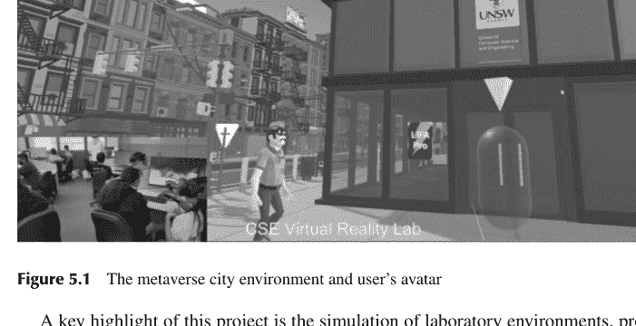

图 5.1 元宇宙城市环境与用户头像

该项目的关键亮点是实验室环境的模拟，为学生提供可能并非人人都能轻易获得的昂贵设备的访问权限。通过这个虚拟环境，学生可以在安全可控的环境中使用各种实验室设备，包括昂贵且潜在危险的仪器。设备的动态特性允许真实的互动和动手实验，复制使用现实世界机械的体验。它们是功能性工具，学生可以抓取、组装并使用它们进行各种实验。例如，我们已成功模拟了机械工程学院的制造机器人和汽车发动机、电气工程学院的可编程逻辑控制器（PLC）以及医学科学学院的聚合酶链式反应（PCR）机器，为学生提供了无与伦比的练习机会（见图 5.2 和 5.3）。

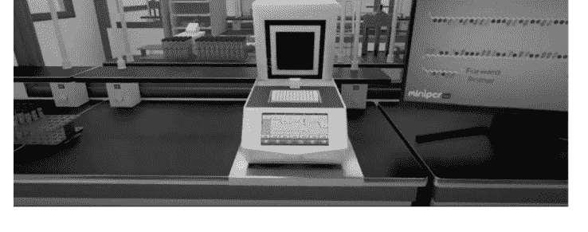

图 5.2 医学科学实验室与 PCR 机器

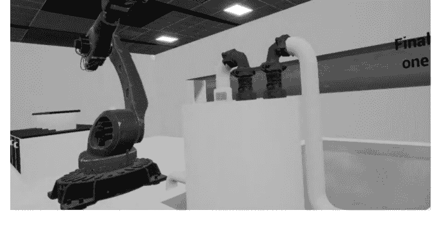

图 5.3 机械工程实验室

除了实验室和大学校园外，元宇宙还提供用于进行在线课程的虚拟讲座厅，学生可以在其中参加实时在线课程或访问录制讲座（见图 5.4）。这些讲座厅可以作为 Zoom 或 Microsoft Teams 等电信应用的替代品，因为它们提供了沉浸感，使学生能够互动

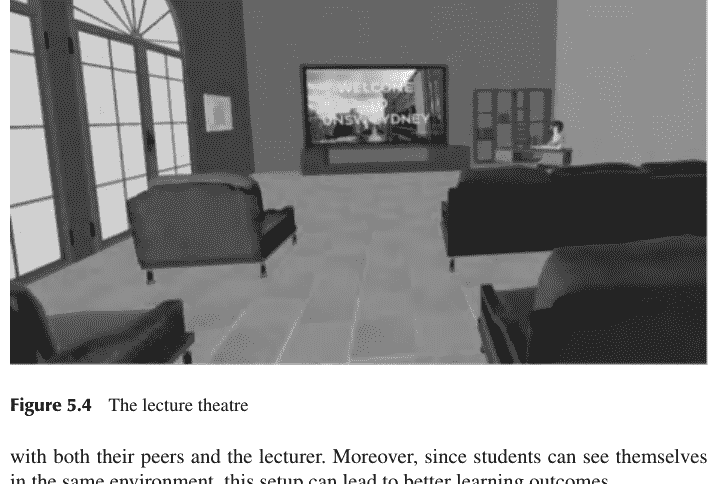

图 5.4 讲座剧场

与同伴和讲师互动。此外，由于学生在同一环境中可以看到彼此，这种设置可以带来更好的学习效果。

#### 5.5.3 我们的元宇宙架构

该平台经过精心开发，结合了 Unreal 引擎、Unity 游戏引擎和 Unity XR 交互工具包，可在 Windows 和基于 Android 的头显上无缝运行，例如 HTC VIVE Pro 和 Meta Quest 头显。模拟设备使用 Blender 设计并导入 Unity。为促进协作并提升学习体验，系统被设计为多人环境，允许多名学生同时登录并相互互动。为实现此目的，Photon 插件已无缝集成到平台中，便于不同地点的用户之间进行实时通信和同步。

### 5.6 研究发现

这些案例研究的综合结果凸显了元宇宙在高等教育中的变革性影响，尤其是在应对资源限制相关挑战以及提升医学和工程学科学习效果方面。通过利用定制开发的元宇宙平台，我们展示了虚拟现实（VR）和沉浸式技术复制复杂实验室环境、让学生能够使用昂贵且可能存在危险的设备进行动手实践的潜力。例如，医学科学中的 PCR 机器模拟和机械工程中的制造机器人模拟为学生提供了传统实验室的可访问、安全且经济高效的替代方案，与之前强调 VR 在不同领域教育价值的研究一致（[49] [60]）。

例如，Mergen、Graf 和 Meyerheim [49] 发现，基于 VR 的医学教育模拟允许学生在没有现实操作相关风险的情况下练习操作，从而提升学习效果。同样，在机械工程中，据报道 VR 模拟使学生能够在受控环境中参与制造过程，促进对复杂系统的更深入理解 [60]。这两项研究均将可访问性、可重复性、成本效益和技能发展改善报告为元宇宙使用的优势。

实验中的一个关键发现是，与传统环境相比，使用元宇宙时学生的认知负荷降低。这支持了 Makransky 和 Lilleholt [48] 的早期研究，该研究发现沉浸式 VR 环境降低了外在认知负荷，使学习者能更有效地专注于核心任务。他们强调 VR 增强了程序性学习和情感参与，这一发现与我们观察到的医学学生报告在进行 PCR 操作时理解力和信心提高的情况一致。然而，虽然 Makransky 和 Lilleholt [48] 观察到长期参与度益处，但我们的研究主要突出了短期认知负荷的降低，表明需要进一步的纵向研究来评估技能保持和迁移性。

元宇宙平台的协作方面进一步凸显了其革新教育的潜力。多玩家功能和虚拟讲座剧场的加入使学生能够参与同伴学习和互动讨论，创造出更具动态性和参与性的学习环境。这与多项研究发现一致，这些研究报道基于 VR 的协作平台显著提升了学生的动机和参与度（[45] [52] [64]）。此外，Lawson McLean 和 Lawson McLean [42] 证明 VR 中的实时协作增强了团队合作和解决问题的能力，这一结果在我们的实验中得到体现，即工程学生协作优化虚拟制造流程。与 Zoom 等传统在线工具不同，这些虚拟空间提供了存在感和互动性，为学习体验增添了价值，这一区别也由 Tsou 和 Mejia [72] 指出。

元宇宙的可扩展性和多功能性对跨学科教育具有广泛影响。通过模拟大学校园并为计算机科学、机械工程和医学科学等领域纳入专业设施，该平台促进了跨学科的创造力和创新。这与 Sharma 等人 [62] 的发现相呼应，他们强调元宇宙在弥合不同领域理论与实践知识差距方面的潜力。此外，我们的案例研究突出了虚拟实验室和讲座剧场如何为农村或偏远地区的学生提供有效替代方案，解决了可访问性问题——这是教育民主化的关键方面（[31] [51]）。这在资源有限的环境中尤其相关，在那里 VR 可以提供对否则可能无法获得的高质量资源的公平访问。

尽管结果令人鼓舞，但挑战仍然存在，包括 VR 硬件对学生的可负担性和可访问性。之前的研究（[3] [15] [22]）同样将硬件成本识别为广泛采用的重要障碍。此外，虽然我们的发现表明即时的认知和程序性益处，但仍需进一步研究以探索基于元宇宙的学习对知识保持以及技能向物理环境迁移的长期影响。将范围扩展到包括沟通和伦理决策等软技能培训，如 Mahindru 等人 [47] 所建议的那样，可以更全面地理解元宇宙的教育潜力。

展望未来，将人工智能等先进技术集成以使模拟适应个人学习需求，并探索元宇宙在不同教育环境中的可扩展性，可能释放其全部潜力。

### 5.7 讨论

从这些案例研究的结果可以看出，元宇宙代表了教育中的变革性转变，解决了长期存在的挑战并在各学科中释放了新的机遇。通过利用虚拟现实和增强现实等沉浸式技术，它实现了教育的普及和民主化，增强了认知和程序性学习，促进了协作和互动，并推动了跨学科创新。这些不仅强调了元宇宙弥合地理、财务和后勤限制差距的潜力，也突出了其重新定义学生在共享数字空间中学习、参与和协作方式的能力。本节深入探讨这些类别，借鉴案例研究和现有文献的见解，以阐明元宇宙对高等教育的广泛影响。

#### 5.7.1 教育的可访问性和民主化

元宇宙为民主化教育提供了突破性的机会，解决了长期阻碍公平获取优质学习的地理、财务和后勤障碍。通过模拟大学校园、实验室和讲座剧场，元宇宙使来自偏远或资金不足机构的学习者能够获取原本无法获得的高质量资源。Biswas 等人 [8] 强调，虚拟现实可以通过提供沉浸式和互动环境来弥合可访问性差距，即使在资源有限的环境中也是如此。同样，Dede 等人 [21] 认为沉浸式技术可以通过为学习者提供公平的参与机会来改变教育，无论其物理位置或财务限制如何。我们的发现与这些观点一致，尤其是在医学和工程学生模拟实验室的背景下。例如，我们案例研究中的虚拟聚合酶链式反应（PCR）机器和制造机器人为学生提供了使用昂贵设备的机会，使他们能够在经济高效且无风险的环境中进行练习。

这种民主化在全球教育不平等的背景下尤其相关。通过超越传统课堂的物理边界，

元宇宙使学生能够与世界各地的同行和专家共同参与协作学习体验，培养包容且互联的学术环境。

#### 5.7.2 增强认知和程序性学习

元宇宙的关键优势在于其通过沉浸式环境增强认知和程序性学习的能力，这些环境能够降低认知负荷。Makransky 和 Lilleholt [48] 发现 VR 环境最大限度地减少了多余的认知需求，使学习者能够专注于核心任务。同样，Jovanović 和 Milosavljević [38] 强调了沉浸式模拟如何改善程序性理解和情感参与。这些发现反映在我们的案例研究中，医学和工程专业的学生报告称，在元宇宙中练习复杂任务时认知负荷降低。例如，与传统方法相比，练习 PCR 程序或操作制造机器人的学生表现出更高的信心和理解力。

通过使学习者能够反复参与交互式模拟，元宇宙促进了技能的习得和保持。然而，正如 Yang 等人 [78] 所指出的，还需要进一步的纵向研究来评估基于 VR 的学习对技能向物理环境迁移的长期有效性。这种对扩展研究的需要凸显了元宇宙的潜力，使其不仅可作为补充工具，而且可作为现代教育不可或缺的组成部分。

#### 5.7.3 协作与互动性

协作和互动性是元宇宙教育潜力的基础方面。与 Zoom 或 Microsoft Teams 等传统在线工具不同，元宇宙提供沉浸式的多人环境，学生在其中可以进行实时协作。Paulsen 等人 (2024) [52] 发现基于 VR 的协作平台显著提升学生的学习动机并促进团队合作，同时也证明多人 VR 环境通过促进互动式同伴学习来增强解决问题的能力。

我们平台的多人功能和虚拟讲座剧院体现了这些协作优势。在我们的案例研究中，工程专业的学生有效地合作排查和优化虚拟制造流程，而医学专业的学生在模拟实验室操作期间进行了互动讨论。这些功能不仅增强了参与度，还使学生为现代行业的协作需求做好准备。在元宇宙中模拟现实世界团队合作场景的能力使其成为培养职业准备度的变革性工具。

#### 5.7.4 跨学科创新

元宇宙的可扩展性和多功能性使其能够超越学科界限，促进跨学科创新和创造性问题解决。通过模拟多样化的学术环境，从医学实验室到工程车间，元宇宙为来自不同学科的学生提供了共享的数字协作空间。这与多项研究发现一致，这些研究指出元宇宙有可能在各领域之间架起理论与实践知识的桥梁，促进对复杂问题的创新解决方案（[20] [25] [67]）。

在我们的平台上，计算机科学、机械工程和医学科学的学生探索了鼓励跨学科思维的模拟。例如，工程专业的学生合作开发可再生能源解决方案，整合了电气工程和机械工程的原理。这种整体方法不仅增强了技术能力，还培养了批判性思维和适应能力——这些技能对于应对全球挑战至关重要。将元宇宙应用扩展到包括跨学科项目可能会释放其全部潜力，培养更具整合性和创新性的教育体验。

### 5.8 结论

元宇宙代表了教育中的变革性转变，为传统挑战提供了创新解决方案，例如资源获取有限、后勤限制和学习者参与度下降。通过模拟现实世界环境和设备，元宇宙使学习者能够在安全且经济高效的方式下练习复杂任务，同时降低学习者的认知负荷。虚拟实验室让学生能够使用医学科学中的 PCR 机器或工程中的制造机器人等昂贵或危险的设备，解决了许多机构面临的资源限制问题。这些沉浸式模拟弥合了理论知识与实际应用之间的差距，促进了更深入的理解和技能习得。

此外，元宇宙通过其多人功能和虚拟讲座剧院增强了协作和互动性，这些功能通过提供存在感和参与感超越了传统的在线学习工具。这种环境促进了团队合作、解决问题和同伴学习，使学生为现代行业的协作需求做好准备。此外，元宇宙通过提供公平获取高质量资源的途径来普及教育，尤其对偏远或服务不足地区的学生而言。虚拟校园和实验室让全球学习者能够参与逼真的模拟并与同伴和教师互动，打破了地理和经济障碍。

尽管前景广阔，元宇宙的广泛采用仍面临挑战，包括 VR 硬件的负担能力和基础设施投资的需求。克服这些障碍需要政府、教育机构和私营企业之间的战略合作伙伴关系。此外，像人工智能（AI）等先进技术的整合提供了进一步个性化学习的潜力，以满足多样化的教育需求和目标，且需要进一步研究。

展望未来，元宇宙普及教育、降低认知障碍和增强跨学科学习的能力使其成为全球教育格局创新基石。通过应对当前挑战和

- 15. M. Chi, Y. Chen, Y. Xu, and Y. Wu. 对酒店和旅游业中元宇宙采用障碍的建模. *信息技术与旅游*, pages 1–33, 2024.
- 16. S. O. Choi, Y. S. Min, S. I. Kim, and J. G. Choi. 基于虚拟现实和增强现实技术建立军事安全和自杀事故预防安全培训中心的研 究. *互联网计算与服务期刊*, 21(2):139–148, 2020.
- 17. F. J. Cortes Rodriguez, G. Frattini, F. Teixeira Pinto Meireles, D. A. Terrien, S. Cruz-Leon, M. Dal Peraro, and L. A. Abriata. Molecularwebxr：沉浸式和包容性 VR 中关于化学和生物学的多用户讨论. *bioRxiv*, pages 2023–11, 2023.
- 18. Y. Daineko, M. Ipalakova, D. Tsoy, Z. Bolatov, Z. Baurzhan, and Y. Yelgondy. 物理学的增强现实和虚拟现实：哈萨克斯坦中等教育机构的经验. *工程教育计算机应用*, 28(5):1220–1231, 2020.
- 19. Y. Dalladaku, J. Kelley, B. Lacey, J. Mitchiner, B. Welsh, and M. Beigh. 评估虚拟现实在陆军飞行员训练中的有效性. In *2020 年唐纳德·R·基思纪念毕业典礼全体会议论文集*, page 40, 2020.
- 20. R. Damaševičius and T. Sidekerskienė. 元宇宙中学习的虚拟世界：叙事性综述. *可持续性*, 16(5):2032, 2024.
- 21. C. Dede, J. Richards, and B. Saxberg. *教育中的虚拟、增强和混合现实*, pages 1–16. Springer Singapore, 2017.
- 22. S. Dhingra. 元宇宙采用：系统文献综述与未来研究路线图. *全球知识、记忆与传播*, 2024.
- 23. W. Du, X. Zhong, Y. Jia, R. Jiang, H. Yang, Z. Ye, and Z. Zong. 一种基于场景的混合现实平台，用于训练战场急救非技术技能：前瞻性干预研究. *JMIR 严肃游戏*, 10(4):e40727, 2022.
- 24. B. I. Edwards, K. S. Bielawski, R. Prada, and A. D. Cheok. 用于增强有机化学教学的触觉虚拟现实和沉浸式学习. *虚拟现实*, 23:363–373, 2019.
- 25. M. A. Fadhel, A. M. Duhaim, A. S. Albahri, Z. T. Al-Qaysi, M. A. Aktham, M. A. Chyad, and Y. Gu. 导航元宇宙：揭示人工智能的影响——综合综述与差距分析. *人工智能评论*, 57(10):264, 2024.
- 26. J. B. Ferrell, J. P. Campbell, D. R. McCarthy, K. T. McKay, M. Hensinger, R. Srinivasan, and S. T. Schneebeli. 有机教学实验室中虚拟现实的化学探索. *化学教育期刊*, 96(9):1961–1966, 2019.
- 27. F. M. Fung, W. Y. Choo, A. Ardisara, C. D. Zimmermann, S. Watts, T. Koscielniak, and R. Dumke. 在环境化学教育中应用虚拟现实平台进行海外实地考察. *数字世界中的学习：正式与非正式教育互动技术视角*, pages 213–238, 2019.
- 28. A. Gaafar. 元宇宙在建筑遗产记录与教育中的应用. *生态与环境研究进展*, 6(10):66–86, 2021.
- 29. Y. Georgiou, O. Tsivitanidou, C. Eckhardt, and A. Ioannou. 进行中——物理课堂沉浸式虚拟现实的学习体验设计. In *2020 年沉浸式学习研究网络（iLRN）第六届国际会议*, pages 263–266. IEEE, 2020.
- 30. K. Habibah, A. K. Putra, S. Nilsson, and C. Vielhaber. 数字河口：探索虚拟现实媒体在地理和空间分析中的教学效益. *Jambura 地理教育期刊*, 4(2):187–198, 2023.

- 31. R. Hadi Mogavi, J. Hoffman, C. Deng, Y. Du, E. U. Haq, and P. Hui. 展望包容性元宇宙：学生对可访问且赋能的元宇宙支持学习的视角。在《第十届 ACM 学习规模会议论文集》中，第 346–353 页，2023 年。
- 32. P. Hagge. 学生对为期一学期的课堂虚拟现实的感知：在高等教育课堂中有效使用“google earth vr”。《Journal of Geography in Higher Education》，45(3):342–360, 2021。
- 33. C. L. Hemme, R. Carley, A. Norton, M. Ghumman, H. Nguyen, R. Ivone, and B. Cho. 开发科学、技术、工程和数学教育虚拟和增强现实应用。《BioTechniques》，0, 2023。
- 34. M. Hernández-Chávez, J. M. Cortés-Caballero, Á. A. Pérez-Martínez, L. F. Hernández-Quintanar, K. Roa-Tort, J. D. Rivera-Fernández, and D. A. Fabila-Bustos. 开发用于工程学生培训的虚拟现实汽车实验室。《Sustainability》，13(17):9776, 2021。
- 35. M. Janiszewski, L. Uotinen, J. Merkel, J. Leveinen, and M. Rinne. 岩石工程、地质和采矿教育虚拟现实学习环境。在 ARMA 美国岩石力学/地质力学研讨会中，第 ARMA–2020 页，2020。
- 36. P. Jindal, V. Khemchandani, S. Chandra, and V. Pandey. 基于多人射击游戏的国防训练仿真。在 2021 年国际计算性能评估会议（ComPE）中，第 592–597 页。IEEE，2021。
- 37. C. Jones, L. Smith-MacDonald, A. Miguel-Cruz, A. Pike, M. van Gelderen, L. Lentz, and S. Brémault-Phillips. 针对患有战斗相关创伤后应激障碍的军人及退伍军人的基于虚拟现实的治疗：多模态运动辅助记忆脱敏和再巩固随机对照试验方案。《JMIR Research Protocols》，9(10):e20620, 2020。
- 38. A. Jovanović and A. Milosavljević. 用于游戏化协作学习的 Vortex 元宇宙平台。《Electronics》，11(3):317, 2022。
- 39. G. Karthick, B. Rebecca Jeyavadhanam, S. Ling, A. Kiyani, and N. Somasiri. 使用元宇宙沉浸式学习：通过扩展现实改变教育行业。在国际微电子与电信工程会议中，第 447–456 页。Springer Nature Singapore，2023。
- 40. D. H. Kim, S. H. Min, and Y. H. Kim. 利用虚拟现实进行军队防空武器军事训练有效性研究。《The Journal of the Korea Contents Association》，21(5):499–507, 2021。
- 41. T. Kim, J. Planey, and R. Lindgren. 元宇宙虚拟现实学习环境中的理论驱动设计：两个例证案例。《IEEE Transactions on Learning Technologies》，16(6):1141–1153, 2023。
- 42. A. Lawson McLean and A. C. Lawson McLean. 外科培训中的沉浸式仿真：分析虚拟与现实环境之间的相互作用。《Simulation & Gaming》，55(6):1103–1122, 2024。
- 43. H. Lee, D. Woo, and S. Yu. 补充远程教育方法的虚拟现实元宇宙系统：基于飞机维护仿真。《Applied Sciences》，12(5):2667, 2022。
- 44. H. Lin, S. Wan, W. Gan, J. Chen, and H. C. Chao. 教育中的元宇宙：愿景、机遇与挑战。在 2022 年 IEEE 国际大数据会议（Big Data）中，第 2857–2866 页。IEEE，2022。
- 45. X. P. Lin, B. B. Li, Z. N. Yao, Z. Yang, and M. Zhang. 虚拟现实对课堂学生参与度的影响——文献的批判性综述。《Frontiers in Psychology》，15:1360574, 2024。
- 46. M. Lopez, J. G. C. Arriaga, J. P. N. Álvarez, R. T. González, J. A. Elizondo-Leal, J. E. Valdez-García, and B. Carrión. 虚拟现实与传统教育：人类神经解剖学教学是否有优势？《Computers & Electrical Engineering》，93:107282, 2021。
- 47. R. Mahindru, A. Kumar, G. Bapat, A. D. Rroy, Kavita, and N. Sharma. 元宇宙 unleashed：增强商科教育中的创造力和创新。《Engineering Proceedings》，59(1):207, 2024。
- 48. G. Makransky and L. Lilleholt. 沉浸式虚拟现实在教育中的情感价值的结构方程模型研究。《Educational Technology Research and Development》，66(5):1141–1164, 2018。
- 49. M. Mergen, N. Graf, and M. Meyerheim. 回顾医学教育中虚拟现实整合的现状——一项范围综述。《BMC Medical Education》，24(1):788, 2024。
- 50. B. Miao, S. Ge, and Y. Guo. 煤矿智能采矿数字孪生系统构建。《Metaverse》，3(2):16, 2022。
- 51. P. Onu, A. Pradhan, and C. Mbohwa. 利用元宇宙进行未来教学与学习的潜力。《Education and Information Technologies》，29(7):8893–8924, 2024。
- 52. L. Paulsen, S. Dau, and J. Davidsen. 沉浸式虚拟现实中协作学习的设计：系统文献综述。《Virtual Reality》，28(1):63, 2024。
- 53. E. Paxinou, M. Georgiou, V. Kakkos, D. Kalles, and L. Galani. 通过在面对面辅导之上采用虚拟现实实验室实现显微镜教育的教学目标。《Research in Science & Technological Education》，40(3):320–339, 2022。
- 54. E. Paxinou, C. T. Panagiotakopoulos, A. Karatrantou, D. Kalles, and A. Sgourou. 三维虚拟现实生物实验室与光子显微镜实验室实验中传统教学实践的实施与评估。《Biochemistry and Molecular Biology Education》，48(1):21–27, 2020。
- 55. J. Pirker, M. Holly, I. Lesjak, J. Kopf, and C. Gütl. MaroonVR——一个交互式沉浸式虚拟现实物理实验室。在《数字世界中的学习：正式与非正式教育交互技术视角》中，第 213–238 页，2019。
- 56. C. Prisille and M. Ellerbrake. 虚拟现实（VR）与地理教育：中学 360°“体验”的潜力。《Modern Approaches to the Visualization of Landscapes》，第 321–332 页，2020。
- 57. L. Pérez, E. Diez, R. Usamentiaga, and D. F. García. 使用虚拟现实界面进行工业机器人控制和操作员培训。《Computers in Industry》，109:114–120, 2019。
- 58. J. Á. Ramírez and A. M. V. Bueno. 利用虚拟现实学习有机化学。在 2020 年 IEEE 韦拉克鲁斯工程国际会议（ICEV）中，第 1–4 页。IEEE，2020。
- 59. S. M. Reeves, K. J. Crippen, and E. D. McCray. 本科生在虚拟现实实验室学习化学的差异化体验。《Computers & Education》，175:104320, 2021。
- 60. B. Salah, M. H. Abidi, S. H. Mian, M. Krid, H. Alkhalefah, and A. Abdo. 基于虚拟现实的工程教育以提升工业 4.0 中的制造可持续性。《Sustainability》，11(5):1477, 2019。
- 61. N. Shakirova, N. Said, and S. Konyushenko. 虚拟现实在地理教育中的应用。《International Journal of Emerging Technologies in Learning (iJET)》，15(20):59–70, 2020。
- 62. A. Sharma, L. Sharma, and J. Krezal. 将理论付诸实践：元宇宙教学在高等教育机构实施的机会与挑战研究。在国际人机交互会议中，第 173–189 页。Springer Nature Switzerland，2024。
- 63. Y. Shen, Z. Wang, M. Li, J. Yuan, and Y. Gu. 沉浸式虚拟现实中地理学习对学生情感和动机的实证研究。在《Frontiers in Education》，第 7 卷，第 831619 页。Frontiers，2022。
- 64. K. Silseth, R. Steier, and H. C. Arnseth. 探索学生的沉浸式 VR 体验作为协作意义建构和学习的资源。《International Journal of Computer-Supported Collaborative Learning》，19(1):11–36, 2024。
- 65. A. Singh, D. Ferry, A. Ramakrishnan, and S. Balasubramanian. 在生物医学工程教育中使用虚拟现实。《Journal of Biomechanical Engineering》，142(11):111013, 2020。
- 66. M. Soliman, A. Pesyridis, D. Dalaymani-Zad, M. Gronfula, and M. Kourmpetis. 虚拟现实在工程教育中的应用。《Applied Sciences》，11(6):2879, 2021。
- 67. M. M. Soliman, E. Ahmed, A. Darwish, and A. E. Hassanien. 人工智能驱动的元宇宙：分析、挑战与未来展望。《Artificial Intelligence Review》，57(2):36, 2024。
- 68. Jungmyoung Son, Soohee Woo, Jeong Hye Han, and Jong-Jun Kim. 基于增强虚拟元宇宙的社会研究内容开发与应用：直指心体要节。《Journal of Digital Contents Society》，2023。
- 69. P. Stothard. 采矿元宇宙——最佳采矿实践的未来协作工具。《Mining Technology》，132(3):165–178, 2023。
- 70. M. M. Thompson, A. Wang, C. Uz Bilgin, M. Anteneh, D. Roy, P. Tan, and E. Klopfer. 虚拟现实对高中生细胞概念的影响。《Placeholder Journal Name》，2020。
- 71. A. Tibaldi, F. L. Bonali, F. Vitello, E. Delage, P. Nomikou, V. Antoniou, and M. Whitworth. 基于现实世界的沉浸式虚拟现实在火山学研究、教学和传播中的应用。《Bulletin of Volcanology》，82:1–12, 2020。
- 72. M. H. Tsou and C. Mejia. 超越制图：利用虚拟现实、增强现实和混合现实将制图师的角色扩展到元宇宙中的用户界面设计师。《Cartography and Geographic Information Science》，第 1–15 页，2023。
- 73. R. van Dinther, L. de Putter, and B. Pepin. 支持有意义化学教育的沉浸式虚拟现实特征。《Journal of Chemical Education》，100(4):1537–1546, 2023。
- 74. D. Vergara, J. Extremera, M. P. Rubio, and L. P. Dávila. 通过虚拟现实学习环境实现有意义学习：材料工程案例研究。《Applied Sciences》，9(21):4625, 2019。
- 75. H. Wang, H. Ning, Y. Lin, W. Wang, S. Dhelim, F. Farha, and M. Daneshmand. 关于元宇宙的调查：最先进技术、应用与挑战。《IEEE Internet of Things Journal》，10(16):14671–14688, 2023。
- 76. Y. Wang, Z. Su, N. Zhang, R. Xing, D. Liu, T. H. Luan, and X. Shen. 关于元宇宙的调查：基础、安全与隐私。《IEEE Communications Surveys & Tutorials》，25(1):319–352, 2022。

- 77. T. H. Wu, F. Wu, C. J. Liang, Y. F. Li, C. M. Tseng, and S. C. Kang. 用于全球工程协作培训的虚拟现实工具. *信息社会中的通用访问*, 18:243–255, 2019.
- 78. C. Yang, J. Zhang, Y. Hu, X. Yang, M. Chen, M. Shan, and L. Li. 虚拟现实对科学与工程教育学生实践技能的影响：元分析. *国际STEM教育期刊*, 11(1):28, 2024.
- 79. J. Yang, F. Liu, J. Wang, Z. Kou, A. Zhu, and D. Yao. 虚拟现实技术对城市轨道车辆工程教学的影响. *工程教育计算机应用*, 29(5):1163–1175, 2021.
- 80. P. Šidanić, J. Plavšić, I. Arsenić, and M. Krmar. 核物理实验室练习的虚拟现实（vr）模拟. *欧洲物理学杂志*, 41(6):065802, 2020.

## 6 基于认知负荷理论的 UX 设计指导

Nadine Marcus
计算机科学与工程学院，新南威尔士大学悉尼分校
肯辛顿，澳大利亚

Alexandra Vassar
计算机科学与工程学院，新南威尔士大学悉尼分校
肯辛顿，澳大利亚

## 基于认知负荷理论的 UX 设计指导

Jacob Nielsen 提供了一份被 UX（用户体验）设计师广泛采用的交互设计 10 项通用原则列表。这些启发式设计原则有助于支持更易用界面的设计。认知负荷理论关注基于科学的实证方法来设计指令和界面，以最大程度地减少我们处理新信息或不熟悉信息有限能力的负担，是这些原则有效性的基础。因此在设计中使用这些原则有助于指导设计，使用户能够专注于手头任务的目标，而不是被与糟糕设计的界面交互带来的额外负荷所分散注意力。认知负荷理论认为，我们拥有有限的工作记忆负责处理新信息，以及存储在长期记忆中的大量熟悉信息。工作记忆，通常被称为我们的意识，在一次可以处理的新信息量以及这些信息在我们意识中停留的时间方面都受到限制。我们可以通过依赖存储在长期记忆中的大量先验知识来克服其中一些处理限制。通过设计旨在减少对我们有限工作记忆的限制并利用长期记忆中存储的资源的用户界面，用户将受益于这些设计原则。本章旨在在认知负荷理论原则的框架下对 Nielsen 的每一条启发式原则进行理论化，解释为什么这些实用指南在改善界面设计方面如此有效。我们还将提供相关经实证验证的认知负荷效应的概述。建立理论与可用性指南之间的这种联系可以帮助启发式原则的使用者更好地理解它们为何有效，并使设计师能够更广泛、更直观地实施良好的设计实践。需要注意的是，虽然启发式设计原则和评估是在交互设计生命周期早期阶段的有用工具，但它们不应取代设计生命周期后期进行的彻底可用性测试。

### 6.1 引言

可用性启发式原则是指导交互界面设计和评估的最广泛使用的方法之一，确保界面设计全面、简单且用户友好。该方法对于桌面界面尤其有用。作为启发式评估的一部分，这些经验法则可用于识别系统界面设计中的可用性问题。虽然它们并不全面，但涵盖了可能影响用户体验的各种常见问题。设计和评估可用的启发式集合有几种 [28, 11, 25]。然而，最广泛使用的启发式指南之一是由 Jacob Nielsen [20] 制定，基于他在人机交互领域多年的经验。启发式原则并非全新的概念，而是从现有可用性实践和研究中提炼出来的。它们被设计为易于记忆和应用，使领域从业者能够轻松使用。虽然这些经验法则非常实用，但它们之所以有效，是因为它们利用了我们的认知优势。这些启发式原则的持久性部分归功于其广泛的适用性以及它们解决了超出特定技术或趋势的用户交互根本问题。然而，这种持久性的另一个原因在于，这些启发式原则可以利用我们对认知架构的理解，特别是我们有限的工作记忆容量。本章旨在通过将它们与认知负荷理论 [19] 联系起来，提高我们对这十项原始启发式原则在良好用户体验和界面设计方面的价值和持久性的理解。如果我们能更好地理解启发式原则为何如此有效，那么就可以进一步促进其应用。启发式原则之所以有效，是因为它们本质上减少了我们有限工作记忆的负荷，从而使信息更容易处理和理解。

然而，了解启发式原则最初由 Jakob Nielsen [21] 制定时的背景非常重要。Nielsen 可以访问来自 11 个不同项目的 249 个可用性问题数据库，以及 101 条可用性原则，这些原则可以解释设计缺陷。他使用因子分析将原则提炼为 10 个因素，这些因素解释了大多数问题。这导致了具有最大解释力的 10 条可用性启发式原则，它们已被广泛使用 30 多年。现在我们了解了他在 UX 设计领域广泛使用的启发式原则的推导方式，我们将把这一点与基于我们对人类认知架构的理解的关于这些原则为何有效的讨论联系起来。

我们首先概述认知负荷理论，然后利用这一理解来扩展每个启发式原则如何以及为何能改善 UX 设计。

### 6.2 认知负荷理论

认知负荷理论是一项经实证验证的理论，涉及我们的认知架构如何用于支持新信息的学习和理解 [35]。认知负荷理论假设存在一个非常有限的工作记忆用于处理新信息和不熟悉的信息，以及一个无限的长期记忆用于随时间存储大量信息，并关注两种记忆系统之间的相互作用。工作记忆，通常被称为我们的意识，在一次可以处理的新信息量以及信息在我们意识中停留的时间方面都受到限制。我们通过依赖以图式形式存储在长期记忆中的大量先验知识来克服其中一些处理限制。图式是认知结构，允许我们通过根据信息的使用方式组织信息来处理大量信息 [38]。图式使我们能够以单一单元处理大量熟悉信息。此外，你在某个领域拥有的知识越多，单个图式可能包含的信息就越多。而且图式练习得越多，它就越自动化，所消耗的处理能力就越少 [32]。自动化信息可以在没有意识注意的情况下处理，并且通常难以抑制，例如当一个人沿着熟悉的路线行走但旨在到达新地方时，却发现自己以自动模式行走到了通常的目的地。图式有助于减轻我们有限工作记忆的负担，而且它们越自动化，对我们有限处理资源的负担就越小。因此，先验知识可以支持我们的学习并减轻我们有限认知资源的负担。

此外，Sweller [33] 对该理论的最新更新也提及了影响我们学习方式的认知架构的进化与生物学方面。他提到了生物学上主要知识（我们进化而来以获取的知识，如面部识别和学习行走）与生物学上次要知识（如数学和学习书写，需要明确教授才能学习）之间的重要区别。我们教育系统的目的是获取生物学上次要的知识，我们可以利用主要技能和知识（如人类运动或与他人合作）来支持新次要知识和技能的获取。在用户超负荷时利用主要知识可以是一种有帮助的策略。认知负荷理论专注于支持教育机构内生物学次要信息获取的经实证验证的策略。

此外，Sweller [37] 关注了五个生物学上主要的原则，这些原则与我们获取知识的方式有关，并为认知负荷理论所依据的认知架构提供了一个框架。在这些原则中，信息存储原则详细说明了我们在自然世界中运作所需的大量信息存储。借用和重组原则关注存储在长期记忆中来自他人的大量信息——这一原则在教育协作实践的背景下特别有用。第三个原则，即随机性作为创生原则，关注问题解决过程中新信息的生成。处理新信息时工作记忆存在严重限制，最新的证据显示认知努力后工作记忆会耗尽 [7]。最后，环境组织和

链接原则关注无限的长期记忆以及可以生成的环境线索，这些线索用于在我们的长期记忆中处理适合该环境的信息。总之，由于我们进化而来是通过借用和重组原则从他人那里学习，因此显式教学是必要的。这些信息需要以减少工作记忆负荷的方式进行组织，因为在处理新信息时（变化的狭窄限制）这种负荷最为明显。当我们从他人学习时，与自行产生新信息（随机性作为起源）相比，我们可以降低认知负荷。一旦我们获得了信息并将其存储在长期记忆中（信息存储），工作记忆的限制就不再适用，并且存储的信息可以通过组织和链接原则在长期记忆和工作记忆之间转移。然而，为本章目的，我们将仅关注上述理论中最相关的这些基本原则。

新手用户依赖有限的工作记忆来帮助他们与新界面交互，保持对有限工作记忆资源的压力最小化对他们尤其重要。相比之下，专家在长期记忆中存储了大量熟悉的信息，当需要时可以将其作为自动化图式检索，并且受工作记忆限制的约束较小。设计界面的那些人通常是专家，因此不太了解这些限制，但需要关注他们也在为之设计的初学者的需求 [12]。此外，当我们设计界面旨在减轻工作记忆（WM）的压力，而更试图利用存储在长期记忆（LTM）中的熟悉资源时，所有用户都将受益。考虑到这一点，我们开始探索如何设计界面，同时也能考虑工作记忆资源有限的新手用户。

#### 6.2.1 不同类型的认知负荷
与认知负荷理论相关的是，存在三种类型的认知负荷。第一种负荷是内在负荷，它与信息本身固有复杂性相关的负荷。这种负荷是固定的，与用户处理的资讯类型以及元素交互性概念相关 [16]。元素交互性这一概念取决于呈现信息中相互作用的元素数量，并与接收信息的人的先验知识相关。例如，在学习阅读英语时，众多的新字母形态和解释将构成高元素交互性，而对于懂得阅读英语的人来说，字符会呈现为单一元素，因此元素交互性较低。涉及高元素交互性的高内在负荷内容的例子包括学习新语言的语法，因为需要同时考虑许多元素，例如词序、时态、代词等等。相比之下，学习新语言的词汇仍然是一项困难的任务，但每个新词都可以单独学习，因此内在负荷和相互作用元素的水平较低。然而，内在负荷也受到用户先验知识的影响，如果他们在该领域已有知识，则不太可能有
不保留而是不断被更新内容取代，因此如果它太长且太复杂，可能会压垮我们有限的处理能力。Tabbers 等人 [40]，随后 Leahy 等人 [15] 发现了这一效应的证据，听觉信息过长且复杂会导致表现不如仅视觉信息。相比之下，非瞬时信息（如书面文本或静态图形）可在需要时重新查看。Singh 等人 [29] 在比较口语与书面文本学习时发现了瞬时效应，但发现通过分段和停顿可以调节口语信息。此外，Wong 等人 [44] 还发现瞬时信息对长且复杂的动画和音频内容都有负面影响。我们需要设计材料和界面，注意瞬时信息如何导致认知过载。音频不应过长或过于复杂，最好在用户控制下可暂停、倒带和减速，教学动画亦然。

#### 6.3.6 人体运动效应
虽然瞬时信息效应可以解释为什么用户从动态信息（如动画）中学习到的内容少于静态内容，但人体运动效应指的是，使用动画而非静态内容来教授涉及某种形式人体运动的概念会更好。这一效应由 Ayres 等人 [3] 和 Wong 等人 [45] 发现，他们发现使用教学动画学习人类运动技能（纸折、打结）时学习效果更佳。我们天生具有通过观察学习的能力，通过观察学习与人体运动相关的内容可以利用这一能力（如 Van Gog 等人 [42] 所描述）。我们在观看他人执行这些任务时学会如何系鞋带或投掷球，而考虑到这一点的动画有可能降低认知负荷并带来更好的用户体验。然而，由于我们天生具有通过观察学习的能力，我们有时会过度泛化这一点，并在界面中过于随意地加入非人体运动相关的动画，从而可能用瞬时信息使用户过载。因此，动画需要谨慎地纳入界面，我们应专注于为与人体运动相关的内容制作动画。

#### 6.3.7 专业逆转效应
另一个在众多领域经实证验证的相关认知负荷效应是专业逆转效应（参见 Kalyuga 等人 [12]）。这种效应发生在对专家最有利的信息呈现格式与对新手最有利的格式相反时，其原因是该领域的专家已积累了庞大的知识和图式储备（例如 [13, 7]）。作为例证，新手通过研究已解示例学习效果最佳，而专家可能通过在该领域解决问题学习效果最佳；此外，界面的新手用户可能希望获得大量帮助和额外提示，而专家可能认为这些额外信息不必要。专家经常设计课程材料和界面，因此可能会对什么对用户最好做出假设，需要注意在设计过程中纳入不同用户的用户测试。

#### 6.3.8 指导淡出效应
指导淡出效应指的是随着用户知识或技能的增长，逐渐淡化提供给用户的指导。这与前一效应密切相关，因为对于图式和结构已发展良好的用户来说，整合详细的教学指导（如在已解示例中提供的）将需要额外的认知资源来处理，并给架构增加不必要的负荷 [1, 26, 2]。因此，我们希望随着用户对界面的经验增加，逐渐减少提供给用户的帮助量。这也适用于已解示例，我们也希望随着用户专业水平的提高而淡出步骤。支持这一效应的假设是，我们的工作记忆容量能够应对需求的增加，并且随着专业水平的提高，问题解决指导的逐渐减少以应对增加的问题解决需求 [31]。

还有许多认知负荷效应是通过实证研究发现的，如 Sweller 等人 [39] 所总结，但上述提到的效应与可用性、用户体验和界面设计最相关。我们注意到，将这些认知负荷效应应用于减少无关负荷时最重要的一点是，当向用户呈现的信息的内在负荷已经很高时，用户可能已经认知过载。

### 6.4 将认知负荷理论应用于每条启发式原则
在下一节中，我们旨在阐明 Nielsen [22, 19] 提出的每条经验法则为何能够很好地利用我们的认知资源，通常通过减轻我们有限工作记忆的负荷，从而使信息易于处理和理解。这反过来支持用户使用涉及更少负荷的界面或系统，从而更易于使用。这对新手用户最有益，但每个人都会从易于使用的界面中受益，该界面对我们的工作记忆施加的负荷更少。我们将描述每条启发式原则，然后从认知负荷角度解释其工作原理。

#### 6.4.1 系统状态的可见性
第一条启发式原则“系统状态的可见性”指的是始终以及时的方式使用适当的反馈让用户了解正在发生的事情 [19]。这一启发式原则之所以有效，是因为有效且有用的反馈增加了用户从错误中学习、更轻松地学习如何使用系统并最终将新知识整合到现有图式中的机会。此外，从认知负荷角度来看，它减少了用户搜索信息和弄清正在发生什么的需要。搜索消耗认知资源，因此导致

可用于其他有价值认知活动（如学习和理解）的资源减少。例如，让用户知道任务完成所需的时间以及任务当前正在执行中（图 6.1）。

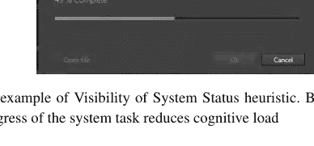

图 6.1 系统状态可见性启发式的一个示例。能够理解并查看系统任务的进度可降低认知负荷

#### 6.4.2 系统与现实世界的匹配

系统与现实世界匹配的第二个启发式涉及使用用户熟悉的词语、短语和概念来表达，而不是使用系统导向的术语和行话 [19]。如果我们能设计出使用熟悉语言和概念的系统，那么用户就可以将先前的知识和图式应用于当前任务，从而有助于降低认知负荷。此外，如果信息以用户更熟悉的方式呈现，界面或系统将更容易使用和理解。这依赖于避免使用行话和不熟悉的术语，并保持语言更简单、更友好。最终，这一启发式依赖于将新信息与用户的先前知识联系起来，从而最终降低使用界面或新系统的认知负荷。该原则的一个实例可能涉及使用与现实世界中的物品相似的工具和图标（图 6.2）。

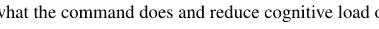

图 6.2 系统与现实世界匹配的一个示例。电子邮件图标类似于现实世界中的物体（例如，删除的图标是一个垃圾桶），以强化我们对命令作用的理解并降低学习界面的认知负荷

#### 6.4.3 用户控制与自由

提供用户控制与自由的第三个启发式涉及为用户提供轻松摆脱意外处境的方式，通过提供明确标记的“出口”或撤销操作的方式 [19]。通过给予用户对其行为的明确控制，可以使他们的认知资源集中在他们想要实现的目标上，减少不必要的干扰。它还有可能避免用户在尝试浏览多个屏幕和可能的选择以确定自己想要去哪里时所涉及的分心注意。需要注意的是，给用户提供太多完成同一件事的方式会令人困惑并导致冗余，因此应避免。给予用户对其行为的控制权可以使他们的认知资源集中在目标上，而不会分散到其他不必要且可能冗余的任务上。例如，用户应始终能够在需要时轻松导航到网站的首页或退出系统。作为进一步的例子，文件夹导航应允许用户随时后退一步，通过提供清晰的移动方向（图 6.3）。

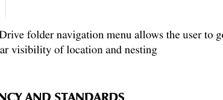

图 6.3 OneDrive 文件夹导航菜单允许用户随时后退一步，通过提供位置和嵌套的清晰可见性

#### 6.4.4 一致性与标准

一致性与标准的第四个启发式强调不要让用户怀疑不同的词语、情况或操作是否意味着相同的含义 [19]。如果我们使用一致的术语、颜色、布局、操作、字体等，用户就能更容易知道在哪里找到东西以及不同的操作和情况可能意味着什么。此外，一旦用户熟悉布局、颜色、操作、术语等，找到信息和与界面交互就会变得更容易。本质上，一致性使用户更容易获得关于在哪里找到东西以及事物如何运作的图式。良好的做法不仅是确保您自己的系统内具有良好的一致性和标准，还要考虑其他系统中某些图标、颜色、按键等的含义，以免给用户造成认知过载和困惑。用户测试可以帮助您很好地了解用户的先前知识，从而在设计选择中加以考虑。良好的一致性和标准的例子包括使用在其他网站和系统中具有相同含义的缩写或按键、在所有界面中将导航窗格放置在一致的位置，并在系统内的所有界面中使用图标和颜色以相同的方式并表示相同的含义。其中最持久的一致性和标准例子之一是使用旧软盘作为“保存”操作图标。尽管大多数年轻人都从未使用过甚至从未见过软盘，但他们仍能由于其使用的一致性而轻松识别该图标。

最近在一次州立国家公园的访问中，我们遇到了一个通往火车站的消防安全电梯，我们遇到了一个相当令人困惑的电梯按钮序列（图 6.4）。我们想知道有多少人会不小心呼叫消防队而不是仅仅呼叫电梯来接他们。这种缺乏一致性和对常规电梯面板的遵守是使用此类启发式提供改进设计指导、同时降低我们认知负荷的原因之一。在紧急情况下，人们不想从可能需要按下的三个按钮中进行选择，而是希望直接被引导到紧急按钮，因为在紧急情况下，人们没有太多认知资源可以用于此类选择。

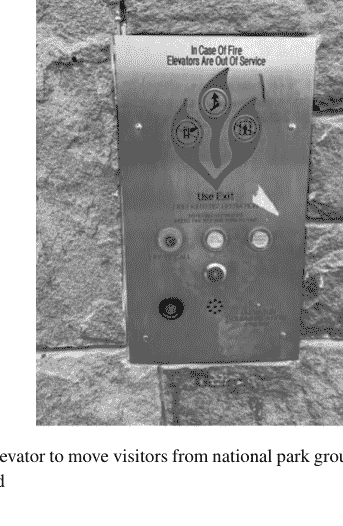

图 6.4 一部电梯将游客从国家公园地面层向下移动到地下地铁层

#### 6.4.5 帮助用户识别、诊断和从错误中恢复

第五个启发式涉及使用通俗语言描述问题的性质并提出解决办法 [19]。向用户呈现的一些错误信息可能令人困惑且无助于解决问题。有效且有用的反馈可以增加用户从错误中学习并将新知识整合到现有图式中的机会。此外，熟悉的语言增加了用户理解所呈现信息的机会，而不会因所遇到的問題而超载。良好的错误信息通过提供有效解决方案的提示来帮助减少问题解决相关的负荷，本质上通过提供部分解决的问题或所遇错误的部分解决方案来帮助用户，这与经实证验证的工作示例完成效应有关 [35]。有帮助的错误信息提供问题是什么以及在哪里的问题描述，并可能建议潜在的解决方案。避免包含行话且不建议如何从问题中恢复的无帮助错误信息。

例如，一个学习管理系统示例，当输入了不正确的用户名或密码时提供错误信息（图 6.5），这可以通过提供一步操作来进一步改进，让用户知道如果忘记密码该怎么办。

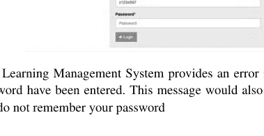

图 6.5 该学习管理系统在输入了不正确的用户名或密码时会提供错误信息。如果您不记得密码，该信息还应说明该怎么做

#### 6.4.6 错误预防

错误预防意味着以防止错误首先发生的方式设计界面 [19]。从认知负荷角度来看，第六个启发式是有效的，因为当用户犯错时，认知资源会被用于理解和修复问题，而不是用于手头的任务。如果错误可以首先避免，那么所有认知资源都可以用于任务，这将导致更快学习和更好地利用用户的注意力和有限的认知资源。为了实现这一目标，需要对界面进行良好的用户测试，以便及早发现问题并解决。设计界面以防止错误的技巧包括避免令人困惑和冗余的链接、为常见错误提供提醒和提示（如提醒附加文件或填写表单中的字段），以及使用良好的、一致的术语、链接、布局和操作。例如，AirBnB 日历选择器日期会将不可用的日期变灰以防止其被选择（图 6.6）。

#### 6.4.7 识别优于回忆

第七个启发式是依赖识别而非回忆，这涉及在适当的时间使对象、操作和选项可见 [19]。如果需要记住的信息更少，可以减轻我们有限的工作记忆的负担，进而可以减少犯错的机会，并使界面和系统更易于使用和交互。如果设计可以帮助最小化我们记忆的负荷，这也可以促进做出良好的决策。该启发式之所以有效，是因为我们从一组选项中识别选择的任务远比从长期记忆中回忆项目要好。应用方法包括使用具有熟悉布局和项目的菜单，而不是强迫用户输入他们的选择，使您的用户可以使用搜索历史记录

图 6.6 Airbnb 的日期选择器不允许用户选择过去的日期或不可用的日期作为入住日期，体现了良好的错误预防，从而降低了认知负荷

并在输入数据时包含之前的选择。例如，汇总最近访问文件的菜单就是识别你可能需要的东西的例子（图 6.7），而密码请求则是纯回忆的例子，这可能会给用户带来过重的负担（图 6.8）。

图 6.7 “识别” 的例子，所有最近的文件都单独保存以便更轻松地访问，从而减少了原本为搜索正确文件所需认知负荷

图 6.8 “回忆” 的例子——在这里没有任何可以用来识别密码的线索，从而消耗大量认知资源来回忆密码

#### 6.4.8 灵活性和使用效率

灵活性和使用效率是第八条启发式原则，它涉及提供对新手用户不可见的加速器，但能让更有经验的用户更高效地完成任务 [19]。这一原则依赖于新手用户和专家用户的需求并不相同且几乎相反这一事实，正如上文所述的专长反转效应 [12]。加速器或快捷方式会要求仍在学习使用界面或系统的缺乏经验或新手用户付出额外的处理能力，因此最好让它们不可见。相比之下，加速器、快捷方式、自定义布局和宏都能让专家用户更轻松地自动化基本功能，从而更高效、更有效地工作。更好地照顾新手的例子是训练轮系统，其中某些系统功能在菜单系统中不可用或呈灰色 [24]；而对于专家来说，像文字处理器中复制用的 Ctrl+C 快捷键以及电子表格中的宏，可以促进和加快他们的工作流程，让专家更高效地工作（图 6.9）。

图 6.9 在右键菜单中让新手可以选择他们想要执行的操作，同时为更专业的用户提供快捷方式，这就是灵活性和使用效率的一个例子

#### 6.4.9 美观与极简设计

创建美观且极简的设计是第九条启发式原则，涉及避免使用无关且很少需要的信息 [19]。本质上，这条启发式原则指的是上文提到的冗余效应 [5]，其中非必要信息并非中性，而是需要额外处理，从而增加我们有限工作记忆的负荷。如果信息布局良好且易于阅读和查找，就能减少与界面交互和查找相关信息所需的搜索量。搜索会消耗我们的工作记忆容量，因此留给理解、决策和学习的容量就更少了。因此，在设计界面时，我们应只包含必要的信息，并消除冗余信息，因为处理它会消耗我们有限的认知资源（图 6.10）。例如，只包含必要信息的网站更容易使用和导航，因此更有可能让客户再次使用。在 Google 之前，搜索引擎经常充斥着最近的新闻、天气和其他对于搜索的最终功能并非必要的信息。Google 搜索引擎通过将搜索的本质放在最前面并专注于该单一功能，而不包含冗余信息，从而优化了这一原则。

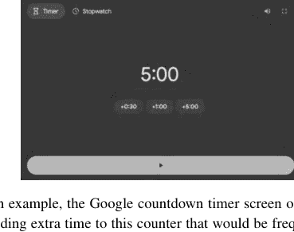

图 6.10 作为示例，Google 倒计时器屏幕仅有计数器，以及三个可频繁使用的为该计数器增加额外时间的选项（例如，增加一秒就属于冗余）。开始按钮的位置也很合理，总的来说，计时器很好地发挥了作用，屏幕上没有冗余以不必要地消耗用户的有限认知资源

#### 6.4.10 帮助与文档

第十条也是最后一条启发式原则是提供帮助和文档，这意味着为用户提供可轻松搜索的信息，并以可轻松遵循的具体步骤提供帮助 [19]。易于定位、理解和使用的帮助和系统文档使得学习如何使用系统变得容易得多。更容易学习的信息消耗的认知资源更少，因此对我们有限的工作记忆的负担也更小。一个有用的建议是确保帮助系统提供有意义的标题和提示，以便轻松搜索和定位相关信息。一个好的帮助系统易于获取，并包含易于遵循的分步说明，例如，下面的 Google 日历通过显示简洁的灰色文字说明，让用户了解每个类别的用途（图 6.11）。

图 6.11 Google 日历添加事件时有简短的描述，提供用户应输入内容的指导，从而减少用户尝试添加事件时的认知负荷，并明确知道哪些部分需要什么信息

在应用这十条设计启发式原则时，一个重要的考虑因素是，良好的设计总会让用户使用系统更愉快、更少挫败感。从认知负荷的角度来看，这种良好的设计对于复杂且多方面的系统尤其重要，这些系统的内在认知负荷很高，因此已经在挑战用户有限的认知资源。在为新手或经验不足的用户设计时，考虑这些原则也尤其重要，因为对他们来说一切都是新颖和陌生的，容易造成认知过载。虽然大多数用户不会长期保持新手状态，但如果你只为中级或经验丰富的用户设计并进行用户测试，就可能会忽略这些复杂性及其对认知负荷最大的用户群体的影响 [8]。这凸显了在设计界面和进行用户测试时，也要考虑用户的经验和专业知识，从而考虑认知负荷的重要性。

### 6.5 结论

Nielsen 的十条启发式原则涵盖了各种不同的指导方针，并在 UX 设计领域备受推崇和使用。基于类似原则，已有不同的启发式变体和不同的启发式集合可用于界面评估，因为它们允许评分。本章的关键信息是，Nielsen 的启发式原则经受住了时间的考验，因为它们最终减少了我们有限处理能力的负荷，从而改善了整体界面设计。如果我们作为设计师能更好地理解它们为何有效，就能更直观地将它们应用于界面设计。虽然启发式原则并非专门针对我们认知架构的本质而设计，但它们本质上之所以能在数十年间如此成功地被使用和应用，是因为它们触及了我们认知架构的本质，并使信息更易于处理和理解。

## 参考文献

- 1. Robert K Atkinson, Sharon J Derry, Alexander Renkl, and Donald Wortham. 从范例学习：基于工作范例研究的教学原则. *Review of Educational Research*, 70(2):181–214, 2000.
- 2. Robert K Atkinson, Alexander Renkl, and Mary Margaret Merrill. 从学习范例转向解决问题：自我解释提示与逐步淡化工作步骤的影响. *Journal of Educational Psychology*, 95(4):774–783, 2003.
- 3. Paul Ayres, Nadine Marcus, Christopher Chan, and Nixon Qian. 学习手工操作任务：何时教学动画优于等效静态表现. *Computers in Human Behavior*, 25(2):348–353, 3 2009.
- 4. Janette Bobis, John Sweller, and Martin Cooper. 小学几何任务中的认知负荷效应. *Learning and Instruction*, 3(1):1–21, 1993.
- 5. Paul Chandler and John Sweller. 认知负荷理论与教学格式. *Cognition and Instruction*, 8(4):293–332, 12 1991.
- 6. Paul Chandler and John Sweller. 分割注意效应作为教学设计的一个因素. *British Journal of Educational Psychology*, 62(2):233–246, 1992.
- 7. Ouhao Chen, Slava Kalyuga, and John Sweller. 何时需要教学指导. *Educational and Developmental Psychologist*, 33(2):149–162, 12 2016.
- 8. A. Cooper, R. Reimann, D. Cronin, and C. Noessel. *About face: the essentials of interaction design*. John Wiley & Sons, 2014.
- 9. Graham Cooper, John Sweller, Christopher Farnsworth, St Paul', Christian Brothers, Ronald Clarke, Walter Mastus, John Mackie, Davidson High, Tony Wells, John Potter, and Tony Locastro. 模式习得与规则自动化对数学问题解决迁移的影响. Technical Report 4, 1987.
- 10. Paul Ginns. 模态效应的元分析. *Learning and Instruction*, 15(4):313–331, 2005.
- 11. Toni Granollers. 使用启发式进行可用性评估，超越 Nielsen 的清单. In *International Conference on Advances in Computer-Human Interactions (ACHI 2018)*, 3 2018.
- 12. Slava Kalyuga, Paul Ayres, Paul Chandler, and John Sweller. 专长反转效应, 2003.

- 13. Slava Kalyuga, Paul Chandler, Juhani Tuovinen, and John Sweller. 当问题解决优于学习例题时。教育心理学杂志, 93(3):579–588, 2001.
- 14. Suna Kyun, Slava Kalyuga, and John Sweller. 学习英语文学写作时例题的效果。实验教育杂志, 81(3):385–408, 7 2013.
- 15. Wayne Leahy and John Sweller. 认知负荷理论、呈现方式和瞬时信息效应。应用认知心理学, 25(6):943–951, 11 2011.
- 16. Nadine Marcus, Martin Cooper, and John Sweller. 理解指令。技术报告 1, 1996.
- 17. Roxana Moreno and Richard E. Mayer. 多媒体学习的认知原理：模态和邻近性的作用。教育心理学杂志, 91(2):358–368, 6 1999.
- 18. Seyed Yaghoub Mousavi, Renae Low, and John Sweller. 通过混合听觉和视觉呈现模式降低认知负荷。教育心理学杂志, 87(2):319–334, 1995.
- 19. Jacob Nielsen. 启发式评估。在 Jacob Nielsen 和 R. L. Mack 编辑的可用性检查方法中。John Wiley & Sons, 纽约, 1994.
- 20. Jacob Nielsen. 用户界面设计的 10 条可用性启发式, 1995.
- 21. Jacob Nielsen. 我是如何制定 10 条可用性启发式的。Jakob Nielsen on UX., 2024.
- 22. Jakob Nielsen. 增强可用性启发式的解释力。在人机交互系统的人因会议论文集中，第 152–158 页, 1994.
- 23. F. D. Pociask and G. R. Morrison. 控制物理治疗教学中的分割注意力和冗余。教育技术研究与开发, 56:379–399, 2008.
- 24. J. Preece, Y. Rogers, and H. Sharp. 交互设计：超越人机交互。英国: John Wiley & Sons, 2002.
- 25. Costin Pribeanu. 交互系统评估的可用性启发式修订集。Informatica Economica, 21(3/2017):31–38, 9 2017.
- 26. Alexander Renkl. 从 worked-out examples 学习：个体差异研究。认知科学, 21(1):1–29, 1997.
- 27. Arianne Rourke and John Sweller. 使用不明确问题的 worked-example 效应：学习识别设计师风格。学习与教学, 19(2):185–199, 4 2009.
- 28. B. Shneiderman. 设计用户界面：有效人机交互的策略。波士顿: Addison-Wesley, Inc., 1987.
- 29. Anne Marie Singh, Nadine Marcus, and Paul Ayres. 瞬时信息效应：探究分段对口头和书面文本的影响。应用认知心理学, 26(6):848–853, 11 2012.
- 30. Robin Stark, Veronika Kopp, and Martin R. Fischer. 复杂领域中基于案例的例题学习：医学本科教育中的两项实验研究。学习与教学, 21(1):22–33, 2 2011.
- 31. John Sweller. 认知负荷理论, 第 55 卷。Elsevier Inc., 7 2011.
- 32. John Sweller. 认知负荷理论。在 S. Tindall-Ford、S. Agostinho 和 John Sweller 编辑的认知负荷理论进展：重新思考教学中。Routledge, 第 1 版, 2019.
- 33. John Sweller. 进化心理学在我们理解人类认知中的作用：对认知负荷理论和教学程序的后果。*教育心理学评论*, 34(4):2229–2241, 12 2022.
- 34. John Sweller. 认知负荷理论的发展：复制危机和其他理论的整合可导致理论扩展。*教育心理学评论*, 35(4), 12 2023.
- 35. John Sweller, Paul Ayres, and Slava Kalyuga. 例题效应与问题完成效应。在 *认知负荷理论. 学习科学、教学系统与绩效技术探索* 中, 第 1 卷。Springer, 纽约, 2011.
- 36. John Sweller and Graham A. Cooper. 将例题用作代数学习中问题解决的替代品。*认知与教学*, 2(1):59–89, 1985.
- 37. John Sweller and Susan Sweller. 自然信息处理系统。*进化心理学*, 4(1), 2006.
- 38. John Sweller, Jeroen J G Van Merrienboer, and Fred G W C Paas3. 认知架构与教学设计。*教育心理学评论*, 10(3):251–296, 1998.
- 39. John Sweller, Jeroen J.G. van Merriënboer, and Fred Paas. 认知架构与教学设计：20 年后, 6 2019.
- 40. Huib K. Tabbers, Rob L. Martens, and Jeroen J.G. Van Merriënboer. 多媒体教学与认知负荷理论：模态和提示的效果。*英国教育心理学杂志*, 74(1):71–81, 2004.
- 41. Rohani Ahmad Tarmizi and John Sweller. 数学问题解决过程中的指导。*教育心理学杂志*, 80(4):424–436, 1988.
- 42. Tamara van Gog, Fred Paas, Nadine Marcus, Paul Ayres, and John Sweller. 镜像神经元系统与观察学习：对动态可视化有效性的影响。*教育心理学评论*, 21(1):21–30, 3 2009.
- 43. Mark Ward and John Sweller. 构建有效的例题。*认知与教学*, 7(1):1–39, 1990.
- 44. Anna Wong, Wayne Leahy, Nadine Marcus, and John Sweller. 认知负荷理论、瞬时信息效应与电子学习。*学习与教学*, 22(6):449–457, 12 2012.
- 45. Anna Wong, Nadine Marcus, Paul Ayres, Lee Smith, Graham A. Cooper, Fred Paas, and John Sweller. 在学习人类运动技能时，教学动画可以优于静态内容。*人机行为学电脑*, 25(2):339–347, 3 2009.

## 7 涟漪下推规则与分类

埃里克·马丁
计算机科学与工程学院，新南威尔士大学悉尼分校
肯辛顿，澳大利亚

### 7.1 涟漪下推规则与分类

各个领域和子领域经常使用相同概念和技术的变体，即使在其各自专业领域工作的研究人员并不总是知道这一点。例如，考虑人工智能的三个子领域：知识获取、知识表示和 。作为特定技术，它们分别使用涟漪下推规则（RDR）、基于偏好模型的信念修正，以及具有有界思维变化的极限学习。这三种技术都与被称为差分层级（difference hierarchy）的拓扑概念相关。在本章中，我们展示了如何通过对 RDR 工作原理的清晰理解，得出由此类关系自然产生的概念和问题。

### 7.2 实践中的涟漪下推规则

知识获取的一个方面是捕捉人类专业知识。认识到这是一个迭代过程，有时需要对迄今为止收集的内容进行修订，因此首先设计一个使练习尽可能简单和有效的框架非常重要。涟漪下推规则（RDR）就是这样一个框架，由新南威尔士大学（UNSW）计算机科学与工程学院（CSE）的前院长 Paul Compton [1] 开发。改编自 [5]，图 7.2 显示了从医学专家获取知识的非常早期阶段的 RDR 树示例，这是 RDR 框架的关键结构。

树的每个节点都附带一组条件，旨在被评估为真或假，以及一个结论——在这里，是对特定诊断的引用。该集合为空的根节点与默认结论相关联。每个节点最多有两个子节点，通过 elif 边或 unless 边连接到其父节点；后一种类型的边且只有后一种边从根节点发出。决策树仅在兄弟节点之间具有隐式的 elif 边。这在图 7.1 中以是否打高尔夫的玩具示例进行了说明：如果天气晴朗则考虑湿度水平，elif 天气多云则决定打球，elif 天气下雨则考虑风力强度。

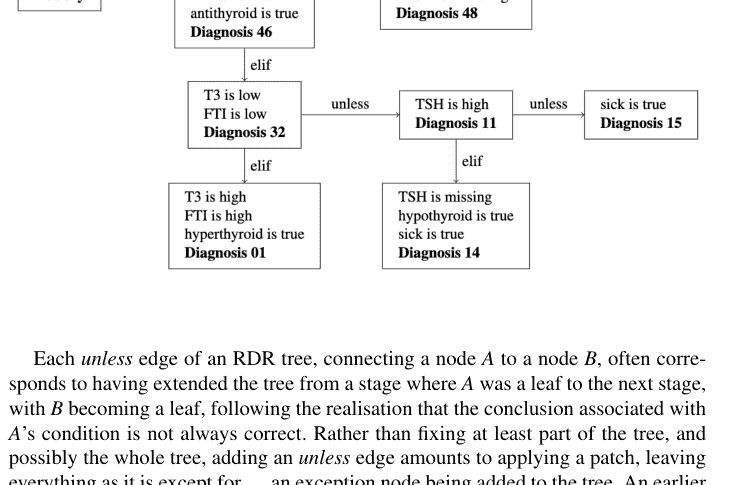

RDR 树的每个 unless 边，连接节点 A 到节点 B，通常对应于从 A 还是叶节点的一个阶段扩展树到下一个阶段，B 成为叶节点，这是因为意识到与 A 条件相关联的结论并不总是正确。 而不是修复树的至少一部分，甚至可能是整棵树，添加一个 unless 边相当于应用一个补丁，除了...向树中添加一个例外节点外，其他一切保持不变。 作为示例给出的 RDR 树片段的更早阶段可能没有与“Diagnosis 48”相关联的叶节点。 处理一个会导致得出“Diagnosis 46”不应适用的结论的案例，尽管该案例满足相关条件，RDR 框架不会修复该条件，然后可能、大概率地修复与“Diagnosis 32”相关联的条件，以及与“Diagnosis 01”相关联的条件；相反，与“Diagnosis 48”相关联的条件扮演补丁的角色，应用于与“Diagnosis 46”相关联的条件。 虽然该程序看起来“杂乱无章”，可能导致树远大于其最优所需的大小，但证据支持相反的说法。

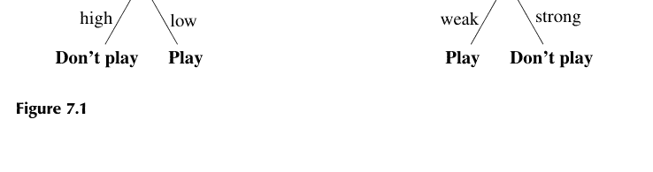

## 图 7.1

决策树完全由 elif 条件构建，而非单调推理则完全基于 unless 条件发展。 Tweety 会飞，除非发现它是企鹅，在这种情况下结论会转变为“它实际上不会飞”，这就是标准例子。 而在非单调推理中，例外通常是按设计内置的，作为一种方式，能够有效地、立即押注最可能的结论，接受在接收到新信息时以后放弃它并选择新的结论，然后可能也为第三个结论放弃第二个结论，或者为什么不再次回到第一个结论，因为又接收到另一条信息，RDR 方法论反映了更坦率的承认，即人们会犯错，但没关系，应用补丁就足够了；无需回到绘图板重新开始。

从概念上讲，RDR 框架最初看起来相当直接。但“魔鬼在细节中”。 一个解释良好的数据结构、一个解释良好的算法是完全可以“理解”的，直到有人决定实现它，然后才意识到毕竟，这一点、那一点并不完全清楚，需要进一步思考。 在本章中，我们将正式深入 RDR 框架的形式细节。 此外，“理解”通常是一个过于粗糙的概念：从一开始就很浅显的理解水平出发，通过发现与其他概念或技术的联系，理解往往可以变得越来越深入。 我们刚刚提及了 RDR 与非单调推理之间的关系。但还有更多。 一旦我们把所有形式细节都弄对了，就会自然想到一些问题，这些问题促使我们想到与信念修正的优先模型、形式学习理论及其分类范式中的心智变化、拓扑学中的差分层级、确定性与非确定性之间的区别、指数与非指数复杂性之间的区别直接相关的概念和技术。

由于篇幅限制，我们无法充分介绍信念修正、形式学习理论、拓扑学、复杂性理论中的相关概念，并在完全一般性和深度上建立关系。 相反，我们只会定义形式化和研究 RDR 所需的概念，只是指出其他领域中的对应概念，希望激发读者的好奇心，并让他们进一步探索这些关系。 至少，我们希望读者能够欣赏到，只要被恰当地形式化，简单概念如何会变得富有成果并与广泛的知识体系相关联。

### 7.3 逻辑背景

#### 7.3.1 一般背景

首先，一些通用记号。 给定一个函数 f，我们用 dom(f) 表示 f 的定义域。 给定两个序列 σ 和 τ，我们用 σ · τ 表示 σ 与 τ 的连接。 给定一个集合 S，|S| 表示 S 的基数，而给定一个序列 σ，|σ| 表示 σ 的长度。

在这里我们让逻辑设定纯粹是命题的；一阶设定会带来有趣的挑战和回报，但需要大量篇幅。 我们用 𝔞 表示一个有限的命题原子集合。 为了方便，我们让定义公式的语法具有几个显著特征。首先，施加否定范式。其次，合取和析取被定义为有限公式集合上的单目运算符，而不是成对公式之间的二目运算符。 特别地，∨∅ 和 ∧∅ 是公式，分别可以扮演 False 和 True 的角色。 因此公式（在 𝔞 上）的集合 ℱ 是 ⊆-最小的集合，使得 (i) 对于所有 φ ∈ 𝔞 ，φ 和 ¬φ 都在 ℱ 中，且 (ii) 对于 ℱ 的所有有限子集 F，∨F 和 ∧F 都在 ℱ 中。 在施加了否定范式后，需要一个一元运算符来否定任意公式，而通常的二元连接词被定义为缩写；这再标准不过了。 因此给定一个公式 φ，如果 φ 是一个原子则 ∼φ 表示 ¬φ，如果 φ 的形式为 ¬ψ 则 ∼φ 表示 ψ，如果 φ 的形式为 ∨F 则 ∼φ 表示 ∧{∼ψ | ψ ∈ F}，如果 φ 的形式为 ∧F 则 ∼φ 表示 ∨{∼ψ | ψ ∈ F}。 此外，给定两个公式 φ 和 ψ，φ ∨ ψ、φ ∧ ψ、φ → ψ、φ ↔ ψ 和 φ ⊕ ψ 分别是 ∨{φ, ψ}、∧{φ, ψ}、∼φ ∨ ψ、(φ → ψ) ∧ (ψ → φ) 和 φ ↔ ∼ψ 的替代记法。

RDR 树的每个节点都与一个条件相关联，通常要求该条件是特定形式的公式，对于某些形式会得到特定结果，而对于其他形式则不会。 拥有一种多功能且简洁的记号来定义感兴趣的特定形式是很方便的。 在这里我们将研究限制在三种形式
- 𝔞¬，由 𝔞 使用 ¬ 构建的字面量集合；
- 𝔞∧，由 𝔞 使用合取构建的正合取集合；
- 𝔞∨∧，由 𝔞 使用合取和析取构建的正公式集合。

我们用 𝓜 表示一个非空的（命题）解释集合（在 𝔞 上），即 𝔞 的一个非空子集集合（可能的模型，或可能世界）。 并且给定一个公式 φ，我们用 Mod𝓜(φ) 表示 𝓜 中是 φ 的模型的成员集合，根据公式在解释中真值的通常解释；给定一个公式集合 X，Mod𝓜(X) 显然表示 ⋂φ∈X Mod𝓜(φ)。 公式 φ 被称为 (i) 在 𝓜 中有效，如果 Mod𝓜(φ) = 𝓜，否则在 𝓜 中无效，(ii) 在 𝓜 中可满足，如果 Mod𝓜(φ) ≠ ∅，否则在 𝓜 中不可满足。 给定两个公式集合 X 和 Y，我们说 Y 在 𝓜 中逻辑蕴含 X，并写成 X ⊨𝓜 Y 如果 Mod𝓜(∧X → ∧Y) = 𝓜，并且我们说 X 和 Y 在 𝓜 中逻辑等价如果 Mod𝓜(∧X ↔ ∧Y) = 𝓜；当 X 或 Y 是单例 {φ} 时，我们可以在所有记号中用 φ 替换 X，并且当 𝓜 是所有解释的集合时，我们可以在表达式中省略“在 𝓜 中”，并在记号中省略 𝓜 作为下标。

Σ1,k、Π1,k 和 Δ1,k 公式（k ∈ ℕ 指所谓的差分层级 [2, 3, 4] 中的一个层级）的概念是相对于 𝓜 的，𝔞 的成员的模型构成 𝓜 上底层拓扑的子基。

## 定义 1. 给定一个公式 φ。

如果 φ 在 𝓜 中不可满足或在 𝓜 中有效，则 φ 分别被称为在 𝓜 中为 Σ1,0 或 Π1,0。

给定一个严格正整数 k。
- φ 被称为在 ℳ 中为 Σ₁,ₖ 当且仅当存在正公式 ψ₁, ..., ψₖ 使得：
  - 对于所有 p ∈ {1, ..., k−1}，ψₚ₊₁ 在 ℳ 中逻辑蕴含 ψₚ；
  - φ 在 ℳ 中逻辑等价于 ∨₁≤p≤k, p mod 2=1 (ψₚ ∧ ∧ₚ<q≤k ∼ψ_q)。
- φ 被称为在 ℳ 中为 Π₁,ₖ 当且仅当 ∼φ 在 ℳ 中为 Σ₁,ₖ。

图 7.2 说明了与在 ℳ 中为 Σ₁,₈ 的公式相关联的那种图景。 我们将有 ψ₁ 是一个定义最外层圆盘的正公式，ψ₂ 是一个定义第二外层圆盘的正公式... 而 ψ₈ 是一个定义最内层圆盘的正公式，整个公式定义所有黑色环的并集：你处于第一层且不在第二外层圆盘中，除非你处于第三层且不在第四外层圆盘中，除非你处于第五层且不在第六外层圆盘中，除非你处于第七层且不在第八外层圆盘中。 更一般地，随着 Σ₁,ₖ 中 k 的值增加，相关图景中的圆盘数量增加，最外层环对于任何 k 值都被填充，而最内层环对于奇数 k 值被填充，对于偶数 k 值则不被填充。

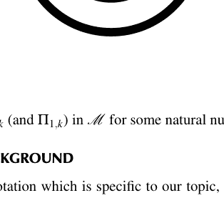

图 7.2

所有公式在 ℳ 中对于某个自然数 k 都是 Σ₁,ₖ（和 Π₁,ₖ）。

#### 7.3.2 具体背景

接下来是第一个特定于我们主题的记号，尽管它并非完全排他，因为它以一种或另一种形式出现在一些领域，例如在信念修正的优先模型文献 [9] 中，特别是以 Grove 的球系统 [6] 的形式出现。

记号 2. 我们用 ℭ 表示有限集合 S 的集合，S 是 ℳ 的非空子集，使得 ℳ ∈ S 且 S 按包含关系全序（包含 ℳ 的 ℳ 的非空子集的有限链）。

## 示例 3.

假设 𝔞 由三个原子 p、q 和 r 组成，且 𝓜 是 𝔞 上的所有解释的集合。定义如下九个（正）公式。

- φ₀ = p ∧ q ∧ r
- φ₁ = p ∧ q
- φ₂ = p ∧ (q ∨ r)
- φ₃ = p
- φ₄ = p ∨ (q ∧ r)
- φ₅ = p ∨ q
- φ₆ = p ∨ q ∨ r
- φ₇ = ∧ ∅
- φ₈ = (p ∧ q) ∨ (p ∧ r) ∨ (q ∧ r).

对所有 i ≤ 8，定义 Mᵢ 为 Mod(φᵢ)。令 C₁ = {Mᵢ | i < 8} 且 C₂ = {M₀, M₈, M₆, M₇}。则 C₁ 和 C₂ 都在 ℭ 中。

给定一个模型链，与手头信息一致且最具体的链成员自然具有特别的兴趣。用通俗的说法，这一观察被以下记号所捕捉。

## 记号 4.

设 C ∈ ℭ 且 𝔐 ∈ 𝓜。 我们用 min_C(𝔐) 表示包含 𝔐 的 C 中 ⊆-最小的成员。

图 7.3 说明了记号 4。

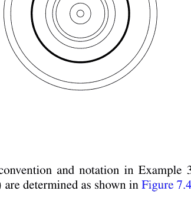

图 7.3

## 示例 5.

回顾示例 3 中的约定和记号。对所有 𝔐 ∈ 𝓜，min_{C₁}(𝔐) 和 min_{C₂}(𝔐) 如图 7.4 所示确定。

| ℳ | min_{C₁}(ℳ) | min_{C₂}(ℳ) |
|---|---|---|
| {p, q, r} | M₀ | M₀ |
| {p, q, ¬r} | M₁ | M₈ |
| {p, ¬q, r} | M₂ | M₈ |
| {p, ¬q, ¬r} | M₃ | M₆ |
| {¬p, q, r} | M₄ | M₈ |
| {¬p, q, ¬r} | M₅ | M₆ |
| {¬p, ¬q, r} | M₆ | M₆ |
| {¬p, ¬q, ¬r} | M₇ | M₇ |

图 7.4

### 7.4 分级树与图

RDR 树的条件可以从语义上考虑，作为其成立的可能世界集合，或从句法上考虑，作为某种语言中的描述，旨在被适当解释。为了兼顾这两种观点并避免概念的重复形式化，我们定义了 ℳ-嵌入的概念，以平凡地将解释映射到自身，或将句法表示映射到其解释。将解释抽象为布尔代数是自然的（对于希望扩展该设定并使其一阶化的读者，有界分配格将是自然的选择）。也有必要区分用于处理整个 RDR 树的语言和用于 RDR 树条件的语言。前者应自然地在否定、析取和合取下封闭——这正是布尔代数合适的根本原因——而后者可能受到更严格的限制——例如，人们可以自然地要求条件为原子，或正合取。在下面的定义中，B 针对整个 RDR 树的语言，而 A 针对 RDR 树条件的语言。

**定义 6.** 我们称形式为 (h,A) 的对为 ℳ-嵌入，具有以下性质。

- h 是从布尔代数 (B, ∨, ∧, ¬, 0, 1) 到 2^ℳ 的同态；
- A 是 B 的子集。

在不会引起混淆的上下文中，我们将 A 与 (h,A) 识别，并使用 ∨、∧、¬、0 和 1，默认它们表示 (B, ∨, ∧, ¬, 0, 1) 的倒数第二到最后一个成员。我们还在 dom(h) 上的诱导偏序的意义上使用 ≤、<、> 和 ≥。

我们将 2^ℳ 识别为 ℳ-嵌入 (h,2^ℳ)，其中 dom(h) 与 (2^ℳ, ∪, ∩, ¬, ∅, ℳ) 相同且 h 为恒等函数。给定一组公式 L，用 Ĺ 表示 L 在 ∨、∧ 和 ∼ 下的闭包，我们将 L 识别为 ℳ-嵌入 (h,Ĺ)，其中 dom(h) = (Ĺ, ∨, ∧, ∼, ∨∅, ∧∅) 且 h 将每个 φ ∈ Ĺ 映射到 φ 为真的 ℳ 成员的集合。

以下记号将用于聚合 RDR 树分支上找到的条件，except-节点引入合取，elif-节点引入析取，从而得到分支本身的条件。更精确地说，将被定义为 ℰ-分级树的分支，其中 ℰ 为 ℳ-嵌入，将是一个如记号 7 中所定义的序列 σ；用该记号中定义的 σ̂，模型集合 ℰ(σ̂) 将与该分支相关联。

## 记号 7. 给定布尔代数 (B,∨,∧,¬,0,1)，我们按如下方式归纳地将 {∨,∧}×B 的每个有限序列映射到 B 的成员 σ̂。

- (\widehat{}) = 1.
- 对所有 𝕏 ∈ {∨,∧} 和 𝕧 ∈ B，\widehat{(𝕏,𝕧)} = 𝕧。
- 设 𝕏,𝕏' ∈ {∨,∧}，𝕧,𝕧' ∈ B，且 σ 为 {∨,∧}×B 的有限序列。令 σ' = ((𝕏,𝕧),(𝕏',𝕧'))·σ。则 \widehat{σ'} = 𝕧 𝕏' \widehat{((𝕏',𝕧'))·σ}。

## 示例 8. 设布尔代数 (B,∨,∧,¬,0,1) 和 B 的成员 b1,…,b9 给出。令

σ = ((∧,b1),(∨,b2),(∨,b3),(∧,b4),(∧,b5),(∨,b6),(∧,b7),(∧,b8),(∨,b9)).

σ 的十个初始段 τ，按从小到大考虑，被映射为 B 的以下简化成员 τ̂：

- 1
- b1
- b1 ∨ b2
- b1 ∨ b2 ∨ b3
- b1 ∨ b2 ∨ (b3 ∧ b4)
- b1 ∨ b2 ∨ (b3 ∧ b4 ∧ b5)
- b1 ∨ b2 ∨ (b3 ∧ b4 ∧ (b5 ∨ b6))
- b1 ∨ b2 ∨ (b3 ∧ b4 ∧ (b5 ∨ (b6 ∧ b7)))
- b1 ∨ b2 ∨ (b3 ∧ b4 ∧ (b5 ∨ (b6 ∧ b7 ∧ b8)))
- b1 ∨ b2 ∨ (b3 ∧ b4 ∧ (b5 ∨ (b6 ∧ b7 ∧ (b8 ∨ b9))))

ℳ-嵌入的概念，即记住，它让我们能够纯语义地或语法和语义地工作，并对条件施加可能的限制，就是定义 RDR 树完整一般性所需的一切。我们期望 except-节点引入合取，真正带来例外并限制模型集合，而 elif-节点引入析取，真正带来替代并扩大模型集合。这证明了在下述定义中引入最后一项的合理性。

## 定义 9.

设 𝓜-嵌入 ℰ = (h,A) 给出。ℰ-分级树是非空有限序列集合 T，具有以下性质。

- T 在子序列下封闭。
- 对所有 σ ∈ T，σ 的每个成员均为形式为 (∨, v) 或 (∧, v) 的，其中 v ∈ A。
- 对所有 σ ∈ T，至多有一个 v ∈ A 使得 σ · ((∨, v)) ∈ T，且至多有一个 v ∈ A 使得 σ · ((∧, v)) ∈ T。
- {ℰ(ρ̂) | ρ ∈ T} \ {∅} 的基数为 |T|。

分级树（在 𝓜 上）是某个 𝓜-嵌入 ℰ 的 ℰ-分级树。

## 示例 10.

回顾示例 3 中的约定和记号。以下集合的闭包

(( (∧,p), (∧,q), (∧,r) ), ((∧,p),(∧,q),(∨,r)),
((∧,p),(∨,q),(∧,r)), ((∧,p),(∨,q),(∨,r)))

在子序列下是 𝓐-分级树。它可以如图 7.5 所示描绘，形式为 (∨, v) 的对用垂直连线表示，形式为 (∧, v) 的对用水平连线表示。

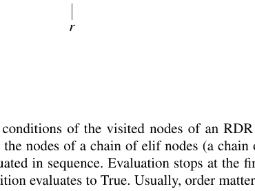

图 7.5

RDR 树访问节点的条件评估是确定性的。事实上，elif 节点链（可能的替代链）的节点需按顺序评估。评估在链中第一个条件评估为 True 的节点（如果有）处停止。通常，顺序很重要；替代的顺序不能改变，或者至少不能随意改变。考虑任何替代链可以以任何方式重新排序的情况是有趣的。这相当于一个非确定性 RDR 框架：它允许在给定节点并行评估所有可能的替代，并移动到条件首先被发现评估为 True 的节点（如果有）。这个非确定性 RDR 框架从下面的定义开始，引入了分级图这一关键概念。我们随后将看到分级图如何被转换成语义树或多棵分级树。直观上，可以从分级图获得的分级树越多，分级图所包含的非确定性就越多。一些分级图不能被转换成语义树多于一棵，因此它们本身是确定性的。尽管如此，它们仍可能很有价值，因为分级图允许我们去掉一些分级树中内置的冗余。图 7.5 中描绘的树表现出冗余：以 q 为根的两个子树相同。我们将看到该树是分级图唯一的转换，后者提供更紧凑的表示。实际上，对分级树中“冗余”的解释可能有不止一种。为了确保解释足够一般，并且不需要超过在 RDR 树中查找相同子树，忽略这些相同子树出现的“上下文”，我们采用多重集上的图而不是顶点集合。使用公式（或更一般地，使用包含所考虑 ℳ-嵌入的格的成员）作为标签，我们可以考虑一组带标签的顶点，并可能用相同公式标记不同的顶点，但直接且更简单地使用公式的多重集作为顶点。

## 定义 11.

设 ℳ-嵌入 ℰ = (h,A) 给出。ℰ-分级图是形式为 (V,E) 的对，其中 V 是 A ∪ {1} 的多子集，E 是 V 上的有限非空二元关系，具有以下性质。

- 对所有 v ∈ V，v = 1 当且仅当不存在 v' ∈ V 使得 (v', v) ∈ E。
- E 是无环的：不存在 n ∈ ℕ 和 v0,…,vn ∈ V 使得 (vn, v0) ∈ E 且对所有 i < n，(vi, vi+1) ∈ E。

分级图（在 𝓜 上）是某个 ℳ-嵌入 ℰ 的 ℰ-分级图。

## 示例 12.

回顾示例 3 中的约定和记号。令 V 表示 {∧∅, p, q, r} 并设：

E = {(∧∅, p), (∧∅, q), (∧∅, r), (p, q), (p, r), (q, r)}.

则 (V,E) 是一个 𝒜-分级图。它可以如图 7.6 所示描绘。

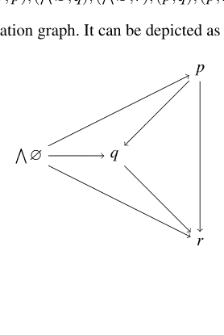

图 7.6

## 定义 13.

设给出了一个分级图 $G = (V,E)$。我们称 *$G$ 的路径* 为任何形如 $(v_0, ..., v_n)$ 的序列，$n \in \mathbb{N}$，$v_0, ..., v_n \in V$，使得不存在 $v \in V$ 满足 $(v, v_0) \in E$ 且对所有 $i < n$，$(v_i, v_{i+1}) \in E$。我们用 $\mathrm{Paths}(G)$ 表示 $G$ 的路径集合。

## 属性 14.

设给出了一个分级图 $G = (V,E)$。

- *V 中 1 的重数等于 1。*
- *Paths(G) 的每个成员都以 1 开始。*
- *V 的每个成员都出现在 Paths(G) 的某个成员中。*

分级图可以被“展开”并转化为至少一棵分级树，以图 7.6 和 7.5 为例（对于这个特定例子，“展开”是唯一的）。这在下面的命题和定义中得到了表达。

## 定义 15.

设给出了一个分级图 $G = (V,E)$。设 $|E| = n$。我们称 *$G$ 的表示* 为 $E$ 的任何枚举，使得对于所有 $v, w, w' \in V$ 满足 $(v, w) \in E$ 且 $(v, w') \in E$，如果 $\mathrm{Paths}(G)$ 的某个成员以 $(w, w')$ 结尾，则在该枚举中 $(v, w)$ 出现在 $(v, w')$ 之前。

## 命题 16.

设给出了一个 $\mathscr{M}$-嵌入 $\mathfrak{E}$、一个 $\mathfrak{E}$-分级图 $G = (V,E)$ 以及 $G$ 的一个表示。将每个 $\sigma \in \mathrm{Paths}(G)$ 映射到 $\{\vee, \wedge\} \times V$ 的成员的有限序列 $[\sigma]$，方法如下。设 $[(\wedge, \emptyset)] = ()$。给定形如 $(v_0, ..., v_n)$ 的 $\sigma \in \mathrm{Paths}(G)$，$n > 0$，定义 $[\sigma]$ 为

$((\wedge, w_1^0), (\vee, w_1^1), ..., (\vee, w_1^{k_1}), ..., (\wedge, w_n^0), (\vee, w_n^1), ..., (\vee, w_n^{k_n}))$,

$k_1, ..., k_n \in \mathbb{N}$，其中对于所有非零的 $i \le n$，$(w_i^0, ..., w_i^{k_i})$ 是 $V$ 的成员的最长序列，使得 $w_i^{k_i} = v_i$ 且 $(v_{i-1}, w_i^0), ..., (v_{i-1}, w_i^{k_i})$ 都出现在 $E$ 中，按给定 $G$ 的表示中的此顺序出现。则 $\{ [\sigma] \mid \sigma \in \mathrm{Paths}(G) \}$ 是一个 $\mathfrak{E}$-分级树。

## 证明.

这可通过使用由 $\mathrm{Paths}(G)$ 在子序列下的闭包定义的树的左子、右兄弟表示法轻松验证。

## 定义 17.

设给出了一个分级图 $G$。

给定 $G$ 的一个表示 $\mathscr{R}$，我们说根据命题 16 由 $G$ 和 $\mathscr{R}$ 定义的分级树是 *由 $G$ 和 $\mathscr{R}$ 确定的*。

我们说一棵分级树是 *由 $G$ 确定的*，如果它由 $G$ 及其其中一个表示确定。

## 示例 18.

回顾示例 10 和 12 中的约定和记号。后者中定义的分级图 $G$ 确定了一个唯一的分级树 $T$，即前者中定义的那一个。基于 $G$ 的唯一表示，命题 16 将每个 $\sigma \in \mathrm{Paths}(G)$ 映射到 $T$ 的一个成员 $[\sigma]$。图 7.7 显示了所有 $\sigma \in \mathrm{Paths}(G)$ 的 $\sigma$ 和 $\widehat{[\sigma]}$。

| σ | [σ̂] |
|---|---|
| (∧ ∅) | ∧ ∅ |
| (∧ ∅, r) | p ∨ q ∨ r |
| (∧ ∅, q) | p ∨ q |
| (∧ ∅, q, r) | p ∨ (q ∧ r) |
| (∧ ∅, p) | p |
| (∧ ∅, p, r) | p ∧ (q ∨ r) |
| (∧ ∅, p, q) | p ∧ q |
| (∧ ∅, p, q, r) | p ∧ q ∧ r |

### 图 7.7

## 定义 19.

给定一棵分级树 T，T 的深度定义为最大的整数 n，使得 T 的某个成员 σ 具有 n + 1 个形如 (∧, v) 的元素。

给定一个分级图 G，G 的深度定义为 max_{σ ∈ Paths(G)} |σ|。

## 属性 20.

给定一个分级图 G 和由 G 确定的分级树 T，G 的深度等于 T 的深度。

Except-节点缩小一个模型集合，elif-节点扩展它。事实证明，RDR 树的分支与构成包含链的模型集合相关联（即，集合 ℰ(σ) 随着 σ 在 ℰ-分级树上变化形成一个包含链）。引理 21 中定义的全序关系旨在相应地对分级树的分支进行排序，从与最小模型集合相关联的分支到与最大模型集合相关联的分支。这就是命题 29 的内容——引理 27 的一个推论。

## 引理 21.

设给出了一个分级树 T。设 ≺ 是 T 上的二元关系，使得对于所有 σ, τ ∈ T，σ ≺ τ 当且仅当 σ ≠ τ 且

- 要么 τ 是空序列，或
- σ 的形式为 τ · ((∧, v)) · τ'，或
- τ 的形式为 ((𝔛₀, 𝔳₀),..., (𝔛ₙ, 𝔳ₙ))，n ∈ ℕ，且存在 m < n 使得 𝔛_{m+1} = ∨，使得 σ 的形式为 ((𝔛₀, 𝔳₀),..., (𝔛_m, 𝔳_m)) · σ'，其中 σ' 为空或形如 ((∧, v)) · σ''。

则 ≺ 是 T 上的全严格序。

*证明.* 设非空的 σ₁, σ₂, σ₃ ∈ T 满足 σ₁ ≺ σ₂ ≺ σ₃。将 σ₃ 写为 ((𝔛₀, 𝔳₀),..., (𝔛ₙ, 𝔳ₙ))，n ∈ ℕ。

- 假设 σ₂ 的形式为 σ₃ · ((∧, v)) · σ。
- 如果 σ₁ 的形式为 σ₂ · ((∧, v)) · σ'，则存在一个序列 σ'' 使得 σ₁ 为 σ₃ · ((∧, v)) · σ''，故 σ₁ ≺ σ₃。

- 将 σ₂ 写为 ((𝕏'₀,𝕧'₀),..., (𝕏'ₚ,𝕧'ₚ))，p > n。如果存在 m < p 使得 𝕏'ₘ₊₁ = ∨ 且存在一个序列 σ' 使得 σ₁ 为 ((𝕏'₀,𝕧'₀),..., (𝕏'ₘ,𝕧'ₘ))·σ'，其中 σ' 为空或形如 ((∧, v'))·σ''，则要么 m > n，在这种情况下存在一个序列 τ 使得 σ₁ 为 σ₃·((∧, v))·τ，故 σ₁ ≺ σ₃，要么 m < n，在这种情况下 σ₁ 为 ((𝕏₀,𝕧₀),..., (𝕏ₘ,𝕧ₘ))·σ'，故 σ₁ ≺ σ₃ 再次成立。
- 假设存在 m < n 使得 𝕏ₘ₊₁ = ∨ 且存在一个序列 σ 为空或形如 ((∧, v))·σ' 使得 σ₂ 为 ((𝕏₀,𝕧₀),..., (𝕏ₘ,𝕧ₘ))·σ。
- 如果 σ₁ 的形式为 σ₂·((∧, v))·τ，则存在形如 ((∧, v'))·τ'' 的序列 τ' 使得 σ₁ 为 ((𝕏₀,𝕧₀),..., (𝕏ₘ,𝕧ₘ))·τ'，故 σ₁ ≺ σ₃。
- 将 σ₂ 写为 ((𝕏'₀,𝕧'₀),..., (𝕏'ₚ,𝕧'ₚ))，p ≥ m。如果存在 k < p 使得 𝕏'ₖ₊₁ = ∨ 且存在一个序列 τ 使得 σ₁ 为 ((𝕏'₀,𝕧'₀),..., (𝕏'ₖ,𝕧'ₖ))·τ，其中 τ 为空或形如 ((∧, v'))·τ'，则要么 k ≥ m，在这种情况下存在一个序列 γ 为空或形如 ((∧, v))·γ' 使得 σ₁ 为 ((𝕏₀,𝕧₀),..., (𝕏ₘ,𝕧ₘ))·γ，故 σ₁ ≺ σ₃，要么 k < m，在这种情况下 σ₁ 为 ((𝕏₀,𝕧₀),..., (𝕏ₖ,𝕧ₖ))·τ，故 σ₁ ≺ σ₃ 再次成立。

我们得出结论，在所有情况下，σ₁ ≺ σ₃，故 ≺ 是传递的。

设给出了不同的 σ, τ ∈ T。

- 如果 σ 的形式为 τ·((∧, v))·τ'，则 σ ≺ τ。
- 如果 τ 的形式为 σ·((∨, v))·σ'，则 σ ≺ τ。
- 如果存在一个序列 γ 使得 σ 和 τ 分别形如 γ·((∧, v))·σ' 和 γ·((∨, v))·τ'，则 σ ≺ τ。

我们得出结论，对于所有不同的 σ, τ ∈ T，要么 σ ≺ τ 要么 τ ≺ σ，从而完成了引理的证明。

以下的记号在第 7.5 节之前不会被使用，但示例 23 首先旨在说明引理 21 中定义的全序关系，也说明了该记号。

## 记号 22.

设给出了一个分级树 T 和 σ ∈ T。设 X 为所有元素 v 的集合，使得 σ 的某个初始段 τ 以 (∨,v) 或 (∧,v) 结尾且 τ ⊀ σ，其中 ≺ 如引理 21 中所定义。我们令 σ̂ 表示 ∧X。

## 示例 23.

图 7.8 表示分级树 T 的一个成员 τ，即以蓝色点结束的路径。

- 设 ≺ 如引理 21 中所定义，T 的成员 σ 满足 σ ≺ τ 对应于以绿色点结束的路径以及以绿色或蓝色点结束的路径的严格向右扩展（如果有的话）。

### 图 7.8

- σ̂，如记号 22 中所定义，是一个关于集合的合取，其成员对应于红色和蓝色点。

## 记号 24.

给定一棵分级树 T，我们用 ρ_T 表示域为 {1,...,|T|} 的映射，将 dom(ρ_T) 中的每个 i 映射到 T 中关于引理 21 中定义的全序的第 i 个成员。我们有时默示地假设 dom(ρ_T) 实际上是 {0,...,|T|}，在这种情况下 ρ_T(0)=0。

## 定义 25.

给定一棵分级树 T，我们将 (ρ_T(i))_{1≤i≤|T|} 称为 T 的标准枚举。

## 示例 26.

图 7.9 表示大小为 16 的分级树 T 的标准枚举。每个数字指的是对于 T 的对应成员 σ，ρ_T^{-1}(σ)，如记号 24 中所定义。

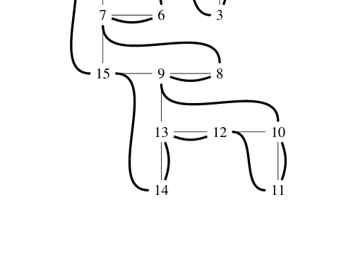

### 图 7.9

## 引理 27. 设一个分级树以及 T 的两个不同成员 σ 和 τ。

- 如果 σ 的形式为 τ·((∧, v))·τ′，则 σ ≤ τ。
- 如果 τ 的形式为 σ·((∨, v))·σ′，则 σ ≤ τ。
- 如果存在一个序列 γ，使得 σ 和 τ 分别具有形式 γ·((∧, v))·σ′ 和 γ·((∨, v))·τ′，则 σ ≤ τ。

### 证明。
在第一种情况下，如果 τ 是空序列，则显然 σ̂ ≤ τ̂。我们考察第一种情况的其余部分以及最后两种情况。

- 假设 σ 的形式为 τ·((∧, v))·τ′ 且 τ ≠ ()。将 σ 写为 ((𝔛₀,𝔳₀),..., (𝔛ₙ,𝔳ₙ))，n > 0，并设 i < n 使得 τ 为 ((𝔛₀,𝔳₀),..., (𝔛ᵢ,𝔳ᵢ))。对所有 j ≤ i，令 τⱼ 表示 ((𝔛ⱼ,𝔳ⱼ),..., (𝔛ᵢ,𝔳ᵢ))，并令 σⱼ 表示 ((𝔛ⱼ,𝔳ⱼ),..., (𝔛ₙ,𝔳ₙ))。注意 σ̂ᵢ ≤ 𝔳ᵢ。通过归纳法，令 j 从 i 递减到 0，可立即验证对所有 j ≤ i，σ̂ⱼ ≤ τ̂ⱼ。特别地，σ̂ ≤ τ̂。
- 假设 τ 的形式为 σ·((∨, v))·σ′。于是 σ ≠ ()。将 τ 写为 ((𝔛₀,𝔳₀),..., (𝔛ₙ,𝔳ₙ))，n > 0，并设 i < n 使得 σ 为 ((𝔛₀,𝔳₀),..., (𝔛ᵢ,𝔳ᵢ))。对所有 j ≤ i，令 σⱼ 表示 ((𝔛ⱼ,𝔳ⱼ),..., (𝔛ᵢ,𝔳ᵢ))，并令 τⱼ 表示 ((𝔛ⱼ,𝔳ⱼ),..., (𝔛ₙ,𝔳ₙ))。注意 𝔳ᵢ ≤ τ̂ᵢ。通过归纳法，令 j 从 i 递减到 0，可立即验证对所有 j ≤ i，σ̂ⱼ ≤ τ̂ⱼ。特别地，σ̂ ≤ τ̂。
- 假设存在序列 γ 使得 σ 和 τ 分别具有形式 γ·((∧, v))·σ′ 和 γ·((∨, v))·τ′。于是 γ ≠ ()。将 γ 写为 ((𝔛₀,𝔳₀),..., (𝔛ₙ,𝔳ₙ))，n ∈ ℕ。对所有 j ≤ n，设 σⱼ = ((𝔛ⱼ,𝔳ⱼ),..., (𝔛ₙ,𝔳ₙ))·((∧, v))·σ′ 且 τⱼ = ((𝔛ⱼ,𝔳ⱼ),..., (𝔛ₙ,𝔳ₙ))·((∨, v))·τ′。可立即通过归纳法验证对所有 j ≤ n，σ̂ⱼ ≤ τ̂ⱼ。特别地，σ̂ ≤ τ̂。

这完成了引理的证明。

## 命题 28. 对所有分级树 T 和 i, j ∈ {1,...,|T|}，若 i ≤ j 则 ρ_T(i) ≤ ρ_T(j)。

### 证明。
该命题是引理 27 的直接推论。

## 命题 29. 给定一个 ℳ-嵌入 ℰ 和一个 ℰ-分级树 T，{ℰ(σ̂) | σ ∈ T} 是包含的链。

### 证明。
该命题是引理 27 以及 ℰ 是单调的这一事实的直接推论。

## 推论 30. 对所有 ℳ-嵌入 ℰ 和 ℰ-分级树 T，{ℰ(σ̂) | σ ∈ T} 是 ℰ 的基数为 |T| 的成员。

模型链当然可以用多种方式组织成分级树，更具体地作为分级图，有两种极限的组织情况。

## 性质 31.

设 n ∈ ℕ 且 C ∈ ℭ，|C| = n + 1。写 C 为 {S0, …, Sn}，其中对所有 i < n，Si ⊂ Si+1。

- 设 E1 = ((S0,S1),…,(S0,Sn)) 且 G1 = (C,E1)。
- 设 E2 = ((Sn,Sn-1),…,(S1,S0)) 且 G2 = (C,E2)。

G1 和 G2 都是 2^ℳ-分级图，分别确定唯一的分级树 T1 和 T2。此外，C 等于 {σ̂ | σ ∈ T1} 和 {σ̂ | σ ∈ T2}。

图 7.9 说明了如何从 RDR 树的给定节点访问前一个节点和后一个节点（如果存在），对于引理 21 中定义的严格顺序。命题 32 和推论 34 以完全一般的形式表达了它。

## 命题 32.

设一个分级树 T，|T| > 1，且 σ ∈ T。

- 如果 σ 是形式为 ((∧, v0),…,(∧, vn))，n ∈ ℕ 的最长序列，则 ρ_T^{-1}(σ) 等于 1。
- 假设 T 包含形式为 σ · ((∧, v)) 的序列，并设 τ 是形式为 ((∧, v0),(∨, v1),…,(∨, vn))，n ∈ ℕ 的（唯一的）最长序列，使得 σ · τ 在 T 中。则 ρ_T^{-1}(τ) 等于 ρ_T^{-1}(σ) − 1。
- 假设前述条件都不适用。我们可以将 σ 写为 ((𝔛0, v0),…,(𝔛n, vn))，n > 1，且存在唯一的非零 m ≤ n 使得 ((𝔛m, vm),…,(𝔛n, vn)) 的形式为 ((∨, vm)) · ((∧, vm+1),…,(∧, vn))。则记 ((𝔛0, v0),…,(𝔛m−1, vm−1)) 为 τ，ρ_T^{-1}(τ) 等于 ρ_T^{-1}(σ) − 1。

### 证明。
证明是通过对分级树大小的归纳进行的。该结果对大小为 2 的分级树是直接的。设 k ≥ 2，并假设该结果对大小在 2 到 k 之间的所有分级树成立。设 T 是大小为 k+1 的分级树。设 σ ∈ T 且分级树 T′ 满足 T = T′ ∪ {σ}。设 σ′ ∈ T′ 使得 σ 的形式为 σ′ · ((∧, v)) 或 σ′ · ((∨, v))。我们依次考虑两种情况。设 i = ρ_{T′}^{-1}(σ′)。注意 σ′ 不为空，因此我们可以将 σ′ 写为 ((𝔛0, v0),…,(𝔛n, vn))，n ∈ ℕ，且 i < |T′|。

### 情况 1 σ = σ′ · ((∧, v))。
- 假设 𝔛0,…,𝔛n 全部为 ∧。则 i = 1，且由于该结果对 T′ 成立，我们推断 T′ 的标准枚举为 (σj)1 ≤ j ≤ |T|，其中 σ1 = σ 且对所有 j ∈ {2,…,|T|}，σj = ρ_{T′}(j − 1)。
- 否则，i > 0 且存在 m ≤ n 使得 ((𝔛m, vm),…,(𝔛n, vn)) 的形式为 ((∨, vm)) · ((∧, vm+1),…,(∧, vn))。令 τ 表示 ((𝔛0, v0),…,(𝔛m−1, vm−1))。根据归纳假设，ρ_{T′}^{-1}(τ) = ρ_{T′}^{-1}(σ′) − 1。由此及该结果对 T′ 成立的事实，我们推断 T′ 的标准枚举为 (σj)1 ≤ j ≤ |T|，其中 σi = σ，σj = ρ_{T′}(i) 对所有 j ∈ {1,…,i − 1}，且 σj = ρ_{T′}(j − 1) 对所有 j ∈ {i + 1,…,|T|}。

情况 2 σ = σ′·((∨,ν))。存在 m ≤ n 使得 (((𝔛_m,ν_m),…,(𝔛_n,ν_n)) 的形式为 (((∧,ν_m))·((∨,ν_{m+1}),…,(∨,ν_n)))。令 ((𝔛_0,ν_0),…,(𝔛_{m-1},ν_{m-1})) 表示为 τ。根据归纳假设，ρ_T^{-1}(τ) = ρ_{T'}^{-1}(σ') + 1。由此及该结果对 T' 成立的事实，我们推断 T 的标准枚举为 (σ_j)_{1 ≤ j ≤ |T|}，其中 σ_{i+1} = σ，σ_j = ρ_{T'}(i) 对所有 j ∈ {1,…,i}，且 σ_j = ρ_{T'}(j − 1) 对所有 j ∈ {i+2,…,|T|}。

这完成了该命题的证明。

## 示例 33. 图 7.10 说明了命题 32 的第二和第三种情况。

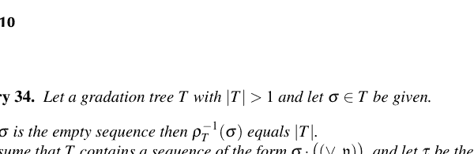

图 7.10

## 推论 34. 设一个分级树 T，|T| > 1，且 σ ∈ T。

- 如果 σ 是空序列，则 ρ_T^{-1}(σ) 等于 |T|。
- 假设 T 包含形式为 σ·((∨,ν)) 的序列，并设 τ 是形式为 ((∨,ν_0),(∧,ν_1),…,(∧,ν_n))，n ∈ ℕ 的（唯一的）最长序列，使得 σ·τ 在 T 中。则 ρ_T^{-1}(τ) 等于 ρ_T^{-1}(σ)+1。
- 假设前述条件都不适用。我们可以将 σ 写为 ((𝔛_0,ν_0),…,(𝔛_n,ν_n))，n ∈ ℕ，且存在唯一的 m ≤ n 使得 ((𝔛_m,ν_m),…,(𝔛_n,ν_n)) 的形式为 ((∧,ν_m))·((∨,ν_{m+1}),…,(∨,ν_n))。则记 ((𝔛_0,ν_0),…,(𝔛_{m-1},ν_{m-1})) 为 τ，ρ_T^{-1}(τ) 等于 ρ_T^{-1}(σ)+1。

## 示例 35. 图 7.11 说明了推论 34 的第二和第三种情况。

图 7.11

设一个解释 𝔐、一个 𝔐-嵌入 ℰ 和一个 ℰ-分级树 T。设 i 在 {1,…,|T|} 中为最小的，具有以下性质：如果 σ 是 T 的（唯一的）成员使得 ρ_T(i) = σ，则 𝔐 ∈ ℰ(σ̂)。设 C 表示 {ℰ(τ̂) | τ ∈ T}。则 ℰ(σ̂) 是 min_C(𝔐)，如记号 4 中所定义。

设一个 𝔐-嵌入 ℰ 和一个 ℰ-分级树 T。为了使用 T 并标记一个案例，需要对各种 σ ∈ T 评估 σ̂，并识别 T 中唯一的 σ，使得 σ̂ 评估为 True 且 ρ_T^{-1}(σ) 对于所考虑的案例是最小的。这可以通过首先评估 ρ_T^{-1}(σ) = 1 的 T 的成员 σ，然后可能评估 ρ_T^{-1}(σ) = 2 的 T 的成员 σ... 来完成。或者可以通过二分搜索完成，首先评估 ρ_T^{-1}(σ) = ⌊|T|/2⌋ 的 T 的成员 σ。由于 ℰ 是布尔的，我们可以从 T 的根开始处理 T 的各个条件，并沿着某个分支的某个初始段前进。事实上，我们可以处理条件的否定，并且案例的评估可以按照 RDR 中标准的方式进行：在条件评估为 True 的节点 N 处，依次考虑节点 N1, ..., Nk，使得 N1 是 N 的例外，且对所有 i ∈ {1,...,k-1}，N_{i+1} 是 N_i 的替代，如果 N1 处的条件评估为 True 则移动到 N1，如果 N1 处的条件评估为 False 但 N2 处的条件评估为 True 则移动到 N2，...，如果 N1, ..., Nk 处的所有条件都评估为 False 则停留在 N。我们接下来将注意力转向布尔分级树，其中记号 36 将每个 σ ∈ T 映射到底层布尔代数的一个元素 σ||_T，旨在捕获案例的标准 RDR 评估。该记号随后将被说明和举例，在此之前我们建立一个引理，从而可以证明命题 40，从而验证 σ||_T 确实发挥了其预期目的。

## 记号 36.

设一个布尔 𝔐-嵌入 ℰ 和一个 ℰ-分级树 T。映射每个 σ ∈ T 到 σ||_T，定义如下。设 τ 是形式为 ((∧, 𝔴0), (∨, 𝔴1), ..., (∨, 𝔴m))，m ∈ ℕ 的最长序列，且 σ·τ ∈ T。如果 σ 为空，则定义 σ||_T 为 ∧_{i≤m} 𝔴̅i。否则，将 σ 写为 ((s0, 𝔴0), ..., (sn, 𝔴n))，n ∈ ℕ，并定义 σ||_T 为

𝔴_n ∧ ⋀_{i<n, s_{i+1}=∧} 𝔴_i ∧ ⋀_{i<n, s_{i+1}=∨} 𝔴̅_i ∧ ⋀_{i≤m} 𝔴̅_i。

## 示例 37.

图 7.12 表示分级树 T 的一个成员，形式为 σ·τ，假设 τ 是形式为 ((∧, 𝔴0), (∨, 𝔴1), ..., (∨, 𝔴m)) 的最长序列。

图 7.12

m ∈ ℕ, 且 σ·τ ∈ T（τ 可以为空）。这里，σ 结束于蓝色点，对应于记号 36 中的 v_n。蓝色点之前的绿色点对应于 ∧_{i<n, s_i+1=∨} v_i 中的合取项。蓝色点之前的红色点对应于 ∧_{i<n, s_i+1=∨} v̄_i 中的合取项。蓝色点之后的红色点对应于 ∧_{i≤m} v̄_i 中的合取项。

## Example 38.

回顾示例 10 中的约定和记号。按记号 36 定义的所有 σ ∈ T 的 σ||_T 的简化值可以如 图 7.13 所示描绘。

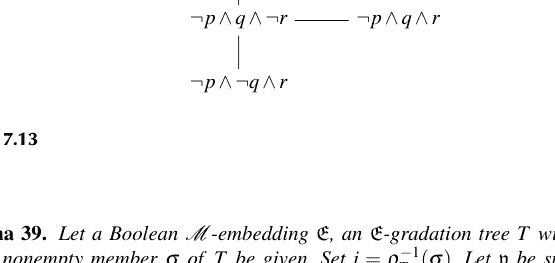

## Figure 7.13

## Lemma 39.

设有一个布尔 ℳ-嵌入 𝔈、一个 |T| > 1 的 𝔈-分级树 T 以及 T 的一个非空成员 σ。设 i = ρ_T^{-1}(σ)。设 ν 使得 σ 以 (∨,ν) 或 (∧,ν) 结尾。对所有 ℳ ∈ 𝔈(ρ_T(i+1)) \ 𝔈(ρ_T(i-1))，ℳ ∈ 𝔈(ρ_T(i)) 当且仅当 ℳ ∈ 𝔈(ν)。

证明。若 𝔈(ρ_T(i+1)) = 𝔈(ρ_T(i-1))，则结果是显然的，故假设并非如此。证明按 𝔈-分级树的规模进行归纳。结果对规模为 2 的 𝔈-分级树是显然的。设 k ≥ 2，并假设结果对规模介于 2 和 k 之间的所有 𝔈-分级树成立。设 T 是一个规模为 k+1 的 𝔈-分级树。设 σ ∈ T 且 𝔈-分级树 T' 满足 T = T' ∪ {σ}。设 σ' ∈ T' 使得 σ 的形式为 σ'·((∧,ν)) 或 σ'·((∨,ν))。我们依次考虑两种情况。设 i = ρ_{T'}^{-1}(σ')。注意 σ' 非空，故可写成 σ' = ((𝔛_0, v_0),..., (𝔛_n, v_n))，n ∈ ℕ，且 i < |T'|。

### Case 1 σ = σ'·((∧,ν)).

- 假设 𝔛_0,...,𝔛_n 均为 ∧，故 i = 1。显然，对所有 ℳ ∈ 𝔈(σ')，ℳ ∈ 𝔈(\widehat{σ'}) 当且仅当 ℳ ∈ 𝔈(ν)。
- 否则，i > 1 且存在非零的 m ≤ n 使得 ((𝔛_m, v_m),..., (𝔛_n, v_n)) 的形式为 ((∨, v_m))·((∧, v_{m+1}),..., (∧, v_n))。设 τ 表示 ((𝔛_0, v_0),..., (𝔛_{m-1}, v_{m-1}))。由命题 32，ρ_{T'}^{-1}(τ) = i - 1。注意 𝔈(v_m ∧ v_{m+1} ∧ ⋯ ∧ v_n ∧ ν) = 𝔈(v_m ∧ v_{m+1} ∧ ⋯ ∧ v_n) ∩ 𝔈(ν)。

设 ℳ ∈ 𝔈(ρ_T'(i+1)) \ 𝔈(ρ_T'(i-1)) 给定。

- 若 ℳ ∈ 𝔈(ν)，则由于 ℳ ∈ 𝔈(\widehat{σ'})，ℳ ∈ 𝔈(\widehat{σ})。
- 若 ℳ ∉ 𝔈(ν)，则由于 ℳ ∉ 𝔈(\widehat{σ'})，ℳ ∉ 𝔈(\widehat{σ})。

### Case 2 σ = σ'·((∨,v)). 存在 m ≤ n 使得 ((𝔛_m, v_m),…,(𝔛_n, v_n)) 的形式为 ((∧, v_m))·((∨, v_{m+1}),…,(∨, v_n))。设 τ 表示 ((𝔛_0, v_0),…,(𝔛_{m-1}, v_{m-1}))。

由推论 34，ρ_T'^{-1}(τ) = i + 1。注意

𝔈(v_m ∨ v_{m+1} ∨ ⋯ ∨ v_n ∨ v) = 𝔈(v_m ∨ v_{m+1} ∨ ⋯ ∨ v_n) ∪ 𝔈(v)。

设 ℳ ∈ 𝔈(ρ_T'(i+1)) \ 𝔈(ρ_T'(i-1)) 给定。

- 若 ℳ ∈ 𝔈(v)，则由于 ℳ ∈ 𝔈(\widehat{σ'})，ℳ ∈ 𝔈(\widehat{σ})。
- 若 ℳ ∉ 𝔈(v)，则由于 ℳ ∉ 𝔈(\widehat{σ'})，ℳ ∉ 𝔈(\widehat{σ})。

由以上所有内容以及结果对 T' 成立的事实，我们借助命题 32 和推论 34 即可容易地推断出结果对 T 成立。

## Proposition 40. 对所有布尔 ℳ-嵌入 𝔈、𝔈-分级树 T 和 σ ∈ T，

𝔈(σ||_T) = 𝔈(\widehat{σ}) \ 𝔈(ρ_T(ρ_T^{-1}(σ) - 1))。

证明。证明按 𝔈-分级树的规模进行归纳。结果对规模为 2 的 𝔈-分级树是显然的。设 k ≥ 2，并假设结果对规模介于 2 和 k 之间的所有 𝔈-分级树成立。设 T 是一个规模为 k + 1 的 𝔈-分级树。设 σ ∈ T 且 𝔈-分级树 T' 满足 T = T' ∪ {σ}。设 σ' ∈ T' 使得 σ 的形式为 σ'·((∧,v)) 或 σ'·((∨,v))。我们依次考虑两种情况。设 i = ρ_{T'}^{-1}(σ')。

### Case 1 σ = σ'·((∧,v)).

- 将 σ' 写成 ((𝔛_0, v_0),…,(𝔛_n, v_n))，n ∈ ℕ，假设 𝔛_0,…,𝔛_n 均为 ∧，故 i = 1。显然，
- 𝔈(σ||_{T'} ∧ v) = 𝔈(\widehat{σ})；
- 𝔈(σ||_{T'} ∧ \bar{v}) = 𝔈(σ') \ 𝔈(\widehat{σ})。

另外，注意

- $\sigma\parallel_T$ 定义为 $\tau\parallel_{T'} \wedge \mathfrak{v}$；
- $\tau\parallel_T$ 定义为 $\tau\parallel_{T'} \wedge \bar{\mathfrak{v}}$。

由以上所有内容以及结果对 $T'$ 成立的事实，我们借助命题 32 和推论 34 即可容易地推断出结果对 $T$ 成立。

### 7.5 NORMAL FORMS

设有一个分级树 $T$ 和 $T$ 的一个成员 $\sigma$。按其定义方式，$\hat{\sigma}$ 可以有 $\vee$s 位于 $\wedge$s 内，$\wedge$s 位于 $\vee$s 内，$\vee$s 位于 $\wedge$s 内……尤其是当 $\sigma$ 更长且有更多“方向变化”时。这与析取或合取范式的扁平结构形成对比，后者将嵌入深度限制为 2（合取内的析取，或合取内的合取）。记号 41 捕捉了将 $\hat{\sigma}$ 转换为析取和合取范式的自然方式。推论 44 刻画了可以表示为形式为 $\hat{\sigma}$ 的公式的析取和合取范式。

## Notation 41.

设有一个分级树 $T$。设 $\mathrm{DNF}(\sigma)$ 和 $\mathrm{CNF}(\sigma)$ 均表示 $\wedge\varnothing$。将 $T$ 的每个非空成员 $\sigma$ 与两个集合族关联如下。

- 将 $\sigma$ 写成
$((\wedge,\mathfrak{v}_0^0),\dots,(\wedge,\mathfrak{v}_0^{p_0}), (\vee,\mathfrak{v}_1),\dots,(\vee,\mathfrak{v}_{n_0}),(\wedge,\mathfrak{v}_1^0),\dots,(\wedge,\mathfrak{v}_1^{p_1}),$
$(\vee,\mathfrak{v}_{n_0+1}),\dots\vee,\mathfrak{v}_{n_0+n_1}),\dots,$
$\dots,(\wedge,\mathfrak{v}_k^0),\dots,(\wedge,\mathfrak{v}_k^{p_k}),(\vee,\mathfrak{v}_{\Sigma_{j<k}n_j+1}),\dots,(\vee,\mathfrak{v}_{\Sigma_{j\le k}n_j}))$
其中 $k,p_0,\dots,p_k,n_k\in\mathbb{N}$ 且 $n_0,\dots,n_{k-1}\in\mathbb{N}\setminus\{0\}$。给定 $i\le\Sigma_{j<k}n_j$，设 $C_i=\{\mathfrak{v}_0^0\}$ 并执行以下操作。
- 对所有 $j\le k$，若 $n_0+\cdots+n_{j-1}\le i$ 则将 $\mathfrak{v}_j^0,\dots,\mathfrak{v}_j^{p_j-1}$ 添加到 $C_i$。
- 若存在唯一的非零 $j<k$ 使得 $n_0+\cdots+n_{j-1}=i$ 则将 $\mathfrak{v}_j^{p_j}$ 添加到 $C_i$。
- 若 $j\le k$ 是最大的满足 $n_0+\cdots+n_j\le i$ 的数，且要么 $j<k$ 要么 $j=k$ 且 $n_k\ne0$，则将 $\mathfrak{v}_{n_0},\dots,\mathfrak{v}_{n_j}$ 添加到 $C_i$。
- 将 $\sigma$ 写成
$((\wedge,\mathfrak{v}_1),\dots,(\wedge,\mathfrak{v}_{p_0}),(\vee,\mathfrak{v}_0^0),\dots,(\vee,\mathfrak{v}_0^{n_0}),$
$(\wedge,\mathfrak{v}_{p_0+1}),\dots,(\wedge,\mathfrak{v}_{p_0+p_1}),(\vee,\mathfrak{v}_1^0),\dots,(\vee,\mathfrak{v}_1^{n_1}),\dots,$
$\dots,(\wedge,\mathfrak{v}_{\Sigma_{j<k}p_j+1}),\dots,(\wedge,\mathfrak{v}_{\Sigma_{j\le k}p_j}),(\vee,\mathfrak{v}_k^1),\dots,(\vee,\mathfrak{v}_k^{n_k}))$
其中 $k,n_k\in\mathbb{N}$ 且 $p_0,\dots,p_k,n_0,\dots,n_{k-1}\in\mathbb{N}\setminus\{0\}$。给定 $0<i\le\Sigma_{j<k}p_j$，设 $D_i=\{\mathfrak{v}_1\}$ 并执行以下操作。
- 对所有 $j\le k$，若 $p_0+\cdots+p_j\le i$ 则将 $\mathfrak{v}_j^0,\dots,\mathfrak{v}_j^{n_j-1}$ 添加到 $D_i$。

- 若存在唯一的 $j \le k$ 使得 $p_0 + \cdots + p_j = i$ 则将 $\mathfrak{v}_j^{n_j}$ 添加到 $D_i$。
- 若 $j \le k$ 是最大的满足 $p_0 + \cdots + p_j \le i$ 的数，则将 $\mathfrak{v}_{p_0}, \dots, \mathfrak{v}_{p_j}$ 添加到 $D_i$。

我们令 DNF$(\sigma)$ 表示 $\bigvee_{i\le\Sigma_{j\le k} n_j} \bigwedge C_i$，并令 CNF$(\sigma)$ 表示 $\bigvee_{1\le i\le\Sigma_{j\le k} p_j} \bigwedge D_i$。

## Proposition 42. 对所有分级树 $T$ 和 $T$ 的成员 $\sigma$，$\hat\sigma$ 等于 DNF$(\sigma)$ 和 CNF$(\sigma)$。

证明。这可通过对 $T$ 的成员长度进行归纳容易验证，利用布尔代数是分配的这一事实。

## Example 43. 图 7.14 和 7.15 表示分级树的一个非空成员 $\sigma$，并说明命题 42 中定义的 DNF$(\sigma)$ 和 CNF$(\sigma)$。

- 图 7.14 说明了 DNF$(\sigma)$ 的值，即 $\bigvee_{i\le\Sigma_{j<k} n_j} \bigwedge C_i$，如记号 41 中所定义。它是 $k = 3$，$p_0 = 2$，$n_0 = 3$，$p_1 = 0$，$n_1 = 1$，$p_2 = 2$，$n_2 = 2$，$p_3 = 0$，且 $n_3 = 0$ 的特例。因此 $\Sigma_{j<k} n_j = 6$。集合 $C_0$ 到 $C_6$ 以 $C_0$ 位于顶部行的中间，$C_6$ 位于右下角的方式表示，按行读取，每行从左到右。对所有 $i \le 6$，$C_i$ 的成员显示为黑色点。

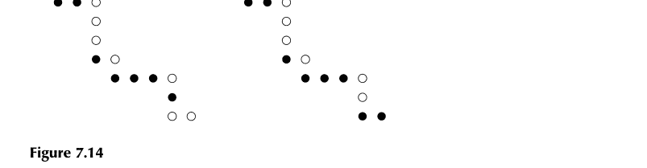

Figure 7.14

图 7.15 说明了 CNF(σ) 的值，即 ⋁_{1≤i≤Σ_{j≤k}p_j} ∧ D_i，按记号 41 定义。它是 k = 3, p0 = 3, n0 = 3, p1 = 1, n1 = 1, p2 = 3, n2 = 2, p3 = 1 且 n3 = 0 的特例。因此 Σ_{j≤k} p_j = 8。集合 D1 到 D8 的表示方式为 D1 位于顶行的中间，D8 位于右下角，按行读取，每行从左到右。对于所有 i ∈ {1,…,8}，D_i 的成员显示为黑色点。

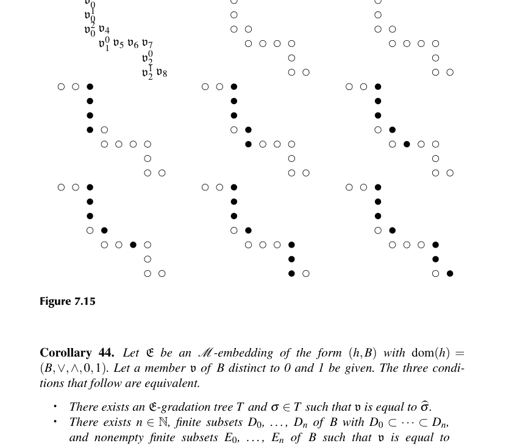

图 7.15

### 推论 44.

设 ℰ 为形如 (h,B) 的 ℳ-嵌入，且 dom(h) = (B,∨,∧,0,1)。设 B 中不同于 0 和 1 的成员 v 给定。以下三个条件等价。

- 存在 ℰ-分级树 T 和 σ ∈ T，使得 v 等于 σ̂。
- 存在 n ∈ ℕ，B 的有限子集 D0, …, Dn 满足 D0 ⊂ ⋯ ⊂ Dn，以及 B 的非空有限子集 E0, …, En，使得 v 等于 ⋁_{i≤n} ∧_{o∈Ei} (Di ∪ {v})。
- 存在 n ∈ ℕ，B 的有限子集 D0, …, Dn 满足 D0 ⊂ ⋯ ⊂ Dn，以及 B 的非空有限子集 E0, …, En，使得 v 等于 ∧_{i≤n} ∨_{o∈Ei} (Di ∪ {v})。

### 例 45.

继续例 43，设图 7.14 和 7.15 进一步说明推论 44。

- 在推论 44 中，DNF(σ) 写成 ∨_{i≤3} ∧_{v∈E_i} (D_i ∪ {v})，其中：
  - D0 = {v0^0, v0^1} 且 E0 = {v0^2, v1, v2}；
  - D1 = D0 ∪ {v3} 且 E1 = {v0^1}；
  - D2 = D1 ∪ {v4, v2^0, v2^1} 且 E2 = {v2^2, v5}；
  - D3 = D2 ∪ {v6} 且 E3 = {v3^0}。
- 在推论 44 中，CNF(σ) 写成 ∧_{i≤3} ∨_{v∈E_i} (D_i ∪ {v})，其中：
  - D0 = ∅ 且 E0 = {v1, v2}；
  - D1 = D0 ∪ {v3, v0^0, v0^1} 且 E1 = {v0^2}；
  - D2 = D1 ∪ {v4} 且 E2 = {v1^0, v5, v6}；
  - D3 = D2 ∪ {v7, v2^0} 且 E3 = {v2^1, v8}。

### 属性 46.

对所有分级树 T 和非空 σ ∈ T，σ̂ ∈ DNF(σ)。

### 7.6 带标签的分级树和图

给定一个 RDR 树和一个案例，使用案例的足够丰富的描述来评估树的某些节点的条件，最终会指向树中的特定节点。该节点旨在与案例的有用信息关联并揭示关于它的有趣且未知的内容。该信息可以是 1 或 0，作为对案例进行分类的方式，让用户知道它是否具有特定属性。它也可以是案例所属类别的名称。这里我们关注前者，即二分类，并留给读者将设置推广到多类分类。

### 定义 47.

给定分级树 T 或分级图 G，T 或 G 的分类器是一个映射，其定义域分别为 T 或 Paths(G)，值域为 {0,1}。

### 定义 48.

分类分级树或图是形如 (S,ℓ) 的二元组，其中 S 分别是分级树或图，且 ℓ 是 S 的分类器。

### 记号 49.

给定 ℳ-嵌入 ℰ、分类 ℰ-分级树 (T,ℓ) 和 ℳ ∈ ℳ，我们令 ℓ⟨ℳ⟩ 表示 ℓ(ρ_T(i))，其中 i ∈ {1,…,|T|} 是使得 ℳ ∈ ℰ(ρ_T(i)) 的最小值。

我们现在形式化分类分级树或图 S 如何产生分类。

### 定义 50.

分类分级树 (T,ℓ) 称为识别公式 φ 当且仅当对所有 ℳ ∈ ℳ，ℓ⟨ℳ⟩ = 1 当且仅当 ℳ ⊨ φ。

### 定义 51.

分类分级图 ℱ 称为识别公式 φ 当且仅当与 ℱ 关联的分类分级树识别 φ。

我们将更详细地研究两种特殊的分类器。第一种分类器对应于在每次例外时在“在类中”和“不在类中”之间切换分类，从其中一个开始，例如：默认情况下，案例在类中，除非此条件，即来自此替代序列的第一个条件成立，在这种情况下案例不在类中，除非此条件，即来自此替代序列的第一个条件成立，在这种情况下案例在类中……这与形式学习理论范式 [7] 中发展的思维变化界限 [8] 的概念有关，尽管在本文开发的更简单的框架中，并不需要无限序数……

### 定义 52.

设分类分级树 (T,ℓ) 给定。若 ℓ⁻¹(1) 是所有包含偶数个形如 (∧,∨) 的对的 σ ∈ T 的集合，或是所有包含奇数个形如 (∧,∨) 的对的 σ ∈ T 的集合，则称 (T,ℓ) 为基于奇偶的，第一种情况默认正，第二种情况默认负。

设分类分级图 (G,ℓ) 给定。若 ℓ⁻¹(1) 是所有长度为奇数的 σ ∈ Paths(G) 的集合，或是所有长度为偶数的 σ ∈ Paths(G) 的集合，则称 (G,ℓ) 为基于奇偶的，第一种情况默认正，第二种情况默认负。

### 属性 53.

设分类分级图 𝓖 给定。则 𝓖 为基于奇偶的当且仅当由 𝓖 确定的分类分级树 𝓕 为基于奇偶的。而且，若 𝓖 为基于奇偶的，则 𝓖 默认正或默认负当且仅当 𝓕 分别默认正或默认负。

第二种分类器对应于仅当评估在没有例外的节点处停止时才将案例分类为在类中，即在评估不可能再继续的节点处。

### 定义 54.

分类分级树 (T,ℓ) 称为基于末端的当且仅当 ℓ⁻¹(1) 是所有 σ ∈ T 的集合，使得 T 不包含形如 σ·((∧,∨)) 的元素。

分类分级图 (G,ℓ) 称为基于末端的当且仅当 ℓ⁻¹(1) 是 Paths(G) 中没有真扩张的成员的集合。

### 例 55.

回顾例 10 中的约定和记号。树 T 唯一定义了一个默认负、基于奇偶的分类 𝔞-分级树。图 7.5 隐式地描绘了它；它可以在图 7.16 中显式描绘。它识别 p⊕q⊕r。

### 例 56.

回顾例 10 中的约定和记号。某些分类 𝔞-分级树识别 p∧q，但其中没有一个是基于奇偶的。

### 证明。

图 7.17 中有两个识别 p∧q 的分类 𝔞-分级树：不难验证，如果 T 是识别 p∧q 的分类 𝔞-分级树，则 T 是其中之一，可能（无用地）扩展，因此 T 不是基于奇偶的。□

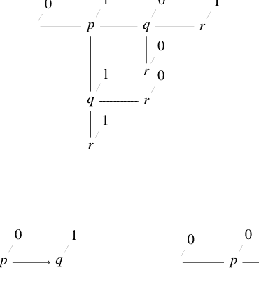

图 7.16

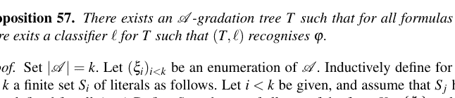

图 7.17

以下结果展示了单个 𝔞-分级树足以对所有公式进行分类的方式。

### 命题 57.

*存在一个 𝔞-分级树 T，使得对所有公式 φ，都存在 T 的分类器 ℓ 使得 (T,ℓ) 识别 φ。*

*证明。* 设 |𝔞| = k。设 (ξ_i)_{i<k} 为 𝔞 的一个枚举。对所有 i < k 归纳定义有限文字集 S_i 如下。设 i < k 给定，并假设对所有 j < i，S_j 已定义。定义 S_i 为所有形如 X ∪ {ξ_i} 的集合和所有形如 X ∪ {¬ξ_i} 的集合，其中：

- X 是 ∪_{j<i} S_j 的一个 ⊆-极大成员；
- ∅ ⊂ Mod_𝔐 (X ∪ {ξ_i}) ⊂ Mod_𝔐 (X)。

设 S 为 ∪_{i<k} S_i 的所有 ⊆-极大成员的集合。设 U 为形如 (i1,…,ip) 的有限序列的集合，其中 0 ≤ p < k 且 0 ≤ i1 < … < ip < k，对于该序列存在一个（必然唯一的）S 的成员 X，使得对所有 i < k，i ∈ {i1,…,ip} 当且仅当 ξ_i ∈ X。现在定义 𝔞-分级树 T 为原子有限序列的 ⊆ 最小集合，使得 T 包含空序列且对所有 σ ∈ T，以下成立。按构造，σ 可以写成 ((𝔞1,ξ_{i1}),…,(𝔞p,ξ_{ip}))，其中 0 ≤ p ≤ k，𝔞_i ∈ {∨,∧} 对所有非零 i ≤ p，且 (i1,…,ip) ∈ U。

- 假设存在 m < k，要么 p 等于 0，要么 p ≠ 0 且 m > i_p，使得 (i1,…,ip,m) ∈ U。则选择最小的整数 m 并将 σ · ((∧,ξ_m)) 添加到 T。

- 假设 $p \neq 0$ 且存在 $m < k$ 使得 $m > i_p$ 且 $(i_1,\dots,i_{p-1},m) \in U$。则选择最小的整数 $m$ 并将 $((\chi_1,\xi_{i_1}),\dots,(\chi_{p-1},\xi_{i_{p-1}}),(\vee,\xi_m))$ 添加到 $T$。

注意存在从 $S$ 到 $T$ 的一一映射 $F$（以及从 $U$ 到 $T$ 的一一映射）。显然，$\{\text{Mod}_{\mathscr{M}}(X) \mid X \in S\}$ 是 $\mathscr{M}$ 的一个划分。而且，不难验证对所有 $\sigma \in T$，$\sigma\mid_T = \wedge F^{-1}(\sigma)$。设 $\varphi$ 为公式。设 $\ell$ 为 T 的分类器，使得对所有 $\sigma \in T$，$\ell(\sigma)=1$ 当且仅当存在 $\mathfrak{M} \in \mathscr{M}$ 使得 $\mathfrak{M} \models \varphi$ 且 $\mathfrak{M} \in F^{-1}(\sigma)$。我们立即由命题 40 以及之前的观察得出 $(T,\ell)$ 识别 $\varphi$，从而完成了命题的证明。

### 例 58.

假设 $\mathscr{A}$ 由 5 个原子 $p_i$ 组成，$0 \le i \le 4$，且 $\mathscr{M}$ 是以下模型集合：

- $p_0 \to p_2$
- $p_1 \land p_2 \to p_3$
- $\lnot p_1 \lor \lnot p_3 \to \lnot p_4$
- $\lnot p_2 \to p_4$

假设 $(p_i)_{i<5}$ 对应于证明中 $\mathscr{A}$ 的枚举 $(\xi_i)_{i<k}$。证明中的集合 $S_0$、$S_1$、$S_2$ 和 $S_3$ 显示在图 58 中，集合 $S_4$ 为空。$S_2 \cup S_3$ 的每个成员在 $\mathscr{M}$ 中对所有 $i < 5$ 逻辑上蕴含 $p_i$ 或 $\lnot p_i$；它们构成了证明中集合 $S$ 的集合。

| $S_0$ | $S_1$ | $S_2$ | $S_3$ | ... 在 $\mathscr{M}$ 中蕴含... |
|---|---|---|---|---|
| $\{p_0\}$ | $\{p_0,p_1\}$ | $\{p_0,p_1,p_4\}$ |  | $p_0 \land p_1 \land p_2 \land p_3 \land p_4$ $p_0 \land p_1 \land p_2 \land p_3 \land \lnot p_4$ |
|  |  | $\{p_0,p_1,\lnot p_4\}$ |  | $p_0 \land \lnot p_1 \land p_2 \land p_3 \land \lnot p_4$ $p_0 \land \lnot p_1 \land p_2 \land \lnot p_3 \land \lnot p_4$ |
| $\{\lnot p_0\}$ | $\{\lnot p_0,p_1\}$ | $\{\lnot p_0,p_1,p_2\}$ | $\{\lnot p_0,p_1,p_2,p_4\}$ | $\lnot p_0 \land p_1 \land p_2 \land p_3 \land p_4$ $\lnot p_0 \land p_1 \land p_2 \land p_3 \land \lnot p_4$ |
|  |  |  | $\{\lnot p_0,p_1,p_2,\lnot p_4\}$ | $\lnot p_0 \land p_1 \land \lnot p_2 \land p_3 \land p_4$ |
|  | $\{\lnot p_0,\lnot p_1\}$ | $\{\lnot p_0,p_1,\lnot p_2\}$ |  | $\lnot p_0 \land \lnot p_1 \land p_2 \land p_3 \land \lnot p_4$ $\lnot p_0 \land \lnot p_1 \land p_2 \land \lnot p_3 \land \lnot p_4$ |
|  |  | $\{\lnot p_0,\lnot p_1,p_3\}$ |  | $\lnot p_0 \land \lnot p_1 \land p_2 \land p_3 \land \lnot p_4$ $\lnot p_0 \land \lnot p_1 \land p_2 \land \lnot p_3 \land \lnot p_4$ |

证明中的树 $T$ 可以如图所示在图 7.18 的左侧描绘。证明中定义的 $U$ 与 $T$ 之间的一一映射可以如图所示在图的右侧描绘。

证明中定义的 $F$，即 $S$ 的成员的合取与 $T$ 之间的一一映射，可以如图所示在图 7.18 的上部描绘。

除了例 60 之外，为说明以下命题，还请参考图 7.6 并将其视为基于奇偶的、默认负的分级图。它是在命题的证明中为以下情况构造的分级图

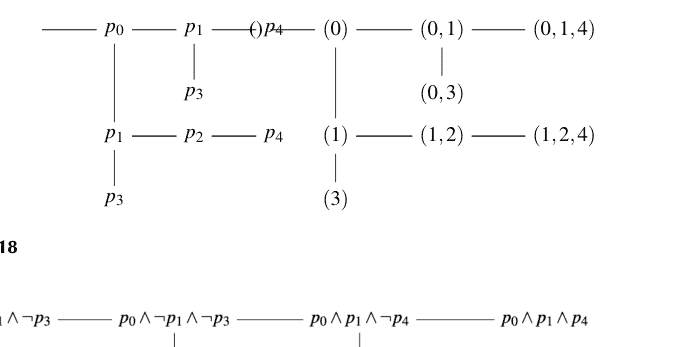

## 图 7.18

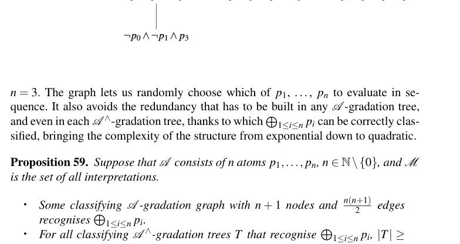

n = 3. 该图使我们能够随机选择按顺序评估 p1,…,pn 中的哪一个。它还避免了必须构建在任何 𝔞-分级树中，甚至在每个 𝔞^∧-分级树中的冗余，从而可以正确地对 ⊕_{1≤i≤n} p_i 进行分类，将结构的复杂度从指数级降低到二次方。

## 命题 59. 假设 𝔞 由 n 个原子 p1,…,pn 组成，n ∈ ℕ\{0}，且 𝔐 是所有解释的集合。

- 某个具有 n + 1 个节点和 n(n+1)/2 条边的分类 𝔞-分级图可以识别 ⊕_{1≤i≤n} p_i。
- 对于所有识别 ⊕_{1≤i≤n} p_i 的分类 𝔞^∧-分级树 T，|T| ≥ 2^n。

证明。设 φ0 = ∧∅ 且 V = {p_i | i < n}。令 E 为所有形如 (p_i, p_j) 的对的集合，0 ≤ i < j ≤ n。显然，如果 ℛ 是 (V,E) 的一个呈现，则对于所有满足 i < j < k 的 i, j, k ≤ n，(i,j) 在 ℛ 中出现在 (i,k) 之前。利用该观察，很容易验证 (V,E)，它具有 n + 1 个节点和 n(n+1)/2 条边，是一个基于奇偶性、默认否定 的分类 𝔞-分级图，可以识别 ⊕_{1≤i≤n} p_i。设 (T,ℓ) 是一个识别 ⊕_{1≤i≤n} p_i 的分类 𝔞^∧-分级树。回顾 Notation 36 中对所有 σ ∈ T 的 σ||_T 的定义。以类似的方式，将每个 σ ∈ T 映射到 S_σ，定义如下。设 S_∅ = ∅。设 σ ∈ T 为非空，并写 σ 为 ((𝔞0, v0),…, (𝔞n, vn))，n ∈ ℕ。设 X = {vn} ∪ {vi | i < n, 𝔞_{i+1} = ∧}。

令 X' 为 X 中的原子集合。定义 S_σ 为 𝔞 的那些成员的集合，它们要么属于 X'，要么是 X \ X' 中某些合取中的合取项。假设为矛盾，存在 S ⊆ 𝔞 使得 S ≠ S_σ 对所有 σ ∈ T。令 𝔐 为解释，使得对所有 p ∈ 𝔞，𝔐 ⊨ p 当且仅当 p ∈ S。我们由命题 40 推断存在 σ ∈ T 使得 𝔐 ⊨ σ ||_T。显然，S_σ ⊂ S。此外，很容易验证对于所有满足 S_σ ⊆ S' 的 S' ⊆ S，如果 𝔐' 是解释，使得对所有 p ∈ 𝔞，𝔐' ⊨ p 当且仅当 p ∈ S'，则 𝔐' ⊨ σ ||_T，故 ℓ⟨𝔐'⟩ = ℓ⟨𝔐⟩，这与假设 (T, ℓ) 识别 ⊕_{1 ≤ i ≤ n} p_i 相矛盾。因此，由于 𝔞 有 2^n 个子集，T 必须至少有 2^n 个元素。

## 例 60。

回顾例 55 中的约定和记号。图 7.16 显示了识别 p ⊕ q ⊕ r 的分类 𝔞-分级树之一。更一般地，存在许多识别 p ⊕ q ⊕ r 的分类 𝔞^∧-分级树。它们不小于前者。图 7.19 显示了三个例子。

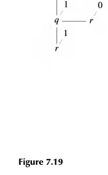

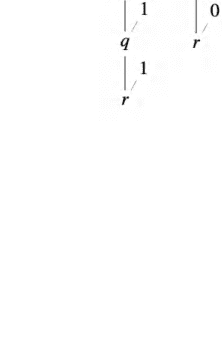

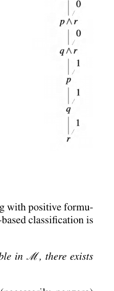

## 图 7.19

下面的命题表明，当处理正公式时，受限于使用最简单的条件，基于端的分类总是可能的。

## 命题 61。

对于所有在 𝔐 中可满足的正公式 φ，存在一个基于端的分类 𝔞-分级树可以识别 φ。

证明。设正公式 φ 在 𝔐 中可满足。设 (必然非零) n ∈ ℕ 为最小的，并设 D₀,…,Dₙ₋₁ 为 ⊆-极小 的原子集合，使得 φ 在 𝔐 中逻辑等价于 ∨_{m<n} ∧ D_m。在不失一般性的情况下，假设

𝓐 = ⋃_{m<n} D_m。设 |𝓐| = k。令 (ξ_i)_{i<k} 为 𝓐 的一个枚举。对所有 i < k 归纳定义有限集合 S_i 的文字集如下。设 i < k 给定，并假设 S_j 已对所有 j < i 定义。定义 S_i 为满足以下条件的 ⊆-极小集合。令 X 为 ⋃_{j<i} X_j 的一个 ⊆-极大成员。

- 对于所有 j < i，若 ξ_j ∈ D_m 则 ξ_j ∈ X；
- ξ_i ∈ D_m。

则 S_i 包含 X ∪ {ξ_i}。如果是这样，假设存在 m' < n 使得：

- 对于所有 j < i，若 ξ_j ∈ D_{m'} 则 ξ_j ∈ X；
- D_{m'} ∩ {ξ_{i+1},...,ξ_{k-1}} ≠ ∅；
- ξ_i ∉ D_{m'}。

则 S_i 也包含 X ∪ {¬ξ_i}。

令 U 为形如 (i_0,...,i_p) 的有限序列的集合，其中 0 ≤ p < k 且 0 ≤ i_0 < ... < i_p < k，对于其存在一个（必然唯一的）成员 X ∈ ⋃_{i<k} S_i，使得对所有 i < k，i ∈ {i_0,...,i_p} 当且仅当 ξ_i ∈ X。现在定义 𝓐-分级树 T 为原子有限序列的 ⊆ 最小集合，使得 T 包含空序列并且对所有 σ ∈ T，以下成立。由构造，σ 可以写成 ((𝔛_1, ξ_{i1}),..., (𝔛_p, ξ_{ip}))，其中 0 ≤ p ≤ k，𝔛_i ∈ {∨,∧} 对所有 0 < i ≤ p，且 (i_1,...,i_p) ∈ U。

- 假设存在 m < k 要么 p 等于 0 要么 p ≠ 0 且 m > i_p，使得 (i_1,...,i_p,m) ∈ U。则选择最小的整数 m 并将 σ·((∧, ξ_m)) 添加到 T。
- 假设 p ≠ 0 且存在 m < k 使得 m > i_p 且 (i_1,...,i_{p-1},m) ∈ U。则选择最小的整数 m 并将 ((𝔛_1, ξ_{i1}),..., (𝔛_{p-1}, ξ_{i_{p-1}}), (∨, ξ_m)) 添加到 T。

注意存在从 ⋃_{i<k} S_i 到 T 的一一映射 F（以及从 U 到 T 的一一映射）。令 S 为 ⋃_{i<k} S_i 的所有 ⊆-极大成员的集合。

- 让我们证明 Mod_𝓐(φ) = ⋃_{X∈S} Mod_𝓐(X)。首先注意以下成立。
1. 对于所有 i < k 和 X ∈ S_i，存在 m < n 使得对于所有 j ≤ i，ξ_j ∈ X 当且仅当 ξ_j ∈ D_m。
2. 对于所有 i < k 和 m < n，存在 X ∈ S_i 使得对于所有 j ≤ i，ξ_j ∈ X 当且仅当 ξ_j ∈ D_m。
3. 对于所有 i < k, m < n 以及 S_i 中形如 X ∪ {ξ_i} 的成员，使得
   - 对于所有 j < i，ξ_j ∈ X 当且仅当 ξ_j ∈ D_m，且
   - X ∪ {¬ξ_i} 不在 S_i 中，
   Mod_𝓐(X ∪ {ξ_i}) ∩ Mod_𝓐(D_m) = Mod_𝓐(X) ∩ Mod_𝓐(D_m)。

将 (2) 应用于 i = k − 1，我们推断 ⋃_{X∈S} Mod_𝔞(X) ⊆ Mod_𝔞(φ)。容易由 (1) 和 (3) 推导出 Mod_𝔞(φ) ⊆ ⋃_{X∈S} Mod_𝔞(X)。因此 Mod_𝔞(φ) = ⋃_{X∈S} Mod_𝔞(X) 如所声称。观察到 {F(X) | X ∈ S} 是 T 中所有 σ 的集合，使得 T 不包含形如 σ · ((∧,∨)) 的元素。因此，为了完成命题的证明，只需检查对于所有 X ∈ ⋃_{i<k} S_i，Mod_𝓐(X) \ Mod_𝓐(φ) ≠ ∅。但这容易由 (1) 以及对 n 和 D0,…,D_{k−1} 的极小性假设得出。

## 例 62。

假设 𝔞 由 9 个原子 p_i 组成，0 ≤ i ≤ 8。假设 𝓜 是所有解释的集合。令 φ 为公式

p0 ∨ (p1 ∧ p2) ∨ (p3 ∧ p4 ∧ p5) ∨ (p3 ∧ p4 ∧ p6) ∨ (p4 ∧ p7 ∧ p8)。

注意定义 D0 为 {p0}，D1 为 {p1,p2}，D2 为 {p3,p4,p5}，D3 为 {p3,p4,p6} 和 D4 为 {p4,p7,p8}，φ 在逻辑上等价于 ⋁_{m<5} ∧ D_m，并且在命题 61 中所做的假设，即 5 是极小且 D_m, m < 5 都是 ⊆-极小，成立。假设 (p_i)_{i<9} 对应于证明中 𝔞 的枚举 (ξ_i)_{i<k}。证明中的集合 S0 到 S8 如图 7.20 所示。更精确地，对于所有 i < 9，集合 S_i 包含在其列中的每个原子，所有在前一列中最后出现的原子，无论在同一行还是在其上方。集合 S 由 S0 的 1 个成员、S2 的一个成员、S5 的两个成员、S6 的 2 个成员以及 S8 的 4 个成员组成。这些集合中的每一个都与 ⋁_{m<5} ∧ D_m 的一个合取项 ∧ D_m, m < 5 相关联，表示在图片的最后一列中。

| S0 | S1 | S2 | S3 | S4 | S5 | S6 | S7 | S8 | 合取项 |
|---|---|---|---|---|---|---|---|---|---|
| p0 |  |  |  |  |  |  |  |  | p0 |
| ¬p0 | p1 | p2 |  |  |  |  |  |  | p1 ∧ p2 |
|  |  | ¬p2 | p3 | p4 | p5 |  |  |  | p3 ∧ p4 ∧ p5 |
|  |  |  |  |  | ¬p5 | p6 |  |  | p3 ∧ p4 ∧ p6 |
|  |  |  |  |  |  | ¬p6 | p7 | p8 | p4 ∧ p7 ∧ p8 |
|  |  |  | ¬p3 | p4 |  |  | p7 | p8 | p4 ∧ p7 ∧ p8 |
|  | ¬p1 |  | p3 | p4 | p5 |  |  |  | p3 ∧ p4 ∧ p5 |
|  |  |  |  |  | ¬p5 | p6 |  |  | p3 ∧ p4 ∧ p6 |
|  |  |  |  |  |  | ¬p6 | p7 | p8 | p4 ∧ p7 ∧ p8 |
|  |  |  | ¬p3 | p4 |  |  | p7 | p8 | p4 ∧ p7 ∧ p8 |

图 7.20

证明中的树 T 可以如图所示 7.21 所示。

我们接下来将注意力转向基于奇偶性的分类。下面的命题表达了只需要一个例外级别，并且合取足够表达这一点。

## 命题 63。

给定公式 φ，存在一个深度至多为 2 的基于奇偶性的分类 𝔞^∧-分级树可以识别 φ。

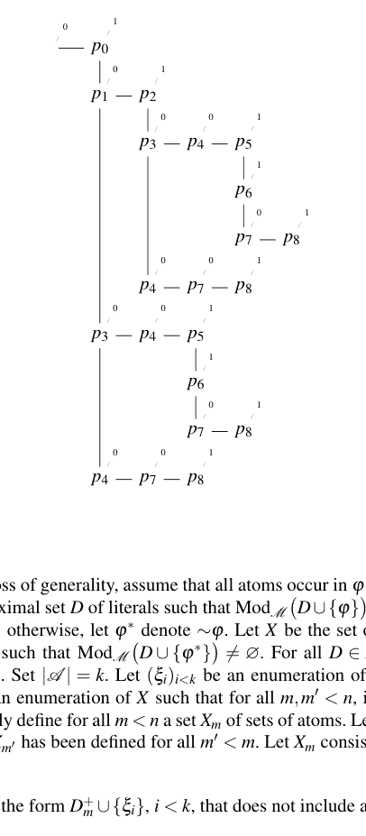

### Figure 7.21

证明。 在不失一般性的情况下，假设 φ 中出现所有原子。 设 φ* 表示 φ，如果对于每一个使得 Mod_A(D ∪ {φ}) ≠ ∅ 的 ⊆-极大文字集合 D，D 包含至少一个原子；否则，设 φ* 表示 ¬φ。 设 X 为所有使得 Mod_A(D ∪ {φ*}) ≠ ∅ 的文字的 ⊆-极大集合 D 的集合。 对于所有 D ∈ X，设 D+ 为 D 中的原子集合。 设 |A| = k。 设 (ξ_i)_{i<k} 为 A 的一个枚举。 设 |X| = n。 设 (D_m)_{m<n} 为 X 的一个枚举，使得对于所有 m,m' < n，如果 D_m^+ ⊃ D_{m'}^+ 则 m < m'。 对所有 m < n 归纳定义原子集合的集合 X_m。 设 m < n 给定，并假设对于所有 m' < m，X_{m'} 已被定义。 设 X_m 由以下组成：
- D_m^+;
- 形式为 D_m^+ ∪ {ξ_i}，i < k，且不包含 ∪_{m'<m} X_{m'} 的任何成员的每个集合。

现在定义 A^∧-分级树 T 为 A^∧ 成员的有限序列的 ⊆-最小集合，关于序列封闭，使得对于所有 m < n，以下成立。 设 p 表示 |X_m| − 1。 在 p > 0 的情况下，设 i_1,...,i_p ∈ N 使得 i_1 < ⋯ < i_p < k 且对于所有 i < k，ξ_i ∉ D_m^+ 且 D_m^+ ∪ {ξ_i} ∈ X_m 当且仅当 i ∈ {i_1,...,i_p}。 则 T 包含
- ((∧, ∧ D_0^+)) 如果 m = 0 且 p = 0;
- ((∧, ∧ D_0^+), (∧, ξ_{i1})) 如果 m = 0 且 p = 1;
- $((\wedge, \wedge D_0^+), (\wedge, \xi_{i1}), (\vee, \xi_{i2}), \dots, (\vee, \xi_{ip}))$ if $m = 0$ and $p > 1$;
- $((\wedge, \wedge D_0^+), (\vee, \wedge D_1^+), \dots, (\vee, \wedge D_m^+))$ if $m > 0$ and $p = 0$.
- $((\wedge, \wedge D_0^+), (\vee, \wedge D_1^+), \dots, (\vee, \wedge D_m^+), (\wedge, \xi_{i1}))$ if $m > 0$ and $p = 1$.
- $((\wedge, \wedge D_0^+), (\vee, \wedge D_1^+), \dots, (\vee, \wedge D_m^+), (\wedge, \xi_{i1}), (\vee, \xi_{i2}), \dots, (\vee, \xi_{ip}))$ if $m > 0$ and $p > 1$.

利用施加于 $(D_m)_{m<n}$ 的条件和 $(X_m)_{m<n}$ 的定义，可以立即断定如果 $\varphi^*$ 是 $\varphi$ 则 $T$ 是一个默认否定、基于奇偶性的分类树，可识别 $\varphi$（这包括 $\varphi$ 在 $\mathscr{M}$ 中不可满足的情况），而如果 $\varphi^*$ 是 $\sim\varphi$ 则 $T$ 是一个默认肯定、基于奇偶性的分类树，可识别 $\varphi$。 显然，$T$ 的深度至多等于 2。 $\square$

## Example 64.

假设 $\mathscr{A}$ 由 3 个原子 $p_0$、$p_1$ 和 $p_2$ 组成。 假设 $\mathscr{M}$ 为所有解释的集合。 设 $\varphi$ 为公式 $(p_0 \wedge \neg p_1) \vee (p_1 \wedge \neg p_2)$。 在图 7.22 左侧，$\varphi$ 求值为 True 的真值表的 4 行，从上到下读出，确定命题 63 证明中集合 $X_m$，$m < 4$，行上为 1 的部分构成集合 $D_m^+$，以及行上每个红色 0（如果有）与形式为 $D_m^+ \cup \{\xi_i\}$ 的较大集合相关联。 在命题证明中构造的识别 $\varphi$ 的默认否定分类树描绘在该图的右侧。

| p0 | p1 | p2 | φ |
|---|---|---|---|
| 1 | 1 | 1 | 0 |
| 1 | 1 | 0 | 1 |
| 1 | 0 | 1 | 1 |
| 1 | 0 | 0 | 1 |
| 0 | 1 | 1 | 0 |
| 0 | 1 | 0 | 1 |
| 0 | 0 | 1 | 0 |
| 0 | 0 | 0 | 0 |

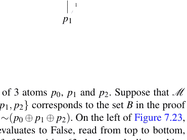

### Figure 7.22

## Example 65.

假设 $\mathscr{A}$ 由 3 个原子 $p_0$、$p_1$ 和 $p_2$ 组成。 假设 $\mathscr{M}$ 为所有解释的集合且 $\{p_0, p_1, p_2\}$ 对应于命题 63 证明中的集合 $B$。 设 $\varphi$ 为公式 $\sim(p_0 \oplus p_1 \oplus p_2)$。 在图 7.23 左侧，$\varphi$ 求值为 False 的真值表的 4 行，从上到下读出，确定命题 63 证明中集合 $X_m$，$m < 4$，行上为 1 的部分构成集合 $D_m^+$，以及行上每个红色 0（如果有）与形式为 $D_m^+ \cup \{\xi_i\}$ 的较大集合相关联。 在命题证明中构造的识别 $\varphi$ 的默认肯定分类树描绘在该图的右侧。

命题 63 的证明表明，确定性对于仅用一层例外实现基于奇偶性的分类是必不可少的。 如果允许非确定性，

| p0 | p1 | p2 | φ |
|---|---|---|---|
| 1 | 1 | 1 | 0 |
| 1 | 1 | 0 | 1 |
| 1 | 0 | 1 | 1 |
| 1 | 0 | 0 | 0 |
| 0 | 1 | 1 | 1 |
| 0 | 1 | 0 | 0 |
| 0 | 0 | 1 | 0 |
| 0 | 0 | 0 | 1 |

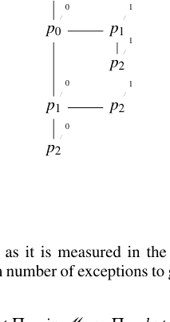

### Figure 7.23

则公式在差分层级中测量的复杂性给出了对分类一个案例时所要经历的最大例外数目的上界。

## Proposition 66.

设公式 φ 在 ℳ 中为 Σ₁,k 但不是 Π₁,k，或在 ℳ 中为 Π₁,k 但不是 Σ₁,k。 则存在某个深度为 k + 1 的基于奇偶性的分类 𝒜^∧-分级图识别 φ，即分别为默认否定或默认肯定。

证明。 在不失一般性的情况下，假设 φ 中出现所有原子。 给定原子有限集合 D，设 \widetilde{D} 表示 D ∪ {¬ψ | ψ ∈ 𝒜 \ D}。 归纳定义有限子集 X₀，…，X_k 的集合以及在 ⋃_{i≤k} X_i 上的二元关系 E，初始时设 X₀ 为 {∅} 且 E 为 ∅。 设 i < k 给定，并假设 X_i 已被定义且 E 已被适当扩展。 对于所有 D ∈ X_i，将 A 的所有 ⊆-极小子集 D' 放入 X_{i+1} 中，使得 \widetilde{D'} ⊨_ℳ φ 当且仅当 \widetilde{D} ⊨_ℳ ∼φ，并用 (∧D, ∧D') 扩展 E。 设 V = {∧D | D ∈ ⋃_{i≤k} X_i}。 可以立即验证 (V,E) 是一个 𝒜^∧-分级图，满足命题的断言。

## Example 67.

假设 𝒜 由 4 个无元原子 p₀、p₁、p₂ 和 p₃ 组成。 假设 ℳ 为所有解释的集合且 {p₀,p₁,p₂,p₃} 对应于命题 66 证明中的集合 B。 设 φ 为公式

( p₀ ∧ ((p₁ ∨ p₂ ∨ p₃) ∧ ∼(p₁ ⊕ p₂ ⊕ p₃)) ) ∨
( ¬p₀ ∧ ((¬p₁ ∧ ¬p₂) ∨ (p₁ ∧ (p₂ ∨ p₃))) ).

图 7.23 左侧显示了 φ 的真值表。 当 p₀，…，p₃ 全部为 False 时，φ 为真，故存在正整数 k 使得 φ 为 Π₁,k 且不是 Σ₁,k。

- {p₀}、{p₁} 和 {p₂} 是 ∅ 的 ⊆-极小超集 D，使得仅使 D 的成员为真会将 φ 的真值从真切换为假。
- (i) {p0, p1, p2}、{p0, p1, p3} 和 {p0, p2, p3} 是 {p0} 的 ⊆-极小超集 D，(ii) {p1, p2} 和 {p1, p3} 是 {p1} 的 ⊆-极小超集 D，以及 (iii) {p1, p2} 和 {p0, p2, p3} 是 {p2} 的 ⊆-极小超集 D，使得仅使 D 的成员为真会将 φ 的真值从假切换为真。
- {p0, p1, p2}、{p0, p1, p3}、{p0, p2, p3}、{p1, p2} 和 {p1, p3} 全部具有 {p0, p1, p2, p3} 作为唯一的 ⊆-极小超集 D，使得仅使 D 的成员为真会将 φ 的真值从真切换为假。

因此 φ 为 Π₁,₃。 图 7.23 右侧显示了在命题 66 证明中构造的分级图，采用了三个简化（证明本可以对这些简化进行完全一般性的形式化，但为建立结果并非必要）：
- 顶点 p0 ∧ p1 ∧ p2 简化为 p1 ∧ p2;
- 顶点 p0 ∧ p1 ∧ p3 简化为 p1 ∧ p3;
- 顶点 p1 ∧ p3 简化为 p3.

| p0 | p1 | p2 | p3 | φ |
|---|---|---|---|---|
| 1 | 1 | 1 | 1 | 0 |
| 1 | 1 | 1 | 0 | 1 |
| 1 | 1 | 0 | 1 | 1 |
| 1 | 1 | 0 | 0 | 0 |
| 1 | 0 | 1 | 1 | 1 |
| 1 | 0 | 1 | 0 | 0 |
| 1 | 0 | 0 | 1 | 0 |
| 1 | 0 | 0 | 0 | 0 |
| 0 | 1 | 1 | 1 | 1 |
| 0 | 1 | 1 | 0 | 1 |
| 0 | 1 | 0 | 1 | 1 |
| 0 | 1 | 0 | 0 | 0 |
| 0 | 0 | 1 | 1 | 0 |
| 0 | 0 | 1 | 0 | 0 |
| 0 | 0 | 0 | 1 | 1 |
| 0 | 0 | 0 | 0 | 1 |

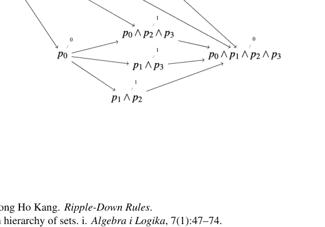

## REFERENCES

- 1. Paul Compton and Byeong Ho Kang. *Ripple-Down Rules*.
- 2. Yu L. Ershov. A certain hierarchy of sets. i. *Algebra i Logika*, 7(1):47–74.
- 3. Yu L. Ershov. A certain hierarchy of sets. ii. *Algebra i Logika*, 7(4):15–47.
- 4. Yu L. Ershov. A certain hierarchy of sets. iii. *Algebra i Logika*, 9(1):34–51.
- 5. Brian R. Gaines and Paul Compton. Induction of ripple-down rules applied to modeling large databases. *Journal of Intelligent Information Systems*, 5(3):211–228.

- 6. Adam Grove. 理论变化的两种建模。 *哲学逻辑杂志*, 17(2):157–170.
- 7. Sanjay Jain, Daniel N. Osherson, James R. Royer, and Arun Sharma. *学习系统：学习理论导论*.
- 8. Sanjay Jain and Arun Sharma. 关于广义的错误界概念。 *信息与计算*, 166(2):156–166.
- 9. Sarit Kraus, Daniel Lehmann, and Menachem Magidor. 非单调推理、优先模型和累积逻辑。 *人工智能*, 44(1):167–207.

## 8 假冒产品与后门开关
硬件安全如何影响你

Hammond Pearce
计算机科学与工程学院，新南威尔士大学
肯辛顿，澳大利亚

### 8.1 假冒产品与后门开关：硬件安全如何影响你

随着数字世界的扩张，针对计算机系统的隐私和运营威胁变得日益普遍。个人信息的泄露频繁发生，关键服务因网络攻击而面临停运。近期备受关注的事件，例如2022年涉及超过900万澳大利亚人医疗数据的Medibank数据泄露，以及2023年悉尼港口系统的中断，凸显了日益增长的危险。虽然大多数关注点仍集中在软件漏洞上，但基于硬件的攻击构成了更严重、往往不可见的威胁。在这里，一个被破坏的电路可能导致关键基础设施停运，或导致飞行器控制系统失效。本章向读者介绍新兴的硬件安全领域，探讨假冒电子产品和硬件木马如何渗透并破坏关键系统。它还讨论了为应对这些阴险风险而正在开发的对策，论证了为何硬件安全在当今世界值得更广泛的关注。

### 8.2 引言：什么是硬件安全？

考虑这个场景。你电脑上有大量照片、视频、文档和其他文件。你需要将这些文件传输到另一台电脑。移动大量文件最简单的方法是什么？当然是外接USB硬盘。

于是，你去当地商店，甚至在线电商。你查看外接硬盘。哇！选择太多了。美国沃尔玛搜索‘USB hard drive’列出282个结果。其中一些由三星制造，一些由希捷制造，一些由西部数据制造，还有许多其他品牌。澳大利亚Target也有超过100个。当你询问亚马逊时，它拒绝列出数量，但可以说这个搜索结果多到需要数周才能浏览完。

那么，你该怎么办？我猜你可以直接买其中任何一个——它们都一样好，对吧？

好吧，很不幸——可能不是。

不必理会其列出的规格，也别管其宣称的品牌名称：不幸的是，计算机电子产品，如同鞋类和儿童产品等许多其他商品，已被大量假冒商品的虚假 listings 淹没。这些劣质商品既令人沮丧（当性能不佳时），也可能危险（当涉及供人类使用或消费的物品时）。尽管受到关注，此类问题一次又一次地出现（例如 [14, 25, 5]）。

这是为什么？为什么如此难以确保我们的产品符合其设计？好吧，部分挑战——除了这个世界上存在不择手段的参与者，他们不断被最低成本获取金钱的动机驱使之外——是根本难以确保现实世界中的某件物品确实就是它声称的那样。如何作为家中的消费者，验证一瓶洗发水确实是由瓶子上写的公司制造的？如何确定带有耐克标志的鞋子来自耐克工厂？同样，你如何确定你想购买的硬盘确实是正品？

假冒伪劣一直是个问题，但只有最近，那些让我们能够买到假硬盘的相同情况也可能导致更具危害性的事件发生。例如，最近的一个例子，考虑BBC报道的“寻呼机袭击”[20]的故事。在这里，在真主党准军事组织发现无法阻止以色列情报和军事部门黑客攻击和追踪其手机后，2024年2月其秘书长哈桑·纳斯鲁拉下令组织成员改用老式、低技术的寻呼机。这些寻呼机随后名义上从全球市场采购。只是—— instead of 收到预期的Gold Apollo型号，真主党收到的却是被以色列摩萨德秘密篡改、内置小型爆炸装置的设备。摩萨德随后对一批同样运往该准军事组织的对讲机重复了这一供应链攻击。

撇开政治不谈，这已超出单纯的假冒。这是一种升级，一种供应链妥协，使设备从具有虚假品牌和为节省成本而删减的功能，转变为被恶意篡改以具备攻击使用者能力的设备。这些被称为硬件木马 [6]，名称源自传说中的特洛伊木马。在故事中，特洛伊木马是一座留给防守城市特洛伊的礼物雕塑，城内将其带入城中，后来才发现里面藏满了希腊士兵（他们随后从内部攻击城市，并为主力军队打开城门）。硬件木马同样具有破坏性，正如这些被破坏的寻呼机和对讲机残酷地证明的那样。2024年9月，摩萨德引爆了两批爆炸装置。最终造成数十人死亡，包括平民和儿童，还有数千人受伤。

尽管如此，这样的物理篡改不必如此极端到实际包含隐藏炸药才能达到预期效果。对于这个由大量互联设备和计算机驱动的现代世界，最令人恐惧的概念之一是，这些设备可能隐藏着“后门开关”，可在攻击者选择的时刻使其无法运行。你可以想象这种能力对网络罪犯极具吸引力：想象一个勒索者打电话给你，而你正乘坐自动驾驶汽车，并威胁要在高速公路上禁用刹车，除非你向他们转账数千美元！

这种能力对国家也很有吸引力。想象一下，如果你的国家能够在外国对手的军事装备中偷偷植入‘后门开关’，战略上会有多大的好处。不过，这里我们不必费力想象——IEEE Spectrum [1] 报道说，这正是2007年9月发生的事情，当时以色列战斗机作为“盒外行动”的一部分，能够隐秘地进入叙利亚领空。当时，人们不明白这些飞机究竟是如何躲避最先进的防御雷达站的。但很快就报道称，针对商用现成微处理器集成电路的供应链攻击已秘密完成，使以色列军方能够干扰雷达功能——即使飞机从上空飞过，雷达仍报告天空晴朗。

那么，什么是硬件安全？

硬件安全试图保护构成我们现实世界计算和通信基础设施的真实芯片、电路和设备。它试图防止假冒攻击，其中低成本的劣质仿制品既影响我们作为生产者的利润，也影响我们的品牌实力。同样，它也试图防止硬件木马攻击的可能性，其中对手旨在将恶意更改偷偷植入我们的设计中，可能破坏其功能或造成现实世界的危害。

我们的计算机系统的安全影响着我们所有人。当我们的私人数据被窃取时，攻击者可以通过以我们的名义开设信用卡来冒充我们，试图从我们的亲友那里骗取钱财，并可能试图掏空我们的储蓄账户。这些攻击可以通过多种方式发生，从泄露的密码到有缺陷的网站。有时它们是由于恶意员工造成的——有时它们可以通过社会工程手段实现，从向毫无防备的受害者发送冷邮件到策略性放置诈骗广告。

大多数人都熟悉软件漏洞的概念——代码中的缺陷或错误，网络罪犯可以利用它们获得未经授权的访问、破坏运营或提取敏感数据。不幸的是，正如我们现在所介绍的，从智能手机到关键基础设施系统，构成我们数字设备的硬件同样容易被破坏。更糟糕的是，与通常可以通过远程修补的软件问题不同，硬件漏洞——如前述的‘后门开关’——可以嵌入物理组件中。这使得它们更难被检测和缓解，特别是如果修复需要更改底层硬件的话。

虽然硬件安全远不止于假冒产品和后门开关这两个主题（多得多！），但本章我们将重点关注这两者。 大多数硬件安全概念都源于相同之处：即对我们设备制造商和供应商的信任错置风险。 这一基础可以为你进入其他感兴趣的硬件安全领域提供一个起点！

因此，本章我们将简要介绍假冒产品和硬件木马攻击为何会发生，以及此类攻击可能带来的后果。 我们将稍作讨论防御措施——特别是设备制造商可以采取哪些措施来尝试保护其产品。 最后，我们将反思硬件安全的未来，以及它未来可能如何继续影响你这位普通读者。

### 8.3 硬件的基础：芯片与电路制造

几乎每一种现代设备内部都蕴含着大量电子元件。 我们的汽车、电视、智能牙刷和手机、蓝牙音箱和无线耳机、键盘和电吉他等等——它们都由数千个微小芯片驱动，也称为集成电路（IC），每个芯片都焊接在更大的印刷电路板（PCB）上。 示例请参见图 8.1。

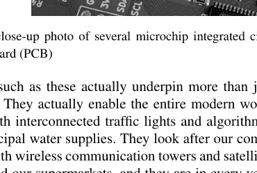

图 8.1 几颗微芯片集成电路（IC）焊接在印刷电路板（PCB）上的特写照片

这种电子产品不仅仅支撑着我们的家庭和个人物品。 它们实际上支撑着整个现代世界。 它们存在于我们的基础设施中，包括互联的交通灯、算法控制的智能电网和市政供水系统。 它们维护着我们的通信和金融市场，包括无线通信塔和太空中的卫星。 它们存在于我们的工厂和超市，也存在于现代军队舰队的每一辆车辆中。 正是这种广泛覆盖，使得它们可能被篡改的概念如此令人不安。

历史上，电子产品和集成电路的开发可以在内部进行。 世界上许多早期的电子设备公司，如 Commodore，都是垂直整合的典范，能够从芯片到电脑生产一切。 然而，在 20 世纪后期和 21 世纪初期，全球制造业趋势发生了转变，外包变得更可行、更有利可图，也更受欢迎。 如今，很少有国家具备大规模内部制造电子设备和组件的主权能力，尽管电子产品的设计仍在内部进行，但现代时代的大多数电子设备和组件目前都在亚洲的大型工厂生产，尤其是在台湾和中国。

设计与制造的分离导致了电子设备极其漫长而复杂的供应链。 设备可能包含来自数十到数百家、遍布不同国家的公司的组件。 供应链同时依赖于集成电路和它们将被焊接到的印刷电路板。 每个 IC 和 PCB 都必须经过规格定义、设计，然后测试。 图 8.2 试图说明该网络复杂性的程度。

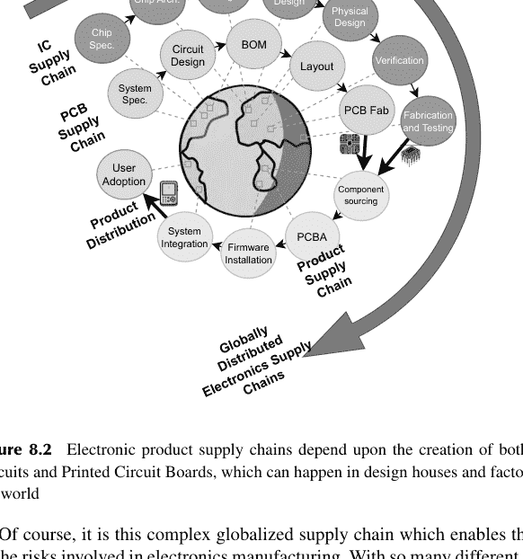

图 8.2 电子产品供应链依赖于集成电路和印刷电路板两者的制造，这些制造可以在世界各地的设计公司和工厂进行

当然，正是这种复杂的全球化供应链促成了电子制造所涉及的大部分风险。 由于单一产品的设计涉及众多不同的公司和员工，因此恶意行为者参与的机会也更多。 这些设备并非像瓶子或锅那样建造的。

印刷电路板首先在软件中设计，使用计算机辅助设计工具，如 Altium、EasyEDA 或 KiCAD。 它们是根据规格设计的，即最终客户需要系统完成的所有功能清单。 PCB 可以包含模拟和数字组件的混合，如电阻器、晶体管和集成电路，它们将根据欧姆定律和基尔霍夫定律等电气规则相互作用。 在此阶段，电路设计师需要从可供选择的组件清单中挑选。 他们可以浏览 Digikey、element14 和 LSCC 等供应商的无限库存。 你可以把它想象成为大型套装寻找完美的乐高积木，或为家中厨房抽屉固定所需的确切尺寸的螺丝。

在设计阶段，电路可以使用 LT-SPICE 和 Proteus 等软件进行仿真。 这可以部分或整体进行，以确保其满足所需的设备规格。 一旦满意，设计师现在就拥有了一份已确认的物料清单（BOM），列出了所有零件及其数量。 他们还拥有一份原理图，描述了各组件如何连接。 工作现在将交给布局设计师，他们将利用这些信息设计实际的物理电路布局，确定每个组件在最终印刷电路板上的实际放置位置，并绘制实际连接每个组件的导线和铜迹。 完成此步骤后可以进行另一轮仿真，满意后，布局和组件位置文件可连同 BOM 一起传递给实际的制造公司。

要实际生产印刷电路板本身，制造工艺按层进行，就像蛋糕一样。 在使用特殊抗蚀材料绘制设计之前，基底层（通常为玻璃纤维）会添加一层薄铜层。 这样在将电路板浸入化学酸浴以蚀刻掉未受保护的铜时，这些区域得以保护，只留下所需的电路走线。 如果电路板有额外的铜层，此过程可在内部绝缘层之后重复——四层和六层板非常流行。 然后，可以为组件钻孔，电路板将被清洁并镀层，并添加阻焊层以保护电路板。 现在它已准备好添加组件！

当然，也有人必须设计 PCB 所依赖的组件。 这通常会在设计之前很久就完成，但在极少数情况下可能与电路板设计并行进行。 对于集成电路，这项工作实际上与前面描述的非常相似，只是规模更小、更微观！ 设计师再次将根据规格工作并设计电路，尽管这里的工具可能看起来大不相同。 像计算机处理器这样的数字逻辑器件更常使用 Verilog 和 VHDL 等硬件描述语言进行设计。 同时，具有模拟组件的芯片可能通过与较大印刷电路板类似的原理图和布局进行设计。 在此阶段，数字和模拟芯片都可进行仿真。

设计阶段完成后，芯片可使用 Synopsys 和 Cadence 等提供的电子设计自动化（EDA）软件合成生产文件。 在这里测试它们的另一种方式称为 *emulation*，其中专用芯片即现场可编程门阵列（FPGAs）可以重新编程以模拟正在设计的芯片。 所有这些测试对于集成电路至关重要，因为生产最终产品通常成本很高，因此需要确保它出厂后能正常工作。 最后，一旦所有硅前验证完成，设计师将把工作移交给制造公司，以物理生产（通常还封装）集成电路。 这些芯片的制造本身就是一个令人难以置信的复杂过程，值得写上十几本书，但简而言之，它通常使用昂贵的光刻机完成，这些机器使用光波将图案转移到硅晶圆基板上。 这些机器高度专业化，生产它们的世界领导者是总部位于欧洲的 ASML 公司。

因此，一旦集成电路（以及电阻器和电容器等支持组件）在全球市场上找到，它们将被购买用于与印刷电路板组装。 这可能发生在生产物理印刷电路板的同一工厂，也可能在不同的设施中稍后进行。 为此，可能需要将许多东西运送到世界各地。 一旦组件与 PCB 一起获得，它们可以手工或机器放置在正确位置，使用焊料作为连接材料。 可以使用烙铁逐个缓慢熔化焊点，也可以用热烤箱或热板一次性完成。

一旦所有这些完成，通常还需要再次进行测试！ 如果电路板需要任何板载软件或固件，它可以在此过程中安装。 最后，印刷电路板可以与它所要进入的产品的其余部分集成。

### 8.4 制造中的硬件木马入侵

上述过程可能被恶意行为者篡改的方式有很多很多。 他们甚至不需要改变电路的很多部分就能实现其险恶目的。 那么电路的入侵可能是什么样子？ 让我们考虑一下集成电路供应链中的恶意行为者能做什么。 这可能是设计师所为，他们在芯片架构的早期阶段插入硬件木马电路，也可能是恶意晶圆厂所为，他们在 IC 制造过程中修改 IC。 这可能涉及添加全新的电路，也可能小到修改单个门。

让我们在这里探讨通用 IC 硬件木马背后的理论。 请考虑图 8.3 所示的电路片段。 这里，我们有四个输入‘Alert1’、‘Alert2’、‘Alert3’、‘Alert4’，它们通过‘OR’门连接，使得只要任一 Alert 信号被触发，输出‘Alarm’信号也会被触发。

你可以想象这个电路可能类似于防盗报警器，如果四个窗户中的任何一个被打开就会触发。 听起来

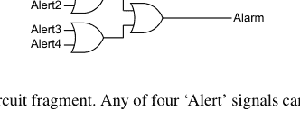

图 8.3 一个数字电路片段。任意四个‘Alert’信号中的一个都可以触发‘Alarm’信号

有用吧？现在，让我们想象如果在电路中添加一个额外的门会发生什么。我们将让这个门有一个额外的输入，我们称之为‘Trojan’输入。我们在图 8.4 中展示了这一点。

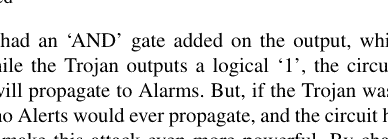

图 8.4 数字电路片段现在有一个 Trojan 输入，用于控制是否“允许”触发 Alarm

该电路在输出端增加了一个‘AND’门，用于组合 Trojan 的信号。只要 Trojan 输出逻辑‘1’，电路将如前所述运行，Alerts 将传播为 Alarms。但是，如果 Trojan 曾经输出逻辑‘0’，则没有任何 Alerts 会传播，电路已被“杀死”！

我们实际上可以使这种攻击更加强大。通过将 Trojan 的‘AND’门改为‘XOR’门，我们可以赋予 Trojan 不仅抑制警报，还能制造虚假的、虚构的警报的能力。我们在图 8.5 中展示了这一点。

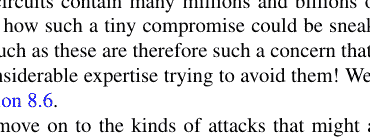

图 8.5 数字电路片段的 Trojan 现在可以‘翻转’Alarm 输出，以在应激活时抑制它，或在不应存在时激活它

鉴于真实电路包含数百万甚至数十亿个这样的逻辑门，很容易想象如此微小的妥协如何能被偷偷塞进设计中。因此，这类硬件木马令人如此担忧，以至于制造商和研究人员投入了大量专业知识来避免它们！我们将在第 8.6 节中稍后讨论此类防御措施。

现在，让我们转向可能在印刷电路板供应链中进行的攻击类型。同样，这些攻击可以通过添加或移除电路组件来实现，但请记住——PCB 比 IC 大得多，这意味着视觉扫描板上任何意外变化要容易得多！事实上，在制造过程中拍摄印刷电路板的照片已经是相当标准的做法，并且将其与发送给制造厂的设计文件进行比较是相对简单的事情。因此，我们可能需要对我们的木马更有创意。我们可以改为基于所用材料的特性。人们可以想象，电路板制造过程可能会使用质量较低的化学浴或比宣传的更薄的铜层，这意味着电路板可能可以工作，但质量会降低或设备寿命会缩短。

更可控的妥协可能发生在制造过程的组装阶段。正如我们之前讨论的那样，这时所有板上组件都被布置好，然后焊接到最终的印刷电路板上。现在我们可以想象，预期的组件可能被替换为不同的设备。事实上，这确实是一条攻击途径，至少根据彭博社有争议的 2018 年关于‘The Big Hack’的报道 [23]。据称，中国情报部门设计并在组件内部插入了一个微小的微芯片，这些组件将被安装到 SuperMicro 服务器主板上，并在安装到客户数据中心后被激活，包括苹果和亚马逊的数据中心。

该芯片比米粒还小，可以访问通过数据线传输的信号。然后它会改变这些信号——在这种情况下，与所谓的‘Baseband Management Controller’的程序内存加载相关的信号，这是一个极其强大的服务器计算机子系统，能够控制服务器的许多其他方面。在这种情况下，木马实际上会插入一个漏洞，使攻击者能够远程登录服务器。

值得注意的是，所有相关公司都强烈否认这些指控，而且攻击是否发生仍然是一个悬而未决的问题。这与攻击理论 somewhat 关系不大，不过此类攻击最终被 Trammell Hudson 在 2018 年德国混沌通信大会上发表的‘Modchips of the State’演讲证明是可行的 [15]。这意味着即使攻击没有发生，至少它本可以发生，这对所有网络安全专业人士来说都应该是一个深切的担忧。

最后，引入硬件木马根本不需要修改设计或破坏制造。美国国家安全局（NSA）的秘密‘Tailored Access Operations’（TAO）部门就寻求进行这种类型的妥协，其中之一。这里，该计划将执行供应链拦截以修改在途硬件 [10]——即在离开工厂后，但在到达最终客户之前，如电子前沿基金会（EFF）托管的泄露报告 [22] 中的图 8.6 所示。

这些修改可以针对软件或固件，但正如 ANT 目录 [3] 后来披露的那样，也有一系列硬件木马可供嵌入。其中包括 COTTONMOUTH-I，这是一种在设计中嵌入假键盘的木马，以便可以

(TS//SI//NF) 涉及供应链拦截的此类行动是 TAO 中最有成效的行动之一，因为它们在全球各地的硬目标网络中预先部署访问点。

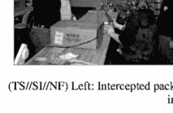

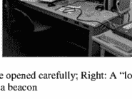

(TS//SI//NF) 左：被拦截的包裹被小心打开；右：一个“装载站”植入信标

图 8.6 来自 [22] 的摘录，展示了 NSA TAO 如何拦截和更改硬件的示例

秘密发出；以及 FIREWALK，这是一种与标准 RJ45 插座相同的设备，但允许远程监控传输的数据。此类妥协也进一步证实了前面讨论的‘Big Hack’的前提，因此似乎实际上存在大量可用于干预计算机硬件的攻击策略。

总结本节的关键要点：计算机硬件不可能凭空出现。集成电路（IC）和印刷电路板都必须经过设计、生产并运送给最终客户，这发生在涉及多个公司和国家的全球化供应链中。我们必须警惕可能在该过程的任何阶段发生的妥协，从恶意内部人员更改原始设计文件，到可能篡改正在建造内容的制造商，最后到能够在物理制品运输途中拦截和修改它们的行动者。

### 8.5 假冒电子产品：风险与发生情况

当然，这些复杂的电子供应链的风险不仅限于篡改，而且鉴于相对成本和给定攻击者感知的收益，普通人遭受篡改的可能性似乎相当低。某些高价值个人和组织可能会成为目标，但总体而言，鉴于此类攻击的报告率相对较低，似乎社会相对安然无恙。

事实上，一种更可能的攻击形式——也是我们作为社会确实看到并必须应对的形式——来自产品假冒。这里典型的威胁行为者是恶意制造商，但他们并不感兴趣修改你的设计。相反，他们的动机是窃取它们。做到这一点的最简单方法是通过‘Overbuilding’，即一家被合同要求生产一定数量产品的工厂反而生产更多。例如，假设你是全新计算机小工具的发明者——比如一个漂亮的新键盘。

恭喜！你认为可以卖出 10,000 个新键盘，于是你联系一家工厂并签订合同生产并运送 10,000 个键盘。然而你不知道的是，该工厂做了自己的市场分析，他们认为可以卖出 20,000 个你的键盘。因此，他们反而生产了 20,000 台，然后自行运送最后的 10,000 台——并把利润、你的利润据为己有！

这只是假冒的一种类型，这是一个黑市行业部门，年价值高达 1000 亿美元 [12]。在其他情况下，设备可以被逆向工程并复制，或者它们可能只是被模仿，通过制造非法带有另一家公司标志的类似产品。这会带来风险，特别是当假冒产品在质量上偷工减料时——当恶意制造商假装成别人时，这通常就是这种情况！毕竟，如果产品过早失效，当没有任何东西可以追溯到你的工厂时，你自己的声誉几乎不会受损。因此，假冒产品通常质量很差。

当它们最终进入安全关键系统时，这可能是一个真正的风险。美国参议院的一项多年调查发现，美国军用车辆中存在超过 1,800 起假冒零件案例，包括运输机、特种作战直升机和侦察机 [2]。他们发现中国供应商生产了数万个假冒的低质量组件，这些组件最终进入军事设备，危及导弹发射和直升机夜视等任务的成功。在某些情况下，这些是在安装后才被发现的，例如在服役飞机中出现故障的 L-3 显示系统中发现了假冒内存芯片。类似的假冒产品也在在线目录中可用的零件中被识别出来（见图 8.7）。

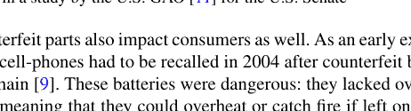

图 8.7 美国 GAO 为美国参议院进行的研究中识别出的示例假冒电子组件（晶体管和集成电路）

假冒零件也会影响消费者。作为一个早期例子，2004 年有 50,000 台 LG 品牌手机因假冒电池进入供应链而被召回 [9]。这些电池很危险：它们缺乏过充保护电路，这意味着如果长时间留在充电器上可能会过热或起火。自那以后，假冒消费电子产品的数量只增不减。在一次查获中，费城的美国海关边境保护局特工在 2023 年查获了数百个假手机屏幕组件 [8]，同样，美国国土安全调查局和海关边境保护局特工在 2021 年在世界贸易大桥查获了价值 1470 万美元的假冒电子设备、玩具和家具 [16]。

另一种假冒类型来自旧的、回收组件的重复使用或重新包装。这里，你可以想象一个产品可能已经达到其使用寿命的终点，因此被送往处置设施，该设施可能会拆解

将其拆分为其零件。其中一些可以合法地重复使用，这是一件好事！不必要的产品浪费是不可取的。然而，当二手零件被出售时，它们应被明确标明为此类情况，但并非总是如此。二手零件的寿命比新产品短，这意味着它们通常必须以折扣价出售——在财务上激励恶意卖家撒谎。在严重情况下，他们甚至可能会清洁、重新编号或重新包装设备，使其看起来是新生产的。这就是在上述美国军事假冒案件中的情况，包括一个实例，其中使用过的 Xilinx FPGA 被重新出售为全新产品，然后安装在美国海军 P-8A Poseidon 飞机上 [28]。

像硬件木马一样，假冒产品因此是对我们电子设备安全性的风险和威胁。虽然也许没有故意引入设计为恶意的电路那么蓄意，但性能不佳且过早失效的缺陷组件同样很容易造成现实世界的危害。

不幸的是，很难检测给定组件是否假冒，特别是如果它们是被非法回收的原装零件。鉴于电子供应链的复杂性，组件只需发挥足够好的功能以通过它们可能接受的基本测试——这些测试旨在剔除缺陷零件，而不是假货。一些假冒零件在视觉上可疑，或可通过 X 射线或电子显微镜等扫描来识别，以显示芯片内部与预期不符。如果重新贴标使用了低质量材料（例如油漆），则可通过简单的化学测试来识别（例如使用丙酮显示原始标记）。其他更全面的假冒产品可能需要更复杂的测试——例如，芯片的年龄和等级会改变晶体管性能，这意味着电气测试可以显示芯片可疑地性能不足。

解决过度制造要困难得多，这是本节提出的第一个挑战。在这里，组件将完全按照其规格执行，因为它们可能是由原始工厂和生产线制造的。如前所述，非法制造商仍可在此获得财务收益，只需避免向原始设计者支付许可费即可。

这种过度制造问题凸显了现代制造中的一个根本挑战：信任。当知识产权（IP）与制造商共享时，尤其是海外制造商时，对该 IP 使用方式的边界变得难以执行。拥有生产高质量、正品组件的专业知识和设备的工厂同样可以轻松生产未经授权的额外产品或与竞争对手分享专有设计。这创造了一个生态系统，其中假冒和过度制造的零件几乎与合法产品无法区分，但它们通过未经授权的渠道进入市场，侵蚀消费者信心并削弱合法企业。

假冒问题超出了对系统或用户的直接风险——它还具有深远的经济影响。假冒商品的存在削弱了正品的市场，并可能通过损害在研发上投入大量资金的合法制造商来阻碍创新。此外，假冒组件的财务影响通常超出了更换缺陷零件的范围。它包括调查故障、召回产品以及可能处理诉讼或监管处罚的成本。

### 8.6 硬件安全：防御 IC 和 PCB

看起来保护免受硬件木马和性能低下的假冒产品的明显方法是**测试**，即简单地取可疑的 IC 或 PCB，看看其性能如何。然而，虽然商业电子制造商可以并且确实测试芯片和电路以查看其性能，但他们通常负担不起测试所有内容，因为对于给定设计而言，可能存在近乎无限的未指定事项。相反，他们将专注于测试已知功能。例如， destined for a cellphone 的组件可能会接受能量发射测试和硬件在环功能测试。但是，不干扰正常功能的额外电路，或可能因老化而过早失效的电路，可能不会在这些测试中显示出来 [1]。

其他测试，例如‘去封装’集成电路并在扫描电子显微镜下检查它，可以揭示硅设计是否存在意外的变化。但是，此过程涉及逐层研磨芯片——在过程中将其破坏。这意味着你可能验证了你测试的芯片，但不一定能验证你从批次中获得的任何其他芯片。当攻击策略可能是破坏少量随机零件以最大限度地降低被检测到的机会时，这可能是一个难以接受的假设。此外，该策略还假设你能够将实际芯片映射到你的设计文件——对于具有可能数亿个内部晶体管的 IC，这可能是一个非常困难的要求。它还意味着你必须信任设计文件本身！请记住，你的芯片在从设计到实现的过程中可能会经过多个阶段，并且在每个阶段设计的形式都不同，例如硬件描述语言（代码）、网表或布局形式。

另一方面，印刷电路板可以根据其设计文件更直接地进行验证。这是因为所有事情都在物理上更大的尺度上发生。尽管如此，与集成电路一样，PCB 可以有多层，如果内部层发生变化，就需要依赖 X 射线等扫描来穿透材料。或者，电气测试可以验证哪些走线连接到哪些其他走线，并且可能还能识别出某个单独电路是否以某种方式被篡改（例如改变走线宽度以改变电路的特性阻抗）。然而，这些方法只能做到一定程度，再次，破坏性测试可能是确定给定 PCB 是否可信的唯一途径。

然而，有一个解决方案。假设给定产品——无论是 IC 还是 PCB——可能是不可信的。我们有几个这样的产品，我们知道可以最终证明它们是否可信，但这必须以破坏性的方式进行，例如通过去封装。我们可以做的是对所有样本进行大量所谓的 *侧信道* 测量。这在图 8.8 中有所描述。

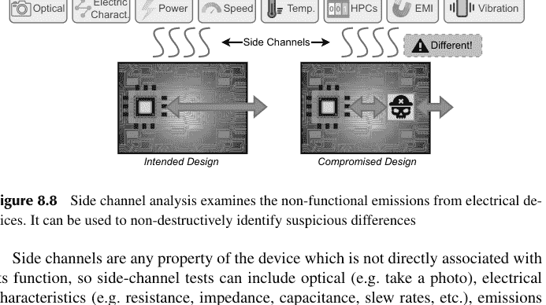

图 8.8 侧信道分析检查电气设备的非功能性发射。它可用于无损地识别可疑差异

侧信道是与设备功能没有直接关联的任何属性，因此侧信道测试可以包括光学（例如拍照）、电气特性（例如电阻、电抗、电容、转换速率等）、发射（例如操作期间产生的电磁干扰波）、热量（组件升温时的温度变化）、振动和声学（如果有运动部件）、反应时间和时钟频率（设备运行速度有多快）、功耗（它使用多少能量）等等。某些设计甚至可能包括‘硬件性能计数器’（HPCs），一种可以记录事件发生实例的内部电路——更常用于功能测试，它们提供了另一种表征电路的方式。假设所有产品都有相似的测量值，我们现在可以仅对其中一个样本进行破坏性测试。然后，如果我们证明该样本安全，其他每个样本也应同样安全。否则，如果样本确实存在偏差，则可疑，应进行更彻底的测试。例如，定时测量被用于检测基于工业控制器的 PCB 中由木马引入的偏差 [21]。

另一种防御方法，可与侧信道分析结合使用，是对给定产品执行 *拆分制造* [13]。更常用于集成电路，拆分制造可防止过度制造，并大大复杂化添加复杂硬件木马的过程。在这里，构建给定 IC 的过程被分为两个过程，将在两个不同的晶圆厂进行，最好由两家不同的公司拥有。这防止任何一家制造商拥有完整的设计文件以进行破坏或抄袭。当然，拆分制造并非万灵药，某些攻击仍可克服这一复杂性 [29]。

IC 的另一种防御方法称为逻辑混淆或 *逻辑锁定*。这是一种操纵给定电路以添加密钥输入的技术。该输入旨在确保整体电路只有在提供正确的密钥值时才能正确运行。同时，应该很难弄清楚该密钥值！逻辑锁定是一个庞大的主题，有兴趣的读者应查阅 Kamali 的最新综述 [17]。

A simpler version of logic locking is known as IC metering [18]. This is a class of hardware security protocols that enables the designer to track the number of chips produced from the same mask and remotely activate only the desired number. This can be done in a few different ways, but one straightforward method is to have chips generate a unique signature based on a *物理不可克隆函数*. This signature needs to then be combined with a cryptographic key in order to enable the circuit to function – because the signature is unique; so too will the unlocking key.

Related to this idea, both ICs and PCBs might be able to be secured against counterfeiting by adding similar attestation devices to the products. Here, special encrypted components are added to a given design. One example of these is found in modern Windows-based computers, known as trusted platform modules (TPMs) [4]. This can provide a variety of security benefits, from storing passwords safely to ensuring that the electronic components in the computer motherboard are authentic. Of course, no implementation is perfectly correct, and a variety of attacks exist, including leveraging side-channels for a timing-based analysis attack [19] (unfortunately, side channel analysis can work both ways!).

A simpler defence technique, though not one that provides much protection, is to embed covert watermarks as design attributes inside hardware. These can be like icons and logos, or might be more subtle, such as an unusual and inefficient circuit trace. Watermarking is performed to provide evidence of ownership of a given circuit or IC layout.

Each of these solutions come with their own complexities and costs. Anything based on cryptographic tags or keys can be overcome if the key management is weak or compromised. Most defences still rely at least in part on the trustworthiness, honesty, and vigilance of individual actors in the supply chain.

Sometimes, the globalised and complex nature of the supply chain can itself be its own enemy. Any local or wide-scale shut-down of any of the geographic areas or companies which electronics manufacturing relies on can have disproportionate impact. The major example of this, of course, comes from the 2019-2020 Coronavirus pandemic COVID-19. Here, like many other sectors, the electronics supply chain was catastrophically disrupted, causing production lines to shut down and air and sea freight to dramatically cut capacity [31]. This resulted in shut downs and delays across the entire electronics sector, including Apple having to postpone deliveries of its new products, and Samsung and LG shutting down production. Overall, the Covid Chip Shortage had a huge impact on the automotive sector in particular, with Tesla, Volkswagen, Toyota, Fiat Chrysler, Nissan and Daimler all shutting factories or reducing production [30]. Access to in-demand chips and electronics became restricted via brokers, and manufacturers could pay more than eight times the pre-COVID value when items were eventually sourced. The consequences of these shortages were, naturally, a further explosion of counterfeits and illicit second-hand components.

This highlighting of the fragile nature of the supply chain, and increasing attention on possible hardware hacks, is now encouraging a return to sovereign electronics manufacturing worldwide, particularly considering the production of Integrated Circuits. In the U.S., the CHIPS act included billions of dollars for companies to build new Integrated Circuit manufacturing plants within the country [26]. This aims to boost both national security as well as spur national R&D. Similar legislation was also passed in the European Union [24] and United Kingdom. Even non-powerhouses such as Australia are also considering on-shoring some microchip manufacturing capability [7]. Combined with design defences such as those outlined in this chapter, such on-shoring may boost the trust within IC manufacturing.

### 8.7 结论性说明

When considering the cybersecurity of a given computer system, much attention is placed on the software involved in that system. However, the security of the hardware that builds up each computer should be considered of equal importance. In general, we need to trust that our hardware will be designed and implemented according to our specifications, and will not include components and circuits we don’t desire! However, in this chapter we discussed how such hardware can in fact be compromised, either deliberately through the insertion of hardware Trojans or as a side effect of underperforming counterfeit parts.

In general, the global nature of electronics manufacturing means that it is difficult to ensure trust in the supply chain. Individual actors can compromise systems passing through their hands, from malicious manufacturers to governments with the power to intercept shipments in progress.

There are defences to these kinds of breaches. Traditional enforcement of intellectual property rights often depends on cooperation between countries with vastly different regulatory and legal frameworks, which can make legal recourse both slow and uncertain. Technical defences therefore include making our circuits difficult to compromise or copy by using techniques such as logic obfuscation, IC metering, and watermarking; and we can insert components like trusted platform modules to provide attestation that a given circuit is trustworthy. We can also use side-channel analysis, including power and timing measurements as well as visual checks to monitor our designs to make sure they appear to be operating with normal characteristics. This allows us to detect if a given circuit is suspiciously misbehaving.

Of course, this chapter only provided the smallest introduction to Hardware Security. Though we briefly introduced how side channels can be used for defence, we did not present the universe of side channel attacks, whereby those same emissions are leveraged to steal data and secrets. Likewise, we did not present much detail on IP piracy, where malicious manufacturers might only steal part of a design, rather than a whole chip. We did not present many techniques on testing, including hardware fuzzing, as well as test-oriented attacks such as those based on JTAG and scan chains. Finally, we also didn’t in any detail cover the materials security side of things: hardware depends on physical inputs such as rare earth elements and chemicals, and these can likewise be tampered with to cause downstream effects.

Interested readers can find many of these details in other resources, such as the recent book ‘Hardware Security’ [27] and its predecessor [6].

## 参考文献

- 1. Sally Adee. 《寻找杀戮开关》。*IEEE Spectrum*，2008 年 5 月。
- 2. Tara Andringa 和 Brian Rogers. 参议院武装部队委员会发布关于假冒电子零件的报告。技术报告，U.S. Senate Committee on Armed Services，2012 年 5 月。
- 3. Jacob Appelbaum, Judith Horchert, and Christian Stöcker. 目录显示 NSA 对众多设备设有后门。*Der Spiegel*，2013 年 12 月。
- 4. Will Arthur, David Challener, and Kenneth Goldman. *TPM 2.0 的实用指南：在安全新时代使用新的可信平台模块*。Springer Nature, 2015.
- 5. Jason Aten. Walmart 网站正在销售假冒产品。更糟糕的是，它还在 Instagram 上宣传它们，2023 年 10 月。
- 6. Swarup Bhunia and M Tehranipoor. *硬件木马战争*。Springer, 2018. 出版社：Springer。
- 7. Alex Capri and Robert Clark. 澳大利亚半导体国家登月计划。技术报告 63/2022，Australian Strategic Policy Institute，2022 年 9 月。
- 8. USA CBP. 费城 CBP 官员查获 648 件假冒三星智能手机数码屏 | U.S. Customs and Border Protection，2023 年 3 月。
- 9. USA CPSC. CPSC、Verizon Wireless 宣布召回假冒手机电池。技术报告 Recall 04-559，2004 年 6 月。
- 10. Sean Gallagher. NSA“升级”工厂的照片显示思科路由器被植入，2014 年 5 月。
- 11. US GAO. DoD 供应链 | 可疑假冒电子零件可在互联网采购平台上找到。技术报告 GAO-12-375，2012 年 2 月。
- 12. Gilberto Garcia-Vazquez. 电子行业的假冒零件问题 | MacroFab，2023 年 1 月。
- 13. Siddharth Garg and Jeyavijayan (JV) Rajendran. 分割制造。收录于 Domenic Forte, Swarup Bhunia, and Mark M. Tehranipoor, editors, *通过混淆实现硬件保护*，第 243–262 页。Springer International Publishing, Cham, 2017.
- 14. Eli Greenblat. Target 因销售假冒化妆品被美国巨头起诉。*The Sydney Morning Herald*，2012 年 9 月。
- 15. Trammell Hudson. 国家的改装芯片，2018 年 12 月。
- 16. USA ICE. HSI、CBP 在南德克萨斯世界贸易大桥查获价值 1470 万美元的假冒电子产品 | ICE，2021 年 3 月。
- 17. Hadi Mardani Kamali, Kimia Zamiri Azar, Farimah Farahmandi, and Mark Tehranipoor. 逻辑锁定进展：过去、现在与展望，2022。出版信息：预印本。轻微修订。
- 18. Farinaz Koushanfar. 硬件计量：综述。收录于 *硬件安全与信任导论*，第 103–122 页。Springer, 2011.
- 19. Daniel Moghimi, Berk Sunar, Thomas Eisenbarth, and Nadia Heninger. TPM-FAIL：TPM 遭遇时序与格攻击。收录于 *第 29 届 USENIX 安全研讨会 (USENIX Security 20)*，第 2057–2073 页。USENIX Association, August 2020.
- 20. Matt Murphy and Joe Tidy. 真主党寻呼机和对讲机：它们是如何爆炸的，谁干的？*BBC News*，2024 年 9 月。
- 21. Hammond Pearce, Virinchi Roy Surabhi, Prashanth Krishnamurthy, Joshua Trujillo, Ramesh Karri, and Farshad Khorrami. 使用侧信道回环检测 PCB 中的硬件木马。*IEEE Transactions on Very Large Scale Integration (VLSI) Systems*，30(7):926–937，2022 年 7 月。会议名称：IEEE Transactions on Very Large Scale Integration (VLSI) Systems。

- 22. Redacted. (U) 隐秘技术可破解 SIGINT 的部分最难目标。技术报告，由电子前沿基金会 (EFF) 主办，2010 年 6 月。
- 23. Jordan Robertson 和 Michael Riley. 《大黑客： 中国如何利用微小芯片渗透美国公司》。Bloomberg.com，2018 年 10 月。
- 24. Toby Sterling. 行业团体负责人称欧盟芯片法案 2.0 应包含传统芯片。Reuters，2024 年 11 月。
- 25. Ganda Suthivarakom. 欢迎来到假冒产品的时代。The New York Times | Wirecutter，2020 年 2 月。
- 26. Ana Swanson. 《CHIPS 法案关乎的不仅是芯片：其中包含的内容》。The New York Times，2023 年 2 月。
- 27. Mark Tehranipoor, Kimia Zamiri Azar, Navid Asadizanjani, Fahim Rahman, Hadi Mardani Kamali, 和 Farimah Farahmandi. 《硬件安全：展望未来》。Springer Nature Switzerland，Cham，2024 年。
- 28. John Villasenor 和 Mohammad Tehranipoor. 《拆解店电子产品的隐藏危险》。IEEE Spectrum，2013 年 9 月。
- 29. Yujie Wang, Pu Chen, Jiang Hu, 和 Jeyavijayan (JV) Rajendran. 分片制造中的猫鼠游戏。载于《第 53 届年度设计自动化会议论文集》，DAC ’16，第 1–6 页，美国纽约，2016 年 6 月。Association for Computing Machinery。
- 30. Xiling Wu, Caihua Zhang, 和 Wei Du. 汽车行业“芯片短缺”危机的分析——基于 COVID-19 和贸易摩擦的双重影响。《Journal of Physics: Conference Series》，1971(1):012100，2021 年 7 月。出版商：IOP Publishing。
- 31. Zhitao Xu, Adel Elomri, Laoucine Kerbache, 和 Abdelfatteh El Omri. COVID-19 对全球供应链的影响：事实与观点。《IEEE Engineering Management Review》，48(3):153–166，2020 年。会议名称：IEEE Engineering Management Review。

Taylor & Francis
Taylor & Francis Group
http://taylorandfrancis.com

## Index
- 学术诚信, 50
- 问责制, 22
- 美学, 59
- AirBnB, 62
- 论证, 4
- 亚里士多德, 7
- 增强现实, 52, 76, 81, 90
- 自动驾驶汽车, 9
- 自主武器, 22, 24
- 自主性, 21
- 头像, 77, 78
- 信念修正, 118, 120
- 偏见, 12, 16, 17, 21
- 生物学上原初知识, 101
- 生物学上次级知识, 101
- 区块链, 77
- 布尔代数, 124
- 有界分配格, 124
- 泄露, 154
- 碳排放, 26
- 定言命令, 6
- ChatGPT, 39, 48
- 分类, 18
- 分类器, 142
- 分类分级图, 142
- 分类分级树, 142
- 点击流数据, 48
- 气候紧急状态, 25
- 认知负荷理论, 65, 99, 100
- 认知负荷的降低, 89
- 认知心理学, 64
- 协作学习, 65
- 复杂性理论, 120
- 连接课堂, 51
- 建构主义, 66
- 合同作弊, 48, 50
- 收敛训练, 78
- 情感投入, 89
- 情绪, 7
- 伦理原则, 10
- 伦理学, 3
- 伦理抨击, 29
- 伦理漂绿, 28, 29
- 欧盟人工智能法案, 27
- 专长反转效应, 105
- 指数复杂性, 120
- 扩展现实, 36, 52
- 掠夺性开采, 29, 30
- 外在认知负荷, 89, 103
- 外在负荷, 99
- 外在动机, 46
- 人脸识别, 14
- 公平性, 15, 17–19, 21
- 女权主义数据集, 31
- 少样本学习, 43
- 飞行模拟器技术, 53
- 形式学习理论, 118, 120, 142
- 游戏设计, 67, 68
- 游戏化, 40, 46
- Gemini, 39
- 性别偏见, 16
- 生成式 AI, 41, 48
- 相关认知负荷, 103
- 分级图, 126
- 分级树, 127, 138
- 格罗夫球体系统, 122
- 指导淡出效应, 106
- 硬件防御, 157
- 硬件描述语言, 159
- 硬件模糊测试, 169
- 硬件性能计数器 (HPCs), 167
- 硬件安全, 154, 156
- 硬件木马, 154, 155, 160, 166
- 硬件漏洞, 156
- 基于硬件的攻击, 154
- 启发式, 99
- 高等教育, 36
- 人类创造力, 71
- 人体运动效应, 105
- 混合学习, 51
- IC 计量, 168
- 游戏设计中的构思, 69
- ImageNet, 31
- 沉浸式技术, 76
- 信息处理, 103
- 集成电路, 157
- 交互设计, 99
- 界面设计, 100
- 内在认知负荷, 102
- ISO, 28
- 以色列摩萨德, 155
- 交战正义, 22
- 战时正义, 22, 23
- 康德伦理学, 5
- 键盘记录, 48
- 终止开关, 156
- 知识获取, 118
- 知识表示, 118
- 排行榜, 47
- 学习分析, 45, 48
- LLM, 36, 41
- 逻辑锁定, 167
- 长时记忆, 99
- 机器学习, 17
- 创客运动, 66
- 以创客为中心的学习, 66
- 创客空间, 66
- 创客空间, 67
- 材料安全, 169
- MATHiais, 44
- 医学, 11
- 元宇宙, 76, 77, 86
- 教育中的元宇宙, 79
- 大学教育中的元宇宙, 84
- 军事装备, 164
- 军事训练, 78
- 思维改变界限, 142
- 模态效应, 104
- MOOCs, 39
- 多模态 AI, 42
- 国家安全局 (NSA), 162
- 自然主义, 5
- 否定范式, 121
- Nielsen, Jacob, 100
- 非指数复杂性, 120
- 非确定性, 120, 150
- 非单调推理, 120
- 规范伦理学, 3
- 在线教育, 38
- 在线监考, 49
- 在线监考, 49
- Overbuilding, 163
- 过度建设, 165
- 分页器攻击, 155
- 参与漂绿, 30
- 个人信息, 154
- 试玩测试, 68
- 可能世界, 124
- 权力, 31
- 硅前验证, 160
- 预测分析, 45
- 孕期护理, 59
- 规范伦理学, 3
- 区辨原则, 23
- 人道原则, 23
- 比例原则, 23
- 隐私, 48, 154
- 程序性学习, 89
- 产品假冒, 163
- Queer in AI, 30, 31
- 种族偏见, 17
- 理性, 20
- RDR 树, 118
- 冗余效应, 104
- 强化学习, 43
- 负责任的 AI, 10
- Ripple Down Rules (RDR), 118
- Robodebt, 32
- 死记硬背学习, 63
- 安全关键系统, 164
- 模式, 101
- 自动驾驶汽车, 156
- 设计与制造分离, 158
- 性, 14
- 侧信道分析, 167
- 侧信道测试, 167
- 侧信道, 166
- 仿真, 79, 86
- 社会联系, 78
- 社会评分, 15
- 软技能, 65
- 软件漏洞, 154
- 分割注意效应, 103
- 分片制造, 167
- 结构化问题解决, 60
- 风格检测, 48
- 供应链攻击, 156
- 测试导向攻击, 169
- 拓扑, 120
- 瞬态信息效应, 104
- 透明度, 11, 25
- 透明度漂绿, 29
- 遍历能力, 69
- 树节点, 119
-  trolley problem, 5
- TurnItIn, 48
- 新南威尔士大学, 43
- 功利主义, 4
- UX 设计, 100
- 虚拟课堂, 79
- 虚拟现实, 52, 76, 90
- 虚拟世界, 78
- 美德伦理学, 7
- 语音识别, 50
- 水印, 168
- 棘手问题, 59
- 工作记忆, 99
- XR, 52
