# 计算机科学和数学中的模糊逻辑概念


### 关于编辑


**拉胡尔·卡尔**

*印度西孟加拉邦纳迪亚县卡利亚尼学院数学系国家资助教师*

拉胡尔·卡尔正在布尔旺大学攻读纯数学博士学位，目前担任卡利亚尼学院（印度西孟加拉邦纳迪亚县）SACT-II 数学教员。他曾担任古鲁·纳纳克理工学院及其他两所学院的客座教员。

总计，他有 5 年的教学经验。他发表了 10 多篇被 Scopus 收录的研究论文。他还担任了四本国家级和国际期刊的编辑，以及五本国际期刊的审稿人。他正在编辑两本数学书籍。他是印度数学学会的年度会员，也是塞内加尔达喀尔卡梅尔研究所的名誉会员。他作为论文演讲者参加了 10 多场国际会议和研讨会。


**阿扬·乔杜里**

*印度北方邦加齐阿巴德 BioTech Sphere Research 首席科学顾问*

阿扬·乔杜里是印度 BioTech Sphere Research 的首席科学顾问，是医疗和科技领域的杰出人物，以开创性贡献和创新领导力而闻名。他曾任 Niji HealthCare Pvt Ltd 的研究主管，在利用革命性技术（包括人工智能、深度学习、物联网、认知技术和区块链）重塑医疗行业方面展示了无与伦比的专业知识。凭借对卓越的不懈追求，他作为思想领袖留下了不可磨灭的印记。他的广泛作品包括发表在享有盛誉的国际期刊上的关于公共卫生和数字健康具有影响力的学术论文。他的研究重点在于物联网和传感器技术的整合，用于通过一次性监测和动态监测高效收集数据。他是众多国际和国内会议的主要演讲嘉宾，担任 CRC 出版社丛书系列编辑以及多本生物医学科学书籍的编辑。他为著名期刊的特刊担任客座编辑，进一步体现了他对推进科学知识的奉献精神。值得注意的是，他目前正在受尊敬的期刊《EAI 认可的人工智能与机器人事务》（EAI Endorsed Transactions on AI and Robotics）的特刊中担任客座编辑，并加入了《生物医学科学与临床研究》（Biomedical Science and Clinical Research, BSCR）的编辑委员会。因其卓越的贡献，他获得了由 Business Connect 颁发的“2022 年医疗技术领域最具启发性的年轻领袖”等尊贵奖项。他的影响力延伸至今任多个国际科学协会的资深会员，展示了他在该领域的影响。最近，他被任命为 ACM 专业章节的主席，并被提名担任 ACM 美国技术政策委员会（USTPC）人工智能与算法部门的成员。

除此之外，他还被任命为 2024–2025 任期 IEEE 机器人与自动化学会的技术委员会成员。此外，他被选为国际学术与科学发展组织（IOASD）的常规会士，并被接纳为国际碳捕获协会（MIACC）的成员。作为 IEEE 消费系统与健康福祉（CSH）技术委员会成员，他的影响力进一步扩大。


**贡詹·穆克吉，博士**

印度西孟加拉邦加尔各答 Brainware 大学计算科学系副教授

贡詹·穆克吉博士目前在印度加尔各答 Brainware 大学计算科学系担任副教授。他的研究兴趣包括计算机视觉、机器学习、软计算、图像处理等。他是多个组织的终身会员，并在不同的期刊和国际会议上发表了多篇论文。穆克吉博士还指导了许多 BTech 和 MCA 学生完成他们的课题和研究工作。他还独立编写了学校计算机教科书系列（3 至 10 年级）以及针对工程学生的 IT 系统理论教科书


他目前正在撰写一本关于Python技术的著作（即将出版）。他目前受雇于一家知名出版社，负责出版面向副学士和工程水平学生的问答式书籍。他还担任过多本技术书籍的审稿人。他曾担任 Sree Aurobindo 教育学院的助教；印度科学研究所（CSI）加尔各答分会的教育官员；NIT 有限公司的资深教员；以及加尔各答理工学院（Calcutta Institute of Technology）的讲师。他还曾担任 Aliah University、Techno India 学院和 JIS 学院的客座教员。他毕业于加尔各答大学物理系，获得理学学士学位；在英迪拉·甘迪国立开放大学（IGNOU）获得计算机应用硕士学位；在加尔各答大学获得工学硕士学位；并在印度贾达夫普尔大学获得工程学博士学位。


## Biswadip Basu Mallik, 博士

数学教授，基础科学与人文学院，工程与管理学院（工程学院），印度西孟加拉邦，加尔各答

Biswadip Basu Mallik 博士目前是印度加尔各答工程与管理学院（工程学院）基础科学与人文学院数学系的数学教授。凭借23年的教学和研发经验，他已在CRC Press、Apple Academic Press、Wiley、IGI Global、Springer、Nova Science、IEEE等知名国际出版商的科学期刊上发表了众多研究论文和书章。Basu Mallik 博士已撰写了五本本科级别的工程数学、定量方法和计算智能书籍。他还发表了五项印度专利并编辑了21本书籍。他的研究兴趣包括计算流体力学、数学建模、优化以及机器学习。他是美国Wiley-Scribner出版的*《数学与计算机科学》*系列图书的系列编辑。他是美国*《数学科学与计算数学杂志》*（JM SCM）的主编。此外，Basu Mallik 博士还是多个科学期刊的编辑委员会成员和审稿人。他是印度运筹学会（ORSI）的高级终身会员，也是加尔各答数学学会（CMS）、印度统计研究所（ISI）、印度科学大会协会（ISCA）和国际工程师协会（IAENG）的终身会员。


## Rashmi Singh, 博士

Rashmi Singh 博士是印度诺伊达阿玛蒂大学北方邦分校应用科学学院数学系的杰出教授。凭借22年的学术和研发经验，她的专业领域包括邻近类似结构和近集理论、软集理论、粗糙集理论、模糊子集理论、广义拓扑学以及人工智能和机器学习（AI-ML）的数学。Singh 博士在印度北方邦著名的阿拉哈巴德大学获得了“模糊子集理论中的 Merotopic 结构”博士学位。自2001年以来，她一直深入研究，对其感兴趣领域做出了重大贡献。2002年至2005年，她还担任阿拉哈巴德数学学会的研究助理。在她的学术生涯中，Singh 博士教授过研究生和本科生，影响了20多年来无数学生的学习生活。她指导了四名博士候选人，并指导了30多名硕士和本科生进行研究工作。她的学术贡献包括在著名的国内外期刊上发表了35多篇研究论文。她是众多专业团体的积极成员，包括印度科学大会协会、印度物理科学院、印度数学学会、美国数学学会、IAENG、ACM 和阿拉哈巴德数学学会等。Singh 博士的领导角色超越了教学和研发，她担任多种同行评审国内外期刊的编辑和审稿人。目前，她是IEEE《消费电子》和《测量传感器》特刊的特邀编辑。除了学术职务外，Singh 博士还是Meerut ACM 专业分会下属的NextGen Wearables Hub成员。她还共同编辑Jenny Stanford Publishing（Taylor & Francis）的《模糊理论前沿》系列，展现出她对该领域学术卓越和创新研发的持续承诺。

## 贡献者

**Mahapara Abbass**
Maharishi Markandeshwar 工程学院，Maharishi Markandeshwar 大学（被视为大学），Mullana, 哈里亚纳邦, 印度

**Sudipta Adhikary**
Brainware 大学法律系

**Shalom Akhai**
Chandigarh 工程学院，Jhanjeri, 印度

**Jahanvi**
阿玛蒂应用科学学院，阿玛蒂大学，诺伊达，北方邦，印度

**H. D. Arora**
数学系，阿玛蒂应用科学学院，阿玛蒂大学，诺伊达，北方邦，印度

**Geeta Arora**
数学系，Lovely Professional 大学，法格瓦拉，旁遮普邦，印度

**Kaushik Banerjee**
Brainware 大学法律系

**S. Lingeswari**
P.K.R. 女子艺术学院，Erode，泰米尔纳德邦，印度

**Saswati Barman**
工程与管理学院，加尔各答，西孟加拉邦，印度

**Mansi Bhatia**
数学系，阿玛蒂应用科学学院，阿玛蒂大学，诺伊达，北方邦，印度

**Anagha Bhattacharaya**
电气工程（AIML）系，NIT 米佐拉姆，Aizawl，米佐拉姆

**Tanima Bhowmik**
计算机科学与工程（AIML）系，工程与管理学院，加尔各答，印度

**Kaushik Chanda**
计算科学系，Brainware 大学，加尔各答，西孟加拉邦，印度

**Udit Chawla**
副教授，工商管理系，工程与管理学院，工程与管理大学，加尔各答，西孟加拉邦，印度

**Gourab Dutta**
计算科学系，Brainware 大学，加尔各答，西孟加拉邦，印度

**Ayad Ahmed Nour El Islam**
Kasdi Merbah 大学，奥阿尔拉，阿尔及利亚

**Rahul Kumar Ghosh**
计算科学系，Brainware 大学，加尔各答，西孟加拉邦，印度


## 作者所属机构

-   **Arpan Ghoshal**  
    印度西孟加拉邦豪拉，Seacom工程学院基础科学与人文学系

-   **Subrata Jana**  
    印度西孟加拉邦加尔各答，贾达普尔大学数学系

-   **Ramandeep Kaur**  
    印度西孟加拉邦加尔各答，工程与管理大学

-   **Vijay Kumar**  
    印度哈里亚纳邦法里达巴德，Manav Rachna国际研究与教育学院数学系

-   **Rajender Kumar**  
    印度哈里亚纳邦法里达巴德，Manav Rachna国际研究与教育学院

-   **Deepak Kumar**  
    印度哈里亚纳邦法里达巴德，Manav Rachna国际研究与教育学院

-   **Binay Maji**  
    印度西孟加拉邦豪拉，Surendral Das教师进修学院教育学系

-   **Biswapdip Basu Mallik**  
    印度西孟加拉邦加尔各答，工程与管理研究所（原工程与管理大学校）基础科学与人文学系数学教授

-   **Subrat Kumar Mohanty**  
    印度奥里萨邦布巴内什瓦尔，爱因斯坦技术与管理学院电子与通信工程系

-   **Anita Mohanty**  
    印度奥里萨邦布巴内什瓦尔，硅谷理工学院电子与仪表工程系

-   **Ambarish G. Mohapatra**  
    印度奥里萨邦布巴内什瓦尔，硅谷理工学院电子与仪表工程系

-   **Gunjan Mukherjee**  
    印度西孟加拉邦加尔各答，Brainware大学计算科学系

-   **Devika Mulchhandani**  
    印度西孟加拉邦加尔各答，加尔各答安格鲁古吉拉特学院

-   **K. K. Mythili**  
    印度泰米尔纳德邦埃罗德，Vellarar女子学院数学系（中央大学）

-   **Anjali Naithani**  
    印度北方邦诺伊达，Amity大学Amity应用科学学院数学系

-   **C. Nandhini**  
    印度泰米尔纳德邦埃罗德，Vellarar女子学院数学系

-   **Fezazi Omar**  
    阿尔及利亚西迪贝阿卜巴斯，Jillali Liabes大学实验室（智能控制与电力系统）

-   **Sayantani Paul**  
    印度西孟加拉邦豪拉，Seacom工程学院基础科学与人文学系

-   **Anirban Sarkar**  
    印度泰米尔纳德邦埃罗德，P.K.R.女子艺术学院

-   **Madhurima Sen**  
    印度西孟加拉邦巴拉萨特，西孟加拉邦州立大学管理与营销系

-   **Rashmi Singh**  
    印度北方邦诺伊达，Amity大学Amity应用科学学院

-   **Amandeep Singh Wadhwa**  
    印度昌迪加尔，旁遮普大学UIET


## 缩略语

-   ACC: 自适应巡航控制系统
-   ADAS: 高级驾驶辅助系统
-   AHP: 层次分析法
-   AI: 人工智能
-   BPCL: 印度石油公司
-   BSD: 盲区检测
-   BSI: 盲区干预
-   CVT: 无级变速箱
-   DCT: 离散余弦变换
-   DIFWA: 动态直觉模糊加权平均
-   DSS: 决策支持系统
-   FCM: 模糊C均值
-   FIS: 模糊推理系统
-   FLC: 模糊逻辑控制器
-   FS: 模糊集
-   fsQCA: 模糊集合定性比较分析
-   GTMA: 图论与矩阵方法
-   HAZOP: 危险与可操作性分析
-   HPCL: 印度斯坦石油有限公司
-   HR: 人力资源
-   HVAC: 暖通空调
-   ICU: 重症监护病房
-   IFL: 直觉模糊逻辑
-   IFBLP: 直觉模糊局部二值模式
-   IFN: 直觉模糊数
-   IFS: 直觉模糊集
-   IFT: 直觉模糊横截
-   IFCTC: 直觉模糊横截核心
-   IFTHGs: 直觉模糊阈值超图
-   IIoT: 工业物联网
-   IOC: 印度石油公司
-   IoT: 物联网
-   IT: 室内温度
-   ITrFN: 直觉梯形模糊数
-   KFCM: 核模糊C均值
-   LDC: 车道偏离纠正
-   LDW: 车道偏离预警
-   LMI: 线性矩阵不等式
-   MCDM: 多标准决策制定
-   ML: 机器学习
-   MQTT: 消息队列遥测传输
-   MRI: 磁共振成像
-   NSE: 国家证券交易所
-   O.S.: 过冲
-   ONGC: 石油和天然气公司
-   OPC UA: 开放平台通信统一架构
-   OT: 室外温度
-   PID: 比例、积分和微分
-   SCR: 选择性催化还原
-   SVM: 支持向量机
-   TFN: 三角形模糊数
-   XAI: 可解释性人工智能

## 前言

模糊逻辑已成为软计算领域中重要的数学工具，并广泛应用于计算机科学领域。基于模糊的决策结构因其对模糊性的追踪能力，在计算机科学多个领域中取得了卓越的成果。模糊逻辑概念具有多用途性，可用于电气、机械、电子、土木等相关工程领域。其他社会和经济领域也通过模糊概念获得了有价值的成果。

本编辑书籍涵盖了模糊逻辑在许多相互关联且多用途领域中的应用，并取得了丰硕的成果。模糊系统可用于测量和估算电机性能。可以以极高的确定性确定电流路径。本书通过机器调优的内容证实了模糊逻辑的概念。电机通过齿轮箱系统延伸到机械附件，模糊概念的应用可以增强设备性能机制。

机器学习方法是另一个可以成功应用模糊概念的领域。软计算特性的应用进一步增强了机器学习的基石。模糊系统已成为分类和类别划分的改变工具。

健康科学是另一个充满前景的领域，众多研究工作正在进行中。模糊概念已成功应用于提高医疗数据分类的准确性。任何患者的诊断操作都可以通过任务选择的精确方法和适当分类来执行。模糊逻辑在执行此类操作中发挥着重要作用。

本编辑书籍还关注模糊逻辑方案的变体。直觉模糊逻辑概念在数学领域中也发挥了主要作用。可以通过模糊范围扩展及其利用的概念更好地理解模糊理论概念的主要缺点。多标准决策制定方面与模糊概念紧密相连，并成为本书的主要关注领域。

模糊逻辑概念的另一个重要方面是其在工业物联网中的独特应用，以增强智能制造概念。财务分析是股票市场或保险数据的核心。数据科学和智能分析可以通过模糊逻辑概念轻松完成。其财务影响也可以在大型公司中体现。控制能力的增强是任何组织战略制定的基础部分。数据是组织的基本组成部分，可以对其整体交易活动产生良好影响。

模型在一定程度上也可以纳入安全方面。模糊逻辑的应用有助于任何将数据作为重要部分的组织进行战略制定。旅游门户网站及其实施策略也受模糊手段的影响。

模糊逻辑的一个关键方面是使用传感器网络的基于模糊控制器的温室自动化。传感器用于从环境中收集数据和信息，并对变化做出响应。

模糊逻辑概念在汽车工业中也很突出，为行业提供智能应用。

总体而言，本卷书籍基于模糊概念的应用，提供了关于该学科基础及其在工程多样化领域中应用的独特见解。以清晰度和流畅理解呈现章节是本书的关键特征。模糊逻辑领域的深入研究趋势已成为此类书籍的主要热点，为包括学生、研究人员、学者等读者提供了深刻的见解和知识。本编辑书籍还通过模糊应用，在未来为工程、医学甚至法律领域带来额外的里程，有助于产生良好且有效的结果。

**—编辑**


## 第 1 章

### 通过模糊逻辑控制提升电机性能

FEZAZI OMAR¹, AYAD AHMED NOUR EL ISLAM², and BISWADIP BASU MALLIK³

¹ 智能控制与电力系统实验室，阿尔及利亚西迪-贝尔-阿贝斯的杰拉尔·利耶布大学

² 阿尔及利亚瓦尔格拉的卡西迪·梅赫巴赫大学

³ 印度西孟加拉邦加尔各答，工程与管理研究所（工程与管理大学）基础科学与人文学系

## 摘要

本章探讨了模糊逻辑在提升电机性能和控制中的应用，特别是针对直流电机和单相异步电机。传统的精确逻辑方法因其二元特性而受到限制，难以应对现实工业应用中固有的不确定性。相比之下，模糊逻辑能够容纳真值的程度，为电机控制提供了一种细致且灵活的方法。本章详细阐述了使用 MATLAB SimPowerSystems 设计和实现模糊逻辑控制器的过程，突出了其在管理复杂电机行为并确保精确速度调节方面的能力。案例研究证明，与常规方法相比，模糊逻辑具有优越的适应性和抗干扰能力。四象限斩波器等组件以及先进控制技术的集成强调了该方法在应对动态工业需求方面的鲁棒性。研究结果强调了模糊逻辑在提高各种应用中电机驱动系统效率、稳定性和可靠性方面的潜力。

## 1.1 引言

逻辑是现代计算机科学和数学中的一个基本概念，它促进了决策制定、问题解决和复杂系统建模。常规逻辑，有时被称为精确逻辑或布尔逻辑，运行在一个二元环境中，变量只能是真或假，零或一。虽然精确逻辑在许多应用中至关重要，但当面对现实世界场景的细微差别时，它往往力不从心，因为在现实世界中绝对的事物极少，不确定性占据主导 [1, 2]。

正是在这种背景下，1965 年罗特菲·扎德（Lotfi Zadeh）在加利福尼亚大学伯克利分校开展的开创性工作，孕育了一个突破性的想法——模糊逻辑。出于对现实世界很少遵循精确逻辑的刚性二元区分这一认知的驱动，扎德提出了一个革命性的概念，改变了推理和决策的格局。他提出了一种允许真值程度存在的逻辑形式，使人们能够以更类人的方式处理模糊性和不精确性 [1, 2]。

模糊逻辑承认并非所有问题都有简单的“是”或“否”的答案，而是接纳部分真理和部分谬误的复杂性。它运行在一个灰色的世界中，变量可以取 0 到 1 之间的值，代表隶属度或真值的程度。这种范式转变开启了计算和数学的新时代——在这个时代，不确定性不仅被容忍，而且被拥抱为我们与世界互动的固有属性。

本章探讨了将模糊逻辑应用于调节电机速度，包括直流电机（DCMs）和单相异步电机。工业应用的复杂性需要一种合适的方法，而模糊逻辑提供了这样的方法。本研究侧重于针对这些特定电机设计复杂模糊逻辑控制器的实施步骤。介绍了详细的案例研究，考察模糊逻辑在速度调节中的应用。被动观察者通过了解这些应用，获得了对通过集成模糊逻辑在 MATLAB SimPowerSystems 框架内实现精确控制的见解。强调了 MATLAB SimPowerSystems 作为强大模拟平台的作用，展示了其测试和探索模糊逻辑控制器有效性的能力。

## 1.2 模糊逻辑与精确逻辑示例：电机速度控制

考虑在工业环境中控制电机速度的场景。目标是根据接收到的输入信号修改电机速度。

### 1.2.1 精确逻辑方法

如图 1.1 所示，使用精确值表示电机速度的方法存在局限性。将速度分类为离散范围（例如低于 50 rad/s，介于 50 和 100 rad/s 之间等）可能会导致模糊性和问题，特别是当速度落在这些定义的精确值之间时。在处理对精确性和模糊性至关重要的工业应用时，证明该方法较为薄弱。电机速度在 50 或 100 rad/s 等临界点附近变化时可能会带来挑战，潜在地在工业运营中引发问题。因此，由于这种方法在表示这些范围内的速度时缺乏精确性，需要更复杂且精确的控制策略——如模糊逻辑——来解决这些复杂性并保证工业环境中的最佳性能。

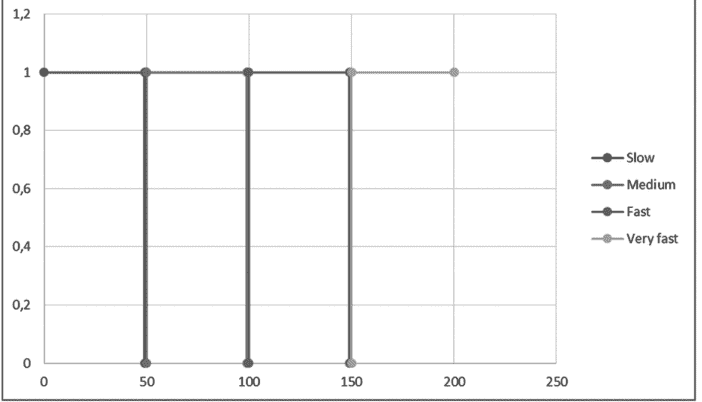

图 1.1 精确逻辑：电机速度控制。

### 1.2.2 模糊逻辑方法

模糊逻辑方法提供了对电机速度更自然和现实的表示。通过基于特定的速度范围（如图 1.2 所示的 0 到 50 rad/s、50 到 100 rad/s 和 100 到 150 rad/s）定义“低速”、“中速”和“高速”等语言模糊变量，系统获得了对电机行为的复杂理解。每个语言变量都涉及根据给定速度范围计算出的百分比值。例如，75 rad/s 的速度可以被解释为 50% 的中速和 50% 的慢速。这种方法通过捕捉现实场景中的固有不确定性和不精确性，实现了更精确和细致的控制决策。使用模糊逻辑来表示变量范围提供了一种灵活且可适应的配置，确保了工业应用中更自然和可靠的控制机制 [3, 4]。

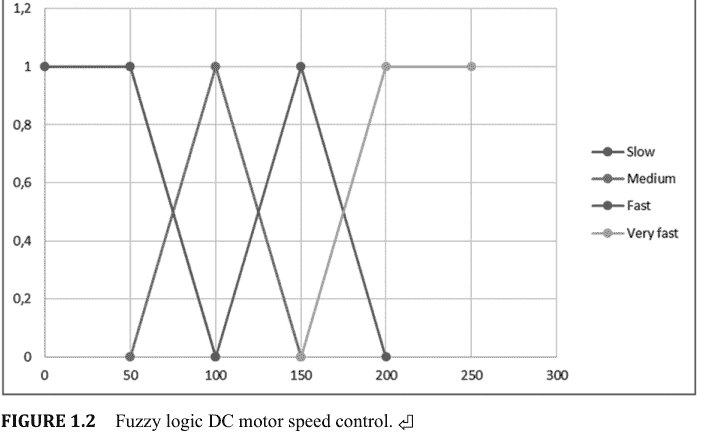

此外，在模糊逻辑方法中，系统会考虑部分真理。由于输入信号不仅仅是“低”或“高”，而是可以在多个类别中具有隶属度程度，因此电机速度会平滑且连续地调整，代表了对不同输入条件更现实的响应 [2, 5, 6]。这个例子突出了关键差异：精确逻辑运行在严格的离散级别上，而模糊逻辑允许更平滑、更细致的响应，以容纳现实世界输入信号的不精确和不确定性质。这种灵活性在难以定义精确边界或系统需要响应广泛输入条件的应用中至关重要。

## 1.3 模糊逻辑直流电机控制

### 1.3.1 直流电机

在广阔的工业领域中，直流电机（DCMs）扮演着关键角色，以卓越的精确度和效率渗透在各种应用中 [7]。复杂的制造任务证明了它们无声但显著的操作，它们精通制造过程的同步流动。在纺织行业，直流电机创造出复杂的图案，确保每个图案都精确地出现在织物上 [5, 8]。这些电机进入了医疗技术的核心，为手术工具赋予精密操作所需的灵巧性，并为其可靠性赋予挽救生命的医疗设备 [9–11]。

除了这些应用外，直流电机还是自动化的驱动力，协调仓库中的快速分拣和包装线上的精细编排。其适应性在各个行业中闪耀，展示了它们将机械能转化为有目的运动的能力，从机械臂的精确动作到传送带的节律运动。每一次旋转都象征着技术与工业的无缝融合，证明了直流电机为工业运营基础提供的精确性和可靠性 [12–15]。

### 1.3.2 在控制系统中使用 SimPowerSystems

利用 SimPowerSystems 设计并模拟电动机的控制系统具有多种优势，使模拟非常接近现实场景，远超简单理论模型所能达到的范围。这个强大的工具使工程师和研究人员能够创建电力系统的复杂虚拟模型，例如直流电机、异步电机及其相应的控制系统。这些模型作为动态副本运行，模拟系统在不同负载和速度下的一系列场景中的行为 [16–18]。


SimPowerSystems 的独特之处在于它采用了先进的数学模型，捕捉了系统内部电、磁和机械相互作用的复杂细节。这些仿真考虑了现实世界中的元素，如定子和转子电路中的电压降、转子电阻以及磁饱和。因此，SimPowerSystems 提供了系统行为的高精度可视化表示，其准确性甚至超过了更基础的理论模型。

此外，SimPowerSystems 支持硬件在环仿真和控制器在环，允许工程师使用电机驱动和控制器等物理组件来彻底测试其控制系统。通过在控制系统应用于实际场景之前识别可能的问题或限制，这种方法论进一步提高了仿真的准确性。

### 1.3.3 MATLAB SimScape (SimPowerSystems) 中的 DCM

使用 SimPowerSystems 在 SI 单位下建模 DCM 的过程涉及创建一个新的 Simulink 模型。工程师通过定制符合其特定要求的 Simulink 模型来启动这一过程。在此模型中，关键步骤是从 SimPowerSystems 库中选择适当的 DCM 模块。这个关键模块作为模型的基础，使工程师能够定义关键参数，例如电枢电阻 ($R_a$) 和电感 ($L_a$)，单位分别为欧姆和亨利 [16–18]。

选择在 SI 单位下工作是刻意的，旨在与国际标准保持一致，并确保建模过程的连贯性和准确性。以 SI 单位精确定义的直流电机在图 1.3 中以可视化形式呈现，为工程师提供了清晰的图形参考点。

在图 1.3 中，MATLAB Simscape 提供了用于建模 DCM 的多功能平台。工程师拥有多种电机选择，例如“choice 1”，其特点为 5 HP、240 V 电枢电压、额定转速 1750 RPM 以及 300 V 励磁电压。值得注意的是，参数会根据所选电机自动调整，从而简化了配置过程。工程师从这种自动化精确性中受益，同时保留了手动调整的灵活性，从而实现对建模过程的完全控制。这种动态界面体现了 MATLAB 的用户友好方法，使工程师能够无缝地从理论过渡到实际应用，提高建模效率，并适应多种电机配置。

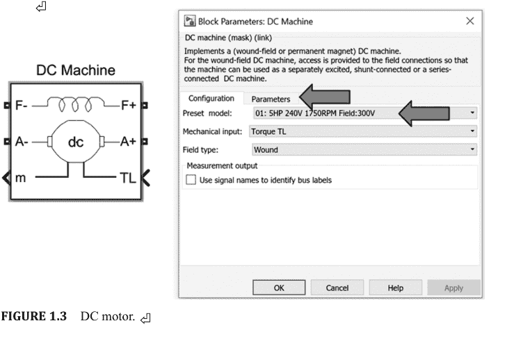

图 1.3 直流电机。

### 1.3.3 四象限斩波器驱动 DCM

在电力电子学的复杂领域中，四象限斩波器作为一个关键枢纽，提供了对 DCM 无与伦比的双向控制 [19]。在电压-电流平面的所有象限中无缝运行，这一电子奇迹促进了需要快速转换的应用中的动态反转和精细的速度调节。在本探讨中，我们将剖析四象限斩波器的理论基础和实际应用，揭示其在现代电力系统中的关键作用。特别值得一提的是，它被用作 DCM 的驱动力，这种战略选择旨在确保正向和反向的精确速度控制。这种有意的选择不仅凸显了斩波器的多功能性，还体现了其在确保高效且受控的电机性能方面的重要性，使其成为各种工业和商业环境中的基石 [15, 19–22]。

在图 1.4 中，一个全面的表示揭示了由功率部分的四象限斩波器控制的 DCM。这个复杂的系统由四个绝缘栅双极晶体管 (IGBT)/二极管组件构建，其中每对 IGBTs (IGBT 1 和 2；IGBT 3 和 4) 形成一个独特的臂，经过战略设计以避免短路。控制机制确保对称操作，其中 IGBT 1 和 4，以及 IGBT 2 和 3 同步控制以保持平衡。标记为“Blco”的模块至关重要，提供必要的四象限控制。在此，DC 电压 1 调节励磁电压，而 DC 电压 2 控制电枢电压。总线选择器（Bus Selector）作为一个关键组件， facilitating DCM 输出的选择，统筹这个复杂系统的无缝运行。通过这种可视化表示，工程师能够深入了解四象限斩波器的复杂组件和控制机制，为 DCM 的精确双向控制指明方向。串联 RLC 分支用于添加值为 1e-4 [亨利] 的电感，以提高电流质量。进一步步骤包括通过定义的步骤施加转矩阻力。此步骤持续六个单位，从初始值 5 开始，逐渐达到最终值 20.35。目标是达到额定转矩，即功率除以速度（图 1.5）。

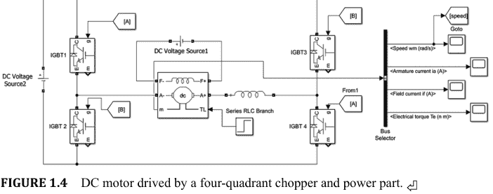

**图 1.4** 由四象限斩波器和功率部分驱动的直流电机。

选择总线选择器以选择电机的输出

在图 1.6 中，描绘了由四象限斩波器操作的 DCM 的控制部分。该控制系统中的一个关键组件如下。

- “Powergui” 模块：在调节仿真时间和类型方面发挥着至关重要的作用。这个基本模块不仅促进对仿真时长的精确控制，还提供了一组工具，使工程师能够根据特定要求调整各种仿真参数：将仿真类型设置为离散，将采样时间（s）设置为 50e-5。
- 速度参考由设置的阶跃函数生成：阶跃时间：3，初始值：−150 *30/pi，最终值：170* 30/pi。

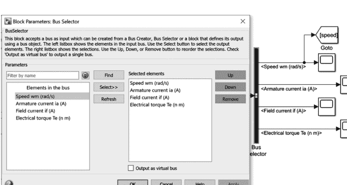

图 1.5 总线选择器输出。

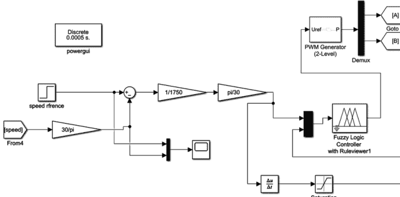

图 1.6 由四象限斩波器驱动的直流电机，控制部分。

由“From”模块产生的速度必须被赋值，类似于记录 DCM 输出速度的“Goto”模块。这确保了生成的速度数据和记录的电机速度输出之间的一致数据流和同步。

系统中有三个增益：第一个设置为 1/1750 以确保误差归一化，第二个设置为 30/π 以将速度从 RPM 转换为弧度/秒，第三个增益经过调整以将速度从弧度/秒转换回 RPM。

脉冲宽度调制 (PWM) 发生器（双电平）模块的频率设置为 100*50，凸显了其在控制系统中的关键作用。其功能至关重要，强调了其在调节系统运行中的重要性。

带有 Ruleviewer 的模糊逻辑控制器在 DCM 的模糊逻辑控制中发挥关键作用，具有两个输入：误差及其导数。

### 1.3.4 带有 RULEVIEWER 的模糊逻辑控制器

本节提供了一份全面的逐步指南，说明如何有效利用带有 Ruleviewer 的模糊逻辑控制器。这个强大的工具在控制系统中发挥关键作用，能够基于模糊逻辑原理实现智能决策。

- 在 MATLAB 命令窗口中输入 “fuzzy”。
- 点击 “file”，然后选择 “export”，并将文件保存为名称 “fuzzy controller”。该文件应以扩展名 “.fis” 保存。接下来，使用 “edit” 选项添加变量。使用光标修改输入和输出名称，如图 1.7 所示。

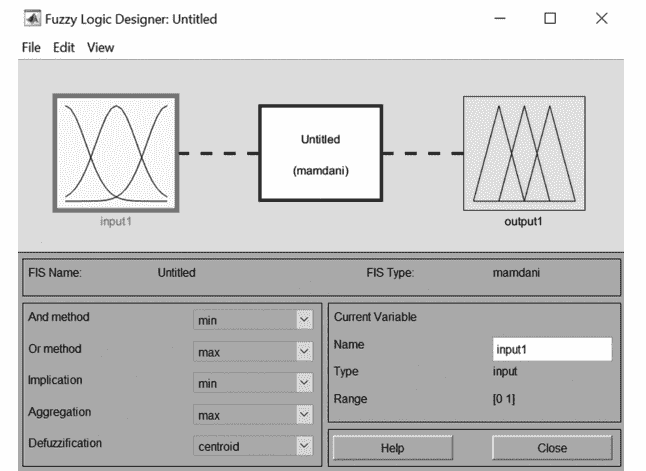

图 1.7 模糊逻辑设计器。

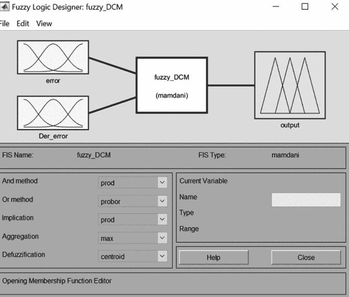

**图 1.8** 模糊逻辑设计器：输入和输出命名。

在输入部分，修改所有输入参数，如图 1.8 所示。输入每个隶属函数图形的名称，并选择函数类型为 “gaussmf”。做出此选择是因为它与自然数据模式相符。根据图 1.8 中概述的细节调整范围、显示范围和参数。

图 1.9 阐明了对输出所做的修改。选择函数类型为 “trimf”，因为它更适合输出的性质。遵循图中概述的其他指定更改以实现最佳配置。

图 1.10 阐明了使用模糊控制的 DCM 速度响应，其中电机准确跟踪指定的参考速度。系统表现出小于 1 秒的快速响应时间，没有超调或稳态误差。电机双向运行，有效响应 –1432 和 1623 RPM 的速度。这些响应是在 5 Nm 的电阻转矩下实现的。在 6 s 时施加 20.35 Nm 的相对转矩扰动后，电机迅速拒绝该扰动，经历


微小的振荡。图 1.11 提供了直流电动机速度响应的详细特写视图，突出了由模糊控制模式引入的轻微振荡。

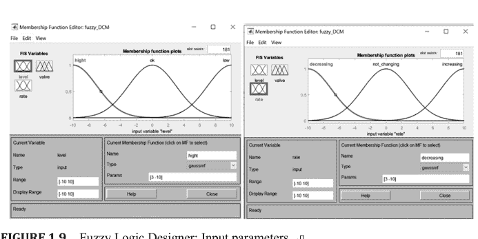


**图 1.11 直流电动机速度响应**

图 1.11 描绘了直流电动机（DCM）电枢电流和转矩的响应。电枢电流和电磁转矩的轮廓之间观察到显著的相似性，表明电流对转矩变化具有直接影响。即使电阻转矩增加导致电流升高，启动电流也会产生初始转矩以启动电机运行。改变电机方向需要另一个启动电流来产生额外的启动转矩。图 1.12 揭示了转矩和电流响应中的振荡，这些振荡直接影响速度响应中观察到的振荡。

## 1.4 模糊逻辑单相异步电动机控制

### 1.4.1 单相异步电动机

单相异步电动机，也称为单相感应电动机，凭借其简单性、可靠性和适应性，成为众多应用领域的基石。这些电动机驱动着各种必备设备，从风扇和空调等家用电器到工业工具、水泵以及暖通空调系统 [23, 24]。其主要优势之一在于其简单却坚固的设计，确保了可靠的性能和最低限度的维护需求。此外，这些电动机的制造成本非常具有性价比，使其在各种应用中具有经济可行性 [25]。它们易于控制，能够在单相交流电源上高效运行，从而简化了安装并减少了电气系统的复杂性。除了其通用性外，单相异步电动机还以其安静运行和能够提供相当大的启动转矩为特征，增强了其在需要高效且低噪音环境中的适用性。总体而言，这些电动机是实用工程的明证，为多样的工业和家庭需求提供了可靠的解决方案 [26, 27]。

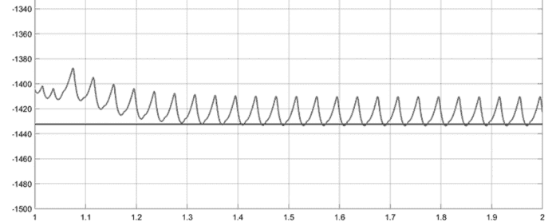

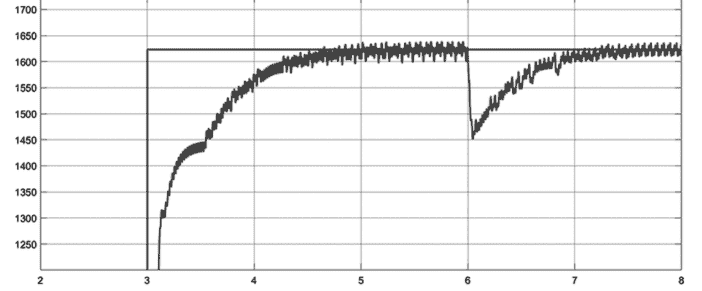

**图 1.12 直流电动机速度响应特写视图**

### 1.4.2 MATLAB Simulink (SimPowerSystems) 中的单相异步电动机

图 1.13 至 1.15 说明了在 MATLAB Simulink (SimPowerSystems) 环境中由模糊逻辑控制的单相异步电动机。

在图 1.13 中，展示了功率部分，其中单相异步电动机连接到一个由两个桥臂组成的逆变器。每个桥臂由两个绝缘栅双极型晶体管（IGBT）组成，结构类似于四象限斩波器。该逆变器由设定为 $\sqrt{2} V_{Rms}$ 的直流电源供电 [26, 28]。

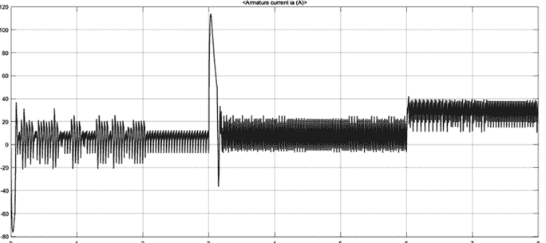

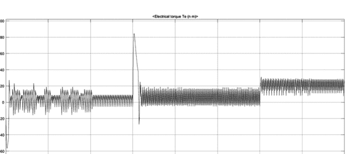

**图 1.13 直流电动机电枢电流和转矩响应**

图 1.14 显示了配置单相异步电动机的基本参数。与直流电动机 [29, 30] 类似，异步电动机允许灵活调整，包括更改电机类型的功能。参数，包括 $V_{Rms}$（均方根电压），清晰可见，提供了电机设置的全面概览 [17]。

图 1.15 展示了由控制部分中的逆变器斩波器驱动的单相异步电动机。在此段中，使用了几个模块，包括以下。

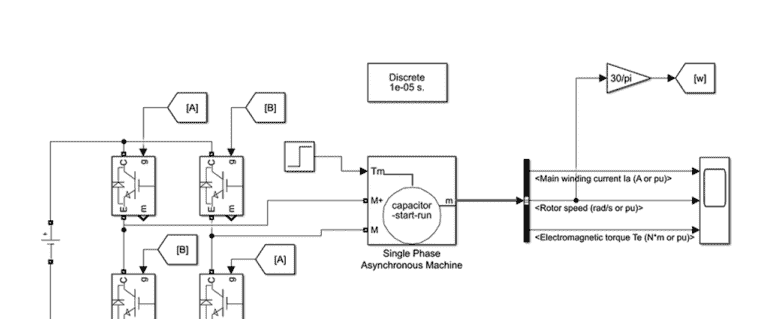

**图 1.14 由逆变器斩波器驱动的单相异步电机，功率部分**


**图 1.15 单相异步电机参数**

-   **Repeating Sequence Stair（重复序列阶梯模块）**：此模块表示输出值的转速参考向量：[400 800]。采样时间：4。
-   **Fen（模糊函数模块）**：此模块表示构成控制逆变器的 PWM 的参考函数。

“Fen”模块的输入由幅度和频率组成，两者均源自多路复用器（mux）组件。这些参数对于控制参考 PWM 函数至关重要，能够精确调制驱动单相异步电动机的输出信号。

-   **Repeating Sequence（重复序列模块）**：此模块表示构成控制逆变器 PWM 的另一部分的载波信号。时间值：[0 .25 .5 .75 1]/5000，输出值：[0 → 1 0 1 0]。

使用关系运算符与逻辑操作结合生成 PWM 信号。逆变器使用两个 PWM 信号工作。“Not”（非）运算符用于取反并生成互补的 PWM 信号。

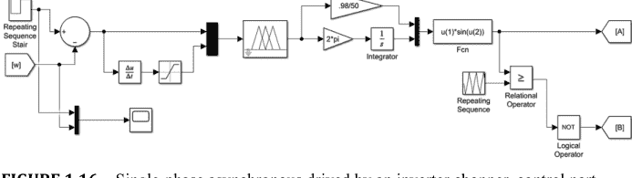

**图 1.16 由逆变器斩波器驱动的单相异步电机，控制部分**

在实施了与直流电动机相同的模糊控制器后，单相异步电动机的速度响应如图 1.17 所示，展示了电机对指定参考速度的精确跟踪。系统表现出令人印象深刻的响应时间，仅为 0.5 秒，没有过冲或稳态误差。电机有效运行，响应 400 和 800 RPM 的速度。这些响应是在 2 Nm 的电阻转矩下实现的。在 6 秒时施加 5 Nm 的转矩扰动时，电机迅速抑制了扰动，仅观察到微小的振荡。

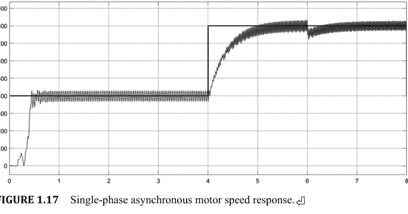

**图 1.17 单相异步电动机速度响应**

图 1.18 说明了单相异步电动机的响应，展示了电流、速度和转矩。电流波形呈现出正弦模式。然而，与直流电动机相比，电流与转矩之间的关系更为复杂。同样，电流与速度之间的相关性也值得关注，尽管并不直接。对于单相异步电动机而言，频率在决定速度方面起着至关重要的作用，增加了电流与电机速度之间关系的复杂性。

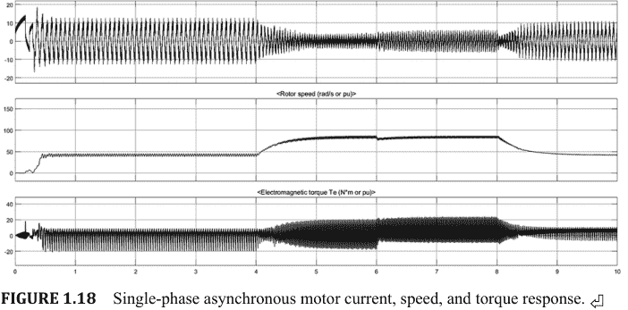

**图 1.18 单相异步电动机电流、速度和转矩响应**

## 1.5 结论

模糊逻辑控制是一种可靠且灵活的方法，用于控制电机系统中实际运行固有的不确定性和复杂性。本研究通过彻底的仿真和分析强调了几个重要要点。

1.  **模糊逻辑精度：** 模糊逻辑控制允许精确的电机速度调节，同时考虑到工业应用中固有的不精确性和不确定性。使用语言变量和模糊集允许细微的控制决策，从而增强电机响应的准确性。
2.  **灵活性和适应性：** 模糊逻辑为电机控制提供了一种灵活的系统，因为它能够处理语言变量并定义精确的速度范围。这种灵活性在工业环境中至关重要，那里波动的操作条件和不可预测性是常态。
3.  **扰动抑制：** 模糊逻辑控制表现出卓越的扰动抑制能力。电机能从扰动中迅速恢复，即使在具有挑战性的条件下也能确保稳定的性能。
4.  **速度表示的真实性：** 模糊逻辑将电机速度表示为定义范围内的语言变量，这比清晰值方法更真实且适用于工业场景。这种复杂的方法确保了更准确的电机行为表示，捕捉了速度变化的细微差别。
5.  **工业适用性：** 对于工业电机应用，模糊逻辑控制显示出巨大的前景。其管理不精确输入、适应变化情况以及提供稳定且精确控制的能力，使其成为实际制造和自动化流程中的竞争性选择。

最后，本研究证明了模糊逻辑控制在增强工业环境中由电机驱动的系统效率、稳定性和适应性方面的重要性。通过弥合理论模型与实际应用之间的差距，模糊逻辑证明是工程师和研究人员寻求复杂电机控制挑战可靠解决方案的宝贵工具。

# 关键词

-   模糊逻辑
-   直流电动机
-   SimPowerSystems
-   四象限斩波器
-   绝缘栅双极型晶体管

# 参考文献

1.  Chen, G., & Pham, T. T. (2000). *模糊集、模糊逻辑和模糊控制系统导论*. CRC 出版社. https://doi.org/10.1201/9781420039818
2.  Ray, K. S. (2014). *软计算及其应用，第二卷：模糊推理和模糊控制*，第 1 版。Apple 学术出版社.


+   3. Barazane, L., Sicard, P., & Ouiguini, R. (2009). Cascade fuzzy variable structure control of induction motor based on the approach of fuzzy modelling of Ben-Ghalia. International Journal of Systems Science, 40(3), 309–326. https://doi.org/10.1080/00207720802435986

+   4. Wang, H. G., & Rooda, J. E. (1996). Fuzzy control in a single-machine system. Production Planning & Control, 7(6), 577–584. https://doi.org/10.1080/09537289608930391

+   5. Parhizkar, N., Shafiei, M., & Kouhshahi, M. B. (2011). Direct torque control of brushless DC motor drives with reduced starting current using fuzzy logic controller. In: Proceedings of the International Conference on Uncertainty Reasoning and Knowledge Engineering, URKE 2011, Vol. 1, pp, 129–132. https://doi.org/10.1109/URKE.2011.6007863

+   6. Xiu, Z., Guo, W., & Wang, W. (2006). Design of adaptive fuzzy controllers for warship weapon control systems. In: 2006 6th World Congress on Intelligent Control and Automation, 1.

+   7. Cheng, P.-J., Cheng, C.-H., & Tung, C.-C. (2009). Design of DC motor’s torque control using DSP. Journal of Information and Optimization Sciences, 30(6), 1197–1207. https://doi.org/10.1080/02522667.2009.10699935

+   8. Kim, I. H., Son, Y. I., Kang, S. Y., & Lim, Y. (2018). Robust position control of DC motor using a low-order disturbance observer against biased harmonic disturbances. In: Proceedings—2018 IEEE International Conference on Industrial Electronics for Sustainable Energy Systems, IESES 2018, January, 2018, pp. 484-489. https://doi.org/ 10.1109/IESES.2018.8349925

+   9. Omar, F., Ahmed, M., & Zouaoui, D. E. Y. (2015). Adaptive control with reference model of a doubly fed induction generator for wind turbine with sliding mode. Electrical and Electronics Engineering: An International Journal (ELELLJ), 4(2), 41–52.

+   10. Omar, F., Haddji, A., Mrabet, E., Belkraouane, I., & Djeriri, Y. (2021). Journal Europée en des Systèmes Automatisés. Journal Européen Des Systèmes Automatisés, 54(6), 897–902.

+   11. Omar, F., Habib, H., Ahmed, N., & Sid, A. (2022). Adaptive control of DC motor without identification of parameters. Facta Universitatis Series: Electronics and Energetics, 35(3), 301–312. https://doi.org/10.2298/FUEEE2203301O

+   12. Aberdharmae, H. E. M., Belkraouane, I., & Fezazi, O. (2021). Sliding Mode Control of a DC Machine. Djillali Liabes.

+   13. Chaimaa, H., Chaheinez, B., & Omar, F. (2020). DC Motor Predictive Control. Djillali Liabes.

+   14. Sabrina, B., Ribah, B., & Omar, F. (2021). Adaptive Control for a DC Machine. Djillali Liabes.

+   15. Salima, T., Sihak, N., & Omar, F. (2022). LQR Control of an Electric Vehicle based on a DC Motor. Djillali Liabes.

+   16. Fezazi, O., El Islam, A. A. N., & Bechehir, S. E. (2023). Validation of a SimPower system simulation for a buck-boost copter in the drive system of an electric vehicle using RT LAB. In: Conference: 1. International Selçuk Scientific Research Congress.

+   17. Omar, F., & El Islam, A. A. N. (2023). Association induction motors to converters. In: Induction Motors—Recent Advances, New Perspectives and Applications. IntechOpen. https://doi.org/10.5772/INTECHOPEN.1001574

+   18. Omar, F., & Djjelloul, B. (2023), Validation of a PV-integrated drive system for electric vehicles using MATLAB SimPower systems and RT LAB. In: 1. International Selçuk Scientific Research Congress.

+   19. Melkebeek, J. A. (2018). DC chopper. Power Systems, 9783319727295, 263–275. https:// doi.org/10.1007/978-3-319-72730-1_8/COVER

+   20. Abdou, M. M. A., & Omar, F. (2019). *由光伏电源供电的斩波器的设计与控制*. Djillali Liabes.

+   21. Fezazi, O., & Kötén, H. (2023). Study of buck-boost chopper control modes for electric vehicle propulsion. In: *第一届可持续能源与先进材料国际会议*.

+   22. Omar F., El Islam, A. A. N., & Djehaf, M. A. (n.d.). Integration of photovoltaic panels in electric drive motors for sustainable electric vehicle operation. In: *Le 1er Séminaire National Sur Les Pollutions Environnementales et Le Développement Durable*.

+   23. Kirthey J. L. (1995). *单相电机：类型、构造与应用*. Wiley-IEEE Press.

+   24. Types of single phase induction motors. (n.d.). Java T Point. https://www.javatpoint.com/types-of-single-phase-induction-motors

+   25. Aissa, O., Moulahoum, S., Colak, I., Kabache, N., & Babes, B. (2016). Improved performance and power quality of direct torque control of asynchoronous motor by using intelligent controllers. *电力元件与系统, 44*(4), 343–358. https://doi.org/10.1080/15325008.2015.1117541

+   26. Abdelhadi, B., Abellali, A., & Omar, F. (2019). *用于电动汽车的同步电机控制*. Djillali Liabes.

+   27. Fezazi, O. A. M. (2016). Predictive control of doubly fed induction generator used for wind energy. *电气工程杂志, 1*, 1–8.

+   28. Said, B., Kaouthar, B., & Omar, F. (2021). *逆变器控制技术*. Djillali Labes.

+   29. Ershad, N. F., & Mehrjardi, R. T. (2018). A low cost single-phase to three-phase power converter for low-power motor drive applications. In: *2018年IEEE德克萨斯州电力与能源会议, TPEC 2018*, 2018年2月, 第 1–6 页. https://doi.org/10.1109/TPEC.2018.8312061

+   30. Soomro, J., Memon, T. D., & Shah, M. A. (2017). Design and analysis of single phase voltage source inverter using Unipolar and Bipolar pulse width modulation techniques. In: *2016年电气、电子与系统工程进展国际会议, ICAEES 2016*, 第 277–282 页. https://doi.org/10.1109/ICAЕES.2016.7888052


# 第 2 章

# 模糊逻辑在提升无级变速箱性能中的应用

SUDIPTA ADHIKARY¹, KAUSHIK CHANDA², GUNJAN MUKHERJEE², and KAUSHIK BANERJEE¹

¹脑器大学法学系，印度西孟加拉邦加尔各答

²脑器大学计算科学系，印度西孟加拉邦加尔各答

## 摘要

模糊逻辑系统被广泛应用于许多多用途的工程领域。模糊推理系统是一种基于规则的系统，可以应用于多种类型的控制系统，其中控制能力和机制完全由推理规则集决定。传统的动力传输系统是通过手动或自动方式进行的。模糊逻辑系统的应用有助于增强和使传输系统更加平滑。无级变速箱（CVT）通过提供多种齿轮比，实现动力的高效和平稳传递。提升传输能力的不同应用流程涉及自适应过程、换挡控制过程、负载平衡过程、优化能量回收过程等。本文所述系统用于寻找最佳的优化参数值，这些值由两个变量 $K_{p}$ 和 $T_{i}$ 表示，用于设置一种称为比例积分控制器（或 PI 控制器）的特殊控制器。该 PI 控制器用于机械系统中，以控制通过 CVT 的能量传递，从而确保平稳运行。模糊控制器具有多项附加特性，所有特性均旨在提高机器的整体运行效率。本章基于模糊逻辑概念，详细概述了此类优化过程。

## 2.1 引言

无级变速箱（CVT）是一种专门用于传统内燃机车辆的变速箱类型。发动机的功耗是影响发动机效率的重要因素。通过 CVT，可以将发动机功率利用率的优化降至最低。与通过离散齿轮比（如一档和二档）运行的传统变速箱相比，无级变速箱（CVT）具备根据车轮转速无缝且连续地调整发动机转速的能力。这有助于优化发动机的功率利用率。如果希望以经济的方式驾驶，可以节省燃料并减少污染。相反，如果希望进行运动型驾驶，则可以优化功率输出。无级变速箱（CVT）通过连接两个带有锥形结构的滑轮使用的皮带来运行。这些滑轮的尺寸是变化的，随着锥体相互靠近而扩大，随着它们分离而收缩。图 2.1 中的图展示了主题的运行机制。必须对滑轮（Pp 和 Ps）施加适量的压力，以确保皮带的最佳运行。如果张力超过推荐阈值，皮带可能因摩擦和应力过大而失效。发动机中张力不足可能会阻碍动力向车轮传递，可能导致皮带从滑轮上脱开并引发后续问题。发动机的正常转速（r.p.m.）范围是 1000 到 4000。为了调节气缸内的压力，使用了一种阀门系统，其功能类似于液压放大器。此外，在湿片离合器的情境中使用了第三种压力。该系统负责控制三个不同的组件。这意味着用于调节无级变速箱（CVT）的信号仅依赖电气手段。这 3 个附加阀门的压力水平由中央控制系统提供。主控制


系统通过考虑多种因素来调节压力水平，如图2.2所示，这些因素包括道路状况、目标速度和油门输入程度。无级变速器（CVT）的管理是一项复杂的任务，因为必须考虑多种因素。这些因素包括速度、温度、油液粘度以及阀门的设计。这些组件之间相互作用，导致系统高度复杂。使用旨在处理复杂度较低系统的传统方法来控制无级变速箱（CVT）存在固有挑战。本章的主要目标是揭示如何简化此类变速箱的复杂性并提高相关发动机的速度。减少系统各部分之间相互作用的延迟时间可以降低负载，并有助于实现整个系统的良好性能。图2.1展示了用于获得滑轮压力的控制系统的设计。

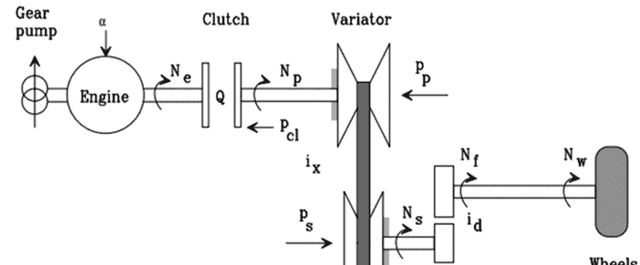

**图2.1** 车辆传动系统配备无级变速箱（CVT）和湿式多片离合器。FD是终传减速比的缩写。

## 2.2 性能规格

目标是在合理的时间内（理想情况下为60到70毫秒）达到所需的压力，且不超出规定限制。目标是尽量减少大幅度超调（O.S.），因为它们有可能导致皮带过度松弛，从而从滑轮上脱开并造成系统潜在损坏。

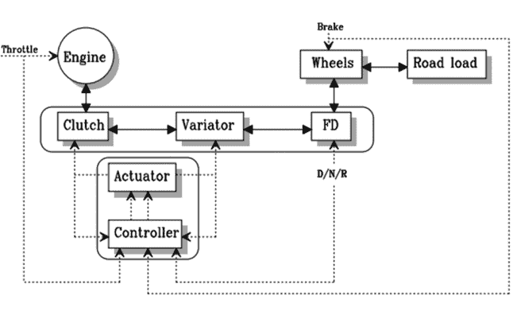

**图2.2** 该示意图展示了系统的原理图，包括高级控制器。

## 2.3 无级变速器（CVT）的物理模型

Minten和Vanvuchelen开发了该系统的详细物理模型。该主题之所以复杂，是因为它全面涵盖了无级变速箱（CVT）的活动。这种方法的利用在重现现实世界现象方面被证明是有利的；然而，其冗长的执行时间使其不适合用于设计控制机制。此外，为了控制目的还设计了一个更简化的模型。该系统提供一个可控参数，即供给脉宽调制伺服阀的电压，表示为$V_{\text{in}}$。测量涵盖两个变量，即温度（$T$）和发动机转速（$N_{\text{engine}}$）。这项研究关注单一输出变量，即作用在滑轮上的压力大小。图2.3说明了非线性（$f$）与发动机转速（$N_{\text{engine}}$）之间的关系，表明前者对后者有显著依赖。

该过程通过利用静态非线性函数（表示为$f(V_{\text{in}}, N_{\text{engine}}$））以及具有可变参数的动态线性系统$G(s)$来表示。图2.4提供了变量$f$与发动机转速之间的相关性。图表是针对不同的发动机转速绘制的。

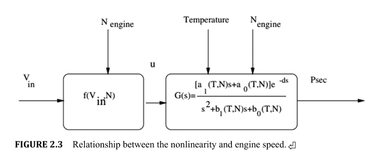

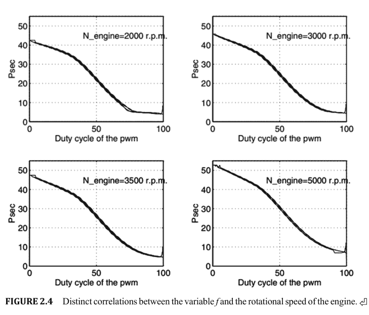

在保持温度恒定的情况下，考察静态非线性$f$在各种发动机转速（$N_{engine}$）值下的表现。模糊推理系统（FIS）[3–5]决定了参数$P$和$T_i$是如何生成的。

## 2.4 控制器设计

控制器构建的第一阶段是使用非线性$f(V_{in}, N_{engine})$的反函数$\hat{f}^{-1}(V_{in}, N_{engine})$对其进行补偿。由于函数$f(., .)$的单调性，可以观察到这种技术是适用的。在获得$T$和$N_{engine}$的各种数值下的局部线性模型以及函数$\hat{f}^{-1}(., .)$之后，采用一种优化方法来计算给定工作点的次优比例积分（PI）控制器（图2.5）。优化的代价函数规定为

$$J(K_p, T_i) = \lambda M_p + (1 - \lambda) \int_0^{\infty} t (e^2(t) dt)^{1/2} \quad (2.1)$$

其中$K_p$和$T_i$分别代表PI控制器的比例增益和积分时间。$\lambda$的值等于0.5，用于量化代价函数中O.S.的重要性。

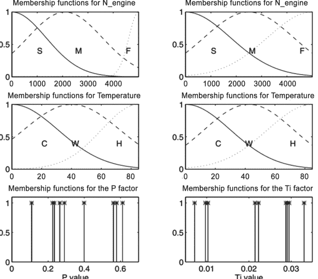

**图2.5** 生成的参数$P$和$T_i$。

跟踪误差表示为

$$e(t)=P_{\mathrm{ref}}(t)-P_{\mathrm{sec}}(t) \tag{2.2}$$

代表了时间$t$时理想值与次级值之间的差异。O.S.，$M_p$，表征输出$y(t)$的最大偏差。在数学上，$M_p$定义为

$$M_p=\max\{\max\{y(t)-1\}, 0\}. \tag{2.3}$$

展示了使用准牛顿法进行无约束多变量优化的过程。包含一系列局部PI控制器的PI控制器在连续时间中可以数学表达为

$$C(s)=K_{p}\left(T,N_{\text {engine }}\right)\left(1+\frac{1}{T_{i}\left(T,N_{\text {engine }}\right)s}\right). \tag{2.4}$$

在离散时间的背景下，表达式可以写为

$$C(z)=K_{p}\left(T,N_{\text {engine }}\right)\left(1+\frac{1}{T_{i}\left(T,N_{\text {engine }}\right)\left(1-z^{-1}\right)}\right). \tag{2.5}$$

通过采用这种方法，考虑了所有量化效应，从而提高了控制器的精度。$K_p(T,N_{\text {engine }})$、$T_i(T,N_{\text {engine }})$和$\hat{f}^{-1}(V_{\text {in }}^{r}, N_{\text {engine }})$的值被限制在某些工作点。需要一种插值方法来促进不同运行位置之间的平滑过渡。必须利用插值方法。已确定，一种有效的方法将涉及利用FIS [6–9]来近似查找表。该FIS [10–13]的主要属性包括高斯隶属函数，采用重心法。控制器如图2.6所示。

## 2.5 稳定性分析

变速箱在多个交互组件的稳定性方面已经实现了稳定。变速箱的轴有时在稳定动作方面会出现一些问题，但通过模糊逻辑系统[14–17]可以使整体组件及其相互作用得到稳定。不同的基于模糊逻辑的模型[18–22]已在许多已报告的工作中用于评估稳定性。我们可以利用“Takagi–Sugo模糊模型”来描绘闭环系统，假设标记为$f(.,.)$的非线性已被完全消除。为了说明这一点，考虑一条规则，Rule$_i$，其中$\mu_i$代表温度，$\mu_j$代表发动机。在此上下文中，变量$x$的变化率方程可以表示为

$$\dot{x} = A_{i}\tilde{x} + B_{i}\tilde{u}. \quad (2.6)$$

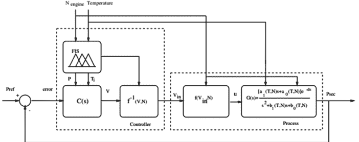

**图2.6** 模糊控制器与线性规划控制器的比较。

在此上下文中，当存在一个满足以下不等式的共享正定矩阵$P$时，稳定性要求得以满足：

$$P > 0 \quad (2.7)$$
$$A_{i}^{T} P + P A_{i} < 0 \quad (2.8)$$
$$\forall i \in \{1, ..., N_{\text{rules}}\} \quad (2.9)$$

$P$矩阵的确定可以通过解决可行性线性矩阵不等式（LMI）问题来实现。已为该问题找到一个可行解，确保了稳定性。图2.6提供了模糊控制器与线性规划控制器的模型[23–27]。

本研究考察了实施模糊控制器[28–30]与线性规划控制器相比所取得的改进。需要注意的是，不仅性能有所提升，而且由于规则库解释提供了更多信息，设计修改的实施也变得更容易。

## 2.6 结论

本节阐明了设计无级传动控制系统的过程。控制系统采用模糊推理方法来


根据对扰动的测量，动态修改控制器的参数。采取了以下措施。

1. 通过优化过程计算了适用于各种场景的线性控制器。
2. 开发了非线性补偿器，以适应不同的发动机转速值 ($N_{\text{engine}}$)。
3. 为了建立稳定性，成功解决了一个名为 LMI 的数学问题。
4. 所构建的控制器还提供了对调度机制的全面阐述，从而促进了工业环境中系统优化的过程。控制系统的评估以对比形式展示在图 2.7 中。

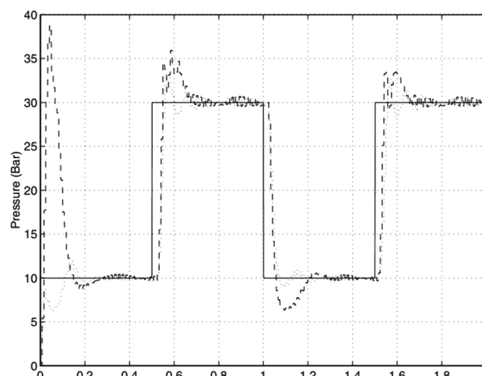

**图 2.7** 控制系统的对比评估。

该图表描绘了一条代表参考值的实线，一条代表具有前馈作用的线性控制器的虚线，以及一条代表模糊控制器的点线。显而易见，模糊控制器有效地减少了系统的超调量（O.S.）和调节时间。

## 关键词

- 模糊逻辑
- 无级变速箱
- 模糊控制器
- 模糊推理系统
- 非线性补偿器

## 参考文献

1. Grace. (1992). Optimization Toolbox—For use with MATLAB. Mathworks, Inc.
2. Isidori. (1989). Nonlinear Control Systems—An Introduction, 2nd edn. Springer-Verlag.
3. Peña Reyes, C. A. (2002). Cooevolutionary fuzzy modeling. PhD thesis, Ecole Polytechnique Fédérale de Lausanne.
4. von Alstroek. (1995). Fuzzy logic applications in Europe. Industrial Applications of Fuzzy Logic and Intelligent System, IEEE Press.
5. Broadbent. (1975). The magic number seven after fifteen years. Studies in Long Term Memory, Addison Wesley: USA.
6. Clarke, D., Mohtadi, C., & Tuffs, P. (1987). Generalized predictive control-parts i–ii. Automatica, 23, 137–160.
7. Drankov, D., Hellendoorn, H., & Reinfrank, M. (1993). An Introduction to Fuzzy Control. Springer-Verlag.
8. Goldberg, D. E. (1989). Genetic Algorithms in Search, Optimization and Machine Learning, Addison Wesley: USA.
9. Camacho, C. B. (1995). Model Predictive Control in the Process Industry. Springer-Verlag: London.
10. Gustafson, E., & Kessel, W. (1979). Fuzzy clustering with fuzzy covariance matrix. In: Proc. IEEE Control Decision Conference, pp. 761–766.
11. Ecole Nationale Supérieure de Techniques Avancées (ENSTA), Optimization and Control Group: (1998), LMITOOL-2.0 package.
12. Allgöwer, T. B., Qin, J., Rawlings, J., & Wright, S. (1999). Nonlinear predictive control and moving horizon estimation– an introductory overview. Advances in Control—Highlights of ECC’99. Springer-Verlag.
13. Box, G. J. (1970). Time Series Analysis, Forecasting and Control. Holden Day: San Francisco, CA.
14. Goodwin, G., & Sin, K. (1984). Adaptive Filtering Prediction and Control. Prentice Hall: Englewood Cliffs, NJ.
15. Lightbody, G., & Irwin, G. (1997). Nonlinear control structures based on embedded neural system models. *IEEE Transactions on Neural Networks and Learning Systems*, 8, 553–567.
16. Akaïke. (1974). A new look at the statistical model identification. *IEEE Transactions on Automatic Control*, 19, 716–723.
17. Ying, H. (1998). The Takagi–sugeno fuzzy controllers using the simplified linear control rules are the nonlinear variable gain controller. *Automatica*, 34(2), 157–167.
18. Abonyi, H. A., Nagy, L., & Széifert, F. Inverse fuzzy-process-model based direct adaptive control. URL citeeear.nj.nec.com/abonyi99inverse.html.
19. Bezdek. (1976). A physical interpretation of fuzzy data. *IEEE Transactions on Systems, Man, and Cybernetics 6*(5), 387–389.
20. Espinosa, J., & Vandewalle, J. (1998). Fuzzy modeling and identification, using afreli and fuzion algorithms. In: *Proceedings of the 5th. International Conference on Soft Computing IIZUKA-98 Iizuka, Japan*, pp. 535–540.
21. Espinosa, J., & Vandewalle, J. (1998). Fuzzy modeling with linguistic integrity. In: *Proceedings of the International Workshop on Advanced Black Box Techniques for Nonlinear Modeling Leuven, Belgium*, pp. 197–202.
22. Espinosa, J., & Vandewalle, J. (1998). Predictive control using fuzzy models applied to a steam generating unit. In: Ruan, D., Abderrahim, H. A., D’hondt, P., & Kerre, E. (Eds.), *Fuzzy Logic and Intelligent Technologies for Nuclear Science and Industry*. World Scientific: Singapore.
23. Espinosa, J., & Vandewalle, J. (1999). Constrained predictive control using fuzzy models. In: *Proceedings of the Eight International Fuzzy Systems Association World Congress (IFSA-99) Taiwan*, pp. 649–654.
24. Espinosa, J., & Vandewalle, J. (1999). Predictive control using fuzzy models. In: Roy, R., Furuhashi, T., & Chawdhry, P. (Eds.), *Advances in Soft Computing Engineering Design and Manufacturing*. Springer-Verlag: London.
25. Espinosa, J., & Vandewalle, J. (2000). Constructing fuzzy models with linguistic integrity-afredl algorithm. *IEEE Transactions on Fuzzy Systems*, 8(5), 591–600.
26. Espinosa, J., & Vandevvalle, J. (2003). Extracting linguistic fuzzy models from numerical data-afreli algorithm. In: Cassillas, J., Cordon, O., Herrera, F., & Magdalena, L. (Eds.), *Interpretable Issues in Fuzzy Modeling*. Springer-Verlag: London.
27. Espinosa, J., Hadjili, M., Wertz, V., & Vandewalle, J. (1999). Predictive control using fuzzy models-comparative study. *Proceedings of the European Control Conference-99*.
28. Rawlings, J. (1999). Tutorial: Model predictive control technology. In: *Proceedings of the ACC San Diego, CA*.
29. Richalet, J. (1993). Industrial applications of model-based predictive control. *Automatica*, 29, 1251–1274.
30. Sjberg, J., Zhang, Q., Ljung, L., Benveniste, A., Delyon, B., Glorermec, P., Hjalmarsson, J., & Juditsky, A. (1995). Nonlinear black-box modeling in system identification: A unified overview. *Automatica*, 31, 1691–1724.

# Taylor & Francis

Taylor & Francis Group
http://taylorandfrancis.com


## 机器学习与 AI 中的模糊逻辑：综合综述

S. LINGESWARI 和 T. REVATHI

*印度泰米尔纳德邦埃罗德 P.K.R. 艺术学院*

### 摘要

模糊逻辑是由 Lotfi Zadeh 在 20 世纪 60 年代引入的一种数学框架，它在人工智能（AI）和机器学习（ML）的各个领域中找到了深远的应用。本摘要探讨了模糊逻辑在增强 AI 和 ML 应用能力以及解决其面临的挑战方面的作用。模糊逻辑处理不确定性和不精确性，为建模复杂的现实世界现象、人类推理和决策过程提供了有价值的方法 [1]。在此背景下，我们讨论了将模糊逻辑融入 AI 和 ML 系统的关键应用、方法和优势。模糊逻辑脱颖而出的主要领域之一是处理数据中的不确定性和模糊性。在 AI 和 ML 中，数据往往是不完整或不精确的，这使得传统的二值逻辑不再适用。模糊逻辑提供了一套框架来表示和推理模糊信息，从而使 AI 系统能够做出更细微的决策 [4]。这在自然语言处理、情感分析和专家系统等领域的应用中尤为有用。此外，模糊逻辑在模糊推理系统（FIS）的开发中不可或缺，FIS 在 AI 和 ML 应用中得到广泛使用。FIS 可以建模输入和输出之间的复杂关系，使其适用于控制系统、预测和模式识别等任务。它们在自动驾驶车辆等应用中特别有用，因为实时决策依赖于对多样化和动态传感器数据的解释 [10]。在机器学习的背景下，已经开发了模糊聚类和模糊分类算法，以处理具有重叠或不确定边界的数据集。这些算法，如模糊 c 均值和模糊决策树，已应用于图像分割、医学诊断和推荐系统等领域。它们允许对数据点进行更细致的分类，提高了 ML 模型的准确性和可解释性。模糊逻辑在基于规则的系统中也起着关键作用，这对于 AI 中的专家系统和知识表示至关重要。模糊规则捕捉人类专业知识，可用于构建模拟人类决策的系统。这些系统在医学诊断、金融风险工业过程控制等应用中很有价值。总之，模糊逻辑继续成为 AI 和 ML 应用中的宝贵工具，提供了一种处理数据中不确定性、不精确性和复杂关系以及决策的手段。通过采用模糊逻辑，AI 和 ML 系统可以实现更大的鲁棒性、适应性和类似人类的推理能力，为跨各行业广泛的现实世界应用打开大门。本摘要提供了对模糊逻辑在推动 AI 和 ML 进步方面的多方面贡献的一瞥。

### 3.1 模糊逻辑简介

模糊逻辑是一种数学框架和一种多值逻辑形式，处理数据和决策中的不确定性、不精确性和模糊性 [1]。与基于“真”或“假”值（0 或 1）的经典二值逻辑不同，模糊逻辑允许表示部分真理和在集合中的成员资格程度，使其成为各个领域（包括人工智能（AI）、控制系统和决策）的宝贵工具。它由 Lotfi Zadeh 在 20 世纪 60 年代开发，作为一种在不确定性下建模和表示类似人类推理的方法。

### 3.2 模糊逻辑的组成部分

#### 3.2.1 模糊集

模糊集是模糊逻辑中的一个基本概念，它允许我们表示并处理不确定性和不精确性。与经典集合不同，在经典集合中，一个元素要么是成员（成员资格度为 1），要么不是成员


（成员度为 0），模糊集允许元素具有介于 0 和 1 之间的部分成员度。一些实时示例如下。

## 3.2.1.1 温度分类

想象一下，你想将温度归类为“冷”、“温”和“热”。在经典集合论中，你可能会设置一个明确的边界，例如 50°F 以下的温度是“冷”的，50°F 到 70°F 之间的温度是“温”的，而 70°F 以上的温度是“热”的。然而，在模糊集中，你可以为每个类别分配成员度。例如，60°F 的温度可能在“温”中的成员度为 0.6，在“冷”中的成员度为 0.4，这表明它既部分偏温又部分偏冷。

## 3.2.1.2 图像分割

在图像处理中，模糊集可用于图像分割，其中你将每个像素归类到不同区域的成员度。当对象的边界不明确时，像素可以同时属于多个区域，且具有不同的成员度，这非常有用。

## 3.2.1.3 控制系统

模糊集在控制系统中有着广泛的应用。例如，在空调系统中，你可以为“凉爽”、“舒适”和“温暖”定义模糊集，以确定系统如何根据用户偏好调整温度。这些集合允许系统进行渐进且平滑的调整。

## 3.2.2 隶属函数

隶属函数是模糊逻辑的一个关键组成部分，用于确定元素属于模糊集的程度。这些函数将输入值映射到 0 和 1 之间连续尺度上的隶属度。根据问题的性质和对不确定性的期望表示，这些函数可以具有各种形状，例如三角形、梯形或 S 形。

### 3.2.2.1 三角形隶属函数

三角形隶属函数由三个参数定义：左边界、峰值和右边界。

示例：让我们根据人的身高（以厘米为单位）为模糊集“高”定义一个三角形隶属函数。

左边界 = 150 厘米，峰值 = 165 厘米，右边界 = 175 厘米。

在这种情况下，如果一个人的身高是 165 厘米，他们在“高”集合中的隶属度将为 1。如果身高是 150 厘米，则隶属度将为 0。如果身高是 175 厘米，则隶属度将为 0.5。

### 3.2.2.2 梯形隶属函数

梯形隶属函数有四个参数：最小值、左肩、右肩和最大值。它表示一种更平缓的过渡，中间有一个平坦区域。

示例：空调控制。

在空调系统中，你可能有一个“舒适温度”模糊集。梯形隶属函数的最小值可能为 20°C，左肩在 22°C，右肩在 26°C，最大值为 28°C。24°C 的房间温度将具有中等隶属度。

### 3.2.2.3 高斯隶属函数

高斯隶属函数具有钟形曲线，其特征由均值（μ）和标准差（σ）参数定义。当中心值周围存在不确定性时，它通常被使用。

示例：身高分类。

具有高斯隶属函数的“高”模糊集：

μ = 180 厘米（平均身高）。

σ = 10 厘米（标准差）。

此隶属函数表示个人的“高度”程度，峰值在 180 厘米，随着身高偏离均值，隶属度降低。

### 3.2.2.4 S 形（S 状）隶属函数

S 形隶属函数类似于“S”形，常用于隶属度之间具有渐进过渡的变量。

示例：在“客户满意度”的背景下，你可以使用 S 形隶属函数来捕捉从“不满意”到“满意”的过渡。随着满意度评分的增加，隶属度逐渐增加。

## 3.2.3 模糊逻辑算子

模糊逻辑算子是模糊逻辑的基本组成部分，允许操作模糊集并使用不确定或不精确的信息进行推理。模糊逻辑算子类似于经典（布尔）逻辑中的逻辑算子（AND、OR、NOT），但它们被改编以处理隶属度而非二值的真/假值。

### 3.2.3.1 模糊与（MIN 算子）

模糊 AND 算子计算两个或多个模糊集隶属度的最小值。它表示所有条件同时为真的程度。

示例：如果你有两个模糊集，“高”的隶属度为 0.6，“瘦”的隶属度为 0.7，那么模糊 AND 运算产生的“高”和“瘦”交集的隶属度为 0.6 [min(0.6, 0.7)]。

### 3.2.3.2 模糊或（MAX 算子）

模糊 OR 算子计算两个或多个模糊集隶属度的最大值。它表示任何条件为真的程度。

示例：如果你有两个模糊集，“高”的隶属度为 0.8，“中”的隶属度为 0.6，那么模糊 OR 运算产生的“高”和“中”并集的隶属度为 0.8 [max(0.8, 0.6)]。

### 3.2.3.3 模糊非（补运算子）

模糊 NOT 算子计算模糊集隶属度的补集。它表示条件为假的程度。

示例：如果你有一个隶属度为 0.3 的模糊集“不太热”，那么模糊 NOT 运算产生的条件“不太热”的隶属度为 0.7 (1−0.3)。

### 3.2.3.4 模糊蕴含算子

模糊蕴含算子用于模糊基于规则的系统，根据前件条件的真值来确定蕴含（后件）的强度。

模糊蕴含算子的示例包括 Mamdani 蕴含和 Larsen 蕴含。

### 3.2.3.5 模糊聚合算子

模糊聚合算子用于组合 FIS 中多个模糊规则的输出。常见的聚合算子包括最大（max）、求和和加权平均算子。

### 3.2.3.6 模糊 T-范数和 T-余范数算子

T-范数（t-normative）和 T-余范数（t-conormative）算子分别用于计算模糊集的交集和并集。流行的 T-范数算子包括最小（min）和乘积（product）算子，而常见的 T-余范数算子包括最大（max）和概率和（probabilistic sum）算子。

### 3.2.3.7 模糊比较算子

模糊比较算子用于比较两个模糊数或集，并确定它们的关系，例如相等、优势或交集。

这些模糊逻辑算子允许在决策和建模中对不确定性和不精确性进行更灵活和细微的表示。

它们是 FIS 的重要组成部分，FIS 应用于各个领域，包括控制系统、模式识别和 AI，在这些领域中，传统的二值逻辑可能无法充分捕捉现实世界数据的复杂性。

## 3.2.4 模糊推理系统

FIS 是基于模糊逻辑的计算模型，通过结合不确定性和不精确性来模拟人类决策过程。这些系统使用模糊集、规则和隶属函数以比传统二值逻辑更灵活、更类人的方式做出决策或执行任务。FIS 广泛用于控制系统、决策支持、模式识别和 AI。

## 3.2.4.1 模糊推理系统的组件

### 3.2.4.1.1 模糊化

在模糊化阶段，使用隶属函数将精确输入转换为模糊集。这一步将定量输入值转换为语言术语，例如“低”、“中”或“高”。

### 3.2.4.1.2 知识库（规则库）

知识库由一组将模糊输入变量与模糊输出变量关联的语言规则组成。这些规则通常以“如果–那么”语句的形式表达，并捕获专家知识或特定领域的信息。每条规则定义了输入和输出模糊集之间的关系。

### 3.2.4.1.3 推理引擎

推理引擎是 FIS 的核心。它使用模糊输入值和知识库进行推理并确定模糊输出值。它使用模糊逻辑算子（AND、OR、NOT）来评估规则前件并将它们组合以产生中间模糊值。


## 3.2.4.1.4 模糊规则评估

通过计算输入变量的隶属度，对每条规则的前件（IF 部分）进行评估，以确定其真实性度。规则的真实性度代表该规则在当前输入值上的适用强度。

## 3.2.4.1.5 聚合

将多条规则的结果进行聚合，以生成一个组合输出的模糊集合。常见的聚合方法包括取最大值（maximum）算子、求和以及加权平均。

## 3.2.4.1.6 去模糊化

在去模糊化阶段，将聚合后的模糊输出集转换为精确的输出值。可以使用各种去模糊化方法，例如重心法，它用于寻找聚合输出集的中心。

# 3.2.5 模糊推理系统的工作原理

## 3.2.5.1 输入模糊化

使用隶属函数将精确的输入值映射到模糊集合。这一步骤涉及根据输入值，为每个语言学术语分配隶属度。

## 3.2.5.2 规则评估

将模糊输入值与模糊规则的前件进行匹配。根据输入值与规则条件的匹配程度，计算每条规则的真实性度。

## 3.2.5.3 推理

推理引擎结合规则的输出，形成一个模糊输出集。这是通过根据规则的真实性度，对规则的后件（THEN 部分）应用模糊逻辑算子（AND、OR）来实现的。

## 3.2.5.4 聚合

聚合方法（例如，最大值算子）将来自不同规则的模糊输出结合起来，创建一个单一的聚合输出模糊集。

## 3.2.5.5 去模糊化

使用去模糊化方法将聚合后的输出模糊集转换为精确的输出值。该值代表系统的最终决策或动作。

模糊推理系统（FIS）特别适用于决策过程涉及不确定或模糊信息的应用场景，因此适用于控制系统、专家系统和模式识别等领域。它们允许引入类似人类的推理能力，并能够有效处理复杂和模糊的数据。

# 3.3 应用

模糊逻辑已在各个领域找到应用，包括控制系统、人工智能、模式识别、决策制定、机器人技术等。它在模糊性和不精确性是固有的情况下表现出色，例如在自然语言处理、温度控制和金融预测中。

# 3.4 控制系统

模糊逻辑控制系统被广泛应用于多个行业，包括汽车、工业自动化以及暖通空调（HVAC）领域。它们能够适应不断变化的条件，即使系统动力学定义不明确，也能提供精确的控制。

## 3.4.1 汽车工业

模糊逻辑用于车辆系统，如防抱死制动系统（ABS）、自动变速箱和发动机控制单元（ECU），以优化性能并提高安全性。

## 3.4.2 消费电子

模糊逻辑应用于洗衣机等家用电器，根据负载大小和脏污程度调整洗涤周期，使其更加节能且用户友好。

## 3.4.3 机器人技术

模糊控制器用于机器人系统中的任务，如路径规划、避障和抓取物体。模糊逻辑帮助机器人在不确定环境中做出实时决策。

## 3.4.4 医疗诊断

模糊推理系统（FIS）可以通过结合模糊的医疗数据和专家知识，确定不同诊断的可能性，从而协助医疗专业人员诊断疾病和状况。

## 3.4.5 交通管理

模糊逻辑被用于智能交通管理系统，以控制交通信号灯、优化交通流量并减少高峰时段的拥堵。

## 3.4.6 金融建模

模糊逻辑可用于金融预测和投资组合优化，考虑模糊的市场数据和经济指标以做出投资决策。

## 3.4.7 自然语言处理

模糊逻辑有助于自然语言处理任务，如情感分析、模糊搜索和语言翻译，这些任务中的词语和含义往往是不精确的。

## 3.4.8 质量控制

模糊逻辑可用于改善制造过程中的质量控制，通过对生产参数进行实时调整来保持产品质量。

## 3.4.9 经济与定价

模糊逻辑应用于定价策略，特别是在电子商务中，用于动态调整价格。

## 3.4.10 农业

模糊逻辑被用于精准农业，执行如灌溉调度、作物产量预测和害虫控制等任务，同时考虑土壤和天气条件的变化。

# 3.5 优势

在不适合进行精确二元决策的场景中，模糊逻辑比经典逻辑具有优势。它可以处理具有固有不确定性和变异性的现实世界问题，使其成为建模复杂系统的宝贵工具。

# 3.6 挑战

模糊逻辑并非没有挑战。它在计算上可能非常密集，解释模糊规则和隶属函数可能很复杂。此外，确定适当的模糊集和规则需要领域专业知识。

# 3.7 结论

总之，模糊逻辑提供了一种系统性地捕获和处理不确定性的方法，使机器能够以类似人类推理的方式做出决策和控制系统。它在各个领域找到了广泛的应用，并继续作为人工智能和控制系统领域的重要工具。

## 关键词

- 人工智能与机器学习
- 模糊逻辑
- 模糊推理系统
- 模糊集

## 参考文献

1. Zadeh, L. A. (1965). 模糊集. *Information and Controls*, 8(3), 338–353.
2. Jang, J. S. (1993). ANFIS：基于自适应网络的模糊推理系统. *IEEE Transactions on Systems, Man, and Cybernetics*, 23(3), 665–685.
3. Mamdani, E. H., & Assilian, S. (1975). 使用模糊逻辑控制器的语言综合实验. *International Journal of Man-Machine Studies*, 7(1), 1–13.
4. Klir, G. J., & Yuan, B. (1995). *模糊集与模糊逻辑：理论与应用*. Prentice Hall.
5. Pedrycz, W., & Gomide, F. (2007). *模糊集导论：分析与设计*. MIT Press.
6. Lee, C. C. (1990). 控制系统中的模糊逻辑：模糊逻辑控制器——第一部分. *IEEE Transactions on Systems, Man, and Cybernetics*, 20(2), 404–418.
7. Bezdek, J. C., Ehrlich, R., & Full, W. (1984). FCM：模糊 C-均值聚类算法. *Computers & Geosciences*, 10(2–3), 191–203.
8. Pal, N. R., & Pal, K. (1993). 图像分割技术综述. *Pattern Recognition*, 26(9), 1277–1294.
9. Mamdani, E. H., & Assilian, S. (1975). 使用模糊逻辑控制器的语言综合实验. *International Journal of Man-Machine Studies*, 7(1), 1–13.
10. Jang, J. S. R., Sun, C. T., & Mizutani, E. (1997). *神经模糊与软计算：学习与机器智能的计算方法*. Prentice-Hall.
11. Sugeno, M., & Kang, G. T. (1988). 模糊模型的结构识别. *Fuzzy Sets and Systems*, 28(1), 15–33.
12. Gupta, M. M., & Tanaka, K. (1988). 模糊在控制中的应用综述. *Fuzzy Sets and Systems*, 27(2), 113–131.
13. Wu, D., & Mendel, J. M. (1998). 连续时间模糊系统的不确定性边界. *Fuzzy Sets and Systems*, 94(1), 67–76.
14. Castaneda, V., & Melin, P. (2001). 模糊逻辑在图像处理中的应用. *Artificial Intelligence Review*, 15(3), 311–333.
15. Ross, T. J. *带有工程应用的模糊逻辑*. John Wiley & Sons, Ltd.

# 第 4 章

# 模糊逻辑在卫生科学领域的应用

**GEETA ARORA**
印度旁遮普邦法古华拉洛维专业大学数学系

## 摘要

模糊逻辑是一种旨在解决由不确定性和不精确性带来的挑战的数学框架。由于其能够有效表征具有模糊或部分数据的复杂系统，模糊逻辑在众多学科中获得了广泛关注。模糊逻辑已成为卫生科学领域中的有用工具，该领域的决策经常涉及模糊性并依赖定性输入。本文探讨了模糊逻辑在卫生科学领域的各种应用，强调其在提高诊断精度、优化治疗方案和提升患者护理质量方面的能力。主要涉及的主题包括模糊逻辑的基础原理、其在相关医疗领域的重要性，以及其在医疗诊断、疾病预后、医疗管理和个性化治疗策略中的具体实例。

## 4.1 模糊逻辑简介

模糊逻辑是一种用于解决解决问题和决策制定中不确定性和不精确性的数学和计算框架。它扩展了传统的二元（真/假）逻辑，以处理模糊、不完整、


或不明确的信息。模糊逻辑 [1] 允许表达部分真实和部分的虚假，而无需进行绝对的区分（即某事不是完全真实，就是完全虚假）。这种适应性使模糊逻辑在涉及人类判断和自然语言的场景中特别有用 [2]。

模糊逻辑在许多领域都有应用，例如工程（特别是控制系统）、人工智能、机器人、医疗保健以及决策支持系统（DSS），在这些领域中，处理不确定性和不精确性至关重要 [3]。模糊逻辑通过引入模糊集和语言变量，将经典逻辑的原理扩展到了处理不确定和模糊情境中。在精确的二元逻辑可能不适用时，模糊逻辑为建模和解决问题提供了有用的工具 [4]。以下是模糊逻辑的基本核心概念 [5]。

## 4.1.1 模糊集

模糊逻辑基于模糊集，它是经典集的扩展。在经典集中，元素要么包含在内（真），要么被排除（假）。相比之下，在模糊集中，元素可以成为集合的成员，其程度介于 0 和 1 之间，这反映了其成员资格的程度。隶属度函数表征了每个元素的成员资格水平。

## 4.1.2 语言变量

模糊逻辑经常处理模糊的语言变量，例如“热”、“冷”、“高”或“矮”。语言变量被表示为模糊集，其隶属度函数将语言术语映射到不同等级的成员资格上。

## 4.1.3 规则

模糊逻辑采用一套 IF–THEN 原理，通常表达为“如果条件 A 为真，则采取动作 B”。这些原理基于模糊逻辑运算符（AND、OR、NOT）连接语言变量及其各自的隶属度函数。

## 4.1.4 模糊推理

模糊推理是利用模糊原理做出决策或得出结论的过程。它由三个基本步骤组成：模糊化（将输入值转换为模糊集）、规则评估（应用模糊规则来确定满足程度）和去模糊化（将模糊输出转换为清晰值）。

## 4.1.5 模糊运算符

模糊逻辑运算符包括“AND”、“OR”和“NOT”，它们被修改以在模糊集中起作用。这些运算符用于结合模糊集，并确定结果集合中的成员资格程度。

## 4.1.6 模糊控制系统

模糊逻辑被广泛应用于控制系统中，其中它可以建模和调节非线性、复杂的系统。模糊控制系统使用语言原理和模糊集来做出实时决策并适应不断变化的条件。

## 4.2 模糊逻辑在卫生相关学科中的相关性

模糊逻辑在卫生相关领域的重要性源于其处理医疗保健决策过程中常遇到的固有不确定性、不精确性和模糊性的独特能力。在考虑的领域内，临床数据可能表现出模糊、主观或不完整的特征，利用模糊逻辑为建模和处理这些信息提供了宝贵的框架 [6]。模糊逻辑提供了一种解决现实世界医疗保健场景复杂性以及精确、数据驱动决策需求的解决方案。这是通过利用代表症状严重程度不同等级的模糊集来进行疾病诊断，通过考虑多因素影响来预测疾病结果，以及通过纳入患者特定参数来个性化治疗方案实现的。通过有效适应医疗数据和人类专业知识的复杂性质，模糊逻辑在提高诊断准确性、治疗效果以及卫生相关学科内整体患者护理方面发挥着至关重要的作用 [7]。

模糊逻辑之所以非常适合医疗保健决策，是由于若干重要因素。

### 4.2.1 不确定性与模糊性的管理

医疗数据领域本质上以不确定性为特征，并且经常包含不同级别的模糊性。患者可能会用模糊或不精确的语言表达其症状，而诊断测试可能会产生落在模糊或不确定范围内的结果。模糊逻辑使医疗保健专业人员能够通过使用隶属度函数来量化真实或虚假的程度，从而有效地处理和分析不确定性，进而促进更复杂的决策过程。

### 4.2.2 处理语言变异

模糊逻辑在处理语言变异方面表现出专业能力，这在医疗领域中很常见。在医学领域，医疗保健专业人员在描述各种疾病或症状时，经常使用“轻微”、“中度”或“重度”等术语。利用模糊集和语言变量可以将主观描述整合到决策模型中，从而增强其与真实世界临床评估的一致性。

### 4.2.3 标准的整合与优先级排序

医疗保健决策通常涉及多种变量，包括但不限于病史、测试结果和临床能力，因此需要应用多准则决策技术。模糊逻辑为考虑标准间相互关系的整合和优先级排序提供了理论框架。这在诸如治疗规划等任务中尤为关键，因为在这些任务中，必须在相互矛盾的目标之间取得和谐的平衡。

### 4.2.4 促进专家知识的融入与以患者为中心的护理

模糊逻辑的适应性有助于将专业知识融入医疗保健系统中的决策模型 [8]。临床医生能够通过使用模糊规则来表达他们的专业知识，这些规则有效地概括了他们的认知过程和临床判断。这确保了系统与医疗保健专业人员的专业知识和经验保持一致。以患者为中心的护理理念因模糊逻辑的应用而得到增强，该应用促进了基于个体需求和偏好的医疗保健决策的定制。考虑独特的患者特征、偏好和耐受性促进了治疗方案和程序的定制。以患者为中心的策略的实施已被证明可以改善整体护理质量并提高患者满意度。

### 4.2.5 复杂性管理

复杂性管理是医疗保健系统中常见的挑战，因为它们经常遇到许多因素之间复杂且非线性的相互依赖关系。在复杂系统的建模和控制中利用模糊逻辑在许多情况下证明是有利的，例如优化药物剂量、预测疾病进展和患者监测。这在传统线性模型在这些情境中可能存在局限性的情况下尤其重要。

### 4.2.6 持续监测与反馈

模糊逻辑非常适用于持续监测和适应目的。在医疗领域，患者的情况经常迅速变化，需要相应地调整治疗方案。模糊逻辑具有处理输入数据并在实时调整判断的能力，从而保证治疗和维持最新且高效的状态。基于模糊逻辑系统的可解释性通常优于黑盒机器学习算法。医疗保健专业人员能够理解并信任由...


模糊逻辑系统之所以具有优势，是因为其能够追溯用于得出特定结果的底层逻辑和规则。

总而言之，在医疗决策中利用模糊逻辑具有显著优势，因为它能够有效处理不确定性、整合语言变量、解决多准则决策场景、容纳专家知识、实现护理个性化、管理复杂性、提供持续反馈并促进可解释性 [9]。采用这种方法不仅提高了决策过程的整体有效性，还有助于提供更具以患者为中心和自适应性质的医疗服务。

## 4.3 在医疗数据中容纳不确定性和不精确性的重要性

在医疗数据中容纳不确定性和不精确性至关重要，因为这与医疗保健领域内在不可预测的性质相一致 [10]。医疗数据的准确性和确定性有时是有限的，导致医疗专业人员经常面临与诊断不确定性、患者反应不可预测性以及信息不足相关的挑战。未能识别和管理这种模糊性可能导致次优的决策、误诊以及无效的治疗选择。通过拥抱不确定性，医疗工作者可以增强其决策过程，使他们能够做出更知情和细致入微的判断。这种方法帮助他们避免过早下结论，并考虑到患者情况的固有多样性。这种方法促进了一种既现实又以患者为中心的视角，从而提高了安全性，增加了诊断准确性，定制了治疗策略，并最终改善了医疗保健结果。此外，鉴于医疗数据与新技术和人工智能日益深入的整合，必须更加重视理解和量化不确定性。这对于确保自动化决策支持系统（DSSs）在医疗保健领域内的可靠性和伦理使用至关重要。

### 4.3.1 模糊逻辑在医疗诊断中的应用

利用模糊逻辑更准确地诊断患者是模糊逻辑的一个有用应用。它有助于鉴别诊断，并且可用于创建比传统诊断技术更敏感和准确的系统 [11]。随着模糊逻辑技术的进步，预计它在未来的医疗诊断中将成为更加重要的工具。在医疗诊断方面，模糊逻辑特别有效，因为症状和结果通常是模糊且主观的。

通常，模糊逻辑系统由三个主要部分组成：

- *模糊化器*：这部分将数值输入转换为模糊隶属度值，例如测试结果或患者症状。
- *推理引擎*：推理引擎将模糊规则应用于模糊隶属度值，产生模糊输出。
- *解模糊化器*：这部分将模糊结果转换为数值结果（例如诊断或推荐的治疗方案）。

描述模糊系统中输入和输出之间关系的陈述被称为模糊规则。它们通常用 IF–THEN 子句来表达，其中 IF 子句指定输入，THEN 子句指定结果。例如，关于识别糖尿病的一个不精确的指导原则可能是：

> 如果存在高血糖、口渴增加和尿频，则可能存在糖尿病 [12]。

可以利用模糊逻辑系统诊断许多疾病和医疗问题，包括心血管疾病（心脏病发作、中风等）、呼吸系统疾病（如肺炎和哮喘）、神经系统疾病（如帕金森病和阿尔茨海默病）以及传染病（如结核病和疟疾）。

#### 4.3.1.1 示例和案例研究

以下是一些当前使用模糊逻辑进行医疗诊断的实例：

为了识别心脏疾病，已开发出一种模糊逻辑系统，该系统考虑了患者的年龄、性别、血压、胆固醇和吸烟状况。已证明该技术比传统诊断技术更准确。

基于乳腺摄影图像，开发了一种新的模糊逻辑系统来诊断乳腺癌。已证明该系统比传统诊断技术更敏感，从而降低了漏掉癌症诊断的可能性。

此外，正在使用模糊逻辑开发用于诊断和跟踪糖尿病和哮喘等慢性疾病的系统。使用这些技术，患者可以降低患病风险并更好地控制其疾病。

#### 4.3.1.2 模糊逻辑如何使鉴别诊断受益

鉴别诊断是指区分两种或两种以上具有相似症状的疾病或医疗问题的做法。这可能是一项艰巨的任务，特别是当症状存在模糊性或主观性时 [13]。

使用模糊逻辑，可以模拟与症状和发现相关的不精确性和模糊性，这有助于鉴别诊断。例如，可以创建一个模糊逻辑系统来区分不同类型的头痛，该系统基于患者对疼痛的描述、疼痛部位以及可能存在其他额外症状。

组合来自多个来源的数据（包括患者的病史、体格检查和检查结果）是模糊逻辑系统的另一个用途。特别是在复杂案例中，这可以提高鉴别诊断的准确性。

总体而言，模糊逻辑作为医学诊断工具显示出巨大的前景。它可以应用于创建在敏感性和准确性方面超越传统诊断技术的系统。此外，模糊逻辑可能有助于鉴别诊断——这在症状定义不清或主观的情况下可能非常困难。

### 4.3.2 模糊逻辑在医疗保健管理中的应用

医疗保健管理是指对组织资源进行规划、组织、指挥和控制。这项复杂的工作涉及广泛的利益相关者，包括患者、专业人员、管理人员和政策制定者 [14]。模糊逻辑可以应用于增强医疗保健管理的方式有很多种。例如，模糊逻辑可以应用于以下方面：

- **增强决策制定**：可以使用模糊逻辑创建考虑医疗保健数据中包含的不精确性和不确定性的决策模型。这可能带来更好且更知情的决策。
- **优化资源分配**：使用模糊逻辑可以更有效地分配资源，包括人员和设备。这可能有助于节省成本和提高效率。
- **提升护理质量**：可以使用模糊逻辑创建质量控制系统，以监测和提高医疗服务的质量。
- **提高患者满意度**：可以使用模糊逻辑创建个性化医疗服务并提高患者满意度的系统。

以下是模糊逻辑目前在医疗保健管理中应用的一些具体实例：

正在使用模糊逻辑开发预约和手术调度系统。这些系统可以考虑许多变量，包括患者偏好、医生可用性和资源限制。结果可能会缩短患者等待时间并提高医疗保健系统的效率。

正在使用模糊逻辑开发预测患者服务需求的技术。通过利用这些数据，医疗保健机构可以确保患者在正确的时间由合适的团队接受其所需的护理。

正在使用模糊逻辑开发患者风险跟踪系统。这些系统可以识别最可能出现并发症或需要再次住院的患者。利用这些知识，可以进行早期干预，以阻止这些问题发生。

正在使用模糊逻辑开发医疗服务质量评估系统。这些系统可以考虑许多变量，包括患者结果、患者满意度以及对临床推荐的依从性。您可以使用这些数据来确定需要质量改进的领域。

总体而言，模糊逻辑是医疗保健管理的有效工具。它可以应用于提高患者满意度、优化资源分配、做出更好的决策以及改善护理质量。随着模糊逻辑技术的未来发展，预计它在医疗保健管理中变得越来越重要。

## 4.4 探索辅助健康科学中模糊逻辑应用的新兴趋势和研究领域

模糊逻辑是一种数学框架，使其能够表示和处理不精确和不确定数据。它在辅助健康科学中特别有效，因为在该领域中，症状、结论和可用治疗方法通常是模糊且主观的 [15]。

以下是模糊逻辑在辅助健康科学中应用的一些新方向和研究课题：


## 4.4.1 基于模糊逻辑的诊断与治疗决策支持系统

以模糊逻辑为基础的决策支持系统（DSS）正在被开发，以帮助辅助医疗从业者诊断疾病并制定治疗方案。为了提供更精准、个性化的诊断和治疗方案，这些 DSS 可能使用一系列变量，包括患者的症状、病史和检查结果。模糊逻辑 DSS 的一个潜在应用是物理治疗师对肌肉骨骼问题的诊断和治疗。DSS 可以根据患者的疼痛阈值、关节活动度及其他变量创建定制化的治疗计划。

### 4.4.2 基于模糊逻辑的慢性疾病跟踪与控制系统

基于模糊逻辑的系统也在开发中，用于跟踪和治疗长期疾病，如糖尿病、哮喘和心脏病。除了跟踪患者数据（如血压、血糖水平和呼吸功能）外，这些设备还可以向患者发送警报和建议，以帮助他们管理自身疾病。例如，可以创建一个基于模糊逻辑的系统来跟踪糖尿病患者的血糖水平。系统可能会分析患者的血糖水平以查看趋势，并提供关于如何调整饮食或胰岛素剂量的建议。

### 4.4.3 基于模糊逻辑的个性化康复与生活能力训练系统

得益于基于模糊逻辑的解决方案，患有功能障碍或损伤的患者可以受益于定制化的康复和生活能力训练方案。这些系统能够根据每个患者的独特需求、目标和需要，创建定制化的方案。例如，可以创建一个基于模糊逻辑的系统来定制中风患者的康复治疗方案。为了创建有助于患者恢复尽可能多功能的方案，系统可能会考虑患者的力量、协调能力和关节活动度。

### 4.4.4 基于模糊逻辑用于提高患者安全和护理质量的系统

基于模糊逻辑的系统可以通过多种方式提高护理标准并确保患者安全。例如，模糊逻辑可用于制定医疗指南、监测患者感染风险以及检测和避免不良药物事件。

模糊逻辑的一个潜在应用是检测和预防不良药物反应。为了帮助医生避免开具可能产生不利副作用的药物，系统可能会考虑患者的病史、当前用药情况以及过敏史。

## 4.5 结论

本章旨在全面概述模糊逻辑在辅助健康科学中的应用，涵盖从诊断到治疗计划制定和医疗管理，并强调其在增强决策支持系统（DSSs）并最终改善患者预后方面的潜力。模糊逻辑是一项极其有用的技术，它能够彻底改变辅助健康服务的提供方式。基于模糊逻辑的系统可用于做出更好的决策、创建个性化的治疗计划、跟踪和管理慢性疾病，以及提高患者安全和护理质量。随着模糊逻辑技术的进步，在辅助健康科学领域应预期会有更多具有开创性和重要意义的应用。

**关键词**

- 模糊逻辑
- 决策支持系统
- 模糊推理
- 模糊控制系统
- 医疗决策

# 参考文献

1. Zadeh, L. A. (2008). 是否有必要使用模糊逻辑。*信息科学*, *178*(13), 2751–2779.
2. Laengle, S., Lobos, V., Merigó, J. M., Herrera-Viedma, E., Cobo, M. J., & De Baets, B. (2021). 模糊集与系统四十年：一项文献计量分析。*模糊集与系统*, *402*, 155–183.
3. Maddiboyina, H. V., & Ponnappalli, V. S. (2019). 基于模糊逻辑的 VANETS：智能交通系统综述。见 *2019 年国际计算机通信与信息学会议 (ICCCI)*。IEEE, 页 1–4.
4. Makkar, R. (2018). 模糊逻辑的应用：文献综述。*统计与应用数学国际期刊*, *3*(1), 357–359.
5. Peckol, J. K. (2021). *模糊逻辑导论*。John Wiley & Sons 出版社.
6. Yalçınkaya, F., Sevinç, A., Aydilek, H., & Eribas, A. (2023). 用于临床应用的模糊逻辑超声治疗设备。*工程研究与开发国际期刊*, *15*(2), 776–785.
7. Fakharjan, E., Nabovati, E., Farzandipour, M., Akbari, H., & Saeedi, S. (2021). 机械性下腰痛的诊断：一种基于模糊逻辑的方法。*智能系统工程应用国际期刊*, *9*(3), 116–120.
8. Ahmed, T. I., Bhola, J., Shabaz, M., Singla, J., Rakhra, M., More, S., & Samori, I. A. (2022). 基于模糊逻辑用于慢性肾脏病诊断的系统。*生物医学研究国际*, *2022*, 2653665.
9. Ghosh, G., Roy, S., & Merdji, A. (2020). 一种使用模糊推理系统的健康监测方案。*机械工程师学会程序, H 部分：医学工程期刊*, *234*(6), 562–569.
10. John, R. I., & Innocent, P. R. (2005). 使用模糊逻辑对临床诊断中的不确定性进行建模。*IEEE 系统、人与赛博尼学汇刊 B 部分 (赛博尼学)*, *35*(6), 1340–1350.
11. Awotunde, J. B., Matiluko, O. E., & Fatai, O. W. (2014). 使用模糊逻辑的医疗诊断系统。*非洲计算与 ICT 期刊*, *7*(2), 99–106.
12. Phung, N. H., & Kreinovich, V. (2001). 模糊逻辑及其在医学中的应用。*医疗信息学国际期刊*, *62*(2–3), 165–173.
13. Gürsel, G. (2016). 医疗保健、不确定性与模糊逻辑。*数字医学*, *2*(3), 101–112.
14. Quasim, M. T., Shaikh, A., Shuaib, M., Sulaiman, A., Alam, S., & Asiri, Y. (2021). 使用模糊决策方法评估智能医疗管理。doi:10.21203/rs.3.rs-424702/v1
15. Patiarca, R., Ramos, M., Paltrinieri, N., Massaiu, S., Costantino, F., Di Gravio, G., & Boring, R. L. (2020). 人为可靠性分析：探索一个研究领域的知识结构。*可靠性工程与系统安全*, *203*, 107102.

# 直觉模糊阈值超图的横截线及其性质

K. K. Myithili 和 C. Nandhini

*印度泰米尔纳德邦埃罗德威尔拉拉尔女子学院数学系*

## 摘要

在直觉模糊阈值超图（IFTHGs）中，横截线（transversal）是指切断两条以上超边的超边，而不是几何学中相交两条线的线。本文定义了直觉模糊超图（IFTHG）的直觉模糊横截线（IFT）、最小 IFT、局部最小 IFT 以及 IFT 核，并证明了每个 IFTHG 都有一个非空的 IFT。此外，还研究了 IFTHG 横截线的一些特性。本章还探讨了在农业滴灌实践优化背景下，IFTHG 中横截线的应用。

## 5.1 引言

莱昂哈德·欧拉（Leonhard Euler）[11] 关于图论的开创性论文题为《论位置几何学中的一个问题》，于 1736 年发表在《圣彼得堡科学院评论》上。邦迪（Bondy）和默蒂（Murty）的《图论及其应用》[2] 涵盖了图表示、图算法、网络流和匹配等基本概念。乔杜姆（Choudum）的《图论基础课程》[3] 涵盖了图论的一些基本和各个主题。

查瓦特尔（Chvatal）和哈默（Hammer）[4] 撰写的论文《整数规划中的不等式聚合》发表于 1977 年。由 N. V.R. Mahadev 和 Peled 撰写的题为《阈值图及相关主题》[13] 的书籍提出了许多引人入胜的开放问题和研究建议。

贝尔热（Berge）的《超图》[6] 是组合数学和图论领域的经典著作。贝尔热（Berge）的《图与超图》[5] 是一本经典教科书，提供了对图和超图的理论与应用的全面介绍。布雷托（Bretto）的《超图理论：导论》[1] 介绍了超图，旨在弥补该理论近期手稿的不足。巴赫马尼安（Bahmanian）和萨jna（Sajna）的《超图中的连接与分离》[14] 从图论的角度研究了超图的不同基本连接特性，重点关注割边、割顶和块。

扎德（Zadeh）的《模糊集》[20] 在 1965 年讨论了包含、并集、交集、补集、关系、凸性等概念，并确立了这些概念在模糊集背景下的各种特性。马修（Mathew）等人的《模糊图论》[19] 是一本全面探索模糊图论的书籍，提供了理论基础、方法论和实际应用的均衡混合。莫德森（Mordeson）和奈尔（Nair）的《模糊图与模糊超图》[7] 提供了模糊图的全面介绍，涵盖了基本概念、性质和算法。帕尔（Pal）等人的《模糊图论现代趋势》[12] 提供了一套全面的方法，将图论和模糊数学应用于实际问题。

阿塔纳索夫（Atanassov）[9] 题为《直觉模糊集：理论与应用》的书籍的一个重要优势在于其清晰且严谨的数学形式化。阿塔纳索夫（Atanassov）[8] 的《直觉模糊集论》一书涵盖了 IFS（直觉模糊集）的概念、IFS 上的运算和关系，以及 IFS 的几何解释。杨（Yang）和毛（Mao）[10] 的论文《直觉模糊阈值图》提出了直觉模糊阈值图、直觉模糊交替四元环以及直觉模糊图阈值维度的三个概念，并提供了阈值图的扩展。

帕瓦蒂（Parvathi）等人 [18] 首先引入了直觉模糊超图。随后，阿克加（Akgar）和杜德克（Dudek）[15] 解释了直觉模糊超图及其应用。[16] 中讨论了几种类型的直觉模糊有向超图。在 [17] 中，讨论了直觉模糊有向超图横截线的性质。


## 5.2 预备知识

**定义 5.2.1.** 直觉模糊阈值超图（IFTHG）记作 $\mathbb{H}_G = (U, E; s_1, s_2)$，其中：

- 1. $U = \{u_1, u_2, \dots, u_n\}$ 是直觉模糊顶点的有限集合，
- 2. $E = \{E_1, E_2, \dots, E_m\}$ 是 $U$ 的清晰子集族，
- 3. $E_j = \{ (\mu_j^j(u_i), \nu_j^j(u_i)) \mid 0 \le \mu_j^j(u_i) + \nu_j^j(u_i) \le 1 \}, j = 1, 2, \dots, m$
- 4. $E_j \neq \varnothing, j = 1, 2, \dots, m$
- 5. $\bigcup_{j=1}^m E_j = U$
- 6. 若存在 $s_1$ 和 $s_2 > 0$，使得 $\sum_{u_i \in V} \mu_j^j(u_i) \le s_1$ 且 $\sum_{u_i \in V}(1 - \nu_j^j(u_i)) \le s_2$，则 $\mathbb{H}_G$ 中不相邻顶点的所有不同组合构成的独立集 $V \subseteq U$。

其中 $E_j$ 的超边是直觉模糊顶点的清晰集合，$\mu_i(u_i)$ 和 $\nu_i(u_i)$ 分别表示顶点 $u_i$ 对超边 $e_j$ 的隶属度和非隶属度。

**定义 5.2.2.** 设 $\mathbb{H}_G = (U, E; s_1, s_2)$ 为一个 IFTHG。若存在独立集 $V \subseteq U$，则 $\mathbb{H}_G$ 的高度记为 $H_u(\mathbb{H}_G) = \{ \max(\min(\mu_i)), \max(\max(\nu_i)) \}$，满足对所有 $i = 1, 2, \dots, m$ 和 $j = 1, 2, \dots, n$，有 $\sum_{u_i \in V} \mu_i^j(u_i) \le s_1$ 且 $\sum_{u_i \in V}(1 - \nu_i^j(u_i)) \le s_2$，其中 $\mu_i^j$ 和 $\nu_i^j$ 分别是第 $i$ 个顶点在第 $j$ 个超边中的隶属值和非隶属值。

**定义 5.2.3.** 设 $\mathbb{H}_G = (U, E; s_1, s_2)$ 为一个 IFTHG，且存在独立集 $V \subseteq U$。若 $e_j \times e_k \in E$ 且 $0 < \alpha, \beta < 1$，则定义 $(\alpha, \beta)$-水平为 $(e_j \times e_k)^{\alpha, \beta} = \{ u_i \mid u_i \in U \mid \min((\mu_i^j)^\alpha(u_i)) \ge \alpha, \max((\nu_i^k)^\beta(u_i)) \le \beta \}$，满足 $\sum_{u_i \in V} \mu_j^j(u_i) \le s_1$ 且 $\sum_{u_i \in V}(1 - \nu_j^j(u_i)) \le s_2$。

**定义 5.2.4.** 设 $\mathbb{H}_G = (U, E; s_1, s_2)$ 为一个 IFTHG，存在独立集 $V \subseteq U$ 使得 $\mathbb{H}_G^{(y_i, z_i)} = (U^{(y_i, z_i)}, E^{(y_i, z_i)})$ 为 $\mathbb{H}_G$ 的 $(y_i, z_i)$-水平。满足以下条件的一列实数 $\{ y_1, y_2, \dots, y_n; z_1, z_2, \dots, z_n \}$，其中 $0 \le y_i \le H_u(\mathbb{H}_G)$ 且 $0 \le z_i \le H_v(\mathbb{H}_G)$：

- 1. 若 $y_1 < \alpha < 1$ 且 $0 < \beta < z_1 \Rightarrow E^{\alpha, \beta} = \varnothing$；
- 2. 若 $y_{i+1} \le \alpha \le y_i; z_i \le \beta \le z_{i+1} \Rightarrow E^{\alpha, \beta} = E^{(y_i, z_i)}$；以及
- 3. $E^{(y_i, z_i)} \subset E^{(y_{i+1}, z_{i+1})}$

满足 $\sum_{u_i \in V} \mu_i^j(u_i) \le s_1$ 且 $\sum_{u_i \in V}(1 - \nu_i^j(u_i)) \le s_2$ 的数列被称为 $\mathbb{H}_G$ 的*基本序列*，记为 $F(\mathbb{H}_G)$。

**定义 5.2.5.** 设 $\mathbb{H}_G = (U, E; s_1, s_2)$ 为一个 IFTHG，且存在独立集 $V \subseteq U$。则 $\mathbb{H}_G$ 的*核集*记为 $C(\mathbb{H}_G)$，其中 $0 < (y_i, z_i) \le H_u(\mathbb{H}_G)$，定义为 $C(\mathbb{H}_G) = \{\mathbb{H}_{G}^{(y_1, z_1)}, \mathbb{H}_{G}^{(y_2, z_2)}, \dots, \mathbb{H}_{G}^{(y_n, z_n)}\}$。对应的 $(y_n, z_n)$-水平超图集合为 $\mathbb{H}_{G}^{(y_1, z_1)} \subset \mathbb{H}_{G}^{(y_2, z_2)} \subset \dots \subset \mathbb{H}_{G}^{(y_n, z_n)}$，满足 $\sum_{u_i \in V} \mu_y(u_i) \leq s_1$ 且 $\sum_{u_i \in V}(1 - \nu_y(u_i)) \leq s_2$，称为 $\mathbb{H}_G$ 的诱导基本序列，记为 $I(\mathbb{H}_G)$。$(y_r, z_r)$-水平被称为 $\mathbb{H}_G$ 的支撑水平，而 $\mathbb{H}_{G}^{(y_r, z_n)}$ 被称为 $\mathbb{H}_G$ 的支撑。

**定义 5.2.6.** 设 $\mathbb{H}_G = (U, \mathcal{E}, s_1, s_2)$ 和 $\mathbb{H}_G^{\prime} = (U^{\prime}, \mathcal{E}^{\prime}, s_1^{\prime}, s_2^{\prime})$ 为 IFTHG，且存在独立集 $V \subseteq U$ 使得 $\mathbb{H}_G$ 是 $\mathbb{H}_G^{\prime}$ 的一个*部分 IFTHG*：

$$u^{\prime} = \begin{cases} \min(\supp(\mu_y)) \text{ 且 } \sum_{u_j \in V^{\prime}} \mu_y(u_j) \leq s_1 \mid \mu_y \in \mathcal{E}^{\prime} \\ \max(\supp(\nu_y)) \text{ 且 } \sum_{u_j \in V^{\prime}} (1 - \nu_y(u_i)) \leq s_2 \mid \nu_y \in \mathcal{E}^{\prime} \end{cases}$$

由 $\mathcal{E}^{\prime}$ 生成的部分 IFTHG 表示为 $\mathbb{H}_G \subseteq \mathbb{H}_G^{\prime}$。若 $\mathbb{H}_G \subseteq \mathbb{H}_G^{\prime}$ 且 $\mathbb{H}_G \neq \mathbb{H}_G^{\prime}$，则记作 $\mathbb{H}_G \subset \mathbb{H}_G^{\prime}$。

**定义 5.2.7.** 设 $\mathbb{H}_G = (U, \mathcal{E}, s_1, s_2)$ 为一个 IFTHG，存在独立集 $V \subseteq U$ 使得 $C(\mathbb{H}_G) = \{\mathbb{H}_G^{(y_1, z_1)}, \mathbb{H}_G^{(y_2, z_2)}, \dots, \mathbb{H}_G^{(y_n, z_n)}\}$，满足 $\sum_{u_i \in V} \mu_y(u_i) \leq s_1$ 且 $\sum_{u_i \in V}(1 - \nu_y(u_i)) \leq s_2$。若 $C(\mathbb{H}_G)$ 有序，则称 $\mathbb{H}_G$ 为*有序的*。即 $\mathbb{H}_G^{(y_1, z_1)} \subset \mathbb{H}_G^{(y_2, z_2)} \subset \dots \subset \mathbb{H}_G^{(y_n, z_n)}$，满足 $\sum_{u_i \in V} \mu_y(u_i) \leq s_1$ 且 $\sum_{u_i \in V}(1 - \nu_y(u_i)) \leq s_2$。若 $\{\mathbb{H}_G^{(y_j, z_j)} \mid j = 1, 2, \dots, n\}$ 是简单有序的，即它是有序的，并且若 $\mathcal{E} \in \mathbb{H}_G^{(y_{j+1}, z_{j+1})} \setminus \mathbb{H}_G^{(y_j, z_j)}$，则 $\mathcal{E} \not\subseteq \mathbb{H}_G^{(y_j, z_j)}$，则称该 IFTHG 为*简单有序的*。

## 5.3 符号

- $\mathbb{H}_G = (U, \mathcal{E}; s_1, s_2)$：具有超边集 $\mathcal{E}$、顶点集 $U$ 以及阈值 $s_1$、$s_2$ 的 IFTHG。
- $\mathcal{H}_t(\mathbb{H}_G)$：IFTHG 的高度。
- $\mathcal{F}_t(\mathbb{H}_G)$：IFTHG 的基本序列。
- $C(\mathbb{H}_G)$：IFTHG 的核集。
- $I(\mathbb{H}_G)$：IFTHG 的诱导基本序列。
- $\mathbb{H}_G^{(y_j, z_j)}$：$\mathbb{H}_G$ 的 $(y_j, z_j)$-水平。
- $(y_j, z_j)$：超边的隶属值和非隶属值。
- $T_G(\mathbb{H}_G)$：IFTHG 的最小直觉模糊横截集（IFT）。

## 5.4 主要结果

**定义 5.4.1.** 设 IFTHG $\mathbb{H}_G = (U, \mathcal{E}; s_1, s_2)$。IFTHG 的 IFT $T$ 是 $U$ 的一个直觉模糊子集，满足 $T^{\langle e_j, e_k \rangle} \cap A^{\langle e_j, e_k \rangle} \neq \varnothing$ 对所有 $A \in \mathcal{E}$ 成立，其中 $e_j = \bigwedge (u_{ij})$ 且 $e_k = \bigvee(v_{ij})$，满足 $\sum_{u_i \in V} \mu_{ij}(u_i) \leq s_1$ 且 $\sum_{u_i \in V} (1 - \nu_{ij}(u_i)) \leq s_2$，$\forall 1 \leq i \leq m, 1 \leq j \leq n$。此外，$\mu_{ij}$ 和 $\nu_{ij}$ 分别是第 $j$ 个超边中第 $i$ 个顶点的隶属值和非隶属值。

**定义 5.4.2.** IFTHG 的最小 IFT $T$ 是 $\mathbb{H}_G$ 的一个横截集，满足若 $T_1 \subset T$，则 $T_1$ 不是 $\mathbb{H}_G$ 的 IFT。

**注：** IFTHG 的所有最小 IFT 的集合表示为 $\mathcal{T}\sigma(\mathbb{H}_G)$。总有 $\mathcal{T}\sigma(\mathbb{H}_G) \neq \varnothing$。

**例 5.4.3.** 考虑一个具有 $U = \{u_1, u_2, u_3, u_4, u_5, u_6\}$，$\mathcal{E} = \{\mathcal{E}_1, \mathcal{E}_2, \mathcal{E}_3, \mathcal{E}_4\}$ 的 IFTHG $\mathbb{H}_G$。

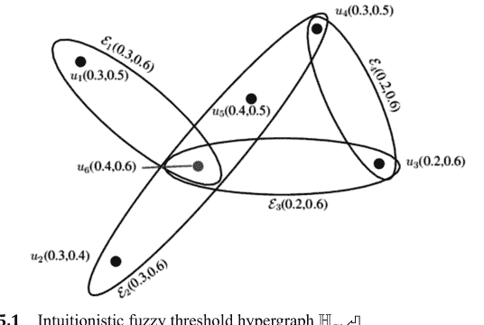

**图 5.1** 直觉模糊阈值超图 $\mathbb{H}_G$。

利用图 5.1，我们可以构造一个具有 $\mathcal{E} = \{\mathcal{E}_1, \mathcal{E}_2, \mathcal{E}_3, \mathcal{E}_4\}$ 的 IFTHG $\mathbb{H}_G$，其对应的关联矩阵如下所示：

| | $\mathcal{E}_1$ | $\mathcal{E}_2$ | $\mathcal{E}_3$ | $\mathcal{E}_4$ |
| :--- | :---: | :---: | :---: | :---: |
| $u_1$ | $\langle 0.3, 0.5\rangle$ | $\langle 0, 1\rangle$ | $\langle 0, 1\rangle$ | $\langle 0, 1\rangle$ |
| $u_2$ | $\langle 0, 1\rangle$ | $\langle 0.3, 0.4\rangle$ | $\langle 0, 1\rangle$ | $\langle 0, 1\rangle$ |
| $u_3$ | $\langle 0, 1\rangle$ | $\langle 0, 1\rangle$ | $\langle 0.2, 0.6\rangle$ | $\langle 0.2, 0.6\rangle$ |
| $u_4$ | $\langle 0, 1\rangle$ | $\langle 0.3, 0.5\rangle$ | $\langle 0, 1\rangle$ | $\langle 0.3, 0.6\rangle$ |
| $u_5$ | $\langle 0, 1\rangle$ | $\langle 0.4, 0.5\rangle$ | $\langle 0, 1\rangle$ | $\langle 0, 1\rangle$ |
| $u_6$ | $\langle 0.4, 0.6\rangle$ | $\langle 0.4, 0.6\rangle$ | $\langle 0.4, 0.6\rangle$ | $\langle 0.4, 0.6\rangle$ |

该 IFTHG 的最小 IFT 表示如下：

| | $T_1$ | $T_2$ |
| :--- | :---: | :---: |
| $u_1$ | $(0, 1)$ | $(0, 1)$ |
| $u_2$ | $(0, 1)$ | $(0, 1)$ |
| $u_3$ | $(0.2, 0.6)$ | $(0, 1)$ |
| $u_4$ | $(0, 1)$ | $(0.3, 0.5)$ |
| $u_5$ | $(0, 1)$ | $(0, 1)$ |
| $u_6$ | $(0.4, 0.6)$ | $(0.4, 0.6)$ |

对应的 IFTHG 如图 5.2 所示。

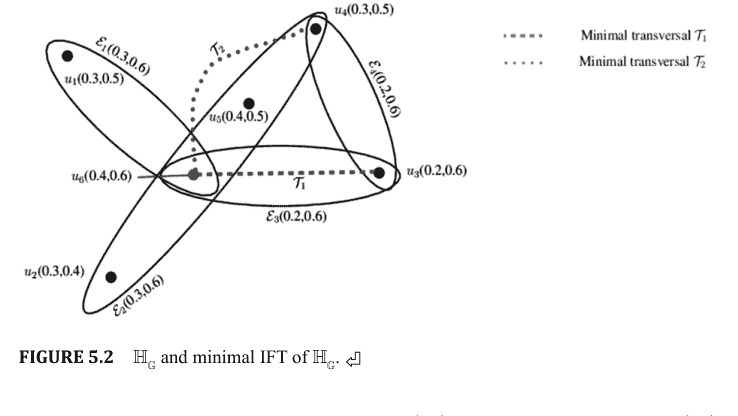

**定义 5.4.4.** 若 $T$ 是一个以 $(v_i, z_j)$ 为 $\mathbb{H}_{G}^{(v_i, z_j)}$ 最小 IFT 的直觉模糊集，且对所有 $(v_{i}, z_{j}) \in(0,1)$ 满足 $\sum_{u_{i} \in V} \mu_{y}(u_{i}) \leq s_{1}$ 和 $\sum_{u_{i} \in V}(1 - \nu_{i}(u_{i})) \leq s_{2}$ 以及 $\forall 1 \leq i \leq m, 1 \leq j \leq n$，则称 $T$ 为 IFTHG 的局部最小 IFT。包含 IFTHG 局部最小 IFT 的集合记为 $\mathcal{T} \times^{\prime}(\mathbb{H}_{G})$。

**定理 5.4.5.** 若 $T$ 是 IFTHG $\mathbb{H}_{G}=(U, \mathcal{E}, s_{1}, s_{2})$ 的一个 IFT，则 $\mathscr{A}_{T}\left(T_{e}\right) \supseteq \mathscr{A}_{T}\left(e_{j}\right)$ 对所有 $e_{j} \in \mathcal{E}$ 成立。并且，若 $T$ 是 IFTHG 的最小 IFT，则 $\mathscr{A}_{T}(T)=\left\{\max \left(\min \left(\mu_{y}\right)\right), \max \left(\max \left(\nu_{y}\right)\right) \mid \mu_{y}, \nu_{y} \in \mathcal{E}\right\}=\mathscr{A}_{T}\left(\mathbb{H}_{G}\right)$。

**定理 5.4.6.** 每个 IFTHG 都有一个非空的 IFT。

**注：** IFTHG 的每个 IFT 都包含一个最小 IFT。（即）$\mathcal{T}^{X}\left(\mathbb{H}_{G}\right) \subseteq T\left(\mathbb{H}_{G}\right)$。


**定理 5.4.7.** 若 \( \text{T}' \in \mathcal{T}\sigma(\mathbb{H}_\mathbb{G}) \)，且对于每个 \( u \in U \)，\( \text{T}'(\mathbb{H}_\mathbb{G}) \in \mathcal{F}(\mathbb{H}_\mathbb{G}) \)，则 \( \mathcal{F}\mathcal{T}\sigma(\mathbb{H}_\mathbb{G}) \subseteq \mathcal{F}(\mathbb{H}_\mathbb{G}) \)。

**定理 5.4.8.** \( \mathcal{T}\sigma(\mathbb{H}_\mathbb{G}) \) 是分段初等的（sectionally elementary）。

*证明：* 设 \( \mathcal{F}(\mathcal{T}\sigma(\mathbb{H}_\mathbb{G})) = \{y_1, y_2, \dots, y_p; z_1, z_2, \dots, z_k\} \)。假设 \( \text{T}' \in \mathcal{T}\sigma(\mathbb{H}_\mathbb{G}) \)，且存在某些 \( \alpha, \beta \in (y_p, z_i) \)，使得 \( \text{T}^{(y_i, z_i)} \subset \text{T}^{(\alpha, \beta)} \)。由于 \( \mathcal{T}\sigma(\mathbb{H}_\mathbb{G}^{(y_i, z_i)}) = \mathcal{T}\sigma(\mathbb{H}_\mathbb{G}^{(\alpha, \beta)}) \) \(\ni\) 某个 \( \mathcal{A} \in \mathcal{T}\sigma(\mathbb{H}_\mathbb{G}) \)，且 \( \mathcal{A} \supseteq \mathcal{A}^{(y_i, z_i)} = \text{T}^{(\alpha, \beta)} \)。那么 \( \text{T}^{(\alpha, \beta)} \subset \mathcal{A}^{(y_i, z_i)} \) 意味着由以下式子定义的 IFS \( U(u_i) \)：

\[ U(u_i) = \begin{cases} (\alpha, \beta) \text{ 若 } u_i \in \mathcal{A}^{(y_i, z_i)} \setminus \text{T}^{(y_i, z_i)} \\ \mathcal{A} \text{ 其他情况} \end{cases} \]

是 IFTHG 的一个 IFT。这里 \( \text{U} < \mathcal{A} \)，\(\Leftrightarrow\) \( \mathcal{A} \) 的最小性，这导致矛盾。

**定理 5.4.9.** 对于每个 \( \mathcal{A} \in \mathcal{T}\sigma(\mathbb{H}_\mathbb{G}) \)，\( \mathcal{A}^{(y_1, z_2)} \) 是 \( \mathbb{H}_\mathbb{G}^{(y_1, z_2)} \) 的最小 IFT。

*证明：* 对于每个 IFTHG \( \mathbb{H}_\mathbb{G} = (U, \varepsilon; s_1, s_2) \)，考虑 \( \mathbb{H}_\mathbb{G}^{(y_1, z_2)} \) 的一个最小 IFT \( \text{T} \)，使得 \( \text{T} \subset \mathcal{A}^{(y_1, z_2)} \)。定义直觉模糊集 \( U(u_i) \)，其中

\[ U(u_i) = \begin{cases} (y_2, z_2) \text{ 若 } u_i \in \mathcal{A}^{(y_1, z_1)} \setminus \text{T} \\ \mathcal{A} \text{ 其他情况} \end{cases} \]

根据上述定理，\( U \) 是 IFTHG 的一个 IFT，这与 \( \mathcal{A} \) 的最小性相矛盾。

**定义 5.4.10.** 设 IFTHG 为 \( \mathbb{H}_\mathbb{G} = (U, \varepsilon; s_1, s_2) \)。\( \mathbb{H}_\mathbb{G} \) 的直觉模糊横截核（Intuitionistic Fuzzy Transversal Core, IFTC）是一个 IFTHG \( \mathbb{H}'_\mathbb{G} = (U', \varepsilon'; s_1, s_2) \)，则：

1. \( \bigwedge \mathcal{T}\sigma(\mathbb{H}'_\mathbb{G}) = \bigwedge \mathcal{T}\sigma(\mathbb{H}_\mathbb{G}) \)，
2. \( U \cup \mathcal{T}\sigma(\mathbb{H}'_\mathbb{G}) = \mathbb{H}'_\mathbb{G} \)，
3. \( \varepsilon/\varepsilon' \) 是完全包含 \( \mathbb{H}_\mathbb{G} \notin \mathcal{T}\sigma(\mathbb{H}_\mathbb{G}) \) 的顶点的集合，以及
4. 独立集 \( V \subseteq U \) 是 \( \mathbb{H}_\mathbb{G} \) 中非相邻顶点的所有不同组合的集合 \(\Leftrightarrow\) 存在阈值 \( s_1 \) 和 \( s_2 > 0 \)，使得 \( \sum_{u_i \in V} \mu_{y_i}(u_i) \leq s_1 \) 且 \( \sum_{u_i \in V} (1 - \nu_y(u_i)) \leq s_2 \)。

**定义 5.4.11.** 考虑一个 IFTHG，其中 \( U = \{u_1, u_2, u_3, u_4, u_5, u_6\} \)，\( \varepsilon = \{\varepsilon_1, \varepsilon_2, \varepsilon_3, \varepsilon_4, \varepsilon_5\} \)，其中，\( \varepsilon_1 = \{u_1 \langle 0.3, 0.4 \rangle, u_6 \langle 0.4, 0.6 \rangle\} \)，\( \varepsilon_2 = \{u_1 \langle 0.3, 0.4 \rangle, u_2 \langle 0.4, 0.5 \rangle, u_4 \langle 0.3, 0.6 \rangle, u_6 \langle 0.4, 0.6 \rangle\} \)，\( \varepsilon_3 = \{u_1 \langle 0.3, 0.4 \rangle, u_3 \langle 0.2, 0.6 \rangle, u_4 \langle 0.3, 0.6 \rangle, u_5 \langle 0.2, 0.7 \rangle, u_6 \langle 0.4, 0.5 \rangle\} \)，\( \varepsilon_4 = \{u_3 \langle 0.2, 0.6 \rangle, u_5 \langle 0.2, 0.7 \rangle, u_7 \langle 0.4, 0.6 \rangle\} \)，以及 \( \varepsilon_5 = \{u_2 \langle 0.4, 0.5 \rangle, u_6 \langle 0.4, 0.6 \rangle\} \)，如图 5.3 所示。

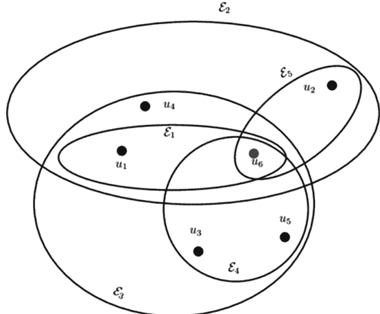

**图 5.3** IFT HG（ \(\mathbb{H}_{\mathbb{G}}\) , \(\eth\) ）

\(\mathbb{H}_{\mathbb{G}}\) 的关联矩阵给出如下：

| | $\mathcal{E}_1$ | $\mathcal{E}_2$ | $\mathcal{E}_3$ | $\mathcal{E}_4$ | $\mathcal{E}_5$ |
|---|---|---|---|---|---|
| $u_1$ | $\langle0.3,0.4\rangle$ | $\langle0.3,0.4\rangle$ | $\langle0.3,0.4\rangle$ | $\langle0,1\rangle$ | $\langle0,1\rangle$ |
| $u_2$ | $\langle0,1\rangle$ | $\langle0.4,0.5\rangle$ | $\langle0,1\rangle$ | $\langle0,1\rangle$ | $\langle0.4,0.5\rangle$ |
| $u_3$ | $\langle0,1\rangle$ | $\langle0,1\rangle$ | $\langle0.2,0.6\rangle$ | $\langle0.2,0.6\rangle$ | $\langle0,1\rangle$ |
| $u_4$ | $\langle0,1\rangle$ | $\langle0.3,0.6\rangle$ | $\langle0.3,0.6\rangle$ | $\langle0,1\rangle$ | $\langle0,1\rangle$ |
| $u_5$ | $\langle0,1\rangle$ | $\langle0,1\rangle$ | $\langle0.2,0.7\rangle$ | $\langle0,1\rangle$ | $\langle0,1\rangle$ |
| $u_6$ | $\langle0.4,0.6\rangle$ | $\langle0.4,0.6\rangle$ | $\langle0.4,0.6\rangle$ | $\langle0.4,0.6\rangle$ | $\langle0.4,0.6\rangle$ |

IFTC \(\mathbb{H}_{\mathbb{G}}'\) 的关联矩阵给出如下：

| | $\mathcal{E}_1$ | $\mathcal{E}_2$ |
|---|---|---|
| $u_1$ | $(0.3,0.4)$ | $(0.3,0.4)$ |
| $u_2$ | $(0.4,0.5)$ | $(0,1)$ |
| $u_3$ | $(0,1)$ | $(0.2,0.6)$ |
| $u_4$ | $(0.3,0.6)$ | $(0.3,0.6)$ |
| $u_5$ | $(0,1)$ | $(0.2,0.7)$ |
| $u_6$ | $(0.4,0.6)$ | $(0.4,0.6)$ |

IFTGH 的横截核如图 5.4 所示。

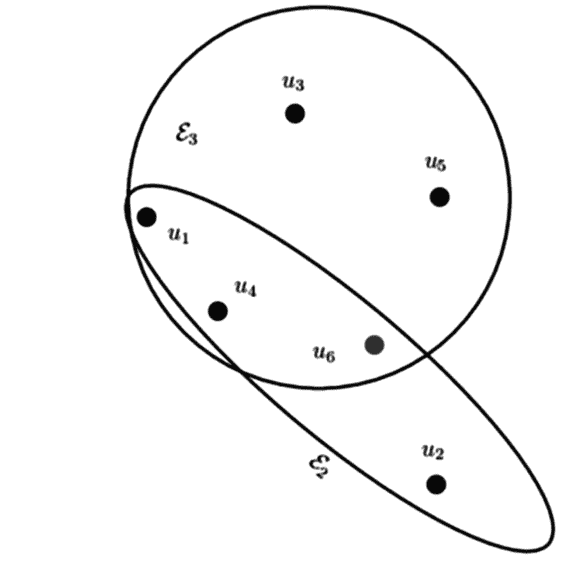

**结果：**

1. 对于任何没有尖峰超边（spike hyperedges）的 IFTGH，横截核存在且唯一。
2. 该定义也适用于包含尖峰（尖峰是指包含一个顶点的超边）超边的 IFTGH 之间。

**定义 5.4.12.** IFTGH 中最小横截中顶点 \(u_i\) 的*开邻域*是指包含 \(u_i\) 在超边中最近顶点（不包括自身）的集合，表示为 \(\mathcal{N}_{h}(u_i)\)。

**例 5.4.13.** 考虑一个 IFTGH，其中 \(U = \{u_1, u_2, u_3, u_4, u_5, u_6, u_7\}\)，\(\mathcal{E} = \{\mathcal{E}_1, \mathcal{E}_2, \mathcal{E}_3, \mathcal{E}_4, \mathcal{E}_5\}\)，其中 \(\mathcal{E}_1 = \{u_1\langle 0.3, 0.4\rangle, u_7\langle 0.4, 0.6\rangle\}\)，\(\mathcal{E}_2 = \{u_2\langle 0.2, 0.6\rangle, u_7\langle 0.4, 0.6\rangle\}\)，\(\mathcal{E}_3 = \{u_2\langle 0.2, 0.6\rangle, u_4\langle 0.5, 0.3\rangle\}\)，\(\mathcal{E}_4 = \{u_2\langle 0.4, 0.3\rangle, u_4\langle 0.5, 0.3\rangle, u_7\langle 0.4, 0.6\rangle\}\)，\(\mathcal{E}_5 = \{u_3\langle 0.2, 0.5\rangle, u_6\langle 0.3, 0.6\rangle, u_7\langle 0.4, 0.6\rangle\}\)。

这里，\(u_2\) 和 \(u_7\) 是 \(\top_1\) 中顶点 \(u_1\) 的开邻域。

**定义 5.4.14.** IFTHG 中最小横截中顶点 \(u_i\) 的*闭邻域*是指包含 \(u_i\) 在超边中最近顶点（包括该顶点本身）的集合，表示为 \(\mathcal{N}'_h(u_i)\)。

**例 5.4.15.** 从上述例子可以看出，在 \(T_1\) 中，顶点 \(u_1\) 的闭邻域是 \(u_1\)、\(u_2\) 和 \(u_7\)。

**定理 5.4.16.** 若 \(\mathbb{H}_{\G} = \langle U, \varepsilon, s_1, s_2\rangle\) 是一个 IFTHG，则以下条件是相似的：

1. T 是 IFTHG 的一个 IFT。
2. 对于每个 IF 超边 \(\mathcal{A} \in \varepsilon\) 以及每个满足 \(0 < y_{i} \leq \underline{h}_{\mu}\left(\mathbb{H}_{\G}\right)\)，\(0 < z_{j} \leq \underline{h}_{\nu}\left(\mathbb{H}_{\G}\right)\) 的 \(\langle y_{i}z_{j}\rangle\)，有 \(\operatorname{T}^{(v_{i}z_{j})} \cap \mathcal{A}^{(v_{i}z_{j})} \neq \varnothing\)。
3. 对于每个满足 \(0 < y_{i} \leq \alpha\)，\(0 < z_{j} \leq \beta\) 的 \(\langle y_{i}z_{j}\rangle\)，\(\operatorname{T}^{(v_{i}z_{j})}\) 是 \(\mathbb{H}_{\G}^{(v_{i}z_{j})}\) 的一个 IFT。

*证明：* 根据定义，“IFTHG 的最小 IFT T 是 \(\mathbb{H}_{\G}\) 的一个横截，满足如下性质：如果 \(T_1 \subset T\)，则 \(T_1\) 不是 \(\mathbb{H}_{\G}\) 的一个 IFT”，证明是平凡的。

**定理 5.4.17.** 对于一个简单 IFTHG \(\mathbb{H}_{\G}\)，有 \(T\mathfrak{H}(T\mathfrak{H}(\mathbb{H}_{\G})) = \mathbb{H}_{\G}\)。

**定理 5.4.18.** 对于任意 IFTHG \(\mathbb{H}_{\G}\)，有 \(T\mathfrak{H}(T\mathfrak{H}(\mathbb{H}_{\G})) \subseteq \mathbb{H}_{\G}\)。

*证明：* 根据定义 5.4.10，存在简单 IFTHG \(\mathbb{H}_{\G}\) 的一个部分 IFTHG \(\mathbb{H}_{\G}^{'}\)，使得 \(\exists T\mathfrak{H}(\mathbb{H}_{\G}^{'}) = T\mathfrak{H}(\mathbb{H}_{\G})\)。由定理 5.4.17，\(T\mathfrak{H}(T\mathfrak{H}(\mathbb{H}_{\G})) = T\mathfrak{H}(T\mathfrak{H}(\mathbb{H}_{\G}^{'}) = \mathbb{H}_{\G}^{'} \subseteq \mathbb{H}_{\G}\)。

**定理 5.4.19.** 设 \(\mathbb{H}_{\G} = \langle U, \varepsilon, s_1, s_2\rangle\) 是一个 IFTHG，且假设

T \(\in T\mathfrak{H}(\mathbb{H}_{\G})\)。若 \(\mathbb{H}_{\G}^{'} \subseteq supp(T) \subseteq \mathbb{H}_{\G}\)，则 \(\exists\) 一个 IF 阈值超边 \(\mathcal{A}\)，其中 \(\langle y_{i}z_{j}\rangle \in \mathcal{A}\) 代表 \(\mathcal{A} \supseteq\) 的隶属度和非隶属度值：

1. \(\langle y_{p}z_{q}\rangle = \underline{h}_{t}(\mathcal{A}) = \underline{h}_{t}\left(T^{(v_{i}z_{j})}\right) > 0\)。
2. \(\mathrm{T}_{\underline{h}_{t}(\mathcal{A})} \cap \mathcal{A}_{\underline{h}_{t}(\mathcal{A})} = \mathbb{H}_{\G}\)。

*证明：* 假设 \(0 < \underline{h}_{t}\left(T^{(v_{i}z_{j})}\right) \leq 1\)，并设 \(\varepsilon^{'}\) 为 IF 阈值超边的集合，其中对于每个 \(\tau \in \varepsilon^{'}\)，满足 \(\underline{h}_{t}(\mathcal{A}^{(v_{i}z_{j})}) \geq \underline{h}_{t}\left(T^{(v_{i}z_{j})}\right)\)，且对于所有 \(1 \leq i \leq m\)，\(1 \leq j \leq n\)，有 \(\sum_{u_{i} \in U} \mu_{ij}\left(u_{i}\right) \leq s_{1}\) 和 \(\sum_{u_{i} \in U}\left(1 - \nu_{ij}\left(u_{i}\right)\right) \leq s_{2}\)。

由于 \(\mathrm{T}^{(v_{i}z_{j})}\) 是 \(\mathbb{H}_{\G}^{(v_{i}z_{j})}\) 的一个 IFT，且 \(\mathbb{H}_{\G}^{'} \subseteq \mathrm{T}^{(v_{i}z_{j})}\) 非空。此外，对于每个 \(\tau \in \varepsilon^{'}\)，\(\underline{h}_{t}(\tau) \geq \left(T^{(v_{i}z_{j})}\right)\) 成立。另外，假设 \(\mathrm{T}^{(v_{i}z_{j})}\) 是最小 IFT，则对于每个 \(\tau \in \varepsilon^{'}\)，\(\underline{h}_{t}(\tau) \geq \left(T^{(v_{i}z_{j})}\right)\)，且存在 \(\mathbb{H}_{\G^{'}t} \neq \mathbb{H}_{\G}\)，使得 \(\mathbb{H}_{\G^{'}t} \in \tau_{\underline{h}_{t}(\tau)} \cap T_{\underline{h}_{t}(\tau)}\)。

定义一个 IFTHG \(\mathbb{H}_{\G^{1}} \supseteq\)


$$\begin{array}{c} \mathrm{T}(W)\mathrm{if}\; W\ne\mathbb {H}_{\mathtt{G}}{}^{'}\\ \mathbb {H}_{\mathtt{G}_{1}}(u_{i}) = \left\{ \begin{array}{c} \Lambda(h_{t}(\mathcal{A}')/h_{t}(\mathcal{A})<f_{t}(\mathrm{T}^{(\upsilon_{i},z_{i})}),\; \lor(h_{t}(\mathcal{A}')/h_{t}(\mathcal{A})<f_{t}(\mathrm{T}^{(\upsilon_{i},z_{i})}))\mathrm{if}\; W=\mathbb{H}_{\mathtt{G}}{}^{'} \end{array}\right. \end{array}$$

显然，$\mathbb {H}_{\mathtt{G}_{1}}$ 是 IFTHG 的一个 IFT，且 $\underline{{h}}_{t}(\mathbb {H}_{\mathtt{G}_{1}}{}^{(\upsilon_{i},z_{i})})<\underline{{h}}_{t}(\mathrm{T}^{(\upsilon_{i},z_{i})})$，这与 T 的最小性相矛盾。假设每个 $\tau\in\mathcal{E}^{'}$ 都满足部分 (i) 并且包含 $\mathbb {H}_{\mathtt{G}_{\tau}}{}^{'}\ne\mathbb {H}_{\mathtt{G}}{}^{'}$，其中 $\mathbb {H}_{\mathtt{G}_{\tau}}{}^{'}\in\tau_{\underline{{h}}_{t}(\mathcal{A}')}\cap\mathrm{T}_{\underline{{h}}_{t}(\mathcal{A})}{}^{'}$。该过程被重复，(1) 的论证得出了矛盾，从而完成了证明。

**定理 5.4.20.** 设 $\mathbb {H}_{\mathtt{G}}=(U,\mathcal{E},s_{1},s_{2})$ 是一个 IFTHG。那么，存在 $\mathrm{T}\in\mathfrak{T}(\mathbb {H}_{\mathtt{G}})$，使得对于 $\mathcal{A}\in\mathcal{E}$，满足 $\mathbb {H}_{\mathtt{G}}{}^{'}\subseteq\mathrm{supp}(\mathrm{T})\subseteq\mathbb {H}_{\mathtt{G}}{}^{'}$，则：

1.  $(\upsilon_{i},z_{i})=\underline{{h}}_{t}(\mathcal{A})$，
2.  对于每个满足 $\underline{{h}}_{t}(\mathcal{A}')>\underline{{h}}_{t}(\mathcal{A})$ 的 $\mathcal{A}'\in\mathcal{E}$，$\underline{{h}}_{t}(\mathcal{A}')$ 的 $(\upsilon_{i},z_{i})$-水平截集不是 $\underline{{h}}_{t}(\mathcal{A})$ 的 $(\upsilon_{i},z_{i})$-水平截集的子超图，并且
3.  $\underline{{h}}_{t}(\mathcal{A})$ 的 $(\upsilon_{i},z_{i})$-水平截集不包含 $\mathbb {H}_{\mathtt{G}}{}_{\underline{{h}}_{t}(\mathcal{A})}$ 的其他任何超边，其中 $(\upsilon_{i},z_{i})$ 表示 $\mathcal{A}$ 的成员度和非成员度值。

*证明：*

*必要性部分：*

1.  设 $\mathrm{T}\in\mathfrak{T}(\mathbb {H}_{\mathtt{G}})$ 且 $0<\underline{{h}}_{t}(\mathrm{T}^{(\upsilon_{i},z_{i})})\leq 1$。那么根据定理 5.4.19，结果 (i) 成立。
2.  假设对于所有满足 (i) 要求条件的 $\mathcal{A}$，存在 $\mathcal{A}'\in\mathcal{E}$ 使得 $\underline{{h}}_{t}(\mathcal{A}')>\underline{{h}}_{t}(\mathcal{A})$ 且 $\mathcal{A}'^{\underline{{h}}_{t}(\mathcal{A})}\subseteq\mathcal{A}^{\underline{{h}}_{t}(\mathcal{A}')}$，则存在 $u\notin\mathbb {H}_{\mathtt{G}}{}^{'}$，使得 $U\in\mathcal{A}'^{\underline{{h}}_{t}(\mathcal{A}')}\cap\mathrm{T}_{\underline{{h}}_{t}(\mathcal{A}')}\subseteq\mathcal{A}^{\underline{{h}}_{t}(\mathcal{A})}\cap\mathrm{T}_{\underline{{h}}_{t}(\mathcal{A})}$，这与定理 5.4.19 相矛盾。
3.  假设对于满足 (1) 和 (2) 的所有 $\mathcal{A}$，存在 $\mathcal{A}'\in\mathcal{E}$，使得 $\emptyset\ne\mathcal{A}'^{\underline{{h}}_{t}(\mathcal{A})}\subset\mathcal{A}^{\underline{{h}}_{t}(\mathcal{A}')}$。由于 $\mathcal{A}'^{\underline{{h}}_{t}(\mathcal{A})}\ne\emptyset$ 且根据 (2)，意味着 $\underline{{h}}_{t}(\mathcal{A}')=\underline{{h}}_{t}(\mathcal{A})=(\upsilon_{i},z_{i})$。

如果 $(\upsilon_{i},z_{i})=\underline{{h}}_{t}(\mathcal{A}')\ \&\ \mathcal{A}'\in\mathcal{E}$ 且 $\emptyset\ne\mathcal{A}''^{\underline{{h}}_{t}(\mathcal{A})}<\mathcal{A}'^{\underline{{h}}_{t}(\mathcal{A})}\subset\mathcal{A}^{\underline{{h}}_{t}(\mathcal{A}')}$，继续该过程，该链必须在无穷多步后终止，因此不妨假设 $(\upsilon_{i},z_{i})<\underline{{h}}_{t}(\mathcal{A})$。但是，存在 $U\nsubseteq\mathbb {H}_{\mathtt{G}}{}^{'}$ 使得 $U\in\mathcal{A}'^{\underline{{h}}_{t}(\mathcal{A})}\cap\mathrm{T}_{\underline{{h}}_{t}(\mathcal{A})}\subseteq\mathcal{A}^{\underline{{h}}_{t}(\mathcal{A})}\cap\mathrm{T}_{\underline{{h}}_{t}(\mathcal{A}')}$，这与定理 5.4.19 相矛盾。

*充分性部分：*

假设 $\mathcal{A}\in\mathcal{E}$ 满足条件 (1) 和 (2)。由 (1) 可知，$\underline{{h}}_{t}(\mathcal{A})=(\upsilon_{i},z_{i})$，其中 $(\upsilon_{i},z_{i})$ 是 $\mathcal{F}(\mathbb {H}_{\mathtt{G}})$ 中的某个成员。由 (2) 和 (3) 可知，对于所有 $\mathcal{A}'\in\mathcal{E}$ 且 $\mathcal{A}'\ne\mathcal{A}\ \&\ \underline{{h}}_{t}(\mathcal{A}')\ge\underline{{h}}_{t}(\mathcal{A})$，存在 $U\in\mathcal{A}'^{\underline{{h}}_{t}(\mathcal{A})}\setminus\mathcal{A}^{\underline{{h}}_{t}(\mathcal{A})}$。设 $V_{\mathcal{A}}$ 为 $\mathbb {H}_{\mathtt{G}}$ 中所有顶点的集合，且 $V_{\mathcal{A}}\cap\mathcal{A}^{\underline{{h}}_{t}(\mathcal{A})}=\emptyset$。

构造初始横截序列 $\tau_{s} \subseteq U$，对于每个 $s, 1 \leq s < i$ 且 $\tau_{s} \subseteq U_{v} \cup U_{f}$。显然，$U_{i} \in \tau_{i} \setminus \backslash$。重复该过程，最终得到一个最小 IFT，其值为 $(y_{p} z_{i}) = \underline{h}_{i}(\mathcal{A}) = \underline{h}_{t}(T^{y_{i} z_{i}})$。

**定理 5.4.21.** 设 $\mathbb{H}_{\mathbb{G}}=(U, \mathcal{E}; s_{1}, s_{2})$ 是一个 IFTHG，其中 $\mathcal{F}(\mathbb{H}_{\mathbb{G}}) = \{y_{1}, y_{2}, \ldots, y_{i}^{*}, z_{1}, z_{2}, \ldots, z_{i}^{*}\}$，使得 $0 \leq y_{i} \leq \underline{h}_{u}(\mathbb{H}_{\mathbb{G}})$ 且 $0 \leq z_{i} \leq \underline{h}_{f}(\mathbb{H}_{\mathbb{G}})$。此外，设 $\mathbb{H}^{(y_{i} z_{i})}$ 为基本 IFTHG，满足重复 $\mathcal{A}^{\prime} \Longleftrightarrow \underline{h}_{i}(\mathcal{A}^{\prime}) = (y_{p} z_{i})$ 且 supp($\mathcal{A}^{\prime}$) 是 $\mathbb{H}^{(y_{i} z_{i})}$ 的超边。那么 $\mathrm{T}\mathfrak{G}(\mathrm{T}\mathfrak{G}(\mathbb{H}_{\mathbb{G}}))$ 是 $\mathbb{H}_{\mathbb{G}}^{(y_{i} z_{i})}$ 的一个部分 IFTHG。

*证明：* 根据定理 5.4.9 以及最小 IFT 的构造，$\mathrm{T}\mathfrak{G}(\mathbb{H}_{\mathbb{G}})$ 的 $(y_{p}, z_{i})$-水平 IFTHG 是 $\mathrm{T}\mathfrak{G}(\mathbb{H}_{\mathbb{G}}^{(y_{i} z_{i})})$，这意味着 $(\mathrm{T}\mathfrak{G}(\mathbb{H}_{\mathbb{G}}))^{(y_{i} z_{i})} = \mathrm{T}\mathfrak{G}(\mathbb{H}_{\mathbb{G}}^{(y_{i} z_{i})})$。设 $\mathfrak{T} \in \mathrm{T}\mathfrak{G}(\mathrm{T}\mathfrak{G}(\mathbb{H}_{\mathbb{G}}))$。根据定理 5.4.19，$\underline{h}_{i}(\tau)(U)>0$，这意味着存在 $\mathrm{T} \in \mathrm{T}\mathfrak{G}(\mathbb{H}_{\mathbb{G}})$，使得 $\underline{h}_{i}(\tau)(U)=\underline{h}_{i}(\mathrm{T})$。根据定理 5.4.5，对于每个最小 IFT T，$\underline{h}_{i}(\mathrm{T})=\{\max(\min(\mu_{y})), \max(\max(v_{y})) | |v_{y}^{i}|, v_{y}^{i} \in \varepsilon^{i}\} = \underline{h}_{i}(\mathbb{H}_{\mathbb{G}})$。因此 $\tau$ 是值为 $(y_{p} z_{i})$ 的基本超边。由于 supp$(\tau)=\tau^{(y_{i} z_{i})}$，定理 5.4.9 表明 supp($\tau$) 是 $(\mathrm{T}\mathfrak{G}(\mathbb{H}_{\mathbb{G}}))^{(y_{i} z_{i})}$ 的最小 IFT。显然，supp$(\tau)$ 是 $\mathbb{H}_{\mathbb{G}}^{(y_{i} z_{i})}$ 的超边。因此 $\tau$ 是 $\mathbb{H}_{\mathbb{G}}^{(y_{i} z_{i})}$ 的超边。

**定理 5.4.22.** 设 $\mathbb{H}_{\mathbb{G}}=(U, \mathcal{E}; s_{1}, s_{2})$ 是一个 IFTHG，且 $\mathbb{H}_{\mathbb{G}}^{(y_{i} z_{i})}$ 是简单的。那么 $\mathrm{T}\mathfrak{G}(\mathrm{T}\mathfrak{G}(\mathbb{H}_{\mathbb{G}}))=\mathbb{H}_{\mathbb{G}}^{(y_{i} z_{i})}$。

*证明：* 根据上述定理，$\mathrm{T}\mathfrak{G}(\mathrm{T}\mathfrak{G}(\mathbb{H}_{\mathbb{G}})) \subseteq \mathbb{H}_{\mathbb{G}}^{(y_{i} z_{i})}$。设 $\tau$ 为基本超边，满足 $\underline{h}_{t}(\mathrm{T})=(y_{i}, z_{i})$ 且 supp$(\tau) \in \mathbb{H}_{\mathbb{G}}^{(y_{i} z_{i})}$。根据定理 5.4.21，supp$(\tau)$ 是 $(\mathrm{T}\mathfrak{G}(\mathbb{H}_{\mathbb{G}}))^{(y_{i} z_{i})}$ 的最小 IFT。由于根据最小 IFT 的定义，$\mathrm{T}\mathfrak{G}(\mathbb{H}_{\mathbb{G}})$ 的每个最小 IFT 都是基本超边，该过程在 $(y_{i}, z_{i})$-水平终止，且 $\tau \in \mathrm{T}\mathfrak{G}(\mathrm{T}\mathfrak{G}(\mathbb{H}_{\mathbb{G}}))$。因此 $\mathbb{H}_{\mathbb{G}}^{(y_{i} z_{i})} \subseteq \mathrm{T}\mathfrak{G}(\mathrm{T}\mathfrak{G}(\mathbb{H}_{\mathbb{G}}))$，这意味着 $\mathbb{H}_{\mathbb{G}}^{(y_{i} z_{i})} = \mathrm{T}\mathfrak{G}(\mathrm{T}\mathfrak{G}(\mathbb{H}_{\mathbb{G}}))$。

# 5.5 应用

想象一个大型农业农场，它使用滴灌系统为其作物浇水。滴灌系统利用管道和软管网络将水直接输送到植物的根部区域，与传统的灌溉方法相比，最大限度地减少了水资源的浪费。然而，由于农场内不同区域的作物类型、土壤状况和环境影响因子的差异影响了其需水量，高效管理此类系统具有挑战性。

为了应对这一挑战，该农场决定利用 IFTHG。这些数学结构提供了一种对复杂进行建模和分析的方法


影响水分分布的不同因素之间的关系，例如作物类型、土壤含水量水平和天气状况。在直觉模糊阈值超图（IFT HG）中，每个因素都被表示为一个顶点，而顶点之间的超边则指示了依赖性和相互作用。

在此背景下，横截集（transversals）作为一种识别最佳水分分配策略的手段应运而生。超图的横截集代表了一组因素或区域的集合，对这些区域进行灌溉可以确保满足所有关键的依赖关系。通过寻找最小横截集，农场可以确定在水分分配方面最有效的方法，同时满足不同作物和土壤条件的各种约束和要求。农场的灌溉系统配备了传感器和执行器，可以实时调整水流速率和灌溉计划。通过在超图中应用横截集，系统可以智能地决定在哪里以及何时分配水资源。

例如：

-   **资源分配**：超图分析可以识别在给定时间内农场哪些区域需要水，同时考虑特定作物的需求和土壤含水量水平。
-   **容错性**：如果灌溉系统的某一部分发生故障或阻塞，系统可以利用横截集快速重新路由，以确保所有必需区域获得足够的灌溉。
-   **适应天气状况**：通过考虑天气预报作为超图中的因素，系统可以调整灌溉计划，以应对预期的降雨或干旱状况。

### 5.6 结论

本章讨论了一些有趣的概念，如 IFT、最小 IFT、局部最小 IFT 以及 IFT HG 的 IFTC。重要的是要注意，IFT C 既存在于尖点直觉模糊阈值超边中，也存在于非尖点直觉模糊阈值超边中。最后，对 IFT HG 的横截集及其性质的研究为包括滴灌在内的各种应用提供了有价值的见解。通过应用这些概念，我们可以优化灌溉系统中的资源分配和决策过程，从而实现更高效的水资源利用和提高作物产量。

## 关键词

-   直觉模糊横截集
-   最小 IFT
-   局部最小 IFT
-   IFTHG 的 IFTC

## 参考文献

1.  Alain, B. (2013). *Hypergraph Theory: An Introduction*. Springer International Publishing: Switzerland.
2.  Bondy, J. A., & Murty, U. S. R. (1976). *Graph Theory with Applications*. Elsevier Science Publishing Co.: New York.
3.  Choudum, S. A. (2000). *A First Course in Graph Theory*. Laxmi Publications, Macmillan India.
4.  Vaclav, C., & Hammer, P. L. (1977). Aggregation of inequalities in integer programming. In: *Annals of Discrete Mathematics*, North-Holland: Amsterdam, Vol. 1, pp. 145–162.
5.  Berge, C. (1973). *Graphs and Hypergraphs*. North-Holland Publishing Company: Amsterdam.
6.  Berge, C. (1989). *Hypergraphs: Combinatorics of Finite Sets*. Elsevier Science Publishing Company: New York.
7.  Mordeson, J. N., & Nair, P. S. (2012). *Fuzzy Graphs and Fuzzy Hypergraphs*. Physica-Verlag.
8.  Atanassov, K. T. (2012). *On Intuitionistic Fuzzy Set Theory*. Springer-Verlag Berlin Heidelberg.
9.  Atanassov, K. T. (1999). *On Intuitionistic Fuzzy Sets: Theory and Applications*. Springer-Verlag: Berlin Heidelberg.
10. Yang, L., & Mao, H. (2019). Intuitionistic fuzzy threshold graphs. *Journal of Intelligent and Fuzzy Systems, 36*, 6641–6651.
11. Euler, L. (1763). Solution of a problem in the geometry of position. *The Journal Commentaries of the St. Petersburg Academy of Sciences*, Mathematical Association of America.
12. Pal, M., Samanta, S., & Ghurai, G. (2020). *Modern Trends in Fuzzy Graph Theory*. Springer Nature Singapore Pvt. Ltd.
13. Mahadev, N. V. R., & Peled, U. N. (1995). *Threshold Graphs and Related Topics*. Elsevier Science, Amsterdam: The Netherlands.
14. Mohammad, A. B., & Matea, S. (2015). Connection and separation in hypergraphs. *Theory and Applications of Graphs, 2(2)*, 1–25.
15. Muhammad, A., & Dutek, W. A. (2013). Intuitionistic fuzzy hypergraphs with applications. *Information Sciences, 218*, 182–193.
16. Myithili, K. K., Parvathi, R., & Akram, M. (2016). Certain types of intuitionistic fuzzy directed hypergraphs. *International Journal of Machine Learning and Cybernetics*, 7(2), 287–295.
17. Myithili, K. K., & Parvathi, R. (2016). Properties of transversals of intuitionistic fuzzy directed hypergraphs. *Advances in Fuzzy Sets and Systems*, 21(1), 93–105.
18. Parvathi, R., Thilagavathi, S., & Karunambigai, M. G. (2009). Intuitionistic fuzzy hypergraphs, Bulgarian Academy of Sciences. *Cybernetics and Information Technologies*, 9(2), 6641–6651.
19. Mathew, S., Mordeson, J. N., & Malik, D. S. (2018). *Fuzzy Graph Theory*. Springer International Publishing: Switzerland.
20. Zadeh, L. A. (1965). Fuzzy sets. *Information and Control*, 8, 338–353.

# Taylor & Francis

Taylor & Francis Group

http://taylorandfrancis.com


# 第6章

## 直觉模糊集和模糊逻辑在数学及相关领域的应用

JAHANVI 和 RASHMI SINGH

*阿米蒂大学应用科学学院，印度北方邦诺伊达*

### 摘要

本章重点探讨了直觉模糊集（IFS）和模糊逻辑在解决不确定性和犹豫方面的理论和实际潜力。由 Atanassov 提出的 IFS 通过引入隶属度、非隶属度和犹豫度，扩展了经典模糊集；从而提供了一个更丰富的框架来处理不确定性。文中介绍了 IFS 的基本概念，强调了其在处理超越经典模糊集的模糊性方面的重要性。本章考察了 IFS 在各个领域的应用。文中阐述了 IFS 在代数结构和拓扑空间等数学学科中的重要性。本章包括 IFS 在决策系统中的应用，通过制造环境中供应商选择的案例研究，展示了其建模犹豫和不确定性的能力。此外，它还进一步提供了 IFS 与计算机科学的集成，展示了其对专家系统、模式识别、风险评估和控制系统的贡献。本章强调了直觉模糊集和模糊逻辑在连接数学理论与实践挑战方面的相关性。它邀请读者探索 IFS 在新兴领域的变革潜力，从而为复杂问题培育创新的解决方案。

## 6.1 引言

### 6.1.1 模糊逻辑和直觉模糊集（IFS）的背景

Zadeh [46] 在20世纪引入了模糊集（FS）的概念，以处理不确定和不精确的数据。计算机所理解的常规逻辑是严格二值的，而模糊逻辑是一种多值逻辑，取 [0,1] 之间的中间值，其中 0 和 1 是极端情况。基本上，FS 提供部分隶属，即集合成员可能具有不同程度的隶属度。因此，Zadeh 考虑了具有相对概念的对象类别，这些概念用自然语言表达，如重量、颜色、年龄、大小、身高和温度。

Atanassov [7] 在20世纪80年代提出的 IFS 是经典 FS 的推广，其中集合的每个元素都具有隶属度、非隶属度和犹豫度。它旨在增强 FS 更好地捕捉决策和推理过程中的不确定性和模糊性的能力。

在建立的初期二十年里，Atanassov [8] 及与他相关的一小群研究人员在 IFS 方面取得了进展。他们的工作主要集中在概念背后的数理逻辑和数学，特别是在分析、代数、几何及相关领域。随后，由于信息技术和决策科学的进步，格局发生了显著变化。IFS 的效用大幅增加，每年在数学和其他领域的知名期刊和会议上发表了大量研究论文。理论研究者的社区正在扩大，与此同时，应用这些理论创建概念的实际工作者群体也在医药、专家和控制系统、工业、经济学、人工智能等其他领域不断壮大。

在 FS 引入之后，许多研究人员致力于推进由 FS 扩展而来的集合。FS 及其扩展之间的关系如图 6.1 所示。

IFS 是一个超前于时代出现的概念，如今为我们提供了管理内在不确定性和不精确性的重要工具。图 6.2 展示了 FS 的发展和扩展。


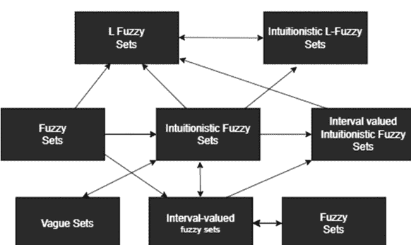

**图 6.1** 模糊集与其他集合之间的关系。

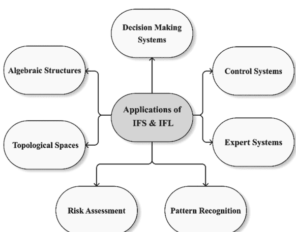

**图 6.2** IFS 的应用。

### 6.1.2 直觉模糊逻辑 (IFL) 的重要性

IFL 提供了一种可适应的模型，用于管理决策过程中的不精确性。对 IFS 的操作对于解决现实生活中的问题是很有用的。当仅存在隶属函数似乎不足以描述情况时，这些方法尤为适用。IFS 可被用作展示犹豫度的工具，犹豫度是元素在集合中隶属度和非隶属度的组成部分。

这些集合在各个领域都有应用，例如人工智能、销售分析、新产品营销、职业确定、金融服务、决策和谈判过程。它们在与计算机科学相关的领域特别相关，在这些领域中数据可能不完整或不确定，例如图像处理、机器学习和模式识别。图 6.2 展示了其在各个领域中的应用。

## 6.2 IFS 的基础

IFS 是一种 FS，定义在论域中，其中 FS 的每个成员表示为一个四元组，由隶属度、非隶属度和犹豫度组成。犹豫度是隶属度或非隶属度或两者的组成部分。

### 6.2.1 定义

论域 *U* 中的 IFS *A* 被定义为由四元组元素组成的非空集合，即：

*A* = { ⟨*e*, μₐ(*e*), πₐ(*e*), νₐ(*e*)⟩ | *e* ∈ *U* }, *e* ∈ *U*

其中，符号 μₐ、πₐ 和 νₐ 分别表示隶属函数 μₐ: *U* → [0,1]、犹豫函数 πₐ: *U* → [0,1] 和非隶属函数 νₐ: *U* → [0,1]。在此，μₐ(*e*)、πₐ(*e*) 和 νₐ(*e*) 分别表示 *e* ∈ *U* 对于 IFS *A* 的隶属度、犹豫度和非隶属度。我们可以借助图 6.3 所示的图表来表示 μₐ（隶属）、πₐ（犹豫）和 νₐ（非隶属）度。

对于每个 *e* ∈ *U*，μₐ(*e*) + πₐ(*e*) + νₐ(*e*) = 1，且 0 ≤ μₐ(*e*), πₐ(*e*), νₐ(*e*) ≤ 1。例如，如果我们知道 μₐ(*e*) 和 νₐ(*e*) 的度，就可以计算 πₐ(*e*) 的度，即 πₐ(*e*) = 1 − μₐ(*e*) − νₐ(*e*) (*e* ∈ *U*)。

为了方便，我们可以将 IFS *A* 的每个元素表示为三元组元素，即 ⟨μₐ(*e*), πₐ(*e*), νₐ(*e*)⟩，因此 IFS *A* 可以写为：*A* = {*tᵢ* | *tᵢ* = ⟨μₐ(*eᵢ*), πₐ(*eᵢ*), νₐ(*eᵢ*)⟩ & *eᵢ* ∈ *U*} 或简写为 *A* = {*tᵢ* | *tᵢ* = ⟨μᵢ, πᵢ, νᵢ⟩}，其中 μᵢ = μₐ(*eᵢ*)，πᵢ = πₐ(*eᵢ*)，νᵢ = νₐ(*eᵢ*)，∀ *eᵢ* ∈ *U*。

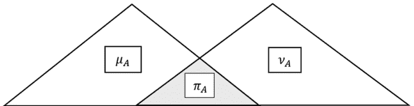

**图 6.3** 隶属度、非隶属度和犹豫度的示意图。

### 6.2.2 性质

设 *A* 和 *B* 为两个 IFS。我们定义 *A* 和 *B* 上的一些运算和关系如下：

- 1) 包含：$A \subseteq B \leftrightarrow \mu_{A}(e) \le \mu_{B}(e)$ 且 $\nu_{A}(e) \ge \nu_{B}(e) \ \forall e \in U$
- 2) 相等：$A = B \leftrightarrow \mu_{A}(e) = \mu_{B}(e)$ 且 $\nu_{A}(e) = \nu_{B}(e) \ \forall e \in U$
- 3) 否定：$\overline{A} = \{ \langle e, \nu_{A}(e), \mu_{A}(e) \rangle | e \in U \}$
- 4) 并集：$A \cup B = \{ \langle e, \max(\mu_{A}(e), \mu_{B}(e)), \min(\nu_{A}(e), \nu_{B}(e)) \rangle ; e \in U \}$
- 5) 交集：$A \cap B = \{ \langle e, \min(\mu_{A}(e), \mu_{B}(e)), \max(\nu_{A}(e), \nu_{B}(e)) \rangle ; e \in U \}$
- 6) 对称差：$A \triangle B = \{ \langle e, \max[\min(\mu_{A}, \nu_{B}), \min(\mu_{B}, \nu_{A})], \min[\max(\nu_{A}, \mu_{B}), \max(\nu_{B}, \mu_{A})] \rangle ; e \in U \}$
- 7) 笛卡尔积：$A \times B = \{ \langle \mu_{A}(e)\mu_{B}(e), \nu_{A}(e)\nu_{B}(e) \rangle ; e \in U \}$

## 6.3 在数学中的应用

### 6.3.1 代数结构

关于 IFS 的格和代数结构的研究已有记载 [44]。此外，关于 IFSS 的代数结构也有研究。一篇论文讨论了与群和子群相关的复数 IFSS 的代数结构 [33]。另一项研究表明，直觉模糊值 (IFVs) 的空间在配备了由得分函数和精度函数确定的线性序后，展现出与基于相似函数和精度函数生成的线性序空间类似的代数结构。此外，该空间既是拓扑空间又是格 [41]。

### 6.3.2 拓扑空间

在拓扑空间的背景下，IFS 可用于定义直觉模糊拓扑空间，这是经典拓扑空间的一般化形式。近邻集已被用作研究拓扑空间扩展的工具 [26, 36]。直觉模糊拓扑空间在决策、图像处理和识别等领域有应用。

## 6.4 在决策系统中的应用

IFL 和 IFS 常用于决策者对元素在集合中的归属度不确定的决策过程。它们提供了一个更灵活的框架来表示和推理不确定信息。

### 6.4.1 犹豫和不确定性的建模

IFS 特别适用于决策者对特定条件的发展不确定，且需要建模不确定数据的情况 [29]。非隶属度可用于表示决策中的犹豫或不确定性 [25]。IFS 在各个领域有多种应用，包括多属性群体决策 [31]、多目标优化问题 [12]，以及基于测度的粒度不确定性决策 [42]。

### 6.4.2 案例研究：制造公司供应商选择中的决策

**背景**

一家制造公司必须为其生产运营确定最佳供应商。该组织必须考虑价格、质量、可靠性和交货时间等不同因素。管理层希望在对供应商选择过程中固有的不确定性进行考量的情况下，做出知情的判断。

**IFS 的应用**

- 1. *标准评估：* 公司的采购团队为每个潜在供应商的不同标准分配直觉模糊值。例如，他们可能会以 0.8 的隶属度和 0.2 的犹豫度来评估供应商 A 的成本。
- 2. **供应商排名标准**：采购团队根据其专业知识和公司目标建立规则。这些准则考虑了分配给每个标准的不精确值。可以定义如下规则：如果供应商的成本被认为非常可接受（隶属度大于 0.7），并且质量被认为中等良好（隶属度大于 0.5），则优先选择该供应商。
- 3. **规则评估**：通过根据规则条件考虑隶属度和犹豫度，对每个可能的供应商实施供应商排名规则。
- 4. **去模糊化**：指将 FS 转换为清晰值的过程。由规则得出的结果经过去模糊化，提供精确的供应商排名，指出根据指定标准最合适的供应商。

**结果**

通过将 IFSS 纳入供应商选择过程，公司可以生成一个潜在供应商的优先列表。供应商 B 可能拥有最高排名，置信度为 0.75。犹豫度反映了管理层对此决策的模糊程度，在此场景中可能为 0.1。

**结论**

此案例研究展示了 IFSS 在制造业供应商选择背景下的应用。它强调了 IFS 在决策程序中的适应性。通过考量模糊性并纳入专业知识，公司可以做出更明智的供应商选择，使其与公司目标和优先级保持一致。实施这一策略可以提高供应链效率和产品质量，同时减少与选择供应商过程相关的潜在风险。

## 6.5 在计算机科学中的应用

### 6.5.1 专家系统

IFSS 不仅包含隶属度，还包含非隶属度和犹豫度。这一附加信息在...

设计用于模拟人类专业知识与决策过程的可行专家系统 [6]。以下是 IFS 在专家系统中的一些应用：

- *医学诊断*：在医学专家系统中，IFs 可用于表示诊断患者病情相关的 Uncertainty。Dhihan 等人 [19] 描述了针对医学诊断开发的一种基于直觉模糊分数知识的专家系统。它允许专家指明其对诊断的信心程度，以及认为该诊断不属于特定类别的程度。
- *金融决策支持*：在金融专家系统中，IFs 可以在进行投资决策时处理不精确的数据和专家意见。为金融相关的时间序列预测开发了直觉模糊模型 [15]，用于同时建模金融时间序列中的线性和非线性关系，使其在复杂的预测问题中非常有用。
- *环境管理*：IFs 可以容纳在评估环境影响或风险时的模糊性和犹豫。Adamu [1] 提出了 IFs 在环境管理中的应用，用于确定侵蚀类型。Alkan 和 Kahraman [2] 提出的基于直觉模糊 EM-SWARA-TOPSIS 方法的混合多标准决策 (MCDM) 技术，已用于根据社会、环境、经济和技术标准分析医疗废物处理技术。
- *自然语言处理*：IFs 可用于专家系统内的自然语言理解，例如文本分类、语言变量和规则的表示、情感分析 [20] 等。Sidiropoulos 等人 [35] 使用距离和相似度等直觉模糊度量来表示文本分类。它们有助于处理人类语言固有的不确定性和歧义，提高系统解释和响应用户查询的能力。
- *质量控制*：在制造和质量控制专家系统中，IFs 可用于评估和审查产品质量，同时考虑符合质量标准的程度和不符合标准的程度。
- *供应链管理*：在供应链优化和物流专家系统中，IFs 可被用于处理不确定的需求、交货期和库存水平。
- *人力资源 (HR)*：在人力资源专家系统中，IFs 可以通过容纳与候选人评估相关的不精确性和犹豫，帮助招聘和选拔过程。例如，一种基于区间值 IFs 的模糊层次分析法 (AHP) 方法 [21] 被用于某些大学职位录用的人员选拔标准。

在这些应用中，IFs 可以为不确定性和专家知识提供更现实、更细致的表示，使专家系统能够在复杂和不确定环境中做出更明智的决策。这些系统可以利用 IFs 不仅处理不精确性，还可以捕捉专家对各种可能性的信念和不信念程度。

## 6.5.2 **模式识别**

由于 IFSS 具备处理数据中的不确定性、模糊性和歧义的能力，其在模式识别领域获得了重要应用。以下是 IFs 在模式识别中的一些关键应用：

- *图像识别*：在图像识别任务中，图像中的对象或模式通常受大小、方向和光照变化的影响。直觉模糊环境中的图像由与图像属性相关的成员度和犹豫度函数组成。这些函数从不同的出发点建模图像的不确定性。IFs 特别适用于识别部分被遮挡的对象或边缘不清的对象，因为它们可以捕捉与特征存在或缺失相关的不确定性 [13, 16, 28]。IFs 还用于数字图像分类 [32]。
- *手写和字符识别*：在处理风格和品质各异的手写字符时，手写和字符识别系统受益于 IFs。IFs 度量被用于文本分类和模式识别 [35]。许多研究描述了使用直觉模糊信息识别手写阿拉伯单词 [10, 11]。IFs 表示字符形状中的不精确性，使识别更加鲁棒，特别是在传统 FSs 可能不足的情况下。
- *生物特征识别*：生物特征系统，如人脸识别和指纹识别，涉及捕获可能因衰老、光照或姿势等因素而存在变化的生物特征。一种评估两个指纹等价性的过程使用直觉模糊评估 [14]。
- *目标检测与跟踪*：在计算机视觉和目标检测中，IFs 可用于检测视频序列中的对象并跟踪它们。在 Giveli 等人 [22] 中，介绍了一种利用 IFs 理论检测移动对象的新颖且有效的方法。[34] 中应用 IFL 用于目标检测方法。
- *纹理识别*：识别图像中的材料或模式是纹理分析中的常见任务。Tripathy 等人 [37] 展示了一个使用 IFs 理论的纹理检索系统。作者结合颜色和纹理特征来表示图像，并应用 IFs 理论来测量图像之间的相似度。使用直觉模糊局部二值模式 (IFLBP) 提取纹理特征的方法 [4] 表明，IFLBP 在纹理识别中是有效的。
- *情绪识别*：在情感计算中，IFs 通过处理情感线索的不确定性和细微差别，可以改善从面部表情、语音或生理信号中识别情绪的过程。Yang 等人 [43] 介绍了一种基于 IFs 和判别信息测度的新颖语音情绪识别方案。IFs 的方法可以升级那些表达不清晰或受文化差异等因素影响的情绪。

在所有这些应用中，IFs 使模式识别系统更具适应性和鲁棒性，因为它们可以处理不精确和不确定数据，使其适合实际场景中精确和清晰边界通常难以定义的情况。

## 6.5.3 风险评估

IFs 是风险评估 [9] 中的宝贵工具，因为它们能够处理和表示各种形式的不确定性，包括模糊性和歧义。图 6.4 展示了 IFs 在风险评估中的一些应用。

IFs 和 IFL 在风险评估中的其他一些应用如下：

- *环境风险评估*：直觉模糊值在环境风险评估中很有价值，用于评估污染物 [5]、气候变化的影响，以及定义风险因素，包括用于综合多位专家对每种风险因素严重性意见的聚合算子 [38]。

通过使用 IFs，环境科学家可以更好地分析与潜在生态系统风险相关的不确定性，并传达这些信息。

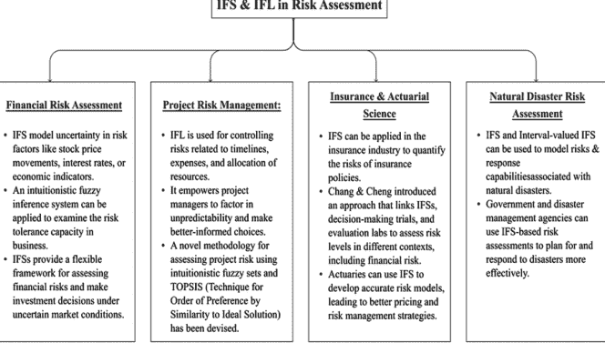

**图 6.4 风险评估中的 IFs 和 IFL。**

- *医疗和健康风险评估*：在医疗保健领域，IFs 可以通过纳入与诊断、治疗结果和患者状况相关的不确定数据，帮助评估患者风险。例如，Yousefnejad 等人 [45] 将危险与可操作性 (HAZOP) 方法与 IFs 相结合，以增强在传统 HAZOP 相关固有歧义下的决策能力。这种方法提供了更准确的风险水平评估，从而对情况有更现实的看法。另一项研究 [18] 使用区间值直觉模糊方法，结合决策试验与评价实验室 (Delf) 来评估新冠预防期间恢复的可能性。在复杂系统中，提出的方法比常规方法得出了更精确的结果。

综上所述，上述应用表明，IFs 方法能更深入地了解现实世界问题中的风险水平，并可用于评估医疗和健康系统中的风险。

在上述所有应用中，IFs 为风险评估建模了一个可调整的框架。它们允许决策者应对不确定的

不精确的数据，从而得出更全面、更真实、更稳健的风险评估。

## 6.5.4 控制系统

IFS 和 IFLs 在处理不精确或不确定数据时，对于控制系统而言极具实用性。图 6.5 展示了 IFS 在控制系统中的一些应用。

IFS 和 IFL 在风险评估中的其他应用如下：

- 1) 模糊逻辑控制：IFSs 能够处理模糊逻辑控制系统中更复杂的 uncertainty（不确定性）。领域专家通常提供模糊逻辑控制器中使用的推理规则。然而，在使用 IFSs 的系统中，这些规则是基于训练集自动归纳的模糊关联规则 [24]。

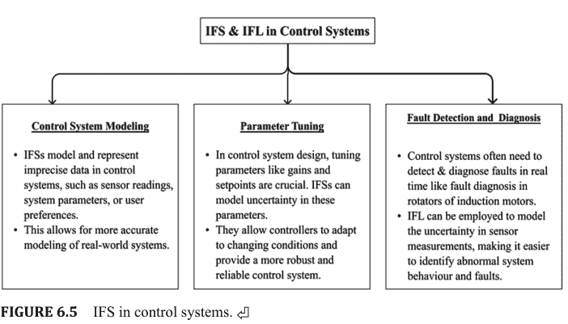

图 6.5 控制系统中的 IFS。

- 2) 优化：直觉模糊优化技术可用于优化控制系统参数，同时考虑控制目标的满足程度以及决策过程中不确定性或犹豫程度。与等效的模糊优化问题和清晰（crisp）问题相比，直觉模糊优化（IFO）问题的解决方案能更好地实现其目标 [3]。

IFSs 为处理控制系统中的犹豫性提供了更全面的框架，使其在那些经典模糊集（FSs）可能无法捕捉到不确定性和不精确性的全部范围的应用中显得极具价值。

## 6.6 结论

总之，IFSs 和 IFL 在代数结构、拓扑空间、决策系统、专家系统、模式识别、风险评估以及控制系统等广泛的数学及相关领域中，已找到许多多样化且有价值的应用。这些方法扩展了传统的数学和逻辑框架，以有效地处理模糊性、不确定性和不精确性，使其成为解决各种现实世界问题的必要工具。

## 6.7 对未来研究的建议

- 1) 该研究可以扩展，利用 IFS 创建复杂的数学模型，以解决各种领域中的挑战。
- 2) 考虑新的算法和计算方法，利用 IFS 增强数据分析和解决问题。
- 3) 在医疗、工业和金融等不同领域进行全面的案例研究，以证明 IFS 的实用性。

## 关键词

- 直觉模糊集
- 直觉模糊逻辑
- 直觉模糊值
- 危险性与可操作性方法

## 参考文献

- 1. Adamu, I. M. (2021). 直觉模糊集在环境管理中的应用。*Notes on Intuitionistic Fuzzy Sets*, 27(3), 40–50. https://doi.org/10.7546/nifs.2021.27.3.40-50.
- 2. Alkan, N., & Kahraman, C. (2022). 基于直觉模糊多距离的综合动态决策分析评估（IF-DEVADA）：其在废物处置选址中的应用。*Engineering Applications of Artificial Intelligence*, 111, 104809. https://doi.org/10.1016/j.engappai.2022.104809
- 3. Angelov, P. P. (1997). 直觉模糊环境中的优化。*Fuzzy Sets and Systems*, 86(3) 299–306. https://doi.org/10.1016/S0165-1849(96)00009-7
- 4. Ansari, M. D., Ghera, S. P., & Mishra, A. R. (2020). 使用直觉模糊局部二值模式提取纹理特征。*Journal of Intelligent Systems*, 29(1). https://doi.org/10.1515/jisys-2016-0155
- 5. Ashraf, S., Ali, M., Sohaib, M., & Eldin, S. M. (2023). 使用复杂直觉模糊 ELECTREE 方法评估工业污染的环境影响：污染控制措施的案例研究。*Frontiers in Environmental Science*, 11. https://doi.org/10.3389/fenvs.2023.1171701
- 6. Atanassov, K. T. (n.d.). 直觉模糊专家系统的广义网模型。载：*Notes on Intuitionistic Fuzzy Sets*, 26(1), 46–68. https://doi.org/10.7546/nifs.2020.26.1.46-68
- 7. Atanassov, K. T. (1986). 直觉模糊集。载：*Fuzzy Sets and Systems*. Vol. 20.
- 8. Atanassov, K. T. (2007). 关于直觉模糊数的注记。载 *NIFS*. Vol. 13, pp. 29–32.
- 9. Aven, T. (2016). 风险评估与风险管理：其基础近期进展综述。载 *European Journal of Operational Research*. Vol. 253, pp. 1–13. https://doi.org/10.1016/j.ejor.2015.12.023
- 10. Bacour, L., & Alimi, A. M. (2009). 应用于手写阿拉伯语句子识别的一些直觉模糊相似度度量比较。载：*IEEE International Conference on Fuzzy Systems*. https://doi.org/10.1109/FUZZY.2009.5276877
- 11. Bacour, L., Kanoun, S., Maergner, V., & Alimi, M. A. (2008). 直觉模糊信息在手写阿拉伯语单词识别中的应用。载 *NIFS*. Vol. 14.
- 12. Bharati, S. K. (2022). 用于多目标优化问题的犹豫直觉模糊算法。*Operational Research*, 22(4), 3521–3547. https://doi.org/10.1007/s12351-021-00685-8
- 13. Bouchet, A., Montes, S., & Diaz, I. (2021). 应用于彩色图像处理的直觉模糊集。载：*CEUR Workshop Proceedings*, 3074.
- 14. Bureva, V., Vovchura, P., & Sotirou, S. (2018). 具有直觉模糊评估的指纹识别广义网模型。载：*Advances in Intelligent Systems and Computing*. Springer: Cham. p. 641. https://doi.org/10.1007/978-3-319-66830-7_26
- 15. Cagac Yolcu, O., & Yolcu, U. (2023). 一种用于金融时间序列的新型级联结构直觉模糊时间序列预测模型。*Expert Systems with Applications*, 215, 119336. https://doi.org/10.1016/j.esswa.2022.119336
- 16. Chaira, T. (2019). 模糊/直觉模糊集在图像处理中的应用。载 *Fuzzy Set and Its Extension*. Wiley, pp. 237–257. https://doi.org/10.1002/9781119544203.ch9
- 17. Chang, K. H., & Cheng, C. H. (2010). 在 FMEA 中使用直觉模糊集的风险评估方法。*International Journal of Systems Science*, 41(12), 1457–1471. https://doi.org/10.1080/00207720903353633
- 18. Chen, Z. Hui, Wan, Z. Ping, & Dony, Y. Ying. (2023). 在新冠疫情防控期间用于恢复风险评估的综合区间值直觉模糊技术。*Information Sciences*, 619, 695–721. https://doi.org/10.1016/j.ins.2022.11.028
- 19. Dhimam, N., Gupta, M. M., Singh, D. P., Vandana, Mishra, V. N., & Sharma, M. K. (2022). 关于 Z-直觉模糊分数估值用于医学诊断：一种直觉模糊知识专家系统。*Fractional and Fractional*, 6(3), 151. https://doi.org/10.3390/fractalfract6030151
- 20. Dhyani, M., Kushwaha, G. S., & Kumar, S. (2022). 一种用于情感分析的新型直觉模糊推理系统。*International Journal of Information Technology (Singapore), 14*(6), 3193–3200. https://doi.org/10.1007/s41870-022-01014-8
- 21. Fahmi, A., Derakhshan, A., & Kahraman, C. (2015). 使用区间值直觉模糊层次分析法进行人力资源管理。载：*IEEE International Conference on Fuzzy Systems*. November, 2015. https://doi.org/10.1109/FUZZ-IEEE.2015.7338094
- 22. Giveki, D., Montazer, G. A., & Solanshahi, M. A. (2017). Atanassov 的直觉模糊 hister 用于鲁棒移动物体检测。*International Journal of Approximate Reasoning, 91*, 80–95. https://doi.org/10.1016/j.jar.2017.08.014
- 23. Guo, Z., & Zhang, Q. (2009). 基于直觉模糊集的项目风险评估新方法。载 *6th International Conference on Fuzzy Systems and Knowledge Discovery*, FSKD 2009, 6. https://doi.org/10.1109/FSKD.2009.683
- 24. Iancu, I., Gabroveau, M., & Cotsulici, M. (2013). 基于关联规则的直觉模糊控制。载 *Lecture Notes in Computer Science (Including Subseries Lecture Notes in Artificial Intelligence and Lecture Notes in Bioinformatics), 8083 LNAI*. https://doi.org/10.1007/978-3-642-40495-5_24
- 25. Jana, B., & Mohanty, S. N. (2017). 不确定性下用于多准则决策的直觉模糊逻辑模型。*Journal of the Institution of Engineers (India): Series C*, 98(2), 197–201. https://doi.org/10.1007/s40032-016-0299-9
- 26. Khare, M., & Singh, R. (2008). 完整的 ξ-筛和 (L, n)-近邻拓扑。*Fuzzy Sets and Systems, 159*(5), 620–628. https://doi.org/10.1016/j.fss.2007.10.007
- 27. Kumar, V., Gupta, S. K., Kaushik, R., Verma, S. K., & Sakovska, O. (2023). 商业中利用 MATLAB 分析财务风险承受能力的直觉模糊方法。载 *International Conference on IoT, Intelligent Computing and Security*. Lecture Notes in Electrical Engineering, Vol. 981. https://doi.org/10.1007/978-981-19-8136-4_26
- 28. Michalková, A. (2019). 直觉模糊集及其在图像分类中的应用。*Notes on Intuitionistic Fuzzy Sets, 25*(2), 60–66. https://doi.org/10.7546/nifs.2019.25.2.60-66
- 29. Milovanović, V., Aleksić, V., Sokolović, V., & Milenkov, M. (2021). 使用 929 个直觉模糊数进行不确定性建模。*Vojnotehnički Glasnik, 69*(4), 905–929. https://doi.org/10.5937/vojtehg69-33301
- 30. Otay, I., & Jaller, M. (2020). 使用区间值直觉模糊集评估多专家灾难风险管理响应能力。*Journal of Intelligent and Fuzzy Systems, 38*(1), 835–852. https://doi.org/10.3233/JIFS-197452
- 31. Pal, N. R., Bustince, H., Pagola, M., Mukherjee, U. K., Goswami, D. P., & Beliakov, G. (2013). Atanassov 直觉模糊集中的不确定性：模糊性和知识缺乏。*Information Sciences, 228*, 61–74. https://doi.org/10.1016/j.ins.2012.11.016
- 32. Peters, J. F., Tiwari, S., Singh, R., & Peters, J. (2013). 近似近邻拓扑及相关的近邻集。载 *Theory and Applications of Mathematics & Computer Science*. Vol. 3, Issue 1. https://www.researchgate.net/publication/236162604
- 33. Quek, S. G., Selvarachandra, G., Davaz, B., & Pal, M. (2016). 与群和子群相关的复杂直觉模糊软集的代数结构。*Scientia Iranica E*, 26(3), 1898–1912. https://doi.org/10.24200/sci.2018.50050.1485


34. Revathi, R., & Hemalatha, M. (2013). 基于直觉模糊逻辑的视频处理中可移动与不可移动对象。收录于：*2013 4th International Conference on Computing, Communications and Networking Technologies, ICCCNt 2013*。https://doi.org/10.1109/ICCCNT.2013.6726746

35. Sidiropoulos, G. K., Diamianos, N., Apostolidis, K. D., & Papakoostas, G. A. (2022). 使用直觉模糊集度量进行文本分类——一项评估研究。*Information (Switzerland), 13*(5), 235。https://doi.org/10.3390/info13050235

36. Singh, R., & Umrao, A. K. (2019). 软集理论中的有限阶邻近性。*WSEAS Transactions on Mathematics, 18*.

37. Tripathy, S. S., Shekhar, R., & Kumar, R. S. (2011). 基于直觉模糊集理论的纹理检索系统。收录于：*2011 International Conference on Devices and Communications, ICDeCom 2011—Proceedings*。https://doi.org/10.1109/ICDECOM.2011.5738490

38. Uzhega-Rebrov, O., & Grabusts, P. (2023). 基于直觉模糊值的环境风险分析方法。*Risks, 11*(5), 88。https://doi.org/10.3390/risks11050088

39. Wang, J., & Sun, Y. (2012). 基于直觉模糊集的能源管理合同项目风险评价。*Systems Engineering Procedia, 3*, 30–35。https://doi.org/10.1016/j.sepro.2011.11.004

40. Wu, C., Zou, H., & Barnes, D. (2023). 直觉模糊环境下融合供应链风险视角的可持续供应商选择模型。*Soft Computing, 27*(20), 15133–15151。https://doi.org/10.1007/s00500-023-08336-0

41. Wu, X., Wang, T., Liu, Q., Liu, P., Chen, G., & Zhang, X. (2021). Atanassov直觉模糊值空间的拓扑与代数结构。http://arxiv.org/abs/2111.12677

42. Xue, Y., & Deng, Y. (2021). 基于测度粒度不确定性的直觉模糊集决策。*Applied Intelligence, 51*(8), 6224–6233。https://doi.org/10.1007/s10489-021-02216-6

43. Yang, T., Yang, J., & Bi, F. K. (2009). 使用直觉模糊集识别语音信号的情绪状态。收录于：*2009 WRI World Congress on Software Engineering, Xiamen: China*, 2009, pp. 204–207。https://doi.org/10.1109/WCSE.2009.237

44. Yin, Y., Li, H., & Jun, Y. B. (2012). 关于直觉模糊软集的代数结构。*Computers and Mathematics with Applications, 64*(9), 2896–2911。https://doi.org/10.1016/j.camwa.2012.05.004

45. Yousofnejad, Y., Afsari, F., & Es' haghi, M. (2023). 基于HAZOP和直觉模糊方法的医院氧气供应系统动态风险评估。*PLoS One, 18*(2), e0280918。https://doi.org/10.1371/journal.pone.0280918

46. Zadeh, L. A. (1965). 模糊集。收录于 *INFORMATION AND CONTROL, Vol. 8*。

47. Zhang, T., & Zhi, H. (2023). 基于模糊集理论的感应电机转子快速故障诊断方法。*Mathematical Biosciences and Engineering, 20*(5), 9268–9287。https://doi.org/10.3934/mbe.2023406

48. Zhou, S., Hu, C., Xie, Y., & Chang, W. (2016). 基于直觉模糊信息的供应链风险评估研究。*Journal of Intelligent and Fuzzy Systems, 30*(6), 3367–3372。https://doi.org/10.3233/IFS-152084

## 第 7 章

### MCDM聚合算子在制造工厂选址中的适用性

VIJAY KUMAR, RAJENDER KUMAR, and DEEPAK KUMAR

*Manav Rachna International Institute of Research & Studies, Faridabad, Haryana, India*

**摘要**

多准则决策制定（MCDM）技术的发展有助于决策过程，并解决了许多现实生活中的问题。在本章中，提出了一种基于直觉模糊集的MCDM决策技术，用于选择适合制造工厂的地点。动态直觉模糊加权平均算子用于直觉模糊环境下的决策。该方法通过一个案例研究进行演示，该研究基于5个因素和3位领域专家的意见，在11个地点中选择合适的地点。所提出的模型可以帮助决策者在不确定性下做出更好的决策。

### 7.1 引言

要经营一个成功的企业，选址非常关键，并且取决于许多因素，包括工厂类型、原材料需求、成品供应等。这是一个非常复杂的任务，需要批判性思维，以及工厂建设期间和之后可能发生的一些未预见的事情。因此，首先需要确定影响选择的因素，并且需要领域专家的深入介入才能合适地选择地点。基于已识别的因素，领域专家提供了选择最佳位置所需的基础知识。模糊集（FS）理论的泛化有助于开发决策支持系统，使决策者能够解决这些问题。现实生活中的问题具有不确定性，因为它们包含可能被人类推理忽略的不完整信息。这些挑战吸引了研究人员在该学科领域进行研究，以开发手持支持系统来应对模糊性问题。通常，现实生活中的情况是非确定性的，在结果方面面临许多挑战，因为这些情况没有明确定义。Zadeh [18] 提出了FS的概念，这是经典集论的广义版本，具有处理不确定情况的能力。直觉模糊集（IFS）由Atanassov [1]提出，它是模糊理论的泛化，其特征是同时具有隶属度和非隶属度等级。IFS是FS的特殊版本，更全面地描述了模糊性，并且在现实场景中有广泛的应用。除非以某种可测量的方式精确解决系统中的不确定性，否则许多问题的复杂性可能无法通过传统方法讨论。FS及其泛化为当前问题的不精确和人类推理的不确定性提供了计算支持。模糊理论的主要特征在于它解释口头和语言信息，并通过简单规则来描述它们。这一因素对于建立关系非常有益。可以从各种来源收集信息，其中包含某种不确定性。因此，决策过程中涉及多个因素以解决现实生活中的问题。多准则决策（MCDM）问题是备选方案集合与评估因素之间的权衡，其中一组领域专家参与提供领域知识，基于某些绩效指标建立某种决策机制。Krassimir [8] 开发了一些近似技术来处理具有模糊信息的MCDM问题。为了处理MCDM问题，Xu和Yager [14] 在IFS环境中开发了某些聚合算子。在本章中，讨论了用于选择适合制造工厂地点的MCDM技术。

### 7.2 文献综述

当MCDM问题与模糊理论结合时，增强了该概念的力量。这些问题是跨学科的，并吸引了研究人员的注意力，以解决在一种情况下多种观点的问题。模糊集和IF集的领域对于处理不完美和不完整信息是离散的。Wang和Zhang [9] 通过以直觉梯形模糊数（ItrFN）的形式定义模糊信息的期望值来解释MCDM问题。Wang和Zhang [10]、Guorong [5] 以及Wan和Dong [11] 通过定义ITrFN中的期望值建立了某些聚合算子，并研究出这些聚合算子在MCDM问题中表现良好。为了汇总从领域专家那里收到的信息，部署了聚合算子以了解优先级。Wei [12] 介绍了Yager [16, 17] 提出的聚合算子的泛化，并开发了一些犹豫模糊聚合算子。基于模糊和IF的MCDM模型已由多位研究人员提出，例如Chen和Hwang [3]、Kacprzyk [7]、Herrera [6] 以及Bordogna [2]。诸如Chen和Hwang [3]、Kacprzyk [7]、Fodor和Runens [4]、Herrera [6] 以及Bordogna [2] 等研究人员提出了某些模糊MCDM技术。在本章中，使用聚合算子DIFWG来选择适合制造工厂的地点。该工作的主要目标是建立一个决策支持系统，不仅帮助决策者做出最优决策，还提供一些逻辑解决方案。给定的系统从三位领域专家那里收集初始信息，并通过算法进行决策以对地点进行排名。

### 7.3 预备知识

设 $X = \{x_1, x_2, \dots, x_n\}$ 为离散话语宇宙。以下预备知识定义为

#### 7.3.1 FSS

Zadeh [18] 将FS定义为：FS A 定义为：$A = \{< x, \phi_A(x) > : x \in X\}$，其中，$\phi_A : X \to [0,1]$，且 $\phi_A(x)$ 分别是 $x \in X$ 在 A 中的隶属函数和隶属度等级。

它是经典集概念的泛化。


## 7.3.2 IFS

Atanassov [1] 将 IFS 定义为 FS 的推广：

$$A = \{<x, \phi_{A}(x), \psi_{A}(x)>|x \in X\}$$

其中，$\phi_{A}(x), \psi_{A}(x): X \rightarrow [0,1]$ 是 $x \in X$ 的隶属度和非隶属度函数，而 $\pi_{A}(x)=1-\phi_{A}(x)-\psi_{A}(x)$ 是 $A$ 在 $X$ 中的直觉主义指数或犹豫指数。

## 7.3.3 直觉模糊变量

对于时间变量 $t$，$\zeta(t)=\left(\phi_{\zeta(t)}, \psi_{\zeta(t)}\right)$ 被称为直觉模糊变量。

通常，如果 $t = t_{1}, t_{2}, \ldots, t_{p}$，则 $\zeta\left(t_{1}\right), \ldots, \zeta\left(t_{p}\right);\left(\phi_{\zeta\left(t_{i}\right)}, \psi_{\zeta\left(t_{i}\right)}\right) \in[0,1]$ 为在不同时期收集的直觉模糊数 (IFN)。

该概念由 Xu 和 Yager [15] 提出。

## 7.3.4 ITrFN

Wang [13] 应用了 ITrFN 的概念并将其定义为：

设 $A$ 是 $\Re$ 中的一个 IFS，其隶属度和非隶属度函数定义如下：

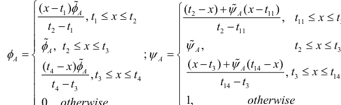

其中，$0 \leq \phi_{A}+\psi_{A} \leq 1, \tilde{\phi}_{A}$ 和 $\tilde{\psi}_{A}$ 分别为最大值和最小值，且 $t_{1}, t_{2}, t_{3}, t_{4}, t_{11}, t_{14} \in \Re$。那么 $A$ 被称为 ITrFN，表示为

$$A=\langle\left([t_{1}, t_{2}, t_{3}, t_{4}] ; \phi_{A}\right),\left([t_{11}, t_{12}, t_{13}, t_{14}] ; \psi_{A}\right)\rangle$$

## 7.3.5 动态直觉模糊加权平均 (DIFWA) 算子

根据 Xu 和 Yager [15]，设 $\zeta(t_1),\ldots,\zeta(t_q)$ 为在 $q$ 个不同时期收集的 IFN 集合，且 $\tau$ 为时期 $t_*$ 的权重向量，则 $DIFWA_{\tau(t)}$ $(\zeta(t_1),... ,\zeta(t_q)) = \tau(t_1)\zeta(t_1) \oplus \cdots \oplus \tau(t_q)\zeta(t_q)$ 被称为 DIFWA 算子。

$$\begin{gathered} DIFWA_{\tau(t)}(\zeta(t_1),...,\zeta(t_q)) \\ = \left(1-\prod_{k=1}^{q}(1-\phi_{\zeta(t_k)})^{\tau(t_k)},\prod_{k=1}^{q}\psi_{\zeta(t_k)}^{\tau(t_k)}, \prod_{k=1}^{q}(1-\phi_{\zeta(t_k)})^{\tau(t_k)}-\prod_{k=1}^{q}\psi_{\zeta(t_k)}^{\tau(t_k)} \right) \end{gathered}$$

其中，$\tau(t_k) \geq 0 ; \sum_{k=1}^{q}\tau(t_k) = 1$

在本章中，信息以 ITrFN 的形式获取，并借助 DIFWA 算子进行决策。

## 7.4 主要概念

许多研究者利用 MCDM 的思想来讨论日常生活中遇到的实际情况。在本章中，讨论了由 Xu 和 Yager [15] 提出的 DIFWA 算子的算法方法，其中信息以 ITrFN 形式给出，用于在特定属性下为制造工厂选择合适的位置。用于决策的属性以 IFN 形式给出。开发了一个假设性案例研究来解释该算法。在此研究中，考虑了五个负责选择制造工厂合适位置的因素，如 图 7.1 所示。

### 7.4.1 算法

考虑了以下假设：

- **I:** 设 $\Theta = \{\theta_1,\ldots, \theta_n\}$ 为 $n$ 个备选方案的集合。
- **II:** 设 $MP = \{MP_1,\ldots, MP_m\}$ 为以 IFN 形式表述的有限属性集合，其权重向量为 $\omega = (\omega_1,\ldots, \omega_m)^T$，其中 $\omega_j \geq 0$ 且 $\sum_{j=1}^{m}\omega_j = 1$

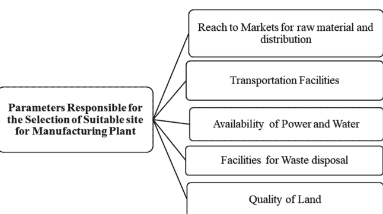

**图 7.1** 负责选择制造工厂合适位置的参数。

- **III:** 设 $t_k$ 具有 $q$ 个时期，其权重向量为 $\zeta(t)=(\zeta(t_1),...,\zeta(t_q))^T$，
  $$\zeta(t_k)\geq 0;\sum_{k=1}^q \zeta(t_k)=1$$
- **IV:** 设 $\mathfrak{R}(t_k) = (r_{ij}(t_k))_{n\times m}$ 为时期 $t_k$ 的 IF 决策矩阵，其中 $r_{ij}(t_k) = \big(\phi_{r_{ij}}(t_k), \psi_{r_{ij}}(t_k), \pi_{r_{ij}}(t_k)\big); (i=1, ..., n, j=1, ..., m)$ 为以 IFN 形式定义的属性值。

**算法的步骤如下：**

- **步骤 I:** 使用第 7.3 节中定义的 DIFWA 算子：

  $$r_{ij} = DIFWA_{\zeta(t)} \left( r_{ij}(t_1), ..., r_{ij}(t_q) \right)$$

  $$= \left( 1-\prod_{k=1}^q (1-\phi_{r_{ij}}(t_k))^{\zeta(t_k)}, \prod_{k=1}^q \psi_{r_{ij}}(t_k)^{\zeta(t_k)}, \prod_{k=1}^q (1-\phi_{r_{ij}}(t_k))^{\zeta(t_k)} - \prod_{k=1}^q \psi_{r_{ij}}(t_k)^{\zeta(t_k)} \right)$$

  聚合所有 IF 决策矩阵：

  $$\mathfrak{R} = (r_{ij})_{m\times n}$$

  其中，$r_{ij} = \big(\phi_{ij}, \psi_{ij}, \pi_{ij}\big)$；$\phi_{ij} = 1-\prod_{k=1}^{q} (1-\phi_{r_{ij}}(t_k))^{\zeta(t_k)}$；$\psi_{ij} = \prod_{k=1}^{q} \psi_{r_{ij}}(t_k)^{\zeta(t_k)}$。

- **步骤 II:** 设 $\hat{\Phi} = (\hat{\Phi}_1,...,\hat{\Phi}_m)^T$ 和 $\bar{\Phi} = (\bar{\Phi}_1,...,\bar{\Phi}_m)^T$ 分别为 IF 正向和负向理想解，其中 $\hat{\Phi}_j$ 和 $\bar{\Phi}_j$ 分别为最大的和最小的 $m$ 个 IFN。此外，设 $\theta_i = (r_{i1},...,r_{im})^T$。

- **步骤 III:** 确定 IF 正向和负向理想解：IFPIS($\Phi^{+}$) 和 IFNIS ($\Phi^{-}$)，基于备选方案 $\theta_{i}$：

  $$\delta(\theta_{i}, \Phi_{i}^{+}) = \sum_{j=1}^{m} \omega_{j} \delta\left(r_{ij}, \Phi_{i}^{+}\right) = \sum_{j=1}^{m} \omega_{j}\left(1-\phi_{ij}\right)$$

  $$\delta\left(\theta_{i}, \Phi_{i}^{-}\right) = \sum_{j=1}^{m} \omega_{j} \delta\left(r_{ij}, \Phi_{i}^{-}\right) = \sum_{j=1}^{m} \omega_{j}\left(1-\psi_{ij}\right)$$

  其中，$r_{ij} = \left(\phi_{ij}, \psi_{ij}, \pi_{ij}\right)$

- **步骤 IV:** 计算每个备选方案的贴近度系数：

  $$C(\theta_{i}) = \frac{\delta(\theta_{i}, \Phi_{i}^{-})}{\delta(\theta_{i}, \Phi_{i}^{+}) + \delta(\theta_{i}, \Phi_{i}^{-})}$$

  由于 $\delta(\theta_{i}, \Phi_{i}^{+}) + \delta(\theta_{i}, \Phi_{i}^{-}) = \sum_{j=1}^{m} \omega_{j}(1+\pi_{ij})$

  $$\therefore \quad C(\theta_{i}) = \frac{\sum_{j=1}^{m} \omega_{j}(1-\psi_{ij})}{\sum_{j=1}^{m} \omega_{j}(1+\pi_{ij})}$$

- **步骤 V:** 根据贴近度系数 $C(\theta_{i})$ 对备选方案 $\theta_{i}$ 进行排序。$C(\theta_{i})$ 越大，备选方案越好。

- **步骤 VI:** 结束。

### 7.4.2 案例研究评估

设 $MP_{i}$ ($i=1,2,\ldots,11$) 为制造工厂可用的地点集合。工厂地点的选择可以根据 图 7.1 中所示的特定因素 $\Theta = (\theta_{1},\ldots,\theta_{5})$ 来确定。此外，最终地点的选择决策可以通过考虑来自三位决策者的输入 $D = \langle d_{1},d_{2},d_{3}\rangle$ 来做出。设 $\tau(t) = \langle 0.16,0.33,0.5\rangle^{T}$ 为专家 $t_{i}$ 的权重向量，$\omega(i) = \langle 0.1,0.15,0.2,0.25,0.3,0.4\rangle^{T}$ 为因素 $\theta_{j}$ ($j=1,\ldots,5$) 的权重向量。在可用地点中为制造工厂选择地点的决策是基于算法 7.4.1 做出的。从各专家收集的意见以 IFN 形式表述，见 表 7.1-7.3。

来自专家集合的集体结果在 表 7.4 中呈现。

**表 7.1 专家 $d_{1}$ 提供的 IFN 信息**

| 地点/因素 | $\theta_{1}$ | $\theta_{2}$ | $\theta_{3}$ | $\theta_{4}$ | $\theta_{5}$ |
| :--- | :--- | :--- | :--- | :--- | :--- |
| $MP_{1}$ | (0.8,0.1,0.1) | (0.9,0.1,0.0) | (0.7,0.2,0.1) | (0.7,0.2,0.1) | (0.2,0.4,0.4) |
| $MP_{2}$ | (0.7,0.3,0.0) | (0.6,0.2,0.2) | (0.6,0.3,0.1) | (0.5,0.2,0.3) | (0.2,0.7,0.1) |
| $MP_{3}$ | (0.5,0.4,0.1) | (0.7,0.3,0.0) | (0.6,0.1,0.3) | (0.4,0.6,0.2) | (0.1,0.8,0.1) |
| $MP_{4}$ | (0.9,0.1,0.0) | (0.7,0.1,0.2) | (0.8,0.2,0.0) | (0.7,0.1,0.2) | (0.5,0.1,0.4) |
| $MP_{5}$ | (0.6,0.1,0.3) | (0.8,0.2,0.0) | (0.5,0.1,0.4) | (0.2,0.4,0.4) | (0.4,0.5,0.1) |
| $MP_{6}$ | (0.3,0.6,0.1) | (0.5,0.4,0.1) | (0.4,0.5,0.1) | (0.2,0.7,0.1) | (0.5,0.5,0.0) |
| $MP_{7}$ | (0.5,0.2,0.3) | (0.4,0.6,0.0) | (0.5,0.5,0.0) | (0.1,0.8,0.1) | (0.8,0.2,0.0) |
| $MP_{8}$ | (0.8,0.1,0.1) | (0.9,0.1,0.0) | (0.7,0.2,0.1) | (0.7,0.2,0.1) | (0.5,0.4,0.1) |
| $MP_{9}$ | (0.7,0.3,0.0) | (0.6,0.2,0.2) | (0.6,0.3,0.1) | (0.5,0.2,0.3) | (0.4,0.6,0.0) |
| $MP_{10}$ | (0.5,0.4,0.1) | (0.7,0.3,0.0) | (0.6,0.1,0.3) | (0.4,0.6,0.0) | (0.6,0.1,0.3) |
| $MP_{11}$ | (0.9,0.1,0.0) | (0.7,0.1,0.2) | (0.8,0.2,0.0) | (0.7,0.1,0.2) | (0.3,0.6,0.1) |

**表 7.2 专家 $d_{2}$ 提供的 IFN 信息**

| 地点/因素 | $\theta_{1}$ | $\theta_{2}$ | $\theta_{3}$ | $\theta_{4}$ | $\theta_{5}$ |
| :--- | :--- | :--- | :--- | :--- | :--- |
| $MP_{1}$ | (0.9,0.1,0.0) | (0.8,0.2,0.0) | (0.8,0.1,0.1) | (0.6,0.3,0.1) | (0.4,0.3,0.3) |
| $MP_{2}$ | (0.8,0.2,0.0) | (0.5,0.1,0.4) | (0.7,0.2,0.1) | (0.4,0.3,0.3) | (0.7,0.1,0.2) |
| $MP_{3}$ | (0.5,0.5,0.0) | (0.7,0.2,0.1) | (0.8,0.2,0.0) | (0.7,0.1,0.2) | (0.3,0.5,0.2) |
| $MP_{4}$ | (0.9,0.1,0.0) | (0.9,0.1,0.0) | (0.7,0.3,0.0) | (0.3,0.5,0.2) | (0.7,0.2,0.1) |
| $MP_{5}$ | (0.5,0.2,0.3) | (0.6,0.3,0.1) | (0.6,0.2,0.2) | (0.6,0.1,0.3) | (0.8,0.2,0.0) |
| $MP_{6}$ | (0.4,0.6,0.0) | (0.3,0.4,0.3) | (0.5,0.5,0.0) | (0.2,0.3,0.5) | (0.7,0.3,0.0) |
| $MP_{7}$ | (0.3,0.5,0.2) | (0.5,0.3,0.2) | (0.6,0.4,0.0) | (0.1,0.5,0.4) | (0.5,0.1,0.4) |
| $MP_{8}$ | (0.9,0.1,0.0) | (0.8,0.2,0.0) | (0.8,0.1,0.1) | (0.6,0.3,0.1) | (0.7,0.2,0.1) |
| $MP_{9}$ | (0.8,0.2,0.0) | (0.5,0.1,0.4) | (0.7,0.2,0.1) | (0.4,0.3,0.3) | (0.9,0.1,0.0) |
| $MP_{10}$ | (0.5,0.5,0.0) | (0.7,0.2,0.1) | (0.8,0.2,0.0) | (0.7,0.1,0.2) | (0.5,0.5,0.0) |
| $MP_{11}$ | (0.9,0.1,0.0) | (0.9,0.1,0.0) | (0.7,0.3,0.0) | (0.3,0.5,0.2) | (0.9,0.1,0.0) |

**表 7.3 专家 $d_{3}$ 提供的 IFN 信息**

| 地点/因素 | $\theta_{1}$ | $\theta_{2}$ | $\theta_{3}$ | $\theta_{4}$ | $\theta_{5}$ |
| :--- | :--- | :--- | :--- | :--- | :--- |
| $MP_{1}$ | (0.7,0.1,0.2) | (0.9,0.1,0.0) | (0.9,0.1,0.0) | (0.6,0.1,0.3) | (0.4,0.5,0.1) |
| $MP_{2}$ | (0.9,0.1,0.0) | (0.6,0.2,0.2) | (0.5,0.2,0.3) | (0.5,0.2,0.3) | (0.7,0.1,0.2) |
| $MP_{3}$ | (0.4,0.5,0.1) | (0.8,0.1,0.1) | (0.7,0.1,0.2) | (0.3,0.3,0.4) | (0.8,0.2,0.0) |
| $MP_{4}$ | (0.8,0.1,0.1) | (0.7,0.2,0.1) | (0.9,0.1,0.0) | (0.4,0.4,0.2) | (0.5,0.4,0.1) |
| $MP_{5}$ | (0.6,0.3,0.1) | (0.8,0.2,0.0) | (0.7,0.2,0.1) | (0.5,0.5,0.0) | (0.9,0.1,0.0) |
| $MP_{6}$ | (0.2,0.7,0.1) | (0.5,0.1,0.0) | (0.3,0.1,0.6) | (0.1,0.4,0.5) | (0.6,0.1,0.3) |
| $MP_{7}$ | (0.4,0.6,0.0) | (0.7,0.3,0.0) | (0.5,0.5,0.0) | (0.2,0.3,0.5) | (0.3,0.6,0.1) |
| $MP_{8}$ | (0.5,0.4,0.1) | (0.7,0.3,0.0) | (0.6,0.1,0.3) | (0.4,0.6,0.2) | (0.1,0.8,0.1) |
| $MP_{9}$ | (0.9,0.1,0.0) | (0.7,0.1,0.2) | (0.8,0.2,0.0) | (0.7,0.1,0.2) | (0.5,0.1,0.4) |
| $MP_{10}$ | (0.6,0.1,0.3) | (0.6,0.2,0.0) | (0.5,0.1,0.4) | (0.2,0.4,0.4) | (0.4,0.5,0.1) |
| $MP_{11}$ | (0.3,0.6,0.1) | (0.5,0.4,0.1) | (0.4,0.5,0.1) | (0.2,0.7,0.1) | (0.5,0.5,0.0) |


## **表 7.4** 专家提供的集体 IFN 信息 $D=(d_{1},d_{2},d_{3})$

| 地点/因素 | $\theta_{1}$ | $\theta_{2}$ | $\theta_{3}$ | $\theta_{4}$ | $\theta_{5}$ |
|:---|:---|:---|:---|:---|:---|
| $MP_{1}$ | 0.806, 0.1, 0.094 | 0.874, 0.126, 0.0 | 0.849, 0.112, 0.039 | 0.619, 0.162, 0.219 | 0.371, 0.406, 0.223 |
| $MP_{2}$ | 0.849, 0.151, 0.0 | 0.569, 0.159, 0.272 | 0.594, 0.214, 0.192 | 0.469, 0.229, 0.302 | 0.647, 0.138, 0.215 |
| $MP_{3}$ | 0.452, 0.482, 0.066 | 0.755, 0.151, 0.094 | 0.725, 0.126, 0.149 | 0.486, 0.233, 0.281 | 0.610, 0.342, 0.048 |
| $MP_{4}$ | 0.859, 0.1, 0.041 | 0.792, 0.141, 0.067 | 0.838, 0.162, 0.0 | 0.437, 0.342, 0.221 | 0.578, 0.252, 0.170 |
| $MP_{5}$ | 0.569, 0.218, 0.213 | 0.748, 0.229, 0.023 | 0.640, 0.178, 0.181 | 0.498, 0.282, 0.220 | 0.830, 0.165, 0.005 |
| $MP_{6}$ | 0.289, 0.648, 0.063 | 0.441, 0.2, 0.359 | 0.390, 0.224, 0.386 | 0.151, 0.399, 0.450 | 0.623, 0.189, 0.189 |
| $MP_{7}$ | 0.387, 0.470, 0.143 | 0.601, 0.337, 0.063 | 0.536, 0.464, 0.0 | 0.151, 0.419, 0.430 | 0.492, 0.275, 0.233 |
| $MP_{8}$ | 0.749, 0.200, 0.051 | 0.782, 0.218, 0.0 | 0.697, 0.112, 0.190 | 0.533, 0.397, 0.070 | 0.434, 0.449, 0.117 |
| $MP_{9}$ | 0.849, 0.151, 0.0 | 0.627, 0.112, 0.261 | 0.743, 0.214, 0.043 | 0.588, 0.162, 0.250 | 0.699, 0.135, 0.167 |
| $MP_{10}$ | 0.553, 0.215, 0.232 | 0.755, 0.214, 0.031 | 0.645, 0.126, 0.229 | 0.450, 0.270, 0.280 | 0.472, 0.382, 0.145 |
| $MP_{11}$ | 0.735, 0.245, 0.020 | 0.731, 0.200, 0.069 | 0.603, 0.362, 0.035 | 0.350, 0.452, 0.197 | 0.691, 0.301, 0.008 |

使用算法 7.4.1 的第 2–5 步，针对制造工厂的每种地点类型计算的相对贴近系数 $C(S_i)$ 的值列于表 7.5 中。

## **表 7.5** 制造工厂不同地点类型的相对贴近系数

| 地点类型 | 相对贴近系数 C(MP_i) |
| :--- | :--- |
| $MP_1$ | 0.690 |
| $MP_2$ | 0.672 |
| $MP_3$ | 0.654 |
| $MP_4$ | 0.692 |
| $MP_5$ | 0.705 |
| $MP_6$ | 0.539 |
| $MP_7$ | 0.518 |
| $MP_8$ | 0.630 |
| $MP_9$ | 0.727 |
| $MP_{10}$ | 0.622 |
| $MP_{11}$ | 0.625 |

相对贴近系数 $C(MP_i)$ 的最大值代表对地点类型的偏好。

## 7.5 结果与讨论

基于表 7.5 中给出的相对贴近系数值，以图形方式呈现在图 7.2 中。

从图 7.2 可以观察到，地点 $MP_9$ 是最合适的，其排名如下：

$MP_9 \succ MP_5 \succ MP_4 \succ MP_1 \succ MP_2 \succ MP_3 \succ MP_8 \succ MP_{11} \succ MP_{10} \succ MP_6 \succ MP_7$

决策是基于从决策者 $D = \langle d_1, d_2, d_3 \rangle$ 获得的集体信息做出的。与聚合算子一起使用的 IF 信息在基于因素开发制造工厂合适地点选择的支撑系统方面给出了有前景的结果。

## 7.6 结论

本章使用 MCDM 技术来根据所需要求选择制造工厂的合适地点。给出的信息形式为 ITrFNs，使用 DIFWA 算子进行聚合。此外，在做出决策时考虑了三位领域专家的意见。根据计算出的相对贴近系数值进行决策并对备选方案进行排名。相对贴近系数的值越大，该备选方案获得的优先级就越高。该模型可用于其他类似情况，以避免在调查上产生不必要的开支。在不确定性下，该模型更适合对手头问题进行初步调查。

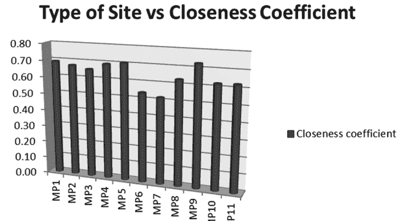

图 7.2 各地点的相对贴近系数。

## 关键词

- 直觉模糊数
- 直觉模糊集
- 聚合算子
- 动态直觉模糊加权平均算子

## 参考文献

1. Atanassov, K. T. (1986). Intuitionistic fuzzy sets. *Fuzzy Sets and Systems*, *20*(1), 87–96.
2. Bordogna, G., Fedrizzi, M., & Pasi, G. (1997). A linguistic modeling of consensus in group decision making based on OWA operators. *IEEE Transactions on Systems Man and Cybernetics*, *27*(1), 126–132.
3. Chen, S. J., & Hwang, C. L. (1992). *Fuzzy Multiple Attribute Decision Making*. Springer-Verlag: New York.
4. Fodor, J. C., & Rubens, M. (1994). *Fuzzy Preference Modelling and Multicriteria Decision Support*. Kluwer Academic Publisher: Dordrecht.
5. Guorong, X. (2011). Models for multiple attribute decision making with intuitionistic trapezoidal information. *International Journal of Advancement in Computing Technology*, *3*(6), 21–25.
6. Herrera, F., Herrera-Viedma, E., & Verdegay, J. L. (1996). A linguistic decision process in group decision making. *Group Decision and Negotiation*, *5*, 165–176.
7. Kacprzyk, J., Fedrizzi, M., & Nurmí, H. (1992). Group decision making and consensus under fuzzy preferences and fuzzy majority. *Fuzzy Sets and Systems*, *49*, 21–31.
8. Krassimir, A., Gabriella, P., & Ronald, Y. (2005). Intuitionistic fuzzy interpretations of multi-criteria multi-person and multi-measurement tool decision making. *International Journal of Systems Science*, *36*(14), 859–868.
9. Wang, J. Q., & Zhang, Z. H. (2008). Programming method of multi-criteria decision-making based on intuitionistic fuzzy number with incomplete certain information. *Control and Decision*, *23*, 1145–1148.
10. Wang, J. Q., & Zhang, Z. H. (2009). Aggregation operators on intuitionistic trapezoidal fuzzy number and its application to multi-criteria decision-making problems. *Journal of Systems Engineering and Electronics*, *20*, 321–326.
11. Wan, S. P., & Dong, J. Y. (2010). Method of trapezoidal intuitionistic fuzzy number for multi-attribute group decision. *Control and Decision*, *25*(5), 773–776.
12. Wei, G. W. (2012). Hesitant fuzzy prioritized operators and their application to multiple attribute decision making. *Knowledge-Based Systems*, *31*, 176–182.
13. Wang, J. Q. (2008). Overview on fuzzy multi-criteria decision-making approach. *Control and Decision*, *23*, 601–606.
14. Xu, Z. S., & Yager, R. R. (2006). Some geometric aggregation operators based on intuitionistic fuzzy sets. *International Journal of General Systems*, *35*, 417–433.
15. Xu, Z., & Yager, R. R. (2008). Dynamic intuitionistic fuzzy multi-attribute decision making. *International Journal of Approximate Reasoning*, *48*, 246–262.
16. Yager, R. R. (2004). OWA aggregation over a continuous interval argument with applications to decision making. *IEEE Transactions on Systems, Man, and Cybernetics—Part B*, *34*, 1952–1963.
17. Yager, R. R. (2009). Prioritized OWA aggregation. *Fuzzy Optimization and Decision Making*, *8*, 245–262.
18. Zadeh, L. A. (1965). Fuzzy sets. *Information and Control*, *8*, 338–353.

# 工业物联网中的模糊逻辑与智能制造

ANITA MOHANTY¹, AMBARISH G. MOHAPATRA¹, and SUBRAT KUMAR MOHANTY²

¹*电子与仪器工程系，硅科技学院，印度奥里萨邦布巴内什瓦尔*

²*电子与通信工程系，爱因斯坦技术与管理学院，印度奥里萨邦布巴内什瓦尔*

## **摘要**

模糊逻辑与工业物联网（IIoT）的融合开启了智能制造的新纪元，为效率、质量和适应性提供了前所未有的机遇。本章分析了模糊逻辑在追求智能制造的背景下，于 IIoT 领域中的关键作用。模糊逻辑内置的处理不确定性和不精确数据的能力，使其成为复杂动态制造环境中决策的宝贵机制。我们深入探讨了模糊逻辑用于优化流程、改善资源分配以及提升整体制造绩效的实际应用案例。此外，我们还分析了模糊逻辑与 IIoT 传感器及平台的集成，突出展示了它如何促进对实现智能制造目标至关重要的实时自适应决策。通过揭示模糊逻辑与 IIoT 之间的协作，本章为这些技术在现代制造中的变革潜力提供了洞察，并为构建更具适应性和响应性的工业环境奠定了基础。


## 8.1 引言

在工业4.0领域，模糊逻辑与工业互联网（IIoT）的结合正在重塑智能制造范式。模糊逻辑基于处理不确定性和不精确性的概念，是应对现代工业流程复杂性的关键。随着制造设施通过 IIoT 日益互联，生成的数据量和多样性呈指数级增长，这对决策所需的智能解决方案提出了更高要求。模糊逻辑凭借其建模和控制非线性及不确定系统的能力，与 IIoT 框架无缝集成，为动态运营环境提供了精细化的理解 [1]。

图 8.1 展示了这种集成如何赋予制造商优化流程、预测维护需求、确保质量控制以及实施自适应自动化的能力。实际应用案例展示了模糊逻辑在从分散且模糊的数据源中提供可操作见解方面的强大能力，从而增强了运营效率和响应速度。然而，模糊逻辑在工业环境中的实施需要在精确性和适应性之间保持谨慎的平衡，并承认需要具备强大的、情境感知型决策能力 [2]。随着各行业拥抱模糊逻辑与 IIoT 的共生关系，迈向工业 4.0 时代智能、自优化制造系统的轨迹正变得越来越清晰可见。

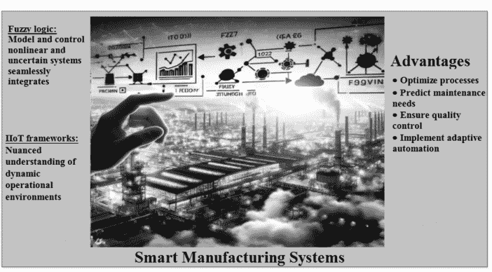

**图 8.1** 智能制造系统的概念。

### 8.1.1 制造业中 IIoT 的背景与意义

IIoT 已成为制造业的一个变革性力量，重新定义了传统流程，并促进了工业 4.0 的到来。将尖端传感器、执行器和通信技术引入工业机器，以创建互联设备网络，是 IIoT 在生产中的基础 [3]。这种互联使得数据能够顺畅交换，从而实现生产过程的实时监控、分析和控制。IIoT 在制造业中的重要性体现在多个方面。

首先，IIoT 通过提供对生产线各个方面的前所未有的可见性，提高了运营效率。来自传感器和设备的实时数据使得能够主动检测低效或瓶颈，优化工作流程，并改善决策。因此，这导致了产量的增加和资源的高效利用。

其次，IIoT 对于预测性维护至关重要，因为它能减少停机时间并降低设备故障的风险。机器传感器可以收集性能指标数据，使预测分析能够及早识别问题并采取适当措施防止其恶化。

此外，IIoT 促进了向智能制造的演变，因为它不仅促进了工厂内部的连接，还促进了整个供应链的连接。这种互联生态系统使供应商、制造商和分销商之间能够实现无缝通信，优化物流，缩短交付周期，并提高整体供应链的可见性。

总之，制造业中 IIoT 的背景和意义在于其革命性改变运营流程、提高效率、实现预测性维护以及在工业 4.0 背景下促进全面、互联的智能制造方法的能力。随着各行业越来越多地采用这一变革性技术，在全球市场中创新和竞争力的潜力变得更加显著。

### 8.1.2 智能制造中处理不确定性的挑战

由 IIoT 等技术驱动的智能制造在处理不确定性方面面临着固有的挑战。这些不确定性源自复杂且动态的制造环境中的各种来源 [4]。表 8.1 列出了几项主要挑战。

**表 8.1** 智能制造中的挑战

| 挑战 | 描述 |
| :--- | :--- |
| 数据变异性与质量 | 智能制造中由传感器和设备生成的数据量巨大且多样化，带来了与数据变异性和质量相关的挑战。数据质量中的不一致、不准确或波动可能损害决策过程的可靠性。 |
| 环境变化 | 制造环境受温度、湿度和其他外部因素波动的影响。这些环境变化会影响传感器和设备的性能和可靠性，从而导致其生成数据的不确定性。 |
| 复杂系统交互 | 在智能制造中，各种互联系统和组件协同工作以执行流程。这些组件之间复杂的交互引入了不确定性，特别是在发生预期外事件或中断时。 |
| 网络安全风险 | 随着制造系统变得互联程度更高，网络安全威胁的风险也随之增加。网络攻击可能通过破坏数据完整性、系统功能和整体制造过程来引入不确定性。 |
| 人为因素 | 人类操作员的参与引入了由于决策变异性、技能水平和响应时间等因素导致的不确定性层级。人机交互必须得到仔细管理，以最小化智能制造中的不确定性。 |
| 供应链动态 | 智能制造通常依赖互联的供应链。供应链中的不确定性，如延迟、材料可用性波动或意外需求激增，可能影响生产进度和整体效率。 |
| 适应性变化 | 市场的动态性质和技术进步要求智能制造不断适应。当系统难以跟上技术、法规或客户需求 rapid 变化时，不确定性就会产生。 |

解决这些挑战需要一种整体方法，整合机器学习、人工智能（AI）以及特别是模糊逻辑等先进技术，以有效建模和管理不确定性。此外，强大的网络安全措施、数据质量保证协议和人机协作框架是弹性智能制造生态系统的重要组成部分。随着各行业努力追求更高的效率和灵活性，理解和减轻不确定性对于智能制造计划的成功至关重要。

### 8.1.3 模糊逻辑作为决策工具的作用

在工业 4.0 背景下，模糊逻辑是智能制造中决策的一个基本工具 [5]。它解决了当代工业流程中固有的复杂性和不确定性。图 8.2 展示了模糊逻辑对智能制造的贡献，可总结如下：

- **处理不确定和模糊信息：** 在智能制造环境中，传感器、机器和其他联网设备产生大量数据。模糊逻辑接受真值程度而非严格的二元区分，擅长处理这种模糊且经常不明确的数据。这种适应性在基于故障或不充分信息做决策时是必要的。

- **自适应过程控制：** 自适应过程控制，其中制造条件可以动态变化，是模糊逻辑表现卓越的领域。它使得设计控制系统能够立即修改参数以响应变化的输入和外部环境成为可能。这种灵活性提高了生产操作的鲁棒性和效率。

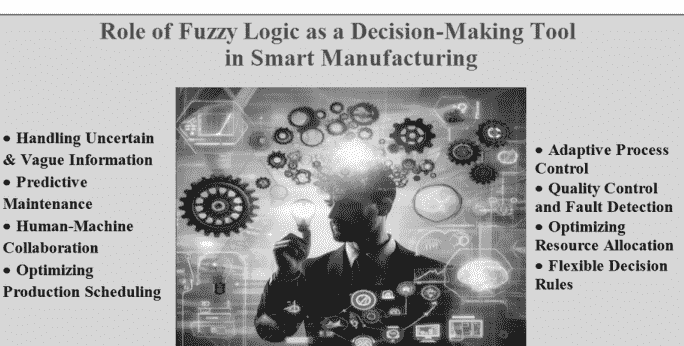

**图 8.2** 模糊逻辑在智能制造中作为决策工具的作用。

- **质量控制与故障检测：** 智能制造利用模糊逻辑实现故障检测和质量控制。它使

有可能创建智能算法，通过同时考虑多个要素来评估产品质量。为了维持产品质量，模糊逻辑还可以识别异常情况或偏离预期参数的现象，并启动纠正措施。

- **优化资源分配：** 智能制造涉及对能源、材料和设备等资源的优化。模糊逻辑通过同时考虑多个因素和权衡来辅助决策。这在考虑不断变化的生产需求和运营约束的同时，对高效分配资源尤为宝贵。
- **预测性维护：** 智能制造中的预测性维护解决方案使用了模糊逻辑。模糊逻辑模型能够通过评估机械设备的历史和当前数据来预见可能的故障或维护需求。通过采取主动策略，这一方法减少了停机时间并延长了工业资产的使用寿命。
- **人机协作：** 在智能制造环境中，模糊逻辑实现了人与机器的协作，使人类操作员能够与自动化系统进行交流。这使得将人类的判断和经验纳入自动化程序成为可能，确保决策既得到定性信息也得到定量信息的支持。
- **灵活的决策规则：** 模糊逻辑可以创建更适应不同环境的决策规则。这在智能生产中至关重要，因为环境可能会迅速变化，预设规则必须足够灵活，以免需要频繁重新编程。
- **优化生产调度：** 模糊逻辑通过考虑包括设备可用性、生产截止日期和资源约束在内的多种因素，辅助优化生产调度。因此，生产计划变得更加灵活和高效，使企业能够快速适应需求的变化。

综上所述，模糊逻辑是智能制造中决策制定的强大工具，因为它提供了处理不确定性、适应变化条件以及简化流程以提高效率、质量和资源利用率的框架。将智能和自优化制造系统融入工业 4.0，极大地促进了这一目标的实现。

## 8.2 智能制造中工业物联网的基础

智能制造中的工业物联网（IIoT）基于多种相互关联技术的结合，这些技术共同推动产业迈向工业 4.0。为了创建一个机器能够实时通信、分析和反应的复杂网络，IIoT 从根本上依赖于智能传感器、执行器和通信设备在生产生态系统中的无缝集成，如图 8.3 所示。它还展示了数据驱动决策的理念，该理念利用来自多个源的持续数据流来获取关于运营效率、预测性维护和质量控制的见解，这是这一基础的根本所在。云计算和边缘计算平台提供的基础设施能够处理和处理这一数据洪流，从而实现了可扩展性和可访问性。另一个关键支柱是安全协议，它保护通过 IIoOT 网络传输的敏感数据的机密性和完整性。随着发展，高级分析、人工智能和机器学习应用的整合加强了 IIoT 的基础，实现了以智能制造为特征的智能、自优化和自适应工业流程 [6]。

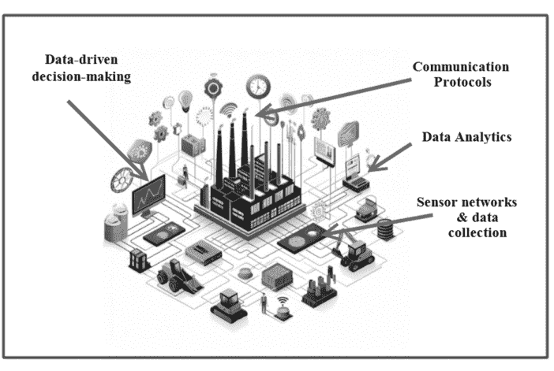

**图 8.3** 智能制造中工业物联网的概念。12

### 8.2.1 传感器网络与数据收集

在智能制造背景下，传感器网络和数据收集是 IIoT 的基础。这些技术对于将手动生产过程转化为数据驱动、灵活的生态系统至关重要。传感器网络由许多智能传感器组成，它们被策略性地布置在生产环境中，以实时收集关于各种参数的数据，包括振动、温度、压力、湿度和机器状态。通过收集运营环境的全面图景，这些传感器充当了 IIoT 的眼睛和耳朵。

在 IIoT 的背景下，数据收集是指从这些传感器到中央平台进行数据收集和分析的方法性获取和传输。得益于这种数据洪流，制造商可以衡量生产指标，监控设备状况，并评估制造过程的整体有效性。此外，边缘计算的使用促进了现场数据处理，降低了延迟并加速了决策制定。

传感器网络和数据收集之所以重要，是因为它们可以产生可被利用的见解。通过利用这些数据，制造商可以实施预测性维护计划，通过预测可能的设备故障来防止停机。持续监控通过确保产品符合严格要求来提高质量控制。此外，数据还有助于优化生产计划、能源效率和资源利用，从而提高整体效率。

在传感器网络和数据收集的背景下，安全和隐私是关键考量因素。实施强大的网络安全措施以保护敏感数据，防止未经授权的访问，并确保制造过程的完整性。

总之，智能制造 IIoT 中的传感器网络和数据收集体现了从传统向智能生产系统的转变。通过利用来自不同来源的实时数据，制造商获得了前所未有的对其运营的可见性和控制力，为工业 4.0 环境中提高效率、预测能力和自适应决策铺平了道路。

### 8.2.2 通信协议与数据分析

在 IIoT 的智能制造领域，有效的通信协议和先进的数据分析是驱动连接性、协作和信息决策的组成部分。

#### 8.2.2.1 通信协议

通信协议是智能制造中众多设备和系统之间无缝数据交换的基础。MQTT（消息队列遥测传输）、受限应用协议（Constrained Application Protocol）和 OPC UA（开放平台通信统一架构）等协议促进了传感器、机器和控制系统之间高效、低延迟的通信 [7]。这些协议支持数据的实时传输，确保关键信息及时传递以进行分析和决策。这些协议所实现的标准通信促进了互操作性，允许来自不同制造商的多样化设备在 IIoT 生态系统中有效通信。

#### 8.2.2.2 数据分析

数据分析是 IIoT 在智能制造中具有变革潜力的驱动力。高级分析技术，包括机器学习和人工智能，处理传感器和设备产生的大量数据，以提取有意义的见解。预测性分析用于预判设备故障并主动安排维护，从而最大限度地减少停机时间。规范性分析提供可操作的建议，以优化生产过程、资源分配和能源效率。描述性分析提供历史视角，有助于绩效分析和持续改进。边缘分析在靠近数据源的地方执行，减少延迟并允许实时决策。通信协议和数据分析的协同作用使制造商能够创建智能、自适应系统，优化效率、提高质量，并动态响应不断变化的运营条件。

总之，IIoT 中通信协议和数据分析的有效整合形成了一种共生关系，支撑着向工业 4.0 的演进。这些技术共同促进了连接智能生态系统的创建，其中数据驱动的见解推动制造过程达到效率、韧性和创新的新高度。

### 8.2.3 实时决策制定的需求

在智能制造 IIoT 中，实时决策制定的需求至关重要，它塑造了产业运营方式的范式转变


并优化其流程。若干因素凸显了在此背景下实时决策的重要性：

-   **动态运行环境：** 智能制造环境是动态的，且处于不断变化之中。实时决策允许对需求波动、设备状态和意外事件进行快速适应。它确保响应是即时的，从而增强制造过程的敏捷性。

-   **优化效率与生产力：** 来自传感器和设备的实时数据提供了生产线的实时图像。通过实时数据分析，制造商可以发现瓶颈、简化流程并提高整体运营效率。这种敏捷性缩短了提前期并提高了生产力。

-   **预测性维护：** 对设备健康状况的及时洞察使得制定预测性维护计划成为可能。利用实时数据分析，制造商可以通过识别表明即将发生故障的异常或趋势，在问题恶化之前规划维护。这降低了维护成本，延长了设备寿命，并最大限度地减少了停机时间。

-   **质量控制：** 在智能制造中保持产品质量至关重要。实时监控和分析生产数据的能力有助于及时发现偏离质量要求的情况。这确保了纠正措施可以立即实施，避免生产不合格产品并减少浪费。

-   **供应链协调：** 实时决策不仅发生在制造车间，还贯穿整个供应链。通过定期评估有关库存水平、需求预测和物流的数据，制造商可以更好地应对市场需求，优化供应链效率并缩短提前期。

-   **客户响应能力：** 客户和市场需求可能迅速变化。实时决策使生产商能够快速应对消费者偏好或行业趋势的变化。保持竞争力和满足客户期望需要这种灵活性。

-   **应急响应：** 需要立即行动的不期望事件，如供应链中断或设备故障，必须立即解决。通过促进快速响应和备用计划的执行，实时决策减少了紧急事件对生产时间表的影响。

-   **减少信息延迟：** 信息延迟可能会阻碍充分知情的决策。通过降低这种延迟，实时处理确保决策者能够获取最新且相关的数据。这在快节奏的制造环境中尤为重要。

总之，在IIoT驱动的智能制造中对实时决策的需求源于工业流程的动态特性、对卓越运营的追求以及快速应对不断变化的条件的必要性。通过利用实时数据分析的力量，制造商不仅可以优化当前的运营，还能在快速演进的工业4.0格局中为自身的敏捷性和竞争力做好定位。

## 8.3 模糊逻辑基础

模糊逻辑由 Lotfi A. Zadeh 在20世纪60年代构思，通过引入决策和系统控制中细致入微的方法，革新了传统的二元逻辑。其核心是模糊集，允许在0和1之间实现部分隶属度和真值程度。隶属函数定义了属于集合的程度，描绘了现实数据中固有的不确定性。模糊逻辑运算，包括AND、OR和NOT，操纵这些模糊集以处理不精确性和不确定性。通过if-then规则表达，模糊逻辑允许纳入专家知识和类人推理 [8]。推理机制结合规则以得出推论，而去模糊化将模糊输出转换为可操作的结果。模糊逻辑的应用范围从控制系统到人工智能，作为一种强大的工具，用于对复杂、不确定系统进行建模，在清晰的确定性逻辑和现实世界的复杂性之间架设桥梁。

### 8.3.1 模糊集和隶属函数

模糊逻辑中的基本概念，这是一种数学框架，允许在决策和系统控制中表征不确定性和不精确性，包括模糊集和隶属函数。模糊集是经典集的扩展，其元素具有0和1之间的隶属度，指示其在多大程度上属于该集合，而非严格属于或不属于。

这些隶属程度在很大程度上由隶属函数定义。这些函数通过将输入值映射到0和1之间的范围，表明特定元素属于模糊集的程度。模糊集的性质由隶属函数的形式决定，它可以采取多种形式，如图8.4所示的三角形、梯形、高斯形或更复杂的形状。

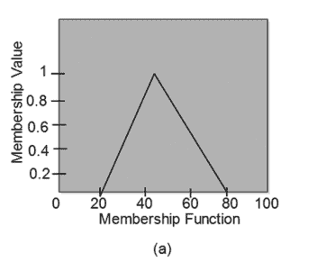

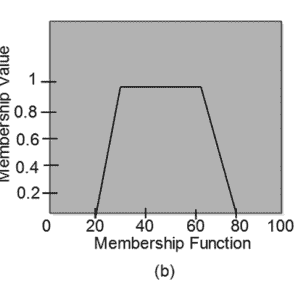

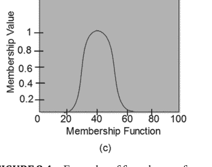

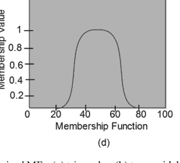

**图 8.4** 四类参数化隶属函数（MF）的示例：(a) 三角形；(b) 梯形；(c) 高斯形；以及 (d) 钟形。

例如，在模糊集“温暖”中建模语言变量“温度”时，隶属函数可能会赋予25°C左右的温度较高的隶属度（接近1），并且随着温度偏离此中心值，该程度逐渐降低。这使得模糊逻辑能够在精确的二元区分不足够的决策过程中表示和操作语言术语及类人推理。模糊集和隶属函数是在复杂和不确定环境中模拟人类决策的基于规则系统的关键组成部分。

### 8.3.2 模糊推理系统 (FIS)

图8.5所示的FIS是模糊逻辑中的一种计算模型，通过利用模糊集理论来模拟人类决策过程。FIS涉及一组规则和基于模糊逻辑原则做出决策的推理机制。FIS的关键组成部分和概念在以下章节中给出。

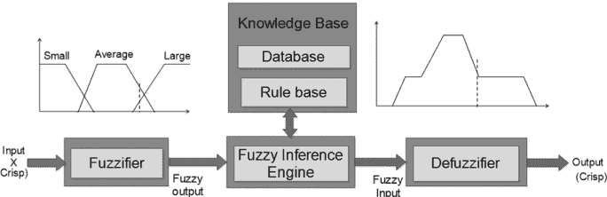

**图 8.5** 模糊推理系统。

#### 8.3.2.1 模糊化

模糊化是FIS的第一步，使用隶属函数将清晰的输入值转换为模糊集。在此步骤中，确定输入值落入不同语言类别的程度。

#### 8.3.2.2 规则库

模糊输入和模糊输出值之间的关系由一组IF–THEN规则定义。每个规则通常规定一个模糊输出动作，并涉及一组特定的输入条件。

#### 8.3.2.3 推理引擎

推理引擎是FIS的核心要素，它根据规则库组合模糊输入值以产生模糊输出值。典型的推理技术是Sugeno和Mamdani。Sugeno推理基于特定输入产生尖锐输出，而Mamdani推理产生模糊结果。

#### 8.3.2.4 聚合

聚合是整合由各种规则产生的模糊输出以创建综合模糊输出的过程。为了聚合模糊集，可以应用多种技术，包括最大化和平均。

#### 8.3.2.5 去模糊化

最后一步是去模糊化，将模糊输出转换为清晰输出。该过程涉及将模糊输出集转换为单一的可操作值。常见的去模糊化方法包括质心法、最大平均值法和加权平均值法。

FIS在包括控制系统、决策支持系统和模式识别在内的多个领域找到应用。它们在难以定义精确数学模型，且人类专业知识和语言推理起关键作用的场景中表现优异。在存在不确定性和不精确性的情况下，FIS提供了一种灵活且直观的复杂系统建模技术，从而实现了模糊逻辑在现实世界问题中的应用。

## 8.3.3 使用模糊逻辑的基于规则的推理

FIS建立在模糊逻辑中基于规则的推理基础之上，这涉及利用模糊逻辑的思想从一组if–then规则中得出推论。由于这些规则捕获了专家知识和类人推理，模糊逻辑擅长对具有不确定性和不精确性的复杂系统进行建模和管理。基于规则的推理通过几个关键步骤进行：

-   **模糊化：** 使用隶属函数，输入变量从尖锐的数值转换为模糊集。此阶段使得能够描绘现实数据中包含的不确定性和不精确性。

-   **规则库：** 规则库由一组if–then规则组成，将模糊输入变量与模糊输出变量联系起来。每个规则阐明了特定输入条件和结果输出动作之间的语言关系。例如，一个规则可能陈述“如果温度高，则空调强劲”。


**推理引擎：** 推理引擎根据当前的模糊输入值评估模糊规则。每条规则被满足的程度由与输入变量相关的隶属度函数决定。推理引擎结合这些规则的强度以生成模糊输出值。

**聚合：** 为了创建完整的模糊输出，将多条规则产生的模糊输出值进行合并。这涉及合并每条规则生成的不同模糊集，通常使用如最大值或平均值聚合等方法。

**去模糊化：** 去模糊化是最后阶段，将模糊输出转换为清晰、有用的结果。在此过程中，合并后的模糊输出集通常被概括为单一的数值。质心法、最大均值法和加权平均去模糊化是常用的技术。

模糊逻辑是控制系统、专家系统、智能制造、机器人技术和决策制定中宝贵的工具，因为它使用基于规则的推理过程来考虑现实系统中固有的不确定性。由于基于规则的推理的灵活性能够捕捉类似人类的决策复杂性，模糊逻辑在精确和确定性方法不足的场景中特别有用。

## 8.4 模糊逻辑在工业物联网（IIoT）中的集成

模糊逻辑融入工业物联网（IIoT）是控制系统和智能制造领域的一项重大进展。由于模糊逻辑能够处理不确定性和不精确性，它非常适合 IIoT 环境的动态特性。模糊逻辑原则可以集成到 IIoT 框架中 [9]，以提升面临现实复杂性的行业的决策能力。通过允许对网络设备与传感器产生的海量数据进行更复杂的解释，模糊逻辑推动了数据分析的发展。得益于这种集成，制造系统现在可以立即响应变化的条件，简化工作流程并提高整体效率。无论是应用于预测性维护、质量控制还是自适应自动化，模糊逻辑与 IIoT 的结合都促进了智能、自优化系统的发展，这些系统定义了工业 4.0 时代智能制造的本质。这种协同效应不仅增强了控制系统的鲁棒性，还强调了将类似人类的推理融入互联工业生态系统中具有变革性的潜力。

### 8.4.1 用于制造过程的模糊逻辑控制器（FLC）

FLC 已成为优化制造过程的重要工具，为工业环境中的控制系统提供了灵活且自适应的方法。与传统控制系统不同，FLC 擅长管理复杂、非线性和不确定的制造环境。这些控制器利用语言规则和类似人类的推理，基于不精确或不完整的信息做出决策，而这往往是工业过程固有的特征。在制造领域，FLC 应用于温度控制、压力调节和质量保证等多个领域 [10]。

FLC 通过将专家知识转化为基于规则的系统来运行。例如，在温度控制系统中，规则可能规定：“IF 温度高 AND 压力正在增加，THEN 减少热输入。” FLC 实时持续评估这些规则，并根据系统的当前状态调整控制参数。这种适应性使 FLC 能够动态响应波动，增强过程的稳定性和效率。

如 Figure 8.6 所示，FLC 与制造环境中传感器和执行器的集成有助于提高精度和可靠性。当制造过程的复杂性或变异性使得建立数学模型困难时，FLC 尤其有价值。它们处理不精确输入并适应变化条件的能力，使 FLC 成为在工业 4.0 框架内追求智能、自优化制造系统的关键组成部分。随着行业继续拥抱先进技术，FLC 在增强控制和决策制定过程中的作用仍然是智能制造演化的核心。

### 8.4.2 预测性维护中的模糊控制

在制造过程中使用模糊控制进行预测性维护是一种新颖的方法，旨在最大化设备可靠性并减少非计划停机。在这种情况下，模糊逻辑用于处理预测和避免设备故障所伴随的不确定性和不精确性。该过程始于内置于制造设备中的传感器持续测量各种特征。

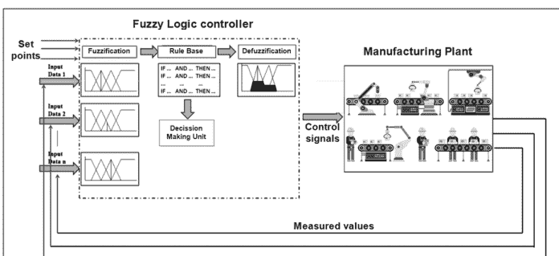

**Figure 8.6** 模糊逻辑控制器（FLC）在制造过程中的集成。

在预测性维护的背景下，模糊控制指的是制定能够识别传感器数据与潜在设备故障之间关系的模糊规则。通常，使用历史数据、专家知识或两者的结合来创建这些规则。模糊逻辑使用诸如“高”、“中”和“低”等语言变量来描述潜在问题的可能性和严重性，这种方式更像人类语言。

当制造设备运行时，模糊控制系统通过评估实时传感器数据并应用模糊规则来确定未来故障的危险性或可能性。由于统计数据是模糊的，这种评估考虑的是隶属度而非二元方法。模糊推理机制结合这些隶属度以生成对设备健康状况的综合评估。

基于模糊逻辑分析，预测性维护系统随后可以决定维护活动的最佳时机 [11]。如果模糊控制系统显示高故障风险，它可能建议立即维护以防止严重问题。相反，如果风险被认为较低，系统可能会将维护安排在计划的停机窗口内，从而优化资源利用。

模糊控制在预测性维护中的集成增强了制造过程的适应性和响应能力。它使维护计划能够采用更细腻且具备情境感知的方法，这与现代工业环境的动态特性相一致。最终，预测性维护中的模糊控制有助于提高运营效率、减少停机时间，并改善智能制造系统中设备的总体有效性。随着工业 4.0 原则的不断发展，模糊控制在预测性维护中的应用作为智能、自优化制造过程的关键推动因素而存在。

### 8.4.3 使用模糊逻辑进行质量控制

在制造过程中使用模糊逻辑进行质量控制是一种复杂且自适应的方法，旨在应对不确定性和变异以确保产品质量。模糊逻辑提供了一个框架，能够容纳不精确和模棱两可的信息，使其特别适合建模和改进复杂的制造系统。在质量控制应用中，模糊逻辑用于处理原材料、生产条件和环境因素中固有的变异性。以下是模糊逻辑如何增强制造业质量控制：

- **基于模糊规则的系统：** 模糊逻辑利用封装了专家知识和操作经验的基于规则的系统。这些规则定义了输入变量（如尺寸、温度或材料特性）与相应质量输出之间的关系。使用诸如“高”、“中”和“低”等语言变量来表示对质量标准的符合程度。
- **数据模糊化：** 模糊逻辑的第一步是模糊化输入数据，将数值测量转换为带有相应隶属度函数的语言变量。在此步骤中，不精确和不确定的信息可以以模糊逻辑系统可处理的格式表示。
- **推理机制：** 模糊逻辑使用推理引擎通过利用模糊化后的输入数据来评估模糊规则。通过结合这些规则，它产生指示产品质量水平的模糊输出值。该过程实现了对产品质量复杂且具备情境感知的评估。
- **聚合与去模糊化：** 将模糊输出值结合并随后进行去模糊化的过程，得出清晰、实用

模糊质量评估中得出的决策。在这最后一步中，产品的质量等级被清晰地表明，从而能够采取适当的行动方针。

- **自适应决策制定：** 在动态生产环境中，质量控制严重依赖于模糊逻辑适应不断变化的局面的能力。通过使生产参数波动下的实时修改成为可能，即使在不确定性的面前，它也能确保产品保持一致的质量。

- **与传感器和自动化的集成：** 模糊逻辑可以轻松地与自动化系统和传感器数据集成。传感器持续监测关键质量指标，模糊逻辑分析这些数据以对产品状态做出决策。随后，自动化系统可以利用这些不精确的数据做出纠正性决策。

- **多准则决策制定：** 模糊逻辑主要擅长同时处理多个准则。当多个因素影响最终产品质量时，模糊逻辑允许对质量控制进行全面评估。这是通过考虑各种质量参数之间的相互依赖性来实现的。

通过在质量控制中利用模糊逻辑，制造工艺可以达到更高的精度、适应性和稳健性。在波动是常态的行业（例如，生产持续高质量产品的行业）中，这种方法特别有用。

## 8.5 自适应制造中的模糊逻辑应用

模糊逻辑在自适应制造中的应用是这一数学框架如何革命性地改变当代工业格局的一个典型例子。在自适应制造中，快速应对不断变化的局面的能力至关重要，模糊逻辑对于控制系统和决策制定必不可少。模糊逻辑处理不精确信息和不确定性的能力，使得能够轻松适应生产参数变化、需求波动以及意外事件的自适应过程成为可能[12]。应用众多，包括基于优先级变化的动态调度、实时质量保证、制造设备的自适应控制等。通过利用模糊逻辑纳入语言变量和专家知识以做出复杂判断，制造系统可以模仿类人的推理能力。在工业4.0的更广泛背景下，这种适应性提高了运营效率，减少了停机时间，并有助于实现智能、自我优化的制造环境[13]。各行业对自适应制造的采用，使得模糊逻辑应用在对建立敏感、敏捷且高效的生产生态系统中日益重要。

### 8.5.1 自适应生产调度

自适应生产调度是一种灵活且可适应的规划组织制造运营的方法，它考虑了不确定性、优先级变化以及实时调整。与传统静态调度技术不同，自适应生产调度利用尖端技术和智能算法，根据工业环境的变化持续优化生产计划[14]。自适应生产调度的概念由许多关键组成部分定义：

- **实时数据集成：** 为了使自适应生产调度正常工作，必须在整个制造生态系统中无缝集成来自多个来源的实时数据。这包括传感器、制造设备、库存水平以及外部变量（如消费者需求）的信息。

- **预测分析：** 通过预测未来对生产环境的干扰或修改，预测分析对于自适应调度至关重要。这涉及使用数据分析、机器学习和其他预测建模技术来预测未来事件和趋势。

- **动态重新调度：** 自适应生产调度指的是根据不断发展的情况动态修改生产计划的能力。这可能包括意外的设备故障、需求变化或资源可用性的调整。

- **机器学习和人工智能算法：** 使用人工智能和机器学习算法来检查过去的数据、识别趋势并随时间增强自适应调度模型。这些算法通过适应和从新输入中学习，提高了系统深思熟虑的决策能力。

- **优化目标：** 自适应调度根据预定目标优化生产计划，例如最大化资源利用率、最小化生产成本、满足交货期限或最大化能源效率。这些目标可以根据生产过程的特定目标进行调整。

- **人机协作：** 自适应生产调度通常涉及一定程度的人机协作。虽然算法管理数据分析和决策过程，但人类操作员提供专业知识，处理意外困难，并做出支持总体公司目标的战略性选择。

- **与工业4.0原则的集成：** 自适应生产调度强调使用互联技术、物联网（IoT）设备和信息物理系统，这与工业4.0的原则保持一致。这种集成促进了一个自动化、可适应且智能的制造环境。

- **敏捷制造概念：** 敏捷性是自适应生产调度的一个关键组成部分。由于系统对变化的快速响应时间，生产者可以在面临不断变化的市场动态和运营挑战时保持适应能力。

自适应生产调度是智能制造的主要组成部分之一，它开启了通往更高生产力、更短交货时间以及对市场波动更强响应能力的大门。最终，它有助于实现建立稳健且具有竞争力的制造环境这一主要目标。它象征着从严格的预设时间表向更灵活和自适应的生产过程的转变。

### 8.5.2 动态资源分配

动态资源分配是一种有计划且灵活的方法，用于在系统或环境中实时有效地管理和优化资源。在动态且快速变化的环境（如制造业、云计算或项目管理）中，资源的供应和需求可能会经常变化，因此这一概念尤为重要。表8.2展示了动态资源分配的基本特征：

在充满不可预测性和变化性的背景下，动态资源分配对于在资源效率与灵活性之间取得平衡至关重要。在工业4.0及更远的背景下，这种灵活性通过使系统更具韧性、响应能力和经济性，与敏捷性原则相一致。

表 8.2 动态资源分配的特征

| 动态资源 | 特征 |
| :--- | :--- |
| 实时适应性 | 根据需求、优先级或情况的变化，对资源进行实时重新分配的灵活性。 |
| 数据驱动的决策 | 利用实时信息和分析，对资源分配做出明智的选择。 |
| 优化目标 | 旨在提高效率、降低成本，并满足特定的运营或业务目标。 |
| 自动化和算法 | 评估数据，预测未来的资源需求，并做出分配选择。 |
| 可扩展性 | 适应资源需求变化、工作负载波动以及活动规模的变化。 |
| 与物联网和传感器的集成 | 动态资源分配通常与传感器技术和物联网（IoT）交互，以实时收集关于资源利用率、环境状况及其他相关因素的数据。 |
| 任务优先级排序 | 根据各项业务或流程的紧急程度、重要性和依赖性，基于任务优先级分配资源。 |
| 适应不确定性 | 通过持续评估系统的当前状态并相应地调整资源分配，来处理意外情况和不确定性。 |
| 应用于各个领域 | 用于各种需要有效且灵活资源分配的背景，如制造业、云计算、项目管理、交通控制和其他场景。 |
| 人在回路 | 人类决策者经常参与动态资源分配，以设置参数、提供战略建议并做出重要判断。 |

### 8.5.3 供应链优化

供应链优化的目标是使用战略性和数据驱动的策略，提高供应链的整体绩效、灵活性和效率。为了优化价值并节省成本，必须系统地分析、计划和执行供应链活动。供应链优化由几个基本要素表征：

- **需求预测：** 精确的需求预测是供应链优化的基础。通过利用市场趋势、历史数据和预测分析，组织可以预见未来需求并主动分配资源。


-   **库存管理**：适当的库存控制确保在正确的时间和地点有合适数量的物品可用。优化供应链旨在实现降低持有成本与避免缺货之间的平衡。

-   **物流与运输优化**：简化运输路线、选择最经济的承运商以及缩短运输时间都是物流优化的例子。实时跟踪、使用路线优化技术以及与物流合作伙伴的合作都可以是其中的一部分。

-   **供应商关系管理**：具有弹性和高效的供应链依赖于与其供应商的牢固联系。在这种情况下，优化意味着与可靠的供应商合作，协商有利的条件，并合作开展旨在持续改进的项目。

-   **技术整合**：利用人工智能、区块链和物联网等尖端技术可以自动执行程序，提供实时的供应链可视化，并促进数据驱动的优化决策。

-   **风险管理**：识别和减少可能损害运营的风险是供应链优化的关键组成部分。这包括评估可能影响供应链的外部因素，如自然灾害和地缘政治事件。

-   **多级优化**：在优化供应链时，需要考虑的组织包括供应商、制造商、分销商和零售商等。多级优化的目标是最大化整个供应链中信息和物资的流动。

-   **可持续性考量**：可持续性是当代供应链优化的一个关键组成部分。这包括减少浪费，实施环保做法，并最小化供应链运营对环境的负面影响。

-   **协同计划**：对于优化而言，供应链参与者之间的合作与沟通至关重要。协同计划平台与工具促进了信息共享，帮助所有利益相关者协调其努力，以符合供应链的总体目标。

-   **持续改进**：供应链优化是一个持续的过程，包括监控、分析和改进。通过定期评估关键绩效指标和绩效指标，组织可以确定需要改进的领域。

通过采取全面和综合的策略，组织可以提高其供应链优化水平，变得更加具有韧性、高效和响应能力。在当今快节奏的商业环境中，这尤为重要，因为全球市场、不断变化的消费者期望和技术突破的影响要求供应链策略必须灵活且经过优化。

## 8.6 智能制造案例研究

智能制造案例研究提供了行业 4.0 技术如何在现实环境中的应用以及它们如何改变行业的深刻示例。这些研究通常展示了企业如何使用机器人、人工智能、机器学习和工业物联网（IIoT）等尖端技术来变革其工业流程。它们展示了利用智能设备构建智能且互联的工业生态系统、集成传感器进行实时数据收集，以及用于预防性维护的预测分析。案例研究还展示了智能制造如何提高整体运营效率、减少停机时间、最大化资源利用并促进敏捷性。这些现实世界的例子为考虑行业 4.0 的其他企业提供了有益的信息，提供了采用智能制造实践相关优势和挑战的具体证明。

### 8.6.1 案例研究 1：预测性维护中的模糊逻辑

在一个展示模糊逻辑在预测性维护中应用的案例研究中，一家制造设施希望提高生产机械的可靠性和效率。被动维护和计划外停机给企业带来了困难，从而推高了运营成本 [16]。为了解决这些问题，开发了一个模糊逻辑预测性维护系统。

预测性维护系统中集成了许多传感器，以实时跟踪振动、温度和设备性能等关键指标。使用模糊逻辑分析传感器数据，其中考虑了设备状况中存在的 uncertainties 和不精确性。基于历史数据和专家知识，制定了模糊规则来评估机器的健康状况，如图 8.7 所示。

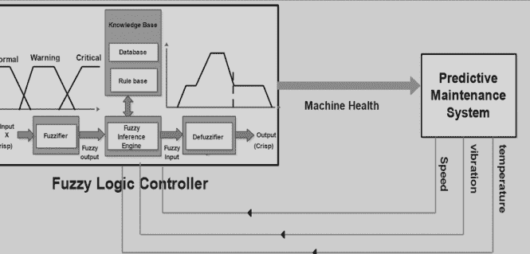

**图 8.7** 模糊逻辑在机器预测性维护中的应用概念。

例如，使用“正常”、“警告”和“关键”等语言变量来描述不同的设备状况。模糊推理系统（FISS）考虑了这些语言因素，并将它们结合起来以预测即将发生的故障概率。与传统的二元程序相比，这种复杂的评估能够实现更准确的预测。

因此，模糊逻辑预测性维护系统能够发现机器行为的微小变化，并为潜在问题提供早期预警。由于模糊逻辑的适应性，系统能够根据变化的情况进行分析调整，从而实现更精确且具备情境感知能力的维护需求预测。

由于维护任务可以在计划停机期间主动安排，该安装显著减少了计划外停机时间。这降低了整体维护成本，延长了设备的使用寿命，并最小化了生产中断。使用模糊逻辑的预测性维护系统展示了其在管理实际工业环境的复杂性和波动性方面的有效性，突显了模糊逻辑在提高设备可靠性和完善维护方法方面的实际优势。

### 8.6.2 案例研究 2：基于模糊逻辑的自适应生产控制

正如展示模糊逻辑在自适应生产控制中应用的案例研究所表明，一家制造设施通过实施一个能够动态适应变化条件并实时优化生产的系统，来改进其生产过程。目标是提高生产力、缩短交付周期，并考虑需求和资源可用性的变化 [16]。

自适应生产控制系统使用模糊逻辑来管理制造环境的复杂性和固有不确定性。基于历史数据和专家知识，制定了模糊规则来定义期望的生产输出与输入变量（如机器速度、生产速率和库存水平）之间的相关性。

举例来说，使用“高”、“中”和“低”等术语来描述生产速率和资源消耗。模糊推理方法整合了这些语言因素，帮助决策如何调整机器速度或特定任务完成顺序等生产参数。

工业机械中的嵌入式传感器向系统提供实时数据，该系统利用模糊逻辑动态修改生产计划，如图 8.8 所示。例如，如果需求意外激增或机器暂时减速，模糊逻辑自适应控制系统可以快速且智能地调整生产计划，以最大化通量和资源利用率。

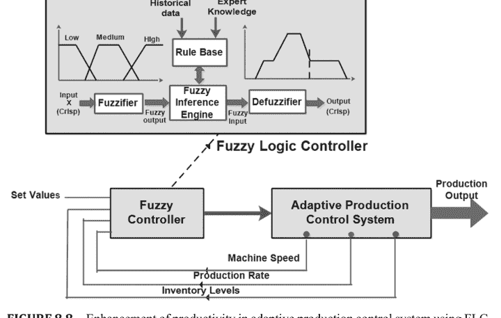

**图 8.8** 使用模糊逻辑控制器（FLC）提高自适应生产控制系统中的生产力。


在案例研究中展示了响应速度、灵活性和生产效率方面的显著提升。利用模糊逻辑的自适应生产控制系统成功缓解了未预期中断的影响，最大限度地减少了空闲时间，并优化了资源分配。由于其灵活性，制造工厂能够更快地应对不断变化的生产需求，从而提高了整体运营效率。

模糊逻辑成功融入了自适应生产控制，展示了该方法在应对现代制造环境动态特性方面提供巧妙且适应性强的响应能力。案例研究展示了基于模糊逻辑的控制系统如何有助于实现既符合工业 4.0 标准又具备灵活性的制造流程。

## 8.6.3 案例研究 3：智能制造中的质量保证

在一项展示智能制造如何融入质量保证的工业 4.0 案例研究中，一家创新汽车制造厂旨在通过应用尖端技术来提升其生产流程 [17]。主要目标包括提高产品质量、降低故障率，并确保生产线的更加流畅和高效。

该智能制造解决方案整合了复杂的质量保证方法，使用了人工智能、计算机视觉和机器学习等技术。该系统允许在制造线各处战略性地放置传感器，以实时收集各种质量特征（如装配精度、表面光洁度和尺寸）的数据。

模糊逻辑是用于解决制造过程中固有的不精确性和不可预测性的质量保证系统的重要组成部分。利用专家知识和历史数据，制定了建立输入变量（传感器数据）与预期质量结果之间关联的模糊规则。

例如，使用“可接受”、“边缘”和“有缺陷”等语言变量来描述特定部件的质量。传感器数据由模糊推理算法进行处理，然后计算质量标准的符合程度，如图 8.9 所示。这种细致的审查使得对产品质量的评估更加精确且具有情境感知能力。

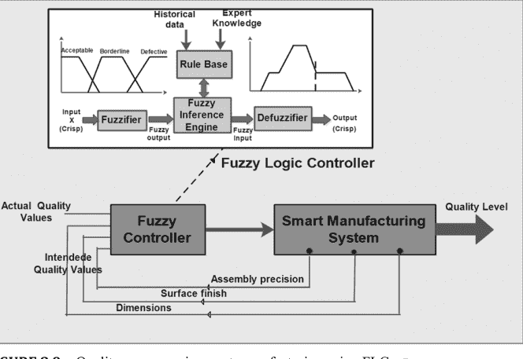

质量保证系统的自适应能力使其能够根据生产环境的变化做出调整。例如，如果传感器发现预期质量要求与实际质量之间存在差异，模糊逻辑系统可能会实时调整生产过程以解决问题。

实施结果导致缺陷显著减少，整体产品质量提高，并减少了生产后检查的需求。智能制造质量保证系统不仅提高了制造过程的可靠性，还通过减少返工和浪费带来了成本节约。

本案例研究展示了将模糊逻辑和智能技术整合到质量保证流程中的实际益处。它展示了一种综合的质量控制方法——结合实时数据分析、自适应决策和模糊逻辑——如何变革制造实践，并与工业 4.0 的目标保持一致。

## 8.7 挑战与考量

虽然智能制造有望提高效率和促进创新，但它面临着各种需要深思熟虑的挑战。

由多样化技术引发的互操作性问题、数据安全顾虑以及隐私考量需要稳健的策略 [18]。弥合技能差距并培训擅长数据分析和自动化的劳动力至关重要，同时还需解决部署智能技术所涉及的高昂前期成本。集成遗留系统并建立标准化框架以实现无缝协作构成了额外的障碍。高效的数据管理、应对组织变革的变更管理策略，以及确保数字系统的可靠性和弹性是关键考量因素。在不断演进的监管框架内遵守法规增加了实施过程的复杂性。应对这些挑战需要一种全面且自适应的方法，强调在技术和人力资本两方面进行投资，以释放智能制造的完全潜力。

### 8.7.1 可扩展性与实时性能

可扩展性和实时性能是智能制造领域的重要考量，反映了系统处理增加的工作负载并及时响应需求的能力。智能制造基础设施必须具备可扩展性，以适应需求变化或新设备和程序的添加。这种灵活性对于满足生产环境不断变化的需求是必要的。相反，实时性能对于保证数据处理和决策中的最小延迟至关重要，从而能够对车间内变化的状况做出快速响应。实时性能和可扩展性相辅相成，因为可扩展系统需要在扩展过程中保持最高效率的运作。为了实现这一平衡，必须利用边缘计算等尖端技术，它在靠近数据源处处理数据，以最小化延迟并提高实时能力 [19]。建立有韧性的通信网络、数据分析平台和灵活控制系统，有助于智能制造实现工业 4.0 环境所需的可扩展性和实时性能。

### 8.7.2 数据集成与互操作性

在工业 4.0 框架内构建有效生态系统，智能制造的基本概念——数据集成和互操作性——是不可或缺的。在整个制造过程中，数据集成指的是来自多个来源的信息的无缝传输和聚合。这包括由机器、传感器和企业资源规划系统以及其他设备产生的信息。相反，互操作性确保这些不同的系统通过遵循共同的指南和规范来和平共处。

在智能制造中，高效的数据集成使能够全面理解生产过程，从而更容易进行实时监测、分析和决策。这一集成数据有利于总体流程优化、质量保证和预测性维护。然而，由于设备、协议和标准的多样性，确保顺畅的互操作性通常颇具挑战性。

组织使用 MQTT 等数据共享格式、OPC UA 等通信标准以及 IIoT 协议来克服这些问题。这些标准为系统和设备提供了通用语言，保证兼容性并促进轻松的数据共享。

此外，边缘计算通过在靠近源头处理数据、降低延迟并促进快速响应，显著改善了数据集成和互操作性。基于云的解决方案通过启用集中平台用于数据共享和异构系统之间的通信，也有助于互操作性。

要在智能制造中成功实施数据集成和互操作性，需要进行战略规划、投资兼容技术并与行业合作伙伴合作。通过建立标准化通信协议并采用支持无缝数据交换的技术，制造商可以释放智能制造的完全潜力，推动运营中的效率、创新和敏捷性。

### 8.7.3 安全与隐私顾虑

在实施智能制造时，安全和隐私顾虑是首要考虑的问题，因为连接的增加和数据交换引入了新的漏洞和风险 [20]。在这方面的一些主要挑战包括：

- **网络威胁：** 智能制造系统的互联性质使其容易受到网络威胁，如黑客攻击、恶意软件和勒索软件攻击。保护工业控制系统并防止对关键基础设施的未授权访问是关键优先事项。


- **数据完整性与保密性：** 确保敏感数据的完整性和保密性至关重要。对生产数据、知识产权或商业机密的未经授权的访问或篡改可能会带来严重后果。

- **供应链风险：** 智能制造通常涉及全球供应链，这会在各个环节引入安全风险。保护从设计到生产的数字供应链对于防止被破坏或仿冒至关重要。

- **互操作性挑战：** 集成多样的技术和系统可能会导致互操作性挑战，从而可能产生安全漏洞。确保所有组件都遵循强大的安全标准对于防止漏洞至关重要。

- **员工意识与培训：** 人为因素在安全中起着重要作用。员工意识和培训的不足可能导致无意的安全违规。对劳动力进行网络安全最佳实践的教育至关重要。

- **法规合规：** 遵守数据保护和隐私法规是一个复杂的挑战，特别是在法律严格的地区。在保持运营效率的同时应对多样的法规环境需要谨慎处理。

- **遗留系统漏洞：** 许多制造设施仍在运行可能缺乏现代安全功能的遗留系统。改造或保护这些系统对于防止漏洞被利用至关重要。

- **物理安全：** 保护包括机械设备和数据中心在内的物理基础设施至关重要。对关键组件的未经授权的物理访问可能会破坏整个制造过程。

- **数据所有权与共享：** 制定关于数据所有权和共享的明确政策至关重要。在智能制造生态系统中，平衡协作需求与保护专有信息对于至关重要。

- **持续监控与事件响应：** 实施持续监控和事件响应机制对于及时识别和缓解安全威胁至关重要。对安全事件的及时响应可以最大限度地减少其对运营的影响。

解决这些安全和隐私问题需要综合的网络安全策略。这包括定期进行风险评估，实施强大的加密协议，持续的员工培训以及与网络安全专家的合作。制造商必须保持警惕，适应不断演变的威胁，并优先考虑安全，以在保护运营和敏感信息的同时充分实现智能制造的利益。

## 8.8 模糊逻辑与 IIoT 的未来趋势

模糊逻辑与 IIoT 融合的未来趋势有望重新定义决策流程，并提升工业领域的运营效率。模糊逻辑能够处理不确定性和不精确性，注定将在优化 IIoT 应用中发挥关键作用。先进的模糊逻辑系统将演化为融合更复杂的机器学习算法，从而在动态制造环境中实现自适应决策。模糊逻辑与 IIoT 的协同效应将超越预测性维护和质量控制，涵盖生产、供应链管理和人机交互的更广泛方面。将边缘计算与模糊逻辑结合使用，将在源头促进实时分析和决策，减少延迟并增强响应能力。此外，未来将向更可解释的人工智能转变，模糊逻辑固有的可解释性将有助于建立对自主决策系统的信任 [21]。随着各行业迎接下一波工业变革浪潮，模糊逻辑与 IIoT 的融合有望在智能制造生态系统中开启智能、适应性和韧性的新维度。

### 8.8.1 边缘计算与分布式控制

边缘计算和分布式控制是塑造智能制造未来的关键趋势，特别是在工业 4.0 的背景下。边缘计算涉及在靠近数据生成源的地方处理数据，以减少延迟并实现实时分析。在智能制造中，这意味着来自传感器、设备和机器的数据可以在网络边缘进行处理，从而允许更快的决策和更高效的资源利用 [22]。另一方面，分布式控制将决策权分布在制造系统内的各个组件中，使设备能够基于本地信息做出自主决策。

边缘计算与分布式控制之间的协同效应对于智能制造具有变革意义。通过利用边缘计算，可以在本地处理实时产生的海量数据，减少对将大量数据传输到集中式云服务器的需求。这不仅减少了网络拥塞，还增强了系统的响应能力。分布式控制通过允许设备和传感器基于本地数据做出独立决策，与边缘计算相辅相成，从而促进制造过程的灵活性和适应性。

这些趋势共同增强了智能制造系统的效率、可靠性和可扩展性。它们通过减少对集中式处理的依赖，改善实时决策，并促进自适应和自主制造流程的快速部署，从而有助于构建更强大和更具韧性的制造生态系统。随着工业 4.0 的持续演变，边缘计算与分布式控制的融合成为智能制造未来的关键推动力。

### 8.8.2 机器学习-模糊逻辑混合方法

机器学习和模糊逻辑的融合代表了智能制造的前沿方法，提供了一种强大的混合范式，结合了两种方法的优势。机器学习擅长模式识别、数据分析和复杂建模，而模糊逻辑则通过语言变量和基于规则的推理提供了一个处理不精确和不确定信息的框架 [23]。在智能制造中，这种混合体现在几个关键应用中：

- **预测性维护：** 机器学习模型可以分析历史数据以预测设备故障，而模糊逻辑可以解释这些预测，并根据确定性程度做出决策，从而实现更细致的维护计划。
- **质量控制：** 机器学习算法可以从庞大的数据集中学习，以识别与高质量产品相关的模式，然后模糊逻辑可以评估当前产品的质量，考虑制造过程中的不精确因素和不确定性。
- **流程优化：** 混合方法可以通过利用机器学习识别数据中的模式，并利用模糊逻辑根据实时条件自适应地调整控制参数，从而优化制造流程，确保效率和品质。
- **供应链管理：** 机器学习可以分析数据以预测需求并优化库存水平，而模糊逻辑可以处理供应链变量中的不确定性，从而实现动态环境中的自适应决策。
- **能源管理：** 混合方法可以通过使用机器学习识别节能模式，并利用模糊逻辑根据变化的生产需求和环境因素调整能源使用，从而优化能源消耗。
- **人机交互：** 机器学习模型可以被训练以理解人类行为和偏好，而模糊逻辑可以解释与用户满意度相关的语言变量，从而带来更直观和自适应的人机界面。

机器学习和模糊逻辑的整合提供了一种协同解决方案，解决了智能制造中的不确定性和复杂性挑战。这种混合方法利用机器学习的学习能力，结合模糊逻辑的可解释性和基于规则的推理，从而产生更强大、自适应且具有上下文感知能力的系统，有助于工业 4.0 的发展。

## 8.8.3 工业 4.0 与智能制造的未来

工业 4.0 [24] 标志着制造领域的范式转变，开创了以集成数字技术、自动化和数据驱动决策为特征的智能制造时代 [25]。在工业 4.0 的背景下，有几个变革性趋势标志着智能制造的未来：

- **互连性：** 工业 4.0 设想了一个高度互连的生态系统，其中机器、设备和系统能够无缝通信。IIoT 促进了实时数据交换，使整个生产过程的全局视图成为可能。
- **数据分析和 AI：** 智能制造的未来严重依赖于先进的数据分析和 AI。机器学习算法分析大型数据集以提取见解、改进流程并允许预测性维护，有助于提高效率并减少停机时间。
- **边缘计算：** 边缘计算正在发展成为智能制造的重要推动力。在更靠近数据源的地方处理数据，在


网络边缘，降低延迟，改善实时决策能力，并减轻集中式云系统的负担。

1.  **数字孪生**：数字孪生是物理资产和流程的虚拟副本，在智能制造中发挥着至关重要的作用。它们能够模拟、监控和优化生产流程，支持主动调整，从而最小化风险。
2.  **去中心化决策**：去中心化的控制机制允许单个设备和组件基于本地数据做出自主决策，提高面对动态制造环境时的敏捷性、适应性和灵活性。
3.  **信息物理系统**：信息物理系统将计算智能与物理流程相结合，构建出智能、自我监控的系统。这种集成增强了对变化进行实时感知、适应和反应的能力。
4.  **定制化和灵活性**：智能制造拥抱定制化和灵活性，使得小批量甚至个性化产品的高效生产成为可能。这种从大规模生产向更具灵活性和适应性制造模式的转变，顺应了不断变化的消费者需求。
5.  **可持续性和能效**：智能制造的未来强调可持续性和能效。智能电网、可再生能源整合和资源优化等技术有助于实现环保且经济高效的生产。
6.  **人机协作**：协作机器人、增强现实界面和直观的人机交互是智能制造未来的重要组成部分。工人和机器协同工作，自动化处理常规任务，而人类则贡献创造力和解决问题的能力。
7.  **安全与韧性**：随着连接性的增加，对网络安全的高度重视也随之而来。未来的智能制造系统优先考虑强健的安全措施，以防范网络威胁，确保关键工业基础设施的韧性。

随着工业4.0的不断演进，智能制造的未来特征是一个日益互联、智能和自适应的工业生态系统。采纳这些技术趋势不仅提升了运营效率，还使制造企业能够在数字转型时代蓬勃发展。

## 8.9 结论

总之，在智能制造的工业物联网（IIoT）中整合模糊逻辑代表了一种范式转变，迈向更智能、更具适应性和高效性的工业流程。模糊逻辑处理不确定性、不精确数据和复杂决策的能力，与工业物联网动态且互联的特性相辅相成。通过实时数据分析、预测性维护和决策支持，模糊逻辑有助于优化制造运营，减少停机时间，并提高整体生产力。模糊逻辑与工业物联网之间的协同作用，使对制造变量的理解更加细致入微，从而促进对变化条件的适应性反应。随着智能制造在工业4.0的大背景下发展，模糊逻辑的整合在处理工业环境中不可预测性和变异性问题方面变得日益重要。这种技术组合为构建更稳健、灵活和智能的制造环境奠定了基础，同时也提高了运营效率。模糊逻辑在工业物联网中的重要性，通过其在不断变化的智能制造领域中所处的地位得到验证，用于驾驭当代工业过程的细节。

### 8.9.1 关键见解回顾

回顾而言，在智能制造的工业物联网中整合模糊逻辑，带来了塑造现代工业流程格局的关键见解：

-   **处理不确定性**：模糊逻辑的优势在于其处理模糊性和不精确数据的能力。模糊逻辑为不确定的制造环境提供了强大的决策框架，在这种环境中，变量无法拥有确切的值。
-   **实时决策支持**：工业物联网与模糊逻辑的结合使得实时数据分析和决策支持成为可能。这赋予了工业系统在工厂环境中不断变化的条件下进行智能调整和决策的能力。
-   **预测性维护**：模糊逻辑是预测性维护技术的关键组成部分。模糊逻辑模型通过评估历史数据和当前数据来预测设备故障并建议预防性维护措施。这最小化了停机时间并最大化了运营效率。
-   **适应性制造**：工业物联网与模糊逻辑的结合增强了制造流程的适应性。模糊逻辑中基于规则的推理能够对不断变化的情况进行适应性反应，确保工业系统能够动态适应意外事件。
-   **细致入微的决策**：通过引入语言因素和基于规则的推理，模糊逻辑为决策过程增加了细致入微的程度。这种细致的处理方法使得能够对影响制造的众多复杂方面做出更复杂和情境感知的响应。
-   **整合挑战**：尽管模糊逻辑有许多优势，但也存在缺点。这些问题包括标准化、互操作性以及合格人员需求方面的挑战。要释放模糊逻辑在智能制造中的全部潜力，需要克服这些障碍。
-   **未来趋势**：模糊逻辑和工业物联网的未来方向包括自适应决策系统、边缘计算和去中心化控制的持续发展。这些发展凸显了本地化和更高效的数据处理对于提高实时性能和降低延迟的必要性。
-   **工业4.0变革**：工业物联网中模糊逻辑的应用与工业4.0的更广泛变革相一致。为了发展更智能和互联的制造生态系统，这一变革强烈强调连接性、数据驱动的洞察以及数字技术的融合。

在智能制造的工业物联网中采用模糊逻辑，本质上是一种主动策略，用于应对当代工业流程中普遍存在的不确定性和复杂性。它是向更高适应性、效率和韧性持续演进的有力证明。

### 8.9.2 对制造未来的影响

在智能制造的工业物联网中整合模糊逻辑，对制造业的未来具有深远的影响。这些影响涵盖了技术进步、运营增强和战略考量：

-   **效率和生产力的提高**：模糊逻辑基于不精确数据做出细致入微决策的能力，有助于提高运营效率。这带来了优化的生产流程、减少的停机时间和提高的整体生产力。
-   **预测性和主动性维护**：模糊逻辑在预测性维护中的应用，使制造设施能够从被动反应型维护策略转向主动预防型维护策略。通过预测设备故障，组织可以提前安排维护活动，从而最小化干扰并延长机器寿命。
-   **自适应和敏捷制造**：模糊逻辑的自适应决策能力，特别是与工业物联网结合时，促进了敏捷的制造流程。实时应对变化条件的能力确保了制造系统保持灵活性，并能响应市场需求和不可预见的中断。
-   **质量改进和缺陷减少**：模糊逻辑在质量控制中的应用，通过考虑制造过程中的不精确因素，提高了产品质量。这导致缺陷减少，并增强了最终产品的一致性和可靠性。
-   **人机协作和用户友好界面**：模糊逻辑有助于开发更直观的人机交互界面。这促成了协作工作环境，使工人能够轻松地与智能制造系统互动，从而增强人类直觉和机器精度的优势。
-   **资源优化和可持续性**：模糊逻辑在流程优化中的应用涵盖了资源管理，从而促进了可持续的工业实践。组织可以通过根据当前情况动态调整资源使用，来降低浪费和能源消耗。
-   **技术协同和工业4.0整合**：模糊逻辑和工业物联网的结合是工业4.0的自然契合点，后者基于通过数字技术融合使生产成为智能网络化系统的理念。这种整合使得更具包容性和集成度的工业生态系统成为可能。
-   **实施和技能开发的挑战**：模糊逻辑在生产中的应用还存在额外的困难，例如对标准化、互操作性以及


技能培养。为了让企业能够完全从智能制造业中的模糊逻辑中获利，必须解决这些问题。

制造业的未来将主要受到向更智能、数据驱动和自适应系统转型的影响。将模糊逻辑与工业物联网（IIoT）整合是实现这些目标的关键组成部分，它支持了数字化转型时代制造业的持续发展。

## 8.9.3 关于模糊逻辑在智能制造工业物联网中作用的最终思考

总之，模糊逻辑在智能制造的工业物联网中发挥着关键且革命性的作用。模糊逻辑为动态环境下的决策制定提供了一个全面的框架，作为解决现代工业进程中固有的复杂性和不确定性的支点。其处理不精确数据、解读语言细微差别以及提供细致回答的能力，为智能和自适应生产系统铺平了道路。

当模糊逻辑与工业物联网结合时，制造过程不再仅仅是自动化；它们变得具有响应性、敏捷性，并能即时做出情境感知决策。通过预测性维护、质量控制和适应性制造，效率和效能达到了新的高度，从而提高了产量并节省了运营成本。

未来的影响是深远的，因为它们承诺了卓越运营能力的提升以及资源高效和可持续制造技术的进步。工业4.0正在显著塑造制造业环境，而模糊逻辑与工业物联网之间的相互作用是这一转变的主要推动力，它创造了一个人类、机器和过程和谐共生的生态系统。

然而，互操作性以及需要具备专业技能的人才等挑战，凸显了战略规划和持续创新的重要性。克服这些挑战将在释放模糊逻辑在智能制造中的全部潜力方面发挥关键作用，推动行业迈向一个以韧性、适应性和智能为特征的未来。在这个数字化转型的时代，模糊逻辑在工业物联网中的作用证明了其在驾驭制造业复杂局面并将其引向更高效、更智能未来的重要性。

## 关键词

- **模糊逻辑**
- **工业物联网**
- **智能制造**
- **决策制定**
- **自适应控制**

## 参考文献

1. Grace, J., Mahmoud, M. A., Mahdi, M. N., & Mostafa, S. A. (2022). An evaluation model of smart manufacturing system configurations prior to implementation using fuzzy logic. *Applied Science*, *12*(5), 2753.
2. Wang, B., Tao, F., Fang, X., Liu, C., Liu, Y., & Freiheit, T. (2021). Smart manufacturing and intelligent manufacturing: A comparative review. *Engineering*, *7*(6), 738–757.
3. Hamdia, S. E., Oudania, M., Aboubetalah, A., & Sebbar, A. (2019). Fuzzy approach for locating sensors in industrial internet of things. *Procedia Computer Science*, *160*, 772–777.
4. Yildizbasi, A., & Unlu, V. (2020). Performance evaluation of SMEs towards industry 4.0 using fuzzy group discussion making methods. *SN Applied Science*, *2*, 355.
5. Caiado, R., Scavarda, L. F., Gavião, L., Ivson, P., Nascimento, D. L. D. M., & Garza-Reyes, J. A. (2020). A fuzzy rule-based industry 4.0 maturity model for operations and supply chain management. *International Journal of Production Economics*, *231*, 107883.
6. Yang, H., Kumara, S., Bukkapatnam, S. T. S., & Tsung, F. The internet of things for smart manufacturing: A review. *IIE Transactions*, 2019.
7. Mehbodniya, A., Webber, J. L., Rani, R., Ahmad, S. S., Wattaar, I., Ali, L., & Nuaghah, S. J. (2022). Energy-aware routing protocol with fuzzy logic in industrial internet of things with blockchain technology. In: *Wireless Communications and Mobile Computing*, pp. 1–15.
8. Sobrino, A. (2013). Fuzzy logic and education: Teaching the basics of fuzzy logic through an example (by Way of Cycling). *Education Sciences*, *3*(2), 75–97.
9. Kerimkulle, S., Dildebayeva, Z., Tokhmetov, A., Amirova, A., Tussupov, J., Makhazhanova, U., Adalbek, A., Taberkhan, R., Zakirova, A., & Salykbayeva, A. (2023). Fuzzy logic and its application in the assessment of information security risk of industrial internet of things. *Symmetry*, *15*(10).
10. Tashtoush, T., Alazzam, A., & Rodan, A. (2020). Utilizing fuzzy logic controller in manufacturing facilities design: Machine and operator allocation. *Cogent Engineering*, *7*(1), 1–16.
11. Mitrofanı, I. A., Emirıs, D. M., & Koulouiotıs, D. E. (2020). An industrial maintenance decision support system based on fuzzy inference to optimize scope definition. *Procedia Manufacturing*, *51*, 1538–1543.
12. Moreno-Cabezali, B. M., & Fernandez-Crehuet, J. M. Application of a fuzzy-logic based model for risk assessment in additive manufacturing R&D projects. *Computer & Industrial Engineering*, 145, 2020.
13. Al-Saadi, T., Rossiter, A., & Panousos, G. (2022). Fuzzy logic control in metal additive manufacturing: A literature review and case study. *IFAC-PapersOnLine*, 55(21), 37–42.
14. Azadeegan, A., Porobic, L., Ghazinoury, S., Samoeui, P., & Kheirkhah, A. S. (2011). Fuzzy logic in manufacturing: A review of literature and a specialized application. *International Journal of Production Economics*, 132, (2), 258–270.
15. Baban, C. F., Baban, M., & Darius, S. M. (2016). Using a fuzzy logic approach for the predictive maintenance of textile machines. *Journal of Intelligent & Fuzzy Systems*, 30(2), 999–1006.
16. Zou, M., Yi, J., Yang, C., Liao, Q., Xiong, W., & Wang, X. (2022). Adaptive fuzzy logic control for grinding process based on grinding sound trend. *IFAC-PapersOnLine*, 55(21), 120–125.
17. Galindo-Salcado, M., Pertúz-Morenoa, A., Guzmán-Castillo, S., Gómez-Charissa, Y., & Romero-Conrado, A. R. (2022). Smart manufacturing applications for inspection and quality assurance processes. *Procedia Computer Science*, 198, 536–541.
18. Phuyal, S., Bista, D., & Bista, R. (2020). Challenges, opportunities and future directions of smart manufacturing: A state of art review. *Sustainable Futures*, 2, 100023.
19. Narwane, V. S., Raut, R. D., Gardas, B. B., Narkhede, B. E., & Awasthi, A. (2022). Examining smart manufacturing challenges in the context of micro, small and medium enterprises. *International Journal of Computer Integrated Manufacturing*, 35(12), 1395–1412.
20. Tuptuk, N., & Hailes, S. (2018). Security of smart manufacturing systems. *Journal of Manufacturing Systems*, 47, 93–106.
21. Qu, Y., Ming, X. G., Liu, Z. W., Zhang, X., & Hou, Z. T. (2019). Smart manufacturing systems: State of the art and future trends. *The International Journal of Advanced Manufacturing Technology*, 103(1), 3751–3768.
22. Pronier, J., Pipan, M., Zupan, H., Resman, M., Simic, M., & Herakovic, N. (2021). Edge computing and digital twin based smart manufacturing. *IFAC-PapersOnLine*, 54(1), 831–836.
23. Wang, J., Ma, Y., Zhang, L., Gao, R. X., & Wu, D. (2018). Deep learning for smart manufacturing: Methods and applications. *Journal of Manufacturing Systems*, 48, 144–156.
24. Vaidya, S., Ambad, P., & Bhsole, S. (2018). Industry 4.0—a glimpse. *Procedia Manufacturing*, 20, 233–238.
25. Hozdic, E. (2015). Smart factory for industry 4.0: A review. *Journal of Modern Manufacturing Systems and Technology*, 7(1), 28–35.

## Taylor & Francis

Taylor & Francis 集团
http://taylorandfrancis.com


## 通过模糊 GTMA 方法分析印度 NIFTY 石油公司的财务效率

SUBRATA JANA¹, ANIRBAN SARKAR², ARPAN GHOSHAL³, BINAY MAJI⁴, SAYANTANI PAUL³, and BISWADIP BASU MALLIK⁵

¹印度西孟加拉邦加尔各答贾达普尔大学数学系
²印度西孟加拉邦巴拉萨特西孟加拉邦州立大学管理与营销系
³印度西孟加拉邦豪拉Seacom工程学院基础科学与人文学系
⁴印度西孟加拉邦豪拉Surendralal Das教师培训学院教育系
⁵印度西孟加拉邦加尔各答工程与管理学院（大学工程与管理学校）基础科学与人文学系

### 摘要

石油公司在推动国家内部社会经济发展方面扮演着至关重要的角色。近年来，印度的石油行业经历了显著增长。石油公司在服务质量和可用性方面表现出色。毫无疑问，石油公司的财务表现是其核心组成部分。在当前市场日益激烈的竞争格局下，对财务表现进行准确和精确的评估

对于旨在有效维持其市场地位石油公司而言，这一点具有重大现实意义。本研究旨在评估财务绩效，并对印度国家证券交易所（NSE）于2023年8月16日列出的六家NIFTY石油公司进行排名，使用其财务指标进行评估。这六家石油公司的估值基于九个财务指标，这些指标随后结合使用多标准决策制定（MCDM）方法，得出财务绩效分数。在本研究中，利用三角模糊数（TFN）和模糊图论及矩阵方法（F-GTMA），根据财务绩效对石油公司进行排名。研究结果表明，印度信实工业（Reliance）展现出最高的财务效率，印度石油天然气公司（ONGC）和印度石油公司（IOC）分别排名第二和第三。

## 9.1 引言

### 9.1.1 石油公司

印度拥有大量重要的石油公司，它们在国家的能源行业中发挥着关键作用。印度石油行业的主要参与者包括以下公共部门企业：

- **印度巴拉特石油有限公司（BPCL）：** 印度的另一家重要国有石油公司是BPCL。它从事石油和石化产品的勘探、生产、精炼和营销。政府已宣布有意私有化BPCL，这可能会导致公司股权结构的重大变化。
- **印度斯坦石油有限公司（HPCL）：** HPCL是印度石油和天然气行业的主要参与者。与印度石油公司（IOC）和BPCL一样，它参与石油和天然气价值链的多个环节，包括勘探、精炼和营销。
- **IOC：** 作为印度最大的石油企业，IOC从事石油产品的精炼、营销和分销。它拥有庞大的加油站网络，并在全国运营着多家炼油厂。
- **印度石油有限公司（OIL）：** 它是印度主要的公共部门公司之一，从事天然气和原油的运输、生产和勘探。该公司成立于1959年，对于满足国家的能源需求至关重要。
- **石油天然气公司（ONGC）：** ONGC的主要业务是天然气和石油的生产和勘探。尽管它不仅仅是一家石油公司，但其业务为印度的能源安全做出了重大贡献。
- **信实工业有限公司（Reliance Industries Limited）：** 尽管它不是传统的国有石油企业，但穆克什·安巴尼旗下的信实工业是印度石油和天然气行业的主要参与者。它极大地推动了印度石化行业的增长，并运营着全球最大的炼油联合体之一——位于古吉拉特邦的 Jamnagar 炼油厂。

这些公司共同满足了印度的能源需求，确保了石油产品的供应，并推动了经济增长。该行业充满动态，随着政府推动可再生能源的倡议以及私营部门在行业中不断演变格局的参与，持续发展。

### 9.1.2 印度石油公司现状

1889年在阿萨姆邦迪格博伊（Digboi）附近发现石油时，印度石油工业应运而生。1960年代，天然气行业在马哈拉施特拉邦和阿萨姆邦起步。截至2018年3月，印度拥有1339.57亿立方米的天然气储量和594.49百万公吨的原油储量。到2022年，印度希望通过利用乙醇、可再生能源和本土勘探，将82%的石油进口依赖度降低至67%。2019年印度原油进口量为205.3百万吨，使其成为第二大净进口国。然而，在2021财年，国内天然气产量下降了8.1%，原油产量骤降了5.2%。2021年8月，原油产量下降了2.3%，而国内天然气产量增长了20.23%。

2023年，石油企业将在印度经济社会结构中发挥更大的作用。在印度，信用渗透的潜力仍然非常巨大。通过与金融科技合作并推出带有定制解决方案的新商业模式，石油公司有机会重新定义行业标准。

如图9.1所示，石油的即将需求正在逐日增加。

### 9.1.3 背景

对印度石油公司的财务绩效进行研究，出于以下几个原因具有相关性：

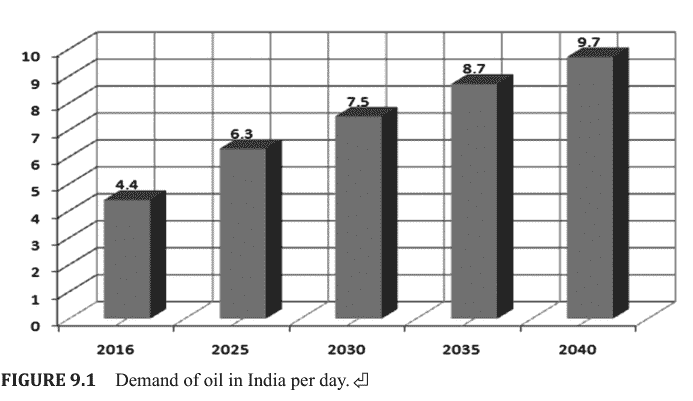

- **经济影响：** 石油公司在印度经济中发挥着关键作用。研究其财务绩效可以提供对其国内生产总值（GDP）贡献、就业创造以及整体经济稳定性的见解。
- **投资者决策：** 国内和国际投资者都依赖财务绩效指标来做出明智的投资决策。了解印度石油公司的财务健康状况有助于投资者评估风险和潜在回报。
- **政策制定：** 政府政策通常依赖于关键行业的表现。对石油公司财务指标的研究可以为政策制定者提供有关行业挑战和优势的信息，有助于制定有效的法规和激励措施。
- **能源安全：** 鉴于能源安全的战略重要性，监测石油公司的财务绩效至关重要。这有助于评估国家满足其能源需求的能力，并减少对外部来源的依赖。
- **环境影响：** 石油公司的环境可持续性是一个日益引起关注的问题。研究财务绩效可以评估在环保实践、遵守环境法规以及总体企业社会责任方面的投资。

因此，对印度石油公司财务绩效的研究与做出明智决策、制定政策、确保能源安全、解决环境问题以及促进整体经济发展相关。

### 9.1.4 财务指标

由于财务指标提供了有关公司整体表现、运营效率和财务健康状况的重要信息，因此它们是评估公司财务效率所必需的。这些指标通过提供评估企业财务管理的多个方面的定量手段，协助利益相关者做出合理的决策。由于绩效评估、比较分析、识别优缺点、风险评估、资源分配、投资者信心、运营效率、决策制定、法规遵从和持续改进，财务指标对于衡量公司的财务效率至关重要。

因此，财务指标提供了一种系统和可量化的方法来评估公司的财务效率，使利益相关者能够做出明智的决策、管理风险、有效分配资源并推动财务绩效的持续改进。

### 9.1.5 多标准决策制定（MCDM）

MCDM是一种系统化过程，应用于必须同时考虑多个标准或因素的情况。在现实场景中的决策有时需要权衡多个标准，而不是仅依赖单一标准。MCDM技术提供了一个系统框架，用于分析、评估和根据这些众多标准对各个选项的表现进行排名。许多学科，包括商业、工程、经济学、环境管理和公共政策，经常使用MCDM技术。存在多种MCDM技术，每种技术都有其独特的优点和限制。层次分析法（AHP）和基于与理想方案相似度的优先顺序技术（TOPSIS）是两种受欢迎的MCDM技术。

### 9.1.6 模糊图论及矩阵方法（F-GTMA）的论证

F-GTMA 是两种决策制定方法，它们扩展了传统的 GTMA 技术以处理决策问题中的不确定性和不精确性。使用这些技术的一些理由是不确定性和


决策中的模糊性、主观性及MCDM（多准则决策）、不一致和不完整的数据、权衡与排序、灵活建模、复杂决策场景、项目评估与选择、风险评估、敏感性分析，以及在各个领域的应用性。简而言之，使用F-GTMA（模糊图论矩阵法）的理由在于它们能够处理不确定性、主观偏好、MCDM以及复杂决策场景，使其成为在现实情况下做出明智且稳健决策的宝贵工具。

## 9.1.7 受益者

对印度石油公司效率测量研究可能有多方受益者：监管机构与政策制定者、投资者、石油公司本身、学术共同体、金融分析师与顾问、借款人与消费者、经济分析师与预测者、行业协会与贸易组织、公众，以及更多。

## 9.1.8 创新点

许多研究者已使用MCDM方法论（AHP、TOPSIS、MARCOS和COPRAS）对模糊数进行了研究。在GTMA MCDM范式下，几乎没有关于三角模糊数（TFN）的研究被开展。三角模糊数的去模糊化公式已被创建并应用。此外，还定义了两个TFN之间的距离测量。为计算因素和子因素的三角模糊权重，已创建了相关公式。还创建了一种将多个决策者的意见合并为一个关于TFN的单一完整值的方法。

## 9.1.9 研究结构

本文其余部分将按照图9.2所示的方式设置。

## 9.2 文献综述

在进行广泛的文献综述后，本研究注意到，在金融和其他行业的不同领域，已开展了大量研究工作，采用了一系列MCDM技术来解决MCDM挑战。有多种MCDM方法可用于进行对比分析和建立排名。研究者根据各自研究的具体要求，采用了这些方法的不同组合，以确定最合适的替代方案（表9.1）。

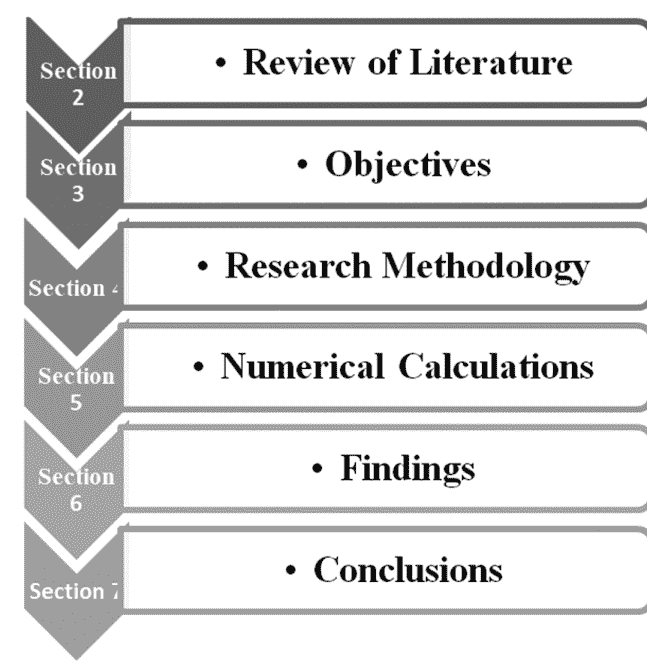

**图 9.2** 研究结构。

## 9.3 目标

本研究的目标是：

1. 找出印度NIFTY石油公司的财务效率得分。
2. 找出印度NIFTY石油公司的排名。

### 表 9.1 广泛的文献综述

| 参考文献 | 作者 | 应用领域 | 应用方法 |
| :--- | :--- | :--- | :--- |
| [1] | Xidonas等 (2009) | 股票选择 | ELECTRE Tri |
| [2] | Gallizo等 (2002) | 财务比率分析 | 源自部分调整模型的层级贝叶斯模型。 |
| [3] | Laitinen (2006) | 使用财务报表法评估诺基亚在1990–2000年间的未来潜力。 | 开发程序、收益生成法、财务进展。 |
| [4] | Wang和Lee (2008) | 查找公司的财务绩效 | 聚类方法 |
| [5] | Ghosh等 (2021) | 评估在印度运营的寿险公司的财务效率和效能。 | DEA & SEM |
| [6] | Jana和Basu (2021) | 根据财务绩效对制药公司进行排名 | TOPSIS |
| [7] | Saeed等 (2018) | 为癌症患者选择PET扫描设备。 | 带GTMA的AHP |
| [8] | Rao等 (2018) | 检查各种工艺参数在AISI304不锈钢微铣削过程中对表面粗糙度（由Ra和Rq测量）、刀具磨损和刀具振动的影响。 | GTMA方法 |
| [9] | Mohaghar等 (2012) | 查找战略排名 | 香农熵和GTMA |
| [10] | Geetha等 (2016) | 查找运行参数的最佳组合 | 图论和矩阵方法 |
| [11] | Jain和Raj (2015) | 检查影响柔性制造系统（FMS）的因素的强度或量级。 | 探索性因子分析和图论矩阵方法 |
| [12] | Andhare等 (2012) | 检查故障实例以定位机床中的关键子系统。 | GTMA |
| [13] | Tuljak-Suban和Bajec (2020) | 物流服务商（3PLP）选择 | ANP & GTMA |
| [14] | Mohaghar等 (2013) | 供应商选择 | 对数模糊偏好规划和模糊GTMA方法 |
| [15] | Yusufuddin等 (2022) | 柴油排放 | GTMA |
| [16] | Baluch (2022) | 水资源 | GTMA |
| [17] | Zhuang等 (2018) | 选择最佳碎纸机 | AHP–GTMA |
| [18] | Gul等 (2021) | 全膝关节置换术（TKR） | GTMA |
| [19] | MiorAbd Halim等 (2022) | 固体废物适当选择 | AHPGTMA |

## 9.4 研究方法

### 9.4.1 替代方案的选择

本章旨在提出一个用于评估和比较截至2023年8月16日在印度国家证券交易所（NSE）的NIFTY指数下上市的六家石油公司财务绩效的“MCDM”框架。评估包括为这些石油公司分配财务绩效得分并随后进行排名。在表9.2中，提供了六家石油公司的股票信息。

### 表 9.2 石油公司（替代方案）股票信息

| 序号 | 石油公司 | NSE代码 | BSE代码 | ISIN代码* |
| :--- | :--- | :--- | :--- | :--- |
| A01 | BPCL | BPCL | 500547 | IN E029401011 |
| A02 | HPCL | HINDPETRO | 5000104 | IN E094401015 |
| A03 | IOC | IOC | 530965 | IN E242401010 |
| A04 | OIL | OIL | 533106 | IN E274J01014 |
| A05 | ONGC | ONGC | 500312 | IN E213401029 |
| A06 | Reliance | RELIANCE | 500325 | IN E002401018 |

*ISIN代码，或国际证券识别码，用作特定证券发行的唯一标识符。它由给定国家的国家编号机构分配，以区别于该司法管辖区内的其他金融工具。

### 9.4.2 准则的选择

已选取六家于2023年8月16日在NSE的NIFTY指数中列出的石油公司的九项财务比率，涵盖六个财务年度，即2017–2018财年、2018–2019财年、2019–2020财年、2020–2021财年、2021–2022财年和2022–2023财年。

1. 数据来源：NSE网站。
2. 数据类型：二手数据。
3. 研究周期：6年（从2017–2018财年到2022–2023财年）。
4. 使用技术：F-GTMA。

本研究分析了九项财务比率。其中，七项被确定为受益者准则，包括速动比率、流动比率、资本回报率、净资产回报率、总资产回报率、每股收益和股息收益率。其余两项，即债务–股权比率和价格–收益比率，被视为非受益者准则。在表9.3中，列出了财务比率的公式，并定义了受益者和非受益者准则。

### 表 9.3 财务比率（准则）公式。

| 序号 | 比率 | 公式 | 准则类型 |
| :--- | :--- | :--- | :--- |
| C01 | 速动比率 | 速动比率 = (流动资产 - 存货) / 流动负债 | 受益者 |
| C02 | 流动比率 | 流动比率 = 流动资产 / 流动负债 | 受益者 |
| C03 | 债务–股权比率 | 债务–股权比率 = 总债务 / 股东权益总额 | 非受益者 |
| C04 | 资本回报率 | 资本回报率 = 净利润 / 总投入资本 | 受益者 |
| C05 | 净资产回报率 | 净资产回报率 = 净利润 / 股东权益总额 | 受益者 |
| C06 | 总资产回报率 | 总资产回报率 = 净利润 / 总资产 | 受益者 |
| C07 | 每股收益 | 每股收益 = 净利润 / 普通股数量 | 受益者 |
| C08 | 价格收益比率 | 价格收益比率 = 每股市场价格 / 每股收益 | 非受益者 |
| C09 | 股息收益率 | 股息收益率 = 每股股息 / 每股市场价格 | 受益者 |

### 9.4.3 模糊集合论

模糊集合论由Zadeh [20] 引入，它是将经典离散逻辑扩展到多元形式的结果。

> 定义：集合 $\bar{A}$ 定义为 $\bar{A} = \{(\Xi, \mu_\bar{A}(\Xi)\!: \Xi \in \bar{A}, \mu_\bar{A}(\Xi) \in (0, 1)\}$，其中 $\mu_\bar{A}(\Xi)$ 表示 $\bar{A}$ 的隶属度函数


### 9.4.4 TFN

定义：三角模糊数 $A_{TFN} = \{(a, b, c), \mu_{\bar{A}}(x)\}$ 如果满足以下性质，则被称为三角模糊数：

- 当 $x \leq a$ 时，$\mu_{\bar{A}}(x)$ 为零
- 当 $a < x \leq b$ 时，$\mu_{\bar{A}}(x)$ 是严格递增的连续函数
- $\mu_{\bar{A}}(x)$ 在 $x = b$ 处取得最大值，即为 1
- 在 $b < x \leq c$ 范围内，$\mu_{\bar{A}}(x)$ 是严格递减的连续函数
- 当 $x \geq c$ 时，$\mu_{\bar{A}}(x)$ 再次为零

### 9.4.5 对称线性 TFN 的隶属函数

$\mu_{\bar{A}}(x) = \begin{cases} 0; x \leq a \\ \frac{x - a}{b - a}; a < x \leq b \\ 1; x = b \\ \frac{c - x}{c - b}; b < x \leq c \\ 0; x \geq c \end{cases}$

### 9.4.6 TFN 的图形

图 9.3 展示了线性 TFN 隶属函数的表示。在图 9.3 中，绘制了满足 $a \leq b \leq c$ 的 TFN，其中 $a$、$b$ 和 $c$ 均为实数。

### 9.4.7 TFN 的算术运算

设 $E = (e_1, e_2, e_3)$ 和 $F = (f_1, f_2, f_3)$ 为两个不同的 TFN。

1. **加法：**
   $(E + F) = (e_1 + f_1, e_2 + f_2, e_3 + f_3)$

2. **减法：**
   $E - F = (e_1 + f_3, e_2 - f_2, e_3 + f_1)$

3. **乘法：**
   $(E \times F) = (e_{1}f_{1}, e_{2}f_{2}, e_{3}f_{3})$  (9.4)

4. **标量乘法：**
   $\theta E = (\theta e_{1}, \theta e_{2}, \theta e_{3})$  (9.5)

5. **除法：**
   $(E/F) = (e_{1}/f_{3}, e_{2}/f_{2}, e_{3}/f_{1})$  (9.6)

6. **逆运算：**
   $E^{-1} = (\frac{1}{e_{3}}, \frac{1}{e_{2}}, \frac{1}{e_{1}})$  (9.7)

7. **距离度量：**
   $d(\tilde{E}, \tilde{F}) = \sqrt{\frac{1}{3}[ (e_{1}-f_{1})^{2} + (e_{2}-f_{2})^{2} + (e_{3}-f_{3})^{2}]}$  (9.8)


图 9.3 线性 TFN 的隶属函数。

### 9.4.8 F-GTMA

GTMA 是多准则决策（MCDM）领域中一种突出的方法，用于解决存在多个准则的决策问题。本研究引入了一种用于替代方案排序的 F-GTMA 模型。基于运筹学模型的广泛背景，该方法采用了逻辑且系统的基础。

Rao [21] 在其书中详细阐述了 GTMA，重点介绍了其方法论和应用。图论的全面性质及其多样化的应用已有详尽记载。在有向图模型表示中，其在科学技术领域对各类系统进行建模和分析的价值已得到证明。矩阵方法作为一种特别有效的工具，能够高效地分析图/有向图模型，从而推导出与特定目标相符的系统功能和指标。

GTMA 方法论包括有向图表示、矩阵表示和永函数（permanent function）表示。有向图直观地捕捉了变量及其相互依赖性，而矩阵则将这种视觉表示转化为数学形式 [22]。永函数作为一种数学表示，在确定与模型相关的数值指标方面发挥着关键作用 [23]。

该方法论的逐步说明如下：

**步骤 1：** 确定影响设备选择的因素包括识别所有影响决策的准则。这可以通过参考现有文献中列出的相关准则或获取决策者的输入来实现。

**步骤 2：** 识别所有可能的设备替代方案，并评估每个选项。

**步骤 3：** 通过设备选择准则图对准则及其相互依赖关系进行图形化展示。准则被定义为影响替代方案选择的因素，设备选择准则有向图则直观地表示了这些准则之间的关系。该有向图由一组节点 $N = \{n_i\}$ 组成，其中 $i = 1,2,3,\ldots,M$，以及一组有向边 $E = \{e_{ij}\}$。节点 $n_i$ 代表第 $i$ 个替代方案选择准则，而边表示准则之间的相对重要性。反映的节点数量 M 等于测量的替代方案选择准则数量。如果节点 $i$ 在替代方案选择中对另一个节点 $j$ 具有相对重要性，则从节点 $i$ 到节点 $j$ 绘制一条有向边（即 $e_{ij}$）。如果 $j$ 对 $i$ 具有相对重要性，则从节点 $j$ 到节点 $i$ 绘制有向边 ($e_{ji}$) [21]。

**步骤 4：** 创建一个矩阵，以一对一的关系表示设备选择准则，该矩阵源自替代方案选择准则有向图。此矩阵被称为设备选择准则矩阵。这是一个 $M$ 矩阵，包含了所有准则（即 $A_i$）及其相对重要性（即 $a_{ij}$）。其中 $A_i$ 是由节点 $n_i$ 表示的第 $i$ 个准则的值，$a_{ij}$ 是由边 $e_{ij}$ 表示的第 $i$ 个准则相对于第 $j$ 个准则的相对重要性。$A_i$ 的值最好从现有数据中获取。当有准则的定量值时，分配给替代方案的准则归一化值通过 $v_i / v_j$ 计算，其中 $v_i$ 是第 $i$ 个替代方案的准则度量，$v_j$ 是第 $j$ 个替代方案的准则度量，且在考虑的替代方案中具有较高的准则度量。这一比例仅适用于有益准则。有益准则是指对于指定目的，较大的度量更可取的准则。相反，非有益准则是指较小的度量更可取的准则，分配给替代方案的归一化值通过 $v_j / v_i$ 计算。


**步骤 5：** 推导矩阵的替代方案选择准则函数涉及使用矩阵的永函数作为定义度量。永矩阵的概念由 Cauchy 在 1812 年开发行列式理论时引入，涉及后来由 Muir 定义为永函数的对称函数特定子集 [24]。永矩阵是组合数学中使用的常规矩阵函数。其推导方式类似于行列式，但具有一个独特特征——与涉及负号的行列式不同，永函数在计算中用正号替代这些负号。理解永函数的概念有助于加深选择属性的理解。此外，采用这种方法可确保表达式中不存在负号，从而无损地保留所有信息 [21]。PER (CS) 涵盖了按 (M + 1) 组排列的项，分类涉及这些对应于准则度量和相对重要性循环显著性的组。第一组表示 M 个准则的度量，第二组因有向图中不存在自循环而被省略。第三组包含 2-准则相对重要性循环和 (M-2) 个准则的度量。第四组中的每一项表示一组 3-准则相对重要性循环，或其对应项，以及 (M-3) 个准则的度量。第五组分为两个子组。第一个子组由两组 2-准则相对重要性循环和 (M-4) 个准则的度量组成。同时，第二个子组中的每一项表示一组 4-属性相对重要性循环，或其对应项，以及 (M-4) 个准则的度量。第六组也包含两个子组。第一个子组中的项是一组 3-准则相对重要性循环，或其对应项，加上一个 2-准则重要性循环以及 (M-5) 个准则的度量。另一方面，第二个子组中的每一项表示一组 5-准则相对重要性循环，或其对应项，以及 (M-5) 个准则的度量。方程中的其余项遵循类似的模式。因此，CS 的综合结构完全定义了替代方案选择评估问题，封装了准则及其相对重要性的所有可预见的结构组件。值得注意的是，该方程本质上是 M-M 矩阵的行列式，且所有项均视为正数。


**步骤 6：** 评估和排序替代方案涉及基于在前一阶段计算出的持久值（表 9.4–9.10）分配位置。

## 9.5 数值计算

**表 9.4** 准则间比较矩阵

| | C1 | C2 | C3 | C4 | C5 | C6 | C7 | C8 | C9 |
| :--- | :--- | :--- | :--- | :--- | :--- | :--- | :--- | :--- | :--- |
| **I** | 1.00 | 1.00 | 1.00 | 1.00 | 1.00 | 1.00 | 0.73 | 0.97 | 0.93 |
| **M** | 1.00 | 1.00 | 1.00 | 1.00 | 1.00 | 1.00 | 0.73 | 0.97 | 0.93 |
| **U** | 1.00 | 1.00 | 1.00 | 1.00 | 1.00 | 1.00 | 0.73 | 0.97 | 0.93 |
| **I** | 0.77 | 0.94 | 0.95 | 0.77 | 0.94 | 0.95 | 1.00 | 1.00 | 1.00 |
| **M** | 0.77 | 0.94 | 0.95 | 0.77 | 0.94 | 0.95 | 1.00 | 1.00 | 1.00 |
| **U** | 0.77 | 0.94 | 0.95 | 0.77 | 0.94 | 0.95 | 1.00 | 1.00 | 1.00 |
| **I** | 1.08 | 1.18 | 1.50 | 1.08 | 1.18 | 1.50 | 0.60 | 0.77 | 0.87 |
| **M** | 1.08 | 1.18 | 1.50 | 1.08 | 1.18 | 1.50 | 0.60 | 0.77 | 0.87 |
| **U** | 1.08 | 1.18 | 1.50 | 1.08 | 1.18 | 1.50 | 0.60 | 0.77 | 0.87 |
| **I** | 0.50 | 0.65 | 0.80 | 0.50 | 0.65 | 0.80 | 0.77 | 0.94 | 0.95 |
| **M** | 0.50 | 0.65 | 0.80 | 0.50 | 0.65 | 0.80 | 0.77 | 0.94 | 0.95 |
| **U** | 0.50 | 0.65 | 0.80 | 0.50 | 0.65 | 0.80 | 0.77 | 0.94 | 0.95 |
| **I** | 0.73 | 0.97 | 0.93 | 0.73 | 0.97 | 0.93 | 1.04 | 1.08 | 1.31 |
| **M** | 0.73 | 0.97 | 0.93 | 0.73 | 0.97 | 0.93 | 1.04 | 1.08 | 1.31 |
| **U** | 0.73 | 0.97 | 0.93 | 0.73 | 0.97 | 0.93 | 1.04 | 1.08 | 1.31 |
| **I** | 1.17 | 1.36 | 1.75 | 1.17 | 1.36 | 1.75 | 1.08 | 1.18 | 1.50 |
| **M** | 1.17 | 1.36 | 1.75 | 1.17 | 1.36 | 1.75 | 1.08 | 1.18 | 1.50 |
| **U** | 1.17 | 1.36 | 1.75 | 1.17 | 1.36 | 1.75 | 1.08 | 1.18 | 1.50 |
| **I** | 0.60 | 0.77 | 0.87 | 0.60 | 0.77 | 0.87 | 0.77 | 0.94 | 0.95 |
| **M** | 0.60 | 0.77 | 0.87 | 0.60 | 0.77 | 0.87 | 0.77 | 0.94 | 0.95 |
| **U** | 0.60 | 0.77 | 0.87 | 0.60 | 0.77 | 0.87 | 0.77 | 0.94 | 0.95 |
| **I** | 0.60 | 0.77 | 0.87 | 0.60 | 0.77 | 0.87 | 0.60 | 0.77 | 0.80 |
| **M** | 0.60 | 0.77 | 0.87 | 0.60 | 0.77 | 0.87 | 0.60 | 0.77 | 0.80 |
| **U** | 0.60 | 0.77 | 0.87 | 0.60 | 0.77 | 0.87 | 0.60 | 0.77 | 0.80 |
| **I** | 1.08 | 1.18 | 1.50 | 1.08 | 1.18 | 1.50 | 1.08 | 1.31 | 1.17 |
| **M** | 1.08 | 1.18 | 1.50 | 1.08 | 1.18 | 1.50 | 1.08 | 1.31 | 1.17 |
| **U** | 1.08 | 1.18 | 1.50 | 1.08 | 1.18 | 1.50 | 1.08 | 1.31 | 1.17 |

**表 9.4** 准则间比较矩阵

| | C1 | C2 | C3 | C4 | C5 | C6 | C7 | C8 | C9 |
| :--- | :--- | :--- | :--- | :--- | :--- | :--- | :--- | :--- | :--- |
| **I** | 1.00 | 1.00 | 1.00 | 1.00 | 1.00 | 1.00 | 0.73 | 0.97 | 0.93 |
| **M** | 1.00 | 1.00 | 1.00 | 1.00 | 1.00 | 1.00 | 0.73 | 0.97 | 0.93 |
| **U** | 1.00 | 1.00 | 1.00 | 1.00 | 1.00 | 1.00 | 0.73 | 0.97 | 0.93 |
| **I** | 0.77 | 0.94 | 0.95 | 0.77 | 0.94 | 0.95 | 1.00 | 1.00 | 1.00 |
| **M** | 0.77 | 0.94 | 0.95 | 0.77 | 0.94 | 0.95 | 1.00 | 1.00 | 1.00 |
| **U** | 0.77 | 0.94 | 0.95 | 0.77 | 0.94 | 0.95 | 1.00 | 1.00 | 1.00 |
| **I** | 1.08 | 1.18 | 1.50 | 1.08 | 1.18 | 1.50 | 0.60 | 0.77 | 0.87 |
| **M** | 1.08 | 1.18 | 1.50 | 1.08 | 1.18 | 1.50 | 0.60 | 0.77 | 0.87 |
| **U** | 1.08 | 1.18 | 1.50 | 1.08 | 1.18 | 1.50 | 0.60 | 0.77 | 0.87 |
| **I** | 0.50 | 0.65 | 0.80 | 0.50 | 0.65 | 0.80 | 0.77 | 0.94 | 0.95 |
| **M** | 0.50 | 0.65 | 0.80 | 0.50 | 0.65 | 0.80 | 0.77 | 0.94 | 0.95 |
| **U** | 0.50 | 0.65 | 0.80 | 0.50 | 0.65 | 0.80 | 0.77 | 0.94 | 0.95 |
| **I** | 0.73 | 0.97 | 0.93 | 0.73 | 0.97 | 0.93 | 1.04 | 1.08 | 1.31 |
| **M** | 0.73 | 0.97 | 0.93 | 0.73 | 0.97 | 0.93 | 1.04 | 1.08 | 1.31 |
| **U** | 0.73 | 0.97 | 0.93 | 0.73 | 0.97 | 0.93 | 1.04 | 1.08 | 1.31 |
| **I** | 1.17 | 1.36 | 1.75 | 1.17 | 1.36 | 1.75 | 1.08 | 1.18 | 1.50 |
| **M** | 1.17 | 1.36 | 1.75 | 1.17 | 1.36 | 1.75 | 1.08 | 1.18 | 1.50 |
| **U** | 1.17 | 1.36 | 1.75 | 1.17 | 1.36 | 1.75 | 1.08 | 1.18 | 1.50 |
| **I** | 0.60 | 0.77 | 0.87 | 0.60 | 0.77 | 0.87 | 0.77 | 0.94 | 0.95 |
| **M** | 0.60 | 0.77 | 0.87 | 0.60 | 0.77 | 0.87 | 0.77 | 0.94 | 0.95 |
| **U** | 0.60 | 0.77 | 0.87 | 0.60 | 0.77 | 0.87 | 0.77 | 0.94 | 0.95 |
| **I** | 0.60 | 0.77 | 0.87 | 0.60 | 0.77 | 0.87 | 0.60 | 0.77 | 0.80 |
| **M** | 0.60 | 0.77 | 0.87 | 0.60 | 0.77 | 0.87 | 0.60 | 0.77 | 0.80 |
| **U** | 0.60 | 0.77 | 0.87 | 0.60 | 0.77 | 0.87 | 0.60 | 0.77 | 0.80 |
| **I** | 1.08 | 1.18 | 1.50 | 1.08 | 1.18 | 1.50 | 1.08 | 1.31 | 1.17 |
| **M** | 1.08 | 1.18 | 1.50 | 1.08 | 1.18 | 1.50 | 1.08 | 1.31 | 1.17 |
| **U** | 1.08 | 1.18 | 1.50 | 1.08 | 1.18 | 1.50 | 1.08 | 1.31 | 1.17 |


## 表 9.5 模糊 GTMA 决策矩阵

| | C1 | C2 | C3 | ... | C9 |
| :--- | :--- | :--- | :--- | :--- | :--- |
| | **l** | **m** | **u** | **l** | **m** | **u** | **l** | **m** | **u** | ... | **l** | **m** | **u** |
| A1 | 0.28 | 0.43 | 0.55 | 0.25 | 0.35 | 0.50 | 0.62 | 0.65 | 0.80 | ... | 1.00 | 1.00 | 1.00 |
| A2 | 0.14 | 0.25 | 0.35 | 0.50 | 0.50 | 0.60 | 0.71 | 0.81 | 0.88 | ... | 0.25 | 0.35 | 0.50 |
| A3 | 0.62 | 0.65 | 0.80 | 0.80 | 0.80 | 0.87 | 0.90 | 0.90 | 0.90 | ... | 0.73 | 0.97 | 0.93 |
| A4 | 1.00 | 1.00 | 1.00 | 0.62 | 0.65 | 0.80 | 0.14 | 0.25 | 0.35 | ... | 0.80 | 0.87 | 0.90 |
| A5 | 0.25 | 0.35 | 0.50 | 0.71 | 0.81 | 0.88 | 0.62 | 0.65 | 0.80 | ... | 0.62 | 0.65 | 0.80 |
| A6 | 0.14 | 0.25 | 0.35 | 0.50 | 0.50 | 0.60 | 1.00 | 1.00 | 1.00 | ... | 0.71 | 0.81 | 0.88 |

## 表 9.6 成对比较矩阵

| | C1 | C2 | C3 | C4 | C5 | C6 | C7 | C8 | C9 |
| :--- | :---: | :---: | :---: | :---: | :---: | :---: | :---: | :---: | :---: |
| C1 | | 0.27 | 0.11 | 0.08 | 0.08 | 0.06 | 0.22 | 0.18 | 0.19 |
| C2 | 0.89 | | 0.77 | 0.19 | 0.25 | 0.62 | 0.77 | 0.94 | 0.44 |
| C3 | 0.93 | 0.78 | | 0.35 | 0.74 | 0.27 | 0.43 | 0.67 | 0.67 |
| C4 | 0.08 | 0.06 | 0.22 | | 0.28 | 0.72 | 0.22 | 0.18 | 0.08 |
| C5 | 0.25 | 0.22 | 0.18 | 0.08 | | 0.37 | 0.77 | 0.94 | 0.26 |
| C6 | 0.74 | 0.77 | 0.94 | 0.26 | 0.24 | | 0.43 | 0.67 | 0.77 |
| C7 | 0.77 | 0.43 | 0.67 | 0.77 | 0.78 | 0.46 | | 0.12 | 0.38 |
| C8 | 0.25 | 0.08 | 0.06 | 0.22 | 0.62 | 0.77 | 0.45 | | 0.58 |
| C9 | 0.74 | 0.25 | 0.62 | 0.77 | 0.27 | 0.43 | 0.11 | 0.49 | |

## 表 9.7 基于 A1 的成对比较矩阵（下界模糊决策矩阵）

| | C1 | C2 | C3 | C4 | C5 | C6 | C7 | C8 | C9 |
| :--- | :---: | :---: | :---: | :---: | :---: | :---: | :---: | :---: | :---: |
| C1 | 0.92 | 0.81 | 0.59 | 0.87 | 0.11 | 0.08 | 0.42 | 0.28 | 0.38 |
| C2 | 0.92 | 0.82 | 0.61 | 0.52 | 0.25 | 0.19 | 0.73 | 0.87 | 0.81 |
| C3 | 0.93 | 0.85 | 0.66 | 0.58 | 0.28 | 0.42 | 0.88 | 0.33 | 0.54 |
| C4 | 0.55 | 0.36 | 0.42 | 0.54 | 0.48 | 0.65 | 0.37 | 0.65 | 0.54 |
| C5 | 0.38 | 0.38 | 0.73 | 0.98 | 0.36 | 0.28 | 0.42 | 0.80 | 0.11 |
| C6 | 0.80 | 0.11 | 0.08 | 0.42 | 0.62 | 0.37 | 0.65 | 0.34 | 0.69 |
| C7 | 0.48 | 0.69 | 0.27 | 0.87 | 0.87 | 0.25 | 0.19 | 0.73 | 0.76 |
| C8 | 0.18 | 0.28 | 0.42 | 0.88 | 0.38 | 0.28 | 0.38 | 0.65 | 0.65 |
| C9 | 0.58 | 0.39 | 0.54 | 0.88 | 0.11 | 0.87 | 0.81 | 0.28 | 0.42 |

## 表 9.8 基于 A1 的成对比较矩阵（均值界模糊决策矩阵）

| | C1 | C2 | C3 | C4 | C5 | C6 | C7 | C8 | C9 |
| :--- | :--- | :--- | :--- | :--- | :--- | :--- | :--- | :--- | :--- |
| C1 | 0.65 | 0.56 | 0.38 | 0.79 | 0.58 | 0.54 | 0.49 | 0.54 | 0.77 |
| C2 | 0.38 | 0.76 | 0.86 | 0.55 | 0.36 | 0.42 | 0.67 | 0.11 | 0.55 |
| C3 | 0.78 | 0.78 | 0.67 | 0.38 | 0.38 | 0.73 | 0.78 | 0.67 | 0.38 |
| C4 | 0.67 | 0.81 | 0.57 | 0.80 | 0.11 | 0.08 | 0.81 | 0.54 | 0.67 |
| C5 | 0.68 | 0.94 | 0.54 | 0.48 | 0.69 | 0.27 | 0.94 | 0.45 | 0.78 |
| C6 | 0.25 | 0.74 | 0.87 | 0.36 | 0.28 | 0.42 | 0.33 | 0.36 | 0.87 |
| C7 | 0.28 | 0.57 | 0.80 | 0.62 | 0.37 | 0.65 | 0.76 | 0.62 | 0.65 |
| C8 | 0.48 | 0.54 | 0.48 | 0.87 | 0.25 | 0.19 | 0.54 | 0.87 | 0.38 |
| C9 | 0.97 | 0.48 | 0.69 | 0.54 | 0.45 | 0.67 | 0.57 | 0.38 | 0.80 |

## 表 9.9 基于 A1 的成对比较矩阵（上界模糊决策矩阵）

| | C1 | C2 | C3 | C4 | C5 | C6 | C7 | C8 | C9 |
| :--- | :--- | :--- | :--- | :--- | :--- | :--- | :--- | :--- | :--- |
| C1 | 0.67 | 0.38 | 0.69 | 0.27 | 0.65 | 0.48 | 0.08 | 0.81 | 0.46 |
| C2 | 0.57 | 0.80 | 0.28 | 0.42 | 0.38 | 0.73 | 0.27 | 0.88 | 0.25 |
| C3 | 0.54 | 0.38 | 0.73 | 0.80 | 0.11 | 0.08 | 0.39 | 0.37 | 0.65 |
| C4 | 0.87 | 0.11 | 0.08 | 0.48 | 0.43 | 0.91 | 0.94 | 0.73 | 0.78 |
| C5 | 0.80 | 0.77 | 0.80 | 0.76 | 0.28 | 0.42 | 0.27 | 0.08 | 0.81 |
| C6 | 0.48 | 0.69 | 0.27 | 0.74 | 0.87 | 0.73 | 0.80 | 0.27 | 0.94 |
| C7 | 0.36 | 0.28 | 0.42 | 0.57 | 0.80 | 0.47 | 0.57 | 0.27 | 0.48 |
| C8 | 0.62 | 0.37 | 0.65 | 0.54 | 0.48 | 0.71 | 0.54 | 0.61 | 0.76 |
| C9 | 0.57 | 0.80 | 0.11 | 0.08 | 0.57 | 0.77 | 0.61 | 0.28 | 0.74 |

## 表 9.10 模糊与 crisp 永久矩阵

| 备选方案 | 模糊永久矩阵 | Crisp 永久矩阵 |
| :--- | :--- | :--- |
| A1 | (7.8, 7.9, 8.3) | 0.05 |
| A2 | (7.2, 7.5, 8.8) | 0.11 |
| A3 | (5.5, 5.6, 7.7) | 0.12 |
| A4 | (4.7, 5.1, 6.8) | 0.04 |
| A5 | (6.1, 6.7, 7.9) | 0.13 |
| A6 | (6.2, 8.2, 8.8) | 0.34 |

# 9.6 研究发现

根据 crisp 永久矩阵的数值，表 9.11 展示了六家石油公司的排名。较大的 crisp 永久值表明效率更高。

## 表 9.11 排名

| 备选方案 | Crisp 永久矩阵 | 排名 |
| :--- | :--- | :--- |
| A1 (BPCL) | 0.05 | 5 |
| A2 (Hind Petro) | 0.11 | 4 |
| A3 (IOC) | 0.12 | 3 |
| A4 (Oil India) | 0.04 | 6 |
| A5 (ONGC) | 0.13 | 2 |
| A6 (Reliance) | 0.34 | 1 |

排名通过图 9.4 中的折线图展示。


## 图 9.4 排名折线图。

# 9.7 结论

本研究对印度石油和能源领域的主要参与者——Reliance、BPCL、Hind Petro、IOC、Oil India 和 ONGC——的财务排名进行了分析，揭示了它们各自财务地位的一些有趣见解。Reliance 脱颖而出，以财务排名第 1 的成绩位居榜首，表明其具有稳健的财政健康状况和战略定位。ONGC 紧随其后，位列第二，进一步巩固了其在行业内的实力。IOC 占据第三位，展示了其稳定性和财务韧性。HPCL 和 Oil India 分别位于第四位和第五位，表明与同行相比，它们的财务状况虽然扎实但略低。BPCL 排在第六位，暗示其财务表现仍有提升空间。总体而言，这些排名为利益相关者和投资者评估印度石油和能源领域的动态格局提供了宝贵的基准，有助于他们为未来的业务和投资做出明智的决策。

# 关键词

- 财务指标
- NIFTY
- 石油公司
- 多准则决策
- 三角模糊数
- 图论与矩阵方法

# 参考文献

1. Xidonas, P., Mavrotas, G., & Psarras, J. (2009). A multicriteria methodology for equity selection using financial analysis. *Computers & Operations Research*, *36*(12), 3187–3203.
2. Galilzo, J. L., Jiménez, F., & Salvador, M. (2002). Adjusting financial ratios: A Bayesian analysis of the Spanish manufacturing sector. *Omega*, *30*(3), 185–195.
3. Laitinen, E. K. (2006). Financial statement data in assessing the future potential of a technology firm: The case of Nokia. *International Review of Financial Analysis*, *15*(3), 256–286.
4. Wang, Y. J., & Lee, H. S. (2008). A clustering method to identify representative financial ratios. *Information Sciences*, *178*(4), 1087–1097.
5. Ghosh, A. (2021). Analyzing efficiency of Indian life insurance companies using DEA and SEM. *Turkish Journal of Computer and Mathematics Education (TURCOMAT)*, *12*(12), 3897–3919.
6. Jana, S., Basu, S. (2021). Ranking of top 20 pharmaceutical companies in India using TOPSIS. *Empirical Economics Letters*, ISSN 1681 8997, Special Issue 3.
7. Saeed, M., Mahmood, S., & Taufeeq, H. (2018). A consistent hybrid of analytical hierarchy process (AHP) and graph theory matrix approach (GTMA) with application to selection of pet scan machine problem for cancer hospital. *International Journal of Computer Applications*, *181*(16), 42–48.
8. Rao, D. B., Rao, K. V., & Krishna, A. G. (2018). A hybrid approach to multi response optimization of micro milling process parameters using Taguchi method based graph theory and matrix approach (GTMA) and utility concept. *Measurement*, *120*, 43–51.
9. Moghar, A., Faghih, A., Fathi, M. R., & Keshavarzi, T. (2012). Applying GTMA method with Entropy weight for strategy ranking. In: *The 8th International Industrial Engineering Conference*.
10. Geetha, N. K., Siva Kumar, N., & Sekar, P. (2016). Assessment of optimal combination of operating parameters using graph theory matrix approach. *Indian Journal of Science and Technology, 9*, 36.
11. Jain, V., & Raj, T. (2015). Evaluating the intensity of variables affecting flexibility in FMS by graph theory and matrix approach. *International Journal of Industrial and Systems Engineering, 19*(2), 137–154.
12. Andhare, A. B., Tiger, C. K., & Ahmed, S. (2012). Failure analysis of machine tools using GTMA and MADM method. *International Journal of Engineering Research & Technology, 1*, 1–11.
13. Tuljak-Suban, D., & Bajec, P. (2020). Integration of AHP and GTMA to make a reliable decision in complex decision-making problems: Application of the logistics provider selection problem as a case study. *Symmetry, 12*(5), 766.
14. Moghar, A., Fagheyi, M. S., Moradi-Moghadam, M., & Ahangari, S. S. (2013). Integration of fuzzy GTMA and logarithmic fuzzy preference programming for supplier selection. *Report and Opinion, 5*(5), 9–16.
15. Yousefuddin, S., Khan, N., & Saleem, M. (2022). Optimization of diesel engine performance and emission characteristics employing hybrid Taguchi-GTMA-utility technique. *Yambu Journal of Engineering and Science, 19*(1), 86–95.
16. Baluch, M. A. (2022). Parametric Graph Theory and Matrix Approach (GTMA) Model for assessing the surface water quality. *Technical Journal, 27*(02), 10–19.
17. Zhuang, Z. Y., Lin, C. C., Chen, C. Y., & Su, C. R. (2018). Rank-based comparative research flow benchmarking the effectiveness of AHP-GTMA on aiding decisions of shredder selection by reference to AHP-TOPSIS. *Applied Sciences, 8*(10), 1974.
18. Gul, A., Mehmood, M. N., & Mehmood, M. S. (2021). Graph Theory and Matrix Approach (GTMA) Model for the selection of the femoral-component of total knee joint replacement. *Non-Metallic Material Science, 3*(1), 1–9.
19. MirAbd Halim, W. N., Mohd Hanafi, I. F., Johari, N. I., & Mahad, N. F. (2022). The hybridization of analytic hierarchy process and graph theory matrix approach (AHP-GTMA) to solve solid waste transhipment site selection problem. *Malaysian Journal of Computing (MJoC), 7*(2), 1120–1138.
20. Zadeh, L. A. (1965). Fuzzy sets. *Information and Control, 8*(3), 338–353.
21. Rao, R. V. (2007). Introduction to decision making in the manufacturing environment. In: *Decision Making in the Manufacturing Environment: Using Graph Theory and Fuzzy Multiple Attribute Decision Making Methods*. pp. 3–6.
22. Darvish, M., Yaseei, M., & Saeedi, A. (2009). Application of the graph theory and matrix methods to contractor ranking. *International Journal of Project Management, 27*(6), 610–619.
23. Faisal, M. N., Banwet, D. K., & Shankar, R. (2007). Quantification of risk mitigation environment of supply chains using graph theory and matrix methods. *European Journal of Industrial Engineering, 1*(1), 22–39.
24. Nourani, Y., & Andresen, B. (1999). Exploration of NP-hard enumeration problems by simulated annealing—the spectrum values of permanents. *Theoretical Computer Science, 215*(1–2), 51–68.


泰勒与弗朗西斯集团
http://taylorandfrancis.com


# 模糊逻辑在控制能力增强的决策模型和专家系统中的应用

 Gourab Dutta, Rahul Kumar Ghosh, 和 Gunjan Mukherjee
*Brainware University, Kolkata, West Bengal, India 计算科学系*

## 摘要

模糊逻辑作为一种强大的范式，提供了一种处理现实世界数据中固有的不确定性和不精确性的方法。在决策模型中，这一特性使得能够纳入具有不同确定程度的定性和定量数据。模糊逻辑的应用多种多样。在医疗诊断中，它有助于解释模糊的症状并评估诊断概率，从而增强医疗保健决策支持系统的准确性。在金融建模中，它通过适应波动的市场条件和不精确的经济数据，使风险评估更加强大。这一概念已被用于塑造环境模型，以处理不完整和不确定的生态数据。在控制系统中，模糊逻辑控制器擅长管理复杂的非线性过程，并应用于机器人、制造业和过程控制。模式识别系统中的模糊逻辑概念可关注图像识别和自然语言处理。质量控制和故障检测系统采用模糊逻辑，使用不精确的测量值来评估产品质量。使用模糊逻辑系统优化交通信号配时是另一个控制实例。本章将详细介绍模糊系统在各种决策模型和专家系统中的适用性，及其随后对效率和准确性的提升。

## 10.1 引言

控制能力增强是一个至关重要的概念，广泛应用于制造和工业流程、机器人技术、医疗保健、金融等各个领域。它是提高复杂系统效率、精度和适应性的关键方面。在本引言部分，我们将探讨控制能力增强在这些多样化领域中的总体重要性。

### 10.1.1 制造和工业流程

在制造业中，精度和控制至关重要。控制能力增强使制造商能够优化流程、减少缺陷并确保产品质量的一致性。汽车、航空航天和电子等行业严重依赖控制增强，以实现更严格的公差并满足严格的法规要求。

### 10.1.2 机器人和自动化

在机器人领域，控制能力增强意味着更敏捷和响应迅速的机器人。这些机器人可以以更高的精度执行任务，从而提高各行业的生产力[21]。应用扩展到手术等领域，机器人手术系统为外科医生在精细手术中提供增强的控制和精度[1]。

### 10.1.3 医疗保健

医疗保健中的控制能力增强带来了先进的医疗设备和仪器。这包括可穿戴健康监测器、药物输送系统和诊断工具。增强的控制确保了患者安全、精确的药物管理和实时监测，从而改善了医疗保健结果[32]。

### 10.1.4 金融和交易

在金融市场中，控制能力对于算法交易系统至关重要。这些系统基于市场状况做出快速决策，优化交易策略并最小化风险。控制增强使金融机构能够以无与伦比的速度和准确性应对市场波动。

### 10.1.5 航空航天和航空

飞机和航天器需要精确的控制以确保乘客安全和任务成功。控制能力的增强带来了更好的飞行控制系统和导航。这些增强还提高了燃料使用效率，有助于环境可持续性[31]。

### 10.1.6 能源和环境控制

在能源部门，控制能力增强在智能电网、优化能源分配和消费方面发挥作用。环境控制系统受益于增强的控制，以监测和减轻污染、减少能源浪费并节约资源[18]。

### 10.1.7 研究和科学探索

无论是物理学、化学还是太空探索中的科学实验和探索，都依赖精确的控制来收集准确的数据。控制能力增强促进了开创性的发现和创新。

总之，控制能力增强是一个跨领域的迫切需求，推动了各个领域的进步。它赋予行业力量，提高生活质量并促进创新。随着我们深入本章，我们将探讨实现控制增强的工具和方法，并详细检查其应用。

## 10.2 决策模型和专家系统的作用

决策模型和专家系统在实现控制能力增强方面起着关键作用。决策模型和专家系统利用高级算法、数据分析和领域特定知识来优化控制过程。以下是这些技术如何增强控制能力。

### 10.2.1 决策模型

决策模型是系统、过程或场景的数学表示。它们通过基于预定义标准评估不同选项来帮助做出明智的选择。在控制能力增强的背景下[7]：

- *优化：*决策模型可以通过考虑多个变量和约束来优化控制设置。例如，在制造业中，决策模型可以优化生产计划、资源分配和质量控制参数，以提高整体效率。
- *预测分析：*决策模型可以利用历史数据和预测分析来预判系统行为。这使得能够对控制参数进行主动调整和微调，减少错误或中断的可能性[22]。
- *情景分析：*决策模型可以模拟各种情景并评估其对控制过程的影响。这种能力有助于风险管理和应急计划，确保系统在恶劣条件下保持稳定。

### 10.2.2 专家系统

专家系统旨在模拟人类专家在特定领域的决策能力的计算机程序。它们依赖知识库、规则引擎和推理引擎来提供专家级建议。在控制能力增强方面[28]：

- *领域特定知识：*专家系统建立在广泛的领域特定知识之上。它们捕获经验丰富的专业人士的专业知识，使其可供更广泛的受众访问。例如，在医疗保健中，专家系统可以根据庞大的知识库提供建议，帮助医疗专业人员诊断复杂疾病。
- *实时决策支持：*专家系统可以通过连续分析数据并提供实时决策支持。
- *一致性和准确性：*专家系统确保决策的一致性和准确性，消除人为错误和偏见。在金融领域，它们通过严格遵守预定义的投资策略来帮助投资组合管理。

### 10.2.3 决策模型和专家系统之间的协同作用

决策模型和专家系统通常协同工作以实现控制能力增强。决策模型可以将专家系统的输出作为决策的输入。例如，监控工业过程的专家系统可以将数据和建议输入到优化控制设置的决策模型中[23]。

决策模型和专家系统的结合实现了自适应控制。系统可以从历史数据和专家知识中学习，不断改善其控制策略以适应变化的条件和需求。

本章的目标是使读者全面理解模糊逻辑、决策模型和专家系统在增强不同领域控制能力方面的应用。

总之，决策模型和专家系统在增强各领域的控制能力方面发挥着至关重要的作用。它们实现了优化、预测分析、情景分析、领域特定知识的利用、实时决策支持以及提高一致性和准确性。通过利用这些技术，行业和部门可以在运营中实现更大的控制力、效率和可靠性。

## 10.3 控制能力增强

控制能力增强指的是在各个领域中改进和加强调节、管理和优化系统、过程或操作的能力的过程。它涉及整合先进技术、方法和决策工具，以在给定的情境中实现更好的控制、准确性和适应性[35]。控制能力增强具有重要意义。


### 控制能力提升的优势

1. *效率提升*：增强控制能力能带来更高效的运营。它使组织能够优化流程、减少浪费，并实现更高的生产力水平。
2. *决策优化*：随着控制能力的增强，决策者能够获取更准确且实时的数据。这使他们能够做出明智的选择并迅速应对不断变化的环境。
3. *错误减少*：控制能力提升将错误降至最低，并降低犯下高代价错误的可能性。这在精密至关重要的领域尤为关键，例如制造业、医疗保健和金融。
4. *适应性*：先进的控制系统能够适应变化的条件和需求。它们具有灵活性，能够处理各种变化，因此适用于动态环境 [20]。
5. *成本节约*：通过优化流程并减少错误，控制能力提升通常会导致成本节约。它可以降低运营支出并提高盈利能力。
6. *竞争优势*：在控制能力方面表现卓越的组织通常在各自行业中更具竞争力。它们能够在保持成本效益的同时提供更高质量的产品和服务。
7. *风险缓解*：增强的控制能力有助于有效识别和缓解风险。这在航空、医疗保健和能源等安全至关重要的行业中尤为重要 [5]。
8. *创新*：追求控制能力提升往往能推动创新。它鼓励开发新技术和新方法以实现更好的控制。
9. *跨领域应用*：控制能力提升适用于多个领域，包括制造业、医疗保健、金融、交通等。其多功能性使其在许多领域都成为一个有价值的概念。
10. *可持续性*：在能源和环境管理等领域，控制能力提升可以通过优化资源使用和减少浪费来促进可持续发展。

总之，控制能力提升是一个至关重要的概念，在提高运营效率、减少错误以及推动多元领域的创新方面发挥着重要作用。它使组织能够适应变化，做出明智的决策，并在当今动态且复杂的世界中保持竞争优势。

## 10.3.1 实际应用：医疗保健中的控制能力提升

控制能力提升的一个引人注目的实际应用是在医疗保健行业，特别是在医院重症监护病房的管理中。在这些环境中，对患者护理和医疗设备的精确控制对于确保患者安全和优化治疗效果至关重要。以下是一个案例研究，旨在说明控制能力提升在医疗保健中的意义和影响：

### 案例研究：重症监护病房（ICU）中的控制能力提升

**简介：**

ICU 是高压力环境，危重患者在此接受专门的医疗护理。及时且准确的决策，以及对医疗设备的精确控制，对于患者的生存和康复至关重要。控制能力提升对于改善 ICU 中的患者护理和治疗效果极为重要。

**目标：**

在 ICU 中实施控制能力提升的主要目标如下：

1. 实时监测：实现对患者生命体征（如心率、血压和血氧水平）的实时监测。
2. 精确给药：确保药物（包括剂量和时间）的精确施用。
3. 呼吸机控制：根据患者需求优化机械通气参数。
4. 报警系统：开发先进的报警系统，向医疗人员提示患者病情的危急变化。
5. 数据分析：收集和分析患者数据，用于并发症的早期发现和预测性分析。

**实施：**

- **先进监测系统**：使用高科技监测设备持续跟踪患者的生命体征，并向医疗服务提供者提供即时反馈。
- **智能输液泵**：这些设备以精确的速率输送药物，降低用药错误的风险。
- **闭环通气**：先进呼吸机使用闭环控制系统，根据患者的呼吸状况调整通气设置。
- **机器学习算法**：机器学习算法分析患者数据以实时预测病情恶化，从而实现早期干预。

**结果：**

在 ICU 中实施控制能力提升已取得显著成效：

- **患者治疗效果改善**：对患者护理的增强控制提高了存活率并减少了并发症。
- **用药错误减少**：精确的药物施用最小化了剂量错误，提高了患者安全性。
- **早期预警系统**：先进的报警系统提供及时提醒，使对危急情况的反应更快。
- **数据驱动的护理**：数据分析促进了基于证据的决策制定，并加深了对患者趋势的了解。

**结论：**

ICU 中的控制能力提升通过为医疗服务提供者提供必要的工具系统，彻底改变了重症监护，使其能够提供更精确、及时和有效的护理。这一应用展示了控制能力提升如何在现实世界的医疗保健环境中显著影响患者治疗效果和安全性。

## 10.3.2 控制系统中的挑战与复杂性

控制系统在工程、制造业、医疗保健等多个领域发挥着关键作用。然而，它们并非没有挑战和复杂性。在此，我们讨论与控制系统相关的一些主要问题和困难：

1. **非线性**：许多现实系统表现出非线性行为，这使得其控制更加复杂。传统的线性控制技术可能无法有效处理非线性系统。非线性可能导致意外行为以及控制策略设计上的困难 [27]。
2. **不确定性**：系统参数、外部干扰和噪声中的不确定性会严重影响控制系统的性能。需要采用鲁棒控制技术来处理不确定性，并在变化条件下保持稳定性和性能。
3. **模型复杂性**：建立复杂系统的精确数学模型可能具有挑战性。在某些情况下，模型可能过于复杂，无法准确捕捉所有相关动态。这可能导致设计有效控制器时遇到困难 [33]。
4. **时间延迟**：控制系统经常在测量、执行或通信中遇到时间延迟。时间延迟可能导致不稳定或性能下降，尤其是在需要快速响应的系统中。
5. **多变量系统**：具有多个相互作用变量的系统可能难以控制。变量间的耦合可能导致设计最优控制器的困难，同时避免相互干扰 [3]。
6. **传感器和执行器限制**：控制系统依靠传感器测量系统变量，依靠执行器施加控制动作。传感器不准确、测量范围有限以及执行器约束可能在控制系统设计中带来重大挑战 [37]。
7. **人机交互**：在某些应用中，控制系统需要与人类操作员交互。设计对用户友好且直观的界面和控制策略可能很复杂。
8. **安全与可靠性**：关键应用中的控制系统，如汽车控制或医疗设备，必须满足严格的安全和可靠性要求。确保失效安全机制和冗余可能很复杂且成本高昂。
9. **适应与学习**：某些控制系统需要具备自适应或学习能力，以调整不断变化的运行条件或随时间提高性能。设计鲁棒且稳定的自适应控制算法是一项复杂的任务。
10. **控制系统集成**：在现代工业中，控制系统通常需要与其他系统（如数据分析、物联网（IoT）设备和通信网络）集成。确保无缝集成和互操作性可能具有挑战性 [24]。
11. **法规合规**：许多控制系统需要遵守法规标准和认证，这会在文档、测试和验证方面引入额外的复杂性。


## 10.3.3 高级决策工具的需求

12) *能源效率*：随着对可持续性重视程度的提高，控制系统被期望能够优化能源使用。在不牺牲性能的前提下实现节能控制可能相当复杂。

总之，控制系统对于维持稳定性、提高性能以及确保各种流程和设备的安全运行至关重要。然而，控制系统面临的挑战和复杂性需要持续的研究和创新，以开发满足现代应用需求的有效解决方案。

在当今复杂且数据驱动的世界中，高级决策工具至关重要。这些工具为组织和个人提供了在各种领域做出知情、及时且最优决策的手段。以下是一些突出高级决策工具需求的关键原因：

- 1) *决策环境的复杂性*：在许多领域，由于全球化、技术进步和相互关联性等因素，决策环境变得越来越复杂。简单的经验法则决策往往不足以应对这些环境中变量和约束之间的复杂相互作用 [16]。
- 2) *大数据和信息过载*：数字时代开启了大规模数据生成的时代。决策者面临着来自各种来源的海量数据。数据分析、机器学习和人工智能（AI）等高级工具对于筛选这些数据、提取有价值见解并支持决策至关重要。
- 3) *快速变化的市场*：商业环境高度动态，市场演变迅速。组织必须迅速做出决策以保持竞争力。高级工具提供实时数据分析和预测能力，使企业能够迅速应对市场变化。
- 4) *风险管理*：决策通常涉及评估和减轻风险。包括风险建模和情景分析在内的高级决策工具帮助组织识别潜在风险、量化其影响，并制定管理或减轻这些风险的策略。
- 5) *资源优化*：高效的资源分配对组织最大化其成果至关重要。高级优化算法可以帮助最优地分配财务、人员和设备等资源，减少浪费并提高整体效率。
- 6) *战略规划*：组织需要精密的工具进行战略规划和目标设定。决策支持系统可以协助长期战略决策，使目标与可用资源和市场状况保持一致。
- 7) *竞争优势*：利用高级决策工具的方将获得竞争优势。这些工具使组织能够做出基于数据的决策，从而降低成本、增加收入并提高客户满意度。
- 8) *个性化体验*：在营销和医疗保健等领域，个性化是关键。高级工具分析个人偏好和行为，以定制产品、服务和推荐，从而增强客户体验。
- 9) *科学研究与探索*：在科学研究中，高级工具辅助数据分析、假设检验和模拟。它们在基因组学、气候建模和粒子物理等领域发挥着重要作用。
- 10) *医疗保健*：临床决策支持系统协助医疗保健提供者进行疾病诊断、选择治疗方案并改善患者护理。这些工具整合了患者数据、医学知识和最佳实践。
- 11) *政府和公共政策*：政府机构使用高级决策工具来评估政策影响、分配资源并高效应对危机。
- 12) *环境管理*：环境决策，如气候变化缓解和自然资源保护，需要精密的建模和分析工具来理解复杂生态系统并预测结果。

综上所述，对高级决策工具的需求源于我们世界日益复杂、数据丰富和快节奏的特性。这些工具赋予组织和个人广泛应用能力范围内做出知情、战略性且有效决策的能力，最终推动成功和创新。

## 10.4 模糊逻辑基础

模糊逻辑是一种数学框架，它将经典布尔逻辑扩展到处理决策中的不确定性和不精确性。它由 Lotfi Zadeh 在 20 世纪 60 年代引入，并自那以后在包括控制系统、人工智能和决策支持在内的各种领域找到了应用 [4]。

### 10.4.1 语言变量和模糊集合

- 1) *语言变量*：模糊逻辑引入了语言变量的概念，这些变量的值用语言术语而非精确数值表示。例如，在温度控制的背景下，语言变量可以是“温度”，与之相关的语言术语可能包括“冷”、“温暖”和“热”。语言变量允许决策者以更接近人类的方式表达他们的知识和偏好 [2]。
- 2) *模糊集合*：模糊集合是模糊逻辑中的一个基本概念。与传统集合中元素要么属于集合（隶属度 = 1）要么不属于（隶属度 = 0）不同，模糊集合允许部分隶属。每个元素都有一个介于 0 和 1 之间的隶属值，表示其属于该集合的程度。这种部分隶属度适应了现实世界数据中的不确定性和模糊性。

### 10.4.2 隶属函数

隶属函数定义了元素与模糊集合之间的关系。它们根据元素在集合中的隶属程度为每个元素分配一个隶属值。根据语言术语的性质和上下文，隶属函数可以具有不同的形状，如三角形、梯形或 S 形（sigmoidal）。例如，语言术语“温暖”的隶属函数可能具有三角形形状，在被认为是中度温暖的点达到峰值 [6]。

### 10.4.3 模糊推理系统 (FIS)

FIS 是基于模糊逻辑决策的核心。它们由三个主要部分组成：

- 1) *模糊化*：在此步骤中，精确的输入值（数值数据）使用适当的隶属函数转换为模糊值。此过程使模型能够处理不精确的输入 [30]。
- 2) *模糊规则*：FIS 依赖于一组 IF--THEN 规则，这些规则将模糊输入变量与模糊输出变量相关联。这些规则编码了专家知识或决策标准。例如，一条规则可以是“如果温度低并且湿度高，则打开加热器。”
- 3) *去模糊化*：在应用模糊规则后，系统产生模糊输出值。去模糊化是将这些模糊输出转换回精确值的过程，从而做出最终决策或控制动作。可以使用各种去模糊化方法，如质心法或最大隶属度法 [26]。

### 模糊逻辑的主要特征和优势：

- *处理不确定性*：模糊逻辑在数据不精确或存在不确定性的情况下表现出色。它允许对知识进行更细致的表示。
- *以人为本*：模糊逻辑提供了一个与人类思维和自然语言表达良好对齐的框架，使其适用于专家系统和决策支持。
- *可解释性*：模糊逻辑模型通常比复杂的数学模型更具可解释性，使其在透明度至关重要的情况下非常有价值。
- *鲁棒性*：模糊逻辑系统能够容忍噪声数据和变化，使其在现实世界应用中具有鲁棒性。

模糊逻辑在诸如控制系统（例如暖通空调 (HVAC) 系统中的温度控制）、决策支持系统（例如医疗诊断）和专家系统（例如工业自动化）等应用中特别有价值，在这些应用中，决策受到定性信息和不确定信息的影响。

## 10.5 决策模型和专家系统

决策模型和专家系统在控制应用中发挥着至关重要的作用，通过促进智能和数据驱动的决策。这些工具利用高级算法和领域专业知识来增强各种行业和领域的控制能力。以下是对其应用的探索：

- 1) *过程控制*：在制造业和工业过程中，使用决策模型和专家系统来监测和控制诸如温度、压力和流量等变量。它们使用实时数据做出决策、优化流程并确保产品质量 [10]。


2) *供应链管理*：利用决策模型来优化供应链运营，包括库存管理、需求预测和物流。专家系统协助进行路线规划、仓库管理和订单履行，以增强对供应链的控制。

3) *能源管理*：在能源密集型行业和智能电网系统中，使用决策模型来高效管理能源消耗。它们可以优化能源的生成、分配和消费，从而降低成本并减少环境影响 [19]。

4) *财务控制*：金融机构使用决策模型来评估风险、做出投资决策并自动化交易策略。专家系统协助进行欺诈检测和信用风险分析，从而增强财务控制。

5) *医疗保健*：医疗保健领域的专家系统协助进行诊断和治疗计划。它们结合医学知识和患者数据，为医疗专业人员提供建议，从而提高医疗决策的准确性和有效性 [13]。

6) *农业*：决策模型用于精准农业，以控制灌溉、施肥和害虫管理。专家系统帮助农民做出基于数据的决策，以优化作物产量和资源利用 [29]。

## 使用决策模型和专家系统的优势：

- *数据驱动决策*：这些工具利用数据分析来做出明智的决策，减少了对直觉和猜测的依赖。
- *一致性*：专家系统确保基于预定义规则和专家知识进行一致的决策，减少变异性。
- *自动化*：它们可以自动化常规任务和决策，释放人力资源以用于更复杂和战略性的活动。
- *可扩展性*：决策模型和专家系统可以处理大数据集和复杂场景，使其适用于各种行业和应用程序。
- *持续改进*：随着它们从新数据和经验中学习，它们可以不断适应和改进，从而增强控制能力。

## 行业与领域示例

1) *制造业*：决策模型和专家系统用于制造行业，以控制生产过程、质量保证和预测性维护。
2) *金融*：金融机构使用这些工具进行风险管理、欺诈检测和算法交易。
3) *医疗保健*：医疗专家系统协助疾病诊断、治疗计划和药物发现。
4) *交通运输*：航空公司和物流公司利用决策模型进行路线优化和车队管理。
5) *能源*：智能电网系统使用决策模型高效控制能源分配和消费。
6) *农业*：精准农业依靠决策模型来控制灌溉、施肥和害虫管理。
7) *零售*：零售商使用这些工具进行库存管理、需求预测和价格优化。

总之，决策模型和专家系统是多功能工具，可增强广泛行业的控制能力，提供数据驱动、一致且自动化的决策过程。其适应性和可扩展性使其成为实现控制能力增强的宝贵资产。

## 示例：制造业中的质量控制

想象一家生产微芯片等电子元件的制造工厂。这些元件的质量对于确保其在各种电子设备中正常工作至关重要。在此场景中，采用决策模型和专家系统进行质量控制。

**问题：** 生产过程涉及多个参数，如温度、电压和生产速度，这些参数会影响微芯片的质量。挑战在于保持产品质量的一致性，并检测任何偏离预期规格的偏差。

### 解决方案：

1) *数据收集*：在生产线上的各个位置放置传感器，以收集温度 ($T$)、电压 ($V$) 和速度 ($S$) 等参数的数据。对于每个生产的微芯片，记录一组测量值 ($T, V, S$)。
2) *决策模型*：创建一个决策模型，根据收集的数据评估每个微芯片的质量。该模型使用数学公式计算每个芯片的质量分数 ($Q$)。

该公式可以简单如

$$Q = 2T + 3V - 0.5S$$

这是一个简化的示例；在实践中，公式会更加复杂并基于领域专业知识。

3) *专家系统*：开发一个专家系统来设定可接受的质量阈值。它考虑历史数据、行业标准和专业知识来确定质量分数的可接受范围。如果芯片的质量分数超出此范围，则被标记为潜在问题。

4) *自动化*：决策模型和专家系统实时协同工作。随着每个微芯片的生产，其质量分数被计算并与可接受阈值进行比较。如果芯片的质量分数在可接受范围内，它将继续通过生产过程。如果超出范围，系统可以自动调整生产参数以纠正问题，或触发警报进行人工检查。

### *数学示例：*

假设生产了一个具有以下测量值的微芯片：

- 温度 ($T$) = 100°C
- 电压 ($V$) = 5.2 V
- 速度 ($S$) = 800 单位

使用质量公式：

```
Q = 2T + 3V - 0.5S
Q = 2(100) + 3(5.2) - 0.5(800) = 200 + 15.6 - 400 = -184.4
```

该微芯片的质量分数为 -184.4。专家系统将此分数与可接受范围进行比较，如果超出范围，则采取纠正措施。

通过这种方式，决策模型和专家系统通过自动化质量控制流程、确保产品质量一致性并最大限度地减少制造缺陷，从而增强控制能力。

## 10.6 模糊逻辑的集成

模糊逻辑可以有效集成到决策模型和专家系统中，以增强其在各个领域中的控制能力。以下是实现这种集成的方法：

1) *语言变量和模糊集合*：模糊逻辑允许表示语言变量和模糊集合，从而捕捉现实世界数据的不确定性。与二进制值（真/假）不同，模糊逻辑为元素分配隶属度，从而允许更细致的数据表示 [25]。
2) *隶属函数*：隶属函数定义模糊集合的形状，并确定元素的隶属程度。它们可以根据特定应用领域进行调整，使决策模型能够有效地捕捉专家知识和不确定信息。
3) *FISs*：FISs（模糊推理系统）用于基于模糊逻辑规则对决策过程进行建模。这些系统涉及模糊逻辑运算符（AND、OR、NOT）和模糊 if-then 规则，模拟人类专家的推理。FIS 结合语言变量和隶属函数来得出有意义的结论 [34]。
4) *控制系统*：基于模糊逻辑的控制系统，如模糊控制器，被用于管理复杂和非线性过程。这些控制器可以适应变化的条件，并基于语言规则做出决策，使其适用于控制应用。

### 集成模糊逻辑的好处：

将模糊逻辑集成到决策模型和专家系统中为控制能力增强提供了多项优势：

1) *处理不确定性*：模糊逻辑可以有效处理现实世界数据中的不确定性和不精确性，使其适用于难以获得精确数值的领域的决策。
2) *结合专家知识*：模糊逻辑允许通过语言规则和隶属函数结合专家知识。这使得系统能够做出与人类专业知识相一致的决策。
3) *适应性*：基于模糊逻辑的系统可以适应变化的条件并相应调整其决策。这种适应性在条件可能变化的控制系统中非常有价值。
4) *复杂系统*：模糊逻辑非常适合控制复杂和非线性系统，使其适用于汽车、机器人技术和制造等各种行业。

### 集成的现实世界示例：

1) *汽车巡航控制*：模糊逻辑用于自适应巡航控制系统，根据距离调整车辆速度


以及与前方车辆的相对速度。模糊控制器能够在多变的交通状况下做出平滑的决策。

- **空调系统**：基于模糊逻辑的控制器用于暖通空调（HVAC）系统中，以优化建筑物的温度和湿度控制。这些系统能够适应不断变化的环境条件。
- **洗衣机**：模糊逻辑被应用于洗衣机中，根据负载量、织物类型和污垢程度等因素确定最佳的洗涤周期。
- **交通信号控制**：基于模糊逻辑的交通信号控制器根据交通流量调整信号配时，从而减少拥堵并改善交通管理。

将模糊逻辑纳入决策模型和专家系统，通过处理不确定性、利用专家知识并实现适应性，从而增强了其控制能力，使其成为跨行业和应用领域的宝贵工具。

让我们考虑一个关于模糊逻辑如何应用于增强暖通空调系统控制能力的现实案例研究。在本案例中，我们将重点讨论使用基于模糊逻辑的控制器来优化建筑物内的温度控制。

## 案例研究：模糊逻辑暖通空调温度控制

**背景：**

想象一栋大型办公楼，其人员密度和外部天气条件各不相同。目标是在减少能源消耗的同时保持舒适的室内温度（IT）。传统的暖通空调系统往往难以高效地适应变化的条件。

**问题：**

设计一个基于模糊逻辑的暖通空调温度控制系统，该系统能够根据人员密度、温度设定点和外部天气条件调整加热和冷却输出。

**解决方案：**

模糊逻辑控制器（FLC）可以通过引入语言规则隶属函数来有效处理这一复杂问题。

**变量：**

- *IT*：表示为具有“冷”、“舒适”和“暖”隶属函数的语言变量。
- *人员密度 (O)*：表示为具有“低”、“中”和“高”隶属函数的语言变量。
- *室外温度 (OT)*：表示为具有“冷”、“温和”和“热”隶属函数的语言变量。
- *暖通空调输出*：表示为具有“冷却”、“无动作”和“加热”隶属函数的语言变量。

### 模糊规则：

FLC 包含诸如以下的规则：

- 如果 IT 为“冷”且 O 为“高”，则暖通空调为“加热”
- 如果 IT 为“暖”且 O 为“低”，则暖通空调为“冷却”
- 如果 IT 为“舒适”且 O 为“中”，则暖通空调为“无动作”

### 隶属函数：

为每个语言变量定义了隶属函数。例如，IT 的“冷”可能有一个以 65°F 为中心的三角形隶属函数，而 O 的“高”可能有一个以 80 名人员为中心的重型隶属函数。

### 模糊推理：

控制器使用 IT、O 和 OT 的当前值评估模糊规则，以确定适当的暖通空调输出。此过程考虑语言变量及其隶属度值。

### 去模糊化：

最终的模糊输出通过去模糊化获得一个表示暖通空调输出的精确值。该精确值决定暖通空调系统是应冷却、加热还是保持空闲。

### 计算：

假设当前条件如下：

- IT = 72°F（隶属度值：冷 = 0.2，舒适 = 0.8，暖 = 0.3）
- O = 60 人（隶属度值：低 = 0.3，中 = 0.7，高 = 0.2）
- OT = 80°F（隶属度值：冷 = 0.1，温和 = 0.9，热 = 0.3）

使用模糊逻辑，控制器评估模糊规则和隶属函数以确定暖通空调输出。假设输出为“冷却”，隶属度值为 0.6。

### 结论：

基于模糊逻辑的暖通空调控制器根据 IT、O 和 OT 之间的复杂交互关系，高效地调整暖通空调输出。通过考虑语言变量和隶属函数，它提供实时、自适应且节能的温度控制。

此案例研究展示了模糊逻辑在增强控制能力方面的实际应用，特别是在传统控制系统难以有效适应的场景中。

## 10.7 挑战与未来方向

- **计算复杂性**：模糊逻辑系统在大规模应用中可能会变得计算密集型。需要开发高效的算法和硬件加速方法来处理复杂的模糊推理（FI）。
- **数据不确定性**：虽然模糊逻辑在处理不确定性方面非常有效，但准确建模和量化不确定性可能具有挑战性。改进不确定性建模和传播至关重要。
- **互操作性**：将基于模糊逻辑的控制器与现有控制系统或物联网平台集成可能很复杂。需要无缝集成的标准和协议。
- **调优与优化**：模糊系统通常需要手动调整隶属函数和规则，这可能很耗时。自动化调优方法（如基于机器学习的方法）是一个持续的研究领域。
- **可解释性**：模糊逻辑系统常被视为“黑箱”，使其决策难以解释。开发增强模糊模型透明度和可解释性的方法至关重要，特别是在关键应用中。

### 未来方向：

- **混合系统**：将模糊逻辑与其他人工智能技术（如神经网络和强化学习）相结合是一个有前景的方向。混合系统可以利用每种方法的优势，以改进控制和决策 [36]。
- **边缘计算**：模糊逻辑非常适合边缘计算环境，在这些环境中需要本地且实时地做出决策。未来的研究应重点优化资源有限的边缘设备上的模糊系统 [17]。
- **可解释人工智能 (XAI)**：XAI 的进展将使模糊逻辑受益，使其决策过程对用户和利益相关者更加透明和易懂 [14]。
- **人机协作**：模糊逻辑可以在人类与自主系统之间的协作决策中发挥重要作用。该领域的研究可以增强各种领域中自主系统的有效性和接受度 [9]。
- **能源效率**：开发节能的模糊控制器至关重要，特别是在可再生能源、智能建筑和绿色技术中的应用。模糊系统可以帮助实时优化能源使用。
- **医疗保健与生物技术**：基于模糊逻辑的专家系统在医疗保健领域（如诊断、治疗建议以及慢性病监测）具有巨大潜力。进一步的研究可以提高此类系统的准确性和可靠性 [12]。

### 新兴趋势：

- **XAI**：随着人工智能伦理和透明度日益重要，与模糊逻辑协同工作的 XAI 技术将成为一个显著趋势。
- **自主系统中的 AI**：在自动驾驶汽车、无人机和机器人等领域，模糊逻辑将继续发挥作用，因为在不确定性下进行实时决策至关重要 [8]。
- **工业 4.0**：模糊逻辑将成为实现智能工厂和工业自动化、实现灵活且自适应制造过程的关键技术。
- **健康科技**：模糊逻辑将应用于可穿戴设备和健康应用程序中，以实现个性化健康监控和决策支持 [11]。
- **环境控制**：通过优化能源消耗和资源分配，模糊逻辑将为智慧城市计划和环境监测做出贡献。

总之，模糊逻辑仍然是增强控制能力的宝贵工具，未来的研究将解决挑战、推动创新并扩大其在各个领域的应用。

## 10.8 结论

在本章中，我们通过决策模型、专家系统以及模糊逻辑集成的视角，探讨了增强控制能力的迷人世界。以下是主要要点：


1) 控制能力增强：控制能力增强是多个领域的重要方面，包括工业自动化、医疗保健、环境管理等。它涉及提高做出决策、控制流程以及有效应对动态局势的能力。

2) 决策模型的作用：决策模型为做出明智选择提供了结构化框架。它们有助于识别最佳决策，考虑各种因素，并在复杂系统中增强整体控制力。

3) 专家系统：专家系统利用人类知识和专长在特定领域做出决策。它们在捕捉和复制人类专家的决策过程方面表现出色，从而增强了控制能力。

4) 模糊逻辑的重要性：模糊逻辑以其处理不确定性和不精确性的能力，在控制能力增强方面发挥着至关重要的作用。它提供了一个强大的决策框架，特别是在处理模糊或不完整信息时。

5) 模糊逻辑的集成：将模糊逻辑整合到决策模型和专家系统中，增强了它们的适应性和韧性。模糊逻辑使系统能够基于语言变量做出决策，这与类人决策过程高度契合。

6) 现实应用：我们探讨了这些技术在各个领域对产生重大影响的现实应用。从工业过程控制到医疗诊断，决策模型、专家系统和模糊逻辑都展示了其有效性。

7) 挑战与未来方向：我们讨论了与这些技术相关的挑战，如计算复杂性和可解释性。此外，我们还强调了未来方向，包括混合系统、边缘计算以及XAI（可解释人工智能）的进展。

8) 新兴趋势：控制领域的新兴趋势预示着决策模型、专家系统和模糊逻辑将继续演进，并为智能决策、自主系统和可持续性做出贡献。

总之，控制能力增强对于应对现代系统和工业的复杂性至关重要。决策模型、专家系统和模糊逻辑是强大的工具，若加以审慎应用，能够赋予组织和个人应对不确定性、优化流程并做出明智决策的能力。随着技术的进步和新挑战的出现，这些工具将继续处于智能决策的最前沿，塑造一个更高效、更具适应性且更可持续的未来。

## 关键词

- 模糊规则
- 不确定性
- 推理
- 知识库
- 专家系统
- 控制系统
- 聚合

## 参考文献

1. Ahmadzadeh, H., & Masehian, E. (2015). 模块化机器人系统：用于抽象、规划、控制和同步的方法与算法。 *Artificial Intelligence*, 223, 27–64. https://doi.org/10.1016/j.artint.2015.02.004

2. Alkouri, A. U., & Salleh, A. R. (2014). 复杂模糊集上的语言变量、模糊词及其若干距离。 *Journal of Intelligent & Fuzzy Systems*, 26(5), 2527–2535. https://doi.org/10.3233/ifs-130923

3. Benra, F.-K., Dohmen, H.J., Pei, J., Schuster, S., & Wan, B. (2011). 流体-结构相互作用数值分析中单向与双向耦合方法的比较。 *Journal of Applied Mathematics*, 2011, 1–16. https://doi.org/10.1155/2011/853560

4. Bouchon-Meunier, B., Ramdani, M., & Valverde, L. (1994). 模糊逻辑、归纳推理与类比推理。 *Fuzzy Logic in Artificial Intelligence*, 847, 38–50. https://doi.org/10.1007/3-540-58409-9_4

5. Božić, V. (2023). 风险管理中的模糊方法：在不确定性下增强决策。 *Drought, Risk Management, and Policy*, 14, 319–341. https://doi.org/10.13140/RG.2.2.13517.82405.

6. Cheng, C.-H. (1997). 基于隶属度函数等级值的模糊AHP评估海军战术导弹系统。 *European Journal of Operational Research*, 96(2), 343–350. https://doi.org/10.1016/0377-2217(96)00026-4

7. Cinelli, M., Kadiński, M., Gonzalez, M., & Slowiński, R. (2020). 如何支持多准则决策分析的应用？让我们从一个全面的分类法开始。 *Omega*, 96, 102261. https://doi.org/10.1016/j.omega.2020.102261

8. Dong, N., Wu, Z., Zhang, W., Chen, G., & Gao, Z. (2024). 基于脑机接口的自主车辆意图优先模糊融合控制。 *Biomedical Signal Processing and Control*, 87, 105486. https://doi.org/10.1016/j.bspc.2023.105486

9. D'Aniello, G. (2023). 用于态势感知的模糊逻辑：系统综述。 *Journal of Ambient Intelligence and Humanized Computing*, 14(4), 4419–4438. https://doi.org/10.1007/s12652-023-04560-6

10. Gupta, Y. P., & Chin, D. C. W. (1989). 专家系统及其在生产与运营管理中的应用。 *Computers & Operations Research*, 16(6), 567–582. https://doi.org/10.1016/0305-0548(89)90042-7

11. Hameed, K., Bajwa, I. S., Ramzan, S., Anwar, W., & Khan, A. (2020). 基于模糊神经网络的智能物联网医疗系统。 *Scientific Programming*. https://doi.org/10.1155/2020/8836927

12. Hassanzad, M., Orooji, A., Valinejadi, A., & Feylati, A. (2017). 用于诊断囊性纤维化的基于模糊规则的专家系统。 *Electronic Physician*, 9(12), 5974–5984. https://doi.org/10.19082/5974

13. Holman, J. G., & Cookson, M. J. (1987). 用于医疗应用的专家系统。 *Journal of Medical Engineering & Technology*, 11(4), 151–159. https://doi.org/10.3109/03091908709008986

14. Kamruzaman, M. M., Alanazi, S., Alruwaili, M., Alrashdi, I., Alhwaiti, Y., & Alshammari, N. (2022). 用于远程健康监测FOG计算系统的模糊辅助机器学习框架。 *Measurement*, 195, 111085. https://doi.org/10.1016/j.measurement.2022.111085

15. Kocs, B., Matonya, M. M., Pusztai, L. P., & Budai, I. (2020). 面向工业4.0中混合低批量生产调度的实时决策支持系统。 *Processes*, 8(8), 912. https://doi.org/10.3390/pr8080912

16. Le Bris, S. (2019). 在时间压力和关键不可逆风险下的复杂环境中的决策：元规则的作用。 *M@n@gement*, 22(1), 1. https://doi.org/10.3917/mena.221.0001

17. Li, D. C., Huang, C.-T., Tseng, C.-W., & Chou, L.-D. (2021). 面向物联网中边缘计算的基于模糊的微服务资源管理平台。 *Sensors*, 21(11), 3800. https://doi.org/10.3390/s21113800

18. Meliani, M., Barkany, A. E., Alhabsi, I. E., Darcherif, A. M., & Mahmoudi, M. (2021a). 智能电网中的能源管理：现状与未来趋势。 *International Journal of Engineering Business Management*, 13, 18479790211032920. https://doi.org/10.1177/18479790211032920

19. Meliani, M., Barkany, A. E., Alhabsi, I. E., Darcherif, A. M., & Mahmoudi, M. (2021b). 智能电网中的能源管理：现状与未来趋势。 *International Journal of Engineering Business Management*, 13. https://doi.org/10.1177/18479790211032920

20. Mo, F., Monetti, F. M., Torayev, A., Rehman, H. U., Mulet Alberola, J. A., Rea Minango, N., Nguyen, H. N., Maffei, A., & Chaplin, J. C. (2023). 制造系统自主性的成熟度模型。 *The International Journal of Advanced Manufacturing Technology*, 126(1–2), 405–428. https://doi.org/10.1007/s00170-023-10910-7

21. Morris, B. (2005). 机器人手术：应用、局限性及对手术教育的影响。 *MedGenMed*, 7(3), 72. https://www.ncbi.nlm.nih.gov/pmc/articles/PMC1681689/

22. Parra, X., Tort-Martorell, X., Alvarez-Gomez, F., & Ruiz-Vinallas, C. (2022). 信息驱动决策过程的时序演变（1950–2020）。 *Journal of the Knowledge Economy*, 14, 2363–2394. https://doi.org/10.1007/s13132-022-00917-y

23. Peifer, R., & Lüthi, H.-J. (1987). 决策支持系统与专家系统：互补关系？见： *Expert Systems and Artificial Intelligence in Decision Support Systems*. Springer: Dordrecht, pp. 41–51. https://doi.org/978-94-009-3805-2_4


## 24. 参考文献

- Rajendran, N., Singh, R., Moudgil, M. R., Turukmane, A. V., Umadevi, M., & Glory, K. B. (2022). Secured control systems through integrated IOT devices and control systems. *Measurement: Sensors, 24*, 100487. https://doi.org/10.1016/j.measen.2022.100487
- Reyes-Garcia, C. A., & Torres-Garcia, A. A. (2022). Fuzzy logic and fuzzy systems. In: *Biosignal Processing and Classification Using Computational Learning and Intelligence*. Academic Press, pp. 153–176. https://doi.org/10.1016/b978-0-12-820125-1.00020-8
- Rondeau, L., Ruelas, R., Levrat, L., & Lamotte, M. (1997). A defuzzification method respecting the fuzzification. *Fuzzy Sets and Systems, 86*(3), 311–320. https://doi.org/10.1016/s0165-1014(95)00399-1
- Schoukens, J., & Ljung, L. (2019). Nonlinear system identification: A user-oriented road map. *IEEE Control Systems Magazine, 39*(6), 28–99. https://doi.org/10.1109/mcs.2019.2938121
- Shang, Y. (2005). Expert systems. In: *The Electrical Engineering Handbook*. Academic Press, pp. 367–377. https://doi.org/10.1016/b978-0-12170960-0/50031-1
- Singh, P., Pandey, P. C., Petropoulos, G. P., Pavlidis, A., Srivastava, P. K., Koutsias, N., Deng, K. A., & Bao, Y. (2020). Hyperspectral remote sensing in precision agriculture: Present status, challenges, and future trends. In: *Hyperspectral Remote Sensing*, Elsevier, pp. 121–146. https://doi.org/10.1016/b978-0-08-102894-0.00009-7
- Sinha, D., & Dougherty, E.R. (1993). Fuzzification of set inclusion: Theory and applications. *Fuzzy Sets and Systems, 55*(1), 15–42. https://doi.org/10.1016/0165-0114(93)90299-w
- Sridhar, B., & Bell, D. (2022). Sustainable aviation operations and the role of information technology and data science: Background, current status and future directions. *AIAA AVIATION 2022 Forum*. https://doi.org/10.2514/6.2022-3705
- Story, M. F. (n.d.). Medical Devices in home health care. In: *The Role of Human Factors in Home Health Care*. National Academies Press: Washington (DC). https://www.ncbi.nlm.nih.gov/books/NBK210047/
- Tedeschi, L. O. (2023). Review: The prevailing mathematical modeling classifications and paradigms to support the advancement of sustainable animal production. *Animal, 17*, 100813. https://doi.org/10.1016/j.animal.2023.100813
- Wang, K. (2001). Computational intelligence in agile manufacturing engineering. In: *Agile Manufacturing: The 21st Century Competitive Environment*. Elsevier Science Ltd, pp. 297–315. https://doi.org/10.1016/b978-008043567-1/50016-4
- Ying Xiao, Song, Y. H., Chen-Ching Liu, & Sun, Y. Z. (2003). Available transfer capability enhancement using facts devices. *IEEE Transactions on Power Systems, 18*(1), 305–312. https://doi.org/10.1109/tpwrs.2002.807073
- Zhang, G., Band, S. S., Ardabili, S., Chau, K.-W., & Mosavi, A. (2022). Integration of neural network and fuzzy logic decision making compared with bilayered neural network in the simulation of Daily Dew Point temperature. *Engineering Applications of Computational Fluid Mechanics, 16*(1), 713–723. https://doi.org/10.1080/19942060.2022.2043187
- Zook, D., & Samad, T. (n.d.). Sensors in control systems. In: Bonhe, U. (Ed.), *Control Systems, Robotics, and Automation. Essay. Encyclopedia of Life Support Systems*. Vol. XXI.

## 第 11 章
### 利用模糊集定性比较分析（fsQCA）评估印度西孟加拉州加尔各答的旅游吸引力

**UDIT CHAWLA**$^{1}$、**RAMANDEEP KAUR**$^{2}$ 和 **DEVIKA MULCHANDANI**$^{3}$

- $^{1}$ 企业管理系，工程与管理学院（Institute of Engineering and Management），工程与管理大学（University of Engineering and Management）下属学校，印度，西孟加拉邦，加尔各答
- $^{2}$ 工程与管理大学（University of Engineering and Management），印度，西孟加拉邦，加尔各答
- $^{3}$ 加尔各答英古吉拉特学院（The Calcutta Anglo Gujarati College），印度，西孟加拉邦，加尔各答

### 摘要

本研究旨在通过模糊集定性比较分析（fsQCA）方法，对加尔各答的旅游吸引力评估进行全面研究与深入理解，以剖析促成该充满生机且文化多元城市旅游业吸引力和增长感的复杂方面。加尔各答也被称为“欢乐之城”，是一个具有深厚文化底蕴的城市区域，拥有成熟的旅游行业。借助 fsQCA 的创新视角，本研究旨在凸显影响加尔各答作为旅游目的地的众多因素。目前正在开展的研究旨在确定影响加尔各答旅游吸引力的主要因素。通过结合模糊集逻辑和定性分析，fsQCA 能够处理旅游评估中固有的矛盾和复杂性。通过这项研究，我们可以确定变量之间复杂的因果关系。通过 fsQCA，我们可以识别出使加尔各答成为理想旅游目的地所必备且充分的因素。总之，在加尔各答利用 fsQCA 进行的旅游吸引力评估是一种有效的方法，用于分离影响该市旅游业的众多变量。它在推进学术理解的同时，也为利益相关者提供了可用于明智决策的实用信息，从而促进加尔各答旅游业的可持续增长。该地区整个旅游业及当地经济均有望从这项研究中获益。

### 11.1 引言

互联网作为一个整体及其特别的一项功能——万维网 [2]，是一个庞大且几乎无限的数据库。互联网接入的普及改变了人们参与旅游相关活动的方式 [20]。预订交通票务、住宿、安排前往景点的交通以及其他服务，过去仅能通过中介完成；但如今，任何人都可以独立完成 [39]。通过利用租车、酒店预订、博物馆和主题公园售票处以及航空公司和铁路网站等服务，每个人都可以充当自己的旅行社 [43]。这一变化是通过一种被称为电子旅游（e-tourism）的趋势实现的 [33]。

旅游行业近期的繁荣和扩张已成为世界各国经济发展和增长的关键因素，提升了就业机会、外汇收入并推动了基础设施增长 [27]。印度政府认识到旅游行业的价值及其对印度众多美丽地点的经济和文化发展的贡献 [3]。电子旅游，即在旅游行业中应用技术进步，从根本上改变了游客发现和互动其旅游目的地的方式 [11]。充满活力的“欢乐之城”加尔各答也不例外，符合这一普遍趋势。电子旅游在加尔各答具有诸多优势。它提供了一个令人兴奋的框架，在允许游客以无与伦比的简便性规划、安排和导航其行程的同时，突显其独特的文化遗产、历史遗迹和多样化的乐趣。电子旅游还提高了连通性，因为它吸引了全球观众，促进了当地企业，并通过吸引更多游客支持经济 [6]。

然而，这场数字革命带来了一些挑战，包括对稳定设施和安全预防措施的需求、对技术进步可能的过度依赖，以及保持旅游体验真实本质的必要性 [18]。此外，印度旅游行业必须克服某些困难，例如需要加大广告和推广力度、某些地区缺乏标准化和质量监管，以及其他地区设施和服有限 [25]。此外，由于过度依赖互联网预订服务，人们对缺乏定制化以及旅游体验中真实人际互动的减少提出了争议 [7]。

除这些技术挑战外，基础设施的建设和维护也是一个重要关切。尽管加尔各答拥有许多著名景点，但该市的基础设施，包括道路、交通系统和住宿选择，经常需要升级以满足游客的需求。评估和改善该市的旅游体验吸引力是这个蓬勃发展的旅游业所引发的议题之一 [15]。因此，为了吸引广泛的本地和全球游客，高效的旅游分析至关重要 [31]。

尽管使用传统方法评估旅游景点具有价值，但现代研究越来越多地依赖先进和创新的方法论来理解游客选择和决策过程的复杂动态 [1]。使用模糊集定性比较分析（fsQCA），一种确定和分析旅游吸引力的技术先进方法，构成了一种类似的创新途径 [5]。

通过采用结合模糊集理论和定性比较分析的组合方法 fsQCA，可以更深入地理解复杂和多样的因素 [22]。它随后呈现了一项深入研究，突显了个体愿望中隐蔽和复杂的特征，并对塑造旅游景点的因素提供了更全面的视角 [46]。

> **RQ1：** 哪些因素会影响旅游吸引力评估中的游客满意度？

这种方法考虑了多个因素如何相互作用，通过提供这些因素影响游客决定访问特定地点的全面图景，包括“感知乐趣”、“文化遗产”、“可信度”、“历史意义”、“住宿与接待”以及整体“游客满意度”。通过分析，我们可以获取构成提供游客满意度必要条件的因素，进而 [44]，这些发现可用于影响战略决策、政策制定和营销活动，最终实现加尔各答旅游业的持续发展和增长。它是一个强大的工具，可以引导加尔各答旅游业朝着改进的和分析的方法发展，以理解和提高其游客吸引力 [29]。本研究旨在全面评估


利用前沿的模糊集定性比较分析（fsQCA）方法，探讨加尔各答的旅游吸引力。通过将该方法应用于更广泛背景下的旅游景点评估，本研究为最大化加尔各答作为游客目的地的潜力迈出了至关重要的一步。

## 11.2 文献综述

要衡量加尔各答的旅游吸引力，必须分析影响游客决策和体验的诸多方面，这座以充满活力的文化和历史重要性闻名的城市。

### 11.2.1 感知享受

评估加尔各答旅游吸引力的一个关键考量因素是感知享受。研究强调了当地美食、文化活动和休闲追求如何影响游客对乐趣的评价 [41]。加尔各答美味的餐厅、正宗的孟加拉菜以及充满活力的烹饪场景，极大地促进了游客的美食享受。感知享受与整体体验密切相关，进而影响游客的满意度、回头客业务以及良好的口碑 [30]。除了影响游客的快乐感外，感知享受还影响他们重游加尔各答以及向他人推荐该地的倾向 [17]。加尔各答将创新与传统元素独特的融合，以其丰富的历史和创造遗产为例，培育了一种有利于主观愉悦的氛围 [4]。该城市充满活力的舞蹈、文学、文化和艺术风尚广为人知。这些文化方面不仅提升了游客体验的各个方面，还反映了与该城市相关的文化和智力意义 [35]。

尽管游客在加尔各答的文化和美食景点中获得了极大的乐趣，但维持和扩展这些方面面临着持续的挑战 [47]。同样，艺术表演的过度商业化可能会损害其真正的意义，并降低游客对这些表演的享受 [12]。通过考虑游客意见和倾向的不准确和复杂特征，这种方法可以揭示促成该城市高或低报告满意度的复杂因素组合 [10]。此外，它通过识别政策制定者必须具备的特定情境和特征组合，以便相应地调整其目标和努力，从而促进了识别提升感知满意度所需的情况和特征混合 [21]。

### 11.2.2 文化遗产

加尔各答丰富的历史和创意多样性与其文化遗留紧密相连 [9]。其多样化的文化景点、艺术和文学作品是吸引游客前往该城市的重要因素 [13]。维多利亚纪念堂、泰戈尔故居、大理石宫以及其他传统寺庙和教堂等重要场所展示了该城市的智识和文化过去 [14]。对于城市官员和旅游组织而言，在保护历史真实性与响应游客不断变化的需求和愿望之间保持平衡是一项复杂的职责 [32]。这一深深融入城市历史基础的因素，对游客的体验和享受水平产生了重大影响 [8]。

尽管存在需要解决的可持续性和真实性问题，但使用 fsQCA 作为研究方法论，可以更全面、细致地了解影响文化遗产评估的各种元素之间的互动 [24]。总之，为了保护并有效宣传加尔各答的文化遗产，以提高游客的愉悦感并支持该城市在旅游方面的持续稳定性。

### 11.2.3 可信赖性

从旅游框架来看，“可信赖性”包括安全性、准确性、可靠性和诚信。它是影响游客决策和整体满意度水平的重要组成部分 [37]。这一方面影响了很多人，因为游客正在寻求更可靠和安全的旅行体验，这大大增加了他们对一个地方的信任 [19]。在加尔各答的旅游业中，安全感和可靠性的感知密切相关 [42]。城市保证游客个人卫生和安全的程度影响了游客对地点的信心 [23]。服务和公共交通网络的可靠性是建立城市整体信誉的重要因素 [36]。当游客相信加尔各答是一个可靠的地点时，他们更倾向于在那里放松和享受。

fsQCA 提供了一种潜在的方式来彻底检查可信赖性在加尔各答热门旅游景点中的重要性 [26]。由于这些印象是模糊和复杂的，fsQCA 可以识别出促成该城市不同可信赖程度的复杂因素模式 [24]。政策制定者可以利用这种方法来确定对于增强可信赖性至关重要的特征和情境的特定配对，从而为其政策和举措提供路线图。这一包括可信赖性、安全性、诚实和可靠性的因素，对游客对城市的整体印象和满意度水平有巨大影响 [38]。

### 11.2.4 历史意义

加尔各答的历史意义吸引了游客，它与印度独立运动的故事以及其作为创意和艺术追求中心的地位紧密交织在一起 [45]。该城市拥有多个目的地，不仅仅代表了历史重要性，还为游客提供了综合体验。本章强调了文化游作为游客完全融入该城市丰富历史之方式的价值。这段历史记载极大地提升了城市的旅游吸引力，并产生了强烈的社区感 [40]。加尔各答的文化意义吸引了许多游客，但维护和突出这些历史特征是持续的斗争 [34]。对于城市官员和旅游利益相关者来说，在保持遗产的真实性与适应游客不断变化的需求和标准之间取得平衡是一项具有挑战性的工作 [16]。

这一因素与该城市的历史意义及其社会和艺术评论交织在一起，对游客对该城市的感知及其整体愉悦度产生重大影响 [28]。尽管必须解决与保护和完整性相关的挑战，但将 fsQCA 作为调查方法有可能提供对影响历史价值评估的各要素互动的更复杂和全面的理解 [26]。

### 11.2.5 好客性与住宿

好客性是指当地人和旅游业向客人提供的温暖和高质量服务 [48]。它包括一个地方当地人的热情、礼貌和友好的态度。酒店、酒吧、咖啡馆及其他提供食品和饮料服务的机构均包含在酒店业中 [49]。热情友好的当地人，让游客感到轻松和被重视，可以极大地改善游客的体验 [50]。热情友好的当地人，让游客感到轻松和被重视，可以极大地改善游客的体验 [51]。住宿是指为旅行者提供的住房和租赁选择。这些可以包括汽车旅馆、度假村，以及小屋、青年旅舍和其他住宿选择 [52]。通过为旅行者提供休息和充电的地方，住宿在吸引游客方面起着至关重要的作用 [53]。由于它们容纳了不同口味、消费限制和度假风格，目的地住宿选择的品质和多样性在决定游客来访决定中起着重大作用 [54]。

住宿和好客性共同在吸引游客方面发挥着至关重要的作用。它们增强了游客的整体享受和体验，增加了他们重游或向他人推荐该地点的可能性 [55]。优越的设施和广泛的住宿选择可以增加该地点在旅游行业中的吸引力和竞争力。

## 11.3 研究方法

在使用模糊集定性比较分析（fsQCA）评估旅游吸引力的背景下，数据收集的研究技术采用了有组织的策略。首先，本研究由明确定义的研究目标指导。确定影响旅游吸引力的重要因素，并选择旅游地点或区域为加尔各答。

从 TripAdvisor 和 MakemyTrip 收集了在线评论和统计记录。创建了一个全面的数据收集框架，概述了每个要素的特征和数据收集技术。为确保准确性，数据经过清洗、检查和校准。使用 fsQCA 软件执行 fsQCA，并对结果进行评估，以确定影响游客吸引力的条件配置。结果在考虑局限性的情况下呈现，以阐明影响选定地点旅游吸引力的因素。

## 11.4 结果与分析

通过使用李克特量表进行交叉表分析，可以更好地理解两个或多个类别变量之间的关联。


李克特量表常被用于在 1–5 的范围内评估思想、意见和观点（从强烈不同意到强烈同意）。当我们对李克特量表的数据进行交叉列表分析时，本质上是要弄清楚不同群体或类别的受访者如何解读或反应各种因素。

进行交叉数据列表分析是为了理解不同变量之间的关联：“感知乐趣”、“可信度”、“文化遗产”、“历史意义”、“接待与住宿”以及独立构念“游客满意度”。从表 11.1 中，每一行中每个五等分区的总数显示了游客满意度的评分在李克特量表上的分布情况。通过比较收集到的评分，我们可以看到，“感知乐趣”和“历史意义”表现出相对同质的分布，而“文化遗产”和“可信度”拥有更高比例的积极评分（4 和 5），最后，“住宿与接待”则显示出中等程度的评分。

### 表 11.1 影响旅游吸引力评估因素简述

| 构念 | 定义 |
| :--- | :--- |
| 感知乐趣 | 尽管无论其如何影响效率，但使用某种安排本身被视为令人愉悦的程度。 |
| 可信度 | 对用于保证研究质量的信息、分析和程序的信任程度。 |
| 文化遗产 | 一个社区的观念、仪式、习俗、地点、文物和生活方式的艺术化表达，这些元素代代相传。 |
| 历史意义 | 史学中的一个基本概念，它探究并试图阐述世界各地文化如何挑选特定历史事件进入记忆。 |
| 接待与住宿 | 为离家过夜者提供住宿的可得性以及外出就餐的替代选择。 |

模糊集定性比较分析（fsQCA）是一种研究技术，用于检查和研究可能导致特定结果的多个要素之间的复杂联系。在运行 QCA 之前，必须对条件数据和结果数据进行校准。为了校准一个模糊集，必须确定一个目标集。这确立了集合的校准，并在理论论述与实证研究之间建立了明确的联系。本研究使用了 fsQCA，并通过直接校准方法将相关因素和结果校准为模糊集隶属度得分。fsQCA 的目标是以一种能够反映有意义群体的方式校准集合隶属度。

使用 fsQCA 3 软件来理解影响游客吸引力评估的因素之间的复杂关系。收集的原始数据被校准为从 0.00 到 1.00 的模糊隶属度得分，其中非隶属度得分代表 5%，交叉锚点为 50%，完全隶属度得分代表 95% 的数值；我们在 fsQCA 3 软件中校准变量时，将获得的数值用作三个阈值。接下来，构建真值表。然后通过“数值”排序方法按频率对真值表进行排序（图 11.1）。


**图 11.1** 真值表的解得分分布（fsQCA）。

真值表在按频率排序后，按“原始一致性”进行排序，并应用 0.8 的频率阈值。标准分析得出三种不同的结果：复杂解、简约解和中间解。我们将广泛讨论这些解。

通过对数据模式的彻底检查，fsQCA 得出一个复杂的解答，揭示了特定数据集中的一些复杂解和条件。从数据中提取有价值见解的能力可见于其卓越的指标，包括原始覆盖度、独特覆盖度和一致性。表 11.2 给出了通过 fsQCA 分析生成的复杂解。

本研究此处的三个主要焦点是“感知乐趣”、“文化遗产”和“可信度”。首先，“感知乐趣”一词与游客吸引力中不可或缺的愉悦和满足感有关。“可信度”表示可靠性和信心的存在，而“文化遗产”表示文化和历史成分的存在。复杂的解答基于这些要素之间的相互作用。

## 表 11.2 交叉数据列表分析

| 构念/五等分 | | 1 | 2 | 3 | 4 | 5 | 总数 |
| :--- | :--- | :--- | :--- | :--- | :--- | :--- | :--- |
| **游客满意度** | | | | | | | |
| 感知乐趣 | 1 | 0 | 12 | 0 | 3 | 0 | 15 |
| | 2 | 15 | 27 | 9 | 0 | 9 | 60 |
| | 3 | 6 | 42 | 75 | 90 | 12 | 225 |
| | 4 | 0 | 18 | 12 | 78 | 9 | 117 |
| | 5 | 0 | 0 | 9 | 48 | 60 | 117 |
| 总数 | | 21 | 99 | 105 | 219 | 90 | 534 |
| | | 1 | 2 | 3 | 4 | 5 | |
| 历史意义 | 1 | 3 | 0 | 6 | 0 | 0 | 9 |
| | 2 | 18 | 33 | 15 | 21 | 3 | 90 |
| | 3 | 0 | 60 | 69 | 93 | 27 | 249 |
| | 4 | 0 | 3 | 12 | 36 | 0 | 51 |
| | 5 | 0 | 3 | 3 | 69 | 60 | 135 |
| 总数 | | 21 | 99 | 105 | 219 | 90 | 534 |
| | | 1 | 2 | 3 | 4 | 5 | |
| 文化遗产 | 1 | 0 | 6 | 3 | 6 | 6 | 21 |
| | 2 | 15 | 18 | 9 | 12 | 3 | 57 |
| | 3 | 6 | 51 | 42 | 63 | 24 | 186 |
| | 4 | 0 | 21 | 45 | 117 | 30 | 213 |
| | 5 | 0 | 3 | 6 | 21 | 27 | 57 |
| 总数 | | 21 | 99 | 105 | 219 | 90 | 534 |

### 表 11.2（续）

| 构念/五等分 | 1 | 2 | 3 | 4 | 5 | 总数 |
| :--- | :--- | :--- | :--- | :--- | :--- | :--- |
| **游客满意度** | **1** | **2** | **3** | **4** | **5** | |
| 住宿与接待 | 1 | 0 | 6 | 3 | 0 | 0 | 9 |
| | 2 | 15 | 15 | 9 | 3 | 3 | 45 |
| | 3 | 6 | 66 | 75 | 48 | 21 | 216 |
| | 4 | 0 | 12 | 18 | 129 | 6 | 165 |
| | 5 | 0 | 0 | 0 | 39 | 60 | 99 |
| 总数 | 21 | 99 | 105 | 219 | 90 | 534 |
| 可信度 | 1 | 0 | 6 | 0 | 3 | 3 | 12 |
| | 2 | 6 | 12 | 15 | 18 | 15 | 66 |
| | 3 | 12 | 54 | 21 | 78 | 21 | 186 |
| | 4 | 3 | 27 | 66 | 114 | 45 | 255 |
| | 5 | 0 | 0 | 3 | 6 | 6 | 15 |
| 总数 | 21 | 99 | 105 | 219 | 90 | 534 |

复杂解（表 11.3）的高覆盖度得分 0.992757 表明它捕获了数据集中几乎所有相关事件，显示出其捕捉数据模式主要部分的能力。这种广泛的覆盖度展示了 fsQCA 在数据中发现和捕捉重要关系和条件的能力。此外，复杂解中的高一致性值 0.997574 显示了其中强大且一致的链接。这意味着发现的关系由数据中大量证据支持，而不仅仅是随机事件。这种程度的规律性使得三个主导因素之间存在真实关系而非巧合关系的可能性更大。

### 表 11.3 复杂解

| 公式 | 覆盖度 | 一致性 |
| :--- | :--- | :--- |
| 乐趣 * 遗产 * 信任 | 0.765795 | 0.757344 | 0.996857 |
| ~乐趣 * ~历史 * ~遗产 * ~接待 | 0.0804829 | 0.0804829 | 1 |
| ~乐趣 * 历史 * ~接待 * ~信任 | 0.0828974 | 0.075654 | 1 |
| ~乐趣 * ~历史 * ~接待 * 信任 | 0.0828974 | 0.0378269 | 1 |
| ~乐趣 * ~历史 * 遗产 * 接待 * ~信任 | 0.0462777 | 0.037827 | 1 |

**解覆盖度：** 0.992757
**解一致性：** 0.997574

对该复杂解的理论检查提供了许多有见地的发现。它显示，在数据集中，“乐趣”与“文化遗产”和“可信度”强相关，一致性水平为 0.996857。这意味着，根据证据，遗产相关体验及其产生的信任对游客满意度有重大影响。这一结论强调了信任和遗产在提升游客整体体验方面的价值，对旅游业尤为相关。

某些成分，如“历史意义”，包含否定符号（~），这表明理解数据集中的关系还需要了解某些方面的缺失。例如，历史成分的缺失可能会显著影响遗产、信任和乐趣。这种细致的理解提供了关于影响这些性质的变量的更深入了解。

fsQCA 分析产生的中间解（表 11.4）提供了关于确定旅游吸引力的见解。该分析探讨了在旅游地点背景下，“感知乐趣”、“文化遗产”和“可信度”如何相互关联。


Solution 是一种有效的工具，用于确定和改进旅游景点的吸引力，因为它具有高度的覆盖性、原创性和一致性标准。

## 表 11.4 中间解

| | 原始覆盖度 | 唯一覆盖度 | 一致性 |
| :--- | :--- | :--- | :--- |
| 愉悦*遗产*信任 | 0.765795 | 0.757344 | 0.996857 |
| ~愉悦*~历史*~遗产*~款待 | 0.0804829 | 0.037827 | 1 |
| ~愉悦*历史*~款待*~信任 | 0.0828974 | 0.075654 | 1 |
| ~愉悦*~历史*~款待*信任 | 0.0828974 | 0.0378269 | 1 |
| ~愉悦*~历史*遗产*~款待*~信任 | 0.0462777 | 0.037827 | 1 |

解的覆盖度：**0.992757**
解的一致性：**0.997574**

“感知愉悦”是旅行中非常重要的一部分。在旅行过程中，游客寻求满足感、快乐以及特殊的时刻。这一方法中的组成部分强调了提供愉悦体验以吸引游客的重要性。“文化遗产”指的是一个地方的历史和文化特征。为了更多地了解和欣赏一个地区的历史、习俗和文化多样性，许多游客被拥有丰富文化遗产的地方所吸引。对于游客来说，“可信度”在选择地点时至关重要。信任与机构的可靠性、安全性和良好声誉相关。游客需要对所选的地方有信心并感到安全。

解的覆盖度值为 **0.992757**，表明该解似乎完全解释了影响游客吸引力的多个因素，因为它捕捉了大量的数据模式。它强调了查看所有相关因素以形成对旅游目的地全面图景的重要性。一致性值 **0.997574** 增强了所检测到的关系的可靠性和强度。研究强烈表明，必要因素之间的相关性并非巧合，而是这些因素对旅游吸引力至关重要。

分析表明，感知愉悦、文化遗产和可信度在提高游客满意度方面做出了重大贡献，一致性水平为 **0.996857**。这意味着为了达到预期结果，需要传统、愉悦和信任的融合。当这三个特质存在时，它们与遗产相关的最高满意度之间存在着显著且稳定的关联。

总而言之，fsQCA 研究提供了关于影响“愉悦 遗产 信任”结果的变量的深刻见解。它阐明了关键要素、它们如何协同工作，以及当这些要素缺失时会发生什么。考虑到所涉及互动的复杂性和多样性，此分析有助于指导决策方法和达成预期结果的手段。深入的案例研究和额外调查可能需要在特定情况下完全探究这些结果并提供更透彻的见解。

决定结果的充分条件配置（表 11.5）以上表明了影响游客吸引力评估的各种因素的解覆盖度。空白域意味着一个不显著的领域，在该领域中结果独立于因果因素的存在或缺失；而当某种情况存在时，黑色圆圈（•）表示它存在，而当它缺失时，白色圆圈（○）表示它缺失。研究结果表明，如果不同条件路径以同等效力导致相同结果，则回答了因果复杂性的三个重要特征：联立性、非对称性和等值性。

## 表 11.5 决定结果的充分条件配置

| 感知愉悦 | 可信度 | 文化遗产 | 历史意义 | 款待与住宿 |
| :--- | :--- | :--- | :--- | :--- |
| • | • |  | • |  |
| • | ○ | ○ | ○ | ○ |
| ○ | • | • | ○ | • |
| ○ |  | ○ | • | ○ |
| • | ○ | ○ | • | • |

# 11.5 结论

近年来，旅游业部门显著扩张，加尔各答等地方正变得越来越成为受欢迎的旅游目的地。本研究旨在利用 fsQCA 方法评估加尔各答的旅游吸引力。本研究旨在识别影响加尔各答作为度假目的地吸引力的众多因素之间的复杂相互关系。通过仔细的数据收集和 fsQCA 分析，它提供了有关城市旅游吸引力各种特征的深刻见解。

我们的研究结果表明，加尔各答的旅游吸引力受众多相互关联的因素影响，而不仅仅是一个主导因素。在调查中考虑了众多重要因素，包括周边环境、安全、设施以及文化。在评估城市的整体旅游吸引力时，这些组成部分的重要性各不相同。为了制定成功提升加尔各答对游客吸引力的政策，立法者、旅游开发者以及其他合作伙伴必须认识到这种多样性。

加尔各答的旅游吸引力在很大程度上归功于其丰富的祖先遗产。城市迷人的过去和多种文化，通过其历史遗址、博物馆和庆祝活动体现出来，是吸引游客的主要亮点。其他事物的相互作用方式也非常重要。总之，本研究显示，加尔各答的游客吸引力是多个变量复杂相互作用的结果，每个变量都为城市的整体魅力做出了贡献。城市的自然景观、基础设施、安全性、温暖氛围以及历史和文化遗产都起着重要作用。提升加尔各答对游客的吸引力需要一种综合策略，考虑到并利用这些多样的情况。地方政府、旅游委员会和企业可以利用本研究提供的基础，定制其战略和投资，以有效增加旅游吸引力。通过识别和利用这些众多但相互关联的因素，可以进一步实现加尔各答作为繁荣旅游目的地的潜力，最终为该城市及其公民带来增加的经济和文化利益。

# 关键词

- 模糊集定性比较分析
- 吸引力
- 定性方法
- 旅游
- 旅游业

# 参考文献

1. Kutsenko, A., Megel, Y., Kovalenko, S., Kovalenko, S., et al. (2019). An approach to quality evaluation of embryos based on their geometrical parameters. In: *Photonics Applications in Astronomy, Communications, Industry, and High-Energy Physics Experiments*. SPIE, p. 11176.
2. Adobayo, W. J. (2014). The economic impact of tourism development. *Journal of Tourism, Hospitality and Sports*.
3. Aerts, J. C., Botzen, W. J., Clarke, K. C., Cutter, S. L., Hall, J. W., Merz, B., et al. (2018). Integrating human behaviour dynamics into flood disaster risk assessment. *Nature Climate Change*, 8(3), 193–199.
4. Andereck, K. L., & Nyaupane, G. P. (2011). Exploring the nature of tourism and quality of life perceptions among residents. *Journal of Travel Research*, 50(3), 248–260.
5. Chang, B., & Chang, J. R. Using fuzzy theory to analyze tourism preference. In: *Future Information Technology*. Springer: Berlin, Heidelberg, 2014, pp. 705–711.
6. Boletsis, C., & Chasanidi, D. Smart tourism in cities: Exploring urban destinations with audio augmented reality. In: *Proceedings of the 11th Pervasive Technologies Related to Assistive Environments Conference*. PETRA, 2018, Corfu, Greece.
7. Brauckmann, S. (2017). City tourism and the sharing economy–potential effects of online peer-to-peer marketplaces on urban property markets. *Journal of Tourism Futures*, 3(2), 114–126.
8. Buonocontri, P., & Marasco, A. (2017). Enhancing cultural heritage experiences with smart technologies: An integrated experiential framework. *European Journal of Tourism Research*, 17, 83–101.
9. Camarero, C., Garrido, M. J., & Vicente, E. (2015). Achieving effective visitor orientation in European museums. Innovation versus custodial. *Journal of Cultural Heritage*, 16(2), 228–235.
10. Casady, C. B. (2021). Examining the institutional drivers of public-private partnership (PPP) market performance: A fuzzy set qualitative comparative analysis (fsQCA). *Public Management Review*, 23(3), 981–1005. https://doi.org/10.1080/14719037.2019.1708439
11. Chen, X., Cheng, Z. F., & Kim, G. B. (2020). Make it memorable: Tourism experience, fun, recommendation and revisit intentions of Chinese outbound tourists. *Sustainability*, 12(5), 1904. https://doi.org/10.3390/su12051904
12. Chiu, Y. T. H., Lee, W. I., & Chen, T. H. (2014a). Environmentally responsible behaviour in ecotourism: Antecedents and implications. *Tourism Management*, 40, 321–329.
13. Davis, P., Huang, H.-Y., & Liu, W.-C. (2010). Heritage, local communities and the safeguarding of “Spirit of Place” in Taiwan. *Museum and Society*, 8(2), 80-89. http://openarchive.icos.org/84/1/77-LtNt-2012_.pdf
14. du Cros, H., & McKercher, B. (2015). *Cultural Tourism*, 2nd edn. Routledge.
15. Fathima, K. M., Sowdesh, R. M., Mugilanandam, R., Anand, S. N., & Raj, D. K. (2023). Trip Backer: A fuzzy logic based approach to E-tourist attractiveness assessment. *International Journal of Research in Engineering, Science and Management*, 6(6), 74–77.
16. Go, H., & Kang, M. (2023). Metaverse tourism for sustainable tourism development: Tourism agenda 2030. *Tourism Review*, 78, 381–394.
17. Gössling, S., Scott, D., Hall, C. M., Ceron, J. P., & Dubois, G. (2012). Consumer behaviour and demand response of tourists to climate change. *Annals of Tourism Research*, 39(1), 36–58.
18. Hadinnead, A., Moylo, B. D., Scott, N., Kralj, A., & Nunkoo, R. (2019). Residents’ attitudes to tourism: A review. *Tourism Review*, 74(2), 150–165. https://doi.org/10.118/ TR-01-2018-0003
19. Han, H., & Hyun, S. S. (2017). Drivers of customer decision to visit an environmentally responsible museum: Merging the theory of planned behavior and norm activation theory. *Journal of Travel & Tourism Marketing*, 34(9), 1155–1168.


## 参考文献

- 20. Henry, A. D. (2018). Learning sustainability innovations. *Nature Sustainability, 1*(4), 164–165. https://doi.org/10.1038/s41893-018-0053-9
- 21. Hultman, M., Kazemienia, A., & Ghasemi, V. (2015). Intention to visit and willingness to pay a premium for ecotourism: The impact of attitude, materialism, and motivation. *Journal of Business Research, 68*(9), 1854–1861.
- 22. Merigé, J. M., Gil-Lafuente, A. M., & Yager, R. R. (2015). An overview of fuzzy research with bibliometric indicators. *Applied Soft Computing, 27*, 420–433.
- 23. Jansson, J., Marell, A., & Nordlund, A. (2011). Exploring consumer adoption of a high involvement eco-innovation using value-belief-norm theory. *Journal of Consumer Behaviour, 10*(1), 51–60.
- 24. Kraus, S., Ribeiro-Soriano, D., Schüssler, M. (2018). Fuzzy-set qualitative comparative analysis (fsQCA) in entrepreneurship and innovation research—The rise of a method. *International Entrepreneurship and Management Journal 14*(1), 15–33. https://doi.org/10.1007/S11365-017-0461-8.
- 25. Khurhady, S., Seyfi, S., & Béal, L. (2022). Peer-to-peer (P2P) accommodation in the sharing economy: A review. *Current Issues in Tourism, 25*(19), 3115–3130.
- 26. Kumar, S., Sahoo, S., Lim, W. M., Kraus, S., Bamel, U. K. (2022). Fuzzy-set qualitative comparative analysis (fsQCA) in business and management research: A contemporary overview. *Technological Forecasting and Social Change, 178*, 121599. https://doi.org/10.1016/j.techfore.2022.121599.
- 27. Lawton, L. J., & Weaver, D. B. (2015). Using residents’ perceptions research to inform planning and management for sustainable tourism: A study of the Gold Coast Schoolies Week, a contentious tourism event. *Journal of Sustainable Tourism, 23*(5), 660–682. https://doi.org/10.1080/09669582.2014.991398
- 28. Lopez-Caroceros, M. A., Pineiro-Chouza, J., Quiñoa-Piñeiro, L. (2020). An approach to a country’s innovation considering cultural, economic, and social conditions. *Economic Research-Ekonomska Istraživanja, 34*, 2747–2766. https://doi.org/10.1080/1331677X.2020.1838314.
- 29. Chen, M. Y., & Linkens, D. A. (2004). Rule-base self-generation and simplification for data-driven fuzzy models. *Fuzzy Sets and Systems, 142*(2), 243–265.
- 30. Nunkoo, R., & Gursoy, D. (2012). Residents’ support for tourism: An identity perspective. *Annals of Tourism Research, 39*(1), 243–268.
- 31. Nunkoo, R., Ramkisson, H., & Gursoy, D. (2012). Public trust in tourism institutions. *Annals of Tourism Research, 39*(3), 1538–1564. https://doi.org/10.1016/j.annals.2012.04.004.
- 32. Nunkoo, R., Ribeiro, M. A., Sunnassee, V., & Gursoy, D. (2018). Public trust in mega event planning institutions: The role of knowledge, transparency and corruption. *Tourism Management, 66*, 155–166.
- 33. Bing, P. (2015). E-Tourism. In *Entry in Encyclopedia of Tourism*. Springer: New York.
- 34. Pratt, M. (2022). Metaverse pros and cons: Top benefits and challenges. Retrieved from https://www.techtarget.com/searchcio/tip/Metaverse-pros-and-cons-Top-benefits-and-challenges.
- 35. Prayag, G., & Ryan, C. (2012). Antecedents of tourists’ loyalty to Mauritius: The role and influence of destination image, place attachment, personal involvement, and satisfaction. *Journal of Travel Research, 51*(3), 342–356.
- 36. Ramkisson, H., Mavondo, F., & Uysal, M. (2018). Social involvement and park citizenship as moderators for quality-of-life in a national park. *Journal of Sustainable Tourism, 26*(3), 341–361.
- 37. Rasoolimanesh, S. M., & Jaafar, M. (2017). Sustainable tourism development and residents' perceptions in World Heritage Site destinations. *Asia Pacific Journal of Tourism Research, 22*(1), 34–48.
- 38. Raymond, C. M., Brown, G., & Robinson, G. M. (2011). The influence of place attachment, and moral and normative concerns on the conservation of native vegetation: A test of two behavioural models. *Journal of Environmental Psychology, 31*(4), 323–335.
- 39. Ribeiro, M. A., Pinto, P., Silva, J. A., & Woonsam, K. M. (2017). Residents' attitudes and the adoption of pro-tourism behaviours: The case of developing island countries. *Tourism Management, 61*, 523–537. https://doi.org/10.1016/j.tourman.2017.03.004
- 40. Rubio-Escuderos, L., García-Andreu, H., & Michopoulou Buhalis, D. (2021). Perspectives on experiences of tourists with disabilities: Implications for their daily lives and the tourist industry. *Tourism Recreation Research, 49*, https://doi.org/10.1080/02508281.2021.1981071
- 41. Sharpley, R., & Telfer, D. J. (Eds.). (2014). *Tourism and Development: Concepts and Issues*.
- 42. Singh, S. S. (2015). The bankers of Bengal. *The Hindu*. India.
- 43. Song, M., Noone, B. M., & Han, R. J. (2019). An examination of the role of booking lead time in consumers' reactions to online scarcity messages. *International Journal of Hospitality Management, 77*, 483–491. DOI: 10.1016/j.ijhm.2018.08.012.
- 44. Terano, T., Asai, K., & Sugeno, M. (2014). *Applied Fuzzy Systems*. Academic Press.
- 45. Tsai, S. (2022). Investigating metaverse marketing for travel and tourism. *Journal of Vacation Marketing, 30*(3), 479–488. https://doi.org/10.1177/13567667221145715
- 46. Megel, Y., Kovalenko, S., Kovalenko, S., & Mikhnova, O. An approach to quantitative assessment of inbound tourism impact on the country's economy.
- 47. Zhang, H., Wu, Y., & Buhalis, D. (2018). A model of perceived image, memorable tourism experiences and revisit intention. *Journal of Destination Marketing & Management, 8*, 326–336. https://doi.org/10.1016/j.jdmm.2017.06.004
- 48. Venkatesh, M., & Raj, D. J. (2016). Impact of tourism in India. *International Journal of Scientific Engineering and Applied Science, 2*(1), 167–184.
- 49. Gössling, S., & Higham, J. (2021). The low-carbon imperative: Destination management under urgent climate change. *Journal of Travel Research, 60*(6), 1167–1179.
- 50. Jaswal, S. S. (2014). Role of tourism industry in India's development. *Journal of Tourism and Hospitality, 3*(2), 1–6.
- 51. Chakraborty, N. (2020). A regression approach to distribution and trend analysis of quarterly foreign tourist arrivals in India. *Journal of Soft Computing Paradigm (JSCP), 2*(01), 57–82.
- 52. Han, J. S., Lee, T. J., & Ryu, K. (2018). The promotion of health tourism products for domestic tourists. *International Journal of Tourism Research, 20*(2), 137–146.
- 53. Jørgensen, H. (2019). Postcolonial perspectives on colonial heritage tourism: The domestic tourist consumption of French heritage in Puduicherry, India. *Annals of Tourism Research, 77*, 117–127.
- 54. Bosanict, C., Hibbert, S., & McCabe, S. (2015). “If I was going to die, I should at least be having fun”: travel blogs, meaning, and tourist experience. *Annals of Tourism Research, 55*, 1–14.
- 55. Vernekar, S. (2015). The growth of travel and tourism: An overview. *Journal of Commerce and Management Thought, 6*(3), 547–557.

## 基于智能模糊逻辑控制器的传感器网络温室自动化

TANIMA BHOWMIK$^1$ 和 ANAGHA BHATTACHARAYA$^2$

$^1$印度西孟加拉邦加尔各答工程与管理学院（AIML）计算机科学与工程系
$^2$印度米佐拉姆邦艾扎awl NIT米佐拉姆电气工程系

### 摘要

由于对可持续和高效农业实践的迫切需求，先进控制系统和传感器网络在温室自动化中的应用近年来引起了极大的关注。本章探讨了智能模糊逻辑控制器（FLC）与传感器网络的集成，以增强温室环境的自动化和管理。传感器网络起着至关重要的作用，提供包括温度、湿度、光照强度、土壤湿度、灌溉和二氧化碳浓度在内的环境变量的实时数据。这些传感器将数据输入智能FLC，它作为自动化系统的决策中枢。它使用模糊逻辑规则和隶属度函数来调整参数，为植物生长创造最佳的小气候。本章还介绍了案例研究和实验结果，证明了该系统在维持有利于各种植物物种生长的环境方面的有效性。深入探讨了拟议系统的环境和经济效益，强调其在减少能源消耗、用水量和化学品投入需求方面的潜力，从而有助于


向可持续且环保的农业实践转变；从而最终促进粮食安全与环境的可持续性。

## 12.1 引言

由于印度人口的快速增长，基于植物的食品生产也需要大幅增加。随着气候变化，传统农业实践目前正面临困境。近期，通过利用尖端技术，农业经历了巨大的转型。温室农业为最佳植物生长提供了受控环境，是最具前景的技术之一。在受控条件下，作物可以在温室中种植，从而提高产量并获得质量更好的农产品。实施能够适应气候变化并优化资源利用的复杂自动化系统，对于充分发挥温室农业的潜力至关重要。温室农业提供受控气候环境，减少了外部变量对作物生长的影响。虽然温室农业中的自动化概念并非全新，但引入智能系统，如模糊逻辑控制器（FLC），可能会彻底改变这一行业。

温室自动化，其中气候条件是动态且经常不可预测的，是FLC的一个良好应用场景，因为它们擅长管理不确定性和不精确数据。

设计一个基于FLC的智能温室自动化系统是本研究工作的主要目标。该系统在实时环境中整合了多种传感器，以收集环境参数数据，包括温度、湿度和土壤水分。使用模糊逻辑算法处理获取的数据，以便就调节温室组件（包括通风、灌溉、加热和冷却系统）做出明智决策。该技术有望实现精确控制、能源效率优化和资源优化，从而提高农业产量并节省运营成本。由于优化了能源使用、减少了水资源消耗并降低了对化学投入品的依赖，所提出的策略符合可持续农业的理想。该研究还探讨了FLC在实时农业自动化中的应用，为智能控制系统贡献了重要知识。

其余部分结构如下：第12.2节详细分析了相关文献，重点介绍了模糊逻辑控制和温室自动化领域的早期研究。第12.3节详细介绍了基于FLC的智能温室自动化系统的设计与实施。

第12.4节描述了实验设计并强调了结果。第12.5节总结了结果，讨论了其影响，并提出了进一步研究的建议，以使论文得出结论。

## 12.2 文献综述

全球人口的快速增长影响了环境，导致绿化程度降低。这使得农业和植物培育领域需要新技术和创新[1]。温室被用于种植植物，以提高作物生产力并确保最优产品质量。由于众多变量之间的相互依赖性，温室管理和控制是一项复杂的任务。实时监测的实施以及智能控制方法在优化植物生长环境条件方面发挥着关键作用[2]。在自主温室的设计阶段早期考虑子系统交互（如加热系统）和组件交互（如执行器和传感器），由于其机电一体化性质，可以促进产品开发过程。考虑到这一因素无疑可以加速设计过程，减少迭代修订的需求，并提高机电一体化系统的整体性能。

近年来，人们对应用复杂控制技术及相关策略（包括预测控制和自适应控制）[3]的兴趣日益增长。最优控制和顺应性控制的概念已被提出作为控制温室环境的潜在方法。这些研究对于在温室生产中应用工程原则至关重要[4, 5]。然而，大多数这些方法要么具有复杂的理论框架，要么在实际温室栽培中面临实施挑战。由于设计简单、实施方便且性能卓越，温室环境控制系统通常采用标准的比例、积分和微分（PID）控制器[6]。在过程控制电机驱动、汽车、飞行控制和仪表等行业中使用的调节控制器，大部分（约95%）都是按照PID控制机制构建的。尽管使用普遍，PID控制器的有效性常因整定不当而受到限制。

因此，PID控制器的有效整定仍是当前研究的领域[7, 8]。现有文献引入了多种整定策略，包括“猜测-检查”方法（如试错法）以及基于线性控制理论的方法，如Ziegler–Nichols方法和Cohen–Coon方法。然而，由于需要适当的分析方法来确定最佳增益参数集，通过标准整定方法实现受控温室的期望性能具有挑战性[9–11]。

最近，工程师和研究人员在温室气候控制中实施了元启发式技术和非线性控制系统[12]。这些方法利用FLC来调节温室的环境参数，如温度、湿度和光照强度。这使得普通温室工人更容易与系统交互，因为系统可能更用户友好，且FLC系统易于实施。文献[13]关注使用基于模糊逻辑的控制器结合无线通信系统来控制温室气候[14]。作者将温度、湿度、二氧化碳水平和光照数据整合到模糊集合中，并结合外部气象变量和用户定义的设定点。

从文献中可以明显看出，无线通信增加了自主温室设计的复杂性。将基于模糊逻辑的控制器与基于ZigBee等平台的无线通信系统相结合，在气候控制方面既带来机遇也带来挑战。如文献[15]所述，实施的FLC系统可能复杂且不用户友好，该文献提出了一种利用模糊逻辑和无线信息监测的智能变量温室控制系统，并提供实时数据访问。所提出的控制系统经过实验验证，证明在节约水和电力方面是有效的。

文献综述还强调了在灌溉系统决策中使用模糊逻辑分析传感器收集的数据[16]。此外，温室中的模糊逻辑不仅限于气候控制。模糊逻辑也已应用于温室管理的其他各个方面，包括作物产量预测、病虫害检测和资源分配优化。文献综述表明，基于模糊逻辑的控制器和无线通信系统已成功应用于温室自动化[17]。随着技术的不断进步，基于模糊逻辑的控制器与无线通信系统的集成显著提高了温室的自动化和效率。它不仅促进了气候控制，还扩展到温室管理的其他各个方面，如作物产量预测、病虫害检测和资源分配优化。


无线通信技术，主要通过 ZigBee 等平台实现，能够对环境因素进行实时监控和调节，从而提升温室运营的整体生产力和可持续性 [18, 19]。

## 12.3 提出的方法

### 12.3.1 用于温室控制的 PID 控制器

图 12.1 展示了温室控制系统的示意图。


提出的方案考虑了三个因素，即温度、湿度和土壤水分。从经典控制理论的角度来看，温室控制的设计需要一个精确的系统模型。然而，获取这样的模型是一个相当大的挑战。温室建模的主要难点之一在于准确表征其内部动力学。这是由于这些动力学性质复杂，通常涉及许多物理、化学和生物过程。此类技术的示例包括不同组件之间的热传递以及作物各种生理活动，如光合作用、蒸腾作用和呼吸作用。这些过程固有的复杂性导致需要对其中的许多机制进行更深入的理解。

因此，研究人员通常采用从特定温室实测数据中导出的经验公式或拟合公式。然而，为了保持所得温室气候模型的通用适用性，必须对此方法进行修改。另一方面，由于大多数执行器具有普遍存在的线性特性，确定控制器增益通常较为简单。例如，直吹式空气加热器产生的热通量与控制信号呈比例关系。因此，可以用线性模型有效地捕捉执行器的输入-输出动态。因此，在这种特定场景下，确保控制性能和控制方法的通用性是一个关键的实际挑战。PID 控制已被确认为达到预期效果的有效方法。

为了生成所考虑温室中温度、湿度和土壤水分的控制信号，有必要引入三个 PID 控制器。每个 PID 控制器驱动一个输出并生成一个控制信号。显然，典型的 PID 控制技术不能直接应用于具有三个输入和三个输出的系统。因此，有必要将所考虑的系统转换为等效的三输出系统。

PID 控制器的调优是获得最佳输出的另一个挑战。传统方法，如 Ziegler–Nichols 方法，被广泛采用，但它存在某些局限性，无法提供最佳结果。本工作应用了一种元启发式技术来获得最优控制器增益。采用粒子群优化来调优控制器，并获得温度、土壤水分和相对湿度控制的最优增益参数。结果在第 12.4 节中展示。

### 12.3.2 基于模糊逻辑的控制模型

传感器网络是温室自动化的骨干，提供关键参数的实时数据。使用先进传感器监测温度、湿度和土壤水分。这些传感器促进了基于数据的决策制定，使农民能够为植物生长创造理想条件。通过稳健的传感器网络架构，解决了传感器校准、数据集成和网络可靠性等挑战。

模糊逻辑控制系统提供了一种处理不精确和不确定信息的独特方法。模糊逻辑允许表示人类知识和推理，使其非常适合于精确数学模型往往难以获取的农业应用。FLC 的组成部分，包括模糊化、规则库、推理引擎和去模糊化，都进行了详细解释。模糊规则源自专家知识和传感器输入，使控制器能够做出智能决策。提议系统的框图见图 12.2。


在模糊逻辑系统中使用模糊隶属函数来表示特定元素在模糊集中的隶属程度。在温室测量中，可以利用模糊隶属函数来处理传感器数据中的不确定性和不精确性。温室测量通常涉及温度、湿度和土壤水分水平。可以应用模糊逻辑对这些参数进行建模，并基于模糊或不完整的信息做出决策。

要使用模糊 Tsukamoto 技术，必须为 IF–THEN 规则的每个结果提供一个具有单调隶属函数的模糊集。选择 Tsukamoto 模糊逻辑是因为它产生定义明确的单独规则。因此，基于 $\alpha$-谓词，每条规则的推理输出被清晰地提供，并使用加权平均来得出结论。模糊运算的阶段如下。

- 1. 模糊化：记录在知识库中的隶属函数将系统中的明确值转换为语言变量。
- 2. 以 IF–THEN 形式形成模糊规则。
- 3. 模糊推理系统：使用 IF–THEN 规则处理模糊知识，将模糊输入转换为模糊输出的过程。
- 4. 聚合：经常出现许多规则适用的情况。这意味着蕴含具有多个值。因此，我们必须从所有这些发现中创建一个单一的模糊集。此处采用的聚合技术是 MIN 方法。
- 5. 去模糊化：通过应用与完成模糊化时匹配的隶属函数，将推理引擎输出的模糊值转换为明确值的过程。

#### 12.3.2.1 温度控制器

使用模糊逻辑来调节温室参数（表 12.1）的温度。该设计系统的温度范围为 -10 到 50$^{\circ}$C。该温度被分类为隶属函数，并分为五个部分（图 12.3）。


**图 12.3** 作为模糊逻辑系统输入的温度。

**表 12.1** 当前温度的隶属函数

| 模糊隶属函数 | 温度范围 ($^{\circ}$C) |
|:---|:---|
| VC | -10 到 2 |
| Cool | 1-12 |
| Norm | 10-30 |
| Hot | 28-42 |
| VH | 40-50 |

#### 12.3.2.2 水分控制器

利用土壤中水分的比例及其在特定温度下保持的关系来维持温室系统（图 12.4）。

温度影响湿度，从而创造舒适的环境；这些在下文中显示。表 12.2 展示了设计的五个隶属函数，相对湿度范围从 0% 到 100%。


**图 12.4** 作为模糊逻辑系统输入的土壤。

**表 12.2** 当前土壤水分的隶属函数

| 模糊隶属函数 | 范围（水分值） |
| :--- | :--- |
| Sat | 0-12 |
| Damp | 6-24 |
| Norm | 18-30 |
| Dry | 30-50 |

#### 12.3.2.3 湿度控制器

利用土壤水分比例及其在特定温度下保持的关系来确定湿度（图 12.5）。温度影响湿度，从而创造舒适的环境；这些在下文中显示。表 12.3 展示了设计的五个隶属函数，相对湿度范围从 0% 到 100%。


**图 12.5** 作为模糊逻辑系统输入的湿度。

**表 12.3** 当前湿度的隶属函数

| **模糊隶属函数** | **范围 (%)** |
| --- | --- |
| VL | 0–20 |
| LOW | 10–40 |
| NORM | 30–55 |
| High hum | 50–70 |
| VH hum | 60–100 |

#### 12.3.2.4 水泵控制器

水泵电机用于调节温度和湿度含量（图 12.6）。电机有三种设置：关、中、大。电机决定是开启（大量或中等量）还是关闭该水泵。表 12.4 侧重于泵电机的输出隶属函数。


**图 12.6** 通过模糊逻辑方法进行的灌溉时长的输出。

**表 12.4** 水泵的隶属函数

| **水泵模糊隶属函数** | **范围（数值）** |
| --- | --- |
| Off | 0–45 |
| Med | 25–80 |
| Large | 55–100 |


## 12.3.2.5 加湿器控制器

当湿度超过预定湿度时，加湿器会开启并提高风速。加湿器有三种隶属函数：关闭、中等和大。模糊控制器决定采取何种措施来调节湿度（表12.5）。

表12.5 加湿器隶属函数

| 模糊隶属函数 加湿器 | 范围（数值） |
|------------------------------------|---------------|
| 关闭 | 0–45 |
| 中等 | 25–60 |
| 大 | 55–100 |

## 12.3.2.6 加热器控制器

加热器主要用于调节温度。模糊控制器有助于在加热器处于开启或关闭状态时，根据房间当前温度加快供热；而标准逻辑仅包含两种形式：开启和关闭。输出变量加热器有三种隶属函数：大、中等和关闭。

为控制温室温度和湿度设计基于规则的模糊系统，涉及定义模糊隶属函数、模糊规则以及推理机制。

## 12.3.2.6 模糊规则

1.  存储在数据库中的规则是模糊控制器在运行过程中做出决策的基础。这些选择以固定规则的形式保存。规则仅仅是一种语言断言，是一种直观且易于理解的if–then语句。
2.  该温室中水泵的运行时间根据27条规则进行调整。图12.7显示了这些规则输入到“规则编辑器”中。
3.  加湿器和加热器也是如此。加湿器和加热器根据27条规则进行调整。

如图12.8所示，规则选项查看器允许用户查看规则编辑器中包含的规则。规则查看器确定水泵可能的运行时长；条件的长度可以根据输出温度设置为关闭、中等或大。每个隶属函数的中心红线可以移动以建立趋势。


**图12.9** 模糊逻辑方法控制加热器的输出。

规则查看器的结果以三维曲面查看器的形式显示在图12.9中。将去模糊化过程中释放的数据绘制成图表称为曲面查看器（图12.10）。

## 12.4 结果与讨论

嵌入在Arduino微控制器中的模糊逻辑提高了系统的准确性和性能（图12.11）。模糊推理的输出控制Arduino微控制器的如下：

1.  模糊规则 1：微控制器自动开启水泵，关闭加热器，关闭加湿器。
2.  模糊规则 2：微控制器自动开启水泵，关闭加热器，关闭加湿器。
3.  模糊规则 3：微控制器自动开启水泵，开启加热器，关闭加湿器。
4.  模糊规则 4：微控制器自动开启水泵，关闭加热器，关闭加湿器。
5.  模糊规则 5：微控制器自动关闭水泵，关闭加热器，关闭加湿器。
6.  模糊规则 6：微控制器自动关闭水泵，开启加热器，关闭加湿器。
7.  模糊规则 7：微控制器自动开启水泵，关闭加热器，开启加湿器。
8.  模糊规则 8：微控制器自动关闭水泵，关闭加热器，开启加湿器。
9.  模糊规则 9：微控制器自动关闭水泵，开启加热器，开启加湿器。


图12.11 规则库的曲面视图。

首先，使用传统的PI控制器对系统进行测试，然后应用PID和FLC控制器。在图12.12中，显示了不同控制器下的性能变化。选择一个25°C的样本设定温度来评估性能参数。观察到，应用FLC时系统过冲最小，而PI控制器获得的最大过冲。相应地，与其他控制器相比，FLC表现出更好的调节时间。


**图12.12** 使用PI、PID和FLC控制器进行温度控制。

在图12.13中，展示了不同控制器在相对湿度控制方面的比较。设定60%的样本湿度值来评估控制器的性能。与温度控制类似，观察到FLC在过冲较小和调节时间方面优于PI和PID控制器。

同样，在图12.14中，描绘了三种提出的控制器下的土壤含水量。这里，设定30%的样本预设值来检查三种不同控制器的性能参数。通常，含水量会根据作物类型、土壤和天气条件而变化。可以在以前的案例中观察到。FLC表现出优于PI和PID控制器的最佳性能。

## 12.5 结论

这种设计技术使系统更加高效，并具有更好的控制。这种分析值详细解释了模糊逻辑如何运作以解决挑战性环境中各种平滑控制的问题。模糊逻辑帮助温室系统解决了问题，无需物理变量交互。只需直观地理解输入和输出参数即可构建系统以获得最大性能。建议的系统正在处理设施中实施。未来将有助于构建各种环境监测和管理应用的尖端控制系统。该系统主要监测和维持温室环境，创造可持续的植物生长空间。结果证实，所提出的FLC在过冲和调节时间方面表现出优于PI和PID的性能参数。这种方法也可以扩展到温室的其他参数评估，为未来制定更全面和细致的方案。


**图12.13** 使用PI、PID和FLC进行湿度控制


**图12.14** 使用PI、PID和FLC进行土壤水分控制。

# 关键词

- 比例积分（PI）控制器
- 比例、积分和微分
- 模糊逻辑
- 温室
- 温度
- 土壤水分
- 湿度
- 加湿器

# 参考文献

1.  Choab, N., Allouhi, A., El Maakoul, A., Kousksou, T., Saadeddine, S., & Jamil, A. (2019). Review on greenhouse microclimate and application: Design parameters, thermal modeling and simulation, climate controlling technologies. *Solar Energy, 191*, 109–137, https://doi.org/10.1016/j.solener.2019.08.042.
2.  Ahamed, M. S., Guo, H., & Tanino, K. (2018). A quasi-steady state model for predicting the heating requirements of conventional greenhouses in cold regions. *Information Processing in Agriculture, 5*(1), 33–46, https://doi.org/10.1016/j.ipa.2017.12.003.
3.  Shen, M., Huang, W., Chen, M., Song, B., Zeng, G., & Zhang, Y. (2020). (Micro) plastic crisis: Un-ignorable contribution to global greenhouse gas emissions and climate change. *Journal of Cleaner Production, 254*, 120138, https://doi.org/10.1016/j.jclepro.2020.120138.
4.  Liu, Y., Li, D., Wan, S., et al. (2022). A long short-term memory-based model for greenhouse climate prediction. *International Journal of Intelligent Systems, 37*, 135–151. https://doi.org/10.1002/int.22620.
5.  Rayhana, R., Xiao, G., & Liu, Z. (2020). Internet of things empowered smart greenhouse farming. *IEEE Journal of Radio Frequency Identification, 4*(3), 195–211, https://doi.org/10.1109/JRFID.2020.2984391.
6.  Sigirimis, N., Arvanitis, K. G., Kookos, I. K., & Paraskeopoulos, P. N. (1999). $\mathrm{H} \infty$-PI controller tuning for greenhouse temperature control. *IFAC Proceedings Volumes, 32*(2), 5644–5649, https://doi.org/10.1016/S1474-6670(17)56963-3.


7. Zeng, S., Hu, H., Xu, L., & Li, G. (2012). 基于RBF网络的温室环境非线性自适应PID控制。*Sensors*（传感器）, 12(5), 5328–5348. https://doi.org/10.3390/s120505328.

8. Giraldo, S. A. C., Flesch, R. C. C., & Norney-Rico, J. E. (2016). 使用滤波史密斯预测器进行多变量温室控制。*Journal of Control, Automation and Electrical Systems*（控制、自动化与电气系统期刊）, 27(4), 349–358.

9. Su, Y., Yu, Q., & Zeng, L. (2020). 针对温室气候控制问题的PID控制器参数自整定。*IEEE Access*（IEEE互联网）, 8, 186157–186171, https://doi.org/10.1109/ACCESS.2020.3030416.

10. Joseph, S. B., Dada, E. G., Abidemi, A., Oyewola, D. O., & Khanmas, B. M. (2022). PID控制器参数整定的元启发式算法：综述、方法与开放问题。*Heliyon*（Heliyon）, 8*(5), e09399, https://doi.org/10.1016/j.heliyon.2022.e09399.

11. Latha, K., Rajinikanth, V., & Surekha, P. M. (2013). 基于PSO的稳定和不稳定系统类PID控制器设计。*In International Scholarly Research Notices*（载于国际学术研究通报）。Wiley出版社.

12. Thangavel, K. D., Seerengasamy, U., Palaniappan, S., & Sekar, R. (2023). 基于模糊多类支持向量机的温室农业控制因素预测。*Alexandria Engineering Journal*（亚历山大工程大学期刊）, 62, 279–289, https://doi.org/10.1016/j.aej.2022.07.016.

13. Kia, P. J., et al. (2009). 基于模糊逻辑的智能控制用于温室灌溉系统的自动化及其与传统系统的评估。*World Applied Sciences Journal*（世界应用科学期刊）, 6*(1), 16–23.

14. Sriraman, A., & Mayorga, R. V. (2007). 温室内部气候控制：采用模糊逻辑编程的智能系统方法。*Journal of Environmental Informatics*（环境信息学杂志）, 10*(2), 68–74.

15. Pacco, H. C. (2022). 使用模糊逻辑模拟郁金香生产中的温度控制和灌溉时间。*Procedia Computer Science*（过程计算机科学）, 200, 1–12, https://doi.org/10.1016/j.procs.2022.01.199.

16. Atia, D. M., & El-madany, H. T. (2017). 使用自适应神经模糊推理系统进行温室温度控制的分析与设计。*Journal of Electrical Systems and Information Technology*（电气系统与信息技术杂志）, 4*(1), 34–48.

17. Riahi, J., Vergusa, S., Mezghani, D., & Mami, A. (2020). 由支持光伏系统供电的农业温室微气候智能控制。*Applied Sciences*（应用科学）, 10, 1350. https://doi.org/10.3390/app10041350.

18. Wang, Z. (2021). 基于ZigBee无线传感器网络的温室数据采集系统，促进农业经济发展。*Environmental Technology & Innovation*（环境技术与创新）, 24, 101689, https://doi.org/10.1016/j.eti.2021.101689.

19. Ding, F., & Song, A. (2016). 基于ZigBee的无线网络应用开发与覆盖评估。*Journal of Sensors*（传感器杂志）, 2016, 1–9. 10.1155/2016/2943974.


# 汽车行业中的模糊逻辑：综述

SHALOM AKHAI$^{1}$, MAHAPARA ABBASS$^{1}$, and AMANDEEP SINGH WADHWAI$^{2}$

$^{1}$*Maharishi Markandeshwar 工程学院，Maharishi Markandeshwar（视为大学），印度哈里亚纳邦穆尔拉纳*

$^{2}$* Punjabi 大学工程技术学院（UIET），印度旁遮普邦昌迪igarh*

## 摘要

本章探讨了模糊逻辑在不断发展中的汽车行业中变革性作用，强调其在智能系统设计中的技术重要性。模糊逻辑以其处理不精确性和不确定性的能力，已成为汽车技术关键进步（包括控制系统、自动驾驶汽车、燃油优化和安全应用）的核心组成部分。通过处理模糊输入，模糊逻辑使自适应巡航控制、碰撞避免及其他动态场景中的实时决策成为可能，从而增强车辆的可靠性和性能。本章突出了其在优化发动机管理、减少排放以及促进可持续驾驶实践方面的作用。自主系统利用模糊逻辑以精确和安全的方式导航复杂的城市环境。先进的驾驶员辅助技术，如盲点检测和车道偏离警告，利用模糊逻辑进行上下文感知响应，而预测性维护系统通过减少计划外停机时间来提高运营效率。此外，模糊逻辑通过个性化界面和自适应信息娱乐系统增强以用户为中心的设计。本章还考察了模糊逻辑与人工智能和物联网等新兴技术的整合，并讨论了伦理考量和技术挑战。通过展示模糊逻辑在重塑汽车格局方面的潜力，本章将其定位为创新、可持续性和智能移动解决方案的关键推动者。

### 13.1 模糊逻辑基础

在20世纪60年代，Lotfi Zadeh 创造了模糊逻辑，这是一种利用现实世界不确定性而非二元推理的计算范式。它有许多用途，特别是在汽车行业 [1]。模糊逻辑的数学框架处理决策的模糊性和不精确性。它使用模糊集来表示混淆的数据。模糊集是经典集的泛化，其成员资格值在 0 和 1 之间 [2, 3]。成员函数将输入值转换为成员资格程度。并集、交集和补集使用模糊集做出判断。模糊规则，即如果-那么语句，利用语言和模糊逻辑建立输入-输出关系。模糊推理使用模糊规则从输入变量预测输出 [4, 5]。模糊逻辑处理部分或模糊数据并做出定性结论。它模拟不确定和不精确的人类行为，如车辆速度、负载和驾驶员行为，模糊逻辑得以实施。这种自适应方法通过有效导航各种驾驶条件增强了车辆的性能和机动性。此外，模糊逻辑通过同时评估多个因素（如驾驶员误差和道路条件）来辅助换档。


# **表 13.1** *（续）*

| 类别 | 角色 | 描述 |
| :--- | :--- | :--- |
| 导航与决策 | 导航与障碍物检测 | 模糊逻辑结合实时交通、路线架构和车辆能力，用于增强自动驾驶汽车的导航。这提高了复杂环境（如交通状况多样的城市地区）中导航的安全性和有效性。模糊逻辑还被自动驾驶车辆用于识别障碍物，并通过应用规则和模糊集来解释不确定数据，从而基于传感器数据做出决策。 |
| | 复杂交通场景中的决策 | 自动驾驶车辆利用模糊逻辑协助其实时交通决策。为了得出情境感知的判断，会考虑行人活动、交通流量和道路指示等因素。此外，模糊逻辑还协助管理不确定条件，表示与决策相关的置信度或不确定性。这在模糊不清的情况中（如相互矛盾的交通信号或突然的道路状况）被证明是有优势的。 |
| 舒适与环境 | 气候控制和座舱温度调节中的模糊逻辑 | 为了增强车内舒适度，自适应温度管理由模糊逻辑控制。这是通过考虑气候、阳光和乘客偏好等因素实现的。此外，使用模糊逻辑对乘客舒适度进行建模，并根据气候和座椅占用情况个性化温度配置文件。 |
| | 生态驾驶原则 | 通过提供节能驾驶的实时建议，模糊逻辑被实施用于减少环境影响并提高燃油经济性，这些建议由车速、加速度和交通状况等因素决定。车辆的加速和减速模式也使用模糊逻辑进行了优化。 |
| | 使用模糊逻辑进行排放控制和减排 | 通过根据发动机温度、负载和排气组成动态调整参数，模糊逻辑减少了有害排放并优化了燃烧效率。为了减少氮氧化物排放，模糊逻辑也被用于优化选择性催化还原（SCR）系统中的尿素注入。 |
| 车辆诊断 | 模糊逻辑用于预测性维护和状态监测 | 模糊逻辑有助于车辆的预测性维护和状态监测。 |
| | 预测性维护策略 | 预测性维护系统使用模糊逻辑根据发动机性能、传感器数据和维修历史来预见问题。这种主动策略通过预测组件故障或性能退化来减少意外故障和维护费用。 |
| | 状态监测 | 模糊逻辑分析传感器和诊断数据以持续监测车辆组件。它检查发动机、变速箱和制动系统的健康状况。模糊集提供精细的评估和早期异常识别，从而允许及时的维护以达到最佳车辆性能。 |
| | 诊断中的模糊推理 | 模糊逻辑有助于诊断系统准确识别和定位故障，并评估问题的严重程度，从而实现有效的维护行动。这种自适应推理分析症状对预定故障模式的隶属度，即使症状模糊或多变，也能识别和定位缺陷。 |

# 13.2 模糊逻辑在汽车控制系统中的应用

汽车控制系统，包括自适应巡航控制（ACC）、防碰撞系统、发动机管理和变速箱控制，使用模糊逻辑来提高安全性和经济性 [11, 12]。

### 13.2.1 ACC 与防碰撞

- *ACC：* 模糊逻辑通过分析传感器数据，考虑速度、距离和交通状况来改进 ACC 系统 [13–15]。这使得系统能够实时适应交通流，使驾驶既安全又愉悦。
- *防碰撞系统：* 通过影响决策，模糊逻辑有助于防止碰撞。它基于车辆速度、距离和碰撞可能性生成复杂的反应 [16–18]。这使得防碰撞系统能够停车或转向以避免碰撞。

### 13.2.2 发动机管理与优化

- *优化燃油消耗：* 发动机管理系统使用模糊逻辑，通过考虑节气门位置、发动机负载和环境条件来优化燃油消耗，确保在不同驾驶条件下发动机高效运行，并提高燃油经济性、减少环境影响。
- *排放控制与减排：* 模糊逻辑使用实时数据调节燃油喷射和废气再循环，以改善燃油经济性和排放。这种微调减少了排放，鼓励环保驾驶，并符合排放法规。

### 13.2.3 变速箱控制与换挡

- *优化变速箱控制：* 模糊逻辑根据车辆速度、负载和驾驶员行为动态调整传动比，以增强变速箱控制系统 [19]。这种自适应技术通过有效处理不同的驾驶环境来提高车辆性能和操控性。
- *平稳换挡：* 模糊逻辑通过同时评估包括驾驶员误差和道路状况在内的众多因素来改善换挡 [20]。这改善了驾驶体验并延长了变速箱系统的使用寿命。

# 13.3 自动驾驶中的模糊逻辑

模糊逻辑在自动驾驶车辆中的应用，用于促进复杂交通状况下的障碍物检测、导航和决策，展示了其管理模糊性 [21] 并适应实际驾驶障碍的能力；这确保了安全的导航和像人类驾驶员 [22, 23] 那样具有直觉性和反应性的明智选择。

### 13.3.1 导航与障碍物检测

- *动态环境中的导航：* 模糊逻辑方法使用实时交通、路线布局和车辆能力来增强自动驾驶汽车的导航 [24, 25]。在复杂情况下，如交通状况多样的大都市地区，自适应路线规划提高了导航的安全性和效率。
- *障碍物检测与规避：* 模糊逻辑帮助自动驾驶汽车识别障碍物并进行基于传感器的决策 [26, 27]。它利用模糊集和规则解释数据的不确定性，通过改变车辆路线或速度来防止碰撞，同时考虑各种障碍物的置信度 [28]。

### 13.3.2 复杂交通场景中的决策

- *实时决策：* 自动驾驶汽车使用模糊逻辑进行实时交通选择 [29, 30]。考虑交通流量、行人活动和道路标志以做出情境感知的判断。这种灵活性使汽车能够直觉性地管理交通状况，像人类驾驶员一样提高安全性和效率 [31, 32]。
- *处理不确定条件：* 自动驾驶汽车中的模糊逻辑表示决策的置信度或不确定性，以应对现实世界的不精确性 [33]。这有助于应对模糊不清的情况，如冲突的交通灯或突然的道路状况。模糊集和规则允许做出明智的判断，提高了自动驾驶系统的可靠性和车辆的可信度 [34, 35]。

# 13.4 优化燃油效率与排放

生态驾驶系统利用模糊逻辑优化燃油经济性和减少污染物，展示了其对动态驾驶环境的适应性。这支持了全球汽车运输业的环境倡议。

### 13.4.1 基于模糊逻辑的生态驾驶策略

- *生态驾驶原则：* 生态驾驶使用模糊逻辑提高燃油经济性并减少环境影响。模糊逻辑算法基于车辆速度、加速度和交通状况提供实时的节能驾驶建议 [36, 37]。
- *自适应速度控制：* 自适应速度控制系统使用模糊逻辑和实时输入（包括交通密度和道路坡度）来优化车辆速度。这种策略通过减少燃油消耗和改善驾驶体验来优化燃油经济性的速度 [38, 39]。
- *优化加速与减速：* 模糊逻辑根据驾驶员行为、交通流量和道路地形优化生态驾驶的加速和减速模式。更平滑的过渡通过最小化燃油使用和环境影响来提高生态驾驶效果 [40]。

### 13.4.2 使用模糊逻辑进行排放控制与减排

- *自适应发动机控制：* 排放控制系统使用模糊逻辑，根据发动机温度、负载和排气组成动态调整参数，以优化燃烧效率并减少有害排放，确保环境合规 [41, 42]。
- *选择性催化还原（SCR）系统：* 柴油汽车使用 SCR 系统减少氮氧化物排放。这些系统


利用模糊逻辑和实时传感器数据优化尿素喷射。在不浪费尿素的前提下实现最大程度的氮氧化物（NOx）减少，从而保证尿素的最佳喷射效果[43, 44]。

- **连续排放监测**：使用模糊逻辑处理传感器数据并调整控制系统，确保持续的排放优化以适应不同情境。响应传感器数据的不精确性能够有效且可靠地减少排放[45, 46]。

### 13.5 增强内部舒适性与安全性

模糊逻辑应用于汽车温度控制和安全系统，通过直观地适应动态情境，提升车内舒适度和乘员保护，确保护乘员的安全与舒适[47–50]。

#### 13.5.1 空调控制与座舱温度调节中的模糊逻辑

- **自适应气候控制**：模糊逻辑控制自适应温度管理以提升车内舒适度。这些系统会考虑天气、日照以及乘员偏好。车辆的气候管理系统利用模糊逻辑算法智能地调节气流、温度和风扇转速，以最大化乘客舒适度。
- **乘员舒适度建模**：模糊逻辑用于乘员舒适度建模，以确定乘客偏好和舒适需求。它根据气候条件和座位占用情况定制温度曲线，使驾驶更加舒适。

#### 13.5.2 基于模糊逻辑的乘员保护安全系统

- **自适应安全气囊部署**：安全系统利用模糊逻辑评估碰撞期间的气囊部署。它根据撞击强度、乘员位置和事故类型做出实时判断，以保护乘员并降低受伤风险。
- **动态安全带预紧**：动态安全带预紧系统利用模糊逻辑响应驾驶状况和乘员行为。它根据加速、减速和姿势优化安全带张力以确保安全。
- **个性化安全配置**：模糊逻辑考虑体型、年龄和健康状况来构建乘员安全配置。通过优化气囊部署和安全带预紧，这种方法能最大化乘客保护并降低危险。

### 13.6 高级驾驶辅助系统（ADAS）中的模糊逻辑应用

模糊逻辑在高级驾驶辅助系统（ADAS）中的应用，如车道偏离预警（LDW）及纠正、盲点检测（BSD）及干预，提升了驾驶员的安全性和体验[51]。模糊逻辑的通用性及其接受不精确输入的能力，使其在智能、情境感知的事故预防和道路安全系统中非常有用[52]。

#### 13.6.1 车道偏离预警（LDW）及车道偏离纠正（LDC）

- **LDW**：车道偏离预警系统使用模糊逻辑来提高车道保持的准确性和可靠性。摄像头和传感器实时分析车辆轨迹，并预警无意中的车道偏离，从而允许基于路况和驾驶员行为进行复杂的决策。
- **LDC**：车道偏离纠正系统利用模糊逻辑检测车道偏离。根据偏离风险、道路状况和速度，算法引导车辆回到其车道内。这种自适应调整提高了安全性和驾驶的平稳性。

#### 13.6.2 盲点检测（BSD）及盲点干预（BSI）

- **BSD**：盲点检测设备利用模糊逻辑通知驾驶员其盲点区域的车辆[53]。它使用传感器、摄像头和雷达检测车辆接近程度和速度。这种自适应技术使警报及时且具有情境感知能力。
- **BSI**：盲点干预系统利用模糊逻辑主动避免碰撞。它评估邻近车辆的速度、轨迹和驾驶员反应，以引导转向调整或定向制动。模糊逻辑的通用性提供了恰当且符合情境的干预措施。

### 13.7 车辆诊断与维护

车辆诊断与维护利用模糊逻辑来管理监测车辆状态和预测维护需求中的复杂性和模糊性[54]。智能诊断系统中的自适应推理通过主动维护确保车辆的可靠性、安全性和耐用性[55]。

#### 13.7.1 预测性维护与状态监测中的模糊逻辑

- **预测性维护策略**：预测性维护系统利用模糊逻辑根据发动机性能、传感器数据和维护历史来预判问题。这种主动策略预测组件故障或性能退化，以减少意外故障和维护费用。
- **状态监测**：模糊逻辑分析传感器和诊断数据以连续监测车辆部件。它检查发动机、变速箱和制动系统的健康状况。模糊集提供了精细的评估和早期异常检测，允许及时维护以实现车辆性能最优化。

#### 13.7.2 基于模糊推理的诊断系统

- **诊断中的模糊推理**：诊断系统采用模糊逻辑来发现和诊断故障，特别是当传感器数据不精确或令人困惑时[56]。这种自适应推理分析症状对预定义故障模式的隶属度，即使在症状模糊或多变的情况下也能识别和定位缺陷[57]。
- **故障定位与严重性评估**：模糊逻辑利用传感器读数、历史数据和情境知识来定位和诊断错误[58]。这种自适应技术准确定位故障并揭示问题的严重性，从而允许采取有效的维护措施[59]。

### 13.8 以人为本的设计：模糊逻辑与用户体验

模糊逻辑正被用于以人为本的信息娱乐和人机界面设计，使驾驶员与车辆的交互更加直观、自适应且愉悦。其通用性有助于创建符合当前汽车用户对安全和幸福期望的用户中心系统。

#### 13.8.1 信息娱乐与人机界面设计中的模糊逻辑

- **自适应信息娱乐系统**：信息娱乐系统利用模糊逻辑根据用户偏好、驾驶状况和情境信息自动调整内容和布局，以提升体验的愉悦感[60]。提供情境相关的信息、娱乐和控制功能可增强用户参与度[61]。
- **直观的人机界面**：模糊逻辑分析用户交互、驾驶行为和反馈以提供直观的人机界面。这种通用性减少了分心，使驾驶更安全、更愉悦。

#### 13.8.2 通过基于模糊逻辑的系统实现个性化驾驶体验

- **自适应驾驶配置**：利用模糊逻辑的可调节驾驶配置是根据个人口味和行为定制的。它根据驾驶风格、座位位置和温度控制设置自动调整车辆特性，以个性化每位驾驶员的体验。
- **智能辅助与建议**：智能辅助系统利用模糊逻辑基于驾驶员行为、交通状况和历史记录提供情境感知的建议。这种自适应智能使汽车成为主动的助手，提升驾驶体验。

### 13.9 挑战与未来展望

在汽车行业中实施模糊逻辑面临着伦理、安全、与新技术集成以及适应电动车辆和自动驾驶车辆等方面的复杂挑战。必须克服这些问题，才能最大限度地发挥模糊逻辑的潜力，并确保其在汽车技术中的恰当使用。

#### 13.9.1 伦理考量与安全担忧

- **伦理影响**：在汽车行业中，模糊逻辑在自动驾驶车辆干预中引发伦理难题[62]。系统决策引发关于责任、问责制和道德的问题。公众信任和接受度需要模糊逻辑系统遵循伦理和社会规范。
- **安全挑战**：碰撞避免和自适应巡航控制（ACC）利用模糊逻辑提高了安全性，但鲁棒性和故障模式仍是问题[63]。必须严格测试、验证和改进模糊逻辑算法，以避免事故和错误。

#### 13.9.2 模糊逻辑与其他新兴技术的集成

- **与人工智能（AI）的协同**：模糊逻辑与人工智能方法的集成可能会增加适应性和学习能力，尽管在可解释性与AI模型复杂度和不透明度之间取得平衡是困难的，并且可能无法完全解决某些模型的问题[64]。
- **与连接性和物联网（IoT）的集成**：具有模糊逻辑的物联网连接汽车面临数据安全和隐私问题。为了保持用户信心并遵守数据保护法律，必须妥善保护敏感数据[65]。

以上可以通过空调的例子来说明。空调是一种用于产生人类舒适度的设备，也用于现代汽车和车辆中[66–71]。空调可以采用模糊逻辑进行自适应温度管理。固定规则使典型的空调在多变的环境中效率低下。空调使用模糊逻辑以适应个人舒适度和环境因素。主要特征包括可调节控制、能源效率、以用户为中心的舒适度、容错能力和物联网集成。传统空调通过遵循限制条件来节省能源和资金。模糊逻辑增强了系统对传感器和设备故障的抵抗力。这种结合产生了智能、可持续的居住环境[72, 73]。


## 13.9.3 模糊逻辑在向电动化和自动驾驶过渡中的作用

-   电动汽车（EV）优化：模糊逻辑通过增强能量使用、电池管理和充电程序，提高了电动汽车的燃油经济性和排放表现，从而延长其使用寿命 [74]。
-   自动驾驶车辆的挑战：模糊逻辑正被应用于自动驾驶汽车，但它必须做出复杂决策并抵御意外事件 [75]。适应性和安全性需要持续研究。

## 13.10 结论与未来展望

汽车行业利用模糊逻辑来改进控制系统、自动驾驶汽车、降低环境影响、提升内饰舒适性和安全性、以人为中心的设计以及预测性维护。其处理不确定性、适应动态环境以及提供情境感知解决方案的能力，与汽车的复杂性相匹配。模糊逻辑将基于规则的系统与智能、自适应和自动驾驶车辆技术联系起来。从安全性和经济性到环境可持续性，模糊逻辑都在提升车辆技术。随着汽车行业迅速演变，需要研究和创新。以下领域需要进一步研究。

-   伦理框架：为模糊逻辑在关键决策中的应用创建伦理框架，以确保道德性。
-   AI 集成：将模糊逻辑与 AI 结合使用，以创造协同效应并解决可解释性和透明度问题。
-   网络安全与连接性：提高模糊逻辑系统的网络安全，特别是针对联网汽车和物联网。
-   自动驾驶中的适应性：提高模糊逻辑在复杂交通条件下的适应性和决策能力。
-   人机交互：通过创新以人为中心的设计、信息娱乐系统和个性化驾驶体验，使模糊逻辑始终处于直观且用户友好的汽车界面的前沿。模糊逻辑可能推动汽车行业的创新，使出行解决方案更安全、更高效、更愉悦。

## 关键词

-   模糊逻辑
-   汽车工业
-   先进技术
-   控制系统
-   自动驾驶车辆
-   安全性增强
-   环境意识

## 参考文献

-   Upadhyay, E. (2022). A critical evaluation of handling uncertainty in Big Data processing. *Advances in Engineering Software*, 173, 103246.
-   Gadars, I. (2009). *The Proposal and Development of a General, Accurate Comprehensible Fuzzy Classification Framework and its Application to Medical Diagnosis*. The University of Manchester: United Kingdom.
-   Balo, D., & Price, A. D. (2003). Modelling global risk factors affecting construction cost performance. *International Journal of Project Management*, 21(4), 261–269.
-   Celikyilmaz, A., & Turksen, I. B. (2009). Modeling uncertainty with fuzzy logic. *Studies in Fuzziness and Soft Computing*, 240(1), 149–215.
-   Yogesh, N. (2023). Fuzzy logic modelling of nonlinear metamaterials. In *Metamaterial Technology and Intelligent Metasurfaces for Wireless Communication Systems*. IGI Global, pp. 230–269.
-   Steczyk, A., & Micula, I. (2023). Empowering sustainable energy solutions through real-time data, visualization, and fuzzy logic. *Energies*, 16(21), 7451.
-   Mizrak, F. (2023). Analyzing criteria affecting decision-making processes of human resource management in the aviation sector—A fuzzy logic approach. *Journal of Aviation*, 7(3), 376–387.
-   Chauhan, V., Chang, C. M., Javanmardi, E., Nakazato, J., Lin, P., Igarashi, T., & Tsukada, M. (2023). Fostering fuzzy logic in enhancing pedestrian safety: Harnessing smart pole interaction unit for autonomous vehicle-to-pedestrian communication and decision optimization. *Electronics*, 12(20), 4207.
-   Rajak, S., Parthiban, P., & Dhanalakshmi, R. (2016). Sustainable transportation systems performance evaluation using fuzzy logic. *Ecological Indicators*, 71, 503–513.
-   Hazam, I. M., Mishra, A. R., Rani, P., Cavallaro, F., Saha, A., Ali, J., ... & Štreimikienė, D. (2022). A hybrid intuitive fuzzy MEREC-RS-DNMA method for assessing the alternative fuel vehicles with sustainability perspectives. *Sustainability*, 14(9), 5463.
-   Yu, L., & Wang, R. (2022). Researches on adaptive cruise control system: A state of the art review. *Proceedings of the Institution of Mechanical Engineers, Part D: Journal of Automobile Engineering*, 236(2–3), 211–240.
-   Chen, J., Ye, Y., Wu, Q., Langari, R., & Tang, C. (2023). Low-cost and high-performance adaptive cruise control based on inertial-triggered mechanism and multi-objective optimization. *IEEE Transactions on Vehicular Technology*, 72(6), 7279–7289.
-   Batayneh, W., Al-Araidah, O., Bataineh, K., & Al-Ghaseem, A. (2013). Fuzzy-based adaptive cruise controller with collision avoidance and warning system. *Mechanical Engineering Research*, 3(1), 143.
-   Zhu, M., & Tan, G. (2023). Research on Cooperate Adaptive Cruise Control (CACC) Based on Fuzzy PID Algorithm (No. 2023-01-0682). *SAE Technical Paper*.
-   Lin, Y. C., & Nguyen, H. L. T. (2019). Adaptive neuro-fuzzy predictor-based control for cooperative adaptive cruise control system. *IEEE Transactions on Intelligent Transportation Systems*, 21(3), 1054–1063.
-   Almadi, A. I., Al Mamlook, R. E., Almahrabi, Y., Ullah, I., Jamal, A., & Bandara, N. (2022). A fuzzy-logic approach based on driver decision-making behavior modeling and simulation. *Sustainability*, 14(14), 8874.
-   Malik, H., Larue, G. S., Rakotoarirany, A., & Maire, F. (2014). Fuzzy logic to evaluate driving maneuvers: An integrated approach to improve training. *IEEE Transactions on Intelligent Transportation Systems*, 16(4), 1728–1735.
-   Hentout, A., Maoudj, A., & Aouache, M. (2023). A review of the literature on fuzzy-logic approaches for collision-free path planning of manipulator robots. *Artificial Intelligence Review*, 56(4), 3369–3444.
-   Miranda, M. H., Silva, F. L., Lourenço, M. A., Eckert, J. J., & Silva, L. C. (2022). Vehicle drivetrain and fuzzy controller optimization using a planar dynamics simulation based on a real-world driving cycle. *Energy*, 257, 124769.
-   Moslem, S., Farooq, D., Esztergár-Kiss, D., Yaseen, G., Senapati, T., & Deveci, M. (2023). A novel spherical decision-making model for measuring the separateness of preferences for drivers’ behavior factors associated with road traffic accidents. *Expert Systems with Applications*, 238, 122318.
-   Ellalid, B. B., Benamar, N., Hafd, A. S., Rachidi, T., & Mrani, N. (2022). A comprehensive survey on the application of deep and reinforcement learning approaches in autonomous driving. *Journal of King Saud University-Computer and Information Sciences*, 34(9), 7366–7390.
-   Fıscac, J. F., Bajcsy, A., Herbert, S. L., Friedovich-Keil, D., Wang, S., Tomlin, C. J., & Dragan, A. D. (2018). Probabilistically safe robot planning with confidence-based human predictions. *arXiv preprint arXiv:1806.00109*.
-   David, M. (2019). AI and the illusion of human-algorithm complementarity. *Social Research: An International Quarterly*, 86(4), 887–908.
-   Ali, M. A., Mailah, M., Jabbar, W. A., Moiduddin, K., Ameen, W., & Alkhalefah, H. (2020). Autonomous road roundabout detection and navigation system for smart vehicles and cities using laser simulator–fuzzy logic algorithms and sensor fusion. *Sensors*, 20(13), 3694.
-   Deveci, M., Pamucar, D., & Gokaslan, I. (2021). Fuzzy Power Heronian function based CoCoSo method for the advantage prioritization of autonomous vehicles in real-time traffic management. *Sustainable Cities and Society*, 69, 102846.
-   Nakrani, N. M., & Joshi, M. M. (2022). A human-like decision intelligence for obstacle avoidance in autonomous vehicle parking. *Applied Intelligence*, 52, 3728–3747.
-   Kamil, F., & Moghriabih, M. Y. (2022). Multi-layer decision-based fuzzy logic model to navigate mobile robot in unknown dynamic environments. *Fuzzy Information and Engineering*, 14(1), 51–73.
-   Lopez, I., & Sarioglu-Klijln, N. (2010). A review of uncertainty in flight vehicle structural damage monitoring, diagnosis and control: Challenges and opportunities. *Progress in Aerospace Sciences*, 46(7), 247–273.
-   Jafari, S., Shahbazi, Z., & Byun, Y. C. (2022). Improving the road and traffic control prediction based on fuzzy logic approach in multiple intersections. *Mathematics*, 10(16), 2832.
-   Jafari, S., Shahbazi, Z., & Byun, Y. C. (2021). Traffic control prediction design based on fuzzy logic and Lyapunov approaches to improve the performance of road intersection. *Processes*, 9(12), 2205.
-   Nyholm, S., & Smids, J. (2020). Automated cars meet human drivers: Responsible human-robot coordination and the ethics of mixed traffic. *Ethics and Information Technology*, 22, 335–344.
-   Yu, H., Jiang, R., He, Z., Zheng, Z., Li, L., Liu, R., & Chen, X. (2021). Automated vehicle-involved traffic flow studies: A survey of assumptions, models, speculations, and perspectives. *Transportation Research Part C: Emerging Technologies*, 127, 103101.
-   Yilin, C., & Jianhua, W. (2022). Optimization and implementation of fuzzy logic controllers for precise path tracking in autonomous driving. *Journal of Sustainable Urban Futures*, 12(12), 1–15.
-   Rahman, Z., Yi, X., Khalil, I., Anwar, A., & Pal, S. (2023). Blockchain-based and fuzzy logic-enabled false data discovery for the intelligent autonomous vehicular system. In: *Proceedings of the Third International Symposium on Advanced Security on Software and Systems*, pp. 1–11.
-   Sadaf, M., Iqbal, Z., Javed, A. R., Saba, I., Richen, M., Majeed, S., & Raza, A. (2023). Connected and automated vehicles: Infrastructure, applications, security, critical challenges, and future aspects. *Technologies*, 11(5), 117.
-   Mata-Carballeria, Ó., Diaz-Rodríguez, M., del Campo, I., & Martínez, V. (2020). An intelligent system-on-a-chip for a real-time assessment of fuel consumption to promote eco-driving. *Applied Sciences*, 10(18), 6549.
-   Reddy, N. R. (2019). *Driving Behaviour Classification: An Eco-driving Approach* (Master's thesis, University of Twente).
-   Li, P., Jiao, X., & Li, Y. (2021). Adaptive real-time energy management control strategy based on fuzzy inference system for plug-in hybrid electric vehicles. *Control Engineering Practice*, 107, 104703.
-   Nie, Z., Jia, Y., Wang, W., & Outbib, R. (2022). Eco-Co-Optimization strategy for connected and automated fuel cell hybrid vehicles in dynamic urban traffic settings. *Energy Conversion and Management*, 263, 115690.
-   Xu, N., Li, X., Liu, Q., & Zhao, D. (2021). An overview of eco-driving theory, capability evaluation, and training applications. *Sensors*, 21(19), 6547.
-   Deb, M., Majumder, P., Majumder, A., Roy, S., & Banerjee, R. (2016). Application of artificial intelligence (AI) in characterization of the performance-emission profile of a single cylinder CI engine operating with hydrogen in dual fuel mode: An ANN approach with fuzzy-logic based topology optimization. *International Journal of Hydrogen Energy*, 41(32), 14330–14350.
-   Tarafdar, A. A., Majumder, P., Deb, M., & Bera, U. K. (2023). Application of a q-rung orthopair hesitant fuzzy aggregated Type-3 fuzzy logic in the characterization of performance-emission profile of a single cylinder CI-engine operating with hydrogen in dual fuel mode. *Energy*, 269, 126751.


## 参考文献

- 43. Sitichompoo, S., Theinnoi, K., Sawatmongkhon, B., Wongchang, T., Iamcheerangkoon, T., & Phugot, S. (2022). 在加氢情况下对柴油-生物柴油-乙醇混合燃料柴油发动机氮氧化物排放的选择性催化还原的促进作用。*Alexandria Engineering Journal, 61*(7), 5383–5395。
- 44. Jung, Y., Pyo, Y. D., Jang, J., Kim, G. C., Cho, C. P., & Yang, C. (2019)。使用 DOC 和 DPF 系统及 Pt 还原的 SCR 过程中 NO、NO2 和 N2O 的排放。*Chemical Engineering Journal, 369*, 1059–1067。
- 45. Alves de Araujo Junior, C. A., Mauricio Villanueva, J. M., Almeida, R. J. S. D., & Azevedo de Medeiros, I. E. (2021)。基于模糊逻辑的发电厂水冷系统数字孪生。*Sensors, 21*(20), 6737。
- 46. Tarafdár, A., Majumder, P., Deb, M., & Bera, U. K. (2023)。单缸 CI 发动机柴油-氢气双燃料性能-排放优化：一种基于球形模糊 MARCOS MCGDM 的 3 型模糊逻辑方法。*International Journal of Hydrogen Energy, 48*, 28601–28627。
- 47. Ghadi, Y. Y., Rasul, M. G., & Khan, M. M. K. (2016)。在亚热带的昆士兰机构建筑中智能建筑先进模糊逻辑控制器的设计与开发。*Renewable and Sustainable Energy Reviews, 54*, 738–744。
- 48. Liu, Z., Zhang, X., Sun, Y., & Zhou, Y. (2023)。智能节能建筑能源可靠性、灵活性、韧性及以用户为中心控制的先进控制——最新综述。*Energy and Buildings, 297*, 113436。
- 49. Rajeswari Subramaniam, K., Cheng, C. T., & Pang, T. Y. (2023)。使用车辆供暖、通风和空调系统调节热舒适度和室内空气质量的模糊逻辑控制模拟。*Sensors, 23*(3), 1395。
- 50. Fayaz, M., Ullah, I., Shah, A. S., & Kim, D. (2019)。基于学习优化和学习控制算法的高效能耗与用户舒适度最大化方法。*Journal of Intelligent & Fuzzy Systems, 37*(5), 6683–6706。
- 51. Bruno, D. R., Berri, R., Barbosa, F., & Osorio, F. S. (2023)。CARINA 项目：应用于自动驾驶车辆和先进驾驶辅助系统（ADAS）的视觉感知系统。*IEEE Access, 11*, 69720–69749。
- 52. Capitanie, M. P., & Cárdenas, H. M. G. (2023)。墨西哥先进驾驶辅助系统（ADAS）的人工智能及其吸收情况。*Ciencia Nicolaita*, (88)。
- 53. Kim, W., Yang, H., & Kim, J. (2023)。智能车辆安全驾驶盲点探测雷达系统设计。*Applied Sciences, 13*(10), 6147。
- 54. Makarova, I., Shepelev, V. D., Mukhametdinov, E. M., & Pashkevich, A. (2020)。在扩大联网车队规模时更改维护和修理系统。载于：*VEHITS*，第 622–633 页。
- 55. Ineza Havugimana, L. F., Liu, B., Liu, F., Zhang, J., Li, B., & Wan, P. (2023)。发动机性能、控制和诊断的人工智能算法综述。*Energies, 16*(3), 1206。
- 56. Djelloul, I., Sari, Z., & Latreche, K. (2018)。使用神经模糊方法和概率模型解决制造系统的故障诊断不确定性问题。*Applied Intelligence, 48*, 3143–3160。
- 57. Gougam, F., Rahmoune, C., Benazzouz, D., Afia, A., & Zair, M. (2020)。使用时域特征、奇异值分解和模糊逻辑系统在各种运行模式下对轴承故障进行分类。*Advances in Mechanical Engineering, 12*(10), 1687814020967874。
- 58. Dowdeswell, B., Sinha, R., & MacDonell, S. G. (2020)。查找故障：工业信息物理系统故障诊断的范围界定研究。*Journal of Systems and Software, 168*, 110638。
- 59. Mazzoleni, M., Sarda, K., Acerrese, A., Russo, L., Manfredi, L., Gielmio, L., & Del Miraz, C. (2022)。一种基于模糊逻辑的工业 4.0 制造过程故障诊断和状态监测方法。*Engineering Applications of Artificial Intelligence, 115*, 105317。
- 60. Miraz, M. H., Ali, M., & Excell, P. S. (2021)。通过用户界面设计可塑性实现自适应用户界面和通用可用性。*Computer Science Review, 40*, 100363。
- 61. Khan, M., & KhusrO, S. (2023)。面向智能电视观众的个性化自适应用户界面设计。*Journal of King Saud University-Computer and Information Sciences, 35*(9), 101777。
- 62. Erdoğan, M., Kaya, İ., Karaşan, A., & Çolak, M. (2021)。基于三维不确定语言变量进行风险评估的自动驾驶车辆驾驶系统评估。*Applied Soft Computing, 113*, 107934。
- 63. Vahidi, A., & Eskandarian, A. (2003)。智能防撞和自适应巡航控制的研究进展。*IEEE Transactions on Intelligent Transportation Systems, 4*(3), 143–153。
- 64. Alcalá, R., Alcalá-Fdez, J., Casillas, J., Cordon, O., & Herrera, F. (2006)。混合学习模型以实现模糊建模中的可解释性-准确性权衡。*Soft Computing, 10*, 717–734。
- 65. Loxhande, S. A., & Chauhan, N. (2023)。SPHA-VC：通过车载通信进行安全乘客健康评估。*Microprocessors and Microsystems, 98*, 104799。
- 66. Tanwar, N., & Akhai, S. (2017)。空调教室质量控制与舒适度管理调查分析。*Journal of Advanced Research in Civil and Environmental Engineering, 4*(1&2), 20–23。
- 67. Akhai, S., Mala, S., & Jerin, A. A. (2021)。了解空调器的空气过滤是否降低环境中病毒传播的概率。*Journal of Advanced Research in Medical Science & Technology (ISSN: 2394-6539), 8*(1), 36–41。
- 68. Akhai, S., Mala, S., & Jerin, A. A. (2020)。结合 COVID-19 和人类健康背景理解空调系统：简讯。*International Journal of Healthcare Education & Medical Informatics (ISSN: 2455-9199), 7*(1&2), 28–30。
- 69. Akhai, S., Singh, V. P., & John, S. (2016)。调查办公环境中分体式空调器的室内空气质量及其对人类表现的影响。*Journal of Mechanical Civil Engineering, 13*(6), 113–118。
- 70. Kumar, P., & Akhai, S. (2022)。使用 VRV/VRF 系统在智能建筑中进行有效的能源管理。载于 *Additive Manufacturing in Industry 4.0: Methods, Techniques, Modeling, and Nano Aspects*。第 27 页。
- 71. Akhai, S., Thareja, P., & Singh, V. P. (2017)。评估空调教室的室内环境健康维持状况。*Advanced Research in Civil and Environmental Engineering, 4*(1&2), 1–9。
- 72. Furizal, F., Sunardi, S., & Yudhana, A. (2023)。基于模糊逻辑和物联网的空调器温湿度控制系统。*Journal of Robotics and Control (JRC), 4*(3), 308–322。
- 73. Belman-Flores, J. M., Rodríguez-Valderrama, D. A., Ledesma, S., García-Pabón, J. J., Hernández, D., & ParDo-Cely, D. M. (2022)。模糊逻辑控制在制冷系统中应用的综述。*Applied Sciences, 12*(3), 1302。
- 74. Mounica, V., & Obulesu, Y. P. (2022)。面向混合动力电动汽车应用燃油经济性的燃料电池、电池和超级电容器的混合功率管理策略。*Energies, 15*(12), 4185。
- 75. Bakdi, A., & Vanem, E. (2022)。使用模糊逻辑进行复杂情况下自主船舶协作决策分析的最完整 COLREGs 评估。*IEEE Transactions on Intelligent Transportation Systems, 23*(10), 18433–18445。

## 第 14 章

### 图像处理与模式识别中的模糊逻辑

**MADHURIMA SEN**¹ 和 **SAWATI BARMAN**¹,²

¹ 印度西孟加拉邦加尔各答工程与管理大学

² 印度西孟加拉邦盐湖工程与管理学院

### 摘要

模糊逻辑是一种问题解决工具和数学框架，它处理的是近似的逻辑推理而非精确性。在过去几年中，由于实际世界图像中包含的噪声和失真具有模糊性和不确定性，经典图像处理在处理这些图像时遇到了困难。因此，本章探讨了在图像处理和模式识别中应用模糊逻辑的最新发展。此外，本文还探讨并报告了模糊逻辑与机器学习算法和深度学习算法的集成，这在防御目标识别与分类、物体检测、医学图像分析、视频监控场景识别以及许多其他应用领域中是一项重大进展。最后，文章总结了进一步发展的领域以及未来研发的兴趣方向。

### 14.1 引言

为了在数学上模仿人类的推理和决策能力，引入一种称为模糊逻辑的逻辑系统变得至关重要。与布尔逻辑不同，引入了一种无限值逻辑


为了同时处理对象在不同类别中的归属度。为了定义归属度，引入了成员函数。它为机器提供了额外的机制，使其能够基于部分归属度而非完全归属度来做出决策。特别是对于图像处理任务，为了达成最终决策，必须以像素值的形式处理图像中不同种类的不确定性和模糊性。有时过滤掉这些内容会导致关键信息的丢失，而这些信息实际上对于做出最佳决策是必需的。模糊图像处理引入了图像的模糊版本，并通过具有规则形式专家知识的推理规则引擎对其进行处理。之后，执行去模糊化以获取实际结果。除此之外，在图像处理的各个步骤中，研究人员使用模糊逻辑从该步骤获取精确输出，该输出再次成为下一步骤的输入。神经网络已整合模糊逻辑，以增强在缺乏专家知识的情况下解决复杂问题的能力。层级模糊逻辑系统被组织成子系统，每个子系统进一步划分为层级连接的模糊逻辑单元。

模糊逻辑是处理不确定性的数学工具。它是布尔逻辑的扩展，布尔逻辑仅处理 0 和 1 或真与假。它是模糊集合论的更一般形式，该集合论包含具有某些成员属性的对象。另一方面，模糊集合包含那些定义不精确且程度不同的对象。例如，假设我想定义一个介于 16 到 19 之间的数字集合，这些数字要么完全存在于某个特定组中，要么部分存在。因此，模糊集合 $a$ 可以定义为

$$A_f = \{(16,0.2), (17,0.1), (18,0.7), (19,1.0) \mid x \in X\}$$

这里，$X$ 是所有正整数的主语域。

因此，模糊集合是元素及其在集合 $A$ 中成员度的有序对集合。成员度定义了集合中的归属度。与之相反，如果该集合在模糊集合中定义，那么它将是 $A_c = \{19\}$。因为模糊集合包含百分之百存在的元素。通过这种方式，模糊逻辑提供了比模糊集合表示更多信息的能力。此外，假设我问一个问题：今天冷吗？答案可能是非常冷、适度冷、有点冷或根本不冷。模糊逻辑通过在 0 和 1 之间表示来更好地解决该问题，这与布尔逻辑中仅使用 0 或 1 不同。该理论试图模仿人类的推理以进行决策。由于模糊性和不确定性，包含噪声和失真的真实世界图像已被证明对经典图像处理来说具有挑战性。因此，使用模糊逻辑，图像处理和模式识别的最新进展在农业、生物医学图像分析等多个应用领域得到研究。

## 14.2 历史

1920 年，卢卡西维茨（Lukasiewicz）和塔尔斯基（Tarski）将模糊逻辑作为无限值逻辑进行研究。1965 年，扎德（Zadeh）引入了允许部分成员的模糊理论 [1]。1962 年，麦克米伦出版社（McMillan Press）发表了模式识别中的决策过程。1970 年，模糊控制系统被开发。1973 年，扎德教授发表了一篇著名论文，介绍了一种可用于决策和复杂系统分析的方法大纲。1977 年，模糊逻辑在模式识别中应用于语音识别和说话人识别问题。1980 年，模糊专家系统被开发。在 1982 年及以后的几年里，模糊（灰度）图像处理的开发被引入。1986 年，模糊句法识别方法被开发用于从手腕桡骨和尺骨的 X 光图像中识别各种骨骼成熟度。在 20 世纪 80 年代末，神经模糊模型被引入用于聚类、规则生成、分类和特征选择，使人工神经网络能够接受语言输入。在 1990–1994 年间，粗糙集和遗传算法用于大规模数据挖掘。此外，模糊逻辑首次应用于图像处理任务，如降噪、边缘检测和图像分割。之后，在 2020 年，模糊逻辑技术进一步开发并应用于医学图像处理，如脑部疾病预测。在接下来的几年里，模糊逻辑系统用于图像质量改进 [2]。相应地，有效的无监督特征选择模型以及某些特定应用程序的模型，如模糊聚类网络的硬件实现和混合类别感知，也被开发出来。2023 年，模糊神经网络演化并构建了用于解决复杂问题的模型，如利用二值模式分类测试解决网络入侵和拍卖欺诈检测。

## 14.3 模式识别中的模糊逻辑

模式识别是理解不同系统并在应用领域进一步工作的广泛谱系。如今，所有类型的先进机器学习方法和数据分析技术都在忙于理解某种潜在的隐藏模式，这可以极大地帮助深入研究以及开发新的应用领域，以改善人类生活。模式识别中的模糊逻辑仅仅激发了搜索的冲动，并伴随着更多归属度的灵活性。

模式识别和聚类在其目标之间存在细微差别。聚类方法旨在揭示数据中的自然结构，而没有预定义的类别或标签；而模式识别旨在关注根据预定义的模式或类别来识别和分类数据。因此，聚类是关于探索和分组数据，而不是根据已知的模式或类别来识别和分类数据。图像处理中的模式识别是通过机器学习算法自动识别图像数据的模式和规律的过程。通过模式识别过程，机器学习算法可以识别熟悉和陌生的物体。因此，模式识别在图像处理中起着至关重要的作用。模式识别系统由三个部分组成：特征空间、测量空间和决策空间。正如我们所知，信息的不足会导致系统中的不确定性，这可能会由模式识别系统不同阶段中的矛盾、模糊、不可靠和定义不清的信息引起。不同的模式识别阶段因系统而异，以发现有用的模式。由于实验误差或仪器或测量的局限性导致精确度缺乏或模糊性，可能导致测量空间中的模糊性。同样，有时将输入特征值表示为区间形式可能是合适且方便的，其中区间的一侧或两侧是模糊的。决策空间中相应的类别可能变得难以管理，变得非凸、扩展和重叠。也就是说，决策空间可能会受到影响，以决定数据点的 100% 归属度。然而，在人类感知中，如果数据点具有表示部分归属度的 90% 成员度，那是可以接受的。因此，所有这些问题都由模式识别中的模糊逻辑来解决。模式识别中的模糊逻辑提供了生成分类器的能力，该分类器可以对重叠的类别边界进行建模并生成线性或非线性边界。1977 年，模式识别中的模糊逻辑应用于说话人识别和语音识别问题。语音的特征取决于说话人的健康状况、年龄、性别、心智和气质，包含一定量的模糊性和重叠类别。因此，对于元音声音识别，使用模糊集进行机器识别的分类分析给出了 82% 的准确率


……最高的隶属度值上。此外，结合基于语言约束的监督学习使准确率提高了15%。

## 14.4 灰度图像处理

模糊集合理论的另一个应用是灰度图像处理。由于图像是灰度的，且段、骨架、边缘及其关系缺乏精确定义，使其成为实施模糊逻辑的合适候选方案。

如图 14.1 所示，图像的不确定性或不完善性可以通过三种方式表示。灰度模糊性是图像中像素的灰度级或强度值的不确定性，即像素值被视为白色还是黑色。这是一种模糊类型，其中图像中像素的强度看起来色彩对比度较差或边界不精确。图像中的几何模糊性包含那些边界、边缘和形状不明显的图像。这意味着像素的位置和灰度级共同表征了图像子集的几何形状。未清除的边界、模糊性以及图像中多个物体的存在被视为复杂且不良的数据。为了开发一种有效的算法来处理灰度图像并减少决定像素是白色还是黑色的难度，进而降低模糊性指数和熵，使用了不同类型的算子，如最大和最小算子、Zadeh 对比增强算子（INT）、S 和 $\pi$ 隶属函数、模糊性指数以及模糊集合的熵。从最小化的熵指数和模糊性指数中可以获得对象提取的最佳分割输出。图像的模糊程度可以使用模糊性度量来定义，这些度量可以是线性指数、二次指数、对数模糊熵、r 阶 Yager 测度的模糊熵以及混合熵。模糊性度量用于许多应用程序，如阈值处理。

图像处理的整体任务也可以可视化为低级图像处理、中级图像处理和高级图像处理。在低级图像处理中，通过一些基本技术，如对比度增强 [3]、图像平滑和边缘检测，提高了图像的可视化效果。除此之外，低光增强是某些图像处理任务的另一个重要过程，特别是对于彩色图像。一项重要研究表明，直觉模糊集与直方图均衡化相结合的性能优于所有现有方法，如受限对比度自适应直方图均衡化、直方图均衡化、直方图规定、保留亮度的动态模糊直方图均衡化以及离散余弦变换 (DCT) 系数 [4]。中级图像处理的主要目的是提取图像的一些特征。高级图像处理的结果是对图像内容的描述。


**图 14.1** 灰度图像处理中的不完善知识。

研究模糊逻辑的意图在于表示和处理专家知识，并有效地管理模糊性和歧义性。在此背景下，之前引入了一种模糊图像处理方案，由三个应用组成：模糊二值化、模糊边缘定义和模糊几何测量 [5]。基于模糊集合的图像处理包含多个步骤。首先，输入图像进入模糊化处理过程，然后进行隶属函数修正。专家知识的作用在此处扮演关键角色，随后进行去模糊化 [6]。

## 14.5 模糊化

在模糊化过程中，图像数据从灰度平面转换为隶属度平面。因此，图像可以用模糊逻辑来表示。图像的模糊化可以通过两种方式进行。首先，在不改变像素值的情况下，我们将图像表示为模糊单点集合。其次，通过引入由适当的隶属函数确定的模糊集来表示暗度属性。将图像转换为模糊图像合适的隶属函数被称为模糊化器。假设图像 $G$ 的尺寸为 ($M \times N$)，灰度级为 $L$，定义为模糊单点阵列，可以定义为

$$G = \bigcup_{m} \bigcup_{n} \mu_{mn} \quad (14.1)$$

这里，$\mu_{mn} \in [0,1]$ 是隶属度值，并且是预定义的图像属性，如均匀性、噪声程度、亮度等 [7, 8]。

## 14.6 隶属函数修正

这是最重要的一步，适当的模糊技术可以在此处修正隶属度值。对象满足特定属性的程度由其隶属度值表示。此外，隶属度值显示集合的模糊程度。模糊聚类是一种无监督学习技术，它通过分类和组织数据到分区以形成簇来归纳规则。模糊聚类方法，即模糊 C 均值（FCM）算法，广泛用于许多应用中，包括模式识别、图像分割和数据分析。模糊聚类包括输入空间的模糊分区，以及由数据点及多个簇的部分隶属度组成的模糊集的创建。

该聚类算法用于创建基于规则的分类模型，其中每个规则与一个模糊聚类相关联。与模糊图像处理不同，已开发了一种方法，用于将基于透明语言规则的模糊逻辑模型从基于模糊聚类的分类模型中进行转换。此外，通过结合 FCM 算法与遗传算法和粒子群优化，建立了优化算法，以改进基于规则的模糊聚类过程。图像模糊处理的隶属函数是通过选择 $\alpha$-截集进行阈值处理。研究表明，用于疾病检测的模糊规则方法在各种方法和技术的表现优于支持向量机（SVMs）、人工神经网络、模糊逻辑、卷积神经网络等。模糊规则是从特征提取方法获得的参数值中开发的，即 blob 分析，然后通过隶属函数实现 [9]。

## 14.7 图像去模糊化

由于我们没有模糊硬件，因此需要图像模糊化然后去模糊化才能在模糊技术中处理图像。去模糊化意味着通过将模糊集再次转换为清晰集来解码结果。观察到，去模糊化会导致图像空间特征（如形状、拓扑和几何）信息的丢失。与清晰分割相反，提出了特征距离最小化 [10]。模糊集和清晰集之间的闵可夫斯基距离通过其选定的基于特征的代表定义。兰科植物疾病检测是模糊图像处理的一个应用领域，它由两部分组成，即图像处理，如灰度缩放、去噪和阈值分割。模糊逻辑系统通过模糊化、推理和去模糊化对其进行工作 [11]。植物叶片中不健康区域的分类是使用模糊推理系统完成的 [12]。

## 14.8 图像处理

在图像处理中，图像分析需要协作操作，图像识别可以通过复杂决策区域的制定来执行。图像采集涉及从现实世界中捕获视觉数据以进行数字处理和分析。相机、扫描仪、卫星和医学成像设备用于图像采集。每种设备都使用特定的传感器或技术来捕获视觉信息。

图像增强是指用于提高数字图像质量、清晰度和视觉外观的技术。它涉及改变图像，使其更适合特定应用或提高其可解释性。图像增强中采用了多种方法：

-   **空间域技术**：直接操纵像素值以增强对比度、亮度或锐度。直方图均衡化、对比度拉伸和空间滤波等操作属于此类。
-   **频域技术**：使用变换（如傅里叶变换）通过修改其频率分量来增强图像。滤波器（如高通、低通或带通滤波器）可以通过强调或抑制某些频率来使图像变清晰或平滑。
-   **直方图修改**：调整直方图中像素强度的分布可以改善整体对比度和亮度。
-   **多尺度变换**：如小波变换等技术通过将其分解为多个尺度来增强图像，从而允许局部增强。

图像恢复涉及从退化或损坏的版本中恢复原始图像的过程。其目的是消除导致图像质量退化的各种因素的影响，如模糊、噪声或压缩伪影。图像恢复中使用了几种方法：

-   **反卷积**：是一种试图


以消除运动或光学缺陷等因素引起的模糊。诸如维纳反卷积或理查森–卢西反卷积等算法旨在恢复图像的清晰度和锐利度。降噪是一种通过中值滤波、高斯平滑或小波去噪等方法来消除或减少不必要噪声，从而提升图像质量的技术。超分辨率是一种从低分辨率版本重建更高分辨率图像的方法，旨在恢复更精细的细节。图像修补（Inpainting）用于填充图像中缺失或损坏的部分；图像修补算法通过估计和重建缺失信息来完成这一任务。

彩色图像处理涉及对包含颜色信息的图像进行操作和分析。它在颜色起关键作用的多种应用中至关重要，例如摄影、医学、艺术和计算机视觉。彩色图像处理的主要方面包含许多步骤。色彩模型是各种代表颜色不同属性的模型，例如红绿蓝（RGB）；青品黄黑（CMYK）；色相、饱和度、亮度（HSL）；以及色相、饱和度、明度（HSV），这些模型允许根据其特性进行不同的操作和分析。色彩增强利用诸如色彩校正、白平衡调整和直方图均衡化等技术，以提升彩色图像的整体外观和质量。色彩分割根据颜色信息将图像划分为不同的区域或对象。这项技术在目标检测、跟踪和分类中至关重要。彩色图像压缩方法旨在压缩彩色图像而不显著损失质量，同时考虑人类视觉感知特性和颜色数据中的冗余。

小波表示是一种强大的方法，用于在多个分辨率层级上分析和表示图像。它利用小波变换将图像分解为不同的频率分量，捕捉精细细节和粗略近似。这种表示方式便于对图像进行多分辨率视图分析，从而实现更高效的存储、分析和操作。小波变换，如离散小波变换或连续小波变换，将图像分解为不同层级或尺度，每个层级或尺度代表不同程度的细节。较高的层级捕捉更精细的细节，而较低的层级或尺度提供图像的更广泛近似。这种多分辨率方法实现了压缩、去噪以及在各个细节层级上的分析，以满足图像处理、数据压缩和信号分析等应用中的特定需求。

图像压缩是一种用于减小数字图像尺寸的技术，能在最小化图像质量损失的同时，实现高效存储、传输和处理。图像压缩主要有两种类型：

- 无损压缩方法在减小文件大小的同时保留所有原始图像信息。这常用于需要保持像素级精度的图像，如医学成像或技术图纸。
- 有损压缩通过丢弃部分图像数据来实现更高的压缩率。虽然它能显著减小文件体积，但会在图像质量上有所取舍。流行的有损压缩方法包括联合摄影专家小组（JPEG），用户可调整压缩级别以在文件大小和图像质量之间取得平衡。

图像压缩算法利用预测编码、变换编码（如离散余弦变换 DCT）和量化等技术，以减少冗余信息并高效压缩图像。这些方法在数字摄影、Web 应用以及需要管理大量图像数据的各个行业中都不可或缺。

图像形态学处理涉及使用基于集合论和几何学的数学运算，分析和操作图像中的结构和形状。它专注于提取、增强和修改图像中的边缘、形状和图案等特征：

- 腐蚀（Erosion）缩小或侵蚀图像中对象的边界，常用于去除小结构或精细细节。
- 膨胀（Dilation）是腐蚀的相反操作；膨胀会扩大或增厚对象的边界，增强或连接附近结构。
- 开运算（Opening）结合先腐蚀后膨胀，有助于去除图像中的噪声、小对象或细长结构。
- 闭运算（Closing）结合先膨胀后腐蚀，填充图像中的小间隙或孔洞，并连接附近结构。

图像分割涉及根据颜色、强度、纹理或边界等特定特征，将图像划分为有意义且不同的区域或对象。它是图像分析和计算机视觉中的关键步骤，能够提取特定区域以便进一步处理和解释。图像分割采用了多种技术：

- 阈值分割根据像素强度值分离区域，将高于或低于特定阈值的像素归为一组。
- 基于边缘的分割检测图像中的不连续性或边缘，根据像素强度的突变将不同对象或区域分开。
- 基于区域的分割将图像划分为具有相似属性的区域，使用诸如聚类或区域生长等算法。
- 基于轮廓的分割用于识别和描绘对象边界或轮廓以进行分割。

图像分割在医学影像（肿瘤检测）、物体识别、自动驾驶和场景理解等领域有着广泛应用，为后续分析和决策提供关键信息。

特征提取涉及从原始数据中识别并选择最相关且最具特征性的特性，以便于更轻松地进行分析、分类和模式识别。在图像处理中，它涉及捕捉和表示图像中的有意义信息，以辅助目标检测、识别和分析等后续任务。特征提取使用了多种方法：

- 基于像素的特征是直接从像素值派生的基本特征，如颜色、强度和纹理。
- 边缘检测用于识别图像中的边缘和轮廓，以提取关于对象边界的信息。
- 形状描述符是提取与形状相关的特征，如面积、周长或圆形度，这对物体识别至关重要。
- 直方图和统计特征描述像素值的分布或统计属性，如均值、方差或偏度。

特征提取在计算机视觉、模式识别和机器学习等领域起着关键作用，在这些领域中，提取的特征作为算法的输入，用于做出决策、分类对象或对图像或数据进行复杂分析。

图像模式分类涉及根据其特征将图像归类或标记到预定义类别或分类中。它是图像处理和计算机视觉中的基本任务，旨在识别图像中的模式、对象或结构。该过程通常涉及许多步骤：

- 执行特征提取以从图像中提取相关特征，如纹理、颜色、边缘或形状。
- 使用机器学习算法（如支持向量机、神经网络或决策树）训练分类器；在标记数据集上训练模型，学习将提取的特征与特定类别相关联。
- 分类：将训练好的模型应用于新的、未标记的图像，根据学习到的模式预测或将其分配给合适的类别。

图像处理步骤包括一些子步骤，例如图像预处理中的去噪和失真校正，特征提取阶段中的对象边界识别和对象特征识别，以及后处理阶段中的假阳性去除。虽然并非所有图像处理任务都需要包含所有步骤，但具体应用的步骤会根据实际需求增加或省略。

一项针对不同分类和模式识别算法的比较研究已经进行，观察到控制图方法是能给出有希望结果的决策方法，但无法检测重叠事件。因此，为克服此问题，使用了模糊逻辑技术，准确率从 95.6% 提高到了 97.2% [13]。然而，在图像处理和模式识别中，不确定性可能出现在图像处理任务的任何阶段，如增强、降噪、滤波、轮廓提取、分割和骨架提取，以从图像模式中提取物特征。


### 14.8.1 去噪与畸变校正

模糊逻辑可以通过减少预处理阶段的噪声来增强图像质量。使用模糊滤波器来去除加性噪声，它们使用对应于滤波器不同阶段模糊规则的隶属度函数 [14]。引入了一种递归双作用模糊滤波器，该滤波器将模糊推理分为两个阶段执行，在不退化图像结构的情况下强力消除噪声 [15]。研究人员还提出了一种自适应模糊滤波器，该滤波器通过执行涂抹图像的边缘检测，有望增强图像质量。该模糊滤波器具有两种机制：自适应加权模糊均值和模糊归一化推理系统。用于滤波器的模糊集的隶属度函数是针对不同图像自适应确定的。该滤波器可以有效消除随机脉冲噪声和高斯脉冲噪声 [16]。该文章提出使用模糊逻辑和基于 Alpha-截断均值的滤波器来平滑灰度图像中均匀脉冲噪声造成的畸变。为了防止离群值效应，建议的方法将模糊逻辑与 Alpha-截断均值的思想结合起来。使用 Alpha-截断均值和中值来开发模糊隶属度函数，进而用于寻找噪声像素的估计值。文中 [17] 描述的方法优于所有以前的脉冲噪声去除方法。基于序列图像的脉冲噪声也被去除 [18]。此外，盐椒噪声（脉冲噪声的一种）可以通过使用自适应切换中值滤波器来去除 [19]。在最近的生物医学图像分析研究中，应用高斯模糊来去除光相干断层扫描 B 扫描图像中的非期望噪声，以识别糖尿病黄斑水肿 [20]。

### 14.8.2 目标识别与分割

为了实现可靠的图像分割，研究人员在研究中引入了一种自动模糊算法，并将其与现有方法通过各种测试图像、含噪合成图像和模拟磁共振图像数据集进行了比较 [21]。已发表的研究工作利用基于模糊逻辑的分割技术结合先进的深度学习模型来检测皮肤癌。此外，为了增强分割结果，采用了 L–R 模糊去模糊化方法 [22]。

在计算机视觉中，可以将模糊逻辑融入图像分割过程，以检测交通事故中的损坏情况，其中使用粒子优化算法配合 c-均值模糊聚类算法进行图像分割 [23]。在工业环境中，引入了一种结合模糊逻辑、支持向量机（SVMs）以及使用朴素贝叶斯进行笔画贝叶斯程序学习的混合字符识别方法 [24]。

为了自动化农业中的某些生产链，开发了使用增强算子来增强图像对比度的智能系统。使用模糊散度来分割图像，并使用霍夫变换进行果实识别 [25]。

### 14.8.3 特征提取

对于高级图像分析，对象由某种算法进行分割和识别。然而，聚集的对象无法被适当分割。因此，引入了多级分割方法。但是，多级分割的问题在于，每一步都会检测到新的结构，从而产生歧义。因此，在此基础上提出了一种改进版本，结合蚁群优化元启发式优化算法和基于模糊逻辑的技术来解决该问题 [26]。许多机器学习算法用于特征提取过程，但模糊逻辑使用得很少。

### 14.8.4 分类

在图像处理初期或早期阶段，分类方法主要基于像素，而不是利用图像中对象及其周围环境的空间和上下文信息。随着时间推移，方法被修改并开始纳入空间和上下文信息。可以通过对象特征跟踪对分割后的对象进行分类，并且可以进行监督分割 [27] 以实现基于对象的分类。通过确定适当的对象参数，可以使用模糊-神经逻辑检测组织异常。医学图像可以被完美地分类和分割 [28]。

### 14.8.4.1 模糊聚类算法

模糊聚类技术被广泛用于分配属于一个或多个簇的数据点的隶属度。数据的分组基于它们彼此之间的邻近程度执行。c-均值聚类算法提供数据点聚类的硬分配。然而，c-均值聚类在计算上复杂且对初始化敏感。很难获得确切的聚类数量并获得次优分割。通过完美调整参数，可以在一定程度上实现性能提升。模糊聚类算法的近期进步，如 FCMs 聚类算法及其不同变体（如标准模糊 C-均值、核模糊 C-均值（KFCMs）聚类和基于小波的模糊 C-均值聚类算法 [29]），通过向不同簇分配部分隶属度，显著提高了准确性。基于小波的 FCMs 聚类在标准 FCM 或 KFCM 之上给出了令人满意的结果 [30]。该技术的优势在于我们可以处理图像的交叠区域。模糊聚类通过允许像素以不同程度的隶属度属于多个簇（与硬隶属度函数相反），从而更好地实现图像数据的分割和分类。通过将模糊聚类技术与基于模糊神经网络的模型结合，开发了一种用于预测的模糊模型。粗糙模糊模式识别技术或粗糙模糊聚类算法被引入用于对微阵列基因表达数据中的相似基因进行聚类，以及对脑部磁共振图像进行分割。这是一种称为粗糙模糊可能性 C-均值算法的通用混合无监督学习算法，它可以给出 C-均值算法所有组合的泛化。粗糙集和模糊集的组合原则同时结合概率和可能性隶属度，其中不确定性、模糊性和近似度可以在粗糙集中处理，而交叠部分可以通过模糊集的隶属度函数处理 [31]。通过修改目标函数算法改进了模式识别 [32]。引入了一种模糊引力搜索算法，用于使用脑部磁共振成像（MRI）图像进行自动分割 [33, 34]。然而，针对脑部肿瘤分割在不同 MRI 图像上的 FCMs 中引入了并行算法，该算法改善了计算时间，速度是传统 FCM 的两倍 [35]。通过使用计算统一设备架构（CUDA）技术中的任务流水线概念并行实现算法，模糊聚类算法的性能得到了提升。实验结果表明性能提升了 23.35 倍。最终分割通过应用分水岭算法实现 [36, 37]。

### 14.8.5 去除假阳性

后处理中去除假阳性特征，以确保真实目标特征仍然保留。在后处理中去除乳腺X光片中的假阳性是一个重要问题。在基于模糊逻辑的假阳性减少中，模糊逻辑分类器将每个感兴趣区域分配为两个值：一个是真阳性的概率，另一个是假阳性的概率 [38]。

非极大值抑制（Nonmaximum suppression）是一种标准的后处理算法，用于合并同一对象中检测到的所有对象。该算法非常简单，遵循具有固定距离阈值的贪婪聚类。该算法用于在准确识别的正例相对于所有正例的百分比（即召回率，recall）与精确分类的正例在所有被分类为正例中的比率（即精确率，precision）之间进行权衡 [39]。另一种方法是过滤掉低于某一水平（即阈值）的检测、几何一致性检查检测对象之间的关系，以及使用机器学习进行重新排序 [40]。使用了两阶段后处理方案，包括区域阈值筛分和用于大范围航拍图像中对象检测的形态学闭运算 [41]。

## 14.9 模糊逻辑与神经网络

神经网络是由大量简单的并行排列的处理元素组成的互连网络，具有执行协作操作以及做出复杂决策的能力。神经元之间的大量连接确保了系统具有容错性，无论噪声或组件故障是否存在，但为了处理不确定性并融入人类推理，引入了模糊集合理论模型。如前所述，模糊规则系统的设计是表达人类知识所必需的 IF–THEN 规则。该过程包括识别和标记输入和输出变量，指定每个输入和输出变量的值范围，以及指定用于表征模糊集的隶属度函数。为了执行此过程，已经存在诸如模糊推理系统专业版（fuzzy inference system professional）等通用工具，它提供了一个交互环境来设计和优化模糊推理系统。但另一方面，为图像处理定义基于规则的系统是


难以手动定义。此外，它基于定性模型模拟了一个简单的过程。对于复杂的过程，定义和调优参数非常耗时，这使得模糊逻辑的应用仅限于那些有领域专家知识可用的领域。但我们对那些在缺乏专家知识的情况下能够从示例中学习的基于模糊逻辑的模型感兴趣。此外，引入了一种改进的神经网络，它利用了语言信息的优势。因此，神经模糊模型被提出。它最终减少了时间和成本，并提高了效率。一种结合深度学习和视网膜图像中的模糊图像处理来开发自动微动脉瘤检测方法 [42]。如今，神经模糊模型在农业、生物医学以及许多其他领域有着广泛的应用 [43–45]。

## 14.10 层次模糊逻辑

研究表明，传统模糊系统在数据维度方面存在若干局限性 [46, 47]。这限制了它解决具有大数据维度复杂问题的能力。因此，引入了层次模糊系统来解决与那些巨大维度数据相关的问题 [48, 49]。层次模糊系统可分为两类：定义为模糊隶属度函数的 1 型模糊层次推理系统 [50] 和定义为模糊隶属度函数的 2 型模糊层次推理系统 [51–54]。通过模糊逻辑和元胞自动机的层次组合来执行磁共振图像中的脑肿瘤分割 [55]。

层次模糊逻辑与神经网络的主要区别在于，在层次模糊系统中，系统被划分为子系统，每个子系统又被划分为模糊逻辑单元，这些单元在层次模糊逻辑中以层次形式连接。每个子系统的输出用作下一个子系统的输入，并通过减少规则库来降低系统的整体复杂性。然而，在神经模糊建模中，使用输入集来设计用于 IF-THEN 语句的模糊规则库，然后使用具有反馈连接的神经网络来学习和优化模糊规则库。因此，这些技术的应用可以根据其在成本和效率之间做出的权衡用于不同的地方。

## 14.11 总结

模糊逻辑的历史可追溯到 1920 年，并已在许多系统中得到发展，特别是模糊控制系统、模糊专家系统和模糊图像处理。正如我们所知，现实世界中的图像具有歧义性和不可预测性，当它们包含噪声和失真时，传统图像处理在处理这些图像方面一直遇到困难。因此，引入了基于模糊集的图像处理，它包括几个步骤，包括模糊化、隶属度函数修改和去模糊化。在本研究中，我们广泛描述了图像的不同种类的歧义性和不确定性。使用不同类型的模糊滤波器来去除加性噪声和脉冲噪声。此外，不同的研究表明，通过模糊逻辑可以在图像处理中执行低光增强和对比度增强。为了自动化农业生产链，开发了一种模糊系统。通过模糊图像处理可以检测植物病害。研究人员通过使用模糊逻辑进行对象识别和分割，提出了交通事故检测和混合字符识别模型。通过遵循蚁群优化和基于模糊逻辑技术的模型改进版本，消除了多级分割的问题。FCM 聚类及其不同变体高效地处理图像中不同的重叠区域，并在生物医学图像处理中非常流行。开发了基于模糊的后处理算法，以提高效率。引入模糊神经网络用于那些能够自我学习的复杂应用。最后，讨论了层次模糊逻辑，它使用 1 型和 2 型模糊逻辑显著加快了生物医学领域的研究。模糊逻辑极大地改善了图像处理的分类阶段。因此，模糊逻辑的实施显著推进了图像处理任务。

## 14.12 未来工作

研究开放于开发新算法或将现有技术实施到适合的应用中，以实现成本和效率之间的最佳权衡。此外，可以为现有问题领域或不同的现实生活应用开发新技术，以提供更好且在未来更可持续的解决方案。

## 利益冲突

作者声明他们没有利益冲突。

## 关键词

- 模糊逻辑
- 图像处理
- 模糊化
- 层次模糊逻辑
- 模糊神经网络

## 参考文献

1. Zadeh, L. A. (1965). 模糊集。*Information and Control*, *8*(3), 338–353, https://doi.org/10.1016/S0019-9958(65)90241-X.
2. Sharma, Y. K. 使用基于模糊集的图像处理增强图像质量的新型框架的设计与开发；2020 年。[在线]。可获取于：www.ijiset.com
3. Sharma, S., & Bhatia, A. (2015). 使用模糊逻辑进行图像对比度增强。*International Journal of Computers and Applications*, *111*(17), 14–20, https://doi.org/10.5120/19757-1410.
4. Lepcha, D. C., Goyal, B., Dogra, A., Sharma, K. P., & Gupta, D. N. (2023). 深入图像增强：当前和新兴趋势综述。*Information Fusion*, *93*, 36–76, https://doi.org/10.1016/j.inffus.2022.12.012.
5. Chacon, M. I., Aguilar, L., & Delgado, A. 模糊图像处理方案的定义与应用。见：*2002 年 IEEE 第 10 届数字信号处理研讨会，2002 年及第 2 届信号处理教育研讨会论文集*。IEEE，第 102–107 页。https://doi.org/10.1109/DSPWS.2002.1231085.
6. Gonzalez, R. C., Woods, R. E., & Hall, P. P. *数字图像处理*，第 3 版。Pearson International。
7. Jähne, B., Haubecker, H., & Geißler, P. *计算机视觉与应用手册 第 2 卷 信号处理与模式识别*。Academic Press。
8. Caponetto, L., & Castellano, G. 使用 Java 的模糊逻辑图像处理温和介绍。[在线]。可获取于：http://www.springer.com/series/10059
9. Kour, V. P., & Arora, S. (2019). 使用基于规则的分类进行水果病害检测。见：*通信与计算科学的智能创新*。第 295–312 页。https://doi.org/10.1007/978-981-13-2414-7_28.
10. Sladoje, N., Lindblad, J., & Nyström, I. (2011). 通过特征距离最小化进行空间模糊集的去模糊化。*Image and Vision Computing*, *29*(2–3), 127–141, https://doi.org/10.1016/j.imavis.2010.08.007.
11. bin MohamadAzmi, M. T., & Isa, N. M. (2013). 使用图像处理和模糊逻辑进行兰花病害检测。见：*2013 年国际电气、电子和系统工程会议 (ICEES)*。IEEE，第 37–42 页。https://doi.org/10.1109/ICEES.2013.6895039.
12. Muthukannan, K., & Latha, P. (2014). 基于模糊推理系统的植物叶片图像中不健康区域分类。
13. Elbåşı, E. (2013). 基于模糊逻辑从视频序列中识别场景。*Journal of Applied Research and Technology, 11*(5), 702–707, https://doi.org/10.1016/S1665-6423(13)71578-5.
14. Van De Ville, D., Nachtegeal, M., Van der Weken, D., Kerre, E. E., Philips, W., & Lemahieu, I. (2003). 通过模糊图像滤波进行降噪。*IEEE Transactions on Fuzzy Systems, 11*(4), 429–436. https://doi.org/10.1109/TFUZZ.2003.814830.
15. Russo, F., & Ramponi, G. (1996). 用于受脉冲噪声破坏图像的模糊滤波器。*Ieee Signal Processing Letters, 3*(6), 168–170, https://doi.org/10.1109/7.503279.
16. Kerle, U., & Nachtigal, M. (2000). *图像处理中的模糊技术*。Physica-Verlag HD：Heidelberg，Vol. 52, https://doi.org/10.1007/978-3-7908-1847-5.
17. Hussain, A., Javadi, Q., & Siddique, M. (2011). 使用模糊逻辑和 alpha-截尾均值去除脉冲噪声。见：*2011 年 IEEE 国际信号和图像处理应用会议 (ICSIPA)*，IEEE，第 216–220 页。https://doi.org/10.1109/ICSIPA.2011.6144066.
18. Mélange, T. (2011). 基于模糊逻辑从图像序列中去除随机脉冲噪声。*Journal of Electronic Imaging, 20*(1), 013024, https://doi.org/10.1117/1.3564922.
19. Thirilogasundari, V., babu, V. S., & Janet, S. A. (2012). 使用自适应开关中值滤波器去除基于模糊的椒盐噪声。*Procedia Engineering, 38*, 2858–2865, https://doi.org/10.1016/j.proeng.2012.06.334.
20. Tripathi, A. et al. (2023). 使用 DRIL、HRF 和囊泡状结构从 OCT B 扫图像中识别糖尿病黄斑水肿严重程度的基于模糊逻辑系统。*Diagnostics, 13*(15), 2550, https://doi.org/10.3390/diagnostics13152550.
21. Zanaty, E. A., & Aljihadli, S. (2012). 用于可靠图像分割的自动模糊算法。[在线]。可获取于：https://www.researchgate.net/publication/284182671
22. Singh, S. K., Abolghasemi, V., & Anisi, M. H. (2023). 使用模糊逻辑和深度学习检测皮肤癌。*Applied Sciences, 13*(15), 8927, https://doi.org/10.3390/app13158927.
23. Amirfakhrian, M., & Parhizkar, M. (2021). 集成图像分割和模糊理论以提高交通事故中损伤检测区域的准确性。*Journal of Big Data, 8*(1), https://doi.org/10.1186/s40537-021-00539-2.
24. Xu, L., Wang, Y., Li, R., Yang, X., & Li, X. (2020). 一种在工业环境中使用模糊逻辑和笔画贝叶斯程序学习以及朴素贝叶斯的混合字符识别方法。*IEEE Access, 8*, 124767–124782, https://doi.org/10.1109/ACCESS.2020.3007487.
25. Argote Pedraza, I. L., Faber Archila Diaz, J., Pinto, R. M., Becker, M., & Tronco, M. L. (2019). 使用模糊图像处理在热图像中检测甜柑橘果实。见：*2019 年 IEEE 哥伦比亚计算智能应用会议 (CoCAI)*，IEEE，第 1–6 页。https://doi.org/10.1109/CoCAI.2019.8781965.
26. Katteda, S. R. (2011). 使用模糊逻辑方法和蚁群优化进行图像分类和分析的特征提取。*Signal Image Process, 2*(4), 137–143, https://doi.org/10.5121/sipij.2011.2412.


# 泰勒与弗朗西斯（Taylor & Francis）

泰勒与弗朗西斯集团
http://taylorandfrancis.com


# 第 15 章

# 直觉模糊集的新颖距离-相似度度量：基于医学诊断和模式识别视角的对比分析

曼西·巴蒂亚（MANSI BHATIA）${ }^{1}$，H. D. 阿罗拉（H. D. ARORA）${ }^{1}$，维杰伊·库马尔（VIJAY KUMAR）${ }^{2}$，以及 安佳利·奈萨尼（ANJALI NAITHANI）${ }^{1}$

${ }^{1}$ 印度，北方邦，诺伊达，阿米蒂大学应用科学学院，阿美蒂大学，数学系

${ }^{2}$ 印度，哈里亚纳邦，法里达巴德，马纳夫·拉恰纳国际研究与学院，数学系

# 摘要

直觉模糊集（Intuitionistic Fuzzy Sets, IFS）的概念是阿塔纳西夫（Atanassov）引入的模糊集理论的一次宝贵扩展，旨在有效利用不确定性。相似度和距离度量的概念被证明是处理建模活动的最佳技术。虽然理论上存在多种度量方法，但它们缺乏精确性，需要增强以获得改进的结果。在本章中，我们提出了基于直觉模糊集的距离及其孪生相似度度量。此外，还讨论并比较了医学诊断和模式识别等应用与其他现有度量方法。分析了不同的属性，并利用实际的数值案例来评估该度量的可靠性。对比分析展示了新颖距离-相似度度量的实用性。结果表明，所提出的度量方法可信、灵活，并能更有效地处理具有不确定性的情况。

### 15.1 引言

决策制定是从一系列选择中挑选出最有利行动路径的技能，这能够带来个人或组织的成功。它不是一个单一步骤的过程，需要仔细理解偏好，从而促进组织的更好运作。在日常生活中，我们经常遇到需要有效决策的情况。这项技能广泛应用于多个领域，如医疗诊断、模式识别、商业管理和经济学。制定决策往往是一个复杂的过程，纠缠于不确定性以及无法整齐地归结为二元“是”或“否”结果的场景中。扎德（Zadeh）[1] 意识到这个问题，并将康托尔（Cantor）的经典集合论扩展为模糊集理论。在该理论中，扎德强调隶属程度并不总是严格落入“是”或“否”的类别；相反，在这些确定状态之间存在相当大的模糊性或不清晰性。为了简化并考虑相关问题，扎德制定了 $\varphi(a)$，其中 $\varphi(a) \in [0, 1]$，被称为隶属度。后来人们意识到，非隶属度并不总是等于 $1 - \text{隶属度}$，因为有时存在模糊性。为了解决这个问题，阿塔纳西夫 [2, 3] 提出了包含犹豫度的直觉模糊集，可以表示为 $\varphi(a) + \tilde{\varphi}(a) \leq 1$，其中 $\tilde{\varphi}(a)$ 是非隶属度，并且还陈述了定义在直觉模糊集上的运算。

在其提出后，它迅速引起了众多研究人员的关注，他们使用 IFS 作为工具应用于各个领域，如医学诊断、模式识别、图像分割、聚类等。德等 [4] 将 IFS 应用于医学诊断，李和陈 [5] 将 IFS 用作模式识别工具，徐 [6] 将其应用于多准则决策，而徐等 [7] 将其应用扩展到聚类分析。借助 IFS 还提出了一些相关性度量，应用于诸如 涛 [8, 9] 在模式识别中及其后在医学诊断中的相关性研究。埃杰加瓦和奥伊恩凯 [10] 将其应用于各种多准则决策（MCDM）问题。

直觉模糊集（IFS）的概念被广泛用于距离和相似度度量，因为它作为合理信息源的手段。距离度量用于寻找两个模糊集之间的距离，而相似度度量用于寻找它们之间的接近程度。布里略和布斯廷斯 [11] 提出了 IFS 的距离概念。 szmidt 和 Kacprzyk [12] 通过利用构成 IFS 的所有三个参数来计算距离，进一步扩展了这一工作。 Wang 和 Xin [13] 讨论了

- 27. 张，Y.，& 麦克斯韦，T. 面向对象的分类中的监督分割的模糊逻辑方法。
- 28. 库马尔，S. S.，莫尔蒂，M.，马杜，M.，& 阿穆莎，R. (2010). 使用模糊-神经逻辑的改进分割方法。载于：2010 年第二届国际计算机研究与发展会议，IEEE，第 671–675 页。https://doi.org/10.1109/ICCRD.2010.155.
- 29. 扎纳蒂，E. A. (2012). 确定用于自动医学图像分割的核化模糊 C-均值算法的聚类数量。埃及信息学杂志，13(1), 39–58, https://doi.org/10.1016/ej.cej.2012.01.004.
- 30. 哈利法，I.，优西夫，A.，& 尤斯里，H. (2012). 基于小波和 FCM 算法的 MRI 脑图像分割。国际计算机与应用杂志，47(16), 32–39, https://doi.org/10.5120/7275-0446.
- 31. 马吉，P.，& 帕尔，S. K.，粗糙-模糊模式识别：生物信息学和医学成像中的应用。威利-IEEE 计算机学会出版社。
- 32. 贝兹德克，J. C. (1981). 使用模糊目标函数算法的模式识别。Springer US: 波士顿，MA。https://doi.org/10.1007/978-1-4757-0450-1.
- 33. 胡兹，H.，& 维尔玛，O. P. (2022). 使用引力搜索算法进行脑图像分割的模糊聚类。多媒体工具与应用，81(20), 29633–29652, https://doi.org/10.1007/s11042-022-12336-x.
- 34. 卡乌尔，H. (2013). 使用引力搜索算法的模糊聚类 软件工程技术硕士。
- 35. 拉维，A.，苏瓦尔纳，A.，D’Souza，A.，雷迪，G. R. M.，& 梅加。 (2012). 多 MRI 图像上脑肿瘤分割的并行模糊 C 均值算法。载于：国际计算进展会议论文集。
- 36. 霍西尼，F.，& 沙巴赫拉米，A. (2016). 用于 MRI 分割的模糊 C 均值和水文分割算法的高效实现。载于：2016 年第八届国际电信会议 (IST), IEEE, 第 178–184 页。https://doi.org/10.1109/ISTEL.2016.7881806.
- 37. 霍西尼，F.，& 德卡希，G. M. (2019). 用于 MRI 分割的高性能模糊 C 均值和水文分割算法实现。[在线]. 可访问网址: www. jacr.iausari.ac.ir
- 38. 门卡蒂尼，A.，拉博蒂诺，G.，塔米利亚，E.，萨尔梅里，M.，& 洛贾卡诺，R. (2011). 特征提取和基于模糊逻辑的分类以减少乳腺图像中的假阳性。乳腺图像中假阳性减少的特征提取和基于模糊逻辑的分类。[在线]. 可访问网址: https://www. researchgate.net/publication/221334072
- 39. 霍桑，J.，本宁森，R.，& 西耶尔，B. 学习非极大值抑制。
- 40. 张，X.，江，M.，郑，Z.，谭，X.，丁，E.，& 杨，Y. (2020). 理解图像检索重排序：图神经网络视角。[在线]. 可访问网址: http://arxiv.org/abs/2012.07620
- 41. 高，X.，拉姆，S.，& 罗德里格，J. J. 目标筛选和形态学闭合以减少大范围航空图像中的误报。
- 42. 拉希姆，S. S.，帕拉德，V.，阿尔玛凯，I.，& 霍尔辛格，A. (2020). 用于微动脉瘤检测的模糊图像处理和深度学习。载于：数字病理学的人工智能与机器学习，计算机科学讲座笔记，Springer, 第 321–339 页。https://doi.org/10.1007/978-3-030-50402-1_19.
- 43. 曼达尔，D. (2019). 基于图像处理技术的自适应神经模糊推理系统对巴斯马蒂稻米的分级。*罗马尼亚信息科学与技术杂志, 22*(3–4), https://doi.org/10.3390/asi1020019.
- 44. 米努，M.，库拉德，C.，尼拉普，B. C.，卡拉，S.，拉马斯瓦米，H. S.，& 尤，Y. (2021). 使用数字图像处理评估食品质量的简明综述。*食品科学与趋势, 118*, 106–124, https://doi.org/10.1016/j.tifs.2021.09.014.
- 45. 阿尔哈姆迪，M. I. (2022). 用于肝肿瘤分割和分类模型的自适应神经模糊推理系统中立集。*国际中立科学杂志, 18*(2).
- 46. 坎瑟，S.，& 辛格，H. (2023). 用于各类图像的分层模糊深度学习系统。*记忆 - 材料、器件、电路和系统, 4*, 100023, https://doi.org/10.1016/j.memori.2022.100023.
- 47. 辛格，H. 等 (2013). 模糊逻辑的实际应用。*模糊系统进展, 2013*, 1–3, https://doi.org/10.1155/2013/581879.
- 48. 洪，L.，& 钟，H. (2006). 移动机器人系统的分层模糊逻辑控制设计。载于：*2006 年 IEEE 机器人、自动化和机电一体化会议*，IEEE. 第 1–6 页。https://doi.org/10.1109/RAMECH.2006.252616.
- 49. 王，D.，曾，X.-J.，& 基恩，J. A. (2006). 分层模糊系统综述（邀请论文）。
- 50. 坎瑟，S.，辛格，H.，& 迈茨勒，T. (2022). 用于图像分类的分层模糊深度学习。*记忆 - 材料、器件、电路和系统, 2*, 100016, https://doi.org/10.1016/j.memori.2022.100016.
- 51. 卡斯特洛，O.，桑切斯，M.，冈萨雷斯，C.，& 马丁内斯，G. (2017). 近期二型模糊图像处理应用综述。*信息, 8*(3), 97, https://doi.org/10.3390/info8030097.
- 52. 坎瑟，S. (2021). *分层智能系统及其在生存能力中的应用*。
- 53. 坎瑟，S.，& 辛格，H. (2020). 多输入多输出系统的分层模糊逻辑。*IEEE 访问, 8*, 206966–206981, https://doi.org/10.1109/ACCESS.2020.3037901.
- 54. 米塔尔，K.，贾因，A.，维斯拉，K. S.，卡斯特洛，O.，& 卡普齐克，J. (2020). 二型模糊逻辑应用综合综述：过去、现在和未来。*人工智能工程应用, 95*, 103916, https://doi.org/10.1016/j.engappai.2020.103916.
- 55. 卡拉纳里，R.，莫卡达姆，R.，洛格马尼，N.，阿拉赫弗迪，A.，希兰，M.，& 扎雷-萨德吉，A. (2022). 使用模糊逻辑和元胞自动机的分层组合进行脑肿瘤分割。*医学信号与传感器杂志, 12*(3), 263, https://doi.org/10.4103/jmss.jmss 128 21.


一种加权距离度量，并将其应用于模式识别。该领域的应用也被 Park 等人 [14]、Hatzimichailidis 等人 [15]、Solanki 等人 [16] 等所采用。Davaz 和 Sadradadi [17] 提出了一种距离度量，并将其应用扩展到了诊断问题。Dutta 和 Goala [18] 在医学诊断中制定了先进的距离度量。此外，Goala 和 Bora [19] 在医学诊断中提出了多准则直觉模糊集。Garg 和 Kaur [20] 发现了一种新的距离度量，并展示了其在医学诊断和模式识别中的应用。此外，Mahanta 和 Panda [21] 引入了一种距离度量，并研究了其在医学诊断和模式识别中的应用。Dutta 等人 [22] 提出了距离和相似度度量，并讨论了其多种应用。Ohlan [23] 讨论了区间值 IFS 的新型距离度量，及其在多准则群决策中的应用。Zeng 等人 [24] 提出了一种指数距离度量来研究模式识别。Smidzt 和 Kacprzk [25] 以及 Chen 和 Radyany [26] 提出了基于 IFS 的相似度度量，并将其用途扩展到医学领域。Ye [27] 制定了基于余弦函数的一些相似度度量，并展示了其在机械设计方案中的应用。Luo 和 Liang [28] 提出了针对区间值 IFS 的相似度度量，及其在模式识别中的应用。此外，Iqbal 和 Rizwan [29] 提出了一种相似度度量，并讨论了其在医学诊断和模式识别领域的重要性。Kumari 和 Mishra [30] 讨论了基于 IFS 原理的多准则模糊技术，并研究了其在供应商选择中的应用。Adamu [31] 应用 IFS 来做出与环境管理相关的更好决策。Augustine [32] 提出了一种距离-相似度度量，其根源延伸至展示其在医学诊断和模式识别中的实际应用。Gohain 等人提出了两种新的相似度度量，其关键特征是交叉评估因子。Thao 和 Chou [33] 提出了相似度度量，并研究了软件质量评估中的决策制定。Gupta 和 Kumar [34] 讨论了 IFS 及其在模式识别和聚类中的应用。此外，Kumar 和 Kumar [35] 提出了一篇关于 IFS 的文章，讨论了其在模式识别中的可能性。Patel 等人 [36] 提出了基于 IFS 的相似度度量，并讨论了其在人脸识别和软件质量评估中的效用。Dutta 等人 [37] 制定了一种基于 IFS 的度量，其根源扩展到了与 COVID-19 相关场景中的决策制定。Bajaj 等人 [38] 提出了基于 IFS 的相关系数度量，以简化决策问题。Patel 等人 [39] 讨论了一种基于 IFS 的度量，及其在模式识别和医学诊断中的应用。Chakraborty 等人 [40] 推荐了一种相似度度量，用于解决基于不同标准选择智能手机的通用决策问题。同时，Panda 等人 [41] 提出了一种基于 IFS 用于识别软件错误的度量。

## 15.1.1 研究空白

处于前沿的是各种根植于 IFS 的相似度和距离度量，然而这些方法面临着固有的局限性，需要仔细考虑和改进。Li 等人 [5] 和 Ye [27] 提出的度量只考虑了 IFS 的两个参数，从而未能充分利用其特性。此外，三角函数度量有助于进一步增强决策能力并克服缺陷。向量空间中的余弦相似度度量存在一些缺陷，会导致不合理的结果。余切相似度度量有助于克服这些缺陷，并展示其在各个领域中的决策能力。

本章介绍了一种余弦相似度度量，类似于余切度量，展示了其在决策制定中增强的灵活性和效率，使其在该背景下成为一种有价值的工具。本章还展示了度量在模式识别和医学诊断中的应用，但不止于此，旨在展示其在决策过程中的使用。

为了实现这一目的，本章的结构如下：第 15.2 节带我们了解文章的基础知识。第 15.3 节专门介绍距离-相似度度量。第 15.4 节展示了度量的数值示例，第 15.5 节研究了其实际应用。第 15.6 节将其与其他作者的工作进行比较，以展示该度量新颖性。第 15.7 节结合参考文献对章节进行总结。

## 15.2 预备知识

在研究新度量之前，我们需要回顾一些现有的定义。

**定义 15.1.** [1] 设 $\mathbb{I}$ 是 $A$ 中的一个模糊集，则 $\mathbb{I} = \{\alpha, \phi_{\mathbb{I}}(\alpha) | \alpha \in A\}$，其中 $\phi_{\mathbb{I}}(\alpha): A \rightarrow [0, 1]$，且 $\phi_{\mathbb{I}}(\alpha)$ 是 $\mathbb{I}$ 的隶属度。

**定义 15.2.** [2] 设 $\mathbb{I}$ 是 $A$ 中的一个直觉模糊集 $\mathbb{I}$，则 $\mathbb{I} = \{\alpha, \phi_{\mathbb{I}}(\alpha), \psi_{\mathbb{I}}(\alpha) | \alpha \in A\}$，其中 $\phi_{\mathbb{I}}(\alpha): A \rightarrow [0, 1]$ 且 $\psi_{\mathbb{I}}(\alpha): A \rightarrow [0, 1]$。

其中 $\rho(\mathfrak{Q})$ 是隶属度，$\tilde{\mathcal{F}}_{\mathfrak{Q}}(\mathfrak{Q})$ 是非隶属度，满足 $0 \leq \rho(\mathfrak{Q}) + \tilde{\mathcal{F}}_{\mathfrak{Q}}(\mathfrak{Q}) \leq 1$。

**定义 15.3. [4]** 论域 $\mathbb{A}$ 中的 IFS $\mathfrak{Q}$ 定义为 $\mathfrak{Q}=\{\langle\mathfrak{Q},\rho_{\mathfrak{Q}}(\mathfrak{Q}),\tilde{\mathcal{F}}_{\mathfrak{Q}}(\mathfrak{Q})\mid\mathfrak{Q}\in\mathbb{A}\}$，其中 $\rho_{\mathfrak{Q}}(\mathfrak{Q}):(\mathbb{A})\rightarrow[0,1]$ 且 $\tilde{\mathcal{F}}_{\mathfrak{Q}}(\mathfrak{Q}):(\mathbb{A})\rightarrow[0,1]$。

其中 $\rho_{\mathfrak{Q}}(\mathfrak{Q})$ 是隶属度，$\tilde{\mathcal{F}}_{\mathfrak{Q}}(\mathfrak{Q})$ 是非隶属度，满足 $0\leq\rho_{\mathfrak{Q}}(\mathfrak{Q})+\tilde{\mathcal{F}}_{\mathfrak{Q}}(\mathfrak{Q})\leq1$，且 $\omega_{\mathfrak{Q}}(\mathfrak{Q})=1-\rho_{\mathfrak{Q}}(\mathfrak{Q})-\tilde{\mathcal{F}}_{\mathfrak{Q}}(\mathfrak{Q})$，其中 $\omega_{\mathfrak{Q}}(\mathfrak{Q})$ 被称为犹豫度。

那么，两个 IFS 之间的关系可以陈述如下。

- 1. $\mathfrak{Q}\subseteq\mathfrak{P}$ 当且仅当对于任意 $\mathfrak{Q}\in\mathbb{A}$，$\rho_{\mathfrak{Q}}(\mathfrak{Q})\leq\rho_{\mathfrak{P}}(\mathfrak{Q})$ 且 $\tilde{\mathcal{F}}_{\mathfrak{Q}}(\mathfrak{Q})\geq\tilde{\mathcal{F}}_{\mathfrak{P}}(\mathfrak{Q})$。
- 2. $\mathfrak{Q}=\mathfrak{P}$ 当且仅当对于任意 $\mathfrak{Q}\in\mathbb{A}$，$\rho_{\mathfrak{Q}}(\mathfrak{Q})=\rho_{\mathfrak{P}}(\mathfrak{Q})$ 且 $\tilde{\mathcal{F}}_{\mathfrak{Q}}(\mathfrak{Q})=\tilde{\mathcal{F}}_{\mathfrak{P}}(\mathfrak{Q})$。
- 3. $\bar{\mathfrak{Q}}=\{\langle\mathfrak{Q},\tilde{\mathcal{F}}_{\mathfrak{Q}}(\mathfrak{Q}),\rho_{\mathfrak{Q}}(\mathfrak{Q})\rangle:\mathfrak{Q}\in\mathbb{A}\}$
- 4. $\mathfrak{Q}\cup\mathfrak{P}=\{\langle\mathfrak{Q},\max(\rho_{\mathfrak{Q}}(\mathfrak{Q}),\rho_{\mathfrak{P}}(\mathfrak{Q})),\min(\tilde{\mathcal{F}}_{\mathfrak{Q}}(\mathfrak{Q}),\tilde{\mathcal{F}}_{\mathfrak{P}}(\mathfrak{Q}))\rangle:\mathfrak{Q}\in\mathbb{A}\}$.
- 5. $\mathfrak{Q}\cap\mathfrak{P}=\{\langle\mathfrak{Q},\min(\rho_{\mathfrak{Q}}(\mathfrak{Q}),\rho_{\mathfrak{P}}(\mathfrak{Q})),\max(\tilde{\mathcal{F}}_{\mathfrak{Q}}(\mathfrak{Q}),\tilde{\mathcal{F}}_{\mathfrak{P}}(\mathfrak{Q}))\rangle:\mathfrak{Q}\in\mathbb{A}\}$.

**定义 15.4.** 设 $\mathfrak{Q}$ 和 $\mathfrak{P}$ 是 $\mathbb{A}$ 中的两个 IFS，则它们之间的相似度度量 $\tilde{S}(\mathfrak{Q},\mathfrak{P})$ 定义如下。

- 1. $0\leq\tilde{S}(\mathfrak{Q},\mathfrak{P})\leq1$.
- 2. $\tilde{S}(\mathfrak{Q},\mathfrak{P})=1\Longleftrightarrow\mathfrak{Q}=\mathfrak{P}$.
- 3. $\tilde{S}(\mathfrak{Q},\mathfrak{P})=\tilde{S}(\mathfrak{P},\mathfrak{Q})$.
- 4. $\tilde{S}(\mathfrak{Q},\mathfrak{O})\leq\tilde{S}(\mathfrak{Q},\mathfrak{P})+\tilde{S}(\mathfrak{P},\mathfrak{O})$，其中 $\mathfrak{O}$ 是 $\mathbb{A}$ 中的一个 IFS。

**定义 15.5.** 设 $\mathfrak{Q}$ 和 $\mathfrak{P}$ 是 $\mathbb{A}$ 中的两个 IFS，则它们之间的距离度量 $\tilde{D}(\mathfrak{Q},\mathfrak{P})$ 定义如下。

- 1. $0\leq\tilde{D}(\mathfrak{Q},\mathfrak{P})\leq1$.
- 2. $\tilde{D}(\mathfrak{Q},\mathfrak{P})=0\Longleftrightarrow\mathfrak{Q}=\mathfrak{P}$.
- 3. $\tilde{D}(\mathfrak{Q},\mathfrak{P})=\tilde{D}(\mathfrak{P},\mathfrak{Q})$.
- 4. $\tilde{D}(\mathfrak{Q},\mathfrak{O})\leq\tilde{D}(\mathfrak{Q},\mathfrak{P})+\tilde{D}(\mathfrak{P},\mathfrak{O})$，其中 $\mathfrak{O}$ 是 $\mathbb{A}$ 中的一个 IFS。

## 15.3 基于 IFS 的距离-相似度度量

在本节中，我们将讨论一些现有的和新的基于 IFS 的距离-相似度度量。


## 15.3.1 现有的距离与相似度度量

**定义 15.6. [Hong 和 Kim 1999]** 设 $\mathbb{Q}$ 和 $\mathbb{P}$ 为 $\Delta$ 中的两个 IFS，则它们之间的相似度度量定义为

$$ \hat{S}1(\mathbb{Q},\mathbb{P}) = 1-\frac{1}{2n}\sum_{i=1}^{n}\left[\left|\mu_{\mathbb{Q}}\left(a_{i}\right)-\mu_{\mathbb{P}}\left(a_{i}\right)\right|+\left|\gamma_{\mathbb{Q}}\left(a_{i}\right)-\gamma_{\mathbb{P}}\left(a_{i}\right)\right|\right] $$

$$ \hat{D}1(\mathbb{Q},\mathbb{P}) = \frac{1}{2n}\sum_{i=1}^{n}\left[\left|\mu_{\mathbb{Q}}\left(a_{i}\right)-\mu_{\mathbb{P}}\left(a_{i}\right)\right|+\left|\gamma_{\mathbb{Q}}\left(a_{i}\right)-\gamma_{\mathbb{P}}\left(a_{i}\right)\right|\right] $$

**定义 15.7. [Şmıd 和 Kacprzyk 2000]** 设 $\mathbb{Q}$ 和 $\mathbb{P}$ 为 $\Delta$ 中的两个 IFS，则它们之间的相似度度量定义为

$$ \hat{S}2(\mathbb{Q},\mathbb{P}) = 1-\frac{1}{2}\sum_{i=1}^{n}\left[\left|\mu_{\mathbb{Q}}\left(a_{i}\right)-\mu_{\mathbb{P}}\left(a_{i}\right)\right|+\left|\gamma_{\mathbb{Q}}\left(a_{i}\right)-\gamma_{\mathbb{P}}\left(a_{i}\right)\right|+\left|\omega_{\mathbb{Q}}\left(a_{i}\right)-\omega_{\mathbb{P}}\left(a_{i}\right)\right|\right] $$

$$ \hat{D}2(\mathbb{Q},\mathbb{P}) = \frac{1}{2}\sum_{i=1}^{n}\left[\left|\mu_{\mathbb{Q}}\left(a_{i}\right)-\mu_{\mathbb{P}}\left(a_{i}\right)\right|+\left|\gamma_{\mathbb{Q}}\left(a_{i}\right)-\gamma_{\mathbb{P}}\left(a_{i}\right)\right|+\left|\omega_{\mathbb{Q}}\left(a_{i}\right)-\omega_{\mathbb{P}}\left(a_{i}\right)\right|\right] $$

$$ \hat{S}3(\mathbb{Q},\mathbb{P}) = 1-\sqrt{\frac{1}{2}\sum_{i=1}^{n}\left[\left|\mu_{\mathbb{Q}}\left(a_{i}\right)-\mu_{\mathbb{P}}\left(a_{i}\right)\right|^{2}+\left|\gamma_{\mathbb{Q}}\left(a_{i}\right)-\gamma_{\mathbb{P}}\left(a_{i}\right)\right|^{2}+\left|\omega_{\mathbb{Q}}\left(a_{i}\right)-\omega_{\mathbb{P}}\left(a_{i}\right)\right|^{2}\right]} $$

$$ \hat{D}3(\mathbb{Q},\mathbb{P}) = \sqrt{\frac{1}{2}\sum_{i=1}^{n}\left[\left|\mu_{\mathbb{Q}}\left(a_{i}\right)-\mu_{\mathbb{P}}\left(a_{i}\right)\right|^{2}+\left|\gamma_{\mathbb{Q}}\left(a_{i}\right)-\gamma_{\mathbb{P}}\left(a_{i}\right)\right|^{2}+\left|\omega_{\mathbb{Q}}\left(a_{i}\right)-\omega_{\mathbb{P}}\left(a_{i}\right)\right|^{2}\right]} $$

$$ \hat{S}4(\mathbb{Q},\mathbb{P}) = 1-\frac{1}{2n}\sum_{i=1}^{n}\left[\left|\mu_{\mathbb{Q}}\left(a_{i}\right)-\mu_{\mathbb{P}}\left(a_{i}\right)\right|+\left|\gamma_{\mathbb{Q}}\left(a_{i}\right)-\gamma_{\mathbb{P}}\left(a_{i}\right)\right|+\left|\omega_{\mathbb{Q}}\left(a_{i}\right)-\omega_{\mathbb{P}}\left(a_{i}\right)\right|\right] $$

$$ \hat{D}4(\mathbb{Q},\mathbb{P}) = \frac{1}{2n}\sum_{i=1}^{n}\left[\left|\mu_{\mathbb{Q}}\left(a_{i}\right)-\mu_{\mathbb{P}}\left(a_{i}\right)\right|+\left|\gamma_{\mathbb{Q}}\left(a_{i}\right)-\gamma_{\mathbb{P}}\left(a_{i}\right)\right|+\left|\omega_{\mathbb{Q}}\left(a_{i}\right)-\omega_{\mathbb{P}}\left(a_{i}\right)\right|\right] $$

$$ \hat{S}5(\mathbb{Q},\mathbb{P}) = 1-\sqrt{\frac{1}{2n}\sum_{i=1}^{n}\left[\left|\mu_{\mathbb{Q}}\left(a_{i}\right)-\mu_{\mathbb{P}}\left(a_{i}\right)\right|^{2}+\left|\gamma_{\mathbb{Q}}\left(a_{i}\right)-\gamma_{\mathbb{P}}\left(a_{i}\right)\right|^{2}+\left|\omega_{\mathbb{Q}}\left(a_{i}\right)-\omega_{\mathbb{P}}\left(a_{i}\right)\right|^{2}\right]} $$

$$ \hat{D}5(\mathbb{Q},\mathbb{P}) = \sqrt{\frac{1}{2n}\sum_{i=1}^{n}\left[\left|\mu_{\mathbb{Q}}\left(a_{i}\right)-\mu_{\mathbb{P}}\left(a_{i}\right)\right|^{2}+\left|\gamma_{\mathbb{Q}}\left(a_{i}\right)-\gamma_{\mathbb{P}}\left(a_{i}\right)\right|^{2}+\left|\omega_{\mathbb{Q}}\left(a_{i}\right)-\omega_{\mathbb{P}}\left(a_{i}\right)\right|^{2}\right]} $$

**定义 15.8. [Li 2007]** 设 $\mathbb{Q}$ 和 $\mathbb{P}$ 为 $\Delta$ 中的两个 IFS，则它们之间的相似度度量定义为

$$ \hat{S}6(\mathbb{Q},\mathbb{P}) = 1-\sqrt{\frac{1}{2n}\sum_{i=1}^{n}\left[\left|\mu_{\mathbb{Q}}\left(a_{i}\right)-\mu_{\mathbb{P}}\left(a_{i}\right)\right|^{2}+\left|\gamma_{\mathbb{Q}}\left(a_{i}\right)-\gamma_{\mathbb{P}}\left(a_{i}\right)\right|^{2}\right]} $$

$$ \hat{D}6(\mathbb{Q},\mathbb{P}) = \sqrt{\frac{1}{2n}\sum_{i=1}^{n}\left[\left|\mu_{\mathbb{Q}}\left(a_{i}\right)-\mu_{\mathbb{P}}\left(a_{i}\right)\right|^{2}+\left|\gamma_{\mathbb{Q}}\left(a_{i}\right)-\gamma_{\mathbb{P}}\left(a_{i}\right)\right|^{2}\right]} $$

**定义 15.9. [Sharma 和 Tripathi 2020]** 假设 $\mathbb{A}$ 为全集，则两个 IFS $\mathbb{Q}$ 和 $\mathbb{P}$ 之间的正弦距离度量和余弦相似度度量可以定义为

$$ \dot{D}7(\mathbb{Q}, \mathbb{P}) = \frac{1}{2n}\sum_{i=1}^{n}\left(\sin\left(\frac{\left|\rho_{\mathbb{Q}}\left(\mathbf{a}_{i}\right)-\rho_{\mathbb{P}}\left(\mathbf{a}_{i}\right)\right|}{2}\right)\pi + \sin\left(\frac{\left|\aleph_{\mathbb{Q}}\left(\mathbf{a}_{i}\right)-\aleph_{\mathbb{P}}\left(\mathbf{a}_{i}\right)\right|}{2}\right)\pi\right) $$

$$ \dot{D}8(\mathbb{Q}, \mathbb{P}) = \frac{1}{2n}\sum_{i=1}^{n}\left(\sin\left(\frac{\left|\sqrt{\rho_{\mathbb{Q}}\left(\mathbf{a}_{i}\right)}-\sqrt{\rho_{\mathbb{P}}\left(\mathbf{a}_{i}\right)}\right|}{2}\right)\pi + \sin\left(\frac{\left|\sqrt{\aleph_{\mathbb{Q}}\left(\mathbf{a}_{i}\right)}-\sqrt{\aleph_{\mathbb{P}}\left(\mathbf{a}_{i}\right)}\right|}{2}\right)\pi\right) $$

$$ \dot{S}7(\mathbb{Q}, \mathbb{P}) = \frac{1}{2n}\sum_{i=1}^{n}\left(\cos\left(\frac{\left|\rho_{\mathbb{Q}}\left(\mathbf{a}_{i}\right)-\rho_{\mathbb{P}}\left(\mathbf{a}_{i}\right)\right|}{2}\right)\pi + \cos\left(\frac{\left|\aleph_{\mathbb{Q}}\left(\mathbf{a}_{i}\right)-\aleph_{\mathbb{P}}\left(\mathbf{a}_{i}\right)\right|}{2}\right)\pi\right) $$

$$ \dot{S}8(\mathbb{Q}, \mathbb{P}) = \frac{1}{2n}\sum_{i=1}^{n}\left(\cos\left(\frac{\left|\sqrt{\rho_{\mathbb{Q}}\left(\mathbf{a}_{i}\right)}-\sqrt{\rho_{\mathbb{P}}\left(\mathbf{a}_{i}\right)}\right|}{2}\right)\pi + \cos\left(\frac{\left|\sqrt{\aleph_{\mathbb{Q}}\left(\mathbf{a}_{i}\right)}-\sqrt{\aleph_{\mathbb{P}}\left(\mathbf{a}_{i}\right)}\right|}{2}\right)\pi\right) $$

**定义 15.10. [Ejegwa 2022]** 假设 $\mathbb{Q}$ 和 $\mathbb{P}$ 为话语域 $\mathbb{A}$ 中的两个 IFS，则它们之间的距离相似度度量可以定义为

$$ \dot{S}9(\mathbb{Q}, \mathbb{P}) = \frac{1}{n}\sum_{i=1}^{n}\sqrt{\rho_{\mathbb{Q}}\left(\mathbf{a}_{i}\right)\rho_{\mathbb{P}}\left(\mathbf{a}_{i}\right) + \aleph_{\mathbb{Q}}\left(\mathbf{a}_{i}\right)\aleph_{\mathbb{P}}\left(\mathbf{a}_{i}\right) + \omega_{\mathbb{Q}}\left(\mathbf{a}_{i}\right)\omega_{\mathbb{P}}\left(\mathbf{a}_{i}\right)} $$

$$ \dot{D}9(\mathbb{Q}, \mathbb{P}) = 1 - \frac{1}{n}\sum_{i=1}^{n}\sqrt{\rho_{\mathbb{Q}}\left(\mathbf{a}_{i}\right)\rho_{\mathbb{P}}\left(\mathbf{a}_{i}\right) + \aleph_{\mathbb{Q}}\left(\mathbf{a}_{i}\right)\aleph_{\mathbb{P}}\left(\mathbf{a}_{i}\right) + \omega_{\mathbb{Q}}\left(\mathbf{a}_{i}\right)\omega_{\mathbb{P}}\left(\mathbf{a}_{i}\right)} $$

## 15.3.2 提出的距离-相似度度量

在下一节中，我们将讨论所提出的距离度量。由于相似度度量是距离度量的孪生概念，我们将在本节中同时讨论两者。

设 $\mathbb{Q}$ 和 $\mathbb{P}$ 为话语域 $\mathbb{A}$ 中的两个 IFS，则它们之间的距离相似度度量可以定义如下：

$$ \dot{D}10\left(\mathbb{Q}, \mathbb{P}\right) = 1 - \frac{1}{n}\sum_{i=1}^{n}\left[\sin\frac{\pi}{2}\left(\sqrt{\rho_{\mathbb{Q}}\left(\mathbf{a}_{i}\right)\rho_{\mathbb{P}}\left(\mathbf{a}_{i}\right) + \aleph_{\mathbb{Q}}\left(\mathbf{a}_{i}\right)\aleph_{\mathbb{P}}\left(\mathbf{a}_{i}\right) + \omega_{\mathbb{Q}}\left(\mathbf{a}_{i}\right)\omega_{\mathbb{P}}\left(\mathbf{a}_{i}\right)}\right)\right] $$

$$ \dot{S}10(\mathbb{Q}, \mathbb{P}) = \frac{1}{n}\sum_{i=1}^{n}\left[\sin\frac{\pi}{2}\left(\sqrt{\rho_{\mathbb{Q}}\left(\mathbf{a}_{i}\right)\rho_{\mathbb{P}}\left(\mathbf{a}_{i}\right) + \aleph_{\mathbb{Q}}\left(\mathbf{a}_{i}\right)\aleph_{\mathbb{P}}\left(\mathbf{a}_{i}\right) + \omega_{\mathbb{Q}}\left(\mathbf{a}_{i}\right)\omega_{\mathbb{P}}\left(\mathbf{a}_{i}\right)}\right)\right] $$


# 15.4 数值示例

在本节中，我们将对建议的度量进行数值验证。为了测试所提出度量的有效性，我们将借助示例对提议的距离度量进行计算。

设 $\mathbb{Q}, \mathbb{P}$ 和 $\mathbb{O}$ 是集合 $A=\{a_{1},a_{2},\ldots,a_{n-1},a_{n}\}$ 中的三个 IFS，则

$$
\begin{split}
\mathbb{Q} &= \langle 0,0.6,0.2 \rangle \langle 0,0.4,0.6 \rangle \langle 0.5,0.3 \rangle \\
\mathbb{P} &= \langle 0,0.8,0.1 \rangle \langle 0,0.7,0.3 \rangle \langle 0,0.6,0.1 \rangle \\
\mathbb{O} &= \langle 0,0.9,0.1 \rangle \langle 0,0.8,0.2 \rangle \langle 0.7,0.3 \rangle
\end{split}
$$

$$
\begin{split}
\hat{d}_{11}(\mathbb{Q},\mathbb{P}) &= 1 - \sum_{i=1}^{n} w_{i} \frac{\pi}{2} - \sin\frac{\pi}{2} \\
\hat{d}_{10}(\mathbb{Q},\mathbb{O}) &= 1 - \sum_{i=1}^{n} w_{i} \frac{\pi}{2} - \sin\frac{\pi}{2} \\
&= 0.014268
\end{split}
$$

同理，我们可以证明 $\hat{D}_{9}(\mathbb{Q}, \mathbb{P}), \hat{D}_{10}(\mathbb{Q}, \mathbb{O}), \hat{D}_{11}(\mathbb{Q}, \mathbb{O})$。

数值依据：从上述计算中可以得出以下结论。

1. $0 \leq \hat{D}_{i} (\mathbb{Q}, \mathbb{O}) \leq 1$。
2. $\hat{D}_{i} (\mathbb{Q}, \mathbb{O}) = 0 \iff \mathbb{Q} \equiv \mathbb{O}$。
3. $\hat{D}_{i} (\mathbb{Q}, \mathbb{O}) = \hat{D}_{i} (\mathbb{O}, \mathbb{Q})$。
4. $\hat{D}_{i} (\mathbb{Q}, \mathbb{P}) \leq \hat{D}_{i} (\mathbb{Q}, \mathbb{O}) + \hat{D}_{i} (\mathbb{O}, \mathbb{P})$。

表 15.1 展示了提议的距离度量和加权距离度量的数值。

**表 15.1** $\mathbb{Q}, \mathbb{O},$ 和 $\mathbb{P}$ 的提议距离度量

| 距离度量 | $\hat{d}_{10}(\mathbb{Q}, \mathbb{O})$ | $\hat{d}_{10}(\mathbb{O}, \mathbb{P})$ | $\hat{d}_{10}(\mathbb{Q}, \mathbb{P})$ |
|---|---|---|---|
| $\hat{d}_{10}(\mathbb{Q}, \mathbb{O})$ | 0.001614 | 0.014157 | 0.014268 |
| $\hat{d}_{10}(\mathbb{Q}, \mathbb{O})$ | 0.667305 | 0.670701 | 0.670644 |

### 15.5 应用

在这里，我们展示了与所提议的距离度量相关的应用，以证明该提议度量的可靠性。

#### 15.5.1 模式识别

假设有三个模式 $\mathbb{Q}, \mathbb{P}$ 和 $\mathbb{O}$，我们想确定以下哪个模式最接近 $\mathbb{Y}$，其中

$$
\mathbb{Q} = \langle 1.0/a_{1} \rangle, \langle 0.8,0/a_{2} \rangle, \langle 0.7,0.1/a_{3} \rangle, \quad \mathbb{P} = \langle 0.8,0.1/a_{1} \rangle, \langle 1.0/a_{2} \rangle, \langle 0.9,0.1/a_{3} \rangle,
$$

$$
\mathbb{O} = \langle 0.6,0.2/a_{1} \rangle, \langle 0.8,0/a_{2} \rangle, \langle 1.0/a_{3} \rangle.
$$

并设 $\mathbb{Y} = \langle 0.5,0.3/a_{1} \rangle, \langle 0.6,0.2/a_{2} \rangle, \langle 0.8,0.1/a_{3} \rangle$。

设权重 $w_{i}$ 分别为 0.5、0.3 和 0.2。

表 15.2 表明，$\mathbb{P}$ 表现出与 $\mathbb{Y}$ 最近的接近度，因为它显示了最小的距离，这表明 $\mathbb{Y}$ 是被确认的且最接近的模式。

**表 15.2** $\mathbb{Q}, \mathbb{P},$ 和 $\mathbb{O}$ 之间的距离度量

| 距离度量 | $\hat{d}(\mathbb{Q}, \mathbb{Y})$ | $\hat{d}(\mathbb{P}, \mathbb{Y})$ | $\hat{d}(\mathbb{O}, \mathbb{Y})$ |
| :--- | :--- | :--- | :--- |
| $\hat{d}_{10}(\mathbb{Q}, \mathbb{P})$ | 0.07 | **0.02** | 0.04 |
| $\hat{d}_{11}(\mathbb{Q}, \mathbb{P})$ | 0.08 | **0.02** | 0.03 |

#### 15.5.2 医疗诊断

假设一名患者已由医疗顾问根据五个症状进行检查，如体温（$a_1$）、疲劳（$a_2$）、胃部问题（$a_3$）、头痛（$a_4$）和胸痛（$a_5$），诊断集合 $O = \{\text{病毒性发烧, 伤寒, 胃部问题, 疟疾, 和胸部问题}\}$。利用患者提供的反馈，我们旨在识别与其症状或状况最相符的疾病。

$$
\begin{array}{l}
\mathbb{Q}_{1}=\left\{\left\langle\frac{0.4,0}{a_{1}}\right\rangle,\left\langle\frac{0.3,0.5}{a_{2}}\right\rangle,\left\langle\frac{0.1,0.7}{a_{3}}\right\rangle,\left\langle\frac{0.4,0.3}{a_{4}}\right\rangle,\left\langle\frac{0.1,0.7}{a_{5}}\right\rangle\right\} \\
\mathbb{Q}_{2}=\left\{\left\langle\frac{0.7,0}{a_{1}}\right\rangle,\left\langle\frac{0.2,0.6}{a_{2}}\right\rangle,\left\langle\frac{0.0,0.9}{a_{3}}\right\rangle,\left\langle\frac{0.7,0}{a_{4}}\right\rangle,\left\langle\frac{0.1,0.8}{a_{5}}\right\rangle\right\} \\
\mathbb{Q}_{3}=\left\{\left\langle\frac{0.3,0.3}{a_{1}}\right\rangle,\left\langle\frac{0.6,0.1}{a_{2}}\right\rangle,\left\langle\frac{0.2,0.7}{a_{3}}\right\rangle,\left\langle\frac{0.2,0.6}{a_{4}}\right\rangle,\left\langle\frac{0.1,0.9}{a_{5}}\right\rangle\right\} \\
\mathbb{Q}_{4}=\left\{\left\langle\frac{0.1,0.7}{a_{1}}\right\rangle,\left\langle\frac{0.2,0.4}{a_{2}}\right\rangle,\left\langle\frac{0.8,0}{a_{3}}\right\rangle,\left\langle\frac{0.2,0.7}{a_{4}}\right\rangle,\left\langle\frac{0.2,0.7}{a_{5}}\right\rangle\right\} \\
\mathbb{Q}_{5}=\left\{\left\langle\frac{0.1,0.8}{a_{1}}\right\rangle,\left\langle\frac{0.0,0.8}{a_{2}}\right\rangle,\left\langle\frac{0.2,0.8}{a_{3}}\right\rangle,\left\langle\frac{0.2,0.8}{a_{4}}\right\rangle,\left\langle\frac{0.8,0.1}{a_{5}}\right\rangle\right\}
\end{array}
$$

并设 $\mathbb{O} = \{<0.8,0.1>, <0.6,0.1>, <0.2,0.8>, <0.6,0.1>, <0.1,0.6>\}$。

设权重 $w_i$ 分别为 0.15、0.2、0.1、0.25 和 0.3。

表 15.3 显示，$\mathbb{O}$ 最接近 $\mathbb{Q}_{1}$，因为它具有最小的距离，这意味着该人可能患有病毒性发烧。

**表 15.3** 医疗诊断与患者之间的距离度量

| 距离度量 | $\hat{d}(\mathbb{O}, \mathbb{Q}_{1})$ | $\hat{d}(\mathbb{O}, \mathbb{Q}_{2})$ | $\hat{d}(\mathbb{O}, \mathbb{Q}_{3})$ | $\hat{d}(\mathbb{O}, \mathbb{Q}_{4})$ | $\hat{d}(\mathbb{O}, \mathbb{Q}_{5})$ |
|:------------------|:-------------------------------:|:-------------------------------:|:-------------------------------:|:-------------------------------:|:-------------------------------:|
| $\hat{D}10(\mathbb{Q}_{j}, \mathbb{P})$ | 0.01 | 0.01 | 0.01 | 0.12 | 0.13 |
| $\hat{D}11(\mathbb{Q}_{j}, \mathbb{P})$ | 0.01 | 0.01 | 0.02 | 0.07 | 0.14 |

### 15.6 比较分析

比较分析是一种有价值的工具，它允许考察和评估不同变量、主题或现象之间的相似性、差异、模式和关系。在本文中，我们的目标是通过将其应用于模式识别和医疗诊断等实际场景，来评估所提议度量的可靠性。

已经对一些著名研究人员提出的距离度量进行了比较，并得到了模式识别和医疗诊断的统一结果。表 15.4 和 15.5 分别展示了针对本文中列出的所有距离度量在模式识别和医疗诊断中所得到的结果。

**表 15.4** 模式识别中 $\mathbb{Q}_{j}, \mathbb{P}$, $\mathbb{O}$ 与 $\mathbb{G}$ 之间距离度量的比较分析

| 距离度量 | $\hat{d}(\mathbb{Q}_{j}, \mathbb{G})$ | $\hat{d}(\mathbb{P}, \mathbb{G})$ | $\hat{d}(\mathbb{O}, \mathbb{G})$ |
|:------------------|:-------------------------:|:----------------------:|:-----------------------:|
| $\hat{D}1(\mathbb{Q}_{j}, \mathbb{P})$ | 0.37 | 0.35 | 0.15 |
| $\hat{D}2(\mathbb{Q}_{j}, \mathbb{P})$ | 1 | 1 | 1 |
| $\hat{D}3(\mathbb{Q}_{j}, \mathbb{P})$ | 0.56 | 0.56 | 0.25 |
| $\hat{D}4(\mathbb{Q}_{j}, \mathbb{P})$ | 0.5 | 0.5 | 0.22 |
| $\hat{D}5(\mathbb{Q}_{j}, \mathbb{P})$ | 0.40 | 0.40 | 0.18 |
| $\hat{D}6(\mathbb{Q}_{j}, \mathbb{P})$ | 0.37 | 0.35 | 0.15 |
| $\hat{D}7(\mathbb{Q}_{j}, \mathbb{P})$ | 0.55 | 0.52 | 0.23 |
| $\hat{D}8(\mathbb{Q}_{j}, \mathbb{P})$ | 0.39 | 1.07 | 0.53 |
| $\hat{D}9(\mathbb{Q}_{j}, \mathbb{P})$ | 0.20 | 0.10 | 0.14 |
| $\hat{D}10(\mathbb{Q}_{j}, \mathbb{P})$ | 0.07 | 0.02 | 0.04 |
| $\hat{D}11(\mathbb{Q}_{j}, \mathbb{P})$ | 0.08 | 0.02 | 0.03 |


图 15.1 展示了模式识别比较分析所得结果的图形表示。


## 图 15.1
模式识别距离测度的比较分析。

### 表 15.5
患者与症状之间距离测度的比较分析

| 距离测度 | $D_1(Q_1, Q_3)$ | $D_1(Q_2, Q_3)$ | $D_1(Q_4, Q_3)$ | $D_1(Q_5, Q_3)$ | $D_1(Q_7, Q_3)$ |
| :--- | :--- | :--- | :--- | :--- | :--- |
| $D_1(Q_3, P)$ | 0.19 | 0.18 | 0.20 | 0.46 | 0.50 |
| $D_2(Q_3, P)$ | 1.4 | 1.2 | 1.4 | 2.7 | 2.8 |
| $D_3(Q_3, P)$ | 0.64 | 0.56 | 0.70 | 1.17 | 1.29 |
| $D_4(Q_3, P)$ | 0.18 | 0.16 | 0.18 | 0.36 | 0.37 |
| $D_5(Q_3, P)$ | 0.23 | 0.20 | 0.25 | 0.43 | 0.40 |
| $D_6(Q_3, P)$ | 0.23 | 0.23 | 0.28 | 0.51 | 0.56 |
| $D_7(Q_3, P)$ | 0.28 | 0.26 | 0.29 | 0.62 | 0.65 |
| $D_8(Q_3, P)$ | 0.27 | 0.32 | 0.23 | 0.56 | 0.60 |
| $D_9(Q_3, P)$ | 0.30 | 0.30 | 0.29 | 0.24 | 0.23 |
| $D_{10}(Q_3, P)$ | 0.01 | 0.01 | 0.01 | 0.12 | 0.13 |
| $D_{11}(Q_3, P)$ | 0.01 | 0.01 | 0.02 | 0.07 | 0.14 |

图 15.2 展示了医疗诊断比较分析所得结果的图形表示。

模式识别和医疗诊断的比较分析表明，所提出的距离测度在现有测度中表现最佳，并能提供更为准确的结果。凭借其可靠性和灵活性，该测度可应用于不同的多准则决策（MCDM）情境中以解决复杂问题。其可靠性和适应性使其成为一种通用工具，适用于多准则决策中的各种场景，这在模式分类和医疗诊断中均有体现。


## 图 15.2
医疗诊断距离测度的比较分析。

### 15.7 敏感性分析

最初，决策者被赋予相等的权重来对选项进行排序。然而，可能出现分配给决策者观点的偏好不一致的情况。本节中已考虑了此类情形。

我们考察了六种情况：在前三种情况中，分别优先照顾每一位决策者；在后三种情况中，每次同时赋予两位决策者相等的权重。

情况 I：若 $w_1 = 0.45, w_2 = 0.35, w_3 = 0.20$；
情况 II：若 $w_1 = 0.10, w_2 = 0.55, w_3 = 0.35$；
情况 III：若 $w_1 = 0.33, w_2 = 0.27, w_3 = 0.40$；
情况 IV：若 $w_1 = 0.40, w_2 = 0.40, w_3 = 0.20$；
情况 V：若 $w_1 = 0.30, w_2 = 0.35, w_3 = 0.35$；
情况 VI：若 $w_1 = 0.30, w_2 = 0.40, w_3 = 0.30$。

上述六种情况的结果汇总于表 15.6 中。

### 15.8 结论

距离测度是分析众多现实决策场景的实用工具。本章探讨了距离测度及其对应的相似性测度。该测度的目的是为决策提供一个可靠且灵活的工具。本文将该测度应用于与模式识别和医疗诊断相关的情境，但它也可以与其他决策情境结合使用。该测度还可应用于多准则决策（MCDM）问题，以研究决策的其他方面。通过数值计算证明了该测度的能力。通过与著名作者的对比，展示了该测度的新颖性。所做的敏感性分析表明，即使决策者的优先级发生变化，该测度依然有效。该研究的局限性在于，在决策结果中未能充分考量个别决策者的评估。根据所示结果，我们可以得出结论：预期的距离-相似性测度是解决现实问题的良好工具。我们期待对所提出测度的扩展与推广，以及其在多准则决策问题中的应用。

| **表 15.6** | 使用六种不同权重标准的敏感性分析 |
| :--- | :--- | :--- | :--- |
| 距离测度 | $\overline{D}_{11}(Q, P)$ | $\overline{D}_{11}(Q, P)$ | $\overline{D}_{11}(Q, P)$ |
| 情况 I | 0.70 | 0.30 | 0.81 |
| 情况 II | 0.78 | 0.30 | 0.80 |
| 情况 III | 0.73 | 0.30 | 0.75 |
| 情况 IV | 0.72 | 0.30 | 0.82 |
| 情况 V | 0.74 | 0.30 | 0.78 |
| 情况 VI | 0.74 | 0.30 | 0.79 |

# 关键词

- **决策**
- **距离测度**
- **直觉模糊集**
- **医疗诊断**
- **模式识别**
- **相似性测度**

# 参考文献

1. Zadeh, L. A. (1965). 模糊集。*Information and Control*, 8, 338–356.
2. Atanassov, K. (1986). 直觉模糊集。*Fuzzy Sets and Systems*, 20, 87-96.
3. Atanassov, K. (1989). 关于直觉模糊集的更多研究。*Fuzzy Sets and Systems*, 33, 37-46.
4. De, S. K., Biswas, R., & Roy, A. R. (2001). 直觉模糊集在医疗诊断中的应用。*Fuzzy Sets and Systems*, 117(2), 209-213.
5. Li, L. D., & Cheng, C. (2002). 直觉模糊集的新相似性测度及其在模式识别中的应用。*Pattern Recognition Letters*, 23, 221-225.
6. Xu, Z. (2007). 直觉模糊环境下的多决策者多属性决策模型。*Fuzzy Optim Decis Making*, 6, 221-236, https://doi.org/10.1007/s10700-007-9009-7.
7. Xu, Z., Chen, J., & Wu, J. (2008). 基于直觉模糊集的聚类算法。*Information Sciences*, 178(19), 3775-3790.
8. Thao, N. X. (2018). 直觉模糊集的新相关系数及其应用。*Journal of Intelligent and Fuzzy Systems*, 35(2), 1959-1968.
9. Thao, N. X., Ali, M., & Smarandache, F. (2019). 基于新相关系数的直觉模糊聚类算法及其在医疗诊断中的应用。*Journal of Intelligent & Fuzzy Systems*, 36(1), 189-198. https://doi.org/10.3233/IFS-181084.
10. Ejegwa, P., & Onyeke, I. (2020). 应用于基于多准则决策过程的直觉模糊统计相关算法。*International Journal of Intelligent Systems*, 36(10), https://doi.org/10.1002/int.22347.
11. Burillo, P., & Bustince, H. (1996). 直觉模糊集及区间值模糊集上的熵。*Fuzzy Sets and Systems*, 78(3), 305-316. https://doi.org/10.1016/0165-0114(96)84611-2.
12. Smidt, E., & Kacprzyk, J. (2006). 直觉模糊集之间的距离：直接方法可能无效。收录于：第三届 IEEE 智能系统国际会议，第 716-721 页，https://doi.org/10.1109/IS.2006.348507.
13. Wang, W., & Xin, X. (2005). 直觉模糊集之间的距离测度。*Pattern Recognition Letters*, 26, 2063-2069. https://doi.org/10.1016/j.patrec.2005.03.018.
14. Park, J. H., Lim, K. M., & Kwon, Y. C. (2009). 直觉模糊集之间的距离测度及其在模式识别中的应用。*Journal of Korean Institute of Intelligent Systems*, 19(4). https://doi.org/10.5391/jkiiis.2009.19.4.556.
15. Hatzimichailidis, A., Papakostas, G., & Kaburlasos, V. (2012). 直觉模糊集的新距离测度及其在模式识别问题中的应用。*International Journal of Intelligent Systems*, 27(4), 396-409. https://doi.org/10.1002/int.21529
16. Solanki, R., Rahman, M.M., Kaushal, M., Lohani, M. Q., & Muhuri, P. (2018). 直觉模糊集上的新距离测度及其在模式识别中的应用。收录于：IEEE 计算智能研讨会系列 (SSCI)，第 1466-1471 页，https://doi.org/10.1109/SSCI.2018.8628798.
17. Davvaz, B., & Sadrabadi, E. (2015). 直觉模糊集在医学中的应用。*International Journal of Biomathematics*, 9(3), 150813193917005. https://doi.org/10.1142/S1793524516500376.
18. Dutta, P., & Goala, S. (2018). 使用直觉模糊集上的先进距离测度进行医疗诊断中的模糊决策。*The Open Cybernetics & Systems Journal*, 12, 136-149. https://doi.org/10.2174/1877410X0181010136.
19. Goala, S., & Bora, S. L. (2020). 通过新距离测度进行医疗诊断中的直觉模糊多属性决策。*International Journal of Scientific & Technology Research (IJSTR)*, 9(1), 2277-8616.


## 参考文献

20. Garg, H., & Kaur, G. (2020). 立方直觉模糊集的新距离度量及其在模式识别和医学诊断中的应用。*《颗粒计算》(Granular Computing), 5*, 169–184. https://doi.org/10.1007/s41066-018-0140-3.
21. Mahanta, J., & Panda, S. (2021). 具有多种应用的直觉模糊集新距离度量。*《智能系统国际杂志》(International Journal of Intelligent Systems), 36*. https://doi.org/10.1002/int.22312.
22. Gohain, B., Chutia, R., Dutta, P., & Gogoi, S. (2022). 直觉模糊集的两个新相似性度量及其应用。*《智能系统国际杂志》(International Journal of Intelligent Systems), 37*, 5557–5596. https://doi.org/10.1002/int.22802.
23. Orlan, A. (2022). 区间值直觉模糊集的新熵和距离度量及其在多准则群体决策中的应用。*《一般系统国际杂志》(International Journal of General Systems), 51*(4), 413–440. https://doi.org/10.1080/03081079.2022.2036138.
24. Zeng, W., Cui, H., Liu, Y., Yin, Q., & Xu, Z. (2022). 直觉模糊集之间的新距离度量及其在模式识别中的应用。*《伊朗模糊系统杂志》(Iranian Journal of Fuzzy Systems), 19*(3), 127–137. https://doi.org/10.22111/ijfs.2022.6947.
25. Szmidt, E., & Kacprzyk, J. (2004). 使用直觉模糊集相似性度量的医学诊断推理。*《直觉模糊集笔记》(Note on Intuitionistic Fuzzy Sets), 10*(4), 61–69.
26. Chen, S. M., & Randyanto, Y. (2013). 直觉模糊集之间的新相似性度量及其应用。*《模式识别与人工智能国际杂志》(International Journal of Pattern Recognition and Artificial Intelligence), 27*, 350021. https://doi.org/10.1142/S0218081413500213.
27. Ye, J. (2016). 基于余弦函数的直觉模糊集相似性度量在机械设计决策中的应用。*《智能与模糊系统杂志》(Journal of Intelligent & Fuzzy Systems), 30*, 151–158. https://doi.org/10.3233/IFS-151741.
28. Luo, M., & Liang, J. (2019). 区间值直觉模糊集的新相似性度量及其应用。*《对称性》(Symmetry), 10*(10), 441. https://doi.org/10.5281/zenodo.3047937.
29. Iqbal, M., & Rizwan, U. (2019). 使用新相似性度量的直觉模糊集的一些应用。*《环境智能与人机计算杂志》(Journal of Ambient Intelligence and Humanized Computing)*, https://doi.org/10.1007/s12652-019-01516-7.
30. Kumari, R., & Misha, A. R. (2020). 基于参数度量的直觉模糊集多准则 COPRAS 方法：绿色供应商选择的应用。*《伊朗科学与技术国际杂志，电气工程事务》(The Iranian Journal of Science and Technology, Transactions of Electrical Engineering), 44*, 1645–1662. https://doi.org/10.1007/s40998-020-00312-w.
31. Adamu, I. M. (2021). 直觉模糊集在环境管理中的应用。*《直觉模糊集笔记》(Notes on Intuitionistic Fuzzy Sets), 27*(3), 40–50. https://doi.org/10.7546/nifs.2021.27.3.40-50.
32. Ejegwa, P. A., & Agbetayo, J. M. (2022). 通过直觉模糊对实现的相似度-距离决策技术及其应用。*《计算与认知工程杂志》(Journal of Computational and Cognitive Engineering), 2*(1). https://doi.org/10.47852/bonviewJCCE512522514.
33. Thao, N. X., & Chou, S. Y. (2022). 直觉模糊集的新相似性度量、熵及其在软件质量评估中的应用。*《软计算》(Soft Computing), 26*(4), 0009–2020, https://doi.org/10.1007/s0500-021-06373-1.
34. Gupta, R., & Kumar, S. (2022). 直觉模糊基于相似性的信息度量在模式识别和聚类中的应用。*《模糊系统国际杂志》(International Journal of Fuzzy Systems), 24*, 2493–2510. https://doi.org/10.1007/s40815-022-01272-5.
35. Kumar, R., & Kumar, S. (2023). 一种新的直觉模糊相似性度量及其在决策、模式识别和聚类问题中的应用。*《颗粒计算》(Granular Computing), 8*, 1027–1050. https://doi.org/10.1007/s41066-023-00366-1.
36. Patel, A., Jana, S., & Mahanta, J. (2024). 直觉模糊集相似性度量的构建及其在面部识别和软件质量评估中的应用。*《专家系统与应用程序》(Expert Systems with Applications), 237*, 121491.
37. Dutta, P., & Borah, G. (2023). 通过基于广义梯形直觉模糊数的新相似性度量进行多准则群体决策及其在多种 COVID-19 场景中的应用。*《人工智能评论》(Artificial Intelligence Review), 56*, 3543–3617. https://doi.org/10.1007/s10462-022-10251-z.
38. Bajaj, J., & Kumar, S. (2023). 一种新的直觉模糊相关系数方法及其在多准则决策中的应用。*《决策分析杂志》(Decision Analytics Journal), 9*, 100340.
39. Patel, A., Lemtur, S., & Mahanta, J. (2023). 一种新的直觉模糊相关系数方法及其在多准则决策中的应用。*《决策分析杂志》(Decision Analytics Journal), 9*, 100340.
40. Chakraborty, J., Mukherjee, S., & Sahoo, L. (2023). 在模糊环境中使用相似性度量为智能手机选择进行的直觉模糊多指标多准则决策。*《工业智能杂志》(Journal of Industrial Intelligence), 1*(1), 1–7.
41. Panda, R. R., & Nagwani, N. K. (2024). 基于直觉模糊表示和类别不平衡学习的软件缺陷优先级预测技术。*《知识与信息系统》(Knowledge and Information Systems), 66*, 2135–2164.

## 索引

页码后跟随 *f* 表示图片，*t* 表示表格。

- **A**
  - 带有 FLC 的自适应生产控制系统，128*f*
  - 高级决策工具，需求，176–177
  - 高级驾驶辅助系统 (ADAS)，240
  - 聚合算子，101
  - Arduino 微控制器，223
  - 电枢电流，13
  - 电枢电阻，6
  - 人工智能 (AI)，35, 106
  - 自动微动脉瘤检测方法，265

- **B**
  - 盲点检测 (BSD)，240
  - 盲点干预 (BSI)，240
  - 布尔逻辑，2, 177, 251
  - 总线选择器输出，9*f*

- **C**
  - 接近系数，98
    - 对于站点，101*f*
    - 各种类型制造厂站点，100*t*
  - 完全归属度，254
  - 无级变速器 (CVT)，23
    - 控制系统，比较评估，21*f*
    - 控制器，设计，28–29
    - 在车辆动力总成中，25*f*
    - 性能规格，25–26
    - 稳定性，分析，29–30
  - 无级变速箱 (CVTs)，25
    - 物理模型，26–27
  - 控制能力增强，169, 171–177
    - 高级决策工具，需求，176–177
    - 挑战和复杂性，174–176
    - 决策模型和专家系统的作用，169–171
    - 协同效应，171
    - 在医疗保健中的实际应用，173–174
    - 在重症监护病房 (ICU) 中，173
    - 重要性，171–172
  - 在电机速度控制中的非模糊逻辑，3, 3*f*

- **D**
  - 去中心化控制，134
  - 决策模型和专家系统
    - 使用优势，180
    - 行业和领域，应用，180–182
    - 与模糊逻辑的集成，182–186
      - 益处，183–186
      - 挑战，186
      - 控制系统，183
      - FISs，183
      - 模糊集，182
      - 语言变量，182
      - 隶属函数，183
    - 用途，179–182
      - 农业，180
      - 能源管理，180
      - 财务控制，180
      - 医疗保健，180
      - 过程控制，179
      - 供应链管理，180
  - 决策支持系统 (DSSs)，56
  - 去卷积，258
    - Richardson-Lucy 去卷积，259
    - Wiener 去卷积，259
  - 深度学习算法，251
  - 去模糊化，179, 256
  - 直流电机 (DCMs)，1, 5, 7*f*
    - 电枢电流，13
    - 和扭矩响应，15*f*
    - 四象限斩波器和功率部分，由...驱动，8, 9*f*
    - 在医疗技术中，5
    - 速度响应，13*f*
      - 特写视图，14*f*
    - 扭矩，13
  - 离散余弦变换 (DCT) 系数，255
  - IFS 应用的距离-相似性度量，281–283
    - 在多准则决策 (MCDM) 中，286
    - 医学诊断，282–283
    - 模式识别，281–282
      - 比较分析，283–285
        - 诊断与患者之间，283*t*
        - 患者与症状之间，284*t*
        - 用于医学诊断，285*f*
        - 模式识别，283*t*, 284*f*
    - 数值示例，280–281
    - 预备知识，276–277
    - 提出的方法，279–280, 281*t*
    - 研究空白，276
    - 敏感性分析，285
    - 使用不同的权重标准，286*t*
  - 动态直觉模糊加权平均 (DIFWA) 算子，95
  - 动态线性系统 G(s)，26

- **E**
  - 边缘计算，134
  - 电磁扭矩，13
  - 电子旅游，194
    - 在印度加尔各答的优势，194
  - Euler, Leonhard，60

- **F**
  - 最终减速 (FD)，25
  - 四象限斩波器，7
  - 模糊化器，256
  - 模糊二值化，256
  - 模糊 C-均值 (FCMs) 算法，257, 264
  - 模糊分类算法，36
  - 模糊聚类，36, 257
    - 算法，263–264
  - 模糊控制系统，57
  - 模糊控制器，23–30
    - 与线性规划控制器的比较评估，31*f*
    - 比较，30*f*
    - 在无级变速器 (CVT) 中的应用，24–30
  - 模糊熵，255
  - 模糊专家系统，267
  - 模糊几何，256
  - 模糊图论和矩阵方法 (F-GTMA)，146
  - 模糊推理系统 (FISs)，27, 29, 30, 41–43, 115*f*, 258, 265
    - 控制系统，86–87
    - 在决策中，组件，178–179
    - 在人类决策过程中，41
    - 在 IloT 中，组件，115–116
    - 在机器学习和 AI 中，组件，41–42
    - 知识库（规则库），组件，41
    - 操作，42–43
  - 模糊逻辑
    - 相关专业科学，相关性，49–52
    - 复杂性管理，51
    - 连续监测和反馈，51–52
    - 标准，集成和优先排序，50
    - 促进专家知识融入，51
    - 促进以患者为中心的护理，51
    - 处理语言变异，50
    - 不确定性和模糊性，管理，50
    - 与 IloT，未来趋势，134–137
      - 边缘计算和去中心化控制，134
      - 机器学习和模糊逻辑混合方法，135–136
    - 与机器学习混合
      - 能源管理，136
      - 人机交互，136
      - 过程优化，135
      - 预测性维护，135
      - 质量控制，135


# F

模糊集，36–37

在机器学习和人工智能中的应用，组件，36–43

在医学诊断中的应用，52–54
- 鉴别诊断，其中的益处，54

在隶属度函数修改中的应用，257

在优化燃油效率和排放中的应用，238–239

在模式识别中的应用，251, 253–255

在机械预测性维护中的应用，127f

在智能制造中的应用，基础，113–117
- FIS，115–116
- 模糊集和隶属度函数，113–114

在车辆诊断和维护中的应用，241

工业适用性，19

智能制造中工业物联网（IIoT）的洞察，138–139

隶属度函数，37–39

算子，39–41

部分隶属度，253

质量控制，120–121

集成应用的实际案例，183–186

在智能制造中工业物联网的角色，141

单相异步电机控制，13–18
- 由逆变器斩波电路驱动，控制部分，17f
- 由逆变器斩波电路驱动，功率部分，16f
- 单相异步电机控制的电流、速度和转矩响应，18f
- 在MATLAB Simscape (SimPowerSystems)中，14–18
  - 参数，16f
  - 速度响应，17f

供应链优化，124–126
- 协同规划，125
- 持续改进，125–126
- 需求预测，124
- 库存管理，125
- 物流和运输优化，125
- 多层级优化，125
- 风险管理，125
- 供应商关系管理，125
- 可持续性考量，125
- 技术集成，125

系统，在温室自动化中
- 湿度作为输入，219f
- 通过水泵持续时间浇水的输出，220f
- 土壤作为输入，219f
- 温度作为输入，218f

系统，主要部件，53

医学数据中的不确定性和不精确性，对其的适应，52–55

与经典逻辑的比较，在电机速度控制中，3–5

与神经网络结合，265–266

模糊逻辑控制器（FLC），118, 212
- 基于的温室控制系统
  - 方框图，217f
  - 模糊编辑器中的模糊规则设置，222f
- 在制造过程中的集成，119f
- 智能制造中的质量保证，129–130, 130f

模糊隶属度函数，217

模糊神经网络，267

模糊规则，53

模糊集（FS），36–37, 76
- 与其他集合的关系，77f
- 隶属度，200
- 隶属度、非隶属度和犹豫度，图示，79f

模糊-津坂本（Fuzzy-Tsukamoto）技术，217

模糊集定性比较分析（fsQCA）研究，193

# G

高斯脉冲噪声，262

高斯隶属度函数，29, 38

高斯平滑，259

生成的参数，28f

几何模糊性，255

图论和矩阵方法（GTMA），146

灰度模糊性，255

温室自动化，212, 213
- 使用传感器网络，212

猜测与检查方法，214

# H

危害与可操作性（HAZOP）方法，85

暖通空调（HVAC）系统，179

高级控制器，系统示意图，26f

直方图均衡化，255

液压放大器，24

# I

直觉模糊集（IFS），75, 92, 255, 273
- 与模糊逻辑，背景，76–77
- 与IFL在风险评估中的应用，85f
- 应用，77f
- 计算机科学，应用，81–87
- 控制系统，86–87
- 专家系统，81–83
- 模式识别，83–84
- 风险评估，84–86
- 决策系统，应用，80–81
- 建模不确定性，80
- 距离-相似性度量，273, 277–280
- 基础，78–79
  - 定义，78–79
  - 性质，79
- 在聚类分析中，274, 275
- 在控制系统中，86–87, 86f
  - 模糊逻辑控制，86
  - 优化，86
- 在医学诊断中，273
- 在模式识别中，83–84, 273
  - 生物特征识别，83–84
  - 情感识别，84
  - 手写字迹和字符识别，83
  - 图像识别，83
  - 目标检测和跟踪，84
  - 纹理识别，84
- 在风险评估中，84–86
  - 环境风险评估，84
  - 医疗和卫生风险评估，85
- 数学，应用，79–80
  - 代数结构，79
  - 拓扑空间，80

图像处理，255

工业物联网（IIoT），103
- 在制造中，背景和重要性，105
- 在智能制造中
  - 挑战，106t
  - 通信协议，111
  - 概念，109f
  - 数据分析，111
  - 数据收集，110
  - 基础，109–113
  - 实时决策，111–113
  - 传感器网络，110
  - 不确定性挑战，105–106
- 实时决策，112–113

工业4.0，128, 130
- 与智能制造的未来，136–137
- 边缘计算，136

绝缘栅双极晶体管（IGBT），7

基于智能FLC的温室自动化系统，212
- 模糊编辑器中的模糊规则查看器，224f
- 文献综述，213–215
- 提出的方法，215–223
  - 基于模糊逻辑的模型，216–223
  - 基于PID的控制器，215–216
- 规则库的表面视图，225f

智能FLC
- 在温室农业中，212

直觉模糊逻辑（IFL），77
- 与IFS的应用，85, 87
- 重要性，77–78

直觉模糊数（IFN），101

直觉模糊优化（IFO），86

直觉模糊阈值超图（IFTHG），60, 63f, 66f
- 与最小IFT，64f
- 闭邻域，68
- 开邻域，67
- 滴灌，应用，70–71
- 预备知识，61–62
- 横贯核，67f

直觉模糊横贯（IFT），60

直觉模糊值（IFV），87

直觉梯形模糊数（ITrFN），93

# K

核化模糊c均值（KFCM）聚类，264

# L

车道偏离预警（LDW），240

李克特量表，199

线性矩阵不等式（LMI），30

线性计划控制器，28, 30
- 模糊控制器，比较，30f

局部最小IFT，68

有损压缩，260

# M

机器学习（ML），35, 106
- 算法，251

Makemy Trip，199

MATLAB Mescape，6

多准则决策（MCDM）
- 在分析印度石油公司的财务绩效中，146

隶属度函数（MF），113, 257
- 当前湿度，220t
- 当前土壤湿度，219t
- 当前温度，218t
- 加湿器，221t
- 水泵，220t
- 参数化，四类，114f

隶属度平面，256

最小IFT，68

电机速度控制
- 经典逻辑方法，3, 3f
- 模糊逻辑方法，4–5

多准则决策（MCDM），91, 274, 283, 286
- 主要概念，95–100
  - 算法，95–97
  - 案例研究，评估，97–100
- 方法论，146
- 预备知识，93–95
- 制造工厂选址，96f

复用器（mux）组件，16

多尺度变换，258

# N

国家证券交易所（NSE），154

神经模糊模型，265

印度NIFTY石油公司，财务效率，145, 146–147
- 研究结构，151f

非线性补偿器，31

非线性与发动机速度，两者间的关系，27f

# O

印度石油公司
- 分析财务效率
  - TFN的算术运算，156
  - F-GTMA，157–160
  - 发现，162–163
  - 模糊集理论，154
  - TFN图，156
  - 文献综述，152–153t
  - 对称TFN的隶属度函数，156
  - 数值计算，160–162
  - 排名，163t
  - 折线图排名，163t
  - 研究方法，152–153t
  - 备选方案选择，154
  - 标准选择，154
  - TFN，156
- 受益者，150
- 财务指标，149, 164
- 财务绩效相关性，147–148
- F-GTMA的理由，149–150
- 多准则决策（MCDM），149
- 创新点，150
- 每日石油需求量，148f
- 场景，147
- 股票信息，154t
- 研究结构，150

# P

模式识别模块，254

使用PI、PID和FLC控制器的湿度控制，227f
- 土壤湿度控制，227f
- 温度控制，226f

# 索引

基于PID的温室控制系统，方框图，216*f*

基于植物的食品生产，212

Powergui模块，8

比例-积分（PI）控制器，23

比例-积分-微分（PID）控制器，213

脉冲宽度调制（PWM）发生器，10

# Q

准牛顿方法，29

# R

RLC支路，8

均方根电压，15

发动机旋转速度与变量（f），之间的不同相关性，27*f*

Ruleviewer，10

# S

选择性催化还原（SCR）系统，238

显著超调量（O.S.），25

SimPowerSystems，5

Simulink模型，6

单相感应电机，13

正弦波形，17

智能制造
- 案例研究，126–130
- 挑战与考量，130–134
- 数据集成与互操作性，131–132
- 可扩展性与实时性能，131
- 安全与隐私顾虑，132–134
- 系统，概念，104*f*

前沿技术，129

静态非线性（f），26

支持向量机（SVM），257

可持续旅游增长，使用fsQCA研究评估，193

# T

Takagi-Sugeno模糊模型，29

旅游行业，在印度加尔各答，197

使用fsQCA评估加尔各答的旅游吸引力，193
- 方面
  - 住宿，198–199
  - 文化遗产，197
  - 历史意义，198
  - 款待业，198–199
  - 感知愉悦度，196–197
  - 可信度，197–198
- 条件构型，206*t*
- 交叉数据列联分析，202*t*
- 影响因素，200*t*
- 发现与分析，199–206
- 研究方法，199

三角形模糊数（TFN），146, 150
- 线性，隶属度函数，157*f*

TripAdvisor，199

真值表（fsQCA），解得分
- 分布，201*t*
- 复杂解，204*t*
- 中间解，205*t*

# Z

扎德，洛夫蒂，2

齐格勒-尼科尔斯方法，216

ZigBee平台，215

