# Python 生成对抗网络：图像合成与图像翻译的深度学习生成模型


## 致谢

特别感谢我的校对员 萨拉·马丁 和我的技术编辑 阿伦·科希、安德里·切列姆斯科伊 和 迈克尔·桑德森。


### 你已经走得多远 636


## Preface

The study of Generative Adversarial Networks (GANs) is new, just a few years old. Yet, in just a few years GANs have achieved results so remarkable that they have become the state-of-the-art in generative modeling. The field is so new that there are no good theories on how to implement and configure the models. All advice for applying GAN models is based on hard-earned empirical findings, the same as any nascent field of study. This makes it both exciting and frustrating.

It’s exciting because although the results achieved so far are significant. Such as the automatic synthesis of large photo-realistic faces and translation of photographs from day to night. We have only scratched the surface on the capabilities of these methods. It’s frustrating because the models are fussy and prone to failure modes, even after all care is taken in the choice of model architecture, model configuration hyperparameters, and data preparation.

I carefully designed this book to give you the foundation required to begin developing and applying generative adversarial networks quickly. We skip over many false starts and interesting diversions in the field and focus on the precise tips, tricks, and hacks you need to know in order to develop and train stable GAN models. We also visit state-of-the-art models and discover how we can achieve the same impressive results ourselves. There are three key areas that you must understand when working with GANs; they are:

- **How to develop basic GAN models.** This includes training unsupervised GANs for image synthesis and the heuristics required to configure and successfully train the generative models.
- **How to evaluate GAN models.** This includes widely adopted qualitative and quantitative techniques for evaluating the quality of synthesized images.
- **How to develop alternate GAN models.** This includes the use of alternate loss functions and the use of class-conditional information in the models.

These three key areas are a required foundation for understanding and developing the more advanced GAN techniques. We then build upon these key areas and explore state-of-the-art models for image translation: specifically the Pix2Pix and CycleGAN models. These key topics provide the backbone for the book and the tutorials you will work through. I believe that after completing this book, you will have the skills and knowledge required to bring generative adversarial networks to your own projects.

## Introduction

## Welcome

Welcome to *Generative Adversarial Networks with Python*. Generative Adversarial Networks, or GANs for short, are a deep learning technique for training generative models. GANs are most commonly used for the generation of synthetic images for a specific domain that are different and practically indistinguishable from other real images. The study and application of GANs are only a few years old, yet the results achieved have been nothing short of remarkable. Because the field is so young, it can be challenging to know how to get started, what to focus on, and how to best use the available techniques. This book is designed to teach you step-by-step how to bring the best and most promising aspects of the exciting field of Generative Adversarial Networks to your own projects.

## Who Is This Book For?

Before we get started, let’s make sure you are in the right place. This book is for developers that know some deep learning. Maybe you want or need to start using Generative Adversarial Networks on your research project or on a project at work. This guide was written to help you do that quickly and efficiently by compressing years of knowledge and experience into a laser-focused course of hands-on tutorials. The lessons in this book assume a few things about you, such as:

- You know your way around basic Python for programming.
- You know your way around basic NumPy for array manipulation.
- You know your way around basic Keras for deep learning.

For some bonus points, perhaps some of the below criteria apply to you. Don’t panic if they don’t.

- You may know how to work through a predictive modeling problem end-to-end.
- You may know a little bit of computer vision, such as convolutional neural networks.

This guide was written in the top-down and results-first machine learning style that you’re used to from MachineLearningMastery.com.

## About Your Outcomes

This book will teach you how to get results as a machine learning practitioner interested in using Generative Adversarial Networks on your computer vision project. After reading and working through this book, you will know:

- How to use upsampling and inverse convolutional layers in deep convolutional neural network models.
- How to implement the training procedure for fitting GAN models with the Keras deep learning library.
- How to implement best practice heuristics for the successful configuration and training of GAN models.
- How to develop and train simple GAN models for image synthesis for black and white and color images.
- How to explore the latent space for image generation with point interpolation and vector arithmetic.
- How to evaluate GAN models using qualitative and quantitative measures, such as the inception score.
- How to train GAN models with alternate loss functions, such as least squares and Wasserstein loss.
- How to structure the latent space and influence the generation of synthetic images with conditional GANs.
- How to develop image translation models with Pix2Pix for paired images and CycleGAN for unpaired images.
- How sophisticated GAN models, such as Progressive Growing GAN, are used to achieve remarkable results.

This book will NOT teach you how to be a research scientist, nor all the theory behind why specific methods work. For that, I would recommend good research papers and textbooks. See the Further Reading section at the end of each tutorial for a solid starting point.

## How to Read This Book

This book was written to be read linearly, from start to finish. That being said, if you know the basics and need help with a specific method or type of problem, then you can flip straight to that section and get started. This book was designed for you to read on your workstation, on the screen, not on a tablet or eReader. My hope is that you have the book open right next to your editor and run the examples as you read about them.

This book is not intended to be read passively or be placed in a folder as a reference text. It is a playbook, a workbook, and a guidebook intended for you to learn by doing and then applying your new understanding with working Python examples. To get the most out of the book, I would recommend playing with the examples in each tutorial. Extend them, break them, then fix them. Try some of the extensions presented at the end of each lesson and let me know how you do.

## About the Book Structure

This book was designed around major techniques that are directly relevant to Generative Adversarial Networks. There are a lot of things you could learn about GANs, from theory to abstract concepts to APIs. My goal is to take you straight to developing an intuition for the elements you must understand with laser-focused tutorials. The tutorials were designed to focus on how to get results. As such, the tutorials give you the tools to both rapidly understand and apply each technique or operation. There is a mixture of both tutorial lessons and projects to both introduce the methods and give plenty of examples and opportunities to practice using them.

Each of the tutorials is designed to take you about one hour to read through and complete, excluding the execution time of some of the larger models, as well as extensions and further reading sections. You can choose to work through the lessons one per day, one per week, or at your own pace. I think momentum is critically important, and this book is intended to be read and used, not to sit idle. I would recommend picking a schedule and sticking to it. The tutorials are divided into seven parts; they are:

- **Part 1: Foundations**. Discover the convolutional layers for upsampling, the GAN architecture, the algorithms for training the model, and the best practices for configuring and training GANs.
- **Part 2: GAN Basics**. Discover how to develop GANs starting with a 1D GAN, progressing through black and white and color images and ending with performing vector arithmetic in latent space.
- **Part 3: GAN Evaluation**. Discover qualitative and quantitative methods for evaluating GAN models based on their generated images.
- **Part 4: GAN Loss**. Discover alternate loss functions for GAN models and how to implement some of the more widely used approaches.
- **Part 5: Conditional GANs**. Discover how to incorporate class conditional information into GANs and add controls over the types of images generated by the model.
- **Part 6: Image Translation**. Discover advanced GAN models used for image translation both with and without paired examples in the training data.
- **Part 7. Advanced GANs**. Discover the advanced GAN models that push the limits of the architecture and are the basis for some of the impressive state-of-the-art results.

Each part targets specific learning outcomes, and so does each tutorial within each part. This acts as a filter to ensure you are only focused on the things you need to know to get to a specific result and do not get bogged down in the math or near-infinite number of digressions.


这些教程并非旨在教你关于每种方法的所有知识。它们旨在让你了解它们的工作原理、如何使用它们，以及我所知道的最快速解读结果的方法：通过实践来学习。

## 关于 Python 代码示例

代码示例经过精心设计，以展示特定课程的目的。因此，示例具有高度针对性。

- 模型在真实世界数据集上进行了演示，以便你获得将技术应用到自身项目所需的背景和信心。
- 所使用的模型配置基于最佳实践，但未经过优化。这为你探索新的、可能更好的配置留出了空间。
- 代码示例是完整且独立的。每节课的代码可以直接运行，无需先前课程或第三方的代码，只需安装所需的包即可。

每个教程都附带一个完整的可运行示例，供你检查和复制粘贴。所有源代码也随书提供，我建议尽可能运行提供的文件，以避免任何复制粘贴问题。提供的代码是在文本编辑器中开发的，旨在在命令行上运行。不需要特殊的 IDE 或笔记本。如果你使用的是更高级的开发环境并遇到问题，请尝试从命令行运行示例。

神经网络算法是随机的。这意味着当相同的模型配置在相同的训练数据上训练时，它们会做出不同的预测。此外，本书中的每个实验问题都基于生成随机预测。因此，这意味着你不会得到本书中呈现的完全相同的示例输出。这是设计使然。我希望你习惯神经网络算法的随机性。如果这让你困扰，请注意：

- 你可以多次运行给定示例，你的结果应该接近报告的值。
- 你可以通过固定 NumPy 和 TensorFlow 随机数种子来使输出保持一致。
- 你可以通过多次拟合和评估模型并取最终技能分数的平均值来建立模型性能的稳健估计（强烈推荐）。

所有代码示例都在兼容 POSIX 的机器上使用 Python 3 和带有 TensorFlow 后端的 Keras 2 进行了测试。所有代码示例都将在普通且现代的计算机硬件上运行，并在 CPU 或 GPU 上执行。不需要 GPU，但对于大多数展示的示例强烈推荐使用 GPU。关于如何通过云计算访问廉价 GPU 的建议在附录中提供。我只是凡人，示例代码中可能存在错误。如果你发现错误，请告知我，以便我修复它、更正本书并发布免费更新。

## 关于进一步阅读

每节课都包含进一步阅读资源列表。这可能包括：

- 研究论文。
- 书籍和书籍章节。
- 网页和文章。
- API 文档。
- 开源项目。

尽可能，我会列出并链接到每节课中使用的关键对象和函数的相关 API 文档，以便你了解更多信息。关于研究论文，我会列出首次使用特定技术或首次在特定问题领域中使用的论文。这些不是必读内容，但如果你在寻找，它们可以提供更多技术细节、理论和配置细节。尽可能，我已尝试链接到 arxiv.org 上论文的免费版本。你可以在 Google Scholar Search scholar.google.com 上搜索并下载列出的任何论文。尽可能，我已尝试链接到 Amazon 上的书籍。我并非无所不知，如果你发现与特定课程相关的好资源，请告知我，以便我更新本书。

## 关于获取帮助

你在学习过程中可能需要帮助。别担心；你并不孤单。

- **关于技术的帮助？** 如果你需要关于特定操作或技术的技术方面的帮助，请参阅每个教程末尾的 *进一步阅读* 部分。
- **关于 API 的帮助？** 如果你需要关于使用 Keras 库的帮助，请参阅每节课末尾 *进一步阅读* 部分中的资源列表，另请参见 *附录 A*。
- **关于工作站的帮助？** 如果你需要设置环境的帮助，我建议使用 Anaconda 并遵循 *附录 B* 中的教程。
- **关于运行大型模型的帮助？** 我建议租用 Amazon Web Service (AWS) EC2 实例来运行大型模型。如果你需要在 AWS 上入门的帮助，请参阅 *附录 C* 中的教程。
- **一般性帮助？** 你可以给我发电子邮件。我的详细信息在 *附录 A* 中。

## 总结

准备好了吗？让我们深入探讨！接下来，你将了解生成对抗网络的具体概述。

## 第一部分

### 基础

### 概述

在本部分中，你将了解生成对抗网络（GANs）的基础知识。阅读本部分的章节后，你将知道：

- 关于生成模型、生成对抗网络以及 GANs 值得研究的原因（第 1 章）。
- 如何使用 Keras 深度学习库实现和使用深度学习模型（第 2 章）。
- 如何在生成器模型中使用卷积层进行上采样（第 3 章）。
- 如何实现用于更新判别器和生成器模型的训练算法（第 4 章）。
- 如何实现 GAN 模型稳定训练所需的实用启发式技巧、窍门和技巧（第 5 章）。

## 第 1 章

### 什么是生成对抗网络

生成对抗网络（GANs）是一种使用深度学习方法（例如卷积神经网络）进行生成建模的方法。生成建模是机器学习中的一种无监督学习任务，涉及自动发现和学习输入数据中的规律或模式，以便模型可用于生成或输出看起来可能来自原始数据集的新示例。GANs 是一种巧妙的生成模型训练方法，将问题表述为带有两个子模型的监督学习问题：我们训练以生成新示例的生成器模型，以及尝试将示例分类为真实（来自该领域）或假（生成）的判别器模型。这两个模型在对抗性零和游戏中一起训练，直到判别器模型大约有一半的时间被欺骗，这意味着生成器模型正在生成合理的示例。

GANs 是一个令人兴奋且快速变化的领域，它在生成模型的承诺上兑现了其在多种问题领域生成逼真示例的能力，最显著的是在图像到图像翻译任务中，例如将夏季照片翻译为冬季或白天翻译为夜晚，以及生成即使人类也无法分辨是假的逼真物体、场景和人物照片。在本教程中，你将了解生成对抗网络（GANs）的温和入门。阅读本教程后，你将知道：

- GANs 的背景，包括监督学习与无监督学习以及判别建模与生成建模。
- GANs 是一种架构，通过将无监督问题视为监督问题并同时使用生成模型和判别模型来自动训练生成模型。
- GANs 为复杂的领域特定数据增强提供了一条路径，并为需要生成式解决方案的问题（例如图像到图像翻译）提供了解决方案。

让我们开始吧。

### 1.1 概述

本教程分为三个部分，分别是：

- 1. 什么是生成模型？
- 2. 什么是生成对抗网络？
- 3. 为什么选择生成对抗网络？

### 1.2 什么是生成模型？

在本节中，我们将回顾生成模型的概念，考虑监督学习与无监督学习范式以及判别建模与生成建模。

### 1.2.1 监督学习与无监督学习

典型的机器学习问题涉及使用模型进行预测，例如预测建模。这需要一个用于训练模型的训练数据集，由多个示例（称为样本）组成，每个示例都有输入变量（X）和输出类标签（y）。模型通过展示输入示例、让其预测输出并纠正模型以使输出更接近预期输出来进行训练。

在预测或监督学习方法中，目标是在给定一组标记的输入-输出对的情况下，学习从输入 x 到输出 y 的映射 ...

> —— 第 2 页，《机器学习：概率视角》，2012 年。

这种对模型的纠正通常被称为一种监督学习形式，即监督学习。之所以称为监督学习，是因为有一个真实的预期结果，预测结果与之进行比较。

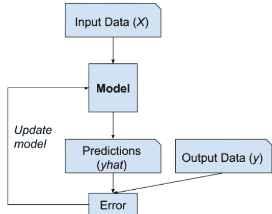

图 1.1：监督学习示例。


### 1.2 什么是生成模型?

监督学习问题的示例包括分类和回归，监督学习算法的示例包括逻辑回归和随机森林。还有一种学习范式，其中模型仅获得输入变量（X），问题没有任何输出变量（y）。通过提取或总结输入数据中的模式来构建模型。没有对模型进行修正，因为模型不进行任何预测。

机器学习的第二种主要类型是描述性或无监督学习方法。在这里，我们只获得输入，目标是在数据中找到“有趣的模式”。[...] 这是一个定义得不那么明确的问题，因为我们不知道要寻找什么样的模式，也没有明显的误差指标可用（与监督学习不同，在监督学习中，我们可以将给定 x 的 y 预测值与观测值进行比较）。

> ——第 2 页，《机器学习：概率视角》，2012 年。

这种缺乏修正的情况通常被称为无监督学习形式，或无监督学习。

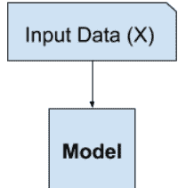

图 1.2：无监督学习示例。

无监督学习问题的示例包括聚类和生成建模，无监督学习算法的示例是 K-means 和生成对抗网络。

### 1.2.2 判别建模与生成建模

在监督学习中，我们可能有兴趣开发一个模型，根据输入变量的示例来预测类别标签。这种预测建模任务称为分类。分类也传统上被称为判别建模。

> ... 我们使用训练数据来找到一个判别函数 f(x)，它将每个 x 直接映射到一个类别标签，从而将推理和决策阶段合并为一个单一的学习问题。
>
> ——第 44 页，《模式识别与机器学习》，2006 年。

这是因为模型必须对不同类别中的输入变量示例进行区分；它必须选择或决定给定示例属于哪个类别。

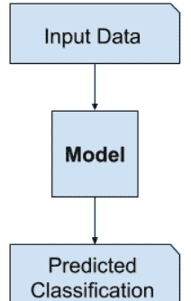

图 1.3：判别建模示例。

或者，总结输入变量分布的无监督模型可能能够用于在输入分布中创建或生成新示例。因此，这类模型被称为生成模型。

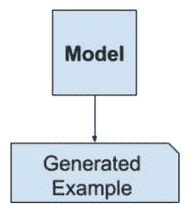

图 1.4：生成建模示例。

例如，单个变量可能具有已知的数据分布，如高斯分布或钟形分布。生成模型可能能够充分总结此数据分布，然后用于生成合理地符合输入变量分布的新示例。

显式或隐式建模输入和输出分布的方法被称为生成模型，因为通过从中采样，可以在输入空间中生成合成数据点。

> ——第 43 页，《模式识别与机器学习》，2006 年。

事实上，一个非常好的生成模型可能能够生成不仅合理，而且与问题领域中的真实示例无法区分的新示例。

### 1.2.3 生成模型示例

朴素贝叶斯是生成模型的一个示例，但更常被用作判别模型。例如，朴素贝叶斯通过总结每个输入变量和输出类别的概率分布来工作。在进行预测时，会为每个变量计算每种可能结果的概率，将独立概率组合起来，并预测最可能的结果。反过来使用时，可以对每个变量的概率分布进行采样，以生成新的合理（独立）特征值。

生成模型的其他示例包括隐含狄利克雷分配（LDA）和高斯混合模型（GMM）。深度学习方法可以用作生成模型。两个流行的示例包括受限玻尔兹曼机（RBM）和深度置信网络（DBN）。深度学习生成建模算法的两个现代示例包括变分自编码器（VAE）和生成对抗网络（GAN）。

### 1.3 什么是生成对抗网络？

生成对抗网络（GAN）是一种基于深度学习的生成模型。更一般地说，GAN 是一种用于训练生成模型的模型架构，在这种架构中最常用的是深度学习模型。GAN 架构最初由 Ian Goodfellow 等人在 2014 年的论文《生成对抗网络》中描述。最初的模型可以工作，但不稳定且难以训练。后来，Alec Radford 等人在 2015 年的论文《使用深度卷积生成对抗网络进行无监督表征学习》中正式提出了一种称为深度卷积生成对抗网络（DCGAN）的标准化方法，该方法产生了更稳定的模型。

*当今大多数 GAN 至少松散地基于 DCGAN 架构 ...*

> ——NIPS 2016 教程：生成对抗网络，2016 年。

GAN 模型架构涉及两个子模型：用于生成新示例的生成器模型和用于分类生成的示例是真实的（来自领域）还是假的（由生成器模型生成）的判别器模型。

- 生成器。用于从问题领域生成新合理示例的模型。
- 判别器。用于将示例分类为真实的（来自领域）或假的（生成）的模型。

生成对抗网络基于一种博弈论场景，其中生成器网络必须与对手竞争。生成器网络直接生成样本。其对手（即判别器网络）试图区分来自训练数据的样本和来自生成器的样本。

> ——第 699 页，《深度学习》，2016 年。

### 1.3.1 生成器模型

生成器模型以固定长度的随机向量作为输入，并在领域中生成一个样本，例如图像。向量从高斯分布中随机抽取，并用作生成过程的种子或噪声源。明确地说，输入是一个随机数向量。它不是图像或展平的图像，除了生成器模型赋予的意义之外没有其他含义。训练后，这个多维向量空间中的点将对应于问题领域中的点，形成数据分布的压缩表示。这个向量空间被称为潜在空间，或由潜在变量组成的向量空间。潜在变量，或隐藏变量，是对某个领域很重要但不可直接观察的变量。

> 潜在变量是我们无法直接观察的随机变量。
>
> ——第 67 页，《深度学习》，2016 年。

我们通常将潜在变量或潜在空间称为数据分布的投影或压缩。也就是说，潜在空间提供了对观测原始数据（例如输入数据分布）的压缩或高级概念。在 GAN 的情况下，生成器模型为所选潜在空间中的点赋予意义，这样从潜在空间中抽取的新点可以作为输入提供给生成器模型，并用于生成新的不同输出示例。

> 机器学习模型可以学习图像、音乐和故事的统计潜在空间，然后可以从该空间中采样，创建具有与模型在训练数据中看到的特征相似的新艺术作品。
>
> ——第 270 页，《用 Python 进行深度学习》，2017 年。

训练后，保留生成器模型并用于生成新样本。

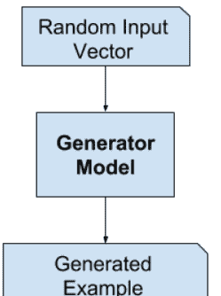

图 1.5：GAN 生成器模型示例。


### 1.3 什么是生成对抗网络？

[训练] 驱动判别器尝试学习将样本正确分类为真实或伪造。同时，生成器试图欺骗分类器，使其相信其样本是真实的。在收敛时，生成器的样本与真实数据无法区分，判别器到处输出 ½。随后可以丢弃判别器。

> — 第 700 页，《深度学习》，2016 年。

### 1.3.2 判别器模型

判别器模型将问题领域中的一个示例作为输入（真实或生成的），并预测真实或伪造（生成）的二进制类别标签。真实示例来自训练数据集。生成的示例由生成器模型输出。判别器是一个普通的分类模型。

训练过程结束后，判别器模型会被丢弃，因为我们关注的是生成器。有时，生成器可以被重新利用，因为它已学会从问题领域的示例中有效提取特征。部分或全部特征提取层可用于使用相同或相似输入数据的迁移学习应用中。

我们提出，构建良好图像表示的一种方法是训练生成对抗网络（GANs），随后重复使用生成器和判别器网络的部分作为监督任务的特征提取器。

> — 《使用深度卷积生成对抗网络进行无监督表示学习》，2015 年。

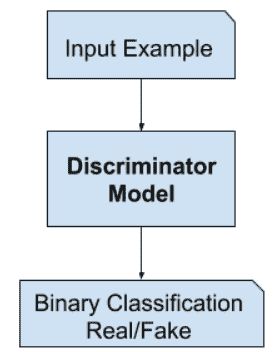

图 1.6：GAN 判别器模型示例。

### 1.3.3 作为双人博弈的 GANs

生成建模是一个无监督学习问题，正如我们在上一节中讨论的那样，尽管 GAN 架构的一个巧妙特性是，生成模型的训练被表述为一个监督学习问题。这两个模型（生成器和判别器）一起训练。生成器生成一批样本，这些样本连同领域中的真实示例一起提供给判别器，并被分类为真实或伪造。

随后更新判别器，以便在下一轮中更好地区分真实和伪造样本，重要的是，生成器根据生成样本欺骗判别器的程度（或未能欺骗）进行更新。

我们可以将生成器视为伪造者，试图制造假币，而将判别器视为警察，试图允许合法货币并抓获假币。要在这场博弈中成功，伪造者必须学会制造与真币无法区分的货币，而生成器网络必须学会创建与训练数据来自同一分布的样本。

> — NIPS 2016 教程：生成对抗网络，2016 年。

这样一来，两个模型相互竞争。在博弈论意义上，它们是对抗性的，并且正在玩一个零和博弈。

> — NIPS 2016 教程：生成对抗网络，2016 年。

在这种情况下，零和意味着当判别器成功识别真实和伪造样本时，它会获得奖励且无需更改模型参数，而生成器则因模型参数的大幅更新而受到惩罚。反之，当生成器欺骗判别器时，它会获得奖励且无需更改模型参数，但判别器受到惩罚且其模型参数被更新。

在极限情况下，生成器每次都会从输入领域生成完美的副本，而判别器无法分辨差异，在每种情况下都预测不确定（例如，真实和伪造各占 50%）。这只是一个理想化案例的示例；我们不需要达到这一点才能得到一个有用的生成器模型。

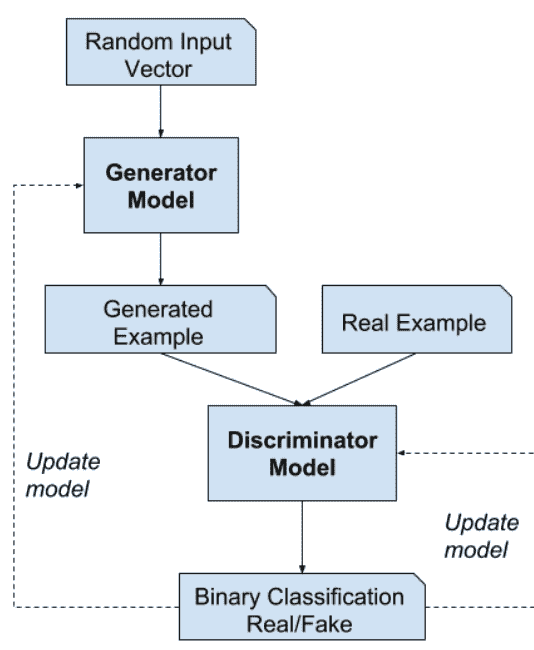

图 1.7：生成对抗网络模型架构示例。

### 1.3.4 GANs 与卷积神经网络

GANs 通常处理图像数据，并使用卷积神经网络（或 CNNs）作为生成器和判别器模型。这样做的原因可能既在于该技术的首次描述出现在计算机视觉领域并且使用了图像数据，也在于近年来在使用 CNNs 实现计算机视觉任务（如目标检测和人脸识别）的最先进结果方面取得了显著进展。

对图像数据进行建模意味着，潜在空间（即生成器的输入）为用于训练模型的图像或照片集提供了压缩表示。这也意味着生成器生成新图像，提供可由模型的开发者或用户轻松查看和评估的输出。也许正是这一事实（即能够直观评估生成输出的质量），使得人们既专注于使用 CNNs 的计算机视觉应用，也使得 GANs 相比于其他生成模型（无论是基于深度学习还是其他）在能力上取得了巨大飞跃。

### 1.3.5 条件 GANs

对 GAN 的一个重要扩展在于其用于条件生成输出。生成模型可以被训练以从输入领域生成新示例，其中输入（来自潜在空间的随机向量）由一些额外输入（条件化）提供。额外输入可以是类别值，例如在生成人物照片时的男性或女性，或者在生成手写数字图像时的数字。

如果生成器和判别器都基于某些额外信息 y 进行条件化，生成对抗网络可以扩展为条件模型。y 可以是任何类型的辅助信息，例如类别标签或来自其他模态的数据。我们可以通过将 y 作为 [一个] 额外输入层输入到判别器和生成器中来执行条件化。

> — 《条件生成对抗网络》，2014 年。

判别器也被条件化，这意味着它既接收一个真实或伪造的输入图像，也接收额外输入。在分类标签类型条件输入的情况下，判别器期望输入属于该类，进而教导生成器生成该类示例以欺骗判别器。这样一来，条件 GAN 可用于生成给定类型领域中的示例（此内容在第 17 章中进一步介绍）。

进一步来说，GAN 模型可以基于领域中的一个示例（例如图像）进行条件化。这使得文本到图像翻译或图像到图像翻译等 GAN 应用成为可能。这也使得一些更令人印象深刻的 GAN 应用成为可能，例如风格迁移、照片着色、将照片从夏季变为冬季或从白天变为夜晚，等等。在图像到图像翻译的条件 GAN 情况下（例如将白天变为夜晚），判别器接收真实和生成的夜间照片示例，以及（基于）真实白天照片作为输入。生成器接收来自潜在空间的随机向量，以及（基于）真实白天照片作为输入（此内容在书中后面的许多章节中进一步介绍）。

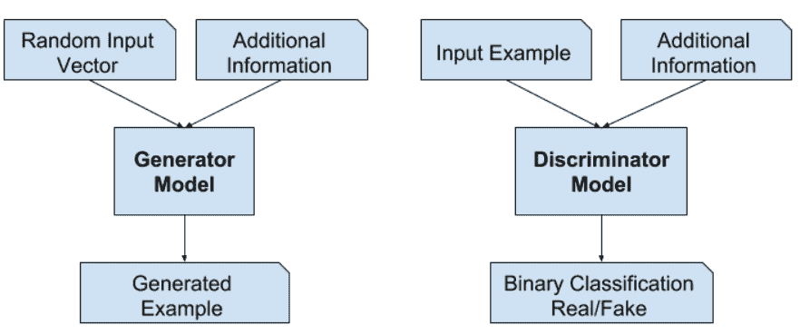

图 1.8：条件生成对抗网络模型架构示例。

### 1.4 为什么使用生成对抗网络？

在计算机视觉等领域使用深度学习方法的众多重大进步之一是一种称为数据增强的技术。数据增强能够产生表现更好的模型，既提高了模型性能，又提供了正则化效果，降低了泛化误差。它通过从模型训练所基于的输入问题领域中创建新的、人工但合理的示例来工作。在图像数据的情况下，这些技术比较原始，涉及对训练数据集中现有图像进行裁剪、翻转、缩放和其他简单变换。

成功的生成建模为数据增强提供了一种替代且可能更具领域特定性的方法。事实上，数据增强是生成建模的简化版本，尽管它很少以这种方式描述。

> ... 使用潜在（未观察到）数据扩大样本。这称为数据增强。[...] 在其他问题中，潜在数据是本应被观察到但缺失的实际数据。
> — 《统计学习基础》，第 276 页，2016 年。

在复杂领域或数据量有限的领域中，生成建模为模型提供了更多训练的途径。GANs 在这一用例中取得了很大成功，在


诸如深度强化学习等领域。GANs 之所以有趣、重要并需要进一步研究，有许多研究原因。Ian Goodfellow 在他的 2016 年会议主题演讲及相关技术报告《NIPS 2016 Tutorial: Generative Adversarial Networks》中概述了其中许多原因。在这些原因中，他强调了 GANs 成功建模高维数据、处理缺失数据的能力，以及 GANs 提供多模态输出或多个合理答案的能力。也许 GANs 最引人注目的应用是条件 GANs，用于需要生成新示例的任务。在这里，Goodfellow 指出了三个主要示例：

- 图像超分辨率。生成输入图像高分辨率版本的能力。
- 创作艺术。创建新的艺术图像、草图、绘画等的能力。
- 图像到图像翻译。跨领域翻译照片的能力，例如从白天到夜晚、从夏天到冬天等。

也许 GANs 被广泛研究、开发和使用的最引人注目的原因是因为它们的成功。GANs 已能够生成如此逼真的照片，以至于人类无法分辨它们描绘的是现实中不存在的物体、场景和人物。惊人这个形容词都不足以形容它们的能力和成功。

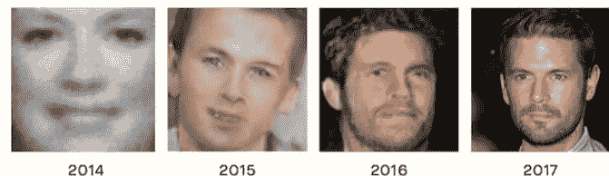

图 1.9：2014 年至 2017 年 GANs 能力演进示例。摘自《人工智能的恶意使用：预测、预防和缓解》，2018 年。

### 1.5 进一步阅读

本节提供了更多关于该主题的资源，如果你希望深入了解。

### 1.5.1 书籍

- 第 20 章。深度生成模型，深度学习，2016 年。https://amzn.to/2YuwVjL
- 第 8 章。生成式深度学习，用 Python 进行深度学习，2017 年。https://amzn.to/2U2bHuP
- 机器学习：概率视角，2012 年。https://amzn.to/2HV6cYx
- 模式识别与机器学习，2006 年。https://amzn.to/2K3EcE3
- 统计学习基础，2016 年。https://amzn.to/2UcPeva

### 1.5.2 论文

- 生成对抗网络，2014 年。https://arxiv.org/abs/1406.2661
- 使用深度卷积生成对抗网络进行无监督表示学习，2015 年。https://arxiv.org/abs/1701.00160
- NIPS 2016 教程：生成对抗网络，2016 年。https://arxiv.org/abs/1701.00160
- 条件生成对抗网络，2014 年。https://arxiv.org/abs/1411.1784
- 人工智能的恶意使用：预测、预防和缓解，2018 年。https://arxiv.org/abs/1802.07228

### 1.5.3 文章

- 生成模型，维基百科。https://en.wikipedia.org/wiki/Generative_model
- 隐性变量，维基百科。https://en.wikipedia.org/wiki/Latent_variable
- 生成对抗网络，维基百科。https://en.wikipedia.org/wiki/Generative_adversarial_network

### 1.6 总结

在本教程中，你了解了生成对抗网络（或 GANs）的温和入门。具体来说，你学习了：

- GANs 的背景，包括有监督学习与无监督学习以及判别式建模与生成式建模。
- GANs 是一种架构，通过将无监督问题视为有监督问题并同时使用生成模型和判别模型，来自动训练生成模型。
- GANs 提供了一条通往复杂领域特定数据增强的道路，以及解决需要生成式方案的问题的方案，例如图像到图像翻译。

### 1.6.1 下一节

在下一个教程中，你将了解如何使用 Keras 深度学习 Python 库开发简单模型。

## 第 2 章

### 如何使用 Keras 开发深度学习模型

使用 Keras 在 Python 中创建和评估深度学习神经网络非常简单，但你必须遵循严格的模型生命周期。在本教程中，你将了解在 Keras 中创建、训练和评估深度学习神经网络的逐步生命周期，以及如何使用训练好的模型进行预测。你还将了解如何使用功能 API，该 API 在设计模型时提供更多灵活性。阅读本教程后，你将知道：

- 如何在 Keras 中定义、编译、拟合和评估深度学习神经网络。
- 如何为回归和分类预测建模问题选择默认损失函数。
- 如何使用功能 API 开发标准多层感知机、卷积神经网络和循环神经网络。

让我们开始吧。

注意：假设你已具备深度学习和 Keras 的基本知识。尽管如此，本教程应能作为 Keras Sequential API 的复习，并可能介绍 Keras 功能 API。如有需要，请参阅附录 B 了解安装说明。

### 2.1 教程概览

本教程分为三个部分，分别是：

- 1. Keras 模型生命周期
- 2. Keras 功能模型
- 3. 标准网络模型

### 2.2 Keras 模型生命周期

以下是 Keras 中神经网络模型生命周期 5 个步骤的概述：

- 1. 定义网络。
- 2. 编译网络。
- 3. 拟合网络。
- 4. 评估网络。
- 5. 进行预测。

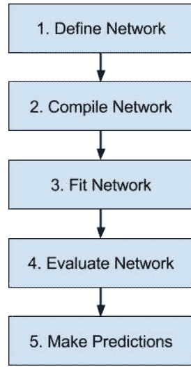

图 2.1：Keras 中神经网络模型的 5 步生命周期。

让我们使用易于使用的 Keras Sequential API 逐个查看每个步骤。

### 2.2.1 步骤 1. 定义网络

第一步是定义你的神经网络。在 Keras 中，神经网络被定义为一系列层。这些层的容器是 Sequential 类。创建 Sequential 类的实例。然后，你可以按应连接的顺序添加层。例如，我们可以分两步完成：

```
...
model = Sequential()
model.add(Dense(2))
```

清单 2.1：带有一个具有 2 个神经元的 Dense 层的 Sequential 模型。

但我们也可以通过创建一个层数组并将其传递给 `Sequential` 类的构造函数，在一步内完成。

```
...
layers = [Dense(2)]
model = Sequential(layers)
```

清单 2.2：定义为数组的 Sequential 模型的层。

网络中的第一层必须定义预期的输入数量。指定方式可能因网络类型而异，但对于多层感知机模型，这是通过 `input_dim` 属性指定的。例如，一个带有 2 个输入的小型多层感知机模型，隐藏层有 5 个神经元，输出层有一个神经元，可以定义为：

```
...
model = Sequential()
model.add(Dense(5, input_dim=2))
model.add(Dense(1))
```

清单 2.3：带有 2 个输入的 Sequential 模型。

将 Sequential 模型视为一个管道，原始数据从底部输入，预测从顶部输出。在 Keras 中，这是一个有用的概念，因为传统上与某个层相关联的组件也可以拆分出来，作为单独的层或类似层的对象添加，从而清楚地显示它们在从输入到预测的数据转换中的作用。例如，转换层中每个神经元求和信号的激活函数可以作为名为 `Activation` 类的类似层对象添加到 Sequential 中。

```
...
model = Sequential()
model.add(Dense(5, input_dim=2))
model.add(Activation('relu'))
model.add(Dense(1))
model.add(Activation('sigmoid'))
```

清单 2.4：带有与层分别定义的 `Activation` 函数的 Sequential 模型。

激活函数的选择对输出层最为重要，因为它将定义预测的格式。例如，以下是一些常见的预测建模问题类型，以及你可以在输出层中使用的格式和标准激活函数：

- **回归**：线性激活函数，或 `linear`（或 None），神经元数量与输出数量匹配。
- **二分类（2 类）**：逻辑激活函数，或 `sigmoid`，输出层有一个神经元。
- **多分类（>2 类）**：Softmax 激活函数，或 `softmax`，每个类别值一个输出神经元，假设输出模式为 one-hot 编码。


### 2.2.2 Step 2. Compile Network

一旦我们定义了网络，就必须对其进行编译。编译是一个效率步骤。它将我们定义的简单层序列转换为一系列高效的矩阵变换，格式旨在根据 Keras 的配置在 GPU 或 CPU 上执行。可以将编译视为网络的预计算步骤。在定义模型后，这始终是必需的。

编译需要指定若干参数，以针对训练网络进行定制。具体来说，包括用于训练网络的优化算法，以及由优化算法最小化的用于评估网络的损失函数。例如，下面是编译已定义模型并指定随机梯度下降（sgd）优化算法和均方误差（mean_squared_error）损失函数的示例，适用于回归类问题。

```
...
model.compile(optimizer='sgd', loss='mean_squared_error')
```

清单 2.5: 编译已定义模型的示例。

或者，优化器可以在作为参数提供给编译步骤之前创建和配置。

```
...
algorithm = SGD(lr=0.1, momentum=0.3)
model.compile(optimizer=algorithm, loss='mean_squared_error')
```

清单 2.6: 单独定义优化算法的示例。

预测建模问题的类型对可使用的损失函数类型施加了约束。例如，下面是不同预测模型类型的一些标准损失函数：

- **回归**：均方误差或 `mean_squared_error`。
- **二分类（2 类）**：对数损失，也称为交叉熵或 `binary_crossentropy`。
- **多分类（>2 类）**：多类对数损失或 `categorical_crossentropy`。

最常见的优化算法是随机梯度下降，但 Keras 还支持一套其他最先进的优化算法，这些算法几乎无需配置即可工作良好。也许由于通常性能更好，最常用的优化算法是：

- **随机梯度下降**，或 `sgd`，需要调整学习率和动量。
- **Adam**，或 `adam`，需要调整学习率。
- **RMSProp**，或 `rmsprop`，需要调整学习率。

最后，除了损失函数外，还可以在拟合模型时指定要收集的指标。通常，对于分类问题，最有用的额外指标是准确率。要收集的指标以名称形式在数组中指定。例如：

```
model.compile(optimizer='sgd', loss='mean_squared_error', metrics=['accuracy'])
```

清单 2.7: 编译模型时定义指标的示例。

### 2.2.3 Step 3. Fit Network

一旦网络被编译，就可以进行拟合，这意味着根据训练数据集调整模型权重。拟合网络需要指定训练数据，包括输入模式矩阵 X 和匹配的输出模式数组 y。网络使用反向传播算法进行训练，并根据编译模型时指定的优化算法和损失函数进行优化。

反向传播算法要求网络在训练数据集上进行指定数量的 epoch（迭代次数）或暴露。每个 epoch 可以分为称为批次（batch）的输入-输出模式对组。这定义了网络在一个 epoch 内更新权重之前接触的模式数量。这也是一种效率优化，确保一次不会将太多输入模式加载到内存中。拟合网络的最小示例如下：

```
history = model.fit(X, y, batch_size=10, epochs=100)
```

清单 2.8: 拟合已编译模型的示例。

拟合完成后，将返回一个 history 对象，提供训练期间模型性能的摘要。这包括编译模型时指定的损失和任何其他指标，每个 epoch 都会记录。训练可能需要很长时间，从几秒到几小时甚至几天，具体取决于网络大小和训练数据的大小。

默认情况下，每个 epoch 都会在命令行上显示进度条。这可能会为你产生太多噪音，或者可能导致你的环境出现问题，例如当你处于交互式笔记本或 IDE 中时。你可以通过将 verbose 参数设置为 2，将显示的信息量减少到每个 epoch 仅显示损失。你可以通过将 verbose 设置为 0 来关闭所有输出。例如：

```
history = model.fit(X, y, batch_size=10, epochs=100, verbose=0)
```

清单 2.9: 拟合模型时关闭详细输出的示例。

在训练过程结束时，你可能希望保存模型以供以后使用。可以通过在模型本身上调用 save() 函数并指定文件名来实现。

```
model.save('final_model.h5')
```

清单 2.10: 将拟合模型保存到文件的示例。

保存模型需要在工作站上安装 h5py 库。可以使用 pip 轻松实现，例如：

```
sudo pip install h5py
```

清单 2.11: 使用 pip 安装 h5py 库的示例。

以后可以通过调用 `load_model()` 函数并指定文件名来加载模型。

```
from keras.models import load_model
model = load_model('final_model.h5')
```

清单 2.12: 从文件加载已保存模型的示例。

### 2.2.4 Step 4. Evaluate Network

一旦网络被训练，就可以对其进行评估。网络可以在训练数据上进行评估，但这不能作为网络作为预测模型的性能的有用指示，因为它之前已经见过所有这些数据。我们可以在单独的数据集上评估网络的性能，该数据集在测试期间未见过。这将提供网络未来对未见数据进行预测的性能估计。

模型会评估所有测试模式上的损失，以及编译模型时指定的任何其他指标，例如分类准确率。将返回一个评估指标列表。例如，对于编译了准确率指标的模型，我们可以在新数据集上按如下方式对其进行评估：

```
...
loss, accuracy = model.evaluate(X, y)
```

清单 2.13: 评估已拟合模型的示例。

与拟合网络一样，会提供详细输出以了解模型评估的进度。我们可以通过将 verbose 参数设置为 0 来关闭它。

```
...
loss, accuracy = model.evaluate(X, y, verbose=0)
```

清单 2.14: 评估已拟合模型时关闭详细输出的示例。

### 2.2.5 Step 5. Make Predictions

一旦我们对拟合模型的性能感到满意，就可以使用它对新数据进行预测。这就像用新输入模式数组在模型上调用 `predict()` 函数一样简单。例如：

```
...
predictions = model.predict(X)
```

清单 2.15: 使用已拟合模型进行预测的示例。

预测将以网络输出层提供的格式返回。在回归问题的情况下，这些预测可能直接以问题的格式呈现，由线性激活函数提供。对于二分类问题，预测可能是第一个类的概率数组，可以通过四舍五入转换为 1 或 0。

对于多分类问题，结果可能以概率数组的形式出现（假设输出变量为 one-hot 编码），可能需要使用 argmax() NumPy 函数将其转换为单个类输出预测。或者，对于分类问题，我们可以使用 predict_classes() 函数，该函数会自动将预测概率转换为类整数值。

```
predictions = model.predict_classes(X)
```

清单 2.16: 使用已拟合模型预测类别的示例。

与拟合和评估网络一样，会提供详细输出以了解模型进行预测的进度。我们可以通过将 verbose 参数设置为 0 来关闭它。

```
predictions = model.predict(X, verbose=0)
```

清单 2.17: 进行预测时禁用详细输出的示例。

### 2.3 Keras Functional Models

顺序 API 允许你针对大多数问题逐层创建模型。它的局限性在于不允许你创建共享层或具有多个输入或输出层的模型。Keras 中的函数式 API 是创建模型的另一种方式，提供了更大的灵活性，包括创建更复杂的模型。

具体来说，它允许你定义多输入或多输出模型以及共享层的模型。不仅如此，它还允许你定义临时无环网络图。模型通过创建层实例并将它们直接成对连接，然后定义一个指定作为模型输入和输出的层的 Model 来定义。让我们依次了解 Keras 函数式 API 的三个独特方面：

### 2.3.1 Defining Input

与 Sequential 模型不同，你必须创建并定义一个独立的 Input 层，用于指定输入数据的形状。输入层接受一个 shape 参数，它是一个元组，指示输入数据的维度。当输入数据是一维的（样本行）时，例如对于多层感知机，shape 必须显式地为训练网络时分割数据所使用的小批量大小留出空间。因此，shape 元组始终定义为带有悬挂最后维度的 (2,)，这是在 Python 中定义一维元组的方式，例如：

```
visible = Input(shape=(2,))
```

清单 2.18: 为函数式模型定义输入的示例。


### 2.3.2 连接层

模型中的层是成对连接的。这是通过在定义每个新层时指定输入来源来完成的。使用括号或函数式表示法，这样在创建层后，就会指定当前层的输入来自哪个层。让我们通过一个简短的示例来澄清这一点。我们可以像上面一样创建输入层，然后创建一个隐藏层作为 Dense 层，该层仅接收来自输入层的输入。

```
...
visible = Input(shape=(2,))
hidden = Dense(2)(visible)
```

清单 2.19：将隐藏层连接到可见层的示例。

正是在创建 Dense 层后的（可见）层将输入层的输出作为输入连接到 Dense 隐藏层。正是这种成对连接层的方式赋予了函数式 API 其灵活性。例如，你可以看到开始定义临时层图是多么容易。

### 2.3.3 创建模型

在创建完所有模型层并将它们连接在一起后，你必须定义模型。与 Sequential API 一样，模型是你可以总结、拟合、评估并用于进行预测的对象。Keras 提供了一个 Model 类，你可以使用它从创建的层中创建模型。它要求你只需指定输入层和输出层。例如：

```
...
visible = Input(shape=(2,))
hidden = Dense(2)(visible)
model = Model(inputs=visible, outputs=hidden)
```

清单 2.20：使用函数式 API 创建完整模型的示例。

现在我们了解了 Keras 函数式 API 的所有关键部分，让我们通过定义一系列不同的模型来练习并积累一些使用经验。每个示例都可执行，并打印结构并创建计算图的图示。我建议你为自己的模型也这样做，以便清楚地了解自己定义了什么。我希望这些示例能在你将来想要使用函数式 API 定义自己的模型时为你提供模板。

### 2.4 标准网络模型

在开始使用函数式 API 时，查看一些标准神经网络模型的定义是个好主意。在本节中，我们将研究如何定义一个简单的多层感知机、卷积神经网络和循环神经网络。这些示例将为理解后面更复杂的示例奠定基础。

### 2.4.1 多层感知机

在本节中，我们定义一个用于二分类的多层感知机模型。该模型有 10 个输入、3 个隐藏层（分别包含 10、20 和 10 个神经元）以及一个具有 1 个输出的输出层。每个隐藏层使用整流线性激活函数，输出层使用 sigmoid 激活函数，用于二分类。

```
# example of a multilayer perceptron
from keras.utils import plot_model
from keras.models import Model
from keras.layers import Input
from keras.layers import Dense
visible = Input(shape=(10,))
hidden1 = Dense(10, activation='relu')(visible)
hidden2 = Dense(20, activation='relu')(hidden1)
hidden3 = Dense(10, activation='relu')(hidden2)
output = Dense(1, activation='sigmoid')(hidden3)
model = Model(inputs=visible, outputs=output)
# summarize layers
model.summary()
# plot graph
plot_model(model, to_file='multilayer_perceptron_graph.png')
```

清单 2.21：使用函数式 API 定义 MLP 的示例。

运行示例将打印网络的结构。

| 层 (类型) | 输出形状 | 参数数量 |
|---|---|---|
| input_1 (InputLayer) | (None, 10) | 0 |
| dense_1 (Dense) | (None, 10) | 110 |
| dense_2 (Dense) | (None, 20) | 220 |
| dense_3 (Dense) | (None, 10) | 210 |
| dense_4 (Dense) | (None, 1) | 11 |

总参数: 551  
可训练参数: 551  
不可训练参数: 0  

清单 2.22：使用函数式 API 定义的 MLP 模型摘要。

模型图的图表也已创建并保存到文件中。

**注意**: 创建模型图假设已安装 `pydot` 和 `graphviz` 库。如果这有问题，你可以注释掉导入语句和 `plot_model()` 的函数调用。

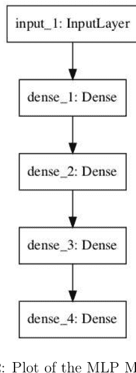

### 2.4.2 卷积神经网络

在本节中，我们将定义一个用于图像分类的卷积神经网络。该模型接收黑白 64 × 64 图像作为输入，然后有一系列两个卷积层和池化层作为特征提取器，接着是一个全连接层来解释特征，以及一个带有 sigmoid 激活的输出层用于二类预测。

```
# example of a convolutional neural network
from keras.utils import plot_model
from keras.models import Model
from keras.layers import Input
from keras.layers import Dense
from keras.layers import Flatten
from keras.layers.convolutional import Conv2D
from keras.layers.pooling import MaxPooling2D
visible = Input(shape=(64,64,1))
conv1 = Conv2D(32, (4,4), activation='relu')(visible)
pool1 = MaxPooling2D()(conv1)
conv2 = Conv2D(16, (4, 4), activation='relu')(pool1)
pool2 = MaxPooling2D()(conv2)
flat1 = Flatten()(pool2)
hidden1 = Dense(10, activation='relu')(flat1)
output = Dense(1, activation='sigmoid')(hidden1)
model = Model(inputs=visible, outputs=output)
# summarize layers
model.summary()
# plot graph
plot_model(model, to_file='convolutional_neural_network.png')
```

清单 2.23：使用函数式 API 定义 CNN 的示例。

运行示例将汇总模型层。

| 层 (类型) | 输出形状 | 参数数量 |
| :--- | :--- | :--- |
| input_1 (InputLayer) | (None, 64, 64, 1) | 0 |
| conv2d_1 (Conv2D) | (None, 61, 61, 32) | 544 |
| max_pooling2d_1 (MaxPooling2D) | (None, 30, 30, 32) | 0 |
| conv2d_2 (Conv2D) | (None, 27, 27, 16) | 8208 |
| max_pooling2d_2 (MaxPooling2D) | (None, 13, 13, 16) | 0 |
| flatten_1 (Flatten) | (None, 2704) | 0 |
| dense_1 (Dense) | (None, 10) | 27050 |
| dense_2 (Dense) | (None, 1) | 11 |
| 总参数: 35,813 | | |
| 可训练参数: 35,813 | | |
| 不可训练参数: 0 | | |

清单 2.24：使用函数式 API 定义的 CNN 模型摘要。

模型图的图表也已创建并保存到文件中。

> **注意:** 创建模型图假设已安装 `pydot` 和 `graphviz` 库。如果这有问题，你可以注释掉导入语句和 `plot_model()` 的函数调用。

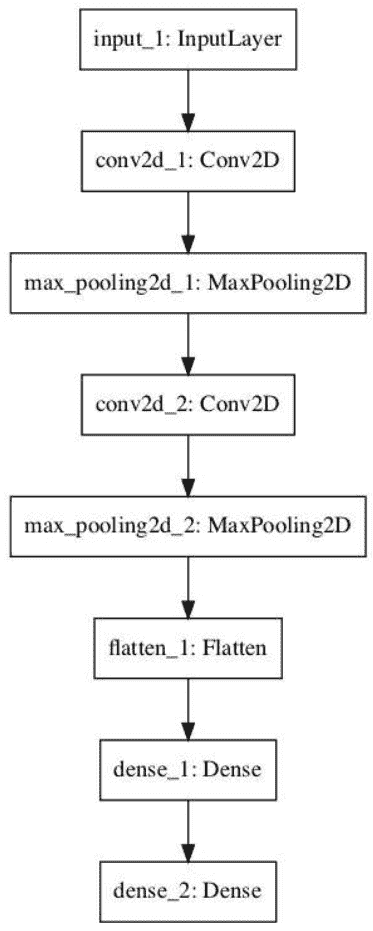

图 2.3: CNN 模型图的图表。

### 2.4.3 循环神经网络

在本节中，我们将定义一个用于序列分类的长短期记忆循环神经网络。该模型期望 100 个时间步的单个特征作为输入。该模型有一个单一的 LSTM 隐藏层来从序列中提取特征，接着是一个全连接层来解释 LSTM 输出，接着是一个用于进行二进制预测的输出层。

```
# example of a recurrent neural network
from keras.utils import plot_model
from keras.models import Model
from keras.layers import Input
from keras.layers import Dense
from keras.layers.recurrent import LSTM
visible = Input(shape=(100,1))
hidden1 = LSTM(10)(visible)
hidden2 = Dense(10, activation='relu')(hidden1)
output = Dense(1, activation='sigmoid')(hidden2)
model = Model(inputs=visible, outputs=output)
# summarize layers
model.summary()
# plot graph
plot_model(model, to_file='recurrent_neural_network.png')
```

清单 2.25：使用函数式 API 定义 RNN 的示例。

运行示例将汇总模型层。

| 层 (类型) | 输出形状 | 参数数量 |
| :--- | :--- | :--- |
| input_1 (InputLayer) | (None, 100, 1) | 0 |
| lstm_1 (LSTM) | (None, 10) | 480 |
| dense_1 (Dense) | (None, 10) | 110 |
| dense_2 (Dense) | (None, 1) | 11 |
| 总参数: 601 | | |
| 可训练参数: 601 | | |
| 不可训练参数: 0 | | |

清单 2.26：使用函数式 API 定义的 RNN 模型摘要。

模型图的图表也已创建并保存到文件中。

注意: 创建模型图假设已安装 `pydot` 和 `graphviz` 库。如果这有问题，你可以注释掉导入语句和 `plot_model()` 的函数调用。

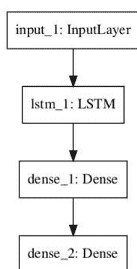

图 2.4: RNN 模型图的图表。


## 2.5 进一步阅读

本节提供了更多关于该主题的资源，如果你希望深入了解。

- Keras 顺序模型文档。
  https://keras.io/models/sequential/
- Keras 函数式模型文档。
  https://keras.io/models/model/
- Keras 顺序模型入门。
  https://keras.io/models/model/
- Keras 函数式 API 入门。
  https://keras.io/models/model/
- Keras 优化算法文档。
  https://keras.io/optimizers/
- Keras 损失函数文档。
  https://keras.io/losses/

## 2.6 总结

在本教程中，你了解了在 Keras 中创建、训练和评估深度学习神经网络的逐步生命周期，以及如何使用在设计模型时提供更多灵活性的函数式 API。具体来说，你学习了：

- 如何在 Keras 中定义、编译、拟合和评估深度学习神经网络。
- 如何为回归和分类预测建模问题选择默认损失函数。
- 如何使用函数式 API 开发标准多层感知机、卷积神经网络和循环神经网络。

### 2.6.1 下一步

在下一个教程中，你将了解在卷积神经网络中用于输出图像的特殊层。

## 第 3 章

## 如何使用卷积神经网络进行上采样

生成对抗网络，或称 GAN，是一种用于训练生成模型的架构，例如用于生成图像的深度卷积神经网络。GAN 架构由生成器和判别器模型组成。生成器负责创建新的输出，例如图像，这些输出看起来可能来自原始数据集。生成器模型通常使用深度卷积神经网络和结果专用层实现，这些层学习在图像中填充特征，而不是从输入图像中提取特征。

生成器模型中可使用的两种常见层类型是上采样层（它只需将输入尺寸加倍）和转置卷积层（它执行反卷积操作）。在本教程中，你将了解在生成图像时如何在生成对抗网络中使用上采样层和转置卷积层。完成本教程后，你将知道：

- GAN 架构中的生成模型需要对输入数据进行上采样，以生成输出图像。
- 上采样层是一个没有权重的简单层，它会将输入尺寸加倍，并且可以在生成模型中使用，前提是其后跟一个传统卷积层。
- 转置卷积层是一种反卷积层，它既会对输入进行上采样，又会在模型训练过程中学习如何填充细节。

让我们开始吧。

### 3.1 教程概述

本教程分为三部分，分别是：

- 1. GAN 中对上采样的需求
- 2. 如何使用上采样层
- 3. 如何使用转置卷积层

### 3.2 GAN 中对上采样的需求

生成对抗网络是一种用于训练生成模型的神经网络架构。该架构由生成器和判别器模型组成，两者均实现为深度卷积神经网络。判别器负责将图像分类为真实（来自该领域）或假（生成）。生成器负责从问题领域生成新的合理示例。生成器通过将潜在空间中的随机点作为输入并以一次性的方式输出完整图像来工作。

用于图像分类及相关任务的传统卷积神经网络会使用池化层来下采样输入图像。例如，平均池化层或最大池化层会将卷积层的特征图在每个维度上减半，从而得到的输出面积仅为输入的四分之一。卷积层本身也通过将每个滤波器应用于输入图像或特征图来执行一种下采样形式；由此产生的激活是一个更小的输出特征图，这是因为边界效应。通常使用填充来抵消这种效应。GAN 中的生成器模型需要传统卷积层中池化层的逆操作。它需要一个层来将粗略的显著特征转换为更密集、更详细的输出。

反池化或相反池化层的一个简单版本称为上采样层。它通过重复输入的行和列来工作。一种更复杂的方法是执行反向卷积操作，最初被称为反卷积，这是不正确的，但更常被称为分数卷积层或转置卷积层。这两种层都可以在 GAN 中用于执行所需的上采样操作，以将小输入转换为大图像输出。在以下部分中，我们将更仔细地研究每种层，并培养对其工作原理的直觉，以便我们可以在 GAN 模型中有效地使用它们。

### 3.3 如何使用上采样层

也许对输入进行上采样最简单的方法是将每行和每列加倍。例如，形状为 2 × 2 的输入图像将被输出为 4 × 4。

```
1, 2
3, 4
Input = 3, 4

1, 1, 2, 2
1, 1, 2, 2
Output = 3, 3, 4, 4
3, 3, 4, 4
```

清单 3.1：使用上采样层的输入和输出示例。

#### 3.3.1 使用 UpSampling2D 层的示例

Keras 深度学习库在一个名为 UpSampling2D 的层中提供了此功能。它可以添加到卷积神经网络中，并在输出中重复作为输入提供的行和列。例如：

```
...
# define model
model = Sequential()
model.add(UpSampling2D())
```

清单 3.2：将 UpSampling2D 添加到模型中的示例。

我们可以通过一个简单的构造示例来演示此层的行为。首先，我们可以定义一个 2 x 2 像素的构造输入图像。我们可以为每个像素使用特定值，以便在上采样后，我们可以清楚地看到该操作对输入产生了什么影响。

```
...
# define input data
X = asarray([[1, 2],
[3, 4]])
# show input data for context
print(X)
```

清单 3.3：定义小输入矩阵的示例。

定义图像后，我们必须添加一个通道维度（例如灰度）和一个样本维度（例如我们有 1 个样本），以便可以将其作为输入传递给模型。数据维度的顺序为：样本、行、列和通道。

```
...
# reshape input data into one sample with one channel
X = X.reshape((1, 2, 2, 1))
```

清单 3.4：将矩阵重塑为 CNN 输入的示例。

现在我们可以定义模型了。该模型只有 UpSampling2D 层，它直接将 2 x 2 灰度图像作为输入，并输出上采样操作的结果。

```
...
# define model
model = Sequential()
model.add(UpSampling2D(input_shape=(2, 2, 1)))
# summarize the model
model.summary()
```

清单 3.5：定义小型上采样 CNN 的示例。

然后我们可以使用模型进行预测，即对提供的输入图像进行上采样。

```
...
# make a prediction with the model
yhat = model.predict(X)
```

清单 3.6：使用定义的模型进行预测的示例。

输出将有四个维度，与输入一样，因此，我们可以将其转换回 2 x 2 数组，以便更轻松地查看结果。

```
...
# reshape output to remove sample and channel to make printing easier
yhat = yhat.reshape((4, 4))
# summarize output
print(yhat)
```

清单 3.7：解释模型预测的示例。

将所有这些结合起来，下面提供了在 Keras 中使用 UpSampling2D 层的完整示例。

```
# example of using the upsampling layer
from numpy import asarray
from keras.models import Sequential
from keras.layers import UpSampling2D
# define input data
X = asarray([[[1, 2],
              [3, 4]]])
# show input data for context
print(X)
# reshape input data into one sample with a channel
X = X.reshape((1, 2, 2, 1))
# define model
model = Sequential()
model.add(UpSampling2D(input_shape=(2, 2, 1)))
# summarize the model
model.summary()
# make a prediction with the model
yhat = model.predict(X)
# reshape output to remove channel to make printing easier
yhat = yhat.reshape((4, 4))
# summarize output
print(yhat)
```

清单 3.8：演示带有 UpSampling2D 层的模型的示例。

运行示例首先创建并汇总我们的 2 x 2 输入数据。接下来，汇总模型。我们可以看到它将按预期输出 4 x 4 结果，并且重要的是，该层没有参数或模型权重。这是因为它没有学习任何东西；它只是将输入加倍。最后，使用模型对我们的输入进行上采样，结果是我们的输入数据中每行和每列都加倍，正如我们所期望的那样。

```
[[1 2]
 [3 4]]
```

| 层 (类型) | 输出形状 | 参数数量 |
|---|---|---|
| up_sampling2d_1 (UpSampling2 | (None, 4, 4, 1) | 0 |

总参数：0  
可训练参数：0  
不可训练参数：0  

```
[[1. 1. 2. 2.]
 [1. 1. 2. 2.]
 [3. 3. 4. 4.]
 [3. 3. 4. 4.]]
```


### 列表 3.9：演示带有 UpSampling2D 层的模型的示例输出。

默认情况下，UpSampling2D 会将每个输入维度加倍。这是由 size 参数定义的，该参数设置为元组 (2,2)。你可能希望在每个维度上使用不同的因子，例如将宽度加倍，高度三倍。这可以通过将 size 参数设置为 (2, 3) 来实现。将此操作应用于 2 × 2 图像的结果将是 4 × 6 输出图像（例如 2 × 2 和 2 × 3）。例如：

```
...
# example of using different scale factors for each dimension
model.add(UpSampling2D(size=(2, 3)))
```

### 列表 3.10：定义上采样操作形状的示例。

此外，默认情况下，UpSampling2D 层将使用最近邻算法来填充新的行和列。其效果就是简单地加倍行和列，如所述，并通过将 interpolation 参数设置为 'nearest' 来指定。或者，可以使用双线性插值方法，该方法借鉴多个周围点。这可以通过将 interpolation 参数设置为 'bilinear' 来指定。例如：

```
...
# example of using bilinear interpolation when upsampling
model.add(UpSampling2D(interpolation='bilinear'))
```

### 列表 3.11：定义上采样插值模型的示例。

## 3.3.2 带有 UpSampling2D 层的简单生成器模型

UpSampling2D 层简单且有效，尽管不执行任何学习。它无法在上采样操作中填充有用的细节。要在 GAN 中有用，每个 UpSampling2D 层后面必须跟一个 Conv2D 层，该层将学习解释加倍的输入，并被训练将其转换为有意义的细节。我们可以通过一个示例来演示这一点。

在此示例中，我们的小型 GAN 生成器模型必须输出一个 10 × 10 图像，并从潜在空间中获取一个 100 元素的随机数向量作为输入。首先，可以使用 Dense 全连接层来解释输入向量并创建足够数量的激活值（输出），这些值可以重塑为我们输出图像的低分辨率版本，在此例中，为 128 个 5 × 5 图像。

```
...
# define model
model = Sequential()
# define input shape, output enough activations for 128 5x5 images
model.add(Dense(128 * 5 * 5, input_dim=100))
# reshape vector of activations into 128 feature maps with 5x5
model.add(Reshape((5, 5, 128)))
```

### 列表 3.12：定义生成器模型输入激活值的示例。

接下来，5 × 5 特征图可以上采样为 10 × 10 特征图。

```
...
# quadruple input from 128 5x5 to 1 10x10 feature map
model.add(UpSampling2D())
```

### 列表 3.13：向模型添加 UpSampling2D 层的示例。

最后，上采样的特征图可以由 Conv2D 层解释并填充希望有用的细节。Conv2D 将单个特征图作为输出，以创建我们需要的单个图像。

```
...
# fill in detail in the upsampled feature maps
model.add(Conv2D(1, (3,3), padding='same'))
```

### 列表 3.14：向模型添加 Conv2D 层的示例。

将这些整合在一起，完整示例如下所示。

```
# example of using upsampling in a simple generator model
from keras.models import Sequential
from keras.layers import Dense
from keras.layers import Reshape
from keras.layers import UpSampling2D
from keras.layers import Conv2D
# define model
model = Sequential()
# define input shape, output enough activations for 128 5x5 images
model.add(Dense(128 * 5 * 5, input_dim=100))
# reshape vector of activations into 128 feature maps with 5x5
model.add(Reshape((5, 5, 128)))
# double input from 128 5x5 to 1 10x10 feature map
model.add(UpSampling2D())
# fill in detail in the upsampled feature maps and output a single image
model.add(Conv2D(1, (3,3), padding='same'))
# summarize model
model.summary()
```

### 列表 3.15：使用 UpSampling2D 层定义简单生成器模型的示例。

运行示例将创建模型并汇总每个层的输出形状。我们可以看到，Dense 层输出 3,200 个激活值，然后将其重塑为形状为 5 × 5 的 128 个特征图。宽度和高度被 UpSampling2D 层加倍到 10 × 10，从而产生面积四倍的特征图。最后，Conv2D 处理这些特征图并添加细节，输出单个 10 × 10 图像。

| 层 (类型) | 输出形状 | 参数数量 |
| :--- | :--- | :--- |
| dense_1 (Dense) | (None, 3200) | 323200 |
| reshape_1 (Reshape) | (None, 5, 5, 128) | 0 |
| up_sampling2d_1 (UpSampling2D) | (None, 10, 10, 128) | 0 |
| conv2d_1 (Conv2D) | (None, 10, 10, 1) | 1153 |

```
Total params: 324,353
Trainable params: 324,353
Non-trainable params: 0
----------------------------------------
```

### 列表 3.16：使用 UpSampling2D 层定义简单生成器模型的示例输出。

## 3.4 如何使用转置卷积层

转置卷积层比简单的上采样层更复杂。一种简单的思考方式是，它既执行上采样操作，又在上采样时解释粗糙的输入数据以填充细节。它就像一个将 UpSampling2D 和 Conv2D 层合并为一个层的层。这是一种粗略的理解，但一个实用的起点。

对转置卷积的需求通常源于希望使用与正常卷积方向相反的转换，即，从具有某个卷积输出形状的东西到具有其输入形状的东西，同时保持与所述卷积兼容的连接模式。

> ——《深度学习卷积运算指南》，2016年。

事实上，转置卷积层执行反向卷积操作。具体来说，卷积层的前向传递和后向传递被反转。

一种表述方式是指出，内核定义了一个卷积，但它是直接卷积还是转置卷积取决于前向和后向传递的计算方式。

> ——《深度学习卷积运算指南》，2016年。

它有时被称为反卷积或反卷积层，使用这些层的模型可以被称为反卷积网络，或 deconvnets。

可以将 deconvnet 视为使用相同组件（过滤、池化）但方向相反的 convnet 模型，因此它不是将像素映射到特征，而是做相反的事情。

> ——《可视化与理解卷积网络》，2013年。

将此操作称为反卷积在技术上是不正确的，因为反卷积是该层不执行的特定数学操作。事实上，传统的卷积层在技术上并不执行卷积操作，它执行互相关运算。

人们通常提到的反卷积层首次出现在 Zeiler 的论文中，作为反卷积网络的一部分，但没有特定名称。[...] 它还有许多名称，包括（但不限于）子像素或分数卷积层、转置卷积层、反向、上采样或后向卷积层。

> ——《反卷积层是否与卷积层相同？》，2016年。

这是一个非常灵活的层，尽管我们将重点关注其在生成模型中对输入图像进行上采样的用途。转置卷积层与普通卷积层非常相似。它要求你指定滤波器的数量和每个滤波器的内核大小。该层的关键是步长。通常，卷积层的步长为 (1 x 1)，即每次从左到右读取时，滤波器水平移动一个像素，然后向下移动一个像素以进行下一行读取。普通卷积层上的 2 x 2 步长的效果是对输入进行下采样，类似于池化层。事实上，在判别器模型中，可以使用 2 x 2 步长来代替池化层。

转置卷积层就像一个反向卷积层。因此，你会直觉地认为 2 x 2 步长会对输入进行上采样而不是下采样，而这正是发生的情况。步长或步幅是指传统卷积层中滤波器扫描输入的方式。而在转置卷积层中，步长是指特征图中输出铺设的方式。这种效果可以使用普通卷积层配合分数输入步长（f）来实现，例如步长 f = 1/2。当反转时，输出步长设置为该分数的分子，例如 f = 2。

从某种意义上说，使用因子 f 的上采样相当于使用 1/f 的分数输入步长进行卷积。只要 f 是整数，上采样的自然方式就是使用输出步长 f 的反向卷积（有时称为反卷积）。

> ——《用于语义分割的全卷积网络》，2014年。

使用普通卷积层实现这种效果的一种方法是在输入数据中插入新的 0.0 值行和列。

最后请注意，总是可以使用直接卷积来模拟转置卷积。缺点是它通常涉及向输入添加许多零列和零行……

> ——《深度学习卷积运算指南》，2016年。

让我们通过一个示例来具体说明。考虑大小为 2 x 2 的输入图像，如下所示：

```
1, 2
Input = 3, 4
```

### 列表 3.17：输入矩阵示例。

假设有一个带有 1 x 1 内核的单个滤波器，模型权重在输出时不会对输入进行任何更改（例如模型权重为 1.0，偏差为 0.0），则输出步长为 1 x 1 的转置卷积操作将原样复制输出：


```
1, 2
Output = 3, 4
```

清单 3.18: 具有 1 × 1 步幅的输出矩阵示例。

使用 (2,2) 的输出步幅时，1 × 1 卷积需要向输入图像中插入额外的行和列，以便执行操作的读取。因此，输入如下所示：

```
1, 0, 2, 0
Input = 0, 0, 0, 0
       3, 0, 4, 0
       0, 0, 0, 0
```

清单 3.19: 具有 2 × 2 步幅的输入矩阵示例。

模型随后可以使用 (2,2) 的输出步幅读取此输入，并输出一个 4 × 4 图像，在此示例中没有变化，因为我们的模型权重在设计上没有效果：

```
1, 0, 2, 0
Output = 0, 0, 0, 0
        3, 0, 4, 0
        0, 0, 0, 0
```

清单 3.20: 具有 2 × 2 步幅的输出矩阵示例。

## 3.4.1 使用 Conv2DTranspose 层的示例讲解

Keras 通过 Conv2DTranspose 层提供转置卷积功能。您可以直接将其添加到模型中；例如：

```
...
# define model
model = Sequential()
model.add(Conv2DTranspose(...))
```

清单 3.21: 使用 Conv2DTranspose 层定义模型的示例。

我们可以通过一个简单的构造示例来演示此层的行为。首先，我们可以定义一个 2 × 2 像素的构造输入图像，就像在上一节中所做的那样。我们可以为每个像素使用特定值，以便在转置卷积操作后，我们可以清楚地看到该操作对输入产生了什么确切影响。

```
...
# define input data
X = asarray([[1, 2],
             [3, 4]])
# show input data for context
print(X)
```

清单 3.22: 为模型定义输入矩阵的示例。

一旦定义了图像，我们必须添加一个通道维度（例如灰度）以及一个样本维度（例如我们有 1 个样本），以便可以将其作为输入传递给模型。

```
...
# reshape input data into one sample a sample with a channel
X = X.reshape((1, 2, 2, 1))
```

清单 3.23: 将输入矩阵重塑为图像输入的示例。

我们现在可以定义模型了。该模型只有 Conv2DTranspose 层，它直接将 2 × 2 灰度图像作为输入并输出操作结果。Conv2DTranspose 既执行上采样，又执行卷积。因此，我们必须像对待 Conv2D 层一样指定过滤器的数量和大小。此外，我们必须指定 (2,2) 的步幅，因为上采样是通过卷积在输入上的步幅行为实现的。指定 (2,2) 的步幅会使输入间隔开。具体来说，会插入 0.0 值的行和列以实现所需的步幅。在此示例中，我们将使用一个过滤器，带有 1 × 1 核和 2 × 2 的步幅，以便将 2 × 2 的输入图像上采样为 4 × 4。

```
...
# define model
model = Sequential()
model.add(Conv2DTranspose(1, (1,1), strides=(2,2), input_shape=(2, 2, 1)))
# summarize the model
model.summary()
```

清单 3.24: 使用 Conv2DTranspose 层定义模型的示例。

为了清楚 Conv2DTranspose 层在做什么，我们将单个过滤器中的单个权重固定为 1.0，并使用 0.0 的偏差值。这些权重，加上 (1,1) 的核大小，意味着输入中的值将乘以 1 并原样输出，而通过 2 × 2 的步幅添加的新行和列中的 0 值将输出为 0（例如，每种情况下都是 1 × 0）。

```
...
# define weights that do nothing
weights = [asarray([[[[1]]]]), asarray([0])]
# store the weights in the model
model.set_weights(weights)
```

清单 3.25: 固定模型权重的示例。

然后我们可以使用模型进行预测，即对提供的输入图像进行上采样。

```
...
# make a prediction with the model
yhat = model.predict(X)
```

清单 3.26: 使用模型进行预测的示例。

输出将具有四个维度，与输入一样，因此，我们可以将其转换回 2 × 2 数组，以便更轻松地查看结果。

```
...
# reshape output to remove channel to make printing easier
yhat = yhat.reshape((4, 4))
# summarize output
print(yhat)
```

清单 3.27: 解释模型预测的示例。

将所有这些结合起来，下面提供了在 Keras 中使用 Conv2DTranspose 层的完整示例。

```
# example of using the transpose convolutional layer
from numpy import asarray
from keras.models import Sequential
from keras.layers import Conv2DTranspose
# define input data
X = asarray([[[1, 2],
              [3, 4]]])
# show input data for context
print(X)
# reshape input data into one sample a sample with a channel
X = X.reshape((1, 2, 2, 1))
# define model
model = Sequential()
model.add(Conv2DTranspose(1, (1,1), strides=(2,2), input_shape=(2, 2, 1)))
# summarize the model
model.summary()
# define weights that do nothing
weights = [asarray([[[[1]]]]), asarray([0])]
# store the weights in the model
model.set_weights(weights)
# make a prediction with the model
yhat = model.predict(X)
# reshape output to remove channel to make printing easier
yhat = yhat.reshape((4, 4))
# summarize output
print(yhat)
```

清单 3.28: 使用 Conv2DTranspose 层定义简单模型的示例。

运行示例首先会创建并汇总我们的 2 × 2 输入数据。接下来，会汇总模型。我们可以看到，它将按预期输出 4 × 4 的结果，并且重要的是，该层有两个参数或模型权重。一个用于单个 1 × 1 过滤器，另一个用于偏差。与 UpSampling2D 层不同，Conv2DTranspose 会在训练期间学习，并将尝试作为上采样过程的一部分填充细节。最后，模型用于对我们的输入进行上采样。我们可以看到，涉及真实值作为输入的单元格的计算结果会产生真实值作为输出（例如 1 × 1、1 × 2 等）。我们可以看到，在通过 2 × 2 的步幅插入新行和列的地方，它们的 0.0 值乘以单个 1 × 1 过滤器中的 1.0 值，导致输出中出现 0 值。

| 层 (类型) | 输出形状 | 参数数量 |
|---|---|---|
| conv2d_transpose_1 (Conv2DTr | (None, 4, 4, 1) | 2 |

总参数数: 2
可训练参数数: 2
不可训练参数数: 0

```
[[1. 0. 2. 0.]
[0. 0. 0. 0.]
[3. 0. 4. 0.]
[0. 0. 0. 0.]]
```

清单 3.29: 使用 Conv2DTranspose 层定义简单模型的示例输出。

请记住，这是一个构造的案例，我们人为指定了模型权重，以便能够看到转置卷积操作的效果。在实践中，我们将使用大量的过滤器（例如 64 或 128）、更大的核（例如 3 × 3、5 × 5 等），并且该层将使用随机权重进行初始化，这些权重将在训练期间学习如何有效地带细节进行上采样。事实上，您可以想象不同大小的核将产生不同大小的输出，其宽度和高度将超过输入的两倍。在此示例中，可以将该层的 padding 参数设置为 'same'，以强制输出具有所需的（加倍的）输出形状；例如：

```
...
# example of using padding to ensure that the output are only doubled
model.add(Conv2DTranspose(1, (3,3), strides=(2,2), padding='same', input_shape=(2, 2, 1)))
```

清单 3.30: 使用相同填充定义 Conv2DTranspose 层的示例。

## 3.4.2 带有 Conv2DTranspose 层的简单生成器模型

Conv2DTranspose 比 UpSampling2D 层更复杂，但它在 GAN 模型（特别是生成器模型）中使用时也很有效。可以使用任一种方法，尽管 Conv2DTranspose 层更受青睐，也许是因为生成器模型更简单且可能效果更好，尽管 GAN 的性能和技巧臭名昭著地难以量化。我们可以通过另一个简单的示例来演示在生成器模型中使用 Conv2DTranspose 层。

在此示例中，我们的小型 GAN 生成器模型必须生成一个 10 × 10 图像，并从潜空间中获取一个 100 元素向量作为输入，就像之前的 UpSampling2D 示例一样。首先，可以使用 Dense 全连接层来解释输入向量并创建足够数量的激活（输出），这些激活可以重塑为我们输出图像的低分辨率版本，在此示例中，是 128 个 5 × 5 图像的版本。

```
...
# define model
model = Sequential()
# define input shape, output enough activations for 128 5x5 images
model.add(Dense(128 * 5 * 5, input_dim=100))
# reshape vector of activations into 128 feature maps with 5x5
model.add(Reshape((5, 5, 128)))
```

清单 3.31: 定义生成器模型基础激活的示例。

接下来，5 × 5 特征图可以上采样为 10 × 10 特征图。我们将为单个过滤器使用 3 × 3 核大小，这将导致输出特征图的宽度和高度略大于两倍（11 × 11）。因此，我们将把 padding 参数设置为 'same'，以确保输出尺寸按要求为 10 × 10。


# 将 128 个 5×5 输入扩展为 1 个 10×10 特征图
model.add(Conv2DTranspose(1, (3,3), strides=(2,2), padding='same'))

清单 3.32：使用相同填充添加 Conv2DTranspose 层的示例。

将这些整合在一起，完整示例如下所示。

```
# example of using transpose conv in a simple generator model
from keras.models import Sequential
from keras.layers import Dense
from keras.layers import Reshape
from keras.layers import Conv2DTranspose
# define model
model = Sequential()
# define input shape, output enough activations for a 128 5x5 image
model.add(Dense(128 * 5 * 5, input_dim=100))
# reshape vector of activations into 128 feature maps with 5x5
model.add(Reshape((5, 5, 128)))
# double input from 128 5x5 to 1 10x10 feature map
model.add(Conv2DTranspose(1, (3,3), strides=(2,2), padding='same'))
# summarize model
model.summary()
```

清单 3.33：使用 Conv2DTranspose 层定义生成器模型的示例。

运行该示例将创建模型并汇总每个层的输出形状。可以看到，Dense 层输出 3,200 个激活值，随后将其重塑为形状为 5 × 5 的 128 个特征图。Conv2DTranspose 层将宽度和高度翻倍至 10 × 10，从而得到一个面积扩大四倍的单个特征图。

| 层 (类型) | 输出形状 | 参数数量 |
| :--- | :--- | :--- |
| dense_1 (Dense) | (None, 3200) | 323200 |
| reshape_1 (Reshape) | (None, 5, 5, 128) | 0 |
| conv2d_transpose_1 (Conv2DTranspose) | (None, 10, 10, 1) | 1153 |
| 总参数数: 324,353 | | |
| 可训练参数数: 324,353 | | |
| 不可训练参数数: 0 | | |

清单 3.34：使用 Conv2DTranspose 层定义生成器模型的示例输出。

## 3.5 进一步阅读

本节提供了更多关于该主题的资源，如果你希望深入了解。

### 3.5.1 论文

- 深度学习卷积算术指南，2016 年。https://arxiv.org/abs/1603.07285
- 反卷积网络，2010 年。https://ieeexplore.ieee.org/document/5539957
- 反卷积层是否与卷积层相同？，2016 年。https://arxiv.org/abs/1609.07009
- 可视化与理解卷积网络，2013 年。https://arxiv.org/abs/1311.2901
- 用于语义分割的全卷积网络，2014 年。https://arxiv.org/abs/1411.4038

### 3.5.2 API

- Keras 卷积层 API。https://keras.io/layers/convolutional/

### 3.5.3 文章

- 卷积算术项目，GitHub。https://github.com/vdumoulin/conv_arithmetic
- 什么是反卷积层？，数据科学 Stack Exchange。https://datascience.stackexchange.com/questions/6107/what-are-deconvolutional-layers

## 3.6 总结

在本教程中，你了解了在生成图像时如何在生成对抗网络中使用上采样和转置卷积层。具体来说，你学习了：

- GAN 架构中的生成模型需要对输入数据进行上采样，以生成输出图像。
- 上采样层是一个没有权重的简单层，它会将输入维度翻倍，并且可以在后跟传统卷积层时用于生成模型。
- 转置卷积层是一个反卷积层，它既会对输入进行上采样，又会在模型训练过程中学习如何填充细节。

### 3.6.1 下一节

在下一节教程中，你将了解训练生成对抗网络模型的算法。

## 第 4 章

### 如何实现 GAN 训练算法

生成对抗网络，简称 GAN，是一种用于训练生成模型的架构。该架构由两个模型组成：我们感兴趣的生成器，以及用于辅助训练生成器的判别器模型。最初，生成器和判别器模型都被实现为多层感知机（MLP），尽管最近，模型被实现为深度卷积神经网络。要理解 GAN 是如何训练的，以及如何准确理解和实现生成器和判别器模型的损失函数，可能具有挑战性。在本教程中，你将了解如何实现生成对抗网络训练算法和损失函数。完成本教程后，你将知道：

- 如何实现生成对抗网络的训练算法。
- 判别器和生成器的损失函数是如何工作的。
- 如何在实践中实现判别器和生成器模型的权重更新。

让我们开始吧。

### 4.1 教程概览

本教程分为三个部分，分别是：

- 1. 如何实现 GAN 训练算法
- 2. 理解 GAN 损失函数
- 3. 如何在实践中训练 GAN 模型

**注意：** 本教程中的代码示例仅为代码片段，而非可独立运行的示例。它们旨在帮助你对算法产生直觉，并可作为在你自己的项目中实现 GAN 训练算法的起点。

### 4.2 如何实现 GAN 训练算法

GAN 训练算法涉及并行训练判别器和生成器模型。该算法在下图中总结，摘自 Goodfellow 等人 2014 年的原始论文《生成对抗网络》。

```
Algorithm 1 Minibatch stochastic gradient descent training of generative adversarial nets. The number of steps to apply to the discriminator, k, is a hyperparameter. We used k = 1, the least expensive option, in our experiments.
for number of training iterations do
  for k steps do
    Sample minibatch of m noise samples {z^(1),...,z^(m)} from noise prior p_g(z).
    Sample minibatch of m examples {x^(1),...,x^(m)} from data generating distribution p_data(x).
    Update the discriminator by ascending its stochastic gradient:
    ∇_θd (1/m) Σ [log D(x^(i)) + log(1 - D(G(z^(i))))]
  end for
  Sample minibatch of m noise samples {z^(1),...,z^(m)} from noise prior p_g(z).
  Update the generator by descending its stochastic gradient:
  ∇_θg (1/m) Σ log(1 - D(G(z^(i))))
end for
The gradient-based updates can use any standard gradient-based learning rule. We used momentum in our experiments.
```

图 4.1：生成对抗网络训练算法摘要。摘自：生成对抗网络。

让我们花些时间来拆解并熟悉这个算法。算法的外层循环涉及迭代步骤以训练架构中的模型。遍历此循环的一个周期并不是一个 epoch：它是一次单独的更新，由对判别器和生成器模型的特定批量更新组成。Epoch 被定义为遍历训练数据集的一个周期，其中训练数据集中的样本用于以小批量方式更新模型权重。例如，一个包含 100 个样本的训练数据集，用于训练小批量大小为 10 个样本的模型，每个 epoch 将涉及 10 次小批量更新。模型将在给定数量的 epoch 上进行拟合，例如 500 个。

这通常通过调用 fit() 函数并指定 epoch 数量和每个小批量的大小来自动训练模型而对你隐藏。在 GAN 的情况下，训练迭代次数必须基于你的训练数据集大小和批量大小来定义。对于包含 100 个样本、批量大小为 10 和 500 个训练 epoch 的数据集，我们将首先计算每个 epoch 的批量数量，并使用此来根据 epoch 数量计算总训练迭代次数。例如：

```
batches_per_epoch = floor(dataset_size / batch_size)
total_iterations = batches_per_epoch * total_epochs
```

清单 4.1：计算总训练迭代次数的示例。

对于包含 100 个样本、批量大小为 10 和 500 个 epoch 的数据集，GAN 将训练 floor(100/10) × 500 或 5,000 次总迭代。接下来，我们可以看到，一次训练迭代可能导致对判别器的多次更新和对生成器的一次更新，其中对判别器的更新次数是一个设置为 1 的超参数。

训练过程由同时的 SGD 组成。在每个步骤中，会采样两个小批量：一个来自数据集的 x 值小批量，以及一个从模型对隐性变量的先验分布中抽取的 z 值小批量。然后会同时进行两个梯度步骤 ...

> — NIPS 2016 教程：生成对抗网络，2016 年。

因此，我们可以用 Python 伪代码总结训练算法，如下所示：

```
# gan training algorithm
def train_gan(dataset, n_epochs, n_batch):
    # calculate the number of batches per epoch
    batches_per_epoch = int(len(dataset) / n_batch)
    # calculate the number of training iterations
    n_steps = batches_per_epoch * n_epochs
    # gan training algorithm
    for i in range(n_steps):
        # update the discriminator model
        # ...
        # update the generator model
        # ...
```

清单 4.2：高级 GAN 训练算法示例。

另一种方法可能涉及枚举训练 epoch 数量，并将训练数据集分割为每个 epoch 的批量。更新判别器模型涉及几个步骤。首先，必须从隐性空间创建一批随机点，用作生成器模型的输入，以提供生成或假样本的基础。然后，必须从训练数据集中选择一批样本，作为真实样本输入到判别器中。

接下来，判别器模型必须对真实样本和假样本进行预测，并且判别器的权重必须根据这些预测的正确或错误程度进行更新。预测是概率，我们将在下一节中深入了解预测的性质以及被最小化的损失函数。目前，我们可以概述这些步骤在实践中实际是什么样子。我们需要一个生成器和一个判别器模型，例如 Keras 模型。这些可以作为参数提供给训练函数。接下来，我们必须从隐性空间生成点，然后使用生成器模型的当前形式生成一些假图像。例如：

```
...
# generate points in the latent space
z = randn(latent_dim * n_batch)
# reshape into a batch of inputs for the network
z = z.reshape(n_batch, latent_dim)
# generate fake images
fake = generator.predict(x_input)
```

清单 4.3：生成假示例的示例。


潜在维度的大小也作为超参数提供给训练算法。然后我们必须选择一批真实样本，这也将被封装到一个函数中。

```
# select a batch of random real images
ix = randint(0, len(dataset), n_batch)
# retrieve real images
real = dataset[ix]
```

清单 4.4：选择真实示例的示例。

然后，鉴别器模型必须对生成的图像和真实图像分别进行预测，并更新权重。

```
# gan training algorithm
def train_gan(generator, discriminator, dataset, latent_dim, n_epochs, n_batch):
    # calculate the number of batches per epoch
    batches_per_epoch = int(len(dataset) / n_batch)
    # calculate the number of training iterations
    n_steps = batches_per_epoch * n_epochs
    # gan training algorithm
    for i in range(n_steps):
        # generate points in the latent space
        z = randn(latent_dim * n_batch)
        # reshape into a batch of inputs for the network
        z = z.reshape(n_batch, latent_dim)
        # generate fake images
        fake = generator.predict(z)
        # select a batch of random real images
        ix = randint(0, len(dataset), n_batch)
        # retrieve real images
        real = dataset[ix]
        # update weights of the discriminator model
        # ...
        # update the generator model
        # ...
```

清单 4.5：带有样本选择和生成的 GAN 训练算法示例。

接下来，必须更新生成器模型。同样，必须从潜在空间中选择一批随机点并传递给生成器以生成假图像，然后传递给鉴别器进行分类。

```
# generate points in the latent space
z = randn(latent_dim * n_batch)
# reshape into a batch of inputs for the network
z = z.reshape(n_batch, latent_dim)
# generate fake images
fake = generator.predict(z)
# classify as real or fake
result = discriminator.predict(fake)
```

清单 4.6：更新生成器模型的示例。

然后可以使用响应来更新生成器模型的权重。

```
# gan training algorithm
def train_gan(generator, discriminator, dataset, latent_dim, n_epochs, n_batch):
    # calculate the number of batches per epoch
    batches_per_epoch = int(len(dataset) / n_batch)
    # calculate the number of training iterations
    n_steps = batches_per_epoch * n_epochs
    # gan training algorithm
    for i in range(n_steps):
        # generate points in the latent space
        z = randn(latent_dim * n_batch)
        # reshape into a batch of inputs for the network
        z = z.reshape(n_batch, latent_dim)
        # generate fake images
        fake = generator.predict(z)
        # select a batch of random real images
        ix = randint(0, len(dataset), n_batch)
        # retrieve real images
        real = dataset[ix]
        # update weights of the discriminator model
        # ...
        # generate points in the latent space
        z = randn(latent_dim * n_batch)
        # reshape into a batch of inputs for the network
        z = z.reshape(n_batch, latent_dim)
        # generate fake images
        fake = generator.predict(z)
        # classify as real or fake
        result = discriminator.predict(fake)
        # update weights of the generator model
        # ...
```

清单 4.7：带有模型权重更新准备的 GAN 训练算法示例。

有趣的是，鉴别器在每次训练迭代中使用两批样本进行更新，而生成器每次训练迭代只使用一批样本进行更新。既然我们已经定义了 GAN 的训练算法，就需要了解模型权重是如何更新的。这需要了解用于训练 GAN 的损失函数。

### 4.3 理解 GAN 损失函数

鉴别器被训练以正确分类真实图像和假图像。这是通过最大化真实图像预测概率的对数以及假图像反转概率的对数（在每个小批量示例上平均）来实现的。请记住，我们相加对数概率，这与相乘概率相同，尽管不会消失为极小的数字。因此，我们可以将这个损失函数理解为寻找真实图像接近 1.0 的概率和假图像接近 0.0 的概率，反转后变成更大的数字。这些值的相加意味着该损失函数的较低平均值会导致鉴别器性能更好。将其反转为最小化问题，如果你熟悉开发用于二分类的神经网络，这不应该令人惊讶，因为这正是所采用的方法。

这只是训练带有 sigmoid 输出的标准二分类器时最小化的标准交叉熵损失。唯一的区别是，分类器在两个小批量数据上进行训练；一个来自数据集，其中所有示例的标签为 1，另一个来自生成器，其中所有示例的标签为 0。

> — NIPS 2016 教程：生成对抗网络，2016。

生成器更棘手。GAN 算法将生成器模型的损失定义为最小化鉴别器对假图像预测的反转概率的对数（在小批量上平均）。这很简单，但根据作者的说法，当生成器较差且鉴别器擅长以高置信度拒绝假图像时，它在实践中并不有效。损失函数不再提供生成器可以用来调整权重的良好梯度信息，而是会饱和。

在这种情况下，log(1 - D(G(z))) 会饱和。与其训练 G 来最小化 log(1 - D(G(z)))，不如训练 G 来最大化 log D(G(z))。这个目标函数导致 G 和 D 动态的相同固定点，但在学习早期提供了强得多的梯度。

> — 生成对抗网络，2014。

相反，作者建议最大化鉴别器对假图像预测概率的对数。这一变化很微妙。在第一种情况下，生成器被训练以最小化鉴别器正确的概率。通过对损失函数的这一更改，生成器被训练以最大化鉴别器错误的概率。

在极小极大博弈中，生成器最小化鉴别器正确的对数概率。在这个博弈中，生成器最大化鉴别器错误的对数概率。

> — NIPS 2016 教程：生成对抗网络，2016。

然后可以反转此损失函数的符号，以给出训练生成器的熟悉最小化损失函数。因此，这有时被称为训练 GAN 的 -log(D) 技巧。

我们的基准比较是 DCGAN，一种具有卷积架构的 GAN，使用标准 GAN 程序和 -log D 技巧进行训练。

> — Wasserstein GAN，2017。

GAN 损失在第 14 章中有更详细的介绍。既然我们理解了 GAN 损失函数，就可以看看在实践中如何更新鉴别器和生成器模型。

### 4.4 在实践中如何训练 GAN 模型

GAN 损失函数和模型更新的实际实现很简单。我们将使用 Keras 库查看示例。我们可以通过配置鉴别器模型来直接实现鉴别器，使其对真实图像预测概率为 1，对假图像预测概率为 0，并最小化交叉熵损失，具体来说是二元交叉熵损失。例如，我们用于鉴别器的 Keras 模型定义片段可能如下所示，用于输出层和使用适当损失函数编译模型。

```
# output layer
model.add(Dense(1, activation='sigmoid'))
# compile model
model.compile(loss='binary_crossentropy', ...)
```

清单 4.8：定义鉴别器输出激活函数和损失函数的示例。

定义的模型可以针对每批真实和假样本进行训练，为预期结果提供 1 和 0 的数组。可以使用 ones() 和 zeros() NumPy 函数创建这些目标标签，并可以使用 Keras 函数 train_on_batch() 为每批样本更新模型。

```
X_fake = ...
X_real = ...
# define target labels for fake images
y_fake = zeros((n_batch, 1))
# update the discriminator for fake images
discriminator.train_on_batch(X_fake, y_fake)
# define target labels for real images
y_real = ones((n_batch, 1))
# update the discriminator for real images
discriminator.train_on_batch(X_real, y_real)
```

清单 4.9：更新鉴别器模型权重的示例。

鉴别器模型将被训练以预测给定输入图像的真实性概率，该概率可以解释为类标签，其中假图像为 class = 0，真实图像为 class = 1。生成器被训练以最大化鉴别器对生成的（假）图像预测 class = 1 的高概率。这是通过使用生成图像的类标签 1 通过鉴别器更新生成器来实现的。鉴别器在此操作中不被更新，但提供更新生成器模型权重所需的梯度信息。例如，如果鉴别器预测生成图像批次的真实平均概率较低，那么这将导致一个大的错误信号反向传播到生成器，因为样本的预期概率为真实时是 1.0。这个大的错误信号反过来会导致生成器发生相对较大的变化，希望能提高其在下一批次生成假样本的能力。

这可以在 Keras 中通过创建一个组合模型来实现，该模型结合了生成器和鉴别器模型，允许生成器的输出图像直接流入鉴别器，进而允许鉴别器预测概率的错误信号通过生成器模型的权重反向传播。例如：

```
# define a composite gan model for the generator and discriminator
```


```python
def define_gan(generator, discriminator):
    # make weights in the discriminator not trainable
    discriminator.trainable = False
    # connect them
    model = Sequential()
    # add generator
    model.add(generator)
    # add the discriminator
    model.add(discriminator)
    # compile model
    model.compile(loss='binary_crossentropy', optimizer='adam')
    return model
```

列表 4.10：用于更新生成器的组合模型定义示例。

然后可以使用假图像和真实类标签来更新组合模型。

```
...
# generate points in the latent space
z = randn(latent_dim * n_batch)
# reshape into a batch of inputs for the network
z = z.reshape(n_batch, latent_dim)
# define target labels for real images
y_real = ones((n_batch, 1))
# update generator model
gan_model.train_on_batch(z, y_real)
```

列表 4.11：通过判别器模型更新生成器模型权重的示例。

这完成了我们对 GAN 训练算法、损失函数以及判别器和生成器模型权重更新细节的概述。

## 4.5 进一步阅读

如果您希望深入了解，本节提供了更多关于该主题的资源。

- 生成对抗网络，2014年。
  https://arxiv.org/abs/1406.2661
- NIPS 2016 教程：生成对抗网络，2016年。
  https://arxiv.org/abs/1701.00160
- Wasserstein GAN，2017年。
  https://arxiv.org/abs/1701.07875

## 4.6 总结

在本教程中，您了解了如何实现生成对抗网络训练算法和损失函数。具体来说，您学习了：

- 如何实现生成对抗网络的训练算法。
- 判别器和生成器的损失函数工作原理。
- 如何在实践中实现判别器和生成器模型的权重更新。

### 4.6.1 下一节

在下一节教程中，您将发现可用于训练稳定 GAN 模型的技巧、窍门和黑客方法。

## 第 5 章

### 如何实施 GAN 黑客技术以训练稳定模型

生成对抗网络，或 GAN，难以训练。这是因为该架构涉及生成器和判别器两个模型，它们在零和博弈中相互竞争。这意味着一个模型的改进是以另一个模型性能下降为代价的。结果是一个非常不稳定的训练过程，往往会导致失败，例如生成器始终生成同一张图像或生成无意义的内容。因此，在配置和训练 GAN 模型时，可以使用许多启发式方法或最佳实践（称为 *GAN 黑客技术*）。这些启发式方法是从业者多年来在各种问题上测试和评估数百或数千种配置操作组合后辛勤获得的。

其中一些启发式方法实现起来可能具有挑战性，尤其是对初学者而言。此外，对于给定项目，其中一些或全部可能都是必需的，尽管可能不清楚应采用哪些启发式方法子集，这需要进行实验。这意味着从业者必须准备好随时实施给定的启发式方法。在本教程中，您将了解如何实施一套最佳实践或 GAN 黑客技术，您可以直接将其复制粘贴到 GAN 项目中。阅读本教程后，您将知道：

- GAN 中生成器和判别器模型的同时训练本质上是不稳定的。
- 如何从头开始实施深度卷积 GAN 模型架构的七项最佳实践。
- 如何实施 Soumith Chintala 的 GAN 黑客技术演示和列表中的四项其他最佳实践。

让我们开始吧。

### 5.1 教程概览

本教程分为四个部分：

- 1. 训练 GAN 的挑战
- 2. 训练稳定 GAN 的启发式方法
- 3. 深度卷积 GAN（DCGAN）。
- 4. Soumith Chintala 的 GAN 黑客技术。

### 5.2 训练 GAN 的挑战

GAN 难以训练。难以训练的原因是生成器模型和判别器模型在博弈中同时进行训练。这意味着一个模型的改进是以另一个模型为代价的。训练两个模型的目标是在两个相互竞争的问题之间找到平衡点。

> 训练 GAN 包括寻找两人非合作博弈的纳什均衡。[...] 殊不知，寻找纳什均衡是一个非常困难的问题。存在针对特殊情况的算法，但我们不知道有任何算法可以应用于 GAN 博弈，其中成本函数是非凸的，参数是连续的，参数空间维度极高。
>
> ——《改进的 GAN 训练技术》，2016年。

这也意味着，每当其中一个模型的参数被更新时，正在求解的优化问题的性质就会改变。这会产生创建动态系统的效果。

> 但是，在 GAN 中，每向下山走一步都会稍微改变整个地貌。这是一个动态系统，优化过程寻求的不是最小值，而是两种力量之间的平衡。
>
> ——第 306 页，《用 Python 进行深度学习》，2017年。

在神经网络术语中，同时训练两个竞争神经网络的技术挑战在于它们可能无法收敛。

> 研究人员应努力解决的 GAN 面临的最大问题是不收敛问题。
>
> ——NIPS 2016 教程：生成对抗网络，2016年。

与收敛相反，GAN 可能会遭受少数几种故障模式中的一种。常见的故障模式是，生成器在域中特定示例之间振荡，而不是找到平衡点。

> 在实践中，GAN 似乎经常振荡，[...] 意味着它们从生成一种样本转向生成另一种样本，而最终无法达到平衡。
>
> ——NIPS 2016 教程：生成对抗网络，2016年。

也许最具挑战性的模型故障是多个生成器输入导致生成相同输出的情况。这被称为 *模式崩溃*，可能是训练 GAN 时最具挑战性的问题之一。

> 模式崩溃，也称为该场景，是一个问题，当生成器学习将多个不同的输入 $z$ 值映射到同一输出点时就会发生。
>
> ——*NIPS 2016 教程：生成对抗网络*，2016年。

GAN 故障模式在第 10 章中进一步介绍。最后，在训练期间没有良好的客观指标来评估 GAN 是否表现良好。例如，仅回顾损失是不够的。相反，最佳方法是目视检查生成的示例并使用主观评估。

> 生成对抗网络缺乏客观函数，这使得比较不同模型的性能变得困难。一种直观的性能指标可以通过让人类标注者评判样本的视觉质量来获得。
>
> ——*改进的 GAN 训练技术*，2016年。

### 5.3 训练稳定 GAN 的启发式方法

GAN 难以训练。在撰写本文时，关于如何设计和训练 GAN 模型没有良好的理论基础，但有经过实证证明在实践中效果良好的启发式方法或 *黑客技术* 文献。因此，在开发 GAN 模型时，有许多最佳实践需要考虑和实施。也许建议的配置和训练参数的两个最重要来源是：

- Alec Radford 等人 2015 年引入 DCGAN 架构的论文。
- Soumith Chintala 2016 年的演示及相关 *GAN 黑客技术* 列表。

在本教程中，我们将探讨如何从这两个来源中实施最重要的最佳实践。

### 5.4 深度卷积 GAN（DCGAN）

在设计和训练稳定 GAN 模型方面，也许最重要的进步之一是 Alec Radford 等人 2015 年的论文《使用深度卷积生成对抗网络进行无监督表示学习》。在该论文中，他们描述了深度卷积 GAN（DCGAN）方法，该方法已成为 GAN 开发的事实上的标准。

稳定 GAN 学习仍然是一个开放问题。幸运的是，当模型架构和超参数经过精心选择时，GAN 学习效果良好。Radford 等人（2015）设计了一个深度卷积 GAN（DCGAN），它在图像合成任务中表现非常出色...


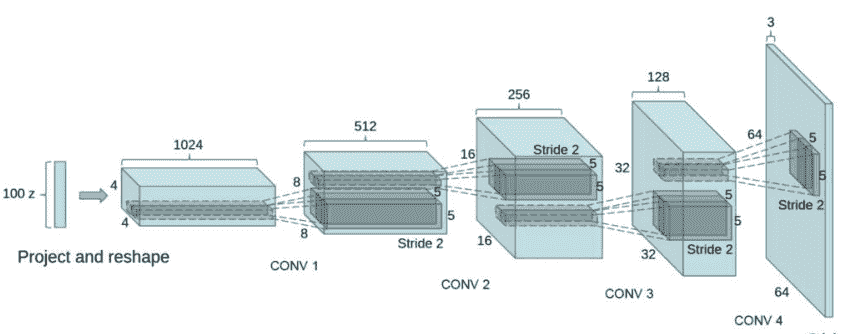

图 5.1: DCGAN 生成器模型架构示例。来源：深度卷积生成对抗网络的无监督表示学习。

本文的研究成果来之不易，是在对不同模型架构、配置和训练方案进行大量实证试错后开发出来的。在开发新的 GAN 时，尤其是图像合成相关任务，其方法仍被强烈推荐作为起点。

...在广泛的模型探索后，我们确定了一组架构，这些架构在多种数据集上实现了稳定的训练，并允许训练更高分辨率和更深的生成模型。

> — 深度卷积生成对抗网络的无监督表示学习，2015年。

下面总结了论文中关于 GAN 架构的建议。

| 用于稳定深度卷积 GAN 的架构准则 |
| :--- |
| 将任何池化层替换为步进卷积（判别器）和分数步进卷积（生成器）。 |
| 在生成器和判别器中都使用批量归一化。 |
| 对于更深的架构，移除全连接隐藏层。 |
| 在生成器中对除输出层外的所有层使用 ReLU 激活函数，输出层使用 Tanh。 |
| 在判别器中对所有层使用 LeakyReLU 激活函数。 |

图 5.2: 训练稳定深度卷积生成对抗网络的架构准则摘要。来源：深度卷积生成对抗网络的无监督表示学习。

本节将介绍如何在 DCGAN 模型架构中实施七项最佳实践。

## 5.4.1 使用步进卷积进行下采样

判别器模型是一个标准的卷积神经网络模型，它以图像作为输入，并必须输出二进制分类结果，判断图像是真实的还是伪造的。在深度卷积网络中，使用池化层来下采样输入和随网络深度增加的特征图是标准做法。对于 DCGAN 不推荐这样做，相反，他们建议使用步进卷积进行下采样。

这涉及按常规定义一个卷积层，但不使用默认的二维步幅 (1,1)，而是将其更改为 (2,2)。这样做的效果是下采样输入，具体来说是将输入的宽度和高度减半，从而得到面积为原来四分之一的输出特征图。下面的示例演示了这一点，使用了一个隐藏卷积层，通过将步幅参数设置为 (2,2) 来使用下采样步进卷积。其效果是模型将输入从 64 x 64 下采样到 32 x 32。

```python
# example of downsampling with strided convolutions
from keras.models import Sequential
from keras.layers import Conv2D

# define model
model = Sequential()
model.add(Conv2D(64, (3,3), strides=(2,2), padding='same', input_shape=(64,64,3)))
# summarize model
model.summary()
```

清单 5.1: 使用步进卷积进行下采样的示例。

运行示例会显示卷积层的输出形状，其中特征图的面积为原来的四分之一。

| 层 (类型) | 输出形状 | 参数数量 |
|---|---|---|
| conv2d_1 (Conv2D) | (None, 32, 32, 64) | 1792 |
| 总参数数: 1,792 | | |
| 可训练参数数: 1,792 | | |
| 不可训练参数数: 0 | | |

清单 5.2: 使用步进卷积进行下采样的示例输出。

## 5.4.2 使用步进卷积进行上采样

生成器模型必须根据从潜在空间中随机采样的点作为输入生成输出图像。实现此目的的推荐方法是使用带有步进卷积的转置卷积层。这是一种特殊的层，它以相反的方式执行卷积操作。直观地讲，这意味着设置 2 x 2 的步幅会产生相反的效果，即上采样输入，而不是像普通卷积层那样下采样。

通过堆叠带有步进卷积的转置卷积层，生成器模型能够将给定输入缩放到所需的输出尺寸。下面的示例演示了这一点，使用了一个隐藏转置卷积层，通过将 **步幅** 参数设置为 (2,2) 来使用上采样步进卷积。其效果是模型将输入从 64 × 64 上采样到 128 × 128。

```python
# example of upsampling with strided convolutions
from keras.models import Sequential
from keras.layers import Conv2DTranspose
# define model
model = Sequential()
model.add(Conv2DTranspose(64, (4,4), strides=(2,2), padding='same', input_shape=(64,64,3)))
# summarize model
model.summary()
```

清单 5.3: 使用步进卷积进行上采样的示例。

运行示例会显示卷积层的输出形状，其中特征图的面积为原来的四倍。

| 层 (类型) | 输出形状 | 参数数量 |
|---|---|---|
| conv2d_transpose_1 (Conv2DTranspose) | (None, 128, 128, 64) | 3136 |
| 总参数数: 3,136 | | |
| 可训练参数数: 3,136 | | |
| 不可训练参数数: 0 | | |

清单 5.4: 使用步进卷积进行上采样的示例输出。

## 5.4.3 使用 Leaky ReLU

修正线性激活单元（简称 ReLU）是一种简单的计算，它直接返回输入值，或者如果输入值小于或等于 0.0，则返回 0.0。在开发深度卷积神经网络时，这已成为一般最佳实践。GAN 的最佳实践是使用 ReLU 的一种变体，它允许某些小于零的值，并学习每个节点的截止点应该在哪里。这被称为带泄漏的修正线性激活单元，即 LeakyReLU 层。

可以为 LeakyReLU 指定负斜率，推荐的默认值为 0.2。最初，ReLU 被推荐用于生成器模型，而 LeakyReLU 被推荐用于判别器模型，尽管最近，LeakyReLU 可能被推荐在两种模型中都使用。下面的示例演示了在判别器模型的卷积层之后使用默认斜率 0.2 的 LeakyReLU。

```python
# example of using leakyrelu in a discriminator model
from keras.models import Sequential
from keras.layers import Conv2D
from keras.layers import LeakyReLU
# define model
model = Sequential()
model.add(Conv2D(64, (3,3), strides=(2,2), padding='same', input_shape=(64,64,3)))
model.add(LeakyReLU(0.2))
# summarize model
model.summary()
```

清单 5.5: 使用 LeakyReLU 激活函数的示例。

运行示例演示了在单个卷积层之后跟激活层的模型结构。

| 层 (类型) | 输出形状 | 参数数量 |
|---|---|---|
| conv2d_1 (Conv2D) | (None, 32, 32, 64) | 1792 |
| leaky_re_lu_1 (LeakyReLU) | (None, 32, 32, 64) | 0 |
| 总参数数: 1,792 | | |
| 可训练参数数: 1,792 | | |
| 不可训练参数数: 0 | | |

清单 5.6: 使用 LeakyReLU 激活函数的示例输出。

## 5.4.4 使用批量归一化

批量归一化将前一层的激活值标准化为零均值和单位方差。这有助于稳定训练过程。批量归一化分别用于判别器和生成器模型中卷积层和转置卷积层激活之后。它被添加到模型中，位于隐藏层之后，但在激活（如 LeakyReLU）之前。下面的示例演示了在判别器模型中将 BatchNormalization 层添加到 Conv2D 层之后、激活之前。

```python
# example of using batch norm in a discriminator model
from keras.models import Sequential
from keras.layers import Conv2D
from keras.layers import BatchNormalization
from keras.layers import LeakyReLU
# define model
model = Sequential()
model.add(Conv2D(64, (3,3), strides=(2,2), padding='same', input_shape=(64,64,3)))
model.add(BatchNormalization())
model.add(LeakyReLU(0.2))
# summarize model
model.summary()
```

清单 5.7: 使用 BatchNormalization 的示例。

运行示例展示了在卷积层输出和激活函数之间使用批量归一化的预期方式。

| 层 (类型) | 输出形状 | 参数数量 |
|---|---|---|
| conv2d_1 (Conv2D) | (None, 32, 32, 64) | 1792 |
| batch_normalization_1 (BatchNormalization) | (None, 32, 32, 64) | 256 |
| leaky_re_lu_1 (LeakyReLU) | (None, 32, 32, 64) | 0 |
| 总参数数: 2,048 | | |
| 可训练参数数: 1,920 | | |


```
Non-trainable params: 128
```

清单 5.8：使用 BatchNormalization 的示例输出。

## 5.4.5 使用高斯权重初始化

在神经网络训练之前，必须将模型权重（参数）初始化为小的随机变量。论文中报道的 DCGAN 模型最佳实践是使用以零为中心的高斯分布（正态分布或钟形分布）初始化所有权重，标准差为 0.02。下面的示例演示了如何定义一个均值为 0、标准差为 0.02 的随机高斯权重初始化器，用于生成器模型中的转置卷积层。同一个权重初始化器实例可以用于给定模型中的每一层。

```
# example of gaussian weight initialization in a generator model
from keras.models import Sequential
from keras.layers import Conv2DTranspose
from keras.initializers import RandomNormal
# define model
model = Sequential()
init = RandomNormal(mean=0.0, stddev=0.02)
model.add(Conv2DTranspose(64, (4,4), strides=(2,2), padding='same',
kernel_initializer=init, input_shape=(64,64,3)))
```

清单 5.9：使用高斯权重初始化的示例。

## 5.4.6 使用 Adam 随机梯度下降

随机梯度下降（简称 SGD）是用于优化卷积神经网络模型权重的标准算法。训练算法有许多变体。训练 DCGAN 模型的最佳实践是使用学习率 lr 为 0.0002、beta_1 动量值为 0.5（而非默认值 0.9）的 Adam 版随机梯度下降。在同时优化判别器和生成器模型时，推荐使用这种配置的 Adam 优化算法。下面的示例演示了如何为训练判别器模型配置 Adam 随机梯度下降优化算法。

```
# example of using adam when training a discriminator model
from keras.models import Sequential
from keras.layers import Conv2D
from keras.optimizers import Adam
# define model
model = Sequential()
model.add(Conv2D(64, (3,3), strides=(2,2), padding='same', input_shape=(64,64,3)))
# compile model
opt = Adam(lr=0.0002, beta_1=0.5)
model.compile(loss='binary_crossentropy', optimizer=opt, metrics=['accuracy'])
```

清单 5.10：使用随机梯度下降 Adam 版本的示例。

## 5.4.7 将图像缩放到范围 [-1,1]

建议将双曲正切激活函数用作生成器模型的输出。因此，还建议对用于训练判别器的真实图像进行缩放，使其像素值在范围 [-1,1] 内。这样，判别器始终会接收到像素值在相同范围内的真实和伪造图像作为输入。通常，图像数据作为 NumPy 数组加载，使得像素值为范围 [0, 255] 内的 8 位无符号整数（uint8）值。首先，必须将数组转换为浮点值，然后重新缩放到所需范围。下面的示例提供了一个函数，可将加载的图像数据的 NumPy 数组适当地缩放到所需的 [-1,1] 范围。

```
# example of a function for scaling images
from numpy.random import randint

# scale image data from [0,255] to [-1,1]
def scale_images(images):
    # convert from uint8 to float32
    images = images.astype('float32')
    # scale from [0,255] to [-1,1]
    images = (images - 127.5) / 127.5
    return images

# define one 28x28 color image
images = randint(0, 256, 28 * 28 * 3)
images = images.reshape((1, 28, 28, 3))
# summarize pixel values
print(images.min(), images.max())
# scale
scaled = scale_images(images)
# summarize pixel scaled values
print(scaled.min(), scaled.max())
```

清单 5.11：将图像缩放到新范围的示例。

运行示例会构造一张像素值在 [0,255] 范围内随机分布的单色图像。随后将像素值缩放到范围 [-1,1]，并报告最小和最大像素值。

```
0 255
-1.0 1.0
```

清单 5.12：将图像缩放到新范围的示例输出。

## 5.5 Soumith Chintala 的 GAN 技巧

Soumith Chintala 是 DCGAN 论文的合著者之一，他在 NIPS 2016 上发表了题为《如何训练 GAN？》的演示文稿，总结了许多技巧和窍门。该视频可在 YouTube 上观看，强烈推荐1。这些技巧的摘要也可作为名为《如何训练 GAN？让 GAN 工作的技巧和窍门》的 GitHub 仓库获得2。这些技巧借鉴了 DCGAN 论文以及其他来源的建议。在本节中，我们将回顾如何实现前一节未涵盖的四项额外 GAN 最佳实践。

1https://www.youtube.com/watch?v=X1mUN6dD8uE
2https://github.com/soumith/ganhacks

### 5.5.1 使用高斯潜在空间

潜在空间定义了用于生成新图像的生成器模型输入的形状和分布。DCGAN 建议从均匀分布中采样，这意味着潜在空间的形状是超立方体。较新的最佳实践是从标准高斯分布中采样，这意味着潜在空间的形状是超球体，均值为零，标准差为一。下面的示例演示了如何从 100 维潜在空间生成 500 个随机高斯样本，这些样本可用作生成器模型的输入；每个点都可用于生成一张图像。

```
# example of sampling from a gaussian latent space
from numpy.random import randn

# generate points in latent space as input for the generator
def generate_latent_points(latent_dim, n_samples):
    # generate points in the latent space
    x_input = randn(latent_dim * n_samples)
    # reshape into a batch of inputs for the network
    x_input = x_input.reshape((n_samples, latent_dim))
    return x_input

# size of latent space
n_dim = 100
# number of samples to generate
n_samples = 500
# generate samples
samples = generate_latent_points(n_dim, n_samples)
# summarize
print(samples.shape, samples.mean(), samples.std())
```

清单 5.13：采样高斯潜在空间的示例。

运行示例会总结 500 个点的生成情况，每个点包含 100 个随机高斯值，均值接近零，标准差接近 1，即标准高斯分布。

```
(500, 100) -0.004791256735601787 0.9976912528950904
```

清单 5.14：采样高斯潜在空间的示例输出。

### 5.5.2 使用真实和伪造图像的独立批次

判别器模型使用带小批量的随机梯度下降进行训练。最佳实践是使用真实和伪造图像的独立批次来更新判别器，而不是将真实和伪造图像合并为一个批次。这可以通过对判别器模型的权重分别调用两次 `train_on_batch()` 函数来实现。下面的代码片段演示了在训练判别器模型的内部循环中如何执行此操作。

```
...
# get randomly selected 'real' samples
X_real, y_real = ...
# update discriminator model weights
discriminator.train_on_batch(X_real, y_real)
# generate 'fake' examples
X_fake, y_fake = ...
# update discriminator model weights
discriminator.train_on_batch(X_fake, y_fake)
```

清单 5.15：真实和伪造图像独立批次的示例。

### 5.5.3 使用标签平滑

在训练判别器模型时，通常使用类标签 1 表示真实图像，使用类标签 0 表示伪造图像。这些被称为硬标签，因为标签值是精确或明确的。良好的做法是使用软标签，例如对于真实图像使用略高于或略低于 1.0 的值，对于伪造图像使用略高于 0.0 的值，每张图像的变化是随机的。这通常被称为标签平滑，在训练模型时可能具有正则化效果。下面的示例演示了如何为正类（class = 1）定义 1,000 个标签，并按建议将标签值均匀平滑到范围 [0.7,1.2]。

```
# example of positive label smoothing
from numpy import ones
from numpy.random import random

# example of smoothing class=1 to [0.7, 1.2]
def smooth_positive_labels(y):
    return y - 0.3 + (random(y.shape) * 0.5)

# generate 'real' class labels (1)
n_samples = 1000
y = ones((n_samples, 1))
# smooth labels
y = smooth_positive_labels(y)
# summarize smooth labels
print(y.shape, y.min(), y.max())
```

清单 5.16：演示正类标签平滑的示例。

运行示例会总结平滑值的最小值和最大值，显示它们接近预期值。

```
(1000, 1) 0.7003103006957805 1.1997858934066357
```

清单 5.17：演示正类标签平滑的示例输出。

有些建议认为只需要对正类标签进行平滑，且平滑到小于 1.0 的值。尽管如此，你也可以对负类标签进行平滑。下面的示例演示了如何为负类（class = 0）生成 1,000 个标签，并按建议将标签值均匀平滑到范围 [0.0, 0.3]。


```python
# example of negative label smoothing
from numpy import zeros
from numpy.random import random

# example of smoothing class=0 to [0.0, 0.3]
def smooth_negative_labels(y):
    return y + random(y.shape) * 0.3

# generate 'fake' class labels (0)
n_samples = 1000
y = zeros((n_samples, 1))
# smooth labels
y = smooth_negative_labels(y)
# summarize smooth labels
print(y.shape, y.min(), y.max())
```

清单 5.18：演示负标签平滑的示例。

```
(1000, 1) 0.00019305316963429408 0.299785314665858
```

清单 5.19：演示负标签平滑的示例输出。

### 5.5.4 使用噪声标签

训练判别器模型时使用的标签始终是正确的。这意味着假图像始终标记为类 0，真实图像始终标记为类 1。建议为这些标签引入一些错误，其中一些假图像被标记为真，一些真实图像被标记为假。如果您使用单独的批次来更新真实和假图像的判别器，这可能意味着将一些假图像随机添加到真实图像批次中，或将一些真实图像随机添加到假图像批次中。如果您使用包含真实和假图像的组合批次来更新判别器，则这可能涉及随机翻转某些图像的标签。下面的示例通过创建 1,000 个真实（类 = 1）标签样本并以 5% 的概率翻转它们，然后对 1,000 个假（类 = 0）标签样本做同样的操作来演示这一点。

```python
# example of noisy labels
from numpy import ones
from numpy import zeros
from numpy.random import choice

# randomly flip some labels
def noisy_labels(y, p_flip):
    # determine the number of labels to flip
    n_select = int(p_flip * y.shape[0])
    # choose labels to flip
    flip_ix = choice([i for i in range(y.shape[0])], size=n_select)
    # invert the labels in place
    y[flip_ix] = 1 - y[flip_ix]
    return y

# generate 'real' class labels (1)
n_samples = 1000
y = ones((n_samples, 1))
# flip labels with 5% probability
y = noisy_labels(y, 0.05)
# summarize labels
print(y.sum())

# generate 'fake' class labels (0)
y = zeros((n_samples, 1))
# flip labels with 5% probability
y = noisy_labels(y, 0.05)
# summarize labels
print(y.sum())
```

清单 5.20：演示噪声标签的示例。

尝试多次运行该示例。结果显示，对于正标签，大约有 50 个 1 被翻转为 0（例如，1,000 的 5%），对于负标签，大约有 50 个 0 被翻转为 1。

```
951.0
49.0
```

清单 5.21：演示噪声标签的示例输出。

### 5.6 进一步阅读

如果您希望深入了解，本节提供了更多关于该主题的资源。

### 5.6.1 论文

- 使用深度卷积生成对抗网络进行无监督表示学习，2015 年。
  https://arxiv.org/abs/1511.06434

- 教程：生成对抗网络，NIPS，2016 年。
  https://arxiv.org/abs/1701.00160

- 训练 GAN 的改进技术，2016 年。
  https://arxiv.org/abs/1606.03498

### 5.6.2 API

- Keras API。
  https://keras.io/

- NumPy 随机采样 (numpy.random) API。
  https://docs.scipy.org/doc/numpy/reference/routines.random.html

- NumPy 数组操作例程。
  https://docs.scipy.org/doc/numpy/reference/routines.array-manipulation.html

### 5.6.3 文章

- ganhacks：如何训练 GAN？使 GAN 工作的技巧和窍门。
  https://github.com/soumith/ganhacks

- Ian Goodfellow，GAN 简介，NIPS 2016。
  https://www.youtube.com/watch?v=9JpdAg6uMXs

- Soumith Chintala，如何训练 GAN，NIPS 2016 对抗训练研讨会。
  https://www.youtube.com/watch?v=X1mUN6dD8uE

- 反卷积和棋盘伪影，2016 年。
  https://distill.pub/2016/deconv-checkerboard/

### 5.7 总结

在本教程中，您了解了如何实现一套最佳实践或 GAN 技巧，您可以直接复制粘贴到您的 GAN 项目中。具体来说，您学习了：

- GAN 中生成器和判别器模型的同时训练本质上是不稳定的。
- 如何从头开始实现深度卷积 GAN 模型架构的七项最佳实践。
- 如何实现 Soumith Chintala 的 GAN Hacks 演示和列表中的四项额外最佳实践。

### 5.7.1 下一步

这是本部分的最后一个教程。在下一部分，您将开始从头开发自己的 GAN 模型。

## 第二部分

### GAN 基础

### 概述

在本部分中，您将了解如何实现、训练和使用 GAN 模型。阅读本部分的章节后，您将知道：

- 如何为一维目标函数开发 GAN 模型（第 6 章）。
- 如何开发和使用 GAN 生成黑白手写数字（第 7 章）。
- 如何开发和使用 GAN 生成物体的小型彩色照片（第 8 章）。
- 如何使用插值和向量运算探索训练有素的 GAN 的潜在空间（第 9 章）。
- 如何识别训练 GAN 模型时的不同故障模式（第 10 章）。

## 第 6 章

### 如何从头开始开发 1D GAN

生成对抗网络，简称 GAN，是一种用于训练强大生成器模型的深度学习架构。生成器模型能够生成新的人工样本，这些样本看起来可能来自现有的样本分布。GAN 由生成器和判别器模型组成。生成器负责从域中生成新样本，判别器负责分类样本是真实的还是假的（生成的）。重要的是，判别器模型的性能用于更新判别器本身和生成器模型的模型权重。这意味着生成器从未实际看到来自域的示例，而是根据判别器表现的好坏进行调整。

这是一种既难以理解又难以训练的复杂模型类型。更好地理解 GAN 模型的本质及其训练方法的一种方法是为非常简单的任务从头开始开发一个模型。为从头开始开发简单 GAN 提供良好上下文的简单任务是一维函数。这是因为真实样本和生成的样本都可以绘制并进行目视检查，以了解学到了什么。简单函数也不需要复杂的神经网络模型，这意味着架构中使用的特定生成器和判别器模型可以轻松理解。在本教程中，我们将选择一个简单的一维函数，并使用 Keras 深度学习库将其作为从头开始开发和评估生成对抗网络的基础。完成本教程后，您将知道：

- 为简单的一维函数从头开始开发生成对抗网络的好处。
- 如何开发独立的判别器和生成器模型，以及通过判别器的预测行为训练生成器的组合模型。
- 如何在问题域的真实示例上下文中对生成的样本进行主观评估。

让我们开始吧。

### 6.1 教程概览

本教程分为六个部分，它们是：

- 1. 选择一维函数
- 2. 定义判别器模型
- 3. 定义生成器模型
- 4. 训练生成器模型
- 5. 评估 GAN 的性能
- 6. 训练 GAN 的完整示例

### 6.2 选择一维函数

第一步是选择要建模的一维函数。形式如下：

$y = f(x)$ (6.1)

其中 $x$ 是输入值，$y$ 是函数的输出值。具体来说，我们想要一个容易理解和绘制的函数。这既有助于设定模型应该生成什么的预期，也有助于通过对生成示例进行目视检查来了解其质量。我们将使用简单的函数 $x^2$；也就是说，该函数将返回输入的平方。您可能还记得高中代数中的这个函数，即 U 形函数。我们可以在 Python 中按如下方式定义该函数：

```python
# simple function
def calculate(x):
    return x * x
```

清单 6.1：定义目标函数的示例。

我们可以将输入域定义为 -0.5 到 0.5 之间的实数值，并计算该线性范围内每个输入值的输出值，然后绘制结果以了解输入与输出之间的关系。完整示例如下所示。

```python
# demonstrate simple x^2 function
from matplotlib import pyplot

# simple function
def calculate(x):
    return x * x

# define inputs
inputs = [-0.5, -0.4, -0.3, -0.2, -0.1, 0, 0.1, 0.2, 0.3, 0.4, 0.5]
# calculate outputs
outputs = [calculate(x) for x in inputs]
# plot the result
pyplot.plot(inputs, outputs)
pyplot.show()
```

清单 6.2：绘制目标函数域的示例。


运行示例会计算每个输入值的输出值，并创建输入与输出值的图表。我们可以看到，远离 0.0 的值会产生较大的输出值，而接近零的值会产生较小的输出值，并且这种行为在零周围是对称的。这是 X^2 一维函数的著名 U 形图。

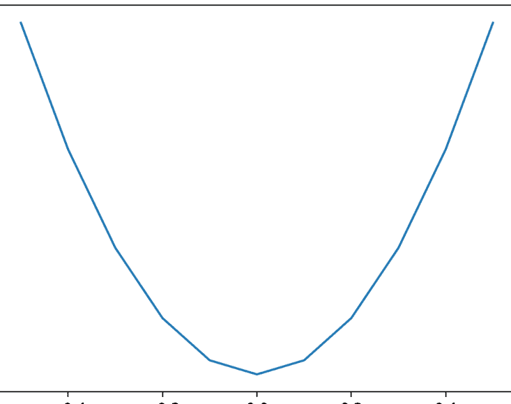

图 6.1: X^2 函数的输入与输出值图表。

我们可以从函数中生成随机样本或点。这可以通过生成 -0.5 到 0.5 之间的随机值并计算相关的输出值来实现。重复此过程多次将得到函数的一组点样本，例如真实样本。使用散点图绘制这些样本将显示相同的 U 形图，尽管由单独的随机样本组成。完整示例如下。首先，我们在 0 到 1 之间生成均匀随机值，然后将其移动到 -0.5 到 0.5 的范围。然后，我们为每个随机生成的输入值计算输出值，并将数组合并为一个具有 n 行（100）和两列的单个 NumPy 数组。

```
# example of generating random samples from X^2
from numpy.random import rand
from numpy import hstack
from matplotlib import pyplot

# generate random sample from x^2
def generate_samples(n=100):
    # generate random inputs in [-0.5, 0.5]
    X1 = rand(n) - 0.5
    # generate outputs X^2 (quadratic)
    X2 = X1 * X1
    # stack arrays
    X1 = X1.reshape(n, 1)
    X2 = X2.reshape(n, 1)
    return hstack((X1, X2))

# generate samples
data = generate_samples()
# plot samples
pyplot.scatter(data[:, 0], data[:, 1])
pyplot.show()
```

清单 6.3: 为目标函数采样域的示例。

运行示例会生成 100 个随机输入及其计算输出，并将样本绘制为散点图，显示熟悉的 U 形。

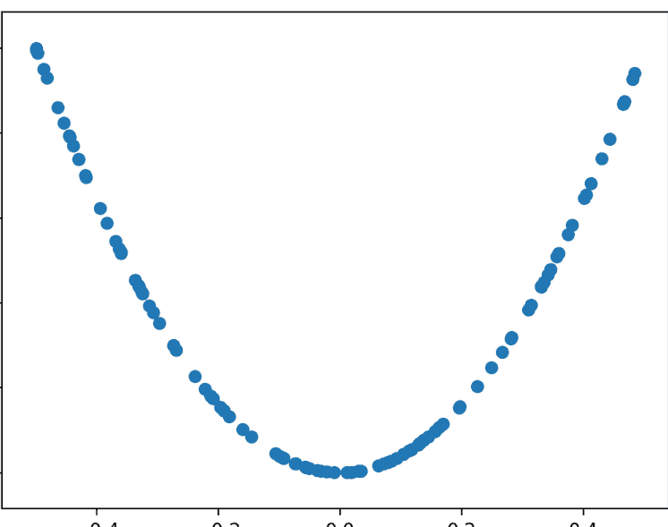

图 6.2: X^2 函数随机生成的输入与计算输出的图表。

我们可以将此函数作为为判别器函数生成真实样本的起点。具体来说，一个样本由一个包含两个元素的向量组成，一个用于输入，一个用于我们的一维函数的输出。我们还可以想象生成器模型如何生成新样本，我们可以将其绘制出来并与 \(X^2\) 函数的预期 U 形进行比较。具体来说，生成器将输出一个包含两个元素的向量：一个用于输入，一个用于我们的一维函数的输出。

## 6.3 定义判别器模型

下一步是定义判别器模型。该模型必须接受我们问题中的一个样本（例如包含两个元素的向量），并输出一个分类预测，判断该样本是真实的还是伪造的。这是一个二分类问题。

- 输入：包含两个实数值的样本。
- 输出：二分类，样本为真实（或伪造）的可能性。

这个问题非常简单，这意味着我们不需要复杂的神经网络来对其进行建模。判别器模型将具有一个包含 25 个节点的隐藏层，我们将使用 ReLU 激活函数和一种称为 He 权重初始化的适当权重初始化方法。输出层将具有一个节点，用于使用 sigmoid 激活函数进行二分类。该模型将最小化二元交叉熵损失函数，并将使用 Adam 版本的随机梯度下降，因为它非常有效。下面的 `define_discriminator()` 函数定义并返回判别器模型。该函数参数化了预期的输入数量，默认值为两个。

```
# define the standalone discriminator model
def define_discriminator(n_inputs=2):
    model = Sequential()
    model.add(Dense(25, activation='relu', kernel_initializer='he_uniform',
                    input_dim=n_inputs))
    model.add(Dense(1, activation='sigmoid'))
    # compile model
    model.compile(loss='binary_crossentropy', optimizer='adam', metrics=['accuracy'])
    return model
```

清单 6.4: 定义判别器模型的函数示例。

我们可以使用此函数来定义判别器模型并对其进行总结。完整示例如下。

```
# define the discriminator model
from keras.models import Sequential
from keras.layers import Dense
from keras.utils.vis_utils import plot_model

# define the standalone discriminator model
def define_discriminator(n_inputs=2):
    model = Sequential()
    model.add(Dense(25, activation='relu', kernel_initializer='he_uniform',
                    input_dim=n_inputs))
    model.add(Dense(1, activation='sigmoid'))
    # compile model
    model.compile(loss='binary_crossentropy', optimizer='adam', metrics=['accuracy'])
    return model

model = define_discriminator()
# summarize the model
model.summary()
# plot the model
plot_model(model, to_file='discriminator_plot.png', show_shapes=True, show_layer_names=True)
```

清单 6.5: 定义并总结判别器模型的示例。

运行示例会定义判别器模型并对其进行总结。

| 层 (类型) | 输出形状 | 参数数量 |
|---|---|---|
| dense_1 (Dense) | (None, 25) | 75 |
| dense_2 (Dense) | (None, 1) | 26 |

总参数数: 101
可训练参数数: 101
不可训练参数数: 0

清单 6.6: 定义并总结判别器模型的示例输出。

> 注意：创建模型图假设已安装 `pydot` 和 `graphviz` 库。如果这是一个问题，您可以注释掉导入语句和 `plot_model()` 的函数调用。

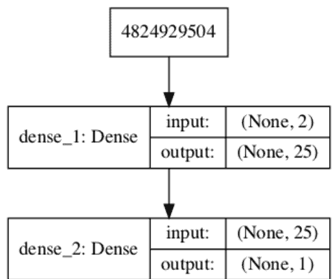

图 6.3: GAN 中判别器模型的图。

我们现在可以开始使用带有类标签 1 的真实示例和带有类标签 0 的随机生成样本来训练此模型。没有必要这样做，但我们将要开发的元素以后会很有用，并且有助于看到判别器只是一个普通的神经网络模型。首先，我们可以更新预测部分中的 generate_samples() 函数，将其命名为 generate_real_samples()，并使其也返回真实样本的输出类标签，具体来说，是一个值为 1 的数组，其中 class = 1 表示真实。

```
# generate n real samples with class labels
def generate_real_samples(n):
    # generate inputs in [-0.5, 0.5]
    X1 = rand(n) - 0.5
    # generate outputs X^2
    X2 = X1 * X1
    # stack arrays
    X1 = X1.reshape(n, 1)
    X2 = X2.reshape(n, 1)
    X = hstack((X1, X2))
    # generate class labels
    y = ones((n, 1))
    return X, y
```

清单 6.7: 为目标函数创建随机样本的函数示例。

接下来，我们可以创建此函数的副本用于创建伪造示例。在这种情况下，我们将为样本的两个元素生成 -1 到 1 范围内的随机值。所有这些示例的输出类标签均为 0。此函数将充当我们的伪造生成器模型。

```
# generate n fake samples with class labels
def generate_fake_samples(n):
    # generate inputs in [-1, 1]
    X1 = -1 + rand(n) * 2
    # generate outputs in [-1, 1]
    X2 = -1 + rand(n) * 2
    # stack arrays
    X1 = X1.reshape(n, 1)
    X2 = X2.reshape(n, 1)
    X = hstack((X1, X2))
    # generate class labels
    y = zeros((n, 1))
    return X, y
```

清单 6.8: 为目标函数创建随机伪造样本的函数示例。

接下来，我们需要一个函数来训练和评估判别器模型。这可以通过手动枚举训练时代来实现，对于每个时代，生成一半批次的真实示例和一半批次的伪造示例，并分别对每个进行更新，例如一整批示例。可以使用 train() 函数，但在此情况下，我们将直接使用 train_on_batch() 函数。然后可以在生成的示例上评估模型，并报告真实和伪造样本上的分类准确率。下面的 train_discriminator() 函数实现了这一点，训练模型 1,000 个批次，每个批次使用 128 个样本（64 个伪造和 64 个真实）。

```
# train the discriminator model
def train_discriminator(model, n_epochs=1000, n_batch=128):
    half_batch = int(n_batch / 2)
    # run epochs manually
    for i in range(n_epochs):
        # generate real examples
        X_real, y_real = generate_real_samples(half_batch)


# update model
model.train_on_batch(X_real, y_real)
# generate fake examples
X_fake, y_fake = generate_fake_samples(half_batch)
# update model
model.train_on_batch(X_fake, y_fake)
# evaluate the model
_, acc_real = model.evaluate(X_real, y_real, verbose=0)
_, acc_fake = model.evaluate(X_fake, y_fake, verbose=0)
print(i, acc_real, acc_fake)

清单 6.9：训练判别器模型的函数示例。

我们可以将所有这些整合起来，在真实示例和伪造示例上训练判别器模型。完整示例如下所示。

```
# define and fit a discriminator model
from numpy import zeros
from numpy import ones
from numpy import hstack
from numpy.random import rand
from keras.models import Sequential
from keras.layers import Dense

# define the standalone discriminator model
def define_discriminator(n_inputs=2):
    model = Sequential()
    model.add(Dense(25, activation='relu', kernel_initializer='he_uniform',
        input_dim=n_inputs))
    model.add(Dense(1, activation='sigmoid'))
    # compile model
    model.compile(loss='binary_crossentropy', optimizer='adam', metrics=['accuracy'])
    return model

# generate n real samples with class labels
def generate_real_samples(n):
    # generate inputs in [-0.5, 0.5]
    X1 = rand(n) - 0.5
    # generate outputs X^2
    X2 = X1 * X1
    # stack arrays
    X1 = X1.reshape(n, 1)
    X2 = X2.reshape(n, 1)
    X = hstack((X1, X2))
    # generate class labels
    y = ones((n, 1))
    return X, y

# generate n fake samples with class labels
def generate_fake_samples(n):
    # generate inputs in [-1, 1]
    X1 = -1 + rand(n) * 2
    # generate outputs in [-1, 1]
    X2 = -1 + rand(n) * 2
    # stack arrays
    X1 = X1.reshape(n, 1)
    X2 = X2.reshape(n, 1)
X = hstack((X1, X2))
# generate class labels
y = zeros((n, 1))
return X, y

# train the discriminator model
def train_discriminator(model, n_epochs=1000, n_batch=128):
	half_batch = int(n_batch / 2)
	# run epochs manually
	for i in range(n_epochs):
		# generate real examples
		X_real, y_real = generate_real_samples(half_batch)
		# update model
		model.train_on_batch(X_real, y_real)
		# generate fake examples
		X_fake, y_fake = generate_fake_samples(half_batch)
		# update model
		model.train_on_batch(X_fake, y_fake)
		# evaluate the model
		_, acc_real = model.evaluate(X_real, y_real, verbose=0)
		_, acc_fake = model.evaluate(X_fake, y_fake, verbose=0)
		print(i, acc_real, acc_fake)

# define the discriminator model
model = define_discriminator()
# fit the model
train_discriminator(model)
```

清单 6.10：拟合判别器模型的示例。

运行该示例会生成真实和伪造示例并更新模型，然后在相同示例上评估模型并打印分类准确率。

**注意**：由于学习算法的随机性，您的具体结果可能会有所不同。建议运行该示例几次并比较平均性能。

在此示例中，模型能够快速学习以完美准确率正确识别真实示例，并且在以 80% 到 90% 的准确率识别伪造示例方面表现很好。

```
...
995 1.0 0.875
996 1.0 0.921875
997 1.0 0.859375
998 1.0 0.9375
999 1.0 0.8125
```

清单 6.11：拟合判别器模型的示例输出。

训练判别器模型非常直接。目标是训练生成器模型，而不是判别器模型，GANs 的真正复杂性就在这里。

## 6.4 定义生成器模型

下一步是定义生成器模型。生成器模型以潜在空间中的一个点作为输入，并生成一个新样本，例如包含我们函数的输入和输出元素的向量，例如 \(x\) 和 \(x^2\)。潜在变量是隐藏或未观察到的变量，而潜在空间是这些变量的多维向量空间。我们可以为我们的问题定义潜在空间的大小以及潜在空间中变量的形状或分布。

这是因为，在生成器模型在学习过程中开始为空间中的点赋予意义之前，潜在空间没有意义。训练后，潜在空间中的点将对应于输出空间中的点，例如生成样本的空间。我们将定义一个五维的小型潜在空间，并使用 GAN 文献中的标准方法，即为潜在空间中的每个变量使用高斯分布。我们将通过从标准高斯分布中绘制随机数来生成新输入，即均值为零、标准差为一。

- 输入：潜在空间中的点，例如高斯随机数的五元素向量。
- 输出：表示我们函数的生成样本的二元素向量（\(x\) 和 \(x^2\)）。

生成器模型将像判别器模型一样较小。它将有一个包含十五个节点的单个 Dense 隐藏层，并将使用 ReLU 激活函数和 He 权重初始化。输出层将为生成向量中的两个元素各设置两个节点，并将使用线性激活函数。使用线性激活函数是因为我们知道我们希望生成器输出一个实数向量，第一个元素的范围将是 [-0.5, 0.5]，第二个元素大约是 [0.0, 0.25]。

该模型未编译。这样做的原因是生成器模型不是直接拟合的。下面的 `define_generator()` 函数定义并返回生成器模型。潜在维度的大小是参数化的，以防我们以后想调整它，模型的输出形状也是参数化的，与定义判别器模型的函数相匹配。

```python
# define the standalone generator model
def define_generator(latent_dim, n_outputs=2):
    model = Sequential()
    model.add(Dense(15, activation='relu', kernel_initializer='he_uniform',
                    input_dim=latent_dim))
    model.add(Dense(n_outputs, activation='linear'))
    return model
```

清单 6.12：定义生成器模型的函数示例。

我们可以总结模型以帮助更好地理解输入和输出形状。完整示例如下所示。

```python
# define the generator model
from keras.models import Sequential
from keras.layers import Dense
from keras.utils.vis_utils import plot_model

# define the standalone generator model
def define_generator(latent_dim, n_outputs=2):
    model = Sequential()
    model.add(Dense(15, activation='relu', kernel_initializer='he_uniform',
                    input_dim=latent_dim))
    model.add(Dense(n_outputs, activation='linear'))
```

## 6.4. 定义生成器模型

```
return model

# define the discriminator model
model = define_generator(5)
# summarize the model
model.summary()
# plot the model
plot_model(model, to_file='generator_plot.png', show_shapes=True, show_layer_names=True)
```

清单 6.13：定义并总结生成器模型的示例。

运行该示例定义生成器模型并对其进行总结。

| 层 (类型) | 输出形状 | 参数数量 |
|---|---|---|
| dense_1 (Dense) | (None, 15) | 90 |
| dense_2 (Dense) | (None, 2) | 32 |
| 总参数数: 122 | | |
| 可训练参数数: 122 | | |
| 不可训练参数数: 0 | | |

清单 6.14：定义并总结生成器模型的示例输出。

还创建了模型的图表，我们可以看到模型期望从潜在空间中获取一个五元素点作为输入，并将预测一个二元素向量作为输出。

**注意**：创建模型图表假设已安装 `pydot` 和 `graphviz` 库。如果这是一个问题，您可以注释掉导入语句和 `plot_model()` 的函数调用。

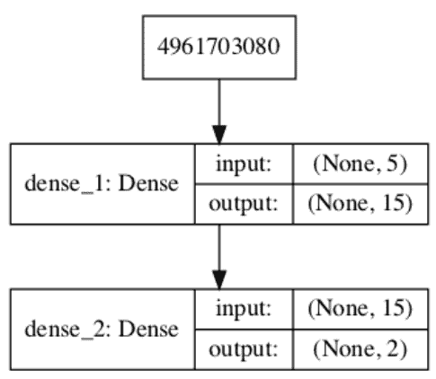

图 6.4：GAN 中生成器模型的图表。

我们可以看到模型以潜在空间中的随机五元素向量作为输入，并为我们的一维函数输出一个二元素向量。这个模型不能做太多事情


此时此刻。不过，我们可以演示如何使用它来生成样本。这不是必须的，但同样，其中一些元素以后可能有用。第一步是在潜在空间中生成新的随机点。我们可以通过调用 `randn()` NumPy 函数来实现这一点，用于生成从标准高斯分布中抽取的随机数数组。

然后可以将随机数数组重塑为样本：即 n 行，每行五个元素。下面的 `generate_latent_points()` 函数实现了这一点，并在潜在空间中生成所需数量的点，这些点可以用作生成器模型的输入。

```python
# generate points in latent space as input for the generator
def generate_latent_points(latent_dim, n):
    # generate points in the latent space
    x_input = randn(latent_dim * n)
    # reshape into a batch of inputs for the network
    x_input = x_input.reshape(n, latent_dim)
    return x_input
```

清单 6.15: 采样潜在空间的函数示例。

接下来，我们可以使用生成的点作为生成器模型的输入来生成新样本，然后绘制样本。下面的 `generate_fake_samples()` 函数实现了这一点，其中定义的生成器和潜在空间的大小作为参数传递，以及模型要生成的点数。

```python
# use the generator to generate n fake examples and plot the results
def generate_fake_samples(generator, latent_dim, n):
    # generate points in latent space
    x_input = generate_latent_points(latent_dim, n)
    # predict outputs
    X = generator.predict(x_input)
    # plot the results
    pyplot.scatter(X[:, 0], X[:, 1])
    pyplot.show()
```

清单 6.16: 生成假样本的函数示例。

将这些整合在一起，完整示例如下所示。

```python
# define and use the generator model
from numpy.random import randn
from keras.models import Sequential
from keras.layers import Dense
from matplotlib import pyplot

# define the standalone generator model
def define_generator(latent_dim, n_outputs=2):
    model = Sequential()
    model.add(Dense(15, activation='relu', kernel_initializer='he_uniform',
                    input_dim=latent_dim))
    model.add(Dense(n_outputs, activation='linear'))
    return model

# generate points in latent space as input for the generator
def generate_latent_points(latent_dim, n):
    # generate points in the latent space
    x_input = randn(latent_dim * n)
    # reshape into a batch of inputs for the network
    x_input = x_input.reshape(n, latent_dim)
    return x_input

# use the generator to generate n fake examples and plot the results
def generate_fake_samples(generator, latent_dim, n):
    # generate points in latent space
    x_input = generate_latent_points(latent_dim, n)
    # predict outputs
    X = generator.predict(x_input)
    # plot the results
    pyplot.scatter(X[:, 0], X[:, 1])
    pyplot.show()

# size of the latent space
latent_dim = 5
# define the discriminator model
model = define_generator(latent_dim)
# generate and plot generated samples
generate_fake_samples(model, latent_dim, 100)
```

清单 6.17: 定义和使用生成器模型的示例。

运行示例将从潜在空间生成 100 个随机点，将其作为输入传递给生成器，并从我们的一维函数域中生成 100 个假样本。由于生成器尚未训练，生成的点完全是垃圾，正如我们所料，但我们可以想象，随着模型的训练，这些点将慢慢开始类似于目标函数及其 U 形。

## 6.4. 定义生成器模型

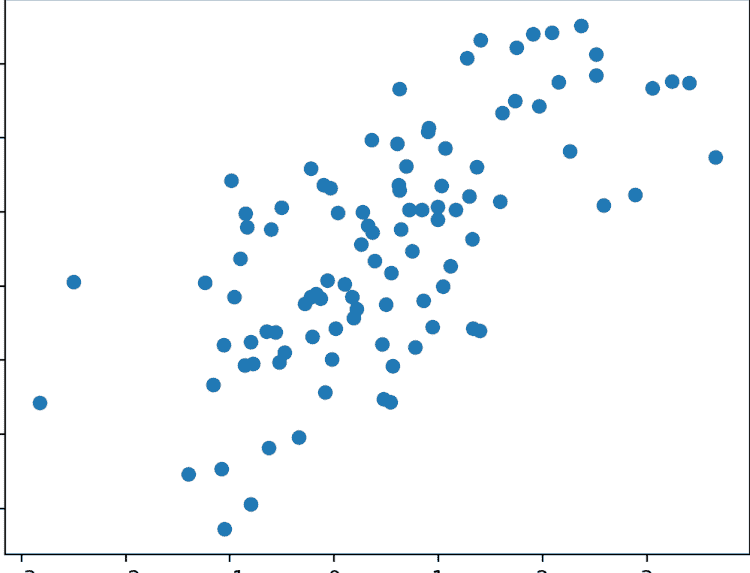

图 6.5: 生成器模型预测的假样本散点图。

我们现在已经了解了如何定义和使用生成器模型。我们需要以这种方式使用生成器模型来创建供判别器分类的样本。我们尚未了解生成器模型是如何训练的；这将是接下来的内容。

## 6.5. 训练生成器模型

生成器模型中的权重根据判别器模型的性能进行更新。当判别器擅长检测假样本时，生成器会更新得更多（通过更大的误差梯度），而当判别器模型在检测假样本时表现相对较差或感到困惑时，生成器模型更新得较少。这定义了这两个模型之间的零和或对抗关系。使用 Keras API 实现这一点可能有多种方法，但也许最简单的方法是创建一个新模型，该模型包含或封装生成器和判别器模型。具体来说，可以定义一个新的 GAN 模型，它堆叠生成器和判别器，使生成器接收潜在空间中的随机点作为输入，生成直接输入到判别器模型的样本，进行分类，而这个更大模型的输出可用于更新生成器的模型权重。要澄清，我们说的不是一个新的第三个模型，只是一个逻辑上的第三个模型，它使用独立生成器和判别器模型中已定义的层和权重。

只有判别器关注区分真实样本和假样本；因此，判别器模型可以以独立方式在每类样本上进行训练。生成器模型只关心判别器在假样本上的表现。因此，当判别器作为 GAN 模型的一部分时，我们将其所有层标记为不可训练，以便它们不能被更新并在假样本上过度训练。

通过这个包含性 GAN 模型训练生成器时，还有一个重要的变化。生成器希望判别器认为生成器输出的样本是真实的，而不是假的。因此，当生成器作为 GAN 模型的一部分进行训练时，我们将生成的样本标记为真实（class = 1）。我们可以想象，判别器随后会将生成的样本分类为非真实（class = 0）或真实概率较低（0.3 或 0.5）。用于更新模型权重的反向传播过程会将其视为一个大错误，并将更新模型权重（即仅生成器中的权重）以纠正此错误，从而使生成器更擅长生成逼真的假样本。让我们具体化这一点。

- 输入：潜在空间中的点，例如五元素高斯随机数向量。
- 输出：二进制分类，样本为真实（或假）的可能性。

下面的 `define_gan()` 函数将已定义的生成器和判别器模型作为参数，并创建包含这两个模型的新逻辑第三个模型。判别器中的权重被标记为不可训练，这仅影响 GAN 模型所见的权重，而不影响独立判别器模型。然后 GAN 模型使用与判别器相同的二元交叉熵损失函数和高效的 Adam 版本的随机梯度下降。

```python
# define the combined generator and discriminator model, for updating the generator
def define_gan(generator, discriminator):
    # make weights in the discriminator not trainable
    discriminator.trainable = False
    # connect them
    model = Sequential()
    # add generator
    model.add(generator)
    # add the discriminator
    model.add(discriminator)
    # compile model
    model.compile(loss='binary_crossentropy', optimizer='adam')
    return model
```

清单 6.18: 定义用于训练生成器的复合模型的函数示例。

使判别器不可训练是 Keras API 中的一个巧妙技巧。trainable 属性在模型编译时影响模型。判别器模型是使用可训练层编译的，因此当独立模型通过调用 `train_on_batch()` 进行更新时，这些层中的模型权重将被更新。判别器模型被标记为不可训练，添加到 GAN 模型中，并进行编译。在这个模型中，判别器模型的模型权重不可训练，并且在 GAN 模型通过调用 `train_on_batch()` 进行更新时不能更改。创建判别器、生成器和复合模型的完整示例如下所示。


```
# demonstrate creating the three models in the gan
from keras.models import Sequential
from keras.layers import Dense
from keras.utils.vis_utils import plot_model

# define the standalone discriminator model
def define_discriminator(n_inputs=2):
	model = Sequential()
	model.add(Dense(25, activation='relu', kernel_initializer='he_uniform',
		input_dim=n_inputs))
	model.add(Dense(1, activation='sigmoid'))
	# compile model
	model.compile(loss='binary_crossentropy', optimizer='adam', metrics=['accuracy'])
	return model

# define the standalone generator model
def define_generator(latent_dim, n_outputs=2):
	model = Sequential()
	model.add(Dense(15, activation='relu', kernel_initializer='he_uniform',
		input_dim=latent_dim))
	model.add(Dense(n_outputs, activation='linear'))
	return model

# define the combined generator and discriminator model, for updating the generator
def define_gan(generator, discriminator):
	# make weights in the discriminator not trainable
	discriminator.trainable = False
	# connect them
	model = Sequential()
	# add generator
	model.add(generator)
	# add the discriminator
	model.add(discriminator)
	# compile model
	model.compile(loss='binary_crossentropy', optimizer='adam')
	return model

# size of the latent space
latent_dim = 5
# create the discriminator
discriminator = define_discriminator()
# create the generator
generator = define_generator(latent_dim)
# create the gan
gan_model = define_gan(generator, discriminator)
# summarize gan model
gan_model.summary()
# plot gan model
plot_model(gan_model, to_file='gan_plot.png', show_shapes=True, show_layer_names=True)
```

清单 6.19: 定义并汇总用于训练生成器的复合模型示例。

运行该示例会先创建复合模型的摘要。您可能会收到关于未调用 `compile()` 函数的 UserWarning，可以安全地忽略。

| 层 (类型) | 输出形状 | 参数数量 |
|---|---|---|
| sequential_2 (Sequential) | (None, 2) | 122 |
| sequential_1 (Sequential) | (None, 1) | 101 |
| 总参数: 223 | | |
| 可训练参数: 122 | | |
| 非可训练参数: 101 | | |

清单 6.20: 定义并汇总用于训练生成器的复合模型的示例输出。

还会创建模型的图，我们可以看到该模型期望将潜在空间中的五个元素点作为输入，并将预测单个输出分类标签。

**注意:** 创建模型图假设已安装 `pydot` 和 `graphviz` 库。如果这有问题，可以注释掉导入语句和 `plot_model()` 的函数调用。

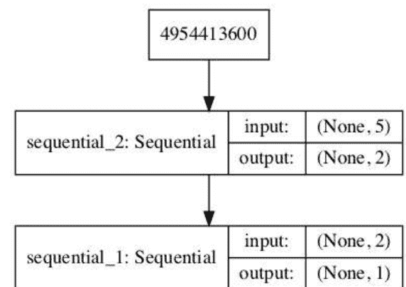

图 6.6: GAN 中复合生成器和判别器模型的图。

训练复合模型涉及通过前一节中的 `generate_latent_points()` 函数在潜在空间生成一批点，以及 `class = 1` 标签并调用 `train_on_batch()` 函数。下面的 `train_gan()` 函数演示了这一点，尽管它相当无趣，因为每个时代只会更新生成器，而判别器保留默认模型权重。

```
# train the composite model
def train_gan(gan_model, latent_dim, n_epochs=10000, n_batch=128):
    # manually enumerate epochs
    for i in range(n_epochs):
        # prepare points in latent space as input for the generator
        x_gan = generate_latent_points(latent_dim, n_batch)
        # create inverted labels for the fake samples
        y_gan = ones((n_batch, 1))
        # update the generator via the discriminator's error
        gan_model.train_on_batch(x_gan, y_gan)
```

清单 6.21: 训练复合模型的函数示例。

相反，需要的是我们先使用真实和假样本更新判别器模型，然后通过复合模型更新生成器。这需要结合判别器部分中定义的 `train_discriminator()` 函数和上面定义的 `train_gan()` 函数的元素。它还要求 `generate_fake_samples()` 函数使用生成器模型生成假样本，而不是生成随机数。用于更新判别器模型和生成器（通过复合模型）的完整训练函数如下所示。

```
# train the generator and discriminator
def train(g_model, d_model, gan_model, latent_dim, n_epochs=10000, n_batch=128):
    # determine half the size of one batch, for updating the discriminator
    half_batch = int(n_batch / 2)
    # manually enumerate epochs
    for i in range(n_epochs):
        # prepare real samples
        x_real, y_real = generate_real_samples(half_batch)
        # prepare fake examples
        x_fake, y_fake = generate_fake_samples(g_model, latent_dim, half_batch)
        # update discriminator
        d_model.train_on_batch(x_real, y_real)
        d_model.train_on_batch(x_fake, y_fake)
        # prepare points in latent space as input for the generator
        x_gan = generate_latent_points(latent_dim, n_batch)
        # create inverted labels for the fake samples
        y_gan = ones((n_batch, 1))
        # update the generator via the discriminator's error
        gan_model.train_on_batch(x_gan, y_gan)
```

清单 6.22: 训练判别器和生成器模型的函数示例。

我们几乎拥有开发一维函数 GAN 所需的一切。剩下的一个方面是模型评估。

### 6.6 评估 GAN 的性能

通常，没有客观的方法来评估 GAN 模型的性能。在此特定情况下，由于我们知道真实的底层输入域和目标函数，并可以计算客观误差度量，因此可以为生成的样本制定客观度量。尽管如此，本教程不会计算此客观误差分数。相反，我们将使用大多数 GAN 应用中采用的主观方法。具体来说，我们将使用生成器生成新样本，并将其与域中的真实样本进行相对检查。首先，我们可以使用上面判别器部分中开发的 `generate_real_samples()` 函数生成真实示例。创建这些示例的散点图将形成我们目标函数的熟悉 U 形。

```
# generate n real samples with class labels
def generate_real_samples(n):
    # generate inputs in [-0.5, 0.5]
    X1 = rand(n) - 0.5
    # generate outputs X^2
    X2 = X1 * X1
    # stack arrays
    X1 = X1.reshape(n, 1)
    X2 = X2.reshape(n, 1)
    X = hstack((X1, X2))
    # generate class labels
    y = ones((n, 1))
    return X, y
```

清单 6.23: 用于生成训练真实样本的函数示例。

接下来，我们可以使用生成器模型生成相同数量的假样本。这需要首先通过上面生成器部分中开发的 `generate_latent_points()` 函数在潜在空间生成相同数量的点。然后可以将这些点传递给生成器模型，并用于生成也可以在同一散点图上绘制的样本。

```
# generate points in latent space as input for the generator
def generate_latent_points(latent_dim, n):
    # generate points in the latent space
    x_input = randn(latent_dim * n)
    # reshape into a batch of inputs for the network
    x_input = x_input.reshape(n, latent_dim)
    return x_input
```

清单 6.24: 用于在潜在空间生成随机点的函数示例。

下面的 `generate_fake_samples()` 函数生成这些假样本及其关联的类标签 0，这在以后会很有用。

```
# use the generator to generate n fake examples, with class labels
def generate_fake_samples(generator, latent_dim, n):
    # generate points in latent space
    x_input = generate_latent_points(latent_dim, n)
    # predict outputs
    X = generator.predict(x_input)
    # create class labels
    y = zeros((n, 1))
    return X, y
```

清单 6.25: 用于生成假样本的函数示例。

将两个样本绘制在同一图上，可以直接比较，以查看是否覆盖了相同的输入和输出域，以及目标函数的预期形状是否已被适当捕获，至少在主观上是这样。下面的 `summarize_performance()` 函数可以在训练期间随时调用，以创建真实点和生成点的散点图，从而了解生成器模型的当前能力。

```
# plot real and fake points
def summarize_performance(generator, latent_dim, n=100):
    # prepare real samples
    x_real, y_real = generate_real_samples(n)
```


```python
# prepare fake examples
x_fake, y_fake = generate_fake_samples(generator, latent_dim, n)
# scatter plot real and fake data points
pyplot.scatter(x_real[:, 0], x_real[:, 1], color='red')
pyplot.scatter(x_fake[:, 0], x_fake[:, 1], color='blue')
pyplot.show()
```

### 清单 6.26：绘制生成点的函数示例。

我们可能同时也关心判别器模型的性能。具体来说，我们想知道判别器模型能多好地正确识别真实样本和假样本。一个好的生成器模型应该让判别器模型感到困惑，使其在真实和假样本上的分类准确率更接近 50%。我们可以更新 `summarize_performance()` 函数，使其同时接受判别器和当前 epoch 编号作为参数，并报告真实和假样本上的准确率。它还会生成合成图并保存到文件中，以便日后查看。

```python
# evaluate the discriminator and plot real and fake points
def summarize_performance(epoch, generator, discriminator, latent_dim, n=100):
    # prepare real samples
    x_real, y_real = generate_real_samples(n)
    # evaluate discriminator on real examples
    _, acc_real = discriminator.evaluate(x_real, y_real, verbose=0)
    # prepare fake examples
    x_fake, y_fake = generate_fake_samples(generator, latent_dim, n)
    # evaluate discriminator on fake examples
    _, acc_fake = discriminator.evaluate(x_fake, y_fake, verbose=0)
    # summarize discriminator performance
    print(epoch, acc_real, acc_fake)
    # scatter plot real and fake data points
    pyplot.scatter(x_real[:, 0], x_real[:, 1], color='red')
    pyplot.scatter(x_fake[:, 0], x_fake[:, 1], color='blue')
    # save plot to file
    filename = 'generated_plot_e%03d.png' % (epoch+1)
    pyplot.savefig(filename)
    pyplot.close()
```

### 清单 6.27：总结生成器模型性能的函数示例。

训练期间可以定期调用此函数。例如，如果我们选择训练模型 10,000 次迭代，那么每 2,000 次迭代检查一次模型性能可能很有趣。我们可以通过 `n_eval` 参数参数化检查频率来实现这一点，并在适当的迭代次数后从 `train()` 函数中调用 `summarize_performance()` 函数。带有此更改的 `train()` 函数的更新版本如下所示。

```python
# train the generator and discriminator
def train(g_model, d_model, gan_model, latent_dim, n_epochs=10000, n_batch=128,
    n_eval=2000):
    # determine half the size of one batch, for updating the discriminator
    half_batch = int(n_batch / 2)
    # manually enumerate epochs
    for i in range(n_epochs):
        # prepare real samples
        x_real, y_real = generate_real_samples(half_batch)
        # prepare fake examples
        x_fake, y_fake = generate_fake_samples(g_model, latent_dim, half_batch)
        # update discriminator
        d_model.train_on_batch(x_real, y_real)
        d_model.train_on_batch(x_fake, y_fake)
        # prepare points in latent space as input for the generator
        x_gan = generate_latent_points(latent_dim, n_batch)
        # create inverted labels for the fake samples
        y_gan = ones((n_batch, 1))
        # update the generator via the discriminator's error
        gan_model.train_on_batch(x_gan, y_gan)
        # evaluate the model every n_eval epochs
        if (i+1) % n_eval == 0:
            summarize_performance(i, g_model, d_model, latent_dim)
```

### 清单 6.28：训练 GAN 的函数示例。

## 6.7 训练 GAN 的完整示例

我们现在拥有在所选一维函数上训练和评估 GAN 所需的一切。完整示例如下所示。

```python
# train a generative adversarial network on a one-dimensional function
from numpy import hstack
from numpy import zeros
from numpy import ones
from numpy.random import rand
from numpy.random import randn
from keras.models import Sequential
from keras.layers import Dense
from matplotlib import pyplot

# define the standalone discriminator model
def define_discriminator(n_inputs=2):
    model = Sequential()
    model.add(Dense(25, activation='relu', kernel_initializer='he_uniform', input_dim=n_inputs))
    model.add(Dense(1, activation='sigmoid'))
    # compile model
    model.compile(loss='binary_crossentropy', optimizer='adam', metrics=['accuracy'])
    return model

# define the standalone generator model
def define_generator(latent_dim, n_outputs=2):
    model = Sequential()
    model.add(Dense(15, activation='relu', kernel_initializer='he_uniform', input_dim=latent_dim))
    model.add(Dense(n_outputs, activation='linear'))
    return model

# define the combined generator and discriminator model, for updating the generator
def define_gan(generator, discriminator):
    # make weights in the discriminator not trainable
    discriminator.trainable = False
    # connect them
    model = Sequential()
    # add generator
    model.add(generator)
    # add the discriminator
    model.add(discriminator)
    # compile model
    model.compile(loss='binary_crossentropy', optimizer='adam')
    return model
```

```python
# generate n real samples with class labels
def generate_real_samples(n):
    # generate inputs in [-0.5, 0.5]
    X1 = rand(n) - 0.5
    # generate outputs X^2
    X2 = X1 * X1
    # stack arrays
    X1 = X1.reshape(n, 1)
    X2 = X2.reshape(n, 1)
    X = hstack((X1, X2))
    # generate class labels
    y = ones((n, 1))
    return X, y
```

```python
# generate points in latent space as input for the generator
def generate_latent_points(latent_dim, n):
    # generate points in the latent space
    x_input = randn(latent_dim * n)
    # reshape into a batch of inputs for the network
    x_input = x_input.reshape(n, latent_dim)
    return x_input
```

```python
# use the generator to generate n fake examples, with class labels
def generate_fake_samples(generator, latent_dim, n):
    # generate points in latent space
    x_input = generate_latent_points(latent_dim, n)
    # predict outputs
    X = generator.predict(x_input)
    # create class labels
    y = zeros((n, 1))
    return X, y
```

```python
# evaluate the discriminator and plot real and fake points
def summarize_performance(epoch, generator, discriminator, latent_dim, n=100):
    # prepare real samples
    x_real, y_real = generate_real_samples(n)
    # evaluate discriminator on real examples
    _, acc_real = discriminator.evaluate(x_real, y_real, verbose=0)
    # prepare fake examples
    x_fake, y_fake = generate_fake_samples(generator, latent_dim, n)
    # evaluate discriminator on fake examples
    _, acc_fake = discriminator.evaluate(x_fake, y_fake, verbose=0)
    # summarize discriminator performance
    print(epoch, acc_real, acc_fake)
    # scatter plot real and fake data points
    pyplot.scatter(x_real[:, 0], x_real[:, 1], color='red')
    pyplot.scatter(x_fake[:, 0], x_fake[:, 1], color='blue')
    # save plot to file
    filename = 'generated_plot_e%03d.png' % (epoch+1)
    pyplot.savefig(filename)
    pyplot.close()
```

```python
# train the generator and discriminator
def train(g_model, d_model, gan_model, latent_dim, n_epochs=10000, n_batch=128,
        n_eval=2000):
    # determine half the size of one batch, for updating the discriminator
    half_batch = int(n_batch / 2)
    # manually enumerate epochs
    for i in range(n_epochs):
        # prepare real samples
        x_real, y_real = generate_real_samples(half_batch)
        # prepare fake examples
        x_fake, y_fake = generate_fake_samples(g_model, latent_dim, half_batch)
        # update discriminator
        d_model.train_on_batch(x_real, y_real)
        d_model.train_on_batch(x_fake, y_fake)
        # prepare points in latent space as input for the generator
        x_gan = generate_latent_points(latent_dim, n_batch)
        # create inverted labels for the fake samples
        y_gan = ones((n_batch, 1))
        # update the generator via the discriminator's error
        gan_model.train_on_batch(x_gan, y_gan)
        # evaluate the model every n_eval epochs
        if (i+1) % n_eval == 0:
            summarize_performance(i, g_model, d_model, latent_dim)

# size of the latent space
latent_dim = 5
# create the discriminator
discriminator = define_discriminator()
# create the generator
generator = define_generator(latent_dim)
# create the gan
gan_model = define_gan(generator, discriminator)
# train model
train(generator, discriminator, gan_model, latent_dim)
```

### 清单 6.29：在一维目标函数上训练 GAN 模型的完整示例。

运行该示例每 2,000 次训练迭代（批次）报告一次模型性能，并创建一个图表。

注意：由于学习算法的随机性，您的具体结果可能会有所不同。建议运行该示例几次并比较平均性能。

我们可以看到训练过程相对不稳定。第一列报告迭代编号，第二列报告判别器对真实示例的分类准确率，第三列报告判别器对生成（假）示例的分类准确率。在此示例中，我们可以看到判别器对真实示例仍然相当困惑，且对假示例的识别性能有所变化。


| | | |
|---|---|---|
| 1999 | 0.45 | 1.0 |
| 3999 | 0.45 | 0.91 |
| 5999 | 0.86 | 0.16 |
| 7999 | 0.6 | 0.41 |
| 9999 | 0.15 | 0.93 |

清单 6.30：在一维目标函数上训练 GAN 模型的完整示例输出。

为简洁起见，此处将省略提供所创建的五个图表；相反，我们将只查看其中两个。第一个图表在 2,000 次迭代后创建，显示真实（红色）与伪造（蓝色）样本。模型初期表现不佳，生成的点仅聚集在正输入域中，尽管具有正确的函数关系。

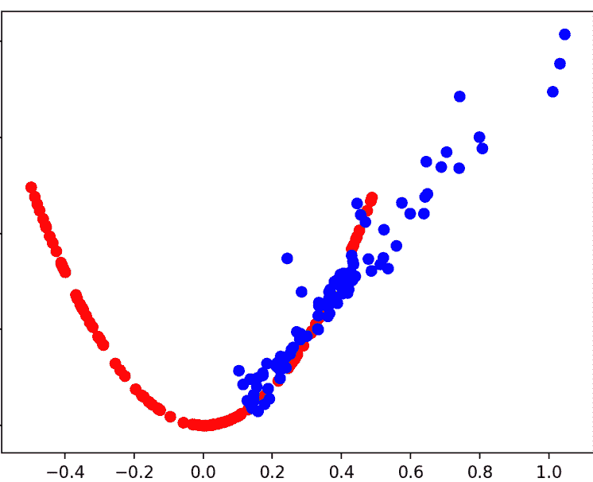

图 6.7：2,000 次迭代后目标函数的真实与生成示例散点图。

第二个图表显示 10,000 次迭代后的真实（红色）与伪造（蓝色）样本。在这里，我们可以看到生成器模型合理地生成了可信的样本，输入值在正确的域 [-0.5 和 0.5] 之间，输出值显示 X^2 关系，或接近该关系。

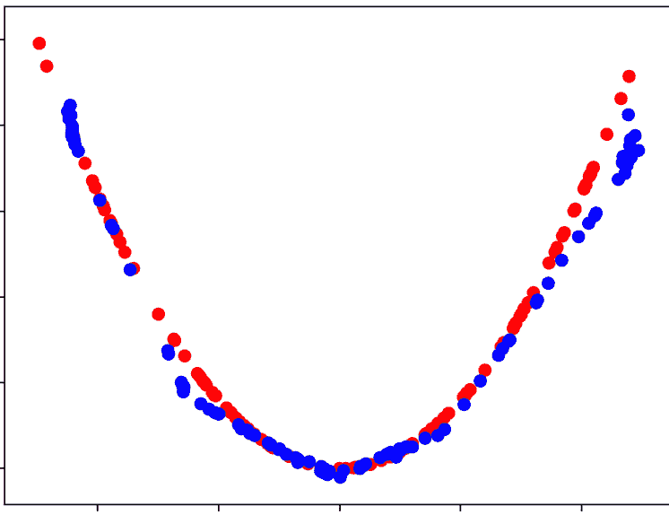

图 6.8：10,000 次迭代后目标函数的真实与生成示例散点图。

## 6.8 扩展

本节列出了一些您可能希望探索的扩展教程的想法。

- **模型架构。** 尝试判别器和生成器的替代模型架构，例如更多或更少的节点、层，以及替代激活函数，如 leaky ReLU。
- **数据缩放。** 尝试替代激活函数，如双曲正切（tanh）以及训练数据所需的任何缩放。
- **替代目标函数。** 尝试替代目标函数，例如简单的正弦波、高斯分布、不同的二次函数，甚至多模多项式函数。

如果您探索了其中任何扩展，我很乐意了解。

## 6.9 进一步阅读

如果您希望深入了解，本节提供了更多关于该主题的资源。

- Keras API。
  https://keras.io/

- 如何“冻结” Keras 层？。
  https://keras.io/getting-started/faq/#how-can-i-freeze-keras-layers

- Matplotlib API。
  https://matplotlib.org/api/

- numpy.random.rand API。
  https://docs.scipy.org/doc/numpy/reference/generated/numpy.random.rand.html

- numpy.random.randn API。
  https://docs.scipy.org/doc/numpy/reference/generated/numpy.random.randn.html

- numpy.zeros API。
  https://docs.scipy.org/doc/numpy/reference/generated/numpy.zeros.html

- numpy.ones API。
  https://docs.scipy.org/doc/numpy/reference/generated/numpy.ones.html

- numpy.hstack API。
  https://docs.scipy.org/doc/numpy/reference/generated/numpy.hstack.html

## 6.10 总结

在本教程中，您了解了如何从头开始为一维函数开发生成对抗网络。具体来说，您学习了：

- 从头开始为简单的一维函数开发生成对抗网络的好处。
- 如何开发独立的判别器和生成器模型，以及通过判别器的预测行为训练生成器的复合模型。
- 如何在问题域的真实示例背景下主观评估生成的样本。

### 6.10.1 下一步

在下一个教程中，您将为 MNIST 手写数字数据集开发深度卷积 GAN。

## 第 7 章

## 如何为灰度手写数字开发 DCGAN

生成对抗网络（GAN）是用于训练生成模型的一种架构，例如用于生成图像的深度卷积神经网络。为生成图像开发 GAN 需要同时具备用于分类给定图像是真实还是生成的判别器卷积神经网络模型，以及使用反卷积层将输入转换为完整二维像素值图像的生成器模型。

理解 GAN 的工作原理以及如何在 GAN 架构中训练用于图像生成的深度卷积神经网络模型可能具有挑战性。初学者的一个良好起点是在计算机视觉领域使用的标准图像数据集（例如 MNIST 手写数字数据集）上练习开发和使用 GAN。使用小型且已被充分理解的数据集意味着可以快速开发和训练较小的模型，从而将重点放在模型架构和图像生成过程本身上。在本教程中，您将了解如何使用深度卷积网络开发用于生成手写数字的生成对抗网络。完成本教程后，您将知道：

- 如何定义和训练独立的判别器模型以学习真实图像和伪造图像之间的差异。
- 如何定义独立的生成器模型并训练复合生成器和判别器模型。
- 如何评估 GAN 的性能并使用最终的独立生成器模型生成新图像。

让我们开始吧。

## 7.1 教程概述

本教程分为七个部分，分别是：

- 1. MNIST 手写数字数据集
- 2. 如何定义和训练判别器模型
- 3. 如何定义和使用生成器模型
- 4. 如何训练生成器模型
- 5. 如何评估 GAN 模型性能
- 6. MNIST 的 GAN 完整示例
- 7. 如何使用最终生成器模型

## 7.2 MNIST 手写数字数据集

MNIST 数据集是 Modified National Institute of Standards and Technology 数据集的缩写。它是一个包含 70,000 张小型 28 x 28 像素灰度图像的数据集，图像内容为 0 到 9 之间的手写单个数字。任务是将给定的手写数字图像分类为 10 个类别之一，代表 0 到 9 的整数值（包含 0 和 9）。Keras 通过 mnist.load_dataset() 函数提供对 MNIST 数据集的访问。它返回两个元组，一个包含标准训练数据集的输入和输出元素，另一个包含标准测试数据集的输入和输出元素。下面的示例加载数据集并总结加载数据集的形状。

注意：第一次加载数据集时，Keras 会自动下载图像的压缩版本，并将其保存在主目录下的 ~/.keras/datasets/ 中。下载速度很快，因为数据集压缩后仅约 11 兆字节。

```python
# example of loading the mnist dataset
from keras.datasets.mnist import load_data
# load the images into memory
(trainX, trainy), (testX, testy) = load_data()
# summarize the shape of the dataset
print('Train', trainX.shape, trainy.shape)
print('Test', testX.shape, testy.shape)
```

清单 7.1：加载和总结 MNIST 数据集的示例。

运行示例将加载数据集并打印训练和测试图像分割的输入和输出组件的形状。我们可以看到训练集中有 60K 个示例，测试集中有 10K 个示例，每张图像都是 28 x 28 像素的正方形。

```
Train (60000, 28, 28) (60000,)
Test (10000, 28, 28) (10000,)
```

清单 7.2：加载和总结 MNIST 数据集的示例输出。

图像为灰度图，背景为黑色（0 像素值），手写数字为白色（像素值接近 255）。这意味着如果绘制图像，它们将大部分为黑色，中间有一个白色数字。我们可以使用 Matplotlib 库的 imshow() 函数绘制训练数据集中的一些图像，并通过 cmap 参数将颜色映射指定为 'gray' 以正确显示像素值。

```
...
# plot raw pixel data
pyplot.imshow(trainX[i], cmap='gray')
```

清单 7.3：使用灰色颜色映射绘制单个图像的示例。

或者，当我们反转颜色并将背景绘制为白色、手写数字绘制为黑色时，图像更易于审查。它们更易于查看，因为现在图像大部分为白色，感兴趣区域为黑色。可以使用反向灰度颜色映射来实现，如下所示：

```
...
# plot raw pixel data
pyplot.imshow(trainX[i], cmap='gray_r')
```

清单 7.4：使用反向灰色颜色映射绘制单个图像的示例。

下面的示例在 5 x 5 正方形中绘制训练数据集的前 25 张图像。

```python
# example of loading the mnist dataset
from keras.datasets.mnist import load_data
from matplotlib import pyplot
# load the images into memory
(trainX, trainy), (testX, testy) = load_data()
# plot images from the training dataset
for i in range(25):
    # define subplot
    pyplot.subplot(5, 5, 1 + i)
    # turn off axis
    pyplot.axis('off')
    # plot raw pixel data
    pyplot.imshow(trainX[i], cmap='gray_r')
pyplot.show()
```

清单 7.5：绘制 MNIST 数据集图像的示例。

运行示例将创建 MNIST 训练数据集中 25 张图像的图表，排列为 5 x 5 正方形。


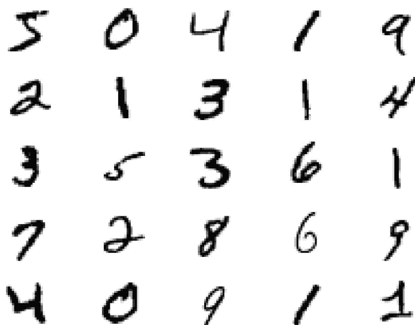

图 7.1：MNIST 数据集中前 25 个手写数字的绘图。

我们将使用训练数据集中的图像作为训练生成对抗网络的基础。具体来说，生成器模型将学习如何生成 0 到 9 之间新的逼真手写数字，使用一个判别器，该判别器将尝试区分来自 MNIST 训练数据集的真实图像和生成器模型输出的新图像。这是一个相对简单的问题，不需要复杂的生成器或判别器模型，尽管它确实需要生成灰度输出图像。

## 7.3 如何定义和训练判别器模型

第一步是定义判别器模型。该模型必须将我们数据集中的样本图像作为输入，并输出一个分类预测，以判断样本是真实的还是假的。这是一个二分类问题：

- 输入：大小为 28 × 28 像素且具有一个通道的图像。
- 输出：二分类，样本为真实（或假）的可能性。

判别器模型有两个卷积层，每个层有 64 个滤波器，内核大小较小为 3，步长大于正常值为 2。该模型没有池化层，输出层只有一个节点，使用 sigmoid 激活函数来预测输入样本是真实还是假的。该模型训练旨在最小化二元交叉熵损失函数，适用于二分类。在定义判别器模型时，我们将采用一些最佳实践，例如使用 LeakyReLU 而不是 ReLU，使用 Dropout，以及使用学习率为 0.0002、动量为 0.5 的 Adam 版本随机梯度下降。下面的函数 define_discriminator() 定义了判别器模型并参数化输入图像的大小。

```
# define the standalone discriminator model
def define_discriminator(in_shape=(28,28,1)):
    model = Sequential()
    model.add(Conv2D(64, (3,3), strides=(2, 2), padding='same', input_shape=in_shape))
    model.add(LeakyReLU(alpha=0.2))
    model.add(Dropout(0.4))
    model.add(Conv2D(64, (3,3), strides=(2, 2), padding='same'))
    model.add(LeakyReLU(alpha=0.2))
    model.add(Dropout(0.4))
    model.add(Flatten())
    model.add(Dense(1, activation='sigmoid'))
    # compile model
    opt = Adam(lr=0.0002, beta_1=0.5)
    model.compile(loss='binary_crossentropy', optimizer=opt, metrics=['accuracy'])
    return model
```

清单 7.6：定义判别器模型的函数示例。

我们可以使用此函数来定义判别器模型并对其进行总结。完整示例如下。

```
# example of defining the discriminator model
from keras.models import Sequential
from keras.optimizers import Adam
from keras.layers import Dense
from keras.layers import Conv2D
from keras.layers import Flatten
from keras.layers import Dropout
from keras.layers import LeakyReLU
from keras.utils.vis_utils import plot_model

# define the standalone discriminator model
def define_discriminator(in_shape=(28,28,1)):
    model = Sequential()
    model.add(Conv2D(64, (3,3), strides=(2, 2), padding='same', input_shape=in_shape))
    model.add(LeakyReLU(alpha=0.2))
    model.add(Dropout(0.4))
    model.add(Conv2D(64, (3,3), strides=(2, 2), padding='same'))
    model.add(LeakyReLU(alpha=0.2))
    model.add(Dropout(0.4))
    model.add(Flatten())
    model.add(Dense(1, activation='sigmoid'))
    # compile model
    opt = Adam(lr=0.0002, beta_1=0.5)
    model.compile(loss='binary_crossentropy', optimizer=opt, metrics=['accuracy'])
    return model

# define model
model = define_discriminator()

# summarize the model
model.summary()
# plot the model
plot_model(model, to_file='discriminator_plot.png', show_shapes=True, show_layer_names=True)
```

清单 7.7：定义和总结判别器模型的示例。

运行示例首先总结模型架构，显示每个层的输入和输出。我们可以看到，激进的 2 × 2 步长用于下采样输入图像，先从 28 × 28 变为 14 × 14，再变为 7 × 7，然后模型才做出输出预测。这种模式是有意为之，因为我们不使用池化层，而是使用大步长来实现类似的下采样效果。我们将在下一节的生成器模型中看到类似的模式，但方向相反。

| 层 (类型) | 输出形状 | 参数数量 |
|---|---|---|
| conv2d_1 (Conv2D) | (None, 14, 14, 64) | 640 |
| leaky_re_lu_1 (LeakyReLU) | (None, 14, 14, 64) | 0 |
| dropout_1 (Dropout) | (None, 14, 14, 64) | 0 |
| conv2d_2 (Conv2D) | (None, 7, 7, 64) | 36928 |
| leaky_re_lu_2 (LeakyReLU) | (None, 7, 7, 64) | 0 |
| dropout_2 (Dropout) | (None, 7, 7, 64) | 0 |
| flatten_1 (Flatten) | (None, 3136) | 0 |
| dense_1 (Dense) | (None, 1) | 3137 |
| 总参数: 40,705 | | |
| 可训练参数: 40,705 | | |
| 不可训练参数: 0 | | |

清单 7.8：定义和总结判别器模型的示例输出。

还创建了模型的图，我们可以看到模型期望两个输入并将预测单个输出。

**注意：** 创建模型图假设已安装 `pydot` 和 `graphviz` 库。如果这是一个问题，您可以注释掉导入语句和 `plot_model()` 的函数调用。

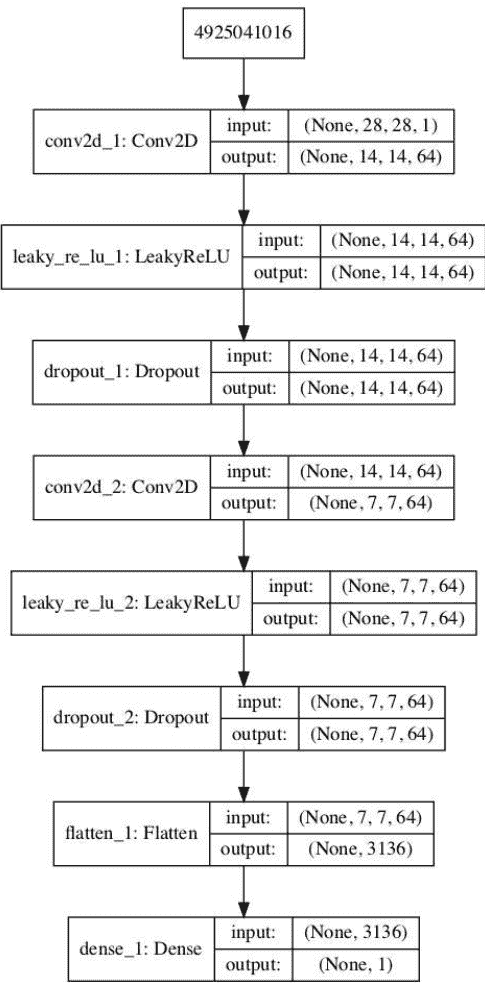

图 7.2：MNIST GAN 中判别器模型的图。

我们现在可以开始使用类标签为 1 的真实示例和类标签为 0 的随机生成样本来训练此模型。开发这些元素以后会很有用，并且有助于看出判别器只是一个用于二分类的普通神经网络模型。首先，我们需要一个函数来加载和准备真实图像数据集。我们将使用 `mnist.load_data()` 函数加载 MNIST 数据集，并仅将训练数据集的输入部分作为真实图像。

```
...
# load mnist dataset
(trainX, _), (_, _) = load_data()
```

清单 7.9：加载 MNIST 训练数据集的示例。

## 7.3 如何定义和训练判别器模型

图像是像素的二维数组，而卷积神经网络期望图像的三维数组作为输入，其中每个图像具有一个或多个通道。我们必须更新图像以增加一个用于灰度通道的维度。我们可以使用 `expand_dims()` NumPy 函数来实现这一点，并为通道在最后的图像格式指定最终维度。

```
...
# expand to 3d, e.g. add channels dimension
X = expand_dims(trainX, axis=-1)
```

清单 7.10：向数据集添加通道维度的示例。

最后，我们必须将像素值从无符号整数范围 [0,255] 缩放到归一化范围 [0,1]。最佳实践是使用范围 [-1,1]，但在此示例中，范围 [0,1] 也完全可行。

```
# convert from unsigned ints to floats
X = X.astype('float32')
# scale from [0,255] to [0,1]
X = X / 255.0
```

清单 7.11：归一化像素值的示例。

下面的 `load_real_samples()` 函数实现了此功能。

```
# load and prepare mnist training images
def load_real_samples():
    # load mnist dataset
    (trainX, _), (_, _) = load_data()
    # expand to 3d, e.g. add channels dimension
    X = expand_dims(trainX, axis=-1)
    # convert from unsigned ints to floats
    X = X.astype('float32')
    # scale from [0,255] to [0,1]
    X = X / 255.0
    return X
```

清单 7.12：加载和准备 MNIST 训练数据集的函数示例。

模型将以批次进行更新，具体是一组真实样本和一组生成样本。在训练中，一个时代被定义为遍历整个训练数据集一次。我们可以系统地枚举训练数据集中的所有样本，这是一种好方法，但通过随机梯度下降进行良好训练要求在每个时代之前对训练数据集进行打乱。一种更简单的方法是从训练数据集中选择随机图像样本。下面的 `generate_real_samples()` 函数将训练数据集作为参数，并将选择一个随机子样本图像；它还将为样本返回类标签，具体是类标签 1，以指示真实图像。

```
# select real samples
def generate_real_samples(dataset, n_samples):
    # choose random instances
    ix = randint(0, dataset.shape[0], n_samples)
    # retrieve selected images
    X = dataset[ix]
    # generate 'real' class labels (1)
    y = ones((n_samples, 1))
    return X, y
```


## 清单 7.13：选择真实图像样本的函数示例。

现在，我们需要一个假图像的来源。我们还没有生成器模型，因此，我们可以生成由随机像素值组成的图像，具体来说，就是范围 [0,1] 内的随机像素值，就像我们缩放后的真实图像一样。下面的 `generate_fake_samples()` 函数实现了此行为，并生成随机像素值的图像及其相关的类标签 0，用于假图像。

```
# generate n fake samples with class labels
def generate_fake_samples(n_samples):
    # generate uniform random numbers in [0,1]
    X = rand(28 * 28 * n_samples)
    # reshape into a batch of grayscale images
    X = X.reshape((n_samples, 28, 28, 1))
    # generate 'fake' class labels (0)
    y = zeros((n_samples, 1))
    return X, y
```

## 清单 7.14：生成随机假图像的函数示例。

最后，我们需要训练判别器模型。这涉及反复获取真实图像样本和生成图像样本，并固定迭代次数地更新模型。目前我们将忽略 epoch（即完整遍历训练数据集）的概念，而是按固定批次数拟合判别器模型。该模型将快速学会区分真实图像和假图像（随机生成的图像），因此，在它学会完美区分之前，不需要太多批次。

`train_discriminator()` 函数实现了此功能，每次迭代使用 256 图像的批量大小，其中 128 个是真实图像，128 个是假图像。我们分别对真实和假示例更新判别器，以便在更新前计算模型在每个样本上的准确率。这能让我们了解判别器模型随时间的表现情况。

```
# train the discriminator model
def train_discriminator(model, dataset, n_iter=100, n_batch=256):
    half_batch = int(n_batch / 2)
    # manually enumerate epochs
    for i in range(n_iter):
        # get randomly selected 'real' samples
        X_real, y_real = generate_real_samples(dataset, half_batch)
        # update discriminator on real samples
        _, real_acc = model.train_on_batch(X_real, y_real)
        # generate 'fake' examples
        X_fake, y_fake = generate_fake_samples(half_batch)
        # update discriminator on fake samples
        _, fake_acc = model.train_on_batch(X_fake, y_fake)
        # summarize performance
        print('>%d real=%.0f%% fake=%.0f%%' % (i+1, real_acc*100, fake_acc*100))
```

## 清单 7.15：训练判别器模型的函数示例。

将所有这些结合起来，下面列出了在真实和生成（假）图像上训练判别器模型实例的完整示例。

```
# example of training the discriminator model on real and random mnist images
from numpy import expand_dims
from numpy import ones
from numpy import zeros
from numpy.random import rand
from numpy.random import randint
from keras.datasets.mnist import load_data
from keras.optimizers import Adam
from keras.models import Sequential
from keras.layers import Dense
from keras.layers import Conv2D
from keras.layers import Flatten
from keras.layers import Dropout
from keras.layers import LeakyReLU
```

```
# define the standalone discriminator model
def define_discriminator(in_shape=(28,28,1)):
    model = Sequential()
    model.add(Conv2D(64, (3,3), strides=(2, 2), padding='same', input_shape=in_shape))
    model.add(LeakyReLU(alpha=0.2))
    model.add(Dropout(0.4))
    model.add(Conv2D(64, (3,3), strides=(2, 2), padding='same'))
    model.add(LeakyReLU(alpha=0.2))
    model.add(Dropout(0.4))
    model.add(Flatten())
    model.add(Dense(1, activation='sigmoid'))
    # compile model
    opt = Adam(lr=0.0002, beta_1=0.5)
    model.compile(loss='binary_crossentropy', optimizer=opt, metrics=['accuracy'])
    return model
```

```
# load and prepare mnist training images
def load_real_samples():
    # load mnist dataset
    (trainX, _), (_, _) = load_data()
    # expand to 3d, e.g. add channels dimension
    X = expand_dims(trainX, axis=-1)
    # convert from unsigned ints to floats
    X = X.astype('float32')
    # scale from [0,255] to [0,1]
    X = X / 255.0
    return X
```

```
# select real samples
def generate_real_samples(dataset, n_samples):
    # choose random instances
    ix = randint(0, dataset.shape[0], n_samples)
    # retrieve selected images
    X = dataset[ix]
    # generate 'real' class labels (1)
    y = ones((n_samples, 1))
    return X, y
```

```
# generate n fake samples with class labels
def generate_fake_samples(n_samples):
    # generate uniform random numbers in [0,1]
    X = rand(28 * 28 * n_samples)
    # reshape into a batch of grayscale images
    X = X.reshape((n_samples, 28, 28, 1))
    # generate 'fake' class labels (0)
    y = zeros((n_samples, 1))
    return X, y
```

```
# train the discriminator model
def train_discriminator(model, dataset, n_iter=100, n_batch=256):
    half_batch = int(n_batch / 2)
    # manually enumerate epochs
    for i in range(n_iter):
        # get randomly selected 'real' samples
        X_real, y_real = generate_real_samples(dataset, half_batch)
        # update discriminator on real samples
        _, real_acc = model.train_on_batch(X_real, y_real)
        # generate 'fake' examples
        X_fake, y_fake = generate_fake_samples(half_batch)
        # update discriminator on fake samples
        _, fake_acc = model.train_on_batch(X_fake, y_fake)
        # summarize performance
        print('>%d real=%.0f%% fake=%.0f%%' % (i+1, real_acc*100, fake_acc*100))

# define the discriminator model
model = define_discriminator()
# load image data
dataset = load_real_samples()
# fit the model
train_discriminator(model, dataset)
```

## 清单 7.16：定义和训练判别器模型的示例。

运行示例首先定义模型，加载 MNIST 数据集，然后训练判别器模型。

**注意**：由于学习算法的随机性，您的具体结果可能会有所不同。建议运行示例几次并比较平均性能。

在此示例中，判别器模型能够非常快速地学会区分真实和生成的 MNIST 图像，大约需要 50 个批次。

```
...
>96 real=100% fake=100%
>97 real=100% fake=100%
>98 real=100% fake=100%
>99 real=100% fake=100%
>100 real=100% fake=100%
```

## 清单 7.17：定义和训练判别器模型的示例输出。

既然我们知道如何定义和训练判别器模型，接下来需要研究开发生成器模型。

## 7.4 如何定义和使用生成器模型

灰度图像。潜在空间是一个任意定义的、服从高斯分布的向量空间，例如 100 维。它本身没有意义，但通过从该空间中随机抽取点并在训练期间将其提供给生成器模型，生成器模型会为这些潜在点赋予意义。训练结束时，潜在向量空间代表输出空间（即 MNIST 图像）的压缩表示，只有生成器知道如何将其转换为逼真的 MNIST 图像。

- **输入**：潜在空间中的点，例如一个包含 100 个元素的高斯随机数向量。
- **输出**：像素值在 [0,1] 范围内的 28 × 28 像素的二维正方形灰度图像。

输入向量不必非要是 100 个元素；这是一个整数且广泛使用，但我预期 10、50 或 500 也同样有效。开发生成器模型要求我们将来自潜在空间的 100 维向量转换为包含 28 × 28 或 784 个值的二维数组。实现此目标有多种方法，但有一种方法在深度卷积生成对抗网络中已被证明是有效的。它涉及两个主要元素。第一个是作为第一个隐藏层的 Dense 层，该层拥有足够的节点来表示输出图像的低分辨率版本。具体来说，输出图像一半大小（四分之一面积）的图像将是 14 × 14 或 196 个节点，而输出图像四分之一大小（八分之一面积）的图像将是 7 × 7 或 49 个节点。

我们不仅想要图像的一个低分辨率版本，而是想要输入的许多并行版本或解释。这是卷积神经网络中的一种模式，其中有许多并行滤波器，产生多个并行激活图（称为特征图），对输入有不同的解释。我们希望在输出端实现同样的事情：拥有输出的许多并行版本，具有不同的学习特征，这些特征可以在输出层中合并为最终图像。模型需要空间来发明、创建或生成。因此，第一个隐藏层（即 Dense 层）需要足够的节点来表示输出图像的多个低分辨率版本，例如 128 个。

```
...
# foundation for 7x7 image
model.add(Dense(128 * 7 * 7, input_dim=100))
```

## 清单 7.18：定义生成器模型基础激活的示例。

这些节点的激活值随后可以重塑为类似图像的形式，以传入卷积层，例如 128 个不同的 7 × 7 特征图。

```
...
model.add(Reshape((7, 7, 128)))
```

## 清单 7.19：将激活值重塑为适合 Conv2D 层的形状的示例。

下一个主要架构创新涉及将低分辨率图像上采样为更高分辨率的图像版本。执行此上采样过程有两种常见方法，有时称为反卷积。一种方法是使用 UpSampling2D 层（类似于反池化层），随后跟一个普通的 Conv2D 层。另一种可能更现代的方法是将这两个操作合并为一个单一层，称为 Conv2DTranspose。我们将为生成器采用后一种方法。


Conv2DTranspose 层可以配置为 (2 x 2) 的步幅，这将使输入特征图的面积扩大四倍（将其宽度和高度维度加倍）。最佳实践是使用步幅的因子（例如两倍）作为内核大小，以避免在上采样时可能观察到的棋盘格模式（有关上采样层的更多信息，请参见第 3 章）。

```
# upsample to 14x14
model.add(Conv2DTranspose(128, (4,4), strides=(2,2), padding='same'))
```

清单 7.20：定义上采样层的示例。

可以重复此过程以得到我们的 28 x 28 输出图像。同样，我们将使用默认斜率为 0.2 的 LeakyReLU 激活函数，这在训练 GAN 模型时被推荐为最佳实践。模型的输出层是一个具有一个滤波器、内核大小为 7 x 7 且填充为 'same' 的 Conv2D 层，旨在创建单个特征图并将其尺寸保持在 28 x 28 像素。使用 sigmoid 激活函数以确保输出值在所需范围 [0,1] 内。下面的 define_generator() 函数实现了此功能并定义了生成器模型。生成器模型未编译，也不指定损失函数或优化算法。这是因为生成器不是直接训练的。我们将在下一节中了解更多相关内容。

```
# define the standalone generator model
def define_generator(latent_dim):
    model = Sequential()
    # foundation for 7x7 image
    n_nodes = 128 * 7 * 7
    model.add(Dense(n_nodes, input_dim=latent_dim))
    model.add(LeakyReLU(alpha=0.2))
    model.add(Reshape((7, 7, 128)))
    # upsample to 14x14
    model.add(Conv2DTranspose(128, (4,4), strides=(2,2), padding='same'))
    model.add(LeakyReLU(alpha=0.2))
    # upsample to 28x28
    model.add(Conv2DTranspose(128, (4,4), strides=(2,2), padding='same'))
    model.add(LeakyReLU(alpha=0.2))
    model.add(Conv2D(1, (7,7), activation='sigmoid', padding='same'))
    return model
```

清单 7.21：定义生成器模型的函数示例。

我们可以汇总模型以帮助更好地理解输入和输出形状。完整示例如下所示。

```
# example of defining the generator model
from numpy import zeros
from numpy.random import randn
from keras.models import Sequential
from keras.layers import Dense
from keras.layers import Reshape
from keras.layers import Conv2D
from keras.layers import Conv2DTranspose
from keras.layers import LeakyReLU
from keras.utils.vis_utils import plot_model
from matplotlib import pyplot

# define the standalone generator model
def define_generator(latent_dim):
    model = Sequential()
    # foundation for 7x7 image
    n_nodes = 128 * 7 * 7
    model.add(Dense(n_nodes, input_dim=latent_dim))
    model.add(LeakyReLU(alpha=0.2))
    model.add(Reshape((7, 7, 128)))
    # upsample to 14x14
    model.add(Conv2DTranspose(128, (4,4), strides=(2,2), padding='same'))
    model.add(LeakyReLU(alpha=0.2))
    # upsample to 28x28
    model.add(Conv2DTranspose(128, (4,4), strides=(2,2), padding='same'))
    model.add(LeakyReLU(alpha=0.2))
    model.add(Conv2D(1, (7,7), activation='sigmoid', padding='same'))
    return model

# define the size of the latent space
latent_dim = 100
# define the generator model
model = define_generator(latent_dim)
# summarize the model
model.summary()
# plot the model
plot_model(model, to_file='generator_plot.png', show_shapes=True, show_layer_names=True)
```

清单 7.22：定义和汇总生成器模型的示例。

运行示例将汇总模型的层及其输出形状。我们可以看到，如设计所示，第一个隐藏层有 6,272 个参数，即 128 x 7 x 7，其激活值被重塑为 128 个 7 x 7 特征图。然后，特征图通过两个 Conv2DTranspose 层上采样到所需的输出形状 28 x 28，直到输出层，其中输出单个激活图。

| 层 (类型) | 输出形状 | 参数数量 |
|---|---|---|
| dense_1 (Dense) | (None, 6272) | 633472 |
| leaky_re_lu_1 (LeakyReLU) | (None, 6272) | 0 |
| reshape_1 (Reshape) | (None, 7, 7, 128) | 0 |
| conv2d_transpose_1 (Conv2DTranspose) | (None, 14, 14, 128) | 262272 |
| leaky_re_lu_2 (LeakyReLU) | (None, 14, 14, 128) | 0 |
| conv2d_transpose_2 (Conv2DTranspose) | (None, 28, 28, 128) | 262272 |
| leaky_re_lu_3 (LeakyReLU) | (None, 28, 28, 128) | 0 |
| conv2d_1 (Conv2D) | (None, 28, 28, 1) | 6273 |

总参数: 1,164,289
可训练参数: 1,164,289
不可训练参数: 0

清单 7.23：定义和汇总生成器模型的示例输出。

还会创建模型的图表，我们可以看到模型期望从潜在空间接收一个 100 元素的向量作为输入，并将生成图像作为输出。

**注意：** 创建模型图表假设已安装 `pydot` 和 `graphviz` 库。如果这是一个问题，您可以注释掉导入语句和 `plot_model()` 的函数调用。

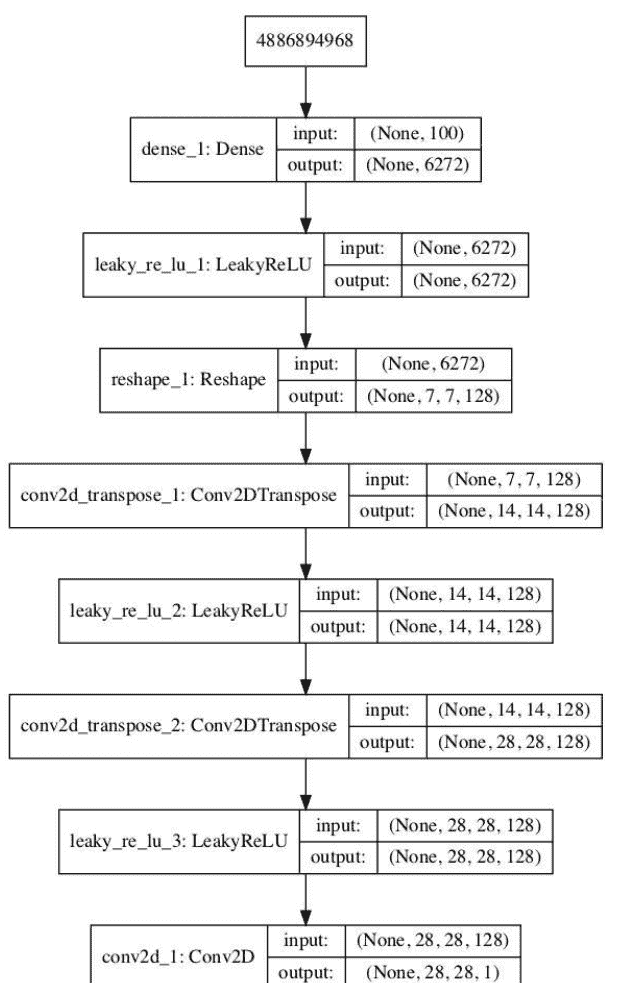

图 7.3：MNIST GAN 中生成器模型的图表。

目前该模型功能有限。尽管如此，我们可以演示如何使用它来生成样本。这是一个有用的演示，用于理解生成器只是另一个模型，其中一些元素以后会很有用。第一步是从潜在空间中抽取新点。我们可以通过调用 `randn()` NumPy 函数来实现这一点，该函数用于生成从标准高斯分布中抽取的随机数数组。然后可以将随机数数组重塑为样本，即 n 行，每行 100 个元素。下面的 `generate_latent_points()` 函数实现了此功能，并在潜在空间中生成所需数量的点，这些点可以用作生成器模型的输入。

```
# generate points in latent space as input for the generator
def generate_latent_points(latent_dim, n_samples):
    # generate points in the latent space
    x_input = randn(latent_dim * n_samples)
    # reshape into a batch of inputs for the network
    x_input = x_input.reshape(n_samples, latent_dim)
    return x_input
```

清单 7.24：在潜在空间中生成随机点的函数示例。

接下来，我们可以使用生成的点作为生成器模型的输入来生成新样本，然后绘制样本。我们可以更新上一节中的 `generate_fake_samples()` 函数，使其将生成器模型作为参数，并通过首先调用 `generate_latent_points()` 函数在潜在空间中生成所需数量的点作为模型输入，来使用它生成所需数量的样本。下面列出了更新后的 `generate_fake_samples()` 函数，它既返回生成的样本，也返回关联的类标签。

```
# use the generator to generate n fake examples, with class labels
def generate_fake_samples(g_model, latent_dim, n_samples):
    # generate points in latent space
    x_input = generate_latent_points(latent_dim, n_samples)
    # predict outputs
    X = g_model.predict(x_input)
    # create 'fake' class labels (0)
    y = zeros((n_samples, 1))
    return X, y
```

清单 7.25：使用生成器模型生成合成图像的函数示例。

然后，我们可以像在第一节中处理真实 MNIST 示例那样，通过调用带有反转灰度颜色映射的 `imshow()` 函数来绘制生成的样本。使用未训练的生成器模型生成新 MNIST 图像的完整示例如下所示。

```
# example of defining and using the generator model
from numpy import zeros
from numpy.random import randn
from keras.models import Sequential
from keras.layers import Dense
from keras.layers import Reshape
from keras.layers import Conv2D
from keras.layers import Conv2DTranspose
from keras.layers import LeakyReLU
from matplotlib import pyplot

# define the standalone generator model
def define_generator(latent_dim):
    model = Sequential()
    # foundation for 7x7 image
    n_nodes = 128 * 7 * 7
```

```python
model.add(Dense(n_nodes, input_dim=latent_dim))
model.add(LeakyReLU(alpha=0.2))
model.add(Reshape((7, 7, 128)))
# upsample to 14x14
model.add(Conv2DTranspose(128, (4,4), strides=(2,2), padding='same'))
model.add(LeakyReLU(alpha=0.2))
# upsample to 28x28
model.add(Conv2DTranspose(128, (4,4), strides=(2,2), padding='same'))
model.add(LeakyReLU(alpha=0.2))
model.add(Conv2D(1, (7,7), activation='sigmoid', padding='same'))
return model

# generate points in latent space as input for the generator
def generate_latent_points(latent_dim, n_samples):
	# generate points in the latent space
	x_input = randn(latent_dim * n_samples)
	# reshape into a batch of inputs for the network
	x_input = x_input.reshape(n_samples, latent_dim)
	return x_input

# use the generator to generate n fake examples, with class labels
def generate_fake_samples(g_model, latent_dim, n_samples):
	# generate points in latent space
	x_input = generate_latent_points(latent_dim, n_samples)
	# predict outputs
	X = g_model.predict(x_input)
	# create 'fake' class labels (0)
	y = zeros((n_samples, 1))
	return X, y

# size of the latent space
latent_dim = 100
# define the discriminator model
model = define_generator(latent_dim)
# generate samples
n_samples = 25
X, _ = generate_fake_samples(model, latent_dim, n_samples)
# plot the generated samples
for i in range(n_samples):
	# define subplot
	pyplot.subplot(5, 5, 1 + i)
	# turn off axis labels
	pyplot.axis('off')
	# plot single image
	pyplot.imshow(X[i, :, :, 0], cmap='gray_r')
# show the figure
pyplot.show()
```

清单 7.26: 使用未训练的生成器输出随机图像的示例。

运行该示例将生成 25 个伪造的 MNIST 图像示例，并在 5×5 的单个图表中对其进行可视化。由于模型未经过训练，生成的图像是 [0, 1] 范围内完全随机的像素值。

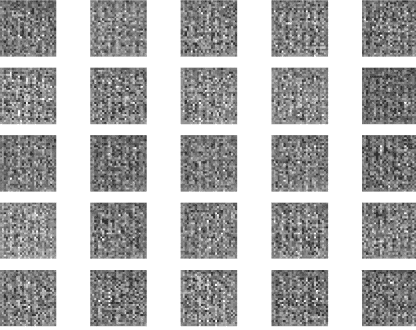

图 7.4: 未训练生成器模型输出的 25 张 MNIST 图像示例。

现在我们知道如何定义和使用生成器模型，下一步是训练该模型。

## 7.5 如何训练生成器模型

生成器模型的权重根据判别器模型的性能进行更新。当判别器擅长检测伪造样本时，生成器会被更新更多；而当判别器模型在检测伪造样本时表现较差或感到困惑时，生成器模型会被更新较少。这定义了这两个模型之间的零和或对抗关系。使用 Keras API 实现这一点可能有多种方法，但也许最简单的方法是创建一个结合生成器和判别器的新模型。具体来说，可以定义一个新的 GAN 模型，将生成器和判别器堆叠在一起，使生成器以潜在空间中的随机点作为输入并生成样本，这些样本直接输入判别器模型进行分类，而这个更大模型的输出可用于更新生成器的模型权重。

为了澄清，我们并不是在谈论一个新的第三个模型，而是一个新的逻辑模型，它使用独立生成器和判别器模型中已定义的层和权重。只有判别器关注区分真实样本和伪造样本，因此判别器模型可以像我们在上面的判别器模型部分中所做的那样，以独立方式对每类样本进行训练。生成器模型只关注判别器在伪造样本上的性能。因此，当判别器作为 GAN 模型的一部分时，我们会将其所有层标记为不可训练，以便它们不会被更新并在伪造样本上过度训练。当通过这个逻辑 GAN 模型训练生成器时，还有一个重要的变化。我们希望判别器认为生成器输出的样本是真实的，而不是伪造的。因此，当生成器作为 GAN 模型的一部分进行训练时，我们会将生成的样本标记为真实（class = 1）。

**我们为什么要这样做？** 我们可以想象，判别器随后会将生成的样本分类为非真实（class = 0）或真实概率较低（0.3 或 0.5）。用于更新模型权重的反向传播过程会将其视为较大的误差，并更新模型权重（即仅更新生成器中的权重）以纠正此误差，从而使生成器更擅长生成高质量的伪造样本。让我们具体说明一下。

- **输入**：潜在空间中的点，例如 100 个元素的高斯随机数向量。
- **输出**：二元分类，样本是真实（或伪造）的可能性。

下面的 `define_gan()` 函数以已定义的生成器和判别器模型作为参数，并创建包含这两个模型的新逻辑第三个模型。判别器中的权重被标记为不可训练，这仅影响 GAN 模型所看到的权重，而不影响独立的判别器模型。随后，GAN 模型使用与判别器相同的二元交叉熵损失函数，以及高效的 Adam 版本的随机梯度下降，学习率为 0.0002，动量为 0.5，在训练深度卷积 GAN 时推荐使用。

```python
# define the combined generator and discriminator model, for updating the generator
def define_gan(g_model, d_model):
    # make weights in the discriminator not trainable
    d_model.trainable = False
    # connect them
    model = Sequential()
    # add generator
    model.add(g_model)
    # add the discriminator
    model.add(d_model)
    # compile model
    opt = Adam(lr=0.0002, beta_1=0.5)
    model.compile(loss='binary_crossentropy', optimizer=opt)
    return model
```

清单 7.27: 定义复合模型的函数示例，用于通过判别器模型更新生成器模型。

在 Keras API 中，将判别器设置为不可训练是一个巧妙的技巧。trainable 属性在模型编译后影响模型。判别器模型是使用可训练层编译的，因此当通过调用 `train_on_batch()` 函数更新独立模型时，这些层中的模型权重会被更新。随后，判别器模型被标记为不可训练，添加到 GAN 模型中并进行编译。在这个模型中，判别器模型的模型权重不可训练，当通过调用 `train_on_batch()` 函数更新 GAN 模型时，这些权重无法更改。trainable 属性的这一更改不会影响独立判别器模型的训练。创建判别器、生成器和复合模型的完整示例如下所示。

```python
# demonstrate creating the three models in the gan
from keras.optimizers import Adam
from keras.models import Sequential
from keras.layers import Dense
from keras.layers import Reshape
from keras.layers import Flatten
from keras.layers import Conv2D
from keras.layers import Conv2DTranspose
from keras.layers import LeakyReLU
from keras.layers import Dropout
from keras.utils.vis_utils import plot_model

# define the standalone discriminator model
def define_discriminator(in_shape=(28,28,1)):
    model = Sequential()
    model.add(Conv2D(64, (3,3), strides=(2, 2), padding='same', input_shape=in_shape))
    model.add(LeakyReLU(alpha=0.2))
    model.add(Dropout(0.4))
    model.add(Conv2D(64, (3,3), strides=(2, 2), padding='same'))
    model.add(LeakyReLU(alpha=0.2))
    model.add(Dropout(0.4))
    model.add(Flatten())
    model.add(Dense(1, activation='sigmoid'))
    # compile model
    opt = Adam(lr=0.0002, beta_1=0.5)
    model.compile(loss='binary_crossentropy', optimizer=opt, metrics=['accuracy'])
    return model

# define the standalone generator model
def define_generator(latent_dim):
    model = Sequential()
    # foundation for 7x7 image
    n_nodes = 128 * 7 * 7
    model.add(Dense(n_nodes, input_dim=latent_dim))
    model.add(LeakyReLU(alpha=0.2))
    model.add(Reshape((7, 7, 128)))
    # upsample to 14x14
    model.add(Conv2DTranspose(128, (4,4), strides=(2,2), padding='same'))
    model.add(LeakyReLU(alpha=0.2))
    # upsample to 28x28
    model.add(Conv2DTranspose(128, (4,4), strides=(2,2), padding='same'))
    model.add(LeakyReLU(alpha=0.2))
    model.add(Conv2D(1, (7,7), activation='sigmoid', padding='same'))
    return model

# define the combined generator and discriminator model, for updating the generator
def define_gan(g_model, d_model):
    # make weights in the discriminator not trainable
    d_model.trainable = False
    # connect them
    model = Sequential()
    # add generator
    model.add(g_model)
    # add the discriminator
    model.add(d_model)
```


```python
# compile model
opt = Adam(lr=0.0002, beta_1=0.5)
model.compile(loss='binary_crossentropy', optimizer=opt)
return model

# size of the latent space
latent_dim = 100
# create the discriminator
d_model = define_discriminator()
# create the generator
g_model = define_generator(latent_dim)
# create the gan
gan_model = define_gan(g_model, d_model)
# summarize gan model
gan_model.summary()
# plot gan model
plot_model(gan_model, to_file='gan_plot.png', show_shapes=True, show_layer_names=True)
```

清单 7.28: 定义和汇总复合模型的示例。

运行该示例会先创建复合模型的摘要。可以看到，该模型期望 MNIST 图像作为输入，并预测一个单一值作为输出。

| 层 (类型) | 输出形状 | 参数数量 |
|---|---|---|
| sequential_2 (Sequential) | (None, 28, 28, 1) | 1164289 |
| sequential_1 (Sequential) | (None, 1) | 40705 |
| 总参数数: 1,204,994 | | |
| 可训练参数数: 1,164,289 | | |
| 不可训练参数数: 40,705 | | |

清单 7.29: 定义和汇总复合模型的示例输出。

还会创建模型的图，可以看到该模型期望潜在空间中一个 100 元素的点作为输入，并将预测一个单一的输出分类标签。

**注意:** 创建模型图假设已安装 `pydot` 和 `graphviz` 库。如果这是个问题，可以注释掉导入语句和 `plot_model()` 的函数调用。

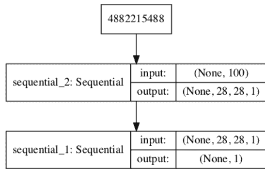

图 7.5: MNIST GAN 中复合生成器和判别器模型的图。

训练复合模型涉及通过前一节中的 generate_latent_points() 函数在潜在空间中生成一批点，以及 class = 1 标签，并调用 train_on_batch() 函数。下面的 train_gan() 函数演示了这一点，虽然它很简单，因为每个时代只会更新生成器，而判别器保留默认模型权重。

```python
# train the composite model
def train_gan(gan_model, latent_dim, n_epochs=100, n_batch=256):
    # manually enumerate epochs
    for i in range(n_epochs):
        # prepare points in latent space as input for the generator
        x_gan = generate_latent_points(latent_dim, n_batch)
        # create inverted labels for the fake samples
        y_gan = ones((n_batch, 1))
        # update the generator via the discriminator's error
        gan_model.train_on_batch(x_gan, y_gan)
```

清单 7.30: 训练复合模型的函数示例。

相反，需要的是我们先用真实和假样本更新判别器模型，然后通过复合模型更新生成器。这需要结合上面判别器部分中定义的 train_discriminator() 函数和上面定义的 train_gan() 函数的元素。还需要在时代和时代内的批次上进行枚举。用于更新判别器模型和生成器（通过复合模型）的完整 train 函数如下所示。在这个模型训练函数中有几点需要注意。首先，时代内的批次数量由批次大小能整除训练数据集的次数定义。我们有 60K 样本的数据集大小和 256 的批次大小，因此向下取整后，每个时代有 60000/256 或 234 个批次。

判别器模型每个批次更新一次，通过将一半批次（128）的假样本和真实样本（128）通过 vstack() NumPy 函数组合成一个单一批次。你可以分别用每个半批次更新判别器（针对更复杂的数据集推荐这样做），但将样本组合成一个单一批次在长期运行中会更快，尤其是在 GPU 硬件上训练时。最后，我们报告每个批次的损失。密切关注批次间的损失至关重要。这样做的原因是，判别器损失崩溃表明生成器模型已开始生成判别器可以轻易区分的垃圾样本。监控判别器损失，并期望在这个数据集上每个批次的损失在 0.5 到 0.8 之间徘徊。生成器损失不那么关键，在这个数据集上可能在 0.5 到 2 或更高之间徘徊。一个聪明的程序员甚至可能尝试检测判别器的崩溃损失，停止，然后重新启动训练过程。

```python
# train the generator and discriminator
def train(g_model, d_model, gan_model, dataset, latent_dim, n_epochs=100, n_batch=256):
    bat_per_epo = int(dataset.shape[0] / n_batch)
    half_batch = int(n_batch / 2)
    # manually enumerate epochs
    for i in range(n_epochs):
        # enumerate batches over the training set
        for j in range(bat_per_epo):
            # get randomly selected 'real' samples
            X_real, y_real = generate_real_samples(dataset, half_batch)
            # generate 'fake' examples
            X_fake, y_fake = generate_fake_samples(g_model, latent_dim, half_batch)
            # create training set for the discriminator
            X, y = vstack((X_real, X_fake)), vstack((y_real, y_fake))
            # update discriminator model weights
            d_loss, _ = d_model.train_on_batch(X, y)
            # prepare points in latent space as input for the generator
            X_gan = generate_latent_points(latent_dim, n_batch)
            # create inverted labels for the fake samples
            y_gan = ones((n_batch, 1))
            # update the generator via the discriminator's error
            g_loss = gan_model.train_on_batch(X_gan, y_gan)
            # summarize loss on this batch
            print('>%d, %d/%d, d=%.3f, g=%.3f ' % (i+1, j+1, bat_per_epo, d_loss, g_loss))
```

清单 7.31: 训练 GAN 模型的函数示例。

我们几乎拥有为 MNIST 手写数字数据集开发 GAN 所需的一切。剩下的一个方面是模型的评估。

## 7.6 如何评估 GAN 模型性能

通常，没有客观的方法来评估 GAN 模型的性能。我们无法为生成的图像计算这个客观误差分数。在 MNIST 图像的情况下可能可以做到，因为图像受到很好的约束，但一般来说，目前还不可能（yet）。相反，图像必须由人工操作员主观评估质量。这意味着如果不查看生成图像的示例，我们无法知道何时停止训练。同样，训练过程的对抗性意味着生成器在每个批次后都会发生变化，这意味着一旦可以生成 *足够好* 的图像，图像的主观质量随后可能会随着后续更新而变化、改善甚至退化。有三种方法来处理这种复杂的训练情况。

- 1. 定期评估判别器在真实和假图像上的分类准确率。

- 2. 定期生成许多图像并将其保存到文件中以供主观审查。

## 7.6. 如何评估 GAN 模型性能

- 3. 定期保存生成器模型。

给定训练时代的所有三个操作都可以同时执行，例如每五个或十个训练时代。结果将是一个保存的生成器模型，我们可以主观评估其输出质量，并客观地知道在保存模型时判别器被欺骗得有多好。在许多时代（例如数百或数千个时代）上训练 GAN 将产生许多可供检查的模型快照，并可从中挑选特定的输出和模型以供以后使用。

首先，我们可以定义一个名为 summarize_performance() 的函数来汇总判别器模型的性能。它通过检索一组真实 MNIST 图像，并使用生成器模型生成相同数量的假 MNIST 图像，然后评估判别器模型在每个样本上的分类准确率并报告这些分数来实现这一点。

```python
# evaluate the discriminator, plot generated images, save generator model
def summarize_performance(epoch, g_model, d_model, dataset, latent_dim, n_samples=100):
	# prepare real samples
	X_real, y_real = generate_real_samples(dataset, n_samples)
	# evaluate discriminator on real examples
	_, acc_real = d_model.evaluate(X_real, y_real, verbose=0)
	# prepare fake examples
	x_fake, y_fake = generate_fake_samples(g_model, latent_dim, n_samples)
	# evaluate discriminator on fake examples
	_, acc_fake = d_model.evaluate(x_fake, y_fake, verbose=0)
	# summarize discriminator performance
	print('>Accuracy real: %.0f%%, fake: %.0f%%' % (acc_real*100, acc_fake*100))
```

清单 7.32: 汇总模型性能的函数示例。

该函数可以根据当前时代数从 train() 函数中调用，例如每 10 个时代。

```python
# train the generator and discriminator
def train(g_model, d_model, gan_model, dataset, latent_dim, n_epochs=100, n_batch=256):
	bat_per_epo = int(dataset.shape[0] / n_batch)
	half_batch = int(n_batch / 2)
	# manually enumerate epochs
	for i in range(n_epochs):
		...
		# evaluate the model performance, sometimes
		if (i+1) % 10 == 0:
			summarize_performance(i, g_model, d_model, dataset, latent_dim)
```

清单 7.33: 如何从 train 函数汇总模型性能的示例。

接下来，我们可以更新 summarize_performance() 函数，使其既保存模型又创建和保存生成示例的图。可以通过在生成器模型上调用 save() 函数并基于训练时代数提供唯一文件名来保存生成器模型。

```python
... # save the generator model to file
filename = 'generator_model_%03d.h5' % (epoch + 1)
g_model.save(filename)
```

清单 7.34: 保存生成器模型的示例。


我们可以开发一个函数来绘制生成样本的图表。由于我们正在对 100 张生成的 MNIST 图像进行判别器评估，我们可以将所有 100 张图像绘制为 10×10 的网格。下面的 save_plot() 函数实现了这一点，同样根据 epoch 编号使用唯一文件名保存生成的图表。

```
# create and save a plot of generated images (reversed grayscale)
def save_plot(examples, epoch, n=10):
    # plot images
    for i in range(n * n):
        # define subplot
        pyplot.subplot(n, n, 1 + i)
        # turn off axis
        pyplot.axis('off')
        # plot raw pixel data
        pyplot.imshow(examples[i, :, :, 0], cmap='gray_r')
    # save plot to file
    filename = 'generated_plot_e%03d.png' % (epoch+1)
    pyplot.savefig(filename)
    pyplot.close()
```

清单 7.35：保存生成图像图表和生成器模型的函数示例。

添加这些内容后的更新版 summarize_performance() 函数如下所示。

```
# evaluate the discriminator, plot generated images, save generator model
def summarize_performance(epoch, g_model, d_model, dataset, latent_dim, n_samples=100):
    # prepare real samples
    X_real, y_real = generate_real_samples(dataset, n_samples)
    # evaluate discriminator on real examples
    _, acc_real = d_model.evaluate(X_real, y_real, verbose=0)
    # prepare fake examples
    x_fake, y_fake = generate_fake_samples(g_model, latent_dim, n_samples)
    # evaluate discriminator on fake examples
    _, acc_fake = d_model.evaluate(x_fake, y_fake, verbose=0)
    # summarize discriminator performance
    print('>Accuracy real: %.0f%%, fake: %.0f%%' % (acc_real*100, acc_fake*100))
    # save plot
    save_plot(x_fake, epoch)
    # save the generator model to file
    filename = 'generator_model_%03d.h5' % (epoch + 1)
    g_model.save(filename)
```

清单 7.36：用于总结 GAN 性能的更新函数示例。

## 7.7 MNIST 的完整 GAN 示例

我们现在拥有在 MNIST 手写数字数据集上训练和评估 GAN 所需的一切。完整示例如下所示。

```
# example of training a gan on mnist
from numpy import expand_dims
from numpy import zeros
from numpy import ones
from numpy import vstack
from numpy.random import randn
from numpy.random import randint
from keras.datasets.mnist import load_data
from keras.optimizers import Adam
from keras.models import Sequential
from keras.layers import Dense
from keras.layers import Reshape
from keras.layers import Flatten
from keras.layers import Conv2D
from keras.layers import Conv2DTranspose
from keras.layers import LeakyReLU
from keras.layers import Dropout
from matplotlib import pyplot

# define the standalone discriminator model
def define_discriminator(in_shape=(28,28,1)):
    model = Sequential()
    model.add(Conv2D(64, (3,3), strides=(2, 2), padding='same', input_shape=in_shape))
    model.add(LeakyReLU(alpha=0.2))
    model.add(Dropout(0.4))
    model.add(Conv2D(64, (3,3), strides=(2, 2), padding='same'))
    model.add(LeakyReLU(alpha=0.2))
    model.add(Dropout(0.4))
    model.add(Flatten())
    model.add(Dense(1, activation='sigmoid'))
    # compile model
    opt = Adam(lr=0.0002, beta_1=0.5)
    model.compile(loss='binary_crossentropy', optimizer=opt, metrics=['accuracy'])
    return model

# define the standalone generator model
def define_generator(latent_dim):
    model = Sequential()
    # foundation for 7x7 image
    n_nodes = 128 * 7 * 7
    model.add(Dense(n_nodes, input_dim=latent_dim))
    model.add(LeakyReLU(alpha=0.2))
    model.add(Reshape((7, 7, 128)))
    # upsample to 14x14
    model.add(Conv2DTranspose(128, (4,4), strides=(2,2), padding='same'))
    model.add(LeakyReLU(alpha=0.2))
    # upsample to 28x28
    model.add(Conv2DTranspose(128, (4,4), strides=(2,2), padding='same'))
    model.add(LeakyReLU(alpha=0.2))
    model.add(Conv2D(1, (7,7), activation='sigmoid', padding='same'))
    return model

# define the combined generator and discriminator model, for updating the generator
def define_gan(g_model, d_model):
    # make weights in the discriminator not trainable
    d_model.trainable = False
    # connect them
    model = Sequential()
    # add generator
    model.add(g_model)
    # add the discriminator
    model.add(d_model)
    # compile model
    opt = Adam(lr=0.0002, beta_1=0.5)
    model.compile(loss='binary_crossentropy', optimizer=opt)
    return model

# load and prepare mnist training images
def load_real_samples():
    # load mnist dataset
    (trainX, _), (_, _) = load_data()
    # expand to 3d, e.g. add channels dimension
    X = expand_dims(trainX, axis=-1)
    # convert from unsigned ints to floats
    X = X.astype('float32')
    # scale from [0,255] to [0,1]
    X = X / 255.0
    return X

# select real samples
def generate_real_samples(dataset, n_samples):
    # choose random instances
    ix = randint(0, dataset.shape[0], n_samples)
    # retrieve selected images
    X = dataset[ix]
    # generate 'real' class labels (1)
    y = ones((n_samples, 1))
    return X, y

# generate points in latent space as input for the generator
def generate_latent_points(latent_dim, n_samples):
    # generate points in the latent space
    x_input = randn(latent_dim * n_samples)
    # reshape into a batch of inputs for the network
    x_input = x_input.reshape(n_samples, latent_dim)
    return x_input

# use the generator to generate n fake examples, with class labels
def generate_fake_samples(g_model, latent_dim, n_samples):
    # generate points in latent space
    x_input = generate_latent_points(latent_dim, n_samples)
    # predict outputs
    X = g_model.predict(x_input)
    # create 'fake' class labels (0)
    y = zeros((n_samples, 1))
    return X, y

# create and save a plot of generated images (reversed grayscale)
def save_plot(examples, epoch, n=10):
    # plot images
    for i in range(n * n):
        # define subplot
        pyplot.subplot(n, n, 1 + i)
        # turn off axis
        pyplot.axis('off')
        # plot raw pixel data
        pyplot.imshow(examples[i, :, :, 0], cmap='gray_r')
    # save plot to file
    filename = 'generated_plot_e%03d.png' % (epoch+1)
    pyplot.savefig(filename)
    pyplot.close()

# evaluate the discriminator, plot generated images, save generator model
def summarize_performance(epoch, g_model, d_model, dataset, latent_dim, n_samples=100):
    # prepare real samples
    X_real, y_real = generate_real_samples(dataset, n_samples)
    # evaluate discriminator on real examples
    _, acc_real = d_model.evaluate(X_real, y_real, verbose=0)
    # prepare fake examples
    x_fake, y_fake = generate_fake_samples(g_model, latent_dim, n_samples)
    # evaluate discriminator on fake examples
    _, acc_fake = d_model.evaluate(x_fake, y_fake, verbose=0)
    # summarize discriminator performance
    print('>Accuracy real: %.0f%%, fake: %.0f%%' % (acc_real*100, acc_fake*100))
    # save plot
    save_plot(x_fake, epoch)
    # save the generator model to file
    filename = 'generator_model_%03d.h5' % (epoch + 1)
    g_model.save(filename)

# train the generator and discriminator
def train(g_model, d_model, gan_model, dataset, latent_dim, n_epochs=100, n_batch=256):
    bat_per_epo = int(dataset.shape[0] / n_batch)
    half_batch = int(n_batch / 2)
    # manually enumerate epochs
    for i in range(n_epochs):
        # enumerate batches over the training set
        for j in range(bat_per_epo):
            # get randomly selected 'real' samples
            X_real, y_real = generate_real_samples(dataset, half_batch)
            # generate 'fake' examples
            X_fake, y_fake = generate_fake_samples(g_model, latent_dim, half_batch)
            # create training set for the discriminator
            X, y = vstack((X_real, X_fake)), vstack((y_real, y_fake))
            # update discriminator model weights
            d_loss, _ = d_model.train_on_batch(X, y)
            # prepare points in latent space as input for the generator
            X_gan = generate_latent_points(latent_dim, n_batch)
            # create inverted labels for the fake samples
            y_gan = ones((n_batch, 1))
            # update the generator via the discriminator's error
            g_loss = gan_model.train_on_batch(X_gan, y_gan)
            # summarize loss on this batch
            print('>%d, %d/%d, d=%.3f, g=%.3f' % (i+1, j+1, bat_per_epo, d_loss, g_loss))
        # evaluate the model performance, sometimes
        if (i+1) % 10 == 0:
            summarize_performance(i, g_model, d_model, dataset, latent_dim)

# size of the latent space
latent_dim = 100
# create the discriminator
d_model = define_discriminator()
# create the generator
```


```
g_model = define_generator(latent_dim)
# create the gan
gan_model = define_gan(g_model, d_model)
# load image data
dataset = load_real_samples()
# train model
train(g_model, d_model, gan_model, dataset, latent_dim)
```

清单 7.37: 训练 GAN 生成灰度手写数字的完整示例。

**注意**: 在 CPU 硬件上运行示例可能需要数小时。如果可能，我建议在 GPU 硬件上运行示例。如果您需要帮助，可以使用 AWS EC2 实例快速开始训练模型。请参阅附录 C 中的说明。

所选配置使生成模型和判别模型都能稳定训练。模型性能在每个批次报告，包括判别模型 (_d_) 和生成模型 (_g_) 的损失。

**注意**: 由于学习算法的随机性，您的具体结果可能会有所不同。请考虑运行示例几次并比较平均性能。

在此示例中，损失在整个训练过程中保持稳定。

```
>1, 1/234, d=0.711, g=0.678
>1, 2/234, d=0.703, g=0.698
>1, 3/234, d=0.694, g=0.717
>1, 4/234, d=0.684, g=0.740
>1, 5/234, d=0.679, g=0.757
>1, 6/234, d=0.668, g=0.777
...
>100, 230/234, d=0.690, g=0.710
>100, 231/234, d=0.692, g=0.705
>100, 232/234, d=0.698, g=0.701
>100, 233/234, d=0.697, g=0.688
>100, 234/234, d=0.693, g=0.698
```

清单 7.38: 训练 GAN 生成灰度手写数字时的损失输出示例。

生成器每 10 个时代评估一次，产生 10 次评估、10 个生成图像图表和 10 个保存的模型。在此示例中，我们可以看到准确率在训练过程中波动。当将判别模型的准确率得分与生成的图像结合查看时，我们可以看到，假样本的准确率与图像的主观质量相关性不佳，但真实样本的准确率可能相关。它是 GAN 性能的粗糙且可能不可靠的指标，与损失一样。

```
>Accuracy real: 51%, fake: 78%
>Accuracy real: 30%, fake: 95%
>Accuracy real: 75%, fake: 59%
>Accuracy real: 98%, fake: 11%
>Accuracy real: 27%, fake: 92%
>Accuracy real: 21%, fake: 92%
>Accuracy real: 29%, fake: 96%
>Accuracy real: 4%, fake: 99%
>Accuracy real: 18%, fake: 97%
>Accuracy real: 28%, fake: 89%
```

清单 7.39: 训练 GAN 生成灰度手写数字时的准确率输出示例。

超过某个点后的更多训练并不意味着生成的图像质量更好。在此示例中，10 个时代后的结果质量较低，尽管我们可以看到生成器已学会在黑色背景上生成白色居中的图形（回顾我们在图表中反转了灰度）。

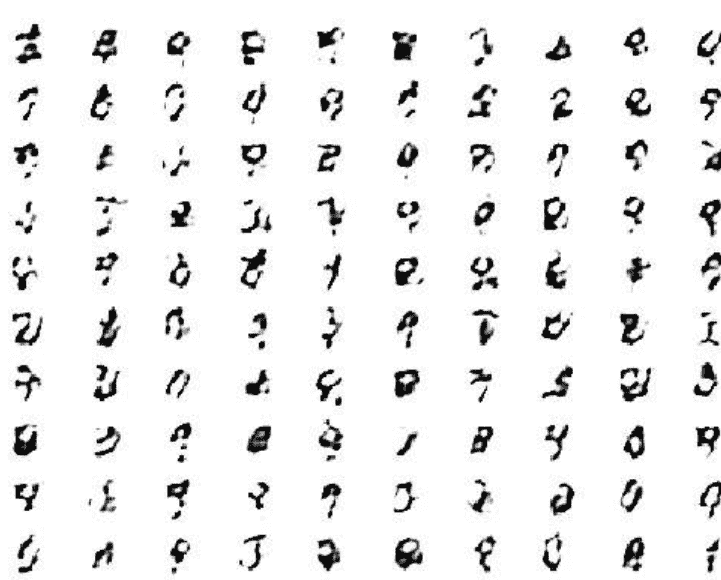

图 7.6: 10 个时代后 100 个 GAN 生成的 MNIST 图形图表。

再训练 20 或 30 个时代后，模型开始生成非常逼真的 MNIST 图形，表明对于所选模型配置，可能不需要 100 个时代。

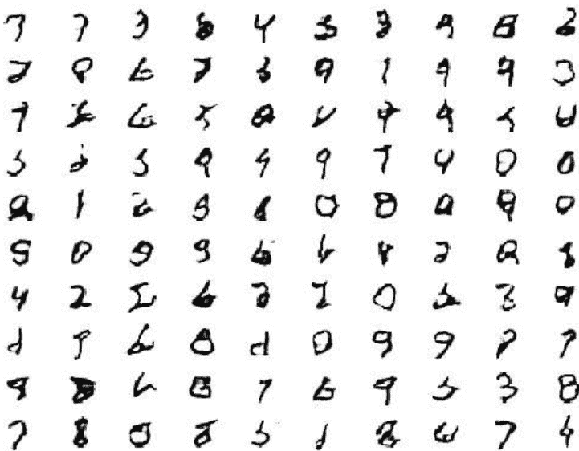

图 7.7: 40 个时代后 100 个 GAN 生成的 MNIST 图形图表。

100 个时代后生成的图像差异不大，但我认为可以检测到曲线中较少的锯齿感。

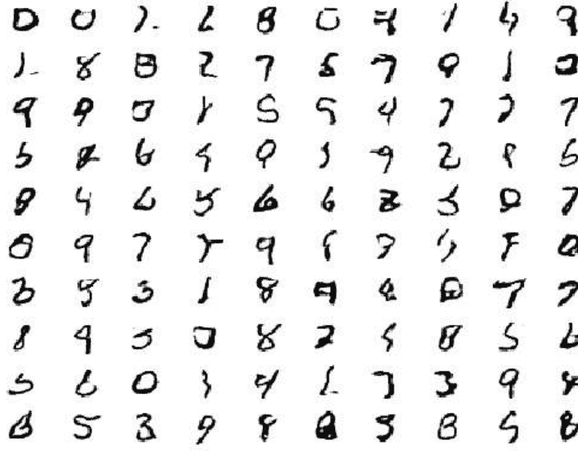

图 7.8: 100 个时代后 100 个 GAN 生成的 MNIST 图形图表。

## 7.8 如何使用最终生成器模型

选择最终生成器模型后，可以独立方式用于您的应用。这包括先从文件加载模型，然后使用它生成图像。每个图像的生成都需要将潜在空间中的一个点作为输入。下面列出了加载保存模型并生成图像的完整示例。在此示例中，我们将使用 100 个训练时代后保存的模型，但 40 或 50 个时代后保存的模型同样有效。

```
# example of loading the generator model and generating images
from keras.models import load_model
from numpy.random import randn
from matplotlib import pyplot

# generate points in latent space as input for the generator
def generate_latent_points(latent_dim, n_samples):
    # generate points in the latent space
    x_input = randn(latent_dim * n_samples)
    # reshape into a batch of inputs for the network
    x_input = x_input.reshape(n_samples, latent_dim)
    return x_input

# create and save a plot of generated images (reversed grayscale)
def save_plot(examples, n):
    # plot images
    for i in range(n * n):
        # define subplot
        pyplot.subplot(n, n, 1 + i)
        # turn off axis
        pyplot.axis('off')
        # plot raw pixel data
        pyplot.imshow(examples[i, :, :, 0], cmap='gray_r')
    pyplot.show()

# load model
model = load_model('generator_model_100.h5')
# generate images
latent_points = generate_latent_points(100, 25)
# generate images
X = model.predict(latent_points)
# plot the result
save_plot(X, 5)
```

清单 7.40: 加载和使用保存的生成器模型的完整示例。

运行示例会先加载模型，在潜在空间中采样 25 个随机点，生成 25 张图像，然后将结果绘制为单张图像。

**注意**: 由于学习算法的随机性，您的具体结果可能会有所不同。请考虑运行示例几次并比较平均性能。

在此示例中，我们可以看到大多数图像是逼真的，或是手写数字的逼真片段。

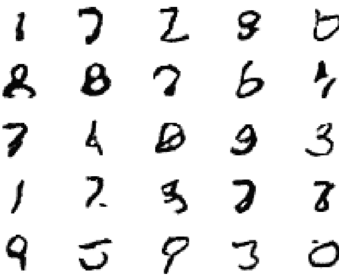

图 7.9: 25 个 GAN 生成的 MNIST 手写图像示例。

潜在空间现在定义了 MNIST 手写数字的压缩表示。您可以尝试在此空间中生成不同的点，看看它们生成什么类型的数字。下面的示例使用全 0.0 值的向量生成一个手写数字。

```
# example of generating an image for a specific point in the latent space
from keras.models import load_model
from numpy import asarray
from matplotlib import pyplot
# load model
model = load_model('generator_model_100.h5')
# all 0s
vector = asarray([[0.0 for _ in range(100)]])
# generate image
X = model.predict(vector)
# plot the result
pyplot.imshow(X[0, :, :, 0], cmap='gray_r')
pyplot.show()
```

清单 7.41: 使用保存的模型生成单张图像的完整示例。

注意：由于学习算法的随机性，您的具体结果可能会有所不同。请考虑运行示例几次并比较平均性能。

在此示例中，全零向量生成一个手写的 9 或可能是 8。然后您可以尝试在空间中导航，看看是否能生成一系列相似但不同的手写数字。

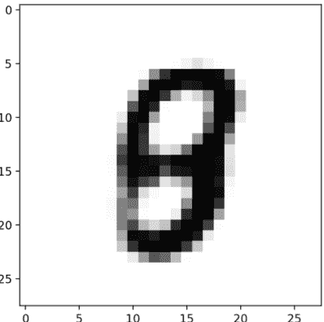

图 7.10: 针对零向量的 GAN 生成的 MNIST 手写数字示例。

## 7.9 扩展

本节列出了一些您可能希望探索的扩展教程的想法。

- **TanH 激活和缩放**。更新示例以在生成器中使用 Tanh 激活函数，并将所有像素值缩放到 [-1, 1] 范围。
- **更改潜在空间**。更新示例以使用更大或更小的潜在空间，并比较结果质量和训练速度。
- **批量归一化**。更新判别器和/或生成器以使用批量归一化，推荐用于 DCGAN 模型。
- **标签平滑**。更新示例以在训练判别器时使用单侧标签平滑，具体将真实样本的目标标签从 1.0 更改为 0.9，并审查对图像质量和训练速度的影响。
- **模型配置**。更新模型配置以使用更深或更浅的判别器和/或生成器模型，或许可以尝试生成器中的 UpSampling2D 层。

如果您探索了其中任何扩展，我很乐意了解。


## 7.10 进一步阅读

本节提供了更多关于该主题的资源，如果您希望深入了解。

### 7.10.1 APIs

- Keras API。
- https://keras.io/
- 如何“冻结”Keras 层？。
- https://keras.io/getting-started/faq/#how-can-i-freeze-keras-layers
- Matplotlib API。
- https://matplotlib.org/api/
- numpy.random.rand API。
- https://docs.scipy.org/doc/numpy/reference/generated/numpy.random.rand.html
- numpy.random.randn API。
- https://docs.scipy.org/doc/numpy/reference/generated/numpy.random.randn.html
- numpy.zeros API。
- https://docs.scipy.org/doc/numpy/reference/generated/numpy.zeros.html
- numpy.ones API。
- https://docs.scipy.org/doc/numpy/reference/generated/numpy.ones.html
- numpy.hstack API。
- https://docs.scipy.org/doc/numpy/reference/generated/numpy.hstack.html

### 7.10.2 文章

- MNIST 数据集，维基百科。
- https://en.wikipedia.org/wiki/MNIST_database

## 7.11 总结

在本教程中，您了解了如何使用深度卷积网络开发生成对抗网络来生成手写数字。具体来说，您学习了：

- 如何定义和训练独立的判别器模型，以学习真实图像和假图像之间的区别。
- 如何定义独立的生成器模型，并训练组合的生成器和判别器模型。
- 如何评估 GAN 的性能，并使用最终的独立生成器模型生成新图像。

### 7.11.1 下一步

在下一个教程中，您将为 CIFAR-10 数据集中的小型彩色照片开发深度卷积 GAN。

## 第 8 章

### 如何为小型彩色照片开发 DCGAN

生成对抗网络（GANs）是一种用于训练生成模型的架构，例如用于生成图像的深度卷积神经网络。开发用于生成图像的 GAN 需要同时具备一个判别器卷积神经网络模型，用于分类给定图像是真实的还是生成的，以及一个生成器模型，该模型使用反卷积层将输入转换为完整的二维像素值图像。

理解 GAN 的工作原理以及如何在 GAN 架构中训练深度卷积神经网络模型用于图像生成可能具有挑战性。对于初学者来说，一个良好的起点是在计算机视觉领域使用的标准图像数据集（例如 CIFAR 小型物体照片数据集）上练习开发和使用 GAN。使用小型且已被充分理解的数据集意味着可以快速开发和训练较小的模型，从而将注意力集中在模型架构和图像生成过程本身上。在本教程中，您将了解如何使用深度卷积网络开发生成对抗网络来生成小型物体照片。完成本教程后，您将知道：

- 如何定义和训练独立的判别器模型，以学习真实图像和假图像之间的区别。
- 如何定义独立的生成器模型，并训练组合的生成器和判别器模型。
- 如何评估 GAN 的性能，并使用最终的独立生成器模型生成新图像。

让我们开始吧。

### 8.1 教程概览

本教程分为七个部分，分别是：

- 1. CIFAR-10 小型物体照片数据集
- 2. 如何定义和训练判别器模型
- 3. 如何定义和使用生成器模型
- 4. 如何训练生成器模型
- 5. 如何评估 GAN 模型性能
- 6. CIFAR-10 的 GAN 完整示例
- 7. 如何使用最终生成器模型

### 8.2 CIFAR-10 小型物体照片数据集

CIFAR 是加拿大高等研究院（Canadian Institute For Advanced Research）的缩写，CIFAR-10 数据集是由 CIFAR 研究所的研究人员与 CIFAR-100 数据集（将在下一节中介绍）一起开发的。该数据集包含 60,000 张 32 × 32 像素的彩色物体照片，涵盖 10 个类别，如青蛙、鸟类、猫、船只、飞机等。这些图像非常小，远小于典型照片，该数据集旨在用于计算机视觉研究。Keras 通过 cifar10.load_dataset() 函数提供对 CIFAR-10 数据集的访问。它返回两个元组，一个包含标准训练数据集的输入和输出元素，另一个包含标准测试数据集的输入和输出元素。下面的示例加载数据集并总结加载数据集的形状。

注意：第一次加载数据集时，Keras 会自动下载图像的压缩版本，并将其保存在主目录下的 ~/.keras/datasets/ 中。下载速度很快，因为数据集压缩后仅约 163 兆字节。

```python
# example of loading the cifar10 dataset
from keras.datasets.cifar10 import load_data
# load the images into memory
(trainX, trainy), (testX, testy) = load_data()
# summarize the shape of the dataset
print('Train', trainX.shape, trainy.shape)
print('Test', testX.shape, testy.shape)
```

清单 8.1：加载并总结 CIFAR-10 数据集的示例。

运行该示例会加载数据集，并打印训练集和测试集图像的输入和输出组件的形状。可以看到，训练集中有 50K 个示例，测试集中有 10K 个示例，每张图像都是 32×32 像素的正方形。

```
Train (50000, 32, 32, 3) (50000, 1)
Test (10000, 32, 32, 3) (10000, 1)
```

清单 8.2：加载并总结 CIFAR-10 数据集的示例输出。

这些图像是彩色的，物体位于画面中央。我们可以使用 Matplotlib 库的 imshow() 函数绘制训练数据集中的一些图像。

```python
...
# plot raw pixel data
pyplot.imshow(trainX[i])
```

清单 8.3：绘制单个图像的示例。

下面的示例以 7×7 的正方形绘制训练数据集中的前 49 张图像。

```python
# example of loading and plotting the cifar10 dataset
from keras.datasets.cifar10 import load_data
from matplotlib import pyplot
# load the images into memory
(trainX, trainy), (testX, testy) = load_data()
# plot images from the training dataset
for i in range(49):
    # define subplot
    pyplot.subplot(7, 7, 1 + i)
    # turn off axis
    pyplot.axis('off')
    # plot raw pixel data
    pyplot.imshow(trainX[i])
pyplot.show()
```

清单 8.4：绘制 CIFAR-10 数据集图像的示例。

运行该示例会创建一个包含 CIFAR-10 训练数据集中 49 张图像的图表，排列成 7×7 正方形。在图表中，您可以看到飞机、卡车、马、汽车、青蛙等的小型照片。

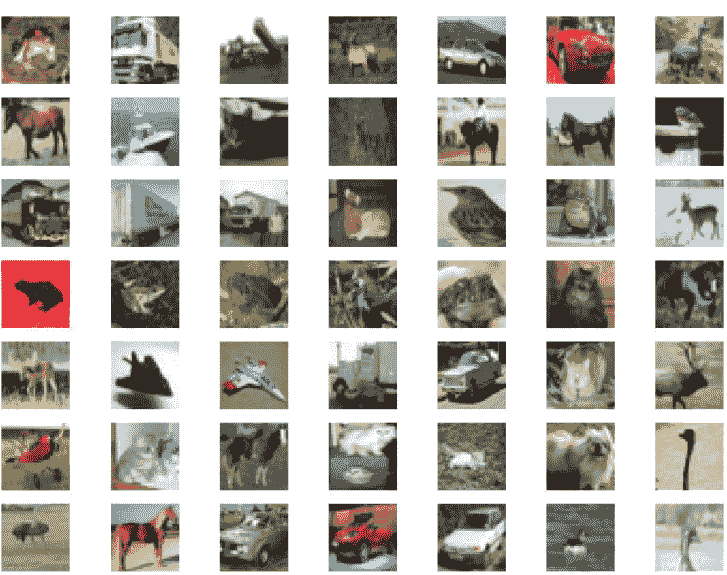

图 8.1：CIFAR-10 数据集中前 49 张小型物体照片的图表。

我们将使用训练数据集中的图像作为训练生成对抗网络的基础。具体来说，生成器模型将学习如何使用判别器生成新的逼真物体照片，该判别器将尝试区分 CIFAR-10 训练数据集中的真实图像和生成器模型输出的新图像。

### 8.3 如何定义和训练判别器模型

第一步是定义判别器模型。该模型必须将我们数据集中的示例图像作为输入，并输出关于样本是真实还是假的分类预测。这是一个二分类问题。

- 输入：包含三个颜色通道且大小为 32 × 32 像素的图像。
- 输出：二分类，样本为真实（或假）的可能性。

判别器模型包含一个普通卷积层，后跟三个使用 2 × 2 步长来下采样输入图像的卷积层。该模型没有池化层，输出层中有一个带有 sigmoid 激活函数的节点，用于预测输入样本是真实还是假。该模型经过训练以最小化二元交叉熵损失函数，该函数适用于二分类。在定义判别器模型时，我们将采用一些最佳实践，例如使用 LeakyReLU 而不是 ReLU、使用 Dropout，以及使用学习率为 0.0002、动量为 0.5 的 Adam 版本随机梯度下降。下面的 define_discriminator() 函数定义了判别器模型并参数化了输入图像的大小。

```python
# define the standalone discriminator model
def define_discriminator(in_shape=(32,32,3)):
    model = Sequential()
    # normal
    model.add(Conv2D(64, (3,3), padding='same', input_shape=in_shape))
    model.add(LeakyReLU(alpha=0.2))
    # downsample
    model.add(Conv2D(128, (3,3), strides=(2,2), padding='same'))
    model.add(LeakyReLU(alpha=0.2))
    # downsample
    model.add(Conv2D(128, (3,3), strides=(2,2), padding='same'))
    model.add(LeakyReLU(alpha=0.2))
    # downsample
    model.add(Conv2D(256, (3,3), strides=(2,2), padding='same'))
    model.add(LeakyReLU(alpha=0.2))
    # classifier
    model.add(Flatten())
    model.add(Dropout(0.4))
    model.add(Dense(1, activation='sigmoid'))
    # compile model
    opt = Adam(lr=0.0002, beta_1=0.5)
    model.compile(loss='binary_crossentropy', optimizer=opt, metrics=['accuracy'])
    return model
```

清单 8.5：定义判别器模型的函数示例。

我们可以使用此函数定义判别器模型并对其进行总结。完整示例如下所示。


```python
# example of defining the discriminator model
from keras.models import Sequential
from keras.optimizers import Adam
from keras.layers import Dense
from keras.layers import Conv2D
from keras.layers import Flatten
from keras.layers import Dropout
from keras.layers import LeakyReLU
from keras.utils.vis_utils import plot_model

# define the standalone discriminator model
def define_discriminator(in_shape=(32,32,3)):
    model = Sequential()
    # normal
    model.add(Conv2D(64, (3,3), padding='same', input_shape=in_shape))
    model.add(LeakyReLU(alpha=0.2))
    # downsample
    model.add(Conv2D(128, (3,3), strides=(2,2), padding='same'))
    model.add(LeakyReLU(alpha=0.2))
    # downsample
    model.add(Conv2D(128, (3,3), strides=(2,2), padding='same'))
    model.add(LeakyReLU(alpha=0.2))
    # downsample
    model.add(Conv2D(256, (3,3), strides=(2,2), padding='same'))
    model.add(LeakyReLU(alpha=0.2))
    # classifier
    model.add(Flatten())
    model.add(Dropout(0.4))
    model.add(Dense(1, activation='sigmoid'))
    # compile model
    opt = Adam(lr=0.0002, beta_1=0.5)
    model.compile(loss='binary_crossentropy', optimizer=opt, metrics=['accuracy'])
    return model

# define model
model = define_discriminator()
# summarize the model
model.summary()
# plot the model
plot_model(model, to_file='discriminator_plot.png', show_shapes=True, show_layer_names=True)
```

清单 8.6：定义和汇总判别器模型的示例。

运行该示例首先会汇总模型架构，显示每个层的输出形状。我们可以看到，激进的 2 × 2 步长起到了下采样输入图像的作用，首先从 32 × 32 变为 16 × 16，然后变为 8 × 8，以此类推，直到模型做出输出预测。这种模式是经过设计的，因为我们不使用池化层，而是使用大步长来实现类似的下采样效果。在下一节中，我们将在生成器模型中看到类似的模式，但方向相反。

| 层 (类型) | 输出形状 | 参数数量 |
| :--- | :--- | :--- |
| conv2d_1 (Conv2D) | (None, 32, 32, 64) | 1792 |
| leaky_re_lu_1 (LeakyReLU) | (None, 32, 32, 64) | 0 |
| conv2d_2 (Conv2D) | (None, 16, 16, 128) | 73856 |
| leaky_re_lu_2 (LeakyReLU) | (None, 16, 16, 128) | 0 |
| conv2d_3 (Conv2D) | (None, 8, 8, 128) | 147584 |
| leaky_re_lu_3 (LeakyReLU) | (None, 8, 8, 128) | 0 |
| conv2d_4 (Conv2D) | (None, 4, 4, 256) | 295168 |
| leaky_re_lu_4 (LeakyReLU) | (None, 4, 4, 256) | 0 |
| flatten_1 (Flatten) | (None, 4096) | 0 |
| dropout_1 (Dropout) | (None, 4096) | 0 |
| dense_1 (Dense) | (None, 1) | 4097 |

=================================================================
总参数量: 522,497
可训练参数量: 522,497
不可训练参数量: 0
=================================================================

## 8.3. 如何定义和训练判别器模型

清单 8.7：定义和汇总判别器模型的示例输出。

还会创建模型的图，我们可以看到该模型期望两个输入，并将预测一个单一输出。

**注意**：创建模型图假设已安装 `pydot` 和 `graphviz` 库。如果这造成问题，你可以注释掉导入语句和 `plot_model()` 的函数调用。

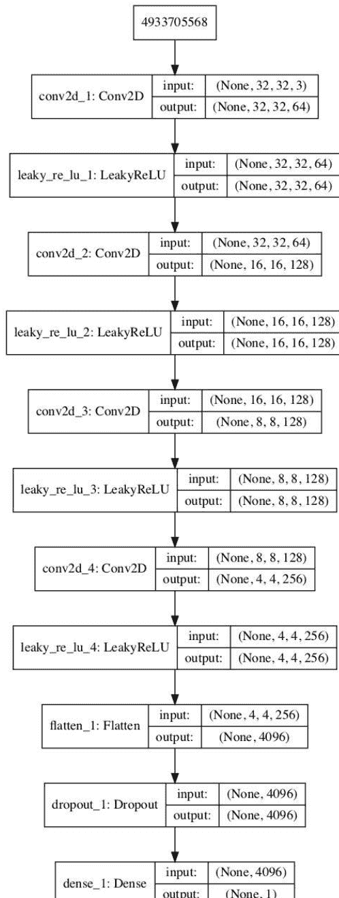

图 8.2：CIFAR-10 生成对抗网络中判别器模型的图。

我们现在可以使用类别标签为 1 的真实示例开始训练此模型，并随机生成类别标签为 0 的样本。开发这些元素以后会很有用，而且有助于看到判别器只是一个用于二分类的普通神经网络模型。首先，我们需要一个函数来加载和准备真实图像的数据集。我们将使用 `cifar.load_data()` 函数来加载 CIFAR-10 数据集，并仅使用训练数据集的输入部分作为真实图像。

```python
# load cifar10 dataset
(trainX, _), (_, _) = load_data()
```

清单 8.8：加载 CIFAR-10 训练数据集的示例。

我们必须将像素值从无符号整数范围 [0,255] 缩放到归一化范围 [-1,1]。生成器模型将生成像素值在范围 [-1,1] 的图像，因为它将使用 Tanh 激活函数，这是一种最佳实践。将真实图像也缩放到相同范围也是一种良好实践。

```python
# convert from unsigned ints to floats
X = trainX.astype('float32')
# scale from [0,255] to [-1,1]
X = (X - 127.5) / 127.5
```

清单 8.9：缩放已加载数据集的像素值的示例。

下面的 `load_real_samples()` 函数实现了真实 CIFAR-10 照片的加载和缩放。

```python
# load and prepare cifar10 training images
def load_real_samples():
    # load cifar10 dataset
    (trainX, _), (_, _) = load_data()
    # convert from unsigned ints to floats
    X = trainX.astype('float32')
    # scale from [0,255] to [-1,1]
    X = (X - 127.5) / 127.5
    return X
```

清单 8.10：加载和缩放 CIFAR-10 训练数据集像素值的函数示例。

判别器模型将以批次方式更新，具体是使用一组真实样本和一组生成样本。在训练中，一个时代被定义为遍历整个训练数据集一次。我们可以系统地枚举训练数据集中的所有样本，这是一种好方法，但通过随机梯度下降进行良好训练要求在每个时代之前对训练数据集进行随机打乱。一种更简单的方法是从训练数据集中选择随机图像样本。下面的 `generate_real_samples()` 函数将训练数据集作为参数，并将选择图像的随机子样本；它还将为样本返回类别标签，具体是类别标签 1，以指示真实图像。

```python
# select real samples
def generate_real_samples(dataset, n_samples):
    # choose random instances
    ix = randint(0, dataset.shape[0], n_samples)
    # retrieve selected images
    X = dataset[ix]
    # generate 'real' class labels (1)
    y = ones((n_samples, 1))
    return X, y
```

清单 8.11：在已加载数据集中采样图像的函数示例。

现在，我们需要一个假图像的来源。我们还没有生成器模型，因此，我们可以生成由随机像素值组成的图像，具体是范围 [0,1] 中的随机像素值，然后将其缩放到范围 [-1, 1]，就像我们缩放的真实图像一样。下面的 generate_fake_samples() 函数实现了此行为，并生成随机像素值的图像及其关联的类别标签 0，用于假图像。

```python
# generate n fake samples with class labels
def generate_fake_samples(n_samples):
    # generate uniform random numbers in [0,1]
    X = rand(32 * 32 * 3 * n_samples)
    # update to have the range [-1, 1]
    X = -1 + X * 2
    # reshape into a batch of color images
    X = X.reshape((n_samples, 32, 32, 3))
    # generate 'fake' class labels (0)
    y = zeros((n_samples, 1))
    return X, y
```

清单 8.12：生成具有随机像素值图像的函数示例。

最后，我们需要训练判别器模型。这涉及反复检索真实图像样本和生成图像样本，并在固定数量的迭代中更新模型。我们暂时忽略时代的概念（例如，完整遍历训练数据集），而是将判别器模型拟合为固定数量的批次。模型将快速学会区分真实图像和假图像（随机生成），因此在它学会完美区分之前，不需要许多批次。

train_discriminator() 函数实现了这一点，每批次使用 128 张图像的批量大小，每次迭代中 64 张是真实图像，64 张是假图像。我们分别对真实示例和假示例更新判别器，以便在更新之前可以计算模型在每个样本上的准确性。这能让我们了解判别器模型随时间的表现情况。

```python
# train the discriminator model
def train_discriminator(model, dataset, n_iter=20, n_batch=128):
    half_batch = int(n_batch / 2)
    # manually enumerate epochs
    for i in range(n_iter):
        # get randomly selected 'real' samples
        X_real, y_real = generate_real_samples(dataset, half_batch)
        # update discriminator on real samples
        _, real_acc = model.train_on_batch(X_real, y_real)
        # generate 'fake' examples
        X_fake, y_fake = generate_fake_samples(half_batch)
        # update discriminator on fake samples
        _, fake_acc = model.train_on_batch(X_fake, y_fake)
        # summarize performance
        print('>%d real=%.0f%% fake=%.0f%%' % (i+1, real_acc*100, fake_acc*100))
```


## 清单 8.13: 训练判别器模型函数示例。

将所有这些整合在一起，在真实图像和随机生成的（伪）图像上训练判别器模型实例的完整示例如下所示。

```
# example of training the discriminator model on real and random cifar10 images
from numpy import ones
from numpy import zeros
from numpy.random import rand
from numpy.random import randint
from keras.datasets.cifar10 import load_data
from keras.optimizers import Adam
from keras.models import Sequential
from keras.layers import Dense
from keras.layers import Conv2D
from keras.layers import Flatten
from keras.layers import Dropout
from keras.layers import LeakyReLU

# define the standalone discriminator model
def define_discriminator(in_shape=(32,32,3)):
    model = Sequential()
    # normal
    model.add(Conv2D(64, (3,3), padding='same', input_shape=in_shape))
    model.add(LeakyReLU(alpha=0.2))
    # downsample
    model.add(Conv2D(128, (3,3), strides=(2,2), padding='same'))
    model.add(LeakyReLU(alpha=0.2))
    # downsample
    model.add(Conv2D(128, (3,3), strides=(2,2), padding='same'))
    model.add(LeakyReLU(alpha=0.2))
    # downsample
    model.add(Conv2D(256, (3,3), strides=(2,2), padding='same'))
    model.add(LeakyReLU(alpha=0.2))
    # classifier
    model.add(Flatten())
    model.add(Dropout(0.4))
    model.add(Dense(1, activation='sigmoid'))
    # compile model
    opt = Adam(lr=0.0002, beta_1=0.5)
    model.compile(loss='binary_crossentropy', optimizer=opt, metrics=['accuracy'])
    return model

# load and prepare cifar10 training images
def load_real_samples():
    # load cifar10 dataset
    (trainX, _), (_, _) = load_data()
    # convert from unsigned ints to floats
    X = trainX.astype('float32')
    # scale from [0,255] to [-1,1]
    X = (X - 127.5) / 127.5
    return X

# select real samples
def generate_real_samples(dataset, n_samples):
    # choose random instances
    ix = randint(0, dataset.shape[0], n_samples)
    # retrieve selected images
    X = dataset[ix]
    # generate 'real' class labels (1)
    y = ones((n_samples, 1))
    return X, y

# generate n fake samples with class labels
def generate_fake_samples(n_samples):
    # generate uniform random numbers in [0,1]
    X = rand(32 * 32 * 3 * n_samples)
    # update to have the range [-1, 1]
    X = -1 + X * 2
    # reshape into a batch of color images
    X = X.reshape((n_samples, 32, 32, 3))
    # generate 'fake' class labels (0)
    y = zeros((n_samples, 1))
    return X, y

# train the discriminator model
def train_discriminator(model, dataset, n_iter=20, n_batch=128):
    half_batch = int(n_batch / 2)
    # manually enumerate epochs
    for i in range(n_iter):
        # get randomly selected 'real' samples
        X_real, y_real = generate_real_samples(dataset, half_batch)
        # update discriminator on real samples
        _, real_acc = model.train_on_batch(X_real, y_real)
        # generate 'fake' examples
        X_fake, y_fake = generate_fake_samples(half_batch)
        # update discriminator on fake samples
        _, fake_acc = model.train_on_batch(X_fake, y_fake)
        # summarize performance
        print('>%d real=%.0f%% fake=%.0f%%' % (i+1, real_acc*100, fake_acc*100))

# define the discriminator model
model = define_discriminator()
# load image data
dataset = load_real_samples()
# fit the model
train_discriminator(model, dataset)
```

## 清单 8.14: 定义和训练判别器模型示例。

运行示例首先定义模型，加载 CIFAR-10 数据集，然后训练判别器模型。

注意：由于学习算法的随机性，您的具体结果可能会有所不同。请考虑多次运行示例并比较平均性能。

在此示例中，判别模型能够非常快速地学会区分真实图像和随机生成的 CIFAR-10 图像，大约需要 20 个批次。

```
...
>16 real=100% fake=100%
>17 real=100% fake=100%
>18 real=98% fake=100%
>19 real=100% fake=100%
>20 real=100% fake=100%
```

## 清单 8.15: 定义和训练判别器模型的示例输出。

既然我们知道如何定义和训练判别器模型，我们需要研究开发生成器模型。

## 8.4 如何定义和使用生成器模型

生成器模型负责创建新的、伪造的但看起来合理的小物体照片。它通过将潜在空间中的一个点作为输入并输出一张正方形彩色图像来实现这一点。潜在空间是一个任意定义的高斯分布值向量空间，例如 100 维。它本身没有意义，但通过在训练期间随机从该空间中抽取点并将其提供给生成器模型，生成器模型将为潜在点（进而为潜在空间）赋予意义，直到训练结束时，潜在向量空间代表输出空间（即 CIFAR-10 图像）的压缩表示，只有生成器知道如何将其转换为看起来合理的 CIFAR-10 图像。

- 输入：潜在空间中的点，例如 100 个元素的高斯随机数向量。
- 输出：32 × 32 像素的二维正方形彩色图像（3 个通道），像素值范围为 [-1,1]。

我们不必使用 100 个元素的向量作为输入；这是一个整数且广泛使用，但我预计 10、50 或 500 也同样有效。开发生成器模型要求我们将具有 100 维的潜在空间向量转换为具有 32 × 32 × 3（即 3,072 个值）的二维数组。实现这一点有多种方法，但有一种方法已被证明在深度卷积生成对抗网络中有效。它涉及两个主要元素。第一个是作为第一个隐藏层的 Dense 层，该层具有足够的节点来表示输出图像的低分辨率版本。具体来说，输出图像一半大小（面积为四分之一）的图像将是 16x16x3，即 768 个节点，而输出图像四分之一大小（面积为八分之一）的图像将是 8 × 8 × 3，即 192 个节点。

经过一些实验，我发现较小的低分辨率图像版本效果更好。因此，我们将使用 4 × 4 × 3，即 48 个节点。我们不仅想要图像的一个低分辨率版本；我们想要输入的许多并行版本或解释。这是卷积神经网络中的一种模式，其中我们有许多并行滤波器，产生多个并行激活图，称为特征图，对输入有不同的解释。我们希望在反向方向上实现同样的事情：输出的许多并行版本，具有不同的学习特征，可以在输出层中合并为最终图像。模型需要空间来发明、创建或生成。因此，第一个隐藏层（即 Dense 层）需要足够的节点来容纳输出图像的多个版本，例如 256 个。

## 清单 8.16: 定义生成器模型基础激活的示例。

```
...
# foundation for 4x4 image
n_nodes = 256 * 4 * 4
model.add(Dense(n_nodes, input_dim=latent_dim))
model.add(LeakyReLU(alpha=0.2))
```

这些节点的激活值随后可以重塑为类似图像的内容，以传递给卷积层，例如 256 个不同的 4 x 4 特征图。

## 清单 8.17: 重塑生成器模型基础激活的示例。

```
...
model.add(Reshape((4, 4, 256)))
```

下一个主要架构创新涉及将低分辨率图像上采样为更高分辨率的图像版本。这种上采样过程有两种常见方法，有时称为反卷积。一种方法是使用 UpSampling2D 层（类似于反池化层），然后跟一个普通的 Conv2D 层。另一种可能更现代的方法是将这两个操作合并为一个单层，称为 Conv2DTranspose。我们将为生成器采用后一种方法。Conv2DTranspose 层可以配置为 (2 x 2) 的步幅，这将使输入特征图的面积扩大四倍（使其宽度和高度维度加倍）。使用与步幅是因数关系（例如两倍）的核大小也是良好实践，以避免在上采样时有时会观察到的棋盘格图案。

## 清单 8.18: 向生成器添加转置卷积层的示例。

```
...
# upsample to 8x8
model.add(Conv2DTranspose(128, (4,4), strides=(2,2), padding='same'))
model.add(LeakyReLU(alpha=0.2))
```

这可以重复两次，以达到我们所需的 32 x 32 输出图像。同样，我们将使用默认斜率为 0.2 的 LeakyReLU，这在训练 GAN 模型时被报告为最佳实践。模型的输出层是一个 Conv2D，具有三个用于三个所需通道的滤波器，核大小为 3 x 3 和 'same' 填充，旨在创建单个特征图并保持其尺寸为 32 x 32 x 3 像素。使用 Tanh 激活函数以确保输出值在所需范围 [-1,1] 内，这是当前的最佳实践。下面的 define_generator() 函数实现了这一点并定义了生成器模型。生成器模型未编译，也不指定损失函数或优化算法。这是因为生成器不是直接训练的。我们将在下一部分了解更多相关内容。

```
# define the standalone generator model
def define_generator(latent_dim):
    model = Sequential()
    # foundation for 4x4 image
    n_nodes = 256 * 4 * 4
    model.add(Dense(n_nodes, input_dim=latent_dim))
    model.add(LeakyReLU(alpha=0.2))
    model.add(Reshape((4, 4, 256)))
    # upsample to 8x8
    model.add(Conv2DTranspose(128, (4,4), strides=(2,2), padding='same'))
    model.add(LeakyReLU(alpha=0.2))
    # upsample to 16x16
    model.add(Conv2DTranspose(128, (4,4), strides=(2,2), padding='same'))
    model.add(LeakyReLU(alpha=0.2))
    # upsample to 32x32
    model.add(Conv2DTranspose(128, (4,4), strides=(2,2), padding='same'))
```


```python
model.add(LeakyReLU(alpha=0.2))
# output layer
model.add(Conv2D(3, (3,3), activation='tanh', padding='same'))
return model
```

代码清单 8.19：定义生成器模型的函数示例。

我们可以汇总模型，以便更好地理解输入和输出形状。完整示例如下。

```python
# example of defining the generator model
from keras.models import Sequential
from keras.layers import Dense
from keras.layers import Reshape
from keras.layers import Conv2D
from keras.layers import Conv2DTranspose
from keras.layers import LeakyReLU
from keras.utils.vis_utils import plot_model

# define the standalone generator model
def define_generator(latent_dim):
    model = Sequential()
    # foundation for 4x4 image
    n_nodes = 256 * 4 * 4
    model.add(Dense(n_nodes, input_dim=latent_dim))
    model.add(LeakyReLU(alpha=0.2))
    model.add(Reshape((4, 4, 256)))
    # upsample to 8x8
    model.add(Conv2DTranspose(128, (4,4), strides=(2,2), padding='same'))
    model.add(LeakyReLU(alpha=0.2))
    # upsample to 16x16
    model.add(Conv2DTranspose(128, (4,4), strides=(2,2), padding='same'))
    model.add(LeakyReLU(alpha=0.2))
    # upsample to 32x32
    model.add(Conv2DTranspose(128, (4,4), strides=(2,2), padding='same'))
    model.add(LeakyReLU(alpha=0.2))
    # output layer
    model.add(Conv2D(3, (3,3), activation='tanh', padding='same'))
    return model

# define the size of the latent space
latent_dim = 100
# define the generator model
model = define_generator(latent_dim)
# summarize the model
model.summary()
# plot the model
plot_model(model, to_file='generator_plot.png', show_shapes=True, show_layer_names=True)
```

代码清单 8.20：定义并汇总生成器模型的示例。

运行示例将汇总模型的各层及其输出形状。可以看到，正如设计的那样，第一个隐藏层有 4,096 个参数或 256 × 4 × 4，其激活值被重塑为 256 个 4 × 4 特征图。然后，这些特征图通过三个 Conv2DTranspose 层上采样到所需的输出形状 32 × 32，直到输出层，在那里创建了三个滤波器映射（通道）。

| 层 (类型) | 输出形状 | 参数 # |
| :--- | :--- | :--- |
| dense_1 (Dense) | (None, 4096) | 413696 |
| leaky_re_lu1 (LeakyReLU) | (None, 4096) | 0 |
| reshape_1 (Reshape) | (None, 4, 4, 256) | 0 |
| conv2d_transpose_1 (Conv2DTranspose) | (None, 8, 8, 128) | 524416 |
| leaky_re_lu2 (LeakyReLU) | (None, 8, 8, 128) | 0 |
| conv2d_transpose_2 (Conv2DTranspose) | (None, 16, 16, 128) | 262272 |
| leaky_re_lu3 (LeakyReLU) | (None, 16, 16, 128) | 0 |
| conv2d_transpose_3 (Conv2DTranspose) | (None, 32, 32, 128) | 262272 |
| leaky_re_lu4 (LeakyReLU) | (None, 32, 32, 128) | 0 |
| conv2d_1 (Conv2D) | (None, 32, 32, 3) | 3459 |
| 总参数数: 1,466,115 | | |
| 可训练参数数: 1,466,115 | | |
| 不可训练参数数: 0 | | |

代码清单 8.21：定义并汇总生成器模型的示例输出。

还会创建模型的图，可以看到模型期望从潜在空间输入一个 100 元素的点，并将预测一个两元素向量作为输出。

**注意：** 创建模型图假设已安装 `pydot` 和 `graphviz` 库。如果这有问题，可以注释掉导入语句和 `plot_model()` 的函数调用。

## 8.4. 如何定义和使用生成器模型

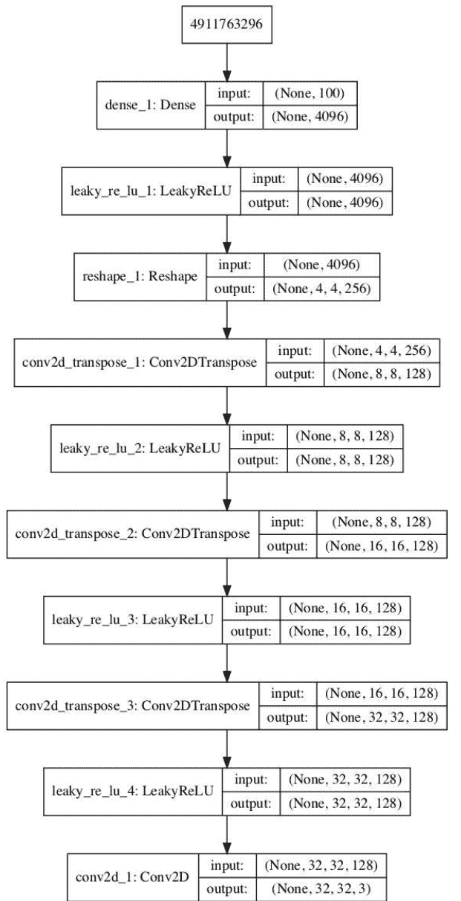

图 8.3：CIFAR-10 生成对抗网络中生成器模型的图。

目前该模型功能有限。尽管如此，我们可以演示如何使用它来生成样本。这是一个有用的演示，用于理解生成器只是另一个模型，其中一些元素以后会有用。第一步是在潜在空间中生成新点。我们可以通过调用 **randn()** NumPy 函数来实现这一点，该函数用于生成从标准高斯分布中抽取的随机数数组。然后可以将随机数数组重塑为样本，即 _n_ 行，每行 100 个元素。下面的 **generate_latent_points()** 函数实现了此功能，并在潜在空间中生成所需数量的点，这些点可用作生成器模型的输入。

```python
# generate points in latent space as input for the generator
def generate_latent_points(latent_dim, n_samples):
    # generate points in the latent space
    x_input = randn(latent_dim * n_samples)
    # reshape into a batch of inputs for the network
    x_input = x_input.reshape(n_samples, latent_dim)
    return x_input
```

代码清单 8.22：在潜在空间中生成随机点的函数示例。

接下来，我们可以使用生成的点作为生成器模型的输入来生成新样本，然后绘制样本。我们可以更新上一节中的 **generate_fake_samples()** 函数，使其将生成器模型作为参数，并通过首先调用 **generate_latent_points()** 函数在潜在空间中生成所需数量的点作为模型输入，从而用它来生成所需数量的样本。下面列出了更新后的 **generate_fake_samples()** 函数，它既返回生成的样本，也返回相关的类标签。

```python
# use the generator to generate n fake examples, with class labels
def generate_fake_samples(g_model, latent_dim, n_samples):
    # generate points in latent space
    x_input = generate_latent_points(latent_dim, n_samples)
    # predict outputs
    X = g_model.predict(x_input)
    # create 'fake' class labels (0)
    y = zeros((n_samples, 1))
    return X, y
```

代码清单 8.23：使用生成器创建图像的函数示例。

然后，我们可以像第一部分处理真实 CIFAR-10 示例那样，通过调用 **imshow()** 函数来绘制生成的样本。下面列出了使用未训练的生成器模型生成新 CIFAR-10 图像的完整示例。

```python
# example of defining and using the generator model
from numpy import zeros
from numpy.random import randn
from keras.models import Sequential
from keras.layers import Dense
from keras.layers import Reshape
from keras.layers import Conv2D
from keras.layers import Conv2DTranspose
from keras.layers import LeakyReLU
from matplotlib import pyplot

# define the standalone generator model
def define_generator(latent_dim):
    model = Sequential()
    # foundation for 4x4 image
    n_nodes = 256 * 4 * 4
    model.add(Dense(n_nodes, input_dim=latent_dim))
    model.add(LeakyReLU(alpha=0.2))
    model.add(Reshape((4, 4, 256)))
    # upsample to 8x8
    model.add(Conv2DTranspose(128, (4,4), strides=(2,2), padding='same'))
    model.add(LeakyReLU(alpha=0.2))
    # upsample to 16x16
    model.add(Conv2DTranspose(128, (4,4), strides=(2,2), padding='same'))
    model.add(LeakyReLU(alpha=0.2))
    # upsample to 32x32
    model.add(Conv2DTranspose(128, (4,4), strides=(2,2), padding='same'))
    model.add(LeakyReLU(alpha=0.2))
    # output layer
    model.add(Conv2D(3, (3,3), activation='tanh', padding='same'))
    return model

# generate points in latent space as input for the generator
def generate_latent_points(latent_dim, n_samples):
    # generate points in the latent space
    x_input = randn(latent_dim * n_samples)
    # reshape into a batch of inputs for the network
    x_input = x_input.reshape(n_samples, latent_dim)
    return x_input

# use the generator to generate n fake examples, with class labels
def generate_fake_samples(g_model, latent_dim, n_samples):
    # generate points in latent space
    x_input = generate_latent_points(latent_dim, n_samples)
    # predict outputs
    X = g_model.predict(x_input)
    # create 'fake' class labels (0)
    y = zeros((n_samples, 1))
    return X, y

# size of the latent space
latent_dim = 100
# define the discriminator model
model = define_generator(latent_dim)
# generate samples
n_samples = 49
X, _ = generate_fake_samples(model, latent_dim, n_samples)
# scale pixel values from [-1,1] to [0,1]
X = (X + 1) / 2.0
# plot the generated samples
for i in range(n_samples):
    # define subplot
    pyplot.subplot(7, 7, 1 + i)
    # turn off axis labels
    pyplot.axis('off')
    # plot single image
    pyplot.imshow(X[i])
    # show the figure
    pyplot.show()
```


运行该示例生成49个假CIFAR-10图像的示例，并将它们可视化在一个7×7的单个图表中。由于模型未训练，生成的图像是[-1, 1]中完全随机的像素值，重新缩放到[0, 1]。正如我们所料，这些图像看起来像是一团灰色的混乱。

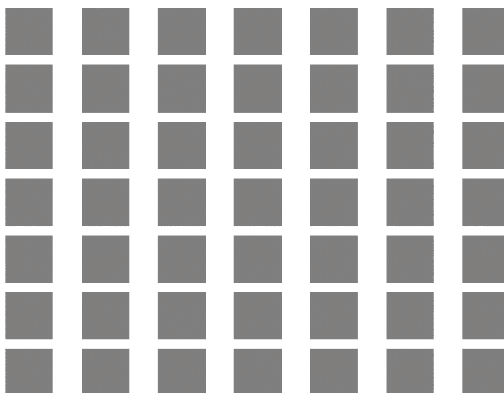

图 8.4: 未训练生成器模型输出的49个CIFAR-10图像示例。

现在我们知道如何定义和使用生成器模型，下一步是训练模型。

## 8.5 如何训练生成器模型

生成器模型中的权重根据判别器模型的性能进行更新。当判别器擅长检测假样本时，生成器会被更新更多；当判别器模型在检测假样本时表现较差或感到困惑时，生成器模型会被更新较少。这定义了这两个模型之间的零和或对抗关系。使用Keras API实现这一点可能有多种方法，但也许最简单的方法是创建一个结合生成器和判别器模型的新模型。

具体来说，可以定义一个新的GAN模型，将生成器和判别器堆叠在一起，使生成器接收潜在空间中的随机点作为输入，生成直接输入到判别器模型的样本，进行分类，而这个更大模型的输出可用于更新生成器的模型权重。要明确的是，我们并不是在谈论一个新的第三个模型，而是一个新的逻辑模型，它使用独立生成器和判别器模型中已定义的层和权重。只有判别器关心区分真实样本和假样本，因此判别器模型可以以独立方式对每类样本进行训练，就像我们在上面的判别器模型部分所做的那样。

生成器模型只关心判别器在假样本上的性能。因此，当判别器作为GAN模型的一部分时，我们将其所有层标记为不可训练，以便它们不能被更新并在假样本上过度训练。通过这个逻辑GAN模型训练生成器时，还有一个重要的变化。我们希望判别器认为生成器输出的样本是真实的，而不是假的。因此，当生成器作为GAN模型的一部分进行训练时，我们将生成的样本标记为真实（class = 1）。

**我们为什么要这样做？** 我们可以想象，判别器随后会将生成的样本分类为不真实（class = 0）或真实概率较低（0.3或0.5）。用于更新模型权重的反向传播过程会将其视为一个大错误，并更新模型权重（即仅更新生成器中的权重）来纠正这个错误，从而使生成器更擅长生成好的假样本。让我们具体说明一下。

- **输入**: 潜在空间中的点，例如一个100元素的高斯随机数向量。
- **输出**: 二进制分类，样本是真实（或假）的可能性。

下面的define_gan()函数以已定义的生成器和判别器模型为参数，创建一个包含这两个模型的新逻辑第三个模型。判别器中的权重被标记为不可训练，这只影响GAN模型所见的权重，而不影响独立的判别器模型。然后，GAN模型使用与判别器相同的二元交叉熵损失函数，以及高效的Adam版本的随机梯度下降，学习率为0.0002，动量为0.5，在训练深度卷积GAN时推荐使用。

```python
# define the combined generator and discriminator model, for updating the generator
def define_gan(g_model, d_model):
    # make weights in the discriminator not trainable
    d_model.trainable = False
    # connect them
    model = Sequential()
    # add generator
    model.add(g_model)
    # add the discriminator
    model.add(d_model)
    # compile model
    opt = Adam(lr=0.0002, beta_1=0.5)
    model.compile(loss='binary_crossentropy', optimizer=opt)
    return model
```

清单 8.25: 通过判别器训练生成器的复合模型定义函数示例。

在Keras API中，将判别器设置为不可训练是一个巧妙的技巧。trainable属性在模型编译后影响模型。判别器模型是使用可训练层编译的，因此当独立模型通过调用train_on_batch()函数进行更新时，这些层中的模型权重将被更新。然后，判别器模型被标记为不可训练，添加到GAN模型中并进行编译。在这个模型中，判别器模型的模型权重不可训练，并且在通过调用train_on_batch()函数更新GAN模型时不能更改。trainable属性的这一变化不影响独立判别器模型的训练。下面列出了创建判别器、生成器和复合模型的完整示例。

```python
# demonstrate creating the three models in the gan
from keras.optimizers import Adam
from keras.models import Sequential
from keras.layers import Dense
from keras.layers import Reshape
from keras.layers import Flatten
from keras.layers import Conv2D
from keras.layers import Conv2DTranspose
from keras.layers import LeakyReLU
from keras.layers import Dropout
from keras.utils.vis_utils import plot_model

# define the standalone discriminator model
def define_discriminator(in_shape=(32,32,3)):
    model = Sequential()
    # normal
    model.add(Conv2D(64, (3,3), padding='same', input_shape=in_shape))
    model.add(LeakyReLU(alpha=0.2))
    # downsample
    model.add(Conv2D(128, (3,3), strides=(2,2), padding='same'))
    model.add(LeakyReLU(alpha=0.2))
    # downsample
    model.add(Conv2D(128, (3,3), strides=(2,2), padding='same'))
    model.add(LeakyReLU(alpha=0.2))
    # downsample
    model.add(Conv2D(256, (3,3), strides=(2,2), padding='same'))
    model.add(LeakyReLU(alpha=0.2))
    # classifier
    model.add(Flatten())
    model.add(Dropout(0.4))
    model.add(Dense(1, activation='sigmoid'))
    # compile model
    opt = Adam(lr=0.0002, beta_1=0.5)
    model.compile(loss='binary_crossentropy', optimizer=opt, metrics=['accuracy'])
    return model

# define the standalone generator model
def define_generator(latent_dim):
    model = Sequential()
    # foundation for 4x4 image
    n_nodes = 256 * 4 * 4
    model.add(Dense(n_nodes, input_dim=latent_dim))
    model.add(LeakyReLU(alpha=0.2))
    model.add(Reshape((4, 4, 256)))
    # upsample to 8x8
    model.add(Conv2DTranspose(128, (4,4), strides=(2,2), padding='same'))
    model.add(LeakyReLU(alpha=0.2))
    # upsample to 16x16
    model.add(Conv2DTranspose(128, (4,4), strides=(2,2), padding='same'))
    model.add(LeakyReLU(alpha=0.2))
    # upsample to 32x32
    model.add(Conv2DTranspose(128, (4,4), strides=(2,2), padding='same'))
    model.add(LeakyReLU(alpha=0.2))
    # output layer
    model.add(Conv2D(3, (3,3), activation='tanh', padding='same'))
    return model

# define the combined generator and discriminator model, for updating the generator
def define_gan(g_model, d_model):
    # make weights in the discriminator not trainable
    d_model.trainable = False
    # connect them
    model = Sequential()
    # add generator
    model.add(g_model)
    # add the discriminator
    model.add(d_model)
    # compile model
    opt = Adam(lr=0.0002, beta_1=0.5)
    model.compile(loss='binary_crossentropy', optimizer=opt)
    return model

# size of the latent space
latent_dim = 100
# create the discriminator
d_model = define_discriminator()
# create the generator
g_model = define_generator(latent_dim)
# create the gan
gan_model = define_gan(g_model, d_model)
# summarize gan model
gan_model.summary()
# plot gan model
plot_model(gan_model, to_file='gan_plot.png', show_shapes=True, show_layer_names=True)
```

清单 8.26: 定义和总结复合模型的示例。

运行该示例首先会创建复合模型的摘要，这相当无趣。我们可以看到，该模型期望以CIFAR-10图像作为输入，并预测一个单一值作为输出。

| 层 (类型) | 输出形状 | 参数数量 |
|---|---|---|
| sequential_2 (Sequential) | (None, 32, 32, 3) | 1466115 |
| sequential_1 (Sequential) | (None, 1) | 522497 |
| 总参数数: 1,988,612 | | |
| 可训练参数数: 1,466,115 | | |
| 不可训练参数数: 522,497 | | |


Listing 8.27: 定义和汇总复合模型的示例输出。

还会创建模型的图，我们可以看到模型期望一个潜在空间中的100元素点作为输入，并将预测单个输出分类标签。

> 注意：创建模型图假设已安装pydot和graphviz库。如果这是个问题，你可以注释掉导入语句和plot_model()函数调用。

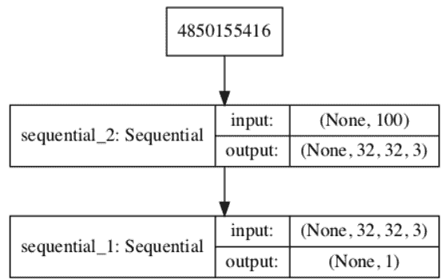

Figure 8.5: CIFAR-10生成对抗网络中复合生成器和判别器模型的图。

训练复合模型涉及通过前一节中的generate_latent_points()函数在潜在空间中生成一批点，以及class = 1标签并调用train_on_batch()函数。下面的train_gan()函数演示了这一点，尽管它很简单，因为每个时代只会更新生成器，而判别器保留默认模型权重。

```
# train the composite model
def train_gan(gan_model, latent_dim, n_epochs=200, n_batch=128):
    # manually enumerate epochs
    for i in range(n_epochs):
        # prepare points in latent space as input for the generator
        x_gan = generate_latent_points(latent_dim, n_batch)
        # create inverted labels for the fake samples
        y_gan = ones((n_batch, 1))
        # update the generator via the discriminator's error
        gan_model.train_on_batch(x_gan, y_gan)
```

Listing 8.28: 通过判别器模型训练生成器模型的函数示例。

相反，要求是我们先使用真实和假样本更新判别器模型，然后通过复合模型更新生成器。这需要结合上面判别器部分中定义的train_discriminator()函数和上面定义的train_gan()函数的元素。它还要求我们遍历时代和时代内的批次。用于更新判别器模型和生成器（通过复合模型）的完整train函数如下所示。

在这个模型训练函数中有几点需要注意。首先，时代内的批次数量由批次大小能整除训练数据集的次数定义。我们有50K个样本的数据集大小和128的批次大小，因此向下取整后，每个时代有50000/128或390个批次。判别器模型每个批次更新两次，一次使用真实样本，一次使用假样本，这是最佳实践，而不是合并样本并执行单次更新。最后，我们每个批次报告损失。密切关注批次间的损失至关重要。原因是判别器损失崩溃表明生成器模型已开始生成判别器可以轻易区分的垃圾示例。

监控判别器损失，并预期它每个批次在0.5到0.8之间徘徊。生成器损失不那么关键，可能在0.5到2或更高之间徘徊。聪明的程序员甚至可能尝试检测判别器的崩溃损失，停止，然后重新启动训练过程。

```
# train the generator and discriminator
def train(g_model, d_model, gan_model, dataset, latent_dim, n_epochs=200, n_batch=128):
    bat_per_epo = int(dataset.shape[0] / n_batch)
    half_batch = int(n_batch / 2)
    # manually enumerate epochs
    for i in range(n_epochs):
        # enumerate batches over the training set
        for j in range(bat_per_epo):
            # get randomly selected 'real' samples
            X_real, y_real = generate_real_samples(dataset, half_batch)
            # update discriminator model weights
            d_loss1, _ = d_model.train_on_batch(X_real, y_real)
            # generate 'fake' examples
            X_fake, y_fake = generate_fake_samples(g_model, latent_dim, half_batch)
            # update discriminator model weights
            d_loss2, _ = d_model.train_on_batch(X_fake, y_fake)
            # prepare points in latent space as input for the generator
            X_gan = generate_latent_points(latent_dim, n_batch)
            # create inverted labels for the fake samples
            y_gan = ones((n_batch, 1))
            # update the generator via the discriminator's error
            g_loss = gan_model.train_on_batch(X_gan, y_gan)
            # summarize loss on this batch
            print('>%d, %d/%d, d1=%.3f, d2=%.3f g=%.3f' % (i+1, j+1, bat_per_epo, d_loss1, d_loss2, g_loss))
```

Listing 8.29: 训练GAN的函数示例。

我们几乎拥有开发CIFAR-10物体照片数据集GAN所需的一切。剩下的一个方面是模型的评估。

## 8.6 如何评估GAN模型性能

通常，没有客观的方法来评估GAN模型的性能。我们无法为生成的图像计算这个客观误差分数。相反，图像必须由人工操作员主观评估质量。这意味着如果不查看生成图像的示例，我们无法知道何时停止训练。同样，训练过程的对抗性意味着生成器在每个批次后都在变化，这意味着一旦可以生成*足够好*的图像，图像的主观质量随后可能会随着后续更新而变化、改善甚至退化。有三种方法来处理这种复杂的训练情况。

- 1. 定期评估判别器在真实和假图像上的分类准确率。
- 2. 定期生成许多图像并将其保存到文件以供主观审查。
- 3. 定期保存生成器模型。

对于给定的训练时代，所有这三个操作都可以同时执行，例如每10个训练时代。结果将是一个保存的生成器模型，我们有方法主观评估其输出质量，并客观知道在保存模型时判别器被欺骗得有多好。在许多时代（例如数百或数千个时代）上训练GAN，将产生许多可以检查的模型快照，并从中可以挑选特定的输出和模型以供以后使用。

首先，我们可以定义一个名为`summarize_performance()`的函数来汇总判别器模型的性能。它通过检索一组真实的CIFAR-10图像，以及使用生成器模型生成相同数量的假CIFAR-10图像，然后评估判别器模型在每个样本上的分类准确率，并报告这些分数来实现这一点。

```
# evaluate the discriminator, plot generated images, save generator model
def summarize_performance(epoch, g_model, d_model, dataset, latent_dim, n_samples=150):
    # prepare real samples
    X_real, y_real = generate_real_samples(dataset, n_samples)
    # evaluate discriminator on real examples
    _, acc_real = d_model.evaluate(X_real, y_real, verbose=0)
    # prepare fake examples
    x_fake, y_fake = generate_fake_samples(g_model, latent_dim, n_samples)
    # evaluate discriminator on fake examples
    _, acc_fake = d_model.evaluate(x_fake, y_fake, verbose=0)
    # summarize discriminator performance
    print('>Accuracy real: %.0f%%, fake: %.0f%%' % (acc_real*100, acc_fake*100))
```

Listing 8.30: 汇总模型性能的函数示例。

可以根据当前时代号从`train()`函数调用此函数，例如每10个时代。

```
# train the generator and discriminator
def train(g_model, d_model, gan_model, dataset, latent_dim, n_epochs=200, n_batch=128):
    bat_per_epo = int(dataset.shape[0] / n_batch)
    half_batch = int(n_batch / 2)
    # manually enumerate epochs
    for i in range(n_epochs):
        ...
        # evaluate the model performance, sometimes
        if (i+1) % 10 == 0:
            summarize_performance(i, g_model, d_model, dataset, latent_dim)
```

Listing 8.31: 从train函数汇总模型性能的示例。


接下来，我们可以更新 `summarize_performance()` 函数，以同时保存模型并创建和保存生成示例的图表。生成器模型可以通过在生成器模型上调用 `save()` 函数并提供基于训练轮次编号的唯一文件名来保存。

```
... save the generator model to file
filename = 'generator_model_%03d.h5' % (epoch+1)
g_model.save(filename)
```

清单 8.32：将生成器模型保存到文件的示例。

我们可以开发一个函数来创建生成样本的图表。由于我们正在对 100 张生成的 CIFAR-10 图像评估判别器，我们可以绘制大约一半，即 49 张，作为 7×7 网格。下面的 `save_plot()` 函数实现了此功能，同样根据轮次编号使用唯一文件名保存生成的图表。

```
# create and save a plot of generated images
def save_plot(examples, epoch, n=7):
    # scale from [-1,1] to [0,1]
    examples = (examples + 1) / 2.0
    # plot images
    for i in range(n * n):
        # define subplot
        pyplot.subplot(n, n, 1 + i)
        # turn off axis
        pyplot.axis('off')
        # plot raw pixel data
        pyplot.imshow(examples[i])
    # save plot to file
    filename = 'generated_plot_e%03d.png' % (epoch+1)
    pyplot.savefig(filename)
    pyplot.close()
```

清单 8.33：保存生成图像图表和生成器模型的函数示例。

添加这些内容后的更新 `summarize_performance()` 函数如下所示。

```
# evaluate the discriminator, plot generated images, save generator model
def summarize_performance(epoch, g_model, d_model, dataset, latent_dim, n_samples=150):
    # prepare real samples
    X_real, y_real = generate_real_samples(dataset, n_samples)
    # evaluate discriminator on real examples
    _, acc_real = d_model.evaluate(X_real, y_real, verbose=0)
    # prepare fake examples
    x_fake, y_fake = generate_fake_samples(g_model, latent_dim, n_samples)
    # evaluate discriminator on fake examples
    _, acc_fake = d_model.evaluate(x_fake, y_fake, verbose=0)
    # summarize discriminator performance
    print('>Accuracy real: %.0f%%, fake: %.0f%%' % (acc_real*100, acc_fake*100))
    # save plot
    save_plot(x_fake, epoch)
    # save the generator model to file
    filename = 'generator_model_%03d.h5' % (epoch+1)
    g_model.save(filename)
```

清单 8.34：用于总结模型性能的更新函数示例。

## 8.7 CIFAR-10 的 GAN 完整示例

我们现在拥有在 CIFAR-10 小型物体照片数据集上训练和评估 GAN 所需的一切。完整示例如下所示。

```
# example of a dcgan on cifar10
from numpy import zeros
from numpy import ones
from numpy.random import randn
from numpy.random import randint
from keras.datasets.cifar10 import load_data
from keras.optimizers import Adam
from keras.models import Sequential
from keras.layers import Dense
from keras.layers import Reshape
from keras.layers import Flatten
from keras.layers import Conv2D
from keras.layers import Conv2DTranspose
from keras.layers import LeakyReLU
from keras.layers import Dropout
from matplotlib import pyplot

# define the standalone discriminator model
def define_discriminator(in_shape=(32,32,3)):
    model = Sequential()
    # normal
    model.add(Conv2D(64, (3,3), padding='same', input_shape=in_shape))
    model.add(LeakyReLU(alpha=0.2))
    # downsample
    model.add(Conv2D(128, (3,3), strides=(2,2), padding='same'))
    model.add(LeakyReLU(alpha=0.2))
    # downsample
    model.add(Conv2D(128, (3,3), strides=(2,2), padding='same'))
    model.add(LeakyReLU(alpha=0.2))
    # downsample
    model.add(Conv2D(256, (3,3), strides=(2,2), padding='same'))
    model.add(LeakyReLU(alpha=0.2))
    # classifier
    model.add(Flatten())
    model.add(Dropout(0.4))
    model.add(Dense(1, activation='sigmoid'))
    # compile model
    opt = Adam(lr=0.0002, beta_1=0.5)
    model.compile(loss='binary_crossentropy', optimizer=opt, metrics=['accuracy'])
    return model

# define the standalone generator model
def define_generator(latent_dim):
    model = Sequential()
    # foundation for 4x4 image
    n_nodes = 256 * 4 * 4
    model.add(Dense(n_nodes, input_dim=latent_dim))
    model.add(LeakyReLU(alpha=0.2))
    model.add(Reshape((4, 4, 256)))
    # upsample to 8x8
    model.add(Conv2DTranspose(128, (4,4), strides=(2,2), padding='same'))
    model.add(LeakyReLU(alpha=0.2))
    # upsample to 16x16
    model.add(Conv2DTranspose(128, (4,4), strides=(2,2), padding='same'))
    model.add(LeakyReLU(alpha=0.2))
    # upsample to 32x32
    model.add(Conv2DTranspose(128, (4,4), strides=(2,2), padding='same'))
    model.add(LeakyReLU(alpha=0.2))
    # output layer
    model.add(Conv2D(3, (3,3), activation='tanh', padding='same'))
    return model

# define the combined generator and discriminator model, for updating the generator
def define_gan(g_model, d_model):
    # make weights in the discriminator not trainable
    d_model.trainable = False
    # connect them
    model = Sequential()
    # add generator
    model.add(g_model)
    # add the discriminator
    model.add(d_model)
    # compile model
    opt = Adam(lr=0.0002, beta_1=0.5)
    model.compile(loss='binary_crossentropy', optimizer=opt)
    return model

# load and prepare cifar10 training images
def load_real_samples():
    # load cifar10 dataset
    (trainX, _), (_, _) = load_data()
    # convert from unsigned ints to floats
    X = trainX.astype('float32')
    # scale from [0,255] to [-1,1]
    X = (X - 127.5) / 127.5
    return X

# select real samples
def generate_real_samples(dataset, n_samples):
    # choose random instances
    ix = randint(0, dataset.shape[0], n_samples)
    # retrieve selected images
    X = dataset[ix]
    # generate 'real' class labels (1)
    y = ones((n_samples, 1))
    return X, y

# generate points in latent space as input for the generator
def generate_latent_points(latent_dim, n_samples):
    # generate points in the latent space
    x_input = randn(latent_dim * n_samples)
    # reshape into a batch of inputs for the network
    x_input = x_input.reshape(n_samples, latent_dim)
    return x_input

# use the generator to generate n fake examples, with class labels
def generate_fake_samples(g_model, latent_dim, n_samples):
    # generate points in latent space
    x_input = generate_latent_points(latent_dim, n_samples)
    # predict outputs
    X = g_model.predict(x_input)
    # create 'fake' class labels (0)
    y = zeros((n_samples, 1))
    return X, y

# create and save a plot of generated images
def save_plot(examples, epoch, n=7):
    # scale from [-1,1] to [0,1]
    examples = (examples + 1) / 2.0
    # plot images
    for i in range(n * n):
        # define subplot
        pyplot.subplot(n, n, 1 + i)
        # turn off axis
        pyplot.axis('off')
        # plot raw pixel data
        pyplot.imshow(examples[i])
    # save plot to file
    filename = 'generated_plot_e%03d.png' % (epoch+1)
    pyplot.savefig(filename)
    pyplot.close()

# evaluate the discriminator, plot generated images, save generator model
def summarize_performance(epoch, g_model, d_model, dataset, latent_dim, n_samples=150):
    # prepare real samples
    X_real, y_real = generate_real_samples(dataset, n_samples)
    # evaluate discriminator on real examples
    _, acc_real = d_model.evaluate(X_real, y_real, verbose=0)
    # prepare fake examples
    x_fake, y_fake = generate_fake_samples(g_model, latent_dim, n_samples)
    # evaluate discriminator on fake examples
    _, acc_fake = d_model.evaluate(x_fake, y_fake, verbose=0)
    # summarize discriminator performance
    print('>Accuracy real: %.0f%%, fake: %.0f%%' % (acc_real*100, acc_fake*100))
    # save plot
    save_plot(x_fake, epoch)
    # save the generator model to file
    filename = 'generator_model_%03d.h5' % (epoch+1)
    g_model.save(filename)

# train the generator and discriminator
def train(g_model, d_model, gan_model, dataset, latent_dim, n_epochs=200, n_batch=128):
    bat_per_epo = int(dataset.shape[0] / n_batch)
    half_batch = int(n_batch / 2)
    # manually enumerate epochs
    for i in range(n_epochs):
        # enumerate batches over the training set
        for j in range(bat_per_epo):


```python
# get randomly selected 'real' samples
X_real, y_real = generate_real_samples(dataset, half_batch)
# update discriminator model weights
d_loss1, _ = d_model.train_on_batch(X_real, y_real)
# generate 'fake' examples
X_fake, y_fake = generate_fake_samples(g_model, latent_dim, half_batch)
# update discriminator model weights
d_loss2, _ = d_model.train_on_batch(X_fake, y_fake)
# prepare points in latent space as input for the generator
X_gan = generate_latent_points(latent_dim, n_batch)
# create inverted labels for the fake samples
y_gan = ones((n_batch, 1))
# update the generator via the discriminator's error
g_loss = gan_model.train_on_batch(X_gan, y_gan)
# summarize loss on this batch
print('>%d, %d/%d, d1=%.3f, d2=%.3f g=%.3f' % (i+1, j+1, bat_per_epo, d_loss1, d_loss2, g_loss))
# evaluate the model performance, sometimes
if (i+1) % 10 == 0:
    summarize_performance(i, g_model, d_model, dataset, latent_dim)

# size of the latent space
latent_dim = 100
# create the discriminator
d_model = define_discriminator()
# create the generator
g_model = define_generator(latent_dim)
# create the gan
gan_model = define_gan(g_model, d_model)
# load image data
dataset = load_real_samples()
# train model
train(g_model, d_model, gan_model, dataset, latent_dim)
```

列表 8.35: 在 CIFAR-10 训练数据集上训练 GAN 的完整示例。

注意：在 CPU 硬件上运行示例可能需要数小时。如果可能，我建议在 GPU 硬件上运行示例。如果您需要帮助，可以使用 AWS EC2 实例快速开始训练模型。请参阅附录 C 中的说明。

所选配置使生成模型和判别模型都能稳定训练。每个批次都会报告模型性能，包括判别模型（d）和生成模型（g）的损失。

注意：由于学习算法的随机性，您的具体结果可能会有所不同。建议运行示例几次并比较平均性能。

在这种情况下，损失在整个训练过程中保持稳定。判别器在真实样本和生成样本上的损失大约在 0.5 左右，而通过判别器训练的生成器的损失在大部分训练过程中大约在 1.5 左右。

```
>1, 1/390, d1=0.720, d2=0.695 g=0.692
>1, 2/390, d1=0.658, d2=0.697 g=0.691
>1, 3/390, d1=0.604, d2=0.700 g=0.687
>1, 4/390, d1=0.522, d2=0.709 g=0.680
>1, 5/390, d1=0.417, d2=0.731 g=0.662
...
>200, 386/390, d1=0.499, d2=0.401 g=1.565
>200, 387/390, d1=0.459, d2=0.623 g=1.481
>200, 388/390, d1=0.588, d2=0.556 g=1.700
>200, 389/390, d1=0.579, d2=0.288 g=1.555
>200, 390/390, d1=0.620, d2=0.453 g=1.466
```

列表 8.36: 在 CIFAR-10 训练数据集上训练 GAN 时的损失输出示例。

生成器每 10 个时代评估一次，共产生 20 次评估、20 个生成图像图表和 20 个保存的模型。在这种情况下，我们可以看到准确率在训练过程中波动。当将判别模型的准确率得分与生成的图像结合起来查看时，我们可以看到，假样本上的准确率与图像的主观质量相关性不佳，但真实样本上的准确率可能相关。它是 GAN 性能的一种粗糙且可能不可靠的指标，与损失一样。

```
>Accuracy real: 55%, fake: 89%
>Accuracy real: 50%, fake: 75%
>Accuracy real: 49%, fake: 86%
>Accuracy real: 60%, fake: 79%
>Accuracy real: 49%, fake: 87%
...
```

列表 8.37: 在 CIFAR-10 训练数据集上训练 GAN 时的准确率输出示例。

超过某个点后，更多的训练并不意味着更高质量的生成图像。在这种情况下，10 个时代后的结果质量较低，尽管我们可以看到每张图像中间有一个斑块，背景和前景之间有一些差异。

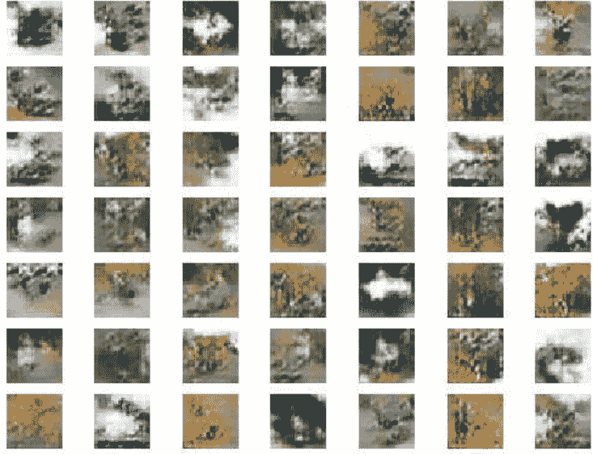

图 8.6: 10 个时代后 49 张 GAN 生成的 CIFAR-10 照片图表。

经过 90 或 100 个时代后，我们开始看到看起来像鸟、狗、猫和马的斑块的合理照片。这些物体很熟悉，类似 CIFAR-10，但其中许多并不明显属于 10 个指定类别中的任何一个。

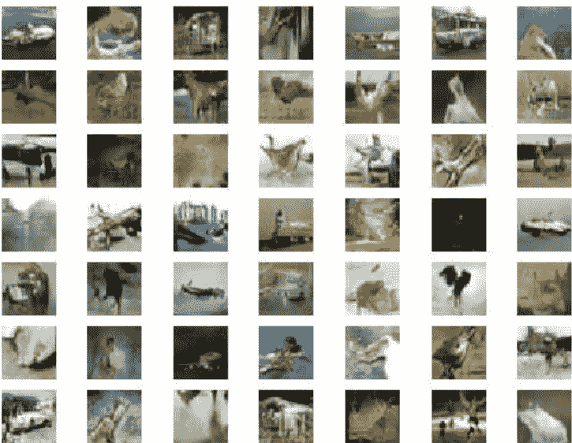

图 8.7: 90 个时代后 49 张 GAN 生成的 CIFAR-10 照片图表。

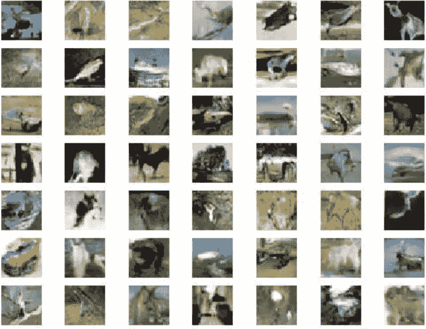

图 8.8: 100 个时代后 49 张 GAN 生成的 CIFAR-10 照片图表。

在接下来的 100 个时代中，模型保持稳定，生成的图像改进不大。这些小照片仍然模糊地类似 CIFAR-10，并专注于狗、猫和鸟等动物。

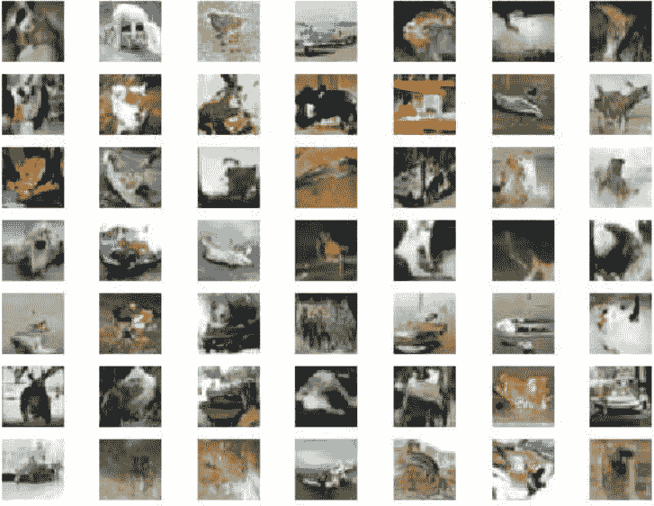

图 8.9: 200 个时代后 49 张 GAN 生成的 CIFAR-10 照片图表。

## 8.8 如何使用最终生成器模型

一旦选定最终生成器模型，就可以以独立方式用于您的应用。这包括先从文件加载模型，然后使用它生成图像。每张图像的生成都需要潜在空间中的一个点作为输入。加载保存的模型并生成图像的完整示例如下所示。在此示例中，我们将使用 200 个训练时代后保存的模型，但 100 个时代后保存的模型同样有效。

```
# example of loading the generator model and generating images
from keras.models import load_model
from numpy.random import randn
from matplotlib import pyplot

# generate points in latent space as input for the generator
def generate_latent_points(latent_dim, n_samples):
    # generate points in the latent space
    x_input = randn(latent_dim * n_samples)
    # reshape into a batch of inputs for the network
    x_input = x_input.reshape(n_samples, latent_dim)
    return x_input
```

```
# create and save a plot of generated images
def save_plot(examples, n):
	# plot images
	for i in range(n * n):
		# define subplot
		pyplot.subplot(n, n, 1 + i)
		# turn off axis
		pyplot.axis('off')
		# plot raw pixel data
		pyplot.imshow(examples[i, :, :])
	pyplot.show()

# load model
model = load_model('generator_model_200.h5')
# generate images
latent_points = generate_latent_points(100, 100)
# generate images
X = model.predict(latent_points)
# scale from [-1,1] to [0,1]
X = (X + 1) / 2.0
# plot the result
save_plot(X, 10)
```

列表 8.38: 加载保存的生成器模型并输出合成图像的示例。

运行示例首先加载模型，在潜在空间中采样 100 个随机点，生成 100 张图像，然后将结果绘制为单张图像。我们可以看到，大多数图像看起来合理，或者是小物体的合理部分。我可以看到狗、猫、马、鸟、青蛙，也许还有飞机。

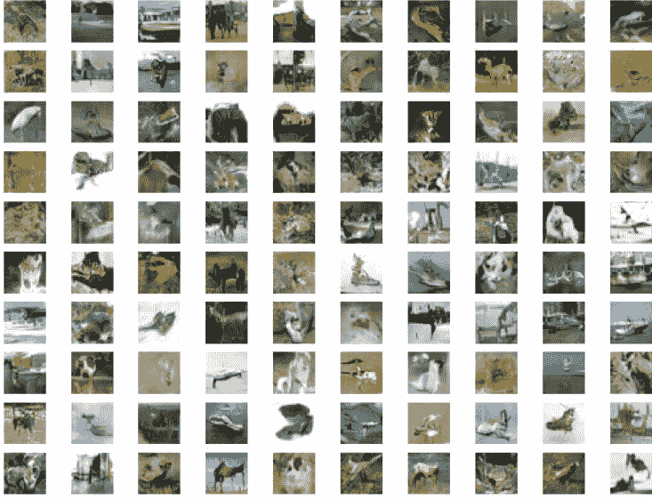

图 8.10: 100 张 GAN 生成的 CIFAR-10 小物体照片示例。

潜在空间现在定义了 CIFAR-10 照片的压缩表示。您可以尝试在此空间中生成不同的点，看看它们生成什么类型的图像。下面的示例使用全 0.75 值的向量生成单张图像。

```python
# example of generating an image for a specific point in the latent space
from keras.models import load_model
from numpy import asarray
from matplotlib import pyplot
# load model
model = load_model('generator_model_200.h5')
# all 0s
vector = asarray([[0.75 for _ in range(100)]])
# generate image
X = model.predict(vector)
# scale from [-1,1] to [0,1]
X = (X + 1) / 2.0
# plot the result
pyplot.imshow(X[0, :, :])
pyplot.show()
```

列表 8.39: 加载保存的生成器模型并输出单张图像的示例。

注意：由于学习算法的随机性，您的具体结果可能会有所不同。建议运行示例几次并比较平均性能。

在这种情况下，全 0.75 向量会产生一只在绿色田野中的鹿，或者看起来像鹿-马的动物。

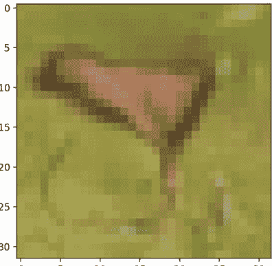

图 8.11: 潜在空间中特定点的 GAN 生成 CIFAR 小物体照片示例。

## 8.9 扩展

本节列出了一些您可能希望探索的扩展教程的想法。

- 更改潜在空间。更新示例以使用更大或更小的潜在空间，并比较结果质量和训练速度。
- 批量归一化。更新判别器和/或生成器以使用批量归一化，推荐用于 DCGAN 模型。
- 标签平滑。更新示例以在训练判别器时使用单侧标签平滑，具体将真实样本的目标标签从 1.0 更改为 0.9 并添加随机噪声，然后审查对图像质量和训练速度的影响。
- 模型配置。更新模型配置以使用更深或更浅的判别器和/或生成器模型，也许尝试生成器中的 UpSampling2D 层。

如果您探索了其中任何扩展，我很乐意了解。

## 8.10 进一步阅读

本节提供了更多关于该主题的资源，如果您希望深入了解。


### 8.10.1 APIs

- Keras API.
  https://keras.io/
- 如何“冻结”Keras 层？
  https://keras.io/getting-started/faq/#how-can-i-freeze-keras-layers
- Matplotlib API.
  https://matplotlib.org/api/
- numpy.random.rand API.
  https://docs.scipy.org/doc/numpy/reference/generated/numpy.random.rand.html
- numpy.random.randn API.
  https://docs.scipy.org/doc/numpy/reference/generated/numpy.random.randn.html
- numpy.zeros API.
  https://docs.scipy.org/doc/numpy/reference/generated/numpy.zeros.html
- numpy.ones API.
  https://docs.scipy.org/doc/numpy/reference/generated/numpy.ones.html
- numpy.hstack API.
  https://docs.scipy.org/doc/numpy/reference/generated/numpy.hstack.html

### 8.10.2 文章

- CIFAR-10，维基百科。
  https://en.wikipedia.org/wiki/CIFAR-10
- CIFAR-10 数据集和 CIFAR-100 数据集。
  https://www.cs.toronto.edu/~kriz/cifar.html

### 8.11 总结

在本教程中，你了解了如何使用深度卷积网络开发生成对抗网络，以生成物体的小照片。具体而言，你学习了：

- 如何定义和训练独立的判别器模型，以学习真实图像和假图像之间的差异。
- 如何定义独立的生成器模型，并训练组合的生成器和判别器模型。
- 如何评估 GAN 的性能，并使用最终的独立生成器模型生成新图像。

### 8.11.1 下一步

在下一个教程中，你将开发一个用于生成人脸的 DCGAN，然后使用插值和向量运算探索潜空间。

## 第 9 章

## 生成人脸时如何探索潜空间

生成对抗网络，或称 GAN，是一种用于训练生成模型的架构，例如用于生成图像的深度卷积神经网络。GAN 架构中的生成模型学习将潜空间中的点映射到生成的图像。潜空间除了通过生成模型赋予的意义外，本身没有意义。然而，潜空间具有可探索的结构，例如通过在点之间进行插值，以及对潜空间中点进行向量运算，这些运算对生成的图像具有有意义且有针对性的效果。在本教程中，你将了解如何开发用于人脸生成的生成对抗网络，并探索潜空间的结构及其对生成人脸的影响。完成本教程后，你将知道：

- 如何开发用于生成人脸的生成对抗网络。
- 如何在潜空间中对点进行插值，并生成从一张人脸变形到另一张人脸的图像。
- 如何在潜空间中执行向量运算，并在生成的人脸中实现有针对性的效果。

让我们开始吧。

### 9.1 教程概览

本教程分为五个部分，分别是：

1. 潜空间中的向量运算
2. 大规模名人脸数据集（CelebA）
3. 如何准备 CelebA 人脸数据集
4. 如何为 CelebA 开发 GAN
5. 如何探索人脸的潜空间

### 9.2 潜空间中的向量运算

GAN 架构中的生成器模型将潜空间中的一个点作为输入，并生成一张新图像。潜空间本身没有意义。通常，它是一个 100 维超球面，每个变量都服从均值为零、标准差为一的高斯分布。通过训练，生成器学习将点映射到潜空间上的特定输出图像，并且每次训练模型时，这种映射都会不同。当由生成器模型解释时，潜空间具有结构，并且对于给定模型，可以查询和导航这种结构。

通常，使用潜空间中的随机点生成新图像。更进一步，可以构建潜空间中的点（例如，全 0、全 0.5 或全 1），并将其用作输入或查询来生成特定图像。可以在潜空间中两个点之间的线性路径上创建一系列点，例如两个生成的图像。这些点可以用于生成一系列图像，以显示两个生成图像之间的过渡。最后，可以保留潜空间中的点，并使用简单的向量运算创建潜空间中的新点，进而可用于生成图像。这是一个有趣的想法，因为它允许直观且有针对性地生成图像。

Alec Radford 等人于 2015 年发表的重要论文 _使用深度卷积对抗网络进行无监督表示学习_ 介绍了一种稳定的模型配置，用于将深度卷积神经网络模型作为 GAN 架构的一部分进行训练。在论文中，作者探索了在多个不同训练数据集上训练的 GAN 的潜空间，最著名的是名人脸数据集。他们展示了两个有趣的方面。第一个是人脸的向量运算。例如，一张微笑女性的人脸减去一张中性女性的人脸，再加上一张中性男性的人脸，结果是一张微笑男性的人脸。

> 微笑女性 - 中性女性 + 中性男性 = 微笑男性 (9.1)

具体来说，该运算是在生成人脸的潜空间点上执行的。实际上，是对具有给定特征的多个人脸取平均值，以提供更稳健的结果。

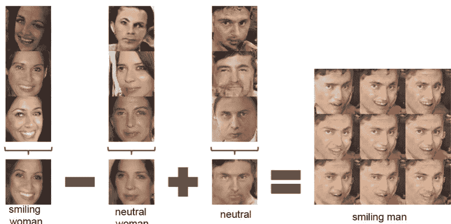

图 9.1：使用 GAN 生成人脸时，潜空间点上的向量运算示例。摘自：使用深度卷积生成对抗网络进行无监督表示学习。

第二个演示是两个生成人脸之间的过渡，具体方法是创建通过生成两个人脸的点之间的潜在维度的线性路径，然后生成路径上所有点的人脸。

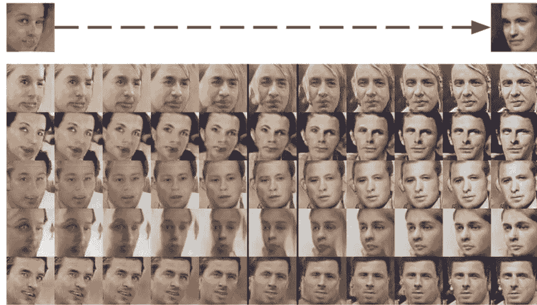

图 9.2：两个 GAN 生成人脸之间路径上的人脸示例。摘自：使用深度卷积生成对抗网络进行无监督表示学习。

探索 GAN 模型的潜空间结构，既对问题领域很有趣，也有助于培养对生成器模型所学内容的直觉。在本教程中，我们将开发一个用于生成人脸照片的 GAN，然后使用向量运算探索该模型的潜空间。

### 9.3 大规模名人脸数据集（CelebA）

第一步是选择一个人脸数据集。在本教程中，我们将使用大规模名人脸属性数据集，简称 CelebA。该数据集由 Ziwei Liu 等人为其 2015 年论文 _从面部局部响应到人脸检测：一种深度学习方法_ 开发和发布。该数据集提供了约 200,000 张名人脸照片，以及照片中出现内容的标注，例如眼镜、脸型、帽子、发质等。作为数据集的一部分，作者提供了每张照片以人脸为中心并裁剪为人像的版本，尺寸各异，宽度约为 150 像素，高度约为 200 像素。我们将以此为基础开发我们的 GAN 模型。该数据集可以从 Kaggle 网页轻松下载。你需要一个 Kaggle 账户。

- 名人脸属性（CelebA）数据集。[^1]

具体来说，下载文件 `img_align_celeba.zip`，大小约为 1.3 GB。为此，请在 Kaggle 网站上点击文件名，然后点击下载图标。下载可能需要一段时间，具体取决于你的互联网连接速度。下载完成后，解压缩存档。这将创建一个名为 `img_align_celeba/` 的新目录，其中包含所有图像，文件名类似于 `202599.jpg` 和 `202598.jpg`。接下来，我们可以着手准备原始图像以进行建模。

### 9.4 如何准备 CelebA 人脸数据集

第一步是开发加载图像的代码。我们可以使用 Pillow 库加载给定的图像文件，在需要时将其转换为 RGB 格式，并返回像素数据数组。下面的 `load_image()` 函数实现了此功能。

```python
# load an image as an rgb array
def load_image(filename):
    # load image from file
    image = Image.open(filename)
    # convert to RGB, if needed
    image = image.convert('RGB')
    # convert to array
    pixels = asarray(image)
    return pixels
```

清单 9.1：将图像加载为 NumPy 数组的函数示例。

接下来，我们可以枚举图像目录，依次加载每个图像作为像素数组，并返回包含所有图像的数组。数据集中有 200K 张图像，这可能比我们需要的多，因此我们还可以通过参数限制要加载的图像数量。下面的 `load_faces()` 函数实现了此功能。

[^1]: https://www.kaggle.com/jessicali9530/celeba-dataset


```
# load images and extract faces for all images in a directory
def load_faces(directory, n_faces):
    faces = list()
    # enumerate files
    for filename in listdir(directory):
        # load the image
        pixels = load_image(directory + filename)
        # store
        faces.append(pixels)
        # stop once we have enough
        if len(faces) >= n_faces:
            break
    return asarray(faces)
```

### 清单 9.2：加载目录中所有图像的示例

图像加载完成后，我们可以使用 Matplotlib 库中的 `imshow()` 函数将其绘制出来。下面的 `plot_faces()` 函数实现了此功能，以正方形排列绘制图像。

```
# plot a list of loaded faces
def plot_faces(faces, n):
    for i in range(n * n):
        # define subplot
        pyplot.subplot(n, n, 1 + i)
        # turn off axis
        pyplot.axis('off')
        # plot raw pixel data
        pyplot.imshow(faces[i])
    pyplot.show()
```

### 清单 9.3：绘制已加载人脸的函数示例

将上述内容整合在一起，完整示例如下。

```
# load and plot faces
from os import listdir
from numpy import asarray
from PIL import Image
from matplotlib import pyplot

# load an image as an rgb numpy array
def load_image(filename):
    # load image from file
    image = Image.open(filename)
    # convert to RGB, if needed
    image = image.convert('RGB')
    # convert to array
    pixels = asarray(image)
    return pixels

# load images and extract faces for all images in a directory
def load_faces(directory, n_faces):
    faces = list()
    # enumerate files
    for filename in listdir(directory):
        # load the image
        pixels = load_image(directory + filename)
        # store
        faces.append(pixels)
        # stop once we have enough
        if len(faces) >= n_faces:
            break
    return asarray(faces)

# plot a list of loaded faces
def plot_faces(faces, n):
    for i in range(n * n):
        # define subplot
        pyplot.subplot(n, n, 1 + i)
        # turn off axis
        pyplot.axis('off')
        # plot raw pixel data
        pyplot.imshow(faces[i])
    pyplot.show()

# directory that contains all images
directory = 'img_align_celeba/'
# load and extract all faces
faces = load_faces(directory, 25)
print('Loaded: ', faces.shape)
# plot faces
plot_faces(faces, 5)
```

### 清单 9.4：从数据集加载并绘制人脸的示例

运行示例将从目录中加载总共 25 张图像，然后汇总返回数组的大小。

```
Loaded: (25, 218, 178, 3)
```

### 清单 9.5：加载并汇总人脸数据集的示例输出

最后，25 张图像以 5 x 5 的正方形布局绘制出来。

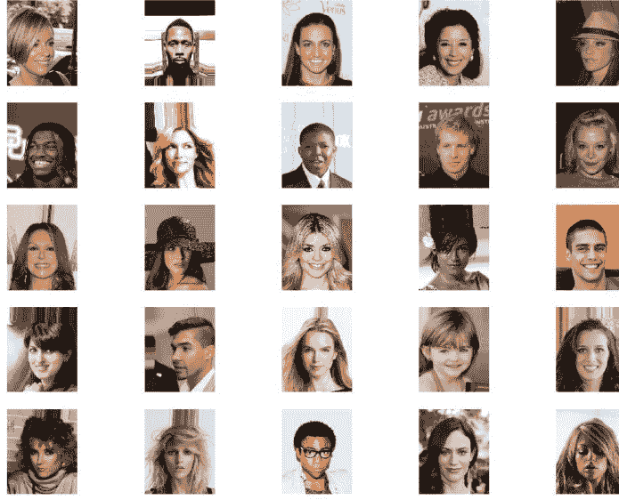

### 图 9.3：名人脸数据集中 25 张人脸样本的绘图

使用 GAN 时，如果所有图像都较小且呈正方形，则更容易对数据集进行建模。此外，由于我们只关心每张照片中的人脸而非背景，因此可以执行人脸检测并仅提取人脸，然后将结果调整为固定大小。执行人脸检测有多种方法。在此示例中，我们将使用预训练的多任务级联卷积神经网络（MTCNN）。这是一种用于人脸检测的最先进的深度学习模型，在 2016 年发表的题为 *使用多任务级联卷积神经网络进行联合人脸检测与对齐* 的论文中有所描述。我们将使用 Ivan de Paz Centeno 在 `ipazc/mtcnn` 项目中提供的实现。该库可以通过 `pip` 进行安装，方法如下：

```
sudo pip install mtcnn
```

### 清单 9.6：使用 pip 安装 mtcnn 库的示例

我们可以通过导入库并打印其版本来确认库已正确安装；例如：

```
# confirm mtcnn was installed correctly
import mtcnn
# show version
print(mtcnn.__version__)
```

### 清单 9.7：检查 mtcnn 库是否已正确安装的示例

运行示例将打印库的当前版本。

```
0.1.0
```

### 清单 9.8：检查 mtcnn 库是否已正确安装的示例输出

MTCNN 模型非常易于使用。首先，创建 MTCNN 模型的实例，然后可以调用 `detect_faces()` 函数并传入一张图像的像素数据。结果是已检测人脸的列表，其中包含以像素偏移值定义的边界框。

```
...
# prepare model
model = MTCNN()
# detect face in the image
faces = model.detect_faces(pixels)
# extract details of the face
x1, y1, width, height = faces[0]['box']
```

### 清单 9.9：使用 MTCNN 模型从照片中提取人脸的示例

我们可以更新示例，从每张已加载的照片中提取人脸，并将提取的人脸像素调整为固定大小。在此示例中，我们将使用 80 x 80 像素的正方形。下面的 `extract_face()` 函数实现了此功能，它将 MTCNN 模型和单张照片的像素值作为参数，并返回仅包含人脸的 80 x 80 x 3 像素值数组，如果未检测到人脸（这种情况很少见），则返回 None。

```
# extract the face from a loaded image and resize
def extract_face(model, pixels, required_size=(80, 80)):
    # detect face in the image
    faces = model.detect_faces(pixels)
    # skip cases where we could not detect a face
    if len(faces) == 0:
        return None
    # extract details of the face
    x1, y1, width, height = faces[0]['box']
    # force detected pixel values to be positive (bug fix)
    x1, y1 = abs(x1), abs(y1)
    # convert into coordinates
    x2, y2 = x1 + width, y1 + height
    # retrieve face pixels
    face_pixels = pixels[y1:y2, x1:x2]
    # resize pixels to the model size
    image = Image.fromarray(face_pixels)
    image = image.resize(required_size)
    face_array = asarray(image)
    return face_array
```

### 清单 9.10：从已加载图像中提取人脸的函数示例

现在我们可以更新 `load_faces()` 函数，从已加载的照片中提取人脸，并将其存储在返回的人脸列表中。

## 9.4. 如何准备 CelebA 名人脸数据集

```
# load images and extract faces for all images in a directory
def load_faces(directory, n_faces):
    # prepare model
    model = MTCNN()
    faces = list()
    # enumerate files
    for filename in listdir(directory):
        # load the image
        pixels = load_image(directory + filename)
        # get face
        face = extract_face(model, pixels)
        if face is None:
            continue
        # store
        faces.append(face)
        print(len(faces), face.shape)
        # stop once we have enough
        if len(faces) >= n_faces:
            break
    return asarray(faces)
```

### 清单 9.11：加载目录中照片并提取人脸的示例

将上述内容整合在一起，完整示例如下。在此示例中，我们将加载的人脸总数增加到 50,000，以为我们的 GAN 模型提供良好的训练数据集。

```
# example of extracting and resizing faces into a new dataset
from os import listdir
from numpy import asarray
from numpy import savez_compressed
from PIL import Image
from mtcnn.mtcnn import MTCNN

# load an image as an rgb numpy array
def load_image(filename):
    # load image from file
    image = Image.open(filename)
    # convert to RGB, if needed
    image = image.convert('RGB')
    # convert to array
    pixels = asarray(image)
    return pixels

# extract the face from a loaded image and resize
def extract_face(model, pixels, required_size=(80, 80)):
    # detect face in the image
    faces = model.detect_faces(pixels)
    # skip cases where we could not detect a face
    if len(faces) == 0:
        return None
    # extract details of the face
    x1, y1, width, height = faces[0]['box']
    # force detected pixel values to be positive (bug fix)
    x1, y1 = abs(x1), abs(y1)
    # convert into coordinates
    x2, y2 = x1 + width, y1 + height
    # retrieve face pixels
    face_pixels = pixels[y1:y2, x1:x2]
    # resize pixels to the model size
    image = Image.fromarray(face_pixels)
    image = image.resize(required_size)
    face_array = asarray(image)


```python
return face_array

# load images and extract faces for all images in a directory
def load_faces(directory, n_faces):
    # prepare model
    model = MTCNN()
    faces = list()
    # enumerate files
    for filename in listdir(directory):
        # load the image
        pixels = load_image(directory + filename)
        # get face
        face = extract_face(model, pixels)
        if face is None:
            continue
        # store
        faces.append(face)
        print(len(faces), face.shape)
        # stop once we have enough
        if len(faces) >= n_faces:
            break
    return asarray(faces)

# directory that contains all images
directory = 'img_align_celeba/'
# load and extract all faces
all_faces = load_faces(directory, 50000)
print('Loaded: ', all_faces.shape)
# save in compressed format
savez_compressed('img_align_celeba.npz', all_faces)
```

### 列表 9.12：为建模准备名人面部数据集的示例。

由于需要加载大量面部图像，运行示例可能需要几分钟。运行结束时，提取并调整大小的面部数组将作为压缩的 NumPy 数组保存，文件名为 img_align_celeba.npz。准备好的数据集随后可随时加载，如下所示。

```python
# load the prepared dataset
from numpy import load
# load the face dataset
data = load('img_align_celeba.npz')
faces = data['arr_0']
print('Loaded: ', faces.shape)
```

### 列表 9.13：加载并汇总准备并保存的数据集的示例。

加载数据集会汇总数组的形状，显示 50K 张图像，尺寸为 80 x 80 像素，包含三个颜色通道。

```
Loaded: (50000, 80, 80, 3)
```

### 列表 9.14：加载并汇总准备并保存的数据集的示例输出。

我们现在可以使用此数据集开发生成面部的 GAN 模型了。

## 9.5 如何为 CelebA 开发 GAN

在本节中，我们将为已准备好的面部数据集开发一个 GAN。第一步是定义模型。判别器模型以一张 80 × 80 彩色图像作为输入，并输出一个二进制预测，判断图像是真实的（类 = 1）还是假的（类 = 0）。它被实现为一个适度的卷积神经网络，采用 GAN 设计的最佳实践，例如使用斜率为 0.2 的 LeakyReLU 激活函数、使用 2 × 2 步长进行下采样，以及使用学习率为 0.0002、动量为 0.5 的 Adam 版本随机梯度下降。下面的 define_discriminator() 函数实现了此功能，定义并编译判别器模型并返回它。图像的输入形状被参数化为默认函数参数，以防您以后想为自己的图像数据重用该函数。

```python
# define the standalone discriminator model
def define_discriminator(in_shape=(80,80,3)):
    model = Sequential()
    # normal
    model.add(Conv2D(128, (5,5), padding='same', input_shape=in_shape))
    model.add(LeakyReLU(alpha=0.2))
    # downsample to 40x40
    model.add(Conv2D(128, (5,5), strides=(2,2), padding='same'))
    model.add(LeakyReLU(alpha=0.2))
    # downsample to 20x20
    model.add(Conv2D(128, (5,5), strides=(2,2), padding='same'))
    model.add(LeakyReLU(alpha=0.2))
    # downsample to 10x10
    model.add(Conv2D(128, (5,5), strides=(2,2), padding='same'))
    model.add(LeakyReLU(alpha=0.2))
    # downsample to 5x5
    model.add(Conv2D(128, (5,5), strides=(2,2), padding='same'))
    model.add(LeakyReLU(alpha=0.2))
    # classifier
    model.add(Flatten())
    model.add(Dropout(0.4))
    model.add(Dense(1, activation='sigmoid'))
    # compile model
    opt = Adam(lr=0.0002, beta_1=0.5)
    model.compile(loss='binary_crossentropy', optimizer=opt, metrics=['accuracy'])
    return model
```

### 列表 9.15：定义判别器模型的函数示例。

生成器模型以潜在空间中的一个点作为输入，并输出一张 80 × 80 彩色图像。这是通过使用全连接层来解释潜在空间中的点并提供足够的激活来实现的，这些激活可以重塑为许多不同的（在此例中为 128 个）低分辨率输出图像版本（例如 5 × 5）。随后使用转置卷积层将其上采样四次，每次将激活的尺寸加倍、面积变为四倍。该模型采用最佳实践，例如 LeakyReLU 激活、与步长大小成因数关系的核大小，以及输出层中的双曲正切（Tanh）激活函数。

下面的 define_generator() 函数定义生成器模型，但故意不编译它，因为它不直接进行训练，然后返回模型。潜在空间的大小被参数化为函数参数。

```python
# define the standalone generator model
def define_generator(latent_dim):
    model = Sequential()
    # foundation for 5x5 feature maps
    n_nodes = 128 * 5 * 5
    model.add(Dense(n_nodes, input_dim=latent_dim))
    model.add(LeakyReLU(alpha=0.2))
    model.add(Reshape((5, 5, 128)))
    # upsample to 10x10
    model.add(Conv2DTranspose(128, (4,4), strides=(2,2), padding='same'))
    model.add(LeakyReLU(alpha=0.2))
    # upsample to 20x20
    model.add(Conv2DTranspose(128, (4,4), strides=(2,2), padding='same'))
    model.add(LeakyReLU(alpha=0.2))
    # upsample to 40x40
    model.add(Conv2DTranspose(128, (4,4), strides=(2,2), padding='same'))
    model.add(LeakyReLU(alpha=0.2))
    # upsample to 80x80
    model.add(Conv2DTranspose(128, (4,4), strides=(2,2), padding='same'))
    model.add(LeakyReLU(alpha=0.2))
    # output layer 80x80x3
    model.add(Conv2D(3, (5,5), activation='tanh', padding='same'))
    return model
```

### 列表 9.16：定义生成器模型的函数示例。

接下来，可以定义一个 GAN 模型，将生成器模型和判别器模型合并为一个更大的模型。这个更大的模型将用于训练生成器中的模型权重，使用由判别器模型计算的输出和误差。判别器模型是单独训练的，因此，在这个更大的 GAN 模型中，模型权重被标记为不可训练，以确保只更新生成器模型的权重。对判别器权重可训练性的这一更改仅在训练组合 GAN 模型时有效，而在单独训练判别器时无效。

这个更大的 GAN 模型以潜在空间中的一个点作为输入，使用生成器模型生成一张图像，将其作为输入馈送到判别器模型，然后输出或分类为真实或假。下面的 `define_gan()` 函数实现了此功能，将已定义的生成器和判别器模型作为输入。

```python
# define the combined generator and discriminator model, for updating the generator
def define_gan(g_model, d_model):
    # make weights in the discriminator not trainable
    d_model.trainable = False
    # connect them
    model = Sequential()
    # add generator
    model.add(g_model)
    # add the discriminator
    model.add(d_model)
    # compile model
    opt = Adam(lr=0.0002, beta_1=0.5)
    model.compile(loss='binary_crossentropy', optimizer=opt)
    return model
```

### 列表 9.17：定义组合模型的函数示例。

既然我们已经定义了 GAN 模型，就需要对其进行训练。但是，在训练模型之前，我们需要输入数据。第一步是加载并缩放预处理后的面部数据集。可以像上一节一样加载保存的 NumPy 数组，然后必须将像素值缩放到 [-1,1] 范围，以匹配生成器模型的输出。下面的 load_real_samples() 函数实现了此功能，返回准备好用于建模的已加载和缩放的图像数据。

```python
# load and prepare training images
def load_real_samples():
    # load the face dataset
    data = load('img_align_celeba.npz')
    X = data['arr_0']
    # convert from unsigned ints to floats
    X = X.astype('float32')
    # scale from [0,255] to [-1,1]
    X = (X - 127.5) / 127.5
    return X
```

### 列表 9.18：加载并缩放准备好的名人面部数据集的函数示例。

每次更新 GAN 模型时，我们都需要从数据集中获取一批（或半批）真实图像。实现此目的的简单方法是每次从数据集中选择一组随机图像。下面的 generate_real_samples() 函数实现了此功能，将准备好的数据集作为参数，选择并返回一组随机面部图像及其对应的判别器类标签，具体为类 = 1，表示它们是真实图像。

```python
# select real samples
def generate_real_samples(dataset, n_samples):
    # choose random instances
    ix = randint(0, dataset.shape[0], n_samples)
    # retrieve selected images
    X = dataset[ix]
    # generate 'real' class labels (1)
    y = ones((n_samples, 1))
    return X, y
```

### 列表 9.19：选择一组随机真实图像的函数示例。

接下来，我们需要生成器模型的输入。这些是潜在空间中的随机点，具体为高斯分布的随机变量。generate_latent_points() 函数实现了此功能，将潜在空间的大小和所需点数作为参数，并将它们作为生成器模型的一批输入样本返回。

```python
# generate points in latent space as input for the generator
def generate_latent_points(latent_dim, n_samples):
    # generate points in the latent space
    x_input = randn(latent_dim * n_samples)
    # reshape into a batch of inputs for the network
    x_input = x_input.reshape(n_samples, latent_dim)
    return x_input
```

### 列表 9.20：在潜在空间中生成随机点的函数示例。

接下来，我们需要将潜在空间中的点作为输入馈送到生成器，以生成新图像。下面的 generate_fake_samples() 函数实现了此功能，接收


生成器模型和潜在空间大小作为参数，然后在潜在空间中生成点并将其用作生成器模型的输入。该函数返回生成的图像及其对应的类别标签，用于判别器模型，具体为类别 = 0 以指示它们是假的或生成的。

```
# use the generator to generate n fake examples, with class labels
def generate_fake_samples(g_model, latent_dim, n_samples):
    # generate points in latent space
    x_input = generate_latent_points(latent_dim, n_samples)
    # predict outputs
    X = g_model.predict(x_input)
    # create 'fake' class labels (0)
    y = zeros((n_samples, 1))
    return X, y
```

清单 9.21: 生成合成图像的函数示例。

我们现在准备好训练 GAN 模型了。模型训练 100 个时代，这是任意的，因为模型在最初几个时代后就开始生成逼真的面部。使用了 128 个样本的批量大小，每个训练时代涉及 50000/128 或约 390 个真实和假样本批次以及对模型的更新。首先，判别器模型使用半个批次的真实样本进行更新，然后是半个批次的假样本，共同构成一个批次的权重更新。然后通过组合的 GAN 模型更新生成器。重要的是，假样本的类别标签设置为 1 或真实。这会使生成器朝着在下一个批次中更好地生成真实样本的方向更新。

下面的 train() 函数实现了此功能，以定义的模型、数据集和潜在维度大小作为参数，并用默认参数参数化时代数和批量大小。

```
# train the generator and discriminator
def train(g_model, d_model, gan_model, dataset, latent_dim, n_epochs=100, n_batch=128):
    bat_per_epo = int(dataset.shape[0] / n_batch)
    half_batch = int(n_batch / 2)
    # manually enumerate epochs
    for i in range(n_epochs):
        # enumerate batches over the training set
        for j in range(bat_per_epo):
            # get randomly selected 'real' samples
            X_real, y_real = generate_real_samples(dataset, half_batch)
            # update discriminator model weights
            d_loss1, _ = d_model.train_on_batch(X_real, y_real)
            # generate 'fake' examples
            X_fake, y_fake = generate_fake_samples(g_model, latent_dim, half_batch)
            # update discriminator model weights
            d_loss2, _ = d_model.train_on_batch(X_fake, y_fake)
            # prepare points in latent space as input for the generator
            X_gan = generate_latent_points(latent_dim, n_batch)
            # create inverted labels for the fake samples
            y_gan = ones((n_batch, 1))
            # update the generator via the discriminator's error
            g_loss = gan_model.train_on_batch(X_gan, y_gan)
            # summarize loss on this batch
            print('>%d, %d/%d, d1=%.3f, d2=%.3f g=%.3f' % (i+1, j+1, bat_per_epo, d_loss1, d_loss2, g_loss))
        # evaluate the model performance, sometimes
        if (i+1) % 10 == 0:
            summarize_performance(i, g_model, d_model, dataset, latent_dim)
```

清单 9.22: 训练 GAN 模型的函数示例。

你会注意到，每 10 个训练时代会调用 summarize_performance() 函数。目前没有可靠的方法来自动评估生成图像的质量。因此，我们必须在训练期间定期生成图像，并在此时保存模型。这既提供了以后可以加载并用于生成图像的检查点，也提供了一种防止训练过程失败（这可能发生）的保障方式。下面定义了 summarize_performance() 和 save_plot() 函数。summarize_performance() 函数生成样本并评估判别器在真实和假样本上的性能。会报告分类准确率，这可能提供对模型性能的洞察。会调用 save_plot() 来创建并保存生成图像的图表，然后将模型保存到文件中。

```
# create and save a plot of generated images
def save_plot(examples, epoch, n=10):
    # scale from [-1,1] to [0,1]
    examples = (examples + 1) / 2.0
    # plot images
    for i in range(n * n):
        # define subplot
        pyplot.subplot(n, n, 1 + i)
        # turn off axis
        pyplot.axis('off')
        # plot raw pixel data
        pyplot.imshow(examples[i])
    # save plot to file
    filename = 'generated_plot_e%03d.png' % (epoch+1)
    pyplot.savefig(filename)
    pyplot.close()

# evaluate the discriminator, plot generated images, save generator model
def summarize_performance(epoch, g_model, d_model, dataset, latent_dim, n_samples=100):
    # prepare real samples
    X_real, y_real = generate_real_samples(dataset, n_samples)
    # evaluate discriminator on real examples
    _, acc_real = d_model.evaluate(X_real, y_real, verbose=0)
    # prepare fake examples
    x_fake, y_fake = generate_fake_samples(g_model, latent_dim, n_samples)
    # evaluate discriminator on fake examples
    _, acc_fake = d_model.evaluate(x_fake, y_fake, verbose=0)
    # summarize discriminator performance
    print('>Accuracy real: %.0f%%, fake: %.0f%%' % (acc_real*100, acc_fake*100))
    # save plot
    save_plot(x_fake, epoch)
    # save the generator model file
    filename = 'generator_model_%03d.h5' % (epoch+1)
    g_model.save(filename)
```

清单 9.23: 用于总结 GAN 模型性能的函数示例。

然后我们可以定义潜在空间的大小，定义所有三个模型，并在加载的面部数据集上训练它们。

```
# size of the latent space
latent_dim = 100
# create the discriminator
d_model = define_discriminator()
# create the generator
g_model = define_generator(latent_dim)
# create the gan
gan_model = define_gan(g_model, d_model)
# load image data
dataset = load_real_samples()
# train model
train(g_model, d_model, gan_model, dataset, latent_dim)
```

清单 9.24: 配置和运行 GAN 训练过程的示例。

将所有这些结合起来，完整示例如下所示。

## 9.5. 如何为 CelebA 开发 GAN

```
# example of a gan for generating faces
from numpy import load
from numpy import zeros
from numpy import ones
from numpy.random import randn
from numpy.random import randint
from keras.optimizers import Adam
from keras.models import Sequential
from keras.layers import Dense
from keras.layers import Reshape
from keras.layers import Flatten
from keras.layers import Conv2D
from keras.layers import Conv2DTranspose
from keras.layers import LeakyReLU
from keras.layers import Dropout
from matplotlib import pyplot

# define the standalone discriminator model
def define_discriminator(in_shape=(80,80,3)):
    model = Sequential()
    # normal
    model.add(Conv2D(128, (5,5), padding='same', input_shape=in_shape))
    model.add(LeakyReLU(alpha=0.2))
    # downsample to 40x40
    model.add(Conv2D(128, (5,5), strides=(2,2), padding='same'))
    model.add(LeakyReLU(alpha=0.2))
    # downsample to 20x20
    model.add(Conv2D(128, (5,5), strides=(2,2), padding='same'))
    model.add(LeakyReLU(alpha=0.2))
    # downsample to 10x10
    model.add(Conv2D(128, (5,5), strides=(2,2), padding='same'))
    model.add(LeakyReLU(alpha=0.2))
    # downsample to 5x5
    model.add(Conv2D(128, (5,5), strides=(2,2), padding='same'))
    model.add(LeakyReLU(alpha=0.2))
    # classifier
    model.add(Flatten())
    model.add(Dropout(0.4))
    model.add(Dense(1, activation='sigmoid'))
    # compile model
    opt = Adam(lr=0.0002, beta_1=0.5)
    model.compile(loss='binary_crossentropy', optimizer=opt, metrics=['accuracy'])
    return model

# define the standalone generator model
def define_generator(latent_dim):
    model = Sequential()
    # foundation for 5x5 feature maps
    n_nodes = 128 * 5 * 5
    model.add(Dense(n_nodes, input_dim=latent_dim))
    model.add(LeakyReLU(alpha=0.2))
    model.add(Reshape((5, 5, 128)))
    # upsample to 10x10
    model.add(Conv2DTranspose(128, (4,4), strides=(2,2), padding='same'))
    model.add(LeakyReLU(alpha=0.2))
    # upsample to 20x20
    model.add(Conv2DTranspose(128, (4,4), strides=(2,2), padding='same'))
    model.add(LeakyReLU(alpha=0.2))
    # upsample to 40x40
    model.add(Conv2DTranspose(128, (4,4), strides=(2,2), padding='same'))
    model.add(LeakyReLU(alpha=0.2))
    # upsample to 80x80
    model.add(Conv2DTranspose(128, (4,4), strides=(2,2), padding='same'))
    model.add(LeakyReLU(alpha=0.2))
    # output layer 80x80x3
    model.add(Conv2D(3, (5,5), activation='tanh', padding='same'))
    return model

# define the combined generator and discriminator model, for updating the generator
def define_gan(g_model, d_model):
    # make weights in the discriminator not trainable
    d_model.trainable = False
    # connect them
    model = Sequential()
    # add generator
    model.add(g_model)
    # add the discriminator
    model.add(d_model)
    # compile model
    opt = Adam(lr=0.0002, beta_1=0.5)
    model.compile(loss='binary_crossentropy', optimizer=opt)
    return model

# load and prepare training images
def load_real_samples():
    # load the face dataset
    data = load('img_align_celeba.npz')
    X = data['arr_0']
    # convert from unsigned ints to floats
    X = X.astype('float32')
    # scale from [0,255] to [-1,1]
    X = (X - 127.5) / 127.5
    return X
```


```python
# select real samples
def generate_real_samples(dataset, n_samples):
    # choose random instances
    ix = randint(0, dataset.shape[0], n_samples)
    # retrieve selected images
    X = dataset[ix]
    # generate 'real' class labels (1)
    y = ones((n_samples, 1))
    return X, y
```

```python
# generate points in latent space as input for the generator
def generate_latent_points(latent_dim, n_samples):
    # generate points in the latent space
    x_input = randn(latent_dim * n_samples)
    # reshape into a batch of inputs for the network
    x_input = x_input.reshape(n_samples, latent_dim)
    return x_input
```

```python
# use the generator to generate n fake examples, with class labels
def generate_fake_samples(g_model, latent_dim, n_samples):
    # generate points in latent space
    x_input = generate_latent_points(latent_dim, n_samples)
    # predict outputs
    X = g_model.predict(x_input)
    # create 'fake' class labels (0)
    y = zeros((n_samples, 1))
    return X, y
```

```python
# create and save a plot of generated images
def save_plot(examples, epoch, n=10):
    # scale from [-1,1] to [0,1]
    examples = (examples + 1) / 2.0
    # plot images
    for i in range(n * n):
        # define subplot
        pyplot.subplot(n, n, 1 + i)
        # turn off axis
        pyplot.axis('off')
        # plot raw pixel data
        pyplot.imshow(examples[i])
    # save plot to file
    filename = 'generated_plot_e%03d.png' % (epoch+1)
    pyplot.savefig(filename)
    pyplot.close()
```

```python
# evaluate the discriminator, plot generated images, save generator model
def summarize_performance(epoch, g_model, d_model, dataset, latent_dim, n_samples=100):
    # prepare real samples
    X_real, y_real = generate_real_samples(dataset, n_samples)
    # evaluate discriminator on real examples
    _, acc_real = d_model.evaluate(X_real, y_real, verbose=0)
    # prepare fake examples
    x_fake, y_fake = generate_fake_samples(g_model, latent_dim, n_samples)
    # evaluate discriminator on fake examples
    _, acc_fake = d_model.evaluate(x_fake, y_fake, verbose=0)
    # summarize discriminator performance
    print('>Accuracy real: %.0f%%, fake: %.0f%%' % (acc_real*100, acc_fake*100))
    # save plot
    save_plot(x_fake, epoch)
    # save the generator model to file
    filename = 'generator_model_%03d.h5' % (epoch+1)
    g_model.save(filename)
```

```python
# train the generator and discriminator
def train(g_model, d_model, gan_model, dataset, latent_dim, n_epochs=100, n_batch=128):
    bat_per_epo = int(dataset.shape[0] / n_batch)
    half_batch = int(n_batch / 2)
    # manually enumerate epochs
    for i in range(n_epochs):
        # enumerate batches over the training set
        for j in range(bat_per_epo):
            # get randomly selected 'real' samples
            X_real, y_real = generate_real_samples(dataset, half_batch)
            # update discriminator model weights
            d_loss1, _ = d_model.train_on_batch(X_real, y_real)
            # generate 'fake' examples
            X_fake, y_fake = generate_fake_samples(g_model, latent_dim, half_batch)
            # update discriminator model weights
            d_loss2, _ = d_model.train_on_batch(X_fake, y_fake)
            # prepare points in latent space as input for the generator
            X_gan = generate_latent_points(latent_dim, n_batch)
            # create inverted labels for the fake samples
            y_gan = ones((n_batch, 1))
            # update the generator via the discriminator's error
            g_loss = gan_model.train_on_batch(X_gan, y_gan)
            # summarize loss on this batch
            print('>%d, %d/%d, d1=%.3f, d2=%.3f g=%.3f' %
                  (i+1, j+1, bat_per_epo, d_loss1, d_loss2, g_loss))
        # evaluate the model performance, sometimes
        if (i+1) % 10 == 0:
            summarize_performance(i, g_model, d_model, dataset, latent_dim)

# size of the latent space
latent_dim = 100
# create the discriminator
d_model = define_discriminator()
# create the generator
g_model = define_generator(latent_dim)
# create the gan
gan_model = define_gan(g_model, d_model)
# load image data
dataset = load_real_samples()
# train model
train(g_model, d_model, gan_model, dataset, latent_dim)
```

清单 9.25：在准备好的名人脸数据集上训练 GAN 模型的示例。

注意：在 CPU 硬件上运行示例可能需要数小时。如果可能，我建议在 GPU 硬件上运行示例。如果您需要帮助，可以使用 AWS EC2 实例快速开始训练模型。请参阅附录 C 中的说明。

每个批次后，将报告判别器在真实样本和假样本上的损失，以及生成器的损失。

注意：由于学习算法的随机性，您的具体结果可能会有所不同。请考虑多次运行示例并比较平均性能。

```
>1, 1/390, d1=0.699, d2=0.696 g=0.692
>1, 2/390, d1=0.541, d2=0.702 g=0.686
>1, 3/390, d1=0.213, d2=0.742 g=0.656
>1, 4/390, d1=0.013, d2=0.806 g=0.656
>1, 5/390, d1=0.012, d2=0.772 g=0.682
...
```

清单 9.26：在准备好的名人脸数据集上训练 GAN 模型的损失输出示例。

判别器损失可能会降至真实样本和生成样本的 0.0 值。如果发生这种情况，这属于训练失败的示例，模型不太可能恢复，您应该重新开始训练过程。

```
...
>34, 130/390, d1=0.844, d2=8.434 g=3.450
>34, 131/390, d1=1.233, d2=12.021 g=3.541
>34, 132/390, d1=1.183, d2=15.759 g=0.000
>34, 133/390, d1=0.000, d2=15.942 g=0.006
>34, 134/390, d1=0.081, d2=15.942 g=0.000
>34, 135/390, d1=0.000, d2=15.942 g=0.000
...
```

清单 9.27：指示可能故障模式的损失输出示例。

查看生成的图表，并根据最佳质量图像选择模型。模型应在大约 30 个训练时代后开始生成人脸。人脸并不完全清晰，但很明显它们是人脸，所有正确的东西（头发、眼睛、鼻子、嘴巴）都大致在正确的位置。

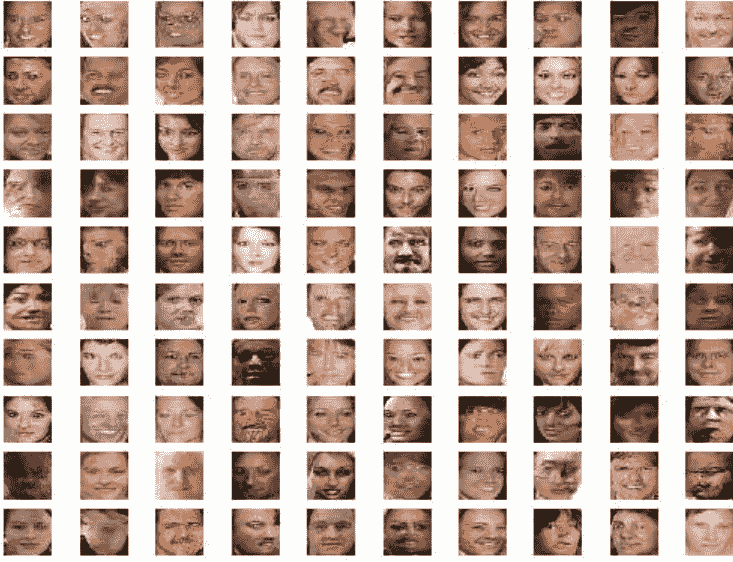

图 9.4：生成对抗网络生成的名人脸示例。

## 9.6 如何探索生成人脸的潜在空间

在本节中，我们将使用训练好的 GAN 模型作为探索潜在空间的基础。

### 9.6.1 如何加载模型并生成人脸

第一步是加载保存的模型并确认它可以生成逼真的人脸。可以使用 Keras API 中的 `load_model()` 函数加载模型。然后，我们可以在潜在空间中生成若干随机点，并将其作为输入提供给加载的模型以生成新人脸。然后可以绘制这些人脸。完整示例如下所示。

```python
# example of loading the generator model and generating images
from numpy.random import randn
from keras.models import load_model
from matplotlib import pyplot

# generate points in latent space as input for the generator
def generate_latent_points(latent_dim, n_samples):
    # generate points in the latent space
    x_input = randn(latent_dim * n_samples)
    # reshape into a batch of inputs for the network
    z_input = x_input.reshape(n_samples, latent_dim)
    return z_input

# create a plot of generated images
def plot_generated(examples, n):
    # plot images
    for i in range(n * n):
        # define subplot
        pyplot.subplot(n, n, 1 + i)
        # turn off axis
        pyplot.axis('off')
        # plot raw pixel data
        pyplot.imshow(examples[i, :, :])
    pyplot.show()

# load model
model = load_model('generator_model_030.h5')
# generate images
latent_points = generate_latent_points(100, 25)
# generate images
X = model.predict(latent_points)
# scale from [-1,1] to [0,1]
X = (X + 1) / 2.0
# plot the result
plot_generated(X, 5)
```

清单 9.28：加载保存的生成器并生成多张人脸的示例。

运行示例首先加载保存的模型。然后，在 100 维潜在空间中创建 25 个随机点，并将其提供给生成器模型以创建 25 张人脸图像，随后以 5 x 5 网格形式绘制出来。

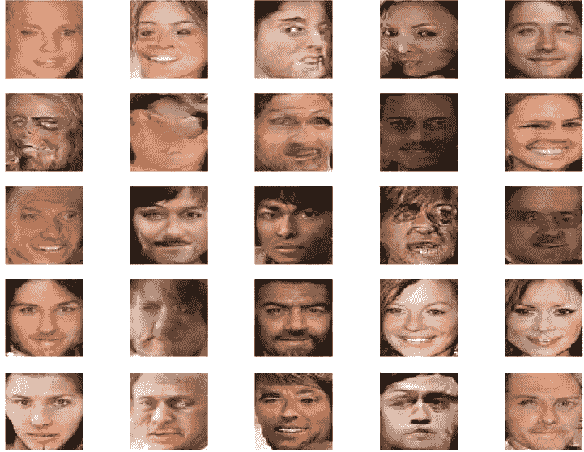

图 9.5：使用加载的 GAN 模型绘制的随机生成人脸图。

### 9.6.2 如何在生成的人脸之间进行插值

接下来，我们可以在潜在空间的两个点之间创建插值路径，并沿此路径生成人脸。我们可以使用的最简单插值是潜在空间中两个点之间的线性或均匀插值。我们可以使用 `linspace()` NumPy 函数计算两个点贡献的比率，然后枚举这些比率并为每个比率构建一个向量。下面的 `interpolate_points()` 函数实现了此功能，并返回潜在空间中两个点之间的一系列线性插值向量，包括第一个点和最后一个点。

```python
# uniform interpolation between two points in latent space
def interpolate_points(p1, p2, n_steps=10):
    # interpolate ratios between the points
    ratios = linspace(0, 1, num=n_steps)
    # linear interpolate vectors
    vectors = list()
    for ratio in ratios:
        v = (1.0 - ratio) * p1 + ratio * p2
        vectors.append(v)
    return asarray(vectors)
```

清单 9.29：用于在潜在空间点之间进行插值的函数示例。


我们可以在潜在空间中生成两个点，执行插值，然后为每个插值向量生成一张图像。结果将是一系列在两张原始图像之间过渡的图像。下面的示例演示了针对两张人脸的此过程。

```python
# example of interpolating between generated faces
from numpy import asarray
from numpy.random import randn
from numpy import linspace
from keras.models import load_model
from matplotlib import pyplot

# generate points in latent space as input for the generator
def generate_latent_points(latent_dim, n_samples):
    # generate points in the latent space
    x_input = randn(latent_dim * n_samples)
    # reshape into a batch of inputs for the network
    z_input = x_input.reshape(n_samples, latent_dim)
    return z_input

# uniform interpolation between two points in latent space
def interpolate_points(p1, p2, n_steps=10):
    # interpolate ratios between the points
    ratios = linspace(0, 1, num=n_steps)
    # linear interpolate vectors
    vectors = list()
    for ratio in ratios:
        v = (1.0 - ratio) * p1 + ratio * p2
        vectors.append(v)
    return asarray(vectors)

# create a plot of generated images
def plot_generated(examples, n):
    # plot images
    for i in range(n):
        # define subplot
        pyplot.subplot(1, n, 1 + i)
        # turn off axis
        pyplot.axis('off')
        # plot raw pixel data
        pyplot.imshow(examples[i, :, :])
    pyplot.show()

# load model
model = load_model('generator_model_030.h5')
# generate points in latent space
pts = generate_latent_points(100, 2)
# interpolate points in latent space
interpolated = interpolate_points(pts[0], pts[1])
# generate images
X = model.predict(interpolated)
# scale from [-1,1] to [0,1]
X = (X + 1) / 2.0
# plot the result
plot_generated(X, len(interpolated))
```

### 列表 9.30: 在潜在空间中两点之间进行线性插值的示例。

运行示例将计算潜在空间中两点之间的插值路径，为每个点生成图像，并绘制结果。您可以看到从左侧第一张人脸到右侧最终人脸的十个步骤中清晰的线性进展。


### 图 9.6: 显示两个GAN生成人脸之间线性插值的图。

我们可以更新示例以多次重复此过程，以便在单个图上查看多个生成人脸之间的过渡。完整示例如下所示。

```python
# example of interpolating between generated faces
from numpy import asarray
from numpy import vstack
from numpy.random import randn
from numpy import linspace
from keras.models import load_model
from matplotlib import pyplot

# generate points in latent space as input for the generator
def generate_latent_points(latent_dim, n_samples):
    # generate points in the latent space
    x_input = randn(latent_dim * n_samples)
    # reshape into a batch of inputs for the network
    z_input = x_input.reshape(n_samples, latent_dim)
    return z_input

# uniform interpolation between two points in latent space
def interpolate_points(p1, p2, n_steps=10):
    # interpolate ratios between the points
    ratios = linspace(0, 1, num=n_steps)
    # linear interpolate vectors
    vectors = list()
    for ratio in ratios:
        v = (1.0 - ratio) * p1 + ratio * p2
        vectors.append(v)
    return asarray(vectors)

# create a plot of generated images
def plot_generated(examples, n):
    # plot images
    for i in range(n * n):
        # define subplot
        pyplot.subplot(n, n, 1 + i)
        # turn off axis
        pyplot.axis('off')
        # plot raw pixel data
        pyplot.imshow(examples[i, :, :])
    pyplot.show()

# load model
model = load_model('generator_model_030.h5')
# generate points in latent space
n = 20
pts = generate_latent_points(100, n)
# interpolate pairs
results = None
for i in range(0, n, 2):
    # interpolate points in latent space
    interpolated = interpolate_points(pts[i], pts[i+1])
    # generate images
    X = model.predict(interpolated)
    # scale from [-1,1] to [0,1]
    X = (X + 1) / 2.0
    if results is None:
        results = X
    else:
        results = vstack((results, X))
# plot the result
plot_generated(results, 10)
```

### 列表 9.31: 在潜在空间中两点之间多次线性插值的示例。

运行示例将创建10个不同的人脸起始点和10个匹配的人脸终点，以及每对之间的线性插值。

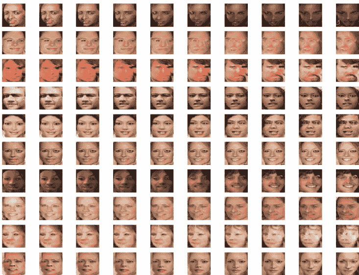

### 图 9.7: 显示两个GAN生成人脸之间多次线性插值的图。

在这些情况下，我们执行了线性插值，该插值假设潜在空间是均匀分布的超立方体。从技术上讲，我们选择的潜在空间是100维超球面或多模态高斯分布。有一个名为球面线性插值函数（即Slerp）的数学函数，在对该空间进行插值时应使用它，以确保考虑到空间的曲率。有关更多详细信息，我建议阅读Soumith Chintala的dcgan.torch项目2中关于线性插值的Issue。在该项目中，提供了Python的Slerp函数实现，我们可以将其作为我们自己的Slerp函数的基础，如下所示：

```python
# spherical linear interpolation (slerp)
def slerp(val, low, high):
    omega = arccos(clip(dot(low/norm(low), high/norm(high)), -1, 1))
    so = sin(omega)
    if so == 0:
        # L'Hopital's rule/LERP
        return (1.0-val) * low + val * high
    return sin((1.0-val)*omega) / so * low + sin(val*omega) / so * high
```

### 列表 9.32: 执行球面线性插值的函数示例。

可以从我们的interpolate_points()函数中调用此函数，而不是执行手动线性插值。包含此更改的完整示例如下所示。

```python
# example of interpolating between generated faces
from numpy import asarray
from numpy import vstack
from numpy.random import randn
from numpy import arccos
from numpy import clip
from numpy import dot
from numpy import sin
from numpy import linspace
from numpy.linalg import norm
from keras.models import load_model
from matplotlib import pyplot

# generate points in latent space as input for the generator
def generate_latent_points(latent_dim, n_samples):
    # generate points in the latent space
    x_input = randn(latent_dim * n_samples)
    # reshape into a batch of inputs for the network
    z_input = x_input.reshape(n_samples, latent_dim)
    return z_input

# spherical linear interpolation (slerp)
def slerp(val, low, high):
    omega = arccos(clip(dot(low/norm(low), high/norm(high)), -1, 1))
    so = sin(omega)
    if so == 0:
        # L'Hopital's rule/LERP
        return (1.0-val) * low + val * high
    return sin((1.0-val)*omega) / so * low + sin(val*omega) / so * high

# uniform interpolation between two points in latent space
def interpolate_points(p1, p2, n_steps=10):
    # interpolate ratios between the points
    ratios = linspace(0, 1, num=n_steps)
    # linear interpolate vectors
    vectors = list()
    for ratio in ratios:
        v = slerp(ratio, p1, p2)
        vectors.append(v)
    return asarray(vectors)

# create a plot of generated images
def plot_generated(examples, n):
    # plot images
    for i in range(n * n):
        # define subplot
        pyplot.subplot(n, n, 1 + i)
        # turn off axis
        pyplot.axis('off')
        # plot raw pixel data
        pyplot.imshow(examples[i, :, :])
    pyplot.show()

# load model
model = load_model('generator_model_030.h5')
# generate points in latent space
n = 20
pts = generate_latent_points(100, n)
# interpolate pairs
results = None
for i in range(0, n, 2):
    # interpolate points in latent space
    interpolated = interpolate_points(pts[i], pts[i+1])
    # generate images
    X = model.predict(interpolated)
    # scale from [-1,1] to [0,1]
    X = (X + 1) / 2.0
    if results is None:
        results = X
    else:
        results = vstack((results, X))
# plot the result
plot_generated(results, 10)
```

### 列表 9.33: 在潜在空间中两点之间多次使用Slerp的示例。

结果是生成人脸之间多出10个过渡，这次使用了正确的Slerp插值方法。差异很微妙，但不知为何从视觉上看更正确。


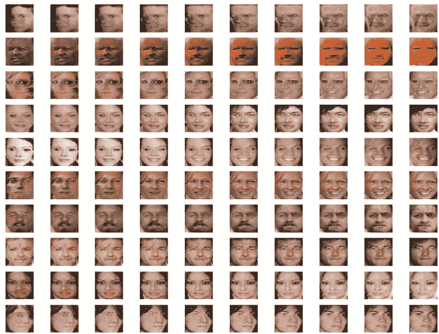

### 图 9.8: 两个 GAN 生成人脸之间多个球面线性插值的图示。

## 9.6.3 如何探索人脸的潜在空间

最后，我们可以通过对生成的人脸进行向量运算来探索潜在空间。首先，我们必须生成大量人脸，并保存人脸及其对应的潜在向量。然后，我们可以查看生成人脸的图表，选择我们感兴趣特征的人脸，记下它们的索引（编号），并检索其潜在空间向量以进行操作。下面的示例将加载 GAN 模型并使用它生成 100 张随机人脸。

```
# example of loading the generator model and generating images
from numpy.random import randn
from keras.models import load_model
from matplotlib import pyplot
from numpy import savez_compressed

# generate points in latent space as input for the generator
def generate_latent_points(latent_dim, n_samples):
    # generate points in the latent space
    x_input = randn(latent_dim * n_samples)
    # reshape into a batch of inputs for the network
    z_input = x_input.reshape(n_samples, latent_dim)
    return z_input
```

```
# create a plot of generated images
def plot_generated(examples, n):
    # plot images
    for i in range(n * n):
        # define subplot
        pyplot.subplot(n, n, 1 + i)
        # turn off axis
        pyplot.axis('off')
        # plot raw pixel data
        pyplot.imshow(examples[i, :, :])
    pyplot.savefig('generated_faces.png')
    pyplot.close()

# load model
model = load_model('generator_model_030.h5')
# generate points in latent space
latent_points = generate_latent_points(100, 100)
# save points
savez_compressed('latent_points.npz', latent_points)
# generate images
X = model.predict(latent_points)
# scale from [-1,1] to [0,1]
X = (X + 1) / 2.0
# save plot
plot_generated(X, 10)
```

### 清单 9.34: 为以后使用生成随机人脸的示例。

运行该示例将加载模型，生成人脸，并保存潜在向量和生成的人脸。潜在向量被保存到名为 latent_points.npz 的压缩 NumPy 数组中。100 张生成的人脸以 10 × 10 网格绘制，并保存在名为 generated_faces.png 的文件中。在此示例中，我们有一组可用于处理的人脸。每张人脸都有一个索引，我们可以使用它来检索潜在向量。例如，第一张人脸是 1，它对应于保存数组中的第一个向量（索引 0）。我们将执行以下运算：

> 微笑女性 - 中性女性 + 中性男性 = 微笑男性 (9.2)

因此，我们需要微笑女性、中性女性和中性男性各三张人脸。在此示例中，我们将在图像中使用以下索引：

- 微笑女性: 92, 98, 99
- 中性女性: 9, 21, 79
- 中性男性: 10, 30, 45


### 图 9.9: 用作人脸向量运算基础的 100 张生成人脸图。

既然我们有可用的潜在向量和目标运算，就可以开始了。首先，我们可以指定偏好的图像并加载保存的潜在点 NumPy 数组。

```
# retrieve specific points
smiling_woman_ix = [92, 98, 99]
neutral_woman_ix = [9, 21, 79]
neutral_man_ix = [10, 30, 45]
# load the saved latent points
data = load('latent_points.npz')
points = data['arr_0']
```

### 清单 9.35: 加载特定预生成潜在点的示例。

接下来，我们可以检索每个向量并计算每种向量类型（例如微笑女性）的平均值。我们可以直接对单个图像执行向量运算，但如果使用几个具有所需属性的人脸的平均值，将获得更稳健的结果。下面的 average_points() 函数获取加载的潜在空间点数组，检索每个点，计算平均值，并返回所有向量。

```
# average list of latent space vectors
def average_points(points, ix):
    # convert to zero offset points
    zero_ix = [i-1 for i in ix]
    # retrieve required points
    vectors = points[zero_ix]
    # average the vectors
    avg_vector = mean(vectors, axis=0)
    # combine original and avg vectors
    all_vectors = vstack((vectors, avg_vector))
    return all_vectors
```

### 清单 9.36: 对多个预生成潜在点求平均的函数示例。

现在我们可以使用此函数检索潜在空间中所需的所有点并生成图像。

```
# average vectors
smiling_woman = average_points(points, smiling_woman_ix)
neutral_woman = average_points(points, neutral_woman_ix)
neutral_man = average_points(points, neutral_man_ix)
# combine all vectors
all_vectors = vstack((smiling_woman, neutral_woman, neutral_man))
# generate images
images = model.predict(all_vectors)
# scale pixel values
images = (images + 1) / 2.0
plot_generated(images, 3, 4)
```

### 清单 9.37: 为平均潜在点生成人脸的示例。

最后，我们可以使用平均向量在潜在空间中执行向量运算并绘制结果。

```
# smiling woman - neutral woman + neutral man = smiling man
result_vector = smiling_woman[-1] - neutral_woman[-1] + neutral_man[-1]
# generate image
result_vector = expand_dims(result_vector, 0)
result_image = model.predict(result_vector)
# scale pixel values
result_image = (result_image + 1) / 2.0
pyplot.imshow(result_image[0])
pyplot.show()
```

### 清单 9.38: 在向量空间中执行运算并从结果生成人脸的示例。

将这些整合在一起，完整示例如下所示。

```
# example of loading the generator model and generating images
from keras.models import load_model
from matplotlib import pyplot
from numpy import load
from numpy import mean
from numpy import vstack
from numpy import expand_dims

# average list of latent space vectors
def average_points(points, ix):
    # convert to zero offset points
    zero_ix = [i-1 for i in ix]
    # retrieve required points
    vectors = points[zero_ix]
    # average the vectors
    avg_vector = mean(vectors, axis=0)
    # combine original and avg vectors
    all_vectors = vstack((vectors, avg_vector))
    return all_vectors

# create a plot of generated images
def plot_generated(examples, rows, cols):
    # plot images
    for i in range(rows * cols):
        # define subplot
        pyplot.subplot(rows, cols, 1 + i)
        # turn off axis
        pyplot.axis('off')
        # plot raw pixel data
        pyplot.imshow(examples[i, :, :])
    pyplot.show()

# load model
model = load_model('generator_model_030.h5')
# retrieve specific points
smiling_woman_ix = [92, 98, 99]
neutral_woman_ix = [9, 21, 79]
neutral_man_ix = [10, 30, 45]
# load the saved latent points
data = load('latent_points.npz')
points = data['arr_0']
# average vectors
smiling_woman = average_points(points, smiling_woman_ix)
neutral_woman = average_points(points, neutral_woman_ix)
neutral_man = average_points(points, neutral_man_ix)
# combine all vectors
all_vectors = vstack((smiling_woman, neutral_woman, neutral_man))
# generate images
images = model.predict(all_vectors)
# scale pixel values
images = (images + 1) / 2.0
plot_generated(images, 3, 4)
# smiling woman - neutral woman + neutral man = smiling man
result_vector = smiling_woman[-1] - neutral_woman[-1] + neutral_man[-1]
# generate image
result_vector = expand_dims(result_vector, 0)
result_image = model.predict(result_vector)
# scale pixel values
result_image = (result_image + 1) / 2.0
pyplot.imshow(result_image[0])
pyplot.show()
```

### 清单 9.39: 在向量空间中执行向量运算的示例。

运行该示例首先加载特定图像在潜在空间中的点，计算点的平均值，并为这些点生成人脸。我们可以看到，我们选择的人脸确实被正确检索，并且向量空间中点的平均值捕捉了我们在每一行中追求的显著特征（例如微笑女性、中性女性等）。


图 9.10：每行选定生成的人脸和平均生成人脸的图。

接下来，执行向量运算，结果是一个微笑的男人，正如我们所期望的那样。


图 9.11：基于潜空间向量运算的生成人脸结果图。

## 9.7 扩展

本节列出了一些可供您探索的扩展教程的想法。

- **额外运算**。尝试使用不同的图像特征或不同的运算进行运算，并查看生成人脸的结果。
- **额外插值**。尝试在潜空间中对三个或更多点进行插值，并查看生成人脸的结果。
- **调整模型**。更新 GAN 模型配置，使训练更稳定并能生成更高质量的人脸。

如果您探索了其中任何扩展，我很乐意了解。

## 9.8 进一步阅读

如果您希望深入了解，本节提供了更多关于该主题的资源。

### 9.8.1 论文

- 使用多任务级联卷积网络进行联合人脸检测与对齐，2016 年。https://arxiv.org/abs/1604.02878
- 使用深度卷积生成对抗网络进行无监督表征学习，2015 年。https://arxiv.org/abs/1511.06434
- 采样生成网络，2016 年。https://arxiv.org/abs/1609.04468

### 9.8.2 API

- Keras API。https://keras.io/
- 如何“冻结” Keras 层？. https://keras.io/getting-started/faq/#how-can-i-freeze-keras-layers
- Matplotlib API。https://matplotlib.org/api/
- numpy.random.rand API。https://docs.scipy.org/doc/numpy/reference/generated/numpy.random.rand.html
- numpy.random.randn API。https://docs.scipy.org/doc/numpy/reference/generated/numpy.random.randn.html
- numpy.zeros API。https://docs.scipy.org/doc/numpy/reference/generated/numpy.zeros.html
- numpy.ones API。https://docs.scipy.org/doc/numpy/reference/generated/numpy.ones.html
- numpy.hstack API。https://docs.scipy.org/doc/numpy/reference/generated/numpy.hstack.html

### 9.8.3 文章

- 大规模 CelebFaces 属性 (CelebA) 数据集。http://mmlab.ie.cuhk.edu.hk/projects/CelebA.html
- CelebFaces 属性 (CelebA) 数据集，Kaggle。https://www.kaggle.com/jessicali9530/celeba-dataset
- MTCNN 人脸检测项目，GitHub。https://github.com/ipazc/mtcnn
- 线性插值？, dcgan.torch 项目，GitHub。https://github.com/soumith/dcgan.torch/issues/14

## 9.9 总结

在本教程中，您了解了如何开发用于人脸生成的生成对抗网络，并探索潜空间的结构及其对生成人脸的影响。具体而言，您学习了：

- 如何开发用于生成人脸的生成对抗网络。
- 如何在潜空间点之间进行插值并生成从一张人脸变形到另一张人脸的图像。
- 如何在潜空间中执行向量运算并在生成的人脸中实现目标效果。

### 9.9.1 下一步

在下一个教程中，您将探讨训练 GAN 模型时常见的故障模式。

## 第 10 章

## 如何识别和诊断 GAN 故障模式

GAN 难以训练。难以训练的原因是，生成器模型和判别器模型在零和博弈中同时进行训练。这意味着一个模型的改进是以另一个模型为代价的。训练两个模型的目标是在两个竞争问题之间找到一个平衡点。这也意味着，每当其中一个模型的参数被更新时，正在求解的优化问题的性质就会发生变化。这会产生动态系统的效果。在神经网络术语中，同时训练两个竞争神经网络的技术挑战在于它们可能无法收敛。

为 GAN 模型的正常收敛和异常收敛（有时称为故障模式）建立直觉很重要。在本教程中，我们将首先为简单的图像生成任务开发一个稳定的 GAN 模型，以确定正常收敛的样子以及通常可以期望什么。然后，我们将以不同方式损坏 GAN 模型，并探讨训练 GAN 模型时可能遇到的一系列故障模式。这些场景将帮助您了解当 GAN 模型无法训练时应寻找或期望什么，以及可以采取什么措施。

完成本教程后，您将了解：

- 如何根据生成器和判别器随时间变化的损失来识别稳定的 GAN 训练过程。
- 如何通过回顾学习曲线和生成的图像来识别模式崩溃。
- 如何通过回顾生成器和判别器损失随时间变化的学习曲线来识别收敛失败。

让我们开始吧。

### 10.1 教程概览

本教程分为三个部分，即：

- 1. 如何识别稳定的 GAN
- 2. 如何识别模式崩溃
- 3. 如何识别收敛失败

### 10.2 如何训练稳定的 GAN

在本节中，我们将训练一个稳定的 GAN 来生成手写数字图像。具体来说，我们将使用 MNIST 手写数字数据集中的数字“8”。该模型的结果将建立一个可用于后续实验的稳定 GAN，以及稳定 GAN 训练过程中生成图像和学习曲线的概貌。

第一步是定义模型。判别器模型以一张 28 × 28 灰度图像作为输入，并输出一个二进制预测，判断图像是真实的（类别 = 1）还是假的（类别 = 0）。它被实现为一个适度的卷积神经网络，采用 GAN 设计的最佳实践，例如使用斜率为 0.2 的 LeakyReLU 激活函数、批量归一化、使用 2 × 2 步长进行下采样，以及使用学习率为 0.0002、动量为 0.5 的 Adam 版本随机梯度下降。下面的 `define_discriminator()` 函数实现了这一点，定义并编译判别器模型并返回它。图像的输入形状被参数化为默认函数参数，以便清楚地说明。

```
# define the standalone discriminator model
def define_discriminator(in_shape=(28,28,1)):
    # weight initialization
    init = RandomNormal(stddev=0.02)
    # define model
    model = Sequential()
    # downsample to 14x14
    model.add(Conv2D(64, (4,4), strides=(2,2), padding='same', kernel_initializer=init,
    input_shape=in_shape))
    model.add(BatchNormalization())
    model.add(LeakyReLU(alpha=0.2))
    # downsample to 7x7
    model.add(Conv2D(64, (4,4), strides=(2,2), padding='same', kernel_initializer=init))
    model.add(BatchNormalization())
    model.add(LeakyReLU(alpha=0.2))
    # classifier
    model.add(Flatten())
    model.add(Dense(1, activation='sigmoid'))
    # compile model
    opt = Adam(lr=0.0002, beta_1=0.5)
    model.compile(loss='binary_crossentropy', optimizer=opt, metrics=['accuracy'])
    return model
```

清单 10.1：定义判别器模型的函数示例。

生成器模型以潜空间中的一个点作为输入，并输出一张 28 × 28 灰度图像。这是通过使用全连接层来解释潜空间中的点并提供足够的激活来实现的，这些激活可以重塑为输出图像低分辨率版本的许多副本（在此示例中为 128 个，例如 7 × 7）。然后使用转置卷积层进行两次上采样，每次将激活的尺寸加倍、面积变为四倍。该模型使用诸如 LeakyReLU 激活、一个核


size that is a factor of the stride size, and a hyperbolic tangent (Tanh) activation function in the output layer.

The define_generator() function below defines the generator model, but intentionally does not compile it as it is not trained directly, then returns the model. The size of the latent space is parameterized as a function argument.

```
# define the standalone generator model
def define_generator(latent_dim):
    # weight initialization
    init = RandomNormal(stddev=0.02)
    # define model
    model = Sequential()
    # foundation for 7x7 image
    n_nodes = 128 * 7 * 7
    model.add(Dense(n_nodes, kernel_initializer=init, input_dim=latent_dim))
    model.add(LeakyReLU(alpha=0.2))
    model.add(Reshape((7, 7, 128)))
    # upsample to 14x14
    model.add(Conv2DTranspose(128, (4,4), strides=(2,2), padding='same',
        kernel_initializer=init))
    model.add(BatchNormalization())
    model.add(LeakyReLU(alpha=0.2))
    # upsample to 28x28
    model.add(Conv2DTranspose(128, (4,4), strides=(2,2), padding='same',
        kernel_initializer=init))
    model.add(BatchNormalization())
    model.add(LeakyReLU(alpha=0.2))
    # output 28x28x1
    model.add(Conv2D(1, (7,7), activation='tanh', padding='same', kernel_initializer=init))
    return model
```

### Listing 10.2: Example of a function for defining the generator model.

Next, a GAN model can be defined that combines both the generator model and the discriminator model into one larger model. This larger model will be used to train the model weights in the generator, using the output and error calculated by the discriminator model. The discriminator model is trained separately, and as such, the model weights are marked as not trainable in this larger GAN model to ensure that only the weights of the generator model are updated. This change to the trainability of the discriminator weights only has an effect when training the combined GAN model, not when training the discriminator standalone.

This larger GAN model takes as input a point in the latent space, uses the generator model to generate an image, which is fed as input to the discriminator model, then output or classified as real or fake. The define_gan() function below implements this, taking the already defined generator and discriminator models as input.

```
# define the combined generator and discriminator model, for updating the generator
def define_gan(generator, discriminator):
    # make weights in the discriminator not trainable
    discriminator.trainable = False
    # connect them
    model = Sequential()
    # add generator
    model.add(generator)
    # add the discriminator
    model.add(discriminator)
    # compile model
    opt = Adam(lr=0.0002, beta_1=0.5)
    model.compile(loss='binary_crossentropy', optimizer=opt)
    return model
```

### Listing 10.3: Example of a function for defining composite model for training the generator.

Now that we have defined the GAN model, we need to train it. But, before we can train the model, we require input data. The first step is to load and scale the MNIST dataset. The whole dataset is loaded via a call to the `load_data()` Keras function, then a subset of the images are selected (about 5,000) that belong to class 8, e.g. are a handwritten depiction of the number eight. Then the pixel values must be scaled to the range [-1,1] to match the output of the generator model. The `load_real_samples()` function below implements this, returning the loaded and scaled subset of the MNIST training dataset ready for modeling.

```
# load mnist images
def load_real_samples():
    # load dataset
    (trainX, trainy), (_, _) = load_data()
    # expand to 3d, e.g. add channels
    X = expand_dims(trainX, axis=-1)
    # select all of the examples for a given class
    selected_ix = trainy == 8
    X = X[selected_ix]
    # convert from ints to floats
    X = X.astype('float32')
    # scale from [0,255] to [-1,1]
    X = (X - 127.5) / 127.5
    return X
```

### Listing 10.4: Example of a function for loading and preparing the MNIST training dataset.

We will require one (or a half) batch of real images from the dataset each update to the GAN model. A simple way to achieve this is to select a random sample of images from the dataset each time. The `generate_real_samples()` function below implements this, taking the prepared dataset as an argument, selecting and returning a random sample of digit images, and their corresponding class label for the discriminator, specifically `class = 1` indicating that they are real images.

```
# select real samples
def generate_real_samples(dataset, n_samples):
    # choose random instances
    ix = randint(0, dataset.shape[0], n_samples)
    # select images
    X = dataset[ix]
    # generate class labels
    y = ones((n_samples, 1))
    return X, y
```

### Listing 10.5: Example of a function for selecting a random sample of real images.

Next, we need inputs for the generator model. These are random points from the latent space, specifically Gaussian distributed random variables. The `generate_latent_points()` function implements this, taking the size of the latent space as an argument and the number of points required, and returning them as a batch of input samples for the generator model.

```
# generate points in latent space as input for the generator
def generate_latent_points(latent_dim, n_samples):
    # generate points in the latent space
    x_input = randn(latent_dim * n_samples)
    # reshape into a batch of inputs for the network
    x_input = x_input.reshape(n_samples, latent_dim)
    return x_input
```

### Listing 10.6: Example of a function for generating random points in latent space.

Next, we need to use the points in the latent space as input to the generator in order to generate new images. The `generate_fake_samples()` function below implements this, taking the generator model and size of the latent space as arguments, then generating points in the latent space and using them as input to the generator model. The function returns the generated images and their corresponding class label for the discriminator model, specifically `class = 0` to indicate they are fake or generated.

```
# use the generator to generate n fake examples, with class labels
def generate_fake_samples(generator, latent_dim, n_samples):
    # generate points in latent space
    x_input = generate_latent_points(latent_dim, n_samples)
    # predict outputs
    X = generator.predict(x_input)
    # create class labels
    y = zeros((n_samples, 1))
    return X, y
```

### Listing 10.7: Example of a function for generating fake of synthesized images.

We need to record the performance of the model. Perhaps the most reliable way to evaluate the performance of a GAN is to use the generator to generate images, and then review and subjectively evaluate them. The `summarize_performance()` function below takes the generator model at a given point during training and uses it to generate 100 images in a 10 x 10 grid that are then plotted and saved to file. The model is also saved to file at this time, in case we would like to use it later to generate more images.

```
# generate samples and save as a plot and save the model
def summarize_performance(step, g_model, latent_dim, n_samples=100):
    # prepare fake examples
    X, _ = generate_fake_samples(g_model, latent_dim, n_samples)
    # scale from [-1,1] to [0,1]
    X = (X + 1) / 2.0
    # plot images
    for i in range(10 * 10):
        # define subplot
        pyplot.subplot(10, 10, 1 + i)
        # turn off axis
        pyplot.axis('off')
        # plot raw pixel data
        pyplot.imshow(X[i, :, :, 0], cmap='gray_r')
    # save plot to file
    pyplot.savefig('results_baseline/generated_plot_%03d.png' % (step+1))
    pyplot.close()
    # save the generator model
    g_model.save('results_baseline/model_%03d.h5' % (step+1))
```

### Listing 10.8: Example of a function for summarizing model performance.

In addition to image quality, it is a good idea to keep track of the loss and accuracy of the model over time. The loss and classification accuracy for the discriminator for real and fake samples can be tracked for each model update, as can the loss for the generator for each update. These can then be used to create line plots of loss and accuracy at the end of the training run. The plot_history() function below implements this and saves the results to file.

```
# create a line plot of loss for the gan and save to file
def plot_history(d1_hist, d2_hist, g_hist, a1_hist, a2_hist):
    # plot loss
    pyplot.subplot(2, 1, 1)
    pyplot.plot(d1_hist, label='d-real')
    pyplot.plot(d2_hist, label='d-fake')
    pyplot.plot(g_hist, label='gen')
    pyplot.legend()
    # plot discriminator accuracy
    pyplot.subplot(2, 1, 2)
    pyplot.plot(a1_hist, label='acc-real')
    pyplot.plot(a2_hist, label='acc-fake')
    pyplot.legend()
    # save plot to file
    pyplot.savefig('results_baseline/plot_line_plot_loss.png')
    pyplot.close()
```

### Listing 10.9: Example of a function for creating and saving a plot of model loss.

We are now ready to fit the GAN model. The model is fit for 10 training epochs, which is arbitrary, as the model begins generating plausible number-8 digits after perhaps the first few epochs. A batch size of 128 samples is used, and each training epoch involves 5851/128 or about 45 batches of real and fake samples and updates to the model. The model is therefore trained for 10 epochs of 45 batches, or 450 iterations. First, the discriminator model is updated for a half batch of real samples, then a half batch of fake samples, together forming one batch of weight updates. The generator is then updated via the composite GAN model. Importantly, the class label is set to 1, or real, for the fake samples. This has the effect of updating the generator toward getting better at generating real samples on the next batch.

The train() function below implements this, taking the defined models, dataset, and size of the latent dimension as arguments and parameterizing the number of epochs and batch size with default arguments. The generator model is saved at the end of training. The performance of the discriminator and generator models is reported each iteration. Sample images are generated and saved every epoch, and line plots of model performance are created and saved at the end of the run.

```
# train the generator and discriminator
def train(g_model, d_model, gan_model, dataset, latent_dim, n_epochs=10, n_batch=128):
    # calculate the number of batches per epoch
    bat_per_epo = int(dataset.shape[0] / n_batch)
    # calculate the total iterations based on batch and epoch
    n_steps = bat_per_epo * n_epochs
    # calculate the number of samples in half a batch
    half_batch = int(n_batch / 2)
    # prepare lists for storing stats each iteration
```


### 清单 10.10: 用于训练 GAN 模型的函数示例。

```python
d1_hist, d2_hist, g_hist, a1_hist, a2_hist = list(), list(), list(), list(), list()
# manually enumerate epochs
for i in range(n_steps):
    # get randomly selected 'real' samples
    X_real, y_real = generate_real_samples(dataset, half_batch)
    # update discriminator model weights
    d_loss1, d_acc1 = d_model.train_on_batch(X_real, y_real)
    # generate 'fake' examples
    X_fake, y_fake = generate_fake_samples(g_model, latent_dim, half_batch)
    # update discriminator model weights
    d_loss2, d_acc2 = d_model.train_on_batch(X_fake, y_fake)
    # prepare points in latent space as input for the generator
    X_gan = generate_latent_points(latent_dim, n_batch)
    # create inverted labels for the fake samples
    y_gan = ones((n_batch, 1))
    # update the generator via the discriminator's error
    g_loss = gan_model.train_on_batch(X_gan, y_gan)
    # summarize loss on this batch
    print('>%d, d1=%.3f, d2=%.3f g=%.3f, a1=%d, a2=%d' %
        (i+1, d_loss1, d_loss2, g_loss, int(100*d_acc1), int(100*d_acc2)))
    # record history
    d1_hist.append(d_loss1)
    d2_hist.append(d_loss2)
    g_hist.append(g_loss)
    a1_hist.append(d_acc1)
    a2_hist.append(d_acc2)
    # evaluate the model performance every 'epoch'
    if (i+1) % bat_per_epo == 0:
        summarize_performance(i, g_model, latent_dim)
plot_history(d1_hist, d2_hist, g_hist, a1_hist, a2_hist)
```

现在所有函数都已定义，我们可以创建用于存储图像和模型的目录（在此例中为 results_baseline），创建模型，加载数据集，并开始训练过程。

### 清单 10.11: 配置和运行训练过程的示例。

```python
...
# make folder for results
makedirs('results_baseline', exist_ok=True)
# size of the latent space
latent_dim = 50
# create the discriminator
discriminator = define_discriminator()
# create the generator
generator = define_generator(latent_dim)
# create the gan
gan_model = define_gan(generator, discriminator)
# load image data
dataset = load_real_samples()
print(dataset.shape)
# train model
train(generator, discriminator, gan_model, dataset, latent_dim)
```

将所有内容整合在一起，完整示例如下所示。

```python
# example of training a stable gan for generating a handwritten digit
from os import makedirs
from numpy import expand_dims
from numpy import zeros
from numpy import ones
from numpy.random import randn
from numpy.random import randint
from keras.datasets.mnist import load_data
from keras.optimizers import Adam
from keras.models import Sequential
from keras.layers import Dense
from keras.layers import Reshape
from keras.layers import Flatten
from keras.layers import Conv2D
from keras.layers import Conv2DTranspose
from keras.layers import LeakyReLU
from keras.layers import BatchNormalization
from keras.initializers import RandomNormal
from matplotlib import pyplot

# define the standalone discriminator model
def define_discriminator(in_shape=(28,28,1)):
    # weight initialization
    init = RandomNormal(stddev=0.02)
    # define model
    model = Sequential()
    # downsample to 14x14
    model.add(Conv2D(64, (4,4), strides=(2,2), padding='same', kernel_initializer=init,
        input_shape=in_shape))
    model.add(BatchNormalization())
    model.add(LeakyReLU(alpha=0.2))
    # downsample to 7x7
    model.add(Conv2D(64, (4,4), strides=(2,2), padding='same', kernel_initializer=init))
    model.add(BatchNormalization())
    model.add(LeakyReLU(alpha=0.2))
    # classifier
    model.add(Flatten())
    model.add(Dense(1, activation='sigmoid'))
    # compile model
    opt = Adam(lr=0.0002, beta_1=0.5)
    model.compile(loss='binary_crossentropy', optimizer=opt, metrics=['accuracy'])
    return model

# define the standalone generator model
def define_generator(latent_dim):
    # weight initialization
    init = RandomNormal(stddev=0.02)
    # define model
    model = Sequential()
    # foundation for 7x7 image
    n_nodes = 128 * 7 * 7
    model.add(Dense(n_nodes, kernel_initializer=init, input_dim=latent_dim))
    model.add(LeakyReLU(alpha=0.2))
    model.add(Reshape((7, 7, 128)))
    # upsample to 14x14
    model.add(Conv2DTranspose(128, (4,4), strides=(2,2), padding='same',
                          kernel_initializer=init))
    model.add(BatchNormalization())
    model.add(LeakyReLU(alpha=0.2))
    # upsample to 28x28
    model.add(Conv2DTranspose(128, (4,4), strides=(2,2), padding='same',
                          kernel_initializer=init))
    model.add(BatchNormalization())
    model.add(LeakyReLU(alpha=0.2))
    # output 28x28x1
    model.add(Conv2D(1, (7,7), activation='tanh', padding='same', kernel_initializer=init))
    return model

# define the combined generator and discriminator model, for updating the generator
def define_gan(generator, discriminator):
    # make weights in the discriminator not trainable
    discriminator.trainable = False
    # connect them
    model = Sequential()
    # add generator
    model.add(generator)
    # add the discriminator
    model.add(discriminator)
    # compile model
    opt = Adam(lr=0.0002, beta_1=0.5)
    model.compile(loss='binary_crossentropy', optimizer=opt)
    return model

# load mnist images
def load_real_samples():
    # load dataset
    (trainX, trainy), (_, _) = load_data()
    # expand to 3d, e.g. add channels
    X = expand_dims(trainX, axis=-1)
    # select all of the examples for a given class
    selected_ix = trainy == 8
    X = X[selected_ix]
    # convert from ints to floats
    X = X.astype('float32')
    # scale from [0,255] to [-1,1]
    X = (X - 127.5) / 127.5
    return X

# select real samples
def generate_real_samples(dataset, n_samples):
    # choose random instances
    ix = randint(0, dataset.shape[0], n_samples)
    # select images
    X = dataset[ix]
    # generate class labels
    y = ones((n_samples, 1))
    return X, y

# generate points in latent space as input for the generator
def generate_latent_points(latent_dim, n_samples):
    # generate points in the latent space
    x_input = randn(latent_dim * n_samples)
    # reshape into a batch of inputs for the network
    x_input = x_input.reshape(n_samples, latent_dim)
    return x_input

# use the generator to generate n fake examples, with class labels
def generate_fake_samples(generator, latent_dim, n_samples):
    # generate points in latent space
    x_input = generate_latent_points(latent_dim, n_samples)
    # predict outputs
    X = generator.predict(x_input)
    # create class labels
    y = zeros((n_samples, 1))
    return X, y

# generate samples and save as a plot and save the model
def summarize_performance(step, g_model, latent_dim, n_samples=100):
    # prepare fake examples
    X, _ = generate_fake_samples(g_model, latent_dim, n_samples)
    # scale from [-1,1] to [0,1]
    X = (X + 1) / 2.0
    # plot images
    for i in range(10 * 10):
        # define subplot
        pyplot.subplot(10, 10, 1 + i)
        # turn off axis
        pyplot.axis('off')
        # plot raw pixel data
        pyplot.imshow(X[i, :, :, 0], cmap='gray_r')
    # save plot to file
    pyplot.savefig('results_baseline/generated_plot_%03d.png' % (step+1))
    pyplot.close()
    # save the generator model
    g_model.save('results_baseline/model_%03d.h5' % (step+1))

# create a line plot of loss for the gan and save to file
def plot_history(d1_hist, d2_hist, g_hist, a1_hist, a2_hist):
    # plot loss
    pyplot.subplot(2, 1, 1)
    pyplot.plot(d1_hist, label='d-real')
    pyplot.plot(d2_hist, label='d-fake')
    pyplot.plot(g_hist, label='gen')
    pyplot.legend()
    # plot discriminator accuracy
    pyplot.subplot(2, 1, 2)
    pyplot.plot(a1_hist, label='acc-real')
    pyplot.plot(a2_hist, label='acc-fake')
    pyplot.legend()
    # save plot to file
    pyplot.savefig('results_baseline/plot_line_plot_loss.png')
    pyplot.close()

# train the generator and discriminator
def train(g_model, d_model, gan_model, dataset, latent_dim, n_epochs=10, n_batch=128):
    # calculate the number of batches per epoch
    bat_per_epo = int(dataset.shape[0] / n_batch)
```


```
# calculate the total iterations based on batch and epoch
n_steps = bat_per_epo * n_epochs
# calculate the number of samples in half a batch
half_batch = int(n_batch / 2)
# prepare lists for storing stats each iteration
d1_hist, d2_hist, g_hist, a1_hist, a2_hist = list(), list(), list(), list(), list()
# manually enumerate epochs
for i in range(n_steps):
	# get randomly selected 'real' samples
	X_real, y_real = generate_real_samples(dataset, half_batch)
	# update discriminator model weights
	d_loss1, d_acc1 = d_model.train_on_batch(X_real, y_real)
	# generate 'fake' examples
	X_fake, y_fake = generate_fake_samples(g_model, latent_dim, half_batch)
	# update discriminator model weights
	d_loss2, d_acc2 = d_model.train_on_batch(X_fake, y_fake)
	# prepare points in latent space as input for the generator
	X_gan = generate_latent_points(latent_dim, n_batch)
	# create inverted labels for the fake samples
	y_gan = ones((n_batch, 1))
	# update the generator via the discriminator's error
	g_loss = gan_model.train_on_batch(X_gan, y_gan)
	# summarize loss on this batch
	print('>%d, d1=%%.3f, d2=%%.3f g=%%.3f, a1=%%d, a2=%%d ' % (i+1, d_loss1, d_loss2, g_loss, int(100*d_acc1), int(100*d_acc2)))
	# record history
	d1_hist.append(d_loss1)
	d2_hist.append(d_loss2)
	g_hist.append(g_loss)
	a1_hist.append(d_acc1)
	a2_hist.append(d_acc2)
	# evaluate the model performance every 'epoch'
	if (i+1) % bat_per_epo == 0:
		summarize_performance(i, g_model, latent_dim)
		plot_history(d1_hist, d2_hist, g_hist, a1_hist, a2_hist)

# make folder for results
makedirs('results_baseline', exist_ok=True)
# size of the latent space
latent_dim = 50
# create the discriminator
discriminator = define_discriminator()
# create the generator
generator = define_generator(latent_dim)
# create the gan
gan_model = define_gan(generator, discriminator)
# load image data
dataset = load_real_samples()
print(dataset.shape)
# train model
train(generator, discriminator, gan_model, dataset, latent_dim)
```

列表 10.12：在部分MNIST手写数字数据集上拟合GAN模型的示例。

运行该示例很快，在没有GPU的现代硬件上大约需要10分钟。

注意：由于学习算法的随机性，您的具体结果可能会有所不同。建议运行该示例几次并比较平均性能。

首先，训练循环的每次迭代都会将判别器的损失和准确率以及生成器模型的损失报告到控制台。这一点很重要。稳定的GAN的判别器损失大约在0.5左右，通常在0.5到0.7或0.8之间。生成器损失通常较高，可能在1.0、1.5、2.0或更高的值附近波动。

判别器在真实图像和生成（伪）图像上的准确率不会是50%，而通常应在70%到80%左右波动。对于判别器和生成器来说，在模型收敛到稳定平衡之前，其行为可能起初比较不稳定且波动较大。

```
>1, d1=0.859, d2=0.664 g=0.872, a1=37, a2=59
>2, d1=0.190, d2=1.429 g=0.555, a1=100, a2=10
>3, d1=0.094, d2=1.467 g=0.597, a1=100, a2=4
>4, d1=0.097, d2=1.315 g=0.686, a1=100, a2=9
>5, d1=0.100, d2=1.241 g=0.714, a1=100, a2=9
...
>446, d1=0.593, d2=0.546 g=1.330, a1=76, a2=82
>447, d1=0.551, d2=0.739 g=0.981, a1=82, a2=39
>448, d1=0.628, d2=0.505 g=1.420, a1=79, a2=89
>449, d1=0.641, d2=0.533 g=1.381, a1=60, a2=85
>450, d1=0.550, d2=0.731 g=1.100, a1=76, a2=42
```

列表 10.13：在部分MNIST手写数字数据集上拟合GAN模型的示例输出。

运行结束时会创建并保存损失和准确率的折线图。该图包含两个子图。顶部子图显示了真实图像的判别器损失（蓝色）、生成伪图像的判别器损失（橙色）以及生成伪图像的生成器损失（绿色）的折线图。可以看到，运行早期这三个损失都有些不稳定，直到大约第100个epoch到第300个epoch才趋于稳定。之后损失保持稳定，尽管方差会增加。这是训练期间正常或预期损失的示例。也就是说，真实样本和伪样本的判别器损失大约相同，在0.5左右，而生成器的损失略高，在0.5到2.0之间。如果生成器模型能够生成可信的图像，那么预期这些图像是在第100到第300个epoch之间生成的，很可能在第300到第450个epoch之间也是如此。

底部子图显示了训练期间判别器在真实（蓝色）和伪（橙色）图像上的准确率折线图。我们看到与损失子图类似的结构，即两种图像类型的准确率起初差异很大，然后在第100到第300个epoch之间稳定在70%到80%左右，之后保持稳定，尽管方差增加。这些模式和绝对值的时间尺度（例如迭代次数或训练epoch数）会因问题和GAN模型类型而异，尽管该图为训练稳定GAN模型时的预期提供了良好的基准。


图 10.1：稳定生成对抗网络的损失和准确率折线图。

最后，我们可以查看生成图像的样本。我们使用反向灰度颜色映射生成图像，这意味着背景上的正常白色图形被反转为白色背景上的黑色图形。这样做是为了使生成的图形更易于审查。正如我们所料，第100个epoch之前生成的图像样本质量相对较差。


图 10.2：来自稳定GAN在第45个epoch生成的100张手写数字8生成图像样本。

第100到第300个epoch之间生成的图像样本是可信的，可能也是质量最好的。


图 10.3：来自稳定GAN在第180个epoch生成的100张手写数字8生成图像样本。

第300个epoch之后生成的图像样本仍然可信，尽管可能有更多噪声，例如背景噪声。


图 10.4：来自稳定GAN在第450个epoch生成的100张手写数字8生成图像样本。

这些结果很重要，因为它们强调了生成的质量在运行过程中会且确实会有所变化，即使训练过程变得稳定之后也是如此。在训练稳定性达到某个点之后，更多的训练迭代可能会也可能不会产生更高质量的图像。我们可以将这些关于稳定GAN训练的观察总结如下：

- 真实图像和伪图像的判别器损失预计在0.5左右。
- 伪图像的生成器损失预计在0.5到2.0之间。
- 真实图像和伪图像的判别器准确率预计在80%左右。
- 生成器和判别器损失的方差预计保持适度。
- 生成器预计在稳定期间产生最高质量的图像。
- 训练稳定性可能会退化为高方差损失和相应较低质量生成图像的时期。

现在我们有了一个稳定的GAN模型，可以着手修改它以产生一些特定的失败案例。在训练新问题的GAN模型时，常见的两个失败案例是模式崩溃和收敛失败。

## 10.3 如何识别模式崩溃

模式崩溃是指生成器模型只能生成一种或一小部分不同的结果或模式。在这里，模式是指输出分布，例如多模态函数是指具有多个峰值或最优解的函数。对于GAN生成器模型，模式失败意味着输入潜在空间中的大量点（在许多情况下是100维的超球面）会产生一种或一小部分生成的图像。

模式崩溃，也称为该场景，是指生成器学习将多个不同的输入z值映射到同一输出点时出现的问题。

> — NIPS 2016 教程：生成对抗网络，2016。

通过审查大量生成的图像样本，可以识别模式崩溃。图像将显示多样性低，同一张相同图像或同一小部分相同图像会重复多次。通过审查模型损失的折线图，也可以识别模式崩溃。折线图将显示损失随时间的波动，最显著的是在生成器模型中，因为生成器模型被更新并从生成一种模式跳转到具有不同损失的另一种模式。我们可以通过多种方式损害我们的稳定GAN以导致模式崩溃。也许最可靠的方法是直接限制潜在维度的大小，迫使模型只生成一小部分可信的输出。具体来说，可以将 `latent_dim` 变量从100更改为1，然后重新运行实验。

```
...
# size of the latent space
latent_dim = 1
...
```

列表 10.14：减小潜在空间大小的示例。

为完整起见，完整的代码清单如下所示。

```
# example of training an unstable gan for generating a handwritten digit
from os import makedirs
from numpy import expand_dims
from numpy import zeros
from numpy import ones
from numpy.random import randn
from numpy.random import randint
from keras.datasets.mnist import load_data
from keras.optimizers import Adam
from keras.models import Sequential
from keras.layers import Dense
from keras.layers import Reshape
from keras.layers import Flatten
from keras.layers import Conv2D
from keras.layers import Conv2DTranspose
from keras.layers import LeakyReLU
from keras.layers import BatchNormalization
from keras.initializers import RandomNormal
from matplotlib import pyplot
```


```python
# define the standalone discriminator model
def define_discriminator(in_shape=(28,28,1)):
    # weight initialization
    init = RandomNormal(stddev=0.02)
    # define model
    model = Sequential()
    # downsample to 14x14
    model.add(Conv2D(64, (4,4), strides=(2,2), padding='same', kernel_initializer=init,
        input_shape=in_shape))
    model.add(BatchNormalization())
    model.add(LeakyReLU(alpha=0.2))
    # downsample to 7x7
    model.add(Conv2D(64, (4,4), strides=(2,2), padding='same', kernel_initializer=init))
    model.add(BatchNormalization())
    model.add(LeakyReLU(alpha=0.2))
    # classifier
    model.add(Flatten())
    model.add(Dense(1, activation='sigmoid'))
    # compile model
    opt = Adam(lr=0.0002, beta_1=0.5)
    model.compile(loss='binary_crossentropy', optimizer=opt, metrics=['accuracy'])
    return model

# define the standalone generator model
def define_generator(latent_dim):
    # weight initialization
    init = RandomNormal(stddev=0.02)
    # define model
    model = Sequential()
    # foundation for 7x7 image
    n_nodes = 128 * 7 * 7
    model.add(Dense(n_nodes, kernel_initializer=init, input_dim=latent_dim))
    model.add(LeakyReLU(alpha=0.2))
    model.add(Reshape((7, 7, 128)))
    # upsample to 14x14
    model.add(Conv2DTranspose(128, (4,4), strides=(2,2), padding='same',
        kernel_initializer=init))
    model.add(BatchNormalization())
    model.add(LeakyReLU(alpha=0.2))
    # upsample to 28x28
    model.add(Conv2DTranspose(128, (4,4), strides=(2,2), padding='same',
        kernel_initializer=init))
    model.add(BatchNormalization())
    model.add(LeakyReLU(alpha=0.2))
    # output 28x28x1
    model.add(Conv2D(1, (7,7), activation='tanh', padding='same', kernel_initializer=init))
    return model

# define the combined generator and discriminator model, for updating the generator
def define_gan(generator, discriminator):
    # make weights in the discriminator not trainable
    discriminator.trainable = False
    # connect them
    model = Sequential()
    # add generator
    model.add(generator)
    # add the discriminator
    model.add(discriminator)
    # compile model
    opt = Adam(lr=0.0002, beta_1=0.5)
    model.compile(loss='binary_crossentropy', optimizer=opt)
    return model

# load mnist images
def load_real_samples():
    # load dataset
    (trainX, trainy), (_, _) = load_data()
    # expand to 3d, e.g. add channels
    X = expand_dims(trainX, axis=-1)
    # select all of the examples for a given class
    selected_ix = trainy == 8
    X = X[selected_ix]
    # convert from ints to floats
    X = X.astype('float32')
    # scale from [0,255] to [-1,1]
    X = (X - 127.5) / 127.5
    return X

# select real samples
def generate_real_samples(dataset, n_samples):
    # choose random instances
    ix = randint(0, dataset.shape[0], n_samples)
    # select images
    X = dataset[ix]
    # generate class labels
    y = ones((n_samples, 1))
    return X, y

# generate points in latent space as input for the generator
def generate_latent_points(latent_dim, n_samples):
    # generate points in the latent space
    x_input = randn(latent_dim * n_samples)
    # reshape into a batch of inputs for the network
    x_input = x_input.reshape(n_samples, latent_dim)
    return x_input

# use the generator to generate n fake examples, with class labels
def generate_fake_samples(generator, latent_dim, n_samples):
    # generate points in latent space
    x_input = generate_latent_points(latent_dim, n_samples)
    # predict outputs
    X = generator.predict(x_input)
    # create class labels
    y = zeros((n_samples, 1))
    return X, y

# generate samples and save as a plot and save the model
def summarize_performance(step, g_model, latent_dim, n_samples=100):
    # prepare fake examples
    X, _ = generate_fake_samples(g_model, latent_dim, n_samples)
    # scale from [-1,1] to [0,1]
    X = (X + 1) / 2.0
    # plot images
    for i in range(10 * 10):
        # define subplot
        pyplot.subplot(10, 10, 1 + i)
        # turn off axis
        pyplot.axis('off')
        # plot raw pixel data
        pyplot.imshow(X[i, :, :, 0], cmap='gray_r')
    # save plot to file
    pyplot.savefig('results_collapse/generated_plot.%03d.png' % (step+1))
    pyplot.close()
    # save the generator model
    g_model.save('results_collapse/model_%03d.h5' % (step+1))

# create a line plot of loss for the gan and save to file
def plot_history(d1_hist, d2_hist, g_hist, a1_hist, a2_hist):
    # plot loss
    pyplot.subplot(2, 1, 1)
    pyplot.plot(d1_hist, label='d-real')
    pyplot.plot(d2_hist, label='d-fake')
    pyplot.plot(g_hist, label='gen')
    pyplot.legend()
    # plot discriminator accuracy
    pyplot.subplot(2, 1, 2)
    pyplot.plot(a1_hist, label='acc-real')
    pyplot.plot(a2_hist, label='acc-fake')
    pyplot.legend()
    # save plot to file
    pyplot.savefig('results_collapse/plot_line_plot_loss.png')
    pyplot.close()

# train the generator and discriminator
def train(g_model, d_model, gan_model, dataset, latent_dim, n_epochs=10, n_batch=128):
    # calculate the number of batches per epoch
    bat_per_epo = int(dataset.shape[0] / n_batch)
    # calculate the total iterations based on batch and epoch
    n_steps = bat_per_epo * n_epochs
    # calculate the number of samples in half a batch
    half_batch = int(n_batch / 2)
    # prepare lists for storing stats each iteration
    d1_hist, d2_hist, g_hist, a1_hist, a2_hist = list(), list(), list(), list(), list()
    # manually enumerate epochs
    for i in range(n_steps):
        # get randomly selected 'real' samples
        X_real, y_real = generate_real_samples(dataset, half_batch)
        # update discriminator model weights
        d_loss1, d_acc1 = d_model.train_on_batch(X_real, y_real)
        # generate 'fake' examples
        X_fake, y_fake = generate_fake_samples(g_model, latent_dim, half_batch)
        # update discriminator model weights
        d_loss2, d_acc2 = d_model.train_on_batch(X_fake, y_fake)
        # prepare points in latent space as input for the generator
        X_gan = generate_latent_points(latent_dim, n_batch)
        # create inverted labels for the fake samples
        y_gan = ones((n_batch, 1))
        # update the generator via the discriminator's error
        g_loss = gan_model.train_on_batch(X_gan, y_gan)
        # summarize loss on this batch
        print('>%d, d1=%.3f, d2=%.3f g=%.3f, a1=%d, a2=%d ' %
            (i+1, d_loss1, d_loss2, g_loss, int(100*d_acc1), int(100*d_acc2)))
        # record history
        d1_hist.append(d_loss1)
        d2_hist.append(d_loss2)
        g_hist.append(g_loss)
        a1_hist.append(d_acc1)
        a2_hist.append(d_acc2)
        # evaluate the model performance every 'epoch'
        if (i+1) % bat_per_epo == 0:
            summarize_performance(i, g_model, latent_dim)
    plot_history(d1_hist, d2_hist, g_hist, a1_hist, a2_hist)

# make folder for results
makedirs('results_collapse', exist_ok=True)
# size of the latent space
latent_dim = 1
# create the discriminator
discriminator = define_discriminator()
# create the generator
generator = define_generator(latent_dim)
# create the gan
gan_model = define_gan(generator, discriminator)
# load image data
dataset = load_real_samples()
print(dataset.shape)
# train model
train(generator, discriminator, gan_model, dataset, latent_dim)
```

清单 10.15：带有模式崩溃的 GAN 模型拟合示例。

运行该示例将像以前一样，在训练的每个步骤报告损失和准确率。
在这种情况下，判别器的损失处于合理范围内，尽管生成器的损失会上下波动。判别器的准确率也显示出较高值，许多在 100% 左右，这意味着对于许多批次，它在识别真实或虚假示例方面具有完美的技能，这是图像质量或多样性的不良迹象。

```
>1, d1=0.963, d2=0.699 g=0.614, a1=28, a2=54
>2, d1=0.185, d2=5.084 g=0.097, a1=96, a2=0
>3, d1=0.088, d2=4.861 g=0.065, a1=100, a2=0
>4, d1=0.077, d2=4.202 g=0.090, a1=100, a2=0
>5, d1=0.062, d2=3.533 g=0.128, a1=100, a2=0
...
>446, d1=0.277, d2=0.261 g=0.684, a1=95, a2=100
>447, d1=0.201, d2=0.247 g=0.713, a1=96, a2=100
>448, d1=0.285, d2=0.285 g=0.728, a1=89, a2=100
>449, d1=0.351, d2=0.467 g=1.184, a1=92, a2=81
>450, d1=0.492, d2=0.388 g=1.351, a1=76, a2=100
```

清单 10.16：带有模式崩溃的 GAN 模型拟合的示例输出。

创建并保存了带有学习曲线和准确率折线图的图表。在顶部子图中，我们可以看到生成器的损失（绿色）随时间从合理值波动到高值，周期约为 25 次模型更新（批次）。我们还可以看到一些小


鉴别器在真实样本和假样本上的损失出现震荡（橙色和蓝色）。在底部子图中，我们可以看到，鉴别器在整个运行过程中对假图像的分类准确率始终很高。这表明生成器以某种一致的方式生成样本的能力较差，这使得鉴别器很容易识别出假图像。


图 10.5：带有模式崩溃的生成对抗网络的损失和准确率折线图。

查看生成的图像显示了模式崩溃的预期特征，即许多几乎相同的生成示例，无论潜在空间中的输入点如何。碰巧的是，我们将潜在空间的维度改为非常小，以强制产生这种效果。我选择了一个有助于说明这一点的生成图像示例。图中似乎只有几种类型的数字8，一个向左倾斜，一个向右倾斜，还有一个模糊地竖直放置。我在下面的图像中对一些相似的示例画了方框，以便更清楚地说明这一点。


图 10.6：来自遭受模式崩溃的GAN在315个时代生成的100个手写数字8的样本。

鉴于DCGAN模型架构和训练配置的研究结果，训练期间模式崩溃较少见。总结来说，你可以按以下方式识别模式崩溃：

- 生成器（以及可能的鉴别器）的损失预计会随时间震荡。
- 生成器模型预计会从潜在空间的不同点生成相同的输出图像。

## 10.4 如何识别收敛失败

训练GAN时最常见的失败可能是收敛失败。通常，当模型损失在训练过程中不稳定时，神经网络就会无法收敛。在GAN的情况下，收敛失败是指找不到鉴别器和生成器之间的平衡。你识别此类失败的可能方式是鉴别器的损失降至零或接近零。在某些情况下，生成器的损失在同一时期也可能上升并继续上升。

这种损失最常见的原因是生成器输出了鉴别器可以轻松识别的垃圾图像。这种失败可能发生在运行开始时并贯穿整个训练过程，此时你应该停止训练过程。对于某些不稳定的GAN，GAN可能会陷入这种失败模式进行若干批次更新，甚至若干个时代，然后恢复。有许多方法可以破坏我们稳定的GAN以实现收敛失败，例如将一个或两个模型更改为容量不足，将Adam优化算法更改为过于激进，以及在模型中使用非常大或非常小的内核大小。

在这种情况下，我们将更新示例，在更新鉴别器时合并真实样本和假样本。这个简单的更改会导致模型无法收敛。这个更改简单到只需使用`vstack()`NumPy函数合并真实样本和假样本，然后调用`train_on_batch()`函数来更新鉴别器模型。结果也是单个损失和准确率分数，这意味着模型性能的报告也必须更新。为完整起见，下面提供了包含这些更改的完整代码清单。

```
# example of training an unstable gan for generating a handwritten digit
from os import makedirs
from numpy import expand_dims
from numpy import zeros
from numpy import ones
from numpy import vstack
from numpy.random import randn
from numpy.random import randint
from keras.datasets.mnist import load_data
from keras.optimizers import Adam
from keras.models import Sequential
from keras.layers import Dense
from keras.layers import Reshape
from keras.layers import Flatten
from keras.layers import Conv2D
from keras.layers import Conv2DTranspose
from keras.layers import LeakyReLU
from keras.layers import BatchNormalization
from keras.initializers import RandomNormal
from matplotlib import pyplot

# define the standalone discriminator model
def define_discriminator(in_shape=(28,28,1)):
    # weight initialization
    init = RandomNormal(stddev=0.02)
    # define model
    model = Sequential()
    # downsample to 14x14
    model.add(Conv2D(64, (4,4), strides=(2,2), padding='same', kernel_initializer=init, input_shape=in_shape))
    model.add(BatchNormalization())
    model.add(LeakyReLU(alpha=0.2))
    # downsample to 7x7
    model.add(Conv2D(64, (4,4), strides=(2,2), padding='same', kernel_initializer=init))
    model.add(BatchNormalization())
    model.add(LeakyReLU(alpha=0.2))
    # classifier
    model.add(Flatten())
    model.add(Dense(1, activation='sigmoid'))
    # compile model
    opt = Adam(lr=0.0002, beta_1=0.5)
    model.compile(loss='binary_crossentropy', optimizer=opt, metrics=['accuracy'])
    return model
```

```
# define the standalone generator model
def define_generator(latent_dim):
    # weight initialization
    init = RandomNormal(stddev=0.02)
    # define model
    model = Sequential()
    # foundation for 7x7 image
    n_nodes = 128 * 7 * 7
    model.add(Dense(n_nodes, kernel_initializer=init, input_dim=latent_dim))
    model.add(LeakyReLU(alpha=0.2))
    model.add(Reshape((7, 7, 128)))
    # upsample to 14x14
    model.add(Conv2DTranspose(128, (4,4), strides=(2,2), padding='same',
        kernel_initializer=init))
    model.add(BatchNormalization())
    model.add(LeakyReLU(alpha=0.2))
    # upsample to 28x28
    model.add(Conv2DTranspose(128, (4,4), strides=(2,2), padding='same',
        kernel_initializer=init))
    model.add(BatchNormalization())
    model.add(LeakyReLU(alpha=0.2))
    # output 28x28x1
    model.add(Conv2D(1, (7,7), activation='tanh', padding='same', kernel_initializer=init))
    return model
```

```
# define the combined generator and discriminator model, for updating the generator
def define_gan(generator, discriminator):
    # make weights in the discriminator not trainable
    discriminator.trainable = False
    # connect them
    model = Sequential()
    # add generator
    model.add(generator)
    # add the discriminator
    model.add(discriminator)
    # compile model
    opt = Adam(lr=0.0002, beta_1=0.5)
    model.compile(loss='binary_crossentropy', optimizer=opt)
    return model
```

```
# load mnist images
def load_real_samples():
    # load dataset
    (trainX, trainy), (_, _) = load_data()
    # expand to 3d, e.g. add channels
    X = expand_dims(trainX, axis=-1)
    # select all of the examples for a given class
    selected_ix = trainy == 8
    X = X[selected_ix]
    # convert from ints to floats
    X = X.astype('float32')
    # scale from [0,255] to [-1,1]
    X = (X - 127.5) / 127.5
    return X

## select real samples
def generate_real_samples(dataset, n_samples):
    # choose random instances
    ix = randint(0, dataset.shape[0], n_samples)
    # select images
    X = dataset[ix]
    # generate class labels
    y = ones((n_samples, 1))
    return X, y

## generate points in latent space as input for the generator
def generate_latent_points(latent_dim, n_samples):
    # generate points in the latent space
    x_input = randn(latent_dim * n_samples)
    # reshape into a batch of inputs for the network
    x_input = x_input.reshape(n_samples, latent_dim)
    return x_input

## use the generator to generate n fake examples, with class labels
def generate_fake_samples(generator, latent_dim, n_samples):
    # generate points in latent space
    x_input = generate_latent_points(latent_dim, n_samples)
    # predict outputs
    X = generator.predict(x_input)
    # create class labels
    y = zeros((n_samples, 1))
    return X, y

## generate samples and save as a plot and save the model
def summarize_performance(step, g_model, latent_dim, n_samples=100):
    # prepare fake examples
    X, _ = generate_fake_samples(g_model, latent_dim, n_samples)
    # scale from [-1,1] to [0,1]
    X = (X + 1) / 2.0
    # plot images
    for i in range(10 * 10):
        # define subplot
        pyplot.subplot(10, 10, 1 + i)
        # turn off axis
        pyplot.axis('off')
        # plot raw pixel data
        pyplot.imshow(X[i, :, :, 0], cmap='gray_r')
    # save plot to file
    pyplot.savefig('results_convergence/generated_plot_%03d.png' % (step+1))
    pyplot.close()
    # save the generator model
    g_model.save('results_convergence/model_%03d.h5' % (step+1))

## create a line plot of loss for the gan and save to file
def plot_history(d_hist, g_hist, a_hist):
    # plot loss
    pyplot.subplot(2, 1, 1)
    pyplot.plot(d_hist, label='dis')
    pyplot.plot(g_hist, label='gen')
```


```python
pyplot.legend()
# plot discriminator accuracy
pyplot.subplot(2, 1, 2)
pyplot.plot(a_hist, label='acc')
pyplot.legend()
# save plot to file
pyplot.savefig('results_convergence/plot_line_plot_loss.png')
pyplot.close()

# train the generator and discriminator
def train(g_model, d_model, gan_model, dataset, latent_dim, n_epochs=10, n_batch=128):
    # calculate the number of batches per epoch
    bat_per_epo = int(dataset.shape[0] / n_batch)
    # calculate the total iterations based on batch and epoch
    n_steps = bat_per_epo * n_epochs
    # calculate the number of samples in half a batch
    half_batch = int(n_batch / 2)
    # prepare lists for storing stats each iteration
    d_hist, g_hist, a_hist = list(), list(), list()
    # manually enumerate epochs
    for i in range(n_steps):
        # get randomly selected 'real' samples
        X_real, y_real = generate_real_samples(dataset, half_batch)
        # generate 'fake' examples
        X_fake, y_fake = generate_fake_samples(g_model, latent_dim, half_batch)
        # combine into one batch
        X, y = vstack((X_real, X_fake)), vstack((y_real, y_fake))
        # update discriminator model weights
        d_loss, d_acc = d_model.train_on_batch(X, y)
        # prepare points in latent space as input for the generator
        X_gan = generate_latent_points(latent_dim, n_batch)
        # create inverted labels for the fake samples
        y_gan = ones((n_batch, 1))
        # update the generator via the discriminator's error
        g_loss = gan_model.train_on_batch(X_gan, y_gan)
        # summarize loss on this batch
        print('>%d, d=%.3f, g=%.3f, a=%d' % (i+1, d_loss, g_loss, int(100*d_acc)))
        # record history
        d_hist.append(d_loss)
        g_hist.append(g_loss)
        a_hist.append(d_acc)
        # evaluate the model performance every 'epoch'
        if (i+1) % bat_per_epo == 0:
            summarize_performance(i, g_model, latent_dim)
    plot_history(d_hist, g_hist, a_hist)

# make folder for results
makedirs('results_convergence', exist_ok=True)
# size of the latent space
latent_dim = 50
# create the discriminator
discriminator = define_discriminator()
# create the generator
generator = define_generator(latent_dim)
# create the gan
gan_model = define_gan(generator, discriminator)

# load image data
dataset = load_real_samples()
print(dataset.shape)
# train model
train(generator, discriminator, gan_model, dataset, latent_dim)
```

### 代码清单 10.17：拟合存在收敛失败的 GAN 模型的示例

运行该示例会报告每次模型更新的损失和准确率。此类失败的一个明显迹象是判别器损失迅速下降至零并保持不变。我们在此案例中观察到了这种情况。

```
>1, d=0.514, g=0.969, a=80
>2, d=0.475, g=0.395, a=74
>3, d=0.452, g=0.223, a=69
>4, d=0.302, g=0.220, a=85
>5, d=0.177, g=0.195, a=100
>6, d=0.122, g=0.200, a=100
>7, d=0.088, g=0.179, a=100
>8, d=0.075, g=0.159, a=100
>9, d=0.071, g=0.167, a=100
>10, d=0.102, g=0.127, a=100
...
>446, d=0.000, g=0.001, a=100
>447, d=0.000, g=0.001, a=100
>448, d=0.000, g=0.001, a=100
>449, d=0.000, g=0.001, a=100
>450, d=0.000, g=0.001, a=100
```

### 代码清单 10.18：拟合存在收敛失败的 GAN 模型的示例输出

将创建学习曲线和分类准确率的折线图。顶部子图显示判别器（蓝色）和生成器（橙色）的损失，并清楚地显示两个值在前 20 到 30 次迭代中下降趋近于零，并在其余运行期间保持不变。底部子图显示判别器分类准确率在同一时期保持在 100%，这意味着模型在识别真实图像和假图像方面非常完美。预期是假图像中存在某种特征，使得判别器非常容易识别它们。


### 图 10.7：存在收敛失败的生成对抗网络的损失和准确率折线图

最后，查看生成图像的样本可以清楚地看出判别器为何如此成功。每个时代生成的图像样本质量都非常低，显示噪点，背景中可能有一个模糊的八字形。


### 图 10.8：来自通过联合更新判别器而出现收敛失败的 GAN 在第 450 时代生成的 100 张手写数字 8 的样本图像

查看此类失败的另一个示例很有用。在此情况下，可以修改 Adam 优化算法的配置以使用默认值，这反过来使对模型的更新变得激进，并导致训练过程无法在训练两个模型之间找到平衡点。例如，判别器可以按如下方式编译：

```
...
# compile model
model.compile(loss='binary_crossentropy', optimizer='adam', metrics=['accuracy'])
```

### 代码清单 10.19：在判别器中使用激进配置进行随机梯度下降的示例

复合 GAN 模型可以按如下方式编译：

```
...
# compile model
model.compile(loss='binary_crossentropy', optimizer='adam')
```

### 代码清单 10.20：在复合模型中使用激进配置进行随机梯度下降的示例

为完整起见，完整的代码清单如下所示。

```python
# example of training an unstable gan for generating a handwritten digit
from os import makedirs
from numpy import expand_dims
from numpy import zeros
from numpy import ones
from numpy.random import randn
from numpy.random import randint
from keras.datasets.mnist import load_data
from keras.models import Sequential
from keras.layers import Dense
from keras.layers import Reshape
from keras.layers import Flatten
from keras.layers import Conv2D
from keras.layers import Conv2DTranspose
from keras.layers import LeakyReLU
from keras.layers import BatchNormalization
from keras.initializers import RandomNormal
from matplotlib import pyplot

# define the standalone discriminator model
def define_discriminator(in_shape=(28,28,1)):
	# weight initialization
	init = RandomNormal(stddev=0.02)
	# define model
	model = Sequential()
	# downsample to 14x14
	model.add(Conv2D(64, (4,4), strides=(2,2), padding='same', kernel_initializer=init, input_shape=in_shape))
	model.add(BatchNormalization())
	model.add(LeakyReLU(alpha=0.2))
	# downsample to 7x7
	model.add(Conv2D(64, (4,4), strides=(2,2), padding='same', kernel_initializer=init))
	model.add(BatchNormalization())
	model.add(LeakyReLU(alpha=0.2))
	# classifier
	model.add(Flatten())
	model.add(Dense(1, activation='sigmoid'))
	# compile model
	model.compile(loss='binary_crossentropy', optimizer='adam', metrics=['accuracy'])
	return model

# define the standalone generator model
def define_generator(latent_dim):
	# weight initialization
	init = RandomNormal(stddev=0.02)
	# define model
	model = Sequential()
	# foundation for 7x7 image
	n_nodes = 128 * 7 * 7
	model.add(Dense(n_nodes, kernel_initializer=init, input_dim=latent_dim))
	model.add(LeakyReLU(alpha=0.2))
	model.add(Reshape((7, 7, 128)))
	# upsample to 14x14
	model.add(Conv2DTranspose(128, (4,4), strides=(2,2), padding='same',
	kernel_initializer=init))
	model.add(BatchNormalization())
	model.add(LeakyReLU(alpha=0.2))
	# upsample to 28x28
	model.add(Conv2DTranspose(128, (4,4), strides=(2,2), padding='same',
    kernel_initializer=init))
	model.add(BatchNormalization())
	model.add(LeakyReLU(alpha=0.2))
	# output 28x28x1
	model.add(Conv2D(1, (7,7), activation='tanh', padding='same', kernel_initializer=init))
	return model

# define the combined generator and discriminator model, for updating the generator
def define_gan(generator, discriminator):
    # make weights in the discriminator not trainable
    discriminator.trainable = False
    # connect them
    model = Sequential()
    # add generator
    model.add(generator)
    # add the discriminator
    model.add(discriminator)
    # compile model
    model.compile(loss='binary_crossentropy', optimizer='adam')
    return model

# load mnist images
def load_real_samples():
    # load dataset
    (trainX, trainy), (_, _) = load_data()
    # expand to 3d, e.g. add channels
    X = expand_dims(trainX, axis=-1)
    # select all of the examples for a given class
    selected_ix = trainy == 8
    X = X[selected_ix]
    # convert from ints to floats
    X = X.astype('float32')
    # scale from [0,255] to [-1,1]
    X = (X - 127.5) / 127.5
    return X

# select real samples
def generate_real_samples(dataset, n_samples):
    # choose random instances
    ix = randint(0, dataset.shape[0], n_samples)
    # select images
    X = dataset[ix]
    # generate class labels
    y = ones((n_samples, 1))
    return X, y

# generate points in latent space as input for the generator
def generate_latent_points(latent_dim, n_samples):
    # generate points in the latent space
    x_input = randn(latent_dim * n_samples)
    # reshape into a batch of inputs for the network
    x_input = x_input.reshape(n_samples, latent_dim)
```


```python
return x_input

# use the generator to generate n fake examples, with class labels
def generate_fake_samples(generator, latent_dim, n_samples):
    # generate points in latent space
    x_input = generate_latent_points(latent_dim, n_samples)
    # predict outputs
    X = generator.predict(x_input)
    # create class labels
    y = zeros((n_samples, 1))
    return X, y

# generate samples and save as a plot and save the model
def summarize_performance(step, g_model, latent_dim, n_samples=100):
    # prepare fake examples
    X, _ = generate_fake_samples(g_model, latent_dim, n_samples)
    # scale from [-1,1] to [0,1]
    X = (X + 1) / 2.0
    # plot images
    for i in range(10 * 10):
        # define subplot
        pyplot.subplot(10, 10, 1 + i)
        # turn off axis
        pyplot.axis('off')
        # plot raw pixel data
        pyplot.imshow(X[i, :, :, 0], cmap='gray_r')
    # save plot to file
    pyplot.savefig('results_opt/generated_plot_%03d.png' % (step+1))
    pyplot.close()
    # save the generator model
    g_model.save('results_opt/model_%03d.h5' % (step+1))

# create a line plot of loss for the gan and save to file
def plot_history(d1_hist, d2_hist, g_hist, a1_hist, a2_hist):
    # plot loss
    pyplot.subplot(2, 1, 1)
    pyplot.plot(d1_hist, label='d-real')
    pyplot.plot(d2_hist, label='d-fake')
    pyplot.plot(g_hist, label='gen')
    pyplot.legend()
    # plot discriminator accuracy
    pyplot.subplot(2, 1, 2)
    pyplot.plot(a1_hist, label='acc-real')
    pyplot.plot(a2_hist, label='acc-fake')
    pyplot.legend()
    # save plot to file
    pyplot.savefig('results_opt/plot_line_plot_loss.png')
    pyplot.close()

# train the generator and discriminator
def train(g_model, d_model, gan_model, dataset, latent_dim, n_epochs=10, n_batch=128):
    # calculate the number of batches per epoch
    bat_per_epo = int(dataset.shape[0] / n_batch)
    # calculate the total iterations based on batch and epoch
    n_steps = bat_per_epo * n_epochs
    # calculate the number of samples in half a batch
    half_batch = int(n_batch / 2)
    # prepare lists for storing stats each iteration
    d1_hist, d2_hist, g_hist, a1_hist, a2_hist = list(), list(), list(), list(), list()
    # manually enumerate epochs
    for i in range(n_steps):
        # get randomly selected 'real' samples
        X_real, y_real = generate_real_samples(dataset, half_batch)
        # update discriminator model weights
        d_loss1, d_acc1 = d_model.train_on_batch(X_real, y_real)
        # generate 'fake' examples
        X_fake, y_fake = generate_fake_samples(g_model, latent_dim, half_batch)
        # update discriminator model weights
        d_loss2, d_acc2 = d_model.train_on_batch(X_fake, y_fake)
        # prepare points in latent space as input for the generator
        X_gan = generate_latent_points(latent_dim, n_batch)
        # create inverted labels for the fake samples
        y_gan = ones((n_batch, 1))
        # update the generator via the discriminator's error
        g_loss = gan_model.train_on_batch(X_gan, y_gan)
        # summarize loss on this batch
        print('>%d, d1=%%.3f, d2=%%.3f g=%%.3f, a1=%%d, a2=%%d ' % (i+1, d_loss1, d_loss2, g_loss, int(100*d_acc1), int(100*d_acc2)))
        # record history
        d1_hist.append(d_loss1)
        d2_hist.append(d_loss2)
        g_hist.append(g_loss)
        a1_hist.append(d_acc1)
        a2_hist.append(d_acc2)
        # evaluate model performance every 'epoch'
        if (i+1) % bat_per_epo == 0:
            summarize_performance(i, g_model, latent_dim)
    plot_history(d1_hist, d2_hist, g_hist, a1_hist, a2_hist)

# make folder for results
makedirs('results_opt', exist_ok=True)
# size of the latent space
latent_dim = 50
# create the discriminator
discriminator = define_discriminator()
# create the generator
generator = define_generator(latent_dim)
# create the gan
gan_model = define_gan(generator, discriminator)
# load image data
dataset = load_real_samples()
print(dataset.shape)
# train model
train(generator, discriminator, gan_model, dataset, latent_dim)
```

清单 10.21: 拟合具有不同类型收敛失败的 GAN 模型的示例。

与之前一样，运行该示例会在训练期间报告每个步骤的损失和准确率。如我们所料，判别器的损失会迅速下降到接近零的值并保持不变，判别器在真实和虚假示例上的分类准确率保持在 100%。

>1, d1=0.728, d2=0.902 g=0.763, a1=54, a2=12
>2, d1=0.001, d2=4.509 g=0.033, a1=100, a2=0
>3, d1=0.000, d2=0.486 g=0.542, a1=100, a2=76
>4, d1=0.000, d2=0.446 g=0.733, a1=100, a2=82
>5, d1=0.002, d2=0.855 g=0.649, a1=100, a2=46
...
>446, d1=0.000, d2=0.000 g=10.410, a1=100, a2=100
>447, d1=0.000, d2=0.000 g=10.414, a1=100, a2=100
>448, d1=0.000, d2=0.000 g=10.419, a1=100, a2=100
>449, d1=0.000, d2=0.000 g=10.424, a1=100, a2=100
>450, d1=0.000, d2=0.000 g=10.427, a1=100, a2=100

清单 10.22: 拟合具有不同类型收敛失败的 GAN 模型的示例输出。

使用这一单一更改训练模型后，会生成学习曲线和准确率图。该图显示，此更改导致判别器的损失暴跌至接近零的值并保持不变。此案例的一个重要区别是，生成器的损失会迅速上升，并在整个训练期间持续上升。


图 10.9: 来自通过激进优化导致收敛失败的 GAN 在第 450 个时代生成的手写数字 8 的 100 张生成图像示例。

我们可以按如下方式回顾收敛失败的属性：

- 预计判别器的损失会在训练期间迅速下降到接近零的值并保持不变。
- 预计生成器的损失会在训练期间要么下降到零，要么持续增加。
- 预计生成器会生成极低质量的图像，这些图像很容易被判别器识别为假冒。

## 10.5 进一步阅读

如果您希望深入了解，本节提供了更多关于该主题的资源。

### 10.5.1 论文

- 生成对抗网络，2014。https://arxiv.org/abs/1406.2661
- 教程：生成对抗网络，NIPS，2016。https://arxiv.org/abs/1701.00160
- 使用深度卷积生成对抗网络进行无监督表征学习，2015。https://arxiv.org/abs/1511.06434

### 10.5.2 文章

- 如何训练 GAN？让 GAN 工作的技巧和窍门。https://github.com/soumith/ganhacks

## 10.6 总结

在本教程中，您通过回顾生成图像示例和训练期间记录的指标图，学习了如何识别稳定和不稳定的 GAN 训练。具体来说，您学习了：

- 如何从随时间变化的生成器和判别器损失中识别稳定的 GAN 训练过程。
- 通过回顾学习曲线和生成图像来识别模式崩溃。
- 通过回顾随时间变化的生成器和判别器损失的学习曲线来识别收敛失败。

### 10.6.1 下一步

这是本部分的最后一个教程。在下一部分中，您将探索评估 GAN 模型的技术。

## 第三部分

### GAN 评估

### 概述

在本部分中，您将发现如何根据生成对抗网络生成的图像来评估它们。阅读本部分的章节后，您将了解：

- 如何使用定性和定量方法评估 GAN 模型（第 11 章）。
- 如何实现和解释用于评估 GAN 模型的 inception 分数（第 12 章）。
- 如何实现和解释用于评估 GAN 模型的 Frechet Inception Distance 分数（第 13 章）。

## 第 11 章

## 如何评估生成对抗网络

生成对抗网络，简称 GAN，是开发生成模型的一种有效深度学习方法。与其他使用损失函数进行训练直至收敛的深度学习神经网络模型不同，GAN 生成器模型是使用一个称为判别器的第二个模型进行训练的，该模型学习将图像分类为真实或生成。生成器和判别器模型一起训练以保持平衡。因此，没有客观损失函数用于训练 GAN 生成器模型，也无法仅从损失中客观评估训练进度和模型的相对或绝对质量。

相反，已经开发出一套定性和定量技术，以根据生成的合成图像的质量和多样性来评估 GAN 模型的性能。在本教程中，您将发现基于生成的合成图像评估生成对抗网络模型的技术。阅读本教程后，您将了解：

- 训练 GAN 生成器模型时不使用客观函数，这意味着必须使用生成的合成图像的质量来评估模型。
- 手动检查生成的图像是入门时的一个良好起点。
- 定量措施，例如 inception 分数和 Frechet inception 距离，可以与定性评估相结合，以对 GAN 模型提供稳健的评估。

让我们开始吧。

### 11.1 概述

本教程分为五个部分，分别是：

- 1. 评估生成器模型的问题
- 2. 手动 GAN 生成器评估
- 3. 定性 GAN 生成器评估
- 4. 定量 GAN 生成器评估
- 5. 使用哪种 GAN 评估方案


## 11.2 评估生成器模型的问题

生成对抗网络是一种基于深度学习的生成模型。GAN 已被证明在多种问题领域生成高质量合成图像方面非常有效。生成器模型不是直接训练的，而是由第二个模型（称为判别器）进行训练，判别器学习区分真实图像和假/生成图像。因此，生成器模型没有客观函数或客观度量。

> 生成对抗网络缺乏客观函数，这使得比较不同模型的性能变得困难。
>
> — 《改进 GAN 训练技术》，2016年。

这意味着，对于给定的 GAN 生成器模型，没有普遍认可的评估方法。这对 GAN 的研究和使用是一个问题；例如，在：

- 训练过程中选择最终的 GAN 生成器模型。
- 选择生成的图像以展示 GAN 生成器模型的能力。
- 比较 GAN 模型架构。
- 比较 GAN 模型配置。

GAN 生成器模型的客观评估仍然是一个未解决的问题。

> 尽管已经引入了若干度量，但至今尚未就哪种度量最能捕捉模型的优势和局限性并应被用于公平模型比较达成共识。
>
> — 《GAN 评估措施的优缺点》，2018年。

因此，GAN 生成器模型是基于生成图像的质量进行评估的，通常在目标问题领域的背景下进行。

## 11.3 手动 GAN 生成器评估

许多 GAN 从业者回退到通过手动评估生成器模型合成的图像来评估 GAN 生成器。这涉及使用生成器模型创建一批合成图像，然后评估图像在目标领域中的质量和多样性。这可以由研究人员或从业者本人执行。

> 人类对样本的目视检查是评估 GAN 的常见且最直观的方法之一。
>
> — 《GAN 评估措施的优缺点》，2018年。

生成器模型在许多训练时代上进行迭代训练。由于没有模型性能的客观度量，我们无法知道训练过程何时应停止以及何时应保存最终模型以供后续使用。因此，在训练期间通常使用模型的当前状态生成大量合成图像，并保存用于生成这些图像的生成器的当前状态。这允许通过其生成的图像对每个保存的生成器模型进行事后评估。一个训练时代是指训练数据集中图像的一个完整循环，用于更新模型。模型可以在训练时代中系统地保存，例如每一、五、十或更多个训练时代。虽然手动检查是模型评估最简单的方法，但它有许多局限性，包括：

- 它是主观的，包括评审者对模型、其配置和项目目标的偏见。
- 它需要了解目标领域中什么是真实的，什么不是。
- 它仅限于在合理时间内可以审查的图像数量。

> ... 使用人眼评估生成图像的质量成本高昂且繁琐，存在偏见 [...] 难以复制，并且不能充分反映模型的能力。
>
> — 《GAN 评估措施的优缺点》，2018年。

主观性几乎肯定会导致有偏见的模型选择和挑选有利样本，不应用于非平凡项目的最终模型选择。然而，当从业者熟悉该技术时，它是一个起点。幸运的是，已经提出并采用了更复杂的 GAN 生成器评估方法。如需全面调查，请参见 2018 年题为《GAN 评估措施的优缺点》的论文。该论文将 GAN 生成器模型评估分为定性和定量度量，我们将在以下部分使用这种划分来回顾其中一些方法。

## 11.4 定性 GAN 生成器评估

定性度量是指非数值的度量，通常涉及人类主观评估或通过比较进行评估。以下列出了五种用于评估 GAN 生成器模型的定性技术。

- 1. 最近邻。
- 2. 快速场景分类。
- 3. 评分与偏好判断。
- 4. 评估模式丢失和模式崩溃。
- 5. 调查和可视化网络内部。

也许最常用的定性 GAN 生成器模型是对图像手动检查的扩展，称为 *评分与偏好判断*。

这类实验要求受试者根据其生成图像的保真度对模型进行评分。

> — *GAN 评估措施的优缺点*，2018年。

这里要求人类评委对领域中的真实图像和生成图像示例进行排名或比较。*快速场景分类*方法通常也是如此，尽管图像只向人类评委展示非常有限的时间，例如几分之一秒，并被分类为真实或假。图像通常成对展示，人类评委被问及他们更喜欢哪张图像，例如哪张图像更真实。分数或评级是根据特定模型生成的图像赢得此类锦标赛的次数确定的。通过对多个不同人类评委的评分进行平均来减少评判中的方差。这是一项劳动密集型练习，尽管可以通过使用 Amazon Mechanical Turk 等众包平台来降低成本，并可以通过使用 Web 界面来提高效率。

可以通过让人类标注者判断样本的视觉质量来获得一项直观的性能指标。我们使用 Amazon Mechanical Turk [...] 使用 Web 界面 [...] 来要求标注者区分生成数据和真实数据，从而自动化此过程。

> — *改进 GAN 训练技术*，2016年。

该方法的一个主要缺点是人类评委的表现不是固定的，并且会随时间提高。尤其是在给他们提供反馈（例如如何检测生成图像的线索）的情况下，情况更是如此。

通过从这些反馈中学习，标注者能更好地指出生成图像中的缺陷，从而给出更悲观的质量评估。

> — *改进 GAN 训练技术*，2016年。

另一种用于主观总结生成器性能的流行方法是 *最近邻*。这涉及从领域中选择真实图像示例，并找到一个或多个最相似的生成图像进行比较。距离度量（例如图像像素数据之间的欧几里得距离）通常用于选择最相似的生成图像。最近邻方法有助于为评估生成图像的真实程度提供背景。

## 11.5 定量 GAN 生成器评估

定量 GAN 生成器评估是指计算特定的数值分数，用于总结生成图像的质量。以下列出了二十四种用于评估 GAN 生成器模型的定量技术。

- 1. 平均对数似然
- 2. 覆盖度量
- 3. Inception 评分 (IS)
- 4. 修正的 Inception 评分 (m-IS)
- 5. 模式评分
- 6. AM 评分
- 7. 弗雷歇 Inception 距离 (FID)
- 8. 最大均值差异 (MMD)
- 9. Wasserstein 评判者
- 10. 生日悖论测试
- 11. 分类器双样本检验 (C2ST)
- 12. 分类性能
- 13. 边界畸变
- 14. 统计差异箱数量 (NDB)
- 15. 图像检索性能
- 16. 生成对抗度量 (GAM)
- 17. 锦标赛胜率与技能评分
- 18. 归一化相对判别分数 (NRDS)
- 19. 对抗准确率与对抗偏差
- 20. 几何分数
- 21. 重建误差
- 22. 图像质量度量 (SSIM, PSNR 和锐度差异)
- 23. 低级图像统计
- 24. 精确率、召回率和 F1 分数

Goodfellow 等人 2014 年的原始 GAN 论文，标题为 *生成对抗网络*，使用了 *平均对数似然* 方法，也称为核估计或 Parzen 密度估计，来总结生成图像的质量。这涉及估计生成器捕捉领域中图像概率分布的程度的挑战性方法，并且通常被认为对于评估 GAN 无效。


Parzen 窗口似然估计倾向于平凡模型，与样本的视觉保真度无关。此外，它无法在高维空间中近似真实似然，也无法对模型进行排序。

> — *GAN 评估指标的优缺点*，2018年。

评估生成图像的两种广泛采用的指标是 Inception Score 和 Frechet Inception Distance。Inception Score 由 Tim Salimans 等人在其 2016 年题为 *Improved Techniques for Training GANs* 的论文中提出。

Inception Score（IS）[...] 或许是 GAN 评估中最广泛采用的分数。

> — *GAN 评估指标的优缺点*，2018年。

计算 inception 分数涉及使用用于图像分类的预训练深度学习神经网络模型来对生成的图像进行分类。具体来说，就是 Christian Szegedy 等人在其 2015 年题为 *Rethinking the Inception Architecture for Computer Vision* 的论文中描述的 Inception v3 模型。对 inception 模型的依赖赋予了 inception 分数其名称。大量生成的图像使用该模型进行分类。具体来说，会预测图像属于每个类别的概率。然后将这些概率汇总到分数中，以同时捕捉每个图像有多像已知类别，以及图像集合在已知类别之间的多样性。更高的 inception 分数表明生成的图像质量更好。Frechet Inception Distance，即 FID 分数，由 Martin Heusel 等人在其 2017 年题为 *GANs Trained by a Two Time-Scale Update Rule Converge to a Local Nash Equilibrium* 的论文中提出并使用。该分数是作为对现有 Inception Score 的改进而提出的。

FID 在可辨别性、鲁棒性和计算效率方面表现良好。[...] 研究表明，FID 与人类判断一致，且比 IS 对噪声更具鲁棒性。

> — *GAN 评估指标的优缺点*，2018年。

与 inception 分数类似，FID 分数也使用 inception v3 模型。具体来说，模型的编码层（图像输出分类前的最后一个池化层）用于捕捉输入图像的计算机视觉特定特征。这些激活值是针对一组真实图像和生成图像计算的。每个真实图像和生成图像的激活值被总结为多元高斯分布，然后使用 Frechet 距离（也称为 Wasserstein-2 距离）计算这两个分布之间的距离。较低的 FID 分数表明图像更真实，符合真实图像的统计特性。

## 11.6 使用哪种 GAN 评估方案

刚开始时，最好先通过手动检查生成的图像来评估和选择生成器模型。

- 手动图像检查

对于初学者来说，开发 GAN 模型已经足够复杂。在完善模型实现和测试模型配置的过程中，手动检查可以帮助你走很远。一旦你对开发 GAN 模型的信心增强，Inception Score 和 Frechet Inception Distance 都可以用于定量总结生成图像的质量。没有单一的最佳且公认的指标，尽管这两个指标非常接近。

截至目前，关于最佳分数尚无共识。不同的分数评估图像生成过程的各个方面，不太可能有一个分数能涵盖所有方面。尽管如此，有些措施似乎比其他措施更合理（例如 FID 分数）。

> — GAN 评估指标的优缺点，2018年。

这些措施既单独（前者）又与真实图像相比（后者）捕捉生成图像的质量和多样性，并且被广泛使用。

- Inception Score（参见第 12 章）。
- Frechet Inception Distance（参见第 13 章）。

这两个指标都易于实现，并且可以在生成图像的批次上进行计算。因此，在训练过程中系统地生成图像并保存模型的做法可以且应该继续使用，以允许事后模型选择。最近邻方法可用于定性总结生成的图像。如果需要，也可以通过众包平台使用基于人类的评分和偏好判断。

- 最近邻
- 评分和偏好判断

## 11.7 进一步阅读

本节提供了更多关于该主题的资源，如果你希望深入了解。

- 《生成对抗网络》，2014年。https://arxiv.org/abs/1406.2661
- 《GAN 评估指标的优缺点》，2018年。https://arxiv.org/abs/1802.03446
- 《改进 GAN 训练技术》，2016年。https://arxiv.org/abs/1606.03498
- 《基于两时间尺度更新规则训练的 GAN 收敛于局部纳什均衡》，2017年。https://arxiv.org/abs/1706.08500
- 《GAN 是否都一样？一项大规模研究》，2017年。https://arxiv.org/abs/1711.10337

## 11.8 总结

在本教程中，你了解了基于生成合成图像评估生成对抗网络模型的技术。具体来说，你学到了：

- 训练 GAN 生成器模型时不使用客观函数，这意味着必须使用生成的合成图像的质量来评估模型。
- 刚开始时，手动检查生成的图像是一个很好的起点。
- 定量指标，例如 inception 分数和 Frechet inception 距离，可以与定性评估相结合，以对 GAN 模型提供强健的评估。

### 11.8.1 下一步

在下一个教程中，你将了解 inception 分数，如何从头开始实现它以及如何解释结果。

## 第 12 章

## 如何实现 Inception Score

生成对抗网络，简称 GAN，是一种用于训练生成器模型以生成合成图像的深度学习神经网络架构。生成模型的一个问题是，没有客观的方法来评估生成图像的质量。因此，在模型训练过程中定期生成和保存图像，并使用对生成图像的主观人工评估，以同时评估生成图像的质量并选择最终的生成器模型，这是常见的做法。已经做出了许多尝试来建立生成图像质量的客观度量。生成图像客观评估方法的一个早期且相当广泛采用的示例是 Inception Score，即 IS。在本教程中，你将了解用于评估生成图像质量的 inception 分数。完成本教程后，你将知道：

- 如何计算 inception 分数及其背后所衡量内容的直觉。
- 如何使用 Python 与 NumPy 和 Keras 深度学习库实现 inception 分数。
- 如何计算小图像（例如 CIFAR-10 数据集中的图像）的 inception 分数。

让我们开始吧。

### 12.1 教程概览

本教程分为五个部分，分别是：

- 1. 什么是 Inception Score？
- 2. 如何计算 Inception Score
- 3. 如何使用 NumPy 实现 Inception Score
- 4. 如何使用 Keras 实现 Inception Score
- 5. Inception Score 的问题

### 12.2 什么是 Inception Score？

Inception Score，简称 IS，是评估生成图像质量的客观度量指标，具体指生成对抗网络模型输出的合成图像。Inception Score 由 Tim Salimans 等人在其 2016 年题为 *Improved Techniques for Training GANs* 的论文中提出。在该论文中，作者使用众包平台（Amazon Mechanical Turk）来评估大量 GAN 生成的图像。他们开发 inception 分数是为了尝试去除对图像的主观人工评估。作者发现，他们的分数与主观评估相关性良好。

> 作为人工标注者的替代方案，我们提出了一种自动方法来评估样本，我们发现该方法与人类评估相关性良好 ...
> — *改进 GAN 训练技术*，2016年。

Inception Score 涉及使用用于图像分类的预训练深度学习神经网络模型来对生成的图像进行分类。具体来说，就是 Christian Szegedy 等人在其 2015 年题为 *Rethinking the Inception Architecture for Computer Vision* 的论文中描述的 Inception v3 模型。对 inception 模型的依赖赋予了 inception 分数其名称。大量生成的图像使用该模型进行分类。具体来说，会预测图像属于每个类别的概率。然后将这些预测汇总为 inception 分数。该分数旨在捕捉一组生成图像的两个属性：

- **图像质量**。图像看起来像特定对象吗？
- **图像多样性**。是否生成了多种对象？

Inception Score 的最小值为 1.0，最大值为分类模型支持的类别数量；在此例中，Inception v3 模型支持 ILSVRC 2012 数据集的 1,000 个类别，因此该数据集上的最高 inception 分数为 1,000。CIFAR-10 数据集是包含 50,000 张图像的集合，分为 10 个对象类别。介绍 inception 的原始论文在真实 CIFAR-10 训练数据集上计算了该分数，结果为 11.24 +/- 0.12。使用他们论文中也介绍的 GAN 模型，在为该数据集生成合成图像时，他们获得了 8.09 +/- 0.07 的 inception 分数。

### 12.3 如何计算 Inception Score

Inception Score 的计算首先是使用预训练的 Inception v3 模型来预测每个生成图像的类别概率。这些是条件概率，例如基于生成图像的类别标签。被强烈分类为某一类而非所有其他类别的图像表明质量较高。因此，集合中所有生成图像的条件概率应具有低熵。

包含有意义对象的图像应具有低熵的条件标签分布 p(y|x)。

> — *改进 GAN 训练技术*，2016年。


### 12.3 如何计算 Inception 分数

熵计算为每个观测概率乘以该概率对数的负值之和。这里的直觉是，大概率所携带的信息量小于小概率。

entropy = -\(\sum p_i \times \log(p_i)\) (12.1)

条件概率体现了我们对图像质量的关注。为了捕捉我们对图像多样性的关注，我们使用边缘概率。这是所有生成图像的概率分布。因此，我们希望边缘概率分布的积分具有高熵。

此外，我们期望模型生成多样化的图像，因此边缘积分 p(y|x = G(z))dz 应具有高熵。

> — 《改进 GAN 训练技术》，2016年。

这些元素通过计算条件概率分布与边缘概率分布之间的 Kullback-Leibler 散度（即 KL 散度，相对熵）来组合。计算两个分布之间的散度使用 || 运算符表示，因此我们可以说我们关心 C（条件分布）与 M（边缘分布）之间的 KL 散度，或：

KL(C||M) (12.2)

具体来说，我们关心所有生成图像的 KL 散度的平均值。

结合这两个要求，我们提出的度量指标为：exp(E_x KL(p(y|x)||p(y)))。

> — 《改进 GAN 训练技术》，2016年。

我们无需翻译 Inception 分数的计算过程。幸运的是，论文作者在 GitHub 上也提供了包含 Inception 分数实现的源代码。分数的计算假设针对一系列物体有大量图像，例如 50,000 张。图像被分为 10 组，例如每组 5,000 张图像，并在每组图像上计算 Inception 分数，然后报告分数的平均值和标准差。

对一组图像计算 Inception 分数的过程首先是使用 Inception v3 模型计算每张图像的条件概率（p(y|x)）。然后将边缘概率计算为该组图像条件概率的平均值（p(y)）。接着，对每张图像计算 KL 散度，即条件概率乘以（条件概率的对数减去边缘概率的对数）。

KL divergence = p(y|x) \times (\log(p(y|x)) - \log(p(y))) (12.3)

然后将 KL 散度对所有图像求和，对所有类别求平均，并计算结果的指数以得到最终分数。这定义了大多数使用该分数的论文中报告时使用的官方 Inception 分数实现，尽管计算分数的方法存在变体。

## 12.4 如何使用 NumPy 实现 Inception 分数

在 Python 中使用 NumPy 数组实现 Inception 分数的计算非常简单。首先，让我们定义一个函数，它将接受一组条件概率并计算 Inception 分数。下面列出的 `calculate_inception_score()` 函数实现了该过程。一个小的改变是在计算对数概率时引入一个 epsilon（一个接近零的微小数字），以避免在尝试计算零概率的对数时出现数值爆炸。在实践中（例如，使用真实生成的图像）这可能不是必需的，但在这里很有用，并且在处理对数概率时是良好的做法。

```
# calculate the inception score for p(y|x)
def calculate_inception_score(p_yx, eps=1E-16):
    # calculate p(y)
    p_y = expand_dims(p_yx.mean(axis=0), 0)
    # kl divergence for each image
    kl_d = p_yx * (log(p_yx + eps) - log(p_y + eps))
    # sum over classes
    sum_kl_d = kl_d.sum(axis=1)
    # average over images
    avg_kl_d = mean(sum_kl_d)
    # undo the logs
    is_score = exp(avg_kl_d)
    return is_score
```

列表 12.1：计算概率 Inception 分数的函数示例。

然后我们可以测试这个函数，为一些人为构造的条件概率计算 Inception 分数。我们可以想象三张图像、三个图像类别，且每个类别都有完美自信预测的情况。

```
# conditional probabilities for high quality images
p_yx = asarray([[1.0, 0.0, 0.0], [0.0, 1.0, 0.0], [0.0, 0.0, 1.0]])
```

列表 12.2：自信条件概率示例。

我们预计这种情况下的 Inception 分数为 3.0（或非常接近）。这是因为每个图像类别的图像数量相同（三个类别各一张图像），且每个条件概率都极度自信。计算这些概率的 Inception 分数的完整示例如下所示。

```
# calculate inception score in numpy
from numpy import asarray
from numpy import expand_dims
from numpy import log
from numpy import mean
from numpy import exp
# calculate the inception score for p(y|x)
def calculate_inception_score(p_yx, eps=1E-16):
    # calculate p(y)
    p_y = expand_dims(p_yx.mean(axis=0), 0)
    # kl divergence for each image
    kl_d = p_yx * (log(p_yx + eps) - log(p_y + eps))
    # sum over classes
    sum_kl_d = kl_d.sum(axis=1)
    # average over images
    avg_kl_d = mean(sum_kl_d)
    # undo the logs
    is_score = exp(avg_kl_d)
    return is_score

# conditional probabilities for high quality images
p_yx = asarray([[1.0, 0.0, 0.0], [0.0, 1.0, 0.0], [0.0, 0.0, 1.0]])
score = calculate_inception_score(p_yx)
print(score)
```

列表 12.3：计算自信概率 Inception 分数的示例。

运行示例得到预期的 3.0 分数（或极其接近的数字）。

```
2.999999999999999
```

列表 12.4：计算自信概率 Inception 分数的示例输出。

我们也可以尝试最坏情况。即每个类别的图像数量仍然相同（三个类别各一张图像），但物体未知，导致每个类别的预测概率分布均匀。

```
# conditional probabilities for low quality images
p_yx = asarray([[0.33, 0.33, 0.33], [0.33, 0.33, 0.33], [0.33, 0.33, 0.33]])
score = calculate_inception_score(p_yx)
print(score)
```

列表 12.5：均匀条件概率示例。

在这种情况下，我们预期 Inception 分数将是最差的可能值，即条件分布和边缘分布之间没有差异，例如 Inception 分数为 1.0。将这些结合起来，完整示例如下所示。

```
# calculate inception score in numpy
from numpy import asarray
from numpy import expand_dims
from numpy import log
from numpy import mean
from numpy import exp

# calculate the inception score for p(y|x)
def calculate_inception_score(p_yx, eps=1E-16):
    # calculate p(y)
    p_y = expand_dims(p_yx.mean(axis=0), 0)
    # kl divergence for each image
    kl_d = p_yx * (log(p_yx + eps) - log(p_y + eps))
    # sum over classes
    sum_kl_d = kl_d.sum(axis=1)
    # average over images
    avg_kl_d = mean(sum_kl_d)
    # undo the logs
    is_score = exp(avg_kl_d)
    return is_score

# conditional probabilities for low quality images
p_yx = asarray([[0.33, 0.33, 0.33], [0.33, 0.33, 0.33], [0.33, 0.33, 0.33]])
score = calculate_inception_score(p_yx)
print(score)
```

列表 12.6：计算均匀概率 Inception 分数的示例。

运行示例报告预期的 Inception 分数为 1.0。

```
1.0
```

列表 12.7：计算均匀概率 Inception 分数的示例输出。

你可能希望尝试计算 Inception 分数并测试其他病态情况。

## 12.5 如何使用 Keras 实现 Inception 分数

既然我们知道如何计算 Inception 分数并在 Python 中实现它，我们可以开发一个 Keras 实现。这涉及使用真实的 Inception v3 模型对图像进行分类，并对图像集合的多个分割平均计算分数。首先，我们可以直接在 Keras 中加载 Inception v3 模型。

```
...
# load inception v3 model
model = InceptionV3()
```

列表 12.8：加载 Inception v3 模型的示例。

该模型期望图像为彩色且形状为 299 × 299 像素。此外，像素值必须以与训练数据图像相同的方式进行缩放，然后才能进行分类。这可以通过将像素值从整数转换为浮点值，然后对图像调用 preprocess_input() 函数来实现。

```
...
# convert from uint8 to float32
processed = images.astype('float32')
# pre-process raw images for inception v3 model
processed = preprocess_input(processed)
```

列表 12.9：为 Inception v3 模型预处理图像的示例。

然后可以为图像预测每个 1,000 个图像类别的条件概率。

```
...
# predict class probabilities for images
yhat = model.predict(images)
```

列表 12.10：使用 Inception v3 模型进行预测的示例。

然后可以直接在概率的 NumPy 数组上计算 Inception 分数，就像我们在上一节中所做的那样。在此之前，我们必须将条件概率分组，由 n_split 参数控制，并设置为原始论文中使用的默认值 10。

```
...
n_part = floor(images.shape[0] / n_split)
```

列表 12.11：计算每个分割中图像数量的示例。


我们可以随后按 `n_part` 张图像或预测的块来枚举条件概率，并计算 inception score。

```
# ... retrieve p(y|x)
ix_start, ix_end = i * n_part, (i+1) * n_part
p_yx = yhat[ix_start:ix_end]
```

### 列表 12.12：获取给定分割中图像的条件概率的示例。

计算每个条件概率分割的得分后，我们可以计算并返回平均 inception score 和标准差。

```
# average across images
is_avg, is_std = mean(scores), std(scores)
```

### 列表 12.13：跨分割计算已计算 inception score 的汇总统计量的示例。

将所有这些整合在一起，下面的 `calculate_inception_score()` 函数接受一个具有预期尺寸且像素值在 [0,255] 范围内的图像数组，并使用 Keras 中的 inception v3 模型计算平均 inception score 和标准差。

```
# assumes images have the shape 299x299x3, pixels in [0,255]
def calculate_inception_score(images, n_split=10, eps=1E-16):
    # load inception v3 model
    model = InceptionV3()
    # convert from uint8 to float32
    processed = images.astype('float32')
    # pre-process raw images for inception v3 model
    processed = preprocess_input(processed)
    # predict class probabilities for images
    yhat = model.predict(processed)
    # enumerate splits of images/predictions
    scores = list()
    n_part = floor(images.shape[0] / n_split)
    for i in range(n_split):
        # retrieve p(y|x)
        ix_start, ix_end = i * n_part, i * n_part + n_part
        p_yx = yhat[ix_start:ix_end]
        # calculate p(y)
        p_y = expand_dims(p_yx.mean(axis=0), 0)
        # calculate KL divergence using log probabilities
        kl_d = p_yx * (log(p_yx + eps) - log(p_y + eps))
        # sum over classes
        sum_kl_d = kl_d.sum(axis=1)
        # average over images
        avg_kl_d = mean(sum_kl_d)
        # undo the log
        is_score = exp(avg_kl_d)
        # store
        scores.append(is_score)
    # average across images
    is_avg, is_std = mean(scores), std(scores)
    return is_avg, is_std
```

### 列表 12.14：计算图像条件概率并计算 inception score 的函数示例。

我们可以使用所有像素值均为 1.0 的 50 张人工图像来测试此函数。

```
...
# pretend to load images
images = ones((50, 299, 299, 3))
print('loaded', images.shape)
```

### 列表 12.15：人造图像样本的示例。

这将计算每组五张图像的得分，低质量表明将报告平均 inception score 为 1.0。完整示例如下所示。

```
# calculate inception score with Keras
from math import floor
from numpy import ones
from numpy import expand_dims
from numpy import log
from numpy import mean
from numpy import std
from numpy import exp
from keras.applications.inception_v3 import InceptionV3
from keras.applications.inception_v3 import preprocess_input

# assumes images have the shape 299x299x3, pixels in [0,255]
def calculate_inception_score(images, n_split=10, eps=1E-16):
    # load inception v3 model
    model = InceptionV3()
    # convert from uint8 to float32
    processed = images.astype('float32')
    # pre-process raw images for inception v3 model
    processed = preprocess_input(processed)
    # predict class probabilities for images
    yhat = model.predict(processed)
    # enumerate splits of images/predictions
    scores = list()
    n_part = floor(images.shape[0] / n_split)
    for i in range(n_split):
        # retrieve p(y|x)
        ix_start, ix_end = i * n_part, i * n_part + n_part
        p_yx = yhat[ix_start:ix_end]
        # calculate p(y)
        p_y = expand_dims(p_yx.mean(axis=0), 0)
        # calculate KL divergence using log probabilities
        kl_d = p_yx * (log(p_yx + eps) - log(p_y + eps))
        # sum over classes
        sum_kl_d = kl_d.sum(axis=1)
        # average over images
        avg_kl_d = mean(sum_kl_d)
        # undo the log
        is_score = exp(avg_kl_d)
        # store
        scores.append(is_score)
# average across images
is_avg, is_std = mean(scores), std(scores)
return is_avg, is_std

# pretend to load images
images = ones((50, 299, 299, 3))
print('loaded', images.shape)
# calculate inception score
is_avg, is_std = calculate_inception_score(images)
print('score', is_avg, is_std)
```

### 列表 12.16：使用 Inception 模型计算条件概率并计算 inception score 的示例。

运行示例首先定义 50 张假图像，然后在每个批次上计算 inception score，并报告预期的 inception score 为 1.0，标准差为 0.0。

> 注意：首次使用 InceptionV3 模型时，Keras 将下载模型权重并将其保存到工作站的 ~/.keras/models/ 目录中。权重大约为 100 兆字节，下载时间可能取决于您的互联网连接速度。

```
loaded (50, 299, 299, 3)
score 1.0 0.0
```

### 列表 12.17：使用 Inception 模型计算条件概率并计算 inception score 的示例输出。

我们可以在一些真实图像上测试 inception score 的计算。Keras API 提供对 CIFAR-10 数据集（在第 8.2 节中描述）的访问。这些是尺寸较小的 32 × 32 像素彩色照片。首先，我们可以将图像分成组，然后将图像上采样到预期的 299 × 299 大小，预处理像素值，预测类概率，然后计算 inception score。如果您打算在自己生成的图像上计算 inception score，这将是一个有用的示例，因为您可能需要将图像缩放到 inception v3 模型所需的大小，或者更改模型以执行上采样。首先，可以加载并打乱图像，以确保每个分割涵盖多样化的类别集合。

```
...
# load cifar10 images
(images, _), (_, _) = cifar10.load_data()
# shuffle images
shuffle(images)
```

### 列表 12.18：加载并打乱 CIFAR-10 训练数据集的示例。

接下来，我们需要一种缩放图像的方法。我们将使用 scikit-image 库将像素值的 NumPy 数组调整到所需的大小。下面的 scale_images() 函数实现了此功能。

```
# scale an array of images to a new size
def scale_images(images, new_shape):
    images_list = list()
    for image in images:
        # resize with nearest neighbor interpolation
        new_image = resize(image, new_shape, 0)
        # store
        images_list.append(new_image)
    return asarray(images_list)
```

### 列表 12.19：将图像缩放到新大小的函数示例。

如果尚未安装 scikit-image 库，您可能需要安装它。可以按以下方式实现：

```
sudo pip install scikit-image
```

### 列表 12.20：使用 pip 安装 scikit-image 库的示例。

然后，我们可以枚举分割的数量，选择图像子集，对其进行缩放、预处理，并使用模型预测条件类概率。

```
...
# retrieve images
ix_start, ix_end = i * n_part, (i+1) * n_part
subset = images[ix_start:ix_end]
# convert from uint8 to float32
subset = subset.astype('float32')
# scale images to the required size
subset = scale_images(subset, (299,299,3))
# pre-process images, scale to [-1,1]
subset = preprocess_input(subset)
# predict p(y|x)
p_yx = model.predict(subset)
```

### 列表 12.21：准备 CIFAR-10 图像分割并预测条件概率的示例。

inception score 计算的其余部分相同。将所有这些整合在一起，下面列出了在真实 CIFAR-10 训练数据集上计算 inception score 的完整示例。根据原始 inception score 论文中报告的类似计算，我们预计该数据集上的报告得分约为 11。有趣的是，在撰写本文时，使用渐进式生成 GAN 生成的图像在 CIFAR-10 上的最佳 inception score 约为 8.8。

```
# calculate inception score for cifar-10 in Keras
from math import floor
from numpy import expand_dims
from numpy import log
from numpy import mean
from numpy import std
from numpy import exp
from numpy.random import shuffle
from keras.applications.inception_v3 import InceptionV3
from keras.applications.inception_v3 import preprocess_input
from keras.datasets import cifar10
from skimage.transform import resize
from numpy import asarray

# scale an array of images to a new size
def scale_images(images, new_shape):
```


images_list = list()
for image in images:
    # resize with nearest neighbor interpolation
    new_image = resize(image, new_shape, 0)
    # store
    images_list.append(new_image)
return asarray(images_list)

# assumes images have any shape and pixels in [0,255]
def calculate_inception_score(images, n_split=10, eps=1E-16):
    # load inception v3 model
    model = InceptionV3()
    # enumerate splits of images/predictions
    scores = list()
    n_part = floor(images.shape[0] / n_split)
    for i in range(n_split):
        # retrieve images
        ix_start, ix_end = i * n_part, (i+1) * n_part
        subset = images[ix_start:ix_end]
        # convert from uint8 to float32
        subset = subset.astype('float32')
        # scale images to the required size
        subset = scale_images(subset, (299,299,3))
        # pre-process images, scale to [-1,1]
        subset = preprocess_input(subset)
        # predict p(y|x)
        p_yx = model.predict(subset)
        # calculate p(y)
        p_y = expand_dims(p_yx.mean(axis=0), 0)
        # calculate KL divergence using log probabilities
        kl_d = p_yx * (log(p_yx + eps) - log(p_y + eps))
        # sum over classes
        sum_kl_d = kl_d.sum(axis=1)
        # average over images
        avg_kl_d = mean(sum_kl_d)
        # undo the log
        is_score = exp(avg_kl_d)
        # store
        scores.append(is_score)
    # average across images
    is_avg, is_std = mean(scores), std(scores)
    return is_avg, is_std

# load cifar10 images
(images, _), (_, _) = cifar10.load_data()
# shuffle images
shuffle(images)
print('loaded', images.shape)
# calculate inception score
is_avg, is_std = calculate_inception_score(images)
print('score', is_avg, is_std)

列表 12.22: 计算 CIFAR-10 训练数据集 Inception score 的示例。

运行示例可能需要一些时间，具体取决于工作站的速度。它还可能需要大量内存。如果示例运行有问题，请尝试减少训练数据集中的图像数量。运行示例会加载数据集、准备模型，并在 CIFAR-10 训练数据集上计算 Inception score。可以看到，得分为 11.3，接近预期得分 11.24。

```
loaded (50000, 32, 32, 3)
score 11.317895 0.14821531
```

列表 12.23: 计算 CIFAR-10 训练数据集 Inception score 的示例输出。

## 12.6 Inception Score 的问题

Inception score 虽有效，但并不完美。通常，Inception score 适用于用于计算条件类概率的模型已知的对象生成的图像。在此例中，因为使用的是 Inception v3 模型，这意味着它最适合 ILSVRC 2012 数据集¹中使用的 1,000 种对象类型。这是很多类别，但并非所有可能引起我们兴趣的对象。

它还要求图像为正方形，且尺寸相对较小，约为 300 × 300 像素，包括将生成的图像缩放到该尺寸所需的任何缩放。良好的得分还要求生成的图像在模型支持的可能对象之间分布良好，并且每个类别的示例数量接近均匀。对于许多不提供对生成对象类型进行控制的 GAN 模型来说，这可能难以控制。Shane Barratt 和 Rishi Sharma 在其 2018 年论文《A Note on the Inception Score》中对 Inception score 进行了更深入的探讨，并列出了许多技术问题和边缘情况。如果您希望深入了解，这是一个很好的参考。

¹http://image-net.org/challenges/LSVRC/2012/browse-synsets

## 12.7 进一步阅读

本节提供了更多关于该主题的资源，如果您希望深入了解。

### 12.7.1 论文

- 改进的 GAN 训练技术，2016年。
  - https://arxiv.org/abs/1606.03498

- 关于 Inception score 的说明，2018年。
  - https://arxiv.org/abs/1801.01973

- 重新思考计算机视觉的 Inception 架构，2015年。
  - https://arxiv.org/abs/1512.00567

### 12.7.2 项目

- 论文《改进的 GAN 训练技术》的代码。
  - https://github.com/openai/improved-gan

- 2012年大规模视觉识别挑战（ILSVRC2012）。
  - http://image-net.org/challenges/LSVRC/2012/

### 12.7.3 API

- Keras Inception v3 模型。
  - https://keras.io/applications/#inceptionv3

- scikit-image 库。
  - https://scikit-image.org/

### 12.7.4 文章

- CIFAR-10 上的图像生成
  - https://paperswithcode.com/sota/image-generation-on-cifar-10

- Inception score 计算，GitHub，2017年。
  - https://github.com/openai/improved-gan/issues/29

- Kullback-Leibler 散度，Wikipedia。
  - https://en.wikipedia.org/wiki/Kullback%E2%80%93Leibler_divergence

- 熵（信息论），Wikipedia。
  - https://en.wikipedia.org/wiki/Entropy_(information_theory)

## 12.8 总结

在本教程中，您了解了用于评估生成图像质量的 Inception score。具体来说，您学习了：

- 如何计算 Inception score 及其背后衡量内容的直觉。

- 如何使用 Python、NumPy 和 Keras 深度学习库实现 Inception score。

- 如何计算 CIFAR-10 数据集中小图像的 Inception score。

### 12.8.1 下一节

在下一节教程中，您将了解 FID score 以及如何从头实现它和解释结果。

## 第 13 章

## 如何实现 Frechet Inception Distance

Frechet Inception Distance 得分，简称 FID，是一种计算真实图像和生成图像之间特征向量距离的度量。该得分总结了两组图像在使用用于图像分类的 Inception v3 模型计算的原始图像计算机视觉特征的统计方面有多相似。较低的得分表明两组图像更相似，或具有更相似的统计特征，完美得分为 0.0，表示两组图像相同。

FID 得分用于评估生成对抗网络生成的图像质量，且较低的得分已被证明与更高质量的图像相关性良好。在本教程中，您将了解如何实现 Frechet Inception Distance 以评估生成的图像。完成本教程后，您将知道：

- Frechet Inception Distance 总结了同一领域中真实图像和生成图像之间 Inception 特征向量的距离。

- 如何计算 FID 得分并在 NumPy 中从头实现该计算。

- 如何使用 Keras 深度学习库实现 FID 得分并使用真实图像计算它。

让我们开始吧。

### 13.1 教程概述

本教程分为五个部分，分别是：

1. 什么是 Frechet Inception Distance？
2. 如何计算 FID
3. 如何使用 NumPy 实现 FID
4. 如何使用 Keras 实现 FID
5. 如何为真实图像计算 FID

### 13.2 什么是 Frechet Inception Distance？

Frechet Inception Distance，简称 FID，是一种用于评估生成图像质量的度量，专门开发用于评估生成对抗网络的性能。FID 得分由 Martin Heusel 等人在其 2017 年论文《采用两时间尺度更新规则训练的 GAN 趋于局部纳什均衡》中提出和使用。该得分作为对现有 Inception Score（简称 IS）的改进而提出。

> 为了评估 GAN 在图像生成方面的性能，我们引入了“Frechet Inception Distance”（FID），它比 Inception Score 更能捕捉生成图像与真实图像之间的相似性。
>
> ——《采用两时间尺度更新规则训练的 GAN 趋于局部纳什均衡》，2017年。

Inception score 根据表现最好的图像分类模型 Inception v3 将合成图像分类为 1,000 个已知对象之一的程度来估计一组合成图像的质量。该得分结合了每个合成图像的条件类预测置信度（质量）和预测类别的边缘概率积分（多样性）。Inception score 不能捕捉合成图像与真实图像的比较情况。开发 FID 得分的目的是根据一组合成图像的统计特征与目标领域中一组真实图像的统计特征进行比较，来评估合成图像。

> Inception Score 的缺点在于，未使用真实世界样本的统计特征并将其与合成样本的统计特征进行比较。
>
> ——《采用两时间尺度更新规则训练的 GAN 趋于局部纳什均衡》，2017年。

与 Inception score 类似，FID 得分使用 Inception v3 模型。具体来说，模型的编码层（图像输出分类之前的最后一个池化层）用于捕捉输入图像的计算机视觉特定特征。这些激活值针对一组真实图像和生成图像进行计算。这些激活值通过计算图像的均值和协方差，被总结为多元高斯分布。然后对真实图像和生成图像集合中的激活值计算这些统计特征。然后使用 Frechet 距离（也称为 Wasserstein-2 距离）计算这两个分布之间的距离。

> 两个高斯分布（合成图像和真实世界图像）之间的差异由 Frechet 距离（也称为 Wasserstein-2 距离）来衡量。
>
> ——《采用两时间尺度更新规则训练的 GAN 趋于局部纳什均衡》，2017年。

使用 Inception v3 模型的激活值来总结每个图像，使该得分得名 Frechet Inception Distance。较低的 FID 表示更高质量的图像；相反，较高的得分表示较低质量的图像，且两者关系可能是线性。作者


分数表明，在应用系统性失真（例如添加随机噪声和模糊）时，较低的 FID 分数与更高质量的图像相关。


图 13.1：图像失真程度增加与高 FID 分数相关的示例。摘自：GANs Trained by a Two Time-Scale Update Rule Converge to a Local Nash Equilibrium。

### 13.3 如何计算 FID

FID 分数的计算首先是加载一个预训练的 Inception v3 模型。移除模型的输出层，并将输出作为最后一个池化层（即全局空间池化层）的激活值。该输出层有 2,048 个激活值，因此，每张图像被预测为 2,048 个激活特征。这被称为图像的编码向量或特征向量。

然后，对问题领域中一组真实图像预测一个 2,048 维特征向量，以提供真实图像表示的参考。接着可以为合成图像计算特征向量。结果将是真实图像和生成图像的两组 2,048 维特征向量。然后使用论文中的以下公式计算 FID 分数：

$d^2 = ||mu_1 - mu_2||^2 + Tr(C_1 + C_2 - 2 \times \sqrt{C_1 \times C_2})$ (13.1)

该分数被称为 $d^2$，表明它是一个距离且具有平方单位。$mu_1$ 和 $mu_2$ 指的是真实图像和生成图像的逐特征均值，例如 2,048 维向量，其中每个元素是跨图像观察到的平均特征。$C_1$ 和 $C_2$ 是真实和生成特征向量的协方差矩阵，通常称为 sigma。$||mu_1 - mu_2||^2$ 指的是两个均值向量之间的平方差之和。Tr 指的是迹线性代数运算，例如正方形矩阵主对角线上元素的和。矩阵的平方根通常也写作 $M^{\frac{1}{2}}$，即矩阵的二分之一幂，效果相同。此操作可能会因矩阵中的值而失败，因为该操作是使用数值方法求解的。通常，结果矩阵中的某些元素可能是虚数，通常可以检测并删除。

## 13.4 如何使用 NumPy 实现 FID

使用 Python 和 NumPy 数组实现 FID 分数的计算非常直接。首先，让我们定义一个函数，它将接受真实图像和生成图像的一组激活值并返回 FID 分数。下面列出的 `calculate_fid()` 函数实现了该过程。在这里，我们几乎直接实现了 FID 计算。值得注意的是，TensorFlow 中的官方实现以略有不同的顺序实现了计算的元素，可能是为了效率，并在矩阵平方根周围引入了额外的检查，以处理可能的数值不稳定性。我建议查看官方实现，并在下面的实现基础上扩展以添加这些检查，如果您在自己的数据集上计算 FID 时遇到问题。

```
# calculate frechet inception distance
def calculate_fid(act1, act2):
    # calculate mean and covariance statistics
    mu1, sigma1 = act1.mean(axis=0), cov(act1, rowvar=False)
    mu2, sigma2 = act2.mean(axis=0), cov(act2, rowvar=False)
    # calculate sum squared difference between means
    ssdiff = numpy.sum((mu1 - mu2)**2.0)
    # calculate sqrt of product between cov
    covmean = sqrtm(sigma1.dot(sigma2))
    # check and correct imaginary numbers from sqrt
    if iscomplexobj(covmean):
        covmean = covmean.real
    # calculate score
    fid = ssdiff + trace(sigma1 + sigma2 - 2.0 * covmean)
    return fid
```

清单 13.1：计算两组激活值之间 Frechet inception distance 的函数示例。

然后我们可以测试此函数，为一些构造的特征向量计算 inception 分数。特征向量可能包含小的正值，并且长度为 2,048 个元素。我们可以按照以下方式构建两组各包含 10 张图像的特征向量，使用小的随机数：

```
...
# define two collections of activations
act1 = random(10*2048)
act1 = act1.reshape((10, 2048))
act2 = random(10*2048)
act2 = act2.reshape((10, 2048))
```

清单 13.2：定义一些随机激活值的示例。

一个测试是计算一组激活值与其自身之间的 FID，我们期望得分为 0.0。然后我们可以计算两组随机激活值之间的距离，我们期望这是一个大数。

```
...
# fid between act1 and act1
fid = calculate_fid(act1, act1)
print('FID (same): %.3f' % fid)
# fid between act1 and act2
fid = calculate_fid(act1, act2)
print('FID (different): %.3f' % fid)
```

清单 13.3：计算激活值集之间 FID 的示例。

将所有这些整合在一起，完整示例如下。

```
# example of calculating the frechet inception distance
import numpy
from numpy import cov
from numpy import trace
from numpy import iscomplexobj
from numpy.random import random
from scipy.linalg import sqrtm

# calculate frechet inception distance
def calculate_fid(act1, act2):
    # calculate mean and covariance statistics
    mu1, sigma1 = act1.mean(axis=0), cov(act1, rowvar=False)
    mu2, sigma2 = act2.mean(axis=0), cov(act2, rowvar=False)
    # calculate sum squared difference between means
    ssdiff = numpy.sum((mu1 - mu2)**2.0)
    # calculate sqrt of product between cov
    covmean = sqrtm(sigma1.dot(sigma2))
    # check and correct imaginary numbers from sqrt
    if iscomplexobj(covmean):
        covmean = covmean.real
    # calculate score
    fid = ssdiff + trace(sigma1 + sigma2 - 2.0 * covmean)
    return fid

# define two collections of activations
act1 = random(10*2048)
act1 = act1.reshape((10, 2048))
act2 = random(10*2048)
act2 = act2.reshape((10, 2048))
# fid between act1 and act1
fid = calculate_fid(act1, act1)
print('FID (same): %.3f' % fid)
# fid between act1 and act2
fid = calculate_fid(act1, act2)
print('FID (different): %.3f' % fid)
```

清单 13.4：在 NumPy 中计算两组激活值之间 FID 的示例。

运行示例首先报告 act1 激活值与其自身之间的 FID，这是我们期望的 0.0（注意可以忽略分数的符号）。两组随机激活值之间的距离也符合我们的预期：一个大数，在此情况下约为 359。

```
FID (same): -0.000
FID (different): 358.927
```

清单 13.5：在 NumPy 中计算两组激活值之间 FID 的示例输出。

您可能希望尝试计算 FID 分数并测试其他病理情况。

## 13.5 如何使用 Keras 实现 FID

既然我们知道如何计算 FID 分数以及如何在 NumPy 中实现它，我们可以开发一个 Keras 实现。这涉及准备图像数据并使用预训练的 Inception v3 模型来计算每张图像的激活值或特征向量。首先，我们可以直接在 Keras 中加载 Inception v3 模型。

```
...
# load inception v3 model
model = InceptionV3()
```

清单 13.6：加载 inception v3 模型的示例。

这将准备一个 inception 模型版本，用于将图像分类为 1,000 个已知类别之一。我们可以通过 include_top=False 参数移除模型的输出（顶部）。不幸的是，这也移除了我们需要的全局平均池化层，但我们可以通过指定 pooling='avg' 参数将其添加回来。当移除模型的输出层时，必须指定输入图像的形状，即 299 × 299 × 3 像素，例如 input_shape=(299,299,3) 参数。因此，inception 模型可以按以下方式加载：

```
...
# prepare the inception v3 model
model = InceptionV3(include_top=False, pooling='avg', input_shape=(299,299,3))
```

清单 13.7：加载 inception v3 模型以输出图像嵌入的示例。

然后可以使用此模型来预测一张或多张图像的特征向量。我们的图像可能不具备所需的形状。我们将使用 scikit-image 库将像素值的 NumPy 数组调整为所需大小。下面的 scale_images() 函数实现了此功能。

```
# scale an array of images to a new size
def scale_images(images, new_shape):


```python
images_list = list()
for image in images:
    # resize with nearest neighbor interpolation
    new_image = resize(image, new_shape, 0)
    # store
    images_list.append(new_image)
return asarray(images_list)
```

清单 13.8：将图像缩放到新大小的函数示例。

如果尚未安装 scikit-image 库，则可能需要安装它。可以按以下方式实现：

```
sudo pip install scikit-image
```

清单 13.9：使用 pip 安装 scikit-image 库的示例。

调整大小后，图像像素值也需要进行缩放，以满足 Inception 模型对输入的要求。可以通过调用 `preprocess_input()` 函数来实现。我们可以更新前一节中定义的 `calculate_fid()` 函数，使其接收加载的 Inception 模型和两个 NumPy 图像数据数组作为参数，而不是激活值。然后该函数将在计算 FID 分数之前先计算激活值，与之前一样。更新后的 `calculate_fid()` 函数如下所示。

```python
# calculate frechet inception distance
def calculate_fid(model, images1, images2):
    # calculate activations
    act1 = model.predict(images1)
    act2 = model.predict(images2)
    # calculate mean and covariance statistics
    mu1, sigma1 = act1.mean(axis=0), cov(act1, rowvar=False)
    mu2, sigma2 = act2.mean(axis=0), cov(act2, rowvar=False)
    # calculate sum squared difference between means
    ssdiff = numpy.sum((mu1 - mu2)**2.0)
    # calculate sqrt of product between cov
    covmean = sqrtm(sigma1.dot(sigma2))
    # check and correct imaginary numbers from sqrt
    if iscomplexobj(covmean):
        covmean = covmean.real
    # calculate score
    fid = ssdiff + trace(sigma1 + sigma2 - 2.0 * covmean)
    return fid
```

清单 13.10：用于为两张图像预测嵌入并计算它们之间 FID 的函数示例。

然后可以使用一些构造的图像集合来测试此函数，在此示例中，为 10 张 32 × 32 像素的图像，其像素值在 [0,255] 范围内随机生成。

```python
...
# define two fake collections of images
images1 = randint(0, 255, 10*32*32*3)
images1 = images1.reshape((10, 32, 32, 3))
images2 = randint(0, 255, 10*32*32*3)
images2 = images2.reshape((10, 32, 32, 3))
```

清单 13.11：定义具有随机像素值的图像的示例。

## 13.5. 如何在 Keras 中实现 FID

然后可以将整数像素值转换为浮点值，并将其缩放到所需的 299 × 299 像素大小。

```python
...
# convert integer to floating point values
images1 = images1.astype('float32')
images2 = images2.astype('float32')
# resize images
images1 = scale_images(images1, (299,299,3))
images2 = scale_images(images2, (299,299,3))
```

清单 13.12：将随机图像缩放到所需大小的示例。

然后可以对像素值进行缩放，以满足 Inception v3 模型的要求。

```python
...
# pre-process images
images1 = preprocess_input(images1)
images2 = preprocess_input(images2)
```

清单 13.13：将像素值缩放到所需范围的示例。

然后计算 FID 分数，首先在一组图像与其自身之间计算，然后在两组图像之间计算。

```python
...
# fid between images1 and images1
fid = calculate_fid(model, images1, images1)
print('FID (same): %.3f' % fid)
# fid between images1 and images2
fid = calculate_fid(model, images1, images2)
print('FID (different): %.3f' % fid)
```

清单 13.14：计算两组准备好的图像之间 FID 的示例。

将所有内容整合在一起，完整示例如下所示。

```python
# example of calculating the frechet inception distance in Keras
import numpy
from numpy import cov
from numpy import trace
from numpy import iscomplexobj
from numpy import asarray
from numpy.random import randint
from scipy.linalg import sqrtm
from keras.applications.inception_v3 import InceptionV3
from keras.applications.inception_v3 import preprocess_input
from skimage.transform import resize

# scale an array of images to a new size
def scale_images(images, new_shape):
    images_list = list()
    for image in images:
# calculate frechet inception distance
def calculate_fid(model, images1, images2):
    # calculate activations
    act1 = model.predict(images1)
    act2 = model.predict(images2)
    # calculate mean and covariance statistics
    mu1, sigma1 = act1.mean(axis=0), cov(act1, rowvar=False)
    mu2, sigma2 = act2.mean(axis=0), cov(act2, rowvar=False)
    # calculate sum squared difference between means
    ssdiff = numpy.sum((mu1 - mu2)**2.0)
    # calculate sqrt of product between cov
    covmean = sqrtm(sigma1.dot(sigma2))
    # check and correct imaginary numbers from sqrt
    if iscomplexobj(covmean):
        covmean = covmean.real
    # calculate score
    fid = ssdiff + trace(sigma1 + sigma2 - 2.0 * covmean)
    return fid

# prepare the inception v3 model
model = InceptionV3(include_top=False, pooling='avg', input_shape=(299,299,3))
# define two fake collections of images
images1 = randint(0, 255, 10*32*32*3)
images1 = images1.reshape((10,32,32,3))
images2 = randint(0, 255, 10*32*32*3)
images2 = images2.reshape((10,32,32,3))
print('Prepared', images1.shape, images2.shape)
# convert integer to floating point values
images1 = images1.astype('float32')
images2 = images2.astype('float32')
# resize images
images1 = scale_images(images1, (299,299,3))
images2 = scale_images(images2, (299,299,3))
print('Scaled', images1.shape, images2.shape)
# pre-process images
images1 = preprocess_input(images1)
images2 = preprocess_input(images2)
# fid between images1 and images1
fid = calculate_fid(model, images1, images1)
print('FID (same): %.3f' % fid)
# fid between images1 and images2
fid = calculate_fid(model, images1, images2)
print('FID (different): %.3f' % fid)
```

清单 13.15：在 Keras 中计算两组随机图像之间 FID 的示例。

运行示例首先会汇总构造图像及其重新缩放版本的形状，这与我们的预期一致。

**注意**：第一次使用 InceptionV3 模型时，Keras 将下载模型权重并将其保存到工作站的 `~/.keras/models/` 目录中。权重大约为 100 兆字节，下载时间可能因您的互联网连接速度而异。

给定图像集与其自身之间的 FID 分数为 0.0，正如我们所期望的那样，两组随机图像之间的距离约为 35。

```python
Prepared (10, 32, 32, 3) (10, 32, 32, 3)
Scaled (10, 299, 299, 3) (10, 299, 299, 3)
FID (same): -0.000
FID (different): 35.495
```

清单 13.16：在 Keras 中计算两组随机图像之间 FID 的示例输出。

## 13.6 如何计算真实图像的 FID

计算两组真实图像之间的 FID 分数可能很有用。Keras 库提供了多个计算机视觉数据集，包括 CIFAR-10 数据集（在第 8.2 节中描述）。这些是尺寸较小的彩色照片，为 32 × 32 像素，并分为训练和测试元素，可以按以下方式加载：

```python
...
# load cifar-10 images
(images, _), (_, _) = cifar10.load_data()
```

清单 13.17：加载 CIFAR-10 训练数据集的示例。

训练数据集包含 50,000 张图像，而测试数据集仅包含 10,000 张图像。计算这两个数据集之间的 FID 分数可能很有趣，以了解测试数据集在多大程度上代表训练数据集。对 50K 张图像进行缩放和评分需要很长时间，因此，我们可以按以下方式将训练集减少为 10K 个随机样本：

```python
...
shuffle(images1)
images1 = images1[:10000]
```

清单 13.18：混洗并选择图像数据集子集的示例。

将所有内容整合在一起，我们可以按以下方式计算训练集和测试集样本之间的 FID 分数。

```python
# example of calculating the frechet inception distance in Keras for cifar10
import numpy
from numpy import cov
from numpy import trace
from numpy import iscomplexobj
from numpy import asarray
from numpy.random import shuffle
from scipy.linalg import sqrtm
from keras.applications.inception_v3 import InceptionV3
from keras.applications.inception_v3 import preprocess_input
from skimage.transform import resize
from keras.datasets import cifar10

# scale an array of images to a new size
def scale_images(images, new_shape):
    images_list = list()
    for image in images:
```


```python
# resize with nearest neighbor interpolation
new_image = resize(image, new_shape, 0)
# store
images_list.append(new_image)
return asarray(images_list)

# calculate frechet inception distance
def calculate_fid(model, images1, images2):
    # calculate activations
    act1 = model.predict(images1)
    act2 = model.predict(images2)
    # calculate mean and covariance statistics
    mu1, sigma1 = act1.mean(axis=0), cov(act1, rowvar=False)
    mu2, sigma2 = act2.mean(axis=0), cov(act2, rowvar=False)
    # calculate sum squared difference between means
    ssdiff = numpy.sum((mu1 - mu2)**2.0)
    # calculate sqrt of product between cov
    covmean = sqrtm(sigma1.dot(sigma2))
    # check and correct imaginary numbers from sqrt
    if iscomplexobj(covmean):
        covmean = covmean.real
    # calculate score
    fid = ssdiff + trace(sigma1 + sigma2 - 2.0 * covmean)
    return fid

# prepare the inception v3 model
model = InceptionV3(include_top=False, pooling='avg', input_shape=(299,299,3))
# load cifar10 images
(images1, _), (images2, _) = cifar10.load_data()
shuffle(images1)
images1 = images1[:10000]
print('Loaded', images1.shape, images2.shape)
# convert integer to floating point values
images1 = images1.astype('float32')
images2 = images2.astype('float32')
# resize images
images1 = scale_images(images1, (299,299,3))
images2 = scale_images(images2, (299,299,3))
print('Scaled', images1.shape, images2.shape)
# pre-process images
images1 = preprocess_input(images1)
images2 = preprocess_input(images2)
# calculate fid
fid = calculate_fid(model, images1, images2)
print('FID: %.3f' % fid)
```

列表 13.19: 在 Keras 中为 CIFAR-10 数据集的样本计算 FID 的示例。

运行示例可能需要一些时间，具体取决于工作站的速度。它还可能需要大量的 RAM。如果示例运行出现问题，请尝试将样本数量减半至 5,000。运行结束时，我们可以看到训练数据集和测试数据集之间的 FID 分数约为五。撰写时，表现最好的模型能够达到约 15 或 16 的 FID 分数¹。

¹https://paperswithcode.com/sota/image-generation-on-cifar-10

```
Loaded (10000, 32, 32, 3) (10000, 32, 32, 3)
Scaled (10000, 299, 299, 3) (10000, 299, 299, 3)
FID: 5.492
```

列表 13.20: 在 Keras 中为 CIFAR-10 数据集的样本计算 FID 的示例输出。

## 13.7 进一步阅读

本节提供了更多关于该主题的资源，如果您希望深入了解。

### 13.7.1 论文

- 采用双时间尺度更新规则训练的 GAN 收敛于局部纳什均衡，2017年。
  https://arxiv.org/abs/1706.08500

- GANs 是否生而平等？一项大规模研究，2017年。
  https://arxiv.org/abs/1711.10337

- GAN 评估指标的优缺点，2018年。
  https://arxiv.org/abs/1802.03446

### 13.7.2 代码项目

- TensorFlow 官方实现，GitHub。
  https://github.com/bioinf-jku/TTUR

- PyTorch 中的弗雷切特 Inception 距离（FID 分数），GitHub。
  https://github.com/mseitzer/pytorch-fid

### 13.7.3 API

- numpy.trace API。
  https://docs.scipy.org/doc/numpy/reference/generated/numpy.trace.html

- numpy.cov API。
  https://docs.scipy.org/doc/numpy/reference/generated/numpy.trace.html

- numpy.iscomplexobj API。
  https://docs.scipy.org/doc/numpy/reference/generated/numpy.iscomplexobj.html

- Keras Inception v3 模型
  https://keras.io/applications/#inceptionv3

- scikit-image 库
  https://scikit-image.org/

### 13.7.4 文章

- 弗雷切特距离，维基百科。
  https://en.wikipedia.org/wiki/Fr%C3%A9chet_distance

- 协方差矩阵，维基百科。
  https://en.wikipedia.org/wiki/Covariance_matrix

- 矩阵的平方根，维基百科。
  https://en.wikipedia.org/wiki/Square_root_of_a_matrix

## 13.8 总结

在本教程中，您了解了如何实现弗雷切特 Inception 距离以评估生成的图像。具体而言，您学习了：

- 弗雷切特 Inception 距离总结了同一领域中真实图像和生成图像的 Inception 特征向量之间的距离。
- 如何计算 FID 分数并在 NumPy 中从头实现该计算。
- 如何使用 Keras 深度学习库实现 FID 分数并使用真实图像计算它。

### 13.8.1 下一步

这是本部分的最后一个教程。在下一部分中，您将发现训练 GAN 模型时可使用的替代损失函数。

## 第四部分

### GAN 损失

### 概述

在本部分中，您将发现用于训练生成对抗网络的损失函数。阅读本部分的章节后，您将了解：

- 标准和替代 GAN 损失函数的细节及其直接比较时的差异（第 14 章）。

- 如何实现和评估最小二乘 GAN 损失函数（第 15 章）。

- 如何实现和评估 Wasserstein GAN 损失函数（第 16 章）。

## 第 14 章

## 如何使用不同的 GAN 损失函数

GAN 架构相对简单，但对初学者来说仍然具有挑战性的一个方面是 GAN 损失函数的主题。主要原因是该架构涉及两个模型的同时训练：生成器和判别器。判别器模型像任何其他深度学习神经网络一样更新，尽管生成器使用判别器作为损失函数，这意味着生成器的损失函数是隐式的，并在训练期间学习。在本教程中，您将了解生成对抗网络损失函数的简介。阅读本教程后，您将了解：

- GAN 架构使用 Minimax GAN 损失定义，尽管通常使用非饱和损失函数实现。
- 现代 GAN 中常用的替代损失函数包括最小二乘和 Wasserstein 损失函数。
- 对 GAN 损失函数的大规模评估表明，当计算预算和模型超参数等其他问题保持不变时，差异很小。

让我们开始吧。

### 14.1 概述

本教程分为四个部分，分别是：

- 1. GAN 损失的挑战
- 2. 标准 GAN 损失函数
- 3. 替代 GAN 损失函数
- 4. 不同 GAN 损失函数的影响

### 14.2 GAN 损失的挑战

生成对抗网络，简称 GAN，是一种用于训练图像合成生成模型的深度学习架构。它们已被证明非常有效，在生成逼真的面部、场景等方面取得了令人印象深刻的结果。GAN 架构相对简单，但对初学者来说仍然具有挑战性的一个方面是 GAN 损失函数的主题。GAN 架构由两个模型组成：一个判别器和一个生成器。判别器直接在真实图像和生成图像上进行训练，负责将图像分类为真实或假（生成）。生成器不直接训练，而是通过判别器模型进行训练。具体来说，判别器被学习为生成器提供损失函数。

两个模型在双人游戏中竞争，对生成器和判别器模型进行同时改进，两者相互竞争。在非 GAN 模型中，我们通常寻求模型在训练数据集上的收敛，表现为训练数据集上所选损失函数的最小化。在 GAN 中，收敛标志着双人游戏的结束。相反，寻求生成器和判别器损失之间的平衡。我们将更仔细地查看用于训练生成器和判别器模型的官方 GAN 损失函数，以及一些可能代替使用的替代流行损失函数。

### 14.3 标准 GAN 损失函数

GAN 架构由 Ian Goodfellow 等人在其 2014 年题为《生成对抗网络》的论文中描述。该方法引入了两个损失函数：第一个被称为 Minimax GAN 损失，第二个被称为 Non-Saturating GAN 损失。

### 14.3.1 判别器损失

在两种方案下，判别器损失相同。判别器寻求最大化分配给真实图像和假图像的概率。

> 我们训练 D 以最大化为训练样本和来自 G 的样本分配正确标签的概率。
> 
> ——《生成对抗网络》，2014年。

在数学上描述，判别器寻求最大化真实图像的对数概率平均值与假图像的倒数概率的对数。

```
max log(D(x)) + log(1 - D(G(z)))
```

如果直接实现，这将需要使用随机上升而非随机下降来更改模型权重。它更常被实现为传统的二分类问题，生成图像和真实图像的标签分别为 0 和 1。模型通过寻求最小化平均二元交叉熵（也称为对数损失）来拟合。

```
min y_true × -log(y_predicted) + (1 - y_true) × -log(1 - y_predicted)
```


### 14.3.2 Minimax GAN 损失

Minimax GAN 损失指的是对判别器和生成器模型进行极小极大同时优化。极小极大是指在两人轮流制游戏中，为了最小化对手最坏情况下的损失或成本而采用的一种优化策略。对于 GAN，生成器和判别器是两个参与者，并轮流更新其模型权重。min 和 max 分别指生成器损失的最小化和判别器损失的最大化。

```
min max(D, G)
```

如上所述，判别器寻求最大化真实图像的对数概率平均值与假图像逆概率对数之和。

```
discriminator: max log D(x) + log(1 - D(G(z)))
```

在这里，生成器学习生成被判定为假的概率较低的样本。

> — _GAN 是否都一样？一项大规模研究_，2018。

这种对 GAN 损失的表述在将模型分析为极小极大游戏时被发现很有用，但在实践中，人们发现这种生成器损失函数会出现饱和。这意味着如果生成器无法像判别器一样快速学习，判别器就会获胜，游戏结束，模型无法被有效训练。

在实践中，[损失函数]可能无法为 G 提供足够的梯度以学习良好。在学习早期，当 G 表现不佳时，D 可以高度自信地拒绝样本，因为它们明显不同于训练数据。

> — 《生成对抗网络》，2014。

### 14.3.3 非饱和 GAN 损失

非饱和 GAN 损失是对生成器损失的一种修改，旨在克服饱和问题。这是一个微妙的改变，它涉及生成器最大化生成图像的判别器概率对数，而不是最小化生成图像的倒置判别器概率对数。

```
generator: max log(D(G(z)))
```

这是对问题表述的改变。在之前的情况中，生成器寻求最小化图像被预测为假的概率。在这里，生成器寻求最大化图像被预测为真的概率。

为了改善梯度信号，作者还提出了非饱和损失，其中生成器的目标是最大化生成样本被判定为真的概率。

> — _GAN 是否都一样？一项大规模研究_，2018。

结果是在更新生成器权重时获得更好的梯度信息，以及更稳定的训练过程。

这个目标函数导致 G 和 D 动态的相同固定点，但在学习早期提供了强得多的梯度。

> — 《生成对抗网络》，2014。

在实践中，这也被实现为一个二分类问题，就像判别器一样。与其最大化损失，不如翻转真实和假图像的标签并最小化交叉熵。

... 一种方法是继续为生成器使用交叉熵最小化。与其翻转判别器的代价符号以获得生成器的代价，不如翻转用于构建交叉熵代价的目标。

> — 《NIPS 2016 教程：生成对抗网络》，2016。

### 14.4 替代 GAN 损失函数

损失函数的选择是一个热门研究课题，许多替代损失函数已被提出和评估。在许多 GAN 实现中使用的两种流行替代损失函数是最小二乘损失和 Wasserstein 损失。

### 14.4.1 最小二乘 GAN 损失

最小二乘损失由 Xudong Mao 等人在其 2016 年题为《最小二乘生成对抗网络》的论文中提出。他们的方法基于这样一个观察：当生成的图像与真实图像非常不同时，使用二元交叉熵损失存在局限性，这可能导致非常小或消失的梯度，进而导致模型很少或没有更新。

... 然而，这种损失函数在使用位于决策边界正确一侧但仍远离真实数据的假样本更新生成器时，会导致梯度消失的问题。

> — 《最小二乘生成对抗网络》，2016。

判别器寻求最小化真实和假图像的预测值与期望值之间的平方差之和。

```
discriminator: min(D(x) - 1)^2 + (D(G(z)))^2 (14.6)
```

生成器寻求最小化预测值与期望值之间的平方差之和，仿佛生成的图像是真实的。

```
generator: min(D(G(z)) - 1)^2 (14.7)
```

在实践中，这涉及为假图像和真实图像分别保持类标签 0 和 1，最小化最小二乘，也称为均方误差或 L2 损失。

```
L2 loss = \sum(y_{predicted} - y_{true})^2 (14.8)
```

最小二乘损失的好处是它对较大的错误给予更多惩罚，进而导致较大的校正，而不是梯度消失和没有模型更新。

> ... 最小二乘损失函数能够将假样本向决策边界移动，因为最小二乘损失函数会惩罚那些位于决策边界正确一侧很远的样本。
> 
> — 《最小二乘生成对抗网络》，2016。

有关 LSGAN 的更多详细信息，请参见第 15 章。

### 14.4.2 Wasserstein GAN 损失

Wasserstein 损失由 Martin Arjovsky 等人在其 2017 年题为《Wasserstein GAN》的论文中提出。Wasserstein 损失源于这样一个观察：传统 GAN 旨在最小化真实图像和生成图像的实际与预测概率分布之间的距离，即所谓的 Kullback-Leibler 散度或 Jensen-Shannon 散度。相反，他们提出基于 Earth-Mover 距离（也称为 Wasserstein-1 距离）来建模问题。Earth-Mover 距离计算两个概率分布之间的距离，以将一个分布（一堆土）转换为另一个分布的成本为准。

使用 Wasserstein 损失的 GAN 涉及将判别器的概念改为评论家，其更新频率高于生成器模型（例如高出五倍）。评论家使用实值对图像进行评分，而不是预测概率。它还要求模型权重保持较小，例如裁剪到超立方体 [-0.01, 0.01]。评分的计算方式是使真实图像和假图像的评分之间的距离最大程度分离。损失函数可以通过计算真实图像和假图像的平均预测评分，并分别将平均评分乘以 1 和 -1 来实现。这产生了预期的效果，即拉开真实图像和假图像评分之间的距离。

Wasserstein 损失的好处是它几乎在所有地方都提供有用的梯度，从而允许继续训练模型。这也意味着较低的 Wasserstein 损失与更好的生成器图像质量相关，即我们明确寻求最小化生成器损失。

据我们所知，这是 GAN 文献中首次展示这种属性，即 GAN 的损失表现出收敛特性。

> — 《Wasserstein GAN》，2017。

有关 WGAN 的更多详细信息，请参见第 16 章。

### 14.5 不同 GAN 损失函数的影响

为了提高 GAN 模型训练的稳定性，已开发和评估了许多损失函数。最常见的是非饱和损失（一般而言），以及较大和更新的 GAN 模型中的最小二乘损失和 Wasserstein 损失。因此，对于给定的模型实现，一种损失函数是否真的优于另一种，存在很大兴趣。这个问题促使 Mario Lucic 等人在其 2018 年题为 _GAN 是否都一样？一项大规模研究_ 的论文中开展了一项关于 GAN 损失函数的大规模研究。

尽管有非常丰富的研究活动催生了许多有趣的 GAN 算法，但评估哪种算法（或哪些算法）优于其他算法仍然非常困难。我们对最先进的模型和评估指标进行了一项中立的、多方面的大规模实证研究。

> — _GAN 是否都一样？一项大规模研究_，2018。

他们固定了模型的计算预算和超参数配置，并研究了一套七种损失函数。这包括上述的 Minimax 损失（MM GAN）、非饱和损失（NS GAN）、Wasserstein 损失（WGAN）和最小二乘损失（LS GAN）。该研究还包括 Wasserstein 损失的一种扩展，即去除权重裁剪的 Wasserstein 梯度惩罚损失（WGAN GP），以及另外两种，DRAGAN 和 BEGAN。下表摘自该论文，对判别器和生成器的不同损失函数提供了有用的摘要。

| GAN | 判别器损失 | 生成器损失 |
| :--- | :--- | :--- |
| MM GAN | \(\mathcal{L}_D^{\text{GAN}} = -\mathbb{E}_{x \sim p_d}[\log(D(x))] - \mathbb{E}_{\hat{x} \sim p_g}[\log(1 - D(\hat{x}))]\) | \(\mathcal{L}_G^{\text{GAN}} = \mathbb{E}_{\hat{x} \sim p_g}[\log(1 - D(\hat{x}))]\) |
| NS GAN | \(\mathcal{L}_D^{\text{NSGAN}} = -\mathbb{E}_{x \sim p_d}[\log(D(x))] - \mathbb{E}_{\hat{x} \sim p_g}[\log(1 - D(\hat{x}))]\) | \(\mathcal{L}_G^{\text{NSGAN}} = -\mathbb{E}_{\hat{x} \sim p_g}[\log(D(\hat{x}))]\) |
| WGAN | \(\mathcal{L}_D^{\text{WGAN}} = -\mathbb{E}_{x \sim p_d}[D(x)] + \mathbb{E}_{\hat{x} \sim p_g}[D(\hat{x})]\) | \(\mathcal{L}_G^{\text{WGAN}} = -\mathbb{E}_{\hat{x} \sim p_g}[D(\hat{x})]\) |
| WGAN GP | \(\mathcal{L}_D^{\text{WGANGP}} = \mathcal{L}_D^{\text{WGAN}} + \lambda \mathbb{E}_{\hat{x} \sim p_g}[(\|\nabla D(\alpha x + (1 - \alpha)\hat{x})\|_2 - 1)^2]\) | \(\mathcal{L}_G^{\text{WGANGP}} = -\mathbb{E}_{\hat{x} \sim p_g}[D(\hat{x})]\) |
| LS GAN | \(\mathcal{L}_D^{\text{LSGAN}} = -\mathbb{E}_{x \sim p_d}[(D(x) - 1)^2] + \mathbb{E}_{\hat{x} \sim p_g}[D(\hat{x})^2]\) | \(\mathcal{L}_G^{\text{LSGAN}} = -\mathbb{E}_{\hat{x} \sim p_g}[(D(\hat{x}) - 1)^2]\) |
| DRAGAN | \(\mathcal{L}_D^{\text{DRAGAN}} = \mathcal{L}_D^{\text{GAN}} + \lambda \mathbb{E}_{\hat{x} \sim p_d + \mathcal{N}(0, c)}[(\|\nabla D(\hat{x})\|_2 - 1)^2]\) | \(\mathcal{L}_G^{\text{DRAGAN}} = \mathbb{E}_{\hat{x} \sim p_g}[\log(1 - D(\hat{x}))]\) |
| BEGAN | \(\mathcal{L}_D^{\text{BEGAN}} = \mathbb{E}_{x \sim p_d}[||x - \text{AE}(x)||_1] - k_t \mathbb{E}_{\hat{x} \sim p_g}[||\hat{x} - \text{AE}(\hat{x})||_1]\) | \(\mathcal{L}_G^{\text{BEGAN}} = \mathbb{E}_{\hat{x} \sim p_g}[||\hat{x} - \text{AE}(\hat{x})||_1]\) |

图 14.1：不同 GAN 损失函数摘要。摘自：《GAN 是否都一样？一项大规模研究》。

使用一系列 GAN 评估指标（包括流行的 Fréchet Inception Distance，即 FID）对模型进行了系统评估。令人惊讶的是，他们发现当所有其他因素保持不变时，所有评估的损失函数的表现都大致相同。

我们对最先进的 GAN 提供了公平而全面的比较，并从经验上证明，在计算预算足够高的情况下，几乎所有 GAN 都可以达到相似的 FID 值。

> — _GAN 是否都一样？一项大规模研究_，2018。

这并不意味着损失函数的选择对特定问题和模型配置无关紧要。相反，结果表明，当模型的其他问题（如计算预算和模型配置）保持不变时，损失函数选择的差异就会消失。


### 14.6 进一步阅读

本节提供了更多关于该主题的资源，如果你希望深入了解。

### 14.6.1 论文

- 生成对抗网络，2014年。https://arxiv.org/abs/1406.2661
- NIPS 2016 教程：生成对抗网络，2016年。https://arxiv.org/abs/1701.00160
- 最小二乘生成对抗网络，2016年。https://arxiv.org/abs/1611.04076
- Wasserstein GAN，2017年。https://arxiv.org/abs/1701.07875
- 改进的Wasserstein GAN训练，2017年。https://arxiv.org/abs/1704.00028
- GANs是否都一样？一项大规模研究，2018年。https://arxiv.org/abs/1711.10337

### 14.6.2 文章

- 极小极大，维基百科。https://en.wikipedia.org/wiki/Minimax
- 土壤搬运距离，维基百科。https://en.wikipedia.org/wiki/Earth_mover%27s_distance

## 14.7 总结

在本教程中，你了解了生成对抗网络损失函数的简介。具体来说，你学习了：

- GAN架构使用极小极大GAN损失定义，尽管通常使用非饱和损失函数实现。
- 现代GAN中常用的替代损失函数包括最小二乘损失函数和Wasserstein损失函数。
- 对GAN损失函数的大规模评估表明，在计算预算和模型超参数等其他因素保持不变时，差异很小。

#### 14.7.1 下一步

在下一个教程中，你将了解最小二乘GAN以及如何从头开始实现它。

## 第 15 章

## 如何开发最小二乘GAN（LSGAN）

最小二乘生成对抗网络，简称LSGAN，是GAN架构的一种扩展，用于解决梯度消失和损失饱和问题。其动机在于希望为生成器提供关于与判别器模型用于将样本分类为真实或虚假的决策边界相距甚远的假样本的信号。生成的图像距离决策边界越远，提供给生成器的误差信号就越大，从而鼓励生成更逼真的图像。LSGAN可以通过对判别器层输出层进行微小更改并采用最小二乘（或L2）损失函数来实现。在本教程中，你将了解如何开发最小二乘生成对抗网络。完成本教程后，你将知道：

- LSGAN解决了深度卷积GAN的梯度消失和损失饱和问题。
- LSGAN可以通过判别器模型的均方误差或L2损失函数来实现。
- 如何实现LSGAN模型以生成MNIST数据集的手写数字。

让我们开始吧。

### 15.1 教程概述

本教程分为三部分，分别是：

- 什么是最小二乘GAN
- 如何为MNIST开发LSGAN
- 如何使用LSGAN生成图像

### 15.2 什么是最小二乘GAN

标准生成对抗网络，简称GAN，是一种用于训练无监督生成模型的有效架构。该架构涉及训练判别器模型来区分真实（来自数据集）和假（生成）图像，并反过来使用判别器来训练生成器模型。生成器的更新方式是鼓励其生成更有可能欺骗判别器的图像。判别器是一个二分类器，并使用二元交叉熵损失函数进行训练。这种损失函数的局限性在于，它主要关心预测是否正确，而不太关心预测有多正确或多不正确。

> ... 当我们使用假样本来更新生成器，使判别器相信它们来自真实数据时，这几乎不会造成误差，因为它们位于决策边界的正确一侧，即真实数据一侧
>
> — 最小二乘生成对抗网络，2016年。

这可以在二维中概念化为一条线或决策边界，分隔代表真实和假图像的点。判别器负责制定决策边界以最好地分隔真实和假图像，而生成器负责创建看起来像真实点的新点，从而混淆判别器。选择交叉熵损失意味着生成远离边界的点是对或错，但对生成器如何生成更好的图像提供的梯度信息很少。生成远离决策边界的图像的这种小梯度被称为梯度消失问题或损失饱和。损失函数无法提供关于如何最好地更新模型的强信号。

最小二乘生成对抗网络，简称LSGAN，是由Xudong Mao等人在其2016年题为《最小二乘生成对抗网络》的论文中提出的GAN架构扩展。LSGAN是对GAN架构的修改，将判别器的损失函数从二元交叉熵更改为最小二乘损失。做出此更改的动机是，最小二乘损失将根据生成图像距离决策边界的距离对其进行惩罚。这将为与现有数据非常不同或距离很远的生成图像提供强梯度信号，并解决损失饱和问题。

> ... 最小化常规GAN的目标函数会遭受梯度消失，这使得更新生成器变得困难。LSGAN可以缓解这个问题，因为LSGAN根据样本到决策边界的距离对样本进行惩罚，从而生成更多梯度来更新生成器。
>
> — 最小二乘生成对抗网络，2016年。

这可以通过下面的图表来概念化，该图表取自论文，左侧显示sigmoid决策边界（蓝色）和远离决策边界的生成假点（粉色），右侧显示最小二乘决策边界（红色）和远离边界的点（粉色），并给出一个将它们移向边界的梯度。


除了避免损失饱和之外，LSGAN还带来了更稳定的训练过程，并生成比传统深度卷积GAN更高质量和更大的图像。

首先，LSGAN能够生成比常规GAN更高质量的图像。

其次，LSGAN在学习过程中表现更稳定。

> — 最小二乘生成对抗网络，2016年。

LSGAN可以通过为真实图像使用目标值1.0、为假图像使用0.0，并使用均方误差（MSE）损失函数（例如L2损失）来优化模型来实现。判别器模型的输出层必须是线性激活函数。作者提出了一种受VGG模型架构启发的生成器和判别器模型架构，并在生成器模型中使用交错的上采样和普通卷积层，如下图左侧所示。


### 15.3 如何为MNIST开发LSGAN

在本节中，我们将为MNIST手写数字数据集（在第7.2节中描述）开发一个LSGAN。第一步是定义模型。判别器和生成器都将基于深度卷积GAN，即DCGAN，架构。这涉及使用卷积-批归一化-激活层块，使用2×2步长进行下采样，并使用转置卷积层进行上采样。判别器中使用LeakyReLU激活层，生成器中使用ReLU激活层。判别器期望形状为28×28的灰度输入图像，即MNIST数据集中图像的形状，输出层是带有线性激活函数的单个节点。模型使用均方误差（MSE）损失函数进行优化，符合LSGAN。下面的`define_discriminator()`函数定义了判别器模型。

```
# define the standalone discriminator model
def define_discriminator(in_shape=(28,28,1)):
    # weight initialization
    init = RandomNormal(stddev=0.02)
    # define model
    model = Sequential()
    # downsample to 14x14
    model.add(Conv2D(64, (4,4), strides=(2,2), padding='same', kernel_initializer=init,
                     input_shape=in_shape))
    model.add(BatchNormalization())
    model.add(LeakyReLU(alpha=0.2))
    # downsample to 7x7
    model.add(Conv2D(128, (4,4), strides=(2,2), padding='same', kernel_initializer=init))
    model.add(BatchNormalization())
    model.add(LeakyReLU(alpha=0.2))
    # classifier
    model.add(Flatten())
    model.add(Dense(1, activation='linear', kernel_initializer=init))
    # compile model with L2 loss
    model.compile(loss='mse', optimizer=Adam(lr=0.0002, beta_1=0.5))
    return model
```

列表15.1：定义判别器模型的函数示例。

生成器模型以潜在空间中的一个点作为输入，并输出形状为28×28像素的灰度图像，其中像素值通过输出层上的Tanh激活函数在[-1,1]范围内。下面的`define_generator()`函数定义了生成器模型。该模型未编译，因为它不是以独立方式训练的。

```
# define the standalone generator model
def define_generator(latent_dim):
    # weight initialization
    init = RandomNormal(stddev=0.02)
    # define model
    model = Sequential()
    # foundation for 7x7 image
    n_nodes = 256 * 7 * 7
    model.add(Dense(n_nodes, kernel_initializer=init, input_dim=latent_dim))
    model.add(BatchNormalization())
    model.add(Activation('relu'))
    model.add(Reshape((7, 7, 256)))
    # upsample to 14x14
```


```python
model.add(Conv2DTranspose(128, (4,4), strides=(2,2), padding='same',
kernel_initializer=init))
model.add(BatchNormalization())
model.add(Activation('relu'))
# upsample to 28x28
model.add(Conv2DTranspose(64, (4,4), strides=(2,2), padding='same',
kernel_initializer=init))
model.add(BatchNormalization())
model.add(Activation('relu'))
# output 28x28x1
model.add(Conv2D(1, (7,7), padding='same', kernel_initializer=init))
model.add(Activation('tanh'))
return model
```

## Listing 15.2: 定义生成器模型函数示例。

生成器模型通过鉴别器模型进行更新。这是通过创建一个将生成器堆叠在鉴别器之上的复合模型来实现的，以便误差信号可以通过鉴别器回传到生成器。当在该复合模型中使用时，鉴别器的权重被标记为不可训练。通过复合模型的更新涉及使用生成器创建新图像，方法是将潜在空间中的随机点作为输入提供。生成的图像被传递给鉴别器，鉴别器将其分类为真实或假冒。权重的更新就好像生成的图像是真实的（例如目标为 1.0），从而允许生成器朝着生成更逼真图像的方向更新。define_gan() 函数定义并编译复合模型，用于通过鉴别器更新生成器模型，同样根据 LSGAN 通过均方误差进行优化。

## Listing 15.3: 定义用于训练生成器的复合模型函数示例。

```python
# define the combined generator and discriminator model, for updating the generator
def define_gan(generator, discriminator):
    # make weights in the discriminator not trainable
    discriminator.trainable = False
    # connect them
    model = Sequential()
    # add generator
    model.add(generator)
    # add the discriminator
    model.add(discriminator)
    # compile model with L2 loss
    model.compile(loss='mse', optimizer=Adam(lr=0.0002, beta_1=0.5))
    return model
```

接下来，我们可以定义一个函数来加载 MNIST 手写数字数据集，并将像素值缩放到 [-1,1] 范围，以匹配生成器模型输出的图像。仅使用 MNIST 数据集的训练部分，该部分包含 60,000 个居中的零到九位数的灰度图像。

## Listing 15.4: 加载和准备 MNIST 数据集函数示例。

```python
# load mnist images
def load_real_samples():
    # load dataset
    (trainX, _, _, _) = load_data()
    # expand to 3d, e.g. add channels
    X = expand_dims(trainX, axis=-1)
    # convert from ints to floats
    X = X.astype('float32')
    # scale from [0,255] to [-1,1]
    X = (X - 127.5) / 127.5
    return X
```

然后，我们可以定义一个函数，从训练数据集中检索一批随机选择的图像。真实图像将连同鉴别器模型的相应目标值一起返回，例如 y=1.0，以指示它们是真实的。

## Listing 15.5: 选择随机真实图像样本函数示例。

```python
# select real samples
def generate_real_samples(dataset, n_samples):
    # choose random instances
    ix = randint(0, dataset.shape[0], n_samples)
    # select images
    X = dataset[ix]
    # generate class labels
    y = ones((n_samples, 1))
    return X, y
```

接下来，我们可以为生成器开发相应的函数。首先，是一个用于在潜在空间中生成随机点的函数，以便作为通过生成器模型生成图像的输入。

## Listing 15.6: 在潜在空间中生成随机点函数示例。

```python
# generate points in latent space as input for the generator
def generate_latent_points(latent_dim, n_samples):
    # generate points in the latent space
    x_input = randn(latent_dim * n_samples)
    # reshape into a batch of inputs for the network
    x_input = x_input.reshape(n_samples, latent_dim)
    return x_input
```

接下来，是一个将使用生成器模型生成一批假图像以更新鉴别器模型的函数，并附带目标值（y=0）以指示图像是假的。

## Listing 15.7: 生成合成图像函数示例。

```python
# use the generator to generate n fake examples, with class labels
def generate_fake_samples(generator, latent_dim, n_samples):
    # generate points in latent space
    x_input = generate_latent_points(latent_dim, n_samples)
    # predict outputs
    X = generator.predict(x_input)
    # create class labels
    y = zeros((n_samples, 1))
    return X, y
```

我们需要在训练期间定期使用生成器来生成图像，以便我们可以主观检查，并将其作为选择最终生成器模型的基础。下面的 summarize_performance() 函数可以在训练期间调用，以生成并保存图像图表并保存生成器模型。图像使用反向灰度色图绘制，以使数字在白色背景上显示为黑色。

## Listing 15.8: 评估生成器模型函数示例。

```python
# generate samples and save as a plot and save the model
def summarize_performance(step, g_model, latent_dim, n_samples=100):
    # prepare fake examples
    X, _ = generate_fake_samples(g_model, latent_dim, n_samples)
    # scale from [-1,1] to [0,1]
    X = (X + 1) / 2.0
    # plot images
    for i in range(10 * 10):
        # define subplot
        pyplot.subplot(10, 10, 1 + i)
        # turn off axis
        pyplot.axis('off')
        # plot raw pixel data
        pyplot.imshow(X[i, :, :, 0], cmap='gray_r')
    # save plot to file
    filename = 'generated_plot_%06d.png' % (step+1)
    pyplot.savefig(filename)
    pyplot.close()
    # save the generator model
    filename2 = 'model_%06d.h5' % (step+1)
    g_model.save(filename2)
    print('Saved %s and %s' % (filename, filename2))
```

我们还关心训练期间损失的行为。因此，我们可以在每次训练迭代中将损失记录在列表中，然后创建并保存模型学习动态的折线图。创建和保存学习曲线图的功能在 plot_history() 函数中实现。

## Listing 15.9: 创建和保存学习曲线图函数示例。

```python
# create a line plot of loss for the gan and save to file
def plot_history(d1_hist, d2_hist, g_hist):
    pyplot.plot(d1_hist, label='dloss1')
    pyplot.plot(d2_hist, label='dloss2')
    pyplot.plot(g_hist, label='gloss')
    pyplot.legend()
    filename = 'plot_line_plot_loss.png'
    pyplot.savefig(filename)
    pyplot.close()
    print('Saved %s' % (filename))
```

最后，我们可以通过 train() 函数定义主训练循环。该函数将定义的模型和数据集作为参数，并将训练轮数和批量大小作为默认函数参数进行参数化。每个训练循环首先涉及生成半批真实和假样本，并使用它们来创建一批对鉴别器的权重更新。接下来，生成器通过复合模型进行更新，将真实（y=1）目标作为模型的预期输出。每次训练迭代都会报告损失，并且在每个 epoch 结束时，模型性能以生成图像的图表形式进行总结。运行结束时会创建并保存学习曲线图。

## Listing 15.10: 训练 GAN 模型函数示例。

```python
# train the generator and discriminator
def train(g_model, d_model, gan_model, dataset, latent_dim, n_epochs=20, n_batch=64):
    # calculate the number of batches per training epoch
    bat_per_epo = int(dataset.shape[0] / n_batch)
    # calculate the number of training iterations
    n_steps = bat_per_epo * n_epochs
    # calculate the size of half a batch of samples
    half_batch = int(n_batch / 2)
    # lists for storing loss, for plotting later
    d1_hist, d2_hist, g_hist = list(), list(), list()
    # manually enumerate epochs
    for i in range(n_steps):
        # prepare real and fake samples
        X_real, y_real = generate_real_samples(dataset, half_batch)
        X_fake, y_fake = generate_fake_samples(g_model, latent_dim, half_batch)
        # update discriminator model
        d_loss1 = d_model.train_on_batch(X_real, y_real)
        d_loss2 = d_model.train_on_batch(X_fake, y_fake)
        # update the generator via the discriminator's error
        z_input = generate_latent_points(latent_dim, n_batch)
        y_real2 = ones((n_batch, 1))
        g_loss = gan_model.train_on_batch(z_input, y_real2)
        # summarize loss on this batch
        print('>%d, d1=%%.3f, d2=%%.3f g=%%.3f ' % (i+1, d_loss1, d_loss2, g_loss))
        # record history
        d1_hist.append(d_loss1)
        d2_hist.append(d_loss2)
        g_hist.append(g_loss)
        # evaluate the model performance every 'epoch'
        if (i+1) % (bat_per_epo * 1) == 0:
            summarize_performance(i, g_model, latent_dim)
    # create line plot of training history
    plot_history(d1_hist, d2_hist, g_hist)
```

将所有这些整合在一起，在 MNIST 手写数字数据集上训练 LSGAN 的完整代码示例如下。

```python
# example of lsgan for mnist
from numpy import expand_dims
from numpy import zeros
from numpy import ones
from numpy.random import randn
from numpy.random import randint
from keras.datasets.mnist import load_data
from keras.optimizers import Adam
from keras.models import Sequential
from keras.layers import Dense
from keras.layers import Reshape
from keras.layers import Flatten
from keras.layers import Conv2D
from keras.layers import Conv2DTranspose
from keras.layers import Activation
from keras.layers import LeakyReLU
from keras.layers import BatchNormalization
from keras.initializers import RandomNormal
from matplotlib import pyplot

# define the standalone discriminator model
```


```python
def define_discriminator(in_shape=(28,28,1)):
    # weight initialization
    init = RandomNormal(stddev=0.02)
    # define model
    model = Sequential()
    # downsample to 14x14
    model.add(Conv2D(64, (4,4), strides=(2,2), padding='same', kernel_initializer=init,
    input_shape=in_shape))
    model.add(BatchNormalization())
    model.add(LeakyReLU(alpha=0.2))
    # downsample to 7x7
    model.add(Conv2D(128, (4,4), strides=(2,2), padding='same', kernel_initializer=init))
    model.add(BatchNormalization())
    model.add(LeakyReLU(alpha=0.2))
    # classifier
    model.add(Flatten())
    model.add(Dense(1, activation='linear', kernel_initializer=init))
    # compile model with L2 loss
    model.compile(loss='mse', optimizer=Adam(lr=0.0002, beta_1=0.5))
    return model
```

```python
# define the standalone generator model
def define_generator(latent_dim):
    # weight initialization
    init = RandomNormal(stddev=0.02)
    # define model
    model = Sequential()
    # foundation for 7x7 image
    n_nodes = 256 * 7 * 7
    model.add(Dense(n_nodes, kernel_initializer=init, input_dim=latent_dim))
    model.add(BatchNormalization())
    model.add(Activation('relu'))
    model.add(Reshape((7, 7, 256)))
    # upsample to 14x14
    model.add(Conv2DTranspose(128, (4,4), strides=(2,2), padding='same',
    kernel_initializer=init))
    model.add(BatchNormalization())
    model.add(Activation('relu'))
    # upsample to 28x28
    model.add(Conv2DTranspose(64, (4,4), strides=(2,2), padding='same',
    kernel_initializer=init))
    model.add(BatchNormalization())
    model.add(Activation('relu'))
    # output 28x28x1
    model.add(Conv2D(1, (7,7), padding='same', kernel_initializer=init))
    model.add(Activation('tanh'))
    return model
```

```python
# define the combined generator and discriminator model, for updating the generator
def define_gan(generator, discriminator):
    # make weights in the discriminator not trainable
    discriminator.trainable = False
    # connect them
    model = Sequential()
    # add generator
    model.add(generator)
    # add the discriminator
    model.add(discriminator)
    # compile model with L2 loss
    model.compile(loss='mse', optimizer=Adam(lr=0.0002, beta_1=0.5))
    return model
```

```python
# load mnist images
def load_real_samples():
    # load dataset
    (trainX, _), (_, _) = load_data()
    # expand to 3d, e.g. add channels
    X = expand_dims(trainX, axis=-1)
    # convert from ints to floats
    X = X.astype('float32')
    # scale from [0,255] to [-1,1]
    X = (X - 127.5) / 127.5
    return X
```

```python
# select real samples
def generate_real_samples(dataset, n_samples):
    # choose random instances
    ix = randint(0, dataset.shape[0], n_samples)
    # select images
    X = dataset[ix]
    # generate class labels
    y = ones((n_samples, 1))
    return X, y
```

```python
# generate points in latent space as input for the generator
def generate_latent_points(latent_dim, n_samples):
    # generate points in the latent space
    x_input = randn(latent_dim * n_samples)
    # reshape into a batch of inputs for the network
    x_input = x_input.reshape(n_samples, latent_dim)
    return x_input
```

```python
# use the generator to generate n fake examples, with class labels
def generate_fake_samples(generator, latent_dim, n_samples):
    # generate points in latent space
    x_input = generate_latent_points(latent_dim, n_samples)
    # predict outputs
    X = generator.predict(x_input)
    # create class labels
    y = zeros((n_samples, 1))
    return X, y
```

```python
# generate samples and save as a plot and save the model
def summarize_performance(step, g_model, latent_dim, n_samples=100):
    # prepare fake examples
    X, _ = generate_fake_samples(g_model, latent_dim, n_samples)
    # scale from [-1,1] to [0,1]
    X = (X + 1) / 2.0
    # plot images
    for i in range(10 * 10):
        # define subplot
        pyplot.subplot(10, 10, 1 + i)
        # turn off axis
        pyplot.axis('off')
        # plot raw pixel data
        pyplot.imshow(X[i, :, :, 0], cmap='gray_r')
    # save plot to file
    filename1 = 'generated_plot_%06d.png' % (step+1)
    pyplot.savefig(filename1)
    pyplot.close()
    # save the generator model
    filename2 = 'model_%06d.h5' % (step+1)
    g_model.save(filename2)
    print('Saved %s and %s' % (filename1, filename2))
```

```python
# create a line plot of loss for the gan and save to file
def plot_history(d1_hist, d2_hist, g_hist):
    pyplot.plot(d1_hist, label='dloss1')
    pyplot.plot(d2_hist, label='dloss2')
    pyplot.plot(g_hist, label='gloss')
    pyplot.legend()
    filename = 'plot_line_plot_loss.png'
    pyplot.savefig(filename)
    pyplot.close()
    print('Saved %s' % (filename))
```

```python
# train the generator and discriminator
def train(g_model, d_model, gan_model, dataset, latent_dim, n_epochs=20, n_batch=64):
    # calculate the number of batches per training epoch
    bat_per_epo = int(dataset.shape[0] / n_batch)
    # calculate the number of training iterations
    n_steps = bat_per_epo * n_epochs
    # calculate the size of half a batch of samples
    half_batch = int(n_batch / 2)
    # lists for storing loss, for plotting later
    d1_hist, d2_hist, g_hist = list(), list(), list()
    # manually enumerate epochs
    for i in range(n_steps):
        # prepare real and fake samples
        X_real, y_real = generate_real_samples(dataset, half_batch)
        X_fake, y_fake = generate_fake_samples(g_model, latent_dim, half_batch)
        # update discriminator model
        d_loss1 = d_model.train_on_batch(X_real, y_real)
        d_loss2 = d_model.train_on_batch(X_fake, y_fake)
        # update the generator via the discriminator's error
        z_input = generate_latent_points(latent_dim, n_batch)
        y_real2 = ones((n_batch, 1))
        g_loss = gan_model.train_on_batch(z_input, y_real2)
        # summarize loss on this batch
        print('>%d, d1=%.3f, d2=%.3f g=%.3f' % (i+1, d_loss1, d_loss2, g_loss))
        # record history
        d1_hist.append(d_loss1)
        d2_hist.append(d_loss2)
        g_hist.append(g_loss)
        # evaluate the model performance every 'epoch'
        if (i+1) % (bat_per_epo * 1) == 0:
            summarize_performance(i, g_model, latent_dim)
    # create line plot of training history
    plot_history(d1_hist, d2_hist, g_hist)
```

```python
# size of the latent space
latent_dim = 100
# create the discriminator
discriminator = define_discriminator()
# create the generator
generator = define_generator(latent_dim)
# create the gan
gan_model = define_gan(generator, discriminator)
# load image data
dataset = load_real_samples()
print(dataset.shape)
# train model
train(generator, discriminator, gan_model, dataset, latent_dim)
```

清单 15.11：在 MNIST 训练数据集上训练 LSGAN 的示例。

**注意：** 在 CPU 硬件上运行该示例可能需要数小时。如果可能，我建议在 GPU 硬件上运行该示例。如果您需要帮助，可以使用 AWS EC2 实例快速开始训练模型。请参阅附录 C 中的说明。

运行该示例将报告判别器在真实（_d_1）和伪造（_d_2）示例上的损失，以及生成器通过判别器将生成的示例呈现为真实时的损失（_g_）。这些分数会在每次训练运行结束时打印，并且在整个训练过程中预计将保持较小的值。长时间出现零值可能表示一种故障模式，应重新启动训练过程。

**注意：** 鉴于学习算法的随机性，您的具体结果可能会有所不同。建议运行该示例几次并比较平均性能。

```
>1, d1=9.292, d2=0.153 g=2.530
>2, d1=1.173, d2=2.057 g=0.903
>3, d1=1.347, d2=1.922 g=2.215
>4, d1=0.604, d2=0.545 g=1.846
>5, d1=0.643, d2=0.734 g=1.619
...
```

清单 15.12：在 MNIST 训练数据集上训练 LSGAN 的示例输出。

每个 epoch 结束时都会生成生成图像的图表。运行开始时生成的图像比较粗糙。


图 15.3：训练 1 个 epoch 后生成的 100 个 LSGAN 手写数字示例。

经过几个训练 epoch 后，生成的图像开始变得清晰且逼真。请记住，更多的训练 epoch 不一定对应输出更高质量图像的生成器。查看生成的图表，并选择图像质量最好的最终模型。


图 15.4: 训练 20 个时代后生成的 100 个 LSGAN 手写数字示例。

训练运行结束时，将为判别器和生成器创建学习曲线图。在此情况下，我们可以看到训练在整个运行过程中保持相对稳定，出现了一些非常大的峰值，这些峰值冲淡了图表的比例尺。


图 15.5: LSGAN 训练期间生成器和判别器的学习曲线图。

### 15.4 如何使用 LSGAN 生成图像

我们可以使用保存的生成器模型按需创建新图像。这可以通过首先根据图像质量选择最终模型，然后加载它并从潜在空间提供新点作为输入，以便从该领域生成新的合理图像来实现。在此情况下，我们将使用 20 个时代后保存的模型，即 18,740 次（60000/64 或每个时代 937 个批次 x 20 个时代）训练迭代。

```
# example of loading the generator model and generating images
from keras.models import load_model
from numpy.random import randn
from matplotlib import pyplot

# generate points in latent space as input for the generator
def generate_latent_points(latent_dim, n_samples):
    # generate points in the latent space
    x_input = randn(latent_dim * n_samples)
    # reshape into a batch of inputs for the network
    x_input = x_input.reshape(n_samples, latent_dim)
    return x_input
```

```
# create a plot of generated images (reversed grayscale)
def plot_generated(examples, n):
    # plot images
    for i in range(n * n):
        # define subplot
        pyplot.subplot(n, n, 1 + i)
        # turn off axis
        pyplot.axis('off')
        # plot raw pixel data
        pyplot.imshow(examples[i, :, :, 0], cmap='gray_r')
    pyplot.show()

# load model
model = load_model('model_018740.h5')
# generate images
latent_points = generate_latent_points(100, 100)
# generate images
X = model.predict(latent_points)
# plot the result
plot_generated(X, 10)
```

代码清单 15.13: 加载保存的 LSGAN 生成器模型并使用它生成图像的示例。

运行示例将生成一个 10 x 10（即 100 个）新的合理手写数字图表。


图 15.6: 100 个 LSGAN 生成的合理手写数字图表。

### 15.5 进一步阅读

本节提供更多关于该主题的资源，如果您希望深入了解。

### 15.5.1 论文

- 最小平方生成对抗网络，2016年。
- https://arxiv.org/abs/1611.04076

### 15.5.2 API

- Keras 数据集 API。
- https://keras.io/datasets/

- Keras 顺序模型 API。
- https://keras.io/models/sequential/

- Keras 卷积层 API。
- https://keras.io/layers/convolutional/

- 如何“冻结” Keras 层？。
- https://keras.io/getting-started/faq/#how-can-i-freeze-keras-layers
- Matplotlib API。
- https://matplotlib.org/api/
- NumPy 随机采样 (numpy.random) API。
- https://docs.scipy.org/doc/numpy/reference/routines.random.html
- NumPy 数组操作例程。
- https://docs.scipy.org/doc/numpy/reference/routines.array-manipulation.html

### 15.5.3 文章

- 最小平方 GAN，2017年。
- https://wiseodd.github.io/techblog/2017/03/02/least-squares-gan/
- LSGAN 项目（官方），GitHub。
- https://github.com/xudonmao/LSGAN
- Keras-GAN 项目，GitHub。
- https://github.com/eriklindernoren/Keras-GAN

### 15.6 总结

在本教程中，您了解了如何开发最小平方生成对抗网络。具体来说，您学习了：

- LSGAN 解决了深度卷积 GAN 的梯度消失和损失饱和问题。
- LSGAN 可以通过均方误差或 L2 损失函数为判别器模型实现。
- 如何为 MNIST 数据集实现生成手写数字的 LSGAN 模型。

### 15.6.1 下一步

在下一个教程中，您将了解 Wasserstein 损失函数和 WGAN 以及如何从头开始实现它。

## 第 16 章

## 如何开发 Wasserstein GAN (WGAN)

Wasserstein 生成对抗网络，或简称 WGAN，是生成对抗网络的一种扩展，它既提高了模型训练的稳定性，又提供了与生成图像质量相关的损失函数。WGAN 的开发有着密集的数学动机，尽管在实践中只需要对既定的标准深度卷积生成对抗网络（即 DCGAN）进行少量小修改。在本教程中，您将了解如何从头开始实现 Wasserstein 生成对抗网络。完成本教程后，您将知道：

- 标准 DCGAN 与新 Wasserstein GAN 之间的区别。
- 如何从头开始实现 Wasserstein GAN 的特定细节。
- 如何开发用于图像生成的 WGAN 并解释模型行为。

让我们开始吧。

### 16.1 教程概览

本教程分为五个部分，它们是：

- 1. Wasserstein 生成对抗网络
- 2. 如何实现 Wasserstein 损失
- 3. Wasserstein GAN 实现细节
- 4. 如何训练 Wasserstein GAN 模型
- 5. 如何使用 WGAN 生成图像

### 16.2 什么是 Wasserstein GAN？

Wasserstein GAN（简称 WGAN）由 Martin Arjovsky 等人在其 2017 年题为《Wasserstein GAN》的论文中提出。它是 GAN 的一种扩展，寻求一种替代的训练生成器模型的方法，以更好地逼近给定训练数据集中观察到的数据分布。WGAN 不再使用判别器来分类或预测生成图像为真或假的概率，而是将判别器模型更换为或替换为评论家，用于对给定图像的真实性或虚假性进行评分。这一变化的动机来自一个数学论证，即训练生成器应寻求训练数据集中观察到的数据分布与生成示例中观察到的分布之间距离的最小化。该论证对比了不同的分布距离度量，如 Kullback-Leibler (KL) 散度、Jensen-Shannon (JS) 散度和 Earth-Mover (EM) 距离，后者也称为 Wasserstein 距离。

此类距离之间最根本的区别在于它们对概率分布序列收敛的影响。

> — 《Wasserstein GAN》，2017年。

他们证明，可以训练一个评论家神经网络来近似 Wasserstein 距离，并进而用于有效训练生成器模型。重要的是，Wasserstein 距离具有连续和可微的特性，并且即使在评论家训练良好后，仍能提供线性梯度。

EM 距离几乎处处连续且可微的事实意味着我们可以（也应该）将评论家训练至最优。[...] 我们训练评论家越多，就能获得越可靠的 Wasserstein 梯度，而这实际上很有用，因为 Wasserstein 几乎处处可微。

> — 《Wasserstein GAN》，2017年。

这与 DCGAN 的判别器模型不同，后者一旦训练完成，可能无法为更新生成器模型提供有用的梯度信息。WGAN 的好处是训练过程更稳定，对模型架构和超参数配置的选择不那么敏感。

...训练 WGAN 不需要在判别器和生成器的训练之间保持仔细的平衡，也不需要仔细设计网络架构。GAN 中典型的模式崩溃现象也大大减少。

> — 《Wasserstein GAN》，2017年。

也许最重要的是，判别器的损失似乎与生成器创建的图像质量相关。具体来说，评论家在评估生成图像时的损失越低，生成图像的预期质量就越高。这一点很重要，因为与其他寻求在两个模型之间找到平衡以实现稳定性的 GAN 不同，WGAN 寻求收敛，降低生成器损失。


> 据我们所知，这是 GAN 文献中首次展示此类特性，即 GAN 的损失表现出收敛特性。这一特性在对抗网络研究中极其有用，因为研究人员无需盯着生成的样本来找出失败模式，也无需了解哪些模型优于其他模型。
>
> — Wasserstein GAN, 2017.

### 16.3 如何实现 Wasserstein 损失

Wasserstein 损失函数旨在扩大真实图像和生成图像得分之间的差距。我们可以按照论文中的描述总结该函数如下：

- 评论家损失 = [真实图像上的平均评论家得分] - [假图像上的平均评论家得分]
- 生成器损失 = -[假图像上的平均评论家得分]

平均得分是在一小批样本上计算的。这正是 PyTorch 和 TensorFlow 等基于图的深度学习框架中实现损失的方式。一旦我们回想起随机梯度下降旨在最小化损失，这些计算就很容易解释。对于生成器而言，评论家给出的更高得分会导致生成器的损失更小，从而鼓励评论家为假图像输出更高的得分。例如，平均得分 10 变为 -10，平均得分 50 变为 -50，后者更小，以此类推。

对于评论家而言，真实图像的更高得分会导致评论家的损失更大，从而对模型进行惩罚。这鼓励评论家为真实图像输出更小的得分。例如，真实图像的平均得分为 20，假图像的平均得分为 50，则损失为 -30；真实图像的平均得分为 10，假图像的平均得分为 50，则损失为 -40，后者更好，以此类推。在这种情况下，损失的符号并不重要，只要真实图像的损失是一个小数，假图像的损失是一个大数即可。Wasserstein 损失鼓励评论家将这些得分分开。我们也可以反转情况，鼓励评论家为真实图像输出大得分、为假图像输出小得分，并达到相同的结果。有些实现会做出此更改。

在 Keras 深度学习库（以及其他一些库）中，我们无法像论文中描述的那样，也无法像在 PyTorch 和 TensorFlow 中实现的那样，直接实现 Wasserstein 损失函数。相反，我们可以在不使评论家的损失计算依赖于真实图像和假图像损失的情况下，达到相同的效果。一个好的思考方式是：真实图像的得分为负，假图像的得分为正，尽管训练过程中学习到的这种负/正得分划分并非必需；只要得分大小不同即可。

- 小评论家得分（例如 < 0）：真实
- 大评论家得分（例如 > 0）：假

对于真实图像，我们可以将平均预测得分乘以 -1，使得更大的平均值变为更小的平均值，并且梯度方向正确，即最小化损失。例如，三批真实图像上的平均得分为 [0.5, 0.8, 和 1.0]，在计算权重更新时会变为 [-0.5, -0.8, 和 -1.0]。

- 真实图像损失 = -1 × 平均评论家得分

对于假分数的情况无需更改，因为我们希望鼓励真实图像的平均得分更小。

- 假图像损失 = 平均评论家得分

可以通过为真实图像分配 -1 的预期结果目标、为假图像分配 1 的预期结果目标，并将损失函数实现为预期标签乘以平均得分，从而一致地实现这一点。-1 标签将乘以真实图像的平均得分并鼓励更大的预测平均值，而 1 标签将乘以假图像的平均得分且无效果，鼓励更小的预测平均值。

- Wasserstein 损失 = 标签 × 平均评论家得分

或

- Wasserstein 损失(假图像) = 1 × 平均预测得分

- Wasserstein 损失(真实图像) = -1 × 平均预测得分

我们可以在 Keras 中通过为真实图像和假图像分别分配预期标签 -1 和 1 来实现这一点。也可以使用反向标签达到相同效果，例如假图像为 -1、真实图像为 1，以鼓励真实图像的得分较小、假图像的得分较大。一些开发者确实以这种替代方式实现 WGAN，这同样正确。既然我们知道如何在 Keras 中实现 Wasserstein 损失函数，让我们澄清一个常见的误解点。

### 16.3.1 与预期标签相关的常见混淆点

请记住，我们为真实图像使用预期标签 -1，为假图像使用预期标签 1。一个常见的混淆点是，完美的评论家模型会对每张真实图像输出 -1，对每张假图像输出 1。这是不正确的。

再次请记住，我们使用随机梯度下降来寻找评论家（和生成器）模型中最小化损失函数的一组权重。我们已经确定，我们希望评论家模型对假图像输出更大的平均得分，对真实图像输出更小的平均得分。然后我们设计了一个损失函数来鼓励这种结果。这是用于训练神经网络模型的损失函数的关键点。它们鼓励所需的模型行为，并且不必通过提供预期结果来实现这一点。在此情况下，我们定义了 Wasserstein 损失函数来解释评论家模型预测的平均得分，并为真实和假情况使用标签来帮助这种解释。那么，在 Wasserstein 损失下，真实图像和假图像的良好损失是什么？

Wasserstein 不是一种用于跨 GAN 模型比较的绝对且可比的损失。相反，它是相对的，并取决于您的模型配置和数据集。重要的是，对于给定的评论家模型，它是一致的，并且生成器的收敛（更好的损失）确实与更好的生成图像质量相关。真实图像的得分可能为负，假图像的得分可能为正，但这并非必需。所有得分都可能为正，也都可能为负。损失函数仅鼓励假图像和真实图像得分之间的分离，即大小不同，而不一定是正负。

## 16.4 Wasserstein GAN 实现细节

尽管 WGAN 的理论基础较为深奥，但实现 WGAN 只需对标准深度卷积 GAN（即 DCGAN）进行一些小的更改。下图提供了训练 WGAN 的主训练循环摘要，摘自论文。请注意模型中使用的推荐超参数列表。

```
Algorithm 1 WGAN, our proposed algorithm. All experiments in the paper used
the default values α = 0.00005, c = 0.01, m = 64, ncritic = 5.
Require: α, the learning rate. c, the clipping parameter. m, the batch size.
ncritic, the number of iterations of the critic per generator iteration.
Require: w0, initial critic parameters. θ0, initial generator's parameters.
1: while θ has not converged do
2:   for t = 0, ..., ncritic do
3:     Sample {x(i)}_{i=1}^m ~ Pr a batch from the real data.
4:     Sample {z(i)}_{i=1}^m ~ p(z) a batch of prior samples.
5:     gw ← ∇w [1/m Σ_{i=1}^m fw(x(i)) − 1/m Σ_{i=1}^m fw(gθ(z(i)))]
6:     w ← w + c · RMSProp(w, gw)
7:     w ← clip(w, −c, c)
8:   end for
9:   Sample {z(i)}_{i=1}^m ~ p(z) a batch of prior samples.
10: gθ ← −∇θ 1/m Σ_{i=1}^m fw(gθ(z(i)))
11: θ ← θ − α · RMSProp(θ, gθ)
12: end while
```

图 16.1：Wasserstein 生成对抗网络的算法。摘自：Wasserstein GAN。

WGAN 的实现差异如下：

1. 在评论家模型的输出层使用线性激活函数（而不是 sigmoid）。
2. 为真实图像使用 -1 标签，为假图像使用 1 标签（而不是 1 和 0）。
3. 使用 Wasserstein 损失来训练评论家和生成器模型。
4. 在每次小批量更新后，将评论家模型权重限制在有限范围内（例如 [-0.01,0.01]）。
5. 每次迭代中更新评论家模型的次数多于生成器（例如 5 次）。
6. 使用带有小学习率且无动量的 RMSProp 版本的梯度下降（例如 0.00005）。

以标准 DCGAN 模型为起点，让我们逐一查看这些实现细节。

### 16.4.1 评论家输出层中的线性激活

DCGAN 在鉴别器的输出层使用 sigmoid 激活函数来预测给定图像是真实图像的可能性。在 WGAN 中，评论家模型需要线性激活来预测给定图像的真实性得分。可以通过在评论家模型的输出层中将激活参数设置为 'linear' 来实现这一点。


```python
# define output layer of the critic model
...
model.add(Dense(1, activation='linear'))
```

清单 16.1：判别器输出层中线性激活函数的示例。

线性激活是层的默认激活函数，因此我们实际上可以不指定激活函数来达到相同的结果。

```python
# define output layer of the critic model
...
model.add(Dense(1))
```

清单 16.2：判别器输出层中线性激活函数的示例。

### 16.4.2 真实和假图像的类标签

DCGAN 对假图像使用类 0，对真实图像使用类 1，这些类标签用于训练 GAN。在 DCGAN 中，这些是判别器预期要达到的精确标签。WGAN 对评论家没有精确标签。相反，它鼓励评论家为真实图像和假图像输出不同的分数。这是通过巧妙利用正负类标签的 Wasserstein 函数实现的。WGAN 可以实现为：真实图像使用 -1 类标签，假图像或生成图像使用 1 类标签。这可以使用 ones() NumPy 函数实现。例如：

```python
...
# generate class labels, -1 for 'real'
y = -ones((n_samples, 1))
...
# create class labels with 1.0 for 'fake'
y = ones((n_samples, 1))
```

清单 16.3：定义真实和假图像目标值的示例。

### 16.4.3 Wasserstein 损失函数

我们可以将 Wasserstein 损失实现为 Keras 中的自定义函数，用于计算真实或假图像的平均分数。真实样本的分数被最大化，假样本的分数被最小化。鉴于随机梯度下降是一种最小化算法，我们可以将类标签乘以平均分数（例如，真实为 -1，假为 1，这没有影响），以确保真实和假图像的损失对网络来说是最小化的。下面列出了该损失函数在 Keras 中的高效实现。

```python
from keras import backend

# implementation of wasserstein loss
def wasserstein_loss(y_true, y_pred):
    return backend.mean(y_true * y_pred)
```

清单 16.4：计算 Wasserstein 损失的函数示例。

编译模型时指定函数名，即可使用该损失函数训练 Keras 模型。例如：

```python
...
# compile the model
model.compile(loss=wasserstein_loss, ...)
```

清单 16.5：编译模型以使用 Wasserstein 损失的示例。

### 16.4.4 评论家权重裁剪

DCGAN 不使用任何梯度裁剪，尽管 WGAN 要求对评论家模型进行梯度裁剪。我们可以将权重裁剪实现为 Keras 约束。这是一个必须扩展 Constraint 类的类，并定义 `__call__()` 函数的实现以应用操作，以及 `get_config()` 函数以返回任何配置。我们还可以定义 `__init__()` 函数来设置配置，在此例中，即权重超立方体边界框的对称大小，例如 0.01。下面定义了 `ClipConstraint` 类。

```python
# clip model weights to a given hypercube
class ClipConstraint(Constraint):
    # set clip value when initialized
    def __init__(self, clip_value):
        self.clip_value = clip_value

    # clip model weights to hypercube
    def __call__(self, weights):
        return backend.clip(weights, -self.clip_value, self.clip_value)

    # get the config
    def get_config(self):
        return {'clip_value': self.clip_value}
```

清单 16.6：自定义权重约束类的示例。

要使用该约束，可以构造该类，然后通过设置 `kernel_constraint` 参数在层中使用；例如：

```python
...
# define the constraint
const = ClipConstraint(0.01)
...
# use the constraint in a layer
model.add(Conv2D(..., kernel_constraint=const))
```

清单 16.7：在层中使用自定义权重约束的示例。

仅在更新评论家模型时才需要该约束。

### 16.4.5 更新评论家的次数多于生成器

在 DCGAN 中，生成器和判别器模型必须以相同的量进行更新。具体来说，判别器在每次迭代中使用半批真实样本和半批假样本进行更新，而生成器使用单批生成样本进行更新（如第 4 章所述）。例如：

```python
...
# main gan training loop
for i in range(n_steps):
    # update the discriminator
    # get randomly selected 'real' samples
    X_real, y_real = generate_real_samples(dataset, half_batch)
    # update critic model weights
    c_loss1 = c_model.train_on_batch(X_real, y_real)
    # generate 'fake' examples
    X_fake, y_fake = generate_fake_samples(g_model, latent_dim, half_batch)
    # update critic model weights
    c_loss2 = c_model.train_on_batch(X_fake, y_fake)
    # update generator
    # prepare points in latent space as input for the generator
    X_gan = generate_latent_points(latent_dim, n_batch)
    # create inverted labels for the fake samples
    y_gan = ones((n_batch, 1))
    # update the generator via the critic's error
    g_loss = gan_model.train_on_batch(X_gan, y_gan)
```

清单 16.8：DCGAN 训练算法的示例。

在 WGAN 模型中，评论家模型的更新次数必须多于生成器模型。具体来说，定义了一个新的超参数来控制每次更新生成器模型时评论家更新的次数，称为 n_critic，并设置为 5。这可以作为主 GAN 更新循环内的一个新循环来实现；例如：

```python
...
# main gan training loop
for i in range(n_steps):
    # update the critic
    for _ in range(n_critic):
        # get randomly selected 'real' samples
        X_real, y_real = generate_real_samples(dataset, half_batch)
        # update critic model weights
        c_loss1 = c_model.train_on_batch(X_real, y_real)
        # generate 'fake' examples
        X_fake, y_fake = generate_fake_samples(g_model, latent_dim, half_batch)
        # update critic model weights
        c_loss2 = c_model.train_on_batch(X_fake, y_fake)
    # update generator
    # prepare points in latent space as input for the generator
    X_gan = generate_latent_points(latent_dim, n_batch)
    # create inverted labels for the fake samples
    y_gan = ones((n_batch, 1))
    # update the generator via the critic's error
    g_loss = gan_model.train_on_batch(X_gan, y_gan)
```

清单 16.9：WGAN 训练算法的示例。

### 16.4.6 使用 RMSProp 随机梯度下降

DCGAN 使用带有小学习率和适度动量的 Adam 版本随机梯度下降。WGAN 建议改用 RMSProp，学习率为 0.00005。这可以在编译模型时在 Keras 中实现。例如：

```python
...
# compile model
opt = RMSprop(lr=0.00005)
model.compile(loss=wasserstein_loss, optimizer=opt)
```

清单 16.10：编译模型以使用 RMSProp 随机梯度下降的示例。

## 16.5 如何训练 Wasserstein GAN 模型

既然我们知道了 WGAN 的具体实现细节，就可以实现图像生成模型了。在本节中，我们将开发一个 WGAN，从 MNIST 数据集（如第 7.2 节所述）中生成一个手写数字（数字 7）。这是 WGAN 的一个良好测试问题，因为它是一个小数据集，需要一个适度的模型且训练速度快。第一步是定义模型。

评论家模型将一张 28 × 28 灰度图像作为输入，并输出图像真实或假的分数。它被实现为一个适度的卷积神经网络，采用 DCGAN 设计的最佳实践，例如使用斜率为 0.2 的 LeakyReLU 激活函数、批量归一化以及使用 2 × 2 步幅进行下采样。评论家模型使用新的 ClipConstraint 权重约束在小批量更新后裁剪模型权重，并使用自定义 wasserstein_loss() 函数以及学习率为 0.00005 的 RMSProp 版本随机梯度下降进行优化。下面的 define_critic() 函数实现了这一点，定义并编译评论家模型并返回它。图像的输入形状被参数化为默认函数参数，以便清楚地说明。

```python
# define the standalone critic model
def define_critic(in_shape=(28,28,1)):
    # weight initialization
    init = RandomNormal(stddev=0.02)
    # weight constraint
    const = ClipConstraint(0.01)
    # define model
    model = Sequential()
    # downsample to 14x14
    model.add(Conv2D(64, (4,4), strides=(2,2), padding='same', kernel_initializer=init,
                     kernel_constraint=const, input_shape=in_shape))
    model.add(BatchNormalization())
    model.add(LeakyReLU(alpha=0.2))
    # downsample to 7x7
    model.add(Conv2D(64, (4,4), strides=(2,2), padding='same', kernel_initializer=init,
                     kernel_constraint=const))
    model.add(BatchNormalization())
    model.add(LeakyReLU(alpha=0.2))
    # scoring, linear activation
    model.add(Flatten())
    model.add(Dense(1))
```


```python
# compile model
opt = RMSprop(lr=0.00005)
model.compile(loss=wasserstein_loss, optimizer=opt)
return model
```

### 代码清单 16.11：定义评论家模型函数示例。

生成器模型以潜在空间中的一个点作为输入，并输出一张 28 × 28 的灰度图像。这是通过使用全连接层来解释潜在空间中的点，并提供足够的激活值，这些激活值可以重塑为输出图像低分辨率版本的多个副本（在此示例中为 128 个，例如 7 × 7）。然后使用转置卷积层将其上采样两次，每次将激活值的尺寸加倍、面积扩大四倍。该模型采用最佳实践，例如在输出层使用 LeakyReLU 激活函数、核大小为步长大小的因子，以及双曲正切（Tanh）激活函数。

下面的 define_generator() 函数定义了生成器模型，但故意不编译它，因为它不是直接训练的，然后返回该模型。潜在空间的大小作为函数参数进行参数化。

```python
# define the standalone generator model
def define_generator(latent_dim):
    # weight initialization
    init = RandomNormal(stddev=0.02)
    # define model
    model = Sequential()
    # foundation for 7x7 image
    n_nodes = 128 * 7 * 7
    model.add(Dense(n_nodes, kernel_initializer=init, input_dim=latent_dim))
    model.add(LeakyReLU(alpha=0.2))
    model.add(Reshape((7, 7, 128)))
    # upsample to 14x14
    model.add(Conv2DTranspose(128, (4,4), strides=(2,2), padding='same',
    kernel_initializer=init))
    model.add(BatchNormalization())
    model.add(LeakyReLU(alpha=0.2))
    # upsample to 28x28
    model.add(Conv2DTranspose(128, (4,4), strides=(2,2), padding='same',
    kernel_initializer=init))
    model.add(BatchNormalization())
    model.add(LeakyReLU(alpha=0.2))
    # output 28x28x1
    model.add(Conv2D(1, (7,7), activation='tanh', padding='same', kernel_initializer=init))
    return model
```

### 代码清单 16.12：定义生成器模型函数示例。

接下来，可以定义一个 GAN 模型，将生成器模型和评论家模型合并为一个更大的模型。这个更大的模型将用于使用评论家模型计算的输出和误差来训练生成器中的模型权重。评论家模型是单独训练的，因此，在这个更大的 GAN 模型中，模型权重被标记为不可训练，以确保只更新生成器模型的权重。对评论家权重可训练性的这一更改仅在训练组合 GAN 模型时生效，而在单独训练评论家模型时不生效。

这个更大的 GAN 模型以潜在空间中的一个点作为输入，使用生成器模型生成一张图像，将其作为输入馈送给评论家模型，然后将其评分为真实或假冒。该模型使用 RMSProp 和自定义 wasserstein_loss() 函数进行拟合。下面的 define_gan() 函数实现了这一点，将已定义的生成器和评论家模型作为输入。

```python
# define the combined generator and critic model, for updating the generator
def define_gan(generator, critic):
    # make weights in the critic not trainable
    critic.trainable = False
    # connect them
    model = Sequential()
    # add generator
    model.add(generator)
    # add the critic
    model.add(critic)
    # compile model
    opt = RMSProp(lr=0.00005)
    model.compile(loss=wasserstein_loss, optimizer=opt)
    return model
```

### 代码清单 16.13：定义用于训练生成器的组合模型函数示例。

现在我们已经定义了 GAN 模型，需要对其进行训练。但是，在训练模型之前，我们需要输入数据。第一步是加载并缩放 MNIST 数据集。通过调用 load_data() Keras 函数加载整个数据集，然后选择一个子集的图像（约 5,000 张），这些图像属于类别 7，例如手写数字七的图像。然后必须将像素值缩放到 [-1,1] 范围，以匹配生成器模型的输出。下面的 load_real_samples() 函数实现了这一点，返回已加载并缩放的 MNIST 训练数据集子集，准备好进行建模。

```python
# load images
def load_real_samples():
    # load dataset
    (trainX, trainy), (_, _) = load_data()
    # select all of the examples for a given class
    selected_ix = trainy == 7
    X = trainX[selected_ix]
    # expand to 3d, e.g. add channels
    X = expand_dims(X, axis=-1)
    # convert from ints to floats
    X = X.astype('float32')
    # scale from [0,255] to [-1,1]
    X = (X - 127.5) / 127.5
    return X
```

### 代码清单 16.14：加载并准备 MNIST 训练数据集子集的函数示例。

每次更新 GAN 模型时，我们都需要从数据集中获取一批（或半批）真实图像。实现这一点的简单方法是每次从数据集中随机选择一组图像。下面的 generate_real_samples() 函数实现了这一点，以准备好的数据集作为参数，选择并返回一组随机图像及其对应的评论家标签，具体为 target = -1，表示它们是真实图像。

```python
# select real samples
def generate_real_samples(dataset, n_samples):
    # choose random instances
    ix = randint(0, dataset.shape[0], n_samples)
    # select images
    X = dataset[ix]
    # generate class labels, -1 for 'real'
    y = -ones((n_samples, 1))
    return X, y
```

### 代码清单 16.15：选择随机真实图像子集的函数示例。

接下来，我们需要生成器模型的输入。这些是潜在空间中的随机点，具体是高斯分布的随机变量。`generate_latent_points()` 函数实现了这一点，以潜在空间的大小作为参数以及所需的点数，并将它们作为生成器模型的一批输入样本返回。

```python
# generate points in latent space as input for the generator
def generate_latent_points(latent_dim, n_samples):
    # generate points in the latent space
    x_input = randn(latent_dim * n_samples)
    # reshape into a batch of inputs for the network
    x_input = x_input.reshape(n_samples, latent_dim)
    return x_input
```

### 代码清单 16.16：在潜在空间中生成随机点的函数示例。

接下来，我们需要将潜在空间中的点作为输入传递给生成器，以生成新图像。下面的 `generate_fake_samples()` 函数实现了这一点，以生成器模型和潜在空间的大小作为参数，然后在潜在空间中生成点并将其作为输入传递给生成器模型。该函数返回生成的图像及其对应的评论家模型标签，具体为 `target = 1`，以指示它们是假冒或生成的图像。

```python
# use the generator to generate n fake examples, with class labels
def generate_fake_samples(generator, latent_dim, n_samples):
    # generate points in latent space
    x_input = generate_latent_points(latent_dim, n_samples)
    # predict outputs
    X = generator.predict(x_input)
    # create class labels with 1.0 for 'fake'
    y = ones((n_samples, 1))
    return X, y
```

### 代码清单 16.17：使用生成器模型生成合成图像的函数示例。

我们需要记录模型的性能。也许评估 GAN 性能最可靠的方法是使用生成器生成图像，然后审查并主观评估它们。下面的 `summarize_performance()` 函数在训练过程中的某个时间点获取生成器模型，并使用它生成 100 张排列成 10 x 10 网格的图像，然后将其绘制并保存到文件。此时也会将模型保存到文件，以便以后可以使用它生成更多图像。

```python
# generate samples and save as a plot and save the model
def summarize_performance(step, g_model, latent_dim, n_samples=100):
    # prepare fake examples
    X, _ = generate_fake_samples(g_model, latent_dim, n_samples)
```


```
# scale from [-1,1] to [0,1]
X = (X + 1) / 2.0
# plot images
for i in range(10 * 10):
    # define subplot
    pyplot.subplot(10, 10, 1 + i)
    # turn off axis
    pyplot.axis('off')
    # plot raw pixel data
    pyplot.imshow(X[i, :, :, 0], cmap='gray_r')
# save plot to file
filename1 = 'generated_plot_%04d.png' % (step+1)
pyplot.savefig(filename1)
pyplot.close()
# save the generator model
filename2 = 'model_%04d.h5' % (step+1)
g_model.save(filename2)
print('>Saved: %s and %s' % (filename1, filename2))
```

清单 16.18: 用于总结模型性能的函数示例。

除了图像质量外，跟踪模型随时间变化的损失和准确率也是个好主意。每次模型更新时，都可以跟踪判别器对真实样本和假样本的损失，同样也可以跟踪生成器每次更新的损失。这些数据随后可用于在训练结束时绘制损失折线图。下面的 `plot_history()` 函数实现了此功能，并将结果保存到文件。

```
# create a line plot of loss for the gan and save to file
def plot_history(d1_hist, d2_hist, g_hist):
    # plot history
    pyplot.plot(d1_hist, label='crit_real')
    pyplot.plot(d2_hist, label='crit_fake')
    pyplot.plot(g_hist, label='gen')
    pyplot.legend()
    pyplot.savefig('plot_line_plot_loss.png')
    pyplot.close()
```

清单 16.19: 用于生成和保存模型学习曲线图的函数示例。

我们现在准备拟合 GAN 模型。模型训练 10 个时代，这个数字是任意的，因为模型在最初几个时代后可能就开始生成逼真的数字 7。使用了 64 个样本的批量大小，每个训练时代涉及 6265/64，即大约 97 批真实和假样本以及对模型的更新。因此，模型训练了 10 个时代，每个时代 97 批，共 970 次迭代。首先，判别器模型先用半批真实样本进行更新，然后用半批假样本进行更新，两者共同构成一批权重更新。随后，按照 WGAN 算法的要求，重复 n_critic (5) 次。然后，通过组合 GAN 模型更新生成器。重要的是，生成样本的目标标签设置为 -1 或 real。这会使生成器朝着在下一批中更好地生成真实样本的方向更新。

下面的 `train()` 函数实现了此功能，它以定义好的模型、数据集和潜在维度大小作为参数，并使用默认参数对时代数和批量大小进行参数化。生成器模型在训练结束时保存。每次迭代都会报告判别器和生成器模型的性能。每个时代都会生成并保存示例图像，并在运行结束时创建并保存模型性能折线图。

```
# train the generator and critic
def train(g_model, c_model, gan_model, dataset, latent_dim, n_epochs=10, n_batch=64,
    n_critic=5):
    # calculate the number of batches per training epoch
    bat_per_epo = int(dataset.shape[0] / n_batch)
    # calculate the number of training iterations
    n_steps = bat_per_epo * n_epochs
    # calculate the size of half a batch of samples
    half_batch = int(n_batch / 2)
    # lists for keeping track of loss
    c1_hist, c2_hist, g_hist = list(), list(), list()
    # manually enumerate epochs
    for i in range(n_steps):
        # update the critic more than the generator
        c1_tmp, c2_tmp = list(), list()
        for _ in range(n_critic):
            # get randomly selected 'real' samples
            X_real, y_real = generate_real_samples(dataset, half_batch)
            # update critic model weights
            c_loss1 = c_model.train_on_batch(X_real, y_real)
            c1_tmp.append(c_loss1)
            # generate 'fake' examples
            X_fake, y_fake = generate_fake_samples(g_model, latent_dim, half_batch)
            # update critic model weights
            c_loss2 = c_model.train_on_batch(X_fake, y_fake)
            c2_tmp.append(c_loss2)
        # store critic loss
        c1_hist.append(mean(c1_tmp))
        c2_hist.append(mean(c2_tmp))
        # prepare points in latent space as input for the generator
        X_gan = generate_latent_points(latent_dim, n_batch)
        # create inverted labels for the fake samples
        y_gan = -ones((n_batch, 1))
        # update the generator via the critic's error
        g_loss = gan_model.train_on_batch(X_gan, y_gan)
        g_hist.append(g_loss)
        # summarize loss on this batch
        print('>%d, c1=%.3f, c2=%.3f g=%.3f' % (i+1, c1_hist[-1], c2_hist[-1], g_loss))
        # evaluate the model performance every 'epoch'
        if (i+1) % bat_per_epo == 0:
            summarize_performance(i, g_model, latent_dim)
    # line plots of loss
    plot_history(c1_hist, c2_hist, g_hist)
```

清单 16.20: 用于训练 WGAN 模型的函数示例。

在定义好所有函数后，我们可以创建模型、加载数据集并开始训练过程。

```
...
# size of the latent space
latent_dim = 50
# create the critic
critic = define_critic()
# create the generator
generator = define_generator(latent_dim)
# create the gan
gan_model = define_gan(generator, critic)
# load image data
dataset = load_real_samples()
print(dataset.shape)
# train model
train(generator, critic, gan_model, dataset, latent_dim)
```

清单 16.21: 配置并启动训练过程的示例。

将所有内容整合在一起，完整示例如下所示。

```
# example of a wgan for generating handwritten digits
from numpy import expand_dims
from numpy import mean
from numpy import ones
from numpy.random import randn
from numpy.random import randint
from keras.datasets.mnist import load_data
from keras import backend
from keras.optimizers import RMSprop
from keras.models import Sequential
from keras.layers import Dense
from keras.layers import Reshape
from keras.layers import Flatten
from keras.layers import Conv2D
from keras.layers import Conv2DTranspose
from keras.layers import LeakyReLU
from keras.layers import BatchNormalization
from keras.initializers import RandomNormal
from keras.constraints import Constraint
from matplotlib import pyplot

# clip model weights to a given hypercube
class ClipConstraint(Constraint):
    # set clip value when initialized
    def __init__(self, clip_value):
        self.clip_value = clip_value

    # clip model weights to hypercube
    def __call__(self, weights):
        return backend.clip(weights, -self.clip_value, self.clip_value)

    # get the config
    def get_config(self):
        return {'clip_value': self.clip_value}

# calculate wasserstein loss
def wasserstein_loss(y_true, y_pred):
    return backend.mean(y_true * y_pred)

# define the standalone critic model
def define_critic(in_shape=(28,28,1)):
    # weight initialization
    init = RandomNormal(stddev=0.02)
    # weight constraint
    const = ClipConstraint(0.01)
    # define model
    model = Sequential()
    # downsample to 14x14
    model.add(Conv2D(64, (4,4), strides=(2,2), padding='same', kernel_initializer=init,
        kernel_constraint=const, input_shape=in_shape))
    model.add(BatchNormalization())
    model.add(LeakyReLU(alpha=0.2))
    # downsample to 7x7
    model.add(Conv2D(64, (4,4), strides=(2,2), padding='same', kernel_initializer=init,
        kernel_constraint=const))
    model.add(BatchNormalization())
    model.add(LeakyReLU(alpha=0.2))
    # scoring, linear activation
    model.add(Flatten())
    model.add(Dense(1))
    # compile model
    opt = RMSprop(lr=0.00005)
    model.compile(loss=wasserstein_loss, optimizer=opt)
    return model
```

```
# define the standalone generator model
def define_generator(latent_dim):
    # weight initialization
    init = RandomNormal(stddev=0.02)
    # define model
    model = Sequential()
    # foundation for 7x7 image
    n_nodes = 128 * 7 * 7
    model.add(Dense(n_nodes, kernel_initializer=init, input_dim=latent_dim))
    model.add(LeakyReLU(alpha=0.2))
    model.add(Reshape((7, 7, 128)))
    # upsample to 14x14
    model.add(Conv2DTranspose(128, (4,4), strides=(2,2), padding='same',
        kernel_initializer=init))
    model.add(BatchNormalization())
    model.add(LeakyReLU(alpha=0.2))
    # upsample to 28x28
    model.add(Conv2DTranspose(128, (4,4), strides=(2,2), padding='same',
        kernel_initializer=init))
    model.add(BatchNormalization())
    model.add(LeakyReLU(alpha=0.2))
    # output 28x28x1
    model.add(Conv2D(1, (7,7), activation='tanh', padding='same', kernel_initializer=init))
    return model
```

```
# define the combined generator and critic model, for updating the generator
def define_gan(generator, critic):
    # make weights in the critic not trainable
    critic.trainable = False
    # connect them
    model = Sequential()
    # add generator
    model.add(generator)
```


```python
# add the critic
model.add(critic)
# compile model
opt = RMSprop(lr=0.00005)
model.compile(loss=wasserstein_loss, optimizer=opt)
return model
```

```python
# load images
def load_real_samples():
    # load dataset
    (trainX, trainy), (_, _) = load_data()
    # select all of the examples for a given class
    selected_ix = trainy == 7
    X = trainX[selected_ix]
    # expand to 3d, e.g. add channels
    X = expand_dims(X, axis=-1)
    # convert from ints to floats
    X = X.astype('float32')
    # scale from [0,255] to [-1,1]
    X = (X - 127.5) / 127.5
    return X
```

```python
# select real samples
def generate_real_samples(dataset, n_samples):
    # choose random instances
    ix = randint(0, dataset.shape[0], n_samples)
    # select images
    X = dataset[ix]
    # generate class labels, -1 for 'real'
    y = -ones((n_samples, 1))
    return X, y
```

```python
# generate points in latent space as input for the generator
def generate_latent_points(latent_dim, n_samples):
    # generate points in the latent space
    x_input = randn(latent_dim * n_samples)
    # reshape into a batch of inputs for the network
    x_input = x_input.reshape(n_samples, latent_dim)
    return x_input
```

```python
# use the generator to generate n fake examples, with class labels
def generate_fake_samples(generator, latent_dim, n_samples):
    # generate points in latent space
    x_input = generate_latent_points(latent_dim, n_samples)
    # predict outputs
    X = generator.predict(x_input)
    # create class labels with 1.0 for 'fake'
    y = ones((n_samples, 1))
    return X, y
```

```python
# generate samples and save as a plot and save the model
def summarize_performance(step, g_model, latent_dim, n_samples=100):
    # prepare fake examples
    X, _ = generate_fake_samples(g_model, latent_dim, n_samples)
    # scale from [-1,1] to [0,1]
    X = (X + 1) / 2.0
    # plot images
    for i in range(10 * 10):
        # define subplot
        pyplot.subplot(10, 10, 1 + i)
        # turn off axis
        pyplot.axis('off')
        # plot raw pixel data
        pyplot.imshow(X[i, :, :, 0], cmap='gray_r')
    # save plot to file
    filename1 = 'generated_plot_%04d.png' % (step+1)
    pyplot.savefig(filename1)
    pyplot.close()
    # save the generator model
    filename2 = 'model_%04d.h5' % (step+1)
    g_model.save(filename2)
    print('>Saved: %s and %s' % (filename1, filename2))
```

```python
# create a line plot of loss for the gan and save to file
def plot_history(d1_hist, d2_hist, g_hist):
    # plot history
    pyplot.plot(d1_hist, label='crit_real')
    pyplot.plot(d2_hist, label='crit_fake')
    pyplot.plot(g_hist, label='gen')
    pyplot.legend()
    pyplot.savefig('plot_line_plot_loss.png')
    pyplot.close()
```

```python
# train the generator and critic
def train(g_model, c_model, gan_model, dataset, latent_dim, n_epochs=10, n_batch=64, n_critic=5):
    # calculate the number of batches per training epoch
    bat_per_epo = int(dataset.shape[0] / n_batch)
    # calculate the number of training iterations
    n_steps = bat_per_epo * n_epochs
    # calculate the size of half a batch of samples
    half_batch = int(n_batch / 2)
    # lists for keeping track of loss
    c1_hist, c2_hist, g_hist = list(), list(), list()
    # manually enumerate epochs
    for i in range(n_steps):
        # update the critic more than the generator
        c1_tmp, c2_tmp = list(), list()
        for _ in range(n_critic):
            # get randomly selected 'real' samples
            X_real, y_real = generate_real_samples(dataset, half_batch)
            # update critic model weights
            c_loss1 = c_model.train_on_batch(X_real, y_real)
            c1_tmp.append(c_loss1)
            # generate 'fake' examples
            X_fake, y_fake = generate_fake_samples(g_model, latent_dim, half_batch)
            # update critic model weights
            c_loss2 = c_model.train_on_batch(X_fake, y_fake)
            c2_tmp.append(c_loss2)
        # store critic loss
        c1_hist.append(mean(c1_tmp))
        c2_hist.append(mean(c2_tmp))
        # prepare points in latent space as input for the generator
        X_gan = generate_latent_points(latent_dim, n_batch)
        # create inverted labels for the fake samples
        y_gan = -ones((n_batch, 1))
        # update the generator via the critic's error
        g_loss = gan_model.train_on_batch(X_gan, y_gan)
        g_hist.append(g_loss)
        # summarize loss on this batch
        print('>%d, c1=%.3f, c2=%.3f g=%.3f' % (i+1, c1_hist[-1], c2_hist[-1], g_loss))
        # evaluate the model performance every 'epoch'
        if (i+1) % bat_per_epo == 0:
            summarize_performance(i, g_model, latent_dim)
    # line plots of loss
    plot_history(c1_hist, c2_hist, g_hist)

# size of the latent space
latent_dim = 50
# create the critic
critic = define_critic()
# create the generator
generator = define_generator(latent_dim)
# create the gan
gan_model = define_gan(generator, critic)
# load image data
dataset = load_real_samples()
print(dataset.shape)
# train model
train(generator, critic, gan_model, dataset, latent_dim)
```

### 清单 16.22：在 MNIST 训练数据集上训练 WGAN 的示例。

运行该示例很快，在没有 GPU 的现代硬件上大约需要 10 分钟。首先，训练循环的每次迭代都会将评论家和生成器模型的损失报告到控制台。具体来说，c1 是评论家在真实示例上的损失，c2 是评论家在生成样本上的损失，g 是通过评论家训练的生成器的损失。c1 分数作为损失函数的一部分被反转；这意味着如果它们被报告为负值，则实际上是正值，如果它们被报告为正值，则实际上是负值。c2 分数的符号保持不变。

**注意：** 由于学习算法的随机性，您的具体结果可能会有所不同。建议运行该示例几次并比较平均性能。

请记住，Wasserstein 损失在训练期间寻求真实和假样本得分更加不同。我们可以在运行结束时看到这一点，例如在最后一个时代，真实示例的 c1 损失为 5.338（实际上是 -5.338），假示例的 c2 损失为 -14.260，这种大约 10 个单位的分离至少在之前的几次迭代中是一致的。我们还可以看到，在这种情况下，模型将生成器的损失评分为大约 20。同样，请记住，我们通过评论家模型更新生成器，并将生成的示例视为真实，目标为 -1，因此该得分可以解释为大约 -20 的值，接近假样本的损失。

```
...
>961, c1=5.110, c2=-15.388 g=19.579
```

### 清单 16.23：在 MNIST 训练数据集上训练 WGAN 的示例输出。

```
>962, c1=6.116, c2=-15.222 g=20.054
>963, c1=4.982, c2=-15.192 g=21.048
>964, c1=4.238, c2=-14.689 g=23.911
>965, c1=5.585, c2=-14.126 g=19.578
>966, c1=4.807, c2=-14.755 g=20.034
>967, c1=6.307, c2=-16.538 g=19.572
>968, c1=4.298, c2=-14.178 g=17.956
>969, c1=4.283, c2=-13.398 g=17.326
>970, c1=5.338, c2=-14.260 g=19.927
```

运行结束时会创建并保存损失的折线图。该图显示了评论家在真实样本上的损失（蓝色）、评论家在假样本上的损失（橙色）以及使用假样本更新生成器时评论家的损失（绿色）。在回顾 WGAN 的学习曲线时，有一个重要因素，即趋势。WGAN 的好处是损失与生成图像质量相关联。较低的损失意味着更好的图像质量，对于稳定的训练过程。在这种情况下，较低的损失特指评论家（橙色线）报告的生成图像的较低 Wasserstein 损失。该损失的符号不受目标标签（例如目标标签为 1.0）的反转，因此，性能良好的 WGAN 应该显示该线呈下降趋势，随着生成模型图像质量的提高。


### 图 16.2：Wasserstein 生成对抗网络的损失和准确率折线图。


在这种情况下，更多的训练似乎能产生更高质量的生成图像，主要障碍出现在第 200-300 个 epoch 左右，之后模型的质量保持相当好。在此障碍之前和周围，图像质量较差；例如：


图 16.3：来自 Wasserstein GAN 在第 97 个 epoch 生成的 100 个手写数字 7 图像示例。

此 epoch 之后，WGAN 开始生成逼真的手写数字。


图 16.4：来自 Wasserstein GAN 在第 970 个 epoch 生成的 100 个手写数字 7 图像示例。

### 16.6 如何使用 WGAN 生成图像

我们可以使用保存的生成器模型按需创建新图像。这可以通过首先根据图像质量选择最终模型，然后加载它并从潜在空间提供新点作为输入，以便从该领域生成新的逼真图像来实现。在此示例中，我们将使用 10 个 epoch 后保存的模型，即 970 次训练迭代。

```
# example of loading the generator model and generating images
from keras.models import load_model
from numpy.random import randn
from matplotlib import pyplot

# generate points in latent space as input for the generator
def generate_latent_points(latent_dim, n_samples):
    # generate points in the latent space
    x_input = randn(latent_dim * n_samples)
    # reshape into a batch of inputs for the network
    x_input = x_input.reshape(n_samples, latent_dim)
    return x_input

# create a plot of generated images (reversed grayscale)
def plot_generated(examples, n):
    # plot images
    for i in range(n * n):
        # define subplot
        pyplot.subplot(n, n, 1 + i)
        # turn off axis
        pyplot.axis('off')
        # plot raw pixel data
        pyplot.imshow(examples[i, :, :, 0], cmap='gray_r')
    pyplot.show()

# load model
model = load_model('model_0970.h5')
# generate images
latent_points = generate_latent_points(50, 25)
# generate images
X = model.predict(latent_points)
# plot the result
plot_generated(X, 5)
```

清单 16.24：加载保存的 WGAN 生成器模型并使用它生成图像的示例。

运行该示例将生成一个 5 x 5（即 25 个）新的逼真手写数字 7 的图表。


图 16.5：25 个 WGAN 生成的逼真手写数字 7 的图表。

### 16.7 进一步阅读

如果您希望深入了解，本节提供了更多关于该主题的资源。

#### 16.7.1 论文

- Wasserstein GAN，2017 年。
  https://arxiv.org/abs/1701.07875
- 改进的 Wasserstein GAN 训练，2017 年。
  https://arxiv.org/abs/1704.00028

#### 16.7.2 API

- Keras 数据集 API。
  https://keras.io/datasets/
- Keras 序列模型 API。
  https://keras.io/models/sequential/
- Keras 卷积层 API。
  https://keras.io/layers/convolutional/
- 如何“冻结” Keras 层？
  https://keras.io/getting-started/faq/#how-can-i-freeze-keras-layers
- Matplotlib API。
  https://matplotlib.org/api/
- NumPy 随机采样 (numpy.random) API。
  https://docs.scipy.org/doc/numpy/reference/routines.random.html
- NumPy 数组操作例程。
  https://docs.scipy.org/doc/numpy/reference/routines.array-manipulation.html

#### 16.7.3 文章

- Wasserstein GAN，GitHub。
  https://github.com/martinarjovsky/WassersteinGAN
- Wasserstein 生成对抗网络 (WGANS) 项目，GitHub。
  https://github.com/kpandey008/wasserstein-gans
- Keras-GAN：Keras 生成对抗网络实现，GitHub。
  https://github.com/eriklindernoren/Keras-GAN
- 改进的 WGAN，keras-contrib 项目，GitHub。
  https://github.com/keras-team/keras-contrib/blob/master/examples/improved_wgan.py

### 16.8 总结

在本教程中，您了解了如何从零开始实现 Wasserstein 生成对抗网络。具体来说，您学习了：

- 标准 DCGAN 与新 Wasserstein GAN 之间的区别。
- 如何从零开始实现 Wasserstein GAN 的具体细节。
- 如何开发用于图像生成的 WGAN 并解释模型行为。

#### 16.8.1 下一步

这是本部分的最后一个教程。在下一部分中，您将探索一系列不同的条件 GAN 模型。

## 第五部分

### 条件 GAN

### 概述

在本部分中，您将发现条件 GAN，它们为模型生成的图像类型增加了一些控制。阅读本部分的章节后，您将了解：

- 了解如何使用 cGAN 生成类条件图像（第 17 章）。
- 了解如何使用 InfoGAN 添加控制变量以影响图像生成（第 18 章）。
- 了解如何通过添加辅助分类器模型使用 AC-GAN 改进图像生成过程（第 19 章）。
- 了解如何在 SGAN 中与判别器一起训练半监督模型（第 20 章）。

## 第 17 章

### 如何开发条件 GAN (cGAN)

生成对抗网络（GAN）是一种用于训练生成模型的架构，例如用于生成图像的深度卷积神经网络。尽管 GAN 模型能够为给定数据集生成新的随机逼真示例，但除了试图弄清楚生成器输入的潜在空间与生成图像之间的复杂关系之外，无法控制生成的图像类型。条件生成对抗网络（cGAN）是一种 GAN，涉及由生成器模型进行的条件图像生成。图像生成可以基于类标签（如果可用）进行条件控制，从而允许有针对性地生成特定类型的图像。在本教程中，您将了解如何开发条件生成对抗网络，以有针对性地生成服装项目。完成本教程后，您将了解：

- 使用 GAN 生成随机样本的局限性，可通过条件生成对抗网络克服。
- 如何开发和评估用于生成服装项目照片的无条件生成对抗网络。
- 如何开发和评估用于生成服装项目照片的条件生成对抗网络。

让我们开始吧。

### 17.1 教程概述

本教程分为五个部分，分别是：

- 条件生成对抗网络
- Fashion-MNIST 服装照片数据集
- 用于 Fashion-MNIST 的无条件 GAN
- 用于 Fashion-MNIST 的条件 GAN
- 条件服装生成

### 17.2 条件生成对抗网络

生成对抗网络（GAN）是一种用于训练基于深度学习的生成模型的架构。该架构由生成器模型和判别器模型组成。生成器模型负责生成新的逼真示例，理想情况下这些示例与数据集中的真实示例无法区分。判别器模型负责将给定图像分类为真实（来自数据集）或假（生成）。这些模型以零和或对抗的方式一起训练，即判别器的改进是以牺牲生成器的能力为代价的，反之亦然。

GAN 在图像合成方面很有效，即为目标数据集生成新的图像示例。某些数据集包含额外信息，例如类标签，利用这些信息是可取的。例如，MNIST 手写数字数据集具有相应整数的类标签，CIFAR-10 小型物体照片数据集具有照片中相应物体的类标签，Fashion-MNIST 服装数据集具有相应服装项目的类标签。在 GAN 模型中利用类标签信息有两个动机。

- 改进 GAN。
- 有针对性的图像生成。

与输入图像相关的附加信息（例如类标签）可用于改进 GAN。这种改进可能表现为更稳定的训练、更快的训练和/或质量更好的生成图像。类标签也可用于有意或有针对性地生成特定类型的图像。GAN 模型的一个局限性是它可能会从该领域生成随机图像。潜在空间中的点与生成的图像之间存在关系，但这种关系复杂且难以映射。或者，可以以一种方式训练 GAN，使生成器和判别器模型都基于类标签进行条件控制。这意味着，当训练好的生成器模型作为独立模型用于在该领域生成图像时，可以生成特定类型或类标签的图像。

如果生成器和判别器都基于某些额外信息 y 进行条件控制，生成对抗网络可以扩展为条件模型。[...] 我们可以通过将 y 作为额外输入层馈送到判别器和生成器中来执行条件控制。

> ——《条件生成对抗网络》，2014 年。

例如，在 MNIST 的情况下，可以生成特定的手写数字，例如数字 9；在 CIFAR-10 的情况下，可以生成特定的物体照片，例如青蛙；在 Fashion-MNIST 数据集的情况下，可以生成特定的服装项目，例如连衣裙。这种模型称为条件生成对抗网络（CGAN 或 cGAN）。cGAN 最初由 Mehdi Mirza 和 Simon Osindero 在其 2014 年题为《条件生成对抗网络》的论文中描述。在该论文中，作者基于引导生成器模型图像生成过程的愿望来阐述该方法。

... 通过基于附加信息对模型进行条件控制，可以引导数据生成过程。这种条件控制可以基于类标签


他们的方法在 MNIST 手写数字数据集上得到演示，其中类标签采用 one-hot 编码，并与输入一起连接到生成器和判别器模型中。下图展示了模型架构的概要。


图 17.1: 条件生成对抗网络中条件生成器和条件判别器示例。摘自《条件生成对抗网络》，2014年。

在 GAN 模型的设计与训练方面已有许多进步，其中最著名的是深度卷积 GAN（简称 DCGAN），它概述了模型配置和训练流程，能可靠地使 GAN 模型在各种问题上实现稳定训练。基于 DCGAN 的模型的条件训练可简称为 CDC GAN 或 cDCGAN。将类标签编码并融入判别器和生成器模型的方法有很多。一种最佳实践是使用嵌入层，随后接一个带线性激活的全连接层，将嵌入缩放到图像大小，然后在模型中将其作为额外通道或特征图进行连接。这一建议的一个版本在 2015 年的论文《使用对抗网络拉普拉斯金字塔的深度生成图像模型》中有所描述。

> ... 我们还探索了模型的类条件版本，其中向量 c 对标签进行编码。通过将其传递到线性层，将其集成到 Gk & Dk 中，该线性层的输出被重塑为单平面特征图，然后与第 1 层特征图进行连接。

> — 《使用对抗网络拉普拉斯金字塔的深度生成图像模型》，2015年。

此建议后来被添加到设计和训练 GAN 模型时的启发式建议列表 _GAN 技巧_ 中，总结如下：

- 16: 条件 GAN 中的离散变量
  - 使用嵌入层
  - 作为额外通道添加到图像中
  - 保持嵌入维度较低并上采样以匹配图像通道大小

> — _GAN 技巧_, 2016年。

尽管 GAN 可以基于类标签进行条件设置（即所谓的类条件 GAN），但它们也可以基于其他输入进行条件设置，例如在 GAN 用于图像到图像翻译任务时使用图像。在本教程中，我们将开发一个 GAN，具体来说是一个 DCGAN，然后将其更新为在 cGAN 中使用类标签，具体来说是一个 cDCGAN 模型架构。

### 17.3 Fashion-MNIST 服装照片数据集

Fashion-MNIST 数据集被提出作为 MNIST 数据集的更具挑战性的替代数据集。它是一个包含 60,000 张小型 28 × 28 像素灰度图像的数据集，涵盖 10 种服装类别，如鞋子、T恤、连衣裙等。Keras 通过 `fashion_mnist.load_dataset()` 函数提供对 Fashion-MNIST 数据集的访问。它返回两个元组，一个包含标准训练数据集的输入和输出元素，另一个包含标准测试数据集的输入和输出元素。下面的示例加载数据集并总结加载数据集的形状。

**注意：** 第一次加载数据集时，Keras 会自动下载图像的压缩版本，并将其保存在主目录下的 `~/.keras/datasets/` 中。下载速度很快，因为数据集压缩后仅约 25 兆字节。

```
# example of loading the fashion_mnist dataset
from keras.datasets.fashion_mnist import load_data
# load the images into memory
(trainX, trainy), (testX, testy) = load_data()
# summarize the shape of the dataset
print('Train', trainX.shape, trainy.shape)
print('Test', testX.shape, testy.shape)
```

清单 17.1: 加载并总结 Fashion-MNIST 数据集的示例。

运行该示例会加载数据集并打印训练集和测试集图像的输入和输出组件的形状。可以看到训练集中有 60K 个样本，测试集中有 10K 个样本，且每张图像都是 28 × 28 像素的正方形。

```
Train (60000, 28, 28) (60000,)
Test (10000, 28, 28) (10000,)
```

清单 17.2: 加载并总结 Fashion-MNIST 数据集的示例输出。

这些图像是灰度图，背景为黑色（像素值为 0），服装物品为白色（像素值接近 255）。这意味着如果绘制这些图像，它们大部分是黑色，中间有一个白色的服装物品。我们可以使用 Matplotlib 库的 `imshow()` 函数绘制训练数据集中的一些图像，并通过 `cmap` 参数将颜色映射指定为 `'gray'` 以正确显示像素值。

```
...
# plot raw pixel data
pyplot.imshow(trainX[i], cmap='gray')
```

清单 17.3: 使用灰度颜色映射绘制图像的示例。

或者，当我们反转颜色并将背景绘制为白色、服装绘制为黑色时，图像更易于审查。这样更易于查看，因为图像的大部分现在是白色，感兴趣区域为黑色。可以使用反转灰度颜色映射来实现，如下所示：

```
...
# plot raw pixel data
pyplot.imshow(trainX[i], cmap='gray_r')
```

清单 17.4: 使用反转灰度颜色映射绘制图像的示例。

下面的示例以 10 × 10 的正方形绘制训练数据集中的前 100 张图像。

```
# example of loading the fashion_mnist dataset
from keras.datasets.fashion_mnist import load_data
from matplotlib import pyplot
# load the images into memory
(trainX, trainy), (testX, testy) = load_data()
# plot images from the training dataset
for i in range(100):
    # define subplot
    pyplot.subplot(10, 10, 1 + i)
    # turn off axis
    pyplot.axis('off')
    # plot raw pixel data
    pyplot.imshow(trainX[i], cmap='gray_r')
pyplot.show()
```

清单 17.5: 加载并绘制 Fashion-MNIST 数据集的示例。

运行该示例会创建一个包含 100 张图像的图表，这些图像来自 MNIST 训练数据集，排列成 10 × 10 的正方形。


图 17.2: Fashion-MNIST 数据集中前 100 件服装的图表。

我们将使用训练数据集中的图像作为训练生成对抗网络的基础。具体来说，生成器模型将学习如何生成新的合理服装物品，使用一个判别器，该判别器将尝试区分 Fashion-MNIST 训练数据集中的真实图像和生成器模型输出的新图像。这是一个相对简单的问题，不需要复杂的生成器或判别器模型，尽管它确实需要生成灰度输出图像。

### 17.4 用于 Fashion-MNIST 的无条件 GAN

在本节中，我们将为 Fashion-MNIST 数据集开发一个无条件 GAN。第一步是定义模型。判别器模型以一张 28 × 28 灰度图像作为输入，并输出二进制预测，判断图像是真实（类别 = 1）还是假冒（类别 = 0）。它被实现为一个适度的卷积神经网络，采用 GAN 设计的最佳实践，例如使用斜率为 0.2 的 LeakyReLU 激活函数、使用 2 × 2 步长进行下采样，以及使用学习率为 0.0002、动量为 0.5 的 Adam 版本随机梯度下降。下面的 define_discriminator() 函数实现了这一点，定义并编译判别器模型并返回它。图像的输入形状被参数化为默认函数参数，以防您以后想为自己的图像数据重复使用该函数。

```
# define the standalone discriminator model
def define_discriminator(in_shape=(28,28,1)):
    model = Sequential()
    # downsample
    model.add(Conv2D(128, (3,3), strides=(2,2), padding='same', input_shape=in_shape))
    model.add(LeakyReLU(alpha=0.2))
    # downsample
    model.add(Conv2D(128, (3,3), strides=(2,2), padding='same'))
    model.add(LeakyReLU(alpha=0.2))
    # classifier
    model.add(Flatten())
    model.add(Dropout(0.4))
    model.add(Dense(1, activation='sigmoid'))
    # compile model
    opt = Adam(lr=0.0002, beta_1=0.5)
    model.compile(loss='binary_crossentropy', optimizer=opt, metrics=['accuracy'])
    return model
```

清单 17.6: 定义判别器模型的函数示例。

生成器模型以潜在空间中的一个点作为输入，并输出一张 28 × 28 灰度图像。这是通过使用全连接层来解释潜在空间中的点并提供足够的激活来实现的，这些激活可以重塑为输出图像低分辨率版本（例如 7 × 7）的多个副本（在此例中为 128）。然后使用转置卷积层进行两次上采样，每次将大小加倍、激活区域扩大四倍。该模型采用最佳实践，例如 LeakyReLU 激活、与步长大小成因子关系的核大小，以及输出层中的双曲正切（Tanh）激活函数。

下面的 define_generator() 函数定义了生成器模型，但故意不编译它，因为它不直接进行训练，然后返回模型。潜在空间的大小被参数化为函数参数。

```
# define the standalone generator model
def define_generator(latent_dim):
    model = Sequential()
    # foundation for 7x7 image
    n_nodes = 128 * 7 * 7
    model.add(Dense(n_nodes, input_dim=latent_dim))
    model.add(LeakyReLU(alpha=0.2))
    model.add(Reshape((7, 7, 128)))
    # upsample to 14x14
    model.add(Conv2DTranspose(128, (4,4), strides=(2,2), padding='same'))
    model.add(LeakyReLU(alpha=0.2))
    # upsample to 28x28
    model.add(Conv2DTranspose(128, (4,4), strides=(2,2), padding='same'))
    model.add(LeakyReLU(alpha=0.2))
    # generate
    model.add(Conv2D(1, (7,7), activation='tanh', padding='same'))
    return model
```

清单 17.7: 定义生成器模型的函数示例。

接下来，可以定义一个 GAN 模型，将生成器模型和判别器模型合并为一个更大的模型。这个更大的模型将用于训练该模型


生成器中的权重，使用由判别器模型计算的输出和误差。判别器模型是单独训练的，因此，在此更大的 GAN 模型中，模型权重被标记为不可训练，以确保仅更新生成器模型的权重。对判别器权重可训练性的这一更改仅在训练组合 GAN 模型时生效，而在单独训练判别器时不生效。

这个更大的 GAN 模型以潜在空间中的一个点作为输入，使用生成器模型生成一张图像，该图像作为输入馈送到判别器模型，然后输出或分类为真实或假。下面的 define_gan() 函数实现了这一点，以已经定义的生成器和判别器模型作为输入。

### 列表 17.8: 定义用于训练生成器的组合模型的函数示例。

```python
# define the combined generator and discriminator model, for updating the generator
def define_gan(generator, discriminator):
    # make weights in the discriminator not trainable
    discriminator.trainable = False
    # connect them
    model = Sequential()
    # add generator
    model.add(generator)
    # add the discriminator
    model.add(discriminator)
    # compile model
    opt = Adam(lr=0.0002, beta_1=0.5)
    model.compile(loss='binary_crossentropy', optimizer=opt)
    return model
```

现在我们已经定义了 GAN 模型，需要对其进行训练。但是，在训练模型之前，我们需要输入数据。第一步是加载并准备 Fashion-MNIST 数据集。我们只需要训练数据集中的图像。图像是黑白的，因此我们必须添加一个额外的通道维度，将它们转换为三维，以符合我们模型中卷积层的要求。最后，像素值必须缩放到范围 [-1,1]，以匹配生成器模型的输出。下面的 load_real_samples() 函数实现了这一点，返回已加载并缩放的 Fashion-MNIST 训练数据集，准备好进行建模。

### 列表 17.9: 加载和准备 Fashion-MNIST 数据集的函数示例。

```python
# load fashion mnist images
def load_real_samples():
    # load dataset
    (trainX, _), (_, _) = load_data()
    # expand to 3d, e.g. add channels
    X = expand_dims(trainX, axis=-1)
    # convert from ints to floats
    X = X.astype('float32')
    # scale from [0,255] to [-1,1]
    X = (X - 127.5) / 127.5
    return X
```

每次更新 GAN 模型时，我们都需要从数据集中获取一批（或半批）真实图像。实现这一点的简单方法是每次从数据集中随机选择一组图像。下面的 generate_real_samples() 函数实现了这一点，以准备好的数据集作为参数，选择并返回一组随机的 Fashion-MNIST 图像及其对应的判别器类别标签，具体为 class = 1，表示它们是真实图像。

### 列表 17.10: 选择随机真实图像样本的函数示例。

```python
# select real samples
def generate_real_samples(dataset, n_samples):
    # choose random instances
    ix = randint(0, dataset.shape[0], n_samples)
    # select images
    X = dataset[ix]
    # generate class labels
    y = ones((n_samples, 1))
    return X, y
```

接下来，我们需要生成器模型的输入。这些是潜在空间中的随机点，具体为高斯分布的随机变量。generate_latent_points() 函数实现了这一点，以潜在空间的大小作为参数以及所需的点数，并将它们作为生成器模型的一批输入样本返回。

### 列表 17.11: 在潜在空间中生成随机点的函数示例。

```python
# generate points in latent space as input for the generator
def generate_latent_points(latent_dim, n_samples):
    # generate points in the latent space
    x_input = randn(latent_dim * n_samples)
    # reshape into a batch of inputs for the network
    x_input = x_input.reshape(n_samples, latent_dim)
    return x_input
```

接下来，我们需要将潜在空间中的点作为输入传递给生成器，以生成新图像。下面的 generate_fake_samples() 函数实现了这一点，以生成器模型和潜在空间的大小作为参数，然后在潜在空间中生成点，并将其作为输入传递给生成器模型。该函数返回生成的图像及其对应的判别器模型类别标签，具体为 class = 0，表示它们是假的或生成的。

### 列表 17.12: 使用生成器模型生成合成图像的函数示例。

```python
# use the generator to generate n fake examples, with class labels
def generate_fake_samples(generator, latent_dim, n_samples):
    # generate points in latent space
    x_input = generate_latent_points(latent_dim, n_samples)
    # predict outputs
    X = generator.predict(x_input)
    # create class labels
    y = zeros((n_samples, 1))
    return X, y
```

我们现在准备好拟合 GAN 模型了。模型训练 100 个时代，这是任意的，因为模型可能在大约 20 个时代后就开始生成逼真的服装物品。使用了 128 个样本的批量大小，每个训练时代涉及 60000/128，即大约 468 批真实和假样本以及对模型的更新。首先，判别器模型针对半批真实样本进行更新，然后是半批假样本，两者共同构成一批权重更新。然后，通过组合 GAN 模型更新生成器。重要的是，假样本的类别标签设置为 1 或真实。这会使生成器朝着在下一批中更好地生成真实样本的方向更新。下面的 train() 函数实现了这一点，以已定义的模型、数据集和潜在维度的大小作为参数，并用默认参数对时代数和批量大小进行参数化。训练结束时保存生成器模型。

### 列表 17.13: 训练 GAN 模型的函数示例。

```python
# train the generator and discriminator
def train(g_model, d_model, gan_model, dataset, latent_dim, n_epochs=100, n_batch=128):
    bat_per_epo = int(dataset.shape[0] / n_batch)
    half_batch = int(n_batch / 2)
    # manually enumerate epochs
    for i in range(n_epochs):
        # enumerate batches over the training set
        for j in range(bat_per_epo):
            # get randomly selected 'real' samples
            X_real, y_real = generate_real_samples(dataset, half_batch)
            # update discriminator model weights
            d_loss1, _ = d_model.train_on_batch(X_real, y_real)
            # generate 'fake' examples
            X_fake, y_fake = generate_fake_samples(g_model, latent_dim, half_batch)
            # update discriminator model weights
            d_loss2, _ = d_model.train_on_batch(X_fake, y_fake)
            # prepare points in latent space as input for the generator
            X_gan = generate_latent_points(latent_dim, n_batch)
            # create inverted labels for the fake samples
            y_gan = ones((n_batch, 1))
            # update the generator via the discriminator's error
            g_loss = gan_model.train_on_batch(X_gan, y_gan)
            # summarize loss on this batch
            print('>%d, %d/%d, d1=%.3f, d2=%.3f g=%.3f' % (i+1, j+1, bat_per_epo, d_loss1, d_loss2, g_loss))
    # save the generator
    g_model.save('generator.h5')
```

然后，我们可以定义潜在空间的大小，定义所有三个模型，并在加载的 Fashion-MNIST 数据集上对它们进行训练。

### 列表 17.14: 配置和启动训练过程的示例。

```python
...
# size of the latent space
latent_dim = 100
# create the discriminator
discriminator = define_discriminator()
# create the generator
generator = define_generator(latent_dim)
# create the gan
gan_model = define_gan(generator, discriminator)
# load image data
dataset = load_real_samples()
# train model
train(generator, discriminator, gan_model, dataset, latent_dim)
```

将所有这些整合在一起，完整示例如下所示。


```python
# example of training an unconditional gan on the fashion mnist dataset
from numpy import expand_dims
from numpy import zeros
from numpy import ones
from numpy.random import randn
from numpy.random import randint
from keras.datasets.fashion_mnist import load_data
from keras.optimizers import Adam
from keras.models import Sequential
from keras.layers import Dense
from keras.layers import Reshape
from keras.layers import Flatten
from keras.layers import Conv2D
from keras.layers import Conv2DTranspose
from keras.layers import LeakyReLU
from keras.layers import Dropout

# define the standalone discriminator model
def define_discriminator(in_shape=(28,28,1)):
    model = Sequential()
    # downsample
    model.add(Conv2D(128, (3,3), strides=(2,2), padding='same', input_shape=in_shape))
    model.add(LeakyReLU(alpha=0.2))
    # downsample
    model.add(Conv2D(128, (3,3), strides=(2,2), padding='same'))
    model.add(LeakyReLU(alpha=0.2))
    # classifier
    model.add(Flatten())
    model.add(Dropout(0.4))
    model.add(Dense(1, activation='sigmoid'))
    # compile model
    opt = Adam(lr=0.0002, beta_1=0.5)
    model.compile(loss='binary_crossentropy', optimizer=opt, metrics=['accuracy'])
    return model

# define the standalone generator model
def define_generator(latent_dim):
    model = Sequential()
    # foundation for 7x7 image
    n_nodes = 128 * 7 * 7
    model.add(Dense(n_nodes, input_dim=latent_dim))
    model.add(LeakyReLU(alpha=0.2))
    model.add(Reshape((7, 7, 128)))
    # upsample to 14x14
    model.add(Conv2DTranspose(128, (4,4), strides=(2,2), padding='same'))
    model.add(LeakyReLU(alpha=0.2))
    # upsample to 28x28
    model.add(Conv2DTranspose(128, (4,4), strides=(2,2), padding='same'))
    model.add(LeakyReLU(alpha=0.2))
    # generate
    model.add(Conv2D(1, (7,7), activation='tanh', padding='same'))
    return model

# define the combined generator and discriminator model, for updating the generator
def define_gan(generator, discriminator):
    # make weights in the discriminator not trainable
    discriminator.trainable = False
    # connect them
    model = Sequential()
    # add generator
    model.add(generator)
    # add the discriminator
    model.add(discriminator)
    # compile model
    opt = Adam(lr=0.0002, beta_1=0.5)
    model.compile(loss='binary_crossentropy', optimizer=opt)
    return model
```

### 17.4 时尚MNIST的无条件GAN

```python
# load fashion mnist images
def load_real_samples():
    # load dataset
    (trainX, _), (_, _) = load_data()
    # expand to 3d, e.g. add channels
    X = expand_dims(trainX, axis=-1)
    # convert from ints to floats
    X = X.astype('float32')
    # scale from [0,255] to [-1,1]
    X = (X - 127.5) / 127.5
    return X
```

```python
# select real samples
def generate_real_samples(dataset, n_samples):
    # choose random instances
    ix = randint(0, dataset.shape[0], n_samples)
    # select images
    X = dataset[ix]
    # generate class labels
    y = ones((n_samples, 1))
    return X, y
```

```python
# generate points in latent space as input for the generator
def generate_latent_points(latent_dim, n_samples):
    # generate points in the latent space
    x_input = randn(latent_dim * n_samples)
    # reshape into a batch of inputs for the network
    x_input = x_input.reshape(n_samples, latent_dim)
    return x_input
```

```python
# use the generator to generate n fake examples, with class labels
def generate_fake_samples(generator, latent_dim, n_samples):
    # generate points in latent space
    x_input = generate_latent_points(latent_dim, n_samples)
    # predict outputs
    X = generator.predict(x_input)
    # create class labels
    y = zeros((n_samples, 1))
    return X, y
```

```python
# train the generator and discriminator
def train(g_model, d_model, gan_model, dataset, latent_dim, n_epochs=100, n_batch=128):
    bat_per_epo = int(dataset.shape[0] / n_batch)
    half_batch = int(n_batch / 2)
    # manually enumerate epochs
    for i in range(n_epochs):
        # enumerate batches over the training set
        for j in range(bat_per_epo):
            # get randomly selected 'real' samples
            X_real, y_real = generate_real_samples(dataset, half_batch)
            # update discriminator model weights
            d_loss1, _ = d_model.train_on_batch(X_real, y_real)
            # generate 'fake' examples
            X_fake, y_fake = generate_fake_samples(g_model, latent_dim, half_batch)
            # update discriminator model weights
            d_loss2, _ = d_model.train_on_batch(X_fake, y_fake)
            # prepare points in latent space as input for the generator
            X_gan = generate_latent_points(latent_dim, n_batch)
            # create inverted labels for the fake samples
            y_gan = ones((n_batch, 1))
            # update the generator via the discriminator's error
            g_loss = gan_model.train_on_batch(X_gan, y_gan)
            # summarize loss on this batch
            print('>%d, %d/%d, d1=%.3f, d2=%.3f g=%.3f' %
                  (i+1, j+1, bat_per_epo, d_loss1, d_loss2, g_loss))
        # save the generator model
        g_model.save('generator.h5')

# size of the latent space
latent_dim = 100
# create the discriminator
discriminator = define_discriminator()
# create the generator
generator = define_generator(latent_dim)
# create the gan
gan_model = define_gan(generator, discriminator)
# load image data
dataset = load_real_samples()
# train model
train(generator, discriminator, gan_model, dataset, latent_dim)
```

列表 17.15: 在时尚MNIST数据集上训练无条件GAN的示例。

**注意:** 在CPU硬件上运行此示例可能需要数小时。如果可能，我建议在GPU硬件上运行此示例。如果您需要帮助，可以使用AWS EC2实例快速开始训练模型。请参阅附录C中的说明。

每个批次后，将报告鉴别器在真实样本和假样本上的损失，以及生成器的损失。

**注意:** 由于学习算法的随机性，您的具体结果可能会有所不同。建议运行示例几次并比较平均性能。

在这种情况下，在训练过程中，鉴别器和生成器的损失都维持在大约0.6到0.7的值左右。

```
>100, 464/468, d1=0.681, d2=0.685 g=0.693
>100, 465/468, d1=0.691, d2=0.700 g=0.703
>100, 466/468, d1=0.691, d2=0.703 g=0.706
>100, 467/468, d1=0.698, d2=0.699 g=0.699
>100, 468/468, d1=0.699, d2=0.695 g=0.708
```

列表 17.16: 在时尚MNIST数据集上训练无条件GAN的示例输出。

训练结束时，生成器模型将保存为文件名为`generator.h5`的文件。该模型可以加载并用于从时尚MNIST数据集生成新的随机但合理的样本。下面的示例加载保存的模型并生成100个随机服装项目。

```python
# example of loading the generator model and generating images
from keras.models import load_model
from numpy.random import randn
from matplotlib import pyplot

# generate points in latent space as input for the generator
def generate_latent_points(latent_dim, n_samples):
	# generate points in the latent space
	x_input = randn(latent_dim * n_samples)
	# reshape into a batch of inputs for the network
	x_input = x_input.reshape(n_samples, latent_dim)
	return x_input

# create and save a plot of generated images (reversed grayscale)
def show_plot(examples, n):
	# plot images
	for i in range(n * n):
		# define subplot
		pyplot.subplot(n, n, 1 + i)
		# turn off axis
		pyplot.axis('off')
		# plot raw pixel data
		pyplot.imshow(examples[i, :, :, 0], cmap='gray_r')
	pyplot.show()

# load model
model = load_model('generator.h5')
# generate images
latent_points = generate_latent_points(100, 100)
# generate images
X = model.predict(latent_points)
# plot the result
show_plot(X, 10)
```

列表 17.17: 加载保存的无条件生成器模型并使用它生成图像的示例。

运行示例将创建一个由100个随机生成的服装项目组成的图表，排列成10 x 10网格。


注意：由于学习算法的随机性，您的具体结果可能会有所不同。请考虑多次运行该示例并比较平均性能。

在这种情况下，我们可以看到一系列服装项目，例如鞋子、毛衣和裤子。大多数项目看起来相当合理，可能来自 Fashion-MNIST 数据集。然而，它们并不完美，因为有些毛衣只有一个袖子，鞋子看起来一团糟。


图 17.3: 使用无条件 GAN 生成的 100 件服装示例。

### 17.5 面向 Fashion-MNIST 的条件 GAN

在本节中，我们将通过更新前一节开发的无条件 GAN，为 Fashion-MNIST 数据集开发一个条件 GAN。在 Keras 中设计具有多个输入的模型的最佳方法是使用函数式 API，而不是前一节中使用的顺序 API。我们将使用函数式 API 重新实现判别器、生成器和组合模型。从判别器模型开始，定义了一个新的第二个输入，它接受一个整数作为图像的类标签。这使得输入图像取决于提供的类标签。

然后，类标签通过一个大小为 50 的 Embedding 层传递。这意味着 Fashion-MNIST 数据集中的每个 10 个类（0 到 9）都将映射到一个由判别器模型学习的不同 50 元素向量表示。嵌入层的输出随后传递到一个具有线性激活的全连接层。重要的是，全连接层具有足够的激活值，可以重塑为 28 × 28 图像的一个通道。这些激活值被重塑为单个 28 × 28 激活图，并与输入图像连接。这使得它看起来像是下一个卷积层的双通道输入图像。下面的 define_discriminator() 实现了对判别器模型的此更新。输入图像的参数化形状也在嵌入层之后用于定义全连接层的激活数量以重塑其输出。问题中的类数也在函数中参数化并设置。

```python
# define the standalone discriminator model
def define_discriminator(in_shape=(28,28,1), n_classes=10):
    # label input
    in_label = Input(shape=(1,))
    # embedding for categorical input
    li = Embedding(n_classes, 50)(in_label)
    # scale up to image dimensions with linear activation
    n_nodes = in_shape[0] * in_shape[1]
    li = Dense(n_nodes)(li)
    # reshape to additional channel
    li = Reshape((in_shape[0], in_shape[1], 1))(li)
    # image input
    in_image = Input(shape=in_shape)
    # concat label as a channel
    merge = Concatenate()([in_image, li])
    # downsample
    fe = Conv2D(128, (3,3), strides=(2,2), padding='same')(merge)
    fe = LeakyReLU(alpha=0.2)(fe)
    # downsample
    fe = Conv2D(128, (3,3), strides=(2,2), padding='same')(fe)
    fe = LeakyReLU(alpha=0.2)(fe)
    # flatten feature maps
    fe = Flatten()(fe)
    # dropout
    fe = Dropout(0.4)(fe)
    # output
    out_layer = Dense(1, activation='sigmoid')(fe)
    # define model
    model = Model([in_image, in_label], out_layer)
    # compile model
    opt = Adam(lr=0.0002, beta_1=0.5)
    model.compile(loss='binary_crossentropy', optimizer=opt, metrics=['accuracy'])
    return model
```

清单 17.18: 定义条件判别器模型的函数示例。

为了使架构清晰，下面是判别器模型的图。该图显示了两个输入：首先是通过嵌入传递的类标签（左侧）和图像（右侧），以及它们连接成双通道 28 × 28 图像或特征图（中间）。模型的其余部分与前一节中设计的判别器相同。


图 17.4: 条件生成对抗网络中判别器模型的图。

接下来，必须更新生成器模型以接受类标签。这使得潜在空间中的点取决于提供的类标签。与判别器一样，类标签通过嵌入层传递以将其映射到唯一的 50 元素向量，然后在重新调整大小之前通过具有线性激活的全连接层传递。在这种情况下，全连接层的激活值被重新调整为单个 7 × 7 特征图。这是为了匹配无条件生成器模型的 7 × 7 特征图激活值。新的 7 × 7 特征图作为另一个通道添加到现有的 128 个通道中，从而得到 129 个特征图，然后像先前的模型一样进行上采样。下面的 define_generator() 函数实现了这一点，再次参数化类数，就像我们对判别器模型所做的那样。

```python
# define the standalone generator model
def define_generator(latent_dim, n_classes=10):
    # label input
    in_label = Input(shape=(1,))
    # embedding for categorical input
    li = Embedding(n_classes, 50)(in_label)
    # linear multiplication
    n_nodes = 7 * 7
    li = Dense(n_nodes)(li)
    # reshape to additional channel
    li = Reshape((7, 7, 1))(li)
    # image generator input
    in_lat = Input(shape=(latent_dim,))
    # foundation for 7x7 image
    n_nodes = 128 * 7 * 7
    gen = Dense(n_nodes)(in_lat)
    gen = LeakyReLU(alpha=0.2)(gen)
    gen = Reshape((7, 7, 128))(gen)
    # merge image gen and label input
    merge = Concatenate()([gen, li])
    # upsample to 14x14
    gen = Conv2DTranspose(128, (4,4), strides=(2,2), padding='same')(merge)
    gen = LeakyReLU(alpha=0.2)(gen)
    # upsample to 28x28
    gen = Conv2DTranspose(128, (4,4), strides=(2,2), padding='same')(gen)
    gen = LeakyReLU(alpha=0.2)(gen)
    # output
    out_layer = Conv2D(1, (7,7), activation='tanh', padding='same')(gen)
    # define model
    model = Model([in_lat, in_label], out_layer)
    return model
```

清单 17.19: 定义条件生成器模型的函数示例。

为了帮助理解新的模型架构，下面的图像提供了新条件生成器模型的图。在这种情况下，您可以看到潜在空间中的 100 元素点作为输入及其后续的重新调整大小（左侧）以及新的类标签输入和嵌入层（右侧），然后是两组特征图的连接（中间）。模型的其余部分与无条件情况相同。


图 17.5: 条件生成对抗网络中生成器模型的图。

最后，需要更新组合 GAN 模型。新的 GAN 模型将接受潜在空间中的一个点作为输入和一个类标签，并生成关于输入是真实还是假的预测，与之前一样。使用函数式 API 设计模型时，重要的是我们要明确连接生成器生成的图像输出以及类标签输入，两者都作为判别器模型的输入。这允许相同的类标签输入流向生成器和判别器。下面的 define_gan() 函数实现了 GAN 的条件版本。

```python
# define the combined generator and discriminator model, for updating the generator
def define_gan(g_model, d_model):
    # make weights in the discriminator not trainable
    d_model.trainable = False
    # get noise and label inputs from generator model
    gen_noise, gen_label = g_model.input
    # get image output from the generator model
    gen_output = g_model.output
    # connect image output and label input from generator as inputs to discriminator
    gan_output = d_model([gen_output, gen_label])
    # define gan model as taking noise and label and outputting a classification
    model = Model([gen_noise, gen_label], gan_output)
    # compile model
    opt = Adam(lr=0.0002, beta_1=0.5)
    model.compile(loss='binary_crossentropy', optimizer=opt)
    return model
```

清单 17.20: 定义用于训练生成器的条件组合模型的函数示例。

下面的图总结了组合 GAN 模型。重要的是，它完整地显示了生成器模型，以潜在空间中的点和类标签作为输入，以及生成器的输出和相同的类标签作为判别器模型的输入（图底部的最后一个框）以及单个类标签的真实或假分类的输出。


图 17.6：条件生成对抗网络中复合生成器和判别器模型的图。

从无条件 GAN 到条件 GAN 的转换中困难的部分已完成，即模型架构的定义和配置。接下来，剩下的就是更新训练过程以同时使用类标签。首先，用于加载数据集和分别选择一批样本的 load_real_samples() 和 generate_real_samples() 函数必须更新，以使用训练数据集中的真实类标签。重要的是，generate_real_samples() 函数现在返回图像、服装标签和判别器的类标签（class = 1）。

### 清单 17.21：用于准备和选择带目标类的真实图像随机样本的函数示例。

```python
# load fashion mnist images
def load_real_samples():
    # load dataset
    (trainX, trainy), (_, _) = load_data()
    # expand to 3d, e.g. add channels
    X = expand_dims(trainX, axis=-1)
    # convert from ints to floats
    X = X.astype('float32')
    # scale from [0,255] to [-1,1]
    X = (X - 127.5) / 127.5
    return [X, trainy]

# select real samples
def generate_real_samples(dataset, n_samples):
    # split into images and labels
    images, labels = dataset
    # choose random instances
    ix = randint(0, images.shape[0], n_samples)
    # select images and labels
    X, labels = images[ix], labels[ix]
    # generate class labels
    y = ones((n_samples, 1))
    return [X, labels], y
```

接下来，必须更新 generate_latent_points() 函数，以生成一个随机选择的整数类标签数组，与潜在空间中随机选择的点一起使用。然后，必须更新 generate_fake_samples() 函数，在生成新的假图像时使用这些随机生成的类标签作为生成器模型的输入。

```python
# generate points in latent space as input for the generator
def generate_latent_points(latent_dim, n_samples, n_classes=10):
    # generate points in the latent space
    x_input = randn(latent_dim * n_samples)
    # reshape into a batch of inputs for the network
    z_input = x_input.reshape(n_samples, latent_dim)
    # generate labels
    labels = randint(0, n_classes, n_samples)
    return [z_input, labels]

# use the generator to generate n fake examples, with class labels
def generate_fake_samples(generator, latent_dim, n_samples):
    # generate points in latent space
    z_input, labels_input = generate_latent_points(latent_dim, n_samples)
    # predict outputs
    images = generator.predict([z_input, labels_input])
```

### 清单 17.22：使用类标签生成潜在空间点和合成图像的函数示例。

```python
# create class labels
y = zeros((n_samples, 1))
return [images, labels_input], y
```

最后，必须更新 train() 函数，以在更新判别器和生成器模型的调用中检索和使用类标签。

```python
# train the generator and discriminator
def train(g_model, d_model, gan_model, dataset, latent_dim, n_epochs=100, n_batch=128):
    bat_per_epo = int(dataset[0].shape[0] / n_batch)
    half_batch = int(n_batch / 2)
    # manually enumerate epochs
    for i in range(n_epochs):
        # enumerate batches over the training set
        for j in range(bat_per_epo):
            # get randomly selected 'real' samples
            [X_real, labels_real], y_real = generate_real_samples(dataset, half_batch)
            # update discriminator model weights
            d_loss1, _ = d_model.train_on_batch([X_real, labels_real], y_real)
            # generate 'fake' examples
            [X_fake, labels], y_fake = generate_fake_samples(g_model, latent_dim, half_batch)
            # update discriminator model weights
            d_loss2, _ = d_model.train_on_batch([X_fake, labels], y_fake)
            # prepare points in latent space as input for the generator
            [z_input, labels_input] = generate_latent_points(latent_dim, n_batch)
            # create inverted labels for the fake samples
            y_gan = ones((n_batch, 1))
            # update the generator via the discriminator's error
            g_loss = gan_model.train_on_batch([z_input, labels_input], y_gan)
            # summarize loss on this batch
            print('>%d, %d/%d, d1=%.3f, d2=%.3f g=%.3f' % (i+1, j+1, bat_per_epo, d_loss1, d_loss2, g_loss))
    # save the generator model
    g_model.save('cgan_generator.h5')
```

### 清单 17.23：训练条件 GAN 模型的更新函数示例。

将所有这些整合在一起，下面列出了用于 Fashion-MNIST 数据集的条件深度卷积生成对抗网络的完整示例。

```python
# example of training an conditional gan on the fashion mnist dataset
from numpy import expand_dims
from numpy import zeros
from numpy import ones
from numpy.random import randn
from numpy.random import randint
from keras.datasets.fashion_mnist import load_data
from keras.optimizers import Adam
from keras.models import Model
from keras.layers import Input
from keras.layers import Dense
from keras.layers import Reshape
from keras.layers import Flatten
from keras.layers import Conv2D
from keras.layers import Conv2DTranspose
from keras.layers import LeakyReLU
from keras.layers import Dropout
from keras.layers import Embedding
from keras.layers import Concatenate
```

```python
# define the standalone discriminator model
def define_discriminator(in_shape=(28,28,1), n_classes=10):
    # label input
    in_label = Input(shape=(1,))
    # embedding for categorical input
    li = Embedding(n_classes, 50)(in_label)
    # scale up to image dimensions with linear activation
    n_nodes = in_shape[0] * in_shape[1]
    li = Dense(n_nodes)(li)
    # reshape to additional channel
    li = Reshape((in_shape[0], in_shape[1], 1))(li)
    # image input
    in_image = Input(shape=in_shape)
    # concat label as a channel
    merge = Concatenate()([in_image, li])
    # downsample
    fe = Conv2D(128, (3,3), strides=(2,2), padding='same')(merge)
    fe = LeakyReLU(alpha=0.2)(fe)
    # downsample
    fe = Conv2D(128, (3,3), strides=(2,2), padding='same')(fe)
    fe = LeakyReLU(alpha=0.2)(fe)
    # flatten feature maps
    fe = Flatten()(fe)
    # dropout
    fe = Dropout(0.4)(fe)
    # output
    out_layer = Dense(1, activation='sigmoid')(fe)
    # define model
    model = Model([in_image, in_label], out_layer)
    # compile model
    opt = Adam(lr=0.0002, beta_1=0.5)
    model.compile(loss='binary_crossentropy', optimizer=opt, metrics=['accuracy'])
    return model
```

```python
# define the standalone generator model
def define_generator(latent_dim, n_classes=10):
    # label input
    in_label = Input(shape=(1,))
    # embedding for categorical input
    li = Embedding(n_classes, 50)(in_label)
    # linear multiplication
    n_nodes = 7 * 7
    li = Dense(n_nodes)(li)
    # reshape to additional channel
    li = Reshape((7, 7, 1))(li)
    # image generator input
    in_lat = Input(shape=(latent_dim,))
    # foundation for 7x7 image
    n_nodes = 128 * 7 * 7
    gen = Dense(n_nodes)(in_lat)
    gen = LeakyReLU(alpha=0.2)(gen)
    gen = Reshape((7, 7, 128))(gen)
    # merge image gen and label input
    merge = Concatenate()([gen, li])
    # upsample to 14x14
    gen = Conv2DTranspose(128, (4,4), strides=(2,2), padding='same')(merge)
    gen = LeakyReLU(alpha=0.2)(gen)
    # upsample to 28x28
    gen = Conv2DTranspose(128, (4,4), strides=(2,2), padding='same')(gen)
    gen = LeakyReLU(alpha=0.2)(gen)
    # output
    out_layer = Conv2D(1, (7,7), activation='tanh', padding='same')(gen)
    # define model
    model = Model([in_lat, in_label], out_layer)
    return model
```

```python
# define the combined generator and discriminator model, for updating the generator
def define_gan(g_model, d_model):
    # make weights in the discriminator not trainable
    d_model.trainable = False
    # get noise and label inputs from generator model
    gen_noise, gen_label = g_model.input
    # get image output from the generator model
    gen_output = g_model.output
    # connect image output and label input from generator as inputs to discriminator
    gan_output = d_model([gen_output, gen_label])
    # define gan model as taking noise and label and outputting a classification
    model = Model([gen_noise, gen_label], gan_output)
    # compile model
    opt = Adam(lr=0.0002, beta_1=0.5)
    model.compile(loss='binary_crossentropy', optimizer=opt)
    return model
```

```python
# load fashion mnist images
def load_real_samples():
    # load dataset
    (trainX, trainy), (_, _) = load_data()
    # expand to 3d, e.g. add channels
    X = expand_dims(trainX, axis=-1)
    # convert from ints to floats
    X = X.astype('float32')
    # scale from [0,255] to [-1,1]
    X = (X - 127.5) / 127.5
    return [X, trainy]
```

```python
# select real samples
def generate_real_samples(dataset, n_samples):
    # split into images and labels
    images, labels = dataset
    # choose random instances
    ix = randint(0, images.shape[0], n_samples)
    # select images and labels
    X, labels = images[ix], labels[ix]
    # generate class labels
    y = ones((n_samples, 1))
    return [X, labels], y
```


```python
# generate points in latent space as input for the generator
def generate_latent_points(latent_dim, n_samples, n_classes=10):
    # generate points in the latent space
    x_input = randn(latent_dim * n_samples)
    # reshape into a batch of inputs for the network
    z_input = x_input.reshape(n_samples, latent_dim)
    # generate labels
    labels = randint(0, n_classes, n_samples)
    return [z_input, labels]
```

```python
# use the generator to generate n fake examples, with class labels
def generate_fake_samples(generator, latent_dim, n_samples):
    # generate points in latent space
    z_input, labels_input = generate_latent_points(latent_dim, n_samples)
    # predict outputs
    images = generator.predict([z_input, labels_input])
    # create class labels
    y = zeros((n_samples, 1))
    return [images, labels_input], y
```

```python
# train the generator and discriminator
def train(g_model, d_model, gan_model, dataset, latent_dim, n_epochs=100, n_batch=128):
    bat_per_epo = int(dataset[0].shape[0] / n_batch)
    half_batch = int(n_batch / 2)
    # manually enumerate epochs
    for i in range(n_epochs):
        # enumerate batches over the training set
        for j in range(bat_per_epo):
            # get randomly selected 'real' samples
            [X_real, labels_real], y_real = generate_real_samples(dataset, half_batch)
            # update discriminator model weights
            d_loss1, _ = d_model.train_on_batch([X_real, labels_real], y_real)
            # generate 'fake' examples
            [X_fake, labels], y_fake = generate_fake_samples(g_model, latent_dim, half_batch)
            # update discriminator model weights
            d_loss2, _ = d_model.train_on_batch([X_fake, labels], y_fake)
            # prepare points in latent space as input for the generator
            [z_input, labels_input] = generate_latent_points(latent_dim, n_batch)
            # create inverted labels for the fake samples
            y_gan = ones((n_batch, 1))
            # update the generator via the discriminator's error
            g_loss = gan_model.train_on_batch([z_input, labels_input], y_gan)
            # summarize loss on this batch
            print('>%d, %d/%d, d1=%.3f, d2=%.3f g=%.3f' % (i+1, j+1, bat_per_epo, d_loss1, d_loss2, g_loss))
    # save the generator model
    g_model.save('cgan_generator.h5')
```

```python
# size of the latent space
latent_dim = 100
# create the discriminator
d_model = define_discriminator()
# create the generator
g_model = define_generator(latent_dim)
# create the gan
gan_model = define_gan(g_model, d_model)
# load image data
dataset = load_real_samples()
# train model
train(g_model, d_model, gan_model, dataset, latent_dim)
```

代码清单 17.24：在 Fashion-MNIST 数据集上训练条件 GAN 的示例。

注意：在 CPU 硬件上运行该示例可能需要数小时。如果可能，我建议在 GPU 硬件上运行该示例。如果您需要帮助，可以使用 AWS EC2 实例快速开始训练模型。请参阅附录 C 中的说明。

运行结束后，模型将保存到名为 cgan_generator.h5 的文件中。

## 17.6 条件服装生成

在本节中，我们将使用训练好的生成器模型来有条件地生成新的服装照片。我们可以更新用模型生成新图像的代码示例，以便现在根据类别标签生成图像。我们可以按列为每个类别标签生成 10 个示例。完整示例如下所示。

```python
# example of loading the generator model and generating images
from numpy import asarray
from numpy.random import randn
from numpy.random import randint
from keras.models import load_model
from matplotlib import pyplot

# generate points in latent space as input for the generator
def generate_latent_points(latent_dim, n_samples, n_classes=10):
    # generate points in the latent space
    x_input = randn(latent_dim * n_samples)
    # reshape into a batch of inputs for the network
    z_input = x_input.reshape(n_samples, latent_dim)
    # generate labels
    labels = randint(0, n_classes, n_samples)
    return [z_input, labels]

# create and save a plot of generated images
def save_plot(examples, n):
    # plot images
    for i in range(n * n):
        # define subplot
        pyplot.subplot(n, n, 1 + i)
        # turn off axis
        pyplot.axis('off')
        # plot raw pixel data
        pyplot.imshow(examples[i, :, :, 0], cmap='gray_r')
    pyplot.show()

# load model
model = load_model('cgan_generator.h5')
# generate images
latent_points, labels = generate_latent_points(100, 100)
# specify labels
labels = asarray([x for _ in range(10) for x in range(10)])
# generate images
X = model.predict([latent_points, labels])
# scale from [-1,1] to [0,1]
X = (X + 1) / 2.0
# plot the result
save_plot(X, 10)
```

代码清单 17.25：加载保存的条件生成器模型并使用它生成图像的示例。

运行该示例会加载保存的条件 GAN 模型，并使用它生成 100 件服装。服装按列排列。从左到右，它们分别是 T 恤、裤子、套头衫、连衣裙、外套、凉鞋、衬衫、运动鞋、包和踝靴。我们可以看到，随机生成的服装不仅看起来合理，而且还符合其预期类别。


图 17.7：使用条件 GAN 生成的 100 件服装示例。

### 17.7 扩展

本节列出了一些您可能希望探索的扩展教程的想法。

- 潜在空间大小。通过改变潜在空间的大小进行实验，并审查其对生成图像质量的影响。
- 嵌入大小。通过改变类别标签嵌入的大小，使其变小或变大，并审查其对生成图像质量的影响。
- 替代架构。更新模型架构，在生成器和/或判别器模型的其他位置串联类别标签，可能使用不同的维度，并审查其对生成图像质量的影响。

如果您探索了其中任何扩展，我很乐意了解。

### 17.8 进一步阅读

本节提供了更多关于该主题的资源，如果您希望深入了解。

### 17.8.1 论文

- [生成对抗网络，2014](https://arxiv.org/abs/1406.2661)
- [教程：生成对抗网络，NIPS，2016](https://arxiv.org/abs/1701.00160)
- [使用深度卷积生成对抗网络进行无监督表征学习，2015](https://arxiv.org/abs/1511.06434)
- [条件生成对抗网络，2014](https://arxiv.org/abs/1411.1784)
- [使用条件对抗网络进行图像到图像翻译，2017](https://arxiv.org/abs/1611.07004)
- [用于卷积人脸生成的条件生成对抗网络，2015](https://www.foldl.me/uploads/2015/conditional-gans-face-generation/paper.pdf)

### 17.8.2 API

- [Keras 数据集 API](https://keras.io/datasets/)
- [Keras 顺序模型 API](https://keras.io/models/sequential/)
- [Keras 卷积层 API](https://keras.io/layers/convolutional/)
- [如何“冻结” Keras 层？](https://keras.io/getting-started/faq/#how-can-i-freeze-keras-layers)
- [Matplotlib API](https://matplotlib.org/api/)
- [NumPy 随机采样 (numpy.random) API](https://docs.scipy.org/doc/numpy/reference/routines.random.html)
- [NumPy 数组操作例程](https://docs.scipy.org/doc/numpy/reference/routines.array-manipulation.html)

### 17.8.3 文章

- [如何训练 GAN？使 GAN 工作的技巧和窍门](https://github.com/soumith/ganhacks)
- [Fashion-MNIST 项目，GitHub](https://github.com/zalandoresearch/fashion-mnist)

### 17.9 总结

在本教程中，您了解了如何开发用于有针对性地生成服装的条件生成对抗网络。具体来说，您学习了：

- 使用 GAN 生成随机样本的局限性，可以通过条件生成对抗网络来克服。
- 如何开发和评估用于生成服装照片的无条件生成对抗网络。
- 如何开发和评估用于生成服装照片的条件生成对抗网络。

### 17.9.1 下一节

在下一个教程中，您将了解信息最大化 GAN 模型，该模型增加了对图像生成的控制。


## 第 18 章

### 如何开发信息最大化 GAN（InfoGAN）

生成对抗网络，或称 GAN，是一种用于训练深度卷积模型以生成合成图像的架构。尽管效果显著，但默认的 GAN 对生成的图像类型没有控制。信息最大化 GAN，简称 InfoGAN，是 GAN 架构的一种扩展，它引入了控制变量，这些变量由架构自动学习，并允许控制生成的图像，例如在生成手写数字图像时的样式、粗细和类型。在本教程中，你将了解如何从头实现信息最大化生成对抗网络模型。完成本教程后，你将知道：

- InfoGAN 的动机源于对生成图像中属性进行解耦和控制的愿望。
- InfoGAN 涉及添加控制变量以生成一个辅助模型，该模型预测控制变量，并通过互信息损失函数进行训练。
- 如何从头开发和训练 InfoGAN 模型，并使用控制变量来控制模型生成哪个数字。

让我们开始吧。

### 18.1 教程概览

本教程分为四个部分，分别是：

- 1. 什么是信息最大化 GAN
- 2. 如何实现 InfoGAN 损失函数
- 3. 如何为 MNIST 开发 InfoGAN
- 4. 如何在 InfoGAN 中使用控制代码

### 18.2 什么是信息最大化 GAN

生成对抗网络，或简称 GAN，是一种用于训练生成模型（例如生成合成图像的模型）的架构。它涉及同时训练用于生成图像的生成器模型和学习将图像分类为真实（来自训练数据集）或假（生成）的判别器模型。两个模型在零和博弈中竞争，使得训练过程的收敛涉及在生成器生成逼真图像的技能与判别器检测这些图像的能力之间找到平衡。生成器模型以来自潜在空间的随机点作为输入，通常为 50 到 100 个随机高斯变量。生成器通过训练为潜在空间中的点赋予独特含义，并将点映射到特定的输出合成图像。这意味着，尽管潜在空间由生成器模型构建，但对生成的图像没有控制。

> GAN 公式使用简单的分解连续输入噪声向量 z，同时不对生成器如何使用此噪声施加任何限制。因此，生成器可能以高度纠缠的方式使用噪声，导致 z 的各个维度不与数据的语义特征相对应。
>
> ——《InfoGAN：通过信息最大化生成对抗网络进行可解释表示学习》，2016 年。

可以探索潜在空间并比较生成的图像，以试图了解生成器模型学习到的映射。或者，可以对生成过程进行条件化，例如通过类标签，以便按需创建特定类型的图像。这是条件生成对抗网络（CGAN 或 cGAN）的基础。另一种方法是将控制变量与潜在空间中的点（噪声）一起作为输入提供给生成器。可以训练生成器使用控制变量来影响生成图像的特定属性。这就是信息最大化生成对抗网络（InfoGAN）所采用的方法。

> InfoGAN 是生成对抗网络的一种信息论扩展，能够以完全无监督的方式学习解耦表示。
>
> ——《InfoGAN：通过信息最大化生成对抗网络进行可解释表示学习》，2016 年。

训练过程中生成器学习到的结构化映射在某种程度上是随机的。尽管生成器模型学会在潜在空间中空间分离生成图像的属性，但没有控制。这些属性是纠缠的。InfoGAN 的动机源于解耦生成图像属性的愿望。例如，在人脸的情况下，生成人脸的属性可以被解耦和控制，例如脸部形状、发色、发型等。

例如，对于人脸数据集，有用的解耦表示可能为以下每个属性分配一组单独的维度：面部表情、眼睛颜色、发型、是否佩戴眼镜以及相应人员的身份。

控制变量与噪声一起作为输入提供给生成器，模型通过互信息损失函数进行训练。

> ……我们对生成对抗网络目标提出了一种简单的修改，鼓励其学习可解释且有意义的表示。我们通过最大化 GAN 噪声变量的一个固定小子集与观测值之间的互信息来实现这一点，事实证明这相对简单。
>
> ——《InfoGAN：通过信息最大化生成对抗网络进行可解释表示学习》，2016 年。

互信息是指在给定另一个变量的情况下，关于一个变量所学到的信息量。在此例中，我们感兴趣的是在使用噪声和控制变量生成的图像给定的情况下，关于控制变量的信息。在信息论中，X 和 Y 之间的互信息 I(X;Y) 衡量的是从了解随机变量 Y 关于另一个随机变量 X 所学到的信息量。互信息（MI）计算为控制变量（c）给定图像（由生成器（G）从噪声（z）和控制变量（c）创建）的条件熵，减去控制变量（c）的边缘熵；例如：

MI = Entropy(c) - Entropy(c; G(z, c)) (18.1)

在实践中，计算真实的互信息通常是不可行的，尽管论文中采用了简化方法，称为变分信息最大化，并且控制代码的熵保持不变。通过互信息训练生成器是通过使用一种新模型来实现的，该模型称为 Q 或辅助模型。新模型与判别器模型共享所有相同的权重来解释输入图像，但与预测图像是真实还是假的判别器模型不同，辅助模型预测用于生成图像的控制代码。

两个模型都用于更新生成器模型，首先是为了提高生成能够欺骗判别器模型的图像的可能性，其次是为了提高用于生成图像的控制代码与辅助模型对控制代码的预测之间的互信息。结果是，生成器模型通过互信息损失进行正则化，使得控制代码捕获生成图像的显著属性，进而可以用于控制图像生成过程。

> ……每当我们有兴趣学习从给定输入 X 到保留原始输入信息的更高级别表示 Y 的参数化映射时，都可以利用互信息。[……] 表明，最大化互信息的任务本质上等同于训练自动编码器以最小化重建误差。
>
> ——《理解互信息及其在 InfoGAN 中的应用》，2016 年。

### 18.3 如何实现 InfoGAN 损失函数

一旦你熟悉模型的输入和输出，实现 InfoGAN 就相对简单。唯一可能的障碍是互信息损失函数，尤其是如果你不像大多数开发人员那样有很强的数学背景。InfoGAN 中使用的控制变量主要有两种类型：分类型和连续型，连续变量可能具有不同的数据分布，这会影响互信息损失的计算方式。可以根据变量类型对所有控制变量计算并求和互信息损失，这就是 OpenAI 为 TensorFlow 发布的官方 InfoGAN 实现所采用的方法。

在 Keras 中，将控制变量简化为分类型以及高斯或均匀连续变量，并在辅助模型上为每种控制变量类型设置单独的输出可能更容易。这样可以使用不同的损失函数，大大简化实现。有关本节建议的更多背景信息，请参阅进一步阅读部分中的论文和文章。

## 18.3.1 分类控制变量

分类变量可用于控制生成图像的类型或类别。这被实现为一个独热编码向量。也就是说，如果类别有 10 个值，则控制代码将是一个类别，例如 6，输入到生成器模型的分类控制向量将是一个 10 元素向量，所有值均为零，除了类别 6 的值为 1，例如 [0, 0, 0, 0, 0, 0, 1, 0, 0]。在训练模型时，我们不需要选择分类控制变量；相反，它们是随机生成的，例如每个样本以均匀概率选择。

> ……对潜在代码 c ~ Cat(K = 10, p = 0.1) 采用均匀分类分布
>
> ——《InfoGAN：通过信息最大化生成对抗网络进行可解释表示学习》，2016 年。

在辅助模型中，分类变量的输出层也将是一个独热编码向量，以匹配输入控制代码，并使用 softmax 激活函数。

对于分类潜在代码 c_i，我们使用 softmax 非线性作为自然选择来表示 Q(c_i|x)。

> ——《InfoGAN：通过信息最大化生成对抗网络进行可解释表示学习》，2016 年。

请记住，互信息计算为控制变量与辅助模型输出的条件熵，减去提供给输入变量的控制变量的熵。我们可以直接实现这一点，但没有必要。控制变量的熵是一个常数，结果是一个非常接近零的很小数字；因此，我们可以将其从计算中移除。条件熵可以直接计算为控制变量输入与辅助模型输出之间的交叉熵。因此，可以使用分类交叉熵损失函数，就像在任何多类分类问题中一样。使用超参数 lambda 来缩放互信息损失函数，并将其设置为 1，因此可以忽略。


### 18.3.2 连续控制变量

尽管 InfoGAN 引入了一个额外的超参数 \(\lambda\)，但它易于调整，仅将其设置为 1 对离散潜在代码来说就足够了。

> — InfoGAN: 通过信息最大化生成对抗网络进行可解释表征学习，2016。

连续控制变量可用于控制图像的风格。连续变量从均匀分布中采样，例如 -1 到 1 之间，并作为输入提供给生成器模型。

... 连续代码可以捕捉本质上是连续的变化：c2,c3 ~ Unif(-1,1)

> — InfoGAN: 通过信息最大化生成对抗网络进行可解释表征学习，2016。

辅助模型可以使用高斯分布实现连续控制变量的预测，其中输出层配置为一个节点表示均值，一个节点表示高斯分布的标准差，例如每个连续控制变量需要两个输出。

对于连续潜在代码 \(c_j\)，根据真实后验 \(P(c_j|x)\) 是什么，有更多选择。在我们的实验中，我们发现仅将 \(Q(c_j|x)\) 视为分解高斯分布就足够了。

> — InfoGAN: 通过信息最大化生成对抗网络进行可解释表征学习，2016。

输出均值的节点可以使用线性激活函数，而输出标准差的节点必须产生正值，因此可以使用 sigmoid 等激活函数来创建 0 到 1 之间的值。

对于连续潜在代码，我们通过对角高斯分布参数化近似后验，识别网络输出其均值和标准差，其中标准差通过网络输出的指数变换进行参数化以确保正值。

> — InfoGAN: 通过信息最大化生成对抗网络进行可解释表征学习，2016。

损失函数必须计算为高斯控制代码上的互信息，这意味着它们必须在计算损失之前从均值和标准差重建。对于高斯分布变量，计算熵和条件熵可以直接实现，但并非必要。相反，可以使用均方误差损失。或者，输出分布可以简化为每个控制变量的均匀分布，辅助模型中每个变量可以使用带线性激活的单个输出节点，并且模型可以使用均方误差损失函数。

## 18.4 如何为 MNIST 开发 InfoGAN

在本节中，我们将更仔细地查看生成器 (g)、判别器 (d) 和辅助模型 (q) 以及如何在 Keras 中实现它们。我们将为 MNIST 数据集（在第 7.2 节中描述）开发一个 InfoGAN 实现，如 InfoGAN 论文中所做。论文探讨了两个版本；第一个仅使用分类控制代码，并允许模型将一个分类变量映射到大约一个数字（尽管分类变量对数字没有顺序）。


图 18.1：按分类控制代码值变化生成数字的示例。取自 InfoGAN：通过信息最大化生成对抗网络进行可解释表征学习。


图 18.2：使用连续控制代码改变生成数字的倾斜度和粗细的示例。取自：InfoGAN：通过信息最大化生成对抗网络进行可解释表征学习。

我们将专注于使用具有 10 个值的分类控制变量的简单情况，并鼓励模型学习让该变量控制生成数字的类别。您可以通过更改分类控制变量的基数或添加连续控制变量来扩展此示例。用于在 MNIST 数据集上训练的 GAN 模型配置作为论文的附录提供，如下复制。我们将使用列出的配置作为开发我们自己的生成器 (g)、判别器 (d) 和辅助 (q) 模型的起点。

表 1：用于 MNIST 数据集的判别器和生成器 CNN。

| 判别器 D / 识别网络 Q | 生成器 G |
|---|---|
| 输入 28 × 28 灰度图像 | 输入 ∈ R^74 |
| 4 × 4 卷积 64 LeakyReLU。步幅 2 | 全连接 1024 ReLU。批归一化 |
| 4 × 4 卷积 128 LeakyReLU。步幅 2。批归一化 | 全连接 7 × 7 × 128 ReLU。批归一化 |
| 全连接 1024 LeakyReLU。批归一化 | 4 × 4 转置卷积 64 ReLU。步幅 2。批归一化 |
| 全连接 D 的输出层，全连接 128-批归一化-LeakyReLU-全连接 Q 的输出 | 4 × 4 转置卷积 1 通道 |

图 18.3：用于训练 MNIST 的 InfoGAN 的生成器、判别器和辅助模型配置摘要。取自：InfoGAN：通过信息最大化生成对抗网络进行可解释表征学习。

让我们首先将生成器模型开发为深度卷积神经网络（例如 DCGAN）。该模型可以将噪声向量 (z) 和控制向量 (c) 作为单独的输入，并在将它们用作生成图像的基础之前将它们连接起来。或者，可以事先连接向量并将其提供给模型中的单个输入层。这两种方法是等价的，在此情况下我们将使用后者以保持模型简单。下面的 define_generator() 函数定义生成器模型，并将输入向量的大小作为参数。

全连接层获取输入向量并产生足够数量的激活值以创建 512 个 7 × 7 特征图，然后将激活值重塑。这些随后通过一个步幅为 1×1 的普通卷积层，然后是两个后续的步幅为 2 × 2 的上采样转置卷积层，首先达到 14 × 14 特征图，然后达到所需的 1 通道 28 × 28 特征图输出，像素值范围为 [-1, 1]，通过 Tanh 激活函数实现。良好的生成器配置启发式如下，包括随机高斯权重初始化、隐藏层中的 ReLU 激活以及使用批归一化。

```
# define the standalone generator model
def define_generator(gen_input_size):
    # weight initialization
    init = RandomNormal(stddev=0.02)
    # image generator input
    in_lat = Input(shape=(gen_input_size,))
    # foundation for 7x7 image
    n_nodes = 512 * 7 * 7
    gen = Dense(n_nodes, kernel_initializer=init)(in_lat)
    gen = Activation('relu')(gen)
    gen = BatchNormalization()(gen)
    gen = Reshape((7, 7, 512))(gen)
    # normal
    gen = Conv2D(128, (4,4), padding='same', kernel_initializer=init)(gen)
    gen = Activation('relu')(gen)
    gen = BatchNormalization()(gen)
    # upsample to 14x14
    gen = Conv2DTranspose(64, (4,4), strides=(2,2), padding='same',
    kernel_initializer=init)(gen)
    gen = Activation('relu')(gen)
    gen = BatchNormalization()(gen)
    # upsample to 28x28
    gen = Conv2DTranspose(1, (4,4), strides=(2,2), padding='same',
    kernel_initializer=init)(gen)
    # tanh output
    out_layer = Activation('tanh')(gen)
    # define model
    model = Model(in_lat, out_layer)
    return model
```

清单 18.1：定义生成器模型的函数示例。

接下来，我们可以定义判别器和辅助模型。判别器模型以独立方式在真实图像和假图像上进行训练，如同普通 GAN 一样。生成器和辅助模型都不会直接拟合；相反，它们作为复合模型的一部分进行拟合。判别器和辅助模型共享相同的输入和特征提取层，但在输出层上有所不同。因此，同时定义它们是有意义的。同样，这种架构有多种实现方式，但首先将判别器和辅助模型定义为独立模型，以后允许我们通过函数式 API 直接将它们合并为更大的 GAN 模型。

下面的 define_discriminator() 函数定义判别器和辅助模型，并将分类变量的基数（例如值的数量，如 10）作为输入。输入图像的形状也作为函数参数进行参数化，并设置为 MNIST 图像大小的默认值。特征提取层涉及两个下采样层，作为最佳实践用于替代池化层。同样遵循 DCGAN 模型的最佳实践，我们使用 LeakyReLU 激活和批归一化。

判别器模型 (d) 具有一个输出节点，并通过 sigmoid 激活函数预测输入图像为真实的概率。该模型已编译，因为它将以独立方式使用，通过带有最佳实践学习率和动量的 Adam 版本随机梯度下降来优化二元交叉熵函数。辅助模型 (q) 对分类变量中的每个值具有一个输出节点，并使用 softmax 激活函数。在特征提取层和输出层之间添加了一个全连接层，如 InfoGAN 论文中所用。该模型未编译，因为它不是用于或以独立方式使用。

```
# define the standalone discriminator model
def define_discriminator(n_cat, in_shape=(28,28,1)):
# weight initialization
init = RandomNormal(stddev=0.02)
# image input
in_image = Input(shape=in_shape)
# downsample to 14x14
d = Conv2D(64, (4,4), strides=(2,2), padding='same', kernel_initializer=init)(in_image)
d = LeakyReLU(alpha=0.1)(d)
# downsample to 7x7
d = Conv2D(128, (4,4), strides=(2,2), padding='same', kernel_initializer=init)(d)
```


```
d = LeakyReLU(alpha=0.1)(d)
d = BatchNormalization()(d)
# normal
d = Conv2D(256, (4,4), padding='same', kernel_initializer=init)(d)
d = LeakyReLU(alpha=0.1)(d)
d = BatchNormalization()(d)
# flatten feature maps
d = Flatten()(d)
# real/fake output
out_classifier = Dense(1, activation='sigmoid')(d)
# define d model
d_model = Model(in_image, out_classifier)
# compile d model
d_model.compile(loss='binary_crossentropy', optimizer=Adam(lr=0.0002, beta_1=0.5))
# create q model layers
q = Dense(128)(d)
q = BatchNormalization()(q)
q = LeakyReLU(alpha=0.1)(q)
# q model output
out_codes = Dense(n_cat, activation='softmax')(q)
# define q model
q_model = Model(in_image, out_codes)
return d_model, q_model
```

### 列表 18.2：定义判别器和辅助模型的函数示例。

接下来，我们可以定义复合 GAN 模型。该模型使用所有子模型，是训练生成器模型权重的基础。下面的 `define_gan()` 函数实现了这一点，并定义和返回模型，将三个子模型作为输入。如前所述，判别器以独立方式训练，因此判别器的所有权重都设置为不可训练（仅在此上下文中）。生成器模型的输出连接到判别器模型的输入，以及辅助模型的输入。

这将创建一个新的复合模型，它将 [噪声 + 控制] 向量作为输入，然后通过生成器生成图像。图像随后通过判别器模型生成分类，并通过辅助模型生成控制变量的预测。该模型有两个输出层，需要使用不同的损失函数进行训练。判别器输出使用二元交叉熵损失，就像我们在编译判别器以供独立使用时所做的那样，而辅助模型使用互信息损失，在此情况下，可以直接作为分类交叉熵实现并达到预期结果。

```
# define the combined discriminator, generator and q network model
def define_gan(g_model, d_model, q_model):
	# make weights in the discriminator (some shared with the q model) as not trainable
	d_model.trainable = False
	# connect g outputs to d inputs
	d_output = d_model(g_model.output)
	# connect g outputs to q inputs
	q_output = q_model(g_model.output)
	# define composite model
	model = Model(g_model.input, [d_output, q_output])
	# compile model
	opt = Adam(lr=0.0002, beta_1=0.5)
	model.compile(loss=['binary_crossentropy', 'categorical_crossentropy'], optimizer=opt)
	return model
```

### 列表 18.3：定义复合模型的函数示例。

为了使 GAN 模型架构更清晰，我们可以创建模型和复合模型的图表。完整示例如下。

```
# create and plot the infogan model for mnist
from keras.optimizers import Adam
from keras.models import Model
from keras.layers import Input
from keras.layers import Dense
from keras.layers import Reshape
from keras.layers import Flatten
from keras.layers import Conv2D
from keras.layers import Conv2DTranspose
from keras.layers import LeakyReLU
from keras.layers import BatchNormalization
from keras.layers import Activation
from keras.initializers import RandomNormal
from keras.utils.vis_utils import plot_model

# define the standalone discriminator model
def define_discriminator(n_cat, in_shape=(28,28,1)):
	# weight initialization
	init = RandomNormal(stddev=0.02)
	# image input
	in_image = Input(shape=in_shape)
	# downsample to 14x14
	d = Conv2D(64, (4,4), strides=(2,2), padding='same', kernel_initializer=init)(in_image)
	d = LeakyReLU(alpha=0.1)(d)
	# downsample to 7x7
	d = Conv2D(128, (4,4), strides=(2,2), padding='same', kernel_initializer=init)(d)
	d = LeakyReLU(alpha=0.1)(d)
	d = BatchNormalization()(d)
	# normal
	d = Conv2D(256, (4,4), padding='same', kernel_initializer=init)(d)
	d = LeakyReLU(alpha=0.1)(d)
	d = BatchNormalization()(d)
	# flatten feature maps
	d = Flatten()(d)
	# real/fake output
	out_classifier = Dense(1, activation='sigmoid')(d)
	# define d model
	d_model = Model(in_image, out_classifier)
	# compile d model
	d_model.compile(loss='binary_crossentropy', optimizer=Adam(lr=0.0002, beta_1=0.5))
	# create q model layers
	q = Dense(128)(d)
	q = BatchNormalization()(q)
	q = LeakyReLU(alpha=0.1)(q)
	# q model output
	out_codes = Dense(n_cat, activation='softmax')(q)
	# define q model
	q_model = Model(in_image, out_codes)
	return d_model, q_model
```

```
# define the standalone generator model
def define_generator(gen_input_size):
    # weight initialization
    init = RandomNormal(stddev=0.02)
    # image generator input
    in_lat = Input(shape=(gen_input_size,))
    # foundation for 7x7 image
    n_nodes = 512 * 7 * 7
    gen = Dense(n_nodes, kernel_initializer=init)(in_lat)
    gen = Activation('relu')(gen)
    gen = BatchNormalization()(gen)
    gen = Reshape((7, 7, 512))(gen)
    # normal
    gen = Conv2D(128, (4,4), padding='same', kernel_initializer=init)(gen)
    gen = Activation('relu')(gen)
    gen = BatchNormalization()(gen)
    # upsample to 14x14
    gen = Conv2DTranspose(64, (4,4), strides=(2,2), padding='same',
        kernel_initializer=init)(gen)
    gen = Activation('relu')(gen)
    gen = BatchNormalization()(gen)
    # upsample to 28x28
    gen = Conv2DTranspose(1, (4,4), strides=(2,2), padding='same',
        kernel_initializer=init)(gen)
    # tanh output
    out_layer = Activation('tanh')(gen)
    # define model
    model = Model(in_lat, out_layer)
    return model
```

```
# define the combined discriminator, generator and q network model
def define_gan(g_model, d_model, q_model):
    # make weights in the discriminator (some shared with the q model) as not trainable
    d_model.trainable = False
    # connect g outputs to d inputs
    d_output = d_model(g_model.output)
    # connect g outputs to q inputs
    q_output = q_model(g_model.output)
    # define composite model
    model = Model(g_model.input, [d_output, q_output])
    # compile model
    opt = Adam(lr=0.0002, beta_1=0.5)
    model.compile(loss=['binary_crossentropy', 'categorical_crossentropy'], optimizer=opt)
    return model
```

```
# number of values for the categorical control code
n_cat = 10
# size of the latent space
latent_dim = 62
# create the discriminator
d_model, q_model = define_discriminator(n_cat)
# create the generator
gen_input_size = latent_dim + n_cat
g_model = define_generator(gen_input_size)
# create the gan
gan_model = define_gan(g_model, d_model, q_model)
```

```
# plot the model
plot_model(gan_model, to_file='gan_plot.png', show_shapes=True, show_layer_names=True)
```

### 列表 18.4：定义和总结 InfoGAN 模型的示例。

运行示例将创建所有三个模型，然后创建复合 GAN 模型并保存模型架构图。

注意：创建模型图假设已安装 pydot 和 graphviz 库。如果这有问题，可以注释掉导入语句和 plot_model() 的函数调用。

图显示了生成器模型的所有细节以及判别器和辅助模型的压缩描述。重要的是，请注意判别器输出的形状是一个单节点，用于预测图像是真实还是假，以及辅助模型用于预测分类控制代码的 10 个节点。请回顾，此复合模型仅用于更新生成器和辅助模型的模型权重，判别器模型中的所有权重将保持不可训练，即仅在独立判别器模型更新时更新。

| 层 | 类型 | 输入 | 输出 |
|---|---|---|---|
| input_2 | InputLayer | (None, 72) | (None, 72) |
| dense_4 | Dense | (None, 72) | (None, 25088) |
| activation_1 | Activation | (None, 25088) | (None, 25088) |
| batch_normalization_4 | BatchNormalization | (None, 25088) | (None, 25088) |
| reshape_1 | Reshape | (None, 25088) | (None, 7, 7, 512) |
| conv2d_4 | Conv2D | (None, 7, 7, 512) | (None, 7, 7, 128) |
| activation_2 | Activation | (None, 7, 7, 128) | (None, 7, 7, 128) |
| batch_normalization_5 | BatchNormalization | (None, 7, 7, 128) | (None, 7, 7, 128) |
| conv2d_transpose_1 | Conv2DTranspose | (None, 7, 7, 128) | (None, 14, 14, 64) |
| activation_3 | Activation | (None, 14, 14, 64) | (None, 14, 14, 64) |
| batch_normalization_6 | BatchNormalization | (None, 14, 14, 64) | (None, 14, 14, 64) |
| conv2d_transpose_2 | Conv2DTranspose | (None, 14, 14, 64) | (None, 28, 28, 1) |
| activation_4 | Activation | (None, 28, 28, 1) | (None, 28, 28, 1) |
| model_1 | Model | (None, 28, 28, 1) | (None, 1) |
| model_2 | Model | (None, 28, 28, 1) | (None, 10) |

### 图 18.4：用于训练生成器和辅助模型的复合 InfoGAN 模型图。

接下来，我们将为生成器开发输入。每个输入将是一个由……组成的向量。


噪声和控制代码。具体来说，是一个高斯随机数向量和一个随机选择的类别值的独热编码。下面的 generate_latent_points() 函数实现了这一点，将潜在空间的大小、类别值的数量以及要生成的样本数量作为参数输入。该函数返回作为生成器模型输入的拼接向量，以及独立的控制代码。当通过复合 GAN 模型更新生成器和辅助模型时，将需要独立的控制代码，具体用于计算辅助模型的互信息损失。

```python
# generate points in latent space as input for the generator
def generate_latent_points(latent_dim, n_cat, n_samples):
    # generate points in the latent space
    z_latent = randn(latent_dim * n_samples)
    # reshape into a batch of inputs for the network
    z_latent = z_latent.reshape(n_samples, latent_dim)
    # generate categorical codes
    cat_codes = randint(0, n_cat, n_samples)
    # one hot encode
    cat_codes = to_categorical(cat_codes, num_classes=n_cat)
    # concatenate latent points and control codes
    z_input = hstack((z_latent, cat_codes))
    return [z_input, cat_codes]
```

Listing 18.5: 在潜在空间和控制代码中采样随机点的函数示例。

接下来，我们可以生成真实和虚假示例。可以加载 MNIST 数据集，通过为灰度图像添加额外维度将其转换为 3D 输入，并将所有像素值缩放到 [-1,1] 范围，以匹配生成器模型的输出。下面的 load_real_samples() 函数实现了这一点。我们可以通过从数据集中选择随机子集来获取训练判别器所需的真实样本批次。下面的 generate_real_samples() 函数实现了这一点，它返回图像和类标签 1，以向判别器指示它们是真实图像。判别器还需要通过生成器生成的虚假样本批次，使用 generate_latent_points() 函数中的向量作为输入。下面的 generate_fake_samples() 函数实现了这一点，返回生成的图像以及类标签 0，以向判别器指示它们是虚假图像。

```python
# load images
def load_real_samples():
    # load dataset
    (trainX, _), (_, _) = load_data()
    # expand to 3d, e.g. add channels
    X = expand_dims(trainX, axis=-1)
    # convert from ints to floats
    X = X.astype('float32')
    # scale from [0,255] to [-1,1]
    X = (X - 127.5) / 127.5
    print(X.shape)
    return X

# select real samples
def generate_real_samples(dataset, n_samples):
    # choose random instances
    ix = randint(0, dataset.shape[0], n_samples)
    # select images and labels
    X = dataset[ix]
    # generate class labels
    y = ones((n_samples, 1))
    return X, y

# use the generator to generate n fake examples, with class labels
def generate_fake_samples(generator, latent_dim, n_cat, n_samples):
    # generate points in latent space and control codes
    z_input, _ = generate_latent_points(latent_dim, n_cat, n_samples)
    # predict outputs
    images = generator.predict(z_input)
    # create class labels
    y = zeros((n_samples, 1))
    return images, y
```

Listing 18.6: 定义加载和采样真实及虚假图像函数的示例。

接下来，我们需要跟踪生成图像的质量。我们将定期使用生成器生成一组图像样本，并将生成器和复合模型保存到文件中。然后，我们可以在训练结束时查看生成的图像，以选择最终的生成器模型并加载该模型以开始用于生成图像。下面的 summarize_performance() 函数实现了这一点，首先生成 100 张图像，将其像素值缩放回 [0,1] 范围，并将其保存为 10 x 10 正方形的图像图表。生成器和复合 GAN 模型也将保存到文件中，文件名基于训练迭代编号，具有唯一性。

```python
# generate samples and save as a plot and save the model
def summarize_performance(step, g_model, gan_model, latent_dim, n_cat, n_samples=100):
    # prepare fake examples
    X, _ = generate_fake_samples(g_model, latent_dim, n_cat, n_samples)
    # scale from [-1,1] to [0,1]
    X = (X + 1) / 2.0
    # plot images
    for i in range(100):
        # define subplot
        pyplot.subplot(10, 10, 1 + i)
        # turn off axis
        pyplot.axis('off')
        # plot raw pixel data
        pyplot.imshow(X[i, :, :, 0], cmap='gray_r')
    # save plot to file
    filename1 = 'generated_plot_%04d.png' % (step+1)
    pyplot.savefig(filename1)
    pyplot.close()
    # save the generator model
    filename2 = 'model_%04d.h5' % (step+1)
    g_model.save(filename2)
    # save the gan model
    filename3 = 'gan_model_%04d.h5' % (step+1)
    gan_model.save(filename3)
    print('>Saved: %s, %s, and %s' % (filename1, filename2, filename3))
```

Listing 18.7: 总结模型性能并保存模型的函数示例。

最后，我们可以训练 InfoGAN。下面的 train() 函数实现了这一点，它将定义的模型和配置作为参数并运行训练过程。模型将训练 100 个时代，每个批次使用 64 个样本。MNIST 训练数据集中有 60,000 张图像，因此一个时代涉及 60000/64，即 937 个批次或训练迭代。将其乘以时代数（即 100），意味着总共有 93,700 次训练迭代。每次训练迭代首先涉及使用半批次真实样本和半批次虚假样本更新判别器，以形成一次迭代中一个批次的权重更新（即 64 个）。接下来，基于一批次的噪声和控制代码输入更新复合 GAN 模型。每次训练迭代都会报告判别器在真实和虚假图像上的损失以及生成器和辅助模型的损失。

```python
# train the generator and discriminator
def train(g_model, d_model, gan_model, dataset, latent_dim, n_cat, n_epochs=100,
        n_batch=64):
    # calculate the number of batches per training epoch
    bat_per_epo = int(dataset.shape[0] / n_batch)
    # calculate the number of training iterations
    n_steps = bat_per_epo * n_epochs
    # calculate the size of half a batch of samples
    half_batch = int(n_batch / 2)
    # manually enumerate epochs
    for i in range(n_steps):
        # get randomly selected 'real' samples
        X_real, y_real = generate_real_samples(dataset, half_batch)
        # update discriminator and q model weights
        d_loss1 = d_model.train_on_batch(X_real, y_real)
        # generate 'fake' examples
        X_fake, y_fake = generate_fake_samples(g_model, latent_dim, n_cat, half_batch)
        # update discriminator model weights
        d_loss2 = d_model.train_on_batch(X_fake, y_fake)
        # prepare points in latent space as input for the generator
        z_input, cat_codes = generate_latent_points(latent_dim, n_cat, n_batch)
        # create inverted labels for the fake samples
        y_gan = ones((n_batch, 1))
        # update the g via the d and q error
        _, g1, g2 = gan_model.train_on_batch(z_input, [y_gan, cat_codes])
        # summarize loss on this batch
        print('>%d, d[%.3f,%.3f], g[%.3f] q[%.3f]' % (i+1, d_loss1, d_loss2, g1, g2))
        # evaluate the model performance every 'epoch'
        if (i+1) % (bat_per_epo * 10) == 0:
            summarize_performance(i, g_model, gan_model, latent_dim, n_cat)
```

Listing 18.8: 训练 InfoGAN 模型的函数示例。

然后，我们可以配置和创建模型，并运行训练过程。我们将对单个类别变量使用 10 个值，以匹配 MNIST 数据集中的 10 个已知类别。我们将使用具有 64 个维度的潜在空间，以匹配 InfoGAN 论文，这意味着，在这种情况下，传递给生成器模型的每个输入向量将为 64（随机高斯变量）+ 10（独热编码控制变量）或 72 个元素长度。

...


```python
# number of values for the categorical control code
n_cat = 10
# size of the latent space
latent_dim = 62
# create the discriminator
d_model, q_model = define_discriminator(n_cat)
# create the generator
gen_input_size = latent_dim + n_cat
g_model = define_generator(gen_input_size)
# create the gan
gan_model = define_gan(g_model, d_model, q_model)
# load image data
dataset = load_real_samples()
# train model
train(g_model, d_model, gan_model, dataset, latent_dim, n_cat)
```

清单 18.9: 配置并启动训练过程的示例。

将这些整合在一起，在 MNIST 数据集上使用单个分类控制变量训练 InfoGAN 模型的完整示例如下所示。

```python
# example of training an infogan on mnist
from numpy import zeros
from numpy import ones
from numpy import expand_dims
from numpy import hstack
from numpy.random import randn
from numpy.random import randint
from keras.datasets.mnist import load_data
from keras.optimizers import Adam
from keras.initializers import RandomNormal
from keras.utils import to_categorical
from keras.models import Model
from keras.layers import Input
from keras.layers import Dense
from keras.layers import Reshape
from keras.layers import Flatten
from keras.layers import Conv2D
from keras.layers import Conv2DTranspose
from keras.layers import LeakyReLU
from keras.layers import BatchNormalization
from keras.layers import Activation
from matplotlib import pyplot

# define the standalone discriminator model
def define_discriminator(n_cat, in_shape=(28,28,1)):
	# weight initialization
	init = RandomNormal(stddev=0.02)
	# image input
	in_image = Input(shape=in_shape)
	# downsample to 14x14
	d = Conv2D(64, (4,4), strides=(2,2), padding='same', kernel_initializer=init)(in_image)
	d = LeakyReLU(alpha=0.1)(d)
	# downsample to 7x7
	d = Conv2D(128, (4,4), strides=(2,2), padding='same', kernel_initializer=init)(d)
	d = LeakyReLU(alpha=0.1)(d)
	d = BatchNormalization()(d)
	# normal
	d = Conv2D(256, (4,4), padding='same', kernel_initializer=init)(d)
	d = LeakyReLU(alpha=0.1)(d)
	d = BatchNormalization()(d)
	# flatten feature maps
	d = Flatten()(d)
	# real/fake output
	out_classifier = Dense(1, activation='sigmoid')(d)
	# define d model
	d_model = Model(in_image, out_classifier)
	# compile d model
	d_model.compile(loss='binary_crossentropy', optimizer=Adam(lr=0.0002, beta_1=0.5))
	# create q model layers
	q = Dense(128)(d)
	q = BatchNormalization()(q)
	q = LeakyReLU(alpha=0.1)(q)
	# q model output
	out_codes = Dense(n_cat, activation='softmax')(q)
	# define q model
	q_model = Model(in_image, out_codes)
	return d_model, q_model

# define the standalone generator model
def define_generator(gen_input_size):
    # weight initialization
    init = RandomNormal(stddev=0.02)
    # image generator input
    in_lat = Input(shape=(gen_input_size,))
    # foundation for 7x7 image
    n_nodes = 512 * 7 * 7
    gen = Dense(n_nodes, kernel_initializer=init)(in_lat)
    gen = Activation('relu')(gen)
    gen = BatchNormalization()(gen)
    gen = Reshape((7, 7, 512))(gen)
    # normal
    gen = Conv2D(128, (4,4), padding='same', kernel_initializer=init)(gen)
    gen = Activation('relu')(gen)
    gen = BatchNormalization()(gen)
    # upsample to 14x14
    gen = Conv2DTranspose(64, (4,4), strides=(2,2), padding='same', kernel_initializer=init)(gen)
    gen = Activation('relu')(gen)
    gen = BatchNormalization()(gen)
    # upsample to 28x28
    gen = Conv2DTranspose(1, (4,4), strides=(2,2), padding='same', kernel_initializer=init)(gen)
    # tanh output
    out_layer = Activation('tanh')(gen)
    # define model
    model = Model(in_lat, out_layer)
    return model

# define the combined discriminator, generator and q network model
def define_gan(g_model, d_model, q_model):
    # make weights in the discriminator (some shared with the q model) as not trainable
    d_model.trainable = False
    # connect g outputs to d inputs
    d_output = d_model(g_model.output)
    # connect g outputs to q inputs
    q_output = q_model(g_model.output)
    # define composite model
    model = Model(g_model.input, [d_output, q_output])
    # compile model
    opt = Adam(lr=0.0002, beta_1=0.5)
    model.compile(loss=['binary_crossentropy', 'categorical_crossentropy'], optimizer=opt)
    return model

# load images
def load_real_samples():
	# load dataset
	(trainX, _), (_, _) = load_data()
	# expand to 3d, e.g. add channels
	X = expand_dims(trainX, axis=-1)
	# convert from ints to floats
	X = X.astype('float32')
	# scale from [0,255] to [-1,1]
	X = (X - 127.5) / 127.5
	print(X.shape)
	return X

# select real samples
def generate_real_samples(dataset, n_samples):
	# choose random instances
	ix = randint(0, dataset.shape[0], n_samples)
	# select images and labels
	X = dataset[ix]
	# generate class labels
	y = ones((n_samples, 1))
	return X, y

# generate points in latent space as input for the generator
def generate_latent_points(latent_dim, n_cat, n_samples):
	# generate points in the latent space
	z_latent = randn(latent_dim * n_samples)
	# reshape into a batch of inputs for the network
	z_latent = z_latent.reshape(n_samples, latent_dim)
	# generate categorical codes
	cat_codes = randint(0, n_cat, n_samples)
	# one hot encode
	cat_codes = to_categorical(cat_codes, num_classes=n_cat)
	# concatenate latent points and control codes
	z_input = hstack((z_latent, cat_codes))
	return [z_input, cat_codes]

# use the generator to generate n fake examples, with class labels
def generate_fake_samples(generator, latent_dim, n_cat, n_samples):
	# generate points in latent space and control codes
	z_input, _ = generate_latent_points(latent_dim, n_cat, n_samples)
	# predict outputs
	images = generator.predict(z_input)
	# create class labels
	y = zeros((n_samples, 1))
	return images, y

# generate samples and save as a plot and save the model
def summarize_performance(step, g_model, gan_model, latent_dim, n_cat, n_samples=100):
    # prepare fake examples
    X, _ = generate_fake_samples(g_model, latent_dim, n_cat, n_samples)
    # scale from [-1,1] to [0,1]
    X = (X + 1) / 2.0
    # plot images
    for i in range(100):
        # define subplot
        pyplot.subplot(10, 10, 1 + i)
        # turn off axis
        pyplot.axis('off')
        # plot raw pixel data
        pyplot.imshow(X[i, :, :, 0], cmap='gray_r')
    # save plot to file
    filename1 = 'generated_plot_%04d.png' % (step+1)
    pyplot.savefig(filename1)
    pyplot.close()
    # save the generator model
    filename2 = 'model_%04d.h5' % (step+1)
    g_model.save(filename2)
    # save the gan model
    filename3 = 'gan_model_%04d.h5' % (step+1)
    gan_model.save(filename3)
    print('>Saved: %s, %s, and %s' % (filename1, filename2, filename3))

# train the generator and discriminator
def train(g_model, d_model, gan_model, dataset, latent_dim, n_cat, n_epochs=100,
    n_batch=64):
    # calculate the number of batches per training epoch
    bat_per_epo = int(dataset.shape[0] / n_batch)
    # calculate the number of training iterations
    n_steps = bat_per_epo * n_epochs
    # calculate the size of half a batch of samples
    half_batch = int(n_batch / 2)
    # manually enumerate epochs
    for i in range(n_steps):
        # get randomly selected 'real' samples
        X_real, y_real = generate_real_samples(dataset, half_batch)
        # update discriminator and q model weights
        d_loss1 = d_model.train_on_batch(X_real, y_real)
        # generate 'fake' examples
        X_fake, y_fake = generate_fake_samples(g_model, latent_dim, n_cat, half_batch)
        # update discriminator model weights
        d_loss2 = d_model.train_on_batch(X_fake, y_fake)
        # prepare points in latent space as input for the generator
        z_input, cat_codes = generate_latent_points(latent_dim, n_cat, n_batch)
        # create inverted labels for the fake samples
        y_gan = ones((n_batch, 1))
        # update the g via the d and q error
        # .g_1, g_2 = gan_model.train_on_batch(z_input, [y_gan, cat_codes])
        # summarize loss on this batch
        print('>%d, d[%.3f,%.3f], g[%.3f] q[%.3f]' % (i+1, d_loss1, d_loss2, g_1, g_2))
    # evaluate the model performance every 'epoch'
```


```python
if (i+1) % (bat_per_epo * 10) == 0:
    summarize_performance(i, g_model, gan_model, latent_dim, n_cat)

# number of values for the categorical control code
n_cat = 10
# size of the latent space
latent_dim = 62
# create the discriminator
d_model, q_model = define_discriminator(n_cat)
# create the generator
gen_input_size = latent_dim + n_cat
g_model = define_generator(gen_input_size)
# create the gan
gan_model = define_gan(g_model, d_model, q_model)
# load image data
dataset = load_real_samples()
# train model
train(g_model, d_model, gan_model, dataset, latent_dim, n_cat)
```

清单 18.10: 在 MNIST 数据集上训练 InfoGAN 的示例。

注意：在 CPU 硬件上运行示例可能需要数小时。如果可能，我建议在 GPU 硬件上运行示例。如果您需要帮助，可以使用 AWS EC2 实例快速开始训练模型。请参阅附录 C 中的说明。

每次训练迭代都会报告各模型的损失。如果判别器的损失保持在 0.0 或长时间降至 0.0，这可能是训练失败的迹象，您可能需要重新启动训练过程。判别器损失可能从 0.0 开始，但很可能会上升，就像在这个特定案例中一样。辅助模型的损失很可能会降至零，因为它完美地预测了分类变量。生成器和判别器模型的损失最终可能会在 1.0 左右波动，以展示稳定的训练过程或两个模型训练之间的平衡。

注意：由于学习算法的随机性，您的具体结果可能会有所不同。请考虑运行示例几次并比较平均性能。

```
>1, d[0.924,0.758], g[0.448] q[2.909]
>2, d[0.000,2.699], g[0.547] q[2.704]
>3, d[0.000,1.557], g[1.175] q[2.820]
>4, d[0.000,0.941], g[1.466] q[2.813]
>5, d[0.000,1.013], g[1.908] q[2.715]
...
>93696, d[0.814,1.212], g[1.283] q[0.000]
>93697, d[1.063,0.920], g[1.132] q[0.000]
>93698, d[0.999,1.188], g[1.128] q[0.000]
>93699, d[0.935,0.985], g[1.229] q[0.000]
>93700, d[0.968,1.016], g[1.200] q[0.001]
>Saved: generated_plot_93700.png, model_93700.h5, and gan_model_93700.h5
```

清单 18.11: 在 MNIST 数据集上训练 InfoGAN 的示例输出。

每 10 个时代或每 9,370 次训练迭代保存一次图表和模型。查看图表应显示早期时代的低质量图像和后期时代改进且稳定的高质量图像。例如，下面是前 10 个时代保存的图像图表，显示了低质量的生成图像。


图 18.5: InfoGAN 在 10 个训练时代后生成的 100 张随机图像图表。

更多时代并不意味着更好的质量，这意味着质量最好的图像可能不是训练结束时保存的最终模型的图像。查看图表并选择图像质量最好的最终模型。在此示例中，我们将使用在 100 个时代或 93,700 次训练迭代后保存的模型。


图 18.6: InfoGAN 在 100 个训练时代后生成的 100 张随机图像图表。

## 18.5 如何在 InfoGAN 中使用控制代码

既然我们已经训练了 InfoGAN 模型，就可以探索如何使用它。首先，我们可以加载模型并使用它生成随机图像，就像在训练期间所做的那样。完整示例如下所示。将模型文件名更改为与训练运行期间生成最佳图像的模型文件名匹配。

```python
# example of loading the generator model and generating images
from math import sqrt
from numpy import hstack
from numpy.random import randn
from numpy.random import randint
from keras.models import load_model
from keras.utils import to_categorical
from matplotlib import pyplot

# generate points in latent space as input for the generator
def generate_latent_points(latent_dim, n_cat, n_samples):
    # generate points in the latent space
    z_latent = randn(latent_dim * n_samples)
    # reshape into a batch of inputs for the network
    z_latent = z_latent.reshape(n_samples, latent_dim)
    # generate categorical codes
    cat_codes = randint(0, n_cat, n_samples)
    # one hot encode
    cat_codes = to_categorical(cat_codes, num_classes=n_cat)
    # concatenate latent points and control codes
    z_input = hstack((z_latent, cat_codes))
    return [z_input, cat_codes]

# create a plot of generated images
def create_plot(examples, n_examples):
    # plot images
    for i in range(n_examples):
        # define subplot
        pyplot.subplot(sqrt(n_examples), sqrt(n_examples), 1 + i)
        # turn off axis
        pyplot.axis('off')
        # plot raw pixel data
        pyplot.imshow(examples[i, :, :, 0], cmap='gray_r')
    pyplot.show()

# load model
model = load_model('model_93700.h5')
# number of values for the categorical control code
n_cat = 10
# size of the latent space
latent_dim = 62
# number of examples to generate
n_samples = 100
# generate points in latent space and control codes
z_input, _ = generate_latent_points(latent_dim, n_cat, n_samples)
# predict outputs
X = model.predict(z_input)
# scale from [-1,1] to [0,1]
X = (X + 1) / 2.0
# plot the result
create_plot(X, n_samples)
```

清单 18.12: 加载保存的生成器模型并使用它生成图像的示例。

运行示例将加载保存的生成器模型，并使用它生成 100 张随机图像并在 10 x 10 网格上绘制图像。


图 18.7: 加载保存的 InfoGAN 生成器模型后创建的 100 张随机图像图表。

接下来，我们可以更新示例以测试我们的控制变量能给我们带来多少控制。我们可以更新 `generate_latent_points()` 函数，使其接受 [0,9] 中分类值的参数，对其进行编码，并将其与噪声向量一起用作输入。

```python
# generate points in latent space as input for the generator
def generate_latent_points(latent_dim, n_cat, n_samples, digit):
    # generate points in the latent space
    z_latent = randn(latent_dim * n_samples)
    # reshape into a batch of inputs for the network
    z_latent = z_latent.reshape(n_samples, latent_dim)
    # define categorical codes
    cat_codes = asarray([digit for _ in range(n_samples)])
    # one hot encode
    cat_codes = to_categorical(cat_codes, num_classes=n_cat)
    # concatenate latent points and control codes
    z_input = hstack((z_latent, cat_codes))
    return [z_input, cat_codes]
```

清单 18.13: 针对特定控制代码在潜在空间中采样点的函数示例。

我们可以通过生成分类值为 1 的 25 张图像网格来测试这一点。完整示例如下所示。

```python
# example of testing different values of the categorical control variable
from math import sqrt
from numpy import asarray
from numpy import hstack
from numpy.random import randn
from keras.models import load_model
from keras.utils import to_categorical
from matplotlib import pyplot

# generate points in latent space as input for the generator
def generate_latent_points(latent_dim, n_cat, n_samples, digit):
    # generate points in the latent space
    z_latent = randn(latent_dim * n_samples)
    # reshape into a batch of inputs for the network
    z_latent = z_latent.reshape(n_samples, latent_dim)
    # define categorical codes
    cat_codes = asarray([digit for _ in range(n_samples)])
    # one hot encode
    cat_codes = to_categorical(cat_codes, num_classes=n_cat)
    # concatenate latent points and control codes
    z_input = hstack((z_latent, cat_codes))
    return [z_input, cat_codes]

# create and save a plot of generated images
def save_plot(examples, n_examples):
    # plot images
    for i in range(n_examples):
        # define subplot
        pyplot.subplot(sqrt(n_examples), sqrt(n_examples), 1 + i)
        # turn off axis
        pyplot.axis('off')
        # plot raw pixel data
        pyplot.imshow(examples[i, :, :, 0], cmap='gray_r')
    pyplot.show()

# load model
model = load_model('model_93700.h5')
# number of categorical control codes
n_cat = 10
# size of the latent space
latent_dim = 62
# number of examples to generate
n_samples = 25
# define digit
digit = 1
# generate points in latent space and control codes
z_input, _ = generate_latent_points(latent_dim, n_cat, n_samples, digit)
# predict outputs
X = model.predict(z_input)
# scale from [-1,1] to [0,1]
X = (X + 1) / 2.0
# plot the result
save_plot(X, n_samples)
```

清单 18.14: 加载保存的生成器模型并使用它生成图像的示例。


针对特定控制代码。

结果是一组 25 张生成的图像，其中分类代码设置为值 1。

注意：由于学习算法的随机性，您的具体结果可能会有所不同。请考虑运行几次示例并比较平均性能。

预期控制代码的值会影响生成的图像；具体来说，它们预期会影响数字类型。不过，它们不预期是有序的，例如，控制代码 1、2 和 3 用于生成这些数字。尽管如此，在此示例中，值为 1 的控制代码已生成看起来像数字 1 的图像。


图 18.8：分类控制代码设置为 1 时，InfoGAN 模型生成的 25 张图像图。

尝试不同的数字，并查看该值正在控制图像的具体内容。例如，在此示例中将值设置为 5（digit = 5）会生成看起来像数字 8 的图像。


图 18.9：分类控制代码设置为 5 时，InfoGAN 模型生成的 25 张图像图。

## 18.6 扩展

本节列出了一些您可能希望探索的扩展教程的想法。

- **更改基数**。更新示例以使用分类控制变量的不同基数（例如更多或更少的值），并审查其对训练过程和对生成图像控制的影响。
- **均匀控制变量**。更新示例并向辅助模型添加两个均匀连续控制变量，并审查其对训练过程和对生成图像控制的影响。
- **高斯控制变量**。更新示例并向辅助模型添加两个高斯连续控制变量，并审查其对训练过程和对生成图像控制的影响。

如果您探索了其中任何扩展，我很乐意了解。

## 18.7 进一步阅读

如果您希望深入了解，本节提供了更多关于该主题的资源。

### 18.7.1 论文

- InfoGAN：通过信息最大化生成对抗网络进行可解释表示学习，2016年。
  https://arxiv.org/abs/1606.03657
- 理解互信息及其在 InfoGAN 中的应用，2016年。
  https://mrdrozdov.github.io/static/papers/infogan.pdf
- IM 算法：一种信息最大化的变分方法，2004年。
  http://web4.cs.ucl.ac.uk/staff/D.Barber/publications/barber-agakov-IM-nips03.pdf

### 18.7.2 API

- Keras 数据集 API。
  https://keras.io/datasets/
- Keras 序列模型 API。
  https://keras.io/models/sequential/
- Keras 卷积层 API。
  https://keras.io/layers/convolutional/
- 如何“冻结” Keras 层？。
  https://keras.io/getting-started/faq/#how-can-i-freeze-keras-layers
- Matplotlib API。
  https://matplotlib.org/api/
- NumPy 随机采样 (numpy.random) API。
  https://docs.scipy.org/doc/numpy/reference/routines.random.html
- NumPy 数组操作例程。
  https://docs.scipy.org/doc/numpy/reference/routines.array-manipulation.html

### 18.7.3 文章

- InfoGAN（官方），OpenAI，GitHub。
  https://github.com/openai/InfoGAN
- 互信息，维基百科。
  https://en.wikipedia.org/wiki/Mutual_information
- 条件互信息，维基百科。
  https://en.wikipedia.org/wiki/Conditional_mutual_information

## 18.8 总结

在本教程中，您了解了如何从头实现信息最大化生成对抗网络模型。具体来说，您学习了：

- InfoGAN 的动机是希望解耦并控制生成图像中的属性。
- InfoGAN 涉及添加控制变量以生成预测控制变量的辅助模型，通过互信息损失函数进行训练。
- 如何从头开发和训练 InfoGAN 模型，并使用控制变量控制模型生成哪个数字。

### 18.8.1 下一节

在下一个教程中，您将了解辅助分类器 GAN，它引入了额外的模型以提高训练算法的稳定性。

## 第 19 章

### 如何开发辅助分类器 GAN (AC-GAN)

生成对抗网络（GAN）是一种用于训练生成模型的架构，例如用于生成图像的深度卷积神经网络。条件生成对抗网络（cGAN）是一种 GAN，涉及由生成器模型进行条件图像生成。图像生成可以基于类标签（如果可用）进行条件设置，从而允许有针对性地生成特定类型的图像。辅助分类器 GAN（AC-GAN）是条件 GAN 的扩展，它将判别器更改为预测给定图像的类标签，而不是将其作为输入接收。它的作用是稳定训练过程，并允许生成大型高质量图像，同时学习与类标签独立的潜在空间表示。在本教程中，您将了解如何开发用于生成服装照片的辅助分类器生成对抗网络。完成本教程后，您将知道：

- 辅助分类器 GAN 是一种条件 GAN，要求判别器预测给定图像的类标签。
- 如何为 AC-GAN 开发生成器、判别器和组合模型。
- 如何训练、评估和使用 AC-GAN 从 Fashion-MNIST 数据集生成服装照片。

让我们开始吧。

## 19.1 教程概述

本教程分为五个部分，分别是：

- 1. 辅助分类器生成对抗网络
- 2. Fashion-MNIST 服装照片数据集
- 3. 如何定义 AC-GAN 模型
- 4. 如何为 Fashion-MNIST 开发 AC-GAN
- 5. 如何使用训练好的 AC-GAN 生成服装项目

## 19.2 辅助分类器生成对抗网络

生成对抗网络是一种用于训练生成模型的架构，通常用于生成图像的深度卷积神经网络。该架构由两部分组成：一个生成器模型，它从潜在空间获取随机点作为输入并生成图像；以及一个判别器，用于将图像分类为真实（来自数据集）或假（生成）。随后，两个模型在零和游戏中同时进行训练。条件 GAN（cGAN 或 CGAN）是 GAN 架构的扩展，它为潜在空间添加了结构（参见第 17 章）。GAN 模型的训练已更改，使生成器同时接收潜在空间中的一个点和一个类标签作为输入，并尝试为该类生成图像。判别器同时接收一张图像和类标签，并必须像以前一样分类图像是真实还是假。

将类作为输入添加使图像生成过程和图像分类过程都依赖于类标签，因此得名。其效果是训练过程更加稳定，并且生成的生成器模型可用于生成特定类型的图像，例如针对某个类标签。辅助分类器 GAN（AC-GAN）是 GAN 架构的进一步扩展，建立在 CGAN 扩展之上。它由 Google Brain 的 Augustus Odena 等人在 2016 年的论文《带辅助分类器 GAN 的条件图像合成》中提出。与条件 GAN 类似，AC-GAN 中的生成器模型同时接收潜在空间中的一个点和类标签作为输入，即图像生成过程是条件性的。

主要区别在于判别器模型，它只接收图像作为输入，而条件 GAN 则同时接收图像和类标签作为输入。随后，判别器模型必须像以前一样预测给定图像是真实还是假，并且还必须预测图像的类标签。

> ... 该模型 [...] 是类条件的，但带有一个辅助解码器，其任务是重建类标签。
> 
> —— 带辅助分类器 GAN 的条件图像合成，2016 年。

该架构的描述方式使得判别器和辅助分类器可以被视为共享模型权重的独立模型。在实践中，判别器和辅助分类器可以实现为具有两个输出的单个神经网络模型。第一个输出是通过 sigmoid 激活函数输出的单个概率，指示输入图像的真实性，并像普通 GAN 判别器模型一样使用二元交叉熵进行优化。第二个输出是通过 softmax 激活函数输出的图像属于每个类的概率，类似于任何给定的多类分类神经网络模型，并使用类别交叉熵进行优化。总结如下：

- 生成器模型：
  - 输入：潜在空间中的随机点和类标签。
  - 输出：生成的图像。
- 判别器模型：
  - 输入：图像。


- 输出：提供的图像是真实图像的概率，图像属于每个已知类别的概率。

下图总结了一系列条件GAN（包括AC-GAN）的输入和输出，为差异提供了一些背景。


图 19.1：条件GAN、半监督GAN、InfoGAN和AC-GAN之间差异的摘要。摘自早期版本：带辅助分类器GAN的条件图像合成。

判别器试图最大化正确分类真实和假图像（LS）以及正确预测真实或假图像的类标签（LC）的概率（例如 LS + LC）。生成器试图最小化判别器区分真实和假图像的能力，同时最大化判别器预测真实和假图像类标签的能力（例如 LC – LS）。

目标函数包含两部分：正确来源的对数似然 LS 和正确类别的对数似然 LC。[...] D 训练为最大化 LS + LC，而 G 训练为最大化 LC – LS。

> ——《带辅助分类器GAN的条件图像合成》，2016年。

由此产生的生成器学习了一个与类标签独立的潜在空间表示，这与条件GAN不同。以这种方式修改条件GAN的效果既是更稳定的训练过程，也是模型能够生成比以前可能更高质量、更大尺寸图像的能力，例如 128 × 128 像素。

... 我们证明，在GAN潜在空间中添加更多结构并结合专用代价函数，可以得到更高质量的样本。[...] 重要的是，我们定量证明，我们的高分辨率样本不仅仅是低分辨率样本的简单重采样。

> ——《带辅助分类器GAN的条件图像合成》，2016年。

## 19.3 Fashion-MNIST 服装照片数据集

Fashion-MNIST 数据集被提出作为 MNIST 手写数字数据集的更具挑战性的替代数据集。它是一个包含 60,000 张 28 × 28 像素小正方形灰度图像的数据集，涵盖 10 种服装类别，如鞋子、T恤、连衣裙等。Keras 通过 `fashion_mnist.load_dataset()` 函数提供对 Fashion-MNIST 数据集的访问。它返回两个元组，一个包含标准训练数据集的输入和输出元素，另一个包含标准测试数据集的输入和输出元素。该数据集的加载和准备在第 17.3 节中已描述。

我们将使用训练数据集中的图像作为训练生成对抗网络的基础。具体来说，生成器模型将学习如何生成新的合理服装项目，使用一个判别器，该判别器将尝试区分 Fashion-MNIST 训练数据集中的真实图像和生成器模型输出的新图像，并为每个图像预测类标签。这是一个相对简单的问题，不需要复杂的生成器或判别器模型，尽管它确实需要生成灰度输出图像。

## 19.4 如何定义 AC-GAN 模型

在本节中，我们将为 AC-GAN 开发生成器、判别器和组合模型。AC-GAN 论文的附录提供了生成器和判别器配置的建议，我们将以此为灵感。下表总结了这些针对 CIFAR-10 数据集的建议，摘自该论文。

| 操作 | 核 | 步长 | 特征图 | BN？ | Dropout | 非线性 |
|---|---|---|---|---|---|---|
| G_x(z) - 110 x 1 x 1 输入 | | | | | | |
| 线性 | N/A | N/A | 384 | x | 0.0 | ReLU |
| 转置卷积 | 5 x 5 | 2 x 2 | 192 | √ | 0.0 | ReLU |
| 转置卷积 | 5 x 5 | 2 x 2 | 96 | √ | 0.0 | ReLU |
| 转置卷积 | 5 x 5 | 2 x 2 | 3 | x | 0.0 | Tanh |
| D(x) - 32 x 32 x 3 输入 | | | | | | |
| 卷积 | 3 x 3 | 2 x 2 | 16 | x | 0.5 | Leaky ReLU |
| 卷积 | 3 x 3 | 1 x 1 | 32 | √ | 0.5 | Leaky ReLU |
| 卷积 | 3 x 3 | 2 x 2 | 64 | √ | 0.5 | Leaky ReLU |
| 卷积 | 3 x 3 | 1 x 1 | 128 | √ | 0.5 | Leaky ReLU |
| 卷积 | 3 x 3 | 2 x 2 | 256 | √ | 0.5 | Leaky ReLU |
| 卷积 | 3 x 3 | 1 x 1 | 512 | √ | 0.5 | Leaky ReLU |
| 线性 | N/A | N/A | 11 | x | 0.0 | Soft-Sigmoid |
| 生成器优化器 | Adam (α = [0.0001, 0.0002, 0.0003], β1 = 0.5, β2 = 0.999) | | | | | |
| 判别器优化器 | Adam (α = [0.0001, 0.0002, 0.0003], β1 = 0.5, β2 = 0.999) | | | | | |
| 批量大小 | 100 | | | | | |
| 迭代次数 | 50000 | | | | | |
| Leaky ReLU 斜率 | 0.2 | | | | | |
| 激活噪声标准差 | [0, 0.1, 0.2] | | | | | |
| 权重，偏置初始化 | 各向同性高斯 (μ = 0, σ = 0.02), Constant(0) | | | | | |

图 19.2：AC-GAN 生成器和判别器模型配置建议。摘自：带辅助分类器GAN的条件图像合成。

### 19.4.1 AC-GAN 判别器模型

让我们从判别器模型开始。判别器模型必须以图像作为输入，并同时预测图像的真实性概率以及图像属于每个给定类别的概率。输入图像的形状为 28 × 28 × 1，Fashion-MNIST 数据集中有 10 种服装类别。该模型可以按照 DCGAN 架构定义。即，使用高斯权重初始化、BatchNormalization、LeakyReLU、Dropout，以及用于下采样的 2 × 2 步长，而不是池化层。例如，下面是使用 Keras 函数式 API 定义的判别器模型的主体部分。

```
...
# weight initialization
init = RandomNormal(stddev=0.02)
# image input
in_image = Input(shape=in_shape)
# downsample to 14x14
fe = Conv2D(32, (3,3), strides=(2,2), padding='same', kernel_initializer=init)(in_image)
fe = LeakyReLU(alpha=0.2)(fe)
fe = Dropout(0.5)(fe)
# normal
fe = Conv2D(64, (3,3), padding='same', kernel_initializer=init)(fe)
fe = BatchNormalization()(fe)
fe = LeakyReLU(alpha=0.2)(fe)
fe = Dropout(0.5)(fe)
# downsample to 7x7
fe = Conv2D(128, (3,3), strides=(2,2), padding='same', kernel_initializer=init)(fe)
fe = BatchNormalization()(fe)
fe = LeakyReLU(alpha=0.2)(fe)
fe = Dropout(0.5)(fe)
# normal
fe = Conv2D(256, (3,3), padding='same', kernel_initializer=init)(fe)
fe = BatchNormalization()(fe)
fe = LeakyReLU(alpha=0.2)(fe)
fe = Dropout(0.5)(fe)
# flatten feature maps
fe = Flatten()(fe)
...
```

清单 19.1：定义标准 DCGAN 判别器模型的示例。

主要区别在于该模型有两个输出层。第一个是单个节点，使用 sigmoid 激活函数来预测图像的真实性。

```
...
# real/fake output
out1 = Dense(1, activation='sigmoid')(fe)
```

清单 19.2：定义判别器模型第一个输出层的示例。

第二个是多个节点，每个类别一个，使用 softmax 激活函数来预测给定图像的类标签。

```
...
# class label output
out2 = Dense(n_classes, activation='softmax')(fe)
```

清单 19.3：定义判别器模型第二个输出层的示例。

然后我们可以构建一个具有单个输入和两个输出的模型。

```
...
# define model
model = Model(in_image, [out1, out2])
```

清单 19.4：定义具有两个输出层的判别器模型的示例。

该模型必须使用两个损失函数进行训练，第一个输出层使用二元交叉熵，第二个输出层使用类别交叉熵损失。与通常将类标签的 one-hot 编码与第二个输出层进行比较不同，我们可以直接比较整数类标签。我们可以使用稀疏类别交叉熵损失函数自动实现这一点。这将产生与类别交叉熵相同的效果，但避免了手动 one-hot 编码目标标签的步骤。在编译模型时，我们可以通过指定字符串函数名列表来告知 Keras 为两个输出层使用两个不同的损失函数；例如：

```
loss=['binary_crossentropy', 'sparse_categorical_crossentropy']
```

清单 19.5：为判别器模型定义两个损失函数的示例。

该模型使用 Adam 版本的随机梯度下降进行拟合，采用较小学习率和适度动量，这与 DCGAN 的推荐做法一致。

```
...
# compile model
opt = Adam(lr=0.0002, beta_1=0.5)
model.compile(loss=['binary_crossentropy', 'sparse_categorical_crossentropy'],
              optimizer=opt)
```

清单 19.6：编译判别器模型的示例。

将这些整合在一起，`define_discriminator()` 函数将为 AC-GAN 定义并编译判别器模型。输入图像的形状和类别数量均参数化并设置了默认值，以便将来可以轻松更改以适应您自己的项目。

```
# define the standalone discriminator model
def define_discriminator(in_shape=(28,28,1), n_classes=10):
    # weight initialization
    init = RandomNormal(stddev=0.02)
    # image input
    in_image = Input(shape=in_shape)
    # downsample to 14x14
    fe = Conv2D(64, (3,3), strides=(2,2), padding='same', kernel_initializer=init)(in_image)
    fe = LeakyReLU(alpha=0.2)(fe)
    fe = Dropout(0.5)(fe)
    # normal
    fe = Conv2D(64, (3,3), padding='same', kernel_initializer=init)(fe)
    fe = BatchNormalization()(fe)
    fe = LeakyReLU(alpha=0.2)(fe)
    fe = Dropout(0.5)(fe)
    # downsample to 7x7
```


fe = Conv2D(128, (3,3), strides=(2,2), padding='same', kernel_initializer=init)(fe)
fe = BatchNormalization()(fe)
fe = LeakyReLU(alpha=0.2)(fe)
fe = Dropout(0.5)(fe)
# normal
fe = Conv2D(256, (3,3), padding='same', kernel_initializer=init)(fe)
fe = BatchNormalization()(fe)
fe = LeakyReLU(alpha=0.2)(fe)
fe = Dropout(0.5)(fe)
# flatten feature maps
fe = Flatten()(fe)
# real/fake output
out1 = Dense(1, activation='sigmoid')(fe)
# class label output
out2 = Dense(n_classes, activation='softmax')(fe)
# define model
model = Model(in_image, [out1, out2])
# compile model
opt = Adam(lr=0.0002, beta_1=0.5)
model.compile(loss=['binary_crossentropy', 'sparse_categorical_crossentropy'],
              optimizer=opt)
return model

清单 19.7：定义判别器模型的函数示例。

我们可以定义并总结此模型。完整示例如下。

```
# example of defining the discriminator model
from keras.models import Model
from keras.layers import Input
from keras.layers import Dense
from keras.layers import Conv2D
from keras.layers import LeakyReLU
from keras.layers import Dropout
from keras.layers import Flatten
from keras.layers import BatchNormalization
from keras.initializers import RandomNormal
from keras.optimizers import Adam
from keras.utils.vis_utils import plot_model

# define the standalone discriminator model
def define_discriminator(in_shape=(28,28,1), n_classes=10):
    # weight initialization
    init = RandomNormal(stddev=0.02)
    # image input
    in_image = Input(shape=in_shape)
    # downsample to 14x14
    fe = Conv2D(32, (3,3), strides=(2,2), padding='same', kernel_initializer=init)(in_image)
    fe = LeakyReLU(alpha=0.2)(fe)
    fe = Dropout(0.5)(fe)
    # normal
    fe = Conv2D(64, (3,3), padding='same', kernel_initializer=init)(fe)
    fe = BatchNormalization()(fe)
    fe = LeakyReLU(alpha=0.2)(fe)
    fe = Dropout(0.5)(fe)
    # downsample to 7x7
    fe = Conv2D(128, (3,3), strides=(2,2), padding='same', kernel_initializer=init)(fe)
    fe = BatchNormalization()(fe)
    fe = LeakyReLU(alpha=0.2)(fe)
    fe = Dropout(0.5)(fe)
    # normal
    fe = Conv2D(256, (3,3), padding='same', kernel_initializer=init)(fe)
    fe = BatchNormalization()(fe)
    fe = LeakyReLU(alpha=0.2)(fe)
    fe = Dropout(0.5)(fe)
    # flatten feature maps
    fe = Flatten()(fe)
    # real/fake output
    out1 = Dense(1, activation='sigmoid')(fe)
    # class label output
    out2 = Dense(n_classes, activation='softmax')(fe)
    # define model
    model = Model(in_image, [out1, out2])
    # compile model
    opt = Adam(lr=0.0002, beta_1=0.5)
    model.compile(loss=['binary_crossentropy', 'sparse_categorical_crossentropy'],
                  optimizer=opt)
    return model

# define the discriminator model
model = define_discriminator()
# summarize the model
model.summary()
# plot the model
plot_model(model, to_file='discriminator_plot.png', show_shapes=True, show_layer_names=True)
```

清单 19.8：定义并总结判别器模型的示例。

为简洁起见，省略了模型摘要。创建了模型图，显示输入图像的线性处理以及两个清晰的输出层。

**注意：** 创建模型图假设已安装 **pydot** 和 **graphviz** 库。如果这是一个问题，您可以注释掉导入语句和 `plot_model()` 的函数调用。


图 19.3：辅助分类器 GAN 的判别器模型图。

现在我们已经定义了 AC-GAN 判别器模型，可以开发生成器模型了。

## 19.4.2 AC-GAN 生成器模型

生成器模型必须将潜在空间中的随机点作为输入，以及类标签，然后输出形状为 28 x 28 x 1 的生成灰度图像。AC-GAN 论文描述了 AC-GAN 生成器模型采用向量输入，该向量是潜在空间中的点（100 维）和单热编码的类标签（10 维）的拼接，共 110 维。一种已被证明有效且现在通常推荐的替代方法是，在生成器模型早期将类标签解释为附加通道或特征图。这可以通过使用具有任意维度（例如 50）的学习嵌入来实现，其输出可以由具有线性激活的全连接层解释，从而生成一个额外的 7 x 7 特征图。

```
...
# label input
in_label = Input(shape=(1,))
# embedding for categorical input
li = Embedding(n_classes, 50)(in_label)
# linear multiplication
n_nodes = 7 * 7
li = Dense(n_nodes, kernel_initializer=init)(li)
# reshape to additional channel
li = Reshape((7, 7, 1))(li)
```

清单 19.9：定义生成器模型第一个输入的示例。

潜在空间中的点可以由具有足够激活的全连接层来解释，以创建多个 7 x 7 特征图，在此例中为 384 个，并为我们的输出图像的低分辨率版本提供基础。然后可以将类标签的 7 x 7 单特征图解释按通道拼接，从而得到 385 个特征图。

```
...
# image generator input
in_lat = Input(shape=(latent_dim,))
# foundation for 7x7 image
n_nodes = 384 * 7 * 7
gen = Dense(n_nodes, kernel_initializer=init)(in_lat)
gen = Activation('relu')(gen)
gen = Reshape((7, 7, 384))(gen)
# merge image gen and label input
merge = Concatenate()([gen, li])
```

清单 19.10：定义生成器模型第二个输入的示例。

这些特征图随后可以经过两个转置卷积层的过程，先将 7 x 7 特征图上采样到 14 x 14 像素，然后最终上采样到 28 x 28 特征，每次上采样步骤使特征图面积增加四倍。生成器的输出是一个形状为 28 x 28 且像素值范围为 [-1, 1] 的单特征图或灰度图像，前提是选择 Tanh 激活函数。根据 AC-GAN 论文的建议，我们对上采样层使用 ReLU 激活而不是 LeakyReLU。

```
# upsample to 14x14
gen = Conv2DTranspose(192, (5,5), strides=(2,2), padding='same',
    kernel_initializer=init)(merge)
gen = BatchNormalization()(gen)
gen = Activation('relu')(gen)
# upsample to 28x28
gen = Conv2DTranspose(1, (5,5), strides=(2,2), padding='same', kernel_initializer=init)(gen)
out_layer = Activation('tanh')(gen)
```

清单 19.11：定义生成器模型主体的示例。

我们可以将所有这些整合到下面定义的 `define_generator()` 函数中，该函数将创建并返回 AC-GAN 的生成器模型。模型故意未编译，因为它不是直接训练的；相反，它是通过判别器模型训练的。

```
# define the standalone generator model
def define_generator(latent_dim, n_classes=10):
    # weight initialization
    init = RandomNormal(stddev=0.02)
    # label input
    in_label = Input(shape=(1,))
    # embedding for categorical input
    li = Embedding(n_classes, 50)(in_label)
    # linear multiplication
    n_nodes = 7 * 7
    li = Dense(n_nodes, kernel_initializer=init)(li)
    # reshape to additional channel
    li = Reshape((7, 7, 1))(li)
    # image generator input
    in_lat = Input(shape=(latent_dim,))
    # foundation for 7x7 image
    n_nodes = 384 * 7 * 7
    gen = Dense(n_nodes, kernel_initializer=init)(in_lat)
    gen = Activation('relu')(gen)
    gen = Reshape((7, 7, 384))(gen)
    # merge image gen and label input
    merge = Concatenate()([gen, li])
    # upsample to 14x14
    gen = Conv2DTranspose(192, (5,5), strides=(2,2), padding='same',
    kernel_initializer=init)(merge)
    gen = BatchNormalization()(gen)
    gen = Activation('relu')(gen)
    # upsample to 28x28
    gen = Conv2DTranspose(1, (5,5), strides=(2,2), padding='same',
    kernel_initializer=init)(gen)
    out_layer = Activation('tanh')(gen)
    # define model
    model = Model([in_lat, in_label], out_layer)
    return model
```

清单 19.12：定义生成器模型的函数示例。

我们可以创建此模型并总结和绘制其结构。完整示例如下。

```
# example of defining the generator model
from keras.models import Model
from keras.layers import Input
from keras.layers import Dense
from keras.layers import Reshape
from keras.layers import Conv2DTranspose
from keras.layers import Embedding
```


```python
from keras.layers import Concatenate
from keras.layers import Activation
from keras.layers import BatchNormalization
from keras.initializers import RandomNormal
from keras.utils.vis_utils import plot_model

# define the standalone generator model
def define_generator(latent_dim, n_classes=10):
	# weight initialization
	init = RandomNormal(stddev=0.02)
	# label input
	in_label = Input(shape=(1,))
	# embedding for categorical input
	li = Embedding(n_classes, 50)(in_label)
	# linear multiplication
	n_nodes = 7 * 7
	li = Dense(n_nodes, kernel_initializer=init)(li)
	# reshape to additional channel
	li = Reshape((7, 7, 1))(li)
	# image generator input
	in_lat = Input(shape=(latent_dim,))
	# foundation for 7x7 image
	n_nodes = 384 * 7 * 7
	gen = Dense(n_nodes, kernel_initializer=init)(in_lat)
	gen = Activation('relu')(gen)
	gen = Reshape((7, 7, 384))(gen)
	# merge image gen and label input
	merge = Concatenate()([gen, li])
	# upsample to 14x14
	gen = Conv2DTranspose(192, (5,5), strides=(2,2), padding='same',
		kernel_initializer=init)(merge)
	gen = BatchNormalization()(gen)
	gen = Activation('relu')(gen)
	# upsample to 28x28
	gen = Conv2DTranspose(1, (5,5), strides=(2,2), padding='same',
		kernel_initializer=init)(gen)
	out_layer = Activation('tanh')(gen)
	# define model
	model = Model([in_lat, in_label], out_layer)
	return model

# define the size of the latent space
latent_dim = 100
# define the generator model
model = define_generator(latent_dim)
# summarize the model
model.summary()
# plot the model
plot_model(model, to_file='generator_plot.png', show_shapes=True, show_layer_names=True)
```

代码清单 19.13：定义和汇总生成器模型示例。

为简洁起见，省略了模型摘要。为每个层创建了一个汇总输入和输出形状的网络图。该图确认了网络的两个输入以及输入的正确连接。

注意：创建模型图假设已安装 `pyplot` 和 `graphviz` 库。如果这有问题，可以注释掉导入语句和 `plot_model()` 的函数调用。


图 19.4：辅助分类器 GAN 的生成器模型图。

现在我们已经定义了生成器模型，可以展示如何对其进行拟合。

### 19.4.3 AC-GAN 复合模型

生成器模型不会直接更新；相反，它是通过判别器模型进行更新的。可以通过创建一个将生成器模型堆叠在判别器模型之上的复合模型来实现这一点。该复合模型的输入是生成器模型的输入，即来自潜在空间的随机点和一个类别标签。生成器模型直接连接到判别器模型，后者将生成的图像直接作为输入。最后，判别器模型同时预测生成图像的真实性和类别标签。因此，复合模型使用两个损失函数进行优化，分别对应判别器模型的每个输出。

判别器模型是使用真实和虚假示例以独立方式更新的，我们将在下一节中回顾如何执行此操作。因此，在更新（训练）复合模型时，我们不希望更新判别器模型；我们只希望使用此复合模型来更新生成器模型的权重。可以通过在编译复合模型之前将判别器的层设置为不可训练来实现这一点。这仅在复合模型查看或使用层权重时生效，并防止在更新复合模型时更新这些权重。下面的 `define_gan()` 函数实现了这一点，它以已定义的生成器和判别器模型作为输入，并定义一个新的复合模型，该模型仅可用于更新生成器模型。

```python
# define the combined generator and discriminator model, for updating the generator
def define_gan(g_model, d_model):
    # make weights in the discriminator not trainable
    d_model.trainable = False
    # connect the outputs of the generator to the inputs of the discriminator
    gan_output = d_model(g_model.output)
    # define gan model as taking noise and label and outputting real/fake and label outputs
    model = Model(g_model.input, gan_output)
    # compile model
    opt = Adam(lr=0.0002, beta_1=0.5)
    model.compile(loss=['binary_crossentropy', 'sparse_categorical_crossentropy'],
                  optimizer=opt)
    return model
```

代码清单 19.14：定义用于训练生成器的复合模型的函数示例。

现在我们已经定义了 AC-GAN 中使用的模型，可以在 Fashion-MNIST 数据集上对它们进行拟合。

## 19.5 如何为 Fashion-MNIST 开发 AC-GAN

第一步是加载和准备 Fashion-MNIST 数据集。我们只需要训练数据集中的图像。图像是黑白的，因此我们必须添加一个额外的通道维度，将其转换为三维，以符合我们模型中卷积层的预期。最后，像素值必须缩放到 [-1,1] 范围，以匹配生成器模型的输出。下面的 `load_real_samples()` 函数实现了这一点，返回已加载并缩放的 Fashion-MNIST 训练数据集，准备好进行建模。

```python
# load images
def load_real_samples():
    # load dataset
    (trainX, trainy), (_, _) = load_data()
    # expand to 3d, e.g. add channels
    X = expand_dims(trainX, axis=-1)
    # convert from ints to floats
    X = X.astype('float32')
    # scale from [0,255] to [-1,1]
    X = (X - 127.5) / 127.5
    print(X.shape, trainy.shape)
    return [X, trainy]
```

代码清单 19.15：加载和准备 Fashion-MNIST 数据集的函数示例。

每次更新 GAN 模型时，我们都需要从数据集中获取一批（或半批）真实图像。实现这一点的简单方法是每次从数据集中选择一个随机图像样本。下面的 `generate_real_samples()` 函数实现了这一点，它以准备好的数据集作为参数，选择并返回一个随机的 Fashion-MNIST 图像和服装类别标签样本。传递给该函数的 `dataset` 参数是一个列表，包含由 `load_real_samples()` 函数返回的图像和类别标签。该函数还返回它们对应的判别器类别标签，具体为 `class = 1`，表示它们是真实图像。

```python
# select real samples
def generate_real_samples(dataset, n_samples):
    # split into images and labels
    images, labels = dataset
    # choose random instances
    ix = randint(0, images.shape[0], n_samples)
    # select images and labels
    X, labels = images[ix], labels[ix]
    # generate class labels
    y = ones((n_samples, 1))
    return [X, labels], y
```

代码清单 19.16：创建真实图像样本的函数示例。

接下来，我们需要生成器模型的输入。这些是来自潜在空间的随机点，具体是高斯分布的随机变量。`generate_latent_points()` 函数实现了这一点，它以潜在空间的大小和所需的点数作为参数，并将它们作为生成器模型的一批输入样本返回。该函数还为 Fashion-MNIST 数据集中的 10 个类别标签返回 [0,9] 范围内（包含两端）随机选择的整数。

```python
# generate points in latent space as input for the generator
def generate_latent_points(latent_dim, n_samples, n_classes=10):
    # generate points in the latent space
    x_input = randn(latent_dim * n_samples)
    # reshape into a batch of inputs for the network
    z_input = x_input.reshape(n_samples, latent_dim)
    # generate labels
    labels = randint(0, n_classes, n_samples)
    return [z_input, labels]
```

代码清单 19.17：在潜在空间和类别中采样点的函数示例。

接下来，我们需要使用潜在空间中的点和服装类别标签作为生成器的输入，以生成新图像。下面的 `generate_fake_samples()` 函数实现了这一点，它以生成器模型和潜在空间的大小作为参数，然后在潜在空间中生成点并将其作为输入提供给生成器模型。该函数返回生成的图像、它们对应的服装类别标签以及它们的判别器类别标签，具体为 `class = 0`，以指示它们是假的或生成的。

```python
# use the generator to generate n fake examples, with class labels
```


```python
def generate_fake_samples(generator, latent_dim, n_samples):
    # generate points in latent space
    z_input, labels_input = generate_latent_points(latent_dim, n_samples)
    # predict outputs
    images = generator.predict([z_input, labels_input])
    # create class labels
    y = zeros((n_samples, 1))
    return [images, labels_input], y
```

清单 19.18: 使用生成器模型生成合成图像的函数示例。

目前尚无公认的方法来确定何时停止训练 GAN；相反，可以主观检查图像以选择最终模型。因此，我们可以定期使用生成器模型生成一批图像样本，并将生成器模型保存到文件中以供后续使用。下面的 summarize_performance() 函数实现了这一功能，它生成 100 张图像，将其绘制出来，并将图表和生成器保存到文件中，文件名包含训练步骤编号。

```python
# generate samples and save as a plot and save the model
def summarize_performance(step, g_model, latent_dim, n_samples=100):
    # prepare fake examples
    [X, _, _] = generate_fake_samples(g_model, latent_dim, n_samples)
    # scale from [-1,1] to [0,1]
    X = (X + 1) / 2.0
    # plot images
    for i in range(100):
        # define subplot
        pyplot.subplot(10, 10, 1 + i)
        # turn off axis
        pyplot.axis('off')
        # plot raw pixel data
        pyplot.imshow(X[i, :, :, 0], cmap='gray_r')
    # save plot to file
    filename1 = 'generated_plot_%04d.png' % (step+1)
    pyplot.savefig(filename1)
    pyplot.close()
    # save the generator model
    filename2 = 'model_%04d.h5' % (step+1)
    g_model.save(filename2)
    print('>Saved: %s and %s' % (filename1, filename2))
```

清单 19.19: 总结模型性能并保存生成器的函数示例。

现在我们准备好拟合 GAN 模型了。模型训练 100 个 epoch，这个数字是任意的，因为模型在大约 20 个 epoch 后就开始生成看起来合理的服装物品。使用了 64 个样本的批量大小，每个训练 epoch 涉及 60000/64，即大约 937 个真实和假样本批次以及对模型的更新。summarize_performance() 函数每 10 个 epoch 被调用一次，即每 (937 x 10) 9,370 个训练步骤调用一次。对于给定的训练步骤，首先使用半批次真实样本更新判别器模型，然后使用半批次假样本，两者共同构成一个批次的权重更新。然后通过组合的 GAN 模型更新生成器。重要的是，假样本的类标签被设置为 1，即真实。这会使生成器朝着在下一个批次中更好地生成真实样本的方向更新。

判别器和组合模型从 train_on_batch() 函数的调用中返回三个损失值。第一个值是损失值的总和，可以忽略，而第二个值是真实/假输出层的损失，第三个值是服装标签分类的损失。下面的 train() 函数实现了这一功能，它以定义的模型、数据集和潜在维度大小作为参数，并使用默认参数对 epoch 数量和批量大小进行参数化。生成器模型在训练结束时保存。

```python
# train the generator and discriminator
def train(g_model, d_model, gan_model, dataset, latent_dim, n_epochs=100, n_batch=64):
    # calculate the number of batches per training epoch
    bat_per_epo = int(dataset[0].shape[0] / n_batch)
    # calculate the number of training iterations
    n_steps = bat_per_epo * n_epochs
    # calculate the size of half a batch of samples
    half_batch = int(n_batch / 2)
    # manually enumerate epochs
    for i in range(n_steps):
        # get randomly selected 'real' samples
        [X_real, labels_real], y_real = generate_real_samples(dataset, half_batch)
        # update discriminator model weights
        _, d_r1, d_r2 = d_model.train_on_batch(X_real, [y_real, labels_real])
        # generate 'fake' examples
        [X_fake, labels_fake], y_fake = generate_fake_samples(g_model, latent_dim, half_batch)
        # update discriminator model weights
        _, d_f, d_f2 = d_model.train_on_batch(X_fake, [y_fake, labels_fake])
        # prepare points in latent space as input for the generator
        [z_input, z_labels] = generate_latent_points(latent_dim, n_batch)
        # create inverted labels for the fake samples
        y_gan = ones((n_batch, 1))
        # update the generator via the discriminator's error
        _, g_1, g_2 = gan_model.train_on_batch([z_input, z_labels], [y_gan, z_labels])
        # summarize loss on this batch
        print('>%d, dr[%.3f,%.3f], df[%.3f,%.3f], g[%.3f,%.3f]' % (i+1, d_r1, d_r2, d_f, d_f2, g_1, g_2))
        # evaluate the model performance every 'epoch'
        if (i+1) % (bat_per_epo * 10) == 0:
            summarize_performance(i, g_model, latent_dim)
```

清单 19.20: 训练 AC-GAN 模型的函数示例。

然后我们可以定义潜在空间的大小，定义所有三个模型，并在加载的 Fashion-MNIST 数据集上训练它们。

```python
...
# size of the latent space
latent_dim = 100
# create the discriminator
discriminator = define_discriminator()
# create the generator
generator = define_generator(latent_dim)
# create the gan
gan_model = define_gan(generator, discriminator)
# load image data
dataset = load_real_samples()
# train model
```

```python
train(generator, discriminator, gan_model, dataset, latent_dim)
```

清单 19.21: 配置并启动训练过程的示例。

将所有这些整合在一起，完整示例如下所示。

```python
# example of fitting an auxiliary classifier gan (ac-gan) on fashion mnist
from numpy import zeros
from numpy import ones
from numpy import expand_dims
from numpy.random import randn
from numpy.random import randint
from keras.datasets.fashion_mnist import load_data
from keras.optimizers import Adam
from keras.models import Model
from keras.layers import Input
from keras.layers import Dense
from keras.layers import Reshape
from keras.layers import Flatten
from keras.layers import Conv2D
from keras.layers import Conv2DTranspose
from keras.layers import LeakyReLU
from keras.layers import BatchNormalization
from keras.layers import Dropout
from keras.layers import Embedding
from keras.layers import Activation
from keras.layers import Concatenate
from keras.initializers import RandomNormal
from matplotlib import pyplot

# define the standalone discriminator model
def define_discriminator(in_shape=(28,28,1), n_classes=10):
    # weight initialization
    init = RandomNormal(stddev=0.02)
    # image input
    in_image = Input(shape=in_shape)
    # downsample to 14x14
    fe = Conv2D(32, (3,3), strides=(2,2), padding='same', kernel_initializer=init)(in_image)
    fe = LeakyReLU(alpha=0.2)(fe)
    fe = Dropout(0.5)(fe)
    # normal
    fe = Conv2D(64, (3,3), padding='same', kernel_initializer=init)(fe)
    fe = BatchNormalization()(fe)
    fe = LeakyReLU(alpha=0.2)(fe)
    fe = Dropout(0.5)(fe)
    # downsample to 7x7
    fe = Conv2D(128, (3,3), strides=(2,2), padding='same', kernel_initializer=init)(fe)
    fe = BatchNormalization()(fe)
    fe = LeakyReLU(alpha=0.2)(fe)
    fe = Dropout(0.5)(fe)
    # normal
    fe = Conv2D(256, (3,3), padding='same', kernel_initializer=init)(fe)
    fe = BatchNormalization()(fe)
    fe = LeakyReLU(alpha=0.2)(fe)
    fe = Dropout(0.5)(fe)
    # flatten feature maps
    fe = Flatten()(fe)
    # real/fake output
    out1 = Dense(1, activation='sigmoid')(fe)
    # class label output
    out2 = Dense(n_classes, activation='softmax')(fe)
    # define model
    model = Model(in_image, [out1, out2])
    # compile model
    opt = Adam(lr=0.0002, beta_1=0.5)
    model.compile(loss=['binary_crossentropy', 'sparse_categorical_crossentropy'],
                  optimizer=opt)
    return model
```

```python
# define the standalone generator model
def define_generator(latent_dim, n_classes=10):
    # weight initialization
    init = RandomNormal(stddev=0.02)
    # label input
    in_label = Input(shape=(1,))
    # embedding for categorical input
    li = Embedding(n_classes, 50)(in_label)
    # linear multiplication
    n_nodes = 7 * 7
    li = Dense(n_nodes, kernel_initializer=init)(li)
    # reshape to additional channel
    li = Reshape((7, 7, 1))(li)
    # image generator input
    in_lat = Input(shape=(latent_dim,))
    # foundation for 7x7 image
    n_nodes = 384 * 7 * 7
    gen = Dense(n_nodes, kernel_initializer=init)(in_lat)
    gen = Activation('relu')(gen)
    gen = Reshape((7, 7, 384))(gen)
    # merge image gen and label input
    merge = Concatenate()([gen, li])
    # upsample to 14x14
    gen = Conv2DTranspose(192, (5,5), strides=(2,2), padding='same',
                          kernel_initializer=init)(merge)
    gen = BatchNormalization()(gen)
    gen = Activation('relu')(gen)
    # upsample to 28x28
    gen = Conv2DTranspose(1, (5,5), strides=(2,2), padding='same',
                          kernel_initializer=init)(gen)
    out_layer = Activation('tanh')(gen)
    # define model
    model = Model([in_lat, in_label], out_layer)
    return model
```

```python
# define the combined generator and discriminator model, for updating the generator
def define_gan(g_model, d_model):
    # make weights in the discriminator not trainable
    d_model.trainable = False
    # connect the outputs of the generator to the inputs of the discriminator
    gan_output = d_model(g_model.output)
    # define gan model as taking noise and label and outputting real/fake and label outputs
    model = Model(g_model.input, gan_output)
    # compile model
```


```python
opt = Adam(lr=0.0002, beta_1=0.5)
model.compile(loss=['binary_crossentropy', 'sparse_categorical_crossentropy'],
    optimizer=opt)
return model

# load images
def load_real_samples():
    # load dataset
    (trainX, trainy), (_, _) = load_data()
    # expand to 3d, e.g. add channels
    X = expand_dims(trainX, axis=-1)
    # convert from ints to floats
    X = X.astype('float32')
    # scale from [0,255] to [-1,1]
    X = (X - 127.5) / 127.5
    print(X.shape, trainy.shape)
    return [X, trainy]

# select real samples
def generate_real_samples(dataset, n_samples):
    # split into images and labels
    images, labels = dataset
    # choose random instances
    ix = randint(0, images.shape[0], n_samples)
    # select images and labels
    X, labels = images[ix], labels[ix]
    # generate class labels
    y = ones((n_samples, 1))
    return [X, labels], y

# generate points in latent space as input for the generator
def generate_latent_points(latent_dim, n_samples, n_classes=10):
    # generate points in the latent space
    x_input = randn(latent_dim * n_samples)
    # reshape into a batch of inputs for the network
    z_input = x_input.reshape(n_samples, latent_dim)
    # generate labels
    labels = randint(0, n_classes, n_samples)
    return [z_input, labels]

# use the generator to generate n fake examples, with class labels
def generate_fake_samples(generator, latent_dim, n_samples):
    # generate points in latent space
    z_input, labels_input = generate_latent_points(latent_dim, n_samples)
    # predict outputs
    images = generator.predict([z_input, labels_input])
    # create class labels
    y = zeros((n_samples, 1))
    return [images, labels_input], y

# generate samples and save as a plot and save the model
def summarize_performance(step, g_model, latent_dim, n_samples=100):
    # prepare fake examples
    [X, _], _ = generate_fake_samples(g_model, latent_dim, n_samples)
    # scale from [-1,1] to [0,1]
    X = (X + 1) / 2.0
    # plot images
    for i in range(100):
        # define subplot
        pyplot.subplot(10, 10, 1 + i)
        # turn off axis
        pyplot.axis('off')
        # plot raw pixel data
        pyplot.imshow(X[i, :, :, 0], cmap='gray_r')
    # save plot to file
    filename1 = 'generated_plot_%04d.png' % (step+1)
    pyplot.savefig(filename1)
    pyplot.close()
    # save the generator model
    filename2 = 'model_%04d.h5' % (step+1)
    g_model.save(filename2)
    print('>Saved: %s and %s' % (filename1, filename2))
```

```python
# train the generator and discriminator
def train(g_model, d_model, gan_model, dataset, latent_dim, n_epochs=100, n_batch=64):
    # calculate the number of batches per training epoch
    bat_per_epo = int(dataset[0].shape[0] / n_batch)
    # calculate the number of training iterations
    n_steps = bat_per_epo * n_epochs
    # calculate the size of half a batch of samples
    half_batch = int(n_batch / 2)
    # manually enumerate epochs
    for i in range(n_steps):
        # get randomly selected 'real' samples
        [X_real, labels_real], y_real = generate_real_samples(dataset, half_batch)
        # update discriminator model weights
        _, d_r1, d_r2 = d_model.train_on_batch(X_real, [y_real, labels_real])
        # generate 'fake' examples
        [X_fake, labels_fake], y_fake = generate_fake_samples(g_model, latent_dim, half_batch)
        # update discriminator model weights
        _, d_f, d_f2 = d_model.train_on_batch(X_fake, [y_fake, labels_fake])
        # prepare points in latent space as input for the generator
        [z_input, z_labels] = generate_latent_points(latent_dim, n_batch)
        # create inverted labels for the fake samples
        y_gan = ones((n_batch, 1))
        # update the generator via the discriminator's error
        _, g_1, g_2 = gan_model.train_on_batch([z_input, z_labels], [y_gan, z_labels])
        # summarize loss on this batch
        print('>%d, dr[%.3f,%.3f], df[%.3f,%.3f], g[%.3f,%.3f]' % (i+1, d_r1, d_r2, d_f, d_f2, g_1, g_2))
        # evaluate the model performance every 'epoch'
        if (i+1) % (bat_per_epo * 10) == 0:
            summarize_performance(i, g_model, latent_dim)
```

```python
# size of the latent space
latent_dim = 100
# create the discriminator
discriminator = define_discriminator()
# create the generator
generator = define_generator(latent_dim)
# create the gan
gan_model = define_gan(generator, discriminator)
```

```python
# load image data
dataset = load_real_samples()
# train model
train(generator, discriminator, gan_model, dataset, latent_dim)
```

清单 19.22: 在 Fashion-MNIST 数据集上训练 AC-GAN 模型的示例。

注意：在 CPU 硬件上运行示例可能需要数小时。如果可能，我建议在 GPU 硬件上运行示例。如果您需要帮助，可以使用 AWS EC2 实例快速开始训练模型。请参阅附录 C 中的说明。

每次训练迭代都会报告损失，包括判别器在真实样本上的真/假损失和类别损失（dr）、判别器在假样本上的损失（df），以及通过合成模型生成图像时更新的生成器损失（g）。

注意：由于学习算法的随机性，您的具体结果可能有所不同。建议运行示例几次并比较平均性能。

```
>1, dr[0.934,2.967], df[1.310,3.006], g[0.878,3.368]
>2, dr[0.711,2.836], df[0.939,3.262], g[0.947,2.751]
>3, dr[0.649,2.980], df[1.001,3.147], g[0.844,3.226]
>4, dr[0.732,3.435], df[0.823,3.715], g[1.048,3.292]
>5, dr[0.860,3.076], df[0.591,2.799], g[1.123,3.313]
...
```

清单 19.23: 在 Fashion-MNIST 数据集上训练 AC-GAN 模型的示例输出。

运行过程中总共生成 10 张示例图像并保存 10 个模型。10 次迭代后生成的服装图表已经看起来很合理。


图 19.5: 10 个时代后 AC-GAN 生成的服装示例。

在整个训练过程中，图像始终可靠。


图 19.6: 100 个时代后 AC-GAN 生成的服装示例。

## 19.6 使用 AC-GAN 生成服装

在本节中，我们可以加载已保存的模型，并使用它生成新的服装，这些服装看起来很可能来自 Fashion-MNIST 数据集。从技术上讲，AC-GAN 不会根据类别标签有条件地生成图像，至少不以与条件 GAN 相同的方式。

AC-GAN 学习一个与类别标签独立的 z 表示。

> — 基于辅助分类器 GAN 的条件图像合成，2016 年。

尽管如此，如果以这种方式使用，生成的图像大多与类别标签匹配。下面的示例加载运行结束时的模型（任何已保存的模型均可），并生成 100 个类别 7（运动鞋）的示例。

```python
# example of loading the generator model and generating images
from math import sqrt
from numpy import asarray
from numpy.random import randn
from keras.models import load_model
from matplotlib import pyplot

# generate points in latent space as input for the generator
def generate_latent_points(latent_dim, n_samples, n_class):
    # generate points in the latent space
    x_input = randn(latent_dim * n_samples)
    # reshape into a batch of inputs for the network
    z_input = x_input.reshape(n_samples, latent_dim)
    # generate labels
    labels = asarray([n_class for _ in range(n_samples)])
    return [z_input, labels]

# create and save a plot of generated images
def save_plot(examples, n_examples):
    # plot images
    for i in range(n_examples):
        # define subplot
        pyplot.subplot(sqrt(n_examples), sqrt(n_examples), 1 + i)
        # turn off axis
        pyplot.axis('off')
        # plot raw pixel data
        pyplot.imshow(examples[i, :, :, 0], cmap='gray_r')
    pyplot.show()

# load model
model = load_model('model_93700.h5')
latent_dim = 100
n_examples = 100 # must be a square
n_class = 7 # sneaker
# generate images
latent_points, labels = generate_latent_points(latent_dim, n_examples, n_class)
# generate images
X = model.predict([latent_points, labels])
# scale from [-1,1] to [0,1]
X = (X + 1) / 2.0
# plot the result
save_plot(X, n_examples)
```

清单 19.24: 使用保存的 AC-GAN 生成器创建图像的示例。

运行示例（在此情况下）生成 100 张非常逼真的运动鞋照片。


图 19.7: 由 AC-GAN 生成的 100 张运动鞋照片示例。

尝试其他类别值可能很有趣。例如，以下是 100 件生成的外套（n_class=4）。大多数图像都是外套，尽管其中夹杂着几条裤子，这表明潜空间是部分但不完全是类条件的。


图 19.8: 由 AC-GAN 生成的 100 张外套照片示例。

## 19.7 扩展

本节列出了一些您可能希望探索的扩展教程的想法。

- 生成图像。为每个服装类别生成图像，并比较不同保存模型（例如 epoch 10、20 等）的结果。
- 替代配置。更新生成器、判别器或两个模型的配置，以具有更多或更少的容量，并比较结果。
- CIFAR-10 数据集。更新示例以在 CIFAR-10 数据集上进行训练，并使用论文附录中描述的模型配置。

如果您探索了上述任何扩展，我很乐意了解。

## 19.8 进一步阅读

如果您希望深入了解，本节提供了更多关于该主题的资源。

### 19.8.1 论文

- 带有辅助分类器 GAN 的条件图像合成，2016。https://arxiv.org/abs/1610.09585
- 带有辅助分类器 GAN 的条件图像合成，评审意见。https://openreview.net/forum?id=rJXTf9Bxg
- 带有辅助分类器 GAN 的条件图像合成，NIPS 2016，YouTube。https://www.youtube.com/watch?v=myP2TNO_MaE

### 19.8.2 API

- Keras 数据集 API。https://keras.io/datasets/
- Keras 序列模型 API。https://keras.io/models/sequential/
- Keras 卷积层 API。https://keras.io/layers/convolutional/
- 如何“冻结”Keras 层？. https://keras.io/getting-started/faq/#how-can-i-freeze-keras-layers
- MatplotLib API。https://matplotlib.org/api/
- NumPy 随机采样 (numpy.random) API。https://docs.scipy.org/doc/numpy/reference/routines.random.html
- NumPy 数组操作例程。https://docs.scipy.org/doc/numpy/reference/routines.array-manipulation.html

### 19.8.3 文章

- 如何训练 GAN？使 GAN 工作的技巧和窍门。https://github.com/soumith/ganhacks
- Fashion-MNIST 项目，GitHub。https://github.com/zalandoresearch/fashion-mnist

## 19.9 总结

在本教程中，您了解了如何开发用于生成服装照片的辅助分类器生成对抗网络。具体来说，您学习了：

- 辅助分类器 GAN 是一种条件 GAN，它要求判别器预测给定图像的类别标签。
- 如何为 AC-GAN 开发生成器、判别器和复合模型。
- 如何训练、评估和使用 AC-GAN 从 Fashion-MNIST 数据集生成服装照片。

### 19.9.1 下一步

在下一个教程中，您将了解半监督 GAN，它与 GAN 模型协同训练分类器，可以在非常有限的训练数据上取得良好效果。

## 第 20 章

### 如何开发半监督 GAN (SGAN)

半监督学习是在包含少量标记示例和大量未标记示例的数据集上训练分类器的挑战性问题。生成对抗网络（GAN）是一种架构，它通过图像判别器模型有效地利用大量未标记数据集来训练图像生成器模型。在某些情况下，判别器模型可用作开发分类器模型的起点。

半监督 GAN（SGAN）模型是 GAN 架构的扩展，涉及同时训练受监督判别器、无监督判别器和生成器模型。其结果既是一个对未见示例泛化效果良好的受监督分类模型，也是一个输出领域中合理图像示例的生成器模型。在本教程中，您将了解如何从头开始开发半监督生成对抗网络。完成本教程后，您将知道：

- 半监督 GAN 是 GAN 架构的扩展，用于在利用标记和未标记数据的同时训练分类器模型。
- 在半监督 GAN 中使用的 Keras 中实现受监督和无监督判别器模型至少有三种方法。
- 如何在 MNIST 上从头开始训练半监督 GAN，并加载和使用训练好的分类器进行预测。

让我们开始吧。

## 20.1 教程概述

本教程分为四个部分，分别是：

- 1. 什么是半监督 GAN？
- 2. 如何实现半监督判别器
- 3. 如何为 MNIST 开发半监督 GAN
- 4. 如何使用最终的 SGAN 分类器模型

## 20.2 什么是半监督 GAN？

半监督学习是指需要预测模型，且只有少量标记示例和大量未标记示例的问题。最常见的示例是分类预测建模问题，其中可能有非常大的示例数据集，但只有很小一部分具有目标标签。模型必须从少量标记示例中学习，并以某种方式利用较大的未标记示例数据集，以便将来能够对新示例进行分类。半监督 GAN（有时简称为 SGAN）是生成对抗网络架构的扩展，用于解决半监督学习问题。

> 这项工作的主要目标之一是提高生成对抗网络在半监督学习中的有效性（通过在额外的未标记示例上学习，提高监督任务（在此例中为分类）的性能）。
> 
> — 改进的 GAN 训练技术，2016。

传统 GAN 中的判别器被训练以预测给定图像是真实的（来自数据集）还是假的（生成的），从而使其能够从未标记图像中学习特征。然后可以通过迁移学习将判别器用作开发同一数据集分类器的起点，使监督预测任务能够从 GAN 的无监督训练中受益。在半监督 GAN 中，判别器模型被更新为预测 K + 1 个类别，其中 K 是预测问题中的类别数量，并为新的假类添加了额外的类别标签。它涉及同时直接训练判别器模型以完成无监督 GAN 任务和监督分类任务。

我们在一个数据集上训练生成模型 G 和判别器 D，其中输入属于 N 个类别之一。在训练时，D 被要求预测输入属于 N + 1 个类别中的哪一个，其中添加了一个额外类别以对应 G 的输出。

> — 基于生成对抗网络的半监督学习，2016。

因此，判别器以两种模式进行训练：受监督模式和无监督模式。

- **无监督训练**：在无监督模式下，判别器的训练方式与传统 GAN 相同，即预测示例是真实还是假的。
- **受监督训练**：在受监督模式下，判别器被训练以预测真实示例的类别标签。

在无监督模式下训练使模型能够从大量未标记数据集中学习有用的特征提取能力，而在受监督模式下训练使模型能够使用提取的特征并应用类别标签。其结果是一个分类器模型，当在只有几十个、几百个或一千个标记示例的情况下训练时，可以在 MNIST 等标准问题上取得最先进的结果。此外，训练过程还可以


导致生成器模型输出更高质量的图像。例如，奥古斯都·奥德纳在其 2016 年题为《半监督生成对抗网络》的论文中展示了，经过 GAN 训练的分类器在 MNIST 手写数字识别任务上，使用 25、50、100 和 1,000 个带标签的样本训练时，其性能可与独立的 CNN 模型相当或更好。

| EXAMPLES | CNN | SGAN |
|---|---|---|
| 1000 | 0.965 | 0.964 |
| 100 | 0.895 | 0.928 |
| 50 | 0.859 | 0.883 |
| 25 | 0.750 | 0.802 |

图 20.1：比较 CNN 和 SGAN 在 MNIST 上的分类准确率的结果表示例。来源：半监督生成对抗网络。

蒂姆·萨利曼斯等人来自 OpenAI，在其 2016 年题为《改进 GAN 训练技术》的论文中，使用半监督 GAN 在多个图像分类任务上（包括 MNIST）取得了当时的最先进结果。

| Model | 20 | 50 | 100 | 200 |
|---|---|---|---|---|
| DGN [21] | | | | 333 ± 14 |
| Virtual Adversarial [22] | | | | 212 |
| CatGAN [14] | | | | 191 ± 10 |
| Skip Deep Generative Model [23] | | | | 132 ± 7 |
| Ladder network [24] | | | | 106 ± 37 |
| Auxiliary Deep Generative Model [23] | | | | 96 ± 2 |
| 我们的模型 | 1677 ± 452 | 221 ± 136 | 93 ± 6.5 | 90 ± 4.2 |
| 10 个我们的模型的集成 | 1134 ± 445 | 142 ± 96 | 86 ± 5.6 | 81 ± 4.3 |

图 20.2：比较其他 GAN 模型与 SGAN 在 MNIST 上的分类准确率的结果表示例。来源：改进 GAN 训练技术。

## 20.3 如何实现半监督判别器

实现半监督 GAN 的判别器模型有多种方法。在本节中，我们将回顾三种候选方法。

### 20.3.1 传统判别器模型

考虑标准 GAN 模型的判别器模型。它必须将图像作为输入并预测其是真实还是伪造。更具体地说，它预测输入图像为真实的可能性。输出层使用 sigmoid 激活函数来预测 [0,1] 之间的概率值，模型通常使用二元交叉熵损失函数进行优化。例如，我们可以定义一个简单的判别器模型，它将 28 × 28 像素的灰度图像作为输入并预测图像为真实的概率。我们可以使用最佳实践，使用步幅为 2 × 2 的卷积层和 leaky ReLU 激活函数对图像进行下采样。下面的 `define_discriminator()` 函数实现了此功能并定义了我们的标准判别器模型。

```
# example of defining the discriminator model
from keras.models import Model
from keras.layers import Input
from keras.layers import Dense
from keras.layers import Conv2D
from keras.layers import LeakyReLU
from keras.layers import Dropout
from keras.layers import Flatten
from keras.optimizers import Adam
from keras.utils.vis_utils import plot_model

# define the standalone discriminator model
def define_discriminator(in_shape=(28,28,1)):
	# image input
	in_image = Input(shape=in_shape)
	# downsample
	fe = Conv2D(128, (3,3), strides=(2,2), padding='same')(in_image)
	fe = LeakyReLU(alpha=0.2)(fe)
	# downsample
	fe = Conv2D(128, (3,3), strides=(2,2), padding='same')(fe)
	fe = LeakyReLU(alpha=0.2)(fe)
	# downsample
	fe = Conv2D(128, (3,3), strides=(2,2), padding='same')(fe)
	fe = LeakyReLU(alpha=0.2)(fe)
	# flatten feature maps
	fe = Flatten()(fe)
	# dropout
	fe = Dropout(0.4)(fe)
	# output layer
	d_out_layer = Dense(1, activation='sigmoid')(fe)
	# define and compile discriminator model
	d_model = Model(in_image, d_out_layer)
	d_model.compile(loss='binary_crossentropy', optimizer=Adam(lr=0.0002, beta_1=0.5))
	return d_model

# create model
model = define_discriminator()
# plot the model
plot_model(model, to_file='discriminator_plot.png', show_shapes=True, show_layer_names=True)
```

清单 20.1：定义和总结判别器模型的示例。

运行该示例将创建判别器模型的图，清晰地显示输入图像的 28 × 28 × 1 形状以及单个概率值的预测。

**注意：** 创建模型图假设已安装 `pydot` 和 `graphviz` 库。如果这有问题，你可以注释掉导入语句和 `plot_model()` 的函数调用。


图 20.3：标准 GAN 判别器模型图。

### 20.3.2 共享权重的独立判别器模型

从标准 GAN 判别器模型开始，我们可以对其进行更新以创建共享特征提取权重的两个模型。具体来说，我们可以定义一个分类器模型来预测输入图像是真实还是伪造，以及第二个分类器模型来预测给定模型的类别。

- 二元分类器模型。预测图像是真实还是伪造，输出层使用 sigmoid 激活函数，并使用二元交叉熵损失函数进行优化。
- 多类分类器模型。预测图像的类别，输出层使用 softmax 激活函数，并使用类别交叉熵损失函数进行优化。

两个模型具有不同的输出层但共享所有特征提取层。这意味着对其中一个分类器模型的更新会影响两个模型。下面的示例首先创建具有二元输出的传统判别器模型，然后重用特征提取层并创建一个新的多类预测模型，在此示例中包含 10 个类别。

```
# example of defining semi-supervised discriminator model
from keras.models import Model
from keras.layers import Input
from keras.layers import Dense
from keras.layers import Conv2D
from keras.layers import LeakyReLU
from keras.layers import Dropout
from keras.layers import Flatten
from keras.optimizers import Adam
from keras.utils.vis_utils import plot_model

# define the standalone supervised and unsupervised discriminator models
def define_discriminator(in_shape=(28,28,1), n_classes=10):
    # image input
    in_image = Input(shape=in_shape)
    # downsample
    fe = Conv2D(128, (3,3), strides=(2,2), padding='same')(in_image)
    fe = LeakyReLU(alpha=0.2)(fe)
    # downsample
    fe = Conv2D(128, (3,3), strides=(2,2), padding='same')(fe)
    fe = LeakyReLU(alpha=0.2)(fe)
    # downsample
    fe = Conv2D(128, (3,3), strides=(2,2), padding='same')(fe)
    fe = LeakyReLU(alpha=0.2)(fe)
    # flatten feature maps
    fe = Flatten()(fe)
    # dropout
    fe = Dropout(0.4)(fe)
    # unsupervised output
    d_out_layer = Dense(1, activation='sigmoid')(fe)
    # define and compile unsupervised discriminator model
    d_model = Model(in_image, d_out_layer)
    d_model.compile(loss='binary_crossentropy', optimizer=Adam(lr=0.0002, beta_1=0.5))
    # supervised output
    c_out_layer = Dense(n_classes, activation='softmax')(fe)
    # define and compile supervised discriminator model
    c_model = Model(in_image, c_out_layer)
    c_model.compile(loss='sparse_categorical_crossentropy', optimizer=Adam(lr=0.0002,
                beta_1=0.5), metrics=['accuracy'])
    return d_model, c_model

# create model
d_model, c_model = define_discriminator()
# plot the model
plot_model(d_model, to_file='discriminator1_plot.png', show_shapes=True,
           show_layer_names=True)
plot_model(c_model, to_file='discriminator2_plot.png', show_shapes=True,
           show_layer_names=True)
```

清单 20.2：定义和总结两个独立判别器模型的示例。

运行该示例将创建并绘制两个模型。第一个模型的图与之前相同。第二个模型的图显示相同的预期输入形状和相同的特征提取层，带有新的 10 类分类输出层。

注意：创建模型图假设已安装 `pydot` 和 `graphviz` 库。如果这有问题，你可以注释掉导入语句和 `plot_model()` 的函数调用。


图 20.4: 监督多类分类 GAN 判别器模型图。

## 20.3.3 具有多个输出的单一判别器模型

实现半监督判别器模型的另一种方法是使用具有多个输出层的单一模型。具体来说，这是一个具有一个用于无监督任务的输出层和一个用于监督任务的输出层的单一模型。这类似于为监督和无监督任务分别建立模型，因为它们共享相同的特征提取层，但在此情况下，每个输入图像始终有两个输出预测，具体为真/假预测和监督类预测。

这种方法的一个问题是，当使用未标记和生成的图像更新模型时，没有监督类标签。在这种情况下，这些图像来自监督输出的输出标签必须为未知或假。这意味着监督输出层需要一个额外的类标签。下面的示例实现了半监督 GAN 架构中判别器模型的多输出单模型方法。可以看到，模型定义了两个输出层，并且监督任务的输出层定义为 n_classes + 1，在此例中为 11，为额外的未知类标签留出空间。还可以看到，模型被编译为两个损失函数，每个输出层一个。

```python
# example of defining semi-supervised discriminator model
from keras.models import Model
from keras.layers import Input
from keras.layers import Dense
from keras.layers import Conv2D
from keras.layers import LeakyReLU
from keras.layers import Dropout
from keras.layers import Flatten
from keras.optimizers import Adam
from keras.utils.vis_utils import plot_model

# define the standalone supervised and unsupervised discriminator models
def define_discriminator(in_shape=(28,28,1), n_classes=10):
    # image input
    in_image = Input(shape=in_shape)
    # downsample
    fe = Conv2D(128, (3,3), strides=(2,2), padding='same')(in_image)
    fe = LeakyReLU(alpha=0.2)(fe)
    # downsample
    fe = Conv2D(128, (3,3), strides=(2,2), padding='same')(fe)
    fe = LeakyReLU(alpha=0.2)(fe)
    # downsample
    fe = Conv2D(128, (3,3), strides=(2,2), padding='same')(fe)
    fe = LeakyReLU(alpha=0.2)(fe)
    # flatten feature maps
    fe = Flatten()(fe)
    # dropout
    fe = Dropout(0.4)(fe)
    # unsupervised output
    d_out_layer = Dense(1, activation='sigmoid')(fe)
    # supervised output
    c_out_layer = Dense(n_classes + 1, activation='softmax')(fe)
    # define and compile supervised discriminator model
    model = Model(in_image, [d_out_layer, c_out_layer])
    model.compile(loss=['binary_crossentropy', 'sparse_categorical_crossentropy'],
                  optimizer=Adam(lr=0.0002, beta_1=0.5), metrics=['accuracy'])
    return model

# create model
model = define_discriminator()
# plot the model
plot_model(model, to_file='multioutput_discriminator_plot.png', show_shapes=True,
show_layer_names=True)
```

## 清单 20.3: 定义和总结多输出判别器的示例。

运行该示例将创建并绘制单个多输出模型。图表清楚地显示了共享层以及单独的无监督和监督输出层。

**注意：** 绘制模型图假设已安装 `pydot` 和 `graphviz` 库。如果这有问题，可以注释掉导入语句和 `plot_model()` 的函数调用。

| 层 | 输入 | 输出 |
| :--- | :--- | :--- |
| input_1: InputLayer | (None, 28, 28, 1) | (None, 28, 28, 1) |
| conv2d_1: Conv2D | (None, 28, 28, 1) | (None, 14, 14, 128) |
| leaky_re_lu_1: LeakyReLU | (None, 14, 14, 128) | (None, 14, 14, 128) |
| conv2d_2: Conv2D | (None, 14, 14, 128) | (None, 7, 7, 128) |
| leaky_re_lu_2: LeakyReLU | (None, 7, 7, 128) | (None, 7, 7, 128) |
| conv2d_3: Conv2D | (None, 7, 7, 128) | (None, 4, 4, 128) |
| leaky_re_lu_3: LeakyReLU | (None, 4, 4, 128) | (None, 4, 4, 128) |
| flatten_1: Flatten | (None, 4, 4, 128) | (None, 2048) |
| dropout_1: Dropout | (None, 2048) | (None, 2048) |
| dense_1: Dense | (None, 2048) | (None, 1) |
| dense_2: Dense | (None, 2048) | (None, 11) |

图 20.5: 具有无监督和监督输出层的半监督 GAN 判别器模型图。

## 20.3.4 具有共享权重的堆叠判别器模型

最后一种方法与前两种半监督方法非常相似，涉及创建独立的逻辑无监督和监督模型，但试图重用一个模型的输出层作为另一个模型的输入。该方法基于 Tim Salimans 等人来自 OpenAI 的 2016 年论文中定义的半监督模型，该论文标题为 *Improved Techniques for Training GANs*。在论文中，他们描述了一种高效的实现，即首先使用 $K$ 个输出类和 softmax 激活函数创建监督模型。然后定义无监督模型，它获取监督模型在 softmax 激活之前的输出，然后计算指数输出的归一化和。

$$D(x) = \frac{Z(x)}{Z(x) + 1}, \text{where } Z(x) = \sum_{k=1}^K \exp[l_k(x)]$$ (20.1)

为了更清楚地说明，我们可以在 NumPy 中实现此激活函数，并运行一些示例激活来查看结果。完整示例如下。

```
# example of custom activation function
import numpy as np

# custom activation function
def custom_activation(output):
    logexpsum = np.sum(np.exp(output))
    result = logexpsum / (logexpsum + 1.0)
    return result

# all -10s
output = np.asarray([-10.0, -10.0, -10.0])
print(custom_activation(output))
# all -1s
output = np.asarray([-1.0, -1.0, -1.0])
print(custom_activation(output))
# all 0s
output = np.asarray([0.0, 0.0, 0.0])
print(custom_activation(output))
# all 1s
output = np.asarray([1.0, 1.0, 1.0])
print(custom_activation(output))
# all 10s
output = np.asarray([10.0, 10.0, 10.0])
print(custom_activation(output))
```

## 清单 20.4: 演示自定义激活函数的示例。

请记住，无监督模型在 softmax 激活函数之前的输出将是节点的直接激活值。它们会是小的正值或负值，但未经归一化，因为这将由 softmax 激活执行。自定义激活函数将输出 0.0 到 1.0 之间的值。对于小的或负的激活，输出接近 0.0；对于正的或大的激活，输出接近 1.0。运行示例时可以看到这一点。

```
0.00013618124143106674
0.5246331135813284
0.75
0.890768227426964
0.9999848669190928
```

## 清单 20.5: 演示自定义激活函数的示例输出。

这意味着模型被鼓励对真实样本输出强类预测，对假样本输出小类预测或低激活值。这是一个巧妙的技巧，允许在两个模型中重用监督模型的相同输出节点。该激活函数可以通过 Keras 后端几乎直接实现，并从 Lambda 层调用，例如一个将自定义函数应用于层输入的层。

完整示例如下。首先，使用 softmax 激活和分类交叉熵损失函数定义监督模型。无监督模型堆叠在监督模型的输出层之上（在 softmax 激活之前），节点的激活值通过 Lambda 层传递我们的自定义激活函数。不需要 sigmoid 激活函数，因为我们已经对激活值进行了归一化。与之前一样，无监督模型使用二元交叉熵损失进行拟合。

```
# example of defining semi-supervised discriminator model
from keras.models import Model
from keras.layers import Input
from keras.layers import Dense
from keras.layers import Conv2D
from keras.layers import LeakyReLU
from keras.layers import Dropout
from keras.layers import Flatten
from keras.layers import Activation
from keras.layers import Lambda
from keras.optimizers import Adam
from keras.utils.vis_utils import plot_model
from keras import backend

# custom activation function
def custom_activation(output):
    logexpsum = backend.sum(backend.exp(output), axis=-1, keepdims=True)
    result = logexpsum / (logexpsum + 1.0)
    return result

# define the standalone supervised and unsupervised discriminator models
def define_discriminator(in_shape=(28,28,1), n_classes=10):
    # image input
    in_image = Input(shape=in_shape)
    # downsample
    fe = Conv2D(128, (3,3), strides=(2,2), padding='same')(in_image)
    fe = LeakyReLU(alpha=0.2)(fe)
    # downsample
    fe = Conv2D(128, (3,3), strides=(2,2), padding='same')(fe)
    fe = LeakyReLU(alpha=0.2)(fe)
    # downsample
    fe = Conv2D(128, (3,3), strides=(2,2), padding='same')(fe)
    fe = LeakyReLU(alpha=0.2)(fe)
    # flatten feature maps
    fe = Flatten()(fe)
    # dropout
    fe = Dropout(0.4)(fe)
    # output layer nodes
    fe = Dense(n_classes)(fe)
    # supervised output
    c_out_layer = Activation('softmax')(fe)
    # define and compile supervised discriminator model
```


```python
c_model = Model(in_image, c_out_layer)
c_model.compile(loss='sparse_categorical_crossentropy', optimizer=Adam(lr=0.0002,
 beta_1=0.5), metrics=['accuracy']))
# unsupervised output
d_out_layer = Lambda(custom_activation)(fe)
# define and compile unsupervised discriminator model
d_model = Model(in_image, d_out_layer)
d_model.compile(loss='binary_crossentropy', optimizer=Adam(lr=0.0002, beta_1=0.5))
return d_model, c_model

# create model
d_model, c_model = define_discriminator()
# plot the model
plot_model(d_model, to_file='stacked_discriminator1_plot.png', show_shapes=True,
 show_layer_names=True)
plot_model(c_model, to_file='stacked_discriminator2_plot.png', show_shapes=True,
 show_layer_names=True)
```

代码清单 20.6: 使用自定义激活函数定义并总结判别器模型的示例。

运行示例将创建并绘制两个模型，它们与第一个示例中的两个模型非常相似。无监督判别器模型的堆叠版本：

| 层 | 输入 | 输出 |
| :--- | :--- | :--- |
| input_1: InputLayer | (None, 28, 28, 1) | (None, 28, 28, 1) |
| conv2d_1: Conv2D | (None, 28, 28, 1) | (None, 14, 14, 128) |
| leaky_re_lu_1: LeakyReLU | (None, 14, 14, 128) | (None, 14, 14, 128) |
| conv2d_2: Conv2D | (None, 14, 14, 128) | (None, 7, 7, 128) |
| leaky_re_lu_2: LeakyReLU | (None, 7, 7, 128) | (None, 7, 7, 128) |
| conv2d_3: Conv2D | (None, 7, 7, 128) | (None, 4, 4, 128) |
| leaky_re_lu_3: LeakyReLU | (None, 4, 4, 128) | (None, 4, 4, 128) |
| flatten_1: Flatten | (None, 4, 4, 128) | (None, 2048) |
| dropout_1: Dropout | (None, 2048) | (None, 2048) |
| dense_1: Dense | (None, 2048) | (None, 10) |
| lambda_1: Lambda | (None, 10) | (None, 1) |

图 20.6: 半监督 GAN 的无监督判别器模型堆叠版本图。

监督判别器模型的堆叠版本：

| 层 | 输入 | 输出 |
| :--- | :--- | :--- |
| input_1: InputLayer | (None, 28, 28, 1) | (None, 28, 28, 1) |
| conv2d_1: Conv2D | (None, 28, 28, 1) | (None, 14, 14, 128) |
| leaky_re_lu_1: LeakyReLU | (None, 14, 14, 128) | (None, 14, 14, 128) |
| conv2d_2: Conv2D | (None, 14, 14, 128) | (None, 7, 7, 128) |
| leaky_re_lu_2: LeakyReLU | (None, 7, 7, 128) | (None, 7, 7, 128) |
| conv2d_3: Conv2D | (None, 7, 7, 128) | (None, 4, 4, 128) |
| leaky_re_lu_3: LeakyReLU | (None, 4, 4, 128) | (None, 4, 4, 128) |
| flatten_1: Flatten | (None, 4, 4, 128) | (None, 2048) |
| dropout_1: Dropout | (None, 2048) | (None, 2048) |
| dense_1: Dense | (None, 2048) | (None, 10) |
| activation_1: Activation | (None, 10) | (None, 10) |

图 20.7: 半监督 GAN 的监督判别器模型堆叠版本图。

现在我们已经了解了如何在半监督 GAN 中实现判别器模型，可以开发一个用于图像生成和半监督分类的完整示例了。

## 20.4 如何为 MNIST 开发半监督 GAN

在本节中，我们将为 MNIST 手写数字数据集（在第 7.2 节中描述）开发一个半监督 GAN 模型。该数据集有 0-9 数字的 10 个类别，因此分类器模型将有 10 个输出节点。模型将在包含 60,000 个示例的训练数据集上进行拟合。训练数据集中只有 100 张图像会带有标签，每个类别 10 张。我们将首先定义模型。我们将使用与上一节中定义的完全相同的堆叠判别器模型。接下来，我们可以定义生成器模型。在此示例中，生成器模型将以潜在空间中的一个点作为输入，并使用转置卷积层输出一个 28 × 28 灰度图像。下面的 `define_generator()` 函数实现了此功能并返回定义的生成器模型。

```python
# define the standalone generator model
def define_generator(latent_dim):
    # image generator
    in_lat = Input(shape=(latent_dim,))
    # foundation for 7x7 image
    n_nodes = 128 * 7 * 7
    gen = Dense(n_nodes)(in_lat)
    gen = LeakyReLU(alpha=0.2)(gen)
    gen = Reshape((7, 7, 128))(gen)
    # upsample to 14x14
    gen = Conv2DTranspose(128, (4,4), strides=(2,2), padding='same')(gen)
    gen = LeakyReLU(alpha=0.2)(gen)
    # upsample to 28x28
    gen = Conv2DTranspose(128, (4,4), strides=(2,2), padding='same')(gen)
    gen = LeakyReLU(alpha=0.2)(gen)
    # output
    out_layer = Conv2D(1, (7,7), activation='tanh', padding='same')(gen)
    # define model
    model = Model(in_lat, out_layer)
    return model
```

代码清单 20.7: 定义生成器模型的函数示例。

生成器模型将通过无监督判别器模型进行拟合。我们将使用复合模型架构，这是在 Keras 中实现时训练生成器模型的常用方法。具体来说，使用权重共享，其中生成器模型的输出直接传递给无监督判别器模型，并且判别器的权重被标记为不可训练。下面的 `define_gan()` 函数实现了此功能，以已定义的生成器和判别器模型作为输入，并返回用于训练生成器权重的复合模型。

```python
# define the combined generator and discriminator model, for updating the generator
def define_gan(g_model, d_model):
    # make weights in the discriminator not trainable
    d_model.trainable = False
    # connect image output from generator as input to discriminator
    gan_output = d_model(g_model.output)
    # define gan model as taking noise and outputting a classification
    model = Model(g_model.input, gan_output)
    # compile model
    opt = Adam(lr=0.0002, beta_1=0.5)
    model.compile(loss='binary_crossentropy', optimizer=opt)
    return model
```

代码清单 20.8: 定义用于更新生成器的复合模型的函数示例。

我们可以加载训练数据集并将像素缩放到 [-1, 1] 范围，以匹配生成器模型的输出值。

```python
# load the images
def load_real_samples():
    # load dataset
    (trainX, trainy), (_, _) = load_data()
    # expand to 3d, e.g. add channels
    X = expand_dims(trainX, axis=-1)
    # convert from ints to floats
    X = X.astype('float32')
    # scale from [0,255] to [-1,1]
    X = (X - 127.5) / 127.5
    print(X.shape, trainy.shape)
    return [X, trainy]
```

代码清单 20.9: 加载和准备 MNIST 数据集的函数示例。

我们还可以定义一个函数来选择训练数据集的一个子集，在该子集中保留标签并训练判别器模型的监督版本。下面的 `select_supervised_samples()` 函数实现了此功能，并仔细确保所选示例是随机的且类别平衡。标记示例的数量是参数化的，设置为 100，这意味着 10 个类别中的每个类别都将有 10 个随机选择的示例。

```python
# select a supervised subset of the dataset, ensures classes are balanced
def select_supervised_samples(dataset, n_samples=100, n_classes=10):
    X, y = dataset
    X_list, y_list = list(), list()
    n_per_class = int(n_samples / n_classes)
    for i in range(n_classes):
        # get all images for this class
        X_with_class = X[y == i]
        # choose random instances
        ix = randint(0, len(X_with_class), n_per_class)
        # add to list
        [X_list.append(X_with_class[j]) for j in ix]
        [y_list.append(i) for j in ix]
    return asarray(X_list), asarray(y_list)
```

代码清单 20.10: 选择真实图像监督样本的函数示例。

接下来，我们可以定义一个函数来检索一批真实训练示例。将有放回地选择一组图像和标签。此函数也可用于在以后训练模型时从标记和未标记数据集中检索示例。在 *无标签数据集* 的情况下，我们将忽略标签。

```python
# select real samples
def generate_real_samples(dataset, n_samples):
    # split into images and labels
    images, labels = dataset
    # choose random instances
    ix = randint(0, images.shape[0], n_samples)
    # select images and labels
```


X, labels = images[ix], labels[ix]
# generate class labels
y = ones((n_samples, 1))
return [X, labels], y

### 清单 20.11: 用于选择无监督真实图像样本的函数示例。

接下来，我们可以定义函数，以使用生成器模型生成图像。首先，`generate_latent_points()` 函数将在潜在空间中创建一批随机点，这些点可用作生成图像的输入。`generate_fake_samples()` 函数将调用此函数来生成一批图像，在训练期间，这些图像可以输入到无监督判别器模型或复合 GAN 模型中。

### 清单 20.12: 采样潜在空间和生成合成图像的函数示例。

```python
# generate points in latent space as input for the generator
def generate_latent_points(latent_dim, n_samples):
    # generate points in the latent space
    z_input = randn(latent_dim * n_samples)
    # reshape into a batch of inputs for the network
    z_input = z_input.reshape(n_samples, latent_dim)
    return z_input

# use the generator to generate n fake examples, with class labels
def generate_fake_samples(generator, latent_dim, n_samples):
    # generate points in latent space
    z_input = generate_latent_points(latent_dim, n_samples)
    # predict outputs
    images = generator.predict(z_input)
    # create class labels
    y = zeros((n_samples, 1))
    return images, y
```

接下来，我们可以定义一个函数，在需要评估模型性能时调用。该函数将使用生成器模型的当前状态生成并绘制 100 张图像。这组图像图表可用于主观评估生成器模型的性能。然后，监督判别器模型将在整个训练数据集上进行评估，并报告分类准确率。最后，生成器模型和监督判别器模型将被保存到文件中，以供日后使用。下面的 `summarize_performance()` 函数实现了此功能，可以定期调用，例如在每个训练周期结束时。运行结束时可以查看结果，以选择分类器甚至生成器模型。

### 清单 20.13: 总结模型性能并将模型保存到文件的函数示例。

```python
# generate samples and save as a plot and save the model
def summarize_performance(step, g_model, c_model, latent_dim, dataset, n_samples=100):
    # prepare fake examples
    X, _ = generate_fake_samples(g_model, latent_dim, n_samples)
    # scale from [-1,1] to [0,1]
    X = (X + 1) / 2.0
    # plot images
    for i in range(100):
        # define subplot
        pyplot.subplot(10, 10, 1 + i)
        # turn off axis
        pyplot.axis('off')
        # plot raw pixel data
        pyplot.imshow(X[i, :, :, 0], cmap='gray_r')
    # save plot to file
    filename1 = 'generated_plot_%04d.png' % (step+1)
    pyplot.savefig(filename1)
    pyplot.close()
    # evaluate the classifier model
    X, y = dataset
    _, acc = c_model.evaluate(X, y, verbose=0)
    print('Classifier Accuracy: %.3f%%' % (acc * 100))
    # save the generator model
    filename2 = 'g_model_%04d.h5' % (step+1)
    g_model.save(filename2)
    # save the classifier model
    filename3 = 'c_model_%04d.h5' % (step+1)
    c_model.save(filename3)
    print('>Saved: %s, %s, and %s' % (filename1, filename2, filename3))
```

接下来，我们可以定义一个函数来训练模型。已定义的模型和加载的训练数据集作为参数提供，训练周期数和批量大小被参数化并设置默认值，在此情况下为 20 个周期和 100 的批量大小。所选模型配置被发现会快速过拟合训练数据集，因此训练周期数相对较少。将周期数增加到 100 或更多会生成质量更高的图像，但分类器模型质量较低。平衡这两个问题可能是一个有趣的扩展。

首先，从训练数据集中选择带标签的子集，并计算训练步骤数。训练过程几乎与香草 GAN 模型的训练相同，只是增加了使用带标签示例更新监督模型。一次模型更新周期包括先使用带标签示例更新监督判别器模型，然后使用未标记的真实示例和生成示例更新无监督判别器模型。最后，通过复合模型更新生成器模型。

判别器模型的共享权重每次使用 1.5 批次的样本进行更新，而生成器模型的权重每次迭代使用一批次的样本进行更新。将此更改为每个模型更新相同数量的样本，可能会改进模型训练过程。

### 清单 20.14: 训练 GAN 模型的函数示例。

```python
# train the generator and discriminator
def train(g_model, d_model, c_model, gan_model, dataset, latent_dim, n_epochs=20,
        n_batch=100):
    # select supervised dataset
    X_sup, y_sup = select_supervised_samples(dataset)
    print(X_sup.shape, y_sup.shape)
    # calculate the number of batches per training epoch
    bat_per_epo = int(dataset[0].shape[0] / n_batch)
    # calculate the number of training iterations
    n_steps = bat_per_epo * n_epochs
    # calculate the size of half a batch of samples
    half_batch = int(n_batch / 2)
    print('n_epochs=%d, n_batch=%d, 1/2=%d, b/e=%d, steps=%d' % (n_epochs, n_batch,
          half_batch, bat_per_epo, n_steps))
    # manually enumerate epochs
    for i in range(n_steps):
        # update supervised discriminator (c)
        [Xsup_real, ysup_real], _ = generate_real_samples([X_sup, y_sup], half_batch)
        c_loss, c_acc = c_model.train_on_batch(Xsup_real, ysup_real)
        # update unsupervised discriminator (d)
        [X_real, _], y_real = generate_real_samples(dataset, half_batch)
        d_loss1 = d_model.train_on_batch(X_real, y_real)
        X_fake, y_fake = generate_fake_samples(g_model, latent_dim, half_batch)
        d_loss2 = d_model.train_on_batch(X_fake, y_fake)
        # update generator (g)
        X_gan, y_gan = generate_latent_points(latent_dim, n_batch), ones((n_batch, 1))
        g_loss = gan_model.train_on_batch(X_gan, y_gan)
        # summarize loss on this batch
        print('>%d, c[%.3f,%.0f], d[%.3f,%.3f], g[%.3f]' % (i+1, c_loss, c_acc*100, d_loss1,
              d_loss2, g_loss))
        # evaluate the model performance every so often
        if (i+1) % (bat_per_epo * 1) == 0:
            summarize_performance(i, g_model, c_model, latent_dim, dataset)
```

最后，我们可以定义模型并调用函数来训练和保存模型。

### 清单 20.15: 配置和启动训练过程的示例。

```python
...
# size of the latent space
latent_dim = 100
# create the discriminator models
d_model, c_model = define_discriminator()
# create the generator
g_model = define_generator(latent_dim)
# create the gan
gan_model = define_gan(g_model, d_model)
# load image data
dataset = load_real_samples()
# train model
train(g_model, d_model, c_model, gan_model, dataset, latent_dim)
```

将所有这些整合在一起，下面列出了在 MNIST 手写数字图像分类任务上训练半监督 GAN 的完整示例。

```python
# example of semi-supervised gan for mnist
from numpy import expand_dims
from numpy import zeros
from numpy import ones
from numpy import asarray
from numpy.random import randn
from numpy.random import randint
from keras.datasets.mnist import load_data
from keras.optimizers import Adam
from keras.models import Model
from keras.layers import Input
from keras.layers import Dense
from keras.layers import Reshape
from keras.layers import Flatten
from keras.layers import Conv2D
from keras.layers import Conv2DTranspose
from keras.layers import LeakyReLU
from keras.layers import Dropout
from keras.layers import Lambda
from keras.layers import Activation
from matplotlib import pyplot
from keras import backend

# custom activation function
def custom_activation(output):
    logexpsum = backend.sum(backend.exp(output), axis=-1, keepdims=True)
    result = logexpsum / (logexpsum + 1.0)
    return result

# define the standalone supervised and unsupervised discriminator models
def define_discriminator(in_shape=(28,28,1), n_classes=10):
    # image input
    in_image = Input(shape=in_shape)
    # downsample
    fe = Conv2D(128, (3,3), strides=(2,2), padding='same')(in_image)
    fe = LeakyReLU(alpha=0.2)(fe)
    # downsample
    fe = Conv2D(128, (3,3), strides=(2,2), padding='same')(fe)
    fe = LeakyReLU(alpha=0.2)(fe)
    # downsample
    fe = Conv2D(128, (3,3), strides=(2,2), padding='same')(fe)
    fe = LeakyReLU(alpha=0.2)(fe)
    # flatten feature maps
    fe = Flatten()(fe)
    # dropout
    fe = Dropout(0.4)(fe)
    # output layer nodes
    fe = Dense(n_classes)(fe)
    # supervised output
    c_out_layer = Activation('softmax')(fe)
    # define and compile supervised discriminator model
    c_model = Model(in_image, c_out_layer)
    c_model.compile(loss='sparse_categorical_crossentropy', optimizer=Adam(lr=0.0002,
                  beta_1=0.5), metrics=['accuracy'])
    # unsupervised output
    d_out_layer = Lambda(custom_activation)(fe)
    # define and compile unsupervised discriminator model
    d_model = Model(in_image, d_out_layer)
    d_model.compile(loss='binary_crossentropy', optimizer=Adam(lr=0.0002, beta_1=0.5))
    return d_model, c_model

# define the standalone generator model
def define_generator(latent_dim):
    # image generator input
    in_lat = Input(shape=(latent_dim,))
    # foundation for 7x7 image
    n_nodes = 128 * 7 * 7
    gen = Dense(n_nodes)(in_lat)
    gen = LeakyReLU(alpha=0.2)(gen)
    gen = Reshape((7, 7, 128))(gen)
```


```python
# upsample to 14x14
gen = Conv2DTranspose(128, (4,4), strides=(2,2), padding='same')(gen)
gen = LeakyReLU(alpha=0.2)(gen)
# upsample to 28x28
gen = Conv2DTranspose(128, (4,4), strides=(2,2), padding='same')(gen)
gen = LeakyReLU(alpha=0.2)(gen)
# output
out_layer = Conv2D(1, (7,7), activation='tanh', padding='same')(gen)
# define model
model = Model(in_lat, out_layer)
return model
```

```python
# define the combined generator and discriminator model, for updating the generator
def define_gan(g_model, d_model):
    # make weights in the discriminator not trainable
    d_model.trainable = False
    # connect image output from generator as input to discriminator
    gan_output = d_model(g_model.output)
    # define gan model as taking noise and outputting a classification
    model = Model(g_model.input, gan_output)
    # compile model
    opt = Adam(lr=0.0002, beta_1=0.5)
    model.compile(loss='binary_crossentropy', optimizer=opt)
    return model
```

```python
# load the images
def load_real_samples():
    # load dataset
    (trainX, trainy), (_, _) = load_data()
    # expand to 3d, e.g. add channels
    X = expand_dims(trainX, axis=-1)
    # convert from ints to floats
    X = X.astype('float32')
    # scale from [0,255] to [-1,1]
    X = (X - 127.5) / 127.5
    print(X.shape, trainy.shape)
    return [X, trainy]
```

```python
# select a supervised subset of the dataset, ensures classes are balanced
def select_supervised_samples(dataset, n_samples=100, n_classes=10):
    X, y = dataset
    X_list, y_list = list(), list()
    n_per_class = int(n_samples / n_classes)
    for i in range(n_classes):
        # get all images for this class
        X_with_class = X[y == i]
        # choose random instances
        ix = randint(0, len(X_with_class), n_per_class)
        # add to list
        [X_list.append(X_with_class[j]) for j in ix]
        [y_list.append(i) for j in ix]
    return asarray(X_list), asarray(y_list)
```

```python
# select real samples
def generate_real_samples(dataset, n_samples):
    # split into images and labels
    images, labels = dataset
    # choose random instances
    ix = randint(0, images.shape[0], n_samples)
    # select images and labels
    X, labels = images[ix], labels[ix]
    # generate class labels
    y = ones((n_samples, 1))
    return [X, labels], y
```

```python
# generate points in latent space as input for the generator
def generate_latent_points(latent_dim, n_samples):
    # generate points in the latent space
    z_input = randn(latent_dim * n_samples)
    # reshape into a batch of inputs for the network
    z_input = z_input.reshape(n_samples, latent_dim)
    return z_input
```

```python
# use the generator to generate n fake examples, with class labels
def generate_fake_samples(generator, latent_dim, n_samples):
    # generate points in latent space
    z_input = generate_latent_points(latent_dim, n_samples)
    # predict outputs
    images = generator.predict(z_input)
    # create class labels
    y = zeros((n_samples, 1))
    return images, y
```

```python
# generate samples and save as a plot and save the model
def summarize_performance(step, g_model, c_model, latent_dim, dataset, n_samples=100):
    # prepare fake examples
    X, _ = generate_fake_samples(g_model, latent_dim, n_samples)
    # scale from [-1,1] to [0,1]
    X = (X + 1) / 2.0
    # plot images
    for i in range(100):
        # define subplot
        pyplot.subplot(10, 10, 1 + i)
        # turn off axis
        pyplot.axis('off')
        # plot raw pixel data
        pyplot.imshow(X[i, :, :, 0], cmap='gray_r')
    # save plot to file
    filename1 = 'generated_plot_%04d.png' % (step+1)
    pyplot.savefig(filename1)
    pyplot.close()
    # evaluate the classifier model
    X, y = dataset
    _, acc = c_model.evaluate(X, y, verbose=0)
    print('Classifier Accuracy: %.3f%%' % (acc * 100))
    # save the generator model
    filename2 = 'g_model_%04d.h5' % (step+1)
    g_model.save(filename2)
    # save the classifier model
    filename3 = 'c_model_%04d.h5' % (step+1)
    c_model.save(filename3)
    print('>Saved: %s, %s, and %s' % (filename1, filename2, filename3))
```

```python
# train the generator and discriminator
def train(g_model, d_model, c_model, gan_model, dataset, latent_dim, n_epochs=20,
    n_batch=100):
    # select supervised dataset
    X_sup, y_sup = select_supervised_samples(dataset)
    print(X_sup.shape, y_sup.shape)
    # calculate the number of batches per training epoch
    bat_per_epo = int(dataset[0].shape[0] / n_batch)
    # calculate the number of training iterations
    n_steps = bat_per_epo * n_epochs
    # calculate the size of half a batch of samples
    half_batch = int(n_batch / 2)
    print('n_epochs=%d, n_batch=%d, 1/2=%d, b/e=%d, steps=%d' % (n_epochs, n_batch,
        half_batch, bat_per_epo, n_steps))
    # manually enumerate epochs
    for i in range(n_steps):
        # update supervised discriminator (c)
        [Xsup_real, ysup_real], _ = generate_real_samples([X_sup, y_sup], half_batch)
        c_loss, c_acc = c_model.train_on_batch(Xsup_real, ysup_real)
        # update unsupervised discriminator (d)
        [X_real, _], y_real = generate_real_samples(dataset, half_batch)
        d_loss1 = d_model.train_on_batch(X_real, y_real)
        X_fake, y_fake = generate_fake_samples(g_model, latent_dim, half_batch)
        d_loss2 = d_model.train_on_batch(X_fake, y_fake)
        # update generator (g)
        X_gan, y_gan = generate_latent_points(latent_dim, n_batch), ones((n_batch, 1))
        g_loss = gan_model.train_on_batch(X_gan, y_gan)
        # summarize loss on this batch
        print('>%d, c[%.3f,%.0f], d[%.3f,%.3f], g[%.3f]' % (i+1, c_loss, c_acc*100, d_loss1,
            d_loss2, g_loss))
        # evaluate the model performance every so often
        if (i+1) % (bat_per_epo * 1) == 0:
            summarize_performance(i, g_model, c_model, latent_dim, dataset)

# size of the latent space
latent_dim = 100
# create the discriminator models
d_model, c_model = define_discriminator()
# create the generator
g_model = define_generator(latent_dim)
# create the gan
gan_model = define_gan(g_model, d_model)
# load image data
dataset = load_real_samples()
# train model
train(g_model, d_model, c_model, gan_model, dataset, latent_dim)
```

### 清单 20.16: 在 MNIST 数据集上训练 SGAN 模型的示例。

注意：在 CPU 硬件上运行该示例可能需要数小时。如果可能，我建议在 GPU 硬件上运行该示例。如果您需要帮助，可以使用 AWS EC2 实例来快速开始训练模型。请参阅附录 C 中的说明。

运行开始时，会汇总训练数据集的大小以及受监督子集的大小，以确认我们的配置。每次更新结束时，会汇总每个模型的性能，包括受监督判别器模型（c）的损失和准确率、无监督判别器模型在真实样本和生成样本上的损失（d），以及通过组合模型更新的生成器模型的损失（g）。受监督模型的损失将缩小到接近零的小值，准确率将达到 100%，并在整个运行过程中保持。如果无监督判别器和生成器保持平衡，它们的损失在整个运行过程中应保持在适度的数值。

注意：由于学习算法具有随机性，您的具体结果可能会有所不同。建议运行该示例几次，并比较平均性能。

```
(60000, 28, 28, 1) (60000,)
(100, 28, 28, 1) (100,)
n_epochs=20, n_batch=100, 1/2=50, b/e=600, steps=12000
>1, c[2.305,6], d[0.096,2.399], g[0.095]
>2, c[2.298,18], d[0.089,2.399], g[0.095]
>3, c[2.308,10], d[0.084,2.401], g[0.095]
>4, c[2.304,8], d[0.080,2.404], g[0.095]
>5, c[2.254,18], d[0.077,2.407], g[0.095]
...
```

### 清单 20.17: 在 MNIST 数据集上训练 SGAN 模型时的损失输出示例。

受监督分类模型在每个训练周期结束时（在此例中为每 600 次训练更新后）在整个训练数据集上进行评估。此时，会汇总模型的性能，表明它能迅速获得良好的性能。考虑到该模型仅在每个类别的 10 个带标签样本上进行训练，这令人惊讶。

```
...
Classifier Accuracy: 94.640%
Classifier Accuracy: 93.622%
Classifier Accuracy: 91.870%
Classifier Accuracy: 92.525%
Classifier Accuracy: 92.180%
```

### 清单 20.18: 在 MNIST 数据集上训练 SGAN 模型时的准确率输出示例。

模型在每个训练周期结束时也会被保存，并且还会创建生成图像的图表。考虑到训练周期数量相对较少，生成图像的质量良好。


图 20.8：半监督 GAN 在 8400 次更新后生成的手写数字图。

## 20.5 如何使用最终的 SGAN 分类器模型

现在我们已经训练好了生成器和判别器模型，可以使用它们了。在半监督 GAN 的情况下，我们对生成器模型不太感兴趣，而更关注监督模型。回顾特定运行的结果，我们可以选择一个已知在测试数据集上表现良好的特定保存模型。在此例中，该模型在 12 个训练时代（即 7,200 次更新）后保存，其在训练数据集上的分类准确率约为 95.432%。我们可以直接通过 Keras 的 `load_model()` 函数加载该模型。

```
...
# load the model
model = load_model('c_model_7200.h5')
```

清单 20.19：加载保存的监督模型示例。

加载后，我们可以再次在整个训练数据集上对其进行评估以确认发现，然后在留出的测试数据集上对其进行评估。请记住，特征提取层期望输入图像的像素值缩放到 [-1,1] 范围，因此，在将任何图像提供给模型之前必须执行此操作。加载保存的半监督分类器模型并在完整 MNIST 数据集上对其进行评估的完整示例如下所示。

```
# example of loading the classifier model and generating images
from numpy import expand_dims
from keras.models import load_model
from keras.datasets.mnist import load_data
# load the model
model = load_model('c_model_7200.h5')
# load the dataset
(trainX, trainy), (testX, testy) = load_data()
# expand to 3d, e.g. add channels
trainX = expand_dims(trainX, axis=-1)
testX = expand_dims(testX, axis=-1)
# convert from ints to floats
trainX = trainX.astype('float32')
testX = testX.astype('float32')
# scale from [0,255] to [-1,1]
trainX = (trainX - 127.5) / 127.5
testX = (testX - 127.5) / 127.5
# evaluate the model
_, train_acc = model.evaluate(trainX, trainy, verbose=0)
print('Train Accuracy: %.3f%%' % (train_acc * 100))
_, test_acc = model.evaluate(testX, testy, verbose=0)
print('Test Accuracy: %.3f%%' % (test_acc * 100))
```

清单 20.20：加载保存的监督模型用于分类的示例。

运行示例将加载模型并在 MNIST 数据集上对其进行评估。

注意：由于学习算法的随机性，您的具体结果可能会有所不同。请考虑运行示例几次并比较平均性能。

在此例中，我们可以看到模型在训练数据集上达到了预期的 95.432% 性能，确认我们加载了正确的模型。我们还可以看到，在留出的测试数据集上的准确率同样良好，甚至略好，约为 95.920%。这表明学习到的分类器具有良好的泛化能力。

| | |
|---|---|
| 训练准确率: 95.432% | |
| 测试准确率: 95.920% | |

清单 20.21：加载保存的监督模型用于分类的示例输出。

我们已成功演示了通过 GAN 架构训练和评估半监督分类器模型。

## 20.6 扩展

本节列出了一些您可能希望探索的扩展教程的想法。

- 独立分类器。直接在标记数据集上拟合独立分类器模型，并将其性能与 SGAN 模型进行比较。
- 标记示例数量。重复更多或更少标记示例的示例，并比较模型的性能。
- 模型调优。调整判别器和生成器模型的性能，以进一步提升监督模型的性能，使其更接近最先进的结果。

如果您探索了其中任何扩展，我很乐意了解。

## 20.7 进一步阅读

如果您希望深入了解，本节提供了更多关于该主题的资源。

### 20.7.1 论文

- 半监督生成对抗网络学习，2016。https://arxiv.org/abs/1606.01583
- 改进的 GAN 训练技术，2016。https://arxiv.org/abs/1606.03498
- 使用分类生成对抗网络进行无监督和半监督学习，2015。https://arxiv.org/abs/1511.06390
- 带有 GAN 的半监督学习：具有改进推理的流形不变性，2017。https://arxiv.org/abs/1705.08850
- 带有 GAN 的半监督学习：重新审视流形正则化，2018。https://arxiv.org/abs/1805.08957

### 20.7.2 API

- Keras 数据集 API。https://keras.io/datasets/
- Keras 顺序模型 API。https://keras.io/models/sequential/
- Keras 卷积层 API。https://keras.io/layers/convolutional/
- 如何“冻结” Keras 层？。https://keras.io/getting-started/faq/#how-can-i-freeze-keras-layers
- Matplotlib API。https://matplotlib.org/api/
- NumPy 随机采样 (numpy.random) API。https://docs.scipy.org/doc/numpy/reference/routines.random.html
- NumPy 数组操作例程。https://docs.scipy.org/doc/numpy/reference/routines.array-manipulation.html

### 20.7.3 项目

- 改进的 GAN 项目（官方），GitHub。https://github.com/openai/improved-gan

## 20.8 总结

在本教程中，您了解了如何从头开发半监督生成对抗网络。具体来说，您学到了：

- 半监督 GAN 是 GAN 架构的扩展，用于在利用标记和未标记数据的同时训练分类器模型。
- 在半监督 GAN 中使用的 Keras 中实现监督和无监督判别器模型至少有三种方法。
- 如何在 MNIST 上从头训练半监督 GAN 并加载和使用训练好的分类器进行预测。

### 20.8.1 下一步

这是本部分的最后一个教程。在下一部分中，您将了解使用 GAN 模型进行图像到图像翻译。

## 第六部分

### 图像翻译

### 概述

在本部分中，您将了解如何使用 Pix2Pix 和 CycleGAN 方法，为成对和未成对图像数据集开发用于图像到图像翻译的 GAN 模型。本部分中的模型有些复杂，因此我们将在单独的章节中仔细逐步介绍它们的描述、开发和最终应用。阅读本部分的章节后，您将了解：

- 用于建模成对图像到图像翻译的 Pix2Pix 方法（第 21 章）。
- 如何实现 Pix2Pix 架构的 PatchGAN 判别器和 U-Net 生成器（第 22 章）。
- 如何开发 Pix2Pix 应用程序，将卫星照片转换为 Google 地图，反之亦然（第 23 章）。
- 用于建模未成对图像到图像翻译的 CycleGAN 方法（第 24 章）。
- 如何实现 CycleGAN 架构的 PatchGAN 判别器和编码器-解码器生成器（第 25 章）。
- 如何开发 CycleGAN 应用程序，将马的照片转换为斑马，反之亦然（第 26 章）。

## 第 21 章

### Pix2Pix 简介

图像到图像翻译是将给定源图像受控转换为目标图像。一个示例可能是将黑白照片转换为彩色照片。图像到图像翻译是一个具有挑战性的问题，通常需要针对特定翻译任务或数据集的专用模型和损失函数。Pix2Pix GAN 是图像到图像翻译的一种通用方法。它基于条件生成对抗网络，在给定输入图像的条件下生成目标图像。在此例中，Pix2Pix GAN 更改了损失函数，使得生成的图像既在目标域的内容上合理，又是输入图像的合理翻译。在本教程中，您将了解用于图像到图像翻译的 Pix2Pix 条件生成对抗网络。阅读本教程后，您将知道：

- 图像到图像翻译通常需要专用模型和手工制作的损失函数。
- Pix2Pix GAN 为图像到图像翻译提供了通用模型和损失函数。
- Pix2Pix GAN 已在多种图像生成任务上得到演示，包括将照片从白天转换为夜晚以及将产品草图转换为照片。

让我们开始吧。

### 21.1 概述

本教程分为五个部分，分别是：

- 1. 图像到图像翻译的问题
- 2. 用于图像到图像翻译的 Pix2Pix GAN
- 3. Pix2Pix 架构细节
- 4. Pix2Pix GAN 的应用
- 5. 对 Pix2Pix 架构选择的洞察


## 21.2 图像到图像翻译的问题

图像到图像翻译是指以特定或受控方式改变给定图像的问题。示例包括将风景照片从白天翻译为夜晚，或将分割图像翻译为照片。

类比于自动语言翻译，我们在拥有足够训练数据的情况下，将自动图像到图像翻译定义为将场景的一种可能表示转换为另一种表示的任务。

> — 《基于条件对抗网络的图像到图像翻译》，2016年。

这是一个具有挑战性的问题，通常需要为所执行的翻译任务类型开发专用模型和手工制作的损失函数。经典方法使用每像素分类或回归模型，其问题在于每个预测像素都独立于之前预测的像素，图像的更广泛结构可能会被遗漏。

图像到图像翻译问题通常被表述为每像素分类或回归。这些表述将输出空间视为“无结构”，因为给定输入图像时，每个输出像素被视为与所有其他像素条件独立。

> — 《基于条件对抗网络的图像到图像翻译》，2016年。

理想情况下，需要一种通用的技术，这意味着同一通用模型和损失函数可以用于多个不同的图像到图像翻译任务。

## 21.3 用于图像到图像翻译的 Pix2Pix GAN

Pix2Pix 是一种专为通用图像到图像翻译设计的生成对抗网络（GAN）模型。该方法由 Phillip Isola 等人在其 2016 年论文《基于条件对抗网络的图像到图像翻译》中提出，并于 2017 年在 CVPR 上发表。GAN 架构是训练生成器模型的一种方法，通常用于生成图像。判别器模型被训练为将图像分类为真实（来自数据集）或假（生成），而生成器被训练来欺骗判别器模型。条件 GAN（cGAN）是 GAN 架构的扩展，它提供了对生成图像的控制，例如允许生成给定类别的图像（参见第 17 章）。Pix2Pix GAN 是 cGAN 的一种实现，其中图像的生成以给定图像为条件。

正如 GAN 学习数据的生成模型一样，条件 GAN（cGAN）学习条件生成模型。这使得 cGAN 适合图像到图像翻译任务，其中我们以输入图像为条件并生成相应的输出图像。

> — 《基于条件对抗网络的图像到图像翻译》，2016年。

生成器模型以给定图像作为输入并生成图像的翻译版本。判别器模型接收输入图像和真实或生成的配对图像，并必须确定配对图像是真实还是假。最后，生成器模型被训练为既欺骗判别器模型，又最小化生成图像与预期目标图像之间的损失。因此，Pix2Pix GAN 必须在由输入图像（翻译前）和输出或目标图像（翻译后）组成的图像数据集上进行训练。这种通用架构允许 Pix2Pix 模型针对一系列图像到图像翻译任务进行训练。

## 21.4 Pix2Pix 架构细节

Pix2Pix GAN 架构涉及对生成器模型、判别器模型和模型优化程序的仔细规范。生成器和判别器模型都使用标准的 Convolution-BatchNormalization-ReLU 层块，这与深度卷积神经网络常见的做法一致。特定的层配置在论文的附录中提供。

生成器和判别器都使用形式为 convolution-BatchNorm-ReLU 的模块。

> — 《基于条件对抗网络的图像到图像翻译》，2016年。

让我们更仔细地看看这两个模型架构以及用于优化模型权重的损失函数。

### 21.4.1 U-Net 生成器模型

生成器模型以图像作为输入，与标准 GAN 模型不同，它不以潜在空间中的一个点作为输入。相反，随机性来源于使用丢弃层，这些层在训练和进行预测时都会使用。

相反，对于我们的最终模型，我们仅以丢弃的形式提供噪声，应用于生成器的多个层，在训练和测试时都应用。

> — 《基于条件对抗网络的图像到图像翻译》，2016年。

- 输入：源域图像
- 输出：目标域图像

生成器使用 U-Net 模型架构，而不是常见的编码器-解码器模型。编码器-解码器生成器架构涉及以图像作为输入并在几个层上下采样直到瓶颈层，然后再在几个层上上采样以输出所需大小的最终图像。U-Net 模型架构非常相似，它涉及下采样到瓶颈并再次上采样到输出图像，但在编码器和解码器中相同大小的层之间建立链接或跳跃连接，从而绕过瓶颈。

对于许多图像翻译问题，输入和输出之间共享大量低级信息，最好能将这些信息直接在网络中传递。[...] 为了给生成器提供绕过此类信息瓶颈的方法，我们添加了跳跃连接，遵循“U-Net”的一般形状。

> — 《基于条件对抗网络的图像到图像翻译》，2016年。

例如，解码器的第一层与解码器的最后一层具有相同大小的特征图，并与解码器合并。这在编码器的每一层和解码器的相应层之间重复，形成一个 U 形模型。


图 21.1：编码器-解码器生成器和 U-Net 生成器模型的描绘。来源：基于条件对抗网络的图像到图像翻译。

### 21.4.2 PatchGAN 判别器模型

判别器模型接收来自源域的图像和来自目标域的图像，并预测来自目标域的图像是源图像的真实版本还是生成版本的可能性。

- 输入：来自源域的图像，以及来自目标域的图像。
- 输出：来自目标域的图像是源图像的真实翻译的概率。

判别器模型的输入强调了在训练模型时需要由配对的源图像和目标图像组成的图像数据集。与使用深度卷积神经网络对图像进行分类的标准 GAN 模型不同，Pix2Pix 模型使用 PatchGAN。这是一种深度卷积神经网络，旨在将输入图像的补丁分类为真实或假，而不是整个图像。

> ... 我们设计了一种判别器架构——我们称之为 PatchGAN——它仅惩罚补丁尺度上的结构。该判别器试图分类图像中每个 N × N 补丁是真实还是假。我们在图像上卷积式地运行该判别器，对所有响应取平均值以提供 D 的最终输出。

> — 《基于条件对抗网络的图像到图像翻译》，2016年。

PatchGAN 判别器模型实现为深度卷积神经网络，但层数的配置方式使得网络每个输出的有效感受野映射到输入图像中的特定大小。网络的输出是一个单一的真实/假预测特征图，可以取平均值得到单一分数。发现 70 × 70 的补丁大小在一系列图像到图像翻译任务中都有效。

### 21.4.3 复合对抗损失和 L1 损失

判别器模型以独立的方式进行训练，与标准 GAN 模型相同，最小化识别真实和假图像的负对数似然，尽管以源图像为条件。与生成器相比，判别器的训练速度过快，因此将判别器损失减半以减慢训练过程。

```
Discriminator Loss = 0.5 × Discriminator Loss (21.1)
```

生成器模型使用判别器模型的对抗损失以及生成的源图像翻译与预期目标图像之间的 L1 或平均绝对像素差异进行训练。对抗损失和 L1 损失组合成一个复合损失函数，用于更新生成器模型。L2 损失也得到了评估，并发现会导致模糊图像。

> 判别器的工作保持不变，但生成器的任务不仅是欺骗判别器，而且还要在 L2 意义下接近真实输出。我们也探索了这一选项，使用 L1 距离而不是 L2，因为 L1 鼓励较少的模糊
>
> — 《基于条件对抗网络的图像到图像翻译》，2016年。

对抗损失影响生成器模型是否可以输出在目标域中合理的图像，而 L1 损失对生成器模型进行正则化，使其输出源图像的合理翻译。因此，L1 损失与对抗损失的组合由一个新的超参数 lambda (λ) 控制，其设置为 10 或 100，例如在训练期间给予生成器 L1 损失比对抗损失 10 倍或 100 倍的重要性。

```
Generator Loss = Adversarial Loss + λ × L1 Loss (21.2)
```

## 21.5 Pix2Pix GAN 的应用

Pix2Pix GAN 在一系列有趣的图像到图像翻译任务上得到了演示。例如，论文列出了九个应用；它们是：

- 语义标签 ⇔ 照片，在 Cityscapes 数据集上训练。
- 建筑标签 ⇒ 照片，在 Facades 上训练。
- 地图 ⇔ 航空照片，在从 Google Maps 抓取的数据上训练。


- 黑白 ⇒ 彩色照片。
- 边缘 ⇒ 照片。
- 草图 ⇒ 照片。
- 白天 ⇒ 夜景照片。
- 热成像 ⇒ 彩色照片。
- 缺失像素的照片 ⇒ 修复后的照片，在 Paris StreetView 上训练。

在本节中，我们将回顾论文中的一些示例。

### 21.5.1 语义标签到照片

下面的示例演示了将带有语义标签的图像翻译为街景照片。


图 21.2：Pix2Pix GAN 将语义图像翻译为城市景观照片。来源：带条件对抗网络的图像到图像翻译。

另一个示例演示了将建筑立面的语义标签图像翻译为照片。


图 21.3：Pix2Pix GAN 将语义图像翻译为建筑立面照片。来源：带条件对抗网络的图像到图像翻译。

### 21.5.2 白天到夜晚照片

下面的示例演示了从白天到夜晚照片的翻译。


图 21.4：Pix2Pix GAN 将白天照片翻译为夜晚。来源：带条件对抗网络的图像到图像翻译。

### 21.5.3 产品草图到照片

下面的示例演示了将包的产品草图翻译为照片。


图 21.5：Pix2Pix GAN 将包的产品草图翻译为照片。来源：带条件对抗网络的图像到图像翻译。

还给出了将鞋子草图翻译为照片的类似示例。


图 21.6：Pix2Pix GAN 将鞋子的产品草图翻译为照片。来源：带条件对抗网络的图像到图像翻译。

### 21.5.4 照片修复

下面的示例演示了对在巴黎拍摄的街景照片进行修复。


图 21.7：Pix2Pix GAN 修复巴黎照片。来源：带条件对抗网络的图像到图像翻译。

### 21.5.5 热成像图像到彩色照片

下面的示例演示了将热成像图像翻译为街景彩色照片。


图 21.8：Pix2Pix GAN 将热成像图像翻译为彩色照片。来源：带条件对抗网络的图像到图像翻译。

## 21.6 深入了解 Pix2Pix 架构选择

作者探索和分析了不同模型配置和损失函数对图像质量的影响，以支持架构选择。这些实验的发现揭示了 Pix2Pix 方法为何在广泛的图像翻译任务中都有效的原因。

### 21.6.1 损失函数分析

进行了实验以比较用于训练生成器模型的不同损失函数。这些包括仅使用 L1 损失、仅使用条件对抗损失、仅使用无条件对抗损失，以及 L1 与每种对抗损失的组合。结果很有趣，表明仅使用 L1 和条件对抗损失可以生成合理的图像，尽管 L1 图像模糊，cGAN 图像引入了伪影。两者的组合给出了最清晰的结果。

仅使用 L1 会导致合理但模糊的结果。仅使用 cGAN [...] 会给出更清晰的结果，但在某些应用中会引入视觉伪影。将两项加在一起（lambda = 100）可减少这些伪影。

> — 带条件对抗网络的图像到图像翻译，2016年。


图 21.9：使用 L1、条件对抗（cGAN）和复合损失函数生成的图像。来源：带条件对抗网络的图像到图像翻译。

### 21.6.2 生成器模型分析

将 U-Net 生成器模型架构与更常见的编码器-解码器生成器模型架构进行了比较。两种方法都仅使用 L1 损失和 L1 + 条件对抗损失进行了比较，表明编码器-解码器在两种情况下都能生成图像，但使用 U-Net 架构时图像清晰度要高得多。

在我们的实验中，编码器-解码器无法学习生成逼真的图像。U-Net 的优势似乎并不特定于条件 GAN：当 U-Net 和编码器-解码器都使用 L1 损失进行训练时，U-Net 又一次取得了更优的结果。

> — 带条件对抗网络的图像到图像翻译，2016年。


图 21.10：在不同损失下使用编码器-解码器和 U-Net 生成器模型生成的图像。来源：带条件对抗网络的图像到图像翻译。

对判别器模型的分析 进行了实验，比较了具有不同大小有效感受野的 PatchGAN 判别器。测试了从 1 × 1 感受野或 PixelGAN，一直到全尺寸 256 × 256 或 ImageGAN，以及较小的 16 × 16 和 70 × 70 PatchGAN 的模型版本。感受野越大，网络越深。这意味着 1 × 1 PixelGAN 是最浅的模型，256 × 256 ImageGAN 是最深的模型。结果表明，非常小的感受野可以生成有效的图像，尽管全尺寸 ImageGAN 提供了更清晰的结果，但更难训练。使用较小的 70 × 70 感受野在性能（模型深度）和图像质量之间提供了良好的权衡。

70 × 70 PatchGAN [...] 取得了略高的得分。超出此规模，扩展到全 256 × 256 ImageGAN，似乎并不能提高视觉质量 [...] 这可能是因为 ImageGAN 比 70 × 70 PatchGAN 拥有更多参数和更大深度，并且可能更难训练。

> — 带条件对抗网络的图像到图像翻译，2016年。


图 21.11：使用具有不同大小感受野的 PatchGAN 生成的图像。来源：带条件对抗网络的图像到图像翻译。

## 21.7 延伸阅读

如果您希望深入了解，本节提供了更多关于该主题的资源。

- 带条件对抗网络的图像到图像翻译，2016年。https://arxiv.org/abs/1611.07004
- 带条件对抗网络的图像到图像翻译，主页。https://phillipi.github.io/pix2pix/
- 带条件对抗网络的图像到图像翻译，GitHub。https://github.com/phillipi/pix2pix
- pytorch-CycleGAN-and-pix2pix，GitHub。https://github.com/junyanz/pytorch-CycleGAN-and-pix2pix
- 交互式图像到图像演示，2017年。https://affinelayer.com/pixsrv/
- Pix2Pix 数据集。http://efrosgans.eecs.berkeley.edu/pix2pix/datasets/

## 21.8 总结

在本教程中，您了解了用于图像到图像翻译的 Pix2Pix 条件生成对抗网络。具体来说，您学习了：

- 图像到图像翻译通常需要专用模型和手工制作的损失函数。
- Pix2Pix GAN 为图像到图像翻译提供了通用模型和损失函数。
- Pix2Pix GAN 在广泛的图像生成任务上得到了演示，包括将照片从白天翻译到夜晚以及将产品草图翻译为照片。

### 21.8.1 下一节

在下一个教程中，您将了解如何使用 Keras 从头实现 Pix2Pix 模型。

## 第 22 章

### 如何实现 Pix2Pix 模型

Pix2Pix GAN 是一个用于执行图像到图像翻译的生成器模型，在成对示例上进行训练。例如，该模型可用于将白天图像翻译为夜晚图像，或将鞋子等产品的草图翻译为产品照片。Pix2Pix 模型的优点是，与其他用于条件图像生成的 GAN 相比，它相对简单，并且能够在各种图像翻译任务中生成大型高质量图像。该模型非常出色，但其架构对初学者来说实现起来似乎有些复杂。在本教程中，您将了解如何使用 Keras 深度学习框架从头实现 Pix2Pix GAN 架构。完成本教程后，您将知道：

- 如何为 Pix2Pix GAN 开发 PatchGAN 判别器模型。
- 如何为 Pix2Pix GAN 开发 U-Net 编码器-解码器生成器模型。
- 如何实现用于更新生成器的复合模型以及如何训练两个模型。

让我们开始吧。

### 22.1 教程概述

本教程分为五个部分，分别是：

- 1. 什么是 Pix2Pix GAN？
- 2. 如何实现 PatchGAN 判别器模型
- 3. 如何实现 U-Net 生成器模型
- 4. 如何实现对抗损失和 L1 损失
- 5. 如何更新模型权重


## 22.2 什么是 Pix2Pix GAN？

Pix2Pix 是一种用于通用图像到图像转换的生成对抗网络（GAN）模型。该方法由 Phillip Isola 等人在其 2016 年论文 *_基于条件对抗网络的图像到图像转换_* 中提出，并于 2017 年在 CVPR 上发表（在第 21 章中介绍）。GAN 架构由用于输出新的可信合成图像的生成器模型和将图像分类为真实（来自数据集）或假（生成）的判别器模型组成。判别器模型直接更新，而生成器模型通过判别器模型更新。因此，两个模型在对抗过程中同时训练，生成器试图更好地欺骗判别器，而判别器试图更好地识别伪造图像。

Pix2Pix 模是一种条件 GAN（cGAN），其中输出图像的生成取决于一个输入，在此情况下为源图像。判别器同时获得源图像和目标图像，并必须确定目标是否是源图像的合理转换。同样，判别器模型直接更新，生成器模型通过判别器模型更新，尽管损失函数也会更新。生成器通过对抗损失进行训练，这鼓励生成器在目标域中生成合理的图像。生成器还通过生成图像与预期输出图像之间测量的 L1 损失进行更新。这种额外的损失鼓励生成器模型创建源图像的合理转换。

Pix2Pix GAN 已在一系列图像到图像转换任务上得到演示，例如将地图转换为卫星照片、黑白照片转换为彩色、产品草图转换为产品照片。既然我们已经熟悉 Pix2Pix GAN，让我们探讨如何使用 Keras 深度学习库来实现它。

## 22.3 如何实现 PatchGAN 判别器模型

Pix2Pix GAN 中的判别器模型实现为 PatchGAN。PatchGAN 基于感受野的大小设计，有时也称为有效感受野。感受野是模型的一个输出激活与输入图像上的一个区域（实际上是随着输入通道的深入而形成的体积）之间的关系。使用了大小为 70 × 70 的 PatchGAN，这意味着模型的输出（或每个输出）映射到输入图像上的 70 × 70 正方形。实际上，70 × 70 PatchGAN 将把输入图像上的 70 × 70 补丁分类为真实或假。

> ... 我们设计了一种判别器架构——我们称之为 PatchGAN——它仅对补丁尺度的结构进行惩罚。该判别器试图分类图像中每个 N × N 补丁是真实还是假。我们在图像上卷积式地运行该判别器，对所有响应求平均以提供 D 的最终输出。
>
> — *_基于条件对抗网络的图像到图像转换_*, 2016。

在深入探讨 PatchGAN 的配置细节之前，掌握感受野的计算非常重要。感受野不是判别器模型输出的大小，例如，它不指模型输出的激活图的形状。它是从输出激活图中的一个像素到输入图像的模型定义。模型的输出可以是单个值，也可以是预测输入图像中每个补丁是真实还是假的方形激活图值。传统上，感受野是指单个卷积层相对于层输入、滤波器大小和步幅大小的激活图大小。有效感受野将这一想法推广，并计算一组卷积层输出相对于原始图像输入的感受野。这些术语经常互换使用。

Pix2Pix GAN 的作者提供了一个名为 `receptive_field_sizes.m`¹ 的 Matlab 脚本，用于计算不同模型配置的有效感受野大小。对 70 × 70 PatchGAN 感受野计算进行示例演示可能会有所帮助。无论输入图像的大小如何，70 × 70 PatchGAN 都有固定的三层（不包括输出层和倒数第二层）。一维中的感受野计算如下：

receptive field = (output size − 1) × stride + kernel size (22.1)

其中 output size 是前一层的激活图大小，stride 是滤波器应用于激活时移动的像素数，kernel size 是要应用的滤波器大小。因此，我们可以从模型输出的一个像素开始，逆向计算到输入图像，从而计算感受野大小。我们可以开发一个名为 `receptive_field()` 的 Python 函数来计算感受野，然后计算并打印 Pix2Pix PatchGAN 模型中每一层的感受野。完整示例如下。

```
# example of calculating the receptive field for the PatchGAN

# calculate the effective receptive field size
def receptive_field(output_size, kernel_size, stride_size):
    return (output_size - 1) * stride_size + kernel_size

# output layer 1x1 pixel with 4x4 kernel and 1x1 stride
rf = receptive_field(1, 4, 1)
print(rf)
# second last layer with 4x4 kernel and 1x1 stride
rf = receptive_field(rf, 4, 1)
print(rf)
# 3 PatchGAN layers with 4x4 kernel and 2x2 stride
rf = receptive_field(rf, 4, 2)
print(rf)
rf = receptive_field(rf, 4, 2)
print(rf)
rf = receptive_field(rf, 4, 2)
print(rf)
```

清单 22.1：计算 PatchGAN 感受野的示例。

运行示例将打印模型中从输出层到输入层每一层的感受野大小。我们可以看到，输出层中的每个 1 × 1 像素都映射到输入层上的 70 × 70 感受野。

```
4
7
16
34
70
```

清单 22.2：计算 PatchGAN 感受野的示例输出。

Pix2Pix 论文的作者探索了不同的 PatchGAN 配置，包括称为 PixelGAN 的 1 × 1 感受野，以及与模型输入的 256 × 256 像素图像（重采样为 286 × 286）相匹配的称为 ImageGAN 的感受野。他们发现，70 × 70 PatchGAN 在性能和图像质量之间达到了最佳权衡。

70 × 70 PatchGAN [...] 取得了略微更好的得分。超越这一点，扩展到完整的 286 × 286 ImageGAN，似乎并不能改善结果的视觉质量。

> — *_基于条件对抗网络的图像到图像转换_*, 2016。

PatchGAN 的配置在论文的附录中提供，可以通过查看官方 Torch 实现中的 `defineD_n_layers()` 函数来确认。模型将两张图像作为输入，具体为源图像和目标图像。这些图像在通道级别上连接在一起，例如，每张图像的 3 个颜色通道变为输入的 6 个通道。

设 Ck 表示带有 k 个滤波器的 Convolution-BatchNorm-ReLU 层。[...] 所有卷积都是应用步幅 2 的 4 × 4 空间滤波器。[...] 70 × 70 判别器架构为：C64-C128-C256-C512。在最后一层之后，应用一个卷积来映射到一维输出，然后是 Sigmoid 函数。作为上述表示法的例外，第一个 C64 层不应用 BatchNorm。所有 ReLU 都是 leaky，斜率为 0.2。

> — *_基于条件对抗网络的图像到图像转换_*, 2016。

PatchGAN 配置使用简写表示法定义为：C64-C128-C256-C512，其中 C 指的是 Convolution-BatchNorm-LeakyReLU 层块，数字表示滤波器的数量。第一层不使用批量归一化。如前所述，内核大小固定为 4 × 4，并且除模型最后两层外，所有层都使用 2 × 2 的步幅。LeakyReLU 的斜率设置为 0.2，输出层使用 sigmoid 激活函数。

通过将 256 × 256 输入图像调整大小为 286 × 286，然后随机裁剪回 256 × 256 大小，应用了随机抖动。权重从均值为 0、标准差为 0.02 的高斯分布中初始化。

> — *_基于条件对抗网络的图像到图像转换_*, 2016。


模型权重通过均值为0.0、标准差为0.02的随机高斯分布进行初始化。输入到模型的图像尺寸为256 × 256。

> ... 在优化D时，我们将目标函数除以2，这会减慢D相对于G的学习速率。我们使用小批量SGD并应用Adam求解器，学习率为0.0002，动量参数为β1 = 0.5，β2 = 0.999。
> 
> — 《基于条件对抗网络的图像到图像翻译》，2016年。

模型以一张图像的批量大小进行训练，并使用带有较小学习率和适度动量的Adam版本随机梯度下降。每次模型更新时，判别器的损失都加权为50%。将所有这些整合在一起，我们可以定义一个名为define_discriminator()的函数，用于创建70 × 70 PatchGAN判别器模型。定义模型的完整示例如下。

```python
# example of defining a 70x70 patchgan discriminator model
from keras.optimizers import Adam
from keras.initializers import RandomNormal
from keras.models import Model
from keras.models import Input
from keras.layers import Conv2D
from keras.layers import LeakyReLU
from keras.layers import Activation
from keras.layers import Concatenate
from keras.layers import BatchNormalization
from keras.utils.vis_utils import plot_model

# define the discriminator model
def define_discriminator(image_shape):
    # weight initialization
    init = RandomNormal(stddev=0.02)
    # source image input
    in_src_image = Input(shape=image_shape)
    # target image input
    in_target_image = Input(shape=image_shape)
    # concatenate images channel-wise
    merged = Concatenate()([in_src_image, in_target_image])
    # C64
    d = Conv2D(64, (4,4), strides=(2,2), padding='same', kernel_initializer=init)(merged)
    d = LeakyReLU(alpha=0.2)(d)
    # C128
    d = Conv2D(128, (4,4), strides=(2,2), padding='same', kernel_initializer=init)(d)
    d = BatchNormalization()(d)
    d = LeakyReLU(alpha=0.2)(d)
    # C256
    d = Conv2D(256, (4,4), strides=(2,2), padding='same', kernel_initializer=init)(d)
    d = BatchNormalization()(d)
    d = LeakyReLU(alpha=0.2)(d)
    # C512
    d = Conv2D(512, (4,4), strides=(2,2), padding='same', kernel_initializer=init)(d)
    d = BatchNormalization()(d)
    d = LeakyReLU(alpha=0.2)(d)
    # second last output layer
    d = Conv2D(512, (4,4), padding='same', kernel_initializer=init)(d)
    d = BatchNormalization()(d)
    d = LeakyReLU(alpha=0.2)(d)
    # patch output
    d = Conv2D(1, (4,4), padding='same', kernel_initializer=init)(d)
    patch_out = Activation('sigmoid')(d)
    # define model
    model = Model([in_src_image, in_target_image], patch_out)
    # compile model
    opt = Adam(lr=0.0002, beta_1=0.5)
    model.compile(loss='binary_crossentropy', optimizer=opt, loss_weights=[0.5])
    return model

# define image shape
image_shape = (256,256,3)
# create the model
model = define_discriminator(image_shape)
# summarize the model
model.summary()
# plot the model
plot_model(model, to_file='discriminator_model_plot.png', show_shapes=True,
show_layer_names=True)
```

清单22.3：定义和总结PatchGAN判别器模型的示例。

运行示例首先会总结模型，提供关于输入形状如何在各层之间转换以及模型中参数数量的见解。为简洁起见，此处省略了输出。创建了一个模型图，以图形形式显示大部分相同的信息。该模型并不复杂，具有两个输入图像和一个单一输出预测的线性路径。

注意：创建模型图假设已安装pydot和graphviz库。如果这是一个问题，你可以注释掉导入语句和plot_model()函数调用。

我们可以看到，两个输入图像被连接在一起，作为第一个隐藏卷积层的一个256 × 256 × 6输入。这种输入图像的连接可能发生在模型输入层之前，但允许模型执行连接可以使模型的行为更清晰。我们可以看到，模型输出将是一个大小为16 × 16像素或激活值且只有一个通道的激活图，图中的每个值对应输入256 × 256图像的一个70 × 70像素补丁。如果输入图像尺寸减半为128 × 128，则输出特征图也将减半为8 × 8。该模型是一个二分类模型，意味着它将输出预测为[0,1]范围内的概率，在此例中，是输入图像是真实图像还是来自目标数据集的可能性。可以对补丁中的值进行平均，以给出模型的真实/假预测。训练时，目标与目标值矩阵进行比较，0表示假，1表示真。

## 22.3. 如何实现PatchGAN判别器模型

```
input_1: InputLayer
input: (None, 256, 256, 3)
output: (None, 256, 256, 3)

input_2: InputLayer
input: (None, 256, 256, 3)
output: (None, 256, 256, 3)

concatenate_1: Concatenate
input: [(None, 256, 256, 3), (None, 256, 256, 3)]
output: (None, 256, 256, 6)

conv2d_1: Conv2D
input: (None, 256, 256, 6)
output: (None, 128, 128, 64)

leaky_re_lu_1: LeakyReLU
input: (None, 128, 128, 64)
output: (None, 128, 128, 64)

conv2d_2: Conv2D
input: (None, 128, 128, 64)
output: (None, 64, 64, 128)

batch_normalization_1: BatchNormalization
input: (None, 64, 64, 128)
output: (None, 64, 64, 128)

leaky_re_lu_2: LeakyReLU
input: (None, 64, 64, 128)
output: (None, 64, 64, 128)

conv2d_3: Conv2D
input: (None, 64, 64, 128)
output: (None, 32, 32, 256)

batch_normalization_2: BatchNormalization
input: (None, 32, 32, 256)
output: (None, 32, 32, 256)

leaky_re_lu_3: LeakyReLU
input: (None, 32, 32, 256)
output: (None, 32, 32, 256)

conv2d_4: Conv2D
input: (None, 32, 32, 256)
output: (None, 16, 16, 512)

batch_normalization_3: BatchNormalization
input: (None, 16, 16, 512)
output: (None, 16, 16, 512)

leaky_re_lu_4: LeakyReLU
input: (None, 16, 16, 512)
output: (None, 16, 16, 512)

conv2d_5: Conv2D
input: (None, 16, 16, 512)
output: (None, 16, 16, 512)

batch_normalization_4: BatchNormalization
input: (None, 16, 16, 512)
output: (None, 16, 16, 512)

leaky_re_lu_5: LeakyReLU
input: (None, 16, 16, 512)
output: (None, 16, 16, 512)

conv2d_6: Conv2D
input: (None, 16, 16, 512)
output: (None, 16, 16, 1)

activation_1: Activation
input: (None, 16, 16, 1)
output: (None, 16, 16, 1)
```

图22.1：Pix2Pix GAN架构中使用的PatchGAN模型图。

既然我们知道如何实现PatchGAN判别器模型，现在可以着手实现U-Net生成器模型。

## 22.4 如何实现U-Net生成器模型

Pix2Pix GAN的生成器模型实现为U-Net。U-Net模型是一种用于图像翻译的编码器-解码器模型，其中跳跃连接用于将编码器中的层与解码器中具有相同尺寸特征图的对应层连接起来。模型的编码器部分由使用2 × 2步长将输入源图像下采样至瓶颈层的卷积层组成。模型的解码器部分读取瓶颈输出，并使用转置卷积层上采样到所需的输出图像尺寸。

> ... 输入通过一系列逐步下采样的层传递，直到
> 瓶颈层，此时过程被反转。
> 
> — 《基于条件对抗网络的图像到图像翻译》，2016年。


图22.2：U-Net生成器模型架构。摘自《基于条件对抗网络的图像到图像翻译》。

在具有相同尺寸特征图的层之间添加跳跃连接，以便第一个下采样层与最后一个上采样层连接，第二个下采样层与倒数第二个上采样层连接，以此类推。这些连接将下采样层中的特征图通道与上采样层中的特征图通道进行拼接。

具体来说，我们在每个层i和层n - i之间添加跳跃连接，其中n是层的总数。每个跳跃连接只是将层i中的所有通道与层n - i中的通道进行拼接。

> — 《基于条件对抗网络的图像到图像翻译》，2016年。

与GAN架构中的传统生成器模型不同，U-Net生成器不以潜在空间中的一个点作为输入。相反，在训练期间以及使用模型进行预测（例如在推理时生成图像）时，都使用丢弃层作为随机性来源。同样，批量归一化在训练期间也以相同的方式使用。


## 22.4. 如何实现 U-Net 生成器模型

训练和推理，意味着统计量是针对每个批次计算的，而不是在训练过程结束时固定。这被称为实例归一化，特别是当批次大小设置为 1 时，就像 Pix2Pix 模型一样。

在推理时，我们以与训练阶段完全相同的方式运行生成器网络。这与常规协议不同，因为我们在测试时应用丢弃，并且使用测试批次的统计量应用批量归一化，而不是训练批次的聚合统计量。

> — 《基于条件对抗网络的图像到图像翻译》，2016年。

在 Keras 中，Dropout 和 BatchNormalization 等层在训练和推理模型下的运行方式不同。我们可以在调用这些层时将 training 参数设置为 True，以确保它们始终以训练模型运行，即使在推理期间使用也是如此。例如，可以将在推理和训练期间都会丢弃的 Dropout 层按如下方式添加到模型中：

```
...
g = Dropout(0.5)(g, training=True)
```

清单 22.4: 在推理期间配置 Dropout 层以运行的示例。

与判别器模型一样，生成器模型的配置细节在论文的附录中定义，并可以通过与官方 Torch 实现中的 defineG_unet() 函数进行比较来确认。编码器使用与判别器模型类似的 Convolution-BatchNorm-LeakyReLU 块，而解码器模型使用丢弃率为 50% 的 Convolution-BatchNorm-Dropout-ReLU 块。所有卷积层都使用 4 x 4 的滤波器大小和 2 x 2 的步长。

令 Ck 表示带有 k 个滤波器的 Convolution-BatchNorm-ReLU 层。CDk 表示丢弃率为 50% 的 Convolution-BatchNormDropout-ReLU 层。所有卷积都是应用步长 2 的 4 x 4 空间滤波器。

> — 《基于条件对抗网络的图像到图像翻译》，2016年。

U-Net 模型的架构使用简写符号定义如下：

- 编码器：C64-C128-C256-C512-C512-C512-C512-C512
- 解码器：CD512-CD1024-CD1024-C1024-C1024-C512-C256-C128

编码器的最后一层是瓶颈层，根据对论文的修订和代码中的确认，该层不使用批量归一化，而是使用 ReLU 激活函数而非带泄漏的 ReLU。

... 瓶颈层的激活值会被批量归一化操作置零，从而实际上跳过最内层。可以通过从该层中移除批量归一化来修复此问题，就像公共代码中所做的那样

> — 《基于条件对抗网络的图像到图像翻译》，2016年。

U-Net 解码器中的滤波器数量有些误导，因为它是与编码器中等效层连接后的层的滤波器数量。当我们创建模型图时，这可能会更清楚。模型的输出使用带有三个通道的单个卷积层，输出层使用 Tanh 激活函数，这在 GAN 生成器模型中很常见。解码器的第一层不使用批量归一化。

在解码器的最后一层之后，应用一个卷积来映射到输出通道数量（通常为 3 [...]），后跟一个 Tanh 函数 [...] 编码器的第一个 C64 层不应用 BatchNorm。编码器中的所有 ReLU 都是带泄漏的，斜率为 0.2，而解码器中的 ReLU 不是带泄漏的。

> — 《基于条件对抗网络的图像到图像翻译》，2016年。

将所有这些整合在一起，我们可以定义一个名为 define_generator() 的函数来定义 U-Net 编码器-解码器生成器模型。还提供了两个辅助函数，用于定义编码器层块和解码器层块。定义模型的完整示例如下所示。

```python
# example of defining a u-net encoder-decoder generator model
from keras.initializers import RandomNormal
from keras.models import Model
from keras.models import Input
from keras.layers import Conv2D
from keras.layers import Conv2DTranspose
from keras.layers import LeakyReLU
from keras.layers import Activation
from keras.layers import Concatenate
from keras.layers import Dropout
from keras.layers import BatchNormalization
from keras.layers import LeakyReLU
from keras.utils.vis_utils import plot_model

# define an encoder block
def define_encoder_block(layer_in, n_filters, batchnorm=True):
    # weight initialization
    init = RandomNormal(stddev=0.02)
    # add downsampling layer
    g = Conv2D(n_filters, (4,4), strides=(2,2), padding='same', kernel_initializer=init)(layer_in)
    # conditionally add batch normalization
    if batchnorm:
        g = BatchNormalization()(g, training=True)
    # leaky relu activation
    g = LeakyReLU(alpha=0.2)(g)
    return g

# define a decoder block
def decoder_block(layer_in, skip_in, n_filters, dropout=True):
    # weight initialization
    init = RandomNormal(stddev=0.02)
    # add upsampling layer
    g = Conv2DTranspose(n_filters, (4,4), strides=(2,2), padding='same',
         kernel_initializer=init)(layer_in)
    # add batch normalization
    g = BatchNormalization()(g, training=True)
    # conditionally add dropout
    if dropout:
        g = Dropout(0.5)(g, training=True)
    # merge with skip connection
    g = Concatenate()([g, skip_in])
    # relu activation
    g = Activation('relu')(g)
    return g

# define the standalone generator model
def define_generator(image_shape=(256,256,3)):
    # weight initialization
    init = RandomNormal(stddev=0.02)
    # image input
    in_image = Input(shape=image_shape)
    # encoder model: C64-C128-C256-C512-C512-C512-C512
    e1 = define_encoder_block(in_image, 64, batchnorm=False)
    e2 = define_encoder_block(e1, 128)
    e3 = define_encoder_block(e2, 256)
    e4 = define_encoder_block(e3, 512)
    e5 = define_encoder_block(e4, 512)
    e6 = define_encoder_block(e5, 512)
    e7 = define_encoder_block(e6, 512)
    # bottleneck, no batch norm and relu
    b = Conv2D(512, (4,4), strides=(2,2), padding='same', kernel_initializer=init)(e7)
    b = Activation('relu')(b)
    # decoder model: CD512-CD1024-CD1024-C1024-C1024-C512-C256-C128
    d1 = decoder_block(b, e7, 512)
    d2 = decoder_block(d1, e6, 512)
    d3 = decoder_block(d2, e5, 512)
    d4 = decoder_block(d3, e4, 512, dropout=False)
    d5 = decoder_block(d4, e3, 256, dropout=False)
    d6 = decoder_block(d5, e2, 128, dropout=False)
    d7 = decoder_block(d6, e1, 64, dropout=False)
    # output
    g = Conv2DTranspose(3, (4,4), strides=(2,2), padding='same', kernel_initializer=init)(d7)
    out_image = Activation('tanh')(g)
    # define model
    model = Model(in_image, out_image)
    return model

# define image shape
image_shape = (256,256,3)
# create the model
model = define_generator(image_shape)
# summarize the model
model.summary()
# plot the model
plot_model(model, to_file='generator_model_plot.png', show_shapes=True,
     show_layer_names=True)
```

运行示例首先会汇总模型。为简洁起见，此处省略了模型汇总的输出。该模型有一个输入和一个输出，但跳跃连接使得汇总难以阅读。创建了一个模型图，以图形形式显示大部分相同的信息。该模型很复杂，图有助于理解跳跃连接及其对解码器中滤波器数量的影响。

注意：创建模型图假设已安装 `pydot` 和 `graphviz` 库。如果这是一个问题，你可以注释掉导入语句和 `plot_model()` 的函数调用。

从输出层开始逆向推导，如果我们查看解码器中的 `Concatenate` 层和第一个 `Conv2DTranspose` 层，可以看到通道数量为：

- 128, 256, 512, 1024, 1024, 1024, 1024, 512

反转此列表即可得到论文中解码器每层滤波器数量的所述配置：

- CD512-CD1024-CD1024-C1024-C1024-C512-C256-C128

为简洁起见，此处省略了模型汇总和图。现在我们已经定义了两个模型，可以查看生成器模型如何通过判别器模型进行更新。

## 22.5 如何实现对抗损失和 L1 损失

判别器模型可以直接更新，而生成器模型必须通过判别器模型进行更新。可以通过在 Keras 中定义一个新的组合模型来实现这一点，该模型将生成器模型的输出作为输入连接到判别器模型。然后，判别器模型可以预测生成的图像是真实还是假冒。我们可以以这样的方式更新组合模型的权重，即生成的图像带有 *真实* 而不是 *假冒* 的标签，这将导致生成器权重朝着生成更好的假冒图像的方向更新。我们还可以在此上下文中将判别器权重标记为不可训练，以避免误导性更新。此外，生成器需要更新以更好地匹配输入图像的目标翻译。这意味着组合模型还必须直接输出生成的图像，以便将其与目标图像进行比较。因此，我们可以如下总结此组合模型的输入和输出：

- 输入：源图像
- 输出：真实/假冒分类，生成的目标图像。

生成器的权重将通过判别器输出的对抗损失和直接图像输出的 L1 损失同时更新。损失分数相加，其中 L1 损失被视为正则化项，并通过名为 lambda (λ) 的超参数加权，设置为 100。

loss = 对抗损失 + λ × L1 损失 (22.2)


下面的 define_gan() 函数实现了这一点，它将定义好的生成器和判别器模型作为输入，并创建可用于更新生成器模型权重的复合 GAN 模型。源图像输入既提供给生成器，也提供给判别器作为输入，生成器的输出也连接到判别器作为输入。在编译模型时，分别为判别器和生成器输出指定了两个损失函数。loss_weights 参数用于定义每个损失在相加以更新生成器模型权重时的权重。

```python
# define the combined generator and discriminator model, for updating the generator
def define_gan(g_model, d_model, image_shape):
    # make weights in the discriminator not trainable
    d_model.trainable = False
    # define the source image
    in_src = Input(shape=image_shape)
    # connect the source image to the generator input
    gen_out = g_model(in_src)
    # connect the source input and generator output to the discriminator input
    dis_out = d_model([in_src, gen_out])
    # src image as input, generated image and classification output
    model = Model(in_src, [dis_out, gen_out])
    # compile model
    opt = Adam(lr=0.0002, beta_1=0.5)
    model.compile(loss=['binary_crossentropy', 'mae'], optimizer=opt, loss_weights=[1,100])
    return model
```

清单 22.6：用于定义训练生成器的复合模型的函数示例。

将此与前几节中的模型定义结合起来，完整示例如下所示。

```python
# example of defining a composite model for training the generator model
from keras.optimizers import Adam
from keras.initializers import RandomNormal
from keras.models import Model
from keras.layers import Input
from keras.layers import Conv2D
from keras.layers import Conv2DTranspose
from keras.layers import LeakyReLU
from keras.layers import Activation
from keras.layers import Concatenate
from keras.layers import Dropout
from keras.layers import BatchNormalization
from keras.layers import LeakyReLU
from keras.utils.vis_utils import plot_model

# define the discriminator model
def define_discriminator(image_shape):
    # weight initialization
    init = RandomNormal(stddev=0.02)
    # source image input
    in_src_image = Input(shape=image_shape)
    # target image input
    in_target_image = Input(shape=image_shape)
    # concatenate images channel-wise
    merged = Concatenate()([in_src_image, in_target_image])
    # C64
    d = Conv2D(64, (4,4), strides=(2,2), padding='same', kernel_initializer=init)(merged)
    d = LeakyReLU(alpha=0.2)(d)
    # C128
    d = Conv2D(128, (4,4), strides=(2,2), padding='same', kernel_initializer=init)(d)
    d = BatchNormalization()(d)
    d = LeakyReLU(alpha=0.2)(d)
    # C256
    d = Conv2D(256, (4,4), strides=(2,2), padding='same', kernel_initializer=init)(d)
    d = BatchNormalization()(d)
    d = LeakyReLU(alpha=0.2)(d)
    # C512
    d = Conv2D(512, (4,4), strides=(2,2), padding='same', kernel_initializer=init)(d)
    d = BatchNormalization()(d)
    d = LeakyReLU(alpha=0.2)(d)
    # second last output layer
    d = Conv2D(512, (4,4), padding='same', kernel_initializer=init)(d)
    d = BatchNormalization()(d)
    d = LeakyReLU(alpha=0.2)(d)
    # patch output
    d = Conv2D(1, (4,4), padding='same', kernel_initializer=init)(d)
    patch_out = Activation('sigmoid')(d)
    # define model
    model = Model([in_src_image, in_target_image], patch_out)
    # compile model
    opt = Adam(lr=0.0002, beta_1=0.5)
    model.compile(loss='binary_crossentropy', optimizer=opt, loss_weights=[0.5])
    return model

# define an encoder block
def define_encoder_block(layer_in, n_filters, batchnorm=True):
    # weight initialization
    init = RandomNormal(stddev=0.02)
    # add downsampling layer
    g = Conv2D(n_filters, (4,4), strides=(2,2), padding='same', kernel_initializer=init)(layer_in)
    # conditionally add batch normalization
    if batchnorm:
        g = BatchNormalization()(g, training=True)
    # leaky relu activation
    g = LeakyReLU(alpha=0.2)(g)
    return g

# define a decoder block
def decoder_block(layer_in, skip_in, n_filters, dropout=True):
    # weight initialization
    init = RandomNormal(stddev=0.02)
    # add upsampling layer
    g = Conv2DTranspose(n_filters, (4,4), strides=(2,2), padding='same', kernel_initializer=init)(layer_in)
    # add batch normalization
    g = BatchNormalization()(g, training=True)
    # conditionally add dropout
    if dropout:
        g = Dropout(0.5)(g, training=True)
    # merge with skip connection
    g = Concatenate()([g, skip_in])
    # relu activation
    g = Activation('relu')(g)
    return g
```

## 22.5. 如何实现对抗损失和 L1 损失

```python
# define the standalone generator model
def define_generator(image_shape=(256,256,3)):
    # weight initialization
    init = RandomNormal(stddev=0.02)
    # image input
    in_image = Input(shape=image_shape)
    # encoder model: C64-C128-C256-C512-C512-C512-C512
    e1 = define_encoder_block(in_image, 64, batchnorm=False)
    e2 = define_encoder_block(e1, 128)
    e3 = define_encoder_block(e2, 256)
    e4 = define_encoder_block(e3, 512)
    e5 = define_encoder_block(e4, 512)
    e6 = define_encoder_block(e5, 512)
    e7 = define_encoder_block(e6, 512)
    # bottleneck, no batch norm and relu
    b = Conv2D(512, (4,4), strides=(2,2), padding='same', kernel_initializer=init)(e7)
    b = Activation('relu')(b)
    # decoder model: CD512-CD1024-CD1024-C1024-C1024-C512-C256-C128
    d1 = decoder_block(b, e7, 512)
    d2 = decoder_block(d1, e6, 512)
    d3 = decoder_block(d2, e5, 512)
    d4 = decoder_block(d3, e4, 512, dropout=False)
    d5 = decoder_block(d4, e3, 256, dropout=False)
    d6 = decoder_block(d5, e2, 128, dropout=False)
    d7 = decoder_block(d6, e1, 64, dropout=False)
    # output
    g = Conv2DTranspose(3, (4,4), strides=(2,2), padding='same', kernel_initializer=init)(d7)
    out_image = Activation('tanh')(g)
    # define model
    model = Model(in_image, out_image)
    return model

# define the combined generator and discriminator model, for updating the generator
def define_gan(g_model, d_model, image_shape):
    # make weights in the discriminator not trainable
    d_model.trainable = False
    # define the source image
    in_src = Input(shape=image_shape)
    # connect the source image to the generator input
    gen_out = g_model(in_src)
    # connect the source input and generator output to the discriminator input
    dis_out = d_model([in_src, gen_out])
    # src image as input, generated image and classification output
    model = Model(in_src, [dis_out, gen_out])
    # compile model
    opt = Adam(lr=0.0002, beta_1=0.5)
    model.compile(loss=['binary_crossentropy', 'mae'], optimizer=opt, loss_weights=[1,100])
    return model

# define image shape
image_shape = (256,256,3)
# define the models
d_model = define_discriminator(image_shape)
g_model = define_generator(image_shape)
# define the composite model
gan_model = define_gan(g_model, d_model, image_shape)
# summarize the model
gan_model.summary()
# plot the model
plot_model(gan_model, to_file='gan_model_plot.png', show_shapes=True, show_layer_names=True)
```

清单 22.7：定义并总结训练生成器的复合模型的示例。

运行示例首先会总结复合模型，显示 256 × 256 图像输入、来自 model_2（生成器）的相同形状输出，以及来自 model_1（判别器）的 PatchGAN 分类预测。

| 层 (类型) | 输出形状 | 参数数量 | 连接到 |
|---|---|---|---|
| input_4 (InputLayer) | (None, 256, 256, 3) | 0 | |
| model_2 (Model) | (None, 256, 256, 3) | 54429315 | input_4[0][0] |
| model_1 (Model) | (None, 16, 16, 1) | 6968257 | input_4[0][0] model_2[1][0] |
| 总参数: 61,397,572 | | | |
| 可训练参数: 54,419,459 | | | |
| 非可训练参数: 6,978,113 | | | |

清单 22.8：定义并总结训练生成器的复合模型的示例输出。

还会创建复合模型的图，展示输入图像如何流入生成器和判别器，以及该模型来自两个模型的各自具有两个输出或端点。

**注意：** 创建模型图假设已安装 `pydot` 和 `graphviz` 库。如果这有问题，可以注释掉导入语句和 `plot_model()` 的函数调用。


图 22.3: 用于训练 Pix2Pix GAN 架构中生成器的复合 GAN 模型图。

## 22.6 如何更新模型权重

训练定义的模型相对简单。首先，我们必须定义一个辅助函数，用于选择一批真实源图像和目标图像及其关联输出（1.0）。这里，数据集是两个图像数组的列表。

```
# select a batch of random samples, returns images and target
def generate_real_samples(dataset, n_samples, patch_shape):
    # unpack dataset
    trainA, trainB = dataset
    # choose random instances
    ix = randint(0, trainA.shape[0], n_samples)
    # retrieve selected images
    X1, X2 = trainA[ix], trainB[ix]
    # generate 'real' class labels (1)
    y = ones((n_samples, patch_shape, patch_shape, 1))
    return [X1, X2], y
```

清单 22.9: 选择真实图像样本的函数示例。

同样，我们需要一个函数来生成一批假图像及其关联输出（0.0）。这里，样本是源图像数组，将为其生成目标图像。

```
# generate a batch of images, returns images and targets
def generate_fake_samples(g_model, samples, patch_shape):
    # generate fake instance
    X = g_model.predict(samples)
    # create 'fake' class labels (0)
    y = zeros((len(X), patch_shape, patch_shape, 1))
    return X, y
```

清单 22.10: 使用生成器生成合成图像的函数示例。

现在，我们可以定义单次训练迭代的步骤。首先，我们必须通过调用 `generate_real_samples()` 来选择一批源图像和目标图像。通常，批量大小（n_batch）设置为 1。在此情况下，我们假设输入图像为 256 × 256，这意味着 PatchGAN 判别器的 n_patch 将为 16，以表示 16 × 16 的输出特征图。

```
...
# select a batch of real samples
[X_realA, X_realB], y_real = generate_real_samples(dataset, n_batch, n_patch)
```

清单 22.11: 选择真实图像样本的示例。

接下来，我们可以使用选定的真实源图像批次来生成相应的生成或假目标图像批次。

```
...
# generate a batch of fake samples
X_fakeB, y_fake = generate_fake_samples(g_model, X_realA, n_patch)
```

清单 22.12: 生成合成图像样本的示例。

然后，我们可以使用真实图像和假图像及其目标来更新独立的判别器模型。

```
...
# update discriminator for real samples
d_loss1 = d_model.train_on_batch([X_realA, X_realB], y_real)
# update discriminator for generated samples
d_loss2 = d_model.train_on_batch([X_realA, X_fakeB], y_fake)
```

清单 22.13: 更新 PatchGAN 判别器模型的示例。

到目前为止，在 Keras 中更新 GAN 都是正常的。接下来，我们可以通过对抗损失和 L1 损失来更新生成器模型。请回顾，复合 GAN 模型以一批源图像作为输入，首先预测真/假分类，其次预测生成的目标。在这里，我们提供一个目标，以向复合模型的判别器输出指示生成的图像是真实的（类别 = 1）。提供真实目标图像用于计算它们与生成目标图像之间的 L1 损失。我们有两个损失函数，但针对批量更新计算了三个损失值，其中只有第一个损失值是我们关心的，因为它是批量对抗损失和 L1 损失值的加权和。

```
...
# update the generator
g_loss, _, _ = gan_model.train_on_batch(X_realA, [y_real, X_realB])
```

清单 22.14: 更新 U-Net 生成器模型的示例。

就这些。我们可以将所有这些定义在一个名为 train() 的函数中，该函数接受定义的模型和已加载的数据集（作为两个 NumPy 数组的列表）并训练模型。

```
# train pix2pix models
def train(d_model, g_model, gan_model, dataset, n_epochs=100, n_batch=1, n_patch=16):
    # unpack dataset
    trainA, trainB = dataset
    # calculate the number of batches per training epoch
    bat_per_epo = int(len(trainA) / n_batch)
    # calculate the number of training iterations
    n_steps = bat_per_epo * n_epochs
    # manually enumerate epochs
    for i in range(n_steps):
        # select a batch of real samples
        [X_realA, X_realB], y_real = generate_real_samples(dataset, n_batch, n_patch)
        # generate a batch of fake samples
        X_fakeB, y_fake = generate_fake_samples(g_model, X_realA, n_patch)
        # update discriminator for real samples
        d_loss1 = d_model.train_on_batch([X_realA, X_realB], y_real)
        # update discriminator for generated samples
        d_loss2 = d_model.train_on_batch([X_realA, X_fakeB], y_fake)
        # update the generator
        g_loss, _, _ = gan_model.train_on_batch(X_realA, [y_real, X_realB])
        # summarize performance
        print('>%d, d1(%.3f) d2(%.3f) g(%.3f)' % (i+1, d_loss1, d_loss2, g_loss))
```

清单 22.15: 实现 Pix2Pix 训练算法的函数示例。

然后可以直接使用我们定义的模型和已加载的数据集调用 train 函数。

```
...
# load image data
dataset = ...
# train model
train(d_model, g_model, gan_model, dataset)
```

清单 22.16: 调用 Pix2Pix 训练算法的示例。

## 22.7 进一步阅读

如果您希望深入了解，本节提供了更多关于该主题的资源。

### 22.7.1 官方

- 基于条件对抗网络的图像到图像翻译，2016 年。https://arxiv.org/abs/1611.07004
- 基于条件对抗网络的图像到图像翻译，主页。https://phillipi.github.io/pix2pix/
- 基于条件对抗网络的图像到图像翻译，GitHub。https://github.com/phillipi/pix2pix
- pytorch-CycleGAN-and-pix2pix，GitHub。https://github.com/junyanz/pytorch-CycleGAN-and-pix2pix
- 交互式图像到图像演示，2017 年。https://affinelayer.com/pixsrv/
- Pix2Pix 数据集 http://efrosgans.eecs.berkeley.edu/pix2pix/datasets/

### 22.7.2 API

- Keras 数据集 API。
  https://keras.io/datasets/

- Keras 顺序模型 API
  https://keras.io/models/sequential/

- Keras 卷积层 API。
  https://keras.io/layers/convolutional/

- 如何“冻结” Keras 层？
  https://keras.io/getting-started/faq/#how-can-i-freeze-keras-layers

### 22.7.3 文章

- 问题：PatchGAN 判别器，2017 年。
  https://github.com/junyanz/pytorch-CycleGAN-and-pix2pix/issues/39

- receptive_field_sizes.m
  https://github.com/phillipi/pix2pix/blob/master/scripts/receptive_field_sizes.m

## 22.8 总结

在本教程中，您了解了如何使用 Keras 深度学习框架从头开始实现 Pix2Pix GAN 架构。具体来说，您学习了：

- 如何为 Pix2Pix GAN 开发 PatchGAN 判别器模型。
- 如何为 Pix2Pix GAN 开发 U-Net 编码器-解码器生成器模型。
- 如何实现用于更新生成器的复合模型以及如何训练两个模型。

### 22.8.1 下一步

在下一个教程中，您将了解如何训练 Pix2Pix 模型将卫星图像翻译为 Google 地图图像。

## 第 23 章

### 如何开发端到端的 Pix2Pix

Pix2Pix 生成对抗网络（GAN）是一种用于训练深度卷积神经网络以执行图像到图像翻译任务的方法。将架构仔细配置为一种图像条件 GAN，既可以生成比先前 GAN 模型（例如 256 × 256 像素）更大的图像，又可以在各种不同的图像到图像翻译任务上表现良好。在本教程中，您将了解如何为图像到图像翻译开发 Pix2Pix 生成对抗网络。

完成本教程后，您将了解：

- 如何加载和准备卫星图像到 Google 地图图像到图像翻译数据集。
- 如何开发用于将卫星照片翻译为 Google 地图图像的 Pix2Pix 模型。
- 如何使用最终的 Pix2Pix 生成器模型翻译临时卫星图像。

让我们开始吧。

## 23.1 教程概述

本教程分为五个部分，分别是：

- 1. 什么是 Pix2Pix GAN？
- 2. 卫星到地图图像翻译数据集
- 3. 如何开发和训练 Pix2Pix 模型
- 4. 如何使用 Pix2Pix 模型翻译图像
- 5. 如何将 Google 地图翻译为卫星图像


## 23.2 什么是 Pix2Pix GAN？

Pix2Pix 是一种生成对抗网络（GAN）模型，专为通用图像到图像翻译而设计。

该方法由 Phillip Isola 等人在其 2016 年题为 _基于条件对抗网络的图像到图像翻译_ 的论文中提出，并于 2017 年在 CVPR 上发表（在第 21 章中介绍）。

GAN 架构由一个用于输出新的可信合成图像的生成器模型，以及一个将图像分类为真实（来自数据集）或假（生成）的判别器模型组成。

判别器模型直接更新，而生成器模型通过判别器模型更新。

因此，两个模型在对抗过程中同时训练，生成器试图更好地欺骗判别器，而判别器试图更好地识别伪造图像。

Pix2Pix 模型是一种条件 GAN（cGAN），其中输出图像的生成取决于输入，在此情况下为源图像。

判别器同时获得源图像和目标图像，并必须确定目标是否是源图像的合理转换。

生成器通过对抗损失进行训练，这鼓励生成器在目标域中生成可信的图像。

生成器还通过生成图像与预期输出图像之间的 L1 损失进行更新。

这种额外的损失鼓励生成器模型创建源图像的合理翻译。

Pix2Pix GAN 已在一系列图像到图像翻译任务上得到演示，例如将地图转换为卫星照片、黑白照片转换为彩色、产品草图转换为产品照片。

现在我们已经熟悉了 Pix2Pix GAN，让我们准备一个可用于图像到图像翻译的数据集。

## 23.3 卫星到地图图像翻译数据集

在本教程中，我们将使用 Pix2Pix 论文中使用的所谓 _地图_ 数据集。

这是一个包含纽约卫星图像及其相应 Google 地图页面的数据集。

图像翻译问题涉及将卫星照片转换为 Google 地图格式，或者反过来，将 Google 地图图像转换为卫星照片。

该数据集在 Pix2Pix 网站上提供，可以作为 255 兆字节的 zip 文件下载。

- 下载 Maps 数据集 (maps.tar.gz)。¹

下载数据集并将其解压到当前工作目录。这将创建一个名为 `maps/` 的目录，结构如下：

```
maps
├── train
└── val
```

列表 23.1: maps 数据集的示例目录结构。

训练文件夹包含 1,097 张图像，而验证数据集包含 1,099 张图像。图像具有数字文件名，且为 JPEG 格式。每张图像宽 1,200 像素，高 600 像素，左侧包含卫星图像，右侧包含 Google 地图图像。


图 23.1: Maps 数据集中的示例图像，包含卫星和 Google 地图图像。

我们可以为在 Keras 中训练 Pix2Pix GAN 模型准备此数据集。我们将仅使用训练数据集中的图像。每张图像将被加载、重新缩放，并分割为卫星和 Google 地图元素。结果将是 1,097 对彩色图像，宽度和高度为 256 × 256 像素。下面的 load_images() 函数实现了此功能。它枚举给定目录中的图像列表，以 256 × 512 像素的目标大小加载每个图像，将每个图像分割为卫星和地图元素，并返回每个元素的数组。

```
# load all images in a directory into memory
def load_images(path, size=(256,512)):
	src_list, tar_list = list(), list()
	# enumerate filenames in directory, assume all are images
	for filename in listdir(path):
		# load and resize the image
		pixels = load_img(path + filename, target_size=size)
		# convert to an array
		pixels = img_to_array(pixels)
		# split into satellite and map
		sat_img, map_img = pixels[:, :256], pixels[:, 256:]
		src_list.append(sat_img)
		tar_list.append(map_img)
	return [asarray(src_list), asarray(tar_list)]
```

列表 23.2: 加载、缩放和分割地图图像的函数示例。

我们可以使用训练数据集的路径调用此函数。加载后，可以将准备好的数组以压缩格式保存到新文件中以供以后使用。完整示例如下。

```
# load, split and scale the maps dataset ready for training
from os import listdir
from numpy import asarray
from keras.preprocessing.image import img_to_array
from keras.preprocessing.image import load_img
from numpy import savez_compressed

# load all images in a directory into memory
def load_images(path, size=(256,512)):
	src_list, tar_list = list(), list()
	# enumerate filenames in directory, assume all are images
	for filename in listdir(path):
		# load and resize the image
		pixels = load_img(path + filename, target_size=size)
		# convert to numpy array
		pixels = img_to_array(pixels)
		# split into satellite and map
		sat_img, map_img = pixels[:, :256], pixels[:, 256:]
		src_list.append(sat_img)
		tar_list.append(map_img)
	return [asarray(src_list), asarray(tar_list)]

# dataset path
path = 'maps/train/'
# load dataset
[src_images, tar_images] = load_images(path)
print('Loaded: ', src_images.shape, tar_images.shape)
# save as compressed numpy array
filename = 'maps_256.npz'
savez_compressed(filename, src_images, tar_images)
print('Saved dataset: ', filename)
```

列表 23.3: 准备和保存地图数据集的示例。

运行示例将加载训练数据集中的所有图像，汇总其形状以确保图像加载正确，然后将数组以压缩 NumPy 数组格式保存到名为 maps_256.npz 的新文件中。

```
Loaded: (1096, 256, 256, 3) (1096, 256, 256, 3)
Saved dataset: maps_256.npz
```

列表 23.4: 准备和保存地图数据集的示例输出。

此文件以后可以通过 NumPy 的 load() 函数加载并依次检索每个数组。然后我们可以绘制一些图像对以确认数据已正确处理。

```
# load the prepared dataset
from numpy import load
from matplotlib import pyplot
# load the face dataset
data = load('maps_256.npz')
src_images, tar_images = data['arr_0'], data['arr_1']
print('Loaded: ', src_images.shape, tar_images.shape)
# plot source images
n_samples = 3
for i in range(n_samples):
	pyplot.subplot(2, n_samples, 1 + i)
	pyplot.axis('off')
	pyplot.imshow(src_images[i].astype('uint8'))
# plot target image
for i in range(n_samples):
	pyplot.subplot(2, n_samples, 1 + n_samples + i)
	pyplot.axis('off')
	pyplot.imshow(tar_images[i].astype('uint8'))
pyplot.show()
```

列表 23.5: 加载和绘制准备好的数据集的示例。

运行此示例将加载准备好的数据集并汇总每个数组的形状，确认我们对一千多对 256 x 256 图像的预期。

```
Loaded: (1096, 256, 256, 3) (1096, 256, 256, 3)
```

列表 23.6: 加载和绘制准备好的数据集的示例输出。

还创建了三个图像对的图，顶部显示卫星图像，底部显示 Google 地图图像。我们可以看到卫星图像相当复杂，虽然 Google 地图图像简单得多，但它们对主要道路、水体和公园等事物有颜色编码。


图 23.2: 三个图像对的图，显示卫星图像（顶部）和 Google 地图图像（底部）。

现在我们已经为图像翻译准备了数据集，可以开发我们的 Pix2Pix GAN 模型了。

## 23.4 如何开发和训练 Pix2Pix 模型

在本节中，我们将开发用于将卫星照片翻译为 Google 地图图像的 Pix2Pix 模型。

论文中描述的相同模型架构和配置用于一系列图像翻译任务。

该架构既在论文正文中描述，并在论文附录中提供了更多细节，还作为 Torch 深度学习框架的开源完全可用实现提供。

本节的实现将使用 Keras 深度学习框架，直接基于论文中描述的模型并在作者的代码库中实现，旨在接收和生成大小为 256 × 256 像素的彩色图像（模型实现在第 22 章中介绍）。

该架构由两个模型组成：判别器和生成器。

判别器是执行图像分类的深度卷积神经网络。

具体来说，是条件图像分类。

它将源图像（例如卫星照片）和目标图像（例如 Google 地图图像）作为输入，并预测目标图像是源图像的真实还是假冒翻译的可能性。

判别器设计基于模型的有效感受野，该感受野定义了模型一个输出与输入图像像素数量之间的关系。

这被称为 PatchGAN 模型，并经过精心设计，使得模型的每个输出预测都映射到输入图像的 70 × 70 正方形或补丁。

这种方法的好处是相同的模型可以应用于不同大小的输入图像，例如大于或小于 256 × 256 像素的图像。

模型的输出取决于输入图像的大小，但可以是一个值或一个值的方形激活图。

每个值都是输入图像中一个补丁为真实的概率。

如果需要，这些值可以平均以给出总体可能性或分类分数。

下面的 define_discriminator() 函数根据论文中的模型设计实现了 70 × 70 PatchGAN 判别器模型。

模型将两个输入图像连接在一起，并预测一组补丁输出预测。

模型使用二元交叉熵进行优化，并使用权重，使模型更新的效果仅为通常的一半（0.5）。

Pix2Pix 的作者建议使用这种模型更新权重，以在训练期间相对于生成器模型减慢判别器的变化。

```
# define the discriminator model
def define_discriminator(image_shape):
    # weight initialization
    init = RandomNormal(stddev=0.02)
    # source image input
    in_src_image = Input(shape=image_shape)
    # target image input
    in_target_image = Input(shape=image_shape)
    # concatenate images channel-wise
    merged = Concatenate()([in_src_image, in_target_image])
    # C64
    d = Conv2D(64, (4,4), strides=(2,2), padding='same', kernel_initializer=init)(merged)
    d = LeakyReLU(alpha=0.2)(d)
    # C128
    d = Conv2D(128, (4,4), strides=(2,2), padding='same', kernel_initializer=init)(d)
    d = BatchNormalization()(d)
    d = LeakyReLU(alpha=0.2)(d)
    # C256
    d = Conv2D(256, (4,4), strides=(2,2), padding='same', kernel_initializer=init)(d)
    d = BatchNormalization()(d)
    d = LeakyReLU(alpha=0.2)(d)
```


```
# C512
d = Conv2D(512, (4,4), strides=(2,2), padding='same', kernel_initializer=init)(d)
d = BatchNormalization()(d)
d = LeakyReLU(alpha=0.2)(d)
# second last output layer
d = Conv2D(512, (4, 4), padding='same', kernel_initializer=init)(d)
d = BatchNormalization()(d)
d = LeakyReLU(alpha=0.2)(d)
# patch output
d = Conv2D(1, (4,4), padding='same', kernel_initializer=init)(d)
patch_out = Activation('sigmoid')(d)
# define model
model = Model([in_src_image, in_target_image], patch_out)
# compile model
opt = Adam(lr=0.0002, beta_1=0.5)
model.compile(loss='binary_crossentropy', optimizer=opt, loss_weights=[0.5])
return model
```

### 列表 23.7：定义 PatchGAN 判别器函数的示例。

生成器模型比判别器模型更复杂。生成器是一个使用 U-Net 架构的编码器-解码器模型。该模型接受源图像（例如卫星照片）作为输入并生成目标图像（例如 Google 地图图像）。它首先将输入图像下采样或编码到瓶颈层，然后将瓶颈表示上采样或解码到输出图像的大小。U-Net 架构意味着在编码层和相应的解码层之间添加跳跃连接，形成 U 形。生成器的编码器和解码器由标准化的卷积层、批量归一化层、丢弃层和激活层块组成。这种标准化意味着我们可以开发辅助函数来创建每个层块，并反复调用它来构建模型的编码器和解码器部分。

下面的 define_generator() 函数实现了 U-Net 编码器-解码器生成器模型。它使用 define_encoder_block() 辅助函数为编码器创建层块，并使用 decoder_block() 函数为解码器创建层块。输出层使用 Tanh 激活函数，这意味着生成图像中的像素值将在范围 [-1,1] 内。

```
# define an encoder block
def define_encoder_block(layer_in, n_filters, batchnorm=True):
    # weight initialization
    init = RandomNormal(stddev=0.02)
    # add downsampling layer
    g = Conv2D(n_filters, (4,4), strides=(2,2), padding='same',
               kernel_initializer=init)(layer_in)
    # conditionally add batch normalization
    if batchnorm:
        g = BatchNormalization()(g, training=True)
    # leaky relu activation
    g = LeakyReLU(alpha=0.2)(g)
    return g

# define a decoder block
def decoder_block(layer_in, skip_in, n_filters, dropout=True):
    # weight initialization
    init = RandomNormal(stddev=0.02)
    # add upsampling layer
    g = Conv2DTranspose(n_filters, (4,4), strides=(2,2), padding='same',
        kernel_initializer=init)(layer_in)
    # add batch normalization
    g = BatchNormalization()(g, training=True)
    # conditionally add dropout
    if dropout:
        g = Dropout(0.5)(g, training=True)
    # merge with skip connection
    g = Concatenate()([g, skip_in])
    # relu activation
    g = Activation('relu')(g)
    return g

# define the standalone generator model
def define_generator(image_shape=(256,256,3)):
    # weight initialization
    init = RandomNormal(stddev=0.02)
    # image input
    in_image = Input(shape=image_shape)
    # encoder model
    e1 = define_encoder_block(in_image, 64, batchnorm=False)
    e2 = define_encoder_block(e1, 128)
    e3 = define_encoder_block(e2, 256)
    e4 = define_encoder_block(e3, 512)
    e5 = define_encoder_block(e4, 512)
    e6 = define_encoder_block(e5, 512)
    e7 = define_encoder_block(e6, 512)
    # bottleneck, no batch norm and relu
    b = Conv2D(512, (4,4), strides=(2,2), padding='same', kernel_initializer=init)(e7)
    b = Activation('relu')(b)
    # decoder model
    d1 = decoder_block(b, e7, 512)
    d2 = decoder_block(d1, e6, 512)
    d3 = decoder_block(d2, e5, 512)
    d4 = decoder_block(d3, e4, 512, dropout=False)
    d5 = decoder_block(d4, e3, 256, dropout=False)
    d6 = decoder_block(d5, e2, 128, dropout=False)
    d7 = decoder_block(d6, e1, 64, dropout=False)
    # output
    g = Conv2DTranspose(3, (4,4), strides=(2,2), padding='same', kernel_initializer=init)(d7)
    out_image = Activation('tanh')(g)
    # define model
    model = Model(in_image, out_image)
    return model
```

### 列表 23.8：定义 U-Net 生成器函数的示例。

判别器模型直接在真实图像和生成图像上进行训练，而生成器模型则不是。相反，生成器模型是通过判别器模型进行训练的。它会根据判别器对被标记为真实的生成图像所预测的损失进行更新，以最小化该损失。因此，它被鼓励生成更真实的图像。生成器还会根据生成图像与目标图像之间的 L1 损失或平均绝对误差进行更新，以最小化该损失。生成器通过对抗损失和 L1 损失的加权和进行更新，模型作者建议将权重设置为 100 比 1，偏向 L1 损失。

这是为了强烈鼓励生成器生成输入图像的合理翻译，而不仅仅是目标域中的合理图像。

这可以通过定义一个新的逻辑模型来实现，该模型由现有独立生成器和判别器模型中的权重组成。这个逻辑或组合模型涉及将生成器堆叠在判别器之上。源图像作为输入提供给生成器和判别器，尽管生成器的输出作为相应的 *目标* 图像连接到判别器。然后，判别器预测生成图像是源图像的真实翻译的可能性。判别器以独立方式更新，因此权重在此组合模型中被重用，但被标记为不可训练。组合模型使用两个目标进行更新，一个指示生成的图像是真实的（交叉熵损失），迫使生成器进行大权重更新以生成更真实的图像，另一个是图像的实际真实翻译，它与生成器模型的输出进行比较（L1 损失）。下面的 `define_gan()` 函数实现了这一点，将已定义的生成器和判别器模型作为参数，并使用 Keras 函数式 API 将它们连接成一个组合模型。两个损失函数分别针对模型的两个输出指定，每个损失使用的权重在 `compile()` 函数的 `loss_weights` 参数中指定。

```
# define the combined generator and discriminator model, for updating the generator
def define_gan(g_model, d_model, image_shape):
    # make weights in the discriminator not trainable
    d_model.trainable = False
    # define the source image
    in_src = Input(shape=image_shape)
    # connect the source image to the generator input
    gen_out = g_model(in_src)
    # connect the source input and generator output to the discriminator input
    dis_out = d_model([in_src, gen_out])
    # src image as input, generated image and classification output
    model = Model(in_src, [dis_out, gen_out])
    # compile model
    opt = Adam(lr=0.0002, beta_1=0.5)
    model.compile(loss=['binary_crossentropy', 'mae'], optimizer=opt, loss_weights=[1,100])
    return model
```

### 列表 23.9：定义用于训练生成器的组合模型函数的示例。

接下来，我们可以以压缩 NumPy 数组格式加载配对图像数据集。这将返回一个包含两个 NumPy 数组的列表：第一个用于源图像，第二个用于相应的目标图像。

```
# load and prepare training images
def load_real_samples(filename):
    # load the compressed arrays
    data = load(filename)
    # unpack the arrays
    X1, X2 = data['arr_0'], data['arr_1']
    # scale from [0,255] to [-1,1]
    X1 = (X1 - 127.5) / 127.5
    X2 = (X2 - 127.5) / 127.5
    return [X1, X2]
```

### 列表 23.10：加载准备好的数据集函数的示例。


训练判别器需要一批真实图像和假图像。下面的 generate_real_samples() 函数将从训练数据集中准备一批随机图像对，以及相应的判别器标签 class = 1，以指示它们是真实的。

```python
# select a batch of random samples, returns images and target
def generate_real_samples(dataset, n_samples, patch_shape):
    # unpack dataset
    trainA, trainB = dataset
    # choose random instances
    ix = randint(0, trainA.shape[0], n_samples)
    # retrieve selected images
    X1, X2 = trainA[ix], trainB[ix]
    # generate 'real' class labels (1)
    y = ones((n_samples, patch_shape, patch_shape, 1))
    return [X1, X2], y
```

### 列表 23.11：选择真实图像样本的函数示例。

下面的 generate_fake_samples() 函数使用生成器模型和一批真实源图像，为判别器生成等量的目标图像。这些图像将随 label class = 0 一起返回，以指示判别器它们是假的。

```python
# generate a batch of images, returns images and targets
def generate_fake_samples(g_model, samples, patch_shape):
    # generate fake instance
    X = g_model.predict(samples)
    # create 'fake' class labels (0)
    y = zeros((len(X), patch_shape, patch_shape, 1))
    return X, y
```

### 列表 23.12：使用生成器生成合成图像的函数示例。

通常，GAN 模型不会收敛；相反，在生成器和判别器模型之间会找到一种平衡。因此，我们无法轻易判断训练何时应停止。因此，我们可以在训练期间定期保存模型并用其生成示例图像到图像的翻译，例如每 10 个训练周期。然后，我们可以在训练结束时查看生成的图像，并使用图像质量来选择最终模型。summarize_performance() 函数实现了这一功能，它在训练期间的某个时间点获取生成器模型，并用其生成数据集中随机选定图像的若干（在此情况下为三个）翻译。然后，源图像、生成的图像和预期目标被绘制为三行图像，并将图表保存到文件。此外，模型被保存为 H5 格式的文件，以便日后更轻松地加载。图像和模型文件名都包含训练迭代编号，使我们能够在训练结束时轻松区分它们。

```python
# generate samples and save as a plot and save the model
def summarize_performance(step, g_model, dataset, n_samples=3):
    # select a sample of input images
    [X_realA, X_realB], _ = generate_real_samples(dataset, n_samples, 1)
    # generate a batch of fake samples
    X_fakeB, _ = generate_fake_samples(g_model, X_realA, 1)
    # scale all pixels from [-1,1] to [0,1]
    X_realA = (X_realA + 1) / 2.0
    X_realB = (X_realB + 1) / 2.0
    X_fakeB = (X_fakeB + 1) / 2.0
    # plot real source images
    for i in range(n_samples):
        pyplot.subplot(3, n_samples, 1 + i)
        pyplot.axis('off')
        pyplot.imshow(X_realA[i])
    # plot generated target image
    for i in range(n_samples):
        pyplot.subplot(3, n_samples, 1 + n_samples + i)
        pyplot.axis('off')
        pyplot.imshow(X_fakeB[i])
    # plot real target image
    for i in range(n_samples):
        pyplot.subplot(3, n_samples, 1 + n_samples*2 + i)
        pyplot.axis('off')
        pyplot.imshow(X_realB[i])
    # save plot to file
    filename1 = 'plot_%06d.png' % (step+1)
    pyplot.savefig(filename1)
    pyplot.close()
    # save the generator model
    filename2 = 'model_%06d.h5' % (step+1)
    g_model.save(filename2)
    print('>Saved: %s and %s' % (filename1, filename2))
```

### 列表 23.13：总结模型性能并保存生成器的函数示例。

最后，我们可以训练生成器和判别器模型。下面的 `train()` 函数实现了这一功能，以定义的生成器、判别器、复合模型和加载的数据集作为输入。训练周期数设置为 100 以缩短训练时间，尽管论文中使用了 200。批量大小为 1，如论文中所建议。训练涉及固定数量的训练迭代。训练数据集中有 1,097 张图像。一个周期是遍历这些示例的一次迭代，批量大小为 1 意味着 1,097 个训练步骤。生成器每 10 个周期或每 10,097 个训练步骤保存并评估一次，模型将运行 100 个周期，即总共 100,097 个训练步骤。每个训练步骤首先涉及选择一批真实示例，然后使用生成器基于真实源图像生成一批匹配的假样本。然后使用一批真实图像和假图像更新判别器。

接下来，使用真实源图像作为输入，提供类标签 1（真实）以及真实目标图像作为模型计算损失所需的预期输出，来更新生成器模型。生成器有两个损失分数，以及从 `train_on_batch()` 调用中返回的加权和分数。我们只关心加权和分数（返回的第一个值），因为它用于更新模型权重。最后，每次训练迭代都会向控制台报告每次更新的损失，并且每 10 个训练周期评估一次模型性能。

```python
# train pix2pix model
def train(d_model, g_model, gan_model, dataset, n_epochs=100, n_batch=1):
    # determine the output square shape of the discriminator
    n_patch = d_model.output_shape[1]
    # unpack dataset
    trainA, trainB = dataset
    # calculate the number of batches per training epoch
    bat_per_epo = int(len(trainA) / n_batch)
    # calculate the number of training iterations
    n_steps = bat_per_epo * n_epochs
    # manually enumerate epochs
    for i in range(n_steps):
        # select a batch of real samples
        [X_realA, X_realB], y_real = generate_real_samples(dataset, n_batch, n_patch)
        # generate a batch of fake samples
        X_fakeB, y_fake = generate_fake_samples(g_model, X_realA, n_patch)
        # update discriminator for real samples
        d_loss1 = d_model.train_on_batch([X_realA, X_realB], y_real)
        # update discriminator for generated samples
        d_loss2 = d_model.train_on_batch([X_realA, X_fakeB], y_fake)
        # update the generator
        g_loss, _, _ = gan_model.train_on_batch(X_realA, [y_real, X_realB])
        # summarize performance
        print('>%d, d1[%.3f] d2[%.3f] g[%.3f]' % (i+1, d_loss1, d_loss2, g_loss))
        # summarize model performance
        if (i+1) % (bat_per_epo * 10) == 0:
            summarize_performance(i, g_model, dataset)
```

### 列表 23.14：训练 Pix2Pix GAN 模型的函数示例。

将所有这些整合在一起，训练 Pix2Pix GAN 以将卫星照片翻译为 Google 地图图像的完整代码示例如下所示。

```python
# example of pix2pix gan for satellite to map image-to-image translation
from numpy import load
from numpy import zeros
from numpy import ones
from numpy.random import randint
from keras.optimizers import Adam
from keras.initializers import RandomNormal
from keras.models import Model
from keras.models import Input
from keras.layers import Conv2D
from keras.layers import Conv2DTranspose
from keras.layers import LeakyReLU
from keras.layers import Activation
from keras.layers import Concatenate
from keras.layers import Dropout
from keras.layers import BatchNormalization
from keras.layers import LeakyReLU
from matplotlib import pyplot

# define the discriminator model
def define_discriminator(image_shape):
    # weight initialization
    init = RandomNormal(stddev=0.02)
    # source image input
    in_src_image = Input(shape=image_shape)
    # target image input
    in_target_image = Input(shape=image_shape)
    # concatenate images channel-wise
    merged = Concatenate()([in_src_image, in_target_image])
    # C64
    d = Conv2D(64, (4,4), strides=(2,2), padding='same', kernel_initializer=init)(merged)
    d = LeakyReLU(alpha=0.2)(d)
```


```python
# C128
d = Conv2D(128, (4,4), strides=(2,2), padding='same', kernel_initializer=init)(d)
d = BatchNormalization()(d)
d = LeakyReLU(alpha=0.2)(d)
# C256
d = Conv2D(256, (4,4), strides=(2,2), padding='same', kernel_initializer=init)(d)
d = BatchNormalization()(d)
d = LeakyReLU(alpha=0.2)(d)
# C512
d = Conv2D(512, (4,4), strides=(2,2), padding='same', kernel_initializer=init)(d)
d = BatchNormalization()(d)
d = LeakyReLU(alpha=0.2)(d)
# second last output layer
d = Conv2D(512, (4,4), padding='same', kernel_initializer=init)(d)
d = BatchNormalization()(d)
d = LeakyReLU(alpha=0.2)(d)
# patch output
d = Conv2D(1, (4,4), padding='same', kernel_initializer=init)(d)
patch_out = Activation('sigmoid')(d)
# define model
model = Model([in_src_image, in_target_image], patch_out)
# compile model
opt = Adam(lr=0.0002, beta_1=0.5)
model.compile(loss='binary_crossentropy', optimizer=opt, loss_weights=[0.5])
return model
```

```python
# define an encoder block
def define_encoder_block(layer_in, n_filters, batchnorm=True):
    # weight initialization
    init = RandomNormal(stddev=0.02)
    # add downsampling layer
    g = Conv2D(n_filters, (4,4), strides=(2,2), padding='same',
               kernel_initializer=init)(layer_in)
    # conditionally add batch normalization
    if batchnorm:
        g = BatchNormalization()(g, training=True)
    # leaky relu activation
    g = LeakyReLU(alpha=0.2)(g)
    return g
```

```python
# define a decoder block
def decoder_block(layer_in, skip_in, n_filters, dropout=True):
    # weight initialization
    init = RandomNormal(stddev=0.02)
    # add upsampling layer
    g = Conv2DTranspose(n_filters, (4,4), strides=(2,2), padding='same',
                        kernel_initializer=init)(layer_in)
    # add batch normalization
    g = BatchNormalization()(g, training=True)
    # conditionally add dropout
    if dropout:
        g = Dropout(0.5)(g, training=True)
    # merge with skip connection
    g = Concatenate()([g, skip_in])
    # relu activation
    g = Activation('relu')(g)
    return g
```

```python
# define the standalone generator model
def define_generator(image_shape=(256,256,3)):
    # weight initialization
    init = RandomNormal(stddev=0.02)
    # image input
    in_image = Input(shape=image_shape)
    # encoder model
    e1 = define_encoder_block(in_image, 64, batchnorm=False)
    e2 = define_encoder_block(e1, 128)
    e3 = define_encoder_block(e2, 256)
    e4 = define_encoder_block(e3, 512)
    e5 = define_encoder_block(e4, 512)
    e6 = define_encoder_block(e5, 512)
    e7 = define_encoder_block(e6, 512)
    # bottleneck, no batch norm and relu
    b = Conv2D(512, (4,4), strides=(2,2), padding='same', kernel_initializer=init)(e7)
    b = Activation('relu')(b)
    # decoder model
    d1 = decoder_block(b, e7, 512)
    d2 = decoder_block(d1, e6, 512)
    d3 = decoder_block(d2, e5, 512)
    d4 = decoder_block(d3, e4, 512, dropout=False)
    d5 = decoder_block(d4, e3, 256, dropout=False)
    d6 = decoder_block(d5, e2, 128, dropout=False)
    d7 = decoder_block(d6, e1, 64, dropout=False)
    # output
    g = Conv2DTranspose(3, (4,4), strides=(2,2), padding='same', kernel_initializer=init)(d7)
    out_image = Activation('tanh')(g)
    # define model
    model = Model(in_image, out_image)
    return model
```

```python
# define the combined generator and discriminator model, for updating the generator
def define_gan(g_model, d_model, image_shape):
    # make weights in the discriminator not trainable
    d_model.trainable = False
    # define the source image
    in_src = Input(shape=image_shape)
    # connect the source image to the generator input
    gen_out = g_model(in_src)
    # connect the source input and generator output to the discriminator input
    dis_out = d_model([in_src, gen_out])
    # src image as input, generated image and classification output
    model = Model(in_src, [dis_out, gen_out])
    # compile model
    opt = Adam(lr=0.0002, beta_1=0.5)
    model.compile(loss=['binary_crossentropy', 'mae'], optimizer=opt, loss_weights=[1,100])
    return model
```

```python
# load and prepare training images
def load_real_samples(filename):
    # load the compressed arrays
    data = load(filename)
    # unpack the arrays
    X1, X2 = data['arr_0'], data['arr_1']
    # scale from [0,255] to [-1,1]
    X1 = (X1 - 127.5) / 127.5
    X2 = (X2 - 127.5) / 127.5
    return [X1, X2]
```

```python
# select a batch of random samples, returns images and target
def generate_real_samples(dataset, n_samples, patch_shape):
    # unpack dataset
    trainA, trainB = dataset
    # choose random instances
    ix = randint(0, trainA.shape[0], n_samples)
    # retrieve selected images
    X1, X2 = trainA[ix], trainB[ix]
    # generate 'real' class labels (1)
    y = ones((n_samples, patch_shape, patch_shape, 1))
    return [X1, X2], y
```

```python
# generate a batch of images, returns images and targets
def generate_fake_samples(g_model, samples, patch_shape):
    # generate fake instance
    X = g_model.predict(samples)
    # create 'fake' class labels (0)
    y = zeros((len(X), patch_shape, patch_shape, 1))
    return X, y
```

```python
# generate samples and save as a plot and save the model
def summarize_performance(step, g_model, dataset, n_samples=3):
    # select a sample of input images
    [X_realA, X_realB], _ = generate_real_samples(dataset, n_samples, 1)
    # generate a batch of fake samples
    X_fakeB, _ = generate_fake_samples(g_model, X_realA, 1)
    # scale all pixels from [-1,1] to [0,1]
    X_realA = (X_realA + 1) / 2.0
    X_realB = (X_realB + 1) / 2.0
    X_fakeB = (X_fakeB + 1) / 2.0
    # plot real source images
    for i in range(n_samples):
        pyplot.subplot(3, n_samples, 1 + i)
        pyplot.axis('off')
        pyplot.imshow(X_realA[i])
    # plot generated target image
    for i in range(n_samples):
        pyplot.subplot(3, n_samples, 1 + n_samples + i)
        pyplot.axis('off')
        pyplot.imshow(X_fakeB[i])
    # plot real target image
    for i in range(n_samples):
        pyplot.subplot(3, n_samples, 1 + n_samples*2 + i)
        pyplot.axis('off')
        pyplot.imshow(X_realB[i])
    # save plot to file
    filename1 = 'plot_%06d.png' % (step+1)
    pyplot.savefig(filename1)
    pyplot.close()
    # save the generator model
    filename2 = 'model_%06d.h5' % (step+1)
    g_model.save(filename2)
    print('>Saved: %s and %s' % (filename1, filename2))
```

```python
# train pix2pix models
def train(d_model, g_model, gan_model, dataset, n_epochs=100, n_batch=1):
    # determine the output square shape of the discriminator
    n_patch = d_model.output_shape[1]
    # unpack dataset
    trainA, trainB = dataset
    # calculate the number of batches per training epoch
    bat_per_epo = int(len(trainA) / n_batch)
    # calculate the number of training iterations
    n_steps = bat_per_epo * n_epochs
    # manually enumerate epochs
    for i in range(n_steps):
        # select a batch of real samples
        [X_realA, X_realB], y_real = generate_real_samples(dataset, n_batch, n_patch)
        # generate a batch of fake samples
        X_fakeB, y_fake = generate_fake_samples(g_model, X_realA, n_patch)
        # update discriminator for real samples
        d_loss1 = d_model.train_on_batch([X_realA, X_realB], y_real)
        # update discriminator for generated samples
        d_loss2 = d_model.train_on_batch([X_realA, X_fakeB], y_fake)
        # update the generator
        g_loss, _, _ = gan_model.train_on_batch(X_realA, [y_real, X_realB])
        # summarize performance
        print('>%d, d1[%.3f] d2[%.3f] g[%.3f]' % (i+1, d_loss1, d_loss2, g_loss))
        # summarize model performance
        if (i+1) % (bat_per_epo * 10) == 0:
            summarize_performance(i, g_model, dataset)
```

```python
# load image data
dataset = load_real_samples('maps_256.npz')
print('Loaded', dataset[0].shape, dataset[1].shape)
# define input shape based on the loaded dataset
image_shape = dataset[0].shape[1:]
# define the models
d_model = define_discriminator(image_shape)
g_model = define_generator(image_shape)
# define the composite model
gan_model = define_gan(g_model, d_model, image_shape)
# train model
train(d_model, g_model, gan_model, dataset)
```

### 清单 23.15: 在准备好的地图数据集上训练 Pix2Pix GAN 的示例。

**注意**：运行该示例在 CPU 硬件上可能需要数小时。如果可能，我建议在 GPU 硬件上运行该示例。如果您需要帮助，可以使用 AWS EC2 实例快速开始训练模型。请参阅附录 C 中的说明。

每次训练迭代都会报告损失，包括真实样本上的判别器损失 (d1)、生成或假样本上的判别器损失 (d2) 以及生成器损失，后者是对抗损失和 L1 损失的加权平均 (g)。如果判别器的损失趋于零且


长时间停留在那里，请考虑重新启动训练运行，因为这是训练失败的一个示例。

**注意：** 由于学习算法的随机性，您的具体结果可能会有所不同。请考虑运行示例几次并比较平均性能。

```
>1, d1[0.566] d2[0.520] g[82.266]
>2, d1[0.469] d2[0.484] g[66.813]
>3, d1[0.428] d2[0.477] g[79.520]
>4, d1[0.362] d2[0.405] g[78.143]
>5, d1[0.416] d2[0.406] g[72.452]
...
>109596, d1[0.303] d2[0.006] g[5.792]
>109597, d1[0.001] d2[1.127] g[14.343]
>109598, d1[0.000] d2[0.381] g[11.851]
>109599, d1[1.289] d2[0.547] g[6.901]
>109600, d1[0.437] d2[0.005] g[10.460]
>Saved: plot_109600.png and model_109600.h5
```

清单 23.16: 在准备好的地图数据集上训练 Pix2Pix GAN 的示例输出。

模型每 10 个 epoch 保存一次，并保存到带有训练迭代编号的文件中。此外，每 10 个 epoch 生成一次图像，并与预期目标图像进行比较。这些图表可以在运行结束时评估，并根据生成的图像质量选择最终生成器模型。运行结束时，您将拥有 10 个保存的模型文件和 10 个生成图像的图表。在前 10 个 epoch 之后，会生成看起来合理的地图图像，尽管街道的线条并不完全笔直，图像中包含一些模糊。尽管如此，大型结构大多位于正确的位置并具有正确的颜色。


图 23.3: 使用 Pix2Pix 在 10 个训练 Epoch 后将卫星图像翻译为 Google 地图图像的图表。

大约 50 个训练 Epoch 后生成的图像开始看起来非常逼真，并且在其余训练过程中质量似乎保持良好。下面的第一个生成图像示例（左列，中间行）包含比真实 Google 地图图像更多有用细节。


图 23.4: 使用 Pix2Pix 在 100 个训练 Epoch 后将卫星图像翻译为 Google 地图图像的图表。

既然我们已经开发并训练了 Pix2Pix 模型，可以探索如何以独立方式使用它们。

## 23.5 如何使用 Pix2Pix 模型翻译图像

训练 Pix2Pix 模型会产生许多保存的模型和每个模型的生成图像样本。更多的训练 Epoch 不一定意味着更高质量的模型。因此，我们可以根据生成图像的质量选择模型，并用它执行临时图像到图像翻译。在此示例中，我们将使用运行结束时保存的模型，例如 100 个 Epoch 后或 109,600 次训练迭代后的模型。一个好的起点是加载模型并用它对训练数据集中的源图像进行临时翻译。首先，我们可以加载训练数据集。我们可以使用与训练模型时相同的名为 load_real_samples() 的函数来加载数据集。

```
# load and prepare training images
def load_real_samples(filename):
    # load the compressed arrays
    data = load(filename)
    # unpack the arrays
    X1, X2 = data['arr_0'], data['arr_1']
    # scale from [0,255] to [-1,1]
    X1 = (X1 - 127.5) / 127.5
    X2 = (X2 - 127.5) / 127.5
    return [X1, X2]
```

清单 23.17: 加载准备好的数据集的函数示例。

可以按如下方式调用此函数：

```
...
# load dataset
[X1, X2] = load_real_samples('maps_256.npz')
print('Loaded', X1.shape, X2.shape)
```

清单 23.18: 加载准备好的数据集的示例。

接下来，我们可以加载保存的 Keras 模型。

```
...
# load model
model = load_model('model_109600.h5')
```

清单 23.19: 加载保存的生成器模型的示例。

接下来，我们可以从训练数据集中选择一对随机图像作为示例。

```
...
# select random example
ix = randint(0, len(X1), 1)
src_image, tar_image = X1[ix], X2[ix]
```

清单 23.20: 从数据集中选择随机图像对的示例。

我们可以将源卫星图像作为输入提供给模型，并用它来预测 Google 地图图像。

```
...
# generate image from source
gen_image = model.predict(src_image)
```

清单 23.21: 生成图像翻译版本的示例。

最后，我们可以绘制源图像、生成图像和预期目标图像。下面的 plot_images() 函数实现了此功能，在每个图像上方提供一个漂亮的标题。

```
# plot source, generated and target images
def plot_images(src_img, gen_img, tar_img):
    images = vstack((src_img, gen_img, tar_img))
    # scale from [-1,1] to [0,1]
    images = (images + 1) / 2.0
    titles = ['Source', 'Generated', 'Expected']
    # plot images row by row
    for i in range(len(images)):
        # define subplot
        pyplot.subplot(1, 3, 1 + i)
        # turn off axis
        pyplot.axis('off')
        # plot raw pixel data
        pyplot.imshow(images[i])
        # show title
        pyplot.title(titles[i])
    pyplot.show()
```

清单 23.22: 绘制生成图像的函数示例。

可以使用我们的源图像、生成图像和目标图像中的每一个来调用此函数。

```
...
# plot all three images
plot_images(src_image, gen_image, tar_image)
```

清单 23.23: 绘制图像的示例。

将所有这些结合起来，下面列出了使用训练数据集中的示例执行临时图像到图像翻译的完整示例。

```
# example of loading a pix2pix model and using it for image to image translation
from keras.models import load_model
from numpy import load
from numpy import vstack
from matplotlib import pyplot
from numpy.random import randint

# load and prepare training images
def load_real_samples(filename):
    # load the compressed arrays
    data = load(filename)
    # unpack arrays
    X1, X2 = data['arr_0'], data['arr_1']
    # scale from [0,255] to [-1,1]
    X1 = (X1 - 127.5) / 127.5
    X2 = (X2 - 127.5) / 127.5
    return [X1, X2]

# plot source, generated and target images
def plot_images(src_img, gen_img, tar_img):
    images = vstack((src_img, gen_img, tar_img))
    # scale from [-1,1] to [0,1]
    images = (images + 1) / 2.0
    titles = ['Source', 'Generated', 'Expected']
    # plot images row by row
    for i in range(len(images)):
        # define subplot
        pyplot.subplot(1, 3, 1 + i)
        # turn off axis
        pyplot.axis('off')
        # plot raw pixel data
        pyplot.imshow(images[i])
        # show title
        pyplot.title(titles[i])
    pyplot.show()

# load dataset
[X1, X2] = load_real_samples('maps_256.npz')
print('Loaded', X1.shape, X2.shape)
# load model
model = load_model('model_109600.h5')
# select random example
ix = randint(0, len(X1), 1)
src_image, tar_image = X1[ix], X2[ix]
# generate image from source
gen_image = model.predict(src_image)
# plot all three images
plot_images(src_image, gen_image, tar_image)
```

清单 23.24: 使用保存的生成器翻译图像的示例。

运行示例将从训练数据集中选择一张随机图像，将其翻译为 Google 地图，并将结果与预期图像进行对比绘图。

Note: Your specific results may vary given the stochastic nature of the learning algorithm. Consider running the example a few times and compare the average performance.

在此示例中，我们可以看到生成的图像捕捉了带有橙色和黄色的大型道路以及绿色公园区域。生成的图像并不完美，但非常接近预期图像。


图 23.5: 使用最终 Pix2Pix GAN 模型将卫星图像翻译为 Google 地图图像的图表。

我们还可能希望使用模型来翻译给定的独立图像。我们可以从 `maps/val/` 下的验证数据集中选择一张图像，并裁剪图像中的卫星元素。然后可以将其保存并用作模型的输入。在此示例中，我们将使用 `maps/val/1.jpg`。


图 23.6: 地图数据集验证部分的示例图像。

我们可以使用图像程序为此图像的卫星元素创建一个粗略裁剪以用作输入，并将文件保存为当前工作目录中的 `satellite.jpg`。


图 23.7: 用作 Pix2Pix 模型输入的裁剪卫星图像示例。

我们必须将图像加载为大小为 256 × 256 的 NumPy 像素数组，并重新缩放


将像素值缩放到 [-1,1] 范围，然后扩展单个图像的维度以表示一个输入样本。下面的 load_image() 函数实现了此功能，返回可直接提供给已加载 Pix2Pix 模型的图像像素。

```python
# load an image
def load_image(filename, size=(256,256)):
    # load image with the preferred size
    pixels = load_img(filename, target_size=size)
    # convert to an array
    pixels = img_to_array(pixels)
    # scale from [0,255] to [-1,1]
    pixels = (pixels - 127.5) / 127.5
    # reshape to 1 sample
    pixels = expand_dims(pixels, 0)
    return pixels
```

清单 23.25：用于加载和准备图像以进行翻译的函数示例。

然后，我们可以加载裁剪后的卫星图像。

```python
...
# load source image
src_image = load_image('satellite.jpg')
print('Loaded', src_image.shape)
```

清单 23.26：加载和准备图像的示例。

与之前一样，我们可以加载保存的 Pix2Pix 生成器模型，并生成加载图像的翻译。

```python
...
# load model
model = load_model('model_109600.h5')
# generate image from source
gen_image = model.predict(src_image)
```

清单 23.27：加载生成器并翻译图像的示例。

最后，我们可以将像素值重新缩放到 [0,1] 范围并绘制结果。

```python
...
# scale from [-1,1] to [0,1]
gen_image = (gen_image + 1) / 2.0
# plot the image
pyplot.imshow(gen_image[0])
pyplot.axis('off')
pyplot.show()
```

清单 23.28：绘制单个翻译图像的示例。

将所有内容整合在一起，下面列出了使用单个图像文件执行临时图像翻译的完整示例。

```python
# example of loading a pix2pix model and using it for one-off image translation
from keras.models import load_model
from keras.preprocessing.image import img_to_array
from keras.preprocessing.image import load_img
from numpy import expand_dims
from matplotlib import pyplot
```

```python
# load an image
def load_image(filename, size=(256,256)):
    # load image with the preferred size
    pixels = load_img(filename, target_size=size)
    # convert to numpy array
    pixels = img_to_array(pixels)
    # scale from [0,255] to [-1,1]
    pixels = (pixels - 127.5) / 127.5
    # reshape to 1 sample
    pixels = expand_dims(pixels, 0)
    return pixels

# load source image
src_image = load_image('satellite.jpg')
print('Loaded', src_image.shape)
# load model
model = load_model('model_109600.h5')
# generate image from source
gen_image = model.predict(src_image)
# scale from [-1,1] to [0,1]
gen_image = (gen_image + 1) / 2.0
# plot the image
pyplot.imshow(gen_image[0])
pyplot.axis('off')
pyplot.show()
```

清单 23.29：翻译单个图像的示例。

运行示例将从文件加载图像，创建其翻译，并绘制结果。生成的图像似乎是源图像的合理翻译。街道似乎不是直线，建筑物的细节有点不足。也许通过进一步训练或选择不同的模型，可以生成更高质量的图像。


图 23.8：使用最终 Pix2Pix GAN 模型将卫星图像翻译为 Google 地图的图表。

## 23.6 如何将 Google 地图翻译为卫星图像

既然我们已经熟悉如何开发和使用 Pix2Pix 模型将卫星图像翻译为 Google 地图，我们也可以探索相反的情况。也就是说，我们可以开发一个 Pix2Pix 模型，将 Google 地图图像翻译为逼真的卫星图像。这要求模型发明（或幻觉）逼真的建筑物、道路、公园等。我们可以使用相同的代码来训练模型，只有一个小的不同。我们可以更改 `load_real_samples()` 函数返回的数据集顺序；例如：

```python
# load and prepare training images
def load_real_samples(filename):
    # load the compressed arrays
    data = load(filename)
    # unpack arrays
    X1, X2 = data['arr_0'], data['arr_1']
    # scale from [0,255] to [-1,1]
    X1 = (X1 - 127.5) / 127.5
    X2 = (X2 - 127.5) / 127.5
    # return in reverse order
    return [X2, X1]
```

清单 23.30：用于按反向顺序加载配对图像的函数示例。

在此版本的函数中，X1 和 X2 的顺序被反转。这意味着模型将以 Google 地图图像作为输入，并学习生成卫星图像。为简洁起见，此处省略完整示例。与之前一样运行示例。

**注意**：在 CPU 硬件上运行示例可能需要许多小时。如果可能，我建议在 GPU 硬件上运行示例。如果您需要帮助，可以使用 AWS EC2 实例快速开始训练模型。请参阅附录 C 中的说明。

与之前一样，每次训练迭代都会报告模型的损失。如果判别器的损失降至零并长时间保持不变，请考虑重新启动训练运行，因为这是训练失败的一个示例。

**注意**：由于学习算法的随机性，您的具体结果可能会有所不同。请考虑运行示例几次并比较平均性能。

```
>1, d1[0.442] d2[0.650] g[49.790]
>2, d1[0.317] d2[0.478] g[56.476]
>3, d1[0.376] d2[0.450] g[48.114]
>4, d1[0.396] d2[0.406] g[62.903]
>5, d1[0.496] d2[0.460] g[40.650]
...
>109596, d1[0.311] d2[0.057] g[25.376]
>109597, d1[0.028] d2[0.070] g[16.618]
>109598, d1[0.007] d2[0.208] g[18.139]
>109599, d1[0.358] d2[0.076] g[22.494]
>109600, d1[0.279] d2[0.049] g[9.941]
>Saved: plot_109600.png and model_109600.h5
```

清单 23.31：在反向顺序的准备地图数据集上训练 Pix2Pix GAN 的示例输出。

生成的卫星图像质量更难判断，然而，仅在 10 个时代后就会生成逼真的图像。


图 23.9：使用 Pix2Pix 在 10 个训练时代后将 Google 地图翻译为卫星图像的图表。

与之前一样，图像质量将在训练过程中不断提高并继续变化。最终模型可以根据生成的图像质量来选择，而不是根据总训练时代数。该模型似乎在生成合理的水体、公园、道路等方面几乎没有困难。


图 23.10：使用 Pix2Pix 在 90 个训练时代后将 Google 地图翻译为卫星图像的图表。

## 23.7 扩展

本节列出了一些您可能希望探索的扩展教程的想法。

- **独立卫星**。开发一个示例，将独立的 Google 地图图像翻译为卫星图像，就像我们为卫星到 Google 地图图像所做的那样。
- **新图像**。为完全新的位置找到一张卫星图像，并将其翻译为 Google 地图，然后将结果与 Google 地图中的实际图像进行比较。
- **更多训练**。继续训练模型另外 100 个时代，并评估额外训练是否会带来图像质量的进一步提升。
- **图像增强**。在训练期间使用一些轻微的图像增强，如 Pix2Pix 论文中所述，并评估是否会产生更高质量的生成图像。

如果您探索其中任何扩展，我很乐意了解。

## 23.8 进一步阅读

如果您希望深入了解，本节提供了更多关于该主题的资源。

### 23.8.1 官方

- 使用条件对抗网络的图像到图像翻译，2016。https://arxiv.org/abs/1611.07004
- 使用条件对抗网络的图像到图像翻译，主页。https://phillipi.github.io/pix2pix/
- 使用条件对抗网络的图像到图像翻译，GitHub。https://github.com/phillipi/pix2pix
- pytorch-CycleGAN-and-pix2pix，GitHub。https://github.com/junyanz/pytorch-CycleGAN-and-pix2pix
- 交互式图像到图像演示，2017。https://affinelayer.com/pixsrv/
- Pix2Pix 数据集 http://efrosgans.eecs.berkeley.edu/pix2pix/datasets/

### 23.8.2 API

- Keras 数据集 API。https://keras.io/datasets/
- Keras 顺序模型 API https://keras.io/models/sequential/
- Keras 卷积层 API。https://keras.io/layers/convolutional/
- 如何“冻结” Keras 层？https://keras.io/getting-started/faq/#how-can-i-freeze-keras-layers

## 23.9 总结

在本教程中，您了解了如何开发用于图像到图像翻译的 Pix2Pix 生成对抗网络。具体而言，您学习了：

- 如何加载和准备卫星图像到 Google 地图图像到图像翻译数据集。
- 如何开发用于将卫星照片翻译为 Google 地图图像的 Pix2Pix 模型。
- 如何使用最终的 Pix2Pix 生成器模型翻译临时卫星图像。


### 23.9.1 下一节

在下一个教程中，你将发现用于未配对图像到图像翻译的 CycleGAN 模型架构。

## 第 24 章

### CycleGAN 简介

图像到图像翻译涉及生成给定图像的新合成版本，并进行特定修改，例如将夏季风景翻译为冬季。训练图像到图像翻译模型通常需要大量配对示例的数据集。这些数据集可能难以准备且成本高昂，在某些情况下甚至不可能，例如已故艺术家绘画的照片。CycleGAN 是一种无需配对示例即可自动训练图像到图像翻译模型的技术。这些模型以无监督方式训练，使用来自源域和目标域的图像集合，这些图像之间不需要以任何方式相关。

这种简单的技术非常强大，在多个应用领域取得了视觉上令人印象深刻的结果，最显著的是将马的照片翻译成斑马，反之亦然。在本教程中，你将发现用于未配对图像到图像翻译的 CycleGAN 技术。阅读本教程后，你将了解：

- 图像到图像翻译涉及对图像的受控修改，并需要大量配对图像的数据集，这些数据集准备复杂或有时根本不存在。
- CycleGAN 是一种通过 GAN 架构使用来自两个不同域的未配对图像集合来训练无监督图像翻译模型的技术。
- CycleGAN 已在多种应用中得到演示，包括季节翻译、对象转形、风格迁移以及从绘画生成照片。

让我们开始吧。

### 24.1 概述

本教程分为五个部分，分别是：

- 1. 图像到图像翻译的问题
- 2. 使用 CycleGAN 进行未配对图像到图像翻译
- 3. CycleGAN 模型架构是什么
- 4. CycleGAN 的应用
- 5. CycleGAN 的实现技巧

### 24.2 图像到图像翻译的问题

图像到图像翻译是一项图像合成任务，要求生成一张新图像，该图像是给定图像的受控修改。

图像到图像翻译是一类视觉和图形问题，其目标是使用对齐图像对的训练集来学习输入图像和输出图像之间的映射。

> — 《使用循环一致性对抗网络进行未配对图像到图像翻译》，2017。

图像到图像翻译的示例包括：

- 将夏季风景翻译为冬季风景（或反之）。
- 将绘画翻译为照片（或反之）。
- 将马翻译为斑马（或反之）。

传统上，训练图像到图像翻译模型需要由配对示例组成的数据集。也就是说，一个包含大量输入图像 X（例如夏季风景）及其带有所需修改的相同图像（可作为预期输出图像 Y，例如冬季风景）的大型数据集。对配对训练数据集的要求是一个局限性。这些数据集难以准备且成本高昂，例如不同条件下不同场景的照片。在许多情况下，这些数据集根本不存在，例如著名绘画及其相应的照片。

但是，获取配对训练数据可能既困难又昂贵。[...] 对于艺术风格化等图形任务，获取输入输出对可能更加困难，因为所需输出高度复杂，通常需要艺术创作。对于许多任务，例如对象转形（例如，斑马 ↔ 马），所需输出甚至没有明确定义。

> — 《使用循环一致性对抗网络进行未配对图像到图像翻译》，2017。

因此，人们渴望有能够训练不需要配对示例的图像到图像翻译系统的技术。具体来说，可以使用任何两个不相关图像集合，并从每个集合中提取一般特征，用于图像翻译过程。例如，能够获取大量夏季风景照片和大量冬季风景照片（场景和地点不相关），并能够将一组中的特定照片翻译到另一组。这被称为未配对图像到图像翻译问题。

### 24.3 使用 CycleGAN 进行未配对图像到图像翻译

未配对图像到图像翻译的一种成功方法是 CycleGAN。CycleGAN 是一种使用生成对抗网络（即 GAN）模型架构来训练图像到图像翻译模型的方法。

> [...] 我们提出了一种方法，可以学习捕捉一个图像集合的特殊特征，并弄清楚这些特征如何翻译到另一个图像集合，而无需任何配对训练示例。
>
> — 《使用循环一致性对抗网络进行未配对图像到图像翻译》，2017。

GAN 架构是一种用于训练图像合成模型的方法，由两个模型组成：生成器模型和判别器模型。生成器以潜在空间中的一个点作为输入，并从该域生成新的合理图像；判别器以图像作为输入，并预测它是真实的（来自数据集）还是假的（生成的）。两个模型在一个游戏中训练，使得生成器被更新以更好地欺骗判别器，而判别器被更新以更好地检测生成的图像。CycleGAN 是 GAN 架构的扩展，涉及同时训练两个生成器模型和两个判别器模型。

一个生成器以第一个域的图像作为输入并输出第二个域的图像，另一个生成器以第二个域的图像作为输入并生成第一个域的图像。然后使用判别器模型来确定生成图像的合理性，并相应地更新生成器模型。仅此扩展可能足以在每个域中生成合理的图像，但不足以生成输入图像的翻译。

> ... 仅对抗损失无法保证学习到的函数能将单个输入 $x_i$ 映射到所需输出 $y_i$
>
> — 《使用循环一致性对抗网络进行未配对图像到图像翻译》，2017。

CycleGAN 使用架构的一个额外扩展，称为循环一致性。其思想是：第一个生成器输出的图像可以作为第二个生成器的输入，而第二个生成器的输出应与原始图像匹配。反之亦然：第二个生成器的输出可以作为第一个生成器的输入，结果应与第二个生成器的输入匹配。循环一致性是机器翻译中的一个概念，即从英语翻译成法语的短语应能从法语翻译回英语，并且与原始短语相同。逆过程也应成立。

> ... 我们利用翻译应具有“循环一致性”的特性，也就是说，如果我们将例如一个句子从英语翻译成法语，然后再从法语翻译回英语，我们应该回到原始句子
>
> — 《使用循环一致性对抗网络进行未配对图像到图像翻译》，2017。

CycleGAN 通过添加额外损失来鼓励循环一致性，以衡量第二个生成器的生成输出与原始图像之间的差异，反之亦然。这充当生成器模型的正则化，引导新域中的图像生成过程走向图像翻译。

### 24.4 CycleGAN 模型架构是什么

乍一看，CycleGAN 的架构似乎很复杂。让我们花点时间逐一了解所有涉及的模型及其输入和输出。考虑这样一个问题：我们有兴趣将图像从夏季翻译为冬季，从冬季翻译为夏季。我们有两组照片，它们是未配对的，这意味着它们是不同时间、不同地点的照片；我们并没有冬季和夏季中完全相同的场景。

- 集合 1：夏季风景照片。
- 集合 2：冬季风景照片。

我们将开发一个由两个 GAN 组成的架构，每个 GAN 都有一个判别器和一个生成器模型，这意味着架构中总共有四个模型。第一个 GAN 将根据夏季照片生成冬季照片，第二个 GAN 将根据冬季照片生成夏季照片。

- GAN 1：将夏季照片（集合 1）翻译为冬季（集合 2）。
- GAN 2：将冬季照片（集合 2）翻译为夏季（集合 1）。

每个 GAN 都有一个条件生成器模型，它会根据输入图像合成图像。每个 GAN 还有一个判别器模型，用于预测生成的图像来自目标图像集合的可能性。GAN 的判别器和生成器模型在正常的对抗损失下进行训练，就像标准 GAN 模型一样。我们可以总结 GAN 1 的生成器和判别器模型如下：

- 生成器模型 1：
  - 输入：获取夏季照片（集合 1）。
  - 输出：生成冬季照片（集合 2）。
- 判别器模型 1：
  - 输入：获取来自集合 2 的冬季照片和来自生成器模型 1 的输出。
  - 输出：图像来自集合 2 的可能性。

同样，我们可以总结 GAN 2 的生成器和判别器模型如下：

- 生成器模型 2：
  - 输入：获取冬季照片（集合 2）。
  - 输出：生成夏季照片（集合 1）。
- 判别器模型 2：
  - 输入：获取来自集合 1 的夏季照片和来自生成器模型 2 的输出。
  - 输出：图像来自集合 1 的可能性。


到目前为止，这些模型足以在目标域生成逼真的图像，但它们并非输入图像的翻译。每个 GAN 也使用循环一致性损失进行更新。这旨在鼓励目标域中合成的图像成为输入图像的翻译。循环一致性损失将输入照片与 CycleGAN 生成的照片进行比较，并计算两者之间的差异，例如使用 L1 范数或像素值的绝对差之和。循环一致性损失有两种计算方式，并用于每次训练迭代更新生成器模型。第一个 GAN（GAN 1）会获取一张夏季风景图像，生成一张冬季风景图像，该图像作为输入提供给第二个 GAN（GAN 2），随后 GAN 2 会生成一张夏季风景图像。循环一致性损失计算输入到 GAN 1 的图像与 GAN 2 输出的图像之间的差异，并相应地更新生成器模型以减少图像之间的差异。这是循环一致性损失的前向循环。同样的过程也以相反的方式适用于从生成器 2 到生成器 1 的反向循环一致性损失，并将原始冬季照片与生成的冬季照片进行比较。

- 正向循环一致性损失：
  - 将夏季照片（集合 1）输入到 GAN 1
  - 从 GAN 1 输出冬季照片
  - 将来自 GAN 1 的冬季照片输入到 GAN 2
  - 从 GAN 2 输出夏季照片
  - 比较夏季照片（集合 1）与来自 GAN 2 的夏季照片

- 反向循环一致性损失：
  - 将冬季照片（集合 2）输入到 GAN 2
  - 从 GAN 2 输出夏季照片
  - 将来自 GAN 2 的夏季照片输入到 GAN 1
  - 从 GAN 1 输出冬季照片
  - 比较冬季照片（集合 2）与来自 GAN 1 的冬季照片

## 24.5 CycleGAN 的应用

CycleGAN 方法具有许多令人印象深刻的应用。在本节中，我们将回顾其中五个应用，以了解该技术的能力。

### 24.5.1 风格迁移

风格迁移是指从一个领域（通常是绘画）学习艺术风格，并将该艺术风格应用到另一个领域（例如照片）。CycleGAN 通过将莫奈、梵高、塞尚和浮世绘的艺术风格应用到风景照片上来演示。


图 24.1：从著名画家到风景照片的风格迁移示例。来源：Unpaired Image-to-Image Translation Using Cycle-Consistent Adversarial Networks。

### 24.5.2 对象形态转换

对象形态转换是指将一个类别的对象（例如狗）转换为另一个类别的对象（例如猫）。CycleGAN 通过将马的照片转换为斑马，以及反过来：将斑马的照片转换为马来演示。这种形态转换是合理的，因为马和斑马在体型和结构上看起来相似，只是颜色不同。


图 24.2：从马到斑马以及从斑马到马的对象形态转换示例。来源：Unpaired Image-to-Image Translation Using Cycle-Consistent Adversarial Networks。

CycleGAN 还通过将苹果照片翻译为橙子照片，以及反过来：将橙子照片翻译为苹果照片来演示。同样，这种形态转换是合理的，因为橙子和苹果具有相同的结构和大小。


图 24.3：从苹果到橙子以及从橙子到苹果的对象形态转换示例。来源：Unpaired Image-to-Image Translation Using Cycle-Consistent Adversarial Networks。

### 24.5.3 季节迁移

季节迁移是指将一个季节（例如夏季）拍摄的照片翻译为另一个季节（例如冬季）。CycleGAN 通过将冬季风景照片翻译为夏季风景照片，以及反过来：将夏季风景照片翻译为冬季风景照片来演示。


图 24.4：从冬季到夏季以及从夏季到冬季的季节迁移示例。来源：Unpaired Image-to-Image Translation Using Cycle-Consistent Adversarial Networks。

### 24.5.4 基于绘画的照片生成

基于绘画的照片生成，顾名思义，是给定一幅画（通常由著名艺术家或著名场景创作）合成逼真的照片图像。CycleGAN 通过将许多莫奈的画作翻译为逼真的照片来演示。


图 24.5：将莫奈的画作翻译为逼真场景的示例。来源：Unpaired Image-to-Image Translation Using Cycle-Consistent Adversarial Networks。

### 24.5.5 照片增强

照片增强是指以某种方式改进原始图像的变换。CycleGAN 通过改进花卉特写照片的景深（例如，赋予微距效果）来演示照片增强。


图 24.6：改进花卉照片景深的照片增强示例。来源：Unpaired Image-to-Image Translation Using Cycle-Consistent Adversarial Networks。

## 24.6 CycleGAN 实现技巧

CycleGAN 论文提供了关于在实践中实现该技术的许多技术细节。生成器网络的实现基于 Justin Johnson 在 2016 年论文《实时风格迁移和超分辨率的感知损失》中描述的风格迁移方法。生成器模型采用使用深度卷积 GAN 的生成器最佳实践作为起点，该实现使用多个残差块（例如来自 ResNet）。判别器模型使用 PatchGAN，如 Phillip Isola 等人在其 2016 年论文《使用条件对抗网络的图像到图像翻译》中所述。

> 该判别器尝试分类图像中每个 N x N 补丁是真实还是伪造。
> 我们在图像上卷积式地运行此判别器，对所有响应求平均
> 以提供 D 的最终输出。
>
> ——《使用条件对抗网络的图像到图像翻译》，2016 年。

PatchGAN 用于判别器模型，以将输入图像的 70 x 70 重叠补丁分类为属于该域或已生成。然后将判别器输出作为每个补丁预测的平均值。对抗损失使用最小二乘损失函数实现，如 Xudong Mao 等人在其 2016 年论文《最小二乘生成对抗网络》（第 15 章中描述）中所述。

> [...] 我们提出了最小二乘生成对抗网络（LSGANs），
> 为判别器采用最小二乘损失函数。这个想法简单而
> 强大：最小二乘损失函数能够将伪样本移向
> 决策边界，因为最小二乘损失函数会惩罚那些位于
> 决策边界正确一侧很远的样本。
>
> ——《最小二乘生成对抗网络》，2016 年。

此外，还使用了一个包含 50 张生成图像的缓冲区来更新判别器模型，而不是使用新生成的图像，如 Ashish Shrivastava 在其 2016 年论文《通过对抗训练从模拟和无监督图像中学习》中所述。

> [...] 我们引入了一种方法，通过使用改进图像的历史记录而不是仅使用当前小批量中的图像来更新判别器，以提高对抗训练的稳定性。
>
> ——《通过对抗训练从模拟和无监督图像中学习》，2016 年。

模型使用带有小学习率的 Adam 版本随机梯度下降训练 100 个时代，然后再进行 100 个带有学习率衰减的时代。模型在每张图像后更新，例如批量大小为 1。论文附录中为该技术演示的每个数据集提供了其他特定于模型的细节。

## 24.7 进一步阅读

本节提供了更多关于该主题的资源，如果您希望深入了解。

### 24.7.1 论文

- 《使用循环一致对抗网络的未配对图像到图像翻译》，2017 年。https://arxiv.org/abs/1703.10593
- 《实时风格迁移和超分辨率的感知损失》，2016 年。https://arxiv.org/abs/1603.08155
- 《使用条件对抗网络的图像到图像翻译》，2016 年。https://arxiv.org/abs/1611.07004
- 《最小二乘生成对抗网络》，2016 年。https://arxiv.org/abs/1611.04076
- 《通过对抗训练从模拟和无监督图像中学习》，2016 年。https://arxiv.org/abs/1612.07828

### 24.7.2 文章

- CycleGAN 项目（官方），GitHub。https://github.com/junyanz/CycleGAN/
- CycleGAN 项目页面（官方）。https://junyanz.github.io/CycleGAN/

## 24.8 总结

在本教程中，您了解了用于未配对图像到图像翻译的 CycleGAN 技术。具体来说，您学习了：

- 图像到图像翻译涉及对图像的受控修改，并需要大量配对图像数据集，这些数据集准备起来复杂，有时甚至不存在。


## 24.8. 总结

- CycleGAN 是一种通过 GAN 架构训练无监督图像翻译模型的技术，使用来自两个不同领域的未配对图像集合。
- CycleGAN 已在多种应用中得到演示，包括季节翻译、对象转形、风格迁移以及从绘画生成照片。

### 24.8.1 下一节

在下一个教程中，你将发现如何使用 Keras 从头开始实现 CycleGAN 模型。

## 第 25 章

### 如何实现 CycleGAN 模型

循环生成对抗网络，简称 CycleGAN，是一种用于将图像从一个领域转换到另一个领域的生成器模型。例如，该模型可以用于将马的图像翻译成斑马的图像，或将夜间城市景观的照片翻译成白天的城市景观。CycleGAN 模型的优点在于它可以在没有配对示例的情况下进行训练。也就是说，它不需要训练前后的照片示例来训练模型，例如同一城市景观在白天和夜晚的照片。相反，它能够使用每个领域的一组照片，并提取和利用集合中图像的底层风格来执行翻译。该模型非常令人印象深刻，但对于初学者来说，其架构看起来相当复杂。在本教程中，你将发现如何使用 Keras 深度学习框架从头开始实现 CycleGAN 架构。完成本教程后，你将知道：

- 如何实现判别器和生成器模型。
- 如何定义复合模型，通过对抗损失和循环损失训练生成器模型。
- 如何实现训练过程，在每次训练迭代中更新模型权重。

让我们开始吧。

### 25.1 教程概览

本教程分为五个部分，分别是：

- 1. 什么是 CycleGAN 架构？
- 2. 如何实现 CycleGAN 判别器模型
- 3. 如何实现 CycleGAN 生成器模型
- 4. 如何实现复合模型和损失
- 5. 如何更新模型权重

### 25.2 什么是 CycleGAN 架构？

CycleGAN 模型由 Jun-Yan Zhu 等人在其 2017 年论文 _Unpaired Image-to-Image Translation using Cycle-Consistent Adversarial Networks_ 中描述（在第 24 章中介绍）。该模型架构由两个生成器模型组成：一个生成器（生成器-A）用于为第一个领域（领域-A）生成图像，第二个生成器（生成器-B）用于为第二个领域（领域-B）生成图像。

- 生成器-A → 领域-A
- 生成器-B → 领域-B

生成器模型执行图像翻译，这意味着图像生成过程以输入图像为条件，具体来说是来自另一个领域的图像。生成器-A 以来自领域-B 的图像作为输入，生成器-B 以来自领域-A 的图像作为输入。

- 领域-B → 生成器-A → 领域-A
- 领域-A → 生成器-B → 领域-B

每个生成器都有一个对应的判别器模型。第一个判别器模型（判别器-A）接收来自领域-A 的真实图像和来自生成器-A 的生成图像，并预测它们是真实还是假的。第二个判别器模型（判别器-B）接收来自领域-B 的真实图像和来自生成器-B 的生成图像，并预测它们是真实还是假的。

- 领域-A → 判别器-A → [真实/假]
- 领域-B → 生成器-A → 判别器-A → [真实/假]
- 领域-B → 判别器-B → [真实/假]
- 领域-A → 生成器-B → 判别器-B → [真实/假]

判别器和生成器模型通过对抗零和过程进行训练，类似于普通 GAN 模型。生成器学习更好地欺骗判别器，判别器学习更好地检测假图像。共同，模型在训练过程中达到平衡。此外，生成器模型不仅被正则化为在目标领域创建新图像，而是创建源领域输入图像的翻译版本。这是通过将生成的图像作为输入提供给相应的生成器模型，并将输出图像与原始图像进行比较来实现的。将图像同时传递通过两个生成器称为一个循环。共同，每对生成器模型被训练以更好地复制原始源图像，这被称为循环一致性。

- 领域-B → 生成器-A → 领域-A → 生成器-B → 领域-B
- 领域-A → 生成器-B → 领域-B → 生成器-A → 领域-A

架构中还有一个被称为恒等映射的元素。这是指生成器接收来自目标领域的图像作为输入，并预期生成不变的相同图像。这种对架构的添加是可选的，尽管它能更好地匹配输入图像的色彩配置文件。

- 领域-A → 生成器-A → 领域-A
- 领域-B → 生成器-B → 领域-B

现在我们已经熟悉了模型架构，可以逐个更仔细地查看每个模型及其实现方法。论文对模型和训练过程提供了良好的描述，尽管官方 Torch 实现被用作每个模型和训练过程的权威描述，并为下面描述的模型实现提供了基础。

### 25.3 如何实现 CycleGAN 判别器模型

判别器模型负责接收真实或生成的图像作为输入，并预测它是真实还是假的。判别器模型作为 PatchGAN 模型实现（在第 22 章中详细描述）。

对于判别器网络，我们使用 70 × 70 PatchGAN，旨在分类 70 × 70 重叠图像补丁是真实还是假的。

> — 《使用循环一致性对抗网络进行未配对图像到图像翻译》，2017 年。

PatchGAN 在 2016 年论文《使用马尔可夫生成对抗网络进行预计算实时纹理合成》中被描述，并用于 2016 年论文《使用条件对抗网络进行图像到图像翻译》中描述的 Pix2Pix 模型进行图像翻译。该架构被描述为通过对源图像的 n × n 方块或补丁的预测进行平均来区分输入图像是真实还是假的。

> ... 我们设计了一种判别器架构——我们称之为 PatchGAN——它仅对补丁尺度的结构进行惩罚。这个判别器试图分类图像中每个 N × N 补丁是真实还是假的。我们在图像上卷积式地运行这个判别器，对所有响应进行平均以提供 D 的最终输出。

> — 《使用条件对抗网络进行图像到图像翻译》，2016 年。

这可以通过使用某种标准的深度卷积判别器模型直接实现。与传统判别器模型输出单个值不同，PatchGAN 判别器模型可以输出预测的方形或单通道特征图。70 × 70 指的是模型在输入上的有效感受野，而不是输出特征图的实际形状。卷积层的感受野是指层的一个输出映射到该层输入中的像素数量。有效感受野是指深度卷积模型（多层）输出的一个像素到输入图像的映射。在这里，PatchGAN 是一种基于有效感受野设计深度卷积网络的方法，其中模型的一个输出激活映射到输入图像的 70 x 70 补丁，无论输入图像的大小如何。

PatchGAN 的效果是预测输入图像中每个 70 x 70 补丁是真实还是假的。这些预测随后可以平均以给出模型的输出（如果需要），或者直接与预期值的矩阵（或如果展平则为向量）进行比较（例如 0 或 1 值）。论文中描述的判别器模型以 256 x 256 彩色图像作为输入，并定义了用于所有测试问题的显式架构。该架构使用 Conv2D-InstanceNorm-LeakyReLU 层块，带有 4 x 4 过滤器和 2 x 2 步长。

令 Ck 表示带有 k 个过滤器和步长 2 的 4 x 4 卷积-实例归一化-LeakyReLU 层。在最后一层之后，我们应用卷积以产生一维输出。我们不为第一个 C64 层使用实例归一化。我们使用斜率为 0.2 的 leaky ReLU。

> — 《使用循环一致性对抗网络进行未配对图像到图像翻译》，2017 年。

判别器的架构如下：C64-C128-C256-C512。在 CycleGAN 和 Pix2Pix 术语中，这被称为 3 层 PatchGAN，因为排除第一个隐藏层后，模型有三个隐藏层，可以缩放以给出不同大小的 PatchGAN 模型。论文中未列出，模型还有一个带有 1 x 1 步长的最终隐藏层 C512，以及一个输出层 C1，也带有 1 x 1 步长和线性激活函数。鉴于该模型主要用于 256 x 256 尺寸的图像作为输入，激活的输出特征图大小为 16 x 16。如果使用 128 x 128 图像作为输入，则激活的输出特征图大小将为 8 x 8。该模型不使用批量归一化；而是使用实例归一化。

实例归一化在 2016 年论文《实例归一化：快速风格化的缺失成分》中被描述。这是一种非常简单的归一化类型，涉及对每个特征图上的值进行标准化（例如缩放到标准高斯分布）。其意图是在图像生成过程中从图像中移除图像特定的对比度信息，从而生成更好的图像。

关键思想是将生成器架构中的批量归一化层替换为实例归一化层，并在测试时保留它们（与冻结并简化批量归一化的做法不同）。直观地说，归一化过程允许从内容图像中移除实例特定的对比度信息，从而简化生成。在实践中，这会产生大幅改进的图像。

> — 《实例归一化：快速风格化的缺失成分》，2016 年。

虽然是为生成器模型设计的，但它在判别器模型中也可能有效。keras-contrib 项目中提供了实例归一化的实现，该项目提供了社区提供的 Keras 功能的早期访问。keras-contrib 库可以通过 pip 按以下方式安装：


```
sudo pip install git+https://www.github.com/keras-team/keras-contrib.git
```

### 列表 25.1: 使用 pip 安装 keras-contrib 的示例。

或者，如果您使用的是 Anaconda 虚拟环境（例如在 EC2 上）：

```
git clone https://www.github.com/keras-team/keras-contrib.git
cd keras-contrib
sudo ~/anaconda3/envs/tensorflow_p36/bin/python setup.py install
```

### 列表 25.2: 使用 Anaconda 安装 keras-contrib 的示例。

然后可以按如下方式使用新的 InstanceNormalization 层：

```
...
from keras_contrib.layers.normalization.instancenormalization import InstanceNormalization
# define layer
layer = InstanceNormalization(axis=-1)
...
```

### 列表 25.3: 使用 InstanceNormalization 层的示例。

axis 参数设置为 -1，以确保按特征图对特征进行归一化。网络权重初始化为标准差为 0.02 的高斯随机数，如 DCGAN 中更通用的描述所述。

权重从高斯分布 N (0, 0.02) 中初始化。

> — 使用循环一致对抗网络进行无配对图像到图像翻译，2017年。

判别器模型使用最小二乘损失（L2）进行更新，即所谓的最小二乘生成对抗网络，或 LSGAN。

... 我们用最小二乘损失替换负对数似然目标。该损失在训练期间更稳定，并生成更高质量的结果。

> — 使用循环一致对抗网络进行无配对图像到图像翻译，2017年。

这可以通过实像类别 = 1 和伪像类别 = 0 的目标值之间的均方误差来实现。此外，论文建议在训练期间将判别器的损失减半，以相对于生成器减慢判别器的更新速度。

在实践中，在优化 D 时我们将目标除以 2，这使得 D 的学习速度相对于 G 的学习速度减慢。

> — 使用循环一致对抗网络进行无配对图像到图像翻译，2017年。

这可以通过在编译模型时将 loss_weights 参数设置为 0.5 来实现。这种加权似乎未在官方 Torch 实现中实现，当更新判别器模型时定义在 fDx_basic() 函数中。1https://github.com/junyanz/CycleGAN/blob/master/models/cycle_gan_model.lua#L136

下面的示例将这些内容结合在一起，使用 `define_discriminator()` 函数定义 PatchGAN 判别器。模型配置与论文附录中的描述相匹配，并包含来自官方 Torch 实现的其他细节，该实现定义在 `defineD_n_layers()` 函数²中。

```
# example of defining a 70x70 patchgan discriminator model
from keras.optimizers import Adam
from keras.initializers import RandomNormal
from keras.models import Model
from keras.models import Input
from keras.layers import Conv2D
from keras.layers import LeakyReLU
from keras.contrib.layers.normalization.instancenormalization import InstanceNormalization
from keras.utils.vis_utils import plot_model

# define the discriminator model
def define_discriminator(image_shape):
	# weight initialization
	init = RandomNormal(stddev=0.02)
	# source image input
	in_image = Input(shape=image_shape)
	# C64
	d = Conv2D(64, (4, 4), strides=(2, 2), padding='same', kernel_initializer=init)(in_image)
	d = LeakyReLU(alpha=0.2)(d)
	# C128
	d = Conv2D(128, (4, 4), strides=(2, 2), padding='same', kernel_initializer=init)(d)
	d = InstanceNormalization(axis=-1)(d)
	d = LeakyReLU(alpha=0.2)(d)
	# C256
	d = Conv2D(256, (4, 4), strides=(2, 2), padding='same', kernel_initializer=init)(d)
	d = InstanceNormalization(axis=-1)(d)
	d = LeakyReLU(alpha=0.2)(d)
	# C512
	d = Conv2D(512, (4, 4), strides=(2, 2), padding='same', kernel_initializer=init)(d)
	d = InstanceNormalization(axis=-1)(d)
	d = LeakyReLU(alpha=0.2)(d)
	# second last output layer
	d = Conv2D(512, (4, 4), padding='same', kernel_initializer=init)(d)
	d = InstanceNormalization(axis=-1)(d)
	d = LeakyReLU(alpha=0.2)(d)
	# patch output
	patch_out = Conv2D(1, (4, 4), padding='same', kernel_initializer=init)(d)
	# define model
	model = Model(in_image, patch_out)
	# compile model
	model.compile(loss='mse', optimizer=Adam(lr=0.0002, beta_1=0.5), loss_weights=[0.5])
	return model

# define image shape
image_shape = (256, 256, 3)
# create the model
model = define_discriminator(image_shape)
# summarize the model
model.summary()
# plot the model
plot_model(model, to_file='discriminator_model_plot.png', show_shapes=True, show_layer_names=True)
```

### 列表 25.4: 定义和总结 PatchGAN 判别器的示例。

**注意：** 创建模型图表假设已安装 `pydot` 和 `graphviz` 库。如果这是一个问题，您可以注释掉导入语句和 `plot_model()` 的函数调用。

运行示例会总结模型，显示每层的输入和输出大小。

| Layer (type) | Output Shape | Param # |
| :--- | :--- | :--- |
| input_1 (InputLayer) | (None, 256, 256, 3) | 0 |
| conv2d_1 (Conv2D) | (None, 128, 128, 64) | 3136 |
| leaky_re_lu1 (LeakyReLU) | (None, 128, 128, 64) | 0 |
| conv2d_2 (Conv2D) | (None, 64, 64, 128) | 131200 |
| instance_normalization_1 (InstanceNormalization) | (None, 64, 64, 128) | 256 |
| leaky_re_lu2 (LeakyReLU) | (None, 64, 64, 128) | 0 |
| conv2d_3 (Conv2D) | (None, 32, 32, 256) | 524544 |
| instance_normalization_2 (InstanceNormalization) | (None, 32, 32, 256) | 512 |
| leaky_re_lu3 (LeakyReLU) | (None, 32, 32, 256) | 0 |
| conv2d_4 (Conv2D) | (None, 16, 16, 512) | 2097664 |
| instance_normalization_3 (InstanceNormalization) | (None, 16, 16, 512) | 1024 |
| leaky_re_lu4 (LeakyReLU) | (None, 16, 16, 512) | 0 |
| conv2d_5 (Conv2D) | (None, 16, 16, 512) | 4194816 |
| instance_normalization_4 (InstanceNormalization) | (None, 16, 16, 512) | 1024 |
| leaky_re_lu5 (LeakyReLU) | (None, 16, 16, 512) | 0 |
| conv2d_6 (Conv2D) | (None, 16, 16, 1) | 8193 |
| Total params: 6,962,369 | | |
| Trainable params: 6,962,369 | | |
| Non-trainable params: 0 | | |

### 列表 25.5: 定义和总结 PatchGAN 判别器的示例输出。

还会创建模型架构图，以帮助了解图像数据通过模型时的输入、输出和转换。


### 图 25.1: CycleGAN 的 PatchGAN 判别器模型图。

## 25.4 如何实现 CycleGAN 生成器模型

CycleGAN 生成器模型以图像作为输入，并生成翻译后的图像作为输出。该模型使用一系列下采样卷积块来编码输入图像，使用若干残差网络（ResNet）卷积块来转换图像，并
使用若干上采样卷积块来生成输出图像。

令 c7s1-k 表示带有 k 个过滤器且步幅为 1 的 7 × 7 卷积-InstanceNorm-ReLU 层。dk 表示带有 k 个过滤器且步幅为 2 的 3 × 3 卷积-InstanceNorm-ReLU 层。使用反射填充来减少伪影。Rk 表示一个残差块，包含两个 3 × 3 卷积层，两个层的过滤器数量相同。uk 表示带有 k 个过滤器且步幅为 1/2 的 3 × 3 分数步幅卷积-InstanceNorm-ReLU 层。

> — 使用循环一致对抗网络进行无配对图像到图像翻译，2017年。

用于 128 × 128 图像的 6-resnet 块生成器架构如下：

- c7s1-64,d128,d256,R256,R256,R256,R256,R256,R256,u128,u64,c7s1-3

首先，我们需要一个函数来定义 ResNet 块。这些块由两个 3 × 3 CNN 层组成，块的输入与块的输出按通道方向连接。这在 resnet_block() 函数中实现，该函数创建两个带有 3 × 3 过滤器和 1 × 1 步幅的 Conv-InstanceNorm 块，并且在第二个块后没有 ReLU 激活，与官方 Torch 实现中的 build_conv_block() 函数匹配。为简单起见，使用相同填充而不是论文中推荐的反射填充。

```
# generator a resnet block
def resnet_block(n_filters, input_layer):
    # weight initialization
    init = RandomNormal(stddev=0.02)
    # first layer convolutional layer
    g = Conv2D(n_filters, (3,3), padding='same', kernel_initializer=init)(input_layer)
    g = InstanceNormalization(axis=-1)(g)
    g = Activation('relu')(g)
    # second convolutional layer
    g = Conv2D(n_filters, (3,3), padding='same', kernel_initializer=init)(g)
    g = InstanceNormalization(axis=-1)(g)
    # concatenate merge channel-wise with input layer
    g = Concatenate()([g, input_layer])
    return g
```

### 列表 25.6: 定义 ResNet 块函数的示例。

接下来，我们可以定义一个函数来创建用于 256 × 256 输入图像的 9-resnet 块版本。这可以通过将 image_shape 参数设置为 (128 × 128 × 3) 并将 n_resnet 函数参数设置为 6，轻松更改为 6-resnet 块版本。重要的是，模型输出与输入形状相同的像素值，且像素值范围为 [-1, 1]，这对于 GAN 生成器模型来说是典型的。

```
# define the standalone generator model
def define_generator(image_shape=(256,256,3), n_resnet=9):
    # weight initialization
    init = RandomNormal(stddev=0.02)
    # image input
    in_image = Input(shape=image_shape)
    # c7s1-64
```


```
g = Conv2D(64, (7,7), padding='same', kernel_initializer=init)(in_image)
g = InstanceNormalization(axis=-1)(g)
g = Activation('relu')(g)
# d128
g = Conv2D(128, (3,3), strides=(2,2), padding='same', kernel_initializer=init)(g)
g = InstanceNormalization(axis=-1)(g)
g = Activation('relu')(g)
# d256
g = Conv2D(256, (3,3), strides=(2,2), padding='same', kernel_initializer=init)(g)
g = InstanceNormalization(axis=-1)(g)
g = Activation('relu')(g)
# R256
for _ in range(n_resnet):
    g = resnet_block(256, g)
# u128
g = Conv2DTranspose(128, (3,3), strides=(2,2), padding='same', kernel_initializer=init)(g)
g = InstanceNormalization(axis=-1)(g)
g = Activation('relu')(g)
# u64
g = Conv2DTranspose(64, (3,3), strides=(2,2), padding='same', kernel_initializer=init)(g)
g = InstanceNormalization(axis=-1)(g)
g = Activation('relu')(g)
# c7s1-3
g = Conv2D(3, (7,7), padding='same', kernel_initializer=init)(g)
g = InstanceNormalization(axis=-1)(g)
out_image = Activation('tanh')(g)
# define model
model = Model(in_image, out_image)
return model
```

清单 25.7：定义编码器-解码器生成器的函数示例。

生成器模型未编译，因为它是通过复合模型训练的，将在下一节中介绍。将这些整合在一起，完整示例如下所示。

```
# example of an encoder-decoder generator for the cyclegan
from keras.models import Model
from keras.models import Input
from keras.layers import Conv2D
from keras.layers import Conv2DTranspose
from keras.layers import Activation
from keras.initializers import RandomNormal
from keras.layers import Concatenate
from keras_contrib.layers.normalization.instancenormalization import InstanceNormalization
from keras.utils.vis_utils import plot_model

# generator a resnet block
def resnet_block(n_filters, input_layer):
    # weight initialization
    init = RandomNormal(stddev=0.02)
    # first layer convolutional layer
    g = Conv2D(n_filters, (3,3), padding='same', kernel_initializer=init)(input_layer)
    g = InstanceNormalization(axis=-1)(g)
    g = Activation('relu')(g)
    # second convolutional layer
    g = Conv2D(n_filters, (3,3), padding='same', kernel_initializer=init)(g)
    g = InstanceNormalization(axis=-1)(g)
    # concatenate merge channel-wise with input layer
    g = Concatenate()([g, input_layer])
    return g

# define the standalone generator model
def define_generator(image_shape=(256,256,3), n_resnet=9):
    # weight initialization
    init = RandomNormal(stddev=0.02)
    # image input
    in_image = Input(shape=image_shape)
    # c7s1-64
    g = Conv2D(64, (7,7), padding='same', kernel_initializer=init)(in_image)
    g = InstanceNormalization(axis=-1)(g)
    g = Activation('relu')(g)
    # d128
    g = Conv2D(128, (3,3), strides=(2,2), padding='same', kernel_initializer=init)(g)
    g = InstanceNormalization(axis=-1)(g)
    g = Activation('relu')(g)
    # d256
    g = Conv2D(256, (3,3), strides=(2,2), padding='same', kernel_initializer=init)(g)
    g = InstanceNormalization(axis=-1)(g)
    g = Activation('relu')(g)
    # R256
    for _ in range(n_resnet):
        g = resnet_block(256, g)
    # u128
    g = Conv2DTranspose(128, (3,3), strides=(2,2), padding='same', kernel_initializer=init)(g)
    g = InstanceNormalization(axis=-1)(g)
    g = Activation('relu')(g)
    # u64
    g = Conv2DTranspose(64, (3,3), strides=(2,2), padding='same', kernel_initializer=init)(g)
    g = InstanceNormalization(axis=-1)(g)
    g = Activation('relu')(g)
    # c7s1-3
    g = Conv2D(3, (7,7), padding='same', kernel_initializer=init)(g)
    g = InstanceNormalization(axis=-1)(g)
    out_image = Activation('tanh')(g)
    # define model
    model = Model(in_image, out_image)
    return model

# create the model
model = define_generator()
# summarize the model
model.summary()
# plot the model
plot_model(model, to_file='generator_model_plot.png', show_shapes=True,
    show_layer_names=True)
```

清单 25.8：定义和总结编码器-解码器生成器的示例。

运行示例首先会总结模型。还会创建生成器模型的图，显示 ResNet 块中的跳跃连接。为简洁起见，此处省略了模型总结和图的输出。

## 25.5 如何实现复合模型和损失

生成器模型不会直接更新。相反，生成器模型是通过复合模型更新的。对每个生成器模型的更新涉及基于四个关注点对模型权重进行更改：

- 对抗损失（L2 或均方误差）。
- 身份损失（L1 或平均绝对误差）。
- 前向循环损失（L1 或平均绝对误差）。
- 后向循环损失（L1 或平均绝对误差）。

对抗损失是通过判别器更新生成器的标准方法，尽管在此示例中，使用最小二乘损失函数代替负对数似然（例如二元交叉熵）。首先，我们可以使用我们的函数来定义 CycleGAN 中使用的两个生成器和两个判别器。

```
...
# input shape
image_shape = (256,256,3)
# generator: A -> B
g_model_AtoB = define_generator(image_shape)
# generator: B -> A
g_model_BtoA = define_generator(image_shape)
# discriminator: A -> [real/fake]
d_model_A = define_discriminator(image_shape)
# discriminator: B -> [real/fake]
d_model_B = define_discriminator(image_shape)
```

清单 25.9：定义四个所需模型的示例。

每个生成器模型都需要一个复合模型，该模型仅负责更新该生成器模型的权重，尽管需要与相关判别器模型和另一个生成器模型共享权重。这可以通过在复合模型的上下文中将其他模型的权重标记为不可训练来实现，以确保我们只更新预期的生成器。

```
...
# ensure the model we're updating is trainable
g_model_1.trainable = True
# mark discriminator as not trainable
d_model.trainable = False
# mark other generator model as not trainable
g_model_2.trainable = False
```

清单 25.10：将判别器模型标记为不可训练的示例。

模型可以使用 Keras 函数式 API 分段构建。第一步是定义源域中真实图像的输入，将其传递给我们的生成器模型，然后将生成器的输出连接到判别器并将其分类为真实或假。

```
...
# discriminator element
input_gen = Input(shape=image_shape)
gen1_out = g_model_1(input_gen)
output_d = d_model(gen1_out)
```

清单 25.11：定义源域输入的示例。

接下来，我们可以将身份映射元素与目标域中真实图像的新输入连接起来，将其传递给我们的生成器模型，并直接输出（希望是）未翻译的图像。

```
...
# identity element
input_id = Input(shape=image_shape)
output_id = g_model_1(input_id)
```

清单 25.12：定义身份映射输入的示例。

到目前为止，我们有一个具有两个真实图像输入以及判别器分类和身份图像输出的复合模型。接下来，我们需要添加前向循环和后向循环。前向循环可以通过将我们的生成器的输出连接到另一个生成器来实现，后者的输出可以与我们的生成器的输入进行比较，并且应该相同。

```
...
# forward cycle
output_f = g_model_2(gen1_out)
```

清单 25.13：定义前向循环输出的示例。

后向循环更复杂，涉及目标域中真实图像的输入通过另一个生成器，然后通过我们的生成器，这应该与目标域中的真实图像匹配。

```
...
# backward cycle
gen2_out = g_model_2(input_id)
output_b = g_model_1(gen2_out)
```

清单 25.14：定义后向循环输出的示例。

就是这样。然后我们可以定义这个具有两个输入的复合模型：一个用于源域和目标域的真实图像，以及四个输出，一个用于判别器，一个用于身份映射的生成器，一个用于前向循环的另一个生成器，以及一个来自我们的生成器的后向循环输出。

```
...
# define model graph
model = Model([input_gen, input_id], [output_d, output_id, output_f, output_b])
```

清单 25.15：定义复合模型输入和输出层的示例。

判别器输出的对抗损失使用最小二乘损失，实现为 L2 或均方误差。生成器的输出与图像进行比较，并使用实现为平均绝对误差的 L1 损失进行优化。生成器作为四个损失值的加权平均值进行更新。对抗损失按正常权重加权，而


前向和后向循环损失使用名为 lambda 的参数进行加权，并设置为 10，例如比对抗损失重要 10 倍。身份损失也作为 lambda 参数的分数进行加权，并在官方 Torch 实现中设置为 0.5 x 10 或 5。

```
# compile model with weighting of least squares loss and L1 loss
model.compile(loss=['mse', 'mae', 'mae', 'mae'], loss_weights=[1, 5, 10, 10], optimizer=opt)
```

### 列表 25.16: 编译复合模型的示例。

我们可以将所有这些整合在一起，并定义函数 `define_composite_model()` 来为给定的生成器模型创建用于训练的复合模型。

```
# define a composite model for updating generators by adversarial and cycle loss
def define_composite_model(g_model_1, d_model, g_model_2, image_shape):
    # ensure the model we're updating is trainable
    g_model_1.trainable = True
    # mark discriminator as not trainable
    d_model.trainable = False
    # mark other generator model as not trainable
    g_model_2.trainable = False
    # discriminator element
    input_gen = Input(shape=image_shape)
    gen1_out = g_model_1(input_gen)
    output_d = d_model(gen1_out)
    # identity element
    input_id = Input(shape=image_shape)
    output_id = g_model_1(input_id)
    # forward cycle
    output_f = g_model_2(gen1_out)
    # backward cycle
    gen2_out = g_model_2(input_id)
    output_b = g_model_1(gen2_out)
    # define model graph
    model = Model([input_gen, input_id], [output_d, output_id, output_f, output_b])
    # define optimization algorithm configuration
    opt = Adam(lr=0.0002, beta_1=0.5)
    # compile model with weighting of least squares loss and L1 loss
    model.compile(loss=['mse', 'mae', 'mae', 'mae'], loss_weights=[1, 5, 10, 10],
                  optimizer=opt)
    return model
```

### 列表 25.17: 定义用于训练生成器的复合模型的函数示例。

然后可以调用此函数来为 `g_model_AtoB` 生成器模型和 `g_model_BtoA` 模型准备复合模型；例如：

```
# composite: A -> B -> [real/fake, A]
c_model_AtoBtoA = define_composite_model(g_model_AtoB, d_model_B, g_model_BtoA, image_shape)
# composite: B -> A -> [real/fake, B]
c_model_BtoAtoB = define_composite_model(g_model_BtoA, d_model_A, g_model_AtoB, image_shape)
```

### 列表 25.18: 定义两个复合模型的示例。

总结和绘制复合模型有点混乱，因为这无法帮助清晰地查看模型的输入和输出。我们可以总结下面每个复合模型的输入和输出。请记住，如果给定模型在复合模型中被使用多次，则我们共享或重用同一组权重。

- **生成器-A 复合模型**: 仅生成器-A 的权重可训练，其他模型的权重不可训练。
  - **对抗**: Domain-B → 生成器-A → Domain-A → 判别器-A → [real/fake]
  - **身份**: Domain-A → 生成器-A → Domain-A
  - **前向循环**: Domain-B → 生成器-A → Domain-A → 生成器-B → Domain-B
  - **后向循环**: Domain-A → 生成器-B → Domain-B → 生成器-A → Domain-A
- **生成器-B 复合模型**: 仅生成器-B 的权重可训练，其他模型的权重不可训练。
  - **对抗**: Domain-A → 生成器-B → Domain-B → 判别器-B → [real/fake]
  - **身份**: Domain-B → 生成器-B → Domain-B
  - **前向循环**: Domain-A → 生成器-B → Domain-B → 生成器-A → Domain-A
  - **后向循环**: Domain-B → 生成器-A → Domain-A → 生成器-B → Domain-B

为完整起见，下面列出了创建所有模型的完整示例。

```
# example of defining composite models for training cyclegan generators
from keras.optimizers import Adam
from keras.models import Model
from keras.models import Input
from keras.layers import Conv2D
from keras.layers import Conv2DTranspose
from keras.layers import Activation
from keras.layers import LeakyReLU
from keras.initializers import RandomNormal
from keras.layers import Concatenate
from keras_contrib.layers.normalization.instancenormalization import InstanceNormalization

# define the discriminator model
def define_discriminator(image_shape):
    # weight initialization
    init = RandomNormal(stddev=0.02)
    # source image input
    in_image = Input(shape=image_shape)
    # C64
    d = Conv2D(64, (4,4), strides=(2,2), padding='same', kernel_initializer=init)(in_image)
    d = LeakyReLU(alpha=0.2)(d)
    # C128
    d = Conv2D(128, (4,4), strides=(2,2), padding='same', kernel_initializer=init)(d)
    d = InstanceNormalization(axis=-1)(d)
    d = LeakyReLU(alpha=0.2)(d)
    # C256
    d = Conv2D(256, (4,4), strides=(2,2), padding='same', kernel_initializer=init)(d)
    d = InstanceNormalization(axis=-1)(d)
    d = LeakyReLU(alpha=0.2)(d)
    # C512
    d = Conv2D(512, (4,4), strides=(2,2), padding='same', kernel_initializer=init)(d)
    d = InstanceNormalization(axis=-1)(d)
    d = LeakyReLU(alpha=0.2)(d)
    # second last output layer
    d = Conv2D(512, (4,4), padding='same', kernel_initializer=init)(d)
    d = InstanceNormalization(axis=-1)(d)
    d = LeakyReLU(alpha=0.2)(d)
    # patch output
    patch_out = Conv2D(1, (4,4), padding='same', kernel_initializer=init)(d)
    # define model
    model = Model(in_image, patch_out)
    # compile model
    model.compile(loss='mse', optimizer=Adam(lr=0.0002, beta_1=0.5), loss_weights=[0.5])
    return model

# generator a resnet block
def resnet_block(n_filters, input_layer):
    # weight initialization
    init = RandomNormal(stddev=0.02)
    # first layer convolutional layer
    g = Conv2D(n_filters, (3,3), padding='same', kernel_initializer=init)(input_layer)
    g = InstanceNormalization(axis=-1)(g)
    g = Activation('relu')(g)
    # second convolutional layer
    g = Conv2D(n_filters, (3,3), padding='same', kernel_initializer=init)(g)
    g = InstanceNormalization(axis=-1)(g)
    # concatenate merge channel-wise with input layer
    g = Concatenate()([g, input_layer])
    return g

# define the standalone generator model
def define_generator(image_shape, n_resnet=9):
    # weight initialization
    init = RandomNormal(stddev=0.02)
    # image input
    in_image = Input(shape=image_shape)
    # c7s1-64
    g = Conv2D(64, (7,7), padding='same', kernel_initializer=init)(in_image)
    g = InstanceNormalization(axis=-1)(g)
    g = Activation('relu')(g)
    # d128
    g = Conv2D(128, (3,3), strides=(2,2), padding='same', kernel_initializer=init)(g)
    g = InstanceNormalization(axis=-1)(g)
    g = Activation('relu')(g)
    # d256
    g = Conv2D(256, (3,3), strides=(2,2), padding='same', kernel_initializer=init)(g)
    g = InstanceNormalization(axis=-1)(g)
    g = Activation('relu')(g)
    # R256
    for _ in range(n_resnet):
        g = resnet_block(256, g)
    # u128
    g = Conv2DTranspose(128, (3,3), strides=(2,2), padding='same', kernel_initializer=init)(g)
    g = InstanceNormalization(axis=-1)(g)
    g = Activation('relu')(g)
    # u64
    g = Conv2DTranspose(64, (3,3), strides=(2,2), padding='same', kernel_initializer=init)(g)
    g = InstanceNormalization(axis=-1)(g)
    g = Activation('relu')(g)
    # c7s1-3
    g = Conv2D(3, (7,7), padding='same', kernel_initializer=init)(g)
    g = InstanceNormalization(axis=-1)(g)
    out_image = Activation('tanh')(g)
    # define model
    model = Model(in_image, out_image)
    return model

# define a composite model for updating generators by adversarial and cycle loss
def define_composite_model(g_model_1, d_model, g_model_2, image_shape):
    # ensure the model we're updating is trainable
    g_model_1.trainable = True
    # mark discriminator as not trainable
    d_model.trainable = False
    # mark other generator model as not trainable
    g_model_2.trainable = False
    # discriminator element
    input_gen = Input(shape=image_shape)
    gen1_out = g_model_1(input_gen)
    output_d = d_model(gen1_out)
    # identity element
    input_id = Input(shape=image_shape)
    output_id = g_model_1(input_id)
    # forward cycle
    output_f = g_model_2(gen1_out)
    # backward cycle
    gen2_out = g_model_2(input_id)
    output_b = g_model_1(gen2_out)
    # define model graph
    model = Model([input_gen, input_id], [output_d, output_id, output_f, output_b])
    # define optimization algorithm configuration
    opt = Adam(lr=0.0002, beta_1=0.5)
    # compile model with weighting of least squares loss and L1 loss
    model.compile(loss=['mse', 'mae', 'mae', 'mae'], loss_weights=[1, 5, 10, 10],
        optimizer=opt)
    return model

# input shape
image_shape = (256,256,3)
# generator: A -> B
g_model_AtoB = define_generator(image_shape)
# generator: B -> A
g_model_BtoA = define_generator(image_shape)
# discriminator: A -> [real/fake]
d_model_A = define_discriminator(image_shape)
# discriminator: B -> [real/fake]
```


```
d_model_B = define_discriminator(image_shape)
# composite: A -> B -> [real/fake, A]
c_model_AtoB = define_composite_model(g_model_AtoB, d_model_B, g_model_BtoA, image_shape)
# composite: B -> A -> [real/fake, B]
c_model_BtoA = define_composite_model(g_model_BtoA, d_model_A, g_model_AtoB, image_shape)
```

清单 25.19：用于训练生成器的组合模型定义与汇总示例。

## 25.6 如何更新模型权重

训练定义的模型相对简单。首先，我们必须定义一个辅助函数，用于选择一批真实图像及其相关目标（1.0）。

```python
# select a batch of random samples, returns images and target
def generate_real_samples(dataset, n_samples, patch_shape):
    # choose random instances
    ix = randint(0, dataset.shape[0], n_samples)
    # retrieve selected images
    X = dataset[ix]
    # generate 'real' class labels (1)
    y = ones((n_samples, patch_shape, patch_shape, 1))
    return X, y
```

清单 25.20：选择真实图像样本的函数示例。

同样，我们需要一个函数来生成一批假图像及其相关目标（0.0）。

```python
# generate a batch of images, returns images and targets
def generate_fake_samples(g_model, dataset, patch_shape):
    # generate fake instance
    X = g_model.predict(dataset)
    # create 'fake' class labels (0)
    y = zeros((len(X), patch_shape, patch_shape, 1))
    return X, y
```

清单 25.21：使用生成器创建合成图像样本的函数示例。

现在，我们可以定义单次训练迭代的步骤。我们将根据官方 Torch 实现中 `OptimizeParameters()` 函数³ 的实现来模拟更新顺序（官方代码使用更令人困惑的反向命名约定）。

- 1. 更新生成器-B（A → B）
- 2. 更新判别器-B
- 3. 更新生成器-A（B → A）
- 4. 更新判别器-A

首先，我们必须通过为域-A 和域-B 都调用 `generate_real_samples()` 来选择一批真实图像。通常，批量大小（`n_batch`）设置为 1。在此示例中，我们假设输入图像为 256 × 256，这意味着 PatchGAN 判别器的 `n_patch` 将为 16。

```python
# select a batch of real samples
X_realA, y_realA = generate_real_samples(trainA, n_batch, n_patch)
X_realB, y_realB = generate_real_samples(trainB, n_batch, n_patch)
```

清单 25.22：选择真实图像样本的示例。

接下来，我们可以使用选定的真实图像批次来生成相应的生成或假图像批次。

```python
# generate a batch of fake samples
X_fakeA, y_fakeA = generate_fake_samples(g_model_BtoA, X_realB, n_patch)
X_fakeB, y_fakeB = generate_fake_samples(g_model_AtoB, X_realA, n_patch)
```

清单 25.23：生成合成图像样本的示例。

论文描述了使用先前生成的图像池，从中随机选择示例并用于更新判别器模型，池大小设置为 50 张图像。

> ... [我们] 使用生成图像的历史记录来更新判别器，而不是使用最新生成器生成的图像。我们保留一个图像缓冲区，存储先前创建的 50 张图像。
> — *使用循环一致性对抗网络进行无配对图像到图像翻译*，2017。

这可以通过为每个域使用列表和一个用于填充池的函数来实现，然后在池已满时随机替换池中的元素。下面的 `update_image_pool()` 函数基于官方 Torch 实现中的 `image_pool.lua`⁴ 实现了此功能。

```python
# update image pool for fake images
def update_image_pool(pool, images, max_size=50):
    selected = list()
    for image in images:
        if len(pool) < max_size:
            # stock the pool
            pool.append(image)
            selected.append(image)
        elif random() < 0.5:
            # use image, but don't add it to the pool
            selected.append(image)
        else:
            # replace an existing image and use replaced image
            ix = randint(0, len(pool))
            selected.append(pool[ix])
            pool[ix] = image
    return asarray(selected)
```

⁴https://github.com/junyanz/CycleGAN/blob/master/util/image_pool.lua

清单 25.24：维护生成图像池的函数示例。

然后，我们可以使用生成的假图像更新图像池，其结果可用于训练判别器模型。

```python
# update fakes from pool
X_fakeA = update_image_pool(poolA, X_fakeA)
X_fakeB = update_image_pool(poolB, X_fakeB)
```

清单 25.25：使用生成图像池的示例。

接下来，我们可以更新生成器-A。`train_on_batch()` 函数将为每个损失函数返回一个值，每个输出一个，以及用于更新我们感兴趣的模型权重的加权和（第一个值）。

```python
# update generator B->A via adversarial and cycle loss
g_loss2, _, _, _, _ = c_model_BtoA.train_on_batch([X_realB, X_realA], [y_realA, X_realA,
X_realB, X_realA])
```

清单 25.26：更新第一个生成器模型的示例。

然后，我们可以使用可能来自图像池也可能不来自图像池的假图像来更新判别器模型。

```python
# update discriminator for A -> [real/fake]
dA_loss1 = d_model_A.train_on_batch(X_realA, y_realA)
dA_loss2 = d_model_A.train_on_batch(X_fakeA, y_fakeA)
```

清单 25.27：更新第一个判别器模型的示例。

然后，我们可以对其他生成器和判别器模型执行相同操作。

```python
# update generator A->B via adversarial and cycle loss
g_loss1, _, _, _, _ = c_model_AtoB.train_on_batch([X_realA, X_realB], [y_realB, X_realB,
X_realA, X_realB])
# update discriminator for B -> [real/fake]
dB_loss1 = d_model_B.train_on_batch(X_realB, y_realB)
dB_loss2 = d_model_B.train_on_batch(X_fakeB, y_fakeB)
```

清单 25.28：更新第二个生成器和判别器模型的示例。

在训练运行结束时，我们可以报告判别器模型在真实图像和假图像上的当前损失以及每个生成器模型的损失。

```python
# summarize performance
print('>%d, dA[%.3f,%.3f] dB[%.3f,%.3f] g[%.3f,%.3f] ' % (i+1, dA_loss1,dA_loss2,
dB_loss1,dB_loss2, g_loss1,g_loss2))
```

清单 25.29：报告每个模型更新损失的示例。

将所有这些整合在一起，我们可以定义一个名为 `train()` 的函数，它接受每个定义模型的实例和一个已加载的数据集（两个 NumPy 数组的列表，每个域一个）并训练模型。批量大小为 1，如论文中所述，模型将训练 100 个时代。

```python
# train cyclegan models
def train(d_model_A, d_model_B, g_model_AtoB, g_model_BtoA, c_model_AtoB, c_model_BtoA, dataset):
    # define properties of the training run
    n_epochs, n_batch, = 100, 1
    # determine the output square shape of the discriminator
    n_patch = d_model_A.output_shape[1]
    # unpack dataset
    trainA, trainB = dataset
    # prepare image pool for fakes
    poolA, poolB = list(), list()
    # calculate the number of batches per training epoch
    bat_per_epo = int(len(trainA) / n_batch)
    # calculate the number of training iterations
    n_steps = bat_per_epo * n_epochs
    # manually enumerate epochs
    for i in range(n_steps):
        # select a batch of real samples
        X_realA, y_realA = generate_real_samples(trainA, n_batch, n_patch)
        X_realB, y_realB = generate_real_samples(trainB, n_batch, n_patch)
        # generate a batch of fake samples
        X_fakeA, y_fakeA = generate_fake_samples(g_model_BtoA, X_realB, n_patch)
        X_fakeB, y_fakeB = generate_fake_samples(g_model_AtoB, X_realA, n_patch)
        # update fakes from pool
        X_fakeA = update_image_pool(poolA, X_fakeA)
        X_fakeB = update_image_pool(poolB, X_fakeB)
        # update generator B->A via adversarial and cycle loss
        g_loss2, _, _, _, _ = c_model_BtoA.train_on_batch([X_realB, X_realA], [y_realA, X_realA, X_realB, X_realA])
        # update discriminator for A -> [real/fake]
        dA_loss1 = d_model_A.train_on_batch(X_realA, y_realA)
        dA_loss2 = d_model_A.train_on_batch(X_fakeA, y_fakeA)
        # update generator A->B via adversarial and cycle loss
        g_loss1, _, _, _, _ = c_model_AtoB.train_on_batch([X_realA, X_realB], [y_realB, X_realB, X_realA, X_realB])
        # update discriminator for B -> [real/fake]
        dB_loss1 = d_model_B.train_on_batch(X_realB, y_realB)
        dB_loss2 = d_model_B.train_on_batch(X_fakeB, y_fakeB)
        # summarize performance
        print('>%d, dA[%.3f,%.3f] dB[%.3f,%.3f] g[%.3f,%.3f] ' % (i+1, dA_loss1,dA_loss2, dB_loss1,dB_loss2, g_loss1,g_loss2))
```

清单 25.30：训练 CycleGAN 模型的函数示例。

然后可以直接使用我们定义的模型和已加载的数据集调用 `train` 函数。

```python
# load a dataset as a list of two arrays
dataset = ...
# train models
train(d_model_A, d_model_B, g_model_AtoB, g_model_BtoA, c_model_AtoB, c_model_BtoA, dataset)
```

清单 25.31：为 CycleGAN 调用 `train` 函数的示例。


作为一种改进，可能希望将每个判别器模型的更新合并为单个操作，如官方实现⁵中的 `fDx_basic()` 函数所执行的那样。此外，论文描述了再训练 100 个时代（总共 200 个时代），其中学习率衰减到 0.0。这也可以作为训练过程的一个小扩展添加。

## 25.7 进一步阅读

本节提供更多关于该主题的资源，如果您希望深入了解。

### 25.7.1 论文

- 使用循环一致对抗网络的无配对图像到图像翻译，2017。https://arxiv.org/abs/1703.10593
- 用于实时风格迁移和超分辨率的感知损失，2016。https://arxiv.org/abs/1603.08155
- 使用条件对抗网络的图像到图像翻译，2016。https://arxiv.org/abs/1611.07004
- 最小平方生成对抗网络，2016。https://arxiv.org/abs/1611.04076
- 使用马尔可夫生成对抗网络的预计算实时纹理合成，2016。https://arxiv.org/abs/1604.04382
- 实例归一化：快速风格化的缺失成分。https://arxiv.org/abs/1607.08022
- 层归一化。https://arxiv.org/abs/1607.06450

### 25.7.2 API

- Keras API。https://keras.io/
- keras-contrib：Keras 社区贡献，GitHub。https://github.com/keras-team/keras-contrib

### 25.7.3 项目

- CycleGAN 项目（官方），GitHub。https://github.com/junyanz/CycleGAN/
- pytorch-CycleGAN-and-pix2pix（官方），GitHub。https://github.com/junyanz/pytorch-CycleGAN-and-pix2pix
- CycleGAN 项目页面（官方）。https://junyanz.github.io/CycleGAN/

## 25.8 总结

在本教程中，您了解了如何使用 Keras 深度学习框架从头实现 CycleGAN 架构。具体来说，您学习了：

- 如何实现判别器和生成器模型。
- 如何定义复合模型以通过对抗损失和循环损失训练生成器模型。
- 如何实现训练过程以在每次训练迭代中更新模型权重。

### 25.8.1 下一步

在下一个教程中，您将了解如何开发一个 CycleGAN 模型，将马的照片翻译成斑马，反之亦然。

## 第 26 章

### 如何端到端开发 CycleGAN

循环生成对抗网络，或 CycleGAN，是一种用于训练深度卷积神经网络以执行图像到图像翻译任务的方法。与其他用于图像翻译的 GAN 模型不同，CycleGAN 不需要配对图像数据集。例如，如果我们有兴趣将橙子的照片翻译成苹果，我们不需要一组已手动转换为苹果的橙子训练数据集。这允许在训练数据集可能不存在的问题上开发翻译模型，例如将绘画翻译成照片。在本教程中，您将了解如何开发一个 CycleGAN 模型，将马的照片翻译成斑马，并反过来。完成本教程后，您将知道：

- 如何加载和准备马到斑马图像翻译数据集以进行建模。
- 如何训练一对 CycleGAN 生成器模型，用于将马翻译成斑马和将斑马翻译成马。
- 如何加载保存的 CycleGAN 模型并使用它们翻译照片。

让我们开始吧。

### 26.1 教程概述

本教程分为四个部分，分别是：

- 1. 什么是 CycleGAN？
- 2. 如何准备马到斑马数据集
- 3. 如何开发 CycleGAN 将马翻译成斑马
- 4. 如何使用 CycleGAN 执行图像翻译

### 26.2 什么是 CycleGAN？

CycleGAN 模型由 Jun-Yan Zhu 等人在其 2017 年论文《使用循环一致对抗网络的无配对图像到图像翻译》（在第 24 章中介绍）中描述。CycleGAN 模型的好处是它可以在没有配对示例的情况下进行训练。也就是说，它不需要翻译前后的照片示例来训练模型，例如同一城市景观在白天和夜晚的照片。相反，该模型能够使用每个领域的一组照片，提取并利用集合中图像的底层风格来执行翻译。该论文对模型和训练过程提供了良好的描述，尽管官方 Torch 实现被用作每个模型和训练过程的权威描述，并为下面描述的模型实现提供了基础。

### 26.3 如何准备马到斑马数据集

论文中 CycleGAN 的一个令人印象深刻的示例是将马的照片转换为斑马，反之亦然，斑马转换为马。论文作者将此称为 _物体变形_ 问题，并且也在苹果和橙子的照片上进行了演示。在本教程中，我们将从头开发一个 CycleGAN，用于从马到斑马以及反之的图像到图像翻译（或物体变形）。我们将此数据集称为 `horses2zebra`。该数据集的 zip 文件大约 111 兆字节，可以从 CycleGAN 网页下载：

- 下载马到斑马数据集（111 兆字节）。

将数据集下载到当前工作目录中。您将看到以下目录结构：

```
horse2zebra
├── testA
├── testB
├── trainA
└── trainB
```

清单 26.1：horse2zebra 数据集的示例目录结构。

_A_ 类别指马，_B_ 类别指斑马，数据集由训练和测试元素组成。我们将加载所有照片并将其用作训练数据集。照片是正方形，形状为 256 × 256，文件名类似于 `n02381460_2.jpg`。下面的示例将加载 train 和 test 文件夹中的所有照片，并为类别 A 创建一个图像数组，为类别 B 创建另一个数组。然后将两个数组保存到压缩 NumPy 数组格式的新文件中。

```
# example of preparing the horses and zebra dataset
from os import listdir
from numpy import asarray
from numpy import vstack
from keras.preprocessing.image import img_to_array
from keras.preprocessing.image import load_img
from numpy import savez_compressed

# load all images in a directory into memory
def load_images(path, size=(256,256)):
    data_list = list()
    # enumerate filenames in directory, assume all are images
    for filename in listdir(path):
        # load and resize the image
        pixels = load_img(path + filename, target_size=size)
        # convert to numpy array
        pixels = img_to_array(pixels)
        # store
        data_list.append(pixels)
    return asarray(data_list)

# dataset path
path = 'horse2zebra/'
# load dataset A
dataA1 = load_images(path + 'trainA/')
dataAB = load_images(path + 'testA/')
dataA = vstack((dataA1, dataAB))
print('Loaded dataA: ', dataA.shape)
# load dataset B
dataB1 = load_images(path + 'trainB/')
dataB2 = load_images(path + 'testB/')
dataB = vstack((dataB1, dataB2))
print('Loaded dataB: ', dataB.shape)
# save as compressed numpy array
filename = 'horse2zebra_256.npz'
savez_compressed(filename, dataA, dataB)
print('Saved dataset: ', filename)
```

https://people.eecs.berkeley.edu/~taesung_park/CycleGAN/datasets/horse2zebra.zip

清单 26.2：准备并保存数据集以进行建模的示例。

运行示例首先将所有图像加载到内存中，显示类别 A（马）中有 1,187 张照片，类别 B（斑马）中有 1,474 张照片。然后将数组以压缩 NumPy 格式保存，文件名为 horse2zebra_256.npz。此数据文件大约 570 兆字节，大于原始图像，因为我们将像素值存储为 32 位浮点值。

```
Loaded dataA: (1187, 256, 256, 3)
Loaded dataB: (1474, 256, 256, 3)
Saved dataset: horse2zebra_256.npz
```

清单 26.3：准备和保存 horse2zebra 数据集的示例输出。

然后我们可以加载数据集并绘制一些照片，以确认我们正确处理图像数据。完整示例如下所示。

```
# load and plot the prepared dataset
from numpy import load
from matplotlib import pyplot
# load the face dataset
data = load('horse2zebra_256.npz')
dataA, dataB = data['arr_0'], data['arr_1']
print('Loaded: ', dataA.shape, dataB.shape)
# plot source images
n_samples = 3
```


### 清单 26.4: 加载和绘制准备好的数据集示例。

```
for i in range(n_samples):
    pyplot.subplot(2, n_samples, 1 + i)
    pyplot.axis('off')
    pyplot.imshow(dataA[i].astype('uint8'))
# plot target image
for i in range(n_samples):
    pyplot.subplot(2, n_samples, 1 + n_samples + i)
    pyplot.axis('off')
    pyplot.imshow(dataB[i].astype('uint8'))
pyplot.show()
```

运行该示例首先加载数据集，确认示例数量和彩色图像的形状符合我们的预期。

```
Loaded: (1187, 256, 256, 3) (1474, 256, 256, 3)
```

### 清单 26.5: 加载和绘制准备好的数据集的示例输出。

将创建一个图表，显示来自马照片数据集（dataA）的一行三张图像和来自斑马数据集（dataB）的一行三张图像。


### 图 26.1: Horses2Zebra 数据集中的照片图表。

既然我们已为建模准备好数据集，就可以开发 CycleGAN 生成器模型，这些模型可以将一种类别的照片翻译成另一类，反之亦然。

## 26.4 如何开发用于将马翻译成斑马的 CycleGAN

在本节中，我们将开发 CycleGAN 模型，用于将马的照片翻译成斑马，将斑马的照片翻译成马。论文中描述的相同模型架构和配置已用于一系列图像到图像的翻译任务。该架构既在论文正文中描述，并在论文附录中提供了更多细节，同时还提供了针对 Torch 深度学习框架实现的完全可用的开源实现。本节中的实现将使用 Keras 深度学习框架，直接基于论文中描述的模型和作者代码库中的实现，旨在接收和生成大小为 256 × 256 像素的彩色图像（模型实现在第 25 章中介绍）。

该架构由四个模型组成：两个判别器模型和两个生成器模型。判别器是一种执行图像分类的深度卷积神经网络。它以源图像作为输入，并预测目标图像是真实图像还是假图像的可能性。使用了两个判别器模型，一个用于域 A（马），另一个用于域 B（斑马）。判别器设计基于模型的有效感受野，该感受野定义了模型的一个输出与输入图像中像素数量之间的关系。这被称为 PatchGAN 模型，并经过精心设计，使得模型的每个输出预测都映射到输入图像的 70 × 70 方形区域或补丁。这种方法的好处是，相同的模型可以应用于不同大小的输入图像，例如大于或小于 256 × 256 像素的图像。

模型的输出取决于输入图像的大小，但可能是一个值或一组值的方形激活图。每个值都是输入图像中某个补丁是真实图像的概率。如果需要，可以对这些值求平均以给出总体可能性或分类得分。模型中使用了 Convolutional-BatchNorm-LeakyReLU 层模式，这在深度卷积判别器模型中很常见。与其他模型不同，CycleGAN 判别器使用 InstanceNormalization 而不是 BatchNormalization。这是一种非常简单的归一化类型，涉及对每个输出特征图上的值进行标准化（例如，缩放到标准高斯分布），而不是对批次中的特征进行标准化。keras-contrib 项目中提供了实例归一化的实现，该项目提供对社区提供的 Keras 功能的早期访问（在第 25 章中介绍）。

以下的 define_discriminator() 函数根据论文中的模型设计实现了 70 × 70 PatchGAN 判别器模型。该模型以 256 × 256 大小的图像作为输入，并输出一组预测补丁。该模型使用最小二乘损失（L2）进行优化，实现为均方误差，并使用权重，使得对模型的更新具有通常效果的一半（0.5）。CycleGAN 论文的作者建议这种模型更新权重，以在训练期间相对于生成器模型减慢判别器的变化。

```
# define the discriminator model
def define_discriminator(image_shape):
    # weight initialization
    init = RandomNormal(stddev=0.02)
    # source image input
    in_image = Input(shape=image_shape)
    # C64
    d = Conv2D(64, (4,4), strides=(2,2), padding='same', kernel_initializer=init)(in_image)
    d = LeakyReLU(alpha=0.2)(d)
    # C128
    d = Conv2D(128, (4,4), strides=(2,2), padding='same', kernel_initializer=init)(d)
    d = InstanceNormalization(axis=-1)(d)
    d = LeakyReLU(alpha=0.2)(d)
    # C256
    d = Conv2D(256, (4,4), strides=(2,2), padding='same', kernel_initializer=init)(d)
    d = InstanceNormalization(axis=-1)(d)
    d = LeakyReLU(alpha=0.2)(d)
    # C512
    d = Conv2D(512, (4,4), strides=(2,2), padding='same', kernel_initializer=init)(d)
    d = InstanceNormalization(axis=-1)(d)
    d = LeakyReLU(alpha=0.2)(d)
    # second last output layer
    d = Conv2D(512, (4,4), padding='same', kernel_initializer=init)(d)
    d = InstanceNormalization(axis=-1)(d)
    d = LeakyReLU(alpha=0.2)(d)
    # patch output
    patch_out = Conv2D(1, (4,4), padding='same', kernel_initializer=init)(d)
    # define model
    model = Model(in_image, patch_out)
    # compile model
    model.compile(loss='mse', optimizer=Adam(lr=0.0002, beta_1=0.5), loss_weights=[0.5])
    return model
```

### 清单 26.6: 定义 PatchGAN 判别器的函数示例。

生成器模型比判别器模型更复杂。生成器是一种编码器-解码器模型架构。该模型以源图像（例如马照片）作为输入并生成目标图像（例如斑马照片）。它首先将输入图像下采样或编码到瓶颈层，然后使用带有跳跃连接的若干 ResNet 层来解释编码，接着是一系列上采样或解码表示到输出图像大小的层。首先，我们需要一个函数来定义 ResNet 块。这些块由两个 3 × 3 CNN 层组成，块的输入按通道方式与块的输出连接。

这在 `resnet_block()` 函数中实现，该函数创建两个带有 3 × 3 过滤器和 1 × 1 步长的 Convolution-InstanceNorm 块，并且在第二个块之后没有 ReLU 激活，与 `build_conv_block()` 函数中的官方 Torch 实现相匹配。为简单起见，使用了相同的填充，而不是论文中推荐的反射填充。

```
# generator a resnet block
def resnet_block(n_filters, input_layer):
    # weight initialization
    init = RandomNormal(stddev=0.02)
    # first layer convolutional layer
    g = Conv2D(n_filters, (3,3), padding='same', kernel_initializer=init)(input_layer)
    g = InstanceNormalization(axis=-1)(g)
    g = Activation('relu')(g)
    # second convolutional layer
    g = Conv2D(n_filters, (3,3), padding='same', kernel_initializer=init)(g)
    g = InstanceNormalization(axis=-1)(g)
    # concatenate merge channel-wise with input layer
    g = Concatenate()([g, input_layer])
    return g
```

### 清单 26.7: 定义 ResNet 块的函数示例。

接下来，我们可以定义一个函数，用于创建针对 256 × 256 输入图像的 9-resnet 块版本。通过将 image_shape 参数设置为 (128 × 128 × 3) 并将 n_resnet 函数参数设置为 6，可以轻松更改为 6-resnet 块版本。重要的是，模型输出的像素值形状与输入相同，且像素值范围为 [-1, 1]，这对于 GAN 生成器模型来说是典型的。

```
# define the standalone generator model
def define_generator(image_shape, n_resnet=9):
    # weight initialization
    init = RandomNormal(stddev=0.02)
    # image input
    in_image = Input(shape=image_shape)
    # c7s1-64
    g = Conv2D(64, (7,7), padding='same', kernel_initializer=init)(in_image)
    g = InstanceNormalization(axis=-1)(g)
    g = Activation('relu')(g)
    # d128
    g = Conv2D(128, (3,3), strides=(2,2), padding='same', kernel_initializer=init)(g)
    g = InstanceNormalization(axis=-1)(g)
    g = Activation('relu')(g)
    # d256
    g = Conv2D(256, (3,3), strides=(2,2), padding='same', kernel_initializer=init)(g)
    g = InstanceNormalization(axis=-1)(g)
    g = Activation('relu')(g)
    # R256
    for _ in range(n_resnet):
        g = resnet_block(256, g)
    # u128
    g = Conv2DTranspose(128, (3,3), strides=(2,2), padding='same', kernel_initializer=init)(g)
    g = InstanceNormalization(axis=-1)(g)
    g = Activation('relu')(g)
    # u64
    g = Conv2DTranspose(64, (3,3), strides=(2,2), padding='same', kernel_initializer=init)(g)
    g = InstanceNormalization(axis=-1)(g)
    g = Activation('relu')(g)
    # c7s1-3
    g = Conv2D(3, (7,7), padding='same', kernel_initializer=init)(g)
    g = InstanceNormalization(axis=-1)(g)
    out_image = Activation('tanh')(g)
    # define model
    model = Model(in_image, out_image)
    return model
```

### 清单 26.8: 定义编码器-解码器生成器的函数示例。

判别器模型直接在真实图像和生成图像上进行训练，而生成器模型则不是。相反，生成器模型通过其相关的判别器模型进行训练。具体来说，它们被更新以最小化判别器对被标记为真实的生成图像所预测的损失，称为对抗损失。因此，它们被鼓励生成更好地适应目标域的图像。生成器模型还根据它们在与其他...一起使用时重新生成源图像的有效性进行更新。


生成器模型，称为循环损失。最后，当提供来自目标域的示例时，生成器模型预期输出未经翻译的图像，称为身份损失。总的来说，每个生成器模型通过四个输出和四个损失函数的组合进行优化：

- 对抗损失（L2 或均方误差）。
- 身份损失（L1 或平均绝对误差）。
- 前向循环损失（L1 或平均绝对误差）。
- 后向循环损失（L1 或平均绝对误差）。

这可以通过定义一个复合模型来实现，该模型用于训练每个生成器模型，仅负责更新该生成器模型的权重，尽管需要与相关判别器模型和另一个生成器模型共享权重。这是在 `define_composite_model()` 函数中实现的，该函数接受一个已定义的生成器模型（`g_model_1`）以及用于生成器模型输出的已定义判别器模型（`d_model`）和另一个生成器模型（`g_model_2`）。其他模型的权重被标记为不可训练，因为我们只关心更新第一个生成器模型，即这个复合模型的重点。

判别器连接到生成器的输出，以便将生成的图像分类为真实或假冒。复合模型的第二个输入定义为来自目标域（而非源域）的图像，生成器预期为身份映射输出未经翻译的图像。接下来，前向循环损失涉及将生成器的输出连接到另一个生成器，该生成器将重建源图像。最后，后向循环损失涉及用于身份映射的来自目标域的图像，该图像也通过另一个生成器，其输出连接到我们的主生成器作为输入，并输出该目标域图像的重建版本。

总而言之，复合模型有两个输入，分别用于 Domain-A 和 Domain-B 的真实照片，以及四个输出，分别用于判别器输出、身份生成图像、前向循环生成图像和后向循环生成图像。仅更新复合模型中第一个或主生成器模型的权重，这是通过所有损失函数的加权和来完成的。循环损失的权重比对抗损失大（10 倍），如论文中所述，身份损失始终使用循环损失权重的一半（5 倍），与官方实现源代码一致。

```python
# define a composite model for updating generators by adversarial and cycle loss
def define_composite_model(g_model_1, d_model, g_model_2, image_shape):
    # ensure the model we're updating is trainable
    g_model_1.trainable = True
    # mark discriminator as not trainable
    d_model.trainable = False
    # mark other generator model as not trainable
    g_model_2.trainable = False
    # discriminator element
    input_gen = Input(shape=image_shape)
    gen1_out = g_model_1(input_gen)
    output_d = d_model(gen1_out)
    # identity element
    input_id = Input(shape=image_shape)
    output_id = g_model_1(input_id)
    # forward cycle
    output_f = g_model_2(gen1_out)
    # backward cycle
    gen2_out = g_model_2(input_id)
    output_b = g_model_1(gen2_out)
    # define model graph
    model = Model([input_gen, input_id], [output_d, output_id, output_f, output_b])
    # define optimization algorithm configuration
    opt = Adam(lr=0.0002, beta_1=0.5)
    # compile model with weighting of least squares loss and L1 loss
    model.compile(loss=['mse', 'mae', 'mae', 'mae'], loss_weights=[1, 5, 10, 10],
                  optimizer=opt)
    return model
```

清单 26.9：定义用于训练生成器的复合模型的函数示例。

我们需要为每个生成器模型创建一个复合模型，例如，用于斑马到马翻译的 Generator-A（BtoA）和用于马到斑马翻译的 Generator-B（AtoB）。在两个域之间来回进行所有这些前向和后向操作会让人感到困惑。下面是每个复合模型的所有输入和输出的完整列表。身份损失和循环损失计算为每个翻译序列中输入图像和输出图像之间的 L1 距离。对抗损失计算为模型输出与真实目标值 1.0 和假冒目标值 0.0 之间的 L2 距离。定义模型是 CycleGAN 的难点；其余部分是标准的 GAN 训练，相对简单。接下来，我们可以以压缩 NumPy 数组格式加载配对图像数据集。这将返回一个包含两个 NumPy 数组的列表：第一个用于源图像，第二个用于对应的目标图像。

```python
# load and prepare training images
def load_real_samples(filename):
    # load the dataset
    data = load(filename)
    # unpack arrays
    X1, X2 = data['arr_0'], data['arr_1']
    # scale from [0,255] to [-1,1]
    X1 = (X1 - 127.5) / 127.5
    X2 = (X2 - 127.5) / 127.5
    return [X1, X2]
```

清单 26.10：加载准备好的数据集的函数示例。

在每次训练迭代中，我们都需要来自每个域的真实图像样本作为判别器和复合生成器模型的输入。这可以通过选择一个随机批次的样本来实现。下面的 generate_real_samples() 函数实现了此功能，它接受一个域的 NumPy 数组作为输入，并返回请求数量的随机选定图像，以及指示图像为真实的 PatchGAN 判别器模型的目标（target = 1.0）。因此，还提供了 PatchGAN 输出的形状，在 256 × 256 图像的情况下，它将是 16，即 16 × 16 × 1 的激活图，由 patch_shape 函数参数定义。

```python
# select a batch of random samples, returns images and target
def generate_real_samples(dataset, n_samples, patch_shape):
    # choose random instances
    ix = randint(0, dataset.shape[0], n_samples)
    # retrieve selected images
    X = dataset[ix]
    # generate 'real' class labels (1)
    y = ones((n_samples, patch_shape, patch_shape, 1))
    return X, y
```

清单 26.11：选择真实图像样本的函数示例。

同样，在每次训练迭代中，还需要一个生成图像样本来更新每个判别器模型。下面的 `generate_fake_samples()` 函数基于生成器模型和源域的真实图像样本生成此样本。同样，为每个生成的图像提供了带有 PatchGAN 正确形状的目标值，指示它们是假冒或生成的（`(target = 0.0)`）。

```python
# generate a batch of images, returns images and targets
def generate_fake_samples(g_model, dataset, patch_shape):
    # generate fake instance
    X = g_model.predict(dataset)
    # create 'fake' class labels (0)
    y = zeros((len(X), patch_shape, patch_shape, 1))
    return X, y
```

清单 26.12：使用生成器创建合成图像样本的函数示例。

通常，GAN 模型不会收敛；相反，在生成器和判别器模型之间会达到一种平衡。因此，我们无法轻易判断训练是否应该停止。因此，我们可以保存模型，并在训练期间定期使用它生成示例图像到图像的翻译，例如每一或五个训练周期。然后，我们可以在训练结束时查看生成的图像，并使用图像质量来选择最终模型。下面的 `save_models()` 函数将每个生成器模型以 H5 格式保存到当前目录，并在文件名中包含训练迭代编号。

```python
# save the generator models to file
def save_models(step, g_model_AtoB, g_model_BtoA):
    # save the first generator model
    filename1 = 'g_model_AtoB_%06d.h5' % (step+1)
    g_model_AtoB.save(filename1)
    # save the second generator model
    filename2 = 'g_model_BtoA_%06d.h5' % (step+1)
    g_model_BtoA.save(filename2)
    print('>Saved: %s and %s' % (filename1, filename2))
```

清单 26.13：将生成器模型保存到文件的函数示例。

下面的 `summarize_performance()` 函数使用给定的生成器模型生成几个随机选定的源照片的翻译版本，并将图表保存到文件。源图像绘制在第一行，生成的图像绘制在第二行。同样，图表文件名包含训练迭代编号。

```python
# generate samples and save as a plot and save the model
def summarize_performance(step, g_model, trainX, name, n_samples=5):
    # select a sample of input images
    X_in, _ = generate_real_samples(trainX, n_samples, 0)
    # generate translated images
    X_out, _ = generate_fake_samples(g_model, X_in, 0)
    # scale all pixels from [-1,1] to [0,1]
```


```python
X_in = (X_in + 1) / 2.0
X_out = (X_out + 1) / 2.0
# plot real images
for i in range(n_samples):
    pyplot.subplot(2, n_samples, 1 + i)
    pyplot.axis('off')
    pyplot.imshow(X_in[i])
# plot translated image
for i in range(n_samples):
    pyplot.subplot(2, n_samples, 1 + n_samples + i)
    pyplot.axis('off')
    pyplot.imshow(X_out[i])
# save plot to file
filename1 = '%s_generated_plot_%06d.png' % (name, (step+1))
pyplot.savefig(filename1)
pyplot.close()
```

### 列表 26.14：用于汇总和保存模型性能的函数示例。

我们几乎准备好定义模型的训练了。判别器模型直接在真实图像和生成图像上更新，尽管为了进一步管理判别器模型学习的速度，维护了一个假图像池。论文为每个判别器模型定义了一个包含 50 张生成图像的图像池，该池首先被填充，并以概率方式要么通过替换现有图像将新图像添加到池中，要么直接使用生成的图像。我们可以将其实现为每个判别器的 Python 图像列表，并使用下面的 update_image_pool() 函数来维护每个池列表。

```python
# update image pool for fake images
def update_image_pool(pool, images, max_size=50):
    selected = list()
    for image in images:
        if len(pool) < max_size:
            # stock the pool
            pool.append(image)
            selected.append(image)
        elif random() < 0.5:
            # use image, but don't add it to the pool
            selected.append(image)
        else:
            # replace an existing image and use replaced image
            ix = randint(0, len(pool))
            selected.append(pool[ix])
            pool[ix] = image
    return asarray(selected)
```

### 列表 26.15：用于管理生成图像池的函数示例。

现在我们可以定义每个生成器模型的训练了。下面的 train() 函数将所有六个模型（两个判别器、两个生成器和两个组合模型）作为参数，连同数据集一起训练模型。批量大小固定为一张图像，以匹配论文中的描述，模型训练 100 个 epoch。鉴于马数据集有 1,187 张图像，一个 epoch 被定义为 1,187 个批次和相同数量的训练迭代。每个 epoch 使用两个生成器生成图像，模型每五个 epoch 或 (1187 x 5) 5,935 次训练迭代保存一次。

模型更新的顺序是为了匹配官方 Torch 实现而实现的。首先，从每个领域选取一批真实图像，然后为每个领域生成一批假图像。接着，使用假图像更新每个判别器的假图像池。随后，通过组合模型更新生成器 A 模型（斑马到马），接着更新判别器 A 模型（马）。然后更新生成器 B（马到斑马）组合模型和判别器 B（斑马）模型。在训练迭代结束时，报告每个更新模型的损失。重要的是，仅报告用于更新每个生成器的加权平均损失。

```python
# train cyclegan models
def train(d_model_A, d_model_B, g_model_AtoB, g_model_BtoA, c_model_AtoB, c_model_BtoA,
          dataset):
    # define properties of the training run
    n_epochs, n_batch = 100, 1
    # determine the output square shape of the discriminator
    n_patch = d_model_A.output_shape[1]
    # unpack dataset
    trainA, trainB = dataset
    # prepare image pool for fakes
    poolA, poolB = list(), list()
    # calculate the number of batches per training epoch
    bat_per_epo = int(len(trainA) / n_batch)
    # calculate the number of training iterations
    n_steps = bat_per_epo * n_epochs
    # manually enumerate epochs
    for i in range(n_steps):
        # select a batch of real samples
        X_realA, y_realA = generate_real_samples(trainA, n_batch, n_patch)
        X_realB, y_realB = generate_real_samples(trainB, n_batch, n_patch)
        # generate a batch of fake samples
        X_fakeA, y_fakeA = generate_fake_samples(g_model_BtoA, X_realB, n_patch)
        X_fakeB, y_fakeB = generate_fake_samples(g_model_AtoB, X_realA, n_patch)
        # update fakes from pool
        X_fakeA = update_image_pool(poolA, X_fakeA)
        X_fakeB = update_image_pool(poolB, X_fakeB)
        # update generator B->A via adversarial and cycle loss
        g_loss2, _, _, _, _ = c_model_BtoA.train_on_batch([X_realB, X_realA], [y_realA,
            X_realA, X_realB, X_realA])
        # update discriminator for A -> [real/fake]
        dA_loss1 = d_model_A.train_on_batch(X_realA, y_realA)
        dA_loss2 = d_model_A.train_on_batch(X_fakeA, y_fakeA)
        # update generator A->B via adversarial and cycle loss
        g_loss1, _, _, _, _ = c_model_AtoB.train_on_batch([X_realA, X_realB], [y_realB,
            X_realB, X_realA, X_realB])
        # update discriminator for B -> [real/fake]
        dB_loss1 = d_model_B.train_on_batch(X_realB, y_realB)
        dB_loss2 = d_model_B.train_on_batch(X_fakeB, y_fakeB)
        # summarize performance
        print('>%d, dA[%.3f,%.3f] dB[%.3f,%.3f] g[%.3f,%.3f] ' % (i+1, dA_loss1,dA_loss2,
            dB_loss1,dB_loss2, g_loss1,g_loss2))
        # evaluate the model performance every so often
        if (i+1) % (bat_per_epo * 1) == 0:
            # plot A->B translation
            summarize_performance(i, g_model_AtoB, trainA, 'AtoB')
            # plot B->A translation
            summarize_performance(i, g_model_BtoA, trainB, 'BtoA')
        if (i+1) % (bat_per_epo * 5) == 0:
            # save the models
            save_models(i, g_model_AtoB, g_model_BtoA)
```

### 列表 26.16：用于训练 CycleGAN 模型的函数示例。

将所有这些整合在一起，下面列出了训练 CycleGAN 模型以将马照片翻译成斑马、将斑马翻译成马的完整示例。

```python
# example of training a cyclegan on the horse2zebra dataset
from random import random
from numpy import load
from numpy import zeros
from numpy import ones
from numpy import asarray
from numpy.random import randint
from keras.optimizers import Adam
from keras.initializers import RandomNormal
from keras.models import Model
from keras.models import Input
from keras.layers import Conv2D
from keras.layers import Conv2DTranspose
from keras.layers import LeakyReLU
from keras.layers import Activation
from keras.layers import Concatenate
from keras_contrib.layers.normalization.instancenormalization import InstanceNormalization
from matplotlib import pyplot

# define the discriminator model
def define_discriminator(image_shape):
    # weight initialization
    init = RandomNormal(stddev=0.02)
    # source image input
    in_image = Input(shape=image_shape)
    # C64
    d = Conv2D(64, (4,4), strides=(2,2), padding='same', kernel_initializer=init)(in_image)
    d = LeakyReLU(alpha=0.2)(d)
    # C128
    d = Conv2D(128, (4,4), strides=(2,2), padding='same', kernel_initializer=init)(d)
    d = InstanceNormalization(axis=-1)(d)
    d = LeakyReLU(alpha=0.2)(d)
    # C256
    d = Conv2D(256, (4,4), strides=(2,2), padding='same', kernel_initializer=init)(d)
    d = InstanceNormalization(axis=-1)(d)
    d = LeakyReLU(alpha=0.2)(d)
    # C512
    d = Conv2D(512, (4,4), strides=(2,2), padding='same', kernel_initializer=init)(d)
    d = InstanceNormalization(axis=-1)(d)
    d = LeakyReLU(alpha=0.2)(d)
    # second last output layer
    d = Conv2D(512, (4,4), padding='same', kernel_initializer=init)(d)
    d = InstanceNormalization(axis=-1)(d)
    d = LeakyReLU(alpha=0.2)(d)
    # patch output
    patch_out = Conv2D(1, (4,4), padding='same', kernel_initializer=init)(d)
    # define model
    model = Model(in_image, patch_out)
    # compile model
    model.compile(loss='mse', optimizer=Adam(lr=0.0002, beta_1=0.5), loss_weights=[0.5])
    return model

# generator a resnet block
def resnet_block(n_filters, input_layer):
    # weight initialization
    init = RandomNormal(stddev=0.02)
    # first convolutional layer
    g = Conv2D(n_filters, (3,3), padding='same', kernel_initializer=init)(input_layer)
    g = InstanceNormalization(axis=-1)(g)
    g = Activation('relu')(g)
    # second convolutional layer
    g = Conv2D(n_filters, (3,3), padding='same', kernel_initializer=init)(g)
    g = InstanceNormalization(axis=-1)(g)
    # concatenate merge channel-wise with input layer
    g = Concatenate()([g, input_layer])
    return g

# define the standalone generator model
def define_generator(image_shape, n_resnet=9):
    # weight initialization
    init = RandomNormal(stddev=0.02)
    # image input
    in_image = Input(shape=image_shape)
    # c7s1-64
    g = Conv2D(64, (7,7), padding='same', kernel_initializer=init)(in_image)
    g = InstanceNormalization(axis=-1)(g)
    g = Activation('relu')(g)
    # d128
    g = Conv2D(128, (3,3), strides=(2,2), padding='same', kernel_initializer=init)(g)
    g = InstanceNormalization(axis=-1)(g)
    g = Activation('relu')(g)
    # d256
    g = Conv2D(256, (3,3), strides=(2,2), padding='same', kernel_initializer=init)(g)
    g = InstanceNormalization(axis=-1)(g)
    g = Activation('relu')(g)
    # R256
    for _ in range(n_resnet):
        g = resnet_block(256, g)
    # u128
    g = Conv2DTranspose(128, (3,3), strides=(2,2), padding='same', kernel_initializer=init)(g)
    g = InstanceNormalization(axis=-1)(g)
    g = Activation('relu')(g)
    # u64
    g = Conv2DTranspose(64, (3,3), strides=(2,2), padding='same', kernel_initializer=init)(g)
    g = InstanceNormalization(axis=-1)(g)
    g = Activation('relu')(g)
    # c7s1-3
    g = Conv2D(3, (7,7), padding='same', kernel_initializer=init)(g)
    g = InstanceNormalization(axis=-1)(g)
    out_image = Activation('tanh')(g)
    # define model
    model = Model(in_image, out_image)
    return model
```


```python
# define a composite model for updating generators by adversarial and cycle loss
def define_composite_model(g_model_1, d_model, g_model_2, image_shape):
    # ensure the model we're updating is trainable
    g_model_1.trainable = True
    # mark discriminator as not trainable
    d_model.trainable = False
    # mark other generator model as not trainable
    g_model_2.trainable = False
    # discriminator element
    input_gen = Input(shape=image_shape)
    gen1_out = g_model_1(input_gen)
    output_d = d_model(gen1_out)
    # identity element
    input_id = Input(shape=image_shape)
    output_id = g_model_1(input_id)
    # forward cycle
    output_f = g_model_2(gen1_out)
    # backward cycle
    gen2_out = g_model_2(input_id)
    output_b = g_model_1(gen2_out)
    # define model graph
    model = Model([input_gen, input_id], [output_d, output_id, output_f, output_b])
    # define optimization algorithm configuration
    opt = Adam(lr=0.0002, beta_1=0.5)
    # compile model with weighting of least squares loss and L1 loss
    model.compile(loss=['mse', 'mae', 'mae', 'mae'], loss_weights=[1, 5, 10, 10],
                  optimizer=opt)
    return model
```

```python
# load and prepare training images
def load_real_samples(filename):
    # load the dataset
    data = load(filename)
    # unpack arrays
    X1, X2 = data['arr_0'], data['arr_1']
    # scale from [0,255] to [-1,1]
    X1 = (X1 - 127.5) / 127.5
    X2 = (X2 - 127.5) / 127.5
    return [X1, X2]
```

```python
# select a batch of random samples, returns images and target
def generate_real_samples(dataset, n_samples, patch_shape):
    # choose random instances
    ix = randint(0, dataset.shape[0], n_samples)
    # retrieve selected images
    X = dataset[ix]
    # generate 'real' class labels (1)
    y = ones((n_samples, patch_shape, patch_shape, 1))
    return X, y
```

```python
# generate a batch of images, returns images and targets
def generate_fake_samples(g_model, dataset, patch_shape):
    # generate fake instance
    X = g_model.predict(dataset)
    # create 'fake' class labels (0)
    y = zeros((len(X), patch_shape, patch_shape, 1))
    return X, y
```

```python
# save the generator models to file
def save_models(step, g_model_AtoB, g_model_BtoA):
    # save the first generator model
    filename1 = 'g_model_AtoB_%06d.h5' % (step+1)
    g_model_AtoB.save(filename1)
    # save the second generator model
    filename2 = 'g_model_BtoA_%06d.h5' % (step+1)
    g_model_BtoA.save(filename2)
    print('>Saved: %s and %s' % (filename1, filename2))
```

```python
# generate samples and save as a plot and save the model
def summarize_performance(step, g_model, trainX, name, n_samples=5):
    # select a sample of input images
    X_in, _ = generate_real_samples(trainX, n_samples, 0)
    # generate translated images
    X_out, _ = generate_fake_samples(g_model, X_in, 0)
    # scale all pixels from [-1,1] to [0,1]
    X_in = (X_in + 1) / 2.0
    X_out = (X_out + 1) / 2.0
    # plot real images
    for i in range(n_samples):
        pyplot.subplot(2, n_samples, 1 + i)
        pyplot.axis('off')
        pyplot.imshow(X_in[i])
    # plot translated image
    for i in range(n_samples):
        pyplot.subplot(2, n_samples, 1 + n_samples + i)
        pyplot.axis('off')
        pyplot.imshow(X_out[i])
    # save plot to file
    filename1 = '%s_generated_plot_%06d.png' % (name, (step+1))
    pyplot.savefig(filename1)
    pyplot.close()
```

```python
# update image pool for fake images
def update_image_pool(pool, images, max_size=50):
    selected = list()
    for image in images:
        if len(pool) < max_size:
            # stock the pool
            pool.append(image)
            selected.append(image)
        elif random() < 0.5:
            # use image, but don't add it to the pool
            selected.append(image)
        else:
            # replace an existing image and use replaced image
            ix = randint(0, len(pool))
            selected.append(pool[ix])
            pool[ix] = image
    return asarray(selected)
```

```python
# train cyclegan models
def train(d_model_A, d_model_B, g_model_AtoB, g_model_BtoA, c_model_AtoB, c_model_BtoA,
    dataset):
    # define properties of the training run
    n_epochs, n_batch = 100, 1
    # determine the output square shape of the discriminator
    n_patch = d_model_A.output_shape[1]
    # unpack dataset
    trainA, trainB = dataset
    # prepare image pool for fakes
    poolA, poolB = list(), list()
    # calculate the number of batches per training epoch
    bat_per_epo = int(len(trainA) / n_batch)
    # calculate the number of training iterations
    n_steps = bat_per_epo * n_epochs
    # manually enumerate epochs
    for i in range(n_steps):
        # select a batch of real samples
        X_realA, y_realA = generate_real_samples(trainA, n_batch, n_patch)
        X_realB, y_realB = generate_real_samples(trainB, n_batch, n_patch)
        # generate a batch of fake samples
        X_fakeA, y_fakeA = generate_fake_samples(g_model_BtoA, X_realB, n_patch)
        X_fakeB, y_fakeB = generate_fake_samples(g_model_AtoB, X_realA, n_patch)
        # update fakes from pool
        X_fakeA = update_image_pool(poolA, X_fakeA)
        X_fakeB = update_image_pool(poolB, X_fakeB)
        # update generator B->A via adversarial and cycle loss
        g_loss2, _, _, _, _ = c_model_BtoA.train_on_batch([X_realB, X_realA], [y_realA,
        X_realA, X_realB, X_realA])
        # update discriminator for A -> [real/fake]
        dA_loss1 = d_model_A.train_on_batch(X_realA, y_realA)
        dA_loss2 = d_model_A.train_on_batch(X_fakeA, y_fakeA)
        # update generator A->B via adversarial and cycle loss
        g_loss1, _, _, _, _ = c_model_AtoB.train_on_batch([X_realA, X_realB], [y_realB,
        X_realB, X_realA, X_realB])
        # update discriminator for B -> [real/fake]
        dB_loss1 = d_model_B.train_on_batch(X_realB, y_realB)
        dB_loss2 = d_model_B.train_on_batch(X_fakeB, y_fakeB)
        # summarize performance
        print('>%d, dA[%.3f,%.3f] dB[%.3f,%.3f] g[%.3f,%.3f] ' % (i+1, dA_loss1,dA_loss2,
        dB_loss1,dB_loss2, g_loss1,g_loss2))
        # evaluate the model performance every so often
        if (i+1) % (bat_per_epo * 1) == 0:
            # plot A->B translation
            summarize_performance(i, g_model_AtoB, trainA, 'AtoB')
            # plot B->A translation
            summarize_performance(i, g_model_BtoA, trainB, 'BtoA')
        if (i+1) % (bat_per_epo * 5) == 0:
            # save the models
            save_models(i, g_model_AtoB, g_model_BtoA)

# load image data
dataset = load_real_samples('horse2zebra_256.npz')
print('Loaded', dataset[0].shape, dataset[1].shape)
# define input shape based on the loaded dataset
image_shape = dataset[0].shape[1:]
# generator: A -> B
g_model_AtoB = define_generator(image_shape)
# generator: B -> A
g_model_BtoA = define_generator(image_shape)
# discriminator: A -> [real/fake]
d_model_A = define_discriminator(image_shape)
# discriminator: B -> [real/fake]
d_model_B = define_discriminator(image_shape)
# composite: A -> B -> [real/fake, A]
c_model_AtoB = define_composite_model(g_model_AtoB, d_model_B, g_model_BtoA, image_shape)
# composite: B -> A -> [real/fake, B]
c_model_BtoA = define_composite_model(g_model_BtoA, d_model_A, g_model_AtoB, image_shape)
# train models
train(d_model_A, d_model_B, g_model_AtoB, g_model_BtoA, c_model_AtoB, c_model_BtoA, dataset)
```

### 列表 26.17: 在准备好的 horses2zebra 数据集上训练 CycleGAN 的示例。

注意：在 CPU 硬件上运行示例可能需要数小时。如果可能，我建议在 GPU 硬件上运行示例。如果您需要帮助，可以使用 AWS EC2 实例快速开始训练模型。请参阅附录 C 中的说明。

每次训练迭代都会报告损失，包括真实和虚假示例上的判别器-A 损失（dA）、真实和虚假示例上的判别器-B 损失（dB），以及生成器-AtoB 和生成器-BtoA 损失，每个损失都是对抗损失、身份损失、前向循环损失和后向循环损失的加权平均值（g）。如果判别器的损失降至零并长时间保持不变，请考虑重新启动训练运行，因为这是训练失败的一个示例。

注意：由于学习算法具有随机性，您的具体结果可能会有所不同。请考虑多次运行示例并比较平均性能。

```text
>1, dA[2.284,0.678] dB[1.422,0.918] g[18.747,18.452]
>2, dA[2.129,1.226] dB[1.039,1.331] g[19.469,22.831]
>3, dA[1.644,3.909] dB[1.097,1.680] g[19.192,23.757]
>4, dA[1.427,1.757] dB[1.236,3.493] g[20.240,18.390]
>5, dA[1.737,0.808] dB[1.662,2.312] g[16.941,14.915]
...
>118696, dA[0.004,0.016] dB[0.001,0.001] g[2.623,2.359]
>118697, dA[0.001,0.028] dB[0.003,0.002] g[3.045,3.194]
>118698, dA[0.002,0.008] dB[0.001,0.002] g[2.685,2.071]
>118699, dA[0.010,0.010] dB[0.001,0.001] g[2.430,2.345]
>118700, dA[0.002,0.008] dB[0.000,0.004] g[2.487,2.169]
>Saved: g_model_AtoB_118700.h5 and g_model_BtoA_118700.h5
```

### 列表 26.18: 在准备好的 horses2zebra 数据集上训练 CycleGAN 的示例输出。

生成的图像图表在每个 epoch 结束时或每 1,187 次训练迭代后保存，迭代号用于文件名。

```text
AtoB_generated_plot_001187.png
AtoB_generated_plot_002374.png
...
BtoA_generated_plot_001187.png
BtoA_generated_plot_002374.png
```

### 列表 26.19: 保存的生成图像图表的示例输出。


模型每训练五个 epoch 保存一次，或者每 (1187 × 5) 5,935 次训练迭代保存一次，文件名中同样使用迭代次数。

```
g_model_AtoB_053415.h5
g_model_AtoB_059350.h5
...
g_model_BtoA_053415.h5
g_model_BtoA_059350.h5
```

清单 26.20：已保存生成器模型的示例输出。

生成图像的图表可用于选择模型，更多的训练迭代不一定意味着更高质量的生成图像。马到斑马的翻译在大约 50 个 epoch 后开始变得可靠。


图 26.2：53,415 次训练迭代后的源马照片（顶行）和翻译斑马照片（底行）图表。

斑马到马的翻译对模型来说似乎更具挑战性，尽管在 50 到 60 个 epoch 后也开始生成一些看似合理的翻译。我怀疑，如论文中所用，通过额外的 100 个训练 epoch 配合权重衰减，或许可以获得更高质量的结果，同时也许还可以使用一个系统地遍历每个数据集而非随机采样的数据生成器。


图 26.3：90,212 次训练迭代后的源斑马照片（顶行）和翻译马照片（底行）图表。

既然我们已经训练好了 CycleGAN 生成器，就可以以临时的方式使用它们来翻译照片。

## 26.5 如何使用 CycleGAN 执行图像翻译

已保存的生成器模型可以加载并用于临时图像翻译。第一步是加载数据集。我们可以使用上一节开发的相同 `load_real_samples()` 函数。

```
...
# load dataset
A_data, B_data = load_real_samples('horse2zebra_256.npz')
print('Loaded', A_data.shape, B_data.shape)
```

清单 26.21：加载准备好的数据集的示例。

查看生成图像的图表并选择一对可用于图像生成的模型。在此示例中，我们将使用在大约第 89 个 epoch（训练迭代 89,025）保存的模型。我们的生成器模型使用了 keras_contrib 库中的自定义层，具体来说是 InstanceNormalization 层。因此，在加载每个生成器模型时，我们需要指定如何加载该层。这可以通过指定层名称到对象的字典映射，并将其作为参数传递给 Keras 的 load_model() 函数来实现。

```
# load the models
cust = {'InstanceNormalization': InstanceNormalization}
model_AtoB = load_model('g_model_AtoB_089025.h5', cust)
model_BtoA = load_model('g_model_BtoA_089025.h5', cust)
```

清单 26.22：加载已保存生成器模型的示例。

我们可以使用上一节开发的 select_sample() 函数从数据集中选择一张随机照片。

```
# select a random sample of images from the dataset
def select_sample(dataset, n_samples):
    # choose random instances
    ix = randint(0, dataset.shape[0], n_samples)
    # retrieve selected images
    X = dataset[ix]
    return X
```

清单 26.23：从数据集中选择随机图像样本的函数示例。

接下来，我们可以使用 Generator-AtoB 模型，首先从域 A（马）中选择一张随机图像作为输入，使用 Generator-AtoB 将其翻译到域 B（斑马），然后使用 Generator-BtoA 模型重建原始图像（马）。

```
... select input and generate translated images
A_real = select_sample(A_data, 1)
B_generated = model_AtoB.predict(A_real)
A_reconstructed = model_BtoA.predict(B_generated)
```

清单 26.24：使用生成器模型翻译图像的示例。

然后，我们可以将三张照片并排绘制，分别为原始/真实照片、翻译照片和原始照片的重建。下面的 show_plot() 函数实现了此功能。

```
# plot the image, the translation, and the reconstruction
def show_plot(imagesX, imagesY1, imagesY2):
    images = vstack((imagesX, imagesY1, imagesY2))
    titles = ['Real', 'Generated', 'Reconstructed']
    # scale from [-1,1] to [0,1]
```

清单 26.25：绘制生成图像的函数示例。

然后，我们可以调用此函数来绘制真实照片和生成的照片。

```
...
show_plot(A_real, B_generated, A_reconstructed)
```

清单 26.26：绘制生成图像的示例。

这是对两个模型的良好测试，不过，我们也可以执行相反的操作。具体来说，将域 B（斑马）的一张真实照片翻译到域 A（马），然后重建为域 B（斑马）。

```
...
# plot B->A->B
B_real = select_sample(B_data, 1)
A_generated = model_BtoA.predict(B_real)
B_reconstructed = model_AtoB.predict(A_generated)
show_plot(B_real, A_generated, B_reconstructed)
```

清单 26.27：使用另一个生成器模型生成和绘制图像的示例。

将所有这些整合在一起，完整示例如下所示。

```
# example of using saved cyclegan models for image translation
from keras.models import load_model
from numpy import load
from numpy import vstack
from matplotlib import pyplot
from numpy.random import randint
from keras_contrib.layers.normalization.instancenormalization import InstanceNormalization

# load and prepare training images
def load_real_samples(filename):
    # load the dataset
    data = load(filename)
    # unpack arrays
    X1, X2 = data['arr_0'], data['arr_1']
    # scale from [0,255] to [-1,1]
    X1 = (X1 - 127.5) / 127.5
    X2 = (X2 - 127.5) / 127.5
    return [X1, X2]

# select a random sample of images from the dataset
def select_sample(dataset, n_samples):
    # choose random instances
    ix = randint(0, dataset.shape[0], n_samples)
    # retrieve selected images
    X = dataset[ix]
    return X

# plot the image, the translation, and the reconstruction
def show_plot(imagesX, imagesY1, imagesY2):
    images = vstack((imagesX, imagesY1, imagesY2))
    titles = ['Real', 'Generated', 'Reconstructed']
    # scale from [-1,1] to [0,1]
    images = (images + 1) / 2.0
    # plot images row by row
    for i in range(len(images)):
        # define subplot
        pyplot.subplot(1, len(images), 1 + i)
        # turn off axis
        pyplot.axis('off')
        # plot raw pixel data
        pyplot.imshow(images[i])
        # title
        pyplot.title(titles[i])
    pyplot.show()

# load dataset
A_data, B_data = load_real_samples('horse2zebra_256.npz')
print('Loaded', A_data.shape, B_data.shape)
# load the models
cust = {'InstanceNormalization': InstanceNormalization}
model_AtoB = load_model('g_model_AtoB_089025.h5', cust)
model_BtoA = load_model('g_model_BtoA_089025.h5', cust)
# plot A->B->A
A_real = select_sample(A_data, 1)
B_generated = model_AtoB.predict(A_real)
A_reconstructed = model_BtoA.predict(B_generated)
show_plot(A_real, B_generated, A_reconstructed)
# plot B->A->B
B_real = select_sample(B_data, 1)
A_generated = model_BtoA.predict(B_real)
B_reconstructed = model_AtoB.predict(A_generated)
show_plot(B_real, A_generated, B_reconstructed)
```

清单 26.28：加载已保存生成器模型并执行图像翻译的示例。

运行示例首先选择一张随机的马照片，将其翻译，然后尝试重建原始照片。


图 26.4：使用 CycleGAN 的真实马照片、翻译为斑马以及重建的马照片图表。

然后以相反的方式执行类似过程，选择一张随机的斑马照片，将其翻译为马，然后重建原始的斑马照片。


图 26.5：斑马真实照片、译为马的照片以及使用 CycleGAN 重建的斑马照片绘图。

**注意**：由于学习算法具有随机性，您的具体结果可能会有所不同。请考虑多次运行示例并比较平均性能。

这些模型并不完美，尤其是斑马到马的模型，因此您可能需要生成许多翻译示例进行审查。此外，两个模型在重建图像时似乎更有效，这很有趣，因为它们本质上在处理真实照片时执行相同的翻译任务。这可能表明训练期间对抗损失不够强。我们可能还希望以独立方式对单个照片文件使用生成器模型。首先，我们可以从训练数据集中选择一张照片。在此示例中，我们将使用 `horse2zebra/trainA/n02381460_541.jpg`。


图 26.6：马的照片。

我们可以开发一个函数来加载此图像并将其缩放到首选大小 256 × 256，将像素值缩放到范围 [-1,1]，并将像素数组转换为单个样本。下面的 load_image() 函数实现了此功能。

```
def load_image(filename, size=(256,256)):
    # load and resize the image
    pixels = load_img(filename, target_size=size)
    # convert to an array
    pixels = img_to_array(pixels)
    # transform in a sample
    pixels = expand_dims(pixels, 0)
    # scale from [0,255] to [-1,1]
    pixels = (pixels - 127.5) / 127.5
    return pixels
```

清单 26.29：用于加载和准备图像以进行翻译的函数示例。

然后，我们可以像之前一样加载所选图像以及 AtoB 生成器模型。

```
...
# load the image
image_src = load_image('horse2zebra/trainA/n02381460_541.jpg')
# load the model
cust = {'InstanceNormalization': InstanceNormalization}
model_AtoB = load_model('g_model_AtoB_089025.h5', cust)
```

清单 26.30：加载图像和生成器模型的示例。

然后，我们可以翻译加载的图像，将像素值缩放回预期范围，并绘制结果。

```
...
# translate image
image_tar = model_AtoB.predict(image_src)
# scale from [-1,1] to [0,1]
image_tar = (image_tar + 1) / 2.0
# plot the translated image
pyplot.imshow(image_tar[0])
pyplot.show()
```

清单 26.31：翻译图像并绘制结果的示例。

将所有这些整合在一起，完整示例如下所示。

```
# example of using saved cyclegan models for image translation
from numpy import expand_dims
from keras.models import load_model
from keras_contrib.layers.normalization.instancenormalization import InstanceNormalization
from keras.preprocessing.image import img_to_array
from keras.preprocessing.image import load_img
from matplotlib import pyplot

# load an image to the preferred size
def load_image(filename, size=(256,256)):
	# load and resize the image
	pixels = load_img(filename, target_size=size)
	# convert to numpy array
	pixels = img_to_array(pixels)
	# transform in a sample
	pixels = expand_dims(pixels, 0)
	# scale from [0,255] to [-1,1]
	pixels = (pixels - 127.5) / 127.5
	return pixels

# load the image
image_src = load_image('horse2zebra/trainA/n02381460_541.jpg')
# load the model
cust = {'InstanceNormalization': InstanceNormalization}
model_AtoB = load_model('g_model_AtoB_100895.h5', cust)
# translate image
image_tar = model_AtoB.predict(image_src)
# scale from [-1,1] to [0,1]
image_tar = (image_tar + 1) / 2.0
# plot the translated image
pyplot.imshow(image_tar[0])
pyplot.show()
```

清单 26.32：加载和翻译单张照片的示例。

运行示例将加载所选图像，加载生成器模型，将马的照片翻译为斑马，并绘制结果。


图 26.7：使用 CycleGAN 将马的照片翻译为斑马的照片。

## 26.6 扩展

本节列出了一些您可能希望探索的扩展教程的想法。

- 图像尺寸更小。将示例更新为使用更小的图像尺寸，例如 128 x 128，并调整生成器模型的大小以使用 6 个 ResNet 层，如 CycleGAN 论文中所用。
- 不同的数据集。将示例更新为使用苹果到橙子数据集。
- 不带身份映射。将示例更新为在不使用身份映射的情况下训练生成器模型并比较结果。

如果您探索其中任何扩展，我很乐意了解。

## 26.7 进一步阅读

本节提供了更多关于该主题的资源，如果您希望深入了解。

### 26.7.1 论文

- 使用循环一致对抗网络进行未配对图像到图像翻译，2017 年。https://arxiv.org/abs/1703.10593

### 26.7.2 项目

- CycleGAN 项目（官方），GitHub。https://github.com/junyanz/CycleGAN/
- pytorch-CycleGAN-and-pix2pix（官方），GitHub。https://github.com/junyanz/pytorch-CycleGAN-and-pix2pix
- CycleGAN 项目页面（官方）。https://junyanz.github.io/CycleGAN/

### 26.7.3 API

- Keras 数据集 API。https://keras.io/datasets/
- Keras 顺序模型 API https://keras.io/models/sequential/
- Keras 卷积层 API。https://keras.io/layers/convolutional/
- 如何“冻结”Keras 层？https://keras.io/getting-started/faq/#how-can-i-freeze-keras-layers
- Keras Contrib 项目。https://github.com/keras-team/keras-contrib

### 26.7.4 文章

- CycleGAN 数据集。https://people.eecs.berkeley.edu/~taesung_park/CycleGAN/datasets

## 26.8 总结

在本教程中，您了解了如何开发 CycleGAN 模型来翻译马的照片到斑马，以及反过来。具体来说，您学习了：

- 如何加载和准备马到斑马图像翻译数据集以进行建模。
- 如何训练一对 CycleGAN 生成器模型来翻译马到斑马和斑马到马。
- 如何加载保存的 CycleGAN 模型并使用它们来翻译照片。

### 26.8.1 下一步

这是本部分的最后一个教程。在下一部分中，您将了解一些最先进的 GAN 模型架构。

## 第七部分

### 高级 GAN

### 概述

在本部分中，您将了解一些更有趣的最先进的 GAN 模型，这些模型能够生成大型逼真图像。这些模型仅在过去几年中被描述。阅读本部分的章节后，您将了解：

- 如何利用 GAN 中效果良好的方法并在 BigGAN（第 27 章）中将其规模化。
- 如何使用渐进式增长 GAN（第 28 章）支持生成大图像。
- 如何使用 StyleGAN（第 29 章）对大图像的生成进行细粒度控制。

## 第 27 章

### BigGAN 简介

生成对抗网络，或简称 GAN，可能是图像合成最有效的生成模型。尽管如此，它们通常局限于生成小图像，且训练过程依然脆弱，依赖于特定的增强和超参数才能取得良好结果。BigGAN 是一种将近期在训练类条件图像和扩大批量大小及模型参数数量方面的最佳实践整合在一起的方法。其结果是常规生成高分辨率（大尺寸）和高质量（高保真）图像。在本教程中，您将了解用于扩大类条件图像合成的 BigGAN 模型。阅读本教程后，您将了解：

- 图像尺寸和训练脆弱性仍然是 GAN 的重大问题。
- 扩大模型大小和批量大小可以产生大幅更大且质量更高的图像。
- 扩大 GAN 所需的特定模型架构和训练配置。

让我们开始吧。

## 27.1 概述

本教程分为四个部分，分别是：

- GAN 训练的脆弱性
- 通过规模化开发更好的 GAN
- 如何使用 BigGAN 规模化 GAN
- BigGAN 生成的图像示例

## 27.2 GAN 训练的脆弱性

生成对抗网络，或简称 GAN，能够生成高质量的合成图像。尽管如此，生成图像的尺寸仍然相对较小，例如 64 × 64 或 128 × 128 像素。此外，尽管有大量研究调查并提出了改进方案，但模型训练过程仍然脆弱。


没有辅助稳定技术，这种训练过程臭名昭著地脆弱，需要精心调整的超参数和架构选择才能工作。

> — 《大规模 GAN 训练用于高保真自然图像合成》，2018。

对训练过程的大部分改进都集中在更改目标函数或在训练过程中约束判别器模型上。

因此，大量近期研究都集中在对原始 GAN 程序进行修改以赋予其稳定性，借鉴了日益增长的经验和理论见解。一条研究路线专注于更改目标函数 [...] 以鼓励收敛。另一条路线专注于通过梯度惩罚 [...] 或归一化 [...] 来约束 D，既为了抵消无界损失函数的使用，也为了确保 D 在所有地方都为 G 提供梯度。

> — 《大规模 GAN 训练用于高保真自然图像合成》，2018。

最近，工作重点放在有效应用 GAN 来生成高质量且更大的图像上。一种方法是尝试扩展那些已经运行良好的 GAN 模型。

## 27.3 通过扩展开发更好的 GANs

BigGAN 是 GAN 架构的一个实现，旨在利用已被报道为更通用有效的最佳方法。它由 Andrew Brock 等人在其 2018 年论文《大规模 GAN 训练用于高保真自然图像合成》中描述，并在 ICLR 2019 会议上发表。具体来说，BigGAN 专为类条件图像生成而设计。也就是说，使用潜在空间中的一个点和图像类信息作为输入来生成图像。用于训练类条件 GAN 的示例数据集包括 CIFAR 或 ImageNet 图像分类数据集，它们包含几十、几百或几千个图像类。正如其名称所示，BigGAN 专注于扩展 GAN 模型。这包括具有以下特点的 GAN 模型：

- 更多模型参数（例如，更多特征图）。
- 更大的批量大小
- 架构更改

我们证明 GAN 从扩展中获益显著，并训练了参数量为先前技术两到四倍、批量大小为八倍的模型。我们引入了两种简单、通用的架构更改来改善可扩展性，并修改了正则化方案以改善条件数，从而显著提升性能。

> — 《大规模 GAN 训练用于高保真自然图像合成》，2018。

BigGAN 架构还引入了一种在图像生成期间使用的截断技巧，可提高图像质量，并配有相应的正则化技术以更好地支持该技巧。结果是一种能够生成更大、更高质量图像的方法，例如 256 × 256 和 512 × 512 图像。

在 ImageNet 上以 128 × 128 分辨率训练时，我们的模型（BigGANs）改进了最新技术 [...] 我们还成功在 ImageNet 上以 256×256 和 512 × 512 分辨率训练 BigGANs ...

> — 《大规模 GAN 训练用于高保真自然图像合成》，2018。

## 27.4 如何使用 BigGAN 扩展 GANs

BigGAN 模型的贡献在于对模型和训练过程的设计决策。这些设计决策对于重新实现 BigGAN 以及提供可能对 GAN 更普遍有益的配置选项的见解都很重要。BigGAN 模型的重点是增加模型参数数量和批量大小，然后配置模型和训练过程以获得最佳结果。在本节中，我们将回顾 BigGAN 中的具体设计决策。

### 27.4.1 自注意力模块和铰链损失

该模型的基础是自注意力 GAN，简称 SAGAN，由 Han Zhang 等人在 2018 年论文《自注意力生成对抗网络》中描述。这涉及引入应用于特征图的注意力图，使生成器和判别器模型能够关注图像的不同部分。这涉及向深度卷积模型架构添加一个注意力模块。


图 27.1：自注意力 GAN 中使用的自注意力模块摘要。摘自：自注意力生成对抗网络。

此外，该模型通过铰链损失进行训练，铰链损失通常用于训练支持向量机。

在 SAGAN 中，所提议的注意力模块已应用于生成器和判别器，它们通过交替方式训练，以最小化对抗损失的铰链版本。

> — 《自注意力生成对抗网络》，2018。

BigGAN 使用带有来自 SAGAN 的注意力模块的模型架构，并通过铰链损失进行训练。标题为《架构细节》的论文附录 B 提供了生成器和判别器模型中使用的模块及其配置的摘要。描述了两个版本的模型：BigGAN 和 BigGAN-deep，后者涉及更深的 resnet 模块，从而获得更好的结果。

### 27.4.2 类条件信息

类信息通过类条件批量归一化提供给生成器模型。这由 Vincent Dumoulin 等人在其 2016 年论文《用于艺术风格的学习表示》中描述。在论文中，该技术被称为条件实例归一化，涉及基于给定风格图像的统计信息（或在 BigGAN 的情况下，给定类图像）来归一化激活值。

我们将这种方法称为条件实例归一化。该程序的目标是将层的激活值 x 转换为特定于绘画风格 s 的归一化激活值 z。

> — 《用于艺术风格的学习表示》，2016。

类信息通过投影提供给判别器。这由 Takeru Miyato 等人在其 2018 年论文《生成对抗网络的谱归一化》中描述。这涉及使用类值的整数嵌入，并将其连接到网络的中间层。

条件 GAN 的判别器。为了计算方便，我们将整数标签 y（在 0、...、1000 中）嵌入到 128 维，然后再将向量连接到中间层的输出。

> — 《生成对抗网络的谱归一化》，2018。

没有为每个类标签使用一个类嵌入，而是使用了共享嵌入，以减少权重数量。

没有为每个嵌入设置单独的层，我们选择使用共享嵌入，该嵌入线性投影到每个层的增益和偏置。这减少了计算和内存成本，并将训练速度（达到给定性能所需的迭代次数）提高了 37%。

> — 《大规模 GAN 训练用于高保真自然图像合成》，2018。

### 27.4.3 谱归一化

生成器的权重使用谱归一化进行归一化。用于 GAN 的谱归一化由 Takeru Miyato 等人在其 2018 年论文 *生成对抗网络的谱归一化* 中描述。具体来说，它涉及归一化权重矩阵的谱范数。

我们的谱归一化将权重矩阵 W 的谱范数归一化，使其满足 Lipschitz 约束 σ(W) = 1：

> — *生成对抗网络的谱归一化*，2018。

高效实现要求在小批量随机梯度下降期间更改权重更新，如谱归一化论文的 *附录 A* 中所述。

**算法 1 带谱归一化的 SGD**

- 使用随机向量（从各向同性分布中采样）初始化 \(\bar{\mathbf{u}}_l \in \mathcal{R}^{d_l}\)，其中 \(l = 1, \dots, L\)。
- 对于每次更新和每个层 \(l\)：
  1. 对未归一化的权重 \(W^l\) 应用幂迭代方法：
     \(\bar{\mathbf{v}}_l \leftarrow (W^l)^T \bar{\mathbf{u}}_l / \|(W^l)^T \bar{\mathbf{u}}_l\|_2\) (20)
     \(\bar{\mathbf{u}}_l \leftarrow W^l \bar{\mathbf{v}}_l / \|W^l \bar{\mathbf{v}}_l\|_2\) (21)
  2. 使用谱范数计算 \(\bar{W}_{SN}\)：
     \(\bar{W}_{SN}^l(W^l) = W^l / \sigma(W^l)\)，其中 \(\sigma(W^l) = \bar{\mathbf{u}}_l^T W^l \bar{\mathbf{v}}_l\) (22)
  3. 使用学习率 \(\alpha\) 在小批量数据集 \(\mathcal{D}_M\) 上用 SGD 更新 \(W^l\)：
     \(W^l \leftarrow W^l - \alpha \nabla_{W^l} \ell(\bar{W}_{SN}^l(W^l), \mathcal{D}_M)\) (23)

图 27.2：带谱归一化的 SGD 算法。摘自：生成对抗网络的谱归一化。

### 27.4.4 更新判别器多于生成器

在 GAN 训练算法中，通常先更新判别器模型，然后再更新生成器模型。BigGAN 稍微修改了这一点，在每次训练迭代中先更新两次判别器模型，再更新生成器模型。

### 27.4.5 模型权重的移动平均

生成器模型基于生成的图像进行评估。在生成图像用于评估之前，使用移动平均对先前训练迭代中的模型权重进行平均。这种用于生成器评估的模型权重移动平均方法由 Tero Karras 等人在其 2017 年论文 *用于改进质量、稳定性和变化的 GAN 渐进式增长* 中描述和使用。

... 在训练的任何给定点可视化生成器输出时，我们对生成器的权重使用衰减为 0.999 的指数运行平均。

> — *用于改进质量、稳定性和变化的 GAN 渐进式增长*，2017。


## 27.4.6 正交权重初始化

模型权重使用正交初始化进行初始化。这由 Andrew Saxe 等人在其 2013 年的论文《深度线性神经网络中学习非线性动力学的精确解》中描述。这涉及将权重设置为随机正交矩阵。

> ... 每层的初始权重应为随机正交矩阵（满足 W^T · W = I）...

> — 深度线性神经网络中学习非线性动力学的精确解，2013 年。

Keras 直接支持正交权重初始化¹。

## 27.4.7 较大批量大小

对非常大的批量大小进行了测试和评估。这包括 256、512、1024 和 2,048 张图像的批量大小。较大的批量大小通常会产生更高质量的图像，使用 2,048 张图像的批量大小时可获得最佳图像质量。

> ... 仅将批量大小增加 8 倍，就能使最先进的 IS 提高 46%。

> — 大规模 GAN 训练用于高保真自然图像合成，2018 年。

其直觉是，较大的批量大小提供了更多模式，进而为模型更新提供了更好的梯度信息。

我们推测，这是因为每个批次覆盖了更多模式，为两个网络都提供了更好的梯度。

> — 大规模 GAN 训练用于高保真自然图像合成，2018 年。

## 27.4.8 更多模型参数

模型参数的数量也大幅增加。这是通过将每层中的通道数或特征图（滤波器）数量翻倍来实现的。

然后我们将每层的宽度（通道数）增加 50%，大约使两个模型中的参数数量翻倍。这进一步使 IS 提高了 21%，我们认为这是由于模型相对于数据集复杂度的容量增加所致。

> — 大规模 GAN 训练用于高保真自然图像合成，2018 年。

¹ https://keras.io/initializers/

## 27.4.9 跳跃-z 连接

跳跃连接被添加到生成器模型中，以直接将输入潜在点连接到网络深处的特定层。这些被称为 skip-z 连接，其中 z 指的是输入潜在向量。

接下来，我们从噪声向量 z 向 G 的多个层添加直接跳跃连接（skip-z），而不仅仅是初始层。这种设计背后的直觉是允许 G 使用潜在空间直接影响不同分辨率和层次结构的特征。[...] skip-z 提供了大约 4% 的适度性能提升，并进一步将训练速度提高了 18%。

> — 大规模 GAN 训练用于高保真自然图像合成，2018 年。

## 27.4.10 截断技巧

截断技巧涉及在训练期间为生成器的潜在空间使用与推理或图像合成期间不同的截断分布。训练期间使用高斯分布，推理期间使用截断高斯分布。这被称为截断技巧。

我们称之为截断技巧：通过重新采样大小高于所选阈值的值来截断 z 向量，可以在牺牲整体样本多样性的代价下提高单个样本的质量。

> — 大规模 GAN 训练用于高保真自然图像合成，2018 年。

截断技巧在图像质量或保真度与图像多样性之间提供了一种权衡。更窄的采样范围会带来更好的质量，而更大的采样范围会带来更多采样图像的多样性。

这种技术允许对给定 G 的样本质量和多样性之间的权衡进行细粒度的事后选择。

> — 大规模 GAN 训练用于高保真自然图像合成，2018 年。

## 27.4.11 正交正则化

并非所有模型都对截断技巧反应良好。使用截断技巧时，一些更深的模型会产生饱和伪影。为了更好地鼓励更广泛的模型与截断技巧配合使用，采用了正交正则化。这是由 Andrew Brock 等人在其 2016 年的论文《带有内省对抗网络的神经照片编辑》中引入的。这与正交权重初始化相关，并引入了一个权重正则化项，以鼓励权重保持其正交特性。

正交性是 ConvNet 滤波器的理想特性，部分原因是乘以正交矩阵会保持原始矩阵的范数不变。[...] 我们提出了一种简单的权重正则化技术，即正交正则化，它通过将权重推向最近的正交流形来鼓励权重正交。

> — 带有内省对抗网络的神经照片编辑，2016 年。

## 27.5 BigGAN 生成的图像示例

BigGAN 能够生成大型、高质量的图像。在本节中，我们将回顾论文中提出的几个示例。以下是 BigGAN 生成的一些高质量图像示例。


图 27.3：BigGAN 生成的高质量类条件图像示例。来源：大规模 GAN 训练用于高保真自然图像合成。

以下是 BigGAN 生成的一些大型高质量图像示例。


图 27.4：BigGAN 生成的大型高质量类条件图像示例。来源：大规模 GAN 训练用于高保真自然图像合成。

在训练 BigGAN 生成器时描述的问题之一是类泄漏的概念，这是一种新的故障模式。以下是部分训练的 BigGAN 中类泄漏的示例，显示了网球和可能的狗的杂交。


图 27.5：部分训练的 BigGAN 生成的图像中类泄漏的示例。来源：大规模 GAN 训练用于高保真自然图像合成。

以下是 BigGAN 在 256 × 256 分辨率下生成的一些其他图像。


图 27.6：BigGAN 生成的大型高质量 256 × 256 类条件图像示例。来源：大规模 GAN 训练用于高保真自然图像合成。

以下是 BigGAN 在 512 × 512 分辨率下生成的一些更多图像。


图 27.7：BigGAN 生成的大型高质量 512 × 512 类条件图像示例。来源：大规模 GAN 训练用于高保真自然图像合成。

## 27.6 进一步阅读

如果您希望深入了解，本节提供了更多关于该主题的资源。

### 27.6.1 论文

- 大规模 GAN 训练用于高保真自然图像合成，2018 年。https://arxiv.org/abs/1809.11096
- 大规模 GAN 训练用于高保真自然图像合成，ICLR 2019。https://openreview.net/forum?id=B1xsqj09Fm
- 自注意生成对抗网络，2018 年。https://arxiv.org/abs/1805.08318
- 艺术风格的学习表示，2016 年。https://arxiv.org/abs/1610.07629
- 生成对抗网络的谱归一化，2018 年。https://arxiv.org/abs/1802.05957
- 用于改进质量、稳定性和变化的 GAN 渐进式增长，2017 年。https://arxiv.org/abs/1710.10196
- 深度线性神经网络中学习非线性动力学的精确解，2013 年。https://arxiv.org/abs/1312.6120
- 带有内省对抗网络的神经照片编辑，2016 年。https://arxiv.org/abs/1609.07093

### 27.6.2 代码

- TensorFlow Hub 上的 BigGAN，官方。
  https://tfhub.dev/s?q=biggan

- BigGAN 演示。
  https://colab.research.google.com/github/tensorflow/hub/blob/master/examples/colab/biggan_generation_with_tf_hub.ipynb

### 27.6.3 文章

- 生成对抗网络中减少对标记数据的需求，Google AI 博客。
  https://ai.googleblog.com/2019/03/reducing-need-for-labeled-data-in.html

## 27.7 总结

在本教程中，您了解了用于扩展类条件图像合成的 BigGAN 模型。具体来说，您学到了：

- 图像大小和训练脆弱性仍然是 GAN 的重大问题。

- 扩大模型大小和批量大小可以产生大幅更大且质量更高的图像。

- 扩展 GAN 所需的特定模型架构和训练配置。

### 27.7.1 下一节

在下一个教程中，您将了解渐进式增长 GAN，用于逐步增加生成器和判别器模型的容量。


## 第 28 章

### 渐进式生成对抗网络简介

Progressive Growing GAN is an extension to the GAN training process that allows for the stable training of generator models that can output large high-quality images. It involves starting with a very small image and incrementally adding blocks of layers that increase the output size of the generator model and the input size of the discriminator model until the desired image size is achieved. This approach has proven effective at generating high-quality synthetic faces that are startlingly realistic. In this tutorial, you will discover the progressive growing generative adversarial network for generating large images. After reading this tutorial, you will know:

渐进式生成对抗网络（Progressive Growing GAN）是 GAN 训练过程的一种扩展，它允许稳定训练能够输出大型高质量图像的生成器模型。该方法从非常小的图像开始，并逐步添加层块，以增加生成器模型的输出尺寸和判别器模型的输入尺寸，直到达到所需的图像尺寸。这种方法已被证明在生成高度逼真的高质量合成人脸方面非常有效。在本教程中，你将了解用于生成大图像的渐进式生成对抗网络。阅读本教程后，你将知道：

- GANs are effective at generating sharp images, although they are limited to small image sizes because of model stability.
- GAN 在生成清晰图像方面很有效，但由于模型稳定性问题，其受限于小图像尺寸。
- Progressive growing GAN is a stable approach to training GAN models to generate large high-quality images that involves incrementally increasing the size of the model during training.
- 渐进式生成 GAN 是一种稳定的方法，用于训练 GAN 模型以生成大型高质量图像，该方法在训练过程中逐步增加模型的大小。
- Progressive growing GAN models are capable of generating photorealistic synthetic faces and objects at high resolution that are remarkably realistic.
- 渐进式生成 GAN 模型能够生成高分辨率的逼真合成人脸和物体，其逼真程度非常高。

Let's get started.
让我们开始吧。

### 28.1 概述
### 28.1 概述

This tutorial is divided into five parts; they are:
本教程分为五个部分，分别是：

- 1. GANs Are Generally Limited to Small Images
- 1. GAN 通常受限于小图像
- 2. Generate Large Images by Progressively Adding Layers
- 2. 通过逐步添加层生成大图像
- 3. How to Progressively Grow a GAN
- 3. 如何渐进式地增长 GAN
- 4. Images Generated by the Progressive Growing GAN
- 4. 渐进式生成 GAN 生成的图像
- 5. How to Configure Progressive Growing GAN Models
- 5. 如何配置渐进式生成 GAN 模型

### 28.2 GAN 通常受限于小图像
### 28.2 GAN 通常受限于小图像

Generative Adversarial Networks, or GANs for short, are an effective approach for training deep convolutional neural network models for generating synthetic images. Training a GAN model involves two models: a generator used to output synthetic images, and a discriminator model used to classify images as real or fake, which is used to train the generator model. The two models are trained together in an adversarial manner, seeking an equilibrium. Compared to other approaches, they are both fast and result in crisp images. A problem with GANs is that they are limited to small dataset sizes, often a few hundred pixels and often less than 100-pixel square images.

生成对抗网络（GAN）是一种用于训练深度卷积神经网络模型以生成合成图像的有效方法。训练 GAN 模型涉及两个模型：一个用于输出合成图像的生成器，以及一个用于将图像分类为真实或虚假的判别器模型，后者用于训练生成器模型。这两个模型以对抗的方式一起训练，寻求平衡。与其他方法相比，它们既快速又能产生清晰的图像。GAN 的一个问题是它们受限于小图像尺寸，通常只有几百像素，且通常小于 100 像素的正方形图像。

GANs produce sharp images, albeit only in fairly small resolutions and with somewhat limited variation, and the training continues to be unstable despite recent progress.

GAN 能够生成清晰的图像，尽管分辨率仅限于相当小的尺寸，且变化程度有些有限，而且尽管最近有所进步，训练过程仍然不稳定。

> — Progressive Growing of GANs for Improved Quality, Stability, and Variation, 2017.
> ——《用于提高质量、稳定性和变化的渐进式 GAN 增长》，2017 年。

Generating high-resolution images is believed to be challenging for GAN models as the generator must learn how to output both large structure and fine details at the same time. The high resolution makes any issues in the fine detail of generated images easy to spot for the discriminator and the training process fails.

人们认为，对 GAN 模型来说，生成高分辨率图像具有挑战性，因为生成器必须同时学习如何输出大型结构和精细细节。高分辨率使得生成图像中的精细细节问题很容易被判别器发现，导致训练过程失败。

The generation of high-resolution images is difficult because higher resolution makes it easier to tell the generated images apart from training images ...

生成高分辨率图像很困难，因为更高的分辨率使得更容易区分生成的图像和训练图像……

> — Progressive Growing of GANs for Improved Quality, Stability, and Variation, 2017.
> ——《用于提高质量、稳定性和变化的渐进式 GAN 增长》，2017 年。

Large images, such as 1024-pixel square images, also require significantly more memory, which is in relatively limited supply on modern GPU hardware compared to main memory. As such, the batch size that defines the number of images used to update model weights each training iteration must be reduced to ensure that the large images fit into memory. This, in turn, introduces further instability into the training process.

大型图像（例如 1024 像素的正方形图像）还需要大量更多的内存，而现代 GPU 硬件上的内存相对于主内存来说供应相对有限。因此，必须减少定义每次训练迭代中用于更新模型权重的图像数量的批次大小，以确保大图像能够装入内存。这反过来又给训练过程引入了进一步的不稳定性。

Large resolutions also necessitate using smaller minibatches due to memory constraints, further compromising training stability.

大分辨率也因内存限制而需要使用更小的小批次，进一步影响训练稳定性。

> — Progressive Growing of GANs for Improved Quality, Stability, and Variation, 2017.
> ——《用于提高质量、稳定性和变化的渐进式 GAN 增长》，2017 年。

Additionally, the training of GAN models remains unstable, even in the presence of a suite of empirical techniques designed to improve the stability of the model training process.

此外，即使存在一套旨在提高模型训练过程稳定性的经验技术，GAN 模型的训练仍然不稳定。

### 28.3 通过逐步添加层生成大图像
### 28.3 通过逐步添加层生成大图像

A solution to the problem of training stable GAN models for larger images is to progressively increase the number of layers during the training process. This approach is called Progressive Growing GAN, Progressive GAN, or PGGAN for short. The approach was proposed by Tero Karras, et al. from Nvidia in the 2017 paper titled Progressive Growing of GANs for Improved Quality, Stability, and Variation and presented at the 2018 ICLR conference.

解决训练用于更大图像的稳定 GAN 模型问题的方法是在训练过程中逐步增加层数。这种方法称为渐进式生成 GAN、渐进式 GAN，或简称 PGGAN。该方法由 Nvidia 的 Tero Karras 等人在 2017 年题为《用于提高质量、稳定性和变化的渐进式 GAN 增长》的论文中提出，并于 2018 年 ICLR 会议上发表。

Our primary contribution is a training methodology for GANs where we start with low-resolution images, and then progressively increase the resolution by adding layers to the networks.

我们的主要贡献是一种 GAN 的训练方法，即从低分辨率图像开始，然后通过向网络添加层来逐步提高分辨率。

> — Progressive Growing of GANs for Improved Quality, Stability, and Variation, 2017.
> ——《用于提高质量、稳定性和变化的渐进式 GAN 增长》，2017 年。

Progressive Growing GAN involves using a generator and discriminator model with the same general structure and starting with very small images, such as 4 × 4 pixels. During training, new blocks of convolutional layers are systematically added to both the generator model and the discriminator models.

渐进式生成 GAN 涉及使用具有相同一般结构的生成器和判别器模型，并从非常小的图像（例如 4 × 4 像素）开始。在训练过程中，新的卷积层块会系统地添加到生成器模型和判别器模型中。


Figure 28.1: Example of Progressively Adding Layers to Generator and Discriminator Models. Taken from: Progressive Growing of GANs for Improved Quality, Stability, and Variation.

图 28.1：向生成器和判别器模型逐步添加层的示例。摘自：《用于提高质量、稳定性和变化的渐进式 GAN 增长》。

The incremental addition of the layers allows the models to effectively learn coarse-level detail and later learn ever finer detail, both on the generator and discriminator side.

层的逐步添加使模型能够有效地学习粗糙级别的细节，随后在生成器和判别器两端学习越来越精细的细节。

This incremental nature allows the training to first discover large-scale structure of the image distribution and then shift attention to increasingly finer scale detail, instead of having to learn all scales simultaneously.

这种渐进性使训练能够首先发现图像分布的大规模结构，然后将注意力转移到越来越精细的尺度细节上，而不是必须同时学习所有尺度。

> — Progressive Growing of GANs for Improved Quality, Stability, and Variation, 2017.
> ——《用于提高质量、稳定性和变化的渐进式 GAN 增长》，2017 年。

This approach allows the generation of large high-quality images, such as 1024 × 1024 photorealistic faces of celebrities that do not exist.

这种方法允许生成大型高质量图像，例如不存在的名人的 1024 × 1024 逼真人脸。

### 28.4 如何渐进式地增长 GAN
### 28.4 如何渐进式地增长 GAN

Progressive Growing GAN requires that the capacity of both the generator and discriminator model be expanded by adding layers during the training process. This is much like the greedy layer-wise training process that was common for developing deep learning neural networks prior to the development of ReLU and Batch Normalization. Unlike greedy layer-wise pre-training, progressive growing GAN involves adding blocks of layers and phasing in the addition of the blocks of layers rather than adding them directly.

渐进式生成 GAN 要求在训练过程中通过添加层来扩展生成器和判别器模型的容量。这很类似于在 ReLU 和批量标准化出现之前，开发深度学习神经网络时常见的贪心逐层训练过程。与贪心逐层预训练不同，渐进式生成 GAN 涉及添加层块并逐步引入层块的添加，而不是直接添加它们。

When new layers are added to the networks, we fade them in smoothly [...] This avoids sudden shocks to the already well-trained, smaller-resolution layers.

当向网络添加新层时，我们会平滑地将它们淡入 [...] 这避免了对已经训练良好的低分辨率层造成突然冲击。

> — Progressive Growing of GANs for Improved Quality, Stability, and Variation, 2017.
> ——《用于提高质量、稳定性和变化的渐进式 GAN 增长》，2017 年。

Further, all layers remain trainable during the training process, including existing layers when new layers are added.

此外，在训练过程中，所有层都保持可训练状态，包括在添加新层时的现有层。

All existing layers in both networks remain trainable throughout the training process.

两个网络中的所有现有层在整个训练过程中都保持可训练状态。

> — Progressive Growing of GANs for Improved Quality, Stability, and Variation, 2017.
> ——《用于提高质量、稳定性和变化的渐进式 GAN 增长》，2017 年。

The phasing in of a new block of layers involves using a skip connection to connect the new block to the input of the discriminator or output of the generator and adding it to the existing input or output layer with a weighting. The weighting controls the influence of the new block and is achieved using a parameter alpha (α) that starts at zero or a very small number and linearly increases to 1.0 over training iterations. This is demonstrated in the figure below, taken from the paper. It shows a generator that outputs a 16 × 16 image and a discriminator that takes a 16 × 16 pixel image. The models are grown to the size of 32 × 32.

逐步引入新的层块涉及使用跳跃连接将新块连接到判别器的输入或生成器的输出，并以一定权重将其添加到现有的输入或输出层。权重控制新块的影响，并通过参数 alpha（α）实现，该参数从零或一个非常小的数字开始，并在训练迭代过程中线性增加到 1.0。下图（摘自论文）演示了这一点。它展示了一个输出 16 × 16 图像的生成器和一个接受 16 × 16 像素图像的判别器。模型被增长到 32 × 32 的大小。


Figure 28.2: Example of Phasing in the Addition of New Layers to the Generator and Discriminator Models. Taken from: Progressive Growing of GANs for Improved Quality, Stability, and Variation.

图 28.2：向生成器和判别器模型逐步引入新层添加的示例。摘自：《用于提高质量、稳定性和变化的渐进式 GAN 增长》。

Let's take a closer look at how to progressively add layers to the generator and discriminator when going from 16 × 16 to 32 × 32 pixels.

让我们更仔细地看看如何在从 16 × 16 像素过渡到 32 × 32 像素时，逐步向生成器和判别器添加层。

### 28.4.1 增长生成器
### 28.4.1 增长生成器

For the generator, this involves adding a new block of convolutional layers that outputs a 32 × 32 image. The output of this new layer is combined with the output of the 16 × 16 layer that is upsampled using nearest neighbor interpolation to 32 × 32. This is different from many GAN generators that use a transpose convolutional layer.

对于生成器，这涉及添加一个输出 32 × 32 图像的新卷积层块。此新层的输出与使用最近邻插值上采样到 32 × 32 的 16 × 16 层的输出相结合。这与许多使用转置卷积层的 GAN 生成器不同。

... doubling [...] the image resolution using nearest neighbor filtering

... 使用最近邻滤波 [...] 将图像分辨率加倍 ...


> — 用于提高质量、稳定性和变化的渐进式GAN增长，2017年。

上采样的 16 × 16 层的贡献由 (1 − α) 加权，而新的 32 × 32 层的贡献由 α 加权。Alpha 初始值很小，最初将大部分权重给予 16 × 16 图像的放大版本，但随着训练迭代的进行，会逐渐过渡到给予新 32 × 32 输出层更多权重，最终全部权重。

在过渡期间，我们将操作于更高分辨率的层视为残差块，其权重 α 从 0 线性增加到 1。

> — 用于提高质量、稳定性和变化的渐进式GAN增长，2017年。

### 28.4.2 判别器的增长

对于判别器，这涉及为模型输入添加一个新的卷积层块，以支持 32 × 32 像素的图像尺寸。输入图像使用平均池化下采样到 16 × 16，以便可以通过现有的 16 × 16 卷积层。新的 32 × 32 层块的输出也使用平均池化下采样，以便可以作为现有 16 × 16 块的输入。这与大多数在卷积层中使用 2 × 2 步幅进行下采样的 GAN 模型不同。

- ... 使用 [...] 平均池化将图像分辨率减半

> — 用于提高质量、稳定性和变化的渐进式GAN增长，2017年。

输入的两个下采样版本以加权方式组合，最初对下采样的原始输入赋予全权重，然后线性过渡到对新输入层块的解释输出赋予全权重。

## 28.5 渐进式GAN生成的图像

在本节中，我们可以回顾论文中描述的渐进式GAN所取得的一些令人印象深刻的结果。论文附录中提供了许多示例图像，我建议查阅。此外，还制作了一段YouTube视频，总结了该模型的令人印象深刻的结果。

- • 用于提高质量、稳定性和变化的渐进式GAN增长，YouTube。1

1 https://www.youtube.com/watch?v=G06dEcZ-QTg

### 28.5.1 名人面孔的合成照片

也许渐进式GAN最令人印象深刻的成就是生成大型 1024 × 1024 像素的逼真合成面孔。该模型在名人面孔数据集的高质量版本（称为 CELEBA-HQ）上进行训练。因此，这些面孔看起来很熟悉，因为它们包含许多真实名人面孔的元素，尽管这些人并不真实存在。


图 28.3：使用渐进式GAN生成的逼真面孔示例。来源：用于提高质量、稳定性和变化的渐进式GAN增长。

有趣的是，生成面孔所需的模型在8个GPU上训练了4天，这可能超出了大多数开发者的范围。

> 我们在8块Tesla V100 GPU上训练了网络4天，之后我们不再观察到连续训练迭代结果之间的质量差异。我们的实现使用了自适应小批量大小，取决于当前输出分辨率，以便最优利用可用内存预算。
>
> — 用于提高质量、稳定性和变化的渐进式GAN增长，2017年。

### 28.5.2 物体的合成照片

该模型还展示了从LSUN数据集生成 256 × 256 像素逼真合成物体（如自行车、公共汽车和教堂）。


图 28.4：使用渐进式GAN生成的逼真物体示例。来源：用于提高质量、稳定性和变化的渐进式GAN增长。

## 28.6 如何配置渐进式GAN模型

论文描述了用于生成 1024 × 1024 名人面孔合成照片的模型配置细节。具体而言，详细信息在附录A中提供。虽然我们可能不感兴趣或没有资源开发如此大的模型，但配置细节在实现渐进式GAN时可能有用。判别器和生成器模型都是使用卷积层块增长的，每个块使用特定数量的 3 × 3 大小滤波器和斜率为 0.2 的 LeakyReLU 激活层。上采样通过最近邻采样实现，下采样使用平均池化实现。

两个网络主要由复制的3层块组成，我们在训练过程中逐一引入。[...] 我们在两个网络的所有层中都使用泄漏度为0.2的Leaky ReLU，最后一层除外，它使用线性激活。

> — 用于提高质量、稳定性和变化的渐进式GAN增长，2017年。

生成器使用了一个512元素的高斯随机变量向量。它还使用了带有 1 × 1 大小滤波器和线性激活函数的输出层，而不是更常见的双曲正切激活函数（Tanh）。判别器也使用了带有 1 × 1 大小滤波器和线性激活函数的输出层。使用了带有梯度惩罚的Wasserstein GAN损失，即如2017年论文《改进的Wasserstein GAN训练》中所述的WGAN-GP。测试了最小二乘损失并显示出良好的结果，但不如WGAN-GP。模型从 4 × 4 输入图像开始，增长直到达到 1024 × 1024 目标。提供了表格，列出了生成器和判别器模型中每层使用的层数和滤波器数量，如下所示。

| 生成器 | 激活 | 输出形状 | 参数 |
|---|---|---|---|
| 隐向量 | - | 512 x 1 x 1 | - |
| Conv 4 x 4 | L.ReLU | 512 x 4 x 4 | 4.2M |
| Conv 3 x 3 | L.ReLU | 512 x 4 x 4 | 2.4M |
| Upsample | - | 512 x 8 x 8 | - |
| Conv 3 x 3 | L.ReLU | 512 x 8 x 8 | 2.4M |
| Conv 3 x 3 | L.ReLU | 512 x 8 x 8 | 2.4M |
| Upsample | - | 512 x 16 x 16 | - |
| Conv 3 x 3 | L.ReLU | 512 x 16 x 16 | 2.4M |
| Conv 3 x 3 | L.ReLU | 512 x 16 x 16 | 2.4M |
| Upsample | - | 512 x 32 x 32 | - |
| Conv 3 x 3 | L.ReLU | 512 x 32 x 32 | 2.4M |
| Conv 3 x 3 | L.ReLU | 512 x 32 x 32 | 2.4M |
| Upsample | - | 512 x 64 x 64 | - |
| Conv 3 x 3 | L.ReLU | 256 x 64 x 64 | 1.2M |
| Conv 3 x 3 | L.ReLU | 256 x 64 x 64 | 590k |
| Upsample | - | 256 x 128 x 128 | - |
| Conv 3 x 3 | L.ReLU | 128 x 128 x 128 | 295k |
| Conv 3 x 3 | L.ReLU | 128 x 128 x 128 | 148k |
| Upsample | - | 128 x 256 x 256 | - |
| Conv 3 x 3 | L.ReLU | 64 x 256 x 256 | 74k |
| Conv 3 x 3 | L.ReLU | 64 x 256 x 256 | 37k |
| Upsample | - | 64 x 512 x 512 | - |
| Conv 3 x 3 | L.ReLU | 32 x 512 x 512 | 18k |
| Conv 3 x 3 | L.ReLU | 32 x 512 x 512 | 9.2k |
| Upsample | - | 32 x 1024 x 1024 | - |
| Conv 3 x 3 | L.ReLU | 16 x 1024 x 1024 | 4.6k |
| Conv 3 x 3 | L.ReLU | 16 x 1024 x 1024 | 2.3k |
| Conv 1 x 1 | linear | 3 x 1024 x 1024 | 51 |
| 可训练参数总数 | | | 23.1M |

| 判别器 | 激活 | 输出形状 | 参数 |
|---|---|---|---|
| 输入图像 | - | 3 x 1024 x 1024 | - |
| Conv 1 x 1 | L.ReLU | 16 x 1024 x 1024 | 64 |
| Conv 3 x 3 | L.ReLU | 16 x 1024 x 1024 | 2.3k |
| Conv 3 x 3 | L.ReLU | 32 x 1024 x 1024 | 4.6k |
| Downsample | - | 32 x 512 x 512 | - |
| Conv 3 x 3 | L.ReLU | 32 x 512 x 512 | 9.2k |
| Conv 3 x 3 | L.ReLU | 64 x 512 x 512 | 18k |
| Downsample | - | 64 x 256 x 256 | - |
| Conv 3 x 3 | L.ReLU | 64 x 256 x 256 | 37k |
| Conv 3 x 3 | L.ReLU | 128 x 256 x 256 | 74k |
| Downsample | - | 128 x 128 x 128 | - |
| Conv 3 x 3 | L.ReLU | 128 x 128 x 128 | 148k |
| Conv 3 x 3 | L.ReLU | 256 x 128 x 128 | 295k |
| Downsample | - | 256 x 64 x 64 | - |
| Conv 3 x 3 | L.ReLU | 256 x 64 x 64 | 590k |
| Conv 3 x 3 | L.ReLU | 512 x 64 x 64 | 1.2M |
| Downsample | - | 512 x 32 x 32 | - |
| Conv 3 x 3 | L.ReLU | 512 x 32 x 32 | 2.4M |
| Conv 3 x 3 | L.ReLU | 512 x 32 x 32 | 2.4M |
| Downsample | - | 512 x 16 x 16 | - |
| Conv 3 x 3 | L.ReLU | 512 x 16 x 16 | 2.4M |
| Conv 3 x 3 | L.ReLU | 512 x 16 x 16 | 2.4M |
| Downsample | - | 512 x 8 x 8 | - |
| Conv 3 x 3 | L.ReLU | 512 x 8 x 8 | 2.4M |
| Conv 3 x 3 | L.ReLU | 512 x 8 x 8 | 2.4M |
| Downsample | - | 512 x 4 x 4 | - |
| 小批量标准差 | - | 513 x 4 x 4 | - |
| Conv 3 x 3 | L.ReLU | 512 x 4 x 4 | 2.4M |
| Conv 4 x 4 | L.ReLU | 512 x 1 x 1 | 4.2M |
| 全连接 | linear | 1 x 1 x 1 | 513 |
| 可训练参数总数 | | | 23.1M |

图 28.5：显示渐进式GAN的生成器和判别器配置的表格。来源：用于提高质量、稳定性和变化的渐进式GAN增长。

未使用批量归一化；相反，添加了另外两种技术，包括小批量标准差逐像素归一化。小批量中跨图像的激活标准差被添加为判别器模型中最后一组卷积层之前的新通道。这被称为小批量标准差。

我们将跨小批量标准差作为额外特征图注入到判别器末尾附近的 4 x 4 分辨率处。

> — 用于提高质量、稳定性和变化的渐进式GAN增长，2017年。

在生成器中，每个卷积层后都会执行逐像素归一化，将激活图中跨通道的每个像素值归一化为单位长度。这是一种激活约束，更普遍地称为局部响应归一化。所有层的偏差初始化为零，模型权重使用He权重初始化方法重新缩放的随机高斯分布进行初始化。

我们将所有偏差参数初始化为零，所有权重根据单位方差的正态分布进行初始化。然而，我们在运行时使用特定于层的常数对权重进行缩放 ...

> — 用于提高质量、稳定性和变化的渐进式GAN增长，2017年。

模型使用带有小学习率和低动量的Adam版本随机梯度下降进行优化。


我们使用 Adam 训练网络，其中 $a = 0.001$，$\beta_1 = 0$，$\beta_2 = 0.99$，$\epsilon = 10^{-8}$。

— 《用于提高质量、稳定性和变化的渐进式 GAN 增长》，2017 年。

图像生成使用先前模型的加权平均，而不是给定的模型快照，这很像水平集成。

... 在训练期间的任何给定点可视化生成器输出时，我们对生成器权重使用指数运行平均，衰减率为 0.999

— 《用于提高质量、稳定性和变化的渐进式 GAN 增长》，2017 年。

## 28.7 进一步阅读

本节提供了更多关于该主题的资源，如果你希望深入了解。

- 渐进式 GAN 增长：用于提高质量、稳定性和变化，2017 年。https://arxiv.org/abs/1710.10196
- 渐进式 GAN 增长：用于提高质量、稳定性和变化，官方版。https://research.nvidia.com/publication/2017-10_Progressive-Growing-of
- progressive_growing_of_gans 项目（官方），GitHub。https://github.com/tkarras/progressive_growing_of_gans
- 渐进式 GAN 增长：用于提高质量、稳定性和变化。Open Review。https://openreview.net/forum?id=Hk99zCeAb&noteId=Hk99zCeAb
- 渐进式 GAN 增长：用于提高质量、稳定性和变化，YouTube。https://www.youtube.com/watch?v=G06dEcZ-QTg

## 28.8 总结

在本教程中，你了解了用于生成大图像的渐进式生成对抗网络。具体来说，你学到了：

- GAN 在生成清晰图像方面很有效，但由于模型稳定性问题，其受限于小尺寸图像。
- 渐进式 GAN 是一种稳定的方法，用于训练 GAN 模型以生成大型高质量图像，该方法在训练过程中逐步增大模型尺寸。
- 渐进式 GAN 模型能够生成高分辨率的逼真合成人脸和物体，其逼真程度非常高。

### 28.8.1 下一节

在下一节教程中，你将了解 StyleGAN，它可以对生成图像的风格进行精细控制。

## 第 29 章

### StyleGAN 简介

生成对抗网络（简称 GAN）在生成大型高质量图像方面很有效。大部分改进都集中在判别器模型上，以期训练出更有效的生成器模型，尽管在改进生成器模型方面投入的精力较少。风格生成对抗网络（简称 StyleGAN）是 GAN 架构的一种扩展，它对生成器模型提出了重大改动，包括使用映射网络将潜在空间中的点映射到中间潜在空间、使用中间潜在空间来控制生成器模型中每个点的风格，以及在生成器模型的每个点引入噪声作为变化源。

由此得到的模型不仅能够生成令人印象深刻的逼真高质量人脸照片，还可以通过改变风格向量和噪声，在不同细节层次上控制生成图像的风格。在本教程中，你将了解风格生成对抗网络，它可以控制生成合成图像的风格。

阅读本教程后，你将了解：

- 传统 GAN 模型生成的合成图像缺乏对风格的控制。
- StyleGAN 模型架构，它引入了对生成图像在不同细节层次上风格的控制。
- 使用 StyleGAN 架构生成合成人脸时所取得的令人印象深刻的结果。

让我们开始吧。

### 29.1 概述

本教程分为四个部分，分别是：

- 1. 对合成图像缺乏控制
- 2. 使用新生成器模型控制风格
- 3. StyleGAN 模型架构是什么
- 4. StyleGAN 生成的图像示例

### 29.2 对合成图像缺乏控制

生成对抗网络在生成高质量、大分辨率合成图像方面很有效。生成器模型以潜在空间中的一个点作为输入并生成图像。该模型由第二个模型（称为判别器）进行训练，判别器学习区分训练数据集中的真实图像和生成器模型生成的假图像。因此，这两个模型在对抗性博弈中竞争，并在训练过程中找到平衡或均衡。通过改进判别器模型，对 GAN 架构的许多改进得以实现。这些改变的动机是：更好的判别器模型反过来会导致生成更逼真的合成图像。

因此，生成器在某种程度上被忽视，仍然是一个黑盒。例如，合成图像生成中使用的随机性来源尚不完全清楚，包括采样点中的随机性量和潜在空间的结构。

> 然而，生成器继续作为黑盒运行，尽管最近有所努力，但对图像合成过程各个方面的理解 [...] 仍然不足。潜在空间的特性也理解得不够 ...
> 
> — 《用于生成对抗网络的基于风格的生成器架构》，2018 年。

对生成器的这种有限理解，或许最能体现在对生成图像普遍缺乏控制。用于控制生成图像属性（例如风格）的工具很少。这包括背景和前景等高级特征，以及合成对象或主体的特征等精细细节。这既需要解耦图像中的特征或属性，也需要将这些属性的控制添加到生成器模型中。

### 29.3 使用新生成器模型控制风格

风格生成对抗网络（简称 StyleGAN）是 GAN 架构的一种扩展，用于控制生成图像的解耦风格属性。

> 我们的生成器从学习到的常数输入开始，并根据潜在代码在每个卷积层调整图像的“风格”，从而直接控制不同尺度上图像特征的强度
> 
> — 《用于生成对抗网络的基于风格的生成器架构》，2018 年。

StyleGAN 是渐进式 GAN 的扩展，后者是一种训练生成器模型的方法，能够通过在训练过程中将判别器和生成器模型从小图像逐步扩展到大图像，来合成非常大的高质量图像。除了训练期间模型的逐步增长外，StyleGAN 还显著改变了生成器的架构。StyleGAN 生成器不再以潜在空间中的点作为输入；相反，有两个新的随机性来源用于生成合成图像：一个独立的映射网络和噪声层。

映射网络的输出是一个向量，它定义了通过一种称为自适应实例归一化的新层在生成器模型的每个点集成的风格。使用此风格向量可以控制生成图像的风格。通过在生成器模型的每个点添加噪声来引入随机变化。噪声被添加到整个特征图中，这使模型能够以每像素的精细方式解释风格。这种按块集成风格向量和噪声的方式，允许每个块将风格的解释和随机变化定位到给定的细节级别。

新架构实现了高级别属性（例如，在人脸训练时的姿态和身份）与生成图像中随机变化（例如雀斑、头发）的自动无监督分离，并能够对合成进行直观的、特定于尺度的控制

> — 《用于生成对抗网络的基于风格的生成器架构》，2018 年。

### 29.4 StyleGAN 模型架构是什么

StyleGAN 被描述为一种带有五项修改的渐进式 GAN 架构，每项修改都在消融研究中逐步添加和评估。生成器的渐进式更改列表如下：

- 基线渐进式 GAN。
- 添加调整和双线性上采样。
- 添加映射网络和 AdaIN（风格）。
- 移除生成器的潜在向量输入。
- 向每个块添加噪声。
- 添加混合正则化。

下图总结了 StyleGAN 生成器架构。


图 29.1：StyleGAN 生成器模型架构摘要。来源：面向生成对抗网络的基于样式的生成器架构。

我们可以更详细地回顾这些变化中的每一个。

## 29.4.1 基础渐进式 GAN

StyleGAN 生成器和判别器模型采用渐进式增长 GAN 训练方法进行训练（参见第 28 章）。这意味着两个模型都从小图像开始，在此例中为 4 × 4 图像。模型训练至稳定后，判别器和生成器都会扩展到宽度和高度的两倍（面积变为四倍），例如 8 × 8。每个模型都会添加一个新块以支持更大的图像尺寸，并在训练过程中逐渐淡入。淡入完成后，模型再次训练直至相当稳定，然后重复该过程，使用越来越大的图像尺寸，直到达到所需的目标图像尺寸，例如 1024 × 1024。

## 29.4.2 双线性采样

渐进式增长 GAN 使用最近邻层进行上采样，而不是其他生成器模型中常见的转置卷积层。StyleGAN 的第一个偏离点在于，它不使用双线性上采样层，而是使用最近邻。

我们用双线性采样替换了两个网络中的最近邻上/下采样，具体实现是在每个上采样层之后和每个下采样层之前，使用可分离的二阶二项式滤波器对激活进行低通滤波。

> — 面向生成对抗网络的基于样式的生成器架构，2018。

## 29.4.3 映射网络和 AdaIN

接下来，使用一个独立的映射网络，它从潜在空间中随机采样的点作为输入并生成样式向量。映射网络由八个全连接层组成。

为简单起见，我们将 [潜在和中间潜在] 空间的维度均设置为 512，映射 f 使用 8 层 MLP 实现 ...

> — 面向生成对抗网络的基于样式的生成器架构，2018。

然后，样式向量通过一种称为自适应实例归一化或 AdaIN 的操作，被转换并融入到生成器模型卷积层之后的每个块中。AdaIN 层首先将特征图的输出标准化为标准高斯分布，然后将样式向量作为偏置项添加。

然后，学习到的仿射变换将 [中间潜在向量] 专门化为样式 y = (ys, yb)，这些样式控制合成网络 g 中每个卷积层之后的自适应实例归一化（AdaIN）操作。

> — 面向生成对抗网络的基于样式的生成器架构，2018。

```
AdaIN(x_i, y) = y_{s,i} \frac{x_i - \mu(x_i)}{\sigma(x_i)} + y_{b,i} \quad (29.1)
```

将新的映射网络添加到架构中，还导致将生成器模型重命名为合成网络。

## 29.4.4 移除潜在点输入

下一个变化涉及修改生成器模型，使其不再将潜在空间中的点作为输入。相反，模型有一个恒定的 4 x 4 x 512 常数值输入，以启动图像合成过程。

## 29.4.5 添加噪声

合成网络中每个卷积层的输出是一组激活图。在 AdaIN 操作之前，向每个激活图添加高斯噪声。为每个块生成不同的噪声样本，并使用每层缩放因子进行解释。

这些是由不相关高斯噪声组成的单通道图像，我们向合成网络的每个层输入一个专用的噪声图像。噪声图像使用学习到的每特征缩放因子广播到所有特征图，然后添加到相应卷积的输出中 ...

> — 面向生成对抗网络的基于样式的生成器架构，2018。

这种噪声用于在给定细节级别引入样式级变化。

## 29.4.6 混合正则化

混合正则化首先涉及从映射网络生成两个样式向量。在合成网络中选择一个分割点，分割点之前的所有 AdaIN 操作使用第一个样式向量，分割点之后的所有 AdaIN 操作使用第二个样式向量。

... 我们在训练过程中采用混合正则化，其中给定百分比的图像使用两个随机潜在代码而不是一个来生成。

> — _面向生成对抗网络的基于样式的生成器架构_，2018。

这鼓励层和块将样式定位到模型的特定部分以及生成图像中的相应细节级别。

## 29.5 StyleGAN 生成图像示例

StyleGAN 在生成大型高质量图像和控制生成图像的样式方面都很有效。在本节中，我们将回顾一些生成图像的示例。论文作者发布了一个展示模型功能的视频，提供了有用的概述。

- StyleGAN 结果视频，YouTube。<sup>1</sup>

### 29.5.1 高质量人脸

下面来自论文的图像展示了使用 StyleGAN 生成的合成人脸，尺寸为 \(4 \times 4\)、\(8 \times 8\)、\(16 \times 16\) 和 \(32 \times 32\)。


图 29.2：使用 StyleGAN 生成的高质量人脸示例。来源：面向生成对抗网络的基于样式的生成器架构。

<sup>1</sup>https://www.youtube.com/watch?v=kSLJria0umA

## 29.5.2 按细节级别变化样式

在合成网络的不同位置使用不同的样式向量，可以控制生成图像在不同细节级别上的样式。例如，合成网络中低分辨率（如 4 x 4 和 8 x 8）的层块控制高级样式，如姿态和发型。网络模型中（如 16 x 16 和 32 x 32）的层块控制发型和面部表情。最后，靠近网络输出端（如 64 x 64 到 1024 x 1024）的层块控制配色方案和非常精细的细节。

下面来自论文的图像展示了左侧和顶部的生成图像。两行中间图像是用于生成左侧图像的样式向量示例，其中用于顶部图像的样式向量仅在较低级别中使用。这使得左侧图像可以在每一列中从顶部图像采用姿态和发型等高级样式。

复制对应于粗空间分辨率（4^2 - 8^2）的样式，会从源 B 带来姿态、一般发型、脸型和眼镜等高级方面，而所有颜色（眼睛、头发、光照）和更精细的面部特征则类似 A。

> — 面向生成对抗网络的基于样式的生成器架构，2018。


图 29.3：一组生成的人脸（左侧）采用另一组生成的人脸（顶部）的粗样式示例。来源：面向生成对抗网络的基于样式的生成器架构。

## 29.5.3 按细节级别变化样式

作者以类似之前变化样式的示例，改变了模型中不同细节级别（例如精细、中等、粗糙）的噪声使用。结果是，噪声提供了对细节生成的控制，从在粗糙层块中使用噪声时的更广泛结构，到在靠近网络输出的层中添加噪声时的精细细节生成。

我们可以看到，人为省略噪声会导致无特征的“油画”外观。粗噪声会导致头发大规模卷曲和较大背景特征的出现，而精细噪声则突出了更精细的头发卷曲、更精细的背景细节和皮肤毛孔。


— 基于样式的生成对抗网络生成器架构，2018年。


图 29.4：生成器模型不同层级噪声变化示例。来源：基于样式的生成对抗网络生成器架构。

## 29.6 延伸阅读

如果您希望深入了解该主题，本节提供了更多资源。

- 基于样式的生成对抗网络生成器架构，2018年。
- https://arxiv.org/abs/1812.04948

- 逐层增长的GANs以提高质量、稳定性和变化性，2017年。
- https://arxiv.org/abs/1710.10196

- StyleGAN - 官方TensorFlow实现，GitHub。
- https://github.com/NVlabs/stylegan

- StyleGAN结果视频，YouTube。
- https://www.youtube.com/watch?v=kSLJriaOumA

## 29.7 总结

在本教程中，您了解了能够控制生成合成图像风格的风格生成对抗网络。具体来说，您学习了：

- 传统GAN模型生成的合成图像缺乏对风格的控制。
- StyleGAN模型架构，它在不同细节层级引入了对生成图像风格的控制
- 使用StyleGAN架构生成合成人脸时取得的令人印象深刻的结果。

### 29.7.1 下一步

这是本部分的最后一个教程。在下一部分，您将发现更多资源和教程，用于设置工作站并在云端运行大型模型。

## 第 VIII 部分

### 附录

## 附录 A

### 获取帮助

这只是您使用Python进行生成对抗网络之旅的开始。当您开始研究方法或扩展现有的算法知识时，您可能需要帮助。本章列出了一些最佳帮助来源。

### A.1 应用神经网络

本节列出了一些关于使用神经网络模型的实际考虑因素的最佳书籍。

- 使用Python进行深度学习，2017年。
- https://amzn.to/2NJq1pf

- 深度学习，2016年。
- https://amzn.to/2NJW3gE

- 神经网络：行业技巧，2012年。
- https://amzn.to/2S83KiB

- 神经锻造：前馈人工神经网络中的监督学习，1999年。
- https://amzn.to/2poq0xc

- 模式识别神经网络，1995年。
- https://amzn.to/2I9gNMP

### A.2 计算机视觉编程书籍

编程书籍在入门计算机视觉时非常有用。具体来说，它们可以深入了解使用顶级计算机视觉库（如PIL和OpenCV）。下面列表提供了一些顶级计算机视觉编程书籍的精选：

- 学习OpenCV 3，2017年。
- https://amzn.to/2EqF0Pv

- 使用Python进行计算机视觉编程，2012年。
- https://amzn.to/2QKTaAL

- 使用SimpleCV进行实用计算机视觉，2012年。https://amzn.to/2QnFqMY

### A.3 官方Keras网站

本节列出了可能对您有帮助的官方Keras网站。

- Keras官方博客。https://blog.keras.io/

- Keras API文档。https://keras.io/

- Keras源代码项目。https://github.com/keras-team/keras

### A.4 在哪里获取Keras帮助

本节列出了我知道的9个最佳地点，您可以在那里获得Keras帮助。

- Keras用户Google群组。https://groups.google.com/forum/#!forum/keras-users

- Keras Slack频道（您必须申请加入）。https://keras-slack-autojoin.herokuapp.com/

- Gitter上的Keras。https://gitter.im/Keras-io/Lobby#

- StackOverflow上的Keras标签。https://stackoverflow.com/questions/tagged/keras

- CrossValidated上的Keras标签。https://stats.stackexchange.com/questions/tagged/keras

- DataScience上的Keras标签。https://datascience.stackexchange.com/questions/tagged/keras

- Quora上的Keras话题。https://www.quora.com/topic/Keras

- Keras GitHub问题。https://github.com/keras-team/keras/issues

- Twitter上的Keras。https://twitter.com/hashtag/keras

### A.5 如何提问

知道去哪里获得帮助是第一步，但您需要知道如何充分利用这些资源。以下是一些您可以使用的技巧：

- 将您的问题简化为最简单的形式。例如，不要问*我的模型无法工作*或*x如何工作*这样宽泛的问题。

- 提问前先搜索答案。

- 提供完整的代码和错误消息。

- 将代码简化为能够演示问题的最小可运行示例。

这些资源既适合发布独特问题，也适合搜索相关主题问题的答案。

### A.6 联系作者

您并不孤单。如果您对GANs或本书有任何疑问，请直接联系我。我会尽力提供帮助。

Jason Brownlee

Jason@MachineLearningMastery.com

## 附录 B

### 如何在工作站上设置Python

在某些平台上安装Python机器学习环境可能很困难。首先必须安装Python本身，然后还有许多包需要安装，这对初学者来说可能令人困惑。在本教程中，您将了解如何使用Anaconda设置Python机器学习开发环境。

完成本教程后，您将拥有一个可用的Python环境，以开始学习、实践和开发机器学习和深度学习软件。这些说明适用于Windows、macOS和Linux平台。我将在macOS上演示，因此您可能会看到一些mac对话框和文件扩展名。

### B.1 概述

在本教程中，我们将介绍以下步骤：

- 下载Anaconda
- 安装Anaconda
- 启动和更新Anaconda
- 安装深度学习库

注意：由于软件和库经常更新，具体版本可能会有所不同。

### B.2 下载Anaconda

在此步骤中，我们将为您的平台下载Anaconda Python包。Anaconda是一个免费且易于使用的科学Python环境。

- 访问Anaconda主页。https://www.continuum.io/
- 从菜单中点击Anaconda，然后点击Download进入下载页面。https://www.continuum.io/downloads


图 B.1：点击Anaconda并下载。

- 选择适合您平台的下载（Windows、macOS或Linux）：
  - 选择Python 3.6
  - 选择图形安装程序


图 B.2：为您的平台选择Anaconda下载。

这将把Anaconda Python包下载到您的工作站。我使用macOS，因此我选择了macOS版本。文件大约426 MB。您应该有一个类似名称的文件：

```
Anaconda3-4.4.0-MacOSX-x86_64.pkg
```

列表 B.1：macOS上的示例文件名。

### B.3 安装Anaconda

在此步骤中，我们将在您的系统上安装Anaconda Python软件。此步骤假设您有足够的管理权限在系统上安装软件。

- 双击下载的文件。
- 按照安装向导操作。


图 B.3：Anaconda Python安装向导。

安装快速且无痛。不应该有棘手的问题或卡点。


图 B.4：Anaconda Python安装向导正在写入文件。

安装应该在10分钟内完成，并在硬盘上占用略多于1 GB的空间。

### B.4 启动和更新Anaconda

在此步骤中，我们将确认您的Anaconda Python环境是最新的。Anaconda附带了一套名为Anaconda Navigator的图形工具。您可以从应用程序启动器中打开它来启动Anaconda Navigator。


图 B.5：Anaconda Navigator GUI。

稍后您可以使用Anaconda Navigator和图形开发环境；目前，我建议从名为conda的Anaconda命令行环境开始。Conda速度快、简单，错误消息不易隐藏，您可以快速确认环境已正确安装并正常工作。

- 打开终端（命令行窗口）。

- 通过输入以下命令确认conda已正确安装：

  ```
  conda -V
  ```

  列表 B.2：检查conda版本。

  您应该看到以下内容（或类似内容）：

  ```
  conda 4.3.21
  ```

  列表 B.3：conda版本示例。

- 通过输入以下命令确认Python已正确安装：

  ```
  python -V
  ```

  列表 B.4：检查Python版本。

  您应该看到以下内容（或类似内容）：

  ```
  Python 3.6.1 :: Anaconda 4.4.0 (x86_64)
  ```

  列表 B.5：Python版本示例。


如果命令无法工作或出现错误，请查看平台的文档以获取帮助。请参阅“进一步阅读”部分中的一些资源。

- 4. 确认您的 conda 环境是最新的，键入：

```
conda update conda
conda update anaconda
```

列表 B.6: 更新 conda 和 anaconda。

您可能需要安装一些包并确认更新。

- 5. 确认您的 SciPy 环境。

下面的脚本将打印机器学习开发所需的关键 SciPy 库的版本号，具体为：SciPy、NumPy、Matplotlib、Pandas、Statsmodels 和 Scikit-learn。您可以键入 python 并直接输入命令。或者，我建议打开文本编辑器并将脚本复制粘贴到编辑器中。

```
# check library version numbers
# scipy
import scipy
print('scipy: %s' % scipy.__version__)
# numpy
import numpy
print('numpy: %s' % numpy.__version__)
# matplotlib
import matplotlib
print('matplotlib: %s' % matplotlib.__version__)
# pandas
import pandas
print('pandas: %s' % pandas.__version__)
# statsmodels
import statsmodels
print('statsmodels: %s' % statsmodels.__version__)
# scikit-learn
import sklearn
print('sklearn: %s' % sklearn.__version__)
```

列表 B.7: 检查关键 Python 库是否已安装的代码。

将脚本保存为名为 versions.py 的文件。在命令行上，将目录更改为保存脚本的位置并键入：

```
python versions.py
```

列表 B.8: 从命令行运行脚本。

您应该会看到如下输出：

```
scipy: 1.3.1
numpy: 1.17.2
matplotlib: 3.1.1
pandas: 0.25.1
statsmodels: 0.10.1
sklearn: 0.21.3
```

列表 B.9: versions 脚本的示例输出。

## B.5 安装深度学习库

在此步骤中，我们将安装用于深度学习的 Python 库，具体为：Theano、TensorFlow 和 Keras。注意：我建议使用 Keras 进行深度学习，Keras 只需要安装 Theano 或 TensorFlow 中的一个即可。您不需要两者都安装。在某些 Windows 机器上安装 TensorFlow 可能会出现问题。

- 1. 通过键入以下命令安装 Theano 深度学习库：

```
conda install theano
```

列表 B.10: 使用 conda 安装 Theano。

- 2. 通过键入以下命令安装 TensorFlow 深度学习库：

```
conda install -c conda-forge tensorflow
```

列表 B.11: 使用 conda 安装 TensorFlow。

或者，您可以选择使用 pip 安装适用于您平台的特定版本的 TensorFlow。

- 3. 通过键入以下命令安装 Keras：

```
pip install keras
```

列表 B.12: 使用 pip 安装 Keras。

- 4. 确认您的深度学习环境已正确安装并正常工作。

创建一个打印每个库版本号的脚本，就像我们之前为 SciPy 环境所做的那样。

```
# check deep learning version numbers
# theano
import theano
print('theano: %s' % theano.__version__)
# tensorflow
import tensorflow
print('tensorflow: %s' % tensorflow.__version__)
# keras
import keras
print('keras: %s' % keras.__version__)
```

列表 B.13: 检查关键深度学习库是否已安装的代码。

将脚本保存到文件 deep_versions.py。通过键入以下命令运行脚本：

```
python deep_versions.py
```

列表 B.14: 从命令行运行脚本。

您应该会看到如下输出：

```
theano: 1.0.4
tensorflow: 2.0.0
keras: 2.3.0
```

列表 B.15: 深度学习版本脚本的示例输出。

## B.6 进一步阅读

本节提供了有关 Anaconda 的更多资源。

- Anaconda 主页。
  https://www.continuum.io/

- Anaconda Navigator。
  https://docs.continuum.io/anaconda/navigator.html

- conda 命令行工具。
  http://conda.pydata.org/docs/index.html

- 在 Anaconda 中安装 TensorFlow 的说明。
  https://www.tensorflow.org/get_started/os_setup#anaconda_installation

## B.7 总结

恭喜，您现在拥有一个可用于机器学习和深度学习的 Python 开发环境。您现在可以在工作站上学习和实践机器学习和深度学习。

## 附录 C

### 如何在 GPU 上设置 Amazon EC2 以进行深度学习

大型深度学习模型运行需要大量计算时间。您可以在 CPU 上运行它们，但可能需要数小时或数天才能得到结果。如果您在桌面上可以使用 GPU，可以大幅缩短深度学习模型的训练时间。在本项目中，您将了解如何通过 Amazon Web Service (AWS) 基础设施获取 GPU 访问权限，以加速深度学习模型的训练。每小时不到一美元，通常更便宜，您可以从工作站或笔记本电脑使用此服务。完成本项目后，您将了解：

- 如何创建 Amazon Web Service 账户并登录。
- 如何启动用于深度学习的服务器实例。
- 如何配置服务器实例以在 GPU 上加速深度学习。

让我们开始吧。

### C.1 概述

该过程非常简单，因为大部分工作已经为我们完成。以下是流程概述。

- 设置您的 AWS 账户。
- 启动您的服务器实例。
- 登录并运行您的代码。
- 关闭您的服务器实例。

注意，在 Amazon 上使用虚拟服务器实例需要付费。模型开发的成本较低（例如每小时不到一美元），这就是它如此有吸引力的原因，但并非免费。服务器实例运行 Linux。虽然不是必须的，但最好您了解如何在 Linux 或类 Unix 环境中导航。我们只是运行 Python 脚本，因此不需要高级技能。

注意：由于软件和库经常更新，具体版本可能会有所不同。

### C.2 设置您的 AWS 账户

您需要一个 Amazon Web Services 账户¹。

- 1. 您可以通过 Amazon Web Services 门户创建账户并点击“登录控制台”。从那里，您可以使用现有的 Amazon 账户登录或创建新账户。


图 C.1: AWS 登录按钮

- 2. 您需要提供详细信息以及 Amazon 可以扣款的有效信用卡。如果您已经是 Amazon 客户并且信用卡已存档，流程会快得多。

¹https://aws.amazon.com


图 C.2: AWS 登录表单

拥有账户后，您可以登录 Amazon Web Services 控制台。您将看到一系列可以访问的不同服务。

### C.3 启动您的服务器实例

既然您已有 AWS 账户，现在想要启动一个可以运行 Keras 的 EC2 虚拟服务器实例。启动实例就像选择要加载的镜像并启动虚拟服务器一样简单。幸运的是，已经有一个几乎包含我们所需一切的镜像可用，它被称为 Deep Learning AMI (Amazon Linux)，由 Amazon 创建和维护。让我们将其作为实例启动。

- 1. 如果尚未登录，请登录您的 AWS 控制台。
  https://console.aws.amazon.com/console/home


图 C.3: AWS 控制台

- 2. 点击 EC2 以启动新的虚拟服务器。

- 3. 从右上角的下拉菜单中选择 US West Oregon（美国西部 - 俄勒冈）。这一点很重要，否则您将无法找到我们计划使用的镜像。

- 4. 点击 Launch Instance 按钮。

- 5. 点击 Community AMIs。AMI 是 Amazon 机器镜像。它是服务器的冻结实例，您可以选择并在新的虚拟服务器上实例化。


图 C.4: Community AMIs

- 6. 在“搜索 Community AMIs”搜索框中输入 Deep Learning AMI 并按回车。


图 C.5: 选择特定 AMI

- 7. 点击 Select 以选择搜索结果中的 AMI。

- 8. 现在您需要选择运行该镜像的硬件。向下滚动并选择 p3.2xlarge 硬件（我曾推荐过 g2 或 g3 实例以及 p2 实例，但 p3 实例² 更新且更快）。这包括一块 Tesla V100 GPU，我们可以使用它来显著提高模型的训练速度。它还包括 8 个 CPU 核心、61 GB 内存和 16 GB GPU 内存。注意：使用此实例每小时大约花费 3 美元。


图 C.6: 选择 g2.2xlarge 硬件

- 9. 点击 Review and Launch 以完成服务器实例的配置。

- 10. 点击 Launch 按钮。

- 11. 选择您的密钥对。

如果您之前使用过 EC2 并且已有密钥对，请选择 Choose an existing key pair 并从列表中选择您的密钥对。然后勾选 I acknowledge.... 如果您没有密钥对，请选择 Create a new key pair 选项并输入密钥对名称，例如 keras-keypair。点击 Download Key Pair 按钮。

²https://aws.amazon.com/ec2/instance-types/p3/


### 图 C.7: 选择你的密钥对

- 打开终端，切换到下载密钥对的目录。
- 如果尚未这样做，请限制密钥对文件的访问权限。这是SSH访问服务器所必需的。例如，在工作站上打开终端并输入：

```
cd Downloads
chmod 600 keras-aws-keypair.pem
```

### 清单 C.1: 更改密钥对文件的权限。

- 点击“启动实例”。如果是你第一次使用AWS，Amazon可能需要验证你的请求，这可能需要长达2小时（通常只需几分钟）。
- 点击“查看实例”以查看你的实例状态。


### 图 C.8: 查看你的运行中的实例

你的服务器现在正在运行，并准备好让你登录。

## C.4 登录、配置和运行

既然你已经启动了服务器实例，是时候登录并开始使用它了。

- 如果你还没有这样做，请在Amazon EC2控制台中点击“查看实例”。
- 将公有IP（在屏幕底部的描述中）复制到剪贴板。在此示例中，我的IP地址是54.186.97.77。**不要使用此IP地址，因为它无法工作，你的服务器IP地址将不同。**
- 打开终端，切换到下载密钥对的目录。使用SSH登录到你的服务器，例如：
- 如果提示，输入yes并按回车。

```
ssh -i keras-aws-keypair.pem ec2-user@54.186.97.77
```

### 清单 C.2: 登录到你的AWS实例。

你现在已登录到你的服务器。


### 图 C.9: 你的AWS服务器登录屏幕

实例会询问你希望使用哪个Python环境。我建议使用：

- TensorFlow(+Keras2) with Python3 (CUDA 9.0 and Intel MKL-DNN)

你可以通过输入以下命令激活此虚拟环境：

```
source activate tensorflow_p36
```

### 清单 C.3: 激活相应的虚拟环境。

你现在可以自由运行你的代码了。

## C.5 在AWS上构建和运行模型

本节提供了一些在AWS上运行代码的技巧。

### C.5.1 将脚本和数据复制到AWS

你可以通过将文件复制到正在运行的AWS实例来快速入门。例如，你可以使用scp命令将本书提供的示例复制到你的AWS实例，如下所示：

```
scp -i keras-aws-keypair.pem -r src ec2-user@54.186.97.77:~
```

### 清单 C.4: 将示例代码复制到AWS的示例。

这将把整个src/目录复制到你AWS实例的主目录中。你可以轻松地调整此示例，将较大的数据集从工作站传输到你的AWS实例。请注意，Amazon可能会对进出AWS实例的大量数据传输收取费用。有关相关费用，请参阅Amazon文档。

### C.5.2 在AWS上运行模型

你可以像往常一样在AWS实例上运行你的脚本：

```
python filename.py
```

### 清单 C.5: 在AWS上运行Python脚本的示例。

你正在使用AWS创建可能需要数小时或数天才能训练完成的大型神经网络模型。因此，将脚本作为后台作业运行是个更好的主意。这样你可以关闭终端和工作站，而你的AWS实例将继续运行你的脚本。你可以轻松地将脚本作为后台进程运行，如下所示：

```
nohup /path/to/script >/path/to/script.log 2>&1 < /dev/null &
```

### 清单 C.6: 将脚本作为后台进程运行。

之后你可以在script.log文件中检查状态和结果。

## C.6 关闭你的EC2实例

工作完成后，你必须关闭实例。请记住，你是按使用实例的时长付费的。虽然费用不高，但如果你不使用实例，也不希望让它一直开着。

- 在终端中登出你的实例，例如你可以输入：

```
exit
```

### 清单 C.7: 登出服务器实例。

- 使用网页浏览器登录你的AWS账户。
- 点击EC2。
- 从左侧菜单中点击“实例”。


### 图 C.10: 查看你的运行中实例列表

- 从列表中选择你的运行中实例（如果你只有一个运行中的实例，它可能已经被选中）。
- 点击“操作”按钮，选择“实例状态”，然后选择“终止”。确认你要终止运行中的实例。

实例关闭并从实例列表中移除可能需要几秒钟。

## C.7 在AWS上使用Keras的技巧和窍门

以下是一些在AWS实例上使用Keras的技巧和窍门，帮助你充分利用它。

- 预先设计一组要运行的实验。实验运行可能需要很长时间，而你是按使用时间付费的。抽出时间设计一批要在AWS上运行的实验。将每个实验放在单独的文件中，并从另一个脚本中依次调用它们。这样，你可以从一次长时间运行（也许是过夜）中回答多个问题。

- 实验结束时务必关闭实例。你可不想收到一张非常高额的AWS账单。
- 尝试使用竞价实例作为更便宜但可靠性较低的选项。Amazon以更便宜的价格出售其硬件上的未使用时间，但代价是你的实例可能随时被关闭。如果你正在学习或你的实验不关键，这可能是一个理想的选项。你可以在EC2网页控制台左侧菜单的“竞价实例”选项中访问竞价实例。

## C.8 进一步阅读

以下是一些关于AWS及在云端开发深度学习模型的资源列表。

- Amazon Elastic Compute Cloud (EC2)简介。http://docs.aws.amazon.com/AWSEC2/latest/UserGuide/concepts.html
- Amazon Machine Images (AMI)简介。http://docs.aws.amazon.com/AWSEC2/latest/UserGuide/AMIs.html
- AMI Marketplace上的Deep Learning AMI (Amazon Linux)。https://aws.amazon.com/marketplace/pp/B077GF11NF
- P3 EC2实例。https://aws.amazon.com/ec2/instance-types/p3/

## C.9 总结

在本课中，你了解了如何使用Amazon Web Service上的GPU在Keras中开发和评估大型深度学习模型。你学到了：

- Amazon Web Services的弹性计算云提供了一种在GPU硬件上运行大型深度学习模型的经济实惠方式。
- 如何为深度学习实验设置和启动EC2服务器。
- 如何更新服务器上的Keras版本并确认系统运行正常。
- 如何在AWS实例上以批处理后台任务的方式运行Keras实验。

## 第 IX 部分

## 结论

## 你已经走得多远

你做到了。做得好。花点时间回顾一下你已经走得多远。你现在知道：

- 如何在深度卷积神经网络模型中使用上采样和反卷积层。
- 如何使用Keras深度学习库实现拟合GAN模型的训练过程。
- 如何实施GAN模型成功配置和训练的最佳实践启发式方法。
- 如何开发和训练用于黑白和彩色图像合成的简单GAN模型。
- 如何使用点插值和向量运算探索图像生成的潜在空间。
- 如何使用定性和定量措施（如Inception Score）评估GAN模型。
- 如何使用替代损失函数（如最小二乘和Wasserstein损失）训练GAN模型。
- 如何构建潜在空间并使用条件GAN影响合成图像的生成。
- 如何使用Pix2Pix开发成对图像的图像翻译模型，并使用CycleGAN开发未成对图像的图像翻译模型。
- 如何使用像Progressive Growing GAN这样的复杂GAN模型来实现显著结果。

不要轻视这一点。你在短时间内已经走得很远。你已经开发出了一套用于开发计算机视觉应用生成对抗网络模型的重要且宝贵的技能。你现在可以自信地：

- 设计、配置和训练GAN模型。
- 使用训练好的GAN模型进行图像合成并评估模型性能。
- 利用世界一流的GAN执行图像到图像翻译任务。

前途无量。


## 谢谢！

我想花一点时间，衷心感谢你让我帮助你开始生成对抗网络之旅。我希望你继续学习，并在继续掌握机器学习的过程中享受乐趣。

杰森·布朗利
2019

