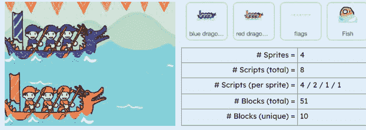
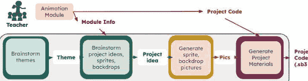

# 计算机科学教育中的生成式 AI：挑战与机遇

Diana Franklin, Paul Denny, David A. Gonzalez-Maldonado, 以及 Minh Tran

编辑：

Mark Warschauer

加州大学，欧尔本分校

Tamara Tate

加州大学，欧尔本分校

Diana Franklin

芝加哥大学

Paul Denny

奥克兰大学

David A. Gonzalez-Maldonado

芝加哥大学

Minh Tran

芝加哥大学


Diana Franklin

芝加哥大学

Paul Denny

奥克兰大学

David A. Gonzalez-Maldonado

芝加哥大学

Minh Tran

芝加哥大学

**通讯作者：Diana Franklin, dmfranklin@uchicago.edu**

> **摘要：** 生成式 AI 是一项颠覆性技术，具有改变计算机科学教学方式许多方面的潜力。与此前的创新（如高阶编程语言和基于模块的编程语言）一样，生成式 AI 降低了创建运行程序所需的专业知识门槛，将计算的力量带给了更多人。由于它的存在，编程过程已经发生变化，即使对于专家级程序员也是如此。由于生成式 AI 的普及，教学方式正在发生改变。作者在本书中探讨了生成式 AI 在计算机科学教育中带来的挑战与机遇。**关键词：** 计算机科学教育、生成式 AI (GenAI)、大语言模型 (LLMs)

# 计算机科学教育中的生成式 AI

## 1 引言

### 1.1 生成式 AI 的兴起

计算机科学教育正经历着变革，生成式 AI 正在重塑我们的学习、教学和创作方式。生成式 AI 的普及带来了巨大的潜力，但也带来了严峻的挑战。一个主要的担忧是学术环境在使用生成式 AI，这可能导致无意的抄袭。另一个主要的担忧是创意领域在使用生成式 AI，例如，一些公司用 `ChatGPT` 替代了客服代表。

生成式 AI 的使用还导致了关于版权的问题。例如，艺术家发现他们的创作作品被用于训练模型而没有获得补偿。同样，生成式 AI 在广告背景下的使用也引发了争议，例如 `Google Gemini` 的广告（它建议用它撰写信函）以及 `Toys ‘R’ Us` 的广告（使用 `OpenAI` 的 `Sora` 模型生成了长视频），这些都引发了关于人类创造力和真实性的讨论。

另一个主要的担忧是法律背景下使用生成式 AI。例如，哥伦比亚的一位法官向 `ChatGPT` 协助法律案件：“患有自闭症的儿童需要支付治疗费用吗？” `ChatGPT` 回答道：“是的，正确的。根据哥伦比亚的规定，诊断为自闭症的未成年人免治疗费。”尽管这一回答支持了法官的决定，但使用 `ChatGPT` 进行指导引发了批评。

生成式 AI 的使用还导致了职业违规行为。例如，律师及其律所在提交包含虚假研究的法庭文件而面临指控。`范德堡大学` 在发送一封关于密歇根州立大学枪击事件的学生邮件后遭到了反对，随后被证实该邮件是用 `ChatGPT` 起草的——这一决定被广泛批评缺乏同理心。

在学术界，政策正在演变以应对这些问题。例如，计算机协会（`ACM`）规定，虽然可以使用 `ChatGPT` 等生成式工具创建内容，但必须完全披露，且不能将其列为作者。

### 1.2 教育中的挑战与机遇

在整个教育领域，人们对学生使用 `ChatGPT` 作弊存在极大忧虑。一项针对 10,000 名在读本科和研究生的调查显示，51% 的大学生认为将此类工具用于作业和考试属于作弊，而有 20% 的人认为不属于。在 2023 年初，即 `ChatGPT` 普及并广为人知的第一个学期，全国范围内表达了这些担忧 (Barr 2023)。然而，有一个好消息是，斯坦福研究人员的一项年度调查显示，报告过去一个月内参与过至少一次“作弊”行为的高中生比例保持不变 (Spector 2023)。这表明，尽管工具在变化，但新技术并不一定鼓励更多比例的学生不诚实地使用它们。

计算机科学领域也未能免受基于 AI 的代码生成的法律争议的影响。例如，2022年11月，一组软件工程师对 `GitHub Copilot` 提起了集体诉讼，指控 `GitHub`、`微软` 和 `OpenAI` 未经许可使用受版权保护的开发者源代码训练其模型，违反了版权法、隐私法商业法 (Park et al. 2023)。原告认为，`Copilot` 经常生成的代码建议与原始版权作品完全相同，且没有经过适当的归属或许可。尽管 `GitHub` 及其伙伴对这些说法表示反对，但他们提出了关于 AI 依赖可用代码的伦理和法律问题。尽管存在这些争议，大众媒体对 `GitHub Copilot` 和 `ChatGPT` 等工具的讨论通常集中在它们的性能和提供使用指导上，而不是关注 AI 生成代码的伦理影响，或预测计算行业内可能的大规模裁员。

从学术角度来看，大语言模型（`LLMs`）首次是在澳大利亚太平洋计算教育会议（Australasian Computing Education conference）上被计算机科学教育社区考虑的。2022年2月，Finnie-Ansley 等介绍了他们的论文《机器人来了：探索 OpenAI Codex 对入门编程的影响》(Finnie-Ansley et al. 2022)。这是在计算教育类会议上发表的第一篇论文，它评估了大语言模型 `OpenAI's Codex` 在代码生成方面的能力与标准入门编程（`CS1`）问题的对比。该论文比较了 `Codex` 模型的性能与一组学生在处理同一组编程问题时的表现，发现该模型的表现在 71 名学生中排名第 17 位。此外，对经典“降雨”（Rainfall）问题（Fiser 2014）的几种变体进行分析显示，从相同的输入，模型可以产生多个解决方案。作者在结论中指出：“我们研究了 LLM 带来的机遇与挑战，以及它们的潜力，我们认为这些结果确实令人惊叹”（第 18 页）。

### 教育中的生成式 AI

本文出现时，人们对生成式 AI 的认知尚未普及，因此为更广泛的讨论奠定了基础。随后的工作，包括 Denny 等（2023）和 Prather 等（2023）的研究，探索了生成式 AI 的机遇与挑战。其中强调的挑战包括：

- 学术诚信和未经授权使用 AI。
- 学生依赖 AI 的风险，这可能会阻碍他们对核心概念的理解。
- 输出内容可能存在误导或混淆。

机遇包括：

- 提供高质量的教育资源。
- 提供即时反馈。
- 将教学重点转向更具野心且有趣的编程项目。

### 1.3 结构与读者

在本单元（Element）中，我们考虑了大语言模型的积极和消极方面。我们首先提供关于语言模型工作原理的背景，从容易推理的技术开始，结束于它们目前的能力。本单元针对几类读者编写：

- **不熟悉大语言模型的教育者：** 我们提供了关于这些模型如何运作的见解，并在术语出现时对其进行定义。
- **对进入这一新兴领域的计算机科学教育研究人员：** 我们涵盖了最新的研究，并建议了从何获取额外信息。

对于这类读者，我们仔细引用了所描述的研究，包括截至 2024 年 8 月发表的最新工作。我们在第 2 节开始提供关于语言模型工作原理的见解，从简单的技术开始，结束于它们在计算机科学教育方面的能力。随后我们在第 3 节描述了关于教师和学生对使用 AI 感知的研究结果。

本单元的后续探索了生成式 AI 的用途。首先，我们介绍了教师可以使用这些工具改进教学准备工作的方法（第 4 节）。然后，在第 5 节中，我们探索了教学过程中 AI 工具的各种用途。最后，我们在第 6 节讨论了如何将这些能力集成到终端用户工具中。

本单元的最后部分涉及更大的影响。第 7 节讨论了学生误用生成式 AI 工具可能如何影响学习者和教育者。在第 8 节中，我们展望了未来，以及计算机科学教育将如何响应行业对 GenAI 的采用。如果行业正在接受生成式 AI 代码工具，我们应该教授学生哪些不同的技能，以帮助他们在毕业时成为最高效、最熟练的开发者？

## 2 理解大语言模型和 ChatGPT

为了更好地了解像 `ChatGPT` 这样的聊天机器的优缺点，我们首先对该技术进行简要介绍。我们从介绍相关技术——机器学习分类器开始。然后讨论了 `LLM` 及其一些常见行为。最后，我们对 `LLM` 执行代码相关任务的能力评估进行了总结。

### 词汇

**图像分类器 (Image Classifier):** 一种机器学习模型，旨在通过分析视觉特征（如长颈鹿、巴士或人脸）来分类或识别图像中的物体、动物或其他实体。

**生成式 AI (Generative AI):** 一种根据从大型数据中学到的模式生成新内容（如文本、图像、音频或视频）的人工智能模型。

**大语言模型 (LLMs):** 一种生成式 AI 模型，在大型数据集上进行训练，通过生成“标记”（token，即单词或短语）序列来产生连贯且符合上下文的文本输出。

**ChatGPT:** 由 `OpenAI` 开发的对话式语言模型，旨在以对话格式生成类人类的回答。

**幻觉 (Hallucination):** 指大语言模型生成错误或无意义回答的现象，这些回答看起来合理，但并非以其训练数据或事实性信息为依据。

### 2.1 图像分类器

图像分类器是一种可以识别图像的程序，例如长颈鹿、巴士或人脸。创建图像分类器包括两个阶段：训练和使用。

训练阶段是分类器学习如何将图像属性与结果相关起来。为了训练分类器，需要一个已经过“标记”（标记了图片内容）的图片数据库。例如，如果想要识别“动物”，则需要一个包含不同类型动物图片的数据库，每张图片都标记了图中动物的类型。对于车辆分类器，则需要一个包含不同类型车辆图片的数据库，每张图片都标记了车辆的类型。程序分析图片数据库，确定区分（例如）摩托车照片与卡车照片的特征。

训练集的属性是决定训练后模型准确性的关键因素。一个“良好”的训练集应该包含每种类型对象的各种实例——包括不同的颜色、摄像角度和其他特征。不意外，图像分类器拥有的标记图像越多，其分类就越准确。此外，如果没有额外的计算，图像分类器无法将某物放入其未曾训练过的类别中。如果训练集太小，分类器可能会基于“捷径特征”进行训练——即恰好出现在图片中的属性。例如，如果有人用生活在沙漠的蛇和生活在森林的松鼠来训练动物分类器，那么森林中的蛇照片可能被识别为松鼠，而沙漠中的松鼠可能被识别为蛇。

某些数据库可能包含无意中被标记的图片。例如，在向 `Facebook` 上传照片时自动标记某个特定朋友，`Facebook` 需要一个图像分类器。它对特定朋友的训练数据将包含由用户标记过的该朋友的所有照片。此外，通过验证码完成谜题（例如点击包含交通灯、摩托车或卡车的图片中的所有方格）为改进图像分类器贡献了标记图像。

图像识别用于人类人脸识别存在许多伦理考量，因为这涉及到有色人种之间的互动、模型对这些人群的识别准确性以及历史性的不公。`Clearview AI` 比 `Facebook` 更进一步，利用社交媒体创建了一个庞大的图像和姓名数据库，导致被荷兰罚款（Corder 2024）。该数据库向执法部门推销以识别嫌疑人，这引发了伦理问题，因为数据并未经过正确验证，且已经发生了由于此类系统的识别错误导致无辜平民被捕的情况（Johnson 2023）。人脸识别在肤色深的人身上表现特别差（Sanford 2024）；这可能是因为训练集较差，或者是因为在光线不足的情况下区分特征存在挑战。因此，人们不仅必须考虑 AI 的技术角度，还必须考虑它对不同人群的影响。

### 2.2 大语言模型

语言模型是一种人工智能模型，旨在通过预测序列中的下一个单词或“标记”（token）来生成文本。与依赖标记数据集学习的图像分类器不同，`LLM` 使用了一种名为“自监督学习”的方法。在自监督学习中，模型从海量数据中学习，而不需要人工标记。相反，模型使用文本的一部分来预测其他部分（使其能够自动验证这些预测），使得数据准备过程更具可扩展性和效率。

因此，本质上，`LLM` 仅仅是预测标记（或单词）。考虑一个非常基础句子（我们可以将其视为一个“提示词”，prompt），它是不完整的：

Prompt: “The cat sat on”

### 生成式 AI

（注：由于原文后续存在大量重复段落，根据“确保不要重复输出原文”的原则，译文仅保留核心定义及内容的翻译。）

### 教育中的生成式 AI

关于药物信息；药剂师审查的 `ChatGPT` 对近四之三的药物相关问题的回答是不完整或错误的。在其中一个案例中，研究人员询问 `ChatGPT` `COVID-19` 抗病毒药物 `Paxlovid` 与降压药物地平之间是否存在药物相互作用，`ChatGPT` 显示这种药物组合尚未报告过相互作用（ASHP 2023）。

虽然像 `ChatGPT` 这样的大语言模型（`LLMs`）会定期更新，但它们不会持续从互联网抓取新信息。相反，它们会定期在新的数据集上进行重新训练，纳入更新的知识，并通过用户交互和反馈进行微调。然而，在提高 `LLM` 在特定场景下生成响应的准确性方面，出现了一些前景。一种有效的方法是检索增强生成（`RAG`），它将 `LLM` 的能力与外部数据库相结合。与仅依赖训练数据的传统 `LLM` 不同，`RAG` 允许模型在生成响应之前从外部数据库检索相关信息。这意味着模型不再根据其在训练期间看到的模式进行猜测，而是参考最新的或特定领域的信息来提供更准确、更符合上下文的答案。例如，经过 `RAG` 增强的模型可以检索最新的医疗指南，以可靠地回答有关药物相互作用的问题。`LLM` 技术的另一个进展是思维链提示（`chain-of-thought prompting`），这种方法的灵感源于人类处理问题的方式。模型不再生成一个简单的即时答案，而是在得出最终输出之前逐步地阐述其推理过程。这种方法可以提高模型处理困难或多步问题的能力，并通过展示这些步骤，使其推理对用户来说更加清晰。

### 2.3 用于编程的 LLMs

生成程序的源代码又如何？大语言模型已经在来自 `GitHub` 仓库的海量公开代码以及网络上的编程教程上进行了训练（M. Chen et al. 2021）。鉴于编程语言的语法规则远比自然语言少得多，`LLM` 特别擅长生成语法正确的代码。此外，它们根据上下文（如详细的问题规范）进行预测的能力，意味着它们通常非常有能力为编程问题产生正确的解决方案。

计算社区早期许多工作的一个重点是探索生成式 AI 模型可以应用的问题广度。然而，鉴于改进速度之快，衡量此类模型的能力具有挑战性。例如，2022 年 2 月发表的论文《机器人来了》中的结果（Finnie-Ansley et al. 2022）在 2023 年 7 月由一个计算教育背景下的 `LLM` 工作小组得到了复现（Prather, Denny et al. 2023）。与 `Codex` 模型的原始性能（在两次考试中平均得分为 78.3%）相比，`GPT-4` 模型（该工作小组复现时当时最先进的模型）表现出戏剧性的提高，在两次编程考试中平均获得 97% 的分数。

总的来说，`LLMs` 在编程任务中表现出了相当程度的熟练度，甚至超出了典型的 `CS1` 类型的问题范围。例如，Cipiano 和 Alves (2023) 探索了面向对象编程（`OOP`）作业，学生在作业中被要求遵循一系列最佳实践来设计和实现一组相互关联的类（通过组合或继承）。使用 `GPT-3` 模型，他们发现它能够生成在单元测试评估中获得良好分数的代码，但编译错误和逻辑错误相当常见。有趣的是，他们评估的作业规范是用葡萄牙语编写的，尽管葡萄牙语仅占模型训练集的极小部分，但这似乎对性能没有产生负面影响。同样，在他们原始论文的后续中，Finnie-Ansley 等人 (2023) 探索了 `Codex` 模型在标准数据结构和算法课程的一系列 `CS2` 问题上的表现。他们发现，与在考试中处理相同问题的学生相比，`Codex` 模型的性能使其恰处于班级的前四分之一之内。

当然，代码编写题很常见，还有许多其他与计算课程相关的问题。例如，多选题在大班教学中很常见，并经常用于评估理解能力（Petersen, Craig, and Zingaro 2011）。Savelka 等人对 `LLMs` 效能演变的调查（Agarwal, et al. 2023）强调了这些模型在标准评估格式中模仿（甚至超越）人类水平理解的能力日益增强。另一种在编程教育中特有的题型是帕森问题（Parsons problems），它要求重新排列初始打乱的代码（Ericson, et al. 2022）。与代码编写题不同，AI 模型具有灵活性，可以根据之前的标记逐个合成代码。帕森问题提供了约束，即必须仅使用提供的代码形成解决方案。Reeves 等人 (2023) 检查了 `Codex` 模型在文献综述获得的一系列帕森问题上的表现。他们发现该模型可以成功解决一半的问题，且 `Codex` 很少修改或添加代码行，但代码缩进错误是失败的最常见原因。

## 3 教育者和学生的感知

鉴于生成式 AI 工具能力的快速演变，理解计算教育领域的教育者和学生如何看待这些工具至关重要。几项研究解释了这些感知，揭示了由兴奋、担忧和适应策略构成的复杂格局。

### 3.1 教育者的感知

教育者对生成式 AI 的观点跨越了一个光谱，Lau 和 Guo 的论文标题几乎涵盖了这一范围：“在我们理解之前禁止它”到“反抗是徒劳的”（Lau and Guo 2023）。在这项工作中，他们调查了大学编程教师在应对学生日益使用 `ChatGPT` 和 `GitHub Copilot` 等 AI 代码生成和解释工具时对调整课程的观点。该研究于 2023 年初进行，对 20 位来自不同地理位置和机构类型的入门编程教师进行了半结构化访谈。短期内，教师们主要担心 AI 辅助作弊问题，导致采取措施，包括更加强调考试分数、禁止 AI 工具，并让学生接触这些工具的能力和局限性。长远来看，讲师们分为两个主要阵营：一类抵制 AI 使用，专注于教授编程基础；另一类拥抱 AI 工具，将其视为为未来工作环境做准备。这种分歧凸显了当前计算教育中 AI 应用方法缺乏共识，且具有探索性质。

抵制 AI 工具使用的策略包括设计“防 AI”作业、恢复到纸质考试，以及在编程任务中对代码审查进行批判性对待。而更开放于整合 AI 工具的讲师，则利用这些技术提供个性化的学习体验、协助任务，并重新定义课程，更加强调软件设计、与 AI 协作以及创造性项目工作。总的来说，研究结果表明，需要适应性的教学策略，要么将 AI 作为学习和发展的工具，要么以新颖的方式强化传统的编码技能，以抵御肤浅的 `LLM` 生成的解决方案。Lau 和 Guo 还提出了一系列丰富的开放问题，有助于社区内对相关课程进行持续调查。


在较近期的工作中，Sheard 等人（2024）对来自澳大利亚、芬兰和新西兰的 12 名讲师进行了采访。这些采访旨在捕捉对计算教育中使用 AI 工具的多样化观点，包括当前的实践以及响应 AI 工具的可能调整。总的来说，讲师承认 AI 工具通过生成代码示例和提供个性化反馈来支持和增强学习的潜力。然而，人们也担心学生可能会跳过关键的学习过程并过度依赖这些工具，这可能导致对编程概念的理解浅薄。参与者还注意到传统评估方法面临着巨大挑战，并对学术诚信和潜在的作弊表示担忧。这些担忧在研究中一位参与者的引言中得到了证实：“我们显然生活在一个必须重新思考计算教育、特别是计算教育评估的时代，因为我们无法再以以前所尝试的任何方式来评估学生了。” 这项采访研究的参与者达成了共识，即 AI 工具的整合应该放在课程中学生已经掌握基础编程技能的阶段。请注意，这种观点在社区内并非通用，一些研究人员建议采用“提示优先”的方法，即学生从学习如何提示 AI 模型开始，而这正是所需的（Reeves 等人 2024）。

# 教育中的生成式 AI

## 3.2 学生感知

学生的观点似乎与教育者有些相似之处。Prather、Reeves 等人（2023）对初级程序员与 `GitHub Copilot` 的交互进行了深入的探索。学生报告了敬畏与不安交织的复杂情感，发现该工具的预测性既有帮助又令人不安。后者的情绪引发了论文的标题，并在一位学生的评论中得到了典型体现：“我觉得它知道我想什么，这感觉很奇怪。” 虽然 Copilot 在简化编码任务方面的能力受到了赞誉，但人们对过度依赖该工具以及学习基础问题解决能力方面的潜在障碍表示担忧。一位参与者担心，随着他们对工具依赖程度的增加，这将使他们成为“更糟糕的问题解决者”。此外，该研究揭示了学生面临的认知和元认知挑战，引发了对教育工具需要更好地支持学习过程的讨论。

一份 ITICSE 工作组于 2023 年 7 月召开的综合报告，结合了来自 17 个国家的教育工作者和学生的广泛调查见解（Prather, Denny 等人 2023）。针对学生和讲师分别开发了两个独立的调查，涵盖了从生成式 AI 使用和伦理考量到对教育和未来就业感知影响等主题。两组在利用生成式 AI 编写代码和执行文本任务方面报告了相似的模式，表明对这些技术的熟悉程度日益增加。尽管承认生成式 AI 工具在计算教育和未来职业中的相关性日益增强，但对于人类讲师不可替代的作用，他们也达成了强有共识。特别是高年级学生，生成式 AI 工具似乎是学生辅助的重要资源，表明了求助偏好的转变。正如报告作者所指，这项工作的意义之一是，教育者应该关注技术进步，以便他们将生成式 AI 工具有效地整合到他们的教学实践中。

## 4 课程准备

计算教育者可以明确利用生成式 AI 的一种方法是创建高质量的学习资源。此类资源可以是静态的（即批量生成并通过适当平台发布），也可以是动态的（即学生按需生成）。在生成式 AI 工具可以产生的许多资源中，代码解释、编程练习和工作示例最近被提出并研究。在本节中，我们介绍了传统的教学技术，随后介绍了 LLM 可以提供帮助的方式。

### 4.1 代码解释示例

我们首先考虑教科书示例。MacNeil 等人（2023）将 LLM 生成的代码解释集成到一本 Web 软件开发的交互式电子书中。针对代码片段，生成了三种类型的解释：逐行解释、重要概念列表和高层总结。表 1 显示了 GPT-3 为一个用于计算 POST 请求数量的简单服务器代码片段生成的解释示例。逐行解释 (a) 突出了代码中每一行的语法和术语，列出的重要列表 (b) 是对代码中使用的重要概念的解释，而总结 (c) 则提供了代码目的的高层解释。

他们发现，学生的参与度根据代码的复杂度、类型和长度而异，但大多数学生都认为代码解释很有帮助。类似地，Leinonen、Denny 等人（2023）在 CS1 课程背景下比较了学生和 LLM 生成的代码解释质量，发现学生认为 LLM 创建的解释比学生创建的更易理解，且对代码的总结更准确。这两项研究都强调了 LLM 作为计算课程生成教学内容工具的潜力。然而，对于 LLM 生成的代码解释的准确性和完整性仍然存在一些担忧，表明在将这些解释呈现学习者之前，需要进行监督或额外的处理。

### 4.2 工作示例

工作示例在入门编程课程中已得到研究（Muldner, Jennings 和 Chiararelli (2022)）。工作示例包含一个问题陈述和一个带有逐步注释的解决方案，说明了解决问题的过程（见表 2）。工作示例可以采取多种形式。

建模示例发生在讲座期间。讲师编写代码，边写边叙述他们的思维过程。他们可能会犯错，因此需要实时进行修改。另一种方法是一次性提供静态代码，在显示后解释其工作原理。这种建模的有效性尚不清楚。在一项研究中，建模示例导致小组在考试、作业和课程总分上没有差异；仅在期末课程项目中观察到了益处（Rubin 2013）。在另一项研究中，没有显著差异（Raj 等人 2020）。鉴于 LLM 生成的是静态文本，它们可能并不适用于这种建模。

## 教育中的生成式 AI

**表 1** GPT-3 为一个处理 POST 请求的服务器代码段生成的三个类型的代码解释示例；改编自 MacNeil 等人 (2023)。

```javascript
import { serve } from "https://deno.land/std@0.140.0/http/server.ts";
let count = 0;
const handleRequest = (request) => {
  if (request.method === "POST") {
    count++;
  }
  return new Response(count);
}
serve(handleRequest, { port: 7777 });
```

- 第一行从 Deno 运行时版本 0.140.0 的 `std` 库中的 `server` 模块导入 `serve` 函数。
- 第二行声明了一个 `count` 变量并将其初始化为 0。
- 第三行定义了一个接受 `request` 参数的 `handleRequest` 函数。如果 `request` 方法为“POST”，该函数会将 `count` 的值加 1。
- 第四行返回一个包含 `count` 值的新 `Response` 对象。
- 第五行调用 `serve` 函数，传入 `handleRequest` 函数和一个选项对象。该选项对象将 `port` 属性设置为 7777。

1. 代码使用了标准库中的“server”模块来创建服务器并处理请求。
2. 函数：使用“handleRequest”函数来处理传入的请求并返回响应。
3. 条件语句：代码检查请求方法是否为“POST”，如果是，则对计数器加 1。
4. 变量：使用“count”变量来跟踪收到的 POST 请求数量。
5. 响应：使用“Response”对象向客户端发送响应。
6. 端口：服务器配置为监听 7777 端口。

此代码段创建了一个在 7777 端口上监听 POST 请求的服务器。对于收到的每个 POST 请求，服务器都会将计数器加 1，并在响应中返回计数器的当前值。

## 计算机科学教育中的生成式 AI

**表 2** 问题的典型分步解答示例：编写一个 Python 程序打印二维数组中的最大值

**第 1 步**：初始化用于存储最大值的变量

```python
max_value = array[0][0]
```

**第 2 步**：遍历数组

```python
max_value = array[0][0]
for row in array:
    for element in row:
```

**第 3 步**：比较每个元素并更新最大值

```python
max_value = array[0][0]
for row in array:
    for element in row:
        if element > max_value:
            max_value = element
```

**第 4 步**：打印输出

```python
max_value = array[0][0]
for row in array:
    for element in row:
        if element > max_value:
            max_value = element

print(max_value)
```

然而，通过适当的显示界面，可能可以使用大语言模型（LLM）——可能包括并纠正某些故意留下的错误——来模拟教师演示解答示例。事实上，Jury 等人 (2024) 在一门入门编程课程中评估了一种新型 LLM 驱动的解答示例。他们的工具“WorkedGen”利用 LLM 在大型一年级编程课程中生成交互式解答示例，以评估 LLM 生成的解答示例的质量和有效性。评估重点在于解释的清晰度、解答示例分解为定义良好的步骤的情况，以及该工具对初级编程者的整体用处。总体来说，LLM 生成的解释是清晰的，且代码本身被认为是有价值的。在课堂部署中，学生表示 LLM 生成的示例对他们的学习很有用，这表明他们对该工具具有积极的看法。

特别是，学生非常欣赏通过选择关键词、代码行和个性化问题来与给定示例交互的能力，这些都是工具中的自定义功能。

入门编码教学中关于解答示例的大部分研究集中在通过子目标补充示例解决方案。子目标是关于示例解决方案步骤目的的高层陈述。研究发现，带有子目标的解答示例在几种环境中都是有益的。一项初步研究比较了带有子目标注释（创建组件、设置输出、设置条件、定义变量）的示例与未注释的示例，让学生创建 Android App Inventor 程序。研究人员发现，在即时后测试和延迟后测试中的结果均显著更好 (Margulieux, Catrabone, and Guzdial (2016))。一项涉及大学生的实验室研究复制了这些结果 (Margulieux and Catrabone 2016)。一个更真实的课堂环境发现，带有子目标注释的解答示例章节在测验中的表现显著更好，且流失率较低 (Margulieux, Morrison, and Decker (2020))。

### 4.3 编程练习

计算教育文献中探索学习资源生成的早期论文之一关注于编程练习。传统上，有四类主要的编程练习可以评估并培养学生的技能：追踪（Tracing）、用通俗易懂语言解释（EiPE）、帕森问题（Parson's Problems）和编码问题（见图 2–5）。

Sarsa 等人 (2022) 探索了带有示例解决方案和测试用例以及代码解释的编程练习创建。该研究的原理源于教育者在开发主动学习机会方面面临的挑战以及对全面内容的需求。假设 `a = [3, 6, 8, 2, 4, 6, 9], len = 7`，以下代码返回什么值：

```javascript
int func(int array[], int len) {
  int x = array[0];
  int i = 0;
  for (i = 0; i < len; i++) {
    if (array[i] > x) {
      x = array[i];
    }
  }
  return x;
}
```

#### 追踪

## 计算机科学教育中的生成式 AI

用你自己的话解释以下代码的功能：

```javascript
int func(int array[], int len) {
    int x = array[0];
    int i = 0;
    for (i = 0; i < len; i++) {
        if (array[i] > x) {
            x = array[i];
        }
    }
    return x;
}
```

#### 用通俗易懂语言解释 (EiPE)

重新排列以下代码行，创建一个返回数组中最大值的函数。

```javascript
int func(int array[], int len) {
    if (array[i] > x)
    int x;
    int i = 0;
    for (i = 0; i < len; i++) {
        x = array[0];
    }
    return x;
}
    x = array[i];
```

#### 帕森

编写一个接收整数数组及其长度并返回数组最大值的函数。

```javascript
int max(int array[], int len) {
    int x = array[0];
    int i = 0;
    for (i = 0; i < len; i++) {
        if (array[i] > x) {
            x = array[i];
        }
    }
    return x;
}
```

#### 编码

## 教育中的生成式 AI

在编程教育。总共生成了 240 个编程练习，并对部分进行了合理性、新颖性和可用性的定性和定量评估。作者发现，绝大多数自动生成的练习是合理且新颖的，许多只需少量修改即可使用。他们还发现，通过指定编程概念和背景主题，可以有效地影响练习的内容。学习资源可能会带来更个性化和参与度学习体验，特别是如果根据背景主题对个人兴趣进行定制时 (Del Carpio Gutierrez, Denny, and Luxton-Reilly (2024); Leinenonen, Denny, and Walley (2021))。虽然大多数生成的练习都包含了示例解决方案和自动化测试，但测试的质量参差不齐，在某些情况下，测试与解决方案并不完全一致，这表明需要某些人工干预或回归测试。作者提出的未来研究方向包括改进生成过程以提高测试质量，探索更复杂的练习和作业生成，以及调查在使用自动内容时学生的参与度和学习成果。最近探索测试用例生成的研究进展广阔；例如，Alfakaveen 等人 (2024) 证明了针对 CS1 级编程问题的 LLM 生成测试套件不仅能够正确识别大多数有效的学生解决方案，而且在许多情况下与教师为中心的测试套件一样全面。

### 4.4 模块化编程作业

文化能力项目

# 词汇表

- **文化回应教学法**：这种以学生为中心的教学方法将学生的文化认同和生活经验融入课堂，以促进他们的参与和学术成功。
- **文化能力**：个人在尊重自身文化背景的同时，对至少另一种文化的理解的能力。
- **重皮肤（Reskinning）**：通过更改角色和背景来修改 Scratch 项目的视觉呈现的过程，以适应新主题，同时保持代码不变。

# 计算机科学教育中的生成式 AI



| # 角色 = 4 |
| --- |
| # 脚本（总计） = 8 |
| # 每个角色的脚本 = 4 / 2 / 1 / 1 |
| # 积木（总计） = 51 |
| # 积木（唯一） = 10 |


| # 角色 = 4 |
| --- |
| # 脚本（总计） = 9 |
| # 每个角色的脚本 = 2 / 3 / 3 / 1 |
| # 积木（总计） = 49 |
| # 积木（唯一） = 9 |

**图 6** 来自 Scratch Encore 的 Scratch 项目示例（Franklin et al. 2020）。这两个项目在技术上相似，仅主题有所不同。

大语言模型也可能有助于将现有作业针对教师当地的学生群体进行定制（创建具有文化胜任能力的项目）。文化胜任能力是文化回应型教学法（CRP）的一个方面。它有助于学生在通过学习材料和活动建立对自身文化背景的尊重的同时，培养对至少一种其他文化的理解（Davis et al. 2021）。在 K–8 阶段，文献明确强调了 CRP 的价值和重要性（Gay 2018; Ladson-Billings 1995）以及学生的归属感（Maslow 1958, 1962），特别是在教学学科以及计算机科学中代表性不足群体的学习者中。虽然目前已经存在几种文化回应型课程，但固定的材料无法随着时间、地点和人群的变化而保持响应性。因此，赋能教师创建本地化的教学材料是下一个关键步骤。

图 6 展示了 Scratch Encore 课程的两个示例 Scratch 项目（Franklin et al. 2020）。这两个项目处于不同的语境/主题中，但教授的是相同的计算机科学材料/概念（使用带有多个造型的重复循环以及可选的移动来制作角色动画），并在很大程度上使用了相同的代码。从程序员的角度来看，它们拥有大约相同数量的角色、脚本和积木。从用户的角度来看，这些项目涉及一个在原地制作动画的角色（旗帜对比猴子），以及两个在屏幕上移动制作动画的角色（红船和蓝船，以及蜜蜂和蛇）。它们仅在主题上有所不同：一个代表龙舟赛（图 6，上部），另一个代表动物赛（图 6，下部）。

遗憾的是，特别是在 K–8 阶段，教师可能缺乏专业知识来高效地创建定制版本的课程。定制过程如图 7 所示。该过程有两个部分可以并行进行——选择他们想要定制的投影内容以及收集学生的兴趣。教师可以通过许多方式收集学生的兴趣：通过调查问、关于他们自己的项目介绍，或者通过带有提示的小组讨论。然后，教师思考项目的属性（在这种情况下，有三个角色，其中两个横跨屏幕移动，第三个在原地制作动画），并选择一个与示例项目的技术方面相匹配且能引起学生共鸣的主题（特别是那些可能感到被边缘化的学生）。


# 计算机科学教育中的生成式 AI

Tran 等人（2024年）的近期工作探索了教师在尝试定制 Scratch Encore 课程时面临的挑战。教师正在学习如何定制现有的基础 Scratch 项目以及相应的面向学生的工作单。研究人员创建了广泛的脚手架，包括每个项目的说明和分步指南。作者引入了“重皮肤”（`reskinning`）——即通过更改角色和背景来修改现有项目的视觉呈现过程，以匹配新主题，同时保持代码不变。使用重皮肤方法，教师可以快速创建项目的第三个版本（具有文化胜任能力的版本），该版本可能（通过更改角色和背景）吸引学生的注意力，同时保留基础项目代码的结构。遵循所有现有的技术属性至关重要，因为例如，简单的项目可能导致学生没有足够的知识来学习下一个模块/课程，而过于复杂的项目可能会让学生负担过重并导致疲劳。即使有这些脚手架，教师在三个关键步骤上仍然很吃力：(1) 选择将主题与技术属性相结合的项目，(2) 创建

## 计算机科学教育中的生成式 AI 23

| 提示词 (PROMPT) | 我的项目要求如下：- 一个漂亮的背景 - 一个在原地制作动画的单个角色 - 一对在屏幕上移动的角色 | 项目要求 示例描述 问题 我当前的项目如下：- 背景：背景里带有公园的运动跑道 - 角色：猴子、蜜蜂、蛇 - 猴子在原地挥舞旗帜 |
| :--- | :--- | :--- |
| 输出 (OUTPUT) | GPT-3 生成具有文化胜任能力的项目建议 | 1. 背景：背景里带有公园的运动跑道 - 角色：猴子、蜜蜂、蛇 - 猴子在原地挥舞旗帜，蜜蜂和蛇在屏幕上移动 | GPT-3 的查询如下 | 1. 背景：背景里带有公园的运动跑道 - 角色：猴子、蜜蜂、蛇 - 猴子在原地挥舞旗帜，蜜蜂和蛇在屏幕上移动 2. 背景：背景里带有公园的运动跑道 - 角色：猴子、蜜蜂、蛇 - 猴子在原地挥舞旗帜，蜜蜂和蛇在屏幕上移动 3. 背景：背景里带有公园的运动跑道 - 角色：猴子、蜜蜂、蛇 - 猴子在原地挥舞旗帜，蜜蜂和蛇在屏幕上移动 |

**图 8** GPT-3 生成项目建议的查询（注：由于原文表格内容存在大量重复和混乱，此处根据逻辑翻译）

Tran 等人（2024年）的近期工作探索了教师在尝试定制 Scratch Encore 课程时面临的挑战。教师正在学习如何定制现有的基础 Scratch 项目以及相应的面向学生的工作单。研究人员创建了广泛的脚手架，包括每个项目的说明和分步指南。作者引入了“重皮肤”（`reskinning`）——即通过更改角色和背景来修改现有项目的视觉呈现过程，以匹配新主题，同时保持代码不变。使用重皮肤方法，教师可以快速创建项目的第三个版本（具有文化胜任能力的版本），该版本可能（通过更改角色和背景）吸引学生的注意力，同时保留基础项目代码的结构。遵循所有现有的技术属性至关重要，因为例如，简单的项目可能导致学生没有足够的知识来学习下一个模块/课程，而过于复杂的项目可能会让学生负担过重并导致疲劳。即使有这些脚手架，教师在三个关键步骤上仍然很吃力：(1) 选择将主题与技术属性相结合的项目，(2) 创建

## 教育中的生成式 AI

教师可以通过共鸣 Animal Race 项目来实现。另一方面，不合格的项目（红色）涉及许多复杂性问题（例如，女孩、蛋糕和灯笼）。在更最近的研究中，Tran 等人（2025）对 GPT-3 生成的 300 个项目建议进行了系统评估。具体而言，作者对与基础代码的对齐质量对生成的建议进行了定性评估，发现 81% 的建议符合指标。同时，他们发现了两个缺点：存在可能不敏感和不准确的元素；这些都可以通过教师的微调来解决。

此外，文本生成图像的 AI 可能用于生成起始角色和背景图像，让教师花费更少的时间在互联网上搜索素材。简单的提示工程（`prompt engineering`）可以用于适用于 Scratch 的图像：二维的、卡通风格的、且带有白色背景。

虽然现有研究已经展示了大语言模型（`LLM`）在创建具有文化胜任能力项目方面的前景，但由于儿童容易受影响且已有充分证据表明 LLM 输出存在文化和社会偏见，在处理这一方向时必须保持谨慎（Kotek Dockum, and Sun 2023; Liang et al. 2021; Nadeem et al. 2020; Tao et al. 2024）。Tran 等人在随后的研究中（2025）得出结论，LLM 生成的内容在 K-8 阶段尚未完全面向学生，并强调了教师在将 LLM 生成材料引入教室之前进行人工过滤的重要作用。教师应该检查 LLM 生成的内容是否存在不符合专业知识的文化敏感元素，并进行彻底审查以过滤或调整不适当的项目；可能需要额外的培训和脚手架来支持教师处理这些问题。

### 基于块的代码

LLM 在大学以前的另一个潜在应用是创建代码解决方案和评估学生项目，从教师的角度来看。K–12 与大学环境之间的主要区别是基于块而非基于文本的编程语言。

考虑到基于块的语言与可用 LLM 代码生成工具的文本性质不符，研究人员尝试使用商用 LLM 模型执行两项任务：(1) 创建基于块作业的示例解决方案和(2) 自动分析学生 Scratch 项目（Gonzalez-Maldonado, Liu, and Franklin 2025）。为了实现这一目标，他们通过创建两个翻译器来“训练”一个现有的大语言模型（`LLM`），将 Scratch 转换为模型更熟悉的语言（`Python` 和 `S-Expressions`）。他们对 LLM 在这两项任务中性能的评估表明，仅靠提示词工程（`prompt engineering`）不足以引导模型生成高质量的输出。对于中等复杂度的项目，LLM 持续生成的解决方案不符合正确的块级语法结构，或者仅在少数实例中以正确的语法生成了准确的解决方案。在分析学生代码方面，该研究发现现有自动评分器分配的分数与 LLM 分数之间存在相关性，但“实际”分数与 LLM 生成的分数之间存在巨大差异。虽然目前的 LLM 模型在没有经过微调的情况下尚未准备好用于基于块的编程课程准备，但这项研究为 LLM 在 K–12 计算机科学（`CS`）教育中的这一新颖应用提供了宝贵的见解。

### 4.5 评估问题

创建等效问题不仅对于文化能力有用，还能随着大学班级规模的扩大，为大规模运行测试设施提供解决方案。

人们希望在考试期间进行实时编码练习。允许学生使用自己的设备可能具有挑战性，因为可能无法监控他们使用互联网查阅参考文献甚至是考试题的答案。另一方面，建立足够大的测试设施费用可能极其昂贵。Fowler 等人（2024）研究了动态创建等效编码问题，以便一个计算机实验室就可以供一个班级的学生使用，每位学生都为自己的考试进行预约。由于问题是动态生成的（带有约束条件），向他人报告确切的问题不太可能给他们带来显著优势。在这项工作中，作者选择了非常具体的的问题（例如，在数组中寻找最大值），并确定了哪些其他密切相关但并不完全相同的问题（例如，在数组中寻找最小值）具有等效难度。一旦一个问题有了足够的变体，它就可以被存入题库，并在考试时刻选择其中一个变体。

创建和验证具有细微差异的相同问题的过程非常耗时，且前项研究的作者并未利用生成式 AI。相反，他们分析了常见的问题类型，并手动编写了转换过程，从一个初始问题生成不同版本的问题。

## 教育中的生成式 AI

因此，一种潜在的方法是利用将编程练习量化个人兴趣的工作（Del Carpio Gutierrez et al. 2024; Leonen et al. 2021），应用于评估问题，以掩盖问题在技术上完全相同的事实。这种方法一旦在子集上通过验证，就可以导致更多潜在的等效问题。手动编写每种可能性是不可行的，但使用生成式 AI 可以非常快速地提供丰富的创意、有趣的问题，即使是按需提供。

## 5 课堂教学

生成式 AI 还可以直接向学习者提供帮助，以增强学习。随着班级规模的扩大，学生获得教学人员同步帮助的机会在减少。

将 AI 直接集成到开发环境中并作为数字助教（Hicke et al. 2023），代表了教育支持的重大转变。这些工具可以在传统教室环境之外提供即时且个性化的支持。此外，课程和教学方法的调整，例如 Porter 和 Zingaro（2023）的创新性教材——使用 `Copilot` 和 `ChatGPT` 等工具教授 `Python` 编程，说明了教育交付的演变本质。计算教育中生成式 AI 的出现既是挑战也是机会。教育工作者的任务是将这些技术整合到课程中，既要增强学习，又要为学生做好准备，使 AI 成为解决问题的基本方面。

在本节中，我们将探索如何通过生成式 AI 技术增强课堂教学。我们将此讨论分为两类。首先，我们考虑学生如何独立使用生成式 AI 来协助完成他们通常独立完成的任务。其次，我们考虑了他们通常会寻求教学人员帮助的情况（当他们遇到困难时）。最后，我们探讨了生成式 AI 如何以更具自主性的方式辅助学习。

### 5.1 学生资源

#### 解释代码

虽然教科书可以提供指导，但学生通过互联网搜索来补充正式教学。他们在网上找到的代码可能与主题相关，但缺乏详细的行间注释。在这种情况下，生成式 AI 的方法可以被学生直接使用以增强学习潜力。

#### 解释概念

类比是一种特别有效的解释类型，因为它们帮助学生弥合现有知识与陌生概念之间的鸿沟。LLM 的灵活性表明它们能够生成跨领域的类比（Ding et al. 2023）。Bernstein 等人（2024）在计算机科学入门背景下探索了这一想法，让学生使用 `ChatGPT` 生成类比。他们的研究涉及 385 名一年级学生，他们被提供了一个代码片段并被要求创建类比，并在提示词中加入了加入了个人相关的话题。

### 5.2 作业协助

在作业协助方面，我们考虑两个方面：反馈如何提供以及要求是什么。提供反馈对学生的学习至关重要。研究表明，最有效的反馈是具体的（Hattie and Timperley 2007）、及时的（Opitz, Ferdinand and Mecklinger 2011）并且与目标一致的。有些学生只需要确认他们的方向是否正确。有些学生只需要关键词或概念的提醒。有些学生可能需要重学整个集合。

自动反馈可以通过多种方式提供。对于通用机制，我们首先考虑在班级规模扩大之前是如何提供帮助的。然后，我们展示了几项评估 LLM 为学生提供帮助的项目。注意的是，LLM 技术一直在飞速进步——两年前评估的技术现在可能有效得多。

#### 讨论板块

讨论板块是一个在线论坛，学生可以在那里向全班提问，也可以向教学人员提问。虽然它既不是同步的也不是交互性的，但讨论板块有两个益处。首先，同伴可以回答其他人的问题，减轻教学人员的负担并提供更快的响应。其次，学生可以查看之前的帖子并找到答案，而无需提问。

之前对讨论板块使用情况的研究分析了两个课程中395 名学生的帖子，揭示了三个主要结果（Vellukanel et al. 2017）。首先，许多帖子与后勤或较浅的问题有关。这是积极的，因为讨论减轻了教学人员回答简单问题的负担，使面对面时间能够关注更深入的问题。其次，大部分问题反映了某种程度的建设性解决问题活动，表明学生获得了实质性的帮助。最后，在论坛上提问与课程成绩呈正相关。

# 计算机科学教育中的生成式 AI

然而，这并未回答关于教学人员回答问题花费的时间是否比没有论坛时更少，同伴是否提供了高质量的帮助的问题。

早期的工作提出了一种自动讨论机器人，用于在讨论论坛上回答学生的问题（Feng 等人 2006）。该机器人没有使用在互联网海量数据上训练的大型语言模型，而是利用信息检索和自然语言处理技术，从一个包含 1236 篇存档讨论和 279 份课程文档的注释语料库中生成答案。他们用 66 个问题测试了机器人，发现仅有 14 个答案完全正确，而另一半的答案被认为是“良好的答案”。

最近，研究人员还探索了使用大语言模型（`LLMs`）来协助讨论论坛（Zhang 等人 2023）。作者使用 LLM 将问题分类为概念类、作业类、后勤类以及（由 LLM）无法回答类。通过使用 `GPT-3`，他们的整体分类准确率达到了 81%，在分类不可回答的问题时准确率达到了 93%，这意味着该方法可以有效忽略其无法回答的问题，从而减少无用回复或幻觉的发生。

Liu 和 Hiri (2024) 更进了一步，针对从一门大型入门编程课程讨论板收集的问题，模拟了 LLM 驱动的助教。他们使用了 LLM 链——这是一种提示工程（`prompt engineering`）技术，通过多个不同的提示词迭代构建出最终解决方案：首先对要回答的问题进行分类，然后利用分类结果来决定生成候选答案所需的模型/参数/提示词。另一个提示词则评估答案的质量。作者对模型运行了一系列学生问题，发现由 LLM 驱动的虚拟助教：

- 擅长将问题分类为作业问题、代码反馈请求或解释请求；
- 提供的响应比人类助教提供的响应更详细；
- 在非特定作业的问题上，其回答准确性与助教持平；
- 倾向于包含极其海量的信息。

他们得出结论，尽管这些发现很有前景，但仍然需要人工监督。

#### 自动化测试套件与反馈

另一种自动化方法是提供测试套件，以解决方案通过或失败了哪些测试的形式为学生提供反馈。虽然这在某些方面对支持学生很有帮助，但创建测试用例是测试驱动开发和调试的一关键技能。在测试驱动开发中，在主代码编写之前创建测试用例，以便程序员在开发代码的同时进行测试。这也可以是一种非常有用的元认知技术，帮助学生对他们正在的问题建立正确的模型。一项研究发现，干预组中在编码前创建测试用例的学生，其完成率与控制组相当，但与错误心理模型相关的错误显著减少（Denny 等人 2019）。这为 2005 年 `Web-CAT`（一种流行的自动化评估工具）的设计决策提供了支持，允许学生在提交解决方案代码之外也提交测试用例（Allowatt 和 Edwards 2005）。

与有效反馈的特征相比，自动化测试套件的优势在于其及时性。响应往往是近乎瞬间。遗憾的是，反馈的形式缺乏特异性，返回的信息可能差异很大。提供的最少信息可能只是一个最终的数字分数，给学生关于其代码正确性的指示。其他老师可能会提供关于每个测试用例的信息，突出哪些用例失败了（例如测试输入和预期输出）。虽然这允许学生开始“通过调试来编写程序”，但学生可能会丢失学习目标，完全专注于通过自动化测试用例（Zamrogno, Holmes 和 Baniassad 2020）。

但在实践中，学生在现实世界中开发代码时，不太可能拥有提供数字质量分的自动化套件。LLM 有潜力解锁一种完全全新的自动化反馈类型，这种类型与真实的编码实践更加紧密。它们可以为学生提供建议的代码修改/下一步，以及关于代码可读性、效率和设计模式的有意义的反馈。这种类型的反馈……

# 计算机科学教育中的生成式 AI

诸如使用 `Stack Overflow` 测试假设等行为。至关重要的是，作者指出，虽然学生认为聊天机器人是领域知识和经验知识的有用来源，但他们并未将其视为学习调试策略的主要来源，而是选择依赖于人类导师（助教、讲师、同伴等）来获取策略性和程序性知识。

近期，对编程课程中 AI 助教理想特征的关注，强调了支持有意义的学习体验的重要性，而非仅仅提供直接答案（Denny, MacNeil et al., 2024）。作者发现，学生更倾向于在评估截止日期前等高峰时期提供重要且具有参与感的支持的数字助教。学生识别出的关键特征包括 AI 通过引导他们解决问题的步骤并提供解释而非直接解决方案来为学习提供脚手架的能力。此外，学生强调了在学习过程中保持自主性的重要性，倾向于使用鼓励他们开发自己解决方案的工具，而不是过度依赖助教。

### 5.2.1 评估学生学习

大语言模型可能会使评分不再那么耗时，从而允许使用某些在大班教学中因评分困难而未被充分利用的题型。尽管“用英语解释”（`Explain in Plain English, EPE`）课程在培养代码理解方面的价值被广泛认可，但评分学生主观回答的困难使其在大规模教学中不可行。一个典型的 EPE 题目向学生展示一小段代码，学生的任务是用抽象术语解释该代码片段的作用。

Smith 等人（2023）描述了一种使用大语言模型评判 EPE 题目的创新方法，学生阅读并尝试理解显示的代码片段，然后用自然语言编写一个解释。然后将该解释作为输入提示（`prompt`）提供给代码生成型 LLM，生成的代码将使用测试套件自动与原始代码进行等效测试。Denny 等人对此进行了评估，如图 9 所示，在一个拥有约 900 名学生的入门编程课程中进行了测试（Denny, Smith et al. 2024; D. H. Smith, Denny, and Foweler 2024）。他们分析了成功率和提示长度，并根据观察学习结果结构（`SOLO`）分类法（Lister et al. 2006）对提示进行了分类。还通过问调查和主题分析收集了学生对这些任务的感知，以了解他们对使用 LLM 评估代码理解教育用途的观点。

# 教育中的生成式 AI


**图 9** 使用 LLM 为纯英语任务提供自动反馈，正如 Denny, Smith 等人（2024）所描述。

学生在编写提示方面取得了很大成功，这些提示生成的代码在功能上与其被要求解释的代码等效。关系型回答（`Relational responses`）展示了对代码片段用途的高级理解最最生成正确的代码。研究指出，学生提示的成功与他们在 SOLO 分类法中较高类别的分类之间存在正相关。

学生反馈显示，他们发现这项活动很有趣，并认为它增强了他们的代码理解能力。然而，一些人对这种教学方法在处理更复杂的编码任务时的有效性以及其与传统编码实践的比较表示担忧。作者建议教育者将提示编写练习与更多传统的编码练习相结合，以涵盖更广泛的学习目标，包括为更复杂的任务开发编程技能。然而，这项研究展示了 LLM 作为教学和评估编程技能工具的潜力。

## 6 面向用户的设计

我们回顾了许多独立、单独的方法，通过这些方法可以使用 LLM 为各种准备和教学任务提供支持。这些方法倾向于技术视角——换句话说，就是 LLM 能够做什么。然而，我们回顾的每篇研究论文都花费了数小时进行提示工程（`prompt engineering`），以确定如何创建一个提供最佳可能结果的一致提示。有些任务需要花费大量时间来生成准确且完整的信息响应，而某些任务可能不需要大量的工程。

本节讨论了如何将 LLM 驱动的工具呈现给用户。我们展示了三个示例：一个是现有的，两个是未来工作的重点。

### 6.1 准备材料

在第 4 节中，我们描述了 LLM 如何帮助教师创建课堂材料。从教育者的角度来看，这个过程会是怎样的？让我们考虑创建作业。在自定义 Scratch 项目的过程中，我们假设教育者是从课程开始的。给定一个作业，可能他们想要一个特定的主题。提示是作业和原始项目的结合。


# 计算机科学教育中的生成式 AI

人们对如何设计用户界面日益感兴趣。最近，Pozniakov 等人（2024）提出了一个 AI 集成工作流框架。问题在于给予多少自主权。我们可以将提示暴露给他们以便直接编辑，或者我们可以提供一个询问他们想要的属性的用户界面。该图描绘了不同的步骤。我们首先协助教师关于课程中发生的情况提供一些建议。



**图 10** 生成式 AI 辅助创建项目的工作流

## 头脑项目创意

具体的想法是原始项目属性的结合。教师可能会看到 10-15 个想法并从中选择。然后教师可以选择其中一个建议的主题，或者输入他们自己的。

## 生成精灵和背景图片

下一步是为教师创建图片。获取图像有三种可能的机制。首先，我们可以利用 Scratch 库，该库对所有 Scratch 项目都是免费提供的。其次，我们可以从生成式 AI 生成器（如 DALL-E）生成一些建议。最后，我们可以赋予教师更多自主权，让他们输入更具体的图片属性。首次尝试将是默认结合 Scratch 图像和来自我们提示的图像。

## 生成项目材料

最后一步将精灵整合到项目和面向学生的材料中，可以通过代码实现，尽管不是生成式 AI。我们有起始文档，新图像可以替换旧图像，为教师提供最终材料的草稿。生成项目是简单的，只需替换文件中的图像。创建项目材料则困难得多，因为有许多可能的格式（Google Forms、Google Docs、PDF），而且这些格式都没有存储在易于自动操作的公开格式中。

当这一过程完成后，教师仍有工作需要完成。图像的大小可能与原始图像不同，因此教师可能需要更改默认尺寸。此外，新项目中的起始位置和精确移动可能会有所不同，因此教师可以对这些进行调整。然而，这将极大地减少教师创建此类项目所需的时间。

## 6.2 集成开发环境 (IDE)

教育环境中的集成开发环境（IDE）旨在为学生提供一个支持平台，用于编码和测试他们的解决方案。研究已经探索了在 IDE 中直接集成代码生成类大语言模型（LLMs）。Kazemitabar 等人（2023）探讨了在入门级编程背景下为初级学习者提供 OpenAI Codex 的影响。他们进行了一项受控实验，参与者年龄在 10 至 17 岁之间，且没有先前的文本编程经验。参与者被分为两组：一组可以直接访问集成到编程环境中的 Codex，另一组则没有。所有参与者都完成了一组 Python 代码编写任务，随后是代码修改任务。

他们发现，使用 Codex 显著提升了代码编写性能，且对手动代码修改任务没有负面影响。有趣的是，具有先前编程能力（通过脚手架过程确定）的学习者从访问 AI 生成器中受益更多，这通过他们在留存测试中的表现衡量得出的。然而，鉴于学生在提交代码时，约一半的代码是在提交前不久生成的且未对其进行任何更改，因此人们对可能过度依赖 AI 生成的代码表示了担忧。

尽管将 GitHub Copilot 等工具集成到 IDE 中已显示出前景，但这些工具主要是为经验丰富的程序员设计的。它们目前的设计假设了初学者不具备的熟练水平，这可能会给初学者带来挫败感或困惑体验。因此，调整这些工具以更好地适应初学者的需求至关重要。

Prather, Reeves 等人（2023）概述了一套全面的设计建议以解决这一担忧，并提出了几项增强方案使这些工具对初学者更友好。识别出的一个关键问题是，初学者很容易被立即生成并显示的代码建议分心或感到压力巨大，尤其是当这些建议包含多行代码时。这通常会导致认知负荷增加，因为学生在努力理解建议的同时，还要尝试学习底层的概念。为了缓解这一点，Prather 等人认为，应该有一种机制允许学生对他们收到的建议类型以及建议呈现的时机拥有更大的控制权。例如，学生可以受益于某功能，该功能允许他们在认为需要时请求帮助，而不是被动地接收实时提供的建议。

Prather 等人确定的其他设计建议强调了将元认知脚手架整合到工具中的重要性。这可能涉及特殊的 AI UI 元素，引导学生完成解决问题的步骤，或对替代解决方案提供更清晰的理解。此外，改进这些工具以帮助学生建立更好的心理模型是另一个重要意义。许多初学者在理解 Copilot 等工具如何以及为何生成某些代码时遇到困难。在这些系统中引入可解释 AI (XAI) 元素，使建议背后的逻辑透明化，可以帮助学生更深地理解他们正在处理的代码的逻辑和结构。

还有研究致力于通过 LLMs 为语法和编译错误提供纯英语解释，以增强学生的开发环境。初级程序员的一个常见诉求是，由于编程环境产生的歧义或晦涩的错误信息所带来的挫败感和困惑，例如，缺少一个括号这样的小错误也会产生长而复杂的错误信息。通过利用 LLMs 理解和翻译计算机程序的能力，这些环境可以显著减轻学生的认知负荷，让他们更容易专注于所教授的基础概念，而不是去解读复杂的错误信息。

在早期的工作中，Leinonen, Hellas 等人（2023）研究了 Codex 解释 Python 错误信息的能力，这些信息通常被初学者认为可读性差（例如，“can assign function call”、“invalid token”、“illegal target for annotation”、“EOL when scanning string literal”），并发现负责评估的两个研究人员认为生成的解释是可以理解的。Codex 在提供底层错误的正确修复方案方面的成功率约为 33%。

更最近，Taylor 等人（2024）将 LLM 错误解释整合到了调试编译器（compiler-cc）中，并在 CS1 和 CS2 水平进行了评估。该调试编译器是一种为开发程序的学生提供脚手架的 C/C++ 编译器。

## 6.3 个性化导师

在奥森·卡德的小说《虫局》（Ender's Game）中，主角安德（Ender）一生都有一个 AI 驱动的导师。虽然计算机科学教育不是为了训练一个拯救物种的儿童，但这种导师的特征非常引人入胜。值得探索在该领域已经做了哪些研究，以及生成式 AI 可能在何处适用。

然而，我们想明确的是，在讨论中，我们并没有提议用计算机取代教师。我们认为教师具有极高的价值，任何计算机无法取代教师的许多属性。对婴儿和幼儿的研究表明，婴儿从视频中听到人们说话并学习的效果，不如面对面的看护者对他们说话的效果好，尽管两者使用的词汇和语气是相同的。

# 教育领域的生成式 AI

智能辅导系统（ITS）已经研究了数十年；然而，对其用途的讨论有时存在争议，因为 (a) 一些人将其作为教师的替代品，没有充分尊重和认可教师拥有的独特且重要的属性；(b) 它们一直无法实现全职导师这一不切实际的目标；(c) 创建题库、相关反馈和决策机制需要大量时间——尽管决定何时以及如何增加难度是极度耗时且昂贵的。尽管有这些缺点，它们仍然在自动化、个性化教育方面做出了重大贡献，因此它们必须被认为是生成式 AI 之前的相关先驱。

智能导师有两个不同的角色。首先，它们根据学习者在之前问题上的表现来决定其下一个要求其解决的问题。其次，它们为解决当前问题提供指导/帮助/反馈。ITS 广泛可用，并被应用于正式教育和非正式教育中，主要用于数学和语言学科。

### 学校作业

可以在学习事实时将其分配为作业，例如记忆基础加、减、乘、除法因数。ITS 先对学习者进行简单问题的测验，对于他们任何错误的答案，系统会提供答案并频繁地对类似问题进行测验。最终，学习者表现出精通，ITS 就会转向更难的问题。

### 非正式数学学习

在非正式空间，有诸如 Prodigy 之类的应用程序，用户是冒险游戏中的角色，在游戏中他们探索不同的地方、执行任务并战斗怪物。战斗涉及解决数学题来增强攻击能量。与数学系统一样，当玩家出错时，系统会重复相同水平的问题，并在他们表现出精通时提高等级。然而，它内容丰富，远超事实的记忆。

### 非正式语言学习

一种流行的语言学习应用是 Duolingo，它拥有数百万非正式用户。它不仅能根据用户的错误动态决定提供什么，还整合了广泛的反馈和奖励系统。如果用户在同一类型的问题出错次数足够，它会提供指导（例如展示变位规则和几个示例）。奖励系统特别广泛。有一种通过每天至少完成一节课程来维持的“连续胜击”。此外，如果有人在晚上完成了课程，那么早晨完成课程就会触发 15 分钟的双倍奖励，反之亦然。

因此，如果有人每天早晚使用该系统 15 分钟，他们的积分就会大幅增加。积分用于在“联赛”中晋级，用户与同一联赛的陌生人竞争，力争每周获得最多积分。

# 计算机科学教育中的生成式 AI

## 支持计算机科学 ITS 的开发

已经创建了用于教学编码的 ITS，但它们的质量参差不齐（Crow, Luxton-Reilly, 和 Wuenche 2018），且没有一个被广泛使用。生成式 AI 可用于支持基于编码的 ITS 开发的许多步骤。创建一个用于计算机科学的 ITS 需要执行以下步骤：

- ITS 问题通常足够小，可以在一分钟内回答，而计算机科学的作业和练习通常需要几分钟到几个小时。因此，第一步将是创建可以*快速解决并引导至可应用于更大问题中的学习*的问题类型。生成式 AI 可用于合成各种类型的问题，包括帕森问题（Parsons problems）、代码追踪问题和代码解释问题，所有这些问题都可以通过快速反馈迅速解决，使它们适合集成到 ITS 中。

- 需要创建**大型题库**，并按难度和涵盖的概念分为等效类进行组织，且具有逐渐渐进的难度增加机制。给定一个问题，可以使用生成式 AI 创建许多不同的、等效的问题来填充此题库。

- 需要创建**反馈和解释**并将其与一组问题绑定。关于使用生成式 AI 创建反馈和解释，已有大量研究。

- 系统需要经过调整，以提供一条*高效、有效的学习最佳路径*。过多的相似水平的问题可能会导致学习者在系统中花费过多时间或失去动力，但进展太快会让他们感到困惑。问题需要适应学习者的**近侧发展区（ZPD）**，该区域是指学习者在指导下能够执行但尚不能独立完成的任务范围。

# 学习者滥用生成式 AI 带来的挑战

虽然 AI 生成器是一项新技术，但抄袭在基础科学课程中绝不是新问题。在互联网出现之前，常见的作弊方法包括从另一个学生那里抄袭解决方案（无论是通过串通还是从外部获取解决方案，例如从收集往届学生作业的组织或档案——例如兄弟会和女生会维护的资料——中获取）。

一旦互联网被广泛使用，常见编程问题的解决方案变得轻而易得。LLM 之所以能够胜任基础编程任务的原因之一，是因为互联网上存在无数的解决方案示例。旨在教授编程的网站数量以及发布常见问题解决方案的人的增加，使得寻找标准问题变得异常简单。

最近，基础编程课程规模的扩大以及在线评分平台的可用性改变了学生完成作业和评估的方式。在教学人员与学生比例很小的时代，在线系统可以提供即时反馈，支持学生。在线评估可以自动评分，减轻教学人员的负担。然而，很少大学拥有设施让整个数百人的班级在大学计算机上同时考试，因此学生可能会在不同的时间考试，这增加了学生在考试前找到考题的概率。

正如第 2 节所述，生成式 AI 为基础编码课程产生的内容日益准确，尽管并不完美。因此，我们将讨论放在这一难度的编码问题上。

LLM 的引入引起了高度警觉，因为它是一项新技术，将大大增加基础学生的抄袭行为，从而导致学习损失。然而，了解此类行为与以前相比增加了何种程度是有用的。总的，作弊是普遍的——65–75% 的本科生至少承认过一次，19–20% 的人承认至少作弊过五次。研究发现，学生作弊在过去 30 年中剧增（McCabe et al. 2001）。

在生成式 AI 之前，一项研究分析了编码课程中的抄袭模式及其对学习的影响（Pierce and Zilles 2017）。他们有一些有趣的发现。首先，大多数抄袭发生在学期之间（57%），而非学期内（43%）。其次，大多数抄袭者是那些只抄袭过一次的学生；64% 的人作弊一次，10% 的人作弊三次和五次。第三，抄袭确实导致了学习损失；虽然抄袭的作业在该作业上获得了更高的分数，但这些学生在评估中的得分略低。

## 计算机科学教育中的生成式 AI 43

0–12 分制的评分。研究发现这些差异在统计学上是显著的（p = 0.00019）。

一项较新的研究试图量化生成式 AI（GenAI）出现导致的作弊增加以及对学习的影响（B. Chen 等，2024）。他们利用多种信息来源得出结论：作弊数量已经增加。首先，无监控测验与监考考试之间的分差增加了具有统计学意义的幅度（p < 0.001）。其次，更大比例的学生在编程作业中存在抄袭指标。他们计算了抄袭率来捕获每个学生抄袭的作业百分比，并得出由于抄袭导致的学习损失增加的结论。

在本节中，我们考虑了滥用的三个独立方面：检测、对学习的影响以及作业设计。对于每个元素，我们首先介绍了广泛开发的用于解决未经授权使用他人解决方案（无论是来自互联网还是同学）的技术。然后，我们考虑了大语言模型（LLMs）可能带来的任何额外挑战。

### 7.1 检测未经授权的使用

在计算机教育中，最常用的检测抄袭的工具可能是 MOSS（软件相似性测量）。MOSS 由 Alex Aiken（n.d.）于 1994 年开发，是一种通过比较多个提交版本来识别程序对之间相似性的工具。与文本比较不同，MOSS 使用了一种技术，通过分析重叠的文本块（称为 kgrams）并选择关键特征进行比较来生成代码的指纹。这种方法使得 MOSS 即使在变量和函数名已更改或注释已被重写的情况下也能检测相似性，而这些都是学生用来掩盖抄袭的常用技术。通过关注代码的结构和逻辑，MOSS 提供了一种识别未经授权复用的稳健方法。

一种较新的检测器 JPlag 是为了检测作弊而创建的（Pierce and Zilles 2017）。它有几个不同的检测器，分别检测常见的模式。每个检测器通过转换每个文件生成单个数字。任何两个具有相同数字的文件都被视为相同。

- **几乎相同（懒惰型）**：执行比 MOSS 更简单的方法。它将所有内容转换为大写并移除所有注释、空白和一些多余的标点符号。

- **相同流（令牌型）**：执行额外的转换，以忽略唯一名称（如变量名）。

- **修改编辑距离（MTED）**：执行转换，然后根据令牌数量对函数重新排序，并仅分析函数内部的代码。

- **反转令牌（IT）**：执行转换，但它寻找的是匹配的子字符串而不是相同的令牌流。它对相同的子字符串进行加权。

- **反转索引（IDT）**：搜索相似的变量和函数名。所有名称都转换为小写，删除下划线并进行重写。它寻找最相似的文件。

- **统计不相似（混淆型）**：寻找软件混淆的指标。它收集诸如最长行长度、平均标识符和其他指标。对于每个统计量，都会计算平均值和标准差，如果一个提交的 z 分数绝对值之和超过特定阈值，则该提交将被标记。

Pierce 和 Zilles 发现，IT 发现的抄袭实例最多为 73%，紧随其后的是 IDT 的 67%，重叠仅为 50%，这意味着所有实例都被这些工具中的一种检测到。这使得这些工具的结合在检测抄袭方面非常有效。

类似 MOSS 工具最大的限制性因素是，它们仅将提交内容与讲师提供的数据库内容进行比较（通常由当前学生的作业以及往年的历史提交组成）。这忽略了两个重要的抄袭来源。首先，学生仍然可以雇佣其他学生（本地或互联网上）来完成他们的工作。其次，他们可以从未包含在数据库中的源获取代码。重要的是（如 MOSS 网站所述）“Moss 不是一个完全检测抄袭的系统。抄袭是指有人在没有注明来源的情况下复制了代码；虽然 MOSS 会自动检测程序的相似性，但它无法知道代码为何相似”（Alex Aiken）。JPlag 具有相同的局限性——它们都是对提交之间进行比较。

尽管有此局限性，检测器在检测可能的抄袭实例方面是有效的。例如，Chen 等（2024）发现，在生成式 AI 出现之前，约 20% 的学生作业中存在抄袭指标，而在生成式 AI 出现后，这一比例上升到了 35%。

# 计算机教育中的生成式 AI

考虑到 MOSS 类工具的行为（特别是检查代码相似性），作业必须具有足够的复杂度，以预计解决方案会有广泛的变化。对于非常简单的编程练习，许多学生可能会独立地生成相同的解决方案，特别是与课堂教学内容一致的内容。

然而，生成式 AI 有一个特征可能使 MOSS 类工具检测面临挑战——结果的差异。之前的工作发现，MOSS 在检测早期作业中使用未经授权的 AI 并不有效（Biderman and Raff 2022）。这与通过不同技术检测更多抄袭形成对比。学生经常采用 MOSS 可以检测的混淆技术（移动代码和更改名称），但 AI 生成代码的真实差异使得这变得困难。为了理解为什么，我们必须记住 LLM 本质上是非确定性的（即使温度设置为零），而且模型对提示的差异极其敏感。需要进一步的研究来发现 AI 编程结果与学生解决方案自然变化之间的本质。

抄袭检测领域一种很有前景的替代方法（更有效地检测未经授权的 AI 代码）是将注意力从提交的最终成品转移到生成解决方案的代码开发过程。特别是当学生使用抄袭代码（无论是来自 AI 还是传统来源）时，他们倾向于一次性复制大段完成的代码，而不是逐步构建解决方案。通过分析学生得出最终实现之前的中间步骤，无论是以代码提交的形式（Reid and Wilson 2005）还是击键数据的形式（Hart, Mano, and Edwards 2023），都可以发现大段精炼代码出现并进行深层审查。然而，这种类型的监控引发了隐私担忧，并已被证明会增加学生的压力（Hart 等，2023）。

专门为识别大模型生成的解决方案而设计的深度学习方法也显示了前景。Ho 等（2024）探索了深度学习模型检测 CS1 作业中 ChatGPT 生成代码的效性，并发现这些模型是有效的，准确率在 90% 以上。然而，作者指出，模型倾向于关注超出新手程序员可能掌握的编程模式，并质疑该方法在更高级的课程中是否有效。

### 7.2 滥用对学习的影响

滥用生成式 AI 工具对学习的潜在影响不容低估。与任何领域一样，课程通过精心设计的任务序列来逐步建立知识和技能。学生通过任何一种在没有获得相关知识和技能的情况下完成任务的方法，都会导致他们在未来的课程中处于劣势，使他们更依赖于抄袭来获得成功。这种恶性循环一旦陷入其中时间越长，就越难以打破，他们的技能与预期技能水平之间的差距也会随之扩大。

我们可以想象一种学生的积极学习路径：当任务被提出时，他们无法准确地生成代码。他们可以生成代码并对其索引以理解它，识别出哪些是他们无法生成的。如果仅看到代码是不够的，他们可以让生成式 AI 提供代码解释，也许这就能提供他们所需的额外信息。这是一种可能的情况吗？


# 计算机科学教育中的生成式 AI

## GenAI 出现前的抄袭与学习损失

我们首先来看 GenAI 出现之前抄袭与学习损失之间的关系。在计算机科学课程中，由于抄袭导致的检测学习损失很小，但在统计学上具有显著性。Pierce 和 Ziel (2017) 发现学习损失非常有限，尽管在统计学上是显著的（在 0–12 分的分制中为 0.89 分）。然而，当根据学生抄袭作业的数量对结果进行分类时，他们发现抄袭至少四次作业的学生受影响更大。同样，在对学生作业的大规模数据分析中，在 GenAI 出现之前，所有作业在期末考试中的表现预计会低 40 分，在此之后则低 36 分（47 分与 36 分之间的差异在统计学上并不显著）。Kazamitabaar 等人 (2023) 的研究也显示出一个明显的趋势：学生使用 Codex（集成在 IDE 中）提交 AI 生成代码时，有一半的时间没有对其进行任何修改。如果一个学生仅仅生成代码并在不检查的情况下提交（例如，通过一个提供评分的自动化测试系统），他们可能从这次练习中什么也学不到。

然而，近期研究的证据表明现实可能更加复杂。Prather 等人 (2024) 观察到，虽然有些学生利用 GitHub Copilot 和 ChatGPT 等生成式 AI 工具来加速学习和解决问题的过程，但另一些人则非常挣扎，往往导致“能力错觉”。依赖 AI 输出的学生可能会加剧现有的元认知困难，甚至引入新的困难。因此，生成式 AI 并没有促进学习，反而可能无意中扩大了表现优异和表现差的学生之间的差距。

因此，尽管关于基于 GenAI 的抄袭对学习的确切影响还没有定论，但基于学生行为（不修改收到的内容）、学生注意力结果（能力错觉）以及大规模数据分析（考试表现）的证据表明，当学生不恰当使用 GenAI 时，会导致大量的学习损失。

## 7.3 设计课程以避免滥用

课程设计涉及许多元素——作业、评估和整体课程政策。在本节中，我们考虑了研究人员提出的鼓励生产性使用 GenAI 的方法。

### 防御 ChatGPT 的作业

应对未经授权使用 GenAI 所挑战的常见反应是设计“防御 ChatGPT”作业：通过识别 LLM 执行不佳的任务并将其纳入作业中，教育者希望阻止学生未经授权地使用生成式 AI，或至少确保学生能够仅依靠生成式 AI 生成的代码获得满分。遗憾的是，近年来这些技术的快速改进，加上它们能够解决的各种多样化问题，使得很难设计出始终超出这些方法能力的挑战。

以 CS-1 任务为例：Savelka, Agarwal, An 等人 (2023) 使用真实的 CS-1 材料分析了 GPT-3、GPT-3.5 和 GPT-4 的性能。虽然之前的 GPT 代无法获得及格分，但 GPT-4 能够持续在作业中获得分数，使得那些完全依赖生成式 AI 解决方案的学生能够达到及格。因此，每当 AI 技术进步时就重新设计课程元素以“防御 ChatGPT”是不可持续的。

替代方法承认了试图“智胜”AI 系统的徒劳。相反，它们提议改变作业的性质，创建那些使用 GenAI 不具有优势甚至不可行的任务。这些变化可以包括无法通过复制代码实现的结果。这可能包括关注软件开发过程、概念知识、解决问题等需要积极参与的领域。

由于 LLM 能够在问题描述明确的情况下为几乎任何 CS1 级问题生成正确代码，设计不易受此影响的任务的一种新颖方法是 Pawagi 等人 (2024) 提出的“概率问题”（probable problems）概念。这项工作的动力源于一种挑战：在竞争背景下，当参与者使用 GitHub Copilot 或 ChatGPT 等工具时，初级编程问题往往变得异常简单。概率问题的基本思想是从问题说明中故意省略某些细节，使得 LLM 难以通过分析提供的提示来解决任务。相反，提供一种允许学生探测或查询问题以发现额外信息的机制，作者称为“澄清提问”。这种方法不仅阻碍了 AI 工具的直接使用，还鼓励学生深入思考问题，就像开发者在现实场景中需要从客户那里获取特定需求一样。一个简单的例子可能是要求学生写一个函数（接收整数列表 a 和 b，以及两个输入值 a 和 b）“计算数组中 a 和 b 之间有多少个值”。在这种情况下，问题没有指定一个值是否必须严格大于 a 且小于 b（或严格大于 b 且小于 a），或者它们是否等于这些边界值。学生可以通过提交澄清提问（即测试用例提供给 oracle，即问题的标准答案，并观察输出）来找到这些问题的答案。

在他们的论文中，Pawagi 和 Kumar (2024) 通过对本科生进行编程竞赛评估了这种方法。他们发现，由于细节缺失，流行的 AI 工具无法为概率问题生成正确解，验证了该方法的有效性。然而，虽然学生通常能够处理某些遗漏，但在处理更复杂的情况时他们很挣扎，仅确定了约 20% 的缺失细节。这表明，进一步完善问题或增加此类任务的练习可能是有用的。未来工作的另一个有用方向是探索如何支持学生开发探测或查询以澄清模糊问题说明的技能。

### 调整评分分布

另一种方法是调整评分分布，增加对学生无法使用生成式 AI 的现场考试/评估的关注：如果学生意识到大部分评分将由无法使用 ChatGPT 等工具的考试决定，他们可能不太可能使用这些工具到产生对它们产生依赖的程度，即使他们认为被抓包的风险很小。这种方法早在在 1982 年就被提出用于打击抄袭（Hwang and Gibson 1982）。如果考试的权重增加，有两种处理方法。

第一种是欧洲大学已经在采用的方法——学期的大部分时间都在执行旨在为学期末学生做准备的任务。遗憾的是，这种要求学生投入大量工作却获得很少回报、所有准备都是为了期末一个大奖励做准备的模式，并不符合与动机相关的行为理论。目标设定理论认为，困难、具体、内容相关且即时的目标，而非长期目标，更能激励学习者取得更大的成就（Ling et al. 2005）。此外，它减少了学生表现的样本量，并可能增加焦虑（Zeidler 1998）。因此，学习目标需要切分成小块，并为中间进度提供积分和勋章。此外，有效的反馈应该是及时的，等到学期末才提供实质性反馈将使学生无法进行高效调整。

第二种模式是频繁测试；然而，这会给教学人员带来负担。除了编写额外评估题的挑战外，还存在预留测试空间安排的后勤挑战。纸笔测试是防止使用在线资源的主要机制，因为它们排除了学生作弊，但阅卷非常耗时。人们对专用计算机化测试设施的兴趣日益增加，这种设施可以克服后勤挑战（Zilles 2023）。Emeka 等人（2024）描述了大规模进行计算机化测试的三种不同方法的比较：(1) 专用的计算机化测试中心 (CBTC)，(2) 在教室内人工监考的考试，以及 (3) 通过 Zoom 在线监考的 BYOD（自带设备）模式考试。通过随机实验，他们发现测试模式对学生的考试表现或学习行为没有显著影响。然而，他们注意到，不同的模式提供了不同的后勤效益和潜在挑战。例如，CBTC 提供了一个受控的环境，使测试体验标准化，而 BYOD 选项虽然更灵活，但引入了安全忧虑和作弊增加的可能。

### 调整评估方法

专用的计算机化测试设施依赖大型题库，每个学生都会从中抽取随机子集。使用生成式 AI（GenAI）可以高效地生成此类大型题库，它可以创建针对不同难度和主题的各种问题。在通用设计（Universal Design）的一个极佳示例中，一个问题可以引发许多意料之外的功能，生成个性化测试题的能力不仅能对抗考试期间的传统作弊（即学生互相偷看答案），它还能实现许多新的测试模式，这些模式已被证明能够带来积极的学生成果，例如：

- **异步测试：** 通过让每项测试对每个学生来说都是唯一的，就不需要通过确保所有学生同一时间考试来保护测试的完整性；相反，教师可以定义一个时间窗口，学生可以在此期间自行在测试中心安排自己的考试。这种增加的灵活性使学生能够在最适合他们日程的时间参加考试。更重要的是，这意味着在进行任何测试时都不需要牺牲教学时间。

- **多次测试尝试：** 鉴于每项测试都是唯一的，允许学生多次参加测试，每次尝试都会生成新一批问题。这允许学生从初次测试的错误中学习，并在重新尝试之前提高理解，并已被证明大大减轻了与考试相关的压力。

- **增加测试频率：** 鉴于测试不再占用教学时间，教师可以在整个学期内安排较小的测试，而不是像传统那样只进行期中期末。通过更频繁的测试，学生对他们知道什么以及在哪些困难会有更规律的反馈，减少了他们在课程结束时出现重大知识缺口的机会。此外，较小、更频繁的测试比处理高风险评估更不容易引起焦虑。

- **精通学习（Mastery Learning）：** 基于多次测试尝试的想法，教师可以设定一个学生通过课程所需的格分阈值，并给予学生多次机会达到这种精通水平。这种方法鼓励更深层次的理解和学习，而不是死记硬背。

## 8 种新型和新兴教学方法

传统的教学方法，特别是入门课程，重点在于帮助学生学习如何编写代码。这通常涉及脚手架任务，例如 Parsons 问题（Parsons problems）（Denny, Luxton-Reilly, and Simon 2008）、通过代码追踪进行代码阅读练习（Venables, Tan, and Lister 2009）或“用白话解释”问题（Murphy, McCauley, and Fitzgerald 2012），以及通过“许多小问题”频繁练习编写代码（Allen et al. 2019）。本单元之前的章节关注了在保持相同学习目标时 GenAI 的影响。在本节中，我们考虑了随着 GenAI 的出现，学习目标或不同技能之间的优先级是否会发生变化。我们提出问题：鉴于从自然语言提示生成代码变得如此容易，这将改变我们的教学内容？

### 8.1 变化的行业格局

为了回答这个问题，我们首先考虑 GenAI 如何已经以及并将进一步改变软件开发人员的工作。GitHub 调查报告显示，美国 92% 的开发者正在使用 GenAI 工具，70% 的人认为益处在于技能提升和提高提高（Shani 2023）。

当 GenAI 助手作为 Copilot 时，编码如何发生变化？使用 Copilot 编码主要有两个阶段。首先，开发者需要制定提示词（prompt），以便 Copilot 产生尽可能符合所需的功能。Copilot 可以创建代码草稿，尽管可能存在 Bug 或不满足预期需求。其次，一旦生成草稿，开发者的主要工作就是评估并可能修改代码。因此，代码阅读、理解和调试技能至关重要——比从空白屏幕编写代码更为重要。因此，不仅代码修改技能变得更加重要，在没有 GenAI 助手的情况下编码的技能也变得不那么重要。

我们探索了由这些需求驱动的两种新型教学方法。我们还强调了它们对无障碍的影响，以及大模型处理不同语言编写的提示词的能力。

### 8.2 通过提示编写和解释代码

我们认为，两个主要的教学变化是教授面向代码生成 GenAI 工具的提示工程，并强调阅读（理解）代码而非编写代码。

训练学生如何为代码生成模型编写有效的提示词是一项新技能。开发这种技能的一种方法由 Denny, Leononen 等人（2024）描述，他们引入了“提示问题”（Prompt Problems）的概念，这是一种训练学生掌握提示创建艺术的创新练习。提示问题要求学生分析编程任务的视觉或描述性表示，制定自然语言提示词（这些提示词被 LLM 用于生成代码），并对生成的代码进行验证测试用例。在工作中，这些问题通过“Promptly”工具部署在两门入门编程课程（CS1 和 CS2）中，并取得了令人惊喜的结果：

- *学生表现*：大多数学生在几次尝试后成功解决了问题。例如，在两门课程中，尽管任务不计分，但仍有 75% 的学生成功解决了他们看到的第一个问题。学生在成功的提示词（prompts）中使用的单词差异很大，这表明这是一项需要练习的技能。

- *技能发展*：学生报告说，活动增强了他们的计算思维能力，让他们接触新的编程结构，并强化了他们逻辑拆解问题的能力。许多人感谢“提示词问题”（Prompt Problems）帮助他们关注编程的高层逻辑，而非低层语法。

- *学生感知*：尽管总体积极，一些学生表达了对过度依赖 AI 工具的担忧，并在观察到模型生成代码的强大能力后，对自己的未来感到焦虑。这一发现特别有助于强调教师需要教学生如何适应不断变化的所需技能的重要性。

阅读和调试代码并不是新技能，但在生成式 AI 时代，它们重要性日益凸显。如前所述，编程课程中使用了四种问题类型——追踪（tracing）、用简单的英语解释（EiPE）、Parsons 问题和编码（代码编写）。目前，追踪、EiPE 和编码题通常用于测验和考试，而 Parsons 问题和编码主要用作家庭作业练习。在每种情况下，从零开始编写代码通常是为了确保序列的最终目标。随着生成式 AI 的出现，追踪和调试的重要性大幅增加。

用简单的英语解释（EiPE）问题传统上用于培养代码理解能力，现在获得了新的意义。在这些任务中，学生用自然语言描述给定代码段的作用。部署 EiPE 问题最大的问题之一是需要对学生的解决方案进行评分（通常是短文本片段）。Smith 等人（2024）提出了一个系统，将学生生成的解释作为 LLM 的提示来生成等效代码，并针对定义的测试用例进行测试。这种方法在保持透明性的同时实现了自动化评估和反馈。对近 900 名学生对该方法进行评估的主要发现包括：

- *增强反馈*：学生受益于查看生成的代码和测试结果，这有助于完善他们的解释。

- *提高参与度*：学生非常看重将他们的自然语言理解与计算逻辑对齐的机会。例如，许多人注意到措辞的小幅变化会导致生成输出的显著差异，从而促进对问题陈述与代码之间关系的深层理解。

- *教学影响*：反馈的即时性和对解决方案迭代开发的支持，支持了从评估理解到主动教学理解的转变，使得这些问题适用于形成性学习。

这些教学方法的一个主要优势是它们能够让计算教育对非英语母语的学习者更容易触及。鉴于 LLM 的自然语言翻译能力，提示问题和 EiPE 任务都可以支持用多种语言编写的程序，允许学生用母语参与编程概念（D. H. Smith, Kumar, and Denny 2024）。这一特性显著降低了非英语母语者的入门门槛，为更广泛、更多元的学习者打开了计算机科学和编程的大门。

## 9 CS1-LLM：入门编程课程中集成 LLM 的案例研究

我们现在介绍由 Vadaparty 等人（2024）描述的全新设计的入门编程课程案例研究。这门课程重新想象了在拥抱 GitHub Copilot 等生成式 AI 工具时，计算机科学教育可能面貌，并刻意与输出结果进行区分。作者通过强调围绕 LLM 重新设计入门编程课程的两个关键原因，描述了这种新方法的原理。首先，随着 LLM 生成代码的能力不断增强，从零开始编写代码等传统技能可能不再具有同等优先级。GitHub Copilot 等工具现在工业界被广泛采用，显式地使用此类工具将更好地为学生做好职场准备。其次，集成 LLM 让学生能够更快地参与与个人相关的较大的、开放式项目，从而提高参与度。这与更传统的 CS1 方法形成对比，后者在早期大量关注语法和低级细节，这限制了学生只能处理较少反映真实软件开发的小型问题。

> 5 https://github.blog/news-insights/research/survey-reveals-ais-impact-on-the-developer-experience/

CS1-LLM 方法让学生能够更多地关注核心计算思维技能，如分解、代码分析和调试，同时学习如何与 LLM 交互——这种技能在现代软件开发中正变得至关重要。

### 设计原则

Vadaparty 等人（2024）描述了支持 CS1-LLM 方法的几个设计原则。这些包括在整个课程工作中引入 LLM，包括某些期末评估。请注意，社区对于在有 LLM 和没有 LLM 的情况下应该学习哪些基本技能尚未达成共识，因此课程的某些方面仍要求学生在没有 LLM 支持的情况下编写代码。然而，鉴于阅读和修改代码是工业界的一项基本技能，大多数评估允许学生从使用 GitHub Copilot 生成代码开始。该课程还通过计算教育文献中的最佳实践来支持多样化的学习者，例如使用同伴教学（Peer Instruction）、媒体计算和结对编程，这些方法众之能增强参与度和留存率。另一个核心原则是通过提供学生参与个人相关的开放式项目的机会来培养创造力。最后，这门课程的设计旨在服务于将继续学习计算机科学的学生以及那些可能……

### 工具支持

GitHub Copilot 的一个有趣方面（与第一个设计原则一致）是从开始就引入了 Copilot。学生在课程的第一周就学习了如何在 VS Code IDE 中安装和使用 Copilot。他们通过输入英文注释让 Copilot 生成相应的代码。这种方法本质上与 Alves 和 Cipriano（2023）提出的人机协作“草图模型”相同，即程序员提供大纲，而 AI 填补空白。

### 学习目标与资源

课程的学习目标设计旨在反映 LLM 的集成。修订后的目标重点关注提示工程、代码分析、测试、调试和问题分解等技能。传统的从零编写代码的目标被弱化，而引入了如应用提示工程来影响 AI 生成代码的新目标（Denny, Kumar, and Giacaman 2023）。课程的一个新颖组件是“函数设计循环”，它概述了学生编写提示词、使用 Copilot 生成代码以及评估和调试代码的过程。该课程还利用了 Porter 和 Zingaro（2023）编写的教材，名为《使用 GitHub Copilot 和 ChatGPT 辅助 Python 编程》，该书是配合课程编写的。

Vadaparty 等人（2024）展示了对 500 多名学生进行的该方法的评估。该评估涉及对学生对新课程结构的感知调查。尽管大多数学生给出了积极反馈并赞赏项目的创意规模，但也提到了一些挑战。这些包括对过度依赖 Copilot 的担忧，以及学生对于在没有 LLM 支持的情况下应该做什么感到有些困惑。

### 开放式项目

Copilot 使得学生能够完成比他们通常在入门编程课程中完成的更有雄心、有趣的项目。学生参与了跨越不同领域的开放式项目：

- **数据科学**：学生的任务是在 Kaggle 上找到一个数据集，确定一个可以用该数据回答的问题，并编写代码探索答案。

> 6 www.kaggle.com/

- **图像处理**：学生通过处理图像创建了一幅拼贴画，展示了他们对 Python 图像处理能力的理解。

- **游戏设计**：学生设计并实现了一个基于文本的游戏或游戏模拟，展示了他们的创造力和编程技能。


这些项目与文化相关教学法相契合，允许学生选择对个人有意义的主题。学生通常报告说，这些项目对他们的学习很有帮助，学生的反馈表明，尽管项目有时具有挑战性，但它们让他们记忆深刻。

# 评估方法论

在 CS1-LLM 中，测验主要排除了 Copilot，侧重于代码追踪、解释和小型编码任务等基础技能。期末考试中，第三部分集成了 Copilot 用于解决一个大型的开放式问题，而第二部分则要求学生在没有 Copilot 的情况下完成四个难度递增的代码编写任务，这强调了传统编码技能与有效使用 AI 工具之间的平衡。

在 CS1-LLM 课程引入的最重大变化之一是编程项目评估方法的变动。传统上，入门编程课程中的编程作业使用自动化测试用例进行评分。在这种传统方法中，教学人员投入时间设置这些测试用例，但实际评分过程在很大程度上是自动化的，并关注学生代码在预定义一组条件下是否产生正确输出。

然而，随着 GitHub Copilot 等工具的集成（它们可以为 CS1 级别的项目生成代码），这种传统的评分方法变得不再那么有效。学生正在使用 Copilot 生成代码，仅通过自动化测试检查输出的正确性已无法评估学生的理解能力和技能。意识到这一点，评估方法被重新设计，更加侧重于学生解释和论证其工作的能力，而不仅仅是他们的产物。

在新的评估框架中，学生不仅需要提交代码，还需要提交一份说明其程序分解的详细图表。该图表作为他们解决问题过程的可视化表示，展示了他们如何将问题分解为易管理的函数，以及这些函数如何与程序的整体结构相互作用。

# 计算机科学教育中的生成式 AI

除了图表，学生还被要求对他们的项目制作一段一分钟的视频演示。这段视频必须包含至少三分钟的内容，用于解释代码中一个特定函数的细节。评估的这一部分至关重要，因为它允许学生展示他们对代码底层逻辑和功能的理解，而不是仅仅依赖代码的输出。

因此，每个项目的评分是一个更全面的过程，不仅考虑了代码的正确性，还考虑了学生有效交流其思维过程和解决方案结构的能力。每个项目的评分大约需要 10-15 分钟，在此期间教师会仔细审查代码，评估分解图，并评估学生在视频中解释的清晰度和深度。这种方法在技术熟练之外，还强调了批判性思维和解决问题能力的发展。

展望未来，作者建议在 CS1-LLM 课程未来的迭代中改进几个领域。这包括对学生何时以及如何使用 Copilot 提供更的说明，完善 AI 辅助与独立编码任务之间的平衡，并继续探索更好地支持多样化学习者的方法。

# 与先前研究的对齐

生成式 AI 在 CS1-LLM 课程评估和教学中的整合，与本单元（Element）中全文概述的原则和挑战密切契合。首先，项目的开放性与第 7.3 节讨论的指导意见一致，特别是考虑到 LLM 在处理未详细说明的问题方面存在局限性。评估方法包括学生为他们独特的项目准备视频演示，强调了沟通和解决问题等关键技能，而不仅仅是产生满足预定义要求的代码。

CS1-LLM 中的生成式 AI 设计反映了促进传统编程技能与策略性使用 Copilot 之间的平衡。测验排除了 Copilot，侧重于代码追踪、解释、Parsons 问题（排序问题）和小型编码任务等基础技能。期末考试包含了四个在没有 Copilot 的情况下完成的代码编写任务，以及可以使用 Copilot 完成的大型问题。这种频繁的短测验和结构化的受控考试解决了第 3 节讨论的关于过度依赖 AI 的担忧。

最后，对提示词工程（prompt engineering）和调试教学强调直接应对了第 8 节中确定的演进技能集。通过意识到在生成式 AI 存在的情况下这些技能日益增长的重要性，CS1-LLM 证明了课程设计的一种前瞻性方法，为学生应对当前行业需求和未来发展做准备。

## 10 结论

在本单元中，我们探索了大语言模型已经并将继续影响计算机科学教育的许多方式之一。我们看到 LLM（以及一组新兴的 LLM 驱动工具）能够生成高质量的教学材料，并为学生提供全天候的支持。然而，它们也引发了重大关注，包括潜在的误用，如过度依赖和抄袭。

大语言模型在变革教育者准备和交付课程的方式方面具有巨大前景。例如，LLM 可以动态创建与文化相关的作业，高效地修改问题以实现重复利用，并提供符合不同学生需求和兴趣的个性化学习资源。这些能力预示着未来教育材料可以具有高度的自适应性、相关性和吸引力，同时缩短教育者的准备时间。

然而，我们还讨论了许多需要深思熟虑的挑战。学术诚信处于首位，因为 LLM 让学生更有意地或由于元认知能力较差而绕过学习过程。对于正式课程或自学，像 ChatGPT 这样的聊天型代理在解释不同复杂程度的概念、帮助学生识别和诊断工作中的错误以及将内容进行情境化以适应个人兴趣方面具有广阔前景。CS1-LLM 的案例表明，在入门编程环境中以学习者欢迎的方式接受 LLM 是可行的。

大语言模型显然是一项变革性技术，但它们也影响计算机科学教育的一系列技术创新中的一步——个人电脑、互联网、大规模自动化以及现在的 LLM。每项技术都通过使信息和教学材料更易获取和更易创建提供了益处，同时也为学术不端提供了新途径。LLM 最终能够自主引导学生完成复杂的编码任务，对学习进展提供详细且个性化的反馈，甚至以高准确率检测抄袭吗？LLM 从根本上重塑学习环境的潜力是巨大的，但这需要共同努力来探索和建立最佳实践。

正如 CS1-LLM 案例研究所示，充分拥抱 LLM 会导致课程发生各种变化，特别是从学生的角度来看。然而，CS1-LLM 作品的创建者指出，这些变化并没有他们最初预想的那么广泛（Vadaparty et al. 2024）。在正确的技术帮助下，大学和教师是否会投入时间和资金来重新构想计算机科学教学，从学习目标到作业再到评估技术？只有时间能给出答案。

## 参考文献

Aiken, A. (n.d.). 一种软件相似性检测系统。访问于2024 年 6 月 24 日，https://theory.stanford.edu/~aiken/moss/

Alkafeen, U., Albluwi, I., & Denny, P. (2024). 自动评分：大语言模型作为入门编程的测试套件生成器。https://arxiv.org/abs/2411.09261

Allen, J. M., Vahid, F., Downey, K., Miller, K., & Edcomb, A. D. (2019). CS1 中的许多小型程序：来自多所大学的使用分析。收于 2019 ASEE 年度会议与展会。https://monolith.asee.org/public/conferences/140/papers/27535/view

Allowatt, A., & Edwards, S. H. (2005). Java 和 C++ 中测试驱动开发和自动评分的 IDE 支持。收于 2005 年 OOPS Eclipse 技术交换研讨会论文集 (pp. 100–104)。纽约，纽约州：计算机学术协会。DOI: https://doi.org/10.1145/1117696.117117

Alves, P., & Ciprano, B. P. (2023). 半人马程序——卡斯帕罗夫的高级象棋如何跨越未来的软件开发。https://nararxiv.org/abs/2304.11172

ASHP. (2023). 研究发现 ChatGPT 对药物问题的回答不准确。https://www.ashp.org/News/ashp-news/2023/12/05/study-finds-chatgpt-inaccurate-responses-to-drug-questions

Balse, R., Kumar, V., Prasad, P., & Warrium, J. M. (2023). 评估 CS1 学生程序中逻辑错误的 LLM 生成解释的质量。第 16 届 ACM 印度计算机会议论文 (pp. 49–54)。纽约，纽约州：计算机学术协会。DOI: https://doi.org/10.1145/3627217.3627233

Barr, A. (2023, 9月). 暑结束，学校开学，数据表明：ChatGPT 主要是检查作业的工具。商业内幕榜：https://www.businessinsider.com/school-is-back-chatgpt-mainly-tool-heating-homework-2023-9.

Becker, B. A., Denny, P., Finnie-Ansley, J., Luxton-Reilly, A., Prather, J., & Santos, E. A. (2023). 编程是困难的——至少用起来很难：AI 代码生成的教育机会与挑战。收于第 54 届 ACM 计算机科学技术研讨会 v. 1 (pp. 500–506)。纽约，纽约州：计算机学术协会。DOI: https://doi.org/10.1145/354945.3569795

Bernstein, S., Denny, P., Leinonen, J., et al. (2024). “像俄罗斯娃娃一样”：CS 学生使用大语言模型生成的类比。DOI: https://doi.org/10.1145/48550/2403.0940.

Biderman, S., & Raff, E. (2022, 10月). 用预训练语言模型欺骗 MOS。收于第 31 届 ACM 信息与管理国际会议 (pp. 2933–2943)。纽约，纽约州：计算机学术协会。https://doi.org/10.1145/355108.355709

Chen, B., Lewis, C., West, M., & Zilles, C. (2024). 生成式 AI 时代的抄袭：作弊方法与学习损失。收于第 11 届 ACM Learning@Scale 会议 (pp. 75–85)。纽约，纽约州：计算机学术协会。https://doi.org/10.1145/365706.366204

Chen, M., Tworek, J., et al. (2021). 针对代码训练的语言模型。https://arxiv.org/abs/2107.0337

Ciprano, B. P., & Alves, P. (2023). GPT-3 对象编程：经验报告。收于 2023 年计算机科学创新与技术会议 (pp. 61–67)。纽约，纽约州：计算机学术协会。https://doi.org/10.1145/3587102.358814

Order, M. (2024, 8月). Clearview AI 因非法脸部数据库被罚 3300 万美元。https://apnews.com/article/clearview-ai-facial-recognition

Coyle, J. (2023, 9月). 好莱坞对抗 AI，人类获胜。https://apnews.com/article/hollywood-ai-strike-artificial-intelligence

Crow, T., Luxton-Reilly, A., & Wu, B. (2018). 编程教育的智能导师系统：系统综述。收于第 20 届澳大利亚计算机教育会议 (pp. 53–62)。纽约，纽约州：计算机学术协会。

Davis, K., White, S., Dinah, B., & Scott, A. (2023). 文化响应型计算机教育：框架。Kapoor Center。https://kappacenter.org/equitable

Gutierrez, A., Denny, P., & Luxton-Reilly, A. (2024). 评估自动生成的编程练习。收于第 55 届 ACM 计算机教育研讨会 v. 1 (pp. 289–295)。纽约，纽约州：计算机学术协会。https://doi.org/10.1145/362652.363086

Denny, P., Kumar, V., & Garcia, A. (2023). 使用 Copilot 进行转换：利用自然语言解决 CS1 问题的提示工程探索。收于第 54 届 ACM 计算机教育研讨会 v. 1 (pp. 1136–1142)。纽约，纽约州：计算机学术协会。DOI: http://doi.org/10.1145/354594.356982

Denny, P., Leinonen, J., Prather, J., et al. (2024). 提示问题：针对生成式 AI 的新编程练习。收于第 55 届 ACM 计算机教育研讨会 v. 1 (pp. 296–302)。纽约，纽约州：计算机学术协会。DOI: https://doi.org/10.1145/362652.363090

Denny, P., Luxton-Reilly, A., & Simon, B. (2008). 评估一道新考题：第 4 届国际计算机教育研讨会问题 (pp. 113–124)。纽约，纽约州：计算机学术协会。DOI: https://doi.org/10.1145/1404520.1404532

Denny, P., MacNeil, S., Savelka, J., Porter, L., & Luxton-Reilly, A. (2024). 编程教育中 AI 助手的理想特征。收于 2024 年计算机教育创新与技术 v. 1 (pp. 408–414)。纽约，纽约州：计算机学术协会。DOI: https://doi.org/10.1145/3641533.3653574

Denny, P., Prather, J., Becker, B. A., et al. (2019). 深入观察元认知支架：在编程前解决测试用例。收于第 19 届 ACM 国际计算机教育会议。纽约，纽约州：计算机学术协会。DOI: https://doi.org/10.1145/3364510.3366170

Denny, P., Prather, J., Becker, B. A., et al. (2024). 生成式 AI 时代的计算教育。ACM 通讯，67(2), 56–67。https://doi.org/10.1145/362427

Denny, P., Smith, D., Fowler, M., et al. (2024). 用集成方法解释代码。收于第 54 届 ACM 计算机教育研讨会 v. 1 (pp. 283–289)。纽约，纽约州：计算机学术协会。DOI: https://doi.org/10.1145/354945.356979

De, C. (2023, 11月). ChatGPT 上了一年，拥有了 17 亿用户——这对世界意味着什么。https://www.cnbc.com/chatgpt-one-year

Ding, Z., Srinivasan, A., MacNeil, S., & Chan, J. (2023). 用于跨领域创造的流体 Transformer。收于第 15 届认知会议 (pp. 489–505)。纽约，纽约州：计算机学术协会。DOI: https://doi.org/10.1145/357186.357623

Edwards, B. (2023a, 1月). 艺术家协会诉 AI 生成器集体诉讼。Ars 技术。https://artechnica.com/information-technology/2023/01/artists-file-lawsuit-against-ai

Edwards, B. (2023b, 11月). ChatGPT 已经一岁了：这里它是如何改变技术的。https://artechnica.com/information-technology/2023/11/chatgpt-one-year

Emeka, C., Miles, C., & Silva, M. (2024). 评估计算机科学学生的自动监考制度。收于 2024 年计算机教育创新与技术 v. 1 (pp. 185–191)。纽约，纽约州：计算机学术协会。

## 参考文献

Fisler, K. (2014). 循环降水问题。In Proceedings of the Annual Conference on International Computing Education Research (pp. 35–42). New York, NY: Association for Computing Machinery. DOI: https://doi.org/10.1145/2632230.2632346

Fowler, M., Smith, D. H., & Zilles, C. (2024). 快速生成“同构”练习：量化编程量子置换的影响。In Proceedings of the 2024 on Innovation and Technology in Computer Science Education v. 1 (pp. 178–184). New York, NY: Association for Computing Machinery. DOI: https://doi.org/10.1145/3649217.3653617

Franklin, D., Conrad, P., Boe, B et al. (2013). 基于 scratch 的外展计划中的计算机学习评估。In Proceedings of the 44th ACM Technical Symposium on Computer Science Education (pp. 371–376). New York, NY: Association for Computing Machinery. DOI: https://doi.org/10.1145/2445196.2445304

Franklin, D., Weintrop, D., Palmer, J. et al. (2020). Scorch encore：文化相关中级 scratch 课程的设计与试点。In Proceedings of the 51st ACM Technical Symposium on Computer Science Education (pp. 794–800).

Gay, G. (2018). 响应型教学教学：理论、研究与实践。Teachers College Press.


# 参考文献

Gonzalez-Maldonado, Liu, J., & Franklin, D. (2025). 使用转换器和提示工程评估 GPT 用于 K–12 计算机科学教学。In *Proceedings of the 56th ACM Technical Symposium on Computer Science Education*.

Hart, K., Mano, C., & Edwards, J. (2023). 通过击键数据进行 CS1 中的抄袭震慑。In *Proceedings of the 54th ACM Technical Symposium on Computer Science Education V. 1* (pp. 493–499). New York, NY: Association for Computing Machinery. DOI: https://doi.org/10.1145/3549545.3569805

Hattie, J., & Timperley, H. (2007). 反馈的力量。*Review of Educational Research Research*, 77(1), 81–112. DOI: https://doi.org/10.3102/0013189407310234

Hicker, Y., Agarwal, A., Ma, Q., & Penny, D. (2023). Ai- 向使用开源 LLM 的智能问答教学助手。可用于 https://arxiv.org/abs/2311.02775

Hoq, M., Shi, Y., Leinonen, J et al. (2024). 使用机器学习模型在 CS1 课程中检测 ChatGPT 生成的代码。In *Proceedings of the 55th ACM Technical Symposium on Computer Science Education V. 1* (pp. 526–532). New York, NY: Association for Computing Machinery. DOI: https://doi.org/10.1145/3626252.3630826

Hou, I., Man, O., Mettle, S. et al. (2024). 更多的机器人正在到来：大型多模态模型 (ChatGPT) 可以解决视觉多样化的 Parsons 问题。In *Proceedings of the 26th Australasian Computing Education Conference* (p. 29–38). New York, NY: Association for Computing Machinery. DOI: https://doi.org/10.1145/3636243.363247

Hwang, C. J., & Gibson, D. E. (1982, Feb.). 使用有效的评分方法防止编程中的偏差。*SIGCSE Bulletin*, 14(1), 50–59.

Johnson, K. (2023, Feb). 脸部识别导致错误的逮捕；算法对 Alonzo Swyer 的误认让他成为他人犯罪的疑犯。*Wired*. https://www.wired.com/story/face-recognition-led-to-his-arrest-was-wrong

Jury, B., Lusso, A., Leononen, J., Denny, P., & Luxton, A. (2024). 在入门编程课程中评估 LLM 生成的示例。In *Proceedings of the 26th Australasian Computing Education Conference* (p. 77–86). DOI: https://doi.org/10.1145/3636243.363252

Katers, A. (2023, Nov). 知名作者对 ChatGPT 开发者的诉讼进行中。*ABC News*. https://abcnews.com/story-authors-lawsuit-against-chatgpt-maker-begins/id=105291

Kazita, M., Chow, J., Ma, C. (2023). 研究 AI 生成器对入门编程学习者的影响。In *Proceedings of the 2023 CHI Conference on Human Factors in Computing Systems*. New York, NY: Association for Computing Machinery. DOI: https://doi.org/10.1145/3545548.3580919

Kotek, H., Dockum, R., & Sun, D. (2023). 大型语言模型中的性别偏差。In *Proceedings of the Collective Intelligence Conference* (pp. 12–24).

Ladson-Billings, G. (1995). 文化相关教学的理论。*Educational Journal*, 32(3), 465–491.

Lau, S., & Guo, P. (2023). 从“在我们理解之前禁止”到“反抗徒劳”：大学教师如何适应学生使用 ChatGPT 和 Copilot 等 AI 代码生成和解释工具。In *Proceedings of the 2023 ACM Conference on International Computing Research – Volume 1* (pp. 106–121). New York, NY: Association for Computing Machinery. DOI: https://doi.org/10.1145/3668813.3600138

Leinenonen, J., Denny, P., MacNeil, S. et al. (2023). 学生与大型语言模型代码解释对比。In *Proceedings of the 2023 Conference on Innovation and Technology in Computer Science Education v. I* (pp. 124–130). New York, NY: Association for Computing Machinery. DOI: https://doi.org/10.1145/3587102.3588785

Leinenonen, J., Denny, P., & Whalley, J. (2021). 探索文本描述对解决问题的影响。In *Proceedings of the 23rd Australasian Computing Education Conference* (pp. 30–39). New York, NY: Association for Computing Machinery. DOI: https://doi.org/10.1145/3441636.3442302

Leinenonen, J., Hellas, A., Sarsa, S. et al. (2023, March). 使用大型语言模型增强编程错误信息。In *Proceedings of the 54th ACM Symposium on Computer Science Education V. 1* (pp. 563–569). New York, NY: Association for Computing Machinery. DOI: https://doi.org/10.1145/3594545.3569770

Liang, P. P., Wu, C., Moreny, L.- P., & Salakhdutdin, R. (2021). 理解并缓解语言模型中的社会偏差。In *International Conference on Machine Learning* (pp. 6565–6576).

Lifton, M., Sheese, B., Savelka, J., & Denny, P. (2024). Codehelp：带有防护措施的大型语言模型用于可扩展编程课程。In *Proceedings of the 23rd Koli International Conference on Computing Education Research*. New York, NY: Association for Computing Machinery. DOI: https://doi.org/10.1145/3631802.3631830

Ling, K., Beenen, G., Ludford, P. et al. (2005). 利用心理学激励对在线社区的贡献。In *Proceedings of the 2004 ACM Conference on Computer Supported Cooperative Work* (pp. 212–221).

Lister, R., Simon, B., Thompson, E., Whalley, J. L., & Prasad, C. (2006). 见木不见树：初级程序员与角色分类。In *Proceedings of the 11th Annual SIGCSE Conference on Innovation and Technology in Computer Science* (pp. 118–122). New York, NY: Association for Computing Machinery. DOI: https://doi.org/10.1145/1140140/124017

Liu, M., & M'Hiri, F. (2024, March). 超越传统：大型语言模型作为教学助手。In *Proceedings of the 55th ACM Technical Symposium on Computer Science Education V. 1* (pp. 743–749).

Muldner, K., Jennings, J., & Chiarelli, V. (2022). 编程活动中示例的回顾。*ACM Transactions on Computing Education*, 23(1), DOI: https://doi.org/10.1145/3560266

Murphy, L., McCauley, R., & Fitzgerald, S. (2012). “用英语解释”：问题：对教学的启示。In *Proceedings of the 43rd ACM Technical Symposium on Computer Science Education* (pp. 385–390). New York, NY: Association for Computing Machinery. DOI: https://doi.org/10.1145/2571536.2572749

Nadem, M., Bethke, A., & Reddy, S. (2020). Stereotest：衡量预训练语言模型中的刻板印象偏差。arXiv:2004.09456.

Neumeister, L. (2023, June). 律师提交了 ChatGPT 创建的虚假案件。法官罚他们 5000 美元。美联社。https://apnews.com/article/artificial-intelligence-chatgpt-fake-case-lawyers-d6ae9fa7d90542db9e1455397aef381c.

Nguyen, H., & Allan, V. (2024, 3). 使用 GPT-4 提供分层形成性代码反馈。收于第 55 届 ACM 计算机教育技术研讨会论文 V.1 (pp. 958–964)。纽约，纽约州：计算机器协会。DOI: https://doi.org/10.1145/3626252.3630960

Nietzel, M. T. (2023, 3). 超过一半的大学生认为使用 ChatGPT 完成作业是作弊。《福布斯》（Forbes）。https://www.forbes.com/sites/michaelnietzel/2023/03/20/more-than-half-of-college-students-believe-chatgpt-to-complete-assignments-is-cheating/

致研究社区的通知：NSF 优秀评审流程中使用生成式人工智能技术（2023, 12月）。美国国家科学基金会。https://www.nsf.gov/news/notice-to-the-research-community-on-ai.

Opitz, B., Ferdinand, N., & Mecklinger, A. (2011). 时间很重要：即时反馈和延迟反馈对人工智能学习的影响。《人类神经科学前沿》（Frontiers in Human Neuroscience），5(8)。DOI: https://doi.org/10.3389/fnhum.2011.00008

Park, A., Kietmann J., Killoran, J. 等. (2023). 没有什么比 AI 的诱惑更难了。《IT 专业人士》（IT Professional），25(6), 13-20。DOI: https://doi.org/10.1109/MITP.2023.3340529

Pagawi, M., & Kumar, V. (2024). AI 辅助初级编程竞赛中可能的问题。收于 2024 年 ACM 计算机教育研究会议论文 – 第 1 卷 (pp. 166–176)。纽约，纽约州：计算机器协会。DOI: https://doi.org/10.1145/3636260.3671108

Petersen, A., Craig, M., & Zingaro, D. (2011). 审查 CS1 考试内容。收于第 42 届 ACM 计算机教育技术研讨会论文 (pp. 631–636)。纽约，纽约州：计算机器协会。DOI: https://doi.org/10.1145/1953163.1953340

Pierce, J., & Zilles, C. (2017). 调查学生抄袭模式与成绩的相关性。收于 2017 年 ACM SIGCSE 计算机教育研讨会论文 (pp. 471–476)。纽约，纽约州：计算机器协会。DOI: https://doi.org/10.1145/3017680.3017797

Porter, L., & Zingaro, D. (2023). 使用 Github Copilot 学习 AI 辅助的 Python 编程。纽约州，Shel特：Manning。访问于 https://www.manning.com/books/learn-ai-assisted-python-programming

Powers, S., (2023, 2). 范德堡大学员工在 ChatGPT 被用于编写关于 MSU 枪击事件的邮件后道歉。《CBS 新闻》（CBS News）。https://www.cbsnews.com/detroit/news/vanderbilt-university-staff-apologizes-after-chatgpt-used-to-write-email-about-msu-shooting/

Pozdniakov, S., Brazil, J., Abdi, S. 等. (2024). 大语言模型遇用户界面：提供反馈的案例。DOI: https://arxiv.org/abs/2404.11072

Prather, J., Denny, P., Leinonen, J. 等. (2023). 机器人来了：导航计算教育中的生成式 AI 革命。收于 2023 年计算机科学教育创新与技术工作组报告 (pp. 108–159)。纽约，纽约州：计算机器协会。DOI: https://doi.org/10.1145/3263762.3633494

Prather, J., Reeves, B. N., Denny, P. (2023, 11月). “它知道我想要什么很奇怪”：初学者与 Copilot 的可用性及交互。《ACM 人机交互事务》（ACM Transactions on Human Interaction），31(1)。DOI: https://doi.org/10.1145/3617367

Prather, J., Reeves, B. N., Leinonen, J. 等. (2024). 扩大的差距：生成式 AI 对初级编程者的益处与危害。收于 2024 年 ACM 国际计算机教育会议第一 卷 (pp. 469–486)。纽约，纽约州：计算机器协会。DOI: https://doi.org/10.1145/3632620

Raj, A. G. S., Gu, P., Zhang, E. (2020). 现场编码对比静态示例：哪种对学生学习和认知负荷更好？收于第22 届澳大利亚教育会议 (pp. 152–159)。

Reeves, B., Bursa, S., Prather, J. 等. (2023). 评估用于解决微小差异代码生成模型性能。收于 2023 年科学教育创新与技术会议论文 (pp. 299–305)。纽约，纽约州：计算机器协会。DOI: https://doi.org/10.1145/3587102

Reeves, B. N., Prather, J., Denny, P. 等. (2024). 提示优先，首先。https://arxiv.org/abs/2407.0923

Reid, K. L., & Wilson, G. (2005). 在做中学习：引入版本控制作为一种管理作业的方法。《SIGCSE 公报》（SIGCSE Bulletin），37(7), 272–276。DOI: https://doi.org/10.1145/107124.107471


# 参考文献

Rubin, M. J. (2013). 现场编码教学入门编程的有效性。收于第 44 届 ACM 计算机教育研讨会论文 (pp. 651–656)。纽约，纽约州：计算机器协会。DOI: https://doi.org/10.1145/2445196

Sanders, K., & McCartney, R. (2016). 计算机教育中的阈值：过去、现在与未来。收于第 16 届国际计算机教育会议论文 (pp. 91–100)。纽约，纽约州：计算机器协会。DOI: https://doi.org/10.1145/2945181

Sanford, A. (2024, 2月). 无罪项目。访问于 https://innocence-project.org

Shani, I. (2023). 调查 AI 对开发者体验的影响。https://github.com/2023-06-13-survey-reveals-onthe-experience

Sheard, J., Denny, P., Hellas, A. 等. (2024). 教师感知代码生成工具：多机构研究。收于第 56 届 ACM 计算机教育研讨会 v. 1 (pp. 1223–1229)。纽约，纽约州：计算机器协会。DOI: https://doi.org/10.1145/3626252.363082

Reeves, B., Savelka, J., Denny, P. 等. (2024). 扩大：哥伦比亚法官使用 ChatGPT 进行审判引发了争议。印度 AI。https://indiai.gov.in/article/a-colombian-judge-admits-used-chatgpt-for-ruling

Stanly, M. (2023). 哥伦比亚法官使用 ChatGPT 进行审判引发了争议。印度 AI。https://indiai.gov.in/article/a-colombian-judge-admits-used-chatgpt-for-ruling

Thorbecke, C. (2023, 11月). ChatGPT 发布一年后，AI 革命才刚刚开始。《CNN》。https://www.cnn.com/2023/11/30/tech/chatgpt-open-revolution-one-year/index.html

Tran, M. (2023). 支持 K–8 计算机科学教师创建响应式项目的大模型提示工程。收于 2023 年 ACM 国际计算机教育研究会议 – 第 2 卷 (pp. 110–112)。

Tran, M., Gonzalez-Malonado, D., Zhou, E., & Franklin, D. (2025). GPT 有帮助吗？支持教师构思定制化的 Scratch 项目。收于第 56 届 ACM 计算机教育研讨会 v. 1。

Tran, M., Killen, H., Palmer, J., Weintrop, D., & Franklin, D. (2024). 协调 Scratch 续作：辅助 K–8 教师文化响应式计算材料。收于第 55 届 ACM 计算机科学教育技术研讨会论文 v. 1 (pp. 1335–1341)。

Vadaparty, A., Zingaro, D., Smith IV, D. H. 等. (2024). CS1-LLM: 将大模型集成到 CS1 教学中。收于 2024 计算机科学教育创新与技术会议论文 v. 1 (pp. 297–303)。纽约州，纽约市：计算机处理协会。DOI: https://doi.org/10.1145/3649217.3653584

Vellukunnel, M., Buffum, P., Boyer, K. E. 等. (2017). 解构讨论论坛：学生提问与计算机学习。收于 2017 年 ACM SIGCSE 计算机科学教育研讨会论文 (pp. 603–608)。纽约州，纽约市：计算机处理协会。DOI: https://doi.org/10.1145/3017680.3017745

Venables, A., Tan, G., & Lister, R. (2009). 深入研究初级程序员的追踪、解释和代码编写技能。收于第五届国际计算教育研究研讨会 (pp. 117–128)。纽约州，纽约市：计算机处理协会。DOI: https://doi.org/10.1145/1584322.1584336

Verma, P. (2023, 10月). ChatGPT 提供的客服比他的员工更好。它让他获得了自由。《华盛顿邮报》。https://www.washingtonpost.com/technology/2023/10/03/ai-customer-service-jobs/

Vicci, G. (2023, 2月). ChatGPT 让学生在学校作弊变得更容易。CBS 新闻。https://www.cbs.com/detroit/news/chatgpt-making-it-easier-for-students-to-cheat-in-school/

Yang, S., Zhao, H., Xu, Y., Brennan, K., & Schneider, B. (2024, 8月). 与 AI 导师一起调试：调查寻求帮助的行为和感知学习。收于 2024 年 ACM 国际计算教育研究会议 (Vol. 1, pp. 84–94)。纽约州，纽约市：计算机处理协会。DOI: https://doi.org/10.1145/3632620.3671092

Zamprogno, L., Holmes, R., & Baniassard, E. (2020, 11月). 在自动评分作业中使用形成性反馈进行助推学习。收于 2020 SPLASH 会议论文 (pp. 1–11)。纽约州，纽约市：计算机处理协会。DOI: https://doi.org/10.1145/3426517.362734

Zeidner, M. (1998). 测试焦虑：现状。

Zhang, P., Jaipersakul, B., 等. (2023). 使用大语言模型对课程看板问题进行分类。收于 2023 计算机科学教育创新与技术会议论文 v. 1 (pp. 658)。纽约州，纽约市：计算机处理协会。DOI: https://doi.org/10.1145/3587103.359420

Zilles, C. (2023). 计算机化测试作为实现教学的手段。收于第 54 届 ACM 计算机科学教育技术研讨会 v. 2 (pp. 125)。纽约州，纽约市：计算机处理协会。DOI: https://doi.org/10.1145/3545947.357326

## 致谢

感谢所有为本元素书（Element）提供支持工作的研究人员，感谢愿意为了实验目的使用生成式 AI 的参与者。部分工作由美国科学基金会-DRL22013 资助。

# 剑桥元素

# 教育中的生成式 AI

Mark Warschauer

加州大学欧尔湾分校

Mark Warschauer 是加州大学欧尔湾分校的教育特级教授，并在信息学、语言科学系和心理科学系兼任教职。他是美国教育科学院的成员，UCI 数字实验室的主任。Warschauer 教授是全球数字学习和数字素养领域影响力最大的学者之一。他已就这些主题出版了 12 本书籍（包括 MIT 出版社、剑桥大学出版社、教师学院和耶鲁大学出版社），以及约 300 篇科学文章和论文。他的工作被引用了 48,000 多，成为教育技术领域被引用次数的研究者之一。他曾担任《语言学习与技术》的创刊编辑以及《AERA Open》的首任编辑。

Tamara Tate

加州大学欧尔湾分校

Tamara Tate 是加州大学欧尔湾分校的首席科学家，数字实验室的副主任。她领导与学区、大学、非营利组织、媒体和技术开发人员合作，开展支持教学的数字和在线工具（包括生成式 AI）的迭代开发与评估。作为美国科学基金会（NSF）资助项目的负责人（PI），她正在研究生成式 AI 在本科写作课程中的应用。作为 IES 资助的国家 WRITE Center 的成员，她还研究写作。她在加州大学欧尔湾分校获得英语学士学位和教育学博士，并在加州大学伯克利分校获得法博士。

# 编辑委员会

- Stephen Aguilar, 南加大学，美国
- Maha Bali, 开罗大学，埃及
- Irene-Angelica Chounta, 杜伊斯堡堡埃森大学，德国
- Shayan Dordoud, 加州大学欧尔湾分校，美国
- Maria Floria Ripiani, Ceibal 基金，乌拉圭
- Bart Rients, 开放大学，英国
- Neil Selwyn, 蒙纳什大学，澳大利亚
- Jiahong Su, 香港大学
- Ulrich Trautwein, 蒂宾根大学，德国
- Ying Xu, 哈佛大学

# 关于系列丛

生成式 AI 是现代历史上最具破坏性的技术之一，具有从根本上改变教育的潜力（无论好坏）。本系列丛将探讨生成式 AI 与从幼儿到成人不同学习者教育研究与实践交叉的前沿话题。

# 剑桥元素

# 教育中的生成式 AI

# 计算机科学教育中的生成式 AI：挑战与机遇

Diana Franklin, Paul Denny, David A. Gonzalez-Maldonado 和 Minh Tran

系列列表请访问：www.cambridge.org/EAIE
