# 生成式深度学习


前言 Karl Friston 著

## 生成式深度学习

生成式 AI 是科技领域最热门的话题。本书面向机器学习工程师和数据科学家，教授如何从零开始使用 TensorFlow 和 Keras 创建令人印象深刻的生成式深度学习模型，包括变分自编码器 (VAEs)、生成对抗网络 (GANs)、Transformers、归一化流、基于能量的模型和去噪扩散模型。

本书从深度学习基础开始，逐步深入到前沿架构。通过技巧和窍门，你将了解如何让模型更高效地学习并变得更具创造性。

- 了解 VAEs 如何改变照片中的面部表情
- 使用自己的数据集训练 GAN 生成图像
- 构建扩散模型以生成新的花卉品种
- 为文本生成训练自己的 GPT
- 了解像 ChatGPT 这样的大型语言模型是如何训练的
- 探索 StyleGAN2 和 ViT-VQGAN 等最先进的架构
- 使用 Transformers 和 MuseGAN 作曲
- 了解生成式世界模型如何解决强化学习任务
- 深入研究 DALL·E 2、Imagen 和 Stable Diffusion 等多模态模型

本书还探讨了生成式 AI 的未来，以及个人和公司如何主动利用这一卓越的新技术来创造竞争优势。

> “生成式深度学习是对生成建模深度学习工具包的易懂介绍。如果你是一位热爱 tinkering with code 的创意从业者，并希望将深度学习应用于你的工作，那么这本书就是为你准备的。”

–David Ha
Stability AI 策略负责人

> “一本优秀的书籍，直接深入到最先进的生成式深度学习背后的所有主要技术。对 AI 中最迷人领域之一的激动人心探索！”

—François Chollet
Keras 创造者

David Foster 是 Applied Data Science Partners 的联合创始人。

## 对 *生成式深度学习* 的赞誉

> *生成式深度学习* 是对生成建模深度学习工具包的易懂介绍。如果你是一位热爱 tinkering with code 的创意从业者，并希望将深度学习应用于你的工作，那么这本书就是为你准备的。

—David Ha，Stability AI 策略负责人

> 一本优秀的书籍，直接深入到最先进的生成式深度学习背后的所有主要技术。你会找到直观的解释和巧妙的类比——辅以教学性、高度可读的代码示例。对 AI 中最迷人领域之一的激动人心探索！

—François Chollet，Keras 创造者

> David Foster 对复杂概念的解释清晰简洁，辅以直观的视觉、代码示例和练习。
对学生和从业者来说是一个优秀的资源！

—Suzana Ilić，Microsoft Azure OpenAI 负责任 AI 主管项目经理

> 生成式 AI 是 AI 技术中的下一个革命性步骤，将对世界产生巨大影响。本书为该领域提供了很好的介绍，以及它令人难以置信的潜力和潜在风险。

—Connor Leahy，Conjecture 首席执行官兼 EleutherAI 联合创始人

> 预测世界意味着理解世界——在所有模态中。就此而言，生成式 AI 正在解决智能的核心。

—Jonas Andrulis，Aleph Alpha 创始人兼首席执行官

生成式 AI 正在重塑无数行业，并推动新一代创意工具的发展。本书是开始使用生成建模并自行使用这一革命性技术构建的完美方式。  
—Ed Newton-Rex，Stability AI 音频副总裁兼作曲家

David 教了我我所知道的一切关于机器学习，并且善于解释底层概念。生成式深度学习是我关于生成式 AI 的首选资源，放在我办公桌旁的书架上，与我少量的最喜欢的技术书籍一起。  
—Zack Thoutt，AutoSalesVelocity 产品负责人

生成式 AI 很可能对社会产生深远影响。本书对该领域进行了介绍，易于理解且不牺牲技术细节。  
—Raza Habib，Humanloop 联合创始人

当人们问我如何入门生成式 AI 时，我总是推荐 David 的书。第二版很棒，因为它涵盖了最强大的模型，例如扩散模型和 Transformers。对于任何对计算创造性感兴趣的人来说绝对是必备之作！  
—Dr. Tristan Behrens，AI 专家及 KI Salon Heilbronn 的驻场 AI 音乐艺术家

技术知识密集，这是我有关于生成式 AI 的想法时首选的文献。它应该在每个数据科学家的书架上。  
—Martin Musiol，generativeAI.net 创始人

本书以出色的细节涵盖了生成模型的完整分类。我发现本书的优点之一是它涵盖了模型背后的重要理论，同时通过实践示例巩固读者的理解。我必须指出，关于 GANs 的章节是我读过的最好的解释之一，并提供了直观的手段来微调你的模型。本书涵盖了广泛的生成式 AI 模态，包括文本、图像和音乐。  
对于任何刚开始接触 GenAI 的人来说都是一个很好的资源。  
—Aishwarya Srinivasan，Google Cloud 数据科学家


## **第二版修订历史**

2023-04-28：首次发布

有关发布详情，请参阅 [http://oreilly.com/catalog/errata.csp?isbn=9781098134181](http://oreilly.com/catalog/errata.csp?isbn=9781098134181)。


*献给 Alina，她是我所知道的所有噪声向量中最可爱的一个。*


## 前言

这本书正成为我生活的一部分。在客厅发现一本后，我问儿子：“你什么时候得到的？”他回答：“是你给我的时候啊，”对我的老糊涂感到啧啧称奇。一起翻阅各个章节后，我开始把 *Generative Deep Learning* 视为生成式 AI 的 Gray’s Anatomy。

作者以令人难以置信的清晰度和令人安心的权威，剖析了生成式 AI 的解剖结构。他对这个快速发展的领域提供了真正非凡的记述，辅以务实的例子、引人入胜的叙述，以及如此及时的参考文献，以至于读起来像一部活的历史。

在他的层层剖析中，作者始终保持着对生成式 AI 潜力的惊奇和兴奋感——尤其体现在书中引人入胜的收束部分。在揭示技术本质之后，他提醒我们正处于一个新智能时代的黎明，在这个时代，生成式 AI 为我们的语言、艺术、创造力照镜子；它反映的不仅是我们已创造的东西，还有我们能够创造的东西——我们所能创造的东西——仅受限于“your own imagination。”

人工智能中生成模型的中心主题与我产生深刻共鸣，因为我看到自然科学中正涌现出完全相同的主题；即我们将自己视为我们所经历世界的生成模型。我怀疑在本书的下一版中，我们将读到人工智能与自然智能的交汇。在此之前，我会把这一版放在我的 *Gray’s Anatomy* 旁边，以及书架上其他珍藏旁边。

— Karl Friston, FRS  
神经科学教授  
伦敦大学学院


## 前言

> 我无法创造的，我就不理解。
> —理查德·费曼

生成式 AI 是我们这个时代最具革命性的技术之一，正在改变我们与机器互动的方式。其彻底革新我们生活、工作和娱乐方式的潜力，已成为无数对话、辩论和预测的主题。但如果这种强大的技术还有更大的潜力呢？如果生成式 AI 的可能性超出了我们当前的想象呢？生成式 AI 的未来可能比我们想象的还要令人兴奋……

自我们最早的日子起，我们就一直在寻求创造原创且美丽作品的机会。对早期人类来说，这表现为用颜料仔细、有条不紊地涂抹在岩石上，描绘野生动物和抽象图案的洞穴绘画。浪漫时代赋予我们柴可夫斯基交响曲的精湛技艺，它们能够通过声波激发人们的胜利和悲剧感受，编织成美丽的旋律和和谐。近些年，我们发现自己在午夜急忙冲向书店购买关于虚构巫师的故事，因为字母的组合创造出一种叙事，促使我们翻页去了解我们英雄的命运。

因此，人类开始提出创造的终极问题并不令人惊讶：我们能否创造出本身具有创造力的东西？

这正是生成式 AI 试图回答的问题。随着方法论和技术的最新进展，我们现在能够构建能够在给定风格下绘制原创艺术作品、用长期结构写出连贯的文本块、创作令人愉悦的音乐，以及通过生成想象中的未来场景为复杂游戏开发获胜策略的机器。这只是生成革命的开始，它将迫使我们不得不找到关于创造力机制的一些最大问题的答案，最终，关于成为人类的意义。

简而言之，现在学习生成式 AI 从未有过更好的时机——让我们开始吧！

## 目标与方法

本书假设你对生成式 AI 没有任何先验知识。我们将从零开始以直观且易于遵循的方式构建所有关键概念，因此即使你没有任何生成式 AI 经验也不必担心。你来对地方了！

与其只涵盖目前流行的技术，本书作为生成建模的完整指南，涵盖了广泛的模型家族。没有一种技术在客观上比另一种更好或更差——事实上，许多最先进的模型现在混合了来自生成建模方法广泛光谱的想法。因此，了解生成式 AI 的所有领域的发展非常重要，而不是只关注某一种技术。有一点是肯定的：生成式 AI 领域发展迅速，你永远不知道下一个突破性想法会从哪里来！

考虑到这一点，我将采取的方法是向你展示如何在自己的数据上训练自己的生成模型，而不是依赖预训练的现成模型。虽然现在有许多令人印象深刻的开源生成模型可以下载并在几行代码中运行，但本书的目的是从第一性原理出发深入挖掘其架构和设计，以便你完全理解它们的工作原理，并能够使用 Python 和 Keras 从头开始为每种技术编写示例。

总之，本书可以被视为当前生成式 AI 格局的地图，涵盖理论和实际应用，包括文献中关键模型的完整可运行示例。我们将逐步讲解每一步的代码，并附上清晰的路标，展示代码如何实现每种技术背后的理论。本书可以从头到尾阅读，也可以作为参考书随时查阅。最重要的是，我希望你觉得它有用且有趣！


在整本书中，你会发现简短的寓言故事，帮助解释我们将要构建的一些模型的机制。我相信，教授新的抽象理论最好的方法之一是先将其转化为不那么抽象的东西，例如故事，然后再深入技术解释。故事和模型解释只是同一机制在两个不同领域的解释——因此，在学习每个模型的技术细节时，你可能会发现参考相关故事很有用！

## 先决条件

本书假设你有使用 Python 编程的经验。如果你不熟悉 Python，最好的起点是通过 LearnPython.org。网上有许多免费资源，可以让你获得足够的 Python 知识来使用本书中的示例。

此外，由于一些模型是用数学符号描述的，了解线性代数（例如矩阵乘法）和一般概率论的基础知识会很有用。一个有用的资源是 Deisenroth et al.'s book *Mathematics for Machine Learning*（剑桥大学出版社），该书可免费获取。

本书假设你对生成建模（我们将在第 1 章中探讨关键概念）或 TensorFlow 和 Keras（这些库将在第 2 章中介绍）没有任何先验知识。

## 路线图

本书分为三个部分。

第一部分是对生成建模和深度学习的一般介绍，我们将探索支撑本书后面各部分所有技术的核心概念：

- 在第 1 章，“生成建模”中，我们定义生成建模并考虑一个玩具示例，我们可以用它来理解对所有生成模型都很重要的一些关键概念。我们还概述了将在本书第二部分中探讨的生成模型家族的分类法。
- 在第 2 章，“深度学习”中，我们通过使用 Keras 构建第一个多层感知器（MLP）示例开始探索深度学习和神经网络。然后我们将其改编以包含卷积层和其他改进，以观察性能的差异。

第二部分将逐步介绍我们用于构建生成模型的六种关键技术，并为每种技术提供实际示例：

- 在第 3 章，“变分自编码器”中，我们考虑变分自编码器（VAE），并了解它如何用于生成人脸图像以及在模型的潜在空间中在人脸之间进行变形。
- 在第 4 章，“生成对抗网络”中，我们探索生成对抗网络（GANs）用于图像生成，包括深度卷积 GAN、条件 GAN，以及使训练过程更稳定的改进方法，如 Wasserstein GAN。
- 在第 5 章，“自回归模型”中，我们将注意力转向自回归模型，从介绍用于文本生成的循环神经网络（如长短期记忆网络 LSTM）和 PixelCNN 用于图像生成开始。
- 在第 6 章，“归一化流模型”中，我们专注于归一化流，包括对该技术的直观理论探索以及如何构建 RealNVP 模型生成图像的实际示例。
- 在第 7 章，“能量基模型”中，我们介绍能量基模型，包括重要的训练方法，如使用对比散度训练和使用 Langevin 动力学采样。
- 在第 8 章，“扩散模型”中，我们深入介绍构建扩散模型的实用指南，扩散模型驱动了许多最先进的图像生成模型，如 DALL.E 2 和 Stable Diffusion。

最后，在第三部分，我们在此基础上探索用于图像生成、写作、作曲和基于模型的强化学习的最先进模型的内部工作原理：

- 在第 9 章，“Transformers”中，我们探索 StyleGAN 模型的传承和技术细节，以及用于图像生成的其他最先进 GAN，如 VQ-GAN。
- 在第 10 章，“Advanced GANs”中，我们考虑 Transformer 架构，包括构建自己的 GPT 用于文本生成的实践演练。
- 在第 11 章，“Music Generation”中，我们将注意力转向音乐生成，包括处理音乐数据的指南以及 Transformer 和 MuseGAN 等技术的应用。
- 在第 12 章，“World Models”中，我们了解生成模型如何在强化学习上下文中使用，应用世界模型和 Transformer-based 方法。
- 在第 13 章，“Multimodal Models”中，我们解释了四个最先进的多模态模型的内部工作原理，这些模型结合了不止一种类型的数据，包括用于文本到图像生成的 DALL.E 2、Imagen 和 Stable Diffusion，以及视觉语言模型 Flamingo。
- 在第 14 章，“Conclusion”中，我们回顾了迄今为止生成式 AI 的关键里程碑，并讨论生成式 AI 在未来几年将如何彻底改变我们的日常生活。


## 第二版的变更

感谢所有阅读本书第一版的读者——我非常高兴这么多读者认为它是有用的资源，并提供了关于希望在第二版中看到的内容的反馈。自 2019 年第一版出版以来，生成式深度学习领域取得了显著进展，因此在更新现有内容的同时，我还添加了几章新内容，使材料与当前最先进水平保持一致。

以下是主要更新的摘要，按各个章节和书籍总体改进划分：

- 第 1 章现包含有关生成模型不同家族的章节以及它们之间关系的分类法。
- 第 2 章包含改进的图表和对关键概念更详细的解释。
- 第 3 章通过新的实例演练和配套解释进行了更新。
- 第 4 章现包含条件 GAN 架构的解释。
- 第 5 章现包含有关图像自回归模型的章节（例如 PixelCNN）。
- 第 6 章是一个全新的章节，描述 RealNVP 模型。
- 第 7 章也是一个新章节，重点介绍 Langevin 动力学和对比散度等技术。
- 第 8 章是关于去噪扩散模型的新撰写章节，这些模型驱动着当今许多最先进的应用。
- 第 9 章是对第一版结论中提供的材料的扩展，重点更深入地放在各种 StyleGAN 模型的架构上，并新增关于 VQ-GAN 的材料。
- 第 10 章是一个新章节，详细探讨 Transformer 架构。
- 第 11 章包含现代 Transformer 架构，取代了第一版中的 LSTM 模型。
- 第 12 章包含更新的图表和描述，并有一节介绍这种方法如何指导当今最先进的强化学习。
- 第 13 章是一个新章节，详细解释像 DALL·E 2、Imagen、Stable Diffusion 和 Flamingo 这样令人印象深刻的模型的工作原理。
- 第 14 章已更新，以反映自第一版以来该领域的卓越进展，并提供更完整、更详细的生成式 AI 未来发展方向的展望。
- 已处理了针对第一版提供的所有反馈意见和已识别的错别字（在我所知范围内！）。
- 已在每章开头添加章节目标，以便您在开始阅读前了解本章涵盖的关键主题。
- 部分寓言故事已被重写，使其更简洁清晰——我很高兴许多读者表示这些故事帮助他们更好地理解了关键概念！
- 各章节的标题和子标题已对齐，以便清楚地了解章节中哪些部分侧重于解释，哪些部分侧重于构建自己的模型。

## 其他资源

我强烈推荐以下书籍作为机器学习和深度学习的通用入门：

- *用 Scikit-Learn、Keras 和 TensorFlow 进行动手机器学习：构建智能系统的概念、工具和技术* by Aurélien Géron (O'Reilly)
- *用 Python 进行深度学习* by Francois Chollet (Manning)

本书中的大部分论文均通过 arXiv 获取，arXiv 是一个免费的科学研究论文存储库。现在作者在论文经过正式同行评审之前就将其发布到 arXiv 上已成为常态。审阅最近的投稿是跟上该领域最前沿发展的好方法。

我还强烈推荐 Papers with Code 网站，您可以在其中找到各种机器学习任务的最新最先进结果，以及指向论文和官方 GitHub 仓库的链接。它是任何希望快速了解哪些技术目前在各种任务中取得最高分数的人的优秀资源，也确实帮助我决定将哪些技术纳入本书。

## 本书使用的约定

本书使用以下排版约定：

- *斜体*
  表示新术语、URL、电子邮件地址、文件名和文件扩展名。
- `Constant width`
  用于命令和程序列表，以及在段落中引用程序元素，如变量或函数名称。

## 等宽斜体

显示应由用户提供的值或上下文确定的值替换的文本。


此元素表示提示或建议。


此元素表示一般说明。


此元素表示警告或注意。

## 代码库

本书中的代码示例可以在 GitHub 仓库中找到。我已特意确保没有任何模型需要过大的计算资源来训练，以便您无需花费大量时间和金钱在昂贵的硬件上即可开始训练自己的模型。仓库中有一份全面的指南，介绍如何使用 Docker 入门以及在需要时在 Google Cloud 上设置带 GPU 的云资源。

自第一版以来，代码库已做出以下更改：

- 所有示例现在都可以在单个笔记本内运行，而不是部分代码从代码库各处的模块导入。这样您就可以逐个运行每个示例单元，并深入了解每个模型是如何逐块构建的。
- 现在每个笔记本的各部分在示例之间大致保持一致。
- 本书中的许多示例现在利用了出色的开源 Keras 仓库中的代码片段——这是为了避免在 Keras 网站上已经存在优秀实现的情况下，创建一个完全脱节的 Keras 生成式 AI 示例开源仓库。我已在本书和仓库中添加了对我从 Keras 网站使用的代码的原始作者的引用和链接。
- 我添加了新的数据源并改进了第一版的数据收集流程——现在，有一个脚本可以轻松运行，以使用 Kaggle API 等工具从所需来源收集数据，以便训练书中的示例。

## 使用代码示例

补充材料（代码示例、练习等）可在 https://github.com/davidADSP/Generative_Deep_Learning_2nd_Edition 下载。

如果您在使用代码示例时有技术问题或遇到问题，请发送电子邮件至 bookquestions@oreilly.com。

本书旨在帮助您完成工作。一般来说，如果本书提供了示例代码，您可以在自己的程序和文档中使用它。除非您复制代码的很大一部分，否则无需联系我们征求许可。例如，使用本书中多段代码编写程序不需要许可。出售或分发 O'Reilly 书籍中的示例需要许可。引用本书并引用示例代码来回答问题不需要许可。将大量示例代码纳入产品文档中需要许可。

我们感谢但不要求署名。署名通常包括标题、作者、出版社和 ISBN。例如：“Generative Deep Learning, 2nd edition, by David Foster (O'Reilly). Copyright 2023 Applied Data Science Partners Ltd., 978-1-098-13418-1。”

如果您认为您对代码示例的使用超出了合理使用范围或上述许可，请随时联系我们 permissions@oreilly.com。

## O'Reilly 在线学习


40 多年来，O'Reilly Media 一直为企业提供技术和商业培训、知识和见解，帮助企业取得成功。

我们独特的专家和创新者网络通过书籍、文章和在线学习平台分享他们的知识和专业知识。O'Reilly 的在线学习平台为您提供按需访问实时培训课程、深入学习路径、交互式编码环境，以及来自 O'Reilly 和 200 多家其他出版商的庞大文本和视频收藏。有关更多信息，请访问 https://oreilly.com。


## 如何联系我们

请将有关本书的评论和问题寄给出版社：

O’Reilly Media, Inc.
1005 Gravenstein Highway North
Sebastopol, CA 95472
800-998-9938（在美国或加拿大）
707-829-0515（国际或本地）
707-829-0104（传真）

我们为本书设立了一个网页，在其中列出勘误、示例和任何其他信息。您可以通过以下链接访问该页面：https://oreil.ly/generative-dl.

发送电子邮件至 bookquestions@oreilly.com 以对本书发表评论或提出技术问题。

有关我们书籍和课程的新闻和信息，请访问 https://oreilly.com.

在 LinkedIn 上找到我们：https://linkedin.com/company/oreilly-media

在 Twitter 上关注我们：https://twitter.com/oreillymedia

在 YouTube 上观看我们：https://youtube.com/oreillymedia

## 致谢

有这么多人在帮助我撰写本书，我想向他们表示感谢。

首先，我要感谢所有抽时间对本书进行技术审阅的人——尤其是 Vishwesh Ravi Shrimali、Lipi Deepaakshi Patnaik、Luba Elliot 和 Lorna Barclay。还要感谢 Samir Bico 帮助审阅和测试随书附带的 codebase。你们的意见非常宝贵。

此外，我要对我在 Applied Data Science Partners 的同事们表示衷心感谢，Ross Witeszczak、Amy Bull、Ali Parandeh、Zine Eddine、Joe Rowe、Gerta Salillari、Aleshia Parkes、Evelina Kireilyte、Riccardo Tolli、Mai Do、Khaleel Syed 和 Will Holmes。在我花时间完成本书期间，你们对我的耐心让我深表感激，我非常期待未来我们一起完成的机器学习项目！特别感谢 Ross——如果我们没有决定一起创业，这本书可能永远不会成形，所以感谢你作为我的商业伙伴对我的信任！

我还要感谢所有曾教过我任何数学知识的人——我在学校非常幸运地拥有了出色的数学老师，他们培养了我对该学科的兴趣，并鼓励我在大学继续深造。我要感谢你们的奉献精神，以及你们不遗余力地与我分享对该学科的知识。

衷心感谢 O'Reilly 的工作人员在撰写本书过程中给予我的指导。特别感谢 Michele Cronin，她在每一步都陪伴着我，提供有用的反馈并发送友好的提醒，督促我继续完成章节！还要感谢 Nicole Butterfield、Christopher Faucher、Charles Roumeliotis 和 Suzanne Huston 将本书推向生产，以及 Mike Loukides 最先联系我询问我是否有兴趣写书。你们从项目开始就一直非常支持，我要感谢你们为我提供了一个平台，让我能够写下我热爱的东西。

在整个写作过程中，我的家人一直是我鼓励和支持的源泉。衷心感谢我的妈妈 Gillian Foster，她检查了文本中每一行的错别字，并首先教我如何加法！你在校对本书时对细节的关注非常有帮助，我真的很感激你和爸爸给予我的所有机会。我的爸爸 Clive Foster 最初教我如何编程——本书充满了实用示例，这要归功于他早年我笨拙地在 BASIC 中尝试制作足球游戏时的耐心。我的兄弟 Rob Foster 是你会遇到的最谦逊的天才，尤其是在语言学方面——与他聊天讨论 AI 和基于文本的机器学习的未来对我帮助极大。最后，我想感谢我的奶奶，她一直是我们所有人的灵感和乐趣的源泉。她对文学的热爱是我最初决定写书会是一件令人兴奋的事情的原因之一。

我还要感谢我的妻子 Lorna Barclay。在写作过程中，你不仅为我提供了无尽的支持和茶水，还以极其细致的方式严格检查了本书的每一个字。我无法没有你完成它。感谢你一直陪伴在我身边，让这段旅程变得更加愉快。我保证在书出版后至少几天内不会在晚餐桌上谈论生成式 AI。

最后，我想感谢我们美丽的女儿 Alina，她在漫长的写作夜晚为我提供了无尽的娱乐。你的可爱笑声是我打字时的完美背景音乐。感谢你成为我的灵感来源，并始终让我保持警觉。你才是这项操作的真正大脑。

## 第一部分

#### 生成式深度学习的介绍

第一部分是对生成建模和深度学习的一般介绍——这两者是我们开始学习生成式深度学习所需理解的领域！

在第 1 章中，我们将定义生成式建模，并考虑一个玩具示例，我们可以用它来理解对所有生成式模型都很重要的一些关键概念。我们还将概述将在本书第二部分探讨的生成式模型家族的分类。

第 2 章提供了深度学习工具和技术的指南，这些工具和技术是我们开始构建更复杂的生成式模型所需的。特别是，我们将使用 Keras 构建我们第一个深度神经网络示例——多层感知器（MLP）。然后我们将对其进行调整以包含卷积层和其他改进，以观察性能差异。

到第一部分结束时，您将对本书后面各部分技术的基础核心概念有良好的理解。

### 生成式建模

#### 本章目标

在本章中你将：
- 学习生成式模型与判别式模型之间的关键区别。
- 通过一个简单示例了解生成式模型的可取属性。
- 了解支撑生成式模型的核心概率概念。
- 探索不同的生成式模型家族。
- 克隆随本书附带的 codebase，以便开始构建生成式模型！

本章是对生成式建模领域的一般介绍。

我们将从对生成式建模的温和理论介绍开始，看看它是如何与研究更广泛的判别式建模的自然对应物。我们随后将建立一个框架，描述一个好的生成式模型应具有的理想属性。我们还将概述核心概率概念，以便充分理解不同方法如何应对生成式建模的挑战。

这将自然地引向倒数第二节，该节概述了目前主导该领域的六大生成式模型家族。最后一节解释了如何开始使用随本书附带的 codebase。

#### 什么是生成式建模？

生成式建模可以广泛定义如下：

生成式建模是机器学习的一个分支，涉及训练模型以产生与给定数据集相似的新数据。

这在实践中意味着什么？假设我们有一个包含马匹照片的数据集。我们可以在该数据集上训练生成式模型，以捕捉支配马匹图像中像素之间复杂关系的规则。然后我们可以从该模型中采样，创建原始数据集中不存在的新颖、逼真的马匹图像。此过程如图 1-1 所示。

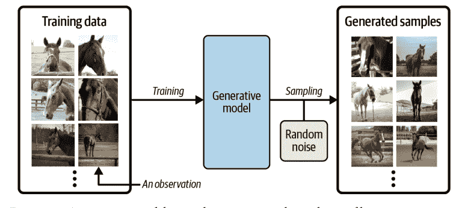

图 1-1. 训练用于生成逼真马匹照片的生成式模型

为了构建生成式模型，我们需要一个包含我们试图生成实体的许多示例的数据集。这被称为训练数据，其中一个数据点称为观测值。

每个观测值包含许多特征。对于图像生成问题，特征通常是单个像素值；对于文本生成问题，特征可能是单个单词或字母组。我们的目标是构建一个模型，能够生成新的特征集，看起来像是使用与原始数据相同的规则创建的。从概念上讲，对于图像生成来说，这是一个极其困难的任务，考虑到单个像素值可以分配的方式的庞大数量，以及构成我们试图生成实体的图像的此类排列的相对微小数量。

生成式模型还必须是概率性的而不是确定性的，因为我们希望能够采样输出的许多不同变体，而不是每次都得到相同的输出。如果我们的模型仅仅是一个固定计算，例如取训练数据集中每个像素的平均值，它就不是生成式的。一个生成式

模型必须包含一个随机成分，该成分会影响模型生成的各个样本。

换句话说，我们可以想象存在某种未知的概率分布，它解释了为什么某些图像更可能出现在训练数据集中，而其他图像则不会。我们的任务是构建一个尽可能逼真地模仿该分布的模型，然后从中采样，以生成新的、不同的观察结果，这些观察结果看起来就像可能包含在原始训练集中一样。

### 生成式与判别式建模

为了真正理解生成式建模旨在实现什么以及为什么这很重要，有用的是将其与它的对应物判别式建模进行比较。如果你学习过机器学习，你所面对的大多数问题很可能在本质上是判别式的。为了理解差异，让我们看一个例子。

假设我们有一个绘画数据集，其中一些由梵高绘制，一些由其他艺术家绘制。有足够的数据，我们可以训练一个判别式模型来预测给定的绘画是否由梵高绘制。我们的模型将学习某些颜色、形状和纹理更可能表明一幅画是荷兰大师的作品，对于具有这些特征的绘画，模型会相应地提高其预测权重。图1-2显示了判别式建模过程——注意它与图1-1所示的生成式建模过程有何不同。

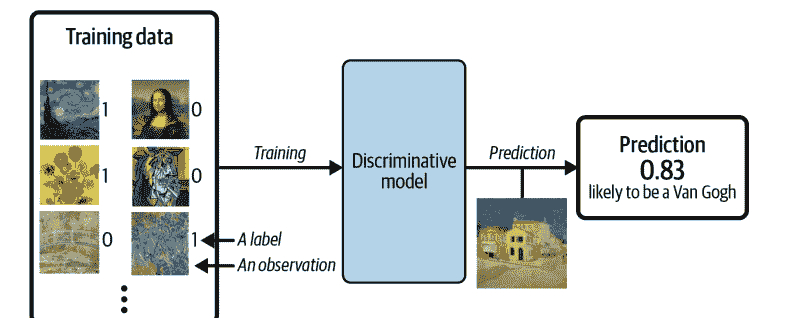

图1-2. 训练用于预测给定图像是否由梵高绘制的判别式模型

在进行判别式建模时，训练数据中的每个观察值都有一个标签。对于像我们的艺术家判别器这样的二元分类问题，梵高画作将被标记为1，非梵高画作标记为0。我们的模型随后学习如何区分这两组，并输出新观察值具有标签1的概率——即它是由梵高绘制的。

相比之下，生成式建模不需要数据集被标记，因为它关注的是生成全新的图像，而不是试图预测给定图像的标签。

让我们使用数学符号正式定义这些类型的建模：

判别式建模估计 p(y|x)。

也就是说，判别式建模旨在建模给定某些观察值 x 的标签 y 的概率。

生成式建模估计 p(x)。

也就是说，生成式建模旨在建模观察到观察值 x 的概率。从该分布采样使我们能够生成新的观察值。


### 条件生成模型

请注意，我们还可以构建一个生成模型来建模条件概率 p(x|y)——即在特定标签 y 下看到观察值 x 的概率。

例如，如果我们的数据集包含不同类型的水果，我们可以指示我们的生成模型专门生成一个苹果的图像。

需要注意的一个重要点是，即使我们能够构建一个完美的判别式模型来识别梵高画作，它仍然不知道如何创作一幅看起来像梵高的画作。它只能针对现有图像输出概率，因为这就是它的训练目标。我们反而需要训练一个生成模型并从该模型采样，以生成有很大可能属于原始训练数据集的图像。

### 生成式建模的兴起

直到最近，判别式建模一直是机器学习大多数进展的驱动力。这是因为对于任何判别式问题，对应的生成式建模问题通常更难以解决。例如，训练一个模型来预测一幅画是否出自梵高，比训练一个模型从零开始生成梵高风格的画作要容易得多。

同样，训练一个模型来预测一段文字是否由查尔斯·狄更斯撰写，比构建一个模型来生成狄更斯风格的一组段落要容易得多。直到最近，大多数生成挑战都遥不可及，许多人怀疑它们是否能被解决。创造力被认为是一种纯粹的人类能力，无法被人工智能超越。

然而，随着机器学习技术的成熟，这一假设逐渐减弱。在过去10年里，领域中最有趣的许多进步都来自于机器学习在生成式建模任务中的新颖应用。例如，图1-3显示了自2014年以来人脸图像生成方面已取得的显著进展。

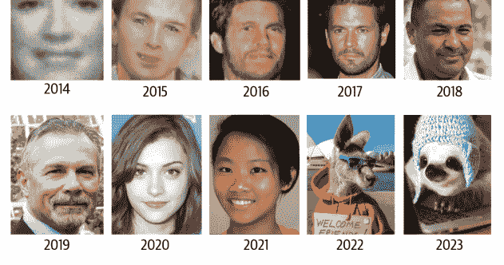

图1-3. 使用生成式建模进行人脸生成在过去十年中得到了显著改善（改编自 Brundage et al., 2018）¹

除了更容易处理之外，判别式建模在历史上比生成式建模更易于应用于各行业的实际问题。例如，医生可能会从一个预测给定视网膜图像是否显示青光眼迹象的模型中受益，但不一定会从一个能够生成眼睛后部新颖图片的模型中受益。

然而，这也开始发生变化，随着提供针对特定业务问题的生成服务的公司不断增多。例如，现在可以访问 API，根据特定主题生成原创博客文章，生成您产品在任何您想要的环境中的各种图像，或撰写与您的品牌和目标信息相匹配的社交媒体内容和广告文案。生成式人工智能对于游戏设计和电影制作等行业也有明显的积极应用，在这些行业中，训练用于输出视频和音乐的模型开始产生价值。

### 生成式建模与人工智能

除了生成式建模的实际用途（其中许多尚未被发现）之外，还有三个更深层次的原因可以认为生成式建模是解锁一种远比仅判别式建模所能实现更复杂的智能形式的关键。

首先，纯粹从理论角度来看，我们不应将机器训练局限于简单地对数据进行分类。为了完整性，我们还应关注训练能够捕捉对数据分布的更完整理解的模型，而不仅仅是某个特定标签。这无疑是一个更难解决的问题，因为可行输出空间的高维性和我们会归类为属于数据集的创作相对较少。然而，正如我们将看到的，推动判别式建模发展的许多相同技术，例如深度学习，也可以被生成模型利用。

其次，正如我们在第12章中将看到的，生成式建模现在正被用于推动人工智能其他领域的进展，例如强化学习（研究通过试错教智能体在环境中优化目标）。假设我们想训练一个机器人在给定地形上行走。传统方法是在地形或地形的计算机模拟中运行许多实验，让智能体尝试不同的策略。随着时间的推移，智能体会学习哪些策略比其他策略更成功，因此逐渐改进。这种方法的一个挑战是它相当不灵活，因为它训练的是针对某一特定任务优化策略。最近获得关注的一种替代方法是让智能体使用生成模型独立于任何特定任务学习环境的世界模型。智能体可以通过在其自己的世界模型中测试策略来快速适应新任务，而不是在真实环境中进行，这通常在计算上更高效，并且不需要为每个新任务从头重新训练。

最后，如果我们要真正说我们已经构建了一台获得了与人类相当的智能形式的机器，生成式建模必定是解决方案的一部分。自然界中最精妙的生成模型示例之一就是正在阅读这本书的人。花点时间思考你是一个多么不可思议的生成模型。你可以闭上眼睛想象大象从任何可能的角度看起来是什么样。你可以想象你最喜欢的电视节目若干种合理的不同结局，并且你可以提前规划你的周计划，通过在脑海中推演各种未来并据此采取行动。当前的神经科学理论认为，我们对现实的感知并不是一个在感官输入上运行以产生我们正在经历的预测的高复杂判别式模型，而是一个从出生开始训练以产生与未来准确匹配的周围环境模拟的生成模型。一些理论甚至认为，来自该生成模型的输出就是我们直接

被感知为现实。显然，对我们如何构建具备这种能力的机器的深入理解，将是我们持续理解大脑运作和通用人工智能的核心。

### 我们第一个生成模型

基于此，让我们开始进入令人兴奋的生成建模世界之旅。首先，我们将看一个生成模型的玩具示例，并介绍一些有助于我们处理本书后面会遇到的更复杂架构的想法。

### 你好，世界！

让我们在二维空间中玩一个生成建模游戏。我选择了一条规则，该规则用于生成图 1-4 中的点集 X。让我们称此规则为 p_data。你的挑战是在空间中选择一个不同的点 x = (x1, x2)，看起来像是同一个规则生成的。

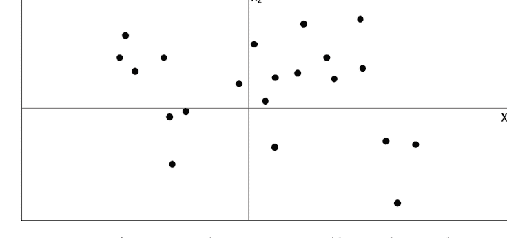

图 1-4. 由未知规则 p_data 生成的二维点集

你选择了哪里？你可能利用对现有数据点的了解构建了一个心理模型 p_model，推测点更可能出现在空间的何处。在这方面，p_model 是 p_data 的估计。也许你决定 p_model 应该看起来像图 1-5——一个点可能存在于其中的矩形框，以及框外没有任何点出现的区域。

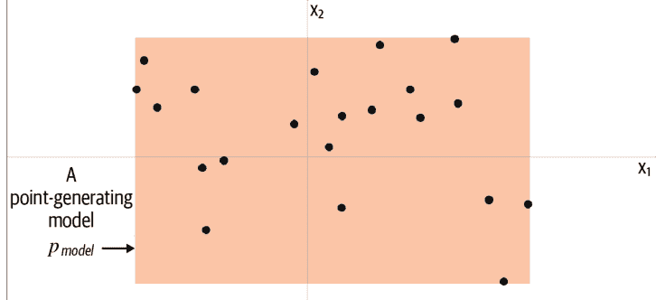

图 1-5. 橙色框 p_model 是真实数据生成分布 p_data 的估计

要生成新的观测，你只需在框内随机选择一个点，或者更正式地说，从分布 p_model 中采样。恭喜你，你刚刚构建了你的第一个生成模型！你利用训练数据（黑色点）构建了一个模型（橙色区域），可以轻松地从中采样以生成看起来属于训练集的其他点。

现在让我们将这种思考形式化为一个框架，以帮助我们理解生成建模试图实现什么。

### 生成建模框架

我们可以在以下框架中概括构建生成模型的动机和目标。

### 生成建模框架

- 我们有一个观测数据集 X。
- 我们假设观测数据是根据某个未知分布 p_data 生成的。
- 我们希望构建一个生成模型 p_model 来模仿 p_data。如果我们实现这一目标，就可以从 p_model 中采样以生成看起来是从 p_data 中抽取的观测。
- 因此，p_model 的期望属性是：

#### 精确性

如果对某个生成观测 $p_{model}$ 很高，它看起来应该是从 $p_{data}$ 中抽取的。如果对某个生成观测 $p_{model}$ 很低，它就不应该看起来是从 $p_{data}$ 中抽取的。

#### 生成

应该能够轻松地从 $p_{model}$ 中采样新的观测。

#### 表示

应该能够理解数据中不同高层特征是如何由 $p_{model}$ 表示的。

现在让我们揭示真实的数据生成分布 $p_{data}$，并看看该框架如何适用于此示例。如图 1-6 所示，数据生成规则只是世界陆地上的均匀分布，在海洋中找不到点的机会为零。

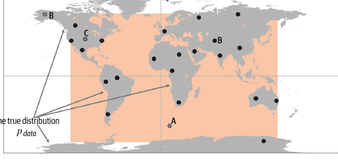

图 1-6. 橙色框 $p_{model}$ 是真实数据生成分布 $p_{data}$（灰色区域）的估计

显然，我们的模型 $p_{model}$ 是对 $p_{data}$ 的过度简化。我们可以检查点 A、B 和 C，以了解我们的模型在模仿 $p_{data}$ 的准确性方面的成功与失败：

- 点 A 是由我们的模型生成的观测，但看起来并非由 $p_{data}$ 生成，因为它位于海洋中央。
- 点 B 永远不可能由 $p_{model}$ 生成，因为它位于橙色框之外。因此，我们的模型在产生整个潜在可能性范围内的观测方面存在一些空白。
- 点 C 是可以由 $p_{model}$ 生成，也可以由 $p_{data}$ 生成的观测。

尽管存在不足，但该模型易于采样，因为它只是橙色框上的均匀分布。我们可以轻松地从框内随机选择一个点以从中采样。

此外，我们可以肯定地说，我们的模型是对底层复杂分布的简单表示，捕捉到了一些底层的高层特征。真实分布被划分为大量陆地（大陆）和没有陆地（海洋）的区域。这是我们模型也具有的高层特征，只是我们有一个大大陆，而不是多个。

这个示例展示了生成建模背后的基本概念。本书中我们将处理的难题将更复杂、更高维，但我们处理问题所采用的底层框架将是相同的。

### 表示学习

深入探讨我们所说的学习高维数据的表示是有价值的，因为这是一个将在本书中反复出现的主题。

假设你想向一个在人群中寻找你但不知道你长什么样的人描述你的外貌。你不会从陈述你照片中像素 1 的颜色，然后是像素 2，然后是像素 3 等开始。相反，你会做出合理的假设，即对方对普通人的大致样貌有一个概念，然后用描述像素组的特征来修正这一基准，例如我有非常金黄色的头发或我戴眼镜。最多十来条这样的陈述，对方就能将描述映射回像素，在脑海中生成你的图像。图像不会完美，但足以与你的实际外貌相似，让他们在可能数百人中认出你，即使他们从未见过你。

这是 *表示学习* 背后的核心思想。不是直接对高维样本空间建模，我们用较低维的 *潜在空间* 描述训练集中的每个观测，然后学习一个映射函数，该函数可以将潜在空间中的点映射到原始域中的点。换句话说，潜在空间中的每个点都是某个高维观测的 *表示*。

这在实践中意味着什么？假设我们有一个训练集，由饼干罐的灰度图像组成（图 1-7）。

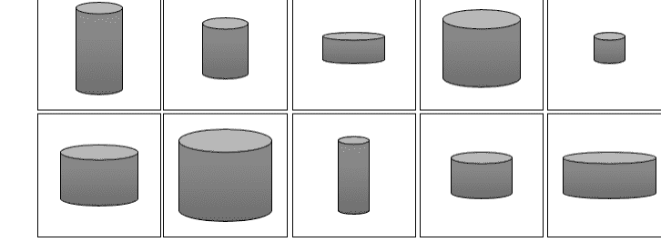

图 1-7. 饼干罐数据集

对我们来说，很明显有两个特征可以唯一表示这些罐子：罐子的高度和宽度。也就是说，我们可以将每个罐子的图像转换为仅二维的潜在空间中的一个点，尽管图像训练集以高维像素空间提供。值得注意的是，这意味着我们也可以通过将合适的映射函数 *f* 应用于潜在空间中的新点，来生成训练集中不存在的罐子图像，如图 1-8 所示。

机器要意识到原始数据集可以用更简单的潜在空间描述并不容易——它首先需要确定高度和宽度是描述该数据集的最佳两个潜在空间维度，然后学习映射函数 *f*，该函数可以将该空间中的点映射为灰度饼干罐图像。机器学习（尤其是深度学习）使我们能够训练机器在没有人工指导的情况下找到这些复杂关系。

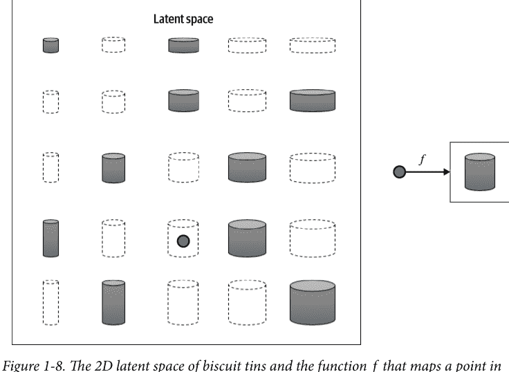

#### 潜在空间

图 1-8. 饼干罐的二维潜在空间以及将潜在空间中的点映射回原始图像域的函数 f

训练利用潜在空间的模型的一个好处是，我们可以通过在更易管理的潜在空间中操作其表示向量，来执行影响图像高层属性的操作。例如，如何调整每个像素的阴影以使饼干罐图像变高并不明显。然而，在潜在空间中，这只是增加高度潜在维度，然后应用映射函数返回图像域的情况。我们将在下一章看到这一点的明确示例，应用于的不是饼干罐而是人脸。

将训练数据集编码到潜在空间以便从中采样并将点解码回原始域的概念是许多生成建模技术的共同点，正如我们在本书后面的章节中将看到的那样。从数学上讲，编码器-解码器技术试图将数据所在的高非线性流形（例如像素空间）转换为可以采样的更简单的潜在空间，使得潜在空间中的任何点很可能都是一个结构良好的图像的表示，如图 1-9 所示。


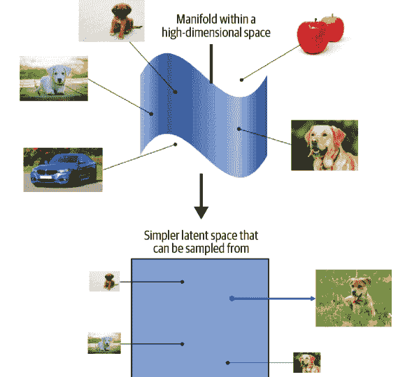

Figure 1-9. 高维像素空间中的狗流形被映射到可以从中采样的更简单潜在空间

### 核心概率理论

我们已经看到生成建模与概率分布的统计建模密切相关。因此，现在引入一些核心的概率和统计概念是有意义的，这些概念将在本书中贯穿始终，用于解释每个模型的理论背景。

如果你从未学习过概率或统计学，不用担心。要构建我们将在本书后面看到的许多深度学习模型，并不需要对统计理论有深入的理解。然而，为了充分理解我们试图解决的任务，值得努力建立对基本概率理论的扎实理解。这样，你将具备理解本章后面将介绍的生成模型不同家族的基础。

作为第一步，我们将定义五个关键术语，并将每个术语都联系回我们之前关于在二维中建模世界地图的生成模型的示例：

#### 样本空间

样本空间是观测值 x 可以取到的所有值的完整集合。


在我们之前的示例中，样本空间由世界地图上所有经纬度点 x = (x1, x2) 组成。例如，x = (40.7306, -73.9352) 是样本空间中的一个点（纽约市），它属于真实的数据生成分布。x = (11.3493, 142.1996) 是样本空间中的一个点，但不属于真实的数据生成分布（它在海上）。

#### 概率密度函数

概率密度函数（或简称为密度函数）是一个函数 p(x)，它将样本空间中的点 x 映射到 0 到 1 之间的数字。密度函数在样本空间所有点上的积分必须等于 1，以便它成为一个定义良好的概率分布。


在世界地图示例中，我们生成模型的密度函数在橙色框外为 0，在框内为常数，使得密度函数在整个样本空间上的积分等于 1。

虽然只有一个真实的密度函数 p_data(x) 被假定生成了可观测的数据集，但我们可以使用无限多个密度函数 p_model(x) 来估计 p_data(x)。

#### 参数建模

参数建模是一种我们可以用来构建寻找合适的 p_model(x) 方法的技术。参数模型是一个密度函数族 p_θ(x)，可以用有限数量的参数 θ 来描述。


如果我们假设均匀分布作为我们的模型族，那么我们在图 1-5 上可以绘制的所有可能框的集合就是参数模型的一个例子。在这种情况下，有四个参数：框的左下角 (θ1, θ2) 和右上角 (θ3, θ4) 的坐标。

因此，该参数模型中的每个密度函数 p_θ(x)（即每个框）都可以由四个数字唯一表示，θ = (θ1, θ2, θ3, θ4)。

#### 似然

参数集 $\theta$ 的似然 $\mathcal{L}(\theta|\mathbf{x})$ 是一个函数，用于衡量给定某个观测点 $\mathbf{x}$ 时 $\theta$ 的合理性。它定义如下：

$$\mathcal{L}(\theta|\mathbf{x}) = p_{\theta}(\mathbf{x})$$

也就是说，给定某个观测点 $\mathbf{x}$ 时 $\theta$ 的似然被定义为由 $\theta$ 参数化的密度函数在点 $\mathbf{x}$ 处的值。如果我们有一个由独立观测组成的整个数据集 $\mathbf{X}$，那么我们可以写：

$$\mathcal{L}(\theta|\mathbf{X}) = \prod_{\mathbf{x} \in \mathbf{X}} p_{\theta}(\mathbf{x})$$


在世界地图示例中，只覆盖地图左半部分的橙色框的似然为 0——它不可能生成该数据集，因为我们观察到地图右半部分存在点。图 1-5 中的橙色框具有正似然，因为在此模型下所有数据点的密度函数都为正。

由于 0 到 1 之间大量项的乘积在计算上可能相当困难，我们通常改用对数似然 $\ell$ 代替：

$$\ell(\theta|\mathbf{X}) = \sum_{\mathbf{x} \in \mathbf{X}} \log p_{\theta}(\mathbf{x})$$

虽然似然之所以这样定义有统计学上的原因，但我们也可以看到这种定义在直觉上是有意义的。参数集 $\theta$ 的似然被定义为如果真实数据生成分布是参数为 $\theta$ 的模型，则观察到数据的概率。

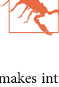

请注意，似然是参数的函数，而不是数据的函数。它不应被解释为给定参数集正确的概率——换句话说，它不是参数空间上的概率分布（即，相对于参数，它不求和/积分到 1）。

直觉上，参数建模的重点应该是找到使观测到数据集 $\mathbf{X}$ 的似然最大化的参数集的最优值 $\hat{\theta}$。

#### 最大似然估计

最大似然估计是一种技术，它使我们能够估计 $\hat{\theta}$——密度函数 $p_{\theta}(\mathbf{x})$ 的参数集 $\theta$，该参数集最有可能解释某些观测数据 $\mathbf{X}$。更正式地：

$\hat{\theta} = \arg\max_{\theta} \ell(\theta|\mathbf{X})$

$\hat{\theta}$ 也称为最大似然估计 (MLE)。


在世界地图示例中，MLE 是仍包含训练集中所有点的最小矩形。

神经网络通常最小化损失函数，因此我们可以等价地讨论找到使负对数似然最小化的参数集：

$\hat{\theta} = \arg\min_{\theta}(-\ell(\theta|\mathbf{X})) = \arg\min_{\theta}(-\log p_{\theta}(\mathbf{X}))$

生成建模可以被视为一种最大似然估计形式，其中参数 $\theta$ 是模型中包含的神经网络的权重。我们试图找到这些参数的值，以最大化观察到给定数据的似然（或等价地，最小化负对数似然）。

然而，对于高维问题，通常不可能直接计算 $p_{\theta}(\mathbf{x})$——它是不可处理的。正如我们在下一节中将看到的那样，不同家族的生成模型采用不同的方法来解决这个问题。

### 生成模型分类

虽然所有类型的生成模型最终都旨在解决相同的任务，但它们在建模密度函数 $p_{\theta}(\mathbf{x})$ 时采用略有不同的方法。总体而言，有三种可能的方法：

- 1. 显式建模密度函数，但以某种方式约束模型，使密度函数是可处理的（即可以计算）。
- 2. 显式建模密度函数的一个可处理近似。
- 3. 通过直接生成数据的随机过程隐式建模密度函数。

这些在图 1-10 中作为分类法显示，同时还显示了我们将在本书第二部分探讨的六个生成模型家族。请注意，这些家族不是相互排斥的——有很多模型是两种不同方法之间的混合。你应该将这些家族视为生成建模的不同一般方法，而不是明确的模型架构。

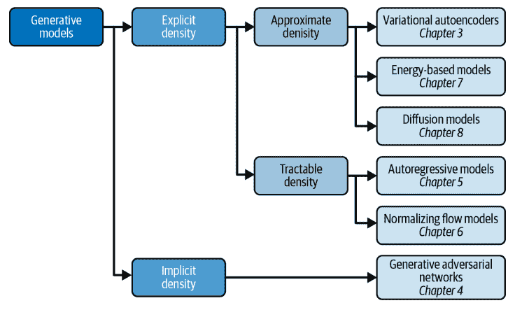

Figure 1-10. 生成建模方法的分类

我们可以做的第一个划分是在概率密度函数 p(x) 被显式建模的模型和被隐式建模的模型之间。

隐式密度模型根本不旨在估计概率密度，而是完全专注于产生直接生成数据的随机过程。隐式生成模型最著名的例子是生成对抗网络。我们可以进一步将显式密度模型分为直接优化密度函数（可处理模型）的模型和仅优化其近似值的模型。

可处理模型对模型架构施加约束，使得密度函数具有易于计算的形式。例如，自回归模型对输入特征施加顺序，以便输出可以顺序生成——例如，逐词或逐像素。归一化流模型将一系列可处理的可逆函数应用于简单分布，以便生成更复杂的分布。


*近似密度模型* 包括 *变分自编码器*，它们引入潜在变量并优化联合密度函数的近似。*基于能量的模型* 也使用近似方法，但通过马尔可夫链采样来实现，而非变分方法。*扩散模型* 通过训练模型逐步去噪先前被破坏的图像来近似密度函数。

贯穿所有生成模型家族类型的一个共同点是 *深度学习*。几乎所有复杂的生成模型的核心都有一个深度神经网络，因为它们可以从头训练以学习支配数据结构的复杂关系，而无需事先硬编码信息。我们将在第 2 章中探讨深度学习，并通过实际示例说明如何开始构建自己的深度神经网络。

### 生成式深度学习代码库

本章的最后一部分将通过介绍随本书附带的 codebase 为您做好准备，开始构建生成式深度学习模型。


本书中的许多示例改编自 Keras 网站上提供的优秀开源实现。我强烈建议您查看此资源，因为新的模型和示例不断被添加。

### 克隆仓库

开始之前，您首先需要克隆 Git 仓库。Git 是一个开源版本控制系统，可让您将代码复制到本地，以便在自己的机器上或基于云的环境中运行笔记本。您可能已经安装了它，但如果没有，请按照与您的操作系统相关的说明进行操作。

要克隆本书的仓库，请导航到您希望存储文件的文件夹，并在终端中输入以下内容：

```
git clone https://github.com/davidADSP/Generative_Deep_Learning_2nd_Edition.git
```

您现在应该能在机器上的一个文件夹中看到文件。

### 使用 Docker

本书的代码库旨在与 Docker 一起使用，Docker 是一种免费的容器化技术，无论您的架构或操作系统如何，都能让您极其轻松地开始使用新的代码库。如果您从未使用过 Docker，请不要担心——在图书仓库的 README 文件中有关于如何开始的说明。

### 在 GPU 上运行

如果您无法访问自己的 GPU，也没问题！本书中的所有示例都将在 CPU 上训练，尽管这比使用 GPU 启用机器所需的时间更长。README 中还有一个关于设置 Google Cloud 环境的部分，该环境按需付费即可让您访问 GPU。

### 摘要

本章介绍了生成建模领域，这是机器学习的一个重要分支，补充了研究更广泛的判别建模。我们讨论了生成建模目前是人工智能研究中最活跃和最令人兴奋的领域之一，在理论和应用方面都有许多最新进展。

我们从一个简单的玩具示例开始，看到生成建模最终侧重于对数据的潜在分布进行建模。这带来了许多复杂而有趣的挑战，我们将其总结为理解任何生成模型理想属性的框架。

然后我们逐步介绍了关键的概率概念，这些概念有助于充分理解每种生成建模方法的理论基础，并列出了我们在本书第二部分将探讨的六种不同的生成模型家族。我们还通过克隆仓库了解了如何开始使用 Generative Deep Learning 代码库。

在第 2 章中，我们将开始探索深度学习，并了解如何使用 Keras 构建可以执行判别建模任务的模型。这将为我们在后续章节中解决生成式深度学习问题提供必要的[content]
*近似密度模型* 包括 *变分自编码器*，它们引入潜在变量并优化联合密度函数的近似。*基于能量的模型* 也使用近似方法，但通过马尔可夫链采样来实现，而非变分方法。*扩散模型* 通过训练模型逐步去噪先前被破坏的图像来近似密度函数。

贯穿所有生成模型家族类型的一个共同点是 *深度学习*。几乎所有复杂的生成模型的核心都有一个深度神经网络，因为它们可以从头训练以学习支配数据结构的复杂关系，而无需事先硬编码信息。我们将在第 2 章中探讨深度学习，并通过实际示例说明如何开始构建自己的深度神经网络。

### 生成式深度学习代码库

本章的最后一部分将通过介绍随本书附带的 codebase 为您做好准备，开始构建生成式深度学习模型。


本书中的许多示例改编自 Keras 网站上提供的优秀开源实现。我强烈建议您查看此资源，因为新的模型和示例不断被添加。

### 克隆仓库

开始之前，您首先需要克隆 Git 仓库。Git 是一个开源版本控制系统，可让您将代码复制到本地，以便在自己的机器上或基于云的环境中运行笔记本。您可能已经安装了它，但如果没有，请按照与您的操作系统相关的说明进行操作。

要克隆本书的仓库，请导航到您希望存储文件的文件夹，并在终端中输入以下内容：

```
git clone https://github.com/davidADSP/Generative_Deep_Learning_2nd_Edition.git
```

您现在应该能在机器上的一个文件夹中看到文件。

### 使用 Docker

本书的代码库旨在与 Docker 一起使用，Docker 是一种免费的容器化技术，无论您的架构或操作系统如何，都能让您极其轻松地开始使用新的代码库。如果您从未使用过 Docker，请不要担心——在图书仓库的 README 文件中有关于如何开始的说明。

### 在 GPU 上运行

如果您无法访问自己的 GPU，也没问题！本书中的所有示例都将在 CPU 上训练，尽管这比使用 GPU 启用机器所需的时间更长。README 中还有一个关于设置 Google Cloud 环境的部分，该环境按需付费即可让您访问 GPU。

### 摘要

本章介绍了生成建模领域，这是机器学习的一个重要分支，补充了研究更广泛的判别建模。我们讨论了生成建模目前是人工智能研究中最活跃和最令人兴奋的领域之一，在理论和应用方面都有许多最新进展。

我们从一个简单的玩具示例开始，看到生成建模最终侧重于对数据的潜在分布进行建模。这带来了许多复杂而有趣的挑战，我们将其总结为理解任何生成模型理想属性的框架。

然后我们逐步介绍了关键的概率概念，这些概念有助于充分理解每种生成建模方法的理论基础，并列出了我们在本书第二部分将探讨的六种不同的生成模型家族。我们还通过克隆仓库了解了如何开始使用 Generative Deep Learning 代码库。

在第 2 章中，我们将开始探索深度学习，并了解如何使用 Keras 构建可以执行判别建模任务的模型。这将为我们在后续章节中解决生成式深度学习问题提供必要的[content]
*近似密度模型* 包括 *变分自编码器*，它们引入潜在变量并优化联合密度函数的近似。*基于能量的模型* 也使用近似方法，但通过马尔可夫链采样来实现，而非变分方法。*扩散模型* 通过训练模型逐步去噪先前被破坏的图像来近似密度函数。

贯穿所有生成模型家族类型的一个共同点是 *深度学习*。几乎所有复杂的生成模型的核心都有一个深度神经网络，因为它们可以从头训练以学习支配数据结构的复杂关系，而无需事先硬编码信息。我们将在第 2 章中探讨深度学习，并通过实际示例说明如何开始构建自己的深度神经网络。

### 生成式深度学习代码库

本章的最后一部分将通过介绍随本书附带的 codebase 为您做好准备，开始构建生成式深度学习模型。


本书中的许多示例改编自 Keras 网站上提供的优秀开源实现。我强烈建议您查看此资源，因为新的模型和示例不断被添加。

### 克隆仓库

开始之前，您首先需要克隆 Git 仓库。Git 是一个开源版本控制系统，可让您将代码复制到本地，以便在自己的机器上或基于云的环境中运行笔记本。您可能已经安装了它，但如果没有，请按照与您的操作系统相关的说明进行操作。

要克隆本书的仓库，请导航到您希望存储文件的文件夹，并在终端中输入以下内容：

```
git clone https://github.com/davidADSP/Generative_Deep_Learning_2nd_Edition.git
```

您现在应该能在机器上的一个文件夹中看到文件。

### 使用 Docker

本书的代码库旨在与 Docker 一起使用，Docker 是一种免费的容器化技术，无论您的架构或操作系统如何，都能让您极其轻松地开始使用新的代码库。如果您从未使用过 Docker，请不要担心——在图书仓库的 README 文件中有关于如何开始的说明。

### 在 GPU 上运行

如果您无法访问自己的 GPU，也没问题！本书中的所有示例都将在 CPU 上训练，尽管这比使用 GPU 启用机器所需的时间更长。README 中还有一个关于设置 Google Cloud 环境的部分，该环境按需付费即可让您访问 GPU。

### 摘要

本章介绍了生成建模领域，这是机器学习的一个重要分支，补充了研究更广泛的判别建模。我们讨论了生成建模目前是人工智能研究中最活跃和最令人兴奋的领域之一，在理论和应用方面都有许多最新进展。

我们从一个简单的玩具示例开始，看到生成建模最终侧重于对数据的潜在分布进行建模。这带来了许多复杂而有趣的挑战，我们将其总结为理解任何生成模型理想属性的框架。

然后我们逐步介绍了关键的概率概念，这些概念有助于充分理解每种生成建模方法的理论基础，并列出了我们在本书第二部分将探讨的六种不同的生成模型家族。我们还通过克隆仓库了解了如何开始使用 Generative Deep Learning 代码库。

在第 2 章中，我们将开始探索深度学习，并了解如何使用 Keras 构建可以执行判别建模任务的模型。这将为我们在后续章节中解决生成式深度学习问题提供必要的[content]
*近似密度模型* 包括 *变分自编码器*，它们引入潜在变量并优化联合密度函数的近似。*基于能量的模型* 也使用近似方法，但通过马尔可夫链采样来实现，而非变分方法。*扩散模型* 通过训练模型逐步去噪先前被破坏的图像来近似密度函数。

贯穿所有生成模型家族类型的一个共同点是 *深度学习*。几乎所有复杂的生成模型的核心都有一个深度神经网络，因为它们可以从头训练以学习支配数据结构的复杂关系，而无需事先硬编码信息。我们将在第 2 章中探讨深度学习，并通过实际示例说明如何开始构建自己的深度神经网络。

### 生成式深度学习代码库

本章的最后一部分将通过介绍随本书附带的 codebase 为您做好准备，开始构建生成式深度学习模型。


本书中的许多示例改编自 Keras 网站上提供的优秀开源实现。我强烈建议您查看此资源，因为新的模型和示例不断被添加。

### 克隆仓库

开始之前，您首先需要克隆 Git 仓库。Git 是一个开源版本控制系统，可让您将代码复制到本地，以便在自己的机器上或基于云的环境中运行笔记本。您可能已经安装了它，但如果没有，请按照与您的操作系统相关的说明进行操作。

要克隆本书的仓库，请导航到您希望存储文件的文件夹，并在终端中输入以下内容：

```
git clone https://github.com/davidADSP/Generative_Deep_Learning_2nd_Edition.git
```

您现在应该能在机器上的一个文件夹中看到文件。

### 使用 Docker

本书的代码库旨在与 Docker 一起使用，Docker 是一种免费的容器化技术，无论您的架构或操作系统如何，都能让您极其轻松地开始使用新的代码库。如果您从未使用过 Docker，请不要担心——在图书仓库的 README 文件中有关于如何开始的说明。

### 在 GPU 上运行

如果您无法访问自己的 GPU，也没问题！本书中的所有示例都将在 CPU 上训练，尽管这比使用 GPU 启用机器所需的时间更长。README 中还有一个关于设置 Google Cloud 环境的部分，该环境按需付费即可让您访问 GPU。

### 摘要

本章介绍了生成建模领域，这是机器学习的一个重要分支，补充了研究更广泛的判别建模。我们讨论了生成建模目前是人工智能研究中最活跃和最令人兴奋的领域之一，在理论和应用方面都有许多最新进展。

我们从一个简单的玩具示例开始，看到生成建模最终侧重于对数据的潜在分布进行建模。这带来了许多复杂而有趣的挑战，我们将其总结为理解任何生成模型理想属性的框架。

然后我们逐步介绍了关键的概率概念，这些概念有助于充分理解每种生成建模方法的理论基础，并列出了我们在本书第二部分将探讨的六种不同的生成模型家族。我们还通过克隆仓库了解了如何开始使用 Generative Deep Learning 代码库。

在第 2 章中，我们将开始探索深度学习，并了解如何使用 Keras 构建可以执行判别建模任务的模型。这将为我们在后续章节中解决生成式深度学习问题提供必要的[content]
*近似密度模型* 包括 *变分自编码器*，它们引入潜在变量并优化联合密度函数的近似。*基于能量的模型* 也使用近似方法，但通过马尔可夫链采样来实现，而非变分方法。*扩散模型* 通过训练模型逐步去噪先前被破坏的图像来近似密度函数。

贯穿所有生成模型家族类型的一个共同点是 *深度学习*。几乎所有复杂的生成模型的核心都有一个深度神经网络，因为它们可以从头训练以学习支配数据结构的复杂关系，而无需事先硬编码信息。我们将在第 2 章中探讨深度学习，并通过实际示例说明如何开始构建自己的深度神经网络。

### 生成式深度学习代码库

本章的最后一部分将通过介绍随本书附带的 codebase 为您做好准备，开始构建生成式深度学习模型。


本书中的许多示例改编自 Keras 网站上提供的优秀开源实现。我强烈建议您查看此资源，因为新的模型和示例不断被添加。

### 克隆仓库

开始之前，您首先需要克隆 Git 仓库。Git 是一个开源版本控制系统，可让您将代码复制到本地，以便在自己的机器上或基于云的环境中运行笔记本。您可能已经安装了它，但如果没有，请按照与您的操作系统相关的说明进行操作。

要克隆本书的仓库，请导航到您希望存储文件的文件夹，并在终端中输入以下内容：

```
git clone https://github.com/davidADSP/Generative_Deep_Learning_2nd_Edition.git
```

您现在应该能在机器上的一个文件夹中看到文件。

### 使用 Docker

本书的代码库旨在与 Docker 一起使用，Docker 是一种免费的容器化技术，无论您的架构或操作系统如何，都能让您极其轻松地开始使用新的代码库。如果您从未使用过 Docker，请不要担心——在图书仓库的 README 文件中有关于如何开始的说明。

### 在 GPU 上运行

如果您无法访问自己的 GPU，也没问题！本书中的所有示例都将在 CPU 上训练，尽管这比使用 GPU 启用机器所需的时间更长。README 中还有一个关于设置 Google Cloud 环境的部分，该环境按需付费即可让您访问 GPU。

### 摘要

本章介绍了生成建模领域，这是机器学习的一个重要分支，补充了研究更广泛的判别建模。我们讨论了生成建模目前是人工智能研究中最活跃和最令人兴奋的领域之一，在理论和应用方面都有许多最新进展。

我们从一个简单的玩具示例开始，看到生成建模最终侧重于对数据的潜在分布进行建模。这带来了许多复杂而有趣的挑战，我们将其总结为理解任何生成模型理想属性的框架。

然后我们逐步介绍了关键的概率概念，这些概念有助于充分理解每种生成建模方法的理论基础，并列出了我们在本书第二部分将探讨的六种不同的生成模型家族。我们还通过克隆仓库了解了如何开始使用 Generative Deep Learning 代码库。

在第 2 章中，我们将开始探索深度学习，并了解如何使用 Keras 构建可以执行判别建模任务的模型。这将为我们在后续章节中解决生成式深度学习问题提供必要的[content]
*近似密度模型* 包括 *变分自编码器*，它们引入潜在变量并优化联合密度函数的近似。*基于能量的模型* 也使用近似方法，但通过马尔可夫链采样来实现，而非变分方法。*扩散模型* 通过训练模型逐步去噪先前被破坏的图像来近似密度函数。

贯穿所有生成模型家族类型的一个共同点是 *深度学习*。几乎所有复杂的生成模型的核心都有一个深度神经网络，因为它们可以从头训练以学习支配数据结构的复杂关系，而无需事先硬编码信息。我们将在第 2 章中探讨深度学习，并通过实际示例说明如何开始构建自己的深度神经网络。

### 生成式深度学习代码库

本章的最后一部分将通过介绍随本书附带的 codebase 为您做好准备，开始构建生成式深度学习模型。


本书中的许多示例改编自 Keras 网站上提供的优秀开源实现。我强烈建议您查看此资源，因为新的模型和示例不断被添加。

### 克隆仓库

开始之前，您首先需要克隆 Git 仓库。Git 是一个开源版本控制系统，可让您将代码复制到本地，以便在自己的机器上或基于云的环境中运行笔记本。您可能已经安装了它，但如果没有，请按照与您的操作系统相关的说明进行操作。

要克隆本书的仓库，请导航到您希望存储文件的文件夹，并在终端中输入以下内容：

```
git clone https://github.com/davidADSP/Generative_Deep_Learning_2nd_Edition.git
```

您现在应该能在机器上的一个文件夹中看到文件。

### 使用 Docker

本书的代码库旨在与 Docker 一起使用，Docker 是一种免费的容器化技术，无论您的架构或操作系统如何，都能让您极其轻松地开始使用新的代码库。如果您从未使用过 Docker，请不要担心——在图书仓库的 README 文件中有关于如何开始的说明。

### 在 GPU 上运行

如果您无法访问自己的 GPU，也没问题！本书中的所有示例都将在 CPU 上训练，尽管这比使用 GPU 启用机器所需的时间更长。README 中还有一个关于设置 Google Cloud 环境的部分，该环境按需付费即可让您访问 GPU。

### 摘要

本章介绍了生成建模领域，这是机器学习的一个重要分支，补充了研究更广泛的判别建模。我们讨论了生成建模目前是人工智能研究中最活跃和最令人兴奋的领域之一，在理论和应用方面都有许多最新进展。

我们从一个简单的玩具示例开始，看到生成建模最终侧重于对数据的潜在分布进行建模。这带来了许多复杂而有趣的挑战，我们将其总结为理解任何生成模型理想属性的框架。

然后我们逐步介绍了关键的概率概念，这些概念有助于充分理解每种生成建模方法的理论基础，并列出了我们在本书第二部分将探讨的六种不同的生成模型家族。我们还通过克隆仓库了解了如何开始使用 Generative Deep Learning 代码库。

在第 2 章中，我们将开始探索深度学习，并了解如何使用 Keras 构建可以执行判别建模任务的模型。这将为我们在后续章节中解决生成式深度学习问题提供必要的[content]
*近似密度模型* 包括 *变分自编码器*，它们引入潜在变量并优化联合密度函数的近似。*基于能量的模型* 也使用近似方法，但通过马尔可夫链采样来实现，而非变分方法。*扩散模型* 通过训练模型逐步去噪先前被破坏的图像来近似密度函数。

贯穿所有生成模型家族类型的一个共同点是 *深度学习*。几乎所有复杂的生成模型的核心都有一个深度神经网络，因为它们可以从头训练以学习支配数据结构的复杂关系，而无需事先硬编码信息。我们将在第 2 章中探讨深度学习，并通过实际示例说明如何开始构建自己的深度神经网络。

### 生成式深度学习代码库

本章的最后一部分将通过介绍随本书附带的 codebase 为您做好准备，开始构建生成式深度学习模型。


本书中的许多示例改编自 Keras 网站上提供的优秀开源实现。我强烈建议您查看此资源，因为新的模型和示例不断被添加。

### 克隆仓库

开始之前，您首先需要克隆 Git 仓库。Git 是一个开源版本控制系统，可让您将代码复制到本地，以便在自己的机器上或基于云的环境中运行笔记本。您可能已经安装了它，但如果没有，请按照与您的操作系统相关的说明进行操作。

要克隆本书的仓库，请导航到您希望存储文件的文件夹，并在终端中输入以下内容：

```
git clone https://github.com/davidADSP/Generative_Deep_Learning_2nd_Edition.git
```

您现在应该能在机器上的一个文件夹中看到文件。

### 使用 Docker

本书的代码库旨在与 Docker 一起使用，Docker 是一种免费的容器化技术，无论您的架构或操作系统如何，都能让您极其轻松地开始使用新的代码库。如果您从未使用过 Docker，请不要担心——在图书仓库的 README 文件中有关于如何开始的说明。

### 在 GPU 上运行

如果您无法访问自己的 GPU，也没问题！本书中的所有示例都将在 CPU 上训练，尽管这比使用 GPU 启用机器所需的时间更长。README 中还有一个关于设置 Google Cloud 环境的部分，该环境按需付费即可让您访问 GPU。

### 摘要

本章介绍了生成建模领域，这是机器学习的一个重要分支，补充了研究更广泛的判别建模。我们讨论了生成建模目前是人工智能研究中最活跃和最令人兴奋的领域之一，在理论和应用方面都有许多最新进展。

我们从一个简单的玩具示例开始，看到生成建模最终侧重于对数据的潜在分布进行建模。这带来了许多复杂而有趣的挑战，我们将其总结为理解任何生成模型理想属性的框架。

然后我们逐步介绍了关键的概率概念，这些概念有助于充分理解每种生成建模方法的理论基础，并列出了我们在本书第二部分将探讨的六种不同的生成模型家族。我们还通过克隆仓库了解了如何开始使用 Generative Deep Learning 代码库。

在第 2 章中，我们将开始探索深度学习，并了解如何使用 Keras 构建可以执行判别建模任务的模型。这将为我们在后续章节中解决生成式深度学习问题提供必要的[content]
*近似密度模型* 包括 *变分自编码器*，它们引入潜在变量并优化联合密度函数的近似。*基于能量的模型* 也使用近似方法，但通过马尔可夫链采样来实现，而非变分方法。*扩散模型* 通过训练模型逐步去噪先前被破坏的图像来近似密度函数。

贯穿所有生成模型家族类型的一个共同点是 *深度学习*。几乎所有复杂的生成模型的核心都有一个深度神经网络，因为它们可以从头训练以学习支配数据结构的复杂关系，而无需事先硬编码信息。我们将在第 2 章中探讨深度学习，并通过实际示例说明如何开始构建自己的深度神经网络。

### 生成式深度学习代码库

本章的最后一部分将通过介绍随本书附带的 codebase 为您做好准备，开始构建生成式深度学习模型。


本书中的许多示例改编自 Keras 网站上提供的优秀开源实现。我强烈建议您查看此资源，因为新的模型和示例不断被添加。

### 克隆仓库

开始之前，您首先需要克隆 Git 仓库。Git 是一个开源版本控制系统，可让您将代码复制到本地，以便在自己的机器上或基于云的环境中运行笔记本。您可能已经安装了它，但如果没有，请按照与您的操作系统相关的说明进行操作。

要克隆本书的仓库，请导航到您希望存储文件的文件夹，并在终端中输入以下内容：

```
git clone https://github.com/davidADSP/Generative_Deep_Learning_2nd_Edition.git
```

您现在应该能在机器上的一个文件夹中看到文件。

### 使用 Docker

本书的代码库旨在与 Docker 一起使用，Docker 是一种免费的容器化技术，无论您的架构或操作系统如何，都能让您极其轻松地开始使用新的代码库。如果您从未使用过 Docker，请不要担心——在图书仓库的 README 文件中有关于如何开始的说明。

### 在 GPU 上运行

如果您无法访问自己的 GPU，也没问题！本书中的所有示例都将在 CPU 上训练，尽管这比使用 GPU 启用机器所需的时间更长。README 中还有一个关于设置 Google Cloud 环境的部分，该环境按需付费即可让您访问 GPU。

### 摘要

本章介绍了生成建模领域，这是机器学习的一个重要分支，补充了研究更广泛的判别建模。我们讨论了生成建模目前是人工智能研究中最活跃和最令人兴奋的领域之一，在理论和应用方面都有许多最新进展。

我们从一个简单的玩具示例开始，看到生成建模最终侧重于对数据的潜在分布进行建模。这带来了许多复杂而有趣的挑战，我们将其总结为理解任何生成模型理想属性的框架。

然后我们逐步介绍了关键的概率概念，这些概念有助于充分理解每种生成建模方法的理论基础，并列出了我们在本书第二部分将探讨的六种不同的生成模型家族。我们还通过克隆仓库了解了如何开始使用 Generative Deep Learning 代码库。

在第 2 章中，我们将开始探索深度学习，并了解如何使用 Keras 构建可以执行判别建模任务的模型。这将为我们在后续章节中解决生成式深度学习问题提供必要的[content]
*近似密度模型* 包括 *变分自编码器*，它们引入潜在变量并优化联合密度函数的近似。*基于能量的模型* 也使用近似方法，但通过马尔可夫链采样实现，而非变分方法。*扩散模型* 通过训练模型逐步去噪先前被破坏的图像来近似密度函数。

贯穿所有生成模型家族类型的一个共同点是 *深度学习*。几乎所有复杂的生成模型核心都有深度神经网络，因为它们可从头训练以学习支配数据结构的复杂关系，而无需事先硬编码信息。我们将在第 2 章探讨深度学习，并通过实际示例说明如何开始构建自己的深度神经网络。

### 生成式深度学习代码库

本章最后一部分将通过介绍随本书附带的 codebase 为您做好准备，开始构建生成式深度学习模型。


本书许多示例改编自 Keras 网站上提供的优秀开源实现。我强烈建议您查看此资源，因为新模型和示例不断被添加。

### 克隆仓库

开始前，您首先需要克隆 Git 仓库。Git 是开源版本控制系统，可让您将代码复制到本地，以便在自己的机器或云环境中运行笔记本。您可能已安装，若未安装，请按操作系统相关说明操作。

要克隆本书仓库，请导航到希望存储文件的文件夹，并在终端输入以下内容：

```
git clone https://github.com/davidADSP/Generative_Deep_Learning_2nd_Edition.git
```

您现在应能在机器上的文件夹中看到文件。

### 使用 Docker

本书代码库旨在与 Docker 一起使用，Docker 是免费容器化技术，无论架构或操作系统如何，都能让您极其轻松地开始使用新代码库。若从未使用过 Docker，请勿担心——图书仓库的 README 文件中有如何开始的说明。

### 在 GPU 上运行

若无法访问自己的 GPU，也没问题！本书所有示例都可在 CPU 上训练，只是比使用 GPU 机器更慢。README 中还有关于设置 Google Cloud 环境的部分，该环境按需付费即可访问 GPU。

### 摘要

本章介绍了生成建模领域，这是机器学习的重要分支，补充了研究更广泛的判别建模。我们讨论了生成建模目前是 AI 研究中最活跃、最令人兴奋的领域之一，理论和应用均有最新进展。

我们从简单玩具示例开始，看到生成建模最终侧重于对数据潜在分布建模。这带来许多复杂有趣的挑战，我们将其总结为理解任何生成模型理想属性的框架。

随后我们介绍了关键概率概念，有助于充分理解每种生成建模方法的理论基础，并列出了将在本书第二部分探讨的六种生成模型家族。我们还通过克隆仓库了解了如何开始使用 Generative Deep Learning 代码库。

第 2 章我们将开始探索深度学习，并了解如何使用 Keras 构建可执行判别建模任务的模型。这将为后续章节解决生成式深度学习问题提供必要基础。

### 参考文献

- 1. Miles Brundage et al., “The Malicious Use of Artificial Intelligence: Forecasting, Prevention, and Mitigation,” February 20, 2018, https://www.eff.org/files/2018/02/20/malicious_ai_report_final.pdf.

### 深度学习

#### 章节目标

在本章您将：

- 了解可使用深度学习建模的不同类型非结构化数据。
- 定义深度神经网络并理解其如何用于建模复杂数据集。
- 构建多层感知机以预测图像内容。
- 通过使用卷积层、dropout 和批归一化层提高模型性能。

让我们从基本定义开始：

> 深度学习是一类机器学习算法，它使用 *多层堆叠的处理单元* 从 *非结构化数据* 中学习高层表示。

要充分理解深度学习，需对该定义进一步探讨。首先我们将看看深度学习可用于建模的不同类型非结构化数据，然后深入研究构建多层堆叠处理单元以解决分类任务的机制。这将为未来章节专注于生成任务的深度学习提供基础。

### 用于深度学习的数据

许多机器学习算法需要 *结构化* 表格数据作为输入，按特征列排列以描述每个观测。例如，年龄、收入和上月网站访问次数均可用于预测某人未来一个月是否订阅特定在线服务。我们可用这些特征的结构化表训练逻辑回归、随机森林或 XGBoost 模型来预测二元响应变量——是否订阅（1）或未订阅（0）。每个特征都包含关于观测的少量信息，模型将学习这些特征如何相互作用以影响响应。

*非结构化* 数据指任何不自然排列成特征列的数据，如图像、音频和文本。当然图像有空间结构，录音或文本段落有时间结构，视频数据同时具有空间和时间结构，但由于数据不是以特征列形式到达，故视为非结构化，如图 2-1 所示。

结构化数据
| ID | 年龄 | 性别 | 身高（厘米） | 位置 |
|---|---|---|---|---|
| 0001 | 54 | M | 186 | 伦敦 |
| 0002 | 35 | F | 166 | 纽约 |
| 0003 | 62 | F | 170 | 阿姆斯特丹 |
| 0004 | 23 | M | 164 | 伦敦 |
| 0005 | 25 | M | 180 | 开罗 |
| 0006 | 29 | F | 181 | 北京 |
| 0007 | 46 | M | 172 | 芝加哥 |

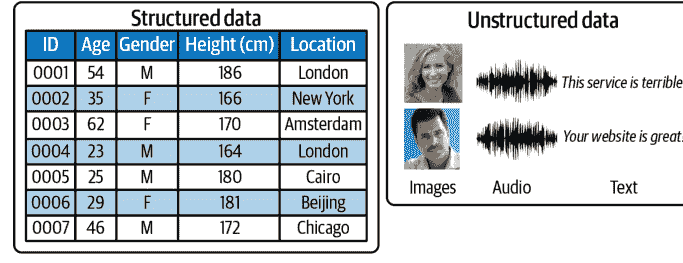

图 2-1. 结构化数据与非结构化数据的区别

当数据为非结构化时，单个像素、频率或字符几乎完全无信息。例如，知道图像第 234 个像素是泥泞棕色并不能真正帮助识别图像是房子还是狗，知道句子第 24 个字符是 e 也不能帮助预测文本是关于足球还是政治。

像素或字符实际上只是嵌入更高层信息特征的画布上的凹坑，例如房屋烟囱图像或单词 *striker*。若图像中烟囱置于房屋另一侧，图像仍包含烟囱，但此信息现在由完全不同像素承载。若单词 *striker* 在文本中出现稍早或稍晚，文本仍关于足球，但不同字符位置会提供此信息。数据的粒度结合高

空间依赖性的存在破坏了像素或字符本身作为信息特征的概念。

因此，如果我们使用原始像素值训练逻辑回归、随机森林或 XGBoost 模型，训练好的模型对于除最简单的分类任务之外的所有任务通常表现都很差。这些模型依赖于输入特征具有信息性且不具有空间依赖性。另一方面，深度学习模型可以直接从非结构化数据中自行学习构建高级信息特征。

深度学习可以应用于结构化数据，但其真正的强大之处，尤其是在生成建模方面，来自于它处理非结构化数据的能力。最常见的是，我们希望生成非结构化数据，例如新图像或原始文本字符串，这也是深度学习对生成建模领域产生如此深远影响的原因。

### 深度神经网络

大多数深度学习系统都是 *人工神经网络*（ANNs，或简称为 *神经网络*）并具有多个堆叠的隐藏层。因此，*深度学习* 现在几乎已与 *深度神经网络* 同义。然而，任何采用多层来学习输入数据的高级表示的系统也是一种深度学习形式（例如，深度信念网络）。

让我们先分解一下我们所说的神经网络的确切含义，然后再看看它们如何用于从非结构化数据中学习高级特征。

### 什么是神经网络？

神经网络由一系列堆叠的 *层* 组成。每一层包含 *单元*，这些单元通过一组 *权重* 与前一层的单元相连。正如我们将看到的，有许多不同类型的层，但最常见的一种是 *全连接*（或 *稠密*）层，它将该层中的所有单元直接连接到前一层中的每个单元。

所有相邻层都是全连接的神经网络称为 *多层感知机*（MLPs）。这是我们将研究的第一个神经网络类型。图 2-2 显示了 MLP 的示例。

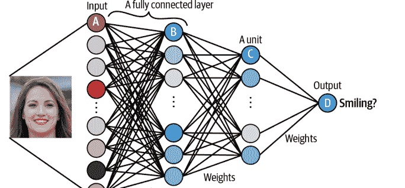

图 2-2. 一个预测人脸是否微笑的多层感知机示例

输入（例如，图像）依次由每一层转换，在网络中称为 *前向传播*，直到到达输出层。具体来说，每个单元对输入的加权和应用非线性变换，并将输出传递到后续层。最终的输出层是这一过程的 culmination，其中单个单元输出原始输入属于特定类别（例如，*微笑*）的概率。

深度神经网络的魔力在于找到使预测最准确的每一层的权重集合。找到这些权重的过程就是我们所说的 *训练* 网络。

在训练过程中，图像批次通过网络传递，预测输出与真实标签进行比较。例如，网络可能对真正微笑的人的图像输出 80% 的概率，对真正不微笑的人的图像输出 23% 的概率。完美的预测会对这些示例输出 100% 和 0%，因此存在少量误差。预测中的误差随后会通过网络向后传播，微调每一组权重，使其朝最能显著改善预测的方向移动。这个过程恰当地称为 *反向传播*。逐渐地，每个单元变得擅长识别特定特征，从而最终帮助网络做出更好的预测。

### 学习高级特征

使神经网络如此强大的关键特性是它们能够在没有人工指导的情况下从输入数据中学习特征。换句话说，我们不需要做任何特征工程，这就是神经网络如此有用的原因！我们可以让模型自行决定如何排列其权重，仅受其最小化预测误差的愿望的引导。

例如，让我们逐步分析图 2-2 所示的网络，假设它已经训练好可以准确预测给定输入人脸是否微笑：

- 1. 单元 A 接收输入像素的单个通道的值。
- 2. 单元 B 组合其输入值，使其在存在诸如边缘之类的特定低级特征时激活最强。
- 3. 单元 C 组合低级特征，使其在图像中看到诸如 *牙齿* 之类的更高级特征时激活最强。
- 4. 单元 D 组合高级特征，使其在原始图像中的人物微笑时激活最强。

每个后续层的单元能够通过组合前一层的低级特征来表示原始输入的越来越复杂的方面。令人惊讶的是，这自然地源于训练过程——我们不需要 *告诉* 每个单元要寻找什么，或者它应该寻找高级特征还是低级特征。

输入层和输出层之间的层称为 *隐藏* 层。虽然我们的示例只有两个隐藏层，但深度神经网络可以有更多。堆叠大量层允许神经网络通过逐步从前一层的低级特征中构建信息来学习逐渐更高级的特征。例如，ResNet¹，专为图像识别设计，包含 152 层。

接下来，我们将直接深入深度学习的实践方面，并设置 TensorFlow 和 Keras，以便您可以开始构建自己的深度神经网络。

### TensorFlow 和 Keras

*TensorFlow* 是由 Google 开发的用于机器学习的开源 Python 库。TensorFlow 是构建机器学习解决方案最常用的框架之一，尤其强调张量的操作（因此得名）。它提供了训练神经网络所需的低级功能，例如计算任意可微表达式的梯度以及高效执行张量操作。

*Keras* 是构建神经网络的高级 API，构建在 TensorFlow 之上（图 2-3）。它非常灵活且非常用户友好，是开始深度学习的理想选择。此外，Keras 提供了众多有用的构建块，可以通过其函数式 API 组合起来创建高度复杂的深度学习架构。

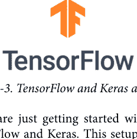

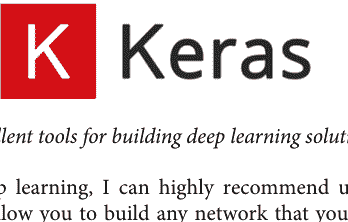

图 2-3. TensorFlow 和 Keras 是构建深度学习解决方案的优秀工具

如果您刚开始接触深度学习，我强烈推荐使用 TensorFlow 和 Keras。这种设置允许您在生产环境中构建任何可以想到的网络，同时还提供易于学习的 API，使新想法和概念的快速开发成为可能。让我们先看看使用 Keras 构建多层感知机是多么容易。

### 多层感知机（MLP）

在本节中，我们将使用 *监督学习* 训练一个 MLP 来对给定图像进行分类。监督学习是一种机器学习算法类型，其中计算机在标记的数据集上进行训练。换句话说，用于训练的数据集包含具有相应输出标签的输入数据。该算法的目标是学习输入数据与输出标签之间的映射，以便它可以对新的、未见过的数据进行预测。

MLP 是一个判别模型（而非生成模型），但监督学习仍将在本书后面章节中我们将探索的许多类型的生成模型中发挥作用，因此它是我们旅程的良好起点。


### 运行此示例的代码

此示例的代码可在书籍仓库中的 Jupyter notebook notebooks/02_deeplearning/01_mlp/mlp.ipynb 中找到。

### 准备数据

对于此示例，我们将使用 CIFAR-10 数据集，这是一个包含 60,000 张 32 × 32 像素彩色图像的集合，开箱即用随 Keras 一起提供。每张图像被精确分类为 10 个类别之一，如图 2-4 所示。


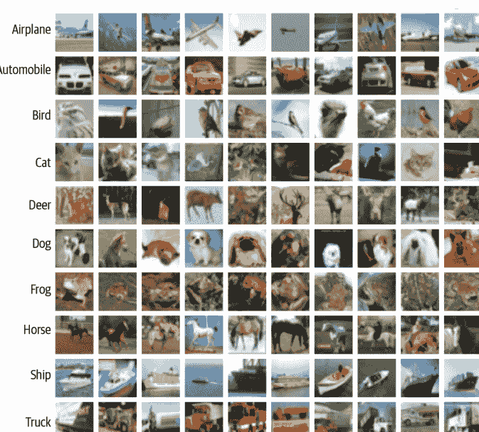

图 2-4. 来自 CIFAR-10 数据集的示例图像（来源：Krizhevsky, 2009）2

默认情况下，图像数据由每个像素通道的 0 到 255 之间的整数组成。我们首先需要通过将这些值缩放至 0 到 1 之间来预处理图像，因为神经网络在每个输入的绝对值小于 1 时工作效果最佳。

我们还需要将图像的整数标签更改为独热编码向量，因为神经网络的输出将是图像属于每个类别的概率。如果图像的类别整数标签为 i，则其独热编码是一个长度为 10（类别数）的向量，其中除第 i 个元素外均为 0，而第 i 个元素为 1。这些步骤在示例 2-1 中显示。

#### 示例 2-1. 预处理 CIFAR-10 数据集

```
import numpy as np
from tensorflow.keras import datasets, utils

(x_train, y_train), (x_test, y_test) = datasets.cifar10.load_data() ①

NUM_CLASSES = 10

x_train = x_train.astype('float32') / 255.0
x_test = x_test.astype('float32') / 255.0

y_train = utils.to_categorical(y_train, NUM_CLASSES)
y_test = utils.to_categorical(y_test, NUM_CLASSES)
```

- 1. 加载 CIFAR-10 数据集。x_train 和 x_test 分别是形状为 [50000, 32, 32, 3] 和 [10000, 32, 32, 3] 的 numpy 数组。y_train 和 y_test 分别是形状为 [50000, 1] 和 [10000, 1] 的 numpy 数组，包含每个图像类别的整数标签，范围为 0 到 9。
- 2. 缩放每个图像，使像素通道值位于 0 到 1 之间。
- 3. 对标签进行独热编码——y_train 和 y_test 的新形状分别为 [50000, 10] 和 [10000, 10]。

我们可以看到，训练图像数据（x_train）存储在一个形状为 [50000, 32, 32, 3] 的张量中。此数据集中没有列或行；相反，这是一个具有四个维度的张量。张量只是一个多维数组——它是矩阵向超过两个维度自然扩展。 该张量的第一个维度引用数据集中图像的索引，第二和第三个维度与图像大小相关，最后一个是通道（即红色、绿色或蓝色，因为这些是 RGB 图像）。

例如，示例 2-2 显示了如何找到图像中特定像素的通道值。

#### 示例 2-2. 图像 54 中位置为 (12,13) 的像素的绿色通道 (1) 值

```
x_train[54, 12, 13, 1]
#### 0.36862746
```

### 构建模型

在 Keras 中，你可以定义神经网络的结构为 Sequential 模型或使用函数式 API。

Sequential 模型对于快速定义线性层堆栈非常有用（即一个层直接跟随前一个层且没有分支）。我们可以使用 Sequential 类按示例 2-3 所示定义我们的 MLP 模型。

#### 示例 2-3. 使用 Sequential 模型构建我们的 MLP

```
from tensorflow.keras import layers, models

model = models.Sequential([
    layers.Flatten(input_shape=(32, 32, 3)),
    layers.Dense(200, activation = 'relu'),
    layers.Dense(150, activation = 'relu'),
    layers.Dense(10, activation = 'softmax'),
])
```

本书中的许多模型都需要将一个层的输出传递给多个后续层，或者相反，一个层接收来自多个前序层的输入。对于这些模型，Sequential 类不适用，我们需要改用函数式 API，后者灵活得多。


> 我建议即使你刚开始使用 Keras 构建线性模型，也应使用函数式 API 而不是 Sequential 模型，因为随着神经网络架构变得更复杂，长期来看它会更有帮助。函数式 API 将为你的深度神经网络设计提供完全的自由。

示例 2-4 使用函数式 API 编码了相同的 MLP。在使用函数式 API 时，我们使用 Model 类来定义模型的整体输入和输出层。

#### 示例 2-4. 使用函数式 API 构建我们的 MLP

```
from tensorflow.keras import layers, models

input_layer = layers.Input(shape=(32, 32, 3))
x = layers.Flatten()(input_layer)
x = layers.Dense(units=200, activation = 'relu')(x)
x = layers.Dense(units=150, activation = 'relu')(x)
output_layer = layers.Dense(units=10, activation = 'softmax')(x)
model = models.Model(input_layer, output_layer)
```

这两种方法得到的是相同的模型——架构图显示在图 2-5 中。

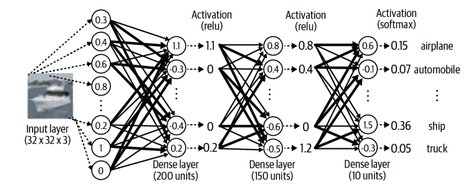

图 2-5. MLP 架构图

让我们更详细地了解 MLP 中使用的不同层和激活函数。

### 层

为了构建我们的 MLP，我们使用了三种不同类型的层：Input、Flatten 和 Dense。

Input 层是网络的入口。我们告诉网络期望每个数据元素的形状为一个元组。请注意，我们没有指定批大小；这不是必需的，因为我们可以同时将任意数量的图像传递到 Input 层。我们不需要在 Input 层定义中明确说明批大小。

接下来我们使用 Flatten 层将此输入展平为向量。这会得到长度为 3,072（= 32 × 32 × 3）的向量。我们这样做的原因是后续的 Dense 层要求其输入是扁平的，而不是多维数组。正如我们稍后会看到的，其他层类型需要多维数组作为输入，因此你需要了解每种层类型所需的输入和输出形状，以了解何时需要使用 Flatten。

Dense 层是神经网络最基本的构建块之一。它包含给定数量的单元，这些单元与前一层密集连接——也就是说，层中的每个单元都通过一条携带权重（可以为正或负）的连接与前一层中的每个单元相连。给定单元的输出是其从前一层接收到的输入的加权和，然后通过非线性激活函数处理后再发送到下一层。激活函数对于确保神经网络能够学习复杂函数而不是仅输出其输入的线性组合至关重要。

### 激活函数

有许多种激活函数，但其中最重要的三种是 ReLU、sigmoid 和 softmax。

*ReLU*（整流线性单元）激活函数定义为：如果输入为负则为 0，否则等于输入。*LeakyReLU* 激活函数与 ReLU 非常相似，只有一个关键区别：而 ReLU 激活函数对小于 0 的输入值返回 0，LeakyReLU 函数则返回与输入成比例的小负数。ReLU 单元有时会死亡，如果它们始终输出 0，因为激活前偏向负值过大。在这种情况下，梯度为 0，因此不会通过该单元向后传播误差。LeakyReLU 激活通过始终确保梯度非零来修复此问题。基于 ReLU 的函数是用于深度网络层之间以促进稳定训练的最可靠激活函数之一。

如果希望层的输出缩放至 0 到 1 之间，*sigmoid* 激活是有用的——例如，具有一个输出单元的二分类问题或多标签分类问题，其中每个观测值可以属于多个类别。图 2-6 并排比较了 ReLU、LeakyReLU 和 sigmoid 激活函数。

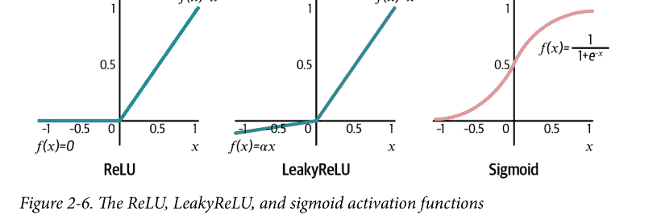

*图 2-6. ReLU、LeakyReLU 和 sigmoid 激活函数*

如果希望层的输出总和等于 1，*softmax* 激活函数是有用的；例如，对于每个观测值只属于恰好一个类别的多分类问题。它定义为：

$y_i = \frac{e^{x_i}}{\sum_{j=1}^{J} e^{x_j}}$

这里，$J$ 是层中的单元总数。在我们的神经网络中，我们在最终层使用 softmax 激活以确保输出是一组 10 个概率

其总和为 1，可解释为图像属于各类别的可能性。

在 Keras 中，激活函数可以在层内定义（示例 2-5）或作为单独的层（示例 2-6）。

#### 示例 2-5. 作为 Dense 层一部分定义的 ReLU 激活函数

```
x = layers.Dense(units=200, activation = 'relu')(x)
```

#### 示例 2-6. 作为独立层定义的 ReLU 激活函数

```
x = layers.Dense(units=200)(x)
x = layers.Activation('relu')(x)
```

在我们的示例中，我们将输入通过两个 Dense 层传递，第一个有 200 个单元，第二个有 150 个，两者都使用 ReLU 激活函数。

### 检查模型

我们可以使用 model.summary() 方法来检查网络在每一层的形状，如表 2-1 所示。

表 2-1. model.summary() 方法的输出

| 层 (类型) | 输出形状 | 参数数 |
|---|---|---|
| InputLayer | (None, 32, 32, 3) | 0 |
| Flatten | (None, 3072) | 0 |
| Dense | (None, 200) | 614,600 |
| Dense | (None, 150) | 30,150 |
| Dense | (None, 10) | 1,510 |
| 总参数 | 646,260 |  |
| 可训练参数 | 646,260 |  |
| 不可训练参数 | 0 |  |

注意我们的 Input 层的形状与 x_train 的形状相匹配，而 Dense 输出层的形状与 y_train 的形状相匹配。Keras 使用 None 作为第一个维度的标记，以显示它尚未知道将传递到网络中的观测数量。事实上，它不需要知道；我们完全可以一次传递 1 个观测，也可以一次传递 1,000 个。这是因为张量运算使用线性代数同时跨所有观测进行——这是由 TensorFlow 处理的部分。这也是为什么在 GPU 而非 CPU 上训练深度神经网络时性能会提升的原因：GPU 针对大型张量运算进行了优化，因为这些计算对于复杂的图形处理也是必要的。

summary 方法还给出了在每一层将训练的参数（权重）数量。如果您发现模型训练速度太慢，请检查 summary 以查看是否有任何层包含大量权重。如果有，您应该考虑是否可以减少该层的单元数量以加快训练速度。


确保你理解在每一层中参数数量的计算方法！重要的是要记住，默认情况下，给定层中的每个单元还连接到一个始终输出 1 的额外偏置单元。这确保了即使来自前一层的全部输入都为 0，单元的输出仍可能非零。

因此，200 个单元的 Dense 层的参数数量为 200 * (3,072 + 1) = 614,600。

### 编译模型

在此步骤中，我们使用优化器和损失函数编译模型，如示例 2-7 所示。

#### 示例 2-7. 定义优化器和损失函数

```
from tensorflow.keras import optimizers

opt = optimizers.Adam(learning_rate=0.0005)
model.compile(loss='categorical_crossentropy', optimizer=opt,
    metrics=['accuracy'])
```

让我们更详细地看看我们所说的损失函数和优化器的含义。

### 损失函数

损失函数用于神经网络比较其预测输出与真实值。它为每个观测返回一个单一数字；该数字越大，表示网络对该观测的性能越差。

Keras 提供了许多内置损失函数可供选择，或您可以创建自己的函数。其中最常用的三种是均方误差、分类交叉熵和二元交叉熵。了解何时适合使用每一种非常重要。

如果您的神经网络旨在解决回归问题（即输出是连续的），则可能使用均方误差损失。这是每个输出单元的真实值 $y_i$ 与预测值 $p_i$ 之间平方差的平均值，其中平均值是在所有 $n$ 个输出单元上取的：

MSE = $\frac{1}{n} \sum_{i=1}^{n} (y_i - p_i)^2$

如果您正在处理一个分类问题，其中每个观测只属于一个类别，则 *分类交叉熵* 是正确的损失函数。它定义如下：

- $\sum_{i=1}^{n} y_i \log(p_i)$

最后，如果您正在处理具有一个输出单元的二元分类问题，或每个观测可以同时属于多个类别的多标签问题，您应该使用 *二元交叉熵*：

- $\frac{1}{n} \sum_{i=1}^{n} (y_i \log(p_i) + (1 - y_i) \log(1 - p_i))$

### 优化器

*优化器* 是根据损失函数的梯度更新神经网络中权重的算法。其中最常用且稳定的优化器之一是 *Adam*（自适应矩估计）。³ 在大多数情况下，您不需要调整 Adam 优化器的默认参数，除了 *学习率*。学习率越大，每次训练步骤中权重的变化就越大。虽然大学习率训练初始速度更快，但缺点是训练可能不稳定，并且可能找不到损失函数的全局最小值。这是一个您可能希望在训练期间调整的参数。

另一个常见的优化器是 *RMSProp*（均方根传播）。同样，您不需要过多调整此优化器的参数，但值得阅读 Keras 文档以了解每个参数的作用。

我们将损失函数和优化器都传递到模型的 `compile` 方法中，以及一个 `metrics` 参数，我们可以在其中指定在训练期间想要报告的任何额外指标，例如准确率。

### 训练模型

到目前为止，我们还没有向模型展示任何数据。我们只是设置了架构并使用损失函数和优化器编译了模型。

要根据数据训练模型，我们只需调用 fit 方法，如示例 2-8 所示。

#### 示例 2-8. 调用 fit 方法训练模型

```
model.fit(x_train
    , y_train
    , batch_size = 32
    , epochs = 10
    , shuffle = True
)
```

- 1. 原始图像数据。
- 2. One-hot 编码的类别标签。
- 3. batch_size 决定每次训练步骤将向网络传递多少个观测。
- 4. epochs 决定网络将看到完整训练数据的次数。
- 5. 如果 shuffle = True，则批次将在每次训练步骤中从训练数据中随机抽取且不放回。

这将开始训练深度神经网络以从 CIFAR-10 数据集预测图像的类别。训练过程如下。

首先，网络的权重初始化为小的随机值。然后网络执行一系列训练步骤。在每个训练步骤中，一批图像通过网络传递，误差通过反向传播更新权重。batch_size 决定每个训练步骤批次中的图像数量。批次大小越大，梯度计算越稳定，但每个训练步骤越慢。


使用整个数据集在每个训练步骤中计算梯度将花费太多时间和计算资源，因此通常使用 32 到 256 之间的批次大小。⁴ 现在推荐的做法是在训练过程中增加批次大小。

这会一直持续到数据集中所有观测都被看到一次。这完成了第一个 epoch。然后数据作为第二个 epoch 的一部分以批次形式再次通过网络。此过程重复直到达到指定的 epoch 数量。

在训练期间，Keras 输出该过程的进度，如图 2-7 所示。我们可以看到训练数据集已被拆分为 1,563 个批次（每个包含 32 张图像），并且它已被展示给网络 10 次（即在 10 个 epoch 上），速度约为每批次 2 毫秒。分类交叉熵损失已从 1.8377 下降到 1.3696，导致准确率从第一个 epoch 后的 33.69% 增加到第十个 epoch 后的 51.67%。

```
model.fit(x_train, y_train, batch_size=32, epochs=10, shuffle=True)
Epoch 1/10
1563/1563 [==============================] - 3s 2ms/step - loss: 1.8377 - accuracy: 0.3369
Epoch 2/10
1563/1563 [==============================] - 3s 2ms/step - loss: 1.6552 - accuracy: 0.4076
Epoch 3/10
1563/1563 [==============================] - 3s 2ms/step - loss: 1.5743 - accuracy: 0.4396
Epoch 4/10
1563/1563 [==============================] - 3s 2ms/step - loss: 1.5288 - accuracy: 0.4549
Epoch 5/10
1563/1563 [==============================] - 3s 2ms/step - loss: 1.4888 - accuracy: 0.4706
Epoch 6/10
1563/1563 [==============================] - 2s 2ms/step - loss: 1.4542 - accuracy: 0.4851
Epoch 7/10
1563/1563 [==============================] - 3s 2ms/step - loss: 1.4332 - accuracy: 0.4908
Epoch 8/10
1563/1563 [==============================] - 2s 2ms/step - loss: 1.4094 - accuracy: 0.4992
Epoch 9/10
1563/1563 [==============================] - 2s 2ms/step - loss: 1.3896 - accuracy: 0.5045
Epoch 10/10
1563/1563 [==============================] - 3s 2ms/step - loss: 1.3696 - accuracy: 0.5167
```

图 2-7. fit 方法的输出

### 评估模型

我们知道模型在训练集上的准确率为 51.9%，但它在从未见过的数据上的表现如何？

要回答这个问题，我们可以使用 Keras 提供的 evaluate 方法，如示例 2-9 所示。

#### 示例 2-9. 在测试集上评估模型性能

```
model.evaluate(x_test, y_test)
```

图 2-8 显示了此方法输出。

```
10000/10000 [====================] - 1s 55us/step

[1.4358007415771485, 0.4896]
```

### 图 2-8. evaluate 方法的输出

输出是我们正在监控的指标列表：分类交叉熵和准确率。我们可以看到，即使在模型从未见过的图像上，模型准确率仍为 49.0%。请注意，如果模型随机猜测，它将达到大约 10% 的准确率（因为有 10 个类别），因此 49.0% 是一个不错的结果，考虑到我们使用的是非常基础的神经网络。

我们可以使用 predict 方法查看测试集上的部分预测，如示例 2-10 所示。

### 示例 2-10. 使用 predict 方法查看测试集上的预测

```
CLASSES = np.array(['airplane', 'automobile', 'bird', 'cat', 'deer', 'dog'
    , 'frog', 'horse', 'ship', 'truck'])

preds = model.predict(x_test) ①
preds_single = CLASSES[np.argmax(preds, axis = -1)] ②
actual_single = CLASSES[np.argmax(y_test, axis = -1)]
```

① preds 是一个形状为 [10000, 10] 的数组——即每个观测值的 10 个类别概率向量。

② 我们使用 numpy 的 argmax 函数将此概率数组转换回单个预测。这里，axis = -1 告诉函数将数组在最后一个维度（类别维度）上坍缩，使得 preds_single 的形状变为 [10000, 1]。

我们可以使用示例 2-11 中的代码同时查看部分图像及其标签和预测。如预期，约有一半是正确的。

### 示例 2-11. 显示 MLP 的预测与实际标签

```
import matplotlib.pyplot as plt

n_to_show = 10
indices = np.random.choice(range(len(x_test)), n_to_show)

fig = plt.figure(figsize=(15, 3))
fig.subplots_adjust(hspace=0.4, wspace=0.4)
```

```
for i, idx in enumerate(indices):
    img = x_test[idx]
    ax = fig.add_subplot(1, n_to_show, i+1)
    ax.axis('off')
    ax.text(0.5, -0.35, 'pred = ' + str(preds_single[idx]), fontsize=10
        , ha='center', transform=ax.transAxes)
    ax.text(0.5, -0.7, 'act = ' + str(actual_single[idx]), fontsize=10
        , ha='center', transform=ax.transAxes)
    ax.imshow(img)
```

图 2-9 显示了模型做出的随机选择的预测，以及真实标签。

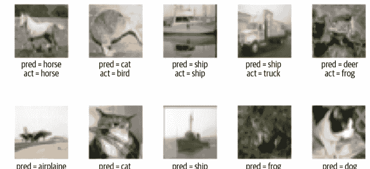

图 2-9. 模型做出的一些预测，以及实际标签

恭喜！你刚刚使用 Keras 构建了一个多层感知器，并用它对新数据进行预测。尽管这是一个监督学习问题，但在未来章节构建生成模型时，本章的许多核心思想（如损失函数、激活函数以及理解层形状）仍然极其重要。接下来我们将通过引入几种新的层类型来探讨改进此模型的方法。

### 卷积神经网络 (CNN)

网络表现尚未达到最佳的一个原因是因为网络中没有任何东西考虑到输入图像的空间结构。事实上，我们的第一步是将图像展平成一个单一向量，以便将其传递给第一个 Dense 层！

为此我们需要使用卷积层。

### 卷积层

首先，我们需要理解在深度学习的上下文中 *卷积* 是指什么。

图 2-10 显示了灰度图像的两个不同的 3 × 3 × 1 部分与 3 × 3 × 1 *滤波器*（或 *核*）进行卷积。卷积是通过将滤波器逐像素与图像部分相乘并求和结果来执行的。当图像部分与滤波器非常匹配时输出更正，当图像部分是滤波器的反转时输出更负。上例与滤波器强烈共振，因此产生较大的正值。下例与滤波器共振不大，因此产生接近零的值。

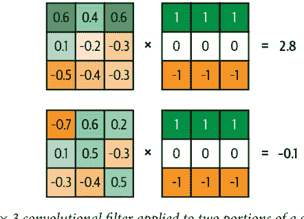

*图 2-10. 将 3 × 3 卷积滤波器应用于灰度图像的两个部分*

如果我们将滤波器在整个图像上从左到右、从上到下移动，同时记录卷积输出，我们将获得一个新数组，该数组根据滤波器中的值挑选出输入的特定特征。例如，图 2-11 显示了两个不同的滤波器，它们突出显示水平和垂直边缘。


### 运行此示例的代码

你可以在书籍仓库中位于 *notebooks/02_deeplearning/02_cnn/convolutions.ipynb* 的 Jupyter notebook 中手动查看此卷积过程。

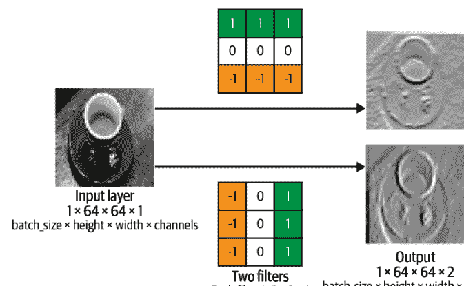

### 图 2-11. 将两个卷积滤波器应用于灰度图像

卷积层只是一组滤波器，其中存储在滤波器中的值是神经网络通过训练学习到的权重。最初这些是随机的，但逐渐滤波器会调整其权重以开始挑选出有趣的特征，例如边缘或特定的颜色组合。

在 Keras 中，Conv2D 层对具有两个空间维度（例如图像）的输入张量应用卷积。例如，示例 2-12 中显示的代码构建了一个具有两个滤波器的卷积层，以匹配图 2-11 中的示例。

### 示例 2-12. 将 Conv2D 层应用于灰度输入图像

```
from tensorflow.keras import layers

input_layer = layers.Input(shape=(64,64,1))
conv_layer_1 = layers.Conv2D(
    filters = 2
  , kernel_size = (3,3)
  , strides = 1
  , padding = "same"
)(input_layer)
```

接下来，让我们更详细地查看 Conv2D 层的两个参数——strides 和 padding。

### 步幅

strides 参数是层在输入上移动滤波器时使用的步长。因此，增加步幅会减小输出张量的大小。例如，当 strides = 2 时，输出张量的高度和宽度将是输入张量的一半。这对于在张量通过网络时减小其空间大小，同时增加通道数非常有用。

### 填充

padding = "same" 输入参数用零填充输入数据，以便当 strides = 1 时，层输出大小与输入大小完全相同。

图 2-12 显示了 3 × 3 核在 5 × 5 输入图像上移动，padding = "same" 且 strides = 1。此卷积层的输出大小也将为 5 × 5，因为填充允许核延伸到图像边缘，使其在两个方向上都能拟合五次。如果没有填充，核在每个方向上只能拟合三次，输出大小为 3 × 3。

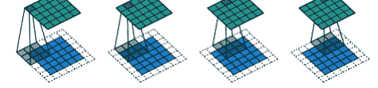

图 2-12. 3 × 3 × 1 核（灰色）在 5 × 5 × 1 输入图像（蓝色）上移动，padding = "same" 且 strides = 1，以生成 5 × 5 × 1 输出（绿色）（来源：Dumoulin and Visin, 2018）⁵

设置 padding = "same" 是确保你能够轻松跟踪张量在经过多个卷积层时的大小的好方法。具有 padding = "same" 的卷积层的输出形状为：

(input height / stride, input width / stride, filters)

### 堆叠卷积层

Conv2D 层的输出是另一个四维张量，现在形状为 (batch_size, height, width, filters)，因此我们可以将 Conv2D 层堆叠在彼此之上，以增加神经网络的深度并使其更强大。为了演示这一点，让我们想象我们将 Conv2D 层应用于 CIFAR-10 数据集，并希望预测给定图像的标签。请注意，这次我们不是有一个输入通道（灰度），而是有三个（红、绿和蓝）。

示例 2-13 显示了如何构建一个简单的卷积神经网络，我们可以训练它来完成此任务。

### 示例 2-13. 使用 Keras 构建卷积神经网络模型的代码

```
from tensorflow.keras import layers, models

input_layer = layers.Input(shape=(32,32,3))
conv_layer_1 = layers.Conv2D(
    filters = 10
  , kernel_size = (4,4)
  , strides = 2
  , padding = 'same'
)(input_layer)
conv_layer_2 = layers.Conv2D(
    filters = 20
  , kernel_size = (3,3)
  , strides = 2
  , padding = 'same'
)(conv_layer_1)
flatten_layer = layers.Flatten()(conv_layer_2)
output_layer = layers.Dense(units=10, activation = 'softmax')(flatten_layer)
model = models.Model(input_layer, output_layer)
```

此代码对应于图 2-13 中显示的图表。

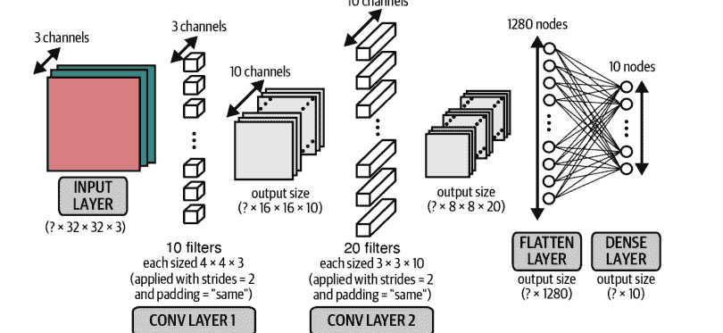

图 2-13. 卷积神经网络的图表

请注意，现在我们正在处理彩色图像，第一卷积层中的每个滤波器的深度为 3 而非 1（即，每个滤波器的形状为 4 × 4 × 3，而非 4 × 4 × 1）。这是为了匹配输入的三个通道（红、绿、蓝）


image. The same idea applies to the filters in the second convolutional layer that have a depth of 10, to match the 10 channels output by the first convolutional layer.


In general, the depth of the filters in a layer is always equal to the number of channels output by the preceding layer.

一般来说，某一层中滤波器的深度始终等于前一层输出的通道数。

### Inspecting the model

检查模型

It’s really informative to look at how the shape of the tensor changes as data flows through from one convolutional layer to the next. We can use the model.summary() method to inspect the shape of the tensor as it passes through the network (Table 2-2).

了解张量形状在数据从一个卷积层流向下一个卷积层时如何变化非常有启发性。我们可以使用 model.summary() 方法来检查张量在网络中传递时的形状（表 2-2）。

Table 2-2. CNN model summary

表 2-2. CNN 模型摘要

| Layer (type) | Output shape | Param # |
|---|---|---|
| InputLayer | (None, 32, 32, 3) | 0 |
| Conv2D | (None, 16, 16, 10) | 490 |
| Conv2D | (None, 8, 8, 20) | 1,820 |
| Flatten | (None, 1280) | 0 |
| Dense | (None, 10) | 12,810 |

Total params 15,120
Trainable params 15,120
Non-trainable params 0

总参数 15,120
可训练参数 15,120
非可训练参数 0

Let’s walk through our network layer by layer, noting the shape of the tensor as we go:

让我们逐层走查我们的网络，同时注意张量的形状：

- 1. The input shape is (None, 32, 32, 3)—Keras uses None to represent the fact that we can pass any number of images through the network simultaneously. Since the network is just performing tensor algebra, we don’t need to pass images through the network individually, but instead can pass them through together as a batch.
- 1. 输入形状为 (None, 32, 32, 3)——Keras 使用 None 表示我们可以同时将任意数量的图像通过网络传递。由于网络只是执行张量代数，我们无需单独逐张传递图像，而是可以作为一批一起传递。
- 2. The shape of each of the 10 filters in the first convolutional layer is 4 × 4 × 3. This is because we have chosen each filter to have a height and width of 4 (kernel_size = (4,4)) and there are three channels in the preceding layer (red, green, and blue). Therefore, the number of parameters (or weights) in the layer is (4 × 4 × 3 + 1) × 10 = 490, where the + 1 is due to the inclusion of a bias term attached to each of the filters. The output from each filter will be the pixelwise multiplication of the filter weights and the 4 × 4 × 3 section of the image it is covering. As strides = 2 and padding = "same", the width and height of the output are both halved to 16, and since there are 10 filters the output of the first layer is a batch of tensors each having shape [16, 16, 10].
- 2. 第一卷积层中每个滤波器的形状为 4 × 4 × 3。这是因为我们选择每个滤波器的高度和宽度均为 4（kernel_size = (4,4)），并且前一层有三个通道（红、绿、蓝）。因此，该层的参数（或权重）数量为 (4 × 4 × 3 + 1) × 10 = 490，其中 +1 是由于每个滤波器附加的偏置项。每个滤波器的输出将是滤波器权重与图像中其覆盖的 4 × 4 × 3 区域的逐像素乘法。由于 strides = 2 且 padding = "same"，输出的宽度和高度均减半至 16，并且由于有 10 个滤波器，第一层的输出是一批张量，每个张量的形状为 [16, 16, 10]。
- 3. In the second convolutional layer, we choose the filters to be 3 × 3 and they now have depth 10, to match the number of channels in the previous layer. Since there are 20 filters in this layer, this gives a total number of parameters (weights) of (3 × 3 × 10 + 1) × 20 = 1,820. Again, we use strides = 2 and padding = "same", so the width and height both halve. This gives us an overall output shape of (None, 8, 8, 20).
- 3. 在第二卷积层中，我们选择滤波器为 3 × 3，且其深度现在为 10，以匹配前一层的通道数。由于该层有 20 个滤波器，因此总参数（权重）数量为 (3 × 3 × 10 + 1) × 20 = 1,820。同样，我们使用 strides = 2 且 padding = "same"，因此宽度和高度均减半。这给出了整体输出形状为 (None, 8, 8, 20)。
- 4. We now flatten the tensor using the Keras Flatten layer. This results in a set of 8 × 8 × 20 = 1,280 units. Note that there are no parameters to learn in a Flatten layer as the operation is just a restructuring of the tensor.
- 4. 我们现在使用 Keras Flatten 层展平张量。这会得到一组 8 × 8 × 20 = 1,280 个单元。请注意，Flatten 层中没有需要学习的参数，因为该操作只是张量的重构。
- 5. We finally connect these units to a 10-unit Dense layer with softmax activation, which represents the probability of each category in a 10-category classification task. This creates an extra 1,280 × 10 = 12,810 parameters (weights) to learn.
- 5. 我们最终将这些单元连接到一个具有 softmax 激活的 10 个单元的 Dense 层，它表示 10 类分类任务中每个类别的概率。这会创建额外的 1,280 × 10 = 12,810 个参数（权重）需要学习。

This example demonstrates how we can chain convolutional layers together to create a convolutional neural network. Before we see how this compares in accuracy to our densely connected neural network, we’ll examine two more techniques that can also improve performance: batch normalization and dropout.

本示例演示了如何将卷积层串联起来创建卷积神经网络。在我们比较其与密集连接神经网络的准确性之前，我们将研究另外两种可以提高性能的技术：批归一化和 dropout。

### Batch Normalization

批归一化

One common problem when training a deep neural network is ensuring that the weights of the network remain within a reasonable range of values—if they start to become too large, this is a sign that your network is suffering from what is known as the exploding gradient problem. As errors are propagated backward through the network, the calculation of the gradient in the earlier layers can sometimes grow exponentially large, causing wild fluctuations in the weight values.

训练深度神经网络时常见的一个问题是确保网络的权重保持在合理的数值范围内——如果它们开始变得过大，这表明你的网络正遭受所谓的梯度爆炸问题。当误差通过网络向后传播时，早期层的梯度计算有时会呈指数级增长，导致权重值剧烈波动。


If your loss function starts to return NaN, chances are that your weights have grown large enough to cause an overflow error.

如果你的损失函数开始返回 NaN，很可能是你的权重已大到足以导致溢出错误。

This doesn’t necessarily happen immediately as you start training the network. Sometimes it can be happily training for hours when suddenly the loss function returns NaN and your network has exploded. This can be incredibly annoying. To prevent it from happening, you need to understand the root cause of the exploding gradient problem.

这并不一定会在你开始训练网络时立即发生。有时网络可能愉快地训练了数小时，突然损失函数返回 NaN，网络就爆炸了。这可能非常令人恼火。为了防止这种情况发生，你需要了解梯度爆炸问题的根本原因。

#### Covariate shift

协变量偏移

One of the reasons for scaling input data to a neural network is to ensure a stable start to training over the first few iterations. Since the weights of the network are initially randomized, unscaled input could potentially create huge activation values that immediately lead to exploding gradients. For example, instead of passing pixel values from 0–255 into the input layer, we usually scale these values to between –1 and 1.

对神经网络输入数据进行缩放的一个原因是为了确保在最初几次迭代中训练稳定。由于网络的权重初始是随机的，未缩放的输入可能会产生巨大的激活值，从而立即导致梯度爆炸。例如，我们通常不会将 0–255 的像素值传入输入层，而是将这些值缩放到 –1 到 1 之间。

Because the input is scaled, it’s natural to expect the activations from all future layers to be relatively well scaled as well. Initially this may be true, but as the network trains and the weights move further away from their random initial values, this assumption can start to break down. This phenomenon is known as covariate shift.

由于输入已缩放，自然期望所有后续层的激活也相对良好地缩放。最初这可能是真的，但随着网络训练，权重远离其随机初始值时，这一假设可能会开始失效。这种现象被称为协变量偏移。


#### Covariate Shift Analogy

协变量偏移类比

Imagine you’re carrying a tall pile of books, and you get hit by a gust of wind. You move the books in a direction opposite to the wind to compensate, but as you do so, some of the books shift, so that the tower is slightly more unstable than before. Initially, this is OK, but with every gust the pile becomes more and more unstable, until eventually the books have shifted so much that the pile collapses. This is covariate shift.

想象你正扛着一堆高高的书，突然被一阵风吹到。你朝与风相反的方向移动书来补偿，但这样做时，有些书会移位，使得书塔比之前更不稳定。最初这没问题，但随着每一次阵风，书堆变得越来越不稳定，直到最终书移位太多，书堆坍塌。这就是协变量偏移。

Relating this to neural networks, each layer is like a book in the pile. To remain stable, when the network updates the weights, each layer implicitly assumes that the distribution of its input from the layer beneath is approximately consistent across iterations. However, since there is nothing to stop any of the activation distributions shifting significantly in a certain direction, this can sometimes lead to runaway weight values and an overall collapse of the network.

将其与神经网络联系起来，每个层就像书堆中的一本书。为了保持稳定，当网络更新权重时，每个层隐式假设其来自下方层的输入分布在迭代间大致一致。然而，由于没有任何东西可以阻止任何激活分布在某个方向上显著偏移，这有时会导致权重值失控和网络整体崩溃。

#### Training using batch normalization

使用批归一化进行训练

Batch normalization is a technique that drastically reduces this problem. The solution is surprisingly simple. During training, a batch normalization layer calculates the mean and standard deviation of each of its input channels across the batch and normalizes by subtracting the mean and dividing by the standard deviation. There are then two learned parameters for each channel, the scale (gamma) and shift (beta). The output is simply the normalized input, scaled by gamma and shifted by beta. Figure 2-14 shows the whole process.

批归一化是一种大幅减少此问题的技术。解决方案出奇地简单。在训练期间，批归一化层计算每个输入通道在批次上的均值和标准差，并通过减去均值并除以标准差来进行归一化。然后为每个通道有两个可学习参数，即缩放（gamma）和偏移（beta）。输出只是归一化后的输入，按 gamma 缩放并按 beta 偏移。图 2-14 显示了整个过程。

```
Input: Values of x over a mini-batch: B = {x1...m};
Parameters to be learned: γ, β
Output: {yi = BNγ,β(xi)}

μB ← 1/m Σ_{i=1}^m xi          // mini-batch mean
σ_B^2 ← 1/m Σ_{i=1}^m (xi - μB)^2   // mini-batch variance
\hat{x}_i ← (xi - μB) / sqrt(σ_B^2 + ε)      // normalize
y_i ← γ \hat{x}_i + β ≡ BN_{γ,β}(xi)   // scale and shift
```

Algorithm 1: Batch Normalizing Transform, applied to activation x over a mini-batch.

算法 1：应用于小批量上激活 x 的批归一化变换。

Figure 2-14. The batch normalization process (source: Ioffe and Szegedy, 2015)⁶

图 2-14. 批归一化过程（来源：Ioffe 和 Szegedy，2015）⁶

We can place batch normalization layers after dense or convolutional layers to normalize the output.

我们可以在密集层或卷积层之后放置批归一化层以归一化输出。


Referring to our previous example, it's a bit like connecting the layers of books with small sets of adjustable springs that ensure there aren't any overall huge shifts in their positions over time.

参考我们之前的例子，这有点像用一组可调节的小弹簧连接书层，确保它们的位置随时间不会出现整体巨大偏移。

#### Prediction using batch normalization

使用批归一化进行预测

You might be wondering how this layer works at prediction time. When it comes to prediction, we may only want to predict a single observation, so there is no batch over which to calculate the mean and standard deviation. To get around this problem, during training a batch normalization layer also calculates the moving average of the mean and standard deviation of each channel and stores this value as part of the layer to use at test time.

你可能会想知道这个层在预测时如何工作。在预测时，我们可能只想预测单个观测值，因此没有批次可以计算均值和标准差。为了解决这个问题，在训练期间，批归一化层还会计算每个通道的均值和标准差的移动平均值，并将其作为层的一部分存储起来以在测试时使用。

How many parameters are contained within a batch normalization layer? For every channel in the preceding layer, two weights need to be learned: the scale (gamma) and shift (beta). These are the trainable parameters. The moving average and standard deviation also need to be calculated for each channel, but since they are derived from the data passing through the layer rather than trained through backpropagation, they are called nontrainable parameters. In total, this gives four parameters for each channel in the preceding layer, where two are trainable and two are nontrainable.

批归一化层包含多少个参数？对于前一层中的每个通道，需要学习两个权重：缩放（gamma）和偏移（beta）。这些是可训练参数。每个通道的移动平均值和标准差也需要计算，但由于它们是从通过该层的數據派生而来，而不是通过反向传播训练，因此被称为不可训练参数。总计，这为前一层中的每个通道提供了四个参数，其中两个可训练，两个不可训练。


在 Keras 中，BatchNormalization 层实现了批归一化功能，如示例 2-14 所示。

#### 示例 2-14. Keras 中的 BatchNormalization 层

```
from tensorflow.keras import layers
layers.BatchNormalization(momentum = 0.9)
```

momentum 参数是在计算移动平均值和移动标准差时赋予之前值的权重。

### Dropout

在备考时，学生使用往年试卷和样题来提高对学科内容的了解是常见做法。有些学生试图死记硬背这些问题的答案，但在考试中却遇到困难，因为他们并未真正理解学科内容。最优秀的学生利用练习材料来加深整体理解，因此即使面对从未见过的新问题，仍能正确作答。

同样的原则适用于机器学习。任何成功的机器学习算法都必须确保其能泛化到未见数据，而不仅仅是记住训练数据集。如果算法在训练数据集上表现良好，但在测试数据集上表现不佳，我们称之为过拟合。为抵消这一问题，我们使用正则化技术，确保模型在开始过拟合时受到惩罚。

有许多方法可以正则化机器学习算法，但对于深度学习，最常见的方法之一是使用 dropout 层。这一思想由 Hinton 等人在 2012 年提出，并在 Srivastava 等人 2014 年的论文中发表。

Dropout 层非常简单。在训练期间，每个 dropout 层从前一层中随机选择一组单元并将其输出设为 0，如图 2-15 所示。

令人难以置信的是，这一简单的添加通过确保网络不会过度依赖某些单元或单元组而大幅减少过拟合，这些单元或单元组实际上只是记住训练集中的观测值。如果使用 dropout 层，网络就不能过度依赖任何一个单元，因此知识会在整个网络中更均匀地分布。

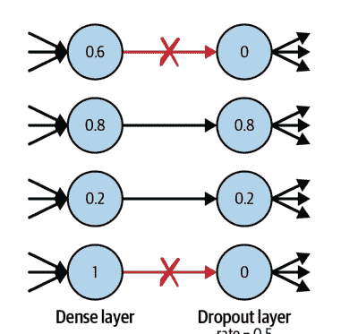

图 2-15. 一个 dropout 层

这使得模型在泛化到未见数据方面好得多，因为网络已在不熟悉的条件下训练出准确的预测，例如随机丢弃单元所导致的情况。dropout 层内部没有需要学习的权重，因为要丢弃的单元是随机决定的。在预测时，dropout 层不会丢弃任何单元，以便使用完整的网络进行预测。


#### Dropout 类比

回到我们的类比，这有点像数学学生做往年试卷时，其公式手册中随机缺少了一些关键公式。这样，他们通过对核心原理的理解来学习如何回答问题，而不是总是查阅书中相同位置的公式。到考试时，由于他们能够超越训练材料进行泛化，因此会发现回答从未见过的问题容易得多。

Keras 中的 Dropout 层实现了这一功能，其中 rate 参数指定从前一层丢弃的单元比例，如示例 2-15 所示。

#### 示例 2-15. Keras 中的 Dropout 层

```
from tensorflow.keras import layers
layers.Dropout(rate = 0.25)
```

Dropout 层最常用于 dense 层之后，因为这些层由于权重数量更多而最容易过拟合，不过你也可以在卷积层之后使用它们。


批归一化也被证明可以减少过拟合，因此许多现代深度学习架构根本不使用 dropout，完全依赖批归一化进行正则化。与大多数深度学习原理一样，没有适用于每种情况的金科玉律——唯一确定什么最好的方法是测试不同的架构，看看哪一个在保留数据集合上表现最佳。

### 构建 CNN

你现在已经看到了三种新的 Keras 层类型：Conv2D、BatchNormalization 和 Dropout。让我们把这些组件组合成一个 CNN 模型，看看它在 CIFAR-10 数据集上的表现如何。


### 运行本示例的代码

你可以在书库中名为 notebooks/02_deeplearning/02_cnn/cnn.ipynb 的 Jupyter notebook 中运行以下示例。

我们将测试的模型架构如示例 2-16 所示。

#### 示例 2-16. 使用 Keras 构建 CNN 模型的代码

```
from tensorflow.keras import layers, models

input_layer = layers.Input((32,32,3))

x = layers.Conv2D(filters = 32, kernel_size = 3
                 , strides = 1, padding = 'same')(input_layer)
x = layers.BatchNormalization()(x)
x = layers.LeakyReLU()(x)

x = layers.Conv2D(filters = 32, kernel_size = 3, strides = 2, padding = 'same')(x)
x = layers.BatchNormalization()(x)
x = layers.LeakyReLU()(x)

x = layers.Conv2D(filters = 64, kernel_size = 3, strides = 1, padding = 'same')(x)
x = layers.BatchNormalization()(x)
x = layers.LeakyReLU()(x)

x = layers.Conv2D(filters = 64, kernel_size = 3, strides = 2, padding = 'same')(x)
x = layers.BatchNormalization()(x)
x = layers.LeakyReLU()(x)

x = layers.Flatten()(x)

x = layers.Dense(128)(x)
x = layers.BatchNormalization()(x)
x = layers.LeakyReLU()(x)
x = layers.Dropout(rate = 0.5)(x)

output_layer = layers.Dense(10, activation = 'softmax')(x)

model = models.Model(input_layer, output_layer)
```

我们使用四个堆叠的 Conv2D 层，每个层后都跟着一个 BatchNormalization 层和一个 LeakyReLU 层。在展平 resulting 张量后，我们将数据通过一个大小为 128 的 Dense 层，再次后接 BatchNormalization 层和 LeakyReLU 层。紧接着是一个用于正则化的 Dropout 层，网络以一个大小为 10 的输出 Dense 层结束。


使用批归一化层和激活层的顺序是个人偏好问题。通常批归一化层放在激活层之前，但一些成功的架构会反过来使用这些层。如果你选择在激活之前使用批归一化，可以使用缩写 BAD（批归一化、激活，然后丢弃）来记住顺序！

模型摘要如表 2-3 所示。

#### 表 2-3. CIFAR-10 的 CNN 模型摘要

| 层 (类型) | 输出形状 | 参数数 |
|---|---|---|
| InputLayer | (None, 32, 32, 3) | 0 |
| Conv2D | (None, 32, 32, 32) | 896 |
| BatchNormalization | (None, 32, 32, 32) | 128 |
| LeakyReLU | (None, 32, 32, 32) | 0 |
| Conv2D | (None, 16, 16, 32) | 9,248 |
| BatchNormalization | (None, 16, 16, 32) | 128 |
| LeakyReLU | (None, 16, 16, 32) | 0 |
| Conv2D | (None, 16, 16, 64) | 18,496 |
| BatchNormalization | (None, 16, 16, 64) | 256 |
| LeakyReLU | (None, 16, 16, 64) | 0 |
| Conv2D | (None, 8, 8, 64) | 36,928 |
| BatchNormalization | (None, 8, 8, 64) | 256 |
| LeakyReLU | (None, 8, 8, 64) | 0 |
| Flatten | (None, 4096) | 0 |
| Dense | (None, 128) | 524,416 |
| BatchNormalization | (None, 128) | 512 |
| LeakyReLU | (None, 128) | 0 |
| Dropout | (None, 128) | 0 |
| Dense | (None, 10) | 1290 |

总参数数 592,554
可训练参数 591,914
非可训练参数 640


继续之前，请确保你能够手工计算每个层的输出形状和参数数量。这是一个很好的练习，可以证明你完全理解了每个层的构造方式以及它如何连接到前一层！不要忘记包含作为 Conv2D 和 Dense 层一部分的偏置权重。

### 训练和评估 CNN

我们以与之前完全相同的方式编译和训练模型，并调用 evaluate 方法来确定其在保留数据集上的准确率（图 2-16）。

```
model.evaluate(x_test, y_test, batch_size=1000)

10000/10000 [==============================] - 15s 1ms/step

[0.8423407137393951, 0.7155999958515167]
```

图 2-16. CNN 性能

如你所见，该模型现在达到了 71.5% 的准确率，相比之前的 49.0% 有很大提升！图 2-17 显示了我们新的卷积模型的一些预测结果。

这一改进仅仅是通过改变模型架构以包含卷积、批归一化和 dropout 层实现的。请注意，我们新模型的參數數量實際上比之前的模型更少，即使層數遠多。這展示了在模型设计上保持实验精神的重要性，以及对不同层类型如何为你所用感到自在。当构建生成

模型时，了解模型内部工作原理变得更加重要，因为正是网络的中间层捕捉到了你最感兴趣的高级特征。

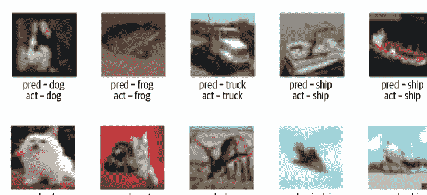

图 2-17. CNN 预测

### 摘要

本章介绍了开始构建深度生成模型所需掌握的核心深度学习概念。我们首先使用 Keras 构建了一个多层感知机 MLP，并训练模型从 CIFAR-10 数据集预测给定图像的类别。然后，我们通过引入卷积、批归一化和 dropout 层改进了该架构，创建了卷积神经网络 CNN。

从本章中带走的一个非常重要的观点是，深度神经网络在设计上完全灵活，模型架构并没有固定的规则。存在指导原则和最佳实践，但你应随时尝试不同的层以及它们的出现顺序。不要局限于只使用本书或其他地方读到的架构！就像一个孩子手握一套积木，你的神经网络设计仅受你想象力的限制。

在下一章中，我们将看到如何利用这些构建块设计一个能够生成图像的网络。

### 参考文献

1. Kaiming He 等人，“用于图像识别的深度残差学习”，2015 年 12 月 10 日，https://arxiv.org/abs/1512.03385.
- 2. Alex Krizhevsky，“从微小图像中学习多层特征”，2009 年 4 月 8 日，https://www.cs.toronto.edu/~kriz/learning-features-2009-TR.pdf.
- 3. Diederik Kingma 和 Jimmy Ba，“Adam：一种随机优化方法”，2014 年 12 月 22 日，https://arxiv.org/abs/1412.6980v8.
- 4. Samuel L. Smith 等人，“不要衰减学习率，增加批大小”，2017 年 11 月 1 日，https://arxiv.org/abs/1711.00489.
- 5. Vincent Dumoulin 和 Francesco Visin，“深度学习卷积算术指南”，2018 年 1 月 12 日，https://arxiv.org/abs/1603.07285.
- 6. Sergey Ioffe 和 Christian Szegedy，“批归一化：通过减少内部协变量偏移加速深度网络训练”，2015 年 2 月 11 日，https://arxiv.org/abs/1502.03167.
- 7. Hinton 等人，“通过防止特征检测器的协同适应来改进神经网络”，2012 年 7 月 3 日，https://arxiv.org/abs/1207.0580.
- 8. Nitish Srivastava 等人，“Dropout：防止神经网络过拟合的一种简单方法”，《机器学习研究杂志》15 (2014)：1929–1958，http://jmlr.org/papers/volume15/srivastava14a/srivastava14a.pdf.

## 第二部分

#### 方法

在第二部分，我们将深入探讨六大家族的生成模型，包括它们的工作原理以及构建每种模型类型的实践示例。

在第 3 章中，我们将审视我们的第一个生成深度学习模型，即 *变分自编码器*。该技术不仅能让我们生成逼真的面孔，还能修改现有图像——例如，通过添加微笑或改变某人的头发颜色。

第 4 章探讨了近年来最成功的生成建模技术之一，即 *生成对抗网络*。我们将看到 GAN 训练是如何被微调和适应的，以不断推动生成建模能力的边界。

在第 5 章中，我们将深入研究几种 *自回归模型* 的示例，包括 LSTM 和 PixelCNN。该模型家族将生成过程视为序列预测问题——它支撑着当今最先进的文本生成模型，也可用于图像生成。

在第 6 章中，我们将介绍 *归一化流模型* 家族，包括 RealNVP。该模型基于变量变换公式，可将简单的分布，例如高斯分布，变换为更复杂的分布，同时保持可处理性。

第 7 章介绍了 *能量基模型* 家族。这些模型训练一个标量能量函数来评分给定输入的有效性。我们将探讨一种训练能量基模型的技术——对比散度，以及一种采样新观测的技术——朗之万动力学。

最后，在第 8 章中，我们将探讨 *扩散模型* 家族。该技术基于向图像迭代添加噪声然后训练模型去除噪声的想法，使我们能够将纯噪声转化为逼真的样本。

到第二部分结束时，你将构建来自六大生成建模家族的生成模型的实践示例，并能够从理论角度解释每个模型的工作原理。

### 变分自编码器

#### 章节目标

在本章中你将：

- 学习自编码器的架构设计如何使其非常适合生成建模。
- 使用 Keras 从头构建并训练自编码器。
- 使用自编码器生成新图像，但理解这种方法的局限性。
- 了解变分自编码器的架构以及它如何解决标准自编码器相关的许多问题。
- 使用 Keras 从头构建变分自编码器。
- 使用变分自编码器生成新图像。
- 使用变分自编码器通过潜在空间算术操纵生成的图像。

2013 年，Diederik P. Kingma 和 Max Welling 发表了一篇论文，奠定了神经网络的一种类型——变分自编码器 VAE 的基础。¹ 这现在是生成建模最基础和最知名的深度学习架构之一，也是我们踏入生成深度学习旅程的绝佳起点。

在本章中，我们将首先构建一个标准自编码器，然后看看如何扩展该框架来开发变分自编码器。在此过程中，我们将拆解这两种模型，以细粒度地理解它们的工作原理。到本章结束时，你应该完全理解如何构建和操纵基于自编码器的模型，特别是如何从头构建变分自编码器以基于你自己的数据集生成图像。

### 引言

让我们从一个简单的故事开始，帮助解释自编码器试图解决的基本问题。

#### Brian、裁缝与衣柜

想象一下，你面前地上堆满了你所有的衣物——裤子、上衣、鞋子和外套，风格各异。你的造型师 Brian 越来越沮丧，因为找到你需要的物品花费的时间太长，于是他想出了一个巧妙的计划。

他让你把衣服整理到一个无限高且无限宽的衣柜中（图 3-1）。当你想要请求特定物品时，你只需告诉 Brian 它的位置，他就会用他信赖的缝纫机从头缝制该物品。很快就变得很明显，你需要把相似的物品放在附近，这样 Brian 仅凭位置就能准确重建每件物品。


图 3-1. 一个人站在无限的二维衣柜前（使用 Midjourney 创建）

经过数周的练习，你和 Brian 已经适应了彼此对衣柜布局的理解。现在你可以告诉 Brian 你想要的任何衣物的位置，他就能准确地从头缝制出来！

这给了你一个想法——如果给 Brian 一个空的衣柜位置会怎样？令你惊讶的是，你发现 Brian 能够生成从未存在过的全新衣物！过程并不完美，但你现在可以通过选择无限衣柜中的一个空位置，让 Brian 用缝纫机施展魔法，就能无限制地生成新衣服。

让我们现在探索这个故事与构建自编码器的关系。

### 自编码器

故事中描述的过程图示如图 3-2 所示。你扮演编码器的角色，把每件衣服移动到衣柜中的一个位置。这个过程称为编码。Brian 扮演解码器的角色，接收衣柜中的一个位置并尝试重建该物品。这个过程称为解码。

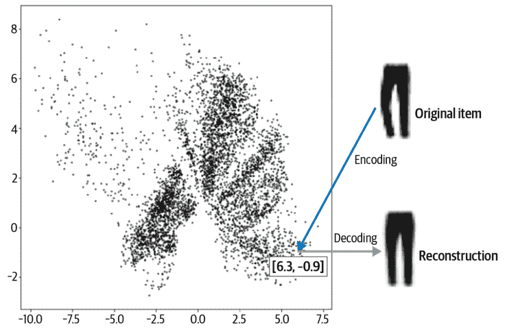

图 3-2. 无限衣柜中的衣物——每个黑色点代表一件衣物

衣柜中的每个位置由两个数字表示（即一个 2D 向量）。例如，图 3-2 中的裤子被编码为点 [6.3, -0.9]。该向量也称为嵌入，因为编码器试图尽可能多地将信息嵌入其中，以便解码器能够产生准确的重建。


An *自编码器* is simply a neural network that is trained to perform the task of encoding and decoding an item, such that the output from this process is as close to the original item as possible. Crucially, it can be used as a generative model, because we can decode any point in the 2D space that we want (in particular, those that are not embeddings of original items) to produce a novel item of clothing.

让我们现在看看如何使用 Keras 构建自编码器并将其应用于真实数据集！


### 运行此示例的代码

此示例的代码可以在书库中位于 *notebooks/03_vae/01_autoencoder/autoencoder.ipynb* 的 Jupyter notebook 中找到。

### Fashion-MNIST 数据集

对于此示例，我们将使用 Fashion-MNIST 数据集——一个服装项目的灰度图像集合，每个图像大小为 28 × 28 像素。图 3-3 显示了该数据集的一些示例图像。

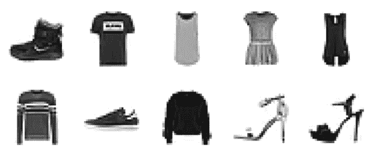

*图 3-3. Fashion-MNIST 数据集中的图像示例*

该数据集随 TensorFlow 预打包，因此可以按示例 3-1 所示下载。

#### *示例 3-1. 加载 Fashion-MNIST 数据集*

```
from tensorflow.keras import datasets
(x_train,y_train), (x_test,y_test) = datasets.fashion_mnist.load_data()
```

这些是开箱即用的 28 × 28 灰度图像（像素值介于 0 和 255 之间），我们需要对其进行预处理以确保像素值缩放到 0 到 1 之间。我们还将每个图像填充到 32 × 32，以便在网络中传递时更易于操作张量形状，如示例 3-2 所示。

#### 示例 3-2. 预处理数据

```
def preprocess(imgs):
    imgs = imgs.astype("float32") / 255.0
    imgs = np.pad(imgs, ((0, 0), (2, 2), (2, 2)), constant_values=0.0)
    imgs = np.expand_dims(imgs, -1)
    return imgs
```

```
x_train = preprocess(x_train)
x_test = preprocess(x_test)
```

接下来，我们需要了解自编码器的整体结构，以便使用 TensorFlow 和 Keras 编写它。

### 自编码器架构

一个 *自编码器* 是一个由两部分组成的神经网络：

- 一个 *编码器* 网络，将高维输入数据（如图像）压缩为低维嵌入向量
- 一个 *解码器* 网络，将给定的嵌入向量解压缩回原始域（例如，解压缩回图像）

网络架构的示意图如图 3-4 所示。输入图像被编码为潜在嵌入向量 z，然后解码回原始像素空间。

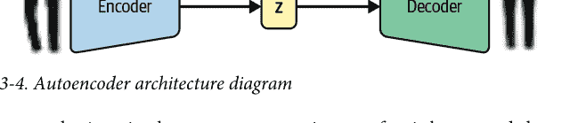

图 3-4. 自编码器架构图

自编码器经过训练以重建图像，图像在通过编码器后再次通过解码器输出。这乍一看可能很奇怪——为什么要重建你已经拥有的图像集呢？然而，正如我们将看到的，自编码器有趣的部分是嵌入空间（也称为 *潜在空间*），因为从该空间采样将使我们能够生成新图像。

让我们首先定义我们所说的嵌入的含义。嵌入（z）是将原始图像压缩到低维潜在空间。思路是，通过在潜在空间中选择任意点，我们可以通过将该点传递给解码器来生成新颖的图像，因为解码器已经学会了如何将潜在空间中的点转换为可行的图像。

在我们的示例中，我们将把图像嵌入到二维潜在空间中。这将有助于我们可视化潜在空间，因为我们可以轻松地在 2D 中绘制点。实际上，自编码器的潜在空间通常会具有超过两个维度，以便有更大的自由度来捕捉图像中的更多细微差别。


### 自编码器作为去噪模型

自编码器可用于清理噪声图像，因为编码器学习到在潜在空间中捕捉随机噪声的位置对于重建原始图像是没有用的。对于此类任务，2D 潜在空间可能太小，无法编码来自输入的足够相关信息。然而，正如我们将看到的，如果我们想将自编码器用作生成模型，增加潜在空间的维度很快就会导致问题。

让我们现在看看如何构建编码器和解码器。

### 编码器

在自编码器中，编码器的任务是将输入图像映射到潜在空间中的嵌入向量。我们将构建的编码器架构如表 3-1 所示。

表 3-1. 编码器的模型摘要

| 层（类型） | 输出形状 | 参数数 |
|---|---|---|
| InputLayer | (None, 32, 32, 1) | 0 |
| Conv2D | (None, 16, 16, 32) | 320 |
| Conv2D | (None, 8, 8, 64) | 18,496 |
| Conv2D | (None, 4, 4, 128) | 73,856 |
| Flatten | (None, 2048) | 0 |
| Dense | (None, 2) | 4,098 |
| 总参数 | 96,770 |  |
| 可训练参数 | 96,770 |  |
| 非可训练参数 | 0 |  |

为此，我们首先为图像创建 Input 层并将其依次通过三个 Conv2D 层，每个层捕捉越来越高级别的特征。我们使用步长为 2 来将每一层的输出大小减半，同时增加通道数。最后一个卷积层被展平并连接到大小为 2 的 Dense 层，表示我们的二维潜在空间。

示例 3-3 展示了如何在 Keras 中构建它。

#### 示例 3-3. 编码器

```
encoder_input = layers.Input(
    shape=(32, 32, 1), name = "encoder_input"
)
x = layers.Conv2D(32, (3, 3), strides = 2, activation = 'relu', padding="same")(
    encoder_input
)
x = layers.Conv2D(64, (3, 3), strides = 2, activation = 'relu', padding="same")(x)
x = layers.Conv2D(128, (3, 3), strides = 2, activation = 'relu', padding="same")(x)
shape_before_flattening = K.int_shape(x)[1:]

x = layers.Flatten()(x)
encoder_output = layers.Dense(2, name="encoder_output")(x)

encoder = models.Model(encoder_input, encoder_output)
```

- 1. 定义编码器的 Input 层（图像）。
- 2. 将 Conv2D 层依次堆叠。
- 3. 将最后一个卷积层展平为向量。
- 4. 使用 Dense 层将此向量连接到 2D 嵌入。
- 5. 定义编码器的 Keras Model——一个模型，接受输入图像并将其编码为 2D 嵌入。


我强烈鼓励你尝试不同的卷积层数量和滤波器数量，以了解架构如何影响模型参数总数、模型性能和模型运行时间。

### 解码器

解码器是编码器的镜像——而不是使用卷积层，我们使用卷积转置层，如表 3-2 所示。

#### 表 3-2. 解码器的模型摘要

| 层（类型） | 输出形状 | 参数数 |
|---|---|---|
| InputLayer | (None, 2) | 0 |
| Dense | (None, 2048) | 6,144 |
| Reshape | (None, 4, 4, 128) | 0 |
| Conv2DTranspose | (None, 8, 8, 128) | 147,584 |
| Conv2DTranspose | (None, 16, 16, 64) | 73,792 |
| Conv2DTranspose | (None, 32, 32, 32) | 18,464 |
| Conv2D | (None, 32, 32, 1) | 289 |

总参数 246,273
可训练参数 246,273
非可训练参数 0

### 卷积转置层

标准卷积层允许我们通过设置 strides = 2 来将输入张量的两个维度（高度和宽度）的大小减半。

卷积转置层使用与标准卷积层相同的原理（在图像上滑动滤波器），但不同之处在于设置 strides = 2 会使输入张量的两个维度大小翻倍。

在卷积转置层中，strides 参数决定了图像中像素之间的内部零填充，如图 3-5 所示。这里，一个 3 × 3 × 1 滤波器（灰色）以 strides = 2 在 3 × 3 × 1 图像（蓝色）上滑动，以生成 6 × 6 × 1 输出张量（绿色）。

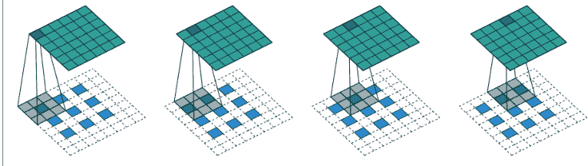

图 3-5. 卷积转置层示例（来源：Dumoulin and Visin, 2018）

在 Keras 中，Conv2DTranspose 层允许我们在张量上执行卷积转置操作。通过堆叠这些层，我们可以使用步长为 2 逐渐扩展每一层的大小，直到恢复到原始图像尺寸 32 × 32。


示例 3-4 展示了我们在 Keras 中如何构建解码器。

#### 示例 3-4. 解码器

```
decoder_input = layers.Input(shape=(2,), name="decoder_input") ①
x = layers.Dense(np.prod(shape_before_flattening))(decoder_input) ②
x = layers.Reshape(shape_before_flattening)(x) ③
x = layers.Conv2DTranspose(
    128, (3, 3), strides=2, activation = 'relu', padding="same"
)(x) ④
x = layers.Conv2DTranspose(
    64, (3, 3), strides=2, activation = 'relu', padding="same"
)(x)
x = layers.Conv2DTranspose(
    32, (3, 3), strides=2, activation = 'relu', padding="same"
)(x)
decoder_output = layers.Conv2D(
    1,
    (3, 3),
    strides = 1,
    activation="sigmoid",
    padding="same",
    name="decoder_output"
)(x)

decoder = models.Model(decoder_input, decoder_output) ⑤
```

- 1. 定义解码器的输入层（嵌入）。
- 2. 将输入连接到 Dense 层。
- 3. 将此向量重塑为可作为第一个 Conv2DTranspose 层的输入的张量。
- 4. 将 Conv2DTranspose 层堆叠在一起。
- 5. 定义解码器的 Keras 模型——一个模型，它接受潜在空间中的嵌入并将其解码为原始图像域。

### 将编码器连接到解码器

为了同时训练编码器和解码器，我们需要定义一个模型来表示图像通过编码器流动然后再通过解码器流出的过程。幸运的是，Keras 使这变得极其简单，如示例 3-5 所示。请注意我们指定自编码器输出的方式，它只是编码器输出在通过解码器之后的结果。

#### 示例 3-5. 完整的自编码器

```
autoencoder = Model(encoder_input, decoder(encoder_output))
```

定义完整自编码器的 Keras 模型——一个模型，它接收图像并将其通过编码器传递，然后再通过解码器传回，以生成原始图像的重建。

现在我们已经定义了模型，只需使用损失函数和优化器对其进行编译，如示例 3-6 所示。损失函数通常选择为原始图像和重建之间各个像素的均方根误差 RMSE 或二元交叉熵。

#### 示例 3-6. 编译自编码器

```
#### Compile the autoencoder
autoencoder.compile(optimizer="adam", loss="binary_crossentropy")
```

### 选择损失函数

优化 RMSE 意味着生成的输出将在平均像素值周围对称分布（因为高估的惩罚等同于低估的惩罚）。

另一方面，二元交叉熵损失是不对称的——它对极端方向的误差惩罚比中心方向的误差更重。例如，如果真实像素值很高（比如 0.7），那么生成像素值为 0.8 的惩罚会比生成像素值为 0.6 的惩罚更重。如果真实像素值很低（比如 0.3），那么生成像素值为 0.2 的惩罚会比生成像素值为 0.4 的惩罚更重。

这导致二元交叉熵损失产生的图像比 RMSE 损失略微更模糊（因为它倾向于将预测推向 0.5），但有时这是可取的，因为 RMSE 可能导致明显像素化的边缘。

没有对错之分——你应该在实验后选择对你的用例最有效的方法。

我们现在可以通过将输入图像同时作为输入和输出传递来训练自编码器，如示例 3-7 所示。

#### 示例 3-7. 训练自编码器

```
autoencoder.fit(
    x_train,
    x_train,
    epochs=5,
    batch_size=100,
    shuffle=True,
    validation_data=(x_test, x_test),
)
```

现在我们的自编码器已经训练完成，我们首先需要检查它是否能够准确重建输入图像。

### 重建图像

我们可以通过将测试集中的图像通过自编码器传递并将输出与原始图像进行比较来测试重建图像的能力。此代码在示例 3-8 中显示。

#### 示例 3-8. 使用自编码器重建图像

```
example_images = x_test[:5000]
predictions = autoencoder.predict(example_images)
```

在图 3-6 中，你可以看到原始图像（顶行）、编码后的 2D 向量以及解码后的重建项目（底行）的一些示例。

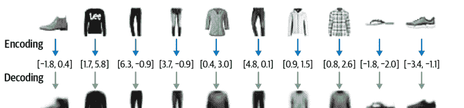

*图 3-6. 编码和解码服装项目的示例*

请注意重建并不完美——解码过程并未捕捉到原始图像的一些细节，例如标志。这是因为将每个图像减少到仅两个数字，我们自然会丢失一些信息。

让我们现在研究编码器如何在潜在空间中表示图像。

### 可视化潜在空间

我们可以通过将测试集通过编码器传递并绘制 resulting 嵌入来可视化图像如何嵌入到潜在空间中，如示例 3-9 所示。

#### 示例 3-9. 使用编码器嵌入图像

```python
embeddings = encoder.predict(example_images)

plt.figure(figsize=(8, 8))
plt.scatter(embeddings[:, 0], embeddings[:, 1], c="black", alpha=0.5, s=3)
plt.show()
```

 resulting 绘图是图 3-2 中显示的散点图——每个黑色点代表一个已嵌入到潜在空间中的图像。

为了更好地理解这个潜在空间的结构，我们可以利用 Fashion-MNIST 数据集附带的标签，描述每张图像中的项目类型。共有 10 组，显示在表 3-3 中。

#### 表 3-3. Fashion-MNIST 标签

| ID | 服装标签 |
|---|---|
| 0 | T恤/上衣 |
| 1 | 裤子 |
| 2 | 套头衫 |
| 3 | 连衣裙 |
| 4 | 外套 |
| 5 | 凉鞋 |
| 6 | 衬衫 |
| 7 | 运动鞋 |
| 8 | 包 |
| 9 | 短靴 |

我们可以根据对应图像的标签为每个点着色，从而生成图 3-7 中的绘图。现在结构变得非常清晰！即使在训练期间从未向模型展示过服装标签，自编码器也自然地将看起来相似的项目分组到潜在空间的同一部分。例如，潜在空间右下角的深蓝色点云都是裤子的不同图像，而中心附近的红色点云都是短靴。

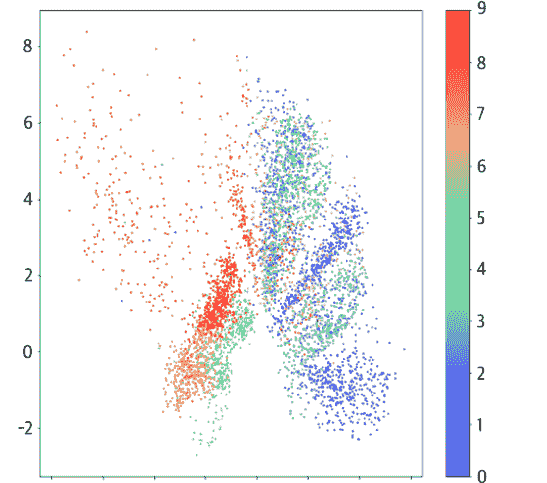

图 3-7. 按服装标签着色的潜在空间图

### 生成新图像

我们可以通过在潜在空间中采样一些点并使用解码器将这些点转换回像素空间来生成新颖图像，如示例 3-10 所示。

#### 示例 3-10. 使用解码器生成新颖图像

```
mins, maxs = np.min(embeddings, axis=0), np.max(embeddings, axis=0)
sample = np.random.uniform(mins, maxs, size=(18, 2))
reconstructions = decoder.predict(sample)
```

图 3-8 中显示了一些生成的图像示例，以及它们在潜在空间中的嵌入。

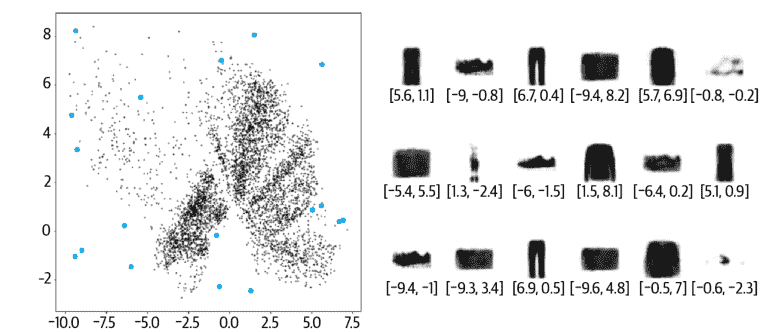

图 3-8. 生成的服装项目

每个蓝色点映射到图表右侧显示的图像之一，其嵌入向量显示在下方。请注意，其中一些生成的项目比其他项目更逼真。为什么会这样？

要回答这个问题，让我们首先对潜在空间中点的整体分布做出一些观察，参考回图 3-7：

- 有些服装项目表示在非常小的区域内，而其他项目则表示在更大的区域内。
- 分布关于点 (0, 0) 不对称，也不是有界的。例如，y 轴值为正的点远多于负值，且有些点甚至延伸到 y 轴值 > 8。
- 颜色之间存在包含很少点的较大间隙。

这些观察实际上使得从潜在空间采样变得相当具有挑战性。如果我们在网格上叠加潜在空间并显示解码点的图像，如图 3-9 所示，我们就可以开始理解为什么解码器可能并不总是能生成令人满意标准的图像。


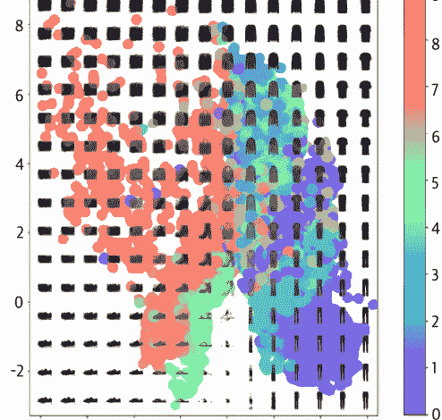

Figure 3-9. 解码嵌入的网格，叠加了数据集中原始图像的嵌入，按物品类型着色

首先，我们可以看到，如果我们在定义的有限空间中均匀选取点，我们更有可能采样出解码后看起来像包（ID 8）的东西，而不是踝靴（ID 9），因为为包划分的潜在空间部分（橙色）比踝靴区域（红色）更大。

其次，很明显我们该如何选择潜在空间中的随机点并不明显，因为这些点的分布是未定义的。从技术上讲，我们完全有理由在二维平面中选择任意一点！甚至不能保证点会围绕 (0, 0) 中心分布。这使得从我们的潜在空间采样变得有问题。

最后，我们可以看到潜在空间中存在空洞，没有任何原始图像被编码在其中。例如，在域的边缘存在大面积的空白——自动编码器没有理由确保这里的点被解码为可识别的服装物品，因为训练集中很少有图像被编码在这里。

即使是中心的点也可能无法解码为结构良好的图像。这是因为自动编码器没有被强制确保空间是连续的。例如，即使点 (−1, −1) 可能被解码为一幅令人满意的凉鞋图像，也没有任何机制确保点 (−1.1, −1.1) 也能产生令人满意的凉鞋图像。

在二维情况下，这个问题比较微妙；自动编码器可用的维度数量很少，因此自然需要将服装组挤在一起，导致服装组之间的空间相对较小。然而，当我们开始在潜在空间中使用更多维度来生成更复杂的图像（如人脸）时，这个问题变得更加明显。如果我们让自动编码器自由决定如何使用潜在空间来编码图像，相似点组之间会出现巨大的空隙，而中间的空间没有任何动机去生成结构良好的图像。

为了解决这三个问题，我们需要将自动编码器转换为 *变分自动编码器*。

### Variational Autoencoders

为了说明，让我们重新审视无限衣橱并做一些改动…

### Revisiting the Infinite Wardrobe

假设现在，与其将每件衣服放在衣橱中的一个点上，你决定分配一个大致区域，使该物品更可能被找到。你认为这种对物品位置更宽松的方法将有助于解决衣橱中局部不连续性的当前问题。

此外，为了确保你不会对新的放置系统过于粗心，你与布莱恩约定，你将尝试把每个物品区域的中心尽可能靠近衣橱的中间，并且物品相对于中心的偏差应尽可能接近一米（既不大也不小）。你偏离这条规则越远，就需要付给布莱恩作为你的造型师的费用越多。

在实施这两种简单改动数月后，你退后一步，欣赏新的衣橱布局，以及布莱恩生成的一些新服装物品的示例。好多了！生成的物品具有丰富的多样性，而且这次没有劣质服装的例子。看起来这两种改动起到了决定性作用！

现在让我们尝试理解需要对自动编码器模型做什么改动，才能将其转换为变分自动编码器，从而使其成为更复杂的生成模型。

我们需要更改的两个部分是编码器和损失函数。

### The Encoder

在自动编码器中，每张图像直接映射到潜在空间中的一个点。在变分自动编码器中，每张图像则映射到潜在空间中某点周围的多元正态分布，如图 3-10 所示。

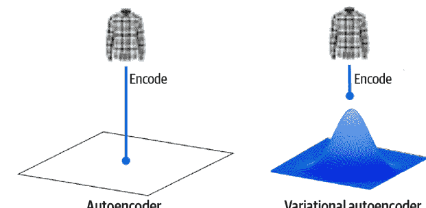

Figure 3-10. 自动编码器与变分自动编码器中编码器的区别

### The Multivariate Normal Distribution

正态分布（或高斯分布）𝒩(μ, σ) 是一种概率分布，其特征是独特的钟形曲线，由两个变量定义：均值 (μ) 和方差 (σ²)。标准差 (σ) 是方差的平方根。

正态分布在一维中的概率密度函数为：

f(x | μ, σ²) = 1/√(2πσ²) e^(-(x-μ)²/(2σ²))

图 3-11 显示了在一维中具有不同均值和方差值的几个正态分布。红色曲线是标准正态（或单位正态）𝒩(0, 1)——均值等于 0 且方差等于 1 的正态分布。

我们可以使用以下公式从均值为 μ、标准差为 σ 的正态分布中采样点 z：

z = μ + σϵ

其中 ε 来自标准正态分布采样。

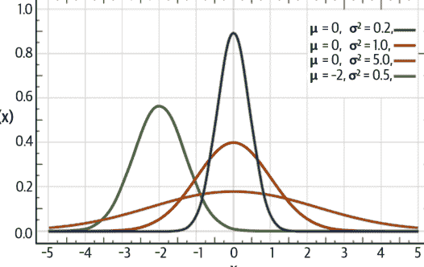

Figure 3-11. 一维中的正态分布（来源：维基百科）

正态分布的概念可以扩展到一个以上维度——k 维多元正态分布（或多元高斯分布）𝒩(μ, Σ) 的概率密度函数，其中均值向量为 μ，对称协方差矩阵为 Σ，公式如下：

f(x₁, ..., xₖ) = exp( -½ (x - μ)ᵀ Σ⁻¹ (x - μ) ) / √( (2π)ᵏ |Σ| )

在本书中，我们通常会使用各向同性的多元正态分布，其中协方差矩阵是对角的。这意味着分布在每个维度上是独立的（即我们可以采样一个向量，其中每个元素都以独立的均值和方差呈正态分布）。这正是我们将在变分自动编码器中使用的多元正态分布的情况。

多元标准正态分布 𝒩(0, I) 是一个均值向量为零、协方差矩阵为单位矩阵的多元分布。


### Normal Versus Gaussian

在本书中，正态和高斯这两个术语可以互换使用，并且分布的各向同性和多元特性通常是隐含的。例如，“我们从高斯分布中采样”可以解释为“我们从各向同性多元高斯分布中采样”。

编码器只需要将每个输入映射到均值向量和方差向量，而无需担心维度之间的协方差。变分自动编码器假设潜在空间中各维度之间不存在相关性。

方差值始终为正，因此我们实际上选择映射到方差的对数，因为它可以取 (−∞, ∞) 范围内的任意实数。这样我们就可以使用神经网络作为编码器，将输入图像映射到均值和对数方差向量。

总结一下，编码器将接收每张输入图像，并将其编码为两个向量，这两个向量共同定义了潜在空间中的多元正态分布：

- **z_mean**
  分布的均值点
- **z_log_var**
  每个维度的方差的对数

我们可以使用以下公式从这些值定义的分布中采样点 z：

```
z = z_mean + z_sigma * epsilon
```

其中：

```
z_sigma = exp(z_log_var * 0.5)
epsilon ~ N(0,I)
```

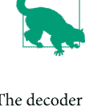

z_sigma (σ) 与 z_log_var (log(σ²)) 之间关系的推导如下：

σ = exp ( log(σ) ) = exp ( 2 log(σ)/2 ) = exp ( log(σ²)/2 )

变分自动编码器的解码器与普通自动编码器的解码器相同，给出如图 3-12 所示的整体架构。

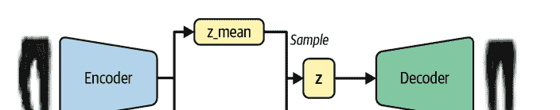

Figure 3-12. VAE 架构图

为什么对编码器的这一小改动有帮助？

之前，我们看到潜在空间不需要连续——即使点 (-2, 2) 解码为一幅结构良好的凉鞋图像，也没有要求 (-2.1, 2.1) 看起来相似。现在，由于我们是从 z_mean 周围的区域采样随机点，解码器必须确保同一邻域内的所有点在解码时产生非常相似的图像，以便重建损失保持较小。这是一个非常好的特性，确保即使我们在潜在空间中选择解码器从未见过的点，它也可能解码为结构良好的图像。

### Building the VAE encoder

现在让我们看看如何在 Keras 中构建这个新版本的编码器。


### Running the Code for This Example

此示例的代码可以在书库中位于 notebooks/03_vae/02_vae_fashion/vae_fashion.ipynb 的 Jupyter notebook 中找到。

代码改编自 Francois Chollet 创建的优秀 VAE 教程，可在 Keras 网站上获取。

首先，我们需要创建一个新的 Sampling 层类型，以便从 z_mean 和 z_log_var 定义的分布中采样，如示例 3-11 所示。

### Example 3-11. The Sampling layer

```
class Sampling(layers.Layer): ①
    def call(self, inputs):
        z_mean, z_log_var = inputs
        batch = tf.shape(z_mean)[0]
        dim = tf.shape(z_mean)[1]
        epsilon = K.random_normal(shape=(batch, dim))
        return z_mean + tf.exp(0.5 * z_log_var) * epsilon ②
```

① 我们通过子类化 Keras 基础 Layer 类来创建新层（参见“子类化 Layer 类”侧边栏）。

② 我们使用重参数化技巧（参见“重参数化技巧”侧边栏）从由 z_mean 和 z_log_var 参数化的正态分布构建样本。


### 对 Layer 类进行子类化

你可以在 Keras 中通过对抽象 Layer 类进行子类化并定义 call 方法来创建新的层，该方法描述了层如何转换张量。

例如，在变分自编码器中，我们可以创建一个 Sampling 层来处理从由 z_mean 和 z_log_var 定义参数的正态分布中采样 z。

当你想对张量应用一种转换而这种转换并未作为即用型 Keras 层类型之一包含时，这很有用。

### 重参数化技巧

与其直接从参数为 z_mean 和 z_log_var 的正态分布采样，我们可以从标准正态分布采样 epsilon，然后手动调整样本使其具有正确的均值和方差。

这被称为重参数化技巧，其重要性在于它意味着梯度可以通过该层自由反向传播。通过将该层的所有随机性都包含在变量 epsilon 中，可以证明该层输出相对于其输入的偏导数是确定性的（即与随机 epsilon 无关），这对于通过该层进行反向传播是必不可少的。

包含新的 Sampling 层的编码器的完整代码在示例 3-12 中展示。

#### 示例 3-12. 编码器

```
encoder_input = layers.Input(
    shape=(32, 32, 1), name="encoder_input"
)
x = layers.Conv2D(32, (3, 3), strides=2, activation="relu", padding="same")(
    encoder_input
)
x = layers.Conv2D(64, (3, 3), strides=2, activation="relu", padding="same")(x)
x = layers.Conv2D(128, (3, 3), strides=2, activation="relu", padding="same")(x)
shape_before_flattening = K.int_shape(x)[1:]

x = layers.Flatten()(x)
z_mean = layers.Dense(2, name="z_mean")(x) ①
z_log_var = layers.Dense(2, name="z_log_var")(x)
z = Sampling()([z_mean, z_log_var]) ②
```

```
encoder = models.Model(encoder_input, [z_mean, z_log_var, z], name="encoder") ③
```

- 1. 而不是将 Flatten 层直接连接到 2D 潜在空间，我们将其连接到层 z_mean 和 z_log_var。
- 2. Sampling 层从由参数 z_mean 和 z_log_var 定义的正态分布中在潜在空间采样一个点 z。
- 3. 定义编码器的 Keras Model——一个模型，它接收输入图像并输出 z_mean、z_log_var 以及从这些参数定义的正态分布中采样的点 z。

编码器的摘要在表 3-4 中展示。

#### 表 3-4. VAE 编码器的模型摘要

| 层（类型） | 输出形状 | 参数数 | 连接到 |
|---|---|---|---|
| InputLayer (input) | (None, 32, 32, 1) | 0 | [] |
| Conv2D (conv2d_1) | (None, 16, 16, 32) | 320 | [input] |
| Conv2D (conv2d_2) | (None, 8, 8, 64) | 18,496 | [conv2d_1] |
| Conv2D (conv2d_3) | (None, 4, 4, 128) | 73,856 | [conv2d_2] |
| Flatten (flatten) | (None, 2048) | 0 | [conv2d_3] |
| Dense (z_mean) | (None, 2) | 4,098 | [flatten] |
| Dense (z_log_var) | (None, 2) | 4,098 | [flatten] |
| Sampling (z) | (None, 2) | 0 | [z_mean, z_log_var] |

总参数 100,868
可训练参数 100,868
不可训练参数 0

原始自编码器中我们需要更改的唯一其他部分是损失函数。

### 损失函数

之前，我们的损失函数仅由图像与其经过编码器和解码器后尝试复制的图像之间的重建损失组成。重建损失也出现在变分自编码器中，但我们现在需要一个额外的组成部分：Kullback–Leibler（KL）散度项。

KL 散度是衡量一个概率分布与另一个概率分布差异程度的一种方法。在 VAE 中，我们希望衡量具有参数 z_mean 和 z_log_var 的正态分布与标准正态分布之间的差异。在这种特殊情况下，可以证明 KL 散度具有以下闭式形式：

```
kl_loss = -0.5 * sum(1 + z_log_var - z_mean ^ 2 - exp(z_log_var))
```

或用数学符号表示：

$D_{KL}[N(\mu,\sigma \| N(0,1)] = -\frac{1}{2}\sum\left(1 + log(\sigma^2) - \mu^2 - \sigma^2\right)$

求和是对潜在空间中的所有维度进行的。kl_loss 在 z_mean = 0 且 z_log_var = 0 对所有维度时最小化为 0。随着这两个项开始与 0 不同，kl_loss 会增加。

总之，KL 散度项惩罚网络将观测编码为与标准正态分布的参数（即 z_mean = 0 且 z_log_var = 0）显著不同的 z_mean 和 z_log_var 变量。

为什么损失函数的这一添加是有帮助的？

首先，我们现在有一个定义良好的分布，可以用来选择潜在空间中的点——标准正态分布。其次，由于该项试图将所有编码分布推向标准正态分布，因此点簇之间形成大间隙的可能性较小。相反，编码器将尝试在原点周围对称且高效地使用空间。

在原始 VAE 论文中，VAE 的损失函数只是重建损失和 KL 散度损失项的简单相加。对此的一个变体（β-VAE）包含一个权重因子，用于对 KL 散度进行加权，以确保其与重建损失保持良好平衡。如果我们过度加权重建损失，KL 损失将不会产生期望的调节效果，我们将看到与普通自编码器中经历的相同问题。如果 KL 散度项加权过重，KL 散度损失将占主导地位，重建图像的质量会变差。这个权重项是在训练 VAE 时需要调整的参数之一。

### 训练变分自编码器

示例 3-13 展示了我们如何将整体 VAE 模型构建为抽象 Keras Model 类的子类。这使我们能够在自定义 train_step 方法中包含损失函数的 KL 散度项的计算。

#### 示例 3-13. 训练 VAE

```python
class VAE(models.Model):
    def __init__(self, encoder, decoder, **kwargs):
        super(VAE, self).__init__(**kwargs)
        self.encoder = encoder
        self.decoder = decoder
        self.total_loss_tracker = metrics.Mean(name="total_loss")
        self.reconstruction_loss_tracker = metrics.Mean(
            name="reconstruction_loss"
        )
        self.kl_loss_tracker = metrics.Mean(name="kl_loss")

    @property
    def metrics(self):
        return [
            self.total_loss_tracker,
            self.reconstruction_loss_tracker,
            self.kl_loss_tracker,
        ]

    def call(self, inputs): ①
        z_mean, z_log_var, z = encoder(inputs)
        reconstruction = decoder(z)
        return z_mean, z_log_var, reconstruction

    def train_step(self, data): ②
        with tf.GradientTape() as tape:
            z_mean, z_log_var, reconstruction = self(data)
            reconstruction_loss = tf.reduce_mean(
                500
                * losses.binary_crossentropy(
                    data, reconstruction, axis=(1, 2, 3)
                )
            ) ③
            kl_loss = tf.reduce_mean(
                tf.reduce_sum(
                    -0.5
                    * (1 + z_log_var - tf.square(z_mean) - tf.exp(z_log_var)),
                    axis = 1,
                )
            )
            total_loss = reconstruction_loss + kl_loss ④

            grads = tape.gradient(total_loss, self.trainable_weights)
```

```
self.optimizer.apply_gradients(zip(grads, self.trainable_weights))

self.total_loss_tracker.update_state(total_loss)
self.reconstruction_loss_tracker.update_state(reconstruction_loss)
self.kl_loss_tracker.update_state(kl_loss)

return {m.name: m.result() for m in self.metrics}

vae = VAE(encoder, decoder)
vae.compile(optimizer="adam")
vae.fit(
    train,
    epochs=5,
    batch_size=100
)
```

- 1. 此函数描述了当我们在特定输入图像上调用 VAE 时我们希望返回的内容。
- 2. 此函数描述了 VAE 的一个训练步骤，包括损失函数的计算。
- 3. 重建损失中使用了 500 的 beta 值。
- 4. 总损失是重建损失和 KL 散度损失之和。


### 梯度带

TensorFlow 的 *Gradient Tape* 是一种机制，允许计算在模型前向传播期间执行的运算的梯度。要使用它，你需要将要进行微分的运算代码包装在 tf.GradientTape() 上下文中。一旦记录了运算，你就可以通过调用 tape.gradient() 来计算损失函数相对于某些变量的梯度。然后可以使用这些梯度通过优化器更新变量。

该机制对于计算自定义损失函数的梯度（正如我们在这里所做的）以及创建自定义训练循环非常有用，正如我们在第 4 章中将看到的那样。


### 变分自编码器的分析

现在我们已经训练好了 VAE，可以使用编码器对测试集中的图像进行编码，并在潜在空间中绘制 z_mean 值。我们也可以从标准正态分布中采样以在潜在空间中生成点，并使用解码器将这些点解码回像素空间，以查看 VAE 的表现。

图 3-13 显示了新的潜在空间的结构，以及一些采样点及其解码后的图像。我们可以立即看到潜在空间组织方式的几个变化。

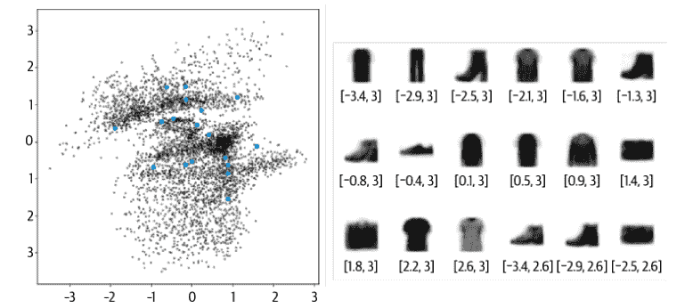

图 3-13. 新的潜在空间：黑色点显示每个编码图像的 z_mean 值，而蓝色点显示潜在空间中的一些采样点（右侧为其解码后的图像）

首先，KL 散度损失项确保编码图像的 z_mean 和 z_log_var 值不会偏离标准正态分布太远。其次，由于编码器现在是随机的而非确定性的，潜在空间现在更加连续，因此不良形成的图像不再那么多。

最后，通过按服装类型对潜在空间中的点进行着色（图 3-14），我们可以看出没有任何一种类型受到偏爱。右侧的图显示了空间转换后的 p 值——我们可以看出每种颜色大致相等地分布。再次强调，重要的是要记住标签在训练期间根本没有使用；VAE 已自行学习了各种服装形式以帮助最小化重建损失。

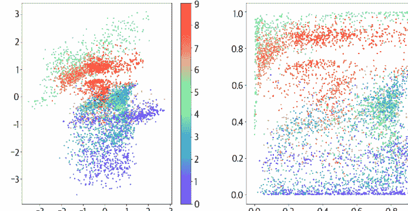

图 3-14. 按服装类型着色的 VAE 潜在空间

### 探索潜在空间

到目前为止，我们对自编码器和变分自编码器的工作都局限于二维潜在空间。这帮助我们在页面上可视化 VAE 的内部工作原理，并理解我们对自编码器架构所做的微小调整如何将其转变为可用于生成建模的更强大的网络类别。

现在让我们把注意力转向一个更复杂的数据集，看看当我们增加潜在空间的维度时，变分自编码器能取得怎样令人惊叹的效果。


### 运行本示例的代码

本示例的代码可在书籍仓库中的 Jupyter notebook notebooks/03_vae/03_faces/vae_faces.ipynb 中找到。

### CelebA 数据集

我们将使用 CelebFaces Attributes（CelebA）数据集来训练下一个变分自编码器。这是一个包含超过 200,000 张名人面部彩色图像的集合，每张图像都标注了各种标签（例如，戴帽子、微笑等）。图 3-15 显示了一些示例。

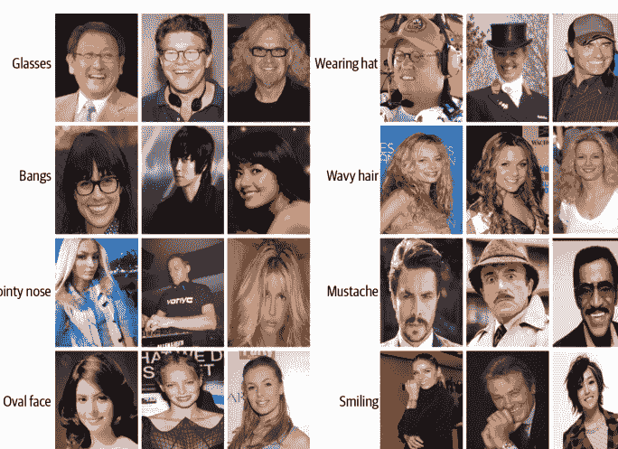

图 3-15. 来自 CelebA 数据集的一些示例（来源：Liu et al., 2015）³

当然，我们不需要标签来训练 VAE，但当我们开始探索这些特征如何在多维潜在空间中被捕获时，它们将很有用。一旦我们的 VAE 训练完成，我们就可以从潜在空间中采样以生成新的名人面部示例。

CelebA 数据集也通过 Kaggle 提供，因此您可以运行书籍仓库中的 Kaggle 数据集下载脚本来下载数据集，如示例 3-14 所示。这将把图像和随附的元数据本地保存到 /data 文件夹。

#### 示例 3-14. 下载 CelebA 数据集

```
bash scripts/download_kaggle_data.sh jessicali9530 celeba-dataset
```

我们使用 Keras 函数 image_dataset_from_directory 来创建一个指向存储图像的目录的 TensorFlow Dataset，如示例 3-15 所示。这允许我们仅在需要时（例如在训练期间）将图像批读取到内存中，因此我们可以处理大型数据集，而不必担心将整个数据集装入内存。它还将图像调整为 64 × 64，并在像素值之间进行插值。

#### 示例 3-15. 预处理 CelebA 数据集

```
train_data = utils.image_dataset_from_directory(
    "/app/data/celeba-dataset/img_align_celeba/img_align_celeba",
    labels=None,
    color_mode="rgb",
    image_size=(64, 64),
    batch_size=128,
    shuffle=True,
    seed=42,
    interpolation="bilinear",
)
```

原始数据按范围 [0, 255] 缩放以表示像素强度，我们将其重新缩放到范围 [0, 1]，如示例 3-16 所示。

#### 示例 3-16. 预处理 CelebA 数据集

```
def preprocess(img):
    img = tf.cast(img, "float32") / 255.0
    return img

train = train_data.map(lambda x: preprocess(x))
```

### 变分自编码器的训练

人脸模型的网络架构与 Fashion-MNIST 示例类似，但有几个细微差异：

- 我们的数据现在有三个输入通道（RGB）而不是一个（灰度）。这意味着我们需要将解码器中最后的卷积转置层的通道数改为 3。
- 我们将使用 200 维的潜在空间而不是 2 维。由于人脸比 Fashion-MNIST 图像复杂得多，我们增加了潜在空间的维度，以便网络能够从图像中编码足够多的细节。
- 每个卷积层之后都有批归一化层以稳定训练。即使每个批次运行时间更长，达到相同损失所需的批次数量大大减少。
- 我们将 KL 散度的 β 因子增加到 2,000。这是一个需要调优的参数；对于该数据集和架构，该值被发现能产生良好的结果。

编码器和解码器的完整架构分别显示在表 3-5 和表 3-6 中。

#### 表 3-5. VAE 人脸编码器模型摘要

| 层（类型） | 输出形状 | 参数数 | 连接至 |
|---|---|---|---|
| InputLayer (input) | (None, 32, 32, 3) | 0 | [] |
| Conv2D (conv2d_1) | (None, 16, 16, 128) | 3,584 | [input] |
| BatchNormalization (bn_1) | (None, 16, 16, 128) | 512 | [conv2d_1] |
| LeakyReLU (lr_1) | (None, 16, 16, 128) | 0 | [bn_1] |
| Conv2D (conv2d_2) | (None, 8, 8, 128) | 147,584 | [lr_1] |
| BatchNormalization (bn_2) | (None, 8, 8, 128) | 512 | [conv2d_2] |
| LeakyReLU (lr_2) | (None, 8, 8, 128) | 0 | [bn_2] |
| Conv2D (conv2d_3) | (None, 4, 4, 128) | 147,584 | [lr_2] |
| BatchNormalization (bn_3) | (None, 4, 4, 128) | 512 | [conv2d_3] |
| LeakyReLU (lr_3) | (None, 4, 4, 128) | 0 | [bn_3] |
| Conv2D (conv2d_4) | (None, 2, 2, 128) | 147,584 | [lr_3] |
| BatchNormalization (bn_4) | (None, 2, 2, 128) | 512 | [conv2d_4] |
| LeakyReLU (lr_4) | (None, 2, 2, 128) | 0 | [bn_4] |
| Flatten (flatten) | (None, 512) | 0 | [lr_4] |
| Dense (z_mean) | (None, 200) | 102,600 | [flatten] |
| Dense (z_log_var) | (None, 200) | 102,600 | [flatten] |
| Sampling (z) | (None, 200) | 0 | [z_mean, z_log_var] |

总参数 653,584
可训练参数 652,560
不可训练参数 1,024

#### 表 3-6. VAE 人脸解码器模型摘要

| 层（类型） | 输出形状 | 参数数 |
|---|---|---|
| InputLayer | (None, 200) | 0 |
| Dense | (None, 512) | 102,912 |
| BatchNormalization | (None, 512) | 2,048 |
| LeakyReLU | (None, 512) | 0 |
| Reshape | (None, 2, 2, 128) | 0 |
| Conv2DTranspose | (None, 4, 4, 128) | 147,584 |
| BatchNormalization | (None, 4, 4, 128) | 512 |
| LeakyReLU | (None, 4, 4, 128) | 0 |
| Conv2DTranspose | (None, 8, 8, 128) | 147,584 |
| BatchNormalization | (None, 8, 8, 128) | 512 |
| LeakyReLU | (None, 8, 8, 128) | 0 |
| Conv2DTranspose | (None, 16, 16, 128) | 147,584 |
| BatchNormalization | (None, 16, 16, 128) | 512 |
| LeakyReLU | (None, 16, 16, 128) | 0 |
| Conv2DTranspose | (None, 32, 32, 128) | 147,584 |
| BatchNormalization | (None, 32, 32, 128) | 512 |
| LeakyReLU | (None, 32, 32, 128) | 0 |
| Conv2DTranspose | (None, 32, 32, 3) | 3,459 |

总参数 700,803
可训练参数 698,755
不可训练参数 2,048

训练大约五个 epoch 后，我们的 VAE 应该能够生成名人面部的全新图像！

### 变分自编码器的分析

首先，让我们看一下重建人脸的样本。图 3-16 中的顶行显示原始图像，底行显示它们经过编码器和解码器后的重建结果。

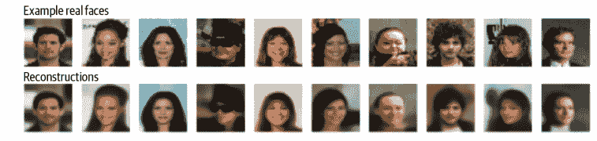

图 3-16. 经过编码器和解码器后的重建人脸

我们可以看出 VAE 已成功捕捉到每张面部的关键特征——头部角度、发型、表情等。一些精细细节缺失，但重要的是要记住构建变分自编码器的目标并不是实现完美的重建损失。我们的最终目标是从潜在空间中采样以生成新的人脸。

为了实现这一点，我们必须检查潜在空间中点的分布是否近似于多元标准正态分布。如果我们看到任何维度与标准正态分布显著不同，

我们可能应该降低重建损失因子，因为 KL 散度项的影响还不够。

我们潜在空间中的前 50 个维度如图 3-17 所示。没有哪个分布明显不同于标准正态分布，因此我们可以继续生成一些人脸！

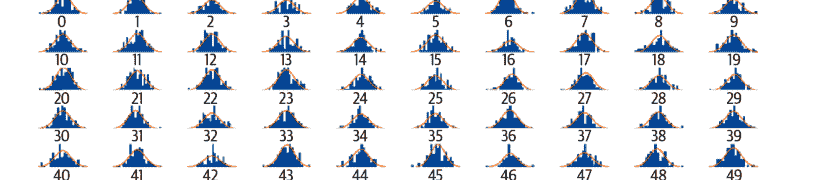

图 3-17. 潜在空间中前 50 个维度的点分布

### 生成新的人脸

要生成新的人脸，我们可以使用示例 3-17 中的代码。

示例 3-17. 从潜在空间生成新的人脸

```
grid_width, grid_height = (10,3)
z_sample = np.random.normal(size=(grid_width * grid_height, 200)) ①

reconstructions = decoder.predict(z_sample) ②

fig = plt.figure(figsize=(18, 5))
fig.subplots_adjust(hspace=0.4, wspace=0.4)
for i in range(grid_width * grid_height):
    ax = fig.add_subplot(grid_height, grid_width, i + 1)
    ax.axis("off")
    ax.imshow(reconstructions[i, :, :]) ③
```

- ① 从 200 维的标准多元正态分布中采样 30 个点。
- ② 解码采样得到的点。
- ③ 绘制图像！

输出如图 3-18 所示。

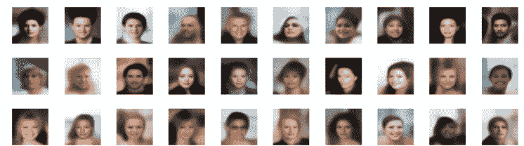

图 3-18. 新生成的人脸

令人惊讶的是，VAE 能够将我们从标准正态分布中采样的点集转换为每个都令人信服的人脸图像。这是我们首次窥见生成模型真正威力的体现！

接下来，让我们看看是否可以开始利用潜在空间对生成图像执行一些有趣的操作。

### 潜在空间算术

将图像映射到低维潜在空间的一个好处是，我们可以在该潜在空间中对向量执行算术运算，当解码回原始图像域时，这些运算具有视觉上的对应关系。

例如，假设我们想取一张看起来悲伤的人的图像并让他们微笑。为此，我们首先需要在潜在空间中找到一个指向笑容增加方向的向量。将该向量添加到原始图像在潜在空间中的编码中，将得到一个新的点，解码后应能得到原始图像更具笑容的版本。

那么我们如何找到笑容向量呢？CelebA 数据集中每张图像都标注了属性，其中之一是 Smiling。如果我们取潜在空间中具有 Smiling 属性的编码图像的平均位置，并减去不具有该属性的编码图像的平均位置，我们将得到指向 Smiling 方向的向量，这正是我们需要的。

从概念上讲，我们在潜在空间中执行以下向量算术运算，其中 alpha 是一个决定添加或减去多少特征向量的因子：

```
z_new = z + alpha * feature_vector
```

让我们看看实际效果。图 3-19 显示了几张已编码到潜在空间中的图像。然后我们对某个向量（例如 Smiling、Black_Hair、Eyeglasses、Young、Male、Blond_Hair）进行加减倍数操作，以获得图像的不同版本，仅改变相关的特征。

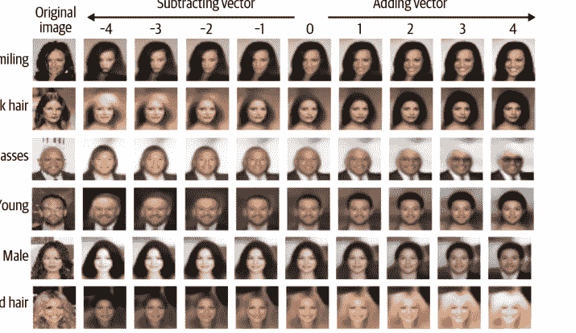

图 3-19. 向人脸添加和减去特征

值得注意的是，即使我们在潜在空间中移动点一段相当大的距离，核心图像仍然大致保持不变，除了我们想要操纵的那个特征之外。这展示了变分自编码器在捕捉和调整图像中高级特征方面的强大能力。

### 人脸变形

我们可以使用类似的思路在两张人脸之间进行变形。想象潜在空间中代表两张图像的两个点 A 和 B。如果你从点 A 开始，沿直线走向点 B，并在途中解码线上的每个点，你会看到从起始人脸到结束人脸的逐渐过渡。

从数学上讲，我们正在遍历一条直线，可以用以下方程描述：

```
z_new = z_A * (1- alpha) + z_B * alpha
```

这里，alpha 是一个介于 0 和 1 之间的数字，决定了我们沿直线远离点 A 的位置有多远。

图 3-20 显示了这一过程的实际效果。我们取两张图像，将它们编码到潜在空间中，然后以规则间隔解码它们之间直线上各点。

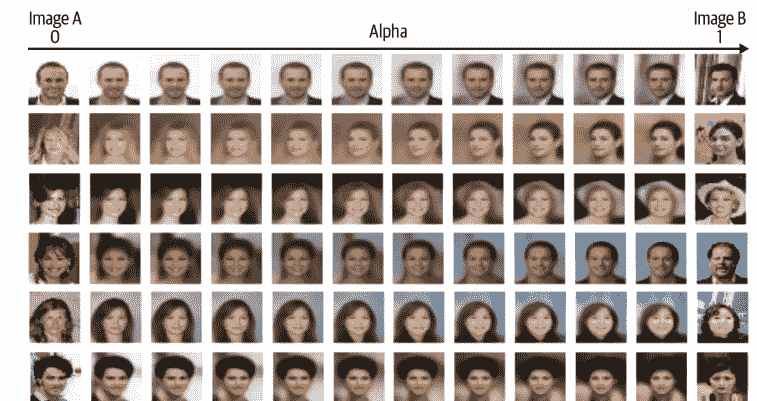

图 3-20. 两张人脸之间的变形

值得注意的是过渡的平滑性——即使同时需要改变多个特征（例如去除眼镜、发色、性别），VAE 也能流畅地实现这一点，表明 VAE 的潜在空间确实是一个连续空间，可以遍历和探索以生成多种不同的人脸。

### 总结

在本章中，我们看到了变分自编码器是生成建模工具箱中的一种强大工具。我们首先探讨了如何使用普通自编码器将高维图像映射到低维潜在空间，以便从单个无信息像素中提取高级特征。然而，我们很快发现使用普通自编码器作为生成模型存在一些缺点——例如从学习到的潜在空间采样是有问题的。

变分自编码器通过在模型中引入随机性并约束潜在空间中点的分布来解决这些问题。我们看到，通过少量调整，我们可以将自编码器转变为变分自编码器，从而赋予其成为真正的生成模型的能力。

最后，我们将新技术应用于人脸生成问题，并看到如何简单地从标准正态分布解码点来生成新的人脸。此外，通过在潜在空间中执行向量算术，我们可以实现一些惊人的效果，例如人脸变形和特征操纵。

在下一章中，我们将探索另一种在生成图像建模中仍然很受欢迎的模型：生成对抗网络。

### 参考文献

- 1. Diederik P. Kingma 和 Max Welling，“自动编码变分贝叶斯”，2013 年 12 月 20 日，https://arxiv.org/abs/1312.6114.
- 2. Vincent Dumoulin 和 Francesco Visin，“深度学习卷积算术指南”，2018 年 1 月 12 日，https://arxiv.org/abs/1603.07285.
- 3. Ziwei Liu 等，“大规模名人面部属性（CelebA）数据集”，2015 年，http://mmlab.ie.cuhk.edu.hk/projects/CelebA.html.

## 生成对抗网络

#### 章节目标

在本章中你将：

- 了解生成对抗网络（GAN）的架构设计。
- 使用 Keras 从头构建并训练深度卷积 GAN（DCGAN）。
- 使用 DCGAN 生成新图像。
- 了解训练 DCGAN 时面临的一些常见问题。
- 了解 Wasserstein GAN（WGAN）架构如何解决这些问题。
- 了解可以对 WGAN 做的额外改进，例如在损失函数中加入梯度惩罚（GP）项。
- 使用 Keras 从头构建 WGAN-GP。
- 使用 WGAN-GP 生成人脸。
- 了解条件 GAN（CGAN）如何让你能够根据给定标签对生成输出进行条件控制。
- 在 Keras 中构建并训练 CGAN 并用它来操纵生成图像。

2014 年，Ian Goodfellow 等人在蒙特利尔的神经信息处理系统大会（NeurIPS）上发表了题为“Generative Adversarial Nets”¹ 的论文。生成对抗网络（或更常被称为 GANs）的引入现在被视为生成建模历史上的一个关键转折点，因为该论文中提出的核心理念催生了一些最成功和最令人印象深刻的生成模型。


本章首先将阐述 GAN 的理论基础，然后我们将了解如何使用 Keras 构建自己的 GAN。

### 引言

让我们从一个简短的故事开始，以说明 GAN 训练过程中使用的一些基本概念。

## Brickki 积木与伪造者

这是你担任 Brickki 质量控制主管的新工作的第一天，Brickki 是一家专门生产各种形状和尺寸的高质量建筑积木的公司（图 4-1）。


图 4-1. 生产多种不同形状和尺寸的砖块的公司的生产线（使用 Midjourney 创建）

你立即被告知生产线上出现的问题。竞争对手开始制造 Brickki 积木的仿制品，并找到了一种方法将其混入客户收到的袋子中。你决定成为区分仿制积木和真品的专家，以便在积木交给客户之前在生产线上拦截伪造的积木。随着时间的推移，通过倾听客户反馈，你逐渐变得更擅长识别假货。

伪造者对此并不高兴——他们对你提高的检测能力做出了反应，通过改变他们的伪造工艺，使得真砖和假砖之间的差异变得更难被你发现。

> 绝不轻言放弃，你重新训练自己以识别更复杂的假货，并努力领先伪造者一步。这一过程持续进行，伪造者不断迭代更新他们的砖块制造技术，而你则努力变得越来越擅长拦截他们的假货。
> 
> 随着每周的过去，区分真正的 Brickki 积木和伪造者制造的积木变得越来越困难。似乎这种简单的猫鼠游戏足以推动伪造质量和检测质量的显著提升。

Brickki 积木与伪造者的故事描述了生成对抗网络的训练过程。

GAN 是生成器和判别器之间的一场较量。生成器试图将随机噪声转换为看起来像是从原始数据集中采样的观测值，而判别器则试图预测一个观测值是否来自原始数据集还是生成器的伪造品。两个网络的输入和输出示例如图 4-2 所示。

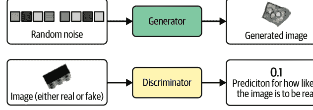

图 4-2. GAN 中两个网络的输入和输出

在过程开始时，生成器输出嘈杂的图像，而判别器随机预测。GAN 的关键在于我们如何交替训练这两个网络，这样随着生成器变得更擅长欺骗判别器，判别器必须适应以维持其正确识别哪些观测值是假的能力。这促使生成器找到新的欺骗判别器的方法，循环就此继续。

## 深度卷积 GAN（DCGAN）

为了实际操作，让我们开始在 Keras 中构建第一个 GAN，用来生成砖块的图片。

我们将紧密遵循 GAN 领域最早的重要论文之一，“使用深度卷积生成对抗网络进行无监督表示学习。”2 在这篇 2015 年的论文中，作者展示了如何构建深度卷积 GAN 来从各种数据集生成逼真的图像。他们还引入了若干改进，显著提升了生成图像的质量。


## 运行本例代码

本例的代码可在书籍仓库中的 notebooks/04_gan/01_dcgan/dcgan.ipynb Jupyter 笔记本中找到。

## 积木数据集

首先，你需要下载训练数据。我们将使用通过 Kaggle 可用的 LEGO 积木图像数据集。这是一个计算机渲染的包含 40,000 张 50 种不同玩具积木的照片图像集合，从多个角度拍摄。一些 Brickki 产品的示例图像如图 4-3 所示。

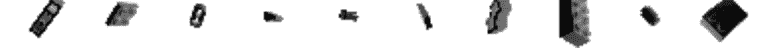

图 4-3. 来自积木数据集的图像示例

你可以通过在书籍仓库中运行 Kaggle 数据集下载脚本来下载数据集，如示例 4-1 所示。这将把图像和相应的元数据本地保存到 /data 文件夹。

### 示例 4-1. 下载积木数据集

```
bash scripts/download_kaggle_data.sh joosthazelzet lego-brick-images
```

我们使用 Keras 函数 image_dataset_from_directory 来创建一个指向图像存储目录的 TensorFlow 数据集，如示例 4-2 所示。这使我们能够仅在需要时（例如在训练期间）将图像批次读入内存，因此我们可以处理大型数据集，而不必担心将整个数据集装入内存。它还将图像调整为 64 × 64，并在像素值之间进行插值。

### 示例 4-2. 从目录中的图像文件创建 TensorFlow 数据集

```
train_data = utils.image_dataset_from_directory(
"/app/data/lego-brick-images/dataset/",
labels=None,
color_mode="grayscale",
image_size=(64, 64),
batch_size=128,
shuffle=True,
seed=42,
interpolation="bilinear",
)
```

原始数据按 [0, 255] 范围缩放以表示像素强度。在训练 GAN 时，我们将数据重新缩放到 [-1, 1] 范围，以便在生成器的最后一层使用 tanh 激活函数，这通常比 sigmoid 函数提供更强的梯度（示例 4-3）。

### 示例 4-3. 预处理积木数据集

```
def preprocess(img):
    img = (tf.cast(img, "float32") - 127.5) / 127.5
    return img
```

```
train = train_data.map(lambda x: preprocess(x))
```

现在让我们看看如何构建判别器。

## 判别器

判别器的目标是预测图像是真实的还是伪造的。这是一个监督图像分类问题，因此我们可以使用与第 2 章中使用的类似架构：堆叠的卷积层，带有一个输出节点。

我们将构建的判别器的完整架构如表 4-1 所示。

表 4-1. 判别器的模型摘要

| 层（类型） | 输出形状 | 参数数 |
|---|---|---|
| InputLayer | (None, 64, 64, 1) | 0 |
| Conv2D | (None, 32, 32, 64) | 1,024 |
| LeakyReLU | (None, 32, 32, 64) | 0 |
| Dropout | (None, 32, 32, 64) | 0 |
| Conv2D | (None, 16, 16, 128) | 131,072 |
| BatchNormalization | (None, 16, 16, 128) | 512 |
| LeakyReLU | (None, 16, 16, 128) | 0 |
| Dropout | (None, 16, 16, 128) | 0 |
| Conv2D | (None, 8, 8, 256) | 524,288 |
| BatchNormalization | (None, 8, 8, 256) | 1,024 |
| LeakyReLU | (None, 8, 8, 256) | 0 |
| Dropout | (None, 8, 8, 256) | 0 |
| Conv2D | (None, 4, 4, 512) | 2,097,152 |
| BatchNormalization | (None, 4, 4, 512) | 2,048 |
| LeakyReLU | (None, 4, 4, 512) | 0 |
| Dropout | (None, 4, 4, 512) | 0 |
| Conv2D | (None, 1, 1, 1) | 8,192 |
| Flatten | (None, 1) | 0 |

总参数数 2,765,312
可训练参数 2,763,520
非可训练参数 1,792

构建判别器的 Keras 代码在示例 4-4 中提供。

### 示例 4-4. 判别器

```
discriminator_input = layers.Input(shape=(64, 64, 1)) ①
x = layers.Conv2D(64, kernel_size=4, strides=2, padding="same", use_bias = False)(
    discriminator_input
) ②
x = layers.LeakyReLU(0.2)(x)
x = layers.Dropout(0.3)(x)
x = layers.Conv2D(
    128, kernel_size=4, strides=2, padding="same", use_bias = False
)(x)
x = layers.BatchNormalization(momentum = 0.9)(x)
x = layers.LeakyReLU(0.2)(x)
x = layers.Dropout(0.3)(x)
x = layers.Conv2D(
    256, kernel_size=4, strides=2, padding="same", use_bias = False
)(x)
x = layers.BatchNormalization(momentum = 0.9)(x)
x = layers.LeakyReLU(0.2)(x)
x = layers.Dropout(0.3)(x)
x = layers.Conv2D(
    512, kernel_size=4, strides=2, padding="same", use_bias = False
)(x)
x = layers.BatchNormalization(momentum = 0.9)(x)
x = layers.LeakyReLU(0.2)(x)
x = layers.Dropout(0.3)(x)
x = layers.Conv2D(
    1,
    kernel_size=4,
    strides=1,
    padding="valid",
    use_bias = False,
    activation = 'sigmoid'
)(x)
discriminator_output = layers.Flatten()(x) ③
```


```
discriminator = models.Model(discriminator_input, discriminator_output)
```

- 1. 定义判别器的输入层（图像）。
- 2. 将 Conv2D 层堆叠在一起，中间夹着 BatchNormalization、LeakyReLU 激活和 Dropout 层。
- 3. 展平最后一个卷积层——此时张量的形状为 1 × 1 × 1，因此不需要最终的 Dense 层。
- 4. 定义判别器的 Keras 模型——一个模型，接收输入图像并输出 0 到 1 之间的单个数字。

注意我们在部分 Conv2D 层中使用步长为 2，以在张量通过网络时减小其空间形状（原始图像中为 64，然后是 32、16、8、4，最后为 1），同时增加通道数（灰度输入图像中为 1，然后是 64、128、256，最后为 512），然后再坍缩为单个预测。

我们在最终的 Conv2D 层上使用 sigmoid 激活函数，以输出 0 到 1 之间的数字。

## 生成器

现在让我们构建生成器。生成器的输入将是从多元标准正态分布中抽取的向量。输出是与原始训练数据中图像大小相同的图像。

这个描述可能让你想起变分自编码器中的解码器。事实上，GAN 的生成器与 VAE 的解码器完全相同的目的：将潜在空间中的向量转换为图像。将潜在空间映射回原始域的概念在生成建模中非常常见，因为它使我们能够操纵潜在空间中的向量，从而改变原始域中图像的高级特征。

我们将要构建的生成器的架构如表 4-2 所示。

表 4-2. 生成器的模型摘要

| 层（类型） | 输出形状 | 参数数 |
|---|---|---|
| InputLayer | (None, 100) | 0 |
| Reshape | (None, 1, 1, 100) | 0 |
| Conv2DTranspose | (None, 4, 4, 512) | 819,200 |
| BatchNormalization | (None, 4, 4, 512) | 2,048 |
| ReLU | (None, 4, 4, 512) | 0 |
| Conv2DTranspose | (None, 8, 8, 256) | 2,097,152 |
| BatchNormalization | (None, 8, 8, 256) | 1,024 |
| ReLU | (None, 8, 8, 256) | 0 |
| Conv2DTranspose | (None, 16, 16, 128) | 524,288 |
| BatchNormalization | (None, 16, 16, 128) | 512 |
| ReLU | (None, 16, 16, 128) | 0 |
| Conv2DTranspose | (None, 32, 32, 64) | 131,072 |
| BatchNormalization | (None, 32, 32, 64) | 256 |
| ReLU | (None, 32, 32, 64) | 0 |
| Conv2DTranspose | (None, 64, 64, 1) | 1,024 |

总参数 3,576,576
可训练参数 3,574,656
非可训练参数 1,920

构建生成器的代码在示例 4-5 中给出。

### 示例 4-5. 生成器

```python
generator_input = layers.Input(shape=(100,)) ①
x = layers.Reshape((1, 1, 100))(generator_input) ②
x = layers.Conv2DTranspose(
    512, kernel_size=4, strides=1, padding="valid", use_bias = False
)(x) ③
x = layers.BatchNormalization(momentum=0.9)(x)
x = layers.LeakyReLU(0.2)(x)
x = layers.Conv2DTranspose(
    256, kernel_size=4, strides=2, padding="same", use_bias = False
)(x)
x = layers.BatchNormalization(momentum=0.9)(x)
x = layers.LeakyReLU(0.2)(x)
x = layers.Conv2DTranspose(
    128, kernel_size=4, strides=2, padding="same", use_bias = False
)(x)
x = layers.BatchNormalization(momentum=0.9)(x)
x = layers.LeakyReLU(0.2)(x)
x = layers.Conv2DTranspose(
    64, kernel_size=4, strides=2, padding="same", use_bias = False
)(x)
x = layers.BatchNormalization(momentum=0.9)(x)
x = layers.LeakyReLU(0.2)(x)
generator_output = layers.Conv2DTranspose(
    1,
kernel_size=4,
strides=2,
padding="same",
use_bias = False,
activation = 'tanh'
)(x)
generator = models.Model(generator_input, generator_output)
```

- 1. 定义生成器的输入层——长度为 100 的向量。
- 2. 我们使用 Reshape 层将其 reshape 为 1 × 1 × 100 的张量，以便开始应用转置卷积操作。
- 3. 我们将其通过四个 Conv2DTranspose 层，中间夹着 BatchNormalization 和 LeakyReLU 层。
- 4. 最终的 Conv2DTranspose 层使用 tanh 激活函数将输出变换到范围 [−1, 1]，以匹配原始图像域。
- 5. 定义生成器的 Keras 模型——一个模型，接受长度为 100 的向量并输出形状为 [64, 64, 1] 的张量。

注意我们在部分 Conv2DTranspose 层中使用步长为 2，以在张量通过网络时增大其空间形状（原始向量中为 1，然后是 4、8、16、32，最后为 64），同时减少通道数（512 然后是 256、128、64，最后为 1 以匹配灰度输出）。

## 上采样与 Conv2DTranspose

使用 Conv2DTranspose 层的替代方案是改用 UpSampling2D 层后跟步长为 1 的普通 Conv2D 层，如示例 4-6 所示。

### 示例 4-6. 上采样示例

```
x = layers.UpSampling2D(size = 2)(x)
x = layers.Conv2D(256, kernel_size=4, strides=1, padding="same")(x)
```

UpSampling2D 层简单地重复其输入的每一行和列以使大小加倍。步长为 1 的 Conv2D 层然后执行卷积操作。这与转置卷积的想法类似，但不是用零填充像素之间的间隙，上采样只是重复现有的像素值。

研究表明，Conv2DTranspose 方法可能导致伪影，或输出图像中小块棋盘格图案（见图 4-4），从而破坏输出质量。然而，它们仍被文献中许多最令人印象深刻的 GAN 中使用，并已证明是深度学习从业者工具箱中的强大工具。

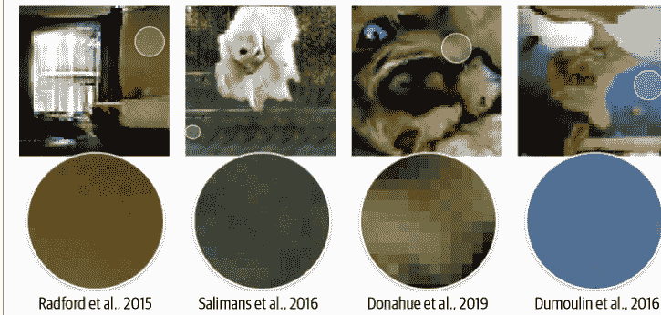

图 4-4. 使用转置卷积层时的伪影（来源：Odena et al., 2016）3

这两种方法——UpSampling2D + Conv2D 和 Conv2DTranspose——都是将图像转换回原始域的可接受方式。真正的情况是在你自己的问题设置中测试这两种方法，看看哪种产生更好的结果。

## 训练 DCGAN

正如我们所见，DCGAN 中生成器和判别器的架构非常简单，与我们在第 3 章中看到的 VAE 模型并没有太大不同。理解 GAN 的关键在于理解生成器和判别器的训练过程。

我们可以通过创建训练集来训练判别器，其中一些图像是来自训练集的真实观测值，一些是来自生成器的伪造输出。然后我们将其视为监督学习问题，其中真实图像的标签为 1，伪造图像的标签为 0，损失函数为二元交叉熵。

如何训练生成器？我们需要找到一种为每个生成图像评分的方法，以便其能够优化向高分图像。幸运的是，我们有一个判别器正好可以做到这一点！我们可以生成一批图像并将其通过判别器为每个图像获得一个分数。生成器的损失函数然后只是这些概率与全为 1 的向量之间的二元交叉熵，因为我们希望训练生成器生成判别器认为真实的图像。

关键是我们必须交替训练这两个网络，确保一次只更新一个网络的权重。例如，在生成器训练过程中，只有生成器的权重会被更新。如果我们也允许判别器的权重发生变化，判别器只会调整以更可能将生成的图像预测为真实，这不是期望的结果。我们希望生成的图像被预测接近 1（真实），因为生成器强大，而不是因为判别器弱。

判别器和生成器的训练过程图示如图 4-5 所示。

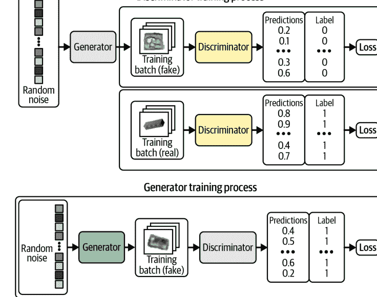

图 4-5. 训练 DCGAN——灰色框表示训练期间权重被冻结

Keras 提供了创建自定义 train_step 函数以实现此逻辑的能力。示例 4-7 显示了完整的 DCGAN 模型类。


## 示例 4-7. 编译 DCGAN

```python
class DCGAN(models.Model):
    def __init__(self, discriminator, generator, latent_dim):
        super(DCGAN, self).__init__()
        self.discriminator = discriminator
        self.generator = generator
        self.latent_dim = latent_dim

    def compile(self, d_optimizer, g_optimizer):
        super(DCGAN, self).compile()
        self.loss_fn = losses.BinaryCrossentropy() ①
        self.d_optimizer = d_optimizer
        self.g_optimizer = g_optimizer
        self.d_loss_metric = metrics.Mean(name="d_loss")
        self.g_loss_metric = metrics.Mean(name="g_loss")

    @property
    def metrics(self):
        return [self.d_loss_metric, self.g_loss_metric]

    def train_step(self, real_images):
        batch_size = tf.shape(real_images)[0]
        random_latent_vectors = tf.random.normal(
            shape=(batch_size, self.latent_dim)
        ) ②

        with tf.GradientTape() as gen_tape, tf.GradientTape() as disc_tape:
            generated_images = self.generator(
                random_latent_vectors, training = True
            ) ③
            real_predictions = self.discriminator(real_images, training = True) ④
            fake_predictions = self.discriminator(
                generated_images, training = True
            ) ⑤

            real_labels = tf.ones_like(real_predictions)
            real_noisy_labels = real_labels + 0.1 * tf.random.uniform(
                tf.shape(real_predictions)
            )
            fake_labels = tf.zeros_like(fake_predictions)
            fake_noisy_labels = fake_labels - 0.1 * tf.random.uniform(
                tf.shape(fake_predictions)
            )

            d_real_loss = self.loss_fn(real_noisy_labels, real_predictions)
            d_fake_loss = self.loss_fn(fake_noisy_labels, fake_predictions)
            d_loss = (d_real_loss + d_fake_loss) / 2.0 ⑥

            g_loss = self.loss_fn(real_labels, fake_predictions) ⑦

        gradients_of_discriminator = disc_tape.gradient(
    d_loss, self.discriminator.trainable_variables
)
gradients_of_generator = gen_tape.gradient(
    g_loss, self.generator.trainable_variables
)

self.d_optimizer.apply_gradients(
    zip(gradients_of_discriminator, discriminator.trainable_variables)
)
self.g_optimizer.apply_gradients(
    zip(gradients_of_generator, generator.trainable_variables)
)

self.d_loss_metric.update_state(d_loss)
self.g_loss_metric.update_state(g_loss)

    return {m.name: m.result() for m in self.metrics}

dcgan = DCGAN(
    discriminator=discriminator, generator=generator, latent_dim=100
)

dcgan.compile(
    d_optimizer=optimizers.Adam(
        learning_rate=0.0002, beta_1 = 0.5, beta_2 = 0.999
    ),
    g_optimizer=optimizers.Adam(
        learning_rate=0.0002, beta_1 = 0.5, beta_2 = 0.999
    ),
)

dcgan.fit(train, epochs=300)
```

- 1. 生成器和判别器的损失函数是 BinaryCrossentropy.
- 2. 为了训练网络，首先从多元标准正态分布中采样一批向量。
- 3. 接下来，将这些向量通过生成器以生成一批生成的图像。
- 4. 现在要求判别器预测真实图像批次的真实性...
- 5. ...以及生成的图像批次。
- 6. 判别器损失是真实图像（标签为 1）和假图像（标签为 0）的平均二元交叉熵。
- 7. 生成器损失是生成图像的判别器预测与标签 1 之间的二元交叉熵。

## 8 分别更新判别器和生成器的权重。

判别器和生成器不断争夺主导地位，这可能使 DCGAN 训练过程不稳定。理想情况下，训练过程将找到一个平衡点，使生成器能够从判别器学习有意义的信息，并且图像质量开始提高。经过足够多的轮次后，判别器往往会占据主导地位，如图 4-6 所示，但这可能不是问题，因为到此时生成器可能已经学会生成足够高质量的图像。

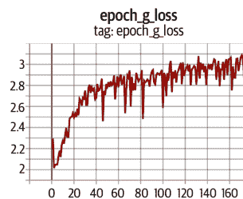


图 4-6. 训练过程中判别器和生成器的损失和准确率


## 为标签添加噪声

在训练 GAN 时，一个有用的技巧是在训练标签中添加少量随机噪声。这有助于提高训练过程的稳定性并使生成的图像更清晰。这种标签平滑充当驯服判别器的方式，使其面临更具挑战性的任务，并且不会压制生成器。

## DCGAN 分析

通过观察训练过程中特定轮次生成器产生的图像（图 4-7），可以明显看出生成器在生成可能来自训练集的图像方面变得越来越熟练。


图 4-7. 训练过程中特定轮次的生成器输出

神经网络能够将随机噪声转换为有意义的东西，这有点不可思议。值得记住的是，我们没有向模型提供除原始像素之外的任何额外特征，因此它必须完全自行推导出诸如如何绘制阴影、长方体和圆圈等高级概念。

成功生成模型的另一个要求是它不仅仅复制训练集中的图像。为了测试这一点，我们可以找到训练集中最接近某个生成示例的图像。距离的一个良好度量是 L1 距离，定义如下：

```
def compare_images(img1, img2):
    return np.mean(np.abs(img1 - img2))
```

图 4-8 显示了训练集中与一组生成图像最接近的观测结果。我们可以看到，虽然生成的图像与训练集之间存在一定程度的相似性，但它们并不相同。这表明生成器已经理解了这些高级特征，并且能够生成与其已见过的示例不同的示例。


图 4-8. 训练集中生成的图像的最接近匹配

## GAN 训练：技巧与窍门

虽然 GAN 是生成建模的重大突破，但它们也 notoriously 难以训练。我们将在本节中探讨训练 GAN 时遇到的一些最常见问题和挑战，以及潜在的解决方案。在下一节中，我们将研究可以对 GAN 框架进行的一些更根本的调整，以解决其中许多问题。

## 判别器压制生成器

如果判别器变得太强，损失函数发出的信号就会变得太弱，无法推动生成器的任何有意义改进。在最坏的情况下，判别器可以完美地区分真实图像和假图像，梯度完全消失，导致完全没有训练，如图 4-9 所示。

第 1/300 轮
保存到 ./output/generated_img_000.png


第 2/300 轮
保存到 ./output/generated_img_001.png


第 3/300 轮
保存到 ./output/generated_img_002.png


图 4-9. 判别器压制生成器时的示例输出

如果发现判别器损失函数崩溃，你需要找到削弱判别器的方法。请尝试以下建议：

- 在判别器中增加 Dropout 层的速率参数，以减弱网络中流动的信息量。
- 降低判别器的学习率。
- 减少判别器中卷积滤波器的数量。
- 在训练判别器时为标签添加噪声。
- 在训练判别器时随机翻转一些图像的标签。

## 生成器压制判别器

如果判别器不够强大，生成器将找到方法用少量几乎相同的图像轻松欺骗判别器。这被称为模式崩溃。

例如，假设我们在不更新判别器的情况下对生成器进行数个批次的训练。生成器倾向于找到一个始终欺骗判别器的单一观测值（也称为模式），并开始将潜在输入空间中的每个点映射到该图像。此外，损失函数的梯度会崩溃到接近 0，因此它无法从这种状态中恢复。

即使我们随后尝试重新训练判别器以防止其被这一点欺骗，生成器也只会找到另一个欺骗判别器的模式，因为它已经对输入变得麻木，因此没有多样化输出的动力。


模式崩溃的效果可以在图 4-10 中看到。


图 4-10. 生成器压倒判别器时模式崩溃的示例

如果发现生成器出现模式崩溃，可以尝试使用上一节中列出的建议的相反方法来增强判别器。此外，还可以尝试降低两个网络的学习率并增大批量大小。

## 无信息损失

由于深度学习模型被编译为最小化损失函数，自然会认为生成器的损失函数越小，产生的图像质量越好。然而，由于生成器仅根据当前判别器进行评分，而判别器不断改进，因此我们无法比较在训练过程中的不同时间点评估的损失函数。事实上，在图 4-6 中，生成器的损失函数实际上随时间增加，尽管图像质量明显在改善。这种生成器损失与图像质量之间缺乏相关性，有时使 GAN 训练难以监控。

## 超参数

正如我们所见，即使对于简单的 GAN，也有很多超参数需要调整。除了判别器和生成器的整体架构外，还需要考虑控制批归一化、dropout、学习率、激活层、卷积滤波器、核大小、步幅、批量大小和潜在空间大小的参数。GAN 对所有这些参数的极微小变化都高度敏感，找到一套可行的参数通常是经过教育的试错过程，而非遵循既定的指导原则。

这就是为什么了解 GAN 的内部工作原理并知道如何解释损失函数很重要——以便你能识别出可能改善模型稳定性的超参数的合理调整。

## 解决 GAN 挑战

近年来，几个关键的进步极大地改善了 GAN 模型的整体稳定性，并降低了诸如模式崩溃等前面列出问题的可能性。

在本章的剩余部分，我们将研究 Wasserstein GAN with Gradient Penalty（WGAN-GP），它对迄今为止我们所探索的 GAN 框架进行了几项关键调整，以改善图像生成过程的稳定性和质量。

## 带梯度惩罚的 Wasserstein GAN (WGAN-GP)

在本节中，我们将构建一个 WGAN-GP 来从我们在第 3 章中使用的 CelebA 数据集中生成人脸。


### 运行本示例的代码

本示例的代码可以在书籍仓库中的 Jupyter notebook notebooks/04_gan/02_wgan_gp/wgan_gp.ipynb 中找到。

该代码改编自 Aakash Kumar Nain 创建的优秀 WGAN-GP 教程，可在 Keras 网站上获取。

Wasserstein GAN (WGAN) 由 Arjovsky 等人在 2017 年的论文中提出，是稳定 GAN 训练的第一个重大步骤之一。通过几项更改，作者展示了如何训练具有以下两个属性的 GAN（引自论文）：

- 与生成器收敛和样本质量相关的有意义的损失度量
- 优化过程的稳定性提高

具体来说，该论文为判别器和生成器引入了 Wasserstein 损失函数。使用该损失函数代替二元交叉熵会导致 GAN 更稳定的收敛。

在本节中，我们将定义 Wasserstein 损失函数，然后看看需要对模型架构和训练过程做出哪些其他更改以纳入我们的新损失函数。

你可以在书籍仓库中的 Jupyter notebook chapter05/wgan-gp/faces/train.ipynb 中找到完整的模型类。

## Wasserstein 损失

首先让我们回顾一下二元交叉熵损失的定义——我们当前用于训练 GAN 判别器和生成器的函数（公式 4-1）。

公式 4-1. 二元交叉熵损失
$$-\frac{1}{n}\sum_{i=1}^{n}\left(y_i\log(p_i)+(1-y_i)\log(1-p_i)\right)$$

为了训练 GAN 判别器 D，我们计算真实图像预测 p_i = D(x_i) 与响应 y_i = 1 进行比较时的损失，以及生成图像预测 p_i = D(G(z_i)) 与响应 y_i = 0 进行比较时的损失。因此，对于 GAN 判别器，最小化损失函数可以如公式 4-2 所示写出。

公式 4-2. GAN 判别器损失最小化
$$\min_D -\left(\mathbb{E}_{x\sim p_X}[\log D(x)] + \mathbb{E}_{z\sim p_Z}[\log(1-D(G(z)))]\right)$$

为了训练 GAN 生成器 G，我们计算生成图像预测 p_i = D(G(z_i)) 与响应 y_i = 1 进行比较时的损失。因此，对于 GAN 生成器，最小化损失函数可以如公式 4-3 所示写出。

公式 4-3. GAN 生成器损失最小化
$$\min_G -\left(\mathbb{E}_{z\sim p_Z}[\log D(G(z))]\right)$$

现在让我们将其与 Wasserstein 损失函数进行比较。

首先，Wasserstein 损失要求我们使用 y_i = 1 和 y_i = -1 作为标签，而不是 1 和 0。我们还移除了判别器最后一层的 sigmoid 激活函数，因此预测 p_i 不再受限于 [0, 1] 范围，而是可以是 (-∞, ∞) 范围内的任意数字。因此，WGAN 中的判别器通常被称为输出分数而非概率的 critic。

Wasserstein 损失函数定义如下：

$$-\frac{1}{n} \sum_{i=1}^{n} (y_i p_i)$$

为了训练 WGAN critic $D$，我们计算真实图像预测 $p_i = D(x_i)$ 与响应 $y_i = 1$ 进行比较时的损失，以及生成图像预测 $p_i = D(G(z_i))$ 与响应 $y_i = -1$ 进行比较时的损失。因此，对于 WGAN critic，最小化损失函数可以写为如下形式：

$$\min_D -\left(\mathbb{E}_{x \sim p_X}[D(x)] - \mathbb{E}_{z \sim p_Z}[D(G(z))]\right)$$

换句话说，WGAN critic 试图最大化其对真实图像和生成图像预测之间的差异。

为了训练 WGAN 生成器，我们计算生成图像预测 $p_i = D(G(z_i))$ 与响应 $y_i = 1$ 进行比较时的损失。因此，对于 WGAN 生成器，最小化损失函数可以写为如下形式：

$$\min_G -\left(\mathbb{E}_{z \sim p_Z}[D(G(z))]\right)$$

换句话说，WGAN 生成器试图生成由 critic 评分尽可能高的图像（即 critic 被欺骗认为它们是真实的）。

## Lipschitz 约束

你可能会惊讶我们现在允许 critic 输出 $(-\infty, \infty)$ 范围内的任意数字，而不是应用 sigmoid 函数将输出限制在通常的 $[0, 1]$ 范围内。因此 Wasserstein 损失可能非常大，这令人不安——通常神经网络中应避免大数字！

事实上，WGAN 论文的作者表明，为了使 Wasserstein 损失函数正常工作，我们还需要对 critic 施加额外的约束。具体来说，要求 critic 是一个 1-Lipschitz 连续函数。让我们详细拆解一下它意味着什么。

critic 是一个将图像转换为预测的函数 $D$。我们说该函数是 1-Lipschitz，如果它对任意两个输入图像 $x_1$ 和 $x_2$ 满足以下不等式：

$$\frac{|D(x_1) - D(x_2)|}{|x_1 - x_2|} \le 1$$

这里，|x₁ − x₂| 是两幅图像之间的平均逐像素绝对差，|D(x₁) − D(x₂)| 是 critic 预测之间的绝对差。本质上，我们要求 critic 的预测在两幅图像之间变化的速率有一个限制（即梯度的绝对值必须在任何地方都最多为 1）。我们可以在图 4-11 中看到这应用于 Lipschitz 连续的 1D 函数——无论将锥体放在线的何处，线都不会进入锥体。换句话说，线在任何点上升或下降的速率都有限制。


图 4-11. 一个 Lipschitz 连续函数（来源：Wikipedia）


对于那些想深入了解为什么 Wasserstein 损失只有在强制执行此约束时才有效背后的数学原理的人，Jonathan Hui 提供了极好的解释。

## 强制执行 Lipschitz 约束

在原始 WGAN 论文中，作者展示了如何通过在每次训练批次后将 critic 的权重裁剪到一个小的范围 [−0.01, 0.01] 内来强制执行 Lipschitz 约束。

这种方法的一个批评是，critic 的学习能力大大降低，因为我们对其权重进行了裁剪。事实上，即使在原始 WGAN 论文中作者也写道，“权重裁剪是强制执行 Lipschitz 约束的一种明显糟糕的方法。” 一个强大的 critic 对 WGAN 的成功至关重要，因为如果没有准确的梯度，生成器就无法学习如何调整其权重以产生更好的样本。

因此，其他研究人员寻找了强制执行 Lipschitz 约束并提高 WGAN 学习复杂特征能力的替代方法。其中一种方法就是带梯度惩罚的 Wasserstein GAN。

在介绍该变体的论文中，5 作者展示了如何通过在损失函数中加入梯度惩罚项来直接强制执行 Lipschitz 约束，


对梯度范数偏离 1 时惩罚模型的判别器。这导致训练过程更加稳定。

在下一节中，我们将看到如何将这个额外项构建到我们判别器的损失函数中。

## 梯度惩罚损失

图 4-12 是 WGAN-GP 判别器训练过程的示意图。如果我们将其与图 4-5 中的原始判别器训练过程进行比较，可以看到关键的增加是梯度惩罚损失作为整体损失函数的一部分，与来自真实图像和虚假图像的 Wasserstein 损失并列。


图 4-12. WGAN-GP 判别器训练过程

梯度惩罚损失衡量预测相对于输入图像的梯度范数与 1 之间的平方差。模型自然倾向于找到确保梯度惩罚项最小化的权重，从而鼓励模型符合 Lipschitz 约束。

在训练过程中在各处计算该梯度是不可行的，因此 WGAN-GP 只在少数几个点上评估梯度。为了确保平衡的混合，我们使用一组插值图像，这些图像位于将真实图像批次与虚假图像批次逐对连接的线段上随机选择的点，如图 4-13 所示。


图 4-13. 图像插值

在示例 4-8 中，我们展示了代码中梯度惩罚的计算方法。

### 示例 4-8. 梯度惩罚损失函数

```
def gradient_penalty(self, batch_size, real_images, fake_images):
    alpha = tf.random.normal([batch_size, 1, 1, 1], 0.0, 1.0) ①
    diff = fake_images - real_images
    interpolated = real_images + alpha * diff ②

    with tf.GradientTape() as gp_tape:
        gp_tape.watch(interpolated)
        pred = self.critic(interpolated, training=True) ③

    grads = gp_tape.gradient(pred, [interpolated])[0] ④
    norm = tf.sqrt(tf.reduce_sum(tf.square(grads), axis=[1, 2, 3])) ⑤
    gp = tf.reduce_mean((norm - 1.0) ** 2) ⑥
    return gp
```

- ① 批次中的每个图像都会获得一个介于 0 和 1 之间的随机数，存储为向量 alpha。
- ② 计算出一组插值图像。
- ③ 判别器被要求对这些插值图像中的每一个进行评分。
- ④ 计算预测相对于输入图像的梯度。
- ⑤ 计算该向量的 L2 范数。
- ⑥ 函数返回 L2 范数与 1 之间平均平方距离。

## 训练 WGAN-GP

使用 Wasserstein 损失函数的一个关键好处是，我们不再需要担心判别器和生成器训练的平衡——事实上，使用 Wasserstein 损失时，判别器必须在更新生成器之前训练到收敛，以确保生成器更新的梯度准确。这与标准 GAN 形成对比，在标准 GAN 中，重要的是不要让判别器变得太强。

因此，使用 Wasserstein GAN 时，我们可以在更新生成器之间简单地多次训练判别器，以确保其接近收敛。常用的比例是每个生成器更新进行三次到五次判别器更新。

我们现在已经介绍了 WGAN-GP 背后的两个关键概念——Wasserstein 损失和包含在判别器损失函数中的梯度惩罚项。结合所有这些想法的 WGAN 模型训练步骤如示例 4-9 所示。

### 示例 4-9. 训练 WGAN-GP

```
def train_step(self, real_images):
    batch_size = tf.shape(real_images)[0]

    for i in range(3): ①
        random_latent_vectors = tf.random.normal(
            shape=(batch_size, self.latent_dim)
        )

        with tf.GradientTape() as tape:
            fake_images = self.generator(
                random_latent_vectors, training = True
            )
            fake_predictions = self.critic(fake_images, training = True)
            real_predictions = self.critic(real_images, training = True)

            c_wass_loss = tf.reduce_mean(fake_predictions) - tf.reduce_mean(
                real_predictions
            ) ②
            c_gp = self.gradient_penalty(
                batch_size, real_images, fake_images
            ) ③
            c_loss = c_wass_loss + c_gp * self.gp_weight ④

        c_gradient = tape.gradient(c_loss, self.critic.trainable_variables)

self.c_optimizer.apply_gradients(
    zip(c_gradient, self.critic.trainable_variables)
) ⑤

random_latent_vectors = tf.random.normal(
    shape=(batch_size, self.latent_dim)
)
with tf.GradientTape() as tape:
    fake_images = self.generator(random_latent_vectors, training=True)
    fake_predictions = self.critic(fake_images, training=True)
    g_loss = -tf.reduce_mean(fake_predictions) ⑥

gen_gradient = tape.gradient(g_loss, self.generator.trainable_variables)
self.g_optimizer.apply_gradients(
    zip(gen_gradient, self.generator.trainable_variables)
) ⑦

self.c_loss_metric.update_state(c_loss)
self.c_wass_loss_metric.update_state(c_wass_loss)
self.c_gp_metric.update_state(c_gp)
self.g_loss_metric.update_state(g_loss)

return {m.name: m.result() for m in self.metrics}
```

- 1. 执行三次判别器更新。
- 2. 计算判别器的 Wasserstein 损失——假图像与真实图像的平均预测之间的差值。
- 3. 计算梯度惩罚项（参见示例 4-8）。
- 4. 判别器损失函数是 Wasserstein 损失和梯度惩罚的加权和。
- 5. 更新判别器的权重。
- 6. 计算生成器的 Wasserstein 损失。
- 7. 更新生成器的权重。


## WGAN-GP 中的批量归一化

在训练 WGAN-GP 之前我们应注意的最后一个问题是，判别器中不应使用批量归一化。这是因为批量归一化会在同一批次的图像之间创建相关性，这会使梯度惩罚损失的效果降低。实验表明，即使判别器中没有批量归一化，WGAN-GP 仍能产生出色的结果。

我们现在已经涵盖了标准 GAN 和 WGAN-GP 之间的所有关键差异。总结如下：

- WGAN-GP 使用 Wasserstein 损失。
- WGAN-GP 使用 1 表示真实，-1 表示虚假进行训练。
- 判别器的最后一层没有 sigmoid 激活函数。
- 在判别器的损失函数中包含梯度惩罚项。
- 对生成器每次更新训练判别器多次。
- 判别器中没有批量归一化层。

## WGAN-GP 分析

让我们看一下生成器在训练 25 个 epoch 后的一些示例输出（图 4-14）。


图 4-14. WGAN-GP 人脸示例

模型已学习到人脸的重要高层属性，且没有模式崩溃的迹象。

我们还可以看到模型损失函数随时间的变化（图 4-15）——判别器和生成器的损失函数都高度稳定且收敛。

如果我们将 WGAN-GP 的输出与上一章 VAE 的输出进行比较，可以看到 GAN 图像通常更清晰——尤其是头发与背景之间的定义。这在一般情况下是正确的；VAE 倾向于产生更柔和的图像，模糊颜色边界，而 GAN 以产生更清晰、更清晰定义的图像而闻名。


图 4-15. WGAN-GP 损失曲线：判别器损失（*epoch_c_loss*）被分解为 Wasserstein 损失（*epoch_c_wass*）和梯度惩罚损失（*epoch_c_gp*）

GAN 通常比 VAE 更难训练，且需要更长时间才能达到令人满意的质量。然而，如今许多最先进的生成模型都是基于 GAN 的，因为在 GPU 上更长时间训练大规模 GAN 的回报是显著的。

## 条件 GAN（CGAN）

到目前为止，本章中我们构建了能够从给定训练集生成逼真图像的 GAN。然而，我们无法控制想要生成的图像类型——例如男性或女性面孔，或大或小的砖块。我们可以从潜在空间中采样随机点，但我们没有能力轻松理解给定潜在变量选择时会产生什么类型的图像。

在本章的最后一部分，我们将把注意力转向构建一种能够控制输出的 GAN——所谓的 *conditional GAN*。这个想法首次在 Mirza 和 Osindero 于 2014 年发表的“Conditional Generative Adversarial Nets”中提出，6 是对 GAN 架构的一个相对简单的扩展。


### 运行此示例的代码

此示例的代码可在书籍仓库中的 Jupyter notebook notebooks/04_gan/03_cgan/cgan.ipynb 中找到。

该代码改编自 Sayak Paul 创建的优秀 CGAN 教程，该教程可在 Keras 网站上获取。

## CGAN 架构

在此示例中，我们将根据人脸数据集的金发属性对 CGAN 进行条件化。也就是说，我们可以明确指定是否要生成带金发的图像。此标签是 CelebA 数据集的一部分。

CGAN 的高层架构如图 4-16 所示。


图 4-16. CGAN 中生成器和判别器的输入和输出

标准 GAN 与 CGAN 之间的关键区别在于，在 CGAN 中我们向生成器和判别器传递与标签相关的额外信息。在生成器中，这只是作为 one-hot 编码向量附加到潜在空间样本上。在判别器中，我们将标签信息作为 RGB 图像的额外通道添加。我们通过重复 one-hot 编码向量使其填充与输入图像相同的形状来实现这一点。

CGAN之所以有效，是因为判别器现在可以访问有关图像内容的额外信息，因此生成器必须确保其输出与提供的标签一致，以便继续欺骗判别器。如果生成器生成了与图像标签不一致的完美图像，判别器仅凭图像和标签不匹配就能判断它们是伪造的。


在我们的示例中，one-hot 编码标签的长度为 2，因为有两个类别（金发和非金发）。然而，你可以根据需要设置任意数量的标签——例如，你可以在 Fashion-MNIST 数据集上训练一个 CGAN，使其输出 10 种不同的时尚物品之一，通过将长度为 10 的 one-hot 编码标签向量纳入生成器的输入，并将 10 个额外的 one-hot 编码标签通道纳入判别器的输入。

我们需要对架构做的唯一更改就是将标签信息与生成器和判别器的现有输入连接起来，如示例 4-10 所示。

### 示例 4-10. CGAN 中的输入层

```
critic_input = layers.Input(shape=(64, 64, 3)) ①
label_input = layers.Input(shape=(64, 64, 2))
x = layers.Concatenate(axis = -1)([critic_input, label_input])
...
generator_input = layers.Input(shape=(32,)) ②
label_input = layers.Input(shape=(2,))
x = layers.Concatenate(axis = -1)([generator_input, label_input])
x = layers.Reshape((1,1, 34))(x)
...
```

① 图像通道和标签通道分别传入判别器并进行连接。

② 潜在向量和标签类别分别传入生成器，并在重塑之前进行连接。

## 训练 CGAN

我们还必须对 CGAN 的 train_step 进行一些更改，以匹配生成器和判别器的新输入格式，如示例 4-11 所示。

### 示例 4-11. CGAN 的 train_step

```
def train_step(self, data):
    real_images, one_hot_labels = data ①

    image_one_hot_labels = one_hot_labels[:, None, None, :] ②
    image_one_hot_labels = tf.repeat(
        image_one_hot_labels, repeats=64, axis = 1
    )
    image_one_hot_labels = tf.repeat(
        image_one_hot_labels, repeats=64, axis = 2
    )

    batch_size = tf.shape(real_images)[0]

    for i in range(self.critic_steps):
        random_latent_vectors = tf.random.normal(
            shape=(batch_size, self.latent_dim)
        )

        with tf.GradientTape() as tape:
            fake_images = self.generator(
                [random_latent_vectors, one_hot_labels], training = True
            ) 3

            fake_predictions = self.critic(
                [fake_images, image_one_hot_labels], training = True
            ) 4
            real_predictions = self.critic(
                [real_images, image_one_hot_labels], training = True
            )

            c_wass_loss = tf.reduce_mean(fake_predictions) - tf.reduce_mean(
                real_predictions
            )
            c_gp = self.gradient_penalty(
                batch_size, real_images, fake_images, image_one_hot_labels
            ) 5
            c_loss = c_wass_loss + c_gp * self.gp_weight

            c_gradient = tape.gradient(c_loss, self.critic.trainable_variables)
            self.c_optimizer.apply_gradients(
                zip(c_gradient, self.critic.trainable_variables)
            )

    random_latent_vectors = tf.random.normal(
        shape=(batch_size, self.latent_dim)
    )

    with tf.GradientTape() as tape:
        fake_images = self.generator(
            [random_latent_vectors, one_hot_labels], training=True
        ) 6
        fake_predictions = self.critic(
            [fake_images, image_one_hot_labels], training=True
        )

        g_loss = -tf.reduce_mean(fake_predictions)

    gen_gradient = tape.gradient(g_loss, self.generator.trainable_variables)
    self.g_optimizer.apply_gradients(
        zip(gen_gradient, self.generator.trainable_variables)
    )
```

- 1. 图像和标签从输入数据中解包。
- 2. one-hot 编码向量被扩展为与输入图像具有相同空间大小（64 × 64）的 one-hot 编码图像。
- 3. 生成器现在接收一个包含两个输入的列表——随机潜在向量和 one-hot 编码标签向量。
- 4. 判别器现在接收一个包含两个输入的列表——假/真图像和 one-hot 编码标签通道。
- 5. 梯度惩罚函数也需要传入 one-hot 编码标签通道，因为它使用了判别器。
- 6. 对判别器训练步骤所做的更改也适用于生成器训练步骤。

## CGAN 分析

我们可以通过向生成器的输入传递特定的 one-hot 编码标签来控制 CGAN 的输出。例如，要生成非金发的人脸，我们传入向量 [1, 0]。要生成金发的人脸，我们传入向量 [0, 1]。

CGAN 的输出可见于图 4-17。这里，我们在示例之间保持随机潜在向量不变，仅更改条件标签向量。很明显，CGAN 已学会使用标签向量仅控制图像的发色属性。令人印象深刻的是，其余图像几乎没有变化——这是证明 GAN 能够以使单个特征彼此解耦的方式在潜在空间中组织点的证明。

随机噪声向量

+ 非金发标签向量

+ 金发标签向量


图 4-17. 将金发和非金发向量附加到潜在样本时 CGAN 的输出


如果你的数据集有标签，通常最好将它们作为 GAN 的输入，即使你不一定需要根据标签对生成输出进行条件化，因为它们往往会提高生成图像的质量。你可以将标签视为像素输入的高度信息扩展。

### 总结

在本章中，我们探讨了三种不同的生成对抗网络（GAN）模型：深度卷积 GAN（DCGAN）、更复杂的带梯度惩罚的 Wasserstein GAN（WGAN-GP）以及条件 GAN（CGAN）。

所有 GAN 都以生成器与判别器（或批评器）架构为特征，判别器试图在真实图像和伪造图像之间“找出差异”，而生成器旨在欺骗判别器。通过平衡这两个对手的训练方式，GAN 生成器可以逐渐学会如何产生与训练集中相似的观测结果。

我们首先看到了如何训练 DCGAN 生成玩具砖块的图像。它能够学会如何将 3D 物体真实地表示为图像，包括对阴影、形状和纹理的准确表示。我们还探讨了 GAN 训练可能失败的不同方式，包括模式崩溃和梯度消失。


We then explored how the Wasserstein loss function remedied many of these problems and made GAN training more predictable and reliable. The WGAN-GP places the 1-Lipschitz requirement at the heart of the training process by including a term in the loss function to pull the gradient norm toward 1.

We applied the WGAN-GP to the problem of face generation and saw how by simply choosing points from a standard normal distribution, we can generate new faces. This sampling process is very similar to a VAE, though the faces produced by a GAN are quite different—often sharper, with greater distinction between different parts of the image.

Finally, we built a CGAN that allowed us to control the type of image that is generated. This works by passing in the label as input to the critic and generator, thereby giving the network the additional information it needs in order to condition the generated output on a given label.

Overall, we have seen how the GAN framework is extremely flexible and able to be adapted to many interesting problem domains. In particular, GANs have driven significant progress in the field of image generation with many interesting extensions to the underlying framework, as we shall see in Chapter 10.

In the next chapter, we will explore a different family of generative model that is ideal for modeling sequential data—autoregressive models.

## References
- 1. Ian J. Goodfellow et al., “生成式对抗网络,” June 10, 2014, https://arxiv.org/abs/1406.2661
- 2. Alec Radford et al., “使用深度卷积生成式对抗网络的无监督表征学习,” January 7, 2016, https://arxiv.org/abs/1511.06434.
- 3. Augustus Odena et al., “反卷积与棋盘格伪影,” October 17, 2016, https://distill.pub/2016/deconv-checkerboard.
- 4. Martin Arjovsky et al., “Wasserstein 生成对抗网络,” January 26, 2017, https://arxiv.org/abs/1701.07875.
- 5. Ishaan Gulrajani et al., “Wasserstein GAN 的改进训练,” March 31, 2017, https://arxiv.org/abs/1704.00028.
- 6. Mehdi Mirza and Simon Osindero, “条件生成式对抗网络,” November 6, 2014, https://arxiv.org/abs/1411.1784.

## 自回归模型

#### 章节目标

In this chapter you will:
- Learn why autoregressive models are well suited to generating sequential data such as text.
- Learn how to process and tokenize text data.
- Learn about the architectural design of recurrent neural networks (RNNs).
- Build and train a long short-term memory network (LSTM) from scratch using Keras.
- Use the LSTM to generate new text.
- Learn about other variations of RNNs, including gated recurrent units (GRUs) and bidirectional cells.
- Understand how image data can be treated as a sequence of pixels.
- Learn about the architectural design of a PixelCNN.
- Build a PixelCNN from scratch using Keras.
- Use the PixelCNN to generate images.

So far, we have explored two different families of generative models that have both involved latent variables—variational autoencoders (VAEs) and generative adversarial networks (GANs). In both cases, a new variable is introduced with a distribution that is easy to sample from and the model learns how to *decode* this variable back into the original domain.

We will now turn our attention to *autoregressive models*—a family of models that simplify the generative modeling problem by treating it as a sequential process. Autoregressive models condition predictions on previous values in the sequence, rather than on a latent random variable. Therefore, they attempt to explicitly model the data-generating distribution rather than an approximation of it (as in the case of VAEs).

In this chapter we shall explore two different autoregressive models: long short-term memory networks and PixelCNN. We will apply the LSTM to text data and the PixelCNN to image data. We will cover another highly successful autoregressive model, the Transformer, in detail in Chapter 9.

### 引言

To understand how an LSTM works, we will first pay a visit to a strange prison, where the inmates have formed a literary society…

### 麻烦不羁者的文学社

Edward Sopp hated his job as a prison warden. He spent his days watching over the prisoners and had no time to follow his true passion of writing short stories. He was running low on inspiration and needed to find a way to generate new content.

One day, he came up with a brilliant idea that would allow him to produce new works of fiction in his style, while also keeping the inmates occupied—he would get the inmates to collectively write the stories for him! He branded the new society the Literary Society for Troublesome Miscreants, or LSTM (Figure 5-1).


Figure 5-1. A large cell of prisoners reading books (created with Midjourney)

The prison is particularly strange because it only consists of one large cell, containing 256 prisoners. Each prisoner has an opinion on how Edward's current story should continue. Every day, Edward posts the latest word from his novel into the cell, and it is the job of the inmates to individually update their opinions on the current state of the story, based on the new word and the opinions of the inmates from the previous day.

Each prisoner uses a specific thought process to update their own opinion, which involves balancing information from the new incoming word and other prisoners' opinions with their own prior beliefs. First, they decide how much of yesterday's opinion they wish to forget, taking into account the information from the new word and the opinions of other prisoners in the cell. They also use this information to form new thoughts and decide to what extent they want to mix these into the old beliefs that they have chosen to carry forward from the previous day. This then forms the prisoner's new opinion for the day.

However, the prisoners are secretive and don't always tell their fellow inmates all of their opinions. They each also use the latest chosen word and the opinions of the other inmates to decide how much of their opinion they wish to disclose.

When Edward wants the cell to generate the next word in the sequence, the prisoners each tell their disclosable opinions to the guard at the door, who combines this information to ultimately decide on the next word to be appended to the end of the novel. This new word is then fed back into the cell, and the process continues until the full story is completed.

To train the inmates and the guard, Edward feeds short sequences of words that he has written previously into the cell and monitors whether the inmates' chosen next word is correct. He updates them on their accuracy, and gradually they begin to learn how to write stories in his own unique style.

After many iterations of this process, Edward finds that the system has become quite accomplished at generating realistic-looking text. Satisfied with the results, he publishes a collection of the generated tales in his new book, entitled E. Sopp's Fables.

The story of Mr. Sopp and his crowdsourced fables is an analogy for one of the most notorious autoregressive techniques for sequential data such as text: the long short-term memory network.

### Long Short-Term Memory Network (LSTM)

An LSTM is a particular type of recurrent neural network (RNN). RNNs contain a recurrent layer (or cell) that is able to handle sequential data by making its own output at a particular timestep form part of the input to the next timestep.

When RNNs were first introduced, recurrent layers were very simple and consisted solely of a tanh operator that ensured that the information passed between timesteps was scaled between −1 and 1. However, this approach was shown to suffer from the vanishing gradient problem and didn’t scale well to long sequences of data.

LSTM cells were first introduced in 1997 in a paper by Sepp Hochreiter and Jürgen Schmidhuber. In the paper, the authors describe how LSTMs do not suffer from the same vanishing gradient problem experienced by vanilla RNNs and can be trained on sequences that are hundreds of timesteps long. Since then, the LSTM architecture has been adapted and improved, and variations such as gated recurrent units (discussed later in this chapter) are now widely utilized and available as layers in Keras.

LSTMs have been applied to a wide range of problems involving sequential data, including time series forecasting, sentiment analysis, and audio classification. In this chapter we will be using LSTMs to tackle the challenge of text generation.


### Running the Code for This Example

The code for this example can be found in the Jupyter notebook located at notebooks/05_autoregressive/01_lstm/lstm.ipynb in the book repository.

### The Recipes Dataset

We’ll be using the Epicurious Recipes dataset that is available through Kaggle. This is a set of over 20,000 recipes, with accompanying metadata such as nutritional information and ingredient lists.

You can download the dataset by running the Kaggle dataset downloader script in the book repository, as shown in Example 5-1. This will save the recipes and accompanying metadata locally to the /data folder.

### Example 5-1. Downloading the Epicurious Recipe dataset

```
bash scripts/download_kaggle_data.sh hugodarwood epirecipes
```

Example 5-2 shows how the data can be loaded and filtered so that only recipes with a title and a description remain. An example of a recipe text string is given in Example 5-3.

### Example 5-2. Loading the data

```
with open('/app/data/epirecipes/full_format_recipes.json') as json_data:
    recipe_data = json.load(json_data)

filtered_data = [
```


```
'Recipe for ' + x['title']+ ' | ' + ' '.join(x['directions'])
for x in recipe_data
    if 'title' in x
    and x['title'] is not None
    and 'directions' in x
    and x['directions'] is not None
]
```

*示例 5-3. 来自 Recipes 数据集的文本字符串*

食谱：香芹哈姆配芥末土豆沙拉和土豆泥豌豆 | 切足够量的欧芹叶约 1 汤匙；留用。将剩余的叶和茎切碎，与肉汤和大蒜一起在小锅中加盖焖煮 5 分钟。同时，将明胶撒在中碗的水中，静置 1 分钟使其软化。将肉汤通过细网筛滤入装有明胶的碗中，搅拌使其溶解。用盐和胡椒调味。将碗置于冰浴中，边搅拌边冷却至室温。将火腿与预留的欧芹拌匀，分装入罐中。倒入明胶在上面，冷藏至凝固，至少 1 小时。在大碗中将蛋黄酱、芥末、醋、1/4 茶匙盐和 1/4 茶匙胡椒一起搅拌。将芹菜、玉米角和土豆拌入。用食物处理器将豌豆与马郁兰、油、1/2 茶匙胡椒和 1/4 茶匙盐一起脉冲处理成粗泥。将豌豆，然后是土豆沙拉，层叠在火腿上。

在查看如何在 Keras 中构建 LSTM 网络之前，我们必须先稍作停留，了解文本数据的结构以及它与本书迄今为止所见的图像数据有何不同。

## 处理文本数据

文本数据和图像数据之间存在几个关键差异，这意味着许多对图像数据效果很好的方法并不那么容易适用于文本数据。特别是：

- 文本数据由离散的块组成（字符或单词），而图像中的像素是连续颜色谱中的点。我们可以很容易地让绿色像素变得更蓝，但例如如何让单词 cat 更像单词 dog 就不明显了。这意味着我们可以轻松地对图像数据应用反向传播，因为我们可以计算损失函数相对于单个像素的梯度，以确定应如何改变像素颜色以最小化损失。对于离散的文本数据，我们不能以同样明显的方式应用反向传播，因此我们需要找到解决这个问题的方法。
- 文本数据具有时间维度但没有空间维度，而图像数据具有两个空间维度但没有时间维度。词序在文本数据中非常重要，单词倒序就毫无意义，而图像通常可以翻转而不影响内容。此外，单词之间经常存在需要模型捕捉的长期顺序依赖关系：例如问题的答案或代词上下文的延续。对于图像数据，所有像素都可以同时处理。
- 文本数据对单个单元（单词或字符）的微小变化高度敏感。图像数据通常对单个像素单元的变化不那么敏感——即使某些像素被改变，房子的图片仍然可以被识别为房子——但对于文本数据，改变几个单词就可能极大地改变段落的含义，或使其毫无意义。这使得训练模型生成连贯文本变得非常困难，因为每个单词对段落整体含义都至关重要。
- 文本数据具有基于规则的语法结构，而图像数据并不遵循关于像素值如何分配的固定规则。例如，在任何上下文中写“The cat sat on the having.”在语法上都没有意义。还有语义规则极难建模；说“I am in the beach”没有意义，即使在语法上这句话没有问题。


## 基于文本的生成式深度学习的进展

直到最近，大多数最复杂的生成式深度学习模型都集中在图像数据上，因为前述列表中提出的许多挑战超出了即使是最先进技术的范围。然而，在过去五年里，得益于 Transformer 模型架构的引入，文本生成式深度学习领域取得了惊人的进展，我们将在第 9 章中探讨该架构。

考虑到这些要点，让我们现在来看看需要采取哪些步骤才能将文本数据整理成合适的形状以训练 LSTM 网络。

## 标记化

第一步是清理和标记化文本。标记化是将文本拆分为单个单元（如单词或字符）的过程。

你如何标记化文本取决于你希望文本生成模型实现什么目标。使用单词标记和字符标记各有利弊，你的选择会影响建模前需要如何清理文本以及模型的输出。

如果你使用单词标记：

- 所有文本都可以转换为小写，以确保句子开头的首字母大写单词与句子中间出现的相同单词标记方式一致。然而，在某些情况下这可能并不理想；例如，一些专有名词，如人名或地名，可能保持大写以便独立标记是有益的。
- 文本 *词汇表*（训练集中不同单词的集合）可能非常庞大，其中一些单词出现非常稀疏或仅出现一次。用 *未知词* 的标记替换稀疏单词，而不是将它们作为单独的标记包含进来，以减少神经网络需要学习的参数数量可能是明智的。
- 单词可以进行 *词干提取*，意思是它们被简化为最简单的形式，以便动词的不同时态保持一起标记。例如，*browse*、*browsing*、*browses* 和 *browsed* 都将被词干提取为 *brows*。
- 你需要对标点符号进行标记化，或完全将其移除。
- 使用单词标记化意味着模型永远无法预测训练词汇表之外的单词。

如果你使用字符标记：

- 模型可能会生成形成训练词汇表之外新单词的字符序列——在某些上下文中这可能是理想的，但在其他情况下则不是。
- 大写字母可以转换为其小写对应形式，或保持为单独的标记。
- 使用字符标记化时，词汇表通常要小得多。这有利于模型训练速度，因为最终输出层需要学习的参数更少。

对于本示例，我们将使用小写单词标记化，不进行词干提取。我们还将标记化标点符号，因为我们希望模型能够预测何时应结束句子或使用逗号等。

示例 5-4 中的代码清理并标记化文本。

*示例 5-4. 标记化*

```
def pad_punctuation(s):
    s = re.sub(f"([{string.punctuation}])", r' \1 ', s)
    s = re.sub(' +', ' ', s)
    return s
```

```
text_data = [pad_punctuation(x) for x in filtered_data] ①

text_ds = tf.data.Dataset.from_tensor_slices(text_data).batch(32).shuffle(1000) ②

vectorize_layer = layers.TextVectorization( ③
    standardize = 'lower',
    max_tokens = 10000,
    output_mode = "int",
    output_sequence_length = 200 + 1,
)

vectorize_layer.adapt(text_ds) ④
vocab = vectorize_layer.get_vocabulary() ⑤
```

- 1. 为标点符号添加填充，将其视为单独的单词。
- 2. 转换为 TensorFlow 数据集。
- 3. 创建一个 Keras TextVectorization 层，将文本转换为小写，为最常见的 10,000 个单词分配对应的整数标记，并将序列修剪或填充至 201 个标记长。
- 4. 将 TextVectorization 层应用于训练数据。
- 5. vocab 变量存储单词标记的列表。

标记化后的食谱示例在示例 5-5 中显示。我们用于训练模型的序列长度是训练过程的一个参数。在本示例中，我们选择使用 200 的序列长度，因此我们将食谱填充或裁剪至此长度加一，以便创建目标变量（下一节将详细介绍）。为了达到此期望长度，向量的末尾用零进行填充。


## 停止标记

0 标记被称为停止标记，表示文本字符串已结束。

## 示例 5-5. 示例 5-3 中的食谱经过标记化

[ 26 16 557 1 8 298 335 189 4 1054 494 27 332 228
235 262 5 594 11 133 22 311 2 332 45 262 4 671
4 70 8 171 4 81 6 9 65 80 3 121 3 59
12 2 299 3 650 88 650 20 39 6 9 29 21 4 67
529 11 164 2 320 171 102 9 374 13 643 306 25 21
8 650 4 42 5 931 2 63 8 24 4 33 2 114
21 6 178 181 1245 4 60 5 140 112 3 48 2 117]


```
557  8  285  235   4  200  292  980   2  107  650   28   72   4
108  10  114   3  57  204   11  172   2   73  110  482   3  298
3   190   3   11  23   32  142   24   3    4   11   23   32  142
33    6   9  30  21   2   42    6  353   3  3224   3    4  150
2   437  494   8  1281   3   37    3   11   23   15  142   33   3
4    11  23  32  142   24    6    9  291  188    5    9  412  572
2   230  494   3   46  335  189    3   20  557    2    0    0    0
0    0   0   0   0   0   0]
```

在示例 5-6 中，我们可以看到一个标记列表的子集映射到其各自的索引。该层为填充保留 0 标记，即它是停止标记，并为超出前 10,000 个词的未知词保留 1 标记，例如 persillade。其他词按频率顺序分配标记。词汇表中包含的词数也是训练过程的一个参数。包含的词越多，文本中出现的未知标记就越少；然而，你的模型需要更大以容纳更大的词汇表大小。

示例 5-6. TextVectorization 层的词汇表

```
0:
1: [UNK]
2: .
3: ,
4: and
5: to
6: in
7: the
8: with
9: a
```

## 创建训练集

我们的 LSTM 将被训练以预测序列中的下一个词，给定此点之前的前续词序列。例如，我们可以将 grilled chicken with boiled 的标记输入模型，并期望模型输出合适的下一个词，例如 potatoes，而不是 bananas。

因此，我们只需将整个序列向后移动一个标记即可创建目标变量。

数据集生成步骤可以用示例 5-7 中的代码实现。

示例 5-7. 创建训练数据集

```
def prepare_inputs(text):
    text = tf.expand_dims(text, -1)
    tokenized_sentences = vectorize_layer(text)
    x = tokenized_sentences[:, :-1]
y = tokenized_sentences[:, 1:]
return x, y

train_ds = text_ds.map(prepare_inputs) ①
```

① 创建由配方标记组成的训练集 输入）和同一向量向后移动一个标记的目标）。

## LSTM 架构

整体 LSTM 模型的架构如图表 5-1 所示。模型的输入是整数标记的序列，输出是 10,000 词词汇表中每个词在序列中接下来出现的概率。要详细了解其工作原理，我们需要介绍两种新的层类型，Embedding 和 LSTM。

表 5-1. LSTM 的模型摘要

| 层（类型） | 输出形状 | 参数数 |
|---|---|---|
| InputLayer | (None, None) | 0 |
| Embedding | (None, None, 100) | 1,000,000 |
| LSTM | (None, None, 128) | 117,248 |
| Dense | (None, None, 10000) | 1,290,000 |
| 总参数 | 2,407,248 | |
| 可训练参数 | 2,407,248 | |
| 非可训练参数 | 0 | |


## LSTM 的输入层

请注意，输入层不需要我们预先指定序列长度。批量大小和序列长度都是灵活的 因此是 (None, None) 形状。这是因为所有下游层都与通过其中的序列长度无关。

## 嵌入层

嵌入层本质上是一个查找表，它将每个整数标记转换为长度为 embedding_size 的向量，如图 5-2 所示。查找向量由模型作为权重学习。因此，该层学习的权重数量等于词汇表大小乘以嵌入向量的维度，即 10,000 × 100 = 1,000,000。


图 5-2. 嵌入层是每个整数标记的查找表

我们将每个整数标记嵌入到连续向量中，因为它使模型能够学习每个词的表示，并且该表示能够通过反向传播进行更新。我们也可以简单地对每个输入标记进行独热编码，但使用嵌入层是首选，因为它使嵌入本身可训练，从而使模型在决定如何嵌入每个标记以提高其性能时具有更大的灵活性。

因此，输入层将形状为 [batch_size, seq_length] 的整数序列张量传递给嵌入层，后者输出形状为 [batch_size, seq_length, embedding_size] 的张量。然后将其传递给 LSTM 层 图 5-3。


图 5-3. 单个序列流经嵌入层的方式

## LSTM 层

要了解 LSTM 层，我们必须首先查看通用循环层的工作方式。

循环层具有能够处理序列输入数据 x₁, …, xₙ 的特殊属性。它包含一个单元，该单元在每个序列元素 xₜ 逐个时间步通过它时更新其隐藏状态 hₜ。

隐藏状态是一个向量，其长度等于单元中的单元数——可以将其视为单元对序列的当前理解。在时间步 t，单元使用隐藏状态的先前值 hₜ₋₁ 以及当前时间步的数据 xₜ 来生成更新后的隐藏状态向量 hₜ。这一循环过程一直持续到序列结束。序列完成后，层输出单元的最终隐藏状态 hₙ，然后将其传递给网络的下一层。这一过程如图 5-4 所示。


图 5-4. 循环层的简单示意图

为了更详细地解释这一点，让我们展开该过程，以便我们可以确切地看到单个序列如何通过该层馈送 图 5-5。


## 单元权重

请记住，此图中的所有单元共享相同的权重 因为它们实际上是同一个单元。这张图与图 5-4 之间没有区别；它只是绘制循环层机制的不同方式。


图 5-5. 单个序列如何流经循环层

在这里，我们通过在每个时间步绘制单元的副本来表示循环过程，并显示隐藏状态如何不断更新，因为它流经单元。我们可以清楚地看到先前的隐藏状态如何与当前序列数据点 即当前嵌入词向量 混合以产生下一个隐藏状态。层输出的是单元在处理完输入序列中的每个词后的最终隐藏状态。


单元输出被称为隐藏状态这一事实是一个不幸的命名约定——它并不是真正隐藏的，你不应该将其视为隐藏。事实上，最后一个隐藏状态是层的整体输出，我们将在本章后面利用我们可以访问每个单独时间步的隐藏状态这一事实。

## LSTM 单元

现在我们已经了解了通用循环层的工作原理，让我们来看看单个 LSTM 单元内部。

LSTM 单元的工作是根据其先前的隐藏状态 hₜ₋₁ 和当前词嵌入 xₜ 输出新的隐藏状态 hₜ。回顾一下，hₜ 的长度等于 LSTM 中的单元数。这是你在定义层时设置的参数，与序列长度无关。


请确保不要将术语 cell 与 unit 混淆。LSTM 层中有一个单元，其定义由其包含的单元数决定，就像我们之前的故事中囚犯牢房包含许多囚犯一样。我们经常将循环层绘制为展开的单元链，这有助于可视化隐藏状态如何在每个时间步更新。

LSTM 单元维护一个单元状态 Cₜ，可以将其视为单元对序列当前状态的内部信念。这与隐藏状态 hₜ 不同，隐藏状态在最后时间步后最终由单元输出。单元状态与隐藏状态长度相同 单元中的单元数。

让我们更仔细地看一下单个单元以及隐藏状态如何更新 图 5-6。

隐藏状态在六个步骤中更新：

- 1. 前一时间步的隐藏状态 hₜ₋₁ 和当前词嵌入 xₜ 被连接并通过遗忘门传递。该门只是一个具有权重矩阵 W_f、偏置 b_f 和 sigmoid 激活函数的稠密层。由此产生的向量 fₜ 的长度等于单元中的单元数，并且包含 0 到 1 之间的值，用于确定应保留多少先前的单元状态 Cₜ₋₁。


图 5-6. 一个 LSTM 单元

- 1. $f_t = \sigma(W_f \cdot [h_{t-1}, x_t] + b_f)$
- 2. $i_t = \sigma(W_i \cdot [h_{t-1}, x_t] + b_i)$
- 3. $\tilde{C}_t = \tanh(W_C \cdot [h_{t-1}, x_t] + b_C)$
- 4. $C_t = f_t * C_{t-1} + i_t * \tilde{C}_t$
- 5. $o_t = \sigma(W_o \cdot [h_{t-1}, x_t] + b_o)$
- 6. $h_t = o_t * \tanh(C_t)$

2. 拼接后的向量还会被传入一个 *input* 门，该门与遗忘门类似，是一个具有权重矩阵 $W_i$、偏置 $b_i$ 和 sigmoid 激活函数的稠密层。该门输出的 $i_t$ 的长度等于单元中的单元数量，并包含介于 0 和 1 之间的值，用于确定将有多少新信息添加到之前的单元状态 $C_{t-1}$ 中。

3. 拼接后的向量会通过一个具有权重矩阵 $W_C$、偏置 $b_C$ 和 tanh 激活函数的稠密层，以生成一个包含单元想要考虑保留的新信息的向量 $\tilde{C}_t$。它也具有等于单元中单元数量的长度，并包含介于 -1 和 1 之间的值。

4. $f_t$ 与 $C_{t-1}$ 进行逐元素相乘，并与 $i_t$ 与 $\tilde{C}_t$ 的逐元素相乘的结果相加。这代表了遗忘之前单元状态的部分，然后添加新的相关信息以产生更新后的单元状态 $C_t$。

5. 拼接后的向量会通过一个 *output* 门：一个具有权重矩阵 $W_o$、偏置 $b_o$ 和 sigmoid 激活的稠密层。由此产生的向量 $o_t$ 的长度等于单元中的单元数量，并存储介于 0 和 1 之间的值，用于确定从单元输出多少更新后的单元状态 $C_t$。

6. oₜ 与更新后的单元状态 Cₜ 进行逐元素相乘（在应用 tanh 激活之后），以产生新的隐藏状态 hₜ。


## Keras LSTM 层

所有这些复杂性都封装在 Keras 中的 LSTM 层类型中，因此你不必担心自己实现它！

## 训练 LSTM

构建、编译和训练 LSTM 的代码在示例 5-8 中给出。

### 示例 5-8. 构建、编译和训练 LSTM

```
inputs = layers.Input(shape=(None,), dtype="int32") ①
x = layers.Embedding(10000, 100)(inputs) ②
x = layers.LSTM(128, return_sequences=True)(x) ③
outputs = layers.Dense(10000, activation = 'softmax')(x) ④
lstm = models.Model(inputs, outputs) ⑤

loss_fn = losses.SparseCategoricalCrossentropy()
lstm.compile("adam", loss_fn) ⑥
lstm.fit(train_ds, epochs=25) ⑦
```

① Input 层不需要我们提前指定序列长度（它可以是灵活的），因此我们使用 None 作为占位符。

② Embedding 层需要两个参数，词汇表的大小（10,000 个 token）和嵌入向量的维度（100）。

③ LSTM 层要求我们指定隐藏向量的维度（128）。我们还选择返回隐藏状态的完整序列，而不是仅返回最后时间步的隐藏状态。

④ Dense 层将每个时间步的隐藏状态转换为下一个 token 的概率向量。

⑤ 整体模型根据输入的 token 序列预测下一个 token。它对序列中的每个 token 都执行此操作。

⑥ 模型使用 SparseCategoricalCrossentropy 损失进行编译——这与分类交叉熵相同，但用于标签为整数而不是 one-hot 编码向量时。

⑦ 模型在训练数据集上进行拟合。

```
Epoch 1/25
628/629 [===========================>.] - ETA: 0s - loss: 4.4536
generated text:
recipe for mold salad are high 8 pickled to fold cook the dish into and warm in baking reduced but halves beans and cut

629/629 [==============================] - 29s 43ms/step - loss: 4.4527
Epoch 2/25
628/629 [===========================>.] - ETA: 0s - loss: 3.2339
generated text:
recipe for racks – up-don with herb fizz | serve checking thighs onto sanding butter and baking surface in a heavy heavy large saucepan over blender ; stand overnight . [UNK] over moderate heat until very blended , garlic , about 8 minutes . cook airtight until cooked are soft seeds , about 145 minutes . sugar , until s is brown , 5 to sliced , parmesan , until browned and add extract . wooden crumb to outside of out sheets . flatten and preheated return to the paste . add in pecans oval and let transfer day .

629/629 [==============================] - 30s 48ms/step - loss: 2.3336
Epoch 3/25
629/629 [==============================] - ETA: 0s - loss: 2.6229
generated text:
recipe for grilled chicken | preheat oven to 400°F . cook in large 8 – caramel grinder or until desired are firm , about 6 minutes

629/629 [==============================] - 27s 42ms/step - loss: 2.6229
Epoch 4/25
629/629 [===========================>.] - ETA: 0s - loss: 2.3426
generated text:
recipe for pizza salad with sweet red pepper and star fruit | combine all ingredients except lowest ingredients in a large skillet . working with batches and deglair , cook until just cooked through , about 1 minute . meanwhile , boil potatoes and paprika in a little oil over medium – high heat , stirring it just until crisp , about 3 minutes . stir in bell pepper , onion and cooked paste and jalapeno until clams well after most – reggiano , about 5 minutes . transfer warm 2 tablespoons flesh of eggplants to medium bowl . serve .
```

图 5-7. LSTM 训练过程的前几个 epoch


图 5-8. 按 epoch 显示的 LSTM 训练过程的交叉熵损失指标

## LSTM 分析

现在我们已经编译并训练了 LSTM，我们可以开始使用它通过以下过程生成长文本字符串：

- 1. 用现有词序列为网络提供输入，并要求它预测下一个词。
- 2. 将该词附加到现有序列并重复。

网络将输出每个词的一组概率，我们可以从中采样。因此，我们可以使文本生成具有随机性，而非确定性。此外，我们可以在采样过程中引入温度参数，以指示我们希望该过程的确定性程度。


## 温度参数

温度接近 0 会使采样更具确定性（即概率最高的词很可能被选中），而温度为 1 时，每个词都是根据模型输出的概率被选中的。

这是通过示例 5-9 中的代码实现的，该代码创建了一个回调函数，可在每个训练 epoch 结束时用于生成文本。

### 示例 5-9. TextGenerator 回调函数

```
class TextGenerator(callbacks.Callback):
    def __init__(self, index_to_word, top_k=10):
        self.index_to_word = index_to_word
        self.word_to_index = {
            word: index for index, word in enumerate(index_to_word)
        } ①

    def sample_from(self, probs, temperature): ②
        probs = probs ** (1 / temperature)
        probs = probs / np.sum(probs)
        return np.random.choice(len(probs), p=probs), probs

    def generate(self, start_prompt, max_tokens, temperature):
        start_tokens = [
            self.word_to_index.get(x, 1) for x in start_prompt.split()
        ] ③
        sample_token = None
        info = []
        while len(start_tokens) < max_tokens and sample_token != 0: ④
            x = np.array([start_tokens])
            y = self.model.predict(x) ⑤
```

```
sample_token, probs = self.sample_from(y[0][-1], temperature)
info.append({'prompt': start_prompt, 'word_probs': probs})
start_tokens.append(sample_token)
start_prompt = start_prompt + ' ' + self.index_to_word[sample_token]
print(f"\ngenerated text:\n{start_prompt}\n")
return info

def on_epoch_end(self, epoch, logs=None):
    self.generate("recipe for", max_tokens = 100, temperature = 1.0)
```

- 1. 创建一个反向词汇表映射（从词到 token）。
- 2. 此函数使用温度缩放因子更新概率。
- 3. 起始提示是一个词字符串，你希望将其提供给模型以开始生成过程（例如，recipe for）。这些词首先被转换为 token 列表。
- 4. 序列生成直到其长度达到 max_tokens 或产生停止 token（0）。
- 5. 模型输出每个词作为序列中下一个词的概率。
- 6. 概率通过采样器传递以输出下一个词，由温度参数化。
- 7. 我们将新词附加到提示文本，为生成过程的下一次迭代做好准备。

让我们在两个不同的温度值下看看其实际效果（图 5-9）。

```
temperature = 1.0
generated text:
recipe for sour japanese potatoes julienne | in a bowl stir together the yeast mixture with the milk and the peanut butter crumbs , the sour cream , and the butter mixture with a fork , gently fold in the prunes gently or until incorporated . lightly stir the oil and yeast until it just holds soft peaks , but not runny , on bottom of a 7 - sided sheet of aluminum foil , top it with a round , and a pinch of each brownies into a goblet , or with the baking dish . serve each with sorbet
```

```
temperature = 0.2
generated text:
recipe for grilled chicken with mustard - herb sauce | combine first 6 ingredients in medium bowl . add chicken to pot . add chicken and turn to coat . cover and refrigerate at least 1 hour and up to 1 day . preheat oven to 450°F . place turkey on rock in roasting pan . roast until thermometer inserted into thickest part of thigh registers 175°F , about 1 hour longer . transfer to rack in center of oven and preheat to 450°F . brush chicken with oil . sprinkle with salt and pepper . roast until thermometer inserted into
```

图 5-9. 温度 = 1.0 和温度 = 0.2 时的生成输出


需要注意这两种段落的几点。第一，两者在风格上都与原始训练集中的食谱相似。它们都以食谱标题开头，并且包含通常语法正确的结构。区别在于，温度为 1.0 生成的文本更具冒险性，因此准确性不如温度为 0.2 的示例。因此，使用温度 1.0 生成多个样本将导致更多样化，因为模型是从方差更大的概率分布中采样。

演示这一点，图 5-10 显示了对于一系列提示，在两种温度值下概率最高的五个 token。


图 5-10. 在温度值为 1.0 和 0.2 时，各种序列后词语概率的分布

模型能够在各种上下文中为下一个最可能的词生成合适的分布。例如，尽管模型从未被告知名词、动词或数字等词性，但它通常能够将词语划分为这些类别并以语法正确的方式使用它们。

此外，模型能够根据前面的标题选择合适的动词来开始食谱说明。对于烤蔬菜，它选择 `preheat`、`prepare`、`heat`、`put` 或 `combine` 作为最可能的可能性，而对于冰淇淋则选择 `in`、`combine`、`stir`、`whisk` 和 `mix`。这表明模型对食谱因配料不同而产生的差异具有一定的上下文理解。

还请注意，`temperature = 0.2` 示例的概率在第一个选择 token 上加权得多。这就是温度较低时生成结果通常变化较少的原因。

虽然我们基础的 LSTM 模型在生成逼真文本方面做得很好，但很明显它仍然难以把握其生成的词语的某些语义含义。它会引入不太可能搭配良好的配料（例如，酸味日本土豆、山核桃碎和雪葩）！在某些情况下，这可能是可取的——比如，如果我们希望 LSTM 生成有趣且独特的词语模式——但在其他情况下，我们需要模型对词语组合方式有更深入的理解，并且对文本中更早引入的想法有更长的记忆。

在下一节中，我们将探讨一些改进基础 LSTM 网络的方法。在第 9 章中，我们将研究一种新型自回归模型 Transformer，它将语言建模提升到下一个层次。

## 循环神经网络（RNN）扩展

前一节中的模型是 LSTM 如何被训练以学习以给定风格生成文本的简单示例。在本节中我们将探讨这一想法的几个扩展。

## 堆叠循环网络

我们刚刚查看的网络包含单个 LSTM 层，但我们也可以训练具有堆叠 LSTM 层的网络，以便从文本中学习更深层的特征。

为此，我们只需在第一层之后引入另一个 LSTM 层。然后第二层 LSTM 可以使用第一层的隐藏状态作为其输入数据。这在图 5-11 中显示，整体模型架构在表 5-2 中显示。


图 5-11. 多层 RNN 的示意图：g_t 表示第一层的隐藏状态，h_t 表示第二层的隐藏状态

表 5-2. 堆叠 LSTM 的模型摘要

| 层 (类型) | 输出形状 | 参数数 |
|---|---|---|
| InputLayer | (None, None) | 0 |
| Embedding | (None, None, 100) | 1,000,000 |
| LSTM | (None, None, 128) | 117,248 |
| LSTM | (None, None, 128) | 131,584 |
| Dense | (None, None, 10000) | 1,290,000 |

总参数 2,538,832
可训练参数 2,538,832
不可训练参数 0

构建堆叠 LSTM 的代码在示例 5-10 中给出。

### 示例 5-10. 构建堆叠 LSTM

```
text_in = layers.Input(shape = (None,))
embedding = layers.Embedding(total_words, embedding_size)(text_in)
x = layers.LSTM(n_units, return_sequences = True)(embedding)
x = layers.LSTM(n_units, return_sequences = True)(x)
probabilities = layers.Dense(total_words, activation = 'softmax')(x)
model = models.Model(text_in, probabilities)
```

## 门控循环单元

另一种常用的 RNN 层类型是门控循环单元（GRU）。2 与 LSTM 单元的关键区别如下：

- 1. 遗忘门和输入门被重置门和更新门取代。
- 2. 没有细胞状态或输出门，只有从单元输出的隐藏状态。

隐藏状态在四个步骤中更新，如图 5-12 所示。


1 r_t = σ(W_r · [h_{t-1}, x_t])
2 \tilde{h}_t = tanh(W · [r_t * h_{t-1}, x_t])
3 z_t = σ(W_z · [h_{t-1}, x_t])
4 h_t = (1 - z_t) * h_{t-1} + z_t * \tilde{h}_t

图 5-12. 一个 GRU 单元

过程如下：

- 1. 前一个时间步的隐藏状态 h_{t-1} 和当前词嵌入 x_t 被拼接并用于创建重置门。该门是一个密集层，权重矩阵为 W_r，激活函数为 sigmoid。 resulting vector r_t 的长度等于单元中的单元数，并存储 0 到 1 之间的值，以确定前一个隐藏状态 h_{t-1} 的多少应被带入单元新信念计算中。
- 2. 重置门应用于隐藏状态 h_{t-1}，并与当前词嵌入 x_t 拼接。该向量随后被输入到权重矩阵为 W 且激活函数为 tanh 的密集层，以生成向量 \tilde{h}_t，该向量存储单元的新信念。它的长度等于单元中的单元数，并存储 -1 到 1 之间的值。
- 3. 前一个时间步的隐藏状态 h_{t-1} 与当前词嵌入 x_t 的拼接也用于创建更新门。该门是一个密集层，权重矩阵为 W_z，激活为 sigmoid。 resulting vector z_t 的长度等于单元中的单元数，并存储 0 到 1 之间的值，用于确定将多少新信念 \tilde{h}_t 融合到当前隐藏状态 h_{t-1} 中。
- 4. 单元的新信念 \tilde{h}_t 和当前隐藏状态 h_{t-1} 以由更新门 z_t 确定的比例混合，以产生从单元输出的更新隐藏状态 h_t。

## 双向单元

对于推理时整个文本都可供模型使用的预测问题，没有理由仅按正向处理序列——它同样可以反向处理。双向层利用这一点存储两组隐藏状态：一组是在序列按通常正向处理时产生的，另一组是在序列反向处理时产生的。这样，层可以从给定时间步之前和之后的信息中学习。

在 Keras 中，这被实现为围绕循环层的包装器，如示例 5-11 所示。

*示例 5-11. 构建双向 GRU 层*

```
layer = layers.Bidirectional(layers.GRU(100))
```


## 隐藏状态

结果层中的隐藏状态是长度等于被包装单元单元数两倍的向量（正向和反向隐藏状态的拼接）。因此，在此示例中，层的隐藏状态是长度为 200 的向量。

到目前为止，我们仅将自回归模型（LSTMs）应用于文本数据。在下一节中，我们将看到自回归模型如何也可以用于生成图像。

## PixelCNN

2016 年，van den Oord et al.3 引入了一种模型，该模型通过基于之前像素预测下一个像素的可能性，按像素生成图像。该模型称为 PixelCNN，并且可以训练以自回归方式生成图像。

为了理解 PixelCNN，我们需要介绍两个新概念——掩码卷积层和残差块。


### 运行本示例的代码

本示例的代码可在书籍仓库中位于 *notebooks/05_autoregressive/02_pixelcnn/pixelcnn.ipynb* 的 Jupyter notebook 中找到。

代码改编自 ADMoreau 创建的优秀 PixelCNN 教程，该教程可在 Keras 网站上获取。

## 掩码卷积层

如我们在第 2 章所见，卷积层可以通过应用一系列滤波器从图像中提取特征。层在特定像素处的输出是滤波器权重与以该像素为中心的较小正方形上前一层值的乘积的加权和。这种方法可以检测边缘和纹理，在更深的层中可以检测形状和更高级别的特征。

虽然卷积层对于特征检测非常有用，但它们不能直接以自回归的方式使用，因为像素之间没有顺序。它们依赖于所有像素被同等对待的事实——没有像素被视为图像的 *开始* 或 *结束*。这与本章中我们已经看到的文本数据形成对比，文本数据中标记有明确的顺序，因此可以 readily 应用诸如 LSTM 之类的循环模型。

为了能够以自回归的方式将卷积层应用于图像生成，我们必须首先对像素进行排序，并确保滤波器只能看到该像素之前的像素。然后我们可以通过将卷积滤波器应用于当前图像来一次生成一个像素，从所有先前的像素中预测下一个像素的值。

我们首先需要为像素选择一个顺序——一个合理的建议是从左上到右下对像素进行排序，先沿行移动，然后向下移动列。

然后我们对卷积滤波器进行掩码，以便层在每个像素处的输出仅受该像素之前的像素值的影响。这是通过将由 1 和 0 组成的掩码与滤波器权重矩阵相乘来实现的，这样目标像素之后的所有像素的值都会被置零。

PixelCNN 中实际上有两种不同的掩码，如图 5-13 所示：

- Type A，中心像素的值被掩码
- Type B，中心像素的值 *未* 被掩码


图 5-13。左：卷积滤波器掩码；右：应用于一组像素以预测中心像素值分布的掩码（来源：van den Oord et al., 2016）

初始的掩码卷积层（即直接应用于输入图像的层）不能使用中心像素，因为这正是我们希望网络猜测的像素！然而，后续层可以使用中心像素，因为它仅是根据原始输入图像中先前像素的信息计算得出的。

我们可以在示例 5-12 中看到如何使用 Keras 构建 MaskedConvLayer。

### 示例 5-12. Keras 中的 MaskedConvLayer

```
class MaskedConvLayer(layers.Layer):
    def __init__(self, mask_type, **kwargs):
        super(MaskedConvLayer, self).__init__()
        self.mask_type = mask_type
        self.conv = layers.Conv2D(**kwargs) ①

    def build(self, input_shape):
        self.conv.build(input_shape)
        kernel_shape = self.conv.kernel.get_shape()
        self.mask = np.zeros(shape=kernel_shape) ②
        self.mask[: , kernel_shape[0] // 2, ...] = 1.0 ③
        self.mask[kernel_shape[0] // 2, : , kernel_shape[1] // 2, ...] = 1.0 ④
        if self.mask_type == "B":
            self.mask[kernel_shape[0] // 2, kernel_shape[1] // 2, ...] = 1.0 ⑤

    def call(self, inputs):
        self.conv.kernel.assign(self.conv.kernel * self.mask) ⑥
        return self.conv(inputs)
```

① MaskedConvLayer 基于普通的 Conv2D 层。

- 2. 掩码初始化为全零。
- 3. 前几行的像素用 1 解掩。
- 4. 同一行中前几列的像素用 1 解掩。
- 5. 如果掩码类型为 B，则中心像素用 1 解掩。
- 6. 掩码与滤波器权重相乘。

请注意，此简化示例假设为灰度图像（即一个通道）。如果我们有彩色图像，我们也可以对三个颜色通道进行排序，例如红色通道先于蓝色通道，蓝色通道先于绿色通道。

## 残差块

现在我们已经了解了如何对卷积层进行掩码，我们可以开始构建 PixelCNN 了。我们将使用的核心构建块是残差块。

残差块是一组层，其中输出在传递给网络其余部分之前会加到输入上。换句话说，输入有通往输出的快速通道，无需经过中间层——这称为跳跃连接。加入跳跃连接的理由是，如果最优变换只是保持输入不变，只需将中间层的权重置零即可实现。没有跳跃连接，网络就必须通过中间层找到恒等映射，这要困难得多。

我们 PixelCNN 中残差块的示意图如图 5-14 所示。


图 5-14. PixelCNN 残差块（滤波器数量标注在箭头旁，滤波器大小标注在层旁）

我们可以使用示例 5-13 所示的代码构建 ResidualBlock。

### 示例 5-13. 残差块

```
class ResidualBlock(layers.Layer):
    def __init__(self, filters, **kwargs):
        super(ResidualBlock, self).__init__(**kwargs)
        self.conv1 = layers.Conv2D(
            filters=filters // 2, kernel_size=1, activation="relu"
        ) ①
        self.pixel_conv = MaskedConv2D(
            mask_type="B",
            filters=filters // 2,
            kernel_size=3,
            activation="relu",
            padding="same",
        ) ②
        self.conv2 = layers.Conv2D(
            filters=filters, kernel_size=1, activation="relu"
        ) ③

    def call(self, inputs):
        x = self.conv1(inputs)
        x = self.pixel_conv(x)
        x = self.conv2(x)
        return layers.add([inputs, x]) ④
```

① 初始的 Conv2D 层将通道数减半。

- 2. 内核大小为 3 的类型 B MaskedConv2D 层仅使用五个像素的信息——焦点像素上方一行中的三个像素、左侧一个像素以及焦点像素本身。
- 3. 最后的 Conv2D 层将通道数加倍以再次匹配输入形状。
- 4. 卷积层的输出加到输入上——这就是跳跃连接。

## 训练 PixelCNN

在示例 5-14 中，我们将整个 PixelCNN 网络组合起来，大致遵循原始论文中概述的结构。在原始论文中，输出层是一个 256 滤波器的 Conv2D 层，使用 softmax 激活。换句话说，网络试图通过预测正确的像素值来重建其输入，有点像自动编码器。不同之处在于，由于网络的设计方式使用了 MaskedConv2D 层，PixelCNN 受约束，使得来自早期像素的任何信息都无法流经以影响每个像素的预测。

这种方法的一个挑战是，网络无法理解例如像素值 200 与像素值 201 非常接近。它必须独立学习每个像素输出值，这意味着训练可能非常缓慢，即使对于最简单的数据集也是如此。因此，在我们的实现中，我们改为简化输入，使每个像素只能取四个值之一。这样，我们可以使用 4 滤波器的 Conv2D 输出层而不是 256。

### 示例 5-14. PixelCNN 架构

```
inputs = layers.Input(shape=(16, 16, 1)) ①
x = MaskedConv2D(mask_type="A"
    , filters=128
    , kernel_size=7
    , activation="relu"
    , padding="same")(inputs)②

for _ in range(5):
    x = ResidualBlock(filters=128)(x) ③

for _ in range(2):
    x = MaskedConv2D(
        mask_type="B",
        filters=128,
        kernel_size=1,
        strides=1,
        activation="relu",
```


```
padding="valid",
)(x) ④

out = layers.Conv2D(
    filters=4, kernel_size=1, strides=1, activation="softmax", padding="valid"
)(x) ⑤

pixel_cnn = models.Model(inputs, out) ⑥

adam = optimizers.Adam(learning_rate=0.0005)
pixel_cnn.compile(optimizer=adam, loss="sparse_categorical_crossentropy")

pixel_cnn.fit(
    input_data
  , output_data
  , batch_size=128
  , epochs=150
) ⑦
```

① 模型输入是一个大小为 16 × 16 × 1 的灰度图像，输入值在 0 到 1 之间进行缩放。

② 第一个核大小为 7 的 Type A MaskedConv2D 层使用来自 24 个像素的信息——焦点像素上方三行中的 21 个像素以及左侧 3 个像素（焦点像素本身未使用）。

③ 五个 ResidualBlock 层组按顺序堆叠。

④ 两个核大小为 1 的 Type B MaskedConv2D 层充当每个像素在通道数上的 Dense 层。

⑤ 最终的 Conv2D 层将通道数减少到四个——这是本示例中像素级的数量。

⑥ 模型构建为接受一张图像并输出尺寸相同的图像。

⑦ 拟合模型——input_data 的缩放范围为 [0, 1]（浮点数）；output_data 的缩放范围为 [0, 3]（整数）。

## Analysis of the PixelCNN

我们可以在第 3 章中遇到的 Fashion-MNIST 数据集的图像上训练我们的 PixelCNN。生成新图像时，我们需要让模型一次一个像素地根据所有先前的像素预测下一个像素。相比于变分自编码器等模型，这是一个非常缓慢的过程！对于一张 32 × 32 的灰度图像，我们需要使用模型按顺序进行 1,024 次预测，而 VAE 只需要一次预测。这就是自回归模型（如 PixelCNN）的主要缺点之一——由于采样过程的顺序性，它们采样速度很慢。

因此，我们使用 16 × 16 的图像尺寸，而不是 32 × 32，以加快新图像的生成速度。生成回调类在示例 5-15 中展示。

### Example 5-15. Generating new images using the PixelCNN

```
class ImageGenerator(callbacks.Callback):
    def __init__(self, num_img):
        self.num_img = num_img

    def sample_from(self, probs, temperature):
        probs = probs ** (1 / temperature)
        probs = probs / np.sum(probs)
        return np.random.choice(len(probs), p=probs)

    def generate(self, temperature):
        generated_images = np.zeros(
            shape=(self.num_img,) + (pixel_cnn.input_shape)[1:]
        ) ①
        batch, rows, cols, channels = generated_images.shape

        for row in range(rows):
            for col in range(cols):
                for channel in range(channels):
                    probs = self.model.predict(generated_images)[
                        :, row, col, :
                    ] ②
                    generated_images[:, row, col, channel] = [
                        self.sample_from(x, temperature) for x in probs
                    ] ③
                    generated_images[:, row, col, channel] /= 4 ④
        return generated_images

    def on_epoch_end(self, epoch, logs=None):
        generated_images = self.generate(temperature = 1.0)
        display(
            generated_images,
            save_to = "./output/generated_img_%03d.png" % (epoch)
        )

img_generator_callback = ImageGenerator(num_img=10)
```

① 从一批空图像（全零）开始。
- 2. 遍历当前图像的行、列和通道，预测下一个像素值的分布。
- 3. 从预测的分布中采样一个像素级（对于我们的示例，范围在 [0, 3] 内的等级）。
- 4. 将像素级转换为 [0, 1] 范围并覆盖当前图像中的像素值，为循环的下一次迭代做好准备。

在图 5-15 中，我们可以看到来自原始训练集的几张图像，以及由 PixelCNN 生成的图像。

### Images from the training set


### Generated images


Figure 5-15. Example images from the training set and generated images created by the PixelCNN model

图 5-15. 来自训练集的示例图像以及由 PixelCNN 模型创建的生成图像

该模型在重现原始图像的整体形状和风格方面做得非常好！令人惊讶的是，我们可以将图像视为一系列标记（像素值），并应用 PixelCNN 等自回归模型来生成逼真的样本。

如前所述，自回归模型的一个缺点是采样速度慢，这就是为什么本书中只展示了它们应用的简单示例。然而，正如我们在第 10 章中将看到的那样，更复杂的自回归模型形式可以应用于图像以产生最先进的输出。在这种情况下，缓慢的生成速度是为了换取卓越质量的输出而必须付出的代价。

自原始论文发表以来，PixelCNN 的架构和训练过程已进行了多项改进。以下部分介绍其中一项改进——使用混合分布——并演示如何使用内置 TensorFlow 函数训练具有此改进的 PixelCNN 模型。

## Mixture Distributions

对于之前的示例，我们将 PixelCNN 的输出减少到仅 4 个像素级，以确保网络不必学习 256 个独立像素值的分布，这会减慢训练过程。然而，这远非理想——对于彩色图像，我们不希望画布仅限于少数几种可能的颜色。

为了解决这个问题，我们可以使网络的输出成为混合分布，而不是 256 个离散像素值上的 softmax，遵循 Salimans 等人⁴ 提出的思想。混合分布很简单就是两种或多种其他概率分布的混合。例如，我们可以有五个逻辑分布的混合分布，每个分布具有不同的参数。混合分布还要求一个离散的分类分布，表示选择混合中包含的每个分布的概率。示例见图 5-16。


Figure 5-16. A mixture distribution of three normal distributions with different parameters—the categorical distribution over the three normal distributions is [0.5, 0.3, 0.2]

图 5-16. 三个参数不同的正态分布的混合分布——三个正态分布上的分类分布为 [0.5, 0.3, 0.2]

从混合分布中采样时，我们首先从分类分布中采样以选择特定的子分布，然后以通常的方式从中采样。这样，我们就可以用相对较少的参数创建复杂的分布。

例如，图 5-16 中的混合分布仅需要八个参数——分类分布的两个参数，以及三个正态分布各自的均值和方差。相比之下，定义整个像素范围上的分类分布需要 255 个参数。

方便的是，TensorFlow Probability 库提供了一个函数，允许我们在一行代码中创建具有混合分布输出的 PixelCNN。示例 5-16 说明了如何使用此函数构建 PixelCNN。


### Running the Code for This Example

本示例的代码可以在书库中的 notebooks/05_autoregressive/03_pixelcnn_md/pixelcnn_md.ipynb Jupyter notebook 中找到。

### Example 5-16. Building a PixelCNN using the TensorFlow function

```
import tensorflow_probability as tfp

dist = tfp.distributions.PixelCNN(
    image_shape=(32, 32, 1),
    num_resnet=1,
    num_hierarchies=2,
    num_filters=32,
    num_logistic_mix=5,
    dropout_p=.3,
)

image_input = layers.Input(shape=(32, 32, 1))
log_prob = dist.log_prob(image_input)

model = models.Model(inputs=image_input, outputs=log_prob)
model.add_loss(-tf.reduce_mean(log_prob))
```

- 1. 将 PixelCNN 定义为分布——即输出层是由五个逻辑分布组成的混合分布。
- 2. 输入是大小为 32 × 32 × 1 的灰度图像。
- 3. 模型以灰度图像作为输入，并输出在 PixelCNN 计算的混合分布下图像的对数似然。
- 4. 损失函数是输入图像批次上的平均负对数似然。


The model is trained in the same way as before, but this time accepting integer pixel values as input, in the range [0, 255]. Outputs can be generated from the distribution using the sample function, as shown in Example 5-17.

### Example 5-17. Sampling from the PixelCNN mixture distribution

```
dist.sample(10).numpy()
```

Example generated images are shown in Figure 5-17. The difference from our previous examples is that now the full range of pixel values is being utilized.


Figure 5-17. Outputs from the PixelCNN using a mixture distribution output

## Summary

In this chapter we have seen how autoregressive models such as recurrent neural networks can be applied to generate text sequences that mimic a particular style of writing, and also how a PixelCNN can generate images in a sequential fashion, one pixel at a time.

We explored two different types of recurrent layers—long short-term memory (LSTM) and gated recurrent unit (GRU)—and saw how these cells can be stacked or made bidirectional to form more complex network architectures. We built an LSTM to generate realistic recipes using Keras and saw how to manipulate the temperature of the sampling process to increase or decrease the randomness of the output.

We also saw how images can be generated in an autoregressive manner, using a PixelCNN. We built a PixelCNN from scratch using Keras, coding the masked convolutional layers and residual blocks to allow information to flow through the network so that only preceding pixels could be used to generate the current pixel. Finally, we discussed how the TensorFlow Probability library provides a standalone PixelCNN function that implements a mixture distribution as the output layer, allowing us to further improve the learning process.

In the next chapter we will explore another generative modeling family that explicitly models the data-generating distribution—normalizing flow models.

## References

- 1. Sepp Hochreiter and Jürgen Schmidhuber, “Long Short-Term Memory,” *Neural Computation* 9 (1997): 1735–1780, https://www.bioinf.jku.at/publications/older/2604.pdf.
- 2. Kyunghyun Cho et al., “Learning Phrase Representations Using RNN Encoder-Decoder for Statistical Machine Translation,” June 3, 2014, https://arxiv.org/abs/1406.1078.
- 3. Aaron van den Oord et al., “Pixel Recurrent Neural Networks,” August 19, 2016, https://arxiv.org/abs/1601.06759.
- 4. Tim Salimans et al., “PixelCNN++: Improving the PixelCNN with Discretized Logistic Mixture Likelihood and Other Modifications,” January 19, 2017, http://arxiv.org/abs/1701.05517.

## Normalizing Flow Models

### Chapter Goals

In this chapter you will:

- Learn how normalizing flow models utilize the change of variables equation.
- See how the Jacobian determinant plays a vital role in our ability to compute an explicit density function.
- Understand how we can restrict the form of the Jacobian using coupling layers.
- See how the neural network is designed to be invertible.
- Build a RealNVP model—a particular example of a normalizing flow to generate points in 2D.
- Use the RealNVP model to generate new points that appear to have been drawn from the data distribution.
- Learn about two key extensions of the RealNVP model, GLOW and FFJORD.

So far, we have discussed three families of generative models: variational autoencoders, generative adversarial networks, and autoregressive models. Each presents a different way to address the challenge of modeling the distribution $p(x)$, either by introducing a latent variable that can be easily sampled (and transformed using the decoder in VAEs or generator in GANs), or by tractably modeling the distribution as a function of the values of preceding elements (autoregressive models).

In this chapter, we will cover a new family of generative models—normalizing flow models. As we shall see, normalizing flows share similarities with both autoregressive models and variational autoencoders. Like autoregressive models, normalizing flows are able to explicitly and tractably model the data-generating distribution $p(x)$. Like VAEs, normalizing flows attempt to map the data into a simpler distribution, such as a Gaussian distribution. The key difference is that normalizing flows place a constraint on the form of the mapping function, so that it is invertible and can therefore be used to generate new data points.

We will dig into this definition in detail in the first section of this chapter before implementing a normalizing flow model called RealNVP using Keras. We will also see how normalizing flows can be extended to create more powerful models, such as GLOW and FFJORD.

### Introduction

We will begin with a short story to illustrate the key concepts behind normalizing flows.

### Jacob and the F.L.O.W. Machine

Upon visiting a small village, you notice a mysterious-looking shop with a sign above the door that says JACOB'S. Intrigued, you cautiously enter and ask the old man standing behind the counter what he sells (Figure 6-1).


*Figure 6-1. Inside a steampunk shop, with a large metallic bell (created with Midjourney)*

He replies that he offers a service for digitizing paintings, with a difference. After a brief moment rummaging around the back of the shop, he brings out a silver box, embossed with the letters F.L.O.W. He tells you that this stands for Finding Likenesses Of Watercolors, which approximately describes what the machine does. You decide to give the machine a try.

You come back the next day and hand the shopkeeper a set of your favorite paintings, and he passes them through the machine. The F.L.O.W. machine begins to hum and whistle and after a while outputs a set of numbers that appear randomly generated. The shopkeeper hands you the list and begins to walk to the till to calculate how much you owe him for the digitization process and the F.L.O.W. box. Distinctly unimpressed, you ask the shopkeeper what you should do with this long list of numbers, and how you can get your favorite paintings back.

The shopkeeper rolls his eyes, as if the answer should be obvious. He walks back to the machine and passes in the long list of numbers, this time from the opposite side. You hear the machine whir again and wait, puzzled, until finally your original paintings drop out from where they entered.

Relieved to finally have your paintings back, you decide that it might be best to just store them in the attic instead. However, before you have a chance to leave, the shopkeeper ushers you across to a different corner of the shop, where a giant bell hangs from the rafters. He hits the bell with a huge stick, sending vibrations around the store.

Instantly, the F.L.O.W. machine under your arm begins to hiss and whirr in reverse, as if a new set of numbers had just been passed in. After a few moments, more beautiful watercolor paintings begin to fall out of the F.L.O.W. machine, but they are not the same as the ones you originally digitized. They resemble the style and form of your original set of paintings, but each one is completely unique!

You ask the shopkeeper how this incredible device works. He explains that the magic lies in the fact that he has developed a special process that ensures the transformation is extremely fast and simple to calculate while still being sophisticated enough to convert the vibrations produced by the bell into the complex patterns and shapes present in the paintings.

Realizing the potential of this contraption, you hurriedly pay for the device and exit the store, happy that you now have a way to generate new paintings in your favorite style, simply by visiting the shop, chiming the bell, and waiting for your F.L.O.W. machine to work its magic!

The story of Jacob and the F.L.O.W. machine is a depiction of a normalizing flow model. Let's now explore the theory of normalizing flows in more detail, before we implement a practical example using Keras.

### Normalizing Flows

The motivation of normalizing flow models is similar to that of variational autoencoders, which we explored in Chapter 3. To recap, in a variational autoencoder, we learn an *encoder* mapping function between a complex distribution and a much simpler distribution that we can sample from. We then also learn a *decoder* mapping

从简单分布到复杂分布的函数，以便我们可以通过从简单分布中采样点 z 并应用学习到的变换来生成新的数据点。从概率角度来说，解码器建模 p(x|z)，但编码器只是真实 p(z|x) 的近似 q(z|x)——编码器和解码器是两个完全不同的神经网络。

在归一化流模型中，解码函数被设计为编码函数的精确逆函数且计算迅速，从而使归一化流具有可处理性。然而，神经网络默认情况下并不是可逆函数。这就提出了一个问题：如何在仍然利用深度学习的灵活性和强大能力的同时，创建一种可逆过程，将复杂分布（如一套水彩画的数据生成分布）与更简单的分布（如钟形高斯分布）之间进行转换。

为了解答这个问题，我们首先需要理解一种称为 *change of variables* 的技术。在本节中，我们将只用二维的简单示例进行工作，以便你能详细了解归一化流的工作原理。更复杂的示例只是这里介绍的基本技术的扩展。

## Change of Variables

假设我们有一个在二维矩形 X 上定义的概率分布 p_X(x)（x = (x₁, x₂)），如图 6-2 所示。


p_X(x)= (x₁-1)x₂ / 9


图 6-2。 在二维上定义的概率分布 p_X(x)，以 2D（左）和 3D（右）显示

该函数在分布的定义域上积分结果为 1（即 x₁ 的范围为 [1, 4] 且 x₂ 的范围为 [0, 2]），因此它代表一个 well-defined 概率分布。我们可以将其写为如下形式：

\int_{0}^{2} \int_{1}^{4} p_X(x) dx_1 dx_2 = 1

假设我们想平移和缩放该分布，使其改为在单位正方形 Z 上定义。我们可以通过定义一个新变量 z = (z₁,z₂) 以及一个函数 f 来实现，该函数将 X 中的每个点映射到 Z 中的唯一一点，如下所示：

z = f(x)
z₁ = (x₁ - 1)/3
z₂ = x₂/2

请注意，该函数是可逆的。也就是说，存在一个函数 g 将每个 z 映射回其对应的 x。对于变量变换而言这是至关重要的，否则我们无法在两个空间之间一致地进行前后映射。我们可以通过重新排列定义 f 的方程来简单地找到 g，如图 6-3 所示。


图 6-3。 在 X 和 Z 之间变换变量

现在我们需要了解从 X 到 Z 的变量变换如何影响概率分布 p_X(x)。我们可以通过将定义 g 的方程代入 p_X(x) 来实现，将其转换为以 z 表示的函数 p_Z(z)：

p_Z(z) = ((3z₁ + 1) - 1)(2z₂) / 9
= (2z₁ z₂)/3

然而，如果我们现在在单位正方形上对 $p_Z(z)$ 进行积分，就会发现存在一个问题！

$\int_0^1 \int_0^1 \frac{2 z_1 z_2}{3} dz_1 dz_2 = \frac{1}{6}$

变换后的函数 $p_Z(z)$ 现在不再是一个有效的概率分布，因为它只积分到 1/6。如果我们想将数据上的复杂概率分布变换为可以采样的更简单分布，我们必须确保其积分结果为 1。

缺失的因子 6 是由于我们变换后概率分布的定义域比原始定义域小六倍——原始矩形 $X$ 的面积为 6，而现在被压缩成面积仅为 1 的单位正方形 $Z$。因此，我们需要将新的概率分布乘以一个归一化因子，该因子等于面积（或更高维度中的体积）的相对变化。

幸运的是，对于给定的变换，有一种方法可以计算这种体积变化——它就是该变换的雅可比行列式的绝对值。让我们来拆解一下！

## The Jacobian Determinant

函数 $z = f(x)$ 的雅可比矩阵是其一阶偏导数的矩阵，如下所示：

$J = \frac{\partial z}{\partial x} = \begin{bmatrix} \frac{\partial z_1}{\partial x_1} & \dots & \frac{\partial z_1}{\partial x_n} \\ \vdots & \ddots & \vdots \\ \frac{\partial z_m}{\partial x_1} & \dots & \frac{\partial z_m}{\partial x_n} \end{bmatrix}$

解释此概念的最佳方式是使用我们的示例。如果我们对 $z_1$ 关于 $x_1$ 求偏导，得到 $\frac{1}{3}$。如果我们对 $z_1$ 关于 $x_2$ 求偏导，得到 0。类似地，如果我们对 $z_2$ 关于 $x_1$ 求偏导，得到 0。最后，如果我们对 $z_2$ 关于 $x_2$ 求偏导，得到 $\frac{1}{2}$。

因此，我们函数 $f(x)$ 的雅可比矩阵如下：

J = \begin{pmatrix} \frac{1}{3} & 0 \\ 0 & \frac{1}{2} \end{pmatrix}

行列式仅对方阵有定义，并且等于将矩阵所表示的变换应用于单位（超）立方体后所产生的平行六面体的有符号体积。在二维情况下，这只是将矩阵所表示的变换应用于单位正方形后所产生的平行四边形的有符号面积。

计算 n 维矩阵行列式的通用公式运行时间为 O(n³)。对于我们的示例，我们只需要二维的公式，如下所示：

det\begin{pmatrix} a & b \\ c & d \end{pmatrix} = ad - bc

因此，对于我们的示例，雅可比行列式为 1/3 × 1/2 − 0 × 0 = 1/6。这就是我们需要确保变换后概率分布仍积分到 1 的 1/6 缩放因子！


根据定义，行列式是有符号的——也就是说，它可以为负。因此我们需要取雅可比行列式的绝对值以获得体积的相对变化。

## The Change of Variables Equation

现在我们可以写下一个描述 X 和 Z 之间变量变换过程的单一方程。这被称为变量变换方程（方程 6-1）。

方程 6-1。变量变换方程

p_X(x) = p_Z(z) |det(∂z/∂x)|

这如何帮助我们构建生成模型？关键在于理解，如果 p_Z(z) 是一个可以轻松采样的简单分布（例如高斯分布），那么理论上我们需要做的就是找到一个合适的可逆函数 f(x)，它可以将数据 X 映射到 Z，以及对应的逆函数 g(z)，该函数可用于将采样的 z 映射回原始域中的点 x。我们可以使用前面涉及雅可比行列式的方程来找到数据分布 p(x) 的精确、可处理公式。

然而，在实际应用中存在两个主要问题，我们首先需要解决！

首先，计算高维矩阵的行列式在计算上极其昂贵——具体来说，它是 O(n³)。这在实践中完全不切实际，因为即使是小的 32 × 32 像素灰度图像也有 1,024 个维度。

其次，如何计算可逆函数 f(x) 并非显而易见。我们可以使用神经网络来找到某个函数 f(x)，但不一定能反转该网络——神经网络只在一个方向上工作！

为了解决这两个问题，我们需要使用一种特殊的神经网络架构，确保变量变换函数 f 是可逆的，并且其行列式易于计算。

我们将在下一节中看到如何使用一种称为 real-valued non-volume preserving (RealNVP) 变换的技术来实现这一点。

## RealNVP

RealNVP 最早由 Dinh et al. 在 2017 年提出。¹ 在该论文中，作者展示了如何构建一个神经网络，将复杂的数据分布转换为简单的高斯分布，同时具有可逆性和雅可比矩阵易于计算的期望特性。


### Running the Code for This Example

本示例的代码可以在书籍仓库中的 Jupyter notebook notebooks/06_normflow/01_realnvp/realnvp.ipynb 中找到。

该代码改编自 Mandolini Giorgio Maria 等人创建的优秀 RealNVP 教程，该教程可在 Keras 网站上获得。

## The Two Moons Dataset

我们将在本示例中使用的


图 6-4. 二维中的双月数据集

创建此数据集的代码在示例 6-1 中给出。

## 示例 6-1. 创建 moons 数据集

```
data = datasets.make_moons(3000, noise=0.05)[0].astype("float32")
norm = layers.Normalization()
norm.adapt(data)
normalized_data = norm(data)
```

- ① 创建一个包含 3,000 个点的带噪声、未归一化的 moons 数据集。
- ② 将数据集归一化，使均值为 0，标准差为 1。

我们将构建一个 RealNVP 模型，该模型能够生成在 2D 中遵循与双月数据集相似分布的点。虽然这是一个非常简单的示例，但它将帮助我们深入细致地理解归一化流模型在实践中的工作原理。

然而，首先，我们需要介绍一种新型层，称为耦合层。

## 耦合层

耦合层为其输入的每个元素生成缩放因子和转换因子。换句话说，它生成两个与输入大小完全相同的张量，一个用于缩放因子，一个用于转换因子，如图 6-5 所示。


图 6-5. 耦合层输出与输入形状相同的两个张量：缩放因子 (s) 和转换因子 (t)

为了构建我们简单示例的自定义 Coupling 层，我们可以堆叠 Dense 层来创建缩放输出，并使用另一组 Dense 层来创建转换输出，如示例 6-2 所示。


对于图像，耦合层块使用 Conv2D 层而不是 Dense 层。

## 示例 6-2. Keras 中的耦合层

```
def Coupling():
    input_layer = layers.Input(shape=2) ①

    s_layer_1 = layers.Dense(
        256, activation="relu", kernel_regularizer=regularizers.l2(0.01)
    )(input_layer) ②
    s_layer_2 = layers.Dense(
        256, activation="relu", kernel_regularizer=regularizers.l2(0.01)
    )(s_layer_1)
    s_layer_3 = layers.Dense(
        256, activation="relu", kernel_regularizer=regularizers.l2(0.01)
    )(s_layer_2)
    s_layer_4 = layers.Dense(
        256, activation="relu", kernel_regularizer=regularizers.l2(0.01)
    )(s_layer_3)
    s_layer_5 = layers.Dense(
        2, activation="tanh", kernel_regularizer=regularizers.l2(0.01)
    )(s_layer_4) ③

    t_layer_1 = layers.Dense(
        256, activation="relu", kernel_regularizer=regularizers.l2(0.01)
    )(input_layer) ④
    t_layer_2 = layers.Dense(
        256, activation="relu", kernel_regularizer=regularizers.l2(0.01)
    )(t_layer_1)
    t_layer_3 = layers.Dense(
        256, activation="relu", kernel_regularizer=regularizers.l2(0.01)
    )(t_layer_2)
    t_layer_4 = layers.Dense(
        256, activation="relu", kernel_regularizer=regularizers.l2(0.01)
    )(t_layer_3)
    t_layer_5 = layers.Dense(
        2, activation="linear", kernel_regularizer=regularizers.l2(0.01)
    )(t_layer_4) ⑤

    return models.Model(inputs=input_layer, outputs=[s_layer_5, t_layer_5]) ⑥
```

① 我们示例中耦合层块的输入有两个维度。

- ② 缩放流是大小为 256 的 Dense 层堆叠。
- ③ 最终的缩放层大小为 2 且具有 tanh 激活。
- ④ 转换流是大小为 256 的 Dense 层堆叠。
- ⑤ 最终的转换层大小为 2 且具有线性激活。
- ⑥ 耦合层被构造为具有两个输出（缩放因子和转换因子）的 Keras 模型。

注意通道数如何暂时增加，以便学习更复杂的表示，然后再压缩回与输入相同的通道数。在原始论文中，作者还在每个层上使用正则化器来惩罚较大的权重。

## 将数据通过耦合层传递

耦合层的架构并不特别有趣——使其独特的是输入数据在通过该层时被掩码和转换的方式，如图 6-6 所示。


图 6-6. 输入 x 通过耦合层的转换过程

注意只有数据的最初 d 个维度被送入第一个耦合层——剩余的 D − d 个维度完全被掩码（即设为零）。在我们 D = 2 的简单示例中，选择 d = 1 意味着耦合层看到的不是两个值，(x₁, x₂)，而是 (x₁, 0)。

层的输出是缩放因子和转换因子。这些再次被掩码，但这次使用的是与之前*相反*的掩码，因此只有后半部分被放行——即在我们的示例中，我们得到 (0, s₂) 和 (0, t₂)。然后它们按元素应用于输入的后半部分 x₂，而输入的前半部分 x₁ 则直接原样通过，完全不被更新。综上所述，对于维度为 D 且 d < D 的向量，更新方程如下：

$$z_{1:d} = x_{1:d}$$
$$z_{d+1:D} = x_{d+1:D} \odot \exp(s(x_{1:d})) + t(x_{1:d})$$

你可能想知道为什么我们要费心构建一个掩码如此多信息的层。如果我们研究该函数的雅可比矩阵的结构，答案就很清楚了：

$$\frac{\partial z}{\partial x} = \begin{bmatrix} \mathbf{I} & 0 \\ \frac{\partial z_{d+1:D}}{\partial x_{1:d}} & \text{diag}(\exp[s(x_{1:d})]) \end{bmatrix}$$

左上角的 d × d 子矩阵只是单位矩阵，因为 z₁:₍d₎ = x₁:₍d₎。这些元素直接原样通过而不被更新。因此右上角的子矩阵为 0，因为 z₁:₍d₎ 不依赖于 x₍d+1:D₎。

左下角子矩阵很复杂，我们不寻求简化它。右下角子矩阵只是一个对角矩阵，填充了 exp(s(x₁:₍d₎)) 的元素，因为 z₍d+1:D₎ 在线性上依赖于 x₍d+1:D₎，而梯度仅依赖于缩放因子（不依赖于转换因子）。图 6-7 显示了这种矩阵形式的示意图，其中只有非零元素用颜色填充。

注意对角线上方没有非零元素——因此这种矩阵形式被称为*下三角*。现在我们看到了这样结构化矩阵的好处——下三角矩阵的行列式就等于对角线元素的乘积。换句话说，行列式不依赖于左下角子矩阵中的任何复杂导数！

J = ∂z/∂x =


图 6-7. 变换的雅可比矩阵——一个下三角矩阵，其行列式等于对角线上元素的乘积

因此，我们可以按如下方式写出该矩阵的行列式：

det(J) = exp[∑_j s(x_{1:d})_j]

这很容易计算，这也是构建归一化流模型的两个原始目标之一。

另一个目标是该函数必须易于求逆。我们可以看到这是正确的，因为我们只需重新排列前向方程即可写出可逆函数，如下所示：

x_{1:d} = z_{1:d}
x_{d+1:D} = (z_{d+1:D} - t(x_{1:d})) ⊙ exp(-s(x_{1:d}))

等价的示意图显示在图 6-8 中。


图 6-8. 逆函数 x = g(z)

我们现在几乎拥有构建 RealNVP 模型所需的一切。然而，仍有一个问题未解决——我们应如何更新输入的最初 d 个元素？目前它们完全未被模型更改！

## 堆叠耦合层

为了解决这个问题，我们可以使用一个非常简单的技巧。如果我们将耦合层堆叠在一起但交替掩码模式，则被一层未更改的层将在下一层中被更新。这种架构还有额外的好处，即能够学习数据的更复杂表示，因为它是一个更深的神经网络。

该组合耦合层的雅可比矩阵仍然易于计算，因为线性代数告诉我们矩阵乘积的行列式是行列式的乘积。同样，两个函数组合的逆只是逆的组合，如以下方程所示：

det(A · B) = det(A)det(B)
$(f_b \circ f_a)^{-1} = f_a^{-1} \circ f_b^{-1}$

因此，如果我们堆叠耦合层，每次翻转掩码，我们就可以构建一个神经网络，能够转换整个输入张量，同时保留具有简单雅可比行列式和可逆性的基本特性。图 6-9 显示了整体结构。


Figure 6-9. 堆叠耦合层，并在每层交替掩码

## 训练 RealNVP 模型

现在我们已经构建了 RealNVP 模型，可以训练它来学习双月数据集的复杂分布。记住，我们希望最小化模型下数据的负对数似然 – log p_X(x)。使用公式 6-1，我们可以将其写为如下形式：

- log p_X(x) = - log p_Z(z) - log |det(∂z/∂x)|

我们选择前向过程 f 的目标输出分布 p_Z(z) 为标准高斯分布，因为我们可以轻松地从该分布中采样。然后，我们可以通过应用逆过程 g，将从高斯分布中采样的点转换回原始图像域，如图 6-10 所示。


Figure 6-10. 在 1D（中间行）和 2D（底部行）中在复杂分布 p_X(x) 与简单高斯分布 p_Z(z) 之间进行转换

示例 6-3 展示了如何作为自定义 Keras 模型构建 RealNVP 网络。

### 示例 6-3. 在 Keras 中构建 RealNVP 模型

```
class RealNVP(models.Model):
    def __init__(self, input_dim, coupling_layers, coupling_dim, regularization):
        super(RealNVP, self).__init__()
        self.coupling_layers = coupling_layers
        self.distribution = tfp.distributions.MultivariateNormalDiag(
            loc=[0.0, 0.0], scale_diag=[1.0, 1.0]
        ) ①
        self.masks = np.array(
            [[0, 1], [1, 0]] * (coupling_layers // 2), dtype="float32"
        ) ②
        self.loss_tracker = metrics.Mean(name="loss")
        self.layers_list = [
            Coupling(input_dim, coupling_dim, regularization)
            for i in range(coupling_layers)
        ] ③

    @property
    def metrics(self):
        return [self.loss_tracker]

    def call(self, x, training=True):
        log_det_inv = 0
        direction = 1
        if training:
            direction = -1
        for i in range(self.coupling_layers)[::direction]: ④
            x_masked = x * self.masks[i]
            reversed_mask = 1 - self.masks[i]
            s, t = self.layers_list[i](x_masked)
            s *= reversed_mask
            t *= reversed_mask
            gate = (direction - 1) / 2
            x = (
                reversed_mask
                * (x * tf.exp(direction * s) + direction * t * tf.exp(gate * s))
                + x_masked
            ) ⑤
            log_det_inv += gate * tf.reduce_sum(s, axis = 1) ⑥
        return x, log_det_inv

    def log_loss(self, x):
        y, logdet = self(x)
        log_likelihood = self.distribution.log_prob(y) + logdet ⑦
        return -tf.reduce_mean(log_likelihood)

    def train_step(self, data):
        with tf.GradientTape() as tape:
            loss = self.log_loss(data)
            g = tape.gradient(loss, self.trainable_variables)
            self.optimizer.apply_gradients(zip(g, self.trainable_variables))
            self.loss_tracker.update_state(loss)
            return {"loss": self.loss_tracker.result()}

    def test_step(self, data):
        loss = self.log_loss(data)
        self.loss_tracker.update_state(loss)
        return {"loss": self.loss_tracker.result()}

model = RealNVP(
    input_dim = 2
  , coupling_layers= 6
  , coupling_dim = 256
  , regularization = 0.01
)

model.compile(optimizer=optimizers.Adam(learning_rate=0.0001))

model.fit(
    normalized_data
  , batch_size=256
  , epochs=300
)
```

- 1. 目标分布是标准二维高斯分布。
- 2. 在这里，我们创建交替的掩码模式。
- 3. 定义 RealNVP 网络的 Coupling 层列表。
- 4. 在网络的主 call 函数中，我们遍历 Coupling 层。如果 training=True，则向前遍历层（即从数据到潜在空间）。如果 training=False，则向后遍历层（即从潜在空间到数据）。
- 5. 该行描述了取决于方向的前向和后向方程（尝试代入 direction = -1 和 direction = 1 来自行验证！）。
- 6. 雅可比矩阵的对数行列式，我们需要计算损失函数，仅仅是缩放因子的总和。
- 7. 损失函数是转换后数据在目标高斯分布下的对数概率与雅可比矩阵对数行列式的负和。

## RealNVP 模型的分析

一旦模型训练完成，我们就可以使用它将训练集转换到潜在空间（使用前向方向 f），更重要的是，将潜在空间中的采样点转换回看起来像是从原始数据分布中采样的点（使用后向方向 g）。

Figure 6-11 显示了在没有任何学习发生之前网络的输出——前向和后向方向几乎没有转换就直接传递信息。


Figure 6-11. 训练前 RealNVP 模型输入（左）和输出（右），前向过程（上）和逆过程（下）

训练后（图 6-12），前向过程能够将训练集中的点转换为类似高斯的分布。同样，后向过程可以取从高斯分布中采样的点并将其映射回类似原始数据的分布。


Figure 6-12. 训练后 RealNVP 模型输入（左）和输出（右），前向过程（上）和逆过程（下）

训练过程的损失曲线如图 6-13 所示。


Figure 6-13. RealNVP 训练过程的损失曲线

这完成了我们对 RealNVP 的讨论，RealNVP 是归一化流生成模型的一个特例。在下一节中，我们将介绍一些扩展了 RealNVP 论文中引入思想的现代归一化流模型。

## 其他归一化流模型

另外两个成功且重要的归一化流模型是 GLOW 和 FFJORD。以下各节描述了它们取得的关键进展。

### GLOW

在 NeurIPS 2018 上发表，GLOW 是最早展示归一化流生成高质量样本并产生可遍历以操纵样本的有意义潜在空间能力的模型之一。关键步骤是用可逆的 1 × 1 卷积层取代反向掩码设置。例如，将 RealNVP 应用于图像时，通道的顺序在每一步后都会翻转，以确保网络有机会转换所有输入。在 GLOW 中则应用 1 × 1 卷积，它有效地充当了一种通用方法，可生成模型期望的通道的任意排列。作者表明，即使有此改进，整体分布仍然是可处理的，其行列式和逆在规模上易于计算。


Figure 6-14. 来自 GLOW 模型的随机样本（来源：Kingma and Dhariwal, 2018）²

### FFJORD

RealNVP 和 GLOW 是离散时间归一化流——即它们通过一组离散的耦合层转换输入。FFJORD（可扩展可逆生成模型的自由形式连续动力学），于 ICLR 2019 提出，展示了如何将转换建模为连续时间过程（即通过使流中的步数趋于无穷大且步长趋于零的极限）。在这种情况下，动力学使用常微分方程（ODE）建模，其参数由神经网络 ($f_\theta$) 生成。黑盒求解器用于在时间 $t_1$ 求解 ODE——即在 $t_0$ 从高斯分布采样初始点 $z_0$ 的情况下找到 $z_1$，如以下方程所述：

$z_0 \sim p(z_0)$

$\frac{\partial z(t)}{\partial t} = f_\theta(x(t), t)$

$x = z_1$

转换过程的示意图如图 6-15 所示。


Figure 6-15. FFJORD 通过神经网络参数化的常微分方程对数据分布与标准高斯之间的转换进行建模（来源：Will Grathwohl et al., 2018）³


### 摘要

本章我们探讨了 RealNVP、GLOW 和 FFJORD 等归一化流模型。

归一化流模型是由神经网络定义的、可逆函数，它允许我们通过变量变换直接建模数据密度。一般情况下，变量变换方程要求我们计算一个高度复杂的雅可比行列式，这对于最简单的例子之外的所有情况都是不切实际的。

为规避这一问题，RealNVP 模型限制了神经网络的形式，使其符合两个基本标准：可逆且具有易于计算的雅可比行列式。

它通过堆叠耦合层来实现，每一步都会产生缩放和变换因子。重要的是，耦合层在数据流经网络时对数据进行掩码，以确保雅可比矩阵为下三角形式，因此其行列式易于计算。通过在每一层翻转掩码，可以实现对输入数据的完全可见性。

根据设计，缩放和变换操作可以轻松逆转，因此在模型训练完成后，可以反向运行数据通过网络。这意味着我们可以将前向变换过程目标设定为标准高斯分布，我们可以轻松地从中采样。然后，我们可以将采样点反向通过网络以生成新的观测值。

RealNVP 论文还展示了如何将该技术应用于图像，通过在耦合层内部使用卷积，而不是稠密连接层。GLOW 论文扩展了这一思想，去除了对掩码的任何硬编码排列的必要性。FFJORD 模型引入了连续时间归一化流的概念，通过将变换过程建模为由神经网络定义的常微分方程。

总体而言，我们看到了归一化流是如何成为一种强大的生成建模家族的，它可以产生高质量的样本，同时保持可处理地描述数据密度函数的能力。

### 参考文献

- 1. Laurent Dinh et al., “使用 Real NVP 进行密度估计,” May 27, 2016, https://arxiv.org/abs/1605.08803v3.
- 2. Diederik P. Kingma and Prafulla Dhariwal, “Glow：具有可逆 1x1 卷积的生成流,” July 10, 2018, https://arxiv.org/abs/1807.03039.
- 3. Will Grathwohl et al., “FFJORD：用于可扩展可逆生成模型的自由形式连续动力学,” October 22, 2018, https://arxiv.org/abs/1810.01367.

## 基于能量模型

#### 章节目标

本章你将：

- 理解如何构建深度基于能量的模型（EBM）。
- 使用朗之万动力学从 EBM 中采样。
- 使用对比散度训练自己的 EBM。
- 分析 EBM，包括查看朗之万动力学采样过程的快照。
- 了解其他类型的 EBM，例如受限玻尔兹曼机。

基于能量的模型是一类广泛的生成模型，它借鉴了物理系统建模中的一个关键思想——即事件的概率可以用玻尔兹曼分布来表示，玻尔兹曼分布是一个特定的函数，它将实值能量函数归一化到 0 到 1 之间。该分布最初由 Ludwig Boltzmann 于 1868 年提出，他用它来描述热平衡中的气体。

在本章中，我们将看到如何利用这一思想训练一个生成模型，该模型可用于生成手写数字图像。我们将探索几个新概念，包括用于训练 EBM 的对比散度和用于采样的朗之万动力学。

### 引言

我们将从一个简短的故事开始，以说明基于能量模型的核心理念。

### Long-au-Vin 跑步俱乐部

Diane Mixx 是虚构的法国小镇 Long-au-Vin 长跑队的总教练。她以出色的训练能力而闻名，并因能够将最平庸的运动员培养成世界级选手而声名远扬（图 7-1）。


图 7-1. 一名跑步教练正在训练一些精英运动员（使用 Midjourney 创建）

她的方法围绕评估每位运动员的能量水平展开。多年来与各水平运动员合作，她仅凭观察就能非常准确地判断某位运动员在比赛后剩余多少能量。运动员的能量水平越低越好——精英运动员在比赛中总是倾尽全力！

为了保持技能敏锐，她会定期通过测量自己对已知精英运动员的能量感知能力与俱乐部最佳运动员之间的对比来训练自己。她确保对这两组运动员的预测之间的差异尽可能大，这样如果她说在俱乐部中发现了一名真正的精英运动员，人们就会认真对待。

真正的魔力在于她将平庸跑者转变为顶级跑者的能力。过程很简单——她测量运动员当前的能量水平，并计算出运动员下次需要做出的最佳调整以提高表现。然后，在做出这些调整后，她再次测量运动员的能量水平，希望它比之前略低，从而解释赛道上的表现提升。评估最佳调整并朝着正确方向迈出小步的过程会持续进行，直到运动员最终与世界级选手无法区分。

> 多年后，Diane 退出了教练工作，并出版了一本关于她培养精英运动员方法的书籍——她将其命名为“Long-au-Vin, Diane Mixx”技术。

Diane Mixx 和 Long-au-Vin 跑步俱乐部的故事抓住了基于能量建模背后的关键思想。现在让我们在更详细地探索理论，然后使用 Keras 实现一个实际示例之前。

### 基于能量模型

基于能量模型试图使用玻尔兹曼分布（方程 7-1）来建模真实的数据生成分布，其中 E(x) 被称为观测值 x 的能量函数（或分数）。

方程 7-1. 玻尔兹曼分布

p(x) = e^{-E(x)} / ∫_{x̂ ∈ X} e^{-E(x̂)}

实际上，这相当于训练一个神经网络 E(x)，使其对可能的观测输出低分数（因此 p(x) 接近 1），对不可能的观测输出高分数（因此 p(x) 接近 0）。

这种方式建模数据存在两个挑战。首先，不清楚我们应如何使用模型来采样新观测——我们可以用它根据观测生成分数，但如何生成具有低分数（即合理的观测）的观测呢？

其次，方程 7-1 的归一化分母包含一个积分，对于最简单的问题之外的问题都是不可处理的。如果我们无法计算该积分，则无法使用最大似然估计来训练模型，因为这要求 p(x) 是一个有效的概率分布。

基于能量模型背后的关键思想是，我们可以使用近似技术确保永远不需要计算不可处理的分母。这与归一化流形成对比，在归一化流中，我们会付出很大努力确保我们对标准高斯分布应用的变换不会改变输出仍然是有效概率分布这一事实。

我们通过使用一种称为对比散度（用于训练）的技术和一种称为朗之万动力学（用于采样）的技术来规避棘手的不可处理分母问题，遵循 Du 和 Mordatch 2019 年论文“Implicit Generation and Modeling with Energy-Based Models.”¹ 中的思想。我们将在本章后面构建自己的 EBM 时详细探讨这些技术。

首先，让我们准备一个数据集并设计一个简单的神经网络来表示我们的实值能量函数 E(x)。


### 运行本例代码

本例的代码可在书籍仓库中的 Jupyter notebook notebooks/07_ebm/01_ebm/ebm.ipynb 中找到。

代码改编自 Phillip Lippe 关于深度基于能量生成模型的优秀教程。

### MNIST 数据集

我们将使用标准 MNIST 数据集，它由手写数字的灰度图像组成。图 7-2 显示了该数据集中的一些示例图像。


图 7-2. MNIST 数据集中的图像示例

该数据集随 TensorFlow 预打包，因此可以按示例 7-1 所示下载。

### 示例 7-1. 加载 MNIST 数据集

```
from tensorflow.keras import datasets
(x_train, _), (x_test, _) = datasets.mnist.load_data()
```

像往常一样，我们将像素值缩放到 [-1, 1] 范围，并添加一些填充使图像大小为 32 × 32 像素。我们还将其转换为 TensorFlow 数据集，如示例 7-2 所示。

### 示例 7-2. 预处理 MNIST 数据集

```
def preprocess(imgs):
    imgs = (imgs.astype("float32") - 127.5) / 127.5
    imgs = np.pad(imgs , ((0,0), (2,2), (2,2)), constant_values= -1.0)
```


```
imgs = np.expand_dims(imgs, -1)
return imgs
```

```
x_train = preprocess(x_train)
x_test = preprocess(x_test)
x_train = tf.data.Dataset.from_tensor_slices(x_train).batch(128)
x_test = tf.data.Dataset.from_tensor_slices(x_test).batch(128)
```

现在我们有了数据集，我们可以构建神经网络来表示我们的能量函数 E(x)。

## The Energy Function

能量函数 Eθ(x) 是一个具有参数 θ 的神经网络，可以将输入图像 x 转换为标量值。在整个网络中，我们使用了名为 swish 的激活函数，如以下侧边栏所述。

## Swish Activation

Swish 是 ReLU 的一种替代方案，由 Google 于 2017 年² 提出，定义如下：

swish(x) = x · sigmoid(x) = x / (e^{-x} + 1)

Swish 在视觉上与 ReLU 相似，关键区别在于它是平滑的，这有助于缓解梯度消失问题。这对于基于能量的模型尤其重要。图 7-3 显示了 swish 函数的图像。


Figure 7-3. The swish activation function

该网络是一组堆叠的 Conv2D 层，逐渐减小图像尺寸同时增加通道数。最后一层是具有线性激活的单个全连接单元，因此网络可以输出范围为 (−∞, ∞) 的值。构建它的代码在示例 7-3 中给出。

## Example 7-3. Building the energy function E(x) neural network

```
ebm_input = layers.Input(shape=(32, 32, 1))
x = layers.Conv2D(
    16, kernel_size=5, strides=2, padding="same", activation = activations.swish
)(ebm_input) ①
x = layers.Conv2D(
    32, kernel_size=3, strides=2, padding="same", activation = activations.swish
)(x)
x = layers.Conv2D(
    64, kernel_size=3, strides=2, padding="same", activation = activations.swish
)(x)
x = layers.Conv2D(
    64, kernel_size=3, strides=2, padding="same", activation = activations.swish
)(x)
x = layers.Flatten()(x)
x = layers.Dense(64, activation = activations.swish)(x)
ebm_output = layers.Dense(1)(x) ②
model = models.Model(ebm_input, ebm_output) ③
```

① 能量函数是一组堆叠的 Conv2D 层，使用 swish 激活。

② 最后一层是单个全连接单元，使用线性激活函数。

③ 一个将输入图像转换为标量能量值的 Keras 模型。

## Sampling Using Langevin Dynamics

能量函数仅对给定输入输出一个分数——我们如何使用此函数生成具有低能量分数的新样本？

我们将使用一种称为朗之万动力学的技术，该技术利用了我们可以计算能量函数相对于其输入的梯度这一事实。如果我们从样本空间中的随机点开始，并在计算梯度的相反方向上迈出小步，我们将逐渐降低能量函数。如果我们的神经网络训练正确，那么随机噪声应该在我们眼前转变为与训练集中的观测相似的图像！


## Stochastic Gradient Langevin Dynamics

重要的是，我们在遍历样本空间时还必须向输入添加少量随机噪声；否则，存在陷入局部极小值的风险。因此该技术被称为随机梯度朗之万动力学。³

我们可以在图 7-4 中可视化这种梯度下降，该图显示了能量函数值在第三维度上的二维空间。路径是沿着能量函数 E(x) 相对于输入 x 的负梯度进行的嘈杂下坡下降。在 MNIST 图像数据集中，我们有 1,024 个像素，因此是在 1,024 维空间中导航，但相同的原理适用！


Figure 7-4. Gradient descent using Langevin dynamics

值得注意的是，这种梯度下降与我们通常用于训练神经网络的梯度下降之间的区别。

在训练神经网络时，我们使用反向传播计算损失函数相对于网络参数（即权重）的梯度。然后我们以负梯度方向的小幅度更新参数，以便在多次迭代后逐渐最小化损失。

在朗之万动力学中，我们保持神经网络权重固定，并计算输出相对于输入的梯度。然后我们以负梯度方向的小幅度更新输入，以便在多次迭代后逐渐最小化输出（能量分数）。

这两个过程都利用了相同的思想（梯度下降），但应用于不同的函数并且相对于不同的实体。

形式上，朗之万动力学可以用以下方程描述：

x^k = x^{k-1} - η ∇_x E_θ(x^{k-1}) + ω

其中 ω ~ N(0, σ) 且 x^0 ~ U(-1,1)。 η 是必须调整的步长超参数——太大则步长会跳过极小值，太小则算法收敛速度会太慢。


x^0 ~ U(-1,1) 是范围 [-1, 1] 上的均匀分布。

我们可以在示例 7-4 中所示的方式实现我们的朗之万采样函数。

## Example 7-4. The Langevin sampling function

```
def generate_samples(model, inp_imgs, steps, step_size, noise):
    imgs_per_step = []
    for _ in range(steps):
        inp_imgs += tf.random.normal(inp_imgs.shape, mean = 0, stddev = noise)
        inp_imgs = tf.clip_by_value(inp_imgs, -1.0, 1.0)
        with tf.GradientTape() as tape:
            tape.watch(inp_imgs)
            out_score = -model(inp_imgs)
        grads = tape.gradient(out_score, inp_imgs)
        grads = tf.clip_by_value(grads, -0.03, 0.03)
        inp_imgs += -step_size * grads
        inp_imgs = tf.clip_by_value(inp_imgs, -1.0, 1.0)
    return inp_imgs
```

- 1. 对给定步数进行循环。
- 2. 向图像添加少量噪声。
- 3. 将图像通过模型以获得能量分数。
- 4. 计算输出相对于输入的梯度。
- 5. 向输入图像添加少量梯度。

## Training with Contrastive Divergence

现在我们知道如何从样本空间中采样新的低能量点，让我们把注意力转向模型训练。

我们不能应用最大似然估计，因为能量函数不输出概率；它输出的分数在样本空间中不能积分到 1。相反，我们将应用一种由 Geoffrey Hinton 于 2002 年首次提出的技巧，称为 *contrastive divergence*，用于训练未归一化的评分模型。⁴

我们想要最小化的值（与往常一样）是数据的负对数似然：

$\mathscr{L} = - \mathbb{E}_{x \sim \text{data}} \big[ \log p_\theta(\mathbf{x}) \big]$

当 $p_\theta(\mathbf{x})$ 具有玻尔兹曼分布的形式，且能量函数为 $E_\theta(\mathbf{x})$ 时，可以证明该值的梯度可以写成如下形式（完整推导见 Oliver Woodford 的“Notes on Contrastive Divergence”）：⁵

$\nabla_\theta \mathscr{L} = \mathbb{E}_{x \sim \text{data}} \big[ \nabla_\theta E_\theta(\mathbf{x}) \big] - \mathbb{E}_{x \sim \text{model}} \big[ \nabla_\theta E_\theta(\mathbf{x}) \big]$

这直观上很有意义——我们希望训练模型对真实观测输出较大的负能量分数，对生成的虚假观测输出较大的正能量分数，以便这两个极端之间的对比尽可能大。

换句话说，我们可以计算真实样本和虚假样本的能量分数之间的差异，并将其用作我们的损失函数。

要计算虚假样本的能量分数，我们需要能够从分布 $p_\theta(x)$ 中精确采样，这由于不可处理的分母而无法实现。相反，我们可以使用我们的朗之万采样过程生成一组具有低能量分数的观测。该过程需要运行无限多次步长才能产生完美样本（这显然不切实际），因此我们改为运行少量步长，假设这足以产生有意义的损失函数。

我们还维护一个来自之前迭代的样本缓冲区，以便将其用作下一批的起点，而不是纯随机噪声。生成采样缓冲区的代码在示例 7-5 中显示。


## 示例 7-5. 缓冲区
```
class Buffer:
    def __init__(self, model):
        super().__init__()
        self.model = model
        self.examples = [
            tf.random.uniform(shape = (1, 32, 32, 1)) * 2 - 1
            for _ in range(128)
        ] ①

    def sample_new_exmps(self, steps, step_size, noise):
        n_new = np.random.binomial(128, 0.05) ②
        rand_imgs = (
            tf.random.uniform((n_new, 32, 32, 1)) * 2 - 1
        )
        old_imgs = tf.concat(
            random.choices(self.examples, k=128-n_new), axis=0
        ) ③
        inp_imgs = tf.concat([rand_imgs, old_imgs], axis=0)
        inp_imgs = generate_samples(
            self.model, inp_imgs, steps=steps, step_size=step_size, noise = noise
        ) ④
        self.examples = tf.split(inp_imgs, 128, axis = 0) + self.examples ⑤
        self.examples = self.examples[:8192]
        return inp_imgs
```
- 1. 采样缓冲区使用一批随机噪声进行初始化。
- 2. 平均而言，每次有 5% 的观测是从头生成的（即随机噪声）。
- 3. 其余部分则随机从现有缓冲区中抽取。
- 4. 这些观测被拼接后通过朗之万采样器运行。
- 5. 生成的样本被添加到缓冲区中，缓冲区会被修剪至最大长度 8,192 个观测。

图 7-5 显示了对比散度一次训练步骤。算法会降低真实观测的分数并提高伪观测的分数，而不关心在每一步之后对这些分数进行归一化。


图 7-5. 对比散度的一步

我们可以在自定义 Keras 模型中实现对比散度算法的训练步骤，如示例 7-6 所示。

## 示例 7-6. 使用对比散度训练的 EBM
```python
class EBM(models.Model):
    def __init__(self):
        super(EBM, self).__init__()
        self.model = model
        self.buffer = Buffer(self.model)
        self.alpha = 0.1
        self.loss_metric = metrics.Mean(name="loss")
        self.reg_loss_metric = metrics.Mean(name="reg")
        self.cdiv_loss_metric = metrics.Mean(name="cdiv")
        self.real_out_metric = metrics.Mean(name="real")
        self.fake_out_metric = metrics.Mean(name="fake")

    @property
    def metrics(self):
        return [
            self.loss_metric,
            self.reg_loss_metric,
            self.cdiv_loss_metric,
            self.real_out_metric,
            self.fake_out_metric
        ]

    def train_step(self, real_imgs):
        real_imgs += tf.random.normal(
            shape=tf.shape(real_imgs), mean = 0, stddev = 0.005
        ) ①
        real_imgs = tf.clip_by_value(real_imgs, -1.0, 1.0)
        fake_imgs = self.buffer.sample_new_exmps(
            steps=60, step_size=10, noise = 0.005
        ) ②
        inp_imgs = tf.concat([real_imgs, fake_imgs], axis=0)
        with tf.GradientTape() as training_tape:
            real_out, fake_out = tf.split(self.model(inp_imgs), 2, axis=0) ③
            cdiv_loss = tf.reduce_mean(fake_out, axis = 0) - tf.reduce_mean(
                real_out, axis = 0
            ) ④
            reg_loss = self.alpha * tf.reduce_mean(
                real_out ** 2 + fake_out ** 2, axis = 0
            ) ⑤
            loss = reg_loss + cdiv_loss
            grads = training_tape.gradient(loss, self.model.trainable_variables) ⑥
            self.optimizer.apply_gradients(
                zip(grads, self.model.trainable_variables)
            )
            self.loss_metric.update_state(loss)
            self.reg_loss_metric.update_state(reg_loss)
            self.cdiv_loss_metric.update_state(cdiv_loss)
            self.real_out_metric.update_state(tf.reduce_mean(real_out, axis = 0))
            self.fake_out_metric.update_state(tf.reduce_mean(fake_out, axis = 0))
            return {m.name: m.result() for m in self.metrics}

    def test_step(self, real_imgs): ⑦
        batch_size = real_imgs.shape[0]
        fake_imgs = tf.random.uniform((batch_size, 32, 32, 1)) * 2 - 1
        inp_imgs = tf.concat([real_imgs, fake_imgs], axis=0)
        real_out, fake_out = tf.split(self.model(inp_imgs), 2, axis=0)
        cdiv = tf.reduce_mean(fake_out, axis = 0) - tf.reduce_mean(
            real_out, axis = 0
        )
        self.cdiv_loss_metric.update_state(cdiv)
        self.real_out_metric.update_state(tf.reduce_mean(real_out, axis = 0))
        self.fake_out_metric.update_state(tf.reduce_mean(fake_out, axis = 0))
        return {m.name: m.result() for m in self.metrics[2:]}

ebm = EBM()
ebm.compile(optimizer=optimizers.Adam(learning_rate=0.0001), run_eagerly=True)
ebm.fit(x_train, epochs=60, validation_data = x_test,)
```
- 1. 在真实图像中添加少量随机噪声，以避免模型对训练集过拟合。
- 2. 从缓冲区中采样一组伪图像。
- 3. 真实图像和伪图像通过模型运行以产生真实分数和伪分数。
- 4. 对比散度损失只是真实观测分数与伪观测分数之间的差值。
- 5. 添加正则化损失以避免分数变得过大。
- 6. 计算损失函数相对于网络权重的梯度以进行反向传播。
- 7. test_step 在验证期间使用，并计算一组随机噪声的分数与训练集数据的分数之间的对比散度。它可用于衡量模型训练的良好程度（参见以下章节）。

## 能量基模型的分析

训练过程中的损失曲线和支持指标如图 7-6 所示。


图 7-6. EBM 训练过程的损失曲线和指标

首先，注意到训练步骤中计算的损失在各轮次中大致恒定且很小。虽然模型在不断改进，但缓冲区中生成的图像质量也在提高，而这些图像需要与训练集中的真实图像进行比较，因此我们不应该期望训练损失显著下降。

因此，为了判断模型性能，我们还设置了一个验证过程，该过程不从缓冲区采样，而是对随机噪声样本进行评分并将其与训练集示例的分数进行比较。如果模型在改进，我们应该看到对比散度在轮次中下降（即它在区分随机噪声和真实图像方面变得更好），如图 7-6 所示。

从 EBM 生成新样本只是从静止开始（随机噪声）运行朗之万采样器大量步数的情况，如示例 7-7 所示。观测被迫沿着评分函数相对于输入的梯度向下移动，使得从噪声中出现一个合理的观测。

## 示例 7-7. 使用 EBM 生成新的观测
```
start_imgs = np.random.uniform(size = (10, 32, 32, 1)) * 2 - 1
gen_img = generate_samples(
    ebm.model,
    start_imgs,
    steps=1000,
    step_size=10,
    noise = 0.005,
    return_img_per_step=True,
)
```

训练 50 个轮次后采样器产生的观测示例如图 7-7 所示。


图 7-7. 使用 EBM 模型引导梯度下降的朗之万采样器产生的示例

我们甚至可以通过在朗之万采样过程中拍摄当前观测的快照来回放单个观测是如何生成的——如图 7-8 所示。


图 7-8. 朗之万采样过程中不同步骤的观测快照

## 其他能量基模型

在之前的示例中，我们使用了使用对比散度训练的深度 EBM，并采用朗之万动力学采样器。然而，早期的 EBM 模型并未使用朗之万采样，而是依赖于其他技术和架构。

最早的 EBM 示例之一是 *玻尔兹曼机*。$^{6}$ 这是一个全连接的无向神经网络，其中二进制单元要么是 *可见* (*v*) 要么是 *隐藏* (*h*)。网络给定配置的能量定义如下：

$E_{\theta}(v, h) = -\frac{1}{2}\left(v^{T} L v + h^{T} J h + v^{T} W h\right)$

其中 $W, L, J$ 是模型学习到的权重矩阵。训练通过对比散度实现，但使用吉布斯采样在可见层和隐藏层之间交替，直到找到平衡。在实践中，这非常缓慢且无法扩展到大量隐藏单元。


请参阅 Jessica Stringham 的博客文章 "Gibbs Sampling in Python"，其中提供了吉布斯采样的一个优秀简单示例。

该模型的扩展是 *受限玻尔兹曼机* (RBM)，它去除了同类型单元之间的连接，从而创建了一个两层二分图。这使得 RBM 可以堆叠成 *深度信念网络* 以建模更复杂的分布。然而，由于仍需要长时间混合的吉布斯采样，使用 RBM 建模高维数据仍然不切实际。

直到 2000 年代后期，才证明 EBM 有潜力建模更高维的数据集，并建立了构建深度 EBM 的框架。$^{7}$ *朗之万动力学* 成为 EBM 的首选采样方法，后来演变为一种称为 *评分匹配* 的训练技术。这进一步发展为一种称为 *去噪扩散概率模型* 的模型类别，它为 DALL.E 2 和 ImageGen 等最先进的生成模型提供动力。我们将在第 8 章更详细地探讨扩散模型。

### 摘要

能量基模型是一类生成模型，使用能量评分函数——一个神经网络，其训练输出真实观测的低分数和生成观测的高分数。计算该评分函数给出的概率分布需要通过不可处理的分母进行归一化。EBM 通过利用两个技巧来避免这个问题：用于训练网络的对比散度以及用于采样新观测的朗之万动力学。

能量函数通过最小化生成样本分数与训练数据分数之间的差异进行训练，该技术称为对比

散度。这可以证明等价于最小化负对数似然，如最大似然估计所要求的那样，但不需要我们计算难以处理的归一化分母。在实践中，我们近似假样本的采样过程以确保算法保持高效。

深度 EBM 的采样通过 Langevin 动力学实现，这是一种利用相对于输入图像的分数梯度，通过以小步更新输入、沿梯度向下进行，逐步将随机噪声转变为合理观测的技术。这改进了早期的方法，例如受限玻尔兹曼机中使用的 Gibbs 采样。

### 参考文献
- 1. Yilun Du and Igor Mordatch, “基于能量模型的隐式生成与建模”，2019 年 3 月 20 日, https://arxiv.org/abs/1903.08689.
- 2. Prajit Ramachandran et al., “寻找激活函数”，2017 年 10 月 16 日, https://arxiv.org/abs/1710.05941v2.
- 3. Max Welling and Yee Whye Teh, “通过随机梯度 Langevin 动力学的贝叶斯学习”，2011, https://www.stats.ox.ac.uk/~teh/research/compstats/WelTeh2011a.pdf
- 4. Geoffrey E. Hinton, “通过最小化对比散度训练专家产品”，2002, https://www.cs.toronto.edu/~hinton/absps/tr00-004.pdf.
- 5. Oliver Woodford, “关于对比散度的笔记”，2006, https://www.robots.ox.ac.uk/~ojw/files/NotesOnCD.pdf.
- 6. David H. Ackley et al., “玻尔兹曼机的学习算法”，1985, Cognitive Science 9(1), 147-165.
- 7. Yann LeCun et al., “基于能量学习的教程”，2006, https://www.researchgate.net/publication/200744586_A_tutorial_on_energy-based_learning.

## 扩散模型

#### 章节目标

在本章中你将：

- 学习定义扩散模型的底层原理和组件。
- 看到前向过程如何用于向训练图像集添加噪声。
- 理解重参数化技巧及其重要性。
- 探索不同形式的前向扩散调度。
- 理解逆向扩散过程以及它与前向加噪过程的关系。
- 探索 U-Net 的架构，该架构用于参数化逆向扩散过程。
- 使用 Keras 构建自己的去噪扩散模型 (DDM) 以生成花卉图像。
- 从你的模型中采样新的花卉图像。
- 探索扩散步数对图像质量的影响，并在潜在空间中对两幅图像进行插值。

与 GANs 并列，扩散模型是过去十年中引入的最具影响力和影响力的图像生成生成建模技术之一。在许多基准测试中，扩散模型现在超过了之前最先进的 GANs，并迅速成为生成建模从业者的首选，特别是对于视觉领域（例如 OpenAI 的 DALL·E 2 和 Google 的 ImageGen 用于文本到图像生成）。最近，扩散模型被应用于广泛任务的爆炸式增长，与 2017–2020 年间发生的 GAN 扩散相似。

支撑扩散模型的核心思想许多与我们已在本书中探索的早期生成模型类型相似（例如，去噪自编码器、能量基模型）。事实上，名称 *扩散* 源自热力学扩散这一被广泛研究的性质：2015 年在这一纯物理领域与深度学习之间建立了重要联系。¹

在基于分数的生成模型领域也取得了重要进展，²³ 这是能量基建模的一个分支，直接估计对数分布的梯度（也称为分数函数）以训练模型，作为使用对比散度的替代方案。特别是，Yang Song 和 Stefano Ermon 使用应用于原始数据的多尺度噪声扰动，以确保模型——*噪声条件评分网络* (NCSN)——在数据密度低的区域表现良好。

突破性的扩散模型论文于 2020 年夏季发表。⁴ 站在早期工作的肩膀上，该论文揭示了扩散模型与基于分数的生成模型之间的深刻联系，作者利用这一事实训练了一个扩散模型，该模型可在多个数据集上与 GAN 竞争，称为 *去噪扩散概率模型* (DDPM)。

本章将逐步介绍理解去噪扩散模型的工作原理所需的理论要求。你将然后学习如何使用 Keras 构建自己的去噪扩散模型。

### 引言

为了帮助解释支撑扩散模型的关键思想，让我们从一个简短的故事开始！

### DiffuseTV

你正站在一家出售电视机的电子商店里。然而，这家商店显然与你过去访问过的商店不同。不同于各种各样的不同品牌，有数百台完全相同的电视依次连接在一起，一直延伸到商店的后方，你可以看到尽头。更重要的是，前几台电视似乎只显示随机静态噪声（图 8-1）。

店主走过来询问你是否需要帮助。你困惑地问她关于这种奇怪的设置。她解释说这是新款 DiffuseTV 模型，旨在彻底革新娱乐行业，并立即开始告诉你它是如何工作的，同时沿着电视排向商店深处走去。


*图 8-1. 一排相连的电视机沿着商店的过道延伸（使用 Midjourney 创建）*

她解释说，在制造过程中，DiffuseTV 会接触到数千张以前电视节目的图像——但每张图像都逐渐被随机静态腐蚀，直到与纯随机噪声无法区分。然后电视被设计为以小步撤销随机噪声，本质上试图预测噪声添加前的图像是什么。你可以看到，随着你走得更深入商店，每台电视上的图像确实比上一台稍清晰一些。

你最终到达了长长的电视线末端，在那里你可以看到最后一台设备上的完美画面。虽然这确实是聪明的技术，但你好奇这对观众有什么用处。店主继续她的解释。

观众不是选择要观看的频道，而是选择随机的初始静态配置。每种配置都会导致不同的输出图像，并且在某些模型中甚至可以由你选择输入的文本提示引导。与普通电视相比，频道选择有限，DiffuseTV 为观众提供了无限的选择和自由，可以生成他们希望出现在屏幕上的任何内容！

你立即购买了一台 DiffuseTV，很高兴地听到商店里的长长电视排仅用于演示目的，所以你不必还要买一个仓库来存放你的新设备！

DiffuseTV 故事描述了扩散模型的一般思想。现在让我们深入了解如何使用 Keras 构建此类模型的细节。

## 去噪扩散模型 (DDM)

去噪扩散模型的核心理念很简单——我们训练一个深度学习模型在一系列非常小的步骤中对图像进行去噪。如果我们从纯随机噪声开始，理论上我们应该能够不断应用该模型，直到获得看起来像是从训练集绘制的图像。令人惊讶的是，这个简单的概念在实践中效果非常好！

让我们先使用一个数据集设置，然后逐步介绍前向（加噪）和后向（去噪）扩散过程。


### 运行本例的代码

本例的代码可以在书籍仓库中位于 notebooks/08_diffusion/01_ddm/ddm.ipynb 的 Jupyter 笔记本中找到。

代码改编自 András Béres 在 Keras 网站上创建的关于去噪扩散隐式模型的优秀教程。

### 花卉数据集

我们将使用通过 Kaggle 可用的 Oxford 102 Flower 数据集。这是一组超过 8,000 张各种花卉的彩色图像。

你可以通过在书籍仓库中运行 Kaggle 数据集下载脚本来下载数据集，如示例 8-1 所示。这将把花卉图像保存到 /data 文件夹。

### 示例 8-1. 下载 Oxford 102 花卉数据集

```
bash scripts/download_kaggle_data.sh nunenuh pytorch-challenge-flower-dataset
```

如常，我们将使用 Keras image_dataset_from_directory 函数加载图像，将图像调整为 64 × 64 像素，并将像素值缩放到范围 [0, 1]。我们还将数据集重复五次以增加 epoch 长度，并将数据批处理为每组 64 张图像，如示例 8-2 所示。

### 示例 8-2. 加载 Oxford 102 花卉数据集

```
train_data = utils.image_dataset_from_directory(
"/app/data/pytorch-challenge-flower-dataset/dataset",
labels=None,
image_size=(64, 64),
batch_size=None,
shuffle=True,
)
```

```
seed=42,
interpolation="bilinear",
)

def preprocess(img):
    img = tf.cast(img, "float32") / 255.0
    return img

train = train_data.map(lambda x: preprocess(x))
train = train.repeat(5)
train = train.batch(64, drop_remainder=True)
```

- 1. 使用 Keras 的 `image_dataset_from_directory` 函数在训练时按需加载数据集。
- 2. 将像素值缩放到 [0, 1] 范围。
- 3. 重复数据集五次。
- 4. 将数据集批处理为每组 64 张图像。

数据集中的示例图像如图 8-2 所示。


图 8-2. 来自 Oxford 102 Flower 数据集的示例图像

现在我们有了数据集，可以探索如何使用前向扩散过程向图像添加噪声。

## 前向扩散过程

假设我们有一张图像 x₀，想要在大量步骤（例如 T = 1,000）中逐渐对其进行破坏，使得最终它与标准高斯噪声无法区分（即 x_T 应具有零均值和单位方差）。我们应该如何实现这一点？

我们可以定义一个函数 $q$，它向图像 $\mathbf{x}_{t-1}$ 添加少量方差为 $\beta_t$ 的高斯噪声以生成新的图像 $\mathbf{x}_t$。如果我们不断应用此函数，将生成一系列逐渐更嘈杂的图像 $(\mathbf{x}_0,...,\mathbf{x}_T)$，如图 8-3 所示。


图 8-3. 前向扩散过程 $q$

我们可以按如下方式数学地写出此更新过程（此处，$\epsilon_{t-1}$ 是零均值和单位方差的标准高斯）：

$\mathbf{x}_t = \sqrt{1-\beta_t}\,\mathbf{x}_{t-1} + \sqrt{\beta_t}\,\epsilon_{t-1}$

请注意，我们还对输入图像 $\mathbf{x}_{t-1}$ 进行缩放，以确保输出图像 $\mathbf{x}_t$ 的方差随时间保持恒定。这样，如果我们将原始图像 $\mathbf{x}_0$ 归一化为零均值和单位方差，那么对于足够大的 $T$，$\mathbf{x}_T$ 将近似于标准高斯分布，通过归纳如下。

如果我们假设 $\mathbf{x}_{t-1}$ 具有零均值和单位方差，则 $\sqrt{1-\beta_t}\,\mathbf{x}_{t-1}$ 的方差为 $1-\beta_t$，而 $\sqrt{\beta_t}\,\epsilon_{t-1}$ 的方差为 $\beta_t$，使用规则 $Var(aX)=a^2Var(X)$。将它们相加，我们得到一个新的分布 $\mathbf{x}_t$，其零均值和方差为 $1-\beta_t+\beta_t=1$，使用规则 $Var(X+Y)=Var(X)+Var(Y)$，适用于独立的 $X$ 和 $Y$。因此，如果 $\mathbf{x}_0$ 归一化为零均值和单位方差，则我们保证这对所有 $\mathbf{x}_t$ 都成立，包括最终图像 $\mathbf{x}_T$，它将近似于标准高斯分布。这正是我们需要的，因为我们希望能够轻松采样 $\mathbf{x}_T$，然后通过训练好的神经网络模型应用反向扩散过程！

换句话说，我们的前向加噪过程 $q$ 也可以写成如下形式：

$q(\mathbf{x}_t|\mathbf{x}_{t-1}) = \mathcal{N}\left(\mathbf{x}_t; \sqrt{1-\beta_t}\,\mathbf{x}_{t-1}, \beta_t\mathbf{I}\right)$

### 重参数化技巧

能够直接从图像 $\mathbf{x}_0$ 跳转到图像 $\mathbf{x}_t$ 的任意加噪版本，而无需经过 $t$ 次 $q$ 的应用，这也很有用。幸运的是，我们可以使用重参数化技巧来实现这一点。

如果我们定义 α_t = 1 − β_t 和 \bar α_t = Π_{i=1}^t α_i，则可以写出如下内容：

x_t = √α_t x_{t-1} + √{1−α_t} ε_{t-1}
= √{α_t α_{t-1}} x_{t-2} + √{1−α_t α_{t-1}} ε
= …
= √{\bar α_t} x_0 + √{1−\bar α_t} ε

请注意，第二行使用了可以将两个高斯分布相加得到新的高斯分布这一事实。因此，我们有一种方法可以从原始图像 x_0 跳转到前向扩散过程 x_t 的任意步骤。此外，我们可以使用 \bar α_t 值而不是原始 β_t 值来定义扩散计划，其解释是 \bar α_t 是由于信号（原始图像，x_0）引起的方差，而 1 − \bar α_t 是由于噪声（ε）引起的方差。

前向扩散过程 q 因此也可以写成如下形式：

q(x_t | x_0) = \mathcal{N}(x_t; √{\bar α_t} x_0, (1 − \bar α_t) I)

## 扩散计划

请注意，我们也可以在每个时间步选择不同的 β_t——它们不必都相同。β_t（或 \bar α_t）值随 t 的变化方式称为扩散计划。

在原始论文（Ho et al., 2020）中，作者为 β_t 选择了线性扩散计划——即 β_t 随 t 线性增加，从 β_1 = 0.0001 增加到 β_T = 0.02。这确保了在加噪过程的早期阶段，我们采取的加噪步长小于后期阶段，此时图像已经非常嘈杂。

我们可以按示例 8-3 所示实现线性扩散计划。

### 示例 8-3. 线性扩散计划

```
def linear_diffusion_schedule(diffusion_times):
    min_rate = 0.0001
    max_rate = 0.02
    betas = min_rate + tf.convert_to_tensor(diffusion_times) * (max_rate - min_rate)
    alphas = 1 - betas
    alpha_bars = tf.math.cumprod(alphas)
    signal_rates = alpha_bars
    noise_rates = 1 - alpha_bars
    return noise_rates, signal_rates
```

```
T = 1000
diffusion_times = [x/T for x in range(T)] ①
linear_noise_rates, linear_signal_rates = linear_diffusion_schedule(
    diffusion_times
) ②
```

① 扩散时间是 0 到 1 之间等间距的步长。

② 线性扩散计划应用于扩散时间以产生噪声和信号率。

在后来的论文中发现余弦扩散计划优于原始论文中的线性计划。⁵ 余弦计划定义了 \bar{α}_t 的以下值：

\bar{α}_t = cos²(\frac{t}{T}·\frac{π}{2})

因此更新后的方程如下（使用三角恒等式 cos²(x) + sin²(x) = 1）：

x_t = cos(\frac{t}{T}·\frac{π}{2})x₀ + sin(\frac{t}{T}·\frac{π}{2})ε

该方程是论文中实际使用的余弦扩散计划的简化版本。作者还添加了偏移项和缩放，以防止扩散过程开始时加噪步长过小。我们可以按示例 8-4 所示实现余弦和偏移余弦扩散计划。

### 示例 8-4. 余弦和偏移余弦扩散计划

```
def cosine_diffusion_schedule(diffusion_times): ①
    signal_rates = tf.cos(diffusion_times * math.pi / 2)
    noise_rates = tf.sin(diffusion_times * math.pi / 2)
    return noise_rates, signal_rates
```

```
def offset_cosine_diffusion_schedule(diffusion_times): ②
    min_signal_rate = 0.02
    max_signal_rate = 0.95
    start_angle = tf.acos(max_signal_rate)
    end_angle = tf.acos(min_signal_rate)

    diffusion_angles = start_angle + diffusion_times * (end_angle - start_angle)

    signal_rates = tf.cos(diffusion_angles)
    noise_rates = tf.sin(diffusion_angles)
    return noise_rates, signal_rates
```

- 1. 纯余弦扩散计划（无偏移或重缩放）。
- 2. 我们将使用的偏移余弦扩散计划，它调整计划以确保加噪过程开始时加噪步长不会过小。

我们可以计算每个 t 的 \bar{\alpha}_t 值，以显示线性、余弦和偏移余弦扩散计划在每个阶段允许通过多少信号（\bar{\alpha}_t）和噪声（1 - \bar{\alpha}_t），如图 8-4 所示。


图 8-4. 线性、余弦和偏移余弦扩散计划在加噪过程每个步骤中的信号和噪声

请注意，余弦扩散计划中的噪声水平上升得更缓慢。余弦扩散计划比线性扩散计划更逐渐地向图像添加噪声，这提高了训练效率和生成质量。这也可以在被线性和余弦计划破坏的图像中看到（图 8-5）。


图 8-5. 图像被线性（上）和余弦（下）扩散计划破坏，在从 0 到 T 的等间距 t 值下（来源：Ho et al., 2020）


## 反向扩散过程

现在让我们来看一下反向扩散过程。回顾一下，我们正在构建一个神经网络 $p_\theta(\mathbf{x}_{t-1}|\mathbf{x}_t)$，它可以 *undo* 噪声过程——也就是说，近似逆分布 $q(\mathbf{x}_{t-1}|\mathbf{x}_t)$。如果我们能做到这一点，我们就可以从 $\mathcal{N}(0,\mathbf{I})$ 中采样随机噪声，然后多次应用反向扩散过程以生成新颖的图像。这在图 8-6 中进行了可视化。


图 8-6. 反向扩散过程 $p_\theta(\mathbf{x}_{t-1}|\mathbf{x}_t)$ 试图撤销前向扩散过程产生的噪声

反向扩散过程与变分自编码器的解码器之间存在许多相似之处。在两者中，我们的目标都是使用神经网络将随机噪声转换为有意义的输出。扩散模型与 VAE 之间的区别在于，在 VAE 中，前向过程（将图像转换为噪声）是模型的一部分（即它是可学习的），而在扩散模型中它是无参数化的。

因此，应用与变分自编码器相同的损失函数是有意义的。原始的 DDPM 论文推导了该损失函数的精确形式，并表明它可以通过训练网络 $\epsilon_\theta$ 来预测在时间步 $t$ 时添加到给定图像 $\mathbf{x}_0$ 的噪声 $\epsilon$ 来进行优化。

换句话说，我们采样图像 $\mathbf{x}_0$ 并通过 $t$ 步噪声处理将其转换得到图像 $\mathbf{x}_t = \sqrt{\bar{\alpha}_t}\mathbf{x}_0 + \sqrt{1-\bar{\alpha}_t}\epsilon$。我们将这个新图像和噪声率 $\bar{\alpha}_t$ 提供给神经网络，并要求它预测 $\epsilon$，并针对预测 $\epsilon_\theta(\mathbf{x}_t)$ 与真实 $\epsilon$ 之间的平方误差进行梯度步骤。

我们将在下一节中查看神经网络的结构。这里值得注意的是，扩散模型实际上维护了网络的两份拷贝：一份是使用梯度下降进行主动训练的，另一份（EMA 网络）是先前训练步骤中主动训练网络权重的指数移动平均（EMA）。EMA 网络不易受训练过程中短期波动和尖峰的影响，使其比主动训练的网络更稳健用于生成。因此，每当我们想从网络中生成输出时，我们都会使用 EMA 网络。

模型的训练过程如图 8-7 所示。

### 算法 1 训练

- 1: 重复
- 2: x₀ ~ q(x₀)
- 3: t ~ Uniform({1, …, T})
- 4: ε ~ N(0, I)
- 5: 对以下进行梯度下降步骤
- ∇θ || ε - εθ(√ᾱₜ x₀ + √1-ᾱₜ ε, t) ||²
- 6: 直到收敛

图 8-7. 去噪扩散模型的训练过程（来源：Ho et al., 2020）

在 Keras 中，我们可以按示例 8-5 所示实现此训练步骤。

### 示例 8-5. Keras 扩散模型的 train_step 函数

```
class DiffusionModel(models.Model):
    def __init__(self):
        super().__init__()
        self.normalizer = layers.Normalization()
        self.network = unet
        self.ema_network = models.clone_model(self.network)
        self.diffusion_schedule = cosine_diffusion_schedule
    ...
    def denoise(self, noisy_images, noise_rates, signal_rates, training):
        if training:
            network = self.network
        else:
            network = self.ema_network
        pred_noises = network(
            [noisy_images, noise_rates**2], training=training
        )
        pred_images = (noisy_images - noise_rates * pred_noises) / signal_rates
        return pred_noises, pred_images
    def train_step(self, images):
        images = self.normalizer(images, training=True) ①
        noises = tf.random.normal(shape=tf.shape(images)) ②
        batch_size = tf.shape(images)[0]
        diffusion_times = tf.random.uniform(
            shape=(batch_size, 1, 1, 1), minval=0.0, maxval=1.0
        ) ③
        noise_rates, signal_rates = self.cosine_diffusion_schedule(
            diffusion_times
        ) ④
        noisy_images = signal_rates * images + noise_rates * noises ⑤
```
```python
with tf.GradientTape() as tape:
    pred_noises, pred_images = self.denoise(
        noisy_images, noise_rates, signal_rates, training=True
    ) ⑥
    noise_loss = self.loss(noises, pred_noises) ⑦
gradients = tape.gradient(noise_loss, self.network.trainable_weights)
self.optimizer.apply_gradients(
    zip(gradients, self.network.trainable_weights)
) ⑧
self.noise_loss_tracker.update_state(noise_loss)

for weight, ema_weight in zip(
    self.network.weights, self.ema_network.weights
):
    ema_weight.assign(0.999 * ema_weight + (1 - 0.999) * weight) ⑨

return {m.name: m.result() for m in self.metrics}
```

...

- 1. 我们首先将图像批次归一化为零均值和单位方差。
- 2. 接下来，我们采样噪声以匹配输入图像的形状。
- 3. 我们还采样随机扩散时间...
- 4. ...并使用这些来根据余弦扩散调度生成噪声率和信号率。
- 5. 然后我们将信号和噪声加权应用于输入图像以生成噪声图像。
- 6. 接下来，我们通过要求网络预测噪声然后使用提供的 noise_rates 和 signal_rates 撤销噪声操作来对噪声图像进行去噪。
- 7. 然后我们可以计算预测噪声与真实噪声之间的损失（平均绝对误差）...
- 8. ...并针对此损失函数进行梯度步骤。
- 9. 在梯度步骤之后，EMA 网络权重被更新为现有 EMA 权重与训练网络权重的加权平均值。

## U-Net 去噪模型

现在我们已经看到了需要构建的神经网络类型（一种预测添加到给定图像的噪声的网络），我们可以查看实现这一点的架构。

DDPM 论文的作者使用了一种称为 U-Net 的架构类型。该网络的图示如图 8-8 所示，明确显示了张量在网络中传递时的形状。


图 8-8. U-Net 架构图

与变分自编码器类似，U-Net 由两部分组成：下采样部分，其中输入图像在空间上被压缩但在通道方向上扩展，以及上采样部分，其中表示在空间上扩展而通道数减少。然而，与 VAE 不同的是，还有

*跳跃连接* 在网络的上采样和下采样部分中空间形状等效的层之间。VAE 是顺序的；数据从输入流向输出，一层接一层。U-Net 不同，因为跳跃连接允许信息绕过网络的部分并流向后面的层。

当我们希望输出与输入具有相同形状时，U-Net 特别有用。在我们的扩散模型示例中，我们希望预测添加到图像的噪声，其形状与图像本身完全相同，因此 U-Net 是网络架构的自然选择。

首先让我们看看在 Keras 中构建此 U-Net 的代码，如示例 8-6 所示。

### 示例 8-6. Keras 中的 U-Net 模型

```
noisy_images = layers.Input(shape=(64, 64, 3)) ①
x = layers.Conv2D(32, kernel_size=1)(noisy_images) ②

noise_variances = layers.Input(shape=(1, 1, 1)) ③
noise_embedding = layers.Lambda(sinusoidal_embedding)(noise_variances) ④
noise_embedding = layers.UpSampling2D(size=64, interpolation="nearest")(
    noise_embedding
) ⑤

x = layers.Concatenate()([x, noise_embedding]) ⑥

skips = [] ⑦

x = DownBlock(32, block_depth = 2)([x, skips]) ⑧
x = DownBlock(64, block_depth = 2)([x, skips])
x = DownBlock(96, block_depth = 2)([x, skips])

x = ResidualBlock(128)(x) ⑨
x = ResidualBlock(128)(x)

x = UpBlock(96, block_depth = 2)([x, skips]) ⑩
x = UpBlock(64, block_depth = 2)([x, skips])
x = UpBlock(32, block_depth = 2)([x, skips])

x = layers.Conv2D(3, kernel_size=1, kernel_initializer="zeros")(x) ⑪

unet = models.Model([noisy_images, noise_variances], x, name="unet") ⑫
```

① U-Net 的第一个输入是我们希望去噪的图像。
② 该图像通过 Conv2D 层传递以增加通道数。


-   3. U-Net 的第二个输入是噪声方差（一个标量）。
-   4. 它使用正弦嵌入进行编码。
-   5. 该嵌入在空间维度上复制，以匹配输入图像的大小。
-   6. 两个输入流在通道上拼接。
-   7. `skips` 列表将保存我们希望连接到下游 `UpBlock` 层的 `DownBlock` 层的输出。
-   8. 张量通过一系列 `DownBlock` 层，这些层减小图像大小，同时增加通道数。
-   9. 然后张量通过两个 `ResidualBlock` 层，保持图像大小和通道数不变。
-   10. 接下来，张量通过一系列 `UpBlock` 层，增加图像大小，同时减少通道数。跳跃连接结合了来自早期 `DownBlock` 层的输出。
-   11. 最终的 `Conv2D` 层将通道数减少到三个（RGB）。
-   12. U-Net 是一个 Keras `Model`，它以带噪声的图像和噪声方差作为输入，并输出预测的噪声图。

为了详细了解 U-Net，我们需要探索另外四个概念：噪声方差的正弦嵌入、`ResidualBlock`、`DownBlock` 和 `UpBlock`。

## 正弦嵌入

*正弦嵌入* 最早由 Vaswani 等人⁶ 在一篇论文中提出。我们将使用 Mildenhall 等人⁷ 论文 titled “NeRF: Representing Scenes as Neural Radiance Fields for View Synthesis.” 中使用的该原始思想的改编版本。

其思想是我们希望能够将标量值（噪声方差）转换为不同的高维向量，以便在网络下游使用时提供更复杂的表示。原始论文使用这一思想将句子中单词的离散位置编码为向量；NeRF 论文将这一思想扩展到连续值。

具体来说，标量值 x 按以下方程编码：

$\gamma(x) = \left( \sin\left(2\pi e^{0}f x\right), \dots, \sin\left(2\pi e^{(L-1)}f x\right), \cos\left(2\pi e^{0}f x\right), \dots, \cos\left(2\pi e^{(L-1)}f x\right) \right)$

其中我们选择 L = 16 为所需噪声嵌入长度的一半，f = \frac{\ln(1000)}{L-1} 为频率的最大缩放因子。

这产生了图 8-9 所示的嵌入模式。


图 8-9. 噪声方差从 0 到 1 的正弦嵌入模式

我们可以按示例 8-7 所示对该正弦嵌入函数进行编码。这将单个噪声方差标量值转换为长度为 32 的向量。

### 示例 8-7. 编码噪声方差的 sinusoidal_embedding 函数

```
def sinusoidal_embedding(x):
    frequencies = tf.exp(
        tf.linspace(
            tf.math.log(1.0),
            tf.math.log(1000.0),
            16,
        )
    )
    angular_speeds = 2.0 * math.pi * frequencies
    embeddings = tf.concat(
        [tf.sin(angular_speeds * x), tf.cos(angular_speeds * x)], axis=3
    )
    return embeddings
```

## ResidualBlock

DownBlock 和 UpBlock 都包含 ResidualBlock 层，因此我们从这里开始。我们在第 5 章构建 PixelCNN 时已经探讨过残差块，但这里为了完整性将进行回顾。

残差块是一组包含跳跃连接的层，该连接将输入添加到输出。残差块帮助我们构建更深的网络，使其能够学习更复杂的模式，而不会像以前那样严重地受到梯度消失和退化问题的困扰。梯度消失问题是指随着网络变深，通过更深层传播的梯度非常小，因此学习非常缓慢。退化问题是指随着神经网络变深，它们不一定比较浅的网络更准确——准确率似乎在某一深度达到饱和，然后迅速下降。


### 退化

退化问题有些违反直觉，但在实践中观察到更深的层至少必须学习恒等映射，这并非易事——尤其考虑到更深网络面临的其他问题，例如梯度消失问题。

该解决方案首次由 He 等人于 2015 年在 ResNet 论文中提出⁸，非常简单。通过在主要加权层周围包含跳跃连接高速公路，块可以选择绕过复杂的权重更新，简单地通过恒等映射。这使得网络可以在不牺牲梯度大小或网络准确性的情况下训练到很大深度。

ResidualBlock 的示意图如图 8-10 所示。请注意，在某些残差块中，我们还在跳跃连接上包含一个额外的 kernel 大小为 1 的 Conv2D 层，以使通道数与块的其余部分保持一致。


图 8-10. U-Net 中的 ResidualBlock

我们可以按示例 8-8 所示在 Keras 中对 ResidualBlock 进行编码。

### 示例 8-8. U-Net 中 ResidualBlock 的代码

```
def ResidualBlock(width):
    def apply(x):
        input_width = x.shape[3]
        if input_width == width:
            residual = x
        else:
            residual = layers.Conv2D(width, kernel_size=1)(x)
        x = layers.BatchNormalization(center=False, scale=False)(x)
        x = layers.Conv2D(
            width, kernel_size=3, padding="same", activation=activations.swish
        )(x)
        x = layers.Conv2D(width, kernel_size=3, padding="same")(x)
        x = layers.Add()([x, residual])
        return x
    return apply
```

-   1. 检查输入中的通道数是否与我们希望块输出的通道数匹配。如果不匹配，则在跳跃连接上包含一个额外的 Conv2D 层，以使通道数与块的其余部分保持一致。
-   2. 应用 BatchNormalization 层。
-   3. 应用两个 Conv2D 层。
-   4. 将原始块输入添加到输出，以提供块的最终输出。

## DownBlocks 和 UpBlocks

每个连续的 DownBlock 通过 block_depth（在我们的示例中为 =2）ResidualBlocks 增加通道数，同时还应用最终的 AveragePooling2D 层以将图像大小减半。每个 ResidualBlock 都被添加到一个列表中，以便稍后由 UpBlock 层用作 U-Net 上的跳跃连接。

UpBlock 首先应用一个 UpSampling2D 层，通过双线性插值将图像大小加倍。每个连续的 UpBlock 通过 block_depth（=2）ResidualBlocks 减少通道数，同时还通过 U-Net 上的跳跃连接拼接来自 DownBlocks 的输出。该过程的示意图如图 8-11 所示。


图 8-11. U-Net 中的 DownBlock 和对应的 UpBlock

我们可以按示例 8-9 所示使用 Keras 对 DownBlock 和 UpBlock 进行编码。

### 示例 8-9. U-Net 模型中 DownBlock 和 UpBlock 的代码

```python
def DownBlock(width, block_depth):
    def apply(x):
        x, skips = x
        for _ in range(block_depth):
            x = ResidualBlock(width)(x) ①
            skips.append(x) ②
        x = layers.AveragePooling2D(pool_size=2)(x) ③
        return x

    return apply

def UpBlock(width, block_depth):
    def apply(x):
        x, skips = x
        x = layers.UpSampling2D(size=2, interpolation="bilinear")(x) ④
        for _ in range(block_depth):
            x = layers.Concatenate()([x, skips.pop()]) ⑤
            x = ResidualBlock(width)(x) ⑥
        return x

    return apply
```

-   1. DownBlock 使用给定宽度的 Residual Block 增加图像中的通道数...
-   2. ...其中每个都保存到一个列表（skips）中，以便稍后由 UpBlocks 使用。
-   3. 最终的 AveragePooling2D 层将图像的维度减少一半。
-   4. UpBlock 以一个将图像大小加倍的 UpSampling2D 层开始。
-   5. 来自 DownBlock 层的输出使用 Concatenate 层粘贴到当前输出。
-   6. ResidualBlock 用于在图像通过 UpBlock 时减少通道数。

## 训练扩散模型

我们现在已经拥有训练去噪扩散模型所需的所有组件！示例 8-10 创建、编译和拟合扩散模型。

### 示例 8-10. 训练 DiffusionModel 的代码

```
model = DiffusionModel() ①
model.compile(
    optimizer=optimizers.experimental.AdamW(learning_rate=1e-3, weight_decay=1e-4),
    loss=losses.mean_absolute_error,
) ②

model.normalizer.adapt(train) ③

model.fit(
    train,
    epochs=50,
) ④
```

-   1. 实例化模型。
-   2. 编译模型，使用 AdamW 优化器（类似于 Adam 但带有权重衰减，有助于稳定训练过程）和平均绝对误差损失函数。
-   3. 使用训练集计算归一化统计数据。
-   4. 在 50 个 epoch 上拟合模型。


损失曲线（噪声平均绝对误差 [MAE]）如图 8-12 所示。


图 8-12. 按 epoch 计算的噪声平均绝对误差损失曲线

## 从去噪扩散模型中采样

为了从训练好的模型中采样图像，我们需要应用反向扩散过程——也就是说，我们需要从随机噪声开始，并使用模型逐步撤销噪声，直到得到一幅可识别的花朵图像。

我们必须牢记，我们的模型训练的目标是预测从训练集中给定的带噪图像中添加的总噪声量，而不仅仅是噪声过程中最后一步添加的噪声。然而，我们不想一次性撤销所有噪声——一次从纯随机噪声中预测图像显然行不通！我们更愿意模仿前向过程，并逐步在许多小步骤中撤销预测的噪声，以便模型能够调整其自身的预测。

为此，我们可以分两步从 $x_t$ 跳到 $x_{t-1}$——首先利用模型的噪声预测计算原始图像 $x_0$ 的估计值，然后将预测的噪声重新应用到该图像上，但仅限于 $t-1$ 个时间步，以生成 $x_{t-1}$。这个想法如图 8-13 所示。


图 8-13. 我们扩散模型的采样过程的一个步骤

如果我们重复这个过程多次，最终会得到一个在许多小步骤中逐步引导的 x₀ 估计值。事实上，我们可以自由选择步数，而且关键是它不必与训练噪声过程中的大量步数相同（即 1,000）。它可以小得多——在本例中我们选择 20。

下面的方程（Song et al., 2020）从数学上描述了这一过程：

x_{t-1}=√{\bar{α}_{t-1}} ( (x_t - √{1-\bar{α}_t} ε_θ^{(t)}(x_t))/√{\bar{α}_t} ) + √{1-\bar{α}_{t-1}-σ_t^2}·ε_θ^{(t)}(x_t) + σ_t ε_t  预测的 x0  指向 x_t 的方向  随机噪声

让我们分解一下。方程右边括号内的第一项是估计的图像 x₀，使用我们网络预测的噪声 ε_θ^{(t)} 计算得到。然后我们将其按 t − 1 信号率 √{\bar{α}_{t-1}} 缩放，并重新应用预测的噪声，但这次按 t − 1 噪声率 √{1-\bar{α}_{t-1}-σ_t^2} 缩放。还会添加额外的高斯随机噪声 σ_t ε_t，其中因子 σ_t 决定我们希望生成过程有多随机。

特殊情况 σ_t = 0 对所有 t 成立，对应于一种称为去噪扩散隐式模型（DDIM）的模型，由 Song et al. 于 2020 年提出。⁹ 使用 DDIM 时，生成过程完全确定——也就是说，相同的随机噪声输入总会产生相同的输出。这是有益的，因为这样我们就有了从潜在空间样本到像素空间生成输出的明确映射。

在我们的示例中，我们将实现一个 DDIM，从而使生成过程确定性。DDIM 采样过程（反向扩散）的代码如示例 8-11 所示。

### 示例 8-11. 从扩散模型中采样

```python
class DiffusionModel(models.Model):
    ...
    def reverse_diffusion(self, initial_noise, diffusion_steps):
        num_images = initial_noise.shape[0]
        step_size = 1.0 / diffusion_steps
        current_images = initial_noise
        for step in range(diffusion_steps):
            diffusion_times = tf.ones((num_images, 1, 1, 1)) - step * step_size
            noise_rates, signal_rates = self.diffusion_schedule(diffusion_times)
            pred_noises, pred_images = self.denoise(
                current_images, noise_rates, signal_rates, training=False
            )
            next_diffusion_times = diffusion_times - step_size
            next_noise_rates, next_signal_rates = self.diffusion_schedule(
                next_diffusion_times
            )
            current_images = (
                next_signal_rates * pred_images + next_noise_rates * pred_noises
            )
        return pred_images
```

- 1. 遍历固定数量的步骤（例如 20 步）。
- 2. 扩散时间全部设为 1（即反向扩散过程的开始）。
- 3. 根据扩散调度计算噪声率和信号率。
- 4. 使用 U-Net 预测噪声，从而计算去噪图像估计。
- 5. 扩散时间减少一个步长。
- 6. 计算新的噪声率和信号率。
- 7. 根据 t-1 扩散调度率，通过将预测的噪声重新应用到预测的图像上计算 t-1 图像。
- 8. 20 步后，返回最终的 x₀ 预测图像。

## 扩散模型的分析

我们现在来看三种不同的使用训练模型的方式：生成新图像、测试反向扩散步数对质量的影响，以及在潜在空间中对两幅图像进行插值。

### 生成图像

为了从训练好的模型中生成样本，我们只需运行反向扩散过程，并在最后确保对输出进行反归一化（即把像素值转换回 [0, 1] 范围）。我们可以在 DiffusionModel 类中使用示例 8-12 中的代码实现这一点。

### 示例 8-12. 使用扩散模型生成图像

```python
class DiffusionModel(models.Model):
    ...
    def denormalize(self, images):
        images = self.normalizer.mean + images * self.normalizer.variance**0.5 ①
        return tf.clip_by_value(images, 0.0, 1.0)

    def generate(self, num_images, diffusion_steps):
        initial_noise = tf.random.normal(shape=(num_images, 64, 64, 3)) ①
        generated_images = self.reverse_diffusion(initial_noise, diffusion_steps) ②
        generated_images = self.denormalize(generated_images) ③
        return generated_images
```

- ① 生成一些初始噪声图。
- ② 应用反向扩散过程。
- ③ 网络输出的图像均值为零、方差为单位，因此需要通过重新应用训练数据计算得到的均值和方差来反归一化。

图 8-14 中我们可以观察到训练过程不同 epoch 的扩散模型样本。


图 8-14. 训练过程不同 epoch 的扩散模型样本

### 调整扩散步数

我们还可以测试调整反向过程中的扩散步数如何影响图像质量。直观上，过程采用的步数越多，图像生成的质量就越高。

我们可以在图 8-15 中看到，生成的质量确实随着扩散步数的增加而提高。仅从初始采样噪声进行一次巨大跳跃时，模型只能预测出模糊的颜色块。随着步数的增加，模型能够细化和锐化其生成结果。然而，生成图像所需的时间随扩散步数线性增长，因此存在权衡。20 到 100 步扩散之间改进很小，因此在本例中我们选择 20 作为质量和速度之间的合理折中。


图 8-15. 图像质量随着扩散步数的增加而提高

### 图像插值

最后，正如我们在变分自编码器中看到的那样，我们可以在高斯潜在空间中的点之间进行插值，以便在像素空间中平滑地在图像之间过渡。这里我们选择使用一种球面插值形式，确保在混合两个高斯噪声图时方差保持不变。具体而言，每个步骤的初始噪声图由 a sin(π/2 t) + b cos(π/2 t) 给出，其中 t 从 0 平滑变化到 1，a 和 b 是我们希望在两者之间进行插值的两个随机采样高斯噪声张量。

结果图像如图 8-16 所示。


图 8-16. 使用去噪扩散模型在图像之间进行插值

### 摘要

在本章中，我们探索了近年来生成建模中最令人兴奋和最有前景的领域之一：扩散模型。特别是，我们实现了关于生成扩散模型的关键论文（Ho 等，2020）中的思想，该论文提出了原始的去噪扩散概率模型（DDPM）。随后，我们在此基础上扩展了《去噪扩散隐式模型》（DDIM）论文中的思想，使生成过程完全确定性。

我们看到扩散模型由前向扩散过程和反向扩散过程组成。前向扩散过程通过一系列小步骤向训练数据添加噪声，而反向扩散过程则由一个试图预测所添加噪声的模型组成。

我们使用重参数化技巧，以便在不经过多次加噪步骤的情况下计算前向过程中的任意步骤的加噪图像。我们看到，用于向数据添加噪声的参数所选的调度在模型的整体成功中起着重要作用。

反向扩散过程由 U-Net 参数化，该网络尝试在给定加噪图像和该步骤的噪声率的情况下预测每个时间步的噪声。U-Net 由 DownBlocks 组成，DownBlocks 在减小图像尺寸的同时增加通道数，以及 UpBlocks，在增大图像尺寸的同时减小通道数。噪声率使用正弦嵌入进行编码。

从扩散模型采样是在一系列步骤中进行的。U-Net 用于预测添加到给定加噪图像的噪声，然后用于计算原始图像的估计值。预测的噪声随后使用更小的噪声率重新应用。该过程在一系列步骤中重复（这些步骤可能明显少于训练期间使用的步骤数），从标准高斯噪声分布中采样的随机点开始，以获得最终生成结果。

我们看到，增加反向过程中的扩散步数可以提高图像生成质量，但会以速度为代价。我们还执行了潜在空间算术，以便在两幅图像之间进行插值。

### 参考文献

- 1. Jascha Sohl-Dickstein 等，“使用非平衡热力学的深度无监督学习”，2015 年 3 月 12 日, https://arxiv.org/abs/1503.03585
- 2. Yang Song and Stefano Ermon，“通过估计数据分布的梯度进行生成建模”，2019 年 7 月 12 日, https://arxiv.org/abs/1907.05600.
- 3. Yang Song and Stefano Ermon，“训练基于分数的生成模型的改进技术”，2020 年 6 月 16 日, https://arxiv.org/abs/2006.09011.
- 4. Jonathon Ho 等，“去噪扩散概率模型”，2020 年 6 月 19 日, https://arxiv.org/abs/2006.11239.
- 5. Alex Nichol and Prafulla Dhariwal，“改进的去噪扩散概率模型”，2021 年 2 月 18 日, https://arxiv.org/abs/2102.09672.
- 6. Ashish Vaswani 等，“注意力就是你所需要的”，2017 年 6 月 12 日, https://arxiv.org/abs/1706.03762.
- 7. Ben Mildenhall 等，“NeRF：用神经辐射场表示场景以进行视图合成”，2020 年 3 月 1 日, https://arxiv.org/abs/2003.08934.
- 8. Kaiming He 等，“用于图像识别的深度残差学习”，2015 年 12 月 10 日, https://arxiv.org/abs/1512.03385.
- 9. Jiaming Song 等，“去噪扩散隐式模型”，2020 年 10 月 6 日, https://arxiv.org/abs/2010.02502

## 第三部分

### 应用

在第三部分，我们将探索迄今为止所见的生成建模技术的一些关键应用，涵盖图像、文本、音乐和游戏。我们还将看到如何使用最先进的多模态模型遍历这些领域。

在第 9 章，我们将把注意力转向 Transformers，这是一种最先进的架构，驱动着大多数现代文本生成模型。特别是，我们将探索 GPT 的内部工作原理，并使用 Keras 构建自己的版本，我们将看到它如何构成 ChatGPT 等工具的基础。

在第 10 章，我们将研究一些对图像生成产生影响的最重要的 GAN 架构，包括 ProGAN、StyleGAN、StyleGAN2、SAGAN、BigGAN、VQ-GAN 和 ViT VQ-GAN。我们将探索每个架构的关键贡献，并试图了解该技术如何随时间演变。

第 11 章介绍音乐生成，这带来了诸如建模音乐音高和节奏等额外挑战。我们将看到许多适用于文本生成的技术（如 Transformers）也可以应用于该领域，但我们还将探索一种名为 MuseGAN 的深度学习架构，该架构采用基于 GAN 的方法生成音乐。

第 12 章展示了生成模型如何在其他机器学习领域中使用，例如强化学习。我们将重点关注“World Models”论文，该论文展示了如何将生成模型用作智能体训练的环境，使其能够在环境的一种幻觉梦境版本中训练，而不是在真实环境中。

在第 13 章，我们将探索跨越图像和文本等领域的最先进多模态模型。这包括 DALL.E 2、Imagen 和 Stable Diffusion 等文本到图像模型，以及 Flamingo 等视觉语言模型。

最后，第 14 章总结了迄今为止的生成式 AI 之旅、当前的生成式 AI 格局以及我们未来可能的发展方向。我们将探讨生成式 AI 如何改变我们的生活和工作方式，并考虑它是否有可能在未来几年解锁更深层次的人工智能形式。

## Transformers

#### 章节目标

在本章中你将：

- 了解 GPT 的起源，这是一种用于文本生成的强大解码器 Transformer 模型。
- 从概念上了解注意力机制如何模仿我们对句子中某些词赋予比其他词更多重要性的方式。
- 从第一性原理深入探讨注意力机制的工作原理，包括查询、键和值是如何创建和操作的。
- 了解因果掩码对文本生成任务的重要性。
- 理解注意力头如何组合成多头注意力层。
- 了解多头注意力层如何构成 Transformer 块的一部分，该块还包括层归一化和跳跃连接。
- 创建位置编码，以捕捉每个 token 的位置以及词 token 嵌入。
- 在 Keras 中构建 GPT 模型以生成葡萄酒评论中的文本。
- 分析 GPT 模型的输出，包括询问注意力分数以检查模型正在关注的位置。
- 了解不同类型的 Transformers，包括每个类型可以处理的任务示例以及最著名最先进实现方法的描述。
- 理解编码器-解码器架构的工作原理，如 Google 的 T5 模型。
- 探索 OpenAI ChatGPT 背后的训练过程。

我们在第 5 章中看到如何使用循环神经网络（RNNs），例如 LSTMs 和 GRUs，在文本数据上构建生成模型。这些自回归模型一次处理一个 token 的序列数据，不断更新一个隐藏向量，以捕捉输入的当前潜在表示。RNN 可以通过在隐藏向量上应用密集层和 softmax 激活来设计以预测序列中的下一个词。这被认为是在 2017 年之前生成文本的最复杂方式，当时一篇论文永远改变了文本生成的格局。

### 引言

Google Brain 论文，自信地题为“Attention Is All You Need，”¹ 因推广 *attention* 概念而闻名——该机制现在驱动着大多数最先进的文本生成模型。

作者展示了如何创建强大的神经网络 *Transformers* 用于序列建模，这些网络不需要复杂的循环或卷积架构，而是仅依赖于注意力机制。这种方法克服了 RNN 方法的一个关键缺点，即难以并行化，因为它必须一次处理一个 token 的序列。Transformers 高度可并行化，使其能够在海量数据集上进行训练。

在本章中，我们将深入探讨现代文本生成模型如何利用 Transformer 架构在文本生成挑战上达到最先进的性能。特别是，我们将探索一种称为 *generative pre-trained transformer*（GPT）的自回归模型，该模型驱动 OpenAI 的 GPT-4 模型，被广泛认为目前是文本生成的最先进水平。

### GPT

OpenAI 于 2018 年 6 月在论文“Improving Language Understanding by Generative Pre-Training，”² 中引入了 GPT，几乎正好是在原始 Transformer 论文发表一年后。

在本文中，作者展示了如何在一个 Transformer 架构上进行训练，使用大量文本数据来预测序列中的下一个词，然后再微调到特定的下游任务。

GPT 的预训练过程涉及在名为 BookCorpus 的大型文本语料库上训练模型（来自 7,000 本不同类型未出版书籍的 4.5 GB 文本）。在预训练期间，模型被训练根据之前的词预测序列中的下一个词。该过程被称为 *language modeling*，用于教会模型理解自然语言的结构和模式。


After pre-training, the GPT model can be fine-tuned for a specific task by providing it with a smaller, task-specific dataset. Fine-tuning involves adjusting the parameters of the model to better fit the task at hand. For example, the model can be fine-tuned for tasks such as classification, similarity scoring, or question answering.

The GPT architecture has since been improved and extended by OpenAI with the release of subsequent models such as GPT-2, GPT-3, GPT-3.5, and GPT-4. These models are trained on larger datasets and have larger capacities, so they can generate more complex and coherent text. The GPT models have been widely adopted by researchers and industry practitioners and have contributed to significant advancements in natural language processing tasks.

In this chapter, we will build our own variation of the original GPT model, trained on less data, but still utilizing the same components and underlying principles.


### Running the Code for This Example

The code for this example can be found in the Jupyter notebook located at notebooks/09_transformer/01_gpt/gpt.ipynb in the book repository.

The code is adapted from the excellent GPT tutorial created by Apoorv Nandan available on the Keras website.

## The Wine Reviews Dataset

We’ll be using the Wine Reviews dataset that is available through Kaggle. This is a set of over 130,000 reviews of wines, with accompanying metadata such as description and price.

You can download the dataset by running the Kaggle dataset downloader script in the book repository, as shown in Example 9-1. This will save the wine reviews and accompanying metadata locally to the /data folder.

### Example 9-1. Downloading the Wine Reviews dataset

```
bash scripts/download_kaggle_data.sh zynicide wine-reviews
```

The data preparation steps are identical to the steps used in Chapter 5 for preparing data for input into an LSTM, so we will not repeat them in detail here. The steps, as shown in Figure 9-1, are as follows:

- 1. Load the data and create a list of text string descriptions of each wine.
- 2. Pad punctuation with spaces, so that each punctuation mark is treated as a separate word.
- 3. Pass the strings through a TextVectorization layer that tokenizes the data and pads/clips each string to a fixed length.
- 4. Create a training set where the inputs are the tokenized text strings and the outputs to predict are the same strings shifted by one token.


Figure 9-1. Data processing for the Transformer

## Attention

The first step to understanding how GPT works is to understand how the attention mechanism works. This mechanism is what makes the Transformer architecture unique and distinct from recurrent approaches to language modeling. When we have developed a solid understanding of attention, we will then see how it is used within Transformer architectures such as GPT.

When you write, the choice that you make for the next word in the sentence is influenced by other words that you have already written. For example, suppose you start a sentence as follows:

```
The pink elephant tried to get into the car but it was too
```

Clearly, the next word should be something synonymous with big. How do we know this?

Certain other words in the sentence are important for helping us to make our decision. For example, the fact that it is an elephant, rather than a sloth, means that we prefer big rather than slow. If it were a swimming pool, rather than a car, we might choose scared as a possible alternative to big. Lastly, the action of getting into the car implies that size is the problem—if the elephant was trying to squash the car instead, we might choose fast as the final word, with it now referring to the car.

Other words in the sentence are not important at all. For example, the fact that the elephant is pink has no influence on our choice of final word. Equally, the minor words in the sentence (*the, but, it, etc.*) give the sentence grammatical form, but here aren’t important to determine the required adjective.

In other words, we are *paying attention* to certain words in the sentence and largely ignoring others. Wouldn’t it be great if our model could do the same thing?

An attention mechanism (also known as an *attention head*) in a Transformer is designed to do exactly this. It is able to decide where in the input it wants to pull information from, in order to efficiently extract useful information without being clouded by irrelevant details. This makes it highly adaptable to a range of circumstances, as it can decide where it wants to look for information at inference time.

In contrast, a recurrent layer tries to build up a generic hidden state that captures an overall representation of the input at each timestep. A weakness of this approach is that many of the words that have already been incorporated into the hidden vector will not be directly relevant to the immediate task at hand (e.g., predicting the next word), as we have just seen. Attention heads do not suffer from this problem, because they can pick and choose how to combine information from nearby words, depending on the context.

## Queries, Keys, and Values

So how does an attention head decide where it wants to look for information? Before we get into the details, let’s explore how it works at a high level, using our *pink elephant* example.

Imagine that we want to predict what follows the word *too*. To help with this task, other preceding words chime in with their opinions, but their contributions are weighted by how confident they are in their own expertise in predicting words that follow *too*. For example, the word *elephant* might confidently contribute that it is more likely to be a word related to size or loudness, whereas the word *was* doesn’t have much to offer to narrow down the possibilities.

In other words, we can think of an attention head as a kind of information retrieval system, where a *query* (“What word follows *too*?”) is made into a *key/value* store (other words in the sentence) and the resulting output is a sum of the values, weighted by the *resonance* between the query and each key.

We will now walk through the process in detail (Figure 9-2), again with reference to our *pink elephant* sentence.


Figure 9-2. The mechanics of an attention head

The query (Q) can be thought of as a representation of the current task at hand (e.g., “What word follows too?”). In this example, it is derived from the embedding of the word too, by passing it through a weights matrix W_Q to change the dimensionality of the vector from d_e to d_k.

The key vectors (K) are representations of each word in the sentence—you can think of these as descriptions of the kinds of prediction tasks that each word can help with. They are derived in a similar fashion to the query, by passing each embedding through a weights matrix W_K to change the dimensionality of each vector from d_e to d_k. Notice that the keys and the query are the same length (d_k).

Inside the attention head, each key is compared to the query using a dot product between each pair of vectors (QK^T). This is why the keys and the query have to be the same length. The higher this number is for a particular key/query pair, the more the key resonates with the query, so it is allowed to make more of a contribution to the output of the attention head. The resulting vector is scaled by √d_k to keep the variance of the vector sum stable (approximately equal to 1), and a softmax is applied to ensure the contributions sum to 1. This is a vector of *attention weights*.

The *value* vectors (V) are also representations of the words in the sentence—you can think of these as the unweighted contributions of each word. They are derived by passing each embedding through a weights matrix W_V to change the dimensionality of each vector from d_e to d_v. Notice that the value vectors do not necessarily have to have the same length as the keys and query (but often do, for simplicity).

The value vectors are multiplied by the attention weights to give the *attention* for a given Q, K, and V, as shown in Equation 9-1.

Equation 9-1. Attention equation

Attention(Q, K, V) = softmax( (QK^T) / √d_k ) V

To obtain the final output vector from the attention head, the attention is summed to give a vector of length d_v. This *context vector* captures a blended opinion from words in the sentence on the task of predicting what word follows *too*.

## Multihead Attention

There’s no reason to stop at just one attention head! In Keras, we can build a MultiHeadAttention layer that concatenates the output from multiple attention heads, allowing each to learn a distinct attention mechanism so that the layer as a whole can learn more complex relationships.

The concatenated outputs are passed through one final weights matrix W_O to project the vector into the desired output dimension, which in our case is the same as the input dimension of the query (d_e), so that the layers can be stacked sequentially on top of each other.

Figure 9-3 shows how the output from a MultiHeadAttention layer is constructed. In Keras we can simply write the line shown in Example 9-2 to create such a layer.


## 示例 9-2. 在 Keras 中创建 MultiHeadAttention 层

```
layers.MultiHeadAttention(
    num_heads = 4, ①
    key_dim = 128, ②
    value_dim = 64, ③
    output_shape = 256 ④
)
```

① 该多头注意力层有四个头。

② 键（和查询）是长度为 128 的向量。

③ 值（因此每个头的输出也是）是长度为 64 的向量。

④ 输出向量长度为 256。


图 9-3. 具有四个头的多头注意力层

## 因果掩码

到目前为止，我们假设注意力头的查询输入是单个向量。然而，为了在训练期间提高效率，我们理想情况下希望注意力层能够同时对输入中的每个词进行操作，为每个词预测其后续词。换句话说，我们希望我们的 GPT 模型能够并行处理一组查询向量（即矩阵）。

你可能会认为我们只需将向量批量组合成矩阵，让线性代数处理其余部分。这是对的，但我们需要额外一步——我们需要对查询/键点积应用掩码，以避免未来词的信息泄漏。这被称为因果掩码，如图 9-4 所示。


图 9-4. 使用因果注意力掩码隐藏查询不可用的键（因为它们在句子中出现得更晚）的输入查询批次的注意力分数矩阵计算

如果没有这个掩码，我们的 GPT 模型将能够完美猜测句子中的下一个词，因为它会将词本身的键用作特征！创建因果掩码的代码如示例 9-3 所示，结果的 numpy 数组（转置以匹配图表）如图 9-5 所示。

### 示例 9-3. 因果掩码函数

```
def causal_attention_mask(batch_size, n_dest, n_src, dtype):
    i = tf.range(n_dest)[:, None]
    j = tf.range(n_src)
    m = i >= j - n_src + n_dest
    mask = tf.cast(m, dtype)
    mask = tf.reshape(mask, [1, n_dest, n_src])
    mult = tf.concat(
        [tf.expand_dims(batch_size, -1), tf.constant([1, 1], dtype=tf.int32)], 0
    )
    return tf.tile(mask, mult)
```

```
np.transpose(causal_attention_mask(1, 10, 10, dtype = tf.int32)[0])
```

```
array([[1, 1, 1, 1, 1, 1, 1, 1, 1, 1],
       [0, 1, 1, 1, 1, 1, 1, 1, 1, 1],
       [0, 0, 1, 1, 1, 1, 1, 1, 1, 1],
       [0, 0, 0, 1, 1, 1, 1, 1, 1, 1],
       [0, 0, 0, 0, 1, 1, 1, 1, 1, 1],
       [0, 0, 0, 0, 0, 1, 1, 1, 1, 1],
       [0, 0, 0, 0, 0, 0, 1, 1, 1, 1],
       [0, 0, 0, 0, 0, 0, 0, 1, 1, 1],
       [0, 0, 0, 0, 0, 0, 0, 0, 1, 1],
       [0, 0, 0, 0, 0, 0, 0, 0, 0, 1]], dtype=int32)
```

图 9-5. 因果掩码作为 numpy 数组——1 表示未掩码，0 表示已掩码


因果掩码仅在解码器 Transformer 如 GPT 中需要，其中任务是根据之前的词元顺序生成词元。因此在训练期间屏蔽未来词元至关重要。

其他类型的 Transformer（如编码器 Transformer）不需要因果掩码，因为它们不是训练来预测下一个词元。例如 Google 的 BERT 预测给定句子中的掩码词，因此它可以使用有关词前后两方面的上下文。³

我们将在本章末尾更详细地探讨不同类型的 Transformer。

这结束了我们对存在于所有 Transformer 中的多头注意力机制的解释。令人惊讶的是，如此有影响力的层的可学习参数仅由每个注意力头的三个稠密连接权重矩阵（W_Q、W_K、W_V）和一个进一步的权重矩阵来重塑输出（W_O）组成。多头注意力层中完全没有卷积或循环机制！

接下来，我们将退一步，看看多头注意力层如何构成一个更大组件——Transformer 块——的其中一部分。

## Transformer 块

Transformer 块是 Transformer 内的单个组件，它在多头注意力层周围应用一些跳跃连接、前馈（稠密）层和归一化。Transformer 块的示意图如图 9-6 所示。


图 9-6. Transformer 块

首先，注意查询如何绕过多头注意力层以添加到输出——这是一个跳跃连接，在现代深度学习架构中很常见。这意味着我们可以构建非常深的神经网络，其梯度消失问题不会那么严重，因为跳跃连接提供了一条无梯度的高速公路，允许网络不间断地向前传递信息。

其次，Transformer 块中使用层归一化来为训练过程提供稳定性。我们在本书中已经看到批量归一化层的实际应用，其中每个通道的输出被归一化为均值为 0 和标准差为 1。归一化统计量在批量和空间维度上计算。

相比之下，Transformer 块中的层归一化通过在通道上计算归一化统计量来归一化批次中每个序列的每个位置。在归一化统计量的计算方式上，它与批量归一化完全相反。显示批量归一化与层归一化之间差异的图表如图 9-7 所示。


图 9-7. 层归一化与批量归一化——归一化统计量在蓝色单元格中计算（来源：Sheng et al., 2020）


### 层归一化与批量归一化

层归一化在原始 GPT 论文中使用，并且通常用于基于文本的任务，以避免在批次中序列之间创建归一化依赖关系。然而，Shen 等人的最新工作挑战了这一假设，表明通过一些调整，批量归一化的一种形式仍可用于 Transformer 中，性能优于更传统的层归一化。

最后，Transformer 块中包含一组前馈（即稠密连接）层，以便组件在网络中越深时提取更高级别的特征。

### 示例 9-4. Keras 中的 TransformerBlock 层

```
class TransformerBlock(layers.Layer):
    def __init__(self, num_heads, key_dim, embed_dim, ff_dim, dropout_rate=0.1): ①
        super(TransformerBlock, self).__init__()
        self.num_heads = num_heads
        self.key_dim = key_dim
        self.embed_dim = embed_dim
        self.ff_dim = ff_dim
        self.dropout_rate = dropout_rate
        self.attn = layers.MultiHeadAttention(
            num_heads, key_dim, output_shape = embed_dim
        )
        self.dropout_1 = layers.Dropout(self.dropout_rate)
        self.ln_1 = layers.LayerNormalization(epsilon=1e-6)
        self.ffn_1 = layers.Dense(self.ff_dim, activation="relu")
        self.ffn_2 = layers.Dense(self.embed_dim)
        self.dropout_2 = layers.Dropout(self.dropout_rate)
        self.ln_2 = layers.LayerNormalization(epsilon=1e-6)

    def call(self, inputs):
        input_shape = tf.shape(inputs)
        batch_size = input_shape[0]
        seq_len = input_shape[1]
        causal_mask = causal_attention_mask(
            batch_size, seq_len, seq_len, tf.bool
        ) ②
        attention_output, attention_scores = self.attn(
            inputs,
            inputs,
            attention_mask=causal_mask,
            return_attention_scores=True
        ) ③
        attention_output = self.dropout_1(attention_output)
        out1 = self.ln_1(inputs + attention_output) ④
        ffn_1 = self.ffn_1(out1) ⑤
        ffn_2 = self.ffn_2(ffn_1)
        ffn_output = self.dropout_2(ffn_2)
        return (self.ln_2(out1 + ffn_output), attention_scores) ⑥
```

① 构成 TransformerBlock 层的子层在初始化函数中定义。

② 因果掩码的创建是为了隐藏查询的未来键。

③ 多头注意力层被创建，并指定了注意力掩码。


- 4. 第一个 *添加和归一化* 层。
- 5. 前馈层。
- 6. 第二个 *添加和归一化* 层。

## 位置编码

在我们将所有内容整合起来训练 GPT 模型之前，还有一个最后的步骤需要介绍。你可能已经注意到，在多头注意力层中，没有任何东西关心键的顺序。每个键与查询之间的点积是并行计算的，而不是像循环神经网络那样顺序计算。这是一个优点（因为并行化效率提升），但也是一个问题，因为我们显然需要注意力层能够为以下两句话预测不同的输出：

- The dog looked at the boy and ... (barked?)
- The boy looked at the dog and ... (smiled?)

为了解决这个问题，我们在创建初始 Transformer 块的输入时使用了一种称为 *位置编码* 的技术。我们不仅使用 *词嵌入* 对每个词元进行编码，还使用 *位置嵌入* 对词元的位置进行编码。

*词嵌入* 是使用标准的 Embedding 层创建的，用于将每个词元转换为学习向量。我们可以以同样的方式创建 *位置嵌入*，使用标准的 Embedding 层将每个整数位置转换为学习向量。


虽然 GPT 使用 Embedding 层来嵌入位置，但原始 Transformer 论文使用了三角函数——我们将在第 11 章探索音乐生成时介绍这种替代方案。

为了构建联合词元-位置编码，词元嵌入被加到位置嵌入上，如图 9-8 所示。这样，序列中每个词的含义和位置都被捕获在一个向量中。


图 9-8. 词元嵌入被加到位置嵌入上以给出词元位置编码

定义我们的 TokenAndPositionEmbedding 层的代码如示例 9-5 所示。

### 示例 9-5. TokenAndPositionEmbedding 层

```
class TokenAndPositionEmbedding(layers.Layer):
    def __init__(self, maxlen, vocab_size, embed_dim):
        super(TokenAndPositionEmbedding, self).__init__()
        self.maxlen = maxlen
        self.vocab_size = vocab_size
        self.embed_dim = embed_dim
        self.token_emb = layers.Embedding(
            input_dim=vocab_size, output_dim=embed_dim
        ) ①
        self.pos_emb = layers.Embedding(input_dim=maxlen, output_dim=embed_dim) ②

    def call(self, x):
        maxlen = tf.shape(x)[-1]
        positions = tf.range(start=0, limit=maxlen, delta=1)
        positions = self.pos_emb(positions)
        x = self.token_emb(x)
        return x + positions ③
```

- 1. 词元使用 Embedding 层进行嵌入。
- 2. 词元的位置也使用 Embedding 层进行嵌入。
- 3. 该层的输出是词元嵌入和位置嵌入的和。

## 训练 GPT

现在我们准备构建和训练我们的 GPT 模型了！为了将所有内容整合起来，我们需要将输入文本通过词元和位置嵌入层，然后通过我们的 Transformer 块。网络的最终输出是一个简单的 Dense 层，其 softmax 激活作用于词汇表中词的数量。


为简单起见，我们将只使用一个 Transformer 块，而不是论文中的 12 个。

整体架构如图 9-9 所示，等效代码在示例 9-6 中提供。


the pink elephant tried to get into the car but it was too

图 9-9. 简化的 GPT 模型架构

### 示例 9-6. Keras 中的 GPT 模型

```
MAX_LEN = 80
VOCAB_SIZE = 10000
EMBEDDING_DIM = 256
N_HEADS = 2
KEY_DIM = 256
FEED_FORWARD_DIM = 256

inputs = layers.Input(shape=(None,), dtype=tf.int32) ①
x = TokenAndPositionEmbedding(MAX_LEN, VOCAB_SIZE, EMBEDDING_DIM)(inputs) ②
x, attention_scores = TransformerBlock(
    N_HEADS, KEY_DIM, EMBEDDING_DIM, FEED_FORWARD_DIM
)(x) ③
outputs = layers.Dense(VOCAB_SIZE, activation = 'softmax')(x) ④
gpt = models.Model(inputs=inputs, outputs=[outputs, attention_scores]) ⑤
gpt.compile("adam", loss=[losses.SparseCategoricalCrossentropy(), None]) ⑥
gpt.fit(train_ds, epochs=5)
```

- 1. 输入使用零进行填充（用零填充）。
- 2. 文本使用 TokenAndPositionEmbedding 层进行编码。
- 3. 编码通过 TransformerBlock 传递。
- 4. 转换后的输出通过带有 softmax 激活的 Dense 层，以预测下一个词的分布。
- 5. Model 以词元序列作为输入并输出预测的下一个词分布。Transformer 块的输出也会返回，以便我们检查模型如何分配注意力。
- 6. 模型使用预测词分布上的 SparseCategoricalCrossentropy 损失进行编译。

## GPT 分析

现在我们已经编译并训练了 GPT 模型，我们可以开始使用它生成长文本字符串。我们还可以询问 TransformerBlock 输出的注意力权重，以了解 Transformer 在生成过程中的不同点在何处查找信息。

### 生成文本

我们可以通过以下过程生成新文本：

- 1. 用现有词序列为网络提供输入并要求其预测下一个词。
- 2. 将该词附加到现有序列并重复。

网络将为每个词输出一组概率，我们可以从中采样，因此文本生成可以是随机的，而不是确定的。

我们将使用第 5 章中为 LSTM 文本生成引入的相同 TextGenerator 类，包括指定我们希望采样过程有多确定的 temperature 参数。让我们在两个不同的 temperature 值下看看其实际效果（图 9-10）。

```
temperature = 1.0
Generated text:
wine review : us : washington : chenin blanc : a light , medium - bodied wine , this light - bodied expression is not a lot of enjoyment . it ' s simple with butter and vanilla flavors that frame mixed with expressive fruit . it ' s juicy and tangy with a lemon lingers on the finish .
```

```
temperature = 0.5
Generated text:
wine review : italy : piedmont : nebbiolo : : this opens with aromas of french oak , menthol and a whiff of toast . the straightforward palate offers red cherry , black raspberry jam and a hint of star anise alongside firm but rather fleeting tannins , drink through 2016 .
```

图 9-10. 在 temperature = 1.0 和 temperature = 0.5 时生成的输出。

关于这两段文字，有几点需要注意。首先，两者在风格上都与原始训练集中的葡萄酒评论相似。它们都以产区和葡萄酒类型开头，并且葡萄酒类型在整段中保持一致（例如，它不会在中途改变颜色）。正如我们在第 5 章中所见，temperature 为 1.0 生成的文本更具冒险性，因此准确性较低，而 temperature 为 0.5 的示例则更准确。因此，使用 temperature 为 1.0 生成多个样本将导致更多样性，因为模型是从方差更大的概率分布中采样。

### 查看注意力分数

我们还可以要求模型告诉我们在决定句子中的下一个词时，对每个词分配了多少注意力。TransformerBlock 输出每个头的注意力权重，它们是对句子中前面词的 softmax 分布。

为了演示这一点，图 9-11 显示了三个不同输入提示的概率最高的五个词元，以及在每个前面词上两个头的平均注意力。前面词根据其注意力分数着色，该分数在两个注意力头之间取平均值。较深的蓝色表示对该词分配了更多注意力。


```
wine review : germany :
pfalz:        51.53%
mosel:        41.21%
rheingau:     4.27%
rheinhessen:  2.16%
franken:      0.44%
--------
```
```
wine review : germany : rheingau : riesling : this is a ripe , full - bodied
riesling:     46.56%
, :          27.78%
wine:         16.88%
and:          4.58%
yet:          1.33%
--------
```
```
wine review : germany : rheingau : riesling : this is a ripe , full - bodied riesling
with a touch of residual sugar . it's a slightly
sweet:        94.23%
oily:         1.25%
viscous:      1.09%
bitter:       0.88%
honeyed:      0.66%
--------
```

图 9-11. 各种序列后词概率的分布

在第一个示例中，模型会密切关注国家（germany），以便决定与地区相关的词。这是有道理的！要选择一个地区，它需要从与国家相关的词中获取大量信息，以确保它们匹配。它不需要对前两个词元（wine review）给予太多关注，因为它们与地区无关，没有任何有用的信息。

在第二个示例中，它需要回溯到葡萄（riesling），因此它会关注该词首次被提及的位置。它可以通过直接关注该词来获取这些信息，无论它在句子中多么靠后（在 80 个词的上限范围内）。请注意，这与循环神经网络非常不同，后者依赖于隐藏状态在序列长度上维护所有有趣的信息，以便在需要时调用——这是一种效率低得多的[content]
```
wine review : germany :
pfalz:        51.53%
mosel:        41.21%
rheingau:     4.27%
rheinhessen:  2.16%
franken:      0.44%
--------
```
```
wine review : germany : rheingau : riesling : this is a ripe , full - bodied
riesling:     46.56%
, :          27.78%
wine:         16.88%
and:          4.58%
yet:          1.33%
--------
```
```
wine review : germany : rheingau : riesling : this is a ripe , full - bodied riesling
with a touch of residual sugar . it's a slightly
sweet:        94.23%
oily:         1.25%
viscous:      1.09%
bitter:       0.88%
honeyed:      0.66%
--------
```

图 9-11. 各种序列后词概率的分布

在第一个示例中，模型会密切关注国家（germany），以便决定与地区相关的词。这是有道理的！要选择一个地区，它需要从与国家相关的词中获取大量信息，以确保它们匹配。它不需要对前两个词元（wine review）给予太多关注，因为它们与地区无关，没有任何有用的信息。

在第二个示例中，它需要回溯到葡萄（riesling），因此它会关注该词首次被提及的位置。它可以通过直接关注该词来获取这些信息，无论它在句子中多么靠后（在 80 个词的上限范围内）。请注意，这与循环神经网络非常不同，后者依赖于隐藏状态在序列长度上维护所有有趣的信息，以便在需要时调用——这是一种效率低得多的[content]
```
wine review : germany :
pfalz:        51.53%
mosel:        41.21%
rheingau:     4.27%
rheinhessen:  2.16%
franken:      0.44%
--------
```
```
wine review : germany : rheingau : riesling : this is a ripe , full - bodied
riesling:     46.56%
, :          27.78%
wine:         16.88%
and:          4.58%
yet:          1.33%
--------
```
```
wine review : germany : rheingau : riesling : this is a ripe , full - bodied riesling
with a touch of residual sugar . it's a slightly
sweet:        94.23%
oily:         1.25%
viscous:      1.09%
bitter:       0.88%
honeyed:      0.66%
--------
```

图 9-11. 各种序列后词概率的分布

在第一个示例中，模型会密切关注国家（germany），以便决定与地区相关的词。这是有道理的！要选择一个地区，它需要从与国家相关的词中获取大量信息，以确保它们匹配。它不需要对前两个词元（wine review）给予太多关注，因为它们与地区无关，没有任何有用的信息。

在第二个示例中，它需要回溯到葡萄（riesling），因此它会关注该词首次被提及的位置。它可以通过直接关注该词来获取这些信息，无论它在句子中多么靠后（在 80 个词的上限范围内）。请注意，这与循环神经网络非常不同，后者依赖于隐藏状态在序列长度上维护所有有趣的信息，以便在需要时调用——这是一种效率低得多的[content]
```
wine review : germany :
pfalz:        51.53%
mosel:        41.21%
rheingau:     4.27%
rheinhessen:  2.16%
franken:      0.44%
--------
```
```
wine review : germany : rheingau : riesling : this is a ripe , full - bodied
riesling:     46.56%
, :          27.78%
wine:         16.88%
and:          4.58%
yet:          1.33%
--------
```
```
wine review : germany : rheingau : riesling : this is a ripe , full - bodied riesling
with a touch of residual sugar . it's a slightly
sweet:        94.23%
oily:         1.25%
viscous:      1.09%
bitter:       0.88%
honeyed:      0.66%
--------
```

图 9-11. 各种序列后词概率的分布

在第一个示例中，模型会密切关注国家（germany），以便决定与地区相关的词。这是有道理的！要选择一个地区，它需要从与国家相关的词中获取大量信息，以确保它们匹配。它不需要对前两个词元（wine review）给予太多关注，因为它们与地区无关，没有任何有用的信息。

在第二个示例中，它需要回溯到葡萄（riesling），因此它会关注该词首次被提及的位置。它可以通过直接关注该词来获取这些信息，无论它在句子中多么靠后（在 80 个词的上限范围内）。请注意，这与循环神经网络非常不同，后者依赖于隐藏状态在序列长度上维护所有有趣的信息，以便在需要时调用——这是一种效率低得多的[content]
```
wine review : germany :
pfalz:        51.53%
mosel:        41.21%
rheingau:     4.27%
rheinhessen:  2.16%
franken:      0.44%
--------
```
```
wine review : germany : rheingau : riesling : this is a ripe , full - bodied
riesling:     46.56%
, :          27.78%
wine:         16.88%
and:          4.58%
yet:          1.33%
--------
```
```
wine review : germany : rheingau : riesling : this is a ripe , full - bodied riesling
with a touch of residual sugar . it's a slightly
sweet:        94.23%
oily:         1.25%
viscous:      1.09%
bitter:       0.88%
honeyed:      0.66%
--------
```

图 9-11. 各种序列后词概率的分布

在第一个示例中，模型会密切关注国家（germany），以便决定与地区相关的词。这是有道理的！要选择一个地区，它需要从与国家相关的词中获取大量信息，以确保它们匹配。它不需要对前两个词元（wine review）给予太多关注，因为它们与地区无关，没有任何有用的信息。

在第二个示例中，它需要回溯到葡萄（riesling），因此它会关注该词首次被提及的位置。它可以通过直接关注该词来获取这些信息，无论它在句子中多么靠后（在 80 个词的上限范围内）。请注意，这与循环神经网络非常不同，后者依赖于隐藏状态在序列长度上维护所有有趣的信息，以便在需要时调用——这是一种效率低得多的[content]
```
wine review : germany :
pfalz:        51.53%
mosel:        41.21%
rheingau:     4.27%
rheinhessen:  2.16%
franken:      0.44%
--------
```
```
wine review : germany : rheingau : riesling : this is a ripe , full - bodied
riesling:     46.56%
, :          27.78%
wine:         16.88%
and:          4.58%
yet:          1.33%
--------
```
```
wine review : germany : rheingau : riesling : this is a ripe , full - bodied riesling
with a touch of residual sugar . it's a slightly
sweet:        94.23%
oily:         1.25%
viscous:      1.09%
bitter:       0.88%
honeyed:      0.66%
--------
```

图 9-11. 各种序列后词概率的分布

在第一个示例中，模型会密切关注国家（germany），以便决定与地区相关的词。这是有道理的！要选择一个地区，它需要从与国家相关的词中获取大量信息，以确保它们匹配。它不需要对前两个词元（wine review）给予太多关注，因为它们与地区无关，没有任何有用的信息。

在第二个示例中，它需要回溯到葡萄（riesling），因此它会关注该词首次被提及的位置。它可以通过直接关注该词来获取这些信息，无论它在句子中多么靠后（在 80 个词的上限范围内）。请注意，这与循环神经网络非常不同，后者依赖于隐藏状态在序列长度上维护所有有趣的信息，以便在需要时调用——这是一种效率低得多的[content]
```
wine review : germany :
pfalz:        51.53%
mosel:        41.21%
rheingau:     4.27%
rheinhessen:  2.16%
franken:      0.44%
--------
```
```
wine review : germany : rheingau : riesling : this is a ripe , full - bodied
riesling:     46.56%
, :          27.78%
wine:         16.88%
and:          4.58%
yet:          1.33%
--------
```
```
wine review : germany : rheingau : riesling : this is a ripe , full - bodied riesling
with a touch of residual sugar . it's a slightly
sweet:        94.23%
oily:         1.25%
viscous:      1.09%
bitter:       0.88%
honeyed:      0.66%
--------
```

图 9-11. 各种序列后词概率的分布

在第一个示例中，模型会密切关注国家（germany），以便决定与地区相关的词。这是有道理的！要选择一个地区，它需要从与国家相关的词中获取大量信息，以确保它们匹配。它不需要对前两个词元（wine review）给予太多关注，因为它们与地区无关，没有任何有用的信息。

在第二个示例中，它需要回溯到葡萄（riesling），因此它会关注该词首次被提及的位置。它可以通过直接关注该词来获取这些信息，无论它在句子中多么靠后（在 80 个词的上限范围内）。请注意，这与循环神经网络非常不同，后者依赖于隐藏状态在序列长度上维护所有有趣的信息，以便在需要时调用——这是一种效率低得多的[content]
```
wine review : germany :
pfalz:        51.53%
mosel:        41.21%
rheingau:     4.27%
rheinhessen:  2.16%
franken:      0.44%
--------
```
```
wine review : germany : rheingau : riesling : this is a ripe , full - bodied
riesling:     46.56%
, :          27.78%
wine:         16.88%
and:          4.58%
yet:          1.33%
--------
```
```
wine review : germany : rheingau : riesling : this is a ripe , full - bodied riesling
with a touch of residual sugar . it's a slightly
sweet:        94.23%
oily:         1.25%
viscous:      1.09%
bitter:       0.88%
honeyed:      0.66%
--------
```

图 9-11. 各种序列后词概率的分布

在第一个示例中，模型会密切关注国家（germany），以便决定与地区相关的词。这是有道理的！要选择一个地区，它需要从与国家相关的词中获取大量信息，以确保它们匹配。它不需要对前两个词元（wine review）给予太多关注，因为它们与地区无关，没有任何有用的信息。

在第二个示例中，它需要回溯到葡萄（riesling），因此它会关注该词首次被提及的位置。它可以通过直接关注该词来获取这些信息，无论它在句子中多么靠后（在 80 个词的上限范围内）。请注意，这与循环神经网络非常不同，后者依赖于隐藏状态在序列长度上维护所有有趣的信息，以便在需要时调用——这是一种效率低得多的[content]
```
wine review : germany :
pfalz:        51.53%
mosel:        41.21%
rheingau:     4.27%
rheinhessen:  2.16%
franken:      0.44%
--------
```
```
wine review : germany : rheingau : riesling : this is a ripe , full - bodied
riesling:     46.56%
, :          27.78%
wine:         16.88%
and:          4.58%
yet:          1.33%
--------
```
```
wine review : germany : rheingau : riesling : this is a ripe , full - bodied riesling
with a touch of residual sugar . it's a slightly
sweet:        94.23%
oily:         1.25%
viscous:      1.09%
bitter:       0.88%
honeyed:      0.66%
--------
```

图 9-11. 各种序列后词概率的分布

在第一个示例中，模型会密切关注国家（germany），以便决定与地区相关的词。这是有道理的！要选择一个地区，它需要从与国家相关的词中获取大量信息，以确保它们匹配。它不需要对前两个词元（wine review）给予太多关注，因为它们与地区无关，没有任何有用的信息。

在第二个示例中，它需要回溯到葡萄（riesling），因此它会关注该词首次被提及的位置。它可以通过直接关注该词来获取这些信息，无论它在句子中多么靠后（在 80 个词的上限范围内）。请注意，这与循环神经网络非常不同，后者依赖于隐藏状态在序列长度上维护所有有趣的信息，以便在需要时调用——这是一种效率低得多的[content]
```
wine review : germany :
pfalz:        51.53%
mosel:        41.21%
rheingau:     4.27%
rheinhessen:  2.16%
franken:      0.44%
--------
```
```
wine review : germany : rheingau : riesling : this is a ripe , full - bodied
riesling:     46.56%
, :          27.78%
wine:         16.88%
and:          4.58%
yet:          1.33%
--------
```
```
wine review : germany : rheingau : riesling : this is a ripe , full - bodied riesling
with a touch of residual sugar . it's a slightly
sweet:        94.23%
oily:         1.25%
viscous:      1.09%
bitter:       0.88%
honeyed:      0.66%
--------
```

图 9-11. 各种序列后词概率的分布

在第一个示例中，模型会密切关注国家（germany），以便决定与地区相关的词。这是有道理的！要选择一个地区，它需要从与国家相关的词中获取大量信息，以确保它们匹配。它不需要对前两个词元（wine review）给予太多关注，因为它们与地区无关，没有任何有用的信息。

在第二个示例中，它需要回溯到葡萄（riesling），因此它会关注该词首次被提及的位置。它可以通过直接关注该词来获取这些信息，无论它在句子中多么靠后（在 80 个词的上限范围内）。请注意，这与循环神经网络非常不同，后者依赖于隐藏状态在序列长度上维护所有有趣的信息，以便在需要时调用——这是一种效率低得多的[content]
```
wine review : germany :
pfalz:        51.53%
mosel:        41.21%
rheingau:     4.27%
rheinhessen:  2.16%
franken:      0.44%
--------
```
```
wine review : germany : rheingau : riesling : this is a ripe , full - bodied
riesling:     46.56%
, :          27.78%
wine:         16.88%
and:          4.58%
yet:          1.33%
--------
```
```
wine review : germany : rheingau : riesling : this is a ripe , full - bodied riesling
with a touch of residual sugar . it's a slightly
sweet:        94.23%
oily:         1.25%
viscous:      1.09%
bitter:       0.88%
honeyed:      0.66%
--------
```

图 9-11. 各种序列后词概率的分布

在第一个示例中，模型会密切关注国家（germany），以便决定与地区相关的词。这是有道理的！要选择一个地区，它需要从与国家相关的词中获取大量信息，以确保它们匹配。它不需要对前两个词元（wine review）给予太多关注，因为它们与地区无关，没有任何有用的信息。

在第二个示例中，它需要回溯到葡萄（riesling），因此它会关注该词首次被提及的位置。它可以通过直接关注该词来获取这些信息，无论它在句子中多么靠后（在 80 个词的上限范围内）。请注意，这与循环神经网络非常不同，后者依赖于隐藏状态在序列长度上维护所有有趣的信息，以便在需要时调用——这是一种效率低得多的[content]
```
wine review : germany :
pfalz:        51.53%
mosel:        41.21%
rheingau:     4.27%
rheinhessen:  2.16%
franken:      0.44%
--------
```
```
wine review : germany : rheingau : riesling : this is a ripe , full - bodied
riesling:     46.56%
, :          27.78%
wine:         16.88%
and:          4.58%
yet:          1.33%
--------
```
```
wine review : germany : rheingau : riesling : this is a ripe , full - bodied riesling
with a touch of residual sugar . it's a slightly
sweet:        94.23%
oily:         1.25%
viscous:      1.09%
bitter:       0.88%
honeyed:      0.66%
--------
```

图 9-11. 各种序列后词概率的分布

在第一个示例中，模型会密切关注国家（germany），以便决定与地区相关的词。这是有道理的！要选择一个地区，它需要从与国家相关的词中获取大量信息，以确保它们匹配。它不需要对前两个词元（wine review）给予太多关注，因为它们与地区无关，没有任何有用的信息。

在第二个示例中，它需要回溯到葡萄（riesling），因此它会关注该词首次被提及的位置。它可以通过直接关注该词来获取这些信息，无论它在句子中多么靠后（在 80 个词的上限范围内）。请注意，这与循环神经网络非常不同，后者依赖于隐藏状态在序列长度上维护所有有趣的信息，以便在需要时调用，这是一种效率更低的方法。

最后一个序列展示了我们的 GPT 模型如何基于组合信息选择合适的形容词的示例。这里注意力再次集中在葡萄（riesling）上，但也关注到它含有残留糖分这一事实。由于雷司令通常是一种甜葡萄酒，且糖分已被提及，因此将其描述为略带甜味而不是略带泥土味是有意义的。

能够以这种方式 interrogate 网络非常有信息量，可以准确了解它从何处提取信息以对每个后续词做出准确决策。我强烈建议尝试不同的输入提示，看看是否能让模型关注句子中非常靠后的词，以说服自己注意力模型相比更传统的循环模型所具有的强大能力！

## 其他 Transformer

我们的 GPT 模型是一个 *decoder Transformer*——它一次生成一个词元的文本字符串，并使用因果掩码仅关注输入字符串中的前序词。还有 *encoder Transformers*，它们不使用因果掩码——相反，它们关注整个输入字符串以提取输入的有意义的上下文表示。对于其他任务，例如语言翻译，还有 *encoder-decoder Transformers*，它们可以将一个文本字符串翻译成另一个文本字符串；这种类型的模型包含编码器 Transformer 块和解码器 Transformer 块。

表 9-1 总结了三种 Transformer 类型，以及每种架构的最佳示例和典型用例。

表 9-1. 三种 Transformer 架构

| 类型 | 示例 | 用例 |
|---|---|---|
| 编码器 | BERT (Google) | 句子分类，命名实体识别，抽取式问答 |
| 编码器-解码器 | T5 (Google) | 摘要，翻译，问答 |
| 解码器 | GPT-3 (OpenAI) | 文本生成 |

编码器 Transformer 的一个著名示例是 *Bidirectional Encoder Representations from Transformers*（BERT）模型，由 Google 开发（Devlin et al., 2018），它在所有层中根据缺失词前后两边的上下文预测句子中的缺失词。


## 编码器 Transformer

编码器 Transformer 通常用于需要整体理解输入的任务，例如句子分类、命名实体识别和抽取式问答。它们不用于文本生成任务，因此本书中不会详细介绍——有关更多信息，请参阅 Lewis Tunstall 等人的 *Natural Language Processing with Transformers*（O’Reilly）。

在接下来的章节中，我们将探讨编码器-解码器 Transformer 的工作原理，并讨论 OpenAI 发布原始 GPT 模型架构的扩展，包括 ChatGPT，它已被专门设计用于对话应用。

## T5

使用编码器-解码器结构的现代 Transformer 示例是来自 Google 的 T5 模型。5 该模型将一系列任务重构为文本到文本框架，包括翻译、语言可接受性、句子相似性和文档摘要，如图 9-12 所示。


图 9-12. T5 如何将一系列任务重构为文本到文本框架的示例，包括翻译、语言可接受性、句子相似性和文档摘要（来源：Raffel et al., 2019）

T5 模型架构与原始 Transformer 论文中使用的编码器-解码器架构非常接近，如图 9-13 所示。关键区别在于 T5 在巨大的 750 GB 文本语料库上训练（巨型干净抓取语料库，或 C4），而原始 Transformer 论文仅关注语言翻译，因此在 1.4 GB 的英德句子对上训练。


图 9-13. 编码器-解码器 Transformer 模型：每个灰色框都是一个 Transformer 块（来源：Vaswani et al., 2017）

我们对该图的大部分内容已经很熟悉——可以看到 Transformer 块被重复使用，并且位置嵌入用于捕捉输入序列的顺序。该模型与本章前面构建的 GPT 模型之间的两个关键区别如下：

- 在左侧，一组 *encoder* Transformer 块对要翻译的序列进行编码。请注意，注意力层上没有因果掩码。这是因为我们不是生成进一步的文本来扩展要翻译的序列；我们只想学习序列整体的良好表示，以便馈送给解码器。因此，编码器中的注意力层可以完全不掩码，以捕捉词之间所有的跨依赖关系，无论顺序如何。

- 在右侧，一组 *decoder* Transformer 块生成翻译后的文本。初始注意力层是 *self-referential*（即键、值和查询来自同一输入），并且使用因果掩码以确保未来词元的信息不会泄漏到当前要预测的词中。然而，我们可以看到，随后的注意力层从编码器中提取键和值，仅将查询从解码器本身传递过来。这称为 *cross-referential* 注意力，这意味着解码器可以关注输入序列的编码器表示以进行翻译。这就是解码器知道翻译需要传达什么含义的方式！

图 9-14 显示了交叉引用注意力的示例。解码器层的两个注意力头能够协同工作，为词 the 在 street 上下文中的正确德语翻译提供支持。在德语中，根据名词的性别有三个定冠词（der, die, das），但 Transformer 知道选择 die，因为一个注意力头能够关注词 street（在德语中是阴性词），而另一个关注要翻译的词（the）。


图 9-14. 一个注意力头关注词“the”，另一个注意力头关注词“street”，以便将词“the”正确翻译为德语词“die”作为“Straße”的阴性定冠词的示例


这个示例来自 Tensor2Tensor GitHub 仓库，其中包含一个 Colab 笔记本，可让你使用训练好的编码器-解码器 Transformer 模型进行实验，并观察编码器和解码器的注意力机制如何影响将给定句子翻译成德语。

## GPT-3 and GPT-4

自 2018 年 GPT 首次发布以来，OpenAI 已发布多个改进原模型的更新版本，如表 9-2 所示。

表 9-2. OpenAI GPT 模型集合的演进

| 模型 | 日期 | 层数 | 注意力头数 | 词嵌入大小 | 上下文窗口 | 参数数量 | 训练数据 |
|---|---|---|---|---|---|---|---|
| GPT | Jun 2018 | 12 | 12 | 768 | 512 | 120,000,000 | BookCorpus: 4.5 GB 未出版书籍的文本 |
| GPT-2 | Feb 2019 | 48 | 48 | 1,600 | 1,024 | 1,500,000,000 | WebText: 40 GB 来自 Reddit 外部链接的文本 |
| GPT-3 | May 2020 | 96 | 96 | 12,288 | 2,048 | 175,000,000,000 | CommonCrawl、WebText、英语维基百科、书籍语料库及其他：570 GB |
| GPT-4 | Mar 2023 | - | - | - | - | - | - |

GPT-3 的模型架构与原始 GPT 模型相当相似，只是规模更大且在更多数据上训练。截至撰写时，GPT-4 处于有限测试阶段——OpenAI 并未公开模型的结构和规模细节，不过我们知道它能够接受图像作为输入，因此首次跨入多模态模型。GPT-3 和 GPT-4 的模型权重不是开源的，但模型可通过商业工具和 API 使用。

GPT-3 还可以针对自己的训练数据进行微调——这允许你通过物理更新网络权重来提供多个示例，说明它应如何对特定提示风格做出反应。在许多情况下这可能并非必要，因为只需在提示本身中提供几个示例，GPT-3 就能学会如何对特定提示风格做出反应（这称为少样本学习）。微调的好处是，你无需在每个输入提示中都提供这些示例，从长远来看可节省成本。

给定系统提示句时，GPT-3 的输出示例如 图 9-15 所示。

为我写一个关于独角兽击败邪恶龙的短篇故事。

Luna 正悠闲地在森林中散步时，听到一声响亮、凶猛的咆哮。她立刻知道那是条龙，拼命向相反方向跑去。

她奔跑时，能感觉到龙的热气喷在背上，知道自己跑不了多久。她必须快速想出一个计划。

就在龙即将用牙齿抓住她时，Luna 转身用她的角刺进了龙的眼。龙痛苦地尖叫并陷入狂怒，但 Luna 已做好准备。

她躲避着它的火焰吐息和爪子，直到终于有机会反击。她用角刺穿了龙，龙重重地倒在地上，死了。

Luna 长舒一口气，慢跑离开，知道自己已拯救森林免受邪恶龙的侵害。

图 9-15. GPT-3 如何扩展给定系统提示的示例

像 GPT 这样的语言模型从扩展中获益巨大——无论是模型权重数量还是数据集规模。大型语言模型能力的上限尚未达到，研究人员仍在不断推动更大模型和数据集所能实现可能性的边界。

## ChatGPT

在 GPT-4 测试版发布前几个月，OpenAI 宣布了 ChatGPT——一种允许用户通过对话界面与其实力大型语言模型交互的工具。2022 年 11 月的原始版本由 GPT-3.5 提供支持，该版本比 GPT-3 更强大，并针对对话响应进行了微调。

示例对话如 图 9-16 所示。请注意代理如何在输入之间保持状态，理解第二个问题中提到的注意力指的是 Transformer 上下文中的注意力，而非人的专注能力。

Transformer 模型是什么以及它在生成式深度学习中如何使用？你能给出一个简短的约 100 字摘要吗？

Transformer 模型是一种用于自然语言处理任务（如语言翻译和文本生成）的深度学习模型。它利用注意力机制，使模型在处理过程中能够关注输入序列的不同部分，从而捕捉长距离依赖并更好地建模上下文。

在生成式深度学习中，Transformer 模型可作为语言模型使用，以生成与训练输入数据相似的新文本。这可通过将每个时间步的模型输出作为下一个时间步的输入来实现，并从输出概率分布中采样以生成序列中的下一个词。在有足够训练数据和适当超参数调优的情况下，Transformer 模型可以生成高质量、连贯且与人类撰写文本难以区分的文本。

注意力是什么？以五行打油诗的形式回答。

注意力是一种强大的工具
让深度学习模型称王
它让它们决定
遵守哪些部分
并关注那些酷炫的特征

如果 Transformer 是一种动物，它会是什么？为什么？

如果 Transformer 是一种动物，它很可能是一只变色龙。

就像 Transformer 一样，变色龙能够适应并改变外观以融入环境，使其在不同情况下更有效。同样，Transformer 模型可以根据其执行的特定任务调整注意力，关注输入序列的不同部分，从而在各种自然语言处理任务中表现出色。

此外，变色龙和 Transformer 都有能够与周围环境无缝“融合”的名声，使其难以被察觉。对于 Transformer 来说，这通常是因为生成的文本如此连贯且与人类撰写文本相似，以至于难以区分两者。

图 9-16. ChatGPT 回答关于 Transformer 问题的一个示例

截至撰写时，并没有官方论文详细描述 ChatGPT 的工作原理，但从官方博客文章我们知道它使用一种称为 *人类反馈强化学习*（RLHF）的技术来微调 GPT-3.5 模型。该技术也在 ChatGPT 团队早期的论文⁶ 中使用，该论文介绍了 *InstructGPT* 模型，这是一种经过微调的 GPT-3 模型，专门设计用于更准确地遵循书面指令。

ChatGPT 的训练过程如下：

- 1. *监督微调*: 收集由人类撰写的对话输入（提示）和期望输出的演示数据集。这用于使用监督学习微调底层语言模型（GPT-3.5）。
- 2. *奖励建模*: 向人类标注者展示提示示例和多个采样模型输出，并请他们将输出从最好到最差排序。训练一个奖励模型，根据对话历史预测每个输出的得分。
- 3. *强化学习*: 将对话视为强化学习环境，其中 *策略* 是底层语言模型，初始化为步骤 1 中微调的模型。给定当前 *状态*（对话历史）策略输出一个 *动作*（一系列 token），该动作由步骤 2 中训练的奖励模型评分。然后可训练一种强化学习算法——近端策略优化（PPO）——通过调整语言模型的权重来最大化奖励。


## Reinforcement Learning

有关强化学习的介绍，请参阅第 12 章，在那里我们探讨了生成模型如何在强化学习环境中使用。

RLHF 流程如 图 9-17 所示。


## 第 1 步
收集演示数据并训练监督策略

## 第 2 步
收集比较数据并训练奖励模型

## 第 3 步
使用 PPO 强化学习算法优化相对于奖励模型的策略

图 9-17. ChatGPT 中使用的基于人类反馈的强化学习微调流程（来源：OpenAI）

虽然 ChatGPT 仍存在许多局限性（例如有时会“幻觉”出事实不正确的資訊），但它是有力例证，说明 Transformer 如何被用来构建生成模型，这些模型能够产生复杂、跨度长且新颖的输出，往往与人类生成的文本难以区分。迄今为止 ChatGPT 等模型取得的进展证明了 AI 的潜力及其对世界产生的变革性影响。

此外，很明显，由 AI 驱动的沟通和交互在未来将继续快速发展。像 Visual ChatGPT7 这样的项目现在将 ChatGPT 的语言能力与 Stable Diffusion 等视觉基础模型相结合，使用户能够不仅通过文本，而且通过图像与 ChatGPT 交互。Visual ChatGPT 和 GPT-4 等项目中语言和视觉能力的融合，有可能开启人机交互的新时代。

### 摘要

本章中，我们探讨了 Transformer 模型架构并构建了一个 GPT 版本——一种用于最先进文本生成的模型。

GPT 使用一种称为 attention 的机制，从而省去了循环层（如 LSTMs）的需求。它像信息检索系统一样工作，利用 queries、keys 和 values 来决定从每个输入 token 中提取多少信息。

Attention heads 可以组合在一起形成所谓的 multihead attention 层。然后这些层被封装在 Transformer 块内部，Transformer 块包括围绕 attention 层的层归一化和跳跃连接。Transformer 块可以堆叠以创建非常深的神经网络。

因果掩码用于确保 GPT 不能将下游 token 的信息泄漏到当前预测中。此外，一种称为位置编码的技术用于确保输入序列的顺序不会丢失，而是与传统的词嵌入一起融入输入中。

在分析 GPT 的输出时，我们发现不仅可以生成新的文本段落，还可以探究网络的 attention 层，以了解它在句子中查找信息的位置来改进预测。GPT 可以在不损失信号的情况下访问远距离的信息，因为 attention 分数是并行计算的，并且不依赖于在网络中顺序传递的隐藏状态，而循环神经网络则依赖于此。

我们看到了 Transformer 有三个家族（encoder、decoder 和 encoder-decoder）以及各自可以完成的任务。最后，我们探讨了其他大型语言模型（如 Google 的 T5 和 OpenAI 的 ChatGPT）的结构和训练过程。

### 参考文献

- 1. Ashish Vaswani 等， “注意力就是你所需要的”，2017 年 6 月 12 日， https://arxiv.org/abs/1706.03762.
- 2. Alec Radford 等， “通过生成式预训练改进语言理解”，2018 年 6 月 11 日， https://openai.com/research/language-unsupervised.
- 3. Jacob Devlin 等， “BERT：深度双向 Transformer 的预训练用于语言理解”，2018 年 10 月 11 日， https://arxiv.org/abs/1810.04805.
- 4. Sheng Shen 等， “PowerNorm：重新思考 Transformer 中的批量归一化”，2020 年 6 月 28 日， https://arxiv.org/abs/2003.07845.
- 5. Colin Raffel 等， “探索统一文本到文本 Transformer 的迁移学习极限”，2019 年 10 月 23 日， https://arxiv.org/abs/1910.10683.
- 6. Long Ouyang 等， “使用人类反馈训练语言模型遵循指令”，2022 年 3 月 4 日， https://arxiv.org/abs/2203.02155.
- 7. Chenfei Wu 等， “Visual ChatGPT：使用视觉基础模型进行对话、绘制和编辑”，2023 年 3 月 8 日， https://arxiv.org/abs/2303.04671.

#### 章节目标

本章中你将：

- 了解 ProGAN 模型如何逐步训练 GAN 以生成高分辨率图像。
- 了解 ProGAN 如何被改编来构建 StyleGAN，一种用于图像合成的高性能 GAN。
- 探索 StyleGAN 如何被调整以创建 StyleGAN2，一种在原有工作基础上进一步改进的最先进模型。
- 了解这些模型的关键贡献，包括渐进式训练、自适应实例归一化、权重调制和去调制，以及路径长度正则化。
- 逐步了解自注意力 GAN（SAGAN）的架构，该架构将注意力机制纳入 GAN 框架。
- 了解 BigGAN 如何在 SAGAN 论文的基础上扩展思想以生成高质量图像。
- 了解 VQ-GAN 如何使用代码本将图像编码为可使用 Transformer 建模的离散 token 序列。
- 了解 ViT VQ-GAN 如何调整 VQ-GAN 架构，在编码器和解码器中使用 Transformer 而非卷积层。

第 4 章介绍了生成对抗网络（GANs），一种在各种图像生成任务中取得最先进结果的生成模型类别。模型架构和训练过程的灵活性促使学术界和深度学习从业者找到设计和训练 GAN 的新方法，从而导致了我们将在本章中探讨的许多不同的高级 *flavors* 架构。

### 引言

详细解释所有 GAN 的发展及其影响很容易填满另一本书。GitHub 上的 GAN Zoo 仓库包含超过 500 个不同的 GAN 示例，并附有相关论文，从 ABC-GAN 到 ZipNet-GAN！

在本章中，我们将介绍该领域有影响力的主要 GAN，包括对每个模型的架构和训练过程的详细解释。

我们首先将探讨 NVIDIA 的三个重要模型，这些模型推动了图像生成的边界：ProGAN、StyleGAN 和 StyleGAN2。我们将对每个模型进行足够详细的分析，以了解支撑架构的基本概念，并了解它们各自是如何在早期论文的思想基础上构建的。

我们还将探讨另外两种重要的 GAN 架构，它们结合了注意力机制：自注意力 GAN（SAGAN）和 BigGAN，后者建立在 SAGAN 论文中的许多思想之上。我们已在第 9 章中看到了 Transformer 背景下注意力机制的强大功能。

最后，我们将介绍 VQ-GAN 和 ViT VQ-GAN，它们融合了变分自编码器、Transformer 和 GAN 的思想。VQ-GAN 是 Google 最先进的文本到图像生成模型 Muse 的关键组件。¹ 我们将在第 13 章更详细地探讨所谓的 multimodal 模型。


## 训练自己的模型

为了简洁，我选择不在本书的代码仓库中包含直接构建这些模型的代码，而是尽可能指向公开可用的实现，以便你如愿训练自己的版本。

## ProGAN

ProGAN 是 NVIDIA Labs 于 2017 年² 开发的一种技术，用于提高 GAN 训练的速度和稳定性。ProGAN 论文建议不是立即在全分辨率图像上训练 GAN，而是先在低分辨率图像（例如 4 × 4 像素）上训练生成器和判别器，然后在训练过程中逐步添加层以提高分辨率。

让我们更详细地了解一下 *progressive training* 的概念。


## 训练自己的 ProGAN

Paperspace 博客上有一篇由 Bharath K 撰写的优秀教程，介绍如何使用 Keras 训练自己的 ProGAN。请记住，要达到论文中的结果，训练 ProGAN 需要大量的计算资源。

## 渐进式训练

与 GAN 一样，我们构建两个独立的网络，生成器和判别器，训练过程中会进行主导权的争夺。

在普通的 GAN 中，生成器在训练的早期阶段始终输出全分辨率图像。可以合理地认为这种策略可能不是最优的——生成器在训练早期可能学习高层结构较慢，因为它立即在复杂的全分辨率图像上操作。是否最好先训练一个轻量级 GAN 输出准确的低分辨率图像，然后在此基础上逐步提高分辨率？

这个简单的想法引出了 *progressive training*，这是 ProGAN 论文的关键贡献之一。ProGAN 分阶段训练，从使用插值压缩到 4 × 4 像素图像的训练集开始，如图 10-1 所示。


图 10-1. 数据集中的图像可通过插值压缩至更低分辨率

我们可以先训练生成器，将潜在输入噪声向量 z（例如长度为 512）转换为形状为 4 × 4 × 3 的图像。对应的判别器需要将大小为 4 × 4 × 3 的输入图像转换为单个标量预测。第一步的网络架构如图 10-2 所示。

生成器中的蓝色框代表将一组特征图转换为 RGB 图像的卷积层（toRGB），判别器中的蓝色框代表将 RGB 图像转换为一组特征图的卷积层（fromRGB）。

## 生成器

## 判别器


图 10-2. ProGAN 训练过程第一阶段的生成器和判别器架构

在论文中，作者训练这对网络直到判别器已看到 800,000 张真实图像。我们现在需要了解生成器和判别器如何扩展以处理 8 × 8 像素的图像。

为了扩展生成器和判别器，我们需要融合额外的层。这通过两个阶段进行管理：过渡阶段和稳定阶段，如图 10-3 所示。


图 10-3. ProGAN 生成器训练过程，将网络从 4 × 4 图像扩展到 8 × 8（虚线表示未显示的网络其余部分）

我们先来看生成器。在过渡阶段，新的上采样和卷积层被追加到现有网络中，并设置了残差连接以保持来自现有训练好的 toRGB 层的输出。至关重要的是，新层最初使用参数 α 进行掩码，该参数在整个过渡阶段逐渐从 0 增加到 1，以便让更多的新 toRGB 输出通过，而减少现有 toRGB 层的输出。这是为了避免新层接管时对网络造成冲击。

最终，旧 toRGB 层不再有数据流通过，网络进入稳定阶段——一个进一步的训练时期，网络可以在没有通过旧 toRGB 层的情况下微调输出。


图 10-4. ProGAN 判别器训练过程，将网络从 4 × 4 图像扩展到 8 × 8（虚线表示未显示的网络其余部分）

这里，我们需要融合额外的下采样和卷积层。同样，层被注入到网络中——这次是在网络开始处，刚好在输入图像之后。现有的 fromRGB 层通过残差连接连接，并在过渡阶段随着新层接管而逐渐淘汰。稳定阶段允许判别器使用新层进行微调。

所有过渡阶段和稳定阶段都持续到判别器已展示 800,000 张真实图像为止。请注意，尽管网络是逐步训练的，但没有层被冻结。在整个训练过程中，所有层都保持完全可训练。

该过程继续进行，将 GAN 从 4 × 4 图像扩展到 8 × 8，然后是 16 × 16、32 × 32，依此类推，直到达到全分辨率（1,024 × 1,024），如图 10-5 所示。


图 10-5. ProGAN 训练机制，以及一些示例生成的面孔
（来源：Karras et al., 2017）

完整渐进训练过程完成后，生成器和判别器的整体结构如图 10-6 所示。

| 生成器 | 激活 | 输出形状 | 参数 |
|---|---|---|---|
| 潜在向量 | – | 512 × 1 × 1 | – |
| 卷积 4 × 4 | LReLU | 512 × 4 × 4 | 4.2M |
| 卷积 3 × 3 | LReLU | 512 × 4 × 4 | 2.4M |
| 上采样 | – | 512 × 8 × 8 | – |
| 卷积 3 × 3 | LReLU | 512 × 8 × 8 | 2.4M |
| 卷积 3 × 3 | LReLU | 512 × 8 × 8 | 2.4M |
| 上采样 | – | 512 × 16 × 16 | – |
| 卷积 3 × 3 | LReLU | 512 × 16 × 16 | 2.4M |
| 卷积 3 × 3 | LReLU | 512 × 16 × 16 | 2.4M |
| 上采样 | – | 512 × 32 × 32 | – |
| 卷积 3 × 3 | LReLU | 512 × 32 × 32 | 2.4M |
| 卷积 3 × 3 | LReLU | 512 × 32 × 32 | 2.4M |
| 上采样 | – | 512 × 64 × 64 | – |
| 卷积 3 × 3 | LReLU | 256 × 64 × 64 | 1.2M |
| 卷积 3 × 3 | LReLU | 256 × 64 × 64 | 590k |
| 上采样 | – | 256 × 128 × 128 | – |
| 卷积 3 × 3 | LReLU | 128 × 128 × 128 | 295k |
| 卷积 3 × 3 | LReLU | 128 × 128 × 128 | 148k |
| 上采样 | – | 128 × 256 × 256 | – |
| 卷积 3 × 3 | LReLU | 64 × 256 × 256 | 74k |
| 卷积 3 × 3 | LReLU | 64 × 256 × 256 | 37k |
| 上采样 | – | 64 × 512 × 512 | – |
| 卷积 3 × 3 | LReLU | 32 × 512 × 512 | 18k |
| 卷积 3 × 3 | LReLU | 32 × 512 × 512 | 9.2k |
| 上采样 | – | 32 × 1024 × 1024 | – |
| 卷积 3 × 3 | LReLU | 16 × 1024 × 1024 | 4.6k |
| 卷积 3 × 3 | LReLU | 16 × 1024 × 1024 | 2.3k |
| 卷积 1 × 1 | linear | 3 × 1024 × 1024 | 51 |
| 总可训练参数 |  |  | 23.1M |

| 判别器 | 激活 | 输出形状 | 参数 |
|---|---|---|---|
| 输入图像 | – | 3 × 1024 × 1024 | – |
| 卷积 1 × 1 | LReLU | 16 × 1024 × 1024 | 64 |
| 卷积 3 × 3 | LReLU | 16 × 1024 × 1024 | 2.3k |
| 卷积 3 × 3 | LReLU | 32 × 1024 × 1024 | 4.6k |
| 下采样 | – | 32 × 512 × 512 | – |
| 卷积 3 × 3 | LReLU | 32 × 512 × 512 | 9.2k |
| 卷积 3 × 3 | LReLU | 64 × 512 × 512 | 18k |
| 下采样 | – | 64 × 256 × 256 | – |
| 卷积 3 × 3 | LReLU | 64 × 256 × 256 | 37k |
| 卷积 3 × 3 | LReLU | 128 × 256 × 256 | 74k |
| 下采样 | – | 128 × 128 × 128 | – |
| 卷积 3 × 3 | LReLU | 128 × 128 × 128 | 148k |
| 卷积 3 × 3 | LReLU | 256 × 128 × 128 | 295k |
| 下采样 | – | 256 × 64 × 64 | – |
| 卷积 3 × 3 | LReLU | 256 × 64 × 64 | 590k |
| 卷积 3 × 3 | LReLU | 512 × 64 × 64 | 1.2M |
| 下采样 | – | 512 × 32 × 32 | – |
| 卷积 3 × 3 | LReLU | 512 × 32 × 32 | 2.4M |
| 卷积 3 × 3 | LReLU | 512 × 32 × 32 | 2.4M |
| 下采样 | – | 512 × 16 × 16 | – |
| 卷积 3 × 3 | LReLU | 512 × 16 × 16 | 2.4M |
| 卷积 3 × 3 | LReLU | 512 × 16 × 16 | 2.4M |
| 下采样 | – | 512 × 8 × 8 | – |
| 卷积 3 × 3 | LReLU | 512 × 8 × 8 | 2.4M |
| 卷积 3 × 3 | LReLU | 512 × 8 × 8 | 2.4M |
| 下采样 | – | 512 × 4 × 4 | – |
| 小批量标准差 | – | 513 × 4 × 4 | – |
| 卷积 3 × 3 | LReLU | 512 × 4 × 4 | 2.4M |
| 卷积 4 × 4 | LReLU | 512 × 1 × 1 | 4.2M |
| 全连接 | linear | 1 × 1 × 1 | 513 |
| 总可训练参数 |  |  | 23.1M |

图 10-6. 用于生成 1,024 × 1,024 像素 CelebA 人脸的 ProGAN 生成器和判别器（来源：Karras et al., 2018）

论文还做出了几项其他重要贡献，即小批量标准差、均衡学习率和逐像素归一化，这些将在以下章节中简要描述。

## 小批量标准差

小批量标准差层是判别器中的一个额外层，它将特征值的标准差（在所有像素和整个小批量上取平均）作为一个额外的（恒定）特征附加。这有助于确保生成器在其输出中创造更多多样性——如果小批量中的多样性较低，则标准差会很小，判别器可以利用这一特征来区分假批次和真实批次！因此，生成器有动力确保其生成的多样性与真实训练数据中存在的多样性相似。

## 均衡学习率

ProGAN 中的所有稠密层和卷积层都使用 *均衡学习率*。通常，神经网络中的权重使用诸如 *He 初始化* 之类的方法进行初始化——一个高斯分布，其中标准差按与该层输入数量的平方根成反比进行缩放。这样，具有更多输入的层将以与零偏差更小的权重进行初始化，这通常会提高训练过程的稳定性。

ProGAN 论文的作者发现，当与 Adam 或 RMSProp 等现代优化器结合使用时，这会导致问题。这些方法对每个权重的梯度更新进行归一化，使得更新的大小与权重的尺度（幅度）无关。然而，这意味着具有更大动态范围的权重（即输入较少的层）调整起来相对需要更长时间，而具有更小动态范围的权重（即输入较多的层）则更快。发现这导致了 ProGAN 中生成器和判别器不同层的训练速度不平衡，因此他们使用 *均衡学习率* 来解决这个问题。

在 ProGAN 中，权重使用简单的标准高斯分布进行初始化，而与该层的输入数量无关。归一化是动态应用的，作为对层的调用的一部分，而不是仅在初始化时应用。这样，优化器将每个权重视为具有大致相同的动态范围，因此应用相同的学习率。只有在调用该层时，权重才会被 He 初始化器中的因子缩放。

## 逐像素归一化

最后，在 ProGAN 中，生成器使用 *逐像素归一化* 而不是批归一化。这将每个像素中的特征向量归一化为单位长度，并有助于防止信号在网络中传播时失控。逐像素归一化层没有可训练权重。

## 输出

除了 CelebA 数据集之外，ProGAN 还应用于大规模场景理解（LSUN）数据集的图像中，取得了出色的结果，如图 10-7 所示。这展示了 ProGAN 相对于早期 GAN 架构的强大能力，并为 StyleGAN 和 StyleGAN2 等未来迭代铺平了道路，我们将在下一节中探索这些。


图 10-7. 从在 LSUN 数据集上以 256 × 256 分辨率逐步训练的 ProGAN 生成的示例（来源：Karras 等，2017）

## StyleGAN

StyleGAN 是 2018 年提出的一种 GAN 架构，在 ProGAN 论文的早期思想基础上构建。事实上，判别器是相同的；只有生成器被改变了。

在训练 GAN 时，通常很难分离出与高级属性相对应的潜在空间中的向量——它们经常纠缠在一起，这意味着例如在潜在空间中调整图像使面部雀斑增多时，也可能无意中改变背景颜色。虽然 ProGAN 生成了极其逼真的图像，但它也不例外。我们理想情况下希望完全控制图像的风格，这需要对潜在空间中的特征进行解耦分离。

StyleGAN 通过在网络的不同位置显式注入风格向量来实现这一点：有些控制高级特征（例如面部朝向），有些控制低级细节（例如头发在额头上垂落的方式）。

StyleGAN 生成器的整体架构如图 10-8 所示。让我们逐步介绍这一架构，从映射网络开始。


图 10-8. StyleGAN 生成器架构（来源：Karras 等，2018）


### Training Your Own StyleGAN

Soon-Yau Cheong 在 Keras 网站上提供了关于使用 Keras 训练自己的 StyleGAN 的优秀教程。请记住，要达到论文中的结果，训练 StyleGAN 需要大量的计算资源。

### The Mapping Network

映射网络 f 是一个简单的前馈网络，将输入噪声 z ∈ Z 转换为不同的潜在空间 w ∈ W。这使生成器有机会将嘈杂的输入向量解耦为不同的变化因子，这些因子可以被下游风格生成层轻松捕捉。

这样做的目的是将为图像选择风格的过程（映射网络）与生成具有给定风格的图像（合成网络）分离开来。

### The Synthesis Network

合成网络是根据映射网络提供的给定风格生成实际图像的生成器。如图 10-8 所示，风格向量 **w** 在不同点被注入合成网络，每次都通过一个全连接层 $A_i$，该层生成两个向量：偏置向量 **y**$_{b,i}$ 和缩放向量 **y**$_{s,i}$。这些向量定义了在此网络点应注入的具体风格——也就是说，它们告诉合成网络如何调整特征图，使生成的图像朝指定风格的方向移动。

这种调整是通过 *adaptive instance normalization*（AdaIN）层实现的。

### Adaptive instance normalization

AdaIN 层是一种神经网络层，分别使用参考风格偏置 **y**$_{b,i}$ 和尺度 **y**$_{s,i}$ 调整每个特征图 **x**$_i$ 的均值和方差。$^4$ 两个向量的长度均等于合成网络中前一卷积层输出的通道数。自适应实例归一化的公式如下：

AdaIN(**x**$_p$, **y**) = **y**$_{s,i}$ \frac{**x**$_i$ - \mu(**x**$_i$)}{\sigma(**x**$_i$)} + **y**$_{b,i}$

自适应实例归一化层确保注入到每一层的风格向量仅影响该层的特征，通过防止风格信息在层间泄漏。作者表明，这使得潜在向量 **w** 比原始 **z** 向量显著更解耦。

由于合成网络基于 ProGAN 架构，因此是逐步训练的。合成网络中较早层的风格向量（图像分辨率最低时——4 × 4、8 × 8）会影响比网络中较后层更粗糙的特征（64 × 64 至 1,024 × 1,024 像素分辨率）。这意味着我们不仅可以通过潜在向量 **w** 完全控制生成的图像，还可以在合成网络的不同点切换 **w** 向量，以在各种细节级别上改变风格。

### Style mixing

作者使用一种称为 *style mixing* 的技巧，以确保生成器在训练期间无法利用相邻风格之间的相关性（即在每一层注入的风格尽可能解耦）。而不是只采样单个潜在向量 **z**，而是采样两个（**z**$_1$、**z**$_2$），对应于两个风格向量（**w**$_1$、**w**$_2$）。然后，在每一层，随机选择 (**w**$_1$ 或 **w**$_2$)，以打破向量之间可能的关联。

### Stochastic variation

合成器网络在每次卷积后添加噪声（通过学习到的广播层 B），以考虑诸如单个头发的放置或面部后面的背景等随机细节。同样，噪声注入的深度会影响对图像影响的粗细程度。

这也意味着合成网络的初始输入可以只是一个学习到的常数，而不是额外的噪声。风格输入和噪声输入中已有的随机性足以产生图像的足够变化。

### Outputs from StyleGAN

图 10-9 显示了 StyleGAN 的实际效果。


图 10-9. 在不同细节级别之间合并两个生成图像的风格（来源：Karras 等，2018）

这里，两个图像源 A 和源 B 由两个不同的 w 向量生成。要生成合并图像，源 A 的 w 向量通过合成网络传递，但在某一点被源 B 的 w 向量替换。如果此切换发生在早期（4 × 4 或 8 × 8 分辨率），则源 B 的粗糙风格（如姿势、面部形状和眼镜）会被带到源 A 上。然而，如果切换发生在后期，则只有源 B 的精细细节（如颜色和面部的微观结构）被带过去，而源 A 的粗糙特征得以保留。

## StyleGAN2

在这一系列重要的 GAN 论文中，最后的贡献是 StyleGAN2。它在 StyleGAN 架构的基础上进一步构建，并进行了一些关键更改以提高生成输出的质量。特别是，StyleGAN2 的生成不会像 StyleGAN 中那样严重受到伪影的影响——图像中像水滴一样的区域，据发现是由 StyleGAN 中的自适应实例归一化层引起的，如图 10-10 所示。


图 10-10. StyleGAN 生成的人脸图像中的伪影（来源：Karras 等，2019）

StyleGAN2 中的生成器和判别器都与 StyleGAN 不同。在接下来的章节中，我们将探讨架构之间的关键差异。


### Training Your Own StyleGAN2

使用 TensorFlow 训练自己的 StyleGAN2 的官方代码可在 GitHub 上获得。请记住，要达到论文中的结果，训练 StyleGAN2 需要大量的计算资源。

### Weight Modulation and Demodulation

通过移除生成器中的 AdaIN 层并用权重调制和去调制步骤替换它们来解决伪影问题，如图 10-11 所示。w 表示卷积层的权重，在运行时由 StyleGAN2 中的调制和去调制步骤直接更新。相比之下，StyleGAN 的 AdaIN 层在图像张量流经网络时对其进行操作。

StyleGAN 中的 AdaIN 层只是实例归一化后跟风格调制（缩放和偏置）。StyleGAN2 的思路是在运行时直接将风格调制和归一化（去调制）应用于卷积层的权重，而不是卷积层的输出，如图 10-11 所示。作者展示了这如何消除伪影问题，同时保留对图像风格的控制。


图 10-11. StyleGAN 与 StyleGAN2 风格块的比较


在 StyleGAN2 中，每个稠密层 A 输出一个单一的风格向量 s_i，其中 i 索引对应卷积层中的输入通道数。然后该风格向量按如下方式应用于卷积层的权重：

w'_{i,j,k} = s_i · w_{i,j,k}

这里，j 索引该层的输出通道，k 索引空间维度。这是该过程的调制步骤。

然后，我们需要对权重进行归一化，使其再次具有单位标准差，以确保训练过程的稳定性。这是解调步骤：

w''_{i,j,k} = w'_{i,j,k} / sqrt( sum_{i,k} w'_{i,j,k}^2 + ε )

其中 ε 是一个防止除零的小常数值。

在论文中，作者展示了这种简单的改变足以防止水滴状伪影，同时通过风格向量保留对生成图像的控制，并确保输出质量保持高水平。

## 路径长度正则化

对 StyleGAN 架构所做的另一项更改是在损失函数中加入一个额外的惩罚项——这被称为路径长度正则化。

我们希望潜在空间尽可能平滑且均匀，以便在潜在空间中任何方向上的固定大小步长都会导致图像中固定幅度的变化。

为了鼓励这一特性，StyleGAN2 旨在最小化以下项，同时配合通常的带梯度惩罚的 Wasserstein 损失：

E_{w,y}( || J_w^T y ||_2 - a )^2

这里，w 是映射网络创建的一组风格向量，y 是从 N(0,I) 中抽取的一组噪声图像，而 J_w = ∂g/∂w 是生成器网络相对于风格向量的雅可比矩阵。

项 || J_w^T y ||_2 衡量图像 y 在雅可比矩阵给出的梯度变换后的幅度。我们希望它接近一个常数 a，该常数在训练过程中动态计算为 || J_w^T y ||_2 的指数移动平均值。

作者发现这一额外项使得探索潜在空间更可靠、更一致。此外，出于效率考虑，损失函数中的正则化项每 16 个小批量才应用一次。这种称为惰性正则化的技术不会导致可测量的性能下降。

## 无渐进式增长

另一项重大更新在于 StyleGAN2 的训练方式。与采用通常的渐进式训练机制不同，StyleGAN2 利用生成器中的跳跃连接和判别器中的残差连接来作为一个整体训练整个网络。它不再需要在训练过程中分别独立训练不同分辨率并进行融合。

图 10-12 显示了 StyleGAN2 中的生成器和判别器块。


图 10-12. StyleGAN2 中的生成器和判别器块

我们希望能够保留的关键特性是 StyleGAN2 首先学习低分辨率特征，并在训练过程中逐渐细化输出。作者表明，使用这种架构确实保留了这一特性。每个网络在训练的早期阶段都受益于在低分辨率层中细化卷积权重，而跳跃连接和残差连接用于将输出传递通过基本不受影响的高分辨率层。随着训练的进行，高分辨率层开始占主导地位，因为生成器发现了更复杂的方法来提高图像的真实感以欺骗判别器。这一过程在图 10-13 中得以展示。


图 10-13. 训练时间下每个分辨率层对生成器输出的贡献（改编自 Karras et al., 2019）

## StyleGAN2 的输出

图 10-14 显示了一些 StyleGAN2 输出的示例。迄今为止，根据基准网站 Papers with Code，StyleGAN2 架构（以及 StyleGAN-XL⁶ 等扩展变体）在 Flickr-Faces-HQ (FFHQ) 和 CIFAR-10 等数据集上的图像生成方面仍然是最先进的。


图 10-14. FFHQ 人脸数据集和 LSUN 汽车数据集的未筛选 StyleGAN2 输出（来源：Karras et al., 2019）

## 其他重要 GAN

在本节中，我们将探讨另外两种对 GAN 发展也做出重大贡献的架构——SAGAN 和 BigGAN。

## 自注意力 GAN（SAGAN）

自注意力 GAN（SAGAN）⁷ 是 GAN 的一个关键发展，因为它展示了为 Transformer 等序列模型提供动力的注意力机制如何也被纳入基于 GAN 的图像生成模型中。图 10-15 显示了介绍该架构的论文中的自注意力机制。


图 10-15. SAGAN 模型中的自注意力机制（来源：Zhang et al., 2018）

未纳入注意力的基于 GAN 的模型的问题在于卷积特征图只能局部处理信息。将图像一侧的像素信息连接到另一侧需要多个卷积层，这些层会减小图像尺寸，同时增加通道数。精确的位置信息在整个过程中被削弱，以利于捕捉更高层次的特征，使得模型在学习远距离像素之间的长程依赖时在计算上效率低下。SAGAN 通过将本章前面探讨的注意力机制纳入 GAN 来解决这一问题。这种包含的效果如图 10-16 所示。


图 10-16. SAGAN 生成的鸟类图像（最左侧单元格）以及最终基于注意力的生成器层对三个彩色点覆盖的像素的注意力图（最右侧单元格）（来源：Zhang et al., 2018）

红点是鸟身体的一部分像素，因此注意力自然落在周围的身体单元上。绿点是背景的一部分，这里注意力实际上落在鸟头部的另一侧的背景像素上。蓝点是鸟长尾巴的一部分，因此注意力落在其他尾巴像素上，其中一些与蓝点相距甚远。如果没有注意力，很难维持像素之间的这种长程依赖，尤其是在图像中细长结构（如本例中的尾巴）上。


## 训练自己的 SAGAN

使用 TensorFlow 训练自己的 SAGAN 的官方代码可在 GitHub 上获得。请记住，要训练 SAGAN 以达到论文中的结果，需要大量的计算能力。

## BigGAN

BigGAN,8 由 DeepMind 开发，扩展了 SAGAN 论文中的思想。图 10-17 显示了 BigGAN 生成的一些图像，该模型在 ImageNet 数据集上以 128 × 128 分辨率训练。


图 10-17. BigGAN 生成的图像示例（来源：Brock et al., 2018）

除了对基础 SAGAN 模型的一些增量更改外，论文中还概述了若干创新，使模型达到更高的复杂程度。其中一项创新就是所谓的截断技巧。这里用于采样的潜在分布与训练期间使用的 z ~ N(0, I) 分布不同。具体来说，采样期间使用的分布是截断正态分布（重新采样幅度大于某一阈值的 z 值）。截断阈值越小，生成样本的可信度越高，但以降低多样性为代价。这一概念如图 10-18 所示。


图 10-18. 截断技巧：从左到右，阈值分别设为 2、1、0.5 和 0.04（来源：Brock et al., 2018）

此外，正如名称所示，BigGAN 相对于 SAGAN 的改进部分仅仅是因为它更大。BigGAN 使用批量大小为 2,048——是 SAGAN 中使用的 256 的 8 倍——并且每个层的通道大小增加了 50%。然而，BigGAN 还表明，通过加入共享嵌入、通过正交正则化，以及将潜在向量 z 纳入生成器的每一层而不是仅初始层，可以在结构上改进 SAGAN。

有关 BigGAN 引入的创新的完整描述，我建议阅读原始论文和随附的演示材料。


## 使用 BigGAN

TensorFlow 网站上提供了一个使用预训练 BigGAN 生成图像的教程。

## VQ-GAN

另一种重要的 GAN 类型是向量量化 GAN（VQ-GAN），于 2020 年⁹ 引入。该模型架构建立在 2017 年论文“Neural Discrete Representation Learning”¹⁰ 中提出的一个思想之上——即 VAE 学习到的表示可以是离散的，而非连续的。这种新型模型，即向量量化 VAE（VQ-VAE），被证明能够生成高质量图像，同时避免传统连续潜在空间 VAE 中常见的一些问题，例如后验坍塌（由于解码器过于强大，导致学习到的潜在空间变得无信息）。


OpenAI 于 2021 年发布的文本到图像模型 DALL.E 的第一个版本（参见第 13 章）使用了与 VQ-VAE 类似的具有离散潜在空间的 VAE。


通过 *离散潜在空间*，我们指的是一个学习得到的向量列表（*代码本*），每个向量都关联着一个对应的索引。VQ-VAE 中编码器的任务是将输入图像压缩成一个较小的向量网格，然后可以与代码本进行比较。每个网格方块向量（按欧几里得距离）最接近的代码本向量随后会被传递给解码器进行解码，如图 10-19 所示。代码本是一个学习得到的向量列表，其长度为 *d*（嵌入大小），与编码器的输出和解码器的输入中的通道数相匹配。例如，*e*₁ 是一个可以解释为 *背景* 的向量。


图 10-19. VQ-VAE 的示意图

代码本可以被视为一组由编码器和解码器共享的学习离散概念，用来描述给定图像的内容。VQ-VAE 必须找到一种方法使这组离散概念尽可能具有信息性，以便编码器能够准确地用对解码器有意义的特定代码向量对每个网格方块进行 *标记*。因此，VQ-VAE 的损失函数是重建损失加上两个项（对齐损失和承诺损失），以确保编码器的输出向量尽可能接近代码本中的向量。这些项取代了典型 VAE 中编码分布与标准高斯先验之间的 KL 散度项。

然而，这种架构提出了一个问题——我们如何采样新的代码网格以传递给解码器来生成新图像？显然，使用均匀先验（为每个网格方块以相等概率挑选每个代码）是行不通的。例如在 MNIST 数据集中，左上角的网格方块很可能被编码为 *背景*，而靠近图像中心的网格方块则不太可能被如此编码。为了解决这个问题，作者使用了另一个模型，即自回归 PixelCNN（参见第 5 章），根据之前的代码向量来预测网格中的下一个代码向量。换句话说，先验是由模型学习的，而不是像原始 VAE 那样是静态的。


## 自行训练 VQ-VAE

Sayak Paul 在 Keras 网站上提供了一个关于使用 Keras 训练自己的 VQ-VAE 的优秀教程。

VQ-GAN 论文详细说明了对 VQ-VAE 架构的若干关键更改，如图 10-20 所示。


图 10-20. VQ-GAN 的示意图：GAN 判别器通过额外的对抗损失项帮助鼓励 VAE 生成更清晰的图像

首先，正如名称所示，作者加入了一个 GAN 判别器，它试图区分 VAE 解码器的输出和真实图像，并在损失函数中附带一个对抗项。GAN 以产生比 VAE 更清晰的图像而闻名，因此这一补充提高了整体图像质量。请注意，尽管名称如此，VAE 在 VQ-GAN 模型中仍然存在——GAN 判别器是一个附加组件，而不是 VAE 的替代品。将 VAE 与 GAN 判别器结合（VAE-GAN）的想法最早由 Larsen 等人在其 2015 年的论文中提出。11

其次，GAN 判别器预测图像的小块是真实的还是伪造的，而不是一次性预测整个图像。这个想法（PatchGAN）已应用于 Isola 等人在 2016 年提出的成功的 pix2pix 图像到图像模型中。12 也成功应用于 CycleGAN，13 另一个图像到图像风格转换模型。PatchGAN 判别器输出一个预测向量（每个块的一个预测），而不是对整体图像的单一预测。使用 PatchGAN 判别器的好处是损失函数可以衡量判别器基于图像的风格而非内容区分图像的能力。由于判别器预测的每个单独元素都基于图像的一个小方块，它必须使用该块的风格而不是其内容来做出决策。这很有用，因为我们知道 VAE 产生的图像在风格上比真实图像更模糊，因此 PatchGAN 判别器可以鼓励 VAE 解码器生成比其自然产生的更清晰的图像。

第三，而不是使用比较 VAE 解码器输入图像像素与输出像素的单一 MSE 重建损失，VQ-GAN 使用感知损失项来计算编码器中间层的特征图与解码器对应层之间的差异。这个想法来自 Hou 等人 2016 年的论文，14 作者表明将损失函数更改为此会导致更逼真的图像生成。

最后，而不是使用 PixelCNN，使用 Transformer 作为模型的自回归部分，训练以生成代码序列。Transformer 在 VQ-GAN 完全训练后，在单独的阶段进行训练。与完全自回归方式使用所有先前的 token 不同，作者选择仅使用落在要预测的 token 周围滑动窗口内的 token。这确保了模型能够扩展到更大的图像，这些图像需要更大的潜在网格大小，因此 Transformer 需要生成更多的 token。

## ViT VQ-GAN

对 VQ-GAN 的最后一次扩展由 Yu 等人在其 2021 年题为 "Vector-Quantized Image Modeling with Improved VQGAN."15 的论文中提出。在这里，作者展示了如何将 VQ-GAN 的卷积编码器和解码器替换为 Transformer，如图 10-21 所示。

对于编码器，作者使用 Vision Transformer（ViT）。16 ViT 是一种神经网络架构，它将最初为自然语言处理设计的 Transformer 模型应用于图像数据。与使用卷积层从图像中提取特征不同，ViT 将图像划分为一系列补丁，对其进行标记化，然后作为输入馈送到编码器 Transformer。

具体来说，在 ViT VQ-GAN 中，不重叠的输入补丁（每个大小为 8 x 8）首先被展平，然后投影到低维嵌入空间，其中添加了位置嵌入。该序列随后被馈送到标准编码器 Transformer，得到的嵌入根据学习到的代码本进行量化。这些整数代码随后由解码器 Transformer 模型处理，整体输出是一个可以拼接回原始图像的补丁序列。整体编码器-解码器模型作为自编码器端到端训练。


图 10-21. ViT VQ-GAN 的示意图：GAN 判别器通过额外的对抗损失项帮助鼓励 VAE 生成更清晰的图像（来源：Yu and Koh, 2022）17

与原始 VQ-GAN 模型一样，训练的第二阶段涉及使用自回归解码器 Transformer 生成代码序列。因此，总共在 ViT VQ-GAN 中有三个 Transformer，外加 GAN 判别器和学习到的代码本。论文中由 ViT VQ-GAN 生成的图像示例显示在图 10-22 中。


图 10-22. 由在 ImageNet 上训练的 ViT VQ-GAN 生成的示例图像（来源：Yu et al., 2021）

### 总结

在本章中，我们回顾了自 2017 年以来一些最重要的有影响力的 GAN 论文。特别是，我们探索了 ProGAN、StyleGAN、StyleGAN2、SAGAN、BigGAN、VQ-GAN 和 ViT VQ-GAN。

我们首先探索了 2017 年 ProGAN 论文中开创的渐进式训练概念。2018 年 StyleGAN 论文中引入了若干关键更改，使图像输出具有更大的控制，例如用于创建特定风格向量的映射网络和允许在不同分辨率注入风格的合成网络。最后，StyleGAN2 用权重调制和去调制步骤取代了 StyleGAN 的自适应实例归一化，并辅以路径正则化等额外增强。论文还展示了如何保留渐进式分辨率细化的理想特性，而无需以渐进方式训练网络。

我们还看到了注意力概念如何构建到 GAN 中，2018 年引入了 SAGAN。这使网络能够捕捉长程依赖，例如图像相对两侧的相似背景颜色，而无需依赖深度卷积映射在图像的空间维度上传播信息。BigGAN 是这一想法的扩展，进行了若干关键更改并训练了更大的网络以进一步提高图像质量。

在 VQ-GAN 论文中，作者展示了如何将几种不同类型的生成模型组合以取得良好效果。基于引入了具有离散潜在空间的 VAE 概念的原始 VQ-VAE 论文，VQ-GAN 还包括一个判别器，通过额外的对抗损失项鼓励 VAE 生成更清晰的图像。自回归 Transformer 用于构建可以由 VAE 解码器解码以生成新图像的新代码 token 序列。ViT VQ-GAN 论文进一步扩展了这一想法，通过用 Transformer 替换 VQ-GAN 的卷积编码器和解码器。


## References
- 1. Huiwen Chang 等，“Muse：通过掩码生成 Transformer 的文本到图像生成”，2023 年 1 月 2 日，https://arxiv.org/abs/2301.00704.
- 2. Tero Karras 等，“针对改进质量、稳定性和多样性的 GAN 渐进式增长”，2017 年 10 月 27 日，https://arxiv.org/abs/1710.10196.
- 3. Tero Karras 等，“生成式对抗网络的基于风格的生成器架构”，2018 年 12 月 12 日，https://arxiv.org/abs/1812.04948.
- 4. Xun Huang and Serge Belongie，“使用自适应实例归一化的实时任意风格迁移”，2017 年 3 月 20 日，https://arxiv.org/abs/1703.06868.
- 5. Tero Karras 等，“分析和改进 StyleGAN 的图像质量”，2019 年 12 月 3 日，https://arxiv.org/abs/1912.04958.
- 6. Axel Sauer 等，“StyleGAN-XL：扩展 StyleGAN 以适应大型多样化数据集”，2022 年 2 月 1 日，https://arxiv.org/abs/2202.00273v2.
- 7. Han Zhang 等，“自注意力生成式对抗网络”，2018 年 5 月 21 日，https://arxiv.org/abs/1805.08318.
- 8. Andrew Brock 等，“用于高保真自然图像合成的大规模 GAN 训练”，2018 年 9 月 28 日，https://arxiv.org/abs/1809.11096.
- 9. Patrick Esser 等，“驯服 Transformer 用于高分辨率图像合成”，2020 年 12 月 17 日，https://arxiv.org/abs/2012.09841.
- 10. Aaron van den Oord 等，“神经离散表示学习”，2017 年 11 月 2 日，https://arxiv.org/abs/1711.00937v2.
- 11. Anders Boesen Lindbo Larsen 等，“使用学习相似度度量的像素外自动编码”，2015 年 12 月 31 日，https://arxiv.org/abs/1512.09300.
- 12. Phillip Isola 等，“使用条件对抗网络的图像到图像转换”，2016 年 11 月 21 日，https://arxiv.org/abs/1611.07004v3.
- 13. Jun-Yan Zhu 等，“使用循环一致对抗网络的无配对图像到图像转换”，2017 年 3 月 30 日，https://arxiv.org/abs/1703.10593.
- 14. Xianxu Hou 等，“深度特征一致变分自动编码器”，2016 年 10 月 2 日，https://arxiv.org/abs/1610.00291.
- 15. Jiahui Yu 等，“使用改进 VQGAN 的向量量化图像建模”，2021 年 10 月 9 日，https://arxiv.org/abs/2110.04627.
- 16. Alexey Dosovitskiy 等，“一幅图像价值 16x16 个词：用于大规模图像识别的 Transformer”，2020 年 10 月 22 日，https://arxiv.org/abs/2010.11929v2.
- 17. Jiahui Yu and Jing Yu Koh，“使用改进 VQGAN 的向量量化图像建模”，2022 年 5 月 18 日，https://ai.googleblog.com/2022/05/vector-quantized-image-modeling-with.html.

## Chapter Goals

In this chapter you will:

- 理解我们如何将音乐生成视为序列预测问题，从而可以应用自回归模型如 Transformers。
- 了解如何使用 music21 包解析和标记 MIDI 文件以创建训练集。
- 学习如何使用正弦位置编码。
- 训练一个音乐生成 Transformer，使用多个输入和输出来处理音符和时值。
- 理解如何处理复调音乐，包括网格标记和基于事件的标记。
- 训练一个 MuseGAN 模型以生成多轨音乐。
- 使用 MuseGAN 调整生成小节的不同属性。

Musical composition is a complex and creative process that involves combining different musical elements such as melody, harmony, rhythm, and timbre. While this is traditionally seen as a uniquely human activity, recent advancements have made it possible to generate music that both is pleasing to the ear and has long-term structure.

One of the most popular techniques for music generation is the Transformer, as music can be thought of as a sequence prediction problem. These models have been adapted to generate music by treating musical notes as a sequence of tokens, similar
to words in a sentence. The Transformer model learns to predict the next note in the sequence based on the previous notes, resulting in a generated piece of music.

MuseGAN takes a totally different approach to generating music. Unlike Transformers, which generate music note by note, MuseGAN generates entire musical tracks at once by treating music as an image, consisting of a pitch axis and a time axis. Moreover, MuseGAN separates out different musical components such as chords, style, melody, and groove so that they can be controlled independently.

In this chapter we will learn how to process music data and apply both a Transformer and MuseGAN to generate music that is stylistically similar to a given training set.

## Introduction

For a machine to compose music that is pleasing to our ear, it must master many of the same technical challenges that we saw in Chapter 9 in relation to text. In particular, our model must be able to learn from and re-create the sequential structure of music and be able to choose from a discrete set of possibilities for subsequent notes.

However, music generation presents additional challenges that are not present for text generation, namely pitch and rhythm. Music is often polyphonic—that is, there are several streams of notes played simultaneously on different instruments, which combine to create harmonies that are either dissonant (clashing) or consonant (harmonious). Text generation only requires us to handle a single stream of text, in contrast to the parallel streams of chords that are present in music.

Also, text generation can be handled one word at a time. Unlike text data, music is a multipart, interwoven tapestry of sounds that are not necessarily delivered at the same time—much of the interest that stems from listening to music is in the interplay between different rhythms across the ensemble. For example, a guitarist might play a flurry of quicker notes while the pianist holds a longer sustained chord. Therefore, generating music note by note is complex, because we often do not want all the instruments to change notes simultaneously.

We will start this chapter by simplifying the problem to focus on music generation for a single (monophonic) line of music. Many of the techniques from Chapter 9 for text generation can also be used for music generation, as the two tasks share many common themes. We will start by training a Transformer to generate music in the style of the J.S. Bach cello suites and see how the attention mechanism allows the model to focus on previous notes in order to determine the most natural subsequent note. We’ll then tackle the task of polyphonic music generation and explore how we can deploy an architecture based around GANs to create music for multiple voices.

## Transformers for Music Generation

The model we will be building here is a decoder Transformer, taking inspiration from OpenAI's *MuseNet*, which also utilizes a decoder Transformer (similar to GPT-3) trained to predict the next note given a sequence of previous notes.

In music generation tasks, the length of the sequence *N* grows large as the music progresses, and this means that the *N* × *N* attention matrix for each head becomes expensive to store and compute. We ideally do not want to clip the input sequence to a short number of tokens, as we would like the model to construct the piece around a long-term structure and repeat motifs and phrases from several minutes ago, as a human composer would.

To tackle this problem, MuseNet utilizes a form of Transformer known as a *Sparse Transformer*. Each output position in the attention matrix only computes weights for a subset of input positions, thereby reducing the computational complexity and memory required to train the model. MuseNet can therefore operate with full attention over 4,096 tokens and can learn long-term structure and melodic structure across a range of styles. (See, for example, OpenAI's *Chopin* and *Mozart* recordings on SoundCloud.)

To see how the continuation of a musical phrase is often influenced by notes from several bars ago, take a look at the opening bars of the Prelude to Bach's Cello Suite No. 1 (Figure 11-1).


Figure 11-1. The opening of Bach's Cello Suite No. 1 (Prelude)


### Bars

*Bars* (or *measures*) are small units of music that contain a fixed, small number of beats and are marked out by vertical lines that cross the staff. If you can count 1, 2, 1, 2 along to a piece of music, then there are two beats in each bar and you're probably listening to a march. If you can count 1, 2, 3, 1, 2, 3, then there are three beats to each bar and you may be listening to a waltz.


你认为接下来是什么音符？即使你没有任何音乐训练，你可能仍然能够猜出来。如果你说的是 G（与乐曲最初的音符相同），那么你就猜对了。你是怎么知道的？你可能注意到每个小节和半小节都以相同的音符开始，并利用这一信息来做出判断。我们希望我们的模型能够执行同样的技巧——特别是，我们希望它能够关注前一个半小节中的某个特定音符，即在之前低音 G 被记录时。像 Transformer 这样基于注意力的模型能够在不需要像循环神经网络那样在许多小节间维持隐藏状态的情况下，整合这种长期回溯。

任何[content]
你认为接下来是什么音符？即使你没有任何音乐训练，你可能仍然能够猜出来。如果你说的是 G（与乐曲最初的音符相同），那么你就猜对了。你是怎么知道的？你可能注意到每个小节和半小节都以相同的音符开始，并利用这一信息来做出判断。我们希望我们的模型能够执行同样的技巧——特别是，我们希望它能够关注前一个半小节中的某个特定音符，即在之前低音 G 被记录时。像 Transformer 这样基于注意力的模型能够在不需要像循环神经网络那样在许多小节间维持隐藏状态的情况下，整合这种长期回溯。

任何尝试音乐生成任务的人都必须首先对音乐理论有基本的了解。在下一节中，我们将介绍阅读音乐所需的必备知识，以及如何将其数值化表示，以便将音乐转换为训练 Transformer 所需的输入数据。


### 运行本示例的代码

本示例的代码可以在书籍仓库中位于 notebooks/11_music/01_transformer/transformer.ipynb 的 Jupyter notebook 中找到。

## 巴赫大提琴组曲数据集

我们将使用的原始数据集是一组 J.S. 巴赫大提琴组曲的 MIDI 文件。你可以通过在书籍仓库中运行数据集下载脚本来下载该数据集，如示例 11-1 所示。这将把 MIDI 文件本地保存到 /data 文件夹中。

*示例 11-1. 下载 J.S. 巴赫大提琴组曲数据集*

```
bash scripts/download_music_data.sh
```

要查看和收听模型生成的音乐，你需要一些能够生成乐谱的软件。MuseScore 是此目的的绝佳工具，可以免费下载。

## 解析 MIDI 文件

我们将使用 Python 库 music21 将 MIDI 文件加载到 Python 中进行处理。示例 11-2 显示了如何加载一个 MIDI 文件并将其可视化（图 11-2），既作为乐谱也作为结构化数据。

```
example_score.show()
```


beats 0 1 2 3 4 5 6 7 8

A barline

```
example_score.show(text)
{0, 0} <music21...metadata object at ...>
{0, 0} <music21...Measure 1 offset=0>
{0, 0} <music21...instrumentation, tempo, key, time signature ...>
```

该 midi 文件以一些关于该乐曲的演奏法、速度、调性和拍号的元数据开始。

这个音符从乐曲的第 4 拍开始（从零开始索引）。它的时值为 1 拍（因为下一个音符从第 5 拍开始），由低音 G、D 和 B 的和弦组成。

这个音符从乐曲的第 6 拍开始。它的时值为四分之一拍（因为下一个音符从第 6.25 拍开始），由一个单音符组成——G。

这个音符从第 8 拍前四分之一拍开始。它的时值为四分之一拍，由一个单音符组成——高音 C。

### 图 11-2. 音乐记谱

### 示例 11-2. 导入 MIDI 文件

```
import music21

file = "/app/data/bach-cello/cs1-2all.mid"
example_score = music21.converter.parse(file).chordify()
```


## 八度

每个音符名称后面的数字表示该音符所在的 *八度*——由于音符名称（A 到 G）会重复，因此需要此信息来唯一标识音符的音高。例如，G2 比 G3 低一个八度。

现在是时候将乐谱转换为更像文本的东西了！我们首先遍历每个乐谱，并将乐曲中每个元素的音符和时值提取到两个独立的文本字符串中，元素之间用空格分隔。我们将乐曲的调性和拍号编码为特殊符号，时值为零。


## 单声部与复声部音乐

在本第一个示例中，我们将音乐视为 *单声部*（单条旋律），只取和弦的最高音。有时我们可能希望保持声部分离以生成 *复声部* 性质的音乐。这会带来额外的挑战，我们将在本章后面解决。

该过程的输出如图所示 11-3——将其与图 11-2 进行比较，你可以看到原始音乐数据是如何被转换成的两个字符串。

```
Notes string
  START G:major 4/4TS rest B3 B3 B3 A3 G3 F#3 G3 D3 E3 F#3 G
  3 A3 B3 C4 D4 B3 G3 F#3 G3 E3 D3 C3 B2 C3 D3 E3 F#3 G3 A3 B
  3 C4 A3 G3 F#3 G3 E3 F#3 G3 A2 D3 F#3 G3 A3 B3 C4 A3 B3 ...
```

```
Duration string
  0.0 0.0 0.0 3.75 0.25 1.0 0.25 0.25 0.25 0.25 0.25 0.25 0.
  25 0.25 0.25 0.25 0.25 0.25 0.25 0.25 0.25 0.25 0.25 0.25 0.25
  0.25 0.25 0.25 0.25 0.25 0.25 0.25 0.25 0.25 0.25 0.25 0.25
  0.25 0.25 0.25 0.25 0.25 0.25 0.25 0.25 0.25 0.25 0.25 0.25
  0.25 0.25 0.25 ...
```

图 11-3. 音符文本字符串和时值文本字符串的示例，对应于图 11-2

这看起来更像是我们之前处理过的文本数据。单词是音符-时值组合，我们应该尝试构建一个模型，根据之前的一系列音符和时值来预测下一个音符和时值。音乐与文本生成之间的一个关键区别是，我们需要构建一个能够同时处理音符和时值预测的模型——即我们需要处理的信息流有两条，而我们在第 9 章中看到的文本只有单一流。

## 分词

为了创建用于训练模型的数据集，我们首先需要对每个音符和时值进行分词，就像我们之前对文本语料库中的每个词所做的那样。我们可以通过使用 TextVectorization 层来实现，将其分别应用于音符和时值，如示例 11-3 所示。

示例 11-3. 对音符和时值进行分词

```
def create_dataset(elements):
    ds = (
        tf.data.Dataset.from_tensor_slices(elements)
        .batch(BATCH_SIZE, drop_remainder = True)
        .shuffle(1000)
    )
    vectorize_layer = layers.TextVectorization(
        standardize = None, output_mode="int"
    )
    vectorize_layer.adapt(ds)
    vocab = vectorize_layer.get_vocabulary()
    return ds, vectorize_layer, vocab

notes_seq_ds, notes_vectorize_layer, notes_vocab = create_dataset(notes)
durations_seq_ds, durations_vectorize_layer, durations_vocab = create_dataset(
    durations
)
seq_ds = tf.data.Dataset.zip((notes_seq_ds, durations_seq_ds))
```

完整的解析和分词过程如图所示 11-4。


图 11-4. 解析 MIDI 文件并对音符和时值进行分词

## 创建训练集

预处理的最后一步是创建将提供给我们 Transformer 的训练集。

我们通过使用滑动窗口技术将音符和时值字符串拆分为 50 个元素的块来实现。输出只是输入窗口向后移动一个音符，因此 Transformer 被训练根据窗口中的先前元素预测下一个时间步的音符和时值。示例 11-5 使用仅用于演示目的的四个元素的滑动窗口。


图 11-5. 音乐 Transformer 模型的输入和输出——在此示例中，使用宽度为 4 的滑动窗口创建输入块，然后将其向后移动一个元素以创建目标输出

我们将为 Transformer 使用的架构与我们在第 9 章中用于文本生成的架构相同，但有几个关键区别。

## 正弦位置编码

首先，我们将引入一种不同类型的令牌位置编码。在第 9 章中，我们使用简单的 Embedding 层来编码每个令牌的位置，本质上将每个整数位置映射到模型学习的独立向量。因此，我们需要定义序列可能的最大长度 N 并在此长度上进行训练。这种方法的缺点是然后不可能外推到长于此最大长度的序列。你必须将输入剪裁到最后 N 个令牌，如果你试图生成长篇内容，这不是理想的。


为了解决这个问题，我们可以改用另一种类型的嵌入，称为 *正弦位置嵌入*。这与我们在第 8 章中用于编码扩散模型噪声方差的嵌入类似。具体来说，以下函数用于将输入序列中词的 (*pos*) 位置转换为长度为 *d* 的唯一向量：

$$PE_{pos, 2i} = \sin\left(\frac{pos}{10,000^{2i/d}}\right)$$

$$PE_{pos, 2i+1} = \cos\left(\frac{pos}{10,000^{(2i+1)/d}}\right)$$

当 *i* 很小时，此函数的波长较短，因此函数值沿位置轴快速变化。*i* 的较大值会产生更长的波长。因此每个位置都有其独特的编码，即不同波长的特定组合。


请注意，此嵌入为所有可能的位置值定义。它是一个确定性函数（即不是由模型学习），使用三角函数为每个可能的位置定义唯一的编码。

*Keras NLP* 模块有一个内置层来实现此嵌入供我们使用——因此我们可以按示例 11-4 所示定义我们的 `TokenAndPositionEmbedding` 层。

### 示例 11-4. 标记音符和时值

```python
class TokenAndPositionEmbedding(layers.Layer):
    def __init__(self, vocab_size, embed_dim):
        super(TokenAndPositionEmbedding, self).__init__()
        self.vocab_size = vocab_size
        self.embed_dim = embed_dim
        self.token_emb = layers.Embedding(input_dim=vocab_size, output_dim=embed_dim)
        self.pos_emb = keras_nlp.layers.SinePositionEncoding()

    def call(self, x):
        embedding = self.token_emb(x)
        positions = self.pos_emb(embedding)
        return embedding + positions
```

图 11-6 显示了如何将两个嵌入（词嵌入和位置嵌入）相加以生成序列的整体嵌入。


图 11-6. TokenAndPositionEmbedding 层将词嵌入添加到正弦位置嵌入中，以生成序列的整体嵌入

## 多输入和多输出

我们现在有两个输入流（音符和时值）以及两个输出流（预测的音符和时值）。因此我们需要调整 Transformer 的架构以适应这一点。

处理双流输入的方法有很多。我们可以创建表示每个音符-时值对的标记，然后将序列视为单个标记流。然而，这会带来一个缺点，即无法表示训练集中未出现过的音符-时值对（例如，我们可能独立见过 G#2 音符和 1/3 时值，但从未一起出现过，因此没有 G#2:1/3 的标记）。

相反，我们选择分别嵌入音符和时值标记，然后使用连接层创建一个单一的输入表示，供下游 Transformer 块使用。同样，Transformer 块的输出会传递给两个独立的密集层，表示预测的音符和时值概率。整体架构如图 11-7 所示。层输出形状以批量大小 b 和序列长度 l 显示。

| 音符 | 时值 |
|---|---|
| Start | 0.0 |
| G:major | 0.0 |
| 4/4TS | 0.0 |
| G2 | 0.25 |
| D3 | 0.25 |
| B3 | 0.25 |
| A3 | 0.25 |
| B3 | 0.25 |
| D3 | 0.25 |
| B3 | 0.25 |
| D3 | 0.25 |


图 11-7. 生成音乐的 Transformer 架构

另一种方法是将音符和时值标记交错成单一的输入流，让模型学习输出应为标记交替的单一流。这会带来额外的复杂性，即需要确保在模型尚未学会正确交错标记时，输出仍可被解析。


> 设计模型没有对错之分——乐趣的一部分在于尝试不同的设置并看看哪种最适合你！

## 生成音乐 Transformer 的分析

我们将从零开始生成一些音乐，通过用 START 音符标记和 0.0 时值标记为网络播种（即我们告诉模型假设它是从乐曲开头开始）。然后我们可以使用第 9 章中用于生成文本序列的相同迭代技术生成音乐片段，如下所示：

- 1. 给定当前序列（音符和时值），模型预测两个分布，一个用于下一个音符，一个用于下一个时值。
- 2. 我们从这两个分布中采样，使用温度参数来控制采样过程中的变化程度。
- 3. 所选的音符和时值被追加到各自的输入序列中。
- 4. 该过程使用新的输入序列重复，生成我们希望的任意多个元素。

图 11-8 显示了模型在训练过程的各个 epoch 从零开始生成的音乐示例。我们对音符和时值均使用 0.5 的温度。


*图 11-8. 仅以 START 音符标记和 0.0 时值标记作为种子时，模型生成的一些片段示例*

本节的大部分分析将侧重于音符预测，而非时值，因为对于巴赫的大提琴组曲，和声的复杂性更难捕捉，因此更值得研究。然而，你也可以将相同的分析应用于模型的节奏预测，这对于你可能用来训练此模型的其他音乐风格（例如鼓轨）可能特别相关。

图 11-8 中生成的片段有几点值得注意。首先，随着训练的进行，音乐变得越来越复杂。一开始，模型通过坚持同一组音符和节奏来求稳。到第 10 个 epoch，模型开始生成音符的小型流畅进行，到第 20 个 epoch 它产生了有趣的节奏并牢牢确立在一个固定的调性中（E♭ 大调）。

其次，我们可以通过绘制每个时间步的预测分布热图来分析随时间变化的音符分布。图 11-9 显示了图 11-8 中第 20 个 epoch 示例的热图。


图 11-9. 随时间变化的可能下一个音符的分布（第 20 个 epoch）：方块越暗，模型越确定下一个音符在此音高

这里一个有趣的点是，模型显然已学会哪些音符属于特定调性，因为不属于该调性的音符在分布中出现了空隙。例如，音符 54（对应 G♭/F♯）所在的行有一条灰色空隙。该音符在 E♭ 大调的乐曲中出现的可能性极低。模型在生成过程早期就确立了调性，随着乐曲的进展，模型通过关注代表该调性的标记来选择更可能出现在该调性中的音符。

还值得指出的是，模型学会了巴赫特有的风格，即在大提琴上在乐句结尾降至低音，然后再次弹跳回上来开始下一个乐句。观察到大约在第 20 个音符处，乐句以低音 E♭ 结束——在巴赫大提琴组曲中，之后通常会回到乐器更高、更具共鸣的音域来开始下一个乐句，这正是模型预测的结果。低音 E♭（音高编号 39）与下一个音符之间有一大段灰色空隙，下一个音符预测在音高编号 50 左右，而不是继续在乐器的低音区徘徊。

最后，我们应检查注意力机制是否按预期工作。图 11-10 的水平轴显示生成的音符序列；垂直轴显示网络在预测水平轴上每个音符时注意力的指向。每个方块的颜色显示在生成的序列每个点上所有注意力头的最大注意力权重。方块越暗，表示对序列该位置的注意力越强。为简单起见，我们在此图中仅显示音符，但网络也在关注每个音符的时值。

我们可以看到，对于初始的调号、拍号和休止符，网络几乎将全部注意力放在了 START 标记上。这是有意义的，因为这些人工制品总是在乐曲开头出现——一旦音符开始流动，START 标记基本上就不再被关注。

随着我们超出最初几个音符，可以看到网络将大部分注意力放在大约最后两个到四个音符上，很少对四音符之前的重要权重给予显著关注。同样，这是有意义的；前四个音符中可能包含足够的信息来理解乐句可能如何继续。此外，一些音符会更强烈地回溯到 D 小调的调号——例如，第 7 个音符的 E3 和第 14 个音符的 B-2（B♭）。这非常有趣，因为这些正是依赖 D 小调来消除任何歧义的音符。网络必须回看调号才能判断调号中有 B♭（而不是 B 自然），但调号中没有 E♭（必须使用 E 自然）。


## 生成的段落


图 11-10. 矩阵中每个方格的颜色表示在预测水平轴上音符时，对垂直轴上各位置给予的注意力大小

也有网络选择忽略附近某个音符或休止符的例子，因为它并不会为其对乐句的理解增加任何额外信息。例如，倒数第二个音符（A2）并不特别关注三个音符之前的 B-2，但对四个音符之前的 A2 关注稍多一些。对模型来说，查看落在拍子上的 A2 比查看拍子外的 B-2 更有趣，后者只是一个经过音。

请记住，我们并没有告诉模型哪些音符相关或哪些音符属于哪个调号——它只是通过学习 J.S. 巴赫的音乐，自己得出了这些结论。

## 复调音乐的词元化

我们在本节中探索的 Transformer 对于单线（单声部）音乐效果很好，但它能否被改编用于多线（复调）音乐？

挑战在于如何将不同声部的音乐表示为单一的词元序列。在上一节中，我们决定将音符和音符的时值拆分为网络的两个不同的输入和输出，但我们也看到可以把这些词元交错成一个单一流。我们可以用同样的思路来处理复调音乐。这里将介绍两种不同的方法：网格词元化和基于事件的词元化，如 2018 年论文“Music Transformer: Generating Music with Long-Term Structure.”¹ 中所讨论的。

## 网格词元化

考虑图 11-11 中 J.S. 巴赫合唱曲的两小节。有四个不同的声部（女高音 [S]、女低音 [A]、男高音 [T]、男低音 [B]），写在不同的五线谱上。


图 11-11. J.S. 巴赫合唱曲的前两小节

我们可以想象将这段音乐绘制在一张网格上，其中 y 轴表示音符的音高，x 轴表示自曲目开始以来经过的 16 分音符（半附点音符）的数量。如果网格方格被填满，则表示在该时间点有音符在演奏。四个声部都绘制在同一张网格上。该网格被称为钢琴卷，因为它类似于一张打孔纸卷，在数字系统发明之前曾被用作录制机制。

我们可以通过先遍历四个声部，然后按顺序沿时间步移动，将网格序列化为词元流。这会产生一个词元序列 S₁, A₁, T₁, B₁, S₂, A₂, T₂, B₂, ...，其中下标表示时间步，如图 11-12 所示。

## 钢琴卷


## 网格词元化

```
1 2 3 4 5 6 7 8 ...
[74. 78. 65. 58. 74. 70. 65. 58. 75. 78. 58. 55. 75. 70. 58. 55. 75. 70. 65. 58. 74. 70. 65. 58.
77. 69. 62. 50. 77. 69. 62. 50. 77. 69. 62. 50. 77. 69. 62. 50.
77. 78. 62. 55. 77. 70. 62. 55. 77. 69. 62. 55. 77. 69. 62. 55.
75. 67. 63. 48. 75. 67. 63. 48. 75. 69. 63. 48. 75. 69. 63. 48.
74. 78. 65. 46. 74. 70. 65. 46. 74. 70. 65. 46. 74. 70. 65. 46.
72. 69. 65. 53. 72. 69. 65. 53. 72. 69. 65. 53. 72. 69. 65. 53.
72. 69. 65. 53. 72. 69. 65. 53. 72. 69. 65. 53. 72. 69. 65. 53.]
```

图 11-12. 为巴赫合唱曲的前两小节创建网格词元化

然后我们将在此词元序列上训练 Transformer，以根据之前的词元预测下一个词元。我们可以通过将序列按时间顺序以四音符一组（每个声部一个）重新展开，解码生成的序列回网格结构。这种技术效果出奇地好，尽管同一个音符经常被拆分到多个词元中，中间夹着其他声部的词元。

然而，存在一些缺点。首先，注意到模型无法区分一个长音符和两个相邻的相同音高的短音符。这是因为词元化并未显式编码音符的时值，只编码每个时间步是否存在音符。

其次，该方法要求音乐具有可分割为合理大小块的规律拍子。例如，使用当前系统，我们无法编码三连音（一组三个音符在单个拍内演奏）。我们可以用每四分音符（附点音符）12 步而不是 4 步来划分音乐，这将使表示同一段音乐所需的词元数量增加三倍，增加训练过程的开销并影响模型的回溯能力。

最后，很难看出我们如何将其他组件添加到词元化中，例如动态（每个声部的音乐响度或柔和度）或速度变化。我们被锁定在钢琴卷的二维网格结构中，它提供了一种方便的方式来表示音高和时序，但不一定提供一种轻松的方式来整合使音乐有趣的其它组件。

## 基于事件的词元化

一种更灵活的方法是使用基于事件的词元化。这可以被视为一个词汇表，字面描述音乐如何作为一系列事件创建，使用丰富的词元集。

例如在图 11-13 中，我们使用三种类型的词元：
- NOTE_ON<pitch>（开始演奏给定音高的音符）
- NOTE_OFF<pitch>（停止演奏给定音高的音符）
- TIME_SHIFT<step>（向前推移给定步长的时间）

该词汇表可用于创建描述音乐构造为一组指令的序列。

## 事件词元化


```
[NOTE_ON<74>, NOTE_ON<70>, NOTE_ON<65>, NOTE_ON<58>
, TIME_SHIFT<1.0>
, NOTE_OFF<74>, NOTE_OFF<65>, NOTE_OFF<58>
, NOTE_ON<75>, NOTE_ON<58>, NOTE_ON<55>
, TIME_SHIFT<0.5>
, NOTE_OFF<58>, NOTE_ON<60>
, TIME_SHIFT<0.5>
, NOTE_OFF<75>, NOTE_OFF<70>, NOTE_OFF<60>, NOTE_OFF<55>
, NOTE_ON<77>, NOTE_ON<69>, NOTE_ON<62>, NOTE_ON<50>
, TIME_SHIFT<1.0>
, NOTE_OFF<69>, NOTE_OFF<50>, NOTE_ON<70>, NOTE_ON<55>
, TIME_SHIFT<0.5>
, NOTE_OFF<70>, NOTE_ON<69>
, TIME_SHIFT<0.5>
, NOTE_OFF<77>, NOTE_OFF<69>, NOTE_OFF<62>, NOTE_OFF<55>
, ...
```

图 11-13. 巴赫合唱曲第一小节的事件词元化

我们可以轻松地将其他类型的词元纳入此词汇表，以表示后续音符的动态和速度变化。此方法还提供了一种在四分音符背景下生成三连音的方法，通过用 TIME_SHIFT<0.33> 词元分隔三连音的音符。总的来说，这是一种更具表现力的词元化框架，尽管它也可能使 Transformer 更复杂地学习训练集音乐中的固有模式，因为它本质上比网格方法结构更少。


我鼓励你尝试实现这些复调技术，并使用本书迄今为止建立的所有知识，在新的词元化数据集上训练 Transformer。我还建议你查看 Dr. Tristan Behrens 关于音乐生成研究的指南，可在 GitHub 上获得，该指南全面概述了使用深度学习进行音乐生成主题的不同论文。

在下一节中，我们将采用完全不同的方法进行音乐生成，使用 GANs。

## MuseGAN

你可能认为图 11-12 所示的钢琴卷看起来有点像现代艺术品。这就引出了一个问题——我们是否实际上可以将这个钢琴卷视为一幅图片并利用图像生成方法而不是序列生成技术？

正如我们将看到的，答案是肯定的，我们可以直接将音乐生成视为图像生成问题。这意味着我们不用使用 Transformers，而是可以应用与图像生成问题同样有效的基于卷积的技术——特别是 GANs。

MuseGAN 于 2017 年论文“MuseGAN: Multi-Track Sequential Generative Adversarial Networks for Symbolic Music Generation and Accompaniment.”² 中引入。作者展示了如何通过新颖的 GAN 框架训练模型生成复调、多轨、多小节音乐。此外，他们还展示了通过划分向生成器提供噪声向量的职责，他们能够在音乐的高级时间特征和基于音轨的特征上保持精细控制。

让我们先介绍 J.S. 巴赫合唱曲数据集。


## 运行本例的代码

本例的代码可在书籍仓库中的 notebooks/11_music/02_musegan/musegan.ipynb Jupyter 笔记本中找到。

## 巴赫合唱曲数据集

开始本项目时，你首先需要下载将用于训练 MuseGAN 的 MIDI 文件。我们将使用 229 首 J.S. 巴赫四声部合唱曲的数据集。

你可以通过在书籍仓库中运行巴赫合唱曲数据集下载脚本（如示例 11-5 所示）来下载数据集。这将把 MIDI 文件本地保存到 /data 文件夹。

## *示例 11-5. 下载巴赫合唱曲数据集*

```
bash scripts/download_bach_chorale_data.sh
```


The dataset consists of an array of four numbers for each timestep: the MIDI note pitches of each of the four voices. A timestep in this dataset is equal to a 16th note (a semiquaver). So, for example, in a single bar of 4 quarter (crotchet) beats, there are 16 timesteps. The dataset is automatically split into train, validation, and test sets. We will be using the train dataset to train the MuseGAN.

To start, we need to get the data into the correct shape to feed the GAN. In this example we’ll generate two bars of music, so we’ll extract only the first two bars of each chorale. Each bar consists of 16 timesteps and there are a potential 84 pitches across the 4 voices.


Voices will be referred to as tracks from here on, to keep the terminology in line with the original paper.

Therefore, the transformed data will have the following shape:

```
[BATCH_SIZE, N_BARS, N_STEPS_PER_BAR, N_PITCHES, N_TRACKS]
```

where:

```
BATCH_SIZE = 64
N_BARS = 2
N_STEPS_PER_BAR = 16
N_PITCHES = 84
N_TRACKS = 4
```

To get the data into this shape, we one-hot encode the pitch numbers into a vector of length 84 and split each sequence of notes into two bars of 16 timesteps each. We are making the assumption here that each chorale in the dataset has four beats in each bar, which is reasonable, and even if this were not the case it would not adversely affect the training of the model.

Figure 11-14 shows how two bars of raw data are converted into the transformed piano roll dataset that we will use to train the GAN.

## Musical score

2 bars

16 timesteps

4 tracks

Raw data

Transformed data

4 tracks

```
array([[74., 70., 65., 58.],
[74., 70., 65., 58.],
[74., 70., 65., 58.],
[74., 70., 65., 58.],
[75., 70., 58., 55.],
[75., 70., 58., 55.],
[75., 70., 60., 55.],
[77., 69., 62., 50.],
[77., 69., 62., 50.],
[77., 69., 62., 50.],
[77., 69., 62., 50.],
[77., 70., 62., 55.],
[77., 69., 62., 55.],
[75., 67., 63., 48.],
[75., 67., 63., 48.],
[75., 69., 63., 48.],
[75., 69., 63., 48.],
[74., 70., 65., 46.],
[74., 70., 65., 46.],
[74., 70., 65., 46.],
[74., 70., 65., 46.],
[72., 69., 65., 53.],
[72., 69., 65., 53.],
[72., 69., 65., 53.],
[72., 69., 65., 53.],
[72., 69., 65., 53.],
[72., 69., 65., 53.],
[72., 69., 65., 53.]]
```

16 timesteps

2 bars

4 tracks

84 pitches

16 timesteps

2 bars

Figure 11-14. Processing two bars of raw data into piano roll data that we can use to train the GAN


## The MuseGAN Generator

Like all GANs, MuseGAN consists of a generator and a critic. The generator tries to fool the critic with its musical creations, and the critic tries to prevent this from happening by ensuring it is able to tell the difference between the generator's forged Bach chorales and the real thing.

Where MuseGAN differs is in the fact that the generator doesn't just accept a single noise vector as input, but instead has four separate inputs, which correspond to four different characteristics of the music: chords, style, melody, and groove. By manipulating each of these inputs independently we can change high-level properties of the generated music.

A high-level view of the generator is shown in Figure 11-15.

## THE MUSEGAN GENERATOR


Figure 11-15. High-level diagram of the MuseGAN generator

The diagram shows how the chords and melody inputs are first passed through a temporal network that outputs a tensor with one of the dimensions equal to the number of bars to be generated. The style and groove inputs are not stretched temporally in this way, as they remain constant through the piece.

Then, to generate a particular bar for a particular track, the relevant outputs from the chords, style, melody, and groove parts of the network are concatenated to form a longer vector. This is then passed to a bar generator, which ultimately outputs the specified bar for the specified track.

By concatenating the generated bars for all tracks, we create a score that can be compared with real scores by the critic.

Let’s first take a look at how to build a temporal network.

## The temporal network

The job of a temporal network—a neural network consisting of convolutional transpose layers—is to transform a single input noise vector of length Z_DIM = 32 into a different noise vector for every bar (also of length 32). The Keras code to build this is shown in Example 11-6.

### Example 11-6. Building the temporal network

```
def conv_t(x, f, k, s, a, p, bn):
    x = layers.Conv2DTranspose(
        filters = f
        , kernel_size = k
        , padding = p
        , strides = s
        , kernel_initializer = initializer
    )(x)

    if bn:
        x = layers.BatchNormalization(momentum = 0.9)(x)

    x = layers.Activation(a)(x)
    return x

def TemporalNetwork():
    input_layer = layers.Input(shape=(Z_DIM,), name='temporal_input')
    x = layers.Reshape([1,1,Z_DIM])(input_layer)
    x = conv_t(
        x, f=1024, k=(2,1), s=(1,1), a = 'relu', p = 'valid', bn = True
    )
    x = conv_t(
        x, f=Z_DIM, k=(N_BARS - 1,1), s=(1,1), a = 'relu', p = 'valid', bn = True
    )
    output_layer = layers.Reshape([N_BARS, Z_DIM])(x)
    return models.Model(input_layer, output_layer)
```

① The input to the temporal network is a vector of length 32 (Z_DIM).

② We reshape this vector to a 1 × 1 tensor with 32 channels, so that we can apply convolutional 2D transpose operations to it.

③ We apply Conv2DTranspose layers to expand the size of the tensor along one axis, so that it is the same length as N_BARS.

④ We remove the unnecessary extra dimension with a Reshape layer.

The reason we use convolutional operations rather than requiring two independent vectors into the network is because we would like the network to learn how one bar should follow on from another in a consistent way. Using a neural network to expand the input vector along the time axis means the model has a chance to learn how music flows across bars, rather than treating each bar as completely independent of the last.

## Chords, style, melody, and groove

Let’s now take a closer look at the four different inputs that feed the generator:

### Chords

The chords input is a single noise vector of length Z_DIM. This vector’s job is to control the general progression of the music over time, shared across tracks, so we use a TemporalNetwork to transform this single vector into a different latent vector for every bar. Note that while we call this input chords, it really could control anything about the music that changes per bar, such as general rhythmic style, without being specific to any particular track.

### Style

The style input is also a vector of length Z_DIM. This is carried forward without transformation, so it is the same across all bars and tracks. It can be thought of as the vector that controls the overall style of the piece (i.e., it affects all bars and tracks consistently).

### Melody

The melody input is an array of shape [N_TRACKS, Z_DIM]—that is, we provide the model with a random noise vector of length Z_DIM for each track.

Each of these vectors is passed through a track-specific TemporalNetwork, where the weights are not shared between tracks. The output is a vector of length Z_DIM for every bar of every track. The model can therefore use these input vectors to fine-tune the content of every single bar and track independently.

### Groove

The groove input is also an array of shape [N_TRACKS, Z_DIM]—a random noise vector of length Z_DIM for each track. Unlike the melody input, these vectors are not passed through the temporal network but instead are fed straight through, just like the style vector. Therefore, each groove vector will affect the overall properties of a track, across all bars.

We can summarize the responsibilities of each component of the MuseGAN generator as shown in Table 11-1.

## Table 11-1. Components of the MuseGAN generator

|  | Output differs across bars? | Output differs across parts? |
|---|---|---|
| Style | X | X |
| Groove | X | ✓ |
| Chords | ✓ | X |
| Melody | ✓ | ✓ |

The final piece of the MuseGAN generator is the bar generator—let’s see how we can use this to glue together the outputs from the chord, style, melody, and groove components.

## The bar generator

The bar generator receives four latent vectors—one from each of the chord, style, melody, and groove components. These are concatenated to produce a vector of length 4 * Z_DIM as input. The output is a piano roll representation of a single bar for a single track—i.e., a tensor of shape [1, n_steps_per_bar, n_pitches, 1].

The bar generator is just a neural network that uses convolutional transpose layers to expand the time and pitch dimensions of the input vector. We create one bar generator for every track, and weights are not shared between tracks. The Keras code to build a BarGenerator is given in Example 11-7.

### Example 11-7. Building the BarGenerator

```
def BarGenerator():
    input_layer = layers.Input(shape=(Z_DIM * 4,), name='bar_generator_input') ①
    x = layers.Dense(1024)(input_layer) ②
    x = layers.BatchNormalization(momentum = 0.9)(x)
    x = layers.Activation('relu')(x)
    x = layers.Reshape([2,1,512])(x)
    x = conv_t(x, f=512, k=(2,1), s=(2,1), a= 'relu',  p = 'same', bn = True) ③
    x = conv_t(x, f=256, k=(2,1), s=(2,1), a= 'relu',  p = 'same', bn = True)
    x = conv_t(x, f=256, k=(2,1), s=(2,1), a= 'relu',  p = 'same', bn = True)
    x = conv_t(x, f=256, k=(1,7), s=(1,7), a= 'relu',  p = 'same', bn = True) ④
    x = conv_t(x, f=1, k=(1,12), s=(1,12), a= 'tanh', p = 'same', bn = False) ⑤
    output_layer = layers.Reshape([1, N_STEPS_PER_BAR , N_PITCHES ,1])(x) ⑥
    return models.Model(input_layer, output_layer)
```


- 1. 条形生成器的输入是一个长度为 4 * Z_DIM 的向量。
- 2. 在将其通过 Dense 层后，我们重塑张量以便为转置卷积操作做好准备。
- 3. 首先我们沿时间步轴扩展张量...
- 4. ...然后沿音高轴扩展。
- 5. 最终层应用了 tanh 激活，因为我们将使用 WGAN-GP（该框架要求输出激活为 tanh）来训练网络。
- 6. 张量被重塑以添加两个大小为 1 的额外维度，以便与其它小节和音轨进行拼接。

## 综合起来

总之，MuseGAN 生成器接收四个输入噪声张量（和弦、风格、旋律和节奏型），并将其转换为多音轨、多小节的乐谱。构建 MuseGAN 生成器的 Keras 代码在示例 11-8 中给出。

### 示例 11-8. 构建 MuseGAN 生成器

```python
def Generator():
    chords_input = layers.Input(shape=(Z_DIM,), name='chords_input')
    style_input = layers.Input(shape=(Z_DIM,), name='style_input')
    melody_input = layers.Input(shape=(N_TRACKS, Z_DIM), name='melody_input')
    groove_input = layers.Input(shape=(N_TRACKS, Z_DIM), name='groove_input')

    chords_tempNetwork = TemporalNetwork()
    chords_over_time = chords_tempNetwork(chords_input)

    melody_over_time = [None] * N_TRACKS
    melody_tempNetwork = [None] * N_TRACKS
    for track in range(N_TRACKS):
        melody_tempNetwork[track] = TemporalNetwork()
        melody_track = layers.Lambda(lambda x, track = track: x[:,track,:])(
            melody_input
        )
        melody_over_time[track] = melody_tempNetwork[track](melody_track)

    barGen = [None] * N_TRACKS
    for track in range(N_TRACKS):
        barGen[track] = BarGenerator()

    bars_output = [None] * N_BARS
    c = [None] * N_BARS
    for bar in range(N_BARS):
        track_output = [None] * N_TRACKS

        c[bar] = layers.Lambda(lambda x, bar = bar: x[:,bar,:,:])(chords_over_time)
        s = style_input

        for track in range(N_TRACKS):
            m = layers.Lambda(lambda x, bar = bar: x[:,bar,:,:])(
                melody_over_time[track]
            )
            g = layers.Lambda(lambda x, track = track: x[:,track,:,:])(
                groove_input
            )
            z_input = layers.Concatenate(
                axis = 1, name = 'total_input_bar_{}_track_{}'.format(bar, track)
            )([c[bar],s,m,g])
            track_output[track] = barGen[track](z_input)
        bars_output[bar] = layers.Concatenate(axis = -1)(track_output)
    generator_output = layers.Concatenate(axis = 1, name = 'concat_bars')(
        bars_output
    )
    return models.Model(
        [chords_input, style_input, melody_input, groove_input], generator_output
    )
generator = Generator()
```

- 1. 定义生成器的输入。
- 2. 将和弦输入通过时序网络。
- 3. 将旋律输入通过时序网络。
- 4. 为每个音轨创建一个独立的小节生成器网络。
- 5. 遍历音轨和小节，为每种组合创建生成的小节。
- 6. 将所有内容拼接在一起形成单个输出张量。
- 7. MuseGAN 模型接收四个不同的噪声张量作为输入，并输出生成的多音轨、多小节乐谱。

## MuseGAN 判别器

与生成器相比，判别器架构要简单得多（这在 GAN 中很常见）。

判别器试图区分由生成器创建的完整多音轨、多小节乐谱与巴赫圣咏的真实片段。它是一个卷积神经网络，主要由 Conv3D 层组成，这些层将乐谱压缩为单个输出预测。


### Conv3D 层

到目前为止，本书中我们只使用过适用于三维输入图像（宽度、高度、通道）的 Conv2D 层。在这里我们必须使用 Conv3D 层，它类似于 Conv2D 层，但接受四维输入张量（n_bars, n_steps_per_bar, n_pitches, n_tracks）。

我们在判别器中不使用批量归一化层，因为我们将使用 WGAN-GP 框架训练 GAN，该框架禁止使用此操作。

构建判别器的 Keras 代码在示例 11-9 中给出。

### 示例 11-9. 构建 MuseGAN 判别器

```python
def conv(x, f, k, s, p):
    x = layers.Conv3D(filters = f
        , kernel_size = k
        , padding = p
        , strides = s
        , kernel_initializer = initializer
    )(x)
    x = layers.LeakyReLU()(x)
    return x

def Critic():
    critic_input = layers.Input(
        shape=(N_BARS, N_STEPS_PER_BAR, N_PITCHES, N_TRACKS),
        name='critic_input'
    ) ①

    x = critic_input
    x = conv(x, f=128, k = (2,1,1), s = (1,1,1), p = 'valid') ②
    x = conv(x, f=128, k = (N_BARS - 1,1,1), s = (1,1,1), p = 'valid')

    x = conv(x, f=128, k = (1,1,12), s = (1,1,12), p = 'same') ③
    x = conv(x, f=128, k = (1,1,7), s = (1,1,7), p = 'same')

    x = conv(x, f=128, k = (1,2,1), s = (1,2,1), p = 'same') ④
    x = conv(x, f=128, k = (1,2,1), s = (1,2,1), p = 'same')

    x = conv(x, f=256, k = (1,4,1), s = (1,2,1), p = 'same')
    x = conv(x, f=512, k = (1,3,1), s = (1,2,1), p = 'same')

    x = layers.Flatten()(x)

    x = layers.Dense(1024, kernel_initializer = initializer)(x)
    x = layers.LeakyReLU()(x)

    critic_output = layers.Dense(
        1, activation=None, kernel_initializer = initializer
    )(x) ⑤

    return models.Model(critic_input, critic_output)

critic = Critic()
```

- 1. 判别器的输入是多音轨、多小节乐谱的数组，每个形状为 [N_BARS, N_STEPS_PER_BAR, N_PITCHES, N_TRACKS]。
- 2. 首先，我们沿小节轴压缩张量。我们在整个判别器中使用 Conv3D 层，因为我们处理的是 4D 张量。
- 3. 接下来，我们沿音高轴压缩张量。
- 4. 最后，我们沿时间步轴压缩张量。
- 5. 输出是一个具有单个单元且无激活函数的 Dense 层，这是 WGAN-GP 框架所要求的。

## MuseGAN 分析

我们可以通过生成一个乐谱，然后调整一些输入噪声参数来观察对输出的影响，从而对 MuseGAN 进行一些实验。

生成器的输出是一个范围在 [−1, 1] 的值数组（由于最终层的 tanh 激活函数）。为了将其转换为每个音轨的单个音符，我们为每个时间步选择 84 个音高中的最大值。在原始 MuseGAN 论文中，作者使用 0 作为阈值，因为每个音轨可以包含多个音符；然而，在此设置中，我们可以简单地取最大值，以保证每个时间步每个音轨恰好有一个音符，就像巴赫圣咏的情况一样。

图 11-16 显示了模型从随机正态分布噪声向量生成的乐谱（左上）。我们可以找到数据集中最接近的乐谱（按欧几里得距离），并检查生成的乐谱是否不是数据集中已存在的音乐的复制品——最接近的乐谱显示在其下方，我们可以看到它与生成的乐谱不相似。

### 生成的乐谱


### 更改风格噪声


### 最接近的真实乐谱


### 更改旋律噪声
仅限顶线


### 更改和弦噪声


### 更改节奏型噪声
仅限底线


图 11-16. MuseGAN 预测乐谱示例，显示训练数据中最接近的真实乐谱以及输入噪声变化如何影响生成的乐谱

现在让我们尝试调整输入噪声以微调生成的乐谱。首先，我们可以尝试更改和弦噪声向量——图 11-16 中左下方的乐谱显示了结果。我们可以看到每个音轨都发生了变化，正如预期的那样，而且两个小节也表现出不同的特性。在第二个小节中，低音更具动态性，上声部音高也高于第一个小节。这是因为影响两个小节的潜在向量是不同的，因为输入的和弦向量经过了时序网络的处理。

当我们更改风格向量（右上）时，两个小节以相似的方式发生变化。整个段落的风格与原始生成的乐谱相比发生了变化，且方式一致（即相同的潜在向量被用来调整所有音轨和小节）。

我们还可以通过旋律和节奏型输入单独更改音轨。在图 11-16 中右中部的乐谱中，我们可以看到仅更改音乐顶线的旋律噪声输入的效果。其他所有部分保持不变，但顶线的音符发生了显著变化。此外，我们可以看到两个之间有节奏变化

顶行的小节：第二小节更具动感，包含比第一小节更快的音符。

最后，图表中右下角的乐谱显示了当我们仅对基线改变 groove 输入参数时预测的乐谱。同样，其他所有部分保持不变，但基线不同。此外，基线在各小节之间的整体模式保持相似，正如我们所期望的那样。

这展示了如何使用每个输入参数直接影响生成音乐序列的高层特征，与我们在前几章中调整 VAEs 和 GANs 的潜在向量以改变生成图像的外观的方式非常相似。该模型的一个缺点是必须事先指定要生成的小节数。为解决此问题，作者展示了模型的扩展，该扩展允许将之前的小节作为输入馈入，从而使模型能够通过不断将最近预测的小节反馈作为额外输入来生成长篇乐谱。

### 摘要

在本章中，我们探讨了两种不同类型的音乐生成模型：Transformer 和 MuseGAN。

Transformer 的设计与我们在第 9 章中看到的用于文本生成的网络相似。音乐生成和文本生成有很多共同特征，通常可以对两者使用相似的技术。我们通过加入两个输入和输出流来扩展 Transformer 架构，分别用于音符和时值。我们看到模型能够学会诸如调性和音阶等概念，仅仅通过学习准确生成巴赫的音乐。

我们还探讨了如何调整分词过程以处理复调（多轨）音乐生成。网格分词将乐谱的钢琴卷帘表示序列化，使我们能够在单个标记流上训练 Transformer，该标记流描述在离散、等间距的时间步间隔内每个声部存在哪个音符。基于事件的分词产生一个配方，描述如何通过单一指令流以顺序方式创建多条音乐线。两种方法各有优缺点——基于 Transformer 的音乐生成方法的成败往往在很大程度上取决于分词方法的选择。

我们还看到生成音乐并不总是需要顺序方法——MuseGAN 使用卷积生成具有多轨的复调乐谱，将乐谱视为图像，其中音轨是图像的各个通道。MuseGAN 的新颖之处在于四个输入噪声向量（和弦、风格、旋律和 groove）的组织方式，使得能够完全控制音乐的高层特征。虽然底层的和声
仍然不如巴赫那样完美或多样化，但这是在极其难以掌握的问题上做出的良好尝试，并突出了 GAN 处理各种问题的强大能力。

### 参考文献

- 1. Cheng-Zhi Anna Huang 等，“Music Transformer：生成具有长期结构的音乐”，2018 年 9 月 12 日，https://arxiv.org/abs/1809.04281.
- 2. Hao-Wen Dong 等，“MuseGAN：用于符号音乐生成和伴奏的多轨序列生成对抗网络”，2017 年 9 月 19 日，https://arxiv.org/abs/1709.06298.

## 世界模型

#### 章节目标

在本章中你将：

- 逐步了解强化学习（RL）的基础知识。
- 理解生成建模如何在 *world model* 方法中用于 RL。
- 了解如何训练变分自编码器（VAE）以在低维潜在空间中捕捉环境观测。
- 逐步了解混合密度网络-循环神经网络（MDN-RNN）的训练过程，该网络预测潜在变量。
- 使用协方差矩阵自适应进化策略（CMA-ES）训练控制器，使其能够在环境中采取智能行动。
- 理解训练好的 MDN-RNN 本身如何可作为环境使用，使智能体能够在其自己的幻觉梦境中训练控制器，而非真实环境。

本章介绍了近年来生成模型最有趣的应用之一，即它们在所谓的世界模型中的使用。

### 引言

2018 年 3 月，David Ha 和 Jürgen Schmidhuber 发表了他们的“World Models”论文。¹ 该论文展示了如何训练一个模型，使其能够通过在其自身生成的梦境环境中的实验来学习如何执行特定任务，而非在真实环境中。它是生成建模如何与强化学习等其他机器学习技术结合使用来解决实际问题的绝佳示例。

该架构的一个关键组件是生成模型，它可以根据当前状态和动作构建下一个可能状态的概率分布。在通过随机移动建立对环境底层物理的理解后，模型随后能够从零开始在新任务上训练自己，完全在其自身的环境内部表示中。这种方法在它被测试的两个任务上都取得了世界最佳成绩。

在本章中，我们将详细探讨论文中的模型，特别关注一个需要智能体学习如何尽可能快地驾驶汽车绕虚拟赛道行驶的任务。虽然我们将使用 2D 计算机模拟作为环境，但同样的技术也可以应用于在真实环境中测试策略成本高昂或不可行的现实场景。


在本章中，我们将参考公开在 GitHub 上的“World Models”论文的优秀 TensorFlow 实现，我鼓励你自己克隆并运行！

在开始探索模型之前，我们需要更仔细地审视强化学习的概念。

## 强化学习

强化学习可以定义如下：

> 强化学习（RL）是机器学习的一个领域，旨在训练智能体在给定环境中相对于特定目标实现最优表现。

虽然判别建模和生成建模都旨在最小化观测数据集上的损失函数，但强化学习旨在最大化智能体在给定环境中的长期奖励。它通常被描述为机器学习的三大主要分支之一，与监督学习（使用标记数据进行预测）和无监督学习（从未标记数据中学习结构）并列。

让我们先介绍一些与强化学习相关的关键术语：

## *环境*

智能体运行的世界。它定义了在智能体先前动作和当前游戏状态给定的情况下，控制游戏状态更新过程和奖励分配的一组规则。例如，如果我们要教强化学习算法下棋，环境将包括控制给定动作（例如，兵移动 e2e4）如何影响下一个游戏状态（棋盘上棋子的新位置）的规则，并且还将指定如何评估给定位置是否为将死，并在获胜移动后为获胜玩家分配 1 的奖励。

## *智能体*

在环境中采取行动的实体。

## *游戏状态*

表示智能体可能遇到的特定情况的数据（也仅称为状态）。例如，特定的棋盘配置以及随附的游戏信息，例如哪个玩家将进行下一步移动。

## *动作*

智能体可以做出的可行移动。

## *奖励*

动作执行后环境反馈给智能体的数值。智能体旨在最大化其奖励的长期总和。例如，在国际象棋游戏中，将对手国王将死奖励为 1，其他每个移动奖励为 0。其他游戏在整个回合中不断授予奖励（例如，Space Invaders 游戏中的分数）。

## *回合*

智能体在环境中的一次运行；这也称为 rollout。

## *时间步*

对于离散事件环境，所有状态、动作和奖励都以下标表示，以显示它们在时间步 t 的值。

这些概念之间的关系如图 12-1 所示。


图 12-1. 强化学习图

环境首先使用当前游戏状态 s0 进行初始化。在时间步 t，智能体接收当前游戏状态 st 并据此决定其下一个最佳动作 at，然后执行该动作。给定此动作，环境随后计算下一个状态 st+1 和奖励 rt+1 并将其传回智能体，以便循环进行

重新开始。循环一直持续到回合的结束条件满足为止（例如，达到给定的步数或智能体获胜/失败）。

如何设计一个智能体以在给定环境中最大化奖励总和？我们可以构建一个包含针对任何给定游戏状态如何响应的规则集的智能体。然而，随着环境变得更加复杂，这种方法很快变得不可行，并且永远无法让我们构建在特定任务上具有超人类能力的智能体，因为我们是在硬编码规则。强化学习涉及创建智能体，使其能够通过反复练习在复杂环境中自行学习最优策略。

现在让我们来看一下模拟汽车在赛道上行驶的 CarRacing 环境。

## CarRacing 环境

CarRacing 是一个可通过 Gymnasium 包获得的环境。Gymnasium 是一个用于开发强化学习算法的 Python 库，其中包含多个经典强化学习环境，例如 CartPole 和 Pong，以及呈现更复杂挑战的环境，例如训练智能体在不平坦地形上行走或赢得 Atari 游戏。


### Gymnasium

Gymnasium 是 OpenAI Gym 库的维护分支——自 2021 年起，Gym 的进一步开发已转移到 Gymnasium。因此，在本书中，我们将 Gymnasium 环境称为 Gym 环境。

所有环境都提供一个 *step* 方法，通过它你可以提交给定的动作；环境将返回下一个状态和奖励。通过反复调用智能体选择的动作的 step 方法，你可以在环境中进行一次回合。还有一个 *reset* 方法用于将环境恢复到初始状态，以及一个 *render* 方法允许你观看智能体在给定环境中的表现。这对于调试和寻找智能体可以改进的领域很有用。

让我们看看 `CarRacing` 环境中游戏状态、动作、奖励和回合是如何定义的：

## 游戏状态

一个 64 × 64 像素的 RGB 图像，描绘赛道和汽车的俯视图。

## 动作

一组三个值：转向方向（−1 到 1）、加速（0 到 1）和刹车（0 到 1）。智能体必须在每个时间步设置全部三个值。

## 奖励

每个时间步扣除 −0.1 的负惩罚，如果访问到新的赛道方块，则给予 1,000/ N 的正奖励，其中 N 是构成赛道的方块总数。

## 回合

当汽车完成赛道或驶出环境边缘时，或当 3,000 个时间步已过去时，回合并结束。

这些概念在图 12-2 中以游戏状态的图形表示形式展示。


图 12-2. CarRacing 环境中一个游戏状态的图形表示


## 视角

我们应该想象智能体悬浮在赛道上方，从鸟瞰视角控制汽车，而不是从驾驶员视角观看赛道。

赛道被划分为 N 个不可见的“方块”。智能体每次发现新的赛道方块时获得 1,000/N 的奖励，并且每个时间步也受到 -0.1 的惩罚。

智能体必须决定为三个动作设置的值。

## 世界模型概述

我们现在将概述整个世界模型架构和训练过程的高级概览，然后再深入详细介绍每个组件。

## 架构

该解决方案由图 12-3 所示的三个独立部分组成，它们分别训练：

- V
- 一个变分自编码器（VAE）
- M
- 一个具有混合密度网络的循环神经网络（MDN-RNN）
- C
- 一个控制器


图 12-3. 世界模型架构图

## VAE

当你在驾驶时做决策，你不会主动分析视野中的每一个像素——相反，你将视觉信息浓缩为较少数量的潜在实体，例如道路的平直度、即将到来的弯道以及你相对于道路的位置，以指导你的下一步动作。

我们在第 3 章看到 VAE 如何将高维输入图像浓缩为近似服从标准高斯分布的潜在随机变量，通过最小化重建误差和 KL 散度。这确保了潜在空间是连续的，并且我们能够轻松地从中采样以生成有意义的新观测。

在赛车示例中，VAE 将 64 × 64 × 3（RGB）输入图像浓缩为一个 32 维的正态分布随机变量，由两个变量 mu 和 logvar 参数化。这里，logvar 是分布方差的对数。我们可以从该分布中采样以生成表示当前状态的潜在向量 z。这被传递到网络的下一部分，即 MDN-RNN。

## MDN-RNN

当你驾驶时，每个后续观测对你来说并不是完全的意外。如果当前观测表明前方道路左转，并且你向左转动方向盘，你期望下一个观测显示你仍然与道路保持一致。

如果你没有这种能力，你的汽车可能会在道路上到处蛇形行驶，因为你无法看到如果现在不采取行动，中心的一点点偏差在下一个时间步会变得更糟。

这种前瞻性思考是 MDN-RNN 的工作，它是一个试图基于之前的潜在状态和之前的动作来预测下一个潜在状态分布的网络。

具体来说，MDN-RNN 是一个具有 256 个隐藏单元的 LSTM 层，后跟一个混合密度网络（MDN）输出层，该层允许下一个潜在状态实际上可以从多个正态分布中的任意一个中抽取。

“World Models”论文的作者之一 David Ha 将相同的技术应用于手写生成任务，如图 12-4 所示，以描述下一个笔点可能落在任何一个不同的红色区域中的事实。


图 12-4. 用于手写生成的 MDN

在赛车示例中，我们允许下一个观测潜在状态的每个元素从五个正态分布中的任意一个中抽取。

## 控制器

到目前为止，我们还没有提到关于选择动作的任何内容。这一责任由控制器承担。控制器是一个密集连接的神经网络，其输入是 z（从 VAE 编码的分布中采样的当前潜在状态）和 RNN 的隐藏状态的拼接。三个输出神经元对应于三个动作（turn, accelerate, brake），并按比例缩放以落在适当的范围内。

控制器使用强化学习进行训练，因为没有训练数据集会告诉我们某个动作好而另一个动作坏。相反，智能体通过反复实验自行发现这一点。

正如我们将在本章后面看到的，“World Models”论文的核心在于它展示了这种强化学习如何在智能体自身的环境生成模型内进行，而不是在 Gym 环境中。换句话说，它发生在智能体对环境行为的幻觉版本中，而不是真实环境中。

为了理解三个组件的不同角色以及它们如何协同工作，我们可以想象它们之间的对话：

VAE（查看最新的 64 × 64 × 3 观测）：这看起来像一条直路，即将出现轻微左弯，汽车面向道路方向（z）。

RNN：基于该描述（z）以及控制器在上一个时间步选择了猛烈加速（action）这一事实，我将更新我的隐藏状态（h），以便预测下一个观测仍然是直路，但视野中左转略多。

控制器：基于 VAE 的描述（z）和 RNN 的当前隐藏状态（h），我的神经网络输出 [0.34, 0.8, 0] 作为下一个动作。

控制器产生的动作随后传递给环境，环境返回更新后的观测，循环再次开始。

## 训练

训练过程由五个按顺序运行的步骤组成，如下所述：

- 1. 收集随机 rollout 数据。在这里，智能体不关心给定的任务，而是简单地使用随机动作探索环境。模拟多个回合，并在每个时间步存储观测到的状态、动作和奖励。其思想是构建环境物理工作原理的数据集，VAE 可以从中学习以将状态高效地捕获为潜在向量。随后 MDN-RNN 可以学习潜在向量如何随时间演变。


- 2. 训练 VAE。使用随机收集的数据，我们在观测图像上训练一个 VAE。
- 3. 收集数据以训练 MDN-RNN。一旦我们拥有训练好的 VAE，我们就用它将收集到的每个观测编码为 mu 和 logvar 向量，这些向量与当前动作和奖励一起保存。
- 4. 训练 MDN-RNN。我们取一批集，并加载步骤 3 中生成的每个时间步对应的 mu、logvar、action 和 reward 变量。然后我们从 mu 和 logvar 向量中采样一个 z 向量。给定当前的 z 向量、动作和奖励，MDN-RNN 然后被训练以预测后续的 z 向量和奖励。
- 5. 训练控制器。借助训练好的 VAE 和 RNN，我们现在可以训练控制器根据 RNN 当前的 z 和隐藏状态 h 输出动作。控制器使用进化算法 CMA-ES 作为其优化器。该算法奖励生成导致任务整体高分的动作的矩阵权重，以便未来世代也可能继承这种期望行为。

现在让我们更详细地查看这些步骤。

## 收集随机 Rollout 数据

第一步是从环境中收集 rollout 数据，使用采取随机动作的智能体。这可能看起来很奇怪，因为我们最终希望我们的智能体学会采取智能动作，但此步骤将提供智能体用于学习世界如何运作以及其动作（尽管最初是随机的）如何影响后续观测的数据。

我们可以通过启动多个 Python 进程并行捕获多个 episode，每个进程运行环境的单独实例。每个进程将在单独的核心上运行，因此如果你的机器有很多核心，你可以比只有几个核心时更快地收集数据。

此步骤使用的超参数如下：

- `parallel_processes`
  要运行的并行进程数（例如，如果你的机器有 ≥8 个核心，则为 8）
- `max_trials`
  每个进程总共应运行多少个 episode（例如 125，因此 8 个进程总共会创建 1,000 个 episode）
- `max_frames`
  每个 episode 的最大时间步数（例如 300）

图 12-5 显示了某个 episode 中第 40 到 59 帧的摘录，汽车接近弯道时，同时显示了随机选择的动作和奖励。请注意，当汽车驶过新的赛道方块时奖励变为 3.22，而其他情况下为 -0.1。


Figure 12-5. 一个 episode 的第 40 到 59 帧

## 训练 VAE

我们现在在此收集的数据上构建一个生成模型（VAE）。请记住，VAE 的目标是让我们将一张 64 × 64 × 3 的图像压缩为一个正态分布的随机变量 z，其分布由两个向量 mu 和 logvar 参数化。这两个向量的长度均为 32。此步骤的超参数如下：

vae_batch_size
训练 VAE 时使用的批量大小（每个批次的观测数）（例如 100）

z_size
潜在 z 向量的长度（因此也是 mu 和 logvar 变量）（例如 32）

vae_num_epoch
训练轮数（例如 10）

## VAE 架构

如我们之前所见，Keras 不仅允许我们定义将端到端训练的 VAE 模型，还允许定义额外的子模型，分别定义训练网络的编码器和解码器。这些在我们想要编码特定图像或解码给定的 z 向量时将会很有用。我们将按如下方式定义 VAE 模型和三个子模型：

vae
这是被训练的端到端 VAE。它接受 64 × 64 × 3 图像作为输入并输出重建的 64 × 64 × 3 图像。

encode_mu_logvar
它接受 64 × 64 × 3 图像作为输入并输出对应于此输入的 mu 和 logvar 向量。多次将同一输入图像通过此模型运行每次都会产生相同的 mu 和 logvar 向量。

encode
它接受 64 × 64 × 3 图像作为输入并输出采样的 z 向量。多次将同一输入图像通过此模型运行每次都会产生不同的 z 向量，使用计算出的 mu 和 logvar 值来定义采样分布。

decode
它接受 z 向量作为输入并返回重建的 64 × 64 × 3 图像。

模型和子模型的图示见图 12-6。


Figure 12-6. 来自“World Models”论文的 VAE 架构

## 探索 VAE

我们现在将查看 VAE 和每个子模型的输出，然后看看 VAE 如何用于生成完全新的赛道观测。

### VAE 模型

如果我们向 VAE 输入一个观测，它能够准确重建原始图像，如图 12-7 所示。这对于直观检查 VAE 是否正常工作很有用。


Figure 12-7. VAE 模型的输入和输出

### 编码器模型

如果我们向 encode_mu_logvar 模型输入一个观测，输出是描述多元正态分布的生成的 mu 和 logvar 向量。encode 模型更进一步，通过从该分布中采样特定的 z 向量。显示两个编码器模型输出的图示见图 12-8。


Figure 12-8. 编码器模型的输出

潜在变量 z 是从 mu 和 logvar 定义的高斯分布中采样得到的，通过从标准高斯分布采样然后缩放和偏移采样向量（示例 12-1）。

### 示例 12-1. 从 mu 和 logvar 定义的多元正态分布中采样 z

```
eps = tf.random_normal(shape=tf.shape(mu))
sigma = tf.exp(logvar * 0.5)
z = mu + eps * sigma
```

### 解码器模型

decode 模型接受 z 向量作为输入并重建原始图像。在图 12-9 中，我们对 z 的两个维度进行线性插值，以显示每个维度似乎编码赛道的特定方面——在此示例中 z[4] 控制汽车附近赛道的即时左右方向，而 z[7] 控制即将到来的左转的急转程度。

这表明 VAE 学习到的潜在空间是连续的，可以用来生成智能体从未观察过的新赛道片段。


Figure 12-9. z 的两个维度的线性插值

## 收集数据以训练 MDN-RNN

现在我们有了训练好的 VAE，我们可以利用它为我们的 MDN-RNN 生成训练数据。

在此步骤中，我们将所有随机 rollout 观测通过 encode_mu_logvar 模型并存储对应于每个观测的 mu 和 logvar 向量。这些编码数据连同已收集的 action、reward 和 done 变量一起将用于训练 MDN-RNN。此过程如图 12-10 所示。


Figure 12-10. 创建 MDN-RNN 训练数据集

## 训练 MDN-RNN

我们现在可以训练 MDN-RNN 根据当前的 z 向量、当前动作和之前的奖励预测下一个时间步的 z 向量和奖励的分布。然后我们可以将 RNN 的内部隐藏状态（可以认为是模型对环境动态的当前理解）作为控制器输入的一部分，控制器最终将决定最佳的下一个动作。

此步骤的超参数如下：

- **rnn_batch_size**
  训练 MDN-RNN 时使用的批量大小（每个批次的序列数）（例如 100）
- **rnn_num_steps**
  训练迭代的总次数（例如 4000）

## MDN-RNN 架构

MDN-RNN 的架构如图 12-11 所示。


Figure 12-11. MDN-RNN 架构

MDN-RNN 由一个 LSTM 层（RNN）组成，其后是一个密集连接层（MDN），该层将 LSTM 的隐藏状态转换为混合分布的参数。让我们逐步介绍网络。

LSTM 层的输入是一个长度为 36 的向量——由 VAE 编码的 z 向量（长度 32）、当前动作（长度 3）和之前的奖励（长度 1）拼接而成。

LSTM 层的输出是一个长度为 256 的向量——层中每个 LSTM 单元一个值。这被传递给 MDN，MDN 只是一个密集连接层，将长度为 256 的向量转换为长度为 481 的向量。

为什么是 481？图 12-12 解释了 MDN-RNN 输出的组成。混合密度网络的目标是建模下一个 z 可能以一定概率从几种可能分布中抽取这一事实。在赛车示例中，我们选择五个正态分布。定义这些分布需要多少参数？对于 5 个混合中的每一个，我们需要一个 mu 和一个 logvar（定义分布）以及该混合被选中的对数概率（logpi），针对 z 的 32 个维度中的每一个。这使得 5 × 3 × 32 = 480 个参数。额外的一个参数用于奖励预测。


Figure 12-12. 混合密度网络的输出


## 从 MDN-RNN 中采样

我们可以从 MDN 输出中采样，以通过以下过程为下一个时间步生成对下一个 z 和奖励的预测：

- 1. 将 481 维输出向量拆分为 3 个变量 (logpi, mu, logvar) 和奖励值。
- 2. 对 logpi 进行指数运算并缩放，使其可以被解释为 5 个混合指标上的 32 个概率分布。
- 3. 对于 z 的 32 个维度中的每一个，从由 logpi 创建的分布中采样（即，选择对 z 的每个维度应使用哪 5 个分布中的哪一个）。
- 4. 获取该分布对应的 mu 和 logvar 值。
- 5. 从由该维度所选的 mu 和 logvar 参数参数化的正态分布中为 z 的每个维度采样一个值。

MDN-RNN 的损失函数是 z 向量重建损失和奖励损失之和。z 向量重建损失是 MDN-RNN 预测的分布的负对数似然，给定 z 的真实值，而奖励损失是预测奖励与真实奖励之间的均方误差。

## 训练控制器

最后一步是使用一种名为协方差矩阵自适应进化策略（CMA-ES）的进化算法来训练控制器（输出所选动作的网络）。

此步骤的超参数如下：

`controller_num_worker`
将并行测试解决方案的工作进程数

`controller_num_worker_trial`
每个工作进程在每个世代将被赋予测试的解决方案数

`controller_num_episode`
每个解决方案将被测试的回合数以计算平均奖励

`controller_eval_steps`
在当前最佳参数集评估之间隔的世代数

## 控制器架构

控制器的架构非常简单。它是一个没有隐藏层的稠密连接神经网络。它将输入向量直接连接到动作向量。

输入向量是当前 z 向量（长度 32）和 LSTM 的当前隐藏状态（长度 256）的拼接，形成长度为 288 的向量。由于我们将每个输入单元直接连接到 3 个输出动作单元，因此需要调整的总权重数为 288 × 3 = 864，外加 3 个偏置权重，总共 867。

我们应该如何训练这个网络？请注意，这不是一个监督学习问题——我们不是试图 *predict* 正确的动作。没有正确的动作训练集，因为我们不知道环境给定状态下的最优动作是什么。这就是将其区别为强化学习问题的原因。我们需要代理通过在环境中实验并根据收到的反馈更新其权重来自行发现权重的最优值。

进化策略是解决强化学习问题的热门选择，因为它们简单、高效且可扩展。我们将使用一种特定的策略，称为 CMA-ES。

## CMA-ES

进化策略通常遵循以下过程：

- 1. 创建一个 *population* 的智能体，并为每个智能体随机初始化要优化的参数。
- 2. 循环执行以下操作：
  - a. 在环境中评估每个智能体，返回多个回合的平均奖励。
  - b. 培育得分最好的智能体以创建种群的新成员。
  - c. 对新成员的参数添加随机性。
  - d. 通过添加新创建的智能体并移除表现不佳的智能体来更新种群池。

这类似于动物在自然界中进化的过程——因此得名 *evolutionary* 策略。在此上下文中，“繁殖” 只是意味着组合现有的得分最高的智能体，使得下一代更有可能产生与其父母相似的高质量结果。与所有强化学习解决方案一样，需要在贪婪地搜索局部最优解和探索参数空间中未知区域以寻找潜在更好解之间找到平衡。这就是为什么向种群添加随机性很重要，以确保我们的搜索范围不会太窄。

CMA-ES 只是进化策略的一种形式。简而言之，它通过维护一个正态分布来工作，可以从中采样新智能体的参数。在每个世代，它会更新分布的均值，以最大化从上一个时间步采样高分智能体的可能性。同时，它会更新分布的协方差矩阵，以最大化在给定之前均值的情况下采样高分智能体的可能性。它可以被认为是一种自然产生的梯度下降形式，但具有额外的好处，即它是无导数的，这意味着我们不需要计算或估计昂贵的梯度。

在玩具示例上展示的算法的一个世代显示在图 12-13 中。在这里，我们试图找到二维高度非线性函数的最小点——图像中红/黑区域的函数值大于图像中白/黄部分的函数值。


图 12-13. CMA-ES 算法的一个更新步骤（来源：Ha, 2017）²

步骤如下：

- 1. 我们从一个随机生成的二维正态分布开始并采样候选种群，在图 12-13 中以蓝色显示。
- 2. 然后我们计算每个候选的函数值并分离出最好的 25%，在图 12-13 中以紫色显示——我们将这个点集称为 P。
- 3. 我们将新正态分布的均值设为 P 中点的均值。这可以被认为是一个繁殖阶段，其中我们仅使用最佳候选来为分布生成新的均值。我们还将新正态分布的协方差矩阵设为 P 中点的协方差矩阵，但在协方差计算中使用现有的均值而不是 P 中点的当前均值。现有均值与 P 中点的均值之间的差异越大，下一个正态分布的方差就越宽。这会在搜索最优参数时自然地产生动量。
- 4. 然后我们可以从具有更新均值和协方差矩阵的新正态分布中采样新的候选种群。

图 12-14 显示了该过程的几个世代。注意协方差如何随着均值以大步向最小值移动而变宽，但在均值稳定到真实最小值时变窄。


图 12-14. CMA-ES（来源：Wikipedia）

对于赛车任务，我们没有一个明确定义的函数来最大化，而是有一个环境，其中 867 个待优化参数决定了智能体的得分。最初，一些参数集会由于随机机会而产生比其他参数集更高的分数，算法会逐渐将正态分布向在环境中得分最高的那些参数方向移动。

## 并行化 CMA-ES

CMA-ES 的一大优点是它可以轻松并行化。算法中最耗时的部分是计算给定参数集的分数，因为它需要在环境中模拟具有这些参数的智能体。然而，此过程可以并行化，因为单个模拟之间没有依赖关系。有一个协调器进程将要测试的参数集并行发送给许多节点进程。节点将结果返回给协调器，协调器累积结果，然后将世代的总体结果传递给 CMA-ES 对象。该对象更新均值和协方差

根据图 12-13 计算出正态分布的矩阵，并为编排器提供一个新种群进行测试。然后循环重新开始。图 12-15 用图表解释了这一点。

Key
① 候选解


图 12-15. 并行化 CMA-ES——这里种群大小为八，节点数为四（因此 t = 2，即每个节点负责的试验次数）

- ① 编排器向 CMA-ES 对象（es）请求一组待试验的参数。
- ② 编排器将参数划分为可用节点数。这里，每个四个节点进程获得两组待试验参数。
- ③ 节点运行一个工作进程，该进程遍历每组参数并为每组运行若干轮回。这里我们为每组参数运行三轮回。
- ④ 将每轮回的奖励取平均值，为每组参数给出一个单一分数。
- ⑤ 每个节点将其分数列表返回给编排器。

⑥ 编排器将所有分数汇总并将此列表发送给 es 对象。

⑦ es 对象使用此奖励列表根据图 12-13 计算新的正态分布。

大约经过 200 代之后，训练过程在汽车赛车任务上实现了约 840 的平均奖励分数，如图 12-16 所示。


图 12-16. 控制器训练过程的平均轮回奖励，按世代划分（来源：Zac Wellmer，“World Models”）

## 梦中训练

到目前为止，控制器训练是使用 Gym CarRacing 环境进行的，以实现将模拟从一个状态移动到下一个状态的 step 方法。此函数根据环境的当前状态和所选动作计算下一个状态和奖励。

注意 step 方法执行的函数与我们模型中的 MDN-RNN 非常相似。对 MDN-RNN 进行采样会根据当前的 z 和所选动作预测下一个 z 和奖励。

事实上，MDN-RNN 可以被视为其自身的一个环境，但它在 z 空间中运行，而不是在原始图像空间中运行。令人难以置信的是，这意味着我们可以实际用 MDN-RNN 的副本替代真实环境，并在 MDN-RNN 启发的关于环境应如何表现的梦境中完全训练控制器。

换句话说，MDN-RNN 已从原始随机移动数据集中学习了足够多的关于真实环境一般物理特性的知识，以至于在训练控制器时可以用作真实环境的代理。这非常惊人——这意味着代理可以通过*思考*它如何在梦境环境中最大化奖励来训练自己学习新任务，而无需在真实世界中 ever 测试策略。然后它可以在从未尝试过该任务的情况下首次执行该任务时表现良好。

以下是真实环境和梦境环境中训练的架构比较：真实世界架构如图 12-17 所示，而梦中训练设置如图 12-18 所示。


图 12-17. 在 Gym 环境中训练控制器

注意在梦境架构中，控制器的训练完全在 z 空间中进行，无需 ever 将 z 向量解码回可识别的赛道图像。我们当然可以这样做，以便直观检查代理的性能，但对于训练而言并非必需。


图 12-18. 在 MDN-RNN 梦境环境中训练控制器

在 MDN-RNN 梦境环境中完全训练代理的一个挑战是过拟合。这发生在代理找到在梦境环境中有奖励的策略时，但由于 MDN-RNN 未能完全捕捉真实环境在某些条件下的行为，因此在真实环境中泛化效果不佳。

原始论文的作者强调了这一挑战，并展示了如何通过加入温度参数来控制模型不确定性，从而帮助缓解该问题。增加该参数会放大通过 MDN-RNN 采样 z 时的方差，导致在梦境环境中训练时回放更加不稳定。控制器对遇到已知状态的安全策略给予更高的奖励，因此更有可能很好地泛化到真实环境。然而，增加的温度需要在使环境如此不稳定而控制器无法学习任何策略之间取得平衡，因为梦境环境随时间演化的方式缺乏一致性。

在原始论文中，作者将该技术成功应用于另一个环境：基于计算机游戏 Doom 的 DoomTakeCover。

图 12-19 显示了改变温度参数如何影响虚拟（梦境）分数和真实环境中的实际分数。

| 温度 τ | 虚拟分数 | 实际分数 |
|---|---|---|
| 0.10 | 2086 ± 140 | 193 ± 58 |
| 0.50 | 2060 ± 277 | 196 ± 50 |
| 1.00 | 1145 ± 690 | 868 ± 511 |
| 1.15 | 918 ± 546 | 1092 ± 556 |
| 1.30 | 732 ± 269 | 753 ± 139 |
| 随机策略 | N/A | 210 ± 108 |
| GYM 领先者 | N/A | 820 ± 58 |

图 12-19. 使用温度控制梦境环境波动性（来源：Ha and Schmidhuber, 2018）

最佳温度设置 1.15 在真实环境中实现了 1,092 分，超过了出版时当前的 Gym 领先者。这是一个惊人的成就——请记住，控制器从未在真实环境中尝试过该任务。它只在真实环境中随机移动（以训练 VAE 和 MDN-RNN 梦境模型），然后使用梦境环境来训练控制器。

使用生成式世界模型作为强化学习方法的一个关键好处是，梦境环境中的每一代训练都比真实环境中的训练快得多。这是因为 MDN-RNN 的 z 和奖励预测比 Gym 环境的 z 和奖励计算更快。

### 总结

在本章中，我们看到了如何在一个生成模型（VAE）可以在强化学习设置中被利用，以使代理通过在其自身生成的梦境中测试策略，而不是在真实环境中测试策略，从而学习有效的策略。

VAE 被训练以学习环境的潜在表示，然后将其用作循环神经网络的输入，该网络在潜在空间中预测未来轨迹。令人惊讶的是，代理随后可以将此生成模型用作伪环境，以迭代测试使用进化方法学得的策略，这些策略能够很好地泛化到真实环境。

有关该模型的更多信息，作者撰写了一篇在线的优秀交互式解释。

### 参考文献

- 1. David Ha 和 Jürgen Schmidhuber，“世界模型”，2018 年 3 月 27 日，https://arxiv.org/abs/1803.10122。
- 2. David Ha，“进化策略的视觉指南”，2017 年 10 月 29 日，https://blog.otoro.net/2017/10/29/visual-evolution-strategies。

## 多模态模型

#### 章节目标

在本章中你将：

- 了解什么是多模态模型。
- 探索 OpenAI 的大规模文本到图像模型 DALL.E 2 的内部工作原理。
- 了解 CLIP 和 GLIDE 等扩散模型如何在整体 DALL.E 2 架构中发挥重要作用。
- 分析论文作者强调的 DALL.E 2 的局限性。
- 探索 Google Brain 的大规模文本到图像模型 Imagen 的架构。
- 了解开源文本到图像模型 Stable Diffusion 使用的潜在扩散过程。
- 了解 DALL.E 2、Imagen 和 Stable Diffusion 之间的相似之处和不同之处。
- 研究 DrawBench，这是一个用于评估文本到图像模型的基准测试套件。
- 了解 DeepMind 的新型视觉语言模型 Flamingo 的架构设计。
- 拆解 Flamingo 的不同组件并了解它们各自如何为整体模型做出贡献。
- 探索 Flamingo 的一些功能，包括对话式提示。


到目前为止，我们分析的生成学习问题仅关注一种数据模态：文本、图像或音乐。我们见识了 GAN 和扩散模型如何生成最先进的图像，以及 Transformer 如何为文本和图像生成开辟道路。然而，作为人类，我们在跨模态方面毫不费力——例如，为给定照片写下正在发生的事情的描述，为书中的虚构幻想世界创作数字艺术，或将电影配乐与给定场景的情感相匹配。我们能训练机器做到同样的事情吗？

## Introduction

*Multimodal learning* 涉及训练生成模型在两种或更多不同类型的数据之间进行转换。过去两年中引入的最令人印象深刻的生成模型之一在本质上是多模态的。在本章中，我们将详细探讨它们的工作原理，并考虑大型多模态模型将如何塑造生成建模的未来。

我们将探讨四种不同的视觉-语言模型：来自 OpenAI 的 DALL.E 2；来自 Google Brain 的 Imagen；来自 Stability AI、CompVis 和 Runway 的 Stable Diffusion；以及来自 DeepMind 的 Flamingo。


本章的目的是简明地解释每个模型的工作原理，而不深入探讨每一个设计决策的细节。如需更多信息，请参阅每个模型的独立论文，其中详细解释了所有的设计选择和架构决策。

文本到图像生成专注于根据给定的文本提示生成最先进的图像。例如，给定输入“用粘土制作的西兰花头，在阳光下微笑”，我们希望模型能够输出与文本提示准确匹配的图像，如图 13-1 所示。

这显然是一个极具挑战性的问题。正如本书前几章所见，文本理解和图像生成本身就难以解决。这种多模态建模带来了额外的挑战，因为模型还必须学会在两个领域之间架起桥梁，并学习一种共享表示，从而能够在不丢失信息的情况下准确地将一段文本转换为高保真图像。

用粘土制作的西兰花头，在阳光下微笑


图 13-1. DALL.E 2 的文本到图像生成示例

此外，为了成功，模型必须能够组合它可能从未见过的概念和风格。例如，没有米开朗基罗的壁画包含戴着虚拟现实头盔的人，但我们希望模型在我们要求时能够创建这样的图像。同样，也希望模型能够根据文本提示准确推断生成图像中物体之间的关系。例如，“宇航员骑着甜甜圈穿过太空”的图片应该与“宇航员在拥挤的太空中吃甜甜圈”的图片看起来非常不同。模型必须学会词语如何通过上下文获得意义，以及如何将实体之间的显式文本关系转换为暗示相同含义的图像。

## DALL.E 2

我们要探讨的第一个模型是 DALL.E 2，这是由 OpenAI 设计用于文本到图像生成的模型。该模型的第一个版本 DALL.E,¹ 于 2021 年 2 月发布，引发了对生成式多模态模型的新一波兴趣。在本节中，我们将研究该模型的第二代 DALL.E 2,² 的工作原理，该模型于 2022 年 4 月，即一年多后发布。

DALL.E 2 是一个极其令人印象深刻的模型，它进一步加深了我们对 AI 解决这类多模态问题的能力的理解。它不仅在学术上具有影响，而且迫使我们思考关于 AI 在创造性过程中的作用的重大问题，而这些过程此前被认为是人类独有的。我们将从探讨 DALL.E 2 的工作原理开始，基于本书前面已探讨的关键基础思想。

### Architecture

为了理解 DALL.E 2 的工作原理，我们首先必须了解其整体架构，如图 13-2 所示。


图 13-2. DALL.E 2 架构

需要考虑三个不同的部分：文本编码器、先验模型和解码器。文本首先通过文本编码器生成文本嵌入向量。然后该向量由先验模型转换以生成图像嵌入向量。最后，该向量连同原始文本一起通过解码器生成图像。我们将依次逐步介绍每个组件，以完整了解 DALL.E 2 在实践中的工作原理。

### The Text Encoder

文本编码器的目标是将文本提示转换为嵌入向量，该向量在潜在空间中表示文本提示的概念含义。正如我们在前几章中所见，将离散文本转换为连续潜在空间向量对于所有下游任务至关重要，因为我们可以根据特定目标进一步操纵该向量。

在 DALL.E 2 中，作者没有从头训练文本编码器，而是使用了一个现有的模型——对比语言-图像预训练（CLIP），该模型同样由 OpenAI 制作。因此，要理解文本编码器，我们必须首先了解 CLIP 的工作原理。

### CLIP

CLIP³ 于 2021 年 2 月由 OpenAI 发表的一篇论文中推出（就在第一篇 DALL.E 论文发表后几天），论文将其描述为“一种从自然语言监督中高效学习视觉概念的神经网络”。

它使用一种称为对比学习的技术来匹配图像和文本描述。该模型在从互联网抓取的 4 亿对文本-图像对的数据集上训练——一些示例对如图 13-3 所示。相比之下，ImageNet 中有 1400 万张手工标注的图像。给定一张图像和一系列可能的文本描述，其任务是找到真正匹配该图像的那一个。


图 13-3. 文本-图像对示例

对比学习背后的关键思想很简单。我们训练两个神经网络：一个文本编码器将文本转换为文本嵌入，一个图像编码器将图像转换为图像嵌入。然后，给定一批文本-图像对，我们使用余弦相似度比较所有文本和图像嵌入组合，并训练网络最大化匹配文本-图像对之间的分数，最小化不匹配文本-图像对之间的分数。该过程如图 13-4 所示。


### CLIP Is Not Generative

请注意，CLIP 本身并不是生成模型——它无法生成图像或文本。它更接近判别模型，因为最终输出是对给定集合中哪个文本描述最接近匹配给定图像（或反过来，哪个图像最接近匹配给定文本描述）的预测。


Transformer 用于将文本和图像转换为嵌入向量

CLIP 的训练目标是最大化 N 个真实对（对角线）的余弦相似度，最小化 N² - N 个错误对的余弦相似度

图 13-4. CLIP 训练过程

文本编码器和图像编码器都是 Transformer——图像编码器是视觉 Transformer（ViT），在第 292 页的“ViT VQ-GAN”中介绍，它将相同的注意力概念应用于图像。作者测试了其他模型架构，但发现这种组合效果最佳。

使 CLIP 特别有趣的是它可以用于零样本预测，即在从未接触过的任务上进行预测。例如，假设我们想使用 CLIP 预测 ImageNet 数据集中给定图像的标签。我们可以首先使用模板（例如，“a photo of a <label>”）将 ImageNet 标签转换为句子，如图 13-5 所示。


图 13-5. 将新数据集中的标签转换为标题，以便生成 CLIP 文本嵌入

要预测给定图像的标签，我们可以将它通过 CLIP 图像编码器，并计算图像嵌入与所有可能的文本嵌入之间的余弦相似度，以便找到得分最高的标签，如图 13-6 所示。


图 13-6. 使用 CLIP 预测图像内容

注意，我们无需对 CLIP 的任一神经网络进行重新训练，即可轻松应用于新任务。它使用语言作为通用领域，通过该领域可以表达任何一组标签。

采用这种方法，可以证明 CLIP 在广泛的图像数据集标注挑战中表现良好（图 13-7）。其他在特定数据集上训练以预测给定标签集的模型，在应用于具有相同标签的不同数据集时往往会失败，因为它们高度优化于训练所用的单个数据集。CLIP 更加稳健，因为它学习了对完整文本描述和图像的深入概念理解，而不仅仅是在为数据集中的给定图像分配单个标签这一狭窄任务上表现出色。


图 13-7. CLIP 在广泛的图像标注数据集上表现良好（来源：Radford et al., 2021）

如前所述，CLIP 的衡量标准是其判别能力，那么它如何帮助我们构建生成模型 such as DALL.E 2？

答案是我们可以使用训练好的文本编码器，并将其作为 DALL.E 2 等更大模型的一部分，使用冻结的权重。训练好的编码器只是一个将文本转换为文本嵌入的通用模型，这对于生成图像等下游任务应该很有用。文本编码器能够捕捉文本的丰富概念理解，因为它经过训练使其尽可能相似于其匹配的图像嵌入对应物，而该对应物仅由配对图像产生。因此，它是我们需要能够从文本域跨越到图像域的桥梁的第一部分。

## The Prior

过程的下一阶段涉及将文本嵌入转换为 CLIP 图像嵌入。DALL.E 2 的作者尝试了两种不同的训练先验模型的方法：

- An autoregressive model
- A diffusion model

他们发现扩散方法在性能上优于自回归模型，并且计算效率更高。在本节中，我们将研究这两种方法并看看它们有何不同。

### Autoregressive prior

自回归模型通过对输出标记（例如，词、像素）进行排序并将下一个标记的条件设为之前的标记，从而按顺序生成输出。我们在前几章中看到过它如何在循环神经网络（例如，LSTM）、Transformer 和 PixelCNN 中使用。

DALL.E 2 的自回归先验是一个编码器-解码器 Transformer。它被训练以在给定 CLIP 文本嵌入的情况下重现 CLIP 图像嵌入，如图 13-8 所示。请注意，原论文中提到的自回归模型有一些额外的组件，这里为简洁起见省略了。


图 13-8. DALL·E 2 自回归先验的简化图

该模型在 CLIP 文本-图像配对数据集上进行训练。你可以将其视为我们从文本域跳到图像域所需的桥梁的第二部分：我们正在将一个向量从文本嵌入潜在空间转换为图像嵌入潜在空间。

输入文本嵌入由 Transformer 的编码器处理，以生成另一个表示，该表示与当前生成的输出图像嵌入一起输入解码器。输出一次生成一个元素，使用教师强制来比较预测的下一个元素与实际的 CLIP 图像嵌入。

生成的顺序性意味着自回归模型在计算效率上不如作者尝试的另一种方法，我们接下来将介绍它。

### Diffusion prior

正如我们在第 8 章中看到的，扩散模型正迅速成为生成建模从业者（与 Transformer 并列）的首选。在 DALL·E 2 中，使用仅解码器 Transformer 作为先验，并使用扩散过程进行训练。

训练和生成过程如图 13-9 所示。同样，这是一个简化版本；原论文包含扩散模型结构的完整细节。


图 13-9. DALL.E 2 扩散先验训练和生成过程的简化图

在训练期间，每个 CLIP 文本和图像嵌入对首先连接成一个单一向量。然后，图像嵌入在 1,000 个时间步上被加噪，直到其与随机噪声无法区分。然后，扩散先验被训练以预测前一个时间步的去噪图像嵌入。先验在整个过程中都可以访问文本嵌入，因此能够根据此信息对其预测进行条件化，逐步将随机噪声转变为预测的 CLIP 图像嵌入。损失函数是去噪步骤的平均均方误差。

要生成新的图像嵌入，我们采样一个随机向量，在前面加上相关的文本嵌入，并将其多次通过训练好的扩散先验。

## The Decoder

DALL.E 2 的最后一部分是解码器。这是模型根据文本提示和先验输出的预测图像嵌入生成最终图像的部分。

解码器的架构和训练过程借鉴了 OpenAI 在 2021 年 12 月发表的一篇早期论文，该论文提出了一种名为 Guided Language to Image Diffusion for Generation and Editing（GLIDE）的生成模型。4

GLIDE 能够以与 DALL.E 2 类似的方式从文本提示生成逼真图像。不同之处在于 GLIDE 不使用 CLIP 嵌入，而是直接使用原始文本提示，从头开始训练整个模型，如图 13-10 所示。


图 13-10. DALL.E 2 与 GLIDE 的比较——GLIDE 从头开始训练整个生成模型，而 DALL.E 2 利用 CLIP 嵌入将信息从初始文本提示向前传递

让我们先看看 GLIDE 是如何工作的。

### GLIDE

GLIDE 作为扩散模型进行训练，去噪器采用 U-Net 架构，文本编码器采用 Transformer 架构。它学习撤销添加到图像中的噪声，由文本提示引导。最后，训练一个上采样器将生成的图像缩放到 1,024 × 1,024 像素。

GLIDE 从头开始训练 3.5 billion（B）参数的模型——2.3B 参数用于模型的视觉部分（U-Net 和上采样器），1.2B 用于 Transformer。它在 250 million 文本-图像对上进行训练。

扩散过程如图 13-11 所示。Transformer 用于创建输入文本提示的嵌入，然后在整个去噪过程中用于引导 U-Net。我们在第 8 章中探讨了 U-Net 架构；当图像的整体尺寸应保持不变时（例如，风格迁移、去噪等），它是完美的模型选择。


图 13-11. GLIDE 扩散过程

DALL.E 2 解码器仍然使用 U-Net 去噪器和 Transformer 文本编码器架构，但 additionally 具有预测的 CLIP 图像嵌入以进行条件化。这是 GLIDE 与 DALL.E 2 之间的关键区别，如图 13-12 所示。


图 13-12. DALL.E 2 解码器 additionally 以先验产生的图像嵌入为条件

与所有扩散模型一样，要生成新图像，我们只需采样一些随机噪声并将其多次通过 U-Net 去噪器，以 Transformer 文本编码和图像嵌入为条件。输出是一个 64 × 64 像素的图像。

### Upsampler

解码器的最后一部分是上采样器（两个独立的扩散模型）。第一个扩散模型将图像从 64 × 64 转换为 256 × 256 像素。第二个再次将其转换，从 256 × 256 到 1,024 × 1,024 像素，如图 13-13 所示。

上采样很有用，因为它意味着我们不必构建大型上游模型来处理高维图像。我们可以在最后之前使用小图像

在应用上采样器的流程阶段。这节省了模型参数并确保了更高效的上游训练过程。


图 13-13。第一个上采样器扩散模型将图像从 64 × 64 像素转换为 256 × 256 像素，而第二个则将 256 × 256 像素转换为 1,024 × 1,024 像素

这就结束了 DALL.E 2 模型的解释！总之，DALL.E 2 利用预训练的 CLIP 模型立即生成输入提示的文本嵌入。然后它使用一个名为 prior 的扩散模型将此转换为图像嵌入。最后，它实现了一个 GLIDE 风格的扩散模型来生成输出图像，该图像以预测的图像嵌入和 Transformer 编码的输入提示为条件。

## Examples from DALL.E 2

由 DALL.E 2 生成的更多图像示例可在官方网站上找到。该模型能够以逼真、可信的方式结合复杂、迥异的概念，这令人惊叹，代表了人工智能和生成建模的重大飞跃。

在论文中，作者展示了该模型可用于除文本到图像生成之外的其他用途。其中一个应用是创建给定图像的变体，我们将在下一节中探讨。

## Image variations

如前所述，要使用 DALL.E 2 解码器生成图像，我们采样一张由纯随机噪声组成的图像，然后使用去噪扩散模型逐步减少噪声，该模型以提供的图像嵌入为条件。选择不同的初始随机噪声样本将导致不同的图像。

因此，为了生成给定图像的变体，我们只需要建立其图像嵌入以输入解码器。我们可以使用原始的 CLIP 图像编码器获得它，该编码器专门设计用于将图像转换为其 CLIP 图像嵌入。此过程如图 13-14 所示。


图 13-14。DALL.E 2 可用于生成给定图像的变体

## Importance of the prior

作者探索的另一个方向是确定 prior 的重要性。prior 的目的是利用预训练的 CLIP 模型为解码器提供待生成图像的有用表示。然而，这一步可能并非必要——也许我们可以直接将文本嵌入传递给解码器而不是图像嵌入，或者完全忽略 CLIP 嵌入，仅以文本提示为条件。这会影响生成质量吗？

为此，作者尝试了三种不同的方法：

- 1. 仅将文本提示馈送给解码器（图像嵌入为零向量）。
- 2. 将文本提示和文本嵌入馈送给解码器（作为图像嵌入）。
- 3. 将文本提示和图像嵌入馈送给解码器（即完整模型）。

示例结果如图 13-15 所示。我们可以看到，当解码器缺乏图像嵌入信息时，它只能产生文本提示的粗略近似，缺少计算器等关键信息。以图像嵌入的形式使用文本嵌入效果稍好一些，但无法捕捉刺猬与计算器之间的关系。只有带有 prior 的完整模型才能生成准确反映提示中所有信息的图像。


图 13-15。prior 为模型提供额外上下文并帮助解码器生成更准确的结果（来源：Ramesh et al., 2022）

## Limitations

在 DALL.E 2 论文中，作者还强调了该模型的几个已知局限性。其中两个（属性绑定和文本生成）如图 13-16 所示。


图 13-16。DALL.E 2 的两个局限性在于其绑定属性到对象以及再现文本信息的能力——顶部提示：“A red cube on top of a blue cube”；底部提示：“A sign that says deep learning”（来源：Ramesh et al., 2022）

属性绑定是模型理解给定文本提示中词语之间关系的能力，特别是属性与对象如何相关。例如，提示“A red cube on top of a blue cube”必须在视觉上与“A blue cube on top of a red cube”有明显区别。与 GLIDE 等早期模型相比，DALL.E 在这方面存在一定困难，尽管生成的整体质量更好、更多样化。

此外，DALL.E 2 无法准确再现文本——这可能是因为 CLIP 嵌入不捕获拼写，而只包含文本的更高层表示。这些表示可以部分解码为文本（例如，单个字母大多正确），但没有足够的组合理解来形成完整单词。

## Imagen

OpenAI 发布 DALL.E 2 后仅一个月多一点，Google Brain 团队发布了他们自己的文本到图像模型 Imagen。许多我们在本章中已探讨的核心主题也与 Imagen 相关：例如，它使用文本编码器和扩散模型解码器。

在下一节中，我们将探讨 Imagen 的整体架构并将其与 DALL.E 2 进行比较。

## Architecture

Imagen 架构的概述如图 13-17 所示。


图 13-17。Imagen 架构（来源：Saharia et al., 2022）

冻结的文本编码器是预训练的 T5-XXL 模型，一个大型编码器-解码器 Transformer。与 CLIP 不同，它仅在文本上训练而非图像，因此不是多模态模型。然而，作者发现它作为 Imagen 的文本编码器仍然功能极佳，并且扩展该模型对整体性能的影响大于扩展扩散模型解码器。

与 DALL.E 2 类似，Imagen 的解码扩散模型基于 U-Net 架构，以文本嵌入为条件。对标准 U-Net 架构进行了若干架构改进，产生了作者所称的 *Efficient U-Net*。该模型使用更少的内存，收敛更快，并且比之前的 U-Net 模型具有更好的样本质量。

将生成的图像从 64 × 64 上采样到 1,024 × 1,024 像素的上采样器超分辨率模型也是扩散模型，它们继续使用文本嵌入来指导上采样过程。

## DrawBench

Imagen 论文的另一个贡献是 *DrawBench*——用于文本到图像评估的 200 条文本提示集合。文本提示涵盖 11 个类别，例如 *Counting*（生成指定数量对象的能力）、*Description*（生成描述对象的复杂且长文本提示的能力）以及 *Text*（生成引用文本的能力）。为了比较两个模型，DrawBench 文本提示会通过每个模型传递，输出由一组人类评分者根据两个指标进行评估：

- *Alignment*
哪张图像更准确地描述了标题？
- *Fidelity*
哪张图像更逼真（看起来更真实）？

DrawBench 人类评估的结果如图 13-18 所示。

DALL.E 2 和 Imagen 都是出色的模型，为文本到图像生成领域做出了重大贡献。虽然 Imagen 在许多 DrawBench 基准上优于 DALL.E 2，但 DALL.E 2 提供了 Imagen 中不存在的额外功能。例如，由于 DALL.E 2 使用 CLIP（多模态文本-图像模型），它能够接受图像作为输入以生成图像嵌入。这意味着 DALL.E 2 能够提供图像编辑和图像变体功能。这在 Imagen 中是不可能的；文本编码器是纯文本模型，因此无法输入图像。


图 13-18. 在 DrawBench 上 Imagen 与 DALL.E 2 在对齐度和图像保真度方面的比较（来源：Saharia 等，2022）

### 来自 Imagen 的示例

示例 Imagen 生成结果显示在图 13-19 中。


三个由玻璃制成的球体坠入海洋。水花四溅。太阳正在落山。


藤蔓呈“Imagen”文字形状，花朵和蝴蝶从一台旧电视中爆出。


一颗草莓在星空下溅入咖啡杯中的咖啡里。

图 13-19. Imagen 示例生成结果（来源：Saharia 等，2022）

## Stable Diffusion

我们将要探索的最后一个文本到图像扩散模型是 *Stable Diffusion*，该模型于 2022 年 8 月由 Stability AI 发布，与慕尼黑路德维希马克西米利安大学计算机视觉与学习研究组以及 Runway 合作发布。它与 DALL.E 2 和 Imagen 不同之处在于，其代码和模型权重已通过 Hugging Face 公开发布。这意味着任何人都可以在其自己的硬件上与模型交互，而无需使用专有 API。

### 架构

Stable Diffusion 与之前讨论的文本到图像模型之间的主要架构差异在于，它使用 *latent diffusion* 作为其底层生成模型。潜在扩散模型（LDMs）由 Rombach 等人在 2021 年 12 月提出，论文为“High-Resolution Image Synthesis with Latent Diffusion Models。”⁶ 论文中的关键思想是将扩散模型封装在自动编码器内，以便扩散过程在图像的潜在空间表示上运行，而不是在图像本身上运行，如图 13-20 所示。


图 13-20. Stable Diffusion 架构

这一突破意味着去噪 U-Net 模型可以保持相对轻量级，与在全图上操作的 U-Net 模型相比。自动编码器负责将图像细节编码到潜在空间并将潜在空间解码回高分辨率图像的重任，让扩散模型纯粹在潜在的概念空间中工作。这为训练过程带来了显著的速度和性能提升。

去噪过程还可以选择性地由经过文本编码器处理的文本提示进行引导。Stable Diffusion 的第一个版本使用了 OpenAI 的预训练 CLIP 模型（与 DALL.E 2 中相同），但 Stable Diffusion 2 具有一个名为 OpenCLIP 的自定义训练 CLIP 模型，该模型是从头开始训练的。

### 来自 Stable Diffusion 的示例

图 13-21 显示了一些来自 Stable Diffusion 2.1 的示例输出——你可以通过 Hugging Face 上托管的模型尝试自己的提示。


图 13-21. Stable Diffusion 2.1 的示例输出


### 探索潜在空间

如果你想探索 Stable Diffusion 模型的潜在空间，我强烈推荐 Keras 网站上的演练。

## Flamingo

到目前为止，我们已经研究了三种不同类型的文本到图像模型。在本节中，我们将探索一个多模态模型，该模型根据文本和视觉数据的流生成文本。Flamingo 由 DeepMind 于 2022 年 4 月在一篇论文中提出，7 是一系列视觉语言模型（VLMs），它们充当预训练的仅视觉模型和仅语言模型之间的桥梁。

在本节中，我们将介绍 Flamingo 模型的架构，并将其与我们迄今为止看到的文本到图像模型进行比较。

### 架构

Flamingo 的整体架构如图 13-22 所示。为简洁起见，我们将仅足够详细地探讨该模型的核心组件——视觉编码器、Perceiver 重采样器和语言模型，以突出使 Flamingo 独特的关键思想。我强烈建议阅读原始研究论文，以全面回顾模型每个部分的细节。


图 13-22. Flamingo 架构（来源：Alayrac 等，2022）

### 视觉编码器

Flamingo 模型与纯文本到图像模型（如 DALL.E 2 和 Imagen）之间的第一个区别在于，Flamingo 可以接受交错的文本和视觉数据组合。这里，视觉数据包括视频和图像。

视觉编码器的任务是将输入中的视觉数据转换为嵌入向量（类似于 CLIP 中的图像编码器）。Flamingo 中的视觉编码器是一个预训练的无归一化器 ResNet（NFNet），由 Brock 等人于 2021 年⁸ 引入——特别是 NFNet-F6（NFNet 模型范围从 F0 到 F6，大小和能力递增）。这是 CLIP 图像编码器与 Flamingo 视觉编码器之间的一个关键区别：前者使用 ViT 架构，而后者使用 ResNet 架构。

视觉编码器使用 CLIP 论文中引入的相同对比目标在图像-文本对上训练。训练后，权重被冻结，因此对 Flamingo 模型的任何进一步训练都不会影响视觉编码器的权重。

视觉编码器的输出是一个 2D 特征网格，然后展平为 1D 向量后再传递给 Perceiver 重采样器。视频的处理方式是每秒采样 1 帧，并将每个快照独立通过视觉编码器以产生多个特征网格；在展平特征并将结果连接成单个向量之前，会添加学习的时间编码。

### Perceiver 重采样器

传统编码器 Transformer（如 BERT）中的内存需求随输入序列长度呈二次方增长，这就是为什么输入序列通常限制为固定数量的标记（例如 BERT 中为 512）。然而，视觉编码器的输出是一个长度可变的向量（由于输入图像分辨率可变和视频帧数可变），因此可能非常长。

Perceiver 架构专门设计用于高效处理长输入序列。它不直接对完整的输入序列执行自注意力，而是使用固定长度的潜在向量，并且仅对输入序列进行交叉注意力。具体而言，在 Flamingo Perceiver 重采样器中，键和值是输入序列和潜在向量的连接，而查询仅为潜在向量。视觉编码器和 Perceiver 重采样器对视频数据的处理示意图如图 13-23 所示。


```
def perceiver_resampler(
    x_f,  # The [T, S, d] visual features (T=time, S=space)
    time_embeddings,  # The [T, 1, d] time pos embeddings.
    x,  # R learned latents of shape [R, d]
    num_layers,  # Number of layers
):
    """The Perceiver Resampler model."""

    # Add the time position embeddings and flatten.
    x_f = x_f + time_embeddings
    x_f = flatten(x_f)  # [T, S, d] -> [T * S, d]
    # Apply the Perceiver Resampler layers.
    for i in range(num_layers):
        # Attention.
        x = x + attention_i(q=x, kv=concat([x_f, x]))
        # Feed forward.
        x = x + ffw_i(x)
    return x
```

图 13-23. Perceiver 重采样器应用于视频输入（来源：Alayrac 等，2022）

Perceiver 重采样器的输出是一个固定长度的潜在向量，该向量传递给语言模型。

### 语言模型

语言模型由多个堆叠的块组成，其风格类似于解码器 Transformer，用于输出预测的文本延续。事实上，语言模型的大部分来自 DeepMind 的一个预训练模型，称为 *Chinchilla*。Chinchilla 论文于 2022 年 3 月发表，9 展示了一个语言模型，其设计比其同行小得多（例如，Chinchilla 为 70B 参数，而 GPT-3 为 170B），同时使用显著更多的标记进行训练。作者表明该模型在各种任务上优于更大的模型，突出了在训练更大模型和在训练期间使用更多标记之间优化权衡的重要性。

Flamingo 论文的一个关键贡献是展示了如何将 Chinchilla 适配为与语言数据（Y）中穿插的额外视觉数据（X）一起工作。让我们首先探讨语言和视觉输入如何组合以产生语言模型的输入（图 13-24）。

首先，文本通过用 <image> 标签替换视觉数据（例如图像）进行处理，并使用 <EOC>（块结束）标签将文本分成块。每个块最多包含一个图像，该图像始终位于块的开头——即假设后续文本仅与该图像相关。序列的开头也用 <BOS>（句子开头）标签标记。

接下来，序列被标记化，每个标记都被赋予一个索引（phi），该索引对应于前一个图像索引（如果块中没有前一个图像，则为 0）。这样，文本标记（Y）可以通过掩码被强制仅交叉关注与其特定块对应的图像标记（X）。例如，在图 13-24 中，第一个块不包含图像，因此来自 Perceiver 重采样器的所有图像标记都被屏蔽。第二个块包含图像 1，因此这些标记被允许与图像 1 的图像标记交互。同样，最后一个块包含图像 2，因此这些标记被允许与图像 2 的图像标记交互。


图 13-24. 掩码交叉注意力（XATTN），结合视觉和文本数据——浅蓝色条目为掩码，深蓝色条目为非掩码（来源：Alayrac et al., 2022）

现在我们可以看出，这个掩码交叉注意力组件如何融入语言模型（图 13-25）的整体架构中。

蓝色 LM 层组件来自 Chinchilla 的冻结层——在训练过程中不会更新。紫色的 GATED XATTN-DENSE 层是作为 Flamingo 的一部分进行训练的，其中包含融合语言和视觉信息的掩码交叉注意力组件，以及随后的前馈（dense）层。

该层采用门控是因为它将交叉注意力和前馈组件的输出通过两个不同的 tanh 门传递，这两个门都初始化为零。因此，在网络初始化时，GATED XATTN-DENSE 层没有贡献——语言信息只是直接传递。

alpha 门控参数由网络学习，以在训练过程中逐渐融合来自视觉数据的信息。


```
def gated_xattn_dense(
    y,  # input language features
    x,  # input visual features
    alpha_xattn, # xattn gating parameter - init at 0.
    alpha_dense, # ffw gating parameter - init at 0.
):
    """Applies a GATED XATTN-DENSE layer."""

    # 1. Gated Cross Attention
    y = y + tanh(alpha_xattn) * attention(q=y, kv=x)
    # 2. Gated Feed Forward (dense) Layer
    y = y + tanh(alpha_dense) * ffw(y)

    # Regular self-attention + FFW on language
    y = y + frozen_attention(q=y, kv=y)
    y = y + frozen_ffw(y)
    return y  # output visually informed language features
```

图 13-25. Flamingo 语言模型块，由来自 Chinchilla 的冻结语言模型层和一个 GATED XATTN-DENSE 层组成（来源：Alayrac et al., 2022）

## 来自 Flamingo 的示例

Flamingo 可用于多种用途，包括图像和视频理解、对话式提示和视觉对话。在图 13-26 中，我们可以看到 Flamingo 的一些能力示例。


图 13-26. 使用 800 亿参数 Flamingo 模型获得的输入和输出示例（来源：Alayrac et al., 2022）

请注意，在每个示例中，Flamingo 都以真正的多模态方式融合文本和图像信息。第一个示例使用图像代替词语，并能够建议一本合适的书籍来继续提示。第二个示例展示了视频的帧，Flamingo 正确识别了该行为的后果。最后三个示例都展示了 Flamingo 如何被交互式使用，通过对话提供额外信息或通过进一步提问进行探究。

令人惊讶的是，机器能够在如此广泛的模态和输入任务中回答复杂问题。在论文中，作者量化了 Flamingo 在一组基准任务上的能力，发现 Flamingo 在许多基准上都能超过专门针对某一特定任务而定制的模型的性能。这凸显了大型多模态模型能够快速适应各种任务，并为开发 AI 代理铺平了道路，这些代理不仅仅局限于单一任务，而是真正通用的代理，可以在推理时由用户引导。

### 摘要

本章我们探讨了四种不同的最先进多模态模型：DALL.E 2、Imagen、Stable Diffusion 和 Flamingo。

DALL.E 2 是 OpenAI 的大型文本到图像模型，给定文本提示即可生成跨多种风格的逼真图像。它通过将预训练模型（如 CLIP）与之前作品中的扩散模型架构（GLIDE）相结合来工作。它还具有额外的能力，例如能够通过文本提示编辑图像并提供给定图像的变体。虽然它确实存在一些局限性，例如文本渲染不一致和属性绑定，但 DALL.E 2 是一款极其强大的 AI 模型，有助于推动生成建模领域进入新时代。

另一个超越之前基准的模型是来自 Google Brain 的 Imagen。该模型与 DALL.E 2 有许多相似之处，例如文本编码器和扩散模型解码器。两者的关键区别之一是 Imagen 文本编码器是在纯文本数据上训练的，而 DALL.E 2 文本编码器的训练过程涉及图像数据（通过对比 CLIP 学习目标）。作者通过其 DrawBench 评估套件表明，这种方法在各种任务上实现了最先进的性能。

Stable Diffusion 是 Stability AI、CompVis 和 Runway 提供的开源方案。它是一种文本到图像模型，其模型权重和代码可自由获取，因此你可以在自己的硬件上运行它。Stable Diffusion 特别快速且轻量级，因为它使用在自编码器的潜在空间上运行的潜在扩散模型，而不是在图像本身上运行。

最后，DeepMind 的 Flamingo 是一种视觉语言模型——即它接受交错的文本和视觉数据（图像和视频）流，并能够以解码器 Transformer 的风格用额外文本继续提示。关键贡献是展示了如何通过视觉编码器和 Perceiver Resampler 将视觉信息输入 Transformer，后者将视觉输入特征编码为少量视觉标记。语言模型本身是 DeepMind 早期 Chinchilla 模型的扩展，已适配以融合视觉信息。

这四者都是多模态模型强大能力的卓越示例。未来，生成建模很可能会变得更加多模态，AI 模型将能够通过交互式语言提示轻松跨越模态和任务。

### 参考文献

- 1. Aditya Ramesh 等，“零样本文本到图像生成”，2021 年 2 月 24 日, https://arxiv.org/abs/2102.12092.
- 2. Aditya Ramesh 等，“使用 CLIP 潜在表示的层次化文本条件图像生成”，2022 年 4 月 13 日, https://arxiv.org/abs/2204.06125.
- 3. Alec Radford 等，“从自然语言监督中学习可迁移的视觉模型”，2021 年 2 月 26 日, https://arxiv.org/abs/2103.00020.
- 4. Alex Nichol 等，“GLIDE：迈向使用文本引导扩散模型的逼真图像生成与编辑”，2021 年 12 月 20 日, https://arxiv.org/abs/2112.10741.
- 5. Chitwan Saharia 等，“具有深度语言理解的逼真文本到图像扩散模型”，2022 年 5 月 23 日, https://arxiv.org/abs/2205.11487.
- 6. Robin Rombach 等，“使用潜在扩散模型的高分辨率图像合成”，2021 年 12 月 20 日, https://arxiv.org/abs/2112.10752.
- 7. Jean-Baptiste Alayrac 等，“Flamingo：用于少样本学习的视觉语言模型”，2022 年 4 月 29 日, https://arxiv.org/abs/2204.14198.
- 8. Andrew Brock 等，“无归一化的高性能大规模图像识别”，2021 年 2 月 11 日, https://arxiv.org/abs/2102.06171.
- 9. Jordan Hoffmann 等，“训练计算最优的大型语言模型”，2022 年 3 月 29 日, https://arxiv.org/abs/2203.15556v1.

## 结论

#### 章节目标

本章你将：

- 回顾生成式 AI 从 2014 年至今的历史，包括关键模型和发展的时间线。
- 了解生成式 AI 的当前状态，包括主导该领域的主要主题。
- 看到我对生成式 AI 未来的预测，以及它将如何影响日常生活、工作场所和教育。
- 了解生成式 AI 今后面临的重要伦理和实践挑战。
- 阅读我对生成式 AI 更深层次意义的最终思考，以及它如何有可能革新我们对通用人工智能的追求。

2018 年 5 月，我开始撰写本书的第一版。五年后，我比以往任何时候都更兴奋于生成式 AI 的无限可能性和潜在影响。

在这段时间里，我们见证了该领域令人难以置信的进步，具有似乎无穷无尽的现实世界应用潜力。我对迄今为止我们所取得的成就充满敬畏和惊奇，并热切期待见证生成式 AI 在未来几年对世界产生的影响。生成式深度学习有能力以我们甚至无法想象的方式塑造未来。


更重要的是，在我为本书研究内容的过程中，我越来越清楚地认识到，这个领域不仅仅是关于创建图像、文本或音乐。我相信，在生成式深度学习的核心理念中，蕴藏着智能本身的秘密。

本章的第一部分总结了我们如何在生成式 AI 之旅中走到这一步。我们将按时间顺序梳理自 2014 年以来生成式 AI 的发展时间线，以便你可以看到每种技术在迄今为止的生成式 AI 历史中的位置。第二部分解释了我们目前在最先进的生成式 AI 方面的现状。我们将讨论生成式深度学习方法的当前趋势以及公众可用的现成模型。接下来，我们将探讨生成式 AI 的未来以及前方存在的机遇和挑战。我们将考虑五年后生成式 AI 可能是什么样子，以及它对社会和商业的潜在影响，并讨论一些主要伦理和实际问题。

## 生成式 AI 时间线

图 14-1 是我们在这本书中一起探讨的关键生成建模发展的时间线。颜色代表不同的模型类型。

生成式 AI 领域建立在深度学习早期发展成果之上，例如反向传播和卷积神经网络，它们使模型能够在规模上学习大型数据集中的复杂关系成为可能。在本节中，我们将研究现代生成式 AI 的历史，从 2014 年开始，其发展速度令人叹为观止。

为了帮助我们理解一切如何相互契合，我们可以大致将这段历史分为三个主要时代：

- 1. 2014–2017：VAE 与 GAN 时代
- 2. 2018–2019：Transformer 时代
- 3. 2020–2022：大模型时代


图 14-1. 从 2014 年到 2023 年生成式 AI 的简史（注：一些重要的发展，如 LSTM 和早期的能量基模型 [例如玻尔兹曼机] 早于此时间线）

### 2014–2017：VAE 与 GAN 时代

VAE 于 2013 年 12 月的发明或许可以被视为点燃生成式 AI 引信的火花。该论文展示了如何生成不仅是简单的图像例如 MNIST 数字，也是更复杂的图像例如人脸，并且这些图像位于可以平滑遍历的潜在空间中。2014 年，随后引入了 GAN，这是一种全新的对抗性框架，用于解决生成建模问题。

随后三年被 GAN 组合的不断改进的扩展所主导。除了对 GAN 模型架构（DCGAN，2015）、损失函数（Wasserstein GAN，2017）和训练过程（ProGAN，2017）的根本性改变之外，使用 GAN 还攻克了新领域，例如图像到图像转换（pix2pix，2016 和 CycleGAN，2017）和音乐生成（MuseGAN，2017）。

在此期间，还引入了重要的 VAE 改进，例如 VAE-GAN（2015）和后来的 VQ-VAE（2017），并且在“World Models”论文（2018）中看到了对强化学习的应用。

像 LSTM 和 GRU 这样的成熟自回归模型在此期间仍然是文本生成的绝对主导力量。同样的自回归思想也被用于生成图像，其中 PixelRNN（2016）和 PixelCNN（2016）被引入作为思考图像生成的新方式。其他图像生成方法也在被测试，例如 RealNVP 模型（2016），它为后来的归一化流模型类型铺平了道路。

2017 年 6 月，题为“Attention Is All You Need”的开创性论文发表，它将开启下一个以 Transformer 为中心的生成式 AI 时代。

### 2018–2019：Transformer 时代

Transformer 的核心是注意力机制，它消除了旧自回归模型例如 LSTM 中存在的循环层的需求。Transformer 随着 2018 年 GPT（仅解码器 Transformer）和 BERT（仅编码器 Transformer）的引入迅速崭露头角。次年出现了越来越大的语言模型，它们通过将任务视为纯文本到文本生成问题而在广泛任务上表现出色，其中 GPT-2（2018，15 亿参数）和 T5（2019，110 亿参数）是突出例子。

Transformer 也开始成功应用于音乐生成，例如 Music Transformer（2018）和 MuseNet（2019）模型的引入。

在这两年里，还发布了几个令人印象深刻的 GAN，它们巩固了该技术作为图像生成最先进方法的地位。特别是，SAGAN（2018）和更大的 BigGAN（2018）将注意力机制纳入 GAN 框架取得了惊人的成果，而 StyleGAN（2018）以及后来的 StyleGAN2（2019）展示了如何以惊人的精细控制生成特定图像的风格和内容。

另一个正在积聚动量的生成式 AI 领域是基于分数的模型（NCSN，2019），它最终为生成式 AI 格局的下一次地震式转变——扩散模型——铺平了道路。

### 2020–2022：大模型时代

这个时代见证了多个模型的引入，这些模型融合了不同生成建模家族的思想并加速了现有架构。例如，VQ-GAN（2020）将 GAN 判别器带入 VQ-VAE 架构，而 Vision Transformer（2020）展示了如何训练 Transformer 在图像上运行。2022 年发布了 StyleGAN-XL，这是 StyleGAN 架构的进一步更新，使其能够生成 1,024 × 1,024 像素的图像。

2020 年引入了两个将为所有未来大型图像生成模型奠定基础的模型：DDPM 和 DDIM。突然间，扩散模型在图像生成质量方面成为 GAN 的竞争对手，正如 2021 年论文标题“Diffusion Models Beat GANs on Image Synthesis”所明确指出的那样。扩散模型的图像质量不可思议地好，并且它们只需要训练单个 U-Net 网络，而不是 GAN 的双网络设置，使训练过程更加稳定。

大约同一时间，GPT-3（2020）发布——一个巨大的 1750 亿参数 Transformer，可以在几乎任何主题上生成文本，其方式几乎难以理解。该模型通过网页应用和 API 发布，使公司能够在其之上构建产品和服务。ChatGPT（2022）是围绕 OpenAI 最新版本 GPT 的网页应用和 API 包装器，允许用户就任何主题与 AI 进行自然对话。

在 2021 年和 2022 年期间，发布了大量其他大型语言模型以与 GPT-3 竞争，包括微软和 NVIDIA 的 Megatron-Turing NLG（2021）、DeepMind 的 Gopher（2021）和 Chinchilla（2022）、Google 的 LaMDA（2022）和 PaLM（2022），以及 Aleph Alpha 的 Luminous（2022）。一些开源模型也被发布，例如 EleutherAI 的 GPT-Neo（2021）、GPT-J（2021）和 GPT-NeoX（2022）；Meta 的 660 亿参数 OPT 模型（2022）；Google 的微调 Flan-T5 模型（2022）、Hugging Face 的 BLOOM（2022）等。这些模型都是在海量语料上训练的 Transformer 变体。

强大的 Transformer 用于文本生成以及最先进的扩散模型用于图像生成的快速崛起意味着过去两年生成式 AI 开发的重点主要集中在多模态模型上——即在多个领域上运行的模型（例如文本到图像模型）。

这一趋势始于 2021 年 OpenAI 发布 DALL·E，这是一个基于离散 VAE（类似于 VQ-VAE）和 CLIP（预测图像/文本对的 Transformer 模型）的文本到图像模型。其后是 GLIDE（2021）和 DALL·E 2（2022），它们将模型的生成部分更新为使用扩散模型而非离散 VAE，取得了令人印象深刻的结果。这个时代还见证了 Google 发布了三个文本到图像模型：Imagen（2022，使用 Transformer 和扩散模型）、Parti（2022，使用 Transformers 和 ViT-VQGAN 模型），以及后来的 MUSE（2023，使用 Transformers 和 VQ-GANs）。DeepMind 还发布了 Flamingo（2022），这是一个视觉语言模型，它在大型语言模型 Chinchilla 的基础上构建，允许图像作为提示数据的一部分使用。

2021 年引入的另一个重要扩散进展是潜在扩散，其中扩散模型在自编码器的潜在空间中训练。该技术驱动了 Stable Diffusion 模型，该模型于 2022 年由 Stability AI、CompVis 和 Runway 共同合作发布。与 DALL·E 2、Imagen 和 Flamingo 不同，Stable Diffusion 的代码和模型权重是开源的，意味着任何人都可以将其在自己的硬件上运行。

## 生成式 AI 的现状

当我们结束对生成式 AI 历史的旅程时，重要的是现在反思我们在当前最先进应用和模型方面的现状。让我们花点时间评估我们在该领域的进展和关键成就。

### 大型语言模型

文本的生成式 AI 现在几乎完全集中于构建大型语言模型（LLMs），其唯一目的是直接从海量文本语料中建模语言——也就是说，它们被训练为以解码器 Transformer 的风格预测下一个词。

大型语言模型方法被广泛采用是因为其灵活性和在广泛任务上表现出色的能力。相同的模型可用于问答、文本摘要、内容创作等许多其他示例，因为最终每个用例都可以被表述为文本到文本问题，其中具体的任务说明（提示）作为模型输入的一部分给出。

以 GPT-3 为例。图 14-2 显示了同一模型如何用于文本摘要和内容创作。


为一本关于生成式AI的教科书写一个激动人心且影响力强的开场段落，并在悬念处结束。

生成式AI是我们这个时代最具革命性的技术之一，正在改变我们与机器互动的方式。它有潜力革新我们生活、工作和娱乐的方式，这一潜力已成为无数对话、辩论和预测的主题。但如果这项强大的技术还有更大的潜力呢？如果生成式AI的可能性超出了我们当前的想象呢？生成式AI的未来可能比我们想象的更令人兴奋……

为以下段落写一首简短的一节押韵诗：

直到最近，判别式建模一直是机器学习方法学中最主要的进步驱动力。这是因为对于任何判别问题，对应的生成式建模问题通常要困难得多。例如，训练一个模型来预测一幅画是否出自梵高，比训练一个模型从零开始生成梵高风格的画作要容易得多。同样，训练一个模型来预测一段文字是否由查尔斯·狄更斯撰写，比构建一个模型来生成狄更斯风格的一组段落要容易得多。直到最近，大多数生成挑战都遥不可及，许多人怀疑它们是否能被解决。创造力曾被认为是一种纯粹的人类能力，AI无法匹敌。

判别任务如此轻易完成，
生成任务却难以攻克，
创造力曾被视为人类特有，
直到AI展现了它的能力！

图14-2. 来自GPT-3的输出——未高亮的文本是提示，高亮为绿色的文本是GPT-3的输出

注意在两种情况下，提示都包含相关指令。GPT-3的工作只是继续提示，一次一个词元。它没有可用于查找信息的事实数据库，也没有可复制到答案中的文本片段。它只需要预测最有可能跟在现有词元后面的词元，然后将该预测附加到提示中以生成下一个词元，如此循环。

令人难以置信的是，这种简单的设计足以让语言模型在多种任务中表现出色，如图14-2所示。此外，它赋予语言模型 incredible 灵活性，可针对任何提示生成逼真的文本——想象力往往是限制因素！

图14-3展示了大型语言模型自2018年原始GPT模型发布以来规模的增长。参数数量在2021年末之前呈指数增长，Megatron-Turing NLG达到了530B参数。最近，人们更强调构建使用更少参数的更高效语言模型，因为更大的模型在生产环境中成本更高、服务速度更慢。


图14-3. 随时间推移大型语言模型（橙色）和多模态模型（粉色）的参数数量规模

OpenAI的GPT系列（GPT-3、GPT-3.5、GPT-4等）仍被许多人认为是个人和商业用途可用的最强大的最先进语言模型套件。它们各自均可通过网络应用和API使用。

大型语言模型家族的另一个最新成员是来自Meta的Large Language Model Meta AI（LLaMA）¹，其模型套件规模从7B到65B参数不等，且完全基于公开可用数据集训练。

表14-1展示了当今一些最强大的LLM的汇总。有些模型，如LLaMA，是不同规模的模型家族——在此情况下，显示的是最大模型的大小。某些模型的预训练权重完全开源，意味着任何人都可以免费使用和在此基础上构建。

表14-1. 大型语言模型

| 模型 | 日期 | 开发商 | 参数数量 | 开源 |
|---|---|---|---|---|
| GPT-3 | 2020年5月 | OpenAI | 175,000,000,000 | 否 |
| GPT-Neo | 2021年3月 | EleutherAI | 2,700,000,000 | 是 |
| GPT-J | 2021年6月 | EleutherAI | 6,000,000,000 | 是 |
| Megatron-Turing NLG | 2021年10月 | Microsoft & NVIDIA | 530,000,000,000 | 否 |
| Gopher | 2021年12月 | DeepMind | 280,000,000,000 | 否 |
| LaMDA | 2022年1月 | Google | 137,000,000,000 | 否 |
| GPT-NeoX | 2022年2月 | EleutherAI | 20,000,000,000 | 是 |
| Chinchilla | 2022年3月 | DeepMind | 70,000,000,000 | 否 |
| PaLM | 2022年4月 | Google | 540,000,000,000 | 否 |
| Luminous | 2022年4月 | Aleph Alpha | 70,000,000,000 | 否 |
| OPT | 2022年5月 | Meta | 175,000,000,000 | 是 (66B) |
| BLOOM | 2022年7月 | Hugging Face collaboration | 175,000,000,000 | 是 |
| Flan-T5 | 2022年10月 | Google | 11,000,000,000 | 是 |
| GPT-3.5 | 2022年11月 | OpenAI | 未知 | 否 |
| LLaMA | 2023年2月 | Meta | 65,000,000,000 | 否 |
| GPT-4 | 2023年3月 | OpenAI | 未知 | 否 |

尽管大型语言模型应用令人印象深刻，但仍存在重大挑战需要克服。最值得注意的是，它们容易编造事实，无法可靠地应用逻辑思维过程，如图14-4所示。

横渡大西洋步行最快时间是多少？

横渡大西洋步行最快时间为42天5小时12分钟，由Andrew Towne于2020年创造。

如果我8岁时是姐姐的两倍大，现在我姐姐70岁，我几岁？

你现在70 x 2 = 140岁。

图14-4. 虽然大型语言模型在某些任务中表现出色，但它们也容易出现与事实或逻辑推理相关的错误（显示GPT-3输出）

重要的是要记住，LLM仅训练用于预测下一个词。它们没有其他与现实的联系，无法可靠地识别事实或逻辑谬误。因此，我们必须极其谨慎地在生产中使用这些强大的文本预测模型——它们尚无法可靠地用于任何需要精确推理的事情。

## 文本到代码模型

大型语言模型的另一个应用是代码生成。2021年7月，OpenAI推出了一款名为Codex的模型，这是一款在GitHub代码上进行微调的GPT语言模型。2该模型能够仅凭对要解决问题的注释或函数名提示，就成功编写一系列问题的全新代码解决方案。该技术今天为GitHub Copilot提供支持，Copilot是一款AI配对程序员，可在您输入时实时建议代码。Copilot是一款付费订阅服务，提供免费试用期。

图14-5展示了两种自动生成的补全示例。第一个示例是一个使用Twitter API从给定用户获取推文的函数。给定函数名和参数，Copilot能够自动补全其余的函数定义。第二个示例要求Copilot解析费用列表，通过在docstring中额外包含自由文本描述来解释输入参数的格式和与任务相关的具体说明。Copilot能够仅从描述中自动补全整个函数。

这项 remarkable 技术已经开始改变程序员处理给定任务的方式。程序员的大部分时间通常花费在搜索现有解决方案的示例、阅读Stack Overflow等社区问答论坛，以及在包文档中查找语法。这意味着离开您正在编码的交互式开发环境（IDE），切换到网络浏览器，并从网络复制粘贴代码片段以查看它们是否解决您特定问题。Copilot在许多情况下消除了这种需求，因为您可以在IDE内编写简要描述说明您想要实现的目标后，通过Tab键浏览AI生成的潜在解决方案。

```
1 import tweepy, os # secrets in environment variables
2
3 def fetch_tweets_from_user(user_name):
4     # authentication
5     auth = tweepy.OAuthHandler(os.environ['TWITTER_KEY'], os.environ['TWITTER_SECRET'])
6     auth.set_access_token(os.environ['TWITTER_TOKEN'], os.environ['TWITTER_TOKEN_SECRET'])
7     api = tweepy.API(auth)
8
9     # fetch tweets
10    tweets = api.user_timeline(screen_name=user_name, count=200, include_rts=False)
11    return tweets
```

```
1 import datetime
2
3 def parse_expenses(expenses_string):
4 """Parse the list of expenses and return the list of triples (date, value, currency).
5 Ignore lines starting with #.
6 Parse the date using datetime.
7 Example expenses_string:
8     2016-01-02 -34.01 USD
9     2016-01-03 2.59 DKK
10    2016-01-03 -2.72 EUR
11 """
12     expenses = []
13     for line in expenses_string.splitlines():
14         if line.startswith("#"):
15             continue
16         date, value, currency = line.split(" ")
17         expenses.append((datetime.datetime.strptime(date, "%Y-%m-%d"),
18                         float(value),
19                         currency))
20     return expenses
```

图14-5. GitHub Copilot能力的两个示例（来源：GitHub Copilot）


## 文本到图像模型

目前最先进的图像生成主要由大型多模态模型主导，这些模型将给定的文本提示转换为图像。文本到图像模型非常有用，因为它们允许用户通过自然语言轻松操控生成的图像。这与 StyleGAN 等模型形成对比，后者虽然极其令人印象深刻，但没有文本界面让你描述想要生成的图像。

目前可用于商业和个人使用的三个重要文本到图像生成模型是 DALL.E 2、Midjourney 和 Stable Diffusion。

OpenAI 的 DALL.E 2 是一种按需付费服务，可通过网页应用和 API 使用。Midjourney 通过其 Discord 频道提供基于订阅的文本到图像服务。DALL.E 2 和 Midjourney 都向加入平台进行早期实验的用户提供免费积分。


### Midjourney

Midjourney 是用于创建本书第二部分故事插图的服务！

Stable Diffusion 不同之处在于它完全开源。模型的权重和训练代码在 GitHub 上公开可用，因此任何人都可以将其在自己的硬件上运行。用于训练 Stable Diffusion 的数据集也是开源的。该数据集名为 LAION-5B，包含 5.85 billion 张图像-文本对，目前是世界上最大可公开访问的图像-文本数据集。

这种方法的一个重要推论是，基础 Stable Diffusion 模型可以被构建并适配到不同的使用场景。ControlNet 是这一点的绝佳演示，它是一种神经网络结构，通过添加额外条件来允许对 Stable Diffusion 输出进行精细控制。例如，输出图像可以基于给定输入图像的 Canny 边缘图进行条件化，如图 14-6 所示。


图 14-6. 使用 Canny 边缘图和 ControlNet 对 Stable Diffusion 输出进行条件化（来源：Lvmin Zhang, ControlNet）

ControlNet 包含一个可训练的 Stable Diffusion 编码器副本，以及一个完整的 Stable Diffusion 模型的锁定副本。该可训练编码器的任务是学习如何处理输入条件（例如 Canny 边缘图），而锁定副本则保留了原始模型的能力。这样，Stable Diffusion 只需少量图像对即可进行微调。零卷积只是 1 × 1 卷积，其中所有权重和偏置均为零，因此在训练之前，ControlNet 不会产生任何影响。


图 14-7. ControlNet 架构，其中 Stable Diffusion 编码器块的可训练副本以蓝色突出显示（来源：Lvmin Zhang, ControlNet）

Stable Diffusion 的另一个优势是它可以在仅有 8 GB VRAM 的单块适中大小的 GPU 上运行，从而可以在边缘设备上运行，而非通过调用云服务。随着文本到图像服务被纳入下游产品，生成速度变得越来越重要。这也是多模态模型规模总体呈下降趋势的一个原因（参见图 14-3）。

所有三个模型的示例输出可在图 14-8 中看到。这些模型都非常出色，能够捕捉给定描述的内容和风格。

一只独角兽跃过壮丽的河流，美丽的油画，令人惊叹的自然风光，获奖艺术，金色光线，精致细节


图 14-8. Stable Diffusion v2.1、Midjourney 和 DALL.E 2 对同一提示的输出

当今一些最强大的文本到图像模型的摘要如表 14-2 所示。

表 14-2. 文本到图像模型

| 模型 | 日期 | 开发商 | 参数数量 | 开源 |
|---|---|---|---|---|
| DALL.E 2 | Apr 2022 | OpenAI | 3,500,000,000 | 否 |
| Imagen | May 2022 | Google | 4,600,000,000 | 否 |
| Parti | Jun 2022 | Google | 20,000,000,000 | 否 |
| Stable Diffusion | Aug 2022 | Stability AI, CompVis, and Runway | 890,000,000 | 是 |
| MUSE | Jan 2023 | Google | 3,000,000,000 | 否 |

掌握文本到图像模型技能的一部分是创建既描述想要生成图像内容，又使用关键词鼓励模型生成特定风格或类型图像的提示。例如，stunning 或 award-winning 等形容词通常可用于提高生成质量。然而，同一个提示在不同模型上效果良好并不总是如此——这取决于用于训练模型的特定文本-图像数据集的内容。发掘对特定模型效果良好的提示的艺术被称为提示工程。

## 其他应用

生成式 AI 正在迅速在各种新颖领域找到应用，从强化学习到其他类型的文本到 X 多模态模型。

例如，2022 年 11 月 Meta 发表了一篇关于 *CICERO* 的论文，这是一个训练用于玩桌游 *Diplomacy* 的 AI 代理。在这款游戏中，玩家代表第一次世界大战前的欧洲不同国家，必须相互谈判和欺骗以控制大陆。这对 AI 代理来说是一个极其复杂的游戏，部分原因在于存在沟通要素，玩家必须与其他玩家讨论计划以获得盟友、协调行动并提出战略目标。为实现这一点，CICERO 包含一个语言模型，能够发起对话并回应其他玩家的消息。关键的是，对话与代理的战略计划一致，这些计划由模型的另一部分生成以适应不断变化的场景。这包括代理在与其他玩家交谈时撒谎的能力——即说服另一名玩家与代理的计划合作，然后在之后的回合中对该玩家采取激进行动。值得注意的是，在一个包含 40 场比赛的匿名在线 *Diplomacy* 联赛中，CICERO 的得分超过了人类玩家的平均水平的两倍，并且在多次参赛的参与者中排名前 10%。这是一个生成式 AI 如何成功与强化学习融合的绝佳例子。

具身大型语言模型的发展是一个令人兴奋的研究领域，Google 的 *PaLM-E* 进一步 exemplified 这一领域。该模型将强大的语言模型 PaLM 与 Vision Transformer 相结合，将视觉和传感器数据转换为可与文本指令交错的 token，使机器人能够基于文本提示和其他感官模态的持续反馈执行任务。PaLM-E 网站展示了该模型的能力，包括根据文本描述控制机器人排列积木和取物。

*Text-to-video* 模型涉及从文本输入创建视频。该领域在文本到图像建模概念的基础上发展，额外挑战在于纳入时间维度。例如，2022 年 9 月 Meta 发布了 *Make-A-Video*，这是一个生成模型，仅凭文本提示作为输入即可创建短视频。该模型还能够在两张静态图像之间添加运动并生成给定输入视频的变体。有趣的是，它仅在配对的文本-图像数据和无监督视频片段上训练，而不是直接在文本-视频对上训练。无监督视频数据足以让模型学习世界如何运动；然后它使用文本-图像对学习如何在文本图像模态之间映射，然后进行动画化。*Dreamix model* 能够执行视频编辑，其中输入视频基于给定的文本提示进行转换，同时保留其他风格属性。例如，倒牛奶的视频可以转换为倒咖啡的视频，同时保留原始视频的摄像角度、背景和光照元素。


同样，*文本到3D* 模型将传统的文本到图像方法扩展到第三维度。2022年9月，Google 发布了 *DreamFusion*，这是一种扩散模型，可根据输入的文本提示生成3D资产。至关重要的是，该模型训练时不需要标记的3D资产。相反，作者使用预训练的2D文本到图像模型（Imagen）作为先验，然后训练一个3D神经辐射场（NeRF），使其能够在从随机角度渲染时产生良好的图像。另一个例子是 OpenAI 的 *Point-E*，发布于2022年12月。Point-E 是一个纯扩散系统，能够根据给定的文本提示生成3D点云。虽然产生的输出质量不如 DreamFusion，但这种方法的优势在于它比基于 NeRF 的方法快得多——它可以在单块GPU上仅用一到两分钟产生输出，而不需要多个GPU小时。

鉴于文本和音乐之间的相似性，尝试创建 *文本到音乐* 模型也就不足为奇了。*MusicLM* 由 Google 于2023年1月发布，是一种语言模型，能够将一段音乐的文本描述（例如，“一段平静的小提琴旋律伴随着失真的吉他riff”）转换为长达数分钟且准确反映描述的音频。它在更早的工作 *AudioLM* 的基础上构建，增加了模型可由文本提示引导的能力；可在 Google Research 网站上收听的示例。

## 生成式人工智能的未来

在本最终章节中，我们将探讨强大的生成式人工智能系统可能对我们生活的世界产生的潜在影响——涵盖我们的日常生活、工作场所以及教育领域。我们还将阐述生成式人工智能如果要成为一种无处不在的工具并对社会做出显著的净正面贡献所将面临的关键实践和伦理挑战。

## 生成式人工智能在日常生活中的应用

毫无疑问，未来生成式人工智能将在人们的日常生活中发挥越来越重要的作用——特别是大型语言模型。有了 OpenAI 的 ChatGPT，使用生成式人工智能已经可以生成求职申请的完美求职信、给同事的专业邮件回复，或是关于特定主题的有趣社交媒体帖子。这项技术真正具有交互性：它能够包含你要求的特定细节，对反馈做出回应，并在某些内容不明确时提出自己的问题。这种风格的 *个人助理* AI 应该属于科幻小说的范畴，但事实并非如此——它现在就在这里，任何选择使用它的人都可以获得。

这种应用成为主流会带来什么后果？最直接的影响很可能是书面沟通质量的提高。访问具有用户友好界面的大型语言模型将使人们能够在几秒钟内将一个想法的草图转化为连贯、高质量的段落。电子邮件写作、社交媒体帖子，甚至短格式即时消息都将被这项技术改变。它不仅仅是消除与拼写、语法和可读性相关的常见障碍——它直接将我们的思维过程与可用输出联系起来，往往完全不需要参与句子构建的过程。

生成良好文本只是大型语言模型的一种用途。人们将开始使用这些模型进行创意生成、建议和信息检索。我认为我们可以将此视为我们作为一个物种获取、分享、检索和综合信息能力的第四阶段。我们最初是从周围的人那里获取信息，或是 physically 旅行到新地点以转移知识。印刷机的发明使书籍成为思想传播的主要载体。最后，互联网的诞生使我们能够在触手可及的按钮上即时搜索和检索信息。生成式人工智能开启了一个信息综合的新时代，我相信它将取代当今搜索引擎的许多现有用途。

例如，OpenAI 的 GPT 模型套件可以提供个性化的度假目的地推荐，如图 14-9 所示，或提供如何应对困难情况的建议，或对晦涩概念的详细解释。使用这项技术感觉更像是向朋友提问，而不是在搜索引擎中输入查询，因此人们极其迅速地涌向它。ChatGPT 是有史以来增长最快的科技平台；它在发布后5天内就获得了100万用户。相比之下，Instagram 花了2.5个月达到同样的用户数，Facebook 花了10个月。

请为我提供三个欧洲的度假目的地建议，这些目的地较为小众，且附近既有冒险活动也有放松活动，适合有青少年子女的家庭。举例说明每个目的地为何完美。

- 1. 里加，拉脱维亚：里加是适合有青少年子女家庭的绝佳度假目的地。它较为小众且适合所有人。它提供多样化的活动，从风筝冲浪、皮划艇和攀岩等冒险运动，到参观城市历史遗址等更放松的活动。它也是探索拉脱维亚乡村的绝佳基地，那里有大量户外活动，如徒步旅行和露营。
- 2. 克罗地亚普利特维采湖群国家公园：普利特维采湖群国家公园是适合有青少年子女家庭的理想小众目的地。它提供独特的活动组合，从放松的船游和湖上巡游到令人兴奋的滑索和徒步旅行。公园也是欧洲一些最壮观的瀑布和瀑布群的所在地，使其成为探索和欣赏令人难以置信景色的绝佳之地。
- 3. 挪威罗弗敦群岛：挪威的罗弗敦群岛是适合有青少年子女家庭的绝佳小众目的地。凭借其美丽的峡湾、壮观的海岸景色和丰富的野生动物，这个偏远群岛有大量可供探索的地方。这里也有许多活动，从钓鱼和皮划艇到徒步旅行和海滩拾贝。它是冒险与放松的完美结合。

图 14-9. GPT-3 的输出，提供个性化度假推荐

## 生成式人工智能在工作场所

除了一般用途外，生成式人工智能还将在需要创造力的特定职业中找到应用。以下是一个可能受益的职业非详尽列表：

### 广告

生成式人工智能可用于创建个性化广告活动，根据其浏览和购买历史针对特定人群。

### 音乐制作

生成式人工智能可用于创作和制作原创音乐曲目，带来无限的可能性。

### 建筑

生成式人工智能可用于设计建筑物和结构，同时考虑风格和布局限制等因素。

### 时尚设计

生成式人工智能可用于创建独特多样化的服装设计，同时考虑趋势和穿着者偏好。

### 汽车设计

生成式人工智能可用于设计和开发新车型，并自动找到特定设计的趣味变体。

### 电影和视频制作

生成式人工智能可用于创建特效和动画，以及为整个场景或故事情节生成对话。

### 制药研究

生成式人工智能可用于生成新的药物化合物，有助于新疗法的开发。

### 创意写作

生成式人工智能可用于生成书面内容，如小说故事、诗歌、新闻文章等。

### 游戏设计

生成式人工智能可用于设计和开发新的游戏关卡和内容，创造无限多样的游戏体验。

### 数字设计

生成式人工智能可用于创建原创数字艺术和动画，以及设计和开发新的用户界面和网页设计。

人们常说人工智能对这些领域的就业构成生存威胁，但我并不认为事实如此。对我而言，人工智能只是这些创意角色工具箱中的另一种工具（尽管非常强大），而不是对该角色的替代

本身。选择拥抱这项新技术的那些人会发现，他们能够更快地探索新想法，并以以前不可能的方式迭代概念。

## 生成式 AI 在教育中的应用

我认为日常生活中一个最终会被显著影响的领域是教育。生成式 AI 以互联网诞生以来从未见过的方式挑战了教育的根本公理。互联网让学生能够即时、明确地检索信息，使得纯粹测试记忆和回忆的考试显得过时且无关紧要。这促使方法发生转变，重点在于测试学生以新颖方式综合思想的能力，而不仅仅是测试事实知识。

我相信生成式 AI 将在教育领域引发另一次变革性转变，需要重新评估和调整当前的教学方法和评估标准。如果每个学生现在口袋里都有一个可以生成对问题新颖回应的作文机，那么基于论文的课程作业的意义何在？

许多人会呼吁禁止使用此类 AI 工具，就像禁止抄袭一样。然而事情并非如此简单，因为检测 AI 生成文本比检测抄袭困难得多，而且要确凿无疑地证明更是难上加难。此外，学生可以使用 AI 工具为论文生成骨架草稿，然后根据需要添加额外细节或更新事实错误信息。在这种情况下，这是学生的原创作品，还是 AI 的？

显然，这些都是巨大的问题，需要得到解决，以便教育和认证保持其完整性。在我看来，在教育中抵制 AI 工具的普及毫无意义——任何此类做法注定会失败，因为它们将在日常生活中变得如此普遍，以至于试图限制其使用将是徒劳的。相反，我们需要找到拥抱技术的方法，并思考如何设计开放式 AI 课程，就像我们允许开卷课程一样，并鼓励学生公开使用互联网和 AI 工具进行资料研究。

生成式 AI 协助学习过程本身的潜力也是巨大而深刻的。AI 驱动的导师可以帮助学生学习新主题（如图 14-10 所示），克服误解，或生成完全个性化的学习计划。从生成虚构中过滤真相的挑战与我们目前在互联网上可获得的信息所面临的挑战并无不同，这是一种需要在整个课程中进一步关注的生活技能。

向高中生解释生成式 AI 与判别式 AI 之间的区别。

生成式 AI 是使用算法基于现有数据生成新数据的过程。它主要用于创建新想法或对象，如音乐、文本、图像等。它试图捕捉数据中的潜在结构和模式，并利用其生成来自同一分布的新数据。

判别式 AI 是使用算法对不同项目进行分类或区分的过程。它主要用于图像识别、自然语言处理和语音识别等任务。它试图识别不同项目之间的差异，然后利用这些差异对它们进行分类。

图 14-10. GPT-3 的输出——大型语言模型如何用于学习的示例

生成式 AI 可以成为一种极其强大的工具，使拥有优秀教师和最佳学习材料的人与没有这些资源的人之间的差距得以缩小。我很高兴看到这一领域的进展，因为我相信它可以释放全球范围内的巨大潜力。

## 生成式 AI 的伦理与挑战

尽管生成式 AI 领域取得了令人难以置信的进步，但仍有许多挑战需要克服。其中一些挑战是实际的，其他则是伦理的。

例如，大型语言模型的一个主要批评是，当被问及不熟悉或矛盾的话题时，它们容易生成错误信息，如图 14-4 所示。其危险在于，很难知道生成回应中包含的信息是否真正准确。即使你要求 LLM 解释其推理或引用来源，它也可能会编造参考文献，或说出一系列彼此逻辑上不相连的陈述。这不是一个容易解决的问题，因为 LLM 只不过是一组权重，能够准确捕捉给定一组输入标记后最可能的下一个词——它没有可以作为参考的真实信息库。

解决此问题的潜在方案是为大型语言模型提供调用结构化工具的能力，例如计算器、代码编译器和在线信息来源，以完成需要精确执行或事实的任务。例如，图 14-11 显示了由 Meta 于 2023 年 2 月发布的名为 Toolformer 的模型的输出。4

《新英格兰医学杂志》是 [QA("Who is the publisher of The New England Journal of Medicine?") → Massachusetts Medical Society] the MMS 的注册商标。

在 1400 名参与者中，400 人（或 Calculator(400 / 1400) ≈ 0.29) 29%）通过了测试。

这个名字源自 "la tortuga"，西班牙语中 [MT("tortuga") → turtle] turtle 的意思。

《布朗法案》是加州法律 [WikiSearch("Brown Act") → The Ralph M. Brown Act is an act of the California State Legislature that guarantees the public's right to attend and participate in meetings of local legislative bodies.]，要求立法机构，如市议会，将其会议对公众开放。

图 14-11. Toolformer 如何能够自主调用不同的 API 以在必要时获取精确信息的示例（来源：Schick et al., 2023）

Toolformer 能够在生成回应的部分中明确调用 API 获取信息。例如，它可能会使用 Wikipedia API 检索有关特定人物的信息，而不是依赖于该信息嵌入在其模型权重中。这种方法对于精确的数学运算尤其有用，在这种情况下，Toolformer 可以说明它希望输入到计算器 API 中的运算，而不是尝试以有用的方式自回归地生成答案。

生成式 AI 的另一个突出伦理问题集中在这样一个事实：大型公司使用从网络上抓取的大量数据来训练其模型，而原始创作者并未明确同意这样做。通常这些数据甚至未公开发布，因此无法知道你的数据是否被用于训练大型语言模型或多模态文本到图像模型。显然这是一个合理的担忧，特别是对于艺术家而言，他们可能会认为这是对他们的艺术作品的使用，而他们并未因此获得任何版税或佣金。此外，艺术家的名字可能被用作提示，以生成更多与原作风格相似的艺术作品，从而降低内容的独特性并使风格商品化。

解决这一问题的方案正由 Stability AI 开创，其多模态模型 Stable Diffusion 在开源 LAION-5B 数据集的子集上进行训练。

他们还推出了网站 *Have I Been Trained?*，任何人都可以在此搜索训练数据集中特定图像或文本段落，并选择退出未来的模型训练过程。这将控制权交还给原始创作者，并确保用于创建此类强大工具的数据具有透明度。然而，这种做法并不普遍，许多商业可用的生成式 AI 模型不会使其数据集或模型权重开源，也不会提供退出训练过程的任何选项。

总之，虽然生成式 AI 是日常生活中、工作场所和教育领域中用于沟通、生产力和学习的强大工具，但其广泛使用既有优点也有缺点。了解使用生成式 AI 模型输出的潜在风险非常重要，并且始终确保负责任地使用它。尽管如此，我仍然对生成式 AI 的未来持乐观态度，并渴望看到企业和人们如何适应这项新颖而令人兴奋的技术。

## 最后的思考

在本书中，我们回顾了过去十年的生成建模研究之旅，从 VAE、GAN、自回归模型、归一化流模型、基于能量的模型和扩散模型背后的基本思想开始，并在这些基础之上构建，以了解诸如 VQ-GAN、Transformer、世界模型和多模态模型等最先进技术如何现在推动生成模型在各种任务中所能实现的能力边界。

我相信，在未来，生成建模可能是更深层次人工智能的关键，它超越任何特定任务，使机器能够在环境中有机地制定自己的奖励、策略，甚至是意识。我的信念与 *主动推断* 原则密切一致，该原则最初由 Karl Friston 开创。*主动推断* 背后的理论很容易填满另一本完整的书——并且确实如此，在 Thomas Parr 等人的优秀著作 *Active Inference: The Free Energy Principle in Mind, Brain, and Behavior*（MIT Press）中，我强烈推荐——因此我只尝试在此做一个简短的解释。

作为婴儿，我们不断探索周围环境，建立可能未来的心理模型，目的似乎只是为了更深入地理解世界。我们接收到的数据上没有标签——从出生那一刻起就冲击我们感官的似乎是随机的光和声波流。即使有人指向一个苹果并说 *苹果*，我们年轻的大脑也没有理由将这两种输入关联起来，并学习在那个特定时刻进入眼睛的光的方式在某种程度上与声波进入耳朵的方式相关。没有声音和图像的训练集，没有 train-

嗅觉和味觉的集合，且没有动作和奖励的训练集；只有源源不断的极其嘈杂的数据流。

然而你现在正在阅读这句话，也许正享受着嘈杂咖啡馆中一杯咖啡的味道。你在专注于将视网膜上一个很小部分的光线缺失转化为一系列抽象概念时，并不会注意背景噪音，这些概念单独来看几乎毫无意义，但组合起来却在你的脑海中触发一波并行的表征——图像、情绪、想法、信念和潜在的行动全部涌入你的意识，等待你的识别。曾经对婴儿大脑来说几乎毫无意义的嘈杂数据流现在不再那么嘈杂了。一切对你来说都有意义。你到处都能看到结构。你从不会对日常生活的物理规律感到惊讶。世界之所以是它现在这个样子，是因为你的大脑决定它应该如此。在这个意义上，你的大脑是一个极其复杂的生成模型，具备关注输入数据特定部分的能力，在神经通路的潜在空间中形成概念的表征，并随时间处理序列数据。

主动推理是一种建立在此思想之上的框架，用来解释大脑如何处理和整合感官信息以做出决策和行动。它指出，一个有机体拥有其所处世界的生成模型，并利用该模型对未来事件做出预测。为了减少模型与现实之间差异所造成的惊讶，有机体会相应地调整其行动和信念。弗里斯顿的关键思想是，行动和感知优化可以被视为同一枚硬币的两面，两者都在寻求最小化一个被称为自由能的单一量。

该框架的核心是一个环境生成模型（在大脑中捕获），它不断与现实进行比较。至关重要的是，大脑并不是事件的被动观察者。在人类中，它连接着脖子和一组腿，可以将核心输入传感器置于相对于输入数据来源的多种多样的位置。因此，所生成的可能未来的序列不仅取决于其对环境物理规律的理解，也取决于其对自身及其行动方式的理解。这种行动与感知的反馈回路对我来说极其有趣，我相信我们才刚刚触及到能够根据主动推理原则在给定环境中采取行动的具身生成模型所能实现的事物的表面。

我相信这就是核心思想，它将在未来十年继续推动生成建模成为聚光灯下的焦点，成为解锁通用人工智能的关键之一。

基于此，我鼓励你继续从网上和其它书籍中大量可获得的优秀资料中学习更多关于生成模型的内容。感谢你花时间读到本书的结尾——我希望你阅读它的乐趣与我生成它的乐趣一样多！

### 参考文献
- 1. Hugo Touvron 等， “LLaMA: Open and Efficient Foundation Language Models，” 2023年2月27日， https://arxiv.org/abs/2302.13971.
- 2. Mark Chen 等， “Evaluating Large Language Models Trained on Code，” 2021年7月7日， https://arxiv.org/abs/2107.03374.
- 3. Lvmin Zhang 和 Maneesh Agrawala， “Adding Conditional Control to Text-to-Image Diffusion Models，” 2023年2月10日， https://arxiv.org/abs/2302.05543.
- 4. Timo Schick 等， “Toolformer: Language Models Can Teach Themselves to Use Tools，” 2023年2月9日， https://arxiv.org/abs/2302.04761.

## 索引
### 符号
1-Lipschitz连续函数，115

### A
- 准确率，确定，99, 264, 399, 411
- 动作，在强化学习中，333
- 激活函数，32
- 主动推理，414
- Adam（自适应矩估计）优化器，36
- 自适应实例归一化（AdaIN），279, 282
- 智能体，在强化学习中，333
- AI（人工智能），8, 413
- AI伦理，411-413
- 近似密度模型，20
- 伪影，103, 281
- 人工智能（AI），8, 413
- 人工神经网络（ANNs），25
- arXiv，xxii
- “Attention Is All You Need”（Vaswani），236, 394
- 注意力机制
  - 注意力方程，241
  - 注意力头，239
  - 注意力分数，253
  - 注意力权重，241
  - 生成复调音乐，313
  - 普及论文，236
  - 自参考与交叉参考，258
  - 理解，238
- 属性绑定，376
- 属性，纠缠的，277
- AudioLM，407
- “Auto-Encoding Variational Bayes”（Kingma and Welling），59
- 自编码器（另见变分自编码器）
  - 架构，63
  - 解码器架构，65-67
  - 过程图，61
  - 编码器架构，64
  - Fashion-MNIST数据集，62
  - 生成新图像，71-74
  - 将编码器连接到解码器，67
  - 重建图像，69
  - 用途，64
  - 可视化潜在空间，70
- 自回归模型
  - DALL·E 2 的自回归先验，367, 374
  - 双向单元，153
  - 描述，130
  - 门控循环单元（GRUs），151-153
  - 生成模型分类，19
  - 历史，394
  - LSTM的工作原理，130
  - 长短期记忆（LSTM）网络，131-149
  - 掩码卷积层，154-156
  - 堆叠循环网络，149-151

### B
- 巴赫合唱曲数据集，317
- 反向传播，26
- 批量归一化，46-49, 51, 120
- 批次，37
- BERT（Transformer的双向编码器表示），255, 394

### C
- 双向单元，153
- 大模型时代，395
- BigGAN，288, 395
- 二元交叉熵损失，36
- BLOOM，395, 399
- 玻尔兹曼分布，191
- 玻尔兹曼机，203
- BookCorpus，236
- Bricks数据集，98
- Canny边缘图，402
- 分类交叉熵损失，36
- 因果掩码，242-244
- CelebFaces属性（CelebA）数据集，85, 275
- CGAN（见条件GAN）
- 挑战，生成式AI的，264, 399, 411-413
- 变量变换方程，173
- 变量变换技术，170-172
- 字符标记，135
- ChatGPT，260-264, 395, 407
- Chinchilla，395
- CICERO，406
- CIFAR-10数据集，28
- CLIP（对比语言-图像预训练）
  - 描述，362
  - 历史，396
  - 背后的关键概念，363
  - 训练过程，363-367
- CMA-ES（协方差矩阵自适应进化策略），348-353
- CNN（见卷积神经网络）
- 代码示例，获取和使用，xxiii, 20
- 代码本，290
- Codex，400
- 评论和问题，xxv
- 编译方法，36
- 条件GAN（CGAN）
  - 分析，126
  - 架构，123
  - 训练，124
- "Conditional Generative Adversarial Nets"（Mirza and Osindero），122
- 上下文向量，241
- 对比散度，191, 197-201
- 对比语言-图像预训练（见CLIP）
- 对比学习，362

### D
- ControlNet，402
- 卷积神经网络（CNNs）
  - 批量归一化，46-49, 51, 120
    - 好处，40
  - 构建，51-53
  - 卷积层，41-46
  - 丢弃，49-51
  - 掩码卷积层，154-156
  - 训练和评估，53
- 卷积转置层，65
- Copilot，400
- 余弦扩散调度，212
- 余弦相似度，363
- 耦合层，175-177, 180
- 协变量偏移，47
- 交叉参考注意力，258
- CycleGAN，291, 394
- DALL·E，289, 361, 376, 396
- DALL·E 2
  - 架构，362
  - 可用性，402
  - 解码器，369-373
  - 生成的示例，373-375, 405
  - 历史，361, 396
  - 局限性，375
  - 文本编码器，362-367
  - 训练先验模型，367-369
- DCGAN（见深度卷积GAN）
- DDIM（见去噪扩散隐式模型）
- DDM（见去噪扩散模型）
- DDPM（见去噪扩散概率模型）
- 解码器Transformer，244, 255
- 深度卷积GAN（DCGAN）
  - 分析，109
  - 使用的数据集，98
  - 其中的判别器，99-101
  - 其中的生成器，101-103
  - 历史，394
  - 发表的论文，97
  - 训练，104-109
  - 训练技巧，110-113
- 深度学习
  - 深度神经网络，25-27, 54
  - 定义，23
  - 用于Keras和TensorFlow，27


模型创建，28-40
模型改进，40-54
结构化与非结构化数据，24
解调步骤，283
去噪扩散隐式模型 (DDIM)
描述，226
历史，395
去噪扩散模型 (DDMs)
分析，228-230
使用的数据集，208-209
描述，208
扩散调度，211
前向扩散过程，209
重参数化技巧，210
反向扩散过程，214-216
从中采样，225-227
训练，224-225
U-Net 去噪模型，217-224，370
去噪扩散概率模型 (DDPM)
开发，203
历史，395
去噪模型，64（另见去噪扩散模型）
密集层，25
密度函数，16，18
行列式，172
Dhariwal, Prafulla，395
扩散模型（另见去噪扩散模型）
描述，205
DALL·E 2 的扩散先验，368
生成模型分类，20
历史，395
支撑的关键思想，206-207
潜在扩散，396
“Diffusion Models Beat GANs on Image Synthesis”（Dhariwal 和 Nichol），395
扩散调度，211
Dinh, Laurent，174
Diplomacy 桌游，406
离散潜在空间，290
判别式建模，5
判别器，97，99-101，110
Dong, Hae-Wen，317
DrawBench，378
DreamFusion，407
Dreamix，406
dropout 层，49

Du, Yilun，191

## E
教育应用，410
EMA（指数移动平均），214
嵌入空间，63，70，85-93，219
具身大型语言模型，406
编码器 Transformer，244，255
编码器-解码器 Transformer，255
编码器，64
能量函数/能量分数，191，193
基于能量模型的 (EBMs)
- 分析，201-202
- 玻尔兹曼分布，191
- 玻尔兹曼机，203
- 使用的数据集，192
- 描述，189
- 能量函数，193
- 生成模型分类，20
- 背后关键概念，189
- RBM（受限玻尔兹曼机），203
- 使用 Langevin 动力学采样，194-196
- 基于分数的生成模型，206
- 使用对比散度训练，197-201
纠缠属性，277
环境，在强化学习中，332
回合，在强化学习中，333
轮次，38
等化学习率，276
生成式 AI 的伦理问题，411-413
evaluate 方法，38
基于事件的词元化，315
进化策略，349
显式密度模型，19
梯度爆炸问题，46
指数移动平均 (EMA)，214

## F
人脸图像生成
- 使用的数据集，85
- 生成新面孔，90
- 潜在空间算术，91
- 人脸间变形，92
- 进展，7
- VAE 分析，89
- VAE 训练，87
Fashion-MNIST 数据集，62，70
快速通道，156
特征工程，26
特征
- 描述，4
- 学习高层，26
FFJORD（可扩展可逆生成模型的自由形式连续动力学），187
滤波器，41
fit 方法，37
Flamingo
- 架构，382-387
- 生成的示例，388-389
- 历史，396
Flan-T5，395
Flowers 数据集，208
前向扩散过程，209
前向传播，26
可扩展可逆生成模型的自由形式连续动力学 (FFJORD)，187
全连接层，25
函数式 API (Keras)，30-35

## G
游戏状态，在强化学习中，333
GAN（见生成对抗网络）
门控循环单元 (GRUs)，132，151，394
高斯分布（正态分布），75
GenAI（见生成式 AI）
“Generative Adversarial Nets”（Goodfellow），95
生成对抗网络 (GANs)
- BigGAN，288
- 挑战，110，113
- 条件 GAN (CGAN)，122-127
- 深度卷积 GAN (DCGANs)，97-113
- 基本训练概念，96
- 生成模型分类，19
- 历史，95，394
- ProGAN，269-276
- StyleGAN，277-281
- StyleGAN2，281-286
- 带梯度惩罚的 Wasserstein GAN (WGAN-GP)，113-122
- 与 WGAN-GP 的对比，121
生成式 AI (GenAI)
- 当前状态，396-407
- 相关伦理和挑战，264，411
- 未来，407-411，413
- 历史，392-396
生成式深度学习（另见模型）
- 额外资源，xxii
- 核心概率理论，15-18
- 创造创造性事物，xvii
- 生成建模框架，10
- 介绍，4-9
- 学习目标和方法，xviii
- 学习前提，xix
生成建模（见模型）
生成预训练 Transformer（见 GPT）
生成器
- 基于注意力的，287
- bar 生成器，323
- DCGAN 生成器，101-103，110
- 在 GAN 中，97，101-103
- MuseGAN 生成器，320
- StyleGAN 生成器，277
GitHub Copilot，400
GLIDE（用于生成和编辑的引导语言到图像扩散），369-373，396
GLOW 模型，186
Goodfellow, Ian，95
Gopher，395
GPT（生成预训练 Transformer）
- 分析，252-255
- 在日常生活中的应用，407
- 注意力机制，238
- 因果掩码，242-244
- 使用的数据集，237
- 描述，236
- 演变，259
- 历史，236，394
- 改进，237
- 多头注意力，241
- 位置编码，248-250
- 查询、键和值，239-241
- Transformer 块，245-248
GPT-2，237，394
GPT-3
- 可用性，398
- 好处，237
- 演变，259
- 生成的示例，260，396，411
- 历史，395
GPT-3.5，237，262
GPT-4，237，259
使用 Langevin 动力学的梯度下降，195
梯度惩罚损失，117
Gradient Tape，83
网格词元化，313-315
GRU（见门控循环单元）
用于生成和编辑的引导语言到图像扩散 (GLIDE)，369-373

## H
Ha, David，331，337，394
幻觉，264
He 初始化，276
隐藏层，27
隐藏状态，140，142
Hinton, Geoffrey，49
Hochreiter, Sepp，132
Huang, Cheng-Zhi Anna，313
Hui, Jonathan，116
超参数，112

## I
图像生成（另见人脸图像生成；PixelCNN）
- 扩散模型的好处，205
- BigGAN，288
- 用于的 CIFAR-10 数据集，28
- DDM 分析，228-230
- 生成新图像，71-74
- 生成建模过程，4
- 生成式与判别式建模，5
- 历史，395
- ProGAN，269-276
- 人脸图像生成进展，7
- 重建图像，69
- 用于的表征学习，13
- 自注意力 GAN (SAGAN)，286
- StyleGAN2，281-286
- 可视化潜在空间，70
图像到图像模型，291，394
Imagen
- 架构，377
- DrawBench，378
- 生成的示例，379
- 历史，377，396
- 概述，405
LEGO 积木图像数据集，98
隐式密度模型，19
“Implicit Generation and Modeling with Energy-Based Models”（Du 和 Mordatch），191
“Improving Language Understanding by Generative Pre-Training”（Radford），236
梦中训练，353-356
InstructGPT 模型，262
各向同性多元正态分布，76

## J
雅可比行列式，172
联合词元/位置编码，249

## K
Kaggle，86，237
Keras（另见模型）
- 在其中的自动编码器创建，65
- 好处，27
- Conv2DTranspose 层，66
- 在其中创建新层，79
- 数据加载，28
- 数据集创建，98
- 在其中的解码器创建，67
- 文档，36
- 在其中的 GAN 判别器创建，100
- 模型构建，30-35
- 模型编译，35
- 模型评估，38-40
- 模型改进，40-54
- 模型训练，37
- 在其中的 MuseGAN 生成器，324
- 资源，20
- StyleGAN 教程，278
- 在其中的 VAE 创建，78
Keras 层
- Activation，52
- Batch Normalization，46
- Bidirectional，153
- Conv2D，42
- Conv2DTranspose，66，103
- Conv3D，326
- Dense，32
- Dropout，49
- Embedding，138
- Flatten，32
- GRU，132
- Input，32
- LeakyReLU，52
- LSTM，140
- MultiHeadAttention，241
- UpSampling2D，103
Keras NLP 模块，306
核，41
键向量，239
Kingma, Diederik，59
Kullback–Leibler (KL) 散度，80

## L
标签平滑，108
LAION-5B 数据集，402
LaMDA，395
Langevin 动力学，191，194-196
语言建模，236
大型语言模型 Meta AI (LLaMA)，398
大型语言模型 (LLMs)，396-400
大规模场景理解 (LSUN) 数据集，276
潜在扩散，380，396
潜在空间，63，70，85-93
层归一化，245
层，25，79（另见 Keras 层）
惰性正则化，284
LeakyReLU，33
学习率，36
似然，17
线性扩散调度，211
Lipschitz 约束，115，116
LLaMA（大型语言模型 Meta AI），398
LLMs（大型语言模型），396-400
方差的对数，77
长短期记忆网络（见 LSTM 网络）
损失函数，35，68，80，195
下三角矩阵，178
LSTM（长短期记忆）网络
- 嵌入层，138
- 生成数据集，137
- 生成新文本，146
- 历史，131，394
- LSTM 架构，138
- LSTM 单元，142-144
- LSTM 层，140-142
- 已发表论文，132
- 文本词元化，134
LSUN（大规模场景理解）数据集，276

## M
机器学习
- 好处，13
- 数据，24-25
- dropout 原理，49
- 生成建模与，4-7
- 库，27
- 主要分支，23，28，332
- 资源，xxii
Make-A-Video，406
映射网络 f，278
掩码卷积层，154-156
掩码，因果，242-244
矩阵行列式，172
最大似然估计，18
MDN（混合密度网络），337，346
均方误差损失，35
Megatron-Turing NLG，395，398
metrics 参数，36
MIDI 文件，300
Midjourney，60，96，402，405
Mildenhall, Ben，219
小批量标准差层，275
Mirza, Mehdi，122
混合分布，162-164
MLP（见多层感知器）
MNIST 数据集，192
模式崩溃，111
model.summary() 方法，34，45
模型（另见生成式深度学习；Keras）
- 核心概率理论，15-18
- 深度神经网络，25-28
- 生成模型分类，18
- 生成建模，4
- 生成式与判别式建模，5
- 历史，395
- 改进，40-54
- 参数化建模，16
- 概率 vs 确定性，4
- 变分自动编码器 (VAEs)，59
- World Model 架构，336-356
调制步骤，283
Mordatch
- Igor，191
多头注意力，241
多层感知器 (MLPs)
- 数据准备，28
- 示例，25
- 模型构建，30-35
- 与监督学习，28
多层 RNN，149


- 多模态模型
- 文本到图像生成的挑战，360
- DALL·E 2，361-376
- Flamingo，381-389
- 历史，396
- Imagen，377-380
- Stable Diffusion，380
- 多元正态分布，75
- MUSE，396，405
- MuseGAN，317-329
  - 分析，327
  - 使用的数据集，317
  - MuseGAN 判别器，326
  - MuseGAN 生成器，320
  - “MuseGAN：用于符号音乐生成和伴奏的多轨序列生成对抗网络” (Dong)，317
- MuseNet，394
- MuseScore，300
- 音乐生成
  - 音乐生成 Transformer 的分析，309-312
  - 使用的数据集，300
  - 生成复调音乐，313
  - 导入 MIDI 文件，300
  - 输入和输出，307
  - MuseGAN，317-329
  - 音乐与文本生成，298
  - 先决条件，300
  - 正弦位置编码，305-306
  - 分词，303
  - 训练集，304
  - 应用于此的 Transformers，394
- Music Transformer，394
- “Music Transformer：生成具有长期结构的音乐” (Huang)，313
- music21 库，300
- MusicLM，407

## N
- Nain, Aakash Kumar，113
- 自然语言处理 (NLP)，255
- NCSN (噪声条件评分网络)，395
- “NeRF：用神经辐射场表示场景以进行视图合成” (Mildenhall)，219
- “神经离散表示学习” (van den Oord)，289
- 神经网络（另见卷积神经网络；深度学习）
  - 深度神经网络，54
  - 定义，25-27
  - 与损失函数，18
  - 在深度学习中的作用，20
  - 使用 Keras 构建，27，30-35
- Nichol, Alex，395
- NLP (自然语言处理)，255
- 噪声条件评分网络 (NCSN)，395
- 噪声，向标签添加，108
- 非可训练参数，48
- 正态分布 (高斯分布)，75
- 归一化流模型
  - 变量变换方程，173
  - 变量变换技术，170-172
  - 描述，167
  - FFJORD (可扩展可逆生成模型的自由形式连续动力学)，187
  - 生成模型分类，19
  - GLOW，186
  - 雅可比行列式，172
  - 背后关键概念，168
  - 动机，169
  - RealNVP 模型，174-185

## O
- 观测，4
- OPT，395，399
- 优化器，35
- Osindero, Simon，122
- 过拟合，49
- Oxford 102 Flower 数据集，208

## P
- 填充，43
- PaLM-E，406
- Papers with Code，xxii
- 参数，可训练和不可训练，48
- 参数化建模，16
- Parti，396，405
- PatchGAN，291
- 路径长度正则化，283
- 感知损失项，292
- 个人助手，407
- 钢琴卷帘网格，314
- pix2pix，291，394
- PixelCNN
  - 分析，159-162
  - 历史，153，394
  - 掩码卷积层，154-156
  - 混合分布，162
  - 残差块，156-158
  - 训练，158
- PixelRNN，394
- 逐像素归一化，276
- 诗歌，397
- Point-E，407
- 位置嵌入，248
- 位置编码，248-250
- 后验坍塌，289
- 预测，使用批量归一化，48
- 概率密度函数，16，18，75
- 概率分布，162
- 概率论，15-18
- ProGAN
  - 渐进式训练的概念，269-276
  - 描述，269
  - 历史，394
  - 输出，276
  - 渐进式训练，269-276
- 提示工程，405
- 提示，396
  - ChatGPT 和，262
  - 定义，332
  - 关键术语，332
  - 过程，333-335
  - 人类反馈强化学习 (RLHF)，262
- ReLU (整流线性单元)，33
- 重参数化技巧，79，210
- 表示学习，13-14
- 残差块，156-158，221-222
- 受限玻尔兹曼机 (RBM)，203
- 反向扩散过程，214-216
- 奖励建模，262
- 奖励，在强化学习中，333
- RLHF (人类反馈强化学习)，262
- RMSE (均方根误差)，68
- RMSProp (均方根传播) 优化器，36
- RNNs (循环神经网络)
  - 双向单元，153
  - 门控循环单元 (GRUs)，151
  - 历史，131
  - LSTM (长短期记忆) 网络，131-149
  - MDN-RNN 世界模型架构，337
  - 多层，149
  - 堆叠循环网络，149
- 均方根误差 (RMSE)，68
- 均方根传播 (RMSProp) 优化器，36

## Q
- 查询，239
- 问题和评论，xxv

## R
- Radford, Alec，97，236
- 随机 (随机性) 元素，4
- 随机噪声，108，195
- RBM (受限玻尔兹曼机)，203
- RealNVP
  - 分析，184
  - 耦合层，175-177
  - 使用的数据集，174
  - 描述，174
  - 历史，394
  - 数据通过耦合层传递，177-180
  - 堆叠耦合层，180
  - 训练，181-183
- Recipes 数据集，132
- 循环神经网络 (参见 RNNs)
- 正则化技术，49
- 强化学习 (RL)

## S
- SAGAN (自注意力 GAN)，286，395
- 样本空间，16
- 缩放流，177
- Schmidhuber, Jurgen，132，331，394
- 分数匹配技术，203
- 基于分数的生成模型，206
- 自注意力 GAN (SAGAN)，286，395
- 自引用层，258
- Sequential 模型 (Keras)，30-35
- sigmoid 激活，33
- 正弦位置嵌入，305
- 正弦嵌入，219
- 跳跃连接，156，217，245，284
- softmax 激活，33
- 稀疏 Transformer，299
- 稳定阶段，272
- Stable Diffusion
  - 优点，402-405
  - 架构，380
  - 生成的示例，381
  - 历史，380，396
- 堆叠循环网络，149
- 标准差，75
- 标准正态曲线，75
- 词干提取，135
- 随机 (随机性) 元素，4
- 随机梯度朗之万动力学，195
- 随机变化，280
- strides 参数 (Keras)，43
- 结构化数据，24
- 风格混合，279
- StyleGAN，277-281，395
- StyleGAN-XL，286，395
- StyleGAN2，281-286，395
- 子类化层，79
- summary 方法，35
- 有监督微调，262
- 有监督学习，28，332
- swish 激活，193
- 合成网络，279

## T
- T5，256-259，394
- tape.gradient() 方法，83
- 分类法，18
- 温度参数，146
- 时序网络，320
- TensorFlow，27
- 文本数据生成 (另见 GPT)
  - LSTM (长短期记忆) 网络，131-149
  - RNN (循环神经网络) 扩展，149-153
  - 短篇故事生成示例，130
  - 文本与图像数据，133
  - 文本与音乐生成，298
- 文本到 3D 模型，407
- 文本到代码模型，400-401
- 文本到图像模型，360，402-405
- 文本到音乐模型，407
- 文本到视频模型，406
- 文本到 X 多模态模型，405
- 热力学扩散，206
- AI 时间线，393
- 时间步，在强化学习中，333
- 词嵌入，248
- 分词
  - 基于事件，315
  - 网格，313-315
  - 音乐生成中音符的分词，303
  - 过程，134-137
- Toolformer，411
- 可处理模型，19
- 可训练参数，48
- 训练数据，4
- 训练过程，26
- Transformer 块，245-248
- Transformers (另见 GPT；音乐生成)
  - 架构，255
  - BERT (Transformer 的双向编码器表示)，255
  - ChatGPT，260-264
  - 解码器与编码器，244
  - 描述，236
  - GPT-3 和 GPT-4，259
  - 历史，394
  - 稀疏 Transformer，299
  - T5，256-259
- 过渡阶段，272
- 翻译流，177
- 截断正态分布，288
- 截断技巧，288
- 真相，从生成的虚构中过滤，99，264，399，410
- 双月数据集，174

## U
- U-Net 去噪模型，217-224，370
- 无信息损失，112
- 单位正态曲线，75
- 单元，25，140
- 非结构化数据，24
- 无监督学习，332
- "使用深度卷积生成对抗网络的无监督表示学习" (Radford)，97
- 上采样，103，372

## V
- VAE (参见变分自编码器)
- 带 GAN 判别器的 VAE (VAE-GAN)，394
- 值向量，241
- van den Oord, Aaron，153，289
- 梯度消失问题，132
- 方差，75
- 变分自编码器 (VAEs) (另见自编码器)
  - 分析，84
  - 自编码器架构，61-74
  - 解码器，77
  - 编码器调整，75-78
  - 使用其进行人脸图像生成，85-93
  - 生成模型分类，20
  - 历史，394
  - 介绍，60，74
  - 已发表论文，59
  - 训练，82
  - Keras 中的 VAE 构建，78
  - VAE 损失函数，80
  - VAE 模型摘要，80
  - 世界模型架构，336
  - 世界模型训练，340-344
- Vaswani, Ashish，219，236，394
- 向量量化生成对抗网络 (VQ-GAN)，289-292，395
- 向量量化 VAE (VQ-VAE)，394
- "使用改进的 VQGAN 进行向量量化图像建模" (Yu)，292
- 视觉 Transformer (ViT)，292，364，395
- Visual ChatGPT，264
- 词汇表，135
- VQ-GAN (向量量化生成对抗网络)，289-292，395
- VQ-VAE (向量量化 VAE)，394

## W
- Wasserstein GAN with Gradient Penalty (WGAN-GP)
  - 分析，121
  - 梯度惩罚损失，117
  - Lipschitz 约束，115
  - 与标准 GANs 对比，121
  - 训练，119
  - 教程，113
  - Wasserstein 损失，114
  - 权重裁剪，116
- Wasserstein GANs (WGANs)
  - 优点，113
  - 历史，394
  - 权重裁剪，116
- 权重调制和解调，282-283
- 权重，25
- Welling, Max，59
- WGAN (参见 Wasserstein GANs)
- Wine Reviews 数据集，237
- 工作场所应用，409
- 世界模型
  - 架构，336-338
  - 收集 MDN-RNN 训练数据，346
  - 收集随机 rollout 数据，339
  - 已发表论文，331，337，394
  - 在梦中训练，353-356
  - 训练过程，338
  - 训练控制器，348-353
  - 训练 MDN-RNN，346-348
  - 训练 VAE，340-344
  - 世界模型架构，336-356

## Y
- Yu, Jiahui，292

## Z
- 零样本预测，364


## 关于作者

**David Foster** 是数据科学家、企业家和教育工作者，专注于创意领域中的人工智能应用。作为 Applied Data Science Partners (ADSP) 的联合创始人，他激励并赋能组织利用数据和人工智能的变革力量。他拥有剑桥大学三一学院数学硕士学位、华威大学运筹学理学硕士学位，并担任机器学习学院的教职，专注于人工智能的实际应用和现实问题解决。他的研究兴趣包括提升人工智能算法的透明度和可解释性，并在医疗保健领域的可解释机器学习方面发表过文献。

## 版记

*Generative Deep Learning* 封面上的动物是彩绘鹦鹉 (*Pyrrhura picta*)。*Pyrrhura* 属属于 *Psittacidae* 科，是鹦鹉类三个科之一。其亚科 *Arinae* 下有若干西半球的金刚鹦鹉和鹦鹉物种。彩绘鹦鹉栖息于南美洲东北部的沿海森林和山地。

彩绘鹦鹉大部分羽毛为亮绿色，但在喙上方为蓝色，面部为棕色，胸部和尾部为红褐色。最引人注目的是，彩绘鹦鹉颈部的羽毛看起来像鳞片；棕色的中心由米白色勾勒。这种色彩组合使鸟类在雨林中得以伪装。

彩绘鹦鹉倾向于在森林冠层觅食，其绿色羽毛在此处最能掩护它们。它们以 5 到 12 只为一群觅食，取食多种水果、种子和花朵。偶尔，在冠层以下觅食时，彩绘鹦鹉会吃森林水潭中的藻类。它们体长约 9 英寸，寿命为 13 至 15 年。一窝彩绘鹦鹉雏鸟——每只孵化时宽度不足一英寸——通常约有五个卵。

O'Reilly 封面上的许多动物都濒临灭绝；它们对世界都很重要。

封面插图由 Karen Montgomery 绘制，基于 *Shaw's Zoology* 中的一幅黑白雕刻。封面字体为 Gilroy Semibold 和 Guardian Sans。正文字体为 Adobe Minion Pro；标题字体为 Adobe Myriad Condensed；代码字体为 Dalton Maag 的 Ubuntu Mono。

## O'REILLY®

### 从专家学习。
自己成为专家。

- 书籍 | 直播在线课程
- 即时解答 | 虚拟活动
- 视频 | 互动学习

在 oreilly.com 开始。
