# GENEvaRX：一种可识别扁平苔癣关键基因和有效药物的新型 AI 驱动方法及 Web 工具


# 摘要

扁平苔藓（LP）是一种基于身体症状和实验室检查诊断的自身免疫性疾病。症状示例包括扁平丘疹以及瘙痒和紫色的皮肤，而实验室检查包括病变的剃切活检。当病理报告显示与LP一致，且过敏测试和丙型肝炎的潜在诱因为阴性时，皮肤科医生通常会开具药片形式或注射到病变的糖皮质激素来治疗症状。为了了解疾病的分子机制并从而克服疾病治疗相关的问题，有必要识别与LP相关的潜在有效药物、药物靶点和治疗靶点。因此，我们提出了一种基于新型约束优化的支持向量机与富集分析相结合的新型计算框架。首先，我们从基因表达 Omnibus (GEO) 数据库下载了三个与健康和LP患者相关的基因表达数据集（GSE63741、GSE193351、GSE52130）。然后，我们处理了每个数据集并将其输入我们的计算框架以选择重要基因。最后，我们对选定的基因进行了富集分析，报告了以下结果。我们的方法在识别疾病和皮肤组织方面优于基线方法。此外，我们报告了5种药物（包括地塞米松、维甲酸和槲皮素）、45个独特基因（包括PSMB8、KRT31、KRT16、KRT19、KRT17、COL3A1、LCE2D、LCE2A）和23个独特转录因子（包括NFKB1、STAT1、STAT3），据报道与LP发病机制、治疗和治疗靶点相关。我们的方法在GENEvaRX Web服务器上公开可用，网址为 https://aibio.shinyapps.io/GENEvaRX/。

# 1. 引言

扁平苔藓（LP）是一种非传染性自身免疫性疾病，其中免疫系统攻击影响不同区域，包括皮肤、口腔和生殖器等（Patil et al., 2022; Zare et al., 2021）。皮肤症状包括瘙痒（或刺激）、扁平丘疹和紫色，其特征是根据受影响区域（例如生殖器或口腔）表现出更持久的症状（Suga, 2022）。通常，通过剃除皮肤病变并将其送至病理实验室来进行剃切活检（Astudillo et al., 2021; Reimann et al., 2021）。然后，皮肤病理学家使用显微镜检查样本皮肤以进行疾病诊断。显微镜描述示例包括与过度颗粒层、过度角化和空泡状基底层改变相关的皮肤。这还涉及指定皮肤真皮是否显示淋巴细胞浸润的带状模式、色素失禁以及其他与染色相关的信息（Hassanandani, 2020; Vinay et al., 2020; Zhang et al., 2022a）。如果皮肤病变与LP相关，此类描述能提供更准确的诊断。LP的其他可能诱因包括丙型肝炎和过敏反应（Budimiri et al., 2019; Pitak-Arnnop et al., 2022）。当潜在诱因被排除后，医生会开具治疗方案来管理LP并治疗症状。由于LP的病因不明且该疾病尚无治愈方法（Baek et al., 2020; Zhang et al., 2022b），主要在生物学、医学和计算生物学领域的研究人员已尝试描述LP的分子机制并获得生物学洞察，从而加速药物发现过程（Xie et al., 2023）。Vo et al.（Vo et al., 2021）利用生物信息学方法获得口腔扁平苔藓（OLP）的生物学洞察。输入数据集根据登记号GSE52130和GSE38616从基因表达 Omnibus (GEO) 数据库下载。两个数据集都有14个均匀分布的样本，包括七个健康对照和七个OLP患者。GSE52130与OLP患者的上皮相关，而GSE38616与OLP患者的黏膜相关。对每个输入数据集进行了t检验，以识别p < 0.05并进行Benjamini–Hochberg FDR校正的差异表达基因（DEGs）。对GSE52130数据集进行了聚类分析以去除离群样本，从而产生一个部分数据集，对其进行了t检验，以获得444个DEGs。同样，对GSE38616进行了聚类分析以去除离群样本，产生一个部分数据集，对其进行了t检验，输出为348个DEGs。然后，取这些DEGs（即444和348）的交集，获得了43个DEGs，并将其输入DAVID（http://david.abcc.ncifcrf.gov）进行基因本体论富集分析。结果表明，这43个DEGs包括与伤口愈合（例如TNC和TGFBI）、过度角化（例如TMEM45A）以及感染反应（TMEM173、LITAF和RFITN1）相关的基因，以及其他与OLP炎症相关的基因。

De Lanna et al.（de Lanna et al., 2022）进行了一项生物信息学分析，通过识别共享分子签名来深入了解OLP的恶性转化，从而将OLP与口腔鳞状细胞癌（OSCC）区分开来。输入数据集可从GEO（GSE52130、GSE65532和GSE41613）公开获取，并与OLP及健康对照、晚期OSCC以及I期和II期OSCC及其相应的健康对照相关。使用加权基因共表达网络分析（WGCNA）R包进行了共表达基因分析。使用limma根据p < 0.05并进行Benjamini–Hochberg校正，对给定数据集进行了差异表达基因分析。在三个数据集中，从OLP和健康对照中识别出107个DEGs，早期（即I期和II期）OSCC对健康对照的331个DEGs，以及晚期OSCC对健康对照的282个DEGs。在数据集中，35个重叠DEGs被认为是OLP和OSCC的基因签名。在35个基因中，有18个在OLP和OSCC之间共享。免疫相关基因，如IFI6和IFI27，位于这35个基因之中，还有角质细胞分化基因，如S100A12和S100P。富集分析还识别出药物，包括PI3、SPRR1B等癌基因以及与免疫系统相关的其他基因，这些基因在OLP中也失调，如CXCL13和HIF1A。还识别出了共表达基因，阐明了OLP和OSCC的共享分子机制。

Zhao et al.（Zhao et al., 2022）旨在检查槲皮素对OLP的治疗效果。对于槲皮素，使用两个数据库TCMSP（http://tcmspw.com）和UniProt（https://www.uniprot.org）识别了75个靶点。此外，将OLP的6110个差异表达基因视为靶点。75个和6110个靶点的交集产生了66个共同靶点，这些靶点被输入基于网络的富集分析，其功能如下：首先，将66个共同靶点输入STRING数据库（https://string-db.org/cgi/input.pl）构建PPI网络。然后，使用cytoHubba工具对PPI网络进行拓扑分析，识别出12个重要靶点（F3、VEGFA、TNF、SELE、TP53、JUN、CCL1、VCAM1、PLAT、IL1B、IL6和IFNG）。其次，将共同的66个靶点输入基因本体论（GO）富集分析，以检索生物过程、细胞组分和分子功能术语。基于66个共同靶点，京都基因与基因组百科全书（KEGG）富集分析报告了通路。然后，通过Cytoscape可视化了显示槲皮素与OLP关系的药物-疾病-通路-靶点相互作用网络。然后，通过体内实验验证了结果，其中较高浓度的槲皮素与T淋巴细胞较高的凋亡率相关。结果表明，槲皮素通过细胞因子（IL-6和IFN-γ）的蛋白表达水平干扰T辅助细胞（TH1/TH2），以调节OLP中的免疫反应。其他最近的研究依赖于基于生物信息学的方法来获得生物学洞察，有助于理解LP的分子机制（Shao et al., 2019; Sun et al., 2022; Xin et al., 2021; Zouali et al., 2022）。其他从生物信息学角度提出的研究也旨在揭示LP的分子洞察（Deng et al., 2020; Du et al., 2020; Li et al., 2023; Meng et al., 2021; Rivera et al., 2020; Wang et al., 2021; Yao et al., 2023）。

尽管目前对LP的生物学进步理解主要依赖于现有工具以及知识有限的生物数据库的生物信息学方法，但需要借助人工智能（AI）的先进概念推导的计算框架来解锁大量生物学知识，并为AI作为驱动力奠定基础。此类现有工具可以帮助缩小识别治疗靶点、药物靶点和有效药物的搜索空间，从而推动药物发现和疾病理解。

## 贡献

本工作的主要贡献可总结如下：

- (1) 为了提取更多与LP相关的生物学知识，我们提出了一个计算框架，该框架由三种新型支持向量机（SVM）变体与富集分析工具（包括Enrichr和Metascape）相结合组成（Turki and Taguchi, 2023; Turki and Wei, 2018）。

- (2) 我们从基因表达 Omnibus (GEO) 下载了三个与LP相关的基因表达数据集（GSE63741、GSE193351和GSE52130）。然后，我们将我们的框架与四个基线方法进行了比较，包括limma（Ritchie et al., 2015）、微阵列显著性分析（SAM）、t检验（Tusher et al., 2001）和lasso，用于识别LP皮肤疾病相关术语。富集分析结果表明，在检索与LP相关的术语并涉及更多表达基因时，我们的方法具有优越性。

- (3) 进一步的富集分析结果报告了广泛的生物学洞察，如下所示。在第一个数据集中，我们识别出Alitretinoin、Vitinoin和Dexamethasone等药物。我们还识别出与干扰素α/β信号（例如IFI27和IFITM1）相关的表达基因，以及KRT17等其他角蛋白基因，所有这些都与影响皮肤的LP T细胞介导的疾病相关。对于第二个数据集，识别出与皮肤细胞外基质（例如COL6A3、COL3A1）相关的表达基因，这些基因有助于自身免疫性皮肤疾病。此外，还识别出槲皮素（Quercetin）、Vitinoin和Retinoic acid等药物。对于第三个数据集，报告了三种药物（Retinoic acid、Vitinoin和Alitretinoin）以及三个表达基因（PI3、LCE2A、LCE2D），这些基因与口腔上皮和皮肤表皮中角质化包被的形成相关。

- (4) 为了复制本研究的结果，我们在GENEvaRX Web服务器（https://aibio.shinyapps.io/GENEvaRX/）中公开提供了我们方法的高效实现。我们在补充数据集文件夹中提供数据集。我们还在补充信息中提供了一个GENEvaRX_Screenshots.docx文件，以演示Web工具的使用。

## 组织结构

本文的其余部分组织如下。在第2节中，我们介绍了本研究中使用的基因表达数据集，随后介绍我们的计算框架。在第3节中，我们进行实验研究，评估并报告我们的方法与现有基线的性能。第4节提供讨论。最后，在第5节中，我们总结工作并指出未来研究方向。

# 2. 材料与方法

## 2.1. 基因表达谱

我们从GEO数据库（Barrett et al., 2012）下载了具有以下登记号的三个基因表达数据集。

### 2.1.1. GSE63741: 数据集 1

该基因表达数据集包含60个样本和1542个表达值（D'erme et al., 2015）。因此，我们有一个60 x 1543矩阵，包括一个用于样本类型的列向量。样本类型分布是统一的，其中30个样本被指定为“Control”，其余样本来自“Lichen Planus”患者。该基因表达数据集根据微阵列平台PIQOR (TM) Skin 2.0 Microarray, human, antisense (591)进行测量和执行。我们将此数据集称为Dataset1。


| GSE数据集 | 样本数 | 对照组 | LP组 | 基因数 | 平台 | 物种 | 实验类型 |
|---|---|---|---|---|---|---|---|
| GSE63741 | 60 | 30 | 30 | 1542 | GPL19471 | 人类 | 基于阵列的表达谱分析 |
| GSE193351 | 47 | 10 | 37 | 5916 | GPL20301 | 人类 | 基于高通量测序的表达谱分析 |
| GSE52130 | 14 | 7 | 7 | 5355 | GPL10558 | 人类 | 基于阵列的表达谱分析 |

### 2.1.2. GSE193351：数据集 2

我们检索了包含47个样本和64253个表达值的完整转录组数据集（Barrett et al., 2012）。随后，我们从HUGO基因命名委员会（HGNC）的BioMart（https://biomart.genenames.org/）下载了由领域专家批准的蛋白质编码基因（PCG）列表（Durinck et al., 2009; Povey et al., 2001）。从64253个基因中，我们选取了5916个PCG。因此，得到的数据集编码为47 × 5917矩阵，其中包含作为列向量的样本类型。样本类型分布不统一，包括10个健康对照和37名LP患者。该数据集随后使用高通量测序平台Illumina HiSeq 4000（人类）进行测量和运行。我们将此数据集称为数据集2。

### 2.1.3. GSE52130：数据集 3

第三个基因表达数据集包含23个样本和43961个表达值（Barrett et al., 2012）。我们从HUGO基因命名委员会（HGNC）的BioMart（https://biomart.genenames.org/）选取了由领域专家批准的5355个PCG（Durinck et al., 2009; Povey et al., 2001）。14个样本的分布是统一的，每个类别包含7个样本。因此，得到的数据集编码为14 × 5356矩阵，其中包含作为列向量的样本类型。样本类型分布包括14个样本（分布为7个健康对照，7名OLP患者）和9个样本（分布为5名生殖器LP患者和4个健康对照）。基因表达数据根据微阵列平台Illumina HumanHT-12 V4.0表达珠片进行测量和处理。在后续章节中，我们将此数据集称为数据集3。在表1中，我们提供了三个研究数据集的摘要。

## 2.2. 计算框架

图1展示了所提出计算框架的执行步骤。在数据预处理部分，从患者处获取了LP活检样本。随后，收集并准备样本，以供用于测量基因表达水平的生物技术使用（Bi et al., 2020）。在机器学习部分，给定一个基因表达数据集，表示为{(x1, y1), ... (xm, ym)}，其中xi表示第i个样本，yi是相应的样本类型。在本研究中，我们将yi视为二元情况（{对照组, 扁平苔藓}）。我们将所有样本xi（i = 1...m）编码为m × n矩阵，其中m和n分别为样本数和基因数。我们还有一个1 × m列向量，用于编码所有样本类型yi（i = 1...m）。我们的目标是从n个基因中识别出p个重要基因，其中p << n，且这p个基因在每个样本中均有表达。因此，我们提出了这些SVM的新稀疏变体，其工作原理如下：在Eq. (1)中，我们寻求找到参数（即，w = [w1... wn]和偏差b ∈ R），以最小化目标函数并受所示约束条件限制。每个样本由n个基因的表达值编码。因此，w中的权重对应于所有样本中基因的重要性。因为w在SVM模型中作为sign(w.x+b)用于区分对照组和LP示例，更高的绝对值权重|wi|表示第i个基因的重要性更大。一种导致稀疏表示的修改版SVM由以下给出：

```
arg min w,b ||w||^2 / 2 + c sum_{i=1}^m xi^k
subject to yi(w . xi + b) >= 1 - xi, i = 1, 2, ..., m
xi >= 0,
||w||_1 <= lambda.
(1)
```

在上述方程中，受约束优化问题与(Turki and Taguchi, 2023)中的软间隔SVM不同，因为它包含额外约束||W||_1 <= lambda，将预测能力较弱的基因权重收缩至接近零。这导致权重向量w的稀疏性增加。||W||_1 = (sum_{i=1}^n |wi|)是L1-范数，lambda ∈ R。Eq. (2)展示了受约束优化问题的一个新变体，如下所示：

arg min w,b u sum_{i=1}^m phi(||w||^2 / 2) + c sum_{i=1}^m xi^k
phi(v) = { 2r|v| - r^2, if |v| > r; v^2, otherwise }
subject to yi(w . xi + b) >= 1 - xi, i = 1, 2, ..., m
xi >= 0,
||w||_1 <= lambda.
(2)

其中我们将||W||_1 <= lambda作为额外约束。因此，当|v| > r时，Eq. (2)变为

arg min w,b u sum_{i=1}^m (2r | ||w||^2 / 2 | - r^2) + c sum_{i=1}^m xi^k
subject to yi(w . xi + b) >= 1 - xi, i = 1, 2, ..., m
xi >= 0,
||w||_1 <= lambda.
(3)

否则，受约束优化问题变为

arg min w,b u sum_{i=1}^m (||w||^2 / 2)^2 + c sum_{i=1}^m xi^k
subject to yi(w . xi + b) >= 1 - xi, i = 1, 2, ..., m
xi >= 0,
||w||_1 <= lambda.
(4)

对于给定的输入数据集，由于不同的优化问题，我们得到了不同的w和 b。我们利用R中的CVXR来寻找权重向量w和偏差b，以最小化受约束优化问题（Fu et al., 2020）。对于富集分析部分，我们将与最高p个权重（|w1| > |w2| > ... > |wp|）相关的p个基因上传到富集分析工具，即Enrichr和Metascape，以识别和解释与生物学相关的术语，例如重要表达基因、药物、药物靶点、治疗靶点等，这些内容将在后续章节中解释。

# 3. 实验与结果

## 3.1. 实验方法

我们将所提出的方法（即ssvm1、ssvm2和ssvm3）与多种基线方法进行了评估，包括limma（Ritchie et al., 2015）、SAM、t-test和lasso（Tusher et al., 2001）。所有七种方法

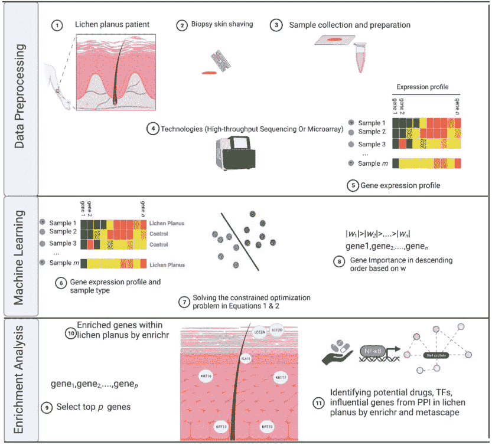

图1. 所提出的AI驱动计算框架流程图，用于识别在LP中表达的转录因子、药物和重要基因。来源：图表使用BioRender.com创建。

### 表 2 本研究中采用的计算方法列表

| 缩写 | 方法 |
|---|---|
| ssvm1 | 稀疏svm 1（本文提出） |
| ssvm2 | 稀疏svm 2（本文提出） |
| ssvm3 | 稀疏svm 3（本文提出） |
| limma | 用于微阵列数据的线性模型（基线） |
| sam | 微阵列显著性分析（基线） |
| t-test | Student's t检验（基线） |
| lasso | 最小绝对收缩和选择算子（基线） |

当疾病与所研究的疾病类型相关时。当术语是组织（即，由具有相同功能的细胞组成）时，同样的概念也成立。另一个性能指标是排名，疾病（例如，扁平苔藓）的排名越低，表示性能结果越好。我们还使用监督学习设置将我们的模型与lasso进行了评估，报告了诸如曲线下面积（AUC）等性能指标，随后是与结果统计显著性和基因重要性相关的图表。在本研究中，我们使用R进行实验（Team, 2008）。具体来说，我们使用R中的CVXR包来求解优化问题（Fu et al., 2020）。我们还使用siggenes包（Schwender, 2012）执行了SAM，并使用R中的limma包，利用lmFit和eBayes函数进行模型拟合（Ritchie et al., 2015）。对于t-test，我们使用R stats包中的t.test函数（Team, 2008）。对于lasso，使用了glmnet包（Friedman et al., 2010）来选择与非零系数相关的基因，因为这些指重要基因。对于三种基线方法（即SAM、limma和t-test），我们使用p.adjust函数结合“BH”选项来计算调整后的p值，设置p < 0.01的阈值，如(Taguchi and Turki, 2020; Turki and Taguchi, 2023)所示。

作为计算方法的输入接收带标签的示例。对于我们的模型（即ssvm1、ssvm2和ssvm3），因为这些基于SVM的模型定义为sign(w.x + b)（即加权基因w.x加上偏差b的符号），所以根据权重向量中相应的前p个值选择前p个重要基因，因为w中的这些前p个值（即，w = [|w1| ... |wp|]）指所选基因的重要性。对于lasso，模型表示为β0 + βx，其中前p个基因与β中的前p个系数相关联。因此，我们根据β中的前p个系数选择前p个基因。对于基线方法（即limma、SAM、t-test），我们根据调整后的p值< 0.01的显著性选择基因。在表2中，我们列出了本研究中采用的所有方法。

我们通过将每种方法产生的基因上传到Enrichr（https://maayanlab.cloud/Enrichr/）（Kuleshov et al., 2016）和Metascape（https://metascape.org/gp/index.html）（Zhou et al., 2019）来进行生物学富集分析，以评估性能结果。假设检索到的术语是关于疾病的，那么与疾病相关的基因越多，表示性能越好。

关于数据集1的基因表达实验，它是用于分析人类皮肤疾病和健康对照，数据来自德国波恩的波恩大学皮肤科。我们从美国国立卫生研究院（NIH）的国家生物技术信息中心（NCBI）（https://www.ncbi.nlm.nih.gov/geo/）的基因表达 omnibus（GEO）ID GSE63741中检索了健康对照和LP（影响皮肤）的基因表达谱。从系列矩阵中，我们下载了


| 方法 | 排名 | 术语 | 重叠 | P值 | 调整后P值 |
| :--- | :--- | :--- | :--- | :--- | :--- |
| ssvm1 | 28 | 扁平苔藓 | 4/38 | 3.81 × 10⁻⁵ | 2.91 × 10⁻³ |
| | 5 | 自身免疫性疾病 | 20/1060 | 2.39 × 10⁻⁷ | 1.04 × 10⁻⁴ |
| | 9 | 皮肤病学疾病 | 12/406 | 8.74 × 10⁻⁷ | 2.12 × 10⁻⁴ |
| ssvm2 | 28 | 扁平苔藓 | 4/38 | 3.81 × 10⁻⁵ | 2.91 × 10⁻³ |
| | 5 | 自身免疫性疾病 | 20/1060 | 2.39 × 10⁻⁷ | 1.04 × 10⁻⁴ |
| | 9 | 皮肤病学疾病 | 12/406 | 8.74 × 10⁻⁷ | 2.12 × 10⁻⁴ |
| ssvm3 | 27 | 扁平苔藓 | 4/38 | 3.81 × 10⁻⁵ | 2.97 × 10⁻³ |
| | 4 | 自身免疫性疾病 | 20/1060 | 2.39 × 10⁻⁷ | 1.27 × 10⁻⁴ |
| | 14 | 皮肤病学疾病 | 11/406 | 5.91 × 10⁻⁶ | 8.97 × 10⁻⁴ |
| limma | 2296 | 扁平苔藓 | 1/38 | 1.73 × 10⁻¹ | 2.33 × 10⁻¹ |
| | 61 | 自身免疫性疾病 | 19/1060 | 1.09 × 10⁻⁶ | 5.53 × 10⁻⁵ |
| | 279 | 皮肤病学疾病 | 8/406 | 9.84 × 10⁻⁴ | 1.09 × 10⁻¹ |
| sam | 342 | 扁平苔藓 | 2/38 | 1.54 × 10⁻² | 1.18 × 10⁻¹ |
| | 228 | 自身免疫性疾病 | 12/1060 | 6.58 × 10⁻³ | 7.63 × 10⁻³ |
| | 759 | 皮肤病学疾病 | 5/406 | 5.30 × 10⁻² | 1.77 × 10⁻¹ |
| t-test | 1281 | 扁平苔藓 | 1/38 | 1.73 × 10⁻¹ | 3.08 × 10⁻¹ |
| | 385 | 自身免疫性疾病 | 10/1060 | 3.91 × 10⁻² | 2.10 × 10⁻¹ |
| | 1155 | 皮肤病学疾病 | 9/2316 | 1.46 × 10⁻¹ | 2.88 × 10⁻¹ |
| lasso | - | 扁平苔藓 | - | - | - |
| | - | 自身免疫性疾病 | - | - | - |
| | 374 | 皮肤病学疾病 | 1/406 | 2.18 × 10⁻¹ | 2.76 × 10⁻¹ |

| 方法 | 排名 | 术语 | 重叠 | P值 | 调整后P值 |
| :--- | :--- | :--- | :--- | :--- | :--- |
| ssvm1 | 6 | 皮肤（块组织） | 19/2316 | 1.99 × 10⁻² | 3.59 × 10⁻¹ |
| ssvm2 | 6 | 皮肤（块组织） | 19/2316 | 1.99 × 10⁻² | 3.59 × 10⁻¹ |
| ssvm3 | 3 | 皮肤（块组织） | 20/2316 | 1.00 × 10⁻² | 3.60 × 10⁻¹ |
| limma | 13 | 皮肤（块组织） | 20/2316 | 1.00 × 10⁻² | 7.72 × 10⁻² |
| sam | 6 | 皮肤（块组织） | 13/2316 | 3.72 × 10⁻¹ | 9.99 × 10⁻¹ |
| t-test | 9 | 皮肤（块组织） | 12/2316 | 4.93 × 10⁻¹ | 9.99 × 10⁻¹ |
| lasso | 9 | 皮肤（块组织） | 2/2316 | 4.12 × 10⁻¹ | 7.71 × 10⁻¹ |

基因表达文件，即 GSE63741_series_matrix.txt.gz。我们使用 GEOquery 包（Davis and Meltzer, 2007）中的 getGEO() 函数获取基因表达数据，并借助 fData() 函数获取基因名称、pData() 函数获取样本类型、exprs() 函数获取表达值。fData()、pData() 和 exprs() 均来自 Biobase 包（Huber et al., 2015）。

关于 Dataset2 的基因表达实验，用于测试鲁索利替尼乳膏治疗皮肤扁平苔藓的疗效，数据来源于美国明尼苏达州罗切斯特市梅奥诊所定量健康科学部。我们从美国国立卫生研究院（NCBI at NIH）的 ID GSE193351 下，检索了健康对照组和皮肤扁平苔藓（治疗前和治疗后）的基因表达谱。我们从系列矩阵中下载了基因表达文件 GSE193351_series_matrix.txt.gz。与 Dataset1 类似，我们使用了 GEOquery 和 Biobase 包的类似函数。此外，我们根据 HUGO 基因命名委员会 BioMart 中领域专家标记的描述（如子节 GSE193351: Dataset2 所述），选取了 5916 个蛋白质编码基因（PCGs）。

关于 Dataset3 的基因表达实验，用于比较口腔扁平苔藓（OLP）和生殖器扁平苔藓与其对应健康对照组的基因表达谱，数据来源于瑞典乌梅奥大学病理实验室医学生物科学部。健康对照组和生殖器口腔扁平苔藓的基因表达谱从美国国立卫生研究院（NCBI at NIH）的 GEO ID GSE52130 获得。我们从系列矩阵中下载了基因表达文件 GSE52130_series_matrix.txt.gz。与 Dataset2 类似，我们使用了与 GEOquery 和 Biobase 包相关的相同函数，以及 HUGO 基因命名委员会 BioMart 中的蛋白质编码基因（如子节 GSE52130: Dataset3 所述）。我们考虑了 OLP 与相应健康对照组的对比，因为其样本数量多于生殖器扁平苔藓，包含 5 个样本对比 4 个健康对照。

## 3.2. 结果

### 3.2.1. Dataset 1

对于每种方法，我们在表 3 和表 4 中展示了 Enrichr 提供的检索术语。表 3 中的这些术语显示了与提供的输入基因列表相关的疾病。排名较低且表达基因数量较多的相关术语表明计算方法的优越性。表 3 显示 ssvm3 优于所有其他方法。值得注意的是，LP 排名第 27，有 4 个表达基因（CXCL9, MMP9, S100A9, S100A8），共 38 个。此外，自身免疫性疾病排名第 4，有 20 个表达基因（CD52, RARRES3, STAT1, TRAC, ITGB2, GSTT1, ISG15, MMP9, PSMB10, PSMB8, TNFSF13B, PSMB9, KRT19, SOCS1, GAL, LCK, IRF1, CD47, S100A9, S100A8），共 1060 个。ssvm1 和 ssvm2 方法在皮肤病学疾病术语上优于 ssvm3 和其他方法，排名第 9，有 12 个共同表达基因（MMP12, SOCS1, KRT17, RARRES3, ITGB2, TNC, CCL19, MMP9, MS4A1, CST6, S100A8, CCL27）。表 4 显示了与感兴趣组织相关的检索术语。很明显，ssvm3 在皮肤组织方面取得了最佳结果，排名第 3，有 20 个表达基因（SERPINA12, CXCL9, MAAO, TNC, KRT7, CST6, MMP12, FADS2, KRT19, GAL, KRT17, COL4A1, KRT16, KRT15, SFN, THRSP, CCL19, S100A9, S100A8, CCL27），这些基因位于由具有相似功能的细胞组成的皮肤组织中。关于皮肤组织，并列第二的最佳方法是 ssvm2 和 ssvm3，均排名第 6，有 19 个表达基因。与基线方法相比，这些结果表明 ssvm3 最优，其次是 ssvm1 和 ssvm2。尽管 SAM 将皮肤组织排在第 6 位，但表达了 13 个基因，少于 ssvm2 和 ssvm3。图 2 提供了关于各方法提供基因交集的有用信息。可以看出，ssvm1、ssvm2 和 ssvm3 共享 70 个基因，而它们在 30 个基因上有所不同。这意味着每个

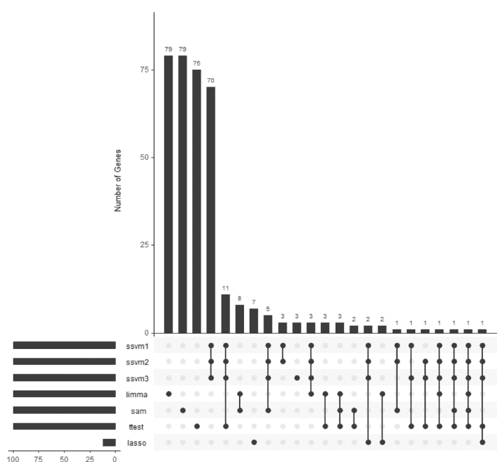

图 2. 使用 Dataset1 时，各方法提供的每个基因列表的显著集合可视化。

表 5
通过 Enrichr 根据使用 Dataset1 上传的基因从 "DSigDB" 检索到的富集术语，显示与药物（列：Term）相关的基因（列：Genes）。Rank 列显示检索时术语的顺序。NO. 列显示基因数量。

| 排名 | 术语 | 数量 | 基因 |
| :--- | :--- | :--- | :--- |
| 1 | Alitretinoin | 11 | KRT19;SOCS1;KRT17;RARRES3;STAT1;IRF1; KRT15;ITGB2; KRT7;S100A9;S100A8 |
| 2 | Vitinoin | 19 | CD52;IFITM1;ITGB2;LAPTM5;KRT17;MMP9;FADS2; KRT19;SOCS1;GAL;KRT17;BASP1;LCK;WIF1;KRT16;IRF1; KRT15;S100A9;S100A8 |
| 16 | Dexamethasone | 9 | MMP12;SOCS1;MAOA;WIF1;TNC;S100A9;MMP9;CST6;S100A8 |

每种方法生成了不同的基因列表。例如，limma 与所有其他方法有 79 个不同的基因。SAM 也是如此。t-test 与所有其他方法有 75 个不同的基因。此外，lasso 产生了 12 个基因，其中 7 个是 lasso 独有的（即，没有其他方法产生这些基因）。这些可视化结果展示了方法之间的性能差异，因为每种方法都产生了不同的基因列表。关于 Dataset1，我们在补充数据表 1 中提供了所有计算方法产生的基因。在补充表 1A 和 1B 中，我们分别提供了所有方法关于 DisGeNET 和 ARCHS4 组织的富集分析结果。由于 ssvm3 在检索 Dataset1 中基因表达谱相关的疾病和组织方面取得了良好结果，我们从药物签名数据库（DSigDB）中检索了药物及其相关药物靶点（基因），然后将 ssvm3 的 100 个基因上传到 Metascape 进行进一步的生物学分析。表 5 显示了与提供的基因相关的药物检索术语。第一个术语是针对药物 Alitretinoin，已证明在治疗 LP 病例方面具有临床疗效（Brehmer et al., 2011; Lee et al., 2019）。排名第 2 的药物是 Vitinoin，其通用名为 retinoin，已纳入临床试验，并显示出在 LP 相关临床治疗方面的潜在改善（Scully and Carrozzo, 2008; Sloberg et al., 1979）。Dexamethasone 是一种类固醇类药物，排名第 16，并已证明与 OLP 相关的良好临床结局（Didona et al., 2022; Patil et al., 2023; Sahoo et al., 2022; Sandhu et al., 2022）。在补充表 1_C 中，我们提供了 DSigDB 内药物术语的富集分析结果。在图 3 中，我们展示了从 PPI 网络中获得的三个高度连接的子图，包括以下 14 个基因：PSME2, PSMB10, PSMB9, KRT31, KRT16, KRT19, KRT17, KRT15, BST2, STAT1, IFI27, IFITM1, PSMB8, 和 IRF1。其中一些已鉴定的基因在理解 LP 作用机制方面发挥了关键作用。蛋白酶体（例如，PSMB9, PSMB8, PSMB10, PSME2），其中 PSMB8 功能障碍据报道在 I 型干扰素（IFNα, IFNβ）的诱导中起关键作用（Crow and Stetson, 2022）。我们报告了与 I 型干扰素 α/β 信号传导相关的表达基因（即，STAT1, BST2, IFI27, IFITM1, PSMB8, IRF1），以及与中间纤维组织相关的角蛋白基因（例如，KRT16, KRT15, KRT17, KRT19, 和 KRT31）。关于皮肤自身免疫性疾病中伤口的持续性，据报道 I 型干扰素除了在树突状细胞活化和随后 T 细胞活化中的作用外，还可导致角质细胞受到攻击（Zhang, 2019）。这些结果展示了 T 细胞如何攻击皮肤表皮（图 4）（Ah Kioon et al., 2021），从而促进 LP 的发病机制。值得注意的是，KRT17 据报道是一种潜在的


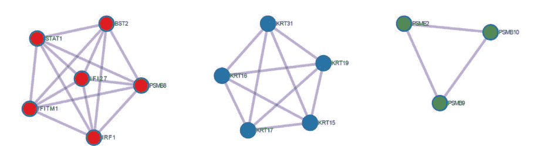

#### 图 3. 基于 ssvm3 提供的 100 个基因并用于 Metascape 富集分析的蛋白质-蛋白质相互作用中的三个高度互连簇

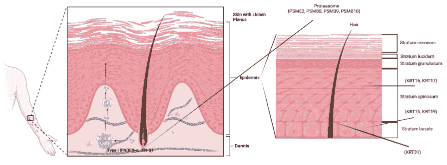

#### 图 4. 一名患者的皮肤，LP 影响手臂区域。从图 3 获得的关键表达基因显示在皮肤表皮和真皮中。来源：图表使用 BioRender.com 创建

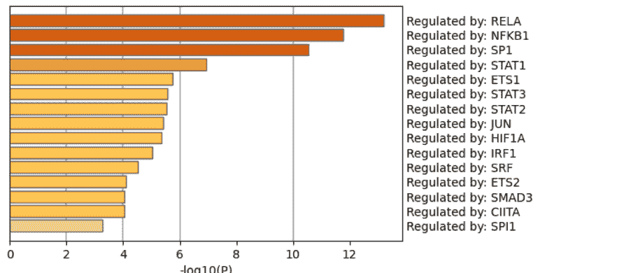

#### 图 5. Metascape 根据 ssvm3 的 100 个输入基因列表提供的十五个转录因子

OLP 的治疗靶点 (de Lanna et al., 2022)。角蛋白 19 (KRT19) 已被发现表达于 OLP 中 (Farah et al., 2021; Schreurs et al., 2020)。KRT16 已被报道与伤口修复过程中的 LP 相关 (Vo et al., 2021)，且 IFI27 已被报道在 OLP 中过表达 (de Lanna et al., 2022)。IRF1 和 IFITM1 在 LP 中被诱导，表明它们参与皮肤损伤过程 (Wenzel and Tüting, 2008)。这些 14 个表达基因可被视为 LP 治疗的潜在治疗靶点。此外，它们有助于更深入地了解 LP 的发病机制。如图 5 所示，我们鉴定了 15 个转录因子：RELA、NFKB1、SP1、STAT1、ETS1、STAT3、STAT2、JUN、HIF1A、IRF1、SRF、ETS2、CIITA、SMAD3 和 SPI1。已有报道在 LP 中 (Braegelmann et al., 2021)。STAT1 已被报道在 LP 的免疫反应中起关键作用 (Shao et al., 2019)。OLP 已被报道与 SMAD3 表达增加相关 (Evert et al., 2021)。这些 14 个鉴定的基因和 15 个转录因子可能作为治疗靶点以及用于理解 LP 的分子机制而证明有用。

### 3.2.2. 数据集 2

表 6 报告了与所选基因相关的术语（即疾病），而表 7 则根据上传各方法获得的基因后的表达基因报告术语（即组织类型）。可以在表 6 中看到，我们的方法（ssvm1、ssvm2 和 ssvm3）优于

表 6

通过 Enrichr 根据使用数据集 2 上传的基因，在“DisGeNET”中检索到的富集术语，显示人类基因与疾病之间的关联。Rank 列显示检索时术语的顺序。Overlap 以类似比率的格式显示，对应上传基因与术语中基因的重叠数量。最佳结果以粗体显示。

| 方法 | 排名 | 术语 | 重叠 | P 值 | 调整后的 P 值 |
| :--- | :--- | :--- | :--- | :--- | :--- |
| ssvm1 | 10 | 遗传性皮肤疾病 | 7/45 | 2.45 x 10^-9 | 7.93 x 10^-7 |
| | 421 | 自身免疫性疾病 | 13/1060 | 2.37 x 10^-3 | 1.82 x 10^-2 |
| | 13 | 皮肤科疾病 | 14/406 | 1.46 x 10^-8 | 3.57 x 10^-6 |
| ssvm2 | 10 | 遗传性皮肤疾病 | 7/45 | 2.45 x 10^-9 | 7.93 x 10^-7 |
| | 421 | 自身免疫性疾病 | 13/1060 | 2.37 x 10^-3 | 1.82 x 10^-2 |
| | 13 | 皮肤科疾病 | 14/406 | 1.46 x 10^-8 | 3.57 x 10^-6 |
| ssvm3 | 10 | 遗传性皮肤疾病 | 7/45 | 2.45 x 10^-9 | 7.93 x 10^-7 |
| | 421 | 自身免疫性疾病 | 13/1060 | 2.37 x 10^-3 | 1.82 x 10^-2 |
| | 13 | 皮肤科疾病 | 14/406 | 1.46 x 10^-8 | 3.57 x 10^-6 |
| limma | - | 遗传性皮肤疾病 | - | - | - |
| | 944 | 自身免疫性疾病 | 6/1060 | 4.38 x 10^-1 | 6.58 x 10^-1 |
| | 795 | 皮肤科疾病 | 3/406 | 3.31 x 10^-1 | 5.92 x 10^-1 |
| sam | - | 遗传性皮肤疾病 | - | - | - |
| | - | 自身免疫性疾病 | - | - | - |
| | - | 皮肤科疾病 | - | - | - |
| t-test | - | 遗传性皮肤疾病 | - | - | - |
| | 578 | 自身免疫性疾病 | 1/1060 | 6.81 x 10^-1 | 7.00 x 10^-1 |
| | - | 皮肤科疾病 | - | - | - |
| lasso | - | 遗传性皮肤疾病 | - | - | - |
| | 516 | 自身免疫性疾病 | 1/1060 | 6.03 x 10^-1 | 6.40 x 10^-1 |
| | 445 | 皮肤科疾病 | 1/406 | 2.94 x 10^-1 | 3.61 x 10^-1 |

表 7

通过 Enrichr 根据使用数据集 2 上传的基因，在“ARCHS4 组织”中检索到的富集术语，显示组织类型内的表达基因。Rank 列显示检索时术语的顺序。Overlap 以类似比率的格式显示，对应上传基因与术语中基因的重叠数量。最佳结果以粗体显示。

| 方法 | 排名 | 术语 | 重叠 | P 值 | 调整后的 P 值 |
| :--- | :--- | :--- | :--- | :--- | :--- |
| ssvm1 | 1 | 皮肤（批量组织） | 47/2316 | 1.05 x 10^-18 | 1.13 x 10^-16 |
| ssvm2 | 1 | 皮肤（批量组织） | 47/2316 | 1.05 x 10^-18 | 1.13 x 10^-16 |
| ssvm3 | 1 | 皮肤（批量组织） | 47/2316 | 1.05 x 10^-18 | 1.13 x 10^-16 |
| limma | 65 | 皮肤（批量组织） | 10/2316 | 7.34 x 10^-1 | 9.99 x 10^-1 |
| sam | 42 | 皮肤（批量组织） | 2/2316 | 3.69 x 10^-1 | 6.76 x 10^-1 |
| t-test | 31 | 皮肤（批量组织） | 4/2316 | 2.19 x 10^-1 | 6.35 x 10^-1 |
| lasso | 51 | 皮肤（批量组织） | 2/2316 | 6.01 x 10^-1 | 8.76 x 10^-1 |

基线方法。具体来说，遗传性皮肤疾病排名第 10，有 7 个共同表达基因（DSP、FLG2、COL7A1、SPINK5、PKP1、ADAR、ITGA6），共 45 个。自身免疫性疾病排名第 421，有 13 个共同表达基因（FLG、SPARC、DST、STAT1、ADAR、ENO1、HMGCR、TTN、PTPRC、SOAT1、LMNA、FGFR3、TP63），共 1060 个基因。皮肤科疾病术语排名第 13，有 14 个共同表达基因（FLG、DSP、DST、SPINK5、DHCR24、ADAR、SFPQ、DES、COL7A1、LMNA、FGFR3、TP63、SPRR1B、IVL），共 406 个。基线方法结果较差，因为检索到的术语排名更靠后。此外，没有任何基线方法能够识别所有术语（例如，遗传性皮肤疾病、自身免疫性疾病、皮肤科疾病）。例如，SAM 没有相关术语。因此，结果被指定为“-”。当基线方法未检索到术语时，情况亦然。在表 7 中，很明显，我们的方法（即 ssvm1、ssvm2 和 ssvm3）检索到了相关术语（即 SKIN (BULK TISSUE)），排名第 1，有 47 个表达基因，共 2316 个。基线方法的排名结果较差。表 6 和表 7 中的这些结果表明，我们的方法在疾病识别以及与所研究问题相关的组织识别方面具有优越性。图 6 提供了关于每种提供方法的交叉基因的有用信息。我们的方法共有 98 个基因，而仅在 2 个基因上有所不同。Limma 与所有其他方法有 98 个不同的基因。t 检验和 lasso 方法分别相差 9 个和 16 个基因。我们的方法与 Limma 共有 1 个基因。我们的方法相对于 t 检验也是如此。这些可视化结果表明，我们的方法与现有方法不同，因此表 6 和表 7 中的结果也不同。在补充数据表 2 中，我们提供了用于富集分析的每种方法产生的基因列表。此外，我们分别在补充表 2,A 和表 2,B 中提供了与表 6 和表 7 相关的富集分析结果。由于我们的方法优于基线方法并共享 98 个基因，我们选择了 ssvm3 以在 LP 的分子机制中获得进一步的生物学见解。我们从 Enrichr 中检索了通过 ssvm3 产生的基因相关的药物，然后将产生的 100 个基因上传到 Metascape。表 8 显示了从 Enrichr 获得的药物术语和相关基因。维甲酸已被报道作为 OLP 的局部治疗有效 (Laurence Le Cleach and Chosidow, 2012; Qiao et al., 2022)。口服治疗特瑞提诺因（Vitinoin 的通用名）已被报道对治疗 LP 有效 (Lee et al., 2019)。在补充表 2,C 中，我们提供了关于 DSigDB 中药物术语的富集分析结果。在图 7 中，显示了从 PPI 网络中获得的两个子图，包括以下 25 个基因：COL6A3、COL3A1、COL5A2、COL7A1、ITGA6、FN1、AGRN、HSPG2、VCAN、TTN、SOAT1、HSP90AB1、ATP6V1B1、HMGCR、HMGCS1、DSP、HRNR、FLG2、FLG、PKP1、RPL35A、RPS27A、RPS14、RPSA 和 RPL37A。其中一些基因已被报道与皮肤疾病相关。例如，图 8 中显示的与细胞外基质相关的基因（包括 COL6A3、COL3A1、COL5A2、COL7A1、ITGA6、FN1、AGRN、HSPG2、VCAN、DSP）直接促成 LP 等皮肤科疾病 (Dussoyer et al., 2022; Huang et al., 2022; Salazar et al., 2022)。与核糖体相关的基因（RPL35A、RPS27A、RPS14、RPSA 和 RPL37A）的突变是多种疾病的关键 (Jiao et al., 2023; Lafitta-Navarro and Concetti Sorrell, 2023; Lee et al., 2022; Moitinho-Silva et al., 2022; Taupelt et al., 2022)。这些结果在识别潜在治疗靶点以及从而识别有效药物方面可能发挥关键作用。在图 9 中，报告了四个转录因子（即 RELA、STAT3、TP53、STAT1）。TP53 已被报道过表达


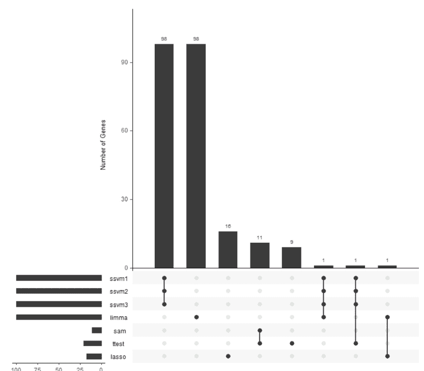

图 6. 使用数据集2 时，各方法提供的每个基因列表相关的交集可视化。

表 8 通过 Enrichr 根据使用数据集2 上传的基因检索到“DSigDB”中的富集术语，显示与药物（术语列）相关的基因（基因列）。排名列显示检索时术语的顺序。基因数列显示基因数量。

| 排名 | 术语 | 基因数 | 基因 |
| :--- | :--- | :--- | :--- |
| 8 | 维甲酸 | 43 | EIF4A2;NOTCH2;FLG;MCTP1;HSP90AB1;EPAS1;SYNPO2;ITPR3;ENO1;ACTG2;PTPRF;MYLK;RPS14;APOD;SPTBN1;DSP;GABRP;HMGC51;DST;ACSL1;STAT1;LAMB2;SPINK5;FN1;PRRC2C;RPSA;HSPG2;ENAH;TANC1;SPQ;VCAN;COL3A1;PTPRC;DES;NCL;CLIP4;COL5A2;SPARCL1;ITGA6;FGFR3;PTMA;SPRRIB1;IVL |
| 19 | 维酮醇 | 14 | FLG;TNXB;HMGC51;FN1;DHCR24;HMGCR;VCAN;PTPRC;SOAT1;COL5A2;PKP1;COL6A3;FGFR3;SPRRIB |
| 37 | 槲皮素 | 30 | EPAS1;UBR4;ITPR3;MTREX1;O1ATP1;1;HMGR;CLDN1;MYLK;LMNA;CAPN2;ANXA6;TP63;SPTBN1;TNS1;MAP4K4;CD74;HMGC51;STAT1;FN1;RPSA;DHCR24;NEB;ENAH;COL3A1;SOAT1;COL7A1;TXNIP;ITGA6;FGFR3 |

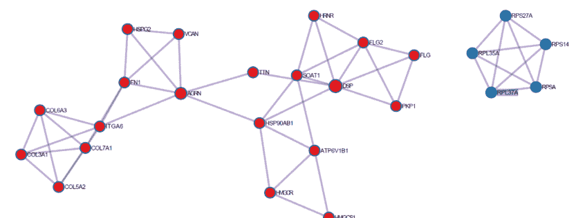

图 7. 基于提供给 Metascape 富集分析的 ssvm3 的 100 个基因的蛋白质-蛋白质相互作用中的两个高度互连簇。

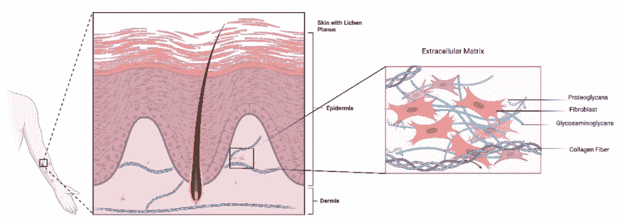

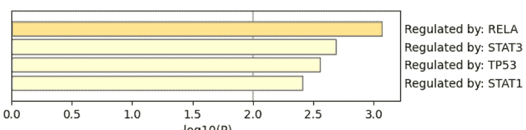

| 方法 | 排名 | 术语 | 重叠 | P 值 | 调整后 P 值 |
| :--- | :--- | :--- | :--- | :--- | :--- |
| ssvm1 | 34 | 扁平苔藓 | 3/38 | 9.01 x 10^-4 | 6.40 x 10^-2 |
| | 2121 | 自身免疫性疾病 | 6/1060 | 4.38 x 10^-1 | 4.99 x 10^-1 |
| | 37 | 皮肤病学疾病 | 8/406 | 9.84 x 10^-4 | 6.40 x 10^-2 |
| ssvm2 | 34 | 扁平苔藓 | 3/38 | 9.01 x 10^-4 | 6.40 x 10^-2 |
| | 2121 | 自身免疫性疾病 | 6/1060 | 4.38 x 10^-1 | 4.99 x 10^-1 |
| | 37 | 皮肤病学疾病 | 8/406 | 9.84 x 10^-4 | 6.40 x 10^-2 |
| ssvm3 | 59 | 扁平苔藓 | 3/38 | 9.01 x 10^-4 | 3.80 x 10^-2 |
| | 33 | 自身免疫性疾病 | 15/1060 | 2.43 x 10^-4 | 1.81 x 10^-2 |
| | 11 | 皮肤病学疾病 | 10/406 | 3.62 x 10^-5 | 7.52 x 10^-3 |
| limma | - | 扁平苔藓 | - | - | - |
| | 1160 | 自身免疫性疾病 | 5/1060 | 6.16 x 10^-1 | 7.34 x 10^-1 |
| | 1327 | 皮肤病学疾病 | 1/406 | 8.72 x 10^-1 | 9.08 x 10^-1 |
| sam | - | 扁平苔藓 | - | - | - |
| | 1142 | 自身免疫性疾病 | 8/1060 | 1.60 x 10^-1 | 3.20 x 10^-1 |
| | 1724 | 皮肤病学疾病 | 3/406 | 3.31 x 10^-1 | 4.42 x 10^-1 |
| t-test | 24 | 扁平苔藓 | 1/38 | 1.88 x 10^-2 | 8.83 x 10^-2 |
| | - | 自身免疫性疾病 | - | - | - |
| | 21 | 皮肤病学疾病 | 2/406 | 1.66 x 10^-2 | 8.83 x 10^-2 |
| lasso | - | 扁平苔藓 | - | - | - |
| | - | 自身免疫性疾病 | - | - | - |
| | 271 | 自身免疫性疾病 | 1/1060 | 2.38 x 10^-1 | 2.68 x 10^-1 |
| | - | 皮肤病学疾病 | - | - | - |

在口腔扁平苔藓（OLP）（Ramos-García et al., 2022; Zhao et al., 2022）中，并与 OLP 的恶性转化相关（Alabdulaly et al., 2022）。RELA（也称为 p65 或 NF-κB/p65）据报道在 LP 中过表达，暗示其在疾病发展中的作用（Chen et al., 2022a; Du et al., 2023; Zeng et al., 2022）。在 LP 患者的皮肤表皮中观察到了 STAT1 的激活（Shao et al., 2019）。STAT3 突变与包括皮肤疾病在内的自身免疫性疾病相关（Masle-Farquhar et al., 2022）。这些鉴定的转录因子可作为 LP 的治疗靶点。

### 3.2.3. 数据集 3

我们将各方法获得的基因上传至 Enrichr。表 9 显示疾病-基因关联，而表 10 根据表达基因呈现组织术语。从表 9 可以看出，ssvm1 和 ssvm2（其次是 ssvm3）根据 LP 中表达的 38 个基因中的 3 个生成了最佳结果。对于自身免疫性疾病和皮肤病学疾病术语，ssvm3 表现最佳，因为在自身免疫性疾病中表达了 15 个基因，在皮肤病学疾病中表达了 10 个基因。虽然 ssvm1、ssvm2 和 ssvm3 在 LP 中分别排名第 34 和第 59，但它们具有相同数量的表达基因，并且在考虑其他两个术语时，ssvm3 在排名和表达基因数量方面远优于其他方法。在表 10 中，与基线方法相比，我们的方法展示了更优的结果。具体来说，皮肤组织术语被 ssvm1 和 ssvm2 排名第 1，而被 ssvm3 排名第 3。此外，ssvm1 的表达基因数为 2316 中的 52 个，

| 方法 | 排名 | 术语 | 重叠 | P 值 | 调整后 P 值 |
| :--- | :--- | :--- | :--- | :--- | :--- |
| ssvm1 | 1 | 皮肤（总组织） | 52/2316 | 3.97 x 10^-23 | 4.28 x 10^-21 |
| ssvm2 | 1 | 皮肤（总组织） | 52/2316 | 3.97 x 10^-23 | 4.28 x 10^-21 |
| ssvm3 | 3 | 皮肤（总组织） | 34/2316 | 2.95 x 10^-9 | 1.06 x 10^-7 |
| limma | 50 | 皮肤（总组织） | 10/2316 | 7.34 x 10^-1 | 9.99 x 10^-1 |
| sam | 1 | 皮肤（总组织） | 25/2316 | 1.40 x 10^-4 | 1.52 x 10^-2 |
| t-test | 8 | 皮肤（总组织） | 5/2316 | 3.16 x 10^-3 | 3.35 x 10^-2 |
| lasso | 54 | 皮肤（总组织） | 1/2316 | 4.59 x 10^-1 | 4.59 x 10^-1 |

表 10 通过 Enrichr 根据使用数据集3 上传的基因，通过各方法检索到“ARCHS4 组织”中的富集术语，显示在组织类型中表达的基因。排名列显示检索时术语的顺序。重叠以类似比率的格式显示，对应上传基因与术语中基因的重叠数量。最佳结果以粗体显示。

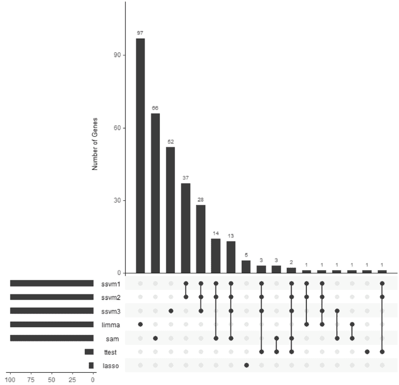

图 10. 使用数据集3 时，各方法提供的每个基因列表相关的交集可视化。

ssvm2，优于 ssvm3。然而，我们所有方法的结果均具有显著性。SAM 将皮肤组织排为第 1 项，但其表达基因数量比我们的方法少 25 个。图 10 提供了所有方法之间基因交集的可视化。应注意的是，ssvm3 拥有与所有其他方法不同的 52 个基因，且 ssvm1 和 ssvm2 共享 37 个基因。总体而言，我们所有方法共享 28 个基因。SAM 与我们的方法共享 13 个基因。这些结果表明，所有方法之间并不存在完全重叠，因为每种方法都产生了不同的基因列表，从而影响富集分析结果。在补充数据表 3 中，我们提供了富集分析中使用的每种方法生成的每个基因列表。此外，我们分别在补充表 3_A 和表 3_B 中提供了与表 9 和表 10 相关的富集分析结果。

我们选择 ssvm3 进行进一步的生物学分析，因为它取得了良好的结果。在表 11 中，我们检索药物-基因关联。三种药物（维甲酸、维酮醇和阿利他尼酮）与表 5 和表 8 中的药物一致，表明临床研究中的治疗效果有所改善（Brehmer et al., 2011; Lee et al., 2019; Scully and Carrozzo, 2008; Sloberg et al., 1979）。在补充表 3_C 中，我们提供了 DSigDB 中药物术语的富集分析结果。关于从 PPI 网络中获得的图 11 中的两个子图，三个基因（PI3、LCE2A、LCE2D）与皮肤表皮和口腔上皮的角质包被形成相关（图 12），而 LCP1 和 ITGB2 与免疫系统中的细胞因子信号传导相关，表明它们在 OLP 中的炎症作用以及 LP 中皮肤角质包被的形成和维持（Anderton

| 排名 | 术语 | 基因数 | 基因 |
|---|---|---|---|
| 21 | 维甲酸 | 36 | FBN2;ARHGAP9;ERRFI1;CNTNAP2;ITGB2;SLA;ATP1A3;PTGS2;CX3CL1;MUC1;PTPRZ1;BASP1;CA2;UBD;DDX17;PAQR8;CMTM7;SP110;TNFRSF10C;KLK13;NKG7;MYO5A;FOS;KLK10;IL1A;GPRC5A;TSPAN13;OAS1;KRT17;BAMBI;LYPD6B;LCN2;SERPING1;IRFB;CYP2E1;CD247 |
| 22 | 维酮醇 | 12 | SLC4A6;CD2;MUC1;OAS1;KRT17;BASP1;ITGB2;LCN2;SLA;SERPING1;CD247;PTGS2 |
| 24 | 阿利他尼酮 | 6 | KRT17;CA2;ITGB2;LCN2;PTGS2;KLK10 |

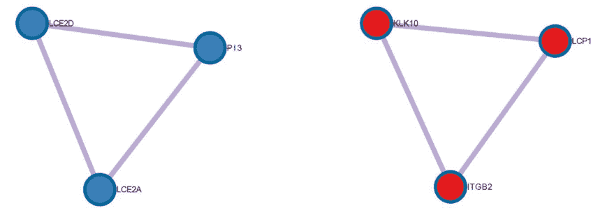

图 11. 基于提供给 Metascape 富集分析的 ssvm3 的 100 个基因的蛋白质-蛋白质相互作用中的两个高度互连簇。

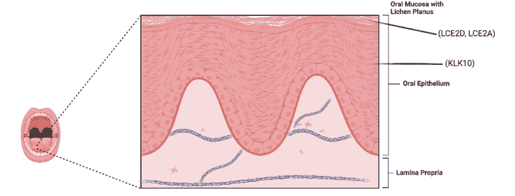

图 12. LP 影响口腔黏膜。从图 11 获得的关键表达基因与上皮层相关。来源：使用 BioRender.com 创建的图表。

and Alqudah, 2022; Boudreaux et al., 2022; Chen et al., 2017; de Lanna et al., 2022; Qian et al., 2022)。图 13 列出了 11 个转录因子：STAT1、STAT3、STAT6、RELA、USF2、NFKB1、FOS、USF1、HDAC1、CREB1 和 AR。与数据集2 类似，STAT1、STAT3 和 RELA 据报道与 LP 相关（Abé et al., 2020; Chen et al., 2022a; Du et al., 2023; Masle-Farquhar et al., 2022; Shao et al., 2019; Zeng et al., 2022）。HDAC1 通过丝聚蛋白表达在皮肤炎症中发挥关键作用，丝聚蛋白是皮肤屏障功能障碍的一部分（Ahn et al., 2022）。这些转录因子可作为炎症性疾病（如 LP）的有用治疗靶点。

### 3.2.4. 稀疏模型解释

数据集1 在图 14 中，我们提供了关于结果部分所用模型的见解。图 14(a–d) 显示，健康对照组和 LP 患者的预测存在统计学上的显著差异（所有差异的 p 值 <<0.01，来自 t 检验），表明这些应用于数据集1 的模型预计将是健康对照组和 LP 的通用预测器。在图 14(e) 中，ssvm1 和 ssvm2 达到了 0.983 的 AUC，而 ssvm3 和 lasso 均达到了 1.00 的 AUC。图 15 显示，与图 15(d) 中的 lasso 相比，我们的方法（图 15(a–c)）将更多基因的权重减至零。这些结果表明，我们的优化方法比 lasso 产生了更稀疏的特征向量表示。

### 数据集 2

在图 16 中，我们对结果部分所用模型进行了解释。图 16(a–d) 显示，健康对照组和 LP 患者的预测差异具有统计学显著性（所有模型的 p 值 <<0.01，来自 t 检验），表明这些应用于数据集2 的模型预计不具有疾病特异性。在图 16(e) 中，所有模型均达到了 1.00 的 AUC。图 17 显示，我们的方法（图 17(a–c)）将基因权重缩减至零，而 lasso（图 17(d)）将比我们的方法更多的基因系数缩减至零。这些结果表明了每种模型诱导的稀疏性。


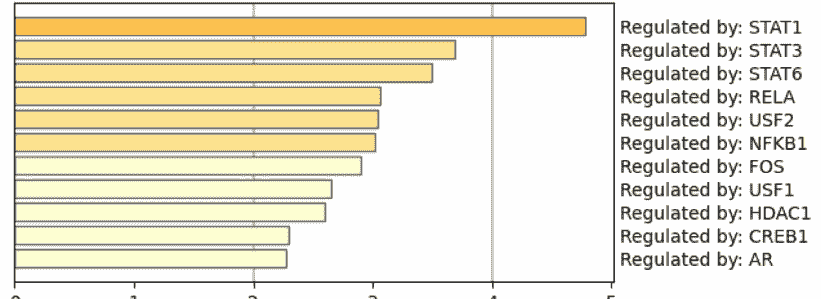

图 13. Metascape 根据 ssvm3 的 100 个输入基因列表提供的 11 个转录因子。

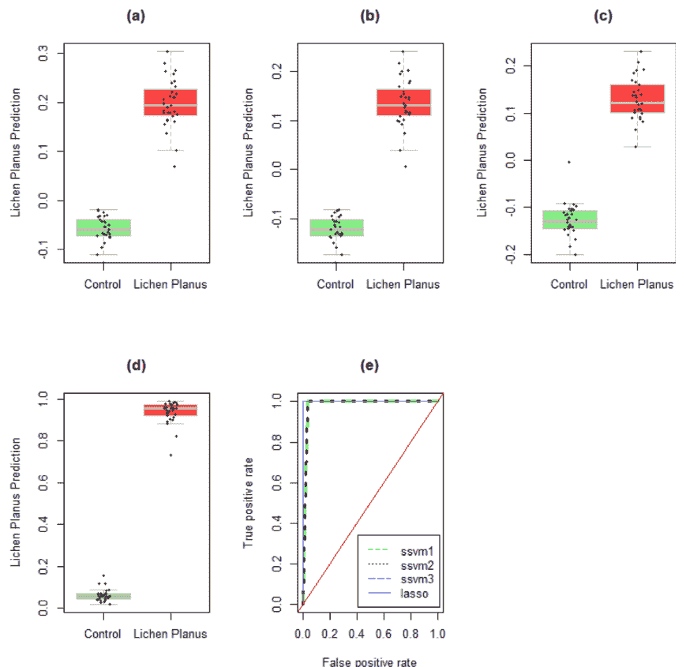

图 14. 使用 Dataset1 时，关于健康对照组和扁平苔藓（LP）的预测结果。箱线图和散点图（a–d）分别显示了 ssvm1、ssvm2、ssvm3 和 lasso 对健康个体及 LP 个体的预测 LP 差异。（e）通过沿 y 轴显示真阳性率、沿 x 轴显示假阳性率来展示 ROC 曲线。

### 数据集 3

在图 18 中，我们对结果部分所用模型进行了解释。图 18(a–d) 显示，健康对照组和 LP 患者的预测差异具有统计学意义（所有模型的 p 值 << 0.01，来自 t 检验），表明这些应用于 Dataset3 的模型预计是 LP 和健康对照组的通用预测器。在图 18(e) 中，我们的模型 AUC 达到 0.928，而 lasso 的 AUC 为 1.00。

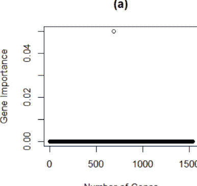

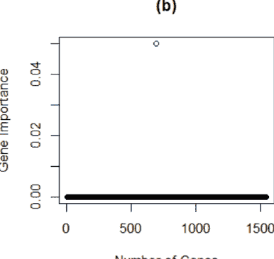

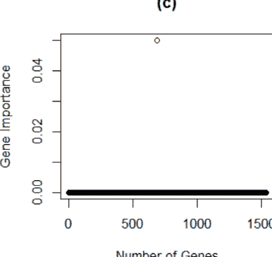

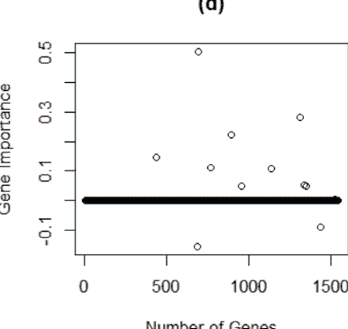

图 15. 通过 ssvm1 (a)、ssvm2 (b)、ssvm3 (c) 和 lasso (d) 生成的 Dataset1 中所有基因的基因重要性。

如图 19 所示，与 lasso（图 19(d)）相比，我们的方法（图 19(a–c)）将更多基因的权重缩减为零。这些结果表明，我们的约束优化问题比 lasso 产生了更稀疏的表示。

# 4. 讨论

识别有影响力的基因和相关药物有助于更深入地了解 LP 的分子机制以及疾病治疗。因此，我们提出了一个计算框架，其工作方式如下：首先，我们介绍了三个与 SVM 相关的稀疏优化问题，分别命名为 ssvm1、ssvm2 和 ssvm3。我们将每个基因表达数据集作为输入提供给我们的方法，使用 R 中的 CVXR 求解器求解。每种方法的输出是一个权重向量 w，对应于所提供数据集中每个基因的重要性。与较高权重相关的基因表明这些基因的重要性。我们根据 w 中的前 100 个权重对基因进行排序，然后选择前 100 个基因。然后，我们通过每种方法将输出基因提供给 Enrichr 和 Metascape 以进行富集分析。使用 Enrichr，与基线方法相比，我们的方法（ssvm1、ssvm2 和 ssvm3）取得了最佳结果，检索到的术语在疾病术语中具有更多表达基因，这些疾病术语包括 LP、自身免疫性疾病、皮肤科疾病和皮肤疾病。关于组织类型，我们的方法也优于所有基线

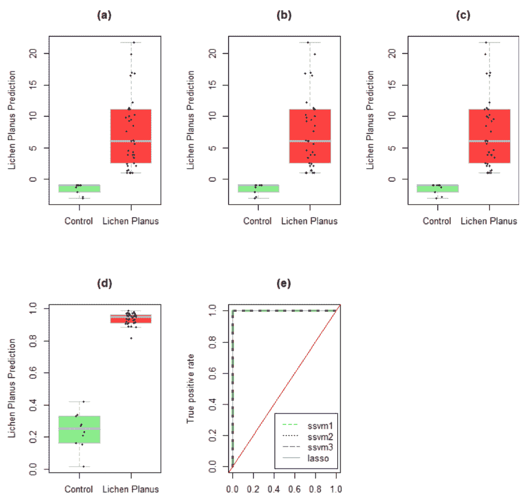

图 16. 使用 Dataset2 时，关于健康对照组和 LP 的预测结果。箱线图和散点图（a–d）分别显示了 ssvm1、ssvm2、ssvm3 和 lasso 对健康个体及 LP 个体的预测 LP 差异。（e）通过沿 y 轴显示真阳性率、沿 x 轴显示假阳性率来展示 ROC 曲线。

靶点，从而加速药物发现。值得注意的是，表 5、8 和 11 中与基因相关的药物可以帮助临床医生个性化药物治疗。换句话说，当这些基因（或药物靶点）表达时，相应的药物可能是更合适的治疗选择（Keeley et al., 2020）。这表明 AI 工具在临床试验中的益处。由于 LP 是一种复杂疾病且目前尚无治愈方法，这项研究可以帮助医学研究人员揭示导致疾病的分子机制，并通过潜在的关联因果关系改善个性化治疗阶段（Xia et al., 2020）。例如，从 Metascape 检索到的富集术语表明，我们提供的基因涉及与色氨酸代谢相关的生物通路，涉及 B 维生素（共同构成所谓的 B 复合物）。有报道称，B 维生素已被开具处方，并被证明在治疗 LP 中更有效（Burgess, 1941）。这些结果表明，饮食生活方式的改变和治疗营养缺乏可能有助于 LP 的治疗（Cosgarea et al., 2020; Li et al., 2020）。为了帮助医学研究人员获得更多关于 LP 的生物学见解，我们在 Supplementary Metascape_Dataset1.zip、Metascape_Dataset2.zip 和 Metascape_Dataset3.zip 中提供了与涉及生物通路的基因以及其他术语相关的 Metascape 富集分析结果。

在本研究中，我们旨在开发计算方法来识别健康对照组和 LP 患者之间的重要基因，随后利用富集分析揭示与疾病相关的分子见解。由于 LP 根据病变的形态和部位进行分类，LP 可能以不同的亚型影响患者的不同部位（Muradova et al., 2022; Usatine and Tinitigan, 2011）。在本研究中，已发表的数据集包括皮肤 LP（数据集 1 和 2）、生殖器和口腔 LP（数据集 3）的病变部位。在本研究中，我们报告了皮肤和口腔 LP 的结果。此外，就给定数据集而言，报告的结果揭示了与 LP 类型相关的独立生物学见解。在运行时间和内存空间方面，我们的方法（ssvm1、ssvm2 和 ssvm3）最慢，具有最高的用户 CPU 时间（分别在 Dataset1、Dataset2 和 Dataset3 中为 1.09 s、3.47 s 和 4.05 s）。此外，我们的方法在运行 Dataset1、Dataset2 和 Dataset3 时具有最大的内存空间，分别为 141.04 MB、401.51 MB 和 160.55 MB。另一方面，对于 Dataset1，lasso 是最快的方法，所需内存空间最少，为 7.80 MB。对于 Dataset2，lasso 是最快的方法，而 t 检验是所需内存空间最少的方法，为 14.43 MB。对于 Dataset3，limma 是最快的方法，而 t 检验是所需内存空间最少的方法。我们在 Supplementary Running Time and Memory Space 中提供了每种方法的运行时间和内存空间。

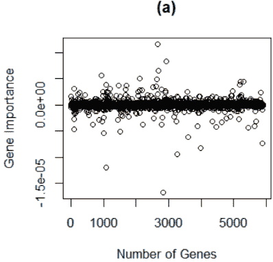

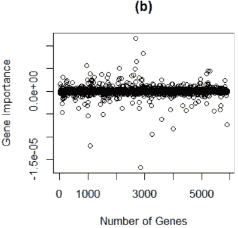

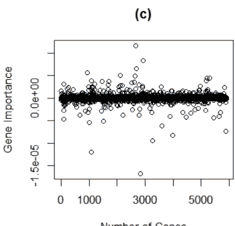

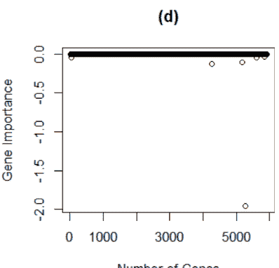

图 17. 通过 ssvm1 (a)、ssvm2 (b)、ssvm3 (c) 和 lasso (d) 生成的 Dataset2 中所有基因的基因重要性。

就通过富集分析工具检索到的结果而言，排名分数表示检索到的术语的顺序。当术语与所研究的实验相关时，值越低，排名越好。重叠表示上传基因与检索到的术语之间的共同基因数量。对于给定术语 Z，形式为 X/Y 的值表示 X 是上传到 Enrichr 的基因与术语 Z 之间的共同基因数量，其中 Y 表示与术语 Z 相关的基因数量。P 值和调整后的 P 值与检索到的术语相对于上传基因的显著性相关，其中前者由 Fisher 精确检验计算，后者使用 Benjamini-Hochberg 方法校正（Xie et al., 2021）。

在“稀疏模型解释”部分，我们展示了关于所研究稀疏模型的重要信息，包括 ssvm1、ssvm2、ssvm3 和 lasso。具体来说，图 14、16 和 18 展示了诱导模型的统计显著性，这些模型在区分健康对照组和 LP 两类时预计能获得良好的泛化能力。然而，图 15、17 和 19 探索了诱导稀疏性，其中弱判别能力的基因被设为零。可以观察到，附加约束 $\|W\|_1 \le \lambda$ 强制执行了稀疏性。我们的模型（即 ssvm1、ssvm2 和 ssvm3）基于 SVM，因此依赖于边界理论，其目标是最大化边界 ($\frac{2}{\|W\|}$)，这等同于在附加约束下最小化边界 ($\frac{\|W\|^2}{2}$)，如等式 (1)–(4) 所示。权重向量 w 提供特征的重要性，并基于边界概念推导。然而，lasso 依赖于线性模型，包括 L1 惩罚，以将系数缩减为零。根据我们在第 3.2 节中的结果，依赖边界理论的我们的模型得出的结果优于依赖线性模型（如 lasso）的结果（Ahn et al., 2020; Chen et al., 2022b; Feng et al., 2019）。

我们为四种方法设置了以下参数。ssvm1(c = 2, k = 1, $\lambda$ = 0.05)，ssvm2(c = 2, k = 1, $\lambda$ = 0.05, r = 0.1)，ssvm3(c = 2, k = 2, $\lambda$ = 0.05, r = 0.1)，lasso($\lambda$ = 0.05)。由于我们每种方法的输出均为 100，因此在三个数据集中，其他结果与我们的结果重合的概率分别为 ($\frac{1545}{\binom{100}{100}}$、$\frac{1916}{\binom{100}{100}}$ 和 $\frac{1355}{\binom{100}{100}}$；其中 $\binom{n}{k}$ 表示二项式系数，n 是所研究数据集中的基因数量，k 是我们方法选择的基因数量。因此，其他方法的结果与我们的结果重合的可能性非常小。

# 5. 结论与未来工作

在这里，我们介绍了一个由机器学习与富集分析相结合的计算框架，用于识别与 LP 相关的重要基因和药物。我们框架的输入是一个关于健康对照组和 LP 患者的基因表达数据集；我们从基因表达 omnibus（GSE63741、GSE193351、GSE52130）下载了三个基因表达数据集。在每个处理后的数据集中，每个样本都与一个二进制标签相关联（即，健康


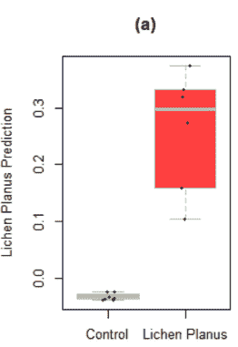

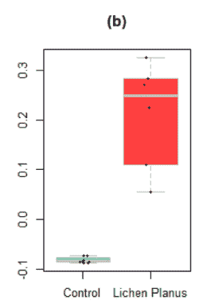

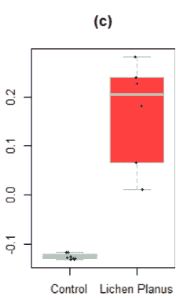

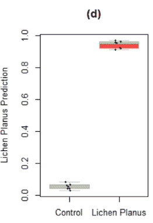

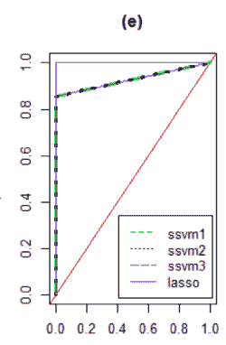

图 18. 使用 Dataset3 时，关于健康对照组和 LP 的预测结果。箱线图和散点图（a–d）分别显示了 ssvm1、ssvm2、ssvm3 和 lasso 中健康个体与 LP 个体的预测 LP 差异。（e）通过沿 y 轴显示真阳性率、沿 x 轴显示假阳性率，演示了每个模型的 ROC 曲线。

控制组或 LP）。我们随后将输入数据集提供给三种基于机器学习的方法。所有方法均为 SVM 的新型稀疏版本。每种方法的输出均为权重向量 w。我们根据 w 中对应的前 p 个权重选择了前 p 个基因，并将我们的方法和其他基线方法所选基因输入到富集分析工具 Enrichr 和 Metascape 中。结果表明，我们的方法在疾病识别方面优于基线方法，显示出更多的表达基因，并能更好地识别具有更多表达基因的组织类型。通过进一步的富集分析，我们鉴定出 5 种药物（例如，地塞米松、维甲酸和槲皮素）、23 个独特的转录因子（例如，NFKB1、p65、HDAC1、STAT1、STAT3）和 45 个独特基因（例如，PSMB8、PSMB10、PSMB9、KRT31、KRT16、KRT19、KRT17、KRT15、COL3A1、LCE2D、LCE2A），这些基因已被报道与 T 细胞介导的自身免疫性炎症机制、治疗靶点以及 LP 的治疗相关。我们的方法可在 GENEvaRX 网络服务器上公开获取，网址为 https://aibio.shinyapps.io/GENEvaRX/。

未来工作包括：
- (1) 将我们的计算框架应用于识别银屑病、特应性皮炎和狼疮等不同皮肤疾病中的重要表达基因、治疗靶点和药物；
- (2) 与医院合作，在临床试验中使用我们的工具；
- (3) 使用我们的方法从基因表达数据中识别基因签名；
- (4) 比较通过不同高通量技术生成的基因表达数据，并从生物学角度进行评估；以及
- (5) 研究 LP 变异体之间的共享分子机制及其参与情况。

# 资助

本项目由沙特阿拉伯吉达国王阿卜杜勒阿齐兹大学科学研究院（DSR）资助，资助编号为（D-087-611-1440）。因此，作者谨向 DSR 提供的技术和财务支持表示衷心感谢。

# CRediT 作者贡献声明

Turki Turki：概念化，形式分析，方法学，数据整理，软件，监督，撰写 – 原始草稿，可视化，调查。Y.-h. Taguchi：概念化，形式分析，方法学，数据整理，验证，撰写 – 原始草稿。

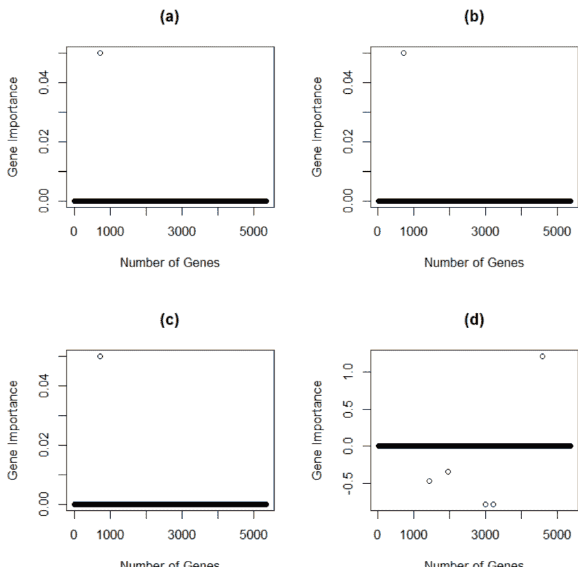

图 19. 通过 ssvm1 (a)、ssvm2 (b)、ssvm3 (c) 和 lasso (d) 生成的与 Dataset3 相关的所有基因的基因重要性。

# 利益冲突声明

作者声明，他们没有已知的可能影响本文所报告工作的竞争性财务利益或个人关系。

# 数据可用性

在补充文件 GENEvaRX_Screenshots.docx 中，我们演示了网络工具的使用。本研究中使用的所有数据均在手稿中引用，并可从 GEO 获取，登录号为

- GSE63741
- GSE193351
- GSE52130

# 附录 A. 补充数据

与本文相关的补充材料可在线查阅，网址为 https://doi.org/10.1016/j.engappai.2023.106607。

# 参考文献

- Abé, T., Kitagawa, N., Yoshimoto, S., Maruyama, S., Yamazaki, M., Inai, T., Hashimoto, S., Saku, T., 2020. 口腔扁平苔藓中角蛋白 17 阳性 Civatte 小体——分布多样性、诊断意义及组织发生学。Sci. Rep. 10, 14586.
- Ah Kioon, M.D., Pierides, M., Pannellini, T., Lin, G., Nathan, C.F., Barrat, F.J., 2021. 非细胞毒性抑制免疫蛋白酶体可调节体外人类免疫细胞并抑制小鼠皮肤炎症。J. Immunol. 206, 1631–1641.
- Ahn, S.J., Kwon, H., Yang, J.-J., Park, M., Cha, Y.J., Suh, S.H., Lee, J.-M., 2020. 脑转移增强 T1 加权像放射组学可能预测原发性肺癌的 EGFR 突变状态。Sci. Rep. 10, 1–9.
- Ahn, S.S., Yeo, H., Jung, E., Lim, Y., Lee, Y.H., Shin, S.Y., 2022. FRA1: C-JUN: HDAC1 复合物在角质细胞中 TNFα 和 IFNγ 刺激下下调丝聚蛋白表达。Proc. Natl. Acad. Sci. 119, e2121451119.
- Alabdulally, L., Villa, A., Chen, T., Kerr, A., Ross, N., Alves, F.A., Guollo, A., Woo, S.-B., 2022. 增生性白斑初期/早期组织学特征的表征及其与恶性转变的相关性：一项多中心研究。Mod. Pathol. 35, 1034–1044.
- Anderton, H., Alqudah, S., 2022. 皮肤功能、炎症和疾病中的细胞死亡。Biochem. J. 479, 1621–1651.
- Astudillo, M.G., Hoang, M.P., Nazarian, R.M., Foreman, R.K., 2021. 增生性扁平苔藓与鳞状细胞癌的鉴别在困难病例中需要临床病理相关性。Am. J. Dermatopathol. 43, 349–355.
- Baek, K., Lee, J., Lee, A., Lee, J., Yoon, H.-J., Park, H.K., Chun, J., Choi, Y., 2020. 口腔扁平苔藓病变中组织内细菌群落的表征及大肠埃希菌分离。Sci. Rep. 10 (3495).
- Barrett, T., Wilhite, S.E., Ledoux, P., Evangelista, C., Kim, I.F., Tomashevsky, M., Marshall, K.A., Phillamy, K.H., Sherman, P.M., Holko, M., Yefanov, A., Lee, H., Zhang, N., Robertson, C.L., Serova, N., Davis, S., Soboleva, A., 2012. NCBI GEO：功能基因组学数据集档案——更新。Nucleic Acids Res. 41, D991–D995.
- Bi, M., Zhang, Z., Jiang, Y.-Z., Xue, P., Wang, H., Lai, Z., Fu, X., De Angelis, C., Gong, Y., Gao, Z., 2020. 由转录因子高阶组装驱动的增强子重编程促进表型可塑性和乳腺癌内分泌耐药性。Nature Cell Biol. 22, 701–715.
- Boudreaux, B., Bhullar, P., Brumfiel, C., 2022. 34004 外用鲁索替尼阻断皮肤扁平苔藓中的干扰素伽马信号传导。J. Am. Acad. Dermatol. 87, AB121.
- Braegel, C., Fetter, T., Niebel, D., Dietz, L., Bieber, T., Wenzel, J., 2021. 具有免疫刺激作用的内源性核酸使界面性皮炎持续存在——将致病基础转化为体外模型。Front. Immunol. 11, 622511.
- Brehm, F., Haenssle, H.A., Schön, M.P., Emmert, S., 2011. 3 例难治性扁平苔藓对阿利雷汀的反应。J. Am. Acad. Dermatol. 65, e58–e60.
- Budimir, J., Mravak-Stipetić, M., Bulat, V., Jerčec, I., Japundžić, L., Ugičević-Mihić, L., 2019. 口腔及口周疾病中的过敏反应——过敏皮肤测试结果显示什么？Oral surgery. Oral Med. Oral Pathol. Oral Radiol. 127, 40–48.
- Burgess, J., 1941. 维生素 B 复合物治疗扁平苔藓。Can. Med. Assoc. J. 44 (120).
- Chen, J., Du, G., Wang, Y., Shi, L., Mi, J., Tang, G., 2017. 口腔扁平苔藓中 mRNA 和 miRNA 表达谱的整合分析：初步结果。Oral Surg. Oral Med. Oral Pathol. Oral Radiol. 124, 390–402. e317.
- Chen, Z., Shi, T., Zhang, X., Jia, K., Jiang, H., Yuan, B., 2022a. 基于哨兵-2 植被指数的薯蓣叶面积指数混合估计方法。IEEE Trans. Geosci. Remote Sens. 60, 1–13.
- Chen, J.F., Zhang, X.M., Sanjel, K., Zhang, J., Ma, C., 2022b. 皮肤扁平苔藓中 TNF-α 和 NF-κB/p65 的表达及其意义。Clin. Cosmet. Investig. Dermatol. 1509–1516.
- Cosgarea, R., Pollmann, R., Sharifi, J., Schmidt, T., Stein, R., Bodea, A., Ausschill, T., Sculean, A., Emling, R., Greene, B., 2020. 口腔扁平苔藓的光动力疗法：一项前瞻性病例对照试点研究。Sci. Rep. 10, 1–11.
- Crow, Y.J., Stetson, D.B., 2022. 1 型干扰素病：10 年回顾。Nat. Rev. Immunol. 22, 471–483.
- Davis, S., Meltzer, P.S., 2007. GEOquery：基因表达 omnibus (GEO) 与 BioConductor 之间的桥梁。Bioinformatics 23, 1846–1847.
- de Lanna, C.A., da Silva, B.N.M., de Melo, A.C., Bonamino, M.H., Alves, L.D.B., Pinto, L.F.R., Cardoso, A.S., Antunes, H.S., Boroni, M., Cohen Goldberg, D., 2022. 口腔扁平苔藓与口腔鳞状细胞癌共享关键致癌特征。Sci. Rep. 12 (20645).
- Deng, S., Xu, Y., Wang, X., Liu, M., Li, L., Yu, X., Wang, Y., Wu, Y., Wang, W., Gao, M., 2020. 唾液菌群和 NF-κB 炎症信号通路在口腔扁平苔藓中的作用研究。Inflammation 43, 994–1008.
- D’Erme, A.M., Wilhelm-Thiess, D., Wagenpfeil, J., Hölzel, M., Ferring-Schmitt, S., Sternberg, S., Wittmann, M., Peters, B., Bosio, A., Bieber, T., 2015. IL-36γ (IL-1F9) 是银屑病皮损的生物标志物。J. Invest. Dermatol. 135, 1025–1032.
- Didona, D., Caro, R.D.C., Santos, A.M.S., Solimani, F., Hertl, M., 2022. 口腔扁平苔藓的治疗策略：现状与新见解。Front. Med. 9.
- Du, J., Gao, R., Wang, Y., Nguyen, T., Yang, F., Shi, Y., Liu, T., Liao, W., Li, R., Zhang, F., 2020. MicroRNA-26a/b 在口腔扁平苔藓中具有保护作用。Cell Death Dis. 11 (15).
- Du, Y., Yang, Y., Zhang, W., Yang, C., Xu, P., 2023. 人类 β-防御素-3 和核因子-κB p65 协同促进口腔鳞状细胞癌细胞增殖和侵袭。Transl. Oncol. 27, 101582.
- Durinck, S., Spellman, P.T., Birney, E., Huber, W., 2009. 使用 R/Bioconductor 包 biomaRt 进行基因组数据集整合的标识符映射。Nat. Protoc. 4, 1184–1191.
- Dussoyer, M., Page, A., Delolme, F., Rousselle, P., Nyström, A., Moali, C., 2022. 用于改进质谱法皮肤基质组表征的细胞外基质富集方案比较。J. Proteomics 251, 104397.
- Evert, K., Kocher, T., Schnidler, A., Müller, M., Müller, K., Pink, C., Holtfreter, B., Schmidt, A., Dombrowski, F., Schubert, A., 2021. 12 个月内反复用冷等离子体暴露口腔黏膜在小鼠中不致癌。Sci. Rep. 11 (20672).
- Farah, C.S., Fox, S., Shearston, K., Newman, L., Babic, S., Vacher, M., 2021. 苔藓样发育不良不是独立的病理实体。Oral Oncol. 119, 105362.
- Feng, W., Dauphin, G., Huang, W., Quan, Y., Liao, W., 2019. 用于分类的修正随机森林中新的基于边界的子采样迭代技术。Knowl.-Based Syst. 182, 104845.
- Friedman, J., Hastie, T., Tibshirani, R., 2010. 通过坐标下降法对广义线性模型进行正则化路径分析。J. Stat. Softw. 33 (1).
- Fu, A., Narasimhan, B., Boyd, S., 2020. CVXR：一种用于规范凸优化的 R 包。J. Stat. Softw. 94, 1–34.
- Hassanandani, T., 2020. 15346 面部色素性扁平苔藓的皮肤镜与组织病理学相关性：一项观察性研究。J. Am. Acad. Dermatol. 83, AB37.
- Huang, J., Heng, S., Zhang, W., Liu, Y., Xia, T., Ji, C., Zhang, 2022. 皮肤发育、稳态、伤口再生和疾病中的真皮细胞外基质分子。Sem. Cell Dev. Biol. 128, 137–144.
- Huber, W., Carey, V.J., Gentleman, R., Anders, S., Carlson, M., Carvalho, B.S., Bravo, H.C., Davis, S., Gatto, L., Girke, T., 2015. 使用 Bioconductor 进行高通量基因组学分析的协调。Nature Methods 12, 115–121.
- Jiao, L., Liu, Y., Yu, X.-Y., Pan, X., Zhang, Y., Tu, J., Song, Y.-H., Li, Y., 2023. 疾病中的核糖体生物发生：新参与者和治疗靶点。Signal Transduct. Target. Ther. 8 (15).
- Keeley, A., Petri, L., Ábrányi-Balogh, P., Keserű, G.M., 2020. 药物发现中的共价片段库。Drug Discov. Today 25, 983–996.
- Kuleshov, M.V., Jones, M.R., Rouillard, A.D., Fernandez, N.F., Duan, Q., Wang, Z., Koplev, S., Jenkins, S.L., Jagodnik, K.M., Lachmann, A., Lafta-Navarro, M.C., Conac-Sorell, M., 2023. 核仁应激：从发育到癌症。Sem. Cell Dev. Biol. 136, 64–74.
- Laurence Le Cleach, M., Chosidow, O., 2012. 扁平苔藓。N. Engl. J. Med. 366, 723–732.
- Lee, T.A., Han, H., Polish, A., Cho, S.K., Lee, J.W., Ra, E.A., Lee, E., Park, A., Kang, S., Choi, J.J., 2022. 感染期间核仁是炎症性 RNA 降解的场所。Nature Commun. 13 (5203).
- Lee, J.Y., Hong, J.S., Lee, S.H., Ayy, Y., 2019. 用阿利雷汀成功治疗额部纤维化脱发。Dermatol. Ther. 32, e13037.
- Li, C., Tang, X., Zheng, X., Ge, S., Wen, H., Lin, X., Chen, Z., Lu, L., 2020. 口腔扁平苔藓的全球患病率和发病率估计：系统评价和荟萃分析。JAMA Dermatol. 156, 172–181.
- Li, Q., Wang, F., Shi, Y., Zhong, L., Duan, S., Kuang, W., Liu, N., Luo, E., Zhou, Y., Jiang, L., 2023. 单细胞免疫谱分析揭示口腔扁平苔藓中的免疫反应。Front. Immunol. 14.
- Masle-Farquhar, E., Jackson, K.J.L., Peters, T.J., Al-Eryani, G., Singh, M., Payne, K.J., Rao, G., Avery, D.T., Apps, G., Kingham, J., Jara, C.J., Skvotrsova, K., Swarbrick, A., Ma, C.S., Suan, D., Uzel, G., Chua, I., Leiding, J.W., Heiskanen, K., Preece, K., Kainulainen, L., O'Sullivan, M., Cooper, M.A., Seppänen, M.R.J., Mustjoki, S., Brothers, S., Vogel, T.P., Brink, R., Tangye, S.G., Reed, J.H., Goodnow, C.C., 2022. STAT3 功能获得性突变通过病理性 NKG2Dhi CD8+ T 细胞失调和积累将白血病与自身免疫性疾病联系起来。Immunity 55, 2386–2404. e2388.
- Meng, Z., Zhang, H., Li, L., Wang, K., 2021. miR-142-3p 在口腔扁平苔藓中的临床意义及其在角质细胞增殖中的调节作用。Oral Surg. Oral Med. Oral Pathol. Oral Radiol. 132, 441–447.
- Moitinho-Silva, L., Degenhardt, F., Rodriguez, E., Emmert, H., Juzenas, S., Môbus, L., Uellendahl-Werth, F., Sander, N., Baurecht, H., Tittmann, L., 2022. 与先天免疫、环境感知和细胞功能相关的宿主遗传因素与人类皮肤微生物群相关。Nature Commun. 13, 6204.
- Muradova, E., Negrieni, E., Berke, A., 2022. 35283 接种 Moderna COVID-19 疫苗后出现的皮肤黏膜扁平苔藓。J. Am. Acad. Dermatol. 87, AB83.
- Pattil, S., Hosmani, J., Khan, Z.A., Yadalam, P.K., Ahmed, Z.H., Bhandi, S., Awan, K.H., 2023. 免疫介导口腔疾病治疗策略的进展。Disease-A-Month 69, 101352.
- Pattil, S., Yadalam, P.K., Hosmani, J., Khan, Z.A., Ahmed, Z.H., Shankar, V.G., Awan, K.H., 2022. 具有恶性潜能/关联的口腔免疫介导性疾病：概述。Disease-A-Month 101349.
- Phatale, V., Vaipehi, K.K., Jha, S., Pattil, D., Agrawal, M., Alexander, A., 2022. 通过先进的经皮给药方法克服皮肤屏障。J. Control. Release 351, 361–380.
- Pitak-Arnnop, P., Subalekha, K., Sirintawat, N., Tangmanee, C., Aychai, P., Muangchan, C., Sukhopetch, P., Mengaud, J.-P., Neff, A., 2022. 口腔扁平苔藓患者是否有丙型肝炎高风险？一项病例对照研究。J. Stomatol. Oral Maxillofac. Surg. 123, e37–e42.
- Povey, S., Lovering, R., Bruford, E., Wright, M., Lush, M., Wain, H., 2001. HUGO 基因命名委员会 (HGNC)。Human Genet. 109, 678–680.
- Qian, Y.-T., Liu, X.-Y., Sun, H.-D., Xu, J.-Y., Sun, J.-M., Liu, W., Chen, T., Liu, J.-W., Tan, Y., Sun, W., 2022. 活动性白癜风患者的尿蛋白组学分析：用于类固醇治疗疗效预测和监测的生物标志物。Front. Mol. Biosci. 9 (92).
- Qiao, Y., Liu, B., Bai, R., Cai, J., Peng, Q., 2022. 由角蛋白 4 基因突变引起的白色海绵状痣：一例病例报告。Genes 13 (2184).
- Ramos-García, P., Gonzalez-Moles, M.A., Warnakulasuriya, S., 2022. p53 过表达在口腔潜在恶性疾病恶性转变风险预测中的意义：系统评价和荟萃分析。Oral Oncol. 126, 105734.
- Reimann, J.D., Moynihan, S.P., Horn, T.D., 2021. 皮肤直接免疫荧光试验的临床和实验室应用评估。JAMA Dermatol. 157, 1343–1348.
- Ritchie, M.E., Phipson, B., Wu, D., Hu, Y., Law, C.W., Shi, W., Smyth, G.K., 2015. limma 为 RNA 测序和芯片研究中的差异表达分析提供支持。Nucleic Acids Res. 43, e47.
- Rivera, C., Crisóstomo, M.F., Peña, C., González-Díaz, P., González-Arriagada, W.A., 2020. 口腔扁平苔藓相互作用组揭示 CXCR4 和 CXCL12 作为候选治疗靶点。Sci. Rep. 10, 1–8.
- Sahoo, A., Jena, A.K., Panda, M., 2022. 植物提取物、植物化学物质和植物制剂在口腔扁平苔藓治疗中的实验和临床试验研究：系统评价。J. Ethnopharmacol. 115591.
- Salazar, J., Carmona, T., Zaccori, F.C., Venegas-Yazigi, D., Cabello-Verrugio, C., Il Choi, W., Vilos, C., 2022. 人类真皮作为治疗皮肤疾病的纳米靶点。Pharmaceutics 15 (10).
- Sandhu, S., Klein, B.A., Al-Hadlaq, M., Chiravuri, P., Bajonaid, A., Xu, Y., Intini, R., Hussein, M., Vacharotayangul, P., Sroussi, H., 2022. 口腔扁平苔藓：比较疗效和治疗成本——系统评价。BMC Oral Health 22, 1–21.
- Schreurs, O., Karatsaidis, A., Balta, M.G., Grung, B., Hals, E.K., Schenck, K., 2020. 萎缩性口腔扁平苔藓上皮中角蛋白 8、18 和 19 的表达。Eur. J. Oral Sci. 128, 7–17.


Schwender, H., 2012. siggenes: 使用 SAM 和 Efron 经验贝叶斯方法进行多重检验。R 包版本。1, pp. 1–70.

Scully, C., Carrozzo, M., 2008. 口腔黏膜疾病：扁平苔藓。Br. J. Oral Maxillofac. Surg. 46, 15–21.

Shao, S., Tsai, L.C., Sarkar, M.K., Xing, X., Xue, K., Uppala, R., Berther, C.C., Zeng, C., Patrick, M., Billi, A.C., 2019. IFN-γ 通过 JAK2/STAT1 增强对角质形成细胞的细胞介导细胞毒性，用于扁平苔藓。Sci. Transl. Med. 11, eaat7561.

Slober, K., Hersle, K., Mobacken, H., Thilander, H., 1979. 外用维A酸疗法与口腔扁平苔藓。Arch. Dermatol. 115, 716–718.

Suga, K., 2022. 肿瘤伴随性皮肤病的 F-18-FDG PET/CT 发现。Jpn. J. Radiol. 40, 863–875.

Sun, K., Pan, L., Chen, J., Deng, Y., Chen, J., Tian, Z., Tang, G.Y., Wang, Y., 2022. 蛋白二硫键异构酶家族 A 成员 3 在口腔扁平苔藓和口腔苔藓样病变的组织来源细胞外囊泡中的表达上调。Arch. Oral Biol. 137, 105390.

Taguchi, Y., Turki, T., 2020. 一种基于张量分解无监督特征提取的新型冠状病毒（SARS-CoV-2）体内计算机药物发现新方法。PLoS One 15, e0238907.

Taupelt, F., Donnio, L.-M., Magnani, C., Mari, P.-O., Giglia-Mari, G., 2022. 稳定的 XPG 蛋白对于正确的核糖体生物发生是必需的：关于合并性干皮症/科克恩综合征患者表型的见解。PLoS One 17, e0271246.

Team, R.C., 2008. R：一种用于统计计算的语言和环境。J. Stat. Softw. 25.

Turki, T., Taguchi, Y.-h., 2023. 一种新的基于机器学习的计算框架识别治疗靶点并揭示胰岛细胞中的有影响力基因。Gene 853, 147038.

Turki, T., Wei, Z., 2018. 用于癌症鉴别任务的支持向量机提升。Comput. Biol. Med. 101, 236–249.

Tusher, V.G., Tibshirani, R., Chu, G., 2001. 应用于电离辐射反应的微阵列显著性分析。Proc. Natl. Acad. Sci. 98, 5116–5121.

Usatine, R., Tinitigan, M., 2011. 扁平苔藓的诊断与治疗。Am. Fam. Physician 84, 53–60.

Vinay, K., Kumar, S., Bishnoi, A., Aggarwal, D., Radotra, B.D., Parsad, D., Sendhil Kumaran, M., 2020. 印度三级医疗中心在 8 年期间对 344 名色素性扁平苔藓患者的临床-人口学研究。Int. J. Dermatol. 59, 245–252.

Vo, P.T.-D., Choi, S.S., Park, H.R., Lee, A., Jeong, S.-H., Choi, Y., 2021. 通过转录组数据分析鉴定的与口腔扁平苔藓中屏障功能障碍和感染相关的基因签名。PLoS One 16, e0257356.

Wang, H., Deng, Y., Peng, S., Yan, L., Xu, H., Wang, Q., Shen, Z., 2021. 基于 RNA-Seq 的口腔扁平苔藓转录组分析。Hereditas 158, 1–11.

Wenzel, J., Tüting, T., 2008. 针对病毒、自身或肿瘤抗原的 IFN 相关细胞毒性细胞免疫反应是界面性皮炎的常见致病特征。J. Invest. Dermatol. 128, 2392–2402.

Xia, D.-N., Tan, Y.-Q., Yang, J.-Y., Zhou, G., 2020. Omega-3 多不饱和脂肪酸：管理口腔扁平苔藓的一种有前途的方法。Inflamm. Res. 69, 989–999.

Xie, Z., Bailey, A., Kuleshov, M.V., Clarke, D.J., Evangelista, J.E., Jenkins, S.L., Lachmann, A., Wojciechowicz, M.L., Kropiwnicki, E., Jagodnik, K.M., 2021. 使用 enrichr 进行基因集知识发现。Curr. Protoc. 1, e90.

Xie, F., Gluee, C.A., Deschaine, M., Dasari, S., Sartori-Valinotti, J.C., Charlesworth, M.C., Meves, A., Lehman, J.S., 2023. 迟缓型与转化型口腔扁平苔藓中的差异蛋白组学表达。Exp. Dermatol.

Xin, M.-z., Shi, Y.-y., Li, C.-s., Zuo, L.-h., Li, N., Liu, L.-w., Ma, H.-x., Du, Q.-z., Xue, P., Sun, Z., 2021. 口腔扁平苔藓代谢特征的代谢组学和转录组学分析。Front. Oncol. 11, 769163.

Yao, Y., Pan, L., Wei, Y., Feng, M., Li, X., Sun, L., Guoyao, T., Wang, Y., 2023. TRIM21 通过在口腔扁平苔藓 T 细胞中泛素化 NF-κB 促进炎症。J. Oral Pathol. Med.

Zare, R., Mohtasham, N., Ghazi, N., Mozafari, P.M., Abdollapoor, M., Poursheikhani, A., Mohajertehrani, F., Esmaeilzadeh, A., 2021. 口腔和皮肤扁平苔藓病变及白细胞中转录因子与 IL-17 相关性的评价。Cytokine 148, 155696.

Zeng, Z., Lan, T., Wei, Y., Wei, X., 2022. 人类疾病及相关治疗中的 CCL5/CCR5 轴。Genes Dis. 9, 12–27.

Zeng, L.-j., 2019. 1 型干扰素：连接皮肤伤口与银屑病发病机制的潜在启动因子。Front. Immunol. 10 (1440).

Zhang, Y., Liu, K., Cheng, J., Zhou, C., Zhang, M., Fan, Y., 2022a. 口腔扁平苔藓中的 FAP-α+ 免疫成纤维细胞通过 CCL5 分泌促进 CD4+ T 细胞浸润。Exp. Dermatol. 31, 1421–1430.

Zhang, Z., Zhang, Y., Zhao, Z., Li, P., Chen, D., Wang, W., Han, Y., Zou, S., Jin, X., Zhao, J., 2022b. 芍药苷通过调节口腔扁平苔藓中的 Th1/Th2 细胞因子驱动间充质干细胞的免疫调节作用。Sci. Rep. 12 (18678).

Zhao, Z., Wang, L., Zhang, M., Zhou, C., Wang, Y., Ma, J., Fan, Y., 2022. 基于网络药理学方法和实验验证揭示槲皮素对口腔扁平苔藓的治疗作用。Sci. Rep. 12 (1162).

Zhou, Y., Zhou, B., Pache, L., Chang, M., Khodabakhshi, A.H., Tanaseichuk, O., Benner, C., Chanda, S.K., 2019. Metascape 为系统级数据集的分析提供面向生物学家的资源。Nature Commun. 10, 1–10.

Zouali, H., Lemasson, J., Calugareanu, A., Battali, C., Michonneau, D., Le Buanec, H., Grolleau, C., Cassius, C., Robin, M., Meradnet, M., 2022. 慢性移植物抗宿主病皮肤病变的 RNA 测序定义了表征扁平苔藓和硬皮病的共同和独特炎症通路。Blood Adv. 6, 2805–2811.

Turki Turki 获得了 King Abdulaziz University 的计算机科学学士学位，NYU-POLY 的计算机科学硕士学位，以及 New Jersey Institute of Technology 的计算机科学博士学位。他目前是沙特阿拉伯 King Abdulaziz University 计算机科学系的副教授。他的研究兴趣包括机器学习、数据科学和生物信息学。他的研究已发表在 Scientific Reports、IEEE Journal on Selected Topics in Signal Processing、Frontiers in Genetics 和 Computers in Biology and Medicine 等期刊上。他是 Sustainable Computing: Informatics and Systems、BMC Medical Genomics、PLoS ONE 和 Computers in Biology and Medicine 的编辑委员会成员。

Y.-h. Taguchi 从 Tokyo Institute of Technology 获得了物理学学士学位和物理学博士学位。他目前是日本 Chuo University 物理学系的正教授。他的作品已发表在 Physical Review Letters、Bioinformatics 和 Scientific Reports 等领先期刊上。他的研究兴趣包括生物信息学、机器学习和非线性物理学。他还是 PLoS ONE、BMC Medical Genomics、Medicine (Lippincott Williams & Wilkins 期刊)、BMC Research Notes 和 IPSJ Transaction on Bioinformatics 的编辑委员会成员。

