# 地理信息系统：实用方法


**朱璇**是澳大利亚莫纳什大学地球、大气与环境学院高级讲师。他获得爱丁堡大学博士学位，在GIS和遥感及其在环境和区域资源利用规划中的应用方面拥有30多年的国际经验。朱博士是四本学术著作和100多篇学术论文及书籍章节的作者/合著者/合编。


## Preface

地理信息系统（GIS）是科学调查、环境报告、资源管理和发展规划的有效工具。与第一版一样，《GIS for Environmental Applications: A Practical Approach》（环境应用 GIS：实用方法）一书详细全面地介绍了 GIS 原理和技术，并通过大量精心挑选的示例、实践和案例研究，为在研究、管理和规划中实施这些原理和技术提供了实用指南，帮助读者真正掌握知识和技能。为了扩大本书的影响力，第二版的书名改为《Geographical Information Systems: A Practical Approach》（地理信息系统：实用方法），因为本书介绍的概念、原理、方法、技术和实用技能不仅限于环境应用。秉持实用视角，第二版继续将最新的 GIS 知识、工具和实践整合成一本连贯、全面、简洁且自包含的书籍，适用于环境科学、地球科学、地理学、考古学及其他关注地理现象位置、分布和关系的科学研究领域的学生、科学家和从业者。

### Changes from the First Edition

### 与第一版的变化

自第一版出版以来，GIS 出现了几项重要发展，包括：

- 空间数据的新来源。新一代地球观测传感器，如高光谱成像仪和 LiDAR（光探测与测距），以及新的遥感平台，包括 UAS（无人机系统）和纳米/微型卫星星座，已被用于空间数据采集，用于不断扩大的环境和社会经济应用列表。
- 大数据与数据分析。我们现在正生活在大数据时代。除了来自地球观测遥感系统的海量遥感数据（这些数据每天以多种空间、时间和光谱分辨率提供）之外，物联网（IoT）的实时数据馈送，如空气质量测量、野火边界、温度和湿度读数，产生了大量收集的空间信息。利用来自各种来源的大量空间数据的潜力，促成了新方法，包括机器学习和人工智能，并将其纳入 GIS 进行分析和可视化。

- 3D 分析。3D 分析已成为 GIS 的发展趋势，因为它能更好地表示现实世界。它不仅仅是为了强大的可视化，还为分析增加了第三个维度。例如，GIS 中的 3D 分析工具可以用于基于要素几何进行 3D 叠加和邻近分析，评估城市环境中拟建建筑物的阴影量和影响，并通过 3D 插值基于样本数据估算未知值。第三个维度可以表示一个区域的人口密度、整个区域化学品和矿物的浓度、特定土地利用类型的土地适宜性以及含水层深度。随时间分析数据增加了进行 4D 分析的能力。

- Web GIS 和云 GIS。Web GIS 通过网络浏览器使空间数据和 GIS 服务可访问，并允许用户在互联网上创建、共享和交互地图及其他空间数据。它已从简单的在线制图演变为服务于各种目的的交互式在线 GIS 应用程序。另一方面，云 GIS 使用云计算服务进行空间数据管理、存储和分析，为 GIS 工作提供集中式和高效的平台。云 GIS 现在可以通过云利用大数据基础设施，能够处理大量信息并运行更快的分析，这使用户能够做以前远远无法做到的更多事情。

- 开源 GIS 软件。开源 GIS 软件系统现在在许多方面可与专有 GIS 软件系统媲美，并在多项具体功能（如真正的 3D 可视化和分析）上超越它们。对于许多应用，开源 GIS 软件已成为专有 GIS 软件的替代方案。

作为一本提供 GIS 实践理解和 GIS 使用最佳实践的综合教材，新版已扩展和更新，以反映其中一些发展。引入了几个新主题。这些包括 GIS 的新进展（在第 1.2 节）、体素模型（在第 4.4 节）、在线制图（在第 4.6 节）、时空分析（在第 6.7 节）、基于对象的图像分类（在第 7.5 节）和神经网络图像分类（在第 7.5 节）。章节组织与第一版相同，只是空间可视化章节被提前，现在是第 4 章。更早学习如何在地图上可视化空间数据，使学习者能够以易于理解和解释的形式呈现空间数据，并在学习后面章节中的空间分析和更高级概念时，能够胜任地以视觉方式传达 GIS 分析结果。的确，理解和制作地图是最基础的，因为 GIS 分析的输入和输出很大程度上以地图形式表示。在每一章中，内容已修订，追加了新内容，


图表和插图已修订，并添加了新的插图。

本版对第一版中的实践内容进行了彻底改版。所有实践内容均已重写，以使用 ArcGIS Pro 和 QGIS。第一版中使用的 ArcGIS Desktop 将于 2026 年逐步淘汰，本书用户将过渡到 ArcGIS Pro。QGIS 是一款日益流行的开源 GIS。这是第二版的主要推动力之一。通过新版，读者可以选择可访问或偏好的 GIS 软件包之一。根据对第一版审稿人反馈的回应，文本中的所有实践框均已移除，并与所需数据一起放置在本书的支持材料中，以便在软件新版本发布时更新所有实践材料。几乎每个主题都提供了实践内容，并且它们在文本中与相关概念或主题相邻处被标记，以提请读者注意本书配套网站上的实践内容。为了充分利用本书，鼓励读者遵循本书中的实践内容。这种“以做中学”的方法将帮助学生成为合格且称职的从业者，并支持科学家和从业者使用新的 GIS 技术和工具增强其知识和技能。

此外，案例研究和技术框已更新，文本中高度技术性的说明已移至新的技术框，网络链接已更新，失效的网络链接已删除，并为新内容添加了复习问题。

## 图书组织结构

本书分为十章。第 1–9 章涵盖了空间数据、空间数据管理、空间可视化、空间分析、空间统计、遥感数据分析、地形分析以及空间决策分析与建模中的基本概念、原理和技术。这些章节中的每一章都包括示例和实践，展示了所介绍的 GIS 原理、技术和工具如何实施。章节的顺序使本书能够平稳地带领读者从 GIS 的基础知识过渡到高级主题。虽然前九章提供了框式案例研究，但第 10 章包含一组更详细的案例研究，按水文建模、土地利用分析与建模、大气建模、生态建模和生态系统服务估值等主题组织。这些案例研究虽然未涵盖所有应用领域，但展示了 GIS 在环境应用中的一些典型案例，重点介绍了 GIS 在分析、建模或解决过程中的应用。它们与文本中的相关章节完全交叉引用，并为这些章节提供了额外的案例研究。

## 本书用途

与第一版一样，本版面向环境科学、地理学、地球科学、大气科学、生态学和生物科学等专业的高年级本科生和研究生。它也可作为这些领域希望将 GIS 用作空间分析、建模和决策工具的研究人员和从业者的参考书。此外，本书还为希望开设实践性和结构化 GIS 课程的教师编写。

教师可以按章节顺序进行教学。本书内容模块化程度较高，且足够灵活，以支持各种课程需求。这些需求由学生的背景、课程长度、课程在课程体系中的位置以及课程目标决定。例如，第 6 章中的第 6.7 节“时空分析”；第 7 章中的第 7.5.3 节“基于对象的分类”和第 7.5.4 节“神经网络分类”；以及第 9 章“空间决策分析与建模”均为高级主题，适合研究生，可从本科生课程中排除。第 10 章的案例研究可根据学生背景作为选择性阅读材料。

### 学习辅助工具

与第一版一样，每章包括以下学习辅助工具：

- 开头列出的学习目标列表
- 全彩地图、图表、表格和照片
- 在线实践，提供带有逐步说明的教程式实践指南，介绍如何应用或实施 GIS 的概念和技术
- 章末涵盖所介绍主要概念的总结
- 章节总结后的关键术语列表
- 章末复习问题集，其答案可通过仔细阅读章节找到
- 参考文献列表，包括文中引用的所有出版物，作为本章的来源材料和进一步调查的起点

第二版受益于第一版三位匿名审稿人提出的建设性意见。我感谢他们宝贵的投入，并尽量采纳了许多建议的修改。我还要感谢 Routledge | Taylor & Francis 的 Andrew Mould 先生和 Claire Maloney 女士，对手稿提供的指导和协助，以及 Routledge | Taylor and Francis 其他员工在制作过程中的帮助。最后，我想感谢我的家人在写作期间给予的持续支持和鼓励。

Xuan Zhu  
Monash University  
Melbourne  
October 2023

## 第 1 章

### GIS 概述

本章概述了 GIS。它介绍了 GIS 用于问题解决和决策的历史、一般框架和功能，讨论了 GIS 在研究、管理和规划中的作用，并简要介绍了几款流行的 GIS 软件包。

### 学习目标

学习本章后，你应该能够：

- 将 GIS 与其他类型的计算机化系统区分开来；
- 了解 GIS 可能适用的目的；
- 讨论 GIS 在研究、管理和规划中的作用；
- 描述使用 GIS 进行问题解决的过程，以及
- 概述各种专有和开源 GIS 软件的关键特性。

### 1.1 GIS 简介

环境研究和可持续性研究的基本目标是理解和解决环境问题及可持续发展问题，关注人类如何利用自然资源、人类活动如何改变环境以及人类可以采取哪些行动来解决环境问题和支持可持续发展。例如，一位生态学家可能希望研究农业集约化和栖息地丧失导致的景观破碎化对野生动物的影响。一位野生动物生物学家可能想要分析迁徙动物的运动模式。一位地理学家可能对某一地区的土地利用变化及其环境影响感兴趣。一位气候学家可能希望预测生态系统对气候变化的响应，以便为可持续景观管理提供选择。一位地质学家可能希望根据过去历史、坡度、基岩和其他物理因素评估滑坡易发性，并识别不同滑坡潜力的区域。一位水文学家可能对模拟存在显著地下水-地表水相互作用地区的城市化水文响应感兴趣，并希望了解城市水文和污染物流动路径，这将为水敏感城市设计提供信息。环境与可持续性科学的所有学科都处理大多具有空间属性的数据，即与地球表面位置相关的数据。此类数据称为空间数据。它们描述事物在地球表面的位置、过去位置或未来位置。框 1.1 展示了依赖空间数据的物种分布建模的典型示例。GIS 提供了一种技术及一套工具，用于收集、组织、搜索、分析和可视化空间数据。

### 框 1.1 模拟澳大利亚维多利亚州赤麂（Cervus unicolor）的分布

物种分布建模旨在了解物种出现或可能出现的地点、物种出现与环境之间的关系，以及物种可能如何响应环境变化。它基于这样一个假设：物种有自己的环境生态位，即它们生活在一系列环境因素（如温度、降雨和植被类型）范围内的区域。墨尔本亚瑟·莱拉环境研究所（Arthur Rylah Institute, ARI）的环境科学家将野外调查与生物物理数据相结合，以估算维多利亚州赤麂（Cervus unicolor）的当前和潜在分布。赤麂在十九世纪从斯里兰卡、印度和菲律宾被引入维多利亚州。此后，它们在澳大利亚东南部的地理分布范围不断扩大，持续扩张可能对本土生物多样性和水质产生负面影响。了解赤麂的当前和潜在分布将使野生动物管理者能够有效地集中管理精力。

ARI 研究团队使用粪便颗粒计数来索引赤麂丰度。他们首先通过在田野中沿着 100 条随机设置的样线（长 150 米）计数赤麂粪便颗粒的数量来收集赤麂出现数据。出现数据本质上是已知有赤麂出现的地点样本，描述了每条样线上计数的完整颗粒总数（称为粪便颗粒指数，或 FPI）以及方位和地理


样带的位置。随后，估计了每条样带周围的生物物理变量，包括海拔、坡向、坡度、距水体远近、植被类型、太阳辐射和距道路远近。所有这些变量因样带而异；换句话说，它们是特定于位置的。基于分布数据和生物物理数据，制定了若干关于生物物理变量可能如何影响印度麂种群数量的假设。构建了模型来检验这些假设，最后选择了最佳模型来预测印度麂种群数量的空间变化。结果是一个栖息地适宜性模型和一张以 FPI 为单位的印度麂种群数量预测图。这种具有空间明确性的栖息地模型可以帮助确定可能发现印度麂的位置，并预测由于环境变化或其他原因，其地理分布范围可能如何扩大。

在这个案例研究中，印度麂的出现数据、生物物理数据和预测的印度麂种群数量均为空间数据。这些空间数据可以在 GIS 中得到有效处理。物种分布模型中涉及的“何处”和“什么”问题，例如某物种出现或可能出现在何处，某物种的占据或未占据栖息地位于何处，以及哪些生物物理因素与物种的出现相关，都是 GIS 旨在帮助解答的典型问题。

来源：Forsyth 等人（2007）。

#### 1.1.1 什么是 GIS？

GIS 缩写代表地理信息系统。与其他类型的计算机系统（如电子表格、文字处理软件和数据库管理系统）不同，GIS 处理和管理空间数据。文字处理软件和电子表格分别是用于处理文本和数字的计算机工具，而 GIS 处理地图、影像及其他与地球表面特定位置相关联的空间数据。

通常，空间数据描述的是在特定时间或某个时间段内，地理空间中一组观测值及其属性或特性的测量。地理空间是指观测值对应地球表面位置的空间，该空间通过一个空间测量框架来定义，该框架捕捉它们在现实世界中的空间关系（如邻近性、连通性和方向）。在这里，空间测量框架是一个坐标系统，它以考虑地球复杂形状的方式定义球面或平面坐标、高度、方位及其他空间测量属性。

地理空间中的观测是针对空间分布的特征进行的，例如植物、野生动物、溪流和河流，这些特征也常被称为地理特征、空间对象或空间实体（Gatrell 1991；Longley 等人，2015）。它们被定义为地理空间中一组位置以及描述这些位置的一组属性。例如，印度麂的一次目击记录是一个观测，可以用一对纬度和经度（地理坐标系统中的球面坐标，将在第 2 章讨论）以及附加到该位置的若干属性来定义，包括其海拔、坡向、坡度、植被类型和太阳辐射。地图是表示地理空间的一种传统方式。因此，空间数据可以与地图关联或以地图形式表示（图 1.1）。空间数据也称为地理参照数据、地理编码数据或地理空间数据。

现代 GIS 的概念最早阐述于 20 世纪 70 年代末。Dueker（1979）将 GIS 定义为

一种特殊的信息系统，其数据库由空间分布特征、活动或事件的观测值组成，这些观测值在空间上可定义为点、线或面。地理信息系统处理关于这些点、线和面的数据，以便为临时查询和分析检索这些数据。

20 世纪 80 年代和 90 年代，出现了许多新的 GIS 定义。例如，Marble 等人（1984）将 GIS 定义为“用于空间数据的输入、存储与检索、操作与分析以及输出的一组工具”。Cowen（1988）认为 GIS 的最终目标是支持决策过程，因此将 GIS 定义为“在问题求解环境中涉及空间参照数据集成的决策支持系统”。Chrisman（1999）主张 GIS 不纯粹是一种技术，而是人类组织中人们开展的一系列活动。他将 GIS 定义为“人们测量和表征地理现象，然后在与社会结构相互作用的过程中将这些表征转化为其他形式的有组织活动”。

GIS 借鉴了包括制图学、地理学、计算机科学、测量学、摄影测量学、遥感学和统计学在内的众多学科的概念和理念，仅举几例。这些学科逐渐汇聚，形成了一门名为地理信息科学（GIScience）的新科学研究领域。Goodchild（1992）将 GIScience 定义为“围绕 GIS 技术的使用、阻碍其实施或从对其潜在能力的理解中产生的通用问题”。因此，它涉及空间数据和信息的创建、处理、管理和使用所产生的基本问题的科学研究，以及 GIS 对社会的影响和社会对 GIS 的影响。GIScience 是 GIS 技术背后的科学，并非旨在在术语和实践中取代 GIS。

应注意，GIS 是一个内容中立的术语。它对不同的人有不同的含义。GIS 没有普遍接受的定义。

##### 非空间数据：1900 年以来澳大利亚发生的滑坡汇总

| 滑坡类型 | 发生次数 |
|---|---|
| 碎屑雪崩 | 2 |
| 碎屑坠落 | 3 |
| 泥石流 | 26 |
| 碎屑滑坡 | 23 |
| 碎屑滑动 | 14 |
| 碎屑倾覆 | 1 |
| 干雪流 | 1 |
| 土块滑坡 | 4 |
| 土坠落 | 3 |
| 土流 | 27 |
| 土滑动 | 22 |
| 岩坠落 | 111 |
| 岩滑坡 | 14 |
| 岩滑动 | 8 |
| 岩倾覆 | 4 |
| 滑动-土流 | 8 |
| 滑动和倾覆 | 1 |
| 土壤缓蠕 | 3 |
| 湿砂或淤泥流 | 1 |

##### 空间数据：1900 年以来澳大利亚发生的滑坡位置

| 日期 | 地点 | 类型 | 经度 | 纬度 |
|---|---|---|---|---|
| 23/03/1997 | 三一海滩，凯恩斯 | 碎屑坠落 | 145.70 | -16.79 |
| 4/02/2000 | 奥康纳，卡尔古利-博尔德地区，西澳 | 碎屑坠落 | 121.48 | -30.76 |
| 1/04/1911 | 尼斯贝特山脉，凯恩斯以东 5 km | 碎屑坠落 | 145.80 | -16.90 |
| 1/01/1925 | 艾恩斯利山，堪培拉，首都领地 | 泥石流 | 149.17 | -35.27 |
| 1/08/1970 | 普伦蒂河，新诺福克以西 10 km | 泥石流 | 146.94 | -42.80 |
| 30/04/1988 | 科勒代尔 | 泥石流 | 150.93 | -34.28 |
| 22/09/1989 | 硫磺溪，塔斯马尼亚西北部 | 泥石流 | 146.02 | -41.10 |
| 1/05/1996 | 米切尔山，坎宁汉姆峡谷附近，昆士兰 | 泥石流 | 152.40 | -28.07 |
| 19/01/1997 | 基拉利亚，莫斯曼附近，昆士兰 | 泥石流 | 145.38 | -16.47 |
| 30/07/1997 | 特雷德博，雪山 | 泥石流 | 148.31 | -36.51 |
| 10/01/1998 | 斯图亚特山，汤斯维尔，昆士兰 | 泥石流 | 146.78 | -19.35 |
| 11/01/1998 | 凯利街附近，内利湾，昆士兰 | 泥石流 | 146.84 | -19.16 |
| 7/08/1998 | 锡福德月牙路下方，悉尼 | 泥石流 | 151.25 | -33.80 |
| 17/08/1998 | 乌伦贡 | 泥石流 | 150.90 | -34.43 |
| 11/02/1999 | 库兰达山脉路，库兰达，昆士兰 | 泥石流 | 145.64 | -16.82 |
| 11/02/1999 | 巴伦峡谷路，凯恩斯，昆士兰 | 泥石流 | 145.67 | -16.87 |
| 3/03/1999 | 大西部阶地，米安达，塔斯马尼亚 | 泥石流 | 146.62 | -41.75 |
| 23/10/1999 | 纳里纳山，乌伦贡 | 泥石流 | 150.83 | -34.43 |

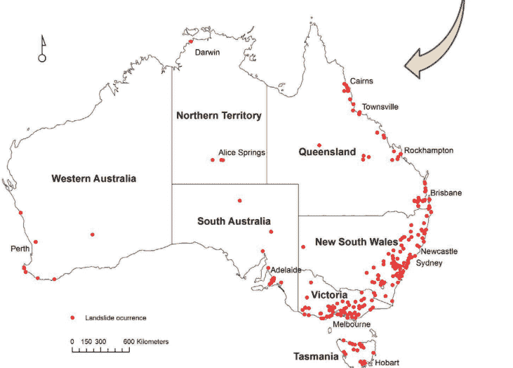

图 1.1 空间数据和非空间数据。
来源：澳大利亚地球科学组织。

面向环境与可持续发展研究者和从业者，GIS 是一种计算机化工具，可协助他们管理、整合、呈现和分发环境及社会经济数据和信息；构建、分析和利用空间模型；并促进和改进问题求解与决策过程。


因此，本书提供了GIS的一个工作定义，从其功能特性出发，将GIS描述为一个工具包：

> GIS是一个用于获取、管理、操作、集成、分析、可视化和传播空间数据的计算机化系统。

本书的章节通常围绕这一功能顺序进行结构安排。

#### 1.1.2 GIS的组件

普遍认为，GIS主要由硬件、软件、数据、人员和程序（或方法）组成（Dueker and Kjerne 1989; Longley et al. 2015）。硬件是GIS运行或被操作的设备。如今，GIS运行在各种设备上，从集中式计算机服务器到台式计算机、笔记本电脑、平板电脑、车载设备和手机。软件是一组驱动GIS操作的计算机程序、算法和相关数据。每项GIS操作都涉及数据。GIS操作可以将一张地图（一个数据集）作为输入，并生成一张新地图（一个新数据集）作为输出。数据是为特定的问题解决或研究目的而准备并输入到GIS中的。人员是GIS的用户。他们可能是设计和开发GIS系统的系统开发人员，或者是管理和维护系统的系统管理员，或者是将其作为工具来执行空间分析和解释结果的最终用户。当GIS在组织环境中运行时，需要建立程序（包括机构安排、实施计划和规程），以确保GIS系统高效、有效地支持组织活动，并被妥善地集成到整个业务战略和运营中。已为组织内的GIS设计和实施开发了正式的方法论（参见 Harmon and Anderson 2003; Croswell 2009）。这些超出了本书的范围。在这里，我们关注GIS的功能组件。

GIS通常由六个功能组件组成：

- 1 空间数据输入
- 2 空间数据存储和管理
- 3 空间数据操作
- 4 空间数据分析
- 5 空间数据输出
- 6 接口

这些组件分为三个层级：接口层、工具层和数据管理层（图 1.2）。

##### 1.1.2.1 空间数据输入

**空间数据输入**组件提供从现有模拟地图、航空照片和卫星影像中获取空间数据并将其转换为数字形式的功能，或者从其他空间数据库导入现有数字空间数据，或者输入通过调查或采样或来自其他数据源获取的空间数据。

##### 1.1.2.2 空间数据存储和管理

该组件包括一个空间数据库或多个空间数据库，并执行**空间数据管理**任务，包括 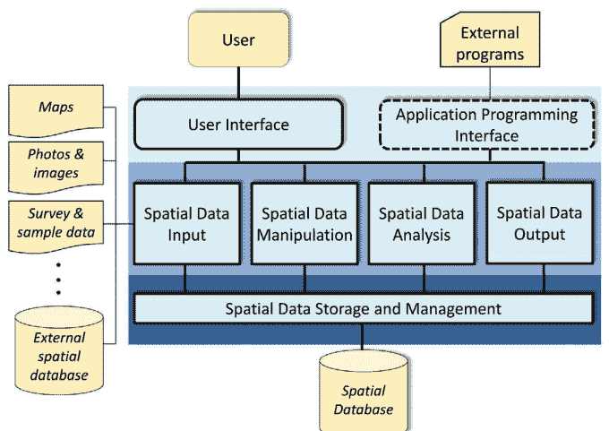

图 1.2 GIS功能组件。

空间数据存储、检索和编辑。空间数据输入后，以一种易于访问和快速检索的方式存储和组织在空间数据库中。该组件提供特定的编辑工具来更新和编辑空间数据，例如，将野生动物的新偶然观察记录添加到空间数据库中，从森林地图中删除已被砍伐的林分，根据新的勘测数据改变湖泊的形状，检测和纠正数据获取过程中发生的错误。

##### 1.1.2.3 空间数据操作

空间数据操作组件提供用于操作和转换空间数据的工具，例如，转换用于记录空间数据集中位置的坐标系统，将相邻地图图幅合并为单一地图，对空间数据进行子集化等。第2章和第3章详细讨论了空间数据输入、空间数据管理和操作功能。

##### 1.1.2.4 空间数据分析

该组件为GIS提供分析功能。它包含一系列空间数据分析工具或功能，使用户能够探索环境或社会经济现象的模式、关联和相互作用，以及它们随时间和空间变化的证据。这些工具还可用于为各种环境和其他空间模型估计参数并定义约束。GIS中典型的空间数据分析功能包括空间查询、几何测量、缓冲区与近邻测量、叠置分析、表面分析、网络分析、影像分析和空间统计。

**空间查询**功能用于基于位置、空间关系（例如，邻接性、连通性、连续性、方向和包含性）或非空间属性从空间数据库中检索或提取数据。它们用于检查和审查数据及结果，并制作专题图以显示特定地理要素的分布或模式。例如，我们可以使用空间查询功能查找百年一遇洪泛区内的所有建筑物，或者搜索距离河流50米以内的所有化粪池。

**几何测量**功能计算地理要素的几何属性，如长度、周长、面积、形状、方位、质心和距离。

这些功能对于计算景观指标和指数特别有用，如斑块大小、最近邻距离、形状指数、形状紧凑度和景观破碎化，以及用于描述景观或生态系统层面的景观结构和各种生态过程。

**缓冲区与近邻测量**功能用于划定要素周围特定距离的物理区域（称为缓冲区），并计算从一个或多个要素到周围区域所有点的距离。例如，我们可以使用缓冲区功能在溪流周围创建50米缓冲区，并将缓冲区区域指定为河岸植被保护区（图 1.3a），或者应用近邻测量功能计算每个位置到溪流的距离并生成近邻图（图 1.3b）。

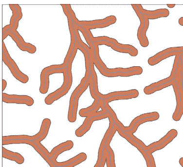

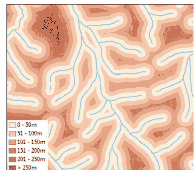

**图 1.3** 缓冲区与近邻测量：（a）溪流周围50米缓冲区，（b）溪流近邻。

**叠置分析**功能允许用户基于共同地理叠加多张不同主题的地图，以检查这些主题之间的对应关系，识别它们之间的空间关联，或者使用这些主题作为输入参数进行环境建模。例如，我们可以通过叠置操作将土地覆盖图叠加在土壤图上，以分析土地覆盖类型如何对应土壤类型（图 1.4），通过叠置分析将稀有植物物种的偶然观察记录与多个环境因素相结合，以建立植物物种出现与每个环境因素之间的空间关联，并通过叠置操作将土壤侵蚀模型应用于土壤、植被和坡度，以推导土壤侵蚀潜势图。因此，叠置操作可与模型结合用于复杂的环境建模。此外，叠置分析可用于将同一主题的一系列地图组合起来，以检测和测量现象的时间变化，例如随时间变化的土地利用。

表面分析功能用于估计、表征和分析在地理空间中连续变化值的环境或社会经济变量，例如大气温度、空气污染物、土壤湿度、地形和人口密度。这一组功能提供用于推导表面特征（如坡度、坡向和曲率）以及计算体积、挖填、剖面和互可见性的操作。它们是地形、大气和水文建模的基本工具。图 1.5

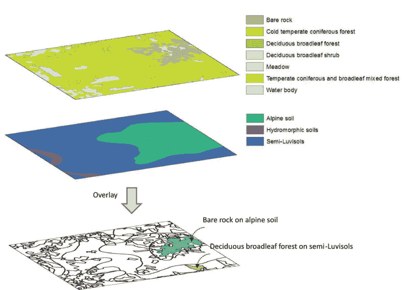

图 1.4 叠置分析：识别每种土地覆盖类型下的土壤类型。


提供地形地表及其坡度和坡向图的示例。

**网络分析**函数用于分析货物、服务、能源、信息以及许多其他材料，甚至人员，在网络（如供水管网、河流网络和街道网络）中的移动。它们可以用于寻找可最小化流量通行时间、距离、成本或其他目标函数的最优路径（例如，寻找水资源分配的最优路径，确定紧急服务调度的最快路线），评估网络中对特定资源的可达性，或确定哪些设施（如供水网络中的储水设施）应基于其与需求点（如供水消费者（例如单户住宅、工商业机构）及其他用水点（例如消防栓））的潜在相互作用而运行。图 1.6 展示了两个网络分析示例。

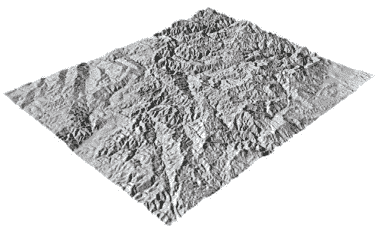
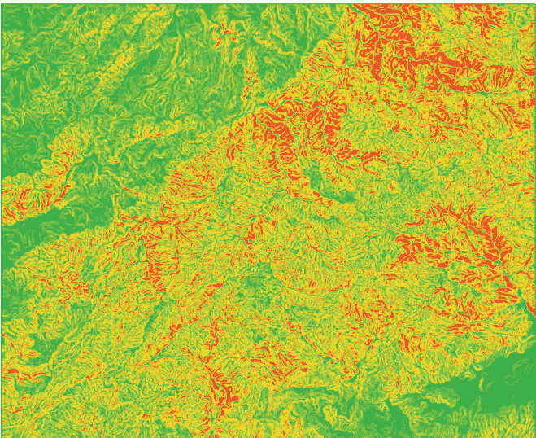

| 坡度 |
|--------|
| 0 - 5 |
| 6 - 9 |
| 10 - 13 |
| 14 - 16 |
| 17 - 20 |
| 21 - 23 |
| 24 - 27 |
| 28 - 31 |
| 32 - 47 |

图 1.5 表面分析：（a）地形地表，（b）坡度和（c）坡向。

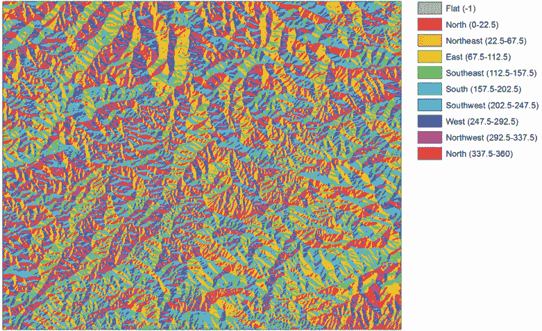

图 1.5（续）

**图像分析**函数用于从遥感影像（包括航空照片和卫星图像）中提取生物物理信息，这些影像是环境与可持续性研究的主要数据来源之一。提供三组图像分析函数。图像预处理函数旨在校正失真或退化的图像，以创建更准确的原始场景表示。它们通常在主要图像分析和信息提取之前需要。图像增强函数用于改善图像外观，以协助进行视觉解译和分析。它们涉及提高图像中要素之间视觉区分度的技术，从而增加可从图像中进行视觉解译的信息量。图像分类函数用于将图像中的像素自动分类为土地覆盖类或主题（例如，水体、针叶林、阔叶林、玉米、小麦等），并生成原始图像的专题图（图 1.7）。

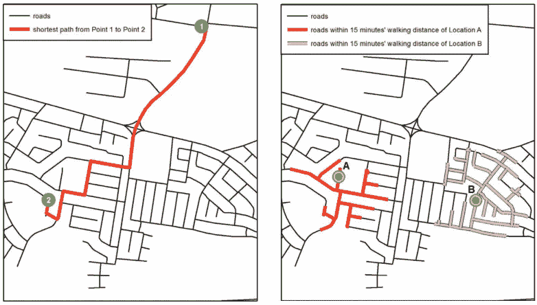

图 1.6 网络分析：（a）路由——寻找最优路径——以及（b）区划分配——寻找到中心最近的网络链接。

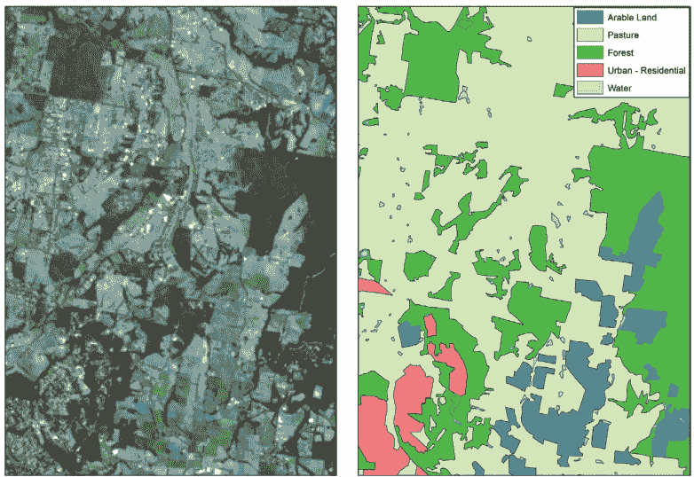

图 1.7 图像分类：（a）Landsat 卫星图像和（b）从中导出的土地覆盖图。

来源：图片来自美国地质调查局。

**空间统计**提供用于测量空间分布和关联、识别空间模式及检测空间聚类的工具。它们可用于分析事件或过程在空间上的均值变化，并探索事件或过程中的空间相关性或依赖性。例如，空间统计可用于回答诸如：癌症病例是否表现出令人惊讶的聚集倾向？癌症发病率在空间上是否有所变化？特定地点附近的癌症发病率是否升高？癌症发病率是否与空气污染物浓度在空间上相关？所有此类问题都可以表述为待使用空间统计进行检验的假设。

前面提到的空间数据分析函数可用作模型构建模块，以构建环境或其他空间模型。例如，在框 1.1 描述的示例中，开发了一个预测模型来预测印度麋鹿的丰富度，表示为：

```
log (Y) = 16.14 - 0.005 x Distance_to_water - 0.024 x Elevation + 0.022 x cos(90 - Aspect) - 0.007 x sin(90 - Aspect)    (1.1)
```

其中 Y 是预测的印度麋鹿粪粒数量（Forsyth et al. 2007）。该模型可使用近接度测量和表面分析函数作为构建模块，并通过地图代数实现。地图代数是一种独特而强大的 GIS 工具，它使用地图作为变量，并利用代数运算（例如，加、减、幂运算、对数、开根号、余弦等）来形成类似于传统代数的数学方程。它是 GIS 中空间建模的主要手段之一。我们将在第 5、6、7、8 和 9 章中详细讨论空间数据分析与建模。

##### 1.1.2.5 空间数据输出

空间数据输出组件包含可视化工具，用于以各种地图、图表和表格形式呈现和传播来自空间数据库的空间数据，或来自空间数据操作、分析与建模的成果。现代 GIS 系统不仅提供使用传统制图方法设计二维（2D）和二维半（2.5D）地图展示的制图工具，还融合了先进的可视化技术，用于制作三维（3D）、多媒体、动画和交互式地图，并允许用户在虚拟现实中浏览现实世界。此外，还提供用于设计可通过不同类型媒体（如纸质文档、计算机屏幕和手持设备（如手机））呈现和传播的地图的工具。特别是，地图可以设计成可从 GIS 通过谷歌地球、谷歌地图或其他地图服务器在互联网上作为地图服务发布，这大大便利了向广泛用户社区传播空间数据和信息。第 4 章重点介绍此组件。

##### 1.1.2.6 接口

每个 GIS 系统都有用户界面。用户界面涵盖用户与 GIS 应用程序之间通信的所有方面。它为用户提供访问所有其他 GIS 组件的途径。例如，它允许用户输入和编辑空间数据，选择并运行空间数据分析工具，显示和查看分析结果。有些 GIS 系统提供命令行

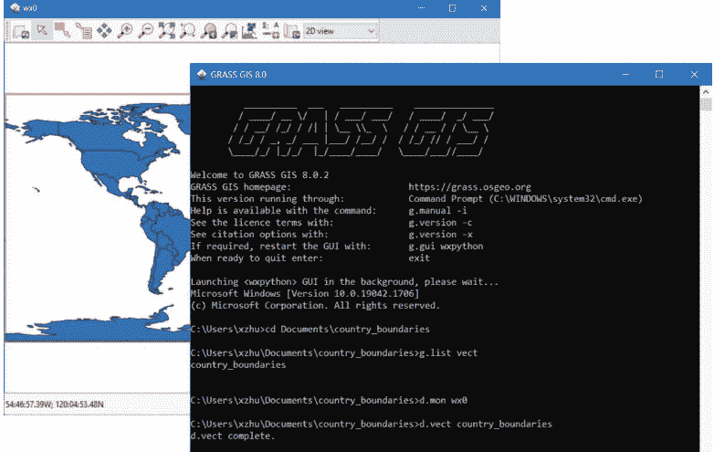

(a)

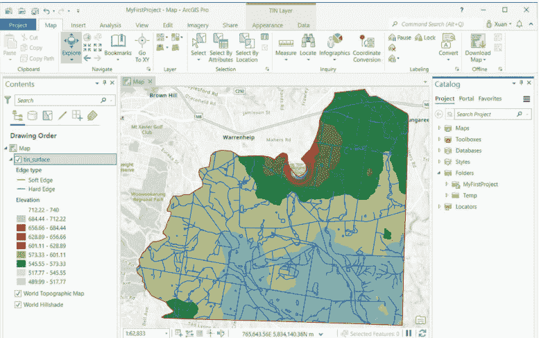

(b)

图 1.8 GIS 接口：（a）命令行和（b）GUI。

用户界面（图 1.8a）。

大多数现代 GIS 系统都有图形用户界面（GUI），能够为用户提供多种输入选项，例如，使用表单输入数据，通过从工具栏选择工具或从菜单中选择某项来发出命令，以及使用绘图工具结合相关空间分析函数来构建空间模型（图 1.8b）。

此外，许多 GIS 系统都有应用程序编程接口（API），使用户能够使用 Visual Basic (VB)、C++、C#、Java、Python、VBScript 和 JavaScript 等计算机编程语言，为空间分析与建模创建自定义工具和领域特定模型，并将工具或模型直接集成到 GIS 系统中。

### 1.2 GIS 的历史视角

随着微型计算机、分时操作系统和分布式计算的发展，计算机化 GIS 变得实用。计算机化 GIS 系统的实施历史始于 20 世纪 60 年代中期，当时开发了第一个真正的 GIS 系统——加拿大地理信息系统（CGIS）。CGIS 旨在协助加拿大联邦政府定位和量化加拿大农村的自然资源和土地适用性（Tomlinson 1967）。此后，GIS 技术不断发展，新的 GIS 应用被开发和研究。GIS 技术的演变表现为空间可视化、空间数据管理、空间分析和空间数据采集技术以及 GIS 计算平台等方面的一系列创新与发展，如图 1.9 所示。

GIS 植根于计算机制图。地图几个世纪以来一直作为信息存储介质，以满足社会需求。它们使用符号，基于特定地理参考系统（在第 2 章中讨论）并按照一组地图设计原则（在第 4 章中讨论）来表示环境和社会经济现象的地理分布。在制图计算机革命之前，地图主要通过手工和照相化学工艺制作，称为照相机械制图（Robinson et al. 1995）。这是一个昂贵且耗时的过程，涉及数据收集、汇编、制图和印刷，且技术要求高。地图出版时，其部分内容可能已过时。环境分析与监测（如地震、空气污染和森林火灾监测）通常要求频繁更新地图。有些监测任务可能需要每天甚至每小时更新地图。显然，照相机械制图无法满足这一需求。此外，尽管印刷地图为帮助我们理解地理要素的空间模式和关系提供了主要信息来源，但使用它们进行定量分析是困难的。此外，环境问题和可持续性问题很复杂。在寻找解决方案时需要考虑许多因素。例如，垃圾填埋场选址基于对土壤、土地利用、水文、人口、交通和其他


| | 1960s | 1970s | 1980s | 1990s | 2000s | 2010s-present |
|---|---|---|---|---|---|---|
| 空间数据采集 | 人工编码 | 人工数字化 | 扫描、数字遥感、数字摄影测量 | GPS 和 GLONASS | 北斗、超高分辨率遥感、基于互联网地图的众包 | GALILEO、小卫星星座、无人机、物联网 |
| 空间数据管理 | | 简单数据检索 | 空间数据编辑、空间查询、非空间数据的 DBMS | 具有空间扩展的 DBMS | 支持空间数据类型和操作的所有主要 DBMS 系统 | NoSQL 数据库 |
| 空间分析 | 简单地图处理 | 地图叠置、视线分析 | 空间分析的基本操作、图代数 | 与空间分析与建模以及决策分析工具相结合 | 扩展和增强的空间数据探索和分析能力 | 大数据分析 |
| 空间可视化 | 行式打印机制图 | 绘图仪制图 | 喷墨打印机制图和计算机屏幕显示 | 多媒体和互联网制图 | Web 制图平台、虚拟现实和虚拟地球 | |
| 计算平台 | 大型机 GIS | 大型机 GIS | 工作站 GIS | 桌面 GIS、互联网地图服务器 | 分布式 GIS | 云 GIS |

图 1.9 GIS技术的发展。

environmental and socio-economic factors. 过去用于此类综合分析的常用方法是地图叠置。它涉及手动描摹各因素的印刷地图，然后将描摹图叠加，以识别和绘制条件重叠的区域。此过程也称为 **sieve mapping**。手动叠置分析耗时，当需要合并大量地图时变得不切实际。计算机制图提供了一种替代方法。

在20世纪60和70年代，GIS系统本质上是计算机制图系统，旨在自动化地图生产过程，并便于地图数据的定量分析和集成。空间数据通过手动编码，或使用数字化板（绘图桌的电子等价物）手动数字化印刷地图、航空照片或图像来输入。标准行式打印机被用作制图设备，使用字符生成非常粗糙、质量低劣的地图。后来使用绘图仪绘制质量更高的地图。开发了多种 **cartographic data structures** 来编码地图数据（Peuquet 1984）。例如，DIME（双独立地图编码）数据结构由美国人口普查局在20世纪60年代末开发，用于编码街道及其拓扑关系，以便引用和汇总人口普查记录。由哈佛大学计算机图形与空间分析实验室在20世纪70年代开发的 ODYSSEY GIS 系统，率先采用弧/节点数据结构来对地图上的线要素和面要素进行数字编码（Peucker and Chrisman 1975）。这些制图数据结构为现代GIS中空间数据模型和空间数据管理的数据结构的发展奠定了基础，这将在第2章中讨论。然而，这一时期的GIS系统仅仅是‘图进图出’系统。它们具有不灵活的空间数据输入、较差的空间数据管理、有限的制图显示以及简单的地图处理和分析能力。此外，它们通常在大型主机上运行，这些主机通常以批处理模式运行。早期GIS系统主要应用于土地和自然资源调查，例如 CGIS、MLMIS（明尼苏达州土地管理系统）和 LUNR（土地利用和自然资源清查系统）（Coppock and Rhind 1991）。

第一款面向家庭消费者的微型计算机 IBM PC 于1981年推出。它降低了GIS运算的计算硬件成本，并拉开了工作站和桌面GIS时代的序幕。20世纪80年代，GIS真正开始兴起。随着计算机计算能力的提高，开发了基本的空间数据管理和分析功能，将计算机制图功能与数据库管理和部分分析功能相结合。GIS开始成熟为一种空间数据处理、管理、分析和制图技术。第一代图形用户界面，包括 X-Windows、Microsoft Windows 和 Apple Macintosh，使GIS软件更易于使用。20世纪80年代的一项重要发展是 ARC/INFO 的推出，这是第一款专为微型计算机设计的商业GIS软件包。ARC/INFO 由两个软件组件组成：ARC，一套空间数据输入、处理和输出工具；以及 INFO，一种用于管理非空间数据的关系数据库管理系统（DBMS）。这是传统非空间 DBMS 技术用于 GIS 数据库构建和管理的起点。与此同时，开发了空间查询功能，允许用户根据地理位置从 GIS 数据库检索信息，或搜索数据库中的地理实体以制作地图。林业公司和自然资源机构是最早采用 GIS 作为工具来构建空间数据库以监测和规范森林及其他自然资源利用的机构之一。

20世纪80年代也经历了对空间数据的快速需求，这导致了空间数据行业和数字空间数据市场的出现。采用了新技术进行空间数据采集，包括自动扫描仪和遥感技术。中分辨率数字遥感，特别是 Landsat 地球资源卫星计划，正在成为 GIS 的数字空间数据新来源。在数据可用性提高和空间数据管理改善的基础上，空间数据处理和分析功能在大多数 GIS 系统中变得可用，例如数字化误差检测和纠正、地图概化（例如，地理要素简化）、地图幅面处理（例如，比例尺变更）、几何测量、缓冲区生成、叠置分析和数字地形分析（Berry 1987; Dangermond 1983）。特别是，图代数的概念和技术得到了发展，使得可以用数学运算将地图作为变量进行处理。图代数的实现有助于在 GIS 环境中进行空间建模。然而，20世纪80年代的 GIS 系统缺乏空间分析和建模能力（Goodchild 1990）。

20世纪90年代，GIS技术和应用都取得了显著增长。桌面 GIS 普及开来；新增了空间分析工具；互联网出现，催生了分布式 GIS 和 Web GIS 及制图系统，GIS 应用从计算机制图和自然资源调查扩展到空间分析、建模和决策。GIS 的空间分析能力主要基于空间关系原则中的连通性（例如，衡量野生动物栖息地走廊的连通性或空间连续性）、毗连性（例如，识别栖息地邻近的土地利用/土地覆被类型）、邻近性（例如，创建缓冲区以界定对水资源具有良好可达性的区域）和叠置方法（例如，通过与多个环境和社会经济因素进行叠置分析，识别核废料处置的潜在场地）。但 GIS 系统仍然缺乏复杂环境建模和决策所需的空间分析和建模类型。特别是，GIS 并未设计用于有效处理时间或持续变化变量的相互作用，而环境模型可以有效地处理这些问题。这促进了 GIS 与环境建模的集成。一些 GIS 软件包扩大了空间分析操作的范围以支持


环境建模，如 IDRISI（现 TerrSet）。一些统计软件包（S-Plus）与 GIS（如 ArcView）之间建立了链接，以增强 GIS 进行统计建模的能力。一个独立的空间数据分析包，地理分析机（GAM），被开发用于支持空间统计分析，包括空间模式分析和聚类（Openshaw 1998）。更引人注目的是，GIS 在空间分析和建模方面的潜力吸引了世界各地的环境科学家。

在此期间，GIS 与环境建模的集成通过将 GIS 与各种环境模型耦合而被积极推进，例如土地表面/地下（Wilson 1996）、水文（Sui and Maggio 1999）、大气（Pielke et al. 1996）和生态模型（Hunsaker et al. 1993），以应对从全球变化研究到土地和水资源管理及环境风险评估等当代环境问题。通过集成 GIS 和领域特定的环境模型及决策分析技术（如多准则决策和多目标优化）来开发空间决策支持系统以支持环境决策过程，在 20 世纪 90 年代也获得了动力（Densham 1991; Zhu 1997; Zhu and Dale 2000）。因此，20 世纪 90 年代是探索和扩展 GIS 用于环境建模的空间分析和建模能力的时期。

与此同时，美国全球定位系统（GPS）于 1993 年建成，拥有 24 颗 Navstar 卫星网络，并开始用于 GIS 的数据收集。GPS 是世界上第一个**全球导航卫星系统**（GNSS）。俄罗斯于 1995 年完成了世界上第二个 GNSS 系统 GLONASS。中国实验性 GNSS 系统 BeiDou-1 于 2003 年建立，为覆盖中国及邻近地区提供服务。中国全规模 GNSS 系统 BeiDou-2（第二代北斗系统）于 2011 年投入运行，并于 2012 年开始为亚太地区提供服务。BeiDou-3（第三代北斗系统）于 2020 年建成，并开始为全球客户提供服务。欧洲系统 GALILEO 于 2016 年开始提供初始服务，预计将于 2022 年达到全面运行能力。

GNSS 提供地球表面上的三维位置——纬度、经度和高度——以及时间和速度。它是一种成本效益高、准确且全球可用的工具，用于在数据尚未以模拟地图形式提供或仍需要实地调查来收集数据的情况下收集空间数据。GNSS 数据不仅可用于制图，还可用于空间数据的地理参考和地面真值验证。关于 GNSS（尤其是 GPS）的更多信息在第 3 章中提供。

随着来自不同来源的空间数据大幅增加，GIS 中有效管理大型复杂空间数据库变得至关重要。因此，GIS 正在向与带有空间扩展的关系型 DBMS 完全集成方向发展，这允许将空间数据集成在关系型 DBMS 中。此类 DBMS 系统的示例包括 IBM 的 DB2 Spatial Extender 和 Oracle Spatial and Graph（原 Oracle Spatial）。

在 1993 年互联网制图开始之前，曾尝试过多媒体制图，当时第一张交互式地图出现在万维网（即 Web）上。**多媒体制图**涉及将声音、动画、文本、图像和视频片段与地图进行交互式集成。它将多媒体信息链接到地图上表示的不同位置的地理要素。多媒体地图提供了一个数字多媒体环境，允许用户交互式探索映射的环境或社会经济现象，并动态显示环境或社会经济过程。**互联网制图**可以轻松地将多媒体集成到 Web 地图中，并通过互联网向世界各地任何人提供最新或实时的空间信息。

到 20 世纪 90 年代末，GNSS 和遥感影像已完全与 GIS 集成。1999 年 IKONOS 卫星的发射开启了非常高分辨率卫星遥感的新一代，提供空间分辨率为 1 米或以下的遥感数据。与此同时，用于低地球轨道空间研究和应用的微型卫星概念和设计被构思出来。CubeSats 是此类微型卫星的一种。CubeSat 通常由一个或多个 10 × 10 × 10 cm³ 单元组成，每个单元的质量不超过 1.33 千克（Selva and Krejci 2012）。得益于传感器、数字处理器、电源和其他组件的不断微型化，CubeSats 成为可能。第一批六颗 CubeSats 于 2003 年 6 月从俄罗斯普列谢茨克发射场发射。在接下来的十年中，大多数发射的 CubeSats 来自大学或研究应用。直到 2013 年，商业部门才开始发射 CubeSats。此后，大量具有地球观测能力的 CubeSats 被开发和部署。Planet（原 Planet Labs）是一家成立于 2010 年的地球观测公司，拥有世界上最大的私人 CubeSat 舰队——超过 150 颗，用于地球观测。它目前运行两个 CubeSat 星座：Doves 和 SkySats。Doves 每天提供整个地球的 3.7 米分辨率、8 波段影像，而 SkySats 可以被任务拍摄地球上的任何点，分辨率为 50 厘米，频率为亚日级，并且还可以捕获立体影像。这些 CubeSat 影像已被用于许多应用，从灾害响应到气候监测。

除了卫星遥感外，近年来，我们还看到了无人机的发展，无人机通常也被称为无人驾驶航空器（UAV）、无人驾驶航空系统（UAS）或远程驾驶航空系统（RPAS），用于各种自然环境和建筑环境中的观测、测量、监测和制图。无人机在低空运行，与卫星或载人飞机获得的分辨率相比，显著提高了空间分辨率，并且可以捕捉与传统实地调查和观测相匹配规模的空间数据。同样在 20 世纪 90 年代末，机载 LiDAR（光探测和测距）技术彻底改变了高分辨率和非常精确的数字表面模型和数字地形模型的采集。非常高分辨率遥感影像和 LiDAR 数据（在第 3 章和第 7 章中讨论）的可用性，从 21 世纪初开始，为 GIS 分析能力开辟了新水平，实现了更准确、更详细的空间分析和建模。

自 2006 年以来，出现了许多 Web 制图平台，包括 OpenStreetMap、Google Earth、Google Maps、Bing Maps Platform（原 Microsoft’s Virtual Earth）、Apple Maps、ArcGIS Online 和 Wikimapia。它们允许用户将自己的空间信息添加到 Web 上提供的地图中——例如，选择 Web 上显示的地图上的一个区域，为其提供描述，或添加指向有关该区域的照片、叙述文本和视频片段的链接。此类用户创建的信息被称为**志愿地理信息**（Goodchild 2007）。通过这些基于 Web 的平台进行数据收集的方法称为**众包制图**（Crooks et al. 2009）。它通过吸引广泛社区参与，为空间数据的收集提供了一种创新方法（将在第 3 章中更详细讨论）。框 1.2 提供了一个针对

### 框 1.2 ClimateWatch

在澳大利亚，独特的动植物栖息于低洼、破碎的景观中，特别容易受到气候变化的影响。对动植物物候阶段的观察已被公认为监测气候变化和生态响应的有效方法。这需要大规模的数据收集。数据收集的规模表明，成功只有通过吸引社区参与的多部门方法才有可能实现。为应对这一挑战，Earthwatch Australia 与气象局和墨尔本大学合作，开发了 ClimateWatch，这是一个用于收集、存储和报告澳大利亚指示性动植物物种的在线众包系统。业余博物学家、徒步旅行者、学校和企业构成了广泛的数据收集者网络的一部分，他们收集指定指示物种的数据，并在 ClimateWatch 网站上报告他们的观察结果，或使用带有 ClimateWatch 应用程序的移动设备。

ClimateWatch 被开发为具有内容管理功能的基于 Web 的众包系统。移动应用程序为数据收集者提供工具，使用智能手机或平板电脑随时随地记录观察结果、拍照并提交包含照片的记录。该系统允许注册用户输入、审查并向更广泛的受众提供关于约 180 种选定指示物种的观察结果。图 1.10 显示了其 Web 界面。


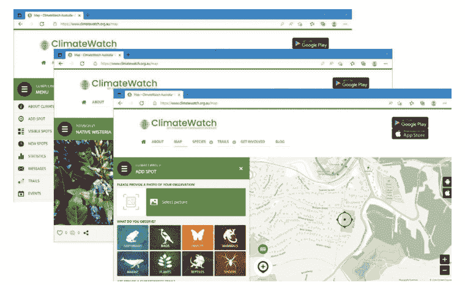

图 1.10 ClimateWatch 网页界面。

来源：www.climatewatch.org.au/。

ClimateWatch 已确定要使用的指示物种，并提供物种图片以及鸟类、蛙类和哺乳动物的样本叫声，以帮助数据采集者识别物种。可通过地图界面按地点或物种查看 ClimateWatch 中的数据。当用户选择一个区域时，地图会缩放到该区域，并显示记录观测数据的点位置。可以点击每个位置以显示该位置的物种列表。如果用户选择一种指示物种，地图将显示记录该物种的位置。注册用户还可以编辑自己的记录。观测数据由科学家按季度审查。验证后的数据随后将在澳大利亚生命图谱（Atlas of Living Australia）（www.ala.org.au/）上公开提供，科学家、政策制定者和土地管理者可以在此下载数据以供分析和制定政策。

自 2010 年以来，ClimateWatch 一直能够追踪动物、鸟类、植物和昆虫物种，以确定气候变化对其在澳大利亚分布和行为的影响。

来源：Donnelly 等人 (2011)。

在澳大利亚采集指定指示植物和动物物种的数据。

随着 GNSS 设备和先进现代数据采集技术（包括极高分辨率遥感和基于互联网的志愿者地理信息）的持续普及，海量空间数据已被且继续被采集。我们所熟知的大数据终于到来。这导致了大型空间数据库的出现。为有效管理不断增长的空间数据量，自 2000 年代末以来，几乎所有主要的已知 DBMS 系统都已提供对空间数据类型的支持，并提供了使用空间数据查询和操作算子存储和管理空间数据的功能，其中包括 Microsoft SQL（结构化查询语言）服务器。与此同时，随着数据存储成本大幅降低以及应用程序需要存储和查询的数据量迅速增加，非关系型数据库（NoSQL 数据库）应运而生。它们改变了将数据和信息封装在关系表中的传统数据库形式，并允许用户存储海量非结构化数据。GIS 开始采用 NoSQL 数据库，以便将不同来源和形式的空间数据（如格式化的地址数据、卫星图像、数字媒体文件和数据丰富的文档）集成在一起，帮助分析师发现原本可能无法检测到的关系模式，尽管当今大多数专有 GIS 系统仍在使用传统的关系结构并保留类似 SQL 的查询。

随着空间数据采集和管理技术的发展，人们越来越有兴趣开发自动或半自动工具，利用大数据分析（包括人工智能（AI）、机器学习和空间统计）与空间数据库系统交叉领域的方法，以增强 GIS 的探索和分析能力。这些工具旨在为 GIS 提供提出合理假设、识别空间模式或从大型空间数据库中发现知识的能力（Miller 和 Han 2009；Usmani 等人 2020）。它们作为标准内置函数、可选工具集或插件包含在 GIS 系统中。许多 GIS 软件系统提供软件开发工具包（SDK）、编程语言和编程接口，用于开发自己的分析工具。

此外，空间可视化技术不断进步。虚拟现实和虚拟地球作为 GIS 制图 3D 扩展的一部分应运而生，它们可以对真实景观进行高度详细的虚拟显示，以提供背景信息，帮助更好地理解环境和社会经济现象及过程。与静态 3D 地图不同，虚拟现实可以创建一个用户可以沉浸其中并在可移动景观元素和对象之间导航的 3D 景观模型。通过飞越真实景观的虚拟模型，用户不仅可以从可视化角度探索景观及其上覆环境和社会经济现象的属性，还可以发现它们之间的关系和模式。Google Earth 是第一个虚拟地球，于 2006 年推出。它立即被视为可视化环境、社会经济和地球特征的新媒介。虚拟地球（包括 Google Earth、Microsoft 的 Bing Maps、NASA WorldWind 和 ArcGIS Explorer（现为 ArcGIS Explorer 桌面版和 ArcGIS Explorer 移动应用））可免费使用。它们支持多种视角、平移和缩放，并采用高效的数据探索策略：先提供总览，再根据需要缩放以查看详细信息，从而避免视觉混乱。它们提供了一个虚拟环境，用于将数字专题图与极高空间分辨率的背景数据和遥感影像相集成，从而实现对广大受众的空间信息的直观展示和有效传递。虚拟现实和虚拟地球都已被用于交互式探索环境和社会经济过程、监测自然灾害、生成虚拟现实、演示各种环境管理及其影响的场景，以及重建人类活动之前的景观。随着 Web 和分布式计算技术的成熟以及家庭、教育机构和城市公共场所中无线网络的广泛使用，当今的 GIS 不仅可以在台式计算机上运行，还可以在移动设备上或通过 Web 从远程位置运行。分布式 GIS 是一种系统，其中 GIS 的组件分布在通过计算机网络（如互联网）连接的多个地理位置的计算机之间。图 1.11 展示了分布式 GIS 的典型客户端-服务器架构。

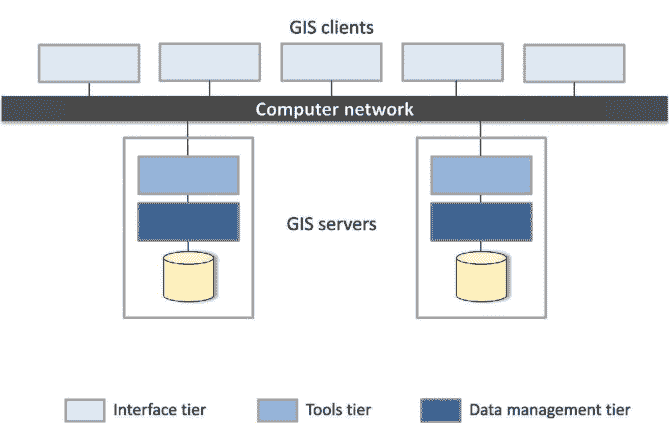

图 1.11 分布式 GIS 的客户端-服务器架构。

这些被称为客户端，分布在其他位置，用户通过客户端访问服务器上的 GIS 工具、空间数据库和数据库管理功能。客户端和服务器通过计算机网络进行通信。例如，分布式 GIS 可以通过专用 GIS 服务器或服务器集群提供 Web 地图、数据服务和空间数据处理功能。如今，几乎人人都使用过一种分布式 GIS，从使用 Google Maps 生成驾驶路线，到使用 Web 浏览器作为客户端从远程 GIS 服务器查看航空摄影图像。分布式 GIS 允许不同组织或组织内的不同部门共享 GIS 软件和数据资源，并能将地理上分布的 GIS 功能和空间数据库连接起来，以生成完整的环境和社会经济应用。

自 2010 年代初以来，分布式 GIS 的概念逐渐演变为云 GIS（Bhat 等人 2011）。云 GIS 利用云计算对大型空间数据集进行分布式处理。云计算是一种分布式系统，由一组互连的虚拟化计算机组成，作为一个或多个统一的计算资源提供，用于数据密集型和计算要求高的应用程序（Hayes 2008）。它基本上将软件、数据和应用程序从本地计算机转移到一组分散的远程计算机服务器和数据中心，并通过互联网以服务的形式交付。云计算有三种主要类型：软件即服务（SaaS）、平台即服务（PaaS）和基础设施即服务（IaaS）。SaaS 也称为按需软件，它集中托管在云端并交付软件及相关数据。用户可以通过 Web 浏览器访问所需软件。云提供商管理软件运行的基础设施和平台。因此，SaaS 无需在用户自己的计算机上安装和运行软件。PaaS 作为一种服务提供计算平台，开发人员可以使用云提供商提供的工具在其上构建和部署应用程序。它促进了应用程序的开发和部署，无需用户购买和管理底层硬件和软件工具。IaaS 提供计算机、存储、软件包、网络或其他 IT 基础设施，供用户部署和维护操作系统及应用程序。云服务基于服务等级协议提供，通常按使用量付费。云 GIS 系统允许用户通过互联网按需以服务形式使用 GIS 软件、硬件和空间数据，这些服务可以从各种联网设备访问，例如台式计算机、笔记本电脑、平板电脑、手机和其他远程服务器（图 1.12）。ESRI 的 ArcGIS Online 是提供 SaaS 的云 GIS 示例。它可在任何有互联网连接的设备上运行，并允许用户制作交互式地图、分析空间数据以及共享和协作（West 和 Horswell 2018）。Microsoft 的 Azure Maps 是 Microsoft Azure 云中的一种 PaaS 产品，提供 GIS 功能，使用户能够将空间分析和映射功能无缝集成到各种应用程序中。亚马逊弹性计算云（AWS EC2）是 IaaS 的一个示例


为开发和部署GIS应用程序提供了一个广泛的计算平台，可选择最新的处理器、存储、网络、操作系统和高性能计算基础设施，例如沙尘暴预报（Huang et al. 2013）和作物产量估算（Xu et al. 2020）。云GIS系统允许空间数据、信息和知识随时随地被访问、共享、分析和使用。

低成本设备的可用性加上计算和内存成本的降低、使设备间通信和直接设备连接成为可能的网络技术创新、云计算的出现以及大数据分析的进步，促使物联网（IoT）从2010年代初开始迅速广泛地被采用。IoT是指将网络地址分配给事物（从智能手机到车辆，从智能电表到家中的空调）并为其配备传感器（Green-gard 2015）的用途和过程。事物已获得感知其环境并创建关于正在发生的事情的信息的能力。事物已成为媒体，既能生成信息也能传递信息。IoT的海量实时传感器数据来自连接设备，如智能手机、土壤湿度监测馈送、声学和温度传感器以及智能交通灯。大多数设备结合GNSS接收器获取其物理位置，提供实时传感器信息和定位。GIS已被用于摄入、处理、分析和可视化来自连接传感器的IoT数据。例如，瑞典的GreenIoT项目使用IoT和位置数据实时绘制乌普萨拉市中心的空气污染水平图（Kaivonen and Ngai 2020）。该项目在城市公交车上部署了移动传感器，在不同地点进行空气质量测量，并通过带有GNSS定位跟踪的移动网络将数据传送到云服务，在那里传感器数据被存储、处理并在Google Maps上绘制。

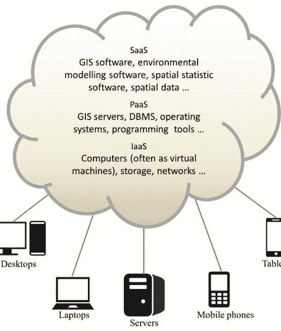

图 1.12 云GIS。

总之，GIS已从大型计算机（20世纪60年代和70年代）发展到工作站GIS（80年代）、桌面GIS（90年代）、Web GIS（2000年代）和云GIS（2010年代）。随着计算能力、网络能力和大数据分析的迅速提升，GIS的性能和功能得到了显著改善。随着其向Web和云计算的转型以及与实时IoT数据的集成，GIS正在成为一个与几乎所有人类活动相关的平台。

### 1.3 GIS在研究、管理和规划中的作用

GIS用于问题解决和决策的价值随着问题规模和复杂性的增加而增加。社会目前面临的挑战，例如全球变暖、资源短缺和生物多样性丧失，需要整合广泛的数据和信息，从多个角度解决问题，并以整体、全面、系统、分析和可视化的方式评估替代方案。GIS提供计算机化工具，用于组织和整合数据、识别空间模式以及可视化空间模式和过程，从而使决策者能够应对这些挑战并做出有效判断。它允许将与问题及其地理背景相关的各种类型数据一起考虑，从而使问题分析具有更大的深度和更广泛的范围。

本质上，GIS以空间分布的方式处理环境、社会和经济过程及模式。换句话说，GIS使用空间数据来表征、探索、分析和建模环境和社会经济现象在不同时间和不同空间尺度（从局部（如田地和林区）到区域（如流域）和全球尺度）上的空间变化、过程和空间关系。GIS具有非常广泛的应用范围，取决于特定的环境领域（大气层、生物圈、水圈或岩石圈）以及所调查的具体环境或社会经济问题。然而，GIS在研究、管理和规划中的作用可以概括为三类：清查与监测、分析与建模以及可视化与沟通。

#### 1.3.1 清查与监测

这是一个广泛接受的原则：在环境和资源管理与规划中，为复杂决策提供支持需要适当空间尺度的空间数据和信息。针对特定地理区域的空间数据汇编称为**空间清查**。示例包括土地资源、土地账户、湿地、野生动物、污染物和滑坡清查。空间清查通常包含代表环境和社会经济现象或资源的主题和位置属性的数据。例如，大气排放清查是一个数据库，包含特定时间段和特定地点每种源类型排入大气的污染物的详细信息。林业清查包含给定区域内每个林分的林分属性数据，包括独特标识符、林分年龄、林分物种、林分面积、蓄积量、土壤类型、调查级别（用于清查林分的方法）以及其他林分属性或变量，具体取决于清查的目的。地图、影像和相关表格数据是大多数空间清查的核心。传统上，空间清查存储在纸质地图、正射相片和统计表中，并通过航空摄影、野外采样方法和人工制图进行更新。自20世纪60年代早期GIS系统主要为土地和自然资源清查而开发以来，GIS一直被用于存储、组织、记录、检索、整合、汇总、更新和绘制清查数据。现代GIS不仅提供用于编制、管理和维护空间清查的空间数据库管理工具，还允许使用替代源数据，如高分辨率数字卫星影像和LiDAR数据，自动采集大面积和/或不可进入区域的清查数据，而使用传统野外清查和制图方法收集这些数据是不可行的。

基于GIS的空间清查通过改进的数据收集确保准确报告，并支持监测对资源和环境管理至关重要的关键环境和社会经济变量。空间清查通常是环境和社会经济分析与建模的基础。

#### 1.3.2 分析与建模

基于GIS的分析与建模与将特定GIS分析工具应用于空间数据的过程相关。GIS提供了广泛的空间数据分析功能，如第1.1节所述。它们可用于描述性分析、预测性建模和决策分析。**描述性分析**试图检查空间数据中的模式、趋势、相关性或其他关系。GIS是描述性分析的灵活工具。例如，我们可以从GIS数据库中检索特定区域的土壤数据并在地图上显示，从而直观地检查该区域土壤的空间模式。我们可以使用GIS根据特定时间一系列雨量站测得的数据快速生成降雨图。如果为不同时间生成一系列降雨图，可以将它们相互叠加，从而使我们能够分析某一时期该区域降雨的时间趋势。我们还可以使用GIS将同一区域的土壤图、高程图和降雨图相互叠加，以直观分析土壤、高程和降雨分布之间的关系。基于GIS的描述性分析旨在描述、测量和解释“何物在何处”或“何处有何物”，而不是“应何物在何处”或“可能何处有何物”。水质评估、土地评价和人口流动是描述性分析的示例。描述性分析可以使研究人员对空间数据有深入了解，并对环境和/或社会经济条件有良好的认识，然后再进行进一步调查。

基于GIS的**预测性建模**用于预测在特定环境或社会经济条件下，特定类型的环境或社会经济现象或事件可能或应该发生的位置，或者在环境或社会经济条件预计发生变化的情况下，不同地点将发生什么。前一种预测性建模涉及在环境或社会经济条件（如土地利用/覆盖、高程、坡度、坡向、土壤、植被、水资源可用性、地貌和人口密度）与观察到的环境或社会经济特征存在之间建立统计上有效的因果或协变关系，然后利用该信息预测特征可能或可能出现的位置。框1.1中描述的物种分布建模是这种预测性建模的示例。其他示例包括森林火灾建模、滑坡风险评估和野生动物栖息地建模。

第二种预测性建模主要用于**情景分析**，或“如果怎样”分析。它涉及使用模型来产生潜在未来替代方案（情景）的结果，或通过考虑替代的可能结果或状态来分析可能的未来事件。它对于为环境和社会影响研究生成预测性情景特别有用。例如，GIS已被用于在未来城市发展的不同情景下估计河流流域的地表径流和泥沙产量，以评估城市增长模式对地表水水文的影响（Kepner et al. 2004）；通过将GIS与水资源分配、景观动态和栖息地适宜性模型相结合来评估替代水管理策略的生态效应（Schluter and Ruger 2007）；模拟作物对气候变化情景的响应以评估气候变化对农业系统的影响（Hodson and White 2010）以及生成土地覆盖变化的社会经济情景（Swetnam et al. 2011）。情景分析通常用于长时期环境和资源规划的背景下，或涉及可能影响未来的交互和人类后果因素及趋势的环境决策。它不试图呈现未来的一幅精确图景；相反，


它展示了几种替代性的未来发展方向和可能的结果。

**决策分析**是一个允许决策者从一组可能的决策备选方案中选择所需选项的过程。然而，决策制定是一个复杂的过程，通常需要考虑环境、社会政治和经济影响之间的权衡。它必然涉及多个问题、多个准则、多个目标和多个利益相关者。GIS 与多准则决策分析和多目标优化（在第9章中讨论）等决策分析技术结合使用时，可以通过将描述性分析和/或预测建模得出的空间信息与利益相关者的偏好相结合，来支持决策备选方案的设计和评估。多准则决策分析是基于冲突且非同度量的准则来评估一组决策备选方案。多目标优化旨在最大化某些结果同时最小化其他结果。例如，结合特定的多准则决策分析或多目标优化技术，GIS 已被用于填埋场选址（Chang et al. 2008）、绿道划定（Giordano and Riedel 2008）、森林保护区域优先级排序（Phua and Minowa 2005）和土地利用优化（Seppelt and Voinov 2002; Cao et al. 2012）。

#### 1.3.3 可视化与沟通

GIS 也是一种高效的可视化与沟通工具，提供独特的空间可视化功能，尤其是制图功能。使用 GIS 可以快速、轻松地制作交互式和静态地图，用户可以完全控制地图符号和地图样式。地图可以帮助用户快速、高效地表达观点，并以不同方式审视数据，从而获得更多洞察。因此，GIS 中的空间可视化可以利用空间数据和信息来促进分析、构思、推理和审议。它可以生成具有高度概念抽象的传统地图，或将空间数据分离为代表环境不同方面的主题，或创建较少抽象、高度类似真实情境实际视图的可视化模拟。GIS 中的空间可视化提供了一种强大的工具，以一种形式传达复杂的环境和社会经济数据，使数据不仅对科学家和决策者，也对公众都易于理解。随着涉及影响自然和社会环境的选择的决策越来越成为公众咨询的过程，并要求公众清晰地理解项目的所有方面，GIS 空间可视化为提高意识、促进冲突解决、公众参与和能力建设提供了一种有效的手段。

### 1.4 使用 GIS 进行问题求解的一般框架

影响我们环境和社会的问题复杂多样。但它们共享一些基本特征，包括导致环境变化的人类行为、社区对这些变化的关切，以及获取和分析相关空间信息和预测人类行为对环境响应的工具与方法（NAS 1986）。

如前所述，GIS 已发展成为一种变革性技术，能够实现来自多来源的空间数据的集成、管理、访问、共享和可视化，赋能空间分析以及对空间模式、过程和趋势的探索，允许预测由于人类行为导致的环境变化或环境响应，并促进沟通和决策。

作为问题求解和决策的科学方法之一，GIS 支持利用空间数据和空间分析与建模工具进行系统观测、测量和实验，以及假设的制定、检验和修改。

然而，GIS 的有用性与其说取决于技术本身，不如说取决于其应用方式。GIS 的需求和用法取决于问题的具体性质以及问题求解或决策的目标。

通常，使用 GIS 进行问题求解涉及六个（通常是迭代的）步骤（图 1.13）：

- 1 问题定义
- 2 问题结构化

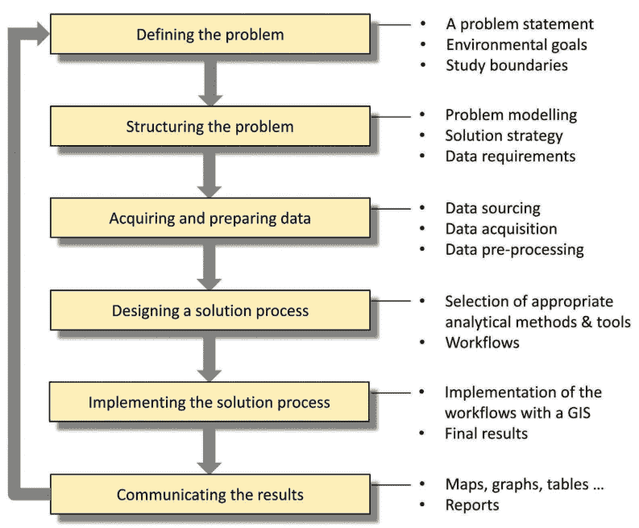

- 3 数据获取与准备
- 4 解决方案设计
- 5 解决方案实施
- 6 结果传达

#### 1.4.1 问题定义

使用 GIS 定义和理解要研究的问题是一个关键步骤。对问题的清晰理解可以带来找到可接受解决方案或得出结论的成功。当一群人参与问题求解时，需要就问题定义达成共识。问题定义包括制定问题陈述、阐明目标和建立研究边界。问题陈述以清晰简洁的方式概括问题。目标关注问题求解过程成功结束时应是什么样子。

GIS 分析还需要建立一组空间和时间边界。空间边界定义了研究要进行的区域以及用于分析的面积单位（例如，农场层级、郡或县层级或流域层级）。不同的面积单位可能导致所关注地理特征的不同测量特征。例如，当以森林整体而非林班为基础管理木材时，产量更高且更一致。时间边界定义了分析所覆盖的时期，以及是重建过去、观察当前、预测未来，还是考察时间变化和趋势。

例如，Woori Yallock 流域是雅拉河流域的一个流域，位于澳大利亚墨尔本东北部。它覆盖面积 362 km²。该流域的主要管理问题包括本地植被丧失、河床和河岸侵蚀、水质恶化、杂草、鱼类障碍物以及维持河流流量。特别是，农业活动、农村住宅区和农村房产中的化粪池是水环境的主要点源和非点源污染源，对流域内河流和溪流的水质有显著影响。河岸植被可以作为过滤器，拦截沉积物、营养物和其他污染物，减少其进入溪流的运动。它还能保护河岸免受雨水、水流或牲畜造成的地表侵蚀，帮助晾干并加固岸边土壤以防止开裂和滑塌，并维持自然的光照强度和水温，以保障健康的河内生态系统。然而，流域河流系统的许多部分没有自然植被缓冲带保护，且水质标准意味着该河流在河流健康等级上排名相当低。识别易受污染威胁的河岸带关键区域是解决这些环境问题并为该流域制定水资源管理和生物多样性保护策略的第一步。问题陈述可以如下拟定：

> Woori Yallock 流域河流系统的许多部分易受相邻土地利用和化粪池污染的威胁，需要识别这些部分以进行河岸植被种植或恢复。环境目标是保护和维护水质和生物多样性。空间边界是整个流域，时间边界是当前。

问题陈述反映了一种特定的观点或研究聚焦，并与在问题情境中采取有目的的行动相关。有目的的行动是指个人或团体的深思熟虑、决定或意志行动。因此，问题陈述说明了感知问题的某些方式。在许多情况下，需要通过各种方式收集信息来定义问题，包括文献综述、访谈、焦点小组和统计。

#### 1.4.2 问题结构化

只有在问题得到适当且明确的结构化后，才能使用 GIS 解决问题。关键在于先理解问题结构，而非一味套用现成的 GIS 工具和空间数据。问题结构化是一个过程，旨在对特定问题的组成部分有足够的理解，以便采取具体的研究行动。在问题求解中广泛使用的两种主要问题结构技术是：分解和建模。

问题结构化的分解方法（Smith 1989）表明，复杂问题可以分解为几个子问题，这些子问题复杂性较低，可以分别解决（“分而治之”）。在获得每个子问题的结果后，将它们集成到一个解决方案中。给定一种将问题分解为有限个简单子问题的方法，分解式结构化有助于识别成功的解决方案。

建模方法将问题结构化视为建模的一部分或前奏（Woolley 和 Pidd 1981）。建模包括问题正式表征的开发，随后对该表征进行操作和求解，并将结果应用于原始问题。问题结构化本质上是一个识别一组元素以构建问题模型的过程。随后，建模包括定义元素之间的关系。定义问题元素及其相互关系即得出模型的组成部分。建模方法也暗示了一种解决策略。通常在基于问题模型的表征和结构化中使用图形，因为问题模型的图形表征直观且决策者易于理解。这里介绍了 Zhu (1997) 提出的用于问题结构化的空间影响图概念。

空间影响图是一个由节点和无环的有向弧组成的图。图中的节点表示与特定问题相关的变量或因素，节点之间的有向弧表示变量之间的影响、依赖或相关性。节点有三种类型：偶然节点、值节点和边界节点。值节点表示求解问题的预期结果。偶然节点表示变量，这些变量（直接或间接）影响预期结果，并能够计算出一个结果的


值节点。边界节点代表与可用或可获取数据对应的变量。

图 1.14 是构建的空间影响图，用于梳理在乌里亚洛克集水区识别河岸带关键区域的问题。为了在视觉上区分三种类型的节点，值节点绘制为圆角矩形，机会节点绘制为矩形，边界节点绘制为椭圆。在此示例中，期望的结果是集水区中识别出的关键河岸带区域，即值节点。它将通过将划定所需宽度的河岸植被缓冲区与现有河岸植被缓冲区进行比较来推导。没有现有本土植被或现有本土植被宽度小于所需宽度的河岸区域为关键区域。河岸植被缓冲区的所需宽度取决于场地特征，包括坡度、土壤纹理和侵蚀性、流域面积、相邻土地利用和现有植被。因此，可基于这些场地特征和排水网络划定具有所需宽度的河岸植被缓冲区。现有河岸植被缓冲区基于现有植被和排水网络推导得出。坡度将从高程数据中推导，土壤纹理和侵蚀性来自土壤数据，相邻土地利用来自土地利用/覆盖数据，现有植被来自土地利用/覆盖数据，排水网络和流域面积来自水文数据和高程数据。

空间影响图汇集了问题考虑因素，并展示了它们之间的关系。它可以被视为问题模型，描绘变量间依赖关系的总体结构和性质。空间影响图不仅提供了一种以易于理解的方式展示问题组件及其关系的直观手段，还提供了一种有效的方法来识别信息流和“分析链”（即变量间的链接）。

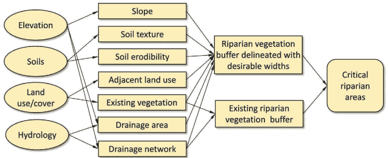

图 1.14 用于识别乌里亚洛克集水区河岸带关键区域的空间影响图。

使用空间影响图进行问题梳理可以从预期或期望的结果（即值节点）开始。也就是说，我们首先假设所寻求的结果已被找到。然后我们询问期望的结果可以从哪个先决条件推导而来。如果找到了先决条件，那么我们再询问该先决条件可以从哪个先决条件获得。此过程重复进行，直到达到数据节点或边界节点。原始问题的解是通过逆向遍历此过程到期望的结果来获得的。这种方法使我们能够避免让可用数据塑造最终结果的倾向。数据可用性应被视为问题制定的修正因素，而非最初驱动因素。整个过程应为迭代过程，并被视为一次探索之旅。在许多应用中，研究的知识领域实际上是一个系统，其特征是所有感兴趣变量之间具有丰富的交互和反馈。值节点的选择源于对问题的明确界定。中介变量也基于分析目的进行选择。

#### 1.4.3 获取和准备数据

通过问题梳理过程生成的空间影响图捕捉了问题的定义结构。它还识别了问题解决所需的数据。下一步是获取和捕获数据。数据获取和捕获涉及多个问题，包括空间数据获取方法、空间数据质量、空间分辨率或地图比例尺、空间数据模型、地理参照系统和空间数据时效性。

部分数据可能来自不同来源，而部分数据可能不存在。如果所需数据不存在，则需要使用第 3 章讨论的一种或多种空间数据采集技术来捕获它们。如果所需数据可从第三方获得，则必须评估数据质量。现有空间数据可能包含错误、失真或不确定性。第 3 章将讨论空间数据质量问题。

空间分辨率或地图比例尺决定数据的准确性以及数据中所表示地理特征的细节程度。一般而言，研究区域越小，所需细节越多，数据所需的分辨率越高或地图比例尺越大。相反，研究区域越大，所需的分辨率越低或地图比例尺越小。空间数据模型决定空间数据如何表示、结构化和组织。空间数据可以按离散地理实体或栅格单元组表示和组织。空间数据模型还决定空间数据在 GIS 中如何存储和操作。地理参照系统用于根据地图投影或投影坐标系定义空间数据中地理特征的位置。第 2 章将更详细地讨论所有这些概念。

获取空间数据时，还需要考虑数据的时效性或更新程度。在问题求解第一阶段定义的分析临时边界决定您的分析涵盖哪个时期，以及您是否需要 30 年前的数据、自 1980 年以来每五年一次的数据或当前最新的数据。所有上述与数据相关的问题都需要根据分析目的加以解决。不同来源的空间数据在时间和地理覆盖范围以及数据质量方面需要兼容。所有获取的数据在用于分析之前都需要进行处理，以具有相同的空间和时间边界、相同的空间分辨率、相同的地理参照系统以及与所使用的 GIS 软件兼容的数据格式。这可以通过使用 GIS 中的空间数据编辑和转换函数来完成，如第 3 章所讨论。

#### 1.4.4 设计解决方案流程

获取并预处理所需数据后，需要从 GIS 软件系统（或带有插件和外部专用建模软件）中选择适当的分析方法、工具、程序和模型。选择基于问题梳理阶段制定的问题模型。当使用空间影响图时，它从数据或边界节点开始，并跟随链接选择适当的 GIS 函数、工具或模型，以其前驱节点作为输入来推导每个机会节点或值节点的值。在此过程中，可以添加新的机会节点来表示即时结果，或者可以将机会节点分解为两个或多个新的机会节点，以便为每个链接使用单一的 GIS 函数、工具或模型。如果链接被标记为所选 GIS 函数、工具或模型的名称，则重新处理的空间影响图显示了从数据到结果的工作流程。它代表问题的解决方案流程。

以图 1.14 为例，我们可以使用坡度函数基于高程数据计算坡度；使用空间查询功能从土壤数据中推导土壤纹理和土壤侵蚀性；使用邻域功能基于土地利用/覆盖数据识别相邻土地利用；使用水文工具基于高程和水文数据划定流域面积和排水网络；使用缓冲区功能创建河岸缓冲区；使用空间查询功能从土地利用/覆盖数据中提取现有植被区域；使用叠加操作基于河岸缓冲区和现有植被生成现有河岸植被缓冲区；使用叠加工具结合坡度、土壤纹理、土壤侵蚀性、相邻土地利用、现有植被和流域面积，根据某些规则或预定义模型计算每个位置河岸植被缓冲区的所需宽度；使用缓冲区功能在排水网络周围生成具有可变所需宽度的河岸植被缓冲区，最后，使用叠加操作将具有可变所需宽度的河岸植被缓冲区与现有植被缓冲区相交。图 1.15 显示了该过程的结果。在此过程中，添加了一个新的机会节点“河岸缓冲区”。为了清晰和简单起见，某些节点被绘制多次，作为推导不同变量值的输入。


需要注意的是，不同的 GIS 软件包可能拥有不同的分析功能和工具集，可能对同一类功能使用不同的名称和不同的输入参数，并且可能对输入和输出的值施加不同的限制。此外，一个问题可以通过不同的 GIS 功能和工具组合来解决。因此，基于前面讨论的方法论题模型设计的解决过程并非唯一。不同的人可能通过选择不同的方法和工具集，为同一个问题提出不同的解决过程。但是，所选的方法和工具应当简单、有效、可靠，并适合该问题和目标。

#### 1.4.5 实施解决过程并传达结果

上一阶段设计的解决过程通过 GIS 软件实施，以产生预期结果。结果可以以地图和其他形式的空间可视化呈现，以图表和表格汇总，并在报告中以清晰、简洁、准确且易于理解的方式进行解释。随后，决策者将使用这些结果制定行动计划以解决问题，或者研究人员将使用这些结果进行进一步研究。

对于许多问题，最终阶段并非过程的结束，而是新一轮过程的开始，届时将重新审视问题，并对整个过程或其中部分进行迭代。该过程不仅具有迭代性，而且在每个阶段，人们还常常回顾上一步骤，重新评估所作决策的有效性。因此，在现实中，问题解决过程比步骤概述所暗示的更为复杂和迭代。

### 1.5 GIS 软件

#### 1.5.1 GIS 软件的类别

GIS 软件是 GIS 项目的重要组成部分。GIS 软件有多种不同的类型，范围从桌面 GIS 到服务器/云 GIS、移动 GIS、空间 DBMS 软件以及 GIS 软件库。

**桌面 GIS** 软件运行在个人电脑上，是使用最广泛的 GIS 软件类别。它在单用户环境下提供完整的 GIS 功能，采用标准的桌面用户界面样式（例如 Microsoft Windows），并可与其他桌面应用程序（例如 Microsoft Excel）协同工作。用户可以通过用户界面直接与软件交互，执行即席的 GIS 任务。使用桌面 GIS 软件时，所有数据和软件组件都位于一台个人电脑上，所有任务均在同一台电脑上执行。

顾名思义，**服务器 GIS** 软件运行在计算机服务器上，其功能可被远程网络用户访问和使用。它主要被软件开发人员和网页开发人员用于创建具有明确定义任务的 Web 和移动应用程序，例如路径规划、查找地址/地点、制图、地图发布和数据编辑。它还被用于构建地理门户，作为空间数据资源的入口。最简单的服务器 GIS 应用程序类型是 Web 或互联网映射系统，用于通过互联网提供或发布地图和/或图像，这些地图和图像可使用标准 Web 浏览器进行浏览和下载。更先进的服务器 GIS 系统允许将地图和图像与其他数据集和 Web 服务集成或混搭。新一代服务器 GIS 软件可以在多用户环境中提供完整的 GIS 功能，用于分布式空间数据编辑、管理、分析和可视化。它能够在组织或利益相关者群体之间共享 GIS 资源，并可部署在客户端-服务器分布式计算或云计算环境中。运行在云服务器或云平台上的 GIS 被称为云 GIS。

**移动 GIS** 软件运行在带有内置或外置 GNSS 的移动平台上，例如平板电脑或智能手机。它主要设计用于现场的空间数据采集和更新，具有定位、空间数据输入、空间数据传输、地图显示、要素编辑、地图查询和简单分析功能。某些移动 GIS 软件还提供连接到 GIS 服务器或 GIS 云服务器的链接，使现场收集的数据可以直接上传到服务器，并可通过无线网络即时访问和更新存储在服务器上的数据。

空间 DBMS 软件用于为组织（例如企业或政府）中的企业应用程序开发和管理大型空间数据库。但它们通常缺乏空间数据编辑、分析和制图功能。GIS **软件库** 是实现不同 GIS 功能的 GIS 软件组件集合，例如以不同数据格式读写空间数据集、执行制图投影（参见第 2.2 节）、生成缓冲区、叠加地图数据图层和生成等值线图。它们旨在供软件开发人员用于设计和构建特定的 GIS 应用程序。GIS 软件库不允许直接使用功能；它们只能嵌入到应用程序软件中。

表 1.1 列出了使用不同类型 GIS 软件可以执行的典型任务及其潜在用途。在此，我们将基本的 GIS 任务分类为数据采集、编辑、存储、查询、探索（查看和探索空间模式）、处理、分析和制图。数据编辑、存储和查询属于数据管理功能。我们还将互联网制图列为与服务器/云 GIS 分开的一个类别，因为其功能仅限于通过互联网提供地图。在某些应用中，不同类别的 GIS 软件会组合使用，或与用于数据库管理、统计分析和建模的其他软件一起使用。

#### 1.5.2 专有 GIS 软件

大量 GIS 软件包可商业或免费获得。专有 GIS 软件包是根据版权持有人的独占法律权利授权的商业产品。被许可人在特定条件下获得使用软件的权利，但限制其他用途，例如修改和进一步分发。其源代码几乎总是保密。专有 GIS 软件的价格通常从桌面软件的 $500 至 $1,500 不等，服务器产品则从 $5,000 至 $25,000 不等。虽然价格昂贵，但专有 GIS 软件通常打包成套、稳健、全面、文档齐全、定期且易于更新，并拥有可靠的专业服务和支持。以下是一些常用专有 GIS 软件包的简要介绍。

##### 1.5.2.1 ArcGIS

ArcGIS 是由 ESRI (www.esri.com/) 开发的一套全面的 GIS 软件产品。它包括 ArcGIS Desktop、ArcGIS Online、ArcGIS Platform、ArcGIS Enterprise 以及其他特色产品（例如 ArcGIS Indoors、ArcGIS Urban 和 ArcGIS Business Analyst）。

ArcGIS Desktop 专为 Microsoft Windows（简称 Windows）操作系统开发。但是，自 20 世纪 80 年代 ARC/INFO 推出以来，ArcGIS Desktop 软件已被大量用户群广泛采用。它是空间分析和建模的热门选择，因为它包含一系列广泛的分析功能，并提供脚本工具和应用程序编程接口 (API) 以添加用户开发的功能。已经开发了许多 ArcGIS Desktop 的扩展和插件，以纳入特定的空间分析和建模功能。

ArcGIS Desktop 包含五个组件，包括 ArcMap、ArcCatalog、ArcScene，

Table 1.1 Typical tasks that can be carried out with different types of GIS software

| | 采集 | 编辑 | 存储 | 查询 | 探索 | 处理 | 分析 | 制图 | 使用者 |
|:---|:---:|:---:|:---:|:---:|:---:|:---:|:---:|:---:|:---:|:---|
| 桌面 GIS | x | x | x | x | x | x | x | x | 个人用于 GIS 分析和制图 |
| 互联网映射 | | | | x | x | | | x | 网络用户用于访问和探索数据 |
| 服务器/云 GIS | x | x | x | x | x | x | x | x | 网络用户用于访问和使用作为远程服务的 GIS 功能，或软件开发人员和网页开发人员用于创建 Web 和移动 GIS 应用程序 |
| 移动 GIS | x | x | | x | x | | | x | 个人用于现场数据采集 |
| 空间 DBMS | x | x | x | x | | x | | | 企业用户用于管理大型空间数据库 |
| GIS 软件库 | | | x | | | x | x | x | 软件开发人员用于设计和构建特定的 GIS 应用程序 |


ArcGlobe 和 ArcGIS Pro。ArcCatalog 用于在计算机、数据库或其他来源上浏览和管理空间数据集和文件。它还允许用户在地图上预览空间数据集。ArcScene 用于创建 3D 地图，ArcGlobe 允许用户在地球表面以 3D 显示空间数据。ArcMap 和 ArcGIS Pro 是主要组件。ArcMap 用于查看、编辑、创建、操作和分析空间数据。其 ArcToolbox 包含一套广泛的空间数据操作和分析工具，以及 ARC/INFO 的大部分功能。ArcMap 于 2015 年被 ArcGIS Pro 取代，但将继续受支持直至 2026 年 3 月 1 日。ArcGIS Pro 包含 ArcMap 中可用的大部分功能，并结合了目录功能、3D 可视化和基于 AI 的高级分析工具。它可以用于同时可视化 2D 和 3D 数据、管理多个地图，并在 ArcGIS Online 和 ArcGIS Enterprise 之间共享数据。由于它正在取代 ArcMap 成为首选的桌面软件，ArcGIS Pro 被采用用于本书的插图以及书籍支持材料中的实践。实践 1.1 提供了 ArcGIS Pro 的指导之旅。

ArcGIS Online 是一个提供 SaaS 服务的云 GIS。它可用于开发 Web 映射和空间数据管理应用程序，并允许用户分析和共享空间数据。ArcGIS Online 地图和服务可以在任何联网设备上访问，包括桌面、移动和 Web 应用程序。用户可以使用 ArcGIS Desktop 软件制作自己的地图，或通过使用 Web 浏览器上传数据来简单创建地图。

ArcGIS Platform 是一个提供 PaaS 服务的云 GIS。它为开发者提供广泛的空间数据（包括底图）、映射库和位置服务（如路由和方向、地理编码和地点查找以及空间分析），以构建映射和分析应用程序，或将映射和位置服务添加到其产品、解决方案或业务系统中。

虽然 ArcGIS Online 为映射和分析提供了无需用户安装、设置和维护 GIS 软件的云 GIS 计算环境，但 ArcGIS Enterprise 是一款服务器 GIS，安装在单台服务器机器上，或跨组织控制和管理的众多机器进行扩展，无论是在云中、本地还是两者的混合体。它使组织对其部署拥有完全控制权，并允许集中管理和基于 Web 的 GIS 服务交付，用于分布式映射、空间数据管理、空间分析和建模。

### 实践 1.1 查看支持材料

在本次实践中，您将探索 ArcGIS Pro 软件环境。

##### 1.5.2.2 TerrSet

TerrSet（原名 IDRISI）是由克拉克大学 Clark Labs 开发的集成桌面 GIS 和遥感软件系统，运行在 Windows 平台上（https://clarklabs.org/）。自 1987 年以来，它在全球 180 多个国家广泛用于环境管理、可持续资源管理和公平资源分配。它包含一套全面的 GIS 分析工具，包括用于表面分析、统计分析、决策分析、变化和时间序列分析、数字图像处理工具包以及各种环境建模工具的工具，包括用于建模环境趋势时间序列的 Earth Trends Modeler、用于土地变化分析和预测的 Land Change Modeler、用于建模未来气候及其影响的 Climate Change Adaptation Modeler、用于评估自然资源价值的 Ecosystem Services Modeler、用于生境评估和生物多样性建模的 Habitat and Biodiversity Modeler 以及用于评估森林砍伐、碳排放、农业收入和碳支付的 GeOSIRIS。

##### 1.5.2.3 MapInfo Pro

MapInfo Pro 是由 Precisely（原 Pitney Bowes Software 和 MapInfo Corporation）生产的基于 Windows 的桌面 GIS 软件系统（www.precisely.com/）。它最初于 1986 年作为映射显示和分析系统（MIDAS）发布，1990 年被 MapInfo for Windows 取代，1995 年更名为 MapInfo Pro。MapInfo Pro 分布广泛，并广泛用于人口统计分析、业务和服务规划。MapBasic 和 Python 编程语言可用于为 MapInfo Pro 创建其他工具、新功能和自定义应用程序。它还允许用户通过 MapInfo Marketplace 访问自定义功能和附加功能，MapInfo Marketplace 是一个协作空间，用户可以在此下载和共享软件插件。

##### 1.5.2.4 GeoMedia

Hexagon Geospatial 的 GeoMedia 产品套件包括 GeoMedia Essentials、GeoMedia Advantage、GeoMedia Professional 及一组附加模块（www.hexagongeospatial.com/）。它是一款基于 Windows 的桌面 GIS 软件包。GeoMedia Essentials 允许用户执行空间查询、基于矢量数据进行基本空间分析并生成地图。GeoMedia Advantage 在 Essentials 的功能基础上增加了栅格数据处理和分析功能。GeoMedia Professional 提供 GeoMedia 的所有功能，并增加了空间数据捕获和编辑功能以及质量保证和验证工具。GeoMedia 有许多附加模块，例如用于 3D 可视化和分析的 GeoMedia 3D、用于图像处理的 GeoMedia Image、用于增强制图能力和 GIS 制图自动化的 GeoMedia Mapping Manager，以及用于交通基础设施分析和管理的 GeoMedia Transportation Manager。

##### 1.5.2.5 Maptitude

Maptitude 是由 Caliper Corporation 开发的桌面地图软件包（www.caliper.com/）。它在 Windows 操作系统下运行。该包具有桌面 GIS 软件的许多常见功能，并提供 MapWizard 用于专题制图以及 GIS 开发者工具包（GISDK）以使开发者能够扩展其功能并开发新应用程序。

##### 1.5.2.6 Azure Maps

Microsoft 的 Azure Maps 是一个提供 PaaS 服务的云 GIS（https://azure.microsoft.com/en-au/services/azure-maps/）。Azure Maps 服务允许用户将地图、时区、交通和天气信息以及高程数据添加到各种移动和/或 Web 应用程序中，并使用 Azure Maps 地理空间 API 为其应用程序提供路由和地点搜索功能。其数据服务可用于上传和存储客户自己的空间数据以供空间操作或图像合成使用，其空间服务可以快速分析位置信息，帮助用户了解正在发生的时空事件，从而实现事件的近实时分析和预测建模。

##### 1.5.2.7 Google Earth Engine

Google Earth Engine (GEE) 是一个云 GIS，为全球规模的空间数据和分析提供云计算平台（https://earthengine.google.com/）。它结合了一个多拍字节的卫星影像和其他空间数据集目录（包括环境和社会经济变量、天气和气候预报、土地利用/土地覆盖以及地形数据集），这些数据集与高性能的固有并行计算服务共置，并且每日更新和扩展（Gorelick et al. 2017）。GEE 允许用户以简单快速的方式可视化、处理、操作和生成空间数据。它还包含一系列广泛的空间数据操作和分析工具，供用户检测变化、绘制趋势图并评估地球表面的差异。此外，用户可以将自己的空间数据集上传到这个云 GIS 平台，并使用 JavaScript 和 Python 编程语言开发算法。

#### 1.5.3 开源 GIS 软件

在过去二十年中，越来越多的免费开源 GIS 软件包可供使用。这些软件包的源代码可供公众免费修改和重新分发。它们不收取许可费，并使用开放标准，便于与其他系统集成并易于定制。它们通常由一群有共同兴趣的社区开发和维护。但是，它们不提供专业支持且缺乏发布协调。尽管如此，开源 GIS 提供了独特的机会，以服务那些通过商业专有渠道难以（甚至不可能）满足的低成本高控制利基市场。以下是一些开源 GIS 软件包的简要摘要。


##### 1.5.3.1 GRASS

GRASS GIS 最初由美国陆军工程兵团开发，作为军队土地管理和环境规划的工具，现已成为开源地理空间基金会（OSGeo; http://grass.osgeo.org/）的官方项目。自 1982 年以来，GRASS 开发团队逐渐发展成为由世界各地众多地点的开发人员组成的跨国团队。该系统已发展成为一款在资源管理、环境规划和科学研究方面具有广泛应用的软件套件。GRASS GIS 目前在 GNU 通用公共许可证（www.gnu.org/licenses/gpl.html）下发布。它可在 Windows、MacOS 和 Linux 平台上使用。该系统包含超过 350 个模块和 100 多个附加模块，用于空间数据处理、地理编码、遥感数据处理与分析、空间分析与建模、制图和 3D 可视化。它还为统计软件包（如 R，一种用于空间统计的开源统计软件包及其扩展）、数据库管理系统（如 PostgreSQL 和 mySQL）以及环境建模工具（如 SWAT，土壤与水评估工具）提供接口。GRASS GIS 同时提供图形用户界面和命令行语法。

##### 1.5.3.2 GDAL/OGR

GDAL/OGR 是一个用于读取和写入不同数据格式空间数据的软件库，由 OSGeo 在开源许可下发布（www.gdal.org/）。该库附带多种用于空间数据转换和处理的命令行实用程序，可在 Linux、MacOS、Windows 及移动环境（Android 和 iOS）中使用。它支持超过 200 种数据格式，为空间数据交换提供了广泛的功能。GDAL/OGR 软件库已在商业和非商业 GIS 社区中广泛使用。

##### 1.5.3.3 QGIS

QGIS 是另一个 OSGeo 项目，同样在 GNU 通用公共许可证（http://qgis.org/）下开源。它提供基本桌面 GIS 功能，并支持许多空间数据格式，包括 ArcGIS 和 MapInfo 的非专有数据格式。QGIS 与其他开源 GIS 软件包（包括 GRASS 和 GDAL/OGR）集成，并提供由用户使用 C++ 和 Python 计算机编程语言开发的插件。其 QGIS Cloud 插件使 QGIS 用户能够在云端存储地图和数据，在互联网上发布地图和服务，并与他人共享空间数据。它还提供与 PostgreSQL 和 mySQL DBMS 的接口。该软件包可在多种平台上运行，包括 Linux、MacOS、Windows 和 Android。它由一群活跃的志愿开发人员维护。此外，它已发布 48 种语言版本。在过去十年中，它在学术和专业环境中越来越受欢迎，成为世界上使用最广泛的 GIS 软件系统之一。本书为 ArcGIS Pro 和 QGIS 用户提供了配套支持材料的实践内容。实践 1.2 对 QGIS 进行了引导式介绍。

### 实践 1.2 请参阅支持材料

在本实践中，您将探索 QGIS 软件环境。

##### 1.5.3.4 MapGuide 开源

MapGuide 开源是一个用于基于 Web 的制图和空间数据分发的服务器 GIS 软件包（http://mapguide.osgeo.org/）。它于 2005 年由 Autodesk（一家以 AutoCAD 软件产品系列闻名的公司）引入为开源软件，代码在 GNU 宽通用公共许可证（www.gnu.org/licenses/lgpl.html）下贡献给了 OSGeo。MapGuide 配备交互式地图查看器，支持地图浏览、要素选择、空间查询、缓冲区生成和测量。它包含一个 XML（可扩展标记语言，一种定义编码文档规则集的标记语言）数据库用于管理内容，并支持大多数流行的空间数据格式、数据库和标准。该软件可部署在 Linux 或 Windows 上，支持流行的 Web 服务器，并为应用程序开发提供广泛的 API。

##### 1.5.3.5 GeoTools

GeoTools 是一个使用 Java 编程语言编写的 GIS 软件库（www.geotools.org/）。它是 OSGeo 在 GNU 宽通用公共许可证下的另一个项目。它包含用于读取和写入多种数据格式空间数据集的 Java 包或软件模块，支持使用大量地图投影或投影坐标系进行地理参考和空间数据转换，基于空间和非空间属性对数据进行过滤和分析，显示地图并执行基于地图的查询。GeoTools 已被用于桌面和基于 Web 的制图应用程序。

### 1.6 摘要

- GIS 是一种用于收集、管理、处理、分析、展示和传达空间数据的计算机化系统。GIScience 是 GIS 技术背后的科学。
- GIS 由硬件、软件、数据、人员和程序组成。它通常由以下功能组件组成：空间数据输入、数据存储与管理、数据处理与分析、数据输出和接口。
- GIS 的根源在于计算机制图。自 20 世纪 60 年代以来，GIS 从一个简单的计算机制图系统发展成为具有空间数据库管理、先进空间分析与建模以及 3D 可视化的复杂计算机化系统，且 GIS 计算平台已从大型机发展到工作站和桌面机，再到分布式和云计算。
- GIS 以空间分布的方式处理空间过程和模式。GIS 应用可概括为三类：清查与监测、分析与建模、可视化与沟通。
- 使用 GIS 进行问题求解包括：(1) 定义问题，(2) 结构化问题，(3) 获取和准备数据，(4) 设计解决方案流程，(5) 实施解决方案流程，(6) 传达结果。
- GIS 软件种类繁多，包括桌面 GIS、服务器 GIS、云 GIS、移动 GIS、空间 DBMS 软件和 GIS 软件库。专有 GIS 软件是商业软件，由版权持有者的独占法律权利许可。开源 GIS 软件的源代码可免费获取，且无需许可费即可使用。

### 关键术语

- 缓冲区分析
- 制图数据结构
- 云 GIS
- 计算机制图
- 众包制图
- 决策分析
- 描述性分析
- 桌面 GIS
- 分布式 GIS
- 地理要素
- 地理信息系统（GIS）
- 地理信息科学（GIScience）
- 地理空间
- 地理参照数据
- 几何测量
- 地理配准数据
- 地理空间数据
- 全球导航卫星系统（GNSS）
- 影像分析
- 互联网制图
- 物联网（IoT）
- 移动 GIS
- 多媒体制图
- 网络分析
- 开源 GIS
- 叠加分析
- 照相机械制图
- 预测建模
- 专有 GIS
- 邻近度测量
- 场景分析
- 服务器 GIS
- 筛图法
- 软件库
- 空间数据
- 空间数据分析
- 空间数据输入
- 空间数据管理
- 空间数据处理
- 空间数据输出
- 空间实体
- 空间影响图
- 空间清查
- 空间测量框架
- 空间对象
- 空间查询
- 空间统计
- 表面分析
- 志愿者地理信息

### 复习问题

- 1 什么是 GIS？GIS 与其他类型的计算机化信息系统有何不同？
- 2 描述各个 GIS 功能组件。
- 3 描述 GIS 的三层架构。
- 4 描述 GIS 技术的发展历程。
- 5 什么是志愿者地理信息？
- 6 什么是分布式 GIS 和云 GIS？
- 7 讨论 GIS 在研究、管理和规划中的作用。
- 8 描述使用 GIS 进行问题求解的过程。
- 9 审查方框 1.1 中提出的案例研究。GIS 在哪些方面能提供帮助？在此案例研究中使用 GIS 的优势是什么？
- 10 在功能方面，桌面 GIS、互联网制图、空间 DBMS 和 GIS 软件库之间有哪些区别？

### 参考文献

- Berry, J.K. (1987) 《计算机辅助地图分析的基本操作》，《地理信息系统国际期刊》，1: 119–136。
- Bhat, M.A., Shah, R.M. 和 Ahmad, B. (2011) 《云计算：地理信息系统（GIS）的解决方案》，《计算机科学与工程国际期刊》，3(2): 594–600。
- Cao, K., Huang, B., Wang, S. 和 Lin, H. (2012) 《基于边界的快速遗传算法的可持续土地利用优化》，《计算机、环境与城市系统》，36(3): 257–269。
- Chang, N.B., Parvathinathan, G. 和 Breeden, J.B. (2008) 《将 GIS 与模糊多准则决策相结合以选址快速增长城市地区的填埋场》，《环境管理期刊》，87: 139–153。
- Chrisman, N.R. (1999) 《“GIS”是什么意思？》，《GIS 事务》，3(2): 175–186。
- Coppack, J.T. 和 Rhind, D.W. (1991) 《GIS 的历史》，载于 D.J. Maguire, M.F. Goodchild 和 D.W. Rhind（编）《地理信息系统：原理与应用》，第 1 卷。伦敦：Longmans Publishers，21–43。
- Cowen, D.J. (1988) 《GIS 与 CAD 与 DBMS：有何区别？》，《摄影测量工程与遥感》，54(2): 1551–1555。
- Crooks, A.T., Hudson-Smith, A.M., Milton, R. 和 Batty, M. (2009) 《众包空间调查与制图》，载于 D. Fairbairn（编）第 17 届英国地理信息系统研究会议论文集，英国：Durham University。
- Croswell, P.L. (2009) 《GIS 管理手册：规划、实施和管理地理信息系统项目与方案的概念、实践和工具》。Frankfort, KY: Kessey Dewitt Pubs。
- Dangerfield, J. (1983) 《地理信息系统中常用软件组件的分类》，载于 D. Peuquet 和 J. O’Callaghan（编）《计算机地理信息系统的设计与实现》，Amherst, NY: IGU Commission


关于地理数据感知与处理。

- Densham, P.J. (1991) ‘空间决策支持系统’, 在 D.J. Maguire, M.F. Goodchild 和 D.W. Rhind (编) 《地理信息系统：原理与应用》, 第1卷, 伦敦: Longmans Publishers, 403–412.

- Donnelly, A., Chambers, L., Keatley, M., Maitland, R. and Weatheril, R. (2011) 《气候见证者：NRM 物候学分散式全国观测网络 (ClimateWatch)》, 出版物编号 11/048, 堪培拉: Rural Industries Research and Development Corporation.

- Dueker, K.J. (1979) ‘土地资源信息系统：十五年经验回顾’, Geo-Processing, 1(2): 105–128.

- Dueker, K.J. and Kjerne, D. (1989) 《多用途地籍：术语与定义》, 弗吉尼亚州福尔斯教堂: American Society for Photogrammetry and Remote Sensing and American Congress on Surveying and Mapping.

- Forsyth, D.M., Barker, R.J., Morriss, G. and Scroggie, M.P. (2007) ‘粪便颗粒指数与鹿密度关系的建模’, Journal of Wildlife Management, 71(3): 964–970.

- Gatrell, A.C. (1991) ‘空间与地理数据概念’, 在 D.J. Maguire, M.F. Goodchild 和 D.W. Rhind (编) 《地理信息系统：原理与应用》, 第1卷, 伦敦: Longmans Publishers, 119–134.

- Giordano, L.D. and Riedel, P.S. (2008) ‘基于多规则空间决策分析的绿道划定：巴西圣保罗州里奥克拉罗市案例研究’, Landscape and Urban Planning, 84: 301–311.

- Goodchild, M.F. (1990) ‘地理信息系统与制图学’, Cartography, 19(1): 1–13.

- Goodchild, M.F. (1992) ‘地理信息科学’, International Journal of Geographical Information Systems, 6: 31–45.

- Goodchild, M.F. (2007) ‘公民作为传感器：众志地理世界’, GeoJournal, 69: 211–221.

- Gorelick, N., Hancher, M., Dixon, M., Ilyushchenko, S., Thau, D. and Moore, R. (2017) ‘Google Earth Engine：面向全民的行星级地理空间分析’, Remote Sensing of Environment, 202: 18–27.

- Greengard, S. (2015) 《物联网》, 马萨诸塞州剑桥: MIT Press.

- Harmon, J.E. and Anderson, S.J. (2003) 《地理信息系统的设计与实现》, 新泽西州霍博肯: Wiley.

- Hayes, B. (2008) ‘云计算：随着软件从本地个人计算机迁移到远程互联网服务器，用户和开发者都随之而来’, Communications of the ACM, 51: 9–11.

- Hodson, D. and White, J. (2010) ‘气候变化研究中GIS与作物模拟建模的应用’, 在 M.P. Reynolds (编) 《气候变化与作物生产》, 英国沃灵福德: CAB International, 245–262.

- Huang, Q., Yang, C., Benedict, K., Chen, S., Rezgui, A. and Xie, J. (2013) ‘利用云计算支持沙尘暴预报’, International Journal of Digital Earth, 6(4): 338–355.

- Hunsaker, C.T., Nisbet, R.A., Lam, D.C.L., Browder, J.A., Baker, W.L., Turner, M.G. and Botkin, D.B. (1993) ‘生态系统与过程的空间模型：GIS的作用’, 在 M.F. Goodchild, B.O. Parks 和 L.T. Steyaert (编) 《基于GIS的环境建模》, 纽约: Oxford University Press, 248–264.

- Kaivonen, S. and Ngai, E.C. (2020) ‘城市公交车载传感器的实时空气污染监测’, Digital Communications and Networks, 6(1): 23–30.

- Kepner, W.G., Semmens, D.J., Bassett, S.D., Mouat, D.A. and Goodrich, D.C. (2004) ‘圣佩德罗河情景分析：分析未来环境的水文后果’, Environmental Monitoring and Assessment, 94(1): 115–127.

- Longley, P.A., Goodchild, M.F., Maguire, D.J. and Rhind, D.W. (2015) 《地理信息系统与科学》, 第4版, 奇切斯特: John Wiley.

- Marble, D.F., Peuquet, D.J. and Calkins, H.W. (1984) 《地理信息系统基础阅读材料》, 纽约州威廉斯维尔: SPAD Systems.

- Miller, H.J. and Han, J. (编) (2009) 《地理数据挖掘与知识发现》, 第2版, 伦敦和纽约: Taylor & Francis.

- National Academy of Sciences (NAS) (1986) 《生态知识与环境问题解决：概念与案例研究》, 华盛顿: National Academy Press.

- Openshaw, S. (1998) ‘构建自动化地理分析与探索机器’, 在 P.A. Longley, S.M. Brooks, R. McDonnell 和 B. Macmillan (编) 《地理计算：入门》, 奇切斯特: Wiley, 95–115.

- Peuquet, T.K. and Chrisman, N. (1975) ‘制图数据结构’, The American Cartographer, 2(1): 55–69.

- Peuquet, D.J. (1984) ‘空间数据模型的概念框架与比较’, Cartographica, 21(4): 66–113.

- Phua, M.H. and Minawa, M. (2005) ‘基于GIS的景观尺度森林保护规划多准则决策方法：马来西亚沙巴州京那巴鲁地区案例研究’, Landscape and Urban Planning, 71: 207–222.

- Pielke, R.A., Baron, J., Chase, T., Copeland, J., Kittel, T.G.F., Lee, T.J., Walko, R. and Zeng, X. (1996) ‘利用中尺度模型模拟洛基山脉州的季节性天气和气候变化’, 在 M.F. Goodchild, L.T. Steyaert, B.O. Parks, C. Johnston, D. Maidment, M. Crane 和 S. Glendinning (编) 《GIS与环境建模：进展与研究问题》, 博尔德: GIS World Books, 99–104.

- Robinson, A.H., Morrison, J.L., Muehrcke, P.C., Kimering, A.J. and Guptill, S.C. (1995) 《制图学基础》, 第6版, 纽约: Wiley.

- Schluter, M. and Rugen, N. (2007) ‘应用基于GIS的模拟工具说明阿姆河三角洲水资源管理中不确定性的含义’, Environmental Modelling Software, 22(2): 158–166.

- Selva, D. and Krejci, D. (2012) ‘立方星地球观测能力的调查与评估’, Acta Astronautica, 74: 50–68.

- Seppelt, R. and Voinov, A. (2002) ‘基于空间显式景观模型的土地利用模式优化方法学’, Ecological Modelling, 151(2): 125–142.

- Smith, G.F. (1989) ‘定义管理问题：视角理论化的框架’, Management Science, 35(8): 963–981.

- Sui, D.Z. and Maggio, R.C. (1999) ‘GIS与水文建模的集成：实践、问题与前景’, Computers, Environment and Urban Systems, 23: 33–51.

- Swetnam, R.D., Fisher, B, Mbilinyi, B.P., Munishi, P.K., Willcock, S., Ricketts, T., Mwakalila, S., Balmford, A., Burgess, N.D., Marshall, A.R. and Lewis, S.L. (2011) ‘土地覆盖变化社会经济情景制图：支持生态系统服务建模的GIS方法’, Journal of Environmental Management, 92(3): 563–574.

- Tomlinson, R.F. (1967) 《加拿大土地清查地理信息系统导论》, 渥太华, 加拿大: Department of Forestry and Rural Development.

- Usmani, R., Hashem, I., Pillai, T., Saeed, A. and Abdullahi, A. (2020) ‘地理信息系统与大空间数据：综述与挑战’, International Journal of Enterprise Information Systems, 16(4): 101–145.

- West, H. and Horswell, M. (2018) ‘GIS 已改变！探索 ArcGIS Online 的潜力’, Teaching Geography, 43(1): 22–24.

- Wilson, J.P. (1996年1月21–26日) ‘基于GIS的地表/次表层模型：新模型的新潜力？’, 论文发表于第三届GIS与环境建模整合国际会议/研讨会, 新墨西哥州圣塔菲.

- Woolley, R.N. and Pidd, M. (1981) ‘问题结构化：文献综述’, Journal of Operation Research Society, 32: 197–206.

- Xu, Q., Wang, C., Dai, J., Guo, P., Zhang, G., Jiang, Y. and Shi, H. (2020) ‘基于AWS的棉花产量估算新模型’, 在 X. Zheng, G. Liu, M. Qiu, W. Xiang 和 T. Huang (编) 《云计算、智能电网与电信创新前沿 (计算机科学、社会信息学和电信工程研究所讲义)》, 沙门: Springer International Publishing, 468–484.

- Zhu, X. (1997) ‘面向知识型空间决策支持系统开发的集成环境’, Transactions in GIS, 1(4): 285–300.

- Zhu, X. and Dale, A.P. (2000) ‘基于软系统方法论的区域资源利用规划决策支持系统机会识别’, Environmental Management, 26(4): 371–384.


### 查看支持材料


实践 1.1 和 1.2 工作表可在网站的 **实践** 部分中找到。它们分别介绍 ArcGIS Pro 和 QGIS。实践 1.1 适用于 ArcGIS Pro 用户，实践 1.2 适用于 QGIS 用户。

两个实践的数据集可在 **数据** 部分中找到。

第 1 章的测验可在 **测验** 部分中找到，帮助您复习从本章学到的信息和知识。

## 第 2 章

## 空间数据与数据管理

本章讨论空间数据的性质；介绍地理参考、地理坐标系、地图投影和投影坐标系的概念；讨论在计算机中表示和管理空间数据的数据模型和数据结构，并简要介绍空间数据库和数据库管理。

### 学习目标

学习本章后，您应该能够

- 解释空间数据的特征；
- 使用对象视图和字段视图来概念化地理空间；
- 理解地图比例尺、地图概化及其对地理空间表示的影响；
- 理解在地理坐标系和投影坐标系中如何定义和测量空间位置；
- 为特定 GIS 应用程序选择合适的地图投影和投影坐标系；
- 识别并转换 GIS 中与空间数据相关的地理参考系统；
- 了解如何使用计算机表示、结构化和组织空间数据；
- 理解矢量和栅格表示之间的差异，比较它们的优缺点，并掌握空间数据如何在空间数据库中管理。

### 2.1 空间数据的性质

GIS 的独特之处在于其处理空间数据的能力。空间数据描述了在特定时间或某一期间内观察或测量的地理特征及其属性的空间分布。例如，图 1.1 所示的空间数据列出了自 1900 年以来发生在澳大利亚的一些滑坡记录。每条记录包括滑坡事件的日期、类型和位置。位置由地名和一组纬度和经度指定。使用纬度和经度的地理坐标（将在 2.2 节中讨论），每个滑坡都可以在地图上准确定位和绘制。滑坡的类型和地名可视为其两个属性。滑坡的日期是其时间维度。因此，空间数据由三个部分组成：位置、属性和时间。位置部分定义地理特征在地球表面的位置和形状，属性部分描述地理特征的属性或专题值，时间部分指定地理特征发生、被测量或观察的时间，或空间数据被收集的时间。

空间数据传统上以地图的形式记录、表示和存储。描述某地区政治、社会、经济、文化、环境和生态特征的空间数据，通常以一系列专题图表示，例如行政区划图、人口图、土地利用图、交通图、地籍图、土壤图、植被图、地质图和生态系统图。GIS 将地图作为空间数据的主要来源之一，作为表示和可视化空间数据的手段，以及作为结构化、组织、存储、管理和处理空间数据的概念框架。GIS 中的基本空间分析功能也很大程度上基于地图。尽管空间数据可能来自其他来源，如遥感、GPS、测量和采样，并可能表示各种类型的地理实体，但它们具有三个共同特征。首先，空间数据通常是“观察性的”而非“实验性的”（Haining 2009）。这意味着空间数据通常不是在受控条件下收集的。它们通过在自然环境或自然发生的情况下在某一位置进行的数据收集事件，来表征地理特征或一组地理特征的发生情况或属性。观察值不一定是独立的实体，并可能通过时间、地点、邻近性和共同发生的地理特征等特征相互关联。所有这些都影响空间数据的质量（将在 3.5 节中讨论）。

其次，空间数据通过特定的概念化和表示过程，以有限形式捕捉现实世界的复杂性。空间数据不可能也不切实际地捕捉现实世界的所有无限细节，并提供地理特征、其属性和空间变化的完美、完整表示。空间数据中表征的地理特征是根据对地理空间特定概念化方式进行选择、概化和表示的（将在本节后面讨论）。

第三，所有空间数据均根据与地球表面具有固定关系并考虑地球复杂形状的特定坐标系记录地理特征的位置。这种坐标系称为空间测量框架或地理参考系统。不同的地理参考系统可能基于对地球大小和形状的不同定义或规范建立（将在 2.2 节中讨论）。GIS 项目中的所有空间数据都必须进行地理参考并与已知的地理参考系统对齐，以便可以查看、绘图、查询、分析和集成。在空间数据能够适当地用于 GIS 问题解决之前，需要彻底理解这些特殊特性。

对象视图将地理空间概念化为由单个对象组成。例如，我们可以将城市的地理空间视为由许多离散对象组成，例如建筑物、街道、高速公路、铁路、河流和溪流、运动场和公园。根据对象的几何形状或维度，我们可以将对象分为点对象（如单个建筑物）、线对象（如街道和溪流）和面对象（如公园和运动场）。它们也被称为点要素、线要素和面要素。点要素发生在单个位置且没有可测长度，线要素具有可测长度，面要素具有可测面积。图 2.1 中的地图展示了德克萨斯州奥斯汀市中心一个城市区域的对象视图，其中小型建筑物使用点符号表示为点要素；街道、高速公路、铁路和溪流使用线符号描绘为线要素，而建成区、河流和森林区域使用面符号显示为面要素。对象视图中的所有对象都可以精确定位、具有明确界定的边界并且是可计数的。大多数可触知的自然和人文现象都可以用对象视图表示。基于对象视图的空间数据记录每个可识别对象的位置和属性。

#### 2.1.1 地理空间的概念化

地理空间有两种视图：对象视图和字段视图。对象

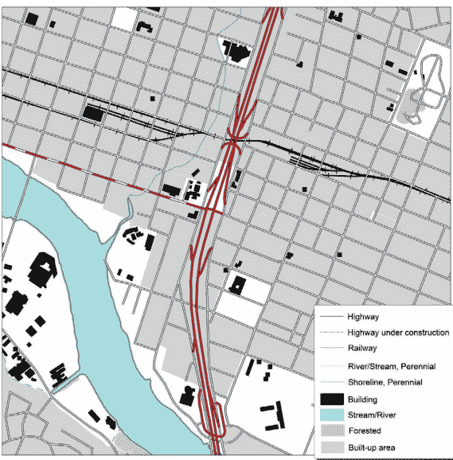

图 2.1 地理空间的对象视图。

但是，地理空间中的许多现象，例如地形、温度、人口密度和土壤 pH 值，无法用对象视图来概念化。例如，我们能否从图 2.2a 所示的地形表面识别出具有明确界定边界的单个离散对象？有高低之分，也有平缓和陡峭的斜坡。但是，我们如何划定它们的边界？将地形表面概念化为一组离散且可计数的对象并不有效。相反，我们将地形表面视为连续表面。这种视图代表字段视图。换句话说，字段视图将地理空间概念化为由连续表面覆盖，其属性值可以在每个位置定义。地理空间的字段视图可以使用等高线图表示，如图 2.2b 所示（等高线连接等值点），或使用栅格图（一组单元格，简称栅格）表示，如图 2.2c 所示。基于字段视图的空间数据将一个字段减少为有限数量的数据位，这些数据使用有限数量的记录属性的采样点来表示表面，并可从中插值等高线，或使用单元格网格，其中单元格值表示属性。构成栅格的单元格通常是大小相等的正方形。（我们将分别在 2.3 节和 5.5 节讨论栅格和插值。）遥感影像实际上提供了其覆盖区域的字段视图。将地理空间概念化为字段还是对象，很大程度上由属性决定。

#### 2.1.2 地图比例尺与空间分辨率

基于对象视图或字段视图的任何地理表示都必须是现实的缩减。河流、湖泊、道路和森林等地理特征在地图或影像上必须按比例缩小显示，因为纸张或计算机屏幕的尺寸非常有限。现实世界与其地图或影像表示之间的缩减量称为地图比例尺。地图比例尺也称为代表分数。它定义为地图或影像上的距离与地面上对应距离的比率。例如，在 1:100,000 比例尺的地图上，地图上的 1 厘米等于地面上的 1 千米。这也意味着地图上对象的大小是其在地面上大小的 1/100,000。地图比例尺常常被混淆或错误理解，可能是因为地图比例尺越小，参考数字越大，反之亦然。例如，1:100,000 被认为比 1:250,000 是更大的比例尺。


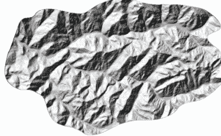

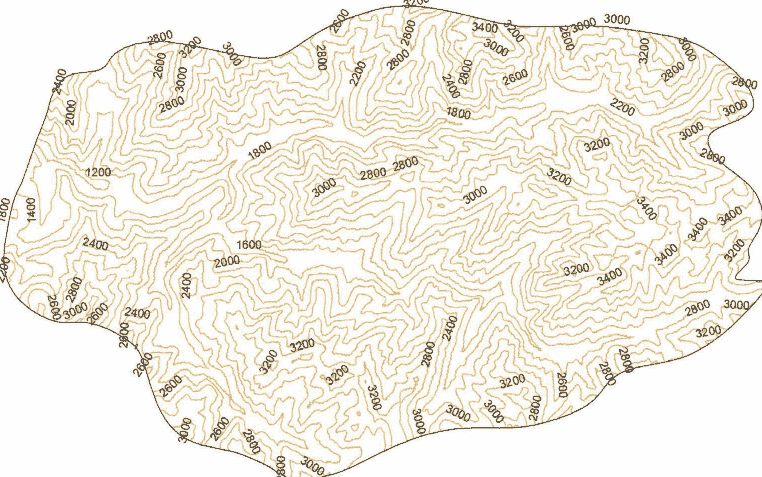

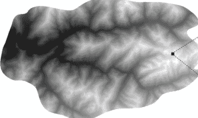

| 3360 | 3360 | 3354 | 3360 | 3368 | 3365 | 3376 | 3401 | 3408 | 3435 |
| --- | --- | --- | --- | --- | --- | --- | --- | --- | --- |
| 3360 | 3360 | 3360 | 3360 | 3374 | 3385 | 3387 | 3410 | 3410 | 3417 |
| 3360 | 3360 | 3360 | 3360 | 3375 | 3390 | 3395 | 3410 | 3429 | 3439 |
| 3360 | 3360 | 3360 | 3360 | 3375 | 3391 | 3402 | 3414 | 3432 | 3447 |
| 3360 | 3360 | 3360 | 3362 | 3376 | 3376 | 3404 | 3402 | 3432 | 3450 |
| 3351 | 3360 | 3360 | 3362 | 3377 | 3391 | 3404 | 3417 | 3417 | 3441 |
| 3333 | 3338 | 3352 | 3352 | 3353 | 3390 | 3400 | 3400 | 3418 | 3422 |
| 3313 | 3313 | 3317 | 3341 | 3353 | 3363 | 3383 | 3391 | 3397 | 3400 |
| 3292 | 3292 | 3312 | 3319 | 3319 | 3352 | 3350 | 3356 | 3358 | 3367 |
| 3260 | 3281 | 3300 | 3307 | 3316 | 3326 | 3337 | 3337 | 3353 | 3358 |

图 2.2 地理空间的场视图。

空间数据均在某一地图比例尺下被捕获或收集。地图比例尺越小，能够被捕获和表示的地理要素及其细节就越少。例如，宽度小于 100 m 的河流，在地图比例尺为 1:100,000 的地图上只能用一条单线表示，河岸的所有细节都将丢失。地图比例尺也决定了地图上测量的精度。地图比例尺越大，对地理要素位置、距离、面积、周长、形状及其他特征的测量就越准确；地图比例尺越小，测量就越不准确。随着比例尺减小，地图会变得更加抽象。图 2.3 展示了新加坡东北部的小岛乌敏岛（Pulau Ubin），以两种不同比例尺绘制。该岛以 1:50,000 比例尺绘制的海岸线显示了许多小型特征，而在 1:1,000,000 比例尺的地图上这些特征被平滑处理了。比例尺较小的地图只显示了岛屿的大致轮廓。显然，与比例尺较小的地图相比，在比例尺较大的地图上可以更准确地测量海岸线长度和岛屿面积。随着地图比例尺增大，可以揭示更多海岸线细节，并进行更精确的测量。当基于场视图使用栅格表示地理要素时，网格单元被独立于底层场及其表面变化而铺设。单元内的所有空间变化都会丢失。表面要素被捕获的程度取决于单元大小与表面变异性之间的关系。因此，使用栅格对连续表面进行离散化的过程会导致表面变异性信息的丢失。较大的网格单元会造成更多变异性细节的损失。单元的大小称为 **空间分辨率**。如果栅格的单元大小为 10 m × 10 m，则其空间分辨率据说为 10 × 10 m。在这样的栅格中，小于 10 × 10 m² 的地理要素可能不会显示。在空间分辨率为 100 m 的卫星图像中，任何小于 100 m × 100 m 的地理要素都无法辨别。单元大小越小，空间分辨率越高。地图比例尺和空间分辨率都决定了空间数据的精度以及空间数据中包含的信息量。

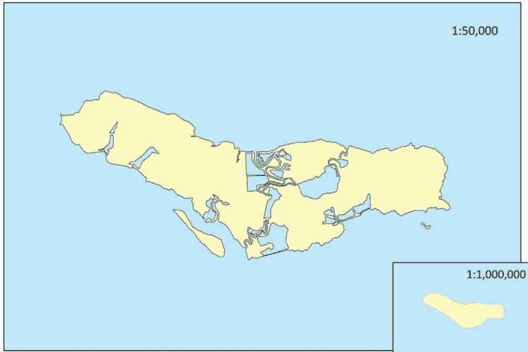

图 2.3 不同比例尺下的乌敏岛（Pulau Ubin）

#### 2.1.3 地理要素的概化

在某一地图比例尺或特定空间分辨率的栅格网格上表示现实世界现象，意味着地理要素必须进行概化或简化。如前所述，在地图显示介质的有限空间内，不可能完整表示所有地理要素及其复杂细节。相反，会选择与地图主题和目的最相关的最重要地理要素及其属性，并以适应地图比例尺并保持所绘制现象的区别特征和空间模式的方式进行表示。这一过程称为 **制图概化** 或抽象。制图概化涉及地理要素的选择、简化、夸张、合并、位移和分类。

选择是指根据地图的主题和目的，选择和保留重要、相关且必要的、并能根据地图比例尺识别的地理要素，同时消除不重要、不必要且无法识别的要素的过程。例如，如图 2.3 所示，1:50,000 比例尺地图包括乌敏岛上的小湖泊和近海岛屿，而 1:1,000,000 比例尺地图则将其移除，因为它们在如此小的比例尺下无法表示。一般来说，大比例尺地图保留的地理要素比小比例尺地图更多。另一个例子是，为规划目的设计的给水管网地图可能只显示干管和消防栓，而省略网络中的其他水管、水表、管件、阀门、储水罐及其他设施。选择也可能受地理条件的影响。例如，水井是沙漠和半沙漠地区地形图上的重要要素。然而，在水源充足的地区，它们不重要，因此通常不会在这些地区的地形图上表示。

简化旨在精简所选地理要素的形状，以增强可解释性并降低复杂性。它涉及沿地理要素边界移除或平滑不重要和不必要的细节，例如河流、道路、海岸线和森林林分边界上的小角度转弯，如图 2.4a 所示。小比例尺地图的要素比大比例尺地图更简化、更平滑，图 2.3 中乌敏岛的海岸线清楚地说明了这一点。简化还涉及降低地理要素的维度。一条在大比例尺地图上可以真实表示宽度的大河，可以被描绘为面状要素，但在小比例尺地图上必须表示为线状要素，因为其宽度无法在地图上绘制和测量。一个城市可以在大比例尺地图上表示为面状要素，并可绘制其边界，但在小比例尺地图上则被简化为点状要素。

夸张用于保留和放大一些在地图上无法按比例绘制的小型但重要的要素。只有非常大比例尺的地图才能在不显著放大的情况下显示道路、建筑物和小溪等要素。夸张的目的是增强或强调地理要素的重要特征。例如，海岸的一段可能包含许多小海岬和弯曲的入海口，这些在小比例尺地图上无法表示。如果全部移除，这段海岸线可能变成一条直线。为了保持海岸线的真实特征，会选择一些能够表征其形状的海岬和入海口，以放大形式表示。在图 2.4b 中，一条陆连岛通过狭窄的沙嘴与大陆相连。沙嘴太窄，在小比例尺地图上无法表示。但是，移除沙嘴会使陆连岛变成一座不相连的岛屿。为了将其显示为真正的陆连岛，沙嘴在小比例尺地图上被放大。

合并是指当同一类地理要素之间的间距过窄无法在地图上显示，或它们的分离与地图目的无关或不必要时，将其合并。例如，小城市街区被合并为大城市街区，如图 2.4c 所示。合并减少了被绘制的地理实体数量。因此，由于比例尺限制，合并后的实体不是地理要素的精确描绘。

当不同类的地理要素（例如高速公路和铁路）在小比例尺地图上过于接近而无法分开，但又必须能够区分时，需要进行位移。它涉及对这些要素进行微小的位置移动，同时尽量减少位置精度的损失，避免重叠和交叉，并保持其一般的定义特征，包括形状、方向、平滑度和分布模式。图 2.4d 给出了一个示例。

分类旨在根据地理要素的属性和属性值对其进行分组——例如，根据土壤类型对农田进行分类，或根据人均 CO2 排放量对世界首都进行分组。分类属性（如土地利用类型和土壤类型）通常被分组为类和子类。例如，农业和定居点是土地利用的两个类。农业可以进一步分为子类，如作物种植、人工林经营、牧场和园艺。定居点可能有两个子类：城市定居点和农村定居点。作物种植可以进一步分为子类，如谷物、油料作物、棉花和烟草。湿地可能有四个子类：泥炭沼泽、沼泽、沼泽地和湖泊。制图涉及选择某个分类方案来对地理要素进行分类


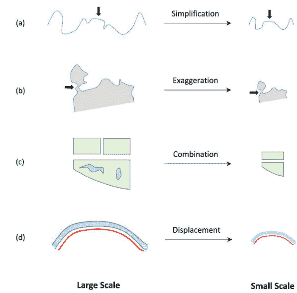

**图 2.4** 地理要素概化。

按照其属性，然后使用不同颜色或符号来表示不同的类别。

对于数值属性，地理要素组是根据其属性值的范围来定义的。例如，人均每年二氧化碳排放量的数值可以分为六个范围，也称为类别：<2、2–5、5–10、10–15、15–20 和 ≥20 t。我们不是使用 150 种不同颜色或 150 种单色深浅来绘制世界上 150 个国家的二氧化碳排放量，而是首先根据人均每年二氧化碳排放量将 150 个国家分组为前面列出的六个类别。然后，同一类别中的国家使用同一种颜色的同一深浅进行绘制。生成的地图以六种不同颜色深浅展示了全球二氧化碳排放的模式，易于理解，并能很好地服务于地图的目的。根据数值属性值对地理要素进行分类的方法有多种，将在第 4.2 节中详细讨论。

分类过程是处理细节需求的自然结果。然而，不同的数据分类方式会在地图上导致不同的模式。此外，不同比例尺的地图具有不同详细程度的分类。较大比例尺的地图可能显示更多详细类别，而较小比例尺的地图则涉及将地理要素的属性重新分类为较少数量的宽泛类别。例如，谷物、油料作物、棉花和烟草可以在大比例尺地图上绘制，但必须合并为单一的更宽泛的“耕作”类别，才能在小比例尺地图上表示。在大比例尺地图上，农村聚落可以按人口分为四个类别：<100、100–500、500–1,000 和 ≥1,000 人。然而，在小比例尺地图上，它们可以简化为两个类别：<500 和 ≥500 人。

不难理解，一些制图概化方法会在地图的形式和构成上产生剧烈变化（例如选择和分类），而其他方法则产生更微妙的变化（例如简化和位移）。因此，需要注意的是，由于比例尺限制，从地图或图像中捕获的所有空间数据都并非完美，而是地理要素的概化和简化表示。每个空间数据集都包含一定数量的地理要素细节，这些细节对应于其被捕获时的地图比例尺或空间分辨率。空间数据中地理表示的精度不会优于其源自的源地图或图像，并且由原始地图比例尺和空间分辨率决定。同样有必要理解，除了地图比例尺外，制图概化还受现实、地图目的、可用数据的质量和数量、受众、使用条件和技术限制的影响（Robinson et al. 1995, p. 458）。

### 2.2 地理参照系统

空间数据使用特定地理参照系统定义的地理参照来记录地理要素的位置。地理参照（也称为地理编码）是对地球表面位置的引用。将地理参照分配给地理要素的过程称为地理参照，或地理编码。尽管街道地址、地名、邮政编码和管辖边界均可用作指定位置的地理参照，但基于从固定位置的距离度量来定义位置的度量地理参照系统在 GIS 中最为基础。只有度量地理参照系统才允许制作地图并计算距离和其他空间关系。度量地理参照系统是一个坐标系统。GIS 中常用的度量地理参照系统主要有两类：地理坐标系统和投影坐标系统。两者均基于地球的形状建立。

#### 2.2.1 地球的形状

地球并非平坦，而是一个近似球形物体，与该形状存在一些偏差。对于许多制图应用，地球的大小和形状使用椭球体或球面近似，该球面是通过绕其较短轴（与地球自转轴对应）旋转椭圆形成的。球面（也称为扁球体）通常用三个基本参数定义：长半轴、短半轴和扁率，如图 2.5 所示。扁率表示短半轴相对于长半轴的减少量。

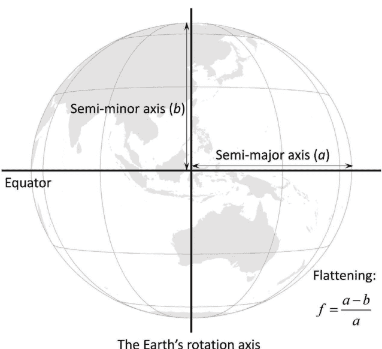

图 2.5 球体的定义。

使用各种球面来近似地球的大小和形状。表 2.1 列出了不同国家使用的一些主要球面。1984 年世界大地测量系统（WGS 1984）球面是最新且广泛采用的，但许多其他球面在某些国家仍在使用，并且仍与旧的空间数据一起使用。

表 2.1 地球主要球体

| 名称 | 长半轴 (m) | 短半轴 (m) | 扁率 |
| :--- | :--- | :--- | :--- |
| Airy 1830 | 6,377,563.396 | 6,356,256.90923729 | 1/299.3249646 |
| Bessel 1841 | 6,377,397.155 | 6,356,078.963 | 1/299.1528128 |
| Clarke 1866 | 6,378,206.4 | 6,356,583.799999 | 1/294.9786982 |
| Helmert 1906 | 6,378,200.0 | 6,356,818.16962789 | 1/298.3 |
| International 1924 | 6,378,388.0 | 6,356,911.94612795 | 1/297.0 |
| Krassowski 1940 | 6,378,245.0 | 6,356,863.01877305 | 1/298.3 |
| Australian National | 6,378,160.0 | 6,356,774.719 | 1/298.25 |
| GRS 80 | 6,378,137.0 | 6,356,752.31414036 | 1/298.257222101 |
| WGS 1984 | 6,378,137.0 | 6,356,752.3142 | 1/298.257223563 |

定义球面后，会确定其相对于地球的位置和方向，以便最贴合地球表面。地球参考球面的规格及其在 3D 空间中的位置和方向构成大地基准。大地基准为在地球表面测量位置提供了参考框架，并作为地理坐标系统的基础。

#### 2.2.2 地理坐标系统

地理坐标系统是通过在地球球体周围放置经纬网来建立的，经纬网由子午线和纬线组成。子午线是地球表面上虚构的大椭圆的一半（球体与穿过球体中心点的平面的交线），在北极和南极汇聚。1884 年，在华盛顿特区举行的国际子午线会议决定，将穿过英国格林威治皇家天文台地面标记线的子午线设为 **本初** 或 **零子午线**。 **纬线** 是垂直于子午线的虚构线，沿赤道方向环绕地球表面。经纬网决定了地球表面位置的纬度和经度（图 2.6）。

对于地球表面上的特定点 P，其 **经度** 由赤道平面内本初子午线与其所在子午线之间的角度定义。其 **纬度** 是子午线平面内赤道与穿过该点并在该点垂直于球面表面的直线之间的角度。这条直线在极点和赤道处穿过球体中心，除这些位置外，距球体中心几千米。纬度和经度以度、分、秒为单位进行测量。本初子午线的经度为 0°，其对应子午线（地球另一侧）的经度既为 180°W（西）也为 180°E（东）。由这两条子午线形成的大椭圆将地球分为西半球和东半球。本初子午线以东（东半球）的子午线经度范围为 0° 至 180°E，而本初子午线以西（西半球）的子午线经度为 0° 至 180°W。

赤道的纬度为 0°。它将地球分为北半球和南半球。北极的纬度为 90°N（北），南极的纬度为 90°S（南）。因此，北半球某位置的纬度范围为 0° 至 90°N，南半球某位置的纬度范围为 0° 至 90°S。在 GIS 中，为了简化地理坐标的计算和存储，纬度的度数在


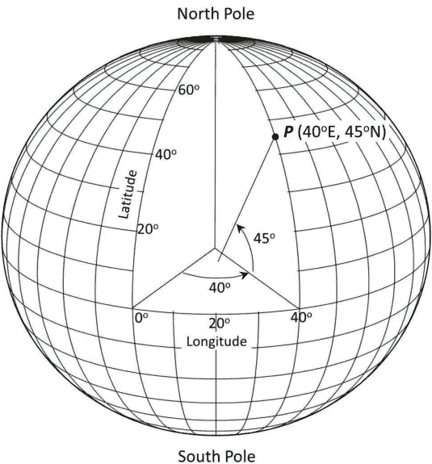

图 2.6 地理坐标系。

南半球和西经度数被赋予负值。另外，纬度和经度以十进制度数存储——即，分和秒以十进制值表示。

经度和纬度是地理坐标。它们可以唯一定义地球表面上的任何位置。然而，它们依赖于大地基准，该基准指定参考椭球体及其相对于地球的位置和方向。世界各地有数百个局部或区域开发的大地基准，例如澳大利亚大地基准 1994 (GDA94)、北美大地基准 1983 (NAD83)、欧洲大地参考系统 1989 (ETRS89)、中国大地测量坐标系 2000 (CGCS2000) 和新加坡大地测量 21 (SVY21)。它们各自都为大地水准面的局部区域提供了椭球体的最佳拟合，大地水准面是一个由平均海平面近似的三维曲面。大地水准面的形状受地球质量、自转和重力异常的影响，从而形成一个高度不规则的曲面。因此，局部或区域大地基准可能极好地适应局部区域，但在世界其他地区可能对大地水准面的近似较差。因此，地球上的某个特定点可以根据用于测量的大地基准具有显著不同的地理坐标。

当代大地基准基于对地球形状日益精确的测量，旨在最佳拟合整个地球，不偏向地球上的任何特定区域，例如基于 WGS 1984 参考椭球体的 WGS84 大地基准，以及基于 GRS80 参考椭球体的 GDA。对地球大小、形状和大地水准面的研究是大地测量学。大地测量学的全面介绍可见 Torge and Müller (2012)。作为用户，我们不需要了解太多大地测量学知识就能有效地使用 GIS。但是，我们必须确保所有数据都基于相同的椭球体和大地基准，以便地理坐标在相同的参考框架中进行测量。因此，GIS 用户可能需要在大地基准之间进行转换，GIS 软件包中通常提供相关功能。

地球。尽管地球具有球形表面，但地图页和计算机屏幕是二维平面。平面地图如何用于描述地球表面的位置？一种常见的方法是系统地将地球的球形表面转换为二维平面。这种转换称为 **地图投影**。转换后，建立一个 **平面坐标系**，它将纬度和经度（非线性度量）转换为正交笛卡尔 (_x_, _y_) 坐标（线性度量）。基于地图投影建立的平面坐标系称为 **投影坐标系**，也称为 **平面坐标网格**。

### 2.2.3 投影坐标系

地理坐标是球面坐标。它们为描述地球近似球形表面上的位置提供了一个方便的参考系统。

##### 2.2.3.1 地图投影

地图投影涉及将地球表面数学地投影到平面或可通过切割变为平面的表面上。这种表面称为 **可展曲面**。地图投影中常用的可展曲面包括圆柱、圆锥和平面，它们对应三类地图投影：圆柱投影、圆锥投影和方位投影（平面）。概念上，地图投影是通过在光源置于地球中心，然后将地球表面的图像投影到可展曲面上，再将可展曲面切开并铺平（平面本身已经是平坦的）来创建的（图 2.7）。

> **实践 2.1 查看支持材料**
>
> _在本实践中，你将学习如何获取特定空间数据集所使用的地理坐标系和大地基准的信息，如何在地理坐标系之间进行转换，以及如何使用 ArcGIS Pro 或 QGIS 为空间数据集分配地理坐标系。_

图 2.7 说明了最简单的地图投影，其中可展曲面沿一条纬线与地球表面相切（用于圆柱投影和圆锥投影），或在一个极点处相切（用于方位投影，此处为北极）。这些投影称为切线投影。接触线称为标准纬线或标准线。接触点称为标准点。沿标准纬线和标准点处比例尺保存得最好。在地球表面被投影到可展曲面后，可展曲面（方位投影中使用的平面除外）沿特定子午线切割，以形成最终投影。切割线相对的子午线称为中央子午线。地图投影也可以通过可展曲面与地球表面相交来制作，由此产生的投影称为割线投影（图 2.8）。割线圆柱和圆锥投影有两条标准纬线，而割线方位投影有一条标准纬线。圆柱投影将子午线和纬线投影为直线，圆锥投影将子午线投影为在圆锥顶点交汇的直线，将纬线投影为圆弧，而方位投影将子午线投影为在接触点汇聚的直线，将纬线投影为同心圆。

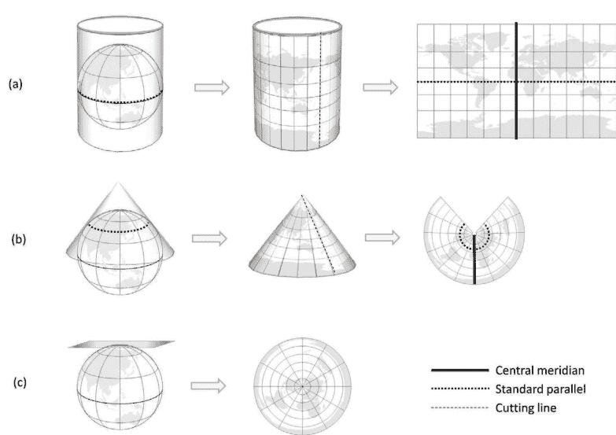

图 2.7 地图投影：(a) 圆柱投影，(b) 圆锥投影和 (c) 方位投影。

前述投影将可展曲面的轴与地球极轴或旋转轴对齐，通常称为正轴投影。当可展曲面的轴与地球极轴垂直时，地图投影可以是横轴投影；当轴处于任何其他角度时，则是斜轴投影（见图 2.8）。在横轴和斜轴投影中，子午线和纬线被投影为复杂曲线。

标准线或接触点处没有任何类型的变形。变形随着与接触点或线的距离增加而增加。例如，在正轴切线圆柱投影中，赤道上所有位置都没有变形。点离赤道越远，其变形越大。

##### 2.2.3.2 地图投影中的变形

正如你可能预料的那样，所有地图投影都涉及空间变形，这些变形对地球的三维曲面进行了错误表示。变形可能发生在方向、距离、面积或形状方面。一般来说，存在

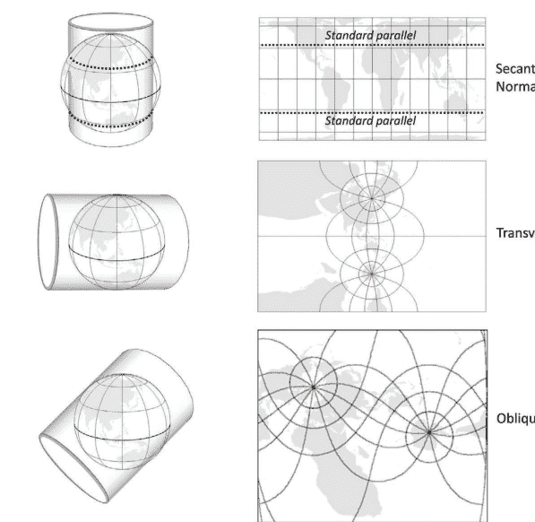

图 2.8 割线、正轴、横轴和斜轴地图投影。

尽管变形在所有投影中都是固有的，但地图投影可以通过牺牲另一个属性来准确地描绘一个空间属性——也就是说，保存属性之一：方向、距离、面积或形状。保存局部形状的地图投影称为等角投影。在等角投影中，投影平面或地图上线条之间的角度与地球弯曲表面上原始线条之间的角度相同。换句话说，任何给定点周围的正确方向都得以保持。因此，投影的子午线和纬线以直角相交。等角投影保持小区域的正确形状，例如湖泊、蜿蜒河流的一部分或绿带区域，但不保持较大区域的形状。这种类型的地图投影适用于天气图、航海图、地形测绘和大比例尺测量。

保存面积的地图投影称为等面积或等积。在 **等积投影** 中，地图上地理要素的面积与地球曲面上相应要素的面积（按比例尺）相等。等积投影允许对地球表面任何部分的面积进行准确测量，适用于那些相对大小和面积精度很重要的地理要素制图，以及一般专题制图，例如人口密度、土壤、植被、土地利用和地质图。

如果地图投影从投影中心或沿一条或几条线（可以是直线或曲线）上的点之间保持正确距离，则称为 **等距投影**。例如，在等距方位投影中，地图上的所有点都与中心点具有正确的距离。在等距圆柱投影（也称为等距矩形）中，真实距离沿子午线表示。没有地图投影可以对地图上的所有点保持等距。等距地图投影通常用于航空和海事航海图以及无线电和地震测绘。

特定地图投影可以是等角、等积或等距。但是，没有投影可以同时既是等角又是等积，或者既是等距又是等积。每种投影都是一种折衷，最适合特定目的。此外，没有地图投影可以在整个地图上保持正确的比例尺，因为无法在不拉伸、撕裂或剪切的情况下将地球的椭球体表面压平。标准点或标准线上位置的比例尺通常称为 **主比例尺** 或 **标称比例尺**，即地图的标称代表分数。在所有其他位置，比例尺会变化，称为 **局部比例尺**。换言之，所有投影都包含比例尺变形，不可能在地图上保持恒定比例尺。比例尺变形可以使用 **比例因子** 进行测量。它计算为某位置局部比例尺与地图主比例尺之比。比例因子为 1 表示该点没有比例尺变形。因此，在标准点或沿标准线，比例因子等于 1.0。在地图上的所有其他位置，比例因子大于或小于 1.0。大于 1 的比例因子意味着该位置的比例尺被放大，而小于 1 的比例因子表示该位置的比例尺被缩小。比例因子的值及其在制图区域内的变化速率取决于地图投影的类型以及标准点或线的位置。一般来说，割线地图投影的总体变形小于切线地图投影。投影的变形模式通常使用等


畸变可由**畸变椭圆**，也称为 Tissot’s indicatrices 可视化。每个椭圆表示其所在中心点的畸变。图 2.9 显示了正割墨卡托投影上的畸变椭圆，这是一种以佛兰德制图师 Gerardus Mercator（1512–1594）命名的正形圆柱投影。所有畸变椭圆均显示为圆形，表明局部角度，进而小区域的形状均被正确表示。该投影在 30° 纬度处有两条标准纬线，此时比例因子等于 1，圆形无畸变。在两条标准纬线之间，比例因子小于 1，圆形显得更小。从标准纬线移向两极，比例因子大于 1，圆形显得更大。同一纬线上所有圆形大小相同。因此，圆柱投影中等畸变线是与标准线平行的直线。因此，普通圆柱投影最适用于经度跨度小的低纬度地区，不适用于北极和南极地区。

图 2.10 是一种等距圆锥投影，其唯一标准纬线位于 30° 纬度。投影上绘制的畸变椭圆在大小和形状上均发生畸变，标准线上的椭圆除外。然而，沿子午线的椭圆南北轴长度相等。这表明子午线按比例真实，且这些线上的距离准确。显然，等畸变线是与标准线平行的圆环。普通圆锥投影

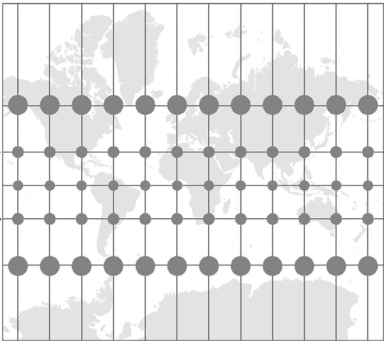

**图 2.9** 墨卡托（正形圆柱）投影（SF：比例因子）。

适用于中纬度地区的区域或国家地图，例如欧洲、澳大利亚、中国和美国的地图。圆锥投影很少用于世界地图。

应将制图区域与特定投影的畸变模式相匹配。表 2.2 列出了不同地区推荐的若干图投影。

方位投影也具有圆形的等畸变线模式，如图 2.11 所示。在此普通等积方位投影中，同一纬线上的畸变椭圆形状和大小相同。虽然所有椭圆都发生畸变，但每个椭圆占据的面积相同。因为方位投影中的等畸变线以接触点或标准线中心（实际上是一个圆）为中心呈同心圆分布，因此它们特别适用于形状近似圆形且中心位于标准线中心或接触点的区域，以最大限度地减少这些区域的畸变。普通方位投影最适用于极地地区。作为一般原则，一个投影的

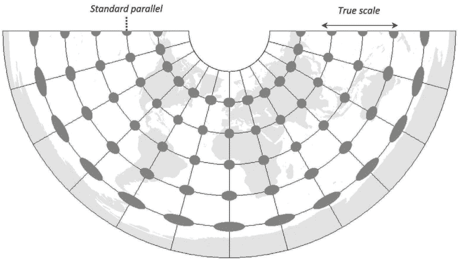

图 2.10 等距圆锥投影。

##### 2.2.3.3 投影坐标系的建立

在地图投影将地球球面转换为平面后制作地图，在地图上建立平面坐标系。坐标系的原点通常设置在地图感兴趣区域附近。与原点相交的水平轴和垂直轴分别称为 X 轴和 Y 轴（图 2.12a）。位置的正交 (x, y) 坐标定义为该位置在两个轴上的垂直投影位置，表示为原点以东或以西 x 米，以及原点以北或以南 y 米。原点处的坐标为 x = 0 和 y = 0；x

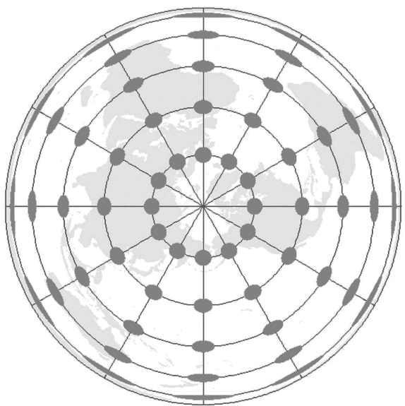

**图 2.11** 等积方位投影（北极点处切线）。

值称为**东距**，$y$ 值称为**北距**。图 2.12a 提供了基于澳大利亚大地测量基准 1994（GDA94）的兰勃特正形圆锥投影建立的澳大利亚投影坐标系示例。原点位于东经 134°、南纬 27°。位置 1 的东距为 769,886 米，其北距为 630,548 米。位置 2 的东距和北距坐标分别为 -1,040,911 米和 -446,357 米。

新原点称为**假原点**，此时东距和北距均为零。真原点的 x 位移和 y 位移值称为**假东距**和**假北距**。图 2.12b 显示了将图 2.12a 所示坐标系的真原点 (134°, -27°) 移至假原点 (106.18°, -43.59°) 后转换得到的新投影坐标系。其假东距为 2,300,000 米，假北距为 2,100,000 米。在新坐标系中，位置 1 的东距为 (769,886 + 2,300,000) = 3,069,886 米，其北距为 (630,548 + 2,100,000) = 2,730,548 米；位置 2 的东距为 (-1,040,911 + 2,300,000) = 1,259,089 米，其北距为 (-446,357 + 2,100,000) = 1,653,643 米。

为了简化计算，真原点通常移至地图区域西南角以外的某处。此举实际上向每个坐标添加了一定量，使地图区域内的所有东距和北距均为正值。该


每个投影坐标系都与特定的地图投影相关联，该投影基于特定的大地基准。如同大地基准一样，存在许多用于制图和空间数据采集的本地或国家投影坐标系，每个坐标系的建立都是为了在本地或国家范围内最大限度地减少畸变误差并提高测量精度。这里我们介绍一个被许多国家用于大比例尺制图的世界投影坐标系。

##### 2.2.3.4 通用横轴墨卡托（UTM）系统

UTM 系统是基于横轴墨卡托投影的全球坐标系。它于 1952 年由联合国制图委员会推荐用于地形图制图，并广泛应用于 GIS 中的大比例尺地形图、遥感影像以及环境和自然资源数据库。几乎所有 GNSS 设备都允许以 UTM 坐标记录位置。

UTM 系统将地球表面划分为从 80°S 到 84°N 纬度的 60 个南北带，每个带宽 6° 经度（图 2.13）。它们从 180° 经度开始，向东编号 1 至 60。例如，带 1 跨越 180° 至 174°W 经度，中央子午线位于 177°W。带 50 跨越 114° 至 120°E 经度，其中央子午线位于 117°E。

60 个 UTM 带中的每个带都映射到一个横轴墨卡托投影，这是一个割线投影，有两条标准线，分别平行于中央子午线，并且位于其两侧，各距离约 180 km。每个带中的中央子午线和赤道被投影为两条相互垂直的直线，它们的交点为该带的真原点。然而，赤道将坐标系分别建立在北带（指定为 N）和南带（指定为 S）中。为了避免负坐标，北带和南带均应用了 500,000 m 的假东偏量。北带的假北偏量为 0，而南带的假北偏量为 10,000,000 m。换句话说，在北带中，东偏量和北偏量是从放置在赤道和带中央子午线以西 500,000 m 处的假原点测量的。在南带中，东偏量和北偏量是从放置在赤道以南 10,000,000 m 和其中央子午线以西 500,000 m 处的假原点确定的。

UTM 是角保真的，每个带内的面积畸变很小。UTM 带中央子午线的比例尺系数为 0.9996。平行于中央子午线的两条标准线的比例尺系数为 1。UTM 带内两点之间的距离和方向可测量到 1/2500 的精度。跨越一个以上 UTM 带的区域，误差和畸变会增加。因此，UTM 并非为覆盖两个或多个带的区域设计，也不适用于制图整个大陆或像美国、加拿大、澳大利亚、中国或俄罗斯这样的国家的全境（表 2.2 提供了这些国家推荐的地图投影）。

UTM 基于地球的椭球体模型。许多国家基于官方大地基准使用本地 UTM 带，以最好地满足其需求。例如，在澳大利亚，澳大利亚 1994 格网（MGA94）使用基于 GDA94 大地基准的 GRS80

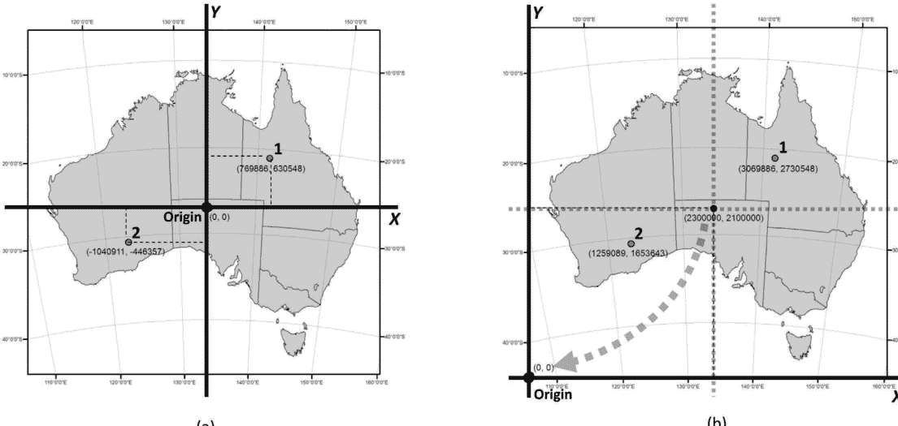

椭球体，为本地 UTM 带（UTM 带 49S 至 UTM 带 56S）提供 UTM 坐标系。新西兰 UTM 坐标系目前基于新西兰大地基准 2000（NZGD2000）。加拿大的本地 UTM 带（UTM 带 7N 至 UTM 带 22N）使用基于 1983 年北美大地基准（NAD83）的坐标系。

来自不同来源的空间数据可能采用不同的地图投影或投影坐标系。它们在集成之前必须转换到一个共同的投影坐标系。将空间数据转换到共同地理参照系统的能力是 GIS 中的一个重要考虑因素。GIS 软件包通常提供在地理坐标系和投影坐标系之间，或在投影坐标系之间进行转换的能力。

### 实践 2.2 查看支持材料


在本实践中，您将学习如何获取与数据图层一起使用的投影坐标系的信息，以及 ArcGIS Pro 和 QGIS 中用于定义、转换和自定义投影坐标系的基本实用程序。

### 2.3 空间数据模型

空间数据根据特定的空间数据模型在 GIS 中存储和维护。**空间数据模型**是描述空间数据如何表示地理要素，以及空间数据如何结构、关联和组织的一组概念。GIS 软件系统中使用的空间数据模型有三种类型：矢量、栅格和面向对象数据模型。

#### 2.3.1 矢量数据模型

**矢量数据模型**基于地理空间的对象视图。该数据模型的基本概念包括要素类、点坐标、属性、拓扑关系以及要素-属性关系。**要素类**是具有相同几何类型（点、线和多边形）以及相同属性集的地理要素集合。地理要素的属性存储描述该要素的值。矢量数据模型通常以要素类的形式存储空间数据。例如，点要素类可以表示气象站，作为带有特定时间段内一组气象变量观测值的点；线要素类可以表示河流，带有一组河流属性（如河段长度、高程、坡度、曲率和侵蚀深度）；多边形要素类可以表示土地地块，带有土地利用类型。

点坐标用于定义每个要素类中地理要素的位置。点要素的位置使用一对坐标（例如，纬度和经度，或东偏量和北偏量）来定义。线要素的位置使用一系列有序点来记录，每个点使用坐标对来定义。线要素的形状由折线近似，该折线用直线连接有序点。区域要素的位置使用一组封闭的有序点来指定，起点和终点为同一点，其边界或形状由由这些点连接形成的多边形近似。图 2.14 显示了如何在矢量数据模型中使用点坐标定义点、线和区域要素的位置。

**拓扑关系**指相邻或毗邻地理要素之间的空间关系，当它们从地球表面投影到地图上，或当地图被拉伸、弯曲或扭曲时，该关系保持不变（Corbett 1979）。空间数据中常编码的三种拓扑关系包括邻接性、连通性和包含性。如果两个要素共享共同边界，则它们被认为是邻接的，例如图 2.15a 中的森林和草地。如果一个要素完全包含在另一个要素内，则它们具有包含关系。例如，图 2.15a 中的湖泊包含在草地内。图 2.15b 显示了连通性的一个示例，其中管道网络的链接在节点处互相连接。连通性可用于沿网络（如河流网络、下水道网络或道路网络）跟踪路径。拓扑信息可以在空间数据中显式或隐式地表示。

在早期的 GIS 系统中，矢量数据模型（简称为矢量数据）中的空间数据不包含显式拓扑


| 特性 | 矢量表示 | 坐标对 |
|---|---|---|
| 房屋 | 点 | (x, y) |
| 道路 | 折线 | (x₁, y₁) ... (x₉, y₉) |
| 湖泊 | 多边形 | (x₁, y₁) ... (x₁₂, y₁₂) (x₁, y₁) |

图 2.14 基于矢量数据模型描述地理要素位置的空间数据。

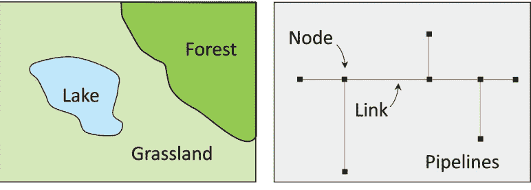

图 2.15 拓扑关系：(a) 相邻和包含，(b) 连接。

信息。他们使用非拓扑数据结构在计算机中存储和组织矢量数据。最简单的非拓扑数据结构是制图意大利面（Peuquet 1984）。它将每个地理要素表示为一串坐标对，如图 2.14 所示，并使用标志或代码标志要素的结束，将所有地理要素的坐标按顺序存储在单个文件中。它没有结构、没有属性和没有空间关系。Shapefile 现在是一种广泛使用的非拓扑数据结构（ESRI 1998）。在 Shapefile 中，点要素由一个顶点表示，该顶点由一对坐标定义。线要素或折线由有序的顶点序列表示，这些顶点由非分支线段连接。区域或多边形要素由一个或多个几何环表示。每个几何环是形成闭合、非自交循环的连接顶点序列。表示单个多边形的几何环保持顶点的一致顺时针顺序，以便沿着边界（按顶点顺序“行走”）右侧的区域位于多边形内部，左侧位于外部。多边形中的孔由顶点为逆时针方向的几何环表示。Shapefile 存储数据层中地理要素的非拓扑几何和属性信息（参见框 2.1）。属性数据以表格或电子表格的形式结构化，其中一行或记录对应一个地理要素，一列存储属性值。此类表也称为**要素属性表**。属性数据和几何数据由 GIS 通过要素 ID 链接。

**非拓扑数据结构**将地理要素存储为孤立的、空间无关的对象。因此，共享公共边界的相邻多边形会重复公共顶点，这在简化边界时可能在边界之间产生间隙和重叠。地理要素之间的拓扑关系通过使用计算机程序计算其空间交点来建立（Theobald 2001）。许多当代桌面 GIS 软件包支持非拓扑数据结构，原因在于其简单性（简单的文件结构）、互操作性（不同 GIS 软件包之间的轻松数据传输）以及可用于即时构建拓扑的高效计算机算法的可用性。

**拓扑数据结构**显式存储相邻要素之间的拓扑关系。它们用一对坐标表示点要素，用弧或链表示线要素，并用连接弧的闭合序列表示多边形。*弧*是由有序顶点序列组成的折线（图 2.16）。弧的端点称为节点。弧的起点是 from-node，终点是 to-node。弧的方向是从 from-node 到 to-node 的顶点顺序。拓扑数据结构描述所有三种拓扑关系，如图 2.15 所示。典型的拓扑数据结构将弧作为数据存储的基础。图 2.16 显示了线要素的拓扑数据结构。弧坐标定义线要素的几何，**弧-节点拓扑**描述连接性。连接的弧在公共节点处相交。例如，在图 2.16 中，弧 1、2 和 3 都在节点 2 处连接；弧 3、4 和 5 在节点 4 处连接，但弧 4 和 5 与弧 1 和 2 不直接连接，因为它们不共享公共节点。

区域要素的拓扑数据结构如图 2.17 所示，其中区域或多边形表示为有序的弧序列。同样，弧坐标定义区域要素的几何。**多边形-弧拓扑**说明哪些弧构成了哪个多边形，并提供包含关系的指示，而左右拓扑描述相邻关系。例如，在图 2.17 中，左右拓扑表明多边形 1 在弧 1 的左侧，多边形 2 在其右侧。因此，多边形 1 与多边形 2 相邻。每个弧作为公共边界出现在两个多边形中。它确保相邻多边形的边界仅存储一次且不重叠，从而避免在数字化两个多边形的公共边界时重复，并解决公共边界的两个版本不重合时的问题。请注意，研究区域边界外的区域被标记为多边形 0，通常称为外部多边形或宇宙多边形。

## 框 2.1 ESRI Shapefile

Shapefile 在三个核心文件和若干可选文件中存储空间数据。所有文件名均遵循 8.3 命名约定：八个字符的文件名前缀、句点和三个字符的文件名后缀，例如 ‘shp’。所有文件具有相同的前缀，且必须位于同一文件夹中。

### 核心文件

三个核心文件包括：

- .shp 文件。这是主文件，存储主要几何数据，包括形状类型或要素类以及点坐标（以 x 和 y 表示）。每个要素都有一组坐标记录。

- .shx 文件。这是索引文件，存储 .shp 文件中每组坐标记录的位置索引（偏移量和内容长度），以便可以快速检索要素的坐标。

- .dbf 文件。这是 dBASE 表，以 dBase IV 格式存储每个要素的属性数据，可在 Microsoft Excel 中编辑。每个属性记录与 .shp 和 .shx 文件中相关要素记录一一对应。

### 可选文件

以下三个可选文件通常包含在 Shapefile 中：

- .prj 文件。这是投影文件，以纯文本格式存储坐标系和投影信息。以下是示例：

```
PROJCS["Africa_Albers_Equal_Area_Conic",
GEOGCS["GCS_WGS_1984",
DATUM["D_WGS_1984",SPHEROID
["WGS_1984",6378137.0,298.257223563]],
PRIMEM["Greenwich",0.0],
UNIT["Degree",0.0174532925199433]],
PROJECTION["Albers"],
PARAMETER["False_Easting",0.0],
PARAMETER["False_Northing",0.0],
PARAMETER["Central_Meridian", 24.0],
PARAMETER["Standard_Parallel_1", -18.0],
PARAMETER["Standard_Parallel_2", -32.0],
PARAMETER["Latitude_Of_Origin", 0.0],
UNIT["Meter", 1.0]
```

- .sbn 和 .sbx 文件。这是两个空间索引文件，包含地理要素的空间索引。.sbn（空间存储桶）文件将数据覆盖的区域划分为矩形区域（存储桶）。每个存储桶包含落在其区域内的 .shp 文件中要素的记录号。.sbx（空间存储桶索引）文件包含行，每行存储 .sbn 文件中相应存储桶记录的记录号和字节长度。

- .shp.xml 文件。这是元数据文件，以 XML 格式包含有关数据层基本特征的信息，可能包括数据集的标识、范围、质量、地理参考和保管人。

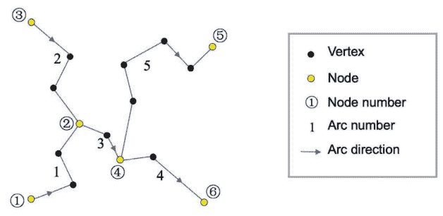

| 弧 | From-node | To-node |
|---|---|---|
| 1 | 1 | 2 |
| 2 | 3 | 2 |
| 3 | 2 | 4 |
| 4 | 4 | 6 |
| 5 | 4 | 5 |

| 弧 | (x, y) 坐标对 |
|---|---|
| 1 | (20, 50) (175, 110) (120, 226) (205, 330) |
| 2 | (21, 725) (170, 590) (105, 475) (205, 330) |
| 3 | (205, 330) (302, 290) (350, 200) |
| 4 | (350, 200) (480, 220) (675, 89) |
| 5 | (350, 200) (400, 430) (370, 560) (523, 651) (624, 550) (700, 630) |

图 2.17 中的多边形-弧拓扑显示，多边形 4 是一个孤立多边形，因为它由单个弧（弧 4）构成。另一方面，多边形 3 由弧 2、3、5 和 4 组成（4 前面的 0 表示弧 4 在多边形中形成一个岛）。因此，可以推断多边形 4 包含在多边形 3 中。

拓扑数据结构减少了区域要素的数据存储，因为相邻多边形之间的边界或弧不需要存储两次，能够维护显式拓扑关系并提高性能。

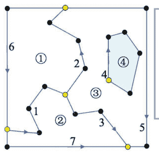

## 多边形-弧拓扑

| 多边形 | 弧 |
|---|---|
| 1 | 1, 2, 6 |
| 2 | 1, 3, 7 |
| 3 | 2, 3, 5, 0, 4 |
| 4 | 4 |

## 左右拓扑

| 弧 | 左多边形 | 右多边形 |
|---|---|---|
| 1 | 1 | 2 |
| 2 | 1 | 3 |
| 3 | 3 | 2 |
| 4 | 3 | 4 |
| 5 | 0 | 3 |
| 6 | 1 | 0 |
| 7 | 2 | 0 |

## 弧坐标

| 弧 | (x, y) 坐标对 |
|---|---|
| 1 | (20, 50) (160, 40) (125, 150) (200, 251) (302,200) |
| 2 | (302,200) (401, 348) (375, 490) (226, 575) (310, 650) |
| 3 | (302,200) (351, 125) (480, 130) (620, 5) |
| 4 | (525, 300) (524, 500) (601, 530) (675, 425) (626, 225) (525, 300) |
| 5 | (300, 650) (710, 650) (710, 5) (620, 5) |
| 6 | (300, 650) (20, 650) (20, 50) |
| 7 | (20, 50) (20, 5) (620, 5) |


邻接分析。与非拓扑数据结构一样，它们将属性数据存储在要素属性表中，并通过要素 ID 关联属性和几何数据。前面描述的拓扑数据结构用于 ArcInfo 覆盖数据，或只是 ArcGIS 支持的几种空间数据格式之一 (ESRI 1999)。其他著名的拓扑数据结构包括 POLYVRT (Peucker and Chrisman 1975)、DIME (Peucker and Chrisman 1975) 和 TIGER (Marx 1990)。

##### 2.3.1.1 三角不规则网 (TIN)

三角不规则网是一种为表示地表形态而开发的矢量数据模型。它使用一组连续、不重叠的三角形来表示地表 (图 2.18)。在每个三角形内，地表由一个具有恒定坡度的平面表示。TIN 由一组点构造而成，这些点称为质点或数据点。每个点定义有 3D 坐标 (x, y, z)；(x, y) 表示点的位置，z 表示该位置由地表所代表的特定变量的值（例如海拔高度）。这些点用作顶点（或节点），并通过通常的 Delaunay 三角剖分连接成三角形。

Delaunay 三角剖分仅在通过三个数据点的圆不包含其他数据点时，才将这三个数据点连接成一个三角形。这样一来，

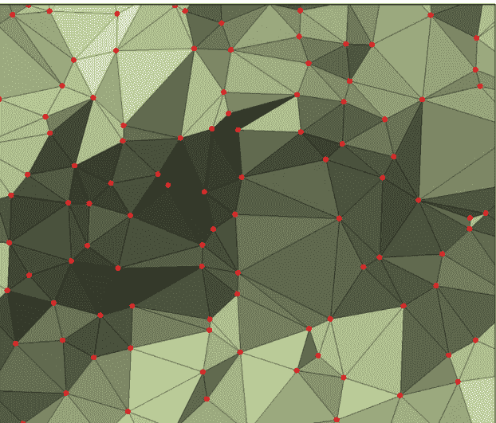

- 海拔数据点

图 2.18 由一组海拔点构建的 TIN 部分。

所有三角形的最小内角最大化，并尽可能避免细长的三角形。通过三个数据点的圆的中心是对应于这三个点的三个 Voronoi（或 Thiessen）多边形的公共顶点 (图 2.19)。一个 Voronoi 多边形包含一个数据点。Voronoi 多边形内的所有位置都比任何其他数据点更接近多边形内的数据点。因此，可以从 Voronoi 三角形创建 Delaunay 三角形，反之亦然。(有关 Delaunay 三角剖分的数学和算法，参见 de Berg et al. 2008。) TIN 也是一种拓扑数据结构。它不仅存储节点的 (x, y, z) 坐标，还存储三角形–节点拓扑 (图 2.20)。三角形–节点拓扑记录构成每个三角形的节点及其邻接三角形。每个三角形具有三个属性——面积、坡度和坡向——这些属性可以存储在单独的文件中，或在需要时即时计算。TIN 的边缘可用于捕捉线要素和面要素的位置，如道路、山脊线、河道、湖泊

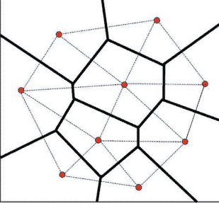

- 数据点
- Delaunay 三角形边
- Voronoi 多边形边

图 2.19 Delaunay 三角剖分和 Voronoi 多边形。

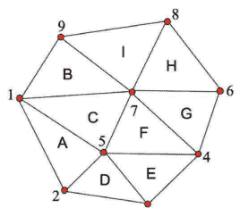

### 三角形–节点拓扑

| 三角形 | 节点 | 邻接三角形 |
|---|---|---|
| A | 1,2,5 | -, C, D |
| B | 1,7,9 | -, I, C |
| C | 1,5,7 | A, B, F |
| D | 2,3,5 | -, A, E |
| ... | ... | ... |

### 坐标列表

| 节点 | x, y, z |
|---|---|
| 1 | 1500, 2990, 444 |
| 2 | 2100, 1750, 420 |
| 3 | 3280, 1580, 382 |
| 4 | 4002, 2200, 358 |
| ... | ... |

图 2.20 TIN 数据结构。

边界和海岸线。因此，地表上位置准确的要素（无论是点、线还是面要素）都可以用作 TIN 的输入要素。用于创建 TIN 的输入要素在 TIN 中保持与节点或边相同的位置。这样，TIN 既能保留输入数据的所有精度，又能同时对已知数据点之间的值进行建模。输入到 TIN 的数据应以米或英尺为单位，而不是十进制度数。使用地理坐标构建时，Delaunay 三角剖分无效。由于 TIN 是使用地表上一组不规则排列的数据点构建的，因此它可以通过在高度变化的区域（例如山区）放置更多且更密集的数据点，以及在变化较小的区域（例如泛滥平原）放置更少且更稀疏的数据点，从而有效地表示地理现象的空间变化。

### 2.3.2 栅格数据模型

栅格数据模型基于地理空间的场域观。它使用一组单元格网格覆盖地理空间，每个单元格都有一个值。因此，栅格数据模型记录每个位置的地理要素及其属性。它涉及单元格、单元格值和单元格大小的概念。网格通常称为栅格。栅格的单元格通常是大小相等的正方形。如图 2.21 所示，点要素由一个单元格表示，线要素由一组连接的单元格表示，面要素由一组连续的单元格表示。

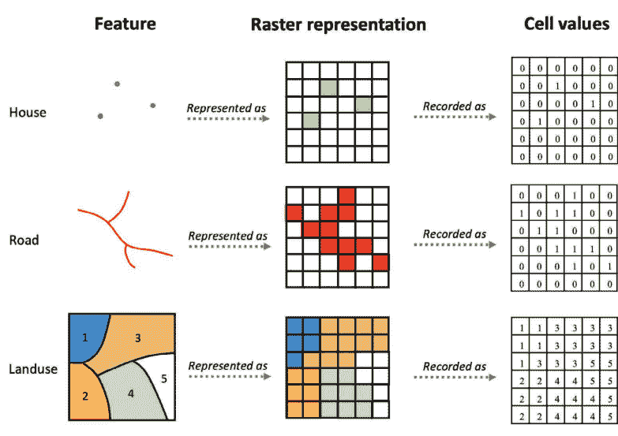

图 2.21 使用栅格数据模型描述地理要素的空间数据。

单元格。每个单元格都有一个值，表示单元格内地理要素的一个属性。单元格值可以是数值（例如表示坡度）、代码（例如，1 表示农业用地，2 表示城市用地，等等，如图 2.21 所示），或标签（例如土壤类型的名称）。单元格值还可用于表示地理要素的存在或不存在。例如，在图 2.21 中表示房屋和道路的栅格中，如果一个单元格被房屋或道路占据，则分配单元格值 1；否则，分配单元格值 0。

单元格的位置由其行号和列号定义 (图 2.22)。通常，栅格以北向上方向。行与东西方向平行，列与南北方向平行。单元格大小定义为单元格的边长，通常以米为单位。已知单元格大小、方向以及栅格左上角的实世界坐标后，

可以计算单元格的实世界坐标；因此，可以推导地理要素在地球表面的位置。栅格数据模型不显式表示拓扑关系，但可以根据单元格位置推断。例如，如果我们知道一个单元格的行号和列号，可以轻松识别其邻近单元格。

单元格大小是栅格的空间分辨率。它决定栅格表示的精度。如第 2.1 节所述，单元格大小越大，栅格表示的精度越低。图 2.23 说明了不同单元格大小的同一湖泊（包含一个小岛）的三种栅格表示。显然，较大的单元格大小或较小的空间分辨率会导致更多关于湖泊的细节丢失。在单元格大小最小的栅格表示中，小岛被捕获，而在其他两个单元格大小较大的栅格表示中，小岛丢失。在两个

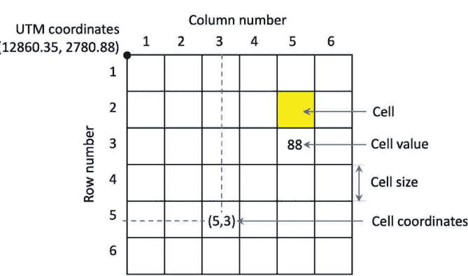

图 2.22 栅格要素。

单元格大小较大的栅格表示中，湖泊的形状也严重失真。但是，无论单元格大小多小，每个单元格只能有一个值。因此，单元格内地理要素的空间变化全部丢失。每个单元格被认为是同质的。当一个单元格包含两个或多个类别的要素时，通常应用两个规则来分配单元格值：最大面积规则和中心位置规则。最大面积规则将单元格值分配给占据单元格面积最大百分比的类别。中心位置规则将单元格值分配给位于单元格中心的类别。在图 2.23 中，已应用最大面积规则。

在栅格数据模型中表示的空间数据称为栅格数据。GIS 中用于结构化和存储栅格数据的主要有三种方法：逐单元格编码、行程长度编码和四叉树。

#### 2.3.2.1 逐单元格编码

最简单的栅格数据结构是一个数据数组，它在单个文件中存储单元格值矩阵。换句话说，所有单元格值均按行和列记录和存储。这种方法称为逐单元格编码。数据文件通常有一个头部，描述

行数 (nrows) 和列数 (ncols)、单元格大小、栅格左下角的实世界坐标 (xllcorner 和 yllcorner) 以及 NoData 值（表示未对该单元格进行测量），如图 2.24 所示。数字高程模型 (DEM，即单元格值为高程值的栅格) 通常使用这种简单的数据结构存储。大多数支持栅格数据模型的 GIS 软件系统，如 ArcGIS、GRASS 和 IDRISI，都可以使用该结构存储栅格数据。然而，这种栅格数据结构要求存储每个单独的单元格值。如果一个表示某区域 40 种土壤分布的栅格有 m 行和 n 列，则必须存储 m x n 个单元格值。在同一区域使用相同大小的栅格表示一个单独的湖泊，也需要存储相同数量的数据。在许多情况下，该数据结构包含大量冗余数据，可能导致文件过大。以下两种栅格数据结构可能克服数据冗余问题。

#### 2.3.2.2 行程长度编码

行程长度编码将从左到右相同值的连续单元格序列分组，并将每个序列作为单个数据值和计数存储。由于

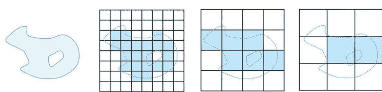

图 2.23 不同单元格大小的栅格表示。


按行逐行处理。例如，在包含图 2.24 中运行长度编码数据的文件中，数据部分的第一行包含两对数据，这表明栅格的第一行以三个值为 1 的单元格开始，后跟五个值为 2 的单元格。数据的第二行显示栅格的第二行以四个值为 1 的单元格开始，后跟四个值为 2 的单元格，以此类推。运行长度编码不需要存储每个单独的单元格值，从而压缩栅格数据。但是，当相邻单元格值存在高度变化时，其效果会降低，例如在 DEM 中。在这种情况下，保留所有单元格值的逐单元格编码方法更合适。ESRI Grid 是由 ArcGIS 支持的一种使用运行长度编码的栅格数据格式（参见方框 2.2）。GRASS 和 IDRISI 也支持这种数据结构。

#### 2.3.2.3 四叉树

四叉树是一种树形数据结构，通过递归地将栅格细分为四个象限、子象限等等来对其进行划分，直到每个象限包含具有相同值的单元格。图 2.26 说明了一个为存储表示被陆地（白色）包围的水体（蓝色）的栅格而构建的四叉树。树的根（顶部）节点表示整个栅格。非叶子节点表示具有多个单元格值的象限，并被细分为

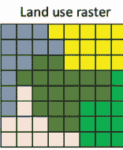

| 1 | 1 | 1 | 2 | 2 | 2 | 2 | 2 |
|---|---|---|---|---|---|---|---|
| 1 | 1 | 1 | 1 | 2 | 2 | 2 | 2 |
| 1 | 1 | 3 | 3 | 2 | 2 | 2 | 2 |
| 1 | 3 | 3 | 3 | 3 | 3 | 3 | 4 |
| 1 | 3 | 3 | 3 | 3 | 3 | 3 | 4 |
| 1 | 5 | 5 | 3 | 3 | 3 | 3 | 4 |
| 1 | 5 | 3 | 3 | 3 | 4 | 4 | 4 |
| 5 | 5 | 5 | 3 | 3 | 4 | 4 | 4 |
| 5 | 5 | 5 | 5 | 5 | 4 | 4 | 4 |

| 栅格数据文件 |
|---|
| ncols 8 |
| nrows 8 |
| xllcorner 138800 |
| yllcorner 104400 |
| cell size 100 |
| nodata value -9999 |
| 1 1 1 2 2 2 2 |
| 1 1 1 2 2 2 2 |
| 1 1 3 3 2 2 2 2 |
| 1 3 3 3 3 3 3 4 |
| 1 3 3 3 3 3 3 4 |
| 1 5 5 3 3 3 3 4 |
| 1 5 3 3 3 4 4 4 |
| 5 5 5 3 3 4 4 4 |
| 5 5 5 5 5 4 4 4 |

| ncols 8 |
|---|
| nrows 8 |
| xllcorner 138800 |
| yllcorner 104400 |
| cell size 100 |
| nodata value -9999 |
| 1,3 2,5 |
| 1,4 2,4 |
| 1,2 3,2 2,4 |
| 1,1 3,6 4,1 |
| 1,1 5,1 3,5 4,1 |
| 1,1 5,1 3,3 4,3 |
| 5,3 3,2 4,3 |
| 5,5 4,3 |

## 方框 2.2 ESRI Grid

网格是 ArcGIS 的本地栅格数据格式。它使用逐单元格或运行长度编码方法来存储栅格数据，具体取决于哪种更高效。单元格值为整数（没有小数或小数部分，例如 24 和 80）的网格称为整数网格。整数网格主要用于表示类别或离散数据。如果单元格值为浮点数（带有小数或小数部分，例如 24.4 和 80.588），则该网格称为浮点网格。浮点网格主要用于表示连续数据。整数网格通常关联一个值属性表（VAT），而浮点网格则没有。

VAT 通常包含定义类、组或类别的单元格值。它至少包含三个字段：OID、VALUE 和 COUNT。图 2.25 说明了一个带 VAT 的土壤网格。OID 是表中每一行的唯一系统定义对象 ID。VALUE 存储栅格中每个唯一的单元格值。COUNT 表示栅格中 VALUE 字段所指单元格值的单元格数量。例如，VAT 的第一行显示 VALUE = 1 且 COUNT = 7294，表示有 7,294 个单元格的值为 1，代表网格中的基岩。没有测量值或实际值的单元格被分配为 NoData。NoData 是一个特殊的系统定义值

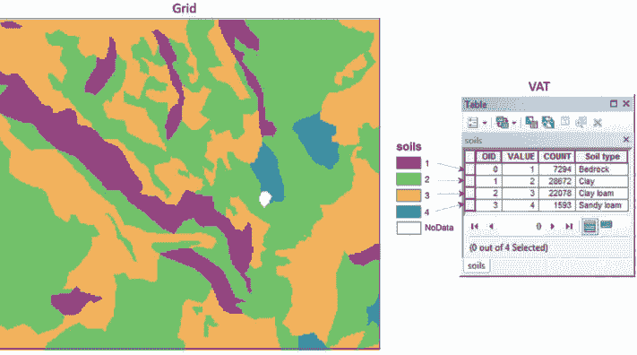

### 图 2.25 带 VAT 的网格

它不为 0（零）；0 是一个有效的单元格值。VAT 中不表示 NoData 单元格。

网格的坐标系由单元格大小、行列数以及左上角的 x、y 坐标定义。行和列与坐标系的 x 和 y 轴平行。

网格（类似于覆盖数据集）存储为一个以网格名称命名的目录，包含含有网格特定信息的关联表和文件。网格目录基本上包含 BND 表（dblbnd.adf），用于存储其边界；HDR 文件（hdr.adf），包含单元格大小和网格的其他特定信息；STA 表（sta.adf），存储网格的统计信息；如果是整数网格，则包含 VAT 表（vat.adf）；LOG 文件，记录对网格执行的操作；以及数据文件（w001001.adf），用于存储单元格数据和随附的索引文件（w001001x.adf）。当网格被修改时，文件和表中存储的数据会立即更新。

四个子象限。叶子节点对应于只有一个单元格值且无需进一步细分的那些象限。

已开发出许多索引方案来识别象限。图 2.26 中的示例只是其中之一。采用该方案，西北象限编号为 0，东北象限为 1，西南象限为 2，东南象限为 3。象限编号用作识别其位置的代码或索引。每个象限被划分为四个子象限，子象限的编码采用其父象限编号加上自身象限编号的方式进行。例如，代码 31 表示第一级东南象限（代码 3）的子象限中的第二级东北象限（代码 1）。这种分层索引系统允许相对于栅格的原点计算每个象限的位置，并便于确定邻域信息（Lo 和 Yeung 2007）。

四叉树最适合数据相对均匀的区域以及需要频繁搜索数据库的应用。基于四叉树的数据存储、索引和搜索技术已得到充分研究和记录（Samet 1990a, 1990b）。四叉树数据结构已在 SPANS GIS 中使用（Ebdon 1992）。

### 2.3.3 面向对象数据模型

类似于矢量数据模型，面向对象数据模型符合地理空间的对象视图。它包含几个面向对象概念，包括对象和对象标识符、属性和方法、类、类层次和继承。

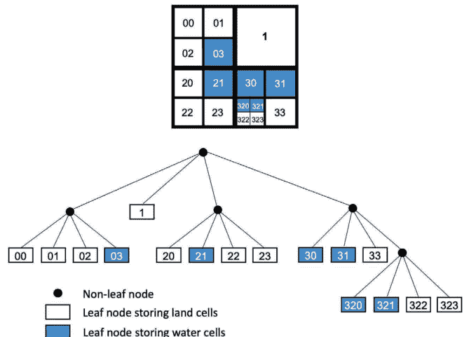

### 图 2.26 四叉树

使用面向对象数据模型时，任何地理实体都统一建模为与唯一标识符关联的对象。对象标识符（OID）将该对象与系统中其他每个对象区分开来。它独立于其属性的值，并且对用户不可见。每个对象都有一个状态（对象属性值的集合）和行为（作用于对象状态的方法或函数集合）。例如，道路是一个对象，具有一组属性，包括几何（描述其位置和形状）、拓扑（描述其与其他道路的连通性）、表面材料和访问状态。对于特定道路，几何、拓扑、表面材料和访问状态的值代表其状态。因此，与之前讨论的矢量数据模型不同，在面向对象数据模型中，几何和拓扑被视为属性，在某些系统中，它们被存储为二进制大对象（BLOB——一种用于将大量二进制数据作为单个实体存储在数据库中的数据类型）。方法定义对象的行为。它们可以通过修改属性值来更改对象的状态，或者查询所选属性的值。例如，我们可能有方法使用线符号在计算机屏幕上绘制道路，确定其中心线，计算其长度，并根据道路的状态查找它相交的其他道路。状态和行为被封装在对象中，只能通过显式消息传递从对象外部访问或调用。消息只是一个对象向另一个对象发出的请求


请求第二个对象执行其中一个方法。这是对象之间通信的方式。

每个对象都属于一个特定的类。类中的所有对象共享同一组属性和方法，并响应相同的消息。一个对象只能属于一个类。例如，所有道路对象都将由单个 Road 类描述。类中的对象称为类的实例。每个实例对每个属性都有自己的值，但与类中其他实例共享相同的属性名和方法，如图 2.27 所示。

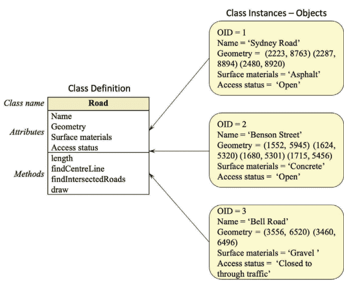

图 2.27 Road 类及其实例。

此外，可以从现有类（超类）派生新类（子类）。子类继承超类的所有属性和方法，并可能具有额外的属性和方法。类可以组织成类层次结构，其中超类位于顶层，子类向下分支。这样一来，继承就可以发生，子类方法可以被定义，然后在所有子类对象中使用。

图 2.28 给出了一个示例，其中 GeoEntity 是超类，Point、Line 和 Area 是其子类。GeoEntity 类有三个属性——名称、质心坐标和地理参考系统——以及七个方法，包括 draw、delete、move、getCentroid、getColour、setColour 和 getSize。Point、Line 和 Area 类从 GeoEntity 继承属性和方法，但定义自己的属性和方法。Line 和 Area 类添加三个属性：点坐标数量、x 坐标数组和 y 坐标数组。这两个类有一个新方法 getBound，用于获取线对象或面对象中 x 和 y 的最大值和最小值。Area 类还有另一个新方法 contains，用于确定特定点是否位于面对象内。三个子类重新定义 draw 和 getSize 方法。Point 类的 draw 方法可能使用点符号绘制 Point 对象，其 getSize 方法可能返回值 0。Line 类的 draw 方法可能使用一定宽度的线符号显示线对象，其 getSize 方法测量线对象的长度。对于面对象，Area 类的 draw 方法使用面符号描绘它，其 getSize 方法计算对象的面积大小。一个方法根据不同的输入和输出执行不同任务的能力称为方法重载。

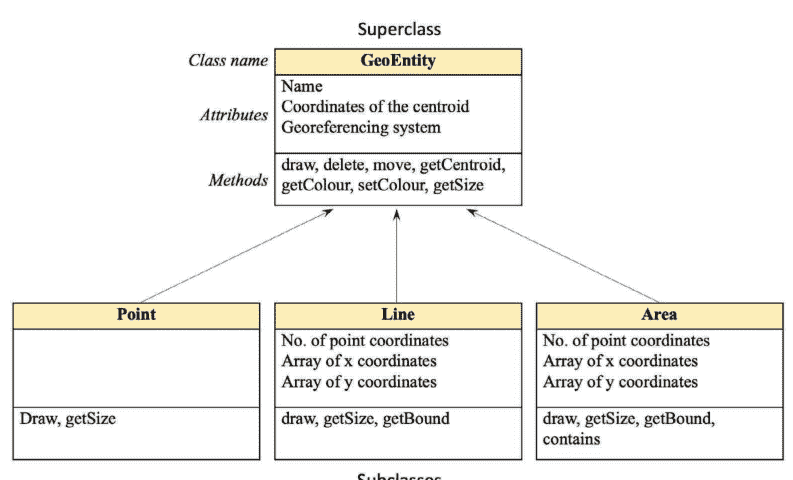

图 2.28 继承和方法重载。

面向对象数据模型将空间数据（包括几何、拓扑和属性）存储为对象。对象封装了状态和行为，并可以存储其与其他对象的所有关系。每个对象被定义为独立的组件或构建块，可与其他对象一起用于形成复杂对象。这些功能允许用户根据自己对所研究地理特征的看法和分类，创建扩展基础模型的面向对象模型。此外，它们允许使用面向对象编程语言直接操作空间数据，这已成为 GIS 开发者首选的编程技术，主要归功于其卓越的效率、灵活性以及将应用程序和数据库开发统一为无缝数据模型和编程语言环境的能力。面向对象数据模型已在 SmallWorld GIS、ArcGIS Geodatabase、Oracle Spatial and Graph（原 Oracle Spatial）和 IBM DB2 Spatial Extender 中使用或支持。

### 2.4 空间数据库管理

之前描述的一种或多种空间数据模型表示和结构化的空间数据集合构成空间数据库。根据其组织和管理方式，GIS 中主要使用两种空间数据库：地理关系数据库和对象关系数据库。它们基于关系数据库的概念和原则。

#### 2.4.1 关系数据库

关系数据库将数据组织为一组相互关联的表。每个表称为关系，包含具有相同属性或属性的一组对象（例如，林分）的数据。关系中的行（也称为元组或记录）对应于单个对象（例如，每行一个林分），列（也称为字段）对应于属性（例如，林分的年龄、优势种、平均高度、胸径平均直径、土壤类型和场地质量）。属性允许取值的集合称为域。域可能对每个属性都不同，或者两个或多个属性可能具有相同的域。行和列可以以任何顺序出现，关系仍然相同。但是，属性在关系中必须唯一，且行不能相同。此外，每行只能为其每个属性包含一个值。

关系数据库包含多个关系。关系可以有一个指定的单个属性或一组属性，可用于唯一标识关系中的每一行。该属性或一组属性称为主键。如果关系中的一个或多个属性表示另一个关系中的主键，则称为外键。任何属性都可以是键，或者多个属性可以组合成复合键。不需要预先定义所有键。即使某个属性最初未被指定，也可以将其用作键。图 2.29 显示了代表 stand 和 drainage 关系的两个表。StandID 是 stand 关系的主键，DCode 是 drainage 关系的主键。DCode 也是 stand 关系中的外键。它将土壤排水条件的信息与林分的详细信息关联起来，使我们能够将每个林分与其排水条件匹配。当某个属性出现在多个关系中时，其出现通常表示两个关系的元组之间的关系，就像 stand 和 drainage 关系中的 DCode 一样。

键通常用于连接或关联两个或多个关系中的数据。关系数据库系统中的连接操作将两个或多个关系合并为一个新关系，而关联操作在不形成新关系的情况下链接关系。通过键连接或关联表的能力是关系数据库的核心。这种关系连接构成了数据库查询和从大表中快速检索数据的基础。

**STAND: 林分关系**

| StandID | Species | Height | DCode |
|---|---|---|---|
| 1002 | Oak | 7.5 | 4 |
| 1040 | Silver birch | 15.8 | 5 |
| 1245 | Banksia | 2.2 | 4 |
| 2005 | Red gum | 8.5 | 3 |
| ... | ... | ... | ... |

**DRAINAGE: 土壤排水关系**

| DCode | Condition |
|---|---|
| 1 | 非常差 |
| 2 | 差 |
| 3 | 不完美 |
| 4 | 中等良好 |
| 5 | 良好 |
| 6 | 有些过度 |
| 7 | 过度 |

图 2.29 关系数据库中的关键概念。

仅包含两个表中 DCode 列值相同的行。结果如表 2.3 所示。

关系数据库使用 SQL（结构化查询语言）来检索、组合、更新和管理数据（Gillenson 2012）。简单数据库查询的 SQL 一般形式遵循 SELECT * FROM <table_name> WHERE 子句。例如，以下 SQL 语句对图 2.29 中的两个关系执行连接操作，以组合 stand 和 drainage 关系中的数据：

SQL 是关系数据库管理系统（RDBMS）中广泛实现的标准数据库语言。大多数 GIS 系统使用内置或外部 RDBMS 来管理属性数据，但通常，用户无需了解任何 SQL 即可执行数据库查询和操作任务。GIS 中的查询构建器通常提供直观的界面，使大多数查询变得简单（参见第 4.2 节）。

```
SELECT StandID, Species,
       Height, Condition
FROM stand, drainage
WHERE stand.DCode =
       drainage.DCode
```

#### 2.4.2 地理关系数据库

该 SQL 语句将 StandID、Species、Height 和 Condition 列为属性和

关系数据库允许将 GIS 中的属性数据组织成一组相互关联的表网络，每个表都有其特定于所存储数据类型的属性。但是，将地理对象作为行，并将其坐标和其他几何属性作为表中的列存储是低效的。关系数据库要求每一行的


表 2.3 图 2.29 中两个关系上使用 SQL 连接操作的结果表

| 站点ID | 物种 | 高度 | 状况 |
|---|---|---|---|
| 1002 | 橡树 | 7.5 | 中等良好 |
| 1040 | 白桦 | 15.8 | 良好 |
| 1245 | 班克斯亚 | 2.2 | 中等良好 |
| 2005 | 红桉 | 8.5 | 不完美 |
| ... | ... | ... | ... |

表需要由相同的属性组成，且行与列的交点为一个单值（即第一范式约束）。为近似不同地理对象的形状而使用相同数量的点的情况非常罕见。某些地理对象可使用少于十个点来近似，而其他对象可能使用几百个或更多点。因此，难以为存储坐标的表格定义固定数量的列。此外，对于许多具有复杂结构的地理要素（例如内部包含岛状多边形的多边形），表结构过于严格。将复杂地理对象分解为可存储在表中的简单几何对象，会导致大量关系和不自然的连接，如前所述，这效率低下。由于关系数据库的这些弱点，GIS 系统通常在**地理关系数据库**中存储和管理空间数据。在地理关系数据库中，空间数据的属性组件存储在由 RDBMS 管理的传统关系数据库中，而空间数据的位置组件（描述要素几何）则存储在基于前一节讨论的一种空间数据结构的独立文件中，并由专用的 GIS 数据管理软件管理（Yeung 和 Hall 2007）。在地理关系数据库中，空间数据被概念化为覆盖相同地理空间的一系列独立数据层（图 2.30）。每个层代表特定要素类的单一主题，例如土壤、土地利用、地质和植被。每个层是一个数据集，由存储定义地理要素位置和形状的几何数据的文件以及包含与地理要素相关的属性数据的关系表组成。当空间数据使用矢量数据结构时，每个要素都会分配一个名为要素 ID（或 FID）的系统生成唯一 ID 号。与矢量数据层关联的属性表称为要素属性表。FID 是层要素属性表的主键，GIS 系统在内部使用它来将要素的位置数据与其属性相关联。当空间数据使用栅格数据结构时，单元格数据与与每个唯一单元格值相关的属性数据分开存储，后者存储在一个表中，通常称为值属性表。值属性表使用唯一单元格值作为主键，将其与关联的栅格数据层相关联。ArcInfo 覆盖、ESRI shapefiles 和 ESRI 栅格均在 ArcGIS 中使用地理关系数据库模型进行管理。许多现有的空间数据库都是地理关系数据库。框 2.3 提供了这样的示例。

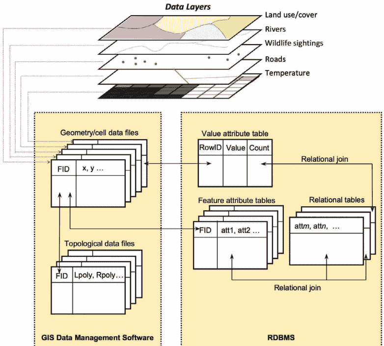

图 2.30 地理关系数据库。

#### 2.4.3 对象关系数据库

对象关系数据库扩展了关系数据库，允许将对象存储在关系表的列中。它们通常支持声明基本上是一个类的新数据类型，并将此新类型设置为表列的数据类型。从面向对象的角度来看，新数据类型

## 框 2.3 AQUAMAPS


AQUAMAPS（水与农业全球空间数据库）由联合国粮食及农业组织（FAO）开发。作为 FAO 全球水信息系统的一部分，它提供与全球水资源、水资源利用和农业水管理相关的开放获取区域和全球空间数据及信息，以支持通过可持续利用水和土地资源促进农业和农村发展，并监测联合国可持续发展目标 6‘确保所有人都能获得并可持续管理水和卫生设施’。

空间数据库的当前（2022 年）版本包含在五个主题下组织的一系列空间数据集：

- 水文盆地：全球和区域水文盆地图层。
- 河流：全球和区域河网图层。
- 灌溉与基础设施：全球灌溉区及地下水供灌区域百分比图层；非洲、中亚和东南亚以及中东地区的水坝区域图层；以及萨赫勒地区、西非的太阳能灌溉适宜性区域图层。
- 气候：全球干旱度、降雨日频率、月降水量和年降水量平均值及参考蒸散量、降水通量（在 00 时至 24 小时当地时间期间，每单位面积、每天、每月或每年降水的总水量）、最低和最高气温、相对湿度、太阳辐射通量（在 00 时至 24 小时当地时间期间，每单位面积和时间太阳辐射提供的总能量）及风速。
- 分析：基于前四个主题数据的空间分析和建模得出的派生数据，例如面临风险的农业系统、主要水文盆地物理水资源短缺的分布、主要河流流域农业部门淡水取水比例以及因灌溉导致的土地盐渍化比例。

矢量数据图层均为 shapefile 格式。栅格数据图层多为 ESRI Grid 格式。该数据库可在线访问，网址为 https://data.apps.fao.org/aquamaps/。其 Web 界面允许用户从数据库中选择、制图、查询、浏览和下载可用数据集。此外，用户可以通过链接到现有在线数据集或上传数据文件来添加自己的数据制作地图，使用“Story”功能创建自己的故事以为地图添加背景，并打印和共享地图。图 2.31 显示了带有主要农业系统全球地图的 AQUAMAPS Web 界面。

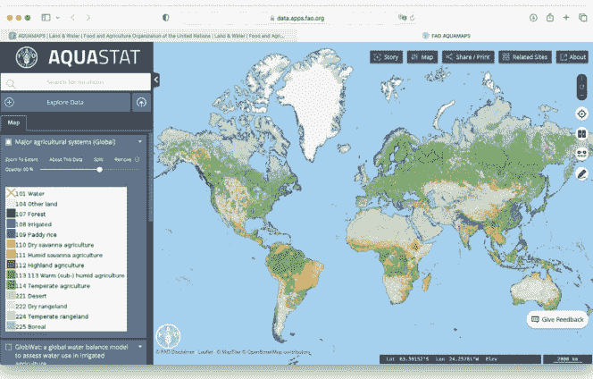

图 2.31 AQUAMAPS。

对应于类名，即封装状态和行为的软件模块。

当空间数据存储在对象关系数据库中时，要素属性作为传统表格属性存储在列中，而要素几何（表示为矢量要素或栅格）则使用扩展空间类型进行存储。ESRI 地理数据库是对象关系数据库的一个示例。在地理数据库中，空间数据集使用关系表存储，要素几何与传统属性一起存储在字段中。可在地理数据库中存储和管理的三种主要数据集类型包括要素类、栅格数据集和属性表。要素类作为表存储，其中每一行表示一个要素——具有几何形状的空间对象。要素类表具有一个名为 Geometry 类型的特殊字段，称为 Shape 字段。该字段存储表中每个要素的几何。要素的形状类型由要素类定义，可以是 Point（点）、Multipoints（由多个点组成的要素）、Polyline（折线）或 Polygon（多边形）。图 2.32 显示了土地覆盖图层的多边形要素类表。表中的 Shape 字段保存每个要素的多边形几何。值 Polygon 表示该字段包含定义每行中一个多边形要素的坐标和几何。

栅格数据集是指组织成一个或多个波段的图像（如正射影像）或栅格（如 DEM）。每个波段由像素或单元格矩阵组成。栅格具有一个波段。图像可能具有一个或多个波段。在地理数据库中，栅格数据集通常被分割成小块，称为块。块的典型大小约为 128 行 × 128 列或 256 行 × 256 列。这些块存储在每个图像或栅格的表中，称为块表。块表中的每一行表示一个块。图 2.33 显示了块表示例。表中的 Block Data 字段存储栅格的块图块。其数据类型为 BLOB。栅格数据集的块结构允许仅在需要时检索特定范围的块，而非整个栅格图层或图像。此外，它有助于构建图像或栅格金字塔。栅格金字塔是同一栅格或图像不同分辨率的集合。它通过通常以 2 为因子（将分辨率减半）反复对原始栅格或图像数据集进行子采样来创建，如图 2.34 所示。金字塔可能包含许多子采样图层。它通过仅检索显示所需的指定分辨率数据，实现图像或栅格数据的快速显示。

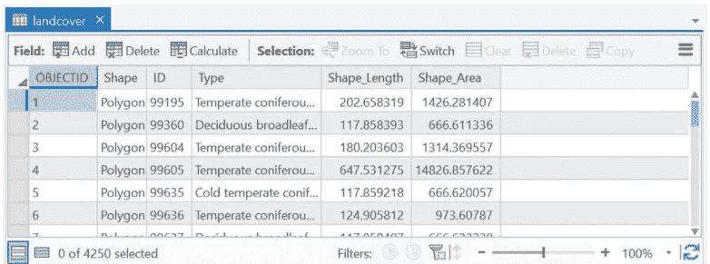

图 2.32 多边形要素类表示例。


## 地图视图

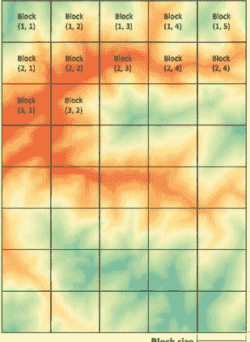

## 栅格块表

| 波段 | RRD | 行 | 列 | 块数据 |
| :--- | :--- | :--- | :--- | :--- |
| 1 | 3 | 1 | 1 | |
| 1 | 3 | 1 | 2 | |
| 1 | 3 | 1 | 3 | |
| 1 | 3 | 1 | 4 | |
| 1 | 3 | 1 | 5 | |
| 1 | 3 | 2 | 1 | |
| ... | ... | ... | ... | ... |

- 波段 – 波段编号
- RRD – 降低分辨率数据集（RRD）因子，用于确定块在栅格金字塔中的位置
- 行 – 块的行号
- 列 – 块的列号
- 块数据 – 存储块的栅格图块的 BLOB 字段

图 2.33 栅格块表示例。

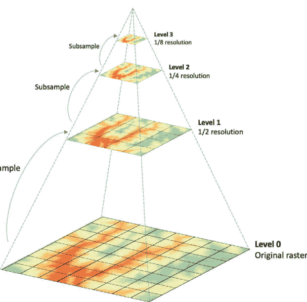

图 2.34 栅格金字塔示例。

除要素类、栅格数据集和属性表之外，地数据库还可以存储网络数据集、几何网络、拓扑、地表、地块结构（连接的地块要素或地块网络）以及许多其他内容，并使用 SQL 创建、修改和查询表及其数据元素（Allen 2019）。此外，地数据库允许用户构建具有拓扑结构的空间数据集，且无需编程即可为其添加行为。图 2.35 显示了对象关系型数据库的一般结构，其中空间数据使用表进行存储，并由对象关系型数据库管理系统（ORDBMS）进行管理。

SQL 已扩展以包含空间类型和函数（Shekhar and Chawla 2003）。因此，存储为 SQL 空间类型的包含要素几何的关系表的内容可以通过 SQL 访问。然而，不同的 GIS 系统可能采用特定的数据库管理系统，这些系统可能以不同方式实现 SQL，并且可能有不同的空间数据类型定义以及不同的存储结构和访问方法。

## 框 2.4 ArcGIS 中的空间数据库类型

ArcGIS 支持四种类型的空间数据库：地理关系数据库、文件地数据库、移动地数据库和企业地数据库。图 2.36 提供了 ArcGIS Pro 项目中前三种空间数据库示例的文件夹树视图。

- 地理关系数据库
  - 形状文件
    - landslides.shp < 点要素类
    - sampledArea.shp < 多边形要素类
    - transect.shp < 线要素类
- 文件地数据库
  - FileDB.gdb
    - Climate < 文件地数据库要素数据集
    - Geology < 文件地数据库要素数据集
    - Hydrology < 文件地数据库要素数据集
      - gauges < 文件地数据库要素类 - 点
      - lakes < 文件地数据库要素类 - 多边形
      - rivers < 文件地数据库要素类 - 线
    - Socio_economic < 文件地数据库要素数据集
    - Topography < 文件地数据库要素数据集
- 移动地数据库
  - MobileDB.geodatabase
    - main.parcels < 移动地数据库要素类 - 多边形
    - main_road_junctions < 移动地数据库要素类 - 点
    - main.roads < 移动地数据库要素类 - 线

图 2.36 空间数据库的文件夹树视图。

## 地理关系数据库

ArcGIS 中的地理关系数据库是包含 ArcInfo 覆盖数据（包括 TIN）和栅格文件的工作区，或者是存储在文件系统文件夹中的形状文件集合。一个形状文件包含单个要素类，而一个覆盖数据可能包含多个要素类。所有文件均由计算机的文件管理系统管理，但包括删除、重命名、复制、粘贴以及创建形状文件或覆盖数据在内的某些文件管理功能应在 Catalog 中执行。形状文件、覆盖数据或栅格的位置或几何数据与属性表通过 ArcGIS 的数据管理软件工具进行链接、关联或连接。

地理关系数据库曾是 ArcGIS 中的常规空间数据库，并在许多 GIS 应用中发挥了良好作用，尤其是在空间数据管理并非核心任务的场景下。

图 2.36 显示了一个名为 Shapefiles 的地理关系数据库示例。它包含三个图层：landslides、sampledArea 和 transect。只有 .shp 文件会出现在 Catalog 中，与每个形状文件关联的其他文件（如框 2.1 中所示）不予显示。不同要素类的形状文件使用不同图标表示。

## 文件地数据库

文件地数据库是各种类型空间数据集（要素类、拓扑、网络、表、栅格数据集等）的集合，这些数据集存储在基于对象关系数据模型组织的文件夹中，并由计算机的文件管理系统和 ArcGIS 自身的数据管理系统进行管理。每个数据集都作为磁盘上的单独文件存储，默认情况下可包含超过 3 亿个要素，大小可达 1 TB（太字节），但可以使用配置关键字将其更改为 4 TB 或 256 TB。与形状文件和覆盖数据相比，它在性能和存储方面采用了更高效的数据结构。文件地数据库专为单用户设计，适用于涉及非常大型数据集且需要高性能的 GIS 应用程序。文件地数据库的扩展名为 .gdb。

图 2.36 显示了一个名为 FileDB 的文件地数据库示例，其中包含五个要素数据集，每个要素数据集由一组具有共同地理参照系统的要素类组成。例如，Hydrology 是一个地数据库要素数据集。它由三个要素类组成：gauges（点要素类）、lakes（多边形要素类）和 rivers（线要素类）。在 Catalog 中使用图标区分不同类型的要素类，实际数据文件在文件夹树视图中不可见。

## 移动地数据库

移动地数据库基于对象关系数据模型，使用 ESRI ST_Geometry 数据类型（用于存储表示地理要素的点、线和多边形对象），但通过 SQLite 进行存储和管理，SQLite 是一种可在所有平台（包括 macOS、Windows 和移动电话等）上运行的跨平台关系型数据库管理系统。移动地数据库中的所有数据集都保存在带有 .geodatabase 扩展名的单个文件中，并可以通过 SQL 语句访问。它最多可包含 2 TB 数据。在 2 TB 数据库限制范围内，表或要素类的大小没有限制。由于其单文件特性，移动地数据库可以轻松复制、移动、通过电子邮件发送或写入 USB 设备，使数据库极其便携，从而实现非常高效的数据交换。

移动地数据库有一个名为 main 的逻辑名称，SQLite 将其保留用于主数据库，与地数据库文件名无关。如图 2.36 所示，逻辑名称 main 会附加到移动地数据库 MobileDB.geodatabase 中包含的每个要素类的名称。该数据库包含三个要素类：parcels、road_junctions 和 roads。移动地数据库旨在一次由单个用户或应用程序使用。

## 企业地数据库

企业地数据库是大型多用户空间数据库。它们基于地数据库对象关系数据模型，使用 RDBMS（例如 Oracle、Microsoft SQL Server、PostgreSQL、SAP HANA 或 IBM DB2）进行存储和管理。它们可用于管理极大型空间数据集，主要用于部门和企业环境中的以数据为中心的空间数据库应用程序。它们利用底层 RDBMS 架构提供高性能，提供带有访问控制的多用户访问和编辑环境，并支持空间数据管理以实现可扩展性、可靠性、安全性、备份和数据完整性。除了支持许多用户并发访问相同数据之外，企业地数据库还可以与组织现有的 IT 系统集成。

GIS 系统也可能支持不同类型的数据库。例如，ESRI 地数据库可以存储在 IBM DB2、IBM Informix、Oracle、Microsoft Access、Microsoft SQL Server、SQLite 和 PostgreSQL 关系型数据库管理系统中，或者存储在文件夹中，例如文件地数据库。选择使用的适当数据库类型将取决于 GIS 项目和/或应用程序的具体要求。框 2.4 描述了 ArcGIS 中的四种空间数据库类型。

### 2.5 摘要

- 空间数据有三个组成部分：位置、属性和时间。位置


记录在空间数据中的内容是根据特定的地理参照（坐标）系统定义的，该系统与地球表面具有固定关系，并考虑了地球的形状。

- 地理空间可以从对象视图或字段视图进行概念化。在对象视图中，地理空间由一组离散对象或实体组成。每个对象都可以准确定位并具有明确界定的边界。在字段视图中，地理空间构成连续表面，代表空间中值连续变化的变量。

- 地图比例尺决定了空间数据中捕获和表示的地理要素的详细程度。

- 空间数据中表示的地理要素通过制图概化进行选择和概化。制图概化的方法包括选择、简化、夸大、组合、位移和分类。

- 地理坐标系统使用纬度和经度唯一定义地球表面上地理要素的位置。它们基于特定的大地基准。

- 地图投影将地球的球形表面转换为平面，将地球表面上位置的纬度和经度转换为平面上的位置。这一过程总会在形状、距离、方向、比例尺和面积上产生一定的失真。地图投影有三大类：锥形、柱形和方位角。

- 投影坐标系统是基于特定地图投影建立的平面坐标系统。基于柱形横轴墨卡托投影的UTM系统是一种流行的投影坐标系统，广泛用于大比例尺地形图、遥感影像和GIS数据库。

- 空间数据模型定义了空间数据如何表示地理要素，以及空间数据在GIS系统中如何结构化、连接、组织和存储。已发展出三种空间数据模型：矢量、栅格和面向对象。大多数现有GIS系统基于矢量模型、栅格模型或两者兼而有之。矢量模型和面向对象模型符合地理空间的对象视图，而栅格模型基于字段视图。

- 空间数据库是基于一个或多个空间数据模型结构化和组织的逻辑相关空间数据的共享集合。地理关系型和对象关系型数据库是两种典型的空间数据库类型。空间数据库旨在满足组织的信息需求。

### 关键术语

- 弧–节点拓扑
- 面要素
- 方位投影
- 制图概化
- 制图意大利面
- 逐元编码
- 元胞大小
- 元胞值
- 中心位置规则
- 中央经线
- 等角投影
- 锥形投影
- 柱形投影
- 大地基准
- 德劳内三角剖分
- 可展曲面
- 失真椭圆
- 域
- 东距
- 椭球体
- 等距投影
- 等积投影
- 伪东距
- 伪北距
- 伪原点
- 要素类
- 要素属性表
- 字段视图
- 外键
- 地理编码
- 地理编码
- 大地测量学
- 地理坐标
- 地理坐标系统
- 大地水准面
- 地理参照
- 地理参照
- 地理参照系统
- 地理关系数据库
- 纬度
- 左右拓扑
- 线要素
- 局部比例尺
- 经度
- 地图投影
- 地图比例尺
- 最大面积规则
- 经线
- 公制地理参照系统
- 名义比例尺
- 正投影
- 非拓扑数据结构
- 北距
- 对象视图
- 面向对象数据模型
- 对象关系数据库
- 斜投影
- 纬线
- 平面坐标网格
- 平面坐标系统
- 点要素
- 多边形–弧拓扑
- 主键
- 本初子午线
- 主比例尺
- 投影坐标系统
- 栅格
- 栅格数据模型
- 栅格金字塔
- 关系
- 关系数据库
- 代表分数
- 行程长度编码
- 比例因子
- 割线投影
- Shapefile
- 空间数据
- 空间数据模型
- 空间数据库
- 空间失真
- 空间测量框架
- 空间分辨率
- 旋转椭球体
- 标准线
- 标准纬线
- 标准点
- 切线投影
- 拓扑数据结构
- 拓扑关系
- 横轴投影
- 三角形–节点拓扑
- 不规则三角网 (TIN)
- 值属性表
- 矢量数据模型
- 沃罗诺伊多边形
- 零子午线

### 参考文献

- Allen, D.W. (2019) 聚焦于ArcGIS Pro中的地理数据库, Redlands, CA: ESRI Press.
- Corbett, J.P. (1979) 制图中的拓扑原理, 技术文件48, Washington, DC: 美国商务部, 人口普查局.
- de Berg, M., Cheong, O., van Kreveld, M. and Overmars, M. (2008) 计算几何：算法与应用, 第3版, Berlin: Springer.
- Ebdon, D. (1992) “SPANS – 一种基于四叉树的GIS”, 《计算机与地球科学》, 18(4): 471–475.
- ESRI (1998) ESRI Shapefile技术描述 – 一份ESRI白皮书, Redlands, CA: ESRI Press.
- ESRI (1999) 理解GIS – ARC/INFO方法, Redlands, CA: ESRI Press.
- Gillenson, M.L. (2012) 数据库管理系统基础, 第2版, Hoboken, NJ: Wiley.
- Haining, R. (2009) “空间数据的特殊性”, in A. Fotheringham and P. Rogerson (eds.) 《SAGE空间分析手册》, Los Angeles: Sage, 5–23.
- Lo, C.P. and Yeung, A.K.W. (2007) 地理信息系统的概念与技术, 第2版, Upper Saddle River, NJ: Pearson Prentice Hall.
- Marx, R.W. (1990) “TIGER系统：自动化美国人口普查的地理结构”, in D.J. Pequet and D.F. Marble (eds.) 地理信息系统导论选读, London: Taylor and Francis, 120–141.
- Pequet, D.J. (1984) “空间数据模型的概念框架与比较”, 《制图学》, 21: 66–113.

### 复习问题

1. 讨论空间数据的性质。
2. 什么是地理空间的对象视图？矢量表示如何在计算机中构建点、线和面要素？
3. 什么是地理空间的字段视图？栅格表示如何表示地理现象？
4. 为什么项目中的所有空间数据都必须进行地理参照？
5. 什么是地图比例尺？地图比例尺对我们使用地图建模地理空间有什么影响？
6. 讨论为什么空间数据无法完美表示地理要素，以及这对空间数据用户有什么影响。
7. 什么是地图投影？描述三大类地图投影的特征。
8. 什么是东距和北距？
9. 描述UTM分带系统。
10. 什么是空间数据模型？概述空间数据模型在GIS中的重要性。
11. 什么是矢量和栅格数据模型？讨论它们的优缺点。
12. 讨论地理关系数据库和对象关系数据库的主要特征。

- Peucker, T.K. and Chrisman, N. (1975) “制图数据结构”, 《美国制图学家》, 2(1): 55–69.
- Robinson, A.H., Morrison, J.L., Muehrcke, P.C., Kimmerling, A.J. and Guptill, S.C. (1995) 制图学要素, 第6版, New York: Wiley.
- Samet, H. (1990a) 空间数据结构的应用：计算机图形学、图像处理和地理信息系统. Reading, MA: Addison-Wesley.
- Samet, H. (1990b) 空间数据结构的设计与分析. Reading, MA: Addison-Wesley.
- Shekhar, S. and Chawla, S. (2003) 空间数据库：导览, Upper Saddle River, NJ: Prentice Hall.
- Theobald, D.M. (2001) “拓扑再探：表示空间关系”, 《国际地理信息科学杂志》, 15(8): 689–705.
- Torge, W. and Müller, J. (2012) 大地测量学, 第4版, Berlin: De Gruyter.
- Yeung, A.K.W. and Hall, G.B. (2007) 空间数据库系统：设计、实现与项目管理, Dordrecht: Springer.

### 查看支持材料

第2.1和第2.2实践工作表（ArcGIS Pro和QGIS版本均有）可在网站的实践部分中找到。

两个实践的数据集可在数据部分中找到。

第2章的测验可在测验部分中找到，以帮助您回顾从本章学到的信息和知识。


## 第 3 章
## 空间数据输入与处理

本章介绍空间数据获取和输入的主要方法，概述空间数据传输的原理和方法，介绍空间数据编辑和变换的方法与技术，并讨论空间数据质量问题及元数据的概念。

- 了解空间数据质量的概念并
- 描述空间数据中的潜在错误。

### 学习目标

学习本章后，你应当能够

- 了解不同的空间数据获取技术；
- 描述空间数据传输的原理和方法；
- 识别不同的空间数据格式，并应用适当的空间数据传输机制；
- 掌握空间数据编辑和操作的基本技能；

### 3.1 空间数据获取

GIS项目因其调查地点的不同而千差万别。例如，我们可能想要追踪溪流中的污染、规划野生动物保护区或识别土地利用冲突。无论情况如何，我们都需要研究某个地理位置的信息，以便更好地了解该地区的环境。此类项目成功的关键在于拥有所需的空间数据。项目所需的数据（如植被、土壤和物种位置）往往不存在，或者只能以纸质形式获取，我们需要创建数字版本。我们可能拥有数字数据，但它们没有启用空间功能，或者没有按照我们需要的数据模型结构化。用于GIS的空间数据可能来自不同来源，可通过数据获取或数据传输来收集。**空间数据获取**是生成新数字空间数据的过程。它涉及直接测量或模拟到数字转换。**空间数据传输**是将现有数字空间数据转换或翻译并导入GIS的过程。本节侧重于空间数据获取，第3.2节将讨论空间数据传输。

从地图或其他源文档中读取点要素的坐标，以表格格式将坐标输入文件，并将文件读入GIS。在某些GIS系统中，点要素也称为**XY事件**。当点要素数量较少时，采用此方法。

#### 3.1.1 矢量数据获取

根据数据源的不同，矢量数据获取主要有五种方法：

- 1. 键盘输入
- 2. 数字化
- 3. 实地测量
- 4. 摄影测量
- 5. 激光雷达

##### 3.1.1.1 键盘输入

*键盘输入*主要用于将若干点要素的坐标输入GIS。它涉及读取或获取

##### 3.1.1.2 数字化

**数字化**是将纸质地图或影像（航空照片和卫星影像）解释并转换为数字矢量数据的过程。它涉及从地图或影像中选择地理要素，并使用数字化仪沿其边界或形状逐一手动描摹要素，同时记录所选点的坐标，以近似每个要素的边界或形状。数字化有两种方法：数字化板数字化和屏幕数字化。

**数字化板数字化**使用数字化板在固定于板上的纸质地图或影像上描摹点、线和多边形。数字化板由一个电子板和一支磁性笔或光栅仪（图3.1）组成。*光栅仪*类似于计算机鼠标，但它带有多个控制按钮和一个带有准星的窗口，用于精确放置点。磁性笔（也称为触控笔）类似于简单的圆珠笔

### 实践 3.1 请参阅支持材料

在本次实践中，你将学习如何从坐标表中添加一组点要素，以在ArcGIS Pro或QGIS中创建点要素图层。


图3.1 数字化板。
来源：图片由作者提供。

但使用电子笔头。数字化板内置电子网格，可以检测光栅仪的移动，将其位置转换为数字信号，并将数字信号发送到连接的计算机。数字化板上的测量单位为厘米或英寸。数字化板数字化的结果是一系列点，其(x, y)值以数字化仪的测量单位表示。这些(x, y)坐标稍后将根据地图或影像的地理参照系统转换为现实世界坐标。过去，这种方法是从纸质地图或航空照片进行矢量数据获取最流行的方法。现在，它已逐渐被屏幕数字化和其他更先进的方法所取代。

**屏幕数字化**使用计算机鼠标和数字化软件，在计算机屏幕上显示的扫描地图或影像上手动描摹要素以获取矢量数据。它不再需要数字化板。屏幕数字化常被称为“抬头数字化”，因为源文档是在计算机屏幕上抬头查看，而不是低头查看数字化板。源文档可以是扫描图像（来自纸质地图和航空照片）或数字航空和卫星影像。大多数GIS软件系统支持屏幕数字化。它通常遵循以下步骤：

- 1. 如果使用纸质地图或航空照片，将源文档扫描为数字图像。
- 2. 将图像添加到GIS中。
- 3. 对图像进行地理参照。
- 4. 使用鼠标在图像上描摹要素。
- 5. 编辑要素。
- 6. 添加属性数据。

扫描仪将纸质文档转换为数字图像。可使用三种扫描仪：平板扫描仪、旋转鼓式扫描仪和大幅面进纸扫描仪。平板扫描仪通常体积较小，精度较低，主要用于小幅面地图和航空照片。旋转鼓式和大幅面进纸扫描仪精度更高，用于大幅面地图和航空照片。扫描仪可能以不同分辨率输出数字图像。对于屏幕数字化，300 dpi（每英寸点数）的分辨率通常足够。扫描地图通常不包含地理参照信息。因此，在数字化开始之前，添加到GIS中的扫描地图或影像必须根据源地图或航空照片的地图投影或投影坐标系进行地理参照。

在GIS中对图像进行地理参照，需要在图像上选择至少三个可准确识别且具有已知现实世界坐标的控制点，利用所选控制点在数学上建立图像坐标（行和列）与现实世界坐标（源文档投影坐标系中的x和y坐标）之间的线性或非线性关系，并对图像进行变换，以便图像上的每个位置都可以用现实世界坐标定义。该过程通过使用GIS软件中提供的地理参照工具完成。图像地理参照后，后续的数字化过程将在源地图或航空照片的投影坐标系中捕获坐标数据。

屏幕数字化使用GIS软件中提供的数字化工具执行。地理参照后的图像用作底图。它允许用户使用绘图或草图工具在屏幕上描摹（实际上重绘）地理要素，并将要素数字化为一系列点坐标。数字化有两种模式：点模式和流模式。**点模式数字化**是最常用的方法，使用鼠标在图像上选择点作为要素的顶点，并逐个单击鼠标记录其各自位置；然后GIS连接顶点以创建数字要素。一般来说，对于表示为直线的要素，只需数字化两个端点。对于表示为曲线的要素，需要数字化更多点，以确保其形状得到最佳近似。所选点的数量和密度

### 实践 3.2 请参阅支持材料

在本次实践中，你将学习如何在ArcGIS Pro或QGIS中对图像进行地理参照。


对要素进行数字化取决于要素几何形状的复杂性（图 3.2）。当需要精确数字化时，使用点模式。

**流式数字化**在用户移动鼠标时，每经过一个预设的距离或时间阈值（例如，每 0.5 毫米或 0.2 秒）就会自动放置一个点，用户无需点击即可添加每个单独的顶点。流式数字化比点式数字化更快，但可能会生成包含许多冗余点的较大文件。

数字化工作劳动强度大且容易出错。图 3.3 显示了数字化过程中可能出现的典型错误。需要使用 GIS 中的编辑工具来消除数字化错误，这些工具将在 3.4 节中介绍。

错误更正后并将坐标数据保存到数据层中后，可以添加每个数字化要素关联的属性数据。通常，数字化后创建新数据层时，其关联的要素属性表会自动生成，其中每一行都有一个唯一的要素 ID，但没有属性数据。可以直接通过手动键盘输入将属性和属性数据添加到要素属性表中。属性数据也可以输入到带有共同要素 ID 的电子表格或数据库表中，这些表可用于与要素属性表进行连接或关联（参见图 2.30）。

##### 3.1.1.3 野外测量

当没有现有的空间数据（模拟或数字）来满足 GIS 项目的需求时，可能需要通过基于直接测量的测量和制图在野外收集空间数据。传统上，使用平板仪、测角仪和经纬仪进行精密三角测量、三边测量、导线测量和几何水准测量，用于测量和制图地面对象的地理位置和高度（Ghilani and Paul 2012）。如今，这些常规测量仪器正在被全站仪和 GNSS 取代。

**全站仪**是一种集成了电子测距仪的电子数字测角仪（Ghilani and Paul 2012）。它可以


图 3.3 典型的数字化错误。

### 实践 3.3 参见支持材料

在本次实践中，你将学习如何通过屏幕数字化在 ArcGIS Pro 或 QGIS 中捕获矢量数据。

读取并记录水平角和垂直角，测量斜距，并确定相对于全站仪位置的被测点的 (x, y, z) 坐标。全站仪的测量精度约为百万分之一（例如，每公里 1 毫米或 30 公里距离 30 毫米）。

全站仪采集的数据是数字数据，可以直接下载或读入计算机，并导入 GIS。使用测角仪或全站仪进行的地面测量通常用于捕获需要高精度定位的地面高程、海岸线、地产边界、建筑物轮廓、道路、隧道及其他地面对象。

**GNSS 卫星导航系统**是一种革命性工具，可全天 24 小时在地球表面几乎任何地方进行精确位置测量。GNSS 系统可以基于特定大地基准，直接且几乎即时地提供一个位置（纬度、经度和高度），而无需像使用测角仪和全站仪进行的测量那样，在被测点和控制点之间建立控制并测量中间点之间的角度和距离。便携式手持 GNSS 接收机允许测量人员或数据采集人员步行或驾车在样本点采集 (x, y, z) 坐标。GNSS 接收机可获得的精度范围从 100 米到几毫米不等。GPS、北斗、GLONASS 和 Galileo 是目前正在运行并提供全球导航和定位服务的四个 GNSS 系统。其中，GPS 使用最广泛。

GPS 由 24 颗卫星（外加 3 颗备份卫星）和接收机组成（Hsu 2010）。GPS 卫星在地球上方 20,200 公里处运行，周期为 12 小时，分布于六个轨道平面上。这种配置确保地球上任何地方随时至少有四颗卫星（精确测量所需的最少数量）潜在可见。每颗卫星在精确计时的间隔内发送编码无线电信号，并携带四个原子钟以保持精确时间。GPS 手持接收机通过比较可见卫星的信号来计算纬度、经度、高度和时间。

2000 年 5 月之前，所有 GPS 测量都受到选择性可用性的影响——这是美国军方故意添加到信号中的一种误差。该功能现已关闭。GPS 测得的位置现在精确到 30 米以内。使用单个手持 GPS 接收机，95% 的时间通常可以获得 15 米或更好的位置精度。虽然这种精度对于某些用途是可接受的，但对于大多数测量应用来说仍不足。另一方面，**差分 GPS** 或 **DGPS** 可以将位置精度提高到 1 米或更好。DGPS 涉及同时使用两个接收机。一个接收机称为基准站，位于精确测定的位置。另一个接收机称为流动站，用于在野外采集数据。基准站和流动站必须同时运行并相互较近，以便它们接收相同的 GPS 信号并具有几乎相同的误差。基准站根据卫星信号定期计算其位置，并将其与已知坐标进行比较。然后，流动站使用无线电信号在实地实时纠正其测量结果，或在数据采集后使用特殊处理软件进行后处理。

实时差分校正可用于任何配置为直接从 DGPS 提供商（或自有基准站）接收实时校正的流动站。它通常用于导航目的，并提供基本上即时的亚米定位。后处理差分校正涉及首先从基准站获取包含坐标、采集时间以及 x 和 y 方向误差量的基准站文件，然后将基准站文件和流动站采集的位置数据文件加载到差分校正软件中，该软件用于将流动站记录的每个位置与基准站在同一时间计算的相应误差偏移量相匹配，并相应修订流动站数据。目前，世界各地正在运行许多永久性 GPS 基准站，由不同的政府机构或私人订阅服务维护。它们通常每天 24 小时、每周 7 天运行，并通过无线电广播或互联网提供差分校正 GPS 所需的数据。

GNSS 测量数据是数字数据，可以直接下载到 GIS 中。GNSS 可用于捕获点、线和多边形数据及其关联的属性值，以构建 GIS 数据库。可以设计数据字典并输入到 GNSS 接收机中，以便在野外记录地理要素的所有所需属性。在采集坐标数据的同时，可以通过 GNSS 接收机的界面菜单输入属性值。

GNSS 已被广泛用于记录地理参照的地面控制点、采集用于模型构建和验证的样本点，以及获取用于空间数据地面真值检验的参考数据。与 GIS 和遥感影像相结合，GNSS 数据采集为环境监测和分析提供了一种手段。方框 3.1 提供了在人类主导的土地利用镶嵌体中使用 GPS 跟踪非洲大象移动的示例。

GNSS 易于使用，劳动强度较低，更具成本效益且不受天气影响。但在高楼林立地区或树木下方，其精度可能会下降。在树冠茂密的森林、桥下或室内，GNSS 信号经常丢失，并可能受到电力线和无线电塔的干扰。

除位置信息外，空气、土地、水、土壤、植被及其他生态和自然资源的属性还使用专用设备在野外进行测量。这些属性可能包括特定的化学、物理和电子特性。它们通常由经过专门培训的野外科学家和数据采集人员进行测量。本主题的详细讨论超出了本书的范围。

##### 3.1.1.4 摄影测量与激光扫描

摄影测量和激光扫描都是用于空间数据采集的遥感技术。**摄影测量**是一种通过航空摄影进行精确测量的技术（Jensen 2007）。它通过从不同视角拍摄的重叠航空照片对中的测量来确定物体的 (x, y, z) 坐标。

在航空摄影测量中，无论是载人还是无人飞机，通常沿一系列航线飞行。相邻航线的覆盖范围通常需要 30% 的重叠。沿每条航线快速连续拍摄照片，相机垂直朝向地面。连续照片之间通常有 50–60% 的重叠。两张连续照片称为一个 **立体对**（图 3.4）。使用立体对


## Box 3.1 环境应用中的 GNSS：追踪非洲大象移动

收集准确、可靠和及时的信息对于环境问题解决和决策至关重要。GNSS 数据可以被非常快速地捕获、映射和分析，因为它们以数字形式存在，随时随地在世界各地都可用。因此，自 GNSS 问世以来，它不仅被迅速应用于野外测量，也被迅速应用于环境应用。例如，GNSS 已被用于追踪森林火灾和石油泄漏等环境灾害，监测地壳运动和地震活动，追踪野生动物的移动，并管理森林中的伐木活动。当通过 GNSS 收集的位置数据导入 GIS 时，它们可以轻松地与其他信息关联，以对环境问题进行综合分析。Graham 等人（2009）提供了一个使用 GPS 与 GIS 追踪非洲大象在人类主导的土地利用镶嵌体中移动的案例研究。

大象在非洲生态动态中发挥着重要作用。了解它们的移动对于保护至关重要，尤其是在保护区外的人类主导的景观中，在那里需要平衡生物多样性保护和人类福利。传统上，季节性或年度航空调查和地面样线数据收集方法被用来统计某一地区的大象数量并评估大象与人类之间的相互作用。相比之下，Graham 等人（2009）应用 GPS 技术每小时追踪大象移动，并据此分析了非洲大象（Loxodonta africana）在肯尼亚中北部莱基皮亚县人类占据的景观中，与不同类型的土地利用相关的移动的“何地、何时、如何和为何”。在这项研究中，15 头大象佩戴了 GPS 项圈，并从 2004 年到 2006 年监测了大约两年。GPS 单元使用全球移动通信系统（GSM）调制解调器通过移动电话网络地面站进行双向数据通信，这允许通过互联网远程下载数据并远程编程 GPS 接收器的设置。

研究区内的四种土地利用类型已被绘制成图，包括小农户土地、牧场（用于商业活动的个人拥有区域）、牧放土地（共同拥有和管理的牲畜放牧区域）和森林。通过与当地土地所有者、管理人员和关键信息提供者访谈，评估了人们在牧场和牧放土地上容忍大象存在的程度。除一个 GPS 项圈外，所有 GPS 项圈都被编程为每小时获取一次 GPS 定位。在剔除错误的 GPS 定位后，总共记录了 137,816 个 GPS 位置并用于后续分析。大约一半的 GPS 数据在白天记录，另一半在夜间记录。ArcGIS 被用于为每个 GPS 记录的大象位置赋予土地利用、人类对大象存在的容忍度、一天中的时间以及大象移动速度，随后这些数据被输入到统计软件包（SPSS）中。

使用 SPSS 进行了统计分析，以评估大象移动与土地利用之间的关系，以及在不同程度的人类容忍度下，不同类型的土地利用中大象移动速度的变异性。落在特定类型土地利用区域内的大象追踪位点比例被用作衡量大象对该类型土地利用使用程度的指标。大象移动速度计算为连续位点之间的距离与时间之比。分析发现，被监测的大象始终更喜欢牧场，其次是森林保护区，而小农户土地和牧放土地则相对不受欢迎。它们在牧场夜间度过的时间明显较少，而在小农户地区夜间度过的时间比白天多得多。大象在小农户地区移动最快，其次是牧放地区和牧场，在森林中移动最慢。但它们在人类容忍度较低的牧场夜间移动速度比在人类容忍度较高的牧场更快。总体而言，大象偏好人类活动水平较低的区域。然而，高时间分辨率的 GPS 追踪数据确实揭示，一些被监测的大象使用了小农户、牧放和森林区域，这些地区人类捕食风险相当高，它们利用夜色掩护来避开风险并在人类占据的区域开发资源。已证明大象的风险回避行为有助于维持避难所之间的连通性。结果表明，在现有避难所之间保障走廊可以增强大象在研究区域未来的持续存在，因此识别避难所之间现有的或适当的大象走廊应成为保护工作的优先事项。

Source: Graham et al. (2009).


Figure 3.4 航空照片立体对。

Source: 作者摄影。

在这些照片中，同一物体的公共点在每张照片上被识别出来。可以从相机位置构建一条视线（或光线）到物体上的点。这些光线的交点确定了点的 3D 位置。立体对航空照片通常在立体测图仪中处理，立体测图仪是一种仪器，允许操作员以立体视图查看照片立体对并进行 3D 测量。立体测图仪有三种类型：模拟式、分析式和数字式（Gomarasca 2009）。后两种今天常用。摄影测量已被用于为地形图绘制等高线，捕获地面物体的精确（x, y, z）坐标并获取 1 m 分辨率，并以与传统野外调查和观测相匹配的比例尺（Pádua et al. 2017）。配备轻量低功耗电动机、可充电轻量电池和带有 GNSS 的飞行控制系统，旋翼或多旋翼无人机因其能够垂直起降并保持位置而变得越来越流行。图 3.5 展示了一架多旋翼无人机，DJI Phantom 4，用于拍摄图 3.4 中的航空照片立体对。它们可以使用飞行规划软件引导的飞行计划自行飞行，也可以由操作员远程控制。摄影测量软件允许用户将无人机收集的立体影像处理为正射影像，并创建地表和地面高程数据。无人机是获取小型项目区域航空数据的最实惠平台。此外，使用最新卫星获取立体影像为中尺寸制图提供了航空摄影测量的替代方案。

近年来，机载 LiDAR（光检测与测距）越来越成为高程数据的重要来源。LiDAR 使用指向地面的激光脉冲，并检测脉冲发射与其反射返回传感器之间的时间量，以确定地面与传感器之间的距离，并据此得出地面和地物的高程。LiDAR 为多个离散点生成（x, y, z）坐标，这些点称为质量点，或 **点云**。它可以达到 10–15 厘米的垂直精度和 50–100 厘米的水平精度。虽然摄影测量在 x 和 y 方向上更准确，但 LiDAR 数据在 z 方向上通常更准确。LiDAR 在很大程度上已取代立体测图仪来获取高程数据。第 7 章对 LiDAR 提供了更深入的讨论。

#### 3.1.2 栅格数据采集

**遥感** 是栅格数据采集的主要手段。它是一种从遥感影像（包括卫星影像和航空照片或影像）中推导环境和地球资源信息的技术。数字遥感影像本身就是栅格数据。**数字影像** 由单个图像元素（称为像素）的二维阵列组成——这些像元按列和行排列。每个像素都有一个数字数，代表来自地面特征（Jensen 2007）在 EMR 谱某一部分（称为波段）中反射、发射或后散射的电磁辐射（EMR）强度的重新缩放和量化值。为了以视觉方式显示影像，数字数代表灰度。多光谱遥感在多个波段中生成影像。不同的地面特征由于其生物物理特性和化学成分的差异，往往反射、发射或后散射不同量的 EMR，因此具有不同的像素值。通过分析一个或多个影像（在不同波段中）中的数字数，并利用数字影像处理技术（见第 7 章）将其与地面特征的不同特性相关联，可以提取有用信息。例如，此类信息可用于为土地利用/覆盖制图、理解环境过程和估算生物物理变量（如生物量和臭氧浓度）提供基础。通过数字影像处理从遥感影像及其派生数据可以直接作为栅格数据导入 GIS 以进行进一步分析。一些 GIS 软件系统，如 ArcGIS、QGIS 和 GRASS，也提供数字影像处理功能，用于从遥感影像中派生新的栅格数据。第 7 章专门讨论此主题。

栅格数据也可以通过矢量转栅格转换生成。前面讨论的矢量数据采集方法可以用来首先生成点、线或多边形矢量数据，然后将矢量数据转换为栅格。此过程称为栅格化（见第 3.3 节），是大多数 GIS 系统的标准功能。

#### 3.1.3 众包

如第 1.2 节所述，众包制图是一种通过征求社区或公众贡献来收集空间数据的方法。它涉及使用 Web 或具有互联网连接和位置感知功能的移动设备（例如平板电脑和智能手机）来从大众或“人群”中收集特定位置的信息。支撑众包制图的三项关键技术是：Web、地理标记和移动计算。


网络提供了一个特别适合众包的平台。它允许人们作为用户生成内容的创作者在虚拟社区中相互交互和协作。换言之，人们不仅可以被动查看网络内容，还能够创建、分享和重混内容（Han 2011）。因此，使用网络作为平台，我们现在可以利用网络用户的力量来构建内容价值。

**地理标记**本质上是一种地理参照过程，即将某条信息（如网络条目、短信（SMS）消息、关于对象或事件的笔记、图像或视频）中的地理标记嵌入该信息，以便将其添加到网站、博客、维基或社交网络中的地图或地理参照图像，或从中访问该信息（Luo et al. 2011）。地理标记指定特定地理或投影坐标系统中的地理位置。地理标记通常嵌入图像的元数据中（在可交换图像文件格式 [EXIF] 或可扩展元数据平台 [XMP] 中），嵌入根据开放地理短信标准（由开放地理空间联盟制定；OGC 2012）格式化的短信正文中，以及嵌入 HTML 格式的网页中。地理标记可以通过使用虚拟地球仪（如 Google Earth）、照片共享系统或 Web 服务（如 Google Photos 和 Flickr）以及在线众包映射系统（如 Google Map Maker、OpenStreetMap、Geo-wiki 和 Wikimapia）来执行。地理标记还可以使用配备 GNSS 接收器或 Wi-Fi 定位系统（WPS，它使用周围的无线网络而不是卫星来测量位置）的平板电脑或智能手机来执行。

例如，Google Earth 结合卫星影像、航空照片和地图数据来构建虚拟世界。这不仅允许用户在全球范围内探索虚拟环境，而且 Google Earth 还允许他们使用标记点为自己的多媒体信息添加地理标记，或查看他人拍摄的带有地理标记的文本、符号、图像和视频。Google Earth 现在已成为一个成熟的众包系统，数百万用户贡献自己的内容，将照片、视频、笔记甚至 3D 模型附加到全世界的地理位置上。Google Photos 是一个照片共享系统，允许用户通过将经度和纬度插入照片的 EXIF（可交换图像文件格式）元数据，并将照片放置在地图或 Google Earth 中来为自己的照片添加地理标记。

众包映射系统是通过使用或组合网络、地理标记和移动计算技术构建的。最著名的众包映射系统包括 Google Map Maker、OpenStreetMap、Geo-wiki 和 Wikimapia。Google Map Maker 和 Wikimapia 允许用户在基础地图上添加地点、道路和河流。OpenStreetMap 是志愿者创建的免费全球街道地图。Geo-wiki 旨在使全球志愿者网络能够为全球土地覆盖数据集收集验证数据。众包映射系统可以面向特定受众中的某个群体，也可以面向广大公众。它们是为收集不同类型的数据而开发的，在数据录入方法、数据验证方法、数据许可协议和易用性方面可能有所不同。ClimateWatch（参见方框 1.2）是一个用于收集澳大利亚指示物种和动物物种数据的众包映射系统。

其他示例包括 eBird（由业余和专业观鸟者提交的鸟类观测数据（Sullivan et al. 2009））；全球生物多样性信息设施（GBIF）数据门户（记录和交换全球生物多样性数据（www.gbif.org/））；英国自然日历（收集志愿者记录的季节迹象信息（https://naturescalendar.woodlandtrust.org.uk/））以及 Safecast（用于监测 PM1.0、PM2.5 和 PM10 颗粒物的全球传感器网络（https://safecast.org/））。Ushahidi 是一个开源开发工具，支持 Web 表单/电子邮件、短信和 Twitter，可方便地部署众包交互式映射应用程序（www.ushahidi.com/）。它曾成功用于根据通过网络和手机提交的报告绘制肯尼亚各地的暴力事件和平等努力地图，并根据澳大利亚公民的报告绘制昆士兰洪水和山火事件地图。

众包提供了一种在资源有限的情况下进行大规模数据收集的手段，以及与社区互动的方式。它也常因成为低质量数据的来源而受到批评。然而，Haklay (2010) 关于志愿地理信息质量的研究表明，通过众包获取的空间数据相当准确。该研究比较了 OpenStreetMap（主要来自上传的 GPS 轨迹、已过期版权的地图和 Yahoo! 航空影像的众包数据）和 Ordnance Survey（OS）数据集（被认为可靠且权威），发现平均而言，OpenStreetMap 数据与 OS 记录的位置相差约 6 米，并且与 OS 数字化的高速公路、A 级公路和 B 级公路的重叠率高达 100%。考虑到 GPS 接收器通常能在 6–10 米范围内捕获位置，而 Yahoo! 图像分辨率约为 15 米，OpenStreetMap 的数据质量确实非常好。尽管如此，仍应开发和应用策略和方法，以识别众包数据中的错误，并以强健、可信的方式收集数据。

### 3.2 空间数据传输

空间数据传输涉及从外部来源导入现有的数字空间数据。在启动 GIS 项目之前，我们通常会从各种来源搜索所需的数字数据，如果存在则获取它们。来自外部来源的数字空间数据通常以不同的格式编码。表 3.1 列出了矢量数据和栅格数据的一些关键数字数据格式。如果获取的数据位于项目中使用的 GIS 系统支持的格式中，则可以直接将其读入系统；否则，需要将其转换为兼容格式。例如，ArcGIS 的本机数据格式用于矢量数据的是 shapefile 和地理数据库要素类，用于栅格数据的是地理数据库栅格和 ESRI Grid。ArcGIS 还可以直接读取许多非本机数据格式，例如 AutoCAD DXF 和 DWG、ERDAS IMG、TIFF、GeoTIFF、GIF 和 JPEG，并使用数据转换和转换工具或通过中间格式转移 MicroStation DGN、Intergraph MGE、MapInfo MID/MIF 和 TAB、Oracle Spatial and Graph 等其他数据。方框 3.2 提供了 ArcGIS Pro 和 QGIS 中数据转换的一些示例。

### 表 3.1 主要数字空间数据格式

| 矢量 | 栅格 |
|---|---|
| ESRI Shapefile | ESRI GRID |
| ESRI 地理数据库要素类 | ESRI 地理数据库栅格 |
| ESRI ArcInfo 覆盖 | DTED（数字地形高程数据） |
| OGC GeoPackage | OGC GeoPackage |
| MapInfo MIF（地图交换格式） | ERDAS IMG（IMAGINE） |
| USGS DLG（数字线图） | BMP（Windows 位图） |
| AutoCAD DXF（数据交换格式） | TIFF（标记图像文件格式） |
| AutoCAD DWG（图纸） | GeoTIFF |
| CGM（计算机图形元文件，ISO） | GIF（图形交换格式） |
| MicroStation DGN（MicroStation 绘图文件格式） | JPEG（联合摄影专家组） |
| SDTS（空间数据传输标准，美国） | PNG（可移植网络图形） |
| NTF（国家传输格式，英国） | USGS DEM |
| TIGER（拓扑集成地理编码和参照系统，美国人口普查局） | ECW（增强小波压缩） |
| DIME（双重独立地图编码，美国人口普查局） | |
| VPF（矢量产品格式，国家影像和制图局，美国） | |
| KML（关键标记语言，Google） | |
| WFS（Web 要素服务，开放地理空间联盟） | |
| NetCDF（网络通用数据格式，Unidata） | |
| S-57（国际海道测量组织） | |

直接传输允许非本机数据即时转换并在 GIS 中与其他数据集一起显示，同时源数据集保持其原始格式。然而，直接传输通常不允许数据编辑。要编辑数据，必须使用数据转换工具将其转换为系统本机格式之一。此外，直接传输主要用于导入格式相对简单的数据。复杂格式，例如 SDTS 和 NTF，需要更复杂的处理，并且通常使用专门的转换软件进行转换，例如 Feature Manipulation


## Box 3.2 ArcGIS Pro 和 QGIS 中的数据转换


ArcGIS Pro 和 QGIS 均提供多种用于数字空间数据传输的数据转换工具。虽然 QGIS 支持 GDAL（Geospatial Data Abstraction Library，用于栅格和矢量数据格式的开源转换库，https://gdal.org/）可读写的所有数据格式之间的数据转换，但 ArcGIS Pro 的数据互操作性扩展可以直接读取一百多种非本地数据格式，并导出至 70 多种数据格式（www.esri.com/en-us/arcgis/products/arcgis-data-interoperability/overview）。以下是 ArcGIS Pro 和 QGIS 中常见的四种数据转换类型。

### 从/到 GeoPackage

GeoPackage 是一种用于空间数据存储和传输的开放、非专有、平台无关且基于标准的数据格式（OGC 2021）。GeoPackage 存储为扩展的 SQLite 3 数据库文件（.gpkg）。它本质上是一个数据库容器，这意味着 GeoPackage 中的空间数据可以以“原生”存储格式访问，无需中间格式转换。单个 GeoPackage 文件可以包含不同地理参照系统中的矢量和栅格数据，以及不含位置信息的表格。它对文件大小没有限制，并能在相对较小的文件大小中处理大量要素。只要 GeoPackages 符合 OGC 标准且不实现供应商特定的扩展，它们就可在所有企业和个人计算环境中互操作。ArcGIS Pro 和 QGIS 均可读取、查看和创建 GeoPackages。

### 从/到 KML

KML 是一种基于 XML 的流行格式，用于在线制图和跨互联网的空间数据共享（OGC 2008）。其压缩版本为 KMZ 文件。KML 最初由 Google 开发，用于在 Google Earth 和 Google Maps 等应用中图形化显示空间数据，它允许 GIS 用户将自己的空间数据添加到这些应用程序中。由于 KML 使用 WGS84 作为默认地理坐标系统，KML 编码的空间数据也可以导入并显示在多种 GIS 应用程序中。

QGIS 包含转换工具集，用于在 KML 或 KMZ 与 GDAL 支持的任何其他格式之间转换空间数据。ArcGIS Pro 提供转换工具，可将 KML 或 KMZ 文件转换为要素类，反之亦然。ArcGIS Pro 中的 **KML To Layer** 工具将 KML 或 KMZ 文件转换为包含要素数据集中要素类的文件地理数据库和图层文件。图层文件（.lyrx）是由 ArcGIS Pro 生成的文件，存储源数据集的路径和其他图层属性，包括符号系统。它不是实际数据，因为它不存储要素的属性或几何。由 **KML To Layer** 工具创建的图层文件将添加到地图中以绘制要素，它保留了原始 KML 文件中的符号系统。要素类可以是点、线或多边形，具体取决于 KML 文件中的原始要素。该工具生成的每个要素类都将具有保留原始 KML 文件信息的属性，例如原始文件夹结构、弹出窗口信息以及定义要素如何位于表面上的字段。如果 KML 文件包含栅格，则将在文件地理数据库中生成栅格目录，并将源栅格以其原生格式存储。**KML To Layer** 工具的输出为 WGS84，可重新投影至另一个地理参照系统。

ArcGIS Pro 中有两个用于从 ArcGIS 数据创建 KML 文件的数据转换工具。**Layer To KML** 工具允许将单个要素或栅格图层转换为 KML，**Map To KML** 工具将地图（包含多个图层）转换为 KML。两者都会在输出位置创建一个 KMZ 文件，该文件可上传至 Google Earth 或 ArcGIS Earth 以进行显示。

### 从/到 GPX

GPX，即 GPS Exchange Format，是一种用于 GPS 接收器、桌面和移动软件以及基于 Web 的服务之间 GPS 数据交换的 XML 数据格式（www.topografix.com/gpx.asp）。它定义了一组通用的数据标签，用于在 XML 中描述 GPS 数据（航点和轨迹）。航点是单个不相关的点。轨迹由一组相关点定义的路线构成。航点和轨迹点在 WGS84 中采集，并以纬度和经度对保存，通常带有时间和高程信息。QGIS **Data Source Manager** 可读取 GPX 文件，其 **Export** 功能可将点或线要素图层保存为 GPX 文件。ArcGIS Pro 中的 **GPX To Features** 工具允许将 GPX 文件转换为要素类。输出是一个包含要素几何和属性的点要素类，包括名称、描述、类型（航点或轨迹点）、日期和时间以及高程。可选地，该工具可从轨迹点生成折线要素类。ArcGIS Pro 中的 Features To GPX 工具将点、多点或折线要素转换为 GPX 文件。

### 从 WFS

ArcGIS Pro 和 QGIS 还可以使用 Web Feature Service（WFS）作为数据源。WFS 是由 OGC（OGC 2016）开发的用于跨 Web 服务和传输要素数据的协议。每个数据集都有自己的基 URL（Uniform Resource Locator，Web 浏览器用于标识互联网上网络资源的地址）。WFS 主要是一种要素访问服务，允许客户端对一个或多个地理要素执行数据操作操作，包括获取、检索、创建、修改和删除要素。WFS 中编码的信息既包含要素几何，也包含属性值。ArcGIS Pro 中的 WFS To Feature Class 工具可用于将 WFS 中的要素类型导入地理数据库中的要素类。使用该工具，用户可以指定 WFS 服务器的 URL，选择从服务器发布的要素类型（如道路和河流），并将其导入要素类以在 ArcGIS Pro 中使用。在 QGIS 中，Data Source Manager 允许用户通过指定 URL 建立到 WFS 服务器的连接，并将 WFS 图层添加到项目中。WFS 图层的行为与任何其他矢量图层非常相似。用户可以识别和选择要素并查看属性表。

Engine (FME) (www.safe.com/)。FME 支持 450 多种空间和非空间数据类型格式，包括各种 GIS、CAD、栅格、数据库、3D、XML 和点云（LiDAR 数据）。

### 3.3 空间数据变换

从不同来源获取的空间数据可能使用不同的数据结构和不同的地理参照系统，或处于不同的比例尺或来自不同的图幅。在开始任何 GIS 分析之前，所有输入空间数据都必须进行地理参照或转换为相同的地理参照系统，并可能需要从一种数据结构转换为另一种数据结构，不同图幅之间的数据必须在边界处匹配，数据可能需要进行概化以包含手头任务所需的特定详细程度。本节重点介绍数据结构转换、几何变换、线简化和边缘匹配。

#### 3.3.1 矢量与栅格之间的转换

矢量与栅格数据结构之间的转换使在使用 GIS 解决问题时既可以使用矢量数据也可以使用栅格数据，还可以使用特定于两种空间数据结构的各种 GIS 分析功能。在设计 GIS 解决方案时，通过考虑数据源和数据分析方法，它提供了灵活性。在将矢量和栅格数据结合起来进行综合分析（如叠加分析）时，必须将它们转换为相同的数据结构。

将矢量数据转换为栅格数据称为栅格化。它涉及将点、线或多边形转换为网格单元，同时对每个形状中的每个顶点值进行插值。选择一个赋值规则（最大面积规则或中心位置规则，如第 2.3.2 节所述），以定义当两个或多个类别落入单个单元格时如何确定单元格值。已为栅格化开发了许多算法（Pavlidis 1982）。不同的 GIS 软件可能使用不同的算法。生成的栅格数据的准确性取决于网格的分辨率——即单元格大小，通常由用户根据分析要求指定。建议将项目中所有矢量数据以相同的分辨率转换为栅格。栅格化是生产栅格数据的主要方法之一。然而，它始终是对地理要素矢量表示的近似，并常常导致信息丢失。例如，在图 3.6 中，栅格化后，输入多边形被分割为两部分，导致连通性丢失。

将栅格数据转换为矢量要素称为矢量化。它是将栅格数据集或扫描图像转换为点、线或多边形要素的过程。矢量化可以手动或自动完成。屏幕数字化提供了一种用于矢量化扫描图像的手动方法，如第 3.1 节所述。自动矢量化通常涉及线细化或骨架化、线跟踪、尖峰和间隙移除、平滑以及拓扑重建（Pequet 1981; Teng et al. 2008）。骨架化是在给定分辨率下将线减至单位厚度的过程。线跟踪是识别特定点序列的过程。


图 3.6 栅格化和信息丢失。


构成线段的坐标，如输入栅格图层中所示。前两个过程可能由于输入栅格数据中存在的不准确性或进程中使用的特定算法引起的不准确性而产生尖刺和空隙。在移除尖刺和空隙后，提取的线条将被平滑。然后通过确定所有线条之间的邻接关系来构建拓扑。单个线段可以合并为完整线条或多边形，具体取决于原始栅格数据中表示的地理要素类型。

输入栅格数据的分辨率对栅格转矢量转换非常重要，因为它决定了线条或区域形状的定义程度。在较高分辨率下，单元格更小，矢量化结果将更贴近实际形状。随着分辨率降低，单元格变大，这会导致矢量化后形状表示效果较差，甚至可能导致原始形状的完全错误表示。图 3.7 展示了一个示例，其中图 3.6 生成的栅格被转换回矢量表示。当将此矢量化结果与原始矢量图进行比较时，显然矢量化多边形的形状已发生畸变。因此，对于栅格转矢量转换，我们必须确保栅格数据的分辨率足够高，以充分表示要素的基本形状。框 3.3 和框 3.4 描述了 ArcGIS Pro 和 QGIS 中用于数据结构转换的若干工具。

#### 3.3.2 几何变换

GIS 中的几何变换用于调整数据图层以纠正几何畸变、将数据图层注册到坐标系（例如，将在数字化仪单位中创建的数据图层转换为地图上表示的真实世界单位），或通过移动、旋转、缩放或倾斜其坐标系来转换数据图层。变换会统一应用于数据图层中的所有要素。

##### 3.3.2.1 橡皮片变形

橡皮片变形是一种用于纠正数据图层几何畸变的 GIS 操作。几何畸变经常出现在源图中，原因包括位置精度低（例如


图 3.7 矢量化和畸变。

历史地图中）、制图过程中的地理参照不准确、由湿度和热量等大气条件引起的纸张收缩、比例尺畸变或其他原因。橡皮片变形涉及在数学上拉伸一个数据图层（源图层）以符合另一个（目标图层），后者通常是精确的基础地图。它几何上调整地图要素，以强制数据图层匹配基础地图。例如，在图 3.8 中，绿色线条表示现有街道图层，红色线条表示包含几何畸变的更新街道图层中的街道。更新街道图层（源图层）与现有街道图层（目标图层）不对齐。在橡皮片变形中，连接起止位置（通常是控制点）的位移链接用于定义调整的源坐标和目标坐标。它们被绘制成箭头，箭头指向目标位置（如图 3.8b 和 3.8d 所示）。位移链接决定源图层中要素（由数据点组成）将移动到的位置。


图 3.8 橡皮片变形：（a）源（红线）和目标（绿线）图层，它们互不对齐；（b）以箭头表示的位移链接；（c）橡皮片变形后转换的源图层；（d）对（b）的局部放大。

数据点可能移动的距离取决于其与位移链接的接近程度以及链接的长度。数据点离位移链接越远，移动越少。除了位移链接外，身份链接也用于橡皮片变形，以在特定位置固定数据点。它们表示已知准确且已与目标图层匹配的位置。身份链接在调整过程中防止这些位置的数据点移动。在用户指定并创建位移链接和身份链接后（如图 3.8b 所示），橡皮片变形构建两个 TIN 来对位移链接沿线点坐标的 x 和 y 变化进行插值。这两个 TIN 分别称为 x-位移 TIN 和 y-位移 TIN，它们与位移链接的起点以及所有用作三角形节点的身份链接具有相同的三角网结构。每个节点由其 (x, y) 位置和一个 z 值定义。在 x-位移 TIN 中，每个节点的 z 值是链接起点到终点之间 x 方向的变化量。在 y-位移 TIN 中，每个节点的 z 值是链接起点到终点之间 y 方向的差值。身份链接无变化；因此，其 z 值为零。每个节点的 z 值用于对三角形中每个数据点的坐标 x、y 调整量进行插值。从 x-位移 TIN 得到的插值 z 值被添加到三角形中数据点的 x 坐标，而从 y-位移 TIN 得到的插值 z 值被添加到其 y 坐标。这样一来，橡皮片变形调整了源数据图层中所有数据点的坐标，使其与目标图层匹配。橡皮片变形中 TIN 插值常用两种方法：线性和自然邻域（参见第 5.5 节）。线性橡皮片变形方法对每个三角形使用拟合的平面面，主要适用于许多链接均匀分布在待调整区域上的情况。自然邻域橡皮片变形将插值计算为最近邻值的加权平均，更适用于链接较少且分布在调整区域各处的情况。橡皮片变形通过拉伸、收缩或重新定向连接线来保持要素之间的互连性。虽然橡皮片变形是一种差分变换，但以下三种变换——相似变换、仿射变换和投影变换——对于数据集中的所有数据点都是统一的。

## 实践 3.4 请参阅支持材料


在本实践中，您将学习在 ArcGIS Pro 或 QGIS 中进行橡皮片变形的步骤。

##### 3.3.2.2 相似变换

相似变换是不改变角度测量而平移、旋转或缩放数据。它保持要素的纵横比并保留其形状。只有要素的位置和方向会改变。假设 $x$ 和 $y$ 是原始坐标（变换前），$X$ 和 $Y$ 是变换后的坐标。相似变换函数可表示为：

$X = Ax + By + C \quad (3.1a)$
$Y = -Bx + Ay + F \quad (3.1b)$

- 其中：
  - $A = s \times \cos \alpha$
  - $B = s \times \sin \alpha$
  - $s = \text{比例变化（} x \text{ 和 } y \text{ 方向相同）}$
  - $\alpha = \text{旋转角度，从 } x\text{-轴逆时针测量}$
  - $C = x \text{ 方向的平移量}$
  - $F = y \text{ 方向的平移量}$

图 3.9 展示了矩形的三种可能相似变换，其左下角位于输入坐标系的原点。

可以通过求解联立方程（方程 3.1）获得 $A$、$B$、$C$ 和 $F$ 的值，方法是使用原始坐标系和变换坐标系中至少两个具有已知坐标的控制点（即两条位移链接）。

当使用三个或更多控制点时，可以使用最小二乘法调整（Maling 1991）更准确地确定它们。一般来说，变换使用的控制点越多，变换就越准确。

##### 3.3.2.3 仿射变换

**仿射变换**是相似变换的推广。它进行差分缩放、倾斜、旋转和


图 3.9 相似变换。


转换数据。在仿射变换下，要素形状和线段长度可能无法保留，但直线保持不变且平行线保持平行。它可能涉及剪切，即一种变换，给定直线 $L$ 上的所有点保持固定，而其他点沿与 $L$ 平行的方向移动，移动距离与点到 $L$ 的垂直距离成正比。仿射变换使用以下公式：

$X = Ax + By + C$ (3.2a)
$Y = Dx + Ey + F$ (3.2b)

其中：
$A = s_x \times \cos \alpha$
$B = s_y \times (k \times \cos \alpha - \sin \alpha)$
$D = s_x \times \sin \alpha$
$E = s_y \times (k \times \sin \alpha + \cos \alpha)$

$s_x$ = $x$ 方向上的尺度变化
$s_y$ = $y$ 方向上的尺度变化
$k$ = 剪切因子，即点因剪切而移动的距离除以该点到不变直线的垂直距离

$\alpha, C$ 和 $F$ 与公式 3.1 中给出的相同。图 3.10 以矩形为例说明差分缩放和斜切变换。斜切变换的效果看起来像是将某个要素沿固定直线（例如坐标轴）的一个方向推动。

$A, B, C, D, E$ 和 $F$ 的值可以通过求解公式 3.2a 和 3.2b 中的联立方程得到，所需的最少控制点为三个（即输入和变换坐标系中具有已知坐标的控制点，也就是至少三个位移连接线）。仿射变换假设输入地图或图像中的几何畸变是均匀的。它常用于地图到地图的变换（将数字地图地理参照到特定投影坐标系）和图像到地图的变换（将图像地理参照到特定投影坐标系）。

该方法主要用于直接从航空摄影中获取的数据进行变换。

##### 3.3.2.4 投影变换

**投影变换**将直线映射为直线，但不一定保持平行性。它也不保持大小或角度。两条平行线可以被变换为两条相交线。例如，矩形可以使用投影变换转换为不规则四边形。它基于更复杂的数学公式，其通用形式可表示为：

```
X = (Ax + By + C) /
(Gx + Hy + 1) (3.3a)

Y = (Dx + Ey + F) /
(Gx + Hy + 1) (3.3b)
```

求解变换系数至少需要四个控制点（或四个

##### 3.3.2.5 几何变换中的残差误差和均方根误差

几何变换的精度通常使用控制点的**残差误差**和**均方根误差**（RMSE）来衡量。控制点的残差误差是变换后的源控制点相对于目标控制点的偏差。假设 (x, y) 表示目标控制点的坐标（真实位置），(x′, y′) 表示相应源控制点的变换后坐标（通过变换得到的估计位置）。控制点的残差误差简单计算为真实位置与估计位置之间的距离：

e = √((x - x′)² + (y - y′)²) (3.4)

因此，残差误差是衡量控制点真实位置与变换后位置之间拟合程度的指标。在 GIS 中，此误差通常为每个位移连接线生成。如果残差误差

> **实践 3.5 请参阅支持材料**
> 
> 在本实践中，你将学习如何在 ArcGIS Pro 或 QGIS 中通过仿射变换转换数据图层。

超过所需的容差值，则应删除该控制点，并输入一个新的控制点。

RMSE 通过计算平均平方残差的平方根来计算：

```
$RMSE_{e_i} = \sqrt{\frac{\sum_{i=1}^n e_i^2}{n}}$ (3.5)
```

其中 n 是变换中使用的控制点数量，e_i 是第 i 个控制点的残差误差。RMSE 衡量变换过程中所有控制点位置误差的累积。当 RMSE 特别大时，需要删除、调整或添加一些控制点，以确保误差在可接受范围内。

RMSE 通常用于衡量变换的整体精度。但是，较低的 RMSE 值并不意味着变换精度很高。由于控制点输入不当，变换中仍可能存在显著误差。使用的高质量控制点越多，变换越准确。此外，控制点应为定义明确且 (x, y) 坐标已知的点。道路交汇口、围栏牧场的角柱、道路或公路铁路交汇口、湖泊出口、溪流汇合处以及拍摄清晰的棚屋/房屋的角落等显著地标，常被选作控制点。不应在可能变化的区域（如海岸线和林地）中选择控制点。控制点还应分布在地图的整个区域，而不是集中在某一个区域。通常，在地图每个角落附近至少设置一个控制点，并在内部设置若干个控制点，可能会产生最佳效果。至少需要三个连接线才能生成得出 RMSE 的变换，该 RMSE 可以与连接表中的残差误差一起查看。有关 RMSE 的更通用讨论可见第 3.5 节。

#### 3.3.3 边缘匹配

当研究区涵盖跨越相邻地图幅或数据图层边界的要素时（例如土壤图和等高线图），地图幅或图层有时需要合并为一个。但是，通常单个地图幅是单独数字化的。每个地图幅在某种程度上都必然存在误差，这些误差由原始纸质地图的畸变引入，或在数字化或地理参照过程中产生。这些误差导致跨越地图幅边界的要素变得不连续，如图 3.11 所示。边缘匹配是一种调整来自相邻图层中地图幅边界处要素位置的程序，使它们在连接处相遇。它主要包括先识别两个相邻数据图层边缘上的匹配要素，然后调整精度较低的数据图层，使跨越图层边界的要素与相邻图层上的相同要素对齐（图 3.11）。边缘匹配后，两个相邻图层可以合并为一个图层。如果两个输入图层中的要素为多边形要素，则还需要一个额外步骤来删除多边形的公共边界并重建拓扑，以形成连续图层。


识别数据图层边缘上的匹配要素


在边缘处连接匹配要素


将两个图层合并为一个图层并删除多边形的公共边界


图 3.11 边缘匹配。

## 实践 3.6 请参阅支持材料

在本实践中，你将学习如何在 ArcGIS Pro 或 QGIS 中执行边缘匹配。

#### 3.3.4 线简化

在不同比例尺和不同来源中获取的数据图层通常包含其所代表地理要素的不同细节级别。GIS 输出的位置精度在很大程度上取决于表示精度最低的输入图层。如果用于 GIS 分析的数据图层来自比例尺差异很大的地图或图像，则有必要简化和概括从较大比例尺地图或图像中获取的数据图层中的要素，以去除其表示中不必要的几何细节。在 GIS 中，这主要通过线简化来实现。

**线简化**，也称为剔除，用于在保留线或多边形基本形状的同时，去除其中微不足道的弯曲和冗余点或顶点。GIS 中常用的线简化方法有三种：基于点的方法、基于弯曲的方法和基于面积的方法。

基于点的方法减少了表示数字化线所需的点数。它通常使用著名的 Douglas–Peucker 算法（Douglas 和 Peucker，1973）来实现。该算法首先用一条直线（称为趋势线）连接线的两个端点，然后计算趋势线到所有中间点的垂直距离

到所有中间点。如果这些垂直距离都小于用户指定的简化容差（阈值距离），则趋势线用于以简化形式表示整条线，过程停止。否则，距离趋势线最远的顶点与线的两个端点连接，形成两条新的趋势线。对于每条新的趋势线，测量其到中间点的垂直距离。如果垂直距离都小于简化容差，则将两条趋势线链接以表示简化后的线要素。如果不是，则使用距离趋势线最长（大于阈值距离）的顶点形成新的趋势线，并重复上述过程，直到顶点到相应趋势线的距离都在简化容差范围内。最后将最终趋势线连接起来形成简化后的线。图 3.12 说明了该过程。该算法易于实现，已被广泛用作一种与比例尺无关的方法，用于概括线要素（包括多边形要素的边界）。但是，它可能生成带有尖角和尖刺的简化线。在某些情况下，它可能自相交。


第一趋势线   第二趋势线   第三趋势线   第四趋势线   简化线

简化容差

图 3.12 使用 Douglas–Peucker 算法进行线简化。

基于折点的方法涉及识别并消除线或多边形边界上的无意义折点。例如，Wang (1996) 提出了一种算法，该算法应用形状识别技术来识别线或多边形上的折点，分析其几何属性并移除多余的折点。线要素可以视为一系列折点。每个折点定义为由多个后续顶点组成的线段的一部分，折点内所有顶点的拐点角均为正或均为负，且折点两个端点顶点的拐点角符号相反（Wang 1996; Wang and Müller 1998）。该算法根据顶点的拐点角检测折点，然后测量每个折点的多个几何属性，例如大小、形状及其与相邻折点的关系。这些属性决定是保留还是移除折点。折点消除是通过用折点的基线（即连接折点两端点的直线）替换折点曲线来实现的。概化迭代持续进行，直到线上每个折点的基线长度均大于参考折点基线的长度，而参考折点基线长度由用户指定的简化容差决定。与基于点的方法相比，基于折点的方法通常消除的点更少，但保留的几何形状更接近原始图形（原始线的主要形状和拓扑结构），如图 3.13 所示。

虽然基于点和基于折点的方法使用阈值距离或长度作为简化容差，但基于面积的方法使用阈值面积作为简化容差。例如，Visvalingam 和 Whyatt (1992) 提出了一种线简化算法，通过反复消除小于预设阈值面积的三个相邻顶点所形成的最小三角形来实现。第一步，该算法在点之间生成三角形，如图 3.14 所示。然后，它识别这些三角形中最小的一个，并检查其面积是小于还是大于阈值面积。如果较小，则移除与该三角形相关的点，并重新开始该过程——生成新三角形，识别最小的一个，检查最小三角形是否小于阈值面积并重复。当所有生成的三角形均大于阈值面积时，算法停止。


> **实践 3.7 请参见支持材料**
> 
> 在本实践中，您将学习如何在 ArcGIS Pro 或 QGIS 中简化线要素。

### 3.4 空间数据编辑

**空间数据编辑**旨在消除空间数据编码过程中产生的错误，包括位置、拓扑和属性数据错误。**位置错误**是数字化要素的位置不准确，包括要素位移、重复数字化、遗漏错误（缺失要素）和误包含错误（数据中本应排除却被错误包含的要素，可能是因为原始来源已过时）。拓扑错误是违反 GIS 系统或用户定义的拓扑规则的错误——例如，给定位置只能存在一个点，线必须在节点处相交，多边形由线界定，不存在重叠多边形等等。欠延伸、过延伸、悬挂弧和未捕捉节点，如图 3.3 所示，均属拓扑错误。属性数据错误可能包括手动录入或数字化过程中错误分配要素唯一标识符、缺失数据记录或数据记录过多。与空间数据转换（在第 3.3 节中讨论）不同，空间数据转换纠正具有规律模式的系统性错误，而空间数据编辑是一个交互过程，涉及识别随机空间和非空间错误并对这些错误进行图形编辑。

用于比较。可通过数字化添加缺失要素，并可使用下文所述的编辑操作纠正错误。

在使用 GIS 编辑工具编辑要素之前，需要设置编辑环境，这包括定义用于捕捉点和线的容差。捕捉容差是指定距离，在此距离内的点或要素将被移动以精确匹配或重合。可以使用地图单位（例如，米）或像素进行测量。定义捕捉距离后，在编辑会话中，指针或要素会捕捉到该距离内的另一个位置（顶点、边、端点、线段、交点等）。实践 3.4 和 3.5 展示了如何在 ArcGIS Pro 和 QGIS 中设置捕捉环境。


图 3.14 使用 Visvalingam–Whyatt 算法进行线简化。

#### 3.4.1 编辑单个要素

识别位置错误和拓扑错误的最简单方法是将数字地图以与其源图相同的比例尺绘制出来，然后将其与源图叠加

单个要素可以使用图形编辑工具进行修改。GIS 中可用的基本编辑操作包括延长（线）、修剪（线）、删除或擦除（顶点或要素）、添加（顶点）、复制（要素）、创建（要素）、旋转（要素）、移动（顶点或要素）、重塑（要素）以及拆分和合并（要素）。图 3.15 提供了基本编辑操作的一些示例。

重合部分应同时更新，以便它们继续共享几何。

前面提到的编辑单个要素的操作不会更改具有共享几何的其他要素的形状和位置。例如，数据图层中的每个多边形都被视为与其他多边形分离。当移动一个多边形时，其相邻的连接多边形保持不变。因此，移位后的多边形将与某些其他多边形重叠，并使其原始位置变成空白或空隙区域，从而导致要素之间的拓扑关系发生变化。为了维持拓扑（如重合边界和节点），需要在要素之间建立拓扑关联，通过该关联，多个要素共享的边界和节点/顶点可以同时进行编辑、移动或重塑。换句话说，当移动一个节点时，所有连接到它的边（定义线或多边形的线段）都会被拉伸以保持与节点的连接。例如，如图 3.16 所示，移动三个地块共享的一个角顶点时，三个地块的边界会同时更新。同样，当移动一条边时，所有相邻边都会被拉伸以保持连接。

#### 3.4.2 编辑具有共享几何的要素

许多矢量数据图层包含共享几何的要素——即它们具有公共边界或顶点。例如，河流可能是两个州之间的边界，土壤多边形可能与土地利用多边形和水体岸线共享边界。在编辑这些图层时，具有共享几何的要素

| 错误类型 | 更正前 | 编辑功能 | 更正后 |
|---|---|---|---|
| 未闭合多边形 | | 移动一个顶点 | |
| 缺失弧 | | 拆分一个要素 | |
| 过延伸 | | 删除一个要素 | |
| 欠延伸 | | 延长一个要素 | |

图 3.15 基本编辑操作示例。

## 实践 3.8 请参见支持材料

在本实践中，您将学习在 ArcGIS Pro 或 QGIS 中编辑单个要素的基本操作。

在 GIS 中，编辑具有共享几何的要素需要先构建拓扑图，然后定义簇容差。拓扑图是数据图层或多个数据图层中要素重合部分之间的一组拓扑关系。例如，可以在河流（线）图层和森林（多边形）图层之间构建拓扑图，以确保森林边界与河流重合。通过拓扑图，可以根据指定的簇容差（稍后定义）识别所有参与数据图层中的重合要素。使用拓扑图进行编辑时，重合要素会同时更新，以便它们继续共享几何。重合边称为拓扑边。边连接的点称为拓扑节点。在拓扑编辑中，它们统称为拓扑元素。簇容差是指线（边）和顶点足够近以被视为重合的距离。落在指定簇容差内的线或顶点将被捕捉在一起。增加簇容差可能导致更多要素无意中被捕捉在一起，从而导致数据精度差和要素变形。典型的簇容差应至少比数据精度小一个数量级。例如，如果要素精度为 1 米，簇容差应不超过 0.1 米。如果数据精度未知，一个良好的策略是使用默认簇容差，仅在处理更严重但局部化的错误时增加它（Chang 2014）。


图 3.16 编辑具有共享几何的要素。


## 实践 3.9 参见支持材料


在本实践中，你将学习在 ArcGIS Pro 或 QGIS 中使用共享几何进行拓扑编辑。

#### 3.4.3 带拓扑规则的编辑

除了编辑共享几何外，一些 GIS 系统支持使用 **拓扑规则** 来发现并移除空间数据中的拓扑错误。拓扑规则可以由 GIS 系统或用户定义。它们控制数据图层（或要素类）或多个数据图层（或不同要素类）中要素之间可接受的拓扑关系：例如，土地覆盖边界不得重叠，道路不得与建筑物足迹相交，或者地址点必须正确位于地块边界内。要素将根据规则进行检查，以识别违反规则的要素——即拓扑错误。

例如，ArcGIS 中的地理数据库支持使用 31 条拓扑规则进行空间数据编辑，其中 10 条用于多边形，15 条用于线，6 条用于点。地理数据库中的关键拓扑规则可在 Perencsik (2004) 中找到。表 3.2 列出了多边形、线和点的一些拓扑规则示例。ArcGIS 中的拓扑规则只能基于地理数据库数据模型，在要素数据集中的要素类上构建和应用。

与编辑具有共享几何的要素类似，在地理数据库中使用拓扑规则进行编辑，首先需要为要素数据集中所有参与的要素类构建拓扑。这包括指定聚类容差、拓扑规则和等级。等级分配给拓扑中的参与要素类。它们决定在修复拓扑错误时，哪些要素类更有可能被移动。聚类容差内较低等级要素的边或顶点将被吸附到附近较高等级要素的边或顶点上。聚类容差内等级相同要素的边或顶点将几何平均合并在一起。通常，较低等级的要素已知具有位置可靠性较低或精度较差的特点。图 3.17 显示了一组要素类及其关联的等级和规则，这些规则适用于参与拓扑的要素。地理数据库拓扑作为独立的数据图层创建和存储，不与要素一起存储在地理数据库中。

一旦构建了拓扑，就会对其进行验证：（1）评估要素与拓扑规则的符合情况，并识别违反规则的拓扑错误，以及（2）识别落在聚类容差范围内的重合要素并自动将它们吸附在一起。验证过程中相邻具有共享几何的要素的自动编辑涉及要素的裂分和吸附（图 3.18）。在裂分阶段，要素边的交点处会创建新顶点。即，当拓扑中一个要素的顶点在拓扑中另一个要素的边的聚类容差范围内时，会在该边上自动创建一个新顶点，以便在吸附阶段对要素进行几何链接。在拓扑验证期间吸附要素时，落在聚类容差范围内的顶点会被吸附在一起。要素类的等级决定当其顶点落在另一个要素顶点的聚类容差范围内时，其顶点是否会移动。验证结果将保存到拓扑图层（例如图 3.17 中的 Catchment_Topology 图层）。拓扑验证后，可以使用一组拓扑错误修复工具查看、修复或接受识别出的拓扑错误作为例外。这些编辑工具允许用户选择错误，并向其应用各种预定义的拓扑修复。在移除错误后，会再次验证拓扑以确保编辑正确。

## 表 3.2 地理数据库中多边形、线和点的拓扑规则示例

| 要素类型 | 规则 | 用途 |
|---|---|---|
| 多边形 | 不得重叠 | 一个区域不能属于两个或多个多边形。 |
| | 不得有空隙 | 所有多边形必须形成连续表面，且数据覆盖整个区域。 |
| | 必须包含一个点 | 每个多边形必须恰好包含一个点。每个点必须落在多边形内。 |
| | 必须被覆盖 | 特定类型的区域要素必须位于另一类型要素内。 |
| 线 | 不得自相交 | 线要素不能自相交或自重叠。 |
| | 不得自重叠 | 线要素可以自相交或自接触，但不能自重叠。 |
| | 不得有悬垂端 | 线要素的两个端点都必须与同一要素类中的线相接。 |
| | 必须被区域边界覆盖 | 线要素必须被区域要素的边界覆盖。 |
| 点 | 必须被区域边界覆盖 | 点必须落在区域要素的边界上。 |
| | 必须正确位于多边形内 | 点必须落在区域要素内。 |
| | 必须被另一要素类的线端点覆盖 | 一个要素类中的点必须被另一个要素类中的线端点覆盖。 |
| | 必须被线覆盖 | 一个要素类中的点必须被另一个要素类中的线覆盖。 |

### 拓扑：Catchment_Topology

聚类容差：0.001米


| 参与的要素类 | 等级 |
|---|---|
| Landuse | 2 |
| Soils | 3 |
| Contours | 1 |
| Streams | 1 |
| Catchment | 4 |

| 拓扑规则 |
|---|
| 土地利用不得重叠 |
| 土壤不得重叠 |
| 土壤不得有空隙 |
| 等高线不得自相交 |
| 河流不得自重叠 |
| 河流必须位于集水区内 |

**图 3.17** 集水区拓扑中参与的要素类、规则和等级。


**图 3.18** 拓扑验证过程。

#### 3.4.4 编辑属性数据

属性数据错误比定位错误更难识别，因为它们通常直到后续的重复数据记录中才会显现，或者在关联定位数据和属性数据时才会显现。其他错误可能难以检测，尤其是在语法正确的情况下。GIS 中的属性数据编辑主要包括添加、删除或更新与要素及其值相关联的属性。

##### 3.4.4.1 编辑属性

当通过数字化创建新数据图层时，**要素属性表**会自动生成，包含系统生成的属性或字段，包括分配给每个要素并与要素几何关联的要素或对象唯一标识符。用户需要添加新字段以存储每个要素的属性值。要素属性表可能是与数据图层关联的唯一表。对于某些数据图层，可能会使用多个存储相关属性数据的属性表，并将其关联到要素属性表。创建新表或向现有表添加新属性时，需要按名称、数据类型（文本、数字、日期等）和属性（例如，字段长度和小数位数）定义字段。在某些数据库中，还可以定义属性域（指示字段有效值的规则）。

##### 3.4.4.2 编辑属性值

现有表中的属性值可以复制、粘贴、添加、删除和更新。某些 GIS 软件包还允许用户在创建新要素后立即输入属性值，将相同的属性值应用于数据图层中的多个要素，并编辑相关要素的属性。

### 3.5 空间数据质量

如第 2.1 节所述，空间数据是基于对地理空间特定概念化方式的现实世界现象的概括和简化表示。它们通常也是观测性的，并在非受控条件下收集。因此，空间数据可能包含固有错误，这些错误在某些地图比例尺和某些应用中可能不显著，但在其他地图比例尺和其他应用中可能很显著（Morris 2008）。为了使空间数据有用，其质量必须与其预定的应用兼容。例如，

## 实践 3.10 参见支持材料

在本实践中，你将学习如何在 ArcGIS Pro 或 QGIS 中编辑要素属性并创建表。


30 m 分辨率的数字高程模型足以用于大型流域的水文模拟，但对于预测平坦地形的沿海洪水来说，质量较差。

**数据质量**是指数据在准确性、精度、完整性、一致性和时效性方面的状态，使其适用于特定用途。要成功解决问题，空间数据必须准确，并在一定比例尺下与所代表的现实世界一致，必须完整、一致且精确，具有最低可接受的不确定度，并且必须足够新或及时，以满足预期用途。

#### 3.5.1 空间数据质量的度量

空间数据质量在很大程度上由空间数据各组件（位置、属性和时间成分）的准确性、精度、完整性和一致性所决定（Veregin 2005）。然而，传统空间数据模型中并未明确处理时间。本节讨论主要集中在位置和属性成分的质量评估上。

##### 3.5.1.1 准确性

**准确性**是衡量数据值与真实值或被接受为真实的值的接近程度的指标。观测值与真实值之间的差异是误差。换句话说，准确性是衡量数据值无误差程度的指标。误差可能是对现实的单个随机偏离，也可能是贯穿整个数据集的广泛、系统性偏差。空间数据不可能达到100%准确，但可以拥有在指定公差范围内准确的数据。例如，采样点坐标可能精确至±5 m。因此，准确性始终是相对于规范的度量。

**位置精度**是衡量数据中表示的要素的坐标描述与其实际位置接近程度的指标。位置精度的测量取决于维数（Veregin 2005）。单点要素的位置精度定义为编码位置与实际位置之间的距离，通常由水平精度和垂直精度组成。假设一点的实际位置为(x, y, z)，其编码位置为(x', y', z')。其水平精度计算为$\sqrt{(x - x')^2 + (y - y')^2}$——即实际位置和编码位置之间的水平距离。其垂直精度为高度差$|z - z'|$。要评估数据图层中一组点的位置精度，通常使用RMSE。

这里，RMSE定义为每个数据值与其对应真实值之间平方差的平均值的平方根。计算RMSE的通用方程可表示为

$$
RMSE = \sqrt{\frac{\sum_{i=1}^n (x_i - x'_i)^2}{n}}
$$ (3.6)

其中$X'_i$是第$i$个数据值，$X_i$是其对应的真实值，$n$是数据值的数量。RMSE越接近零，数据越准确。对于真实坐标为\((x_1, y_1, z_1)\)、\((x_2, y_2, z_2)\)、...、\((x_n, y_n, z_n)\)，且编码坐标为\((x'_1, y'_1, z'_1)\)、\((x'_2, y'_2, z'_2)\)、...、\((x'_n, y'_n, z'_n)\)的n个点，其水平位置的RMSE为

$$
RMSE_{(x,y)} = \sqrt{\frac{\sum_{i=1}^n (x_i - x'_i)^2 + \sum_{i=1}^n (y_i - y'_i)^2}{n}}
$$ (3.7)

其垂直位置的RMSE为

$$
RMSE_{(z)} = \sqrt{\frac{\sum_{i=1}^n (z_i - z'_i)^2}{n}}
$$ (3.8)

线或多边形要素位置精度的评估更为复杂，因为误差是位置误差（沿线或多边形定位点的误差）和概化误差（选择点来表示线或多边形的误差）的混合物。有多种方法来测量线或多边形要素的位置精度。一种方法是沿编码线或多边形要素测量等距垂直偏移至其与真实线或多边形的交点，然后计算RMSE（图3.19）。该方法由澳大利亚地图精度标准以及由测量与制图政府间委员会制定的空间数据水平精度标准推荐。


图3.19 测量线的水平位置精度。

其他方法包括豪斯多夫距离、ε带、单缓冲区叠加和双缓冲区叠加（Ariza-López和Mozas-Calvache 2012）。

在实践中，测试数据集的位置精度是通过将测试数据集中采样位置的坐标与可假设为在独立来源中相同的参考位置的坐标进行比较，与更高精度的独立数据集进行评估的。更高精度信息的可能来源包括大地测量地面调查、GNSS地面调查、摄影测量调查以及精度明显更高的空间数据库。此外，评估必须至少选择20个采样位置，这些位置应均匀分布在感兴趣的地理区域，并反映数据集中的误差分布。

**属性精度**是衡量数据中表示的要素的属性值与其实际值接近程度的指标。它与位置精度同样重要。属性精度可以以不同方式衡量，具体取决于数据的性质。对于海拔、降水和温度等数值属性，精度可以用测量误差（例如，降水精确到1 mm）或RMSE来衡量。对于土地利用和土壤类型等分类属性，精度通常使用分类误差矩阵进行评估。分类误差矩阵，也称为**误差矩阵**或**混淆矩阵**，是在采样位置上对编码类和实际类进行的交叉列表。在实践中，误差矩阵按类别比较来自更高精度独立来源的已知参考数据与测试数据之间的关系。例如，假设我们有一个包含五种土地覆被类型的土地覆被数据图层：湿地、森林、牧场、冰川/积雪和干旱地。通过将数据图层中分类的土地覆被类型与1,056个采样位置的已知更高精度参考数据进行比较，生成一个误差矩阵，如表3.3所示。矩阵中第i行第j列的元素是被分配给类别i但实际属于类别j的采样位置数量。第i行的总和是被分配给类别i的采样点总数。第j列的总和是实际属于类别j的采样点总数。

已开发出四种基于误差矩阵评估属性精度的指标：总体精度、生产者精度、用户精度和一致性Kappa指数。**总体精度**定义为对角线值之和除以采样位置数量。对于前面的示例，该土地覆被数据集的总体精度为（74 + 398 + 65 + 300 + 29）/ 1,056 = 82%。这表明，总体而言，82%的采样位置被正确分类。

**生产者精度**表示给定类别的采样位置在数据集中被分类的好坏。它是通过将每个类别中被正确分类的采样位置数量（主对角线上）除以实际属于该类别的采样位置数量（列总数）来计算的。例如，森林的生产者精度为87%。这意味着，13%的森林位置被错误分类——即

表3.3 土地覆被图层的误差矩阵

| 分类数据 | 湿地 | 森林 | 牧场 | 冰川/积雪 | 干旱地 | 行总计 | 用户精度 |
|---|---|---|---|---|---|---|---|
| 湿地 | 74 | 0 | 0 | 0 | 0 | 74 | 100% |
| 森林 | 9 | 398 | 30 | 18 | 28 | 483 | 82% |
| 牧场 | 1 | 21 | 65 | 4 | 2 | 93 | 70% |
| 冰川/积雪 | 2 | 22 | 5 | 300 | 16 | 345 | 87% |
| 干旱地 | 4 | 14 | 3 | 11 | 29 | 61 | 48% |
| 列总计 | 90 | 455 | 103 | 333 | 75 | 1,056 | |
| 生产者精度 | 82% | 87% | 63% | 90% | 39% | | |

缺失。因此，生产者精度是遗漏误差的度量。

**用户精度**是**委托误差**的度量。它表示被分类到给定类别的采样位置实际上在地面上代表该类别的概率。用户精度是通过将每个类别中被正确分类的像元数量除以被分类到该类别的采样位置数量（行总数）来计算的。例如，森林的用户精度为82%。这意味着，被分类为森林的采样位置中有82%实际上是森林位置，但被分类为森林的采样位置中有18%实际上不是地面上的森林位置——它们被错误分类并被包含为森林。

**一致性Kappa指数**，或者简单地说*卡帕*，是一种考虑偶然一致性的分类一致性统计量。它是在考虑偶然一致概率后，被正确分类位置的比例。误差矩阵的Kappa统计量\(\hat{k}\)计算如下

$$
\hat{k} = \frac{N \sum_{i=1}^r e_{ii} - \sum_{i=1}^r (e_{i+} \times e_{+i})}{N^2 - \sum_{i=1}^r (e_{i+} \times e_{+i})}
$$ (3.9)

其中$r$是矩阵的行数，$e_{ii}$是第$i$行第$i$列的元素，$e_{i+}$和$e_{+i}$分别是第$i$行和第$i$列的行总计和列总计，$N$是采样位置的总数。该统计量使用表3.4中所示的量表来描述一致性的相对强度。

对于表3.3中列出的误差矩阵，其Kappa统计量计算为0.74，表示实质性一致。虽然总体精度仅使用误差矩阵对角线上的数据和


**表 3.4 相对一致性强度的 Kappa 标度**

| Kappa 统计量 | 一致性强度 |
|---|---|
| <0.00 | 差 |
| 0.00–0.20 | 轻微 |
| 0.21–0.40 | 一般 |
| 0.41–0.60 | 中等 |
| 0.61–0.80 | 实质性 |
| 0.81–1.00 | 几乎完美 |

排除了遗漏误差和委托误差，Kappa 纳入了非对角线元素。

作为一般准则，误差矩阵中每个类别应至少包含 50 个采样位置。区域大且类别较多时，需要更多的采样位置。在精度评估中，应将更多采样位置分配给更重要或更具变异性的类别（例如，湿地分配更多采样位置，开放水域分配较少）。

##### 3.5.1.2 精度

精度是指空间数据中记录的详细程度，或测量水平和描述的精确度。**位置精度**是用于记录坐标的有效数字位数。例如，以米为单位精确到小数点后十位的坐标（例如，2,340.3822474087）比记录到小数点后三位的坐标（例如，2,340.382）更精确。**属性精度**是数据的详细程度，对于数值属性以有效数字位数衡量，对于分类属性以分类中的类别数量或细度衡量。精确的属性数据可以非常详细地规定地理特征的特性。例如，对特定地址居住者的精确描述可能包括性别、年龄、收入、职业、教育程度等许多其他特性。不精确的描述可能仅包括收入或性别。像“城市”这样的通用土地利用/土地覆盖类别比“住宅”和“商业”等特定类别的精度低。空间数据的精度必须与应用所需的详细程度相匹配。

但是，需要注意的是，高精度并不意味着高准确度，反之亦然。精确的数据，无论测量得多么仔细，都可能不准确。例如，精确到 0.01 米的距离测量中的错误读数非常精确但不准确。不同应用所需的精度水平差异很大。道路和公用设施建设等工程项目要求精确到 0.01 米的精确信息。可以创建精度小于 1 米的全球数据库。但是，这种精度是不必要的，并且远远超出了全球尺度任何典型分析的要求。此外，高准确度和高精度数据的采集既耗时又昂贵。并非每个 GIS 应用都需要高度准确和精确的数据。过度的准确性和精确性不仅昂贵，还可能产生大量无用且无帮助的细节。

##### 3.5.1.3 一致性

一致性是指数据集之间或数据集内部没有明显的矛盾。它是数据库内部有效性的一种度量。**位置一致性**主要规定空间数据与某些拓扑规则的符合性，例如表 3.2 中列出的规则。GIS 中的拓扑编辑功能可用于检测拓扑不一致性并消除这些误差，如第 3.4 节所述。**属性一致性**是指专题属性值中没有矛盾。例如，对于面要素，鸟类种群数量、密度和区域大小的属性值必须一致。如果某区域观察到的鸟类种群数量为 40 只，区域大小为 1,000 平方米，但数据集中记录的该区域鸟类密度为 0.4 只/平方米，则这是不一致的，因为该区域的鸟类密度应为 0.04 只/平方米。没有不一致性并不一定意味着数据是准确的。

考虑墨尔本建筑物的数据集。如果它仅包含克莱顿（墨尔本的一个郊区，而非墨尔本所有郊区）的建筑物，则被认为在空间上不完整。如果数据集仅包含住宅建筑，而没有商业、机构或其他私人和公共建筑，则在专题上不完整。

**分类完整性**评估所选分类方法代表现实世界特征的效果。例如，所采用的分类方法是否详尽？是否存在用于表示特征的最小面积或最小宽度规则（例如，宽度小于 30 米的道路表示为单线，面积小于 0.25 平方千米的湖泊被省略）？

**验证完整性**是对为验证数据集中包含的现实世界特征的正确表示而开展的工作量（实地工作或其他方法）的评估。例如，为验证位置数据和属性数据而开展的实地验证的范围和方法是什么？数据集中任何地理特征的位置是否是推断得出的？如果是，推断方法是什么？

##### 3.5.1.4 完整性

完整性是对数据集在覆盖完整性、分类完整性和验证完整性方面的范围和程度的评估。**覆盖完整性**是指数据集整体可用（包括其位置和属性组成部分）的比例。例如，整个数据集的空间数据覆盖是否完整？如果不完整，有多少空间数据不完整？整个数据集是否都有属性数据可用？如果不完整，有多少属性数据不完整？

完整性取决于应用。如果高度概括的空间数据库包含特定应用所需的所有数据和信息，则可以被认为是完整的。

#### 3.5.2 空间数据中的主要误差源

许多误差源可能影响空间数据的质量。这里我们主要关注三个来源：源数据、数据编码和转换以及数据处理和分析。

源数据可能通过实地勘测、摄影测量、遥感、影像解译与分析或众包方式获取。测量误差可能由故障观测、有偏观测者或未校准或不合适的设备引入。例如，手持非差分 GPS 接收机可能产生 30 米的位置误差。校准不正确的溶解氧仪会给出溪流中氧浓度的错误值。遥感影像可能被误解，自动影像分类很少是 100% 准确的（参见第 7 章）。源数据可能太旧，无法用于当前的 GIS 项目。不仅信息基础的大部分可能已发生变化，而且过去的数据采集标准也大多未知或当前不可接受。尽管 GIS 功能强大，源数据中的误差仍可能使结果偏移、产生偏差或导致结果无效。

##### 3.5.2.1 源数据中的误差

空间数据是通过选择、概化、投影和符号化过程生成的。受比例尺规则约束，现实世界中的许多特征和详细空间变异可能被移除；所选特征的形状、方向、距离和面积可能被扭曲；面要素可能必须表示为点要素（如湖泊）或线要素（如河流），因为它们尺寸较小；现实世界中“模糊、渐进或模糊”的边界（如土壤边界）可能被误表示为“清晰”的边界。因此，源数据固有地包含未知程度的误差。

此外，空间数据基于矢量、栅格或面向对象数据模型进行结构化。但是，所有空间数据模型都有局限性。矢量数据模型假设世界可以概念化为由离散点、线和多边形组成，这些可以使用单个坐标对或一组坐标对来表示。实际上，矢量模型使用点近似特征的形状，但并不精确描绘。栅格模型使用单个网格单元或单元集合来表示特征，并假设每个单元内没有空间变异。栅格表示的准确度取决于分辨率。在较低分辨率下，更多特征和空间变异会丢失。

##### 3.5.2.2 数据编码和转换中的误差

空间数据编码是将数据数字化并输入到 GIS 的过程。数字化是误差的重要来源。除了传递给 GIS 的源数据中的误差外，操作员误差也经常发生，例如图 3.3 所示。在数字化过程中注册地图不当时也可能引入误差。键盘属性数据输入也可能产生错误数据。此类误差可能源于对地理特征特性的不确定性、分配给特征的属性值混淆或输入错误。


此外，当数据从一种数据结构转换为另一种数据结构，或从一种地理参考系统转换为另一种地理参考系统时，可能会出现错误。图 3.6 和 3.7 说明了栅格化和矢量化过程中产生的信息丢失和失真。如第 3.3 节所示，几何变换会导致误差。如果 RMSE 在可接受的容差值之内，则认为几何变换的结果是准确的。RMSE 表示平均误差的大小，但许多误差可能大于 RMSE，而其他误差可能小于 RMSE。它无法提供误差空间变化的任何指示。

##### 3.5.2.3 数据处理与分析中的错误

数据处理和分析过程中可能会产生错误。特别是，数值舍入、叠加分析和空间插值最容易导致错误。当数据处理结果被截断为最接近的整数时，就会发生舍入错误，这可能导致边界附近的点被舍入到区域内部或外部（Burrough and McDonnell 1998）。叠加分析是将两个或多个数据图层相互叠放，以创建用于综合分析的合成图层的过程（将在第 5.4 节讨论）。需要注意的是，不同图层中代表相同要素的数据可能不统一，并且会发生变化。叠加多个数据图层可能导致诸如细碎多边形（在公共边界重叠处形成的细长多边形；参见图 3.3）等问题。此外，叠加分析使用位置信息从输入图层构建新要素（点、线或多边形）。结果，输入图层中包含的位置和属性错误将传递到合并的输出图层。叠加分析的输出质量取决于最差的输入图层（Heywood et al. 2011, p. 327）。空间插值用于根据多个点样本估计未知位置的值。如将在第 5.5 节讨论，存在许多空间插值技术。然而，不同的插值技术可能基于相同的样本数据产生不同的结果。每种插值技术都涉及误差。GIS 的输出可能包含来自前述三个来源的误差累积。

#### 3.5.3 元数据标准

空间数据中的错误主要通过追踪和文档化来管理。空间数据的质量通常在随数据集附带的元数据文档中描述。元数据一词指关于数据的数据，描述数据集的内容、质量、状态和其他特征。若干元数据标准已由国家或国际标准组织开发并批准，例如 ISO 19139 元数据实现规范（由国际标准化组织，即 ISO 制定）、ISO 19115 地理信息－元数据（由 ISO 制定）、FGDC CSDGM 元数据（用于美国）、ISO 19115 北美概况（用于美国和加拿大）、INSPIRE 元数据指令（ISO 19115 和 ISO 19119 地理信息－服务的欧洲概况）以及 ANZLIC 元数据指南（ISO 19115 的澳大利亚/新西兰概况）。每个标准或概况都标识元数据应提供的内容以描述空间数据和其他 GIS 资源，并描述元数据应存储的格式。空间数据集的关键元数据元素通常包括数据集标题；摘要；地理元素，如地理范围、地理参考系统和空间分辨率；数据质量措施；谱系和数据库元素，如属性标签定义和属性域值。

**谱系**是用于生成空间数据集的源数据和处理步骤的历史记录。源数据可能来自一个或多个数据源。谱系详细说明源数据的名称、描述、图例比例尺和投影、生产日期、生产者和参考资料。处理步骤是对源数据执行以生成最终数据集的操作步骤序列。谱系中描述的处理步骤历史记录通常包括数据采集方法、中间处理方法、生产方法以及使用的软件和硬件。谱系提供了关于数据集如何派生的有用信息。它可以帮助追溯可能包含错误的源数据集，评估数据和数据处理方法的可靠性和有效性，并建立对数据使用的信心。

若干 GIS 软件系统和工具包提供了基于特定元数据标准或概况查看、编辑和验证元数据的功能。示例包括 ArcGIS、AutoCAD Map 3D、GeoMedia、GeoNetwork（http://geonetwork-opensource.org/）和 CatMDEdit（http://catmdedit.sourceforge.net/）。在 ArcGIS 中，元数据编辑器旨在为多个元数据标准创建元数据文档。用户选择一种元数据样式来实现特定的元数据标准。元数据样式决定了该元数据标准或概况的元数据如何查看、编辑、导出和验证。它可以更改查看的元数据内容量及其显示方式，以及编辑器中包含哪些页面及其工作方式。ArcGIS Pro 支持七种元数据样式：项目描述、ISO 19139 元数据实现规范、ISO 19139 元数据实现规范 GML3.2、ISO 19115–3 XML 架构实现、ISO 19115 2003 北美概况、INSPIRE 元数据指令和 FGDC CSDGM 元数据。项目描述元数据样式是默认样式。它仅提供一页信息，描述一组简单的元数据属性而不遵循任何元数据标准。其他元数据样式用于创建符合相应元数据标准的元数据。无论使用哪种元数据样式，使用 ArcGIS 元数据编辑器创建的所有元数据均以 ArcGIS 元数据格式存储。shapefile 的元数据存储在磁盘上的同一位置，即其随附的 XML 文件中。对于地理数据库数据集，元数据存储在地理数据库表中。

### 3.6 总结

- 空间数据通过数据采集或数据传输收集。采集空间数据的主要方法包括键盘输入、数字化、实地测量和遥感（包括无人机、摄影测量和 LiDAR）。

- 空间数据可能来自不同的来源并以不同格式存在。通常需要使用数据转换和变换工具或通过中间格式将其转换为与正在使用的 GIS 系统兼容的格式。

- 为 GIS 项目汇编的空间数据在进行任何 GIS 分析之前可能需要转换。这可能涉及转换所有数据，使其处于相同的地理参考系统和相同的数据结构中，并包含所需的详细程度。这还可能涉及涵盖多个图幅的数据的边缘匹配。

- 橡皮片变换是一种旨在纠正空间数据几何失真的空间数据变换操作。相似变换、仿射变换和投影变换用于通过移动、旋转、缩放或倾斜坐标系来转换数据。

- 线简化用于删除线要素或面要素边界沿线的过多顶点，以概括其形状。

- 空间数据可能包含由数据输入、编码和数字化过程产生的位置、拓扑和属性错误。在作为信息进行分析和呈现之前，需要对其进行检查和编辑。一旦采集，几乎所有空间数据都会执行某些编辑操作。GIS 中的编辑工具允许用户编辑单个要素和具有共享几何的要素，无论是否有拓扑规则。这些操作确保数据准确、完整且一致。

- 空间数据质量是决定数据可靠性以支持问题解决和决策的基本特征。如果空间数据的准确度、精度、完整性、一致性和及时性适合其预定用途，则被认为是高质量的。

- 空间数据的位置精度通常使用 RMSE 来衡量，属性精度使用误差矩阵来评估。

- 空间数据中错误的主要来源包括源数据、数据编码和转换以及数据处理和分析。仔细描述错误来源有助于未来改进数据采集和处理技术。用户了解这些错误也很重要，以便他们可以评估其使用对分析或建模结果的可能影响。空间数据质量通常在元数据中描述。

### 关键术语

- 准确度
- 仿射变换
- 属性精度
- 属性一致性


- 属性数据错误
- 属性精度
- 聚类容差
- 过分分类错误
- 分类完整性
- 覆盖完整性
- 验证完整性
- 混淆矩阵
- 数据质量
- 差分全球定位系统 (DGPS)
- 数字图像
- 数字化
- 位移链接
- 边缘匹配
- 误差矩阵
- 要素属性表
- 几何变换
- 地理参照
- 地理标记
- 全球导航卫星系统 (GNSS)
- 全球定位系统 (GPS)
- 标识链接
- 一致性卡帕系数
- 激光雷达 (LiDAR)
- 线简化
- 线追踪
- 数据谱系
- 位置错误
- 地图拓扑
- 元数据
- 漏分类错误
- 屏幕数字化
- 总体精度
- 摄影测量
- 点云
- 点模式数字化
- 位置精度
- 位置一致性
- 位置精确度
- 生产者精度
- 投影变换
- 栅格化
- 遥感
- 残差误差
- 均方根误差 (RMSE)
- 橡皮片变换
- 相似变换
- 骨架化
- 空间数据采集
- 空间数据编辑
- 空间数据传输
- 立体对
- 流模式数字化
- 数位板数字化
- 拓扑错误
- 拓扑边
- 拓扑元素
- 拓扑节点
- 拓扑规则
- 全站仪
- 用户精度
- 矢量化
- XY事件

### Review Questions

- 1 空间数据采集的主要方法有哪些？
- 2 讨论矢量与栅格之间转换过程中可能出现的主要问题。
- 3 什么是橡皮片变换？它的目的是什么？
- 4 数据图层坐标系变换的主要方法有哪些？
- 5 描述边缘匹配过程。
- 6 描述基于点、折点和面的线简化方法。
- 7 讨论数字化过程中可能产生的潜在错误以及应进行的适当编辑。
- 8 举出一些拓扑规则的例子，并描述如何在空间数据编辑中应用它们。
- 9 什么是数据质量？空间数据质量的衡量指标有哪些？
- 10 如何评估空间数据的位置精度？
- 11 什么是误差矩阵？如何使用它来评估属性精度？
- 12 精度与精确度有什么区别？
- 13 讨论空间数据中的主要误差来源。
- 14 什么是元数据？元数据的关键要素有哪些？
- 15 讨论元数据对空间数据的重要性。

### References

- Ariza-López, F. and Mozas-Calvache, A. (2012) ‘基于合成数据的四种基于线的位置评估方法比较’, GeoInformatica, 16(2): 221–243.
- Burrough, P.A. and McDonnell, R.A. (1998) 地理信息系统原理. New York: Oxford University Press.
- Chang, K. (2014) 地理信息系统导论. 第7版. New York: McGraw-Hill.
- Douglas, D.H. and Peucker, T.K. (1973) ‘用于表示数字化线或其漫画所需点数的减少算法’, The Canadian Cartographer, 10(2): 112–122.
- Ghilani, C.D. and Paul, R.W. (2012) 基础测量学：地测学导论. 第13版. Upper Saddle River, NJ: Pearson Education.
- Gomarasca, M.A. (2009) 地测学基础. Dordrecht, London: Springer.
- Graham, M.D., Douglas-Hamilton, I., Adams, W.M. and Lee, P.C. (2009) ‘人类主导的土地利用镶嵌体中非洲大象的移动’, Animal Conservation, 12: 445–455.
- Hacklay, M. (2010) ‘志愿地理信息有多好？OpenStreetMap与测绘局数据集的比较研究’, Environment and Planning B: Planning and Design, 37(4): 682–703.
- Han, S. (2011) Web 2.0. Abingdon, Oxon, NY: Routledge.
- Heywood, I., Cornelius, S. and Carver, S. (2011) 地理信息系统导论. 第4版. Harlow: Pearson Education Limited.
- Hsu, J.M. (2010) ‘全球卫星定位系统(GPS)导论’, in C.M. Huang and Y.S. Chen (eds.) Telematics Communication Technologies and Vehicular Networks, Wireless Architectures and Applications, Hershey, PA: IGI Global, 108–118.
- Jensen, J.R. (2007) 环境遥感：地球资源视角. 第2版. Upper Saddle River, NJ: Prentice-Hall.
- Luo, J., Joshi, D., Yu, J. and Gallagher, A. (2011) ‘多媒体和计算机视觉中的地理标记——一项调查’, Multimedia Tools and Applications, 51(1): 187–211.
- Maling, D.H. (1991) ‘GIS的坐标系与地图投影’, in D.J. Maguire, M.F. Goodchild and D.W. Rhind (eds.) 地理信息系统：原理与应用, 第1卷, Harlow, Essex, England: Longman Scientific & Technical, 135–146.
- Morris, A. (2008) ‘空间数据库中的不确定性’, in J.P. Wilson and A.S. Fotheringham (eds.) 地理信息科学手册, Malden, MA, USA: Blackwell Publishing, 80–93.
- Open Geospatial Consortium (OGC) (2008) OGC KML，于2023年1月2日访问 www.opengeospatial.org/standards/kml/.
- Open Geospatial Consortium (OGC) (2012) Open GeoSMS 标准 – 核心，于2023年1月2日访问 www.opengeospatial.org/standards/opengeosms.
- Open Geospatial Consortium (OGC) (2016) OGC Web 要素服务 (WFS) 实现规范，于2023年1月2日访问 www.ogc.org/standards/wfs.
- Open Geospatial Consortium (OGC) (2021) OGC GeoPackage 编码标准，于2023年1月2日访问 www.geopackage.org/spec/.
- Pádua, L., Vanko, J., Hruška, J., Adão, T., Sousa, J.J., Peres, E. and Morais, R. (2017) ‘农林业中的无人机系统、传感器与数据处理：面向实际应用的综述’, International Journal of Remote Sensing, 38: 2349–2391.
- Pavlidis, T. (1982) 图形与图像处理算法. Rockville, MD: Springer-Verlag.
- Perencsik, A. (2004) ArcGIS 9. 构建地理数据库. Redlands, CA: ESRI.
- Peuquet, D.J. (1981) ‘数字制图数据重格式化技术考察 – 第1部分：栅格到矢量过程’, Cartographica, 18(1): 34–48.
- Sullivan, B.L., Wood, C.L., Iliff, M.J., Bonney, R.E., Fink, D. and Kelling, S. (2009) ‘eBird：生物科学中的公民鸟类观测网络’, Biological Conservation, 142: 2282–292.
- Teng, J., Wang, F. and Liu, Y. (2008) ‘一种高效的栅格到矢量数据转换算法’, Geographic Information Sciences, 14(1): 54–62.
- Veregin, H. (2005) ‘数据质量参数’, in P.A. Longley, M.F. Goodchild, D.J. Maguire and D.W. Rhind (eds.) 地理信息系统：原理、技术、管理与应用, 第2版, Hoboken, NJ: John Wiley & Sons, 177–189.
- Visvalingam, M. and Whyatt, J.D. (1992) 通过反复消除最小面积进行线概化. Cartographic Information Systems Research Group (CISRG) Discussion Paper 10, Hull, England: The University of Hull.
- Wang, Z. (1996, 11月19–21日) ‘人工与自动线概化’, in GIS/LIS’96 论文集, American Society for Photogrammetry and Remote Sensing, Denver, Colorado, 94–106.
- Wang, Z. and Müller, J.C. (1998) ‘基于形状特征分析的线概化’, Cartography and Geographic information Systems, 25(1): 3–15.

### See the Support Material

实践3.1至3.10的工作表（ArcGIS Pro和QGIS两个版本）可在网站的实践部分下载。

十个实践的数据集可在数据部分下载。

第3章的测验可在测验部分下载，以帮助您复习本章学到的信息和知识。

## CHAPTER 4
## Spatial Visualisation

本章讨论了使用和设计有效的视觉与制图表现的基本原理和方法，以探索和可视化空间数据，包括制图表现、多变量制图、3D可视化和制图动画。

- 多变量制图的方法；
- 制作交互式和动画地图，以及
- 设计并发布在线地图

### Learning Objectives

学习本章后，你应该能够

- 描述地图的基本要素；
- 了解不同类型的制图表现；
- 解释地图设计过程；
- 理解地图设计原则；
- 理解并应用地图设计中的视觉层次概念；
- 批判性地评估地图设计；
- 设计并制作出版质量的地图；
- 理解多变量分析的本质；

### 4.1 Cartographic Representations

在GIS环境中，空间数据分析通常从地图开始，也以地图结束。地图是探索数据、检查中间分析结果以及呈现最终结果或发现的主要方式。GIS提供易于使用且灵活的制图工具，使用户无需应用制图规则即可制作自己的地图。然而，这样的地图可能被制作地图的分析师理解，但可能无法有效地向广泛受众传达空间信息和研究结果。一般而言，用于数据探索和分析的地图设计不一定必须遵循制图原则，但地图


为数据展示需要制图设计，以便有效传达空间信息和传播研究成果。根据制图惯例和规则对地理要素的空间分布和属性进行符号化的地图称为制图表达。

在地理坐标或投影地图坐标中。图例解释了用于在地图主体上表示地理要素的符号的含义。地图主体上出现的每个符号都应出现在图例中。比例尺显示地图上距离与地面距离之间的关系。在GIS环境中，优先使用图形比例尺，因为当地图以不同比例绘制时，代表分数会发生变化。地图的方向通过北箭头指示，可辅以纬度和经线网。上述元素几乎出现在所有地图上。标题描述地图的内容。通常有必要包括测绘区域的位置。

#### 4.1.1 制图要素

制图表达由若干元素组成。这些包括标题、地图主体、图例、比例尺、方向和其他补充元素（图 4.1）。地图主体包含使用符号绘制的地理要素、使用文本标签标注的要素和引用


图 4.1 制图要素。

其他补充元素包括插图、界线、致谢、数据来源、简短内容描述、地图投影信息、补充表格、图表和照片。插图是放大或特写地图，显示地图主体的特定部分及其详细信息，或者是缩小地图，旨在通过显示其地理位置将地图主体置于上下文中。插图可能有自己的一套制图元素。界线用于勾画地图框。补充元素有选择地使用，以帮助有效沟通。

#### 4.1.2 地图类型

从功能上讲，地图大致分为两类：通用地图和专题地图。通用地图旨在提供供参考的地理信息。最常见的通用地图类型是地形图。地形图提供关于一个区域的全面参考信息，包括海拔（使用等高线表示）、地表水文（例如，河流、溪流、湖泊和海岸线）、交通网络、聚居地、政治边界以及其他自然、社会经济和文化特征。地形图通常由政府机构制作，并以单张图集的形式发行。图 4.2 显示了澳大利亚地质科学局发行的一幅地形图的部分内容。

另一种通用地图是轮廓图，也称为底图。底图为叠加附加信息层提供基础。它通常包含一些自然特征，如河流和海岸线，以及一些人造特征，如道路和政治边界。图 4.3 显示了世界底图。


图 4.2 地形图。
来源：澳大利亚地质科学局。© 澳大利亚联邦。本材料根据知识共享署名 4.0 国际许可协议发布。


图 4.3 世界底图。

专题地图用于绘制单一属性或变量的空间分布，或多个属性或变量之间的关系。它们通常基于底图构建，以传达特定主题，例如降水、土地利用、各州人口或各国空气污染。图 4.1 是专题地图的示例。专题地图根据地理要素的维度（点、线、面或曲面）及其属性的测量水平（名目、顺序、间隔或比率）对地理要素进行符号化。由于GIS中的数据图层分为点、线、面要素图层和栅格曲面图层，可以使用一个数据图层或图层组合在底图之上制作专题地图。以下专题地图类型代表了使用GIS中的数据图层制作制图表达的典型方法。

##### 4.1.2.1 点分布图

点分布图使用点来表示点要素的空间分布。图 1.1 是一个示例，显示了1900年以来发生在澳大利亚的滑坡分布。点也可以表示数量。例如，图 4.4 显示了一幅点分布图，表示山区溪流网络背景下的人口分布。图中的一个点代表100人。因此，点密度高的区域表示人口较多的地区，而点密度低的区域表示人口稀少的地区。

##### 4.1.2.2 比例符号图和分级符号图

比例符号图使用按比例缩放的符号或图标来表示地理要素的定量值。符号按数据大小的比例进行缩放，使符号的大小（面积或宽度）与其代表的属性值保持相同的比例。分级符号图使用缩放的符号或图标来表示地理要素定量值的范围。


图 4.4 点分布图。

与比例符号图不同，分级符号图的构建是先将属性值分组为若干个有序范围或类别，然后为每个类别分配从小到大的分级符号。图 4.5 和 4.6 显示了两种符号图之间的差异，两者都表示村庄人口。

分级和比例符号图主要用于绘制点和线要素。符号可以是任何形状，例如圆形、三角形或矩形，并带有任何颜色或纹理（图案）。符号也可以是图片或图标。GIS软件通常提供一组丰富的符号用于制作地图。

##### 4.1.2.3 分级填色图和区域定性图

分级填色图使用分级颜色来符号化单元区域（例如地方政府区、州、国家或其他类型的统计区），依据是统计变量的定量值（例如各州人口或各国农业产量）。制作时，首先将统计数据分类为范围或类别，然后使用分级颜色对每个单元区域进行阴影或着色，依据是其所属的类别。图 4.1 是一幅分级填色图的示例，其中单元区域为地方政府区，非常高收入的家庭数量数据被分为六个类别，每个类别使用某种颜色的色调进行符号化（随着值增加，色调逐渐由浅变深）。

分级填色图描绘面要素的定量属性，而**区域定性图**代表与面要素相关的分类或定性数据。在区域定性图中，每个区域都使用独特的颜色或图案来表示其类别。图 1.7b 中的土地覆盖图是区域定性图的示例。


图 4.5 分级符号图。


图 4.6 比例符号图。

### 实践 4.1 参见支持材料

在本次实践中，你将学习如何在ArcGIS Pro或QGIS中制作分级和比例符号图。

### 实践 4.2 参见支持材料

在本次实践中，你将学习如何在ArcGIS Pro或QGIS中制作分级填色图和区域定性图。

##### 4.1.2.4 等值线图

等值线图由连接连续变量相等值点的线条组成，用于绘制连续曲面要素，如温度和气压。等值线也称为等线或等值曲线。等值线间距是两条相邻等值线之间的值差。等值线永远不会交叉或分叉。表示地形的等值线图通常称为等高线图。图 2.2b 是等高线图的示例。为了改善视觉效果，通常通过对等高线之间的空间进行阴影、着色或分带来创建高程色阶图，它有效地将地形曲面表示为一系列海拔区域。

颜色渐变，或者分类曲面图，将单元格值分组为范围，并使用渐变颜色对每个范围进行阴影或着色。在非分类图中，理论上每个数据值都可以显示为不同的符号（例如，具有200个不同单元格值的栅格可以使用200种不同的灰色度进行描绘）。例如，图 2.2c 是一幅非分类地形图。分类曲面图类似于高程色阶图，其中不同区域通过高程色阶（也称为图层色阶）进行阴影处理。图 4.7a 是分类曲面图的示例。

在大多数GIS应用中，曲面要素通常使用栅格表示。虽然可以使用栅格数据插值等值线，但曲面通常被绘制为非分类曲面图，显示渐变的连续栅格单元格值。

##### 4.1.2.5 山影图

山影图（或称阴影地形图）是通过模拟阳光照射陆地表面的效果而产生的三维地形曲面的二维表示。直接面向入射光的山坡将非常明亮，


| 海拔 (m) |
| --- |
| 1,160 - 1,811.61 |
| 1,811.62 - 2,249.25 |
| 2,249.26 - 2,618.82 |
| 2,618.83 - 2,988.39 |
| 2,988.4 - 3,640 |


| 山丘阴影值 |
| --- |
| High: 254 |
| Low: 0 |

图 4.7 二维地表图：(a) 高度示意图和 (b) 山丘阴影图。

而背向光源的坡面则显得暗淡。它提供了地形的鸟瞰图，如图 2.2a 所示。

按照传统，山丘阴影图的阴影效果仿佛来自西北方向的光照。在 GIS 中，可以通过设置不同的太阳高度角和方位角来创建山丘阴影图，模拟一天中不同时间或不同季节太阳的相对位置。太阳高度角是入射光相对于地平线的夹角。范围为 0° 至 90°，其中 0° 表示太阳位于地平线上，90° 表示太阳正对头顶。太阳方位角是入射光相对于正北方向的方向，按顺时针方向从 0 到 360°。方位角 0° 表示正北，东为 90°，南为 180°，西为 270°。图 4.7b 展示了使用太阳高度角为 45°、太阳方位角为 135° 生成的山丘阴影图。

山丘阴影提升了地图的视觉质量，使地形特征的形状更易辨别。但单独使用，它并不能真正增加地图所提供的信息。它特别适用于描绘山区。有些地图将山丘阴影与等高线或高度示意色相结合，制作出易于解读（得益于山丘阴影）并能从等高线或高度分区获得实际海拔信息的地图。山丘阴影还为专题制图提供了有用的背景或底图。

### 4.2 地图设计

如前一节所述，地图根据地理要素的维度（点、线、面或曲面）及其属性的测量水平（定性或定量）对地理要素进行符号化。呈现哪些地理要素、如何分类、使用什么符号、如何放置文本以及如何布局制图要素，是地图设计的主要问题。一般来说，地图设计涉及选择、分类、符号化和布局设计。

#### 4.2.1 选择

地图设计取决于地图的目的。一旦确定了目的，就必须确定地图上要包含的地理区域。这可能是一个城市、一个集水区、一个地区或整个世界。覆盖区域越大，地图中涉及的地球曲率就越大。因此，选择可能涉及选择地图投影，特别是对于大区域的小比例尺制图或需要从地图上进行详细测量时。

### 实践 4.3 请参阅支持材料

在本次实践中，你将学习如何在 ArcGIS Pro 或 QGIS 中制作二维地表图。

所有投影地图都以某种方式存在变形（参见第 2.2 节）。应选择一种地图投影，使其不扭曲空间模式，或将变形转移到地图主要感兴趣区域之外。等面积或等积投影通常最适合数据分布的专题制图。例如，为了正确解读点模式和密度，需要使用等积投影。从一点测量距离时应使用等距投影。正形投影常用于大比例尺参考地图以及显示路线或形状的地图，因为它们保持角度而非面积。被映射区域的形状、大小和位置也是决定地图投影的重要因素。表 2.2 提供了一些有用的建议。

选择阶段最重要的任务是制图抽象与概化。并非所有地理要素及其属性都能在地图上表示。选择过程旨在根据地图目的确定哪些内容相关，并筛选和组织信息，帮助用户解读空间模式和过程。第 2.1 节讨论了制图抽象与概化的原则和方法。

#### 4.2.2 分类

对于大多数地图，在制图前有必要对数据进行分类。通常不切实际为每个要素的每条数据记录分配唯一符号，因为人眼区分大量不同符号或颜色深浅的能力有限。**数据分类**是概化专题地图的一种手段。概化有助于理解复杂数据。分类涉及将相似要素分组到类别中，以减少复杂性并组织数据。它主要基于与地理要素相关的属性值。定性属性数据通常组织为类别（类别）和子类别。例如，相对自然环境中的生产是一种土地利用类别。它可以分为两个子类别：天然植被放牧和生产林业。生产林业可以进一步分为两个子类别：木材生产和其他林业生产。当地理要素的定性属性值被制图时，它们会被分组到类别或子类别中。每个类别或子类别都使用独特的颜色或图案进行符号化。

定量属性数据描述计数、数量、比率或排序值，通常被分为若干个类别，每个类别表示一个数值范围。存在许多数据分类方法。GIS 中最常见的分类方法包括等间距、自然断点、分位数和标准差。

##### 4.2.2.1 等间距

这种分类方法将数据划分为大小相等的范围。例如，如果要素的值范围为 0 到 1,000，并且要分为五个类别，则每个类别的间距为 200，这五个类别分别为 0–200、201–400、401–600、601–800 和 801–1,000。通常，类别间距由所有数据的整个范围（最高数据值减去最低数据值）除以类别数量来确定。图 4.1 是一张使用等间距方法分为六个类别的富裕家庭地图，类别间距恒定为 300。它在图 4.8a 中重现以供比较。

等间距方法易于理解，最适合熟悉的数据范围，例如百分比。它也有助于将一个数值的量与其他数值进行比较。例如，我们可以显示一个农业生产区域属于构成农业生产总年收入前五分之一的农业生产区域组。但是，这种分类方法可能会创建特征分布不均的类别，在某些情况下，可能会产生不包含任何特征的类别。在图 4.8a 所示的示例中，第五个类别没有数据（即，没有地方政府区域的富裕家庭数量在 1,201–1,500 范围内）；因此，它在地图上未显示。


图 4.8 数据分类：(a) 等间距，(b) 自然断点，(c) 分位数，(d) 标准差。

##### 4.2.2.2 自然断点

自然断点方法是一种方差最小化（类内）分类方法。它基于与地理要素相关的数据值的自然分组。该方法通过识别数据中固有的模式来识别自然断点。数据被分为类别，其边界设置在数据值发生相对较大变化的地方，从而使类别之间的数据值差异最大化，而同一类别内的数据值差异最小化。这种方法在 GIS 中通过使用特定算法（例如 Jenks 算法（Jenks and Caspall 1971））来实现。Jenks 算法基于最小化类别成员与均值之间的平方偏差之和。它从一组随机类别开始，并在迭代过程中调整类别边界以减少每个类别中的平方偏差之和（Slocum 2005）。当出现自然断点时使用此方法，但通常数据过于分散，无法提供清晰的断点。它通常擅长揭示数据中固有的模式。但是，类别断点通常不规则、不寻常且特定于数据。因此，它不适合比较基于不同基础信息的地图。图 4.8b 显示了使用自然断点方法分类的富裕家庭地图。

##### 4.2.2.3 分位数

这种方法对数据进行分组，使每个类别包含相同数量的要素。每个类别在地图上的表示大约相等。它非常适合线性分布的数据，并且对序数数据非常有用，因为分位数的类别分配基于排序数据。类别范围通常不规则，因为要素按每个类别中的数量分组，如图 4.8c 所示。该方法可能产生视觉上吸引人但具有误导性的地图。这是因为分类可能导致相似的要素被放置在相邻类别中，而数值差异很大的要素被放置在同一类别中。这种失真可以通过增加类别数量来最小化。

##### 4.2.2.4 标准差

该方法根据数据与数据集均值的偏差对数据进行分类。它首先计算均值，然后通过从均值依次加减标准差来生成类别断点。类别间距可以是一个标准差、1/2 个标准差、1/3 个标准差或 1/4 个标准差。这通常会导致一个中央类别，定义为均值 ± 半个类别间距。例如，如果类别间距为一个标准差，则中央类别将从均值减去 0.5 个标准差到均值加上 0.5 个标准差，在此中央类别之外，每隔 ± 1 个标准差设置额外类别。图 4.8d 提供了一个示例。当目的是显示与均值的偏差时，这种方法特别有用。

图 4.8 所示地图使用基于同一数据集的不同数据分类方法进行分类。显然，不同的方法可能导致相同数据的不同表示，从而得出截然不同的结论

可以绘制。数据分类没有单一的唯一方法。实验和判断至关重要。适当的分类方法应帮助揭示否则可能被掩盖的模式和异常。一般原则是，所选的分类方法应产生有意义的模式、传达清晰的信息，并易于用户解读。为了便于解读，任何分类方法中一个重要的考虑因素是选择适当的类别数量。由于用户无法区分不同的符号，通常建议设置五到八个类别。更多的类别可能对地图帮助不大，并会使解释主要特征变得不那么直接。此外，应包含整个数据范围，没有重叠的类别，且数据范围内没有空白。

必须有意识且恰当地选择。作为一般原则，地图符号应简单、直观、系统且一致。

#### 4.2.3 符号化

**符号化** 是选择符号并使用视觉变量以某种逻辑方式表示地理要素的过程。它对地图的成功至关重要，因为地图上的一切都是符号。GIS提供大量符号集合，并允许用户设置视觉变量以创建新符号。但是，地图符号

**地图符号** 是与现实世界中实际地理要素相关联的图形标记。它们需要简单，以便地图易于阅读并传达清晰信息，同时代表地理要素的足够详细程度。只要可能，地图符号应自解释且与其所代表的要素相似，以便用户能快速将符号与现实世界要素关联起来。例如，飞机符号可用于显示机场位置，在某一区域规则排列的一组树木符号可用于表示森林。在图4.9中，涡轮机符号代表风力发电场，太阳能电池板符号暗示太阳能发电站的位置。当地图符号不类似其所象征的事物时，它们应为习惯用符号。例如，大多数地图使用黑色表示人文要素、蓝色表示水体要素、棕色表示代表地形的等高线、绿色表示植被，以及红色或黑色表示道路。当使用不太熟悉或非常规的符号时，通常会加以标注以防止误解。更重要的是，地图符号应

### 实践 4.4 请参阅支持材料


在本实践中，你将学习如何在ArcGIS Pro或QGIS中对专题地图的定量数据进行分类。

保持系统性，以便读者能轻松区分地图上的类别和子类别或要素的相对重要性。例如，使用线符号表示道路网络时，我们可以对高速公路使用双实线符号，对道路使用单实线符号，对小径使用单虚线符号。在此情况下，符号的大小和形式对应于道路分类系统。此外，地图符号应与标准保持一致。大多数国家的国家机构已为地形图系列以及土壤和地质测绘制定了制图标准。应在适用时采用这些标准。

##### 4.2.3.1 视觉变量

地图符号是与点、线或区域上的数据相连接的视觉标记。根据其所代表的要素类型，地图符号可分为点符号、线符号或面符号。点符号可采用点、图标、图片、字母、圆形、方形或其他几何图形的形式。线符号可为单线、双线、点状线、虚线或斜线填充线。面符号采用着色、线条阴影、交叉斜线和点状图案形式。每个地图符号由形状、大小、颜色、图案和方向定义，这些称为**视觉变量**（图4.10）。视觉变量用于表示地理要素的定性或定量差异。


图4.9 使用形状来象征澳大利亚不同类型的可再生能源发电站。

| | 点 | 线 | 面 |
|---|---|---|---|
| 形状 | 三角形、圆形、星形 | 点划线、虚线、点状线 | 棋盘格、砖块图案 |
| 大小 | 小、中、大三角形 | 细、中、粗线条 | 对角线斜线填充 |
| 颜色 | 黄绿色矩形 | 红色、黄绿色线条 | 绿色、红色区域 |
| 图案 | 点状圆形 | 垂直刻线、虚线 | 点状区域 |
| 方向 | 正方形、菱形、菱形 | 交叉斜线 | 垂直条纹 |

图4.10 视觉变量。

形状是点、线和面符号的视觉变量。但是，关于线符号和面符号，它指的是用于构建符号的单个图形元素，而非符号的整体形式。形状暗示定性差异，因此用于表示定性数据。图4.9是使用形状来区分澳大利亚不同类型的可再生能源发电站（包括生物质能、地热能、太阳能和风力发电站）的示例。大小是指点符号和线符号的尺寸，或面符号中各个图形元素的尺寸。此变量用于表示定量差异，因此用于绘制定量数据。图4.5和图4.6中使用的等级符号和比例符号是使用符号大小描绘数量差异的示例。颜色是一个复杂的视觉变量，但却是最强大且使用最频繁的变量。在GIS中，颜色由RGB（红绿蓝三元组）或HSI（色调、饱和度和强度值）指定。RGB系统使用整数（0–255）来指定颜色中红、绿和蓝光的强度。例如，(0, 0, 0)指定黑色，(255, 255, 255)为白色，(255, 0, 0)表示红色，(128, 128, 128)表示中灰色。

HSI模型使用色调、饱和度和强度来指定颜色。色调是我们感知的基本颜色，由光的主波长决定，从可见光谱长波端的红色到另一极端的蓝色。强度是颜色的照明效果或亮度，由实际光量决定，更多光对应更强烈的颜色。饱和度是单位显示面积上的颜色量，由激发纯度决定，并取决于与色调混合的白光量。纯色调完全饱和——即不混入白光。如果可用，饱和度较低的颜色更适合制图。色调和饱和度共同决定给定颜色的色度。根据制图惯例，色调用于显示定性差异，而颜色饱和度或强度的变化暗示定量差异（通常，浅色表示较少，深色表示更多）。

图案是用于以可识别和可重复的结构填充符号的图形元素（如点、线、标记或图片）的排列。符号中图形元素密度、形状和大小的变化可用于显示定性和定量差异。在显示定量差异时，图案应从浅到深逐渐平滑地出现，深色通常表示高值，浅色表示低值。

方向是指点符号或线符号或面符号中单个图形元素的放置方向。方向主要用于显示定性差异。当方向和密度一起使用时，符号可能同时显示定性和定量差异。

选择用于地图符号化的视觉变量需要与数据匹配。如果数据是定性的，应选择暗示定性差异的视觉变量，例如形状、颜色色调、图案或方向。如果数据是定量的，可以应用暗示定量差异的视觉变量，例如大小、颜色强度或饱和度，或逐变遮阳图案。可以组合使用多个视觉变量来表示地理要素的定性和定量特征。

##### 4.2.3.2 视觉层次

除了选择适当的视觉变量来表示数据外，地图设计还必须考虑地图的整体视觉效果，并构建清晰、有效的视觉层次，以便帮助理解并加强地图意图传达的信息。视觉层次是映射要素的感知组织方式，使其在视觉上似乎位于一系列层中，这些层的重要性随着接近用户而逐渐增加。它将一些要素结构为前景（位于层次顶部），另一些为背景（位于层次最底层）。前景要素在视觉上最突出，应是与地图主题直接相关的要素。它们是主要要素和地图最重要的方面，因此应首先被注意到。提供额外信息的次要和支持性要素应具有递减的视觉重要性，放置在视觉层次的较低级别或背景中。


地图上的视觉层次是通过可辨别的视觉对比或地图符号在色彩强度、色相、阴影图案和大小方面的视觉差异建立的。人类大脑首先识别与周围特征对比度最高的特征。一般而言，深色先于浅色。鲜艳或强烈的颜色比暗淡的颜色更具视觉突出性。孤立的较粗和复杂的图案纹理倾向于突出并移动到更高的视觉层级。较大的符号首先吸引我们的注意力，因此显得更重要。因此，我们倾向于为主要特征使用鲜艳、深色、突出或大符号，为次要和辅助特征使用暗淡、浅色、不明显或小符号。这样一来，地图上特征的层次和顺序就可以清晰地呈现出来。

在地图上构建视觉层次有三种主要方法：立体法、延伸法和分区法（Robinson et al. 1995）。**立体法**使用多种图形机制（例如阴影）来增强地图特征与其周围背景之间的分离，使地图特征突出地突显。

例如，图 4.11a 是欧洲城市人口地图的一部分，其中城市（以圆形表示）、陆地和海洋之间没有视觉差异。所有特征都位于同一视觉平面上。如果你不太熟悉欧洲，可能不知道地图上标注的地点 A 和 B 是陆地还是水域。作为地图主题的城市人口并不视觉突出。渐变圆符号与国家边界和海岸线相交，造成一团难以辨认的混乱。在图 4.11b 中，水域用蓝色阴影，使陆地突出。代表城市人口的红色渐变符号高出陆地的视觉平面。图 4.11b 有效地建立了三级视觉层次。还可以添加纬线或经纬度网格，以便用户可以轻松识别重要制图区域以及地图的背景或未分析部分，如图 4.11c 所示。立体法主要利用色彩强度的渐变以及色相和阴影图案的差异来增强视觉深度。这种深度感知被称为立体层次。


**延伸法**主要用于呈现线状或点状特征的顺序或等级，例如排水网络中的河流等级、道路网络中的道路等级以及聚落层次。它利用大小、色彩强度、色相和图案等视觉变量，来展示不同等级和顺序之间的视觉差异，并使顶级或高阶特征突出。例如，图 4.12 使用线符号的大小（粗细）和图案来描绘道路网络中不同等级的道路，其中双车道公路最突出，主干道比次干道宽，次干道比次要道路宽，而小路以虚线表示。虽然立体法涉及创建立体层次，使重要特征出现在背景基础数据图层之上，或根据重要性形成信息层，但延伸法旨在展示特征之间的相对重要性。**分区法**利用颜色和图案等视觉变量来区分面状特征的类别和子类别。每个类别都有独特的视觉同质性。每个类别内部子类别之间的区别被设计得不如类别之间那么突出，以便用户能够立即识别类别之间的差异。


- 双车道公路
- 主干道
- 次干道
- 次要道路
- 小路

**图 4.12** 建立视觉层次的延伸法示例。

例如，我们可以使用各种线型斜线图案来描绘以金黄色着色的主要土地利用类别“干旱农业和种植园”的次级类别，使用不同的交叉斜线图案来描述以蓝色着色的主要土地利用类别“灌溉农业和种植园”的次级类别，并使用点画图案的变体来描绘以绿色着色的主要土地利用类别“保护和自然环境”的次级类别，如图 4.13 所示。

可用于命名地理要素（例如城市、湖泊或高速公路的名称），描述定性属性（例如林分的主要树种或水井的水质），并附加数值（例如等高线的高程值、河流的深度或道路的宽度）。文本信息可以丰富地图内容，并提供无法使用图形符号表示的地理要素信息。然而，地图文字不应降低地图的可读性。文本的使用必须遵循以下原则：

##### 4.2.3.3 地图文字

文本是地图不可或缺的一部分。除了地图标题、图例、比例尺和署名中的文本外，文本还常用于标注或注释地图主体中的要素。注释

1. 文本应易于识别。
2. 文本应显示地理要素之间的层次，并帮助区分类别和子类别。


- **干旱农业和种植园**
  - 种植园林业
  - 经改良的牧场
  - 耕作
  - 多年生园艺
  - 季节性园艺
- **灌溉农业和种植园**
  - 灌溉多年生园艺
  - 灌溉季节性园艺
- **保护和自然环境**
  - 管理保护区
  - 自然保护
  - 其他最小用途

图 4.13 建立视觉层次的分区法示例。

3. 注释应明确识别其所指的要素，不得有歧义，且不应遮挡相邻的重要要素。
4. 不应过度使用注释，仅在必要时使用。
5. 地图上分布的注释密度应反映要素分布的相对密度。

这些原则可通过地图文字的字体、颜色、大小和位置的选择来应用。不同的字符字体具有不同的样式（例如 Arial、Times New Roman 和 Calibri）、各种粗细（相对于其高度的粗细，从细体、细体、常规、粗体到特粗或黑体）以及不同的宽度（从窄体到宽体）。字体可以是直立或倾斜、常规或斜体、大写或小写。一般而言，字体样式和颜色暗示类别差异，而大小和粗细则暗示相对重要性、顺序、等级或数值差异。字体粗细决定可读性。字母越细，越难以阅读。然而，粗体和大号字母可能会遮挡其他重要要素。需要仔细选择字体、颜色和大小，以便地图文字不会改变由地图符号建立的有效视觉层次。

文本位置应反映被标注位置的特征。文本放置有多条规则。对于点要素，最偏好的注释位置是在要素上方和右侧。图 4.14 按降序偏好排列显示了点要素注释的可能位置。此外，大型水体岸边的地点名称应放置在水面上，陆地要素应标注在陆地上，水域要素应标注在水面上，河流一侧的地点应在同一侧进行注释。线状要素的文本应遵循线条方向，如果是河流，则应弯曲或倾斜，并且最好放置在要素上方而非下方。水平文本最容易定位和阅读。文本绝对不应倒置。如果垂直，地图左侧的文本应自下而上阅读，右侧的文本应自上而下阅读。沿河流和高速公路等长线要素的名称需要重复而不是间隔开。面状要素应沿最长方向或沿要素形状的平缓曲线进行标注。面标签应尽可能保持水平，远离边界并避免分词。图 4.15 展示了遵循前面讨论的某些规则的点、线和面要素的文本位置。


图 4.14 标注点要素的首选位置。


图 4.15 应用文本放置规则的地图文字标注。

> **实践 4.5 请参阅支持材料**
> 
> 在本实践中，你将学习如何在 ArcGIS Pro 或 QGIS 中对地理要素进行符号化和标注。

#### 4.2.4 布局设计

一个 **地图布局** 是一组在页面上排列和组织的制图要素。布局设计涉及将图 4.1 中所示的那些不同元素组合在一起，形成一种美观、连贯且平衡的有效视觉布局。作为一般原则，地图主体应放置在视觉中心，其他元素应围绕地图主体和谐排列。地图的视觉中心略高于页面的实际中心。由于视觉中心是眼睛自然倾向落点的区域，最重要的制图元素应位于该区域。图 4.16 展示了一个设计不佳的地图布局，其中比例尺不恰当地放置在视觉中心区域。

## 墨尔本高收入家庭

数据来源：澳大利亚统计局

### 家庭数量

- <= 300
- 301 - 600
- 601 - 900
- 901 - 1200
- 1201 - 1500
- > 1500


图 4.16 设计不佳的地图布局。

其次，阅读地图就像阅读书页一样，大多遵循从上到下、从左到右的路径。因此，应首先阅读的制图元素需要排列在地图的上部或左上部，例如地图标题。不重要且提供补充信息的元素应位于地图的下部或底部，例如比例尺、版权信息和投影信息。在图 4.16 中，图例、比例尺、北箭头和插图均位于地图主体上方，且阅读顺序不正确。图 4.1 是图 4.16 的设计更好的版本。

在实践中，地图布局设计还涉及优化地图主体周围的空间（地图主体通常形状不规则），如图 4.1 所示。图 4.17 展示了几种其他地图布局，这些布局根据制图区域的形状，有效利用地图主体周围的空间来排列制图元素。


图 4.17 有效地图布局设计示例。

### 4.3 多变量映射

多变量映射涉及同时显示地理要素的两个或多个属性或变量。例如，我们可能希望在地图上同时显示温度、降雨量和蒸发量。多变量属性的同时显示允许对多个属性进行比较或分析它们之间的交叉相关性。

传统上，多变量地图是通过结合和表示几个带有不同类型符号的地图图层、使用图表或图形比较多个属性，或使用视觉变量表示多个属性来制作的。

例如，图 4.4 说明了通过叠加用点表示的人口图层和用线符号表示的河流图层，如何展示山区人口分布与河流系统的关系。图 4.18 显示了澳大利亚大悉尼地区地上在用铜储量的估计值。线符号图案表示各区域地上在用铜储量的估计总量。柱状图分别表示私人住宅、私人机动车、消费品以及电信和电力分配基础设施中的在用铜储量。图 4.19 是一张双变量（两个变量）分级统一专题图，使用颜色变化同时显示耕地（土地面积百分比）和农村人口密度。

由于人眼能够区分的类别数量有限，传统的多变量映射通常仅限于两个或三个变量的组合。对符号（颜色）进行适当选择对地图可读性至关重要。对于高维多变量映射，已使用两种可视化技术并与 GIS 映射技术集成：自组织映射（SOMs）和平行坐标图（PCPs）。方框 4.1 和 4.2 介绍了这两种技术。

### 4.4 3D 映射

现代 GIS 不仅提供传统的 2D 映射工具，还提供 3D 映射功能。3D 映射通过沿 z 轴缩放每个地理要素来表示特定属性的值，从而更有效地可视化空间数据。它可用于绘制 2.5D 和 3D 现象。

2.5D 现象可以被视为一种二维现象，其中第三维表示单个属性值。海拔高度、气温、降水量和人口密度是连续 2.5D 现象的示例。在这样的表面中，每个点由其在地球表面上的位置和与其关联的特定属性的单个值来表征。因此，2.5D 数据由一组 (x, y) 坐标（经度和纬度，或东经和北纬）以及每个点上恰好一个 z 值组成。图 4.24 显示了高程表面的 3D 透视图，但它不是真正的 3D 现象。不连续的 2.5D 表面数据（例如面状汇总人口数据）可以作为阶梯式统计表面以 3D 透视方式显示（图 4.25）。本质上，2.5D 现象的 3D 映射仅涉及沿 z 轴按指定属性值集拉伸 2D 点、线、多边形或表面，以将其显示为 3D 要素。

相比之下，3D 现象是真正的三维要素，可以由其在 3D 欧几里得空间中的位置以及关联的属性或变量值来描述。属性值

## 大悉尼地区在用铜储量

- 铜总储量 (kg)
- < 10000000
- 10000000 - 20000000
- 20000000 - 30000000
- 30000000 - 40000000
- > 40000000
- 住宅中的铜储量
- 机动车中的铜储量
- 消费品中的铜储量
- 电信中的铜储量
- 电力分配中的铜储量

图 4.18 地上在用铜储量的多变量数据地图。

## 1997 年世界农村人口密度和耕地


图 4.19 1997 年世界农村人口密度和耕地的双变量分级统一专题图。

## 实践 4.6 请参阅支持材料

在本实践中，你将学习如何在 ArcGIS Pro 或 QGIS 中制作双变量分级统一专题图。

不仅在不同的水平位置变化，而且在空间的不同垂直位置上也会变化。一般而言，3D 数据（也称为体数据）中的一点由一组 (x, y) 坐标（水平位置）、相对于零点的高度（或深度，即垂直位置）以及与该点关联的属性或变量值来定义。换句话说，真正的 3D 要素与每一组 (x, y) 点关联着多个 z 值。例如，大气中的二氧化碳浓度是一种 3D 现象。要描述这种现象，每个点可以由其水平位置（例如经度和纬度）、海拔高度以及关联的二氧化碳水平来定义。海洋中的水温和空气中的污染物羽流也是 3D 现象。图 4.26 显示了分层的 3D 模型

## 方框 4.1 自组织映射

自组织映射（SOM）是一种人工神经网络（ANN）（参见第 9.5 节），经过训练可生成高维数据的低维离散化表示（Kohonen 2001）。它如图 4.20 所示，将给定的一组数据项（作为输入层）投影到常规的（通常是二维的）节点或神经元网格（作为单个计算层）上。每个节点与输入层完全连接。每个节点关联一个与输入向量维度相同的权重向量和网格中的特定位置。将输入向量映射到网格上的过程是找到与输入向量最接近或最相似的权重向量的节点，并将该节点的网格坐标分配给输入向量。当节点的权重与输入向量匹配时，网格的该区域会被选择性地优化，以更贴近地类似输入向量所属类别的数据。从初始的随机权重分布开始，经过多次迭代后，SOM 最终会稳定为由相似相邻节点形成的稳定区域地图。每个区域实际上都是一个特征分类器。任何呈现给 SOM 的新的、此前未见过的输入向量都会刺激具有相似权重向量的区域中的节点。因此，SOM 会自动对新的输入向量进行分类。该节点集可以被视为构成给定数据项分布的相似性图及其 SOM。


图 4.20 SOM 的结构。


SOM 过程在多次迭代中涉及多个步骤：

- 1 为每个节点初始化权重向量。
- 2 从训练数据集中随机选择一个输入向量。
- 3 检查每个节点，确定其权重向量与输入向量的相似程度。权重最接近输入向量的节点被宣布为胜者，即最佳匹配节点。
- 4 计算最佳匹配节点邻域的半径，并找出此半径内被认为位于胜者邻域内的任何节点。
- 5 调整每个邻域节点的权重，使其更接近输入向量。节点离最佳匹配节点越近，其权重变化越大。
- 6 重复步骤 2–5 共 N 次迭代。

假设 **X** = [x<sub>1t</sub>, x<sub>2t</sub> ... , x<sub>tm</sub>]，它是 m 维输入向量，而 **Wj** = [w<sub>j1t</sub>, w<sub>j2t</sub> ... , w<sub>jm</sub> | j = 1, 2, ... , n] 是节点 j 对应的 m 维权重向量，其中 n 是计算层中的节点数量。初始化是为每个节点用小的标准化随机值初始化权重向量（通常 0 < w<sub>ji</sub> < 1, i = 1, 2, ... , m; j = 1, 2, ... , n）。输入向量与节点之间的相似性由判别函数确定。该函数定义为输入向量 **X** 与每个节点 j 的权重向量 **Wj** 之间的欧氏距离，计算如下：

```
\(d_j = \sqrt{\sum_{i=1}^m (x_i - w_{ji})^2}\)
```

对于每个输入向量，各节点计算其各自的判别函数值。值最小的节点被宣布为最佳匹配节点——即，其权重向量与输入向量最相似。

确定最佳匹配节点后，下一步是计算其他节点中哪些位于其邻域内。在实践中，邻域通常由高斯函数定义，表示为：

```
\(\eta(r_w, r_j) = \exp \left( - \frac{\|r_w - r_j\|^2}{2\sigma^2} \right)\)
```

其中 r<sub>w</sub> 和 r<sub>j</sub> 是网格上最佳匹配节点和节点 j 在邻域中的位置，||r<sub>w</sub> - r<sub>j</sub>|| 是两个节点之间的欧氏距离，σ 表示邻域的有效范围或大小（Yin 2008）。该邻域函数具有多个重要特性：它在最佳匹配节点处达到最大值，关于该节点对称，随着距离趋于无穷大而单调减小至零，并且与最佳匹配节点的位置无关。此外，SOM 的一个独特特征是邻域面积随时间减小。一种流行的时间依赖性是指数衰减：

```
$\sigma(t) = \sigma_0 \exp \left( - \frac{t}{\lambda} \right)$ (4.3)
```

其中 $\sigma_0$ 表示过程开始时邻域的宽度（通常设置为网格的“半径”），$t$ 是当前时间步（循环迭代），$\lambda$ 是时间常数。换句话说，邻域面积随时间收缩。

邻域的要点在于，不仅获胜节点的权重会被更新，其邻居节点的权重也会被更新，尽管更新幅度不如获胜节点本身大。在实践中，如果某节点被发现位于邻域内，则根据以下方程调整其权重向量：

```
$w_{ji}(t+1) = w_{ji}(t) + \alpha(t)\eta(r_w, r_j)[x_i - w_{ji}(t)]$ (4.4)
```

其中 $t$ 表示时间步，$\alpha(t)$ 称为学习率，其随时间递减。基本上，该方程表明节点 $j$ 对输入 $i$ 的新调整权重等于旧权重加上旧权重与输入之间差值的某一部分。学习率的衰减在每次迭代中使用以下方程计算：

```
$\alpha(t) = \alpha_0 \exp \left( - \frac{t}{\lambda} \right)$ (4.5)
```

$\alpha_0$ 通常初始化为 0.4 到 0.1 之间的值。随后它随时间逐渐衰减，以便在最后几次迭代中接近 0。每次权重更新的效果是将获胜节点及其邻居的权重向量向输入向量移动。重复呈现训练数据因此会导致拓扑排序，其中整个邻域的权重向同一方向移动，相似的数据项倾向于激活相邻节点。因此，SOM 形成一个语义图，其中相似的数据项映射在彼此接近的位置，而不相似的数据项则间隔开来。这可以通过不同灰度或颜色阴影的六边形网格来可视化，如图 4.21 所示。每个六边形代表 SOM 中的一个节点。六边形的灰度或颜色或颜色强度表示该六边形的权重向量与其紧邻六边形的权重向量之间的欧氏距离。通常，浅色表示节点权重向量间距较近（即相似的多元数据向量），而深色表示节点权重向量间距较远（即不相似的多元数据向量）。因此，浅色区域被视为簇，深色区域则作为簇之间的边界。这种图形显示称为统一距离矩阵，通常称为 U-矩阵（Ultsch and Siemon 1990）。它提供输入数据的相似性图，并可帮助可视化高维多元数据集中的簇。


**图 4.21** U-矩阵。

含水层的水文地层单元，位于墨尔本西南部的 Barwon Downs 地区。3D 现象可以通过使用不透明颜色为 3D 结构表面着色来象征化，如图 4.26 所示，或者通过切割和切片穿过 3D 结构来“窥视”3D 数据，如图 4.27 所示。图 4.28 提供了真 3D 数据 3D 映射的另一个示例，即加利福尼亚州蒙特雷湾海洋中溶解氧的 3D 模型。

近年来，体素的概念及相关渲染技术已被引入 GIS 的 3D 可视化（Remmel 2022）。**体素**，_体素像素_ 的缩写，是像素的体积表达。换句话说，它们是经过拉伸以具有体积的像素，并

## 方框 4.2 平行坐标图


平行坐标图（PCP）是多元数据的一种图表，为每个变量或属性绘制一组等距的平行垂直轴，然后将属性表中给定一行属性表示为一条折线，其在垂直轴上的顶点表示该行在每条对应轴上的值（Inselsberg 1985）。对应每个变量的垂直轴通常从该变量的最小值线性缩放到最大值。一行表示一个数据项（一行属性）的概况。例如，考虑一个列出 23 个制图单元四个土壤性质的属性表：土壤有机质（OM）、全氮（TN）、全磷（TP）和全钾（TK）（表 4.1）。对于每个制图单元（一行或数据项），PCP 绘制四个土壤性质的概况。在图 4.22 的 PCP 中，四条垂直轴分别代表 OM、TN、TP 和 TK，每条折线（不同颜色）代表一个特定的制图单元。制图单元在垂直轴上折线的一个顶点表示该轴所代表的土壤性质在该制图单元上的值。借助 PCP，我们现在可以通过相互比较概况，查看哪些制图单元在四个土壤性质的组成上相互相似。这正是 PCP 最有用的地方——比较概况以找出相似之处。

**表 4.1** 土壤性质的属性表

| 制图单元 | OM (%) | TN (g/kg 土壤) | TP (g/kg 土壤) | TK (g/kg 土壤) |
|---|---|---|---|---|
| 1 | 2.18 | 0.15 | 0.07 | 2.99 |
| 2 | 1.79 | 0.12 | 0.07 | 3.02 |
| 3 | 0.96 | 0.08 | 0.04 | 3.24 |
| 4 | 5.28 | 0.36 | 0.07 | 3.32 |
| 5 | 18.3 | 0.64 | 0.12 | 2.14 |
| 6 | 6.65 | 0.46 | 0.15 | 1.34 |
| 7 | 25.62 | 1.01 | 0.13 | 1.52 |
| 8 | 18.11 | 0.63 | 0.07 | 2.81 |
| 9 | 3.23 | 0.09 | 0.02 | 2.96 |
| 10 | 0.16 | 0.03 | 0.03 | 2.03 |


| 制图单元 | OM (%) | 全氮 (g/kg 土壤) | 全磷 (g/kg 土壤) | 全钾 (g/kg 土壤) |
|---|---|---|---|---|
| 11 | 25.62 | 1.01 | 0.13 | 1.52 |
| 12 | 25.62 | 1.01 | 0.13 | 1.52 |
| 13 | 25.62 | 1.01 | 0.13 | 1.52 |
| 14 | 0.16 | 0.03 | 0.03 | 2.03 |
| 15 | 0.26 | 0.03 | 0.04 | 2.1 |
| 16 | 25.62 | 1.01 | 0.13 | 1.52 |
| 17 | 25.62 | 1.01 | 0.13 | 1.52 |
| 18 | 3.52 | 0.19 | 0.06 | 1.51 |
| 19 | 2.15 | 0.14 | 0.06 | 1.42 |
| 20 | 2.11 | 0.12 | 0.08 | 1.48 |
| 21 | 2.04 | 0.09 | 0.14 | 1.52 |
| 22 | 25.62 | 1.01 | 0.13 | 1.52 |
| 23 | 4.66 | 0.23 | 0.16 | 1.58 |


**图 4.22** 来自表 4.1 的 PCP。

Guo 等人 (2005) 提出了一种方法，用于在多元映射中整合 PCP 和 SOM。采用他们的方法，SOM 将数据项（例如制图单元和统计区域单元等特征）分配给节点，并根据系统设计的配色方案为节点着色，使得邻近或相似的节点具有相似的颜色。一个节点可以被分配多个数据项，也可能没有数据项。SOM 本身不显示原始数据值。但包含数据项的节点包含四条信息：分配给该节点的数据项、节点中的数据项数量、均值向量（所有数据项的均值）以及节点的颜色。PCP 利用这些信息绘制每个数据项的 profile 线。然后，每个数据项（而非每个节点）在地理上进行映射，使用包含该数据项的节点所分配的颜色。此地图是多元地图，与 SOM 的 U-矩阵中的非空节点以及 PCP 中的 profiles 相关联。从主题映射的角度来看，SOM 用作多元分类方法，为映射提供颜色，而 PCP 用作图例，赋予这些颜色以含义。这使得理解多元数据和发现各种多元模式的空间分布变得容易。

例如，图 4.23 显示了四种土壤性质（即四个变量）的多元地图及其关联的 SOM 和 PCP，使用多元映射软件 SOMVIS (Guo 等人, 2005) 从表 4.1 创建。在 U-矩阵中，节点六边形内的缩放圆表示节点中的数据项数量。每个圆都填充了一种颜色。该颜色用于在 PCP 中绘制节点所包含的数据项（土壤制图单元）的 profile 线，并将数据项映射到土壤性质地图上。PCP 和地图中的相似颜色代表四种土壤性质（输入变量）方面的相似性。PCP 中 profile 线的粗细也按节点所包含的数据项总数进行缩放。通过解释 PCP，可以理解每个制图单元中四种土壤性质的分布。该地图实际上是一个具有四个变量的多元地图。

借助 SOMVIS 等现代可视化技术，多元映射提供了一种可视方法，通过交互式可视界面，辅助探索和理解空间数据中的时空和多元模式。


图 4.23 使用 SOM 和 PCP 进行多元映射。


图 4.24 高程曲面的 3D 透视图。


图 4.25 澳大利亚人口（按州）的阶梯统计曲面。


图 4.26 巴龙唐斯地堑含水层的 3D 模型。

来源：使用 GOCAD 创建。感谢 Sultana Nasrin Nury。

可以将其视为 2D 中像素的 3D 对应物。体素通常是边长相等的立方体。景观的 3D 模型由体素网格组成，该网格将区域上的 3D 空间划分为行、列的层（图 4.29）。网格中每行、每列和每层交叉处的小 3D 立方体即为体素。体素可以表示各种属性的值，也可以没有值。3D 空间中的对象或现象可以使用一组具有特定值的体素来表示，


图 4.27 巴龙唐斯地堑含水层 3D 模型的垂直剖面：(a) 西北—东南方向，(b) 西南—东北方向。

来源：使用 GOCAD 创建。感谢 Sultana Nasrin Nury。

如图 4.29 所示。体素的大小决定了 3D 模型的分辨率。体素是可用于表示复杂对象的 3D 构建模块。它们已被用于构建城市环境（Anderson 等人, 2018；Nourían 等人, 2016）、考古特征（Orengo, 2013）、森林结构（Popescu 和 Zhao, 2008）、地表和地下地质结构（Graciano 等人, 2018）、形态模式（Remmel, 2022）以及海洋环境特征（例如温度、盐度、溶解氧、硝酸盐、磷酸盐和硅酸盐）（Wright 等人, 2018）的 3D 模型。高分辨率基于体素的 3D 模型可以复制现实世界中的对象

或现象，在外观和行为上都无法与真实事物区分开来。图 4.28 中溶解氧的 3D 模型确实是使用体素构建的。使用体素构建和表示的 3D 数据集有时被称为体素层。体素层可以使用各种体积渲染技术进行渲染，或者通过提取等值面来渲染。等值面是等值线的 3D 等价物（Copsey, 2002）。它是在 3D 空间中连续变量（例如气压、温度和密度）具有相同值的点连接而成的 3D 曲面。图 4.30 显示了两个等值面（粉色），覆盖在


图 4.28 加利福尼亚州蒙特雷湾海洋中溶解氧的 3D 模型。

来源：来自 NOAA 国家环境信息中心的世界海洋数据库。

一个测深图上，位于 3D 场景中。这两个等值面代表蒙特雷湾溶解氧水平为 0.5 μmol/L。等值面提供了关于 3D 环境中变量在特定值处的空间分布的信息。

虽然等值面是用户选择值的硬表面，**体积渲染**通过融合多个表面的贡献、整合整个体积的贡献来产生软表面（Levoy, 1988；Slocum, 2005）。通过仔细将值范围分类到体积的各种源贡献中，并使用颜色和透明度映射这些分类后的值，单个


图 4.29 地理空间中 3D 树木的体素表示。

表面可以在渲染图像中被解析。基本上，该方法使用穿过半透明物体的光线作为隐喻来渲染 3D 数据集的图像，这允许识别被体积外部层遮挡的内部结构。图 4.31 是图 4.28 中 3D 模型的体积渲染示例。体积渲染常被用作可视化工具，用于将 3D 数据映射到密度和颜色值所创建的数据集，以便观众能够识别原本不透明特征中的形状和模式。

体素层是地理空间的 3D 栅格表示。一些 GIS 系统还支持 3D 现象的矢量表示。使用矢量方法，真正的 3D 几何结构可以由多块补丁表示，多块补丁由缝合在一起的平面 3D 环和三角形组成，用于建模悬挑特征的树木和建筑物等 3D 对象（Kennedy, 2009）。**多块补丁**代表 3D 特征的外表面或等值面。它们存储表示特征不同部分的纹理、颜色、透明度和几何信息。它们特别适用于表示城市特征，以创建 3D 城市模型并提供背景


图 4.30 加利福尼亚州蒙特雷湾海洋中溶解氧浓度为 0.5 μmol/L 的等值面。

来源：数据来自美国国家环境信息中心（NOAA）的世界海洋数据库。

### 4.5 动画制图

动画制图，或称制图动画，是可视化和传达空间数据最强大的手段之一。它利用动画展示随时间、空间或属性的变化。通常，它涉及处理或播放一系列单独的地图，称为轨道。轨道中的地图图层称为帧。每个帧都是动画中某一时间点的要素快照。动画基于人类视觉的一种原理，称为视觉暂留。当我们快速连续观看一系列相关帧（每秒 24–30 帧）时，我们会将其感知为连续运动。最基础的动画方法是

单独创建每个帧，然后将所有帧合并为一个动画。一分钟的动画可能需要 1,440–1,800 个单独帧，具体取决于动画质量。在使用计算机进行制图动画时，通常使用关键帧技术。使用此技术，首先创建最具代表性的帧，这些帧构成了最重要运动的轮廓，称为关键帧，然后计算机使用数学算法插值中间帧。地图中呈现的空间数据所有组分（位置、属性和时间）的变化均可制作成动画。制图动画分为基于时间的动画和非基于时间的动画（Lobben 2003; Slocum 2005）。


图 4.31 加利福尼亚州蒙特雷湾海洋中溶解氧的 3D 模型，通过体积渲染生成。


图 4.32 莫纳什大学克莱顿校区建筑物 3D 虚拟模型下的 PM2.5 分布可视化。地面颜色越深表示 PM2.5 浓度越高。

来源：数据来自莫纳什大学。

> **实践 4.7 查看支持材料**
>
> 在本次实践中，你将学习如何在 ArcGIS Pro 或 QGIS 中制作 3D 可视化。

#### 4.5.1 基于时间的制图动画

基于时间的制图动画展示随时间的变化，例如风速和风向的变化模式。它们生成时间序列动画，以通过数据图层或地图展示空间数据在位置或属性组分上的变化，形式为时序流逝。例如，图 4.33 显示了 1961 年至 2011 年期间各国或地区可耕地面积百分比变化的 1997 年时间戳。在动画播放时，随着每一年接连过去，一些国家的可耕地面积百分比增加，而其他国家则减少。

基于时间的制图动画可以展示地理要素（如风暴、动物和车辆）的移动、属性值的变化（如土地利用/土地覆盖、海表温度以及风速和风向），或两者兼有（如野火）。用于基于时间的制图动画的空间数据必须包含时间组分，即基于时间的数据。

GIS 中的基于时间的数据可以在矢量和栅格结构中存储和管理。通常，基于时间的数据会将一个或多个时间值与每个矢量要素或每个栅格图层关联。数据中的时间值可以表示以规则或不规则间隔（例如秒、分钟、小时、天、周、月或年）采样的时间点，也可以表示一段时间。通常，表示时间点的时间值作为单个字段（称为时间字段）中的属性存储在与矢量要素图层或栅格图层集合关联的属性表中，而表示一段时间的时间值存储在属性表的两个字段（称为开始和结束时间字段）中。带有时间值的栅格图层表示特定时刻（或时间步）的状态。对于要素图层，随时间变化位置或形状的要素被存储为具有不同时间值的独立要素。例如，如图 4.34a 所示，多个点要素（行或记录）表示同一只金羚（takin）在不同时间的位置。只在属性值而非位置或形状上发生变化的要素也由多个要素表示，每个要素表示同一位置的同一要素，但在每个时间点或时间段具有不同的属性值。图 4.34b 显示了这样的示例，其中每个国家都由多个要素表示，同一国家在不同年份具有不同的可耕地面积百分比值。

在支持体素图层的 GIS 系统中，例如 ArcGIS Pro，时间值还可以作为第四维存储在图层中，或替换 z（高度或值）维。用于存储体素图层的最常用文件格式是通用网络数据格式（Network Common Data Form，NetCDF）。它

世界可耕地变化 1961 - 2011

世界 1997 年可耕地百分比


图 4.33 1997 年全球可耕地百分比。


图 4.34 属性表中的时间值。

由大气研究大学联合会（University Corporation for Atmospheric Research）的 Unidata 项目开发，用于在数组中存储多维（x, y, z, t）或（x, y, t）数据，其中 x 和 y 表示地理坐标，t 表示时间，z 存储一个或多个属性，例如盐度、温度、湿度、压力、风速和风向（Rew 和 Davis，1990）。当时间表示第三维时，体素图层称为**时空立方体**，可用于以时间序列分析的形式可视化和分析时空数据。

基于时间的数据可能来自多种来源，从野外观测到使用无线传感器网络或卫星遥感传感器进行的数据采集，或由仿真模型产生。基于时间的数据中的时间值使基于时间的制图动画成为可能。在动画播放时，它们能深入了解许多环境变量随时间的模式、趋势和过程。

#### 4.5.2 非基于时间的制图动画

非基于时间的制图动画展示由除时间以外的变量引起的变化。这些变化可能包括沿路径、穿越景观以及随着数据展示方式或视图属性变化而产生的变化。非基于时间的制图动画有多种类型（Peterson 1995; Sidiropoulos 等人，2005）。最常用的非基于时间的制图动画包括漫游动画、空间趋势动画和场景动画。

**漫游动画**通过展示景观的一系列斜视图，营造出在 3D 景观中飞行的效果。它通常是通过将航空照片或卫星图像贴图到 DEM 上构建而成。**空间趋势动画**按顺序显示一系列不带时间戳的相关数据。例如，通过一组表示从年轻到老年年龄段人口密度的数据图层的动画，可能会显示出一种空间趋势：老年人口倾向于集中在内城区，而年轻人口倾向于集中在外城区。**场景动画**通过更改场景中太阳的位置、改变场景背景颜色或修改其他场景属性来对 3D 场景进行动画处理。

非基于时间的制图动画是通过捕获三种类型的关键帧构建的：摄像机关键帧、图层关键帧和场景关键帧。摄像机关键帧是场景中视图的快照，主要用于创建漫游动画。图层关键帧是一个

> **实践 4.8 查看支持材料**
>
> 在本次实践中，你将探索 ArcGIS Pro 或 QGIS 中的基于时间的数据及其动画


数据图层的属性，可用于构建空间趋势动画或沿路径对象的移动动画。场景关键帧存储用于场景动画的场景属性。它们作为特定时间的快照，用于在轨迹之间进行插值。在非时态地图动画的背景下，时间是呈现时间（显示帧的时间），而非实时，如同时态地图动画中那样。

动画可用作探索工具，以了解变化、趋势和过程，检测一系列地图中分布的相似性或差异，并深入了解空间关系。例如，它已成功用于水文时态数据和过程的可视化（Fuhrmann 2002）、风暴潮淹没模拟（Zhang et al. 2006）和气候变化动画（Weber and Buttenfield 1993）。近年来，地图动画、3D 可视化和虚拟地球已结合使用，以支持空间数据的呈现、探索和传播，以及科学研究成果的交流。框 4.3 提供了一个案例研究，说明如何利用三种类型的空间可视化来传达预测的气候变化数据及其对澳大利亚维多利亚州乳品生产的影响。

### 4.6 在线制图

在线制图是在互联网（更具体地说是 Web）上制作和发布地图的过程。它使空间数据更易于获取和更新。在线地图或 Web 地图，如同任何网页一样，任何人都可以随时从任何带有互联网浏览器或地图查看器及互联网连接的设备上访问。它大多是交互式的，不仅提供制图功能（如平移和缩放），还能与 Web 功能无缝集成，以提供指向 Web 上其他相关信息（包括其他互联网地图、文本、图表、视频、图像、声音等）的链接和访问。此外，在线地图能够向用户提供真正最新或实时的空间信息。Google 地图和 Bing 地图是最受欢迎的在线地图，提供地图浏览、地点查找和各种交通方式的路线规划功能，并附带最新的街道地图、卫星影像、航空摄影以及交通状况的实时信息。如今，在线地图已成为空间数据共享、实时信息传递、在线空间查询与报告、空间数据搜索、公众参与和协作制图的重要手段。

### 实践 4.9 查看支持材料

在本实践中，你将学习如何在 ArcGIS Pro 或 QGIS 中使用三种类型的关键帧来制作非时态地图动画。

### 框 4.3 在澳大利亚维多利亚州向当地农业社区传达气候变化信息的空间可视化应用

#### 案例研究

气候变化是人类面临的最大全球挑战。在可能的范围内保护人们和生态系统免受不可避免的气候变化影响，需要公众高度参与该问题，以便公众成员和政策制定者做出艰难决策。然而，气候变化主要一直是一个高度复杂且抽象的科学、政策和经济问题的讨论。使气候变化信息对公众来说相关、有趣且引人入胜是一个持续的挑战。

澳大利亚原维多利亚州初级产业部在维多利亚州气候变化适应计划（VCCAP）框架下，调查了利用空间可视化向社区传达气候变化信息的方法。作为 VCCAP 可视化项目的一部分，他们开发了 Virtual DemoDairy。DemoDairy 位于维多利亚州泰朗附近，是一家拥有 300 多名来自维多利亚州西南地区成员的研究示范奶牛场。它支持以奶牛业为重点的研究，并为成员提供应用演示和教育活动。Virtual DemoDairy 旨在传达有关维多利亚州西南地区区域和地方尺度上气候变化长期影响的一些信息，并使其对 DemoDairy 的经理和利益相关者可访问。它使用 Google Earth（一个虚拟地球）作为开发平台，提供交互式环境以直观地探索和与气候变化科学数据进行交互。Google Earth 中包含的多级分辨率遥感影像和地形数据使用户能够在其自身集水区或农场区域内对数据进行情境化。

在区域尺度上，Virtual DemoDairy 使用地图动画显示维多利亚州全境从基准年 2000 年到 2050 年的温度和降雨预计变化。图 4.35 展示了动画中的两帧，分别代表 2020 年和 2050 年维多利亚州的预测年平均温度。视图左上角的时间步进滑动条允许用户动画化温度表面。每年的温度和降雨表面（栅格）是在 ArcGIS 中基于月度气候记录和气候变化预测（使用 CSIRO Mark 3.5 气候变化模型）创建的。然后将其转换为 KML 以便在 Google Earth 中显示。使用 KML 时间跨度函数自动指定每个温度或降雨表面的显示日期和持续时间。


图 4.35 维多利亚州温度动画的两帧：(a) 2020 年和 (b) 2050 年的年平均温度。

来源：使用来自维多利亚州政府的免费可用文件 2000–2050_temp.kmz 创建。

在地方尺度上，Virtual DemoDairy 在 Google Earth 环境中将气候数据和模型输出与 3D 可视化相结合，以提供有关农场的一般信息以及不同气候变化情景下的牧草生长数据。它还使用了 3D 写实图像来描述地面上的当地基础设施和可能的未来。图 4.36a 显示了农场的当前环境、当地基础设施和条件。视图中的 3D 对象是使用 3D Studio Max 从照片中创建的，然后将其转换为 KML 并使用 Google SketchUp 放置在航空照片上。图 4.36a 中显示的牛图标是可点击的点要素（称为 Google Earth 标记），与本地校准的牧草生长（SGS）模型输出相关联。例如，通过单击图 4.36a 右侧的'Demo Dairy 2070'标记，您可以获取关于 DemoDairy 农场在 2070 年在不同气候变化情景下对牧草产量和生长模式的可能影响的报告，如图 4.36b 所示。


图 4.36 DemoDairy 农场当前状况的可视化以及 2070 年可能的气候变化影响。
来源：使用来自维多利亚州政府的免费可用文件 Demo_dairy_application_Points_of_interest.kmz 创建。

Virtual DemoDairy 在研讨会上由 20 名当地利益相关者进行了评估。最终用户评估表明，在虚拟地球中结合动画和 3D 可视化可以增强传达复杂气候变化建模结果的能力。然而，评估还表明，与交互式 3D 可视化和逼真渲染相比，对更传统的制图和图形表示的支持更大。

来源：Aurambout 等人（2013）。

#### 4.6.1 在线制图的技术组件

在线制图利用互联网的分布式基础设施，互联网是一个全球互连计算机网络系统，使用互联网协议套件（TCP/IP）在网络和设备之间进行通信。Web 上最常用的协议称为 HTTP（超文本传输协议）。它通过标准化互联网服务器和客户端（通常是 Web 浏览器）之间的通信和数据传输，使用户能够访问网页。大多数网页使用超文本标记语言（HTML）创建，HTML 使用元素或标签描述网页结构，并通过 Web 浏览器显示这些页面的内容。要访问其中一个页面，用户及其客户端设备通过浏览器向 Web 服务器提供一个统一标识符。该标识符可以是统一资源定位符（URL）或统一资源标识符（URI），并且对每个网页都是唯一的。属于某个 URL 的网页集合称为网站。发布在线地图最基本的方法是创建一个网站，存储一组包含以 GIF 或 JPEG 图像形式呈现的地图集合的 HTML 页面。实际上，在线地图是在响应用户查询时即时在 HTML 或另一种标记语言中创建的（Jones and Purves 2008）。

在线制图的系统架构类似于图 1.11 所示的分布式 GIS 的客户端–服务器架构。其服务器端组件通常包括 Web 服务器、地图服务器、数据库和/或文件服务器（图 4.37）。所有这些组件可以位于一台计算机上，也可以分布在多台计算机上。

Web 服务器是一种计算机软件及其底层硬件，使用 HTTP 或其安全变体 HTTPS 来响应通过 Web 提出的客户端请求。在硬件方面，Web 服务器连接到互联网，以便能够与其他同样连接的设备交换数据或文件。安装在服务器硬件上的 Web 服务器软件控制客户端如何访问托管的数据或文件，以及服务器如何响应不同的服务请求。Web 服务器的主要工作是通过存储、处理和向用户传送网页来显示网站内容。它也是在线地图 Web 应用程序代码（如 HTML 和 JavaScript 文件）所在的位置。

地图服务器是 Web 服务器模型的一部分的专用软件应用程序，它将来自客户端的地图或地图服务请求转换为对一个或多个数据源中数据的查询。它还可能包括地图授权功能以及与所请求数据相关的空间数据处理和分析的一些方面。地图服务器通常使用 Web 地图服务（WMS）、Web 要素服务（WFS）、Web 覆盖服务（WCS）等协议来通过互联网提供和交换空间数据。

WMS 协议提供一个 HTTP 接口，用于从一个或多个分布式空间数据库（OGC 2006）请求地理参考地图图像（例如 TIFF、JPEG 和 PNG）。WMS 请求定义地理图层和感兴趣区域，对请求的响应是一个或多个要在浏览器应用程序中显示的地图图像。地图图像中显示的要素可以查询以查看描述性信息。

尽管 WMS 服务返回要作为静态地图呈现（rendered


图 4.37 在线制图系统架构。

as images by the server)，WFS 服务返回离散地理要素。WFS 标准规定了发现、查询、锁定和事务操作，以及用于在 Internet 上创建、修改和交换要素数据的管理存储参数化查询表达式的操作（OGC 2010）。这些操作允许基于客户端定义的空间约束和查询条件，从底层数据库中检索地理要素或其属性值。WFS 服务以标准 XML（可扩展标记语言）格式提供地图数据。部分 WFS 服务的数据也可以下载为 CSV（逗号分隔值）、Shapefile、KML 和 JSON（JavaScript 对象表示法）文件。WFS 服务主要是要素访问服务，但也可以是要素类型服务、坐标转换/变换服务和地理格式转换服务。WCS 是一种用于在 Web 上提供栅格和 LiDAR 数据集（称为覆盖物）的规范（OGC 2018）。WCS 中的覆盖物可以是表示空间和时间变化现象的多维数据集。这可能包括规则和不规则网格、点云和卫星影像。与 WMS 不同，WCS 服务返回的覆盖物保留其原始属性，可以进行解释、处理和外推，而不仅仅是查看。它还允许最终用户直接以 GeoTIFF 或其他图像格式下载栅格数据。

WMS、WFS 和 WCS 服务使用不同形式的 HTTP 请求进行操作。客户端应用程序以 HTTP URL 字符串形式发送包含这些协议支持的特定操作的请求来访问地图服务器。URL 设置要返回的参数，例如要绘制地球的哪一部分以及输出 GeoTIFF 图像的尺寸。空间数据库或文件服务器存储空间数据，地图服务器可以访问和利用这些数据来绘制地图，或动态生成客户端可用于显示地图的 HTML、XML 或 GML（地理标记语言）（OGC 2007）文件。客户端可以是 Web 浏览器、移动应用或桌面 GIS。

#### 4.6.2 在线地图的元素

在线地图以交互性为特征，充分利用了 Web 环境的交互、互联、实时和动态特性。因此，除了第 4.1.1 节所述传统地图的制图要素外，在线地图通常还包括导航工具（如缩放、平移、位置查找器和书签）以及交互元素。图 4.38 以在线澳大利亚氢机会工具为例，展示了在线地图的主要元素（https://portal.ga.gov.au/persona/hydrogen）。

一般而言，在线地图的地图主体由底图（或基础图层）和专题图层组成。在线制图中最常见的底图是矢量道路图和遥感影像。例如，图 4.38 中所示的底图是 ArcGIS World Imagery 服务的世界影像（https://services.arcgis.com/ArcGIS/rest/services/World_Imagery/MapServer）。尽管底图可能由许多图层组成（如道路、湖泊、建筑物等），但这些图层通常会融合为一组栅格化的平铺地图图像或地图瓦片，并在在线地图中被视为单个图层。地图瓦片的概念与第 2.4.3 节讨论的栅格金字塔中子采样图层的概念相似。也就是说，底图在每个缩放级别被拆分为一组按有序网格排列的地图瓦片。当底图滚动到新位置或新缩放级别时，制图应用程序会确定需要哪些瓦片，并将其转换为一组要检索和显示的瓦片。这些地图瓦片可能包含数千或数百万张预先绘制的图像，这些图像保存在服务器上，并在用户在地图上平移时传输到浏览器。近年来，一些应用程序使用服务器发送的底图作为矢量坐标块，有时称为矢量瓦片。许多在线地图包含底图库，允许用户在影像和地形等地图之间切换。例如，图 4.38 中的在线地图拥有九个供用户选择的基础图层的底图库。

专题图层是在线地图的重点。它们使用服务器上的数据图层构建，可能包含本地用户从客户端直接添加到地图上的要素。许多在线地图将专题图层组织为组，这些组可作为一个或多个独立 Web 服务导入。用户可以在浏览器中打开和关闭这些图层。当选定在在线地图上显示时，专题图层是主要关注的图层。例如，图 4.38 显示了一个

### AusH2 - 澳大利亚氢机会工具

- 交互元素和导航工具
- 底图库
- 专题图层组
- 图层搜索工具
- 氢图层组
- 活动专题图层
- 图例
- 导航工具
- 缩放级别滑块条
- 返回初始缩放状态
- 比例尺
- 底图 – 世界影像
- 插图


### 图 4.38 在线地图元素

澳大利亚氢项目的在线地图，其中 Hydrogen 图层组中的“Hydrogen Projects”是选定在底图上方显示的专题图层。该地图展示了正处于勘查、建设、运营或完成阶段的澳大利亚氢项目，并概览了澳大利亚各地的氢活动情况。与底图类似，如果专题图层不显示实时数据，则有时会使用服务器上存储的预绘制瓦片进行显示。

交互元素是在线地图的重要功能。这些包括所有交互式小工具（大多是可以嵌入网页和在线地图的 HTML 和 JavaScript 应用程序），例如测量工具、当用户单击要素时出现的弹出式属性表、允许用户调整数据时间片的滑块、按钮、下拉菜单、鼠标悬停事件以及调用操作以访问其他工具和信息的热点、用于向服务器请求特定数据的查询工具等等。它们提供将外部和动态内容与在线地图或地图要素相关联的能力，并结合文本、图表、曲线图和图像，以实现无缝的用户体验。例如，在图 4.38 所示的在线澳大利亚氢机会工具中，当您单击代表氢项目的点符号时，将出现一个弹出式窗口，展示有关该位置氢活动的详细信息表，其中包括其位置、运营商/组织详细信息、当前状态、能源来源、生产方法以及提供有关该项目进一步信息的外部网站链接。在地图上方工具栏中，Layers 按钮允许用户显示和隐藏图层选择窗口；

数据与出版物允许用户搜索并下载相关报告和其他出版物；Tools 按钮提供访问一系列用于氢潜力评估的分析工具，Map Narrator 按钮用于捕获和共享一系列交互式场景。还有交互功能允许用户共享带有当前地图范围和选定图层的 URL、保存其地图和图层状态，并从多个角色中选择，这些角色包含与其兴趣相关的工具和数据图层。有效的在线地图应包含最有用于目标受众且专门为其目的设计的交互元素。

#### 4.6.3 在线地图设计

第 4.2 节讨论的地图设计基本原则也应应用于在线地图设计。但是，在线地图设计需要考虑屏幕地图提供的限制和机遇以及 Web 的特殊特性。有效的在线地图设计应通过传达其特定信息来实现其预期功能，同时吸引用户。一致性、可用性、简单性和功能性等多种因素有助于良好的在线地图设计。成功的在线地图必须专门为其目的和目标用户群设计。在线地图设计至少涵盖四个方面：网站布局、交互元素、图层和符号学。

##### 4.6.3.1 布局设计

在线地图是以网页形式进行的空间数据交互式显示。A


网站布局是指网页上所有在线地图元素的排列。通过对网页上在线地图元素的适当定位，我们可以控制它们之间的关系，以更好地引导用户体验。由于用户是唯一点击鼠标并与地图交互的人，在考虑用户体验和易用性时，简洁是最佳选择。换言之，在线地图的网站布局不仅应当具有视觉吸引力，还应当直观、一致且易于使用。

布局设计取决于地图的用途。对于地图或地图服务，或通过地图提供信息和数据查询，地图主体应占网页的较大比例，如图 4.38 所示。有些在线地图覆盖整个网页，例如 Google Maps 和 Bing Maps。导航和交互工具通常放置在地图主体的顶部左侧或右侧。页面上所有元素的布局需要在视觉上保持平衡，无论是通过对称还是平衡的非对称布局实现。有些在线地图网站使用可切换菜单来隐藏交互元素和其他工具，以最大化地图显示区域。在大多数情况下，页面上仅可见地图主体和菜单切换开关。菜单切换开关显示一个选项，用户可以打开（开启）或关闭（关闭）菜单。每次用户单击切换开关时，选项的状态都会切换。一个很好的示例是 Earth Weather，它是一个显示实时全球天气状况的动画在线地图，包括当前的风、天气、海洋和污染状况。如图 4.39 所示，该在线地图仅包含一个可见的交互元素——一个标记为 'Earth' 的菜单切换开关，用于显示或隐藏用于添加数据图层或更改显示参数的交互工具菜单——位于页面左下角。单击地图上的某个位置，将显示来自所显示数据图层中该位置的天气状况信息。地图可以通过滚动鼠标滚轮进行缩放，并通过拖动鼠标进行平移。布局简洁整洁，但能够很好地服务于其目的。

网站上的在线地图应当具有统一的布局，以便所有用户都能轻松使用和理解。布局设计的一致性在于包含常见的在线地图元素，使这些元素在每个地图上保持相同位置，并具有相同的外观和行为。统一的布局还应对每个地图上的元素具有清晰的视觉层次，使在线地图不仅功能完善，而且从审美角度来看也具有吸引力。

此外，布局设计应当适合移动设备。越来越多的人使用手机或其他设备访问在线地图。重要的是要考虑使用响应式布局设计网站，使其能够适应不同的屏幕。

##### 4.6.3.2 交互元素设计

在线地图通常是交互式的。对常规静态地图不具备的导航和交互元素必须给予特别关注。这些元素的选择和功能设计取决于地图的用途及其特定用户群。

基本导航工具是用于更改地图比例尺和范围的缩放控件 

图 4.39 Earth Weather 地表风在线地图。

来源：https://earth.nullschool.net/.

的地图显示。有些缩放控件包括 + 和 – 按钮、缩放级别滑块（如图 4.38 所示）、鼠标滚轮缩放、用于返回初始缩放状态的“Home”图标、双击缩放等等。在地图上导航的常用方法是拖动鼠标或使用方向键进行平移。

在在线地图中，将鼠标移动到地图符号上或单击地图符号，可能会在弹出窗口中显示更多信息或数据。弹出窗口是在在线地图前景中出现的小型窗口，用于显示图层上触发鼠标悬停或单击事件的要素或位置的数据或信息。它们是构建完整地图信息体验的同样重要且必不可少的一部分。一个一般原则是保持弹出窗口简洁，并且屏幕上一次只显示一个。它们应出现在用户单击或移动鼠标的位置，而不是出现在屏幕中心或要素中心。

通常，复杂的在线地图会有几个过滤器或搜索功能。但是，面板应尽可能保持最小尺寸。需要探索不同的面板不透明度和颜色，以使面板感觉与地图融为一体。

##### 4.6.3.3 图层设计

图层设计需要考虑要显示的数据量。为了加快下载速度，并在地图用户的屏幕上以亚秒级速度绘制数据，在线地图的内容应当简单，或者组织在单独的图层中，每个图层作为一个或多个独立的 Web 服务加载。当在线地图涉及多个专题图层时，每次只应加载一个专题图层。如果所有图层同时加载，性能可能会不可接受地缓慢。服务器需要宝贵的时间来遍历所有这些图层、检索数据、绘制数据并将图像发送回客户端。对于此类在线地图，通常会提供图层切换开关，允许用户选择要显示的图层。

在线地图的内容也由地图的比例尺决定。原则上，在线地图没有固定比例尺，因为可以通过缩放随意放大或缩小。存在三种缩放策略（Kraak 和 Brown 2000）：

- 1 *静态线性缩放。* 缩放不会更改地图的内容。它主要用于地图图像。放大时，地图图像显示放大的像素。
- 2 *静态阶梯缩放。* 此策略主要用于地图瓦片。缩放时，会检索并显示最适合所需缩放级别的地图瓦片。
- 3 *动态缩放。* 采用此策略时，地图内容的细节级别会随缩放级别的变化而变化。它需要地图与某种数据库之间建立直接链接。

##### 4.6.3.4 符号系统设计

地图使用符号来表示空间信息。在线地图的有效设计依赖于根据地图功能和可视化数据的性质，使用适当的符号和颜色，同时考虑屏幕呈现的优势和局限性。一般来说，在线地图的符号系统设计应遵循以下原则。

- 1 基础图层中的地图符号可以与常规基础图中的符号进行比较，以便用户无需参考图例即可立即识别地图要素。换言之，基础图层的设计应采用既定的制图符号化和感知规则。例如，植被区域用绿色阴影表示，道路用单线或双线表示。

- 2 在专题图层中，符号的颜色、大小和形状会有所变化，使最重要的地图要素最为突出，并且要素之间的定量和定性关系清晰明了。但是，屏幕地图显示区域通常小于纸质地图。因此，地图符号的大小不能太大。否则，它们可能会遮盖附近的地图要素。符号大小也不能太小，以确保符号清晰可读。

- 3 点符号和标注应在地图上保持相同的大小和相同的位置，以便在用户缩放、平移或滚动时它们能够适当移动。

- 4 新技术启用的新视觉变量，例如阴影和透明度（在常规地图设计中不常用），可以应用于增强地图符号设计。例如，阴影可用于创建可点击的 3D 符号，增强专题信息与背景信息之间的对比度，或在符号上创建凸起或凹陷效果以改变其状态，让用户知道由于其操作而发生了某些事情。透明度描述了图层与其下方描绘对象的混合。它可以用于弱化地图背景，以增强前景中的主题。


## 实践 4.10 查看支持材料


在本实践中，你将学习如何使用 ArcGIS Online 或 QGIS 的 QGIS2Web 插件设计和创建在线地图。

5 悬停效果可以作为符号设计的一部分，以提高交互性，从而带来更具动态性的体验。它们可以很简单，例如放大符号或更改符号的不透明度。

在线地图可以使用 Web 技术创建，例如 HTML 和 JavaScript 编程语言。通过 R 和 Python 等脚本语言，还可采用更具可定制性、更具编程性的方法来构建在线地图。近年来，出现了许多可用于在线制图的 JavaScript 库，例如 CesiumJS (https://cesium.com/platform/cesiumjs/)、Mapbox GL JS (www.mapbox.com/mapbox-gljs) 和 Leaflet (https://leafletjs.com/)。此外，还开发了多个在线制图平台，以提供无需代码、具有图形界面的在线地图和在线制图应用程序构建与发布功能，其中包括 CARTO Builder、ArcGIS Online、ArcGIS Instant Apps、Mapbox Studio、Mango Map 以及 QGIS 的 QGIS2Web 插件。

### 4.7 总结

- 地图是空间可视化的主要手段。现代 GIS 支持传统的 2D 制图，以及多变量、3D 和动画制图。

- 地图上的制图要素包括标题、地图主体、图例、比例尺、方向及其他补充要素（如清界线、插图和来源）。所有这些元素都应组合成有效的视觉布局，以便根据其对理解制图信息的重要性建立信息层次。

- 地图主要分为两大类：通用地图和专题地图。根据所制地理要素的类型和制图表现方法，专题地图进一步分为点符号图、比例符号图、分级符号图、分区统一色图、面定性图、等值线图、高度色谱图和山体阴影图。

- 地图设计是应用制图知识和经验，为某个特定目的或一组目的制作地图的过程。它主要涉及待制图区域、地理要素及其属性的选择、数据分类以及地图符号和地图布局的设计。

- 已开发出多种用于制图分类定量数据的方法，包括等间距、自然断点、标准差和分位数。不同方法可能导致同一数据集的不同制图表现。合适的分类方法应能产生有意义的模式，并便于解释。

- 地理要素及其属性使用地图符号表示。地图符号的形状、大小、颜色及其他视觉变量必须根据数据适当选择，并遵循制图惯例和标准。

- 地图上应构建有效的视觉层次，以便最重要的要素在视觉上突出。通常使用三种方法来构建视觉层次：立体感法、延展法和细分法。

- 文本常用于在地图上标注要素。但是，其使用不应降低可读性，也不应改变地图的有效视觉层次。

- 多变量制图使用地图符号的视觉变量、多个地图图层、图表或更先进的可视化技术（如平行坐标图和自组织映射）来同时显示多个变量。

- 3D 制图提供地理分布的 3D 视图，并正在成为一种流行的空间可视化方法。

- 动画制图用于展示空间数据序列。它生成随时间、空间或属性变化的动态表现。时态制图动画处理时态数据并生成时间序列地图以展示随时间的变化。非时态制图动画按顺序创建以展示非时态变化。结合 3D 制图，动画成为发现趋势、模式和过程的强大工具。

- 在线制图是指使用互联网发布、共享、查看或分析地图。在线地图大多具有交互性，包含导航和交互元素，例如图层选择、弹出窗口、下拉菜单、可单击和鼠标悬停事件以及指向其他工具和信息的链接。任何人均可随时从任何带有互联网连接和浏览器的设备访问在线地图。

### 关键术语

- 2.5D 数据
- 3D 数据
- 3D 制图
- 面定性图
- 底图
- 制图动画
- 制图要素
- 制图表现
- 分区统一色图
- 数据分类
- 点图
- 延展法
- 漫游动画
- 通用地图
- 分级符号图
- 山体阴影图
- 高度色谱图
- 等值线
- 等值线图
- 等值面
- 地图布局
- 地图服务器
- 地图符号
- 多重补片
- 多变量制图
- 在线制图
- 比例符号图
- 场景动画
- 空间时间立方体
- 空间趋势动画
- 立体感法
- 细分法
- 太阳高度角
- 太阳方位角
- 符号化
- 时态数据
- 专题地图
- 地形图
- 视觉层次
- 视觉变量
- 体绘制
- 体素
- 体素图层
- Web 服务器

### 复习问题

- 1 关键制图要素有哪些？
- 2 什么是通用地图？什么是专题地图？
- 3 什么是分级符号图？如何构建？
- 4 什么是分区统一色图？如何设计？
- 5 山体阴影图如何描绘地形表面？讨论山体阴影图的潜在用途。
- 6 描述地图设计过程。
- 7 数据分类中最常用的方法包括等间距、自然断点、标准差和分位数。分别描述每种方法，并使用实例讨论其优缺点。
- 8 数据分类的主要考虑因素有哪些？
- 9 地图符号应如何设计？
- 10 应如何使用视觉变量来表示地理要素的定性和/或定量差异？
- 11 什么是视觉层次？如何在地图上建立视觉层次？
- 12 讨论地图文字的原则。
- 13 地图布局应如何设计？
- 14 如何实现多变量制图？
- 15 描述如何设计双变量分区统一色图。
- 16 2.5D 数据和 3D 数据有什么区别？
- 17 什么是体素？体素模型如何用于表示 3D 数据？
- 18 什么是时态制图动画？什么是非时态制图动画？
- 19 动画制图中的关键帧技术是什么？
- 20 在线地图的特点有哪些？

### 参考文献

Anderson, K., Hancock, S., Casalegno, S., Griffiths, A., Griffiths, D., Sargent, F., McCallum, J., Cox, D.T.C. 和 Gaston, K.J. (2018) ‘可视化城市绿色体积：使用有形技术和虚拟模型探索 LiDAR 体素’，景观与城市规划, 178: 248–260.

Aurambout, J., Sheth, F., Bishop, I. 和 Pettit, C. (2013) ‘简化气候变化传播：区域和地方尺度的数据可视化应用’，载于 A. Moore 和 I. Drecki (编) 地理空间可视化，柏林，德国：Springer，119–136.

Copsey, R.D. (2002) ‘可视化环境数据’，载于 K.C. Clarke、B.O. Parks 和 M.P. Crane (编) 地理信息系统与环境建模，新泽西州 Upper Saddle River：Prentice Hall，252–286.

Fuhrmann, S. (2002) ‘水文数据可视化系统设计’，计算机与地球科学, 26(1): 11–19.

Graciano, A., Rueda, A.J. 和 Feito, F.R. (2018) ‘3D 地形和地下地质结构的实时可视化’，工程软件进展, 115: 314–326.

Guo, D., Gahegan, M., MacEachren, A.M. 和 Zhou, B. (2005) ‘基于集成地理知识发现方法的多变量分析与地理可视化’，制图与地理信息科学, 32(2): 113–132.

Inselsberg, A. (1985) ‘带有平行坐标的平面’，可视化计算机, 1: 69–97.

Jenks, G.F. 和 Caspall, F.C. (1971) ‘分区统一色图中的误差：定义、测量与缩减’，美国地理学家年鉴, 61: 217–244.

Jones, B.J. 和 Purves, R.S. (2008) ‘基于 Web 的地理信息系统’，载于 J.P. Wilson 和 A.S. Fotheringham (编) 地理信息科学手册，英国牛津：Blackwell Publishing Ltd，559–580.

Kennedy, K.H. (2009) 3D 数据简介：使用 ArcGIS 3D Analyst 和 Google Earth 进行建模，新泽西州 Hoboken：Wiley.

Kohonen, T. (2001) 自组织映射，柏林，纽约：Springer.

Kraak, M.-J. 和 Brown, A. (2000) Web 制图，伦敦：Taylor & Francis.

Levoy, M. (1988) ‘基于体数据的表面显示’，IEEE 计算机图形学与应用, 8(2): 29–37.

Lobben, A. (2003) ‘制图动画的分类与应用’，专业地理学家, 55(3): 318–328.

Nouri, P., Gonçalves, R., Zlatanova, S., Ohori, K.A. 和 Vo, A.V. (2016) ‘地理空间应用的体素化算法：包含 3D 表面、曲线和点数据模型的 3D 城市模型空间数据集体素化的计算方法’，MethodsX, 3: 69–86.

开放地理空间联盟 (OGC) (2006) OpenGIS Web 图图服务器实现规范，版本 1.3.0，访问于 www.ogc.org/standard/wms/.

开放地理空间联盟 (OGC) (2007) OpenGIS 地理标记语言 (GML) 编码标准，版本 3.2.1，访问于 www.ogc.org/standard/gml/.

开放地理空间联盟 (OGC) (2010) OpenGIS Web 要素服务 2.0 接口标准，访问于 www.ogc.org/standard/wfs/.

开放地理空间联盟 (OGC) (2018) OGC Web 覆盖服务 (WCS) 2.1 接口标准 – 核心，访问于 www.ogc.org/standard/wcs/.

Orengo, H.A. (2013) ‘结合地面立体摄影测量、DGPS 和基于 GIS 的 3D 体素建模，用于考古特征的体积记录’，ISPRS 摄影测量与遥感杂志, 76: 49–55.

Peterson, M.P. (1995) 交互与动画制图，新泽西州 Englewood Cliffs：Prentice Hall.

Popescu, S.C. 和 Zhao, K. (2008) ‘一种基于体素的激光雷达方法，用于估算落叶树和


松树’，环境遥感，112(3)：767–781。
Remmel, T.K. (2022) ‘将形态模式分割扩展至3D体素’，景观生态学，37(2)，373–380。
Rew, R. 和 Davis, G. (1990) ‘NetCDF：科学数据访问的接口’，IEEE计算机图形学与应用，10(4)：76–82。
Robinson, A.H., Morrison, J.L., Muehrcke, P.C., Kimerling, A.J. 和 Guptill, S.C. (1995) 制图学原理，第六版，纽约：Wiley。
Sidiropoulos, G., Pappas, V. 和 Vasilakos, A. (2005) ‘虚拟现实：非时序制图动画与城市（大规模）项目’，软计算，9：355–363。
Slocum, T.A. (2005) 专题制图与可视化，第2版，新泽西州阿珀塞德尔河：Pearson/Prentice Hall。
Ultsch, A. 和 Siemon, H. (1990年7月9–13日) ‘用于探索性数据分析的Kohonen自组织特征图’，载于 B. Widrow 和 B. Angeniol (编) 国际神经网络会议（INNC-90）论文集，法国巴黎，荷兰多德雷赫特：Kluwer，305–308。

Weber, C.R. 和 Buttenfield, B.P. (1993) ‘48个接壤美国州平均年地表温度（1897–1986）的制图动画’，制图学与地理信息系统，20(3)：141–150。
Wright, D.J., Sayre, R., Breyer, S., Butler, K.A., VanGraafeiland, K., Goodin, K., Kavanaugh, M.T., Costello, M.J., Cressie, N., Basher, Z., Harris, P.T. 和 Guinotte, J.M. (2018年3月27日) ‘生态海洋单元项目作为协作数据探索、分发和知识构建的框架’，Authora，DOI：10.1002/esoa.874304ea88e4d45a.2883ea4f6e0f4d89.1。
Yin, H. (2008) ‘自组织映射：背景、理论、扩展与应用’，载于 J. Fulcher 和 L.C. Jain (编) 计算智能：合集，柏林，海德堡：Springer，715–762。
Zhang, K., Chen, S.C., Singh, P., Saleem, K. 和 Zhao, N. (2006) ‘飓风风暴潮淹水的3D可视化系统’，IEEE计算机图形学与应用，26(1)：18–25。

**查看支持材料**

实习4.1至4.10工作表（ArcGIS Pro和QGIS两个版本）可在网站的**实习**部分获取。

十个实习的数据集可在**数据**部分获取。

第4章的测验可在**测验**部分获取，以帮助你复习本章所学信息和知识。

## 第 5 章

## 空间分析

本章介绍并说明了用于空间分析的基本GIS操作，包括空间查询、重新分类、几何与距离测量、叠置分析、代数图制和空间插值。

### 学习目标

学习本章后，你应当能够

- 理解空间分析与建模的概念；
- 描述如何基于属性和位置检索空间数据；
- 解释并应用数据分类方法；
- 理解简单欧几里得距离、费用距离和网络距离之间的差异及其测量方法；
- 掌握叠置分析原理及其在空间数据集成中的应用；
- 理解代数图制原理并应用代数图制与空间数据进行模型构建，以及
- 解释空间插值的假设与技术，并将其应用于空间数据分析与建模。

### 5.1 空间分析与建模的范围

空间分析与建模是指用于检查、汇总、操作、分析和解释空间数据的一组方法，以发现、理解和预测空间模式、空间关系、趋势及其根本原因。与经典统计分析和其他分析方法相比，空间分析的独特之处在于，当所分析地理现象的位置发生变化时，其结果也会随之改变（Longley et al. 2011，第353页）。在过去几十年中，已发展出大量空间分析与建模技术，从用于识别特定类型地理要素位置及特定地点所含要素的简单空间查询，到用于研究空间依赖性与关系并描述空间模式的空间统计学，再到用于预测可能空间模式和趋势的空间预测建模以及用于理解问题情境和评估决策备选方案的空间决策分析，涵盖面极广。尽管这绝非详尽无遗，但表5.1列出了七大类常用的空间分析与建模技术。这些技术中的许多已被纳入GIS，成为空间数据分析组件的一部分，如第1.1节所述。

空间分析与建模提供了一种将空间数据转化为有用信息和知识的手段。它是GIS中用于问题解决和决策制定的核心。随着技术成熟和对复杂数据分析需求的增长，GIS软件越来越多地将更多空间分析与建模工具作为标准内置功能，或作为可选工具集、插件或扩展来提供。除了由原始GIS软件开发商和供应商直接提供的工具外，许多空间分析与建模工具还由第三方开发和提供。如第1.1节所述，许多GIS软件系统提供应用程序编程接口或软件开发工具包，以使用户能够开发自己的分析工具或变体。

由于可用的空间分析与建模技术范围广泛，且当前GIS软件包（包括扩展）的空间分析与建模功能存在巨大差异，本书不可能对所有可用的空间分析与建模技术进行全面介绍。本书仅考察表5.1中列出的工具。同样，在这样一章的范围内，也不可能对所有技术进行全部解释。因此，本章将基本GIS操作作为空间分析的构建块进行考察，介绍网络分析并讨论空间插值。第6章专门介绍空间统计学，而第9章介绍了一些空间建模和决策分析技术。表面分析包含在第8章中。所有讨论均集中于这些工具的基本概念和用途，而非空间分析中的理论问题、工具背后的算法及其在GIS中的实现。如需此类信息，读者可参考Berry（1993）、Fotheringham和Rogerson（1994）、Fischer和Leung（2001）以及De Smith等人（2013）。

**表5.1 七大类空间分析与建模工具**

| 类别 | 工具 |
|---|---|
| GIS基本操作 | 空间查询<br>重新分类<br>几何测量<br>缓冲区与邻近度测量<br>叠置 |
| 网络分析 | 查找最短路径<br>查找最近设施<br>查找服务区 |
| 表面分析 | 坡度<br>坡向<br>曲率<br>可见性<br>剖面分析 |
| 空间插值 | 距离反比权重法<br>样条插值<br>趋势面<br>克里金插法 |
| 空间统计学 | 空间描述统计学<br>空间推断统计学<br>空间回归<br>空间聚类 |
| 空间决策分析 | 多准则分析<br>多目标优化 |
| 空间建模 | 元胞自动机<br>基于代理的建模<br>证据权重法 |

### 5.2 空间查询与重新分类

#### 5.2.1 空间查询

**空间查询**有时也称为空间选择。空间查询基本有两种类型：按属性查询和按位置查询。鉴于当前GIS系统以不同方式查询矢量数据和栅格数据，且无法按位置（即基于空间约束）查询栅格数据，本节仅讨论矢量数据的空间查询。栅格数据查询主要通过代数图制实现，将在第5.4节讨论。

#### 5.2.1.1 按属性查询

**按属性查询**用于从空间数据库中的一个数据图层或要素类检索具有特定属性值的所有要素，并在地图上显示其位置。例如，考虑以下查询：‘检索2010年之前安装且直径小于30厘米的所有给水干管。’在此，给水干管是数据图层中表示的要素，安装年份和直径是两个属性。在GIS中实现查询后，具有指定属性值的所有给水干管均会被选中并在地图上显示。

但是，在GIS中进行按属性查询时，用户通常需要先使用特定的数据库查询语言构建查询，然后提交查询表达式以供实现。不同的GIS系统可能使用不同的查询语言。ArcGIS支持标准SQL。对于前面的查询示例，假设给水干管数据图层名为w_mains，安装年份和直径（以厘米为单位）分别存储在其关联属性表的两个字段中，名为_year_和_diameter_。这两个字段均为数值类型。在SQL中，查询可表示为

```
SELECT * FROM w_mains
WHERE "year" < 2010 AND
"diameter" < 30
```

此处，*表示满足WHERE子句中所表达条件或标准的所有要素。< 和 AND 是运算符。按属性查询的SQL表达式一般形式可写成：

```
SELECT * FROM <Layer or
dataset>
WHERE <Field name>
<Operator> <Value>
<Connector> <Field name>
<Operator> <Value> . . .
```


WHERE 子句中查询条件的表达式指定了要检索的特征。它可能由属性（字段）、运算符和函数组成。运算符有三种类型：算术运算符、逻辑运算符和比较运算符。算术运算符用于对数值进行加、减、乘和除运算；逻辑运算符主要用作连接符，将两个条件组合在一起，而比较运算符用于将一个表达式与另一个表达式进行比较。函数是单字命令，用于返回从字段中的值计算得出的单个值。表 5.2 列出了主要的 SQL 运算符，表 5.3 列出了用于查询的部分选定的 SQL 函数。查询表达式求值规则包括以下内容：

- 表达式按从左到右的顺序求值。
- 括号内的表达式优先级最高。
- 如果括号嵌套，求值从最内层括号开始。
- AND 的求值优先于 OR。
- NOT 的求值优先于 AND 和 OR。

### 表 5.2 查询的主要 SQL 运算符

| 类型 | 运算符 | 描述 |
| :--- | :--- | :--- |
| 算术 | * | 乘法 |
| 算术 | / | 除法 |
| 算术 | + | 加法 |
| 算术 | - | 减法 |
| 算术 | % | 取模 |
| 逻辑 | AND | 将两个条件组合在一起。如果两个条件都为真，则返回 TRUE。 |
| 逻辑 | OR | 将两个条件组合在一起。如果至少一个条件为真，则返回 TRUE。 |
| 逻辑 | NOT | 如果条件为假，则返回 TRUE。 |
| 比较 | = | 如果两个操作数的值相等，则返回 TRUE。 |
| 比较 | <> | 如果两个操作数的值不相等，则返回 TRUE。 |
| 比较 | < | 如果左操作数的值小于右操作数的值，则返回 TRUE。 |
| 比较 | <= | 如果左操作数的值小于或等于右操作数的值，则返回 TRUE。 |
| 比较 | > | 如果左操作数的值大于右操作数的值，则返回 TRUE。 |
| 比较 | >= | 如果左操作数的值大于或等于右操作数的值，则返回 TRUE。 |

### 表 5.3 查询的示例 SQL 函数

| 类型 | 函数 | 描述 |
| :--- | :--- | :--- |
| 字符串 | LOWER(s) | 返回字符串 s 的小写形式。 |
| | UPPER(s) | 返回字符串 s 的大写形式。 |
| | SUBSTRING(s FROM pos FOR len) | 从字符串 s 的位置 pos 开始，返回长度为 len 字符的子字符串。 |
| 数值 | ABS(x) | 返回数值表达式 x 的绝对值。 |
| | LOG(x) | 返回数值表达式 x 的自然对数。 |
| | POWER(x, n) | 返回数值表达式 x 的 n 次幂。 |
| | CEILING(x) | 返回大于或等于数值表达式 x 的最小整数。 |
| | ROUND(x, n) | 返回 x 四舍五入保留 n 位小数后的值。 |

##### 5.2.1.2 按位置查询

按位置查询用于根据同一空间数据库中另一个图层的特征相对位置，从一个或多个数据图层中查找特征，或识别与特定位置的特征相关联的属性值。示例查询可以是‘查找洪泛区内的所有农田’。在此示例中，农田是一组特征，洪泛区是另一组特征。它们通常在两个独立的数据图层中表示。‘Within’ 表示农田相对于洪泛区的位置。在某些 GIS 系统中，**空间运算符**用于查询，以根据其定义的空间关系（相对位置）检索特征。在地理信息 OpenGIS 实现标准中，OGC 为 SQL 定义了 11 个空间运算符或空间关系谓词。它们包括 Equals、Disjoint、Intersects、Touches、Crosses、Within、Contains、Overlaps、Relate、LocateAlong 和 LocateBetween。有关这些空间运算符的详细描述，请参阅 OGC (2011)。该标准已被多个 GIS 或数据库管理软件系统采用，包括 ArcGIS、DB2 Spatial Extender、Informix Spatial Datablade、PostgreSQL、SQL Server 和 Oracle Spatial and Graph。但是，空间运算符的选择、名称和语法可能因系统而异。例如，ArcGIS 为按位置查询提供了 13 个空间运算符（表 5.4）。


### 实践 5.1 查看支持材料

在本实践中，你将在 ArcGIS Pro 或 QGIS 中执行按属性查询。

### 表 5.4 ArcGIS 中用于查询的空间运算符

| 运算符 | 描述 |
| --- | --- |
| Intersect | 检索目标图层中与源图层中的要素相交的所有要素。 |
| Are within a distance of | 检索目标图层中位于源图层要素用户指定距离内的所有要素。 |
| Are within | 检索目标图层中几何落在源图层要素几何内部的任何要素。所选要素和源要素的边界可以重叠。 |
| Are completely within | 检索目标图层中几何完全位于源图层要素几何内部且不接触其边界的任何要素。 |
| Contain | 检索目标图层中几何包含源图层要素几何的任何要素。所选要素和源要素的边界可以重叠。 |
| Completely contain | 检索目标图层中几何包含源图层要素几何且不接触其边界的任何要素。 |
| Have their centroid in | 检索目标图层中几何中心落在源图层要素几何内部或其边界上的任何要素。 |
| Share a line segment with | 检索目标图层中与源图层要素共享线段的任何要素。 |
| Touch the boundary of | 检索目标图层中边界与源图层要素边界相交但内部不相交的任何要素。 |
| Are identical to | 检索目标图层中内部和边界与源图层要素相同的任何要素。 |
| Are crossed by the outline of | 检索目标图层中边界被源图层要素边界穿过但不共享线段的任何要素。 |
| Contain (Clementini) | 与 Contain 相同，但源要素不得完全位于目标要素边界上，且源要素没有部分位于目标要素内部。 |
| Are within (Clementini) | 与‘Are within’相同，但目标要素不得完全位于源要素边界上，且目标要素没有部分位于源要素内部。 |

按位置查询通常涉及两个或多个数据图层。用于搜索或选择要素的图层称为目标图层。其要素几何用于从目标图层中选择要素的图层称为源图层。按位置查询的另一种情况涉及检索与特定位置的一个或多个要素相关联的属性值，这也在实践 5.2 中有所演示。

#### 5.2.2 再分类

**再分类**用于重新编码要素属性表中要素的属性，或重新分类网格单元值以生成新的栅格数据图层。再分类可用于数据简化和测量尺度变更。

数据简化涉及为现有值的类或范围分配新值，以减少原始输入图层中的类或范围数量，或将属性值分组为新分类方案中的类别。例如，为简化图 5.1 中的土地利用图，我们可以将‘玉米’和‘大豆’重新分类为‘农业’，将‘针叶林’和‘阔叶林’重新分类为‘森林’。矢量数据的再分类可能涉及删除具有相同重分类值的区域之间的边界，如图 5.1 所示。栅格数据的再分类更简单，仅涉及将单元值更改为新值。其实现差异在实践 5.3 中有所演示。

测量尺度变更用于为输入数据图层中发现的唯一值、范围或值类别分配代表偏好、重要性、优先级、敏感性、适宜性、能力或其他标准的等级、顺序、评级或权重。例如，我们可以使用再分类操作根据不同土地利用类的生态重要性为其分配新值，以帮助识别高保护价值区域，并为不同坡度范围分配 1–10 的值以表示滑坡风险。测量尺度变更可应用于多个数据图层，以创建用于分析和建模的通用值尺度。

### 5.3 几何与距离测量

地理要素的几何属性（长度、面积、周长和形状）以及地理实体之间的距离

### 实践 5.2 查看支持材料

在本实践中，你将在 ArcGIS Pro 或 QGIS 中执行按位置查询。


图 5.1 矢量数据中的重分类。

## 实践 5.3 查看支持材料

在本实践中，你将学习如何在 ArcGIS Pro 或 QGIS 中实现重分类操作。

它们是描述地理现象及其空间模式的有用参数。例如，景观指标用于量化景观的空间配置并研究空间模式与生态过程之间的交互作用，其计算基于景观单元的几何属性和距离，如斑块大小、边缘多样性、连通性、形状复杂度、邻近度和连接性（Turner 等，2001；另参见第 10 章中的案例研究 9）。几何属性和距离通常在空间数据输入时不会被编码。GIS 提供测量功能来计算它们。

#### 5.3.1 几何测量

##### 5.3.1.1 长度

空间数据要么以投影坐标系提供，要么以地理坐标系提供。长度和面积在两种地理参照系统中的计算方式不同。

在投影坐标系中，两点之间最短线段的长度为直线距离，其计算基于勾股定理：

\( D = \sqrt{(x_2 - x_1)^2 + (y_2 - y_1)^2} \quad (5.1) \)

其中 \((x_1, y_1)\) 和 \((x_2, y_2)\) 为两点的坐标。它被称为 **欧氏距离**。

在地理坐标系中，两点之间最短线段的长度被测量为 **大圆距离**。大圆是地球球面上一个与地球中心重合的圆。两点将大圆分为两段弧，较短弧的长度即为两点之间的大圆距离，也称为 **大地测距**。该距离不是直线距离，而是球面距离，计算公式为：

\( D_{geodesic} = r \cos^{-1}[\sin \varphi_1 \sin \varphi_2 + \cos \varphi_1 \cos \varphi_2 (\lambda_1 - \lambda_2)] \quad (5.2) \)

其中 \((\varphi_1, \lambda_1)\) 和 \((\varphi_2, \lambda_2)\) 为两点的纬度和经度坐标，\(r\) 为地球半径。部分 GIS 系统可根据所采用的投影选择合适的公式来计算长度或距离。例如，在 ArcGIS 中，在投影坐标系下平面（planar）为默认设置，而在地理坐标系下大地测距（geodesic）为默认设置。部分系统为用户提供选项，以指定要进行的测量类型。使用地理坐标计算欧氏距离会产生错误结果。使用笛卡尔坐标计算大地测距同样会出错。

在矢量数据中，线要素的长度只是各直线段长度的总和，每段均使用某个距离公式测量，因为线要素被表示为折线（参见图 2.14）。应注意，GIS 中计算的线要素长度几乎总是短于其真实长度，因为要素实际平滑曲线的形状已被直线段所替代。

在栅格数据中测量线要素长度涉及计算代表该线的网格单元数量，并乘以单元分辨率。然而，对角线段的长度被测量为构成该线的单元数量乘以单元分辨率再乘以 1.414（= \(\sqrt{1^2 + 1^2}\)），如图 5.2 所示。

##### 5.3.1.2 周长与面积

在矢量数据中，面要素表示为多边形。多边形的周长是构成多边形的线段长度之和。多边形的面积通过求和向 x 轴作垂线所形成的若干梯形的面积来计算（Longley 等，2011，第 382 页），其数学表达式为：

\( A = \frac{1}{2} \left| \sum_{i=1}^n (x_{i+1} - x_i)(y_{i+1} + y_i) \right| \quad (5.3) \)

其中 \(n\) 为多边形的顶点数，\((x_1, y_1), (x_2, y_2), \dots, (x_n, y_n), (x_{n+1}, y_{n+1})\) 为 \(n\) 个顶点的坐标，且 \(x_{n+1} = x_1\) 与 \(y_{n+1} = y_1\)。这些坐标为投影坐标系中的坐标。大多数 GIS 系统不提供用于在地理坐标中计算面积的测量功能。

分辨率（Bogaert 等，2000）。图 5.2 提供了一个示例。


线段 AB 的长度
= 8 个单元 ×（50m / 单元）
= 400m


线段 CD 的长度
= 8 个单元 ×（50m × 1.414 / 单元）
= 565.6m


多边形 E 的面积
= 21 个单元 ×（50m × 50m / 单元）=
52500m²

E 的周长
=（4 × 21 个单元 – 2 × 30 条边）× 50m
= 1200m

图 5.2 在栅格数据中测量长度、周长和面积（单元分辨率为 50 m）。

在栅格数据中，面要素由具有共同属性值的相邻网格单元组表示。面要素的面积即为其所含单元数量乘以单元分辨率。面积的周长计算公式为：

\( P = (4n_a - 2n_i)r \quad (5.4) \)

其中 \(n_a\) 为面要素所含单元的总数，\(n_i\) 为面中共享的单元边数，\(r\) 为单元分辨率。

##### 5.3.1.3 形状

形状描述了单个要素的几何形式。它被认为是定义和分析栖息地区域、评估物种丰富度、研究城市增长影响、确定森林砍伐影响、测量流域参数以及考察地质构造模式的关键因素（Wentz，2000）。已开发出大量用于描述和表示形状的指标。Wentz（2000）

**实践 5.4 查看支持材料**

在本实践中，你将学习如何在 ArcGIS Pro 或 QGIS 中测量长度和面积。

将这些指标分为四类：紧凑度、边界、形态和多参数指标。

紧凑度指标量化了要素偏离最紧凑标准形状的程度。标准形状通常为圆形或正方形。形状紧凑度指标的示例如下：

\( SI_c = \begin{cases} \frac{P}{2\sqrt{\pi A}} \quad \text{for vector data} \\ \frac{P}{4\sqrt{\pi A}} \quad \text{for raster data} \end{cases} \)

其中 P 为周长，A 为要素面积（Bogaert 等，2000）。当要素为圆形（矢量数据）或正方形（栅格数据）时，SI_c = 1。对于不同于标准形状的形状，SI_c > 1。值越高，表示偏离标准形状的程度越大，紧凑度越低。

边界指标定量地描述要素外边缘的粗糙度或平滑度。边缘越不平坦，边缘越多。边界指标是形状复杂度的指示器。一个有用的边界指标是面积的分形维数，表示如下（Moser 等，2002）：

\( SI_f = \frac{2 \ln P}{\ln A} \quad (5.7) \)

对于边缘非常简单的形状（如圆形和正方形），SI_f 为 1；当形状变得更复杂时，SI_f 趋近于 2。

形态指标通过将要素与标准形状（如圆形）进行比较，量化要素的整体几何配置。一个示例是 Boyce-Clark 指数（Boyce 和 Clark，1964），该指数

涉及从形状内部的参考点向其周长绘制一组等间距的半径线。例如，对于以圆心为参考点的圆形，所有半径线长度均相等。其数学形式为：

\( \left| \sum_{i=1}^n \left| \frac{r_i}{\sum_{k=1}^n r_k} \times 100 - \frac{100}{n} \right| \right| \quad (5.8) \)

其中 r_i 是从参考点出发的第 i 条半径线的长度，n 为半径线的数量。

多参数指标结合了多种形状属性（如紧凑度、锯齿度、伸长度和碎片化）的测量，并涉及多元分析。大多数形状指标均基于长度、周长和面积。尽管形状指标在 GIS 中不易直接实现，但可以使用基本几何测量和属性计算功能来计算。

#### 5.3.2 缓冲区分析

缓冲区分析是 GIS 中常用于矢量数据的距离测量工具。它在要素或一组要素周围创建一个特定宽度的区域。该区域称为缓冲区。如图 5.3 所示，点要素周围的缓冲区是一个以缓冲区宽度为半径的圆；线要素周围的缓冲区是沿线两侧特定距离（缓冲区宽度）且符合线条曲线的带状区域；面要素周围的缓冲区是距离面边缘特定距离且符合面形状的区域。要素周围缓冲区内的任何点均距该要素不超过缓冲区宽度。


### 图 5.3 缓冲区。

缓冲区宽度是用户指定的距离。对于相邻或连接的要素，其缓冲区往往会重叠，如图 5.3 所示。通常，重叠缓冲区的边界会被溶解，以便在要素周围创建一个单一的连贯区域。缓冲区可以根据要素的类型或属性以固定宽度或可变宽度生成。如图 5.4 所示的示例中，道路周围绘制了 500 m 缓冲区，轨道周围绘制了 200 m 缓冲区。在投影坐标系下工作时，会生成欧氏缓冲区，它测量二维笛卡尔平面上的直线距离。在地理坐标系下工作时，会创建大地测距缓冲区，它考虑了地球的实际形状。某些 GIS 系统（如 ArcGIS）允许用户生成欧氏缓冲区或大地测距缓冲区。缓冲区分析有广泛的应用——例如，划定河岸带以保护河岸植被，或在发电站周围创建缓冲区以评估环境和社会影响。

#### 5.3.3 距离表面

栅格中的距离测量计算从表示源位置或原点位置的位置到其他所有位置的最短距离，并在栅格中创建一个 **距离表面**，它显示源位置周围一系列等距离的同心环，如图 5.5 所示。栅格中的距离可以基于地点之间的绝对物理距离来测量，也可以基于遍历物理距离时产生的成本来测量。考虑成本后测量的距离称为 **成本距离** 或 **加权距离**。在这里，成本可以是旅行时间、能源消耗或其他成本或它们的总和，可能受地形（如坡度、土地覆盖等因素）的影响。例如，修建高速公路的成本可能包括建设成本、土地成本以及潜在的环境和社会影响成本。

成本距离是作为物理距离和成本的函数来测量的。通常，GIS 中的成本距离测量工具使用表示源位置的源栅格图层和具有相同分辨率、包含每个单元格相关成本的成本栅格图层来计算累积成本表面。成本图层上每个单元格关联的值表示通过该单元格移动的每单位距离成本。例如，如果成本图层表示以分钟为单位的旅行时间，则成本值将是每米分钟数。假设成本图层的单元格分辨率为 50 m，某个特定单元格的成本值为 0.01 分钟/米：通过该单元格的时间为 0.01 × 50 = 0.5 分钟。即，每个单元格的总成本为成本值乘以单元格分辨率。成本是从单元格中心到单元格中心计算的。因此，从一个单元格移动到其基数方向的相邻单元格的成本是每个成本之和乘以单元格大小的一半。如果移动是对角线方向，则通过将单元格大小乘以 1.414 来增加成本。使用成本图层，成本距离是通过从源位置遍历每个单元格来累计总成本，并在其创建的新图层中为每个单元格分配返回源位置的最小累积成本。已开发出多种计算成本距离的算法，例如扩散算法（Douglas 1994）和推扫算法（Eastman 1989）。图 5.6 说明了扩散算法。


### 图 5.4 可变缓冲区。

## 实践 5.5 请参阅支持材料

在本实践中，您将学习如何在 ArcGIS Pro 或 QGIS 中生成缓冲区。


### 图 5.5 距离表面：(a) 物理距离和 (b) 成本距离。


### 图 5.6 成本距离计算。

设 \( R_{ij} \) 为第 \( i \) 行第 \( j \) 列的单元格，\( c_{ij} \) 为 \( R_{ij} \) 的累积成本值，\( A \) 为累积成本单元格列表。

（\( R_{i,1} \) 和 \( R_{i,4} \）除外）从 \( R_{i,2} \) 和 \( R_{i,3} \) 开始，如下所示：

- 1 将表示源位置的单元格（源图层中标记为 1 和 2 的单元格）赋值为 0，因为返回到它们没有累积成本，然后如下计算其相邻单元格的累积成本：

\( c_{i,2} = 0 + (1 + 2) / 2 = 1.5 \)  
\( c_{2,1} = 0 + (1 + 3) / 2 = 2 \)  
\( c_{2,2} = 0 + [(1 + 5) / 2] \times 1.414 = 4.24 \)

\( c_{i,3} = c_{i,2} + (2 + 4) / 2 = 1.5 + 3 = 4.5 \)  
\( c_{2,1} = c_{i,2} + [(2 + 3) / 2] \times 1.414 = 1.5 + 3.535 = 5.04 \)  
\( c_{2,2} = c_{i,2} + (2 + 5) / 2 = 5 \)  
\( c_{2,3} = c_{i,2} + [(2 + 3) / 2] \times 1.414 = 5.04 \)

同样，计算 \( c_{3,3} \)、\( c_{3,4} \) 和 \( c_{4,3} \)。将所有累积成本值添加到 \( A = \{(R_{i,2}, 1.5), (R_{2,1}, 2), (R_{2,2}, 4.24), (R_{3,3}, 4.95), (R_{3,4}, 3.5), (R_{4,3}, 1.5)\} \)。

同样，计算 \( c_{3,2} \)、\( c_{3,3} \)、\( c_{3,4} \) 和 \( c_{4,2} \)。从 \( A \) 中删除 \( (R_{i,2}, 1.5) \) 和 \( (R_{4,3}, 1.5) \)，并将所有新计算的累积成本值添加到 \( A \)。如果 \( A \) 中某个单元格的新累积成本等于或大于该单元格当前的值，则忽略该值；否则，用新值替换 \( A \) 中该单元格的旧累积成本值。因此，\( c_{2,1} \)、\( c_{2,2} \)、\( c_{3,3} \) 和 \( c_{3,4} \) 不会更新。现在，\( A = \{(R_{i,1}, 4.5), (R_{2,1}, 2), (R_{2,2}, 4.2), (R_{2,3}, 5.04), (R_{3,2}, 7.86), (R_{3,3}, 4.95), (R_{3,4}, 3.5), (R_{4,2}, 4)\} \)。

- 2 从 \( A \) 中选择成本最低的单元格，即 \( R_{i,2} \) 和 \( R_{4,3} \)，并将成本值分配给输出图层中的单元格。计算移入相邻单元格的累积成本

- 3 从 \( A \) 中选择成本最低的单元格，即 \( R_{2,1} \)，并将其成本值分配给输出图层。以类似方式，计算从 \( R_{2,1} \) 移入相邻单元格的累积成本。从 \( A \) 中删除 \( (R_{2,1}, 2) \)，并更新 \( A \)。现在，\( A = \{(R_{1,1}, 4.5), (R_{2,2}, 4.2), (R_{2,3}, 5.04), (R_{3,3}, 5.5), (R_{3,2}, 7.86), (R_{3,3}, 4.95), (R_{3,4}, 3.5), (R_{4,4}, 4)\} \)。

- 4 从 \( A \) 中选择成本最低的单元格，即 \( R_{3,4} \)，并将其成本值分配给输出图层。计算从 \( R_{3,4} \) 移入相邻单元格的累积成本。从 \( A \) 中删除 \( (R_{3,4}, 3.5) \)，并更新 \( A \)。现在，\( A = \{(R_{1,1}, 4.5), (R_{2,2}, 4.2), (R_{2,3}, 5.04), (R_{2,4}, 9.5), (R_{3,1}, 5.5), (R_{3,2}, 7.86), (R_{3,3}, 4.95), (R_{4,4}, 4)\} \)。

- 5 从 \( A \) 中选择成本最低的单元格，即 \( R_{4,2} \)，并将其成本值分配给输出图层。计算从 \( R_{4,2} \) 移入相邻单元格的累积成本。从 \( A \) 中删除 \( (R_{4,2}, 4) \)，并更新 \( A \)。现在，\( A = \{(R_{1,1}, 4.5), (R_{2,2}, 4.2), (R_{2,3}, 5.04), (R_{2,4}, 9.5), (R_{3,1}, 5.5), (R_{3,2}, 7.86), (R_{3,3}, 4.95), (R_{4,4}, 9.5)\} \)。

- 6 从 \( A \) 中选择成本最低的单元格，即 \( R_{2,2} \)，并将其成本值分配给输出图层。计算从 \( R_{2,2} \) 移入相邻单元格的累积成本。从 \( A \) 中删除 \( (R_{2,2}, 4.2) \)，并更新 \( A \)。现在，\( A = \{(R_{1,1}, 4.5), (R_{2,3}, 5.04), (R_{2,4}, 9.5), (R_{3,1}, 5.5), (R_{3,2}, 7.86), (R_{3,3}, 4.95), (R_{3,4}, 9.5)\} \)。

- 7 从 \( A \) 中选择成本最低的单元格，即 \( R_{1,3} \)，并将其成本值分配给输出图层。计算从 \( R_{1,3} \) 移入相邻单元格的累积成本。从 \( A \) 中删除 \( (R_{1,3}, 4.5) \)，并更新 \( A \)。现在，\( A = \{(R_{2,3}, 5.04), (R_{2,4}, 9.5), (R_{3,1}, 5.5), (R_{3,2}, 7.86), (R_{3,3}, 4.95), (R_{4,4}, 9.5)\} \)。

- 8 该过程将继续从 \( A \) 中选择成本最低的单元格，将最低成本值分配给输出图层并更新 \( A \)，直到 \( A \) 变为空或达到最大距离。

#### 5.3.4 最小成本路径

成本距离为确定从目的地到源位置的最小成本路径提供了基础。如前面所讨论，成本距离表面上单元格的值表示从该单元格返回源位置的最小累积成本。基于最小累积成本值，可以追踪到达最近源的最小累积成本路径上的下一个单元格的邻居，也称为反向链接。GIS 中的成本距离函数通常输出成本距离表面，以及记录移动序列的方向或反向链接栅格，该移动序列

## 实践 5.6 请参阅支持材料


在本实践中，您将学习如何在 ArcGIS Pro 或 QGIS 中生成距离表面。


创建了代价距离表面。在方向栅格中，单元格值定义了从一个单元格到达其最小代价源沿最小累积代价路径的下一个邻近单元格的方向。不同GIS系统中方向的记录方式可能不同。例如，在GRASS中，方向是以相对于东方向的逆时针度数记录的。在ArcGIS中，方向使用数字1–8表示，其中1代表右侧邻近单元格，2代表右下对角线单元格，并顺时针继续（图5.7）。可以通过遵循方向栅格中记录的给定方向，从目的地到最近源追踪最小代价路径。图5.8显示了一个基于图5.6所述过程产生的距离表面生成的方向栅格（使用ArcGIS方向代码），以及从单元格R3,2（目的地或目标位置）到源2的最小代价路径。

最小代价路径分析对廊道规划很重要。它可以帮助选择

道路、铁路线和公用设施线路的替代路线，以最大限度地降低建设、运营和环境成本，并协助设计野生动物廊道，以促进野生动物移动并修复已破碎化的景观。实践5.7提供了从加权坡度的村庄到观景点寻找最小代价路径的示例。

#### 5.3.5 网络距离

网络是一组相互连接的线要素，例如道路、排水、管道和公用设施网络。从几何上讲，网络由资源流经的节点和链路组成。节点代表网络中的交汇点、互通点和汇合点。链路表示节点之间的网络段。网络距离是通过网络所涉及的距离。它被衡量为网络上节点之间的最短距离或最小代价距离。已开发了几种算法

| 6 | 7 | 8 |
|---|---|---|
| 5 | | 1 |
| 4 | 3 | 2 |

| 0 | 5 | 5 | 5 |
|---|---|---|---|
| 7 | 6 | 6 | 3 |
| 7 | 2 | 2 | 3 |
| 1 | 1 | 1 | 0 |

图5.7 ArcGIS中的方向值。

图5.8 方向栅格和最小代价路径（箭头表示）。

## 实践5.7 参见支持材料

在本实践中，你将学习如何在ArcGIS Pro或QGIS中创建最小代价路径。

用于寻找沿网络的最短路径并计算网络距离（Cherkassky et al. 1996）。最广泛使用的算法是Dijkstra（1959）提出的算法。

经典Dijkstra算法解决网络中的单源最短路径问题。它选择未访问节点中距离最短的一个，计算通过它到达每个未访问邻近节点的距离，如果更小则更新邻居的距离。使用该算法从源节点到目标节点查找最短路径的基本步骤可描述如下：

- 1 将源节点设为零，将所有其他节点设为无穷大，作为它们到源的临时网络距离。
- 2 将源节点设为当前节点，并将所有节点标记为未访问。
- 3 对于当前节点，计算从源通过它到达其所有未访问邻近节点的距离（例如，如果当前节点A到源的距离为10，连接它与邻居B的链路长度为4，那么从源通过节点A到达节点B的距离将是10 + 4 = 14）。
- 4 将邻近节点的计算距离与其先前分配的距离值进行比较。如果节点的先前分配距离值大于新计算的距离，则用新距离替换先前分配的距离，作为该节点的临时距离。
- 5 将当前节点标记为已访问。
- 6 如果目标节点已标记为已访问，或者未访问节点中最小距离为无穷大（即，源与其余未访问节点之间没有连接），则停止以结束算法。否则，进入下一步。
- 7 选择临时距离最小的未访问节点，将其设为当前节点，然后返回步骤3。

算法结束后，计算得到的目标节点距离即为源与目标之间的网络距离。当链路长度被链路上的行程时间或成本替换时，所得网络距离将成为代价距离，最短路径将成为最快路径或最小代价路径。有关算法的完整讨论，请参阅Dijkstra (1959)。大多数GIS系统直接应用该算法或对其进行修改，以测量网络距离并在网络中查找最短路径。它还为GIS中的其他网络分析操作提供了基础，包括查找最近设施和划定服务区。

每个位置均可进行分析。它是同时比较和分析多个数据图层最常用的GIS操作。作为描述不同地理现象空间对应关系的工具，叠置分析已应用于广泛的领域，例如研究降雨分布与海拔之间的关系；计算百年一遇洪泛平原内的地产数量；基于坡度、地表排水、基岩基础、土壤侵蚀和其他环境因素评估环境敏感性，并建立野生动物出现与栖息地条件之间的空间关联。框5.1中的案例研究提供了叠置分析与缓冲区分析结合应用的示例，用于识别集水区中河岸带的关键区域。叠置分析可以在矢量和栅格中进行。

但是，GIS中的网络距离测量需要准备网络数据集，该数据集由三个拓扑结构元素组成：边（链路）、交汇点（节点）以及可选的转向（在节点处从一条链路转向另一条链路）。网络特征作为属性数据记录，与边、交汇点和转向相关联。网络属性示例包括链路阻抗、链路需求、流向、限速、转向限制和转向阻抗。链路阻抗是遍历链路所涉及的成本，可按行程时间、距离和燃油成本衡量。转向阻抗通常是指完成一次转向所需的时间。

### 5.4 叠置分析与地图代数

#### 5.4.1 矢量叠置

叠置分析是将多个注册到共同地理参考系统的数据图层相互堆叠的过程，以便可以分析位于

## 实践5.8 参见支持材料

在本实践中，你将学习如何在ArcGIS Pro或QGIS中创建网络数据集并测量网络距离。

## 框5.1 澳大利亚维多利亚州乌尔亚洛克集水区河岸带关键区域识别

农业活动、农村定居点和化粪池是水生环境污染的主要来源。这些点源和非点源污染对河流和溪流的水质有显著影响。河岸植被可以通过过滤径流、拦截和去除源自陆地的养分、沉积物、农药和其他化学品，在保护水质方面发挥重要作用。建立和维护河岸植被带或缓冲区已被视为防止污染物进入河流和溪流并保持水质的有效手段。莫纳什大学进行了一项关于在澳大利亚维多利亚州乌尔亚洛克集水区识别河岸带关键区域中使用GIS的研究，这些区域易受邻近土地利用和化粪池污染的威胁。该研究旨在帮助集水区利益相关方群体在制定水资源管理策略中达成共识，并改进识别高优先级河岸植被种植或恢复地点的决策过程。

乌尔亚洛克集水区位于墨尔本东北约57公里处。集水区东部由森林、密集园艺和水体混合覆盖。中部和北部已用于放牧和园艺。大部分城区位于集水区的西部和西南部。该地区的水资源主要用于家庭用途、灌溉、牲畜饮水、河道内水坝蓄水和河道外水坝蓄水。该集水区的关键管理问题包括本地植被丧失、河床和河岸侵蚀、水质恶化、杂草、鱼类障碍物以及维持河流流量。河流系统的许多部分（尤其是住宅区附近）不受自然植被缓冲区保护，且水质标准使得河流健康评级在河流健康量表上偏低。识别易受污染威胁的河岸带关键区域是解决这些环境问题并为该集水区制定水资源管理和生物多样性保护策略的第一步。

该研究涉及三项主要活动：数据准备、河岸缓冲区划定和关键区域识别。


## 数据准备

使用的 GIS 数据包括土地利用、数字高程模型（DEM）、地表水文特征（河流和溪流）以及化粪池。土地利用图层是通过影像分类从卫星图像中创建的。它包含六类广泛的土地利用类型：城乡居住地、牧地、耕地、水域、林地和其他（图 5.9）。DEM 是根据 2002 年 1:25,000 地形数据生成的，网格分辨率为 20 m，仅用于可视化目的。地表水文特征图层也根据 2002 年维多利亚州 1:25,000 地形图系列生成。DEM 和地表水文特征图层均来自维多利亚州政府。通过房屋点数据识别了集水区内化粪池的分布。


图 5.9 乌里亚洛克集水区的土地利用。

## 河岸缓冲区划定

不同的管理目标可能需要不同宽度的河岸植被缓冲带。本研究沿河流应用了 50 m 缓冲带，沿溪流应用了 30 m 缓冲带。该研究基于维多利亚州政府和乌里亚洛克集水区化粪池实践守则的建议，要求每个化粪池距离水道至少 50 m。基于地表水文特征图层，使用 ArcGIS Desktop 的缓冲功能划定了集水区的 50 m 和 30 m 河岸缓冲区（图 5.10）。


**图 5.10** 乌里亚洛克集水区的 50 m 和 30 m 河岸缓冲区。

## 关键区域识别

将河岸缓冲区、土地利用和化粪池信息集成，以识别关键区域。创建河岸缓冲区后，通过 ArcGIS Desktop 中的叠加分析提取了这些区域内的土地利用和化粪池信息。接着利用提取的信息，识别需要重新植被和恢复的区域，以降低污染威胁。识别关键区域包含两个步骤。首先，识别河岸缓冲区内的农业和城市定居点区域。其次，由于化粪池可能污染其周边区域，划定了以每个化粪池为中心的 100 m 区域。化粪池周围 100 m 缓冲带与河岸缓冲区的重叠区域被视为可能受化粪池污染的关键区域。经过这两个步骤，识别了与土地利用和化粪池相关的关键区域。图 5.11 显示了关键区域的分布。


图 5.11 乌里亚洛克集水区中与土地利用和化粪池相关的关键区域。

可以发现，大多数关键区域位于河流系统的西部、南部和东南部段。集水区东北部和西南部也分布着少数散布的关键区域。关键区域的分布大多与耕地一致。只有少数关键区域是城市定居点，集中在集水区西南部。因此，在乌里亚洛克集水区，城市活动对水文系统的影响小于农业。农业是最大的面源污染源。沿河流和溪流分布的农业引起的关键区域凸显了农业活动对水污染的重要性。更重要的是，受影响的区域沿一级溪流分布，尽管与河岸缓冲区的总面积相比面积不大，但它们对河流和溪流系统下游水质有显著影响。研究得出结论：尽管绿色足迹覆盖了乌里亚洛克集水区的大部分地区，但水质已经恶化。需要采取更多措施来保护该集水区的河岸区。

来源：Li et al. (2007)。

一个输入图层包含点要素，另一个表示多边形要素。结果是一个点图层，表示同一组点要素，并附带从多边形图层转移的其他属性。图 5.12 说明了该过程。

**线-多边形叠加**确定线要素正在穿越哪些区域。一个输入图层表示线要素，另一个表示多边形要素。它计算线要素与多边形要素的几何交点，并在多边形边界处分割线要素。生成的每个线要素都分配了其所落入的多边形的属性，以及输入线要素图层的原始属性。结果是由分割后的线要素组成的线要素图层（图 5.13）。

多边形-多边形叠加组合两个多边形图层。它涉及计算两个输入图层中多边形要素的几何交点，创建一组新的多边形（原始要素的多边形边界在交点处分割），并将这些新多边形作为要素写入输出图层（图 5.14）。每个新多边形都分配了来自两个输入图层的属性。

矢量叠加基本有三种方法：union、intersect 和 identity（图 5.15）。**union** 方法执行多边形-多边形叠加并保留两个输入图层的所有


| ID | Vegetation Type |
|---|---|
| 1 | Pine |
| 2 | Oak |
| 3 | Spruce |
| 4 | Spruce |
| 5 | Pine |

图 5.12 点-多边形叠加。


| Old ID | New ID | Soil Type |
|---|---|---|
| 1 | 1 | Loam |
| 1 | 2 | Sandy |
| 3 | 3 | Sandy |
| 3 | 4 | Clay |
| 2 | 5 | Sandy |
| 2 | 6 | Sandy-Loam |

图 5.13 线-多边形叠加。

要素来自两个输入图层。intersect 方法执行点-多边形、线-多边形或多边形-多边形叠加，并保留落在所有输入公共区域内的要素或要素部分。identity 方法执行点-多边形、线-多边形或多边形-多边形叠加，但保留第一个输入图层中的所有要素，并删除第二个图层要素中跨越第一个输入图层边界的部分。

| ID | 土地利用 | 土壤类型 |
|---|---|---|
| 1 | 农业 | 壤土 |
| 2 | 城市 | 壤土 |
| 3 | 城市 | 黏土 |
| 4 | 农业 | 砂土 |
| 5 | 农业 | 壤土 |
| 6 | 森林 | 壤土 |
| 7 | 森林 | 砂土 |
| 8 | 森林 | 砂壤土 |
| 9 | 农业 | 砂壤土 |
| 10 | 城市 | 砂壤土 |
| 11 | 城市 | 砂土 |


图 5.14 多边形-多边形叠加。


图 5.15 矢量叠加的三种基本方法。

在某些 GIS 系统（如 ArcGIS）中，intersect 方法可以用于任何组合的要素类型（点、线和多边形）作为输入。输出要素类型将与输入相同，或为几何维度最低的输入要素类型。例如，如果所有输入都是多边形，则输出类型为多边形。如果一个输入是线且没有点，则输出类型为线。如果任何输入是点，则输出类型为点。intersect 方法也可以使用单个输入运行。在这种情况下，它将识别单个输入内要素之间的交点，这对于查找多边形重叠和线相交很有用。

#### 5.4.2 栅格叠加

栅格叠加将多个栅格图层合并为一个栅格，其中每个栅格的每个单元格引用相同的地理位置。因此，栅格叠加不像矢量叠加那样涉及几何交点。它涉及对输入图层中对应单元格的单独值进行操作，以创建具有新单元格值的新栅格图层。可以根据多个输入栅格的值的唯一组合，为输出栅格中的每个单元格分配一个值。通常，栅格叠加用于数学合并分配了数值单元格值的栅格，以计算输出栅格中每个单元格的新值。图 5.16 显示了加法栅格叠加的示例。将两个输入栅格相加以创建输出栅格，每个单元格的值相加。

栅格叠加可用于对输入栅格执行算术、逻辑、关系、条件和统计操作（参见表 5.5）。在栅格叠加中应用逻辑运算符时，我们通常先将输入栅格重新分类为单元格值为 1 或 0 的二进制栅格，然后执行叠加操作，如图 5.17 所示。

#### 5.4.3 地图代数

带有数学运算符的栅格叠加是地图代数工具之一

**实践 5.9 参见支持材料**

在本实践中，你将在 ArcGIS Pro 或 QGIS 中实现矢量叠加。

| 5 | 8 | 3 | 6 |
|---|---|---|---|
| 7 | 4 | 2 | 8 |
| 7 | 8 | 9 | 4 |
| 6 | 7 | 4 | 2 |

| 12 | 6 | 45 | 23 |
|---|---|---|---|
| 20 | 11 | 28 | 9 |
| 6 | 7 | 3 | 10 |
| 21 | 15 | 12 | 8 |

| 17 | 14 | 48 | 29 |
|---|---|---|---|
| 27 | 15 | 30 | 17 |
| 13 | 15 | 12 | 14 |
| 27 | 22 | 16 | 10 |

图 5.16 加法栅格叠加。


图 5.17 通过逻辑运算进行栅格叠加。

**实践 5.10 请参阅支持材料**

在本实践中，你将在 ArcGIS Pro 或 QGIS 中实现栅格叠加。

常见于支持栅格数据分析的 GIS 软件包中。**地图代数**是将栅格数据分析以及数学运算符和函数应用于以栅格数据图层作为输入变量的代数方程，以产生新栅格作为解决方案。

在常规代数中，实值由通常基于字母的符号表示，例如 x、y 和 z，每个符号代表一个单一数值。在地图代数中，这些符号可以表示单主题栅格图层，例如土壤类型、土壤 pH 值、土地利用类型或野生动物密度。对于算术和逻辑运算，

输入栅格图层中的每个单元格必须包含代表该单元格内地理要素属性的数值。这些数值可以进行数学或逻辑组合与处理。方程中赋予符号的数值，会以相同方式使用加、减、乘、除等数学运算符或函数进行转换或组合，生成新数值。地图代数还包含栅格数据分析函数。例如：

```
outlayer = inlayer1 * inlayer2 - log10(inlayer3) + slope(inlayer4) (5.9)
```

表 5.5 地图代数中的数学运算符和函数

| 类型 | 运算符/函数 |
|---|---|
| 算术 | +, -, ×, /, 幂, 平方根, 指数, 对数 |
| 逻辑 | 与, 或, 非 |
| 关系 | =, >, >=, <, <= |
| 条件 | 如果 ... 那么 ..., 如果 ... 那么 ... 否则 ... |
| 三角函数 | (反)余弦, (反)正弦, (反)正切 |
| 统计 | 最大值, 最小值, 平均值, 范围, 标准差, 求和, 中位数, 众数, 多数类, 少数类, 多样性 |

在这个代数方程中，outlayer 是表示输出栅格的变量；inlayer1、inlayer2、inlayer3 和 inlayer4 是表示四个输入栅格的变量；+、– 和 * 是数学运算符；log10() 是数学函数，slope() 是用于计算输入栅格中每个单元格坡度的栅格数据分析函数。运算符和函数都会处理数据项并返回结果。函数与运算符的区别在于，函数作用于参数。方程的右侧称为地图代数表达式。

地图代数中的数学运算符和函数用于执行数学计算。它们主要包括算术、逻辑、关系/比较运算符、条件、三角函数和统计函数。表 5.5 列出了一些基本的运算符和函数。

地图代数中可用的栅格数据分析函数有四种常见类型：局部、焦点/邻域、分区和全局函数。**局部函数**执行逐单元格分析。它们会根据单个或多个输入栅格中同一位置单元格的一个或多个现有值，为输出栅格中的每个单元格计算一个新值。前文讨论过的栅格数据重分类和栅格叠加操作均属于局部函数。栅格叠加作用于多个栅格。重分类以及表 5.5 中列出的许多数学函数（例如幂、对数和三角函数）作用于单个栅格。实践 5.11 提供了 ArcGIS Pro 和 QGIS 中局部函数的一些示例。

**实践 5.11 请参阅支持材料**

在本实践中，你将学习 ArcGIS Pro 或 QGIS 中的一些局部函数。

**焦点函数**根据输入栅格中其邻域单元格的现有值、距离和/或方向，为输出栅格中的每个单元格计算一个新值。当前正在处理的单元格称为**焦点单元格**。邻域可以定义为不同形状和大小。最常用的形状包括矩形（通常由以焦点单元格为中心的单元格宽度和高度定义，例如 3 x 3）、圆形（由以焦点单元格为中心的半径定义）、扇形（由从焦点单元格延伸的半径，以及从东向逆时针测量的起始和结束角度定义）和环形（由以焦点单元格为中心的内半径和外半径定义）（参见图 5.18）。邻域也可以定义为一种称为核的不规则形状，可用于确定邻域中哪些单元格将包含在操作中，或为邻域中的单元格应用不同权重（参见图 5.19）。焦点函数主要用于焦点或邻域统计。第 10 章中的案例研究 7 提供了在空气污染建模中使用焦点函数的示例。它们在数字图像处理的滤波中也非常有用


图 5.18 邻域类型：（a）矩形，（b）扇形，（c）圆形和（d）环形。

| 0 | -0.25 | 0 |
|---|---|---|
| -0.25 | 2.00 | -0.25 |
| 0 | -0.25 | 0 |


加权核

| 1 | 1 | 1 | 0 | 0 |
|---|---|---|---|---|
| 0 | 0 | 1 | 1 | 1 |
| 0 | 0 | 1 | 1 | 1 |
| 1 | 1 | 1 | 0 | 0 |
| 0 | 0 | 0 | 1 | 1 |


不规则核

图 5.19 核。

（参见第 7.3 节）。这些函数计算每个单元格预定义邻域内单元格值的汇总统计量。在焦点函数操作期间，焦点单元格按照从左到右、从上到下的方向从一个单元格移动到另一个单元格，直到访问完所有单元格。因此，焦点单元格的邻域就像一个移动窗口（图 5.20）。表 5.5 中列出的统计函数均可用于焦点函数。图 5.21 提供了一些示例，其中使用了 3 x 3 矩形邻域，但仅对黄色遮阳单元格中的输出值


用于数字图像处理中的边缘增强，特别有助于使线状要素和面状要素的边界更加明显。焦点函数“多数”确定邻域中出现频率最高的单元格值。第 7.3 节将对数字图像处理中的空间滤波进行充分讨论。

除了焦点统计外，坡度、坡向和表面曲率函数（参见第 8.4 节）通常也被归类为焦点函数，因为它们的计算基于邻域单元格值。实践 5.12 提供了在 ArcGIS Pro 和 QGIS 中使用焦点函数的一些示例。

**分区函数**根据属于同一分区的单元格的现有值，为输出栅格中的每个单元格计算一个新值。分区是一组值相同的单元格。它可以构成一个单一区域，或多个具有相同值的不连通区域。分区函数计算每个分区中所有单元格值的汇总统计量，并将统计量写入输出栅格中该分区的每个单元格。汇总统计量包括表 5.5 中列出的所有统计量。分区通常从与要统计汇总单元格值的栅格分离的另一图层中识别。图 5.23 展示了分区统计的两个示例，这些


例如：
以 Cell(3, 5) 为中心的 3x3 矩形邻域：

| 4 | 3 | 2 |
| 4 | 2 | 2 |
| 3 | 3 | 2 |


Cell(3, 5) 的输出值
= (4+3+2+4+2+2+3+3+2) / 9 = 2.8

Cell(3, 5) 的输出值
= 4 - 2 = 2

Cell(3, 5) 的输出值
= 2

图 5.21 邻域统计示例。


图 5.22 部分 DEM：(a) 平滑前和 (b) 平滑后。

计算每种森林类型的平均高程和最高高程。一些 GIS 软件包具有区域几何函数，可用于计算栅格中每个区域的面积、周长、厚度及其他几何特性。实习 5.13 演示了如何在 ArcGIS Pro 和 QGIS 中访问区域函数。

## 实习 5.12 请参阅支持材料

在本实习中，您将学习在 ArcGIS Pro 或 QGIS 中使用焦点函数的一些用途。

| 森林 |
|---|
| 11 | 11 | 12 | 13 | 13 | 13 |
| 11 | 11 | 12 | 13 | 13 | 13 |
| 12 | 11 | 12 | 13 | 13 | 13 |
| 12 | 12 | 12 | 11 | 13 | 13 |
| 11 | 12 | 12 | 11 | 11 | 12 |
| 11 | 11 | 11 | 11 | 11 | 12 |

| 高程 (m) |
|---|
| 1016 | 1023 | 1024 | 1030 | 1043 | 1050 |
| 1021 | 1023 | 1025 | 1038 | 1045 | 1055 |
| 1025 | 1026 | 1041 | 1044 | 1058 | 1068 |
| 1028 | 1030 | 1035 | 1052 | 1069 | 1072 |
| 1033 | 1045 | 1042 | 1055 | 1070 | 1078 |
| 1042 | 1048 | 1055 | 1058 | 1065 | 1080 |

| 输出栅格 |
|---|
| 1041.9 | 1041.9 | 1041.2 | 1052 | 1052 | 1052 |
| 1041.9 | 1041.9 | 1041.2 | 1052 | 1052 | 1052 |
| 1041.2 | 1041.9 | 1041.2 | 1052 | 1052 | 1052 |
| 1041.2 | 1041.2 | 1041.2 | 1041.9 | 1052 | 1052 |
| 1041.9 | 1041.2 | 1041.2 | 1041.9 | 1041.9 | 1041.2 |
| 1041.9 | 1041.9 | 1041.9 | 1041.9 | 1041.9 | 1041.2 |

| | | | | | |
|---|---|---|---|---|---|
| 1070 | 1070 | 1080 | 1072 | 1072 | 1072 |
| 1070 | 1070 | 1080 | 1072 | 1072 | 1072 |
| 1080 | 1070 | 1080 | 1072 | 1072 | 1072 |
| 1080 | 1080 | 1080 | 1070 | 1072 | 1072 |
| 1070 | 1080 | 1080 | 1070 | 1070 | 1080 |
| 1070 | 1070 | 1070 | 1070 | 1070 | 1080 |

图 5.23 区域统计示例。

## 实习 5.13 请参阅支持材料

在本实习中，您将学习在 ArcGIS Pro 或 QGIS 中使用区域函数的一些用途。

全局函数根据输入栅格中所有单元格的现有值，为输出栅格中的每个单元格计算一个新值。如前所述，距离曲面和最小成本路径函数以及可见性分析函数（参见第 8.5 节）均为全局函数。

本卷仅介绍 GIS 中可用的最常用方法。这些方法包括反距离加权（IDW）、自然邻居、趋势曲面、样条线和克里金。

### 5.5 空间插值

空间插值是根据已知值位置的样本，估计未知值位置上变量值的过程。空间数据通常作为点或样线上的离散观测值收集，例如土壤芯样、土壤湿度、植被样线和气象站数据。通过空间插值，可以近似地理现象的空间分布。这是从观测点采样网络创建连续空间数据集的重要技术。例如，可以根据雨量计站网络记录的数据估计降雨量；利用监测站样本估计空气污染物（如 CO₂、SO₂、NO₂ 和颗粒物 PM）的浓度；并根据钻探数据评估矿产潜力。

基本上，空间插值涉及将插值方法应用于一组具有已知值的点，以创建连续曲面。这些点也称为样本点或观测值。它们可以是规则分布或不规则分布。已开发出许多插值方法。Li 和 Heap (2008) 对 40 多种空间插值方法进行了全面综述。该

#### 5.5.1 IDW

IDW 通过计算其邻域内样本点值的距离加权平均值来估计每个位置的值（图 5.24）。样本点越靠近被估计的位置，它在平均过程中的影响力或权重就越大。换言之，每个样本点都具有随距离递减的局部影响。IDW 背后的依据是托布勒地理学第一定律：‘万物互关，但近事物比远事物更密切相关’（Tobler 1970，第 236 页）。从数学上讲，IDW 可以表示为：

```
$Z_0 = \sum_{i=1}^{n} w_i Z_i \quad (5.10)$
$w_i = \frac{1/d_i^r}{\sum_{j=1}^{n} (1/d_j^r)} \quad (5.11)$
```

其中，$Z_0$ 是被估计点的插值，$n$ 是邻域内样本点的数量，$Z_i$（$i = 1, \dots, n$）是邻域内第 $i$ 个样本点的值，$d_i$（$i = 1, \dots, n$）是被估计点到邻域内第 $i$ 个样本点的距离，$r$ 是幂。

幂参数决定了样本点对插值的显著性。通过定义更高的幂，更多地强调邻近点，从而产生一个变化更大、平滑度更低的曲面。指定较低


- 值未知的位置
- 样本点

```
Z_0 = \frac{\sum_{i=1}^5 Z_i / d_i^2}{\sum_{i=1}^5 1 / d_i^2}
```

其中

d_1..., d_5 为距离
Z_1..., Z_5 为点 1、点 2、...、点 5 的值

图 5.24 IDW 中使用的样本点和圆形邻域。

的幂将使更远的点更具影响力，从而产生更平滑的曲面。IDW 最常用的幂为 2。图 5.24 显示了基于同一组样本点，使用不同 r 值的 IDW 插值的两个曲面。最优 r 值被认为是使最小平均绝对误差或 RMSE 最低的值。一些 GIS 系统提供寻找最优 r 值的工具。

插值曲面的特征还可以通过邻域的形状和大小来控制。通常，邻域被定义为一个圆，具有固定或可变半径，从而限制可用于插值的样本点数量（参见图 5.24）。

IDW 易于理解和使用，这使其成为 GIS 中非常流行的插值方法。插值曲面穿过样本点。


图 5.25 使用不同幂值的 IDW 插值的降雨曲面。

然而，插值始终在样本点的测量值范围内，且绝不会超出样本的最大值和最小值。如果原始样本点未捕获底层真实最大和最小表面值（例如，山顶和山谷底部），则这些值将缺失于插值曲面中。

#### 5.5.2 自然邻居

**自然邻居**通过找到最接近被估计位置的样本点子集，然后基于比例面积对它们应用权重来估计未采样位置的值（Sibson 1981）。它基于 Voronoi（Thiessen）分割。

**Voronoi 分割**基于一组样本点构建多边形网络，称为 Voronoi 或 **Thiessen 多边形**。每个多边形仅包含一个样本点，多边形内的任何位置都比其他多边形中包含的任何其他样本点更靠近该多边形的样本点（图 5.26）。Voronoi 分割最初用于根据降雨数据计算面积估计值。现在它具有生态学应用，例如确定野生动物的领地和影响区域、划定单个植物根系可用空间以及开花兰花茎周围的空间、研究森林和森林树冠的生长模式以及预测森林火灾。

对于自然邻居插值，最初会为所有样本点创建一个 Voronoi 多边形网络。然后，构建一个包含所有样本点加上正在估计的未采样点的新 Voronoi 多边形网络。添加未采样点会改变周围样本点 Voronoi 多边形的形状和大小。例如，在图 5.26 中，虚线表示在添加未采样点 $P_0$ 之前初始 Voronoi 网络的边缘，而实线表示


| 未采样点 | 已采样点 |
|---|---|
| — Voronoi 多边形的边缘 | --- 初始 Voronoi 多边形的边缘 |

图 5.26 Voronoi 分割（包含未采样点的阴影多边形）。


插入 \( P_0 \) 后的沃罗诺伊网络。只有那些沃罗诺伊多边形因插入 \( P_0 \) 而被改变的样本点才会被包含在用于对 \( P_0 \) 处值进行插值的样本点子集中。在此情况下，使用了样本点 1、2、3、4 和 7。这些样本点的权重计算为 \( P_0 \) 周围的新沃罗诺伊多边形与其在添加 \( P_0 \) 之前创建的初始多边形之间的重叠比例。然后将这些权重用于方程 (5.10) 来估计 \( P_0 \) 的值。因此，自然邻域插值中使用的基本方程与 IDW 插值中使用的方程相同。同样，与 IDW 一样，插值结果在样本范围内，不会产生样本未已表示的峰值或谷值。

多项式函数的系数可以通过最小化以下内容从样本点确定：

\(\sum_{i=1}^n \{z_i - f(x_i, y_i)\}^2\) (5.13)

这称为 **最小二乘法**，它确保样本点处的观测值与趋势面之间的平方偏差之和最小。

在许多情况下，模拟曲面不会对应于平面，而是一个曲面。可以使用二阶（二次）多项式，其表达式为：

\( f(x, y) = b_{0,0} + b_{1,0}x + b_{0,1}y + b_{2,0}x^2 + b_{1,1}xy + b_{0,2}y^2 \) (5.14)

或者可以使用三阶（三次）多项式：

\( f(x, y) = b_{0,0} + b_{1,0}x + b_{0,1}y + b_{2,0}x^2 + b_{1,1}xy + b_{0,2}y^2 + b_{3,0}x^3 + b_{2,1}x^2y + b_{1,2}xy^2 + b_{0,3}y^3 \) (5.15)

#### 5.5.3 趋势面

**趋势面**插值将由多项式函数定义的平滑曲面拟合到一组样本点，然后使用多项式函数来估计未采样位置的值。它很少经过原始样本点。趋势面的最简单形式是无曲率的平面曲面，由线性或一次多项式定义：

\( f(x, y) = b_{0,0} + b_{1,0}x + b_{0,1}y \) (5.12)

其中 \( x \) 和 \( y \) 是坐标，\( b_{ij} \) (\( ij = 0, 1 \)) 是多项式系数，\( f(x, y) \) 是位置 \( (x, y) \) 处变量的值。假设有 \( n \) 个样本点，其值为 \( z_1, z_2, ..., z_n \)，坐标为 \( (x_1, y_1), (x_2, y_2), ..., (x_n, y_n) \)。趋势面的一般方程为：

\( f(x, y) = \sum_{i+j=0}^p b_{i,j} x^i y^j \) (5.16)

其中 \( p \) 是多项式的次数。随着多项式阶数的增加，拟合曲面的曲率数量增加，并变得越来越复杂，如图 5.27 所示。虽然接受高达 10 阶的多项式阶数，但分析中的数值不稳定性通常会在阶数大于 5 的趋势面中产生伪影。这主要是由于与高阶多项式附加的系数数量快速增加相比，样本点数量有限所导致的。


图 5.27 由不同阶数的趋势面插值的降雨面：(a) 一阶，(b) 二阶，(c) 三阶和 (d) 四阶（使用与图 5.25 相同的数据集和相同的图例）。

一旦使用前面描述的最小二乘法估计了系数，多项式函数就可以在感兴趣区域内的任何点上进行评估。由于最小二乘拟合程序，没有其他同阶多项式方程能够对数据提供更好的近似。

趋势面插值创建一个平滑曲面，代表变量分布的全局趋势。因此，当变量值在区域内缓慢变化时，它通常用于将曲面拟合到样本点。它还被用作在使用某些其他插值方法之前去除数据宽泛特征的一种方法。低阶多项式可用于表征缓慢变化的物理过程，例如污染和风向。然而，多项式阶数越高，就越难为其赋予物理意义。多项式最常见的阶数是 1–4。此外，插值曲面对异常值（即极高和极低值）非常敏感，尤其是在边缘处。

#### 5.5.4 样条

样条方法使用一种数学函数来估计未采样位置的值，该函数最小化整体曲面曲率。

有几种不同类型的样条。GIS 中用于空间插值的最常见样条是薄板样条。这种类型的样条生成一个曲面，该曲面严格通过样本点，同时确保曲面尽可能平滑。样条函数的一般形式可以写为：

$$
f(x,y)=t(x,y)+\sum_{i=1}^n b_i r(d_i) \quad (5.17)
$$

其中 \(\tau\) 是权重，\(c\) 是等于 0.577215 的常数，\(K_0\) 是修正贝塞尔函数（Mitas and Mitasova 1988）。\(\tau\) 的典型值为 0、0.001、0.01、0.1 或 0.5。权重越高，插值曲面越平滑。方程 (5.17) 中的 \(b_i\) 系数和方程 (5.18) 中的 \(a_1\)、\(a_2\) 和 \(a_3\) 是通过一组线性方程求得的：

$$
f(x_i, y_i) = z_i (i=1, 2, ..., n) \quad (5.20a)
$$
$$
\sum_{i=1}^n b_i = 0 \quad (5.20b)
$$
$$
\sum_{i=1}^n b_i x_i = 0 \quad (5.20c)
$$
$$
\sum_{i=1}^n b_i y_i = 0 \quad (5.20d)
$$

其中 \(x\) 和 \(y\) 是坐标，\(t(x, y)\) 是趋势函数，\(n\) 是样本点的数量，\(d_i\) 是 \(i\) 个样本点到点 \((x, y)\) 的距离，\(r(d)\) 是旨在获得最小曲率曲面的基函数，\(b_i\) 是系数（Mitas and Mitasova 1999）。对于薄板样条，基函数最小化曲面上每个点的表面二阶导数项的平方累积和（Mitas and Mitasova 1999）。不同的薄板样条采用不同形式的 \(t(x, y)\) 和 \(r(d)\)。最常用的两种薄板样条形式是正则化样条和带张力样条。

其中 \(z_i\) 是 \(i\) 个样本点处的值，\(n\) 是样本点的数量。

正则化样条的一个主要问题是数据贫乏地区（即样本点非常少的区域）中的陡坡，通常称为过冲。高于 0.5 的权重 \(\tau\) 倾向于在数据贫乏地区产生较多的过冲。这些过冲需要修正。带张力的薄板样条旨在缓解该问题。

##### 5.5.4.1 正则化样条

##### 5.5.4.2 带张力样条

对于正则化样条，趋势函数和基函数采用以下形式：

带张力的样条允许用户控制应用于曲面边缘的张力。带张力样条的趋势函数和基函数采用以下形式：

$$
t(x,y) = a_1 + a_2 x + a_3 y \quad (5.18)
$$
$$
r(d) = \frac{1}{2\pi} \left\{ \frac{d^2}{4} \left[ \ln \frac{d}{2\pi} + c - 1 \right] + \tau^2 \left[ K_0 \left( \frac{d}{\tau} \right) + c \right] + \ln \frac{d}{2\pi} \right\} \quad (5.19)
$$
$$
t(x,y) = a \quad (5.21)
$$
$$
r(d) = - \frac{1}{2\pi \varphi^2} \left[ \ln \frac{d\varphi}{2} + c + K_0(d\varphi) \right] \quad (5.22)
$$

其中 \(\varphi\) 是权重。权重越高，插值曲面越粗糙，估计值越符合样本数据范围。换句话说，较高的权重减小插值结果的范围，或曲面的刚度。\(\varphi\) 的典型值设置为 0、1、5 或 10。

正则化样条和带张力样条都会创建平滑、逐渐变化的曲面，其估计值可能位于样本点最大值和最小值范围之外。有关两种方法的完整讨论，请参阅 Mitas and Mitasova (1988)。图 5.28 显示了用正则化样条和带张力样条插值的两个降雨面示例。


图 5.28 使用样条插值的降雨面：(a) 正则化样条和 (b) 带张力样条（使用与图 5.25 相同的数据集和相同的图例）。

#### 5.5.5 克里金法

克里金法是一种用于空间插值的地统计方法。它以南非采矿工程师 Danie G. Krige 命名。该技术与 IDW 相似，因为它通过计算其邻域内样本点已知值的加权平均来估计未采样位置处变量的值。

然而，克里金法中的权重取决于样本点值的空间变异性。

克里金法假设，在大多数情况下，地理现象（例如土壤质量的变化和矿石品位的变化）中观察到的空间变异是随机但空间相关的，表征此类现象的数据值符合托布勒地理学第一定律（彼此靠近的位置处的数据值通常比彼此较远的位置处的数据值表现出更小的变异性）。这称为空间自相关。空间自相关的确切性质因数据集而异，每组数据都有其自身独特的变异性和样本点之间距离的函数。这种变异性由半变异图表示。

半变异图是一个图表，y 轴为半方差，x 轴为样本点之间的距离（称为滞后距离）（图 5.29）。半方差测量观测值的变异性


图 5.29 半变异图示例。

在相距一定距离的采样点上的值。其计算公式为：

```
\(\gamma \left( h \right)=\frac{1}{2n} \sum_{i=1}^n \left[ z\left( x_i+h \right)-z\left( x_i \right) \right]^2\) (5.23)
```

其中 \(\gamma(h)\) 是两个分离距离为 h 的采样点 z(xi) 和 z(xi+h) 的半方差，n 是分离距离为 h 的采样点对数。为了估计任意给定距离的半方差，半变异图中的数据点被拟合为一条连续曲线，如图 5.26 所示。这些曲线是称为半变异图模型的数学函数，可以有不同形式。图 5.30 提供了一些半变异图模型的示例，包括

球形、圆形、指数和高斯模型。每个模型都设计用于拟合不同类型的现象。不同的模型对未知值的估计可能有不同的影响，特别是当原点附近的曲线形状差异显著时。模型应根据数据的空间自相关性和对现象的事先知识来选择。

如图 5.29 所示，\(\gamma(h)\) 预期会随着两个数据点之间距离的增加而增加。增加通常在某个距离处逐渐趋平，该距离称为范围。超出范围后，h 的变化对半方差没有显著影响；因此，不再存在空间自相关性。范围确定了数据相关的空间尺度。


### 球形模型

\(\gamma(h) = c_0 + c \left( \frac{3h}{2a} - \frac{1}{2} \left( \frac{h}{a} \right)^3 \right) \quad 0 < h \le a\)
\(\gamma(h) = c_0 + c \quad h > a\)
\(\gamma(0) = 0\)


### 圆形模型

\(\gamma(h) = c_0 + c \left( 1 - \frac{2}{\pi} \cos^{-1} \left( \frac{h}{a} \right) + \sqrt{1 - \frac{h^2}{a^2}} \right) \quad 0 < h \le a\)
\(\gamma(h) = c_0 + c \quad h > a\)
\(\gamma(0) = 0\)


### 指数模型

\(\gamma(h) = c_0 + c \left( 1 - \exp \left( \frac{-h}{a} \right) \right) \quad h > 0\)
\(\gamma(0) = 0\)


### 高斯模型

\(\gamma(h) = c_0 + c \left( 1 - \exp \left( \frac{-h^2}{a^2} \right) \right) \quad h > 0\)
\(\gamma(0) = 0\)

图 5.30 半变异图模型示例。

相关。范围越小，数据值在空间上变化越快。范围用于克里金法中定义邻域的大小，以便选择空间相关的采样点进行插值。

范围处的半方差称为平台值。通常，平台值等于数据的统计方差。理论上，在零分离距离处，半方差为零。然而，在无限小的分离距离处，半变异图通常表现出块肥效应。块肥值代表归因于测量误差和/或采样间隔以下距离的空间变异的随机程度。

克里金法使用从拟合半变异图中获得的半方差值来估计插值中使用的权重和插值的方差（作为预测误差的度量）。克里金法有多种形式（参见 Burrough et al. 2015，第 9 章）。以下介绍两种主要的克里金法类型。

##### 5.5.5.1 普通克里金法

**普通克里金法**假设数据中没有趋势，且数据集的均值未知。权重通过求解线性方程组来推导，该方程组最小化数据值的期望方差：

```
\sum_{j=1}^k w_j \gamma(h_{ij}) + \mu = \gamma(h_{i0})
for all i = 1,...,n (5.24a)
\sum_{i=1}^k w_i = 1 (5.24b)
```

其中 k 是邻域内的采样点数，w_i 是用于估计第 i 个采样点的权重，\(\gamma(h_{ij})\) 是采样点 i 和 j 之间的半方差，\(\gamma(h_{i0})\) 是采样点 i 和待估计点之间的半方差，\(\lambda\) 是拉格朗日乘数，用于确保最小可能的估计误差。一旦找到 w_i（i = 1, ..., k），它们将用于方程 5.10 来估计未采样位置的值。

每个插值点的误差方差按以下公式估计：

```
\sigma^2 = \sum_{i=1}^k w_i \gamma(h_{i0}) + \mu (5.25)
```

方差的平方根给出了插值点的**标准误差**，它为未知点提供误差估计和置信区间。假设插值为 z_0。如果插值误差服从正态分布，则插值点的真实值在 z_0 ± (\sqrt{\sigma^2} × 2) 范围内，概率为 95%。图 5.31 显示了使用普通克里金法对与图 5.25 相同的数据集进行插值得到的降雨地表及其标准误差图。

##### 5.5.5.2 通用克里金法

**通用克里金法**假设除了采样点之间的空间自相关性外，数据中还存在主导趋势，并且该趋势可以用多项式函数来建模。如果趋势使用一阶多项式定义

```
f(x, y) = ax + by (5.26)
```

则可以通过求解以下一组联立方程来推导插值权重：

```
\sum_{j=1}^k w_j \gamma(h_{ij}) + \mu + ax_i + by_i = \gamma(h_{i0})
for all i = 1,...,n (5.27a)
\sum_{i=1}^k w_i = 1 (5.27b)
\sum_{i=1}^k w_i x_i = x_0 (5.27c)
\sum_{i=1}^k w_i y_i = y_0 (5.27d)
```


图 5.31 使用普通克里金法插值的降雨地表及其标准误差（使用与图 5.25 相同的数据集）。

其中 $(x_p, y_p)$ 是采样点 i 的坐标，$(x_0, y_0)$ 是待估计点的坐标。每个插值点的方差按以下公式估计

\(\sigma^2 = \sum_{i=1}^k w_i \gamma (h_{i0}) + \mu + ax_0 + by_0\)

(5.28)

高阶多项式可以以类似的方式处理，但需要求解更大的一组联立方程。图 5.32 显示了使用具有一阶线性趋势的通用克里金法插值的降雨地表及其标准误差分布。第 10 章中的案例研究 8 提供了通用克里金法在气候趋势分析中的应用示例。

在使用克里金法时，更多的采样点会产生更准确的半变异图模型，从而产生更准确的插值


**图 5.32** 使用通用克里金法插值的降雨地表及其标准误差（使用与图 5.25 相同的数据集）。

地表。标准误差作为克里金法的输出之一，提供了插值可靠性的指标。这对于通过识别需要更多样本的地点来改进地表非常有用。克里金法产生一个通过采样点的地表。但插值不受样本数据最大值和最小值的限制。

#### 5.5.6 精度评估与误差来源

如今，空间插值例程在 GIS 中普遍可用。它们易于使用。然而，重要的是要认识到，每种空间插值方法都涉及误差。它们都基于一组离散分布的点数据，对特定区域内某个变量的连续分布进行数学近似。数学近似本身包含不确定性。从前面展示的插值降雨地表中，也不难看出，不同的插值方法使用相同的数据集会产生不同的结果。有些方法可能比其他方法产生更准确的结果。某一特定方法插值的地表精度通常通过交叉验证来评估。

交叉验证分两步评估插值方法的性能。它首先一次删除一个采样位置，并使用插值方法基于剩余采样点来估计其值。然后，对于所有采样点，它比较观测值和估计值来计算估计误差。误差通常用平均误差和 RMSE 来衡量（参见第 3.5 节）。对于克里金法，还使用其他指标，包括标准误差和标准化 RMSE，后者计算为 RMSE 与标准误差的比率。

平均误差是测量值和估计值之间的平均差异。RMSE 用于将所有采样点插值误差的幅度聚合为一个插值精度的单一度量。它是误差幅度的度量。RMSE 越小，插值地表越准确。更好的插值方法产生更小的 RMSE。平均误差和 RMSE 可以共同用于诊断误差的变化。RMSE 始终大于或等于平均误差，两者之间的差异越大，单个误差的方差越大。

如果 RMSE 等于平均误差，则所有误差都具有相同的幅度。

标准化 RMSE 是标准误差评估优劣的度量。如前所述，克里金法中的标准误差为插值提供误差估计和置信区间。如果标准误差准确或评估正确，则 RMSE 与标准误差的比率应接近 1。因此，更好的克里金法应产生更小的 RMSE 以及更接近 1 的标准化 RMSE。

除了插值方法固有的误差外，空间插值还有另外两种常见的误差来源，包括样本数据不确定性和边界效应。样本数据的不确定性主要源于采样点太少、样本点分布有限或聚集，以及对样本点位置和/或值的不确定性。一般来说，采样点数量越多，估计越准确。然而，与分布更均匀的点相比，聚集的采样点可能不会增加太多信息。事实上，聚集的采样点可能会使插值结果偏差。为了获得良好的插值结果，重要的是拥有足够数量且分布良好的采样点。当在具有复杂地形和土地利用及其他环境变量高度变异的区域中，获得广泛且均匀分布的样本数据不切实际时，有必要在插值中融入相关地理现象的空间变异。第 10 章中的案例研究 6 提供了这样的示例。

**边界效应**指的是插值区边界附近插值数值的畸变。


## 实践 5.14 查看支持材料

在本实践中，你将执行空间插值，并在 ArcGIS Pro 或 QGIS 中比较不同的空间插值方法。

由于区域外缺少样本数据，影响研究区。如图 5.31b 和 5.32b 所示，边界地区的标准误最高。事实上，在边界地区，插值方法不再是插值，即在区域内估计未知值；相反，它现在是外推，即预测没有样本数据的区域中的值。为了消除边缘效应，一个简单的解决方案是收集感兴趣区域外的样本数据，将其纳入插值，然后从插值曲面中裁剪出感兴趣区域。这样一来，大部分不准确性被归咎于样本点外的区域，从而在感兴趣区域内产生更准确的结果。

取决于被分析的地理要素的位置。

- GIS 中的空间查询是从现有空间数据集或数据库中检索信息的操作，但不会产生新信息。
- 重分类是一种 GIS 操作，用于将要素重新分组到不同的类中，或为要素分配新值。它主要用于简化、概化和测量尺度变更。
- 距离、长度、面积、周长和形状可以在 GIS 中计算，并用于描述地理要素的几何特征并推导景观指标。
- 缓冲区工具在点、线和面要素周围绘制欧氏或大地测量缓冲区（矢量格式），宽度可固定可变，而距离曲面（栅格格式）计算到特定要素或一组要素的物理距离或费用距离。基于距离曲面，可以找到从一处位置到另一处位置的最小费用路径。

了解主要的空间插值方法及其误差来源，不仅可以提高插值曲面的准确性，还可以提高对基于插值结果的任何后续分析中所涉及误差的认识。

### 5.6 小结

- 空间分析从空间数据中推导关于地理要素空间模式及其之间空间关系的信息和知识。空间分析的结果

叠置涉及将两个或多个已注册到共同地理参照系统的地图图层叠加，其目的是展示发生在同一地理空间中的地理现象之间的关系。叠置分析涉及结合输入图层中的信息以推导或推断新信息。它可以在矢量或栅格中进行。

地图代数通过栅格叠置实现，使用数学运算符和函数（包括算术、逻辑、比较运算符、条件、三角和统计函数）以及栅格数据分析函数（包括局部、焦点、分区和全局函数）。

空间插值是使用具有已知值的地点样本来估计其他未测量地点值的过程。它创建连续值的曲面。IDW、自然邻居、趋势面、样条线和克里金是 GIS 中常用的空间插值技术。空间插值的准确性通常通过交叉验证来评估。

- 大圆距离
- 身份
- 相交
- 反距离加权
- 核
- 克里金
- 最小费用路径
- 最小二乘
- 线在面内叠置
- 链接阻抗
- 局部函数
- 地图代数
- 平均误差
- 移动窗口
- 自然邻居
- 网络数据集
- 网络距离
- 普通克里金
- 叠置分析
- 点在面内叠置
- 按属性查询
- 按位置查询
- 栅格叠置
- 重分类
- 规则化样条线
- 半方差
- 半变异函数
- 空间分析与建模
- 空间自相关
- 空间插值
- 空间运算符
- 空间查询
- 样条线
- 带张力的样条线
- 标准误
- 泰森（或沃罗尼）多边形
- 薄板样条线
- 托伯尔地理第一定律
- 趋势面
- 转弯阻抗
- 并集
- 通用克里金

### 关键术语

- 累积费用曲面
- 缓冲区
- 费用距离
- 交叉验证
- 距离曲面
- 边缘效应
- 欧氏距离
- 焦点单元
- 焦点函数
- 大地测量
- 全局函数
- 矢量叠置
- 沃罗尼镶嵌
- 加权距离
- 分区函数

### 复习问题

- 1 什么是空间分析？

- 2 在 GIS 中使用按属性查询，给定表 5.6 中的数据和以下一系列查询：
  - 首先，创建新选择：林地质量 < 3。
  - 然后，从当前选择中选择：坡度 < 10。
  - 然后，添加到当前选择：800 < 海拔 < 1200。

### 表 5.6 林分特征

| 林分编号 | 海拔 | 坡度 | 林地质量 |
|---|---|---|---|
| 1 | 800 | 5 | 1 |
| 2 | 1,200 | 25 | 3 |
| 3 | 950 | 11 | 2 |

  - 最后，从当前选择中选择：林地质量 > 2。
  - 选中哪个林分？

- 3 请提供重分类函数的三个使用示例。
- 4 什么是缓冲区？缓冲区的典型应用有哪些？
- 5 什么是费用距离？描述费用距离测量的扩散算法。
- 6 什么是网络距离？描述用于计算网络距离的 Dijkstra 算法。
- 7 什么是叠置分析？为什么叠置中的所有输入数据图层必须具有相同的地理参照系统？
- 8 矢量和栅格叠置是如何实现的？
- 9 讨论矢量叠置的三种方法：并集、相交和身份。
- 10 什么是局部、焦点、分区和全局函数？
- 11 什么是空间插值？其基本原理是什么？
- 12 空间插值技术有哪些常见问题？如何克服这些问题？

### 参考文献

- Berry, J.K. (1993) 《超越制图：GIS 中的概念、算法与问题》，科罗拉多：GIS World Inc.
- Bogaert, J., Rousseau, R., Hecke, P.V. 和 Impens, I. (2000) '用于测量生境二维形状紧凑度的替代面积-周长比', Applied Mathematics and Computation, 111: 71–85.
- Boyce, R.R. 和 Clark, W.A.V. (1964) '地理学中的形状概念', The Geographical Review, 54: 561–572.
- Burrough, P.A., McDonnell, R.A. 和 Lloyd, C.D. (2015) 《地理信息系统原理》，第 3 版，牛津：牛津大学出版社.
- Cherkassky, B., Goldberg, A. 和 Radzik, T. (1996) '最短路径算法：理论与实验评价', Mathematical Programming, 73(2): 129–174.
- de Smith, M., Goodchild, M.F. 和 Longley, P.A. (2013) 《地理空间分析——原理、技术与软件工具全面指南》，第 4 版，英国温切塞尔：温切塞尔出版社.
- Dijkstra, E.W. (1959) '关于与图相关的两个问题的备注', Numerische Mathematik, 1: 269–271.
- Douglas, D.H. (1994) '基于累积费用曲面和坡度线的 GIS 中最小费用路径', Cartographica, 31: 37–51.
- Eastman, J.R. (1989) '用于在栅格网格中计算距离的推扫算法', in *Proceedings of Autocarto 9*, 288–297. 访问 http://mapcontext.com/autocarto/proceedings/auto-carto-9.
- Fischer, M. 和 Leung, Y. (编) (2001) *地理计算建模：技术与应用（空间科学进展）》，柏林：Springer-Verlag.
- Fotheringham, A.S. 和 Rogerson, P. (编) (1994) *空间分析与 GIS*，伦敦：Taylor and Francis.
- Li, J. 和 Heap, A.D. (2008) *环境科学家空间插值方法综述*，记录 2008/23，澳大利亚堪培拉：澳大利亚地球科学局.
- Li, J., Zhu, X. 和 Peterson, J. (2007 年 5 月 14–18 日) 'Woori Yallock 集水区、维多利亚州与土地利用模式及安装不当的化粪池相关的河岸区关键区域识别', *霍巴特，澳大利亚空间科学 2007 会议论文*.
- Longley, P.A., Goodchild, M.F., Maguire, D.W. 和 Rhind, D.W. (2011) *地理信息系统与科学*，第 3 版，纽约州霍博肯：John Wiley & Sons.
- Mitas, L. 和 Mitasova, H. (1988) '插值问题的一般变分方法', *Computers and Mathematics with Applications*, 16(12): 983–992.
- Mitas, L. 和 Mitasova, H. (1999) '空间插值', in P. Longley, M.F. Goodchild, D.J. Maguire 和 D.W. Rhind (编) *地理信息系统：原理、技术、管理与应用*, 新泽西州霍博肯：John Wiley & Sons.
- Moser, D., Zechmeister, H.G., Plutzar, C., Sauberer, N., Wrbka, T. 和 Grabherr, G. (2002) '乡村景观中植物物种丰富度的景观斑块形状复杂度作为有效指标', *Landscape Ecology*, 17(7): 657–669.
- Open Geospatial Consortium (OGC) (2011) *地理信息 OpenGIS 实现规范 – 简单要素访问 – 第 1 部分：公共架构*，2013 年 9 月 2 日访问 www.opengeospatial.org/standards/sfa.
- Sibson, R. (1981) '自然邻居插值简述', in V. Barnett (编) *解释多元数据*, 纽约：John Wiley & Sons, 21–36.
- Tobler, W. (1970) '模拟底特律地区城市增长的计算机电影', *Economic Geography*, 46(2): 234–240.
- Turner, M.G., Gardner, R.H. 和 O'Neill, R.V. (2001) *模式与过程：理论与实践中的景观生态学*, 纽约：Springer-Verlag.
- Wentz, E.A. (2000) '基于边缘、延伸和穿孔的地理应用形状定义', *Geographical Analysis*, 32: 95–112.

## 查看支持材料

实践 5.1 至 5.14 的工作表（ArcGIS Pro 和 QGIS 版本均可用）可在网站的 **实践** 部分中找到。
14 个实践的数据集可在 **数据** 部分中找到。
第 5 章的测验可在 **测验** 部分中找到，以帮助你回顾从本章学到的信息和知识。


## 第 6 章

## 空间数据探索
与统计学

本章介绍空间统计技术，用于描述、探索和检验观测或样本数据，以测量空间分布、检测空间模式、识别时空聚集、发现随时间变化的模式趋势，并探索环境变量之间的空间关联或空间关系。

### 学习目标

学习本章后，你应该能够

- 了解探索性空间数据分析的内容；
- 描述空间统计与非空间统计之间的差异；
- 选择并使用空间抽样方法；
- 理解空间抽样设计中的问题；
- 了解如何描述和测量空间分布；

- 了解如何检测空间模式；
- 掌握识别空间聚集的空间统计技术；
- 解释空间自相关的概念；
- 构建模型以描述空间关系；
- 理解时空数据的概念并应用时空分析方法；
- 理解不同空间统计技术的假设并解释空间统计分析结果。

### 6.1 探索性空间数据分析

空间数据提供了地理事件发生的位置以及地理现象分布的信息。地理事件发生的位置可能为该特定事件发生的原因提供一些线索。**探索性空间数据分析**是应用空间统计方法和工具来探究空间数据的过程，以检测和量化数据中的模式，并建立给定一组地理事件或现象之间的空间关联（Anselin 1998）。空间统计既支持探索性分析，也支持验证性分析。探索性空间统计方法用于描述和总结空间数据集的特征，并量化环境变量之间的关系。它们有助于发展假设或提出进一步调查的思路。验证性空间统计方法用于假设检验——即从样本观测和分析中对总体进行推断。这里，总体是指将被研究的所有元素（植物、动物、建筑物等）的总集。**样本**是从总体中选取的成员子集。大多数空间数据被视为在空间中运行的某些地理过程的观测样本。本章仅涵盖已在该领域集成到 GIS 中的探索性空间统计方法。相比之下，空间统计可以用于回答诸如“某区域内不同物种的植物是分布成斑块还是沿特定方向分布？”以及“分布与土壤、排水和其他环境因素有何关系？”等问题。与传统统计不同，空间统计将位置、距离、方向或其他空间属性纳入统计度量中。这些度量描述了地理现象在地理空间中的位置和/或特征方面如何表现。更重要的是，空间统计假设观测值由于空间自相关而存在空间依赖性，而传统统计假设观测值是独立的（Getis 2005）。本章侧重于基础空间统计的基本概念及其在探索性空间数据分析中的应用和解释，包括空间抽样方法。这些方法的正式数学内容可在多本高级空间统计教材中找到（例如，Ripley 2004；Chun 和 Griffith 2013）。

空间统计与非空间或传统统计具有相似的概念和目标。然而，**空间统计**用于检测、表征和推断空间模式，以及评估模式的显著性。例如，传统统计可以用于计算某区域不同树种的树木总数、平均年龄和中位数高度，但无法描述不同树种在空间上如何分布。

### 6.2 空间抽样

#### 6.2.1 空间抽样方法

空间数据大多是针对单个对象、沿线样带或区域进行的观测或测量。**空间抽样**是选择具有代表性的位置（样本点）以进行观测或测量的过程。收集空间数据所使用的方法至关重要。如果样本数据收集方式不当，统计分析将产生有偏或误导性的结果。从总体中取出的样本旨在代表该总体。总体中所有元素的列表称为抽样框架或框架。空间抽样的抽样框架由感兴趣地理区域内的所有点组成。有许多空间抽样方法。最常用的方法包括简单点随机抽样、系统点抽样、分层点抽样、聚类点抽样和样带抽样。

**简单随机点抽样**是通过在研究区域内随机选择 x 和 y 坐标来获取一定数量的样本点。研究区域内的每个位置都有相同的机会被选中。所选样本点可能分布不均（图 6.1a），导致某些区域代表性不足，而其他区域代表性过强。空间不均匀性是随机化过程的自然结果。

**分层点抽样**将研究区域划分为若干个互斥且合计穷尽的层（均质子区域），然后在每个层内进行随机抽样（图 6.1b）。将各层中的独立样本汇总在一起，形成单个分层随机样本。分层点抽样可以是比例分层或不成比例分层。比例分层抽样在每个层中使用抽样比例（样本点的比例），即该层面积占整个研究区域面积的百分比。例如，假设某区域被分为两个层，即植被区和非植被区，环境研究需要 120 个样本点。如果植被区占研究区域的 40%，非植被区占 60%，则应在植被区中取 48（= 120 × 40%）个样本点，在非植被区中取 72（= 120 × 60%）个样本点。不成比例分层点抽样在每个层中使用的抽样比例与其面积大小不成比例。假设在环境研究中需要特别关注植被区。在这种情况下，120 个样本点的 70% 需要从植被区获取，30% 从非植被区获取，以便植被层拥有更多观测值，同时保持来自非植被区的足够样本点数量。分层点抽样确保对区域所有部分或区域都有充分覆盖。

**系统点抽样**按照某种规律模式（通常是规则间距网格）取样（图 6.1c）。对于此类抽样，定义一个距离作为规则抽样间隔。它首先随机选择一个起始点，然后使用抽样间隔定位其他样本点。结果是一组在研究区域内均匀间距分布的样本点。这种方法克服了简单随机点抽样中空间不均匀性的问题，并常用于处理连续分布的地理现象。它简单，并提供空间上平衡良好的抽样设计。但是，它可能无法检测所调查现象空间模式中的真实异质性范围。


**聚类点采样**首先随机选取若干个站点，然后在每个站点周围的邻近区域内进行随机采样（图 6.1d）。该方法方便，可能降低差旅时间和成本。但它排除了研究区域的大部分区域，且难以判断样本是否具有代表性。

**样线采样**是指按固定间隔采样，通常沿线进行（图 6.1e）。该方法涉及设置样线，即在存在明显环境梯度的区域内设置一条采样线。例如，可以设置一条样线来研究从林地到草地过渡带中植物物种的变化，或调查从特定源头扩散的污染物对物种组成的影响。样线的位置取决于所研究环境梯度的方向。该方法具有高效、成本效益和具有代表性的优点。

不同的空间采样方法可以组合使用。采样方法的选择取决于待调查地理现象的空间变异性。由于空间自相关性，当采样点彼此靠近时，简单随机采样和聚类点采样可能会产生冗余信息，在这种情况下，系统点采样和分层点采样通常更好（Rogerson 2015, p. 153）。上述所有采样方法都可以在 GIS 中实现。实践 6.1 展示了使用 ArcGIS Pro 和 QGIS 的一些示例。


## 图 6.1 空间采样方法

## 实践 6.1 请参阅支持材料

在本次实践中，你将学习使用 ArcGIS Pro 或 QGIS 进行空间采样。

#### 6.2.2 样本量

样本量决定统计分析和空间分析的精度。样本应足够大，以便能够得出空间模式的真实特征和空间关系的真实本质。最小样本量取决于采用的采样方法、后续统计和空间分析旨在测量或估计的内容，以及基于样本的分析结果预期能获得的置信水平。非空间采样理论已被用于计算样本量（Rogerson 2015, pp. 153–156）。一些方法考虑了空间自相关性，用于估计样本量（Griffith 2005; Wang et al. 2012）。作为经验法则，检测显著空间自相关性至少需要 30 个采样点，而获得空间模式或结构的可靠测量（例如环境梯度或斑块的存在）则需要 100 个或更多采样点（Stein and Ettema 2003; Fortin and Dale 2005, p. 18）。

### 6.3 空间分布的度量

空间统计提供了一系列度量，用于描述和总结空间分布的特征。它们包括描述空间分布中心的集中趋势度量，以及描述地理要素围绕其空间分布中心的离散程度的离散度量。

#### 6.3.1 集中趋势度量

确定空间分布中心有多种不同的方法，包括核心要素、平均中心、中位中心和线性方向均值。

**核心要素**识别数据集中到所有其他要素累积距离最短的地理要素。它用于找到位置最集中或最易到达的要素。该度量可用于定位中心，以最小化所有要素到中心的距离。

**平均中心**是最常用的集中趋势度量。对于点要素数据，平均中心代表一个点，其位置由所有点要素的 x 坐标和 y 坐标的平均值定义。对于面要素或线要素数据，平均中心是面要素或线要素的质心的 x 坐标和 y 坐标平均值的交点处的点。一般来说，平均中心的坐标 \((\bar{x}, \bar{y})\) 可计算为：

```
\(\bar{x} = \frac{\sum_{i=1}^n x_i}{n} ; \bar{y} = \frac{\sum_{i=1}^n y_i}{n}\) (6.1)
```

其中 \(n\) 是要素数量，\((x_i, y_i)\) 是第 \(i\) 个点或第 \(i\) 个要素的质心的坐标。可以添加权重（表示变量的大小或频次计数）来计算**加权平均中心**。设 \(w_i\) 为第 \(i\) 个点或第 \(i\) 个要素的质心的权重。加权平均中心的坐标 \((\bar{x}, \bar{y})\) 定义为：

```
\(\bar{x} = \frac{\sum_{i=1}^n w_i x_i}{\sum_{i=1}^n w_i} ; \bar{y} = \frac{\sum_{i=1}^n w_i y_i}{\sum_{i=1}^n w_i}\) (6.2)
```

平均中心可被视为空间分布的重心。它可用于追踪空间分布的变化或比较不同类型要素的分布。例如，图 6.2 显示了虚拟集水区中 1975 年和 1995 年采集的 takin 观察分布及其各自的平均中心。可以看出，20 年来 takin 种群的平均中心向西移动。这很可能是对栖息地条件变化的响应。平均中心还有许多其他应用——例如，识别疾病流行的可能起源，并显示野生动物在不同季节聚集的地点。

**中位中心**找到到所有要素距离之和最小的位置。中位中心的坐标使用迭代算法计算（Rogerson 2015, p. 41）。算法以一个初始位置（通常为平均中心）作为候选中位中心开始。然后它使用以下方程更新候选中位中心的坐标：

```
\(\dot{x} = \frac{\sum_{i=1}^n \frac{w_i x_i}{d_i}}{\sum_{i=1}^n \frac{w_i}{d_i}} ; \dot{y} = \frac{\sum_{i=1}^n \frac{w_i y_i}{d_i}}{\sum_{i=1}^n \frac{w_i}{d_i}}\) (6.3)
```

其中 \(d_i\) 是从候选中位中心到第 \(i\) 个点（或质心）的距离，\(w_i\) 是与第 \(i\) 个点（或质心）相关的权重（例如频次计数）。该过程使用相同的方程重复进行，并重新定义 \(d_i\) 以计算新候选中位中心的位置，直到新计算的位置与先前计算的候选位置没有显著差异为止。

中位中心通常用于寻找最易到达的地点，或根据可达性定位服务和设施。例如，它可以根据对某区域潜在电子废物分布模式的预测，用于选址电子废物回收设施，以最大限度地降低到达回收设施所需的差旅成本或距离。此外，与平均中心相比，中位中心对空间离群点（罕见事件或与其余要素空间距离较远的要素）的敏感性较低。对于某些应用，中位中心

### (a)

平均中心 - 1975
羚牛观察 - 1975
河流


### (b)

平均中心 - 1995
平均中心 - 1975
羚牛观察 - 1995
河流


## 图 6.2 羚牛分布的平均中心。

是比平均中心更具代表性的集中趋势度量。

**线性方向均值**通过计算要素的平均角度，识别一组线要素（如断层线、气旋路径和野生动物迁徙路线）的一般方向或定向，使用以下方程：

```
\overline{LD} = \begin{cases} \tan^{-1} \frac{\sum_{i=1}^n \sin \theta_i}{\sum_{i=1}^n \cos \theta_i}, \\ when \sum_{i=1}^n \sin \theta_i \ge 0 \text{ and } \\ \sum_{i=1}^n \cos \theta_i > 0 \\ 360 - \tan^{-1} \frac{\sum_{i=1}^n \sin \theta_i}{\sum_{i=1}^n \cos \theta_i}, \\ when \sum_{i=1}^n \sin \theta_i < 0 \text{ and } \\ \sum_{i=1}^n \cos \theta_i > 0 \\ 180 - \tan^{-1} \frac{\sum_{i=1}^n \sin \theta_i}{\sum_{i=1}^n \cos \theta_i}, \text{ otherwise } \end{cases} (6.4)
```

其中 \(\theta_i\) 是基于线要素起点和终点测量的第 \(i\) 条线要素的角度。一些 GIS 系统还会生成**圆差**作为线要素集合中方向变化的度量，计算公式如下：

```
CV = 1 - \frac{\sqrt{(\sum_{i=1}^n \sin \theta_i)^2 + (\sum_{i=1}^n \cos \theta_i)^2}}{n} (6.5)
```

圆差的范围为 0 到 1。当所有线要素的方向大致相同时，它接近 0；当线要素的方向明显不同时，它趋近于 1。

线性方向均值可用于比较不同动物物种迁徙路线的方向趋势；追踪风暴、气旋和飓风的移动；研究风的模式和方向；分析冰川的移动等等。

图 6.3 给出了使用 ArcGIS 测量两组地质断层定向的线性方向均值示例。每组断层线的线性方向均值表示为一条带箭头的线，该线居中于组内断层线的平均中心，长度等于平均长度，方向为组内断层线的平均方向。图中的表格列出了以下属性值：CompassA（罗盘角，从正北顺时针测量）、DirMean（方向均值，从正东逆时针测量）、CirVar（圆差）、AveX 和 AveY（平均中心的 x 和 y 坐标）以及 AveLen（平均长度）。如表所示，第 1 组断层的一般定向为 115.9°（罗盘角），第 2 组断层的一般定向为 38.6°（罗盘角）。由于圆差均接近零，每组断层线的方向非常相似，这从断层线地图中明显可见。第 2 组的方向变化略大一些。

#### 6.3.2 离散度量

标准距离和标准偏差椭圆是两种主要的离散度量


| FID | Shape * | Id | CompassA | DirMean | CirVar | AveX | AveY | AveLen | group_ |
|---|---|---|---|---|---|---|---|---|---|
| 0 | Polyline | 0 | 115.859538 | 334.140462 | 0.009813 | 6676517.41969 | 10342335.621 | 1370.274364 | 1 |
| 1 | Polyline | 0 | 38.647241 | 51.352759 | 0.085763 | 6681179.34416 | 10342828.1158 | 1708.041937 | 2 |

图 6.3 地质断层的线性方向均值。

空间分布的。标准距离度量围绕平均中心的离散程度。它计算如下：

```
S_d = \sqrt{\frac{\sum_{i=1}^n (x_i - \bar{x})^2}{n} + \frac{\sum_{i=1}^n (y_i - \bar{y})^2}{n}}
= \sqrt{\frac{\sum_{i=1}^n d_{ic}^2}{n}}

(6.6)
```

其中 (\bar{x}, \bar{y}) 是平均中心的坐标，d_{ic} 是第 i 个点或质心到平均中心的距离。因此，标准距离是点或质心到平均中心的平均平方距离的平方根。它以距离测量时使用的单位表示。S_d 越大，特征分布越分散。当需要加权平均中心时，可以使用以下公式计算**加权标准距离**：

```
S_{wd} = \sqrt{\frac{\sum_{i=1}^n w_i d_{ic}^2}{\sum_{i=1}^n w_i}} \qquad (6.7)
```

## 实践 6.2 请参阅支持材料

在本实践中，您将学习在 ArcGIS Pro 或 QGIS 中用于测量空间分布集中趋势的一些工具。

标准距离可用于回答诸如“哪个物种的领地更广？”、“森林火灾现在比十年前更广泛吗？”以及“岩羊的分布比鬃羊更分散吗？”等问题。在 GIS 中，标准距离表示为以平均中心为圆心、\(S_d\) 或 \(S_{wd}\) 为半径的圆。图 6.4 显示了虚拟集水区三个区域中雉鸡分布的加权标准距离，该距离是通过按照实践 6.3 中描述的步骤使用 ArcGIS 计算得出的。权重为目击次数。区域 3 的加权标准距离为 2,343.2 米，是三个区域中最大的；因此，该区域的雉鸡比另外两个区域更分散。

**标准偏差椭圆**通过计算以分布平均中心为中心的椭圆来衡量空间分布的方向趋势。椭圆的长轴显示特征最大离散的方向，短轴显示

```
\tan \theta = \frac{\sum_{i=1}^n \tilde{x}_i^2 - \sum_{i=1}^n \tilde{y}_i^2 + \sqrt{ \left( \sum_{i=1}^n \tilde{x}_i^2 - \sum_{1}^n \tilde{y}_i^2 \right)^2 + 4 \left( \sum_{i=1}^n \tilde{x}_i \tilde{y}_i \right)^2 }}{2 \sum_{i=1}^n \tilde{x}_i \tilde{y}_i} \qquad (6.8)\
\tilde{x}_i = x_i - \bar{x}, \ i = 1, 2, ..., n\\
\tilde{y}_i = y_i - \bar{y}, \ i = 1, 2, ..., n
```

其中 (\bar{x}, \bar{y}) 是平均中心的坐标。\(\theta\) 表示空间分布的方位。上述公式是通过将坐标系原点移动到平均中心，然后通过相似变换（见第 3.3 节）旋转它，直到获得变换后的 \(y\) 坐标 \(y'_i\) (\(i = 1, 2, ..., n\)) 的最大和最小标准偏差（图 6.5）。\(\theta\) 是与最大标准偏差对应的 \(y\) 轴的旋转角度。

根据第 3.3 节中的公式 3.1b，当


| FID | Shape* | Id | CenterX | CenterY | StdDist | Group_ |
|---|---|---|---|---|---|---|
| 0 | Polygon | 0 | 6676681.835546 | 10345041.8477 | 1537.752695 | 1 |
| 1 | Polygon | 0 | 6687333.955994 | 10346175.6763 | 1526.819232 | 2 |
| 2 | Polygon | 0 | 6682461.056666 | 10338868.4678 | 2343.198972 | 3 |

**图 6.4** 雉鸡观测值的标准距离。

变换后的 $y$ 坐标达到最大值时，$y'_i$ 相对于平均中心的偏差为：

```
$y'_i - \bar{y} = -x_i \sin \theta + y_i \cos \theta$ \quad (6.9)
```

每个数据值与数据集均值之间的平方偏差的平均值称为**方差**。“标准差”是方差的平方根（标准差是衡量数值围绕均值变化量的最重要、最有用的指标）。因此，变换后的 \(y\) 坐标的最大标准偏差为：

```
$\sigma_{max} = \sqrt{\frac{\sum_{i=1}^n (y'_i - \bar{y})^2}{n}} = \sqrt{\frac{\sum_{i=1}^n (-x_i \sin \theta + y_i \cos \theta)^2}{n}}$ \quad (6.10)
```


图 6.5 标准偏差椭圆。

因此，最小标准偏差计算如下：

$$\sigma_{min} = \sqrt{\frac{\sum_{i=1}^{n} \left( -x_i \sin(\theta + 90) + y_i \cos(\theta + 90) \right)^2}{n}}$$  
$$= \sqrt{\frac{\sum_{i=1}^{n} \left( -x_i \cos(\theta) + y_i \sin(\theta) \right)^2}{n}} \quad (6.11)$$

标准偏差椭圆由 \(\sigma_{max}\) 定义为半长轴，\(\sigma_{min}\) 定义为半短轴，\(\theta\) 定义为长轴的方向。有关完整的数学描述，请参阅 Yuill (1971)。

标准偏差椭圆提供了有关特征离散程度及其分布方向和核心区域的信息。例如，图 6.6 显示了


图 6.6 雉鸡观测值的标准偏差椭圆。

三个不同区域中在 ArcGIS 中创建的雉鸡观测值。可以看到，与整个集水区相比，这三个椭圆都很小。显然，雉鸡的分布呈聚集状，而非广泛分布。利用一些 GIS 测量工具和空间查询功能，我们可以计算每个椭圆内的数据点面积和数量，然后计算椭圆内数据点的密度。在本示例中，计算了每个椭圆的雉鸡目击密度。区域 1 的椭圆密度为 13.53 目击/km\(^2\)，区域 2 的椭圆密度为 16.88 目击/km\(^2\)，区域 3 的椭圆密度为 9.14 目击/km\(^2\)。因此，雉鸡在区域 2 中更加集中。此外，这些椭圆的方向表明，集水区内雉鸡的分布很大程度上受河流走向的影响。

标准偏差椭圆还有许多其他应用，例如根据地下水井样本调查污染物的扩散方式，根据树源种子的分散模式识别主导风向，以及检测不同季节疾病爆发的方向趋势。

## 实践 6.3 请参阅支持材料

在本实践中，您将学习在 ArcGIS Pro 或 QGIS 中用于测量空间分布离散程度的一些工具。

框 6.1 介绍了一个使用标准偏差椭圆记录和分析美国季节性龙卷风活动空间分散变化的案例研究。

### 6.4 空间模式分析

空间模式分析旨在衡量地理特征

## 框 6.1 使用标准偏差椭圆分析美国季节性龙卷风活动空间分散变化的方法

极端降雨、极端高温和干旱等严重天气事件的强度和频率增加可以直接归因于气候变化，但龙卷风与气候变化之间的联系目前尚未完全理解。龙卷风是一种风暴，其中强大的旋转风形成一列，从云层延伸至地面。它由大气不稳定性和风切变（大气不同高度的风向和风速变化）共同形成。仍存在阻碍更清晰归因的挑战，包括数据采集方法有限、年际变异性高，以及难以建模帮助龙卷风形成的关键物理元素，同时由于龙卷风体积较小，也难以直接建模龙卷风。尽管存在这些挑战，陈逊大学（Towson University）的研究人员通过分析龙卷风空间分散的季节性变化（即大多数龙卷风分布在美国的区域），试图识别美国的时空趋势。基于可追溯至 20 世纪 50 年代的部分龙卷风记录，他们计算了 1954 年至 2017 年间按藤田或增强藤田（(E)F1+）破坏等级评定为 1 级或以上的季节性龙卷风的标准偏差椭圆（SDE），并利用 SDE 的参数值（包括平均中心、方位和面积）来表征该时期内龙卷风空间分散的季节性变化。图 6.7 显示了 2003 年和 1988 年春季 (E)F1+ 龙卷风的 SDE 示例。

本研究中计算的大多数 SDE 覆盖了给定季节内 50%–85% 的龙卷风。SDE 的平均中心捕捉了龙卷风活动的季节性转移。如图 6.8 所示，龙卷风活动在冬季（前年 12 月、1 月、2 月）集中在美国东南部，春季（3 月、4 月、5 月）和夏季（6 月、7 月、8 月）经大平原迁移至中西部，并在秋季（9 月、


图 6.7 2003年和1988年春季(E)F1+龙卷风的标准偏差椭圆拟合。
来源：改编自Moore and McGuire (2019)。


图 6.8 1954年至2017年间季节性(E)F1+龙卷风的平均中心，按五年区间分组。
来源：改编自Moore and McGuire (2019)。

10月、11月）。平均中心在季节内也随时间呈现移动。例如，在夏季，平均中心显著向东北方向趋势，远离密苏里州，指向爱荷华州和伊利诺伊州。春季和秋季的平均中心也随时间向东迁移，但趋势不如夏季明显或具有统计显著性。

旋转角度（$\theta$）表示SDEs长轴的取向，龙卷风活动围绕该轴集中。所有季节中，平均旋转角度和中位数旋转角度均在85°至98°之间变化，表明龙卷风活动倾向于围绕西北-东南向长轴取向。如图6.9所示，平均旋转角度和中位数旋转角度在不同季节间变化不大，但冬季和秋季的旋转角度变异性更大（冬季：min=25.3°，max=141.7°，标准差（SD）=25.1°；春季：min=58.6°，max=119.3°，SD = 15.3°；夏季：min=75.2°，max=124.7°，SD = 12.2°；秋季：min=14.0°，max=149.3°，SD = 28.5°）。旋转角度也随时间变化，最显著的是夏季，1954年至2017年间角度以每年0.25°的速率增加（即顺时针旋转）（图6.9g）。春季和秋季的旋转角度也增加了，但趋势不显著（图6.9f，h）。冬季，旋转角度在20世纪90年代末之前相当稳定，此后出现下降（即逆时针旋转）趋势（图6.9e）。


**图 6.9** 1954年至2017年间季节性(E)F1+龙卷风SDEs的旋转角度（$\theta$，e–h）和面积（m²，m–p）。显示了局部回归曲线（邻域为0.75）和95%置信区间。
来源：改编自Moore and McGuire (2019)。

SDEs的面积表示龙卷风的集中度（或分布密度）。面积随季节变化，总体上夏季和秋季大于冬季和春季（图6.9m–p）。冬季平均（中位数）面积为1.2E+12 m²（1.1E+12 m²）；春季为1.7E+12 m²（1.7E+12 m²）；夏季为2.6E+12 m²（2.5E+12 m²）；秋季为2.2E+12 m²（2.1E+12 m²）。SDEs面积的这些差异表明，龙卷风的离散程度随季节变化，夏季和秋季离散程度最大，冬季和春季集中度最大。SDEs的面积在夏季和秋季也显著下降，年下降率分别为–1.13E+10 m²和–1.63E+10 m²（图6.9o，p）。在记录的最早25年中，夏季和秋季SDEs的平均（中位数）面积分别为2.81E+12 m²（2.79E+12 m²）和2.50E+12 m²（2.41E+12 m²）。这些数值在最近25年分别下降了4.89E+11 m²（4.70E+11 m²）和6.59E+11 m²（6.80E+11 m²），降至2.32E+12 m²（2.32E+12 m²）和1.84E+12 m²（1.73E+12 m²）。春季SDEs覆盖的面积也显著下降（年下降率为–6.34E+09 m²），但下降仅发生在20世纪80年代末以后（图6.9n）。这些下降表明，龙卷风随时间变得更加不离散（更加集中）。

该研究结果还表明，落在SDEs内的龙卷风数量随季节变化，但没有长期趋势。SDEs内龙卷风计数和百分比缺乏长期趋势表明，SDEs面积的减少与落在其内的龙卷风数量减少无关。尽管并非所有结果都具有统计显著性，但实际上SDEs面积与落在其内的龙卷风数量之间存在弱负相关。研究表明，(E)F1+龙卷风在20+龙卷风日较多的季节倾向于较少分散，且随时间推移的离散度下降与这些龙卷风活跃日频率的增加同时发生。空间离散度的降低表明，龙卷风风险集中在较小的地理区域内。也就是说，龙卷风簇的密度（龙卷风在地理上更接近）和龙卷风强度均在增加。将此与龙卷风在东南地区和中西部地区所占比例的增加相结合，进一步表明风险在这些地区变得更加集中。

该研究为美国龙卷风气候学可能的变化提供了实证证据，可作为未来研究的基础，以确定其他严重天气指数和气候变量是否与观察到的龙卷风活动时空变化相关，并建立龙卷风与气候变化之间的潜在联系。
来源：Moore and McGuire (2019)。（本材料根据知识共享署名4.0国际许可协议发布。）

或其属性值在某个区域内呈集聚、分散或随机分布。例如，金丝羚是随机分布还是集中于特定区域的簇中？绿噪鹛的空间模式是否与绞榕的空间模式相似？GIS提供了多种空间统计工具，这些工具不仅提供空间模式的定量指标，还能评估其统计显著性。

模式，或者两个观察到的空间模式之间没有关系，具体取决于所研究的问题。备择假设H₁与原假设H₀持相反立场。H₀和H₁是互斥的，且仅其中一个被认为有效。空间模式分析通常采用以下原假设H₀：观察到的空间模式是随机的；以及备择假设H₁：观察到的空间模式不是随机的。显著性检验应用特定的统计检验来找出观察到的检验统计量，并利用其来判断是否应拒绝或接受H₀。如果拒绝H₀，则必须接受H₁。

#### 6.4.1 空间模式的显著性检验

统计显著性是指观察到的空间模式不太可能仅仅由偶然因素导致的概率。如果预测某个观察到的空间模式不太可能由偶然因素导致，则认为其具有显著性。在基于样本数据的空间模式分析中，重要的是确定统计指标所量化的空间模式是否可能仅由偶然因素或抽样误差产生，或者是否可归因于正在起作用的空间过程的统计显著性表现。这一过程称为显著性检验或假设检验。它通常从定义原假设和备择假设开始。

检验统计量是通过将样本统计量（如平均值和标准差）转换为得分（如z、F、t或χ²得分）得到的。使用多种不同的检验统计量来检验不同类型的主张。本节仅讨论空间模式分析中使用的z检验统计量。F和t检验统计量将在第6.6节中讨论。关于显著性检验和其他检验统计量的综合讨论可在任何统计学教材中找到。

原假设H₀是一种默认立场，例如，不存在空间


当样本量较大（30 或以上）时，均值的 z 检验统计量可通过以下公式计算得出：

\(z = \frac{\bar{x} - \mu}{\sigma_{\bar{x}}} = \frac{\bar{x} - \mu}{\frac{\sigma}{\sqrt{n}}}\) (6.12)

其中 \(\bar{x}\) 为观察均值，\(\mu\) 为预期均值，\(\sigma\) 为总体标准差，\(n\) 为样本量。\(\sigma_{\bar{x}}\) 为均值的标准误。因此，在检验关于均值的原假设时，z 分数是以标准差为单位的。比例的 z 检验统计量计算方式不同，如下：

\(z = \frac{\hat{p} - p}{\sigma_{\hat{p}}} = \frac{\hat{p} - p}{\sqrt{\frac{p(1-\hat{p})}{n}}}\) (6.13)

其中 \(\hat{p}\) 为观察比例，\(p\) 为预期比例，\(\sigma_{\hat{p}}\) 为比例的标准误。

例如，假设我们有一个来自农村地区的 120 个农场样本，其平均面积为 130 公顷。该地区的农场总体平均面积为 65 公顷，标准差为 114 公顷。原假设 H₀ 认为样本均值与总体均值之间没有差异。该示例的 z 分数为：

\(z = \frac{130 - 65}{\frac{114}{\sqrt{120}}} = 6.246\) (6.14)

假设 z 检验统计量服从正态概率分布，可描绘为钟形曲线。如图 6.10 所示，曲线显示了与不同 z 分数相关的概率。当 z = 0 时曲线达到峰值，这是分布的均值，其尾部趋近但永远不会触及水平轴。曲线下方的总面积等于 1.0。两个 z 分数之间曲线下方的面积比例是任何特征或数值落在两个 z 分数之间的概率。


图 6.10 z 检验统计量的分布。

例如，曲线上 -0.5 和 0.5 这两个 z 值之间的面积（如图 6.10 中阴影所示）占曲线覆盖总面积的 38.29%；因此，任何特征或数值落在两个 z 分数之间的概率为 38.29%。特征或数值不在两个分数之间出现（即位于阴影区域之外）的概率为 100.0% – 38.29% = 61.71%。

与 z 分数相关的概率构成了是否拒绝或接受原假设决策的基础。做出此类决策的概率称为 **显著性水平**，用 $\alpha$ 表示。这也是在原假设实际上有效时却拒绝 H₀ 的错误概率。$\alpha$ 的典型选择为 0.05、0.01 和 0.10，其中 0.05 最为常见。在选定的显著性水平下，绝对 z 分数称为 **临界值**。临界值将 z 检验统计量正态曲线下的面积划分为临界区域和非临界区域（图 6.11）。


图 6.11 z 分数分布的临界值和临界区域。

临界区域包含绝对值等于或大于临界值的检验统计量。临界区域内的任何 z 分数都会导致拒绝 H₀。非临界区域内的所有 z 分数都会导致我们接受 H₀。在之前关于农村地区 120 个农场的示例中，z 分数 6.246 非常大，位于 $\alpha = 0.01$ 的临界区域内。事实上，得到 6.246 z 分数的概率小于 0.0000000006，这极小。因此，农场样本的平均面积 130 公顷与总体均值有显著差异，这种差异极不可能由偶然因素导致，可以有力地拒绝 H₀。

如果原假设成立，得到给定幅度的检验统计量值的精确概率称为 **p 值**。**p 值** 是检验统计量概率分布的正态曲线下，由检验分数界定的极端区域（尾部区域）面积的两倍（图 6.12）。如果计算出的样本 z 分数的 p 值小于或等于显著性水平，应拒绝 H₀；否则，不能拒绝 H₀。显著性水平通常在进行显著性检验前指定。GIS 中的空间模式分析工具通常会报告计算出的 z 分数所对应的 p 值。如果 p 值 <= alpha（显著性水平，例如 0.05），则拒绝随机空间模式或无空间模式的原假设；如果 p 值 > alpha，则接受原假设。


图 6.12 在 z 分数的概率分布中查找 p 值。

#### 6.4.2 最近邻分析

最近邻分析涉及测量每个特征到其最近邻的距离，然后将观察到的距离与特征随机空间模式下预期的距离进行比较。它最初是为分析植物物种的空间分布而开发的（Clark and Evans 1954），现在是 GIS 中衡量点模式的标准工具之一。最近邻分析涉及计算两点及其最近邻之间观察平均距离与预期平均距离之比，从而得出最近邻统计量 R。随机点模式下的预期平均距离 $r_e$ 的计算公式为：

$r_e = 0.5\sqrt{\frac{A}{n}}$ (6.15)

其中 A 为研究区域的大小，n 为点的数量。观察到的平均距离 $r_o$ 的计算公式为：

$r_o = \frac{\sum_{i=1}^n d_i}{n}$ (6.16)

其中 $d_i$ 是第 i 个点到其最近邻的距离。随后按 \( R = r_o / r_e \) 计算 R。这样得到的 R 值范围为 0.0–2.1491。R = 0 表示完全聚集，即所有点恰好位于同一位置。因此，聚集模式的 R 值趋向于 0。当存在规则分散模式时，会得到 2.1491 的值，在这种模式下，点形成三角格点，每个点与其六个最近邻的距离相等，且到最近邻的平均距离达到最大。R = 1.0 表示随机模式，即观察到的平均距离等于预期的平均距离。使用 R 描述空间模式的规则如下：

- 如果 R < 1，则显示出聚集趋势。
- 如果 R = 1，则显示出随机模式。
- 如果 R > 1，则显示出分散趋势。

但是，R 值不等于 1.0 本身并不表明特征具有某种空间偏好，它可能是偶然发生的，或是抽样误差的结果。R 值因偶然因素出现的概率是通过使用 z 检验统计量进行显著性检验来确定的。原假设 H₀ 认为样本 R 不等于 1.0 是由于抽样误差或随机过程造成的。z 检验统计量的计算公式为：

\( z = \frac{r_o - r_e}{\sigma_{\bar{x}}} \) (6.17)

\( \sigma_{\bar{x}} = \frac{0.26136}{\sqrt{n \left( \frac{n}{A} \right)}} \) (6.18)

其中 \(\sigma_{\bar{x}}\) 为标准误。随后可以评估与 z 分数相关的 p 值以检验 H₀。

例如，图 6.4 和 6.6 中描绘的农民分布的 R 值为 0.500566，因此显示出聚集模式。该 R 值的 z 分数为 -5.652536，p 值小于 0.000001。p 值表明得到这个 z 分数的概率非常小。该聚集模式是随机偶然结果的可能性小于 0.0001%。因此，拒绝 H₀，可以得出结论：集水区内的农民倾向于聚集，这种聚集模式并非偶然发生，且具有统计显著性。

最近邻分析存在三个主要问题。首先，R 统计量高度依赖于研究区域的大小和形状。细长的区域可能导致相对较低的 R 值，因为点之间倾向于靠近。如果研究区域相对于点分布的范围很大，则会得到较低的 R 值。然而，如果相同的点被研究区域的边界紧密包围，则会产生较大的 R 值。因此，在绘制边界时必须考虑正在研究的现象，并且只有在研究区域固定时，比较最近邻分析结果才最为合适。第二个问题是，非常不同的点模式也可能得到相同的 R 值，因为 R 统计量仅涉及点之间的距离，而不考虑点空间排列的其他特征，例如角度配置。而且，


在本次实践中，你将对集水区内大麂分布进行最近邻分析，使用 ArcGIS Pro 或 QGIS。

统计量仅根据给定区域内单个要素的数量以及它们之间距离的分布函数来描述空间模式。它忽略了要素属性的空间变异和空间自相关。

当要素属性或变量的值与位置无关时，空间模式是随机的，没有空间自相关。

Moran's I 统计量是表征空间自相关的常用指标之一（Moran 1950）。其计算方式为

#### 6.4.3 全局 Moran's I

空间自相关是指当一个位置的环境变量或要素属性值取决于附近位置的同一变量或要素值时所发生的现象。如第 5.5 节所述，许多环境变量或要素的分布中至少存在一定程度的空间自相关。空间自相关的强度可能因位置和方向而异，从而产生各种空间模式。当数值相近的位置彼此邻近并形成簇，或属性相近的要素在空间上集中时，这种整体呈聚集状的空间模式被认为表现出正空间自相关。当邻近位置往往具有不相似的数值，或者彼此更接近的要素比更远的要素具有更不相似的属性时（这违背了托布勒地理学第一定律），这种分散的空间模式表现出负空间自相关。

$$ I = \frac{n \sum_{i=1}^n \sum_{j=1}^n w_{ij} (x_i - \bar{x})(x_j - \bar{x})}{(\sum_{i=1}^n \sum_{j=1}^n w_{ij}) \sum_{i=1}^n (x_i - \bar{x})^2} $$ (6.19)

其中，n 为要素数量，x_i 为第 i 个要素的属性值，\bar{x} 为属性均值，w_{ij} 为定义要素 i 和 j 之间空间毗连性或邻近性的权重。矩阵 {w_{ij}} 称为**空间权重矩阵**。权重可按多种方式定义。可基于面要素之间的毗连性，或基于点之间的距离（点要素或面要素的质心）来定义。基于毗连性的空间权重基本定义为：若要素 i 和 j 毗连（即它们至少共享一个公共点和/或一条公共边界），则 w_{ij} = 1；否则 w_{ij} = 0。通常区分两种毗连类型：**后妃毗连**，要求要素至少共享一个公共点，和**车堡毗连**，要求要素至少共享一条公共边界或边。

基于距离的空间权重定义为要素间距离的函数。最常见的定义是反距离：\(w_{ij} = d_{ij}^{-\beta}\)，其中 \(d_{ij}\) 是要素 \(i\) 和要素 \(j\) 之间的距离，\(\beta\) 为距离衰减参数，通常设置为 1 或 2。有时，若要素 \(i\) 和 \(j\) 在预定义距离内，则权重简单定义为 \(w_{ij} = 1\)；若两要素在预定义距离之外，则 \(w_{ij} = 0\)。或者，定义一个无差异区域，使得若要素 \(i\) 和 \(j\) 在预定义距离内则 \(w_{ij} = 1\)，若 \(d_{ij}\) 大于预定义距离则 \(w_{ij} = d_{ij}^{-\beta}\)。

空间权重也可以标准化。标准化权重通常计算为 \(w_{ij}^* = \frac{w_{ij}}{\sum_{j=1}^n w_{ij}}\)。这也称为**行标准化**，因为权重通过将每个权重除以权重矩阵中对应的行和来进行标准化。

Moran's I 统计量的取值范围为 -1 到 1。呈现出强负空间自相关的空间模式将得到接近 -1 的值，这种情况非常罕见。负值表示负空间自相关，指示分散模式。正值对应正空间自相关，意味着聚集模式。强烈聚集的模式将得到接近 1 的值。接近零的值表明模式为随机。使用 I 描述空间模式的以下规则：

- 如果 I > 0，则显示出聚集趋势——即，相似的数值倾向于位于附近。
- 如果 I = 0，则显示随机模式——即，数值与位置无关且不相关。
- 如果 I < 0，则显示分散趋势——即，不相似的数值位于彼此附近。

在原假设 \(H_0\)（即零空间自相关的随机模式）下，使用 z 检验统计量来检验 Moran's I 计算值的显著性。z 检验统计量计算如下：

$$ z = \frac{I - I^e}{\sqrt{I^v}} $$ (6.20)

其中，\(I^e\) 为 \(H_0\) 成立时的 I 期望值，\(I^v\) 为 I 的方差。\(I^e\) 计算如下：

$$ I^e = -\frac{1}{n-1} $$ (6.21)

若数据来自分布呈正态的总体，则 I 的方差为：

$$ I^v = \frac{n^2 S_1 - n S_2 + 3 S_3^2}{(n+1)(n-1) S_1^2} - (I^e)^2 $$ (6.22)

若数据来自分布未知的总体的随机样本，则 I 的方差为：

$$ I^v = \frac{n[(n^2 - 3n + 3)S_1 - n S_2 + 3 S_3^2] - b[(n^2 - n)S_1 - 2n S_2 + 6 S_3^2]}{(n-1)(n-2)(n-3)S_1^2} - (I^e)^2 $$ (6.23)

其中：

$$ S_1 = \frac{1}{2} \sum_{i=1}^n \sum_{j=1}^n (w_{ij} + w_{ji})^2, \ i \neq j $$

$$ S_2 = \sum_{k=1}^n \left( \sum_{i=1}^n w_{ik} + \sum_{j=1}^n w_{kj} \right)^2 $$

$$ S_3 = \sum_{i=1}^n \sum_{j=1}^n w_{ij}, \ i \neq j $$

$$ b = \frac{\sum_{i=1}^n (x_i - \bar{x})^4}{\left( \sum_{i=1}^n (x_i - \bar{x})^2 / n \right)^2} $$

图 6.13 显示了墨尔本都市区老年人口密度（≥65 岁）的地图（空间单元为邮编区）。通过对地图应用 Moran's I 并基于车堡毗连定义空间权重，使用 ArcGIS 中的全局 Moran's I 工具，我们得到 Moran's I 值为 0.72，z 分数为 19.71，p 值小于 0.000001。结果表明，老年人口分布呈现出相当强的正空间自相关的聚集模式。鉴于 z 分数为 19.71，该聚集模式是随机机会造成的可能性小于 1%。因此，拒绝 \(H_0\)。实践 6.5 使用另一个示例演示如何使用全局 Moran's I 工具，该示例基于总体统计分布未知且可能不服从正态分布的假设。


图 6.13 墨尔本老年人口分布及其 Moran's I。
来源：数据来自 2006 年人口普查，澳大利亚统计局。

## 实践 6.5 参见支持材料

在本次实践中，你将学习如何在 ArcGIS Pro 或 QGIS 中使用和解释全局 Moran's I 工具。

### 6.5 空间簇的检测

前一节讨论的统计量提供一个单一数量来检测整个研究区域要素位置和/或要素属性的总体空间模式。它们可以指示是否存在空间模式，或检测到的模式是聚集还是分散。例如，Moran's I 统计量指示空间自相关的全局存在及强度。此类统计量标记为**全局空间统计量**。它们可能检测到总体聚集模式，但不会识别空间聚集发生的位置。全局空间统计量假设整个区域具有同质性。然而，即使不存在全局空间自相关或聚集，仍可使用局部空间统计量在局部层面发现簇。**局部空间统计量**旨在评估是否存在高值或低值的局部聚集或集中模式，如果存在，则它们位于何处。

以下将介绍两种用于检测空间簇的局部空间统计量。

#### 6.5.1 局部 Moran's I

**局部 Moran's I 统计量**识别具有高值或低值的要素的空间簇以及**空间离群点**（由低值包围的高值，或由高值包围的低值）。其表达式如下（Anselin 1995）：

\( I_i = \frac{(x_i - \bar{x}) \sum_{j=1}^n w_{ij} (x_j - \bar{x})}{\frac{\sum_{i=1}^n (x_i - \bar{x})^2}{n}} \)

这里，\(I_i\) 是要素 \(i\) 的局部 Moran's \(I\) 统计量。在无空间聚集的原假设下，\(I_i\) 的期望值为：

\( I_i^e = -\frac{\sum_{j=1}^n w_{ij}}{n-1} \)

\(I_i\) 的方差计算如下：

\( I_i^v = \frac{(n-b) \sum_{j \neq i} w_{ij}^2}{n-1} + \frac{(2b-n) \sum_{k \neq i} \sum_{h \neq i} w_{ik}^2 w_{kh} w_{ib}}{(n-1)(n-2)} - (I_i^e)^2 \)


通过将等式（6.20）中的 $I^c$ 和 $I^v$ 分别替换为 $I_i^c$ 和 $I_i^v$，可以获得计算出的 $I_i$ 的显著性检验的 z 分数。

$I_i$ 的正值表明存在正局部空间自相关，表示特征 $i$ 具有属性值相似的高或低相邻特征；因此，特征 $i$ 属于一个簇。$I_i$ 的负值表明某特征具有数值不相近的相邻特征（即，负局部空间自相关），且该特征为离群值（例如，被低值邻域包围的高值位置）。无论哪种情况，与 $I_i$ 关联的 $p$-值都必须小于预先指定的显著性水平，该簇或离群值才能被视为具有统计显著性。

图 6.14 显示了通过在 ArcGIS 中将局部 Moran's $I$ 工具应用于图 6.13 中的地图所识别的空间簇。空间权重基于车轮型邻接（rook's case contiguity）定义。邮区 3186 的局部 Moran's $I$ 值为正 8.72，$p$-值为 0.00001，表明该邮区属于相似值的空间簇，且在显著性水平 $\alpha = 0.05$（>$p$-值）下具有统计显著性。邮区 3981 的正局部 Moran's $I$ 值和小于 0.05 的 $p$-值表明，它在 $\alpha = 0.05$ 下也属于相似值的显著空间簇。邮区 3186 位于高老年人口密度簇中，而邮区 3981 属于低老年人口密度簇。虽然邮区 3799 具有正的局部 Moran’s \( I \) 值，但其关联的 \( p \)-值大于 0.05；因此，该区域周围的空间聚集不具有统计显著性。通常，GIS 输出局部 Moran’s \( I \) 检验生成的地图，该地图显示统计显著（在 \(\alpha = 0.05\) 处）的高值簇（HH）、低值空间簇（LL）、高值主要被低值包围的空间离群值（HL）以及低值大量被高值包围的空间离群值（LH）。在图 6.14 中，检测到了 HH 和 LL 的空间簇，但没有空间离群值。


图 6.14 使用局部 Moran's I 识别出的墨尔本老年人口空间簇。

#### 6.5.2 Getis–Ord \( G_i^* \)（热点分析）

Getis–Ord \( G_i^* \) **统计量**，或简称为 \( G_i^* \)，是一种用于检验空间簇检测的 \( z \) 检验统计量。与局部 Moran’s \( I \) 类似，它使我们能够检测使用全球空间统计量时可能无法显现的空间簇。特征 \( i \) 的 \( G_i^* \) 计算如下：

\( G_i^* = \frac{\sum_{j=1}^n \bar{w}_{ij}(d)x_j - \bar{x}\sum_{j=1}^n \bar{w}_{ij}(d)}{s\sqrt{\frac{n\sum_{j=1}^n[\bar{w}_{ij}(d)]^2 - [\sum_{j=1}^n \bar{w}_{ij}(d)]^2}{n-1}}} \) (6.27)

其中，\(\{w_{ij}\}\) 是一个对称的 1 或 0 空间权重矩阵，距离特征 \( i \) 在距离 \( d \) 以内的所有特征（包括特征 \( i \) 本身）为 1，其他所有特征为 0，$x_j$ 是与特征 $j$ 关联的属性值，而 $\bar{x}$ 和 $s$ 分别是属性值的均值和标准差（Ord and Getis 1995）。

$G_i^*$ 检验特征 $i$ 及其邻域特征是否具有某特定属性或变量的高于或低于平均值的数值。在特定显著性水平下，大于临界 $z$-值的正 $G_i^*$ 值表明该特征属于特别高值的空间簇，而小于负临界 $z$-值的负 $G_i^*$ 值表明该特征位于相应显著性水平下的特别低值空间簇。因此，给定一组特征，$G_i^*$ 可用于识别那些特定变量数值高于或低于随机可能性所期望水平的特征簇。高值簇称为 **热点**，低值簇称为 **冷点**。

图 6.15 显示了基于图 6.13 中的数据，在 \(\alpha = 0.05\) 下使用 \( G_i^* \) 识别出的墨尔本老年人口的热点和冷点。用于定义空间权重的距离 $d$ 设置为 5 km。在此显著性水平下，热点的临界 $z$-值为 1.96，冷点的临界 $z$-值为 -1.96。

### 实践 6.6 参阅支持材料

在本实践中，您将学习如何在 ArcGIS Pro 或 QGIS 中使用和解释局部 Moran’s \( I \) 统计量。


图 6.15 在 α = 0.05 下使用 G_i* 识别出的墨尔本老年人口的热点和冷点。

第 10 章的案例研究 13 提供了使用 G_i* 识别澳大利亚维多利亚州墨累河地区高景观价值热点的示例。

### 6.6 空间关系建模

空间模式源于在空间和时间中发生的外源性（诱导）或内源性（固有）过程。空间自相关主要是内源性过程的影响。例如，种子散布、基因流和竞争等内源性过程倾向于使斑块内的植物相互相似。大多数地理现象都呈现出一定程度的空间自相关，可以使用前两节讨论的 Moran's I 和其他统计量来测量。由外源性过程诱导的空间模式是与感兴趣变量或特征无关的其他因素的函数。例如，降水模式可能是海拔和距离海洋距离的函数。植物的空间模式可能是对土壤的响应，因为它们可能只生长在特定类型的土壤上。野生动物的空间分布可能受环境因素（如降雨量、温度或栖息地类型）的限制或主动响应，而这些环境因素本身也具有空间自相关性。这种空间模式可以通过回归进行调查和建模。

### 回归。

回归是一种用于调查和估计变量之间关系的统计工具。它已被用作评估空间关系的主要手段，以解释观察到的空间模式背后的因素。传统的简单回归或多元回归通过假设关系在整个研究区域内是静态且均匀的，来探索、考察和建模空间关系。地理加权回归考虑了关系的空间或区域变化。

#### 6.6.1 简单回归

**简单回归** 使用以下线性方程来建模两个变量之间的关系：

$y = a + bx + \varepsilon$ (6.28)

在此回归方程中，$y$ 是因变量，$x$ 是自变量或解释变量，$a$ 和 $b$ 是回归系数，$\varepsilon$ 是误差项。

**回归系数** 表示解释变量与因变量之间关系的形式和强度。由于在研究现实世界现象时不太可能遇到完美的线性关系，$\varepsilon$ 始终存在。简单回归分析的目标是获取未知参数 $a$ 和 $b$ 的估计值并评估残差。一旦已知回归系数，就可以通过 $x$ 的值按以下方式估计 $y$ 的值：

\(\hat{y} = a + bx\) (6.29)

其中，\(\hat{y}\) 是估计或预测的 $y$ 值。例如，假设将年降雨量（$y$）回归于年雨天数（$x$）得出了以下模型：

\(\hat{y} = -9.172 + 0.4562x\) (6.30)

假设明年预计的总雨天数为 50。那么预测的年降雨量为 $-9.172 + 0.4562 \times 50 = 13.638$ 英寸。如果明年的雨天数修订为 70，则年降雨量估计为 $-9.172 + 0.4562 \times 70 = 22.762$ 英寸。

回归系数基于因变量和解释变量的一组配对样本数据进行估计。两个变量之间关系的形式可以通过在散点图中绘制样本数据（每个观测值的 $x$ 和 $y$ 配对测量值）来图形化描述，如图 6.16 所示。图中的每个点代表具有一个 $x$ 值和一个 $y$ 值的观测值。简单回归涉及将一条直线拟合到点集，使得


个别点到直线的垂直距离的平方和小于到任何其他直线的平方和，即 \(\sum_{i=1}^n e_i^2\) 最小化（见图 6.16），其中：

```
e_i = y_i - \hat{y}_i
```

$y_i$ 是第 $i$ 个观测值的测得 $y$ 值，$\hat{y}_i$ 是由直线估计或预测的其 $y$ 值；$e_i$ 称为 **残差**。该直线称为 **最小二乘回归线**，或简称为回归线。回归系数 $a$ 是直线在 $y$ 轴上的截距（即 $x=0$ 处的 $y$ 值），$b$ 是回归线的斜率。它们使用样本数据按如下方式确定：

```
b = \frac{n \sum_{i=1}^n x_i y_i - (\sum_{i=1}^n x_i) (\sum_{i=1}^n y_i)}{n \sum_{i=1}^n x_i^2 - (\sum_{i=1}^n x_i)^2}
```

```
a = \frac{\sum_{i=1}^n y_i}{n} - \frac{b \sum_{i=1}^n x_i}{n}
```

由回归线预测，当 \(x = \bar{x}\) 时，\(\hat{y} = \bar{y}\)，其中 \(\bar{x}\) 和 \(\bar{y}\) 分别是 $x$ 和 $y$ 的均值。这意味着点 \((\bar{x}, \bar{y})\) 在回归线上。这一点对所有线性回归问题都适用。因变量 $y$ 的观测值的变异有两个分量：一部分是由自变量 $x$ 未解释或未解释的残差，另一部分是由 $x$ 解释的预测 $y$ 值与 \(\bar{y}\) 的偏差，如图 6.16 所示。回归解释的 $y$ 总变异的比例称为 **决定系数**。它按以下方式计算：

```
r^2 = \frac{\sum_{i=1}^n (\hat{y}_i - \bar{y})^2}{\sum_{i=1}^n (y_i - \bar{y})^2}
```


\( r^2 \) 的值在 0 到 1 之间。值为 0 表示 \( y \) 的变异没有任何部分由 \( x \) 解释，而值为 1 表示所有残差均为零——即，所有观测或样本点恰好落在回归线上。值为 0.82 意味着 \( y \) 中 82% 的变异由 \( x \) 解释，其余 \( 100 - 0.82 = 18 \)% 的变异由回归模型中未考虑的其他变量解释。

样本点关于回归线的离散程度由估计的 **标准误** 来衡量，其定义为：

```
\( s_e = \sqrt{\frac{\sum_{i=1}^n (y_i - \hat{y}_i)^2}{n - 2}} \) (6.35)
```

\( s_e \) 可解释为典型残差的大小。它可用于比较不同样本中观测点关于其回归线的分散程度。它也可用于比较共享相同最小二乘回归线的分布。

##### 6.6.1.1 简单回归的显著性检验

由于回归方程及其估计回归系数所表示的线性关系可能受抽样误差影响，因此需要检验其可靠性或统计显著性。

回归方程的可靠性或整体显著性使用 **_F_ 检验统计量** 进行检验。_F_ 检验用于比较两个样本的变异，并检验两个样本方差之间的差异是否由偶然引起。在此，它用于检验回归方程是否能解释 \( y \) 变异的显著部分，原假设 \( H_0 \) 为 \( x \) 解释的 \( y \) 变异的比例为 0。回归解释的 \( y \) 方差，称为回归方差，为：

```
\( s^2_{\hat{y}} = \frac{\sum_{i=1}^n (\hat{y}_i - \overline{y})^2}{k} \) (6.36)
```

其中 \( k \) 是自变量的数量。对于简单回归，\( k = 1 \)。回归未解释的 \( y \) 方差，称为残差方差，为：

```
\( s^2_e = \frac{\sum_{i=1}^n (y_i - \hat{y}_i)^2}{n - k - 1} \) (6.37)
```

回归的检验统计量 \( F \) 由以下公式给出：

```
\( F = \frac{s^2_{\hat{y}}}{s^2_e} \) (6.38)
```

当总方差的大部分与回归方差相关联时，会得到较高的 \( F \) 比值，表明回归方程对 \( y \) 提供了良好的预测或估计。相反，较大的残差方差可能导致较低的 \( F \)，表明回归方程可能不可靠，因为方程中未考虑的其他变量可能在解释 \( y \) 的变异中起重要作用。因此，\( F \) 检验统计量的大小有助于确定回归方程所解释的 \( y \) 变异量与残差或误差相关的变异量相比是否显著。GIS 中的回归分析工具为计算得到的 _F_ 比值提供 _p_-值。如果 _p_-值小于或等于显著性水平 \(\alpha\)，则拒绝 _H_0，回归方程整体显著。因此，与 _F_ 比值相关的 _p_-值通常用作衡量回归方程拟合样本数据优劣的指标。

回归系数的显著性使用 _t_ 检验统计量进行检验。原假设 _H_0_ 为回归系数的真实值为零。因此，如果对 _b_ 的 _t_ 检验未能拒绝 _H_0_，则自变量 _x_ 对因变量 _y_ 没有显著影响，因此 _x_ 在理解 _y_ 中不重要。如果对 _a_ 的 _t_ 检验未能拒绝 _H_0_，我们可以得出结论：从样本数据生成的 _a_ 是偶然性或抽样误差的结果；因此，由回归方程预测的 _y_ 值不可靠。_a_ 和 _b_ 的标准误用于进行 _t_ 检验。计算 _a_ 和 _b_ 的 _t_ 检验统计量的数学公式可参见 Rogerson (2015)。我们可以使用与 _t_ 检验分数相关的 _p_-值来决定是否拒绝 _H_0_。

#### 6.6.2 多重回归

许多地理问题具有多变量性质。例如，生长地点坚果中真菌毒素的浓度取决于降雨量、温度和风速；降雨强度与海表温度、海平面气压、风速及其他环境因素相关。**多重回归** 为处理多变量问题提供了简单回归的扩展。它建立了因变量 _y_ 与两个或多个自变量 (_x_<sub>1</sub>, _x_<sub>2</sub>, _x_<sub>3</sub>, ..., _x_<sub>k</sub>) 之间的线性关系。多重回归方程的一般形式为：

```
\(\hat{y} = a + b_1x_1 + b_2x_2 + ... + b_kx_k\) (6.39)
```

其中 _k_ 是自变量的数量，\(\hat{y}\) 是因变量 _y_ 的预测值，_a_ 和 \(b_i\) (\(i = 1, 2, ..., k\)) 是从样本数据估计的回归系数。与简单回归一样，回归系数是通过最小化残差平方和来确定的。多重回归拟合样本数据的优劣由 **多重决定系数** _R_<sup>2</sup> 来衡量，它是解释的变异与 _y_ 总变异的比例，概念上与简单回归中的 _r_<sup>2</sup> 相同。但是，随着包含的变量增多，_R_<sup>2</sup> 会增加，而最佳多重回归方程不一定使用所有可用变量。为解决这一缺陷，_R_<sup>2</sup> 根据自变量数量和样本大小进行如下调整：

```
\(adjusted\ R^2 = 1 - \frac{n-1}{n-k-1}(1-R^2)\) (6.40)
```

其中 _n_ 是样本量。_R_<sup>2</sup> 和调整后的 _R_<sup>2</sup> 的解释方式与 _r_<sup>2</sup> 相同。_F_ 检验和 _t_ 检验也用于评估多重回归方程和各个回归系数的统计显著性。_p_-值根据显著性水平 \(\alpha\) 用于确定统计显著性。

简单回归和多重回归都假设数据为数值型；


the relationship between the dependent and independent variables is linear, but only partial relationships are dealt with, not precise mathematical ones, and the residuals have a normal distribution and are independent of each other, with no autocorrelation. Multiple regression also assumes that the independent variables are not significantly correlated with one another – that is, there is no multicollinearity among the independent variables. If there is significant multicollinearity, the variance of the estimated regression coefficients will become inflated, which may make insignificant independent variables to appear significant. The severity of multicollinearity can be quantified using the **variance inflation factor** (VIF). VIF is calculated for each independent variable as follows:

$VIF_i = \frac{1}{1 - R_i^2}$ (6.41)

where $VIF_i$ is the VIF for independent variable $x_i$, and $R_i^2$ is the multiple coefficient of determination associated with the regression of $x_i$ (taken as the dependent variable) on all other independent variables. As a rule of thumb, a VIF of greater than 7.5 suggests high multicollinearity – an indication of potential multicollinearity problems. The square root of VIF also indicates how much larger the standard error is compared with what it would be if that variable was uncorrelated with the other independent variables.

Whether or not the residuals from a regression model are normally distributed is tested using the Jarque–Bera test statistic (Jarque and Bera 1987). The null hypothesis for this test is that the residuals are normally distributed. When the p-value for the test is less than the significance level, $H_0$ is rejected and the residuals are not normally distributed, indicating the regression model is biased. If the residuals are also spatially autocorrelated, the bias may result from missing one or more key independent variables. The spatial autocorrelation of the residuals can be tested using global Moran's I.

A multivariate geographical problem may involve a large number of variables. It is not necessary to include all possible variables in a multiple regression equation. Which variables should be included or excluded is decided mainly based on domain knowledge, practical considerations and, sometimes, common sense. Determination of the best multiple regression equation relies on the assessment of the statistical significance of the regression equation and individual coefficients, adjusted $R^2$, VIF and some other statistical measures. Generally, a regression equation can be selected when it has overall significance determined by the p-value. For a given number of independent variables, the equation with the largest value of adjusted $R^2$ should be selected. Insignificant variables and variables with high multicollinearity (VIF >7.5) need to be weeded out. Therefore, a multiple regression equation can be constructed step by step, by testing one independent variable at a time and including it in the regression model if it is statistically significant, or by including all potential independent variables in the equation and removing those that are not statistically significant. Practical 6.8 shows how to use these principles to find a regression equation to model the relationship between annual average temperature, elevation and aspect.

**Practical 6.8 See the Support Material**

In this practical, you are going to learn regression analysis in ArcGIS Pro or QGIS.

#### 6.6.3 Geographically Weighted Regression

Conventional regression analysis creates a single regression equation to represent the relationship between a dependent variable and a number of independent variables based on the assumption that the relationship is static and consistent across the whole study area. In other words, a conventional simple or multiple regression equation is a global model in which the regression coefficients are considered to be constant over space. However, in geographical analysis, these parameters may themselves be a function of geographical location because the form and strength of relationships among the variables could be different across space. The results of conventional regression will not capture the true nature of spatially varying relationships between a geographical phenomenon and the influencing factors. **Geographically weighted regression** (GWR) was developed to overcome this limitation (Fotheringham et al. 2002).

GWR extends ‘global’ multiple regression by producing a set of local parameter estimates for each relationship at every data point in a region. Essentially, it estimates a linear regression equation at every data location with varying regression coefficients.

A GWR local regression equation can be written as:

\(\hat{y}_i = a_i + b_{i1}x_{i1} + b_{i2}x_{i2} + ... + b_{ik}x_{ik}\) (6.42)

where \(k\) is the number of independent variables, \(\hat{y}_i\) is the predicted value of the dependent variable \(y\) at location \(i\), \(a_i\) and \(\{b_{ij} | j=1, 2, ..., k\}\) are the regression coefficients at location \(i\) and \(x_{ij}\) is the observed value of the independent variable \(j\) at location \(i\). Therefore, the regression equation is specific to the location of data point \(i\).

A local regression equation at location \(i\) is estimated through weighting all surrounding observations by a function of distance from location \(i\) – that is, each observation is assigned a weight representing the influence of the observed value on the value at location \(i\) to be estimated. The observations closer to location \(i\) get larger weights than those further away. The weights can be determined by several methods. The simplest way is to define the weights as:

\(w_{ij} = \begin{cases} 1 & \text{if } d_{ij} \le d \\ 0 & \text{otherwise} \end{cases}\) (6.43)

where $w_{ij}$ is the weight assigned to observation or sample point $j$ for estimating a regression equation at location $i$, $d_{ij}$ denotes the distance from location $i$ to sample point $j$ and $d$ is a distance threshold value.

With the preceding weighting method, any observation further than distance $d$ from location $i$ is considered to have no influence on location $i$ and is excluded from estimating a regression equation for location $i$. All the observations within $d$ from location $i$ have equal weights. However, this method suffers from the problem of discontinuity. The regression coefficients at different locations may change considerably, particularly when the density of sample points differs greatly around those locations. One way to address this is to define weights using a continuous weighting function known as a *kernel*. A typical **kernel function** is:

\(\omega_{il} = e^{-\left(\frac{d_{il}}{h}\right)^2}\) (6.44)

where $h$ is a quantity known as the bandwidth. This function represents a Gaussian curve. The weight at location $i$ is 1, where $i=l$ and $d_{il}=0$. The weights of other data points decrease according to a Gaussian curve as the distance between $i$ and $l$ increases. When $d_{il}$ increases to a certain distance, the weights will become virtually zero, effectively excluding these observations from the estimation of regression coefficients for location $i$. The bandwidth in the kernel is expressed in the same units as the coordinates used in the data. When a very large bandwidth is selected, the weights approach 1 and the *local* GWR model becomes a conventional *global* regression model.

The Gaussian kernel expressed in equation 6.44 uses a fixed bandwidth $h$. It is suitable for use when the sample points are reasonably regularly spaced in the study area. However, when the sample points are not regularly spaced, it is expected that relatively small bandwidths are used in areas where the sample points are densely distributed, and relatively large bandwidths used where the sample points are sparsely distributed. One way of implementing this adaptive bandwidth approach is to specify the exact same number of sample points to be included in the local bandwidth of a kernel for estimation at each location. The following weighting function is such an adaptive kernel, called the bisquare kernel:

\(\omega_{il} = \left\{ \begin{array}{ll} \left[ 1 - \left( \frac{d_{il}}{h_i} \right)^2 \right]^2 & if \ d_{il} \le h_i \\ 0 & otherwise \end{array} \right.\) (6.45)

where $h_i$ is the bandwidth set to include the $p$ observations nearest to location $i$, assuming $p$ is the specified number of sample points to be included.

The bandwidth may be optimised by minimising the cross-validated sum of squared errors, denoted as:

\(CV(h) = \sum_{i=1}^{n} \left[ y_i - \hat{y}_{\neq i}(h) \right]^2\) (6.46)

where $y_i$ is the observed value of $y$ at location $i$, and $\hat{y}_{\neq i}(h)$ is the predicted value of $y$ at location $i$ made using a specific value of $h$ when observation $i$ is not used in the estimation (Brunsdon et al. 1998). Observation $i$ is omitted from the calculation so


在观测稀疏的区域，模型并非仅基于观测值 i 进行校准。

选择最优带宽的另一种方法是最小化修正赤池信息量准则（AICc）（Hurvich et al. 1998）。GWR 的其数学形式较为复杂，因此我们侧重于其解释。AICc 本质上是一种模型选择准则。它用于衡量给定数据集下模型（此处为回归方程）的相对质量。AICc 值越小的模型越好——也就是说，它与观测数据的拟合度更高。在此，AICc 最低的带宽即为最优值。

GWR 中可使用除前文提及之外的其他核函数，且已在多种软件包中实现。一旦选定核函数或加权函数并获得最优带宽，所有观测值均相对于位置 i 进行加权，随后利用常规回归中采用的最小二乘法，以这些加权观测值在该位置估计线性回归。显然，回归系数估计值可能因位置而异，并反映空间异质性。更多详情，参见 Fotheringham et al. (2002)。Practical 6.9 演示了如何在 ArcGIS Pro 或 QGIS 中实施 GWR 并解释结果。Box 6.2 提供了在台湾使用 GWR 建模幼蚊与人类密度与登革热发病率关系的示例。

### 6.7 时空分析

虽然位置是空间数据分析的重要方面，但在确定空间模式和关系时，我们通常需要同时考虑位置和时间，以更好地理解地理事件和现象。**时空分析**旨在将地理现象的时态特性纳入空间数据分析，并回答地理事件和现象在何时、何地发生的问题（An et al. 2015）。它涉及同时涵盖空间和时间的数据的表示、分析和建模。此类分析有助于发现仅依赖位置分析所无法发现的新空间模式，也可用于识别随时间变化的空间模式的趋势和变化。

#### 6.7.1 时空数据

时空分析使用同时收集空间和时间数据的，该数据

### 实践 6.9 参见支持材料

在本实践中，你将学习如何在 ArcGIS Pro 或 QGIS 中实施 GWR 并解释结果。

### 方框 6.2 探索台湾幼蚊与人类密度与登革热发病率的关系

登革热是一种由蚊子（特别是*埃及伊蚊*和*白线伊蚊*）在热带和亚热带地区传播的病毒性疾病。它曾一度局限于东南亚，但现在已传播至中国南部、太平洋国家和美洲各国。科学家长期以来一直在研究登革热发病率与蚊虫数量以及登革热发病率与人类密度之间的关系。然而，这些关系仍未被充分理解。大多数关于这些关系的研究都呈现了一个全局视图，假设这些关系在整个区域内在空间上保持不变。Lin 和 Wen (2011) 认为这一假设可能不成立，因为这些关系在某些地区可能呈正相关，但在其他地区可能呈负相关或完全不相关。他们使用 GWR 探索了台湾高雄市和凤山市的这些关系。

19 世纪末以来，台湾南部已观察到登革热，最初呈间歇性爆发，间隔长达 40 年，但自 21 世纪初以来，在两个城市已成为每年发生的现象。图 6.17a 显示了 2002 年两个城市登革热发病率（IR）的空间分布。为了理解登革热发病率与蚊虫数量以及登革热发病率与人类密度之间关系的空间变化，Lin 和 Wen (2011) 构建了一个 GWR 模型，将疾病发病率（按每 10 万人口中的病例数计算）作为因变量，将月最大布雷托指数（BImax）和人口密度（POPDen）作为自变量。布雷托指数代表幼 *伊蚊* 的密度，即每 100 户住宅中含有 *伊蚊* 蚊幼虫/蛹的容器数量。人口密度按每平方公里的人数计算。图 6.17b 和 6.17c 分别显示了 2002 年 BImax 和 POPDen 的空间分布。该 GWR 模型的调整 R2 为 0.59，表明模型可解释总变异的 59%。图 6.18 显示了观测值与预测值之间局部加权 R2 的空间变化。

从图 6.18 可以清楚地看出，局部 R2 值在研究区域内有所不同。GWR 模型在第 1、5、10 和 11 区的拟合效果最好（参见图 6.18 的图例），但在第 12 区拟合效果不佳。这意味着其他变量将影响第 12 区的登革热发病率。


图 6.17 2002 年高雄市和凤山市 (a) 登革热发病率、(b) 最大布雷托指数和 (c) 人口密度的空间分布（区域单位为 Li，即台湾最低行政单位）。

来源：经 Tzai-Hung Wen 许可转载。

截距、BImax 和 POPden 的空间变化如图 6.19 所示。可以看出，较高的截距值分布在两个城市的边界附近（第 9、10 和 11 区），这意味着除了幼蚊数量和人类人口密度外，还需要考虑其他解释变量。图 6.19 中登革热发病率与 BImax 的关系表明，在其他因素相同的情况下，在第 2、5、6、7、8、10 和 11 区，登革热发病率增加与 BImax 增加相关。然而，在其他区，较高的登革热发病率与较低的 BImax 相关，反之亦然。人口密度参数的分布显示出更明显的空间非平稳模式。在北部区，较高的人口密度往往与较高的登革热发病率相关，而在南部区，较高的登革热发病率与较低的人口密度相关。

该研究提供了证据表明，登革热发病率与蚊虫数量以及登革热发病率与人类人口密度之间的关系在高雄市和


#### 图 6.18 局部 R² 的空间分布。

来源：经 Tzai-Hung Wen 许可转载。


#### 图 6.19 截距、BImax 和 POPden 的系数。

来源：经 Tzai-Hung Wen 许可转载。

凤山市。在某些地区，蚊虫数量和人类人口密度可能是登革热发病率的显著预测因子。但在其他地区，其他环境和社会因素可能对登革热传播有更大影响。该研究的发现为政策制定者提供了有关针对登革热流行病进行空间定向干预的有益见解。

来源：Lin 和 Wen (2011)。

描述特定地点和某一时期内的地理事件和现象。此类数据称为带时间戳的空间数据，或简称时空数据。时空数据有两种类型：追踪数据和空间面板数据（An et al. 2015）。

**追踪数据**，也称为移动数据，代表个体对象（如人、野生动物和车辆）及其在地理空间随时间变化的运动。它们通常是带时间戳的地理参照点要素数据。一般而言，无论数据采集形式如何（例如，旅行日志、GPS 轨迹和 Wi-Fi 探测请求），追踪数据集均由一系列轨迹点组成：{$(x_i, y_i, t_i) | i = 1, 2, ..., n\}$，其中 $(x_i, y_i)$ 是轨迹点 $i$ 的地理坐标，$t_i$ 是轨迹点 $i$ 的时间戳。这一系列轨迹点代表一条运动轨迹，可以在 3D 地理空间中进行可视化，其中 $X$ 和 $Y$ 轴为位置，$Z$ 轴为时间（图 6.20）。运动轨迹在时空地理学中也称为**时空路径**（Hägerstrand 1970）。$i = 1$ 的轨迹点代表运动轨迹的起点，$i = n$ 的轨迹点代表终点。时空路径描述了轨迹点的位置以及观测期间轨迹点之间的行程或停留情况。


此类数据主要用于追踪个体对象或事件的运动、在地理空间中创建轨迹、计算速度和方向等运动特征、了解移动个体对象或事件的特征及活动及其随时间的变化。它们还可用于理解当前和历史的移动模式，并预测未来事件的结果。

**空间面板数据**包含一组空间单元的时间序列观测。空间单元通常具有位置特定性且随时间不变。它们可以是 (1) 网格


单元格（正方形或六边形），(2) 多边形（例如，土地利用边界、邻里、财产边界、政治或行政边界，这些边界有时可能会改变形状和大小），或 (3) 数据收集或观测站点（例如，建筑物、气象站和测流站）。图 6.21 提供了来自空间面板数据集的一系列地图，代表了美国佛罗里达州每个县从 2013 年到 2020 年的暴力犯罪率（每 10 万人口中的暴力犯罪数量，包括谋杀、强奸、抢劫和加重攻击）。在此示例中，空间单元为县。

空间面板数据包含在特定时间间隔内针对相同空间单元收集的信息。它们使组织或研究人员能够考察地理变量、事件或现象如何随时间变化，以及它们可能如何影响未来趋势。例如，可以根据犯罪率分配巡逻警官来减少犯罪活动。通过参考过去 20 年县级特定犯罪率的空间面板数据，犯罪调查人员可能能够追踪犯罪空间模式的变化，评估犯罪预防措施的有效性和社会安全，并预测犯罪率未来的模式和趋势，以便便于实施实际的犯罪预防解决方案并更好地利用有限资源。

#### 6.7.2 空间-时间立方体

空间-时间数据通常使用**空间-时间立方体**进行结构化、表示和可视化。空间-时间立方体的概念源于时间地理学（Hägerstrand 1970），其中它指的是由两个水平空间维度（地理平面）和一个垂直时间维度组成的三维欧几里得空间，如图 6.20 所示。对于给定的带时间戳的空间数据集，构建或可视化空间-时间立方体有多种方式。Bach 等人（2017）描述了一些空间-时间立方体形式和一系列空间-时间立方体操作。本节介绍了网格结构化的空间-时间立方体，简称为网格立方体，由 ESRI（环境系统研究所）推广。

网格立方体按行、列和时间步进行结构化。如图 6.22 所示，此类空间-时间立方体的基本单元是容器。每个容器在空间（x, y）和时间（t）中都有固定位置。同一时间步的所有容器构成该时间步的时间切片。同一位置的所有容器被分组为该位置的容器时间序列。行和列决定空间-时间立方体的空间范围，而时间步决定其时间范围。每个容器包含在该容器内发生的地理事件数量，或该容器内特定变量或地理特征的值。

时间步间隔可以是表示单个时间步的秒、分钟、小时、天、周或年数，具体取决于数据收集的频率或用户希望以什么时间间隔进行分析。例如，如果数据每年收集一次，时间步间隔可以设置为 1 年。如果记录的数据（如湿度读数）每五分钟记录一次，则可以按时间聚合为每小时平均值以供分析。在此情况下，时间步间隔为 1 小时。

容器通常是立方体，但也可以是形成六边形网格立方体的六边容器。使用六边形的目的是减少因正方形边缘效应导致的采样偏差，这与高周长/面积比有关。圆形的比率最低但无法形成连续网格，而六边形是仍能形成网格的最接近圆形的形状。因此，在大范围工作时，正方形网格会因曲率产生的失真比六边形等形状更严重。当连接性、最近邻域或移动路径是分析中需要考虑的关键方面时，六边形网格和六边容器更可取。容器也可以是其他任何多边形形状，代表随时间收集相关属性的定义或固定位置。

网格立方体通过生成包含聚合事件点或具有关联时空属性的定义特征的容器，来展示地理事件或现象如何在地理空间内随时间变化。例如，如果您有一个表示犯罪地点的点要素数据集，可以通过根据位置和时间戳统计每个时间步有多少点落入每个容器来对点进行聚合。如果时间步间隔设置为一个月，则按月聚合犯罪数量。随后，每个月都按其各自的数值堆叠在上方。通过查看特定位置从下到上的容器时间序列，可以观察犯罪如何随时间在该位置变化。

网格立方体可用于表示任何具有时间和地理关联的现象，例如植被健康随时间的变化、贫困变化率、细菌爆发、稀有植物或动物观测、土地利用变化以及特定时间范围内的心脏病发病率。例如，图 6.23 显示了一个表示 2010 年全球月总降雨量的网格立方体的一部分，该立方体是根据美国国家海洋和大气管理局物理科学实验室提供的 2010 年格点化月度陆地降水时间序列数据构建的。每个容器在 X 和 Y 维度上的边长为 0.5° 纬度 × 0.5° 经度（称为容器距离或距离间隔）。网格立方体的时间步间隔为一个月。

网格立方体不仅是可视化工具，还为表示、结构化和存储空间-时间数据提供了有效的工具。它们已被用作 ArcGIS 和 R 等其他软件包中空间-时间数据结构化和分析的数据模型。


图 6.21 美国佛罗里达州 2013 年至 2020 年暴力犯罪率地图时间序列。

来源：数据来自美国佛罗里达州执法部门。


#### 6.7.3 空间-时间分析方法

已开发出许多基于空间-时间立方体的空间-时间分析方法。本节重点介绍三种方法：时间序列聚类、局部异常分析和新兴热点分析，并介绍 ArcGIS 中使用的技术。

##### 6.7.3.1 时间序列聚类

时间序列聚类是一种技术，用于根据时间序列特征（如时间模式和趋势）的相似性将空间-时间立方体中的位置划分为不同的聚类。每个聚类的成员位置可能在时间上具有相似值，或者它们的值往往同时增加和减少，或具有相似的重复模式。目标是最大化聚类内的数据相似性并最小化聚类间的相似性。该技术可用于各种目的，例如异常检测和模式发现。

有许多时间序列聚类方法可用（Belhadi 等人，2020）。对于任何时间序列聚类方法，主要需要考虑的点是容器时间序列之间的相似性意味着什么，如何测量相似性


图 6.23 2010 年全球月总降雨量网格立方体的一部分。

来源：数据来自 Terrestrial Air Temperature and Precipitation: 1900–2014 Gridded Monthly Time Series。数据由美国科罗拉多州博尔德市的 NOAA PSL 提供，其网站为 https://psl.noaa.gov。


介于时间序列之间以及用于构建簇的算法。目前，GIS 中可以测量三种相似性：数值相似性、形状相似性和周期性模式相似性。它们是特定于问题的，并使用不同的相似性度量和聚类算法进行评估。

而两个时间序列 (2, 1, 2, 1, 2) 和 (20, 0, 20, 0, 20) 之间的距离等于 31.209。显然，第一对时间序列更相似。

###### 6.7.3.1.1 数值相似性

使用欧氏距离作为相似性度量，聚类算法用于形成簇，其中个体时间序列与组内其他个体时间序列具有最大相似性（簇内相似性），并与其他组中的个体时间序列具有最小数值相似性（簇间相似性）。k-means 和 k-medoids 是根据数值相似性对时间序列数据进行聚类的两种典型技术。

如果时间序列在特定变量上随时间具有大致相等的值，则它们相似。例如，值为 (2, 1, 2, 1, 2) 的时间序列比值为 (20, 10, 20, 10, 20) 的时间序列更相似于 (2, 2, 2, 2, 2)，因为值更相似。时间序列之间数值相似性的一种简单、广泛使用的度量是时间序列中值之间的欧氏距离（不要与时间序列位置之间的地理空间距离混淆）。该度量是通过对随时间变化的值的平方差之和开平方根来计算的。假设一个桶时间序列由 $T_1$: $(t_{11}, t_{12}, \cdots, t_{1n})$ 表示，另一个是 $T_2$: $(t_{21}, t_{22}, \cdots, t_{2n})$，其中 $t_{ki}$ 是桶时间序列 $k$ 在时间步 $i$ 上给定变量的值。$T_1$ 和 $T_2$ 之间的欧氏距离为

$D(T_1, T_2) = \sqrt{\sum_{i=1}^n [t_{1i} - t_{2i}]^2} \quad (6.47)$

两种技术的基本原理基于移动中心方法，旨在最小化簇中所有时间序列与簇中心之间的总欧氏距离。在 **k-means 聚类** 中，簇的中心是其质心，对应于分配给簇的所有位置随时间的数据值的平均值或算术平均值。假设一个簇包含 $m$ 个时间序列，$T_1$: $(t_{11}, t_{12}, \cdots, t_{1n})$，$T_2$: $(t_{21}, t_{22}, \cdots, t_{2n})$, $\cdots$, $T_m$: $(t_{m1}, t_{m2}, \cdots, t_{mn})$。其质心是按如下计算的时间序列：

$C = \left( \frac{\sum_{i=1}^m t_{i1}}{m}, \frac{\sum_{i=1}^m t_{i2}}{m}, \cdots, \frac{\sum_{i=1}^m t_{in}}{m} \right) \quad (6.48)$

较小的 $D(T_1, T_2)$ 表示更高的相似性，反之亦然。例如，两个时间序列 (2, 1, 2, 1, 2) 和 (2, 2, 2, 2, 2) 之间的距离为

$\sqrt{(2-2)^2 + (1-2)^2 + (2-2)^2 + (1-2)^2 + (2-2)^2} = 1.414$

例如，如果一个簇由时间序列 (80, 56, 77, 65)、(75, 53, 74, 62)、(60, 50, 59, 55) 和 (68, 54, 66, 61) 组成，其质心将为：

$\left( \frac{80 + 75 + 60 + 68}{4}, \frac{56 + 53 + 50 + 54}{4}, \frac{77 + 74 + 59 + 66}{4}, \frac{65 + 62 + 55 + 61}{4} \right)$

即 (70.75, 53.25, 69, 60.75)。基本上，k-means 将 n 个时间序列划分为 k 个（预定义）簇，其中每个位置属于最近簇质心的簇。k-means 算法通过迭代过程工作，在该过程中，它将每个时间序列移动到质心最近的簇，重新计算簇质心，并重复分配过程，直到没有时间序列被重新分配（Lloyd 1982）。具体来说，过程如下：

- 1. 通过选择 k 个随机位置（桶时间序列）找到 k 个初始簇质心。
- 2. 将每个位置分配给最相似的簇。最相似的簇是根据欧氏距离具有最接近质心的簇。
- 3. 通过对每个簇中所有分配的位置求平均值来重新计算 k 个簇质心。
- 4. 重复步骤 2 和 3，直到簇质心不再移动。

簇数 k 必须事先指定。k-means 聚类也高度受异常值数据影响。异常值是与其余时间序列非常不同的时间序列。所有异常值时间序列都会出现在不同的簇中，并会吸引其他簇与之合并。异常值数据会增加簇的均值。

k-medoids 聚类在概念上与 k-means 相似。它是 k-means 聚类的改进版本，主要设计用于处理异常值数据敏感性。k-medoids 不使用质心作为簇中心，而是以介质对象作为簇中心。介质对象是簇中到其他时间序列距离之和最小的时间序列（即，最小化总不相似性）。介质对象始终是数据中的观测值之一，而质心不一定如此。k-medoids 聚类有三种算法：PAM（围绕介质对象划分）、CLARA（大型应用聚类）和 CLARANS（基于随机搜索的大型应用聚类）。

PAM 算法通过随机将所有非介质对象时间序列迭代交换为介质对象点直至收敛，来基于搜索数据集的 k 个介质对象对时间序列数据集进行聚类（Kaufman and Rousseeuw 1987）。该算法的一般描述如下：

- 1. 从数据中选择 k 个随机位置作为初始介质对象，并将其分配给 k 个簇。
- 2. 对于其余位置，计算其到每个介质对象的欧氏距离，并将其分配给最近介质对象所在的簇。
- 3. 计算总成本（所有位置到介质对象的所有距离之和）。
- 4. 选择一个随机位置作为新的介质对象，并将其与先前的介质对象交换。重复步骤 2 和 3。
- 5. 如果新介质对象的总成本小于先前介质对象的总成本，则使新介质对象永久化并重复步骤 4。
- 6. 如果新介质对象的总成本大于先前介质对象的成本，则撤销交换并重复步骤 4。
- 7. 重复继续，直到使用新介质对象对位置进行分类时不再遇到变化。

PAM 算法在处理较大的 k 和大量时间序列或观测值（超过数千个）时已知计算密集（Ng and Han 1994）。CLARA 是 PAM 的扩展，旨在支持大型数据集的 k-medoids 聚类，以减少计算时间。该算法不是为整个数据集寻找介质对象，而是从数据集中选择样本，对每个样本应用 PAM，并从这些样本中输出最佳聚类（Kaufman and Rousseeuw 1990）。对于大型数据集，这比 PAM 更有效。然而，如果一个或多个采样的介质对象偏离实际最佳介质对象，该算法可能会给出错误的聚类结果。CLARANS 处理 PAM 和 CLARA 的两方面顾虑，并在计算成本与数据采样对簇形成的影响之间保持平衡。在 CLARANS 中，从数据集中寻找 k 个介质对象的过程被抽象地视为在某个图中搜索（Ng and Han 2002）。在由一组连接节点组成的图中，一个节点由一组 k 个位置（作为选定的介质对象的桶时间序列）表示。如果两个节点的集合仅相差一个位置，则它们是邻居。在每次迭代中，CLARANS 考虑一组随机选择的邻居节点，而不是来自数据集的样本，并检查每个节点的邻居。如果邻居是介质对象的更好选择，则移动到邻居节点。否则，会发现局部最优解。整个过程会重复多次，以找到最佳的局部最优介质对象选择。这些介质对象随后用于聚类。

图 6.24 显示了十个国家群组，这些国家在 2020 年 1 月 3 日至 2023 年 5 月 2 日期间每月确诊 COVID-19 病例数相似，这是使用 ArcGIS Pro 中的时间序列聚类工具和“数值”选项进行 k-means 聚类的结果。它基于一个时空立方体，其中按国家随时间聚合了 COVID-19 月度病例。图 6.24 中地图下方的图表显示了每个群组在每个时间步的每月确诊 COVID-19 病例平均数。通过比较地图和图表，可以看到群组 1 中有许多国家的每月病例在整个时间段内保持在相对较低水平。美国（深蓝色的群组 9）被聚类为独立群组，因为每月确诊病例数一直相对较大。中国（浅粉色的群组 7）也被聚类为独立群组，因为该国直到 2022 年 12 月每月确诊病例数一直相对较低，当时确诊病例激增，随后在 2023 年 2 月和 3 月再次回到低病例数水平。

###### 6.7.3.1.2 形状相似性

如果时间序列倾向于相互成比例，并且数值同时增加和减少，则它们被认为相似。例如，城市可以根据其人口增长率进行聚类。虽然其实际人口规模差异很大，但如果城市遵循相似的人口增长模式，它们将被归入簇。如果此类时间序列数据绘制为类似图 6.24 所示的图表中的曲线，则曲线将具有相似形状。形状相似性的程度可以根据两个时间序列之间的线性相关性来衡量。


## 按每月确诊 COVID-19 病例数对国家进行聚类


图 6.24 2020 年 1 月 3 日至 2023 年 5 月 2 日按每月确诊 COVID-19 病例数对国家进行聚类

来源：数据来自 Our World in Data (https://ourworldindata.org/covid-cases)。

例如，时间序列 (2, 1, 2, 1, 2) 的数值与时间序列 (20, 10, 20, 10, 20) 截然不同，但它们完全相关，因为它们的逐点数值是按比例缩放的。两个时间序列之间的相关系数为 1。两个时间序列之间的不相似度是通过用 1 减去相关系数来计算的。因此，完全正相关（相关系数 = 1）的时间序列不相似度值为 0，无相关（相关系数 = 0）的时间序列不相似度值为 1，完全负相关（相关系数 = -1）的时间序列不相似度值为 2。不相似度值范围为 0 到 2。值越大，不相似度越高。

要将一组时间序列聚类为形状高度相似的组，需要创建一个不相似度矩阵，其元素是两两时间序列之间的成对不相似度值。图 6.25 提供了四个时间序列 T1、T2、T3 和 T4 的不相似度矩阵示例。在本示例中，T2 和 T3 具有最小不相似度值 0.45，表明它们在形状上最相似，而 T1 和 T2 最不同，因为它们具有最大不相似度值 1.78。不相似度矩阵是方阵且对称的。两个时间序列之间的不相似度不取决于它们的顺序，即时间序列 A 与时间序列 B 之间的不相似度与 B 与 A 之间的不相似度相同。对角线元素定义为零，意味着零是元素与其自身之间不相似度的度量。随后，使用 k-means 或 k-medoids 算法对不相似度矩阵进行聚类。

图 6.26 显示了三个国家聚类，这些国家在 2020 年 1 月 3 日至 2023 年 5 月 2 日期间，每月确诊 COVID-19 病例数呈现相似的上升和下降趋势，这是使用 ArcGIS Pro 中的时间序列聚类工具和 Profile (Correlation) 选项通过 PAM 聚类得到的结果。同一聚类中的国家倾向于病例数同时上升和下降，无论这些国家的确诊病例数有多么不同。组 1 中的国家病例数非常低或没有 COVID-19 数据。组 2 中的国家曲线比组 3 中的国家更平缓。

| | T₁ | T₂ | T₃ | T₄ |
|---|---|---|---|---|
| T₁ | 0 | 1.78 | 1.68 | 0.73 |
| T₂ | 1.78 | 0 | 0.45 | 1.18 |
| T₃ | 1.68 | 0.45 | 0 | 0.97 |
| T₄ | 0.73 | 1.18 | 0.97 | 0 |

图 6.25 不相似度矩阵示例。

## 每月确诊 COVID-19 病例数变化趋势相似的国家聚类


## 每个聚类的平均时间序列


图 6.26 2020 年 1 月 3 日至 2023 年 5 月 2 日按每月确诊 COVID-19 病例数的相似上升和下降趋势对国家进行聚类

来源：数据来自 Our World in Data (https://ourworldindata.org/covid-cases)。

###### 6.7.3.1.3 周期性模式相似性

许多地理现象在空间和时间上都具有周期性模式。例如，天气和动物迁徙通常表现出固有的季节性。在月度温度数据中，您可以预期夏季月份始终较高，冬季月份始终较低。温度也有日周期：夜间较冷，白天较暖。周期性模式揭示了在特定地点以固定时间间隔出现的重复值或行为。它们通常是时间序列的一个非常重要的方面。如果时间序列具有大致相似的季节性模式，则它们被认为是相似的。这些模式可以通过傅里叶变换提取。

时间序列数据是依赖于时间的函数。傅里叶变换是将依赖于时间的函数分解为依赖于频率的函数。在这里，频率可以是每小时、每日、每月、每年或其他时间间隔。例如，对于每小时温度数据集，傅里叶变换可以检测昼夜变化和夏冬变化的存在，并表明这两个季节性（频率）存在于数据中。由于时间序列数据通常在离散间隔处测量，因此它们不是连续函数。因此，通常应用离散傅里叶变换。

假设时间序列是一个有限数据序列，{x(n) | n = 0, 1, 2, …, N - 1}，其中 n 是时间步，N 是时间步的数量。离散傅里叶变换是使用以下方程将该序列转换为新序列 {X(k) | k = 0, 1, 2, …, N - 1}：

```
\(\begin{aligned} X\left(k\right) &= \sum_{n=0}^{N-1} x\left(n\right) e^{\frac{-j 2\pi}{N}kn} 0 \le k \le N - 1 \end{aligned}\) (6.49)
```

```
\(\begin{aligned} e^{\frac{-j 2\pi}{N}kn} &= \cos\left(\frac{2\pi}{N}kn\right) - j\sin\left(\frac{2\pi}{N}kn\right) \end{aligned}\) (6.50)
```

其中 j = √-1 是虚数单位。方程 6.50 是一个基函数，由以恒定间隔（频率）上下振荡的正弦波（正弦和余弦）组成。对于给定的 k，这组正弦波的频率为 (2π/N) × k。X(k) 是特定频率的强度或幅度。如果该频率的幅度较高，则该季节性在时间序列中很重要。X(k) 序列捕捉了具有不同频率和波动幅度的时间序列的周期性模式。方程 (6.49) 的逆变换为：

```
\(\begin{aligned} x\left(n\right) &= \frac{1}{N} \sum_{k=0}^{N-1} X\left(k\right) e^{\frac{j 2\pi}{N}kn} 0 \le n \le N - 1 \end{aligned}\) (6.51)
```

复指数 e^(j 2πkn/N) 是基函数，可以写作：

```
\(\begin{aligned} e^{\frac{j 2\pi}{N}kn} &= \cos\left(\frac{2\pi}{N}kn\right) + j\sin\left(\frac{2\pi}{N}kn\right) \end{aligned}\) (6.52)
```

方程 (6.51) 将周期性现象的时间序列近似为这些基函数的加权和。X(k) 是基函数 e^(j 2πkn/N) 的权重。关于离散傅里叶变换的详细讨论，请参阅 Briggs and Henson (1995)。

离散傅里叶变换揭示了时间序列数据中的周期性以及任何周期性成分的相对强度。两个时间序列之间的不相似度是通过计算每个时间序列相关基函数权重之间平方差的总和来得出的。这意味着，具有相似主导振荡信号的两个时间序列将被视为相似。可以根据每个基函数的权重 X(k) 使用 k-means 对具有周期性模式相似性的时间序列进行聚类。图 6.27 显示了基于图 6.23 所示的时空立方体，使用 ArcGIS Pro 中带 Profile (Fourier) 选项的时间序列聚类工具对 2010 年全球月总降水量时间序列数据进行聚类的结果。识别出了两个聚类：聚类 1（蓝色）中降水的旺季大约在 7 月和 8 月，而聚类 2（红色）的旺季大约在 12 月和 1 月。图 6.27 中的图表清楚地显示了两个聚类中降水的相反振荡季节性模式。

##### 6.7.3.2 局部异常值分析

局部异常值分析旨在识别时空数据中的显著聚类和异常值。基本上，它将每个位置（时空立方体中的 bin）的值与其邻近位置的值进行比较，以寻找研究区域中在空间和时间上都与邻居存在显著差异的位置。例如，它可以用来确定某个地区是否存在疾病爆发率出乎意料地高的时期，或者检测某个地区在特定时期内保险索赔数量显著增加的任何位置。

局部异常值分析在时空上下文中应用第 6.5.2 节介绍的局部 Moran's I 统计量，其中邻域按距离（用于空间邻居）和时间步间隔（用于时间邻居）定义。换句话说，局部 Moran's I 统计量是在 3D 时空立方体中每个 bin 在其邻近 bin 的上下文内计算的。正的局部 Moran's I 统计量值表明一个 bin 具有属性值同样高或低的邻近 bin，且该 bin 属于一个聚类。负的局部 Moran's I 统计量值表明一个 bin 具有值不相似的邻近 bin；因此，它是一个异常值。局部异常值分析的结果区分了六种类型的位置：

- 1 从未成为统计显著聚类或异常值一部分的位置。
- 2 在整个时间段内一直属于高-高聚类（高值）的位置。
- 3 在整个时间段内一直属于低-低聚类（低值）的位置。
- 4 在整个时间段内一直是高-低异常值（主要被低值包围的高值）的位置。


## 具有相似周期性月总降水模式的聚类


## 每个聚类的平均时间序列


图 6.27 具有相似周期性全球月总降水模式的聚类。

来源：数据来自 Terrestrial Air Temperature and Precipitation: 1900–2014 Gridded Monthly Time Series。数据由美国科罗拉多州博尔德市的 NOAA PSL 提供，其网站为 https://psl.noaa.gov

- 5. 长期处于低–高异常值状态的位置（即被高值包围的低值）。
- 6. 长期处于多种统计显著聚类或异常值类型的位置——例如，在某些时期为低–高异常值，而在其他时期则属于低–低聚类。

图 6.28 展示了利用 ArcGIS Pro 中的局部异常值分析工具，对美国佛罗里达州 2011–2020 年暴力犯罪率进行局部异常值分析的结果。该分析基于图 6.21 所示空间面板数据构建的空间–时间立方体（其中未显示 2011 年和 2012 年的数据），包含 67 个县（每个县具有一个桶时间序列）、十个时间步以及一年的时间步间隔。分析中使用的其他参数值可在 实践 6.10 中找到。


图 6.28 美国佛罗里达州 2011 至 2020 年暴力犯罪率的局部异常值。

来源：美国佛罗里达州执法部门数据。

结果表明，在整个十年期间，8 个县属于高–高聚类，2 个县属于低–低聚类，9 个县为低–高异常值，6 个县为高–低异常值，6 个县属于多种类型的聚类或异常值，其余 36 个县未构成统计显著的聚类或异常值。

作为时间序列并应用 Mann–Kendall 趋势检验，以确定与热斑和冷斑局部聚类相关的时间趋势。

Mann–Kendall 趋势检验是一种用于判断时间序列是否存在单调上升（增加）或单调下降（减少）趋势，以及任一方向的趋势是否具有统计显著性的统计方法（Gilbert 1987）。该检验的原假设 $H_0$ 为不存在趋势，备择假设 $H_1$ 为存在单调趋势。对于表示在时刻 1、2、…、$n$ 获得的观测值的时间序列 $(x_1, x_2, ..., x_n)$，我们计算：

##### 6.7.3.3 新兴热点分析

新兴热点分析评估通过使用 Getis–Ord Gi* 统计量（在第 6.5.2 节中讨论）检测到的热斑和冷斑随时间如何变化。它将每个位置的一系列 Gi* 统计量视为

```
S = \sum_{k=1}^{n-1} \sum_{j=k+1}^{n} sign(x_j - x_k) \quad (6.53)
```

```
where:

sign(x_j - x_k) = \begin{cases} 1 & \text{if } x_j > x_k \\ 0 & \text{if } x_j = x_k \\ -1 & \text{if } x_j < x_k \end{cases}
```

S 是正差值数减去负差值数。若 S > 0，则晚于时间的观测值倾向于大于早于时间的观测值；若 S < 0，则晚于时间的观测值倾向于小于早于时间的观测值。S 的方差由以下公式给出：

```
var(S) = \frac{1}{18} \left[ n(n-1)(2n+5) - \sum_{p=1}^{g} t_p(t_p-1)(2t_p+5) \right] (6.54)
```

其中 g 为并列组的数量，t_p 为第 p 个组中的观测值数量。并列组是指具有相同值的一组观测值。例如，在时间序列 (23, 24, 29, 6, 29, 24, 24, 29, 23) 中，存在 g = 3 个并列组，其中 t_1 = 24 和 t_2 = 3 对应并列值 23，t_2 = 3 对应并列值 24，t_3 = 3 对应并列值 29。当观测值数量 n > 10 时，Mann–Kendall 趋势检验统计量计算如下：

```
Z_{mk} = \begin{cases} \frac{S-1}{\sqrt{var(S)}} & \text{if } S > 0 \\ 0 & \text{if } S = 0 \\ \frac{S+1}{\sqrt{var(S)}} & \text{if } S < 0 \end{cases} (6.55)
```

Z_mk 服从标准正态分布。Z_mk 的正值（负值）表示数据随时间倾向于增加（减少）。在显著性水平 \alpha 下，若 |Z_{mk}| < Z_{1-\alpha/2}，则无法拒绝 H_0，其中 Z_{1-\alpha} 表示标准正态分布的 100 × (1-\alpha)^{th} 百分位数；若 Z_{mk} \ge Z_{1-\alpha}，则时间序列中存在统计显著的单调上升趋势；若 Z_{mk} \le -Z_{1-\alpha}，则时间序列中存在统计显著的单调下降趋势。在 5% 的显著性水平下，若 |Z_{mk}| > 1.96，则拒绝无趋势的原假设。

新兴热点分析结合 Gi* 和 Mann–Kendall 检验统计量，以评估热斑或冷斑随时间是否存在任何趋势。它以空间–时间立方体作为输入，并对每个时间步使用 Gi* 执行热点分析。热点分析完成后，输入空间–时间立方体中的每个桶都会获得相关的 z-score、p-value 和热点桶分类。随后，使用 Mann–Kendall 趋势检验评估热斑和冷斑的趋势。基于每个有数据位置的结果统计量 Z_{mk} 得分及其关联 p-value，以及每个桶的热点 z-score 和 p-value，研究区域中的每个位置被分类如下：

- 1. 未检测到模式。
- 2. 新热/冷斑，即在最终时间步为统计显著的热/冷斑，但此前从未为统计显著的热/冷斑。
- 3. 连续热/冷斑，即在最终时间步间隔中存在至少两个统计显著热/冷斑桶的单一连续运行，但在最终热/冷斑运行之前从未为统计显著的热/冷斑，且所有桶中统计显著的热/冷斑桶不足 90%。
- 4. 加强热/冷斑，即有 90% 的时间步间隔为统计显著的热/冷斑，且聚类强度随时间增加（包括最终时间步）。
- 5. 持续热/冷斑，即有 90% 的时间步间隔为统计显著的热/冷斑，且聚类强度随时间无明显趋势。
- 6. 减弱热/冷斑，即有 90% 的时间步间隔为统计显著的热/冷斑，且聚类强度随时间减少（包括最终时间步）。
- 7. 断续热/冷斑，即最终时间步间隔为统计显著的热/冷斑，且有断断续续成为热/冷斑的历史。不足 90% 的时间步间隔为统计显著的热/冷斑，且没有任何时间步间隔为统计显著的冷/热斑。
- 8. 振荡热/冷斑，即最终时间步间隔为统计显著的热/冷斑，且有在先前时间步中也为统计显著冷/热斑的历史。不足 90% 的时间步间隔为统计显著的热/冷斑。
- 9. 历史热/冷斑，即在最近时间段不是热/冷斑，但至少有 90% 的时间步间隔为统计显著的热/冷斑。

图 6.29 展示了利用 ArcGIS Pro 中的新兴热点分析工具，对美国佛罗里达州 2011–2020 年暴力犯罪率进行新兴热点分析的结果。在本示例中，识别出了 11 个连续热点、1 个连续冷点、1 个新冷点和 1 个断续冷点。其他县未检测到模式。该分析使用了由图 6.21 所示空间面板数据构建的空间–时间立方体，包含十个时间步、一年邻域时间步间隔以及皇后案例邻接性。分析中使用的其他参数值可在 实践 6.10 中找到。

## 实践 6.10 查看支持材料


在本实践中，您将学习如何在 ArcGIS Pro 中构建空间–时间立方体并执行空间–时间分析。


图 6.29 2011 至 2020 年美国佛罗里达州暴力犯罪率的新兴热点。

来源：数据来自美国佛罗里达州执法部门。

### 6.8 小结

- 探索性空间数据分析旨在检测和量化空间数据中的模式、趋势和关联。它可以帮助制定关于观察到的环境现象成因的假设，评估统计推断所依据的假设，确定解释变量之间的关系，并为进一步的数据收集提供依据。探索性空间数据分析通常在任何正式建模开始之前应用，并可为更复杂模型的开发提供参考。

- 由于通常不可能对区域中每个地点的环境现象进行观察，研究人员通常依赖空间抽样在选定的一组地点进行观察研究。选定地点收集的数据应当具有代表性，且不以系统的方式产生偏差。最常见的空间抽样设计包括简单点随机抽样、系统点抽样、分层点抽样、聚类点抽样和样线抽样。

- 地理要素的空间分布可以使用集中趋势和离散程度的统计度量来描述。集中趋势度量用于寻找分布的中心，包括中心要素、平均中心、中位中心和线性方向均值。离散程度度量描述地理要素在其空间分布中心周围的分布或离散情况。标准距离和标准偏差椭圆是两种常用的离散程度度量。

- 空间统计学已被用于通过测量地理要素在某区域内是聚集、分散还是随机分布来理解空间模式。最近邻分析和全局 Moran's I 是用于检测整体空间模式的全局空间统计量，而局部 Moran's I 和 Getis-Ord Gi* 是用于识别局部空间聚集的局部空间统计量。

- 环境现象之间的空间关系可以通过回归来评估。常规回归假设关系在区域内处处静态且一致。地理加权回归假设关系在空间上因地而异，并对空间中任何点拟合带有局部加权系数的回归方程，这为探索空间异质性和理解空间关系提供了一种强大的工具。

- 时空分析将时间维度纳入空间数据分析，以理解地理事件和现象在时间趋势及其空间模式变化方面的规律。它使用跨空间和时间收集的数据，并使用时空立方体对其进行结构化。已开发并整合到 GIS 中的三种时空分析技术包括：时间序列聚类，根据时间序列特征的相似性将地点分组为不同的簇；局部离群点分析，使用局部 Moran's I 统计量识别时空数据中的显著簇和离群点；以及新兴热点分析，应用 Gi* 和 Mann–Kendall 检验统计量来识别热点或冷点随时间的变化趋势。

### 关键术语

- 备择假设
- 中心要素
- 圆方差
- 聚类点抽样
- 决定系数
- 冷点
- 临界值
- 距离衰减
- 新兴热点分析
- 探索性空间数据分析
- F 检验统计量
- 地理加权回归
- Gi* 统计量
- 全局空间统计量
- 网格立方体
- 热点
- 假设检验
- 核函数
- k-means 聚类
- k-medoids 聚类
- 最小二乘回归线
- 线性方向均值
- 局部 Moran's I 统计量
- 局部离群点分析
- 局部空间统计量
- 平均中心
- 中位中心
- Moran's I 统计量
- 多元决定系数
- 多元回归
- 最近邻分析
- 原假设
- p 值
- 皇后式邻接
- 回归
- 回归系数
- 残差
- 车式邻接
- 行标准化
- 样本
- 抽样框
- 显著性水平
- 简单随机点抽样
- 简单回归
- 时空分析
- 时空立方体
- 时空路径
- 空间离群点
- 空间面板数据
- 空间模式分析
- 空间抽样
- 空间统计学
- 空间权重矩阵
- 标准差
- 标准偏差椭圆
- 标准距离
- 标准误
- 统计显著性
- 分层点抽样
- 系统点抽样
- 检验统计量
- 时间序列聚类
- 轨迹数据
- 样线抽样
- 方差
- 方差膨胀因子
- 加权平均中心
- 加权标准距离
- Z 检验统计量

### 复习问题

- 1 探索性空间数据分析的性质是什么？
- 2 空间统计与非空间统计有什么区别？
- 3 什么是样本？什么是抽样框？
- 4 描述以下空间抽样方法：简单点随机抽样、系统点抽样、分层点抽样、聚类点抽样和样线抽样。讨论它们的优缺点。
- 5 在什么条件下，平均中心和中位中心最适合使用？
- 6 要确定一组线要素的总体方向，可以使用哪种集中趋势度量？
- 7 如果要测量空间分布的方向趋势，应使用哪种离散程度度量？
- 8 解释以下术语：
  - a 统计显著性
  - b 原假设
  - c 备择假设
  - d 显著性水平
  - e p 值
  - f 空间自相关
  - g 回归
  - h 残差
  - i 决定系数
- 9 全局空间统计与局部空间统计有什么区别？
- 10 最近邻分析测量什么，以及如何用来理解空间模式？
- 11 全局 Moran's I 测量什么，以及如何用来理解空间模式？
- 12 描述局部 Moran's I 和 Getis-Ord Gi* 如何用于检测空间聚集。
- 13 常规回归和地理加权回归的假设是什么？
- 14 地理加权回归如何建模空间关系？
- 15 时空数据的特征是什么？什么是时空立方体，网格立方体如何用于表示时空数据？
- 16 时间序列聚类中如何测量时间序列之间的相似性？
- 17 描述 k-means 和 k-medoids 聚类算法。
- 18 什么是局部离群点分析，如何实现？
- 19 什么是新兴热点分析，它如何工作？

### 参考文献

- An, L., Tsou, M.H., Crook, S.E.S., Chun, Y., Spitzberg, B., Gawron, J.M. and Gupta, D.K. (2015) ‘时空分析：概念、定量方法与未来方向’, 美国地理学家协会年鉴, 105(5): 891–914.
- Anselin, L. (1995) ‘空间关联的局部指标 – LISA’, 地理分析, 27: 93–115.
- Anselin, L. (1998) ‘地理计算环境中的探索性空间数据分析’, 在 P.A. Longley, S.M. Brooks, R. McDonnell 和 W. Macmillan (eds.) 地理计算：入门, 纽约: Wiley and Sons, 77–94.
- Bach, B., Dragicevic, P., Archambault, D., Hurter, C. and Carpendale, S. (2017) ‘基于广义时空立方体的时间数据可视化描述框架’, 计算机图形学论坛, 36(6): 36–61.
- Belhadi, A., Djenouri, Y., Norvåg, K., Ramampiaro, H., Masseglia, F. and Lin, J.C. (2020) ‘空间–时间序列聚类：算法、分类学及城市智慧城市案例研究’, 人工智能工程应用, 95: 103857.
- Briggs, W.L. and Henson, V.E. (1995) 《离散傅里叶变换：用户手册》, 费城: 工业与应用数学学会.
- Brunsdon, C., Fotheringham, S. and Charlton, M. (1998) ‘建模空间非平稳性的地理加权回归’, 皇家统计学会杂志。D 系列 (统计学家), 47(3): 431–443.
- Chun, Y. and Griffith, D.A. (2013) 空间统计与地统计学, 伦敦: Sage.
- Clark, P.J. and Evans, F.C. (1954) ‘最近邻距离作为种群中空间关系的度量’, 生态学, 35: 445–453.
- Fortin, M. and Dale, M.R.T. (2005) 空间分析–生态学家指南, 剑桥: 剑桥大学出版社.
- Fotheringham, A.S., Brunsdon, C. and Charlton, M. (2002) 地理


*加权回归：空间异变关系的分析*，英国希切斯特: John Wiley & Sons.

Getis, A. (2005) ‘空间统计学’, in P. Longley, M.F. Goodchild, D.J. Maguire 和 D.W. Rhind (eds.) 地理信息系统：原理、技术、管理与应用, 第2版缩编版, 新泽西州霍博肯: John Wiley & Sons (光盘版).

Gilbert, R.O. (1987) 环境污染监测统计方法, 纽约: Wiley.

Griffith, D.A. (2005) ‘空间自相关存在下的有效地理样本量’, 美国地理学家协会年鉴, 95(4): 740–760.

Hägerstrand, T. (1970) ‘区域科学中的人们怎么了？’, 区域科学协会论文集, 24: 7–21.

Hurvich, C.M., Simonoff, J.S. and Tsai, C-L. (1998) ‘基于改进赤池信息准则的非参数回归中平滑参数选择’, 皇家统计学会杂志, B系列, 60: 271–293.

Jarque, C.M. and Bera, A.K. (1987) ‘观测值和回归残差正态性检验’, 国际统计评论, 55(2): 163–172.

Kaufman, L. and Rousseeuw, P.J. (1987) ‘基于介质的聚类’, in Y. Dodge (ed.) 基于L1-范数及相关方法的统计数据分析, 阿姆斯特丹, 荷兰: North-Holland Publishing, 405–416.

Kaufman, L. and Rousseeuw, P.J. (1990) 数据中的群组查找：聚类分析导论 (Wiley概率与数理统计系列：应用概率与统计), 纽约: Wiley.

Lin, C.H. and Wen, T.H. (2011) ‘利用地理加权回归(GWR)探讨蚊虫幼体及人类密度与登革热发病率的空间异变关系’, 环境研究与公共卫生国际杂志, 8(7): 2798–2815.

Lloyd, S. (1982) ‘脉冲编码调制中的最小二乘量化’, IEEE信息理论汇刊, 28(2): 129–137.

Moore, T.W. and McGuire, M.P. (2019) ‘利用标准差椭圆记录美国季节性龙卷风活动空间离散程度的变化’, npj气候与大气科学, 2: 21. https://doi.org/10.1038/s41612-019-0078-4.

Moran, P.A.P. (1950) ‘连续随机现象笔记’, 生物统计学, 37(1): 17–23.

Ng, R.T. and Han, J. (1994, 9月12–15日) ‘面向空间数据挖掘的高效有效聚类方法’, 第20届超大型数据库(VLDB)会议论文集, 圣地亚哥, 智利, 144–155.

Ng, R.T. and Han, J. (2002) ‘CLARANS：面向空间数据挖掘对象聚类的一种方法’, IEEE知识与数据工程汇刊, 14(5): 1003–1016.

Ord, J.K. and Getis, A. (1995) ‘局部空间自相关统计量：分布问题与一项应用’, 地理分析, 27(4): 286–306.

Ripley, B.D. (2004) 空间统计学, 纽约: Wiley.

Rogerson, P.A. (2015) *地理统计方法——学生指南*, 第4版, 伦敦: SAGE.

Stein, A. and Ettema, C. (2003) ‘生态系统比较的空间采样程序与空间研究实验设计概述’, *农业、生态系统与环境*, 94(1): 31–47.

Wang, J., Stein, A., Gao, B. and Ge, Y. (2012) ‘空间采样综述’, *空间统计学*, 2: 1–14.

Yuill, R.S. (1971) ‘标准差椭圆：一种用于空间描述的更新工具’, *地理年鉴：B系列，人文地理*, 53(1): 28–39.

## 另请参阅支持材料

ArcGIS Pro 和 QGIS 版本的实践 6.1 至 6.9 工作表以及 ArcGIS Pro 的实践 6.10 工作表可在网站的 **实践** 部分中找到。

实践数据集可在 **数据** 部分中找到。

第6章测验可在 **测验** 部分中找到，帮助你回顾从本章学到的信息和知识。

## 第 7 章

## 遥感数据分析

遥感数据是空间数据的主要来源之一。如何有效分析遥感数据以提取有用信息，对于使用GIS进行地理分析和监测至关重要。本章介绍了遥感数据，并阐述了数字图像处理的基础知识。本章介绍了环境遥感中常用的数字图像处理操作，包括图像预处理、变换和分类。

- 识别用于环境监测的流行遥感系统；
- 应用数字图像分析操作来处理遥感图像，以及
- 使用卫星影像进行土地利用/覆盖分类，并评估分类精度。

### 学习目标

学习本章后，你应能够

- 理解数字遥感数据的特征；
- 理解遥感的基本原理；

### 7.1 遥感数据的性质

GIS中使用的大多数空间数据源自地图和测量产品。随着遥感技术的发展，遥感已成为GIS空间数据日益重要的来源。特别是，遥感为GIS数据库提供了精确的、多尺度的、多光谱的且快速更新的空间数据。本章侧重于遥感数据分析的GIS方法和功能。本节仅描述遥感的基本概念。关于遥感理论、技术和应用的全面详细讨论，请参阅遥感教科书，例如Jensen (2007)和Lillesand et al. (2015)。

**遥感**是指一组在不直接接触感兴趣对象或地理现象的情况下从远处收集空间数据的技术。遥感数据可以采取多种形式，包括电磁能量分布、声波分布或力分布的变化。本章仅关注记录来自地球表面或大气层内物体反射或发射的电磁能量通量大小的遥感数据。此类遥感数据通常以某种影像形式存在，并对其进行进一步处理、解释或分析，以产生关于地球资源和环境的有用数据和信息。这些数据主要由部署在航空和空间平台（飞机、卫星或其他航天器）上的成像传感器捕获。

#### 7.1.1 电磁辐射的特性

**电磁辐射**是可以在真空中（如太阳和地球之间的空间）发生的唯一能量传递形式。它同时具有波动性和粒子性(Jensen 2007)。根据其波动性，电磁辐射以光速在空间中传播。这种电磁波由相互垂直且与传播方向垂直的电场和磁场组成(图7.1)。一个波峰到下一个波峰的距离称为**波长**(\(\lambda\))，通常以微米(\(\mu\)m)为单位。单位时间内通过空间中固定点的波峰数量称为波频率(\(\nu\))。每秒发送一个波峰的波被称为频率为每秒一个周期，即1赫兹(Hz)。波长和频率


成反比关系：c = λv，其中c是光速，基本上是一个常数。因此，波长越长，频率越低，反之亦然。

另一方面，电磁辐射由许多称为量子或光子的离散单元组成，它们携带能量和动量等粒子属性(Jensen 2007)。辐射能量(e)与波长的关系表示为e = hc/λ，其中e以焦耳为单位，h是普朗克常数(6.6256 × 10⁻³⁴ J·s)。因此，波长越长，其能量含量越低。

在遥感中，按照电磁波在电磁波谱中的波长位置对其进行分类是最常见的。我们通常通过确定起始波长和结束波长，然后加上描述来指定电磁波谱的特定区域。电磁波谱中的这个波长区间称为光谱带、通道或区域。如图7.2所示，电磁波谱范围从较短波长（包括短波伽玛射线和X射线）到较长波长（包括微波和长波无线电）。电磁波谱中有几个区域对环境遥感很有用，包括紫外(0.003–0.4 μm)、可见光(0.4–0.7 μm)、红外(IR)(0.7–300 μm)以及微波或雷达(0.3–300 cm)区域。光谱的可见区域可以进一步细分为与可见光感知颜色对应的波长范围：紫色(0.4–0.446 μm)、蓝色(0.446–0.5 μm)、绿色(0.5–0.578 μm)、黄色(0.578–0.592 μm)、橙色(0.592–0.620 μm)和红色(0.620–0.7 μm)。可见波段是光谱中我们能与颜色概念联系起来的唯一部分。IR区域中的两个波段对遥感很重要：反射红外(0.7–3 μm)和热红外波段(3–15 μm)。热红外能量本质上是以热量形式从地球表面发射的辐射。

#### 7.1.2 电磁辐射与物质的相互作用

太阳是遥感最重要的天然电磁辐射源。当来自太阳的电磁辐射照射到物体上时，


图7.2 电磁波谱和大气窗口。

来源：改编自Lillesand et al. (2015)。


能量可能被传输、吸收、再发射、反射或散射。遥感传感器主要通过检测从地球特征反射或发射的电磁辐射来观察这些特征。遥感数据应用背后的一个重要原理是，不同物体或地面材料以不同比例反射、吸收、传输或发射电磁辐射，这些差异使得它们能够被识别。

在来自太阳的电磁辐射到达地球表面之前，它必须穿过一定距离的大气层，在大气层中它与粒子和气体相互作用。这种与大气的相互作用主要通过散射和吸收这两种机制发生。**大气散射**会使辐射偏离其路径，并可能严重降低遥感数据的信息含量，以至于影像失去对比度，难以区分物体。**大气吸收**会导致大气中的分子在各种波长处吸收能量。臭氧、二氧化碳和水蒸气是吸收电磁辐射的三种主要大气成分。在大气散射和/或吸收严重影响的频谱区域，遥感很难进行。我们只使用相对（但并非完全）不受吸收和散射影响的频谱区域来获取遥感数据。这些频谱区域称为**大气窗口**。在图7.2中，穿过大气的入射电磁辐射百分比按波长绘制。大气窗口是那些大气中辐射传输率高的频谱区域。

未被大气吸收或散射的电磁辐射可以到达地球表面，并与水、土壤、植被和其他地面特征相互作用。当电磁辐射入射到地球表面时，它将通过以下三种方式之一或多种与表面特征相互作用：吸收、传输和反射。遥感数据主要是目标反射辐射的测量值。地面特征的反射率特性取决于入射能量的波长以及这些特征的材料和状况。可以通过测量入射辐射中反射的部分来量化它，这被称为**光谱反射率**。

特定地面物体的光谱反射率通常随波长变化。将物体作为波长函数的光谱反射率图称为**光谱反射率曲线**。图7.3分别显示了植被、土壤和清水在可见波段和近红外波段的典型光谱响应的三条光谱反射率曲线。它说明，健康植被在红光和蓝光波段强烈吸收辐射，但在可见波段反射绿光，这就是为什么健康植被在人眼中呈现绿色。当我们从可见波段移动到约0.7 μm的近红外区域时，健康植被的光谱反射率急剧上升。如果我们的眼睛对近红外敏感，树木在这些波长下对我们来说会显得非常明亮。图7.3还显示，清水、

图7.3 植被、土壤和清水的典型光谱反射率特征。
土壤和植被的光谱曲线形状不同。这表明这些特征可以在光谱上分离，因此可以在某些波段的遥感影像中被区分。例如，水和植被在可见区域的反射可能有些相似，但在近红外波段几乎总是可分离的；因此，近红外影像可以有效地用于识别水和植被。不同物体或特征之间的光谱差异可能是由它们在生物物理性质、化学成分和表面几何（如粗糙度）方面的差异造成的。即使对于同一类型的特征，光谱响应也可能变化很大，并且还可能随时间和地理位置而变化。光谱反射率曲线让我们了解被调查物体的光谱反射率特性，并提供指示，说明哪些波长区域应当用于为特定应用获取遥感数据。

此外，地面特征吸收的电磁能最终会以发射的热红外能量的形式以热能再次释放。连同从地球内部发射的地热能，它们构成了热红外遥感的电磁辐射源。

#### 7.1.3 遥感数据类型

图7.2所示的大气窗口被不同的遥感系统利用。一般来说，覆盖紫外、可见和近红外波段的大气窗口用于航空摄影；从可见波段到热红外区域的多个波段由多光谱和高光谱遥感系统使用；热红外区域的两个大气窗口，即3–5 μm和8–14 μm波长区域，用于热红外遥感，而雷达和被动微波遥感系统则通过1 mm–1 m区域的一个窗口运行。不同的遥感系统产生不同类型的遥感数据。最常用的遥感数据类型包括航空照片、多光谱和高光谱影像、热红外影像、雷达影像和激光雷达点云。

##### 7.1.3.1 航空照片

航空照片是使用安装在飞机上的相机拍摄的。相机是光学传感器，使用透镜在焦平面上形成图像。它们通常设计用于检测紫外（0.3–0.4 μm）、可见（0.4–0.7 μm）和近红外（0.7–0.9 μm）区域的电磁辐射。由对整个可见波段敏感的相机（使用摄影胶片或数字传感器）产生的照片或影像称为全色。它们是黑白图像，代表曝光瞬间记录的可见电磁辐射强度。对蓝、绿和红光敏感的相机产生真彩色或正常彩色航空照片，其中物体的颜色与我们在自然环境中看到的方式相同（例如，树呈绿色）。由感知绿光、红光和近红外辐射摄影部分的相机捕获的数据可用于生成假彩色或彩色红外影像，其中近红外反射率高的物体呈红色，红光反射率高的物体呈绿色，绿光反射率高的物体呈蓝色。彩色红外影像广泛用于植被分析和制图。

航空照片有两种类型：倾斜照片或垂直照片。倾斜航空照片是相机朝向飞机一侧拍摄的，但它们通常不用于制图或空间数据采集，因为从前景到背景的比例失真使得测量距离、面积和高程变得复杂。垂直航空照片是相机正对着地面垂直向下拍摄的。在获取垂直航空照片时，飞机通常沿一系列预定航线飞行，并在限制几何失真的同时拍摄一系列快速照片。相机系统通常与飞机上的导航系统相关联，以便可以立即为每张照片分配准确的地理坐标。大多数航空摄影相机系统还包含补偿飞机相对于地面运动影响的机制，以最大限度地减少失真。

当精细的空间细节比光谱信息更重要时，航空照片最有用。传统上，航空照片是通过视觉解译的，然后将解译结果数字化到GIS中。现在可以直接在GIS中处理数字航空照片，这充分利用了照片中包含的光谱细节，用于特征增强和提取。

##### 7.1.3.2 多光谱和高光谱影像

多光谱影像由在若干光谱带中选择性获取的影像数据组成。虽然真彩色和


彩色红外航空摄影可以被视为三带多光谱数据，多光谱图像通常指的是由多光谱扫描仪在更多光谱带和更宽电磁波谱范围内捕获的图像数据。多光谱扫描仪是一种扫描系统，使用一组电子探测器，每个探测器对特定光谱带敏感。电子探测器检测并测量每个光谱带中感兴趣现象反射或发射的能量。检测到的能量被记录为电信号，然后转换为数字值。多光谱扫描仪产生数字图像。

数字图像实际上是栅格数据集。栅格中的每个单元称为像素（picture element）。每个像素都有一个亮度值，也称为数字数值（DN）。像素的DN值表示在给定波长带内检测和测量的能量，该能量被量化为8位或10位或更高位的数字数值。8位数字数值范围为0到255（即2^8 - 1）。检测到的能量值被缩放和量化以适应此数值范围，这称为辐射分辨率或位分辨率。10位数字数值范围为0到1,023。为了以可视方式显示图像，DN值表示灰度。因此，像素记录的反射或发射能量越高，图像中该像素就越亮。像素的大小即为图像的空间分辨率。数字多光谱图像由同一地球表面区域的多个数字图像组成，但针对电磁波谱中不同的离散且窄的光谱带（图7.4）。这种能力


波段4图像的一小部分

对应的亮度值

| 93 | 48 | 47 | 59 | 31 | 7 | 40 |
|---|---|---|---|---|---|---|
| 91 | 75 | 75 | 34 | 15 | 33 | 68 |
| 99 | 97 | 81 | 35 | 52 | 45 | 27 |
| 108 | 103 | 110 | 58 | 21 | 13 | 38 |
| 120 | 108 | 106 | 48 | 4 | 39 | 59 |
| 116 | 114 | 99 | 59 | 35 | 49 | 33 |
| 120 | 117 | 107 | 105 | 126 | 94 | 38 |

图7.4 数字多光谱图像。

表7.1 AVHRR特性

| 波段 | 波长范围 (µm) | 天顶处空间分辨率 | 典型用途 |
|---|---|---|---|
| 1 | 0.58–0.68（红） | 1.09 km | 日间云、雪、冰和植被制图 |
| 2 | 0.725–1.00（近红外） | 1.09 km | 陆水界线勾画、雪、冰和植被制图 |
| 3A | 1.58–1.64（中红外） | 1.09 km | 雪和冰制图 |
| 3B | 3.55–3.93（热红外） | 1.09 km | 日/夜云和海面温度制图 |
| 4 | 10.3–11.3（热红外） | 1.09 km | 日/夜云和海面温度制图 |
| 5 | 11.5–12.5（热红外） | 1.09 km | 海面温度和云制图 |

到1.0表示绿色植被，负值表明非植被表面。从多个日期收集的AVHRR数据计算得出的NDVI数据也可以合成，以提供汇总的季节性信息。

在四个光谱带中，空间分辨率约为80 m，波长范围从可见绿光到近红外。

Landsat系列卫星是为满足资源管理者和地球科学家提供高分辨率多光谱图像全球覆盖的需求而开发的。该计划由美国国家航空航天局（NASA）和美国地质调查局管理。自1972年以来，已发射九颗Landsat卫星。

Landsat 4、5（和6）除MSS外，还搭载了一种称为主题测绘仪（TM）的新传感器系统。Landsat 7仅搭载单一传感器系统，即增强型主题测绘仪（ETM+）。TM传感器相对于MSS传感器提供了若干改进，包括更高的空间分辨率、更细的光谱带以及七个（而非四个）光谱带。TM的空间分辨率为30 m，热红外带除外（为120 m）。ETM+复制了TM的功能，但增加了一个全色带（0.52–0.90 µm），空间分辨率为15 m，并将热红外带的空间分辨率提高到60 m。表7.2概述了各TM和ETM+波段的特性及一些有用应用。图7.4提供了山区七个TM波段的图像。

前三颗Landsat卫星使用了两种传感器系统：回波束视icon（RBV）和多光谱扫描仪（MSS）。RBV系统类似于今天的数码相机，并在Landsat 3之后停止使用。MSS传感器是较老一代的多光谱传感器之一。它感知来自地球的

表7.2 TM和ETM+特性

| 波段 | 波长范围 (µm) | 天顶处空间分辨率 | 典型用途 |
|---|---|---|---|
| 1 | 0.45–0.52（蓝） | 30 m | 水体穿透、沿海水域制图以及土壤/植被鉴别 |
| 2 | 0.52–0.60（绿） | 30 m | 植被鉴别和活力评估 |
| 3 | 0.63–0.69（红） | 30 m | 光合作用活动和植被物种分化 |
| 4 | 0.76–0.90（近红外） | 30 m | 植被类型、活力和生物量评估，水体界线勾画和土壤湿度鉴别 |
| 5 | 1.55–1.75（中红外） | 30 m | 植被水分胁迫、土壤湿度以及雪与云的区分 |
| 6 | 10.4–12.5（热红外） | TM为120 m，ETM+为60 m | 植被胁迫分析、土壤湿度鉴别和热制图 |
| 7 | 2.08–2.35（中红外） | 30 m | 矿物和岩石类型的鉴别，以及植被胁迫分析 |
| 8 | 0.52–0.9（全色）（仅适用于ETM+） | 15 m | 多光谱图像锐化 |

Landsat 8于2013年2月发射，搭载两种传感器：运行地图像仪（OLI）和热红外传感器（TIRS）。Landsat 9于2021年9月27日发射，取代Landsat 7（1999年发射），进入其轨道位置（与Landsat 8相差八天）。Landsat 9搭载两种传感器，大部分复制了Landsat 8上的仪器：运行地图像仪2（OLI-2）和热红外传感器2（TIRS-2）。OLI传感器类似于ETM+传感器，但相对于

之前的Landsat传感器，通过增加两个额外光谱带实现改进：一个深蓝色可见光带（波段1），专为水资源和沿海区域调查而设计，以及一个新的红外带（波段9），用于卷云探测。它在八个短波光谱带中以30 m分辨率收集数据，并在一个全色带中以15 m分辨率收集数据。TIRS仪器在两个热红外带中以100 m分辨率收集数据，覆盖之前TM和ETM+传感器中单一波段所对应的波长。表7.3列出了


它们的特征。此外，OLI 和 TIRS 数据在 12 位动态范围内量化，并以 16 位图像交付（缩放至 65,536 个灰度级，而之前的 8 位图像只有 256 个灰度级），这能更好地表征土地覆盖状态和条件。OLI-2 的设计是 OLI 的副本。TIRS-2 使用与 TIRS 相同的技术，在两个热红外波段中测量从陆地表面发出的热辐射。与 Landsat 8 OLI 的 12 位数据相比，Landsat 9 从 OLI-2 下传 14 位数据，从而改善了对森林和沿海水域等较暗区域的观测。

Landsat 卫星每 16 天拍摄一次整个地球。Landsat 8 和 Landsat 9 合起来每 8 天拍摄一次地球的每一条扫描带。Landsat 提供的多光谱图像已被广泛用于全球变化研究、土地利用/覆盖监测与评估以及大区域制图。Landsat 计划的长寿命还提供了海量的地球资源数据档案，便于长期监测、历史记录和研究。方框 7.1 提供了利用 Landsat 影像评估地震对中国大熊猫栖息地影响的示例。

表 7.3 OLI 和 TIRS 的特性

| 波段 | 波长范围 (µm) | 空间分辨率 | 典型用途 |
| :--- | :--- | :--- | :--- |
| 1 | 0.43–0.45 (深蓝) | 30 m | 沿海/气溶胶研究 |
| 2 | 0.45–0.51 (蓝) | 30 m | 测深制图、土壤/植被区分和林种制图 |
| 3 | 0.53–0.59 (绿) | 30 m | 植被活力评估 |
| 4 | 0.64–0.67 (红) | 30 m | 植物种类区分 |
| 5 | 0.85–0.88 (近红外) | 30 m | 检测陆水交界处的植被边界、植被活力和生物量评估 |
| 6 | 1.57–1.65 (中红外) | 30 m | 植物干旱胁迫分析、烧毁区域和火灾影响植被的划分以及活跃火灾检测 |
| 7 | 2.11–2.29 (中红外) | 30 m | 同波段 6 |
| 8 | 0.50–0.68 (全色) | 15 m | 多光谱图像锐化 |
| 9 | 1.36–1.38 (卷云) | 30 m | 卷云检测 |
| 10 | 10.6–11.19 (热红外) | 100 m | 水流热图绘制、火灾监测和土壤湿度估算 |
| 11 | 11.5–12.51 (热红外) | 100 m | 同波段 10 |

### 方框 7.1 基于遥感的中国四川大熊猫栖息地汶川地震影响评估

2008 年 5 月 12 日，中国四川省发生了一场毁灭性的 8.0 级地震。震中位于卧龙自然保护区所在的汶川县。该保护区是全球约 10% 野生大熊猫的家园。卧龙自然保护区及该地区其他六个自然保护区和 11 个风景名胜区共同构成了世界自然遗产四川大熊猫栖息地（WNHSGPS）。汶川地震不仅造成了重大人员伤亡，还破坏了栖息地中的大熊猫栖息环境。中国科学院的一支科学家团队利用遥感手段，对 WNHSGPS 汶川地区（涵盖卧龙自然保护区及毗邻的草池自然保护区部分区域和三江景区）的损害进行了评估，旨在为评估地震对整个 WNHSGPS 的影响提供科学依据。图 7.5 展示了使用 2007 年 9 月 18 日 Landsat 5 TM 影像真彩色合成制作的研究区。


**图 7.5** 四川大熊猫栖息地中的汶川地区。
来源：美国地质调查局（USGS）影像。

基本上，通过对比地震前后土地覆盖的变化来评估损害。研究团队首先为研究区在两个时间点（地震前和地震后）推导了土地覆盖图。使用 2007 年 9 月 18 日拍摄的 Landsat 5 TM 影像来绘制地震前的土地覆盖图。使用 2008 年 5 月 23 日拍摄的 Landsat 7 ETM+ 影像和 2008 年 5 月 15 日拍摄的 Landsat 5 TM 影像来生成地震后的土地覆盖图。使用这两组影像是为了减少云层的影响。这两张土地覆盖图是通过对 Landsat 影像进行监督分类得出的（图像分类在第 7.5 节中讨论）。制图了七类土地覆盖：森林、灌木、草地、农地、水体、裸地、雪原和聚居地。地震后土地覆盖分类的总体精度超过 90%，通过目视检查和实地调查进行了验证（图像分类的精度评估也在第 7.5 节中讨论）。假设地震前土地覆盖分类的精度处于类似水平。对比了这两张土地覆盖图，随后识别并制图了地震受损的森林、灌木和草地。

为量化地震的影响，研究团队基于土地覆盖图和数字高程模型（DEM），应用以下标准识别了大熊猫栖息地：（1）位于 WNHSGPS 范围内，（2）森林土地覆盖下生长竹子，（3）海拔在 1,200 至 3,800 米之间，（4）坡度小于 45°。使用 ArcGIS 从 DEM 推导了坡度图（地形分析见第 8 章）。通过 ArcGIS 的地图代数运算叠加土地覆盖图、DEM 和坡度图，生成了地震前后大熊猫适宜栖息地图。使用 FRAGSTATS 软件对识别出的栖息地计算了四种景观指标：斑块数（NP）、斑块密度（PD）、景观形状指数（LSI）和景观分割指数（LDI）（关于景观指标的更多信息见第 10 章的案例研究 9）。对比地震前后的景观指标发现，地震普遍增加了已识别栖息地的复杂性。NP 和 PD 普遍增加了约 20%，表明景观异质性增加。LSI 增加了 4.57%，LDI 增加了 3.51%，这表明栖息地的形状不规则性和破碎化程度有所增加。

还计算了受损植被区域的面积。在地震中，已识别的大熊猫栖息地内约有 18.57 km² 的植被区域受损。这仅占栖息地植被覆盖的 1.76%。因此，汶川地震并未对大熊猫栖息地造成严重破坏。事实上，地震后栖息地内大部分竹笋仍保留着叶子。该研究得出结论，地震并非影响该地区大熊猫福祉的主要因素。

来源：Yu 等人（2011）。

虽然多光谱遥感在多个光谱波段中收集数据，但**高光谱遥感系统**在电磁波谱的可见和红外部分的数百个非常窄且相邻的光谱波段中获取图像。它们可以用于区分许多表面特征，这些特征无法使用诸如 Landsat ETM+ 和 OLI 等宽带遥感系统来识别。高光谱遥感系统的示例包括 AVIRIS（先进可见/红外成像光谱仪，http://aviris.jpl.nasa.gov/）、HyMap（Cocks et al. 1998）和 MODIS（中分辨率成像光谱辐射计，http://modis.gsfc.nasa.gov/）。有许多多光谱和高光谱卫星遥感数据源可用，大多数标准遥感教科书中都有涵盖。一个重要且有用的来源是美国地质调查局全球可视化查看器（GloVis）（https://glovis.usgs.gov/），这是一个用于选定卫星数据的在线搜索和订购工具，包括 Landsat 8–9 OLI 和 TIRS、Landsat 7 ETM+、Landsat 4/5 TM、Landsat 1–5 MSS 以及来自地球观测-1（EO-1）卫星的多光谱和高光谱数据。GloVis 还允许用户在搜索数据时指定云量限制和日期限制，并提供元数据访问权限。

##### 7.1.3.3 热红外图像

**热红外图像**是由使用对……敏感的特殊探测器的扫描仪捕获的

### 实践 7.1 请参阅支持材料

在本实践中，您将学习如何从 GloVis 获取 Landsat 数据，以及如何在 ArcGIS Pro 或 QGIS 中将数据合成为多波段图像。


发出的热红外辐射。热红外探测器本质上测量目标的辐射温度和热特性。许多多光谱扫描仪，如前文提到的 AVHRR 和 Landsat TM，包含热红外探测器用于生成热红外图像。热红外图像中的亮度值表示相对辐射温度。按惯例，以灰度表示时，热红外图像以浅色显示较暖物体，以深色显示较冷物体。出于气象目的，此惯例被颠倒，使得云（通常比地表冷）呈浅色。

由于大气气体对热红外的吸收，热红外遥感通常限于两个特定波段：3–5 µm 和 8–14 µm。与可见光和反射红外波段可能实现的空间分辨率相比，热图像的空间分辨率通常较粗糙。由于热辐射是发射而非反射，热红外影像可在白天或夜间获取。热红外感应已被用于各种应用，例如绘制森林火灾图、识别地表和地下热液特征以及监测水污染。

##### 7.1.3.4 雷达和激光雷达数据

雷达（无线电检测与测距）和激光雷达（光学检测与测距）都是主动遥感系统。与航摄、多光谱和高光谱遥感系统不同，这些系统利用从地表自然反射或发射的电磁辐射，因此被称为被动遥感，而雷达和激光雷达利用传感器本身提供的电磁辐射。

雷达系统以特定波长（范围 1–30 厘米）在大气中发射自身的微波能量，持续特定时间，然后测量来自地表的后散射能量。大多数用于地球资源和环境遥感的成像雷达系统采用侧视机载雷达（SLAR），它在飞机航线的一侧生成雷达图像。SLAR 有两种主要类型：实孔径雷达和合成孔径雷达（SAR）。实孔径雷达使用固定长度的天线发送和接收信号。SAR 使用小型天线（例如，1–2 米），但可以模拟更大的天线（例如，600 米）。这是通过存储返回脉冲的相位和幅度实现的，这些脉冲随后被综合以形成一个大天线。SAR 能够从远距离实现非常精细的分辨率。

雷达图像记录后散射能量的强度，由地表特征的表面粗糙度、含水率和介电特性决定。一般来说，光滑表面或干燥土壤向传感器返回的后散射能量很少，在雷达图像上显示为深色区域，而粗糙表面或潮湿土壤向传感器返回大量后散射能量，显示为亮色区域。由于侧视观测几何，雷达图像显示阴影，这能增强微妙的地形特征并可镜像地表以显示地形。雷达的一大优势是其全天候、昼夜操作能力，允许随时收集数据。这是因为长波长微波辐射可以穿透云层、薄雾、灰尘以及除最强降雨外的所有降水。

与雷达不同，激光雷达是垂直或天顶视仪器，使用可见光和对眼睛安全的近红外区域的电磁辐射。但是，它不是成像传感器。激光雷达系统发射激光脉冲，并测量从发射器到地表目标再返回到接收器的旅行时间（Liu 2008）。由于已知激光脉冲（光）的速度，可以计算传感器与地面之间的距离。当使用高精度 GPS 确定传感器位置时，距离可以转换为绝对坐标（x, y, z）。这里，（x, y）表示目标的位置，z 是地表的绝对高程。距离测量过程产生一组高程数据点，通常称为质量点。图 7.6 显示了与建筑物、树冠和墨尔本中央商务区部分区域其他地表特征相关的质量点示例。因此，激光雷达在离散点处记录信息，不由连续像素组成。

从激光雷达仪器发射的激光脉冲可能产生单个回波或多个回波（图 7.7）。第一个返回的激光脉冲通常与地面上的最高物体相关，如树顶或屋顶。第二个回波可能来自树枝。第三个以及可能是最后一个回波可能来自裸露地面。第一个回波也可以代表地面，在这种情况下，激光雷达传感器只会检测到一个回波。多个回波可用于检测激光足迹内多个物体的高程。第一个回波主要用于创建包含地表以上特征（如建筑物、桥梁和树木）的数字表面模型。中间回波通常用于植被结构或在地表以上特征中将植被与固体物体分开。最后一个回波用于构建裸露地表的数字高程模型（DEM）。激光雷达数据通常以（x, y, z）质量点（也称为点云数据）形式提供，或采用由美国摄影测量与遥感学会（ASPRS 2013）开发的 LAS 格式，该格式可能包含多个回波以及强度。


Figure 7.6 激光雷达质量点。


Figure 7.7 激光雷达穿过树冠的激光脉冲的多个回波。

### 7.2 图像预处理

遥感图像在从遥感传感器接收到的原始形式中可能失真或存在缺陷。在图像解释和分析之前，通常需要进行预处理操作。图像预处理操作基本分为两种类型：几何定标和辐射定标。**几何定标**旨在消除由传感器–地球几何变化（例如卫星或飞机偏离正常高度，或传感器偏离主焦平面）引起的图像几何畸变，并将图像地理参考到特定的投影地图坐标系，以便与其他 GIS 数据图层结合。**辐射定标**涉及校正传感器不规则性导致的图像、纠正大气效应或恢复图像，以便准确表示传感器测量的辐射亮度。图像所需的预处理类型取决于图像质量和数据使用目的，并在不同传感器之间差异很大。本节仅介绍 GIS 中可用的某些图像预处理操作。

#### 7.2.1 几何定标

几何定标是将畸变图像坐标转换为几何正确图像坐标的过程。它可能涉及旋转、重缩放、投影或重投影图像。一般来说，校正图像中的像素不与原始畸变图像中的像素重叠（图 7.8）。校正图像中的像素值必须根据原始图像中变换位置周围的像素值重新计算。此过程称为**图像重采样**。重采样基本有三种方法：最近邻、双线性插值和三次卷积。


Figure 7.8 叠加在原始几何畸变图像上的几何正确图像。

最近邻方法将校正输出图像中每个像素的值确定为原始畸变图像中其最近像素（中心到中心）的值。例如，图 7.8 中的粗蓝色轮廓表示输出图像中的目标像素。它被分配输入图像中标记为 a 的像素的值。最近邻方法不改变像素值；因此，它速度快并保持数据完整性。但它可能在校正图像中造成块状外观，因为输出图像上的特征可能在空间上偏移多达半个像素（图 7.9b）。

**双线性插值**方法将校正输出像素的值计算为四个最近输入像素的平均值或距离加权平均值。例如，图 7.8 中的目标输出像素确定为标记为 a 和 b 的像素值的平均值。它生成的图像比最近邻方法更平滑，但改变了原始图像的亮度值范围（图 7.9c）。

**三次卷积**方法将校正像素的值计算为 16 个最近输入像素的平均值或距离加权值。例如，图 7.8 中的目标输出像素确定为标记为 a、b 和 c 的像素值的平均值。它类似于双线性插值，但计算量更大。该方法可锐化图像并可能平滑噪声（图 7.9d）。双线性插值和三次卷积都涉及更改原始像素值，这可能在后续图像谱模式分析中引起一些问题。为了避免这些问题，这两种方法通常在谱模式分析后执行。


图 7.9 Landsat TM 影像重采样：(a) 原始，(b) 最近邻，(c) 双线性插值和 (d) 立方卷积。

## 实践 7.2 查看支持材料

在本次实践中，你将学习如何在 ArcGIS Pro 或 QGIS 中使用前面讨论过的一种重采样方法，对影像进行再投影并更改其像元大小。

#### 7.2.2 辐射定标

环境监测通常需要比较不同时间或地理位置拍摄的影像。为正确进行此操作，有必要对影像进行辐射定标。这是因为遥感传感器对特定地物测得的辐射度受场景照明、大气条件、观测几何、传感器响应特性及其他因素的影响。辐射校正类型因传感器而异，且取决于具体应用。在本节中，我们将重点介绍多光谱影像的 DN 至辐射度转换、太阳高度角校正和辐射度至反射率转换。

##### 7.2.2.1 DN 至辐射度转换

传感器系统通常设计为对入射谱辐射度产生线性响应。因此，影像中的像素值或 DN 值通常是传感器测得的谱辐射度物理量的线性变换，以适应例如 8 位（0–255）或 12 位（0–4,095）的范围。对于多光谱传感器系统，每个光谱波段都有其自身的响应函数。通过应用响应函数，可以将 DN 值转换回谱辐射度值。一般而言，给定波段 \(\lambda\) 的响应函数可写为：

\(DN_{\lambda} = G_{\lambda} \times L_{\lambda} + B_{\lambda}\) (7.2)

其中 \(DN_{\lambda}\) 是波段 \(\lambda\) 记录的数字数，\(L_{\lambda}\) 是该波段测得的谱辐射度，\(G_{\lambda}\) 是响应函数的斜率，称为增益，\(B_{\lambda}\) 是响应函数的截距，称为偏移量或偏置。

设 \(L_{min}\) 为对应最小量化并校准的 DN 值（通常为 0）的谱辐射度，\(L_{max}\) 为最大量化并校准的 DN 值处的谱辐射度，\(DN_{max}\) 为波段 \(\lambda\) 的最大 DN 值。\(L_{\lambda}\) 的计算方法为：

\(L_{\lambda} = \left( \frac{L_{max} - L_{min}}{DN_{max}} \right) \times DN_{\lambda} + L_{min}\) (7.3)

\(L_{\lambda}\)、\(L_{max}\) 和 \(L_{min}\) 的单位为瓦特/（球面度 × 平方米 × 微米）。\(DN_{max}\) 取决于传感器设计的辐射分辨率。对于像 Landsat TM 或 ETM+ 这样的 8 位传感器，其值为 255。每个波段的每个增益状态都有一组 \(L_{max}/L_{min}\) 值。Landsat ETM+ 有两个增益状态（低增益和高增益）。高增益状态对低反射率区域测量较窄的辐射范围且灵敏度更高，而低增益设置对高反射率区域测量较宽的辐射范围且灵敏度降低。切换增益状态的目标是在不使探测器饱和的前提下，最大限度地提高传感器的 8 位辐射分辨率。每个波段的 \(L_{max}\) 和 \(L_{min}\)（或增益和偏移）值通常从影像元数据中获取，或从数据提供方获取。方程 7.3 计算得到的谱辐射度也称为传感器处表观辐射度或大气顶部（TOA）辐射度（由飞行高度高于地球大气层的传感器测量），其中包括大气贡献。

DN 至辐射度转换在比较不同传感器测得的实际辐射度时很有用，例如 Landsat TM 和 ETM+，或 ETM+ 与 OLI 之间。它在建立影像数据与地面测量（如水质和植物生物量数据）之间的定量关系时也很有用。

其中 \(L'\) 是校正后的辐射度值，\(\alpha\) 是太阳高度角。该方程忽略地形和大气影响。地点、场景中心的太阳高度角以及特定场景的拍摄日期和时间通常在影像元数据中提供。

##### 7.2.2.2 太阳高度角校正

##### 7.2.2.3 辐射度至反射率转换

不同月份或不同时间拍摄的影像可能受到不同太阳角度的照明。如图 7.10 所示，对于相同传感器和相同位置，太阳高度角从夏季到冬季会降低。为了补偿不同时间、不同纬度或不同季节拍摄场景的不同照射量，可以应用太阳高度角校正。该校正涉及使用以下方程将不同太阳高度角下获取的影像归一化到天顶：

\(L'_{\lambda} = \frac{L_{\lambda}}{\sin \alpha} \quad (7.4)\)

\(\rho_{\lambda} = \frac{\pi \times L_{\lambda} \times d^2}{E_s \cos \theta} \quad (7.5)\)


图 7.10 不同季节的太阳高度角。

其中 \(\rho_i\) 是波段 \(\lambda\) 的表观反射率（无量纲），\(d\) 是影像获取当天的地球—太阳相对距离（天文单位），\(E_s\) 是平均日外太阳总辐射量，\(\theta\) 是太阳天顶角（角度）。\(d\) 和 \(E_s\) 的信息通常随影像提供的辅助数据的一部分，或在数据用户手册中提供。如果影像已进行大气校正，方程 7.5 计算的值是实际目标反射率的估计值。

前面介绍的辐射定标方程可以通过地图代数在 GIS 中实现（参见第 5.4 节）。一些 GIS 软件包包含用于辐射定标的专用功能。例如，ArcGIS 的表观反射率功能旨在对某些卫星传感器的遥感影像进行辐射校正，包括所有 Landsat 传感器系统、IKONOS、Quickbird、GeoEye-1、RapidEye、DMCii、WorldView-1、WorldView-2、SPOT 6 和 Pleiades。该功能执行两次校正。第一次校正基于传感器属性（即增益设置）将 DN 值转换为 TOA 辐射度。第二次基于太阳高度角和获取日期将 TOA 辐射度转换为 TOA 反射率。QGIS 的半自动分类插件提供了类似功能，用于将 DN 值转换为 TOA 辐射度和反射率。实践 7.3 说明了如何使用这些功能。

### 7.3 影像增强

影像增强是针对特定应用提升影像中信息可解译性或人类感知的过程。它包括增强影像中地物之间视觉差异的技术。通常，影像增强通过多种波段组合（用于增加从影像中可视解译的信息量）、全色融合（用于用更高分辨率的全色影像提高多光谱影像的空间分辨率）、对比度伸展（用于放大影像中不同地物之间的色调差异）和空间滤波（用于增强或抑制影像中特定空间细节）来实现。

#### 7.3.1 波段组合

多光谱影像数据是以一组单个单波段灰度图像获取的，如图 7.4 所示。为了便于对这些数据进行解译和分析，我们通常将单波段图像合成为彩色合成图像。彩色合成图像可以

## 实践 7.3 查看支持材料


在本次实践中，你将学习如何在 ArcGIS Pro 或 QGIS 中将卫星影像 DN 值转换为 TOA 辐射度和 TOA 反射率。


由同时融合三个波段生成，每次将一个波段显示为蓝色、一个波段显示为绿色、一个波段显示为红色。因此，它也称为RGB（红-绿-蓝）颜色合成。真彩色或自然色合成是通过将蓝色分配给蓝色波段图像、将绿色分配给绿色波段图像、将红色分配给红色波段图像来生成的。伪彩色图像是使用可见红、绿、蓝波段以外的波段作为图像显示的红、绿、蓝分量来表示的多光谱图像。通过分别将蓝色、绿色和红色分配给绿色、红色和近红外波段图像而创建的伪彩色图像，也称为彩色红外图像。使用近红外等波段可以增加光谱分离度，并通常提高遥感数据的可解释性。

不同的伪彩色合成可能适用于识别不同类型的对象。例如，彩色红外合成是显示多光谱影像的非常常见的伪彩色合成方案，可使植被轻松被检测到。由中红外、近红外和绿色波段组成的伪彩色合成有助于区分不同的森林类型并识别土壤含水量的差异。

#### 7.3.2 泛锐化

泛锐化（即全色锐化的简称）是一种将高分辨率全色图像（灰度）与低分辨率多光谱图像相结合，以创建具有全色图像空间分辨率的融合彩色图像的过程。同一场景的低分辨率多光谱图像和高分辨率全色图像通常捆绑在卫星图像数据集中。例如，Landsat 7 ETM+ 和 Landsat 8 OLI 包含 30 m 分辨率的多光谱波段加上一个 15 m 分辨率的全色波段。泛锐化利用高分辨率全色波段中的空间信息和低分辨率多光谱波段中的光谱信息来生成高分辨率多波段图像，从本质上提高了多光谱数据集的空间分辨率，并提供了多光谱图像更好的可视化，如图 7.11 所示。由于全色图像通常覆盖从可见光到近红外区域的波长范围，泛锐化主要应用于锐化由红、绿、蓝和近红外波段图像组成的颜色合成。


图 7.11 多波段图像泛锐化：（a）30 m 分辨率彩色图像，（b）15 m 分辨率全色图像，（c）15 m 泛锐化彩色图像。

泛锐化图像是多光谱图像与全色图像的融合，兼具两者的优点：高光谱分辨率和高空间分辨率。然而，由于全色波段的特性，泛锐化可能导致光谱失真。例如，Landsat ETM+ 全色波段对蓝光不敏感。因此，泛锐化彩色图像的光谱特征可能无法精确匹配相应低分辨率彩色图像的光谱特征，导致色调失真。已开发出多种泛锐化方法（Nikolakopoulos 2008; Amro et al. 2011）。流行的方法包括 IHS、Brovey、Gram-Schmidt 和简单平均变换。它们都存在最终空间分辨率与光谱分辨率之间的权衡，并且没有哪种方法显然是整体最佳的。

IHS（强度-色调-饱和度）变换是最基本且最常用的泛锐化技术。它包括以下步骤（参见图 7.12）：

- 1. 将源图像地理参照到标准地图投影或投影坐标系统（当数据来自同一传感器时不需要）
- 2. 使用最近邻、双线性或三次卷曲插值技术将多光谱图像重新采样到与全色波段相同的分辨率
- 3. 将重新采样的多光谱波段RGB颜色合成转换到HSI颜色空间（参见第4.2.3节）
- 4. 将转换空间中的强度分量替换为全色图像，或在包含近红外波段时，按以下公式计算强度值：

```
Intensity = Pan - NearIR \times w_{nir} (7.6)
```

其中 Pan 是指全色图像中的像素强度值，NearIR 是近红外图像中的像素值，w_{nir} 是分配给近红外波段的权重

- 5. 使用替换后的强度分量执行逆变换，将其转换回原始RGB颜色空间


### 图 7.12 IHS 泛锐化过程。

IHS 速度非常快，可以快速处理大量数据并生成增强图像。然而，与原始多光谱图像相比，融合图像会出现光谱失真。如果需要保留原始场景辐射度量，则不应使用此方法。

Brovey 变换假设全色图像覆盖的光谱范围与多光谱波段覆盖的范围相同。它首先将每个重新采样的多光谱波段乘以全色波段减去加权近红外波段，然后将每个乘积除以所有多光谱波段的加权和，如下所示：

```
I^{\lambda}_{out} = I^{\lambda}_{in} \times \frac{Pan - NearIR \times w_{nir}}{R \times w_{red} + G \times w_{green} + B \times w_{blue}}
(7.7)
```

其中 I^{\lambda}_{out} 是波段 \lambda 的输出强度值，I^{\lambda}_{in} 是波段 \lambda 的原始强度值，R 是红波段，G 是绿波段，B 是蓝波段，w_{red}、w_{green} 和 w_{blue} 分别是分配给红波段、绿波段和蓝波段的权重。\lambda 可以是红、绿、蓝或近红外。该方法可以提高图像中低反射率和高反射率区域的对比度。因此，用于模拟全色波段的低分辨率光谱波段必须落在高分辨率全色波段的范围内。该过程使用的权重取决于这些波段的光谱响应。它使用给定传感器的光谱响应函数来估计全色数据的外观，以最大限度地提高锐度，同时最大限度地减少泛锐化输出图像的颜色或光谱失真。有关 Gram-Schmidt 方法的更多详细信息，请参见 Laben and Brower (2000)。

Gram–Schmidt 变换基于线性代数和多元统计中使用的向量正交化算法（Farebrother 1974）。基本上，该方法按以下步骤执行：

- 1. 计算作为多光谱波段加权平均值的模拟低分辨率全色波段
- 2. 对模拟全色波段（用作不进行变换的第一个向量）和多光谱波段（每个都被视为高维向量）应用 Gram–Schmidt 正交化算法，使所有波段相互正交，从而消除所有波段之间的相关性
- 3. 将模拟全色波段替换为增益和偏移调整后的高分辨率全色波段，并将所有多光谱波段重新采样到与高分辨率全色波段相同的分辨率
- 4. 使用相同的变换系数，但在高分辨率波段上应用逆 Gram–Schmidt 变换，以形成泛锐化光谱波段

Simple mean transformation 简单地计算多光谱波段与全色波段之间的平均值作为多光谱波段的输出：

$I_{out}^{\lambda} = \frac{1}{2} \times (I_{in}^{\lambda} + Pan)$ (7.8)

该方法仅可应用于三个波段：红、绿和蓝。

### 实践 7.4 参见支持材料

在本实践中，你将学习如何在 ArcGIS Pro 或 QGIS 中创建颜色合成。

#### 7.3.3 对比度拉伸

**对比度拉伸**通过将图像中窄范围的亮度或 DN 值扩展到更宽范围的值或显示媒介（如计算机屏幕）的整个亮度范围，试图改善图像中的对比度。例如，图 7.13a 是一张未拉伸的 8 位灰度图像，其 DN 值范围为 18 至 191。它相当暗且对比度低。在对图像的 DN 值进行对比度拉伸，将其扩展到 0 至 255（8 位视频阴极射线管显示器的亮度值完整范围）后，我们得到图 7.13b，该图像看起来更亮且对比度更高。换句话说，在对比度拉伸图像中，浅色调区域看起来更亮，暗色调区域看起来更暗，使视觉解译更加容易。这有助于强化感兴趣特征与其背景之间的对比度。

对比度拉伸涉及调整 DN 值的分布和范围。构成图像的 DN 值的分布通常使用直方图以图形方式表示，如图 7.13c 和 7.13d 所示。在图像直方图中，DN 值沿图表的 x 轴显示，而图像中每个不同 DN 值的像素数量显示在 y 轴上。遥感影像直方图中 DN 值的分布通常是单峰分布（有一个清晰峰值）。图 7.13c 和 7.13d 都具有单峰分布。如果场景

### 实践 7.5 参见支持材料

在本实践中，你将学习如何在 ArcGIS Pro 或 QGIS 中对多光谱影像进行泛锐化。


(a) 原始图像（无拉伸）

(b) 对比度拉伸图像


(c) (a) 的直方图

(d) (b) 的直方图

### 图 7.13 对比度拉伸前后的图像及其直方图。

包含两个或多个具有明显不同反射率范围的主导类别。

对比度拉伸基本上有两种方法：线性和非线性。线性对比度拉伸均匀扩展 DN 值的范围以填充输出设备的整个范围。它使用以下公式转换原始图像：

DN' = \left( \frac{DN - DN_{min}}{DN_{max} - DN_{min}} \right) \times R \quad (7.9)

其中 DN' 是分配给输出图像中像素的拉伸值，DN 是输入图像中像素的原始值，DN_{min} 和 DN_{max} 分别是输入图像中的最小和最大像素值，R 是输出设备上可以显示的 DN 值范围（例如，255）。在图 7.13 所示的示例中，R 为 255，DN_{min} = 18，DN_{max} = 191。对于图 7.13a 中 DN 值为 18 的任何像素，应用公式 (7.9) 后其 DN 值将变为 0，而图 7.13a 中 DN 值为 191 的任何像素现在将具有 DN 值 255。原始图像中 18 到 191 之间的所有像素值将按比例拉伸到 0 到 255 之间。此方法通常称为最小–最大对比度拉伸。

公式 (7.9) 中的 $DN_{min}$ 和 $DN_{max}$ 可以定义为 DN 值的最小值和最大值加减一个或多个标准差，然后可以在这两个值之间应用线性拉伸。小于 $DN_{min}$ 的任何值都变为 0，大于 $DN_{max}$ 的任何值都变为 R（例如，255）。这种方法通常称为**标准差对比度拉伸**。图 7.13b 是使用 2.5 个标准差进行这种对比度拉伸的结果。通常，落在一两个标准差之外的 DN 值可以被丢弃，而不会对大部分重要数据造成严重损失。

另一种替代方法是定义直方图低端和高端的一定百分比像素来修剪极端值，并使用新的最低 DN 值作为 $DN_{min}$（称为百分位裁剪最小值）和新的最高 DN 值作为 $DN_{max}$（称为百分位裁剪最大值）来线性拉伸图像。这种方法通常称为**百分位裁剪对比度拉伸**。裁剪百分比在直方图的每个尾部可以不同。例如，如果我们将图 7.13c 直方图低端的裁剪百分比设置为 1%，高端设置为 10%，则 $DN_{min}$ 将变为 42.5，而 $DN_{max}$ 将为 107.5。

原始 DN 值在 42.5 和 107.5 之间将均匀分布在 0 到 255 之间，所有 18–42.5 的值将变为 0，107.5–191 将变为 255。这些线性方法在可视化图像信息内容的特定方面可能有效。

然而，线性对比度拉伸不考虑图像直方图的形状。定义的上下限之间的原始 DN 值在显示设备的整个亮度范围内均匀分布，无论它们是很少出现的值还是经常出现的值。非线性方法可以克服这一局限性。最流行的非线性对比度拉伸方法是**直方图均衡化**，它根据出现频率将 DN 值分配给输出灰度级别。它有效地分散了最频繁的 DN 值，从而增强了图像中 DN 值最集中范围内的对比度。Jensen (1996) 通过示例对该方法提供了很好的解释。该方法特别适用于背景和前景都明亮或都暗的图像。该方法的一个缺点是它是无差别的。它可能会增加背景噪声的对比度，同时降低可用信息内容。

### 实践 7.6 请参见支持材料


在本实践中，您将学习如何在 ArcGIS Pro 或 QGIS 中使用各种对比度拉伸方法来增强图像。

#### 7.3.4 空间滤波

空间滤波是基于空间频率使用空间滤波器来检测、锐化或平滑图像中特定特征的过程。空间频率是指图像沿特定方向单位距离内 DN 值变化的频率。图像中变化发生在非常近距离的区域被认为具有高空间频率，而变化发生在大距离上的区域则具有低空间频率。因此，与由大块粗糙特征组成的场景相比，包含小细节和锐利边缘的场景包含更多高空间频率信息。由于人眼辨别空间频率的能力有限，通常希望有选择地去除图像中某些空间频率范围，以使图像在噪声更少的情况下更易于解释。空间滤波涉及检查图像中 DN 值的空间变化，并使用空间滤波器通过有选择地抑制或分离某些空间频率范围来修改图像。

空间滤波器是一种图像操作，其中每个像素都由其邻域内像素的强度或 DN 值的函数来改变。它本质上使用加权核（第 5.4 节）计算输入图像中每个像素的焦点和统计量。核是几个像素在维度上的系数或权重数组（例如，3 × 3 和 5 × 5）（图 5.19）。它被用作移动窗口（图 5.20）。空间滤波操作沿行和列维度逐像素移动核，将邻域内的像素值与核中的相应系数或权重相乘，求和所有得到的乘积，并用和替换中心像素。重复此计算，直到整个图像被滤波并生成新图像。此过程也称为图像卷积，或简称卷积。

通过不同类型的计算，空间滤波器可以设计用于增强或抑制不同类型的特征。空间滤波器基本上有三种类型：低通滤波器、高通滤波器和边缘检测滤波器。低通滤波器用于突出低空间频率特征，减少图像中的局部变化，并通常用于平滑图像。图 7.14 显示了三个低通滤波器及示例输出。图 7.14a 所示的原始图像用于后续图中描绘的所有滤波操作。图 7.14 中的滤波器 A 使用一个系数全部设置为 0.1111（1/9）的核。该滤波器计算每个邻域内的平均值，通常称为移动平均滤波器。结果是每个邻域内的高值和低值将被平均化。然而，此低通滤波器会模糊图像，特别是在特征边缘处。为了减少模糊，可以使用图 7.14 中的滤波器 B 和 C，它们的核具有不等系数。

高通滤波器增强高空间频率特征，增加图像中的小细节，并通常用于锐化图像。由于图像被认为由低频和高频分量以及噪声组成，高通滤波图像可以通过从原始图像的两倍中减去低通滤波图像来导出（Jensen 1996），例如：

```
I_{high} = 2 × I - I_{low} (7.10)
```

其中 \( I_{high} \) 是高通滤波图像，\( I_{low} \) 是低通滤波图像，\( I \) 是原始图像。使用图 7.15 中列出的核也可以创建锐化边缘的高通滤波器。这些滤波器不保留图像的低频分量，可用于增强陆地与水域之间以及道路和建筑物等城市结构的边界。

**边缘检测滤波器**增强并勾勒道路、线性地质结构和面状特征边界等线性特征。与高通滤波器不同，边缘检测滤波器保留图像的低频和高频分量。已开发出多种边缘增强技术。一种简单的方法是方向性一阶差分。该方法计算每个像素与其紧邻像素之一的差值，并将差值用作输出像素值。它近似沿某个方向（可以是水平、垂直和对角线）两个相邻像素之间的第一个导数。假设 \( DN_{ij} \) 是原始图像中第 \( i \) 行第 \( j \) 列像素的亮度值，\( DN'_{ij} \) 是该像素的滤波值。该像素处的水平、垂直和对角线一阶差分分别为：

垂直：
\( DN'_{i,j} = DN_{i,j} - DN_{i,j+1} + K \) (7.11)

水平：
\( DN'_{i,j} = DN_{i,j} - DN_{i-1,j} + K \) (7.12)

东北对角线：
\( DN'_{i,j} = DN_{i,j} - DN_{i+1,j+1} + K \) (7.13)

东南对角线：
\( DN'_{i,j} = DN_{i,j} - DN_{i-1,j+1} + K \) (7.14)

其中 \( K \) 是一个用于使差值为正的常数。\( K \) 通常设置为


图 7.15 高通滤波器。

可在输出设备上显示的 DN 值中位数（例如，8 位显示为 127）。生成的图像增强了与差分方向垂直的边缘，并弱化了与差分方向平行的边缘。

边缘增强也可以通过用加权核对图像进行卷积来实现，以产生不同效果。图 7.16 列出了一些 **浮雕滤波器**，这些滤波器可对某一侧的边缘进行浮雕处理。浮雕滤波器取中心像素一侧的一个像素，并从中减去另一侧的一个像素。为了将负像素用作阴影、正像素用作光照，会向生成的图像添加 127 的偏移量。浮雕处理是通过将像素设置为黑色来实现的，除 DN 值发生变化的位置外。滤波后的图像将表示原始图像中每个像素在特定方向上的 DN 值变化率。图 7.16 中的滤波器 H 沿东方向对边缘进行浮雕处理，滤波器 I 沿北方向对边缘进行浮雕处理，滤波器 J 和 K 分别检测东北和西北方向的变化。

还可以使用图 7.17 中的核实现进一步的边缘检测滤波器，以检测和勾勒边缘。图 7.17 中的滤波器 L、M、N 和 O 分别为水平、左对角、右对角和垂直方向滤波器。应在图像平滑之前应用这些滤波器，以获得更好的结果。

**拉普拉斯滤波器**是非方向边缘检测滤波器，可强调图像中的所有边缘。换句话说，任何具有陡峭不连续性的特征（不幸的是，甚至包括噪声）都会被拉普拉斯滤波器增强。拉普拉斯滤波器是边缘

### (a) 滤波器 H

| 1 | 0 | -1 |
|---|---|---|
| 2 | 0 | -2 |
| 1 | 0 | -1 |


### (b) 滤波器 I

| -1 | -2 | -1 |
|---|---|---|
| 0 | 0 | 0 |
| 1 | 2 | 1 |


### (c) 滤波器 J

| 0 | -1 | -2 |
|---|---|---|
| 1 | 0 | -1 |
| 2 | 1 | 0 |


### (d) 滤波器 K

| -2 | -1 | 0 |
|---|---|---|
| -1 | 0 | 1 |
| 0 | 1 | 2 |


### **图 7.16** 浮雕滤波器。

### (a) 滤波器 L

| -1 | -1 | -1 |
|---|---|---|
| 2 | 2 | 2 |
| -1 | -1 | -1 |


### (b) 滤波器 M

| 2 | -1 | -1 |
|---|---|---|
| -1 | 2 | -1 |
| -1 | -1 | 2 |


### (c) 滤波器 N

| -1 | -1 | 2 |
|---|---|---|
| -1 | 2 | -1 |
| 2 | -1 | -1 |


### (d) 滤波器 O

| 1 | 0 | -1 |
|---|---|---|
| -1 | 2 | -1 |
| -1 | 2 | -1 |


### **图 7.17** 直线检测滤波器。

增强。拉普拉斯滤波器的一个应用是将平滑以去除噪声的图像中的精细细节恢复过来。

噪声。它通常强调图像中的点、线和边界，并抑制均匀区域和低频区域。拉普拉斯滤波器的两个


> **实践 7.7 参阅支持材料**
> 
> 在本实践中，你将学习在 ArcGIS Pro 或 QGIS 中进行空间滤波。

示例在图 7.18 中所示。

### 7.4 图像变换

由于数字图像数据是栅格数据，GIS 中可用的所有栅格数据处理和分析功能均可用于转换数字图像。此处介绍了两种特殊的图像变换：波段比值和主成分分析。

#### 7.4.1 波段比值

**波段比值**是按像素逐个将一个光谱波段中的像素值除以另一个波段中相应值的过程。它是 GIS 中的除法栅格叠加操作。结果是比值图像。比值图像往往携带不受场景照明条件变化影响的特征的“真”光谱特性，这些变化由地形坡度、朝向、阴影或季节变化引起。

此外，通过对两个不同光谱波段的图像进行比值运算，可以推导出单一波段中无法获得的地物独特信息。例如，健康植被在近红外光谱区域强烈反射，同时在红波段强烈吸收。土壤和水等其他特征在两个波段中的反射率相似。因此，Landsat ETM+ 红波段和近红外波段的比值图像对于植被会产生远小于 1.0 的比值，而对于土壤和水则产生约 1.0 的比值。该比值有时用作植被指数——衡量植被数量和状况的指标。图 7.19a 显示了 Woori Yallock ETM+ 近红外波段（波段 4）和红波段（波段 3）的比值图像（有关 Woori Yallock 集水区的描述见第 1.4 节）。在此示例中，像素越亮，存在光合作用活跃的植被越多。其他

波段比值可以通过不同的波段组合生成，用于区分不同的特征。例如，中红外波段（例如，ETM+ 波段 5）和绿波段（例如，ETM+ 波段 2）的比值可用于确定含水量（图 7.19b），红波段（例如，ETM+ 波段 3）和中红外波段（例如，ETM+ 波段 7）的比值可能揭示水体浊度的差异，红波段和蓝波段的比值可能有助于检测富含铁的岩石。一般来说，波段之间的相关性越弱，比值图像的信息含量越高。

然而，当分母为零时，简单比值可能变得无意义。此外，波段比值在不同区域或不同季节之间通常变化很大，这使得跨区域或跨时间的比较相当困难。因此，开发了涉及光谱波段之和与差的更复杂的比值，以克服这些困难。NDVI（如公式 7.1 所示）就是一个示例。它已被广泛用于研究植被动态、评估生物量、估算作物产量、监测干旱和预测危险火灾区域。图 7.20 是根据 ETM+ 影像得出的 Woori Yallock NDVI 图。

#### 7.4.2 主成分分析

多光谱图像数据由各种波段的图像组成，由于观测特征在这些波段中的光谱响应相似，这些图像可能看起来相似并包含相同的信息。此类多光谱图像被认为具有高度相关性。波段间相关性会导致数据冗余。主成分分析（PCA）可用于减少此类冗余。它是一种开发用于识别数据集内部相似性和差异的数学技术。


(a) ETM+ 波段 4 和 3 的比值

(b) ETM+ 波段 5 和 2 的比值

图 7.19 Woori Yallock 比值图像：（a）ETM+ 波段 4 和 3 的比值，以及（b）ETM+ 波段 5 和 2 的比值。


图 7.20 Woori Yallock NDVI 图。

### 实践 7.8 参阅支持材料

在本实践中，你将学习如何在 ArcGIS Pro 或 QGIS 中使用波段算术功能来执行波段比值。

数据集并将相关数据集转换为没有相关性的新数据集。应用于 n 波段多光谱图像数据集时，该技术将原始相关图像数据集转换为少于 n（通常为两个或三个）个新的无相关波段的图像，称为主成分图像。然后可以使用这些主成分图像进行图像解释和分类，代替原始

数据，而信息损失不大。因此，PCA 可能有助于生成比原始图像更具可解释性的图像，并提高后续图像分析的计算效率，因为它减少了需要分析的图像数据集的波段数（或维度）。考虑一个双波段图像数据集，两个波段的 DN 值的二维分布可以在


散点图，如图 7.21 所示。如果所有点都落在 PC1 线上，则两个波段完全相关。在许多情况下，点散布在线周围，以 PC1 为散射或变异的主导方向。PC1 表示方差最大且数据分布最分散的方向。它是数据中第一主成分的方向。PC2 是垂直于 PC1 并穿过数据分布均值的线。这条线表示数据中第二主成分的方向。如果 PC2 方向上的变化仅占数据总变异的一小部分，则可以忽略它而不会丢失太多信息。为了查找主成分图像，PCA 将波段 A-波段 B 轴转换和/或旋转到 PC1-PC2 轴上，并按 PC1 和 PC2 轴计算第 i 行第 j 列像素的新 DN 值，如下：

$DN_{pc1}(i,j) = a_{11} DN_A(i,j) + a_{12} DN_B(i,j)$ (7.15)

$DN_{pc2}(i,j) = a_{21} DN_A(i,j) + a_{22} DN_B(i,j)$ (7.16)

其中 DN_A(i,j) 和 DN_B(i,j) 分别是波段 A 和波段 B 图像中像素 (i,j) 的原始值，DN_pc1(i,j) 是第一主成分图像中变换后的像素值，DN_pc2(i,j) 是第二主成分图像中变换后的像素值，(a11, a12) 和 (a21, a22) 是称为特征向量或主成分的变换系数。特征向量是由两个原始波段的像素值协方差矩阵计算得出的。

波段 \(A\) 和波段 \(B\) 之间的协方差计算如下：

\(cov(A,B) = \frac{\sum_{i=1}^p \sum_{j=1}^q (DN_A(i,j) - \overline{DN}_A)(DN_B(i,j) - \overline{DN}_B)}{p \times q - 1}\) (7.17)

其中 \(p\) 和 \(q\) 分别为图像的行数和列数，\(\overline{DN}_A\) 是波段 \(A\) 的平均 DN 值，\(\overline{DN}_B\) 是波段 \(B\) 的平均 DN 值。它是衡量两个波段的像素值相对于彼此偏离均值程度的指标。如果图像数据集中包含超过两个波段，则需要计算多个协方差值。事实上，对于 \(n\) 个波段的图像，将会有不同的协方差值。\(n\) 个波段之间的协方差值按以下格式放入一个 \(n \times n\) 矩阵中：

\(C = \begin{pmatrix} cov(B_1,B_1) & cov(B_1,B_2) & ... & cov(B_1,B_n) \\ cov(B_2,B_1) & cov(B_2,B_2) & ... & cov(B_2,B_n) \\ ... \\ cov(B_n,B_1) & cov(B_n,B_2) & ... & cov(B_n,B_n) \end{pmatrix}\) (7.18)

其中 \(B1, B2, .., Bn\) 分别指波段 1、波段 2、... 和波段 \(n\)；\(cov(a, b) = cov(b, a)\)，且 \(cov(a,a)\) 实际上是 \(a\) 的方差。该矩阵称为**协方差矩阵**。它关于主对角线对称。该矩阵有 \(n\) 个特征向量，且相互垂直。每个特征向量都有一个关联的特征值。特征向量是通过某些线性代数分解技术找到的，这超出了本书的范围。关于特征向量和特征值的一般信息及其推导方法，可以在任何标准线性代数教科书中找到。例如，表 7.4 列出了从辐射校正后的 6 波段 ETM+ 反射率图像中推导出的协方差矩阵，该图像来自

## 表 7.4 Woori Yallock 6 波段 ETM+ 图像的协方差矩阵

| 波段 (\(\mu m\)) | 1 (0.45–0.52) | 2 (0.52–0.60) | 3 (0.63–0.69) | 4 (0.76–0.90) | 5 (1.55–1.75) | 6 (2.08–2.35) |
|---|---|---|---|---|---|---|
| 1 | 6.121262e-005 | 8.644852e-005 | 1.013835e-004 | 1.311654e-004 | 2.309181e-004 | 1.526053e-004 |
| 2 | 8.644852e-005 | 1.387132e-004 | 1.568977e-004 | 2.961515e-004 | 4.158296e-004 | 2.544669e-004 |
| 3 | 1.013835e-004 | 1.568977e-004 | 1.976969e-004 | 2.300761e-004 | 4.759172e-004 | 3.137895e-004 |
| 4 | 1.311654e-004 | 2.961515e-004 | 2.300761e-004 | 1.824921e-003 | 1.152683e-003 | 4.940394e-004 |
| 5 | 2.309181e-004 | 4.158296e-004 | 4.759172e-004 | 1.152683e-003 | 1.630471e-003 | 9.269539e-004 |
| 6 | 1.526053e-004 | 2.544669e-004 | 3.137895e-004 | 4.940394e-004 | 9.269539e-004 | 5.958071e-004 |

| | 1 | 2 | 特征向量 | (分量) | 5 | 6 |
|---|---|---|---|---|---|---|
| 波段 1 | 0.09267 | -0.11180 | 0.45979 | 0.19860 | 0.64365 | 0.56016 |
| 2 | 0.17259 | -0.12320 | 0.48770 | 0.23683 | 0.21478 | -0.78420 |
| 3 | 0.18154 | -0.25690 | 0.54140 | 0.13221 | -0.72352 | 0.25878 |
| 4 | 0.61610 | 0.76734 | 0.11736 | -0.12141 | -0.03755 | 0.04108 |
| 5 | 0.65167 | -0.38031 | -0.48991 | 0.43446 | 0.02437 | 0.03637 |
| 6 | 0.35272 | -0.41578 | 0.06205 | -0.82674 | 0.11875 | -0.03561 |
| 特征值 | 0.00350 | 0.00084 | 0.00008 | 0.00002 | 0.00001 | 0.00000 |

Woori Yallock。表 7.5 列出了从协方差矩阵计算得出的特征向量、关联特征值和场景方差百分比。

一旦找到特征向量，就可以生成主成分图像。一般来说，第 k 个主成分图像的像素值按以下公式计算：

\( DN_{pk} (i,j) = a_{k1}DN_1(i,j) + a_{k2}DN_2(i,j) \),
\( ( \, ) + ... + a_{kn}DN_n (i,j) \). (7.19)

其中 \( DN_{pk} (i,j) \) 是第 k 个主成分图像中像素 \( (i,j) \) 的 DN 值，\( n \) 是波段数量，\( DN_i(i,j) \) 是第 i 个波段图像中像素 \( (i,j) \) 的值 \( (i = 1, 2, ... , n) \)，\( (a_{k1}, a_{k2}, ..., a_{kn}) \) 是从 n 波段图像像素值的协方差矩阵中推导出的第 k 个特征向量。图 7.22 显示了基于表 7.5 中列出的特征向量，从 Woori Yallock 的 6 波段 ETM+ 图像推导出的六个主成分图像。

主成分图像按其关联特征值的特征值从高到低排序。

这使得主成分图像按重要性排序。第一主成分图像具有最大的特征值，在 Woori Yallock 中为 0.0035，如表 7.5 所示。它包含了总场景方差的最大部分，在 Woori Yallock 中为 78.61%。第二主成分图像包含的方差远少得多，在 Woori Yallock 中为 18.93%。第三个及后续主成分图像的场景方差比例进一步递减。特征值高且场景方差百分比大的主成分图像提供了关于观测特征的重要信息，而特征值小且方差低的图像则代表噪声，提供的有用信息很少。如果前 k 个（k < n）主成分图像解释了多光谱图像数据集中大部分方差，则可以搁置原始 n 个波段的图像数据，仅使用 k 个主成分图像进行后续图像分析。在 Woori Yallock 的情况下，前三个主成分图像包含原始图像数据中 99.35% 的方差，这意味着

### 第一主成分


### 第二主成分


### 第三主成分


### 第四主成分


### 第五主成分


### 第六主成分


图 7.22 Woori Yallock 的主成分图像（流域的中央部分）。

## 实践 7.9 请参阅支持材料

*在本实践中，您将学习如何在 ArcGIS Pro 或 QGIS 中执行主成分分析。*

它们解释了数据中几乎所有的方差。第 4、5 和 6 个成分可以忽略，因为它们占场景方差的百分比很低（0.65%），且不重要。这三个成分图像在很大程度上代表系统噪声。

介绍基于对象和神经网络分类的概念

### 7.5 图像分类

**图像分类**涉及从图像中自动提取不同类型的地表特征。它是根据一个或多个光谱带中 DN 值所代表的光谱信息，将图像中所有像素（通常是多光谱或高光谱图像）分类为地物类别的过程。生成的分类图像是一幅专题图，描述了各种地物类别（如水体、植被和土壤）的空间分布。

图像分类有多种不同的方法，包括监督分类和非监督分类、混合分类、模糊分类、基于对象的分类和神经网络分类（Lillesand 等人，2015 年）。本节侧重于利用两种最常见的分类方法——监督（人工引导）和非监督（软件驱动）分类——对多光谱图像进行分类，并简要介绍基于对象和神经网络分类的概念

#### 7.5.1 监督分类

基本上，**监督分类**涉及使用已知类别的像素来识别未知类别的像素。它要求图像分析员首先选择或制定土地覆盖分类方案，然后根据实地工作、航空照片和大比例尺地图的解译、个人知识或这些方法的组合，选择图像中代表特定类别的样本像素。这些已知类别的样本称为训练集，也称为测试集或输入类。然后，GIS 或图像处理软件使用所选的训练集生成类签名，以描述每个类别在所有光谱带中的光谱特征。随后，图像中的每个像素都会与每个类签名进行评估，并分配给其最相似的类别。

训练集的选择和类签名的生成是图像分类过程中的两个非常重要的组成部分。针对特定类别的**训练集**通常从分析员确定的用于代表该类别的多个区域的像素中选取，并应同时捕获


作为整体类别的均值和变异性。训练集越能代表类别的光谱变异，分类结果就越准确。对于 n 波段图像，给定类别的训练集应至少包含 10 × n 个像素，以便该类别的光谱响应模式能可靠地表征。训练集的数量取决于类别的性质和研究区的复杂程度。为了充分代表图像中的光谱变异性，拥有 100 个或更多训练集并不罕见。在选择和勾勒训练集后，训练集中的像素值被提取并构成类别签名构建的样本。

类别签名是类别基本光谱特征的统计描述，包含从其训练集计算得出的光谱均值、标准差、方差、最小值、最大值、方差、协方差矩阵、相关矩阵及其他多变量统计量。换句话说，类别签名是特定类别的统计表示。各种决策规则使用它将类别分配给图像中的每个像素。

假设我们有一个 n 波段图像。每个像素在每个波段上都有一个 DN 值。这些 DN 值形成一个 n 维向量 X = [DN1(i,j), DN2(i,j)..., DNn(i,j)]，其中 i、j 为像素的行号和列号，DNk(i,j) 是像素在第 k 个波段的 DN 值。该向量称为测量向量。这种表示使我们可以将每个像素视为占据一个点，将每个训练集视为占据 n 维测量空间内的一个子空间（即被某些扩展或偏差包围的代表点）。从这个角度看，分类问题是确定每个测量向量属于哪个子空间类别。

为简化说明，让我们来看一个由红波段和近红外波段组成的双波段图像，以及代表森林、农田、草地、城市和水体的五个训练集。五个训练集中的每个像素都有一个关联的二维测量向量，可以绘制在散点图上，如图 7.23 所示。该图显示了一个二维测量空间，x 轴表示红波段的 DN 值，y 轴表示近红外波段的 DN 值。可以识别出五个子空间或像素簇（由椭圆括起），每个子空间对应特定的地表覆盖类型。每个子空间显示其所代表类别的一般光谱响应模式和光谱变异性。类别签名使用统计量来描述每个类别在其各自子空间中表现出的光谱响应模式和变异性。当测试一个未知类别的像素时，在给定该像素的测量向量的情况下，我们必须决定如何基于类别签名定量确定其属于哪个子空间（类别）。有许多可用于决策的技术，但平行方块分类器和最大似然分类器是两种常用方法。

##### 7.5.1.1 平行方块分类器

该方法使用每个训练集中 DN 值的范围来定义每个类别的子空间，通常称为决策区域。


图 7.23 二维测量空间。

决策区域通常由训练集计算得到的每个类别在每个波段上的最大和最小 DN 值所界定。如果一个未知像素位于特定类别的决策区域内，则将其分配给该类别。如果它位于所有决策区域之外，则保持未知。在二维测量空间中，决策区域是一个矩形，如图 7.24 所示。像素 P 被分类为草地，因为它位于其决策区域内。通常，位于 (i,j) 的未知像素若且仅当满足以下条件时，才会被分类为类别 C：

```
L_{ck} \le DN_k(i, j) \le U_{ck} \quad for \ all \ c = 1,2,...,m; \ k=1,2,...,n \quad (7.20)
```

其中 m 是类别数量，n 是波段数量，L_{ck} 是类别 C 训练集在第 k 个波段上的最小 DN 值

且 U_{ck} 是类别 C 训练集在第 k 个波段上的最大 DN 值。在某些应用中，L_{ck} 定义为类别 C 训练集在第 k 个波段上的均值减去一个标准差，而 U_{ck} 定义为类别 C 训练集在第 k 个波段上的均值加上一个标准差。多维测量空间中的决策区域通常称为平行方块。


图 7.24 平行方块分类器使用的决策区域。

平行方块分类器计算效率高。然而，不同类别的某些决策区域可能会重叠。在这些情况下，落在重叠区域内的未知像素将被分类为‘不确定’或分配给重叠类别之一。此外，该方法可能不够准确，因为平行方块是基于可能不能代表某个类别的 DN 范围形成的。

##### 7.5.1.2 最大似然分类器

该方法应用概率模型来确定决策区域。对每个像素进行评估，并将其分配给其具有最高成员概率的类别。它假设每个类别在每个波段上的训练集 DN 值服从正态分布。在此假设下，一个类别可以由均值向量 \(\overline{M_c} = (\overline{DN_{c1}}, \overline{DN_{c2}}, ..., \overline{DN_{cn}})\) 来表征，其中 \(\overline{DN_{ck}}\) 是类别 c 在波段 k 上获得的训练集的均值 DN 值，以及也来源于训练集的协方差矩阵 \(C_c\)。给定 \(M_c\) 和 \(C_c\)，像素成为类别 c 成员的统计概率计算如下：

```
\(p_c = 2 \times \pi^{-0.5n} |C_c|^{-0.5} \exp \left[ \begin{matrix} -0.5 \times (X - M_c)^T \times \\ C_c^{-1} \times (X - M_c) \end{matrix} \right] \quad \text{(7.21)}\)
```

其中 \(X\) 是像素的测量向量，\(n\) 是波段数量，\(|C_c|\) 是协方差矩阵 \(C_c\) 的行列式。\(T\) 是矩阵转置运算。有关矩阵行列式和转置的更多信息，请参阅线性代数教科书。对于给定的未知像素，使用公式 7.21 计算每个类别的概率。像素获得 \(k\) 个类别的 \(k\) 个概率值。它被分配给概率最高（即最大似然）的类别。如果最高概率小于分析师指定的阈值概率，则该像素保持未分类状态。

为提高计算效率，公式 7.21 可修改如下：

```
\(-ln(p_c) = ln(|C_c|) + (X - M_c)^T \times C_c^{-1} \times (X - M_c) \quad \text{(7.22)}\)
```

上述方程不影响 \( P_c, c = 1, 2, \dots, k \) 值的排序。公式 7.21 和公式 7.22 均假设每个 \( k \) 个类别在图像覆盖区域出现的可能性相同。然而，在许多应用中，某些类别出现的频率可能高于其他类别。各个类别出现的预期可能性或先验概率可以根据科学报告、地表覆盖图或航空照片中估算的每个类别覆盖面积比例来计算。这些先验概率可以纳入最大似然分类器。一种方法是从由公式 7.22 推导的类别对数似然中减去类别 \( c \) 先验概率对数的两倍（Strahler 1980）。这种扩展通常被称为贝叶斯分类器。采用此方法，先验概率较高的类别会被赋予更高的权重，从而使未知像素更可能被分配给该类别，而非先验概率较低的其他类别。

最大似然分类器使用类别签名中的统计量。需要采样足够的训练数据以允许估计均值向量和协方差矩阵。如果训练集的 DN 值不服从正态分布，则无法应用该方法。

#### 7.5.2 无监督分类

与监督分类相对，无监督分类不要求图像分析师在分类前指定地表覆盖类别并提供训练集。相反，它使用特定的聚类算法，根据图像中的 DN 值自动将像素光谱聚类分组。随后，图像分析师将它们与地表覆盖类别进行匹配。

无监督分类有许多可用的聚类算法。k-means 聚类（在第 6.7.3 节中介绍）和 ISODATA（迭代自组织数据分析技术；Tou 和 Gonzalez 1974）是广泛使用的两种方法。两者都涉及迭代过程，并要求图像分析师指定图像中预期的类别数量。k-means 算法旨在找到输入波段多维测量空间中聚类中心，以最小化像素到其所属聚类的距离。它涉及以下步骤：

- 1 在多维测量空间中随机定位用户指定数量的聚类中心，并计算其均值向量。

## 实践 7.10 请参阅支持材料

在此实践中，你将学习如何在 ArcGIS Pro 或 QGIS 中执行监督分类。


- 2. 将每个像素的测量向量与每个聚类的均值向量进行比较，并将每个像素分配给均值向量最接近的聚类。
- 3. 使用分配给聚类的所有像素，计算每个聚类的新均值向量。
- 4. 重复步骤 2 和 3，直到相邻迭代之间聚类均值向量的位置不再发生显著变化。‘变化’可以通过聚类均值向量与其成员像素的测量向量之间从一次迭代到下一次迭代发生变化的距离来衡量，也可以通过聚类中在迭代之间发生变化的像素百分比来衡量。

ISODATA 是 k-means 方法的一种变体。它通过分割和合并聚类来改进 k-means 方法。在每次迭代中，都会重新计算聚类均值向量，并根据新的均值向量重新分类像素。所有像素都会被分类到最近的聚类中，除非影像分析师指定了标准偏差或距离阈值，在这种情况下，如果某些像素不符合所选条件，则可能未被分类。如果某个聚类中的成员像素数量小于分析师指定的阈值，或者聚类中心彼此靠近的距离小于分析师指定的距离阈值，则会合并聚类。如果聚类标准差超过分析师指定的数值，并且成员像素数量是最小成员数量阈值的两倍，则将聚类分割为两个不同的聚类。因此，基于分析师指定的输入阈值参数，会执行迭代聚类分割、合并和删除。此过程持续进行，直到每个类中的像素数量变化小于所选像素变化阈值，或达到最大迭代次数。ISODATA 允许不同数量的聚类，而 k-means 假设聚类数量事先已知。

非监督分类产生的聚类是基于图像中 DN 值自然分组识别出的光谱类别。这些类别可能与感兴趣的土地覆盖类别相符，也可能不相符。影像分析师需要利用个人知识和某种形式的参考数据（例如大比例尺地图和航空照片）来确定并为每个光谱类别分配土地覆盖类型。非监督分类通常会产生过多的土地覆盖类别，这些类别可能需要合并以创建有意义的土地覆盖图。在其他情况下，分类可能会产生毫无意义的光谱类别，因为它们代表了不同覆盖类型的混合，如图 7.25 所示，这是一张使用 ISODATA 对 6 波段 ETM+ 影像进行分类而生成的 Woori Yallock 集水区分类图像。分类图像包含六个类别：1 – 森林；2 – 森林（与类别 1 的物种不同）；3 – 草地；4 – 土壤/居住区；5 – 农田/草地；6 – 居住区/土壤。集水区中的水体通常很小。它们被归入类别 1。结果表明，几种土地覆盖类别在光谱上相似，无法在使用非监督分类算法的多光谱图像数据集中加以区分。这是非监督分类可能产生的一种不理想结果。

## 实践 7.11 参阅支持材料


在本实践中，你将学习如何在 ArcGIS Pro 或 QGIS 中使用 ISODATA 方法执行非监督分类。

当对影像所覆盖区域的土地覆盖类型缺乏足够的观测证据和了解，或者分析师无法准确且有把握地选择已知覆盖类型的训练样本时，通常会使用非监督分类。它也可以作为监督分类之前的初步步骤。在这种混合分类中，非监督分类用于确定图像的光谱类别组成，以帮助影像分析师选择能够充分代表每个类别光谱变异性的训练样本，用于监督分类。有些非监督分类程序会为所有识别出的聚类输出类签名。分析师使用参考数据将光谱类别与感兴趣的土地覆盖关联后，这些类签名可以作为输入，供监督分类工具对图像进行分类。


图 7.25 使用 ISODATA 生成的分类图像。

本节讨论的监督分类和非监督分类均基于逐个像素进行。它们假设与不同像素相关联的测量向量是独立的，但实际上它们存在空间相关性。例如，被分类为牧场的像素周围很可能是同一类别的像素。由于这种“独立性”假设，图像分类通常会在类别内部产生许多误分类的孤立像素，通常被称为斑点。这可能导致类似胡椒盐的外观，如图 7.25 和 7.26a 所示。在实践中，图像分类后通常会进行分类后平滑处理，以去除斑点并提高分类图像的质量。

#### 7.5.3 基于对象的分类

前两节讨论的图像分类方法基于对单个像素光谱特性的分析。这些**基于像素的分类**技术不考虑来自邻域像素的任何信息，仅使用每个单个像素可用的光谱信息。相比之下，基于对象的方法基于一组称为对象或图像对象的相似像素的信息，同时使用光谱和空间信息进行分类。这里，**图像对象**是基于光谱特性（即颜色）、大小、形状和纹理，以及像素周围邻域的上下文而彼此相似的一组像素。它们展示了单个像素所不具备的有用光谱和空间特征。

**基于对象的分类**包括两个步骤：图像分割和对象分类（Liu and Xia 2010）。图像分割是将图像中的像素分组为具有相似光谱和空间特性的分段或图像对象的过程。将图像分割为对象，类似于人类概念性地组织景观以理解它的方式。图像分割通常要求分析师要么识别图像中属于特定感兴趣类别的像素组，并让软件自动识别光谱和空间相似的像素组，要么让软件根据分析师制定的一组规则识别光谱和空间相似的像素组。对象的规模是图像分割过程中的重要考虑因素之一。规模设定了一个组必须包含的最小像素数量，才能成为独立的分段或对象。它影响图像分割的准确性。较大的分割规模无法精确提取相对较小的对象，这意味着这些小对象会被大对象淹没。当分割规模较小时，大物体目标可能会被过度分割，这可能导致破碎的结果。图像分割规模基于多个因素确定，包括图像的空间分辨率以及要识别的景观特征的一般规模。图像中的分段理想情况下应对应于现实世界中的对象，例如建筑物、道路、水体和树冠。图 7.27 提供了图像分割的示例。图 7.27a 是 Woori Yallock 集水区上 ETM+ 波段 2、3 和 4 的彩色红外合成图的中心部分。图 7.27b–d 是在原始多光谱波段上使用不同规模因子进行分割的结果。图像对象显示为叠加在原始未分类彩色红外合成图上的黄色多边形。


(a) 平滑前


(b) 平滑后

图 7.26 平滑前后的分类图像：(a) 平滑前，(b) 平滑后。

基于分析师设定的标准。这些标准分为两大类：每个对象固有的特征，包括其光谱特性（例如，每个波段的亮度均值或标准差以及波段比值）、形状（例如，圆度、不对称性和矩形拟合度）以及纹理（即平滑度或局部均一性），以及描述对象之间关系的特征，例如邻接性（与其他特定类别的距离）和连通性（特定对象是否与另一个特定类别的对象连接或相接）。例如，我们知道道路是细长的，并且通常彼此相连，大多数建筑物近似矩形，而树木和草地具有较高的近红外反射率或较高的 NDVI，但与草地相比，树木的纹理度较高。

近年来，由于主要 GIS 和图像处理软件包中均可使用，基于对象的分类越来越流行。与基于像素的方法相比，它具有两个主要优势。首先，将分类单位从像素更改为图像对象，可以减少类内光谱变异，并通常消除基于像素的分类中典型的胡椒盐效应，如前一节所述。其次，图像对象的空间、纹理和上下文特性可以作为其光谱特性的补充信息，用于提高分类准确性。另一方面，基于对象的分类也有其自身的局限性。图像分割中经常存在两类错误，包括过度分割和欠分割。欠分割可能导致单个图像对象包含多个类别，

在图像被分割为适当的图像对象后，通过将每个对象分配给一个类别来对图像进行分类


图 7.27 不同尺度下的影像分割：(a) Worri Yallock 上的彩色红外合成影像，(b) 细尺度分割，(c) 中间尺度分割，(d) 粗尺度分割。

而且，过度分割的图像对象中提取的特征可能无法代表真实对象。的确，改变异质性度量的位深度可能导致不同的分割结果。此外，不同的分割尺度会导致不同的图像对象。目前对不同尺度推导出的对象之间的尺度和层级关系仍缺乏深入理解。

基于对象的分类适用于异质景观，通常与高分辨率黑白或多光谱影像配合使用效果良好，尽管它们也可用于低空间分辨率影像（Whiteside et al. 2011）。它提供了一种相对快速、自动化的方法，用于识别和提取屋顶或树冠等特征。

#### 7.5.4 神经网络分类

人工神经网络（ANN）是人工智能中的一种统计学习算法，它以启发自生物神经网络特性的方式教会计算机处理数据。它被实现为一组互连的处理元素系统，这些元素称为节点，在功能上类似于生物神经元。ANN 通常由三层或更多层组成，包括输入层、一个或多个隐藏层以及输出层（图 7.28）。

输入层中的节点或人工神经元代表输入变量。对于影像分类，输入变量可能是多光谱影像中选定的光谱波段以及辅助数据，例如坡度、坡向和纹理。隐藏层可以被视为单独的特征检测器，随着输入影像在网络中传播，识别或学习越来越复杂、详细的特征和模式。输出层中的节点是网络产生的输出类别。每个输出节点代表分类系统中的一个土地覆盖类。每个节点都连接到另一个节点，并具有关联的权重和阈值。如果任何单个节点的输出高于指定的阈值，则该节点被激活，将数据发送到网络的下一层。否则，数据不会传递到网络的下一层。通过系统地改变权重，网络创建了一个自适应系统，计算机利用该系统从错误中学习并不断改进，最终能够对土地覆盖类进行推断。ANN 依赖训练数据来学习并随时间提高准确性。第 9.5 节对 ANN 进行了详细讨论。

影像分类技术的最近一项突破来自这一发现：**卷积神经网络**（CNN）可用于逐步提取影像内容的更高层次表示。CNN 是 ANN 的一种特殊架构（Rawat and Wang 2017）。它包含三种主要类型的层：卷积层、池化层和全连接层（图 7.29）。卷积层是 CNN 的第一层。卷积层后面可以跟


**Figure 7.28** 图像分类的人工神经网络。

由其他卷积层或池化层紧随其后，全连接层是最后一层。随着每一层的增加，CNN 的复杂性也随之提升，能够识别图像的更大部分。早期层关注颜色和边缘等简单特征。随着影像数据在 CNN 的各层中传递，它开始识别对象的更大元素或形状，直到最终识别出预期的对象。CNN 不会对数据进行预处理以提取纹理和形状等特征，而是直接以影像的原始像素数据作为输入，学习如何提取这些特征，并最终推断它们构成什么对象。

卷积层是 CNN 的核心构建块，也是大部分计算发生的地方。它包含几个组件，包括输入数据、空间滤波器和特征图。假设输入是一张真彩色影像，由三维的像素矩阵组成：高度、宽度和深度。高度和宽度分别对应影像的像素长度和宽度，而深度对应影像的三个波段：红、绿和蓝。空间滤波器或内核用作影像卷积过程（在第 7.3.4 节中描述）中的特征检测器，它在影像上移动，从影像中提取有意义的特征（例如纹理、边缘、形状和颜色）。一系列卷积操作的输出称为特征图。

每次卷积操作后，会对特征图应用整流线性单元（ReLU）变换，为模型引入非线性。ReLU 函数 F(X) = max(0, X) 对所有 x > 0 的输入值返回 x，对所有 x ≤ 0 的值返回 0。这有时被称为激活，因为只有被激活的特征才会传递到下一层。随着应用于输入的滤波器数量（输出特征图深度）增加，CNN 可提取的特征数量也随之增加。最终，影像在卷积层中转换为数值，从而使 CNN 能够解释影像，并从中提取相关特征或模式用于影像分类。

池化层对特征图进行下采样，在减少特征图维度数量的同时，仍保留最关键的特征信息。池化操作将一个内核移动到整个输入上，对移动窗口内的值应用聚合函数，并将结果输出到新的特征图中。池化主要有两种类型：最大池化和平均池化。最大池化的工作方式与卷积类似。对于每个移动窗口，最大像素值会被输出到输出特征图中，所有其他值都被丢弃。平均池化计算每个移动窗口内的平均值，并将其发送到输出特征图。尽管在池化层中会丢失大量信息，但它们有助于降低复杂性并提高效率。

相关信息。方框 7.1 和第 10 章中的案例研究 1、5 和 12 提供了利用遥感数据提取土地覆盖信息的示例，用于评估地震对大熊猫栖息地的影响、降雨-径流建模、土地评估以及生态系统服务的经济评估。

#### 7.5.5 精度评估

CNN 模型已集成到 ArcGIS Image Analyst 扩展以及 ENVI 和 ERDAS IMAGINE 等其他数字影像处理系统中。在实际中使用 CNN 时具有挑战性的部分是，如何设计能最好地利用各种层类型的模型架构。

虽然有许多可用的影像分类方法，但没有一种方法本质上优于其他方法。选择合适的方法取决于分类问题的性质、研究区的生物物理特征、遥感数据的分布以及先验知识。此外，在所有影像分类结果用于科学研究和政策制定之前，都必须进行彻底的精度评估。影像分类精度评估通常涉及在研究区中收集具有代表性的各土地覆盖类样本地点的地面参考信息，这些地点通常称为测试站点。这通常要求影像分析员：

- 1 为每个类别随机选择若干个测试站点，理想情况下每个类别 50 个或更多，具体取决于研究区的大小和复杂性；
- 2 实地访问这些随机选定的站点，确定其实际类别并记录其位置（例如，使用 GPS）；
- 3 在分类后的影像中定位这些测试站点，并确定分类器推导出的覆盖类别；


- 4 使用测试站点的观测真实类别（例如，地面参考数据）及其导出类别（即，分类数据）构建误差矩阵，并
- 5 基于误差矩阵计算精度指标。

**误差矩阵** 通过按类比较分类数据和地面参考数据，显示分类是否以及在多大程度上混淆类别。它是一个 m × m 矩阵，其中 m 是正在评估分类精度的类别数量。矩阵的每一列表示已知的地面参考数据——在地面上分配给每个类别并在野外验证的测试站点数量。矩阵的每一行表示分类数据——分类器实际分配给每个类别的测试站点数量。第 3.5.1 节给出了一个误差矩阵示例（见表 3.3），该矩阵是基于朱（2013）在中国九寨沟自然保护区进行的土地覆盖分类研究中使用的 TM 影像的 1,056 个测试站点构建的。该节还讨论了可从误差矩阵导出的四种分类精度指标。它们包括总体精度、生产者精度、用户精度和 kappa 系数。

### 7.6 摘要

- 遥感数据主要包括航空照片、多光谱和高光谱图像、热红外图像、雷达图像和 LiDAR 点云。它们记录了从地表特征反射或发射的电磁辐射的大小。

- 图像分析和信息提取之前通常需要图像预处理。它可能涉及几何和辐射校正。几何校正包括消除图像中的几何畸变和对图像进行地理参照。辐射校正包括消除图像中的传感器不规则性和不需要的传感器或大气噪声。

- 图像增强旨在提高图像中信息的可解释性或感知度，以便于视觉解释和分析。它涉及增加图像中特征之间视觉区别的技术，包括波段组合、泛锐化、对比度拉伸和空间滤波。

- 波段比值是一种图像变换操作，用一个波段的像素除以任何其他波段的对应像素。它在谱差异分析中去除了大部分照明效果——也就是说，同一特征类型的照明区域和非照明区域之间的比值将相同。此外，波段比值可以增强特征类型之间谱反射率曲线的差异。

- 主成分分析是一种统计技术，用于将由可能相关的波段组成的多光谱图像转换为少量不相关的波段。消除波段间相关性可以减少数据冗余，提高可解释性并缩短处理时间。

- 图像分类用于根据一个或多个谱段中包含的光谱信息，将图像中的所有像素分配给特定的土地覆盖类别。图像分类最常用的两种方法是监督分类和非监督分类。

- 在监督分类中，图像分析员为图像中的每个土地覆盖类别选择有代表性的训练集。图像分类软件使用训练集来识别整个图像中的土地覆盖类别。常见的监督分类算法是平行六面体和最大似然分类器。

- 在非监督分类中，图像分类软件根据像素的光谱特性生成像素聚类。图像分析员将每个聚类与土地覆盖类别相对应。有不同的图像聚类算法，例如 k-means 和 ISODATA。当不存在训练集时，通常使用非监督分类。

- 基于像素的分类仅基于像素的光谱信息，并对每个单独的像素进行分类。基于对象的分类同时使用光谱和空间信息，涉及将图像数据分割为图像对象，然后对图像对象进行分类。基于对象的分类还可以使用辅助数据（例如，派生数据集、其他传感器的数据和现有 GIS 图层）作为附加信息图层来辅助图像分类。

- 人工神经网络模仿人脑发展分类规则的方式。它们由多层互连节点或神经元组成，这使计算机可以通过分析新数据来学习并自我微调。卷积神经网络通过一系列卷积和池化操作将图像转换为更易于处理的形式，同时仍然保留最重要的特征，从而使神经网络对于复杂图像可行，因为它们减少了图像分类所需的计算能力。

- 所有图像分类结果都要接受精度评估。它通常涉及测试站点的选择、误差矩阵的构建以及基于误差矩阵计算精度指标。

### 关键术语

- 主动遥感
- 表观反射率
- 人工神经网络
- 大气吸收
- 大气散射
- 大气窗
- 波段比值
- 双线性插值
- 类签名
- 彩色合成
- 彩色红外
- 对比度拉伸
- 卷积神经网络
- 协方差矩阵
- 三次卷积
- 数字图像
- 边缘检测滤波器
- 电磁辐射
- 电磁谱
- 浮雕滤波器
- 误差矩阵
- 几何校正
- 高通滤波器
- 直方图均衡化
- 高光谱遥感系统
- 图像分类
- 图像卷积
- 图像增强
- 图像对象
- 图像重采样
- 拉普拉斯滤波器
- 激光雷达（LiDAR）
- 线检测滤波器
- 低通滤波器
- 最大似然分类器
- 测量向量
- 最小-最大对比度拉伸
- 多光谱影像
- 多光谱遥感系统
- 归一化植被指数（NDVI）
- 基于对象的分类
- 倾斜航空照片
- 泛锐化
- 平行六面体分类器
- 被动遥感
- 百分比裁剪对比度拉伸
- 基于像素的分类
- 主成分分析
- 雷达（radar）
- 辐射校正
- 辐射分辨率
- 遥感
- 空间滤波器
- 空间频率
- 空间分辨率
- 谱段
- 谱反射率
- 谱反射率曲线
- 谱分辨率
- 标准差对比度拉伸
- 监督分类
- 合成孔径雷达（SAR）
- 热红外图像
- 训练集
- 非监督分类
- 垂直航空照片
- 波长

### 复习问题

- 1 什么是遥感？为什么遥感为环境应用提供了重要的空间数据来源？
- 2 描述多光谱、高光谱、热红外、雷达和 LiDAR 遥感数据的特征。
- 3 定义遥感数据的空间、辐射和谱分辨率。
- 4 描述三种图像重采样方法：最近邻、双线性插值和三次卷积。
- 5 什么是表观辐射？什么是表观反射率，或反照率？
- 6 为什么在比较不同时间拍摄的图像时需要太阳高度角校正？
- 7 什么是彩色红外图像？它有什么用途？
- 8 描述 IHS 泛锐化过程。
- 9 描述以下对比度拉伸方法：最小-最大、标准差、百分比裁剪和直方图均衡化。
- 10 低通、高通和边缘检测滤波器用于什么？


- 11 波段比值有多有用？
- 12 主成分分析的目的是什么？
- 13 解释有监督和无监督分类的过程。
- 14 概述平行六面体和最大似然分类算法。
- 15 概述 k-means 和 ISODATA 算法。
- 16 基于像素和基于对象的分类有什么区别？
- 17 描述图像分类的基本 ANN 架构。
- 18 图像分类的 CNN 基本元素是什么？
- 19 描述图像分类精度评估的一般程序。

### 参考文献

美国摄影测量与遥感学会 (ASPRS) (2013) LAS 规范，版本 1.4 – R13，贝塞斯达，马里兰州：ASPRS。
Amro, I., Mateos, J., Vega, M., Molina, R. and Katsaggelos, A.K. (2011) ‘多光谱图像泛色锐化的经典方法与新趋势综述’, EURASIP Journal on Advances in Signal Processing, 2011: 79, 访问于 http://link.springer.com/article/10.1186/1687-6180-2011-79/fulltext.html。
Cocks, T., Jenssen, R., Stewart, A., Wilson, I. and Shields, T. (1998, 10月6–8日) ‘HyMap 机载高光谱传感器：系统、校准与性能’, 收录于 M. Schaepman, D. Schläpfer and K.I. Itten (eds.) 第1届 EARSeL 成像光谱研讨会论文集, 苏黎世: EARSeL, 37–43。

Farebrother, R.W. (1974) ‘Gram-Schmidt 回归’, Applied Statistics, 23(3): 470–476。
Jensen, J.R. (1996) 数字图像处理导论：遥感视角，第2版，Upper Saddle River, NJ: Pearson Prentice Hall。
Jensen, J.R. (2007) 环境遥感：地球资源视角，第2版，Upper Saddle River, NJ: Pearson Prentice Hall。
Laben, C.A. and Brower, B.V. (2000) ‘使用泛色锐化提高多光谱图像空间分辨率的方法’, 美国专利 6,011,875，申请于1998年4月29日，授权于2000年1月4日，Rochester, NY: 伊士曼柯达公司。
Lillesand, T.M., Kiefer, R.W. and Chipman, J.W. (2015) 遥感与图像解释，第7版，纽约：约翰·威利父子出版公司。
Liu, X. (2008) ‘用于DEM生成的机载LiDAR：一些关键问题’, Progress in Physical Geography, 32: 31–49。
Liu, D. and Xia, F. (2010) ‘基于对象的分类评估：优势与局限’, Remote Sensing Letters, 1(4): 187–194。
Nikolakopoulos, K.G. (2008) ‘极高分辨率数据的九种融合技术比较’, Photogrammetric Engineering & Remote Sensing, 74(5): 647–659。
Rawat, W. and Wang, Z. (2017) ‘用于图像分类的深度卷积神经网络：全面综述’, Neural Computation, 29(9): 2352–2449。
Strahler, A.H. (1980) ‘遥感数据最大似然分类中先验概率的使用’, Remote Sensing of Environment, 10: 135–163。

Tou, J.T. and Gonzalez, R.C. (1974) 模式识别原理，Reading, MA: Addison-Wesley Publishing Company。

Whiteside, T.G., Boggs, G.S. and Maier, S.W. (2011) ‘用于绘制稀树草原的基于对象和基于像素的分类比较’, International Journal of Applied Earth Observation and Geoinformation, 13(6): 884–893。

Yu, H., Zhao, Y., Ma, Y., Sun, Y., Zhang, H., Yang, S. and Luo, Y. (2011) ‘基于遥感的汶川地震对世界自然遗产四川大熊猫栖息地核心价值的影响分析’, Journal of Mountain Science, 8(3): 458–465。

Zhu, X. (2013) ‘使用中分辨率卫星图像和带后处理平滑的随机森林进行土地覆盖分类’, Journal of Spatial Science, 58(2): 323–337。

## 查看支持材料

网站“实践”部分提供了 ArcGIS Pro 和 QGIS 版本的实践 7.1 至 7.11 工作表。

实践所需的数据集在“数据”部分提供。

“测验”部分提供了第7章的测验，帮助你复习本章学到的信息和知识。

## 第 8 章 地形分析

本章讨论了GIS中数字地形分析的基本概念、原理及应用，介绍了数字地形数据的来源和结构，并基于数字地形模型讨论了不同类型的地形可视化、通过数字地形建模可提取的主要地形特征，以及地形剖面、可见性分析和太阳辐射制图的原理。

### 学习目标

学完本章后，你应能够：

- 理解数字地形数据，
- 识别地形数据来源，
- 概述地形数据可视化方法，
- 了解如何计算地形属性，
- 生成地形剖面，
- 解释可见性分析原理，
- 理解太阳辐射制图原理，以及
- 理解地形分析应用。

### 8.1 数字地形分析与地形模型

地形在调节地表和环境过程中起着重要作用。例如，地形影响地表水、沉积物（如沙、泥和黏土）及其他物质的横向输运与堆积，影响气候和气象特征及土壤性质，并对动植物所需光、热、水、养分的时空分布产生强烈影响（Wilson and Gallant 2000）。地形或地形属性（如高程、坡度和坡向）以及生物物理过程或模式倾向于以相关方式在空间上连续变化（Guisan and Zimmermann 2000）。此外，地形属性比生物物理变量更容易测量。因此，地形属性常被用作因变量或预测变量，来模拟和预测生物物理过程和模式。地形分析是利用地形数据推导地形属性的过程，这些属性描述了地形表面的形态及其对环境和社会经济过程的影响。

传统上，地形数据主要从地形图中提取。地形属性基于等高线手动测量和计算。数字高程模型在20世纪50年代于摄影测量学中出现。此后，以数字高程模型（DEM）形式的数字点高程数据逐渐取代地形图上的等高线，成为地形数据的主要来源。在DEM及其他形式地形数据的支持下，数字地形分析取代了手动地形分析。它目前是GIS中用于空间建模和景观可视化的最强大工具之一。

数字地形分析由GIS及相关计算机技术实现。它旨在以数字方式构建地形模型，定量测量地形属性，并用数学方法建立地形与环境及社会经济过程之间的关系。数字地形分析应用广泛。例如，它已被用于分析土壤–景观关系并从地形条件推断土壤性质（Park et al. 2001; MacMillan 2008）；推导具有水文、地貌和生物学意义的地形属性并模拟水文和地貌功能（Moore et al. 1991）；建立物种–环境关系并预测物种分布（Franklin 1998）；表征断层形态的结构和侵蚀元素（Brunori et al. 2013）；制图活跃构造过程（Miliaresis 2013）并评估滑坡敏感性（Manzo et al. 2013）。

GIS使用数字地形模型来表示和存储地形数据。**数字地形模型**提供了一种以数字方式记录地形高程值和其他属性的方法。DEM、TIN（三角不规则网络）和等高线矢量是三种主要的数字地形模型类型。等高线矢量是数字化的等高线。它们仅用于GIS中的数据采集和可视化，而不用于分析。

由于简单且易于计算机实现，DEM是最广泛使用的数字地形模型。**DEM**本质上是一个带有地形高程的点位置网格（参见图2.2c）。因此，它是存储在栅格数据结构中的栅格数据模型。每个点（网格单元中的中心点）包含一个高程值。点之间的距离越小，模型能表示的细节越多。DEM中的高程数据相对丰富且价格低廉。然而，其刚性的网格结构不适应地形的变化，因此可能会丢失地形表面的重要细节。

TIN是地形的矢量表示。它们使用连续、不重叠的三角形面来表示地形，这些面由网络中三个相邻高程点连接而成的平面组成（参见图2.18）。三角形的密度随地形粗糙程度而变化。如第2.3.1节所述，TIN是使用一组规则或不规则间隔的高程值创建的。它可以包含其他关于地形表面的信息，如山脊线、高程点、洼地、海岸线、排水线、湖泊、断层、山峰、坑和


passes. 因此，TIN 可以融合地形表面上的不连续性。这些不连续性由断裂线表示。断裂线是带有或不带有高度测量的线状要素或面状要素的边界。它们成为网络中一条或多条三角形边的序列（图 8.1）。断裂线有两种：硬断裂线和软断裂线。硬断裂线代表表面坡度的不连续性，捕捉表面的突变。例如，溪流和道路切割可以作为硬断裂线包含在 TIN 中。软断裂线不会改变地形表面的局部坡度。例如，海岸线或研究区边界可以作为软断裂线包含在 TIN 中，以捕捉其位置而不影响表面的形状。

### 8.2 水文正确的 DEM

DEM 主要用于环境分析与建模，而 TIN 大多用于可视化和工程应用（Hutchinson and Gallant 2005）。DEM 可以轻松与遥感环境数据集成。用于数字图像处理的成熟算法可用于处理 DEM。但是，DEM 可能包含在 DEM 生成和概括过程中产生的错误洼地或凹陷（例如，由输入数据不正确或不足、DEM 生成过程中的插值缺陷、将高程值四舍五入至最近的整数或对网格单元内的高程值取平均所致）。


图 8.1 带有硬断裂线和软断裂线的 TIN。

洼地是 DEM 中被较高高程值包围的单元格或一组空间连接的单元格，代表内部排水区域。有些洼地是自然且真实的，例如喀斯特地貌中的采石场、锅穴和沉洞。但洼地在自然界中通常非常罕见（Mark 1988），并且最常见的是由 DEM 的缺陷引起。伪洼地在粗分辨率 DEM 中很常见，尤其是在低起伏地区（Martz and Garbrecht 1998）。洼地影响从地形数据中准确确定流路径。如果不移除洼地，从 DEM 划分的排水网络可能不连续。图 8.2 显示了同一区域、同一分辨率的两个带山丘阴影的 DEM：一个带有洼地，另一个已移除洼地。它还显示了从它们导出的两条不同的排水线。已移除所有洼地的 DEM 被称为水文正确 DEM，或无洼地 DEM。

可以通过将洼地中单元格的值提高到洼地溢出点的值（即包围洼地的最低值单元格）来移除或“填充”洼地，如图 8.3 所示。已开发了多种洼地填充方法（Wang and Liu 2006）。最简单的方法是使用平滑滤波器（参见第 5.4.3 节）尽可能多地移除洼地（Mark 1983）。当洼地被填充时，填充区域的边界可能会产生新的洼地，这些新洼地随后也需要移除。因此，使用平滑操作识别和移除洼地是一个迭代过程。这种方法


**图 8.2** 带有和不带有洼地的带山丘阴影 DEM 及导出的排水线：（a）带有洼地的 DEM，（b）用红色标记的洼地，（c）来自带有洼地的 DEM 的排水线，（d）不带洼地的 DEM 以及（e）来自不带洼地的 DEM 的排水线。

该方法效果良好，尤其适用于移除浅洼地。但它可能会移除真实洼地，提高地形平均高程并创建人工平坦区域。Hutchinson（1989）开发了一种排水强制算法来控制和填充伪洼地。该算法通过每个伪洼地周围排水区域中最低的鞍点推断排水线，并尝试清除伪洼地，以创建连通的排水结构和山脊及溪流的正确表示。它本质上是一种空间插值方法，用于从高程点数据或等高线结合水体要素数据（溪流和湖泊）创建水文正确的 DEM，通过遵循地形的突变，例如溪流和山脊。Soille（2004）开发了一种类似的算法来填充洼地，该算法通过在洼地内提高地形高程和沿洼地出流路径降低地形高程之间进行优化，以最大限度地减少对 DEM 的整体修改。Wang and Liu（2006）提供了其他洼地填充方法的综述。

大多数可用的 DEM 并非由水文合理的插值方法生成，并且包含伪洼地。移除洼地是使用这些 DEM 为水文应用推导地形属性的重要第一步。但应小心不要移除真实洼地，或过度修改 DEM 从而将进一步的错误引入水文分析中。

| 1531 | 1520 | 1514 | 1498 |
|---|---|---|---|
| 1525 | 1523 | 1507 | 1500 |
| 1508 | 225 | 1485 | 1475 |
| 1510 | 1511 | 1490 | 1482 |

| 1531 | 1520 | 1514 | 1498 |
|---|---|---|---|
| 1525 | 1523 | 1507 | 1500 |
| 1508 | 1485 | 1485 | 1475 |
| 1510 | 1511 | 1490 | 1482 |

图 8.3 填充前后的洼地（阴影单元格）。

### 实践 8.1 查看支持材料

在本次实践中，你将学习如何在 ArcGIS Pro 或 QGIS 中创建水文正确的 DEM。

### 8.3 数字地形数据源

数字地形数据可以通过各种实验室、野外和遥感技术生成，例如地面测量、摄影测量、雷达高度计、干涉合成孔径雷达（InSAR）和 LiDAR。

目前可用的大多数数字地形数据都是摄影测量数据采集的产物。它们由遥感图像的立体对生成，包括航空照片和卫星图像。摄影测量数据采集使用手动（模拟）或分析（数字）立体测图仪来推导 DEM 并提取高程点和等高线（Jensen 2007）。生成准确、高分辨率 DEM 需要高质量的立体航空照片。商业摄影测量公司或分包商为政府机构（例如，美国地质调查局国家航空摄影计划和澳大利亚维多利亚州协调影像计划）获取了大量航空照片及其派生 DEM。在澳大利亚，州政府是覆盖其自身州境的中尺度至大尺度航空照片及派生 DEM 产品的主要来源。

一些卫星遥感系统，例如 ASTER（先进空间热发射与反射辐射计）、SPOT 和 QuickBird，能够获得立体全色卫星图像，这些图像已被用于生成中分辨率 DEM。ASTER GDEM 和 SPOT DEM 是通过数字摄影测量使用卫星图像获取的 DEM 的两个示例。

ASTER GDEM 是使用 Terra 卫星上搭载的 ASTER 仪器收集的立体对图像生成的全球 DEM，覆盖地球所有陆地表面，水平分辨率约为 30 m，垂直分辨率约为 15 m（Hirt et al. 2010）。它可从美国地质调查局的陆地过程分布式活动存档中心（LP DAAC）免费获取（https://lpdaac.usgs.gov/）。SPOT DEM 是一种带有植被和人造结构的全球 DEM，由 SPOT 5 卫星上 HRS（高分辨率立体测绘）仪器获取的立体对自动相关生成，覆盖欧亚大陆、非洲和中美洲的部分地区，水平分辨率为 15–30 m，垂直分辨率为 10–20 m（Spot Image 2005）。SPOT DEM 是一种商业产品。

雷达技术，特别是卫星雷达高度计和 InSAR，已被用于获取数字高程数据。卫星雷达高度计是一种垂直观测雷达技术，可以厘米级精度测量海洋表面地形。它已被用于获取海底（Sandwell and Smith 2001）以及南极和格陵兰冰盖（Liu et al. 1999）的 DEM。InSAR 获取地形的多个雷达图像以提取 3D 信息。它可以提供与使用摄影测量技术推导的 DEM 同样准确的数字地形数据（Jensen 2007）。InSAR 技术已在 SRTM（空间飞机雷达地形测绘任务）中实施，以获取全球中分辨率 DEM（Rabus et al. 2003; Hirt et al. 2010）。基于 SRTM 的 DEM 现在可用于大面积


地球陆地表面比例，空间分辨率为 90 m。大量数据已处理为 30 m。SRTM 派生的 DEM 可从 LP DAAC 免费获取。覆盖澳大利亚的数据可从 Geoscience Australia 获取，同时还可从 LP DAAC 获取 GTOPO30，这是一个从多种地图和遥感影像源生成的、空间分辨率约为 1 km 的全球 DEM。

如第 7.1.3 节所述，机载 LiDAR 会创建质点（masspoints）。每个质点都有一个唯一的 (x, y) 位置和一个高程值。可以使用第 5.5 节介绍的插值方法之一对其进行插值，以生成数字表面模型（DSM），该模型包含树木、灌木、建筑物和其他人造结构的高程特征。

图 8.4 显示了基于从 LiDAR 质点派生的 DSM 的墨尔本 Glen Waverley 活动中心及其周边地区的透视图。可以通过从 LiDAR 数据中删除来自树木、灌木、建筑物以及任何其他地表凸起物的质点来推导裸地 DEM（Raber et al. 2002；Ma 2005）。从 LiDAR 派生的 DEM 可能具有小于 2 m 的水平分辨率和 2 cm 以内的垂直精度。机载 LiDAR 测量已被应用于创建大规模且详细的 DEM，作为地面测量和摄影测量的替代方案。从 LiDAR 派生的 DEM 的水平精度和垂直精度与摄影测量相媲美。但是，LiDAR 无法保证在山脊线和陡坡


图 8.4 基于 LiDAR 数据的墨尔本 Glen Waverley 活动中心透视图。

处坡度的变化，而摄影测量允许分析人员选择性地获取断坡线上的高程点。

## 实践 8.2 查看支持材料

在本实践中，你将学习如何在 ArcGIS Pro 或 QGIS 中从矢量要素构建 TIN。

使用常规测量仪器（例如全站仪）和 GPS 进行的地面测量可产生准确的高程点数据，随后可将其插值为 DEM 或 TIN。它用于获取大规模且详细的数字地形数据。特别是，GPS 的广泛使用为收集大量特殊目的、独一无二的数字地形数据集提供了许多新的且价格合理的机会，这些数据集用于详细的大规模研究（Allwright et al. 2007；Clark and Lee 1998；Florinsky and Eilers 2002；Wilson and Gallant 2000）。

此外，还可以通过数字化地形图上的等高线来获取数字地形数据。数字化后的等高线会标记高程。在数字化过程中，还可以捕获辅助制图信息，例如山峰、洼地底部和结构线的高程值。已开发出将等高线插值为 DEM 或 TIN 的算法（Hutchinson and Gallant 2005）。该方法已被应用于生成美国、澳大利亚、加拿大等国的国家 DEM（USGS 1993；ANU Fenner School of Environment and Society and Geoscience Australia 2008；Natural Resources Canada 1997）。当地形图是现有地形数据的唯一来源时，常会使用这种方法。

数字地形数据主要以 DEM 的形式提供。500 m、100 m、30 m、10 m、8 m、4 m 和 1 m 空间分辨率的 DEM 正越来越多地从商业数据提供商（例如，来自空中防务与太空公司的 WorldDEM，www.intelligence-airbusds.com/imagery/reference-layers/worlddem/）以及许多国家的政府机构（例如，Geoscience Australia、英国测量局和美国地质调查局）处为世界各地不同地区所提供。TIN 主要从 DEM 或等高线、质点和/或断坡线构建。

### 8.4 地形属性

数字地形模型为提取地形相关属性或特征提供了基础。Moore et al.（1991）提供了可通过数字地形分析推导的地形属性的综合列表。通常将初级地形属性和次级（复合）地形属性区分开来。初级属性直接从数字地形模型计算得出，而次级属性则由两个或多个初级属性推导而来。

#### 8.4.1 初级地形属性

初级属性主要用于描述山坡、集水区边界和河道的大小、形状及其他表面属性（Wilson and Gallant 2000）。典型的初级属性包括高程、坡度、坡向、剖面曲率和平面曲率、集水区面积、流向、流量累积、排水网络、流程长度和迎坡区域。所有这些都可以从 DEM 或 TIN 中获取或计算。高程是一项对气候、植被、土壤和势能有显著影响的初级地形属性。在特定位置获取高程值非常简单，因为数字地形模型表示高程数据。我们可以通过基于数字地形模型对地形进行可视化或制图来分析高程范围。

##### 8.4.1.1 坡度

坡度，也称为梯度或地形角，测量某一位置高程的变化率。它是环境分析和建模中最广泛使用的地形属性之一。例如，坡度决定地面和地下流速及径流率，并影响植被类型、降水和土壤含水量的分布。它还被用作土地分类的主要手段，并作为土壤侵蚀和滑坡危害建模以及野生动物栖息地适宜性评估中的重要参数。

坡度计算为沿特定方向直线断面测得的表面上升量与该上升量测量范围之比（图 8.5）。上升量定义为垂直距离，而距离（run）定义为水平平面距离。坡度可表示为百分比坡度或度数坡度。百分比坡度是上升量与距离之比的 100 倍，而度数坡度则是该比率的反正切值。

在实际应用中，坡度通过测量一定水平距离上的上升量来计算。例如，如果在水平面上的 10 m 距离内测得的上升量为 5 m，则坡度为 5/10 = 50%，或 arctan(5/10) = 26.56°。在 GIS 中，基于法向量概念，计算 DEM 中每个网格单元或 TIN 中每个三角形的坡度。平面的法向量是垂直于该平面的矢量（指向的直线）（图 8.6）。假设一个平面由以下方程给出：

```
f(x,y,z) = ax + by + cz + d = 0
```

其法向量为 n = (a, b, c)。那么，该平面的坡度将为：

```
\theta = \frac{\sqrt{a^2 + b^2}}{c}
```

由三个已知坐标节点（x1, y1, z1）、（x2, y2, z2）和（x3, y3, z3）组成的 TIN 中的三角形确定一个平面。其法向量可以按以下方式计算（Vince 2006）：

```
a = (y2 - y1)(z3 - z1) - (y3 - y1)(z2 - z1)
```

```
b = (z2 - z1)(x3 - x1) - (z3 - z1)(x2 - x1)
```

```
c = (x2 - x1)(y3 - y1) - (x3 - x1)(y2 - y1)
```

可以通过对 TIN 中每个三角形面应用公式 8.2–8.5，从 TIN 中推导出坡度图。


Percent slope: \(\theta = 100 \times (h / d)\) (%)
Degree slope: \(\theta = \arctan (h / d)\) (degree)

图 8.5 坡度测量。


图 8.6 法向量和坡度。

DEM 中网格单元的法向量基于其相邻单元估计。Jones（1998）列出并比较了八种从 DEM 估计坡度的算法，这些算法使用不同的邻域和方法来计算 DEM 中单元的法向量，并发现 Ritter（1987）和 Horn（1981）开发的算法是最准确的。这两种算法都使用以要估计坡度的网格单元为中心的 3 x 3 邻域。Ritter 的算法使用中心单元的四个直接邻居（图 8.7a），并按以下公式计算其坡度：

\(\frac{\sqrt{(z_1 - z_3)^2 + (z_4 - z_2)^2}}{2d}\)

其中 _d_ 是单元大小，_z_<sub>i</sub>（_i_ = 1、2、3 和 4）是单元值（高程值）。中心单元法向量的 _a_ 和 _b_ 分量分别为 (_z_<sub>1</sub> - _z_<sub>3</sub>) 和 (_z_<sub>4</sub> - _z_<sub>2</sub>)。

Horn 的算法使用中心单元的八个邻居（图 8.7b），并按以下公式估计坡度：

\(\frac{\sqrt{[(z_1 + 2z_4 + z_6) - (z_3 + 2z_5 + z_8)]^2 + [(z_6 + 2z_7 + z_8) - (z_1 + 2z_2 + z_3)]^2}}{8d}\)

中心单元法向量的 _a_ 和 _b_ 分量分别为 [(_z_<sub>1</sub> + 2_z_<sub>4</sub> + _z_<sub>6</sub>) - (_z_<sub>3</sub> + 2_z_<sub>5</sub> + _z_<sub>8</sub>)] 和 [(_z_<sub>6</sub> + 2_z_<sub>7</sub> + _z_<sub>8</sub>) - (_z_<sub>1</sub> + 2_z_<sub>2</sub> + _z_<sub>3</sub>)]。图 8.8 显示了基于在实践 8.1 中创建的无洼 DEM 所使用的算法推导出的坡度图。

##### 8.4.1.2 坡向

坡向是某一点处表面最大梯度的方向。它是控制太阳辐射空间分布的重要因素，从而影响蒸散作用以及动植物等


图 8.7 用于坡度计算的邻域：（a）由 Ritter（1987）使用，（b）由 Horn（1981）使用。


fauna distribution and abundance. 与坡度类似，它是基于法向量，对 DEM 中的每个网格单元或 TIN 中的每个三角形分别计算的。计算法向量 n = (a, b, c) 的平面方位的一般公式写作如下（Hodgson and Galle 1999）：

```
A = \frac{360}{2\pi} \times arctan \left( \frac{b}{a} \right) \quad (8.8)
```

A 以度为单位。因此，根据公式 8.3–8.5，TIN 中三个节点 (x₁, y₁, z₁)、(x₂, y₂, z₂) 和 (x₃, y₃, z₃) 的三角形方位可计算为：

```
A = \frac{360}{2\pi} \times arctan \left( \frac{ \begin{matrix} (z_2 - z_1)(x_3 - x_1) - \\ (x_2 - x_1)(z_3 - z_1) \\ \end{matrix} }{ \begin{matrix} (y_2 - y_1)(z_3 - z_1) - \\ (y_3 - y_1)(z_2 - z_1) \\ \end{matrix} } \right) \quad (8.9)
```

要从 DEM 推导方位，Ritter 算法使用以下公式：

```
A = \frac{360}{2\pi} \times arctan \left( \frac{z_4 - z_2}{z_1 - z_3} \right) \quad (8.10)
```

而 Horn 算法应用以下公式：

```
A = \frac{360}{2\pi} \times arctan \left( \frac{ \begin{matrix} (z_6 + 2z_7 + z_8) - \\ (z_1 + 2z_2 + z_3) \\ \end{matrix} }{ \begin{matrix} (z_1 + 2z_4 + z_6) - \\ (z_3 + 2z_5 + z_8) \\ \end{matrix} } \right) \quad (8.11)
```

方位通常根据罗盘方向指定，罗盘方向以度数顺时针测量，从 0（正北）到 360（也是正北）（图 8.9）。以下规则用于将使用公式 8.8 计算的方位值转换为罗盘方向值（0–360°，从正北开始）：

```
IF A > 90.0
    Aspect = 360.0 - (A - 90.0)
ELSE
    Aspect = 90.0 - A
```

图 8.10 是基于在 Practical 8.1 中创建的无洼 DEM 使用 Horn 算法推导出的方位图。平坦区域的方位未定义，通常赋值为 -1。

##### 8.4.1.3 剖面

地形剖面是一张描绘垂直剖面中景观的二维图。

它显示沿特定线条（称为剖面线或样带，例如徒步小径或道路）的地形表面高程、坡度和曲率的变化。剖面线可以是直线或折线。图表的 x 轴表示从剖面线起点开始的水平距离，y 轴表示高程。使用 GIS 时，当在 DEM 或 TIN 上绘制剖面线时，将以一定的垂直放大因子绘制地形剖面。图 8.11 显示一个示例。在此图中，地图显示在其上绘制了剖面线 AB 的 TIN。地图旁边的图表是沿该线由 GIS 创建的地形剖面，其垂直范围被放大了三倍。


图 8.8 坡度图。


图 8.9 方位方向。


图 8.10 方位图。


图 8.11 地形剖面。

基于数字地形模型生成地形剖面的 GIS 方法通常包括以下内容：

- 1 查找指定剖面线与 TIN 中三角形边或 DEM 中网格单元的所有交点
- 2 通过插值计算剖面线沿线每个交点的水平位置及其高程
- 3 绘制 x 轴，其长度等于数字地形模型比例尺下剖面线的水平距离
- 4 根据指定的垂直放大因子确定垂直轴的高度，并绘制 y 轴
- 5 在图表中绘制交点，使用它们到剖面线起点的水平距离作为 x 坐标，高程乘以垂直放大因子作为 y 坐标
- 6 将所有交点连接成一条曲线

应注意的是，地形剖面显示沿特定样带方向的地形表面坡度和曲率，这可能不代表最大梯度方向。因此，剖面线上特定点测得的坡度可能与先前讨论的 GIS 坡度函数计算出的值不同。曲率也是如此，如下文所述。

##### 8.4.1.4 表面曲率

**表面曲率** 是表面偏离平坦的程度。它是表面的固有属性，其在水文学和地貌学中的应用早已得到认可。表面在某点的曲率通常随方位而变化。表面曲率有多种替代度量方法（Schmidt et al. 2003）。其中，剖面曲率和平面曲率是 GIS 中最常用的。

**剖面曲率** 是沿最大坡度方向坡度的变化率，而 **平面曲率** 是垂直于最大坡度方向的曲率。基于 DEM 计算特定点表面曲率的常用方法是使用二次多项式函数近似表示以该点为中心的 3 × 3 窗口所覆盖表面的连续曲面（Schmidt et al. 2003）。使用图 8.7b 中的邻域定义并假设单元格大小为 d，多项式函数表示如下（Zevenbergen and Thorne 1987）：

```
Z = Ax²y² + Bx²y + Cxy² + Dx²
   + Ey² + Fxy + Gx + Hy + I   (8.12)
```

```
where:
A = [(z1 + z3 + z6 + z8)/4
   - (z2 + z4 + z5 + z7)/2 + z0] / d⁴
B = [(z1 + z3 - z6 - z8)/4 - (z2 - z7)/2] / d³
C = [(-z1 + z3 - z6 + z8)/4
   + (z4 - z7)/2] / d³
D = [(z4 + z5) / 2 - z0] / d²
E = [(z2 + z3) / 2 - z0] / d²
F = (-z1 + z3 + z6 - z8) / 4d²
G = (-z4 + z5) / 2d
H = (z2 - z7) / 2d
I = z0
```

剖面曲率计算如下：

\[
\phi = -2 \times \frac{(D \times G)^2 + (E \times H)^2 + F \times G \times H}{G^2 + H^2}
\] (8.13)

曲率对表面过程（如侵蚀、沉积和径流过程）具有重要意义（Schmidt et al. 2003）。虽然坡度影响下坡移动的总体速率，方位决定流向，但剖面曲率影响流速加速和侵蚀/沉积率，而平面曲率影响流的汇聚和发散。

平面曲率计算如下：

\[
\omega = 2 \times \frac{(D \times H)^2 + (E \times G)^2 - F \times G \times H}{G^2 + H^2}
\] (8.14)

总体曲率按以下方式度量：

\[
\chi = \phi - \omega = -2 \times (E + D)
\] (8.15)

##### 8.4.1.5 流向

流向、流量累积、流长、流序、排水网络和集水区是地形表面的水文特征。在 GIS 中，它们主要从无洼 DEM 中推导，并以栅格图层表示。

\(\phi\)、\(\omega\) 和 \(\chi\) 的单位为 z 单位的百分之一 (1/100)。正曲率表示表面向上凸起（例如，山丘和山脊），负曲率表示表面向上凹陷（例如，洼地和山谷），平坦表面的曲率为零（图 8.12）。图 8.13 显示了从在 Practical 8.1 中创建的无洼 DEM 生成的剖面曲率图。

**流向** 是水文学分析的基础，因为要确定景观的排水去向，必须确定景观中每个位置的流向。它是表面上某个位置最陡下降的方向。在 DEM 表示的地形表面上，流向是水从每个单元流向其最陡下坡邻居的方向。大多数 GIS 软件包使用一种称为 D8 算法（O'Callaghan and Mark 1984; Jenson and Domingue 1988）的八向流模型来计算流向。该算法通过计算到单元格八个邻居（如图 8.7b 定义）的距离加权高程下降，来查找从单元格出发的局部最陡方向（垂直升高与水平距离之比）：

```
$D_{0j} = \frac{z_0 - z_j}{d_{0j}} \times 100$ (8.16)
```

其中 $D_{0j}$ 是从中心单元到邻居单元 $j$ ($= 1, 2, \dots, 8$) 的距离加权高程下降，而 $d_{0j}$ 是中心之间的


图 8.12 地形剖面沿线的正、负和零曲率。


图 8.13 剖面曲率图。

**实践 8.3 请参见支持材料**

在本实践中，你将学习如何在 ArcGIS Pro 或 QGIS 中从 DEM 推导主要表面属性。


中心单元格到邻接单元格 j。对于四个正交邻居，$d_{0j}$ 是单元格大小。对于四个对角邻居，$d_{0j}$ 是单元格大小 × 1.414（2 的平方根）。设 $D_{max}$ 为单元格的最大距离加权高程下降。以下规则用于确定单元格的流向（Jenson and Domingue 1988）：

- IF $D_{max} < 0$
- 该单元格是单元格洼地，对于无洼地 DEM 不会出现这种情况。该单元格被填充至其邻居的最低值，并具有指向该邻居的流向。

- ELSE, IF $D_{max} \ge 0$ 仅在一个邻居处，
- 该单元格被分配为指向该邻居的流向。

- ELSE, IF $D_{max} \ge 0$ 在多个邻居处（该单元格在多个方向上具有 $D_{max}$）。

IF 该单元格是洼地（或平坦区域）的一部分
流向未定义。

ELSE
根据查找表，该单元格被分配为最可能的流向，如 Greenlee (1987) 所述。

图 8.14 通过一个简单示例说明了在 ArcGIS 中如何推导流向。ArcGIS 中的流向工具实现了 D8 算法以生成流向栅格。该工具使用图 8.15 中显示的邻居位置代码来编码单元格的流向。例如，如果单元格流向右上邻居，其流向值将为 128。如果单元格向下流，其流向值将为 4。如果单元格在多个方向上具有最大下降值且该单元格属于洼地的一部分，其流向值将为这些方向上的邻居位置代码之和。例如，如果单元格的最大加权高程下降同时在左侧和上方，其流向值将为 16 + 64 = 80。如果所有邻居高程均等于中心单元格，则中心单元格将接收流向值 255。

| 1180 | 1168 | 1162 |
|---|---|---|
| 1190 | 1210 | 1170 |
| 1200 | 1225 | 1180 |

| 42 | 42 | 68 |
|---|---|---|
| 20 | | 40 |
| 14 | -15 | 30 |


图 8.14 流向识别：（a）DEM，（b）加权下降，（c）流向。


图 8.15 ArcGIS 流向工具使用的邻居位置代码。


- 1
- 2
- 4
- 8
- 16
- 32
- 64
- 128

0 2.5 5 10 千米

图 8.16 流向栅格。

因此，流向值范围为 1 到 255。图 8.16 显示了从实践 8.1 中创建的同一无洼地 DEM 推导的流向栅格。

汇流提供了划定排水网络和识别山脊线的基础。

##### 8.4.1.6 流量累积

**流量累积**是指从上游区域汇集并有助于地面径流的水量。它基本上根据流向计算为流入每个单元格的上游单元格数量。图 8.17 说明了如何根据流向计算流量累积。流量累积栅格中每个单元格的值是流入它的单元格数量（不考虑该单元格本身），箭头指示流向。流量累积值高的位置是汇集流区域，通常对应于河道，而累积值为零的位置对应于山脊模式。因此，流量累积为划定排水网络和识别山脊线提供了基础。

计算流量累积时，还可以对每个单元格应用权重。例如，当乘以单元格面积时，流量累积值等于排水区或贡献区的面积。当乘以给定暴雨期间每个单元格的平均降雨量时，流量累积值表示流经每个单元格的雨量或落在每个单元格上坡区域的雨量，假设所有雨水都变成径流且没有拦截、入渗和蒸发。图 8.18 是从实践 8.1 中创建的无洼地 DEM 推导的流量累积图。

##### 8.4.1.7 排水网络

流量累积用于根据每个单元格的流向创建排水网络。通过选择流量累积值大于某个阈值的单元格，可以生成高流单元格网络。这些高流单元格应位于河道和谷底。然而，通过应用阈值，可以从具有任意排水密度的 DEM 中提取排水网络。通常，随着阈值增加，排水网络的密度会降低。图 8.19 中的两个排水网络均源自图 8.18 的流量累积图。图 8.19a 使用了 1,000 个单元格的阈值生成，而图 8.19b 基于 7,000 个单元格的阈值。需要尝试不同的阈值以选择最合适的一个，使得提取的排水网络与通过更传统方法（例如，从高分辨率地形图或实地工作）获得的网络相符或接近。还为从 DEM 提取排水网络提出了其他几种标准，例如局部坡度阈值、排水面积和坡度的组合、局部曲率阈值以及坡度-方向变化阈值（Heine et al. 2004; Lashmeres et al. 2007）。

**流向**

| 2 | 2 | 2 | 4 | 4 |
|---|---|---|---|---|
| 2 | 2 | 1 | 1 | 8 |
| 2 | 2 | 4 | 4 | 8 |
| 2 | 2 | 2 | 4 | 16 |
| 1 | 1 | 2 | 4 | 16 |

**流量累积**

| 0 | 0 | 0 | 0 | 0 |
|---|---|---|---|---|
| 0 | 1 | 1 | 4 | 6 |
| 0 | 1 | 4 | 7 | 0 |
| 0 | 1 | 2 | 10 | 0 |
| 0 | 2 | 5 | 18 | 0 |

图 8.17 将流量累积计算为流入每个单元格的单元格数量。


图 8.18 流量累积图。

##### 8.4.1.8 河流等级

如图 8.20 所示，可将水流向出口或注入点流动的排水网络视为一棵树，树根为下游出口，树枝为河道。两条上游河道汇合形成一条下游河道的点称为节点或汇合处。连接两个连续节点或一个节点与出口的河道段称为河段。通常对河段进行排序，以便根据其支流数量识别和分类河流类型，从而推断其特征。河流排序主要有两种方法：Strahler 方法和 Shreve 方法。


图 8.19 基于 (a) 1,000 个单元格和 (b) 7,000 个单元格阈值的排水网络。

使用 Strahler 方法（Strahler 1952），无支流（即源头流路）的河段被赋予编号 1，称为一级。当两条一级链汇合时，下游链被赋予 2 级。当两条二级链相遇时，下游链被赋予 3 级。

依此类推（图 8.21a）。当较低级别的河流（例如，一级）加入较高级别的河流（例如，三级）时，下游链将保留较高级别（即三级）。仅当两条相同级别的链汇合时，级别才会增加。这是最常用的河流排序方法。


图 8.20 排水网络及相关概念。


图 8.21 河流排序：（a）Strahler 方法和（b）Shreve 方法。

Shreve 方法通过在每条河段的汇合处添加顺序编号来对河流进行排序（Shreve 1967）。它也从源头开始——即，无支流的所有河段都被赋予 1 级。当两条链汇合时，它们的顺序编号相加并赋予下游链（图 8.21b）。例如，当一级河段加入二级河段时，下游链被赋予 3 级。

河流排序是分类水道的有效方法，也是理解和管理不同规模河流之间众多差异的关键步骤。它有助于研究某区域的泥沙量、确定给定规模河流中存在的生物数量和种类、设计水质监测与管理方案，以及将水道作为有效且可持续的自然资源加以利用。例如，许多更多植物可以生存于充满泥沙、流速较慢的高级河流中，而非同一河流中流速较快的低级支流。另一个例子，使用 Strahler 方法排序时，三级及以上河流可能是宝贵的鱼类栖息地，因此可以支持可行的鱼类种群。因此，应考虑对位于三级及以上河流中的鱼类通行障碍进行修复。

##### 8.4.1.9 流径长度

**流径长度**是沿流径（上游或下游）的距离或加权距离。它可用于计算最长流径长度。上游流径长度是从每个单元格沿流径到分水岭顶部的最长距离。下游流径长度是从每个单元格沿流径到映射区域边缘的洼地或出口的距离。上游流径长度通常用于计算集水区内的流程集中时间，这对地表径流建模很有用。图 8.22a 和 8.22b 分别显示了从实践 8.1 中创建的无洼地 DEM 推导的上游和下游流径长度图。

##### 8.4.1.10 集水区边界

集水区是将水和其他物质排入共同出口的区域。它也被称为排水盆地、流域、盆地或贡献区。所有土地都位于某个集水区内。集水区边界取决于地形，但可以根据选定注入点的位置绘制以显示较大集水区的较小部分。传统上，集水区边界是通过从出口开始、确定流向、定位山脊线和鞍部、标记高点，并用与等高线成直角交叉的平滑线连接高点，在地形图上描绘的。在 GIS 中，集水区边界是从 DEM 中根据特定一组注入点自动识别集水区之间的山脊线来划定的。图 8.23 显示了从实践 8.1 中创建的无洼地 DEM 划定的集水区边界示例。

划定集水区边界对于任何研究区域水量平衡、人类活动对水质或水量的影响以及水资源开发都至关重要。


图 8.22 流长图：(a) 上游和 (b) 下游。

#### 8.4.2 次要地形属性

次要属性用于描述景观中特定环境过程的空间变异性（Wilson and Gallant 2000）。它们可用于量化地形对水、土壤、动植物的空间分布和丰富度的影响。次要属性的示例包括地形湿度指数（TWI）、流力指数（SPI）、输沙指数（STI）和辐射指数。辐射指数在第 8.6 节中讨论。


图 8.23 从 DEM 划定的五个单独集水区。

## 实践 8.4 参见支持材料

在本实践中，您将学习如何在 ArcGIS Pro 或 QGIS 中从 DEM 划定集水区并提取其他水文相关地形属性。

##### 8.4.2.1 地形湿度指数

TWI 量化了地形对土壤中水分积聚区域位置和大小的影响（Beven and Kirkby 1979）。它定义为：

```
$TWI = \ln\left(\frac{A_s}{\tan \theta}\right)$ (8.17)
```

其中 $A_s$ 是单位等高线长度的上游集水区面积，$\theta$ 是局部坡度角。$A_s$ 被称为特定集水区。当使用 DEM 时，$A_s$ 可以估计为上游集水区面积与 DEM 像元大小（$d$）的比值，除非 DEM 分辨率非常高（Chirico et al. 2005）。通常采用以下程序从无洼 DEM 中估计 TWI：

- 1 从 DEM 中推导流向。
- 2 从流向中推导流累积 \(f_{acc}\)。
- 3 计算上游集水区面积 \(A\) 为：\(A = (f_{acc} + 1) \times d^2\) (8.18)
- 4 计算特定集水区为：\(A_s = \frac{A}{d} = (f_{acc} + 1) \times d\) (8.19)
- 5 从 DEM 中计算坡度 \((\theta)\)。
- 6 使用公式 8.17 计算 TWI。

因为山脊的流累积值为 0，所以在公式 8.18 和 8.19 中必须对所有流累积值加 1；否则，集水区面积将比一个网格单元大小小。图 8.24 是由实践 8.1 中创建的无洼 DEM 推导出的 TWI 图。TWI 可以提供关于相对湿润区域和相对干燥区域的空间分布及比例的洞察。它作为一种基于物理的指数，用于量化地形对径流产生的影响并估计地表饱和区域的位置（Beven and Kirkby 1979）。可以使用阈值 TWI 值来识别产生饱和地表径流的区域。在一个集水区中，当其他环境条件（如土地覆盖和土壤）相同时，具有相似 TWI 值的区域被认为对降雨具有相似的水文响应（Qin et al. 2011）。还发现它与地下水深度和土壤 pH 值相关良好（Sørensen et al. 2005）。TWI 已被用作潜在土壤湿度模式的指标，一


图 8.24 地形湿度指数。

input for digital soil mapping, a parameter in modelling the spatial variability of crop yields and a criterion for delineating nitrogen management zones (Qin et al. 2011). In addition, it has been used to predict the spatial distribution of vascular plant species richness in the Swedish boreal forest (Zinko 2004). However, TWI assumes that the soil hydraulic conductivity decreases exponentially with depth so that subsurface flow is confined to a shallow layer. If this is not the case, it may not be a good predictor of the spatial distribution of soil water (Wilson and Gallant 2000).

provide good predictors of the location of ephemeral gullies (Moore et al. 1988). For example, ephemeral gullies formed where TWI > 6.8 and SPI > 18 for a small semi-arid catchment in Australia (Moore et al. 1988), and they formed where TWI > 8.3 and SPI > 18 on a small catchment in Antigua in the Caribbean (Srivastava and Moore 1989). The threshold values of these indices vary from place to place due to differences in soil properties (Moore et al. 1988). Moore and Nieber (1989) also used SPI to identify areas where soil conservation measures should be taken to reduce the erosive effects of concentrated flow. Figure 8.25 shows an SPI map derived from the depressionless DEM created in Practical 8.1.

##### 8.4.2.2 流力指数

SPI 是地面流侵蚀能力的度量，定义如下（Moore et al. 1991）：

SPI = $A_s \times \tan \theta$ (8.20)

随着特定集水区和坡度梯度的增加，坡上区域贡献的水量和水流速度增加；因此，流力指数和侵蚀风险增加。

SPI 可用于描述地形表面给定点的潜在流蚀及相关景观过程。联合使用时，TWI 和 SPI

##### 8.4.2.3 输沙指数

STI 考虑了地形对土壤侵蚀的影响。它源自单位流力理论（Moore and Wilson 1992）。该指数的计算如下：

$STI = \left( \frac{A_s}{22.13} \right)^m \left( \frac{\sin \theta}{0.0896} \right)^n$ (8.21)

where m and n are constants depending on slope length. Usually, m is set to 0.4 and n

## 实践 8.5 参见支持材料

In this practical, you are going to learn how to calculate TWI in ArcGIS Pro or QGIS.


图 8.25 流力指数。

to 1.3 (Moore et al. 1991). The value of STI may vary along the length of a stream. STI can be used to characterise the processes of erosion and deposition, and to present the effect of topography on soil loss. For example, Pallaris (2000) applied this index to model erosion risk in the Cabuyal River catchment in Colombia, a typical hillside agro-ecosystem environment under the threat of soil degradation. The results were validated using local farmers’ knowledge and proved that STI is useful for initial erosion assessment at the regional level. This index is sometimes also used in place of the length-slope factor in the revised universal soil loss equation for slope lengths < 100 m and slope < 14° (Moore and Wilson 1992). Figure 8.26 is an STI map derived from the depressionless DEM created in Practical 8.1.

### 8.5 可见性分析

可见性分析涉及确定从某个位置或一组位置沿给定视线或整个区域可以看到什么。它是景观规划中用于评估景观质量和新开发对景观影响的有用工具。例如，它可以用来回答诸如“从一座高 20 米的森林火灾观测站可以看到哪些区域？”、“从规划中的景观道路可以看到哪些陆地区域，以及从道路上可以多频繁地看到这些区域？”和“从一个村庄可以看到多少台风力涡轮机？”等问题。

位置到位置的可见性主要受地形表面形状的影响。在远距离上，可能需要考虑地球曲率。GIS 中通常支持两种可见性分析：视线分析和视域分析。它们基于数字地形模型。

#### 8.5.1 视线分析

视线是连接两点的一条线，显示线沿线地形表面不同部分的可见性。**视线分析**确定给定目标是否可从特定观测点看到。如图 8.27 所示，它涉及定义观察点或观测点（有时还有其高度）、目标（及其高度）以及观察点和目标之间的直接视线。如果视线被地形阻挡，则目标被认为不可见；否则，它是可见的。

在 GIS 中，用户可以决定观察点和目标的位置，设置观察点和目标在地形表面以上的偏移（高度），并在 DEM 或 TIN 上交互式地创建两个位置之间的视线。视线将显示线沿线从观察点可见或不可见的地形表面部分。如果目标被地形阻挡，视线还将显示阻挡点的位置。图 8.28 是 DEM 上视线分析的典型输出。

#### 8.5.2 视域分析

**视域分析**将视线分析扩展到将研究区域中的每一个可能点作为目标。它用于


图 8.27 视线分析。


图 8.28 视线分析的典型 GIS 输出。

定义从观察点或一组观察点可见的地形表面区域，从而允许用户计算从给定观察点集合可以看到什么。从观察点可见的区域称为该点的视域。通过视域分析，可以确定规划开发项目中可见的内容、景观中特定地点的可见程度，或者可能需要什么植被屏障来降低某些结构的可见性。

视域可从 DEM 或 TIN 中界定。已开发出多种生成视域的算法（De Floriani and Magillo 2003）。从 DEM 界定视域的基本算法基于对观察点单元和目标单元之间中间点高差的估计（Kim et al. 2004）。观察点单元和目标单元之间的中间点通常选为其视线与 DEM 网格线的交点。中间点的高程通过其相邻单元的高程值插值估计。通过检查两个单元之间的每个中间点，从观察点单元到每个目标单元执行视线分析。如果地形表面高于视线，则目标单元从观察点不可见。否则，它是可见的。视线分析对观察点的所有单元重复执行，从观察点可见的单元集合构成视域。

TIN 上的视域基本上通过确定从给定观察点可见的 TIN 中每个三角形的哪部分来计算。Ben-Moshe 等人（2008）描述了在 TIN 上生成视域的几种算法，其中通用雷达式算法性能最佳。该算法将观察点周围的区域划分为若干个楔形。每个楔形由从观察点发出的两条射线界定。然后，算法沿两条射线计算可见线段（即两个方向地形剖面的可见部分）。如果两组可见线段（每条射线一组）足够相似，则它将外推两条射线界定的楔形内的可见区域；否则，楔形将被细分为两个较小的楔形，算法现在将考虑每个较小的楔形。

基于 TIN 的视域分析功能在 GIS 软件包中并不常用。视域分析主要基于 DEM 实现。通常，基于 DEM 的视域分析的输入包括 DEM（或表面栅格）、一组观察点（表示为点要素或线要素（如道路）的顶点）以及观察点的偏移值。视域分析的基本输出是可见性图，它将观察点周围的地形表面分类为可见和不可见（图 8.29a）。还可以生成其他两种输出。一种是视域栅格，其单元值表示输入表面栅格中每个单元位置可见的观察点数量（图 8.29b）。另一种输出识别从每个单元位置可见的观察点（图 8.29c）。


**图 8.29** 视域分析的典型 GIS 输出：(a) 一组观察点的可见和不可见区域，(b) 每个位置可见的观察点数量，以及 (c) 每个观察点可见的区域。


图 8.29（续）

## 实践 8.6 查看支持材料

在本次实践中，你将在 ArcGIS Pro 或 QGIS 中进行可见性分析。

### 8.6 太阳辐射制图

太阳辐射制图旨在估算地球表面太阳辐射的空间和时间分布。在景观尺度上，地形对地球表面某个位置接收的太阳能量有重大影响（Moore 等，1991）。高程、坡度、坡向及地形特征投射的阴影的变化，会导致太阳辐射产生的显著差异，进而引起局部能量和水分平衡的显著空间时间变化，从而影响局部环境（如空气和土壤温度、土壤湿度和光照可得性）及生物物理过程（如光合作用、蒸散作用和初级生产）。这些因素和过程反过来又影响动植物的分布和丰富度。因此，景观尺度上的太阳辐射制图有许多环境应用。气象站通常提供太阳辐射测量数据，但它们是特定于点的，并且强烈受局部地形变化的影响。测量太阳辐射的气象站覆盖范围有限，无法描述必要的变化。简单插值点太阳辐射数据通常会产生不准确的太阳辐射地图。准确的太阳辐射制图更多地基于集成到 GIS 中的太阳辐射模型。

太阳辐射是太阳发射的辐射能。通过大气层到达地球表面的太阳辐射（日照辐射）可分为三个组分：直接辐射、散射辐射和反射辐射。直接辐射沿太阳到接收表面的直线无阻碍传播。散射辐射被大气成分（如气溶胶、水蒸气和尘埃）散射。反射辐射是附近地形反射向感兴趣位置的直接辐射和散射辐射。直接辐射、散射辐射和反射辐射之和称为总太阳辐射或全球太阳辐射。已开发出许多太阳辐射模型来估算给定位置的日照辐射及其组分（Ahmad 和 Tiwari 2011；Besharat 等，2013）。但是，其中大多数未包含地形影响。20 世纪 90 年代初出现了基于 GIS 的地形太阳辐射模型（Dubayah 和 Rich 1995）。这些模型旨在考虑表面倾斜度、朝向和阴影效应，为给定位置或大区域提供太阳辐射的准确估计。第一批基于 GIS 的太阳辐射模型的例子包括为 ARC/INFO GIS 开发的 SolarFlux（Hetrick 等，1993a，1993b）以及可与 IDRISI GIS 关联的 Solei（Miklásek 1993）。这些模型通过经验关系融入地形的局部影响。更先进的太阳辐射模型在 GRASS GIS 和 ArcGIS 的太阳辐射工具集中实现。

GRASS 中的 r.sun 模型估算给定日期、纬度、表面及大气条件（晴空或多云）下，复杂地形大区域的三个太阳辐射组分。它考虑了从 DEM 计算得出的局部地形特征造成的天空遮挡（阴影）。该模型已被应用于估算欧洲光伏系统的太阳能潜力（Šúri 等，2005）。模型方程及应用方法的详情可见 Šúri 和 Hofierka（2004）。

ArcGIS 太阳辐射工具集中的模型基于 Rich 等人（1994）开发并由 Fu 和 Rich（1999）进一步完善的半球视域算法，计算景观范围或特定位置的太阳辐射。它首先涉及为每个位置生成一个向上望的半球视域。这种半球视域显示了天空可见性和遮挡的角度分布，在半球坐标系中指定（图 8.30）。基于 DEM，通过在感兴趣位置周围指定的一组方向进行搜索（图 8.31a）并确定每个方向中的天空遮挡最大角度或地平角度（图 8.31b）来构建半球视域。其他方向中的地平角度是


插值。所得视域是一个栅格，其中每个单元格被分配一个值，对应天空方向是可见还是受阻（图 8.31c）。单元格位置（行和列）对应于方向半球上的天顶角 θ 和方位角 α。半球视域随后与太阳位置和天空方向信息（分别由 sunmap 和 skymap 表示）一起使用，以计算每个位置的太阳辐射。

sunmap 是一个栅格，采用与半球视域相同的半球坐标系，显示 suntrack，即太阳在一段时间内跨越天空时的表观位置。它将天空方向半球划分为天空扇区，每个扇区定义一条 suntrack（图 8.32a）。太阳的位置根据一天中的时间和一年中的月份以及纬度计算得出——例如，白天按半小时间隔，一年按月间隔。sunmap 用于计算沿 suntrack 方向来源的直接日照。skymap 也是一个采用与半球视域相同的半球坐标系的栅格。它对称地将整个天空划分为一系列天顶角和方位角范围（图 8.32b）。skymap 用于计算来自所有天空方向的扩散辐射。


图 8.30 半球坐标系。


### (a) 用于计算地平线角的 DEM 和方向

### (b) 沿剖面的地平线角

### (c) 给定位置的半球视域（浅灰色 – 可见；深灰色 – 受阻）

## 图 8.31 构建半球视域：(a) 用于计算地平线角的 DEM 和方向，(b) 沿剖面的地平线角，(c) 给定位置的半球视域（浅灰色 – 可见；深灰色 – 受阻）。


## 图 8.32 sunmap 和 skymap 示例：(a) sunmap 和 (b) skymap。

一个位置的**直接太阳辐射**计算为 sunmap 中所有未受阻天空扇区的直接日照之和，这些扇区通过将其半球视域叠加到 sunmap 上来识别（图 8.33a）。天空扇区（其质心在 (\(\theta\), \(\alpha\)））的直接辐射 \(I_{dir}\) 计算如下（Fu and Rich 1999）：

\(I_{dir} = SC \times \tau^{m(\theta)} \times SD_{\theta,\alpha} \times SG_{\theta,\alpha} \times \cos(A_{\theta,\alpha})\) (8.22)

\(m(\theta) = \frac{e^{-0.000118h - 1.638 \times 10^{-9} \times h^2}}{\cos \theta}\) (8.23)

\(A_{\theta,\alpha} = \cos^{-1} \left[ \begin{matrix} \cos(\theta) \times \cos(S_z) \\ + \sin(\theta) \times \sin(S_z) \\ \times \cos(\alpha - S_a) \end{matrix} \right]\) (8.24)

（为天空扇区的可见天空比例），\(A_{\theta,\alpha}\) 是天空扇区质心与表面法线轴之间的入射角，\(S_z\) 是表面天顶角，\(S_a\) 是表面方位角。

一个位置的**扩散太阳辐射**估计为 skymap 中所有未受阻天空扇区的扩散日照之和。未受阻的 skymap 扇区通过将半球视域叠加到 skymap 上来找到（图 8.33b）。skymap 扇区（其质心在 (\(\theta\), \(\alpha\)））的扩散辐射 \(I_{diff}\) 使用以下公式计算（Fu and Rich 1999）：

\(I_{diff} = R_g \times P_{diff} \times T_{int} \times KG_{\theta,\alpha} \times W_{\theta,\alpha} \times \cos(A_{\theta,\alpha})\) (8.25)

\(R_g = \frac{SC \times \sum \tau^{m(\theta)}}{1 - P_{diff}}\) (8.26)

其中 \(SC\) 是太阳常数（1,367 W/ m\(^2\)），\(\tau\) 是天顶方向的大气透射率（对所有波长取平均），\(m(\theta)\) 是相对于天顶路径长度的比例测量的相对光程长度，\(b\) 是海拔高度（米），\(SD_{\theta,\alpha}\) 是天空扇区代表的时间长度，\(SG_{\theta,\alpha}\) 是空隙分数


## 图 8.33 将半球视域叠加到：(a) sunmap 和 (b) skymap 上。

其中 \(R_{g}\) 是全球法向辐射，\(P_{diff}\) 是扩散的全球法向辐射通量比例（在天气非常晴朗的条件下通常约为 0.2，在天气非常多云的条件下约为 0.7），$T_{int}$ 是建模的时间间隔，$KG_{\theta, \alpha}$ 是天空扇区的空隙分数，$W_{\theta, \alpha}$ 是来自给定天空扇区相对于所有扇区的扩散辐射比例。当假设入射扩散辐射来自所有天空方向均匀（对于均匀天空扩散模型）：

$$
W_{\theta, \alpha} = \frac{\cos(\theta_2) - \cos(\theta_1)}{d_a}
$$ (8.27)

其中 $\theta_1$ 和 $\theta_2$ 是天空扇区的边界天顶角，$d_a$ 是 skymap 中的方位划分数量。当扩散辐射通量被认为随天顶角变化时（对于标准阴天天空扩散模型）：

$$
W_{\theta, \alpha} = \frac{2\cos(\theta_2) + \cos(2\theta_2) - 2\cos(\theta_1) - \cos(2\theta_1)}{4d_a}
$$ (8.28)

使用该模型，全球太阳辐射计算为在给定时间间隔内来自所有天空方向的直接和扩散辐照度（即 $I_{dir} + I_{diff}$）之和，假设反射辐射的贡献可忽略不计。

上述构建半球视域、sunmap 和 skymap，识别 sunmap 和 skymap 中未受阻天空扇区，以及计算直接、扩散和全球辐射的过程，可以重复应用于地形表面的每个位置，从而生成一个区域的太阳辐射或日照图。ArcGIS 太阳辐射工具集允许为一组特定位置（点特定）或整个景观上的每个位置（基于区域）推导入射太阳辐射。虽然 GRASS 中的 r.sun 模型是大区域太阳辐射测绘的有用工具，但 ArcGIS 中的模型适用于详细尺度研究（Šúri 和 Hofierka 2004）。它需要 DEM、大气透射率和扩散比例作为模型输入。后两个输入参数可以根据附近气象站估算，或使用典型值。图 8.34 显示了在 ArcGIS 中创建的全球太阳辐射图。

太阳辐射测绘提供了一种评估特定区域太阳能潜力的关键工具。它能够准确预测所有类型太阳能技术的潜在能源发电量，例如太阳能光伏（PV）发电和热电联产以及太阳能热水，并为太阳能发电设施的选址和安装可行性决策提供支持。框 8.1 介绍了一项基于 LiDAR 衍生 DEM 并结合太阳辐射测绘的太阳能光伏板选址研究。


## 图 8.34 全球太阳辐射图。

## 实践 8.7 请参阅支持材料

在本次实践中，你将学习如何在 ArcGIS Pro 或 QGIS 中测绘太阳辐射。

## 框 8.1 基于太阳辐射测绘的光伏太阳能板选址

住宅和商业建筑屋顶上的太阳能光伏板利用太阳辐射清洁且安静地发电。阳光转化为电能发生在特殊制造的半导体晶体的电池中。小型太阳能光伏系统在需求点（即人们生活和工作的地方）发电，无需使用昂贵的电气基础设施远距离传输能源。然而，太阳能光伏板的合适场所具有特定的特征和要求。例如，太阳能板应位于建筑物顶部而不是地面；如果在北半球，应位于朝南坡地；如果在南半球，应位于朝北坡地，这些坡地具有更高的太阳能输出；在小于 35° 的坡度上；以及在太阳辐射高的位置。Chaves 和 Bahill (2010) 设计了一种 GIS 方法，以基于上述标准识别屋顶上适合安装太阳能板的位置，并以亚利桑那州图森市亚利桑那大学周边小区域为例进行了案例研究。图 8.35 展示了他们的方法。

从 LiDAR 数据中导出了 DSM 和裸地 DEM，然后进行了地理参考并以浮点栅格形式保存在 ArcGIS 中。基于 DSM，使用 ArcGIS 中的 **区域太阳辐射** 工具，指定图森市 32° 的纬度和年度间隔，创建了太阳辐射图。太阳辐射图考虑了太阳方位角和位置的变化，以及建筑物和其他地表特征投射的阴影。朝向和坡度图是从平滑的 DSM 导出的，该 DSM 通过对 DSM 应用低通滤波器生成。生成了五个二进制掩模以选择符合选址标准的位置：

- *地面掩模。* 一个二进制栅格，对于表面高度大于或等于其裸地高度加上 5 英尺的任何单元格赋值为 1，而地面单元格赋值为 0。值为 1 的单元格代表建筑物及其他高出地面一定高度的物体。该掩模通过比较 DSM 和 DEM 生成。

- *朝向掩模。* 通过重新分类朝向图创建的二进制图，其中值为 1 代表南、东南、西南或平坦朝向，0 代表其他朝向。


图 8.35 基于 Chaves 和 Bahill (2010) 的太阳能光伏板选址 GIS 方法。

- 坡度掩模。通过对坡度图重分类生成，1 表示坡度小于或等于 35°，0 表示其他坡度。
- 辐射掩模。根据所需功率输出指定最小辐射阈值，并对太阳辐射图进行重分类，使得辐射值等于或超过阈值的任何单元格被赋予值 1，其他单元格被赋予值 0。
- 人为掩模。一个二进制栅格，其中任何被视为不合适场地（如体育场座位或带有管道和空调设备的屋顶）的单元格被赋予值 0，其他单元格被赋予值 1。

通过代数运算将五个掩模相乘，生成最终二进制栅格，其中值 1 表示满足所有标准的合适场地，0 表示不合适场地。然后使用 **栅格转多边形** 工具将该二进制栅格转换为矢量图层。每个多边形表示适合安装太阳能光伏板的区域。每个合适区域的光伏板数量也根据研究区域最常用光伏板的尺寸计算，并预留 15% 的缓冲区以容纳安装框架和额外间距。

该 GIS 方法未纳入其他因素，如光伏板和逆变器成本、投资回报率或工程问题。

_来源：Chaves 和 Bahill (2010)。_

### 8.7 摘要

- 数字地形模型是 GIS 的组成部分，是环境分析和建模的重要组成部分。DEM 和 TIN 是数字地形分析中使用的两种主要数字地形模型。
- 水文正确的 DEM 没有洼地，通常用于水文应用。
- 数字地形模型可用于提取描述地貌形态的地形属性，例如任意点的高程、坡度、坡向、地形剖面和表面曲率，以推导水文参数，例如流向、流量累积和河流序，以及寻找地形上的特征，例如集水区和排水网络，并计算量化地形对环境过程影响的指标，例如地形湿度、河流能量、沉积物输移和辐射指数。
- 可见性分析是模拟从一处或多处位置可见内容的一种方法。GIS 中提供两种可见性分析：视线分析和可视域分析。两者均基于数字地形模型。
- 太阳辐射映射是数字地形模型的另一种应用。它提供了一种有用的工具来评估特定位置或特定区域的太阳能潜力。

### 关键术语

- 坡向
- DEM
- 散射太阳辐射
- 数字表面模型
- 数字地形模型
- 直接太阳辐射
- 流量累积
- 流向
- 流径长度
- 全球太阳辐射
- 半球可视域
- 水文正确的 DEM
- 视线分析
- 平面曲率
- 剖面曲率
- 辐射指数
- 沉积物输移指数
- 洼地
- 天空图
- 坡度
- 太阳图
- 太阳辐射映射
- 河流排序
- 河流能量指数
- 表面曲率
- 地形分析
- 地形剖面
- TIN
- 地形湿度指数
- 可视域分析

- 12 什么是沉积物输移指数？如何计算？
- 13 视线分析和可视域分析有什么区别？
- 14 太阳辐射映射中使用的半球可视域是什么？
- 15 太阳辐射映射中使用的太阳图是什么？什么是天空图？

### 复习问题

- 1 什么是数字地形模型？讨论 DEM 和 TIN 的区别。
- 2 什么是水文正确的 DEM？为什么水文应用需要水文正确的 DEM？
- 3 解释如何从 DEM 和 TIN 推导坡度和坡向。
- 4 描述基于数字地形模型如何生成地形剖面。
- 5 剖面曲率和平面曲率有什么区别？它们如何从 DEM 中计算得出？
- 6 描述用于从 DEM 计算流向的 D8 算法。
- 7 如何根据流量累积提取排水网络？
- 8 如何从 DEM 中划定集水区边界？
- 9 描述用于河流排序的 Strahler 方法和 Shreve 方法。
- 10 什么是地形湿度指数？如何计算？
- 11 什么是河流能量指数？如何计算？

### 参考文献

- Ahmad, M.J. and Tiwari, G.N. (2011) ‘太阳辐射模型——综述’, 国际能源研究杂志, 35: 271–290.
- Allwardt, P.F., Bellahsen, N. and Pollard, D.D. (2007) ‘基于在怀俄明州羊山背斜收集的全球定位系统数据的曲率与断裂’, 地球圈, 3(6): 408–421.
- ANU Fenner 环境与社会学院和澳大利亚地球科学局 (2008) GEODATA 9 第二版 DEM 和 D8 数字高程模型及流向网格, 用户指南, 堪培拉: 澳大利亚地球科学局, 访问网址 www.ga.gov.au/metadata-gateway/metadata/record/gcat_66006.
- Ben-Moshe, B., Carmi, P. and Katz, M.J. (2008) ‘近似地形上一点的可见区域’, 地理信息学, 12(1): 21–36.
- Besharat, F., Dehghan, A.A. and Faghih, A.R. (2013) ‘估算全球太阳辐射的经验模型：综述与案例研究’, 可再生能源与可持续能源评论, 21: 798–821.
- Beven, K.J. and Kirkby, M.J. (1979) ‘基于物理的流域水文变量贡献面积模型’, 水文科学公报, 24: 43–69.
- Brunoni, C.A., Civico, R. and Cinti, F.R. (2013) ‘基于 LiDAR 数据的活动断层崖特征分析：中亚平宁山脉（意大利）的一个案例研究’, *国际地理信息科学杂志*, 27(7): 1405–1416.
- Chaves, A. and Bahill, A.T. (2010) ‘光伏太阳能电池板选址’, in *ArcUser*, 秋季, 24–27.
- Chirico, G.B., Western, A.W., Grayson, R.B. and Blöschl, G. (2005) ‘关于从栅格高程数据计算特定集水区面积模式的流宽定义’, *水文过程*, 19(13): 2539–2556.
- Clark, R.L. and Lee, R. (1998) ‘采用运动 GPS 开发精准农业地形图’, *美国农业工程师学会交易*, 41: 909–916.
- De Floriani, L. and Magillo, P. (2003) ‘地形可见性计算算法：综述’, *环境与规划B：规划与设计*, 30(5): 709–728.
- Dubayah, R. and Rich, P.M. (1995) ‘GIS 的地形太阳辐射模型’, *国际地理信息系统杂志*, 9: 405–419.
- Florinsky, I.V. and Eilers, R.G. (2002, 8 月 14–21 日) ‘通过数字地形建模预测微观、中观和宏观尺度的土壤碳含量’, in *第17届世界土壤科学大会论文集*, 曼谷, 泰国: ISSS (CD ROM).
- Franklin, J. (1998) ‘基于气候和地形衍生变量预测南加州灌木物种分布’, *植被科学杂志*, 9: 733–748.
- Fu, P. and Rich, P.M. (1999) ‘Solar Analyst 的设计与实现：用于景观尺度太阳辐射建模的 ArcView 扩展’, in *第19届年度 ESRI 用户大会论文集*, 圣地亚哥, 美国, 访问网址 www.esri.com/library/userconf/proc99/proceed/papers/pap867/p867.htm.
- Greenlee, D.D. (1987) ‘扫描线图的栅格和矢量处理’, *摄影测量工程与遥感*, 53(10): 1383–1387.
- Guisan, A. and Zimmermann, N.E. (2000) ‘生态学中的预测性栖息地分布模型’, *生态建模*, 135: 147–186.
- Heine, R.A., Lant, C.L. and Sengupta, R.R. (2004) ‘自动河道网络制图方法的开发与比较’, *美国地理学家协会年刊*, 94(3): 477–490.
- Hetrick, W.A., Rich, P.M., Barnes, F.J. and Weiss, S.B. (1993a) ‘基于 GIS 的太阳辐射通量模型’, in *ASPRS-ACSM 年会论文集*, 第3卷, 贝塞斯达, 马里兰州: ASPRS, 132–143.
- Hetrick, W.A., Rich, P.M. and Weiss, S.B. (1993b) ‘复杂表面日照建模’, in *第十三届年度 ESRI 用户大会论文集*, 第2卷, 红兰兹: ESRI, 447–458.
- Hirt, C., Filmer, M.S. and Featherstone, W.E. (2010) ‘澳大利亚近期免费可用 ASTER-GDEM ver1、SRTM ver4.1 和 GEODATA DEM-9S ver3 数字高程模型的比较与验证’, *澳大利亚地球科学杂志*, 57(3): 337–347.
- Hodgson, M.E. and Galle, G.L. (1999) ‘一种制图建模方法用于


与表面定向相关的应用’, Photogrammetric Engineering & Remote Sensing, 65(1): 85–95.
Horn, B.K.P. (1981) ‘山地阴影与反射图’, Proceedings of the IEEE, 69(1): 14–47.
Hutchinson, M.F. (1989) ‘带自动移除伪影坑的高程和流线数据栅格化新方法’, Journal of Hydrology, 106: 211–232.
Hutchinson, M.F. 与 Gallant, J.C. (2005) ‘地表表示’, 在 P.A. Longley, M.F. Goodchild, D.J. Maguire 与 D.W. Rhind (编) Geographic Information Systems and Science, 第2版, Chichester: John Wiley, 105–124.
Jensen, J.R. (2007) 环境遥感：地球资源视角, 第2版, Upper Saddle River, NJ: Pearson Prentice Hall.
Jenson, S.K. 与 Domingue, J.O. (1988) ‘从数字高程数据中提取地理信息系统分析用的地形结构’, Photogrammetric Engineering and Remote Sensing, 54(11): 1593–1600.
Jones, K.H. (1998) ‘用于将山坡作为DEM属性计算的算法比较’, Computers & Geosciences, 24(4): 315–323.
Kim, Y., Rana, S. 与 Wise, S. (2004) ‘利用地形特征和优化技术探索多视域分析’, Computers and Geosciences, 30(9): 1019–1032.
Lashmeres, B., Foufoula-Georgiou, E. 与 Dietrich, W.E. (2007) ‘利用小波从高分辨率地形中提取渠道网络’, Geophysical Research Letters, 34: L23S04.
Liu, H., Jezek, K.C. 与 Li, B. (1999) ‘通过整合制图与遥感数据开发南极洲数字高程模型：一种基于GIS的方法’, Journal of Geophysical Research, 104(B): 23199–23213.
Ma, R. (2005) ‘从LiDAR数据生成DEM并进行建筑物检测’, Photogrammetric Engineering & Remote Sensing, 71(7): 847–854.
MacMillan, R.A. (2008) ‘应用DSM的经验：协议、可用性、质量与能力建设’, 在 A.E. Hartemink, A. McBratney 与 M.L. Mendonça-Santos (编) Digital Soil Mapping with Limited Data, Dordrecht: Springer, 113–135.
Manzo, G., Tofani, V., Segoni, S., Battistini, A. 与 Catani, F. (2013) ‘区域规模滑坡易发性评估的GIS技术：西西里岛（意大利）案例研究’, International Journal of Geographical Information Science, 27(7): 1433–1452.
Mark, D.M. (1983) ‘从数字高程模型中自动检测排水网络’, Cartographica, 21: 168–178.
Mark, D.M. (1988) ‘地貌学中的网络模型’, 在 M.G. Anderson (编) Modelling Geomorphological Systems, New York: John Wiley, 73–97.
Martz, L.W. 与 Garbrecht, J. (1998) ‘光栅数字高程模型自动排水分析中平坦区域和洼地的处理’, Hydrologic Processes, 12: 843–855.
Miklánek, P. (1993) ‘利用简单数字高程模型估算流域网格点上的能量收入’, Annales Geophysicae, Suppl. II, 11: 296.
Miliaresis, G.C. (2013) ‘活动构造区表征的地形分析：MODIS夜间地表温度（MYD11C3）数据集的新应用’, International Journal of Geographical Information Science, 27(7): 1417–1432.
Moore, I.D., Burch, G.J. 与 Mackenzie, D.H. (1988) ‘地形对地表土壤水分布和短暂冲沟位置的影响’, Journal of American Society of Agricultural Engineers, 31(4): 1098–1107.
Moore, I.D., Grayson, R.B. 与 Ladson, A.R (1991) ‘数字地形建模：水文、地貌和生物学应用综述’, Hydrological Processes, 5(1): 3–30.
Moore, I.D. 与 Nieber, J.L. (1989) ‘土壤侵蚀和非点源污染的景观评估’, Journal of the Minnesota Academy of Science, 55: 18–25.
Moore, I.D. 与 Wilson, J.P. (1992) ‘修订通用土壤流失方程的长度-坡度因子：简化估算方法’, Journal of Soil and Water Conservation, 47(5): 423–428.
Natural Resources Canada (1997) 加拿大数字高程数据：标准与规范, Sherbrooke, QC: Centre for Topographic Information, Natural Resources Canada.
O'Callaghan, J.F. 与 Mark, D.M. (1984) ‘从数字高程数据中提取排水网络’, Computer Vision, Graphics and Image Processing, 28(3): 323–344.
Pallaris, K. (2000) ‘Cabuyal河流域侵蚀风险评估的地形建模：与农民感知结果比较’, Advances in Environmental Monitoring and Modelling, 1(1): 149–177.
Park, S.J., McSweeney, K. 与 Lowery, B. (2001) ‘利用基于过程的地形表征识别土壤空间分布’, Geoderma, 103: 249–272.
Qin, C., Zhu, A., Pei, T., Li, B., Scholten, T., Behrens, T 与 Zhou, C. (2011) ‘基于最大下坡坡度计算地形湿度指数的方法’, Precision Agriculture, 12(1): 32–43.
Raber, G.T., Jensen, J.R., Schill, S.R. 与 Schuckman, K. (2002) ‘使用自适应LiDAR植被点移除过程创建数字地形模型’, Photogrammetric Engineering & Remote Sensing, 68(12): 1307–1315.
Rabus, B., Eineder, M., Roth, A. 与 Bamler, R. (2003) ‘航天雷达地形测量任务：一种由空间雷达获取的数字高程模型新类别’, ISPRS Journal of Photogrammetry and Remote Sensing, 57: 241–262.
Rich, P.M., Dubayah, R., Hetrick, W.A. 与 Saving, S.C. (1994) 使用视域模型计算拦截太阳辐射：生态学应用, American Society for Photogrammetry and Remote Sensing Technical Papers, 524–529.
Ritter, P. (1987) ‘基于矢量的坡度和方位生成算法’, Photogrammetric Engineering and Remote Sensing, 53(8): 1109–1111.
Sandwell, D.T. 与 Smith, W.H.F. (2001) ‘浅海地形估算’, 在 L. Fu 与 A. Cazenave (编) Satellite Altimetry and Earth Sciences, San Diego: Academic Press, 441–458.
Schmidt, J., Evans, I.S. 与 Brinkmann, J. (2003) ‘土地表面曲率计算多项式模型比较', International Journal of Geographical Information Science, 17(8): 797–814.
Shreve, R.L. (1967) ‘无限拓扑随机渠道网络’, Journal of Geology, 75: 178–186.
Soille, P. (2004) ‘网格数字高程模型中伪影坑的最优移除’, Water Resources Research, 40(12): W12509.
Sørensen, R., Zinko, U. 与 Seibert, J. (2005) ‘关于地形湿度指数计算：基于野外观测对不同方法的评价’, Hydrology and Earth System Sciences Discussions, 2: 1807–1834.
Spot Image (2005) SPOT DEM产品描述, 访问于 2016年2月29日 at http://www2.geo-airbusds.com/files/pmedia/public/r467_9_spot_dem_product_description.pdf.
Srivastava, K.P. 与 Moore, I.D. (1989) ‘地形分析在加勒比海小流域土地资源调查中的应用’, Proceedings of the 20th International Conference of the Erosion Control Association, 15–18 February 1989, Vancouver, BC, Canada, Steamboat Springs, CO: International Erosion Control Association, 229–249.
Strahler, A.N. (1952) ‘地貌学的动态基础’, Geological Society of America Bulletin, 63: 923–938.
Šúri, M. 与 Hofierka, J. (2004) ‘基于GIS的新太阳辐射模型及其在光伏评估中的应用’, Transactions in GIS, 8: 175–190.
Šúri, M., Huld, T.A. 与 Dunlop, E.D. (2005) ‘PV-GIS：用于计算欧洲光伏潜力的基于Web的太阳辐射数据库’, International Journal of Sustainable Energy, 24(2): 55–67.
USGS (1993) 数字高程模型：数据用户指南5, Reston, VA: U.S. Geological Survey.
Vince, J. (2006) 计算机图形学数学, 第2版, London: Springer.
Wang, L. 与 Liu, H. (2006) ‘数字高程模型中表面洼地识别与填充的高效方法：用于水文分析与建模’, International Journal of Geographical Information Science, 20(2): 193–213.
Wilson, J.P. 与 Gallant, J.C. (2000) ‘数字地形分析’, 在 J.P. Wilson 与 J.C. Gallant (编) Terrain Analysis: Principles and Applications, New York: John Wiley & Sons, 1–27.
Zevenbergen, L.W. 与 Thorne, C.R. (1987) ‘土地表面地形定量分析’, Earth Surface Processes and Landforms, 12: 47–56.
Zinko, U. (2004) 植物随流而生：预测北方森林植物物种空间分布（博士论文）, Umea, Sweden: Swedish University of Agricultural Sciences.


## 查看支持材料

ArcGIS Pro 和 QGIS 版本的 Practicals 8.1 至 8.7 工作表位于网站的 **Practicals** 部分。

实践的数据集可在 **Data** 部分中获取。

第 8 章的测验可在 **Quiz** 部分中获取，以帮助你回顾从本章学到的信息和知识。

## 第 9 章

## 空间建模与决策分析

本章讨论多准则决策分析的概念、原理和技术，并介绍几种已在 GIS 环境中实现的空间建模工具，用于空间建模，包括元胞自动机、基于代理的建模、证据权重建模和人工神经网络。

- 掌握元胞自动机和基于代理的建模的基本概念，并识别潜在应用；
- 描述证据权重建模的原理和潜在应用；
- 解释神经网络的原理、其优势和劣势以及潜在应用，以及
- 了解模型和决策分析技术在 GIS 中的实现方式。

### 学习目标

学习本章后，你应该能够

- 描述多准则决策分析的主要组成部分；
- 熟悉流行的多准则决策分析技术；
- 理解多准则决策分析如何用于整合技术信息、科学知识和价值判断，以支持决策；

### 9.1 多准则决策分析

环境和资源管理是一个复杂的社会技术过程。决策过程可能涉及利益相关者之间通过信息交流、讨论和谈判来澄清、细化和解决问题情境。因此，环境和资源管理中的决策不仅依赖于 GIS 空间分析和建模得出的技术信息。虽然一种技术可能会对信息提供洞察，但结果的解释取决于审查技术信息的人的价值观和态度。决策可能受到硬事实、科学证据以及主观考虑的影响。需要一种系统的决策分析方法，它可以明确必要的价值判断，并将决策者、公众舆论以及政策和管理目标的价值与技术信息相结合，以审视每种替代管理方案的整体影响。**多准则决策分析**（MCDA）技术为促进这种方法提供了一个框架。

#### 9.1.1 MCDA 的一般原理

MCDA 是指一套旨在帮助决策者就多个准则调查若干可能选择并推导替代选择排名的程序。它涉及利用数据和决策者的偏好，并根据某些决策规则对这些数据和偏好进行操纵。MCDA 有三个关键组成部分：

- 若干个决策替代方案或选项
- 用于评估替代方案的一组准则
- 根据替代方案满足准则的程度对其进行优先排序的数值方法

让我们考虑一个河岸植被管理的示例。目标是识别河岸植被的可行管理选项。可能有三种管理选项：不清理、选择性清理和全部清理。用于评判管理选项的准则包括保持自然保护价值、增加土地利用变更带来的利润、减少潜在洪水损害、减少水土流失以及尽量减少对景观的影响。

目标、准则和替代方案可以结构化为层次结构，如图 9.1 所示。最佳替代方案并不明显。替代方案 1，“不清理”，可能提供最佳的保护和娱乐水平，但会带来不可取的社会和经济后果。而替代方案 3，“全部清理”，可能提供土地利用变更带来的最大收入，但可能无法满足保护和娱乐需求。替代方案 2，“选择性清理”，可能是替代方案 1 和 3 之间的折中方案，但在水土流失方面可能具有最高程度的环境损害。

对于特定的河岸区域，我们可以创建一个 **性能矩阵**，或后果表，其中每一行描述一个替代方案，每一列描述替代方案针对每个准则的表现或偏好。表 9.1 显示了河岸植被管理示例的性能矩阵。矩阵中的每个性能值是在偏好强度量表上测量的分数或评级。更受偏好的替代方案在量表上得分更高，而偏好较低的替代方案得分更低。量表可能从 0 到 1，其中 0 表示最不受偏好的替代方案，1 与最受偏好的替代方案相关联。


图 9.1 河岸植被管理的决策层次结构。

### 表 9.1 性能矩阵

| (权重) | 保护 (0.21) | 利润 (0.10) | 洪水 (0.12) | 水土流失 (0.18) | 景观 (0.39) |
|---|---|---|---|---|---|
| 不清理 | 1 | 0 | 0.8 | 0.9 | 0.3 |
| 选择性清理 | 0.7 | 0.5 | 0.6 | 0.4 | 0.9 |
| 全部清理 | 0.1 | 0.9 | 0.2 | 0.1 | 0.2 |

与最受偏好的替代方案相关联。MCDA 中考虑的所有替代方案都将介于 0 和 1 之间。其他量表可能从 0 到 10 或从 0 到 100，等等。性能值是根据事实和科学证据（包括建模结果）确定的。在表 9.1 中，使用 0–1 的量表。根据性能矩阵，“不清理”在“保持自然保护价值”这一准则方面表现最好，但在“增加土地利用变更带来的利润”这一准则方面表现最差，而“全部清理”在“保持自然保护价值”方面不是首选选项，但在“增加土地利用变更带来的利润”方面有很好的结果。

在性能矩阵中，还会为每个准则分配排名或数值权重，以衡量其相对重要性。在表 9.1 所示的示例中，“对景观的影响”准则具有最高权重 0.39，意味着它是五个准则中最重要的。权重通常在 0–1 的量表上测量。所有准则的权重之和应等于 1。分配不同的排名或一组权重可以探索不同观点的影响。换句话说，权重反映了利益相关者或决策者的价值判断。重要性越高，应用的权重越大。权重代表社会偏好。

然后将权重和分数与线性加法模型相结合：

```
S_j = \sum_{i=1}^{n} W_i X_{ij}  (9.1)
```

其中 S_j 是第 j 个替代方案的总分，W_i 是第 i 个准则的权重，X_{ij} 是第 j 个替代方案在第 i 个准则上的得分，n 是准则的数量，且 \sum W_i = 1。例如，前例中“不清理”的总分为：

```
0.21 x 1 + 0.10 x 0 + 0.12 x 0.8 + 0.18
x 0.9 + 0.39 x 0.3 = 0.58
```

使用相同的方程，我们可以计算“选择性清理”和“全部清理”的总分，分别为 0.69 和 0.23。总分用于对替代方案进行排名或优先排序。在此示例中，“选择性清理”获得最高分 0.69。因此，它是首选选项。

一般而言，MCDA 涉及六个步骤：

- 1 建立决策背景。这包括确定 MCDA 的目标、决策者和其他利益相关者，并建立对问题情境的共同理解。

- 2 构建决策问题。这识别目标、替代方案和准则。在这里，目标是期望的结果，例如经济增长和可持续发展的水平。它们应当具体、可衡量、达成一致、现实且具有时效性。替代方案是可能有助于实现这些目标的选项。准则是反映实现目标表现的不受控变量。每个准则必须是可衡量的，即必须能够评估，至少在定性意义上，某个特定替代方案相对于该准则预期表现如何。目标、准则和替代方案通常排列为层次结构。决策问题的层次模型的基本形式是一个金字塔，最高层是一个广泛的总体目标（或目标）。较低层列出用于在替代方案中进行选择的准则及其相应的子准则。最低层是待评估的替代方案。图 9.1 展示了这样的层次结构。

- 3 根据每个准则对替代方案进行评分。这涉及构建衡量替代方案相对于每个准则的表现或偏好的量表。量表可以是顺序型、等距型或比例型。顺序型量表仅表示顺序，指示一个替代方案得分高于另一个替代方案，但未说明高出多少。等距型量表测量两个替代方案之间的差异，但不指示实际幅度。例如，在等距型量表上，分数 5 和 10 等同于分数 15 和 20。它们表明一个替代方案比另一个高出 5 个单位，但并不表明一个替代方案的得分是另一个的两倍，或者两个替代方案表现差异的


替代方案的区分度适中。比率尺度既能衡量差异也能衡量幅度。例如，在比率尺度上，得分 5 和 10 表示得分翻倍，而得分 15 和 20 表示性能提高 33%。使用的测量尺度类型取决于目标、可用信息以及合并得分和权重的评估方法。得分可以通过主观判断获得，也可以通过对真实属性的直接测量获得。

- 4 为标准分配权重，以反映其相对于决策的相对重要性。权重可以由执行分析的人员直接分配，也可以源自一群人的观点或意见，或基于有限的排名或比较判断信息通过数学方法生成（稍后将讨论 SMARTER 和 AHP 方法）。标准上的权重既反映替代方案之间差异的范围，也反映该差异的重要性。比率尺度上的任何数字都可用作权重，但最常见的范围是 0 到 1。

- 5 评估替代方案。这涉及应用数学程序，将每个替代方案的权重和得分相结合，以得出替代方案的排名。存在多种不同的评估方法。公式 9.1 是最简单、最广泛使用的方法，也称为加权求和。使用此方法时，权重和得分都必须是定量的。有些方法专为定性数据设计，而其他方法则可以处理定量和定性数据。有些方法对替代方案进行排名，有些识别单个最优替代方案，有些提供不完整的排名，还有一些则区分可接受和不可接受的替代方案。稍后将介绍 SMARTER 和 AHP 两种方法，其他方法的详细描述可见林科夫和莫伯格 (2012)。

- 6 进行敏感性分析。MCDA 中的敏感性分析用于评估不同的评分和加权系统如何影响替代方案的总体排名。潜在地，它可以帮助解决利益相关方之间的分歧。例如，敏感性分析可能显示，两到三个替代方案在不同的加权系统下始终表现最好，尽管它们的顺序可能会发生变化。如果这些最佳选项之间的差异较小，可以表明接受次优替代方案与总体效益的微小损失相关。更重要的是，敏感性分析获得的见解可能表明决策分析的某些部分应重新审视、收集更多信息或引入其他标准。可以重复前面的步骤，直到 MCDA 模型足以解决手头的问题。

#### 9.1.2 SMARTER

如前所述，评分和加权是 MCDA 的两个重要步骤。加权可能是最困难的判断步骤。在实践中，决策者并不总能轻易使用精确的数值来表达不同标准的相对重要性。SMARTER（简单多属性评分技术——利用排序）提供了一种方法，用于识别一组代表所有可能权重组合的权重，并保持标准的重要性排序。

SMARTER 是一种基于爱德华兹和巴伦 (1994) 开发的权重诱导程序的近似方法。该程序包括九个步骤：

- 1 确定决策目的以及应诱导其价值或判断并应最大化其效用的决策者。
- 2 从决策者处诱导与价值诱导目的相关的标准列表
- 3 识别待评估的替代方案或可能行动的结果，并构建 MCDA 层次结构
- 4 评估每个替代方案在每个标准上的表现情况
- 5 排除被主导的替代方案（即预期表现较高的替代方案），以减少替代方案的总数
- 6 将每个替代方案在每个标准上的达成度措施转换为价值得分，0 表示最糟糕的合理得分，1 表示最好的合理得分
- 7 诱导标准的排序顺序
- 8 基于排序顺序计算每个标准的权重
- 9 通过应用公式 9.1 中的线性加性模型计算替代方案的总体得分

SMARTER 使用重心法根据标准的排序顺序来估计权重集。重心法分配权重如下。

```
$W_1 = (1 + 1/2 + 1/3 + ... + 1/n)/n$
$W_2 = (0 + 1/2 + 1/3 + ... + 1/n)/n$
......
$W_n = (0 + 0 + 0 + ... + 1/n)/n$
```

通常，如果 $W_1 \ge W_2 \ge ... \ge W_n$，则第 $i$ 个标准的权重为：

$$W_i = \frac{1}{n} \sum_{j=i}^n \left( \frac{1}{j} \right) \quad (9.2)$$

根据爱德华兹和巴伦 (1994) 的模拟研究，SMARTER 在 75%–85% 的情况下能够找到最佳可用替代方案。特别是，当无法找到最佳替代方案时，总体得分的平均损失仅为 2%。考虑到决策者的权重估计不精确，该方法可能非常有效。排序顺序是一项比开发数值权重更容易的决策任务。使用序数近似，SMARTER 缓解了许多人在被迫将硬数字（权重）分配给主观判断时感到的不适。然而，顺序排序并未为决策者提供仔细权衡标准相对重要性的机会，而洞察力可能在该过程中产生。第 10 章的案例研究 4 提供了 SMARTER 应用于澳大利亚北昆士兰甘蔗土地分配的示例。

#### 9.1.3 AHP

AHP（层次分析法）作为一种 MCDA 方法论被开发出来，允许对基本假设、价值判断的一致性进行批判性审查，并有助于识别广泛决策问题中社会、经济和环境因素之间的权衡（萨蒂 1980）。它使用三个基本原则：分解、比较判断和综合。

分解涉及识别决策问题的关键要素，包括目标、标准和替代方案，并构建决策层次结构。换言之，它用于构建决策问题结构，这是前面讨论的 MCDA 一般程序中的第二步。层次结构构建是一项相对主观的活动，基于决策者对决策问题的经验和知识。层次结构应关注最重要的标准。由于人类思维同时比较事物的能力有限，AHP 要求决策层次结构中任何一个节点最多有五到九个分支，以便在评估中具有高效性和一致性。

基于层次结构，通过成对比较应用比较判断原则，以确定标准的相对重要性和替代方案的相对偏好。层次结构中某一层级的元素会按照上一层级中的共同属性或标准进行成对比较。AHP 使用一套绝对数字的基本量表来表达个人偏好或判断。表 9.2 列出了这些基本量表值。如果有许多人参与，可以通过对个人判断进行几何平均来合并多个判断。成对比较判断应基于最佳可用信息以及决策者的直觉、知识和经验进行。

#### 表 9.2 成对比较量表

| 重要性强度 | A 相对于 B 的重要性如何？ |
|---|---|
| 1 | 同等重要 |
| 3 | 稍微更重要 |
| 5 | 显著更重要 |
| 7 | 非常重要 |
| 9 | 极其重要 |
| 2, 4, 6, 8 | 两个相邻判断之间的中间值 |
| 上述数字的倒数 | 如果 A 在与 B 比较时被赋予上述数字之一，那么 B 在与 A 比较时具有倒数值。 |

来源：改编自萨蒂 (1980)。


成对比较针对给定标准或属性会生成一个矩阵。表9.3显示了图9.1中总体目标相对于各标准的成对比较矩阵。矩阵中的数字是AHP刻度值，其定义在表9.2中描述。它们对应于将左侧列中的元素与顶行中的元素进行比较所得出的判断。当一个元素被认为不如另一个元素时，判断为分数。可以注意到，当将一个元素与其自身进行比较时，比较结果必须为1。因此，成对比较矩阵的对角线值始终为1。成对比较矩阵也是倒数的。只需要矩阵上三角部分的判断。下三角部分是它们的倒数。一旦生成成对比较矩阵，AHP就通过求解矩阵的主特征向量来推导相关元素的权重或优先级。

假设层次结构某一层级中有元素 \( C_i, C_j, ..., C_n \)。我们希望找到它们的优先权重 \( w_i, w_j, ..., w_n \)。\( w_i \) 的值表示 \( C_i \) 相对于上一层级标准元素的影响程度或重要性。我们使用 \( a_{ij} \) 表示 \( C_i \) 相对于 \( C_j \) 的成对比较值。这些元素的成对比较矩阵表示为

\( A = \left( a_{ij} \right) \) (9.3)

基于 \( A \) 求得权重 \( w = \left( w_1, w_2, ..., w_n \right) \) 是一个特征值问题：

\( Aw = \lambda_{max} w \) (9.4)

其中 \( \lambda_{max} \) 是 \( A \) 的最大特征值或主特征值。\( w \) 的解是通过将矩阵提升到足够大的幂，然后对行求和并归一化得到的。

从成对比较矩阵得出的权重称为相对于特定标准的局部权重。在按其标准元素的权重加权后，它们称为全局权重。在做出所有判断并获得所有成对比较矩阵后，将计算各元素的全局权重。自第二层级开始自上而下地遍历层次结构，某一层级中每个元素的全局权重是通过将其局部权重与紧邻上一层级中标准元素的优先级相乘并求和计算得出。这个全局权重反过来用于加权下一层级中

#### 表9.3 成对比较矩阵

| | 保护 | 盈利 | 洪水 | 侵蚀 | 景观 |
|---|---|---|---|---|---|
| 保护 | 1 | 2 | 2 | 1 | 1/2 |
| 盈利 | 1/2 | 1 | 1 | 1/2 | 1/4 |
| 洪水 | 1/2 | 1 | 1 | 1 | 1/3 |
| 侵蚀 | 1 | 2 | 1 | 1 | 1/2 |
| 景观 | 2 | 4 | 3 | 2 | 1 |

相关元素的局部权重，以此类推直到最底层。AHP中的此过程称为综合，它为最底层的备选方案得出一组总体优先级。河岸植被管理决策问题的综合详情及总体结果如图9.2所示。

AHP还衡量判断的一致性。成对比较矩阵 $A$ 被认为是完全一致的，当
$$a_{ik}a_{kj} = a_{ij}, i,j,k=1,2,...,n$$ (9.5)
和
$$\lambda_{max} = n$$ (9.6)


- 总体优先级：
  - 选项1：不清理 = 0.499
  - 选项2：选择性清理 = 0.355
  - 选项3：全面清理 = 0.146

不一致性比率：0.0255

图9.2 河岸植被管理问题的局部权重、全局权重和总体结果。

\( \lambda_{max} \) 越接近 \( n \)，判断的一致性就越高。AHP中定义的一致性指数为：

\(\frac{\lambda_{max} - n}{n - 1}\) (9.7)

为了对一致性指数得出有意义的解释，Saaty (1980)定义了*一致性比率*，也称为不一致性比率，即特定判断集的一致性指数与同等规模矩阵随机比较的平均一致性指数之比。一组完全一致的判断产生的不一致性比率为0，而一组等同于随机判断预期结果的不一致判断产生的不一致性比率为1.0。经验法则是，当不一致性比率超过0.10时，判断通常需要重新审查。

第10章中的案例研究5涉及在老挝北部（靠近中国边境）土地评估中使用AHP。

#### 9.1.4 基于GIS的MCDA

基于GIS的MCDA是一种将空间数据和价值判断进行转换和组合，以获取决策信息的过程。一些GIS软件包集成了基本的MCDA功能，例如ArcGIS中的加权叠加工具以及TerrSet/IDRISI GIS中的空间决策建模器。在GIS中，备选方案可以是矢量数据图层上由点、线或面要素定义的位置，也可以是栅格数据图层上的栅格单元。标准分数或评级表示为与地理定义的决策备选方案（位置）相关联的属性值。它们存储为称为标准图的数据图层。

标准图分为两类：自然量表和构建量表（Malczewski 1999）。自然量表标准图记录在其自然量表上测量的定量或数值属性值——例如，距河流的距离（米）、温度（摄氏度）、土地价值（美元）和每平方米的动物物种数量。这些措施是客观的，不基于价值判断，但可以直接用作备选位置的属性或标准的评级或分数。构建量表标准图表示由专家或决策者的价值判断主观定义的分数或评级——例如，不同坡度范围的评级以及不同土地利用类型的适宜性评分。

鉴于属性或标准可以在多种测量量表上进行测量，MCDA要求将各种标准图中包含的值转换为可比的单位。很难比较不同的属性（例如，间隔量表上的温度与比率量表上的河流距离）。如果要组合各种标准图，测量量表必须具有可比性。为此，标准值需要转换为标准化的标准分数。分数标准化有多种技术，包括线性量表转换、价值/效用函数、模糊隶属函数和概率推理（Malczewski 1999）。常用的两种线性量表转换方法是：分数范围法和最大分数法。

分数范围法按如下方式计算标准化分数：

1. 如果标准值需要最大化：
   \(Score_i = \frac{X_i - X_{min}}{X_{max} - X_{min}}\) (9.8)

2. 如果标准值需要最小化：
   \(Score_i = \frac{X_{max} - X_i}{X_{max} - X_{min}}\) (9.9)

其中，\(Score_i\) 是标准图中第 \(i\) 个备选位置对应标准的标准化分数，\(X_i\) 是与第 \(i\) 个位置相关的标准值，\(X_{max}\) 是标准的最大值，\(X_{min}\) 是标准的最小值。\(Score_i\) 的范围在0到1之间。分数越高，该备选方案相对于该标准就越有吸引力。

最大分数法按如下方式标准化分数：

1. 如果标准值需要最大化：
   \(Score_i = \frac{X_i}{X_{max}}\) (9.10)

2. 如果标准值需要最小化：
   \(Score_i = \frac{X_{min}}{X_i}\) (9.11)

图9.3展示了使用开发土地适宜性评估作为示例的基于GIS的MCDA流程。在此示例中，考虑了三个标准：土地价格、坡度和景观（可见性）。每个栅格单元都是开发的备选场地。土地价格图是自然量表标准图，另外两个是构建量表标准图。随后使用最大分数方法对三个标准图进行标准化。价格、坡度和景观的权重分别为0.667、0.25和0.083（总和为1）。它通过叠加使用加权求和来计算每个单元的最终分数。然后将最终分数分类为开发土地适宜性。

GIS中现成提供叠加或地图代数函数，用于实现MCDA中的线性加和模型。但是，GIS通常不提供加权方法。GIS中有几个第三方MCDA插件——例如，MCDA4ArcMap（一个适用于ArcMap的开源MCDA扩展，可在 https://sourceforge.net/projects/mcda4arcmap/ 获取）以及适用于ArcGIS Pro的AHP扩展（可在 https://github.com/rvg296/Automate-Spatial-MCDA 获取），还有适用于QGIS的Easy AHP、VectorMCDA和RasterMCDA插件（https://plugins.qgis.org/plugins/tags/mcda/）。权重也可以由决策者直接指定，或使用独立的MCDA软件工具计算后输入到GIS中。

### 9.2 元胞自动机

简单来说，_自动机_ 是一种自动运行的机器。_自动机_ 为复数，常用于描述非电子移动机器，这些机器被制造得类似于人或动物的动作。**元胞自动机**（CA）不是机器，而是用于模拟的计算机模型


图 9.3 用于开发的土地适用性评估中的基于 GIS 的 MCDA。

自组织和自我复制系统的行为，例如森林火灾蔓延、城市发展、土地利用/土地覆盖变化、物种扩散、雪花形成和结晶。

模拟的 CA 系统由网格上的许多离散单元组成。每个单元可以处于由属性值表示的有限数量状态中的一种。在最简单的情况下，一个单元可能具有二进制状态——例如

## 实践 9.1 参见支持材料

在本次实践中，您将使用 ArcGIS Pro 或 QGIS 为非危险废弃物填埋场选址进行 MCDA。


图 9.4 生命游戏的三个连续世代（深色单元为存活，白色单元为死亡）。

，要么是存在/开启/存活（用 1 表示）或不存在/关闭/死亡（用 0 表示）。单元可根据一组规则（称为转换规则）改变其状态（值），这些规则基于单元自身的状态及其邻近单元的状态。基本上，CA 模型将一组特定的转换规则应用于表示特定状态下单元特定配置的常规网格，以通过若干离散时间步（有时称为滴答或世代）模拟系统的演化。网格可以是任意有限数量的维度。一维网格是一条单元线；二维网格类似于栅格，每个单元由一个正方形表示。我们将仅关注二维 CA。一个简单且广为人知的二维 CA 示例是约翰·康威的生命游戏（John Conway's Game of Life），也简称为 Life（Gardner 1970）。CA 使用栅格来表示系统，其中每个单元处于两种可能状态之一：死亡（= 0）或存活（= 1）（图 9.4）。每个单元与其水平、垂直或对角线方向紧邻的八个周围邻居相互作用。在每个时间步，每个单元的状态均根据其自身状态及其邻居的旧状态，按照以下转换规则同步变化：

- 1 如果存活单元恰好有两个或三个存活邻居，则该单元将保持存活；否则，该单元将因孤独或过度拥挤而死亡。
- 2 如果死亡单元恰好有三个存活邻居，则该单元将如同繁殖般复活；否则，该单元将保持死亡。

初始配置构成了系统的种子。第二代是通过将前面的规则同时应用于种子中所有单元产生的。规则继续重复应用以生成进一步的世代。每一代都是前一代的函数。随着过程一遍又一遍地重复，获得了一个表现出惊人复杂行为的动态系统。图 9.4 显示了 8 x 7 网格上四个连续的生命世代。

从前面描述的示例可以看出，CA 可以用四个元素来定义：

- 1 由 n 维单元组成的网格。单元形状可以不同，例如正方形或六边形。在 GIS 中，我们主要处理 2D 正方形网格——即栅格。
- 2 状态。在每个离散时间步，每个单元仅处于一种状态。
- 3 邻域。最常见的两种邻域类型是冯·诺依曼邻域和摩尔邻域（图 9.5）。约翰·康威的生命游戏使用摩尔邻域。
- 4 转换规则。系统的动力学由转换规则决定。按照规则，在时间步 t 时，每个单元根据紧邻前一时间步 t - 1 的邻域单元状态更新其自身状态。

CA 的独特之处在于，它们从简单单元确定性地遵循简单局部规则开始，就呈现出复杂的全球模式和涌现行为。因此，CA 特别适合于建模任何由简单组件组成的系统，其中系统的全球行为取决于各个组件的行为和局部交互。

在第 5.4 节中讨论的地图代数中的邻域（焦点）函数和条件运算符是实现在 GIS 中实现 CA 的核心功能。框 9.1 展示了如何实现一个简化的 CA 模型


摩尔邻域

冯·诺依曼邻域

图 9.5 CA 中的邻域。

### 框 9.1 ArcGIS 中的元胞自动机森林火灾模型


此示例说明了一个 CA 模型，模拟在 ArcGIS 中树木因闪电随机击中后森林火灾如何蔓延。该 CA 模型源自 Drossel 和 Schwabl (1992)，由四个同时应用的转换规则定义：

- 1. 燃烧的树木变为空单元。
- 2. 如果至少有一个邻居在燃烧，树木着火。
- 3. 即使没有邻居在燃烧，树木也以闪电击中的概率 f 变为燃烧的树木。
- 4. 树木以概率 p 在空单元处生长。

应注意，这些规则并非对真实森林行为的现实表述。本示例旨在演示如何在 ArcGIS 中执行 CA 模型，而非如何创建森林火灾模型。

ArcGIS 中的空间建模可以使用 ModelBuilder 或通过脚本进行。ModelBuilder 是 ArcGIS 中的一种图表工具，用于使用空间分析工具序列创建和执行空间模型，将一个工具的输出作为另一个工具的输入。它也是构建和执行使用第 1.4 节中讨论的空间影响图表示的工作流的有用工具。原则上，ModelBuilder 可以通过迭代过程用于动态建模。然而，使用脚本语言进行动态建模要高效得多。当前版本 ArcGIS 中用于模型构建和实现的主要脚本语言是 Python，这是一种免费、跨平台且开源的编程语言。在本示例中，CA 模型使用 Python 编写，如表 9.4 所示。提供了注释（以井字符 # 开头）以帮助理解 Python 脚本。要了解在 ArcGIS 中进行 Python 编程，请参阅 Zandbergen (2020)。

### 表 9.4 框 9.1 中 CA 森林火灾模型的 Python 脚本

|   |   |
|---|---|
| 1 | import arcpy |
| 2 | from arcpy import env |
| 3 | from arcpy.sa import * |
| 4 | |
| 5 | # 检查 ArcGIS 空间分析扩展许可证 |
| 6 | arcpy.CheckOutExtension("Spatial") |
| 7 | # 允许覆盖输出文件 |
| 8 | arcpy.env.overwriteOutput = True |
| 9 | # 设置工作空间 |
| 10 | env.workspace = "C:/Databases/GIS4EnvSci/VirtualCatchment/Results/fires" |
| 11 | |
| 12 | # "inittrees" 是显示初始树木的输入栅格 |
| 13 | # 在输入栅格中，0 = 空站点，1 = 树木 |
| 14 | inRaster = Raster("inittrees") |
| 15 | # 输出栅格命名为 "fires" 加上步骤号（例如 |
| 16 | # fires0, fires1, ...）。在输出栅格中，0 = 空站点， |
| 17 | # 1 = 树木，2 = 燃烧 |
| 18 | outRaster = "fires" |
| 19 | # 设置地图范围 |
| 20 | arcpy.env.extent = "inittrees" |
| 21 | |
| 22 | # 设置树木在空站点（单元）处生长的概率 |
| 23 | p = 0.01 |
| 24 | # 设置树木因闪电击中而着火的概率 |
| 25 | f = 0.001 |
| 26 | # 时间步 |
| 27 | steps = 10 |
| 28 | # 设置生成随机数的种子 |
| 29 | seedValue1 = 0.01 |
| 30 | seedValue2 = 0.001 |
| 31 | # 设置栅格的单元大小 |
| 32 | cellSize = 40 |
| 33 | |
| 34 | # 定义摩尔邻域 |
| 35 | neighborhood = NbrRectangle(3, 3, "CELL") |
| 36 | |
| 37 | # 运行时间步的循环 |
| 38 | for i in range(steps): |
| 39 | # 对输入栅格应用带有 "MAXIMUM" 运算符的邻域函数 |
| 40 | # |
| 41 | outFocal = FocalStatistics(inRaster, neighborhood, "MAXIMUM", "") |
| 42 | # 创建随机栅格以表示每个单元不生长树木和无闪电击中的概率 |
| 43 | randomRaster1 = CreateRandomRaster(seedValue1, cellSize, "") |
| 44 | seedValue1 = seedValue1 + 0.001 |
| 45 | randomRaster2 = CreateRandomRaster(seedValue2, cellSize, "") |
| 46 | seedValue2 = seedValue2 + 0.00001 |
| 47 | |
| 48 | |
| 49 | # 如果单元正在燃烧，则变为空（规则 1） |
| 50 | outCon1 = Con((inRaster == 2), 0, 0) |
| 51 | # 如果单元为空，则以概率 p 生长树木（规则 4） |
| 52 | outCon2 = Con((inRaster == 0) & (randomRaster1 <= p), 1, 0) |
| 53 | # 如果单元是树木且至少有一个邻居在燃烧，则 |
| 54 | # 树木着火（规则 2） |
| 55 | outCon3 = Con((inRaster == 1) & (outFocal == 2), 2, 0) |
| 56 | # 如果单元是树木，则以概率 f 变为燃烧的树木 |
| 57 | # 即使没有邻居在燃烧（规则 3） |
| 58 | outCon4 = Con((inRaster == 1) & (randomRaster2 <= f)& |
| 59 | (outFocal!= 2), 2, 0) |


```
#### If a cell is a tree, Rule b and Rule c do not apply; it remains
#### a tree
outCon5 = Con((inRaster == 1) & (randomRaster2 > f)&\
(outFocal== 2), 1, 0)
#### Combine the preceding rules to create a data layer
outCon = outCon1 + outCon2 + outCon3 + outCon4 + outCon5
#### Save the combined layer with name "fires" + the time-step number i
outCon.save(outRaster+str(i))
#### Set the saved layer as the input raster for the next step
inRaster = Raster(outRaster+str(i))
print('The process is over')
```

在表 9.4 列出的脚本中，ArcPy 是一个 Python 包，为所有 ArcGIS 工具提供 Python 访问。以 # 开头的行表示该行其余部分是注释，用于解释程序的下一行。行号仅插入以方便读者，并不属于程序的一部分。输入图层是一个名为 inittrees 的栅格，显示森林中现有的树木。假设书籍支持材料中的实际数据已提取到计算机的 C 盘。该数据集位于 C:\Databases\GIS4EnvSci\VirtualCatchment\Grids。该栅格图层显示森林中现有的树木，如图 9.6 所示，其中单元格值 1 表示树木，0 表示空地。

脚本中第 10 行指定一个目录作为 ArcGIS 地理处理工具输入和输出的工作空间。可以将其更改为 inittrees 保存的位置。CA 模型的输出也将写入工作空间。

第 23 行和第 25 行设置树木生长和雷击的概率。通常，雷击的概率非常低。p 大于 f，以便发展出大型结构。第 44 行和第 46 行在给定时间步随机为每个单元格分别分配生长概率和雷击概率。第 41 行识别是否存在任何


图 9.6 CA 森林火灾模型的输入栅格。

相邻单元格中的火灾。由于 FocalStatistics 函数使用最大统计量，如果该函数对某个单元格返回值为 2，则该单元格至少有一个燃烧的邻居。第 55 行使用 FocalStatistics 函数的结果来确定树木是否会变成燃烧树。

第 50–63 行使用 ArcGIS Con 工具实现转换规则。该工具根据指定条件语句中单元格值是被评估为真还是假，来控制每个单元格的输出值。例如，第 52 行表示，如果 inRaster 中某个单元格的值等于 0（空单元格），且同时无树木生长的概率小于或等于 p，则在输出栅格 outCon2 的该单元格位置分配值 1（真）（即由树木填充）；否则，outCon2 中该单元格将分配值 0（假）。

第 27 行将时间步数设置为 10。可以将其更改为 20、30 或任何其他数字。第 38 行表示 CA 将运行指定的时间步数或滴答数。第 71 行表示时间步 i 时每个单元格的输出或状态将用作下一个时间步 i + 1 建模的输入。

Python 脚本可在 C:\Databases\GIS4EnvSci\VirtualCatchment\Scripts 中的文件 forest_fire_model.py 中找到。要运行脚本，请将 inittrees 图层复制到 C:\Databases\GIS4EnvSci\VirtualCatchment\Results\fires，在文件资源管理器中导航到 C:\Databases\GIS4EnvSci\VirtualCatchment\Scripts，右键单击 forest_fire_model.py，从弹出菜单中选择“使用 IDLE (ArcGIS Pro) 编辑”（假设已安装 ArcGIS Pro）。在 IDLE 窗口中，单击菜单栏“运行”菜单下的“运行模块”以执行脚本。等待消息“The process is over”在 Python Shell 窗口中（续）出现。将创建并添加到脚本中设置的工作空间的栅格图层 fires0、fires1、fires2、fires3、……。这些图层表示时间步 0、1、2、3、…… 时的火灾和烧毁区域。图 9.7 显示时间步 3、5、7 和 9 时的火灾状态。如果运行脚本，由于建模的随机性，输出可能会有所不同。


图 9.7 离散时间步的森林火灾快照。

模拟森林火灾蔓延在 ArcGIS 中执行。该模型包含雷击和树木生长的概率，因此可以被视为一种概率性 CA 模型。

### 9.3 基于代理的建模

基于代理的模型（ABM）是 CA 的自然扩展，其中代理（例如人、动物、传染病、昆虫、火灾、污染物和土地利用活动）可以在空间中移动，而不仅限于栅格的单元格。与 CA 类似，ABM 使用简单的局部规则模拟代理之间以及代理与其环境之间相互作用的复杂系统的行为。然而，在 ABM 中，代理通常不会像在 CA 中那样在固定时间步同时执行动作。相反，其动作遵循交互的序列时间表，这允许具有不同环境经验的代理共存。一般而言，ABM 由在环境中相互作用的代理以及管理交互的规则组成。因此，构建 ABM 需要定义四个要素：代理、规则、交互和环境。

代理可以是任何离散自主实体或单个系统组件的表象，具有自己的目标和行为，且不受集中控制的影响。它们在属性或状态方面各不相同。代理的状态由离散或连续变量表示（例如，地块代理的土地利用和污染物代理的浓度）。给定代理的状态变量或变量，当代理与另一个代理或环境相互作用时，可能会发生状态转换。代理可以设计为根据其先前状态改变状态，如同在 CA 中（其中单元格是一个代理）。它们还可以与环境互动，根据其期望和目标适应环境变化，并通过评估依赖于环境响应的行动结果并更新目标或行动，在学习循环中演变。代理通常是目标驱动的。它们可能寻求满足基本需求，例如满足基本能量需求，或复杂目标，例如保持可持续的城市增长（这样的 ABM 可能包含社会系统和自然系统及其相应的代理）。

代理的行为或动作由一系列规则决定。这些规则从简单的 IF . . . THEN . . . 规则到包含成千上万行代码的算法不等。与 CA 类似，规则在一个或多个离散时间步上迭代。规则可以源自科学证据、实证观察、启发式知识或价值判断。例如，ABM 可以用于模拟中华鬃羚的觅食行为，作为一种在景观上进行的规则引导式行走，其中动物代理评估其环境并有意地移动以寻找偏好的食物来源。根据研究区域的实证观察，中华鬃羚在踩踏的路径旁吃草、嫩芽和树叶。这种觅食习惯可以纳入规则中。在模拟人类代理时，规则通常通过访谈和调查获得，受访者可能被要求描述在某些情况下他们将如何反应。人类受访者关于不同场景的反应可用于生成规则。

代理可以自由地与其他代理交互。它们通常只能获取其直接邻域的信息，而不了解其所在整个系统的全局知识。代理对代理或代理对环境的局部交互会导致单个代理不知晓的全局行为或模式的涌现。代理之间的交互可通过直接或间接通信发生。直接通信通常通过消息传递机制进行，允许代理撰写和发送消息，然后由接收代理解释。消息可能代表人类代理之间的口语对话，或其他代理可以解码的代理显示的标签。间接通信通过对共享环境的修改来实现。例如，在蚂蚁行为的 ABM 模型中，蚂蚁代理最初随机游荡。一旦找到食物，它们在留下信息素痕迹的同时返回蚁群。当其他蚂蚁找到这样的痕迹时，它们可能会跟随它，如果也找到食物，会用自己的信息素加强它。然而，沿痕迹的信息素会随时间蒸发，降低其吸引力。蚂蚁沿痕迹行进的时间越长，它留下的信息素就越弱、吸引力越低。在短路径上，信息素的强度保持较高，因为它在蒸发或衰减前得到加强。蚂蚁倾向于选择信息素浓度较高的痕迹。因此，当一只蚂蚁找到较短路径时，其他蚂蚁更可能跟随该痕迹，正反馈最终导致所有蚂蚁选择最短的路径。这个例子表明，代理之间的通信强化并放大了局部交互的影响，产生群体层面或全局层面的动态。

代理可以在空间中游荡——例如动物。它们也可以固定不动——例如地块。代理所在的环境可以以不同方式表示，例如栅格、网络或表示连续空间的矢量地图。通常，环境表示地理空间——例如，在涉及城市增长的模型中，环境模拟城市的一些物理特征；在动物觅食行为模型中，环境表示食物的空间分布。它们还可能包括周边地区其他代理的影响以及资源耗尽和地形等因素的影响。在 GIS 中，代理可以表示为独立图层中的点、多边形或网格单元，并可以通过各种类型的网络或区域相连，或沿网络移动，或在由栅格或多边形地图表示的连续表面上移动（例如城市分区地图）。

ABM 常用于探讨与人类和动物社会中合作与自组织演化相关的问题，研究异质个体群体的动态，并推导群体层面的行为。典型应用包括城市增长建模（Batty 2005）、生态与进化过程模拟（DeAngelis and Mooij 2005）、土地利用和土地覆盖变化动态探索（Parker et al. 2003）以及野生动物移动分析（Watkins et al. 2011）。方框 9.2 介绍了新西兰基于代理的农村土地利用（ARLUNZ）模型。

GIS 本身不提供基于代理的建模功能，但它提供空间数据操作、分析和


## Box 9.2 基于代理的新西兰农村土地利用模型


ARLUNZ 是由新西兰 Landcare Research 开发的一种基于代理的模型，用于评估气候变化政策对农村土地利用、农场净收入和环境指标（如温室气体（GHG）排放、养分负荷和土壤侵蚀）的影响。它还可用于分析由农业人口结构、社会网络和决策变化引起的土地利用结果。该模型实现了一个空间和行为上异质的农民人口，这些农民按照现实世界的人口运行，并提供有关农民将如何在经济和社会上适应全球变化的信息。

该模型涉及两种类型的代理：代理进行决策的景观（环境），以及与景观和代理相关的经济信息。“农场”代理被定义为由地籍边界划定的农场地块的质心。农场代理没有任何决策能力。农场代理在同一位置生成一个“农民”代理。农民代理被定义为具有一系列社会和经济属性，例如年龄、社会网络规模、继承、潜在收入以及模型上一步的净收入。景观由一个地籍图层表示，该图层定义了具有不同土地利用类型（奶牛、绵羊、肉牛、松树种植园等）和生产力的农场地块的边界。

该模型利用农场和农民代理的信息，根据产量、投入成本、产出价格和环境约束确定农场地块的最优利用方式，以生成模型中可用的可能土地利用经营的预期净收入。为农场产生最高净收入的土地利用被定义为农民代理评估的转换土地利用。景观、农场和农民代理通过它们之间发展的依赖关系和反馈循环相互作用。是农民代理通过考虑和整合农场、农民和经济信息来做出土地利用决策。

模型运行后，农民代理和市场变量（商品价格）的属性值将被更新，然后用于计算每个农场上可进行的所有潜在经营的预期净收入值。预期净收入值最好的土地利用是模型提出的农民代理的经营。对于任何给定的农场，如果提出的经营与农民代理当前的经营相同，则更新农民代理的净收入。如果不是，农民代理根据其土地利用转换的可能性决定是否更改当前土地利用。代理的土地利用转换可能性是代理从其社会网络接收到的信息以及其当前和提议经营的函数。它最初对所有农民代理设置为 0.2。为了模拟进行土地利用转换的决策，使用随机数生成器生成用于评估的概率，以与农民代理的土地利用转换可能性进行比较。如果随机数大于农民代理的土地利用转换可能性，则农场当前的土地利用将转换为提议的经营。在所有农民代理都权衡了其土地利用转换的潜力后，那些在农业生命周期结束时未找到继承者的代理会出售农场。这结束了模型的一个时间步。模型会重复运行，直到达到指定的时间步。模型中的每个时间步代表五年期。图 9.8 显示了该过程。


该模型被应用于评估新西兰南岛北坎特伯勒地区 Hurunui 和 Waiau 集水区农场层面土地利用受温室气体减排政策的影响。案例研究聚焦于温室气体价格对土地利用/覆盖变化的影响，以及通过农民社会网络的反馈效应产生的土地利用/覆盖变化的影响。温室气体价格对土地利用/覆盖变化的影响通过对农业（林业）经营的排放（封存）实施一系列温室气体价格来模拟，范围从新西兰元 0 元到新西兰元 60 元每吨二氧化碳当量（tCO2e）。社会网络的反馈效应影响通过比较农民代理在土地利用转换决策中利用和不利用通过其社会网络接收到的信息的影响来建模。该模型假设农场商品价格（牛奶、肉类和木材）每年增长 2%，农场继承成功率为 75%。它还假设在整个模型模拟期间，气候和可用技术（因此农场生产力）保持不变。模型运行了十个增量时间步，覆盖 50 年的时间范围。

模型的关键结果表明，无论温室气体价格如何，由于商品价格上涨和农民转向更有利可图的经营，集水区的总农场净收入预计会随时间增加。然而，与不设温室气体价格基线相比，实施温室气体价格政策在 50 年内将使农场净收入减少约 1%–2%。更直接的影响可能导致早期阶段减少 7%–13%，因为农民尚未完全适应政策变化。净温室气体排放预计会随时间下降，即使在不设温室气体价格基线下也是如此，原因是低生产力土地上的林业扩张。较高的温室气体价格提供了更大的净排放减少。虽然社会网络效应对集水区的净收入和环境产出影响极小，但它们对土地利用模式，特别是经营的聚集性有影响。图 9.9 显示了模型在不同温室气体价格和社会网络效应情景下的三种经营（奶牛、绵羊和肉牛以及林业）的空间分布。


图 9.9 不同温室气体价格和社会网络效应情景下的奶牛、绵羊和肉牛以及林业的模拟空间模式（深色代表农场在模型运行结束时被用于该经营的可能性更高）。

来源：© Morgan 和 Daigneault。根据知识共享署名许可使用，该许可允许在任何媒介中不受限制地使用、分发和复制，前提是注明原作者和来源。

*来源：Morgan 和 Daigneault (2015)。*

可视化工具可用于开发代理和环境的空间表示以及可视化建模结果。GIS 中的脚本语言可用于构建和实现带有 GIS 空间分析功能的基于代理的模型（Box 9.1 是一个示例）。另一方面，几种基于代理的建模软件工具结合了 GIS 功能，以使用 GIS 数据进行基于代理的模拟。例如，GAMA（GIS 基于代理的建模架构）是一种开源的基于代理的建模工具，它提供了一个用于使用 GIS 数据构建具有空间明确性的基于代理的模型的建模和仿真开发环境，并能够使用数百万个代理进行计算（Taillandier 等人，2019）。NetLogo 是一种多代理可编程建模环境，带有支持使用矢量和栅格数据的 GIS 扩展。它是为使用基于代理的方法分析社会和自然行为而开发的，并允许用户几乎不需要编程技能即可创建模型（Wilensky 和 Rand，2015）。Repast Simphony 是一个免费开源的基于代理的建模工具包，允许用户将具有空间明确性的基于代理的模型直接嵌入到 3D GIS 显示中（North 和 Macal，2009）。有关基于代理的建模与 GIS 集成的更全面综述，请参阅 Crooks 和 Castle（2011）。

### 9.4 证据权重

环境和社会经济分析与决策通常基于多条证据线。证据线是指涉及环境重要方面的一组信息。例如，研究物种分布需要调查生态证据，这可能包括资源可用性（例如，水和光的可用性）、具有生理重要性但不被动物或植物消耗的直接环境变量（例如，温度）以及没有直接生理相关性的间接环境变量（例如，坡向和海拔）。证据权重（WofE）建模提供了一种将这些多条证据线的信息合并为单一决策指标的方法。

WofE 基于统计证据权重的概念。它衡量在观察到证据的条件下假设为真的可能性。例如，在物种分布建模中，证据由某个站点的一组环境条件组成，假设是该物种出现在该站点。对于每个环境条件，计算一对权重：一个是环境条件存在以支持假设，另一个是条件不存在以支持假设。权重的大小根据环境条件与研究区域大量采样站点中物种出现之间的统计关联来确定。然后使用权重根据环境条件的存在或不存在来计算物种在未采样站点出现的概率。环境条件由相关环境变量的值表示，例如温度、降水、辐射、风、蒸发、地形、土壤湿度和植被。这些变量也称为预测变量。在 GIS 中，它们通常以栅格表示，称为证据主题。

WofE 与 GIS 的集成始于矿产潜力制图（Bonham-Carter 等人，1988 年）。这种集成允许基于地理引用的观测数据预测地理实体的分布。GIS 中的 WofE 建模涉及将一组证据主题与模型实体的已知分布（例如，树种、滑坡和矿床）相结合，以生成一个响应主题（一个栅格），表示每个地点实体出现的概率。

在预测地理实体的潜在空间分布时，每个证据主题根据其特征进行分类。为每个类别计算一对权重：W+，衡量影响


类别对实体出现的影响，以及 \(W^-\)，衡量类别缺失对实体出现的影响。假设有一组证据主题，第 \(i\) 个证据主题中的类别数量为 \(m\)。第 \(i\) 个证据主题中第 \(j\) 个类别的权重 \(W^+_{ij}\) 和 \(W^-_{ij}\) 计算为条件概率的对数比（Bonham-Carter et al. 1988; Agterberg et al. 1990）：

$$
\begin{aligned} 
W^+_{ij} &= \ln \frac{P(E_{ij}|S)}{P(E_{ij}|\overline{S})} \quad (9.12) \\ 
W^-_{ij} &= \ln \frac{P(\overline{E}_{ij}|S)}{P(\overline{E}_{ij}|\overline{S})} \quad (9.13) 
\end{aligned}
$$

其中，\(P(E_{ij}|S)\) 是在给定 \(S\)（实体存在）的情况下 \(E_{ij}\)（证据主题 \(i\) 的第 \(j\) 个类别）存在的条件概率，\(P(E_{ij}|\overline{S})\) 是在给定 \(\overline{S}\)（实体缺失）的情况下 \(E_{ij}\) 存在的条件概率，\(P(\overline{E}_{ij}|S)\) 是在给定 \(S\) 的情况下 \(E_{ij}\)（记为 \(\overline{E}_{ij}\)）缺失的条件概率，而 \(P(\overline{E}_{ij}|\overline{S})\) 是在给定 \(\overline{S}\) 的情况下 \(\overline{E}_{ij}\) 的条件概率。\(W^+_{ij}\) 可以看作：在实体存在的情况下观察到类别存在的可能性，相较于在实体缺失的情况下观察到同一类别的可能性，大了多少。同样，\(W^-_{ij}\) 衡量的是：在实体存在的情况下观察到类别缺失的可能性，相对于在实体缺失的情况下观察到类别缺失的可能性，大了多少。两种权重均在对数尺度上度量。上述条件概率计算如下：

\[
P(E_{ij}|S) = \frac{NS_{ij}}{NS} \quad (9.14)
\]

\[
\begin{aligned} 
P(E_{ij}|\overline{S}) &= \frac{N_{ij} - NS_{ij}}{N - NS} \quad (9.15) \\ 
P(\overline{E}_{ij}|S) &= \frac{NS - NS_{ij}}{NS} \quad (9.16) \\ 
P(\overline{E}_{ij}|\overline{S}) &= \frac{(N - N_{ij}) - (NS - NS_{ij})}{N - NS} \quad (9.17) 
\end{aligned}
\]

其中，\(N\) 是覆盖研究区域的单元总数，\(NS\) 是研究区域内包含实体的单元数，\(N_{ij}\) 是包含 \(E_{ij}\) 的单元数，\(NS_{ij}\) 是在 \(E_{ij}\) 中包含实体的单元数。

如果在 \(E_{ij}\) 中发现的出现次数多于偶然所期望的次数，则 \(W^+_{ij}\) 为正且 \(W^-_{ij}\) 为负。相反，如果在 \(E_{ij}\) 中发现的出现次数少于偶然所期望的次数，则 \(W^+_{ij}\) 为负且 \(W^-_{ij}\) 为正。\(W^+_{ij}\) 与 \(W^-_{ij}\) 的差值称为对比度，表示为：

\[
C_{ij} = W^+_{ij} - W^-_{ij} \quad (9.18)
\]

这衡量了证据主题 \(i\) 的第 \(j\) 个类别与物种已知出现点之间的空间关联或相关性强度。\(C_{ij}\) 值越大，空间关联越强。在正常情况下，第 \(i\) 个证据主题的 \(C_{ij}\) (\(j = 1, 2, ..., m\)) 最大值给出了证据主题预测精度最大化的截止值。因此，使用 \(C_{ij}\) (\(j = 1, 2, ..., m\)) 的最大值来获取最佳截止值（一个类别值），以将连续证据主题重新分类为具有存在/缺失模式的二值图。\(C_{ij}\) 的统计显著性可通过其学生化值 \(CS_{ij}\) (Bonham-Carter et al. 1988) 进行检验，这是一个近似的学生 $t$-检验：

$$ CS_{ij} = \frac{C_{ij}}{\sigma(C_{ij})} $$

其中，\(\sigma(C_{ij})\) 是 \(C_{ij}\) 的标准差，可按以下方式估计（Agterberg et al. 1990）：

$$ \sigma(C_{ij}) = \sqrt{ \frac{ \frac{1}{NS_{ij}} + \frac{1}{N_{ij} - NS_{ij}} }{ \frac{1}{NS - NS_{ij}} + \frac{1}{(N - N_{ij}) - (NS - NS_{ij})} } } $$

当 \(|CS_{ij}|\) \(\ge\) 1.96 时，在 0.05 的显著性水平上具有统计显著性。如果类别的学生化对比绝对值 \(\ge\) 1.96，则称该类为“预测类”。如果一个证据主题没有预测类，则该主题被认为是“不显著的”，因为它与实体的空间分布没有显著关联。此类证据主题没有预测能力，因此将从建模中剔除。

在计算所有证据主题的权重和对比度后，根据学生化对比度值识别出与实体空间分布强相关的显著证据主题。随后将这些显著证据主题组合，以创建表示实体出现后验概率的响应主题或概率图。后验概率计算如下。

假设有 $n$ 个显著证据主题。设 \(P_{priori}\) 为实体出现的先验概率，\(O_{priori}\) 为先验比值，\(P_{post}\) 为实体出现的后验概率，\(O_{post}\) 为后验比值。

$$ P_{priori} = \frac{NS}{N} $$

$$ O_{priori} = \frac{P_{priori}}{1 - P_{priori}} $$

$$ O_{post} = exp\Big[ \ln O_{priori} + \sum_{i=1}^n \sum_{j=1}^{m_i} W_{ij}^k \Big] $$

其中

$$ W_{ij}^k = \begin{cases} W_{ij}^+ & \text{if } E_{ij} \text{ is a predictive class AND it is present} \\ W_{ij}^- & \text{if } E_{ij} \text{ is a predictive class AND it is absent} \\ 0 & \text{if } E_{ij} \text{ is not a predictive class OR it is a predictive class, but its presence or absence is unknown} \end{cases} $$

后验概率为

$$ P_{post} = \frac{O_{post}}{1 - O_{post}} $$

公式 9.23 和 9.24 应用于组合图中的每个单元。在计算所有单元的后验概率后，将生成一个响应主题。

WofE 假设证据主题彼此之间相对于物种的观测出现是条件独立的。两个证据主题之间缺乏条件独立性（CI）可能导致后验概率虚高，即当两个主题中的预测类同时存在时（Agterberg and Cheng 2002）。基本上，有两种 CI 检验：成对检验和整体检验。CI 的成对检验使用 \(\chi^2\) 检验统计量。假设有两个证据主题 \(A\) 和 \(B\)。成对检验涉及构建列联表，如表 9.5 所示，并按以下方式计算 \(\chi^2\) 检验统计量：

\(\chi^2 = \frac{N \left( \left| N_{AB} N_{\sim A \sim B} - N_{\sim A B} N_{A \sim B} \right| - \frac{N}{2} \right)^2}{(N_{AB} + N_{\sim A B})(N_{A \sim B} + N_{\sim A \sim B})(N_{AB} + N_{A \sim B})(N_{\sim A B} + N_{\sim A \sim B})} \quad (9.25)\)

其中，\(N_{AB}\) 是 \(A\) 和 \(B\) 的预测类均存在的出现次数，\(N_{\sim A B}\) 是 \(A\) 没有预测类存在而 \(B\) 有预测类存在的出现次数，\(N_{A \sim B}\) 是 \(A\) 有预测类存在而 \(B\) 没有预测类存在的出现次数，\(N_{\sim A \sim B}\) 是 \(A\) 和 \(B\) 的预测类均缺失的出现次数，且

\(N = N_{AB} + N_{\sim A B} + N_{A \sim B} + N_{\sim A \sim B} \quad (9.26)\)

如果 \(\chi^2\) 检验失败，则证据主题 \(A\) 和 \(B\) 是条件依赖的。

理论上，证据主题的条件独立性意味着研究区域 \(T\) 中所有网格单元的后验概率之和等于 \(NS\)（Agterberg and Cheng 2002）。如果 \(T > NS\)，则证据主题之间缺乏 CI。条件独立性的整体检验基于此假设。

### 表 9.5 条件独立性检验的 2 x 2 列联表

| | A | ~A |
|---|---|---|
| B | \(N_{AB}\) | \(N_{\sim A B}\) |
| ~B | \(N_{A \sim B}\) | \(N_{\sim A \sim B}\) |

根据 Agterberg 和 Cheng (2002)，如果

\(\frac{T - NS}{\sigma(T)} < 1.645 \quad (9.27)\)

则整体条件独立性假设可以以 95% 的概率被接受。其中，\(\sigma(T)\) 是 \(T\) 的标准差。公式 9.27 称为 Agterberg-Cheng 条件独立性检验。

独立性假设的有效性也可以通过应用 CI 比率来评估，该比率通过实际训练点数除以预测出现点数计算得出，即 \(NS/T\)。该值范围为 0 到 1。值为 1（在实际中从不出现）表示证据主题之间条件独立。远小于 1 的值表示违反了条件独立性假设。通常，CI 比率 <0.85 可能表明缺乏条件独立性（Bonham-Carter 1994, pp. 267–302）。

如果上述一种或全部 CI 检验失败，则应剔除一个证据主题，或者否则应将它们合并，以便通过新的条件独立性检验验证近似条件独立性。

生成最终响应主题后，可使用以下方法（Carranza and Hale 2000）将模型实体出现的可能性分为四类：高、中、低和不确定：

- 高：当 \(P_{post} / P_{priori} > 5\) 且 \(P_{post} / \sigma(P_{post}) > 1.5\) 时


- 中等：when \( 5 \ge P_{post} / P_{priori} \ge 1 \) and \( P_{post} / \sigma(P_{post}) > 1.5 \)
- 低：when \( P_{post} / P_{priori} < 1 \) and \( P_{post} / \sigma(P_{post}) > 1.5 \)
- 不确定：when \( P_{post} / \sigma(P_{post}) \le 1.5 \)

其中 \(\sigma(P_{post})\) 为后验概率的标准差。\( P_{post} / \sigma(P_{post}) \) 称为学生化后验概率。

基于GIS的WoFE建模通常涉及八个步骤（图9.10）：（1）收集证据并生成证据主题，（2）收集训练站点（样本数据），（3）对证据主题进行分类，（4）计算所有证据主题上每个类别的权重，（5）选择显著证据主题，（6）计算后验概率并创建响应主题，（7）对证据主题之间的条件独立性进行检验，以及（8）验证结果。

实践9.2提供了一个基于坡度、河流距离、断层距离、岩性、土壤和土地覆盖等证据的滑坡易发性评估WoFE示例。第10章中的案例研究11提供了另一个利用WoFE进行栖息地潜力制图的示例。

### 9.5 人工神经网络

人工神经网络（ANN）是为模拟生物神经系统而开发的计算机算法（Graupe 2013）。像人类一样，ANN通过示例进行学习。ANN通过学习过程为特定应用进行配置。凭借其从复杂或不精确数据中推导意义的卓越能力，ANN可用于提取模式和


## 实践9.2 请参阅支持材料

在本实践中，您将使用ArcGIS Pro或QGIS进行滑坡易发性评估的WoFE建模。

检测人类或其他计算机技术都无法察觉的过于复杂的趋势。训练有素的神经网络可以被视为其被赋予分析的信息类型中的“专家”。然后可以利用这位专家，针对新情况提供预测并回答“如果……会怎样”的问题。

人工神经网络以与生物神经系统类似的方式处理信息。生物神经系统的基本构建块是神经元。神经元由细胞体、轴突和树突组成。神经元通过其轴突与另一个神经元的树突相连。神经元之间的连接点称为突触。基本上，神经元接收来自环境的信号。当信号传输到神经元的轴突时——即神经元放电——细胞会对所有输入进行求和（这些输入可能因连接强度或输入信号频率而异），处理输入之和，然后产生一个输出信号，该信号传播到所有连接的神经元。人工神经元是执行上述基本功能的生物神经元的简化计算模型。

在人工神经元中，细胞体由激活函数或传递函数建模（图9.11）。人工神经元接收一个或多个输入（代表通过树突接收到的信号，这些树突由与每个树突关联的正或负数值权重所兴奋或抑制），计算输入的加权和并将其传递给激活函数。激活函数是一个非线性函数，其输出代表轴突，通过突触作为输入传播到另一个神经元。激活函数可以是二进制、Sigmoid、双曲正切或其他形式（Graupe 2013）。

令 \( S = \sum_{i=1}^{n} (\omega_i x_i) \) 为净输入信号，\(\theta\) 为阈值，也称为偏置。激活函数接收净输入信号和偏置，并确定神经元的输出（或发射强度）。二进制或阶跃激活函数表示为：

$$
f(S - \theta) = \begin{cases} \gamma_1 & \text{if } S \ge \theta \\ \gamma_2 & \text{if } S < \theta \end{cases} (9.28)
$$

其中 \(\gamma_1\) 和 \(\gamma_2\) 为常数。通常，会产生二进制输出，其中 \(\gamma_1 = 1\) 且 \(\gamma_2 = 0\)，或者使用双极输出，其中 \(\gamma_1 = 1\) 且 \(\gamma_2 = -1\)。Sigmoid函数写作：

$$
f(S - \theta) = \frac{1}{1 + e^{-\beta(S - \theta)}} (9.29)
$$


其中 \(\beta\) 为常数。双曲正切函数采用以下形式：

\( f \left( S - \theta \right) = \frac{e^{\beta \left( S - \theta \right)} - e^{-\beta \left( S - \theta \right)}}{e^{\beta \left( S - \theta \right)} + e^{-\beta \left( S - \theta \right)}} \) (9.30)

人工神经网络是由大量高度互连的人工神经元（即处理元素）组成的分层网络，并行工作以解决特定问题。它通常由一个输入层、一个或多个隐藏层和一个输出层组成（图9.12）。每一层由若干人工神经元（也称为节点）组成。一层中的人工神经元通过权重与下一层中的人工神经元相连。它本质上是一个表示输入向量与输出向量之间非线性映射的模型。由于人工神经元或节点的输出是对节点输入之和经非线性激活函数修改后的函数，因此人工神经网络叠加了构成网络的节点所使用的许多简单非线性激活函数，这使其能够逼近高度非线性的函数，从而将复杂的非线性行为引入网络。这些函数可以通过训练，在新数据上进行准确的泛化。网络的自适应特性是通过在训练阶段调整互连节点的权重而嵌入网络中的。训练阶段结束后，人工神经网络参数固定，系统被部署以解决当前问题。因此，人工神经网络是一个自适应、


| | x₁ | x₂ | x₃ | y₁ | y₂ |
| :--- | :--- | :--- | :--- | :--- | :--- |
| s₁ | . | . | . | . | . |
| s₂ | . | . | . | . | . |
| s₃ | . | . | . | . | . |
| . | . | . | . | . | . |
| . | . | . | . | . | . |
| . | . | . | . | . | . |

采样单元   输入数据   输出数据

X = [x₁, x₂, x₃] = 输入向量
Y = [y₁, y₂] = 输出向量
\ = 加权链接

图9.12 具有一个隐藏层的人工神经网络。

非线性系统，通过数据学习执行函数。
人工神经网络有几种类型，包括多层前馈、递归、时序、概率、模糊和径向基函数人工神经网络（Haykin 1999）。最常用的是多层前馈神经网络，如图9.12所示。它也被称为多层感知器网络。在这种类型的人工神经网络中，节点的输出由连接权重缩放，并作为输入馈送到下一层的节点。也就是说，信息流从输入层的节点开始，然后沿加权链接移动到隐藏层的节点进行处理。输入层不发挥计算作用，但为网络提供输入。连接权重通常通过训练确定。每个节点包含一个激活函数，用于组合前一层所有节点的信息。输出层是内部网络变换所得结果的复杂函数。

多层感知器网络能够通过训练进行学习。训练涉及使用一组训练数据，采用系统的逐步程序来优化性能标准或遵循某种隐式内部约束，这通常称为学习规则。训练数据必须具有代表性，涵盖整个数据集。神经网络从一组初始连接权重开始。在训练期间，网络反复输入训练数据（通过抽样获得的一组输入-输出模式对），并修改网络中的连接权重，直到学习


规则已满足。一种性能标准可能是误差信号的阈值，误差信号定义为给定输入向量的期望输出与实际输出之差。训练使用误差信号的幅值来确定需要调整连接权重的程度，以便减小总体误差。训练过程由学习算法驱动，例如反向传播算法（Rumelhart et al. 1986）和缩放共轭梯度算法（Hagan et al. 1996）。用代表性训练数据训练后，多层感知器网络获得足够的泛化能力，并可应用于新数据。

**径向基函数神经网络**（RBFNN）是由输入层、隐藏层和输出层组成的前馈神经网络，但隐藏节点实现一组径向基函数而非激活函数，输出节点实现线性求和函数，如同多层感知器网络一样。对于数据点 **x** 的径向基函数是一个函数，其值仅取决于与另一个数据点 **c**（称为中心）之间的距离，因此

$$\mathcal{G}(x, c) = \mathcal{G}(x - c)$$ (9.31)

其中 $\| \cdot \|$ 表示欧几里得范数，通常是欧氏距离。径向基函数 $\mathcal{G}$ 是单变量函数且通常连续。“径向”名称表明所有与 **c** 等距的数据点产生相同的值。可以使用不同类型的径向基函数，但最常见的是高斯函数，表示为：

$$\mathcal{G}(x, c) = e^{-\frac{x-c^2}{2\sigma^2}}$$ (9.32)

其中 $\sigma$ 是每个神经元响应的中心周围的半径（也称为展开）。每个神经元有不同的中心，并且可能有不同的半径。

设 $X$ 为 $m$ 维输入向量，$Y$ 为 $n$ 维输出向量。$X = [x_1, x_2, \dots, x_m]$ 且 $Y = [y_1, y_2, \dots, y_n]$，其中 $m$ 是输入节点数，$n$ 是输出节点数。将隐藏节点数设为 $k$。RBFNN 产生的第 $j$ 个输出节点的输出值由下式给出

$$y_j = \sum_{i=1}^k \lambda_{ij} e^{\frac{||X - c_i||^2}{2\sigma^2}}$$ (9.33)

其中 $\lambda_{ij}$ 是第 $i$ 个隐藏节点与第 $j$ 个输出节点之间连接上的权重（图 9.13a）。这里，$X$ 可以视为具有 $m$ 个属性或变量的数据点。它将值馈送到隐藏层中的每个神经元。每个隐藏节点或神经元由一个中心位于具有与输入向量同样多维度的点上的径向基函数组成。当从输入层呈现输入值向量 $X$ 时，隐藏节点计算测试样例与节点中心之间的欧氏距离，然后使用半径将径向基函数应用于该距离。得到的值随后乘以分配给该节点的权重，并传递到求和层，该层将加权值相加并将此总和作为网络的输出值呈现。最佳隐藏节点数、每个径向基函数的中心和展开由训练过程确定。RBFNN 能够建模复杂映射，而感知器网络只能通过多个中间层进行建模。

作为 RBFNN 的扩展，**径向基功能链接网络**（RBFLN）学习速度更快，运行更准确。RBFNN 是一个非线性模型，而 RBFLN 包含一个额外的线性模型（Looney 2002）。如图 9.13b 所示，RBFNN 添加了直接连接输入节点和输出节点的链接，这些链接具有另一组权重 $\{w_j\}$。有了新的链接和权重，方程 9.33 修改为：

\( y_j = \sum_{i=1}^k \hat{\lambda}_i e^{\frac{||X - c_i||^2}{2\sigma_i^2}} + \sum_{i=1}^m w_y x_i, (9.34) \)

当 $\{w_j\}$ 设置为零时，RBFLN 成为 RBFNN。因此，RBFLN 是 RBFNN 的泛化，是一般非线性映射的更完整模型。

当自变量（输出）和因变量（输入）之间存在关系时，ANN 适用。它们能够从给定数据集中学习这种关系，而无需对数据的统计分布做任何假设。此外，ANN 对输入数据进行非线性变换以近似输出数据，从训练数据中学习并表现出超越训练数据的泛化能力。从数据中学习和建模非线性关系的能力使 ANN 特别适用于模式分类（即将数据分类到预定义的离散类中）和预测建模。Zhu (2014) 对 ANN 在地球与环境科学中的应用进行了综述。

方框 9.3 展示了使用带有统计软件包和 ArcGIS 的 ANN 进行滑坡易发性评估的示例。


(a) RBFNN

(b) RBFLN

图 9.13 (a) RBFNN 和 (b) RBFLN。

## 方框 9.3 使用 ANN 评估马来西亚兰加特河流域的滑坡易发性

滑坡是在重力直接作用下，岩石、碎屑或土体沿斜坡地段移动的现象。它是一种严重的地质灾害，可能危及人类生命、摧毁基础设施并造成严重的环境破坏，例如森林损失、野生动物栖息地破坏和生产性土壤流失。它还可能阻塞河流并增加洪水风险。滑坡有多种成因。已处于运动边缘的斜坡可能因降雨、雪水融化、水位变化、河流侵蚀、地震活动、人类活动干扰或这些因素的任何组合而触发滑坡。

滑坡在马来西亚频繁发生。它们主要与在陡坡上建设新开发项目（如道路、高速公路、大坝和住宅小区）有关。暴雨（尤其是在季风季节，由 5 月至 9 月的西南季风和 11 月至 3 月的东北季风引起）可能导致马来西亚发生滑坡。了解滑坡灾害风险以及地方政府如何规划土地利用、新建工程和基础设施以降低风险非常重要。同样重要的是了解其成因及其可能发生的位置。马来西亚国民大学和英国达勒姆大学的一个研究团队开发了一个 ANN 模型，用于评估马来西亚雪兰莪州兰加特河流域的滑坡易发性，以支持更有效、更高效的滑坡灾害减缓和管理。

滑坡易发性评估旨在通过考虑滑坡发生的位置（问题范围）、触发因素（例如海拔、坡度、土壤类型和区域内水流的影响）以及发生时间（存档数据来源和近期事件）来识别易发生滑坡的区域。兰加特河流域位于雪兰莪州南部和森美兰州北部，是马来西亚最城市化的河流流域。其东北部以丘陵地形为特征，西南部逐渐倾斜延伸至马六甲海峡。其海拔范围为 1,448 米至 79 米。主要岩性为粘土、粉土、沙土、泥炭、少量砾石和酸性入侵。农业是主导的土地利用方式。2000 年至 2021 年间，该地区发生了约 70 起滑坡事件，且这些事件倾向于集中在城市和农业区，48.57% 的滑坡发生在建成区（Selamat et al. 2023）。滑坡由几个复杂相互关联的条件因素和触发因素所控制。这些因素与滑坡之间的相互关系本质上是非线性的。因此，研究团队应用 ANN 评估该地区的滑坡易发性。

在本研究中，构建了一个多层感知器网络，以基于九个变量（海拔、坡度、坡向、曲率、地形湿度指数、距河流距离、距道路距离、岩性和降雨量）预测滑坡发生与否。因此，神经网络由具有九个输入节点（代表九个变量）的输入层和具有两个输出节点（代表两个类别：发生和不发生）的输出层组成。隐藏节点数通过使用反向传播算法的训练确定。双曲正切函数用作隐藏层的激活函数。训练点从 2000 年至 2020 年间由实地调查、历史滑坡信息和卫星图像编制的滑坡目录中选取。所有输入均为栅格格式。该模型在统计软件包 SPSS 中实现，结果在 ArcGIS 中进行制图。图 9.14 是模型产生的滑坡易发性图。该图将滑坡易发性分为五个类别：非常低、低、中等、高和非常高。研究发现，高和非常高易发性区域位于流域东北部。这些地区是该流域最不稳定和最脆弱的地区之一，具有该流域最高的年平均降雨量（范围为 180 毫米至 296 毫米），并且过去也记录了大量滑坡。此外，这些地区的人类活动（如道路开发）也促成了滑坡的发生。大多数过去的滑坡事件都发生在道路附近。高度或高度易受滑坡影响的地区需要更有效的土地利用规划和管理以及针对已识别滑坡风险的特定策略。通过考虑本研究生成的信息，相关政府和非政府组织可以共同制定风险管理优先事项，并确定在每个优先区域需要实施哪些滑坡风险管理策略。


**图 9.14** 朗加特河流域滑坡易感性图。

*来源：* © Selamat, Majid, Taha 和 Osman。在知识共享署名许可条款下使用，该许可允许在任何媒介中不受限制地使用、分发和复制，前提是注明原作者和来源。

*来源：* Selamat 等人 (2022)。

### 9.6 摘要

- 多准则决策分析关注基于一组目标和准则对决策备选方案进行排序。它涉及建立决策背景、构建问题结构、根据每个准则对备选方案评分、为准则分配权重、评估备选方案以及进行敏感性分析。在基于 GIS 的多准则决策分析中，备选方案通常是地点。与每个备选方案相关的准则和分数以准则图层表示。它们被标准化并通过地图代数相结合，以得出备选方案的排名。

- 元胞自动机使用一组单元网格来表示自组织和自复制系统的配置，并通过基于邻域单元状态在若干离散时间步上应用一组转换规则来模拟系统的演化。

- 基于代理的建模模拟由交互的自主代理组成的复杂系统。代理有自己的目标、状态和行为，这些通常由简单规则描述。它们相互交互和影响，从经验中学习，并调整行为以更好地适应环境。这可能使意想不到的行为出现，从而提供关于正在模拟的真实世界系统动态的宝贵信息。

- 证据权重是一种用于结合支持假设的证据的统计方法。它涉及基于一组证据主题估计响应主题。它主要用于预测特定地理实体出现的可能性。

- 人工神经网络是一种基于生物神经系统结构和功能的计算模型。网络的各个元素是人工神经元。它们读取输入、处理输入并产生输出。由许多神经元组成的网络是一个自适应系统，可以表现出丰富且智能的行为。人工神经网络已被用于提取模式和检测趋势。

### 关键术语

- 基于代理的模型
- 层次分析法
- 人工神经网络
- 人工神经元
- 元胞自动机
- 多准则决策分析
- 多层感知网络
- 性能矩阵
- 径向基函数神经网络
- 径向基功能链网络
- SMARTER
- 加权求和
- 证据权重

### 复习题

- 1 多准则决策分析的关键组成部分有哪些？
- 2 描述多准则决策分析的一般程序。
- 3 假设你将根据土地价格（美元）、坡度（度）和距离公共交通的距离（米）来确定购买新房的潜在地点。你将为三个准则分配不同的权重，反映其在地点选择中的重要性。使用此示例来描述在 GIS 中使用多准则分析方法的程序。
- 4 什么是元胞自动机？它是如何工作的？
- 5 元胞自动机与基于代理的建模有什么区别？
- 6 基于代理的模型中的四个基本要素是什么？
- 7 证据权重如何测量特定环境变量与模型地理实体观察模式之间空间关联的强度？
- 8 描述使用 GIS 进行证据权重建模的一般程序。
- 9 描述人工神经网络的基本要素，并讨论其能力。

### 参考文献

Agterberg, F.P., Bonham-Carter, G.F. 和 Wright, D.F. (1990) ‘矿产勘探中的统计模式集成’，载于 G. Gaal 和 D.F. Merriam (eds.) 资源估算中的计算机应用，Oxford: Pergamon, 1–21。

Agterberg, F.P. 和 Cheng, Q. (2002) ‘证据权重建模中的条件独立性检验’, 自然资源研究, 11: 249–255。

Batty, M. (2005) 城市与复杂性：使用元胞自动机、基于代理的模型和分形理解城市, Cambridge, MA: MIT Press。

Bonham-Carter, G.F. (1994) 地球科学家的地理信息系统：使用 GIS 进行建模, Oxford, England: Pergamon。

Bonham-Carter, G.F., Agterberg, F.P. 和 Wright, D.F. (1988) ‘新斯科舍省黄金勘探的地质数据集成', 摄影工程与遥感, 54: 1585–1592。

Carranza, E.J.M. 和 Hale, M. (2000) ‘菲律宾巴焦区受地质约束的黄金潜力概率制图', 自然资源研究, 9: 237–253。

Crooks, A.T. 和 Castle, C.J.E. (2011) ‘基于代理的建模与地理信息的集成用于地理空间模拟', 载于 A.J. Heppenstall, A.T. Crooks, L.M. See 和 M. Batty (eds.) 地理系统的基于代理的模型, Dordrecht: Springer Netherlands, 219–251。

DeAngelis, D.L. 和 Mooij, W.M. (2005) ‘生态和进化过程的个体建模', 生态学、进化与系统学年度评论, 36: 147–168。

Drossel, B. 和 Schwabl, F. (1992) ‘自组织临界森林火灾模型', 物理评论快报, 69: 1629–1632。

Edwards, W. 和 Barron, F.H. (1994) ‘SMARTS 和 SMARTER：改进的多属性效用测量简单方法', 组织行为与人类决策过程, 60: 306–325。

Gardner, M. (1970) ‘数学游戏——约翰·康威的新单人游戏“生命”的奇妙组合', 科学美国人, 223: 120–123。

Graupe, G. (2013) 人工神经网络原理, Singapore, Hackensack, NJ: World Scientific Pub. Co.

Hagan, M.T., Demuth, H.B. 和 Beale, M.H. (1996) 神经网络设计, Boston: PWS Publishing。

Haykin, S. (1999) 神经网络：全面基础, 第 2 版, Upper Saddle River, NJ: Prentice Hall。

Linkov, I. 和 Moberg, E. (2012) 多准则决策分析：环境应用与案例研究, Boca Raton, FL: CRC Press。

Looney, C.G. (2002) ‘径向基功能链网络与模糊推理', 神经计算, 48(1): 489–509。

Malczewski, J. (1999) GIS 与多准则决策分析, New York: John Wiley & Sons。

Morgan, F.J. 和 Daigneault, A.J. (2015) ‘气候变化政策对土地利用的影响估计：基于代理的建模方法', PLoS One, 10(5): e0127317, http://doi.org/10.1371/journal.pone.0127317。

North, M.J. 和 Macal, C.M. (2009) ‘Repast 3 和 Repast Symphony 中的人工生命建模基础及最新进展', 载于 A. Adamatzky 和 M. Komosinski (eds.) 软件中的人工生命模型, 第 2 版, New York: Springer, 37–60。

Parker, D.C., Manson, S.M., Janssen, M.A., Hoffmann, M.J. 和 Deadman, P. (2003) ‘土地利用和土地覆盖变化模拟的多代理系统：综述', 美国地理学家协会年刊, 93(2): 314–377。

Rumelhart, D.E., Hinton, G.E. 和 Williams, R.J. (1986) ‘通过误差反向传播学习内部表示', 载于 D.E. Rumelhart 和 J.L. McClelland (eds.) 并行分布式处理：认知微观结构探索, 第 1 卷, Cambridge, MA: MIT Press。

Saaty, T.L. (1980) 层次分析法, New York: McGraw-Hill。

Selamat, S.N., Majid, N.A., Taha, M.R. 和 Osman, A. (2022) ‘兰加特河流域使用人工神经网络（ANN）方法的滑坡易感性模型', Land, 11(6): 833. https://doi.org/10.3390/land11060833。

Selamat, S.N., Majid, N.A., Taib, A.M., Taha, M.R. 和 Osman, A. (2023) ‘兰加特河流域滑坡与土地利用活动之间的空间关系：个案研究', 地球物理与地球化学，A/B/C 部分, 129: 103289. https://doi.org/10.1016/j.pce.2022.103289。

Taillandier, P., Gaudou, B., Grignard, A., Huynh, Q., Marilleau, N., Caillou, P., Philippon, D. 和 Drogoul, A. (2019) ‘使用 GAMA 平台构建、组合和实验复杂空间模型', GeoInformatica, 23(2): 299–322。

Watkins, A., Noble, J. 和 Doncaster, C.P. (2011) ‘穿越保护走廊的美洲豹运动基于代理模型', 载于 T. Lenaerts, M. Giacobini, B. Mario, B. Hugues, P. Bourguine, M. Dorigo 和 R. Doursat (eds.) 人工生命进展，ECAL 2011：第十一届人工生命综合与模拟欧洲会议论文集, Cambridge, MA: MIT Press, 846–853。

Wilensky, U. 和 Rand, W. (2015) 基于代理建模入门：使用 NetLogo 模拟自然、社会和工程复杂系统, Cambridge, MA: MIT Press。

Zandbergen, P.A. (2020) ArcGIS Pro 的 Python 脚本编程, 第 2 版, Redlands, CA: ESRI Press。

Zhu, X. (2014) ‘计算智能技术及其应用', 载于 T. Islam, P.K. Srivastava, M. Gupta, X. Zhu 和 S. Mukherjee (eds.) 地球与环境科学中的计算智能技术, Heidelberg, Germany: Springer, 3–26。

**查看支持材料**

ArcGIS Pro 和 QGIS 版本的实践 9.1 至 9.2 工作表位于网站的 **实践** 部分。

实践的数据集可在 **数据** 部分中获取。

第 9 章的测验可在 **测验** 部分中获取，以帮助你复习从本章学到的信息和知识。


## CHAPTER 10 Applications of GIS

## 第 10 章 GIS的应用

This chapter provides a selection of case studies of representative applications of GIS. It is by no means comprehensive but is designed to illustrate how GIS is applied to improve our understanding of environmental systems and to showcase GIS solutions to some environmental issues. The case studies are selected from the literature and cover the areas of hydrological modelling, land use analysis, atmospheric science research, ecological modelling and landscape valuation.

本章选取了一系列GIS的代表性应用案例。这绝非详尽无遗，而是旨在展示GIS如何应用于改善我们对环境系统的理解，并展示GIS解决某些环境问题的方案。这些案例选自文献，涵盖水文建模、土地利用分析、大气科学研究、生态建模和景观评估等领域。

### Learning Objectives

### 学习目标

After studying this chapter, you should be able to

学习本章后，你应当能够

- comprehend the breadth and versatility of GIS applications;
- 理解GIS应用的广度与多样性；
- explain how value can be added to various studies with GIS and spatial data;
- 阐述如何利用GIS和空间数据为各类研究增加价值；
- understand how GIS can be applied in hydrology, ecology, land use science, atmospheric science and other representative areas of environmental science;
- 理解GIS如何应用于水文学、生态学、土地利用科学、大气科学等环境科学的其他代表性领域；
- appreciate the roles of GIS in decision-making and develop your own applications of GIS.
- 认识GIS在决策中的作用，并自行开发GIS应用。

### 10.1 Hydrological Modelling

### 10.1 水文建模

Hydrology is concerned with the study of the movement, distribution and quality of water through the hydrological cycle, as well as the transport of constituents such as sediment and pollutants in the water as it flows.

水文学关注通过水文循环研究水的运动、分布和质量，以及水流过程中沉积物和污染物等成分的输移。

Numerous models have been developed for simulating hydrological systems in order to facilitate the understanding of hydrological processes.

为了便于理解水文过程，已开发出大量用于模拟水文系统的模型。

They range from full-catchment models dealing with all components of the hydrological cycle to smaller-scale models focusing on the processes in particular regions within a catchment, such as a hillslope.

这些模型从处理水文循环所有组成部分的整个流域模型，到专注于流域特定区域（如山坡）过程的小规模模型不等。

Some models describe the catchment as a single entity, assuming that rainfall falls evenly throughout the catchment, the hydrological parameters are uniform everywhere and the rainfall–runoff processes are linear.

有些模型将流域视为单一实体，假设降水在整个流域均匀下落，水文参数在各处均匀，且降雨—径流过程为线性。

These hydrological models are called **lumped hydrological models** – they lump the inherent spatial variability of environmental variables into catchment average characteristics.

这些水文模型称为**集总水文模型**——它们将环境变量固有的空间变异性汇总为流域平均特性。

Other models incorporate a variety of spatially varying data from a proliferating set of spatial databases on land use, land cover and soil characteristics and high-resolution precipitation, temperature and other environmental variables.

其他模型则整合来自不断增长的土地利用、土地覆被和土壤特性空间数据库以及高分辨率降水、温度和其他环境变量等多种空间变化数据。

These models are referred to as **distributed hydrological models**.

这些模型称为**分布式水文模型**。

They not only facilitate simulations and prediction with higher resolution than lumped models but also improve hydrological predictions by using spatially distributed parameters of physical relevance.

它们不仅比集总模型实现更高分辨率的模拟与预测，而且通过使用具有物理意义的空间分布参数来改进水文预测。

Many hydrological models were written as modelling programs (for example, the US Army Corps of Engineers’ HEC-HMS and HEC-RAS), which can be coupled with GIS software systems, or as stand-alone software packages with built-in GIS functionalities (for example, MODFLOW, HEC-EFM and River-CAD) or as an embedded GIS software module (such as ESRI’s Arc Hydro).

许多水文模型是作为建模程序编写的（例如美国陆军工程兵团的HEC-HMS和HEC-RAS），可以与GIS软件系统耦合；或者作为具有内置GIS功能的独立软件包（例如MODFLOW、HEC-EFM和River-CAD）；或作为嵌入式GIS软件模块（例如ESRI的Arc Hydro）。

GIS, especially through its capacity for spatial representation of hydrological parameters by means of geographically referenced data and powerful capabilities for terrain analysis, provides an important platform for hydrological modeling.

GIS（尤其是通过地理参考数据对水文参数进行空间表示的能力以及强大的地形分析能力）为水文建模提供了重要平台。

Coupled with hydrological models, GIS has been applied to a range of applications, from computation of hydrological variables, synthesis and characterisation of hydrological tendencies to prediction of response to hydrological events, such as storm water modelling, surface runoff estimation, flood risk assessment, non-point pollution modelling, erosion prediction and real-time hydrological process monitoring.

与水文模型耦合后，GIS已被应用于一系列领域，从水文变量计算、水文趋势综合与表征，到水文事件响应预测，例如雨水建模、地表径流估算、洪水风险评估、非点源污染建模、侵蚀预测和实时水文过程监测。

Two case studies are presented in what follows. One involves rainfall–runoff modelling by Melesse and Shih (2002), and the other concerns non-point source pollution assessment by Mishra et al. (2010).

下文将介绍两个案例研究。一个是Melesse和Shih（2002）的降雨—径流建模，另一个是Mishra等人（2010）的非点源污染评估。

#### Case Study 1: Rainfall–Runoff Modelling

#### 案例研究1：降雨—径流建模

Runoff is the portion of the rainfall that flows over the land surface or through the soil towards surface water bodies (rivers, lakes, streams and so on).

径流是指降水中流过陆地表面或渗透通过土壤朝向地表水体（河流、湖泊、溪流等）的部分。

It occurs when the rainfall exceeds the capacities of interception, evaporation, infiltration and surface storage.

当降雨量超过拦截、蒸发、入渗和地表储存的容量时，就会发生径流。

Runoff is influenced by catchment morphology, soils and vegetation.

径流受流域形态、土壤和植被的影响。

For example, a larger catchment produces larger total runoff volumes and higher peak runoff rates than a smaller catchment.

例如，较大的流域产生的总径流量和峰值径流率高于较小的流域。

A longer and narrower catchment generally has lower peak runoff rates than a more compact catchment, as it takes longer for runoff from the most remote areas of a long catchment to reach the outlet.

狭长的流域通常比紧凑的流域具有更低的峰值径流率，因为长流域最偏远地区的径流需要更长时间才能到达出口。

A catchment with an extensive network of steep channels tends to produce greater runoff rates than a catchment with few channels or one with channels having a gentle slope.

拥有密集陡峭河道网络的流域产生的径流率往往大于河道较少或河道坡度平缓的流域。

It is also not difficult to understand that a catchment with deep, permeable soils yields less runoff than a catchment with thin, less-permeable soils.

也不难理解，拥有深厚透水性土壤的流域产生的径流少于拥有薄层且透水性较差土壤的流域。

The amount and type of vegetation affect runoff too.

植被的数量和类型也会影响径流。

Vegetation generally slows the movement of runoff water and reduces the rate and volume of runoff.

植被通常会减缓径流水的运动，并降低径流率和径流量。

Runoff is usually modelled as a function of rainfall and parameters determined by catchment properties, including size, shape, topography, soils and vegetation.

径流通常被建模为降雨量及由流域属性（包括大小、形状、地形、土壤和植被）决定的参数的函数。

A rainfall–runoff model is developed and used to predict how the surface runoff responds to a rainfall.

开发并使用降雨—径流模型来预测地表径流如何响应降雨。

There are literally thousands of conceptual rainfall–runoff models in the literature.

文献中实际上有成千上万个概念性降雨—径流模型。

Many of them take into account both spatial and geomorphological variations.

其中许多模型同时考虑了空间和地貌变异。

They are mainly used to extend stream flow records, to estimate catchment, regional or continental water availability, to predict or assess aspects of flooding, to aid in the prediction of transport of water-borne contaminants and to estimate catchment inflows into river system models.

它们主要用于延长河流流量记录、估算流域、区域或大陆尺度的水资源可用性、预测或评估洪水的各个方面、协助预测水传播污染物的输移，以及估算流入河流系统模型的流域入流。

One of the more popular rainfall–runoff models is the SCS curve number model developed by the Soil Conservation Service (SCS) (now the Natural Resources Conservation Service, NRCS) of the US Department of Agriculture (USDA).

较为流行的降雨—径流模型之一是美国农业部（USDA）土壤保护局（SCS，现为自然资源保护局，NRCS）开发的SCS曲线数模型。

It was developed from empirical analysis of runoff from small catchments and hillslope plots.

它是根据小流域和山坡试验区径流的经验分析开发的。

The model estimates runoff volume for small catchments using the following equations (USDA 1986):

该模型使用以下方程估算小流域的径流量（USDA 1986）：

$Q = \frac{(P - 0.2S)^2}{P + 0.88}$ (10.1)
$S = 254 \times \left(\frac{100}{CN} - 1\right)$ (10.2)

where Q is surface runoff depth (mm), P is storm rainfall (mm), S is catchment storage or maximum potential difference between P and Q, the constant 254 is a unit conversion factor for inches to millimetres and CN is the runoff curve number.

其中Q为地表径流深度（mm），P为暴雨降雨量（mm），S为流域储量或P与Q之间的最大潜在差值，常数254是英寸到毫米的单位换算系数，CN为径流曲线数。

CN is dimensionless, determined based on hydrological soil group, land use, hydrological conditions and antecedent moisture condition.

CN是无量纲量，根据水文土壤分组、土地利用、水文条件和先导土壤含水量确定。

It ranges between 1 and 100.

其取值范围为1到100。

The CN value of 100 implies a catchment with completely impermeable land cover; therefore, S equals to 0.

CN值为100意味着流域土地覆被完全不透水；因此S等于0。

A zero CN value means the catchment is completely permeable.

CN值为零意味着流域完全透水。

The higher the CN value, the more impermeable the catchment and the higher the runoff.

CN值越高，流域越不透水，径流也越高。

USDA (1986) provides the CN values for various land uses/covers, hydrological soil groups and hydrological conditions.

USDA（1986）提供了各种土地利用/覆被、水文土壤分组和水文条件的CN值。

Melesse and Shih (2002) applied the SCS curve number model to estimate the runoff depth for the S-65A sub-basin of the Kissimmee River basin in south Florida.

Melesse和Shih（2002）将SCS曲线数模型应用于估算佛罗里达州南部基西米河流域S-65A子流域的径流深度。

The basin suffered loss of a significant amount of river channels and floodplain wetlands due to construction of canals and reservoirs from 1962 to 1971.

由于1962年至1971年运河和水库的建设，该流域损失了大量河道和泛滥平原湿地。

Begun in 1997, restoration work was undertaken to re-establish lost wetlands and floodplains.

从1997年开始，开展了恢复工作以重建失去的湿地和泛滥平原。

The objective of this research was to understand the impacts of these physical and ecological changes on the hydrology of the sub-basin by examining the runoff responses to land use changes in the sub-basin over 20 years from 1980 to 2000.

这项研究的目的是通过考察1980年至2000年20年间子流域土地利用变化对径流的响应，来理解这些物理和生态变化对子流域水文的影响。

They used satellite imagery to extract land cover information and implemented the SCS curve number model in a GIS.

他们使用卫星影像提取土地覆被信息，并在GIS中实现了SCS曲线数模型。

Figure 10.1 outlines their solution process for mapping runoff depth.

图10.1概述了他们绘制径流深度图的解决方案流程。

More specifically, the study involved thus:

具体而言，该研究包括以下内容：

- 1. Acquiring Landsat images for 1980 (MSS images), 1990 (TM images) and 2000 (ETM+ images)
- 1. 获取1980年（MSS影像）、1990年（TM影像）和2000年（ETM+影像）的Landsat影像
- 2. Radiometrically and geometrically correcting all the images
- 2. 对所有影像进行辐射校正和几何校正
- 3. Classifying the images into land cover classes using the unsupervised classification method ISODATA (see
- 3. 使用无监督分类方法ISODATA将影像分类为土地覆被类别（参见


- 第7.5.2节)，并将结果重新分组为七种土地覆盖类别，以创建1980年、1990年和2000年的土地覆盖图层
- 4 根据同期数字正射四分之一幅（Digital Orthophoto Quarter Quadrangle）数据对分类精度进行实地核查
- 5 获取研究区的土壤图并将其转换为30米栅格图层
- 6 将土壤栅格图层与土地覆盖图层叠加，创建土壤-土地覆盖图层
- 7 根据NRCS 1972年国家工程手册（NEH 4）指南，根据土壤-土地覆盖图层中每个网格单元的土壤和土地覆盖信息计算CN值，并创建1980年、1990年和2000年的CN图层
- 8 将方程10.1和10.2应用于CN图层，计算190.5毫米降雨情况下的径流深度，这是S-65A子流域的十年一遇48小时降雨
- 9 比较三年径流深度的空间分布，分析变化，并将这些变化与20年期间发生的土地利用变化联系起来

CN和径流深度空间分布的变化是由于土地利用变化导致流域径流响应变化的标志。该研究结果表明，与1980年和1990年相比，2000年的CN值和径流量有所增加，这归因于水域和湿地覆盖区域的增加。这表明，由于修复工作，S-65A子流域失去的湿地和泛滥平原得到了恢复。


图10.1 径流建模的GIS流程。

不同来源。可以采用不同方法研究和模拟非点源污染。基本上，非点源污染模型表示带有质量组分的水文降雨–径流转换过程（Novotny和Chesters 1981）。由于非点源污染物的分散与水文过程和土地利用模式相关，非点源污染通常通过将水文模型和污染物输移模型与GIS集成来建模。Mishra等人（2010年）提供了这样的一个例子。他们将SWAT模型与ArcGIS结合，用于估算印度一个小流域中非点源氮和磷负荷。

## 案例研究2：非点源污染评估

地表水可能受到点源污染或非点源污染或两者兼有的污染。点源污染可能来自任何可辨别的、封闭的和分离的输送设施，例如管道、沟渠、渠道、隧道、导管、水井、容器、铁路车辆和集中动物饲养场。非点源污染源自分散源，包括城市径流、农业、工业、水文改造、固体废弃物处置、大气沉降、河岸侵蚀和个人污水处理。它主要是由降雨或融雪在地面上和通过地面移动，带走天然和人造污染物，最后将其冲入不同的水体引起的。非点源污染物包括氮（N）、磷（P）、重金属和其他来自

SWAT（土壤和水评估工具）是由美国农业部农业研究服务局和德克萨斯A&M农业生命研究中心共同开发的流域规模模型，用于模拟地表水和地下水的质量和数量，并预测在具有不同土壤、土地利用和管理条件的复杂流域中长时期内土地管理措施和气候变化对水、沉积物和农业化学品产量的影响（Arnold等人，2012年）。该模型基于物理原理，已广泛用于评估流域中的土壤侵蚀、非点源污染和区域管理（可免费获取 [https://swat.tamu.edu/](https://swat.tamu.edu/)）。

## 实践10.1 参阅支持材料

*在本次实践中，您将学习如何在ArcGIS Pro或QGIS中进行降雨–径流建模。*

SWAT允许模拟流域中许多不同的物理过程，包括降水、径流、侵蚀和养分过程（Neitsch等人，2011年）。使用SWAT进行非点源污染建模涉及三个特定模型：降雨–径流模型、侵蚀模型和养分（氮或磷）负荷模型。SWAT将案例研究1中描述的SCS曲线数模型用作降雨–径流模型。由降雨和径流引起的侵蚀采用修改通用土壤流失方程（MUSLE）（Williams，1975年）计算，表达式为：

\( Y = 11.8 \times (V \times R)^{0.56} \times K \times LS \times C \times P \) (10.3)

其中Y是侵蚀和沉积物产量（公吨），V是地表径流量（m³），R是侵蚀事件期间获得的峰值径流率（m³/秒），K是土壤蚀蚀性因子，LS是坡长–坡度因子，C是作物和管理因子，P是侵蚀控制措施因子。该侵蚀模型利用径流量来模拟侵蚀和沉积物产量。

SWAT模拟土壤中氮和磷的完整养分循环。径流、侧向流和渗流中所含的NO₃-N（硝态氮）量通过将水体积与土层中硝酸盐平均浓度相乘来估算。径流中的NO₃-N量仅针对表层10毫米土层估算，使用以下方程：

\( Y_{NO_3} = Q_t \times C_{NO_3} \) (10.4)

其中Y_NO₃是来自表层土壤的地表径流流失的NO₃-N量，Q_t是土层流失的总水量，C_NO₃是土层中NO₃-N的平均浓度。下层土壤的淋溶和侧向地下流按与表层相同的方式计算，但在水量损失中不考虑地表径流。

随沉积物输移的有机氮采用以下负荷函数估算各个径流事件，该函数由McElroy等人（1976年）开发并由Williams和Hann（1978年）修改：

\( Y_{ON} = 0.001 \times \frac{Y}{A} \times C_{ON} \times R_e \) (10.5)

其中Y_ON是某区域的有机氮径流流失量（kg N/ha），Y由方程10.3得出，A是区域大小（ha），C_ON是表层土壤中有机氮的浓度（g N/公吨土壤），R_e是富集比，定义为随沉积物输移的有机氮浓度与土壤表层浓度之比，对每个暴雨事件按以下方式计算（Menzel，1980年）：

\( R_e = 0.78 \times C_s^{-0.2468} \) (10.6)

其中C_s是地表径流中的沉积物浓度（Mg沉积物/m³水），其计算方法为：

\( C_s = \frac{Y}{10 \times Q \times A} \) (10.7)

土壤中磷迁移的主要机制是扩散。地表径流仅部分与土壤表层10毫米中储存的可溶性磷相互作用。地表径流中流失的可溶性磷量（Y_SP，kg P/ha）在SWAT中计算如下：

\(Y_{SP} = \frac{0.01 \times C_{SP} \times Q}{k_d}\) (10.8)

其中C_SP是土壤表层10毫米中可溶性磷的浓度（g/Mg），k_d是磷土壤分配系数（m³/Mg），即沉积物中的磷浓度除以水中的磷浓度。

附着在土壤颗粒上的有机磷和矿物磷与沉积物相关，并可能通过地表径流输移。随沉积物输移的磷量（Y_PSed，kg P/ha）采用以下负荷函数估算：

\(Y_{PSed} = 0.001 \times \frac{Y}{A} \times C_{PSed} \times R_e\) (10.9)

其中C_PSed是表层10毫米土壤中附着在沉积物上的磷浓度（g P/公吨土壤）。

Mishra等人（2010年）将上述SWAT模型应用于位于印度北部亚湿润亚热带地区的Banha流域。这是一个小流域，面积为1,695公顷。约40%的流域用于农作物（主要是水稻）种植，50%用于灌木和森林，10%为荒地。个别畜牧和家禽农场占地约20公顷。肥料、动物废弃物、农作物和林业残留物以及个别住宅污水是氮和磷的主要来源，这些物质可能污染地表水和地下水。本研究的目标是使用SWAT模型模拟径流、沉积物输移、硝态氮（NO₃-N）、水溶性磷、有机氮和有机磷，并评估这些非点源污染物向下游水体的流失。预期研究结果将用于制定流域管理策略，以减轻养分流失和水资源污染。本研究采取以下步骤：

- 1. 收集1991年至2001年的每日温度、降水、河流流量和沉积物输移记录。
- 2. 在2000年和2001年的雨季期间，监测并测量流域出口处的NO₃-N和水溶性磷浓度以及沉积物产量。
- 3. 使用离子分析仪和标准方法测量与径流相关的NO₃-N和水溶性磷浓度。
- 4. 从地形图中数字化等高线和水体。
- 5. 在流域内12个地点采集土壤样品，测量表层和下层土壤层（深度可达100厘米）的物理和化学性质，并制作土壤图。
- 6. 从IRS-1D卫星图像中推导土地利用/覆盖图。
- 7. 使用ArcGIS从数字化的等高线构建数字高程模型（DEM），并推导坡度、坡向、排水网络和子流域边界图层。
- 8. 使用ArcGIS生成其他空间数据输入（DEM、土壤和土地利用/覆盖是主要输入数据）用于SWAT模型。
- 9. 与时间校准SWAT水文和侵蚀模型（即，估计模型中各种常数和参数的值）


第1步收集的每日径流量和泥沙产量数据系列。

- 10 采用经校准的水文和侵蚀模型实施SWAT养分负荷模型，估算雨季径流和深层渗透水从流域输送的非点源污染物（NO3-N、水溶性磷、有机氮和有机磷）负荷。

- 11 使用步骤2和3中收集的2000年和2001年测定的养分浓度数据验证模型结果。

图10.2和10.3分别显示了2000年和2001年流域出口处测定及SWAT模拟的NO3-N和水溶性磷浓度。结果表明，径流中的非点源污染物负荷随不同季节降雨模式而变化。在2000年和2001年的研究期间，流域氮的最大季节性总损失量约为14,984.14 kg，而磷负荷为50.85 kg。因此，氮的主要损失对流域地表水和地下水质量构成严重威胁。

这些模型在SWAT中实施，部分模型输入参数由ArcGIS生成。这些模型也可以通过地图代数在GIS中直接编写和实施。此类建模中最具挑战性的部分是数据收集。模型校准和验证需要纵向数据记录。在许多情况下，可能没有足够长期的记录。此外，在非空间背景下开发的模型（如养分负荷模型）可能需要不以空间数据形式存在的详细输入数据。而且，模型中的某些参数值


图10.2 2000年和2001年Banha流域出口处测定及SWAT模拟的NO3-N浓度。

来源：© Mishra、Singh 和 Singh。根据知识共享署名许可协议使用，该协议允许在任何媒介上不受限制地使用、分发和复制，前提是注明原作者和来源。


图10.3 2000年和2001年Banha流域出口处测定及SWAT模拟的水溶性磷浓度。

来源：© Mishra、Singh 和 Singh。根据知识共享署名许可协议使用，该协议允许在任何媒介上不受限制地使用、分发和复制，前提是注明原作者和来源。

例如，大型流域中MUSLE中的某些参数值可能难以测量。在这种情况下，通常使用替代措施和插值数据。例如，可以假设特定非点源污染物的平均浓度与土地利用直接相关。因此，可以根据之前的田间研究和土地利用信息进行估计。

土地资源可以得到高效有效的利用。

### 10.2 土地利用分析与建模

土地是稀缺资源，而几乎所有人类活动都使用土地。随着人类需求和经济活动不断扩大，对土地资源的压力日益增加，造成竞争和冲突，导致土地和土地资源利用不优。因此，急需健全的土地利用管理和规划，以便土地

土地利用是在特定区域内进行的不同活动（如农业、林业、自然保护和工业）的集合。土地利用决策可能带来巨大利益或巨大损失，有时体现在经济方面，有时体现在不那么具体的环境变化中（McRae和Burnham，1981）。土地利用管理和规划是关于土地资源应如何管理和利用的决策过程。其功能是以一种方式指导土地利用的管理和规划决策，使土地资源得到最有益的利用，以满足当前需求，同时为未来保护资源（FAO，1976）。

土地既具有物理特性也具有经济特性。土地利用管理和规划必须基于对自然和社会环境以及所设想的土地利用类型的理解。GIS在土地利用管理和规划中可以发挥三个主要作用：(1) 维护和管理通用数据，(2) 从此类数据生成特定用途信息，(3) 在土地利用决策情境中使用此类信息。GIS的典型应用包括识别土地利用冲突、分析和预测土地利用变化以及土地利用适宜性分析。

广义上讲，土地利用适宜性分析涉及根据指定目标和标准（Malczewski，2004）评估和识别特定类型或多种土地利用（例如农业、林业、自然保护、娱乐或城市发展）的适宜土地面积。其目的是协助将土地分配给能提供最大社会经济和环境效益的用途，并支持向土地资源可持续和综合管理的过渡。土地利用适宜性分析有三种类型：场地选择、土地评价和土地分配。

场地选择涉及从一组可行场地中识别特定土地利用活动的最佳或最优场地（或场地），并根据其特征（如位置、大小、形状和其他相关属性）对备选场地进行排名或评级。例如，假设有多个修建水坝的候选场地。场地选择分析根据每个场地的潜在环境和社会经济影响进行评估，对所有候选场地进行评级并选择最佳场地。

土地评价涉及评估特定土地用于既定用途的适合性或适宜性。其目标是识别未来土地利用最合适的空间模式。它旨在回答两个问题：“对于任何给定类型的土地利用，哪些土地面积最适合？”以及“对于任何给定土地面积，哪种用途最适合？”（FAO，1976）。土地评价主要基于土地的生物物理特性，包括地形、气候、水文和土壤。

土地分配为特定类型的土地利用分配一定数量的可行土地。它基于对土地资源潜力和可行性的综合评估，寻求提供一种折中方案，试图最大限度地提高土地对多个目标的适宜性。

在本节中，介绍了三个案例研究，每个案例说明了使用GIS进行的一种土地利用适宜性分析类型。

### 案例研究3：风电场场址选择

风电场是一组用于产生能源的风力涡轮机所在的土地区域。风电场的风力涡轮机数量可以少至五台，也可多达数百台。作为一种潜在的大型可再生能源，风电场在专注于替代能源的国家中特别受欢迎。在美国，20个州加上哥伦比亚特区已实施可再生能源组合标准，要求在特定年份前，一定比例的能源来自可再生能源（包括风力发电）。2009年，美国新增风力发电容量9,581 MW，占当年该国新增总电力容量的41%（美国能源信息署，2011）。显然，风电场的理想位置是多风地点。在某些情况下，多风地点也可能通常不可用或无法居住。在其他情况下，风电场可能会占用可用于农业的有用房地产。此外，风电场对迁徙鸟类可能构成严重威胁。因此，风电场的最佳位置不一定是风能资源最丰富的地方。其他社会经济和环境因素在风电场场址选择中也发挥作用。Van Haaren和Fthenakis（2011）通过ArcGIS的多标准分析，介绍了一项纽约州风电场场址选择的案例研究。

他们的案例研究在三阶段选址过程中考虑了多项经济、规划、物理和生态标准，包括以下内容：

- 1 规划标准 – 规划法规、视觉侵扰、噪声和安全
- 2 物理标准 – 施工可达性和地基强度
- 3 生态标准 – 野生动物栖息地、水文以及对鸟类的影响
- 4 经济标准 – 风能资源、道路通达性、土地清理成本和电网连接成本

选址过程的三个阶段如下：

- 阶段1：潜在可行场地的识别
- 阶段2：经济评价
- 阶段3：鸟类影响评价

在阶段1中，根据规划、物理和生态约束识别并排除不可行场地。这些场地包括：(1) 联邦土地和印第安人保留地，如国家公园、军事基地、野生动物保护区及其他服务于特定功能的土地（受规划法规限制）；(2) 城市地区、道路及其紧邻区域（受视觉侵扰、噪声和安全限制）；(3) 卡斯特多孔地基（受风力涡轮机安装地基强度限制）；(4) 坡度大于10%的区域（受施工可达性限制）；以及(5) 湖泊及其紧邻区域（受生态意义限制）。从美国地质调查局创建的国家图谱GIS数据库获取了代表联邦土地、印第安人保留地、城市地区、道路、湖泊、GTOPO30数字高程模型（DEM）和卡斯特区域（深度超过100米）的七张地图数据图层；使用ArcGIS缓冲区分析函数生成了道路周围500米缓冲区、城镇周围1000米缓冲区、城市周围2000米缓冲区以及湖泊和印第安人保留地周围3000米缓冲区，以表示分配给风电场可行性的退距。使用ArcGIS坡度函数从DEM生成了坡度图。将联邦土地图层、卡斯特区域图层、坡度图层和缓冲区图层组合起来，创建了一个排除前述所有不可行场地的地图图层。输出地图图层上剩余的场地为潜在可行场地。图10.4说明了阶段1的过程。

在阶段2中，根据潜在可行场地的预期净现值进行评估和排名，该净现值由进入道路、土地清理和电网连接成本以及产生的收入计算得出


图 10.4 风电场选址第 1 阶段的 GIS 分析。

电网接入成本是作为建设或升级变电站所需成本、单位距离单缆成本（例如每千米）以及到最近输电线路或变电站的距离的函数来计算的。这些成本基于包含变电站和输电线路的地图计算得出。土地清理成本取决于场地现有的植被类型。国家土地覆盖数据库提供了植被类型数据。不同植被类型的土地清理成本（$/英亩）来自网络参考资料。通往最近现有道路的道路通道成本设定为 82,000 美元/千米。产生的电力收益基于当地风能资源确定，

这些资源以年能量生产或电力产出为单位进行衡量。年能量生产数据由相关天气服务公司提供。这些数据基于不同地点的风速、风向、温度和气压的时间序列数据进行估算。电力生产的总收益通过将电力产出乘以预期收益并年化，转换为净现值。此阶段的结果是一张优先级图，显示基于净现值排名的潜在可行场地。图 10.5 展示了该过程。在第 3 阶段，对潜在可行场地对鸟类的潜在影响进行了评估。纽约州重要鸟类区计划生成的重要鸟类区地图通过叠加操作与第 2 阶段的优先级图相交（见图 10.5）。重要鸟类区代表了在鸟类死亡率方面可能存在问题的场地。位于重要鸟类区之外的最高排名场地被确定为最可行场地。然而，作者建议仍需进行个别场地勘察和评估，因为确定的重要鸟类区并非对特定地点所有物种的存在或不存在的最终结论，并且仍需要进行彻底的环境影响分析。

## 案例研究 4：甘蔗土地分配

本案例研究展示了 GIS 与多准则分析在澳大利亚昆士兰州北部下赫伯特河流域甘蔗土地分配中的集成（Zhu 等人，2001）。

赫伯特河流域覆盖面积约 10,000 平方千米（图 10.6）。糖业是该流域最大的集约农业产业。其他重要产业包括林业、牛肉以及菠萝、瓜类和南瓜等作物的小规模种植。未用于耕地农业的土地主要处于本地植被或用于牛肉生产的改良牧场状态。小块地区用于采矿和工业活动。研究区位于流域东南部（称为“下赫伯特”），甘蔗是该地的主导土地利用方式。


图 10.6 赫伯特河流域。

本研究旨在协助行业和政府用户探索和评估流域中甘蔗生产的不同土地分配情景。它使用了 SMARTER（参见第 9.1 节）来帮助用户识别甘蔗土地分配中重要的准则，对这些准则的相对重要性进行主观评估，并将评估转化为一组权重。GIS 用于开发地图数据图层，以表示所识别的分配准则和甘蔗土地利用的潜在约束，通过空间建模合并这些地图图层，应用 SMARTER 权重确定适合甘蔗生产的土地，并生成土地分配情景的地图展示。

汇编了一个详细的 GIS 数据库，包含土地利用/覆盖、坡度、海拔、甘蔗土地适宜性、道路、河流、制糖厂位置和易涝区的地图数据图层。所有地图数据图层均为 ARC/INFO GRID 格式，单元分辨率为 100 米 × 100 米。分析使用了 ArcView（ArcMap 的早期版本）。

采用了以下步骤：

- 1 定义土地利用约束和分配准则。

土地利用约束代表施加于甘蔗生产区域的限制。它们定义了某些生物物理和环境条件下不适合种植甘蔗的区域。这些区域包括国有森林、国家公园、湿地或易涝区所在的区域。甘蔗土地分配准则包括土地适宜性、坡度、距离现有制糖厂的远近、距离道路的远近、甘蔗地块形状紧凑度以及景观破碎化程度。

甘蔗地块形状紧凑度 Cs 的计算公式为：

$C_s = 4 \times \frac{\sqrt{A}}{P}$ (10.10)

其中 A 为面积（平方千米），P 为甘蔗地块的周长（千米）（Bogaert 等人，2000）。当 Cs 等于 1 时，甘蔗地块为正方形。形状更紧凑的甘蔗地块具有更高的 Cs 值，更易于管理和维护。景观破碎化程度 Fg 的计算公式为：

$F_g = 2 \times \frac{\log A_s}{\log P_s}$ (10.11)

其中 As 为研究区域内甘蔗土地的总面积，Ps 为甘蔗土地的总周长（Milne，1988）。Fg 越高，景观破碎化程度越低。Cs 和 Fg 均可在 GIS 中计算。

- 2 准备约束数据图层。

每个土地利用约束在 GIS 中表示为一个地图数据图层。约束图通过排除具有特定属性或属性特定值的区域来创建。它们将区域分为两类：可行区和不可行区。可行区分配值为 1，不可行区分配值为 0。

- 3 准备用于衡量分配准则的数据。

每个分配准则在 GIS 中也表示为一个地图数据图层。

- 4 合并约束和准则图层以创建空间单元图。

空间单元图通过应用土地利用约束排除受限区域。每个空间单元代表甘蔗生产的备选区域，并包含所有分配准则的得分值。

- 5 按重要性对分配准则进行排名。

这是通过询问决策者来完成的：

“假设你拥有一个在所有准则上表现均为最差的甘蔗地块。你正在选择备选区域。你可以提升某一准则的值，以实现甘蔗生产的最佳达成水平。在所有 n 个准则中，你会提升哪个准则的值，以使备选区域最具吸引力？”

决策者随后将从 n 个准则中选择一个。该准则将被从列表中移除，决策者将被要求从剩余列表中选择另一个他们希望提升其值以使备选区域最具吸引力的准则。此过程持续进行，最终获得准则的重要性排序。此操作中首先选择的准则为最重要，最后选择的准则为最不重要。

- 6 估算权重。

此步骤根据前一步骤获得的准则重要性排名，应用 SMARTER 权重方法对分配准则估算并分配数值权重。

- 7 计算每个空间单元的总体得分。

此计算通过对空间单元图中的所有空间单元应用加权求和方法来完成。

- 8 分配最适合甘蔗生产的土地。

- 9 生成未来甘蔗土地利用计划。

分配的甘蔗土地以甘蔗分配地图的形式呈现。

步骤 1–8 可重复执行，以通过定义不同的土地利用约束和分配准则，并提供不同的准则排序来开发不同的土地分配情景。图 10.7 显示了研究区域的三种甘蔗土地分配情景。

在第一种情景中，计划将约 600 平方千米的土地分配给甘蔗生产。所选的分配准则


图 10.7 甘蔗土地分配场景：(a) 场景 1，(b) 场景 2 和 (c) 场景 3。

包括甘蔗土地适宜性、坡度、距离制糖厂的距离、距离道路的距离、甘蔗地块形状紧凑度和景观破碎化。它们按重要性顺序排列：甘蔗土地适宜性 > 坡度 > 距离制糖厂的距离 > 距离道路的距离 > 景观破碎化 > 甘蔗地块形状紧凑度。国家公园、州立森林以及坡度在 8% 或以上的区域被保留。图 10.7a 显示，由于将“甘蔗土地适宜性”标准置于重要位置，新的甘蔗土地分配（绘制为绿色阴影区域）沿主要河流分布。

在第二个场景中，规划用于甘蔗生产的相同面积土地，即 600 km²。选定了一组不同的分配标准，包括甘蔗土地适宜性、距离制糖厂的距离和景观破碎化。它们按以下顺序排序：距离制糖厂的距离 > 景观破碎化 > 甘蔗土地适宜性。施加了与第一个场景相同的土地利用约束。

该场景的甘蔗土地分配结果如图 10.7b 所示。在此场景中，由于将“距离制糖厂的距离”标准置于重要位置，新的甘蔗土地分配向东偏移。

在相同的土地利用约束下，第三个场景根据第一个场景使用的同一组标准分配 600 km² 的土地用于甘蔗生产，但排序如下：景观破碎化 > 甘蔗地块形状紧凑度 > 距离制糖厂的距离 > 距离道路的距离 > 甘蔗土地适宜性 > 坡度。图 10.7c 显示了该场景。

通过使用该方法，甘蔗土地分配场景可通过以下方式制定：（1）使用不同的标准集，（2）施加不同的土地利用约束集，（3）提供所选标准的不同重要性排序以及（4）设定不同的甘蔗生产目标。通过基于推导标准和权重比较土地分配场景，决策者可以探索分配策略中不同政策的影响，以尝试在不违反扩张约束并尽量减少与其他土地利用愿景冲突的同时满足扩张目标。

联合国粮食及农业组织（FAO）制定了一个土地评价框架（FAO 1976），该框架已被广泛使用。该框架规定了土地评价的一组原则、土地适宜性分类的结构以及开展土地评价的程序。土地适宜性评估的基本程序包括以下内容：

## 案例研究 5：土地评价

农村土地利用规划的土地评价是 20 世纪 60 年代和 70 年代 GIS 最早的应用之一。它也被称为土地适宜性评估。应注意，土地适宜性仅与特定类型的土地利用相关时才有意义。不同类型的土地利用具有不同的生物物理要求。例如，因积水导致排水不畅的冲积洪泛平原可能非常适合水稻种植，但不适合许多其他形式的农业。

土地包括物理环境，包括气候、地形、土壤、植被和水文，而土地利用涉及土地如何用于人类活动，例如农业、林业、畜牧业、自然保护和娱乐。土地评价涉及将土地的特征和品质与指定类型土地利用的要求进行比较，并确定土地对这些土地利用类型的适宜性程度。土地特征是指可以测量或估计的土地属性，例如坡度、坡向、降雨量、气温、土壤质地和根系深度。土地品质是影响土地对特定土地利用类型适宜性的复杂土地属性，例如水分可获得性、保肥能力、土地不稳定性危害、洪水危害、盐渍化危害和积水风险。该

- 1. 收集和准备土地利用、土地特征和土地品质数据
- 2. 确定土地利用类型及其要求（例如，能源、水、养分、避免侵蚀和盐渍化）
- 3. 定义和创建土地制图单元
- 4. 将土地利用类型与每个土地制图单元中存在的土地进行比较
- 5. 使用土地特征和土地品质作为诊断标准，对每个土地制图单元的土地适宜性进行分类
- 6. 展示结果

土地制图单元是具有特定土地特征和土地品质的制图土地区域。传统上，土地制图单元由自然资源调查（如土壤调查和森林资源清查）定义和绘制。假设每个土地制图单元在土壤、地貌和其他物理特性上是均匀的或变化很小。但其均匀性程度因研究的规模和强度而异。每个土地制图单元都与所定义的土地利用类型的要求进行比较，从而导致土地适宜性分类。适宜性程度通常分为四个等级：高度适宜、中度适宜、边际适宜和不适宜。表 10.1 列出了它们的定义。

在 GIS 中，土地评价可以基于矢量数据或栅格数据。基于矢量的分析涉及以下内容：

- 准备土地特征和土地品质数据图层
- 通过土地特征和土地品质数据图层的叠加创建土地制图单元
- 基于合并的属性表确定每个土地制图单元的适宜性等级
- 重新分类土地制图单元图层以创建土地适宜性图

基于栅格的分析类似，但使用单元作为土地制图单元。适宜性等级可通过多标准分析或决策规则来确定。

Chanhda 等人（2010）应用 GIS 评估了老挝北部中老边境沿线一个地区的茶园土地适宜性，该地区包括六个区，面积达 10,323.67 km²。该地区地形多山且丘陵，采用刀耕火种耕作方式（即砍伐和焚烧森林中的植物以创造农田）。为促进可持续的土地资源利用和环境管理实践，防止刀耕火种耕作进一步扩展到森林，同时改善当地经济，该地区鼓励种植茶园。该研究使用 FAO 框架评估了该地区的茶园土地适宜性，并采取了以下步骤：

- 1. 从卫星图像中绘制 1992 年至 2002 年的土地利用和土地利用变化图
- 2. 通过咨询专家确定茶园的土地要求（表 10.2）
- 3. 使用 ArcGIS 准备土地特征和土地品质数据图层
- 4. 通过叠加土地创建土地制图单元的复合图

表 10.1 土地适宜性等级

| 等级 | 定义 |
| :--- | :--- |
| Class S1: 高度适宜 | 对特定土地利用没有重大限制，或只有轻微限制，不会显著降低生产率，也不会将投入提高到不可接受的水平以上。 |
| Class S2: 中度适宜 | 土地显然适合特定用途，但有局限性，会降低生产率并增加维持生产率所需的投入。 |
| Class S3: 边际适宜 | 土地对特定用途有严重局限性，生产率将降低，维持生产率所需的增加投入的成本只能勉强证明是合理的。 |
| Class N: 不适宜 | 土地无法持续支持特定用途，或其使用会对土地资源造成不可接受的损害风险。 |

来源：改编自 FAO (1976)。


## 表 10.2 茶叶种植土地适宜性分类标准

| 标准 | 高度适宜 | 中度适宜 | 边际适宜 | 不适宜 | 权重 |
| :--- | :--- | :--- | :--- | :--- | :--- |
| 海拔 (m) | 1,000–1,400 | 500–1,000 或 1,400–1,600 | 250–500 或 1,600–1,800 | <250 或 >1,800 | 0.12 |
| 坡度 (°) | 15–25 | 25–35 | 6–15 | >35 或 <6 | 0.09 |
| 坡向 (°) | 45–135 | 30–45 或 135–180 | 180–330 | 0–30 或 330–360 | 0.07 |
| 土壤 pH | 4.5–5.5 | 4–4.5 或 5.5–6 | 6–6.5 | <4 或 >6.5 | 0.13 |
| 土壤深度 (m) | >100 | 75–100 | <75 | | 0.09 |
| 年均降水量 (mm) | 1,400–1,700 | 1,700–2,000 | 900–1,400 或 2,000–2,500 | <900 | 0.06 |
| 积温 (°C) | >4,500 | 4,000–4,500 | 3,700–4,000 | <3,700 | 0.04 |
| 现有土地利用 | 潜在森林 | 永久农业 | 现有森林、其他非森林、水域 | | 0.19 |
| 距村庄距离 (km) | < 3 | 3–6 | 6–9 | > 9 | 0.10 |
| 距边境检查站距离 (km) | <20 | 20–40 | 40–60 | >60 | 0.11 |

来源：改编自 Chanhda 等人 (2010)。

- 5 将专家获得的权重分配给单个土地特性和土地品质（表 10.2）
- 6 将土地特性和土地品质作为土地适宜性分类标准，并对土地制图单元应用 AHP（参见第 9.1 节）以推导其土地适宜性类别
- 7 制作茶园土地适宜性图

评估中使用了十种土地特性或品质，包括海拔、坡度、坡向、土壤 pH、土壤深度、年均降水量、≥10°C 积温、现有土地利用、距村庄距离和距老挝–中国边境检查站距离。表 10.2 列出了这些标准及其通过 AHP 得出的权重。图 10.8 展示了 GIS 分析过程。结果表明，研究区 3.11% 高度适宜茶园种植，2.2% 中度适宜，0.24% 边际适宜，其余不适宜。输出的土地适宜性图显示了四个适宜性类别的空间分布。


图 10.8 老挝茶园土地评价中的 GIS 分析。

气候插值、大气污染建模和气候趋势分析中的 GIS 应用。

## 案例研究 6：气候插值

### 10.3 大气科学研究

气候和气象数据通常是点站数据。为了从稀疏的气象站网络推断气候，通常使用空间插值技术。此外，将点站数据插值为地表（如降水地表）有助于探索气候学、气象学及相关现象的空间模式。特别是，基于数字地形模型 (DTM) 的气候和气象数据插值可以在无需大量天气记录的情况下，对区域基准气候学进行良好估计（Chapman 和 Thornes 2003）。Ustrnul 和 Czekierda (2005) 利用 DTM 和气象数据，提供了波兰和中欧空气温度空间插值的案例研究。本研究采用了**剩余克里金**方法。

在剩余克里金程序中，不直接对点 $x$ 处的因变量 $Z(x)$ 进行克里金插值，而是首先利用点观测数据在 $Z(x)$ 与 $k$ 个解释变量或自变量 $v_i(x) (i = 1, 2, ... , k)$ 之间进行多元回归分析，得出：

$Z(x) = \hat{Z}(x) + \varepsilon(x)$ (10.12)

\(\hat{Z}(x) = b_0 + b_1 v_1(x) + b_2 v_2(x) + ... + b_k v_k(x)\) (10.13)

其中，$Z(x)$ 是点 $x$ 处的真实值，$\hat{Z}(x)$ 是基于同一点观测值在点 $x$ 处的估计值，$\varepsilon(x)$ 是点 $x$ 处回归的残差或误差项。系数 $b_i (i = 0, 1, 2, ..., k)$ 使用普通最小二乘法拟合。残差 $\varepsilon(x)$ 保留了 $Z(x)$ 的空间变异性。

回归模型应用于每个具有观测或测量值的已知点。计算这些已知点的残差。然后使用普通克里金插值残差以生成残差栅格图层，该图层表示应用于回归模型的修正。点 $x$ 处因变量 $Z^*(x)$ 的最终估计值由以下公式给出：

$Z^*(x) = \hat{Z}(x) + \hat{\varepsilon}(x)$ (10.14)

其中，$\hat{\varepsilon}(x)$ 是通过克里金插值得到的点 $x$ 处的估计残差。在 GIS 中，剩余克里金按以下步骤实现：

- 1. 将点观测（例如气象站观测）表示为要素类
- 2. 将自变量表示为单独的栅格图层
- 3. 利用公式 10.13 将点观测与自变量栅格相结合进行多元回归分析
- 4. 通过从各观测点的回归估计值中减去观测值，计算每个观测点处的残差
- 5. 实施普通克里金插值残差并创建残差栅格
- 6. 通过代数运算将所有自变量栅格相结合，实施步骤 3 中创建的回归模型，以生成回归栅格
- 7. 将残差栅格和回归栅格相加，生成表示因变量最终估计值的最终图

在 Ustrnul 和 Czekierda (2005) 的研究中，因变量是气温，自变量是海拔、纬度、经度以及距波罗的海海岸的距离（适用于位于 100 km 以内的气象站）。使用了波兰各地 168 个站点（同报站和气候站）及边境地区 55 个站点的日平均气温数据进行剩余克里金插值。使用波兰 250 m 数字高程模型 (DEM) 以及 GTOPO 在波兰境外地区的 1 km DEM 来获取海拔值。他们利用剩余克里金方法绘制了波兰和中欧的年平均、季节和月平均气温图。

剩余克里金假设，像气温空间分布这样的物理过程由两个组成部分构成：确定性成分和随机成分。确定性成分由现象与一组物理性质（如海拔或距海距离）的空间相关性来表征，代表大尺度趋势。从观测值中减去该趋势以得到残差。使用克里金插值得到的残差被视为随机成分。通过将趋势项加到插值后的随机成分上，可以估计任何位置的气温。剩余克里金在气候学中广泛应用，是气候制图的首选方法之一（Tveio 等人，2005）。它对于在地形复杂的地区（如山区）进行气候和气象数据的空间插值尤其有价值，在这些地区，气候要素因地形与土地利用之间的多种相互作用而呈现高度变异性。在所提出的案例研究中，海拔是回归中使用的唯一地形变量。还可以纳入坡度、坡向和土地利用等其他地理变量。

## 案例研究 7：大气污染建模

大气污染建模旨在量化某一区域特定类型污染物排放与浓度/沉降之间的关系。除了污染源排放羽流的扩散特性外，气象、土地利用和地形的变化还会导致复杂的空气污染模式。近年来，GIS 被越来越多地用于模拟和绘制空气污染的空间和时间模式（Maantay 等人 2009；Gulliver 和 Briggs 2011）。基于 GIS 的空气污染模型示例包括 AERMOD（Kesarkar 等人 2007）、DUSTRAK（Allwine 等人 2006）、OSPM（Berkowicz 等人 2008）和 STEMS-Air（Gulliver 和 Briggs 2011）。Vienneau 等人 (2009) 在未与任何特定大气扩散模型耦合的情况下，开发了一种基于 GIS 的移动窗口方法，利用 ArcGIS 基于排放和气象数据对欧洲的 NO2 污染进行建模，此处将其作为案例研究介绍。

基本上，Vienneau 等人 (2009) 的移动窗口方法使用许多 GIS 系统中提供的焦点函数（参见第 5.4.3 节），通过计算焦点单元在指定邻域内周围单元排放量的距离加权和作为排放强度的度量，来估算年平均 NO2 浓度。该方法基于以下假设：靠近污染源是决定污染物浓度的主要因素之一。图 10.9 描绘了他们的方法。

建模中使用了三组数据：排放、浓度和风数据。NO2 排放数据来源于将联合国欧洲经济委员会根据《远程越界空气污染公约》维护的 2001 年国家数据进行细分，涵盖 11 个主要源类别，包括


## 图 10.9 空气污染建模的移动窗口方法

来源：改编自 Vienneau et al. (2009)。

固定和移动燃烧源、工业过程、化石燃料开采、溶剂使用、废弃物和农业。为不同的源类别采用了不同的分解方法。例如，居住源的全国 NO₂ 排放总量按燃料类型（如电力和天然气）和人口密度进行了分解，工业源的排放则基于区域经济和土地覆盖类型进行了分解。道路运输的全国 NO₂ 排放利用人口和道路密度、交通统计数据以及土地覆盖作为代理进行了分解。分解后的排放数据被映射到 1 km 网格，称为排放网格。

2001 年的 NO₂ 浓度数据从 Airbase 数据库获得，这是一个集中式数据库，包含从欧洲空气质量监测网络汇总的监测空气污染物浓度测量数据。研究中使用的数据集包括 942 个背景 NO₂ 监测站，其中 714 个站点的监测数据用于模型构建，其余 228 个站点的数据用于模型验证。气象数据从 50 km 分辨率的欧洲中期天气预报中心运行档案中获得，据此计算了 2001 年的年平均风速和风向，并将其分配到 1 km 网格。

焦点函数需要指定内核（参见第 5.4.3 节）。在本研究中，当不考虑风的影响时，其被定义为 11 个同心且不重叠的环形区。每个环形区宽 1 km，允许建模距离焦点单元最多 11 km 的排放源贡献；根据扩散模型的模拟结果，11 km 是可检测贡献的可能极限。当考虑风的影响时，使用了楔形内核。楔形沿风向量方向创建。楔形的长度和角直径设定为年平均风速的函数。较窄且更细长的楔形代表更高的风速，反之亦然。

对于 11 个环形区的内核，每个环形区最初被分配了一个权重，计算为距离衰减函数（1/d²），最内层环形区的权重设定为 1。然后，内核作为移动窗口，穿过排放网格，计算每个焦点单元窗口内排放的加权和。结果是一个表示每个单元排放强度的网格。该网格被称为排放强度指数网格，或简称指数网格。随后，利用指数网格和 714 个监测站测得的 NO₂ 浓度数据进行了回归分析，并用得到的回归方程将排放强度值（吨/千克/年）转换为浓度值（微克/立方米）。请注意，在回归之前，排放强度指数值和观测浓度数据都进行了对数转换，以纠正非正态性。接下来，在保持最内层环形区权重为 1 且外环权重小于或等于相邻内环权重的前提下，内核中各环形区的权重按顺序逐步调整。每一轮调整后，使用内核中新的一组权重生成一个新的指数网格，然后进行回归分析。通过计算决定系数（r²）和估计标准误差（参见第 6.6 节）来评估回归模型的性能。最佳拟合模型用于创建浓度图。

当应用楔形内核来纳入风向时，创建了八个指数网格，每个方向一个（北、东北、西北、东、东南、南、西南和西）。然后将这八个指数网格相加，创建最终的排放强度指数网格。同样，基于使用楔形内核推导出的指数网格和监测浓度数据进行了回归分析，以创建浓度图。

使用上述移动窗口方法生成的 NO₂ 浓度图，与 228 个保留监测站的测定数据在 r²、RMSE、标准误差和其他指标方面进行了验证。验证结果表明，移动窗口方法提供了一种在大范围内对长期空气污染物浓度进行建模的可接受准确的方法。本研究突出了移动窗口方法的四大优点：（1）由于其应用于栅格数据，可在高空间分辨率下快速计算大型数据集；（2）它具有灵活性，用户可以定义与焦点函数一起使用的内核形状和大小；（3）它可以轻松容纳新的排放和监测浓度数据，并考虑排放源分布的变化，例如由土地利用/覆盖变化引起的变化；以及（4）它有助于在不同政策和排放情景下对空气污染进行建模。凭借这些优势，移动窗口方法特别适用于高分辨率、大陆尺度的空气污染建模和制图。

## 案例研究 8：气候趋势分析

气候中的大多数时间序列表现出各种趋势、周期和季节性模式。研究气候趋势或模式对于研究气候变化及其对环境、经济和公众健康的影响非常重要。历史上，单个地点的观测数据一直被用来代表大面积地区的气候。因此，气候模式一直以点为基础进行研究。一个地点的温度和降雨趋势会与其他地点的趋势进行比较。然而，这种基于点的分析无法准确描绘大地区（尤其是复杂气候地区）中气候变量的空间变异。基于区域内全部气象站数据的局部尺度气候变量空间分析可以克服上述局限，并提供对时间和空间上局部气候模式更深入的理解。Boyles 和 Raman (2003) 介绍了一项关于美国北卡罗来纳州气候模式和趋势的时空分析研究，该州拥有美国最复杂的气候之一。在这个案例研究区域，西部复杂的地形和东海岸外的暖水与天气模式共同作用，使其成为一个局部天气和气候多变的地区。分析该地区的气候趋势及其局部变异对于农业和规划目的至关重要。为了分析局部尺度气候并准确代表该州复杂的气候，作者应用了 GIS 中的线性趋势建模技术。

**线性趋势建模** 是一种用于趋势分析的统计技术，常用于识别时间序列中气候的潜在模式。线性趋势模型是一个趋势线，表示为：

\hat{y}_t = \alpha + \beta \times t (10.15)

其中 t 是时间索引，\alpha 是截距，\beta 是趋势线的斜率。\alpha 和 \beta 通常通过简单回归估计，其中 y_t 是因变量，时间索引 t 是自变量。线性趋势模型试图找到能使所有过去数据获得最佳平均拟合的斜率和截距。一般来说，正斜率表示上升趋势，负斜率表示下降趋势。图 10.10 显示了冬季降雨量


## 图 10.10 冬季降雨量的时间序列图及拟合线性趋势模型

在假设地区的 18 年趋势。在这个例子中，趋势线的斜率为 –2.0226，表明在 18 年期间冬季降雨量普遍呈下降趋势。

Boyles 和 Raman (2003) 通过线性趋势建模，按照以下程序分析了 1949 年至 1998 年间北卡罗来纳州气候变异的时空趋势：

- 1. 收集气象记录。从该州 76 个气象站收集了过去 50 年月度温度和降水观测的完整记录。
- 2. 计算每个站点的年平均和季节平均温度及降水量。
- 3. 构建线性趋势模型，为每个站点的每个时间序列拟合线性趋势。
- 4. 使用通用克里金法（参见第 5.5.5 节）对线性趋势模型的斜率值进行插值，从而生成一系列季节性和年度降水、最低温度和最高温度趋势图。插值的斜率值在地图上用等值线表示，从而可以分析线性斜率——即该州每个地点的气候趋势。这些地图有效地描绘了该地区气候变异的空间模式。
- 5. 解释生成的趋势图。

此外，随后不重叠的 10 年期间的平均降水量和温度与 50 年平均值进行了比较。通过分析趋势图和 10 年期间平均值，该研究得出结论：在 1949–1998 年期间，北卡罗来纳州降水量呈上升趋势，尤其是在


秋冬季节，过去10年是半个世纪以来最温暖、最潮湿的，但过去30年来最高气温变化不大。

将气候数据的时间序列与线性趋势模型拟合，可以简要地描绘特定时期内任何地点发生的变化。然而，几乎所有自然发生的气候时间序列都不表现得好像存在它们试图遵循的固定空间直线。如图10.10所示，某些观测值偏离趋势线的程度可能相当大。实际趋势会随时间改变其斜率和/或截距。因此，特定时间序列的最佳拟合趋势模型可能是非线性的，且可能不适用于另一时间序列。不同的时间序列可能具有不同形式的最佳拟合非线性趋势模型。Boyles和Raman（2003）认为，线性趋势模型目前是多站点气候模式变化空间分析的最佳选择，因为只有线性模型可以用于比较区域内多个站点时间序列的变化。使用线性趋势模型，每个气象站计算出的斜率可以进行空间分析以研究区域变化。不过，我们需要注意，当观测值的变化显著大于直线趋势时，时间起止点的选择可能会显著改变结果。

### 10.4 生态建模

生态建模涉及使用数学模型、计算机技术与系统分析，结合生态理论和数据，以理解和预测生态过程，并支持环境及自然资源管理策略和政策选项的制定。结合GIS的生态建模使生态建模者能够整合来自各种来源的空间和非空间数据，并以空间分布的方式处理生态过程，为其提供分析生态现象时空分布的新能力。GIS和生态建模已应用于陆地和水生态系统的研究。示例包括生态系统动态建模、栖息地建模、作物模拟建模、景观干扰建模、景观模式分析以及对土地利用和环境条件变化影响的研究。本节介绍的案例研究仅限于景观模式分析、害虫种群动态表征和栖息地潜力制图。

### 案例研究9：景观模式分析

生态现象通常由空间结构表征，这些结构涉及在多个空间尺度上运行的多种生态过程：宏观尺度的趋势，中观尺度和局部尺度的斑块、梯度和模式，以及局部和微观尺度的随机模式（Fortin et al. 2002）。景观模式的破坏可能会干扰系统中生物种群持续存在和维持生物多样性与生态系统健康所必需的关键生态过程，从而损害空间结构的功能完整性。因此，景观模式分析被视为研究模式—过程关系的先决条件，而后者构成了**景观生态学**的基础。尽管景观模式和景观模式分析的目的多种多样，但这里的重点是使用景观指标来量化景观模式并评估生态系统状况。

通常，景观指标是用于表征特定尺度上景观模式的几何和空间属性的指数。这里，“尺度”指粒度和范围。粒度是数据或地图的空间分辨率。范围是景观的空间面积或边界。景观指标多达数百种。景观指标示例包括斑块密度、平均斑块大小、边缘密度、景观形状指数、连接度和香农均匀度指数（Johnson and Patil 2007）。斑块是景观生态学中的一个重要概念。从生态学角度看，*斑块*是在某一尺度上环境条件相对均匀的离散区域。地图上的离散土地覆盖类别通常被视为斑块。景观指标关注斑块的空间属性和空间分布。因此，GIS已成为景观模式分析的有用且有效的工具。许多景观指标已集成到GIS软件中，例如ArcGIS的Patch Analyst（Rempel et al. 2012）、GRASS中的*r.le*程序（Baker and Cai 1992）以及ArcGIS的FRAGSTATS（McGarigal et al. 2012）。然而，重要的是要理解，许多景观指标对尺度变化敏感。使用一组指标在某一尺度上测量的生态过程与景观模式之间的关系，在其他尺度上可能不存在或可能不相同。Mayer和Cameron（2003）的案例研究突出了尺度问题。他们使用Patch Analyst来模拟俄亥俄州景观特征与鸟类多样性之间的关系，并评估了尺度的影响。

鸟类通常是生态系统中最显眼的动物，常被认为是环境变化最容易观察的指示物种。Wormworth和Sekercioglu（2011，第4页）将鸟类描述为“飞行的数据采集者”，可以提供关于生物多样性和生态系统健康的信息。许多研究利用鸟类建立景观特征如何通过景观指标影响分类多样性，并利用这些信息评估生态系统状况。Mayer和Cameron（2003）基于繁殖鸟类调查和土地利用/覆盖数据，使用12种景观指标开展了研究。繁殖鸟类调查（BBS）是由USGS协调、由北美志愿者执行的年度普查。调查路线大多随机沿道路布设。每条路线长40公里，包含50个停靠点。在每个停靠点，观察员记录每种鸟类观察到的个体总数；获取了俄亥俄州79条BBS路线及其1991年至1997年的相关观测数据，其中58条被数字化到ArcView GIS中用于研究。俄亥俄州的土地利用/覆盖数据也从USGS获取，这些数据是从分辨率为30米的Landsat TM影像中分类得到的。

因此，这12种景观指标如下：

- 1 森林核心区域总面积 – 位于斑块核心区域的森林像素总数，该核心区域定义为核心–缓冲区距离为1个像素（本例中为30米）的区域
- 2 森林覆盖率 – 森林像素数除以景观中的像素总数
- 3 城市地区覆盖率 – 城市地区像素数除以景观中的像素总数
- 4 农业用地覆盖率 – 农业用地像素数除以景观中的像素总数
- 5 森林斑块数量 – 森林覆盖斑块的数量
- 6 城市斑块数量 – 城市土地覆盖斑块的数量
- 7 森林平均斑块大小 – 森林覆盖总面积除以森林斑块数量
- 8 城市地区平均斑块大小 – 城市土地覆盖总面积除以城市斑块数量
- 9 森林边缘总长度 – 景观中所有森林斑块周围边缘的总长度
- 10 森林边缘密度 – 景观中所有森林斑块周围边缘的总长度除以景观的总面积
- 11 森林平均斑块分形维数 – 计算如下：

MPFD = \frac{\sum_{i=1}^m \sum_{j=1}^{n_i} \frac{2 \times ln(0.25 \times P_{ij})}{ln A_{ij}}}{N}
(10.16)

where N 是景观中的斑块数量，m 是土地利用/覆盖类别的数量，ni 是土地利用/覆盖类型i的斑块数量，Pij 是土地利用/覆盖类型i的第j个斑块的周长，Aij 是土地利用/覆盖类型i的第j个斑块的面积

- 12 森林斑块间平均最近邻距离 – 景观中每个森林斑块边缘与其最近森林斑块之间最小距离的总和，除以景观中的森林斑块数量

在本研究中，为评估尺度变化的影响，围绕每条BBS路线定义了不同的景观范围，具体表现为缓冲区。首先，在数字化的BBS路线图层周围创建50米、100米、500米、1000米、2500米和5000米的缓冲区，然后将缓冲区图层叠加到土地利用/覆盖图层上，以创建一个新图层，显示每个缓冲区（范围）内的土地利用/覆盖类别（斑块）。该图层用于测量每个缓冲景观中上述景观指标。景观指标使用Patch Analyst进行计算。

在为每个缓冲景观测量了12种景观指标后，在每个缓冲区尺寸（景观范围）上进行了相关性分析，以确定景观指标之间的相关性。结果显示，在四个最小范围（50米、100米、500米和1000米缓冲区）中，森林平均斑块大小、森林斑块数量和城市地区覆盖率的相关性最低，而森林平均斑块分形维数、森林边缘总长度和城市地区覆盖率在两个


最大范围（2,500 m 和 5,000 m 缓冲区）。这些相关性最低的指标被选用于后续分析，其他高度相关的指标被排除。

鸟类多样性通过物种丰富度（物种数量）和 Shannon 多样性指数来衡量。**Shannon 多样性指数**广泛用于描述群落中的物种多样性。它同时考虑了物种的丰度和均匀度。指数计算公式为：

\( I_d = -\sum_{i=1}^n p_i \ln p_i \quad (10.17) \)

其中 \( I_d \) 为 Shannon 多样性指数，\( n \) 为群落中物种的总数（丰富度），\( p_i \) 为物种 i 占物种总数的比例。

每年每条 BBS 线路中，九个数据组的物种丰富度和 Shannon 多样性指数均已计算，包括所有鸟类作为一个组，五个栖息类群（草地、开放水域/湿地、演替/灌丛、林地和城市）以及三个迁徙类群（短距离候鸟、留鸟和新热带候鸟）。已进行方差分析并确认，丰富度和多样性在不同年份间无显著差异。

鸟类多样性与景观特征之间的关系通过在六种不同尺度（景观范围）上进行回归分析来建立，使用选定的相关性最低的景观指标的测量值，以及 1991 年至 1997 年每条线路中每个栖息或迁徙组的平均物种丰富度和平均 Shannon 多样性指数值。所有统计分析均使用 SPSS 统计软件包进行。图 10.11 概述了分析过程。

该研究得出结论，林地鸟类和新热带候鸟的多样性以及短距离候鸟的丰富度最能通过景观特征来解释。然而，也观察到了尺度效应。例如，森林的平均斑块大小在小景观范围内与演替/灌丛鸟类的多样性呈正相关，而总森林边缘在大景观范围内解释了该类群的大部分多样性。这表明，在使用景观特征预测鸟类多样性和丰富度时，选择适当的尺度非常重要。

## 案例研究 10：害虫种群动态表征

Beckler 等人（2004）的案例研究展示了 GIS 在西部玉米根虫（WCR，*Diabrotica virgifera virgifera* LeConte（鞘翅目：叶甲科））种群动态分析中的应用，该分析涉及美国玉米带西部地区南达科他州布鲁金斯县的景观特征。

WCR 是美国玉米带地区毁灭性的玉米昆虫害虫，如果不加以处理，可毁掉相当比例的玉米。成虫 WCR 喜欢取食玉米叶。一旦花粉散播完成，它们通常会迁移到晚播田地寻找其他花粉来源。因此，成虫 WCR 的丰度和空间分布受种植方式影响。为了控制和管理 WCR 种群，美国农业部启动了玉米根虫区域性害虫管理计划。该研究旨在通过


图 10.11 美国俄亥俄州不同尺度下测量景观特征及其与鸟类多样性关系的分析过程。

研究和记录土壤与景观因素与 WCR 的相互作用来支持该计划的种群控制策略。更具体地说，该研究试图表征 WCR 种群在五年期间（1997–2001 年）景观模式变化方面的种群动态，并建立种群动态与土壤质地和海拔之间的关系。

WCR 种群数据通过五年监测获得，使用在被分类为连续玉米、首茬玉米、混合玉米、其他玉米和大豆的田地中放置的羽化前和羽化后陷阱。陷阱位置使用差分 GPS 记录。每年，计算每个陷阱位置捕获的 WCR 数量。创建矢量地图图层以表示陷阱位置及相关年度 WCR 数量。随后，利用反距离加权插值技术，基于这些矢量地图图层生成每年的 WCR 种群栅格地图。WCR 种群栅格的时间序列代表了 WCR 种群动态。

为了表征种群动态，使用 FRAGSTATS 从研究区植被图中推导出多个类级和斑块级景观指标。类级指标包括每种斑块类型占据的景观面积和百分比（景观组成指标）、斑块数量、平均斑块大小、平均邻近度指数和平均最近邻距离。斑块级指标包括斑块面积大小、每个斑块的邻近度指数和每个斑块的最近邻距离。邻近度指数和最近邻距离是斑块空间排列的指标，可能会影响扩散率。随后进行了相关性分析，以分析斑块级指标与羽化后捕获的 WCR 平均数量之间的关系，以及类级指标与羽化后捕获的 WCR 总数和平均数量之间的关系。图 10.12 概述了分析过程。

基于上述分析，发现捕获的 WCR 总数与连续玉米占据的景观面积和百分比、连续玉米斑块数量及其平均邻近度存在显著相关性。从 1997 年到 2001 年，捕获的 WCR 总数有所下降，因为在此期间连续玉米占据的总类别面积、景观百分比和斑块数量都减少了。此外，每种斑块类型占据的景观面积和百分比以及斑块数量与所有类型玉米田中捕获的 WCR 总数和平均数量之间也存在显著相关性。另外，在首茬玉米中，发现斑块面积、斑块邻近度和斑块最近邻距离与羽化后陷阱中捕获的 WCR 平均数量之间存在显著相关性，而平均


图 10.12 美国南达科他州西部玉米根虫种群动态表征分析过程。

羽化后 WCR 平均数量与最近邻距离之间存在负相关。此外，所有玉米中羽化后 WCR 平均数量与斑块面积和邻近度之间也存在显著相关性。

该研究还使用 IDRISI GIS 通过列联表分析分析了 WCR 与土壤质地和海拔的空间关联。土壤质地和 DEM 数据均来自 USGS。这表明 WCR 丰度与土壤质地和海拔均存在强空间关联，WCR 最常出现在壤土和粉质壤壤土以及 500–510 m 海拔带上。作者认为，本研究使用的方法可以推广到更大区域，并在 GIS 分析中纳入气候、益虫数据和其他相关空间数据，以发现景观中可能产生高昆虫种群斑块的模式，从而制定和实施适当的害虫管理策略。该研究还表明，生态系统是动态的——其组成部分的状况随时间而变化。景观必须随时间监测，以捕捉系统动态（包括种群人口统计）。GIS 在这一监测和分析中可以发挥有用的作用。

## 案例研究 11：栖息地潜力制图

“栖息地”一词在生态学研究中有多种用法。Spellerberg（1992）将栖息地定义为“生物种群所利用的地点或区域以及它们生活的地方”。光、空气、水和土壤的不同组合，加上地形和气候的变化，创造了不同的栖息地。例如，阴凉区域维持的树木和灌木种类比向阳区域更多，贫瘠土壤只支持某些植物，而肥沃土壤产生更大的生长。大多数植物和动物都非常专门化，只能在非常特定的条件适合它们的栖息地中生存。例如，红树林发生在沿海及受潮汐影响的低能量海岸线沿线的密集半咸沼泽中，这些沼泽通常排斥其他物种。芦羚、灌丛羚、东非小羚羊以及许多其他蹄类动物依赖于提供构成其饮食的大量草类的草地。

**栖息地潜力制图**涉及使用统计和空间建模技术，在物种空间分布与栖息地条件之间建立经验关系，并在此基础上预测和解释地理模式及

## 实践 10.2 参见支持材料


在本实践中，您将在 ArcGIS Pro 或 QGIS 中进行景观模式分析。


物种分布，或在环境条件改变（例如气候变化）下绘制物种和生物多样性可能变化的地图。

栖息地潜势制图是一种物种分布建模。它涉及通过将已知物种分布与栖息地或环境变量的空间分布相关联，生成潜在物种分布图。许多野生动物物种由于种群密度低且我们对其生活方式了解不足，因此很难进行普查。对于此类物种，推断可能的分布比直接测量更直接。栖息地潜势制图已被广泛认为是保护规划的重要组成部分。它在物种和生态系统管理领域特别有用，因为鉴定和保护具有高生物多样性的区域已成为紧迫优先事项，但物种数据集往往有限或缺失。

物种的空间分布由一系列生物和非生物因素所决定。这些因素可分为三类：资源型、直接型和间接型（Austin and Smith 1989）。资源变量构成植物或动物消耗的物质和能量，包括养分、水、光和食物。直接变量是不被消耗的环境参数，例如土壤 pH、温度、降水和辐射。间接变量与物种没有直接的生理相关性，例如海拔、坡度、坡向和地质。已认识到，间接变量在野外最容易测量，并且与物种观察到的分布模式有良好的相关性（Guisan and Zimmermann 2000）；因此，这些变量常用于建模和预测物种分布。特别是，使用间接变量可能为小空间尺度和复杂地形下物种潜在分布建模提供更好的预测（Guisan and Zimmermann 2000）。研究表明，在上述情况下，地形参数具有良好的预测能力（Guisan et al. 1999）。

与资源、直接和间接变量相关的数据最好存储在 GIS 中并在 GIS 中处理。使用 GIS，栖息地潜势制图通常涉及五个步骤：

- 1 概念化。根据科学文献和专家的知识与专业技能，描述目标物种的潜在栖息地偏好，制定关于物种–环境关系的工作假设，并选择研究的适当时空分辨率、空间尺度和地理范围。
- 2 数据准备。确定数据需求和数据来源，评估可用和缺失的数据，评估给定尺度下环境变量（预测因子）对目标物种的相关性，确定收集物种观测数据的适当抽样策略，并使用 GIS 处理和操作数据。
- 3 模型选择。确定建模最合适的方法，并确定评估模型预测精度所需的方法或统计指标。
- 4 空间预测。准备输入数据（观测数据和环境数据），将所选建模方法与 GIS 链接，对模型进行参数化，在 GIS 环境中实施模型，并绘制预测结果。
- 5 模型验证。使用独立观测数据测试模型。

大多数用于栖息地潜势制图的建模技术具有统计学性质，能够在没有物种信息的地点预测出现概率。最常用的统计技术包括回归、分类技术、环境包络、贝叶斯方法和神经网络（Guisan and Zimmermann 2000）。Wright 等人（2011）提出了一个案例研究，通过 GIS 应用证据权重法（见第 9.4 节）来预测澳大利亚维多利亚州斯特雷兹莱基山脉中齿状天芥菜（Leionema bilobum subsp. serrulatum）的潜在空间分布。

齿状天芥菜是芸香科 Leionema bilobum 的四个亚种之一。这是一种研究不足的物种，在维多利亚州被认为是稀有的。目前没有关于该物种生理学和行为的详细记录知识（例如种子传播、迁移和适应）。齿状天芥菜看起来像茂密的灌木或小乔木（图 10.13）。在斯特雷兹莱基山脉观测到的平均高度约为 2.5 米，最大高度约为 3–3.5 米。叶片呈长圆形或窄椭圆状长圆形，长约 16–52 毫米，宽约 4–8 毫米。该物种主要分布在维多利亚州东部高地和吉普斯兰高地的南部地区。研究区域仅限于西吉普斯兰斯特雷兹莱基山脉的一小部分（图 10.14），面积为 25 × 30 平方公里。


图 10.13 齿状天芥菜（如茂密灌木或小乔木）。
来源：图片由 Mateusz Okurovski 提供。


图 10.14 维多利亚州斯特雷兹莱基山脉栖息地潜势制图的研究区域。

该物种被观察到生长在湿性硬叶林或河岸开放林中，通常在陡坡上。野外观察表明，齿状天芥菜在该地区的出现似乎依赖于干扰，特别是靠近或位于定期采伐的种植园林地附近。该物种也似乎偏好暴露于阳光下的开阔地区，森林地区内或附近的树冠覆盖度较低。由于对齿状天芥菜的一般植物学和生理学缺乏充分了解，预测建模中使用了间接环境变量，特别是地形变量。地形不仅影响土壤湿度，还间接影响土壤 pH 值。因此，在本案例研究中，选择了海拔、坡度、坡向、湿度指数、距水体距离、距种植区距离和生态植被类别作为可能影响齿状天芥菜生长（进而影响其分布）的主要环境因素。

斯特雷兹莱基山脉中齿状天芥菜的出现数据来源于 HVP Plantations Pty Ltd 公司和两次野外调查。HVP 提供了 33 条已知齿状天芥菜出现地点的记录。这些地点在野外工作期间得到验证，第一轮野外工作期间又识别出了三个额外地点。齿状天芥菜密集区的边界使用精度为 10 厘米的 Trimble GeoXH GPS 进行制图。为了建模目的，每个密集群落中心用于确定每个地点的位置。这 36 个地点在预测建模中用作训练地点。第二次野外调查在建模区域中识别出 14 个齿状天芥菜出现的新地点。此外，HVP 还提供了另外九条记录。这 23 个地点用作模型验证的对照地点。两次调查均由一名熟悉该地区植被的 HVP 现场工作人员指导，他根据对物种潜在位置的野外知识随机选择了待访地点。因此，训练地点和对照地点可视为随机样本。

在本研究中，使用 10 米数字高程模型（DEM）来推导建模所需的地形指数，包括坡度、坡向和湿度指数（见第 8.4 节）。获取了生态植被类别（EVC）数据图层。每个 EVC 代表一种或多种出现在相似环境类型中的植物群落，并倾向于对环境因素（例如干扰，如野火）表现出相似的生态反应。EVC 可作为单个物种或物种群体分布的参考。使用水文数据图层来分析与溪流及其他水体的邻近程度。HVP 提供的森林数据图层提供了关于天然林和种植林的信息。此信息被用作种植园林业相关干扰的替代指标。

使用 ArcGIS 和 ArcSDM 建立物种与前文列出的环境变量之间的空间关系，并通过 WofE 建模预测物种在不同地点的出现概率。ArcSDM（Arc 空间数据建模器）是 ArcGIS Desktop 的扩展，用于实现 WofE（Wright 等人，2011）。图 10.15 展示了解决方案流程。结果表明，在考虑的七个环境因素中，四个环境因素（包括坡向、海拔、距水体距离和靠近种植区）与齿状天芥菜的观察出现情况相关，并显示出估计物种空间分布的显著预测能力。

研究区域内齿状天芥菜的潜在空间分布是基于具有预测能力的四个环境因素的物种出现后验概率确定的，并分为四个类别：高


图 10.15 预测齿状天芥菜潜在空间分布的解决方案流程。


潜力、中等潜力、低潜力和不确定，定义见第 9.4 节。图 10.16 显示了建模结果。根据结果分析，约 10% 的研究区被预测为 toothed leionema 的高潜力栖息地，凸显了该物种在该地区的稀有性。这些地区的平均海拔为 395 m（范围从 336 m 到 555 m），距离水体的平均距离为 983 m，距离种植园的平均距离为 120 m，主要朝向西南。约 35% 的研究区被预测为 toothed leionema 的中等和低潜力栖息地。超过 55% 的研究区被认为不确定。不确定区域通常位于距离种植园区域 680 m 以外，朝向西北或北。中等潜力区域倾向于西南朝向，而低潜力区域可能朝向南或东南。

既包含训练场地和对照场地的模型验证，也包含在野外进行的实地核查都表明，建模结果是有效的，预测的空间分布为 toothed leionema 可能适宜栖息地提供了有用的指示。然而，与其他任何预测建模方法一样，WoE 无法提供物种真实准确分布的完美表示。生态系统高度复杂且异质，在时间和空间的每个方面都很难准确建模（Guisan and Zimmermann 2000）。本案例研究中开发的 toothed leionema 分布 WoE 模型受限于缺乏足够的环境数据和该物种已知出现次数有限。需要更多地了解该物种的生理和行为，并需要更多的数据集（例如土壤、蕨类植物的存在和上层树种），以使模型更加稳健。也不可能将该物种演替的动态方面纳入模型中。此外，WoE 模型基于从现场观察（基于实证现场数据集）而非理论生理约束来预测模拟分布。因此，预测的潜在空间分布位于 toothed leionema 的实现生态位内，而不是该物种生理表现和生态系统约束的函数，不能应用于变化的环境情况。尽管如此，WoE 模型在识别 toothed leionema 的关键栖息地条件以及预测该物种可能存在的区域方面一直很有用，而这些在过去是不可能实现的。这些结果不仅提供了对该物种栖息地要求的一些理解，还提供了关于该物种的新数据集，用于制定其保护和管理策略。


Figure 10.16 toothed leionema 的潜在空间分布。

由各种不同元素组成，例如山脉、丘陵、森林、草原、湿地、农场及其他形式的土地利用和土地覆被。它们是动态的，并由持续的物理、生物、社会和精神过程塑造。所有景观都有能力增强和再生生态系统在其自然状态下提供的自然效益和服务。景观的质量是地球上生命可行性的基础。无论规模如何，每个景观都体现了一系列多维且相互依赖的价值，并体现了人们与地方的生动综合，这是地方和国家认同的基础。景观价值在环境管理、资源管理、土地利用规划和文化遗产保护中日益得到认可。

### 10.5 景观价值

景观是空间异质且以多种相互作用的斑块或生态系统为特征的地理区域。直觉上，我们区分农业景观和城市景观、干旱景观和湿润景观、低地景观和山地景观等等。景观

景观价值可由不同学科、文化观念、哲学观点和思想流派以不同方式看待和表达。在自然资源和环境管理领域，景观通常根据生态系统服务来评估。生态系统服务是指健康景观系统的生态过程为人类提供的商品和服务——例如，清洁空气、水和食物（Costanza et al. 1997）。生态系统服务有四种类型：供应服务、支持服务、调节服务和文化服务。供应服务是从生态系统获得的产品，包括食物、水、木材、纤维、生化资源和遗传资源；调节服务是从影响气候、洪水、疾病、废弃物和水质的生态系统过程调节中获得的效益；文化服务是通过精神丰富、认知发展、反思、娱乐和美学体验从生态系统获得的非物质效益；支持服务是产生所有其他生态系统服务所必需的服务，例如土壤形成、光合作用和养分循环（Millennium Ecosystem Assessment 2003）。景观价值可以根据其提供的生态系统服务的经济价值，或根据服务的社会文化价值来评估。

### 案例研究 12：生态系统服务经济价值评估

生态系统服务具有经济价值，因为我们从其实际或潜在用途（直接或间接）中获得效用。对各种生态系统服务进行经济价值评估，以货币术语确定其对社会和经济的价值，从而使它们能够计入自然资源管理和可持续发展决策。各种侧重于功利价值的经济价值评估方法已被用于量化生态系统服务的效益，例如人们的支付意愿或接受意愿、享受定价、旅行成本和效益或价值转移方法（Millennium Ecosystem Assessment 2003）。Troy and Wilson (2006) 通过结合 GIS 和价值转移，提供了一个映射生态系统服务价值的案例研究。

基本上，价值转移方法涉及通过调整（无论使用何种方法）从其他地点和/或环境中已完成的研究获得的估计值，来估算生态系统服务的经济价值。例如，一个地区休闲钓鱼的经济价值估计可能被用于估算另一个地区休闲钓鱼获得的效益。当因预算和时间限制而无法收集一手数据，但又需要某种效益衡量时，它已成为指导环境政策制定的实用且重要的工具。Troy and Wilson (2006) 通过关联非市场经济价值数据和生物物理数据的分析，为价值转移增加了空间维度，并开发了进行空间显式价值转移的框架。该框架用于估算和绘制与每种土地覆被类型相关的生态系统服务价值。它可以概述为一个六步程序（图 10.17）：

- 1 界定研究区及其边界。边界的微小调整可能对最终结果产生重大影响。
- 2 获取 GIS 数据并制定土地覆被分类方案。这通常通过检查和解释研究区可用的 GIS 数据来完成。界定的土地覆被类别应在生态系统服务的流动和价值方面存在显著差异。这还伴随着审查价值评估文献，以收集类似环境中的实证研究，并提取与本步骤中定义的每种土地覆被类型相关的生态系统服务的单位面积经济价值估计值。


- 定义研究区及其边界
- 制定土地覆盖分类方案
- 空间数据和文献
- 确定与每种土地覆盖类型相关的生态系统服务每单位面积的经济价值估算
- 价值估价文献
- 绘制土地覆盖及其相关生态系统服务图
- 计算并绘制总生态系统服务价值图
- 将生态系统服务价值汇总至管理区域单元
- 开展情景分析
- 预计的土地覆盖变化

图 10.17 用于估算生态系统服务经济价值的价值转移方法。

来源：基于 Troy 和 Wilson (2006)。

- 绘制土地覆盖及其相关生态系统服务流。这涉及使用 GIS 叠加和其他空间分析工具或通过遥感影像处理，创建带有相关生态系统服务的土地覆盖图层。

- 计算并绘制总生态系统服务价值。土地覆盖图上每个制图单元的年度总生态系统服务价值计算如下：

```
$V_{ij} = \sum_{k=1}^n A_i \times EV_{kj}$ (10.18)
```

其中，\( V_{ij} \) 是土地覆盖类型 \( j \) 的制图单元 \( i \) 的年度总生态系统服务价值，\( A_i \) 是制图单元 \( i \) 的面积，\( EV_{kj} \) 是土地覆盖类型 \( j \) 提供的生态系统服务类型 \( k \) 的每单位面积年度价值，\( n \) 是生态系统服务的数量。

- 按管理区域单元汇总生态系统服务价值。这可以包括集水区和地方政府区域。

- 开展情景分析。通过预计土地覆盖变化，并使用预计变化重复步骤 3 和 4，可以分析生态系统服务及其经济价值的未来情景。

该框架曾用于估算美国三个研究区的生态系统服务价值：（1）马萨诸塞州；（2）华盛顿州的莫里岛；（3）加利福尼亚州的三个县。在马萨诸塞州的案例中，马萨诸塞州的土地覆盖图是根据 1:25,000 航空照片编制的，包含 25 种土地覆盖类型，随后将其合并为九个土地覆盖类别以用于生态系统服务估价。使用了 42 份具有相似土地覆盖类型和背景的实证研究，以得出与每种土地覆盖类型相关的每种生态系统服务每单位面积的经济价值估算。加利福尼亚州案例研究使用了基于多种土地覆盖信息来源的 14 个土地覆盖类别分类法和 84 份实证估价研究，以获得可转移的价值。在马萨诸塞州和加利福尼亚州的案例中，所得的总生态系统服务价值均按支流流域进行了汇总和绘图。就莫里岛案例而言，11 种土地覆盖类型主要基于 LANDSAT（30 m 分辨率）和 IKONOS（1 m 分辨率）卫星影像进行了制图，并使用了 43 份相关实证研究。结果按地产地块进行了汇总。在莫里岛案例中，还估算了在两种替代性开发情景下的生态系统服务价值变化。表 10.3 列出了该研究得出的莫里岛按土地覆盖和生态系统服务类型分类的生态系统服务价值。另外两个研究区也得出了类似信息。还制作了生态系统服务价值和面积汇总总量的地图。这些地图显示了提供各种生态系统服务及其经济价值的景观的空间分布。

表 10.3 还表明，由于经济估价数据的可用性有限，并非所有土地覆盖类型都针对所有可能的相关生态系统服务进行了估价，这可能导致显著的低估。为了填补经济估价数据的空白，需要开展新的实证研究。此外，需要注意的是，价值转移的准确性只能等同于最初的实证研究。此外，只有在被估价的服务在实证研究和当前应用中相同，且研究区域中的人口和生物物理条件具有相似特征时，才能获得有效且可靠的估算。土地覆盖数据的质量也会影响最终结果的准确性。

| 土地覆盖 | 平均 $/ha/年 | 审美与便利设施 | 气候与大气调节 | 干扰预防 | 食品与原材料 | 栖息地庇护 | 娱乐 | 土壤保持与形成 | 废物同化 | 水调节与供应 | 合计 |
|---|---|---|---|---|---|---|---|---|---|---|---|
| 海滩 | 88,204 | – | – | – | – | – | 2,371,006 | – | – | – | 2,371,006 |
| 住宅附近海滩 | 117,254 | 4,442,228 | – | – | – | – | – | 3,133,597 | – | – | 7,575,825 |
| 沿岸河岸带 | 9,396 | 224,009 | – | 48,622 | – | 509,067 | 10,732 | 107,842 | 29,872 | 314,520 | 1,244,664 |
| 森林 | 1,826 | 7,703 | 1,391,576 | – | – | 10,041 | 483,395 | – | – | 13,695 | 1,906,410 |
| 淡水溪流 | 1,595 | 25 | – | – | – | 24,641 | 17,585 | – | – | 23,807 | 66,058 |
| 淡水湿地 | 72,787 | 17,866 | – | 56,893 | – | 85,466 | 4,203 | – | 104,642 | 20 | 269,090 |
| 草地/草本植物 | 118 | – | 2,649 | – | – | – | 755 | 379 | 32,915 | 1,135 | 37,833 |
| 近岸水生栖息地 | 16,283 | – | – | – | 2,080,557 | – | 3,605,238 | – | – | – | 9,204,633 |
| 咸水湿地 | 1,413 | – | – | 3,770 | – | – | 173 | – | 1,474 | 4,110 | 9,527 |
| 受干扰和城镇 | – | – | – | – | – | – | – | – | – | – | – |

## 案例研究 13：景观的社会文化价值估价

Troy 和 Wilson (2006) 认为，经济估价应仅作为支持管理决策的众多证据之一。事实上，除了经济价值外，许多人还将生态、社会文化或内在价值归因于景观提供的生态系统服务（千年生态系统评估，2003）。然而，不同的人可能对同一景观要素及其环境赋予不同的个人意义，并从中得出不同的价值。景观价值通常与个人的个人经历和目的相关联。了解公众如何感知景观价值，正日益被认可为确定适当的自然保护和开发策略与计划的决策过程中的一个重要组成部分。忽视地方知识和深层嵌入的社会文化及道德价值的保护和开发决策，可能会威胁个人及其资产，并可能破坏政府机构在利益相关方群体之间达成具有约束力的协议或管理冲突的努力。

许多深入了解景观及其相关意义和价值感知的方法，都依赖于使用访谈、焦点小组或态度问卷进行的参与性评估或群体估价。已有两种方法用于评估通过参与性评估获得的公众或社区感知的景观价值：价值适宜性分析和热点分析。

**价值适宜性分析**涉及测量特定地点的景观价值社会认知清单（Reed 和 Brown 2003）。感知的景观价值通过公众调查进行测量和制图，然后使用基于 GIS 的**密度制图**技术对估值进行汇总并识别高密度地点。Zhu 等人（2010）提供了一个使用 ArcGIS 对澳大利亚维多利亚州墨累河地区景观价值进行评估的价值适宜性分析案例研究。

墨累河是澳大利亚第二长河流。它从维多利亚州东北部大分水岭的源头延伸超过 1,500 km，直到南澳大利亚州的河口。这条河是世界上最长的可通航河流之一，也是澳大利亚东南部大部分地区的主要水源。除了对农业生产的重要性和意义之外，墨累河地区还因其环境和文化品质而备受重视，这些品质支持着各种独特的河流生物、河岸栖息地、历史悠久的城镇和壮丽景色。因此，它已成为一个主要的旅游目的地。然而，自欧洲定居以来，由于河流调控、采伐、城市开发和农业活动，该河流的健康状况和该地区的环境质量已显著下降。为了协调环境、农业生产和商业开发之间相互冲突的需求，有必要评估该地区自然区域的保护水平是否应予以更改至

协助保护重要物种、栖息地和文化资产。Zhu 等人（2010）开展的项目旨在提供关于维多利亚州墨累河一侧场所社区持有的景观价值的关键见解，并提供战略信息，这些信息可作为依据，依据社区价值对用于保护、服务提供和旅游开发的场所进行基准测试和优先排序。该项目在景观估值中使用了十二种价值：审美/风景、生物多样性、经济、未来、遗产、内在、学习、维持生命、休闲、精神、治疗和荒野（表 10.4）。这些景观价值反映了墨累河地区公共土地的广泛土地利用潜力。

| 价值 | 描述 |
| :--- | :--- |
| 审美 | 拥有吸引人的景色、景观、气味或声音 |
| 经济 | 拥有经济效益或潜力 |
| 休闲 | 拥有休闲机会 |
| 维持生命 | 有助于生产、保护和更新空气、土壤和水 |
| 学习 | 拥有了解自然的机会 |
| 生物多样性 | 拥有各种植物、野生动物、水生生物或其他生物 |
| 精神 | 在精神上特别 |
| 内在 | 具有特殊价值 |
| 遗产 | 兼具自然和人文历史 |
| 未来 | 让后代得以了解和体验 |
| 治疗 | 让人在身体和/或精神上感觉更好 |
| 荒野 | 处于原始状态 |

*来源：改编自 Zhu 等人（2010）和 Reed 及 Brown（2003）。*

利用这 12 种价值通过邮寄调查开展了景观估值。问卷（包括研究区域地图和一组标有景观价值类型及重要性权重的编码圆点贴纸）被发送给研究区域内 1,615 名随机抽取的当地居民、整个地区的 508 名游客和 32 名旅游运营商。调查涉及一项制图任务，以识别具有景观价值的地点或场所。受访者被要求为每种景观价值提名最多六个地点。这通过在研究区域的 1:294,000 灰度地图上放置编码圆点贴纸来完成。每个贴纸都有一个代码，指示地点的景观价值类型——例如，（a）代表审美/风景价值，（e）代表经济价值，（r）代表休闲价值，以此类推。每个贴纸还有一个重要性评级或权重，为 5、10、20 或 50。权重越高，景观价值越重要。退回地图上所有贴纸均已数字化并存储在 ArcGIS shapefile 中。调查点数据的分布如图 10.18 所示。


图 10.18 墨累河地区案例研究中调查点数据的分布。

这些点数据被赋予了贴纸点数值、景观价值类型和受访者识别编号。在剔除异常值后，共获得 15,517 个贴纸或点位置，每个点位置都代表一个受访者感知的带有加权景观价值的地点。基于每个调查地点记录的每种景观价值的权重，使用 ArcGIS 制作了 12 种景观价值的密度图。

景观价值密度使用核密度估计（Silverman 1986）进行测量。概念上，在每个带有加权景观价值的点周围定义一个圆形邻域区域。在每个点上拟合一个光滑曲面，称为核面（图 10.19）。曲面值在调查点处最高，并随距离增加而递减，在邻域区域边缘处达到 0。曲面下方的体积等于该点的景观价值权重。某个位置的景观价值密度是通过将覆盖该位置的所有核面的值相加来计算的。每个密度图都说明了景观价值的强度在研究区域内如何连续变化。


图 10.20 显示了审美价值的生成密度图。密度图揭示了景观价值强度的差异，并显示特定景观价值的高值集中在何处。它们为识别高景观价值区域提供了非常有用的起点。例如，通过分析图 10.20 中的地图，我们可能会发现高审美价值主要集中在 Mildura、Swan Hill、Echuca 和 Yarrawonga 周围。某景观价值密度特别高的区域可称为该景观价值的热点。然而，景观价值聚集（由点表示）在何种密度下成为热点？主观确定识别热点的密度阈值并不容易。正因为如此，仅通过叠加密度图很难识别具有多重价值的热点。此外，即使分析人员能够做到这一点，也难以建立或统计检验所识别单个热点的显著性。Zhu 等人（2010）扩展了价值适宜性分析方法，通过应用 Getis–Ord $G_i^*$ 统计量（见第 6.5 节）来识别统计显著的高景观价值空间簇——即某景观价值的热点。他们将研究区域划分为 2,171 个网格单元，如图 10.21 所示。每个单元覆盖 5 km × 5 km 的区域。每个单元通过其中心点进行标识。此外，每个单元都关联着每种景观价值的密度值。对于特定景观价值，计算了每个网格单元的 $G_i^*$ 统计量。$G_i^*$ 统计量衡量研究区域中特定景观价值密度值之和的集中程度。它指示高密度值或低密度值（而非两者兼有）是否倾向于在该区域聚集。给定具有密度值的网格单元集合，$G_i^*$ 统计量识别出那些特定景观价值密度值大小高于随机偶然可能发现水平的单元簇。这些单元簇即为热点。已绘制出每种景观价值的热点图。图 10.21 展示了墨累河地区审美价值的热点。从地图中识别出 59 个具有审美价值的热点（按网格单元数量计算），分布在河岸附近或沿河岸。


图 10.21 墨累河地区审美价值热点图。

热点图通常与相应的密度图一致——即，识别出的热点对应于密度图中密度最高的区域。不同之处在于，热点图精确地将热点与那些不足以被认定为热点的高景观价值聚集区域区分开来，如图 10.20 和图 10.21 所示。

通过叠加 12 种景观价值的热点图，生成了图 10.22 中的地图。总体而言，共识别出 251 个具有一种或多种景观价值的热点。它们主要分布在墨累河附近、国家公园和州立公园、州立森林及其他公共土地，以及主要城镇附近。这些热点代表了社区高度重视其保护或开发的区域特定场所。它们是优先评估现有保护措施和旅游设施，并制定保护、服务提供和旅游发展新计划的场所。

本案例研究表明，带有 GIS 的热点分析可以有效地


图 10.22 墨累河地区多重景观价值热点图。


## 实践 10.3 查看支持材料

*在本实践中，你将在 ArcGIS Pro 或 QGIS 中执行密度映射*

将重要景观价值与特定地点相关联。虽然基于预定义价值的景观估值基于主观判断和个人价值观，但这些判断和价值观在很大程度上受到受访者对景观价值的理解、他们的知识和过去经验、对研究区域的熟悉程度、他们期望的活动和娱乐需求、地图素养以及地点本身的内在吸引力的影响，但本案例研究中采用的方法可用于为地区制作景观价值和特殊地点的有用清单，然后可以轻松地与生物物理数据和信息相结合，用于保护和资源规划，以确保保护和发展计划既有科学依据又具备社会可接受性。

使用 SCS 曲线数模型估算美国 Kissimmee 河流域一个子流域的径流量。在案例研究 2 中，将 GIS 与 SWAT 模型耦合，用于估算北印度 Banha 集水区在季风季节由径流和下渗水携带的非点源污染物负荷，包括 NO3–N、水溶性磷、有机氮和有机磷。在两个案例研究中，GIS 都用于准备模型输入。

- 案例研究 3、4 和 5 是土地利用分析中 GIS 应用的示例。案例研究 3 通过选址过程的三个阶段，应用 GIS 和多准则决策分析来确定纽约州的风电场可行场址。案例研究 4 将 GIS 与多准则决策分析相结合，用于澳大利亚东北昆士兰州下赫伯特河集水区的甘蔗土地分配。它表明，GIS 与多准则决策分析的结合可以开发不同的土地分配情景，帮助决策者了解土地分配策略中不同政策的含义。案例研究 5 应用 GIS 评估老挝北部茶叶种植的土地适用性，该研究实施了粮农组织土地评价框架。

### 10.6 总结

- GIS 的应用非常多样。示例包括水文建模、生态建模、土地利用分析、水和空气污染建模以及生态系统服务估值。本章中的 13 个案例研究提供了其中一些示例。

- 案例研究 1 和 2 是水文建模中 GIS 应用的示例。在案例研究 1 中，GIS 被用于实施

- 案例研究 6、7 和 8 是大气科学研究中 GIS 应用的示例。案例研究 6 是基于 DEM 采用残差克里金插值进行空间插值以估算波兰和中欧气温的应用。在案例研究 7 中，使用 GIS 焦点函数对欧洲范围内的 NO2 污染进行了建模。案例研究 8 通过线性趋势建模和空间插值，调查了北卡罗来纳州气候变率的空间和时间模式及趋势。

- 案例研究 9、10 和 11 是生态建模中 GIS 应用的示例。在案例研究 9 中，GIS 被用于建模俄亥俄州景观特征与鸟类多样性之间的关系。景观特征是使用 12 个景观指标测量的。案例研究 10 使用 GIS 分析美国玉米带西部地区玉米根蠹种群动态与景观格局变化之间的关系。案例研究 11 使用 GIS 中的证据权重法，对澳大利亚维多利亚州斯特热列茨基山脉的齿叶黄樟潜在空间分布进行了建模。它确定了这种稀有树种的关键栖息地条件，并预测了其可能存在的区域。

- 案例研究 12 和 13 是景观估值中 GIS 应用的示例。案例研究 12 结合了 GIS 和价值转移方法，估算美国三个地区生态系统服务的经济价值。案例研究 13 应用了 GIS 中的价值适宜性分析和热点分析，对澳大利亚维多利亚州默里河地区景观进行社会文化估值。

### 关键术语

- 空气污染建模
- 密度映射
- 分布式水文模型
- 生态建模
- 生态系统服务
- 栖息地潜势映射
- 土地分配
- 土地评价
- 土地利用
- 土地利用适宜性分析
- 景观生态学
- 线性趋势建模
- 集总水文模型
- 参与式评估
- 残差克里金插值
- 径流
- 径流模型
- 情景分析
- 香农多样性指数
- 场址选择
- 价值转移
- 价值适宜性分析

### 复习问题

- 1 集总水文模型与分布式水文模型有什么区别？GIS 在水文建模中的作用是什么？
- 2 对于案例研究 1，该研究的目标是什么？径流建模的结果表明什么？
- 3 在案例研究 2 中，使用 GIS 进行非点源污染建模时最具挑战性的方面是什么？为什么？
- 4 GIS 在土地利用管理和规划中的作用是什么？
- 5 对于案例研究 3，讨论 GIS 在选址过程三个阶段中各是如何应用的，以及需要进行哪些进一步研究以改进结果。
- 6 在案例研究 4 中，如何开发不同的甘蔗土地分配情景？不同的情景将如何帮助决策者做出决策？
- 7 描述使用 GIS 进行土地评价的一般程序。在案例研究 5 中，为什么使用 AHP？
- 8 GIS 在大气科学研究中的双重作用是什么？
- 9 参照案例研究 6，描述残差克里金插值如何在 GIS 中用于气象变量插值的实现。
- 10 在案例研究 7 中，使用了哪些 GIS 函数来实现 NO2 污染建模中的移动窗口方法？
- 11 在案例研究 8 中，降水和气温趋势图是如何制作的？该案例研究在气候变率时空分析中所采用的方法有哪些局限性？
- 12 案例研究 9 的结果告诉我们关于尺度对景观指标影响的什么内容？
- 13 在案例研究 10 中，西部玉米根蠹种群图是如何制作的？
- 14 什么是栖息地潜势映射？参照案例研究 11，描述使用 GIS 进行栖息地潜势映射的一般程序。
- 15 描述案例研究 12 中用于生态系统服务经济估值的价值转移方法，并讨论其局限性。
- 16 参照案例研究 13，比较用于景观社会文化估值的价值适宜性分析和热点分析，并讨论它们的优点和局限性。

### 参考文献

- Allwine, K.J., Rutz, F.C., Shaw, W.J., Rishel, J.P., Fritz, B.G., Chapman, E.G., Hoopes, B.L. and Seiple, T.E. (2006) 《DUSTTRAN 1.0 用户指南：基于 GIS 的大气粉尘扩散模型系统》。技术报告 PNNL-16055，里奇兰，华盛顿州：太平洋西北国家实验室。
- Arnold, J.G., Moriasi, D.N., Gassman, P.W., Abbaspour, K.C., White, M.J., Srinivasan, R., Santhi, C., Harmel, R.D., van Griensven, A., Van Liew, M.W., Kannan, N. and Jha, M.K. (2012) 《SWAT：模型使用、校准和验证》，Transactions of the ASABE, 55(4): 1491–1508。
- Austin, M.P. and Smith, T.M. (1989) 《连续体概念的新模型》，Vegetation, 83: 35–47。
- Baker, W.L. and Cai, Y. (1992) 《使用 GRASS 地理信息系统进行景观结构多尺度分析的 r.le 程序》，Landscape Ecology, 7(4): 291–302。
- Beckler, A.A., French, B.W. and Chandler, L.D. (2004) 《西部玉米根蠹（鞘翅目：天牛科）种群动态与景观属性关系的表征》，Agricultural and Forest Entomology, 6(2): 129–139。
- Berkowicz, R., Ketzsel, M., Jensen, S.S., Hvidberg, M. and Raaschou-Nielsen, O. (2008) 《OSPM 在大量街道位置交通污染评估中的评价与应用》，Environmental Modelling & Software, 23(2): 296–303。
- Bogaert, J., Rousseau, R., Hecke, P.V. and Impens, I. (2000) 《用于测量栖息地 2D 形状紧凑性的替代面积-周长比》，Applied Mathematics and Computation, 111: 71–85。
- Boyles, R.P. and Raman, S. (2003) 《北卡罗来纳州气候趋势分析（1949–1998）》，Environment International, 29: 263–275。
- Chandha, H., Wu, C., Ye, Y. and Ayumi, Y. (2010) 《老挝-中国边境沿线基于 GIS 的土地适用性评估》，Journal of Forestry Research, 21(3): 343–349。
- Chapman, L. and Thornes, J.E. (2003) 《地理信息系统在气候学与气象学中的应用》，Progress in Physical Geography, 27: 313–330。
- Costanza, R., d’Arge, R., De Groot, R., Farber, S., Grasso, M., Hannon, B., Limburg, K., Naeem, S., O’Neill, R.V., Paruelo, J., Raskin, R.G., Sutton, P. and Vandenbelt, M. (1997) 《世界生态系统服务和自然资本的价值》，Nature, 387: 253–260。
- Food and Agriculture Organization of the United Nations (FAO) (1976) 《土地评价框架》，FAO Soils Bulletin, No.32。
- Fortin, M., Dale, M.R.T. and ver Hoef, J. (2002) 《生态学中的空间分析》，载于 A.H. El-Shaarawi 和 W.W. Piegorsch (编) Encyclopedia of Environmetrics, Chichester: John Wiley & Sons, 2051–2058。
- Guisan, A., Weiss, S.B. and Weiss, A.D. (1999) 《植物物种分布的 GLM 与 CCA 空间建模》，Plant Ecology, 143: 107–122。
- Guisan, A. and Zimmermann, N.E. (2000) 《生态学中的预测性栖息地分布模型》，Ecological Modelling, 135: 147–186。
- Gulliver, J. and Briggs, D. (2011) 《STEM-Air：一种用于城市范围暴露评估的简单基于 GIS 的空气污染扩散模型》，Science of the Total Environment, 409(12): 2419–2429。
- Johnson, G.D. and Patil, G.P. (2007) 《用于评估生态系统状况的景观格局分析》，纽约：Springer。
- Kesarkar, A.P., Dalvi, M., Kaginaikar, A. and Ojha, A. (2007) 《将天气研究与预报模型与 AERMOD 耦合用于污染物扩散模型：印度普纳 PM10 扩散案例研究》，Atmospheric Environment, 41(9): 1976–1988。
- Maantay, J.A., Tu, J. and Maroko, A.R. (2009) 《用于研究纽约市布朗克斯区空气污染和哮喘的空气扩散模型与地理信息系统（GIS）的松散耦合》，International Journal of Environmental Health Research, 19(1): 59–79。
- Mayer, A.L. and Cameron, G.N. (2003) 《景观特征、空间范围，


和俄亥俄州、美国的繁殖鸟类多样性’, Diversity and Distributions, 9: 297–311。

McElroy, A.D., Chiu, S.Y., Nebgen, J.W., Aleti, A. and Bennett, F.W. (1976) 用于评估非点源水污染的载荷函数，华盛顿特区：美国环境保护署。

McGarigal, K., Cushman, S.A. and Ene, E. (2012) FRAGSTATS v4：分类和连续图的空间模式分析程序，阿默斯特：麻省大学作者开发的计算机软件程序，访问于 www.umass.edu/landeco/research/fragstats/fragstats.html。

McRae, S.G. and Burnham, C.P. (1981) 土地评价，牛津：克拉伦登出版社。

Melesse, M.A. and Shih, S.F. (2002) '基于Landsat影像和GIS的空间分布式风暴径流深度估算', 农业计算机与电子学, 37: 173–183。

Menzel, R.G. (1980) '水质建模的富集比', 在 W.G. Knisel (编) CREAMS：农业管理系统中化学物质、径流和侵蚀的田间规模模型, 美国农业部保护研究报告第26号, 华盛顿特区：美国农业部农业研究服务局, 486–492。

Millennium Ecosystem Assessment, (MEA) (2003) 生态系统与人类福祉：评估框架，华盛顿特区：岛屿出版社。

Milne, B.T. (1988) '测量景观的分形几何', 应用数学与计算, 27: 67–79。

Mishra, A., Singh, R. and Singh, V.P. (2010) '小型混合土地利用和土地覆盖流域中非点源氮和磷负荷的评估', 水资源与保护期刊, 2(4): 362–372。

Neitsch, S.L., Arnold, J.G., Kiniry, J.R. and Williams, J.R. (2011) 土壤与水评估工具理论文档 2009 版，德克萨斯州水资源研究所技术报告第406号，学院站，德克萨斯州：德克萨斯 A&M 大学系统。

Notovny, V. and Chesters, G. (1981) 非点源污染源及其管理手册，纽约：利顿教育出版公司。

Reed, P. and Brown, G. (2003) '价值适宜性分析：森林规划中识别和整合公众对生态系统价值看法的方法', 环境规划与管理期刊, 46: 643–658。

Rempel, R.S., Kaukinen, D. and Carr, A.P. (2012) Patch Analyst 和 Patch Grid，加拿大安大略省雷霆湾：安大略省自然资源部，北方森林生态系统研究中心。

Silverman, B.W. (1986) 统计与数据分析的密度估计，纽约：查普曼与霍尔。

Spellerberg, I.F. (1992) 保护的评估与鉴定：确定自然保护优先级的生态学指南，伦敦：查普曼与霍尔。

Troy, A. and Wilson, M.A. (2006) '生态系统服务制图：连接GIS和价值转移的实际挑战与机遇', 生态经济学, 60: 435–449。

Teveito, O.E., Bjordal, I., Skjelvag, A.O. and Aune, B. (2005) ‘基于栅格气候学的GIS基础农业生态决策系统’, 气象应用, 12: 57–68。

United States Department of Agriculture (USDA) (1986) 小流域城市水文学，TR-55，第2版，华盛顿特区：美国农业部自然资源保护局，保护工程处，USDA。

United States Energy Information Administration (USEIA) (2011) 2009年电力年报，华盛顿特区：USEIA。

Ustrnul, Z. and Czekierda, D. (2005) ‘利用GIS开发气候学气温图：波兰案例’, 气象应用, 12: 43–50。

van Haaren, R. and Fthenakis, V. (2011) ‘利用空间多准则分析(SMCA)进行GIS基础风电场选址：纽约州案例评估’, 可再生能源与可持续能源评论, 15: 3332–3340。

Vienneau, D., de Hoogh, K. and Briggs, D. (2009) ‘欧洲大气污染暴露建模的GIS基础方法’, 环境科学总览, 408: 255–266。

Williams, J.R. (1975) ‘利用径流能量因子的通用方程进行泥沙产量预测', 在《预测泥沙产量及来源的现有和前瞻性技术——泥沙产量研讨会论文集》, ARS-S-40, 1972年11月28–30日, 密西西比州牛津：美国农业部淤积实验室, 244–252。

Williams, J.R. and Hann, R.W. (1978) 带水质约束的大型农业流域最优运行，德克萨斯A&M大学技术报告第96号，学院站：德克萨斯州水资源研究所。

Wormworth, J. and Sekercioglu, C. (2011) 带翼的哨兵：鸟类与气候变化，英国剑桥：剑桥大学出版社。

Wright, W., Zhu, X. and Okuruowski, M. (2011) ‘澳大利亚维多利亚州斯特热莱茨基山脉锯齿白檀(Leionema bilobum serrulatum)存在与关键环境变量的识别', 澳大利亚植物学期刊, 59: 207–214。

Zhu, X., Pfueller, S., Whitelaw, P. and Winter, C. (2010) ‘澳大利亚维多利亚州默里河地区景观价值的空间分异', 环境管理, 45(5): 896–911。

Zhu, X., Walker, D. and Mayocchi, C. (2001, December 10–13) ‘整合多准则建模与GIS用于甘蔗土地分配', 在 F. Ghassemi, M. McAlear, L. Oxley 和 M. Scoccimarro (编) MODSIM 2001——建模与模拟国际大会论文集, 第3卷, 堪培拉, 澳大利亚, 1103–1108。

## 支持材料

网站的**实习**部分提供了ArcGIS Pro和QGIS版本的10.1至10.3实习工作表。

实习数据集可在**数据**部分获取。

第10章的测验可在**测验**部分获取，以帮助你回顾从本章学到的信息和知识。

## 索引

注意：*斜体*页码表示图表，**粗体**页码表示文本中的表格。

- 2D 表面制图 167, 168
- 2.5D 数据 184
- 3D 数据 186
- 3D 制图 184–198
- 累积成本面 233
- 准确性：属性 149；定义 147；整体 149；位置 147–149；生产者 149–150；空间数据质量 147–151, 148；用户 150
- 准确性评估：图像分类中 386–387；以及误差来源 267–269
- 激活函数 472–475
- 主动遥感系统 349
- 加法，栅格叠加分析 247, 247
- 邻接 76, 77, 81–82, 129, 382
- 航空照片 340
- 美学价值 530, 530–531, 531, 532
- 仿射变换 132–134, 133
- 非洲大象移动 117–118
- 基于代理的模型 (ABMs) 460–467
- 代理 461–466
- 层次分析法 (AHP) 447–450；一致性指数 450；全局权重 448, 449；局部权重 448, 449；综合 449
- 大气污染建模 505–508, 506
- 赤池信息量准则 (AICc) 309
- 分配准则 497–499
- 备择假设 290
- 替代方案 29–30, 222, 442–447, 450
- Amazon 弹性计算云 (AWS EC2) 25–26
- 分析 28–30
- 动画制图 199–204
- 视反射率 355
- Apple 地图 21
- 应用程序编程接口 (API) 15, 39, 222
- ArcCatalog 39, 41
- ArcGIS (Desktop) 39–42, 44, 123, 155, 201, 242–243, 409, 450, 451, 520；使用 GeoXplore 进行滑坡易感性评估的 ANN 建模 477–478, 479；视反射率函数 356；与 ArcSDM 520；中的区域太阳辐射工具 432；缓冲区分析 231–232, 242；细胞自动机森林火灾模型 455–460；CNN 模型 386；Con 工具 459；中的数据转换 123, 125–127；DEM 347；方向 237, 237；距离面 232–236；中的流向工具 409, 410；中的焦点函数 252；适用于 FRAGSTATS 511；中的地理关系数据库模型 96；作为 GIS 201, 232, 246；全球太阳辐射图 431；中的 GPX 转要素工具 126–127；中的 GRASS GIS 426；中的 GWR 309；Image Analyst 386；景观价值 527, 529；中的局部函数 249；中的局部 Moran's I 工具 299；空间分布的集中趋势度量 282；中的元数据编辑器 155；多准则分析 493；123 中的本地数据格式；网络距离 237–239；中的叠加分析 243, 249；中的叠加工具 450；适用于 Patch Analyst 511–512；中的雉类观察 284；中的平面 229；322–323 中的 Profile (相关) 选项；324 中的 Profile (傅里叶) 选项；与 QGIS 44；按属性查询 223–224；按位置查询 224–227；作为栅格数据模型 86–88；太阳辐射工具集 426, 430；时空分析 317；时空数据结构化与分析 316；空间数据库 102–104；空间数据格式 82；空间算子 225, 226；空间采样 276, 277；标准 SQL 223；与 SWAT 模型结合 487；中的拓扑规则 143；320 中的值选项；虚拟地球仪 24；中的 WFS 转要素类工具 127；中的区域函数 253
- ArcGIS Explorer 24
- ArcGIS 地理数据库 93
- ArcGIS Online 21, 25
- ArcGIS 世界影像服务 210
- ARC/INFO GIS 426
- 弧-节点拓扑 78
- ArcSDM (Arc 空间数据建模器) 520
- 区要素 54；[其]拓扑数据结构 81
- 面积测量 229–230
- 区域定性图 165
- 区域太阳辐射工具 432
- 区域符号 55, 92, 174–176
- 算术运算符 224, 224
- 人工神经网络 (ANN) 187, 383–384, 384, 471–476, 474
- 人工神经元 472
- 坡向 402–404, 403, 405
- 澳大利亚生物图谱 22
- 大气吸收 338
- 大气散射 338
- 大气科学研究 503–510
- 大气窗口 337, 338
- 属性：准确性 149；一致性 152；编辑 146；非空间 8, 45；数值 60；精度 151；按 223–224 查询；主题和位置 28；值 146
- 属性数据错误 140；编辑属性 146；编辑属性值 146
- 自动机：细胞 451–460；定义 451
- 自动/半自动工具 23
- 自动化器 451
- AVHRR (先进的高分辨率辐射计) 341, 343, 343
- AVIRIS (先进的可见/红外成像光谱仪) 348
- 方位投影 66, 70
- Azure 地图 25, 43
- 波段组合 356–357
- 波段比值 367–368
- 带宽 308–309
- 底图 163, 164
- 贝叶斯分类器 378
- 北斗系统 19
- 基于弯点的线简化 137
- 双线性插值 352
- 二进制大对象 (BLOB) 90
- Bing 地图平台 (Microsoft 虚拟地球) 21, 24
- 鸟类多样性 511, 513, 514
- 鸟类影响评价 493
- 双平方核函数 308
- 二元分级统计图 186
- 边界节点 33–34
- 边界 32–33, 78；集水区 400, 415；数据图层 143；林班边界 58；地理特征边界 58；


- 线/多边形 138, 142；图幅 135；度量 231

- Boyce–Clark 指数 231

- 断裂线 394, 394, 398–399

- 繁殖鸟类调查 (BBS) 511

- Breteau 指数 (BImax) 310, 311

- Brovey 变换 359

- 缓冲区/缓冲 8, 8, 231–232, 232, 242

- 相机关键帧 203

- 加拿大地理信息系统 (CGIS) 15, 17

- 制图抽象 170

- 制图动画 199；非时态 203–204；时态 201–203；另见动态制图

- 制图数据结构 17

- 制图要素 162–163

- 制图概化/抽象 58

- 制图表现 161–169；制图要素 162–163；地图类型 163–169

- 制图意大利面条 77

- 制图标准 174

- 集水区边界 400, 415, 417

- 逐单元格编码 86, 86, 87

- 单元格大小 85–86

- 元胞自动机 (CA) 451–460；元素 454, 454；二维 453–454

- 中心特征 277

- 中央子午线 66

- 中心位置规则 86

- 分级统计图 165

- 双变量分级统计制图 186

- 圆形方差 280

- CLARA (大型应用聚类) 319–320

- CLARANS (基于随机搜索的大型应用聚类) 319–320

- 分类：制图设计 170–173

- 类签名 375

- 气候变化 205–207

- 气候变化适应建模器 42

- 气候插值 503–505

- 气候趋势分析 508–510, 509

- ClimateWatch 21–22, 22, 122

- 云 GIS 25–27, 26, 41

- 聚类点采样 276

- 聚类容差 142

- 决定系数 303

- 冷点 300, 301, 327–328

- 彩色合成 356

- 彩色红外影像 340

- 过误差 150

- 通信：直接 462；GIS 30；间接 466；标准化 208；双向数据 117

- 比较运算符 224, 224

- 完整性：分类 152；覆盖 152；定义 152；空间数据质量 152；验证 152

- 计算机制图 15

- 条件独立性 (CI)：证据 470；比值 470；检验 469–470

- 条件独立性检验 470

- 等角投影 67

- 混淆矩阵 149

- 圆锥投影 66

- 一致性：属性 152；定义 152；位置 152；比值 450；空间数据质量 152

- 构造尺度准则图 450

- 基于相邻性的空间权重 295

- Con 工具 459

- 等值线矢量 393

- 对比度增强 360–362

- 矢量与栅格之间的转换 128–129

- 卷积神经网络 (CNN) 384–386, 385

- 成本距离 232, 233, 234, 235

- 协方差矩阵 371, 371, 372

- 准则图 450；构造尺度 450；自然尺度 450

- 临界值 292, 292

- 众包 121–123

- 众包制图 21

- CubeSats 20

- 三次卷积 352

- 圆柱投影 66

- 数据库：地理关系 94–96, 96；面向对象关系 96–104, 101；关系 93–94, 94；空间 93–104

- 数据分类 170, 171

- 数据转换：在 ArcGIS Pro 中 125–127；在 QGIS 中 125–127

- 数据编码/转换：其中的错误 153–154

- 数据处理/分析：其中的错误 154

- 数据质量：定义 147；空间 参见空间数据质量

- 数据源管理器 126, 127

- 基准面 62

- 决策分析 30；多准则 441–451

- 德劳内三角剖分 82–83, 83

- 登革热 310–313

- 密度制图 527, 530, 530

- 无洼 DEM 参见水文正确 DEM

- 描述性分析 28–29

- 桌面 GIS 软件 38

- 目标节点 238

- 可展曲面 65

- 差分 GPS (DGPS) 115

- 散射太阳辐射 429–431

- 数字高程模型 (DEM) 241, 253, 393–394, 399；水文正确 394–396, 395；带有空间分辨率 399；SRTM 导出 397–398；视域分析 423

- 数字影像 121, 341

- 数字多光谱影像 341, 342

- 数字数 (DN) 341；对比度增强 360–362；DN 至辐亮度转换 354–355

- 数字空间数据格式 124

- 数字表面模型 (DSM) 398

- 数字地形：数据源 397–399；模型 393；相关属性 399–420

- 数字地形模型 (DTM) 503–504

- 数字化 110–113；屏幕上 111–112；点模式 112–113, 113；流模式 113；数字化板 110–111, 111

- 数字化错误 18, 113, 114

- 方向栅格 237, 237

- 直接太阳辐射 427–429

- 离散度，衡量指标 280–286

- 位移连接线 130

- 基于距离的空间权重 296

- 距离衰减 296

- 距离测量 227–239

- 距离曲面 232–236, 234

- 变形椭圆 69

- 地图投影中的变形 67, 67–70, 69

- 分布式 GIS 24, 24

- 分布式水文模型 484

- DN 至辐亮度转换 354–355

- 域 93

- 点图 164, 165

- 下游流长 415, 416

- 排水网络 411–412, 413

- DUSTRAN 505

- 动态缩放 215

- 地球：形状 61–62, 62；椭球体 63

- 地球趋势建模器 42

- Earthwatch Australia 21

- 东向坐标 72

- Easy AHP 451

- 生态建模 510–522

- 生态系统服务 522；经济价值评估 523–526；莫里岛类型 526

- 边缘检测滤镜 364

- 边缘效应 268–269

- 边缘匹配 135–136, 136

- 编辑属性数据 145–146

- 编辑属性 146

- 编辑属性值 146

- 编辑具有共享几何的要素 141–142, 142

- 编辑单个要素 140–141, 141

- 使用拓扑规则编辑 143–144, 144, 145

- 电磁辐射 (EMR) 121；特性 336–337；与物质的相互作用 337–339

- 电磁谱 337, 337

- 电磁波 336

- 椭球体 61

- 浮雕滤镜 365, 366

- 新兴热点分析 326–328

- 编码：逐单元格 87；行程长度 87

- 增强型主题映射仪 (ETM+) 343, 344

- 企业地理数据库 104

- 等间距，与制图设计 170–171

- 等距投影 68

- 等积投影 68

- 误差矩阵 149；土地覆盖图层 150

- 错误：过误差 150；在数据编码/转换中 153–154；在数据处理/分析中 154；数字化 18, 113, 114；位置 139；主要来源 152–154；漏误差 150；在源数据中 153；在空间数据中 152–154；拓扑 140

- ESRI (环境系统研究所) 314；栅格 88–89；shapefile 79–80

- 欧氏缓冲区 232

- 欧氏距离 318

- 探索性空间数据分析 273–274；另见空间统计

- 外延法 178, 178

- 伪东向 72

- 伪北向 72

- 伪原点 72

- 要素属性表 78, 146

- 要素类 76

- 要素转 GPX 工具 127

- 实地调查 113–116

- 字段视图 55, 56

- 文件地理数据库 103

- 流量累积 411, 411

- 流向 407–411, 409, 410

- 流长 415, 416；下游 415, 416；上游 415, 416

- 飞行漫游动画 203

- 焦点单元 249

- 焦点函数 249

- 焦点统计函数 459

- 外键 93

- 森林调查 28

- FRAGSTATS 511, 515

- F 检验统计量 304

- GALILEO 19, 115

- GAMA (GIS 基于代理的建模架构) 466

- 高斯模型 263

- GDAL/OGR 44

- 通用地图 163

- 澳大利亚大地测量基准 1994 (GDA94) 72

- 地理编码 61

- 地理编码 61；另见地理参照

- 地理数据库：ArcGIS 地理数据库 93；企业 104；文件 103；移动 103–104

- 地理数据库拓扑规则：线 144；点 144；多边形 144

- 大地测量缓冲区 232

- 大地测量学 65

- 地理分析机 (GAM) 19

- 地理坐标 64, 64

- 地理坐标系 62–65, 64

- 地理要素 4；概化 58–61, 60

- 地理信息科学 (GIScience) 4

- 地理信息系统 (GIS) 3；获取/准备数据 35–36；代理 462；分析/建模 28–30；作为 ArcGIS 246；基于 GIS 的地形太阳辐射模型 426；组件 6–15；定义 4；定义问题 32–33；描述 3–6；设计解决方案流程 36–37；流向 407；功能组件 7；使用的通用问题解决框架 30–38；GIS 软件 38–45；历史视角 15–27；实施解决方案流程 37–38；接口 13–15；简介 1–15；清查与监测 28；MCDA 450–451, 452；生成地形剖面的方法 406；残差克里金法 504；概述 1–46；在研究/管理/规划中的作用 27–30；空间数据分析 7–13；空间数据输入 6；空间数据处理 7；空间数据输出 13；空间数据存储/管理 6–7；标准距离 282；问题结构化 33–35；可视化/沟通 30；体素图层 201；WofE 467, 471, 471；另见 GIS 应用

- 地理加权回归 (GWR) 307–309, 310

- 地理空间 3；概念化 54, 54–55

- 大地水准面 64

- GeoMedia 工具 42

- 几何校正 351–352

- 几何测量 8, 227–231；面积 229–230；长度 228–229；周长 229–230；形状 230–231

- 几何变换 129–135；仿射变换 132–134, 133；投影变换 134；残差误差和均方根误差 (RMSE) 134–135；橡皮片变形 129–131, 130；相似变换 132, 132

- GeoPackage 125

- 地理参照 61

- 已地理参照数据 4

- 地理参照 61, 112；另见地理编码

- 地理坐标系 62–65, 64；投影坐标系 65–75；地球形状 61–62, 62

- 地理关系数据库 94–96, 96, 102–103

- 地理空间数据 4

- 地理标记 122

- GeoTIFF 209–210

- GeoTools 45

- Geo-wiki 122

- Getis-Ord Gi* 统计量 300–301, 326

- GIS 应用：大气科学研究 503–510；生态建模 510–522；水文建模 483–491；景观


- 估值 522–533；土地利用分析与建模 491–503

- GIS 接口 13–15, 14

- GIS 软件 38–45；类别 38–39；开源 GIS 软件 43–45；专有 GIS 软件 39–43

- GIS 技术 16

- 全局函数 255

- 全局 Moran's I 295–298, 306

- 全球导航卫星系统（GNSS）19；在环境应用中 117–118；卫星导航系统 115–116

- 全球太阳辐射 426

- 全球空间统计 298

- 全局权重 448, 449

- GLONASS 19

- GML（地理标记语言）210

- GNU 宽通用公共许可证 45

- Google Earth 13, 21, 23–24, 122, 125

- Google Earth Engine（GEE）43

- Google 地图制作工具 122

- Google 地图 13, 21, 27, 122, 125

- Google 照片 122

- GPX（GPS 交换格式）126–127

- GPX To Features 工具 126

- 分级符号地图 164–165, 166

- Gram–Schmidt 变换 359

- GRASS GIS 44, 426, 430

- 栅格：ESRI 88–89；带 VAT 88–89

- 栅格立方体 314, 316, 316, 317

- GTOPO30 398

- 栖息地潜在性制图 516–522；概念化 517；数据准备 517；模型选择 517；模型验证 518；空间预测 517–518

- 半球可视域 426, 428；天空图上 430；太阳图上 430

- 高通滤波器 363–364, 365

- 阴影丘陵地图 167, 168, 169

- 直方图均衡化 362

- 热点 300, 301, 327–328, 329

- HRS（高分辨率立体视觉）397

- HTTP（超文本传输协议）208, 210

- 水文正确的 DEM 394–396, 395；从中估算 TWI 417–418

- 水文建模 483–491

- 高光谱影像 340–348

- 高光谱遥感系统 348

- 超文本标记语言（HTML）208, 216

- 假设检验 290

- 等高色调图 167

- IBM DB2 空间扩展 93

- 标识链接 131

- 标识法 245

- IDRISI GIS 426, 516

- IHS（强度-色相-饱和度）变换 358–359, 359

- IKONOS 卫星 20

- 影像分析函数 11, 12

- 影像分类 374；精度评估 386–387；神经网络分类 383–386, 384, 385；基于对象的分类 381, 381–383, 383；监督分类 374–378；非监督分类 378–381

- 影像卷积 363

- 影像增强 356–367；波段组合 356–357；对比度拉伸 360–362；全色融锐化 357–360, 358；空间滤波 363–367

- 影像对象 381

- 影像预处理 351–356；几何校准 351–352；辐射校准 354–356

- 影像重采样 352

- 影像分割 381–383, 383；过分割 382；欠分割 382–383

- 影像变换 367–374；波段比 367–368；主成分分析（PCA）368–374

- 接口：GIS 13–15

- 干涉合成孔径雷达（InSAR）397

- 国际子午线会议，华盛顿特区 62–63

- 互联网制图 20

- 物联网（IoT）26–27

- 互联网协议簇（TCP/IP）208

- 气候和气象数据插值 503–505

- 相交法 245

- 清查 28

- 反距离加权（IDW）255–257, 256, 257

- ISODATA（迭代自组织数据分析技术）378–380, 380

- 等值线 167

- 等值线图 167, 168

- 等值面 196, 199

- Jarque–Bera 检验统计量 306

- JavaScript 编程语言 15, 43, 212, 216

- Kappa 一致性指数 150

- 喀斯特地貌 395

- 核 250, 251, 363

- 核函数 308–309

- 键盘输入 110

- 关键帧 199

- k–means 聚类 318

- k–medoids 聚类 319

- KML 125–126

- KML To Layer 工具 126

- 克里金插值 262–267；普通克里金 265, 266；通用克里金 265–267, 267

- 土地分配 492, 495–500

- 土地变化建模器 42

- 土地评价 492, 500–503

- 土地制图单元 500–501

- Landsat 卫星 343–345

- 景观生态学 511

- 景观度量 511–512

- 景观格局分析 510–513

- 景观估值 522–533

- 土地适用性：评估 500–503；类别 501；茶叶种植的分类标准 502

- 土地利用：分析与建模 491–503；定义 491；管理与规划 491

- 土地利用适用性分析 492

- 拉普拉斯滤波器 365–367, 367

- 激光扫描 116–121

- 纬度 63–64

- 地图图层设计 214–215

- Layer To KML 工具 126

- 布局设计 181–183, 182, 183；地图设计 181–183

- 地图布局设计 212–213

- Leaflet 216

- 最小成本路径 236–237, 237, 238, 255

- 最小二乘法 259

- 最小二乘回归线 303

- 左-右拓扑 81

- 长度测量 228–229

- LiDAR（光探测与测距）209, 349–351, 350

- LiDAR 导出的 DEM 398

- LiDAR（光探测与测距）技术 20, 28, 120–121

- 光探测与测距（LiDAR）398, 398

- 世系 155

- 线性方向均值 280, 281

- 线性标度变换方法 450–451；最大得分法 450–451；得分范围 450–451

- 线性趋势建模 508

- 线检测滤波器 366

- 线要素 54；线要素的拓扑数据结构 80

- 线在面内叠置 244, 245

- 视域分析 421, 422

- 线：地理数据库拓扑规则 144；追踪 128–129

- 线简化 137–139, 138, 139

- 链接阻抗 239

- 局部函数 249

- 局部 Moran's I 统计量 298–300, 324

- 局部离群点分析 324–326, 326

- 局部标度 68

- 局部空间统计 298

- 局部权重 448, 449

- 定位误差 139

- 逻辑算符 224, 224

- 经度 63–64

- 低通滤波器 363–364, 364

- 集流水文模型 484

- LUNR（土地利用和自然资源清查系统）17

- 曼–肯德尔趋势 326–327

- 地图代数 247–255, 249

- Mapbox GL JS 216

- 地图设计 169–183, 212–216；分类 170–173；等间距 170–171；交互元素 213–214；图层设计 214–215；布局设计 181–183, 182, 183, 212–213；自然断点法 172；分位数 172；选择 169–170；标准差 172–173；符号化 173–181；符号系统 215–216

- MapGuide 开源 45

- MapInfo 市场 42

- MapInfo Pro 42

- 地图布局 181, 182

- 地名注记 179–180, 181

- 制图显示与分析系统（MIDAS）42

- 地图投影 65–67, 66, 71；其中的变形 67, 67–70, 69；用于中小比例尺制图 71

- 地图/制图：动画 199–204；面定性 165；双变量分级统计图 186；分级统计图 165；定义 4；点图 164, 165；分级符号图 164–165, 166；阴影丘陵图 167, 168, 169；等值线图 167, 168；多变量制图 185, 194；在线制图 204–216；比例符号图 164–165, 166；比例尺和空间分辨率 55–58；地图服务器 208；时间序列 315；类型 163–169

- 地图符号：地名注记 179–180, 181；视觉层次 176–179, 177, 178, 179；视觉变量 174–176, 175

- Maptitude 43

- Map To KML 工具 126

- 地图拓扑 142

- 最大面积规则 86

- 最大似然分类器 375, 377–378

- 最大得分法 450–451

- MCDA4ArcMap 451

- 平均中心 277–278, 279

- 测量向量 375

- 度量：空间数据质量 147–152

- 中位中心 278–280

- 墨卡托（正轴等角圆柱）投影 69, 69

- 子午线 62–63

- 元数据 154

- 元数据标准 154–155

- 公制地理参照系统 61

- Microsoft SQL Server（结构化查询语言）23

- 极差对比度拉伸 361

- MLMIS（明尼苏达州土地管理系统）17

- 移动地理数据库 103–104

- 移动 GIS 软件 38

- 建模 28–30；基于代理的模型（ABM）460–467；大气污染建模 505–508, 506；ARLUNZ 模型 462, 463–466, 464, 466；人工神经网络（ANN）383–384, 384, 471–476；数字高程模型 参见 数字高程模型（DEM）；数字表面模型（DSM）398；数字地形 393；数字地形模型 503–504；分布式水文模型 484；澳大利亚维多利亚州的印度麂分布 2–3；生态建模 510–522；水文建模 483–491；土地利用分析与建模 491–503；线性趋势建模 508；集流水文模型 484；预测 29；与空间分析 221–223, 222；空间关系建模 301–309；物种分布 2–3；证据权重（WofE）467–471, 521–522

- 中分辨率数字遥感 18

- 修正通用土壤流失方程（MUSLE）488, 491

- MODIS（中分辨率成像光谱辐射计）348

- 监测 28

- Moran's I 统计量 295–297, 297

- 移动窗口 251, 252

- 多准则决策分析（MCDA）441–451；层次分析法（AHP）447–450；一般原理 442–445；与 GIS 结合 450–451, 452；线性标度变换方法 450–451；SMARTER（基于排位的简单多属性评价技术）446–447；步骤 444–445

- 多层感知网络 474–475

- 多媒体制图 20

- 多面体 198

- 多元决定系数 305

- 多元回归 305–306

- 多旋翼无人机 120

- 多光谱影像 340–348

- 多光谱遥感系统 341

- 多光谱扫描仪（MSS）343

- 多变量制图 183–184, 185, 194

- NASA WorldWind 24

- 自然断点法，地图设计 172

- 自然邻空间插值 258–259

- 自然尺度准则图 450

- Navstar 卫星 19

- 最近邻分析 293–295

- 邻域 250, 250–252, 253, 256, 324

- NetLogo 466–467

- 网络分析 10–11, 12

- 网络公共数据格式（NetCDF）201

- 网络数据集 239

- 网络距离 237–239

- 神经网络分类 383–386, 384, 385

- 二氧化氮（NO2）浓度 505–507

- 名目标度 68

- 非点源污染评估 487–491, 490–491


## N

- 非空间数据 5
- 非空间采样理论 277
- 非时态地图动画 203–204；另见地图动画
- 非拓扑数据结构 78
- 归一化差值植被指数 (NDVI) 341, 343
- 正投影 67, 67
- 北向坐标 72
- 零假设 290

## O

- 基于对象的分类 381, 381–383, 383
- 面向对象数据模型 89–93
- 对象关系数据库 96–104, 101
- 对象视图 54, 54
- 倾斜航空照片 340
- 斜投影 67, 67
- ODYSSEY GIS 系统 17
- 遗漏误差 150
- 一维网格 453
- 在线制图 204–216；定义见 204；设计 212–216；要素 210–212, 211；Earth Weather 的地表风 214；系统架构 209；技术组件 208–210；温度动画 206
- 屏幕数字化 111–112
- 地理信息 OpenGIS 实施标准 225
- 开源 GIS 软件 43–45；GDAL/OGR 44；GeoTools 45；GRASS GIS 44；MapGuide Open Source 45；QGIS 44
- OpenStreetMap 21, 122, 123
- 运行土地成像仪 (OLI) 344–345, 345
- 运行土地成像仪 2 (OLI-2) 344–345
- Oracle Spatial and Graph (原 Oracle Spatial) 93
- 普通克里金插值 265, 266
- OSPM 505
- 总体精度 149
- 叠加分析 8–10, 9, 239–247；栅格叠加 247；矢量叠加 239–247

## P

- 成对比较判断 447, 447–448, 448
- PAM (围绕 medoids 分区) 319–320, 322
- 全色影像 340
- 泛融合 357–360, 358
- 平行坐标图 (PCP) 191–194, 192
- 平行六面体分类器 375–377, 377
- 纬线 63
- 参与式评估 527
- 被动遥感 349
- 斑块 511
- Patch Analyst 511–512
- 百分比剪切对比度拉伸 362
- 性能矩阵 442, 443
- 周长测量 229–230
- 害虫种群动态 513–516
- 摄影测量 116–121
- 照相机械制图 15
- 光伏太阳能电池板 432–434
- 物理距离 234
- 基于像素的分类 381
- 平面曲率 406
- 平面坐标网格 65
- 平面坐标系 65
- PM2.5 分布 198, 200
- 点：点云 121；要素 54；地理数据库拓扑规则 144；点在多边形内叠加 239, 244, 245；点数字化 112–113, 113
- 多边形-弧拓扑 78, 81
- 多边形对多边形叠加 244–245, 246
- 多边形：边界 138, 142；地理数据库拓扑规则 144；线在多边形内叠加 244, 245；Voronoi 83, 83；Voronoi/Thiessen 258–259
- 位置精度 147–149
- 位置一致性 152
- 位置精密度 151
- 精度：属性 151；定义 151；位置 151；空间数据质量 151
- 预测建模 29
- 主键 93
- 初级地形属性 400–416；坡向 402–404, 403, 405；集水区边界 415, 417；排水网络 411–412, 413；流量累积 411, 411；流向 407–411, 409, 410；流程长度 415, 416；剖面 404–406, 406；坡度 400–402, 401；河流序号 413–415, 414；表面曲率 406–407, 407
- 本初/零子午线 63
- 主成分分析 (PCA) 368–374
- 主比例尺 68
- 生产者精度 149–150
- 剖面曲率 406
- 剖面 404–406, 406
- 投影坐标系 65–75；地图投影中的变形 67, 67–70, 69；建立 70–73；地图投影 65–67, 66, 71；通用横轴墨卡托 (UTM) 系统 73–75, 75
- 投影变换 134
- 比例符号地图 164–165, 166
- 专有 GIS 软件 39–43；ArcGIS 39–42；Azure Maps 43；GeoMedia 产品套件 42；Google Earth Engine (GEE) 43；MapInfo Pro 42；Maptitude 43；TerrSet (原 IDRISI) 42
- 数字化圆盘 110
- 有目的的行动，定义见 33
- p 值 292–294, 293
- Python 脚本语言 455, 455–458

## Q

- QGIS 44；数据转换 125–127；数据源管理器 126, 127
- 四叉树 87–89, 90
- 分位数 172
- 王后相邻 295
- 按属性查询 223–224
- 按位置查询 224–227

## R

- 雷达 (无线电探测与测距) 349–351
- 径向基功能链网络 (RBFLNs) 475–476, 476
- 径向基函数神经网络 (RBFNN) 475, 476
- 辐射亮度到反射率转换 355–356
- 辐射指数 416
- 辐射定标 351, 354–356
- 辐射分辨率/位分辨率 341
- 降雨-径流建模 484–487, 486
- 栅格 84；矢量与栅格之间的转换 128–129；要素 85
- 基于栅格的分析 501
- 栅格块表 100
- 栅格数据采集 121
- 栅格数据模型 84–89；逐单元编码 86, 86；四叉树 87–89；行程长度编码 86–87, 87；使用栅格描述地理特征的空间数据 84
- 栅格化 128, 128
- RasterMCDA 451
- 栅格叠加 247, 247, 248
- 栅格金字塔 99, 100
- 栅格转多边形 434
- 重分类 227, 228
- 修正线性单元 (ReLU) 385
- 回归 302；另见多元回归；简单回归
- 回归系数 302
- 回归方差 304
- 正则化样条 261
- 关系 93
- 关系数据库 93–94, 94
- 遥控驾驶航空系统 (RPAS) 20, 119
- 遥感 121, 335–388；主动 349；航空照片 340；评估 346–348；高光谱影像 340–348；图像分类 374–387；图像增强 356–367；图像预处理 351–356；图像变换 367–374；多光谱影像 340–348；本质 335–351；被动 349；雷达和激光雷达数据 349–351；热红外影像 348–349；类型 339–351
- Repast Simphony 467
- 代表分数 55
- 残差 303
- 残差误差：在几何变换中 134–135
- 残差克里金方法 504
- 回传束像电视管 (RBV) 343
- RGB (红-绿-蓝) 颜色 357
- 河岸缓冲区 242–244
- 河岸植被 240
- 河岸带 240
- 车相邻 295
- 均方根误差 (RMSE) 147–148, 256, 268, 507；在几何变换中 134–135
- 行标准化 296
- r.sun 模型 426, 430
- 橡皮片法 129–131, 130
- 行程长度编码 86–87, 87
- 径流 484
- 样本，定义见 274
- 样本量 277
- 抽样框 275
- 卫星雷达测高 397
- 比例尺，定义见 511
- 比例尺因子 68
- 情景分析 29
- 场景动画 203, 204
- 评分范围过程 450–451
- 割线投影 66, 67
- 次级地形属性 416–420；辐射指数 416；泥沙输运指数 (STI) 419–420, 421；河流力指数 (SPI) 416, 419, 420；地形湿度指数 (TWI) 416–419, 418
- 泥沙输运指数 (STI) 419–420, 421
- 选择，与地图设计 169–170
- 自组织映射 (SOM) 187, 187–190
- 半变差 262, 263
- 半变差图 262–265, 263, 264
- 敏感性分析 445
- 服务器 GIS 软件 38
- 香农多样性指数 513
- Shapefile 77–78, 79–80
- 形状测量 230–231
- 共享几何：使用共享几何编辑要素 141–142, 142
- 河流排序 Shreve 方法 414, 415
- 侧视机载雷达 (SLAR) 349
- 筛分制图 17
- 显著性水平 292
- 相似变换 132, 132
- 简单均值变换 360
- 简单随机点采样 275
- 简单回归 302–305, 303；相关概念 303；显著性检验 304–305
- 汇 395
- 选址 492

## S

- 骨架化 128
- 天空图 427, 429
- 坡度 400-402, 401
- SmallWorld GIS 93
- SMARTER (基于排序的简单多属性评分技术) 446-447, 497
- 景观的社会文化价值 527-533, 528
- 软件开发工具包 (SDKs) 23
- 软件库 38-39
- 土壤性质 191, 191-192
- SolarFlux 426
- 太阳辐射制图 425-434, 427；基于光伏太阳能电池板 432-434
- Solei 426
- 源数据：其中的误差 153
- 时空分析 309-329；新兴热点分析 326-328；局部异常值分析 324-326；方法 317-328；时空立方体 314-316；时空数据 309-314；时间序列聚类 317-324
- 时空立方体 203, 314-316
- 时空数据 309-314
- 时空路径 313, 313
- 空间分析 221-270；距离测量 227-239；几何测量 227-231；地图代数 247-255；建模 221-223, 222；叠加分析 239-247；栅格叠加 247；重分类 227, 228；范围 221-223；空间插值 255-269；空间查询 223-227
- 空间自相关 262, 295-301
- 空间聚类检测 298-301, 299；Getis-Ord Gi * 统计量 300-301；局部 Moran's I 统计量 298-300
- 空间数据 2, 5, 52；分析 7-13；描述 3；使用栅格数据模型描述地理特征 84；误差 152-154；地理参考系统 61-75；输入 6, 109-156；主要误差源 152-154；处理 7, 109-156；本质 52-61；空间数据库管理 93-104；空间数据模型 76-93；存储与管理 6-7
- 空间数据库管理 93-104；地理关系数据库 94-96, 96；对象关系数据库 96-104, 101；关系数据库 93-94, 94
- 空间数据库 93-104；在 ArcGIS 中 102-104
- 空间数据采集 109-123；众包 121-123；栅格数据采集 121；矢量数据采集 110-121
- 空间数据编辑 139-146；编辑属性数据 145-146；编辑具有共享几何的要素 141-142, 142；编辑单个要素 140-141, 141；使用拓扑规则编辑 143-144, 144, 145
- 空间数据模型 76-93；面向对象数据模型 89-93；栅格数据模型 84-89；不规则三角网 (TIN) 82, 82-84, 83；矢量数据模型 76-82, 77
- 空间数据输出 13；另见空间可视化
- 空间数据质量 146-155；精度 147-151, 148；完整性 152；一致性 152；空间数据质量措施 147-152；元数据标准 154-155；精密度 151；空间数据中的误差源 152-154
- 空间数据传输 110, 123-127


- 空间数据变换 127–139；矢量/栅格转换 128–129；边缘匹配 135–136, 136；几何变换 129–135；线简化 137–139, 138, 139
- 空间失真 67
- 空间分布 311；度量 277–286；集中趋势度量 277–280；离散度量 280–286
- 空间实体 4
- 空间滤波 363–367
- 空间频率 363
- 空间影响图 33–35, 34
- 空间插值 255–269；精度评估 267–269；IDW 255–257, 256, 257；克里金插值 262–267；自然邻居 258–259；误差源 267–269；样条插值 260–262；趋势面 259–260, 260
- 空间清查 28
- 空间测量框架 3, 53–54
- 空间对象 4
- 空间算子 225
- 空间异常值 298
- 空间面板数据 313–314
- 空间模式分析 286–298；全局 Moran’s I 295–298；最近邻分析 293–295；显著性检验 290–293
- 空间查询 223–227；按属性查询 223–224；按位置查询 224–227
- 空间查询函数 8
- 空间关系建模 301–309；地理加权回归 (GWR) 307–309；多元回归 305–306；简单回归 302–305
- 空间分辨率 58, 341；地图比例尺与空间分辨率 55–58
- 空间抽样 274–277；方法 274–276, 276；样本量 277
- 空间统计 11–12, 273–330；定义 274；探索性空间数据分析 273–274；空间分布度量 277–286；时空分析 309–329；空间聚类检测 298–301；空间模式分析 286–298；空间关系建模 301–309；空间抽样 274–277
- 空间趋势动画 203–204
- 空间可视化 161–217；应用 205–207；制图表现 161–169；地图设计 169–183；多元映射 183–184
- 空间权重矩阵 295
- 物种分布建模 2–3
- 波段 337
- 谱反射率 338
- 谱反射率曲线 338
- 谱分辨率 341
- 旋转椭球体 61–62, 62
- 样条空间插值 260–262, 262
- 张力样条 261–262
- SPOT 数字高程模型 397
- SQL (结构化查询语言): 查询函数 225; 查询运算符 224, 224
- SQL 运算符 参见特定运算符
- SRTM (航天飞机雷达地形测绘任务) 397
- SRTM 派生数字高程模型 397–398
- 标准差 283；地图设计 172–173
- 标准差椭圆 (SDEs) 282, 284, 284–290, 285, 287
- 标准差对比度拉伸 362
- 标准距离 281
- 标准误 265, 304
- 标准化 RMSE 268
- 标准线 66
- 标准纬线 66
- 标准点 66
- 静态线性缩放 215
- 静态阶梯缩放 215
- 统计显著性 290
- STEMS-Air 505
- 阶梯激活函数 472
- 立体测图法 177, 177
- 立体对 116, 119, 119
- Strahler 流域排序法 413, 414
- 分层点抽样 275
- 流模式数字化 113
- 流域排序 413–415, 414
- 流域幂指数 (SPI) 416, 419, 420
- 分割法 178–179, 179
- 甘蔗土地分配 495–500
- 太阳高度角校正 355
- sunmap 427, 429
- 太阳高度角 169
- 太阳方位角 169
- 监督分类 374–378
- 表面分析函数 9–10, 10–11
- 表面曲率 406–407, 407
- SWAT (土壤与水评估工具) 487–490
- 符号化: 地图设计 173–181
- 符号地图: 分级 164–165, 166; 比例 164–165, 166
- 综合 449
- 合成孔径雷达 (SAR) 349
- 系统点抽样 275
- 平板数字化 110–111, 111
- 切线投影 66
- 时制制图动画 201–203；另参见制图动画
- 时制数据 201, 203, 204
- 地形分析: 应用 393; 定义 392–393; 数字地形分析 392–394; 数字地形数据源 397–399; 数字地形模型 393; 水文正确 DEM 394–396, 395; 可见性分析 420–425
- 地形属性 399–420; 主要 400–416; 次要 416–420
- 地形剖面 404–406, 406
- TerrSet/IDRISI GIS 42, 450
- 检验统计量 290
- 主题映射仪 (TM) 343, 344
- 专题地图 164
- 热红外传感器 (TIRS) 344–345, 345
- 热红外传感器 2 (TIRS-2) 344–345
- 热红外图像 348–349
- 薄板样条 261
- 时间序列聚类 317–324; 周期模式相似性 323–324; 形状相似性 320–323; 数值相似性 318–320
- 地图时间序列 315
- 时间值 201–203, 202
- 托布勒地理学第一定律 255, 262, 295
- 齿状 Leionema 518, 520, 520–521, 521
- 大顶辐射亮度 (TOA) 354–356
- 地形图 163
- 地形湿度指数 (TWI) 416–419, 418
- 拓扑数据结构 78; 面要素 81; 线要素 80
- 拓扑错误 140
- 拓扑关系 76, 77
- 拓扑边 142
- 拓扑元素 142
- 拓扑节点 142
- 拓扑规则 144
- 拓扑验证过程 145
- 全站仪 113–114
- 跟踪数据 313
- 训练集 374–375
- 样线抽样 276, 329
- 变换: 仿射 132–134, 133; 几何 129–135; 投影 134; 相似 132, 133
- 横轴投影 67, 67
- 趋势面空间插值 259–260, 260
- 三角形–节点拓扑 83
- 三角不规则网络 (TIN) 82, 82–84, 83, 393–394, 399; 基于 TIN 的视域分析 423; 带有硬断线和软断线 394
- 三角网划分: Delaunay 82–83, 83
- 转向阻抗 239
- 二元元胞自动机 453–454
- U-矩阵 190, 190, 193
- 统一资源标识符 (URI) 208
- 统一资源定位符 (URL) 208, 210, 212
- 并集方法 244
- 通用克里金 265–267, 267
- 通用横轴墨卡托 (UTM) 系统 73–75, 75
- 无人机系统 (UAS) 20, 119
- 无人驾驶飞行器 (UAV) 20, 119
- 无监督分类 378–381
- 上游流径长度 415, 416
- 用户精度 150
- 美国地质调查局国家航空摄影计划 397
- USGS 全球可视化查看器 (GloVis) 348
- Ushahidi (开源开发工具) 123
- 值属性表 96
- 数值适宜性分析 527
- 变量缓冲区 233
- 方差 283
- 方差膨胀因子 (VIF) 306
- 基于矢量的分析 501
- 矢量数据采集 110–121; 数字化 110–113; 实地测量 113–116; 键盘输入 110; 摄影测量和激光扫描 116–121
- 矢量数据模型 76–82, 77
- 矢量化 128, 129
- VectorMCDA 451
- 矢量叠加 239–247, 246
- 垂直航空照片 340
- 维多利亚气候变化适应计划 (VCCAP) 205
- 维多利亚协调影像计划 397
- 视域分析 421–423, 424–425
- Virtual DemoDairy 205–207
- 可见性分析 420–425; 视距分析 421, 422; 视域分析 421–423, 424–425
- 视觉层次 176–179, 177, 178, 179
- 可视化: GIS 30; 另参见空间可视化
- 视觉变量 174–176, 175
- Visvalingam–Whyatt 算法 140
- 体数据, 定义 186
- 体积渲染 197, 200
- 公众自愿地理信息 21
- Voronoi 多边形 83, 83, 258–259
- Voronoi 分割 258, 258
- 体素层 196–198, 198
- 体素 (体素像素) 190, 195–196
- 波长 (λ) 336
- Web 覆盖服务 (WCS) 208–210
- Web 要素服务 (WFS) 127, 208–210
- Web 地图服务 (WMS) 208–210
- Web 服务器 208
- 加权距离 232
- 加权平均中心 278
- 加权标准距离 282
- 权重求和 445
- 证据权重 (WofE) 建模 467–471, 521–522
- WFS 到要素类工具 127
- Wikimapia 21, 122
- 风电场: 定义 492; GIS 分析 494, 495; 选址 492–495
- XY 事件 110
- 零分离距离 264
- 分区函数 252
- 分区统计 252, 254
- 无差异区 296
- 缩放策略 参见特定缩放策略
- Z 分数 290–292, 292, 293
- Z 检验统计量 290–291, 291, 294

