# 以太坊入门指南：从零到区块链开发者的分步指南


## 关于本书

Get Started With Ethereum 本书是一份面向所有想要开始成为以太坊开发人员的分步指南。它专为那些从未在区块链上编程过并希望入门的人设计。我将涵盖从安装基本要求到编写、测试和部署智能合约的所有内容。我还将涵盖 IPFS、ENS、Chainlink、Truffle、Ganache、OpenZeppelin、Pinata、Fleek、Infura、Metamask、Opensea 等主题。随着新内容的推出，您将免费获得更新。祝您阅读愉快！

## 关于作者

Davi Pedro Bauer 我在 IT 市场拥有 20 多年的经验，擅长分析和系统开发。自 2009 年以来，我一直在使用敏捷方法，期间参与了跨学科团队中的敏捷采用计划，支持实施 Scrum 和 Kanban 等流程和实践，以及为 Web 和移动平台推出新的数字产品。自 2016 年以来，我一直在研究与区块链相关的主题，例如加密货币、资产代币化、智能合约和分布式应用程序（DApps），自 2019 年以来，我一直在从代码到基础设施进行 DevSecOps 工作。在 [Linkedin](https://www.google.com/url?q=https://linkedin.com/in/davibauer&sa=D&source=editors&ust=1624824293293000&usg=AOvVaw1kyQQ-tE9h-0igpZrajywT) 上关注我 在 [Github](https://www.google.com/url?q=https://github.com/davibauer&sa=D&source=editors&ust=1624824293293000&usg=AOvVaw2BImFRPjY1W5nY0Z1pHovP) 上关注我 [`leanpub.com/u/davibauer`](https://www.google.com/url?q=https://leanpub.com/u/davibauer&sa=D&source=editors&ust=1624824293293000&usg=AOvVaw3T7Ob8Mtlbqf-YNKMNMlKm)

## 前置要求

### 在 VS Code 上安装 Blockchain Dev Kit 扩展

Blockchain Developer Kit 是为以太坊的新用户构建的，但不会妨碍熟悉该过程的人。其主要目标之一是帮助用户为这些智能合约创建项目结构，帮助编译和构建这些资产，将这些资产部署到区块链端点以及调试这些合约。[在 YouTube 上观看](https://www.google.com/url?q=https://www.youtube.com/watch?v%3DWIUppKQhtKk&sa=D&source=editors&ust=1624824293295000&usg=AOvVaw1YBFUmb_Tpv7XsKpH7VvtV)

| 预计时间  || 1 分钟  |

| --- | --- |

### 安装扩展

转到扩展。搜索“blockchain development kit for ethereum”。单击由 Microsoft 创建的扩展，通常是第一个。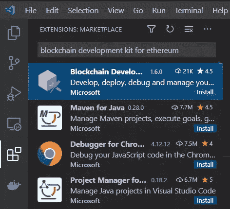单击“安装”。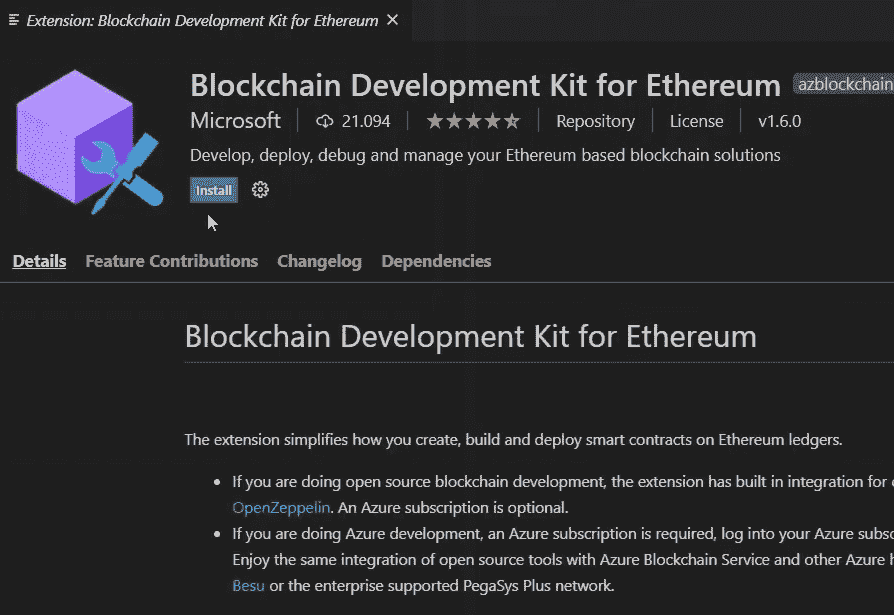等待安装完成 完成！

### 安装 Truffle

Truffle 是一个以太坊开发环境、测试框架和资产管道，旨在让以太坊开发人员的生活更轻松。[在 YouTube 上观看](https://www.google.com/url?q=https://www.youtube.com/watch?v%3DmE3_3wL5-jI&sa=D&source=editors&ust=1624824293298000&usg=AOvVaw2cFLaiP5gJqszRcJiOlcWT)

| 预计时间  || 2 分钟  |

| --- | --- |

### 安装 Truffle

转到终端窗口 VS CODE - BASH TERMINAL

| 终端  |

| --- |

| `$ npm install -g truffle` |

### 检查 Truffle 安装

检查安装是否成功 VS CODE - BASH TERMINAL

| 终端  |

| --- |

| `$ truffle` |

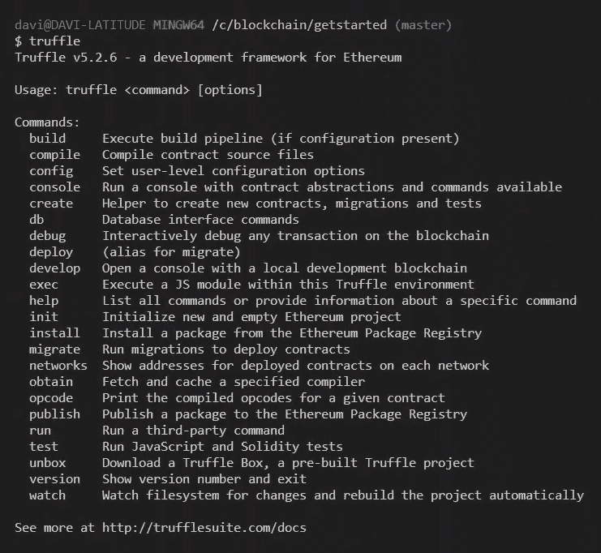

### 安装 Ganache CLI

Ganache 是一个个人区块链，用于快速的以太坊和 Corda 分布式应用程序开发。您可以在整个开发周期中使用 Ganache；使您能够在安全且确定性的环境中开发、部署和测试您的 dApps。[在 YouTube 上观看](https://www.google.com/url?q=https://www.youtube.com/watch?v%3DfbQH6pzfXig&sa=D&source=editors&ust=1624824293302000&usg=AOvVaw0QoYm6VV7ZG3XndRnEaLWT)

| 预计时间  || 2 分钟  |

| --- | --- |

| 命令概述  |

| --- |

| `npm install` |

| 此命令安装一个包及其依赖的任何包。  |

| `ganache-cli` |

| 在 127.0.0.1:8545 上启动 ganache 开发区块链。  |

### 安装 Ganache

转到终端窗口 VS CODE - BASH TERMINAL

| 终端  |

| --- |

| `npm install -g ganache-cli` |

### 在本地启动 Ganache

在 127.0.0.1:8545 上启动 Ganache CLI VS CODE - BASH TERMINAL

| 终端  |

| --- |

| `ganache-cli` |

它还将生成 10 个账户及其各自的公钥和私钥，以便您可以将其用于测试目的。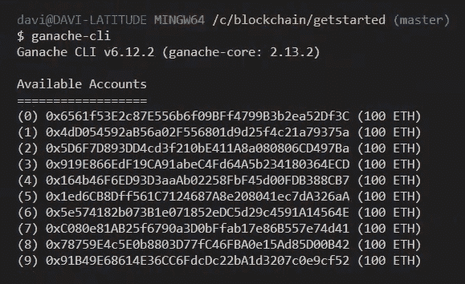

## MetaMask 安装和设置 MetaMask 钱包

MetaMask 是一个用于在浏览器中访问以太坊支持的分布式应用程序（或“Dapps”）的扩展。该扩展将以太坊 web3 API 注入到每个网站的 javascript 上下文中，以便 dApps 可以从区块链读取数据。MetaMask 还允许用户创建和管理自己的身份（通过私钥、本地客户端钱包和 Trezor 等硬件钱包），因此当 Dapp 想要执行交易并写入区块链时，用户会获得一个安全的界面来审查交易，然后再批准或拒绝它。[在 YouTube 上观看](https://www.google.com/url?q=https://youtu.be/Bj6IozLyVxw&sa=D&source=editors&ust=1624824293310000&usg=AOvVaw35Z4w76gWuYK2yAD_VK7yB)

| 预计时间  || 2 分钟  |

| --- | --- |

### 安装钱包

转到 metamask.io 单击“安装 MetaMask” 单击“添加到 Brave”或您的浏览器名称 单击“添加扩展” 单击“开始”

### 配置钱包

单击“创建钱包” 单击“否，谢谢”（但如果您愿意，请改为单击“我同意”） 定义您将用于打开钱包的密码 确认密码 同意使用条款 单击“创建” 现在您可以备份您的秘密备份短语（您也可以稍后执行此操作） 目前，单击“稍后提醒我” 您的钱包已完成！

### 访问您的钱包

单击扩展并将 MetaMask 固定到您的栏 单击 MetaMask 图标，您的钱包将显示

### 发现您的钱包地址

单击右上角的三个点，然后单击“账户详情” 您可以在哈希格式和二维码格式中查看您的钱包地址 您也可以通过单击账户名称来复制您的钱包地址 这就全部了！

## Infura 在 Infura 上创建帐户

Infura 提供工具和基础设施，允许开发人员轻松地将其区块链应用程序从测试转移到规模化部署 - 以简单、可靠的方式访问以太坊和 IPFS。[在 YouTube 上观看](https://www.google.com/url?q=https://www.youtube.com/watch?v%3DNcKMBgNsBuw&sa=D&source=editors&ust=1624824293313000&usg=AOvVaw2CHIrHiVW_pwOTZNT4B1iC)

| 预计时间  || 2 分钟  |

| --- | --- |

### 创建新帐户

转到 [infura.io](https://www.google.com/url?q=https://infura.io/&sa=D&source=editors&ust=1624824293315000&usg=AOvVaw2qnN-ZVazIFCaJz8pZcX3o) 单击“免费开始”。输入您的电子邮件和密码 单击“注册” 一封验证电子邮件将发送到您的地址 检查您的电子邮件并通过单击验证链接确认您的帐户 之后，您将被重定向到您的仪表板 单击左侧菜单上的“以太坊”选项卡 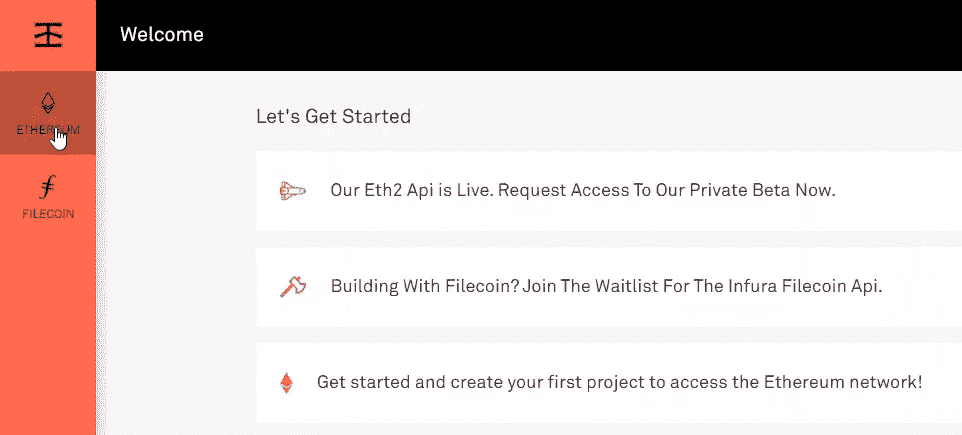现在您的帐户已创建，您可以开始设置新项目。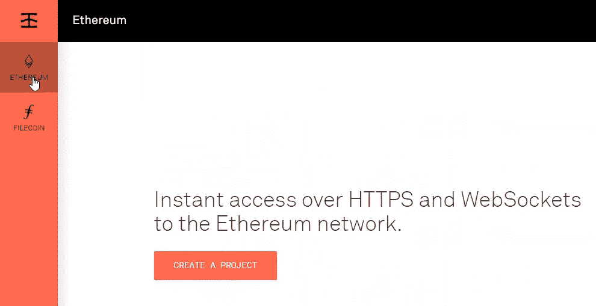

### 设置您的 Infura 项目

转到 infura.io 访问您的仪表板 单击“以太坊” 单击“创建项目” 定义项目名称 您可以连接到不同的测试网以及主网 保存更改 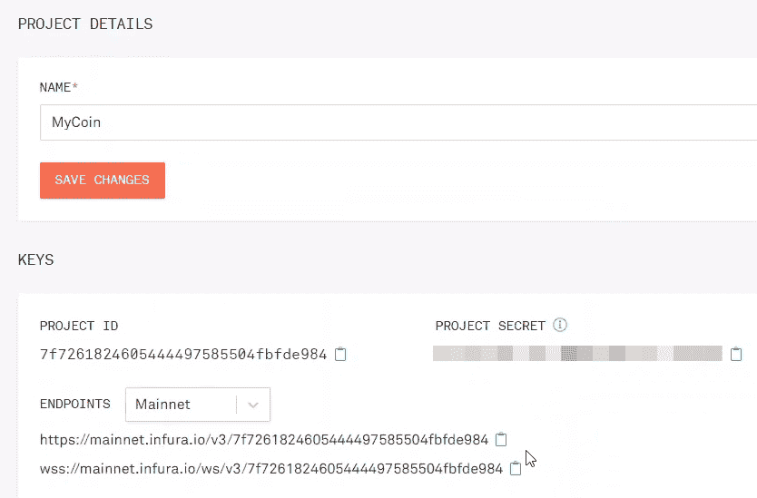


# Solidity Get Started With Solidity Project on VS Code

智能合约最常用于以太坊。以太坊是世界上第一个可编程区块链。它允许定义智能合约，以帮助促进数字资产（如以太币）的转移。你将用来编写合约的语言是 Solidity。Solidity 是图灵完备的，这意味着你可以以清晰定义和编码的方式编写复杂的合约。 [View on YouTube](https://www.google.com/url?q=https://www.youtube.com/watch?v%3D-MyTO031-Ww&sa=D&source=editors&ust=1624824293318000&usg=AOvVaw1mHt423DF82kvv0SsltVSi)

| 预计时间 || 4 分钟 |

| --- | --- |

## 创建新项目

单击“视图 > 命令面板...”。单击“区块链: 新建 Solidity 项目”。单击“创建基本项目”。选择项目将被脚手架化的文件夹。等待项目创建完成。

## 编译项目

右键单击 `HelloBlockchain.sol` 文件 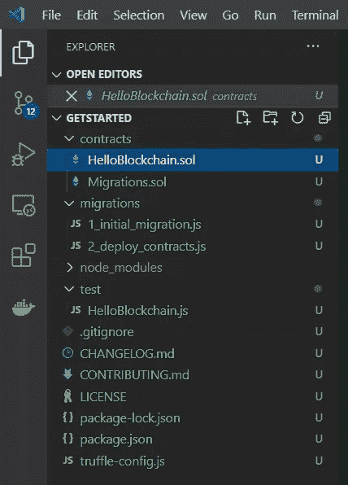 选择“构建合约”。等待合约构建完成。

## 部署到开发区块链

右键单击 `HelloBlockchain.sol` 文件。选择“部署合约”。选择“development 127.0.0.1:8545”。等待合约部署到区块链开发网络。完成！

# ERC20 - 可替代代币

## 使用 OpenZeppelin 编写简单的 ERC20 代币

让我们在 Truffle 的帮助下创建一个简单的 ERC-20 以太坊智能合约，然后导入 OpenZeppelin 合约库。代币可以代表以太坊中的几乎任何东西：在线平台上的声誉点数、游戏中角色的技能、彩票、公司股份等金融资产、像美元这样的法定货币、一盎司黄金 [`ethereum.org/en/developers/docs/standards/tokens/erc-20/`](https://www.google.com/url?q=https://ethereum.org/en/developers/docs/standards/tokens/erc-20/&sa=D&source=editors&ust=1624824293322000&usg=AOvVaw0WQC0GAMdAvUsXaMjUY9n4) [View on YouTube](https://www.google.com/url?q=https://www.youtube.com/watch?v%3DycTvT1R4_nc&sa=D&source=editors&ust=1624824293323000&usg=AOvVaw0gF-p4EsSm3Lw6ISLoO3iQ)

| 预计时间 || 5 分钟 |

| --- | --- |

| 命令概览 |

| --- |

| `truffle init` |

| 初始化新的空 Ethereum 项目 |

| `npm init` |

| 为你的项目创建一个 `package.json` 文件。该文件包含有关项目包和依赖项的信息。 |

| `npm install` |

| 此命令安装一个包及其依赖的任何包。 |

## 准备环境

VS CODE - BASH 终端

| 终端 |

| --- |

| `$ truffle init` |

`$ npm init` |

`$ npm install @openzeppelin/contracts` |

## 编写合约

在 `contracts` 下创建一个名为 `ERC20MinerReward.sol` 的新文件。添加许可证指令。定义 Solidity 最低版本。导入 OpenZeppelin ERC-20 合约库。定义合约类。定义合约构造函数。定义合约名称。定义合约符号。

| `ERC20MinerReward.sol` |

| --- |

| 1 2 3 4 5 6 7 8 || `// SPDX-License-Identifier: MIT` |

`pragma solidity ^ 0.8.0 ;` |

`import "@openzeppelin/contracts/token/ERC20/ERC20.sol"` |

`contract ERC20MinerReward is ERC20 {` |

`    constructor () ERC20("MinerReward", "MRW")` |

`}` |

## 设置 Solidity 编译器版本

复制本合约中使用的 Solidity 版本。打开 `truffle-config.js`。取消注释 "solc" 块。粘贴复制的值来设置 Solidity 版本。

## 编译合约

现在是编译合约的时候了。

VS CODE - BASH 终端

| 终端 |

| --- |

| `$ truffle compile` |

合约编译成功！

## 验证结果

注意到新文件夹 `build/contract` 已创建。全新的合约就在那里！

# 将 ERC20 代币部署到 Ganache 开发区块链

Ethereum Ganache 是一个专为开发和测试设计的本地内存区块链。它模拟真实以太坊网络的功能，包括多个充有测试以太币的账户可用。 [View on YouTube](https://www.google.com/url?q=https://youtu.be/8XAwtrrQ-g8&sa=D&source=editors&ust=1624824293336000&usg=AOvVaw1BtugFh5-lr14icvF5NkTv)

| 预计时间 || 4 分钟 |

| --- | --- |

| 前置要求 |

| --- |

| Install Truffle |

| 命令概览 |

| --- |

| `ganache-cli` |

| 在 127.0.0.1:8545 上启动 Ganache 开发区块链。 |

| `truffle compile` |

| 编译合约源文件。 |

| `truffle migrate` |

| 运行迁移以部署合约。 |

## 准备迁移

创建一个新的迁移文件。添加对智能合约的引用。添加一个导出函数来部署智能合约。

## 启动区块链

打开一个新终端。

VS CODE - BASH 终端

| 终端 |

| --- |

| `$ ganache-cli` |

一个新的 Ganache 区块链正在 127.0.0.1:8545 上监听。

## 配置区块链网络

打开 `truffle-config.js`。取消注释 networks 中的 development 块。确保主机和端口正确。

## 部署合约

VS CODE - BASH 终端

| 终端 |

| --- |

| `$ truffle compile` |

`$ truffle migrate` |

合约已部署到 Ganache 区块链。已创建合约地址。

## 将代币添加到钱包

转到 Brave 浏览器（或任何与 MetaMask 兼容的浏览器）。选择“Localhost 8585”网络。单击“添加代币”。单击“自定义代币”。复制合约地址。粘贴到“代币合约地址”字段。“代币符号”和“精度小数位数”会自动填充。单击“下一步”。单击“添加代币”。代币已添加到 MetaMask 钱包。代币就在那里！

# 创建具有固定供应量的 ERC20 代币

ERC20 固定供应量代币定义了智能合约中允许的总代币数量。在这种实现类型中，部署到区块链后无法更改它。 [`openzeppelin.com`](https://www.google.com/url?q=https://openzeppelin.com&sa=D&source=editors&ust=1624824293349000&usg=AOvVaw32HS2RkQbGxWYqjIR5hmda) [`www.trufflesuite.com/truffle`](https://www.google.com/url?q=https://www.trufflesuite.com/truffle&sa=D&source=editors&ust=1624824293349000&usg=AOvVaw3mUxgJCana2JUfkCZhwIyh) [`www.trufflesuite.com/ganache`](https://www.google.com/url?q=https://www.trufflesuite.com/ganache&sa=D&source=editors&ust=1624824293350000&usg=AOvVaw2QpGKTc6Ta-52ah-2VGD_s) [`metamask.io`](https://www.google.com/url?q=https://metamask.io&sa=D&source=editors&ust=1624824293350000&usg=AOvVaw18b5BD_Xz2ZKDHqV8MnNrC)

| 预计时间 || 12 分钟 |

| --- | --- |

| 视频 || [YOUTUBE](https://www.google.com/url?q=https://youtu.be/r7_g_uHgA6g&sa=D&source=editors&ust=1624824293352000&usg=AOvVaw0Zu7p0shqqAVPJGMiaFvpT) |

| --- | --- |

| 源代码 || [GITHUB](https://www.google.com/url?q=https://github.com/davibauer/blockchain/tree/master/token-erc20-fixed&sa=D&source=editors&ust=1624824293354000&usg=AOvVaw3xsHY2LahKxjrzVfUD2RWc) |

| --- | --- |

| 前置要求 |

| --- |

| Install Truffle |

| 命令概览 |

| --- |

| `truffle init` |

| 初始化新的空 Ethereum 项目 |

| `npm init` |

| 为你的项目创建一个 `package.json` 文件。 |

| `npm install` |

| 安装一个包及其依赖的任何包。 |

| `ganache-cli` |

| 在 127.0.0.1:8545 上启动 Ganache 开发区块链。 |

| `truffle compile` |

| 编译合约源文件。 |

| `truffle migrate` |

| 运行迁移以部署合约。 |

## 创建项目

VS CODE - BASH 终端

| 终端 |

| --- |

| `$ truffle init` |

`$ npm init` |

`$ npm install @openzeppelin/contracts` |

## 编写合约

创建一个新的 Solidity 文件。包含许可证声明（强制性）。定义 Solidity 最低版本。导入 OpenZeppelin ERC-20 合约库。定义从 `ERC20` 继承的固定供应量合约类。调用构造函数传递名称和符号。将总供应量分配给发送者地址（创建合约的人）。覆盖 `decimals` 函数。设置该代币将拥有的小数位数。

| `ERC20FixedSupply.sol` |


# ERC20 固定供应量代币部署与测试指南

## 1. 智能合约代码

进入合约目录，创建 `ERC20FixedSupply.sol` 文件。

```solidity
// SPDX-License-Identifier: MIT

pragma solidity ⁰.8.0;

import "@openzeppelin/contracts/token/ERC20/ERC20.sol";

contract ERC20FixedSupply is ERC20 {
    constructor() ERC20("Fixed", "FIX") {
        _mint(msg.sender, 1000);
    }

    function decimals() public view virtual override returns (uint8) {
        return 0;
    }
}
```

## 2. 配置 Truffle 编译器

打开 `truffle-config.js` 文件，取消 "solc" 块的注释，并更新 Solidity 版本号。

```javascript
compilers: {
    solc: {
        version: "0.8.0",
        docker: true,
        settings: {
            optimizer: {
                enabled: false,
                runs: 200
            },
            evmVersion: "byzantium"
        }
    }
},
```

## 3. 创建部署脚本

在 `migrations` 文件夹下，创建新文件，文件名设置为 `2_deploy_contract.sol`，将 `require` 方法设置为你的合约文件，并导出部署合约的函数。

```javascript
var ERC20FixedSupply = artifacts.require("./ERC20FixedSupply.sol");

module.exports = function(deployer) {
    deployer.deploy(ERC20FixedSupply);
};
```

## 4. 启动 Ganache 并迁移合约

打开新终端（VS CODE - BASH TERMINAL），启动 Ganache 开发区块链。

```bash
$ ganache-cli
```

分割终端视图（VS CODE - BASH TERMINAL），再次启动 Ganache。

```bash
$ ganache-cli
```

打开 `truffle-config.js` 文件，在 `networks` 下取消 `development` 块的注释。

```javascript
networks: {
    development: {
        host: "127.0.0.1",
        port: 8545,
        network_id: "*"
    },
},
```

在终端中迁移合约（VS CODE - BASH TERMINAL）。

```bash
$ truffle migrate
```

## 5. 配置 MetaMask 并转账代币

复制部署代币的账户私钥。配置 MetaMask，打开 MetaMask，点击你的账户，然后选择 "import account"，粘贴账户私钥，点击 "import"。

点击网络列表，选择 "Localhost:8545"。

添加代币：点击 "add token"，选择 "custom token"，粘贴代币合约地址，点击 "next"，点击 "add tokens"。

返回 VS Code，复制另一个账户私钥。返回 MetaMask，重复你为第一个账户所做的步骤，包括添加代币。

在账户之间转账代币。切换到第一个导入的账户（即拥有所有代币的账户），点击 "send"，点击 "transfer between my accounts"，选择第二个创建的账户，输入 115 FIX 作为转账金额，点击 "next"，点击 "confirm"。交易已发送但处于待定状态，交易确认后，总代币数将更新。选择第二个导入的账户，该账户现在拥有 115 FIX！

## 6. 使用 Infura 将 ERC20 代币部署到测试网

你可以使用 Infura 将智能合约部署到 Ropsten、Kovan、Rinkeby、Gorli 等测试网络，也可以部署到 Mainnet。对于测试网，你需要在 Infura 上设置一个新项目，并拥有用于部署合约的钱包私钥。该钱包需要有以太币余额以完成合约创建交易。

- [Infura](https://infura.io)
- [在 YouTube 上观看](https://youtu.be/VS4iWGCHXmE)

| 预计时间 | 8 分钟 |
| --- | --- |

## 前置要求

- Install Truffle
- 在 Infura.io 上创建账户
- Get Test Ether From Faucet on Ropsten Network
- Install and Setup MetaMask Wallet

## 命令概览

| 命令 | 说明 |
| --- | --- |
| `npm install fs` | 安装 fs 包，该包提供大量非常有用的功能来访问和与文件系统交互。 |
| `npm install @truffle/hdwallet-provider` | 安装 HD 钱包支持的 Web3 提供程序。这用于为从 12 或 24 个助记词派生的地址签署交易。 |
| `truffle migrate --network ropsten` | 运行迁移以部署合约。 |

### 安装前置要求

打开新终端（VS CODE - BASH TERMINAL）。

```bash
$ npm install fs
$ npm install @truffle/hdwallet-provider
```

### 设置 Infura 项目

访问 infura.io，进入控制面板，点击 "ethereum"，点击 "create a project"，定义项目名称。你可以连接到不同的测试网以及主网，复制项目 ID 并保存更改。

### 设置智能合约

打开 Visual Studio Code，打开 `truffle-config.js`，取消注释四个常量：`hdwalletprovider`、`infurakey`、`fs` 和 `mnemonic`。将项目 ID 作为 `infurakey` 常量的值粘贴进去，取消注释 "ropsten" 块，确保在 ropsten 端点中使用正确的项目 ID。

### 配置私钥

在浏览器中打开连接到 Infura 网络的 MetaMask 钱包，点击你的账户，点击 "settings"，点击 "security & privacy"，点击 "reveal seed phrase"，输入钱包密码继续，复制私钥。返回 Visual Studio Code，创建名为 `.secret` 的新文件，粘贴私钥。

### 部署智能合约

打开终端（VS CODE - BASH TERMINAL）。

```bash
$ truffle migrate --network ropsten
```

### 检查钱包余额

再次访问你的 MetaMask 钱包，注意你的余额已减少。

### 在 Etherscan 上验证智能合约

打开新窗口，访问 [`ropsten.etherscan.io`](https://ropsten.etherscan.io)，复制为你的部署创建的合约地址，将合约地址粘贴到搜索字段，点击 "find" 按钮。智能合约已显示！代币已创建并转移到创建合约的钱包。点击 "Fixed (FIX)" 代币链接，在这里你可以看到新创建代币的概览！

## 7. 单元测试

为 ERC20 智能合约编写单元测试。Truffle 标配自动化测试框架，使测试合约更加容易。这个框架让你以不同的方式编写简单且易于管理的测试。

- [Truffle Suite](https://www.trufflesuite.com/truffle)
- [Ganache](https://www.trufflesuite.com/ganache)
- [在 YouTube 上观看](https://youtu.be/7XmH4gOFm-4)

| 预计时间 | 5 分钟 |
| --- | --- |

## 前置要求

- Install Truffle
- Install Ganache CLI

## 命令概览

| 命令 | 说明 |
| --- | --- |
| `truffle create test` | 帮助创建新合约、迁移和测试。 |
| `truffle test --network development` | 运行 JavaScript 和 Solidity 测试。 |

### 创建新单元测试文件

打开新终端并执行命令。

```bash
$ truffle create test erc20FixedSupply
```

### 编写合约总供应量的测试

编写新测试以断言合约是以固定供应量 1000 枚代币创建的。

```javascript
const erc20FixedSupply = artifacts.require("erc20FixedSupply");

contract("erc20FixedSupply", function() {
    it("should assert true", async function() {


await `erc20FixedSupply.deployed()`;

return `assert.isTrue(true)`;

});

it("should return total supply of 1000", async function () {

const `instance = await erc20FixedSupply.deployed()`;

const `totalSupply = await instance.totalSupply()`;

`assert.equal(totalSupply, 1000)`;

});

});

使用以下命令进行测试。

| TERMINAL |

| --- |

| `$ truffle test --network development` |

测试将会通过。编写断言以验证合约余额。添加一个测试，以断言在两个账户之间进行新转账后余额正确。

| ERC20FixedSupply.js |

| --- |

| 16 17 18 19 20 21 22 23 24 25 |

```javascript
it("should transfer 150 FIX", async function(){
    const instance = await erc20FixedSupply.deployed();
    await instance.transfer("account[1]", 150);
    const balanceAccount0 = await instance.balanceOf(accounts[0]);
    const balanceAccount1 = await instance.balanceOf(accounts[1]);
    assert.equal(balanceAccount0.toNumber(), 850);
    assert.equal(balanceAccount1.toNumber(), 150);
});
```

再次执行测试。

| TERMINAL |

| --- |

| `$ truffle test --network development` |

所有测试将会通过。 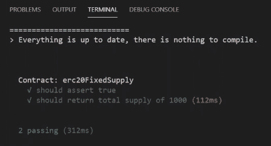尝试更改一些值，例如第 23 行和第 24 行的账户余额，观察结果如何从通过变为失败。

## ERC721- 非同质化代币

### 使用 Ganache 和 OpenZeppelin 创建您的艺术 NFT

NFT 是一种代表现实世界对象（如艺术品、音乐、游戏内物品和视频）的数字资产。在这个视频中，我将向您展示如何创建一个 ERC 721 NFT 并将其部署到以太坊测试网络，以及如何将其添加到您的 MetaMask 移动钱包中。 [`eips.ethereum.org/EIPS/eip-721`](https://eips.ethereum.org/EIPS/eip-721) [在 YouTube 上观看](https://www.google.com/url?q=https://youtu.be/IFpU4TNwXec&sa=D&source=editors&ust=1624824293420000&usg=AOvVaw0LAiWMu-EocDqEhypxlgiG)

| 预计时间 | 15 分钟 |

| --- | --- |

| 前置要求 |

| --- |

| 安装 Truffle |

| 在 Infura.io 上创建账户 |

| 从 Rinkeby 网络水龙头获取测试以太币 |

| 安装并设置 MetaMask 钱包 |

| 命令概览 |

| --- |

| `truffle init` |

| 初始化新的空白以太坊项目 |

| `npm install` |

| 此命令安装一个包及其依赖的任何包 |

| `ipfs daemon` |

| 在 127.0.0.1:5001 上启动 IPFS 本地服务器 |

| `ipfs add <file>` |

| 将文件添加到您的 IPFS 本地节点 |

| `ipfs pin remote add --service=pinata -name=<file> <hash>` |

| 将您的文件固定到远程 IPFS 固定服务 |

| `truffle compile` |

| 编译合约源文件 |

| `truffle migrate` |

| 运行迁移以部署合约 |

| `truffle console` |

| 连接到以太坊客户端的基本交互式控制台 |

## 创建项目

使用 truffle 创建新项目

| TERMINAL |

| --- |

| `$ truffle init` |

### 安装 OpenZeppelin 合约

| TERMINAL |

| --- |

| `$ npm install @openzeppelin/contracts` |

### 创建新的 Solidity 智能合约

| TERMINAL |

| --- |

| `$ touch contracts/UniqueAsset.sol` |

打开文件 导入 ERC721 URI 存储扩展 导入 Counters 工具 创建扩展 ERC721URIStorage 的新类 声明计数器 声明传递代币名称和代码的构造函数 创建新的奖励物品方法 在新方法中，递增代币 获取新代币编号 铸造新物品 设置代币 URI

| UniqueAsset.sol | [在 GitHub 上查看](https://www.google.com/url?q=https://github.com/davibauer/blockchain/blob/master/nft/contracts/UniqueAsset.sol&sa=D&source=editors&ust=1624824293441000&usg=AOvVaw0kQm6OCdMH2KrrQpUMgQxn) |

| --- | --- |

| 1 2 3 4 5 6 7 8 9 10 11 12 13 14 15 16 17 18 19 20 21 22 23 |

```solidity
// SPDX-License-Identifier: MIT

pragma solidity ⁰.8.0;

import "@openzeppelin/contracts/token/ERC721/extensions/ERC721URIStorage.sol";
import "@openzeppelin/contracts/utils/Counters.sol";

contract UniqueAsset is ERC721URIStorage {
    using Counters for Counters.Counter;
    Counters.Counter private _tokenIds;

    constructor() ERC721("UniqueAsset", "UNA") {}

    function awardItem(address recipient, string memory metadata) public returns (uint256) {
        _tokenIds.increment();
        uint256 newItemId = _tokenIds.current();
        _mint(recipient, newItemId);
        _setTokenURI(newItemId, metadata);
        return newItemId;
    }
}
```

### 创建新的迁移文件

| TERMINAL |

| --- |

| `$ touch migrations/2_deploy_contracts.js` |

### 在迁移文件中导出智能合约

| 2_deploy_contracts.js | [在 GitHub 上查看](https://www.google.com/url?q=https://github.com/davibauer/blockchain/blob/master/nft/migrations/2_deploy_contracts.js&sa=D&source=editors&ust=1624824293449000&usg=AOvVaw10o1zZ2Ri74tBsK1M4YoGF) |

| --- | --- |

| 1 2 3 4 5 |

```javascript
const UniqueAsset = artifacts.require("UniqueAsset");

module.exports = function(deployer) {
    deployer.deploy(UniqueAsset);
}
```

### 配置钱包

安装文件系统 "fs" 包

| TERMINAL |

| --- |

| `$ npm install fs` |

安装钱包提供程序 "hdwallet" 包

| TERMINAL |

| --- |

| `$ npm install @truffle/hdwallet-provider@1.2.3` |

打开 `truffle-config.js` 文件 取消注释 HDWalletProvider 代码部分

| truffle-config.js |

| --- |

| 21 22 23 24 25 |

```javascript
const HDWalletProvider = require('@truffle/hdwallet-provider');
const infuraKey = 'fj4jll3k.....';
const fs = require('fs');
const mnemonic = fs.readFileSync(".secret").toString().trim();
```

将您的 Infura 项目 ID 作为变量 `infuraKey` 的值粘贴 配置网络 取消注释 "ropsten" 网络部分 将 "ropsten" 更改为 "rinkeby" 将 "ropsten" Infura URL 更改为 "rinkeby" 将 "YOU-PROJECT-ID" 更改为 "${infuraKey}" 将 network_id 更改为 42

| truffle-config.js |

| --- |

| 60 61 62 63 64 65 66 67 |

```javascript
rinkeby: {
    provider: () => new HDWalletProvider(mnemonic, `https://rinkeby.infura.io/v3/${infuraKey}`),
    network_id: 4,
    gas: 5500000,
    confirmations: 2,
    timeoutBlocks: 200,
    skipDryRun: true
},
```

配置 Solidity 编译器 取消注释 "compilers" 部分 将版本更改为 "0.8.0"

| truffle-config.js |

| --- |

| 93 94 95 96 97 98 99 100 101 102 103 104 105 |

```javascript
compilers: {
    solc: {
        version: "0.8.0",
        docker: true,
        settings: {
            optimizer: {
                enabled: false,
                runs: 200
            },
            evmVersion: "byzantinum"
        }
    }
},
```

### 配置私钥

创建密钥文件

| TERMINAL |

| --- |

| `$ touch .secret` |

转到浏览器并打开连接到 Infura 网络的 MetaMask 钱包 点击您的账户 点击 "设置" 点击 "安全与隐私" 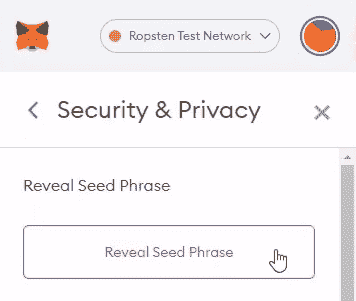点击 "显示助记词" 输入钱包密码以继续 复制私钥 粘贴钱包助记词密钥 创建徽章图片 创建徽章文件夹

| TERMINAL |

| --- |

| `$ mkdir badge` |

转到徽章根文件夹

| TERMINAL |

| --- |

| `$ cd badge` |

从互联网下载将用作徽章的图片。您也可以将现有图片复制粘贴到此文件夹中。

| TERMINAL |

| --- |

| `curl https://planouhost.z15.web.core.windows.net/badge.png > badge-image.png` |

将徽章添加到您的本地 IPFS 初始化您的本地 IPFS 节点

| TERMINAL |

| --- |

| `$ ipfs daemon` |


# 将徽章图片添加到 IPFS

将徽章图片添加到 IPFS。

```bash
$ ipfs add badge-image.png
```

运行此命令，您将收到一个哈希值。该哈希值是您在 IPFS 中的图片地址。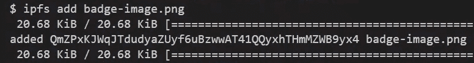

## 将徽章固定到远程 IPFS 节点

使用远程 IPFS 服务固定您的徽章。

```bash
ipfs pin remote add --service=pinata --name=badge-image.png QmZPxKJWqJTdudyaZUyf6uBzwwAT41QQyxhTHmMZWB9yx4
```

您将收到一条响应，指示文件已成功固定 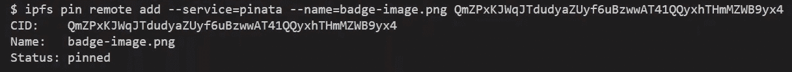

## 创建徽章元数据

创建徽章元数据 json 文件。

```bash
touch badge-metadata.json
```

打开文件。设置徽章名称。设置徽章描述。使用 IPFS 网关设置徽章图片地址。

```json
{
  "name": "My badge",
  "description": "My badge description",
  "image": "https://ipfs.io/ipfs/QmZPxKJWqJTdudyaZUyf6uBzwwAT41QQyxhTHmMZWB9yx4"
}
```

## 将徽章元数据添加到 IPFS

```bash
$ ipfs add badge-metadata.json
```

使用远程 IPFS 服务固定您的徽章元数据。

```bash
$ ipfs pin remote add --service=pinata --name=badge-metadata.json QmRzcwAtLWbeYqyaZUyf6uBzwwAT41QQyxhTHmMZWBfUTa
```

# 编译智能合约

使用 `truffle` 编译合约。

```bash
$ truffle compile
```

# 迁移智能合约

使用 `truffle` 将合约迁移到 rinkeby 网络。

```bash
$ truffle migrate --network rinkeby
```

# 实例化智能合约

使用 `truffle console` 实例化合约。

```bash
$ truffle console --network rinkeby
truffle(rinkeby) let instance = await UniqueAsset.deployed()
```

# 向钱包授予徽章

调用方法 `getThePrice`。将您的公共以太坊地址作为第一个参数输入。输入与您的徽章元数据对应的 IPFS 地址。

```bash
truffle(rinkeby) let result = await instance.awardItem("0x62761466bB3A3Da83B408B5F5fE00ac7b2a5A996","https://ipfs.io/ipfs/QmRzcwAtLWBeYqUx3ba1BkYKubSDLNTHCuiUB7WAmdfUTa")
```

# 在 Etherscan 上检查徽章

复制已部署的合约地址 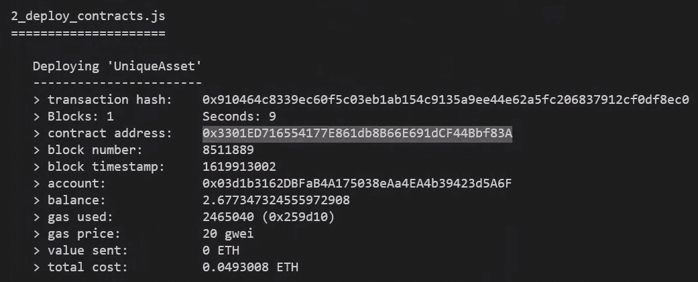

访问 [rinkeby.etherscan.io](https://www.google.com/url?q=https://rinkeby.etherscan.io/&sa=D&source=editors&ust=1624824293484000&usg=AOvVaw2X6oFOKB_p-6n7749VXd0B)。在搜索栏中粘贴合约地址 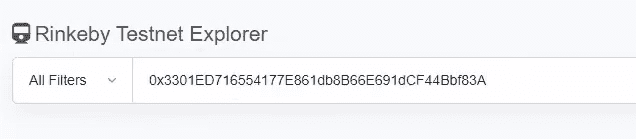。点击搜索图标。现在您可以看到合约已成功部署 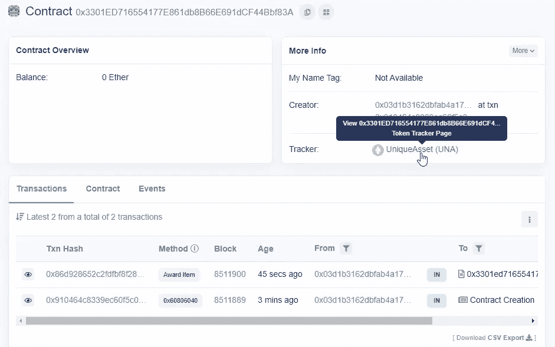。您还可以发现最后一笔交易是用于授予新项目。

# 将 NFT 代币添加到您的钱包

在手机上打开 MetaMask 钱包（收藏品仅在移动版上可用）。点击“收藏品” 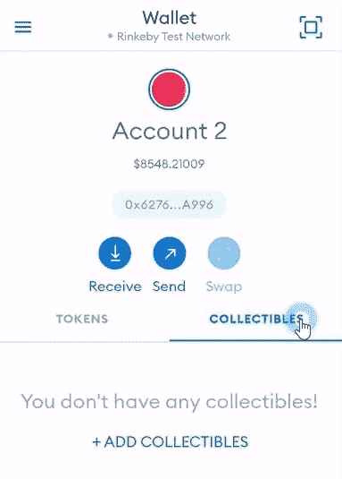。点击“添加收藏品”。在此处粘贴代币合约地址（与您在上一节中复制的相同）。输入代币 ID，因为这是您将输入的第一个代币，此处输入 1。点击“添加”。等待几秒钟。现在 NFT 代币已添加！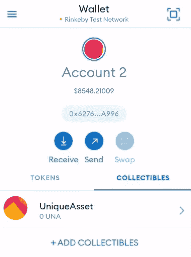。点击“UniqueAsset”。现在您可以看到您获得的所有徽章 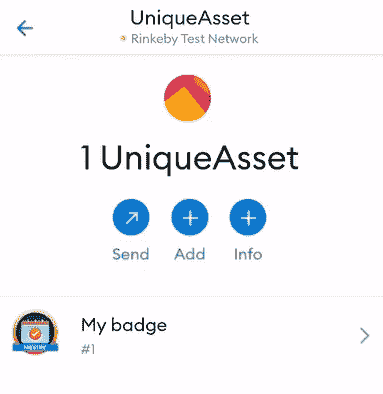。点击“我的徽章”。现在您可以看到徽章详细信息了！此外，您有一个发送按钮，可以将其发送到另一个钱包 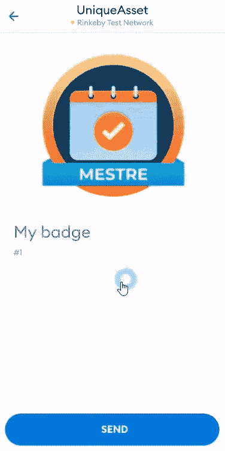。就这样，您刚刚创建了第一个 NFT 代币！

# Ether 水龙头

## 从 Ropsten 网络上的水龙头获取测试以太币

这个以太坊测试水龙头每 5 秒滴 1 个以太币。您可以使用它在 Ropsten 网络上测试智能合约，无需为此使用真实以太币（即使主网上的以太币在 ropsten 上无效，反之亦然）。您每 24 小时有 1 个以太币的请求限制，以避免网络垃圾邮件。测试网络上的以太币除了在智能合约开发中用于测试目的外，没有真实价值。

[`faucet.ropsten.be`](https://www.google.com/url?q=https://faucet.ropsten.be&sa=D&source=editors&ust=1624824293488000&usg=AOvVaw39Zbse6NzzonrzBxkJmjX_)

[在 YouTube 上观看](https://www.google.com/url?q=https://youtu.be/rSL3kP13gOI&sa=D&source=editors&ust=1624824293489000&usg=AOvVaw1VYd0meZ7Ibg4mR-22rteP)

| 预计时间 | 2 分钟 |
| --- | --- |

| 前置要求 | |
| --- | --- |

| 安装和设置 MetaMask 钱包 | |

## 访问水龙头

访问 [`faucet.ropsten.be`](https://www.google.com/url?q=https://faucet.ropsten.be&sa=D&source=editors&ust=1624824293492000&usg=AOvVaw0g-iC5yFF7nOgZhKww_POb)。复制您的钱包地址（确保选择的网络是 Ropsten）。将您的合约地址粘贴到表单字段中。点击“发送测试以太币给我”。等待交易。点击“交易哈希”（在新窗口中打开）。等待交易完成。交易已成功完成。访问您的 MetaMask 钱包，您现在有 1 个以太币！

## 从 Rinkeby 测试网上的水龙头获取测试以太币

这个以太币水龙运行在 Rinkeby 网络上。为了防止恶意行为者耗尽所有可用资金或积累足够的以太币来发动长期运行的垃圾邮件攻击，请求与常见的第三方社交网络账户绑定。任何拥有 Twitter 或 Facebook 账户的人都可以在允许的限制内请求资金。

[`faucet.rinkeby.io`](https://www.google.com/url?q=https://faucet.rinkeby.io&sa=D&source=editors&ust=1624824293493000&usg=AOvVaw35VO63U2Ccimtq0olysaU4)

[在 YouTube 上观看](https://www.google.com/url?q=https://youtu.be/iJBpiBqEMtA&sa=D&source=editors&ust=1624824293494000&usg=AOvVaw18LCPDv2bcqiYJTsoSKFO_)

| 预计时间 | 2 分钟 |
| --- | --- |

## 为资金做准备

打开您的 Metamask 钱包。将您的钱包地址复制到剪贴板。访问您的 Twitter 账户。粘贴您的钱包地址。点击您的推文。复制您的推文地址（地址栏中的 URL）。

## 为您的钱包注资

访问 [`faucet.rinkeby.io`](https://www.google.com/url?q=https://faucet.rinkeby.io&sa=D&source=editors&ust=1624824293496000&usg=AOvVaw1OGB41VLbzKTklNDl_FAnP)。将您的推文地址粘贴到文本字段中。点击“给我以太币”。选择一个可用的选项（例如：每 8 小时 3 个以太币）。请求将在几秒钟内注资 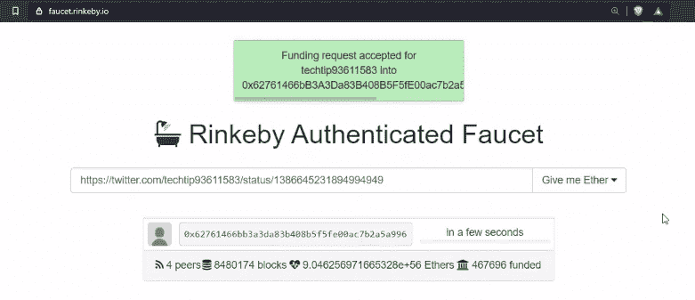。

## 检查您的钱包

等待片刻并检查您的 Metamask 钱包。您的钱包账户中将收到 3 个以太币！

# IPFS - 星际文件系统

## 创建您的 IPFS 节点

星际文件系统（IPFS）是一种协议和点对点网络，用于在分布式文件系统中存储和共享数据。IPFS 使用内容寻址来在连接所有计算设备的全局命名空间中唯一标识每个文件。

[`ipfs.io`](https://www.google.com/url?q=https://ipfs.io&sa=D&source=editors&ust=1624824293497000&usg=AOvVaw3fUJS9jf6wVMTjDheE9ywi)

[在 YouTube 上观看](https://www.google.com/url?q=https://youtu.be/dFWpGn73BBM&sa=D&source=editors&ust=1624824293497000&usg=AOvVaw04WtS08v6b6m1gv56Z6Lqt)

| 预计时间 | 3 分钟 |
| --- | --- |

## 命令概览

| 命令 | 描述 |
| --- | --- |
| `choco install go-ipfs` | 安装 Go 语言的 IPFS 实现。 |
| `ipfs init` | 初始化本地 IPFS 仓库。 |
| `ipfs daemon` | 在 127.0.0.1:5001 上启动 IPFS 本地服务器。 |
| `ipfs cat <hash>` | 查看 IPFS 文件内容。 |
| `ipfs swarm peers` | 显示直接连接到您节点的对等节点。 |

## 安装节点

VS CODE - BASH 终端

```bash
$ choco install go-ipfs
```

## 配置节点

VS CODE - BASH 终端

```bash
$ ipfs init
$ ipfs daemon
```

## 测试节点

VS CODE - BASH 终端

```bash
$ ipfs cat "hash"
$ ipfs swarm peers
```

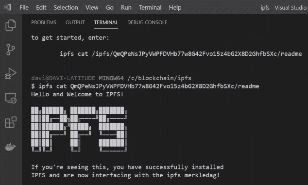

## 探索您的 IPFS 节点

复制 WebUI 链接。访问浏览器并粘贴链接。您的节点已连接到 IPFS！点击“文件”，这里暂时没有文件！点击“探索”。点击“对等节点”。这些是您已连接的对等节点。点击“设置”。您可以在此处查看节点设置。


# 将文件添加到 IPFS

运行 IPFS 的计算机可以询问其连接的所有对等节点是否拥有特定哈希的文件，如果其中某个节点拥有，则会发送回整个文件。如果没有像加密哈希这样的短而唯一的标识符，这将是不可能的。 [`ipfs.io`](https://www.google.com/url?q=https://ipfs.io&sa=D&source=editors&ust=1624824293510000&usg=AOvVaw1baEc1cpfOituSzR6oAvPn) [在 YouTube 上观看](https://www.google.com/url?q=https://youtu.be/UAy1llcOcJw&sa=D&source=editors&ust=1624824293510000&usg=AOvVaw0PsTfdmK2DLBhjBbxJjwcC)

| 预计时间 || 2 分钟 |

| --- | --- |

| 前置要求 |

| --- |

| 创建你的 IPFS 节点 |

| 命令概览 |

| --- |

| `ipfs daemon` |

| 在 127.0.0.1:5001 上启动 IPFS 本地服务器。 |

| `echo "<text>" > <file>` |

| 将给定文本输出到新文件。 |

| `ipfs add <file>` |

| 将文件添加到你的 IPFS 本地节点。 |

| `ipfs cat <hash>` |

| 查看 IPFS 文件内容。 |

## 添加文件 VS CODE - BASH 终端

| 终端 |

| --- |

```
$ ipfs daemon  

$ echo "test"  hello.txt  

$ ipfs add hello.txt  |
```

文件已添加到 ipfs，生成哈希标识符 在控制台查看文件内容 VS CODE - BASH 终端

| 终端 |

| --- |

```
$ ipfs cat "hash"  |
```

你将看到文件内容被显示 在 Web UI 中检查文件 访问 http://127.0.0.1:5001/webui 点击“files” 点击“pins” 复制哈希 通过此哈希查找，你可以看到该哈希存在 在浏览器中查看文件内容 打开新标签页 ipfs://"hash" 现在你可以在浏览器中看到文件内容

## 设置 IPFS 浏览器扩展

IPFS Companion 允许你直接在喜欢的浏览器中本地运行 IPFS 节点，支持 ipfs:// 地址、网站和文件路径的自动 IPFS 网关加载、轻松的 IPFS 文件导入和共享等。 [`ipfs.io`](https://www.google.com/url?q=https://ipfs.io&sa=D&source=editors&ust=1624824293523000&usg=AOvVaw11Kk0Z_w_C-9YBtpEKrntX) [在 YouTube 上观看](https://www.google.com/url?q=https://youtu.be/eVOd6vd2fGc&sa=D&source=editors&ust=1624824293524000&usg=AOvVaw04tLx6JDH22cd5nP7ThY3t)

| 预计时间 || 3 分钟 |

| --- | --- |

| 前置要求 |

| --- |

| 创建你的 IPFS 节点 |

| 命令概览 |

| --- |

| `ipfs daemon` |

| 在 127.0.0.1:5001 上启动 IPFS 本地服务器。 |

### 安装浏览器扩展

访问 [IPFS Companion 扩展](https://www.google.com/url?q=https://chrome.google.com/webstore/detail/ipfs-companion/nibjojkomfdiaoajekhjakgkdhaomnch?hl%3Den&sa=D&source=editors&ust=1624824293529000&usg=AOvVaw2tEwx14yEyllZu9wRErQKf) 点击“添加到 Brave”或你的浏览器名称 点击“添加扩展” 点击扩展图标并将“IPFS Companion”固定到扩展栏 配置节点类型 点击“IPFS Companion”图标 点击“齿轮”图标 在“IPFS 节点类型”中选择“External” 启动外部节点 访问 Visual Studio Code 打开新终端 VS CODE - BASH 终端

| 终端 |

| --- |

```
$ ipfs daemon  |
```

### 导入文件

点击“IPFS Companion”图标 点击“Import” 点击“Pick a file” 从本地磁盘选择文件 文件将存储在你的 ipfs 节点中

# 在本地节点上固定和取消固定 IPFS 文件

为确保数据在 IPFS 上持久化，且在垃圾回收期间不会被删除，可以将数据固定到一个或多个 IPFS 节点。固定使你能够控制磁盘空间和数据保留。因此，你应使用该控制权来固定任何你希望在 IPFS 上无限期保留的内容。IPFS 的默认行为是将文件固定到本地 IPFS 节点。 [`ipfs.io`](https://www.google.com/url?q=https://ipfs.io&sa=D&source=editors&ust=1624824293532000&usg=AOvVaw14MFFSLQLRpUz6efw6ws_v) [在 YouTube 上观看](https://www.google.com/url?q=https://youtu.be/POdQACj-jRI&sa=D&source=editors&ust=1624824293533000&usg=AOvVaw1Wy1-R77UmY-SuEHo3pkxq)

| 预计时间 || 3 分钟 |

| --- | --- |

| 前置要求 |

| --- |

| 创建你的 IPFS 节点 |

| 命令概览 |

| --- |

| `ipfs daemon` |

| 在 127.0.0.1:5001 上启动 IPFS 本地服务器。 |

| `echo "<text>" > <file>` |

| 将给定文本输出到新文件。 |

| `ipfs add <file>` |

| 将文件添加到你的 IPFS 本地节点。 |

| `ipfs cat <hash>` |

| 查看 IPFS 文件内容。 |

## 启动本地节点 VS CODE - BASH 终端

| 终端 |

| --- |

```
$ ipfs daemon  |
```

## 将文件添加到你的节点 VS CODE - BASH 终端

| 终端 |

| --- |

```
$ echo "world"  > hello.txt  

$ ipfs add hello.txt  |
```

添加文件时，它会自动固定到你的本地节点。检查文件是否已添加 VS CODE - BASH 终端

| 终端 |

| --- |

```
$ ipfs cat your\_file\_hash  |
```

验证文件是否已固定 访问 [`127.0.0.1:5001/webui`](https://www.google.com/url?q=http://127.0.0.1:5001/webui&sa=D&source=editors&ust=1624824293544000&usg=AOvVaw3YWLkn7BQ_YxuWJvWtoHJt) 点击“Files” 点击“Pins” 你的文件在那里！ 取消固定你的文件 VS CODE - BASH 终端

| 终端 |

| --- |

```
$ ipfs pin rm your\_file\_hash  |
```

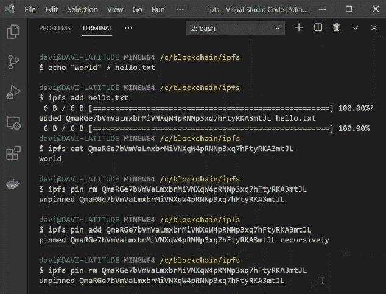手动固定你的文件 VS CODE - BASH 终端

| 终端 |

| --- |

```
$ ipfs pin add your\_file\_hash  |
```

你的文件已再次固定

# 使用 Pinata 在远程节点上固定和取消固定文件

也可以将文件固定到远程固定服务。这些第三方服务让你有机会将文件固定到它们运营的节点，而不是你自己的本地节点。你不需要担心自己节点的可用磁盘空间或运行时间。虽然你可以使用远程固定服务自己的 GUI、CLI 或其他开发工具来管理固定到其服务的 IPFS 文件，但你也可以直接使用本地 IPFS 安装与固定服务协作——这意味着你不需要学习固定服务的独特 API 或其他工具。 [`ipfs.io`](https://www.google.com/url?q=https://ipfs.io&sa=D&source=editors&ust=1624824293548000&usg=AOvVaw0VSY8BUfCvuDgwERgg3yG5) [`pinata.cloud`](https://www.google.com/url?q=https://pinata.cloud&sa=D&source=editors&ust=1624824293549000&usg=AOvVaw1qcUHfmnL8hVloIQhkcdOT) [在 YouTube 上观看](https://www.google.com/url?q=https://youtu.be/0bC_YGrJAkA&sa=D&source=editors&ust=1624824293549000&usg=AOvVaw1-XdElxsKyE8Zvj1agIza6)

| 预计时间 || 4 分钟 |

| --- | --- |

| 前置要求 |

| --- |

| 创建你的 IPFS 节点 |

| 命令概览 |

| --- |

| `ipfs pin remote service add pinata <endpoint> <jwt_key>` |

| 添加新的远程固定服务。 |

| `ipfs pin remote service ls` |

| 列出已添加的现有固定服务。 |

| `ipfs add <file>` |

| 将文件添加到你的 IPFS 本地节点。 |

| `ipfs cat <hash>` |

| 查看 IPFS 文件内容。 |

| `ipfs pin remote add --service=pinata -name=<file> <hash>` |

| 将文件固定到远程 IPFS 固定服务。 |

| `ipfs pin remote rm --service=pinata -name=<file> <hash>` |

| 从远程 IPFS 固定服务取消固定文件。 |

## 在 Pinata 上设置 API 密钥

登录你的 Pinata 账户 访问“API Keys” 点击“New Key” 勾选“Admin” 使用“admin-cli”作为你的“Key Name” 点击“Create Key” 将为你生成一个新密钥 从此窗口复制“JWT”值 在终端上设置 Pinata 作为远程服务 将 Pinata 添加为固定远程服务 VS CODE - BASH 终端

| 终端 |

| --- |

```
$ ipfs pin remote service add pinata https: //api.pinata.cloud/psa your\_jwt\_key  |
```

列出所有现有远程服务并检查 Pinata 是否存在

| 终端 |

| --- |

```
$ ipfs pin remote service ls  |
```

## 将新文件添加到你的本地 IPFS 节点

将 Pinata 添加为固定远程服务 VS CODE - BASH 终端

| 终端 |

| --- |

```
$ echo "world"  > hello.txt  

$ ipfs add hello.txt  

$ ipfs cat your\_file\_hash  |
```

## 将文件固定到远程 IPFS 节点

| 终端 |

| --- |


# IPFS 与 Fleek 部署指南

## IPFS 文件固定与取消

### 添加远程固定

```
$ ipfs pin remote add --service=pinata -name=hello.txt your_file_hash
```

返回 Pinata 网站，点击“Pin Manager”，你的文件将出现在此页面！

### 取消远程固定

```
$ ipfs pin remote rm --service=pinata -name=hello.txt your_file_hash
```

返回 Pinata 网站，点击“Pin Manager”，你的文件将不再出现在此页面，这意味着你的文件已被取消固定。

---

# 使用 Fleek 在 IPFS 上托管你的网站

Fleek 允许你基于开放 Web 协议构建，并由基础设施提供支持。在专注于创建用户控制、加密、私有、P2P 体验的无需许可、开放技术上构建和托管你的网站、应用、DApp 和其他服务。

- [`fleek.co`](https://fleek.co)
- [View on YouTube](https://youtu.be/_lNZd8L7gCE)

| 预计时间 | 5 分钟 |

## 命令概览

| 命令 | 说明 |
| --- | --- |
| `git clone` | 将仓库克隆到新创建的目录中。 |
| `npm install` | 在本地 `node_modules` 文件夹中安装依赖项。 |
| `fleek login` | 登录到你的 Fleek 账户。 |
| `fleek site:init` | 在本地目录中初始化 Fleek 网站。 |
| `fleek site:deploy` | 部署发布目录中的更改。 |

## 操作步骤

### 登录 Fleek

前往 [`fleek.co`](https://fleek.co)，使用你的账户登录。

### 克隆现有仓库

在 VS Code 中，打开 Bash 终端：

```
$ git clone https://github.com/johnnymatthews/random-planet-facts
```

### 安装 Fleek 命令行工具

在 VS Code - Bash 终端中：

```
$ npm install -g @fleekhq/fleek-cli
```

### 登录 Fleek

（你将被提示在浏览器中完成流程）

```
$ fleek login
```

### 初始化 Fleek 网站

在当前目录中初始化 Fleek 网站：

```
$ fleek site:init
```

选择你想要使用的团队（使用箭头键选择）。选择你想要使用的网站（使用箭头键选择）。选择部署的公共目录。

### 部署你的网站

```
$ fleek site:deploy
```

返回 Fleek 网站，点击“Hosting”，点击“Verify on IPFS”。这是你在 IPFS 上托管的网站。你现在可以在线查看你的已部署网站。返回“Hosting”，点击“your-site.on.fleek.co”。这是你的网站友好地址。

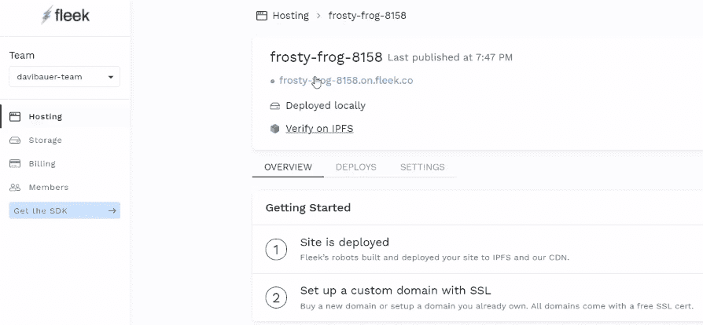

---

# ENS - Ethereum Name Service

## 在你的钱包中接收任何加密货币、代币或 NFT 上注册你的 ENS

以太坊域名服务（ENS）是一项服务，它使通过简单的名称而不是长而复杂的字母和数字字符串来发送和接收加密货币以及访问特殊网站变得容易。

- [`ens.domains`](https://ens.domains)
- [View on YouTube](https://youtu.be/ETQiKiu2KKc)

| 预计时间 | 3 分钟 |

## 前置要求

- Install and Setup MetaMask Wallet

## 搜索你的域名

前往 ens.domains，点击“Launch App”。搜索你想要注册的域名（例如：planou.eth）。检查注册期限（最低 1 年）。检查注册价格。请求注册。点击“Request To Register”。MetaMask 通知将打开以确认交易。点击“Confirm”。等待交易在区块链上确认。点击“Register”。将再次显示新的 MetaMask 通知。点击“Confirm”。等待交易在区块链上确认。

## 管理你的注册名称

点击“Manage name”。向下滚动到“Addresses”。意识到 ETH 地址已设置为创建域名的钱包（你的钱包）。

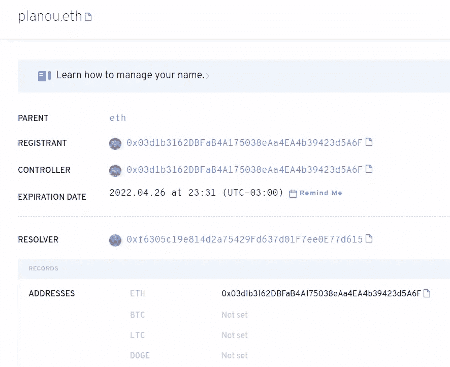

## 检查名称解析

点击你的 MetaMask 钱包。点击“Send”。输入你的 ENS 名称（例如：planou.eth）。注意该名称已解析为钱包地址。

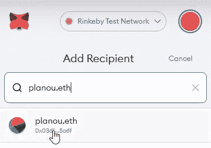

现在你可以使用 ENS 名称作为收件人，而不是使用钱包哈希地址进行交易。

---

# Chainlink：在智能合约中获取加密货币价格

Chainlink 是一个去中心化的节点网络，通过预言机将离链来源的数据和信息提供给链上智能合约。在这个视频中，你将学习如何在智能合约中获取加密货币的最新价格，使用 Kovan 测试网上的 ETH/USD 价格源。

- [`chain.link`](https://chain.link)
- [View on YouTube](https://youtu.be/ETQiKiu2KKc)

| 预计时间 | 10 分钟 |

## 前置要求

- Install Truffle
- Create an Account on Infura.io
- 在 Kovan 网络上从水龙头获取测试以太币
- Install and Setup MetaMask Wallet

## 命令概览

| 命令 | 说明 |
| --- | --- |
| `npm install fs` | 安装 fs 包，该包提供许多非常有用的功能来访问和与文件系统交互。 |
| `npm install @truffle/hdwallet-provider` | 安装启用 HD 钱包的 Web3 提供程序。这用于为从 12 或 24 个单词助记词派生的地址签署交易。 |
| `truffle migrate --network kovan` | 运行迁移以部署合约。 |

## 创建项目

打开一个终端，点击“New Terminal”。初始化一个新的 Truffle 项目：

```
$ truffle init
```

## 安装 Chainlink 合约包

```
$ npm install @chainlink/contracts
```

## 创建智能合约

创建一个用于价格消费的新智能合约：

```
$ touch contracts/PriceConsumer.sol
```

打开文件“PriceConsumer.sol”。

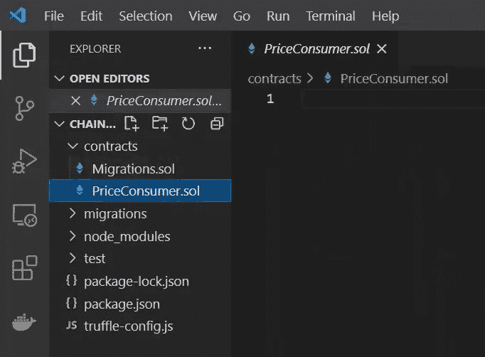

定义 Solidity 版本，导入 Chainlink 合约接口，定义合约名称，定义合约构造函数。

### PriceConsumer.sol

```solidity
// SPDX-License-Identifier: MIT

pragma solidity ⁰.8.0;

import "@chainlink/contracts/src/v0.6/interfaces/AggregatorV3Interface.sol";

contract PriceConsumer {
    AggregatorV3Interface internal priceFeed;

    constructor() {
        priceFeed = AggregatorV3Interface();
    }
}
```

前往 [docs.chain.link/docs/ethereum-addresses](https://docs.chain.link/docs/ethereum-addresses)。向下滚动到“Kovan”部分。复制“ETH/USD”行上的“Proxy”地址。

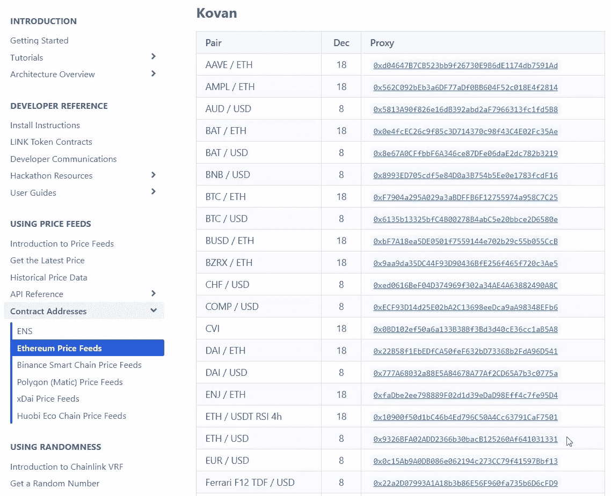

将地址粘贴到 AggregatorV3Interface 构造函数中。创建获取价格的函数。

### PriceConsumer.sol

```solidity
// SPDX-License-Identifier: MIT

pragma solidity ⁰.8.0;

import "@chainlink/contracts/src/v0.6/interfaces/AggregatorV3Interface.sol";

contract PriceConsumer {
    AggregatorV3Interface internal priceFeed;

    constructor() {
        priceFeed = AggregatorV3Interface(0x9326BFA02ADD2366b30bacB125260Af641031331);
    }

    function getThePrice() public view returns (int) {
```


uint80 roundID,

int price,

uint startedAt,

uint timeStamp,

uint80 answeredInRound,

) = priceFeed.latestRoundDate();

return price;

}

}

创建迁移

创建迁移文件

| TERMINAL |

| --- |

| $ touch migrations/2\_deploy\_contracts.sol |

编写代码以部署“PriceConsumer”智能合约

| 2\_deploy\_contracts.js |

| --- |

| 1 2 3 4 5 |

```javascript
const PriceConsumer = artifacts.require("PriceConsumer");

module.exports = function (deployer) {
  deployer.deploy(PriceConsumer);
};
```

设置 Infura 项目

访问 infura.io

进入控制面板

点击“ethereum”

点击“create a project”

定义项目名称

您可以连接到不同的测试网以及主网

复制项目 ID

保存更改

配置钱包

安装文件系统“fs”包

| TERMINAL |

| --- |

| $ npm install fs |

安装钱包提供程序“hdwallet”包

| TERMINAL |

| --- |

| $ npm install @truffle/hdwallet-provider@1.2.3 |

打开 `truffle-config.js` 文件

取消注释 HDWalletProvider 代码部分

| truffle-config.js |

| --- |

| 21 22 23 24 25 |

```javascript
const HDWalletProvider = require('@truffle/hdwallet-provider');

const infuraKey = 'fj4jll3k.....';

const fs = require('fs');

const mnemonic = fs.readFileSync(".secret").toString().trim();
```

将 Infura 项目 ID 作为变量 `infuraKey` 的值粘贴进去

配置网络

取消注释“ropsten”网络部分

将“ropsten”更改为“kovan”

将“ropsten” Infura URL 更改为“kovan”

将“YOU-PROJECT-ID”更改为“`${infuraKey}`”

将 `network_id` 更改为 42

| truffle-config.js |

| --- |

| 60 61 62 63 64 65 66 67 |

```javascript
kovan: {
  provider: () => new HDWalletProvider(mnemonic, `https://kovan.infura.io/v3/${infuraKey}`),
  network_id: 42,
  gas: 5500000,
  confirmations: 2,
  timeoutBlocks: 200,
  skipDryRun: true
},
```

配置 Solidity 编译器

取消注释“compilers”部分

将版本更改为“0.8.0”

| truffle-config.js |

| --- |

| 93 94 95 96 97 98 99 100 101 102 103 104 105 |

```javascript
compilers: {
  solc: {
    version: "0.8.0",
    docker: true,
    settings: {
      optimizer: {
        enabled: false,
        runs: 200
      },
      evmVersion: "byzantinum"
    }
  }
},
```

配置私钥

创建密钥文件

| TERMINAL |

| --- |

| $ touch .secret |

在浏览器中打开连接到 Infura 网络的 MetaMask 钱包

点击您的账户

点击“settings”

点击“security & privacy”

点击“reveal seed phrase”

输入钱包密码以继续

复制私钥

粘贴钱包助记词密钥

编译智能合约

使用 Truffle 编译合约

| TERMINAL |

| --- |

| $ truffle compile |

部署智能合约

使用 Truffle 将合约部署到 Kovan 网络

| TERMINAL |

| --- |

| $ truffle migrate --network kovan |

等待合约部署完成，并在区块链上确认交易

确认您的合约地址

从智能合约获取价格信息

使用 Truffle 控制台实例化合约

| TERMINAL |

| --- |

| $ truffle console --network kovan |

`truffle(kovan) let instance = await PriceConsumer.deployed()`

调用方法“getThePrice”

| TERMINAL |

| --- |

| `truffle(kovan) let price = await instance.getThePrice()` |

将结果输出为数字

| TERMINAL |

| --- |

| `truffle(kovan) price.toNumber()` |

265499339990

就是这样，您刚刚创建了一个智能合约并使用了 Chainlink 价格预言机！

Nethereum 使用 Nethereum 获取以太币余额

Nethereum 是一个开源的 .NET 集成库，用于以太坊，简化了智能合约管理以及与以太坊节点（无论是公共还是私有）的交互。[Nethereum](https://nethereum.com) [在 YouTube 上观看](https://www.google.com/url?q=https://youtu.be/xIYCv15MpbA&sa=D&source=editors&ust=1624824293642000&usg=AOvVaw2qydc0iQhOz5k4yHDhbKTs)

| 预计时间 |

| --- |

| 5 分钟 |

创建项目

打开终端并点击“新建终端”

创建一个新的 .NET 控制台项目

| TERMINAL |

| --- |

| $ dotnet new console -o sample |

进入项目根目录

| TERMINAL |

| --- |

| $ cd sample |

安装 Web3

安装 Nethereum Web3 包

| TERMINAL |

| --- |

| $ dotnet add package Nethereum.Web3 |

还原所有项目包

| TERMINAL |

| --- |

| $ dotnet restore |

创建方法

打开“Program.cs”文件

添加线程和 Web3 的引用

添加一个新方法来获取账户余额

实例化一个新的 Web3 对象

进入您的 Infura 项目设置

选择“Ropsten”网络

复制 Ropsten HTTPS 端点

使用此端点作为 Web3 对象构造函数的参数

从 Web3 获取余额

使用您的钱包公共地址作为参数

编写代码以 Wei 为单位输出余额

将 Wei 余额转换为以太币

编写代码以以太币为单位输出余额

现在更改主方法以调用 `GetAccountBalance()`

| Program.cs |

| --- |

| 1 2 3 4 5 6 7 8 9 10 11 12 13 14 15 16 17 18 19 20 21 22 23 24 25 |

```csharp
using System;

using System.Threading.Tasks;

using Nethereum.Web3;

namespace NethereumSample

{

    class Program

    {

        static void Main(string[] args)

        {

            GetAccountBalance().Wait();

            Console.ReadLine();

        }

        static async Task GetAccountBalance()

        {

            var web3 = new Web3("https://ropsten.infura.io/v3/39180531508b4b659780ef7a36426a86");

            var balance = await web3.Eth.GetBalance.SendRequestAsync("0x03d1b3162DBFaB4A175038eAa4EA4b39423d5A6F");

            Console.WriteLine($"Balance in Wei: {balance.Value}");

            var etherAmount = Web3.Convert.FromWei(balance.Value);

            Console.WriteLine($"Balance in Ether: {etherAmount}");

        }

    }

}
```

获取余额

构建项目

| TERMINAL |

| --- |

| $ dotnet build |

运行项目

| TERMINAL |

| --- |

| $ dotnet run |

