# 全球网络安全劳动力短缺与国际业务风险（商业战略与竞争优势进展）


* Bryan Christiansen
  美国 Tactical Systems LLC
* Agnieszka Piekarz
  波兰独立研究员


|  ||


### 使命

企业实体不断寻求新方法，以获得竞争对手的优势并加强其在商业环境中的地位。由于技术进步，企业继续寻求新方法来改进其业务流程、程序和盈利能力。《商业战略与竞争优势进展》(ABSCA) 丛书是一个及时的系列，响应了全球化市场对如何创建、实施和重新设计商业战略以满足市场需求的高需求。ABSCA 鼓励关于商业经营和创造可持续竞争优势的科学对话。

### 范围


IGI Global 目前正在接受该系列书籍的稿件。如需提交该丛书中卷的提案，请联系我们的征稿编辑 `Acquisitions@igi-global.com` 或访问 `http://www.igi-global.com/publish/`。《商业战略与竞争优势进展》(ABSCA) 丛书 (ISSN 2327-3429) 由 IGI Global 出版，地址：701 E. Chocolate Avenue, Hershey, PA 17033-USA, `www.igi-global.com`。该系列由可单独购买的标题组成；每部作品都经过编辑，在语境上与系列内的任何其他标题保持独立。有关价格和订购信息请访问 `http://www.igi-global.com/book-series/advances-business-strategy-competitive-advantage/7367`。邮差：请将所有更改发送至上述地址。版权所有 © 2019 IGI Global。保留所有权利。未经出版者书面许可，本系列任何部分均不得以任何形式或手段（图形、电子或机械方式，包括复印、录音、录带或信息检索系统）复制或使用，非商业教育用途除外。书中表达的观点为作者的观点，但不一定是 IGI Global 的


N. Raghavendra Rao (FINAIT Consultancy Services, 印度). Business Science Reference • copyright 2018 • 159pp • H/C (ISBN: 9781522557210) • 美元 $145.00 (我们的价格)

David Chitakunye（英国伦敦商学院）和 Amandeep Takhar（英国诺森普顿大学）。Business Science Reference • copyright 2018 • 375pp • H/C (ISBN: 9781522551126) • 美元 $235.00 (我们的价格)

George Leal Jamil（葡萄牙 InesTec）、José Pinto Ferreira（葡萄牙 InesTec）、Maria Manuela Pinto（葡萄牙 InesTec）、Cludio Roberto Magalhães Pessoa（巴西 Fumec 大学）以及 Alexandra Xavier（葡萄牙 InesTec）。Business Science Reference • copyright 2018 • 772pp • H/C (ISBN: 9781522530121) • 美元 $465.00 (我们的价格)

Tevfik Dalgic（美国德州大学达拉斯大学）和 Sevtap Unal（土耳其伊兹米尔切比利大学）。Business Science Reference • copyright 2018 • 325pp • H/C (ISBN: 9781522534488) • 美元 $215.00 (我们的价格)

F. Sigmund Topor（日本庆应义大学）。Information Science Reference • copyright 2018 • 364pp • H/C (ISBN: 9781522526506) • 美元 $195.00 (我们的价格)

Jesus Enrique Portillo Pizana（墨西哥蒙特雷大学）、Sergio Ortiz Valdes（墨西哥蒙特雷大学）以及 Luis Miguel Beristain Hernandez（墨西哥蒙特雷大学）。Business Science Reference • copyright 2018 • 296pp • H/C (ISBN: 9781522540236) • 美元 $205.00 (我们的价格)

Jose Manuel Saiz-Alvarez（墨西哥蒙特雷大学）。Business Science Reference • copyright 2018 • 231pp • H/C (ISBN: 9781522549789) • 美元 $195.00 (我们的价格)

Ionica Oncioiu（罗马尼亚提图·马约列斯大学）。Business Science Reference • copyright 2018 • 308pp • H/C (ISBN: 9781522537731) • 美元 $215.00 (我们的价格)

Luísa Cagica Carvalho（葡萄牙开放大学 & 葡萄牙埃沃拉大学）。Business Science Reference • copyright 2018 • 601pp • H/C (ISBN: 9781522535256) • 美元 $345.00 (我们的价格)


Rajagopal（墨西哥蒙特雷伊科技大学 EGADE 商学院）和 Ramesh Behl（印度布哈萨尔国际管理学院）


Neeta Baporikar（纳米比比亚科学与技术大学 & 印度普纳纳大学）


Svetlana Ignjatijević（塞尔维亚诺维维萨德商学院大学）和 Drago Cvijanović（塞尔维亚克拉格耶瓦茨大学）


Luis Javier Sanchez-Barrios（哥伦比亚北方大学）和 Liyis Gomez-Nunez（哥伦比亚北方大学）


Chi Maher（英国伦敦蒂肯纳姆圣玛利亚大学）


António Carrizo Moreira（葡萄牙阿威罗大学）、José Guilherme Leitão Dantas（葡萄牙莱里亚理工学院）和 Fernando Manuel Valente（葡萄牙塞图巴尔理工学院）


Adrian Tantau（罗马尼亚布加勒斯特经济研究大学）和 Robert Staiger（德国 E3xpert）


Sarmistha Sarma（印度技术与管理创新学院）


Norhayati Zakaria（阿联酋迪拜沃尔国立大学）和 Leena Ajit Kaushal（印度管理发展学院）


Ramona-Diana Leon（罗马尼亚国家政治研究与公共行政大学）


Philip J. Salem（美国德州州立大学）和 Erik Timmerman（美国威斯康星大学）


Arun Kumar Paul（印度哈维尔大学）、Dipak Kumar Bhattacharyya（印度哈维尔大学）和 Sandip Anand（印度哈维尔大学）


Angelo Presenza（意大利莫利塞大学）和 Lorn R. Sheehan（加拿大达尔豪豪斯大学）


Mehdi Khosrow-Pour, D.B.（美国信息资源管理）


Theodore Tarnidis（马其顿大学）、Maro Vlachoulou（马其顿大学）和 Jason Papathanasi（马其顿大学）


Bryan Christiansen（美国）、Gulsah Koc（土耳其大学）


Peter Adoko（乌干达）


Hazlina Ahmad（马来西亚北方大学）、T. Ramayah（马来西亚北方大学）、Hasliza Abdulim（马来西亚北方大学）和 Syed Abidur（马来西亚北方大学）


Göran Roos（澳大利亚大学）


Philippe W. Gheib（黎巴嫩美国大学）


Ronald A. Styron（美国南阿拉巴马大学）和 Jennifer L. Styron（美国南阿拉巴马大学）


Sanya Ojo（英国东伦敦大学）


Giovanni Schiuma（意大利巴西里大学 & 英国伦敦艺术大学）和 Antonio Lerro（意大利巴西里大学）


Andrei Jean Vasile（罗马尼亚普洛耶什蒂石油气大学）和 Domenico Nicolò（意大利雷焦卡拉布亚地媒体大学）


Mark Anthony Camilleri（马耳他大学）


Patricia Ordóñez de Pablos（西班牙奥维耶多大学）


Ziska Fields（南非夸祖-纳塔尔大学）


Business Science Reference • 版权所有 2017 • 332 页 • 平装本 (ISBN: 9781522510284) • 美金 200.00 (我们的售价)
Arun Kumar Sangaiah（印度 VIT 理工大学）高晓志（芬兰东部大学，芬兰）和 Ajith Abraham（美国机器智能研究实验室）

Business Science Reference • 版权所有 2017 • 474 页 • 平装本 (ISBN: 9781522510086) • 美金 275.00 (我们的售价)
Kazuya Odagiri（日本杉山樱园大学）

Business Science Reference • 版权所有 2017 • 232 页 • 平装本 (ISBN: 9781683180036) • 美金 170.00 (我们的售价)
Ioan Hosu（罗马尼亚巴贝什-博利亚亚大学）和 Ioana Iancu（罗马尼亚巴贝什-博利亚亚大学）

Business Science Reference • 版权所有 2017 • 301 页 • 平装本 (ISBN: 9781522509530) • 美金 195.00 (我们的售价)
Aspasia Vlachvei（希腊西马其多尼亚应用科学大学）Ourania Notta（希腊塞萨洛尼基技术教育学院）Kostas Karantininis（瑞典农业科学大学）和 Nicholas Tsounis（希腊西马其多尼亚应用科学大学）

Business Science Reference • 版权所有 2017 • 359 页 • 平装本 (ISBN: 9781522508434) • 美金 195.00 (我们的售价)
Dominika Latusek（波兰科兹明斯基大学）

Business Science Reference • 版权所有 2017 • 326 页 • 平装本 (ISBN: 9781522507703) • 美金 190.00 (我们的售价)
Marianne Ojo（南非西北大学）

Business Science Reference • 版权所有 2016 • 322 页 • 平装本 (ISBN: 9781522503057) • 美金 185.00 (我们的售价)
Dima Jamali（黎巴嫩贝鲁特美国大学）

Business Science Reference • 版权所有 2017 • 367 页 • 平装本 (ISBN: 9781522507208) • 美金 215.00 (我们的售价)
Walter Vassallo（摩纳哥 MC Shareable）

Business Science Reference • 版权所有 2017 • 336 页 • 平装本 (ISBN: 9781522505686) • 美金 205.00 (我们的售价)
Latif Al-Hakim（澳大利亚南昆士兰大学）吴晓波（浙江大学）Andy Koronios（澳大利亚澳洲大学）和寿勇义（浙江大学）

Business Science Reference • 版权所有 2016 • 743 页 • 平装本 (ISBN: 9781522501350) • 美金 365.00 (我们的售价)
Minwir Al-Shammari（巴林大学）和 Hatem Masri（巴林大学）

Business Science Reference • 版权所有 2016 • 372 页 • 平装本 (ISBN: 9781466698642) • 美金 185.00 (我们的售价)
Djamchid Assadi（法国勃艮商学院）

Business Science Reference • 版权所有 2016 • 378 页 • 平装本 (ISBN: 978146669644) • 美金 205.00 (我们的售价)
Neeta Baporikar（印度浦那大学）

Business Science Reference • 版权所有 2015 • 607 页 • 平装本 (ISBN: 9781466687981) • 美金 345.00 (我们的售价)
Anna Szopa（波兰雅盖洛夫大学）Waldemar Karwowski（美国佛罗里达中央大学）和 David Barbe（美国马里兰大学）

Business Science Reference • 版权所有 2015 • 317 页 • 平装本 (ISBN: 9781466674874) • 美金 195.00 (我们的售价)
Ziska Fields（南非夸祖鲁-纳塔尔尔大学）

Business Science Reference • 版权所有 2016 • 362 页 • 平装本 (ISBN: 9781466687486) • 美金 190.00 (我们的售价)
Patricia Ordóñez de Pablos（西班牙奥维埃大学）

Business Science Reference • 版权所有 2015 • 375 页 • 平装本 (ISBN: 9781466684621) • 美金 200.00 (我们的售价)
Luís M. Carmo Farinha（葡萄牙卡斯特洛布朗理工学院 NECE 研究中心）João J. M. Ferreira（葡萄牙贝拉内特尔大学 NECE 研究中心）Helen Lawton Smith（英国伦敦伯克斯贝克大学 & 牛津大学经济天文台）和 Sharmistha Bagchi-Sen（美国纽约布法州立大学）

Business Science Reference • 版权所有 2015 • 780 页 • 平装本 (ISBN: 9781466683488) • 美金 375.00 (我们的售价)
Nilanjan Ray（不丹廷廷学院）Dillip Kumar Das（印度锡金姆中央大学）Somnath Chaudhuri（不丹廷普学院）和 Arindam Ghosh（不丹廷普学院）

Business Science Reference • 版权所有 2015 • 404 页 • 平装本 (ISBN: 9781466674707) • 美金 210.00 (我们的售价)
Daniel E. Palmer（美国肯塔基州大学）

Business Science Reference • 版权所有 2015 • 508 页 • 平装本 (ISBN: 9781466674769) • 美金 265.00 (我们的售价)
Joseph Ofori-Dankwa（美国萨吉谷州立大学）和 Kwame Boasiako Omane-Antwi（加纳 Pentecost 学院）

Business Science Reference • 版权所有 2015 • 347 页 • 平装本 (ISBN: 9781466675339) • 美金 195.00 (我们的售价)
Ruth Wolf（以色列巴伊兰大学）和 Theodora Issa（澳大利亚库丁大学）

# 通过企业社会责任赋能组织
Business Science Reference • 版权所有 2015 • 354 页 • 平装本 (ISBN: 9781466674196) • 美金 200.00 (我们的售价)
Ruth Wolf（以色列巴伊兰大学）Theodora Issa（澳大利亚库丁大学）和 Monica Thiel（荷兰蒂尔堡堡大学）

Business Science Reference • 版权所有 2015 • 379 页 • 平装本 (ISBN: 9781466672949) • 美金 225.00 (我们的售价)
Bryan Christiansen（美国 PryMark, LLC）

Business Science Reference • 版权所有 2015 • 672 页 • 平装本 (ISBN: 9781466665514) • 美金 365.00 (我们的售价)
Dasho Karma Ura（不丹不丹研究与 GNH 研究中心）和 Patricia Ordóñez de Pablos（西班牙奥维埃大学）

Business Science Reference • 版权所有 2015 • 333 页 • 平装本 (ISBN: 9781466664418) • 美金 205.00 (我们的售价)
Patricia Oróñez de Pablos（西班牙奥维埃大学）Lluis Jovell Turró（西班牙巴塞罗纳自治大学）Robert D. Tennyson（美国明尼苏达大学）和 Jingyuan Zhao（加拿大多伦多大学）

Business Science Reference • 版权所有 2015 • 364 页 • 平装本 (ISBN: 9781466664579) • 美金 195.00 (我们的售价)
Ana Azevedo（葡萄牙米尼霍大学 NECE 研究中心 & 葡萄牙波尔图学院 ISCAP）和 Manuel Filipe Santos（葡萄牙米尼霍大学 NECE 研究中心）

Business Science Reference • 版权所有 2015 • 314 页 • 平装本 (ISBN: 9781466664777) • 美金 200.00 (我们的售价)
Nabyla Daidj（法国电信商业学院）


## *新兴数字技术对全球业务领导力的影响*

Peter A.C. Smith（加拿大 The Leadership Alliance Inc.）和 Tom Cockburn（加拿大全球业务动态领导力模型中心）

# 商业科学参考 • 版权 2014 • 327 页 • 平装 (ISBN: 9781466661349) • 美元 215.00 (我们的价格)

## *在在高成本和低成本运营环境中取得成功的全球视角*

Göran Roos（澳大利亚斯威伯恩大学）和 Narelle Kennedy（澳大利亚 The Kennedy Company Pty Ltd.）

# 商业科学参考 • 版权 2014 • 564 页 • 平装 (ISBN: 9781466658288) • 美元 225.00 (我们的价格)

## *通过科学基础彻底企业互操作性*

Yannis Charalabidis（希腊爱琴海大学）Fenareti Lampathaki（希腊雅典国立大学）和 Ricardo Jardim-Goncalves（葡萄牙技术与系统中心 (CTS) – UNINOVA）

# 商业科学参考 • 版权 2014 • 351 页 • 平装 (ISBN: 9781466651425) • 美元 215.00 (我们的价格)

## *现代组织中商业策略的制定与风险因素识别*

Madjid Tavana（美国拉萨大学）

# 商业科学参考 • 版权 2014 • 309 页 • 平装 (ISBN: 9781466648609) • 美元 185.00 (我们的价格)

## *商业智能的信息质量与治理*

William Yeoh（澳大利亚迪肯大学）John R. Talburt（美国阿肯西州立立小岩大学）和 Yinle Zhou（美国 IBM 公司）

# 商业科学参考 • 版权 2014 • 478 页 • 平装 (ISBN: 9781466648920) • 美元 235.00 (我们的价格)

## *国际业务战略与创业：信息技术视角*

Patricia Ordóñez de Pablos（西班牙奥维耶多大学）

# 商业科学参考 • 版权 2014 • 306 页 • 平装 (ISBN: 9781466647534) • 美元 185.00 (我们的价格)

## *在建筑业中实施 IT 商业战略*

Goh Bee Hua（新加坡国立大学）

# 商业科学参考 • 版权 2013 • 354 页 • 平装 (ISBN: 9781466641853) • 美元 185.00 (我们的价格)

## *管理非线性动力学的混沌与复杂理论*

Santo Banerjee（意大利都灵理工学院）

# 商业科学参考 • 版权 2013 • 449 页 • 平装 (ISBN: 9781466625099) • 美元 185.00 (我们的价格)

## *石油天然气行业的综合运营：可持续性与能力开发*

Tom Rosendahl（挪威 BI 商学院）和 Vidar Hepsø（挪威科技科技大学）

# 商业科学参考 • 版权 2013 • 457 页 • 平装 (ISBN: 9781466620025) • 美元 185.00 (我们的价格)

## *文化差异与业务绩效：当代全球化*

Bryan Christiansen（美国 PryMarke, LLC）

# 商业科学参考 • 版权 2012 • 418 页 • 平装 (ISBN: 9781466603066) • 美元 185.00 (我们的价格)

## *企业应用的管理信息系统：业务问题、研究与解决方案*

Adamantios Koumpis（希腊 ALTEC Software S.A.）

# 商业科学参考 • 版权 2012 • 324 页 • 平装 (ISBN: 9781466601642) • 美元 185.00 (我们的价格)

## *数字企业中的领导力：问题与挑战*

Pak Yoong（新西兰惠灵顿大学大学）

# 商业科学参考 • 版权 2010 • 340 页 • 平装 (ISBN: 9781605669588) • 美元 180.00 (我们的价格)

## *跨国组织中的战略性资本管理：可持续性与成功影响*

Kevin O'Sullivan（美国纽约科技大学）

# 商业科学参考 • 版权 2010 • 358 页 • 平装 (ISBN: 9781605666792) • 美元 180.00 (我们的价格)


访问 `http://www.igi-global.com/` 在线订购或拨打 717-533-8661

在线订购本系列书籍，请联系：`Acquisitions@igi-global.com` 或拨打 717-533-200 东部时间

本书献给全球亲爱的家人、朋友。

### 评审人员名单

- Evon Abu-Taieh（约旦约旦大学）
- Benjamin Assay（尼日利亚州立学院）
- Udo Averweg（南非埃德奎尼市）
- Harish Chandan（印度阿尔戈西大学）
- Sharmista Desai（印度世界和平大学）
- Shalin Hai-Jew（美国堪萨斯州立大学）
- Oksana Karnaukhova（俄罗斯南方联邦大学）
- Jeffrey Kureba（津巴韦滨杜拉科学教育大学）
- Adam Marszk（波兰格但斯理工大学）
- Mambo G. Mupepi（美国大谷州立大学）
- Gaurang Panchal（印度理工学院）
- Antoine Trad（法国商业与系统学院）
- Robert Wahlstedt（美国独立研究员）
- Mika Westerlund（加拿大卡尔顿大学）
- Bryan Christiansen（美国 Tactical Systems LLC）
- Agnieszka Piekarz（波兰独立研究员）

近期全球网络安全事件，如信用评分公司 `Equifax` 泄露 1.45 亿消费者的隐私数据，引起了全球的高度关注。其他近期案例包括在线旅行社 `Orbitz`（88 万条记录泄露）、搜索引擎 `Yahoo`（30 亿用户账户泄露）以及加拿大统计局丢失或处理不当大量敏感的人口和员工文件。

网络安全涉及保护计算机系统免受在线威胁的方法，社会对信息技术的依赖日益增加，使该行业成为全球社区面临的最紧迫挑战之一。糟糕的网络安全是黑客渗透业务计算机和其他网络防护措施的主要原因，而全球网络安全人才缺口的扩大进一步加剧了这一问题。

`ISACA (2018)` 作为专注于信息技术 (`IT`) 治理的国际专业协会，预计到 2019 年全球将短缺 200 万网络安全专业人员。这一严峻的统计数据反映了其他权威机构的相似观点，例如国际数据公司 (`IDC`)，这是一家位于美国马萨诸塞州的全球市场情报公司。由于 20% 的组织在每个发布的安全相关职位收到的申请少于 5 人，这一挑战的规模显而易见。网络安全力量薄弱的国家和公司面临网络间谍活动的风险，这反过来破坏医疗、贸易、发电、交通、银行和分销等关键基础设施。

这些事实都极大影响了国际业务风险。`世界经济论坛 (2018)` 的 2018 年全球风险报告将网络攻击和数据泄露列为对全球业务产生整体影响最可能发生且破坏性最大的五大风险。接下来的章节涵盖了网络安全领域的广泛范围，从网络安全人才缺口、银行风险管理到网络安全教育和社交网络。以下是全部 15 章节的简要列表。


# 第一章
第一章通过多种手段：文献综述、通用系统理论、社会网络分析、博弈论以及基于最新数据的溯因逻辑，对全球网络安全人才短缺的预测过程和结果进行了建模。许多人在地方和经验层面面临着网络安全人才短缺的问题。他们看到职位空缺，或由不具备必要技能员员；他们看到数据和身份泄露、项目受阻以及风险增加。他们必须通过在人才管道中培养个人、支持学习和培训计划、对员工进行跨培训以胜任网络安全事务、发布招聘广告/猎头以及招聘日益昂贵的人才等方式，在本地解决这一缺口。他们还利用外部供应商来支持工作。对于那些处于所谓“战壕”的人来说，从全局视角理解这一全球劳动力市场挑战可能会有所帮助。

# 第二章
第二章为业务创新领域的管理人员研究了业务转型框架和企业架构框架。在过去的十年中，由于全球安全形势和金融危机，安全策略一直无效，因为业务依赖于安全标准、网络和信息技术的演进、企业架构、业务工程以及多级互操作性。本章为读者提供了一个供参考的`Business Transformation Project` (`BTP`)。

# 第三章
第三章探讨了银行系统可能遇到的网络安全风险。评估并展示了土耳其银行系统（包括许多在线服务）的网络安全风险方面的现状以及当前风险，并给出了可能的解决方案。本研究分析了电子支付系统（在线银行和电子商务/借记卡或信用卡使用）以及作为电子金融系统支柱的供应链在国家网络安全风险方面的表现。

# 第四章
第四章重点阐述了在日益去中心化的环境中关于访问控制的现有研究的最新水平，并论证了访问控制这一主题比以往任何时候都更具相关性，且涌现出日益增多的研究机会。在本章中，作者分析了去中心化应用中访问控制机制和系统的最新水平（重点关注企业生态系统），并分析了新技术格局带来的当前挑战与机遇——特别是基于区块链的技术在访问控制中的应用，并为未来提出了新的研究方向。

# 第五章
第五章考虑了若干被认为值得纳入未来网络安全从业者培养的典型问题。全球网络安全技能人才的短缺及其对国际业务带来的风险，只能通过大幅增加技能人员数量来解决。然而，随着风险性质的激增和分化，此类人员必须具备对当代和未来风险更广泛的理解。也就是说，虽然技术培训至关重要，但认为未来的网络安全专家需要意识到社会、政治、经济和犯罪学问题。因此，本文概述了“网络阴暗面”中给全球网络安全和国际业务风险带来问题的问题。通过对这些问题进行讨论，可以从中提炼出一套能够应对（并缓解）潜在威胁的技能。

# 第六章
第六章提出了一种网络安全能力模型，该模型整合了学习理论（认知、情感和心理运动）、学习连续体层次结构（意识和培训）以及网络安全领域知识。通过对学术和从业者著作进行文献检索，结合政府和非政府组织的网络安全标准，本章整合了网络安全领域知识、学习理论和学习连续体层次，设计了一个适用于教育个人和普通劳动力的网络安全能力模型。这种基于理论的网络安全意识和培训计划设计方法将产生才干的人才和劳动力，他们能够在全球业务环境中缓解网络攻击。

# 第七章
第七章为有志的网络安全学生提供了清晰的理解，让他们了解为了实现目标可以选择的各种教育路径。作者描述了教育类别，并对每一类进行了评估，学生将根据自己的情况考虑这些评估内容。他们还讨论了如何从计算机科学、工程和业务的角度完成网络安全专业的学习。具备`STEM`（科学、技术、工程、数学）技能的学生可以在许多网络安全角色中实现目标，包括网络安全工程师、架构师和其他技术岗位。最后，对网络业务感兴趣的学生可以通过关注战略、合规、意识等其他领域来实现他们的目标。组织需要具备所有这些技能的员工。本章以对持续学习的建议、对人脉价值的强调，以及鼓励学生现在就开始开启网络职业作为结束。

# 第八章
第八章调查了一种利用`WhatsApp Messenger` 工具在不同环境中最小化风险和提高生产力的策略。`WhatsApp Messenger` 是一种跨平台移动消息应用程序，允许手机用户在无需支付短信服务（`SMS`）费用的情况下交换信息。精明的企业家正在利用这项服务在全球市场扩大其业务。`WhatsApp` 可以应用于智能手机使用量近期翻倍的新兴经济体，以建立能力。该技术可以用于收集数据，并对这些数据进行解释，以在新数字世界中产生组织意义。在本章中，作者对 `WhatsApp` 进行了简单调查，以推测其渗透全球市场的动态性。

# 第九章
第九章调查了社交媒体中的网络安全在线名片和专业简介。目前，人们对从事各种网络安全职业的需求非常高，且这种需求在短期内很可能持续下去。虽然有更正式的就业途径——例如高等教育路径——但在网络安全竞赛中的表现、参加专业会议以及社交媒体展示都可能为进入网络安全招聘提供更非传统的路径。通过对多个社交媒体平台进行便利抽样和自下而上的编码，这项工作探索了开放社交网络上网络安全专业简介（“名片”）的某些方面，并从这些简介背后的人的闪光中了解到相应的技能和能力。这些简介基于一个 2x2 轴进行评估，重点关注 (1) 目标技能和 (2) 人格属性。通过这些分析，分享了关于网络安全名片以及它们在招聘和留住网络安全人才方面价值的初步见解。

# 第十章
十章介绍了`Wannrypt` 勒索软件攻击并建议了防止再次发生的方法。网络攻击已成为组织、政府机构和企业实体必须应对的全球现象，因为网络犯罪分子经常针对其运营。“Wannrypt` 勒索软件攻击于 2017 年 5 月初席卷全球，造成了破坏性的影响。这次被描述为互联网历史上最大的攻击扰乱了主要组织并影响了 150 个国家的 20 万多台计算机。


# 第 11 章

第 11 章解释了网络安全中所谓的“最弱环节”：电子“蜂群思维”或群体思维。如果说人们由于心理构造和天性特征而成为网络安全中的“最弱环节”——即他们对他人信任与合作的社会化渴望、认知偏差和误解、对便利的偏好，以及通常倾向于使用“系统 1”的不经意而非“系统 2”的专注与思考——这便引出一个问题：在个体用户身上发现的这种微观认知限制是否也存在于大规模群体中？研究发现群体决策中存在一些成问题的无思考倾向：如服从权威、旁观者效应、群体思维和阿比伦悖论等。通过使用一系列通常是大规模大规模的数据源和数据分析工具，研究围绕三个领域提出了问题：（1）网络安全电子蜂群思维对网络安全问题的复杂程度；（2）该蜂群思维中非专家成员与专家成员之间的差距；以及（3）现有的蜂群思维更多反映的是群体的无思考，还是审慎与智慧。

# 第 12 章

第 12 章探讨了用于识别恶意政治社交机器人的政治账户多维映射。曾用于影响有关美国政府及其职能舆的恶意政治社交机器人，已被确定为俄罗斯政府更大信息战努力的一部分。这项工作探讨了通过基于 Web 的侦查方法可以获取以下四个因素的哪些信息：根据其在 1 度、1.5 度和 2 度范围内的自我邻域（ego neighborhoods）识别恶意政治社交机器人账户的能力；根据其账户、自我邻域及其 `#hashtag` 网络所声称和关联的地理位置识别恶意政治社交机器人账户的能力；根据其在各自社交媒体平台上的策略性信息（内容、情感和语言结构）识别恶意政治社交机器人账户的能力；以及根据该账户在三种社交媒体平台类型（（1）微博、（2）社交网络和（3）众包百科类内容共享）上的可观测行为，识别并描述恶意政治社交机器人账户中“恶意性”的能力。

# 第 13 章

第 13 章研究了罗马尼亚公立和私营机构的信息安全威胁。信息通信技术的发展在给现代社会带来不可否认的利益的同时，也引发了新的漏洞。在构建对现代生活方式至关重要的现代信息安全时，移动计算设备、云计算以及隐私问题都是应当考虑的因素。由于信息安全风险正在快速演变并呈现出新形式，只有在每一层责任上都建立信任，信息通信技术的真正利益才能得以发挥。本研究通过作者进行的调研和详细调查问卷，对罗马尼亚机构面临的主要当前信息安全威胁，以及罗马尼亚机构对信息安全的态度进行了放射性分析。根据研究结果，作者提出了改进罗马尼亚机构安全态的行动方案，以及提高业务管理人员知识、能力和决策能力的建议。

# 第 14 章

第 14 章试图理解网络犯罪对津巴布韦和平与安全的影响。在 21 世纪，网络犯罪已成为一种国际威胁。这迫使许多国家制定立法和其他措施来遏制网络犯罪。初数据通过关键知情人访谈收集，同时通过文献检索审查了该主题的学术文献。研究的关键知情人来自来自打击网络犯罪的机构。津巴布韦缺乏充分且有效的法律手段来打击网络犯罪。

# 第 15 章

第 15 章基于一项旨在理解津巴布韦网络战争威胁的研究。研究还涵盖了网络战争的影响以及南部非洲发展共同体（SADC）国家在相关努力中的地位。研究采用了定性研究方法。共有 15 位来自信息技术专家、学术界和律师的受访者参与了研究，结果显示津巴布韦由于技术使用的增加而变得脆弱。该研究指出，现行法律并未明确涉及网络战争，而是更多地关注网络犯罪。研究建议津巴布韦应制定有效的法律，并应优先考虑网络安全投入。


在典型的工作日中，全球劳动力市场中的网络安全人才缺口是显而易见的。新闻报道了多个城市发生的各类数据泄露，其数据被勒索软件加密并控制。存在隐私数据被广泛共享的泄露事件。在暗网上，有企业出售他人的凭据供他人利用。而在工作场所内部，则是一些较小的“火灾”——钓鱼攻击、恶意软件攻击、丢失的存储设备、遗失的敏感数据笔记本电脑等。那些负担得起聘佣顶尖人才和购买顶级技术的人正试图创建一个安全的网络环境。而那些负担不起这些费用的人则被迫暴露在风险之中，必须专注于成本更低的恢复方法。在许多方面，“网络技术拥有者”由于其社会的高度互联化程度以及对网络技术的早期采用，反而也是最脆弱的群体。

## 广泛的脆弱性

从广义上，“网络”几乎触及现代生活的每一个方面。在典型的一天中，人们可能在`Internet`和`Web`上使用资源用于以下方面：通信、工作、新闻消费、娱乐、银行、图书馆服务、健康管理、研究等。物联网（`IoT`）将扩大人们在家庭、医疗保健、交通、商业购物和其他系统中对网络的依赖。不那么明显的是，他们还依赖于依赖网络的基础设施（网络物理系统）：电力、交通（例如`GPS`、调度、传感器网络）、制造业、商业、军事系统等。网络在当代生活方式中的深度融合，意味着潜在的网络“攻击面”既宽又深，基于发现和创建的漏洞而发起的网络攻击可能具有高影响力、破坏性，甚至可能产生潜在的毁灭性后果。

## 网络安全

网络安全可以被概念化为所谓的“安全价值链”，它包含五个元素：

`Deter -> Protect -> Detect -> Respond -> Recover`

链条的每一步对于追求整体安全背景都至关重要。因此，安全是通过政策、法律、法律执法、技术、监控和社会规范等因素共同创造的。这些各种元素提供了实际的深度防御（即在所有层级使用各种防线，以实现更强大的集体防御），并挑战着任何国家、犯罪组织、黑客团体或个人，让他们在采取行动破坏网络系统或系统中的网络元素之前，必须真正考虑成本效益计算。

## 必备技能的定义

根据 2013 年全球信息安全劳动力研究，信息安全专业人员在该领域取得成功最好具备以下技能（按降序排列）：“对安全领域的广泛理解（92%）、沟通能力（91%）、技术知识（88%）、对最新安全威胁的意识和理解（86%）、安全政策的制定与应用（75%）、领导能力（68%）、业务管理能力（57%）、项目管理能力（55%）以及法律知识（42%）”（Caldwell, 2013, p. 7）。

所需的技能通常是跨学科的：

网络和计算机网络对关键基础设施安全的枢纽意义，促使人们增强了意识，即理解网络问题和网络安全问题需要一套复杂的技能组合。这套技能组合了各种学科的知识，范围从工程和计算机技术到法律、外交和管理。（Røislien, 2015, p. 23）

另一项关键能力是进行创造性的思考和创新，因为该领域有许多内容是模糊且未定义的，而且网络攻击正不断被人类创新。

## 网络安全领域的就业市场

网络安全领域的就业机会广泛且动态。需要网络安全人员来确保开发人员创建的软件是安全的（通过各种形式的测试）；一旦软件发布，渗透测试人员需要评估软件安全性以便补丁。运营数据中心和网络的管理员需要确保有安全和备份以维持业务连续。管理员需要设计并实施政策并配置人员，以确保在整体安全背景下的网络安全。取证调查员探索技术系统以理解受损情况。网络武器开发者创建漏洞利用以实现特定目标。需要工程师来设计和建立有效的加密系统以实现安全交换。需要审计专家来评估合规性（Caldwell, 2013, p. 6）。分析技术也已网络安全领域脱颖而出，监控在某种程度上取决于大规模数据分析和机器学习。正如许多网络安全专家处于“矛尖上”一样，也有许多支持人员提供文书、文档和其他形式的支持。

根据多项研究，网络安全工作者的就业市场收敛于一个共同数字：在 2019 年或 2020 年约有 150 万的人员缺口或缺口（Furnell, Fischer, & Finch, 2017, p. 5）。在英国，一份官方报告建议，在“所有教育层级”解决网络安全技能缺口可能还需要大约两个世纪（Morse, 2013, p. 27）。这种缺口被认为既存在于入门级，也存在于组织的高层：

“在我看来，最重要的问题将出现在适用技能的光谱的高端和低端，因为你可能会发现被安置在初级运营 IT 安全岗位上的人，他们根本没有足够的背景来充分完成工作，而且你可能会仅仅基于纯需求，就很快地将某些人提升到管理位置，而这种提升可能早于他们应得的程度，”Bernard Zelmans 说，他是`FireMon`的欧洲中东非地区总经理。“正如你可以想象的，这也会中层员工的生活变得更加艰难，因为他们将是那些必须收拾烂局的人。（Caldwell, 2013, p. 6）

全球劳动力市场中网络安全人才缺口的存在对网络内外的人类活动都有影响。由于网络安全人才缺口，现有的社会、数据、制造业、指导、武器和其他系统在某种程度上都面临着持续（有时是加剧的）风险。挑战不仅此于此：网络安全人才缺口可能不仅限制`Web`和`Internet`、`IoT`的应用范围，还会限制任何依赖网络技术的东西。无法提供安全服务可能是一个巨大的障碍。由于设计和开发团队缺乏该领域的专业知识，概念性和理论性的应用可能会被缓慢。能够构思并实现新产品和服务的创新人才可能会被边缘化到现有系统的网络安全维护工作中。一份电子技能宣言建议，对`ICT`（信息通信技术）技能的需求是广泛的，如果没有这些技能，许多新兴事业将停滞：

供需对接：政府、工业界和学术界应紧密合作，确保欧洲拥有在`云计算`、绿色 IT`网络安全`、互操作性和`电子健康`等新兴领域所需的先进`ICT`技能。在`ICT`行业取得成功的技能必须演进并适应新的增长点。电子技能对健康等行业的影响将能够改变我们解决某些重大挑战的方式。（McCormack, 2010, p. 70, 原作者加粗副标题）


这项工作针对这一挑战提出了一种简洁且抽象的模型（灵感来自通用系统理论、社会网络、博弈论、溯因逻辑以及最新数据），以更好地理解网络安全人才短缺的一些可能影响，以及可能部分缓解这种情况的措施。通过理论化，该模型对网络安全空间进行了形式化，并研究了网络安全人才短缺的风险。另一个目标是提供关于该挑战更高层次的视角，以造福地方的网络安全人才招聘工作。在工作中，“模型”仅仅是对现实现象的抽象，用于更好地理解和参与该现象。该模型在本质上是多维的，因此可以从理论（最终是实践）角度捕捉并探索这一复杂挑战的不同方面。

## 文献综述

## 网络网络空间

在法律方面，社会环境受到执法部门对网络犯罪刑事起诉、客户的第三方诉讼以及影响网络安全的其他努力（Yang & Hoffstadt, 2006）。在网络发展的早期，在许多人意识到网络安全可能是一个问题之前，有许多报告称公司和组织甚至不知道自己的数据已被泄露（Strand, 2014）。从那时起，随着系统被攻破、数据被窃取以及身份被盗的新闻不断增加，对网络风险的意识有所增强：

组织可能不确定过去是否遭受过攻击，但对未来的危险更有确感。几乎三分之二（64%）认为他们将在一年内成为目标，甚至更早；27% 预计在未来 12 个月内发生，另有 23% 预计在未来六个月内发生攻击。还有 14%的人尤为悲观，预计在未来几周内发生网络攻击。然而，超过三分之一的公司预计短期内不会成为目标，36% 的人认为自己不在攻击者的关注范围内。（Strand, 2014, p. 14）

网络被攻破的成本“通常远高于修复受损数据或系统的成本，因为入侵的消息可能会对公司的‘市值或消费者信心’产生负面影响”（Yang & Hoffstadt, 2006, p. 202）。如果声誉可以恢复，那么声誉的成本可能非常昂贵。对于“缺乏安全技能的企业”来说，从安全违规中恢复的成本可能是其三倍（Furnell, Fischer, & Finch, 2017, p. 5）。

从历史上看，劳动力市场的人才缺通过多种方式解决。为了满足即时需求，组织和公司通常会自己培训人才来解决特定问题。他们可能会招聘尚未获得正式学位的人员——通过实习、特殊计划、临时中介或其他手段。他们可能仅仅根据专业认证进行招聘。他们通常会联系当地的职业学校和社区学院，开发计划（和课程）来为其需求培训人员；换句话说，他们将建立人才管道，将员工带入自己的组织。他们会提高薪资，并针对特定的目标技能组制定具有吸引力的福利方案。他们会在专业会议上设立展位和桌子进行猎头和招聘。他们会支持基于技能的竞赛，以在大众中识别人才。跨国公司还将在海外设立分机构，以利用当地的人才。可能会引入具有特定领域技能的专家和专家团队来临时解决问题。[考虑到小众技能，谁能想到在斯塔克斯网病毒（Stuxnet）出现之前，SCADA 相关技术的专家在网络安全中可能是至关重要的？复杂技术系统的获取和专业知识成本高昂的现实，意味着混合团队必须以协作或分段的方式承担棘手的问题。（“SCADA”指的是用于制造环境的“监视控制与数据采集”系统。）]

政府可能发挥作用。例如，可能有一些在海外出生、受教育并培训的潜在员工，其能力符合美国标准。在这种情况下，政府可能会通过法律和延长签证来让这些高技能人才进入美国。传统上，政府必须通过政策杠杆创造一个有利于“企业和公民”的经济（Porter & Rivkin, 2014）。

公众在充满挑战的职场中进行技能自我发展和探索方面也起着关键作用。

## 全球劳市场人才缺口的过程与结果建模

要理解全球人才缺口，从基于系统的模型开始是有帮助的。主要的“模型”是“简化国家网络安全生态系统与全球人才缺口”，这主要是一个描述性模型。它表明存在三个主要实体：公众、公共部门和涉及网络安全的私营部门。每个宏观“垂直领域”都有自己的权力、利益、私人考虑以及与其他协作的空间或能力。协作在某些问题上导致“松散耦合”，在另一些问题上导致“紧耦合”；这些关系可能是短期、中期或长期的。这些关系是在共同利益的基础上并通常通过信任关系建立的。

在这个系统中，每个实体都需要明确自己的利益，不应无缘地交出竞争优势。每个实体也不应过度依赖他人来保护自己的利益——以免削弱自身的主动性。

| 图 1 简化国家网络安全生态系统与全球网络安全人才缺口 |
| --- |
| 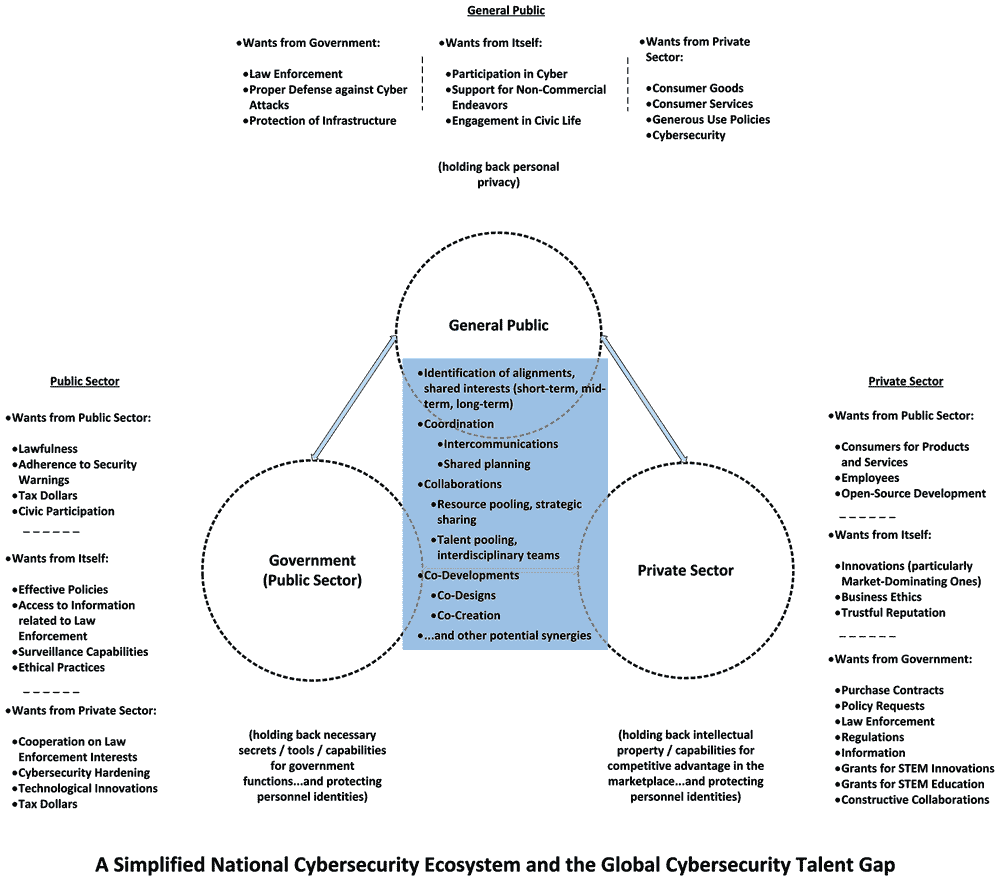 |
| --- |

## 网络安全人才招聘与留存

系统的概念和系统的各种状态可以通过尔可夫链来捕捉[`一种描述可能事件序列的随机模型，其中每个事件发生的概率取决于上一个事件所处的状态” (`Markov chain`, 2017)`]。在这种情况下，使用改进的、非正式且未指定的尔可夫链来描述网络安全劳动力。宏观层面的模式被概念化为基于各种成本效益计算、预期效用以及激励/负激励所做出的个体层面决策的结果。


在任何时候，广义而言，网络安全劳动力可能类似于图 2 所示。瞬态（transient state）是指网络安全人员可以在职位之间移动并留在网络安全领域的状态。“循环”（recurrent）状态是指网络安全人员可能会移动的区域，但一旦进入这些空间，他们无法离开；他们被“困住了”。图中每个圆圈代表一个陷阱集，从那里没有回到主瞬态区域的逃逸速度。如图所示，该图表明大多数实体最终将循环并被吸收到相应的陷阱中，走向他处。

从结构上说，如果一切都是动态且不断移动的，单向连接将导致离开系统。如图所示的系统之所以能够运行，是因为该领域不断有新鲜血液。在这种情况下，这种概念化是无记忆的，因此个人通过何种方式成为网络安全劳动力的一部分（例如通过正式或非正式途径）并不重要，关键在于他们在那里。更具意义的是他们能在领域内留存多久。

基于这一概念化，可以通过几种方式和多个维度来扩大网络安全瞬态的参与度。“谁”指的是引入年轻人才（某些知识型企业将招收高中作为实习生甚至员工）并维持退休年龄的专家，以延长生产力的“时间”。另一种方法是考虑通过拓宽现有员工的能力来培训“广度”，从而解决网络安全覆盖问题。（所有员工在某种程度上都必须具备某种水平的网络安全专业知识，以便他们不会成为组织中的“薄弱环节”。将网络安全工作分配给领域之外的人员是必要的，但这通常不能取代经过良好训练的硬核专业知识。）

这里的另一个维度涉及技术（作为放大器、倍器），因为这些技术可以被用来扩展人类能力。技术能力可能会增强替代效应。此外，政策也可以通过禁止特定的高风险行为来扩大网络安全空间；对受限行为实施高级别的监控，并最终减少暴露空间，从理论上可能会减少对某些网络安全缓解措施的需求。

该概念化的另一个影响是，网络安全领域的高成就者在努力过程中应该得到良好的支持。根据帕累托法则（所谓的“80/20 法则”），在许多领域，少数关键人才（五分之一之一）产生了 80% 的效果。这种模式在网络安全领域也可能可见（尽管可能不到五分之一）。其核心思想是，如果高产者能得到良好支持，他们的生产力可能比正常的创造力寿命更长，并可能贡献最终意味着竞争优势的见解、技术和方法。

理解网络安全工作背景下的这些陷阱是什么，有助于理解可以做出哪些改变。例如，哪些是不可逆的节点？哪些是离开网络安全领域的单向职业路径？鉴于该领域的高压力、风险感、职业压力和模糊性，有多少百分比的人会从该领域淘汰？是否存在由于压力和职业倦怠导致的早退休现象？[根据经验数据，可以使用事件发生时间分析或“生存分析”来观察就业方面的数据模式。这种方法可以显示人员离开领域的风险时期，例如那些刚开始职业生涯并不喜欢工作某些方面的人，或者过早淘汰的人，可能还有在职业中期因为有更丰厚的机会而离开的人等。此类数据可以提供关于员工在领域内（组织内部及领域内部）行为的深刻见解叙述。]

| 图 2. 网络安全（从业者）空间概念图 |
| --- |
| 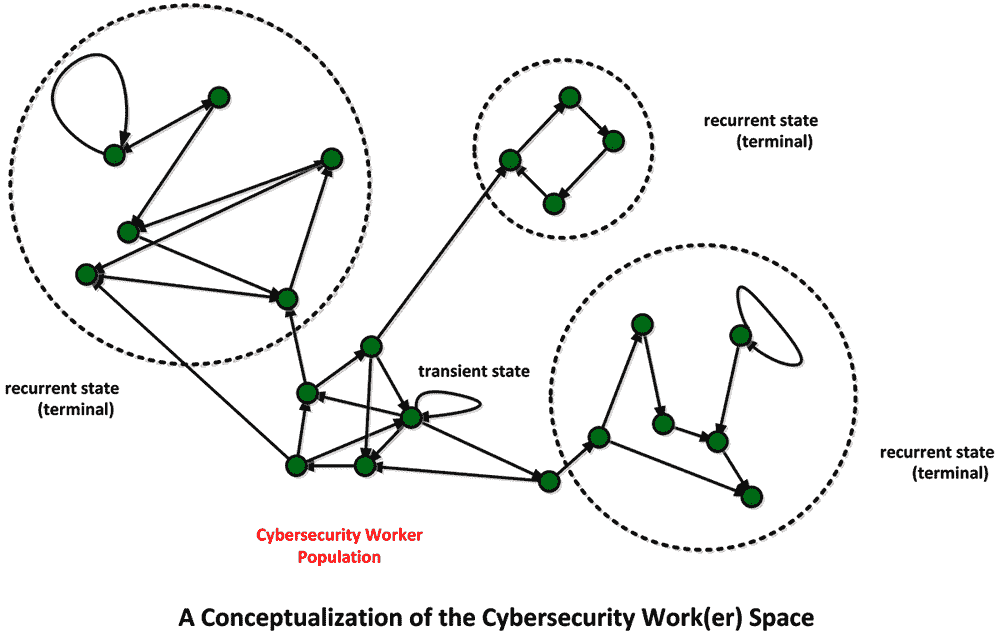 |

图 2 是该网络安全劳动力空间作为一个非常早期的抽象系统的概念化，没有指定任何概率……而且这些空间甚至在广义上都没有被真正定义。一旦有了实际的领域统计数据支持，“稳定状态”视图是什么？跨国比较时看起来是否不同？跨发达国家和发展中国家比较如何？是否有方法从终点状态回到网络安全圈（而且这些方法结果良好吗）？用于告知图 2 规范的数据在公共和私营部门的人力资源部门非常容易获得。从公开的劳动力统计数据中推断出早期和“模糊”的工作。

那些管理和监督网络安全人员的实体（组织、公司）有利于为网络安全工作建立稳健的人才储备。他们希望了解哪些技能组合和人格类型在该领域可能最有效，尽管不会让自己陷入虚假的刻板印象和画像中。一旦人员入职，这些实体有兴趣支持这些个人的工作，特别是他们的分析和创造能力。

如果管理得当，个人和团队可能实现他们的全部潜力；如果处理不当或管理不善，他们的才可能会被政治或其他利益所压制（这将导致所有相关方的净损失）。他们有兴趣观察职业弧和轨迹。他们必须知道这些员工在职场需要什么，并在合理范围内满足他们的需求。他们有兴趣让网络安全员工尽可能保持活跃和高效。

## 战略决策

图 1 中隐含的建议只有在相关实体经过理性考虑，认为这种互动可能是有益且可行的情况下才能起。一个个人、群体或组织被认为是在理性行动，当“你意识到你的目标或偏好，以及对你行动的任何限制或约束，并以计算的方式选择行动，以根据你自己的标准做出最好的……” (Dixit, Skeath, & Reiley, 2009, 2004, 1999, p. 5)。如前面的定义所示，不同参与者的各种激励和反激励将有所不同。例如，如果有一个为某领域设计法规的开源项目，可能会吸引具有不同利益和能力的各种参与者。某些商业组织可能在这个过程中拥有发言权，以确保质量并与他们的产品一致。政府实体可能希望获得投入，以确保符合其监管指令。普通公众成员可能感兴趣，因为该主题与他们的专业兴趣领域一致。除了这些基本利益之外，可能还有其他动机和预期效用（“utils”）：获取机密信息、权力、声望、专业关系、扩展的能力等。


一个简单的双玩家收益表如下：如果 `Player 1` 和 `Player 2` 都参与并贯之执行了合作项目，双方都将获得 (+5, +5)。如果第一个玩家参与了，但另一方退出，则 `Player 1` 将损失 (-12)，而 `Player 2` 将获得 3 点。相反，如果 `Player 1` 退出，则 `Player 2` 将损失 (-12)，因为 `Player 2` 已经投入了共同努力却无而终。如果双方都退出，双方都将损失投入和潜在收益 (-7, -7)，并可能产生损害。双玩家收益表显然具有局限性，但它传达了预期收益的概念以及如何部署这些。

### 表 1. 对称收益表

| | 参与 (Engage) | 退出 (Withdraw) |
| :--- | :--- | :--- |
| **参与 (Engage)** | +5, +5 | -12, 3 |
| **退出 (Withdraw)** | 3, -12 | -7 |

如果一个心怀不轨者想要参与，他可能会就目标和项目进行 `cheap talk`（空谈），而没有实际的信号（证据）。对于天真的玩家来说，他们会被虚假的承诺所迷惑，投入了真实的资源却一无所获。每个参与者都必须进行尽职调查，以理解可能性以及不可能性，当他们经历决策过程时，需要剔除那些不可能性。可以说，在不使用事实的情况下采取行动总是一种被支配策略，因为玩家并不是在处理现实，而是在付出。在基础博弈论中，游戏的类型同样重要，策略随类型而改变。例如，如果合作是开放式或无限的，这将改变合作的计算方式（如`Prisoner’s Dilemma`）。如果合作是同时还是顺序的，也会改变策略。

### 图 3. 简单的决策树：合作还是不

| | 参与 (Engage) | 退出 (Withdraw) |
| :--- | :--- | :--- |
| **参与 (Engage)** |  | |
| **退出 (Withdraw)** | | |

根据提出的公众、公共部门和私营部门之间围绕网络安全共同利益的合作方案，顺序游戏的决策如图 3 所示。这棵决策树在许多方面都进行了简化。首先，这是从一个玩家的角度出发，可能涉及另一个玩家或多个玩家，且决策被设定为二元化的“做”或“不做”。`player` 可能是一个个人 `ego`，也可能是一个个人群体或 `entity`（如公司、办公室或其他非正式或正式团体）。

在这棵博弈树中，每个玩家在每个阶段选择合作（`continue`）或背弃（`stop`、`opt-out` 或 `withdraw`）。假设每个玩家都拥有不完全的信息，但假设他们一直在努力尽可能地收集实实且准确的信息。还假设每个玩家对赢和输……动机……有不同的计算。继续下去是有成本的，但停止也是如此。停止涉及到对关系、玩家声誉以及合作项目潜力的潜在损害等。当然，在现实世界中，具有某些复杂性的技术项目具有挑战性且难以成功完成。领导力可能不足，或者可能会发生。

合作项目的参与者面临着不断变化的环境——就时间、支持资源和组织权限而言。当合作项目运作良好时，就会实现协同效应，其成就远大于部分之和。理想情况下，共享项目的所有成员都能达到 `Nash equilibrium`（纳什均衡），获得优化结果。在现实的动态环境中，完美的结局要难实现得多。信任本身是脆弱的，可能出现互信随后发生黑天鹅事件的序列（Taleb, 2010, 2007）。规则的执行可能太昂贵且复杂，无法寻求法律咨询。沉没成本可能仅仅如此。除非有效建立基础，否则合作项目可能建立在人员流失严重的脆弱联盟之上。

图 3 的设定是倾向于“是”的。毕竟，人们必须坐在桌旁才能引导项目、政策或框架的走向。不冒险就无收获……没有任何结果是提前预知的，即使工作是部分的，它也可能为建设性的努力做出贡献，从长远来看产生积极结果。公众、公共部门和私营部门之间的协作通常以滞后的方式解决技术进步带来的问题。最近的例子包括解决社交媒体时代的隐私问题的努力。

然而，同一棵决策树也可以以其他方式构建，左侧节点的内容如下：

*   追求自己的主要组织目标（或不）
*   保护组织资源：员工时间、战略能力、知识产权等（或不）
*   提议外部代表参与共同的业务或政府事务（或不）
*   偶尔回复来自此类协作小组的邮件（或不）
*   提供一些低成本的象征性帮助（或不）
*   提供一些 `cheap talk`（空谈）（或不）
*   搭别人的免费便车（或不）
*   ……等等……

在不考虑真实成本的情况下，不应存在社区参与。某些场景完全是 `dominated`（被支配）的（亏损）策略。例如，在一个假设性案例中：一个组织针对特定的设计问题征集提案。它承诺提供六位数的奖金和潜在的设计开发。该组织没有的来源，但其奖金包很有吸引力。一家公司投入了多名员工的时间进行竞争，他们的小时成本高于奖金，但如果方案获胜并投入生产，公司将获得收益。

然而，如果他们没有获胜，他们的努力和创意想法将无法保护，这些可能会被主办组织（一个没有明确成就记录的组织）夺走。交出知识产权和其他形式的竞争优势是一种被支配策略。（另一个被支配策略的例子是将知识产权开源，除非有其他利益，如声誉收益、公共关系等。）

### 在人才短缺时代参与网络安全的现状努力

在三个主要领域——公共部门、私营部门和公众之间，正努力在利益重叠的网络安全领域产生协同效应。在政策前沿，以公共部门为主，一些目前的努力包括：


## 信息共享

目前一直致力于制定信息共享标准，以确保不对信息共享者造成损害（特别是当共享者为企业时）。事实上，在学术文献中，有一项工作提议通过一个平台来共享信息并增强网络安全（Al Sabbagh & Kowalski, 2012）。

在公共和私营部门的努力方面，他们主要的共同努力包括做好准备并吸引人才进入网络安全领域。这些努力包括以下方面：

## 定义人才管道

为了让人们成为具有完全生产能力的个体，在照顾、营养、健康、学习和其他支持方面，必须满足某些发育窗口。教育研究表明，如果未能满足发育窗口，某些人类能力可能会永远丧失。由于 `skills` 往往建立在其他技能之上，基础技能的流失会对个人产生深远的负面影响。网络安全需要一些先决技能，这些技能可能包括识字、算术、逻辑和技术技能等基础知识，以及更复杂的能力。就业与生产力技能（`STEP`）概念框架列出了五个步骤：“让婴儿有一个良好的开端，确保所有学生都能学习，建立与工作相关的技能，鼓励创业与创新，（并）促进劳动力流动与匹配”（Arias, 2012 年 4 月，第 11 页）。网络安全有各种技能框架（Furnell, Fischer, & Finch, 2017）。显然，模型中的所有三个实体（大众、公共部门和私营部门）在人类发展方面都发挥着作用。在初高中阶段，影响这种通过管道保护才华的杠杆，不仅涉及课程，还涉及学生社团、出版物、实习和竞赛。

### 跨越传统群体进行招聘与支持

男性占据了 86% 的网络安全岗位，“而女性仅占 10%（剩余的 4% 无数据）”（Caldwell, 2013, p. 8）。目前正努力吸引非传统群体进入网络、科学、数学、工程和技术（`SMET`）领域（Sosnowski, 2014 年 2 月）。

### 提供学习经费资助

在科学、技术、工程和数学（`STEM`）领域获得研究生学位不仅意味着要在从出生到研究生阶段艰辛的学习管道中生存下来，还面临学费、时间、精力、人才和机会成本的获取成本。

### 提高网络安全工作的知名度

目前正努力让网络安全领域变得化。例如，网络安全会议经常在内华达州拉斯维加斯等华丽迷人的城市举行。还设有奖励六位数和七位数奖金的竞赛。职位名称暗示了这种魅力，例如“病毒猎人”（如数字病毒猎人）。白帽和灰帽黑客可能会从用于各种网络安全活动的库存素材图中，黑帽那种阴暗、兜帽的形象中获益。在大众媒体中，有很多白帽人士拯救危机并保护普通人的动人故事。

## 改善职场体验

一些努力涉及改善职场体验。一个问题是地理位置，以及不同行业的员工如何在跨领域聚集并分享想法，以促进激发创新的跨学科交流（Saxenian, 1996）。一系列职场因素影响工作满意度：“工资、工作时间和工会；不安全和不确定性；社交、人脉和孤立”（Hesmondhalgh & Baker, 2009, p. 4）。疲劳和过度工作会损害生产力和工作满意度。

### 职场文化一直在演变

为了适应各种网络技能组合和人才，甚至军事文化也必须发生改变：

```
理想网络军官的属性（即该类型人员所需的理想技能组合），以及军事如何能够最有效益、最高效地获取专业的“网络军官劳动力”，在不同的军事机构和国家之间的理解差异很大。中国“信息安全基地”“红队”或美国网络司令部的网络战士对此理解非常不同。网络军官这导致了概念上的困惑和操作挑战。关注网络军官的叙事，这在文献中是一个被忽视的对象。（Røislien, 2015, p. 24）
```

显然，其他努力正在进行，但在学术文献或主流媒体中尚未涉及。

## 讨论

这项工作为网络安全人才缺口提供了一个“草图模型”，利用了多种技术，包括系统理论、社会网络分析、归纳逻辑、博弈论。这里有许多假设——网络安全人才缺口并非异常，且不应被孤立地看待。“预测”有多个方面。

## 战略联盟

一个建议是大众、私营部门和政府之间的联盟可能为所有实体带来利益。此类工作一直在进行，旨在做好网络防御。

## 替代效应

其，150 万网络安全工作者的缺口将无法填补。相反，将出现创新（某些技术）和适应，有助于解决需求缺口。“替代效应”将会发生。在替代效应传统的概念中，如果人们无法负担昂贵的商品，他们会引入其他廉价的资源。健康的市场也有足够的适应性提供替代产品。（例如，某些公司提供网络保险。围绕网络安全的资金池可以被用于加强网络空间并增加保险者的网络安全。）

## 发展的限制

二，网络安全人才缺口不仅意味着任何涉及网络的领域都将面临风险增加，包括加固系统。它还意味着潜在的产品和服务能力不一定能够实现。网络网络安全的思考工作——用于研发、理论化——也会短缺。衡量网络系统受破坏、数据丢失和恢复累计成本可能更容易，但计算损失的机会可能更困难（但同等重要）。

## 有者与无者的不同结果

三，显然，此背景下的“有者”能够在全球范围内吸引必要的人，并支持这些人才实现创新和卓越能力。他们能够建立和维护内部网络安全人才，并在可用时聘请外部人才。“有者”可能能够在网络安全重要的思考工作基础上建立基础——用于研发、政策、战略和战术以及推进该领域（以及推进其他领域的产品和服务，但依赖网络安全）。思考工作不足的风险适用于学术界及其对其领域的贡献。


学术界对网络问题的忽视对理论进步的代价是显而易见的：当理论能够阐明的实证主题范围缩小时，学术事业将不可避免地进入内部腐蚀过程，这种过程通过两种方式之一表现出来——概念活力的丧失或解释分析能力的下降，每一者都会抑制国际关系研究的学术进展（Kello, 2013, p. 12）。

培养从事网络相关思想工作的人才并非廉价。此外，此类人才的发展通常不会发生在社会真空中。通常，设计团队、开发团队和学者在社会环境中工作，他们各自的工作相互获益。

在网络安全人才方面处于“匮乏”的组织将依赖软件供应商的能力、开源人才和现成工具来安全，但也可能不太成为那些破坏网络安全系统的目标。总而言，组织可能通过几种方式面临网络安全劳动力缺口：通过临时措施缓解；与他人合作解决这一缺失；通过培训员工填补缺口；忽略劳动力缺口；延迟依赖网络安全的计划等。

在专业环境中存在网络安全最佳实践，无论组织内部是否分配了专门的网络安全角色和团队成员，都应该发挥作用，例如：带有安全考虑地构建信息系统、持续更新软件、关注网络安全泄露的新闻、培训员工防范钓鱼和其他诈骗、在数据遭到损害或丢失时备有恢复系统、将受感染的机器与网络隔离、对系统进行监控、培训员工在旅行时要谨慎（例如使用未包含任何敏感数据的清理过的机器）等。无论组织是否为此分配了专门的角色，网络安全都是一项基本的业务职能。最终，随着对这类人才的需求减少，薪酬和奖励将达到平台期（它们甚至可能恢复常态并下降）。处于教育培养体系中的人应该具备适当水平的适应能力，以便向多个方向移动，即使不是进入网络安全工作领域。

## 抽象模型与简化模型的目的

抽象模型和简化模型的目的是什么？目标受众包括涉及网络安全政策、战略和工作的人员。其目的之一是强调公众、公共部门和私营部门的重要作用，以及那里可能发现的协同效应。图 1 旨在具有描述性且具有一定的分析性，但绝不是面面的。图 2 更密切地关注网络安全就业市场。其目标是展示识别战略方法以帮助组织度过网络安全工人缺口的重要性，这将需要战略决策（部署哪些安全系统、聘佣什么技能、采用哪些技术等）。第三点是帮助网络安全工人更好地理解其就业空间“30,000 英尺”的高度。

## 未来研究方向

这项工作基于通用系统理论、社会网络分析、博弈论、溯因逻辑以及最新数据，提供了一个劳动力市场中网络人才缺口模型。这项工作并未将数据与模型进行整合，部分是因为目前仅有通用的劳动力汇总数据。

了解就业市场在网络安全人才方面能承受什么可能有所帮助。一个例子来自美国劳工部统计局。截至 2016 年 5 月，担任信息安全分析师的人平均时薪为 `US$46.17`，平均年薪为 `US$96,040`（`15-1122 信息安全分析师`，2016）。在百分位数方面，正式估计值可见图 4。

| 图 4. 信息安全分析师 (15-1122) 的百分比薪资估计 |
| --- |
| 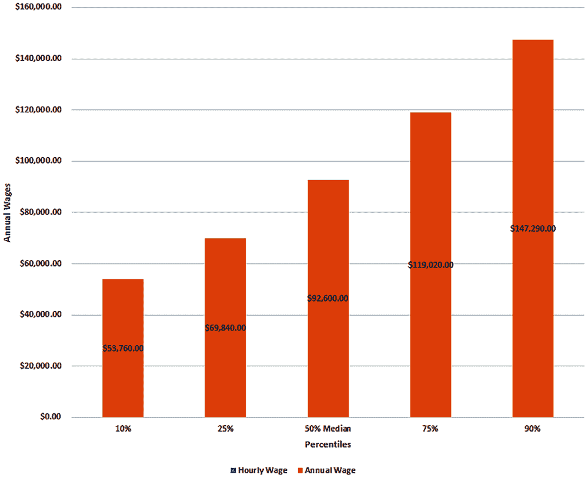 |
| --- |

根据`美国劳工部`的统计，该职业就业人数水平最高的行业包括（按降序排列）：计算机系统设计及相关服务 (27,300)、公司和企业管理 (8,820)、存款信贷中介 (7,080)、管理、科学和技术咨询服务 (4,650) 以及保险承运体 (3,900)（`15-1122 信息安全分析师`，2016 年 5 月）。

该职业薪资最高的行业包括（按降序排列）：批发电子市场及代理和经纪人；证券和商品合同中介和经纪；广告、公共关系及相关服务；报纸、期刊、书籍和目录出版商；以及商业和服务业机械制造，其薪资标准均为六位数。当然，在该领域还有许多其他专业角色，其中许多并没有带来如此高薪水。此外，网络安全领域的其他职位提供更高的薪资和职位福利。此类数据的特殊性可能结合理论指导的模型，揭示其他见解。

本章早前的两个概念性“建模”可视化体现了非正式的概念模型，并具有一定的应用实用性倾向。两者都受益于进一步的基于实证数据的规范。例如，“简化的国家网络安全生态系统与全球网络安全人才缺口”（图 1）将受益于跨国家的具体说明，以理解正在采取哪些努力以及主要缺口（未被开发的潜力）存在于何处。对于“网络安全工作者空间的概念化”（图 2），可以使用实证数据来估计网络安全工人处于任何特定状态的概率……在某一时间点……在组织层面、州层面、国家层面、地区层面，乃至全球层面。这有助于绘制网络安全工人的职业轨迹，以理解他们的经历和决策（特别是在进入非网络安全工作的时刻）。模型结合数据可以指导现实世界的决策。

## 结论

网络安全工作需要高水平的技能和昂贵的培训——包括初期和整个职业期间。网络安全领域的各种威胁不断变化，目前尚不清楚人们能够保护依赖网络的关键基础设施。如果有一份当前的清单，情况将非常严峻，企业和政府损失了巨大价值。这项早期工作为网络安全缺口提供了一些可能的缓解措施。

## 参考文献

15-1122 信息安全分析师. (2016,5). 美国劳工部统计局。职业就业统计，职业就业与薪资。检索 2017 年 9 月 2 日，https://www.bls.gov/oes/current/oes151122

Al Sabbagh, B., & Kowalski, S. (2012). ST(CS)² – 社会技术网络安全系统。Cyber Security, Cyber Warfare. IEEE Xplore. 检索 2017 年 8 月 9 日，http://ieeexplore.ieee.org/document/6246110/

Caldwell, T. (2013,7). 填补网络安全技能缺口。Computer Fraud & Security ,2013(7), 5–10. doi:10.1016/S1361-3723(13)70062-9

Clare, K. (2013). 地方在创意产业中的核心作用：边界、网络与游戏。Cities (London, England) ,34, 52–57. doi:10.1016/j.cities.2012.05.009

Arias, O. (2012,4.) 衡量技能及其发展政策。第三届博洛尼亚政策论坛，1 – 55.


# 参考文献

Dixit, A., Skeath, S., & Reiley, D. H. (2009). 《策略游戏》(第 3 版). 新纽约: W.W. Norton & Company. 

Furnell, S., Fischer, P., & Finch, A. (2017, 2 月). 找不到员工吗？网络安全技能日益增长的需求。《Computer Fraud & Security》 , (2): 5–10.

Hesmondhalgh, D., & Baker, S. (2010). “一种非常复杂的自由版本”：三大文化产业中创意劳动的条件与经验。《Poetics》 , 38(1), 4–20. doi:10.1016/j.poetic.2009.10.001

Kello, L. (2013, 秋). 网络革命的意义：对理论和治术的威胁。《International Security》, 38(2), 7 – 40. 检索于 2017 年 6 月 2 日，源自：`https://muse.jhu.edu/article/523380`

马尔可夫链。(2017, 12 月 14 日). 于维基百科。检索于 2018 年 1 月 24 日，源自：`https://en.wikipedia.org/wiki/Markov\_chain`

McCormack, A. (2010, 6 月). 数字技能宣言：行动号召。EuropeanSchoolnet 和 DIGITALEUROPE.

Morse, A. (2013, 2 月). 英国网络安全战略：格局回顾。国家审计署。检索于 2017 年 5 月 29 日，源自：`https://www.nao.org.uk/wp-content/uploads/2013/03/Cyber-security-Full-report.pdf`

Porter, M.E., & Rivkin, J.W. (2014, 9 月). 完成了一半工作的经济体：哈佛商学院 2013-14 年美国竞争力调查结果。学术出版社。

Røislien, H.E. (2015). 当代际差距遭遇军事结构时：挪威网络军官案例。《军事与战略研究杂志》, 23 – 44.

Saxenian, A. (1996). 《区域优势：硅谷与 128 号线的文化与竞争》。马萨诸塞州剑桥市: 哈佛大学出版社。

Sosnowski, N. H. (2002, 1 月 1 日). 有色女性主网络领域：解析科学、数学、工程和技术 (SMET) 中的种族/性别差距（博士论文）。马萨诸塞大学阿姆斯特丹分校。

Strand, C. (2014, 12 月). 挑战对网络安全的信任。《Computer Fraud & Security》 , 2014(12), 12–15. doi:10.1016/S1361-3723(14)70556-1

Taleb, N. N. (2010). 《黑鹅：极低概率事件的影响》(第 2 版). 新纽约: 随机出版社。

Von Bartalanffy, L. (1972, 12 月). 系统的历史。《管理杂志》 , 407–426.

Walonick, D. (1993). 系统的历史。《管理学院》 , 15(4).

Yang, D., & Hoffstadt, B. (2006). 安全策略。《美国法律评论》 , 23–215.

## 关键术语与定义

**网络安全 (Cybersecurity)**: 一种状态的。

**博弈论 (Game Theory)**: 一种数学方法。

**劳动力市场 (Labor Market)**:就业范围内。

**马尔可夫链 (Markov Chain)**: 一种可能的事件。

**社交网络 (Social Network)**: 一个连接的群体。

**系统理论 (Systems Theory)**: 一种概念化。

# 第二章：网络安全在自动化业务环境中的作用

## 摘要

现代环境的转型项目 (BTP) 需要设计良好的技术安全自动化概念 (ITSAC)，而这又取决于可衡量的成功因素。这些因素用于过程的演进。在过去的十年中，由于全球性的不安全，安全策略显得不足。这主要是由于业务依赖于安全标准、信息技术演进、架构和互操作性。它们被限于基础设施安全运营。主要的 BTP 被各种导致决策失败的情况所破坏。

## 引言

最具破坏性的事实是环境失去了转型动力，这会对其可持续性产生负面影响，并使其面临泄露和损失的风险。金融科技 (FinTech) 是改变传统服务交付的最新热词。本文中作者提出了一系列管理建议，以避免此类情况。

今天存在许多安全架构，即使是先进的，遗憾的是它们遵循孤岛模式。本章通过所有安全运营及其相关流程的自动化，支持传统环境的网络转型。转型传统的安全子系统以及相关的法律限制是一个巨大的挑战，因为安全和法律团队可能会抵制变革。ITSAC 子系统可以为未来环境提供灵活服务的基础，以避免安全依赖。

## 背景


在整体网络安全架构中，业务转型经理（BTM）的角色至关重要，其决策（为了简单起见，后文统称为“他”）得益于已实施的应用数学模型内部因素的辅助。大量因素会影响此类数学模型，包括：a) 使用 `ITSAC` 进行网络安全执行控制的作用；b) 全球地缘政治因素；c) 政治和文化背景；d) 技能水平；e) 网络和技术条件；f) 财务竞争和贪婪；以及 g) 安全、财务和法律控制机制。系统方法是建模此类控制的最优方法（Daellenbach & McNickle, 2005; Trad & Kalpić, 2016a）。如图 1 所示，决策模型通过一个实施的框架与外部世界交互以管理安全风险，这正是本文的关注点。

| 图 1. 研究框架的概念 |
| --- |
| 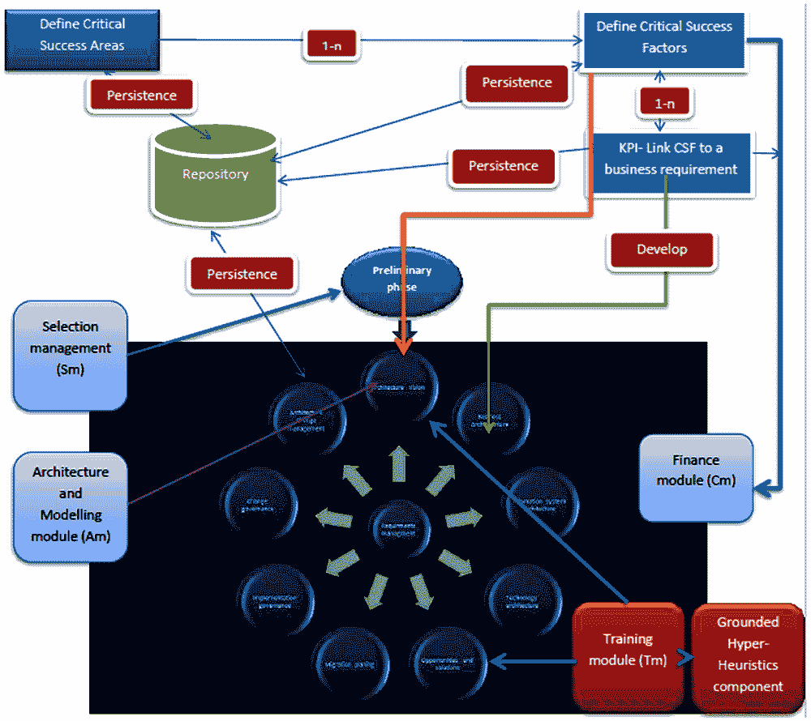 |
| --- |
| *来源: Trad & Kalpić (2016a)* |

## 本文重点

### 研究过程
本研究的主题与业务转型项目（BTPs）相关，研究问题为：“在业务转型项目的实施阶段，应该确保哪些业务转型经理特征以及何种类型的支持？”基于关键成功领域的决策概念是其主要研究组成部分。

### 关键成功领域、因素与决策
关键成功领域（CSA）是关键成功因素（CSF）的一个类别，而 `CSF` 而言是一组关键绩效指标（KPIs），其中每个 `KPI` 对应一个单一需求或功能。对于特定问题，框架分析师必须识别用于决策系统的初始 `CSFs` 集合。因此，`CSFs` 是地缘政治结构、财务状况、组织倾向与决策系统之间最重要的映射/关系；这种关系定义了全球金融犯罪的业务生态系统（Peterson, 2011）。所提的应用数学模型或 `AMM` 为网络安全架构提供了一建议和解决方案，该架构是框架的一部分（Trad & Kalpić, 2017c; Trad, & Kalpić, 2017d）。

### 框架
BTM 或企业架构师的安全设计决策可以通过来自各种可信技术日志源的输出以即时方式做出。定义的网络安全策略应当评估并治理全球系统安全风险，同时在法律上主张或控制通过企业架构蓝图正式化的 BTP 资源。研究框架可以支持此类工作，如图 2 所示。遗憾的是，大量过时的因素会影响此类过程，例如：1) 网络安全对业务转型项目的影响；2) 在具有非常严格法律框架的复杂系统中工作；以及 3) 此类项目的整体网络法控制机制不存在或过于复杂而无法实施。

全球性概念和相关网络安全系统的管理方法对于此类控制机制是最优的（Daellenbach & McNickle, 2005）。在这项研究中，重点是管理 BTP 全球安全的 `ITSAC` 模块。`ITSAC` 可以应用于框架中的许多 BTP 和通用领域，它是财务管理模块（`Fm`）和架构与建模模块（`Am`）的一部分。在本章中，作者提出了一套 `ITSAC` 管理建议和一个可复用的真实世界模块（Trad 2017b; Trad 2017c）。

| 图 2. 实现业务工程的神经网络实施环境 |
| --- |
| 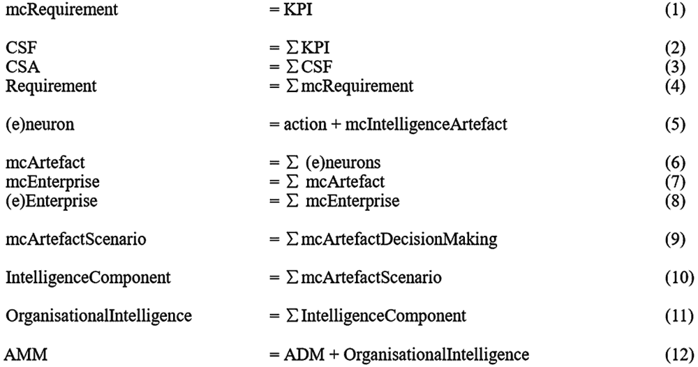 |
| --- |

`ITSAC` 组件由开放组架构框架（TOGAF）架构开发方法的各个阶段进行管理，其中每个架构微构件在其阶段中循环。架构微构件包含其私有的的一组关键成功因素，如图 2 所示。这些 `CSFs` 可应用于以下方面（Peterson, 2011）：a) 选择重要的网络安全因素；b) 检测 BTP 的安全风险高点；c) 使用决策支持系统的接口估计 BTP 的实际风险状态，并最终对 BTP 的持续做出决策；d) 控制和监控所需的 `ITSAC` 机制；e) 升级 BTP 团队的网络安全技能；以及 f) 支持架构和项目管理活动。

框架或环境由以下模块组成：
* • “Sm”用于框架的选择管理。
* • “Am”用于框架可以采用的架构和建模策略。
* • “Cm”用于框架可以采用的控制和监控策略。
* • “Dm”用于框架可以采用的决策策略。
* • “Tm”用于框架的培训管理。
* • “Pm”用于框架可以采用的项目管理策略。
* • “Fm”用于财务管理对框架的支持。
* • “Gm”用于对框架的地缘政治思维挖掘。
* • “F”代表框架。

本章是研究集群的一部分，该集群已产生许多文章、文献综述、可用项目和研究产物。在本章中，重用了之前工作中极少部分章节，以便更好地理解这一主题。因此，这项工作可以被视为全球架构领域的开创性工作。对于研究的阶段，作者试图通过基于关键成功因素的决策系统数学模型，交付他们的发现和建议，以阐明风险补丁。

“网络安全对转型项目存在哪些风险？”

### 决策系统
决策系统（`DMS`）在概念上基于混合方法，结合了行动研究（`AR`）、树启发式算法和定向定量分析。作者认为定性和定量方法可以在单一方法中统一起来。`AR` 应用于教育研究，这一事实支持了 BTP 在持续学习过程中构建业务智能微构件的能力。该过程检查并学习在 `DMS` 中发现的可配置微构件。该决策系统是通用的，可以应用于任何业务领域并易于适应（Trad & Kalpić, 2017c; Peterson, 2011），如果需要，第二步将应用精确的定量分析。

`DMS` 必须由现有的审计或治理框架进行管理，这些框架要求 BTM 接受各种类型的风险。这些风险由 BTM 通过使用 `DMS` 动作提供解决方案进行估计。`DMS` 动作映射到 TOGAF G 阶段中的治理过程，该阶段负责调整业务视图的实施治理。`DMS` 构件实现在所有 BTP 组件中，且治理机制的实施能够识别关键风险。它们需要被管理（作为 `CSFs`），这可能需要多次迭代，以限制可以使用数学模型进行建模和管理的风险（The Open Group, 2011a）。

## 应用的组织与数学模型
所提的 `AMM` 与领域无关，不与任何特定方法相关，并包含一个使用 `CSFs` 集合和动作的可配置推理模块（Peterson, 2011）；此处企业指的是所考虑的组织。如图 3 所示，应用的 `AMM` 支持基于微构件的架构，该架构采用业务驱动的方法，并同时也使用了开放组的架构开发方法（`ADM`）（Trad & Kalpić, 2017b）。


| 图 3. 环境的微构件概念 |
| --- |
| 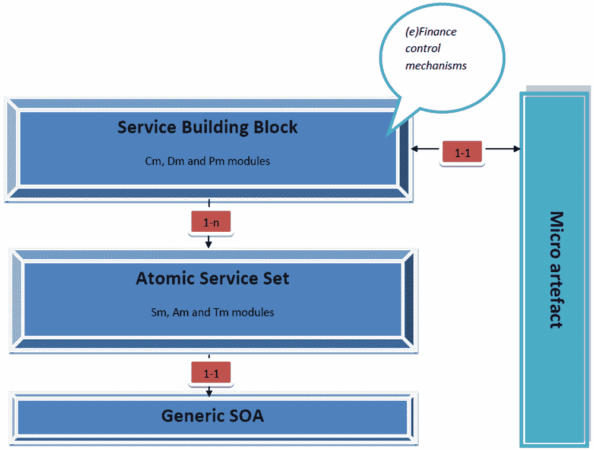 |
| --- |
| *来源：Trad & Kalpić (2017b)* |

AMM 考虑了以下 CSA（关键安全因素）：

* • 安全概念。
* • 信息技术集成。
* • 法律方面。
* • 财务背景。

## 安全概念

网络安全是指业务系统的一种状态，它可能受到任何类型的危险或威胁；BTP 必须交付一个设计用于提供最大安全性的系统（牛津词典，2017a）。本节介绍了影响 ITSAC 的因素，而这第一个 CSA 试图论证网络安全要求的各个方面。网络安全取决于以下领域：1) 网络技术；2) 国家安全需求；3) 国际安全需求；以及 4) 组织安全需求。网络安全需求对于一个组织的业务生存是最根本的，并且涵盖了多个子领域。

## 网络安全需求

| 图 4. 与安全模块的架构接口 |
| --- |
| 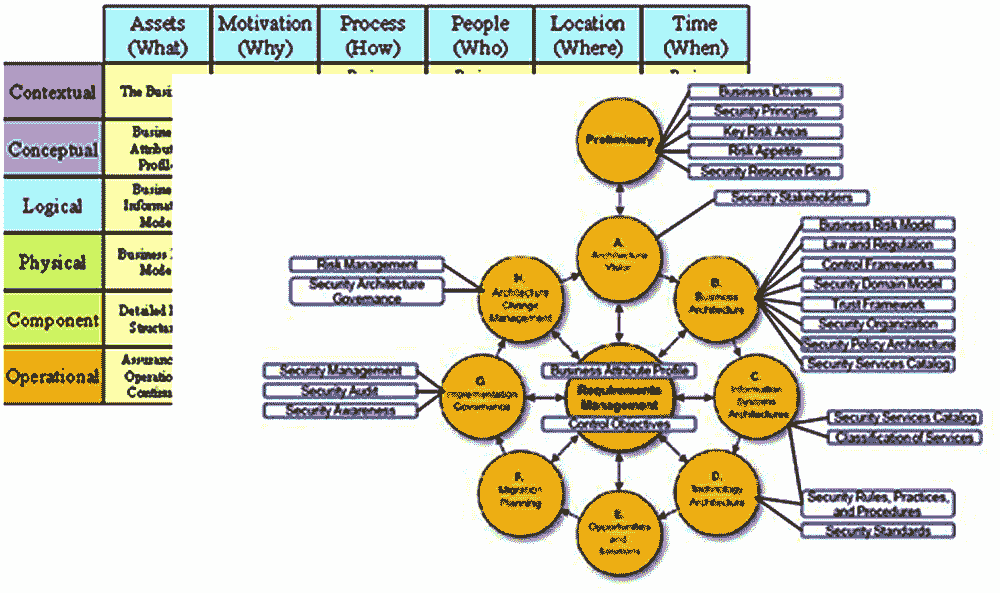 |
| --- |
| *来源：Unwin (2013)* |

最佳的网络安全架构应该符合公司的全球企业架构框架，该框架反过来基于最佳实践。产生的网络安全架构是技术解决方案、业务工程和安全概念的混合。TOGAF 包含了子框架，如 Sherwood 适用业务安全架构（SABSA），来处理网络安全需求，如图 5 所示（Unwin, 2013）。

## 网络安全领域

| 图 5. 架构组件与治理 |
| --- |
| 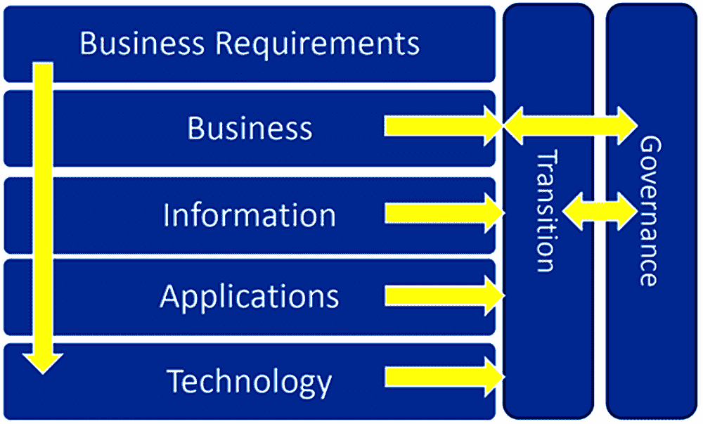 |
| --- |
| *来源：Unwin (2013)* |

图 5 显示，治理定义了各种组件与其网络或信息技术安全之间的交互，这种治理理解以下内容的安全性：

* • 数据。
* • 技术资源。
* • 网络。
* • Web 和互联网基础设施。
* • 应用、开发与运维。

### 安全开发与运维集成

应用开发与运维通过一个安全的开发/运维（DevOps）过程协调，被称为 SecDevOps。SecDevOps 管理开发者、运维和安全 BTP 成员，如图 6 所示。BTP 使用敏捷的 SecDevOps 程序来识别管理转型需求的模式（Mees, 2017）。

| 图 6. 利益相关者之间的 SecDevOps 关系 |
| --- |
| 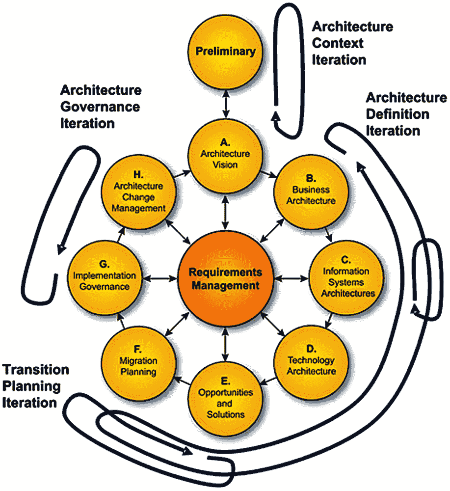 |
| --- |
| *来源：Mees (2017)* |

### 安全概念成功因素

根据文献综述，使用的最重要的安全 CSF（关键成功因素）如表 1 所示。

表 1. 安全关键成功因素

| 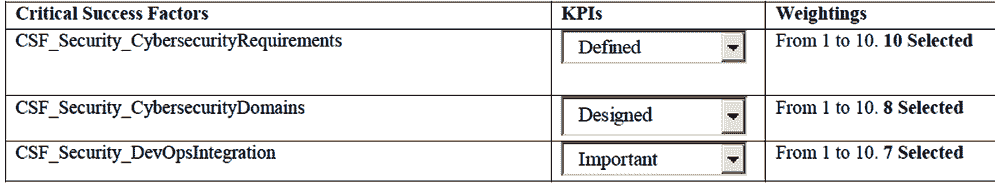 |
| --- |

## 模块链式链接到技术集成

本节的推论是，安全依赖于信息技术，下一个重点将是信息技术集成。

# 信息技术集成

全球或整体的业务业务敏捷性通过结合各种方法来实现，这些方法促进业务和技术敏捷性，并被用于 BTP 的各个级别，以解构现有业务环境，并使用动态互联网微构件将其翻新的部分连接起来。通过自下而上的方法，BTP 团队可以设计最佳的网络业务技术集成概念，该概念可以处理各种类型的网络安全需求，并用于标准架构开发方法。

### 架构开发方法的集成

BTP 中架构开发方法（ADM）的集成使其在整个 ADM 迭代中的所有活动实现自动化。ADM 包含了 SecDevOps；如图 7 所示，它们的所有阶段将信息记录到一个统一的日志系统中。

| 图 7. 架构开发方法与各种管理模块的交互 |
| --- |
| 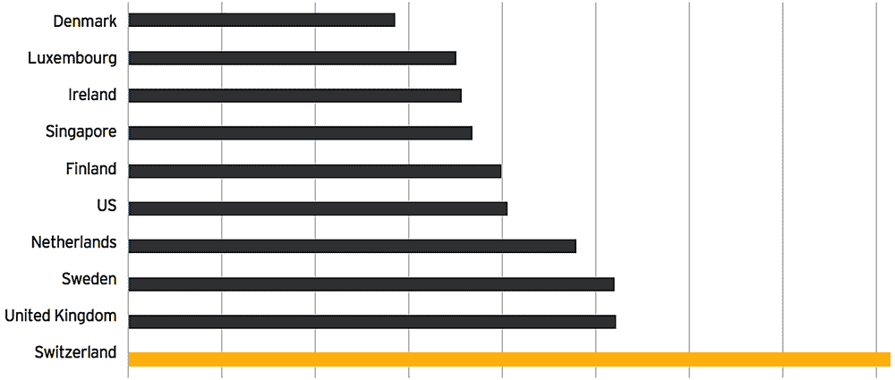 |
| --- |

### 统一控制与日志子系统

网络业务平台不限于任何特定的业务环境，并提供：1) 性能；2) 可靠性；3) 网络安全。这些平台使用统一日志子系统（ULS）进行实时控制和监控，并集成以支持 ITSAC。ULS 是强大的监控子系统，支持展示、排序和调整。ULS 设计用于分析、收集和存储来自各种 BTP 微构件的 ITSAC 数据，以支持中央决策日志系统。

### 决策系统的集成

ITSAC 的 DMS 日志来自各种子系统的输入，输入取决于警告级别。如果 BTP 团队发出一个待解决的问题，则 DMS 将被激活并提出可能的解决方案。ITSAC 的下划模型包含了交互式原子服务操作的微构件场景。原子使得集成变得灵活（Trad & Kalpić, 2017）。DMS 的组件通过提供安全构件来支持 BTP。

### ITSAC 的微构件

ITSAC 的微构件是一个构建块实例，能够以追踪和同步的方式与其他 BTP 微构件交互，并使用 TOGAF 的 ADM 来协助其分组（The Open Group, 2011）。

## 信息技术集成关键成功因素

根据文献综述，使用的最重要的技术 CSF 如表 2 所示。

表 2. 技术关键成功因素

| 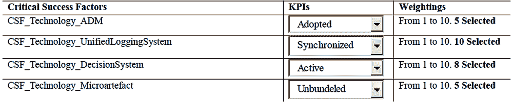 |
| --- |

## 模块链式链接到财务推理

本节的推论是，技术是 ITSAC 子系统的骨干，其中蓄意的破坏可以促进非法财务利润。

# 财务背景

整体业务敏捷性通过结合促进网络安全和技术敏捷性的各种方法来实现，这些方法被用于 BTP 的各个级别，以解构传统业务环境并使用动态技术构件连接其转型组件。使用 TOGAF 的 ADM，BTP 团队可以设计最佳的网络业务环境，处理各种类型的财务和技术工程风险。

### 财务与技术

如前所述，金融科技（FinTech）旨在从交互式金融服务的交付方面改变传统的财务环境。智能财务终端的使用提供旨在让金融服务开放给许多外部终端的技术。尽管金融科技可以用于打击金融犯罪，但支持大规模金融犯罪的国家正在这些创新技术上投入最大的资金（Ravanetti, 2016）。金融科技公司正在利用区块链和比特币技术转型金融服务的使用，非常可能仅仅是为了财务利润的目标（Wikipedia, 2017a）。

| 图 8. 财务与技术领先国家 |
| --- |
| 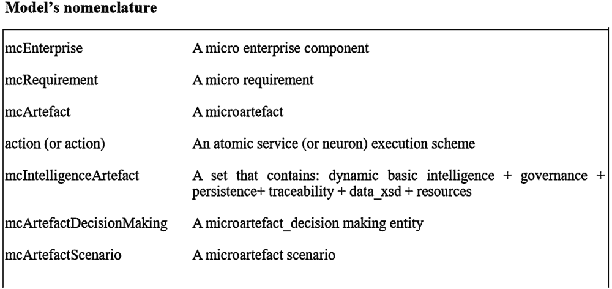 |
| --- |
| *Ravanetti, 2016.* |

## 区块链与比特币


区块链是支持如比特币等加密货币的底层框架；比特币支持数字加密形式的货币交换（PWC, 2017）。金融科技自动化导致了各种网络金融服务的同步，这些服务需要特定的监管和网络安全机制，考虑到当今最主要的现象是作为一种新兴犯罪类型的网络犯罪，另一方面，是传统货币显而易见的消亡。

## 货币

随着金融科技的迅速兴起，区块链技术将主导领先的金融巨头，并导致比特币的统治地位。这种新媒体将导致瑞士法郎等领先货币的消失；此类事件对于追踪金融欺诈将成为一个重大问题。这种场景并非之之；不应完全排除加密货币泡沫破灭的可能性。

## 金融科技欺诈

金融科技将金钱变得更加抽象且难以追踪；在具有金融秘密和仲裁没收文化的国家，个人和机构可能会倾向于使用金融科技来掩盖资金来源。Paula Ramada 估计，由于基准利率崩盘导致的资金损失金额估计为 300 万亿美元金融工具，涵盖了从抵押贷款到学生贷款的领域，其中一万亿代表 10 亿个十亿（`10⁹x10⁹`）或 `10¹⁸`。因此，仅仅 0.1% 的变化或操纵就会造成 `10¹⁵` 欧元的损失；这是银行用来掩盖贷款减少并以牺牲中低层家庭为代价挽救其投资的机制；其中像瑞士瑞信等某些银行变得更加富有（Ramada, 2013）。金融科技将使此类操作更加嵌入和抽象。

## 金融关键成功因素

根据文献综述，使用的最重要的金融关键成功因素（CSFs）包括表 3 所示。

表 3. 金融关键成功因素

| 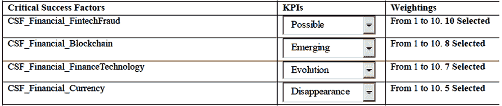 |
| --- |

## 与法律方面相关的模块链连接

本节的推论是，法律方面可能是 ITSAC 子系统的主要问题，其中故意违法可以为国家经济带来利润。

### 法律方面

ITSAC 支持全球化环境下业务环境的法律整合；为了实现这种法律支持，使用了关键成功因素来主张并监控 BTP 资产。关键成功因素管理着网络业务本地与国际法律之间的差异。网络业务环境必须具备主动识别错误网络交易的能力（Daellenbach & McNickle, 2005）。

#### 网络交易的安全违规

欧盟委员会制定了一项旨在管理网络业务的立法，并在其主张方面取得了进展。欧盟委员会成员国已经实施并执行了与业务工程相关的国家实践。网络交易的结果必须不断进行法律主张和追踪，并将其定期总结报告给执行管理层（Fu & Mittnight, 2015）。网络业务与网络安全需求是正交的，业务环境的角色定义了企业资源的责任。企业法律利益、资源和访问的管理应由企业架构师负责。因此，网络业务结构是网络交易安全法律主张和访问管理中的重要考虑因素。网络交易的安全和法律监管需要合格的时间戳来确保稳健的（e）认证，如欧盟所使用的时间戳（欧盟, 2014）。

#### 网络交易法

网络交易受到 1999 年颁布《统一电子交易法》的统一法委员会的影响。这是为网络业务准备网络法律的首次适应性尝试。许多国家已经采用了网络业务法规。《统一电子交易法》代表了提供某些标准化规则来管理网络交易的首次尝试。（统一法委员会, 2015）。

#### 网络业务立法主张

业务工程模块的集成是通过使用 Open Group 的标准化法律环境完成的。这种法律环境支持数据保护法、合同法、采购法以及许多其他反犯罪领域。

## 金融犯罪模型

在资产所有可以隐匿的国家，金融犯罪具有特殊地位。某些战争中产生的暴虐独裁者与金融天堂银行建立了强大的金融关系。一个例子可以是著名的纳粹银行家 Francois Genoud（Brown, 2016）。一些金融天堂是全球金融丑闻的领导者，其犯罪行为包括：a) 利差市场操纵；b) 货币操纵；c) 信贷操纵；d) 支持武器交易；e) 劫持财产；f) 金融欺诈；g) 次贷危机；h) 战争财产没收；i) 逃税；j) 毒品交易支持；k) 对未来竞争者的战争支持；l) 强制没收；m) 巨额罚款；以及 l) 武器交易（Trad, 2017）；打击此类系统的主要问题是某些国家通过以下态度形成了封闭的系统：

- 警察和情报部门阻止任何对金融犯罪的调查。
- 法律系统忽视任何对金融犯罪的调查。
- 法律支持成本过高，阻碍任何法律行动。
- 心理骚扰，损害调查者的声誉。
- 不宽容和歧视，阻止任何请求。
- 强大的全球网络，隐藏各种可疑操作。
- 金融游击式的战术，没收财产。
- 金融困局的发生。

一些金融天堂国家目标成为金融科技领导者，这并不可靠；因为金融科技应该打击国家犯罪并执行网络安全法。

- 避免与上述国家进行任何形式的金融合作。

一些国家目标成为金融科技领导者，这显然并不可靠，因为金融科技应该打击国家犯罪并执行网络安全法。


概念验证（PoC）是使用基于 Microsoft Visual Studio .NET 开发的环境构建的。该 PoC 基于 `CSFs` 与特定研究资源的绑定，其中 `AMM` 是使用企业架构工具进行原型设计的。推理模型代表了该研究的需求、微构件（或构建块）与 `CSFs` 之间的关系。

概念验证的实现是使用基于 Microsoft Visual Studio .NET 开发环境和研究框架构建的框架。`ITSAC` 使用了调用 `ITSAC` 微构件的服务。

正如本文表格所示，我们选取了 `CSFs`，而 `DMS` 的处理结果（如表 5 所示）清楚地表明，网络安全并不是一个独立的组件，事实上，它与 `BTP` 的整体安全架构紧密结合。

### 5. 网络安全研究成果

| 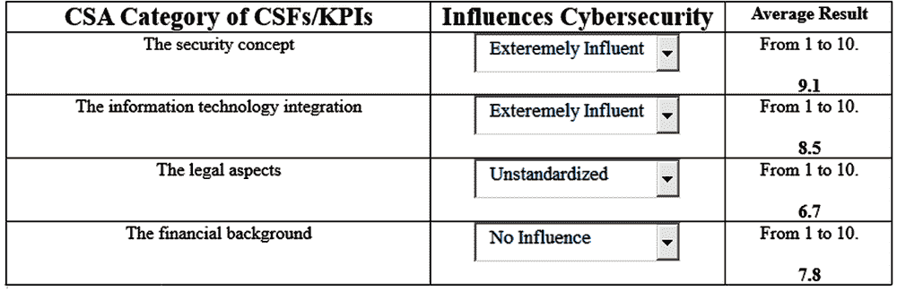 |
| --- |

该模型的主要限制是，平均结果低于 `7.5` 的 `CSAs` 将被忽略。这一事实使得安全、财务和技术 `CSAs` 帮助得出了这项工作的结论。

## 解决方案与建议

在本章中，作者提出了以下系列管理建议：

*   `BTP` 必须构建一个整体性的架构概念，以确保高效的网络安全。
*   应投入大量努力整合底层技术，以支持大量的网络交易（Cybertransactions）。
*   网络技术应取代传统的交易所，以提高生产力并实施实时 `ITSAC`。
*   网络安全架构应符合公司的全球企业架构框架。
*   架构开发方法在 `BTP` 中的集成能够实现其所有活动的自动化。
*   应用的开发与运维由 `SecDevOps` 协调。
*   `ISTAs` 由 `ULSs` 进行控制和监控。
*   `FinTech` 将使金融操作更具嵌入性和抽象性。
*   网络业务与网络安全需求是正交的。
*   网络交易受本地和国际网络法的影响；而两者都存在局限性。
*   避免与可疑金融机构进行任何形式的财务合作。

## 未来研究方向

环境方面的未来研究将重点关注数学模型的演进。

## 结论

这一研究阶段是与 `BTPs` 和企业架构相关的系列出版物。该研究基于混合行动研究模型；其中提供了关键成功因素和领域，以帮助 `BTP` 架构师降低失败概率。在本文中，重点是网络安全。网络安全架构是业务驱动的，描述了技术与程序化安全解决方案之间结构化的相互关系，以支持网络业务的长期需求。`ITSAC` 组件的整体集成是网络业务演进的重要因素。此前研究阶段产生的最重要管理建议是，业务转型经理必须是自适应业务系统的架构师。PoC 基于 `CSFs` 与特定研究资源的绑定，推理模型代表了该研究的需求、微构件与 `CSFs` 之间的关系。结果是，安全、财务和技术 `CSAs` 对于网络安全至关重要。

### 致谢

在像这项研究项目这样庞大的工作中，难免会存在技术、排版、语法或其他类型的错误。归结底，所有错误均由作者负责。尽管如此，我们鼓励读者在指出错误的同时，也对工作整体提出意见。准备这项工作是我们的巨大荣幸。现在，我们更大的希望是读者能从中获得一些小快乐。

### 参考文献

*   Abu-Fadil, M. (2017). 黎巴嫩银行倒闭是黎巴尼衰落的前奏吗？赫芬顿邮报。
*   Brown, J. (2016). 瓦菲赛德：商人、慈善家和政治人物。金融时报。
*   Dugan, K. (2017). 瑞士信利用交易软件欺骗客户。纽约邮报。
*   Daellenbach, H., McNickle, D., & Dye, S. (2012). 管理科学 - 通过系统思维（第二版）。麦格罗罗。
*   Taleb. N. (2012). 反脆弱性：从无序中获益。学术出版社。
*   European Union (2014). 欧洲议会和理事会第 910/2014 号条例关于内部市场电子身份和电子交易信任服务并废除第 1999/93/EC 号指令。
*   Fu, Z., & Mittnight, E. (2015). 企业 IT 持续监控、评估和管理的关键成功因素。ISACA。
*   Mačák, K. (2016). 国际网络法？埃克塞大学法学院。第八届国际会议。
*   Mees, W. (2017). 企业架构中的设计安全设计。皇家军事学院，C 部门。
*   Nations Encyclopedia (2017). 瑞士的族群。国家百科书。
*   Oxford Dictionaries (2017). 安全。伦敦：牛津词典。
*   The Open Group (2011). 开放小组标准-TOGAF® 指南，版本 9.1。纽约：开放小组。


# 第 3 章：网络风险保险

İsmail Yıldırım，土耳其，赫梯大学

## 摘要
网络安全系统中存在的安全漏洞会导致金融系统遭受虚拟和物理损害，进而引发国家和个人层面的安全问题。当今世界正由数字技术塑造，针对信息的网络威胁构成了企业面临的重大风险因素。本研究探索了银行系统可能遭遇的网络安全风险。评估并介绍了土耳其银行系统（包含多种在线服务）网络安全风险方面的现状及当前风险，并提出了可能的解决方案。本研究分析了电子支付系统（网上银行和电子贸易/借记卡/信用卡使用）以及作为电子金融系统支柱的供应链在国家安全风险方面。尽管如此，本文还详细分析了作为网络风险管理新兴工具的网络风险保险。

## 引言
许多国家针对网络攻击引入了激进的解决方案，并对这些解决方案进行了投资。美国等许多国家倾向于在市场层面保护其关键的网络安全基础设施，而以色列等国家则发展了以国家为中心的安全防御策略。许多网络安全专家表示，如果不与私营部门的利益者合作，无法采用有效的防御和反制安全机制，因为政府服务由许多私营服务提供商和电信公司支持（Grauman, 2012）。

网络风险是一种风险，包括企业 IT 基础设施的任何意外技术故障，或针对此类基础设施的网络攻击，这将导致可能的财务损失和品牌价值受损。如今，从中小企业（SMEs）到国际性企业，任何商业机构都面临着由网络威胁引发的财务后果。结果，随着对网络安全产品兴趣的增加，一个新市场应运而生。

网络攻击为保险公司带来了新机会，它们在竞争激烈的市场中提供服务并希望扩大产品范围。许多公司已经推出了其网络保险产品，还有更多公司正准备推出其产品。根据 ABI Research 的调查，预计全球网络保险市场价值到 2020 年将达到 100 亿美元。据报道，这种增长的主要因素是与数据泄露和网络攻击相关的成本增加，以及倾向于将网络威胁风险转移给保险公司的风险管理策略的采用。进一步报道显示，美国和欧洲的网络风险市场以每年 20-30%的速度增长（www.usom.gov.tr）。

网络攻击对私有企业和国有企业都是主要的风险因素。保险公司已经开发了多种保险包，以数据恢复险、数据保护险、网络险和网络责任险等名称，尽量减少网络攻击对企业可能的影响。网络攻击可能对企业的自动化基础设施产生不利影响。然而，此类攻击的影响范围不仅限于这些系统。这些网络攻击还涉及法律、管理、公共关系和财务后果（Assaf, 2008）。

网络责任保险公司在分析了相关后果后，针对此类网络风险提供保障。网络攻击可能对企业的声誉和市场价值产生不利影响，更不用说机密信息窃取或损坏带来的损害。网络责任保险单的范围可能包括与信息破坏相关的损害和保护费用、对第三方数据的病毒威胁、未经授权访问第三方信息、访问系统代码、软件盗窃、员工泄露机密信息等。

此外，还可以选择性地投保，涵盖与网络功能中断相关的任何损害、为了消除任何安全威胁而向第三方支付的费用、由于疏忽导致的电子信息损坏，以及采取任何保护措施所产生的任何费用。

## 关键术语与定义
- `ADM`：架构开发方法。
- `ABE`：自适应业务环境架构师。
- `Critical Success Factors`：关键成功因素。可管理各种项目计划中的状态和差距，并提供主动自动识别错误构建块并及时重新安排项目计划（s）的能力。
- `Environment`：研究框架。
- `Manager`：业务转型经理。
- `Project`：业务转型项目。
- `TOGAF`：开放组的架构框架。

## 扩展阅读
- Capgemini (2007). 业务转型趋势 - 欧洲高管调查。Capgemini Consulting and the Economist Unit. 法。
- Daellenbach, H., McNickle, D., & Dye, h. (2012). 管理科学. 通过系统思维进行决策（第 2 版）。纽约：Palgrave Macmillan。
- Farhoomand, A. (2004). 管理（电子）业务转型。伦敦：Palgrave Macmillan. doi:10.1007/978-1-137-0838-7
- IBM (2009). TOGAF 或非 TOGAF: 将企业架构扩展到 RUP 之外。纽约：IBM developerWorks。
- Transparency International. (2017). 2016 年腐败感知指数。廉洁国际。2017 年 12 月 2 日检索自：https://www.transparency.org/news/feature/corruption_perceptions_index_2016
- Unwin, D. (13). 安全架构-企业维度。
- Wikipedia. (2017a). 金融技术。2017 年 12 月 19 日检索自：https://en.wikipedia.org/wiki/Financial_technology
- Trad, A. (2017c). 转型框架概念证明。内部项目与论文。IBISTM。
- Trad, A. & Kalpić, D. (2016a). 业务创新与业务转型项目经理的转型框架。中国学者协会。
- Trad, A. & Kalpić, D. (2016b). 电子商务发展业务转型框架及其业务工程支持，哈利：IGI Global。
- Trad, A. & Kalpić, D. (2017a). 业务转型与企业架构：伦敦报价危机 - 模型。伦敦：ABMR。
- Trad, A. & Kalpić, D. (2017b). 业务转型与企业架构：伦敦报价危机 - 概念证明。伦敦：ABMR。
- Trad,A.KalpićD. (2017c). 用于业务转型项目的神经网络可移植与自适应环境 - 基础结构。IEEE 计算智能会议。IEEE. 10.1109/CIVEMSA.2017.795
- Trad,A.KalpićD. (2017d). 用于业务转型项目的神经网络可移植与自适应环境 - 框架。IEEE 计算智能会议。IEEE. 10.1109/CIVEMSA.2017.795


Aon 作为全球风险管理、保险、再保险经纪和人力资源咨询领域的全球领导者之一，每年根据专家意见、专业知识和可用研究数据发布多份报告。其中最重要的报告之一是`Global Risk Management Survey`。根据 2017 年的调查，“声誉/品牌损害”位列 10 项风险之列表的首位，这强调了企业妥善管理这一风险的必要性。缺陷产品、欺诈经营行为和腐败仍然是威胁公司声誉的主要风险。另一方面，网络风险位列第五位。

## 企业应妥善管理的 10 大风险

1. 声誉/品牌损害
2. 经济增长放缓/恢复缓慢
3. 竞争加剧
4. 监管/法律变更
5. 网络犯罪/黑客攻击/病毒/恶意代码
6. 无法创新/满足客户需求
7. 无法吸引或留住顶级人才
8. 业务中断
9. 政治风险/不确定性
10. 第三方责任

图 1 显示了影响在线金融系统网络安全风险的因素（Yeşilyurt, 2015, p. 100）。

| 图 1. 电子金融系统涉及的网络安全风险 |
| --- |
| 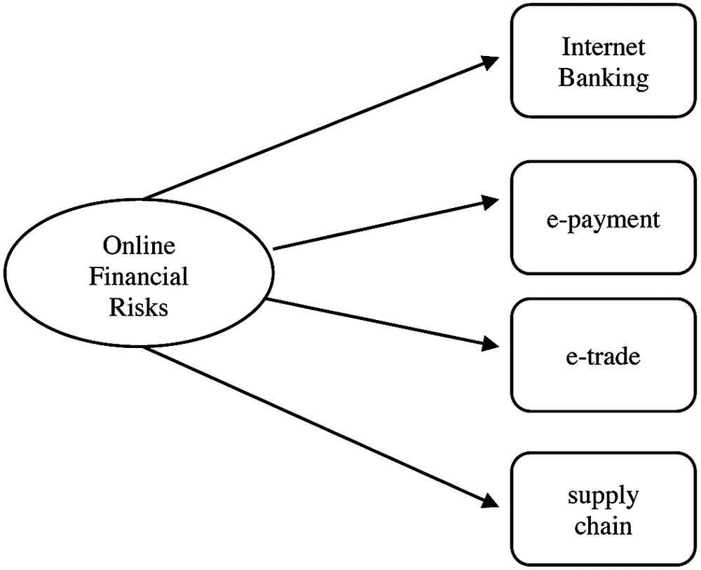 |

网络风险是一类包括企业 IT 基础设施的任何意外技术故障，或针对此类基础设施的任何网络攻击，导致可能的财务损失和品牌价值损害。网络风险通常分为两类进行分析（Felici, 2012）：

* `1st Party Risks`
* `3rd Party Risks`

通常情况下，`1st Party Risks` 包括针对企业的网络攻击导致的数据损坏或数据盗取，以及网络攻击对企业收入的任何不利影响。在分类为 `1st Party Risks` 的风险中，由于数据盗取、数据泄露或病毒可能风险如下：

* 数据丢失
* 软件错误
* 为了解锁被黑客加密的数据而提出的索金要求
* 与网络故障相关的任何损害
* 被删除或操纵的企业数据
* 运营停止和/或减缓
* 泄露被盗数据涉及的风险
* 声誉损害

另一方面，`3rd Party Risks` 是涉及除保险人以外受网络攻击影响的人员和企业。此类风险可能包括受数据泄露或其他网络犯罪影响的第三方向被保险人提出的任何诉讼行为或索赔。网络责任保险保单必须同时涵盖 `1st` 和 `3rd Party Risks` 风险才更具优势。分类为 `3rd Party Risks` 的风险包括如下：

* 安全和隐私泄露
* 隐私泄露调查
* 客户通知/公关费用
* 多媒体责任
* 第三方数据丢失
* 第三方合同赔赔偿

遗憾的是，我们尚无法提供一种永久消除网络风险的解决方案。因此，企业对于决定哪些网络风险必须被缓解是一项重要的讨论。今天，许多公司根据对某些漏洞造成的损害的分析来做出决策。通常情况下，无法明确建议所采取的措施是否能够防御网络威胁，更不用说它们所提供的保护程度了（INSA, 2009）。

当解释和分析为了缓解不断变化的网络风险而进行的投资收益是如此困难时，如何在该领域进行投资？在数据泄露发生之前，要计算与之相关的物质损失是非常困难的。企业通常使用它们应用于其他风险的方法——侧重于采取行动以尽量减少收入损失——来应对网络风险。然而，在进行有效分析时，可以针对网络威胁和网络风险采取必要的行动。

声誉是企业拥有的最重要的资产之一，而且是最难保护的资产之一。与即时损害相比，品牌价值的任何损害对公司来说都重要得多。原因是品牌价值的任何损害都意味着长期收入损失。因此，网络风险分析和采取此类风险的措施对经理来说至关重要。任何缓解网络风险的措施可能防止数百万美元的损失。

网络风险分析的第一步涉及识别公司拥的重要资产以及与这些资产相关的漏洞。网络攻击的任何损害可能以收入损失的形式或取证信息分析产生的费用的形式出现。当网络犯罪分子获取关键数据时，客户信任的损失可能被证明是巨大的（Grauman, 2012）。

## 网络防御机制

个人数据盗取及其恶意使用、关键流程的阻塞或中断、组织会给经济带来负担的网络攻击、国家机密被窃或被盗数据的泄露只是网络攻击的类型类型，其数量每天都在增加。个人、商界和国有企业使用技术设备存储或传输其知识产权、经济或个人数据。众周知，如果数据在此过程中被损坏或未传输，此类数据传输可能会导致巨大的经济损失或声誉损害（BTK, 2014）。

对范围内范围的进一步观察显示，存在许多不同的金融安全机制，且企业软件差异巨大；一些国家非常重视他们的做法并在这方面做了大量工作，而另一些国家甚至未能建立最基础的企业结构。简而言之，我们无法谈论各国在实践标准化方面存在共识。例如，在南非共和国，存款保护（一个非常基本的金融安全因素）的规则尚未由当局明确定义。

另一方面，其他一些国家倾向于为每个重要因素建立一个独立的机构，而一些国家将许多任务整合到一个单一机构的伞下。然而，最常见的做法是成立一个负责洗钱调查、系统性和网络安全风险调查的机构。


虽然一些国家认为没有必要设立央行定义的流动性窗口，但西班牙、希腊等国家倾向于从国际组织（例如国际货币基金组织、欧盟委员会、AMB-SSM）贷款，作为回报，这导致它们受到这些组织的严密监督和控制。排除新加坡等极端国家不谈，这些国家在资产数量和规模上从不欢迎超过特定阈值的外国银行。这一点同样适用于影子银行系统（Yeşilyurt, 2015）。

尽管某些国家按季度、每半年或每年进行一次压力测试和场景分析，但另一些国家选择完全不进行此类分析，或者随机进行。在许多国家，项目融资（尤其是基础设施、电力、信息、电信、国防、金融等重要部门）是在特定法规下管理的。可以看出，在美国等严格遵循自由化实践的国家之外，地方当局能够对其他国家的企业施加业务模式。

此外，另一个需要标准化的做法是“信贷收回”，目前正在讨论其功能是作为安全缓冲垫还是经济危机的触发因素。某些国家给予银行足够的灵活性来收回信贷，而另一些国家则严格禁止这种做法（Kendrick, 2010）。有效且平衡的网络防御实践有三个主要特征：安全、警觉和抵抗（www.usom.gov.tr）。

*   **安全 (To be Safe)**：意味着侧重于提供风险防护。在这里，风险从公司及其竞争对手的角度来看涉及企业价值最高的资产。
*   **警觉 (To be Aware)**：意味着提高组织每个层级的意识，并在任何风险行为发生前具备检测与重要资产相关的风险行为的能力。
*   **抵抗 (To be Resistant)**：意味着能够快速响应损害以确保其不影响其他业务，并能够必要且多种工具最大限度地减少涉及直接成本、工作量损失、声誉损害和品牌价值损失的损失。

结论是，可以说任何没有建立必要的金融安全机制、没有将金融安全置于首位、且没有根据过去危机见解启动改革和恢复措施的国家（例如俄罗斯、阿根廷、希腊），都容易受到严重的经济和金融危机。

# 土耳其银行业中的电子与网络风险

对土耳其运营的银行实施其自动化系统和备份位于土耳其规定是一项安全措施，涵盖了金融安全以及作为子领域的电子和网络安全。根据 2010 年 6 月 1 日发布的《银行内部系统条例》修正案，在土耳其运营的银行有义务将其主备 IT 系统位于土耳其。取代上述条例的《银行内部系统及银行资本充足率衡量与评估条例》在第 11 条第 4 款保留了相同的规定。因此，银行要求其主系统和次要（备份）系统均位于土耳其（http://www.usom.gov.tr/）。

土耳其银行系统的成员最通常从国外购买必要的电子商务和其他在线金融网络安全软件。这里的关键点是，网络安全软件是从网上购买的，不受任何控制，这与汽车、制药等部门购买的产品执行的程序形成对比。其他领域使用的程序在网络安全软件供应链中被忽视，这为网络安全带来了重大风险。

国家网络安全协调基金根据 2012 年 10 月 20 日在《公报》上发布的《国家网络安全事务执行与协调法令》成立。该法令的第 4 项写道：“本基金成员将负责定义与网络安全相关的采取措施、批准计划和方案、报告原则和标准，并协调此类功能的应用”。该基金由交通、海事和通信部部长指定的部门和国有企业高管，以及由特定部门指派的官员、交通、海事和通信部长领导下的国有企业组成（BTK, 2014）。

随着鼓励国有企业合作的决定，所有国有企业遵守部里为了国家网络安全而发布的计划、方案、原则和标准变得至关重要。该法令的另一个重要组成是鼓励本地开发的国家网络安全解决方案。另一方面，国家网络安全在货币资源规划和分配中占据优先地位，作为一个原则为该领域的研究铺平了道路。

土耳其政府发布了网络安全战略和行动计划。以下是为了确保国家网络安全需要考虑的原则（http://www.udhb.gov.tr/doc/siberg/2016-2019guvenlik.pdf）：

*   1. 网络安全只有通过基于风险管理的有效持续改进的方法才能实现。
*   2. 采取整合方法，从技术、法律、行政、经济、政治和社会方面定义优劣势、威胁和机会。
*   3. 风险管理基于这样一个原则：通过消除技术漏洞和防止攻击与威胁来最大限度地减少可能损害。
*   4. 广泛期望个人、企业、社会和国家履行所有法律和社会责任以确保网络安全。
*   5. 私营部门的充分合作及其参与决策机制对于确保关键基础设施的保护是必要的。
*   6. 除了国家、私营部门、学术界和政府组织的合作外，国际合作和信息共享是网络安全及其可持续性的关键。
*   7. 不断且高效地利用外交、技术和执法渠道是国际合作和信息共享的基础。
*   8. 在讨论必要立法时，会考虑国际协议和法规。
*   9. 法治、基本人权和隐私保护是采纳的原则之一。
*   10. 在网络环境中支持透明度、问责制、价值观和言论自由。
*   11. 安全性和可用性之间存在微妙平衡。
*   12. 监管和监测机构确保在其负责的领域提供网络安全保障。
*   13. 推广使用本地产品和服务以满足网络安全需求；支持研发项目以开发此类本地产品，并建立创新意识。


对于银行在土耳其实施网络攻击的行为，有多种处罚措施。以任何方式扣留或持有他人银行卡或信用卡的人，将处以三至六年的有期监禁；如果其在未获得持卡人或当事人请求的情况下使用或利用卡片获利，还将没收非法所得。以欺诈或欺诈方式使用银行卡或信用卡损害自己或他人利益，若未触犯其他严厉处罚的罪，将处以最高四年的有期监禁。

# 银行网络风险管理

网络风险管理的成功取决于首席执行官（CEO）。每位高级高管的角色也非常重要。然而，最重要的一点是，所有高层管理者及其所属部门需要在完美的沟通与合作下开展风险管理活动。尽管银行面临的网络犯罪风险多种多样，但可以通过少数步骤降低网络犯罪风险。银行为了管理网络风险，必须采取以下措施（`http://www.sigortacigazetesi.com.tr`）：

* 1. 提高网络风险意识
* 2. 限制数据备份和访问
* 3. 利用防止数据泄露的系统
* 4. 识别网络风险管理策略
* 5. 获取网络保险。

为了防范网络攻击，银行必须首先提高组织内部对网络威胁和安全的意识。有效的风险管理从经理延伸到顾问。所有员工都应该意识到保护数据隐私和维护数据的责任。为了计算银行面临的威胁规模，你必须首先确定敏感数据的数量。备份文件可以防止攻击发生时的数据丢失。同样，让尽可能少的人接触敏感数据，也能降低风险（Randazzo et al., 2005）。

使用防止数据泄露的系统，特别是入侵检测系统。确保这些系统得到持续监控和更新。对于公司员工，在发生此类事件时立即意识到情况并采取行动，以及防止数据泄露也至关重要。银行必须具备有效的网络风险管理策略。该策略应详细说明银行面临的各类网络威胁、潜在损害、防止攻击采取的预防措施、发生攻击时应采取的步骤以及任务归属。

准备和防护非常重要，但没有任何预防措施能对网络攻击提供 100% 的保护。仅依靠技术和组织实践是无法保护你的数据的。获取能够最大限度减少网络攻击影响的网络损失保险解决方案。每家公司的需求、所属行业以及规模因风险而异。因此，网络保险解决方案必须是定制的。

# 网络保险

许多保险公司多年来一直投资安全工具和流程；然而，这种投资可能会导致虚假的安全感。由于网络犯罪精通解密和其他网络攻击技术，防火墙、防病毒软件、未经授权访问检测系统和网络攻击防御系统正逐渐失效。结果观察到，许多保险公司正将其有限的资源投入到法规定义的易于识别威胁中，而忽视了可能与更大威胁相关的隐藏性和长期风险。

保险解决方案及其应用在网络风险管理策略中起着重要作用。保险从简单定义上是风险的转移。保险单永远不能替代有效的管理策略。然而，在采取一切合理措施缓解特定风险后，必须购买保险单以确保组织的完全保护。组织的风险管理是一个必须将网络风险转移给保险公司的过程。全球（尤其是西方）的许多经纪人和承保人专门从事网络风险的抵押业务。

网络保险可能涵盖由网络犯罪直接影响造成的损害，也可能涵盖对第三方（客户）造成的任何损害。下表显示了网络风险保险与其他保险类型的对比。

表 1. 网络保险 vs 传统保险

| 业务损失 | 火灾险 | 责任险 | 绑架与赎金 | 滥用权险 | 网络风险保险 |
| :--- | :--- | :--- | :--- | :--- | :--- |
| IT 取证 | X | X | X | + | + |
| 公关咨询费用 | X | X | X | Ɵ | + |
| 律师费 | X | X | X | Ɵ | + |
| 丢失数据的信息收集成本 | Ɵ | X | X | X | + |
| 丢失数据的恢复成本 | Ɵ | X | X | + | + |
| 网络攻击后运营停滞 | X | X | X | Ɵ | + |
| 赎金成本 | X | X | + | X | + |
| 为提供攻击者信息的人发放奖励的费用 | X | X | + | X | Ɵ |

| 第三方损失 | 火灾险 | 责任险 | 绑架与赎金 | 滥用权险 | 网络风险保险 |
| :--- | :--- | :--- | :--- | :--- | :--- |
| 与数据泄露相关的保护成本 | X | + | X | X | + |
| 个人信息披露造成的损害 | X | Ɵ | X | X | + |
| 与违反知识产权相关的损害 | X | Ɵ | X | X | + |
| 与其他系统遭受恶意软件感染相关的损害 | X | Ɵ | X | X | Ɵ |

X: 不包含
+: 包含
Ɵ: 可能通过附加合同包含

网络责任保险保单涵盖了因使用电子数据和互联网产生的多种风险：

### 第一方风险
* 盗窃与欺诈
* 取证查询
* 运营停滞
* 计算机数据丢失及其恢复

### 第三方风险
* 诉讼赔偿
* 通知费用
* 危机管理
* 信用跟踪
* 媒体责任
* 保密责任
* 针对网络风险提供的保险覆盖范围

### 从网络风险的角度看
* 任何因违反知识产权和版权造成的损害，
* 因诽谤和侮辱等行为产生的责任，
* 与恢复因网络犯罪受损的声誉所必要的公关和推广活动相关的任何费用、虚假在线广告产生的任何责任以及违反个人权利的责任，
* 正如之前提到的会计师，为了恢复系统访问权限或恢复被锁数据而支付的任何赎金，
* 因员工疏忽或故意违反隐私（如泄露员工、客户和消费者数据）而可能产生的任何赔偿责任，
* 因网络犯罪导致的第三方披露，以及向相关机构升级情况时所支付的任何费用。

### 从技术风险的角度看
* 对系统、网络和 IT 硬件造成的任何损害（即由于黑客或病毒活动导致不稳定而需要更换的系统和硬件）
* 黑客或病毒活动导致的 IT 系统问题、运营停滞和利润损失、因违反法规和标准的任何损害（例如：罚款）
* 特定条件下的法律保护保险


如上述保单条款的数量和类型所示，网络风险保险领域并没有统一的政策，保险公司发行的包体保单可能会根据被保险人的质量和需求涵盖多项保单条款。因此，有必要进行必要的风险分析，并定义合适的额外保障条款和限额。

正如本研究其他部分提到的，被保险人采取的运营和技术性网络安全措施水平是定义保单内容和成本的重要因素。可以说，让保险专业人士至少具备网络安全技术的专业知识是明智的，因为目前关于该领域记录的损害数据尚不充分。

“网络风险”产品及其保障范围的设计旨在涵盖由第三方提起的诉讼引发的任何损害，以及对业务造成的直接损害（Russell, 1996）。

## 第三方提起的诉讼

*   敏感客户信息的泄露（例如：身份信息、健康记录、信用卡）
*   通过网络、黑客攻击等手段感染其他方的任何病毒
*   媒体责任（因在社交媒体及其他平台侵犯版权引发的诉讼，或分享关于他人的侮辱性内容引发的诉讼）

## 对业务造成的直接损害

*   网络勒索（土耳其位列网络勒索前五。黑客极有可能渗透系统并威胁使其崩溃。）
*   数据损坏（黑客攻击、未经授权的访问、人为错误、软件错误）
*   利润损失（因数据损坏导致运营中断）

## 网络风险保险的免责范围

*   人身伤害和物理资产损坏
*   合同义务
*   雇主责任
*   知识产权
*   故意行为
*   犯罪行为
*   之前的要求和事件
*   竞争
*   基础设施或安全故障

## 损害案例

*   **安全漏洞**：某连锁酒店的防火墙被黑客攻破，由于 60 万名游客的信用卡信息被盗，导致了总计 1000 万美元的损失。
*   **黑客攻击**：由于 150 万用户遭遇黑客攻击且信用卡信息被盗，万事达和 Visa 最大的处理器处理商的股价在四天内下跌了 12%。
*   **盗窃**：一家国际银行在遭受网络攻击后丢失了 4.6 万名客户的信用卡数据，并面临 2750 万英元的罚款。
*   **系统崩溃攻击**：某航空公司因针对其安全网络的攻击，在六小时内无法处理任何请求，导致航班延误，并因票务失败而面临损失。

## 结论

在电子信息管理系统中上传和存储需要保密的敏感报告和文档构成了严重的安全风险。虽然此类技术提供了便利、实用性和可访问性，但可能会损害整个系统。纸质文档的丢失或没收可能导致局部损害，而整个系统的访问可能导致机密关键文件被恶意不受授权的人获取。有必要制定措施来存储关键文件和报告，而不将其整合到电子信息管理系统中。

银行开始更加关注客户忠诚度，为客户提供新产品，并在客户的财务组合中占据更大的份额。这种扩张带来了网络攻击数量的增加。尽管数字化投资提供了新的战略可能性，但对于那些处理多渠道环境经验相对匮乏的企业来说也可能带来新的网络风险。尽管如此，随着银行采用大数据和高级分析应用，这些困难可能会发生。

随着银行家开发出创新的数据分析方法，他们也需要找到新方法来应对网络攻击带来的安全需求。网络犯罪分子意识到银行持有大量关于客户的信息。毫无疑问，此类个人信息会吸引小偷和骗子。针对银行的网络犯罪分子拥有大量的财务资金，这使他们能够利用结合了社交工程的软件来组织网络攻击。

## 参考文献

*   Assaf, D. (2008). Models of Critical Infrastructure. International Journal of Critical Infrastructure, 1.
*   BTK, USOM-CERT. (2014). Siber Güvenliğe İlişkin Temel Bilg
*   Felici, M. (2012). Emerging Technological Risk, Stuart Anderson.
*   Grauman, B. (2012). Cyber-security: The Vexed Question of Global Rules. Security and Defence Agenda.
*   INSA. (2009). Addressing cyber security through public-private partnership - an analysis of existing models
*   Kendrick, R. (2010). Cyber Risks for Business Professionals - A Management Guide.
*   Randazzo, M. R., Keeney, M., Kowalski, E., Cappelli, D., & Moore, A. (2005). Insider Threat Study: Illicit Cyber Activity in The Banking And Finance Sector.
*   Russell, D. (1996). Insuring the Bottom Line: How to Protect Your Business From Liabilities, Catastrophes, and Other Business Risks.
*   Yeşilyurt, H. (2015). Cyber Security Risks and Solutions in The Financial Services Sector: Payment Systems And Supply Chain Integrity. CBÜ Sosyal Bilimler Dergisi.

## 术语与定义

*   **关键基础设施系统**：一旦遭到破坏，可能导致公共秩序混乱、人员损失、经济损失等的任何系统。
*   **网络媒体**：连接到全球及轨道可用 IT 系统和网络的媒体。
*   **网络安全案件**：对信息系统中处理的信息的访问和机密性的违规。


## 定义

**黑客**：未经授权访问个人计算机，或公司计算机及网络的人员。简单来说，黑客试图利用数字世界的安全漏洞来获取经济利益。

**黑客行为**：未经授权访问系统中的机密数据。这是一种绕过系统管理员渗透系统的行为。

**法律实体与自然实体的信息系统**：任何根据土耳其共和国法律，由法律实体或自然实体运营的任何系统。

**IT 系统**：也称为信息和通信技术系统。这是提供所有流程和服务的系统。

**国家网络媒体**：任何由法律实体或自然实体运营的、且具有国家公共信息系统性质的信息系统。

**国有信息系统**：任何由土耳其国家及其企业拥有的信息系统。

# 第 4 章

## 作为增强型访问控制机会的区块链技术

* **Hugo Santos Martins** - 葡萄牙利斯本大学
* **Sérgio Guerreiro** - 葡萄牙利斯本大学

## 摘要

现代、复杂且分布式的环境对数据访问控制的需求，与经典访问控制解决方案能够满足这些需求的程度之间，差距日益扩大。本章的目的是强调现有在日益去中心化的环境中访问控制研究的现状，并论证访问控制主题比以往任何时候都更具相关性，同时涌现出越来越多的研究机会。在本章中，作者分析了去中心化应用（重点关注企业生态系统）中访问控制机制和系统的现状，分析了新技术格局带来的当前挑战与机遇（特别是基于区块链的技术在访问控制中的应用），并为未来提出了新的研究方向。

## 引言

自数字时代早期以来，访问控制一直是研究课题，从 20 世纪 70 年代进行的关于分时系统系统（如 `ADEPT-50`，Weissman, 1969）的研究（Graham & Denning, 1972; Bell & LaPadula, 1973; Lampson, 1974），到云计算（Yu, Wang, Ren, & Lou, 2010; Wang, Liu, & Wu, 2010; Wan, Liu, & Deng, 2012; Ruj, Nayak, & Stojmenovic, 2011），以及最近的物联网（`IoT`）生态系统（Ouaddah, Mousannif, Abou Elkalam, & Ait Ouahman, 2017; Dorri, Kanhere, & Jurdak, 2016）。然而，由于行业不断进步，这仍然是一个具有无限研究机会的课题。

尽管该领域已过深度研究，但由于近期频繁发生的数据泄露事件（Burgess, 2017; Lieber, 2017; The Guardian, n.d.）以及物联网设备和云服务的兴起，人们对其重要性的感知日益增强。日益复杂和分布的技术生态系统，随着用户数量的增加，对访问控制主题及其管理提出了不同的方法。随着信息和资源日益分散在世界各地，分布在高功能计算能力的分布式集群中，对当前访问控制方法的的新挑战正不断出现。在一个每天产生海量数据的数字化世界中，加强和适应访问控制机制已成为一种性。

对访问控制解决方案的调查发现，目前的系统要么是集化的且缺乏实现，要么侧重于 `IoT` 或云服务，要么高度依赖于集化的`密钥分发中心`（Ruj, Nayak, & Stojmenovic, 2011; Wang, Liu, & Wu, 2010; Wan, Liu, & Deng, 2012）。访问控制研究的许多工作对于现代应用来说已经过时（Satyananan, 1989; Karger, 1977），或者纯粹是理论（Thomas & Sandhu, 1993）。

上述段落旨在说明，尽管访问控制此前已被广泛研究，但行业不断对其核心概念和机制提出了新挑战。本章旨在分析并介绍复杂的高度分布式、日益去中心化的生态系统中访问控制的现状，以及这些环境带来的挑战和新涌现的研究机会。在去中心化应用和分布式应用之间设定界限是重要的。这将有助于深入理解本章提出的概念。

从这个意义上说，分布式系统是指在地理、物理或虚拟上分布的系统，但可能仍保持集中的权威元素；而去中心化系统是指不具备集中权威元素的系统，每个元素本身都是权威，通过共识协议与其他通信来协调整个系统的状态（Castro & Liskov, 1999）。在这种情况下，去中心化系统本质上是分布式的，但分布式系统并不必然是去中心化的。

本章首先分析了访问控制系统的现状，重点关注去中心化和分布式生态系统，并对现有的区块链文献进行了简要介绍。尽管企业面临风险，但技术创新也带来了新的挑战和企业可以利用的潜在机会。此外，本章还涵盖了全球访问控制必须面临的技术挑战和风险，这些风险源于攻击和攻击向量数量的增加、日益复杂的去中心化生态系统，以及访问控制系统和解决方案人才的短缺。

作者还讨论了新技术的潜力与创新，例如区块链技术在增强访问控制系统中的应用，以及全球企业访问控制，这将成为访问控制管理、审计和安全性的转折点——以及企业如何利用这些新进展来改进其运营。


作为一个典型的例子，基于区块链的技术（Nakamoto, 2008; Buterin, 2013; Wood, 2014）和业务——一种颠覆性的技术创新——为个人和组织在医疗保健、公共管理或金融服务等多元化行业中，增强安全性和去中心化方面提供了了令人兴奋的新视角。尽管全球对区块链相关技术潜力的认知日益增强，但专业知识仍然匮乏。这种短缺阻碍了这种颠覆性技术创新转化为实际应用的潜力，而这些应用能够缓解当今日益严苛的技术背景所带来的安全和业务风险。

总之，本章的目标有三个方面。作者意图分析去中心化应用中访问控制机制和系统的现状，分析新技术格局在该领域带来的当前挑战与机遇，最后为未来的研究提出新的研究方向。

## 背景

本章的目的是综述访问控制和区块链研究领域的现有文献。同时，我们希望将问题陈述置于现有的学术文献背景中。重要的一点是，通过这一回顾，使访问控制领域已建立的知识及其优缺点变得更加清晰。后一部分还对区块链技术进行了综述，以确定该技术的现有文献、用例和潜力。

## 访问控制

访问控制是一个经过彻底研究的领域。自 20 世纪 50 年代末和 60 年代初以来（最初是为了军事目的），访问控制一直通过各种方法进行研究——从理论方法到基于实现的研究。在最初以军事为中心的研究之后，访问控制在 20 世纪 70 年代和 80 年代开始针对商业应用的和解决方案进行更深的研究。随着互联网的出现，新的令人兴奋的可能性也随之出现，访问控制面临着新的挑战。今天，由于技术渗透到几乎的所有领域，访问控制在日益广泛的领域仍然面临着挑战和新机遇。

从计算机时代的黎明到互联网热潮到数字转型时代，物理或数字的访问控制一直是关键组成部分。现有的学术文献非常广泛，从集中式到去中心化的系统，从多样的访问控制模型到访问控制与信任管理主题的不同方法。本节旨在阐明访问控制领域的现状，特别是关于本章研究的对象。

### 任意访问控制

访问控制的基石方法之一是任意访问控制（Discretionary Access Control, DAC），这种方法的特点是允许为主体和资源动态定义访问控制策略。在大多数 DAC 模型中，只识别出两个元素：主体和对象。在 DAC 中，策略执行通过比较主体及其关联组与资源的组权限来实现。换句话说，通过执行验证来回答以下问题：主体（或主体所属的组）是否被允许访问特定资源？Biba 对任意访问控制（Biba, 1977），或当时所知的完整性策略的定义如下：

((..)，一种任意策略是指保护措施可以由用户动态定义（在对象存在期间）的策略。(p. 23)

迄今为止所开发的研究侧重于分析当前现有的访问控制模型。访问控制列表（`ACLs`）是实现访问控制策略的基础模型之一，它依赖于定义了允许访问特定对象的主体的列表。通过这些列表，每当请求访问对象时，通过查找列表包含的信息，就可以动态实现策略执行。与 `ACLs` 对应的是另一个相关的概念模型，称为访问矩阵（Access Matrix）。Graham 和 Denning (1972) 以及 Lampson (1974) 开发了关于该模型的早期研究，随后由 Harrison、Ruzzo 和 Ullman (1976) 进一步开发。

访问矩阵由一个由对象对象和主体组成的矩阵定义——主体可以被访问域或组替换——该矩阵定义了系统的访问控制策略。在策略执行期间，如果主体与对象之间的交集带有允许访问该对象的策略，则允许访问该对象。可以找到访问矩阵的不同实现方式（Graham & Denning, 1972; Lampson, 1974; Harrison, Ruzzo, & Ullman, 1976），其中 Harrison、Ruzzo 和 Ullman (1976) 被称为 Harrison-Ruzzo-Ullman（`HRU`）模型。

最后，在十多年后又提出了另一个相关模型（Sandhu, 1992）。类型访问矩阵（Typed Access Matrix, Sandhu, 1992）代表了从 `HRU` 模型的演变，旨在为访问矩阵概念提供更广泛的应用。`HRU` 的定义在执行策略时存在一组不可判定的情况，这导致其作为访问控制模型存在脆弱性。Sandhu (1992) 指出，“大多数具有实际意义的安全策略都属于 `HRU` 的不可判定情况”（p. 122），这促成了 `TAM` 的开发。`TAM` 基于之前的研究（Sandhu, 1988; Sandhu, 1992），并且比之前的研究（Harrison, Ruzzo, & Ullman, 1976）更安全且更具表达力。

任意访问控制的早期实现可以在 `MULTICS`（Organick, 1972）和 `ADEPT-50`（Weissman, 1969）等系统中找到，这些具有具有特定的上下文和实现。

### 强制访问控制

在另一个研究方向上，Denning (1976) 提出了一种基于格（lattice）概念的安全信息流数学模型，目的是保证系统间信息传输的安全性。格允许定义绑定到对象和主体的类。仅此即可有效地在特定系统中定义访问控制策略。这些安全类分别对对象和主体定义并绑定，允许在策略执行时进行必要的验证。

基于格的模型中的策略执行是通过比较与主体相关的安全类与对象的安全类来完成的——只有当主体的安全类允许其访问该对象时，才允许访问。这项研究最初是为军事应用开发的，如果考虑军事许可的概念，就能被地理解。Denning (1976) 为初始基于格的访问控制提供了正式定义，该模型后来得到了改进和解释（Sandhu, 1993）。

在同一项研究中，基于格的访问控制的影响被描述为：

同时必须承认，基于格的方法没有为信息流策略提供完整的解决方案，更不用说通用的安全策略。换句话之，基于格的方法只是计算机安全的成分之一，尽管是一个非常重要的成分。(p. 19)


这有助于理解访问控制模型及其解决方案的变动性。随着新技术和新系统的出现，新的访问控制挑战也随之产生。基于格的访问控制（Lattice-based Access Control）只是访问控制方法中的一种，该方法被定义为强制访问控制（`MAC`）。`MAC` 可以定义为一种将访问控制策略嵌入系统内部而非外部来源的访问控制方法。这种方法与 `DAC` 的不同之处在于，在大多数实现中它的灵活性较低但安全性更高，并且本质上是静态的。尽管如此，与 `DAC` 一样，`MAC` 依赖两个元素——主体和对象，并为每个元素关联了安全类。对 `MAC` 的早期研究也侧重于军事应用。Biba (1977) 将强制完整性策略定义为：

> (...) 一种保护策略，一旦对对象定义，就是不可更改的，并且必须满足系统所有的状态（只要对象存在）。(p. 23)

除了 Denning (1976) 外，`MAC` 的相关模型还由 Sandhu (1993) 进一步解释和分析，包括 Bell-LaPadula 模型（`Bell & LaPadula`，1973，该模型在 Denning (1976) 之前已正式定义）以及 Biba 模型（Biba, 1977）。Sandhu (1993) 开始从商业角度而非纯粹的军事角度研究访问控制，特别是针对基于格的访问控制。

## 基于角色的访问控制

随着对访问控制商业解决方案需求的日益增加，新的方法开始出现。Ferraiolo 和 Kuhn (1992) 进行的研究开发出了一种新的访问控制模型——基于角色的访问控制（`RBAC`）——这相对于之前分析的现有 `MAC` 和 `DAC` 模型代表了重大的演进。`RBAC` 在访问控制中引入了“角色”的概念，作为对象和主体之间的中间抽象。在 `RBAC` 中，策略定义由三个元素组成：主体、对象和角色。从这个意义上说，`RBAC` 与上述解决方案的已经不同。在 `RBAC` 中，角色的定义取决于函数，例如员工的职称。每个主体被分配一个角色，每个对象被允许访问一组角色。在策略执行期间，执行的验证是主体是否为对象允许访问的定义角色成员。

`RBAC` 使策略管理变得更加简单，并且更适用于以商业为导向的应用系统，而不是为了开发访问控制而开发的军事应用。这种适用性的原因在于组织通常的结构。组织与军事不同，员工被分配了特定的业务角色和功能。这些角色携带了一系列任务和权限，每个分配到该角色的员工都具备这些权限。组织可以轻松拥有数十、数百或数千名员工，这使得在个人层面管理策略变得极其困难。通过将个人员工抽象为一组角色，所需的定义集合急剧减少。

`RBAC` 最初作为访问控制的 `MAC` 方法的一部分提出的，但它迅速传播开来，不仅作为一种模型，而是作为一种完全全新的访问控制方法。Sandhu、Coyne、Feinstein 和 Youman (1996) 对之前的 `RBAC` 定义进行了分析，提出了一系列 `RBAC` 参考模型，通常命名为 `RBAC96`——有效地整合了这种新的访问控制方法。这项研究通过在最初的 `RBAC` 定义（Ferraiolo & Kuhn, 1992）基础上增加角色层次结构和约束的概念，将其呈现为演进。

Sandhu、Coyne、Feinstein 和 Youman (1996) 提出的早期 `RBAC` 参考模型包含：

* `RBAC0`: 基础 `RBAC`。
* `RBAC1`: `RBAC0` + 角色层次结构。
* `RBAC2`: `RBAC0` + 约束。
* `RBAC3`: `RBAC1` + RBAC2。

自 `RBAC` 引入以来，对 `RBAC` 模型的分析和增强不断产生，涵盖了更广泛的商业应用。将时间约束引入 `RBAC` 的研究产生于 Bertino, Ferrari 和 Samarati (1998) 以及 Bertino, Ferrari 和 Samarati (1996)。更正式的模型后来被定义为时间角色访问控制（`TRAC`）（Bonatti & Ferrari, 2000）。Bonatti、Galdi 和 Torres (2013) 提出了企业级角色访问控制（`ERBAC`）。Covington、Moyer 和 Ahamad (2000) 通过增加角色类型化的概念，对 `RBAC` 模型进行了演进——广义角色访问控制（`GRBAC`）。团队访问控制（`TMAC`）（Thomas, 1997）作为协作环境中基于角色的访问控制的一种被提出。Ray、Kumar 和 Yu (2006) 引入了 `RBAC` 的另一个变体——位置感知角色访问控制（`LRBAC`），其特点是引入了位置数据以增加安全性。这种模型从早期的研究（Damiani, Bertino, Catania & Perlasca, 2007）演变为 `GEO-RBAC`。Osborn、Sandhu 和 Munawer (2000) 展示了 RBAC 创建的构造如何应用于使用 `MAC` 或 `DAC` 的系统。这项研究的相关性在于，可以将遗留的 `DAC` 或 `MAC` 配置转换为基于 `RBAC` 的访问控制。

## 基于属性的访问控制

除了 `DAC`、`MAC` 和 `RBAC` 之外，另一种相关的访问控制方法是基于属性的访问控制（`ABAC`）。在 `ABAC` 中，与上述其他方法不同，访问控制通过包含一个特定的元素——属性（除主体、对象和角色之外）来提供。`ABAC` 在策略定义和执行中都利用主体和对象属性（或环境属性）。属性在访问控制策略定义和执行中的增加了策略的表达能力，并允许基于动态数据执行策略。

最近，Hu 等人 (2014) 提出旨在统一 `ABAC` 定义并分析组织中 `ABAC` 实现考虑因素的指南。在该研究中，`ABAC` 的优点定义如下：

* `ABAC` 避免了显式地为主体分配授权，减轻了访问管理的负担。
* 在复杂环境中更具灵活性，那里 ACL 或 `RBAC` 可能过于复杂且难以管理。
* 考虑来自多个不同输入的细粒度访问控制。

`ABAC` 也是 Wang、Wijesekera 和 Jajodia (2004)、Cruz、Gjomemo、Lin 和 Orsini (2008) 以及 Yuan & Tong (2005)的研究课题，对 `ABAC` 提出了若干非正式定义。在 Hu 等人 (2014) 中，`ABAC` 的定义如下：

> 一种访问控制方法，根据分配的主体属性、分配的对象属性、环境条件以及根据这些属性和条件指定的策略集，来授予或拒绝主体对对象的操作请求。(p. 7)


目前还没有像针对 `DAC`、`MAC` 和 `RBAC` 那样成熟的 `ABAC` 模型。尽管如此，Jin, Krishnan 和 Sandhu (2012) 尝试通过提出一种“统一”的 `ABAC` 模型来克服这一挑战，该模型能够涵盖 `DAC`、`MAC` 和 `RBAC` 的访问控制实现。他们他们他们证明了 `ABAC` 是一种适用于新兴技术和环境的方法，同时它也可以用于需要增强功能和细粒度解决方案的遗留实现。尽管如此，针对该方法已进行了其他研究（Zhang, Li, & Nalla, 2005），并提出了一种具有属性能力的模型来增强前面章节描述的访问矩阵模型。

## 分布式访问控制

分布式系统访问控制的研究自分布式系统通过网格计算、云计算和云系统的早期发展以来已经跨越了数十年。在去中心化环境访问控制领域开发的的一些早期研究（Karger, 1977）包含了目前的大部分知识。与关于访问控制模型的初始研究一样，Karger (1977) 提出了在去中心化系统中应用 `MAC` 时面临的挑战。他意识到，并非所有在集中式系统中保证访问控制的算法都能轻松映射到去中心化系统，因此提出了一种基于格的访问控制模型的新方法，该模型可以用于去中心化系统。

Moffett, Sloman 和 Twidle (1990) 提出了一种在分布式系统中实现自主访问控制的规范规范。在这项研究中，引入了域（domains）、对象组和访问规则的概念，作为一种帮助在高度分布式且复杂的系统中管理访问控制的方法。这项工作部分演变自 Satyanarayanan (1989) 关于复杂分布式系统安全的研究。对 Andrew 系统的研究（Satyanarayanan, 1989）探索了如何在复杂分布式系统中引入访问控制。Sandhu 和 Suri (1992) 对 Sandhu 初始的 `Typed Access Matrix`（类型访问矩阵）模型（Sandhu, 1992）进行了增强。这项研究提出了一种名为 `SO-TAM` 的更简单的 `TAM`，它使得在分布式环境中更容易实现 `Typed Access Matrix`，并演示了数字证书在访问控制中的用法。

Johnston, Mudumbai 和 Thompson (1998) 提出了一种分布式系统访问控制机制。所描述的系统利用数字证书的研究和能力来实现分布式系统中的访问控制。这项研究代表了分布式系统访问控制领域的演变，并重新验证了其相关性。Sandhu 和 Park (1998) 提出了基于 Web 的系统中 `RBAC` 模型中访问控制管理的去中心化。这项研究提供了一种尝试去中心化访问控制管理方法，但它仍然没有去中心化访问控制后的策略引擎。Sandhu 和 Park (1998) 是对之前规范（Barkley, Cincotta, Ferraiolo, Gavrila, & Kuhn, 1997）的增强。所提出的研究（Sandhu & Park, 1998）通过使用 `X.509` 证书（Park & Sandhu, 1999）演进而来，Park, Sandhu 和 Ahn (2001) 回过审视了这项研究。

Harrington 和 Jensen (2003) 注意到访问控制领域的主要问题之一是访问控制领域的主要问题之一（2003）。


Nakamoto (2008) 提出了本质上去中心化的公共交易账本的概念。针对这一主题的进一步研究（Buterin, 2013）创建了以太坊项目，Wood (2014) 对其进行了进一步讨论。最近，Garay, Kiayias 和 Leonardos (2015) 对 Nakamoto (2008) 提出的研究进行了深度分析，阐明了“比特币协议”的正式组成部分，并建议未来的研究方向包括在该协议和公共账本之上构建其他类型的应用。Eyal, Gencer, Sirer 和 Van Renesse (2016) 提出了一种新的区块链协议，以改进 Nakamoto (2008) 之前的工作。

## 应用与实现

Dorri, Kanhere 和 Jurdak (2016) 提议使用区块链来提高物联网（IoT）设备的安全性。Fotiou 和 Polyzos (2016) 展示了如何将区块链作为内容分去中心化安全系统的骨干。Xu 等人 (2016) 探索了将区块链作为大型、去中心化且面向不可信参与者的交易数据共享环境骨干的原理、其权衡和特性。Ouaddah, Mousannif, Abou Elkalam 和 Ait Ouahman (2017) 提供了关于物联网设备访问控制的最新综述，其中未来的研究方向是将区块链作为物联网访问控制基础设施的可能。

最近，Augot, Chabanne 和 George (2017) 提出了一种在比特币区块链上进行身份管理的方法。Maesa, Ricci 和 Mori (2017) 基于之前的研究（Maesa, Mori, & Ricci, 2017），提出了一种运行在区块链之上的分布式访问控制系统。Pilkington (2015) 还对涉及区块链的概念以及一些可能的应用（包括访问控制应用）进行了分析。

## 企业级访问控制的挑战与风险

本章的上一节侧重于对现有访问控制文献进行文献综述，但同时也涵盖了后续章节中将进一步讨论的新技术范式和研究。在本节中，作者将回顾访问控制领域存在的当前挑战和风险，特别是关于去中心化环境的挑战。将对技术挑战和风险进行分析，并在描述的每个挑战或风险中给出示例和用例。本节旨在揭示在当前的技术格局下，对数据访问控制的缺乏以及网络安全专的匮乏是如何导致全球数字风险增加的。

技术挑战和风险是任何数字环境中固有的。没有一种解决方案是完美的，总会有需要克服的挑战和需要缓解的风险。尽管如此，在开发访问控制系统和策略或设计执行机制时，对当前的挑战和风险进行分析是至关重要的。详细的分析将使人们更深入地理解所提出的解决方案和未来的研究方向如何适应当前的挑战和风险。这些挑战中的每一个都有其自身的相关性，但更重要的是，它们共同成了企业风险增加的根源。虽然并非所有问题都能直接归因于网络安全人才的短缺，但这种短缺直接导致了应对这些事件的能力下降。

在日益数字化的世界中，企业之间环环相扣，我们必须解决数据访问控制缺失以及网络安全专家短缺的问题。这导致了全球数字风险的增加。在日益数字化的世界中，企业之间环环相扣，我们必须解决数据访问控制缺失以及网络安全专家短缺的问题。这导致了全球数字风险的增加。

## 新兴技术

在过去的几十年里，通过人工智能、物联网、自动驾驶汽车、加密货币、区块链、社交网络、智能手机、云计算、服务、增强现实和虚拟现实，技术格局一直处于不断的变革之中。这些都是将各种形式出现的新兴技术。每种技术都带有日益增加的风险。尽管如此，我们可以预计随着全球安全专业人员的短缺，风险挑战将会增加。

这是目前访问控制面临的最大挑战之一。新技术的出现速度将带来挑战和风险。访问控制研究需要适应和演进，以便有效地保护并与这些新技术集成。正如之前的研究描述的（例如 Ouaddah, Mousannif, Abou Elkalam, & Ait Ouahman, 2017），现代访问控制方法应该关注“许多且多样化的方法”（第 242 页），而不是“一刀切的方法”（第 242 页）。只有这样，访问控制才能适应不断增加的技术。

物联网是目前这种情况最有趣的例子之一。最近，高度复杂的僵尸网络——例如 Mirai 僵尸网络——被用于连接数百万物联网设备来增加网络攻击的威力和规模，这些设备很大程度上是不安全的，并由缺乏自我保护知识的用户管理。由于物联网设备是复杂的分布式的、设备之间大多相互独立，且在不限制用户远程访问功能的情况下很难保护每个设备，因此，如何保护物联网设备是目前访问控制领域最有趣的问题之一。

同样，自动驾驶汽车是另一个需要保护的复杂设备。总而言之，自动驾驶汽车与物联网设备非常相似，它可以被看作是一个分布式节点，在安全方面不由其用户管理，因此暴露在类似的攻击向量之下，并与物联网设备面临相同的保护挑战。

## 缺乏标准

正如上面节描述的，访问控制研究也需要能够接受并定义新标准，以确保有效。这与之前引用的研究并不矛盾，而是有效应对日益增加的新兴的方法之一。


这一观点的理由是，随着这么多新兴技术的出现，人们越来越需要拥抱标准化，以避免对同一问题出现冲突的解决方案，同时为每个特定案例提供标准的处理方法。之前提到的每种访问控制类型（`DAC`、`MAC`、`RBAC` 和 `ABAC`）其创建都是为了在不同背景下标准化解决访问控制某些问题的方法。

最近，业界致力于整合基于属性的访问控制（ABAC）的现有知识并提供统一的定义（Hu 等人，2014）。尽管如此，仍需在全球范围内采纳这些标准，因为行业尚未跟上这些模型。

## 策略管理的缺乏活性与策略执行的不有效

Bauer、Cranor、Reeder、Reiter 和 Vaniea (2009) 在一份关于访问控制管理现有现实挑战的报告中发现，利益相关者提到的一些大问题之一是访问控制软件缺乏活性。目前的访问控制系统并非针对现有格局设计的，因此在完全使用时会导致劳动力生产力下降、策略设计和实施错误，或系统正确使用率降低。正如 Bauer、Cranor、Reeder、Reiter 和 Vaniea (2009) 所分析的，目前的工具未能为策略管理提供足够的资源（第 899 页），具体来说：

*   工具难以承认策略大多是由员工中的几位不同成员管理的，而不是由单一实体管理。
*   工具忽略了存在多层策略的事实，因此存在具有不同角色和职责的多个策略专业人员。
*   并非所有的策略定义都能通过现有工具完全执行，这导致策略未能实施或实施错误。

这种策略管理工具的缺乏活性是技术格局日益增加的风险，因为它支持了策略管理工具的错误使用，并强制了这些策略的错误实施。

## 现有访问控制模型的不适用性

正如文献综述所示，访问控制研究目前的趋势之一是当前定义的访问控制模型在这些新范式上的适用性。这是一个挑战，因为当前的访问控制模型花费了数十年的发展，而且对于当前的技术格局正变得越来越无效。

### 动态威胁

对技术系统的潜在威胁日益具有动态性，并依赖于环境的不同方面，这主要是由于技术系统本身已变得越来越分布式和动态化。目前的威胁不再是静态的，它们会随着环境不断演变和修改。这为访问控制带来了新的挑战性风险，因为访问控制不能再依赖于一组静态的对象和主体。

### 格局复杂性、去中心化与创新

随着新技术的出现，我们也见证了技术格局日益增长复杂性、去中心化和创新。新方法正在成为标准，而旧标准变得无关。基础设施变得越来越重要，随着 `DevOps`、`Continuous Integration` 和 `Continuous Delivery` 的兴起。格局变得日益分布式，在某些情况下日益去中心化，这为访问控制的实践方式带来了新的挑战。

### 缺乏协作工具

除了策略管理工具缺乏活性外，还缺乏正确且安全地与大多数应用程序所需的访问控制级别集成的协作工具。这导致了访问控制流的损坏（例如下载文件并与同事共享），从而为业务带来了新风险。这种对协作工具的缺乏。

### 攻击向量和数量的增加

在过去的几年中，我们看到攻击向量和数量的增加。由于网络安全专业人员短缺，预计这种情况在未来几年还会恶化。

## 解决方案与建议

作者已经在背景部分从高层次描述了现有文献。在本节中，我们将进行更深层次的分析，以论证基于区块链的技术如何成为解决前述部分访问控制挑战的主要解决方案之一。

### 使用区块链的理由

区块链概念与我们对访问控制所需的特性完美契合：可追溯性、扩展性、可靠性、不可变性和去中心化。通过回顾 `Bitcoin`（`Nakamoto`, 2008）、对 `Ethereum` 的顺序研究（`Buterin`, 2013; `Wood`, 2014）以及大量现有基于区块链的应用（`Pilkington`, 2016; `Augot et al.`, 2017）证明了这一点。我们将在下面描述区块链如何补充这些特性的每一个。

不可变性的保障源于区块链的概念，它是一个区块链，每个区块都与上一个区块连接，从而使得篡改现有数据极其困难（`Nakamoto`, 2008; `Haber & Stornetta`, 1991, 1997; `Bayer et al.`, 1993; `Eyal et al.`, 2016）。追溯性的提高是不可变性的结果。依赖区块链，每笔交易（`Nakamoto`, 2008; `David Chaum`, 1985; `D. Chaum`, 1988; `Merkle`, 1980）都记录在区块链内部且无法被更改。这允许对区块链及其每笔交易进行检查，为环境提供了可追溯性能力。

由于我们正在创建一个所有相互连接并通信的对点去中心化节点网络，使用区块链的网络扩展性得到了增强（`Nakamoto`, 2008; `Castro and Liskov`, 1999）。新节点的添加比中心化解决方案更简单，同样，网络可以增长并适应使用它的主体的数量。由于每个节点都拥有自己的数据库副本并可以作为自身的权威，使用区块链保证了不会出现像中心化解决方案那样的单点故障，从而增强了访问控制的可靠性，并进一步实现了访问控制的去中心化。


从物联网研究开始，Dorri、Kanhere 和 Jurdak (2016) 在一篇立场论文中提出了一种“基于区块链的新型安全、隐私且轻级的物联网架构”（第 1 页），旨在利用区块链技术保护物联网设备。在这项研究中，在智能家居的案例研究下提出了一种理论架构，该架构与区块链交互以确保隐私性并增强安全性。该研究提出的架构利用了类似于点对点网络的覆盖网络，这些网络通过 `Tor` 协议进行连接，以隐藏敏感数据，免受潜在攻击的侵害。

这项研究仅针对一组常见的攻击向量进行了定性评估，以分析其在现实生活中的应用潜力。尽管它面临论文中提到的挑战，例如受到拒绝服务攻击或 51% 攻击的漏洞（即攻击者持有整个网络 50% 以上的份额），但它可以被视为物联网设备和网络中基于区块链的访问控制的起点。从这个意义上说，仍然需要实现结果来进一步验证这类研究。Dorri、Kanhere 和 Jurdak (2016) 提出的观点通过 Ouaddah、Mousannif、Abou Elkalam 和 Ait Ouahman (2017) 进行的一项详尽的技术现状报告得到了进一步验证，其中指出：

> 自主、去中心化架构的发展，以及将主要的安全和访问控制逻辑位于网络的最边缘，是需要解决的问题。（第 257 页）

这项研究进一步验证了以下提议：一种去中心化的访问控制架构（将安全逻辑嵌入到网络边缘）不仅是可能的，而且是理想的。脱离物联网，Fotiou 和 Polyzos (2016) 利用区块链提出了关于内容分发安全性的研究。通过利用基于区块链的技术，Fotiou 和 Polyzos (2016) 能够在去中心化的架构中将内容所有者的参数传播到网络。

这项研究代表了信息内容网络访问控制的演进，通过使用基于区块链的技术克服了数据分发中的挑战。该研究还克服了前述研究中的问题之一，因为它开发了一个原型实现，这有助于验证这种方法，并验证基于区块链技术的数据分发能力。

关于使用基于区块链的技术作为“软件连接器”的话题也存在有趣的研究（Xu 等，2016，第 182 页）：

> 我们发现，使用区块链作为软件连接器可以提高信息的透明度和可追溯性。

尽管这项研究没有一定提到访问控制，但它与我们的用例相关，因为它认为基于区块链的技术实际上可以作为一种增强机制用于软件架构内部，以增强“安全性、隐私性、可扩展性和可持续性”属性（第 182 页）。关于这项研究的一个有趣的事实是，尽管它仅作为一份立场论文，但其根源和知识是从使用基于区块链技术的实施项目中收集而来的。这一事实增强了作者对基于区块链的技术在现实挑战中（特别是访问控制挑战中）适用性的信心。此外，值得提到的是这项研究开始提到了私有链这一重要概念，该概念将在下进一步讨论。

同样，在我们讨论私有链的概念时，Pilkington (2016) 也对该概念进行了广泛研究，并给出了以下定义：

> 在完全私有的账本中，写入权限由中心节点监控。读取权限可以是公开的也可以是受限的（Buterin, 2015）。私有链等同于许可型账本，通过了解业务（KYB）和了解客户（KYC），可以实现对用户进行白名单（或黑名单）管理。（第 236 页）

私有链的概念在企业环境中非常相关，因为真正的公共链无法提供企业所需的保障。控制谁拥有对区块链的写入和读取权限并不一定使该概念失效，正如同一项研究指出的：

> 公共链与私有链的辩论归结为许可与无许可之间的二分法（Swanson, 2015）。然而，“二分法者并不是在说一种比另一种更好，而是它们解决的是不同的问题”（同上）。区块链世界是公共数据库和私有链之间的抽象空间：“这个空间的定义特征是去中心化。但不要用去中心化对比集中化。要从连续体的角度考虑”（Brown, 2014）。（第 245 页）

Pilkington (2016) 以一种非常结构化的方式建立了不同使用区块链方式的定义概念。此外，这项研究还产生了一些基于区块链技术的用例，例如数字身份提供者、投票系统、金融行业服务、供应链增强以及当然的加密货币。

现有文献中发现的基于区块链技术的另一个应用是身份管理。Augot、Chabanne 和 George (2017) 提出将基于区块链的技术作为针对数字认证身份的验证器。这项研究的意义在于，它开始不仅将基于区块链的技术作为去中心化软件架构的骨干，还将其作为一种改进日常业务运营的手段，为用户提供一种数字匿名身份，这种身份可以被验证，而验证者无需对用户的真实身份有任何先验知识。

最后，已经有了关于基于区块链的技术应用于访问的初步研究。Maesa、Ricci 和 Mori (2017) 根据 Maesa、Mori 和 Ricci (2017) 的深层研究提出了相关研究，有效地应用了基于区块链的技术（在此例中为公共 `Bitcoin` 区块链）来存储访问控制策略。这一提议是一个全新的方法，它是本章所论点的起点：将基于区块链的技术应用于访问控制系统，以提供一种能够有效应对当前技术格局带来的挑战的替代解决方案。该研究提出的解决方案使用 `Bitcoin` 区块链存储主体对资源的访问权限，具有提高可追溯性和审计性的属性。这项研究提供了一个使用 `Bitcoin` 区块链的原型实现，验证了建议的方法，但同时也由于 `Bitcoin` 区块链固有的高成本、高交易时间和隐私性降低，而增加了其从企业角度使用的难度。

上述段落在本章的背景下，作用在于证明并验证了基于区块链的技术实际上可以被视为我们在之前章节中描述的若干访问控制问题的解决方案。


在之前的章节中，作者描述了现有的文献，这些文献支持在基于区块链的技术之上构建当前访问控制挑战的解决方案，并阐述了为什么区块链技术本身适用于访问控制领域。本提议中的一个核心概念（也是一个值得保留的概念）是：本章建议的方法主要基于对私有去中心化账本的使用。私有链通过对实际账本的读取和写入实施访问控制，从而将其与公有链区分开来（Pilkington, 2016）。因此，私有链更适用于企业级的去中心化访问控制，因为它们在提供区块链的大部分优势的同时，具有更低的安全和隐私风险。

现代开源平台如 `Hyperledger Sawtooth` 或 `Hyperledger Fabric` 通过提供建立此类项目基础的工具，简化了私有链的开发和实现。通过此类项目，可以在组织的私有网络中实例化区块链，并通过内置的访问控制机制控制对其访问，从而创建一条私有链。这类项目引入了模块化平台，用于在许可式分布式账本上实现应用程序的现代化。它们可以作为特定实现的骨干。

正如之前解释的，许可式去中心化账本更适用于企业级访问控制，但仍必须对其进行定制以适应特定目的。与其使用违背大多数企业意愿的公有链，可以使用 `Hyperledger Sawtooth` 或 `Hyperledger Fabric` 构建私有链。这些平台提供了一套完整的工具，用于在分布式账本之上构建应用程序，包括：`REST APIs`、验证器网络、权限能力、事件、自定义事务处理器、一种定义为 `Proof of Elapsed Time`（通过时间证明）的共识协议（其计算开销较低），以及一个具有所有核心功能的分布式账本。为了将所有组件连接起来，它提供了多种语言（如 `Java`、`Python`、`Go` 或 `Javascript`）的 `Software Development Kits`（开发 SDK），方便了原型开发。在 `Hyperledger Fabric` 的情况下，它提供了一系列不同的功能，例如智能合约引擎，根据特定需求，它可能比简单地从分布式账本读写数据更合适。这些工具增强了许可式分布式账本在企业生态系统访问控制中的可用性和适用性。

另一个相关的框架可以与区块链技术结合使用，并在之前的研究中被采用（Maesa, Ricci, & Mori, 2017; Maesa, Mori, & Ricci, 2017），是 `eXtensible Access Control Markup Language`（扩展访问控制标记语言，Oasis, 2013），特别是标准的 3.0 版本。`XACML 3.0` 是一种 `OASIS` 语言，其目的是标准化访问控制策略的编写方式。类似于用于认证的 `SAML`，`XACML` 提供了大量可以作为指南的标准。使用 `XACML` 允许编写符合企业级信息安全和访问控制最佳实践的原型。在阅读标准开头时，使用 `XACML` 的合理性是充分的：

> （..），迫切需要一种通用语言来表达安全策略。如果在整个企业中实施，通用的策略语言允许企业能够管理其信息系统所有组件中所有安全策略的所有元素的执行情况。

通过使用 `XACML` 和许可式区块链，可以利用私有区块链技术作为在去中心化环境中存储和分发授权的方法，设计用于访问控制的企业级解决方案。在这种方法中，去中心化账本被用作访问控制骨干的技术组件，借此应对并缓解之前暴露的挑战。以许可式去中心化账本作为解决方案的基础，可以实现以下内容的去中心化目标：

*   `Policy Enforcement Point`（策略执行点）
*   `Policy Decision Point`（策略决策点）
*   `Policy Administration Point`（策略管理点）
*   `Policy Information Point`（策略信息点）

## 面临挑战

在之前的章节中，我们描述了现有的文献，这些文献支持在访问控制中使用区块链技术以缓解其面临的挑战。此外，我们还论了基于许可链的解决方案可能是未来研究的相关课题。在本节中，我们将简述之前提到的挑战和风险是如何受到本章建议的影响的。

本章建议的方法依赖于在访问控制社区开始兴起的范式转移思维。正如我们之前所示，越来越多的研究正侧于为特定问题提供具体的访问控制解决方案。通过使用许可式账本，我们可以利用区块链的固有属性来应对新兴技术。

区块链是技术无关的，可以作为解决方案的骨干，以改进针对不断扩展的技术集的访问控制发生的方式。通过使用区块链，访问控制解决方案在数据分发和去中心化方面变得更加动态，从而能够对不断变化的威胁做出更快速的反应，有望通过提高企业和设备的安全性来减少攻击向量和攻击量，并缓解单点故障。

同时，区块链还提供了将访问控制有效扩展到日益复杂且去中心化的网络边缘的可能性。通过使用 `XACML` 及类似标准，以及基于属性的访问控制（ABAC）模型，这种方法旨在引导访问控制系统和从业者采用标准化，提高系统的整体安全性，并强制设计更符合现有技术格局的访问控制机制。提供更动态的访问控制策略还影响了策略管理的灵活性，并提高了策略执行的有效性——改进了员工协作的方式。

## 未来研究方向

访问控制领域的任务是产生能够以行业呈现的所有多样方式控制数据访问知识。因此，作者认为目前某些有趣的讨论仍然有效，例如：

*   `Public vs Permissioned Blockchains`（公有链与许可链）：正如之前提到的，两种方法都有其优缺点，但本质上，每种方法的适用性取决于背景、目标和预期结果。未来针对不同参数对最佳方法进行讨论是重要的，以便使其拥有更相关的研究利基，并能够能够超越该基础概念进行研究。


## 未来方向与新兴趋势

- **多样化方法**：为了访问控制的去中心化，需要更多且多样化的方法，以适应每个现有用例的特定需求。原因正如之前所讨论的且在之前的研究中提到的（Ouaddah, Mousannif, Abou Elkalam, & Ait Ouahman, 2017），访问控制将倾向于少关注关注通用方法，而更多地关注关注用例的方法。尽管如此，一套多样化的稳健方法对于改进去中心化访问控制的现状至关重要。
- **超越理论研究**：为了使这类研究取得成功，研究人员需要从理论研究转向更具应用性的研究。我们提到了一系列提议新方法和架构的研究，但仍需要能够应用于企业生态系统的有效研究。

在基于区块链解决方案的应用程序的适用性方面正出现一种新兴趋势。自该概念在 2008 年首次为 `Bitcoin` 加密货币提出（Nakamoto, 2008）以来，多年来的相关研究逐年增加。除了访问控制之外，区块链概念将对多个行业产生巨大的业务影响，无论是供应链管理、金融服务还是医疗保健。它具有彻底改变不可信实体和设备相互交互方式的潜力。由于这些原因，访问控制能够提供可以与区块链集成的解决方案将变得更加重要。

此外，由于我们正在见证的日益去中心化的技术格局，访问控制能够提供一种本质上去中心化但仍然安全的解决方案是合逻辑的。作者认为，访问控制与区块链之间这种新兴的交叉是一个提供巨大潜力和研究机会的领域，这源于我们见证的大量创新以及目前仍面临的挑战。

## 结论

访问控制仍然是一个令人兴奋的领域，充满了创新与挑战。在本章中，我们对访问控制的文献进行了广泛的综述，并对区块链研究进行了简要概述。文献综述有两个目标：理解访问控制目前仍面临的挑战和空白，并开始分析可以作为增强访问控制起点的新兴技术，特别是基于区块链的技术。

我们通过对已有文献的综述，进一步分析了企业访问控制中的一系列挑战。这些包括新兴技术，如物联网或云服务；行业各实现缺乏标准化；策略管理缺乏灵活性（这源于现有解决方案的缺乏灵活性，导致策略执行不力，增加了风险或限制了用户操作）；现有访问控制模型无法应对行业所面临的挑战；攻击向量日益增多且威胁更具动态性；现有技术格局的复杂性、去中心化和创新不断增加；以及缺乏允许组织内部进行有效协作的解决方案。这些挑战和风险要求对访问控制的范式和方法进行重新审查。

考虑到这些，本章提出了基于区块链的解决方案作为访问控制实现的新方法，进一步实现了访问控制的去中心化并改进了其关键属性。作者论了区块链的固有属性允许更动态的访问控制方法，这有助于缓解以前存在的技术挑战。

## 致谢

本工作由国家基金支持，通过 Fundação para a Ciência e a Tecnologia (FCT) 项目参考号为 `UID/CEC/50021/2013`。

## 参考文献

- Abiteboul, S., Alexe, B., Benjelloun, O., Cautis, B., Milo, T., & Sahuguet, A. (2004). An Electronic Patient Record “on Steroids”: Distributed, Peer-to-peer, Secure and Privacy-conscious. In Proceedings of the Thirtieth International Conference on Very Large Data Bases (Vol. 30, pp. 1273–1276). Toronto, Canada: VLDB Endowment. doi:10.1016/978-01208846-8.50
- Augot, D., Chabanne, H., & George, W. (2017). Identity management on-ERC News.
- Bauer, C., Cran, L., Reeder, W. (2009). Real Life Challenges in-control. In Proceedings of the SIGCHI Human Factors (pp. 89–108). New York: ACM.
- Bauer, L., Garriss, S., Reiter, M. (2005). Distributed proving in-2005 IEEE Symposium on Security and Privacy (S&P), 81–95.
- Bayer, D., Haber, S., & Stornetta, W. (1993). Improving the Efficiency and Reliability of Digital-Stamping. In Capocelli, R., Santis, A., & Vaccaro, U. (Eds.), Sequences (pp. 329–334). New York: Springer.
- Bell, D. E., & Padula, L. (1977). Integrity Considerations for Secure Computer Systems (No. 3153). Bedford, MA: Mitre.
- Bertino, E., Bettini, C., Ferrari, E., & Samarati, P. (1996a). A Temporal IEEE on Knowledge and Data Engineering, 8(1), 67–80.
- Bertino, E, Bettini, C., Ferrari, E., & Samarati, P. (1998). An Access Control Model Supporting Periodicity Constraints in ACM Transactions on Database, 23(3), 231–285. doi:10.1145/29310
- Bertino, E., Bonatti, P., Ferrari, A. (2000). TRBAC: A Temporal Role-based Model. In Proceedings of the Fifth ACM Workshop on Role Control (pp. 21–30). New York: ACM. 10.1145/34287.
- Bhatti, R., Joshi, J., Bertino, E., Ghafoor, A. (2004). X-GTRBAC Admin: A Decentralized Model for Access Control in Open Systems. In Proceedings of the Ninth ACM Symposium on Access Control Models and Technologies (pp. 78–86). New York: ACM. 10.1145/990036.99049
- Biba, K. J. (1977). Security.
- Bonatti, P., Galdi, C., Torres, D. (2013). ERBAC: Event-driven RBAC. In Proceedings of the 18th ACM Symposium on Access Control Models and Technologies (pp. 125–136). New York: ACM. 10.1145/2462410.246215
- Burgess, M. (2017). That Yahoo data breach actually hit three accounts. Wired.
- Buterin, V. (2013). A Next-Generation Smart Contract and Decentralized Application Platform.
- Calero, J. M. A., Edwards, N., Kirschnick, J., Wilcock, L., & Wray, M. (2010). Toward a Multi-Tenancy Authorization System for Cloud Services. IEEE Security and Privacy, 8(6), 48–55. doi:10.1109/MSP.2010.194
- Chakraborty, S., Ray, I. (2006). TrustBAC: Integrating Trust Relationships into the RBAC Model for Access Control in Open Systems. In Proceedings of the Eleventh ACM Symposium on Access Control Models and Technologies (pp. 49–58). New York: ACM. 10.1145/1133058.1133067


# 参考文献

- Chaum, D. (1985). 无需身份的安全性：让老大哥过时的交易系统。Communications of the ACM , `28(10)`, 1030–1044. doi:10.1145/4372.4373
- Chaum, D. (1988). 密码学家晚餐问题：无条件的发送者和接收者不可追溯性。Journal of Cryptology , `1(1)`, 65–75. doi:10.1007/BF00206326
- CovingtonM. J.MoyerM. J.AhamadM. (2000). 用于保护未来应用的泛化角色访问控制。见第 23 届国家信息系统安全会议集。马里兰尔，MD：乔治亚大学计算学院。
- Cruz, I. F., Gjomemo, R., Lin, B., & Orsini, M. (2009). 协作环境中动态角色分配的基于约束和属性的安全框架。见 Bertino, E., & Joshi, J. B. D. (Eds.), 协作计算：网络、应用与工作共享 (pp. 322–339)。柏林：Springer Berlin Heidelberg. doi:10.1007/978-3-642-03354-4\_24
- Damiani, M. L., Bertino, E., Catania, B., & Perlasca, P. (2007). GEO-RBAC：空间感知 RBAC。ACM Transactions on Information and System Security , `10(1)`. doi:10.1145/1210263.1210265
- Denning, D. E. (1976). 安全信息流的格栅模型。Communications of the ACM , `19(5)`, 236–243. doi:10.1145/360051.360056
- Dorri, A., Kanhere, S. S., & Jurdak, R. (2016). 物联网中的区块链：挑战与解决方案。ArXiv E-Prints。
- Eyal, I., Gencer, A. E., Sirer, E. G., & Van Renesse, R. (2016). Bitcoin-NG: 可扩展的区块链协议。见第 13 届 Usenix 网络系统设计与实现会议集 (pp. 45–59)。加利福尼亚州，CA：USENIX Association。2017 年 1 月 2 日检索于：http://dl.acm.org/citation.cfm?id=2930611.2930615
- Ferraiolo, D., & Kuhn, R. (1992). 基于角色的访问控制。见第 15 届 NIST-NCSC 国家计算机安全会议集 (pp. 554–563)。2016 年 5 月 9 日检索于：https://csrc.nist.gov/CSRC/media/Projects/Role-Based-Access-Control/documents/ferraiolo-kuhn-92.pdf
- Fotiou, N., & Polyzos, G. C. (2016). 分布式基于名称的安全发布。见 2016 IEEE 计算机通信研讨会 (INFOCOM) (pp. 415–420)。加利福尼亚州，CA：IEEE。10.1109/INFCOM.2016.756211
- Garay, J., Kiayias, A., & Leonardos, N. (2015). 比特币骨干：分析与应用。见 Oswald, E., & Fischlin, M. (Eds.), 密码学进展 - EUROCRYPT 2015 (pp. 281–310)。柏林：Springer Berlin Heidelberg. doi:10.1007/978-3-642-06803-4
- GrahamG. S.DenningP. J. (1972). 保护：原理与实践。见春季联合会议集 (pp. 417–429)。纽约：ACM。10.1145/147887.147892
- Haber, S., & Stornetta, W. (1991). 如何为数字文档时间戳。Journal of Cryptology , `3(2)`, 99–111. doi:10.1007/BF001967
- Haber, S., StornettaW. S. (1997). 位字符串的安全名称。见第 4 届 ACM 计算机通信安全会议集 (pp. 28–35)。纽约：ACM。10.1145/266420.266430
- HarringtonA.JensenC. (2003). 分布式文件系统中的加密访问控制。见第 8 届 ACM 访问模型与技术研讨集 (pp. 158–165)。纽约：ACM。10.1145/775412.775432
- Harrison, M. A., Ruzzo, W. L., & Ullman, J. D. (1976). 操作系统中的保护。Communications of the ACM , `19(8)`, 461–471. doi:10.1145/360303.36033
- Jin, X., Krishnan, R., & Sandhu, R. (2012). 覆盖 DAC、MAC 和 RBAC 的统一属性访问控制。见 Cuppens-Boulahia, N., Cuppens, F., & Garcia-Alfaro, J. 数据与应用 XXVI (pp. 41–55)。柏林：Springer Berlin Heidelberg. doi:10.1007/978-3-642-31540-4
- Johnston, W., Mudumbai, S., & Thompson, M. (1998). 广泛分布式访问控制授权证书。见赋能技术：协作企业，1998 (WET ’98) 第 7 届国际会议 (pp. 340–345)。IEEE。doi:10.1109/ENABL.1998.72575
- Joshi, J. B. D., Bertino, E., Latif, U., & Ghafoor, A. (2005). 泛化时间访问控制。IEEE Transactions on Knowledge and Data Engineering , `17(1)`, 4–23. doi:10.1109/TKDE.2005.1
- Karger, P. A. (1977). 分布式计算系统的非裁量访问控制 (No. 179)。马萨诸塞州，MA：麻省理工学院。2016 年 11 月 11 日检索于：http://www.dtic.mil/docs/ADA0408
- Lampson, B. W. (1974). 保护。SIGOPS Oper. Rev. , `8(1)`, 18–24. doi:10.1145/775265.775268
- Lieber, R. (2017). Equifax 漏洞后如何保护你自己。纽约时报。检索于：https://www.nytimes.com/interactive/2017/your-money/equifax-data-breach.html
- MaesaD. D. F.MoriP.RicciL. (2017). 基于区块链的访问控制。见 IFIP 分布式应用与互操作系统国际会议 (pp. 206–220)。Springer。
- Maesa, D.D., Ricci, L., & Mori, P. (2017, July). 通过区块链技术的分布式访问控制。ERCIM News , `110`, 31-32.
- MerkleR. C. (1980). 公钥加密系统的协议。见 1980 IEEE 安全与隐私会议 (pp. 122–122)。加利福尼亚州，CA：IEEE。10.1109/SP.1980.10006
- Miltchev, S., Smith, J. M., Prevelakis, V., Keromytis, A., & Ioannidis, S. (2008). 分布式中的中心化访问控制。ACM Surv. , `40(3)`, 10–30. 10.1145/354876.354877
- Nakamoto, S. (2008). 比特币：点对电子现金系统。2018 年 1 月 30 日检索于：https://bitcoin.org/
- Oasis. (2013). 可扩展访问控制语言 (`XACML`) 版本 `3.0`。检索于：http://docs.oasis-open.org/xacml/3.0
- Ouaddah, A., Mousannif, H., & Ait Ouah, A. (2017). 物联网中的访问控制。Computer Networks , `112`, 237–262. doi:10.1016/j.comnet.2016.11
- ParkJ. S.HwangJ. (2003). 点对计算中的 RBAC。见第 8 届 ACM 访问模型与技术研讨集 (pp. 93–99)。纽约：ACM。10.1145/775412.775424
- ParkJ. S.SandhuR. (1999a). 通过智能证书在 Web 上的 RBAC。见第 4 届 ACM 角色控制研讨会 (pp. 1–9)。纽约：ACM。10.1145/319171.319172
- Park, J. S., & Sandhu, R. (1999b). 智能证书：扩展 X.509 以用于 Web 上的安全属性服务。见第 22 届国家信息系统安全会议集 (pp. 1–12)。2017 年 8 月 27 日检索于：http://www.profsandhu.com/confrnc/nissc99.pdf
- Park, J. S., Sandhu, R., & Ahn, G.-J. (2001). Web 上的角色访问控制。ACM Transactions on Information and System Security , `4(1)`, 37–71. doi:10.1145/383775.383777
- Pilkington, M. (2016). 区块链技术：原理与应用。见数字转型研究手册。伦敦：Edward Elgar. doi:10.4337/9781784717766.0019
- Ray, I., Kumar, M., & Yu, L. (2006). LRBAC：位置感知角色访问控制模型。见 Bagchi, A., & Atluri, V. (Eds.), 信息系统安全 (pp. 147–161)。柏林：Springer Berlin Heidelberg. doi:10.1007/11961635\_10
- RujS.NayakA.StojmenovicI. (2011). DACC：云分布式访问控制。见 2011 年 IEEE 第 10 届计算信任、安全与隐私国际会议 (pp. 91–98)。华盛顿特区，DC：IEEE Computer Society。10.1109/TrustCom.2011.15


- RujS.StojmenovicM.NayakA. (2012). 用于云端数据安全的带身份验证隐私保护访问控制。发表于 Proceedings of the 2012 12th IEEE/ACM International Symposium on Cluster, Cloud and Grid Computing (Ccgrid 2012) (pp. 556–563). 华, DC: IEEE Society. 10.1109/CCGrid.2012.92

- Ruj, S., Stojmenovic, M., & Nayak, A. (2014). 云端存储数据认证的去中心化访问控制。IEEE Transactions on Parallel and Distributed Systems, 25(2), 384–394. 数字对象对象:10.1109/TPDS.2013.38

- SandhuR.ParkJ. S. (1998). 基于 Web 的内网去中心化用户-角色分配。发表于 Proceedings of the Third ACM Workshop on Role-based Control (pp. 1–12). 纽约: ACM. 10.1145/28684.28687

- Sandhu, R., & Zhang, X. (2005). 使用可信计算的对等访问控制。发表于 Proceedings of the tenth ACM symposium on Access control and technologies (pp. 147–158). ACM. 检索于 2013 年 10 月 7 日, 均自 `http://dl.acm.org/citation.cfm?id=1064005`

- Sandhu, R. S. (1988). 方案保护：针对无环衰减方案的定义与分析。Journal of the Association for Computing Machinery, 35(2), 404–432. 10.1145/42282.4286

- Sandhu, R. S. (1992). 分类型访问矩阵。发表于 Proceedings of the 1992 IEEE Symposium on Security and Privacy. 华, DC: IEEE. 检索于 2015 年 2 月 19 日, 均自 `http://dl.acm.org/citation.cfm?id=882488`

- Sandhu, R. S. (1992). 带循环方案模型安全性的不可判定性。Journal of Computer and System Sciences, 44(1), 141–159. 10.1016/0022-0000(92)9008-7

- Sandhu, R. S. (1993). 基于格的访问控制。Computer, 26(11), 9–19. 10.1109/2.24142

- Sandhu, R. S., Coyne, E., Feinstein, H. L., & Youman, C. E. (1996). 基于角色的访问控制。Computer, 29(2), 38–47. 10.1109/2.48585

- Satyanarayanan, M. (1989). 在大型分布式系统中集成安全性。ACM Transactions on Computer Systems, 7(3), 247–280. 10.1145/65002

- The Guardian. (n.d.). Uber 泄露事件。The Guardian. 检索自 `https://www.theguardian.com/technology/2017/nov/29/uber-breach-sadiq-khan-users`

- ThomasR. K. (1997). 基于团队的访问控制 (TMAC): 在协作环境中应用基于角色的控制的原语。发表于 Proceedings of the Second ACM Workshop on Role-based Control (pp. 13–19). 纽约: ACM. 10.1145/2868

- Thomas, R. K., & Sandhu, R. (1993). 基于角色的控制在协作环境中的应用。发表于 Proceedings of the Third ACM Workshop on Role-based Control (pp. 13–19). 纽约: ACM. 10.1145/23

- Wan, Z., Liu, J., & Deng, R. (2012). 云计算中安全且可扩展的细粒度访问控制。ACM Transactions on Computer Systems, 7(3), 247–280.

- Wang, G., Liu, J., & Xu, Z. (2010). 云存储中基于属性的访问控制。发表于 Proceedings of the tenth ACM symposium on Access control and technologies (pp. 147–158). ACM.

- Wang, S., J, J., & Zhu, A. (2004). 基于逻辑的细粒度访问控制。发表于 Proceedings of the Second ACM Workshop on Role-based Control (pp. 13–19). 纽约: ACM.

- Weiss, R. (1969). 分布式系统中的共享系统。Journal of the Association for Computing Machinery, 35(2), 404–432. 10.1145/42282.4286 

- Wood, G. (2017). 以太坊：去中心化账本。均自 `wood.com/paper`

- Xu, S., Wang, K., & Chen, A. (2016). 分布属性的访问控制方案。发表于 Proceedings of the 12th IEEE/ACM International Symposium on Cluster, Cloud and Grid Computing (Ccgrid 2012) (pp. 556–563).

- Yu, S., Wang, K., & Chen, A. (2011). 分布式属性的访问控制。IEEE Transactions on Parallel and Distributed Systems, 25(2), 384–394.


# 第 5 章

## 关于在网络安全教育中纳入非技术主题的建议与讨论

* Marcus Leaning（英国温彻斯特大学）
* Udo Richard Averweg（南非埃特奎维尼市） 

## 摘要

全球网络安全领域技能人才的短缺及其对国际业务带来的风险，只能通过大幅增加熟练人员的数量来解决。然而，随着风险性质的激增和分化，此类人员的培训必须包含对当今及未来风险的更广泛的理解。换句话，虽然技术培训至关重要，但本文认为未来的网络安全专家需要关注社会、政治、经济和犯罪学问题。为此，本章考虑了若干个被认为值得纳入未来网络安全工作者培养的范例问题。因此，本文对导致全球网络安全和国际业务风险产生问题的“网络阴暗面”问题进行了概述。通过对这些问题进行讨论，旨在阐述一套能够应对（并缓解）潜在威胁的技能 set。

## 引言

全球熟练信息技术（IT）安全人员的短缺给企业带来了严峻问题。缺乏合格且熟练的人员，不断增加的网络安全威胁将使企业难以为继（Evans & Reeder, 2010）。然而，正如本文合集所探讨的，目前此类合格熟练的人员严重短缺。本章关注此类人员的教育与培训。尽管，尽管已有多次尝试（Hansche, 2006; Paulsen, McDuffie, Newhouse & Toth, 2012; Vinnakota, 2013; Kim, 2014; Beuran, Chinen, Tan, & Shinoda, 2016），但对于什么是受过的 IT 安全专家的定义仍然相当模糊。

正如 Martin (2015) 所指出的，目前还没有一种广泛接受的技能结构或框架。事实上，不同国家政府和教育提供者对此类教育关键领域的看法也存在差异（Henry, 2017）。在大多数情况下，渴望进入利润丰厚的 IT 安全劳动力市场的员工和学生可以从非常广泛且多元化的教育市场中进行选择。提供的课程倾向于两种主要方法：第一是提供针对特定技术实践的各种水平培训的课程，以检测并保护组织免受网络攻击。

此类培训计划涵盖了从特定技术的短期技能提升，到大学的完整学士和硕士学位不等。这些课程中的许多（特别是副学位水平的课程）获得了网络安全行业品牌领军者的认证。第二是包含网络安全要素的商业和管理课程。此类计划倾向于使网络安全在管理实践中具有重要地位，并推进这样一种观点：组织各层级的个人在确保对那些想要攻击的人有稳健防御方面都发挥着至关重要的作用。

在本章中，作者认为到目前为止的网络安全培训在范围上忽略了一个重大的方面。根据文化犯罪学的观点，本文认为，负责防御网络威胁的人应对与攻击原因相关的一系列非技术问题了如指掌。还包括攻击的更广泛的社会和文化方面，例如对攻击者文化的理解（理解攻击者的政治、经济和心理动机）、攻击者文化的经济学以及攻击者的文化准则。文化犯罪学家断言，通过这种意识，参与防御组织免受外部威胁的人员可以更好地预测和缓解未来的威胁（Ferrell & Sanders, 1995; Jaishankar, 2011）。

为了解决这些问题，作者认为网络安全应该纳入一系列目前处于接受培训范围之外的主题和问题。确定此类主题和问题的范围是有困难的，而且随着新层面的出现和新社会问题的产生，此类领域的列表需要不断修订。事实上，确保网络安全人员了解安全领域的当今社会问题，与确保技术技能与时俱一样困难。基于此，作者在本章中确定了四个关键领域，它们将满足网络安全人员当代及近期未来的需求。

本章的目标是提出作者认为网络安全人员需要考虑的四个领域的大纲：(1) 垃圾邮件的原理；(2) 人类攻击的原因；(3) 加密货币的新经济；以及 (4) 网络犯罪分子使用的通信场所。

## 背景

本章的第一部分从讨论垃圾邮件活动开始，因为这通常是许多其他形式非法行为的门径和促进者（Krebs, 2014）。垃圾邮件是指大量发送未经请求许可的消息——最常见的是电子邮件。作者承认，“垃圾邮件”一词也用于指代其他类型的未请求信件，如个人私信、短信和虚拟论坛上的通信。垃圾邮件占所有电子邮件流量的很大比例，尽管对关键垃圾邮件发送者的起诉通常会对总量产生影响，但此类行动往往是短暂的，新的垃圾邮件发送者很快就会接替。垃圾邮件目前占所有电子邮件流量的 86%（Robertson, 2016），尽管许多垃圾邮件被组织服务器和电子邮件客户端的各种过滤器捕获。事实上，发送的垃圾邮件中只有约 30% 通过了各种过滤器（Stone-Gross, Stringhini, & Vigna, 2011）。

发送垃圾邮件是为了让发送者获得某种形式的利益。如下文所述，获得财务利益的方式多种，但主要目的是引导接收者采取某些行动，以便垃圾邮件发送者获得利益。虽然许多垃圾邮件是合法组织作为营销活动的一部分发送的，但一部分未请求邮件流量是由犯罪或半法律活动发送的，本章重点关注这一方面。Krebs (2014) 认为犯罪导向的垃圾邮件与组织犯罪之间存在强有联系。

本章的第二部分提供了对黑客行为的讨论，这是一个在普通媒体和大众引起广泛关注的话题。几乎没有一周没有出现过黑客如何攻击银行或金融机构（Collinson, 2017）、从个人那里窃取资金（Jones, 2017），甚至干预选举（Gilsinian & Calamuir, 2017）的消息。本节考虑了黑客行为，并探讨了人们黑客的一些原因。虽然“黑客”是一个历史悠久的词，但它有多种共同含义。这个词保留了其原始盎格鲁逊语中劈柴的意思，但在近年来，它被用来指代对技术巧妙但不正规的使用。例如，计算机科学家经常将 hack 视为绕过问题或让计算机系统执行其原始设计并非为了要做的事的方法。


该术语也已扩展为指日常生活中用于实现目标的小技巧（这方面通常使用“生活黑客”一术语）。这里的讨论仅限于对计算机的非法使用或入侵。此类活动几乎与计算机本身一样古老。针对计算机系统和通过计算机系统进行的攻击有着丰富的历史，人们可以参考早期的描述来定义所关注的内容。Parker (1976) 提到了“系统黑客”，并将他们从事的活动定义为“计算机滥用”，指的是“任何与计算机技术相关的、受害者遭受或可能遭受损失，且犯罪者有意地已获得或可能已获得利益的事件”。因此，本文关注的是计算机和计算机网络遭受攻击、在未经授权用户许可或违背其利益而被入侵的方法。

本章第三部分的重点是比特币和加密货币。此类现象目前在新闻中非常凸目（例如，使用比特币为 2017 年针对英国国家医疗服务体系、联邦快递、德国联邦铁路公司 Deutsche Bahn AG、西班牙移动及宽带提供商 Telefonica 发起的国际勒索攻击“勒索病毒 (wannacry)”提供支付； 2017 年后期，150 个国家的许多其他公司和组织卷入了比特币价值无关的巨大增长）。在本节中，重点不在于实际的攻击手段，而在于支付手段，即比特币作为加密货币的一个示例。这里讨论了比特币的一些关键特征及其运作机制。

本章的第四部分关注互联网暗面使用的在线社交环境。暗网（dark net）可以理解为深网（deep net）的一个子集或类别。因此，可以将暗网与其他形式的通信和数据区分来。在本章中，暗网被识别为深网中无法通过搜索引擎轻易访问的特定区域。它不是普通网页的隐藏部分（例如秘密 Facebook 小组），而是一种隐藏信息并使数据用户身份难以识别的特定方法。文中描述了访问暗网的方法以及那里存在的一些可用服务。

## 本章重点

## 垃圾邮件活动：将其理解为一种社会、犯罪和经济行为

### 垃圾邮件生态系统

垃圾邮件发送者利用多种不同的活动技术来提高垃圾邮件的成功率。垃圾邮件活动往往根据邮件的特定化程度而区分。在光谱的一端是“鱼叉式网络钓鱼”（spear phishing）技术，其邮件是针对特定人员定制的（目标信息通过网络搜索和“社交工程学”获取——联系组织并利用魅力和简单的谎言获取有关该个人和组织的信息）。然后，这些信息被用于撰写可能绕过垃圾邮件过滤器并被预期目标打开和采取行动的邮件。在光谱的另一端是同时发送给数百万人的群发邮件。此类邮件需要计算机系统渗透专家和其他类型黑客的协助和协作活动。

发送群发垃圾邮件的核心是邮件列表，即包含潜在接收者电子邮件地址的大型列表。邮件列表可以通过多种方式组成，包括从各种网站和**中手动和自动收集电子邮件。邮件列表也可以通过各种合法服务进行购买或租赁。此类列表可以是特定针对的，并与关键的人口统计特征和心理特征有关。黑客还会出售邮件列表，他们通过故意入侵组织的中央记录（如计费系统或客户数据库）来窃取电子邮件地址（Spammer-X, 2004）。

在某些情况下，此类列表具有极高的价值，因为真实的活跃电子邮件地址与不活跃或虚假地址的比例往往非常高。此类列表的销售以及委托窃取特定邮件列表的合同是通过各种“黑市”进行的——即互联网上交易非法商品的场所或通过个人联系。

### 僵尸网络

出于非法目的发送垃圾邮件无法通过通常的邮件习惯完成，这会暴露垃圾邮件发送者的身份并让他们面临起诉或其他制裁。因此，垃圾邮件发送者经常利用所谓的僵尸网络（botnets）或僵尸军队：被病毒感染的私人计算机网络（病毒通常通过垃圾邮件传递）。此类计算机上的病毒通常在不被发现的情况下运行，允许计算机合法用户继续工作的同时，让计算机执行其他任务（因此被称为“僵尸”）。

对于垃圾邮件发送者来说，常见的任务是将僵尸网络中的计算机转换为可以在复杂网络发送和转发邮件的设备（Stone-Gross et al., 2011）。这些受感染的计算机用于发送和传递垃圾邮件，并将原始发送者的信息替换为假名。僵尸军队的增长、使用和维护通常是由追随黑客进行的实践，因为这可以通过“现成”黑客软件包来实现。此类包涉及黑客向私人计算机感染病毒，然后使用控制应用程序从受感染的机器启动邮件活动（或其他针对特定网站或服务的拒绝服务攻击）。

### 犯罪垃圾邮件类型

人们可以大致识别出四类以犯罪为导向的群发垃圾邮件：

- 第一类是为产品提供营销目的的邮件。在这些邮件中，产品通常是“真实的”——也就是说有明确的产品或服务出售，尽管其有效性、忠实度或真伪可能各异。此类邮件的示例包括各种个人或性问题的销售邮件，例如各种器官的“增大”、色情网站广告、非法物品（如麻毒品、软件或盗版媒体文本）的广告，或廉价仿制药和药物的广告（此类邮件主要针对私人医疗系统昂贵的国家公民，在这些国家，药物对大多数来说无法负担。邮件通常提供与药店类似的药物，但在合法供应链之外生产，因此可能没有真药有效）；

- 第二种常见的垃圾邮件形式是被称为“预付诈骗”的邮件，在尼日利亚刑法中被归类为 419 违规行为。此类邮件多种多样，其功能是让接收者意识到，只要参与较小的交易（如发送“预付款”），就可能获得巨额财务回报。当然，巨额财务回报永远不会出现，接收者可能需要发送更多钱。这种方法的变体是发送鱼叉式网络钓鱼攻击，谎称是接收者的朋友，并称他们在国外被抢劫或丢失了包，需要紧急汇款现金；


# 黑客活动分析：识别经济、政治和恶作剧动机

第三种方法涉及攻击接收者的计算机。这种形式的垃圾邮件通常包含一个链接或文件，会在接收者的计算机上安装病毒。这些病毒可以实现多种功能。最不严重的是将计算机作为僵尸网络军队的一部分，向他人发送更多电子邮件。另一种用途是让接收者的计算机被用于针对网络主机或其他计算机的分布式拒绝服务（DDoS）攻击。这两种活动都会导致宿主计算机运行速度变慢，但不会造成损害到让接收者想要对这种功能下降进行调查和修复的程度，因为修复过程将涉及移除病毒。更严重的是某些病毒，它们会禁用宿主计算机并要求向发送者支付赎金，以换取可以解锁计算机的代码。如果未在短时间内支付费用，费用将会增加，并最终导致计算机上所有信息加密。病毒还被用于从宿主计算机中获取个人详情，这些信息可被用于身份盗用；以及

第四种方法涉及向接收者发送一封看似来自其银行或其他服务（如 PayPal）的邮件，要求他们使用提供的链接登录账户——在某些情况下，邮件会试图引起接收者的恐慌，以促使其采取行动。链接的银行登录页面是伪的，用户会将登录详情提供给诈骗者。这些详情随后可用于盗窃和其他身份欺诈活动。

许多组织都拥有软件过滤器和严格的用户指南来防止垃圾邮件和黑客入侵。然而，熟练的垃圾邮件发送者和黑客可以使用原创且狡猾的技巧绕过这些系统。本章作者之一曾是攻击的受害者；这涉及一封包含 `printer malfunction` 头的垃圾邮件，该邮件被伪装成来自 `ITHelpDesk`。不幸的是，这封垃圾邮件在文件发送打印后不久就送到了。作者认为打印环节出了问题（打印机在另一楼的房间里，因此无法检查），认为那是网络打印机的自动响应。

邮件包含一个据称通往打印队列的链接——然而，点击该链接后安装了一个病毒。补救这种情况需要对计算机进行重新格式化并冻结用户账户（并更改所有内部账户的密码），直到确定不会发生进一步损坏为止。这给用户造成了极大的不便，并导致了近两天的延迟。这随后对组织其他其他等待时间敏感任务的部分产生了影响。尽管用户对垃圾邮件发送者和黑客的许多手段保持警惕，但偶然的时机加上短暂的缺乏严谨性导致了严重的时间浪费、不便以及对组织的成本。

虽然垃圾邮件对发送者来说成本相对低廉，但对组织来说可能是一个昂贵的业务风险。当员工试图确定此类邮件的真实性（并随之删除）时，垃圾邮件不可避免地“抢夺”了组织宝贵的生产时间。此外，为了隔离直到自动清除的垃圾邮件，还存在额外的存储空间费用。因此，对于组织来说，建议持续推广反垃圾邮件意识活动（如组织内网），结合严格的垃圾邮件防御技术手段。此类缓解组织内垃圾邮件损害的技术防御机制，应包括由声良好的反垃圾邮件顾问制定的计划和实施进度。

## 黑客的身份

尽管媒体对所有黑客都有心怀不满的刻板印象，但除了对计算感兴趣之外，几乎没有什么能将黑客聚集在一起。黑客活动的执行者除了对活动本身感兴趣外，并不构成任何社区。当代黑客来自不同的社会和国家；持有不同的观点；年龄、社会阶层和教育程度也不相同。他们没有共同的价值观，而且尽管对“道德黑客”有选择性的文化构建，但黑客对适当行为的理解和遵守程度各不相同。

## 黑客的原因

鉴于黑客的异质性，人们从事黑客活动的原因非常多样并不意外。有人断言，人们进行黑客活动的原因可以分为三大类。这些类别源于学术和流行文献中关于黑客活动的报告和描述（例如，Décary-Hétu & Dupont (2013); Turgeman-Goldsmidt (2005; 2008) 以及 Mitnick & Simon (2009)）。此外，黑客完全可能出于不同的原因进行不同的黑客活动；即他们可能出于完全不同的原因攻击两个组织。人们进行黑客活动的三大类是：

### 黑客的经济原因

出于经济原因的黑客可以被认为是为了财务利益而进行的活动，有两个需要考虑的子类别。首先是犯罪活动。这些是为了增加黑客或其组织财务财富而实施的。此类活动越来越多地由有组织的犯罪集团通过系统且复杂的犯罪来实施。这些犯罪的执行通常利用暗网的其他邪恶方面，例如垃圾邮件，特别是下一小节讨论的 `spear fishing` 技术，以及下一主节将探讨的比特币或其他数字货币。这些犯罪的性质各异，但通常涉及：从银行账户和资金转账系统等财务系统中窃取金钱（`Singh, 2015`）；为了订购信息（`Samani & Paget, 2015`）或在数据市场上出售信息（例如，从零售商处盗取的信用卡和账户持有人详情将在暗网上出售（`McFarland, Paget, & Samani, 2016`））；通过加密计算机勒索金钱（例如，2016 年对卡尔加里大学的成功攻击（`Marotte, 2016`））以及威胁使用分布式拒绝服务攻击攻垮计算机（例如，Russon (2016) 详细介绍了对英国和南非小企业的攻击）以及泄露数据或公开个人及定罪性信息（`O'Neil, 2016`）。除了出于恶意目的黑客计算机外，还有许多公司提供渗透测试服务；他们尝试通过付费进入计算机系统以测试现有的安全系统。


### 黑客攻击的政治原因

第二类涉及可能被称为黑客攻击的政治原因。这里有两个进一步的细分。

第一类是为了寻求对他们认为的政治不公的补偿而进行黑客攻击。这些团体利用黑客技术来促进特定团体或政党的政治目标，或者为了挑战并损害其他政治团体、机构和政府。此类团体通常以“黑客行动主义者”（hacktivist）合成词运营——即进行黑客攻击的活动分子。此类团体的一个当代例子是黑客集体 `Anonymous`（匿名），他们攻击了各种他们认为与其政治立场对立的目标。`Anonymous` 产生于占领运动（Occupy movement），并与“占领运动”共享许多政治关注（Goode, 2015）。

第二类是那些代表政府对国内或外国目标进行黑客攻击。例子包括政府攻击外国公司，例如朝鲜为了报复发布电影《面试》而攻击 `Sony`（索尼），该电影是一部关于计划暗杀朝鲜最高领金正恩的讽刺电影（Sherr & Rosenblatt, 2014），以及以色列参与开发了 `StuxNet` 病毒，该病毒被用于禁用伊朗的一个核反应堆（Lindsay, 2013）。

### 黑客攻击的个人和社会原因

第三个主要的黑客原因可以被认为是社会原因。这些涉及到个人的个人情况、信仰和兴趣。可以将该类别细分为三个子类：

1. 第一类与个人兴趣有关，包括诸如恶作、为了乐趣而破坏网站的欲望、在未经许可的情况下侵入系统的快感，以及在同伴中的名声和声誉（Taylor, 1999）。
2. 第二类子类涉及个人因感知到的轻视向他人寻求补偿。在这里，注意力转向了对他施加网络媒介的伤害。黑客与内部权威之间存在许多冲突，这些冲突通过黑客相互攻击和“人肉搜索”（获取并发布某人的个人信息）来实施（Sammons & Cross, 2016）。
3. 第三类子类涉及不满的员工，他们寻求对感知到的工作不满的补偿。这种“内部人员”对组织构成了严重问题，因为这些攻击破坏了为了应对正常的外部源攻击而开发的防御体系。此外，在某些情况下，负责建立和维护防御的人恰恰是实施攻击的人。

黑客攻击的原理是多样且复杂的，但对其的认知可能为组织提供了机会通过熟练使用公共关系来解决潜在的黑客原因——即由于黑客攻击的原因是多样的（可能包括非财务的甚至是政治和社会原因），通过解决组织的公众形象而非技术手段，可能会震慑某些攻击。

## 经济体系：替代货币

### 比特币与加密货币：货币的新形式

`Bitcoin`（比特币）是一系列利用计算和密码学（即代码的科学）进步的替代货币中最成功的。。`Bitcoins`（比特币）仅存在于数字领域，没有物理表现形式（尽管曾出现过几种带有 `bitcoin` 标志的伪币的情况）。`Bitcoin` 是通过 2008 年 10 月 31 日发表的一篇学术风格的论文启动的（Nakamoto, 2008a），并在密码学邮件列表上宣布的（Nakamoto, 2008b）。论文作者和邮件列表帖子的作者被列为 `Satoshi Nakamoto`（中本聪），尽管这已被证明是一个假名（`Satoshi Nakamoto` 的真实身份是一个激烈争论的话题。一位澳大利亚人 `Craig Wright` 声称拥有该身份，尽管这尚未得到完全证实（O’Hagan, 2016））。

`cryptocurrencies`（加密货币）和 `Bitcoin` 与其他形式货币的区别，以及其纯虚拟的性质，在于它们对区块链数据库技术的使用。货币通常可以在个人和公司之间传输。如果货币以物质形式存在（如现金），则所有权就会转移。


当用户想要进行交易时，他们会将比特币从自己的“虚拟钱包”发送到另一个虚拟钱包。随后，该交易会被记录在区块链上。简单来说，虚拟钱包是存储比特币的手段。它们是客户端软件程序，在计算机（或云存储）中包含一个安全文件夹，用于存储数字数字凭证或私钥，这些私钥用于比特币的公钥加密系统中，以生成交易所需的比特币地址。钱包本身包含或访问区块链的副本，并查询该副本以确定用户钱包中有多少个比特币，以及他们是否有足够的资金来完成拟议的交易。比特币也可以存储在交易所或托管人处，或者完全离线存储在所谓的“金库”（vault）中——这是一种无法通过互联网访问的存储存储系统（Villasenor, 2014）。这通常通过使用一台未连接到任何形式的互联网网络的计算机来实现，或者通过一个存储比特币直到需要时使用的拆插式设备来实现。

要向某人的钱包转账，他们会向你提供一个地址，这是一个由 26 到 35 个数字和字母组成的列表。该地址由比特币客户端创建，建议每个地址仅使用一次，每笔交易都创建一个新地址。作为地址外观的示例，比特币百科（2017）提供了以下地址示例：`3J98t1WpEZ73CNmQviecrnyiWrnqRhWNLy`。该地址随后被输入为交易的目标。从外部视角来看，此地址不包含任何关于接收者身份的信息。尽管可能看到向该地址发送了哪些交易，但在没有额外信息的情况下，无法推断出该地址实际上属于谁。

一旦启动了交易，指令就会广播到互联网上所有运行分布式比特币软件的计算机。交易通过写入一个新区块被记录在区块链上。这种写入新区块或记录的活动被一个不那么诚实的术语称为“挖矿”（mining）。这是一个漫长而复杂的工程，需要大量的计算能力和“窍门”。这也被工作量证明（proof of work），并作为进一步的安全措施——创建一个区块需要耗费巨大的精力。一旦在比特币网络上完成了交易广播，“矿工”就可以选择完成这项工作。第一个完成工作的矿工自己将获得新的比特币作为奖励，还有交易费用。这些费用是交易发起者提供的微小奖励，以确保他们的交易被挖矿记录。不提供此类奖励的用户可能会发现他们的交易花费更长时间才能写入区块链并最终确定。

## 比特币对“暗网”居民的优势

如上所述，比特币提供了一种可以向财富发送给某人的手段，而无需知道该人的真实身份。因此，比特币为资金传递提供了一个完全匿名、不可追溯且隐蔽的系统。由于资金接收者和发送者的身份无法被追踪，通过比特币系统流动的资金无法被政府或执法机构监控。涉及非法活动的交易可能会发生。这种情况在各种论坛上已经发生过多次，并在促进暗网经济活动方面发挥了重要作用。

勒索软件攻击在未来可能会恶化，因此公司和组织需要增强安全性来保护自己免受此类网络攻击。最近的攻击强调了一个事实：任何漏洞都会被黑客和犯罪分子利用。即使随着计算的发展提供了更安全的安全软件，这些漏洞也不会简单地“消失”。公司和组织需要主动避免“字节之咬”（bite of bytes）。

## 互联网暗网的在线社交环境：进入暗网及可用服务

暗网可以被理解为深网（deep net）的一个子集或类别。因此，暗网可以与其他通信形式和数据区分开来。在本章中，暗网被识别为深网中的一个特定区域，无法通过搜索引擎轻松访问。它不是普通网页的隐藏部分（例如秘密的 Facebook 群组），而是一种隐藏信息并使该数据的用户身份难以被识别特定方法。现在描述了进入暗网的方法以及存在那里的一些论坛。

### 进入暗网：TOR

暗网网站通常使用 `TOR (The Onion Router)`（洋葱路由器）进行访问——这种技术涉及用多层加密覆盖网络流量，然后通过不断切换的多个网络路径对数据进行路由。

`TOR` 技术允许用户匿名访问网页，并绕过限制特定网站访问的尝试。它被异见人士、记者以及因担心信息被国家机构拦截而希望匿名通信的人士使用。除了在美国、欧洲、南非和其他民主国家使用外，`TOR` 还被某些反政府参与者使用，例如中华人民共和国、叙利亚阿拉伯共和国和伊朗等国的人权活动人士。`TOR` 是由美国（US）海军研究实验室开发的，并于 2004 年以免费许可形式发布，随后获得了电子自由基金会（Electronic Freedom Foundation）的支持。由于 `TOR` 被许多美国政府有兴趣支持的反体制组织使用，它继续部分由美国国务院和美国国防部资助（约 60%）（Greenwald, 2013）。

`TOR` 的运行机制是将许多计算机作为节点。这些节点可以在之间传输流量。一旦信息发送到 `TOR` 网络——它在到达目的地之前会经过多个节点。在网络上截获的流量经过了多次深度加密。此外，数据删除了来源和目的信息，因此难以追踪。

从客户端角度来看，`TOR` 系统是一个可以安装在任何 Mac、PC 或 Linux 上的浏览器——事实上，该浏览器是 Firefox 浏览器的版本。在下载并安装 `TOR Browser Bundle` 后，用户像访问任何其他网页一样输入地址。然而，`TOR` 网络上的网站无法通过普通浏览器访问，且地址的构成与普通网页地址不同，并使用了特殊的顶级域名——`.onion`。

例如，`http://4u3ptawty2mn53bz.onion/`（这是一个假地址）。实际地址是指向的隐藏服务最初建立时通过公钥加密产生的哈希值。

 可用服务

暗网上的可用服务可以分为若干不同的类别，例如市场、共享媒体文件以及通信与社区：


## 市场

- **市场**：存在许多提供各种服务和商品的场所。从历史上看，最著名的暗网系统之一是 `Silk Road`（丝绸之路）——这是一个于 2011 年 2 月启动的网站，因销售非法毒品而最闻名。该网站允许用户买卖几乎任何物品，但最以用比特币兑换毒品而闻名。如 `Armoury`（军械库）等附属网站则出售枪和其他武器。

`Silk Road` 在 2013 年 10 月被关闭，当时美国联邦调查局（FBI）接管了控制权并扣押了成员丝之路钱包中的所有比特币（成员必须将比特币加载到特定的网站钱包中以购买或出售物品）（Clark, 2013）。在关闭并对一些运营者进行起诉（这些人均以化名 `Dread Pirate Roberts`，“恐惧海盗·罗伯茨”进行工作，这是电影《新娘娘》中由不同人物扮演的标志性海盗的名字）后，`Silk Road` 作为 `Silk Road 2` 重新出现，随后该网站也于 2014 年被关闭。

`Silk Road 3` 在 2016 年出现，但与原始网站没有联系，似乎是为了欺骗用户而建立的。与其他市场一样，`Silk Road` 允许用户匿名买卖几乎任何商品。

除了销售非法毒品外，还有买卖被盗的信用卡号、被盗物品、假护照、枪支和武器、假钞币、黑客软件、被盗软件和其他媒体内容的市场。如比特币洗钱、黑客攻击甚至暗杀（尽管对于此类服务是否真实或仅仅是诈骗存在很大怀疑）等服务也在各种市场上待售。`AphaBay` 和 `Hansa` 都是此类市场的例子。

暗网上的市场不受监管，被欺骗的买家和卖家几乎没有追索途径。解决不可信交易者和供应商问题的一种创新方法是使用类似于其他更合法网络市场的评价机制。因此，毒品、假护照和枪支的购买者能够对收到的服务提供评价，从而告知其他客户服务的可靠性；

- **共享媒体文件**：有许多共享媒体文件的网站。这些包括被盗或非法复制的商业电影和电视节目、大量的各种形式色情内容和软件。此类网站利用各种附加技术和实践来共享文件。这包括比特种子（bit torrents）和共享系统，如虚拟专用网络，后者使用 `TOR` 技术允许用户在没有拦截风险的情况下共享文件。

`OnionShare` 开发是在调查记者格伦·格林瓦德（Glenn Greenwald）的伙伴大卫·米兰达（David Miranda）在希思罗机场被留，他从爱德华·斯诺登那里获得了 5.8 万份文档（在 USB 盘中）。格林瓦德组织的员工开发人员 Micah Lee 开发了该系统，以便文档可以在不受第三方代理可能干扰的情况下进行传输（Crawford, 2014）。同样，由朱利安·阿森（Julian Assange）建立用于发布政府文件的网站 `Wiki leaks` 也可以在暗网上找到

- **通信与社区**：除了商业交换和信息共享外，暗网促进了各种形式的通信空间，如论坛、博客和安全电子邮件服务。安全电子邮件服务高度依赖隐私和加密软件，有多种电子邮件系统可用。

## 解决方案与建议

如所述，由于黑客行为的政治、经济和社会原因远非稳定，此类主题需要持续的修订和更新。技术变化之快（例如，三层应用架构已经过时，不再满足组织现代应用的需求 (Thomas & Gupta, 2016)），其滥用原因也随之演变，组织需要“灵活迅速”以应对此类变化。这些变化将包括对用户单点登录的有效管理以及 Cookie 的泛滥。然而，虽然网络安全人员培训的针对性需要不断更新，但作者认为，此类培训应该涵盖社会、政治和经济意识的方面。正如工程等其他技术教育领域所指出的（Crawley, Malmqvist, Östlund, & Brodeur, 2007），为了使培训在 21 世纪行有效，它需要兼顾人类和社会因素。因此，建议网络安全教育应纳入某种程度的社会、政治和经济意识。

## 未来研究方向

正如技术与社会行动交叉的其他实践形式中发生的那样，未来网络安全人员的培训和开发可能最好包括特定非技术角色的开发。技术可能不是成功震慑网络攻击所需的唯一知识基础，未来的网络安全人员和管理人员可能需要扩大对各种网络安全威胁执行的原因和手段的理解。因此，未来的一个研究领域是对黑客行为、深网论坛、垃圾邮件经济学以及利用加密货币促进非法活动进行更深入社会学和文化犯罪学调查。

## 结论

重申了当前网络安全专家动力短缺使得开发熟练工人成为必要，但认为，除了这些工人需要的技术技能外，他们还需要了解一系列社会、政治和经济因素。认为，这里涵盖的四个广泛领域提供了当前和未来网络安全人员必须意识的一些社会、政治、经济和犯罪学问题的样本。

## 致谢

本研究未收到来自公共、商业或非营利部门任何资金机构的特定资助。本文部分内容出现在《南部非洲管理服务协会杂志》（`SAIMAS`）的四部分系列文章中。获得 `SAIMAS` 编辑的许可使用此文本。

## 参考文献

- Beuran, R., Chinen, K.-I., Tan, Y., & Shinoda, Y. (2016). Towards Cybersecurity Education and Training. School of Information Science, Japan Advanced Institute of Science.
- `bitcoinwiki`. (2017). `Address`. Retrieved on December 4, 2017, from: `https://en.bitcoin.it/wiki/`
- Clark, L. (2013). A guide to the Silk Road. `Wired`. Retrieved on June 2, 2017, from: `http://www.wired.co.uk/article/silkroad`
- Collinson, P. (2017). Lloyds bank accounts targeted in huge cyber attack. `The Guardian`.
- Crawley, E. F., Malmqvist, J., Östlund, S., & Brodeur, D. R. (2007). Introduction. In Rethinking Engineering Education: The CDIO Approach (pp. 1–5). Boston, MA: Springer US
- Decary-Hétu, D., & Dupont, B. (2013). Reputation in a dark network of online criminals. `Global Crime `, 14(2-3), 175–196. doi:`10.1080/17440572.2013.801015`
- Evans, K., & Reeder, F. (2010). A Human Capital Crisis in Cybersecurity: Technical Proficiency Matters `. Center for Strategic & International Studies
- Ferrell, J., & Sanders, C. (1995). Cultural Criminology `. Boston: Northeastern University Press
- Gilsinian, K., & Calamuir, K. (2017). Did Putin Direct Russian Hacking? And Other Big Questions. `The Atlantic `. Washington, DC: Atlantic Media Company
- Goode, L. (2015). Anonymous and the Political Ethos of Hacktivism. `Popular Communication `, 13(1), 74–86. doi:`10.1080/15405702.2014.978000`


# 第 6 章

*   温弗雷德·亚奥库马 (Winfred Yaokumah)

    加纳五旬节大学学院

摘要


迫切需要对网络安全意识和培训计划进行变革性改变，以培养能够应对日益流行和新兴网络攻击带来的业务风险的人员和劳动力。本章提出了一种网络安全能力模型，该模型整合了学习理论（认知、情感和心理运动）、学习连续体层次（意识与培训）以及网络安全领域知识。通过对学术著作和从业者作品进行文献检索，并结合政府和非政府组织的网络安全标准，本章将网络安全领域知识、学习理论和学习连续体层次相结合，设计出一种适用于个人和普通劳动力教育的网络安全能力模型。这种基于理论的网络安全意识和培训计划设计方法，将培养出熟练的人员和劳动力，能够在全球业务环境中缓解网络攻击。

## 引言

由于对互联网的依赖日益增加，网络安全已成为全球关注的焦点（Dahbur, Bashabsheh, & Bashabsheh, 2017）。它是政府面临的最严的经济和国家安全挑战之一（Moskal, 2015）、发达国家和发展中国家（Stoddart, 2016）以及公共和私营企业（Gunzel, 2017）所面临的问题。由于互联网促进了跨地理边界的交易和网络攻击，国家和国际企业正面临着风险。网络威胁来自许多来源，包括敌对政府、恐怖组织、心不满的员工和恶意入侵者（Nunez, 2017）。攻击范围涵盖从偷取员工个人信息（Office of Personnel Management, 2015）到对关键基础设施的攻击，例如客运火车脱轨、水源污染和电网关闭（Palmer, 2014）。

由于网络犯罪对社会、政府和个人造成的成本高昂，应对网络犯罪已变得非常必要（Wiederhold, 2014）。例如，企业组织因网络攻击导致的损失估计每天达 240,000 美元，零售商每小时可能超过 100,000 美元（Hui, Kim, & Wang, 2017; Neustar 2012）。战略与国际研究中心估计，网络犯罪对全球经济的平均年度成本为 4000 亿美元（McAfee, 2014）；而 Eubanks (2017) 预测，到 2021 年，网络犯罪的平均估计成本将达到 6 万亿美元。

网络威胁危害到国家安全、财务安全，并损害个人隐私。网络安全已成为国家首要任务之首（Proclamation 9508, 2016）。这是一项重要的机构和社区责任，需要机构与整个社区（包括个人和普通劳动力）之间的有效伙伴关系（Oblinger, 2015）。因此，为了有效应对网络攻击需要在国家和全球范围内采取行动，要求个人、社会和私营企业更好地理解并应对网络威胁（Stoddart, 2016）。劳动力和个人需要包括行为、管理和技术专长在内的能力和技能，以动态的网络威胁环境中处理网络攻击（Singapore Increases Cyber security Training for Youths, 2014）。

然而，个人和普通劳动力在如何适当维护网络安全和响应网络攻击方面，似乎存在知识和技能不足的问题。个人和劳动力显然缺乏如何有效应用网络安全措施。根据 Russell (2017) 的观点，公众对网络威胁的意识正在增强。但证据表明，近年来网络相关犯罪在快速增加。例如，《全球经济犯罪调查》记录了网络犯罪在全球经济犯罪名单中的排名从第 `4th` 位升至第 `2nd` 位（Global Economic Crime Survey, 2016）。

因此，迫切需要对当前的网络安全教育进行变革，以培养能够应对流行和新兴网络攻击带来的业务风险的人员和劳动力。这些变化是必要的，因为网络安全具有多方面性、网络攻击和活动的范围以及攻击目标（企业、政府、个人用户和 ICT 服务提供商）。

社会个人和劳动力需要由相关学习理论支持的网络安全意识和培训，以培养出能够缓解当前和未来网络攻击的人才（Moskal, 2015）。因此，如果个人和劳动力能够意识到并经过良好培训以应用必要的保护来处理与数字隐私和安全相关的问题，网络安全将得到提高（Rohrer & Hom, 2017）。

本章的目的是为当前的劳动力和个人提出一个网络安全能力模型，旨在培养解决当前全球网络安全劳动力短缺所需的知识和技能（ITU, 2017）。该研究包括将学习理论加入网络安全知识体系和学习连续体层次（意识与培训），以支持网络安全教学设计和开发活动。加强防御的努力需要坚实的理论研究基础（Ortiz & Reinerman-Jones, 2015）。然而，在培训计划中，理论与实践往往是相互分离的（ACM, 2014）。由学习理论支持（Bloom, 1956; Krathwohl, Bloom, & Masia, 1973; Simpson, 1972）并映射到学习连续体层次的网络安全领域知识将具有更大的影响力。所提出的模型将为教育工作者如何设计和管理网络安全意识和培训计划提供参考和理解。

为了实现本章的目标，对先前的从业者作品和学术著作进行了文献综述。该回顾检查了国际标准（`ISO/IEC 27032`, 2012; `NIST Special Publication 800-16`, 2003）、专业培训机构和手册（Laudon & Traver, 2014; QS TopUniversities, 2018; Sans Technology Institute, 2018）以及政府的网络网络意识活动（Proclamation 9648, 2017; Proclamation 9508, 2016）和学术著作（Abawajy, 2014; Affisco, 2017; Poboroniuc et al., 2017; Porter (2016)）的内容。

## 背景

## 网络攻击目标与威胁环境


文献讨论了网络威胁及其对企业、政府、个人和其他利益相关者的影响。《澳大利亚网络安全中心威胁报告》（`ACSC`, 2017）将网络攻击目标分为四类：企业、政府、家庭用户和 ICT 服务提供商。澳大利亚网络安全中心是澳大利亚政府的一项重要倡议，旨在确保澳大利亚的网络网络成为全球最难攻克的网络之一（`ACSC`, 2017）。图 1 显示了网络攻击的目标。其中，企业是商业机密、个人敏感信息和客户信息的目标。政府是国家安全信息、政治人物之间的通信内容以及敏感法律文档的目标。家庭用户或个人是针对个人银行信息和个人身份信息的网络攻击目标，而 ICT 服务提供商的网络则是针对客户数据的目标。

最近的一项研究发现，24% 的网络攻击针对银行，23% 针对电信公司，而 20% 针对金融服务机构（Hui, Kim, & Wang, 2017）。网络相关犯罪有多种形式，包括恶意软件和勒索软件感染、个人数据滥用（Bergmann et al., 2017）、高级持续性威胁、社会工程攻击、内部威胁、针对网络资产攻击（Happa & Goldsmith, 2017）以及分布式拒绝服务（`DDOS`）攻击。例如，对 38 个国家的 IT 专业人员进行的调查显示，50% 的受访者经历过由于 `DDOS` 攻击导致的业务中断（Kaspersky Lab 2015）。根据 Hui、Kim 和 Wang (2017)，网络犯罪的动机包括扰乱业务运营（28%）、分散业务注意力为主要攻击发生腾出空间（18%）、向公司勒索（17%）以及政治动机（11%）。

| 图 1. 网络攻击的目标 |
| --- |
| 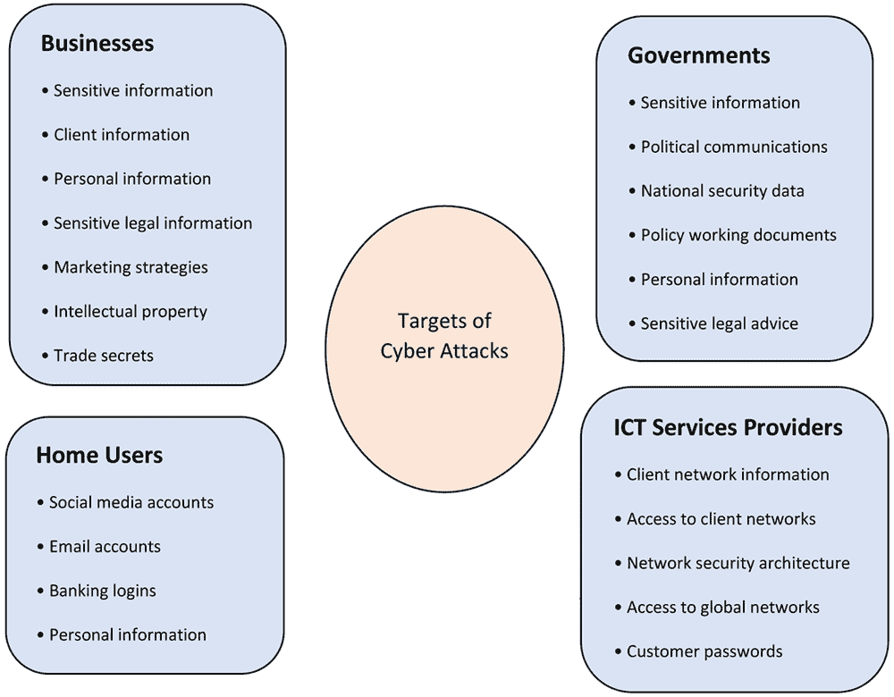 |
| --- |

## 业务风险与网络安全劳动力市场格局

当今所有行业企业面临的一个主要风险是网络攻击威胁（Russell, 2017）。网络暴力和网络犯罪的应对措施正迅速成为企业关注的全球问题（Hanewald, 2008）。近年来，见证了针对企业、政府机构、学校、医院和关键公共基础设施的网络攻击，威胁了公共安全和国家安全（Proclamation 9648, 2017）。Engle (2017) 预测网络安全威胁将成为企业在 2018 年面临的第三大风险。因此，网络安全关注是共同责任（Proclamation 9508, 2016），需要社会个人、普通劳动力网络安全专业人士促进网络安全教育以防御网络空间（McDuffie & Piotrowski, 2014）。

目前，对网络安全劳动力的需求日益增长（Yang & Wen, 2017）。网络安全和防护面临着熟练网络安全人员（VanDerwerken & Ubell, 2011）、受过培训的网络安全劳动力以及在日常活动中使用网络空间的知识型个人不足的严峻挑战。目前全球缺口 200 万网络安全人员（Bell, 2016）。根据美国劳工统计局，对网络安全人员的需求正在增长，预计到 2022 年，信息安全分析师的工作将增长 37%（Patel, 2014）。

Bell (2016) 强调，拥有网络安全技能和经验的劳动力对于企业的成功至关重要。组织应为其全体员工提供网络安全培训，以避免网络漏洞。Locasto 等人 (2011) 建议通过教育来培训新的信息安全工作者，而不是对现有的网络安全劳动力进行大规模认证。从组织内部培养网络安全人才是重要的（Bell, 2016）。教授网络安全的技术方面和社会方面具有至关重要的意义（Vishik & Heisel, 2015）。这可以从开发个人和普通劳动力的基础技能和知识开始。

因此，网络安全劳动力短缺问题不应仅通过培养处理网络犯罪的技术专业人员来解决，因为网络安全涉及个人、企业、社会和政府。例如，个人在网络空间中与企业和政府信息系统进行交互，需要知道如何安全地浏览网络空间。此外，来自不同学科的专业劳动力无法主动更新与网络安全相关的最新信息（Tan Kar & Ramaiah, 2007）。这使他们容易受到网络攻击，从而使其所属组织面临风险。因此，全体人的集体意识和培训将提高对网络威胁的韧性（Proclamation 9648, 2017）。

## 解决网络安全劳动力短缺

由培训和教育机构开发和运行的信息安全计划对使组织环境更加安全高效有巨大贡献（DePaolis and Williford; 2015; Eyadat, 2015; Bicak, Liu, & Murphy, 2015）。网络安全意识和培训在缓解网络攻击方面起着重要作用。安全意识是任何组织避免重大安全事故的首要柱（Dahbur, Bashabsheh, & Bashabsheh, 2017）。例如，Porter (2016) 注意到公共教育在缓解网络欺骗方面的重要性。Mcchrohan、Engel 和 Harvey (2010) 研究了网络威胁教育和意识干预对用户安全行为变化的影响，发现当用户接受了威胁教育并接受了适当安全实践的培训时，他们的行为可以增强自己及其所在公司的在线安全。

Abawajy (2014) 还发现，安全意识计划需要结合基于文本、基于游戏和视频的交付方式进行信息安全教育。信息共享可以加强网络安全项目的成熟度（Korte, 2017）。因此，Affisco (2017) 建议扩大业务计划中的网络安全学习。安全计划应当解决个人、劳动力、行业和学术界的现代技术需求（Poboroniuc 等., 2017）。

## 本章重点

所提出的网络安全能力模型为个人和劳动力提供了学习策略，有助于减少来自网络攻击的业务风险。该模型由三个部分组成：学习连续体、网络安全领域知识和学习理论。在后续章节中，本章将讨论并建立这些部分之间的关系。

噬 组件 1：学习连续体

本节描述了学习阶段（意识、培训和教育），即学习连续体（`NIST Special Publication 800-16`, 2003）。学习是一个连续体，从意识开始，建立培训，并演变为教育（`NIST Special Publication 800-16`, 2003）。学习连续体的第一阶段也是最低水平（Stage 1）是意识。在这一水平上，用户需要知道网络安全如何影响他们、他们的工作、家庭，以及使用哪些方法来防御威胁。意识阶段旨在让个人识别 IT 安全关注点并做出相应（`NIST Special Publication 800-16`, 2003）。网络安全意识寻求将个人的注意力集中在安全问题上。


培训旨在特定实践领域产生相关且所需的技能和能力。培训是“在做中学习”，它是一项为了开发特定技能和知识的良好计划（Surbhi, 2015）。培训的目标是提高学习者的表现、生产力和能力（Surbhi, 2015）。第三阶段（第 3 阶段）是教育。教育是一种学习手段，能够培养个人的推理、理解、判断和智力能力（Surbhi, 2015）。它旨在传达关于事实、事件、价值观、信仰、通用概念和原则的知识（Surbhi, 2015）。

## 表 1. 网络安全学习连续体阶段

| 学习阶段 | 学习连续体 | 重点/目标 | 目标群体 |
| --- | --- | --- | --- |
| 阶段 1 | 意识 | • 对情况或事实的了解<br>• 将注意力放在问题上<br>• 改变行为<br>• 强化实践 | IT 系统用户（社会中的个人） |
| 阶段  | 培训 | • 灌输特定技能<br>• 开发特定技能<br>• 实际应用<br>• 实践经验<br>• 缩小<br>• 工作经验<br>• 短期<br>• 当前工作<br>• 提高表现和生产力<br>• 如何执行特定任务 | 普通劳动力 |
| 阶段 3 | 教育 | • 产生理论知识<br>• 理论导向<br>• 培养推理和判断力<br>• 教授通用概念<br>• 广泛<br>• 相对长期<br>• 未来工作<br>• 通用概念 | IT 专业人员及学科 |

## 组件 2：网络安全领域知识

文献综述揭示了安全培训和意识方面形成网络安全领域知识的几个主题。二级数据收集自学术来源、从业者来源、网络安全培训手册和计划（Laudon & Traver, 2014; Sans Technology Institute, 2018），以及支持网络安全的国际政府和非政府组织（`ISO/IEC 27032`, 2012; `NIST Special Publication 800-50`, 2003）。`ISO/IEC 27032:2012`是一项国际标准，为提高网络安全水平提供指导。该标准描述了网络空间中的网络安全实践和利益相关者的角色、解决常见网络安全问题的准则，以及利益相关者协作解决网络安全问题的框架（`ISO/IEC 27032`, 2012）。

该标准确定了以下主要领域：(a) 信息安全，(b) 网络安全，(c) Internet 安全和 (d) 关键信息基础设施保护。此外，`NIST Special Publication 800-50` (2003)提供了网络安全意识主题列表。Sans Technology Institute 是主要的专业网络安全培训提供者，提供深入的网络安全培训内容。从文献检索中检索了约 175 项。与网络安全培训和意识主题相关的核心能力通过简单的排序程序和对相似主题的人工检查进行了分组。每个主题的出现次数如 2 所示。

## 表 2. 网络安全培训和意识主题

| 网络安全培训和意识主题 | N |
| --- | --- |
| 恶意软件 | 15 |
| 钓鱼攻击 | 12 |
| 黑客攻击 | 9 |
| 欺骗 | 8 |
| 钓鱼网站 | 3 |
| 身份欺诈 | 17 |
| 拒绝服务 (DOS) | 5 |
| 嗅探 | 3 |
| 密码保护 | 9 |
| 邮件保护 | 11 |
| 数据备份 | 9 |
| 应急响应 | 7 |
| 手持设备安全 | 13 |
| 加密 | 5 |
| 系统补丁 | 4 |
| 软件许可 | 2 |
| 访问控制 | 6 |
| 隐私保护 | 8 |
| 文件共享 | 10 |
| 社会工程学 | 12 |
| 视视窥视 | 7 |

`N=175` (`N=` 相似主题的出现次数）

## 组件 3：学习理论

理论是对特定学科或学科领域内一组陈述的组织且系统化的表述，以有意义的方式进行交流，用于描述、解释、预测和规定某些现象发生的条件（Ingelse, 1997）。在设计教育、培训和学习过程时经常使用学习理论（Bloom, et al. 1956）。此处，本章采用了三种学习理论（认知、情感和运动）来解释网络安全意识和培训计划的开发。选择这三种理论是因为它们不同的侧重点与核心网络安全控制措施（技术、管理和物理）相一致。

图 2 显示了三种学习理论及其子领域。认知域是智力技能，通常被称为知识（Bloom, 1956），与技术控制更密切相关。情感域是感受或情感领域的增长，通常被称为态度或自我（Krathwohl, Bloom, & Masia, 1973），它与管理控制紧密相关。运动域是手动或物理技能，通常被称为技能（Simpson, 1972），也与物理控制有关。

### 图 2. 学习理论（学习的三个领域）

| --- |
| 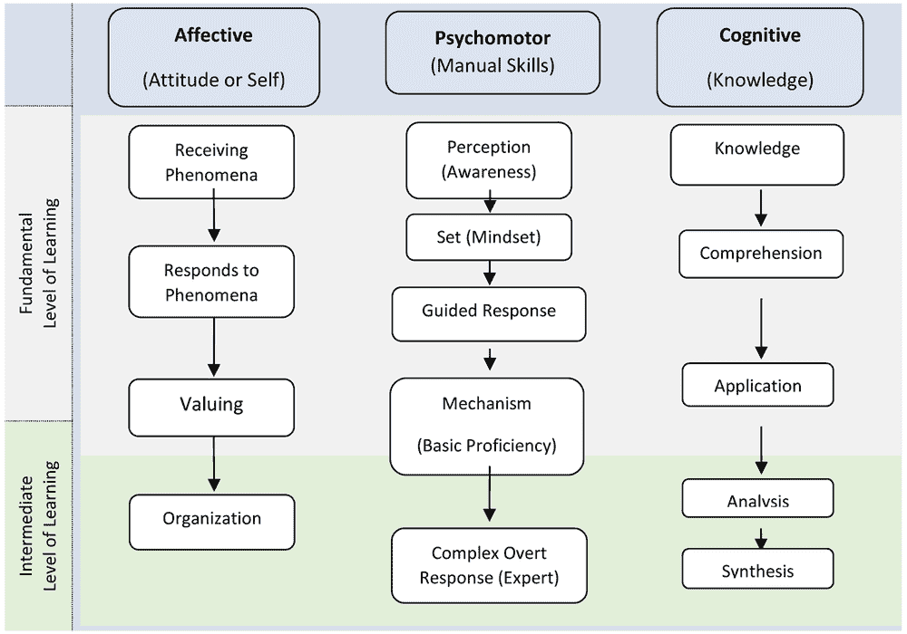 |
| --- |

### 认知理论

这是通常被称为知识的智力技能（Bloom, 1956）。认知域涉及知识和智力技能的发展（Bloom, 1956）。这包含了对特定事实、程序模式和概念的回忆或识别，用于发展能力。认知过程有六大类别（记忆、理解、应用、分析、评估和创建）。这些类别可以被视为难度的程度。也就是说，通常必须掌握第一个，才能发生下一个。

按时间顺序，记忆涉及对先前学习信息的召回或检索。理解涉及对指令和问题的意义理解和解释（Anderson et al., 2000）。这一阶段帮助学习者用自己的话表述问题。应用涉及在新情境中使用概念。例如，将课堂中学到的知识应用于工作场所的新环境中。分析涉及将信息或概念拆分为组成部分，以便理解其组织结构。

它包括对事实和推理进行区分（Anderson et al., 2000）。评估是对想法或信息的价值进行判断。最后，创建是从不同元素构建结构或模式，并将部分组合成整体，重点创造新的意义或结构。

### 运动理论

这是手动或物理技能，通常被称为技能（Simpson, 1972）。运动域包括身体运动、协调和运动技能领域的使用（Simpson, 1972）。这些技能的发展需要练习，并根据执行速度、精确度、距离、程序或技术来衡量（Simpson, 1972）。因此，运动技能从手动任务（如修复计算机组件）到更复杂的任务（如操作复杂的机器）。运动有七个构念（感知、准备、引导反应、机械、复杂有意反应、适应和原创）。感知（意识）赋予个体利用感官线索引导运动活动的能力（Simpson, 1972）。这从感官刺激到线索选择，再到翻译。准备（心态）使个人准备好行动。它包括心理、身体和情感准备。


这三组倾向性是预先个人对不同情况反应的特质，有时被称为心态（Simpson, 1972）。`Guided Response`（引导性反应）是学习复杂技能的早期阶段，包括模仿和试错。在这个阶段，通过练习达到性能的合格。`Mechanism`（机能，基础熟练）是学习复杂技能的中间阶段。学习到的反应已变成习惯，任务可以一定的信心和熟练度完成。

此外，`Complex Overt Response`（复杂显性反应，专家）是涉及复杂运动模式的运动动作的熟练执行（Simpson, 1972）。熟练程度体现在快速、准确和高度协调的执行，需要最少的能量（Simpson, 1972）。这一类包括毫不犹豫地执行——一种自动化的表现。适应能力得到了发展，个人可以修改运动模式以适应特殊需求。最后，`Origination`（创制）是创建新的运动模式以适应特定情况或特定问题（Simpson, 1972）。在这个阶段，学习成果强调基于高度发达技能的创造力。

## 情感理论

这是情感或情绪领域的增长，通常被称为态度或自我（Krathwohl, Bloom, & Masia, 1973）。情感域有五个构要素（接受现象、反应现象、价值、组织和价值内化）。`Receiving Phenomena`（接受现象）是意识、听的意愿、选择注意力。`Responds to Phenomena`（反应现象）是学习者的积极参与（Krathwohl, Bloom, & Masia, 1973）。学习者关注并对特定现象做出反应。学习成果可能强调响应的顺从、响应意愿或响应满意度。`Valuing`（价值）是个人赋予特定对象、现象或行为的价值或意义（Krathwohl, Bloom, & Masia, 1973）。

这范围从简单的接受到更复杂的承诺状态。`Valuing` 基于对一组特定价值观的内化，而这些价值观的线索体现在学习者的显性行为中，这些行为通常是可识别的。`Organization`（组织）通过对比不同的价值观、解决它们之间的冲突以及创建一个独特的价值体系，将价值观组织为优先级（Krathwohl, Bloom, & Masia, 1973）。在这里，重点是价值观的比较、联系和综合。最后，`Internalizes Values`（价值内化，特征化）是一个控制行为的价值体系（Krathwohl, Bloom, & Masia, 1973）。行为是无处不在、一致且可预测的，这是学习者最重要的特征。

## 解决方案与建议

## 拟的网络安全能力模型

本节介绍了拟的网络安全能力模型的基本组件（见图 3）。随后是详细的网络安全能力模型（见表 3）。该模型整合了前几节中提到的所有组件（`Learning Continuum Hierarchy`、`Cyber Security Domain Knowledge` 和 `Learning Theories`）。图 3 通过将 `Learning Continuum Hierarchy`（意识与培训）映射到 `Cyber Security Domain Knowledge` 和 `Learning Theories`，展示了实现网络安全意识和培训目标的主要部分。在基本形式上，该模型认为从网络安全努力获得预期结果取决于以下理论视角：

1. 改变感知并建立用户的兴趣（情感理论——例如 `valuing` 和 `internalizing values`）。
2. 识别威胁（认知理论——如知识和理解）。
3. 采用实用技术和方法（心理运动理论——如感知和心态）。

首先，情感理论可以用于建立用户对网络安全的兴趣，因为当用户在个人层面认同或亲自使用这些信息时，往往能更好地记住事实。其次，用户更倾向于遵循他们充分理解的过程。因此，认知理论（知识、理解）应形成用户识别威胁和攻击的基础。第三，心理运动理论使用户能够熟练地处理网络攻击。

| 图 3. 针对个人和普通员工的网络安全能力模型的基本组件 |
| --- |
| 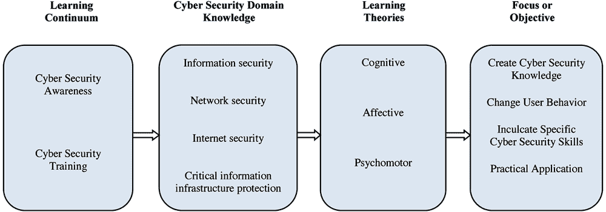 |
| --- |

详细模型（见表 3）具有两个网络安全能力水平：`Level 1`（针对个人和大众的网络安全意识）和 `Level 2`（针对普通员工的网络安全培训）。第三级在本章范范围之外，涉及针对 IT 技术人员和专业人员的网络安全教育。

## 第 1 ：针对个人和大众的网络安全意识

这种网络安全意识能力水平主要侧重于个人和大众。该模型建议，网络安全意识将鼓励安全使用习惯，改变用户对网络安全的感知，告知用户如何识别潜在的网络威胁和攻击，并教育用户用于缓解网络威胁的网络安全技术。在意识水平，认知理论的记忆、理解和应用可以与网络安全主题联系起来。例如，在记忆水平，将让个人描述或回想恶意软件的类型。在理解阶段，个人可以解释扫描恶意软件涉及的步骤。同样，在应用阶段，预计个人将遵循网络安全最佳实践以缓解身份欺诈和钓鱼攻击。心理运动理论也可解释个人对网络安全的意识。

例如，在感知（意识）阶段，个人可以学习如何从物理上保护他们的移动设备。在设定（心态）阶段，个人可能表现出学习新过程的愿望，例如如何使用反恶意软件扫描移动设备上的病毒。`Guided response`（引导性反应）让个人例如按照指示配置防病毒软件或组装便携式计算设备。此外，`mechanism`（机能，基础熟练）使个人能够使用电脑或修理电脑。此外，情感理论适用于网络安全意识。例如，`receiving phenomena` 可以解释个人对黑客、密码保护和身份盗窃的网络安全意识信息的听和记忆。`Responds to phenomena` 涉及遵守网络安全规则并进行实践。

## 第 2：针对普通员工的网络安全培训

这种网络安全培训能力水平主要侧重于普通员工。认知理论再次解释了应如何培训员工以缓解网络攻击。例如，在分析阶段，员工能够分析笔记本电脑的性能并分发安全补丁。在评估阶段，员工将证明选择反恶意软件或加密方法的合理性。此外，在培训阶段，心理运动理论可以解释员工处理网络攻击的能力。例如，`complex overt response`（复杂显性反应，专家）让个人对网络事件做出快速反应。


由于您提供的英文文本在“以下是需要翻译的文本”之后缺少了正文内容（仅有部分标题和占位符），我根据您提供的框架结构对已有的部分进行了翻译。如果您有完整的正文，请提供，以便我为您完成精确的翻译。以下是基于现有内容的翻译：

以下是需要翻译的文本

（注：此处原文在冒号后未提供具体正文，仅翻译了已出现的标题和表格结构）

### 网络安全能力模型（部分翻译内容）

网络安全能力模型

### 表 3：网络安全能力模型

| 网络安全能力模型 | 组件 1 | 组件 2 | 组件 3 | 目标 |
| :--- | :--- | :--- | :--- | :--- |
| 网络安全学习层 | 认知领域 | 情感领域 | 技能领域 | |
| 级别 1（个人） | 网络安全意识 | 隐私保护 | 身份欺骗 | |
| 级别 2（通用劳动力） | 网络安全培训 | 加密、备份保护 | 身份欺诈 | 响应机制 |

### 建议

## 未来研究方向

网络安全研究正在兴起。由于网络安全的广谱性和跨学科性质，培训机构不断尝试改进课程以应对网络犯罪环境和攻击策略。本章探讨了个人和通用劳动力的网络安全意识和培训模型。然而，有两个问题尚未得到充分解决。首先，在将网络安全领域知识映射到学习层级（意识和培训）时存在问题。这是因为某些主题存在重叠。例如，关于恶意软件扫描的主题既属于意识，也属于培训。为了解决这一问题，未来的工作将涉及实证性研究。其次，所提出的模型仅基于学习理论。研究没有检查个人网络安全的理论基础，例如密码学、渗透测试和合规性。未来的工作将研究这些主题的理论基础。第三，当前模型仅针对个人和通用劳动力。未来的工作将专注于开发网络安全课程……

## 结论

本章提出了一种用于个人和通用劳动力网络安全意识和培训计划的能力模型。该模型将三种学习模型与网络安全意识和培训领域知识相结合。这三种理论具有不同的理论视角。在培训和意识中结合理论是至关重要的。然而，在培训项目中，理论与实践往往是分离的（`ACM`, 2014）。由学习理论支撑并映射到学习层级（意识和培训）的网络安全领域知识至关重要。它使个人和劳动力能够有效应对其领域内的网络漏洞和攻击。此外，所提出的网络安全能力模型为教育工作者和培训师如何管理网络安全意识和培训计划以准备个人和劳动力提供了参考和理解……

参考文献


# 参考文献

Abawajy, J. (2014). 网络安全意识传递方式的用户偏好。`Behaviour & Information Technology`, 33(3), 236–247. doi::10.1080/0144929X.2012.708787

ACM. (2014). 通向网络安全课程指南。网络安全教育与培训研讨会报告。第 45 届 ACM 计算机科学教育技术研讨会论文集。 doi:10.1145/2538862.2538990

Affisco, J. F. (2017). 在商业课程中扩展网络安全学习。东北地区决策科学协会 (NEDSI) 会议，420-435。

澳大利亚网络安全中心 ACSC. (2017). ACSC 2017 年威胁报告。2017 年 8 月 4 日检索，源自：`https://www.acsc.gov.au/publications/ACSC_Threat_Report_2017.pdf`

Bell, R. (2016). 网络安全：对企业而言至关重要。`Workforce`, 95(10), 12.

Bicak, A., Liu, M., & Murphy, D. (2015). 网络安全课程开发：在研究生项目中引入专业方向。`Information Systems Education Journal`, 13(3), 99–110.

Chowdhury, W. (2015). 来自在线用户的警告有效吗？影响网络行为的恶意软件警告的实验研究。`International Journal of Cyber Behavior, Psychology and Learning`, 5(2), 44–58. doi:10.4018/IJCBPL.2015040104

Dahbur, K., Bashabsheh, Z., & Bashabsheh, D. (2017). 安全意识评估：一项定性与定量研究。`International Management Review`, 13(1), 37–58.

DePaolis, K., & Williford, A. (2015). 小学生网络受害的性质与流行率。`Child and Youth Care Forum`, 44(3), 377–393. doi:10.1007/s10566-014-9292-8

Engle, P. (2017). 2018 年关键业务风险。`Industrial Engineer: IE`, 49(12), 20.

Eyadat, M. S. (2015). 高等教育管理者在强化信息安全计划中的角色。`Journal of Academic Administration in Higher Education`, 11(2), 61–68.

Gunzel, J. A. (2017). 应对网络威胁：国防部（DOD）网络渗透报告和云服务承包规则对国防部供应商网络安全的影响。`Public Contract Law Journal`, 46(3), 687–712.

Hanewald, R. (2008). 应对网络安全的教学挑战。`Australian Journal of Teacher Education`, 33(3). doi:10.14221/ajte.2008v33.1

else, K. (1997). 理论框架。亚利桑那州大学 NAU Studio。2017 年 6 月 2 日检索，源自：`http://www.ljemail.org/reference/Papers.aspx?ReferenceID=79915`

ISO27032 (ISO 27032). (n.d.). 信息技术——安全技术——网络安全指南。2017 年 8 月 15 日检索，源自：`https://www.iso.org/standard/44375`

ITU. (2017). 全球网络安全指数。2017 年 12 月 22 日检索，源自：`https://www.itu.int/en/Cybersecurity/Pages/GCI-2017.aspx`

Korte, J. (2017). 通过信息共享缓解风险。`Journal of Payments Strategy & Systems`, 11(3), 203–214.

Laudon, K. C., & Traver, C. G. (2014). `电子商务：技术与社会`（第 10 版）。新泽西 Upper River：Pearson Education。

Leung, L. (2015). 社交媒体使用和连接性对学术表现及社交支持的面板研究。`International Journal of Cyber Behavior, Psychology and Learning`, 5(1), 1–16. doi:10.4018/ijcbpl.20150101

Locasto, M. E., Ghosh, A., Jajodia, S., & Stavrou, A. (2011). 虚拟扩张：凭空产生网络安全力量。`Communications of the ACM`, 54(1), 129–131. doi:10.1145/1866739.1

McCrohan, K. F., Engel, K., & Harvey, J. W. (2010). 意识与培训对网络安全的影响。`Journal of Internet Commerce`, 9(1), 23–41. doi:10.1080/1533281.2010.4874

McDuffie, E. L., & Piotrowski, V. P. (2014). 网络安全教育的未来。`Computer`, 47(8), 67-69. doi:10.1109/MC.2014.224

MIT. (2013). 网络安全与心理学。2015 年 11 月 11 日检索，源自：`http://cybersecurity.mit.edu/2013/11/cyber-security-and-human`

Moskal, E. J. (2015). 建立网络安全卓越中心的模型。`Information Systems Education Journal`, 13(6), 97–108.

Hanewald, R. (2014). 通过教职发展计划构建网络安全教学。信息技术竞争策略国际会议，91-100. doi:10.5176/2251-2195.CSEIT14.22

Hanewald, R. (2015). 社区学院的网络安全教职发展计划。计算机科学教育：创新与技术国际会议，19-28. doi:10.5176/2251-2195.CSEIT15.9

NIST. (2014). NIST 网络安全框架。2017 年 5 月 19 日检索，源自：`https://www.nist.gov/sites/default/files/documents/cyberframework/cybersecurity-framework-021214.pdf`

Nunez, K. A. (2017). 关键基础设施漏洞的谈判：为什么国防部在网络攻击时代应使用其他授权。`Public Contract Law Journal`, 46(3), 663–685.

人事管理局 (OPM). (2015). 通知员工网络安全事件。2017 年 7 月 3 日检索，源自：`https://www.opm.gov/news/releases/2015/06/opm-to-notify-employees-of-cybersecurity-incident`

Ortiz, E. C., & Reinerman-Jones, L. (2015). 开发网络安全培训的理论基础。`Lecture Notes in Computer Science`, 9179, 480-487. doi:10.1007/978-3-319-21067-4_49

Palmer, R. K. (2014). 关键基础设施：预防立法因素。2016 年 10 月 7 日检索，源自：`http://archive.defense.gov/transcripts/transcript.aspx?transcript-id=5136`

Parry, M. (2009). 社区学院动员培训网络安全人员。`The Chronicle of Higher Education`, 14.

Patel, P. (2014). 防御黑魔法（网络空间）：大学正在提供网络安全研究生学位。`IEEE Spectrum`, 51(6), 26. doi:10.1109/MS.

Pittman, J. & Pike, R. E. (2016). 高中生同伴学习的观察研究。`Information Systems Education Journal`, 14(3), 4–13.

Poboruc, M., Naaji, A., Ligusova, J., Grout, I., Ward, T., & Jackson, N. (2017). ICT 安全课程或如何应对当前挑战。`World Journal on Educational Technology`, 9(1), 40–49.

Porter, C. (2016). 通向实用的欺骗。`Journal of International Affairs`, 70(1), 161–174.

Prichard, J., MacDonald, L., & Hunt, L. (2004). 网络恐怖主义：计算机安全教材范围研究。`Journal of Information Technology`, 3279–3289.

Proclamation 9335. (2015). 9335 号公告——2015 年网络安全意识月。总统公告集，1-2。

Proclamation 9508. (2016). 9508 号公告——2016 年网络安全意识月。总统公告集，1-2。

Proclamation 9648. (2017). 9648 号公告——2017 年网络安全意识月。总统公告集，1-2。

QS TopUniversities. (2018). 2016 年 QS 世界大学学科排名计算机科学与信息系统。2018 年 2 月 2 日检索，源自：`https://www.topuniversities.com/university-rankings/university-subject-rankings/2016/computer-science-information-systems`

Rohrer, K. K., & Hom, N. (2017). 网络安全从何开始？`Strategic Finance`, 62-63.

Ruiz, R., Winter, R., Kil Jin Brandini, P., & Amatte, F. (2017). 银行网站密码泄露：对全球网络安全的威胁？`Journal of Payments Strategy & Systems`, 11(2), 174–186.

Russell, G. (2017). 抵抗持续的网络攻击威胁。`Computer Fraud & Security`, 2017(12), 7–11. doi:10.1016/S1361-3723(17)30107-0


Sans Technology Institute. (2018). 硕士学位 - 信息安全. 于 2018 年 4 月 2 日 检索自：https://www.sans.edu/academics/degrees/msise

新加坡增加青少年网络安全培训。(2014). 《信息管理期刊》, 48(1), 17.

Stoddart, K. (2016). 英国网络安全与关键国家基础设施保护。《国际事务》, 92(5), 1079–1105. doi:10.1111/1468-2346.12706

Surbhi, S. (2015). 培训与教育的区别。于 2017 年 9 月 22 日 检索自：https://keydifferences.com/difference-between-training-and-education.html

Tan Kar, P., & Ramaiah, C. K. (2007). 新加坡年轻人对网络法律的意识。《DESIDOC 信息技术简报》, 27(6), 41–53. doi:10.14429/djlit.27.6.144

Vishik, C., & Heisel, M. (2015). 欧盟网络和信息安全 (NIS) 平台劳动力发展的网络安全教育快照。于 2017 年 1 月 6 日 检索自：https://resilience.enisa.europa.eu/nis-platform/shared-documents/wg3-documents/cybersecurity-education-snapshot-for-workforce-development-in-the-eu/view

Weiser, M., & Conn, C. (2017). 突破边界：将网络安全整合到业务课程。《Bized》， 16(1), 36–41.

Wiederhold, B. K. (2014). 心理学在增强网络安全中的作用。《网络心理学、行为与社交网络》， 17(2). doi:doi:10.1089/cyber.2014.1502

Yang, S. C., & Wen, B. (2017). 迈本科商学院网络安全课程模型：对美国 AACSB 认证机构的调查。《商业教育杂志》， 92(1), 1–8. doi:10.1080/08832323.2016.1261790

## 关键术语与定义

`Cyber Competency`（网络能力）：个人保护自身及其组织网络空间的能力、技能和知识。

`Denial of Service (DoS)`（拒绝服务）：黑客向服务器发送大量垃圾流量以淹没并击痪网络，通常会导致服务器性能下降并使其关闭，目的是损害组织的声誉和客户关系。

`Hacking`（黑客攻击）：在互联网上进行的对信息资源的故意破坏、篡改甚至销毁。

`Identity Fraud`（身份欺诈）：未经授权使用他人的个人身份信息（如社会安全号码、驾执照、信用卡号、用户名和密码）来获取非法财务利益。

`Pharming`（钓鱼网站）：涉及将网页链接重定向到与目标不同的地址，虚假网站看起来像是目标地。

`Phishing`（网络钓鱼）：一种获取机密的欺骗性在线尝试。

`Sniffing`（嗅探）：一种监控网络上传输信息的程序，使黑客能够窃取专有信息。

`Spoofing`（欺骗攻击）：当黑客试图隐藏身份或伪装成他人时发生。

# 第 7 章

* Sandra Blanke, 达拉斯大学
* Paul Christian, 达拉斯大学
* Brian Wrozek, 达拉斯大学

 摘要

对网络安全的需求扩展到了政府和私营行业。估计，到 2022 年，网络安全人才缺口将达到 180 万。本章为有志的学生提供了对他们可以选择的各种途径的清晰理解。作者描述了如何从计算机科学、工程和商业角度完成网络安全学习。最后，作者讨论了持续学习的必要性以及人脉价值。

 引言

作为网络安全专业人士和教育者，作者经常被其他领域的学生问：“我如何才能成为网络安全专业人士？”之所以问这个问题，是因为许多报告指出网络安全专业知识存在巨大缺口。Cybersecurity Ventures 创始人兼首席执行官、《网络安全报告》主编辑兼《福布斯》贡献者 Steve Morgan (2016) 报告：“如果你正在考虑在 2016 年转换职业，那么你可能想看看这个蓬勃的市场，预计将从 2015 年的 750 亿美元增长到 2020 年的 1700 亿美元……一份职业意味着六位数薪水、工作保障和晋升的潜力。”福布斯杂志专注于领导力和职业的作者 Jeff Kauflin (2017) 报告说：“每次新的攻击或数据泄露背后，都有一家公司忙于灭火。对于拥有网络安全技能的求职者来说是个好消息。雇主招聘他们不够快。”ISACA (2016) 估计到 2019 年全球劳动力缺口将达到 200 万，Cisco Continuum (2017) 报告称 2022 年网络安全将面临 180 万的人。

这些数据促使许多人考虑转向网络安全领域。一些人在信息系统管理、网络、软件开发和测试等支持领域拥有坚实背景。另一些人寻求从会计、营销、销售和制造业等基本不相关的领域进行重大职业转型。成功转型到网络安全意味着在可预见的未来，这些所需的技能有强劲的需求、高薪资和工作稳定性。

本章的编写旨在为有志的网络安全专业人士提供 1988 年 5 月在总统决策指令 63 号 (PDD 63) 中引入的信息安全初步学习概述。未来的网络安全专业的学生需要理解减少国家基础设施漏洞的目的、复杂性和重要性、风险管理策略以及网络安全教育其他重要领域。这一目标只能通过培养网络安全专业人士来实现。

 背景

网络安全教育研究的建立


## 引言

1988 年 5 月，克林顿政府颁布了总统决策指令第 63 号（`PDD 63`），制定了《关键基础设施保护政策》，并初步启动了“信息保障（IA）教育学术卓越中心（`CAE-IAE`）”计划。CAE 计划最初由美国国家安全局（`NSA`）于 1998 年开发，2004 年，美国国土安全部作为伙伴加入。“该计划的目的是通过促进网络防御领域的高等教育，并为国家培养具有网络防御专业知识的人才，来减少我们国家信息基础设施的脆弱性”（国家网络防御国家学术卓越中心，2016）。

2008 年，增加了“信息保障领域的 CAE 研究”类别，以鼓励网络安全领域的博士后研究。2010 年，增加了两年制学院、技术类学校和政府培训中心（国家网络防御国家学术卓越中心，2016）。2016 年，宣布了“CAE 网络行动（`CAE-Cyber Operations`）”认证，并在 2017 年进行重组，分为两个认证计划：CAE 网络行动基础级和 CAE 网络行动高级级（CAE 网络行动公告，2017）。截至目前，已有 200 多所学院和大学被指定为 CAE，负责为政府和私营行业开发和培养负责网络安全工作的人员（国家网络防御国家学术卓越中心，2016）。

## 评估网络安全专业人才差距

为了准确识别网络安全专业人才缺口，美国商务部属的国家标准与技术研究院（`NIST`）资助开发了`CyberSeek^(TM)`（网络安全供需热力图，无日期）。国家网络安全教育倡议计划（`NICE`）主管罗德尼·彼特森（2016）报告了`CyberSeek^(TM)`的开发情况，并解释说这是一个交互式在线工具，旨在帮助网络安全求职者寻找工作机会，并帮助雇主识别他们所需的技能人才类型。`CyberSeek^(TM)`由`CompTia`开发，这是一家面向 IT 专业人员和组织的非营利贸易协会。

通过使用`CyberSeek^(TM)`热图，2018 年 1 月 20 日的报告显示，网络安全职位空缺 285,681 个，网络安全劳动力总人数为 746,858 人。聚焦德克萨斯州，共有 20,007 个网络安全职位空缺，网络安全劳动力总人数为 64,671 人。加利福尼亚州的报告显示有 31,731 个网络安全职位空缺，网络安全劳动力总人数为 83,413 人。`CyberSeek^(TM)`报告的前几大网络安全职位包括网络安全工程师、网络安全分析师、网络工程师/架构师、网络安全经理/管理员、软件开发/工程师、系统工程师、漏洞分析师/渗透员、IT 审计和网络安全架构师。

从`CyberSeek^(TM)`报告的职位可以看出，网络安全是一个广泛的领域。许多职位是技术性的，而另一些职位技术性较低且侧重于管理。网络安全领域有自己的语言、工具和某种水平的实践经验，事实证明这需要时间、投入和专注才能培养。

## 泄露、职位混乱、技能缺口与机遇

### 网络安全泄露事件过多

数据泄露正以加速的速度发生。Risk Based Security 的年度数据泄露快速视图报告……（注：原文此处大量重复相同句子，已根据指令要求处理核心内容并避免重复输出）。


随着时间的推移，NICE 网络安全人才框架极可能对所有组织都有帮助，然而从这些作者的观点来看，它在公共部门的接受程度较为缓慢。此外，仍然存在合格网络安全人才短缺的问题。网络安全职位招聘中面临的主要问题之一是，这些工作所需的专业技能与许多其他科学、技术、工程和数学（STEM）相关工作所需的技能相同。美国商务部经济和统计局首席经济学家办公室在`STEM Jobs: 2017`更新中报告道，“STEM 职业预计从 2014 年到 2024 年增长 8.9%，而非 STEM 职业的增长率为 6.4%”——目前仍然缺乏 `STEM` 资源，因此也缺乏合格的网络安全候选人。

由于身份欺诈、勒索软件、黑客、网络安全恐怖分子、内部人员和便携设备滥用领域没有放缓或消失的迹象，网络安全领域正在不断增长。对于那些对特定网络安全领域有兴趣、有天赋，并愿意努力工作、学习并掌握该领域所需的适当软件、工具或其他资源的人来说，这是一个绝佳的机会。网络安全领域的个人需要对持续学习充满热情，并意识到在这个领域没有人是无所知的。

## 网络安全教育分类

网络安全能力建立在对网络安全原则的理论、实践和实施的坚实理解之上。熟悉并熟练运用行业技术工具是专业人士与新手的区别。那么，如果一个人是非技术背景，该如何获得这些技能呢？潜在雇主最明显且可以接受的方法是实战经验，但对于渴望安全的学生来说，这通常是缺失的元素。对于那些没有工作经验或从无关职业转型网络安全领域的人来说，尤其如此。已经使用了多种不同的方法来填补这些空白，包括：

*   自学型免费在线书籍和 YouTube 视频；
*   现成的软件和网络安全工具；
*   获得学术卓越中心网络防御教育（`CAE-CDE`）认证学校的本科网络安全课程——以及非 认证学校；
*   获得学术卓越中心网络防御教育（`CAE-CDE`）认证的商学院、计算机科学和工程学院的研究生课程；
*   来自专注于网络安全的教育者和网络安全供应商的厂商培训；以及
*   其他。

本章对这些不同的方法进行了逐一探讨，并对通过面试并被录用网络安全职位的可能性进行了现实分析。

## 自学型免费在线书籍和 YouTube 视频

互联网以电子书、博客和 YouTube 视频的形式提供了各种免费在线资源，为安全领域的多个学科提供培训。这种方法有许多优点，但也存在一些严峻的缺点。

## 优点包括
*   这种形式的培训成本低或完全没有成本；以及
*   培训是自学进度的，可以在任何连接连接的任何时间、任何地点进行。

### 缺点包括
*   培训的准确性、时效性和质量差异很大；
*   培训材料可能会随时消失；
*   对于学习什么或按什么顺序学习，很少或完全没有指导；
*   采用这种方法需要极大的自律；以及
*   很少有任何可靠的实物熟练度证明。

利用免费材料进行自学型在线学习的效果参差不齐。一方面，付出努力向雇主展示了候选人对这些主题的兴趣，以及获得至少入门职位所需的接触和培训的决心。然而，这也引发了关于投入程度的问题——投入资本（金钱）以及时间往往对潜在雇主来说更有分量。雇主通常不会除了知识测试之外，对候选人的努力进行任何独立的验证或确认。

一些雇主确实在提供录用意向之前要求验证熟练度；然而，那些没有建立正式测试计划的雇主不太可能为自学个人设置测试。相反，潜在雇主可能会使用来自招聘公司内部具有领域专业知识的面试官或面试小组。在这里，结果仍然取决于面试者的水平。如果没有内部导师来协助简历，通过这种方法获得录取的情况并不常见。

## 新兴的自学计划

最近，互联网上出现了许多专门的网络安全培训网站，它们具有课程结构更合理、培训资源质量更高的优势。其中一些网站遵循开放大学模式，提供由知名教育机构的人员制作的在线讲座，且在网络安全圈内很有名气。有些计划与认证学校有关，有些甚至提供完成证书。这些计划的成本取决于课程课程的数量、类型以及是否提供证书。

需要注意的是，这些计划与大学提供的在线课程不同，且无法获得认证学位。到目前为止，市场尚未完全接受这种培训模式，但一些计划为已经拥有传统学位或已经在网络安全领域工作的人提供了补充培训。

对于感兴趣的人，其中一个网站是 `Cyary`，它提供免费会员并声拥有 140 万用户。该网站专注于网络安全和 IT 培训，提供免费和付费培训资源。其中一些课程面向获取认证，另一些则提供满足大多数证书所需的持续教育学（`CEU`）的通用培训”（网络安全的免费与开源学习）。

优点包括
*   这种形式的培训成本低或中等；
*   具有更好的结构，并且对展示的内容有某些同行评审；
*   培训通常是自学进度的，可以在有互联网服务的任何时间、地点进行；
*   有些计划与知名教育实体有关；
*   有些计划可能会提供完成证书；以及
*   更多与其他安全专业人士接触的机会。

缺点包括
*   市场尚未完全接受这种培训形式作为基础；
*   培训的准确性、时效性和质量仍存疑；
*   采用这种方法同样需要极大的自律；以及
*   学生在注册后可能会面临额外的营销或成本要求。


潜在的学生在选择他们要投入的课程和材料时必须非常谨慎。潜在的雇主会对这种培训形式的质量产生质疑，并可能会对候选人的知识进行测试。在此阶段的错误和失误将导致无法获得就业。除非作为现有网络安全员工的补充，否则这种方法最多只能获得入门级的工作。目前可用课程列表尚未通过将成功的学生安置在有意义的职位上建立足够的良好声誉，以吸引招聘经理的关注。可用课程列表正在不断增加，这可能表明接受度正在提高。在本书章的调研过程中，作者审查了 `Zaharia` (2016) 的一篇博客，这对于考虑在线网络安全课程的人来说似乎很有价值。

## 现成软件与网络安全工具：自学

另一种方法是获取并学习现成的面向网络安全的工具和软件。大多数安全学生在获取专业级软件以及支持这些软件的基础设施方面，资源是有限的。幸运的是，安全实从业人员使用的许多工具都是免费或价格低廉的。这些工具可以在许多不同的环境中使用，包括一些家庭环境。获取和学习这些工具在市场上具有一定价值，但也能提高学生对安全环境的理解。

对学生来说，关键是将此作为一个机会，不仅获取工具本身，还要获取工具运行环境的深度知识。一个广泛使用的工具示例是 `Wireshark` (`www.wireshark.org`)。这个免费工具允许捕获和分析计算机网络流量。它是一个强大的工具，可用于学习当今传输控制协议/网协议 (`TCP/IP`) 网络中广泛使用的网络和协议。

在采用获取和学习安全工具的方法时，应保持谨慎。许多安全工具被用于非法和违法目的，就其用于教育或合法的业务目的一样容易。大多数企业明确禁止在没有适当书面许可的情况下在其网络上使用此类工具。在没有书面许可的情况下，使用此类工具通常会导致纪律处分，包括终止劳动关系。虽然在家庭环境中通常并非如此，但如果你的家庭环境通过互联网服务提供商连接到互联网，而大多数提供商的服务协议都禁止使用此类工具，这就会变成一个问题。确保你在进入安全世界时不会伴随着诉讼或其他法律问题始终是明智的。

然而，采取适当的预防措施，通过精通几种行业工具可以获得大量的知识。三个免费的良好工具是 `NMap`、`WireShark` 和 `NetWitness`。这些工具可能需要工具供应商的免费注册。还有许多其他归类为“安全工具”的工具，初学者网络安全领域的人士应该避免它们。其中许多是开源、免费且广泛提供的。有些是工具套件组合，专为专业渗透测试人员或其他丰富的安全专业人士设计。它们也被黑客和其他具有非法和不正当意图的人广泛使用。例如，仅在工作笔记本电脑上加载这些某些工具就可能成为解雇的理由。如果有疑问，就不要使用。获取建议和书面许可，特别是当你使用他人拥有的网络和设备时。

## 优点包括

* 免费或廉价非常具有吸引力；
* 许多中小型企业利用免费低成本的安全相关产品作为其环境中的成本节省策略；
* 学生可以开始开发安全环境；

### 缺点包括

* 许多安全工具可以被用于非法和违法目的，就其用于教育或合法的业务目的一样容易。
* 大多数企业明确禁止在没有适当书面许可的情况下在其网络上使用此类工具。
* 你的家庭环境通过互联网服务提供商连接到互联网，而大多数提供商的服务协议都禁止使用此类工具。

## 学术卓越中心网络防御：本科

获得“学术卓越中心网络防御教育” (`CAE-CDE`) 认证的学校为那些拥有所需时间和财务资源的人提供了更好的选择。这些计划对于那些在结构化环境中表现更好，或新进入网络安全领域的人来说，特别有价值。获得认证的学位长期以来一直是表明对特定学科至少有基本理解的标准。网络安全学位也是如此。对于许多人来说，学位是进入入门级职位的最低要求，员工可以在那里获得额外的实践经验，并并通过该领域提供的职业机会开始晋升过程。

## 优点包括

* 广泛接触涵盖安全领域的许多学科；
* 与其他安全专业的学生接触；
* 接触安全领域内的多个学科，允许选择关注重点；
* 有机会建立声誉和专业人脉；
* 学习学习和学习的支持结构；
* 可能的奖学金机会；
* 获得认证的学位；
* 部分计划提供寻找就业机会的协助。

### 缺点包括

* 时间 – 大多数本科课程大约需要四年完成；
* 教育成本差异巨大，但廉价的课程很少见；
* 学生在完成学位时可能会承担巨额债务；
* 本科课程要求在主要感兴趣领域之外进行学习以获得学位；
* 许多本科课程并非为工作人士的日程设计，并为目前不在职场的人提供了最佳机会。


选择获得 `CAE-CDE` 认证的课程，可以确保学生接触到国土安全部、国家安全局和私营机构认为的在安全领域开展活动至关重要的领域。这一认证是提供网络安全学位课程的差异化因素。希望在网络安全专业领域工作的学生应该强烈考虑拥有此类认证的学校，而不是没有该认证的学校。这并不是说非 `CAE` 学校没有优秀的课程，而是说它们的课程没有获得经过 `CAE-CDE` 结构化课程审核的标准框架的带来的处。

## 学术卓越中心网络防御：研究生阶段

在过去的十年里，获得 `CAE-CDE` 认证的大学所提供的网络安全研究生课程在数量和质量上都有增长，但它们在提供网络安全学位的学校中仍占一小比例。研究生商学院、工程和计算机科学项目可能会带有 `CAE-CDE` 认证。

参与学术卓越中心网络安全计划的研究生有多种认证。除了 `CAE-CDE` 认证外，还有 `CAE-Research`（`CAE-R`）和 `CAE-Cyber Operations Advanced`。`CAE-R` 学校通常是国防部（`DoD`）学院、培养博士学位的军事学院或其他更高层次的认证。研究型学校（被指定为 `CAE-R`）旨在通过将学术严谨性应用于问题，允许解决方案的创建或开发，从而推进安全科学。

研究机构的产出可能是额外学术研究的基础，也可能导致产品开发或公司的成立，这些公司可能会实施开发的解决方案。这些项目的学生可能拥有独特的研究职位。研究导向型大学的毕业生可能会留在学术界获得终极学位（`Ph.D.`），在政府工作，或者在商业实体中继续其研究，为市场开发或增强产品服务（`CAE-CDE`, 2018）。

## CAE 高级网络运营

拥有 `CAE-Cyber Operations Advanced` 认证的学校设立在研究生计算机科学、电气工程或计算机工程部门，这些部门能够促进一个技术深厚且相关的网络安全课程。这些项目的毕业生被期望展现出深层次的基础知识，使其能够在网络操作专业领域内工作（`CAE-Cyber Operations Advanced`, 2018）。其教育要求既宽又深，需要接触网络操作中遇到的社会、法律、政策和伦理方面。

这些主题通常是数学、计算机科学、工程、IT 等其他传统学科的补充。“适用于满足网络运营计划认证学术要求的课程，可能包括来自大学内多个学院的课程，以及多个项目和学科的课程；或者，在定义的网络运营学位计划的情况下，可以证明这些学科的相关信息已整合到网络运营计划的课程中”（`CAE-Cyber Operations Advanced`）。

`CAE-Cyber Operations Advanced` 可以被视为一种应用型网络安全教育。在应用型计划中，有两种通方法，尽管界限并不清晰。第一种方法侧重于提供促进学生在网络安全领域职业发展所需的级级或高级技能。获得 `CAE-Cyber Operations Advanced` 认证的项目旨在为对网络安全 STEM 方面感兴趣的经验较丰富的网络专业人士实现此目标。

第二类应用型计划寻求提供晋升新的网络安全从业者职位所需的网络安全技能。这些是获得 `CAE-CDE` 认证的商学院，为新手或已有经验的安全专业人士提供所需的管理、营销、财务、通信、治理和领导力工具。这些项目可能假设学生已经具备了相关基础。


## 职业就业前景

### 缺点包括

* 可能无法直接进入首选的安全实践领域；
* 可能会困在某个特定的实践领域（如果这是你渴望的工作，那么这是一个积极的因素）；
* 产品更新极快，以保持其解决网络安全问题的有效性；以及
* 对于网络安全环境之外的人来说，某些技术方面难以掌握。

供应商可能提供进入网络安全就业市场的间接途径。这对于希望从其他职业转型到网络安全领域的人来说，这可能是一个很好的机会。例如，具有销售经验但直接安全经验有限的人可以寻求销售安全产品。鉴于大多数安全产品解决方案具有高度的技术性，销售人员通常会配备一名技术销售工程师，以回答复杂的技术问题。同样，这是一次学习机会。随着时间的推移，可以获得足够的知识，转入技术销售支持岗位或另一个网络安全属性大于销售的岗位。获得特定的产品经验通常是进入使用该产品的客户组织内部寻求就业的途径。

## 网络安全认证

市场上供选择的网络安全认证层出不缺。快速的 `Google` 搜索显示，非营利或商业机构提供了许多网络安全认证供选择。问题在于：哪些认证能为学生提供最大的价值，并帮助他们更有胜任网络安全职位？许多认证需要工作经验、背景检查、推荐信以及对实际工具的使用。例如，最受认可和接受的网络安全认证之一是由国际信息系统安全认证联合会（`ISC²`）管理的`认证信息系统安全专业人员 (CISSP)`。

该认证要求在 `ISC²` 定义并在表 2 中提供的八个网络安全领域中的至少两个领域拥有五年的累计带薪全职工作经验。四年制大学学位或来自美国信息保证教育学术卓越国家中心 (`CAE/IAE`) 的高级学位可以抵消一年的要求。如果候选人持有批准的凭证，也可以满足一年的全职工作要求。例如`认证云安全专业人员 (CCSP)`、`认证网络取证专业人员 (CCFP)`、`认证道德黑客 v8` 或更高版本或其他批准的凭证。

### 表 2. 信息系统安全认证联合会 (ISC²)

| ISC2 CISSP 领域 |
| --- |
| 安全与风险管理 |
| --- |
| 资产安全 |
| 安全工程 |
| 通信与网络安全 |
| 身份与访问管理 |
| 安全评估与测试 |
| 安全运营 |
| 软件开发安全 |

来源：`ISC.org`

还有许多其他认证可用。某些认证的准入门要求较低，仅提供安全的通用背景信息。另一些则提供非常专业化的认证，旨在展示在安全特定领域的精通程度，例如`认证道德黑客 (CEH)`。对于缺乏丰富实战经验的学生来说，正式培训和针对性认证的结合可能是获得面试机会的入场券。

对于考虑认证的学生，建议他们查看完成标准，并确定自己的资质是否符合这些标准。此外，作者建议学生一次攻克一项认证。如果学生正在完成网络安全的学术课程，他们应该先完成学术课程，然后再追求非营利或商业机构提供的认证。同时从事多个教育或认证计划会让人不堪应付，导致学生无法充分投入并从任何一个计划中学习。

## 国际学生面临的挑战与机遇

国际学生在进入网络安全就业市场时面临一些额外的挑战。网络安全的底线是，非美国公民可能无法获得美国政府、与美国政府合作并向其销售产品的国防承包商，或其他向美国政府销售产品或与其合作的行业的雇用。虽然政府和政府承包商占据了网络安全就业市场的很大比例，但其他行业也会聘用合格的国际人才。

作为一个垂直行业的例子，作者曾与医疗机构合作，并知道这些机构会聘佣拥有 `H1B` 身份的人担任网络安全职位。美国的医疗保健受 `HIPAA` 和 `HITECH` 指导，因此需要保护患者隐私。医疗机构中的几乎每个设备都可以访问互联网，因此面临被泄露的风险。由于传统的医疗专家（医生、护士、实验室技师、保险专家等）的专业知识集中在患者护理而非网络安全技术上，医疗、零售、金融、教育和其他行业是网络安全的良好选择。

## 准备网络安全职业的解决方案与建议

为了从首席信息安全官 (`CISO`) 处获取当前的招聘信息，这些研究作者对德克萨州的 `CISO` 进行了便利调查。受访者被问及他们期望什么样的经验水平；20%的人表示他们将在未来几个月内招聘实习生和经验不到一年的人员；36%的人表示他们希望获得具有一到五年经验的人员。当被问及 `CISO` 期望聘佣什么类型的技能时；36%的人表示是非技术性职位，其余则专注于技术性工作。当被问及 `CISO` 是否会招聘实习生时；43%的人回答“是”，43%的人回答“可能”。总体而言，这些调查结果表明，经验少或无经验的学生在考虑初级网络安全职位时处于有利位置。

网络安全学生在准备网络职业时，应首先批判性地回顾自己的过去经历，并确定之前的工作经验或天赋是否引导学生走向技术或非技术网络安全职位。以下列表是通常用于非技术网络安全职位的职位示例，通常不需要技术背景。对于具有管理经验、优秀的口头和书面交流、组织能力、人际关系、谈判技巧、领导力、战略规划、演讲、流程设计、项目管理或监管合规技能和兴趣的职场人士，可以考虑这些职位：

* 治理/合规审计师
* 网络安全政策制定员
* 网络安全计划经理
* 网络安全意识/教育/培训师
* 危机或风险管理主管

以下列表是通常用于技术性网络安全职位的职位采样，最可能需要计算机科学学位、电信、工程学，或在这些领域中之前的工作经验：

* 网络安全
* 计算机安全
* 软件安全
* 数据分析师/科学家
* 安全运营中心分析师（这可以被认为是初级职位，雇主会提供在职培训）


学生还应该回顾网络安全教育类别，并确定哪些类别符合他们的需求，以及按照最符合学生需求的优先级进行排序。在开始研究教育类别时，学生应该查看 LinkedIn 和招聘公告板，以实时了解招聘公司所需的网络安全主题和技能。学生应该详细学习 `NIST` 网络安全框架、`NICE` 人力资源框架以及所有关于技术和工具的细节。

从社交网络的角度来看，学生应该加入网络安全协会（如 `ISACA`、`ISSA` 等），参加针对感兴趣的技术的 MeetUp 聚会，并从大学、网络安全协会及其目前的工作环境中识别导师。学生应该与职业咨询师以及所在工作地或学校的职业发展组织合作，以制定职业简历、面试和沟通技巧。

学生应当知道，建立网络安全职业生涯并非一蹴而就——这需要时间，而且这些努力是完全值得的。保持积极；接受职业路径上能够提供相关技能的职位；计划在未来几年建立网络安全专业知识。在职学生应该在当前的工作环境中脱颖而出，并寻找参与网络安全的方法，以便在出现职位空缺时为转到实际的网络安全团队提供理由。`CISOs` 喜欢内部调动，因为他们获得的是拥有良好记录且已经熟悉公司文化的人员。这也是利用与内部小组现有关系的一种良好方法。

## 未来研究方向

本章作者对 `CISOs` 进行了调查，他们表示正在聘用经验丰富的网络安全专业人士，并愿意招聘和培训实习生及初级网络安全人员。未来的研究将继续沿着这些线索调研 `CISOs`，了解他们的招聘需求、缺口和建议，以支持和培训那些渴望学习并在网络安全领域发展专业职业生涯的学生和员工。将对目前的研究生和网络安全专业的研究生进行调查，以了解他们在继续发展专业网络安全职业期间的职业成功经验和额外的培训需求。教育机会将与网络安全学生的需求相对齐。

## 结论

读完本章后，有志和在职的网络安全学生应该理解，网络安全学习正在不断增长，对于认真且热情的学生来说，有很多机会成为成功的网络安全专业人士。进入该领域所需的知识有很多选择；但存在定性差异，例如：从免费的自学网络信息、现成软件、本科课程、研究生课程、供应商培训和其他资源。采用利用已知的认证学位项目的传统方法仍然是最可能产生预期结果的方式。自学、免费、非正式、非认证的培训是网络安全专业人士在职业发展过程中增强知识和保持前沿的非常实用的方法。

网络安全学生和专业人士都需要不断完善自己的网络安全知识，并利用许多教育工具来保持跟进。网络安全是动态的；威胁不断演变，网络安全专业人士必须继续应对挑战。网络安全学生希望将其时间、投入、兴趣和目标与最符合他们需求的教育类别相结合。与网络安全领域的专业人士和教育者建立联系并加入专业网络安全协会是学生进入网络安全社区的极佳方式。现在就开始所选的教育路径，对于开发必要的网络安全知识以获得面试机会并从事令人兴奋的网络安全职业非常有价值。

## 参考文献

- `CAE-CDE`. (2018, 2, 1). 检索于 2018 年 3 月 23 日，来自`https://www.caecommunity.org/about-us/what-cae`
- `CAE-Cyber Operations Advanced`. (2018, 1, 22). 检索于 2018 年 3 月 23 日，来自`https://www.caecommunity.org/about-us/what-cae`
- `CISOs`
- `NIST`
- `NICE`


Zaharia, A. (2016, 5 月 17 日). 你应该探索的 50 多个实用的网络安全在线课程。Heimdal Security。 2017 年 6 月 22 日检索自于：https://heimdalsecurity.com/blog/50-cyber-security-online-courses-you-should-know-about/

## 延伸阅读

Forbes Tech / Security. (无日期). 2017 年 6 月 2 日检索自于：https://www.forbes.com/security/#51f790164552

Harris, S., & Maymi, F. (2016). CISSP 考试指南（第 7 版）。纽约：麦格拉-希尔教育公司。

国际信息系统安全协会 (ISSA) (2017). 《ISSA 期刊》。2017 年 6 月 22 日检索自于：http://www.issa.org/?page=ISSAJournal

InfoSecurity 杂志 (2017). 2017 年 9 月 30 日检索自于：https://www.infosecurity-magazine.com/

Journal, I. S. A. C. A. (2017). 2017 年 9 月检索自于：https://www.isaca.org/About-ISACA/-ISACA-Newsletter/Pages/@-isaca-volume-1-10-january-2018.aspx

Kim, D., & Solomon, M. G. (2018). 《信息系统安全基础》。马萨诸塞州，伯灵顿：Jones & Bartlett Learning。

国家网络安全职业与研究倡议 (NICCS) (2017). 2017 年 8 月 4 日检索自于：https://niccs.us-cert.gov/training

OWASP – 前 10 大应用程序安全风险 (2017). 2017 年 12 月 3 日检索自于：https://www.owasp.org/index.php/Top\_10-2017\_Top\_10

SANS 新事通讯与快报 (2017). 2017 年 12 月 3 日检索自于：https://www.sans.org/newsletters/newsbites/xix/90

## 关键术语与定义

**评估 (Assessment)**：评估是对过程和/或控制的系统化评价，以确定其是否按预期运行。评估可能由行业需求驱动，例如支付卡行业数据安全标准 (`PCI-DSS`)，也可能作为管理良好的安全计划的一部分进行。

**网络安全 (Cybersecurity)**：包括旨在保护系统、网络和数据的流程、程序、技术和控制。

**网络安全框架 (Cybersecurity Framework)**：基于风险的管理网络风险的方法。该框架包含了框架核心、实施层和配置文件。

**治理 (GRC)**：治理是通过使用控制措施（这些措施可能包括策略、程序和其他管理工具）进行管理的过程。治理是 `GRC` 中的“G”，其中“R”代表风险，“C”代表合规。这三项管理功能旨在提高大型和多元化组织中的监督和协调能力。GRC 需要许多部门的深度参与，并且通常通过复杂的软件工具实现来实现。

**H1B**：H1B 是一种根据《移民和国籍法》定义的的工作签证，允许具有专业技能的外国公民在美国工作。该计划涵盖了许多职业类别。

**医疗信息技术经济与临床法案 (HITCC)**：提供额外的经济激励以推动医疗行业向电子化记录发展。

**健康保险可携带性与责任法案 (HIPAA)**：这本项联邦法规，其许多规定涉及隐私和数据保护。

**信息保真 (Information Assurance)**：保护信息资产的过程。该术语在公共部门仍在使用，但在私营部门已被“网络安全”所取代。

**国家网络安全教育倡议 (NICE)**：NICE 通过全国性倡议增加能够执行网络安全任务的人才。

**美国国家标准与技术研究院 (NIST)**：美国商务部的一个机构。NIST 促进创新、标准和技术以增强经济安全。

**风险管理 (Risk Management)**：识别、评估、排序和降低风险的持续过程。

**科学、技术、工程与数学 (STEM)**：STEM 是基于科学、技术、工程和数学学科的教育。

**漏洞 (Vulnerability)**：产品、过程或系统中任何可能被利用的弱点。

# 第 8 章

## 降低风险与提高生产力的策略
### Mambo Mupe Grand Change Inc, 美国

## 摘要
WhatsApp 是一种跨平台消息应用程序，允许手机用户在无需支付短信服务 (`SMS`) 费用的情况下交换信息。精明的创业者正在利用这项服务在全球市场扩大业务。在智能手机使用率翻倍的新兴经济体中，可以使用 WhatsApp。

## 引言
在文中智能手机和手机被交替使用，指的是利用电话和其他技术与个人或群体进行通信的设备。假设这些设备将 WhatsApp 应用程序作为其功能之一。

## WhatsApp 的多种用途
Yeo, Irvine, Cong, Soe 和 Jing (2012) 认为手机传统用于语音通信，但智能手机将功能扩展到了摄影、音乐欣赏、互联网研究和观看电影。在密歇根州立大学，WhatsApp 被部署为一种学习技术。在刚果盆地等偏远地区的研究人员通过监测灵长类动物移动、进食习惯和其他行为进行研究。他们将这些数据传输到中央库进行组织和分析。Kahenya (2017) 提到，WhatsApp 已用于在亚马逊或刚果雨林的研究人员进行通信，以增强对活灵长类的认知。


WhatsApp Messenger (WhatsApp) 由乌克兰移民扬·库姆（Jan Koum）和美国人布莱恩·艾顿（Brian Acton）创立。WhatsApp 是改进社交网络增长最快的社交媒体（Olson, 2014a）。WhatsApp 技术采用了与智能手机相同的手机流量套餐，使得消费者能够轻松访问电子邮箱（email）并安全地浏览网页。类 WhatsApp 的技术可以用于构建公共卫生或营销话语等数据库。WhatsApp 技术所有者与设计者之间的近期交易表明，当 Facebook 支付约 190 亿美元时，该技术转了易手（Olson, 2014b）。

这种社交媒体工具是一项高价值资产，有助于组织在各种环境中寻找机会。这次收购使 WhatsApp 成为 Facebook 在 2014 年 1 月收购的最昂贵的应用程序之一，也是历史上最昂贵的收购案之一。到 2014 年 4 月，其活跃用户已超过 9 亿。。随着智能手机销量的激增，其使用量继续指数级增长。WhatsApp 适用于大多数智能手机，而随着全球电话价格的下降，这些手机现在已变得负担得起。所有智能手机都可以免费互相发送消息，无论用户位于何处，这都是一个优势。

# 背景信息

尽管智能手机应用在全球范围内被广泛采用，但不同类型应用的用户接受度的实证研究仍然很匮乏，WhatsApp 的相关文献也是如此。在 Xiang, Soe 和 Jing (2015) 中，他们认为 WhatsApp 技术的使用及其普及程度在西方国家并不像印度、非洲、巴西或阿根廷等新兴经济体那样大。在整个论述中，提到的“移动技术”或简称为“移动设备”是指代智能手机、i-Pads、i-Phone 或其他移动设备，这些设备通过电话或其他技术的应用实现了人与人之间的通信。

## 什么是 WhatsApp？

拥有 WhatsApp 的公司是 Facebook，位于美国加利福尼亚州的山景城（Mountain View）。WhatsApp 是一项全球即时消息服务，用户量达 45 亿。它在国际客户中非常受欢迎——因为它可以在智能手机上免费发送和接收短信和 MMS 消息，且没有广告。该应用程序本身免费下载并使用一年。之后需要支付年费（Nagler, 2017）。

## 可行通信平台的案例

增长最快的市场位于新兴经济体，如南美……阿根廷或巴西。在非洲，安哥拉、博茨瓦纳、尼日利亚和南非代表了增长最快的自由经济体（CIA Fact Book, 2017）。在 Berg (2017) 中，人们关注加梅瓜等国移动主义的兴起。移动技术席遍全球，是自由经济体内技术转移收益之一。随着这种流动性的扩散，WhatsApp 的使用也之增加。电话传播到那些与全球化关系具有经济、政治和文化不对称特征的地方（见图 1）。

例如，在非洲，代表全球移动运营商的 GSMA 组织建议，移动电话在 2015 年产生了非洲国内总值（GDP）的 6.7%，并创造了 380 万个工作岗位。同一年，移动技术和服务产生了非洲 GDP 的 6.7%，经济价值约 1500 亿美元（Okeleke, 2017）。到 2020 年，随着各国从移动服务普及率提高带来的生产力和效率提升，WhatsApp 的使用量预计将增加到 2100 亿美元以上（占 GDP 的 7.6%）（Okeleke, 2017）。

| 图 1 | 全球超过十亿用户 |
| :--- |
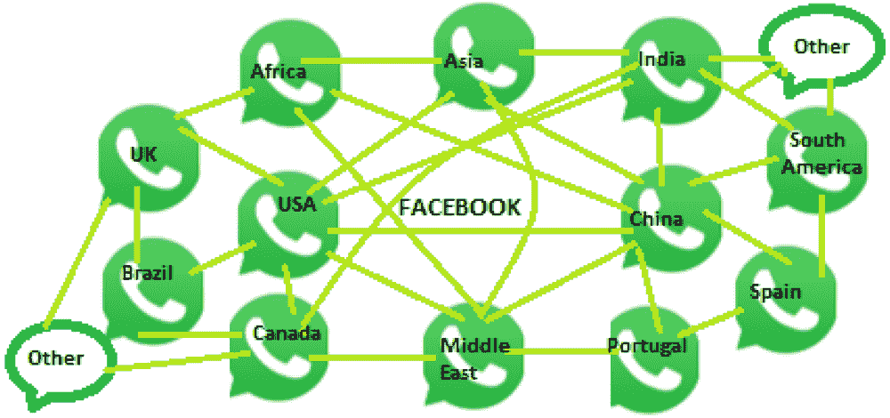 |

## WhatsApp 技术

在 Celik 和 Erdogmus (2015) 中，WhatsApp 技术使使用户能够看视频、听录制的音乐和消息，并与朋友、客户和供应商实时通话。

尽管智能手机应用在全球范围内广泛采用，但不同类型应用的用户接受度的实证研究仍然很匮乏，WhatsApp 的文献也是如此。在 Xiang, Soe 和 Jing (2015) 中，他们认为 WhatsApp 技术的使用及其普及程度在西方国家并不像在印度、非洲、巴西或阿根廷等新兴经济体那样大。在整个论述中，提到的“移动技术”或简称为“移动设备”是指代智能手机、i-Pads、i-Phone 或其他移动设备，这些设备通过电话或其他技术的应用实现了人与人之间的通信。

可用数据表明，WhatsApp（消息）在全球范围内都很流行，尽管社会技术背景不同，用户使用的技术是类似的（见图 2）。

k (1999) 认为对“原创性”并没有精确的定义。同行评审的科学期刊显示，评审可能是任意或无效的。Dirk (1999) 基于科学论文对评估原创性提出了一个观点。结论是，Dirk 认为判断原创性是否准确反映科学工作的最佳标准是持续参与其中的人员。

| 图 2 | 实时看、听、说 |
| :--- | :--- |
 |


在 Dahir (2016) 中，非洲有 46% 的人口订阅了移动服务，相当于 2015 年超过 5 亿人口。该地区三个主市场——埃及、尼日利亚和南非合计占了该地区总用户数的三分之一左右。随着负担能力挑战成为主要障碍，用户增长率现在开始放缓，并将日益向全球平均水平收敛。Dahir 估计，在未来五年内，非洲将有额外的 1.68 亿人通过移动服务连接，到 2020 年独立用户将达到 7.25 亿。Dahir 预测，少数几个主要市场将占据大部分增长。南非、尼日利亚、埃及、埃塞俄比亚和坦桑尼亚对新用户的贡献总和将超过三分之一。

Pew 研究中心（2016）认为，三分之一的南非人（34%）和约四分之一的尼日利亚人（27%）表示他们的设备是智能手机，即可以访问互联网和其他应用程序的设备。智能手机品牌包括 `iPhone`、`Blackberry` 或 `Android`。它们由 `Samsung` 或 `Lenovo` 等众多公司制造。在调查的其他国家，智能手机拥有率并不常见，在坦桑尼亚和乌干达，拥有率仍处于个位数。相比之下，截至 2014 年 12 月，美国有共有 64% 的人口拥有智能手机（见图 3）。

## 难民对移动电话的影响

可用数据显示，2016 年由于冲突和迫害，有前所未有的被迫离开或逃离家园，到年中全球流离所人口达到近 6400 万。冲突地区包括中东和刚果盆地以及世界其他地区。一个日益关注的领域是移动和数字技术在为难民建立独特数字身份方面发挥作用的机会。世界各地的人对手机都有自己的用途。例如，学生使用智能手机查找与学习相关的信息。对于学生来说，智能手机已变成了一个随身工具。

在 Horst 和 Miller (2006) 中，最近的牙买加研究表明，手机的使用并不是为了寻找工作或经营小生意。然而，手机手机已成为低收入人口生存策略的核心。为了理解为什么如此，我们需要检查手机如何融入其他形式的通信，以及手机和通话是如何被评估的。牙买加低收入人口对手机的看法是，这些设备在寻找产品方面很有用，随后会被买家以合理的价格购买并转售。利润空间非常大，使销售者能够盈利以负担家庭生活必需品。

牙买加或任何其他发展中经济体的边际消费倾向（`MPC`）可能高于 0.5，而边际储蓄倾向（`MPS`）低于 0.5（Keynes，1936）。在后的研究中，Barro 和 Grilli (1994) 建议边际消费倾向的构建适用于一个国家的个人和社区。目前的许多讨论似乎依赖于 `MPC` 是国家特有的且在此类经济体中是类似的；该理论适用于该术语的用法。然而，个人拥有 `MPC`，而且 `MPC` 在社会中并不完全相同。

例如，发展中国家有不同的 `MPC`，而发达国家在储蓄和消费方面也有不同的倾向。Barro 和 Grilli 认为，即使事实如此，消费的性质也不是同质的。某些消费可能比比其他消费对（经济）更有慈善。因此，支出可以在产生最大收益的地方进行目标化，从而产生最高（接近 1）的 `MPC`。因此，牙买加的消费者面临着诸如利用现有资源实现最大收益的机会等挑战。这种模式在快速发展的经济体中是独特的。

Horst 和 Miller (2006) 提出手机具有不同的含义和任务。然而，手机已成为低收入人口生存策略的核心。Barro 和 Grilli (1994) 认为……（此处根据原文逻辑衔接）。因此，牙买加的消费者面临着诸如利用现有资源实现最大收益的挑战。这种模式在快速发展的经济体中是独特的。


# WhatsApp 与竞争

非洲 IT 领域的持续变革引发人们的乐观情绪，认为移动手机可能有助于克服资源匮乏地区医疗服务提供中的基础设施障碍。在 Jin 和 Park (2016) 的研究中，`WhatsApp` 已处于为进步经济体中 80% 以上农村人口提供服务的前沿。与 `WeChat` 和 `Viber` 等其他拥有 46.8 亿和 20.9 亿活跃成员的提供者相比，`WhatsApp` 这一切这一切都是免费提供的。`LINE` 是另一种一种通信消息和电话的提供者，其客户群体正在不断扩大，预计到 2015 年底将达到 10 亿用户（Lomas, 2014）。这意味着 `WhatsApp` 必须继续为发展中经济体日益增加的需要者提供免费服务（Haddad, et al., 2015）。2012 年 8 月，`WhatsApp` 每天处理 100 亿条消息，从 2012 年 4 月的 20 亿条和去年 10 月的 10 亿条增长而来（Ahad & Lim, 2014）。2013 年 6 月 13 日，`WhatsApp` 宣布他们通过处理 270 亿条消息创了新的每日记录（Bradshaw, 2011）。

## 社会变革

在 Mupepi (2014) 看来，移动技术被成功部署以推进 2011 年埃及革命。手机被用于在革命成员之间发送短信，这些成员包括穆斯林兄弟会和许多其他政党，这使得他们 2011 年 2 月 11 日终结了霍斯尼·穆巴拉克的独裁统治。Mupepi 认为，阿拉伯之春革命可能没有被完全电视化——但它在 `Facebook` 上被推特、博客、发短信和组织，并在智能手机和其他设备上被讨论。在分析了超过 300 万条推文、数 GB 的 `YouTube` 内容和数千篇博客文章后，O’Donnell (2011) 发现社交媒体在塑造阿拉伯之春的政治辩论中发挥了核心作用。关于革命的对话往往发生在重大事件之前，社交媒体将激励人抗议故事传遍了国界。Mupepi 和 Mupepi (2014) 指出，社交媒体在 2008 年肯尼亚和津巴布韦的大选中被过度使用。这些选举遭到了反对派的激烈竞争。它们在手机上被谈论和讨论。

## 审查：冷战特征

对任何部分书籍、电影或新闻的压制或禁止源于第一次和第二次世界大战，并在冷战期间持续存在。根据 Kang (2011) 的观点，大多数社会主义国家的政府都试图审查社交媒体，但无法跟上如 `WhatsApp` 或 `LINE` 这样快速变化的技术，这些技术利用互联网界面作为通信平台。中国和古巴是某些试图将社交媒体制度化但未果的政府之一。O’Donnell (2011) 认为，2011 年阿拉伯之春期间的社交媒体在北非和中东传播了关于自由和民主的信息，有助于提高人们对政治起义成功的预期。

Mupepi 和 Mupepi (2014) 断言，抗议组织者利用智能手机拍摄伪装部队和警察车辆的照片以互相提醒。他们能够躲避警察，并有效地继续他们的抗议。抗议者能够使用智能手机建立广泛的网络来分享民主价值观，并对穆巴拉克政府发起了成功的抗议。社交媒体成为获得更大自由的工具包的关键部分，穆巴拉克最终于 2011 年被推翻。

## 西非的 WhatsApp

在 Pindayi (2017) 看来，媒体技术改变了西非的媒体生态系统，这意味着传统媒体专业人士不再对新闻内容的生成拥有垄断，因为人们现在会生成并共享自己的内容。用户生成的内容创造了无数可能，影响了人们相互互动的方式以及构建意义或日常生活的方式（Besma, 2014）。Web 2.0 的普及影响了人们如何相互联系并构建意义或日常生活（Besma, 2014）。用户生成的内容创造了无数可能，影响了人们相互互动的方式以及构建意义或日常生活的方式（Besma, 2014）。这种技术影响了人们如何相互互动的方式（Besma, 2014）。在南非，智能手机为政治动员提供了平台（Acemoglu and Robinson, 2016）。在肯尼亚，这种技术已经提供了平台（Mkhize & Madumi, 2017）。在肯尼亚，这种技术已经提供了平台（Mkhize & Madumi, 2017）。在肯尼亚，这种技术已经提供了平台（Mkhize & Madumi, 2017）。在肯尼亚，这种技术已经提供了平台（Mkhize & Madumi, 2017）。[注：重复]

## 机构隐私

政府有能力利用或滥用隐私。在 Poulter (2011) 看来，某些政府试图控制手机。第一是人口过大，第二是中国制造用于出口市场（Hu, Rodrique, & Yu, 2017）。根据 Madden 和 Rainier (2015)，美国人倾向于不容忍对其隐私和安全的干扰。

Stice (2017) 表示，科罗拉多州的一个小组想要向 13 岁以下的儿童销售手机。该群体随处可见手机。在学校走廊、家庭餐桌以及床头。该小组提问：通过精美的应用、社交媒体和视频消息连接世界，多小才算太小？在 (WHO, 2014) 看来，联合国渴望利用在许多社区中传播的新兴技术来解决贫困或健康问题。`WhatsApp` 的日益普及对公民通信的机构控制构成了挑战，因为它使用的是全球互联网而非国家通信基础设施。

技术的使用正在增长。Ahad 和 Lim (2014) 发现 `WhatsApp` 的使用者不仅仅是节钱的人（见表 1）。在 155 人的样本中，有 96.82% 是用户。这是一个巨大的用户规模，但样本太小，无法做出结论性判断。此外，增长经济体的用户无法完全量化。155 人的样本量是经验性的，而非决定性的。但它确实指向了一些趋势。

表 1. WhatsApp 使用的百分比和频率

| 人口统计 | 响应 |
| --- | --- |
| 性别 | |
| 男性 / 女性 | 21.02% (33 人) / 78:98% |
| 年龄组 | |
| 18-20 岁 / 21-23 岁 | 23.57% (37 人) / 40.76% |
| 系别 | |
| 艺术与社会科学学院 / UBD 商经学院 | 32.05% (50 人) |


# 45.51% (71)

## 采用情况

| 问题 | 结果 |
| :--- | :--- |
| 1. 您目前是否在手机上使用移动即时通讯工具 (MIM)，即 WhatsApp？ | a. 是：92.82% (152)<br>b. 否：3.18% (5) |
| 2. 您为什么要使用 WhatsApp（可以多选答案） | a. 易用且友好：92.41% (146)<br>b. 便于沟通：92.41% (146)<br>c. 节省时间：69.62% (110)<br>d. 节省费用：84.18% (133)<br>e. 信息检索和传输速度：72.15% (114) |

## 结合情况

| 问题 | 结果 |
| :--- | :--- |
| 1. 您通常在 WhatsApp 上花费多少小时？ | a. 每天 1-2 小时 27.7% (41)<br>b. 每天 3-5 小时 31.76% (47)<br>c. 每天 6-7 小时 11.49% (17)<br>d. 每天 8 小时以上 29.05% (43) |
| 2. 您主要使用 WhatsApp 的哪些功能？（可以多选答案） | a. 发送短信 91.1% (155)<br>b. 发送照片 94.94% (150)<br>c. 发送视频 47.47% (75)<br>d. 发送信息（新闻）62.03% (98)<br>e. 发送语音消息 41.77% (66) |

Ahad and Lim (2014)

## 改善健康

Boulos、Giustini 和 Miller (2016) 普普茅斯大学（英国）已利用社交媒体来补充传统的调查技术，以获得对广泛社会经济问题的见解。智能手机正被用于接触难以到达地区的人口，例如刚果盆的部分地区。Boulos、Giustini 和 Miller 提到了关注公共健康计划的研究，这些研究应用 `WhatsApp` 技术与位于刚果盆的个人科学家建立联系。研究机构必须使用适当的技术来访问位于常规边界之外的研究现场。

如果企业能够创造客户需求的产品，业务就能增长。普茅斯大学与其部分全球合作伙伴一起收集了关于黑猩猩移动的数据。这些数据可以进行分析，以了解这些动物的饮食以及它们吃什么来维持健康生存。其中一些信息可能有助于开发用于治疗性疾病的技术和药物。世界卫生组织 (WHO, 2014) 的一份事实表表明，手机技术可以解决难以访问地区收集数据时的某些流行病学挑战。村民能够从位于通常难以到达地点的农村卫生中心收集生物统计数据，并将数据传输到中心地点，例如卫生部总部或政府部门。世界卫生组织承认，手机或移动电话现在已成为现代电信不可或缺的一部分，因此应被纳入消除贫困和疾病的努力中。

在美国或英国等许多国家，超过一半的人口在使用手机，市场正在快速增长（见图 3）。2014 年，全球估计有 6.9 亿订阅用户。在世界某些地区，手机是可用可靠或唯一的电话（WHO, 2014）。

## 改善生计

该技术可以通过在没有固定电话的地区提供信息获取，来改善发展中国家最贫困人口的生计。智能手机还可以用于培育大量的微型企业，提供工作机会，例如在街上销售充值卡，以及维修或翻新手机。在肯尼亚、马里、乌干达等非洲国家，人们使用智能手机让朋友和家人知道婚礼、出生和其他活动。在 Cummings (2012) 中，电视行业已开始使用手机，通过移动应用程序、广告、社交电视和移动电视来驱动直播电视观看。

Cummings 认为，86% 的美国人在看电视时会使用手机。在世界许多地区，共享手机是一项普遍的现象。这在印度城市地区非常流行，因为家庭和朋友群体经常在成员之间共享一个或多个手机。Sharma (2012) 建议，印度政府已经颁布了法律，允许手机运营商的基础设施增长。政府允许运营商在政府建筑上建造天线，以增加城市和农村地区许多消费者提供者的覆盖范围和接收能力。至少政府认为，基础设施可以通过寻求满足消费者通信需求的企业家来开发。在印度，一个村庄仅有一部手机是很常见的。

## 医疗保健数据

智能手机中的 `WhatsApp` 通信与协作应用程序使其成为共享数据最有效的技术之一。智能手机具有许多特点。根据国际电信联盟 (ITU) 的数据，在发达国家，这些设备的使用量已经超过了早期手机系统，但在发展中国家仅占 20%。

## 与 WhatsApp 相关的其他收益

`WhatsApp` 为最不精通技术的人实现了技术的民主化。它让技术对于缺乏经验的用户来说不再难以上手。该应用程序更容易形成凝聚小组，并可用于实施已证明的知识管理方法，如实践社区、教训总结和最佳实践转移（O’Dell & Hubert,2005）。

该应用程序通过不同的多媒体格式促进知识共享。由于 `WhatsApp` 是一种移动多媒体应用程序，它可以向其他用户发送文本、照片、音频和视频。它还是一个跨平台应用程序，意味着可以在 iPhone、Android、Windows 和 Blackberry 等平台上运行。此外，它最近作为 Windows PC 通信应用程序的演进，增加了其在业务团队和协作中的应用潜力。`WhatsApp` 使得创建通信库变得简单，因为它具有集中共享信息的能力，并在某种程度上允许用户根据兴趣主题形成更小、更定制的小组。

## 网络安全问题

在美国，关于网络安全的讨论已取得进展，但私营和州组织之间关于风险管理的辩论并未停止。《2015 年网络安全信息共享法案》作为联邦法律颁布，旨在通过加强网络安全威胁信息的共享来提高美国的网络安全。该法律允许美国政府与技术制造公司之间共享互联网流量信息。该法案于 2014 年 7 月 10 日提交美国参议院，并于 2015 年 10 月 27 日在参议院通过。该法律的反对者认为，`CISA` 的价值是将责任从机密转移给政府，从而增加了个人分类信息的脆弱性，并将个人特权信息分散到包括国家安全局和当地警察在内的七个政府机构（Timm, 2015）。


关于俄罗斯是否影响了 2016 年总统大选的辩论仍在持续。希拉里·罗德姆·克林顿于 2009 年 1 月 21 日至 2013 年 2 月 1 日担任美国国务卿。联邦调查局（`FBI`）对相关指控进行了调查，即在其任内使用的个人电子邮件服务器上不当存储存储或传输了机密信息。到目前为止，还没有确凿证据表明，机密信息在其任内使用的个人黑莓电子邮件服务器上被不当传输（CBS 新闻，2016 年 3 月 16 日）。

联邦机构在应对特定网络安全威胁方面正变得日益有效。但根据德勤风险与财务咨询、德勤窦会计师以及咨询联邦网络风险服务部门的负责人 Golden 和 Mossburg (2018) 的说法，实现网络安全成熟的关键在于采取广泛的、基于风险的网络安全方法，以及为支持该方法的投入。Golden 和 Mossberg (2018) 提出，联邦首席运营官应与 IT 部门合作，关注潜在网络攻击对其业务运营和任务的影响，以及如何防御或减轻这些影响。Golden 和 Mossberg 建议，政府和私人组织都应该增加对网络安全支出决策的参与，帮助将网络意识融入其机构的文化中。

WhatsApp Messenger 是一种用于智能手机的专利跨平台即时消息客户端，采用订阅模式运营（Nagler, 2017）。它利用互联网通过标准的手机移动号码向其他用户发送短信、图像、视频、用户位置和音频媒体消息。当民主程度较低环境中的个人被国家情报机构强制交出设备进行检查时，它也会受到网络空间威胁的影响（Victor, 2017）。WhatsApp 在许多方面受到网络安全的影响。在巴西等新兴经济体中，政府曾试图审查智能手机以及如 `WhatsApp` 和 `Facebook` 等社交媒体应用。在 Pearson 和 Kuchler (2016) 的书中，司法部门采取行动临时封锁拉丁美洲最大增长地区的消息服务。

医生们争分时间与患者就联系方式进行最后的安排。据估计拥有 1 亿用户，这些由 Facebook 拥有的消息服务（作为巴西最受欢迎的应用家族）匆忙联系亲人，企业在政府因审查原因关闭消息服务之前，也向供应商和债权人进行了最后的安排。这是一次人权网络空间入侵，是一次人权侵犯。Pearson 和 Kuchler 反驳说，巴西法官禁止消息服务的行为威胁了业务扩张，并在经济低迷时实施了网络审查。

## 网络安全威胁

2016 年，美国政府撤销了强制 Apple 帮助 `FBI` 破解 iPhone 的订单，该 iPhone 是去年加利福尼亚州圣地诺大规模枪击案中一名袭击者使用的。据公告，`FBI` 已找到一种在没有 Apple 帮助的情况下访问手机内容的方法，这结束了司法部与这家全球价值最高公司之间为期七周的法律僵局（Leswing, 2016）。该公司不希望帮助 `FBI` 破解赛义德·法鲁克（Syed Farook）使用的 iPhone，事实证明，这并非必要。但 Apple 保护其设备用户数据的战斗才刚刚开始。这次胜利不会影响政府未来处理类似案件的方式，Apple 可能不得不反复进行同样的战斗。“从一开始开始，我们就反对 `FBI` 要求 Apple 在 iPhone 中建立后门，因为我们认为这是错误的，会开创一个危险的先例，”一名 Apple 代表在周一表示。

2016 年，美国政府撤销了强制 Apple 帮助 `FBI` 破解 iPhone 的订单，该 iPhone 是去年加利福尼亚州圣地诺罗大规模枪击案中一名袭击者使用的。据公告，`FBI` 已找到一种在没有 Apple 帮助的情况下访问手机内容的方法，这结束了司法部与这家全球价值最高公司之间为期七周的法律僵局（Leswing, 2016）。

联邦机构在应对特定网络安全威胁方面正变得日益有效。但实现网络安全成熟的关键在于采取广泛的、基于风险的网络安全方法，以及为支持该方法的投入，根据德勤风险与财务咨询、德勤窦会计师以及咨询联邦网络风险服务部门的负责人 Golden 和 Mossburg (2018) 的说法。Golden 和 Mossberg (2018) ，联邦首席运营官应与 IT 部门合作，关注潜在网络攻击对其业务运营和任务的影响，以及如何防御或减轻这些影响。Golden 和 Mossberg 建议，政府和私人组织都应该增加对网络安全支出决策的参与，帮助将网络意识融入其机构的文化中。

2016 年，美国政府撤销了强制 Apple 帮助 `FBI` 破解 iPhone 的订单，该 iPhone 是去年加利福尼亚州圣地诺罗大规模枪击案中一名袭击者使用的。据公告，`FBI` 已找到一种在没有 Apple 帮助的情况下访问手机内容的方法，这结束了司法部与这家全球价值最高公司之间为期七周的法律僵局（Leswing, 2016）。

国防部首次将将机密数据和应用程序迁移到 `AWS` 机密区域（Secret Region），这是多为 CIA 和情报社区开发的同一云环境。美国运输司令（负责在全球范围内移动部队和装备的部门）在 12 月宣布计划使用 `AWS` 机密云服务，此前该公司已扩大了对非情报机构的能力和可用性。

国防部的单一来源决策——即在没有充分公开竞争的情况下授予合同——遭到了微软的反对，微软本身向联邦政府提供各种云服务。该公司于 3 月 8 日撤回诉讼，允许运输司令开始向机密区域迁移数据。在给 Nextgov 的声明中，微软表示撤回诉讼是因为“涉及的问题已得到解决”，令公司满意。

微软和 `AWS` 被认为是另一项云合同的两个领先竞争者，即国防部的联合企业基础设施（JEDI）。美国国防官员在最近的一个行业日上解释说，`JEDI` 将为全球范围内所有密级的国防部提供云基础设施，包括偏远地区的战斗人员。市场分析师表示，此类合同在 10 年内的价值可能高达 100 亿美元。但当这些公司准备在今年晚些时候对该合同进行竞标时，运输司令对机密区域的使用是政府范围内云主权之战中一项重要的即时进展。


*   所有的 iPhone、Android 和 Windows 手机都具备通过 `WhatsApp` 在全球范围内发送无限消息的能力，并提供即时反馈。`Teams` 群组和个人可以相互倾听、交流并实时观察，以便为组织问题寻找解决方案。
*   移动端是数字化全球转型战略的首选平台。`WhatsApp` 适用于大多数智能手机，是触达快速增长的全球市场的一种高成本效益通信方式。
*   移动端有助于应对社会变化，并使联合国可持续发展目标变得更具现实。
*   2015 年，印度、非洲、巴西和阿根廷几乎有一半的人口订阅了移动服务。
*   向移动宽带的迁移正在加速，它在 2015 年贡献了非洲 GDP 的 6.7%，并创造了 3-8 万个可持续就业岗位。
*   `WhatsApp` 是开展全球研究的一种极具效益的工具，可用于收集混合研究方法的数据。

# 演示的局限性

`WhatsApp` 的组织性并不高。结果显示了年轻人如何将 `WhatsApp` 视为日常生活中一个“方便”的通信应用。使用 `WhatsApp` 产生的一些关键问题包括分心以及暴露在不受监管的消息或信息中。群聊按最后活动时间排序。除非大多数群聊与业务活动和知识管理有关，否则这被认为对业务排序并没有帮助。一些 `WhatsApp` 用户在尝试按相关性寻找焦点时，发现在其快速搜索功能上遇到了一些困难。除非群组确实非常专业，否则这可能会成为有效利用现有组织知识的障碍。

`WhatsApp` 对聊天群组的成员人数（100 限制）也有限制。这是一个新限制。需要注意的是，群聊的最初限制是 30 个成员。虽然这看起来可能是一个缺点，但它可以催生更具凝聚力的群组。当人数较少时，更容易就任务达成并共享工作。这种规模限制在文献中得到了支持。（Boundless, 2015）。邓巴巴数（Dunbar's number）是对能够形成稳定社会关系的人数的一种建议认知限制，估计约为 150 人左右。（Boundless, 2015）。这与 `WhatsApp` 对群组人数的限制非常契合。观察者越来越多地注意到按内容或专业领域的专门化细分。

## 结论

`WhatsApp` 可以成为帮助组织定位其关键知识并促进知识流的有用工具。组织面临的挑战之一通常是如何在正确的时间和地点获得所需的知识；时机是信息共享的核心。`WhatsApp` 正在将自己定位为一种可以提高生产力的强力工具。在社区方面，该应用程序可用于优化认识论社区的凝聚力，以创建、传播和分发在不同认知领域扩展运营所需的显性实践。它具有巨大的潜力，但某些局限性仍需额外的工作来解决。像 `Facebook` 这样世界上使用最广泛的社交媒体工具）公司的支持将有助于消除这些粗糙的边缘。有许多成功案例可以为公司利用 `WhatsApp` 让短小团队开展协作工作提供灵感和警示。

# 迈进之路

创建可利用的数据库将是最好的发展道路，因为 `WhatsApp` 已经存在了一段时间，现在可以创建一个拨号列表。口碑传播一直是一种用于创建可利用客户群的方法。例如，国际学生和本地学生均可以作为收集潜在客户名单的起点。在工作情况下，起点可以是 `Facebook`。公司可以从开设自己的 `WhatsApp` 和 `Facebook` 账户开始。可以将 `WhatsApp` 号发布在公司网站上，邀请感兴趣的方通过 `WhatsApp` 发送订单。

埃博拉病毒或疟疾等公共卫生疾病继续损害全球数百万人的健康。与相关机构的沟通对于遏制冲突和传染病的爆发至关重要。第一响应者救援的延迟加剧了 1994 年卢旺达大屠杀，而对埃博拉病毒的快速响应则遏制了利比利亚的疫情。在 `WhatsApp` 的网络中，与客户的沟通依然至关重要。`WhatsApp` 正被定位为一种可以提高生产力的强力工具。它是高成本效益的。

使用 `WhatsApp` 的优势

## 优点

*   各国政府已尝试阻止网络攻击。
*   所有的 iPhone、Android 和 Windows 手机都具备全球发送无限消息的能力。
*   `WhatsApp` 是一种非常有用的网络工具，可以帮助团队和个人找到解决方案。
*   用户可以接收附件文档、视频。
*   `WhatsApp` 允许 256 人入群。
*   端到端加密确保信息是安全的，不会向其他人显示。

## 缺点

*   某些国家的政府已尝试屏蔽互联网。
*   消息一旦发送无法删除。
*   群组的人数限制为 256。
*   在群组中只有管理员可以添加其他人。
*   聊天备份可能会混乱。
*   更换设备使用相同号码时，现有的聊天记录无法恢复。
*   垃圾信息和视频可能会耗尽所有空间。

# 参考文献

Acemoglu, D., & Robinson, J. A. (2016). Paths to Inclusive Political Institutions . Cambridge, MA: Massachusetts Institute of Technology.

Ahad, A. D., & Lim, S. A. (2014). Convenience or Nuisance?: The ‘WhatsApp’ Dilemma. Procedia: Social and Behavioral Sciences , 155, 189–196.

Arceneaux, N., & Kavoori, A. (2012). The Mobile Media Reader .

Berg, J. (2017). Political Participation in the Form of Online Petitions: A Comparison of Formal and Informal Petitioning. International Journal of Politics , 8(1), 14–29.

Besma, A. (2014). Writing through WhatsApp: An evaluation of students writing performance. International Journal of Mobile Learning and Organization , 8(3/4), 216–231.

Boulos, K., Maged, N., Giustini, D. M., & Miller, S. (2016). Instagram and WhatsApp in Health and Healthcare: An Overview. Future Internet , 8(3), 37.


- Boundless. (2015, 7 月 21). 团队规模对稳定性和亲密性的影响。Boundless 社会学。检索于 2015 年 10 月 14 日，来自：`groups-and-organization-6/group-dynamics-57/effects-of-group-size-on-stability-and-intimacy-354-4925/`

- Bradshaw, T. (2011, 11 月 14). `WhatsApp` 用户收到了消息。检索于 2015 年 9 月 18 日，来自：`00144feabdc0.html#axzz3m7aLXLqi`

- Buchanan, P. (2016). 警察暴力：美国黑人与蓝人的对比。加利福尼亚州赫莫萨海滩：Creator Press。

- CBS 新闻。(2016, 3 月 16 日). 邮件显示国家安全局（NSA）拒绝了希拉里·克林顿对安全智能手机的请求。检索于 2018 年 3 月 19 日，来自：`Http://www.CBS.Com`

- Çelik, B., & Erdoğmuş, F. (2015). 跨社会背景的手机依赖。收录 Yan, Z. (编辑)，《手机行为百科全书》(pp. 222–233)。宾法尼亚州赫尔希：IGI Global。doi:10.4018/978-1-4666-8239-9.ch019`

- CIA 事实库。(2017)。 访问国家：安哥拉、阿根廷、巴西、尼日利亚、南非。检索于 2017 年 9 月 9 日，来自：`https://www.cia.gov/library/publications/the-world-factbook/`

- Cummings, C. (2012, 7 月 18 日). 增加使用智能手机补充电视观看的美国人数。检索于 2015 年 9 月 16 日，来自：`http://techli.com/2012/07/pew-study-smartphones-tv/`

- Dahir, L. A. (2016). 非洲手机使用量在两年内翻了一番。检索于 2017 年 10 月 11 日，来自：`https://qz.com/748354/smartphone-use-has-more-than-doubled-in-africa-in-two-years/`

- Dirk, L. (1999). 原创性的衡量：科学的元素。《科学社会》，29(5), 765–776。doi:10.1177/030631299029005004`

- Fortuti, L., Pui-Lam, L., & Yang, S. (编辑)。(2006). 移动通信与大中华（大中华社会工作、社会政策和社会发展的 Routledge 研究系列）（第 1 版）。伦敦：Routledge。

- Golden, D., & Mossburg, E. (2018). 要从网络安全支出中获得价值，应关注业务影响。《华尔街日报》。检索于 2018 年 3 月 19 日，来自：`http://deloite.wsj.com`

- Haddad, R., Kelly, T., Charles, J., Teemu, L., & Vesa, S. (2015). 利用移动手机位置数据促进发展：提高援助的有效性。华盛顿特区：世界银行。

- Horst, H., & Miller, D. (2006). 手机：通信的人类学。英国牛津：牛津大学。

- Hove, K. (2016). 为什么禁止社交媒体是非法的。检索于 2017 年 10 月 7 日，来自：`https://www.newsday.com/2016/07/illegal-ban-social-media/`

- Hu, Z., Rodrigue, J., Tan, Y., & Yu, C. (2017). 产品流转、重新分配与增长。《经济行为杂志》，143–164。doi:10.1016/jebo.2017.0915`

- Jin, L.-Y., & Park, J. (2016). 平台化策略对移动应用持续性的影响。《国际移动通信杂志》，14(3), 291–308。doi:10.1504/IJMC.2016.07290`

- Kahenya, N. P. (2017). 利用社交媒体促进实时……收录于 Keengwe, J., & Bull, P. (编辑)，《转型数字内容与学习研究手册》(pp. 171–183)。宾法尼亚州赫尔希：IGI Global; doi:10.4018/978-1-5225-2000-9.ch010`

- Kang, C. (2011, 3 月 3 日). 中国计划追踪手机用户：引发权利侵犯。检索于 2015 年 9 月 16 日，来自：`http://voices.washingtonpost.com/posttech/2011/03/china_said_it_may_begin`

- Katombe, K. (2016). 刚果金：社交网络将从午夜开始被封。检索于 2017 年 10 月 7 日，来自：`http://www.aljazeera.com/news/2016/12/drc-social-networks-blocked-midnight-16121540`

- Keynes, J. M. (1936). 《就业、利率和货币通论》。纽约：Harcourt Brace and Joy。

- Konkel, F. (2018). 防御机构在抗议后开始向亚马逊转移数据。检索于 2018 年 3 月 19 日，来自：`http://www.nextgov.com`

- Leswing, K. (2016). 苹果赢了 FBI，但战争尚未结束。检索于 2016 年 11 月 11 日，来自：`http://www.businessinsider.com/apple-won-fbi-but-the-war-isnt-over-2016-3`

- Leung, L., & Liang, J. (2015). 手机成瘾。收录于 Yan, Z. (编辑)，《手机行为百科全书》(pp. 640–647)。宾法尼亚州赫尔希：IGI Global; doi:10.4018/978-1-4666-8239-9.ch053`

- Lin, T. C., & Chiang, Y.-H. (2017). 手机依赖症状对学术表现、不当手机使用和感知社交性的影响。《国际移动通信杂志》，15(6), 655–676。doi:10.1504/IJMC.2017.08681`

- Lomas, N. (2014). Line 在 2015 年前针对其消息应用的用户。检索于 2015 年 10 月 12 日，来自：`http://techcrunch.com/2014/04/14/line-targeting-whatsapp-users/`

- Madden, M., & Rainie, L. (2015, 5 月 20 日). 美国人对隐私、安全和监控的态度。检索于 2015 年 9 月 16 日，来自：`http://www.pewinternet.org/2015/05/20/americans-attitudes-about-privacy-security-and-surveillance/`

- Mkhize, M. C., & Madumi, P. P. (2017). 在南非通过非暴力策略解决警察暴力：寻求整体方法。收录于 Singh, S., & Erbe, N. (编辑)，《学校与社会非暴力的可持续愿景》(pp. 70–94)。宾法尼亚州赫尔希：IGI Global; doi:10.4018/978-1-5225-2209-6.ch005`

- Mupepi, M., & Mupepi, S. (2014a). 变革：多民主运动打破了非洲的暴政范式。《经济与可持续发展杂志》，3(1)。

- Mupepi, M., & Mupepi, S. (2014b). 阿拉之春：变革：多民主运动打破了非洲的暴政范式。《经济与可持续发展杂志》，3(1), 1-22.

- Mupepi, M. Ram V. T. Sorensen. (2005). 在撒哈拉以南非洲建立有效能力：赞齐比河谷的经验。东部管理学院开普敦商学院。

- Nagler, A. (2017). 什么是 `WhatsApp`？检索于 2017 年 10 月 22 日，来自：`https://www.usatoday.com`

- Newman, N., Dutton, W. H., & Blank, G. (2012). 变化新闻生态中的社交媒体：英国的第四第五。《互联网杂志》，7(1), 6–22。

- O’Dell, C., & Hubert, C. (2011). 知识的新优势：知识管理正在改变我们的经营模式。新泽西州霍霍肯：John Wiley and Sons。

- O’Donnell, C. (2011). 新研究量化了阿拉伯之春社交媒体的使用。检索于 2015 年 10 月 14 日，来自：`http://www.washington.edu/news/2011/09/12/new-study-quantifies-use-of-social-media-in-arab-spring/`

- Okeleke, K. (2017). 难民与身份：移动辅助注册与援助的考量。检索于 2017 年 10 月 12 日，来自：`https://www.gsmintelligence.com/research/tags/full-report/`

- Olson, P. (2014a). Facebook 完成 190 亿美元 `WhatsApp` 交易。《财富》，10 月）：6。

- Olson, P. (2014b, 3 月 4 日). 深度解析 Facebook-`WhatsApp` 大交易：求婚、秘密会议、190 亿美元的扑克游戏。《财富》。

- Pearson, S., & Kuchler, H. (2016, 5 月 25 日). `WhatsApp` 司法部门临时阻塞拉美最大争议地区的消息服务。检索于 2018 年 3 月 19 日，来自：`http: www.financialtimes.com`

- Pew Research Center。(2016). 非洲的手机：通信生命线。检索于 2017 年 10 月 11 日，来自：`http://www.pewglobal.org/2015/04/15/cell-phones-in-africa-communication-lifeline/`

- Pindayi, B. (2017). 社交媒体的使用与影响：非洲 `WhatsApp` 例。收录于 Nelson, O., Ojebuyi, B., & Salawu, A. (编辑)，媒体对非洲社会经济发展的影响》(pp. 34–51)。宾法尼亚州赫尔希：IGI Global; doi:10.4018/978-1-5225-1859-4.ch003`


Poulter, S. (2011, 1 月 27 日). 信用卡的终结？只需在 iPhone 上刷一下，你就能为购物支付费用。检索于 2015 年 9 月 16 日，源自：http://www.dailymail.co.uk/sciencetech/article-1350709/iPhone-5-credit-card-Pay-shopping-swipe-mobile-phone.html

Quora.Com. (2017). WhatsApp 的优点与缺点。检索于 2017 年 10 月 13 日，源自：https://www.quora.com/What-are-the-advantages-and-disadvantages-of-WhatsApp

Rouse, M. (2015). Tech Target 的 IT 百科全书。检索于 2015 年 9 月 16 日，源自：http://www.techtarget.com/contributor/Margaret-Rouse

Sharma, P. (2012). 强品牌是虚拟世界中竞争优势的来源吗？见 Kapoor, A., & Kulshrestha, C. (编), 品牌与可持续竞争优势：构建虚拟存在 (第 4–23 页)。宾夕法尼亚州赫尔西：IGI Global；doi:10.4018/978-1-61350-171-9.ch002

Siddiqui, F., Alam, M. I., & Raina, R. L. (2014). 从 Facebook 到 WhatsApp：印度社交网络的情绪变化。《国际公民参与与社会变化杂志》，1(2), 23–36。doi:10.4018/ijcesc.2014040102

Stice, A. (2017, 6 月 19 日). 某团体希望禁止向 13 岁以下儿童出售智能手机。《今日美国》。

Timm, T. (2015, 6 月 13 日). 任何名称的政府监控法案同样危险。检索于 2018 年 3 月 18 日，源自：http://www.guardiannewspaper

Victor, D. (2017, 2 月 14 日). 如果边境执法人员搜你的手机，你有哪些权利？检索于 2018 年 3 月 19 日，源自：Http://mobilenytimes.com

世界卫生组织. (2014). 电磁场与公共健康；手机事实清单第 193 号。检索于 2015 年 9 月 16 日，源自：http://www.who.int/mediacentre/factsheets/fs193/en/

Xiang, J.-Y., Jing, L.-B., Lee, H.-S., & Choi, Y. (2015). 感知享乐和感知风险对娱乐型/实用型智能手机应用影响的比较分析。《国际网络与虚拟组织杂志》，15(2/3), 120–135。doi:10.1504/IJNVO.2015.070422

Yeo, I., Cong, J., Soe, K. M., & Jing, F. (2012). 不同平台的智能手机应用浪潮与趋势。见 Sharma, R., Tan, M., & Pereira, F. (编), 理解互动数字媒体市场：框架、平台、社区与问题 (第 205–217 页)。宾夕法尼亚州赫尔西：IGI Global；doi:10.4018/978-1-61350-147-4.ch017

# 第 9 章

Shalin Hai-Jew
美国堪萨斯州立大学

## 摘要

人们对各种网络安全专业工作的需求非常高，且在其他条件不变的情况下，这种需求在短期内可能持续增长。虽然有了更正式的就业途径（如高等教育路径），但网络安全领域的表现至关重要。尽管有了更正式的就业途径，但网络安全领域的表现至关重要。此外，本文探讨了网络安全人才培养的各个方面。（注：此部分根据上下文逻辑翻译）

## 引言

乔治·斯莫莱（George Smiley）：无论叫什么名字，都一样危险。”《间谍》(1974, 2012，“网络安全”定义为“为了保护网络、程序免受攻击、损害或未经授权的访问使用的一系列技术……”

## 现状

网络安全劳动力缺口。在这一关键且动态的领域，有许多努力正在进行，特别是随着物联网（IoT）的出现。随着网络工具被应用于家庭、医疗、汽车和其他空间，对网络安全专业人才的需求将进一步扩大。

（注：翻译过程中部分原文句子存在断句或重复逻辑，已根据高级文档工程师逻辑进行了平顺处理）


随着网络技术的普及，在早期，拥有“黑客”技能的个人曾备受青。尽管该领域在某种程度上已逐渐规范化（通过实习、竞赛、日益增长的技术认证、本科及研究生学位、后期研究、网络防御竞赛以及对网络工作和网络安全人才框架的正式建模），但对于有才华的自学独行者（白帽）等人来说，仍有空间。这部分是因为该领域非常“火热”且需求极高……另一部分是因为威胁格局如此动态且难以预测。这项工作研究了该领域的人士（处于职业早期、中期和后期）如何在各种类型的社交媒体平台上构建在线网络安全“名片”。

### 假设
为了探索社交化网络上的网络安全画像构建，本工作探讨了三个相互关联的假设。假设如下：

*   **假设 1**：简化和总结个人专业网络安全画像的方法基于两个通用维度：(1) 目标技能和 (2) 人格属性。
*   **假设 2**：人们（个人和集体）在社交网络上创建的网络安全“名片”，这些名片可能部分反映了他们的 (1) 目标技能和 (2) 人格属性[与网络安全工作相关]。
*   **假设 2a**：不同类别的社交媒体对目标个体提供不同的见解和信息水平。
*   **假设 2b**：在线网络安全“名片”会影响网络安全人才挖掘、猎头寻找和招聘、职业转型、面试和测试设置以及其他基于工作的设计。
*   **假设 3**：设计和交流网络安全名片存在（有效或不有效）的方法。
*   **假设 3a**：在“言”与“行”之间更保持一致的名片将更具说服力。（这指的是“廉价言论”与“高成本信号”之间的区别。）
*   **假设 3b**：关注“社会效益”的名片将比基于商业利益的名片更有效。

图 1 描述了一个简化的网络安全雇佣序列，以及在线名片如何影响各个阶段的过程：从猎头寻找到面试和测试，到招聘决定，再到实际分配的工作和团队协作（均在雇佣法和伦理实践的适当范围内），最后到员工留任与发展。该序列的每一个方面都非常重要。公共和私营行业网络安全人才短缺凸显了留住该领域人才的需求（Nissen & Tick, 2017）。

| 图 1. 简化的网络安全雇佣序列 |
| --- |
| 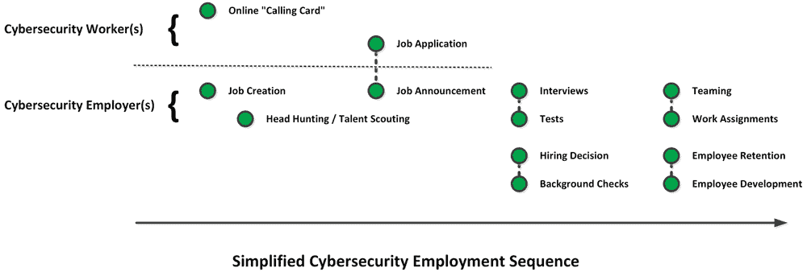 |
| --- |

## 方法论
以下是对相关文献的综述。然后，对处于网络安全职业不同阶段（早期、中期和后期）的个人进行了便利抽样。为了简单起见，通用的、任意的划分标准如下：职业早期（0 – 14 年），职业中期（15 – 29 年）以及后期/成熟期（30 – 50 年）。在职业早期类别中，研究了两名女性和一名男性——均为美国人；在职业中期，研究了七名男性（他们来自三个不同的国家）；在职业后期，研究了一名男性和一名女性，均为美国人。作者试图捕捉人口统计学上具有多样性的个体——通过年龄（20 代到 70 代）、性别（女性和男性）、背景（教育背景从高中学历到大学学历，在公共和私营行业的工作经历，对网络安全多个方面的专业知识等）。被研究的来自三个不同的国家：美国、俄罗斯和芬兰。如果有更广泛的组合会更好，但在跨社交媒体平台和数据模态的信息共享方面存在其他限制。

## 局限性
虽然探索了广泛（且分散）的社交媒体数据类型，但并未使用该类别中的所有领先或流行的品牌社交媒体服务。运营相应网站的公司往往位于西方，且大部分信息是用英语（和西班牙语）收集的。采样是 2017 年 10 月期间几周内的时间点采样。这意味着被删除的消息将无法被捕获（如果采用持续监控，例如通过 `Google Alerts`，就可以捕获）。此外，研究处于网络安全职业不同阶段的十几个人在定义上是有限的，且基于便利抽样。

研究未包含并不罕见的匿名账号。这些账户可以通过计算链路分析（例如通过具有开源和商业版本的 `Paterva’s Maltego`）识别出来，但随后需要进一步探索以验证账户所有权。如果能以某种确定性这一点，那么就可以从这些账户中得出一些见解。本研究未追踪与目标个体相关的匿名账号。

这种方法除非自动化并使用抓取数据（例如借助获取开源情报的工具），否则是不可扩展的。（在商业软件市场上，有某些工具能够收集部分信息，但作者尚未发现任何能够在此处列出的系列社交媒体平台和网站上全面采集此类数据的工具。此外，在没有足够的消歧的情况下针对同名者存在挑战。）尽管如此，由于需要人工关注和分析，这种方法无法大规模应用。

此外，相同的数据点可能被以不同的方式解释为优缺点。例如，对于一个在众筹网站上为新公司、新培训或新办公室募集资金的网络安全专业人士，应该如何看待？这种资金募集是积极主动的信号吗？这种请求是个人财务状况的信号吗？根据目标个体和专业网络安全背景解读数据点将产生影响。这一现实引出了重要问题：应该如何使用在线“名片”？

这种自我映射方法或许应该用于通用评估和可能的“标记”，以便日后探索和更深入的研究（使用经过证实的真实数据）。在工作中，个体将不会被具体到姓名，因为分析是非确定性的且不完整的，且野外数据是有限（部分）且充满噪音的（不公正的）。此外，虽然“描述性”细节很重要，但那些可能识别研究主体的个人身份信息（PII）的内容也被省略了。


劳动法对求职者也设有保护措施，这些数据应当在公平且基于法律和政策的背景下被理解和应用。此外，拥有卓越技能组合的人通常被赋予更大的空间来展现个人个性，而反之有时也如此，即拥有丰富社交技巧和政治背景的人即使技术才华较少也能顺利过关。对于这一领域，采用“大帐篷”方法是合理的，只要不会引起不必要的风险。人们特征的框架设定会影响一组事实被以何种方式来解读。

然而，这里的价值在于，在网络和互联网上对自我（个人和实体）进行画像分析，可能为能力和性格提供洞察，特别是在涉及敏感的工作中——涉及恶意（以及恶意行为）、非恶意的无能（无意中伤害）以及效率低下。考虑到招聘和留才的高成本，利用公开信息可能是是有优势的。最后，此处提到的技术并不认可。

## 文献综述

让网络安全领域更具吸引力的努力正从多个方面进行。有一种战略性信息认为这种工作是“英雄式的”：

> 关键特征，无论是自我牺牲、保护、情报、创造还是技能，都在于个人以一种超越正常预期的方式脱颖而出，并受到他人的高度赏。（Nugent & Collar, 2015, p. 1）

另一个团队指出，有必要构建网络安全工作，使其具有回报感（Parker, Winslow, & Tetrick, 2016）。已经有尝试通过游戏化元素接触大一新生，以测试他们对信息技术的兴趣；即使学生进入了其他领域，对信息技术的接触也让他们更具就业竞争力（Cunha, Winders, Rowe, & Cornel, 2016）。社区学院定位为为网络安全专业人士提供必要的培训和认证（Koermer, 2014），大学以及私营行业的一些实体也是如此。

人才招聘的挑战不仅涉及总性的短缺，考虑到劳工统计局的报告，网络安全领域还需要更多的女性和少数族裔，“12%的网络安全专家是女性，10%为非洲裔美国人，15%为拉丁裔，尽管某些职位的数字非常小，以至于这些数据被发现是不可靠的”（Shumba, et al., 2013, p. 2）。

针对代表性不足的人群开展网络安全工作的招聘努力包括：确保领域内使用中性的非性别化语言、以文化敏感的方式分享网络安全信息、建立导师网络、为高中生和大学生举办网络安全会议、为 K-20 受众建立多元化的演讲人团、支持教育计划的发展、提供奖学金等（Shumba, et al., 2013, pp. 9 - 10）。

另一项努力涉及对其他职业的人员进行重新培训，使其进入网络安全领域（Shumba, et al., 2013, p. 10）。另一位研究人员强调了“利用机会窗口，允许希望进入网络安全领域的个人通过教育和培训来实现这一目标”（Vogel, 2016, p. 34）。网络安全的人力资源供应链（又称管道）延伸自“从学前到大学、认证、培训和其他终身学习机会”（Wilson & Ali, 2011, p. 18）。

网络安全领域在人口统计上的某些差异被归因于科学、技术、工程和数学（STEM）学科的准备，这些学科“与其种族、族裔和性别强相关，且差距随年龄增长而恶化”（Shumba, et al., 2013, p. 3）。在美国，个人在正规教育过程中会脱离 STEM 管道。

从最早的儿童学习开始，学习者习得的知识和技能可能会聚合成一个能够有效参与网络的个人。为了应对这一挑战，多个方面都付出了努力：政策、教育、招聘、技术等。目前，虽然出现了新的网络安全学士和硕士学位，但对于那些没有遵循正规教育、培训和职业路径的人来说，仍然存在机会。自我定义和创新有一定的空间，那些能够在行动中证明自己技能（例如在网络安全竞赛中）的人在该领域有一席之地（Balaish, 2017）。从某种意义上说，该领域可能持续非传统思考者提供空间，因为网络不断演变、复杂、有害且难以捉摸。

在网络安全行业内部，文化是“完全偏执的”（Rose, 2012），他们的怀疑精神经过充分调整，以防止受到入侵和被对手“pwning”（玩家拥有或被击败）。作为这种谨慎心态的延伸，大多数人不会在网上过度分享信息，因为他们知道泄露的任何内容都可以被当作诱饵、鱼叉式钓鱼和虚假陈述（例如使用个人信息假装朋友或同事以诱骗他人）。这种文化对表现风头存在警惕，对他人的主张深表怀疑：非凡的主张需要非凡证据（这一断言归于卡尔·萨根）。然而，当人们在广泛易获取的公共空间发表主张时，他们会引发他人的兴趣和自发的侦查工作。他们激励他人去检查他们的记录以验证所有可测试的命题，以便实际记录在某些部分被“锁定”，而在另一些部分可能被反驳。社交网络可能会被映射，正式的和非正式的临时关系可能会被观察和记录。正如公共信息可能会引起兴趣一样，在线“名片”也是如此。此处“名片”的用法既是指名片（business card），也是指一种独特的专业“签名”。

在网络安全领域，有两个主要焦点：(1) 目标技能和 (2) 人格归因。“目标技能”是那些在职业角色中能很好服务个人的技能：对技术的理解、对人的理解、应用逻辑、精确性、清晰的书面交流等。理想的“人格属性”是性格方面、信誉度、软技能（如人际沟通）、韧性等。伦理上的健全性从早期就是一个备受关注的问题，一个研究小组指出：“网络安全的敏感性和机密性要求受训者不仅要是优秀的学生，还必须是伦理上健全的人格”（Cunha, Winders, Rowe, & Cornel, 2016, p. 26）。这些概念在图 2 的 2x2 轴图中表示。按规办事招聘网络安全专业人士将位于右上象限，即具有高目标技能和“契合”（该领域或领域）的人格特征的候选人。

图 2. 网络安全领域的就业招聘：目标技能与人格属性（2 x 2 轴）

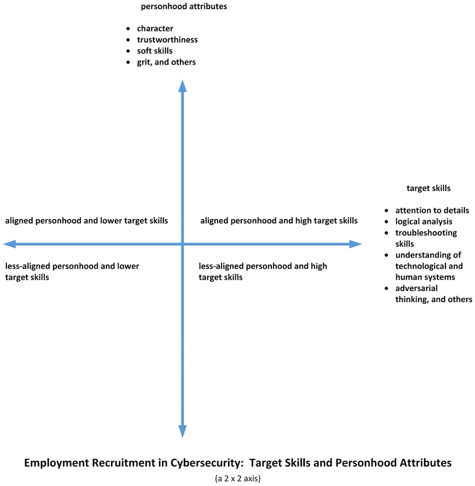


2013 年，一个专家委员会汇集在一起，考虑将网络安全专业化并正式建立劳动力发展路径是否是一个好主意（《使国家网络安全劳动力专业化？决策标准》，2013 年，第 ix 页），他们的结论之一是，过早使该领域专业化可能会适得其反（第 28 页）。他们的主要结论之一：“由于网络安全不仅是一项技术工作，一支有效的国家网络安全劳动力需要广泛的背景和技能”（第 24-25 页）。在这份初步报告发布几年后，另一位研究人员观察到了网络安全中多样化技能的重要性：

> 网络安全是一场能力的竞争。漏洞是无尽的，因为它们源于不断扩展的人类智慧、想象力和创造力。因此，网络防御者的使命在不断变化；最佳实践的启发式半衰期几乎为零，因为每天都会带来新的攻击向量、利用技术或数据外泄目标。（Tobey, 2015, 第 32 页）

专业人士已经开始定义从事网络安全工作的理想特征和天赋能力。国家网络安全教育倡议（NICE）已宣布了解决美国技能型网络安全人才短缺的目标。NICE 提出了一个概念化网络安全工作的框架，包括：安全配置、运营与维护、保护与防御、调查、收集与执行、分析以及监督与治理（《NICE 网络安全劳动力框架》，2017 年）。这些行动是高层次且通用的，适用于该领域内的系列需求。Saner、Campbell 和 Bunting（2015 年）将 `NICE` 框架概念化如下：

*   `Securely Provision`（安全配置）：IA（信息保证）合规性、系统需求规划
*   `Operate and Maintain`（运营与维护）：数据管理、网络服务
*   `Protect and Defend`（保护与防御）：CND（认证网络防御）分析、应急响应
*   `Investigate`（调查）：数字取证、调查
*   `Collect and Operate`（收集与执行）：收集行动、网络行动、网络行动规划
*   `Analyze Threat`（威胁分析）：分析、利用分析、全源情报
*   `Oversight and Development`（监督与发展）：法律建议、教育、`ISSO`、`CISO`（幻灯片 15）。

网络安全领域已经存在某些认证，例如注册信息系统安全专家（CISSP 认证），但这些是针对特定背景和特定专业角色的。使用针对特定领域的认证而非实际的专业表现指标，要求主管人员：

……几乎完全依赖专业认证，而这些认证旨在评估对领域知识的掌握，而不是在压力下工作的技能或能力。为了试图通过胜任的招募人员来填补知识-技能缺口，已经负担过重的网络安全工作人员必须花费大量时间设计和监督“闯关测试”，潜在的新的人才必须通过这些关卡，以证明他们有满足当前和预测工作需求的能力。这种“专家眼光”的方法成本高、容易出错，并且只能在以前成功吸引过顶尖人才的组织中成功，从而产生马太效应：那些才华横溢的人可以招募最优秀的人，而最需要的人却无法提高准确评估漏洞或响应攻击的能力。（Tobey, 2015, 第 31 页）

由于该领域的需求，考虑到需要“实时或深思熟虑的表现以及主动或反应性的行动”，“通用智力”是一个重要因素（Campbell, O’Rourke, & Bunting, 2015 年，第 721 页）；“非认知属性”也同样关键（第 722 页）。同样，网络安全工作需要技术专长以及非技术知识（Hoffman, Burley, & Toregas, 2012 年，第 33 页）。鉴于网络安全工作的范围，相应的角色需要不同的“技术技能、气质……（以及）认知能力”（Campbell, O’Rourke, & Bunting, 2015 年，第 721 页），早期的工作进入了网络天赋评估（`CATA`），并对工作的一些理想天赋进行了定义。预期的“知识、技能和能力”（`KSAs`）取决于工作场所的背景和条件，尚没有完全定义的、公认的要求。在网络安全领域工作的人还需要了解他们工作所依据的法律（Appazov, 2014）。

网络安全专业人士还必须在高压和模糊的环境工作，这有时会在网络安全竞赛中进行某种模拟，以寻找具有倾向天赋的人才。对网络防御竞赛的一项四期研究发现，竞争者需要准确的态势感知，以便在模拟的关键事件中做出有效反应，特别是以下步骤：

1.  建立情境（或场景）以定义工作角色中的情境专业知识；
2.  详细说明决定成功表现的目标和客观指标；
3.  根据工作角色识别实现目标所需的职责；
4.  详细说明任务、方法和工具，以及能力如何根据专业水平或达到该专业水平的难度而有所不同。（Tobey, 2015, 第 32 页）

计算机安全事件响应小组（`CSIRTS`）成员的必要技能包括需要“调查技能、获取新知识并与他人分享这些知识的愿望、解决问题的能力、好奇心以及细节的关注”（Chen, Shore, Zaccaro, Dalal, Tetrick, & Gorab, 2014 年，第 65 页）。他们还需要社交技能以与他人分享信息并进行协作（第 65 页），并且必须能够“检测常规材料或数据中的模式”（第 65 页）。网络安全专业知识必须具有适应性，它不仅仅关乎学习启发式方法或规则。例如，多项研究指出网络安全日益增长的复杂性，包括对机器学习（Fraley & Cannady, 2017 年）和人工智能（Moore, 2017 年）的应用。无疑，推进该领域需要新的研究。

软技能在网络安全中至关重要（Schirf & Serapiglia, 2016）。在另一项研究中，研究人员对网络安全参赛者进行了调查，试图识别哪些因素使网络安全竞赛能够说服参赛者“追求网络安全职业”，他们发现那些“表现出更高自我效能感、理性决策风格和对调查更有兴趣的人更有可能在比赛后对网络安全职业表示兴趣”（Bashir, Wee, Memon, & Guo, 2017 年，第 153 页）。网络安全竞赛还向已经在网络安全领域工作的人传递了“有用技能”，特别是“反向工程和分析技能”（Wee, Bashir, & Memon, 2016 年）。

许多著作探讨了如何为网络安全工作人员建立有效的教育路径。一个作者团队认为，以“整体性”的方式将“教育者、职业人士、雇主和政策制定者”聚集在一起对于设计至关重要（Hoffman, Burley, & Toregas, 2012 年，第 33 页）。另一组团队访谈了网络安全课程的学习者，以了解他们的收获（Bell, Sayre, & Vasserman, 2014）。也有从他发展经验中学习的机会。针对初高中学生创建了一种游戏，让他们了解更多网络安全知识，因此对未来网络安全学习者和专业人士的招募得早（Stumbaugh, 2016）。已有关于网络安全教育和培训学习者最佳实践的早期研究（Beuran, Chinen, Tan, & Shinoda, 2016）。


虽然网络安全领域的文化是保持低调，并将信息传递针对预期的接收者而非广大公众，但同时也存在向公众伸触接触的需求，以通知他们网络安全风险和数据泄露问题。需要引入新人来更新人才库。此外需要与政策制定者接触，以确保制定适当的政策并提供充足资金支持这项工作。任何想要参与思想交流的专业人士必须在某种程度上向公众公开，而且在注意力经济竞争激烈的背景下，他或她最好足够精明，或者雇佣他人来推广某种概念、实践或态度。

向公众进行战略性信息传递，特别是在这个**社交时代**（Social Age），可能是网络安全技能组合的核心部分。许多从事网络安全工作的人员在各种社交媒体和其他网站上创建了在线简介，包括：

* 1. 招聘网站（在线职位招聘公告板）
* 2. 社交分享网站（微博客、社交网络）
* 3. 信息共享网站（新闻共享网站、众包百科网站、非正式信息共享网站）
* 4. 社交图片分享网站
* 5. 社交视频分享网站
* 6. 社交代码共享网站
* 7. 学术出版（订阅制和开放获取）
* 8. 学术研究共享网站
* 9. 开源教育 / 培训网站（大规模开放在线课程或 MOOC 平台，数字学习对象库 / 参考库）
* 10. 众筹筹款网站

上述类网站通常不是用于简单的单向广播用途（例如一对多）。相反，这些网站是通过交互方式使用的——即在双向窄众播交互、多路窄众播交互（例如在群组中）以及多对多的交换。交互类型可能包括：评论、电子邮件、视频回复、数字数据共享等。

可以对从相应网站可能获得的信息做出一些简单假设（表 1）。通过汇编来自这些相应网站的多模态数据（文本、图像、音频、视频等），可以为从事网络安全工作的人员创建针对性的个人简介或电子档案。这些简介与正式的大众媒体和官方政府记录（包括法院记录和工商备案）形成互补，而这两者在网上都可以广泛获取。本研究未包含大众媒体报道和官方政府记录的原因是，它们并不是直接塑造个人职业“名片”的一部分，尽管这些经过某种验证的正式数据流具有信息价值，并且在聘用敏感职位时无疑会经过正式检查。

大众媒体报道可以在开放网（Open Web）获取，而许多政府记录可以在深网（Deep Web）获取（通过 `pipl.com` 等服务）。可以通过搜索很容易找到刑事记录，这可以使人们的策略性隐藏行为失效（通过雇佣服务创建出现在搜索引擎结果前几页的链接，并将负面信息“埋”在更深处）。

### 表 1. 社交分享网站类型……以及个人网络安全档案可能的可用信息

| 社交媒体网站类型 | 个人网络安全档案可能的可用信息 |
| --- | --- |
| 招聘网站 | • 完整的简历 (CVs) 或简历（包含正式教育、正式培训、工作经历、奖项、会议演讲、出版物等）、推荐信、成绩单、专业简介、照片等 <br>• 预期薪资 |
| 社交分享网站 | • 完整的简历 (CVs) 或简历（包含正式教育、正式培训、工作经历、奖项、会议演讲、出版物等）、推荐信、成绩单、专业简介、照片等 <br>• 预期薪资 |
| 社交分享网站 | • 完整的简历 (CVs) 或简历（包含正式教育、正式培训、工作经历、奖项、会议演讲、出版物等）、推荐信、成绩单、专业简介、照片等 <br>• 预期薪资 |
| 社交分享网站 | • 完整的简历 (CVs) 或简历（包含正式教育、正式培训、工作经历、奖项、会议演讲、出版物等）、推荐信、成绩单、专业简介、照片等 <br>• 预期薪资 |
| 社交分享网站 | • 多路社交分享网站<br>• 社交分享网站<br>• 社交分享网站<br>• 社交分享网站<br>• 社交分享网站<br>• 社交分享网站<br>• 多路社交分享网站<br>• 社交分享网站<br>• 社交分享网站<br>• 社交分享网站<br>• 社交分享网站<br>• 社交分享网站<br>• 社交分享网站<br>• 社交分享网站 |

（注：由于原文中表格内容存在大量重复和碎片化，此处已根据提供的文本逻辑进行了格式化处理。）


# 对该领域的贡献 || 某种程度的成名

在探索目标个体时，还出现了其他可以丰富研究的姓名，但使用合理的便利样本进行研究是至关重要的。由于这些要求，往往倾向于选择那些处于职业生涯中期和晚期的个人。然而，本项工作涵盖了整个职业阶段的代表性人物（如图 3 所示）。

| 图 3. 职业阶段光谱的目标网络安全专业人士 |
| --- |
| 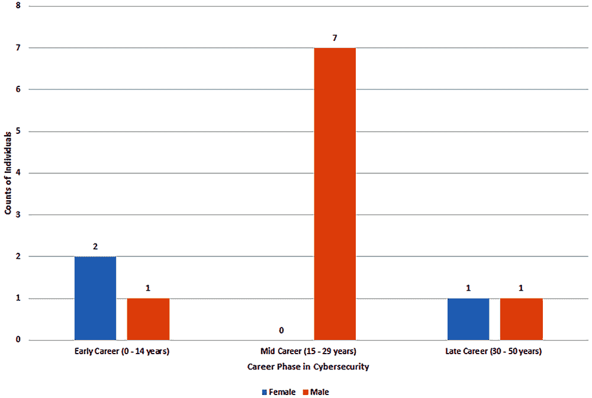 |
| --- |

衡量在线声誉的另一种方法是使用长时间采集的大规模搜索数据。对所选的十几个人进行了 `Google Correlate` 探索，以查看他们是否具有足够的声望，使得 `Google Searches` 他们的名字会产生一些网络安全相关的内容。在这项探索中，12 个名字中只有 3 个与网络安全术语具有相关性。其中一位是长期网络安全博主，拥有多部著作；另一位曾因利用漏洞入狱，后转为“白帽”；第三位是曾被 FBI 招安但仍入过狱的高知名黑客。为了出现在 `Google Correlate` 中，这些个人似乎必须在大众媒体和社交媒体上被广泛认可。其中一张截图显示了针对大规模搜索数据和长时间的相关性搜索的脱敏版本（图 4）。

| 图 4. 一位网络安全大师的名字及其在长时间内的按月 Google 相关性搜索（2004 年 – 2017 年） |
| --- |
| 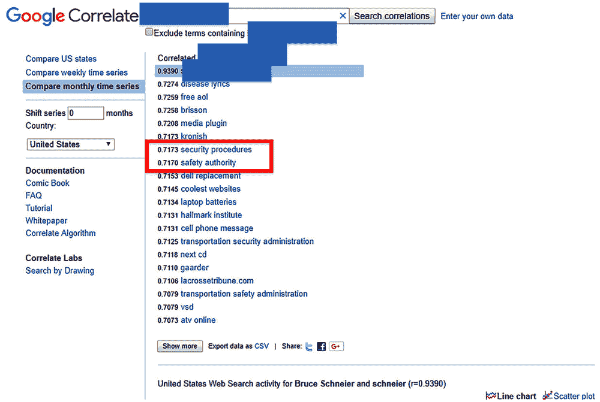 |
| --- |

根据前文“局限性”部分提到的原因，这些个体的具体身份已被隐藏。尽管作者努力保持身份保密，但可能有足够的信息来进行一场轻微的身份猜测游戏。表 3 显示了这十几位被描述的个人活跃过的各种社交媒体平台类型。

表 3. 通过社交媒体平台类型的阈值存在情况筛选潜在目标

|   || 1 || 2 || 3 || 4 || 5 || 6 || 7 || 8 || 9 || 10 |
| --- | --- | --- | --- | --- | --- | --- | --- | --- | --- | --- |
| 招聘网站 | 社交网络与共享网站 | 信息共享网站 | 社交图片共享网站 | 社交视频共享网站 | 社交代码共享网站 | 学术出版网站 | 学术研究共享网站 | 开放教育/培训网站 | 众筹网站 |
| 职业早期 (0 – 14) |
| 目标 1 | 0 | 1 | 0 | 1 | 1 | 0 | 1 | 1 | 0 | 0 |
| 目标 2 | 0 | 1 (有限) | 0 | 1 | 1 | 1 (提到但未直接分享代码) | 0 | 1 (被他人引用) | 0 | 0 |
| 目标 12 | 0 | 1 | 0 | 1 | 1 | 0 | 1 | 1 | 0 | 0 |
| 职业中期 (15 – 29) |
| 目标 3 | 0 | 1 | 0 | 1 | 1 | 1 | 0 | 1 | 0 | 0 |
| 目标 4 | 0 | 1 | 0 | 1 | 1 | 1 | 0 | 1 | 0 | 0 |
| 目标 5 | 0 | 0 | 0 | 1 | 1 | 0 | 0 | 0 | 0 | 0 |
| 目标 6 | 0 | 1 | 0 | 1 | 1 | 1 | 0 | 1 | 0 | 0 |
| 目标 7 | 0 | 1 | 0 | 1 | 1 | 1 | 0 | 1 | 0 | 0 |
| 目标 8 | 0 | 1 | 0 | 1 | 1 | 1 | 0 | 1 | 0 | 0 |
| 目标 9 | 0 | 1 | 0 | 1 | 1 | 1 | 0 | 1 | 0 | 0 |
| 目标 10 | 0 | 1 | 0 | 1 | 1 | 1 | 0 | 1 | 0 | 0 |
| 职业后期 (30 – 50) |

图 5 指出了所谓的“名片”（calling card）的预期和非预期受众。同心圆传达出一个人向自己展示名片，因为自我和自我感知对于自我效能至关重要。为了家人和朋友进行的社交表演是可以理解的，因为个体在情感上接近的人需要社交价值。此外，还有专业受众，个人可能为了工具性目的（工作、会议邀请等）以及职业认可向他们展示专业知识。虽然非预期公众列在圆圈之外，这些对手可能存在于圆圈的任何层次。

此外，可能很难理解信息发布产生的一、二、三级效应（尽管可以假设某些影响，尽管准确性程度不一）。例如，某个人可能会有关特定设备上特定应用程序中难以识别的 `zero day`（零日漏洞）的信息。如果该个人信誉度很高，可能会引发一系列猜测；改变相关公司股票的价值；引发他人在该领域的研究；导致部分普通公众选择竞争对手的应用程序或不同的竞争设备等。还可能出现不逻辑且非预期的影响，例如黑客在补丁发布之前尝试利用该漏洞。


## 引言

这些个人档案不应被视为完全准确的刻画，而应被视为个体的自我呈现与他者呈现。其核心理念是，人们通常没有完全发挥认知控制作用，因此他们会泄露数据。人们在职业生涯早期可能在兼职职位共享网站上分享过 `CV` 或简历，但在随后的多年里再也没有使用过，并忘记了删除这些信息。或者，处于职业中期的个人可能参加过某个专业会议，该会议记录了该人的幻灯片、视频和静态图像——作为会议的一部分。在各种活动和尝试之后，网络上遗留着各种数据。根据信息来源的不同，查看这些“名片”的人可以对个人、其技能和性格做出部分知情的推断，且置信程度各不相同。有时，人们选择不分享的内容、他们保持沉默的内容可能也是一种“破绽”，尽管这种破绽可能具有很大的模糊性。

生成的档案可能包括目标个体的姓名和人口统计信息（例如：年龄、国籍、性别、种族/民族等），其目标技能（例如：正式培训、非正式培训、能力、研究工作和兴趣以及其他专业领域），以及人格属性（例如：通过远程读心获得的心理测量数据）。此外还可能留有空间用于记录有趣的细节和进一步研究的线索。这些细节并不一定是纯正面的或纯负面的，而且这些细节可能可能无法揭示他们在职业背景下的表现。为了公平起见，偏见性信息可能会对招聘委员会隐藏起来，以防影响印象判断。一个空白的档案看起来类似于表 4 所示。

## 表 4. 生成的“档案”表格示例

| 个人姓名和人口统计信息 | 目标技能 | 人格属性 |
| --- | --- | --- |
| | | |
| --- | --- | --- |
| | | |

# 网络安全招聘中的决策过程

由于通过人工手段进行在线探索非常耗费精力，将探索网络安全“名片”的决策序列视觉化可能有所帮助，这一序列从识别目标个体开始，到决定是否（在招聘范围内）联系该个体做出“通过”或“否决”决策结束。图 6 是一个决策树，详细说明了这一序列。基本上，如果一个人的身份被证实为真实身份，且该人表现出某些必要的技能和契合的人格属性，则决策为推进。如果技能组存在缺陷或有红旗，则可能进行进一步探索，一旦证实，流程即停止。

| 图 6. 在线映射网络安全“名片”中的“通过”或“否决” |
| --- |
| 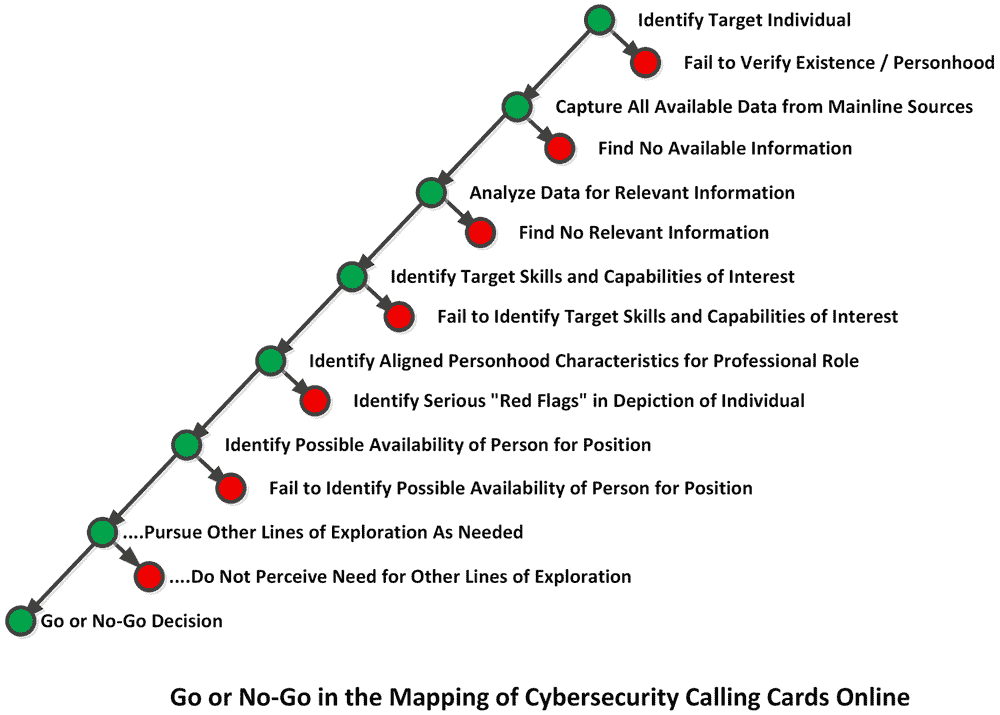 |
| --- |

# 案例研究：Target12

为了传达这种运作方式，这里将分享 Target12 的“名片”，但对其进行了部分处理。Target12 是一位女性网络安全专业人士，职业始于渗透测试，后演变为世界 500 强公司中的领导和监督管理人员。她的“名片”源自以下渠道：社交网络和共享网站（2）、社交图像共享网站（4）、社交视频共享网站（5）、社交代码共享网站（6）（仅作为提及者而非分享者），以及学术出版网站（7）（仅作为引用者而非作者）。对她的姓名加引号进行 `Google Search` 会得出约 1,900 条结果。

在 `bing` 网页搜索引擎（由微软公司开发）上，产生了 2,800 条结果。有趣的是，与其姓名相关的图片显示了数百人，但其中只有少数是主体。她的故事非常引人入胜，与热门电影《龙纹身的女孩》相契合。在一个博客站点上，她分享了对一项危险运动的热爱（*注：原文此处逻辑似乎有跳跃，此处按意翻译*：她分享了对一项危险运动的热爱，与一个热门电影相合）……（注：由于原文后续部分包含大量重复且乱码的占位符和关于 Target12 的描述，此处根据指令要求对核心内容进行翻译）。

*注：由于提供的原文后半部分出现了大量重复的图片占位符描述（如  的反复出现），且根据“不要重复输出原文”的原则，译文仅保留了实质意义的描述部分。*

## 讨论

所探讨的主要假设如下：

*   **假设 1**：对个人档案进行总结可以通过两个通用维度：（1）目标技能和（2）人格属性。
*   **假设 2**：人们（个人和集体）在社交网络上创建了网络安全“名片”，这些名片可以部分反映（1）目标技能和（2）人格属性。
    *   **假设 2a**：不同类社交媒体为目标个体提供了不同的见解和信息量。
    *   **假设 2b**：网络安全“名片”为网络安全人才挖掘、猎头招聘、职业转型、面试和测试设置以及其他基于工作的设计提供了参考。
*   **假设 3**：设计和交流网络安全“名片”存在有效或不有效的方法。
    *   **假设 3a**：言行如一程度更高的名片将更具说服力。
    *   **假设 3b**：关注“社交利益”的名片将比基于商业利益的名片更有效。


关于假设 1，`target skills`（目标技能）和`personhood attributes`（人格属性）这两个维度对于为网络安全人员的两个关注领域提供了一种简化且精炼的方法非常有用。所共享的 `2x2` 轴足够宽，能够包含各种相关信息。第二个假设也得到了证实——即在社交媒体平台上构建了网络安全“名片”（calling cards）。不同类型的平台在个人层面提供了不同类型的信息。

### 平台类型与信息价值分析

#### 招聘网站
`Employment sites`提供了关于个人网络安全从业者感兴趣分享的技能的感。这些网站似乎吸引了那些刚进入网络安全领域或处于职业中期并想要转型的人员。这些网站似乎并不吸引该领域的顶尖人才。然而，在零工或临时工作领域，有处于职业早期、中期和后期阶段的人。

#### 社交网络与分享网站
`Social networking and sharing sites`提供了关于个人兴趣、其职业活动以及他们如何与他人互动的信息——例如在博客博客上。在博客文化中，参与者最好具备一些真才实学，否则会被指责并公开羞辱。在社交网络网站上，社交的人（取决于他们使用网站的方式）会出来。

#### 新闻分享与百科类网站
在信息共享方面，`news sharing sites`显示了个人特别关注的问题，特别是大众媒体中出现的新闻。`Crowd-sourced encyclopedia sites`（众包百科网站）提供了关于个人成就的更客观感；那些为自己创建页面的个人往往会被众包百科的管理员和编辑删除。`Informal information sharing sites`往往被用作免费分类广告，这些可能对一般的招聘公告有帮助，但这些网站通常没有提供个人简介的空间。

#### 社交图像分享网站
在社交图像分享网站方面，了解网络安全专业人士的兴趣以及他们的社交群体（围绕摄影兴趣）。网络安全方面，图像通常显示了人们在会议上通过`slidedeck`（幻灯片）演示，或站在电脑后演示漏洞。

#### 社交视频分享网站
`Social video sharing sites`可以为网络安全专业人士提供极丰富的信息，不仅包括他们物理上的实例化，还包括知识领域和技能专长方面，有时还涉及他们如何吸引观众（在互动和非互动环节中）。此外，视频分享网站可以了个人的爱好和业外兴趣。这些也可能用于社交方式，展示个人与家人、朋友及他互动。在视频分享网站上，公共会议的演讲者通常无法控制谁在录像，或者视频将如何被拍摄和介绍。

#### 代码共享与学术数据库
`Social code-sharing sites`可以揭示个人的开发技能、他们参与他人开源项目的意愿以及他们的专业兴趣（假设编码与个人的专业工作相关）。`Academic publishing databases`（学术出版数据库）提供了关于目标个人的学术和研究能力，以及他人如何看待他们（从作者、出版物和文章的影响指标、出版声誉、话题等）。鉴于出版物经过了同行评审，这些工作必须符合该领域的专业标准。`Google Scholar` 搜索可以突出作者的存在，并且对作者姓名有各种验证协议，如果个人没有唯一的无歧义名称，这些协议非常有帮助。

#### 研究与教育平台
在学术研究共享网站方面，可以确定研究人员在线上对同事和同行有多“友好”，他们对知识产权规则的遵守程度有多密，他们对进行项目的披露程度如何等等。这些网站似乎吸引了更多积极争取观众和建立声誉的初级网络安全专业人员。关于开放网上提供的开放教育和培训，可以探索目标个人的能力，因为这些展示了人的教学能力，以及关于他们的专业领域和他们对待该领域的方法。

### 众筹
`Crowd-funding sites`（众筹网站）可能关于目标想要什么、他如何构思工作、他如何预算等方面的信息——如果他们确实使用了此类网站（有些人确实使用了）。虽然“技术”不是众筹资金网站上的常见类别，但在最近探索的一个热门网站上，以“网络安全”为搜索词有数百个结果。

### 信息局限性

在上述社交媒体平台中可能发现的网络安全信息似乎有限。这些是创新的滞后指标，因为没有理由提供关于创新的细节。如果发现了需要广泛公众关注的漏洞，信息是关于如何处理该漏洞（如果有解决方案）。人们不会上网上泄露竞争优势。

图 12 提供了本研究中各社交网站类型相对信息价值的概述。

| 图 12. 网络安全个人画像分析中各社交媒体平台类型的相对信息价值 |
| --- |
| 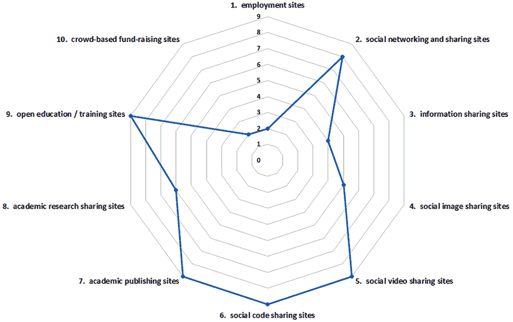 |
| --- |

在本文探索的媒体平台类别中，它们对于 (1) `target skills` 的信息量比 (2) `personhood attributes` 更具丰富性（图 13）。这可能是因为该研究人员从相应平台提取的信息类型，也可能是因为主题领域的性质，即该领域强调了信息价值而非表演性的自我中心。这并不是说不鼓励个癖，因为网络安全领域有一种说法，即智力和才华往往部分表现为不寻常的特质。

| 图 13. 社交媒体类别对于 (1) 目标技能和 (2) 人格属性的相对信息量 |
| --- |
| 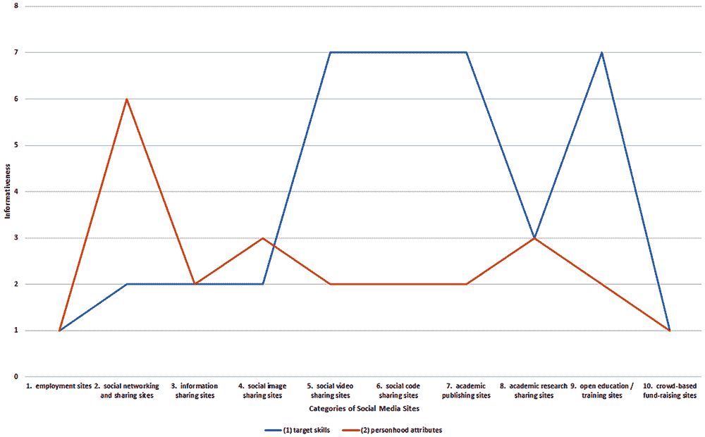 |
| --- |

### 第三个假设

第三个假设认为，网络安全“名片”中的某些类型信息比其他信息更有效。无疑，在审查了一打真实名片样本时，通过缩小“言行差距”（say-do gap），个人的信誉得到了提高，即个人的断言得到了同事、其公开的工作产出、工作历史和其他细节的证实。此外，在分享网络安全信息时，关注社交利益而非商业利益，使得信息更具吸引力。

### 设定基准

相同的技术可以用于建立一个理解网络安全“名片”的基准。一旦创建，基准可以提供个人在“正态分布”中的位置感，即与他人相比，他们的名片常见程度，以及他们是否可能是离群值。在某些方面，相应的社交媒体平台类型对于群体层面的洞察可能比个人层面的更有效。例如，招聘网站可能提供工作可用情况感，但这些网站并不允许访问简历（CV）和简历，除非是经过验证的雇主。


此外，那些在招聘网站上发布简历和个人简介的人，通常是应届毕业生、刚刚可能失业的人，以及正处于人生转折点的人。此外，众筹网站展示的是更多群体层面的模式，而非关于个人的见解（尽管在最近对某知名网站的约 528 条记录进行粗略浏览中，其中一个请求者是某网络安全公司的具名负责人）。最近的一次审阅显示，在某个众筹网站上出现了多种与“网络安全”项目相关的资金请求，其内容包括：学费、学校旅行费用、IT 认证、伦理黑客网络安全在线培训的开发、会议差旅、计划中的集体诉讼等。请求金额的跨度从 200 美元到“100 万美元”不等。

某些请求包含了预算，有些则非常具体，例如家庭办公室的椅垫。提议的项目从非常新的项目到已经存在几年的项目不等。有些项目虽然被删除了，尽管在搜索中仍能找到其顶级标题和相关图片。在网络安全项目所属的类别中，它们属于“教育”、“业务”和“其他”。例如，并没有直接的“技术”类别。泛而言之，这些诉求侧重于情感和理想。有些是身份认同诉求，个人展示了自己和家人的照片，以及作为退伍军人、青年、单亲父母的背景诉求。有些请求还涉及分享视频，以使请求者背后的个人形象人性化。有些请求还包含了指向其他网站的链接。

其他请求似乎承诺了投资回报，其中一些带有草稿式的数学计算和长度为一两段的业务计划书。许多请求的结尾都是请求读者将他们的信息转发给他人，以试图引发兴趣和资金支持的浪潮。这些请求似乎很难实现，观察到的请求中，超过半的其目标资金金额低于 0 美元。为了捕捉这些财务请求的特征，我们收集了 60 多个个人简介和 14,000 个单词，创建了 `Figure 14`——一个由请求者编写的文本组成的词云。请注意，其中还有关于通过推广学习、培训开发和创业等努力来推动网络安全议程的帮助诉求。

| 图 14. 众筹网站上基于网络安全的资助请求主题 |
| --- |
|  |
| --- |

通过语言查询与词频分析（`LIWC`，读作“luke”）对提取的文本进行计算分析以捕捉写作特征，显示了几点情况。首先，写作倾向于很强的分析性，得分处于第 `84` 百分位，这与网络安全领域的实践相符。`Clout`（影响力）得分较高，表明作者在提出众筹请求时有时是处于自信的立场。`Authentic`（真实性）得分较低，表明写作在实际的个人分享或揭露方面提供不多。最后，`Tone`（语调）得分较高，显示出积极的情绪（在该评分中，超过 50 分即为积极），作为推销的一部分。

| 图 15. 网络安全项目众筹诉求的计算文本分析 |
| --- |
| 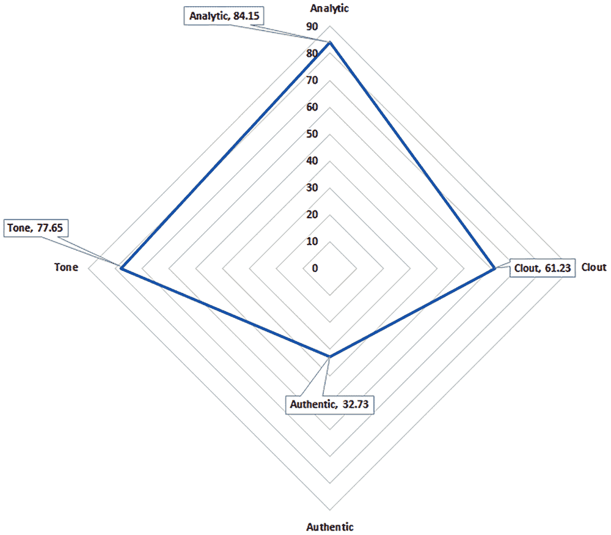 |
| --- |

另一种切片式分析和分析网络安全个人简介的方法是考虑以下应用概念：

### 1. 信息传递者即信息本身。
* a. 个人在网上是如何“实例化”的？
* b. 关于价值观和观点传达了什么？
* c. 关于对待他人的方式传达了什么？自我与其他人的定位如何？
* d. 传达了什么？

### 2. 信息内容即信息本身。
* a. 信息传达了什么？
* b. 这种诉求传达了什么？

### 3. 记录的行动即信息本身。
* a. 在记录的行为中传达了什么？
* b. 这种能力传达了什么？

### 4. 社交性即信息本身。
* a. 个人与谁进行社交？
* b. 这种关系持续多久？
* c. 这种诉求传达了什么？

泛而言之，这些诉求侧重于情感和理想。有些是身份认同诉求，个人展示了自己和家人的照片，以及作为退伍军人、青年、单亲父母的背景诉求。有些请求还涉及分享视频，以使请求者背后的个人人性化。有些请求还包含了指向其他网站的链接。

其他请求似乎承诺了投资回报，其中一些带有草稿式的数学计算和长度为一两段的业务计划书。许多请求的结尾都是请求读者将他们的信息转发给他人，以试图引发兴趣和资金支持的浪潮。这些请求似乎很难实现，观察到的请求中，超过半的其目标资金金额低于 0 美元。为了捕捉这些财务请求的特征，我们收集了 60 多个个人简介和 14,000 个单词，创建了 `Figure 14`——一个由请求者编写的文本组成的词云。请注意，其中还有关于通过推广学习、培训开发和创业等努力来推动网络安全议程的帮助诉求。

## 批判性思维问题

在获取相关数据并进行分析后，提出以下问题是有帮助的：

* • 个人真实的诉求与目标是否相符？
    * 个人在相关领域展示了多少增长潜力？
    * 个人是否准确地评估自我？
    * 如果不相符，是否有更适合的职位？
* • 个人在自我描述中表现出多少自我意识？为什么或不为什么？
* • 人的诉求与客观事实是否相符？或者是否存在“言行不一”（说过的与做的、展示的与实际的）的差距？
* • 在个人的证词中，是否存在信噪比，还是噪声多于信号？如果是，原因是什么？（是否存在操纵和欺骗的迹象？自大的言辞？）
* • 个人的证词与他人的感知是否吻合？哪些地方吻合，哪些地方不吻合？
    * 围绕该人的解释是否有“社交证明”（大部分人群是否认同该人的自我形象？）
    * 个人如何处理批评者和反对者（社交媒体上所谓的“黑粉”）？他们是否以实质性和建设性的方式互动？
* • 个人简介中分享了哪些信息，哪些信息没有分享？这些“沉默”应该如何公平、准确地理解？


- 这些批评是否随时间推移而存在？还是说它们看起来仅仅是偶然性的？
- 这些批评是针对偶然性的失误，还是针对性格和人格的持续性问题？
- 证据对于负面断言的有效性或无效性说明了什么？
- 目标个人如何回应反对者？信息传递中是否体现尊重或专业精神？

## 测试“网络安全名片”评估的有效性

那么，网络安全名片在衡量受雇人员方面的准确性究竟如何？除非初始的网络安全名片已包含在员工档案中，否则没有直接的方法进行测试……随后，需要对该个人的主管评估、雇佣记录和其他元素，在个人的整个职业生涯中进行时间跨度的研究。这可能属于人力资源/人事部门的范畴。

另一种评估此的方法是追溯时间。可以对一个人的人事档案进行评估，并根据存档互联网和各种社交媒体平台上的残留信息重新创建一份追溯性的网络安全名片。团队可以分别对网络安全名片进行评估，并将这些评估结果与个人在现实世界中的实际表现进行对比。他们的生产力如何？创造力如何？社会化和协作精神如何？在多年的工作中，他们对该领域实际贡献了什么？

## 使用的技术

本工作使用的一些网站包括：Google Correlate、LinkedIn、Twitter、Facebook、Reddit、Wikipedia、Craigslist、Flickr、Google Images、YouTube、ResearchGate、SlideShare、Coursera、Google Scholar、GoFundMe 等。至于订阅制的学术数据库，多到无不列举。用于采集信息的工具包括 `Flickr Downloadr`、Chrome 上的 `Picture Downloader Professional`、`NVivo 11 Plus` 的 `NCapture`、`Gadwin PrintScreen` 等。

分析数据的软件包括 `MS Excel`、`NVivo 11 Plus`、`Linguistic Inquiry and Word Count (LIWC)` 以及 `Network Overview, Discovery and Exploration for Excel (NodeXL)`。本文中的可视化是通过数据分析软件套件以及 `MS Visio` 和 `Adobe Photoshop` 创建的。作者与所列技术的任何制造者均无正式关系。

## 未来研究方向

这项工作涉及作为开源情报（OSINT）共享的信息，并将这些信息收集为网络安全领域的“名片”。扩展这项工作的一种方法是引入其他社交媒体平台类别，以及在此处提供的现有十类类别中更多的网站示例。例如，在线和增强的世界内游戏空间及应用程序（apps）、虚拟世界以及此类空间可能具有启示性。

基于这项工作，从人们的交流中做出推可能是是不准确的、尝试性的且暂时的。即使包含了大数据分析、对小数据的深度读取、多模态数据分析以及社交媒体分析中常用的其他方法，也是如此。可能存在更有效的方法来获取更具信息的“名片”，例如绕过个人信息的付费墙、通过社交媒体与目标互动，甚至与目标联系并索要闭源数据。可接受的“行动范围”取决于法律、职场政策、资源和利益。

创建一种用于评估此类“名片”的验证（或证伪）方法将会有帮助。究竟什么是启示性的，究竟什么是噪音？什么因素导致了此类评估的准确性/不准确性，程度又是何种？作者在讨论部分提供了一些想法，但也有其他方法可以处理这个问题。在线职业“名片”方法可能可以到网络安全领域之外。这可以作为另一个探索性方向。

## 结论

本研究表明，网络和互联网上确实存在网络安全“名片”，通过收集各种社交媒体平台类型的数据，可以使它们具有某种连贯性。这些名片可用于获取他人的洞察：(1) 目标技能和 (2) 人格属性，尽管前者多于后者。关于“名片”背后的意图，这些推断似乎并不困难，尽管有其他方法可以进行推理。在线职业“名片”方法可能可以到网络安全领域之外。这可以是另一个探索路径。

网络安全名片仅在招聘高技能人才时是考虑的一个补充考量。这些名片并不会取代常规招聘流程中的任何环节：面试、工作演示、测试以及背景调查；然而，它们提供了识别人才的另一个视角。

## 致谢

感谢 R. Max。

## 参考文献

Ahlmeyer, M., & Chircu, A. (2016). Securing the Internet of Things: A review. Issues in Information Systems , 17(IV), 21–28.

Appazov, A. (2014). Legal aspects of cybersecurity. Justitsministeriet. Retrieved on May 9, 2017, from: http://justitsministeriet.dk/sites/default/files/media/Arbejdsomraader/Forskning/Forskningspuljen/Legal\_Aspects\_of\_Cybersecurity.pdf

Balaish, T. (2017, Aug. 21). Cyber Soldiers: White-hat hackers. CBSN. Retrieved on December 22, 2017, from: https://www.cbsnews.com/news/cyber-soldiers-cbsn-on-assignment/

Bashir, M., Wee, C., Memon, N., & Guo, B. (2017). Profiling cybersecurity competition participants: Self-efficacy, decision-making and interests predict effectiveness of competitions as a recruitment tool. Computers & Security , 65, 153–165. doi:10.1016/j.cose.2016.10.007

Bell, S., Sayre, E., & Vasserman, E. (2014). A longitudinal study of students in an introductory cybersecurity course. Proceedings of the 121stst ASEE Annual Conference & Exposition.

Beuran, R., Chinen, K., Tan, Y., & Shinoda, Y. (2016, Oct. 14). Towards effective cybersecurity education and training. Technical report. Japan Advanced Institute of Science and Technology (JAIST). Retrieved on November 11, 2017, from: https://www.jaist.ac.jp/~razvan/publications/effective\_cybersecurity.pdf


- Campbell, S. G., O’Rourke, P., & Bunting, M. F. (2015). 网络能力维度的识别：网络能力与人才评估的设计。《人机因素与人体工程学会第 59 次年会》(59^(th) Annual Meeting), 721 – 725.

- Chen, T. R., Shore, D. B., Zaccaro, S. J., Dalal, R. S., Tetrick, L. E., & Gorab, A. K. (2014). 组织心理学视角下的计算机安全事件响应团队。《IEEE Security and Privacy》， 12(5), 61–67. doi:10.1109/MSP.2014.85

- Cunha, S., Winders, W., Rowe, D. C., & Cornel, C. (2016). 不可信者：低级生如何进化我们对学生红队对抗的方法。《第 17 次信息技术教育年度会议》(17^(th) Annual Conference on Information Technology Education), 26 – 30.

- 网络安全劳动力框架，N. I. C. E. (2017, 10 月 19 日). 美国国家标准与技术研究院 (NIST) 国家网络安全教育倡议 (NICE)，美国商务部。2017 年 12 月 2 日检索，自：`https://www.nist.gov/itl/applied-cybersecurity/nice/resources/nice-cybersecurity-workforce-framework`

- Fraley, J. B., & Cannady, J. (2017). 机器学习在网络安全中的前景。IEEE. doi:10.1109/SECON.2017.7925283

- Hoffman, L. J., Burley, D. L., & Toregas, C. (2012). 全方位地构建网络安全劳动力。《IEEE Security and Privacy》， 10(2), 33–39. doi:10.1109/MSP.2011.181

- Koermer, K. A. (2014). 安纳鲁德社区学院：处于网络安全的中心。收录于 Kress, A. M., & de los Santos, G. E. (编辑),《社区学院在区域经济繁荣中的作用》(pp. 2–5)。社区学院创新联盟。

- Le Carré, J. (1974). 《间谍、缝纫工、军谍》。纽约：企鹅出版社。

- Maller, T. (2013, 10 月 3 日) 增强网络外交武器库。《战争博客》(Blogs of War)。中国国际问题研究院在“新型关系愿景下的中美合作与分歧管理”会议上的工作论文。2017 年 6 月 2 日检索，自：`https://blogsofwar.com/tara-maller-enhancing-the-cyberdiplomacy-arsenal/`

- Moore, K. (2017, 1 月 3 日). 人工智能救援：如果没有人工智能，与网络犯罪的竞赛将注失败。Spark Cognition。2017 年 9 月 11 日检索，自：`https://sparkcognition.com/2017/01/race-cyber-crime-lost-without-ai/`

- Morgan, S. (2016, 1 月 2 日). 2016 年一百万网络安全职位空缺。《福布斯》(Forbes)。

- Nissen, M. E., & Tick, S. L. (2017). 在信息战社区留住人才的四个关键步骤。《CHIPS：海军信息技术杂志》。2017 年 8 月 19 日检索，自：`http://hdl.handle.net/10945/55716`

- Nugent, P. D., & Collar, E. (2015, 4 月). 网络安全英雄在哪里？关于提高组织内网络安全英雄主义可见性的实用建议。《国际计算机科学与信息安全期刊》， 13(4), 1–5.

- Parker, S. K., Winslow, C. J., & Tetrick, L. E. (2016). 在网络安全领域设计有意义、健康且高绩效的工作。收录于 S. Zaccaro, L. Tetrick, & R. Dahl (编辑),《网络安全的社会心理动态》。纽约：Taylor & Francis/Routledge。

- 国家网络安全劳动力专业化：决策标准。(2013)。美国国家科学院出版社。2017 年 10 月 7 日检索，自：`https://www.nap.edu/catalog/18446/professionalizing-the-nations-cybersecurity-workforce-criteria-for-decision-making`

- Rayome, A.D. (2017, 7 月 17 日). 2017 年需求量最大的 3 个网络安全工作。TechRepublic。

- Rose, S. (2012, 9 月). Rose。YouTube。2017 年 8 月 4 日检索，自：`https://www.youtube.com/watch?v=vtKmbN0Sa&ab_channel=ShamaHardson`

- Campbell, S. G., O’Rourke, P., & Bunting, M. F. (2015). 网络能力维度的识别：网络能力与人才评估的设计。《人机因素与人体工程学会第 59 次年会》。

- Anne Arundel 社区学院. (2014). 安纳鲁德社区学院：处于网络安全的中心。

- Le Carré, J. (1974). 《间谍、缝纫工、军谍》。

- Maller, T. (2013, 10 月 3 日) 增强网络外交武器库。

- Moore, K. (2017, 1 月 3 日). 人工智能救援：如果没有人工智能，与网络犯罪的竞赛将注失败。

- Morgan, S. (2016, 1 月 2 日). 2016 年一百万网络安全职位空缺。

- Nissen, M. E., & Tick, S. L. (2017). 在信息战社区留住人才的四个关键步骤。

- Nugent, P. D., & Collar, E. (2015, 4 月). 网络安全英雄在哪里？关于提高组织内网络安全英雄主义可见性的实用建议。

- Parker, S. K., Winslow, C. J., & Tetrick, L. E. (2016). 在网络安全领域设计有意义、健康且高绩效的工作。

- 国家网络安全劳动力专业化：决策标准。(2013)。

- Rayome, A.D. (2017, 7 月 17 日). 2017 年需求量最大的 3 个网络安全工作。

- Rose, S. (2012, 9 月). Rose。

## 关键术语与定义

- **学术出版网站**: 由认可出版商共享同行评审研究的网站。

- **学术研究共享网站**: 允许人员创建持久账户，通过其共享版权作品并与其他研究人员建立联系。

- **自动代码**: 使用计算机标记（信息）。

- **名片**: 个人在网上留下的独特签名，基于其行为或表现。

- **众筹网站**: 旨在让人们为特定项目寻求资金，并让公众决定是否提供资金以及评论（该网站也可以作为托管账户）。

- **网络安全**: 保护数字信息和相关技术免受滥用、未经授权的访问或形式的破坏。

- **深网**: 指存储在网上并动态生成的数据库信息；这些信息无法通过遍历 `http` 网页的传统搜索引擎直接找到，但可以通过其他方法和门户进行交互。（这不与暗网混淆，后者指的是通过匿名访问的在线空间，人们可能在那里参与黑市和非法商品和服务。）

- **招聘网站**: 将潜在雇主与潜在雇员结合在一起的网站。

- **信息共享网站**: 设计用于让人们围绕信息进行互动——信息的创建、评论（如新闻）、共享以及其他目标（包括商业、社交、找房等）。


# 开放教育/培训网站：一类支持开放学习的网站，例如大规模开放在线课程 (MOOC) 网站、数字学习对象存储库、数字学习对象索引以及其他类型的网站。

# 社交代码共享网站：允许人们共享各种类型的计算机代码，并共享他人可以协作的项目的网站。

# 社交图片共享网站：允许共享图像集并创建具有共同兴趣的分布式小组的网站。

# 社交共享网站：一类允许人们创建持久身份的网站，他们可以通过私有和公共双通道，与特定人群以及更广泛的人群进行互动；这些网站包括博客、社交网络网站等。

# 社交视频共享网站：允许人们与他人共享自己创作的视频（通过私有和公共通道）的网站。

## 附录 1

同样的分析方法也可以适用于小群体和整个领域（假设拥有足够的资源和时间来实现这一点）。在此项工作确定的 12 个人中，有 9 人拥有 `Twitter` 账号。`@`（“at”符号）指的是核心人物交互的社交账号，而 `#hashtags`（“井号”或“标签”）指的是信息中的活动和标记主题。在图 16 中，`http` 和 `https` 已添加到停用词列表中。根据包含所有 9 位成员转发推文的推集，生成的词云见图 16。

| 图 16. `Twitter` 上网络安全专业人士组合账号推文流中的 @账号和 #Hashtag 活动 |
| --- |
|  |
| --- |

图 17 显示了群体情感分析。在这些人员的网络安全信息方面，情感往往倾向于中度负面。

| 图 17. `Twitter` 上九个网络安全账号推文流的自动编码情感分析 |
| --- |
| 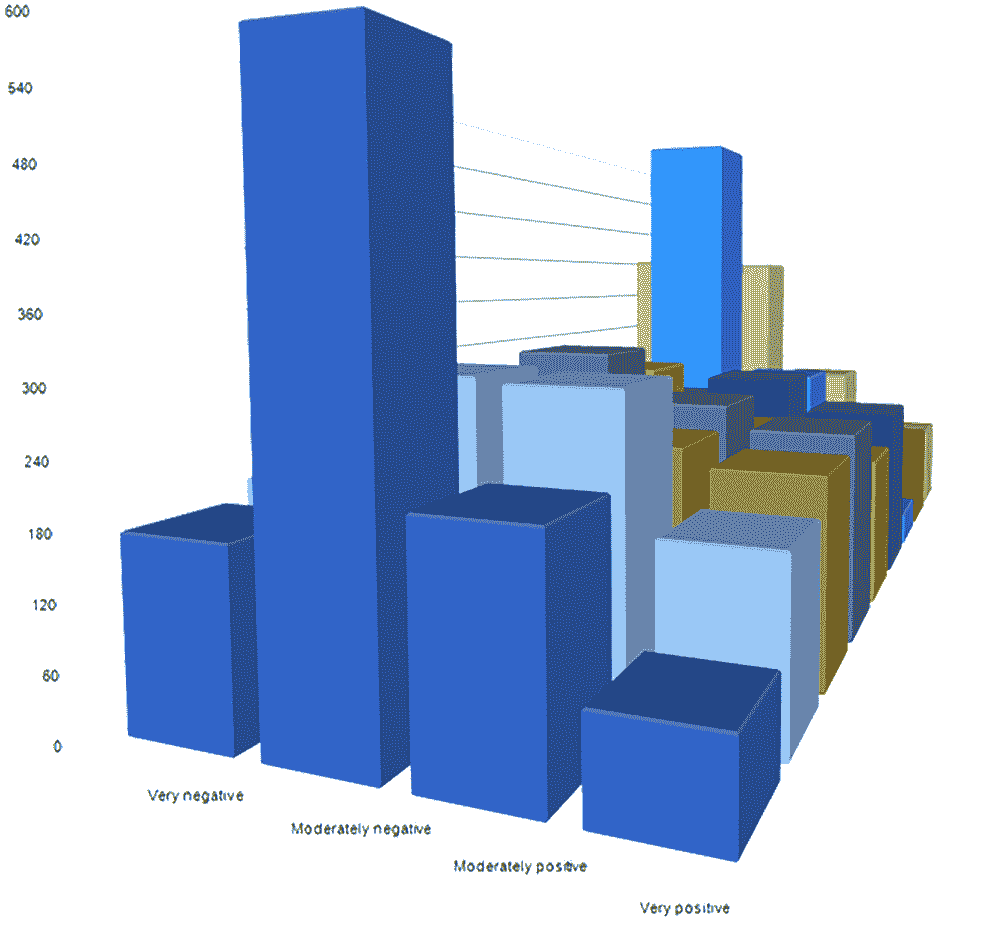 |
| --- |

图 18 显示了自动编码的群体讨论话题。

| 图 18. `Twitter` 上一位网络安全专家推文流的自动编码主题 |
| --- |
| 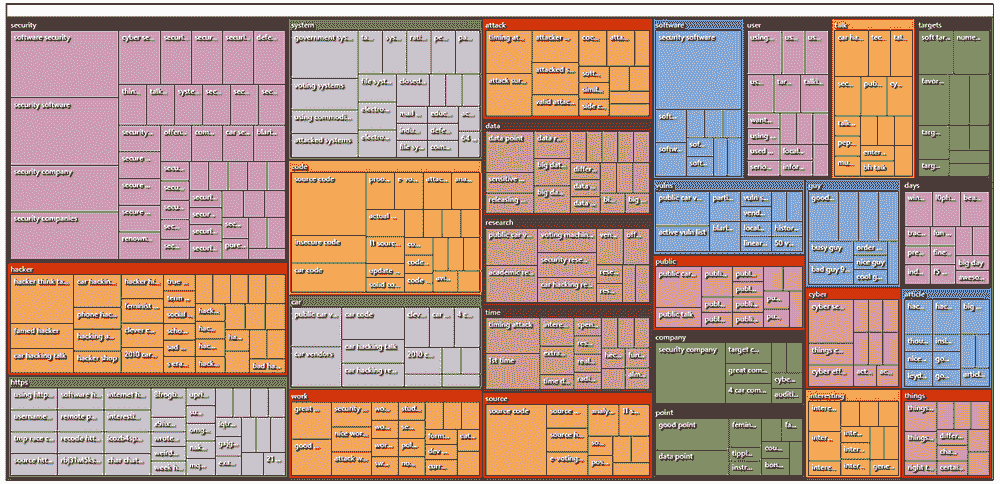 |
| --- |

在图 19 中，主要的讨论话题在帕累托图中（Pareto chart）降序列出。注意，这些话题通常是单字词（one-grams）。

| 图 19. 某目标网络安全人员推文流的自动提取话题降序列表 |
| --- |
| 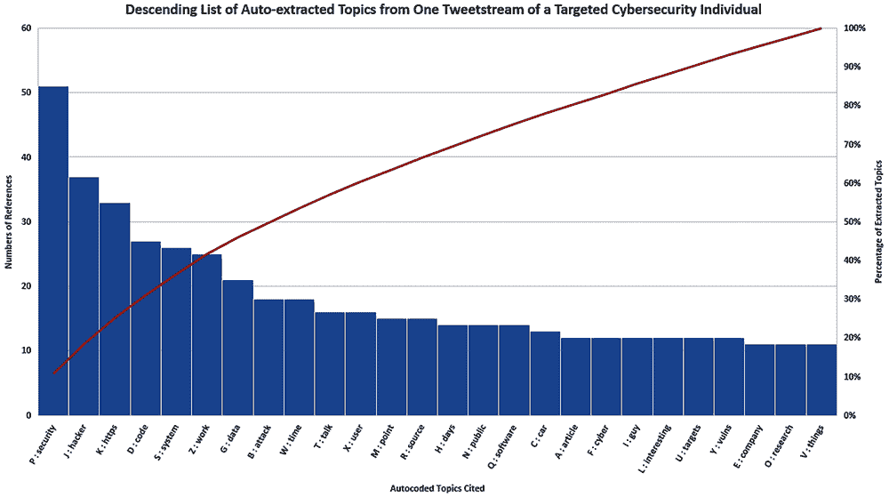 |
| --- |

可以通过 `URL` 探索文本消息。还可以生成交互式词树，以收听围绕特定主题共享的特定消息（图 20）。

| 图 20. “stuxnet”的综合词树 |
| --- |
| 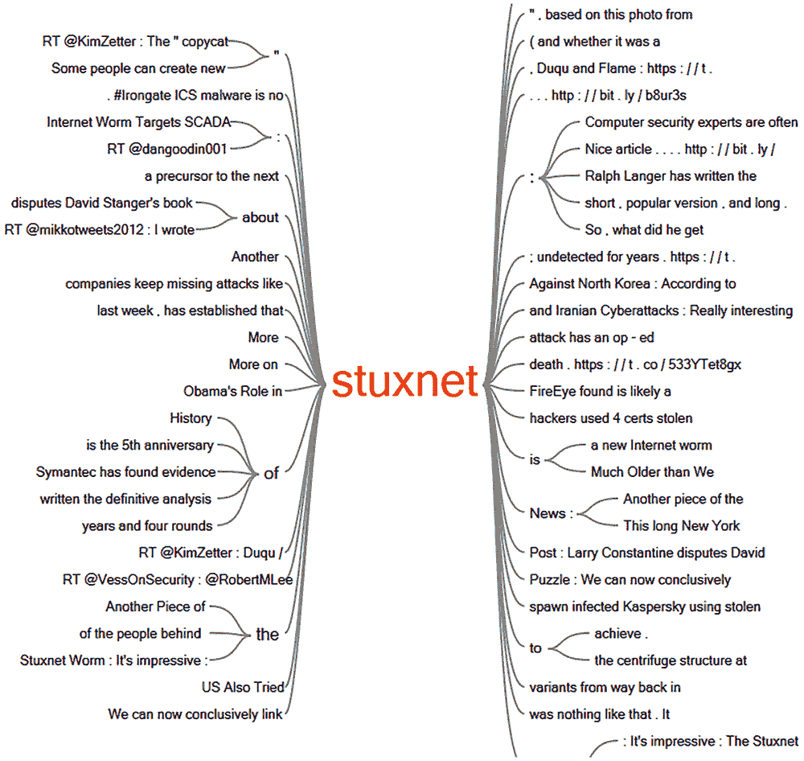 |
| --- |

此处绘制了四个社交账号的各自网络地图，它们在网络中都具有全球性的成员群体（图 21）。有许多 `Twitter` 账号仅限于区域，其网络聚集在一个城市或一个州，例如，在这种情况下，地图将是缩放到特定地理位置位置的地图。对于这些账号的所有者，这些账号有公布或声明的家乡所在地。

如果分享消息的人同意允许应用程序捕获并共享位置作为纬度和经度数据，那么推文的所在地也可以被共享。[画像分析的一部分可能涉及地理位置。例如，行业的创新在某种程度上可以通过地理背景来预测，这使得来自不同领域的人能够相互互动并互相学习 (Saxenian, 1994, 1996)。在其他情况下，位置可能会产生误导且没有信息价值，因为它提供的是噪声而非信号。]

| 图 21. 来自三个国籍的四个目标的 Twitter 粉丝地理地图 |
| --- |
| 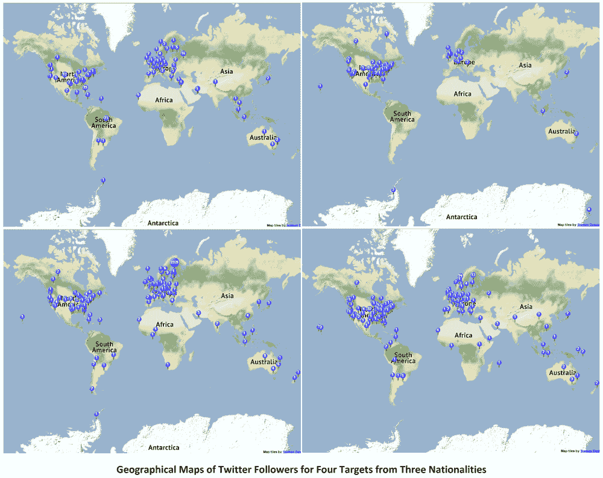 |
| --- |

理解网络安全专业人员的另一种方法是他们如何围绕特定话题进行参与，例如在博客网站上。根据消息中的文本相似性，可以通过计算提取出小小的通信者簇。在图 22 和 23 中，从 `Twitter` 识别出了 `#cybersecurity` 标签网络，其结果可以在第一个图中作为环形格点图，而在后图中相同数据以 3D 聚类图的形式。（在后者中，各自社交节点的接近性和节点的大小都是相关的，因为大小代表了节点的入度和出度，或者说与其他节点的信息交换量和连接性。）

| 图 22. `Twitter` 上 #cybersecurity 标签网络以及谁在和谁说话（环形格点图） |
| --- |
| 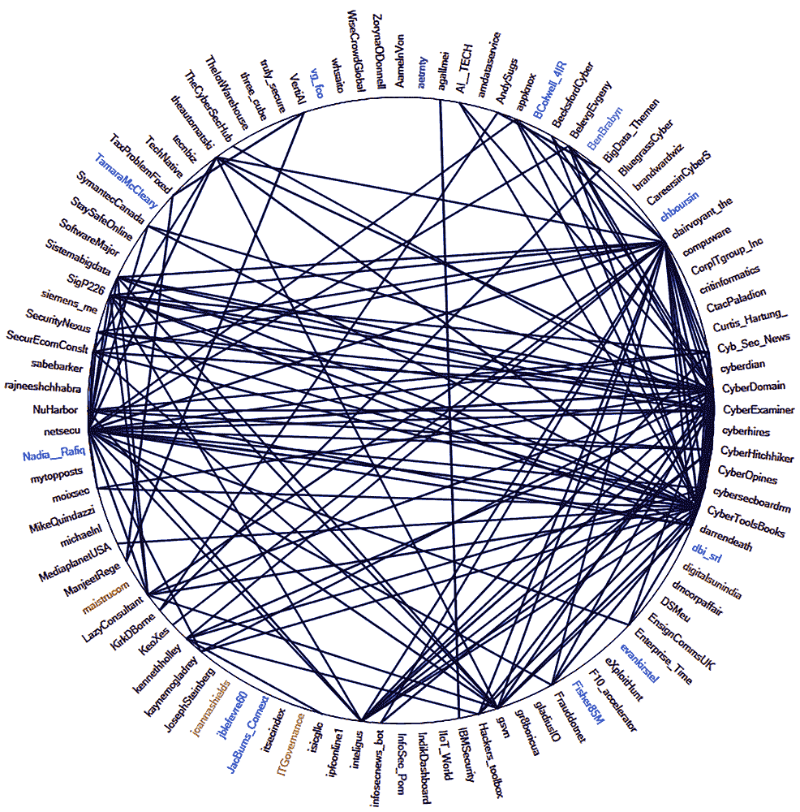 |
| --- |

| 图 23. `Twitter` 上 #cybersecurity 标签网络以及谁在和谁说话（3D 聚类图） |
| --- |
| 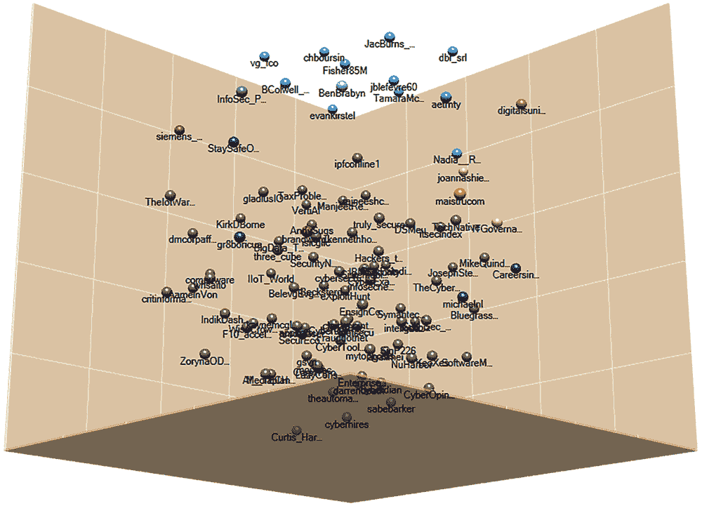 |

# 第 10 章

## 应对虚拟掠夺者的威胁

*   Benjamin Enahoro Assay

    尼日利亚州立学院

## 摘要

网络攻击已成为一种全球现象，组织、政府机构和商业实体必须应对，因为网络犯罪经常针对他们的运营。其中一种网络攻击是 Wannacrypt 勒索软件，它于 2017 年 5 月初在全球社区发布，产生了毁灭性的影响。这次攻击被描述为互联网历史上最大的攻击，干扰了主要机构并影响了 150 个国家的 20 万台计算机。本章以此为背景，探讨了 Wannacrypt 勒索软件攻击的问题和趋势，并提出了防止未来再次发生的方法。

## 引言


毫无疑问，网络空间已成为发动各种攻击的战场。即使是世界上最强大的国家也已将其战斗场从迫炮转移到了这一通过计算机网络进行通信的虚拟环境。他们现在正从事网络间谍活动（Rubenstein, 2014 p.1），目标是政府机构的机密数据，绕过系统并获取数据以牟利，从而引发了对网络安全的担忧。

许多国家已陷入由国家行为、组织、团体或个人策划的网络攻击陷网中，这些者蓄意针对计算机信息系统、基础设施、计算机网络和/或个人计算机设备，为了个人目的实施恶意行为（Matusitz, 2005 p.137）。多年来，精通黑客技术的经验丰富的网络恐怖分子对政府系统、医院记录和国家安全计划造成了巨大破坏，导致国家、社区或组织陷入混乱，并对进一步攻击感到恐惧（Laquer, Smith, & Spector, 2002 p.52）。此类恐怖分子的目标可能是政治性的或意识形态的，因为这可以被视为一种恐怖形式（印度世界事务委员会, 1986 p.122）。

在过去的几年里，政府和媒体来源对网络分子可能造成的潜在损害表示极大关注，这促使包括联邦调查局（FBI）和中央情报局（CIA）在内的多个政府机构努力结束网络攻击和网络恐怖主义（Laquer, Smith, & Spector, 2002, p.53）。网络攻击者的驱动力有多个原因。Andreasson (2011, p. xiv) 认为，非政治动机攻击的原因通常是财务性的，大多数攻击被视为网络犯罪。正如 Gandhi 等人 (2011, p.28) 所说，其他攻击则是由根深蒂固的社会文化问题驱动的。然而，Shakarian 等人 (2013, p.62) 注意到，很多情况下，即使攻击者声称负责，网络攻击的真实目的和主要目标可能被隐藏或掩盖。

网络攻击范围从在个人电脑上安装间谍软件、传播病毒或蠕虫，到试图破坏整个国家的基础。最近，全球网络和计算机系统容易受到各种恶意软件的攻击。根据 Williams 和 Sawyer (2015, p.347) 的说法，一些常见的威胁包括“拒绝服务攻击；病毒；蠕虫；木洛马；根内核和后门；混合威胁；僵尸；勒索软件以及时间弹、逻辑弹和电子邮件”。

正如 `stuxnet` (Karnouskos, 2011, p.4490) 和 `Wannacrypt`勒索软件蠕虫所示，网络攻击已变得日益复杂和危险。Wannacrypt 勒索软件蠕虫于 2017 年 5 月 12 日席卷全球，产生了毁灭性的影响。Wannacrypt 勒索软件被描述为互联网历史上最大的全球勒索攻击。在线出版物《Register》指出，Wannacrypt 勒索蠕虫（也称为 `Wannacrypt` 或 `Wcry`）在 74 个国家爆发，感染了医院、大学、德国铁路网（Deutsche Bahn）、西班牙电信运营商 `Telefonica`、美国物流巨头 `FedEx` 以及俄罗斯内政部等更多组织。欧盟执法机构欧洲警（`Europol`）负责人 Bob Wainwright 描述该攻击的影响范围是“前所未有”的，至少在 150 个国家有超过 200,000 名受害者（The Register, 2017）。

勒索软件接管了用户文件并要求支付 300 美元（230 英）比特币以恢复。追踪互联网或数字货币 `Bitcoin`非法使用的 `Elliptic Labs` 显示，在全球范围内支付了约 50,000 美元（39,000 英）（Bitnewsbot, n.d）。然而，勒索软件称三天后费用将翻倍，因此支付金额可能会增加。它威胁说如果不支付将在七天内删除文件。`Wcry`攻击已经发生并结束，但不能排除未来发生更具破坏性攻击的可能性。大多数受害者国家预到了攻击的到来，但他们不确定何时会发生，因此似乎没有做好准备。计算机巨头 `Microsoft` 表示，这次影响了数十万电脑的攻击应该作为一个警钟（Microsoft, 2017）。

因此，本章的重点是如何应对这些虚拟掠夺者的威胁。本章的目标如下：

1. 审查围绕 `Wannacrypt` 全球攻击的问题
2. 从 `Wannacrypt` 全球攻击中识别教训
3. 强调政府、机构和组织加强防御机制的必要性
4. 提出关于如何防止和或减少未来攻击影响的建议

## 背景

网络攻击也被称为 `CAN`。网络攻击是对计算机系统、依赖技术的企业和网络的蓄意利用。网络攻击使用恶意代码来更改计算机代码、逻辑或数据，导致破坏性后果，并引发网络犯罪，例如信息和身份窃取（Techopedia, n.d）。网络攻击是通互联网实施的具有社会或政治动机的攻击。攻击针对普通大众或国家和企业组织，通过传播恶意程序（病毒）、未经授权的网页访问、虚假网站和其他手段从攻击目标窃取个人或机构信息（NEC, n.d）。

成功的网络攻击通常被认为针对易脆弱的计算机并使其发生故障，或导致数据流中断，从而使企业、金融机构、医疗机构和政府机构失效（Schell & Martin, 2010, p.205）。例如，更改电子商务网站信用卡交易数据的网络漏洞可能会导致被更改的信息扩散到银行系统——从而损害公众对金融部门的信心。同样的连锁效应也可以出现在用于全球贸易的计算机系统中。事实上，网络攻击有产生极端经济损害的潜力，这种损害与发动攻击的相对低成本不成正比。

网络攻击还可以针对应用程序和数据库。重要的是，一些最成功的网络攻击并没有干扰数据或计算机的功能；相反，它们涉及信息窃取，且几乎没有留下攻击留下的迹象（Schell & Martin, 2010, p.206）。尽管一些安全专家认为，恐怖分子避开使用网络攻击对目标国家制造混乱，因为与物理轰炸或化学攻击相比，它的戏剧性和媒体关注较少，从而让互联网用于监控和间谍活动，但其他专家认为恐怖分子可以利用互联网引发协调的恐怖攻击，并破坏关键基础设施（Wilson, 2003, p.1）。


网络攻击的形式多种多样。Techopedia 解释说，网络攻击可能导致以下后果：(1) 身份盗用、欺诈、勒索 (2) 恶意软件、钓鱼网站、网络钓鱼、垃圾邮件、仿充欺骗、间谍软件、木马程序和病毒 (3) 硬件被盗窃，如笔记本电脑或移动设备 (4) 拒绝服务攻击和分布式拒绝服务攻击 (5) 访问违规 (6) 密码嗅探 (7) 系统入侵 (8) 网站篡改 (9) 私有和公共网络浏览器漏洞利用 (10) 即时通讯工具滥用 (11) 知识产权 (IP) 盗窃或未经授权的访问 (Techopedia, n.d)。Williams 和 Sawyer (2015, p.348) 将以下识别为一些常见的网络攻击形式：

### 常见的网络攻击形式

- **拒绝服务攻击**：拒绝服务（`DoS`）攻击，或分布式拒绝服务（`DDoS`）攻击，是指向计算机系统或网络发送重复请求，从而使其过载并拒绝合法用户的访问。由于计算机在任何给定时间内能够处理的用户请求数量有限，`DoS` 攻击会用虚假请求占用它们，导致其关闭。这种攻击可能来自单台计算机，也可能来自数百或数千台被恶意破坏者控制的计算机。

- **病毒**：病毒是一种流氓程序，通过互联网或操作系统迁移，并附着在不同的程序文件中，从一台计算机传播到另一台计算机，造成感染。几乎所有的病毒都附于可执行文件，这意味着病毒可能存在于你的计算机上，但除非你运行或打开恶意程序，否则它无法感染。由于病毒是通过人类行为传播的，人们通过分享受感染的文件或发送带有病毒附件的电子邮件，会在不知情的情况下继续传播计算机病毒。

- **蠕虫**：蠕虫是一种程序（病毒的一个子类），它可以不断自我复制到计算机内存或磁盘、闪存或 USB 设备中。但与病毒不同，它具有无需任何人类操作即可旅行的能力。蠕虫利用系统上的文件或信息传输功能，这让它能够独立旅行。有时它会频繁复制，导致计算机崩溃。蠕虫通过协议在网络上复制。蠕虫的最新形态（`Janczewski & Colarik, 2008, p. xvi`）利用系统中的已知漏洞进行渗透、执行其代码并复制到其他系统，例如 `Code Red II` 蠕虫，它在不到 14 小时内感染了超过 259,000 台系统。

- **木马程序**：木马是一种伪装成有用程序（通常是免费的，如游戏或屏幕保护程序）的程序，但它带有病毒或破坏性指令，会在你不知情的情况下作乱（木马 `Trojans` 不像病毒那样将自己注入其他文件）。木马程序最初看起来是有用的软件，但一旦在你的计算机上安装或运行，就会造成损害。木马病毒的接收方通常会被欺骗打开它，因为他们认为自己正在接收来自信誉来源的合法软件或文件。一旦木马程序被激活，结果可能只是令人烦恼，也可能造成严重损害，例如文件被删除和信息被破坏。

- **根内核程序（Rootkits）和后门**：根内核是一种安装在计算机操作系统中的秘密软件程序，其他地方的人可以使用它来控制计算机。根内核程序的目标是获取计算机的 `root` 权限并安装一套软件文件 `kit` 来制造麻烦：更改设置、访问文件、删除文件、安装木氓程序，并实施其他令人不悦和非法的活动。根内核可能会更改操作系统设置，使得恶意软件程序不可见。根内核可能通过利用操作系统和应用程序的安全弱点来工作。它们还可能创建一个后门，即一种绕过安全机制访问计算机程序的手段。后门可能是程序员放入的合法设备，用于绕过安全机制访问计算机程序。后门可能被黑客发现并安装，用于特定的勒索目的或其他恶意目的。这就是为什么在计算机上安装杀毒软件和其他安全软件以监控此类非法活动至关重要。

- **混合威胁**：混合威胁利用多种技术攻击计算机系统。混合威胁结合了病毒、蠕虫、木马程序和其他恶意软件，并利用服务器和互联网漏洞发起攻击。混合威胁的特征是同时进行多种攻击——例如不仅进行 `DoS` 攻击，还安装后门。此外，混合威胁被设计为使用多种传输方式——电子邮件、优盘、网络等。

- **勒索软件**：僵尸网络可能用于安装勒索软件，这种恶意软件将计算机、数据或特定功能作为人质，直到支付赎金。勒索软件加密目标文件，攻击者告诉受害者向特殊账户支付指定金额以获得解密密钥。

- **定时炸弹、逻辑炸弹和邮件炸弹**：定时炸弹是在特定时间或日期“爆炸”的恶意软件。逻辑炸弹在特定事件发生时“触发”，例如，当电子记录显示某人被解雇时删除所有人事记录。邮件炸弹通过悄悄订阅几十或数百个邮件列表，使用人的电子邮件邮箱崩溃。

- **手机恶意软件**：蠕虫、病毒和其他恶意软件正在攻击智能手机。最常见的手机感染发生在手机从电脑或互联网下载受感染文件时，但手机间的病毒也在增加。受感染的文件通常伪装成游戏、安全补丁、附加功能，当然还有色情和免费物品。未来的可能性包括手机间谍软件——让某人看到拨号号码并监听通话——以及破解财务信息的病毒，随着智能手机作为常用支付设备，这将变得更加严重。最终，连接性越高意味着面临病毒风险越大，感染传播越快。

- **僵尸网络**：僵尸程序是指被秘密接管并编程响应远程指令的计算机。它是什么是僵尸网络中许多计算机之一。机器人是指在网络上执行重复任务的程序。


## WannaCrypt 或 WannaCry

WannaCrypt 或 WannaCry（一种看起来像 Word、Excel 或 PowerPoint 文件的病毒，大小小于 20 千字节）是一种勒索软件蠕虫，它通过加密数据并要求用比特币支付赎金来攻击运行微软 Windows 操作系统的计算机（Ajanaku, 2017 p.32）。它被认为是一种网络蠕虫，因为它还包含一种自动传播自身的传输机制。该传输代码会扫描受漏洞系统，然后利用 `EternalBlue` 漏洞获取访问权限，并使用 `DoublePulsar` 工具安装并执行自身的副本（The Independent, 2017）。

## 漏洞利用与工具

`EternalBlue` 是由“影子经纪人”（The Shadow Brokers）发布的 Windows 服务器消息块（`SMB`）协议漏洞利用程序。围绕该事件的大部分关注和评论源于美国国家安全局（NSA）早已发现了该漏洞，但将其用于创建用于自身攻击性工作的漏洞利用程序，而不是向微软报告（The 每日电报, 2017；ArsTechnica, 2017）。微软最终发现了该漏洞，并于 2017 年 3 月 14 日周二发布了安全公告 `MS17-010`，该公告详细说明了该缺陷，并宣布已对当时支持的所有 Windows 版本发布了补丁，包括 Windows 7、Windows 8.1、Windows 10、Windows Server 2008、Windows Server 2010 和 Windows Server 2016，以及 Windows Vista（Goodin, 2017, p. 1）。

`Double Pulsar` 是同样由“影子经纪人”发布的后门工具。它允许对计算机进行远程控制。该恶意软件还通过匿名的 `Tor` 网络连接隐藏服务来接收其主者的进一步指令进行控制。从 2017 年 4 月 21 日开始，安全研究人员报告安装了 `Double Pulsar` 后门的计算机多达数万台（Goodin, 2017. p.2）。到 4 月 25 日，报告估计感染计算机的数量高达数十万，且每天都在增加（Broersma, 2017, p. 2；Cameron, 2017, p. 1）。WannaCry 代码可以利用任何现有的 `DoublePulsar` 感染，或者自行安装（The Independent, 2017；Forbes, 2017；The Telegraph, 2017）。

## 执行与影响

WannaCry 恶意软件在执行时，首先检查“杀死开关”域名；如果未找到，勒索软件就会加密计算机的数据（Symantec, 2017, Bilefsky & Pelroth, 2017；Clark, 2017），并尝试利用 `SMB` 漏洞传播到互联网上的随机计算机（Samani, 2017, p. 2），以及“横向”传播到同一网络上的计算机（Thomas, Grove, and Gross, 2017, p. 1）。与其他现代勒索软件一样，其有效载荷会显示一条消息，告知用户文件已被加密，并要求在三天内支付 300 美元的比特币，或在七天内支付 600 美元（Bilefsky & Pelroth, 2017；Collins, 2017, p. 2）。使用三个硬编码的比特币地址（或“钱包”）来接收受害者的付款。与所有此类钱包一样，尽管加密货币钱包的所有者未知，但它们的交易和余额是公开可见的（TechNet.Microsoft, 2017）。

在恶意软件爆发期间，多家机构发布了详细的技术报告，包括微软（Brenner, 2017, p. 2）、思科（The Independent, 2017）、Malwarebytes（Samani, 2017, p. 2）、赛门星和迈菲（Thomas, Grove, & Gross, 2017, p. 1）。

攻击始于 2017 年 5 月 12 日星期五（Newman, 2017, p. 1；Yuzifovich, 2017, p. 2），有证据指向最初感染发生在亚洲，协调世界时间（UTC）上午 7:44（Newman, 2017, p. 1；Goodin, 2017 p. 1）。初始感染可能是通过一个暴露的受漏洞 `SMB` 端口，而不是最初假设的电子邮件钓鱼（Newman, 2017, p. 1）。在一天之内，据报道该代码已感染了 150 多个国家的超过 23 万台计算机（CNBC, 2017）。

## 漏洞与防御

未安装微软 2017 年 4 月安全更新的组织受到了该攻击的影响（Motherboard, 2017 p. 2）。那些仍在运行不支持的微软 Windows 版本（如 Windows XP 和 Windows Server）（The Verge.VoxMedia, 2017, p. 1）风险极高，因为自 2014 年 4 月以来就没有发布过安全补丁（Kroustek, 2017, p. 1）。卡巴斯基实验室的一项研究显示，受影响的计算机少于 0.1% 运行 Windows XP，98% 的受影响计算机运行 Windows 7（Kroustek, 2017 p. 1；The Verge, 2017, p. 1）。在受控测试环境中，网络安全公司 Kryptos  发现漏洞利用程序无法在 Windows XP 系统上感染 WannaCry，因为有效载荷无法加载或导致程序崩溃。

未安装微软 2017 年 4 月安全更新的组织受到了攻击的影响（Motherboard, 2017 p. 2）。仍在运行不支持的微软 Windows 版本（如 Windows XP 和 Windows Server）（The Verge.VoxMedia, 2017, p. 1）风险极高，因为自 2014 年 4 月以来就没有发布过安全补丁（Kroustek, 2017, p. 1）。卡巴斯基实验室的一项研究报告称，受影响的计算机中运行 Windows XP 的小于 0.1%，98% 的受影响计算机运行 Windows 7（Kroustek, 2017 p. 1；The Verge, 2017, p. 1）。在受控测试环境中，网络安全公司 Kryptos 漏洞利用程序无法在 Windows XP 系统上感染 WannaCry，因为有效载荷无法加载或导致程序崩溃。

专家建议受影响的用户不要支付赎金（Hern, 2017）。微软网络防御运营负责人 Adrienne Hall 表示，“由于此时破坏性网络攻击的风险增加，我们决定采取这一行动，因为这些更新可以提供进一步的保护”（Computing.com, 2017）。研究人员 Marcus Hutchins（Malware Tech, 2017；The Telegraph, 2017）意外发现了恶意软件中硬编码的杀死开关。

注册一个域名进行 DNS 汇流阻止了攻击作为蠕虫传播，因为勒索软件只有在无法连接到该域名时才会加密计算机文件，而所有在网站注册之前感染了 WannaCry 的计算机都无法做到。虽然这对于已感染的系统没有帮助，但它严重减缓了初始的扩散，并在全球范围内部署防御措施提供了时间，特别是北美和亚洲，这些地区的受攻击程度尚未相同（Solon, 2017；Foxx, 2017；Kan, 2017；Khandelwal, 2017）。几天后，检测到了缺少杀死开关的新版本 WannaCry（Shieber, 2017, p. 2；Chan, 2017, p. 1；Greenberg, 2017）。

2017 年 5 月 19 日，有报道称黑客正试图利用 Mirai 僵尸网络变体对 WannaCry 的杀死开关域名进行分布式攻击，旨在使其离线（Gibbs, 2017, p. 3）。5 月 22 日，@ Malware TechBlog 通过切换到网站的缓存版本保护了该域名，该版本能够处理比实时站点高得多的流量负载（Boston University College of Engineering, 2017）。此外，伦敦大学学院和波士顿大学的研究人员报告称，他们的 PayBreak 系统可以击败 WannaCry 以及其他几个勒索软件家族（Kolodenker, 2017, p. 2）。


据发现，WannaCry 使用的 Windows 加密 API 可能没有完全从内存中清除用于生成负载私钥的素数，这意味着如果这些数字尚未在驻留内存中被覆盖或清除，就有可能检索到所需的密钥。一位法国研究人员利用这一点开发了名为 `Wannakey` 的工具，该工具可以在 `Windows XP` 系统上自动执行这一过程（ArsTechnica, 2017, p. 2; Greenberg, 2017, p. 1）。第二个名为 `Wanakiwi` 的工具对该方法进行了改进，经测试，它在 `Windows 7` 和 `Server 2008 R2` 上同样有效（Volz, 2017）。在最初爆发后的四天内，由于这些应对措施，新感染病例已减少到极微（Leyden, 2017, p. 4）。

根据欧洲刑警组织 own（CNBC, 2017），这次勒索软件攻击的规模是前所未有的，据估计有 150 个国家的约 20 万台计算机受到感染。根据卡巴斯基实验室（Kaspersky Lab）的数据，受影响最大的四个国家是俄罗斯、乌克兰、印度和台湾（Milar, Marshall, & Cardon, 2017, p. 2）。受攻击影响最大的机构之一是英格兰和苏格兰的国家医疗服务体系（NHS）医院，多达 70,000 台设备——包括计算机、MRI 扫描仪、血库冰箱和手术设备——可能遭受了影响（ungoed-Thomas, Henry, & Gadher, 2017, p. 3）。5 月 12 日，某些 NHS 服务不得不拒绝非紧急急诊患者，一些救护车被转运（Wong & Solon, 2017, p. 2; Marsh, 2017, p.1）。2016 年，据报道，英格兰 42 个独立 NHS 信托机构的数千台计算机仍在运行 `Windows XP`（The Verge. Vox Media, 2017）。威尔士和北爱尔兰的 NHS 医院未受攻击影响（Sharman, 2017, p. 2; Wong & Solon, 2017, p. 3）。

位于英国泰恩河的日产汽车制造公司在勒索软件感染其部分系统后停止了生产。雷诺汽车（Renault）也停止了多个地点的生产，试图阻止勒索软件的扩散（Rosemain, LeGuernigou, & Davey, 2017, p. 2; Larson, 2017, p. 3）。西班牙的电信公司、联邦快递和德国铁路以及全球其他许多国家和公司也遭了攻击（The Verge, 2017, p. 2; Hern & Gibbs, 2017, p. 3; Chicago Tribune, 2017）。据称，与其他同类型的潜在攻击相比，此次攻击的影响相对较低；如果不是一位独立研究该恶意软件的安全专家发现了其创建者内置了一个“杀毒开关”（Helmore, 2017, p. 2; Star Tribune, 2017），或者如果该攻击专门针对高度关键的基础设施（如核电厂、大坝或铁路系统），后果可能会糟糕得多（Washington Post, 2017）。根据网络风险建模公司 Cyence 的说法，此次网络攻击造成的经济损失可能高达 40 亿美元，而其他小组估计损失在数亿美元（The Times of India, 2017）。

# Wannacrypt 勒索软件攻击的教训

WannaCrypt 或 WannaCry 勒索软件攻击让世界感到惊讶，尽管他们已经预见到了它的到来。恶意软件并非新鲜事，但让 WannaCry 具有重大意义且令人恐惧的是它传播的手段：它利用了美国国家安全局（NSA）秘密开发的代码来利用 `Microsoft Windows` 中的一个漏洞。该漏洞被称为 `Eternal Blue`（Mackie, 2017, p. 3），曾被一个名为“影子经纪人”（Shadow Brokers）的黑客组织窃取并泄露。微软在几周前就已经修复了该漏洞，但许多系统尚未升级。微软对美国政府制造这种武器来利用该漏洞，而不是与信息安全社区共享有关漏洞的信息感到非常愤怒（Cimpanu, 2017, p. 3）。

对于全球所有组织和政府机构，关于勒索软件攻击的一个重要教训是：分享数据安全信息比囤积信息更有价值。攻击的另一个教训是，组织不应犹豫在网络和数据安全更新发布后立即实施，以确保其数据和员工的安全。因此，对于尚未升级系统的组织和政府机构必须立即采取行动。

## 本章重点

## 议题、争议与问题

### 议题

WannaCrypt 或 WannaCry 勒索软件攻击引发了一些需要在此处审查的关键议题：

攻击者是谁？对勒索信的语言分析表明，作者可能精通中文并熟练英语，因为这些语言版本的勒索信可能是人工编写的，而其他部分似乎是机器翻译的（Condra, Costello, & Chu, 2017; Solong, 2017）。网络安全公司卡巴斯基实验室（Kaspersky Lab）和赛门星（Symantec）均表示，该代码与此前 Lazarus 小组（Lazarus Group）使用的代码某些相似之处——该小组被认为执行了 2014 年对索尼影视公司的网络攻击以及 2016 年的孟加拉银行抢劫案——并与朝鲜有关（《新西兰人报》, 2017）。

这也可能是另一个小组简单重用的代码（Nakashima, 2017），或者是为了转嫁责任的假旗行动（《新西兰人报》, 2017），但一份泄露的 NSA 内部备忘录据称将蠕虫的创建与朝鲜有关（Harley, 2017, p. 2）。微软总裁表示，他认为朝鲜是该攻击的源头（Hern, 2017, p. 3），英国国家网络安全中心（UK's National Security Centre）也得出了相同的结论（Nakashima,2017）。

2017 年 12 月 18 日，美国政府正式宣布，公开认为朝鲜是此次攻击的幕后黑手（Bossert, 2017）。特朗普的国家安全顾问汤姆·博斯特（Tom Bossert）在《华尔街日报》上发表了一篇评论，针对这一指控表示：“我们并非轻率地做出这一指控。它是基于证据的”（Uchill,2017, p. 4）。博斯特表示，证据表明金正恩下达了发动恶意软件攻击的命令。博斯特确认，加拿大、新西兰和日本支持美国关于攻击与朝鲜有关证据的评估（Hern and McCurry,2017），而英国外交和事务部也表示支持美国的说法（路透社,2017）。然而，朝鲜否认负责网络攻击（《纽约时报》,2017）。

随着朝鲜的否认，这种勒索软件的创建者似乎仍然不明，但 WannaCry 是他们第二次尝试网络勒索。名为 `WeCry` 的早期版本在 2017 年 2 月被发现；它要求用户支付 0.1 个比特币（目前价值 177 美元，但价值波动）来解锁文件和程序。NSA 与此攻击有何关联？一旦用户无意中在自己的电脑上安装了这种特定的勒索软件，它就会尝试传播到同一网络中的其他计算机。

为了实现这一点，Wannacry 利用 Windows 操作系统中的一个已知漏洞，在电脑之间进行跳转。

是否有防御措施？可用证据表明存在防御措施。在影子经纪人发布其文件之前，微软为受影响的 Windows 版本发布了补丁，确保了该漏洞无法在完全更新的操作系统版本之间传播恶意软件。但由于许多原因，从缺乏资源到希望在更广泛地发布之前充分测试新更新，组织在大规模安装此类安全更新时往往很缓慢。


影子经纪人（Shadow Brokers）是谁？他们是这次攻击的幕后黑手吗？与网络世界的几乎其他一切一样，溯源是一项棘手的工作。但影子经纪人似乎并没有直接参与这次勒索软件攻击。相反，一些机会主义开发者似乎发现了了泄露文件中信息的价值，并据此更新了自己的软件。至于影子经纪人本身，目前无人知晓，但也有人指向俄罗斯行动者，认为他们是可能的魁祸首。

支付赎金真的能解锁文件吗？有时支付赎金是有效的，但有时则无效。对于几年前席卷全球的 `Cryptolockerransonware` 勒索软件，一些用户报告在支付了 300 英镑的赎金后拿回了数据。但不能保证支付赎金一定有效，因为网络犯罪分子并不是最值得信赖的群体。还有许多像 Cryptolocker 这样的勒索软件病毒，在受害者支付后并不会交还数据。此外，还有伦理问题。支付赎金会资助更多犯罪。强烈建议受害者不要赎金。

为什么要用比特币支付？黑客要求支付的媒介 `Bitcoin` 很难追踪，但并非不可能，而且攻击的规模意味着多个国家的执法部门都会试图追踪资金来源以找到魁祸首。为什么 NHS（英国国家医疗服务体系）会成为目标？尽管主要攻击袭击了 47 个 NHS 信托基金，导致手术被取消且急诊患者被拒之，但 NHS 似乎并没有被专门针对。该服务对老旧且不受支持的软件的依赖更是雪上加霜。

许多 NHS 信托基金使用 `Windows XP`，这是 `Microsoft` 操作系统的一个版本，已经半年没有收到可用的安全更新，即使是运行在较新操作系统上的系统也往往缺乏定期维护。对于一种依赖于三个月前才修复的漏洞的攻击，任何微小的疏忽都可能是灾难性的。全球医疗提供者的攻击正处于历史高位，因为它们包含了价值巨大的私人信息，包括医疗记录（《卫报》，2017 年）。当世界在思考这些问题时，人们明显担心未来的攻击可能会更具破坏性和更令人沮丧。

## 争议

自 `WannaCryptransom` 全球攻击爆发以来，一系列争议接之不断。许多专家强调了 `NSA`（美国国家安全局）未披露底层漏洞，以及他们对利用该漏洞的 `EternalBlue` 攻击工具失去控制是导致这一结果的原因。爱德华·斯诺登表示，如果 `NSA` 在发现用于攻击医院的漏洞时就私下披露，而不是在失去它后才披露，那么攻击可能就不会发生（Heintz, Breed, & Jim, 2017, p. 3）。

英国网络安全专家 Graham Cluley 也认为美国情报机构对此负有某些责任。根据他和其他人的说法，“他们早在多以前就可以采取行动修复这个问题了，但他们没有这样做。”他还说，尽管此类工具在监视目标人物方面明显的用途，但他们有保护本国公民的责任（《卫报》，2017 年）。

还有人评论说，这次攻击表明情报机构为了攻击目的而囤积漏洞，而不是为了防御目的而披露漏洞的做法是有问题的（《星际卫报》，2017 年）。`Microsoft` 总裁兼首席法务官 Brad Smith 写道：“政府手中的漏洞反复再反复地泄露到公共领域，并造成了广泛损害。传统武器的类似情景是美国军的一些战鱼叉导弹被盗”（Storm, 2017, p. 2; Smith, 2017 p. 1）。俄罗斯总统弗拉基米·普京将攻击责任归于美国情报机构，认为他们创建了 `EternalBlue`。

2017 年 5 月 17 日，美国两党立法者引入了 `PATCH Act`（Whittaker, 2017），旨在让一个独立委员会审查漏洞，以“在披露漏洞的需求与其他国家安全利益之间取得平衡，同时增加透明度和问责制，以维持公众对过程的信任”（Chalfant, 2017, p. 2）。美国国会于 2017 年 6 月 15 日就此次攻击举行听证会。众院科学委员会的两个小组听取了来自政府和非政府部门不同人士的证词，讨论了美国如何改进其系统保护机制以应对未来类似的攻击。

一名与英国国家网络安全中心松散合作的网络安全研究人员研究了恶意软件并发现了一个“自杀开关”（《电报》，2017 年）。随后，全球各地的安全研究人员在线协作开发了开源工具，允许在某些情况下无需支付即可解密（Snowden, 2017 p. 2）。斯诺登断言，当“由 NSA 支持的勒索软件吞噬互联网时，帮助来自研究人员，而不是间谍机构”，并询问为什么会这样（Snowden, 2017, p. 2; Coughlin, 2017, p. 1）。

其他专家还利用 WannaCry 攻击的争议，重申了拥有良好、定期且安全的备份，良好的网络安全（包括隔离关键系统）、使用适当的软件以及安装最新的安全补丁的价值。外交关系委员会数字和网络空间政策计划总监 Adam Segal 表示，“私营部门和政府机构的系统补丁和更新机制基本上是失效的”（《星际卫报》，2017 年）。此外，Segal 说，政府显然无法修复漏洞，“引发了许多关于后门和加密访问的问题，而政府声称出于安全需要从私营部门获得这些权限”（《星际卫报》，2017 年）。德国联邦信息安全局（BSI）主席 Arne Schonbohm 断言，“目前的攻击显示了我们的数字社会是多么脆弱。这是公司最终认真重视 IT 安全的警钟”（《卫报》，2017 年）。

## 问题

底层问题是 `Microsoft` 补丁流程的弱点。这种导致 WannaCrypt 勒索软件攻击的弱点已引发了具有政治影响的严重后果。在英国，对国家医疗服务体系的影响变成了政治问题，有人声称政府对 NHS 的资金不足加剧了这种影响。NHS 停止了付费定制支持安排，以继续获得对其组织内使用的不受支持 Microsoft 软件的支持，包括 `Windows XP`（Hunt, 2017, p. 1）。国土安全部长 Amber Rudd 拒绝透露患者数据是否已备份，影子健康部长 Jon Ashworth 则指责健康部长 Jeremy Hunt 拒绝处理来自微软、国家网络安全中心（NCSC）和国家犯罪局的紧急通报，而这些通报在攻击发生两个月前就收到了（Larson, 2017, p. 1）。

其他人则认为，硬件和软件供应商往往未能考虑到未来的安全缺陷，销售的系统由于技术设计和市场激励，最终将无法正确接收补丁（NHS, 2017）。然而，NHS 否认仍在在使用 `Windows XP`，声称该机构内只有 4.7% 的设备运行 `Windows XP`（NSHS, 2017; Krypto Logic, 2017）。

## 解决方案与建议

### 解决方案

考虑到 WannaCrypt 勒索软件攻击对全球个人、企业和政府机构造成的毁灭性影响，必须提出以下解决方案以避免未来的网络攻击。


1. 组织或企业有备网络和数据安全工具，但为了使这些工具生效，必须频繁对它们进行测试和更新。
2. 组织或企业需要创造性地思考，尽可能地安装补丁，同时对日常运营的影响降至最低。组织或业务实体在更新发布后实施得越快，安全性就越高。
3. 组织或企业应该制定良好的数据安全策略，以便在威胁发生时能够执行必要的程序。这涉及了解业务的数据流，以帮助精确识别数据所在位置，并在发生泄露时隔离这些数据。
4. 组织或企业应该获取可用工具，这些工具可以帮助识别威胁并自动隔离它们，同时对数据进行加密并进行集中存储，以实现更快的数据恢复。

### 建议

随着主要的恶意软件和攻击手段不断演变，创造性地绕过现有安全解决方案并对组织、企业和政府机构造成破坏，以下建议为了遏制全球网络攻击浪潮变得尤为重要。

1. 检查防火墙配置，确保没有犯罪网络流量流出，并禁用所有机器上的 `SMB`（服务器消息块）。
2. 建议安装安全的电子邮件网关 (`SEG`)，以执行 URL 过滤，并确保其处于调优状态，同时定期对端点、`OS` 和第三方应用程序进行补丁。端点和网络网关还需要下一代的、频繁更新的安全层。
3. 确保所有受 `WannaCrypt` 或勒索软件感染的机器都已擦除并从裸机重新装系统。
4. `WannaCrypt` 攻击也应该是企业审查其安全程序的触发点。特别是，他们需要识别处理敏感信息的用户，并实施更高信任的身份验证，如 `2FA`。还应该收紧政策和程序，特别是与金融交易相关的程序，以防止欺诈。
5. 组织的员工需要意识到并能够识别通过多种渠道（而不是电子邮件）进行的社交工程攻击。

## 未来研究方向

网络攻击在规模、范围和复杂性方面正在增加。因此，即使是技术较低的网络攻击者在突破信息和技术弱点方面也变得越来越有效。与书中关于全球网络安全劳动力短缺和国际业务风险的主题一致，这里必须指出，鉴于网络攻击（如 `Wannacrypt` 勒索软件）数量的增加，所有利益相关者都需要协作来解决这个已被证明难以处理的问题。协作解决问题的方法在这里至关重要。

随着网络攻击者继续对受害者发动前所未有的攻击，组织、企业、政府机构和其他互联网用户协作反击这种丑恶趋势的需求再怎么强调也不为。由于网络攻击对全球经济构成了严重威胁，现在是所有相关者共同努力结束或尽量减少攻击循环的最佳时机。当组织、企业和政府机构协作击败虚拟掠夺者的活动时，就需要监控和评估所采用的程序，以查看它们在应对挑战方面有多成功。这可能会形成未来研究的方向。

## 结论

几年来，全球网络攻击一直在增加。根据 `Check Point Software Technologies` 的数据，2016 年，世界见证了新型恶意软件的定期出现，暴露了新的能力、分发方法以及通过多个平台提供的攻击服务。`Check Point` 进一步透露，2017 年揭示了一个新趋势——简单但极其有效的恶意软件家族，在全球范围内造成了快速的破坏。将 2016 年上半年（HI）与 2017 年上半年相比，该软件公司表示，三个地区（美洲、亚太和欧洲/非洲）前三大勒索软件的攻击百分几乎翻倍，从平均 26% 增加到平均 48%（`Checkpoint`, 2016）。

然而，尽管攻击日益严重且数量增加（尤其是`勒索软件`），但只有 1% 的组织实施了必要的解决方案来主动预防此类攻击。虽然一些组织采取了预防性措施，但许多组织仍在实施只能解决单个问题的单点解决方案（`Adepetun`, 2017, p. 43）。网络攻击的威胁不是任何实体可以单独应对的，而且公司和其他实体正日益认识到信息共享在防止成功网络攻击中的重要性。证据（`Duca`, 2017, p. 2）表明，关于威胁的信息共享越广泛，组织防止网络攻击的工作就越高效。因此，需要所有人的共同努力来赢得这场战斗。

## 参考文献

Adepetun, A. (2017, 9 月 13 日). Cyberattacks soar in 2017 as ransomware hits 48 percent. The Guardian.

Ajanaku, L. (2017, 5 月 16 日). Tackling increasing threats of virtual marauders. Nation (New York, N.Y.) .

Andreasson, K. J. (2011). Introduction . In Andreasson, K. J. (Ed.), Cybersecurity: Public sector threats and responses (pp. xiii–xxv). Boca Raton, FL: CRC Press.

ArsTechnica. (2017, 4 月 15 日). NSA-leaking shadow Brokers just dumped its most damaging release yet. ArsTechnica. Retrieved from: https://arstechnica.com/information-technology/2017/04/nsa-leaking-shadow-brokers-just-dumped-its-most-damaging-release-yet/

Baraniuk, C. (2017). Should you pay the WannaCry ransom? British Broadcasting Corporation.

Bilefesky, D., & Perlroth, N. (2017, 5 月 12 日). Hackers hit dozens of countries exploiting NSA tool. The New York Times.

Bitnewsbot. (n.d). Ransomware. Retrieved on 2017, 5 月 14 日, from: https://bitnewsbot.com/tag/ransomware/page/10/

Brenner, B. (2017). WannaCry: The worm that didn’t arrive on a phishing hook. Naked Security . New York: Soplos.

Broersma, M. (2017, 5 月 14 日). NSA malware infects 200,000 systems. Silicon.

Cameron, D. (2017, 5 月 13 日). Today’s massive ransomware attack was mostly preventable: Here is how to avoid it. Gizmodo. Retrieved from: https://gizmodo.com/today-s-massive-ransomware-attack-was-mostly-preventabl-1795179984

Cimpanu, C. (2017, 4 月 15 日). Microsoft says it already patched most of the shadow brokers exploits. Retrieved on 2017, 5 月 9 日, from: https://www.bleepingcomputer.com/news/security/Microsoft-says-it-already-patched-most-of-the-shadow-brokers-exploits/

Clark, Z. (2017, 5 月 13 日). The worm that spreads WannaCryptor. Malwarebytes Labs.

College of Engineering. (2017, 5 月 14 日). Protection from ransomware like WannaCry. Boston: Boston University.

Collins, K. (2017, 5 月 14 日). Watch as these bitcoin wallets receive ransomware payments from the global cyberattack. Quartz.

Chalfant, M. (2017, 6 月 12 日). Lawmakers to hold hearing on “WannaCry” ransomware attack. The Hill.

Chan, S., & Scott, M. (2017, 5 月 14 日). Cyberattack’s impact could worsen in second wave of ransomware. The New York Times.

Checkpoint. (2016). Global threat index shows malware attacks rise. Retrieved on 2017, 8 月 24 日, from: https://checkpoint.com/press/2016/check-points-global-threat-index-shows-malware-attacks-rise/

Chicago Tribune. (2017, 5 月 14 日). Lucky break Slows global cyberattack; What is coming could be worse.

Computing.com (2017, 6 月 14 日). Microsoft rushes out patch for Windows XP to prevent another WannaCry attack via a shadow brokers release.


- Condra, J., Costello, J., & Chui, S. (2017, 5 月 25 日). WannaCry 勒索软件信息的语言分析表明其作者为中文母。Flashpoint。
- Coughlin, T. (2017, 5 月 14 日). WannaCry 勒索软件演示：加强安全和备份的价值。福布（Forbes）。
- Defensorum. (2017, 8 月 18 日). WannaCry 勒索软件攻击全球报告-Defensorum。作者。
- Duca, S. (2017, 8 月 6 日). 通过合作和信息共享预防网络犯罪。于 2017 年 12 月 14 日取自自：`https://www.researchcenter.paloatonetworks.com/2017/08/CSO-preventing-cybercrime-collaboration-information-sharing/`
- Gandhi, R., Sharma, A., Mahoney, W., Sousan, W., Zhu, Q., & Laplante, P. (2011). 网络攻击的维度：文化、社会、经济和政治。IEEE Technology and Society Magazine , 30(1), 22–28. doi:10.1109/MTS.2011.940293
- Gibbs, S. (2017, 5 月 22 日). WannaCry 黑客仍在试图恢复攻击，意外英雄表示如此。英国卫报（The Guardian）。
- Goodin, D. (2017, 5 月 13 日). 源自 NSA 的勒索软件蠕病毒正在关闭全球计算机。ARS Technica。
- Greenberg, A. (2017, 5 月 22 日). 僵尸正试图重新引发勒索软件爆发。WIRED。
- Harley, N. (2017, 10 月 14 日). 微软首席声称，朝鲜在窃取美国网络武器后发起了导致英国医疗服务体系（NHS）瘫痪的 WannaCry 攻击。电报（The Telegraph）。
- Heintz, S. H., Breed, A. G., & Jim, K. (2017, 5 月 14 日). 运气放缓了全球网络攻击；未来的可能更糟。芝加哥论坛报（Chicago Tribune）。
- Helmore, E. (2017, 5 月 13 日). 专家表示，勒索软件攻击揭示了美国情报协议的崩溃。英国卫报（The Guardian）。
- Hern, A. (2017, 6 月 14 日). WannaCry 攻击促使微软发布旧版本的 Windows 更新。英国卫报（The Guardian）。
- Hern, A., & Gibbs, S. (2017, 5 月 12 日). 什么是 WannaCrypt 或 2.0 勒索软件，它为什么要攻击 NHS？英国卫报（The Guardian）。
- Hern, A., & McCurry, J. (2017, 12 月 19 日). 英国和美国将 WannaCry 攻击归于朝鲜。英国卫报（The Guardian）。
- Hunt, T. (2017, 5 月 13 日). 关于 WannaCry/Wcry/WannaCrypt 勒索软件你需要了解的一切。于 2017 年 9 月 2 日取自自：`https://www.troyhunt.com/everything-you-need-to-know-about-the-wannacrypt-ransomware/`
- 印度世界事务委员会 (1986). 定义恐怖主义的困难导致了“一个人的恐怖分子是他人的自由战士”这一陈词滥调。《印度季刊：国际事务杂志》，42 - 43 页。
- Janczewski, L., & Colarik, A. (2008). 网络战争与网络恐怖主义。宾夕法尼亚州：Information Science Reference。
- Kan, M. (2017, 5 月 13 日). 一个“杀开关”正在放慢 WannaCry 勒索软件的传播。PC World。取自：`https://www.pcworld.idg.com.au/article/619237/kill-switch-slowing-spread-wannacry-ransomware/`
- KarnouskosS. (2011). Stuxnet 蠕病毒对工业网络-物理系统安全的影响。IEEE 工业电子学会第 37 届年度会议，7-10。10.1109/IECON.2011.6120048
- Khandelwal, S. (2017, 5 月 14 日). 还没有结束。WannaCry 2.0 勒索软件刚刚到达且没有杀开关。The Hacker News。于 2017 年 7 月 23 日取自自：`https://thehackernews.com`
- Khomami, N., & Solon, O. (2017, 5 月 13 日). 意外英雄阻止了勒索软件攻击并警告道：这还没有结束。英国卫报（The Guardian）。
- Kolodenker, E. (2017, 5 月 16 日). 击败 WannaCy/WannaCrypt 勒索软件的支付。《信息安全研究》。伦敦学院。
- Kroustek, J. (2017, 5 月 12 日). Avast 报告关于感染 NHS 和 Telefonica 的 WannaCryptOr 2.0。
- Kryptos Logic. (2017, 5 月 30 日). WannaCry：两周规避了 1600 万次攻击。Krytpos Research。取自：`https://kryptoslogic.com/malware/2017/05/30/two-weeks-later.html`
- Laquer, W., Smith, C., & Spector, M. (2002). 网络恐怖主义。Facts on File，52 - 53 页。
- Larson, S. (2017, 5 月 12 日). 大规模勒索软件攻击袭击 99 个国家。取自：`http://money.cnn.com/2017/05/12/ransomware-attack/index.html`
- Leyden, J. (2017, 5 月 26 日). WannaCrypt 勒索软件可能是谷歌翻译生成的。The Register。
- Mackie, K. (2017, 5 月 12 日). 大规模勒索软件攻击目标系统。于 2017 年 6 月 23 日取自自：`https://rcpmag.com/articles/2017/05/12/wannacry-attack.m=`
- Malware Tech. (2017, 5 月 13 日). 如何意外停止网络攻击。
- Marsh, S. (2017, 5 月 12 日). NHS 遭受恶意软件袭击。英国卫报（The Guardian）。
- Matusitz, J. (2005). 网络恐怖主义。《美国海外利益》，2(2),137 页。doi:10.1080/10839205093576
- Microsoft. (2017). WannaCrypt 攻击官方声明。于 2017 年 7 月 19 日取自自：`https://blogs.microsoft.com/fr-ch/2017/05/17/official-statement-wannacrypt-attacks/`
- Millar, S., Marshall, T.P., & Cardon, N. (2017, 5 月 22 日). WannaCry：你的安全工具最新的吗？National Review。
- Motherboard. (2017, 5 月 13 日). NHS 医院运行数千台不受支持的计算机。取自：`https://motherboard.vice.com/en-us/article/jpgb3y/nhs-hospitals-are-running-thousands-of-computers-unsupported`
- Nakashima, E. (2017, 12 月 18 日). 美国宣布朝鲜发动大规模 WannaCry 攻击。华盛顿邮报（Washington Post）。
- NEC. (n.d.). 什么是网络攻击？于 2018 年 2 月 2 日取自自：`www.nec.com/en/global/safety/info-management/cyberattack.html`
- New Scientist. (2017, 5 月 13 日). 关于 NHS 网络攻击的更新声明。
- Newman, L. H. (2017, 5 月 13 日). 勒索软件崩溃专家曾警告。`https://www.wired.com/2017/05/accidental-kill-switch-slowed-massive-ransomware-attack/`
- Palmer, D. (2017, 5 月 22 日). 勒索软件：WannaCry 很基础，下次可能更糟。ZDNet。
- Reuters (2017, 5 月 19 日). 朝鲜表示将网络攻击与平壤联系是荒谬的。取自：`https://www.reuters.com/article/us-cyber-attack-northkorea-idUSK8F1X`
- Rubenstein, D. (2014). 国家间谍活动及其影响。于 2017 年 10 月 7 日取自自：`www.cse.wustl.edu/~jain/cse571-14/ftp/cyber-espionage/`
- Samani, R. (2017, 5 月 13 日). WannaCRY 勒索软件分析。McAfee。
- Schell, B., & Martin, C. (2010). 韦伯世界黑客字典。印第安纳利：John Wiley & Sons, Inc.。
- Shakarian, P., Shakarian, J., & Ruef, A. (2013). 网络战争简介：多学科方法。沃尔特姆：Elsevier。
- Sharman, J. (2017, 5 月 13 日). 瘫痪 NHS 系统的网络攻击袭击了桑德兰的日产工厂和法国的雷诺。独立报（The Independent）。
- Shieber, J. (2017, 5 月 14 日). 公司和政府在 WannaCry 之后准备迎接第二轮网络攻击。TechCrunch。
- Smith, B. (2017, 5 月 14 日). 紧切采取行动保持人们网络安全的需要。微软。
- Snowden, E. [@Snowden]. (2017, 5 月 13 日). 当政府支持的勒索软件吞噬互联网时，帮助来自研究人员，而非情报机构。不起的故事（推特）。
- Solon, O. (2017, 5 月 13 日). 意外英雄找到杀开关阻止勒索软件网络攻击扩散。英国卫报（The Guardian）。
- Solong, O. (2017, 5 月 15 日). 网络安全专家表示，WannaCry 勒索软件与朝鲜有联系。英国卫报（The Guardian）。
- Storm, D. (2017, 5 月 15 日). WikiLeaks 发布 CIA 恶意软件植入程序`Assassin`和`After Midnight`的用户指南。Computerworld。
- Symantec Security Response. (2017, 5 月 14 日). 关于 WannaCry 勒索软件你需要了解的。于 2017 年 5 月 30 日取自：`https://www.symantec.com/blogs/threat-intelligence/wannacry-ransomware-attack`
- TechNet. Microsoft. (2017, 5 月 20 日). WannaCrypt 勒索软件针对过时系统。TechNet。
- Techopedia. (n.d). 什么是网络攻击？于 2017 年 11 月 9 日取自自：`https://www.techopedia.com/definition.24748/cyberattack`


# 参考文献

- 每日电报 (The Daily Telegraph). (2017，5 月 13 日).英国国家医疗服务体系网络攻击：关于历史上“最大的勒索软件”攻击你需要的一切。每日电报。获取自：https://www.telegraph.co.uk/news/2017/05/13/nhs-cyber-attack-everything-need-know-biggest-ransomware-offensive/
- 卫士报 (The Guardian). (2017，5 月 12 日).微软首席表示勒索软件攻击“就像被偷了鱼鱼斧式导弹”。卫士报。获取自：https://www.theguardian.com/technology/2017/may/15/ransomware-attack-like-having-a-tomahawk-missile-stolen-says-microsoft-boss
- 卫士报 (The Guardian). (2017).什么是 WannaCry 勒索软件？它为何要攻击全球计算机？检索于 2017 年 7 月 2 日，获取自：https://www.theguardian.com.technology/2017/may/12/nhs-ransomware-cyber-attack-what-is-wannacryptor-20
- 独立报 (The Independent). (2017，5 月 13 日).NHS 网络攻击：爱德华·斯诺登认为美国安全局（NSA）本应阻止网络攻击。独立报。获取自：https://www.independent.co.uk/news/uk/home-news/nhs-cyber-attack-edward-snowden-accuses-nsa-not-preventing-ransomware-a7733941.html
- 纽约时报 (The New York Times). (2017，5 月 19 日).专家质疑北朝鲜在 WannaCry 网络攻击中的角色。纽约时报。获取自：https://www.nytimes.com/2017/05/22/technology/north-korea-ransomware-attack.html
- 新西兰人报 (The New Zealand Herald) (2017，5 月 21 日).专家质疑北朝鲜在 WannaCry 网络攻击中的角色。新西兰人报。
- 注册注册表 (The Register). (2017).wannacrypt 勒索软件病毒。检索于 2017 年 10 月 23 日，获取自：https://www.theregister.co.uk/2017/05/13/wannacrypt-ransomware-worm/
- 电报报 (The Telegraph). (2017，5 月 12 日).在全球网络攻击导致 NHS 瘫痪、混乱周末来临之际，政府面临压力。电报。获取自：https://www.telegraph.co.uk/news/2017/05/12/nhs-hit-major-cyber-attack-hackers-demanding-ransom/
- 电报报 (The Telegraph). (2017，5 月 12 日).关联俄罗斯的网络犯罪集团被指利用从美国间谍机构窃取的漏洞攻击了 NHS 计算机。电报。获取自：https://www.telegraph.co.uk/news/2017/05/12/russian-linked-cyber-gang-shadow-brokers-blamed-nhs-computer/
- 印度时报 (The Times of India). (2017，5 月 13 日).安得拉邦警方计算机遭受网络攻击。印度时报。获取自：https://economictimes.indiatimes.com/tech/internet/indian-companies-and-government-institutions-hit-by-massive-global-cyber-attack/articleshow/58660902.cms
- The Verge (The Verge). (2017a，5 月 30 日).Windows XP 计算机对 WannaCry 基本免疫。The Verge。获取自：https://www.theverge.com/2017/5/30/15712542/windows-xp-wannacry-protect-ransomware-blue-screen
- The Verge (The Verge). (2017b，5 月 29 日).几乎所有 WannaCry 的受害者都在运行 Windows 7。The Verge。获取自：https://www.theverge.com/2017/5/14/15638026/wannacry-ransomware-updates-cyberattack-cybersecurity
- Thomas, A., Grove, T., & Gross, J. (2017，5 月 13 日).随着各机构寻找线索，更多网络攻击受害者出现。华尔街日报。
- Thompson, L. (2017，5 月 13 日).74 个国家遭受 NSA 驱动的 WannaCrypt 勒索软件后门攻击：微软为 WinXP+ 发布了紧急修复。注册报。
- Thompson, L. (2017，5 月 16 日).当微软对 NSA 的漏洞储备进行抱怨时，它却囤了补丁：周五的 WinXP 修复程序是在二月制作的。注册报。
- Twitter (2017，5 月 19 日).@actual-ransom 发布的推文。
- Uchill, J. (2017，12 月 19 日).山点报：金正恩是大规模 WannaCry 恶意软件攻击背后的黑手。
- Ungoed-Thomas, J., Henry, R., & Gadher, D. (2017，5 月 14 日).YouTube 上推广了网络攻击指南。星期日报。
- Volz, D. (2017，5 月 17 日).网络攻击缓解，黑客组织威胁出售代码。路透社。检索于 2017 年 8 月 14 日，获取自：https://www.reuters.com
- 华盛顿邮报 (Washington Post). (2017，5 月 16 日).全球 WannaCry 勒索软件网络攻击索要。华盛顿邮报。
- Whittaker, Z. (2017，5 月 23 日).国会引入法案阻止美国储备网络武器。ZDNet。获取自：https://www.zdnet.com/article/congress-introduces-bill-to-stop-us-from-stockpiling-cyber-weapons/
- Williams, B., & Sawyer, S. (2015). 使用信息技术。McGraw-Hill 教育。
- Wilson, C. (2003). 国会报告：漏洞与政策问题。检索于 2017 年 1 月 19 日，获取自：http://www.fas.org/irp/crs/RL3214.pdf
- Wong, J., & Yuzifovich, Y. (2017，5 月 12 日).WannaCry：全球视角。安全与数据科学。

## 关键术语与定义

- **计算机网络**: 为了共享资源而连接的计算机集合。
- **网络犯罪**: 实施计算机犯罪的个人。
- **网络安全**: 对系统、网络和数据的保护。
- **网络空间**: 以通过电子设备和电磁频谱存储、修改和交换数据的领域。
- **数据安全**: 保护数据免受损坏和未经访问的实践。
- **数字社会**: 由于采用和整合信息通信技术而形成的进步社会。
- **加密**: 将信息或数据转换为代码以防止未经访问的过程。
- **勒索**: 为释放某人或某物而要求的资金。
- **安全补丁**: 消除漏洞的程序修复。
- **漏洞**: 易受伤害或攻击的性质。

# 第 11 章：解释最弱环节的人类认知限制

作者：Hai Hai

## 摘要
如果人们由于心理构造和硬件设置是网络安全的**最弱环节**——他们社会化的信任与合作意愿、认知偏差和误解、对便利的偏好，以及通常使用`System1` 注意力而非`System2` 注意和思考——这引发了一个问题：在个体身上发现的微观认知限制是否也同样存在？使用一系列常用的大规模数据源和数据分析工具，针对三个领域提出了研究问题：
1. 网络思维对网络安全问题的复杂程度
2. 群体思维中非专家成员与专家成员之间的差距
3. 现有群体思维反映的是盲目性还是深思熟虑与智慧。

## 引言
“在每一个推理链中，最后一个结论的证据不能超过链中最薄弱的环节，无论链的其他部分有多强大。” —— 托马斯·里德 (Thomas Reid)，《人类智力量论文》(1786)

“链条的强度取决于其最弱的一环。” —— 一句俗语

“智能是极罕见的，而集体智能更是如此。它会遇到错误信息、误判和误解。这是不可避免的，因为思考是冲突、战术和策略的场所。洞察产生于争论的碰撞，而非线性的发现。” —— Geoff Mulgan (2018)，在《大大脑：集体智能如何改变我们的世界》(第 126 页)中


# 数字版图与网络攻击趋势

在线世界是全球大部分人口生活、呼吸和生存的地方。随着数字足迹的不断扩大——通过移动设备、定位应用、游戏、智能汽车、医疗设备和物联网（IoT）——出现了更多潜在的攻击面，人们可能通过黑客攻击和网络攻击遭受负面影响。亚当·塞格尔（Adam Segal，2016）写道：“估计全球 75% 的人口现在可以使用手机，互联网连接了地球上 40% 的人口，约 27 亿人。信息和通信网络已经嵌入到我们的政治、经济和社会生活之中。”（第 1 页）。

他预测网络空间的战斗将加剧，鉴于国家间多次高目的的网络攻击行为，这场战斗的“元年”始于 2012 年 6 月或 2013 年 6 月。2016 年发生了 40 亿次网络攻击，较 2015 年的 6 亿次大幅跃升（IBM，引用 Balaish，2017 年 8 月 21 日）。到 2021 年，网络犯罪的成本估计将达到 2 万亿美元（Cybersecurity Ventures，引用 Balaish，2017 年）。网络安全工作重点在于防止技术系统被非法利用以及保护数据完整性等。

# 人性因素：最薄弱的环节

在网络安全研究和实践中，人类被称为“最薄弱的环节”（Belbey, 2015）；他们的决策和行动让自己的信息面临风险，也让他人的信息面临风险。人类会使用和重复使用弱密码，或者保持出厂默认密码不变；他们向朋友、家人和陌生人过度分享信息；他们不经思考地点击危险链接并从他人处下载（带有恶意软件的文件；他们会收到陌生人或看似同事的邮件，并在不思考的情况下点击链接或下载文件；他们会在会议上收到优 盘并将其插入笔记本和台式电脑；他们会从未知网站下载应用；他们会访问 Web 的黑暗空间购买非法商品；他们容易受到社会工程攻击；而且他们还没有开始理解针对他们的“网络”威胁矩阵。

# 理解“电子蜂群思维”

理解人们为何如此容易受到网络剥削的一种方法，不仅要探索个人及其个体认知局限和偏见，还要探索网络安全周围的“电子蜂群思维”（electronic hive mind），以理解大规模的人类认知局限和偏见。“头脑”指的是意识、思考、智力和意志。“蜂群思维”指的是“群体群体智能”（Jones, 2011, 第 2 页）。蜂群思维指的是一群人的集体意识、思考、智力和意志。这种集体性体是有机产生的，人们围绕共同利益聚集在一起。蜂群思维的核心目的是从环境学习、从蜂群之外的人 s 那里学习，以及相互学习。

布鲁姆教育领域分类法（1956）可以适用于群体智能：步骤包括记忆、理解、应用、分析、评价和创造。（构想围绕共同研究、设计和开发工作进行协作的团队。）就像在学习社区一样，共识和分歧都同样重要。当然，如果蜂群思维能像个体一样发挥作用，它们也可能被误导、被误报、不理性且产生幻觉。

## 蜂群思维的结构与演化

蜂群思维没有中央控制；相反，控制是分散和下放的，集体中的每个成员和小群体都会做出决策、分享想法并采取行动。这些蜂群思维如何汇聚和演化，在一定取决于群体动力、利益以及演化出的社会规范。蜂群思维可以受到共同创造文化的影响。正如社会的文化特征可能排除某些可能的未来并使其他未来更有可能（Dieffenbach, 1992），“蜂群”人口的演化也可能发生变化。

从个体成员局部且微小的行为中，宏观层面可能会出现涌性的智能模式和自组织行为。蜂群思维的目的被构想为促进蜂群（人口）的生存。蜂群思维曾被称为“群智能”和“集体意识”。宏观意识可以产生新的见解，并作为一个宏观实体为了共同目标集体行动（例如，倡导特定的政府政策）。

# 从个人专家知识的转变

在信息开放且广泛共享的背景下，个人专家知识不再拥有曾经的支配地位。一位研究人员解释道：

```
如果我们可以轻松地交换大块知识，并通过高带宽通信路径连接，那么个体所起的功能和目的就会变得模糊。个体的作用是保持基因池的活跃
```

## 数字空间中专家知识的挑战

然而，专家对蜂群思维的贡献对于理解和指导至关重要。没有专家知识，很难定位当前事件。网络安全相关的认知负荷要求很高，而且专家知识本身也难以寻找。一位作者指出，美国天平向非专家的一侧倾斜得太厉害。他写道：

```
归到底，专家知识很难定义，有时很难区分专家和业余爱好者。尽管如此，我们应该能够区分对某主题仅有了解的人和知识具有决定性的人。没有人的知识是完备的，专家比任何人都更清楚地认识这一点。但是```##, 经验应该提供一份的
```

更糟糕的是，专家即使在他们的专业领域之外也可能表现出高 WTGA 倾向（“愿意提供建议”），或者由于粗心大意而使得他们的建议特别别有价值（Dillon & &, 2017）。虽然在线社区是人们根据自己选择进出的开放空间，但专家知识的相关性可能表明，新手应该不断追求专家水平，而不是假装拥有并不具备的知识或技能。

## 民间标记与集体智能

蜂群思维协作的一个例子是对 Web 内容进行“民间的”或非专家标记。今天，用户正在添加元数据并使用标签来组织自己的数字收藏、分类他人内容以及构建自下而上的分类系统。群体智慧、蜂群思维和集体智能正在完成以前只有专家编目员、信息架构师和网站作者才能做的事。他们正在对互联网进行分类和组织并决定用户体验，这是有效的。专家不再对该领域拥有垄断；在这个新时代，用户被赋予了决定自己编目权利（Kroski, 2005, 第 1 页）。

研究文献中的另一个例子指的是蜂群思维在增强协作设计中的应用（Zhu, Mussio, & Barricelli, 2010）。

蜂群思维并非刻意创造的，而是根据个体行为体如何做出选择以及如何表现而产生的。（这种“涌现”现象在各种自然语文中都可以观察到。它通常使用基于代理的建模来进行……以展示基于各代理简单选择的简单规则如何形成宏观模式。）


## 社区互动与群体思维

社区的每个成员都根据局部的行为和通信规则，与社区的少数其他成员以及环境进行局部互动。每位成员都根据自己的经验、技能和知识遵循局部的互动和通信规则。即使在没有任何中心化控制的情况下，全局行为也会从局部互动中涌现，这种行为对于社区的个体成员来说是未知的，外部观察者也无法预测。在虚拟世界中，在线社区利用 `Web` 技术来构建集体智能，这在以前只有专家、信息架构师和网站开发者才能实现……在所有这些领域，用户社区找到了一个聚集和协作的虚拟场所，相互支持，并在互联网上创建和共享他们自己的数据和元数据。（Zhu, Mussio, & Barricelli, 2010, p. 124）

## 群体思维（Hive Minds）的概念

即使没有中心化的执行控制，群体思维也能让人们进行合作、协作和共同创造；它让他们能够参与比个人更大的共同事业。“群体思维”被概念化为“人类的一种集体属性”，基于信息、相互通信和“同步行动”，使得大规模活动成为可能（Dalley, 2014, pp. 82 – 83）。群体思维得到了技术的增强和赋能：

群体思维的所有这些特征在没有技术的情况下是可以证明的。然而，当它们得到技术的支持时，其影响会呈指数级增长。正是技术揭示了我们的群体思维特征。印刷机、望远镜、计算机、`Internet` 和移动设备都让我们看到群体思维是如何运作的。技术通过心理投影让我们对群体思维的操作具有可见性。（Dalley, 2014, pp. 82 – 83）

## 协作的技术赋能者

这些技术使得跨越全球范围的时间协作成为可能。在参与文化中，它们使得“电子群体思维”存在——即具有共同兴趣的人们的分布式意识。作为一种实体，电子群体思维建立在 `Internet`（又名“第五大权力”）子结构、万维网（特别是 `Web 2.0` 或 `Social Web`）、社交媒体平台和通信技术之上。社会技术空间的建立，使人们能够协作、共享事业，并随着时间的推移保留和维护个人资料（甚至是永久保留）。

## 电子蜂群的成员

电子“蜂群”的成员是瞬态的，这是建立在全球电子连接的人口利益方之上的。在网络安全方面，有一些天然的馈送社区——例如该领域的专业人士。在非专业人士方面，可能有爱好者、业余人员（那些涉猎并拥有相当丰富信息但不追求专业级知识的人）以及新手（那些可能某一天渴望成为该领域专家的人）。在电子群体思维中，由于人类注意力的限制和信息流的速度，问题会不断产生又消失。

与所有社区一样，注意力存在带宽限制。群体思维背后的记忆取决于在线存档了什么以及哪些内容被下线……还取决于成员身份（以及老成员和专家的存在）。一个话题的热度可能确保该话题在一段时间内处于群体思维的顶部，但不能保证长期的关注或兴趣（甚至是长期的记忆）。参与者可能会分享专业知识、提出问题（并在众包字典网站上开始编写摘要），并以其他方式参与。

## 数字记忆与认知支持

对群体思维核心的电子需求的捕捉和存档，传达了群体思维思想的外部化表达。电子群体思维中的个人和小组创建的在线数字内容可以扩展个人和集体记忆，形成一个“共享扩展大脑”。这些不仅是备忘录（aide de memoire），还能够基于特定的共同兴趣问题对“电子群体思维”进行探索。一个作者团队这样描述了这种现象：

```
某些物种利用外部环境来支持其认知过程，即在环境中创建的模式充当了外部心理状态，并作为其大脑的扩展。对于社会性物种来说，这种模式的创建和利用是可以共享的，从而获得一种共享大脑或集体智能。（Bosse, Jonker, Schut, & Treur, 2006, p. 151）
```

## 群体动力学与偏见

“群体思维”不仅仅是人类部分的总和。从广义上说，电子群体思维可以被概念化为一个感性且强大的质量实体，具有各种类型的集中集体行动以及分散的小单元行动等潜能。从社会心理学的角度来看，在群体决策的研究中可以发现群体动力学中的类比“认知偏偏”。它们包括：

*   遵循权威人物的倾向，并伴随着即使在伦理面临挑战的情况下也不愿挑战他们（“服从权威”）（Milgram, 1963）；
*   在群体存在时产生个人责任消失和冷漠的倾向（“旁观者效应”或“责任扩散”（Darley & Latané, 1968）；
*   趋于共识和“群体思维”的倾向（Janis, 1912），以及
*   基于对初始建议的盲目接受（部分基于社会从众）且不考虑实际利益而发生的“阿比林悖论”（Abilene paradox）（Harvey, 1996）

在工作场所中，必须培训和灌输健康的群体动力学。鼓励成员以分布式的方式共享领导权，赋予他们发言和决策的权力，通过指定反对者（基于 `10^(th)` 人原则）和让多元化成员参与讨论来抗击“群体思维”（即没有个人责任的群体决策），并在一系列指标上测试提议，以确保决策尽可能优化。Taleb (2007 / 2010) 建议，基于底层正态频率分布假设的评估概率的旧模型是有限的，它无法让人们为罕见且可能产生灾难性的“黑天鹅”事件以及罕见且可预见的“灰天鹅”事件做好准备。不可设的必须是可设的，以便实现预测、心理准备、规划和防御。

# 定义网络安全电子群体思维

通常情况下，群体思维包含了所有潜在成员，无论他们对目标主题的专业水平如何。““网络安全”群体思维是由围绕该主题进行互动和参与的人组成的，且最好具有某种规律性。然而，对于本研究而言，专家的直接表达和观点本身并不是直接兴趣所在。更有吸引力的是研究普通非专家群体思维所接收、理解、参与并反向转述的信息（以便与专家见解进行比较）。普通大众如何“蜂拥”网络安全问题，然后他们又是如何反映或不反映专家的意见和见解的？

## 研究领域

探索了三个通用研究领域（以相关问题的形式呈现）：

1.  电子群体思维在网络安全方面的复杂程度如何？在网络安全方面是否存在盲点（缺失）？如果是，这些盲点是什么？它们是否来自网络安全的关键领域？为什么会存在这些？
2.  电子群体思维与 `Social Web` / `Web 2.0` 上的网络安全专家表达有何不同？如果存在这些差异，主要区别是什么？为什么会存在这些差异？


## 3. “蜂群思维”（与网络安全相关）更多地反映了 (a) 暴民或羊群效应，还是更多地反映了 (b) 集体智能和“群体智慧”？蜂群思维在网络安全方面的运作是否有效且具有社会正效益？是如何实现的？又是如何失效的

本文探讨了与网络安全相关的大众电子蜂群思维的各种元素，以理解大规模网络危害和威胁。

*本节的第一个要点可以进一步详细阐述。这种蜂群思维信息可以被网络安全专家和传播专业人士利用，更有效地投放目标信息，以增强个人和团体抵御网络安全攻击的能力。这些信息可以指导缺口分析，并围绕解决此类缺口建立干预计划。专家提供的信息和媒体提供的信息如何被蜂群思维成员回响，也可能表明这些信息被接收、理解和使用的程度如何。负责网络安全政策的人员面临着一项巨大的任务，即通过诉诸公民及其作为选民、纳税人和技术使用者的力量来构建社会能力。在公众对该话题兴趣较低时，吸引公众的关注和兴趣面临着挑战。考虑到公众担心政府干预其生活，建立信任也面临挑战。还有一个很难传递的信息是：让人们知道某些态度、想法和行为会让人成为“最弱环节”，但在这样做时，不能让他们产生习得性无助和被动感。传达适当的威胁感非常重要，是为了改变意识和行为，但不要让人们产生封闭心理。

## 文献综述

当蒂姆·伯纳斯利（Tim Berners-Lee）发明万维网概念并创建`HyperText Markup Language`（`HTML`）、`Uniform Resource Identifiers`（`URI`）以及`Hypertext Transfer Protocol`（`HTTP`）（1990 年），以及第一个网页编辑器/浏览器和第一个网页时，最初的想法是网络是供人们建立网络社区的（“网络历史”，2008 – 2017）。在这一系列创意爆发后不久，1991 年，`CERN`之外的人被邀请加入网络。在随后的几年里，人们开始意识到在线安全是一个问题。出现了各种试图窃取他人凭据和身份、盗取资金、勒索个人、访问敏感知识产权（`IP`）、锁定受保护的文件并索要付款（通过`ransomware`）、侵犯隐私、网络喷子和骚扰个人等行为。这种状况出现可以归于许多原因。

一个经常被提到的共同原因是安全措施在开始时没有被“植入”。其他原因是软件制造商将大量注意力放在了软件功能上，而不是安全性上。主国家通过建立各自军队的部门来利用网络领域，加入了这场竞争。许多国家对其利用其他国系统的公民不执行网络安全制度，因此此类个人在这些空间内免受引渡保护（超出了`Interpol`的接触范围）。

政府和公司在主流公众意识之外，还进行着许多网络安全方面的责任和努力。在国家安全方面，政府将网络视为一个独立领域并努力确保其安全。目前的工作在于研究如何最好地概念化网络安全，以使研究能够最好应对不断演变的安全挑战（Langø, 2013）。对于政府而言，保护关键基础设施（如电网）是主要兴趣；他们的重点是复杂且多层，侧重于“脆弱性、访问权限和动机”（Koppel, 2015）。私营部门在提供网络安全方面发挥着关键作用（Etzioni, 2011）。关于如何防御技术系统的思维已经发生变化，为了深度防御建立了多条防线（He, Chan, Zhang, Wu, & Wang, 2014, p. 19）。对于组织而言，有更正式化和结构化的方法来评估网络漏洞并增强准备工作（Johnson 2004）。

关于人们在灾害中如何反应的研究表明，他们的一些行动或不作为可能会加剧风险。在大规模挑战中，有必要建立“新本能”（Ripley, 2008, p. 203）并构建能力和韧性。

### 处理网络安全威胁

公众可能选择以多种方式应对网络安全威胁。一种通方法可能是简单不参与。然而，这种卢德主义（Luddite）方法考虑到在大多数领域跟上技术能力的重要性，其成本是相当高的。另一种方法是最小化地参与，以减少威胁感。这种方法不需要复杂的网络安全防御技能，但这属于一种“通过模糊性实现安全”（其中用户本身被掩盖或隐藏……在这种情况下是通过不参与来实现）。沿着这一连续体，参与程度不断增加（图 1）。这一连续体并未涉及网络安全措施或反措施的潜在部署。

| 图 1. 网络空间中的参与水平（一个连续体） |

| --- |
| 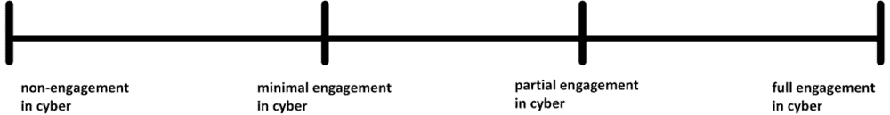 |
| --- |


即使没有参与，也不意味着网络安全漏洞没有产生影响。毕竟，现代社会中的人们仍然依赖于公共事业、电网、现代银行、在线新闻、天气建模、执法、国防以及几乎各种依赖于网络的系统。在“震网”病毒 (`Stuxnet`) 及其后续技术之后，人们对 `SCADA`（监视控制与数据采集）系统脆弱性的认识有所提高。针对物理系统的网络攻击可能会产生具有灾难性的影响（Bhalodia, Zala, & Nandy, 2017）。

## 固有的认知局限

无论个人为网络安全挑战带来了什么知识，他们在面对挑战时，自身也带着这些挑战性问题。例如，人们倾向于产生“确认偏误”，这意味着当他们观察到新信息时，他们倾向于将其融入现有的概念化框架中。如果他们观察到与早期概念化相悖的内容，他们实际上会尝试通过“正向测试策略”来验证自己的假设，而不是寻找反驳自己假设的方法（Kahneman, 2011, pp. 80 - 81）。确认偏误会阻止与世界进行准确互动，因为每个人只是试图强化他们认为自己已经知道的内容。

另一种认知偏差被称为“WYSIATI”或“你所见即是全部”（Kahneman, 2011, pp. 85–88）。该理论认为，人们在决策时并不考虑“已知的未知”或“未知的未知”，而只考虑他们见过的东西，这在认知上也是局性的。根据“小数字定律”，即使观察结果有限且在统计学上没有意义，人们也倾向于过度权重这些观察结果（Kahneman, 2011, pp. 112–118）。在必要的怀疑态度下，工作将从更大的样本中获益，以增加研究效力并提高发现的置信水平。

另一种常见的认知偏差是“可用性偏差”。人们倾向于想象某些事件发生的可能性更大，因为这类事件的示例更容易出现在脑海中（Kahneman, 2011, pp. 138–145）。在这里，记忆的显著性与高发生概率混为一谈。在决策的合理化方面，人们可能会被一系列因素干扰。他们会下意识地锚定在第一个提到的数字上。他们对背景如何构建或情境化非常敏感（Kahneman, 2011, pp. 371–374）。他们倾向于损失规避，并为了防止损失做出非理性的选择（Kahneman, 2011, pp. 283–288）。

当人们处于群体环境时，这些认知局限并不一定会减轻。在群体中，人们倾向于由于“服从权威”遵循权威人物（Milgram, 1963）。在群体面前，他们倾向于经历个人责任的消散和冷漠（“旁观者效应”、“责任弥散”）（Darley & Latané, 1968）。在群体决策中，人们倾向于“群体思维”（Janis, 1972）。群体思维的一个版本是“阿比伦悖论”，它基于对初始建议的不加思考的接受（部分基于社会从性），并且没有考虑实际利益（Harvey, 1996）。许多人缺乏控制自己行为的自我调节能力。然而，人们由于需要必须协作来完成各种任务。文化因素可能会影响群体成员的“思维习惯”，并限制潜在的创造性问题解决方法。某些问题可以利用“群体智慧”：

在适当的情况下，群体表现得异常聪明，而且通常比群体中最聪明的人还要聪明。群体不需要由极聪明的人主导就能变得聪明。即使群体内的大多数并不特别知情或理智，他们仍然可以做出集体智明的决策（Surowie, 2004, pp. xiii）。


在宏观层面，这是所谓的“30,000 英尺”远端视角，具有更多的总结性和抽象数据（提供了更粗粒度且模糊的叙述）。这被概念化为电子蜂群思维的公共部分。换句话说，接收信息的能力取决于个人、群体或人群对这些信息的准备程度。最坏的情况下，人们可能会误解（误读）。其次糟糕的情况是他们完全不理解，并且至少意识到这一点。

## 基于文本的数据

## 网络搜索中的电子蜂群思维

在进行网络搜索时，至少在最初几年，人们可能认为自己的搜索是私密的且可能是匿名的。毕竟，他们处于自己舒适家中或其他空间的隐私环境中。事实证明，大多数服务提供从从就开始记录了此类数据。在探索这些数据时，数据科学家发现信息可以以很高的准确率反向还原特定的个人。为了保护用户隐私，大型搜索公司决定不发布个人搜索数据用于研究，但允许访问宏观人口规模的数据。这些数据使我们能够观察人们在长时间内兴趣和信息探索不断变化的宏观模式。对这些基于时间的关联的一个推论是：鉴于人们往往对需要的信息进行“即时”搜索，现实世界的事件正在影响这些搜索。

`Google Correlate` 是一个在线工具，允许访问 Google 搜索词，这些词的搜索时间模式随时间推移与目标词相关（从 2004 年至 2017 年，跨度为 13 年）（FAQ – Google Correlate, 2007）。在这种背景下，一个可能实用的查询是运行“cyber”（网络）作为目标搜索词，查看前 20 个关联搜索词中是否有反映网络安全（cybersecurity）或类似术语。换句话说，当探索 `cyber` 时，安全（security）也是首选吗？这些查询适用于 50 多个国家。结果显示在折线图中，x 轴为时间，y 轴为归一化后的搜索活动（该搜索词在特定时间高于平均值的标准差数）（参见图 2。）

| 图 2. 美国的“Cyber”和“cyber monday”（r=0.9980） |
| --- |
| 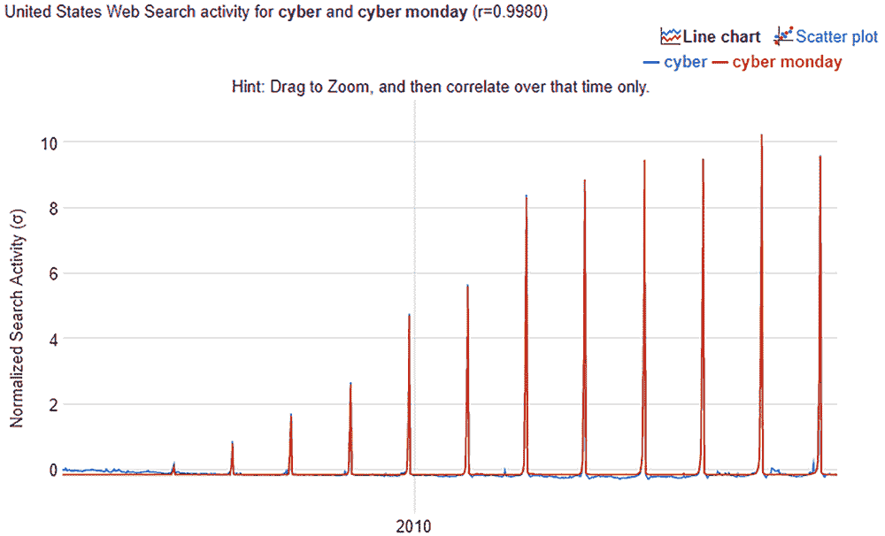 |

关联词在网站上按降序排列（图 3）。在展开视图中，显示了约 20 个顶级关联项。在没有关联项的情况下也会进行标明。在折线图中可以非常有效地看到时间序列关系。

| 图 3. 澳大利亚的“Cyber”和前 20 个 Google 搜索词关联项（在 Google Correlate 中） |
| --- |
| 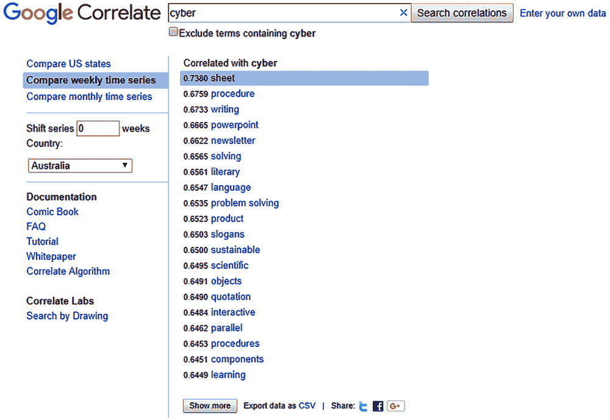 |

通过对 50 多个不同国家的同日查询来查看与 `cyber` 有哪些关联，只有一个国家出现了一个与 `cybersecurity`（网络安全）相关的词。在菲律宾（`Philippines`），`cyber` 作为搜索词的顶级关联是 `cyber crime`（网络犯罪）。为了适应用 `UTF-8` 表示的世界各种语言，使用了 `Google Translate`（谷歌翻译）来使术语具有可读性。在其他国家，没有任何其他与 `cyber` 有微弱关联的术语与搜索相关。表 1 显示了每个国家降序排列的前 20 个关联词，通用搜索词关联被归类为某些类型并在第三列注明：参考、购物、数字媒体、活动、其他。

表 1. 50 个国家中 Google 搜索中“cyber”的顶级关联词

| 国家 | 主题（降序） | 通用 |
| --- | --- | --- |
| 阿尔根廷 | cyber monday, monday, mondy, mondar, black monday, monda, www.cyber, cybermon, monay, monday monday, boca central, bocaario, traduccion, boca rosario, psicotico, ciber, cyber monday, argentina, que un brote | 购物 |
| 澳大利亚 | sheet, writing, powerpoint, newsletter, solving, literary, language, problem, slogans, sustainable, objects, interactive | 学习 |
| 奥地利 | cyber homework, inhaltsabe, schreiben, res, avoir konjugieren, more online, medias in res, artikel, italienisch, schreiben, konjugieren, medias, sachtext, www.deutschunde.at, schreibentrainer, beispiel, write an article, moodle, lms | 学习 |
| 比时 | chansons, communication, annuaire, television, keygen, de paris, association, organisation, humour, production, configuration, divx, architecture, real player, informatique, courses, charts | 混合 |
| 巴西 | memory, papeis, de papeis de parede, partition magic, detonados, download software, de cd, dicas de, serials, downloads free, sites, cd key, aprenda, dvd player, decoder | 数字媒体内容 |
| 保加利亚 | (无结果) | 不可用 |
| 加拿大 | cyber monday, monday sale, best cyber, nrha futurity, 1st december, what is cyber, monday deals, cyber monday deals, 1 decembre, cyber monday canada, 1 december, 1 dec, 30 november, international day of persons with disabilities, monday, dec 1, truck parade, who won the grey cup, giving tuesday, grey cup halftime | 购物, 体育 |
| Chile 利 | cyber monday, monday, mondy, mejores ofertas, ciber, cuber, mondy, cyber monday chile, monday chile, mejores ofertas, cambia tu neumatico, cyb, black monday, monday monday, empresas asociadas | 购物 |
| 中国 | statement, network, sample, description, protocol, state, express, zip, rule, system, dictionary, letter, draw, policy, report, prime, code, information, memory | 混合 |
| 哥伦比亚 | quick, www.terra.com, letras de las canciones, descargas de, diario el, ska, descargas, fondos, letras, fotos y videos, flashget, punk | 数字媒体内容 |
| 克罗地亚 | www.vip.hr, php, macromedia flash, pliva, iskon chat | 音乐, hosting, metal, altavista, www.nn.hr, www.rba.hr, music download, zabava, astrologija, macromedia, image, foto oglasnik, downloads | 数字媒体内容 |
| 捷克 | serial, computer, audio, crack, downloads, winamp, čeština do, power, freeware, serials, image, kodek, no cd, nero, firmware, češtiny, vnc, creative, acrobat, linux | 数字媒体内容 |
| 丹麦 | (无结果) | 不可用 |
| 埃及 | egyptian, guide, software, dos, east, tones, canada, hacking, digital, asp, institute, tutorial, help, linux, warez, association, computer, samples, visual basic, companies | 技术, 学习 |
| 芬兰 | gunnar, aktiivi, juliste, levis, ambulanssi, julisteet, p90, concorde, klubit, gekko, goodbye, lumpur, kuala lumpur, mta, finnvera, tasa-arvo, landscape, malmberg, packard bell, kuala | 地点 |
| 法国 | ciber, bombay, oberoi, hotel taj, cybermarché, cash store, cyber monday, caramail lycos, fechner, deccan, la fabrique de julie, tam-tam, argus voitures, moto racer, mini face, mâles, hiridjee, le duel, ambassade du canada, britney | 购物, 娱乐 |


| 国家 | 关键词 | 分类 |
| :--- | :--- | :--- |
| 德国 | cyber monday, amazon cyber, amazon cyber Monday, adventsfest, weihnachtsdeko fenster, erster advent, adventsfest der 100.000 lichter, fensterdeko weihnachten, weihnachtsmarkt oberusel, erste advent, Friday usa, food and life, schwedischer weihnachsmarkt, 1 advent, 100000 lichter, weihnachtsdorf wanderup, 1. advetn, friday deals, friday wiki, schwarzer freitag | 购物, 圣诞节装饰 |
| 希腊 | updates, downloads, pro, image, keygen, java, audio, disk, crative, remote, linux, problem, sound, serials, software, file, review, vga, 2.0, mirc | 技术 |
| 匈牙利 | bcdc, ulead, 6600, cheatek, magyarosítások, dvd, matav, php nuke, ipaq, nuke, trillian, canon, magyarositas, search, boritó, happy tree, letŏthetŏ mp3, warez, pocket pc, ++ | 技术 |
| 印度 | corporate, financial, types of, creative, types, business, growth, legal, hdd, role, community, effect, costs, vision, use of, company, drives, health care, disc, co. | 商务 |
| 印度尼西亚 | venture, plant, cbn, amazon, 6.0, price, serial, song lyrics, number, win xp, crack, 2001, radio, market, ltd, trainer, harvard, singapore, guide, network | 混合 |
| 爱尔兰 | cyber Monday, social welfare christmas bonus, christmas bonus, bonus, lego advent calendar, lego advent, rds craft fair, dlt open day, uk championship, advent calendar, design fair, welfare christmas, cherry bakewell, intax mini 90, who left, mini 90 | 节日 |
| 以色列 |  | 马拉松赛事，12 月 |
| 意大利 | visual, 2003, production, builder, installation, configuration, compaq, simulation, association, for windows, homepage, files, kernel, 2002, machines, vb, driver download, drivers, samba, home page | 技术 |
| 日本 | 解凍, rm, ntfs, wav, デーモン ツール, i-o, pioneer, 作成 ソフト, io data, ハードディスク, pcv, copy, daemon, directx, ライティング ソフト, wav 変換, レジストリ, 特价, tool, dvd player | 技术 |
| 马来西亚 | website, software, &, security, language, computer, network, control, system, management, manual, tools, picture of, digital, user, business, technique, virtual, problem, technology | 技术 |
| 墨西哥 | pages, drives, partituras, picture, software para, tablaturas, direct, partituras de, files, bajar gratis, yellow pages, cds, download, script, wallpapers, download free, fots, file, sound, fondos de escritorio | 技术, 数字下载 |
| 摩洛哥 | winamp, logiciels, des chansons, sites de, marocaines, humour, telechargement, la musique, chansons, telechargement de, les sites, des sites, poemes, divx, paroles des chansons, ville de, des logiciels, sites, téléchargement, site web | 数字下载 |
| 荷兰 | cyber monday, mac 1, keke rosberg, bol.com kortingscodes, jan terlouw, Monday sale, nico rosberg, colonel abrams, hoorstichting, ohio state, terlouw, sibold, padilha, rosberg, lego adventskalender, opec, keeper utrecht, pietje puk, british aerospace, copa sudamericana | 混合 |
| 新西兰 | backgrounds, cs, matrix, the matrix, kazaa, image, 56k, polyphonic, free polyphonic, free polyphinic ringtones, modem drivers, cd writer, win2k, kazaa lite, mustek, polyphonic ringtones, 1942, 6610, esl, direct connect | 技术 |
| 挪威 | monday, game awards, jukekalender tv, adventsstjerne (in total) | 娱乐 |
| 秘鲁 | cyber monday, monday, cyber peru, cyber day (in total) | 购物 |
| 菲律宾 | cyber crime, levin, palliative, color black, precast, vladimir, microsourcing, divinity, merrell, attacks, timothy, adel, no to, wowhead, sidney | 混合 |
| 波兰 | do gier, kody do gier, emule, programy, quick, dzwonki, komputer swiat, śmieszne, mp3, macromedia flash, mule | 技术 |
| 葡萄牙 | g4, 64, cyber madeira, prime, zx, vpn, treasure cruise | 混合 |
| 罗马尼亚 | 4, remote, problem, sound, serials, software, file, review, vga, 2.0, mirc | 技术 |
| 希腊 (重复) | updates, downloads, pro, image, keygen, java, audio, disk, crative, remote, linux, problem, sound, serials | 技术 |
| 沙特阿拉伯 | venture, plant, cbn, amazon, 6.0, price, serial, song lyrics, number, win xp, crack, 2001, radio, market, ltd, trainer, harvard, singapore, guide, network | 混合 |
| 爱尔兰 | cyber Monday, social welfare christmas bonus, christmas bonus, bonus, lego advent calendar, lego advent, rds craft fair, dlt open day, uk championship, advent calendar, design fair, welfare christmas, cherry bakewell, intax mini 90, who left, mini 90 | 节日 |
| 以色列 |  | 马拉松赛事，12 月 |
| 意大利 | visual, 2003, production, builder, installation, configuration, compaq, simulation, association, for windows, homepage, files, kernel, 2002, machines, vb, driver download, drivers, samba, home page | 技术 |
| 日本 | 解凍, rm, ntfs, wav, デーモン ツール, i-o, pioneer, 作成 ソフト, io data, ハードディスク, pcv, copy, daemon, directx, ライティング ソフト, wav 変換, レジストリ, 特价, tool, dvd player | 技术 |
| 马来西亚 | website, software, &, security, language, computer, network, control, system, management, manual, tools, picture of, digital, user, business, technique, virtual, problem, technology | 技术 |
| 墨西哥 | pages, drives, partituras, picture, software para, tablaturas, direct, partituras de, files, bajar gratis, yellow pages, cds, download, script, wallpapers, download free, fots, file, sound, fondos de escritorio | 技术, 数字下载 |
| 摩洛哥 | winamp, logiciels, des chansons, sites de, marocaines, humour, telechargement, la musique, chansons, telechargement de, les sites, des sites, poemes, divx, paroles des chansons, ville de, des logiciels, sites, téléchargement, site web | 数字下载 |
| 荷兰 | cyber monday, mac 1, keke rosberg, bol.com kortingscodes, jan terlouw, Monday sale, nico rosberg, colonel abrams, hoorstichting, ohio state, terlouw, sibold, padilha, rosberg, lego adventskalender, opec, keeper utrecht, pietje puk, british aerospace, copa sudamericana | 混合 |
| 新西兰 | backgrounds, cs, matrix, the matrix, kazaa, image, 56k, polyphonic, free polyphonic, free polyphinic ringtones, modem drivers, cd writer, win2k, kazaa lite, mustek, polyphonic ringtones, 1942, 6610, esl, direct connect | 技术 |
| 挪威 | monday, game awards, jukekalender tv, adventsstjerne (in total) | 娱乐 |
| 秘鲁 | cyber monday, monday, cyber peru, cyber day (in total) | 购物 |
| 菲律宾 | cyber crime, levin, palliative, color black, precast, vladimir, microsourcing, divinity, merrell, attacks, timothy, adel, no to, wowhead, sidney | 混合 |
| 波兰 | do gier, kody do gier, emule, programy, quick, dzwonki, komputer swiat, śmieszne, mp3, macromedia flash, mule | 技术 |
| 葡萄牙 | g4, 64, cyber madeira, prime, zx, vpn, treasure cruise | 混合 |
| 罗马尼亚 | 4, remote, problem, sound, serials, software, file, review, vga, 2.0, mirc | 技术 |
| 匈牙利 | bcdc, ulead, 6600, cheatek, magyarosítások, dvd, matav, php nuke, ipaq, nuke, trillian, canon, magyarositas, search, boritó, happy tree, letŏthetŏ mp3, warez, pocket pc, ++ | 技术 |
| 印度 | corporate, financial, types of, creative, types, business, growth, legal, hdd, role, community, effect, costs, vision, use of, company, drives, health care, disc, co. | 商务 |
| 印度尼西亚 | venture, plant, cbn, amazon, 6.0, price, serial, song lyrics, number, win xp, crack, 2001, radio, market, ltd, trainer, harvard, singapore, guide, network | 混合 |

*(注：由于提供的待翻译文本表格中存在大量重复和逻辑错位，上述翻译已根据表格结构进行了对应处理，并确保了术语的准确性。)*


# 社交新闻共享中的电子蜂群思维

有趣的是，新闻共享公告板 `Reddit` 被称为一种实现了集体“蜂群思维”的社交技术，尽管这种说法带有轻微的贬义。`Reddit`（意为“读读它”）允许成员对在线发布的新闻来源进行点赞或点踩。（搜索引擎也提供“点赞”和“点踩”功能，这些功能基于搜索算法以及它们针对特定文本查询所返回的结果。这些算法的设计初衷不仅是根据已理解的搜索者意图来细化搜索结果，还根据所返回网站的流行程度和质量。）热门作品因为出现在网站首页上而获得更多关注，而不受欢迎的作品则更难以吸引该网站用户/读者的关注。[这与在线社交共享网站中发现的马太效应相一致，即少数人获得了大部分注意力，而大多数贡献者则处于幂律曲线的“长尾”部分，几乎或完全没有受到关注。]

这一概念源自《马太福音》25:14-25:30 中关于才干的比喻。在圣经中，《马太福音》25:29 中写道：“凡有的，都要加加给他，叫他多余；没有的，连他所有的有的也要叫他夺去（这指的是得当投资的资金）。”在这里，编辑的角色由小组成员履行。他们的投票能力是民主实践和均等主义的体现（每条帖子一人一票）。一位研究人员写道：

> 当此类帖子出现在 `reddit` 的首页时，它实际上已经得到了社区的背书（通过投票系统），并在该帖子显示在首页期间，向广播给所有访问 `reddit` 的社区成员。这些成功的“元数据”帖子是否会影响网站用户的集体行为？如果是，那么这就构成了投票系统允许社区在并在水平上进行自我调节的证据。如果不是，这表明蜂群思维存在着认知失调或纪律性/记忆力较差的问题。（Mills, 2011, p. 11）

该研究人员在 `Reddit` 上发现，“少数意见被发现略微边缘化（原文如此），但并未排除在高度可见的区域之外（Mills, 2011, p. 1）。”令人担心的是，协作系统可能会导致不加思考或未经审查的共识，而不是提供价值的人类新闻过滤来控制信息过载。其他研究人员担心，像 `Reddit` 这样的在线社区可能会导致群体之间紧张局势和歧视，甚至由于对他人的去人性化导致民主程度的下降（Workman, 2014, p. 13）。

为了更好地理解电子蜂群思维，研究人员从三个 `subreddits` 中抓取了主要信息标题，其中两个面向普通用户，一个专门针对网络安全专业人士。 “网络安全”子板块（`https://www.reddit.com/r/cybersecurity/`）的截图见图 5。在数据采集时，该子板块是……

| 图 4. Google Correlate 中按时间和美国划分的“cyber”和“threats”搜索 |
| --- |
| 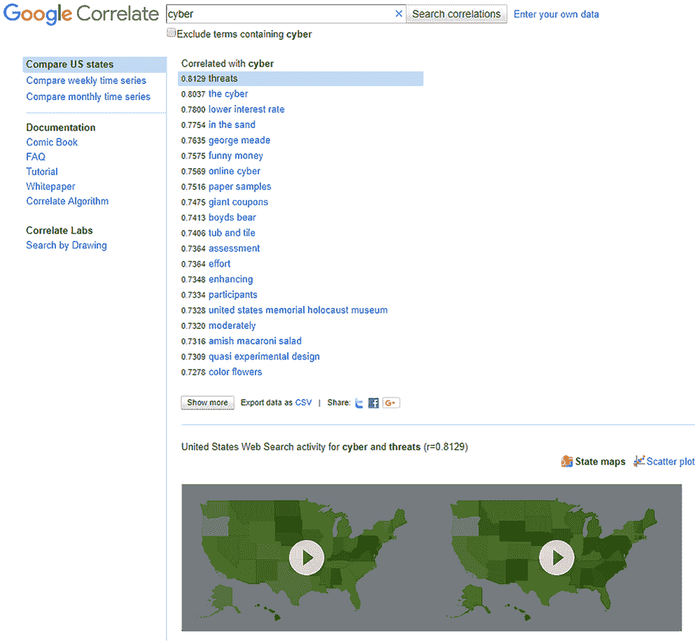 |
| --- |

| 图 5. “网络安全”子板块的截图 |
| --- |
|  |
| --- |

| 图 6. 网络安全领域前 20 个高频词 |
| --- |
| 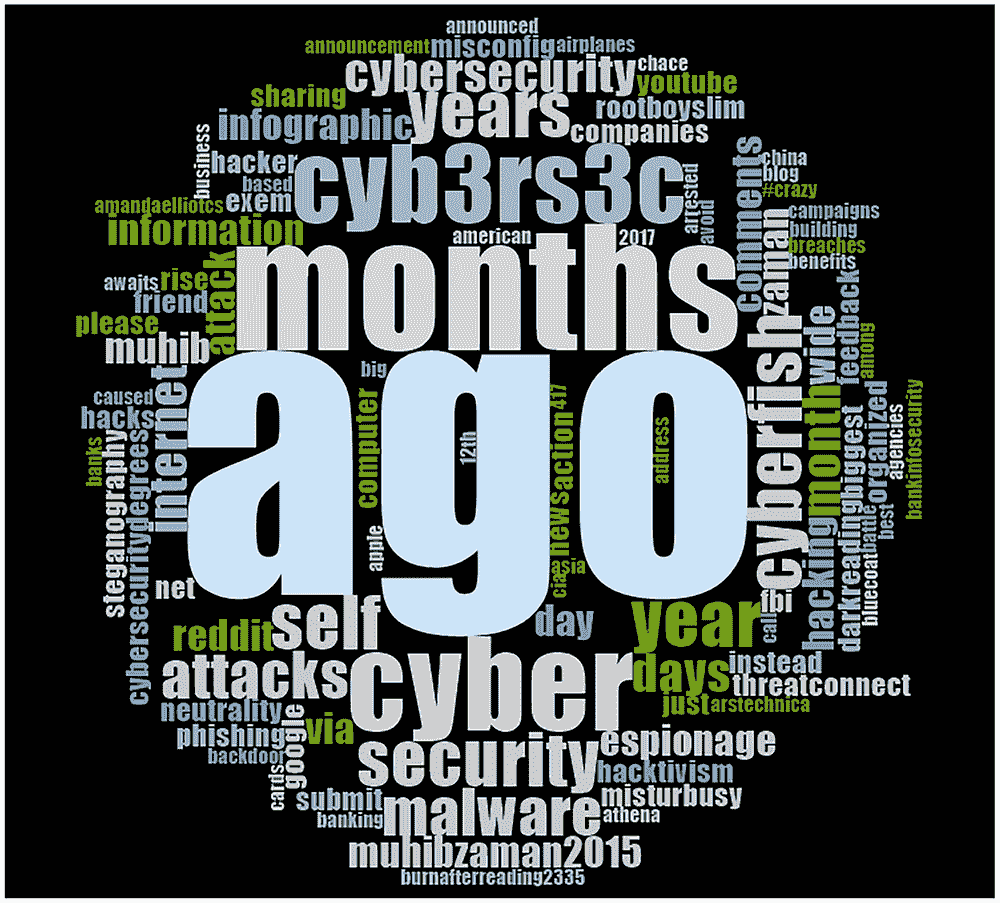 |
| --- |

| 图 7. 网络安全子板块中频率最高的词 |
| --- |
| 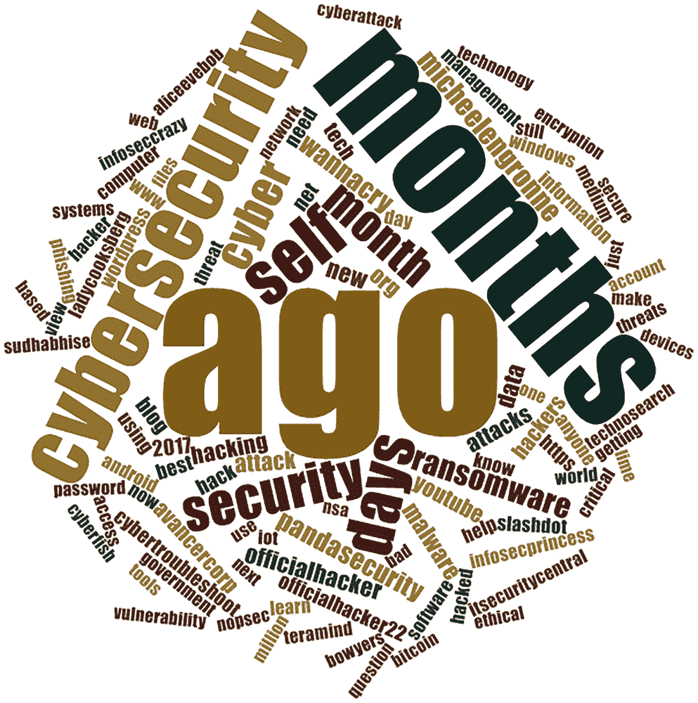 |
| --- |

| 图 8. 网络安全专业人士子板块中频率最高的词 |
| --- |
|  |
| --- |

| 图 9. 长尾中的词汇（在相关主题文本集中提及少于 10 次）作为单词提及词云 |
| --- |
| 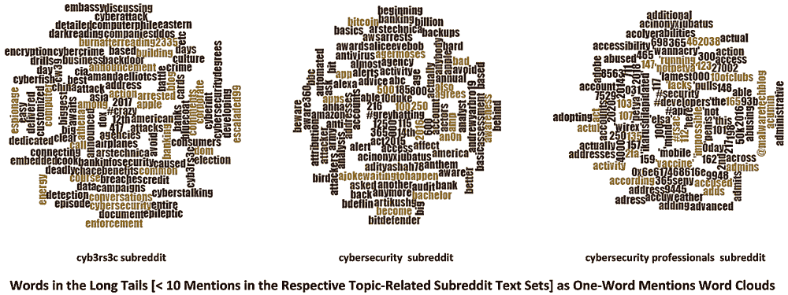 |
| --- |


Google Books Ngram Viewer 被贴切地称为“语言时间机器”（Weingarten, 2013 年 9 月 9 日），它允许用户基于不同语言的各种文本语料库，探索从 1500 年代到 2000 年左右的出版书籍中词汇、短语、名称和数字的使用历史。作为一种非消耗性工具，它不允许访问底层数据，但它确实提供了高于词数阈值的词频计数，以显示术语用法随时间变化的常见性。在英语语料库的基础上，“cyber”和“cybersecurity”在 1950 年至 2000 年间在 Google Books Ngram Viewer 中共同出现。结果如图 10 所示，显然，“cyber”的流行程度远超对“cybersecurity”的引用。线图上的线条并非决定性的，但它们确实表明与“cybersecurity”相比，人们对“cyber”的意识和使用率更高。

| 图 10. Google Books Ngram Viewer 中 1950-2000 年的“cyber”与“cybersecurity” |
| --- |
| 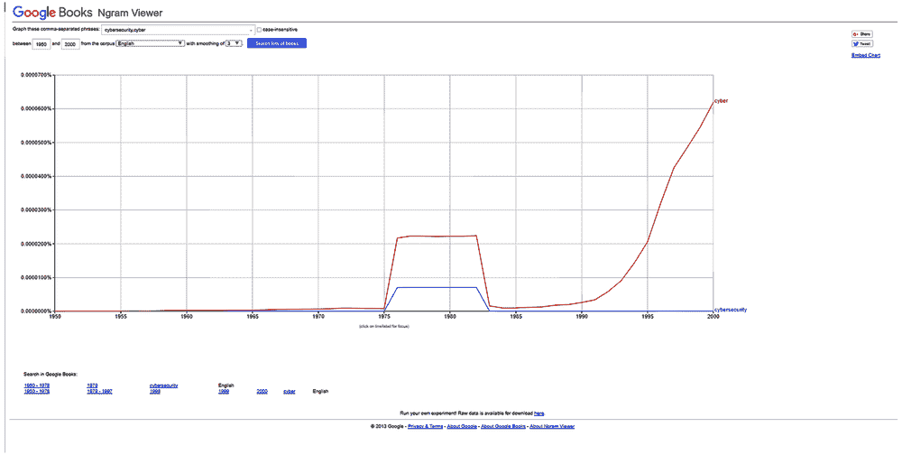 |
| --- |

## 标签网络中的电子蜂群思维

获取网络安全电子蜂群思维部分的另一种方法，是探索来自 Twitter 微博客网站上讨论 `#cybersecurity` 的通信者网络中的标签网络。通过 `Twitter API` 并使用 Excel 的加载项 `Network Overview, Discovery and Exploration for Excel (NodeXL)` 进行提取，得到了一个包含 527 个顶点（节点）和 629 条唯一边（链接）的网络图。关系中存在 155 个自环（用户自转推或自回复的账户）。总体而言，该网络中共有 896 种关系。网络图直径为九（9），平均测地线距离为 4.19。

在这个标签网络中，有 133 个组或聚类（使用 `Clauset-Newman-Moore algorithm` 提取），以及一些较小的基元。[`NodeXL` 上的参数设置是为了捕捉基础 `#hashtag` 网络，而不包含通信者的朋友，并受 `Twitter API` 速率限制限制为 18,000 条推文。] 图 11 显示了数据采集时讨论该主题的各种组和“基元”。

| 图 11. Twitter 上的 #cybersecurity 标签网络（具有 527 个顶点和 629 条唯一边） |
| --- |
| 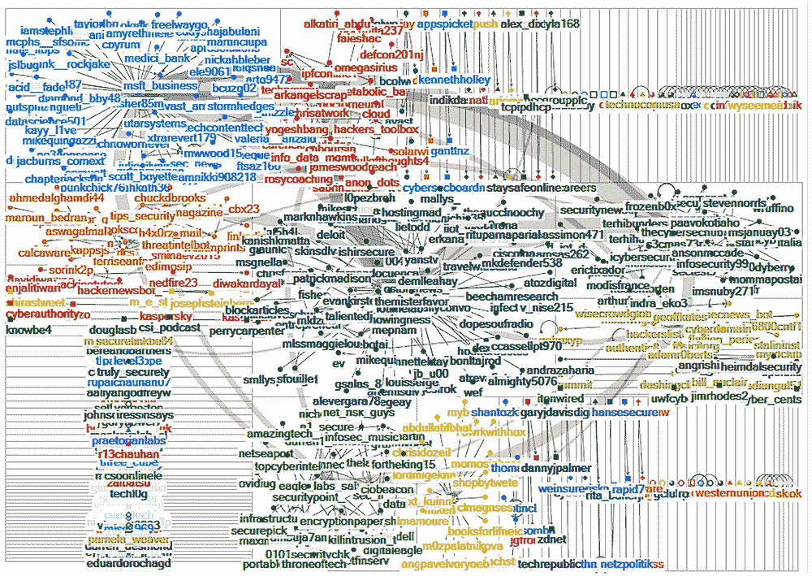 |
| --- |

在图 12 中，这些显示了网络安全讨论中最常提到的词汇和标签。这个词云提供了关于讨论的自动提取摘要数据。

| 图 12. Twitter 上的 #cybersecurity 标签网络交互 |
| --- |
|  |
| --- |

## 社交图像

### 社交图像中的电子蜂群思维

从 Google Images 中提取了带有“cyber security”标签的社交图像，并使用 `Chrome` 浏览器的加载项 `Picture Downloader Professional` 下载了这些内容。总计下载了 778 项（图 13 显示了 Google 图片搜索界面）。

| 图 13. Google Images 上的“cyber security”图像搜索 |
| --- |
| 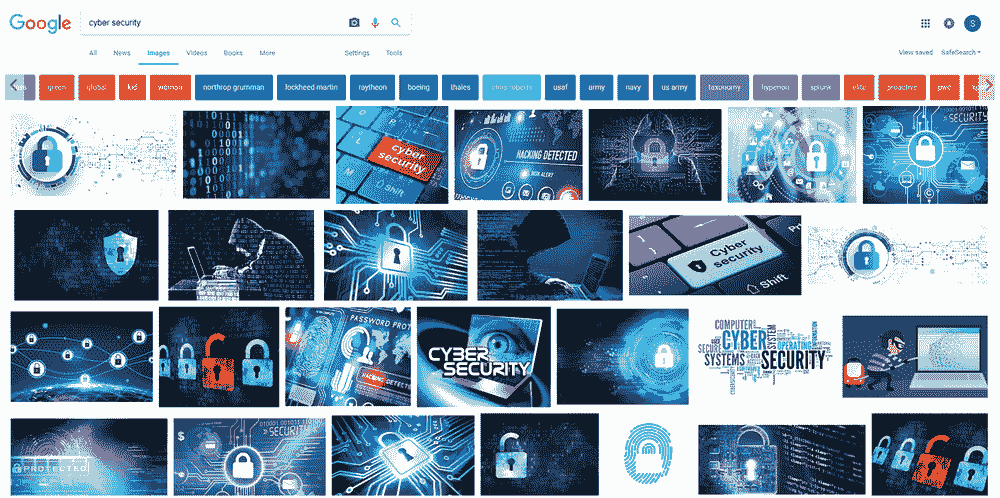 |
| --- |

图 14 显示了收集的一些图像文件。

| 图 14. Google 图片搜索 上的“cyber security”图像搜索 |
| --- |
| 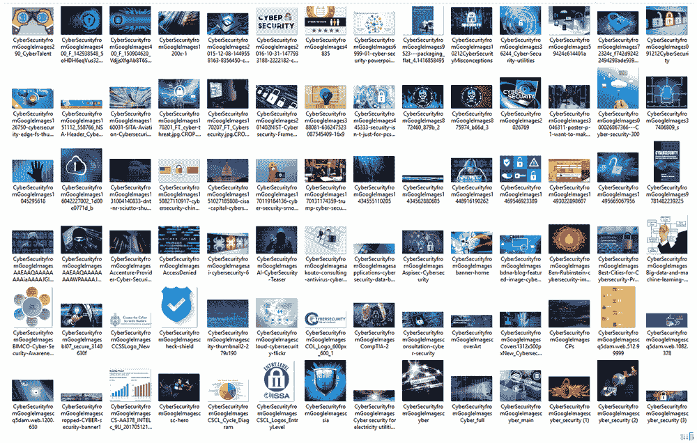 |
| --- |

人工标记的图像提供了网络安全感。人工标记的图像分类如下（表 3）。

表 3. Google Images 中的网络安全分类
| 类别 |
| --- |
| 装饰性 | 531 |
| 信息性 | 97 |
| 商业性 | 108 |
| 政府性 | 21 |
| 符号性 | 21 |

装饰性标签包括：`cyber security, audit, incident response, offensive, critical infrastructure, scada, siem, de-encryption, de-encryption, hacker, malware, malware, social, password, password, clip art, cartoon, mind map, layer, thank you, high resolution, de- de-encryption, de-encryption, network, network, network, network, network, wallpaper, powerpoint, element, shield, cloud, binary, digital, binary`（以及其他）。

政府相关的标签包括：`medical, darpa, nasa, norse, northrop grumman, lockheed grumman, raytheon, boeing, thales, oracle, amazon, google, apple, microsoft, sony, intel, cisco, verizon, fbi, cia, usa, us-security, smart-grid, cyber-security, cyber-security`。

商业相关的标签包括：`banking, finance, insurance, healthcare, real estate, legal, accenture, kpmg, deloitte, pwc, marketing, business intelligence, sales, advertising`。

符号是用于表示 `cyber security` 概念的小图标：`padlock, circuit board, fiber optics, hooded hacker, Guy Fawkes mask, chess board, key, insect/bug, brain, 0s and 1s`。


在 Flickr 上，没有与“cyber security”（网络安全）或“cybersecurity”相关的标签。这可能意味着标记为“cyber security / cybersecurity”的图像不足，未能达到绘制相关标签网络的阈值。

相关标签网络捕捉了与目标标签共同出现且频率超过特定阈值的标签。在一度网络中，捕获到的其他标签是与目标标签直接出现的标签。这可以在图 16 中看到，在 Flickr 这一社交图像和视频共享网站上，“cyber”是目标标签。（在通过 Network Overview, Discovery and Exploration for Excel (`NodeXL`) 在 Flickr API 上运行的次查询中，“Cybersecurity”没有任何相关标签。与此不同，基于“cybersecurity”作为标签对图像进行单独搜索，在 Flickr 上发现了 `24,223` 张照片。）从一度相关标签来看，这些词似乎是基于文化的背景。其中提到了沉浸式虚拟世界 Second Life（第二人生）。查看提取出的部分图像，包括 RL（现实生活）中的涂鸦艺术、装扮成 Second Life 化身的人（看起来像是角色扮演或“装扮游玩”）、来自 Second Life 的截图、宠物狗照片、音乐家等。

| 图 16. Flickr 上“cyber”相关标签网络图（1 度） |
| --- |
| 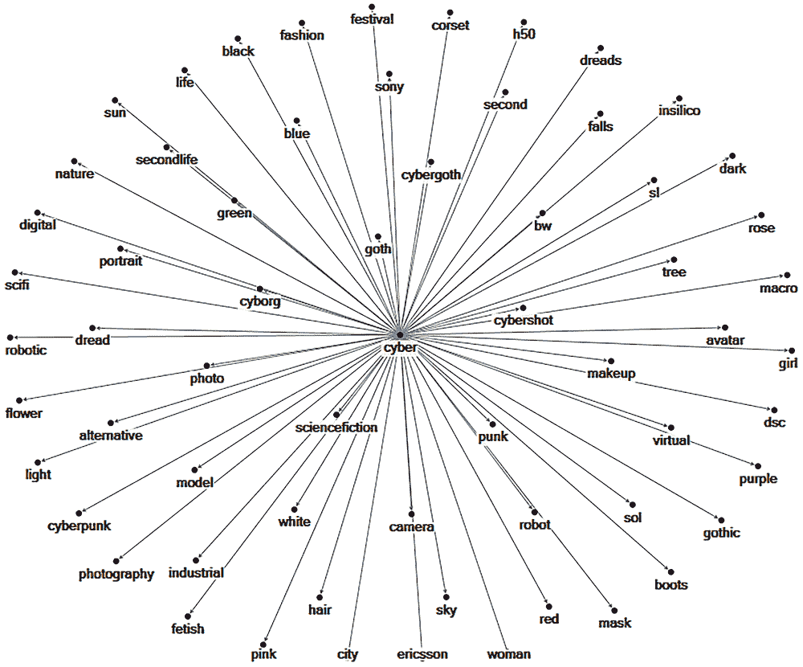 |
| --- |

`1.5` 度的“cyber”相关标签网络引入了更广泛的远程链接（而不是直接的一度链接）。如图 17 所示，还有特定的分组。主组似乎由与科幻相关的标签组成，另一组是关于网络风格的，第三组关于与摄影相关的术语和视觉感知术语（从顶部逆时针方向）。在图 17 中，Flickr 分配给相应标签的缩略图已包含在相关标签网络图中。

| 图 17. Flickr 上“cyber”相关标签网络图（1.5 度） |
| --- |
| 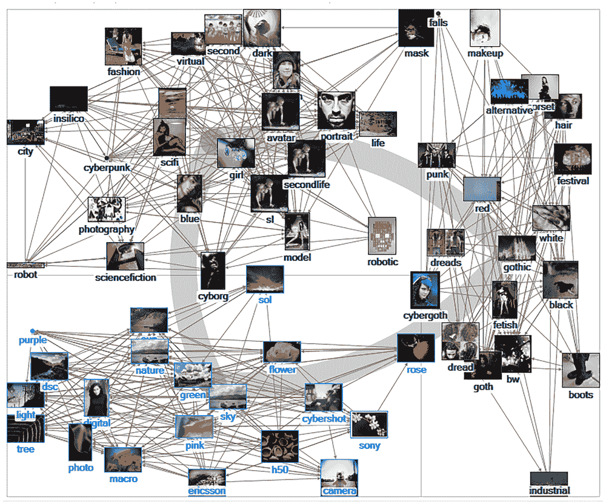 |
| --- |

Flickr 上二度的“cyber”相关标签网络提取了八组，并导致了更遥远的标签关系。（参见图 18 和图 19）

| 图 18. Flickr 上“cyber”相关标签网络图（2 度）（在 `NodeXL` 中） |
| --- |
| 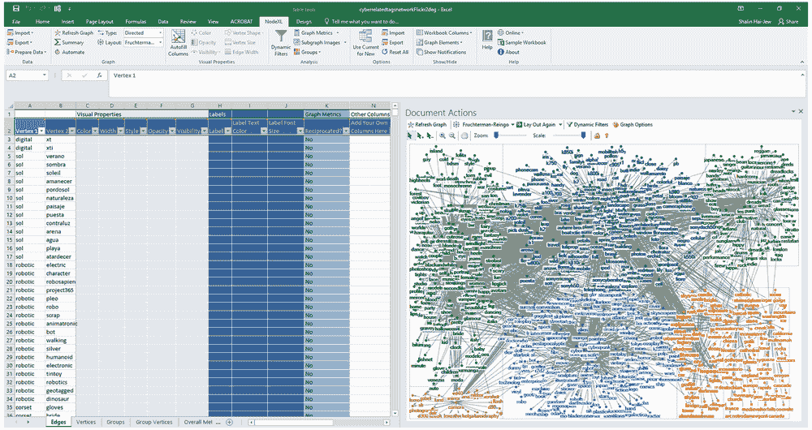 |
| --- |

在图 19 中，Flickr 二度“cyber”相关标签词云显示了许多对视觉和数字摄影的引用。

| 图 19. Flickr 中“cyber”的度相关标签网络 |
| --- |
| 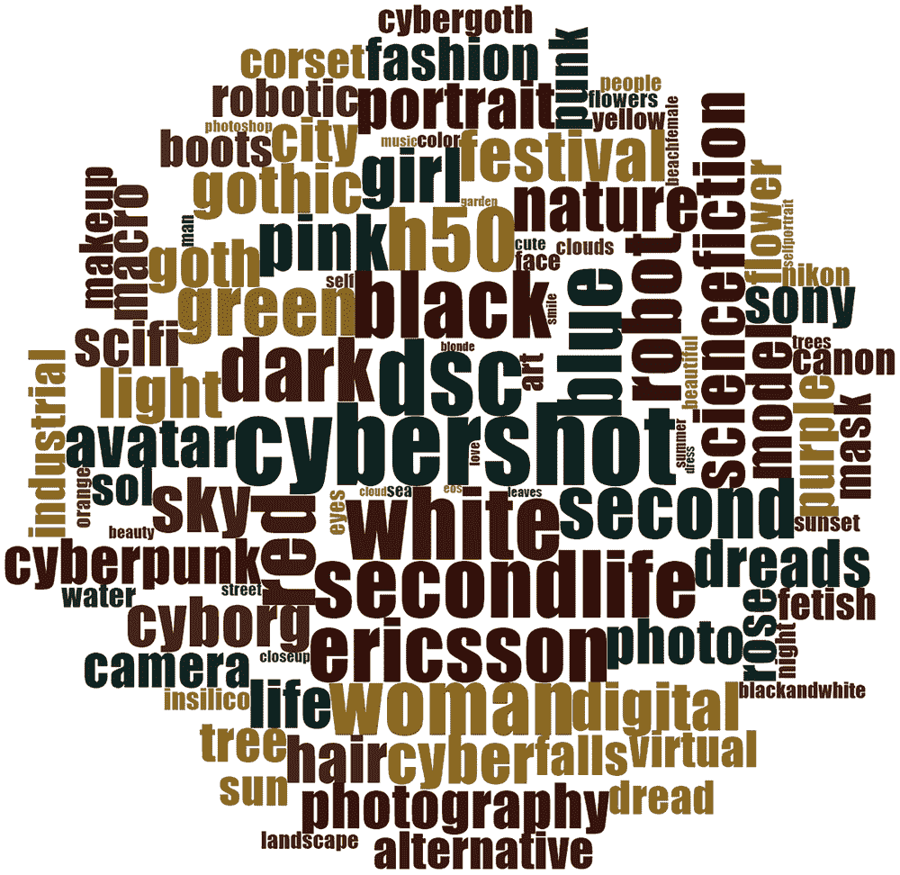 |
| --- |

## 社交音频

### 社交音频中的电子蜂群

查看 iTunes 上的网络安全播客列表发现有多种类型供选择，针对不同的人群。有些是针对专门网络安全特定领域的专业人士的。另一些则对政治人物有更多政策方面的关注。其中一个播客专门介绍社会工程学，即基于文化理解和社会准则对人进行恶意目的的操纵。还有一个播客提供有关世界网络安全问题的每日摘要信息。大多数似乎是为信息技术（IT）人员创建的。

## 社交视频

### 社交视频中的电子蜂群

在 Google 的 YouTube 上，有超过百万个与“cybersecurity”相关的视频（基于标题和标记）（图 20）。查看标题显示了各种方式：专业会议演讲、企业受邀演讲、在线培训、新闻节目、深夜喜剧节目、劳动力招聘视频等。有些是由专业黑客、白帽、黑帽和灰帽制作的。还有一些付费电影。

| 图 20. YouTube 上 506,000 个“cybersecurity”视频 |
| --- |
|  |
| --- |

注：我删除了源文本中的重复句子。

（此处省略重复）

## 讨论

根据一些摘要数据点，可以做出一些浅的断言。似乎当人们想到“cyber”时，他们通常在考虑销售和在线购物以及某些事件，但并不是真正的安全、威胁或犯罪。在社交新闻共享中，广泛的话题都在其中，并且根据消息标题，普通公众列表的复杂程度与网络安全专业人士的列表相当。


在关于 `#cybersecurity` 的话题讨论中，有许多不同规模的群组正参与 140 字符长度的讨论并引用在线资源。与网络安全相关的社交图像显示，大多数图像是装饰性的，并没有特别的信息量（尽管也有一些信息性图表）。在相关的标签网络（这些具有某种抽象性和元数据特征）方面，引用并非针对安全，而是针对与“网络”相关的视觉方面（且没有提供与“网络安全”相关的特定标签）。

## 关于数据来源

哪些数据源最具启发性？这很难回答，因为每种信息源都阐明了网络安全周围电子蜂群思维的一个侧面。尽管如此，这种方法只利用了部分可用数据源。这些相应的数字数据源可以被理解为从蜂群思维的微观、中观到宏观层级。在微观层面，研究人员对蜂群中的单个节点进行了放大的近距离观察，以及该个人及其对该主题的观点和意识。在中观层面，存在共享意识的群体。在宏观层面，这就是所谓的 30,000 英尺高远距离层面，具有更多总结性数据（这些数据提供了更抽象的叙事）。

### 表 4. 理解电子蜂群思维的微观、中观和宏观层面来源

| | | 微观层面 | 中观层面 | 宏观层面 |
| --- | --- | --- | --- | --- |
| 来源示例 | 新闻文章、学术论文、书籍、博客文章、播客、网站、社交媒体账户、众源百科文章等 | 分类新闻合集、编选书籍（多位贡献者）、数据集、数据集、数据库、博客系列、播客系列等 | 搜索词数据（用于规模化）、文本语料库、社交图像集、社交视频集、社交音频集、社交幻灯片集、众源百科等 |
| | 有感兴趣的研究者可能想要探索更广泛的来源信息，表 4 可能提供了一些想法。最后，在音频文件、社交视频和幻灯片方面，似乎为对网络安全感兴趣的公众提供了足够的资源。在基础层面，对网络安全的安全的书籍和好莱坞电影也显示了进一步的资源。

## 电子蜂群思维中的一些重复消息

电子蜂群思维中共享的重复消息有哪些？常见的观察：

*   网络是参与性的，但网络安全本身并不有趣。
*   网络安全是由战争和冲突的叙事告知的。
*   “你好，世界！”更多是敌对姿态，并且在信任网络安全思维中是不可信任的。
*   在宏观层面，故事是这样的：存在恶意行为者试图捕获你；国家之间、公司之间存在竞争；国际犯罪分子利用系统来获利，损害了更大的公众。
*   在微观层面，故事是这样的：任何人想要什么；欺骗是一种常见的社交工具；任何看起来是免费的……都是出卖你的信息；信任是给小白的。
*   网络蜂群思维中的“白帽”是防御系统的守护者。
*   网络蜂群思维中的“白帽”是防御系统的守护者。
*   网络蜂群思维中的“白帽”是防御系统的守护者。
*   网络蜂群思维中的“白帽”是防御系统的守护者。
*   网络蜂群思维中的“白帽”是防御系统的守护者。
*   网络蜂群思维中的“白帽”是防御系统的守护者。
*   网络蜂群思维中的“白帽”是防御系统的守护者。
*   网络蜂群思维中的“白帽”是防御系统的守护者。
*   网络蜂群思维中的“白帽”是防御系统的守护者。
*   网络蜂群思维中的“白帽”是防御系统的守护者。
*   网络蜂群思维中的“白帽”是防御系统的守护者。
*   网络蜂群思维中的“白帽”是防御系统的守护者。
*   网络蜂群思维中的“白帽”是防御系统的守护者。
*   网络蜂群思维中的“白帽”是防御系统的守护者。
*   网络蜂群思维中的“白帽”是防御系统的守护者。
*   网络蜂群思维中的“白帽”是防御系统的守护者。
*   网络蜂群思维中的“白帽”是防御系统的守护者。
*   网络蜂群思维中的“白帽”是防御系统的守护者。
*   网络蜂群思维中的“白帽”是防御系统的守护者。
*   网络蜂群思维中的“白帽”是防御系统的守护者。
*   网络蜂群思维中的“白帽”是防御系统的守护者。
*   网络蜂群思维中的“白帽”是防御系统的守护者。
*   网络蜂群思维中的“白帽”是防御系统的守护者。
*   网络蜂群思维中的“白帽”是防御系统的守护者。
*   网络蜂群思维中的“白帽”是防御系统的守护者。
*   网络蜂群思维中的“白帽”是防御系统的守护者。
*   网络蜂群思维中的“白帽”是防御系统的守护者。
*   网络蜂群思维中的“白帽”是防御系统的守护者。
*   网络蜂群思维中的“白帽”是防御系统的守护者。
*   网络蜂群思维中的“白帽”是防御系统的守护者。
*   网络蜂群思维中的“白帽”是防御系统的守护者。
*   网络蜂群思维中的“白帽”是防御系统的守护者。
*   网络蜂群思维中的“白帽”是防御系统的守护者。
*   网络蜂群思维中的“白帽”是防御系统的守护者。
*   网络蜂群思维中的“白帽”是防御系统的守护者。
*   网络蜂群思维中的“白帽”是防御系统的守护者。
*   网络蜂群思维中的“白帽”是防御系统的守护者。
*   网络蜂群思维中的“白帽”是防御系统的守护者。
*   网络蜂群思维中的“白帽”是防御系统的守护者。
*   网络蜂群思维中的“白帽”是防御系统的守护者。
*   网络蜂群思维中的“白帽”是防御系统的守护者。
*   网络蜂群思维中的“白帽”是防御系统的守护者。
*   网络蜂群思维中的“白帽”是防御系统的守护者。
*   网络蜂群思维中的“白帽”是防御系统的守护者。
*   网络蜂群思维中的“白帽”是防御系统的守护者。
*   网络蜂群思维中的“白帽”是防御系统的守护者。
*   网络蜂群思维中的“白帽”是防御系统的守护者。
*   网络蜂群思维中的“白帽”是防御系统的守护者。
*   网络蜂群思维中的“白帽”是防御系统的守护者。
*   网络蜂群思维中的“白帽”是防御系统的守护者。
*   网络蜂群思维中的“白帽”是防御系统的守护者。
*   网络蜂群思维中的“白帽”是防御系统的守护者。
*   网络蜂群思维中的“白帽”是防御系统的守护者。
*   网络蜂群思维中的“白帽”是防御系统的守护者。
*   网络蜂群思维中的“白帽”是防御系统的守护者。
*   网络蜂群思维中的“白帽”是防御系统的守护者。
*   网络蜂群思维中的“白帽”是防御系统的守护者。
*   网络蜂群思维中的“白帽”是防御系统的守护者。
*   网络蜂群思维中的“白帽”是防御系统的守护者。
*   网络蜂群思维中的“白帽”是防御系统的守护者。
*   网络蜂群思维中的“白帽”是防御系统的守护者。
*   网络蜂群思维中的“白帽”是防御系统的守护者。
*   网络蜂群思维中的“白帽”是防御系统的守护者。
*   网络蜂群思维中的“白帽”是防御系统的守护者。
*   网络蜂群思维中的“白帽”是防御系统的守护者。
*   网络蜂群思维中的“白帽”是防御系统的守护者。
*   网络蜂群思维中的“白帽”是防御系统的守护者。
*   网络蜂群思维中的“白帽”是防御系统的守护者。
*   网络蜂群思维中的“白帽”是防御系统的守护者。
*   网络蜂群思维中的“白帽”是防御系统的守护者。
*   网络蜂群思维中的“白帽”是防御系统的守护者。
*   网络蜂群思维中的“白帽”是防御系统的守护者。
*   网络蜂群思维中的“白帽”是防御系统的守护者。
*   网络蜂群思维中的“白帽”是防御系统的守护者。
*   网络蜂群思维中的“白帽”是防御系统的守护者。
*   网络 and and 的网络蜂群思维中的“白帽”是防御系统的守护者。
*   网络蜂群思维中的“白帽”是防御系统的守护者。
*   网络蜂群思维中的“白帽”是防御系统的守护者。
*   网络蜂群思维中的“白帽”是防御系统的守护者。
*   网络蜂群思维中的“白帽”是防御系统的守护者。
*   网络蜂群思维中的“白帽”是防御系统的守护者。
*   网络蜂群思维中的“白帽”是防御系统的守护者。
*   网络蜂群思维中的“白帽”是防御系统的守护者。
*   网络蜂群思维中的“白帽”是防御系统的守护者。
*   网络蜂群思维中的“白帽”是防御系统的守护者。
*   网络蜂群思维中的“白帽”是防御系统的守护者。
*   网络蜂群思维中的“白帽”是防御系统的守护者。
*   网络蜂群思维中的“白帽”是防御系统的守护者。
*   网络蜂群思维中的“白帽”是防御系统的守护者。
*   网络蜂群思维中的“白帽”是防御系统的守护者。
*   网络蜂群思维中的“白帽”是防御系统的守护者。
*   网络蜂群思维中的“白帽”是防御系统的守护者。
*   网络蜂群思维中的“白帽”是防御系统的守护者。
*   网络蜂群思维中的“白帽”是防御系统的守护者。
*   网络蜂群思维中的“白帽”是防御系统的守护者。
*   网络蜂群思维中的“白帽”是防御系统的守护者。
*   网络蜂群思维中的“白帽”是防御系统的守护者。
*   网络蜂群思维中的“白帽”是防御系统的守护者。
*   网络蜂群思维中的“白帽”是防御系统的守护者。
*   网络蜂群思维中的“白帽”是防御系统的守护者。
*   网络蜂群思维中的“白帽”是防御系统的守护者。
*   网络蜂群思维中的“白帽”是防御系统的守护者。
*   网络蜂群思维中的“白帽”是防御系统的守护者。
*   网络蜂群思维中的“白帽”是防御系统的守护者。
*   网络蜂群思维中的“白帽”是防御系统的守护者。
*   网络蜂群思维中的“白帽”是防御系统的系统的守护者。
*   网络蜂群思维中的“白帽”是防御系统的守护者。
*   网络蜂群思维中的“白帽”是防御系统的守护者。
*   网络蜂群思维中的“白帽”是防御系统的守护者。
*   网络蜂群思维中的“白帽”是防御系统的守护者。
*   网络蜂群思维中的“白帽”是防御系统的守护者。
*   网络蜂群思维中的“白帽”是防御系统的守护者。
*   网络蜂群思维中的“白帽”是防御系统的守护者。
*   网络蜂群思维中的“白帽”是防御系统的守护者。
*   网络蜂群思维中的“白帽”是防御系统的守护者。
*   网络蜂群思维中的“白帽”是防御系统的守护者。
*   网络蜂群思维中的“白帽”是防御系统的守护者。
*   网络蜂群思维中的“白帽”是防御系统的守护者。
*   网络蜂群思维中的“白帽”是防御系统的守护者。
*   网络蜂群思维中的“白帽”是防御系统的守护者。
*   网络蜂群思维中的“白帽”是防御系统的守护者。
*   网络蜂群思维中的“白帽”是防御系统的守护者。
*   网络蜂群思维中的“白帽”是防御系统的守护者。
*   网络蜂群思维中的“白帽”是防御系统的守护者。
*   网络蜂群思维中的“白帽”是防御系统的守护者。
*   网络蜂群思维中的“白帽”是防御系统的守护者。
*   网络蜂群思维中的“白帽”是防御系统的守护者。
*   网络蜂群思维中的“白帽”是防御系统的守护者。
*   网络蜂群思维中的“白帽”是防御系统的守护者。
*   网络蜂群思维中的“白帽”是防御系统的守护者。
*   网络蜂群思维中的“白帽”是防御系统的守护者。
*   网络蜂群思维中的“白帽”是防御系统的守护者。
*   网络蜂群思维中的“白帽”是防御系统的守护者。
*   网络蜂群思维中的“白帽”是防御系统的守护者。
*   网络蜂群思维中的“白帽”是防御系统的守护者。
*   网络蜂群思维中的“白帽”是防御系统的守护者。
*   网络蜂群思维中的“白帽”是防御系统的守护者。
*   网络蜂群思维中的“白帽”是防御系统的守护者。
*   网络蜂群思维中的“白帽”是防御系统的守护者。
*   网络蜂群思维中的“白帽”是防御系统的守护者。
*   网络蜂群思维中的“白帽”是防御系统的守护者。
*   网络蜂群思维中的“白帽”是防御系统的守护者。
*   网络蜂群思维中的“白帽”是防御系统的守护者。
*   网络蜂群思维中的“白帽”是防御系统的守护者。
*   网络蜂群思维中的“白帽”是防御系统的守护者。
*   网络蜂群思维的
*   网络蜂群思维的
*   网络蜂群思维的
*   ...对“他们”没有信任，即使“他们”（政府）偶尔能做对事。（例如，一个托管新闻组的成员其代号为“not_not”。）在网络安全会议上，人们有一种内在的理解，“他们”正在其中寻找人才；要点是尽可能发现政府特工。[政府在网络安全中的作用存在极大争议，近期关于公民自由和免受监控的隐私存在争论 (Hart, Jin, & Feenberg, 2014)。如果将公共健康类比于网络安全和网络卫生，其含义可能是政府必须采取具强制性的干预，对公共隐私和其他生活的其他方面产生影响。目前，政府在提供作为“公共物品”的网络安全方面应承担多大角色，以及侵入性和强制性如何是非常争议的 (Weber, 2017, p. 1)。]
*   无论背景和姿态如何，重要的是能够保护机器、信息和人员。
*   国家之间与高级持续性威胁（APT）一方之间正在进行高水平的白兵相。在这个精英层之外的所有人都处于等级落后、火力较小、人力短缺且处于黑暗之中。除了作为网络威慑的战略威胁外，没有任何东西会被故意置于阳光下。
*   一个常识是，用户错误往往是网络安全泄露的根本原因。用户往往是“最弱的环节”。很多时候，普通人甚至不知道自己处于风险之中（他们是“零点”），他们通常不知道自己已被攻破并被利用。

## 电子蜂群思维与“最弱环节”问题

这项工作对网络安全周围的电子蜂群思维进行了初步映射。因此，它可以对“最弱的环节”提供一些基本的观察。


在误区方面，这些观点似乎更多存在于潜台词中。一个常见的误区是，在网络空间中疏于参与所造成的损失将由他人承担。人们假设损失将由别处承担，自己的钱包不会受到直接打击。金融机构会使个人“恢复原状”。工作场所将吸收损害，而不会给员工带来任何成本。商业公司会填补空白，因为他们不想流失客户或应对负面舆论。这些观点在一段时间内可能是真实的，但随着时间的推移，已变得不再那么成立。被收编或卷入会对个人产生直接成本，并由其个人承担。

另一个误区是，如果大众聚集在某个 App 上，那么这个 App 必然是安全的。记住黑客和那些像利用拥挤场所一样利用系统的人，因为这些是目标丰富的环境。人们聚集的地方也是诈骗子出没的地方，他们正不断地搜寻找漏洞。在网络时代，人无法在人群中“隐藏”。每个人都是可识别的，他们的计算指纹是独一无二的。

电子蜂群思维将许多转瞬即逝的注意力集中在进入主流媒体的信息上，但对学术出版物以及一些更具技术性的新闻媒体并不敏感。报道的深度往往很浅，蜂群中的各个个体必须有目的地去追求他们感兴趣的信息才能找到它。此外，还存在策略性的沉默，因此活跃思维中的信息质量必然是受限的。在其他方面，使用特定软件、App 或设备的诱惑包含了太多华丽的设计，以至于采取安全路线变得毫无吸引力。

例如，社交媒体用户可能会面临一个新粉丝……他们对用户说过的或指出的某些表示赞赏……一种常见的社交反应是以同等方式报答……即回粉。这种回粉可能是一个完全自动的社交机器人或半自动的社交机器人，这使得该人的网络暴露给潜在的恶意代理，并本质上与一个未知实体创建了可追踪的关系。在线超社交性的魅力掩盖了对可能风险的感知。

## 仍待解答的问题

这里没有直接考察的是，网络安全问题的电子蜂群思维超出专家社区和那些追求专业知识的人范围有多远。毕竟，一个蜂群思维如果仅仅是一个回声室，将是脆弱的。它的力量应该在于其桥接连接，通过这些连接，信息可以被放大，并且在关系的双向流动中（问题与答案、共同评论、分歧等）可以发生交互。当然，电子蜂群思维留下的数字痕迹由于 `Web` 和 `Internet` 上的内容存档，人们是可以引用的。这些为该主题提供了更丰富的切入点，否则它可能会让人无所措且过于复杂。人们通过性格框架、故事和冲突来过滤信息，而蜂群思维通过这些方式提供了一些获取途径。在评论方面具有某些价值，因为评论吸引了注意和兴趣。

此外，了解电子蜂群思维是否产生了自己的想法会有帮助。如果蜂群思维仅仅重复他人的话，虽然这确实有价值，但对该领域的底层进展没有贡献。分享的大多数工作某种程度上是衍生的，从未从真正的零开始过。在网络安全领域，新颖且原创的是新程序以及这些程序在攻击和防御方面的新应用。网络政策可能会新的思考。领域可能会有新入者。要从真正的零开始创作作品，一个人必须拥有访问权限、信任和专业知识——这些都不是容易培养的。

# 对三个研究领域的初步反应

收集的数据为这三个研究领域提供了一个初步方法，但没有任何绝对的结论。回顾一下，这些领域是：

* `1.` 电子蜂群思维在网络安全方面的复杂程度如何？在网络安全方面是否存在盲点（缺失）？如果是，这些是什么？它们是否源于网络安全的关键领域？为什么可能存在这些？
* `2.` 民俗化的电子蜂群思维与 `Social Web` / `Web 2.0` 上网络安全专家的表达有何不同？如果存在，主要区别是什么？为什么可能存在这些？
* `3.` “蜂群思维”（与网络安全相关）更多反映了 (a) 群体心理或羊群效应，还是反映了 (b) 集体智能和“大众智慧”？蜂群思维在网络安全方面的运作是否有效且亲社会（或否否）？是如何的？为什么不是？

关于电子蜂群思维的复杂程度，由于网络安全专家的存在，蜂群思维本身显得相当先进且见多识广。没有明显的盲点，除了网络安全专家不分享敏感信息的假设性盲点之外。在非网络安全专家与网络安全专家社交表达的差异方面，技术/政策水平和知识深度可能是主要的指标。在第三部分，关于网络安全电子蜂群思维更多代表群体心理还是大众智慧，看起来这种特定的蜂群思维倾向于后者和复杂性。目前还没有出现过可能指示羊群效应的过度激进的行动或行为。（即使参与者来自全球多样化的背景且可能有很多黑粉，情况也是如此。）

如果生存是一个“蜂群”的目标，而集体思维的作用是促进蜂群的整体生存，那么问“电子蜂群思维”是否与保护人口受网络安全威胁和攻击的挑战相适应是公平的。蜂群思维是否实现了某些可能的效率？

# 一个“健康”或“灵活”的电子蜂群思维：网络安全

从理论上讲，健康的电子蜂群思维应该对过去的相关问题具有准确的长期记忆（以电子可发现和可检索的方式）。它应该关注正确且相关的事情——而不是分心的事情（这些会消耗注意力但除了娱乐之外没有什么回报）。它应该有以某种准确方式预测未来的能力。它在面对意外时应该具有韧性。健康的电子蜂群思维应该受到伦理和有益实践的指导。

在成员方面，应该有包容性的成员类型混合，在专业知识水平（从新手到专家）和兴趣广度上有所不同。在许多方面，蜂群思维似乎受到民主理想和平等主义的指导。理想情况下，网络安全的公众脸应该是远见卓识的并对未来和未来的潜力提供见解。（由于网络安全专业知识的细分，只有少数人可能理解新威胁的细节并能处理其影响和防御措施，而在这一子群体中，只有少数人实际上能够有条理地、公开地谈论这些内容。电子蜂群思维应该是足够安全和欢迎，以鼓励参与和交流分享。）


电子蜂群思维应该是知情且准确的，其信息流应能够提出最优秀的想法。它应该对已知威胁保持更新。蜂群思维应该能够准确地概念化复杂性，而不被误解所欺骗；这种蜂群思维应该具备辨别力，将小麦（相关数据）与麦壳（不准确之处、虚假信息）区分开来。虽然可以提出许多试验性方案作为解决方案，但电子蜂群思维应该能够对这些选项进行审查，并在任何立场固变为集体决议之前，对最佳解决方案达成共识。

虽然思维应该是易受影响并对想法开放的，但不应被出于恶意目的操纵。它在考虑选择时应该是审慎的，并根据需要采取适当行动。一个健康的电子蜂群思维应该能够在“冷状态”（冷静）和“热状态”（情绪化、压力下）下良好运行。蜂群思维应该能够对保持隐私的信息保护隐私。它应该保护群体（以及他人）免受 `pwned`（通过社会工程学、黑客攻击和或其他漏洞而被“玩家控制”或“彻底击败”）。

与公司可能被视为“人”一样，电子蜂群思维可能拥有个性和人格感。群体可以拥有个性；它可以拥有有针对的注意和定向的能量。它可以根据群体及其成员的努力产生输出。蜂群思维的成员是不断演化的，某些成员因为需求不再得到满意的满足而离开，而新成员带着新的能量，通常还有新的目标加入。新成员带来了新的感知以及新的能力。它们改变了蜂群思维的意识。

## 未来研究方向

电子蜂群思维的积极意义在于，它阐明了公众在网络安全方面对人口健康关键问题可能了解的程度。这在公共许可方面同样重要——即公众在政府或特定行业的特定方向上会走多远。围绕网络安全的电子蜂群思维已经对大规模（元）数据收集、私营部门在为执法部门破解加密方面的角色、对国家安全局（NSA）及整个情报界（IC）的资金以及其他问题做出了反应。当公众过于分散而无法参与时，政府机构似乎只是保持信息沉默。当公众被引入复杂问题时，当时的反应往往是激烈且带有反性的。有时，本应站在同一战线的不同利益相关者之间似乎在背道而驰。这项工作留了一些悬而的问题：

- **电子蜂群思维的认知局限性？** 在个体层面，是否存在确认偏误的迹象？WYSIATI（所见即所得）？小数定律？可用性偏误？框架敏感性？在群体决策层面又如何：对权威的服从？旁观者效应/责任分散？群体思维？阿比伦悖论？鉴于现实世界背景下的案例研究，这些问题将更容易探索。（在宏观分析层面，仅涉及汇总数据。）
- **心理模型 vs. 概念模型？** 关于非专家与专家如何思考的问题，有针对性的调查将是揭示这一点的有力工具。

除了加强这项初步研究外，通过额外的数据源和分析方法，还有扩展这项工作的可能性。可以提出关于通用电子蜂群思维的问题：

- 电子蜂群思维是如何汇聚和演化的？
- 电子蜂群思维变革的关键时刻有哪些？
- 为蜂群思维增加能力的方法有哪些？
- 如何维系蜂群思维中的关键成员，特别是那些能够提供信息和见解的高价值专家？

研究人员对人类群体所做决策的道德性进行过辩，随着人工智能（AI）群体处理的利用，这些问题变得更加复杂（Rosenberg & Baltaxe, 2016, p. 1）。

## 关于构建电子蜂群思维

Mulgan (2018) 将集体智能的元素定义为包含以下元素：“一个活的世界模型、观察、聚焦、记忆、共情、运动协调、创造力、判断（和）智慧”（p. 41）。他认为，通过适当的方法、流程和选择性，可以培养出更聪明的人机结合的“组合体”，以获得互利互惠甚至优化的解决方案。这项工作要求电子蜂群思维不仅要有机地、野性地演化，还要采用能够增强其发展和选择性的方法。

## 结论：关于网络安全与“弱环节”的几言

管理上有什么启示？因此，与“网络安全”相关的电子蜂群思维可以得到加强以填补更多漏洞。可以更多地关注网络安全习惯，而不仅仅是某些网络攻击者和防御者的技术实力。蜂群思维的局限性来自蜂群本身（以及人类中固有的认知偏误），也来自决策中的群体局限。然而，这些并不是无法通过对这些挑战的意识以及各种缓解措施来解决的问题。将 `Web` 作为思维的延伸可以是积极的，以扩展集体和个体的记忆。让成员扮演 `10^(th)` 个人的角色可以拓宽认知和对信息的参与；它可以开启思维空间。这种广阔思考和跳出常规路径的能力是至关重要的，考虑到代码的表达范围以及代码如何与其他方法结合被用于攻击。

让网络安全专家更多地参与电子蜂群思维可以是积极的，如果他们能为蜂群带来新的、可操作的见解，并且不超出他们的专业范围。他们可以提供更深入的理解和技能。他们可以与不同水平和理解程度的人们进行策略性沟通。他们应该能够精通一种方法，既不关闭人的门，又能让他们保持参与、好奇和寻求。理想情况下，专家可以对某事物的多种可能用途分享一种“恶意的想象”。他们可以扩展视野，展示背叛、新结盟和信任破坏的无数可能性；无疑，历史充满了这类故事。他们可以传达对实际风险所在以及在网络安全方面应该关注什么的适当担忧。他们可以建议采取有效步骤来应对网络安全风险，并在损害不可避免时建议缓解措施。他们需要接触他们所在的群体——从具有简单理解的人到具有复杂理解的人。对受众的定位不当可能会人们放弃处理网络安全，或不再将其视为其设备、社交媒体平台和 IoT 服务的一部分。


# 网络安全中警告的作用

警告可以提高意识，打破自满和对安全的幻觉。警告可以产生足够的怀疑精神；它们可以帮助激发更健康的生存直觉；它们能让人们更好地抵御如社交工程之类的操纵，并从容他人制造的社会紧张局和压力，从而避免被操纵和被侵害。理想情况下，这种意识可以降低某些风险。毕竟，网络攻击由几个步骤组成：首先是邮件诱导，然后是信息共享，最后是获取私密信息……或者首先是点击受损链接并获取凭据，然后访问私人财务账户……在所有这些过程中，都存在组合复杂性，人们可能会在“网络受损周期”期间警觉问题，并干脆不参与，直接通知相关部门。

## 信息共享中的战略考量

在向蜂群的非专家部分传达多少以及哪些信息时，应该应用战略考量。专家无法“镜像”用户，并假设用户的想法和自己的一样，这也是为什么此类防御变得自动化的另一个原因。

这并不是说在网络安全方程式中可以忽略人类。然而，在许多情况下，组织尽可能地降低了系统受损的级别，但并非降为零。在任何时候，都存在不同程度的机器受损和低烈度感染。NASA 科学家兼研究心理学家 Steve Casner 曾写道，人们需要在所有语境下内化对安全的理解：

> 下一次安全革命必须在我们自己的脑海中发生。在生活的日常情况下，我们必须若有所思地歪过头来，心想：“我真的应该小心。”这种谨慎与被告知该做什么是不同的。当谨慎的想法源于内心时，我们就不再需要被提醒或说服。当然，的问题的问题是，我们如何达到那里？我们如何让它成为我们自己的想法？（2017, p. 7）

## 人性层

如果网络空间由四个概念层组成——物理或硬件层……逻辑层……数据层……以及顶部的社会层——那么最重要的是人的层，因为整个结构是为了人类作为终极层而创建的（Klimburg, 2017, pp. 28–29）。黑客攻击或网络安全侵害本质上是关于“人类和人类决策”（p. 51）以及通过社会层访问目标（p. 53）。

本质上，无论用户对网络的心理模型如何，用户的决策和行动中都考虑了这些因素。附录 A 列出系列与网络安全相关的决策树。这些决策树为谨慎的用户可能遵循以降低受损风险的选择提供了感。它们还传达了这样一种感：每个人都是可能被侵害的，而首先意识到这一点至关重要。如果人们觉得对网络侵害具有免疫力，这本身已经增加了他们被侵害的风险，因为他们将不再保持警惕或留心。

最后，网络安全领域的人需要在电子蜂群思维中部署探针和传感器，以倾听风险。两位国家安全领域的从业人员最近出版了一一书，强调需要关注那些识别出未来风险的知情者。他们将这些人称为“卡珊德拉”（cassandras），即往往不被相信的真言者。在他们的“卡珊德拉系数”中，作者描述了卡珊德拉具有以下特征：“经过证明的技术专家、令人难以相处的性格、数据驱动、正交思维者、提问者、具有（个人）责任感（以及）高焦虑感”（Clarke & Eddy, 2017, p. 170）。


埋在数以亿计的博客文章、推文、学术研究和政府报告中。卡珊德拉（Cassandra）形象性地向我们呼唤，警告灾难的降临。她往往不被理会，有时无人听见。她经常只得到一种形式上的回应，或者被斥为愚蠢或骗子。她的故事是如此不可思议、如此史无前例，以至于我们无法处理或相信它们，更不用说付诸行动了。

问题当然在于，卡珊德拉是对的，而那些忽视她的人可能以他们自己以及他们国家的生命为代价。（Clarke & Eddy, 2017, p. 2）

即使人类是“薄弱环节”，他们也无疑是最“关键环节”：毕竟，信息技术的构建是为了服务于人类在各种努力中的需求。他们他们在电子蜂群思维中的参与对未来的网络安全至关重要。

## 参考文献

- Balaish, T. (2017, Aug. 21). 网络士兵：白帽黑客。CBS News. 2017 年 9 月 22 日检索，自: `https://www.cbsnews.com/news/cyber-soldiers-cbsn-on-assignment/`
- Belbey, J. (2015, Feb. 27). 网络安全中最薄弱环节。福布杂志。2017 年 9 月 5 日检索，自: `https://www.forbes.com/sites/joannabelbey/2015/02/27/the-weakest-link-in-cybersecurity/#57798235e1f1`
- BhalodiaT.ZalaK.NandyD. (2017, March). 网络安全 – 物理系统中的安全问题与遭遇。IJIRST 网络与网络安全最新趋势国家国际会议，47 – 51.
- Boshmaf, Y., Muslukhov, I., Beznosov, K., & Ripeanu, M. (2011). 社交机器人网络：当机器人为了名和利而社交时。第 27 届年度计算机安全应用会议论文集，93 – 102. `10.1145/2076732.2076746`
- Bosse, T., Jonker, C. M., Schut, M. C., & Treur, J. (2006). 共享扩展大脑的集体表示内容。认知系统研究, 7(2-3), 151–174. `doi:10.1016/j.cogsys.2005.11.007`
- Burger, R. (2002, June). 通过汇聚技术增强个人区域感知和社交通信。学术出版社。
- Casner, S. (2017). 小心：易受伤大脑的用户指南。纽约：Riverhead Books。
- Clarke, R. A., & Eddy, R. P. (2017). 警告：寻找卡珊德拉以阻止灾难。纽约：HarperCollins Publishers。
- 骗术（Confidence trick）。(2017, Aug. 17). 维基百科。2017 年 9 月 2 日检索，自: `https://en.wikipedia.org/wiki/Confidence\_trick`
- Dalley, C. (2014). 蜂群思维出现中的心理投射。Assisi Journal, 1(1), 81 – 94。2017 年 6 月 2 日检索，自: `http://digitalcommons.providence.edu/assisi\_journal/vol1/iss1/7/`
- Darley, J. M., & Latané, B. (1968). 紧急情况下的旁观者干预。人格与社会心理杂志, 8(4), 377–383. `doi:10.1037/h0025589`
- Dieffenbach, J. J. (1992). 心理学、社会与对抗姿态的发展。纠纷解决期刊, 7(2), 261–286.
- Dillon, R. L., & Carlson, K. (2017). 向专家寻求建议：一个警示故事。IEEE。
- Etzioni, A. (2011, Fall). 私营部门的网络安全。科学与技术问题, 58–62。
- FAQ – Google Correlate。(2017)。Google Correlate。2017 年 5 月 9 日检索，自: `https://www.google.com/trends/correlate/faq`
- Google Books Ngram Viewer。(2017)。Google。2017 年 5 月 9 日检索，自: `https://books.google.com/ngrams/info`
- Google Correlate。(2017)。2017 年 5 月 9 日检索，自: `https://www.google.com/trends/correlate`
- Graham, L. (2017, Feb. 7). 网络犯罪给全球经济带来 4500 亿美元损失：首席执行。CNBC。2017 年 5 月 9 日检索，自: `https://www.cnbc.com/2017/02/07/cybercrime-costs-the-global-economy-450-billion-ceo.html`
- Hai-Jew, S. (2009). 探索沉浸式准社会：是你还是关于你的想法？MERLOT . 在线学习与教学杂志, 5(3), 550–561。来自 `http://jolt.merlot.org/vol5no3/hai-jew\_009.pdf`
- Hamman, S. T., Hopkinson, K. M., Markham, R. L., Chaplik, A. M., & Metzler, G. E. (2017). 教学博弈论或斥为愚蠢或骗子。她的故事是如此不可思议、如此史无前例，以至于我们无法处理或相信它们，更不用说付诸行动。问题当然在于，卡珊德拉是对的，而那些忽视她的人可能以他们自己以及他们国家的生命为代价。（Clarke & Eddy, 2017）。即使人类是“薄弱环节”，他们无疑是最“关键环节”：毕竟，信息技术的构建是为了服务于人类在各种努力中的需求。他们在电子蜂群思维中的参与对未来的网络安全至关重要。

## 参考文献

- Balaish, T. (2017, Aug. 21). 网络士兵：白帽黑客。CBS News。2017 年 9 月 22 日检索，自: `https://www.cbsnews.com/news/cyber-soldiers-cbsn-on-assignment/`
- Belbey, J. (2015, Feb. 27). 网络安全中最薄弱环节。福布杂志。2017 年 9 月 5 日检索，自: `https://www.forbes.com/sites/joannabelbey/2015/02/27/the-weakest-link-in-cybersecurity/#57798235e1f1`
- BhalodiaT.ZalaK.NandyD. (2017, March). 网络安全 – 物理系统中的安全问题与遭遇。IJIRST 网络与网络安全最新趋势国家会议，47 – 51.
- Boshmaf, Y., Muslukhov, I., Beznosov, K., & Ripeanu, M. (2011). 社交机器人网络：当机器人为了名和利而社交时。第 27 届年度计算机安全应用会议论文集，93 – 102。`10.1145/2076732.2076746`
- Bosse, T., Jonker, C. M., Schut, M. C., & Treur, J. (2006). 共享扩展大脑的集体表示内容。认知系统研究, 7(2-3), 151–174。`doi:10.1016/j.cogsys.2005.11.007`
- Burger, R. (2002, June). 通过汇聚技术增强个人区域感知和社交通信。学术出版社。
- Casner, S. (2017). 小心：易受伤大脑的用户指南。纽约：Riverhead Books。
- Clarke, R. A., & Eddy, R. P. (2017). 警告：寻找卡珊德拉以阻止灾难。纽约：HarperCollins Publishers。
- 骗术（Confidence trick）。(2017, Aug. 17). 维基百科。2017 年 9 月 2 日检索，自: `https://en.wikipedia.org/wiki/Confidence\_trick`
- Dalley, C. (2014). 蜂群思维出现中的心理投射。Assisi Journal, 1(1), 81 – 94。2017 年 6 月 2 日检索，自: `http://digitalcommons.providence.edu/assisi\_journal/vol1/iss1/7/`
- Darley, J. M., & Latané, B. (1968). 紧急情况下的旁观者干预。人格与社会心理杂志, 8(4), 377–383。`doi:10.1037/h0025589`
- Dieffenbach, J. J. (1992). 心理学、社会与对抗姿态的发展。纠纷解决期刊, 7(2), 261–286。
- Dillon, R. L., & Carlson, K. (2017). 向专家寻求建议：一个警示故事。IEEE。
- Etzioni, A. (2011, Fall). 私营部门的网络安全。科学与技术问题, 58–62。
- FAQ – Google Correlate。(2017)。Google Correlate。2017 年 5 月 9 日检索，自: `https://www.google.com/trends/correlate/faq`
- Google Books Ngram Viewer。(2017)。Google。2017 年 5 月 9 日检索，自: `https://books.google.com/ngrams/info`
- Google Correlate。(2017)。2017 年 5 月 9 日检索，自: `https://www.google.com/trends/correlate`
- Graham, L. (2017, Feb. 7). 网络犯罪给全球经济带来 4500 亿美元损失：首席执行。CNBC。2017 年 5 月 9 日检索，自: `https://www.cnbc.com/2017/02/07/cybercrime-costs-the-global-economy-450-billion-ceo.html`
- Hai-Jew, S. (2009). 探索沉浸式准社会：是你还是关于你的想法？MERLOT . 在线学习与教学杂志, 5(3), 550–561。来自 `http://jolt.merlot.org/vol5no3/hai-jew\_009.pdf`
- Hamman, S. T., Hopkinson, K. M., Markham, R. L., Chaplik, A. M., & Metzler, G. E. (2017). 教学博弈论或斥为愚蠢或骗子。她的故事是如此不可思议、如此史无前例，以至于我们无法处理或相信它们，更不用说付诸行动。问题当然在于，卡珊德拉是对的，而那些忽视她的人可能以他们自己以及他们国家的生命为代价。（Clarke & Eddy, 2017）。即使人类是“薄弱环节”，他们无疑是最“关键环节”：毕竟，信息技术的构建是为了服务于人类在各种努力中的需求。他们在电子蜂群思维中的参与对未来的网络安全至关重要。

- 网页历史（History of the Web）。(2017)。世界 Web 基金会。2017 年 9 月 3 日检索，自: `https://www.webfoundation.org/`
- 群体思维（Groupthink）。Janis, I. L. (1971)。
- 国家发展（National Development）。Jones, G. (2011). 2, 2.11。
- 黑暗领土（Dark Territory）：网络秘密。Kaplan, F. (2016)。
- 被破解的世界秩序（The Hacked World Order）：国家如何在数字时代进行战斗、贸易、机动和操纵。Segal, A. (2016)。纽约：Public Affairs。
- 大众智慧（The Wisdom of Crowds）。Surowiecki, J. (2004)。纽约：Doubleday。
- 黑天鹅：极不可能事件的影响（The Black Swan: The Impact of the Highly Improbable）（第 2 版）。Taleb, N. N. (2010)。纽约：Random House。


- Wagner, C., Mitter, S., Körner, C., & Strohmaier, M. (2012). 当社交机器人攻击时：在线社交网络中用户易感性的建模。#MSM2012, 2^(nd) Workshop on Making Sense of Microposts, 41 – 48.

- Weber, S. (2017). 网络安全中的强制：公共健康模型揭示了什么。Journal of Cybersecurity , 2017, 1–11.

- Weingarten, E. (2013, 9 月 9 日). 语言时间机器。Slate Magazine. 2017 年 11 月 11 日 检索于：http://www.slate.com/articles/technology/future_tense/2013/09/google_ngram_viewer_a_language_time_machine.html。

- Workman, H. (2014, 5 月 1 日). 性别在线社区中安全空间的形成：Reddit 和“互联网的首页”（硕士论文）。德克萨斯基督教大学 Bob Schieffer 通信学院。

- Zhu, L., Mussio, P., & Barricelli, B. R. (2010). 用于创意、协作设计的蜂群思维空间模型。Desire ’10, 121 – 130.

# 核心术语与定义

**黑帽 (Black Hat)**：用于描述恶意（和/或犯罪）黑客的术语。

**卡珊德拉 (Cassandra)**：希腊神话中的人物，被诅能够准确预知未来但注定不被相信，该形象被用作“哨兵智能”和“哨兵”（警告）行为的象征。

**网络心理学 (Cyber Psychology)**：互联网或网页心理学，与网络技术相关的心理现象。

**网络安全 (Cybersecurity)**：为了防止计算机系统和网络受到滥用、入侵和利用而采取的行动、创建和部署的技术、编写和颁布的政策。

**深度防御 (Defense in Depth)**：针对攻击者建立多层防线的机制。

**群体思维 (Groupthink)**：一种群体决策现象，倾向于做出缺乏创造且形式化的选择，且缺乏个人责任。

**黑客 (Hacker)**：非法访问他人计算机系统和数据的个人或团队。

**蜂群思维 (Hive Mind)**：共同共享信息的大规模人群，导致了盲目的从众（从负面意义而言）或产生集体智能或“群体智慧”（从正面意义而言）。

**内部威胁 (Insider Threat)**：来自组织内部恶意代理人的风险，该代理人具有内部知识、内部访问权限以及基于内部信任的社交网络的优势。

**物联网 (Internet of Things (IoT))**：用于指示通过互联网将各种家庭设备互联起来的术语。

**键盘记录器 (Keylogger)**：一种捕捉键盘击键的软件程序（可能被用作恶意软件）。

**黑客语 (Leetspeak)**：“Elite”（精英）语言，是某些内情人士和具有深厚技术技能的人在互联网上使用的一种非正式语言。

**恶意软件 (Malware)**：恶意软件。

**社交机器人 (Socialbot)**：为了在社交网络平台或其他社交媒体应用中伪装成人的机器人；可能是虚拟形象。

**盲目性 (Unthinkingness)**：在没有经过心理考虑、意识或质疑的情况下做出决策或采取行动。

**USB**：通用串行总线。

**白帽 (White Hat)**：用于描述善良、伦理且有利于社会的黑客的术语。

**WYSIATI**：“你所见即全部”（由心理学家丹尼尔·卡尼曼创造的术语，用于描述这种认知偏偏差）。

**零日漏洞 (Zero Day)**：尚未修补的软件或硬件漏洞。

# 附录

值得注意的是……（文本根据提供的结构继续）


图 25 指出了使用策略性假名来获取信息、进行研究、参与在线社区以及社交的这种常见做法。这些假名只有在它们现在能够通过其/她的个人身份信息（`PII`）被追溯到某个人时才有效。

| 图 25. 防止身份泄露（源自策略性假名） |
| --- |
|  |
| --- |

图 26 引入了个人可能做出导致实时现实位置泄露的各种场景……并可能实现生活方式画像（又称“生活模式”建模）……以及基于预测性的潜在物理干预风险。

| 图 26. 防止位置数据泄露 |
| --- |
|  |
| --- |

图 27 触及了身份受损，这导致全球每年遭受约 4500 亿美元的财务损失（Graham, 2017 年 2 月 7 日）。虽然人们可能对某些人的轻信感到震惊，但部署的欺骗手段从简单到复杂不等。有时，相信与不相信之间的界限可能非常模糊。对于许多人来说，网页和互联网的闪光令人着迷且成瘾。视听元素、视觉效果和声音可能会营造出一种“沉浸式准社会化”（Hai-Jew, 2009）的感觉，使人们通过网络手段追求虚幻的关系。当注意力被特别引向某个方向时，人们会经历“注意力宿醉”，需要近半分钟才能恢复正常（Casner, 2017, 第 19 – 20 页）；在“热认知”状态下——被描述为当人们受到“急躁、愤怒、压力、焦虑、厌恶、蔑视、无聊、恐惧和抑郁等情绪的影响”时——判断和决策能力会受到损害（第 58 – 60 页）。

| 图 27. 防止财务凭证丢失 |
| --- |
|  |
| --- |

图 28 触及了防止恶意软件感染的各种方法。一种见解是，恶意软件可以寄生于软件、设备或硬件，并可以通过许多不同的方式被引入。恶意软件可以是隐蔽的，不发出任何其存在的迹象。

| 图 28. 防止恶意软件感染 |
| --- |
|  |
| --- |

随着性暗示短信（sexting）的普及，分享露骨裸和其他描绘已进入主流文化。虽然分享者可能无意让这些内容泄露，但许多公众和非公众人物的账户被黑入，图像被存储在全球无数服务器上，并变得无法删除。图 29 建议，从根本上不捕捉这些并将其存储在云端可能是有意义的。

| 图 29. 防止勒索和社交尴尬 |
| --- |
|  |
| --- |

图 30 指出了鲁莽加友和向广大公众过度分享的风险。在在线空间和物理空间中，人们受到广泛动机的驱动。在线空间正如物理空间一样，人们受到各种冲动的影响。由于注意力被引向特定方向，人们会经历“注意力宿醉”……过度分享可能导致社交攻击和隐私隐私的风险。这种“快速信任”是一个高风险命题。分享的个人信息可能被用于生活画像。过度分享可能导致欺诈和更糟糕的情况。对 Twitter 的研究发现大多数用户会陷入陷阱。社交风险因对他人的过度信任而加剧（Levine, 2014）。

| 图 30. 防止过度友好和过度分享带来的风险 |
| --- |
|  |
| --- |

图 31 指出了一种常见的风险：收到一封看似合法的电子邮件。人们可能急于响应并点击链接或下载附件，突然他们面临记录他们输入内容的键盘记录器……这不仅会损害他们自己的信息，还可能损害组织的网络和数据库。那里有很多通过骗术获取利益的钓鱼。作为一个有趣的补充，一些网络安全专家正在学习游戏论，以更好地理解黑客的策略行动（Hamman, Hopkinson, & Metzler, 2017, 第 6 页）。

| 图 31. 防止网络钓鱼和针对性网络钓鱼 |
| --- |
|  |
| --- |

图 32 提到许多人处理敏感数据的实——从研究数据到人事记录等。他们必须采取额外步骤来防止数据处理不当和泄露。

| 图 32. 防止敏感数据泄露 |
| --- |
|  |
| --- |

图 33 参考了在线和面对面（F2F）以及所有通信媒介中长短期骗局的普遍性。骗局或“信任诈骗”涉及操纵人们放弃有价值的东西。这些技巧利用了人类心理的特征，如不诚实、虚荣、同情、轻信、不负责任、天真和贪婪（“诈骗”，2017 年 8 月 17 日）。已知有很多在线骗局，从“先予后取”到情感诈骗。通常，人们因为觉得自己很特别（认为自己会是例外）以及对信息分享的愿望而被欺骗。将信息环境视为一个充满许多利益和动机的地方（其中许多是自私和恶意的）会有帮助。浅层的理解本质上是有限且具有限制性的。“过滤泡沫”现象——人们只选择性地咨询自己喜爱的新源——是一个进一步的挑战，因为这会导致隧道视野而非认广度（Klimburg, 2017, 第 12 – 13 页）。

| 图 34. 防止宣传渗透和信息战 |
| --- |
|  |
| --- |


图 35 指出了使用不受保护或管理不当的无线热点（或由恶意者提供的无线网络）固有的风险。

| 图 35. 防止无线保真（“wi-fi”）凭证和数据泄露 |
| --- |
|  |
| --- |

图 36 显示了为了防止物联网（IoT）风险而需要采取的一些步骤。

| 图 36. 预防物联网（IoT）风险 |
| --- |
|  |
| --- |

图 37 建议，如果发现系统已被攻破，告知专业人士是非常重要的。大多数攻击并非一次性的，在专业领域之间共享信息对于防止进一步伤害至关重要。防御工作很大在于中断正在进行中的潜在数据泄露，还要识别未来的泄露、识别攻击者、保护组织并限制所有形式的潜在损失（信息、财务、声誉等）。妥善的报告也是另一个问题，因为网络安全专家需要特定的信息以便在调查中利用并采取行动。

| 图 37. 防止工作账户被攻破 |
| --- |
|  |
| --- |

旅行期间是网络安全方面尤为脆弱的时期。图 38 指出了应对旅行挑战的一些方法。

| 图 38. 防止旅行期间的网络安全防护受损害 |
| --- |
|  |
| --- |

图 39 呼应了“最弱环节”的观点。人们如何在不限制必要的在线互动的情况下，做好更充分的准备应对充满风险的网络空间？

| 图 39. 防止用户无知 |
| --- |
|  |
| --- |

图 40 强调了在网络安全背景下，为防止内部威胁可以采取的一些措施。内部人员是受到信任且拥有信息系统特权访问的个人，他们拥有内部知识。根据权限分配方式，他们可能存在“权限过度”或拥有与其所工作不符的过度访问。如果他们的利益与组织的利益不一致，就可能造成某些严重伤害。这个问题在 2013 年至 2014 年爱德华·斯诺斯登向美国国家安全局（NSA）大量发布机密文件后，引起了公众的极大关注。

| 图 40. 防止内部威胁 |
| --- |
|  |
| --- |

图 41 提到了为防止个人数据泄露所需的努力。这里的想法是避免过度分享。此外，清除数字文件中的记录以防止其意外被攻破和潜在的滥用是有意义的。

| 图 41. 防止意外的个人数据泄露和滥用 |
| --- |
|  |
| --- |

对于那些受社交驱动力的人来说，了解某些网络安全漏洞是通过信任网络发生的会对他们有所帮助。陷入网络安全诈骗的个人会危及其社交网络。网络安全与其他类型的安全问题一样，不是一个人的单斗战。防御在多个层面和空间同时发生。无论是个人还是群体，人们都发挥着重要作用。

这些“网络安全”决策树为这一复杂话题提供了一个简单的开始。了解更安全的路径以及网络安全漏洞的严重性至关重要。偷取径和不执行适当行动是有风险的，即使是“仅仅这一次”。人们心理游戏中的“独特不可能性”（否认自己可能出现负面结果）（Casner, 2017, p. 54）以及认为仅承担“微小风险”（这些风险随时间累积）（p. 55）的感觉可能意味着严重的网络安全风险。很难将网络空间视为一个拥有许多不同玩家、不同意图和技能的敌对且动态的环境。

# 第 12 章：探索社交网络、地理区域和战略信息

Shalin Hai-Jew
美国堪萨斯州州立大学

## 摘要

用于影响公众对美国政府及其职能之的的恶意政治社交机器人已被确定为俄罗斯政府更大规模信息战行动的一部分。这项工作探讨了通过基于网络的侦查方法，可以就以下四个因素获取哪些已知信息：1) 根据其在 1 度、1.5 度和 2 度的自我邻域（ego neighborhoods）识别恶意政治社交机器人账号的能力；2) 根据其账户声称和链接的地理位置、其自我邻域以及其 `#hashtag` 网络识别恶意政治社交机器人账号的能力；3) 根据其在各自社交媒体平台上的策略性信息（内容、情感和语言结构）识别恶意政治社交机器人账号的能力；4) 根据该账户在三种社交媒体平台类型（a) 微博客、（b) 社交网络和 (c) 众包百科内容共享上的可观测行为，识别并描述恶意政治社交机器人账号中“恶意性”的能力。

## 引言

四年一次的美国总统选举是一项高风险、高影响的事务，涉及大量的利益相关者，其中至少包括 3.26 亿美国公民(`U.S. Population (live)`，2018）。这并不是说人们对总统选举投票没有高程度的冷漠，或者公民参与度较低。尽管在民主制度中，总统权力受到法律、实践（制衡）、大众媒体和公众意愿的限制，但它仍然是一个巨大影响力的职位。在大多数此类选举中，选择实际上是在两个幸存的候选人之间进行的，每人都分别得到共和党或民主党的支持，并代表不同的政纲。在美国民主中，缩减为两选一意味着这提供了一个政治瓶颈，因此提供了一个易受操纵的系统性 `weaknesses`。


这项努力的实际投入并不微小，早期工作从 2014 年就开始。他们曾进行过一次 `#fakenews` 测试运行，通过传播虚假信息，声称一个家庭在食用沃尔玛火鸡后生病了（Earle, 2018）。俄罗斯政府显然每月花费高达 125 万美元，并为这项活动支付了数百名人员的报酬（Tamkin, 2018）。根据美国政府的一份起诉书，俄罗斯特员在总统选举之前被派往多个州收集情报并进行研究，以便更有针对性地投放信息。在哥伦比亚比亚特区的美国联邦地区院，根据 2018 年 2 月 16 日提交的一份起诉书，美国特别检察官办公室识别了 13 名参与此项活动的俄罗斯个人。跨越国界、文化、技术和语言识别出这 13 个人，展示了美国情报和执法部门的触角能力。起诉书巧妙地引用了受此信息行动操纵的知情和不知情的个人。在接下来的章节中，起诉书描述了一些俄罗斯特员前往美国的情况：

只有 `KRYLOVA` 和 `BOGACHEVA` 获得了签证，从大约 2014 年 6 月 4 日至 2014 年 6 月 26 日，`KRYLOVA` 和 `BOGACHEVA` 在美国及周边旅行，包括在内华达州、加利福尼亚州、新墨西哥州、科罗拉多州、伊利诺伊州、密歇根州、路斯安那州、德克萨斯州和纽约州收集情报。旅行结束后，`KRYLOVA` 和 `BURCHIK` 交换了关于此次旅行的情报报告。

另一位为 `ORGANIZATION` 工作的共谋者大约于 2014 年 11 月 26 日至 30 日访问佐治亚州亚特兰大。旅行结束后，该共谋者向 `POLOZOV` 提供了行程和费用总结（“United States of America v. Internet Research Agency LLC…,”2018 年 2 月 16 日，第 13 页）。

起诉书记录了在美国境内建立虚拟专用网络（`VPNs`）的情况（“United States of America v. Internet Research Agency LLC…,”2018 年第 15-16 页）。此类技术创造了一种错觉，使得用于访问社交媒体平台的计算机似乎是位于美国的。根据网络安全专家、战略与国际研究中心高级副总裁 Jim Lewis 的说法（Garrett, 2018），这种努力之所以成为，是因为一种被称为`格拉西莫夫学说`的俄罗斯政府军事理论。

`格拉西莫夫学说`认为现代战争可能会针对敌国家的社会而非直接攻击，并在敌国内部制造“永久的动荡和冲突”（McKew, 2017）。McKew 写道，防御这种类型的战争可能是困难的：

> 这就是格拉西莫夫式影子战争的真正力量所在：很难对一个你看不见甚至不确定其存在的敌人组织反抗。但这并不是一种无所不能的方法；`格拉西莫夫学说`核心的影子操纵也使其具有内在的脆弱性。当其运作方式和目标被光照射时，其战术就会开始失效。这需要领导层对威胁有清晰的认识——我们在法国短暂见过这一点，当时政府集员，在总统选举之前警告选民注意俄罗斯的信息行动。但目前，美国仍然处于黑暗中——不仅没有防御，更不用说进攻了。（McKew, 2017）

正如传统大众媒体过去设定议程并为广泛观众筛选新闻一样，这一角色现在交给了社交媒体平台。虽然对美国选举的干预已经存在严重问题，加上黑入多个州选民系统的努力，但这种不当影响的尝试仍在继续。2018 年 1 月至 2 月，与众议院情报委员会关于俄罗斯干预 2016 年总统大选工作相关的 `#releasethememo` 风波，也被发现引起了俄罗斯政府的注意，俄罗斯政府雇佣了专注于改变“公众认知和美国立法者的行为”的“计算宣传技术”（McKew, 2018, 第 1 页）。人们普遍广泛，，俄罗斯人将继续利用其宣传手段来干预 2018 年中期选举以及美国的其他政治斗争。

信息保真或通过网络共享的信息（在不经操纵的情况下）的准确性是信息科学的一个核心价值。使用虚假账户为了政治目的传播虚假信息可以被视为将网络空间作为武器利用。Latiff (2017) 从广义上写道：“网络武器因此提供了破坏、降级、干扰和拒绝对手系统的重要手段”（第 51 页）。如果将自动化政治机器人用作网络武器，以削弱民主和投票的神圣性，那么这种比喻无疑是的。政治机器人已被用于“威胁活动家、扭转选举结果，甚至与总统进行对话”（DiResta, Little, Morgan, Neudert, & Nimmo, 2017）。

此外，正如很难预测网络武器在野外释放后将如何部署和表现的一样（Latiff, 2017, 第 50-53 页），这种基于国家对对手公众的操纵预计将扩大到其他国家及其网络和信息战争武器库。鉴于所有对国家安全的影响以及这些问题的严重性，本章并非政治性著作，但它从当前的政治问题出发，引向恶意社交机器人的问题。

在这一问题通过法律途径解决的同时，还有政治和社会等其他途径。一些人认为，这种政治不和谐是本土产生的，并基于“党派极化”（Taub & Fisher, 2018）。另一种观点则认为，“克里姆林没有选出特朗普的宏伟计划”，且俄罗斯对社交媒体的使用并没有描述的那样具有威胁性（Gessen, 2018）。

无论这种情况的复杂性如何解决，一个被广泛接受的基本事实是，自动化代理或“机器人”（`bots`）是被用来在各种社交媒体账户（包括 Facebook、Instagram 和 Twitter）上创建特定信息和印象的工具。脚本代理的机器人属性可能会鼓励人们对其进行拟人化，但它们并非人类，只是为了实现特定而设计的短代码程序。许多 `bots` 已变得更加复杂，并根据心理学研究模型注入了“性格”。美国人本身是地球上受研究最多的人类之一，因为他们拥有资源和权力，这些信息可能用于许多用途，无论是善意的还是恶意的，而且这些信息被用来影响他们达成各种（通常是商业性的）目的。

社交机器人账户（社交媒体平台上代表人类的完全或部分自动化账户）可能是完全自动化的，或者是半人类/半自动化的（`机械人`或`机械有机体`）。用于社会危害的`bots` 被视为恶意机器人或`malbots`。


利用社交媒体平台进行影响力行动非常有意义。许多美国人已经习惯了在社交媒体上进行社交，因此拥有现成的用户基础。[Statista 统计显示，截至 2017 年，美国人口中有 81% 使用使用社交媒体（“2008 年至 2017 年间目前使用任何社交媒体的美国人口比例”，2017 年）]。在许多情况下和许多平台上，美国人在建立好友和人际关系方面表现出极强的社交积极性以及社交上的“杂乱滥交”性。如果他们认为自己正在与其他美国人互动，这一点可能尤为如此。在情绪高涨的状态下（例如围绕政治时），人们可能更容易受到信息、图像或故事的催化而采取行动——例如虚假事件。

影响力行动的核心不在于微妙，而在于激发人们采取行动（与他人对抗、举行游行、针对候选人或问题以特定方式投票、通过发布微博或短信进行“投票”等）或不采取行动（不投票）。此外，`bots` 的部署需要持续努力以确保它们具有可操作性，而且这项工作背后的人工代理可能必须几乎不间断地监控，以便及时介入问题并产生地面影响。然而，至于如何衡量这些努力的效果，这可能更难评估。

尽管在美国情报机构揭露了俄罗斯的干预之后，许多议程被机器人推行的人士在媒体上发表了声明，谴责他们没有参与过任何 `#falseflag`（对虚假身份的误导性主张）影响力行动，但也没有从他们相对极端（非主流）的观点上退让。考虑到对美国民主（以及被统治者的同意）的威胁感以及社交技术的滥用，对于个人和实体而言，识别心怀不意的 `socialbots` 是符合利益的。

在较早的作品中，作者考虑了一些可能指示机器人特征的指标：成员模式、关系模式、交互模式、信息和内容（特别是倡导性）、地理模式、时间模式以及跨类型差异（机器人、传感器、半人机械、人类）（Hai-Jew, 2017, pp. 394 - 395）。与检测手段相对的是一系列工具，而 `bots` 被编程为表现得“像”人类一样——响应较慢、具有地理局部化的时间模式和“醒来”时间、与各种人格类型对齐、并利用本地电子环境获取资源（信息、链接、图像等），以及其他工具。

人工智能（AI）代理自 20 世纪 90 年代的 `chatbots`（通过交互式文本通信与人进行交互设计的自动化代理）以来有了显著提高。那时，通过问一两个问题并让 `chatbots` 重复之前的句子（通常是长句句）来检测机器人特征是非常容易的。今天，`socialbots` 使用了在线语法和句法，因此在如今的社交媒体平台上识别一个自动化代理会有多困难？初步的感觉是，需要多种且结合的方法来获得通用机器人的识别特征感。例如，一个机器人可能可以被识别出来，是因为它的自我邻域（一级关系范围内的“他者”）包含许多其他机器人，而且它与物理空间没有许多地理联系。

## 识别方法与策略

该研究探索了通过各种指标和理论框架来识别 `socialbots`：

*   **机器人特征指标**：成员模式、关系模式、交互模式、信息和内容（特别是倡导性）、地理模式、时间模式以及跨类型差异（机器人、传感器、半人机械、人类）。
*   **检测挑战**：被编程模仿人类的 `bots` 使用较慢响应、地理局部化的时间模式、“醒来”时间以及人格对齐。
*   **AI 演进**：人工智能（AI）代理自 20 世纪 90 年代的 `chatbots` 以来进化显著。虽然早期检测很简单（让机器人重复句子），但现代 `socialbots` 使用复杂的在线语法和句法。

研究专注于通过分析以下因素来识别自动化代理：
*   自我邻域（一级关系范围内的“他者”）。
*   与物理空间的地理联系。
*   信息模式和内容。

目标是识别心怀不意的 `socialbots`，以保护美国民主免受社交技术的滥用影响。


### 假设 4
基于可观测行为，可以对恶意政治社交机器人账户中的“恶意性”进行描述，并将其与在社交媒体平台上表达的人类恶意性区分开来。

据此，讨论了关于利用公共信息识别机器人身份和机器人恶意行为有效性的见解。

## 局限性
本研究仅涉及三个主要平台上的少数社交媒体账户：微博客、社交网络和众包百科全内容共享平台（特别是 `Twitter`、`Facebook` 和 `Wikipedia`）。根据 Statista 的最新数据，`Twitter` 拥有约 3.3 亿月活跃用户，`Facebook` 拥有 21.29 亿用户。根据维基媒体基金会的数据，`Wikipedia` 拥有约 3300 万用户。上述三个平台均被卷入了俄罗斯干预事件——前两个涉及虚假社交机器人账号，第三个涉及受操纵的编辑。与 `Twitter` 和 `Facebook` 相比，`Wikipedia` 是一个反例，它控制并标记了需要服务于社会目标的机器人。各个相应的社会技术平台在技术实现、政策、政策执行以及用户群方面具有某些相似性，也存在差异。

本工作研究了政治空间中人类、半人机和机器人账户的使用。这引发了一个问题：人们在社交媒体上究竟有多大“信任”并“结交”他人（并延伸为信任和结交恶意的社交媒体账户）？无疑，有些人确实会在在线上以信任和真实友的方式互动，甚至会在“现实世界”（meatspace）中与他人见面并在那里建立各种不同深度的关系。Botsman (2017) 指出，“信任”是指“与未知事物的信任关系”（n.p.），人类已经从最初的局部信任，到对机构信任，再到如今通过网络以“分布式”的方式进行信任（pp. 6–7）。对于其他人来说，他们可能会去微博客网站听取他意见，但可能认为这种关系是浅层且转瞬即逝的。他们可能将该空间视为一个无信任（信任无关）和非信任（他们持怀疑态度、愤世嫉俗且不信任）的地方。

这种情况对于像 `Facebook` 这样的社交网络网站并不适用，用户在上面开始、建立并维持关系，这种对平台的使用可能会增加脆弱性。对于 `Wikipedia`，其数据设计旨在包含“客观”和引用的信息，而非主观性……因此信任感可能是其他东西。虽然对账户的用途进行过度概括是不恰当的，考虑到有数亿人参与，考虑人们如何围绕社交媒体建立心理模型并根据这些模型采取行动是非常关重要的。

寻找俄罗斯“机器人”的身份验证样本是非常困难的。由于社交媒体平台对恶意的自动化政治代理的高度关注，相关网站背后的公司已经删除了法律文件和新闻文章中列出的已识别账户。此处分析的一些政治社交账户是新闻文章中提及的疑似机器人的账户，另一些是边缘相关的账户，还有少数与俄罗斯干预问题没有直接关系，但被用作比较的“控制组”。由于社交媒体平台的数据速率限制以及用于提取研究数据的软件的限制，从社交媒体平台获取数据很少能做到 `N=all`。

## 文献综述
社交机器人的出现并非始于当下。相反，作为“聊天机器人”的社交机器人自 20 世纪 90 年代初、Web 诞生以及互联网十年后就已经存在了。作为如今机器人的先驱，聊天机器人曾是高度程序且僵化的，缺乏像个人助理（如 `Siri`、`Google Assistant` 等）等高端人工智能（AI）代理那样的适应性、个性、智能、幽默和复杂性。为了出现在社交媒体平台上而创建社交机器人是一种规模业务。企业能为个人提供越多粉丝，收取的费用就越高。出现在社交媒体平台上的社交机器人通常比聊天机器人更复杂，但仅略胜一点。

社交机器人制造者面临着一些基本挑战。他们需要创建具有某种可信简介、但又具有吸引力和魅力的“机器人”（许多机器人被描绘成有魅力的年轻女性）。这些机器人必须被人们添加为好友，以掩盖身份并访问他们的社交网络。它们必须通过文本、链接共享、图像共享和视频共享以某种程度可信的方式进行对话。它们必须确保机器人能够从在线环境中收集信息，并根据这些信息采取行动，以保持 `Tweetstreams` 和发布内容流的新鲜度。

为了生存，机器人必须避免可能被算法识别为自动化代理的“特征”（tells），否则这些账户会被封锁。部署低成本自动化代理来创建“病毒式”信息是一项不持久的努力。毕竟，人们在社交网络上对于指责他人往往持怀疑态度并持开放态度。存在算法后端特征可以识别在线社交生态系统中的某些机器人。社交媒体平台上的内容——正如互联网上的大部分内容一样——被捕获并永久保存，这使得追溯分析成为可能。获取永久信息意味着任何未来创建的方法都可能被用于分析数据并从中学习。

此外，对于不仅对美国研究人员而且对其他人也感兴趣的问题，今天会有许多人眼在在分析可用数据，并产生许多见解。为了有限的目标创建虚假人格并非易事，许多通用的“机器人”无法通过“人性”测试。记住所谓的“反向图灵测试”或 `CAPTCHA`（用于区分计算机和人类的全自动公共图灵测试）使用几个简单的图像和文本框来验证人类身份，这已足够防止某些类型的简单机器人。

随着意识的提高，自动化代理的寿命显著缩短。例如，一位研究人员观察到 `Twitter` 机器人的“寿命非常短”（Tynan, 2012, p. 5）。目前，各社交媒体平台上的自动化代理的生存曲线尚未公布；但考虑到对这一问题的关注，可能的生存率正在下降，大多数虚假账户都面临精算风险。那些将社交机器人作为服务的人必须识别客户，设定吸引买家的市场价格，处理客户请求，并且不触犯执法。本质上，这是一种投机取巧的规模业务，成功者必须为他们的客户提供某些价值。

这意味着在识别出它们在 2016 年美国总统大选中俄罗斯干预中的角色之前，社交机器人已经存在多年。一些早期机器人拥有“毫无意义”的用户名、有魅力的年轻女性照片、色情网站的链接、较少的 `Tweets` 以及相对较新的账户（解释为：“机器人养殖者必须不断生成新账户，因为他们的旧账户会被清除” (Tynan, 2012, p. 3)）。

《纽约时报》研究了一家出售自动化“粉丝”的公司，以增加个人在线人气的人感。似乎具有公开形象和对媒体有兴趣的个人可能会在线上购买崇拜他们的机器人粉丝。


《泰晤报》审查了商业和法院记录，显示 `Devumi` 拥有超过 20 万客户，其中包括真人秀秀节目明星、职业运动员、喜剧演员、TED 演讲者、牧师和模特。在大多数情况下，记录显示，他们购买了自己的粉丝。在另一些情况下，是由他们的员工、代理人、公关公司、家庭成员或朋友购买的。只需几分钱——有时甚至更低——`Devumi` 就能提供 `Twitter` 粉丝、`YouTube` 播放量、音乐托管网站 `SoundCloud` 播放次数，以及职业社交网站 `LinkedIn` 的背书。（Confessore, Dance, Harris, & Hansen, 2018）。

这些创建的机器人通常是人名的变体，但带有额外的字母或下划线；在其他情况下，则存在字母替换，例如用小写的“l”来代替大写的“I”（Confessore, Dance, Harris, & Hansen, 2018）。一个真实的人可以被演变成“数百个不同的机器人，每一个都是原版的细微变体”（Confessore, Dance, Harris, & Hansen, 2018）。

各种社交机器人可以被理解为出于不同的原因而创建的。某些“机器人账户”仅仅是为了传达传感器的信息，例如那些连接到测量大城市空气质量的传感器……或某些地区的地震报告……或对即将来袭导弹的警告。有些社交机器人是专业的“粉丝”，他们热诚地融入个人的社交网络，并通过传递赞美信息以及与该社交网络中的人员保持互动来与之互动。那些用于政治目的的社交机器人被称为“政治性”机器人和“宣传性”机器人。

在信息行动中，虚假账户被用来操纵目标观众对现实的感知——以激发有利于操纵实体的行动。例如，一个外国势力可能希望另一个国家采取特定的政策立场，因此他们可能致力于让同情的政治人物进入影响力位置，或者为政策立场营造一种虚假的好或不受欢迎的假象，以实现自己的目标。欺骗文学中的一个真理是，被欺骗者在某种程度上选择了被欺骗。

## 美国人对虚假的文化偏好？

人们转向社交媒体是为了满足各种人类需求。取决于使用的社交媒体平台及其用途，人们对他和自己可能会产生非常不同的感受，真实程度也各异。许多人上网是为了获得虚幻感——沉浸式虚拟世界中数字化身的人造性、恋爱机器人的爱慕关注、游戏互动的快感，甚至是社交媒体平台的超社交性。在在线空间中——在沉浸式虚拟世界中、在在线持久世界游戏中——非玩家角色（`NPCs`）在增强相应空间的社交性和玩法方面起着重要作用。

自动化机器人在社交媒体平台上可能也会同样的事情。这种对在线服务的增强可能部分解释了为什么此类系统的企业所有者在标记社交机器人和禁用其账户方面一直反应迟缓，直到 `美国政府` 向他们施加压力。对这种允许机器人泛滥的企业行为的另一种解释是，商业模式必须避免为人们使用平台设置障碍。为此，准入门槛很低，对人类身份的验证很少；界面简单；语言简单；有支持性的帮助文档；以及不加干预的管理。

当人们创建多个账户并寻求其他优势方法时，他们往往被置于不理。用户许可协议（`EULAs`）描述了应该如何为了社会利益使用平台，但通常知道用户不会仔细阅读这些协议（如果根本不读的话），而且社交媒体平台对 `EULAs` 的执行各不相同。社交媒体平台的使用存在着社会准则，并且可能存在一些下视监控和用户执行，但这些是有限的。尽管人们对机器人如何被用于政治操纵存在广泛担忧，但 `Twitter` 在 2016 年选举操纵期间清理“垃圾账户”的做法引发了某些用户和政治团体的抗议（Scola, 2018）。

翁伯托·艾柯（Umberto Eco）认为，美国的后现代感性特别容易接受他所谓的“超现实”，即通过想象的、人造的、伪装的来创造出一种真实感（受大众媒体影响）。

这就是进入这段超现实旅程的原因，寻找美国式想象要求真实事物的实例，并且为了获得它，必须制造出绝对的虚假，在那里，游戏与幻象之间的边界变得模糊，艺术博物馆被怪胎秀污染，虚假在一种“充盈”的状态、即“真空恐惧”中被享受。（Eco, 1973, 1976, 1983, p. 8）。

美国文化（Americana）关于人类想象力的游戏，但通过模仿现实的简易设定参与世界。虽然艾柯在 `Internet` 和 `Web` 出现之前的时代写作，但这种对过度想象的相同偏好可能解释了社交媒体平台上的某些倾向，自动化被用来唤起特定的经验现实。关于类似和类比倾向的其他词也浮出了水。史蒂芬·柯伯（Stephen Colbert）引入了“真实性”（truthiness）或“人们希望或相信真实的概念，而非事实”（Colbert, 2005, 引自“truthiness,” 2006）。存在基于允许人们逐步选择数据源和数据类型的“过滤气泡”概念。

消费者对自身社交影响力的偏好可能解释了多年来对社交机器人的保护主义。`Twitter` 上约有 4800 万个账户或 15% 的账户可能是机器人（Newberg, 2017）。此外，大约 5%-6% 的 `Facebook` 账户是伪造的（4000 万）……或高达 27%（2 亿）（Tynan, 2012, p. 1）。一位研究人员描述了两种类型的“Facebook 假货”：

```
一种是通过软件远程创建和运行的机器人账户。另一种是傀儡——一个由人类伪装成某人或事物运行的虚假账户。（完全披露：我运营几个傀儡账户，主要用于测试。）
```
（Tynan, 2012, p. 1）。机器人是自动化的并由人类创建者支持，而傀儡是由扮演特定角色的人类演员支持的虚假账户。Tynan 认为机器人和傀儡之间存在“细微的区别”（Tynan, 2012, p. 1）。

## “政治性”和“宣传性”机器人

虽然机器人之间没有“等级”，除非是在技术复杂程度上，但“政治性”和“宣传性”机器人被用于人们的政治目的。放大机器人（数字“是”自动化代理群，广泛传播消息以支持某种思想路线）被开发用于提高特定政治信息的分贝值（Confessore, Dance, Harris, & Hansen, 2018）。在社交网络理论中，对于信息传播最有力的代理或实体（在图表中表示为节点或顶点）是具有高粉丝量、高入度高出度，以及在网络中具有高中心性的（因此具有高社交影响力）实体。自动化代理参与了 `Facebook` 上的外国影响力，以推进外国政府的议程（Thompson & Vogelstein, 2018）。某些“监控”机器人监控账户并在发生变化时转发。

消费者对自身社交影响力的偏好可能解释了多年来对社交机器人的保护主义。`Twitter` 上约有 4800 万个或 15% 的账户可能是机器人（Newberg, 2017）。此外，大约 5%-6% 的 `Facebook` 账户被认为是伪造的（4000 万）……或高达 27%（2 亿）（Tynan, 2012, p. 1）。


此类行为并非简单的恶作剧，但这些通过创建虚假账号并利用宣传来影响选举的行为是非法的。这些侵占他人真实身份并向其发布虚假信息的行为可能构成诽谤。它们可能涉及“电信诈骗”（Akerman, 2018 年 2 月 12 日）。信息行动的范围目前仅部分已知，这项行动的全部范围最终在公众领域披露之前，可能还需要数年时间。

## 政府调查

在政府调查方面，调查结果已陆续。例如，当最初怀疑使用社交机器人时，其数量一直在发生变化。起初，在 Twitter 上发现并识别出 200 个“与俄罗斯相关的机器人”（Schultz, 2017）。随着时间的推移，这些数字不断增加，导致了约 65 页的机器人名单（所有账号均已被社交媒体平台提供商封禁）。目前的分析表明，有 1.5 亿美国人在 Twitter 上收到了来自俄罗斯的信息（Russell, 2018）。

### Facebook 平台活动

在 Facebook 社交网络平台上，“可能有 470 个虚假账户是从俄罗斯运营的”（Schultz, 2017, 第 1 页）。这些账户在 2016 年大选期间参与了诸如“黑人的命关”（BLM）运动和反克林顿运动等活动（Schultz, 2017, 第 2 页）。Twitter 上一个虚假账号——@crystal1johnson——已与 BLM 运动有关。随后，Facebook 在其平台上识别出 3000 份来自俄罗斯来源的广告（Wagner, 2017）。其中一条广告写道：“希拉里里·克林顿在所有退伍军人中的反对率高达 69%”（全大写）（Wagner, 2017, 第 2 页）。俄罗斯人发布的许多广告都附属于“爱国主义”和“支持退伍军人”的主题（Wagner, 2017, 第 3 页）。

### 虚假活动与信息

虚假活动，例如宾夕法尼亚州的“支持特朗普的矿工”活动，是由一个名为“德克萨斯的心”的虚假小组创建的。广告写道：“‘[唐纳德·特朗普]说他会让矿工重回到工作岗位，’广告如此写。特朗普最终以少 45,000 票的优势赢得了宾夕法尼亚州的 20 张选举票”（Wagner, 2017, 第 4 页）。另一组信息建议读者“通过 Twitter 提交总统投票”，该信息盗用了电视演员兼喜剧演员阿齐兹·安萨里（Aziz Ansari）的照片（Wagner, 2017, 第 6 页），这种误导可能导致一些人误解如何合法有效地投票。其他信息鼓励人们通过短信投下其他可能浪费的选票（Wagner, 2017, 第 7 页）。Facebook 发布了一个工具，让用户能够查看哪些人被俄罗斯网络喷子欺骗了（Webster, 2017）。

## 机器人识别与自动化

创建的机器人跨了多个社交媒体平台。22 个（22）Facebook 账号在 Twitter 上有平行账号，179 个 Twitter 账号与“虚假的 Facebook 俄罗斯账号”有链接（Schultz, 2017, 第 2 页）。与“真实的虚拟人物”相比，研究人员在“非生命的 Facebook 账号”上识别出了特定的账号虚假警告信号（Tynan, 2012, 第 1 页）。警告信号包括：老旧的布局、所谓的“颜值因素”、“照片上传少”、“古怪的个人简介”、“零保存消息”（这些账号往往对 Facebook 上的消息或提议没有回应）、“大部分空白的动态主板”以及“大量的点赞”（Tynan, 2012, 第 1-3 页）。

如果符合三个或更多指标，该账号就会被认为是人造的。点赞的堆积可以通过自动化使用来解释。大多数机器人的代码在社交媒体平台商触发警告之前，其点赞数量控制在技术限制之下。然而，如果不加检查，随着时间的推移会导致巨大的（非人类）数量，因为人类的“点赞”具有一定的偏好性和独特性。

这个特定的机器人是一个网络的一部分，被设置为每天点赞不超过 20 个页面，以避免触发 Facebook 的机器人过滤器。随着时间的推移，点赞数可能达到数千次，完全反常且跨越多个大洲。例如，Alice 点赞了贝弗利尔的脊椎医生、一个埃及演员/导演以及一所位于中国大陆的武术学校（Tynan, 2012）。


图库图片可能经常用于营销活动，这些活动旨在围绕特定问题或消费者行为建立某种“社会共识”（DiResta, Little, Morgan, Neudert, & Nimmo, 2017）。另一种观点认为，自动化的微博客账户与其自身的特质相比，根据其社交关系（relationships）来识别它们可能更容易一些（Confessore, Dance, Harris, & Hansen, 2018）。机器人化（botness）的另一个特征或指标可能是关注人数与粉丝人数的比例：

`Following`（关注）与`Followers`（粉丝）的比例约为 10 比 1，这相当高。高比例在像 `@charliesheen` 或 `@ladygaga` 这样极受欢迎的 Twitter 账号中是常有的。但对于像这类这样的账号，这可以确定是该机器人所有者正在随机关注他人，以期他们回关。（当关注的人数超过 2000 个时，Twitter 会开始监控这一比例以识别机器人，因此垃圾邮件发送者通过创建大量低于该阈值的小机器人来应对——这也是为什么许多机器人看起来像新账号的另一个原因。）（Tynan, 2012, p. 3）

许多主流人类社交媒体账号出于个人自尊心（机器人缺乏这种特质），倾向于让关注人数少于粉丝人数。异常比例和异常可能是自动化代理的指标。另一个潜在特征是，如果社交媒体账号中使用的图像不属于所述个人……或者是一张图库图片……或者取自另一个社交媒体账号。在其中一个案例中，一张头像经过了“色彩偏移和重新压缩，可能是为了规避自动检测”（McKew, 2017）。“机器人编码”的流水线性质有时会体现在意想不到的行为中：

推文缺乏实际内容。机器人有两种：一类发布垃圾链接的机器人，这些链接通常被某些链接缩短服务所隐藏；另一类发布的内容可能被误认为是真实的推文，但仅仅是些毫无大脑的金句，比如“当你别无选择时，放开某人手是最困难的事情。”这种机器人的存在只有一个目的：让色心勃的男士点击照片并访问那个色情网站。（Tynan, 2012, p. 3）

另一种方法是对一个 `#hashtag`（标签）的演变过程以及涉及各种社交媒体账号（包括人类和“机器人”的参与）进行全程记录。记者 Molly K. McKew 为《政客观察》杂志追踪了 Twitter 机器人和特朗普粉丝是如何共同让 `#releasethememo` 走红的。在她的工作中，她描述了 `@KARYN19138585`（一个与某些俄罗斯机器人账户具有相同 8 位指纹的账号）是如何参与推广 `#releasethememo` 活动的（McKew, 2018, p. 4）。McKew 写道：

KARYN 账号是一个有趣的例子，展示了机器人如何在社交媒体中奠定信息架构的基础。它于 2012 年注册，在 2012 年 7 月到 2013 年 11 月之间只发了寥寥几次推文（大部分是反对巴拉克·奥巴马总统并支持共和党）。随后该账号进入休眠状态，直到 2016 年 6 月——前 FBI 局长詹姆斯·科米（James Comey）认定这一时期是俄罗斯干预美国选举行动最激烈阶段的开始。推文频率从每周几条增加到每天几条。到 10 月 11 日，每天有数十条帖子，包括 YouTube 视频、给政治官员、影响者和媒体人物的推文，以及对特朗普团队和相关记者帖子的大量回复。内容几乎全是政治性的，偶尔提到佛罗里达州（另一个战场州），并有时发布看起来像个人照片的内容（如果检查，这些照片来自许多不同的手机和来源，并且看起来是“借来的”）。2016 年 10 月，KARYN 发布了大量关于穆斯林/激进伊斯兰教攻击民主和美国的推文；关于比尔·克林顿有许多丑闻；以及涉嫌的财务违规行为。KARYN 账号是一个关于机器人如何在社交媒体中奠定信息架构基础的有趣案例。它于 2012 年注册，在 2012 年 7 月到 2013 年 11 月之间只发了寥寥几次推文（大部分是反对巴拉克·奥巴马总统并支持共和党）。随后该账号休眠直到 2016 年 6 月——这一时期被前 FBI 局长詹姆斯·科米认定为俄罗斯干预美国选举行动最激烈阶段的开始。推文频率从每周几条增加到每天几条。到 10 月 11 日，每天有数十条帖子，包括 YouTube 视频、给政治官员、影响者和媒体人物的推文，以及对特朗普团队和相关记者帖子的大量回复。内容几乎全是政治性的，偶尔提到佛罗里达州（另一个战场州），并有时发布看起来像个人照片的内容（如果检查，这些照片来自许多不同的手机和来源，并且看起来是“借来的”）。2016 年 10 月，KARYN 发布了大量关于穆斯林/激进伊斯兰教攻击民主和美国的推文；关于比尔·克林顿有许多丑闻；以及涉嫌的财务违规行为。

McKew 认为，社交媒体账号中使用的图像不属于所述个人……或者是一张图库图片……或者取自另一个社交媒体账号是另一个潜在的特征。如果社交媒体账号中使用的图像不属于所述个人……或者是一张图库图片……或者取自另一个社交媒体账号是另一个潜在的特征。（此处此处存在重复的错误）。（McKew, 2018, p. 5）

另一种方法是对一个 `#hashtag`（标签）的演变过程以及涉及各种社交媒体账号（包括人类和“机器人”的参与）进行全程记录。记者 Molly K. McKew 为《政客观察》杂志追踪了 Twitter 机器人和特朗普粉丝是如何共同让 `#releasethememo` 走红的。在她的工作中，她描述了 `@KARYN19138585`（一个与某些俄罗斯机器人账户具有相同 8 位指纹的账号）是如何参与推广 `#releasethememo` 活动的（McKew, 2018, p. 4）。

（注：由于原文文本中存在大量段落重复，译文已根据指令“不要重复输出原文”的要求进行了去重处理，确保逻辑连贯且不冗余。）

由于提供的待翻译文本存在严重的段落重复，我已按照逻辑提取了核心内容进行翻译。以下是去重后的完整译文：

[content]

The ratio of `Following` to `Followers` is about 10 to 1, which is pretty high. High ratios are true of massively popular Twitter accounts like `@charliesheen` or `@ladygaga`. But with accounts like this one, it’s a sure sign that the bot owner is following people at random in the hopes they will follow back. (When the number of people followed exceeds 2000, Twitter starts monitoring this ratio to suss out bots, so spammers respond by creating lots of little bots that fall under that threshold – another reason why many appear to be new accounts.) (Tynan, 2012, p. 3)

`Following`（关注）与`Followers`（粉丝）的比例约为 10 比 1，这相当高。高比例在像 `@charliesheen` 或 `@ladygaga` 这样极受欢迎的 Twitter 账号中是常有的。但对于像这类这样的账号，这可以确定是该机器人所有者正在随机关注他人，以期他们回关。（当关注的人数超过 2000 个时，Twitter 会开始监控这一比例以识别机器人，因此垃圾邮件发送者通过创建大量低于该阈值的小机器人来应对——这也是为什么许多机器人看起来像新账号的另一个原因。）（Tynan, 2012, p. 3）

Many mainline human social media accounts tend to have fewer following to followers as a matter of personal ego (which ‘bots lack). Unusual ratios and anomalies may be an indicator of an automated agent. Another potential tell is if the image used in the social media account does not belong to the stated individual…or is a stock image…or is taken from another social media account. In one case, a profile image was “colorshifted and recompressed, possibly to evade automated detection” (McKew, 2017). The assembly line nature of ‘bot coding sometimes sometimes sometimes show in the unanticipated behaviors:

The tweets lack actual content. There are two kids of bots: The ones that tweet out spammy links, usually obscured by some link-shortening service; and the ones that tweet out things that could be mistaken for real tweets but are simply brain-dead aphorisms like “It’s the hardest thing to let someone go when you have no other choice but to let go.” This bot exists for one reason only: To get horny guys to click on the photo and visit that porn site. (Tynan, 2012, p. 3)

许多主流人类社交媒体账号出于个人自尊心（机器人缺乏这种特质），倾向于让关注人数少于粉丝人数。异常比例和异常可能是自动化代理的指标。另一个潜在特征是，如果社交媒体账号中使用的图像不属于所述个人……或者是一张图库图片……或者取自另一个社交媒体账号。在其中一个案例中，一张头像经过了“色彩偏移和重新压缩，可能是为了规避自动检测”（McKew, 2017）。“机器人编码”的流水线性质有时会体现在意想不到的行为中：

推文缺乏实际内容。机器人有两种：一类发布垃圾链接的机器人，这些链接通常被某些链接缩短服务所隐藏；另一类发布的内容可能被误认为是真实的推文，但仅仅是些毫无大脑的金句，比如“当你别无选择时，放开某人手是最困难的事情。”这种机器人的存在只有一个目的：让色心勃勃的男士点击照片并访问那个色情网站。（Tynan, 2012, p. 3）

Another approach is to create a play-by-play of a `#hashtag` evolution and the various social media accounts that were involved, including both human and ‘bot’ participation. Reporter Molly K. McKew tracked how both Twitter bots and Trump fans “made #releasethememo” go viral for Politico Magazine. In her work, she described how `@KARYN19138585`, “an account that has the 8-digit fingerprint with some Russian bot accounts” gets in on promoting the `#releasethememo` effort (McKew, 2018, p. 4). McKew writes:

The KARYN account is an interesting example of how bots lay a groundwork of information architecture within social media. It was registered in 2012, tweeting only a handful of times between July 2012 and November 2013 (mostly against President Barack Obama and in favor of the GOP). Then the account goes dormant until June 2016—the period that was identified by former FBI Director James Comey as the beginning of the most intense phase of Russian operations to interfere in the U.S. elections. The frequency of tweets builds from a few a week to a few a day. By October 11, there are dozens of posts a day, including YouTube videos, tweets to political officials and influencers and media personalities, and lots of replies to posts by the Trump team and related journalists. The content is almost entirely political, occasionally mentioning Florida, another battleground state, and sometimes posting what appear to be personal photos (which, if checked, come from many different phones and sources and appear “borrowed”). In October 2016, KARYN is tweeting a lot about Muslims/radical Islam attacking democracy and America; how Bill Clinton had lots of affairs; alleged financial wrongdoing. 

另一种方法是对一个 `#hashtag`（标签）的演变过程以及涉及各种社交媒体账号（包括人类和“机器人”的参与）进行全程记录。记者 Molly K. McKew 为《政客观察》杂志追踪了 Twitter 机器人和特朗普粉丝是如何共同让 `#releasethememo` 走红的。在她的工作中，她描述了 `@KARYN19138585`（一个与某些俄罗斯机器人账户具有相同 8 位指纹的账号）是如何参与推广 `#releasethememo` 活动的（McKew, 2018, p. 4）。McKew 写道：

KARYN 账号是一个有趣的例子，展示了机器人如何在社交媒体中奠定信息架构的基础。它于 2012 年注册，在 2012 年 7 月到 2013 年 11 月之间只发了寥寥几次推文（大部分是反对巴拉克·奥巴马总统并支持共和党）。随后该账号进入休眠直到 2016 年 6 月——这一时期被前 FBI 局长詹姆斯·科米（James Comey）认定为俄罗斯干预美国选举行动最激烈阶段的开始。推文频率从每周几条增加到每天几条。到 10 月 11 日，每天有数十条帖子，包括 YouTube 视频、给政治官员、影响者和媒体人物的推文，以及对特朗普团队和相关记者帖子的大量回复。内容几乎全是政治性的，偶尔提到佛罗里达州（另一个战场州），并有时发布看起来像个人照片的内容（如果检查，这些照片来自许多不同的手机和来源，并且看起来是“借来的”）。2016 年 10 月，KARYN 发布了大量关于穆斯林/激进伊斯兰教攻击民主和美国的推文；关于比尔·克林顿有许多丑闻；以及涉嫌的财务违规行为。

Another potential tell is if the image used in the social media account does not belong to the stated individual…or is a stock image…or is taken from another social media account.

另一个潜在特征是，如果社交媒体账号中使用的图像不属于所述个人……或者是一张图库图片……或者取自另一个社交媒体账号。


`#hashtag` 网络由那些使用共享的 `#hashtag` 来标记特定微博客信息的社交媒体账户组成。这种关系或“纽带”是基于对共同对话的感知。额外的纽带可能来自回复和转发推特。探索这一政治问题的另一种方法是提取两个“处于争斗中”的 `#hashtag` 网络。`#releasethememo` 和 `#demsmemo` 涉及到美国众议院情报常设委员会内部爆发的党派紧张局势，该委员会当时正在调查俄罗斯对 2016 年总统大选的干预行为。

使用 `NodeXL`（基于 Excel 的网络概览、发现与探索工具）提取了这两个标签（hashtag networks）。然而，对于 `#releasethememo` 主题，提取是在该媒体事件发生几天后进行的，而对于 `#demsmemo` 则处于起始阶段。广而言之，第一个标签被认为是根据该委员会共和派成员的利益而考虑的，而第二个后续标签则是根据该委员会民主党成员的利益而考虑的。时机非常重要，因为如果一个话题已经存在了一段时间，考虑到 `Twitter API` 的功能和 `NodeXL` 中的数据捕获，可提取的网络可能会更大。（由于可用数据提取的限制，未能捕获任何一个标签网络的完整数据集。

获取完整的 `N` 数据是可能的，但将需要通过提供此类信息访问商业供应商，这可能属于远程托管的大数据领域。）`#releasethememo` 的图表指标（表 1）及其可用的分组簇和小组成员关系（图 5），以及 `#demsmemo` 的图表指标（表 2）及其相关小组（图 6）看起来并没有太区别。[两个分组图都使用了 Clauset-Newman-Moore 聚类算法。]平均测地距离分别为 3.335 和 2.915，这表明节点之间存在密切的潜在关系，网络中任何两个节点之间仅需三跳。

### 表 1. Twitter 上的 `#releasethememo` 标签网络

| 图表指标 | 数值 |
| --- | --- |
| 图表类型 | 有向 |
| --- | --- |
| 顶点 | 373 |
| 唯一边 | 189 |
| 重复边 | 0 |
| 总边 | 189 |
| 自环 | 0 |
| 双向顶点对比例 | 0 |
| 双向边比例 | 0 |
| 连通分量 | 280 |
| 单顶点连通分量 | 279 |
| 连通分量最大顶点数 | 94 |
| 连通分量最大边 | 189 |
| 最大测地距离（直径） | 8 |
| 平均测地距离 | 3.334767 |
| 图密度 | 0.001362103 |
| 模块化 | 不适用 |
| NodeXL 版本 | 1.0.1.336 |

### 图 5. `#releasethememo` 标签网络及六个提取小组

| --- |
|  |
| --- |

### 表 2. Twitter 上的 `#demsmemo` 标签网络

| 图表指标 | 数值 |
| --- | --- |
| 图表类型 | 有向 |
| --- | --- |
| 顶点 | 512 |
| 唯一边 | 164 |
| 重复边 | 0 |
| 总边 | 164 |
| 自环 | 0 |
| 双向顶点对比例 | 0.006134969 |
| 双向边比例 | 0.012195122 |
| 连通分量 | 433 |
| 单顶点连通分量 | 432 |
| 连通分量最大顶点数 | 80 |
| 连通分量最大边 | 164 |
| 最大测地距离（直径） | 5 |
| 平均测地距离 | 2.915938 |
| 图密度 | 0.000626835 |
| 模块化 | 不适用 |
| NodeXL 版本 | 1.0.1.336 |

### 图 6. `#demsmemo` 标签网络及七个提取小组

| --- |
|  |
| --- |

`#releasethememo` 标签网络的节点数（373）少于 `#demsmemo` 标签网络（512），但这可能是因为数据提取的时间问题，以及第一个备忘录事件引发了第二个事件的关注。`#releasethememo` 标签的最大测地距离（图直径）为 8，而 `#demsmemo` 为 5——这表明后者的标签网络连接性更紧密、密度更高。

注意两个分组图中的分组模式显示，有大量使用 `#releasethememo` 或 `#demsmemo` 标签的孤立个体，也有一些较小的小组围绕标签信息进行了实际互动。虽然在 `#releasethememo` 中提取了六个簇，但在 `#demsmemo` 中有七个。这些社交媒体图谱展示了普通用户访问社交网络平台公共数据并创建特定个人可视化数据的能力。该软件能够提取实际的 `Tweets`、个人资料数据、网络时间模式等。

在理论上可能实践中，通过捕获 `#hashtag` 网络并观察其病毒式传播……活动序列……以及信息内容，可能识别并推断出某些推动宏观利益和潜在行为的隐性后黑手。

### 用于“猎机器人”的专用技术

此外，还有各种声称有助于识别和揭露机器人的在线工具。一种识别推特机器人的工具使用机器学习（模式识别）来研究各种账户的行为（Hughes, 2017）。这些都是为特定目的设计的专用网站。例如，Robhat Labs 创建了 `Botcheck.me` (https://botcheck.me)，它拥有网页端，并通过比特币募集资金。`Botometer` (https://botometer.iuni.iu.edu/#!/，原名 `BotOrNot`）由印第安纳大学网络科学研究所 (`IUNI`) 和复杂网络与系统研究中心 (`CNet`) 创建。


其推文流的词云显示了其推文流的焦点（图 10）。为了提取词云，从停用列表中移除了两个元素：“http”和“https”。

| 图 10. 在 Twitter 上的 @botometer 网络上共享了什么 |


在社交网络分析中，“同质性”概念认为人们倾向于与自己相似的人交往，并且根据“物以类聚”，你可以在某种程度上了解某一个人。这种对同质性的断言可能适用于也可能不适用于社交机器人（socialbots），它们似乎更倾向于与真人建立连接，而不是其他机器人。（目前尚清楚社交机器人是否能够识别或区分其他社交机器人。通常情况下，这不是一项容易的任务。然而，社交机器人可能会围绕特定话题被大量部署在一起并因此相互互连。在某些平台上，机器人确实存在互连和关联——但这些平台并非本质微博客或社交网络网站。）

在线社交网络社区往往随着时间以模式化的方式演变。人们根据随时间的共同兴趣聚合成大型网络图谱；在在线社区中，处于中心区域的人倾向于建立长时间的连接并参与。而处于边缘、较小群体、模式中或孤立的人往往会随着时间的推移而消失（Morgan, Neal, & Carder, 1997）。在线社区可能会演变并与其成员保持相关，也可能在共同兴趣不再存在且成员需求无法满足时消散。`#hashtag` 社区是围绕特定问题具有特定共同兴趣的临时群体，这些问题会引发关注、聚集人们，然后消散。

在线空间具有极具挑战性的注意力经济，总会出现吸引人们注意的问题。在最初的注意力爆发后，随着时间的推移，人们会大量遗忘并转向其他问题。根据人们对新奇的需求（弱连接）以及对与熟悉的人保持亲密社交关系的需求（强连接），人们在社交媒体上的注意力似乎“集中在非常弱或非常强的连接之间”（Weng, 2014, p. 73）。这些先前的发现表明，如果一个陌生的机器人分享了新信息，它仍然可能吸引人类的注意力。

某些机器人识别工具产生二元决策，要么是“机器人”，要么“不是机器人”。其他则使用刻度来指示其为机器人的概率水平。在中等范围内，它可能意味着该账户是一个半人账号（cyborg account），具有一些人类特征，也有一些机器人特征。在没有进一步研究和验证的情况下，通常无法对社交媒体用户的账户属于其中一类给出绝对肯定的结论。

根据一篇作者分析了 `#releasethememo` 标签网络如何开始的的文章，一些用户账户被识别并用于测试它们显性的机器人属性。例如，`@karyn19138585` 账户（`https://twitter.com/karyn19138585`）被认为具有机器人标记（McKew, 2018, p. 4），但该账户本身仍然活跃，这表明 Twitter 的管理层并不认同此观点。在探索时，该账户有 34,386 条推文，关注 4,460 人，粉丝 3,082 人，以及 40,447 个点赞。该账户的公开资料显示为：“一个糟糕的岛屿女孩。感谢特朗普总统。住在佛罗里达西南部。妻子、母亲、海滩格莱美！爱我的国家！#MAGA #RedWaveRising#ReleaseTheMemo”，据称位于佛罗里达。加入年份为 2012 年。

在 `botcheck.me` 上，软件建议 `@KARYN19138585` 是一个机器人，输出如下：“我们的模型将 `@KARYN19138585` 分类为表现出政治机器人或发布政治宣传的高度受控账户的模式”（Robhat Labs, 2017）。（图 11）

| 图 11. Botcheck.me 上具有机器人特征的 @KARYN19138585 |


Botometer 通过对目标账户的一些粉丝和朋友进行轻量级采样，实现了更复杂的搜索和探索。在 Twitter 账户名（`@...`）表单字段旁边，有“检查用户”、“检查粉丝”和“检查朋友”按钮。这些额外的后续按钮允许对特定社交网络的更多信息进行探索。

在 `Botometer` 上，解释是该账户有 55% 的概率是机器人，对其粉丝的检查显示有一些人类和一些潜在机器人，其朋友同样也是人类和潜在机器人的混合（图 12）。作为一个独立账户，很难根据这些读取断定 `@KARYN19138585` 的身份，而且没有建立的基准来对这个 Twitter 账户做出断言。

此外，在 `Botometer` 中捕获的这些社交媒体账户只是现有账户中的一小部分（与实际网络中的数量相比）。此外，账户者可以选择取消关注或删除好友，但他们并不特别控制粉丝（为了进行更彻底的调查，访问网络中识别出的个人页面可能会帮助的）。

| 图 12. Botometer 上对 KARYN19138585 及其粉丝和朋友的检查 |


## 在微博客、社交网络网站和众包百科网站探索社交媒体用户类型

回顾来说，本章描述了探索社交媒体账户的各种公开元素（生态位网络、地理位置和策略消息），以识别账户的核心本质（人类化身、半人或机器人）……并确定该账户是否具有“恶意”。这种探索是在政治背景下进行的，特别是针对多个媒体平台上俄罗斯创建的机器人（包括 Twitter 和 Facebook 等）。

## 研究方法

研究总体顺序如下：这项工作从研究的概念化开始。然后，进行了文献综述，包括对该问题的媒体报道以及一些社交媒体帖子。在 Twitter、Facebook 和维基百科上识别了用于本研究的各种账户——包括人类账户、已知机器人账户以及一些中间账户。使用各种软件从相应平台抓取了账户的部分和全部数据。数据集的大小涉及超过 10 万行数据。

对数据进行了网络分析、地理分析和策略消息（内容、情感、语言特征等）的计算分析。在这些分析之后，创建了相关的数据可视化，作为分析的一部分以及报告结果的一部分。然后，对收集的数据进行了全面分析，以回答四个假设，并探索以下四点：

1. 根据 1 度、1.5 度和 2 度的生态位网络识别恶意政治社交机器人的能力
2. 根据账户声称和链接的地理位置、及其 `#hashtag` 网络识别恶意政治社交机器人的能力
3. 根据在各自社交媒体平台上的策略消息（内容、情感和语言结构）识别恶意政治社交机器人的能力


# 4. 基于该账户的可观察行为，识别和描述恶意政治社交机器人账户“恶意性”的能力

这项工作从理论上提出了一些验证/否定社交媒体账户的“人类化体现”与“机器人化体现”差异的方法。一些初步测试涉及在 `Botometer` 和 `Botcheck.me` 中实例化的其他模型，以及媒体报道中描述的方法。由于涉及政治争议性问题，数据访问存在且仍然存在限制。即使主题本身并不困难，即使使用各种提取软件工具，从社交媒体平台获取社交数据也存在局限性。本文工作基于一篇新闻文章的初步分析，该文章初步识别了“机器人 vs 人类账户”。本工作并未对相关账户做出绝对且肯定的陈述。

## 在 TWITTER 微博客站点上

俄罗斯行动利用的最流行平台之一显然是 `Twitter` 微博客站点。由俄罗斯控制的账户在 2016 年 9 月 1 日至 11 月 15 日期间转发候选人唐纳德·J·特朗普的内容“超过 200 万次，其中近 50 万次发生在竞选的最后阶段”（Silverstein, 2018）。为了探索公开数据的有效信息量，从 `McKew` 的文章中识别了几个账户。分析如下。

### 一个具有类机器人特征的人类化政治动机型社交媒体账户

在她的分析中，`McKew` 识别出一个具有“类机器人特征”的人类化社交媒体账户。`Queen Covfefe` 的句柄是 `@clasimpmv`。她有 48,600 条 `Tweets`，关注 5,884 人，拥有 6,681 个粉丝，29,648 个赞以及两个列表。她的横幅上横贯着“MAGA”（“让美国再次伟大”的缩写）。图像捕捉了一张候选人特朗普在舞台侧的高角度仰拍照片，他的头部处于灯光照射下。（网上有很多该图像的版本，因此这可能是供支持者在他们的公开信息中使用。）`McKew` 对该账户的行为描述如下：

在账户建立后的 24 个月里，`Queen` 发了 47,000 次推文——每天大约 65 次，与活跃机器人的频率相当。她在短短几天内发布了数百次 `#releasethememo` 推文。她经常转发其他 `twitter` 句柄列表（有时每个列表有数百个名字）——这些是你应该关注并转发的“人”，以建立你自己的粉丝量和影响力。他们通常被标记为“关注/转发/评论以回关！”例如，`Queen` 在 1 月 19 日和 2 月 2 日转发了两个这样的列表。每个列表至少包含几个“机器人”。有些机器人是放大器——在最简单的形式下，它们会自动关注自己的账户，并转发来自这些账户的推文（有时也会考虑关键词等其他参数）。这是自动化的一个元素。其余部分是关于网络、回声室效应、虚假影响和放大的。（McKew, 2018, p. 6）

使用专门的在线机器人检测器，无法提取足够的 `Tweets` 来识别机器人特征，而另一个检测器则将该账户识别为人类（图 13 和图 14）。

| 图 13. 无法获取推文以对 Queen Covfefe 进行分类 |
| :--- |
| `Botometer`, `Queen Covfefe` |

| 图 14. 无法获取推文以对 Queen Covfefe 进行分类 |
| :--- |
| `Botcheck.me`, `@clasimpmv` |

使用专门的在线机器人检测器，无法提取足够的 `Tweets` 来识别机器人特征，而另一个检测器则将该账户识别为人类（图 13 和图 14）。`McKew` 识别出一个具有“类机器人特征”的人类化社交媒体账户。`Queen Covfefe` 的句柄是 `@clasimpmv`。她有 48,600 条 `Tweets`，关注 5,884 人，拥有 6,681 个粉丝，29,648 个赞以及两个列表。她的横幅上横贯着“MAGA”（“让美国再次伟大”的缩写）。图像捕捉了一张候选人特朗普在舞台侧的高角度仰拍照片，他的头部处于灯光照射下。（网上有很多该图像的版本，因此这可能是供支持者在他们的公开信息中使用。）`McKew` 对该账户的行为描述如下：

在账户建立后的 24 个月里，`Queen` 发了 47,000 次推文——每天大约 65 次，与活跃机器人的频率相当。她在短短几天内发布了数百次 `#releasethememo` 推文。她经常转发其他 `twitter` 句柄列表（有时每个列表有数百个名字）——这些是你应该关注并转发的“人”，以建立你自己的粉丝量和影响力。他们通常被标记为“关注/转发/评论以回关！”例如，`Queen` 在 1 月 19 日和 2 月 2 日转发了两个这样的列表。每个列表至少包含几个“机器人”。有些机器人是放大器——在最简单的形式下，它们会自动关注自己的账户，并转发来自这些账户的推文（有时也会考虑关键词等其他参数）。这是自动化的一个元素。其余部分是关于网络、回声室效应、虚假影响和放大的。（McKew, 2018, p. 6）

使用专门的在线机器人检测器，无法提取足够的 `Tweets` 来识别机器人特征，而另一个检测器则将该账户识别为人类（图 13 和图 14）。

### 另一个争议性的人格

一个具有“类机器人特征”的人类化社交媒体账户。`McKew` 将其识别为 `Queen Covfefe`。

| 图 13. 无法获取推文以对 Queen Covfefe 进行分类 |
| :--- |
| `Botometer`, `Queen Covfefe` |

| 图 14. 无法获取推文以对 Queen Covfefe 进行分类 |
| :--- |
| `Botcheck.me`, `@clasimpmv` |

### Twitter 上的另一个人类？机器人？政治账户

另一个与 `#releasethememo` 活动相关的政治努力社交媒体账户是 `@Well_in_USA` (`https://twitter.com/Well_in_USA`)，它被描述为“第二个发布 #releasethememo 的账户……一个于 2014 年 7 月开的账户，现在已大部分被删除”（McKew, 2018）。


在数据提取时，该账号有 2,000 条 `Tweets`、442 个关注、2 个粉丝和 1,922 个点赞；然而，几周后，该账号拥有 1,980 条 `Tweets`、452 个关注、若干粉丝和 1,896 个点赞。换句话之，数据经过了一些编辑：增加了 10 个关注，一个新粉丝，并删除了一些点赞。这个“M2”账号于 2014 年 7 月启动。账号的落地页以一面旗帜作为横幅和头像。该网站似乎在品牌设计上与其信息和议题保持一致。McKew 列出了“Twitter 机器人”和“粉丝”，该账号似乎属于后者一类。

在 `Botometer` 上，该账号的得分为 47%，比可能指示为“人类”的分数高出 7%，暗示其可能是机器人。在 `Botcheck` 上，评估结果显示该账号没有表现出高度自动化的宣传模式（在 `Botcheck` 上）。在揭露与俄罗斯相关的机器人后，该账号仍然存在于 Twitter 上，这一事实可能表明它是一个个体，或者至少是一个半机械。

使用 `NodeXL`，`@well_in_usa` 账号最初映射到一度自我中心居域（即与目标网络存在直接关系的账号“变体”）。图表显示网络中有 516 个节点，有 468 条唯一链接（表 3）。作为典型的自我中心居域，其测地距离（网络图）仅为两度（任何两个节点之间仅两个跳跃）。

### 表 3. Twitter 上 @well_in_usa 自我中心居域的图形指标 (1 deg.)

| 图形指标 | 数值 |
| --- | --- |
| 图形类型 | 有向 |
| 顶点 | 516 |
| 唯一边 | 468 |
| 重复边 | 130 |
| 总边数 | 598 |
| 自环 | 3 |
| 互向顶点比例 | 0 |
| 互向边比例 | 0 |
| 连通分量 | 1 |
| 单顶点连通分量 | 0 |
| 连通分量中的最大顶点 | 516 |
| 连通分量中的最大边 | 598 |
| 最大测地距离（直径） | 2 |
| 平均测地距离 | 1.92256 |
| 图形密度 | 0.00193784 |
| 模块化 | 不适用 |
| NodeXL 版本 | 1.0.336 |

图 20 显示了使用 `Fruchterman-Reingold` 算法生成的一度自我中心居域。该有向图显示了多向箭头，表示相互关系，以及单向连接（任一方向）。通过观察网络中的节点可以发现，其中有政治组织、两党成员、各种竞选工作人员、律师、公司、国际新闻组织等。网络本身没有明显的机器人，但该网络是在 2018 年初捕获的，这可能表明机器人已经被清理，不再显示在提取中。阅读此网络图可以发现，即使在一度范围内，网络分析也可能存在缺乏清晰度的情况，因为账号交织在一起，来源不明，且有效性未定义。

```
Figure 20. Twitter 上 @well_in_usa 自我中心居域的网络图 (1 deg)
```


### 一个带有 8 位数字特征的账号？

`@karyn1913855` (`https://twitter.com/karyn1913855`) 是最早转发 `#releasethememo` 号召（由 `@UnderTheMoraine` 发布）的账号之一，它使用 8 位数字被认为可能是俄罗斯机器人的指标（Bambury, 2018）。在数据提取时，该账号有 33,700 条 `Tweets`、4,197 个关注、2,831 个粉丝和 39,600 个点赞。其落地页的主横幅显示是一面蓝白相间的特朗普旗。个人简介显示该 Twitter 用户居住在佛罗里达州。简介写道：“一个糟糕的岛屿女孩。感谢上帝的特朗普总统。住在佛罗里达西南。妻子、母亲、海滩格莱美！爱我的国家！#MAGA #RedWaveRising #ReleaseTheMemo。”

使用 `NodeXL` 对 `@karyn1913855` 周围的社交网络分析显示只有一个节点，没有任何边，这暗示是一个真实的孤立点（表 4 和图 21）。这种异常响应表明在数据采集时 `Twitter API` 可能存在挑战，或者 `NodeXL` 存在故障，亦或其他问题。此处提供这些是为了是为了使用多种软件工具提取数据……以及在不同时间点提取，以便更准确地感知该账号。此外，工具设置也有局限性。此类数据的提取具有时间敏感性。

### 表 4. Twitter 上 @karyn1913855 自我中心居域的图形指标 (1 deg.)

| 图形指标 | 数值 |
| --- | --- |
| 图形类型 | 有向 |
| 顶点 | 1 |
| 唯一边 | 0 |
| 重复边 | 0 |
| 总边数 | 198 |
| 自环 | 198 |
| 互向顶点比例 | 0 |
| 互向边比例 | 0 |
| 连通分量 | 1 |
| 单顶点连通分量 | 0 |
| 连通分量中的最大顶点 | 1 |
| 连通分量中的最大边 | 0 |
| 最大测地距离（直径） | 0 |
| 平均测地距离 | 0 |
| 图形密度 | 0 |

| 1 |

```
Figure 21. Twitter 上 @karyn1913855 自我中心居域 (1 deg)
```


相比之下，使用 `NCapture` 和 `NVivo` 11，`@karyn193855` 的社交图看起来大得多（图 22）。`@karyn193855` 的地理位置显示了全球地图（图 23），在特定国家和地区有账号集中。

```
Figure 23. @karyn193855 粉丝的地理地图 (1 deg)
```


在策略信息方面，自动提取的主题可以在图 24 的树图中看到。注意对网站、选举、选民、官员和其他政治术语的关注。

```
Figure 24. Twitter 上 @karyn193855 推文流的自动提取
```


在政治空间中，活动家账号经常是攻击和辱骂的目标。`@MissAmericaPie` (`https://twitter.com/missamericpie?lang=en`) 是另一个在政治空间中提到的账号，并被至少一个新闻源怀疑为机器人。其落地页显示了一张美国分为红州和蓝州的地图。该账号上的人物图像在初步观察中似乎是独一无二的。图 25 显示了在 `Tin Eye Reverse Image Search` 上运行的疑似政治机器人账号提取的图像。结果显示，在 259 亿张图片中没有该特定人物图像的其他副本。当然，在图片上传到被发现和存档之间可能会存在一些延迟。有时，反向图像搜索显示的是营销活动，而非机器人，而是由营销团队支持的马甲账号。


在数据提取时，该账户位于“DeepIntheHeartO’TEXAS”。该账户于 2009 年 4 月在 Twitter 上建立。在数据采集时，该账户有 101,993 条推文、18,105 个关注、16,484 个粉丝、3,269 个点赞和 36 个列表。其个人简介写为：“Acts And they said,‘Believe in the Lord Jesus Christ, and thou shalt be saved, and thy house.’ KJV”（钦定本圣经）。该网站包含有关法律与秩序的信息，以及 FBI 的媒体图像、特朗普总统与克里斯托弗·雷伊、子宫胎儿的特写、对 DACA 的观点等。其政治传信息诉诸对共同认同和共同价值观的理念。在这个空间里，该账户似乎是一个思想领袖。`@missamericapie` 在 `Botometer` 上得分为 43%（略高于成为自动化代理的阈值）；然而，该账户在 `Botcheck.me` 上被视为“机器人”（图 26）。

| 图 26. @MissAmericaPie 在 Botcheck.me 上注册为机器人 |
| --- |
|  |
| --- |

该账户周围的社交网络显示出广泛的联系，涉及该领域内的许多知名名称（图 27）。

| 图 27. @missamericapie 关注网络的放大视图（包含转发推和提及） |
| --- |
|  |
| --- |

对该网络中的个人（及机器人）进行聚类分析显示，他们围绕共同话题（基于语言相似性识别）形成聚类（图 28 和 29）。这些聚类可以通过水平树图看到，然后作为 2D 聚类图看到。

| 图 28. @missamericapie 社交网络图中按词相似性聚类的用户名（在水平树图中） |
| --- |
|  |
| --- |
| 图 29. @missamericapie 社交图中按词相似性聚类的用户名（在 2D 聚类图中） |
| --- |
|  |
| --- |

各个社交媒体用户账户位置的地理渲染图见图 30。

| 图 30. @missamericapie 粉丝关系和信息社交网络地理地图 (1 deg) |
| --- |
|  |
| --- |

对该账户的约 3,218 条记录（包括转发推文）进行研究显示，其关注焦点美国总统和各种政策利益。图 31 显示了通过词频统计生成的词云。为了提取此词云，将 `https` 置于停用词列表中。

| 图 31. @missamericapie 推文流的词云 |
| --- |
|  |
| --- |

使用 `NVivo 11 Plus` 中的主题模型来识别主题。在顶层，只有两个问题脱而出：`https` 和 `tax`（图 32）。第一个指向获取用户信息的安全网站，而 `tax` 则代表自身。

| 图 32. Twitter 上 @missamericapie 账户中的“https”和“tax”顶层主题 |
| --- |
|  |
| --- |

使用 `NVivo 11 Plus` 中的主题模型来识别主题。在顶层，只有两个问题脱而出：`https` 和 `tax`（图 32）。第一个指向获取用户信息的安全网站，而 `tax` 则代表自身。

## 情感分析

使用 `NVivo 11 Plus` 中的主题模型来识别主题。在顶层，只有两个问题脱而出：`https` 和 `tax`（38 和 34）。

（注：由于文本中存在大量重复段落，译文已按要求进行去重并保持逻辑清晰。）


在 Facebook 上，社交机器人——由自动化软件运行、模仿真实用户或致力于传播特定信息流的账户——可用于群主页的自动化运营和传播政治广告。Facebook 最近的公开披露显示，一个与克里姆林宫关系紧密的俄罗斯“水军农场”在 2016 年美国大选前花费了约 10 万美元广告，并产生了数千条遍布 Facebook 和 Instagram 上的自然帖子。同一家公司，互联网研究局（Internet Research Agency），众，在尝试通过社交媒体操纵公众舆论时广泛使用机器人。(DiResta, Little, Morgan, Neudert, & Nimmo, 2017)

对于这项工作，了解 Facebook 上的政治落地页是什么样的会有帮助。图中映射的前两个账户是 Facebook 上的真人政治账号。数据提取工作是使用 `NVivo 11 Plus` 完成的，它捕捉了贴文流中最新的 100 条帖子以及与这些帖子相关的评论（某些评论数量达数十万条）。由于数据是以数据表形式提取的，且文本通信并非经典的“句子”或“段落”（而是具有不同社交媒体语法的短语），因此数据提取是在单元格级别进行编码（而非句子或段落级别）。

### @TrumpPoliticalMovement

探索的第一个账户是 `@TrumpPoliticalMovement` (https://www.facebook.com/TrumpPoliticalMovement) 账户，捕捉到了 97,031 条消息。在图 38 中，对该账户的主题提取显示，主要问题涉及美国民众、不同群体（按种族划分）、对工作的关注、枪支所有权、法律、政治身份以及一些强硬的语言（包括辱性词汇）。

| 图 38. Facebook 上 @TrumpPoliticalMovement 贴文流的自动编码主题提取 |
| --- |
|  |
| --- |

Facebook 上 `@TrumpPoliticalMovement` 贴文流的情绪显示，大部分语言倾向于中性，但在存在情绪的情况下，这些情绪倾向于“非常负面”和“中度负面”（图 39）。

| 图 39. Facebook 上 @TrumpPoliticalMovement 贴文流的自动编码情绪分析 |
| --- |
|  |
| --- |

对 `@TrumpPoliticalMovement` 账户的词频分析显示其关注点感兴趣的话题，捕捉了前 1000 个高频词汇，并在词云（主要为单语词）中表达了其中的顶层词汇（图 40）。

| 图 40. Facebook 上 @TrumpPoliticalMovement 贴文流的词云 |
| --- |
|  |
| --- |

作者曾多次尝试从 `@DonaldTrump` (https://www.facebook.com/DonaldTrump/) 下载一些贴文流消息，但每次都失败了，尽管出现了两种不同的失败信息：其中一种与计算机内存有关，另一种与信息类型有关；在另一种情况下，尝试持续了几个小时也没有停止。

### 较旧的真人政治账号

另一个专注于美国政治的较旧账户也被进行了映射 (https://www.facebook.com/American-Politics-12635896408818/)，基于 1,441 条提取的贴文流记录。该账户仍然活跃，但涉及的问题似乎有些过时。自动提取的主题按频率从高到低包括税务、共和党、竞选、削减、医疗保健、投票、州、政府、债务等。主题本身在选择性上存在偏见（提到了什么，没提到什么），但整体上相当中性（图 41）。

| 图 41. Facebook 上 @AmericanPolitics 贴文流的自动编码主题提取 |
| --- |
|  |
| --- |

消息中的自动编码情绪显示，该账户的大部分贴文流在情绪上是中性的，但在被编码为情绪的词汇中，情绪倾向于“非常负面”和“中度负面”（图 42）。在政治中，负面信息往往比正面信息更有驱动力。“你的权利将被剥夺”比“你的国家可能通过民族国家取得进步”更有驱动力。

| 图 42. Facebook 上 @AmericanPolitics 贴文流的自动编码情绪分析 |
| --- |
|  |
| --- |

消息的自动编码情绪显示，该账户的大部分贴文流情绪是中性的，但在编码为情绪的词汇中，情绪倾向于“非常负面”和“中度负面”（图 42）。（注：此处原文逻辑与图片编号对应似乎有误，翻译遵循原文）。由于此处存在重复的描述，已按要求翻译。

| 图 43. Facebook 上 @AmericanPolitics 贴文流 |
| --- |
|  |
| --- |

基于词频的分析显示了关注感兴趣的话题，捕捉了前 1000 个高频词，并在词云（主要为单语词）中表达了其中的顶层词汇（图 40）。（注：此处原文逻辑与图片编号对应似乎有误，翻译遵循原文）。

（注：原文文本中存在多处重复和逻辑跳跃，翻译已严格遵循指令要求保留格式并确保遗漏行。）


如所述，维基百科曾是“俄罗斯网络宣传活动”的目标（`Web brigades`，2018 年）。与早期对恶意机器人的探索不同，维基百科上建立的自动化代理在部署到这个众包百科全书之前会经过审核过程，并且它们参与社会化工作，例如确保拼写正确、确保语法正确、撤销破坏行为、调整图像大小、修复语法等（`Wikipedia:Bots,`, 2017）。有些机器人负责监控政府网站的编辑（Sorokanich, 2014）。在 MediaWiki 平台上，机器人会被标记并进行清晰描述，且链接回到它们的人类创建者。

要寻找一个用于探索的“机器人”，可以访问维基百科的一篇文章，并点击“查看历史”标签。在那里，任何编辑过该页面的用户都应该列出来。这些历史不仅显示了人类，还有经过批准和标记的（自标识的）机器人。机器人账户被称为“合法替代账户”。在某种意义上，这些具有已知创建者的经过验证“机器人”符合马克·梅多斯（Mark Meadows）关于“AI 机器人和化身”的想法，这些机器人经过验证能够实现人类信任和脆弱性（Botsman, 2017, pp. 188 – 189）。`User:PrimeBOT` 账户自称为“死模板和 URL 的破坏者”。更多信息如下：

该用户账户是一个使用 `AutoWikiBrowser` 的机器人，由 Primefac（讨论）操作。它是一个合法替代账户，用于执行重复性的自动化或半自动化编辑，这些编辑手动完成将极其乏味。该机器人已批准且目前处于激活状态——相关的批准请求可以在此处查看（`User:PrimeBOT,` 2018 年 2 月 11 日）。

机器人的正式简介包含了一些指向其真实身份的链接。它是使用 `AutoWikiBrowser`(AWB) 编写的。它显然是一个半机器人。进行此分析是为了为早期的政治和宣传机器人示例提供一个反例、一个反事实。这样做是为了提出一个问题：使用社交网络、地理分析和内容分析来测试机器人属性的方法可能有多大有效。

选定维基百科机器人 `User:PrimeBOT` 的社交网络连接分别在度度、1.5 度和两度进行了运行（表 5、6 和 7；图 50、51 和 52）。维基百科上这些一度（自我邻域）基于机器人的文章网络往往比主题文章页面要小（主题文章页面通常与维基百科上的其他主题有更多关联）。

### 表 5. 维基百科上 `User:PrimeBOT` 的图形指标 (1 deg.)

| 图形指标 | 值 |
| --- | --- |
| 图形类型 | 有向 |
| --- | --- |
| 顶点 | 32 |
| 唯一边 | 31 |
| 重复边 | 0 |
| 总边数 | 31 |
| 自环 | 0 |
| 互惠顶点对比例 | 0 |
| 互惠边比例 | 0 |
| 连通分量 | 1 |
| 单顶点连通分量 | 0 |
| 最大连通分量顶点 | 32 |
| 最大连通分量边数 | 31 |
| 最大地线距离 (直径) | 2 |
| 平均地线距离 | 1.876953 |
| 图密度 | 0.03125 |
| 模块化 | 不适用 |
| NodeXL 版本 | 1.0.1.336 |

对于这个特定的机器人，存在指向批准请求和其他机器人特定页面的连接（图 50）。

| 图 50. 维基百科上的 `User:PrimeBOT` |
| --- |
|  |
| --- |

1.5 度网络图捕捉了目标节点、其“修改者”的自我邻域，以及“修改者”之间表示传递性的连接。在 1.5 度可以观察到簇和组（图 51）。在这个网络图中识别出了 10 个组。仔细阅读每个组的文章/页面名称可以感受到它们组合在一起的感觉。

### 表 6. 维基百科上 `User:PrimeBOT` 的图形指标 (1.5 deg)

| 图形指标 | 值 |
| --- | --- |
| 图形类型 | 有向 |
| --- | --- |
| 顶点 | 194 |
| 唯一边 | 503 |
| 重复边 | 0 |
| 总边数 | 503 |
| 自环 | 2 |
| 互惠顶点对比例 | 0.0525108 |
| 互惠边比例 | 0.0998039 |
| 连通分量 | 1 |
| 单顶点连通分量 | 0 |
| 最大连通分量顶点 | 194 |
| 最大连通分量边数 | 503 |
| 最大地线距离 (直径) | 4 |
| 平均地线距离 | 3.26048 |
| 图密度 | 0.0133806 |
| 模块化 | 不适用 |
| NodeXL 版本 | 1.0.1.336 |

| 图 51. 维基百科上的 `User:PrimeBOT` |
| --- |
|  |
| --- |

`User:PrimeBOT` 的度网络图捕捉了 13,218 个节点和 16,931 条唯一边。在维基百科的两跳处，该图显示了修改者的自我邻域。

### 表 7. 维基百科上的 `User:PrimeBOT` (2 deg)

| 图形指标 | 值 |
| --- | --- |
| 图形类型 | 有向 |
| --- | --- |
| 顶点 | 13218 |
| 唯一边 | 16931 |
| 重复边 | 6 |
| 总边数 | 16937 |
| 自环 | 33 |
| 互惠顶点对比例 | 0.0020157 |
| 互惠边比例 | 0.0040231 |
| 连通分量 | 1 |
| 单顶点连通分量 | 0 |
| 最大连通分量顶点 | 13218 |
| 最大连通分量边数 | 16937 |
| 最大地线距离 (直径) | 6 |
| 平均地线距离 | 4.26217 |
| 图密度 | 9.6741E-05 |
| 模块化 | 不适用 |
| NodeXL 版本 | 1.0.1.336 |

`User:PrimeBOT` 的度网络产生了 37 个组。这提供了一个高度缩放的视图。该视觉效果只显示了重叠的节点。可以将度网络并根据词频计数描绘成词云（图 52）。此数据可视化显示了与主题、页面、项目类型、人类用户等的链接。

| 图 52. 维基百科上的 `User:PrimeBOT` (2 deg) |
| --- |
|  |
| --- |

然而，考虑到较小图中的数据稀疏性，我们在两度上对其进行了情感分析（在句子粒度上）。有趣的是，这大部分文本带有情感色彩（图 54）。这里的写作是事实且客观的，NVivo 11 Plus 情感字典中的术语本身可以解释柱状图。

| 图 53. 维基百科页面上 `User:PrimeBOT` 的自动编码情感 |
| --- |
|  |
| --- |

在更近的用户网络（1 度或 1.5 度外）上运行情感分析可能比两度较大的集合更具信息量。机器人页的结果主要是“负面情感”（图 54）。情感分布涵盖了所有四个类别，并显示出中等情感的趋势。

| 图 54. 维基百科上 `User:PrimeBOT` 的自动编码情感分析 (2 deg.) |
| --- |
|  |
| --- |

在这一初始方法中，一度网络图和 1.5 度网络图对于识别这个机器人都有用。它的连接表明了机器人属性。至于消息，消息本身也与文章页面（关于内容的）大不相同。

人类与机器人文本集的计算文本分析


理想情况下，这种语境下的计算文本分析应该包含人类的政治推文流，以及被识别出的俄罗斯“机器人”政治推文流。文本集还应包括相应的 Facebook 帖子流。各文本中的词数在相对上具有可比性。目前，人类政治推文流与 Twitter 和 Facebook 上的非政治/中立机器人账户进行了比较；第一组包含 `530,383` 个单词，而后组仅由 `149,605` 个单词组成。通俗来说，这种比较并不是“苹果对苹果”或“橘子对橘子”。然而，这些研究为我们提供了一种未来分析方向的思路，用以分析策略性信息是否是识别“机器人和恶意行为”的差异。（如果“机器人”迅速与人类群体融合，那么它们的推文流与人们在社交媒体账户上分享的内容将没有特别区别）。

分析策略性信息的一个方面涉及从计算文本分析经常分析的多个维度来看所使用的语言。在这种情况下使用的工具是 `Linguistic Inquiry and Word Count (LIWC)`。所有的分析都已运行，但仅选择了部分数据进行展示。（相对性特征——表示运动/空间/时间的语言——未包含，且生活问题指标（工作、休闲、家庭、金钱、宗教和死亡）被认为没有显著结果，因此未包含）。

有趣的是，人类政治账户（在 Twitter 上）和非政治机器人（在 Twitter 和 Facebook 上）的推文流似乎共同拥有了一些基础的文本特征。在 `Linguistic Inquiry and Word Count (LIWC)` 工具中（图 55），这些账户在语言分析特征上排名较高，影响力（权力）排名也较高，但真实性或温暖度较低，且语调（情感）偏向负面。这些自动提取的分数基于对特征的百分比评估，而这些特征是根据对大数据文本集的研究在 `LIWC` 中构建的。这意味着，与大数据文本集中捕捉的人类文本通信相比，这些文本集倾向于相应的相对排名。

| 图 55. 跨文本集的计算文本分析汇总统计比较 |
| --- |
|  |
| --- |

在图 56 的堆叠柱状图中，通过计算语言学分析中的常规词形特征对这些数据集进行了比较。人类社交媒体集使用了更多以自我为中心的词汇，例如对“我”和“我们”的引用；而相对而言，“机器人”账户更多地关注“你”、连词和数字。

| 图 56. 跨人类和机器人文本集的语言使用特征比较 |
| --- |
|  |
| --- |

人类和机器人文本集的情感倾向似乎都倾向于积极（图 57），这从蜘蛛图中可以看出。

| 图 57. 人类 vs 机器人文本集的情感倾向 |
| --- |
|  |
| --- |

从情绪来看，政治化个体的人类文本集显示对愤怒的度关注，这可以转化为行动的动力，但悲伤和焦虑水平较低。融合后的非政治机器人账户文本集显示出倾向于悲伤——但这可能是因为包含其中一个机器人是 Facebook 上的治疗机器人（图 58）。

| 图 58. 相对焦虑、愤怒和悲伤：人类 vs 机器人文本集 |
| --- |
|  |
| --- |

在表示社会关注的语言方面，人类文本集对社会问题高度关注，且对家庭和女性的引用较少；非政治机器人账户文本集对社交关注较窄（图 59）。

| 图 59. 相对社会关注：人类 vs 机器人文本集 |
| --- |
|  |
| --- |


最后，可以使用“远读”法通过主题建模提取主题，然后通过自动编码（autocoding）分析相关情感……然后运行矩阵查询，查看各个自动提取的主题对应的情感如何。行源自高层主题“美国（american）”及其所有子节点（子主题），列为四种情感类别：非常积极、中度积极、中度负面和极负面。这种视角让我们了解人们正在讨论什么，以及主题背后的情感是什么。这些都是通过自动编码的，这意味着“远读”工具可以应用于此任务，并带来相应的效率提升（表 8）。

### 表 8. 来自 Facebook 政治账号机器提取的主题“美国”的相关子主题及相关情感的矩阵查询可视化图

|   | A: 非常积极 | B: 中度积极 | C: 中度负面 | D: 极负面 |
| --- | --- | --- | --- | --- |
| 1: 美国 | 106 | 93 | 90 | 200 |
| --- | --- | --- | --- | --- |
| 2: 美国成就 | 1 | 0 | 0 | 1 |
| 3: 美国行动 | 1 | 0 | 0 | 1 |
| 4: 美国女演员 | 0 | 0 | 0 | 0 |
| 5: 美国政府当局 | 0 | 0 | 0 | 0 |
| 6: 美国大使 | 0 | 0 | 0 | 1 |
| 7: 美国国歌 | 0 | 0 | 0 | 1 |
| 8: 美国冷漠 | 3 | 1 | 0 | 4 |
| 9: 美国混蛋 | 0 | 0 | 0 | 0 |
| 10: 美国律师 | 0 | 0 | 0 | 0 |
| 11: 美国信仰 | 0 | 0 | 1 | 0 |
| 12: 美国信徒 | 1 | 0 | 0 | 1 |
| 13: 美国利益 | 0 | 1 | 1 | 0 |
| 14: 美国机车手 | 0 | 0 | 0 | 0 |
| 15: 美国十亿 | 1 | 0 | 0 | 1 |
| 16: 美国血统 | 3 | 0 | 0 | 15 |
| 17: 美国边界 | 0 | 0 | 0 | 0 |
| 18: 美国鬼话 | 0 | 0 | 0 | 1 |
| 19: 美国候选人 | 1 | 0 | 0 | 1 |
| 20: 美国冠军 | 0 | 0 | 0 | 0 |
| 21: 美国引用者 | 0 | 0 | 1 | 0 |
| 22: 美国退休公民 | 0 | 0 | 0 | 0 |
| 23: 美国公民 | 21 | 15 | 15 | 42 |
| 24: 美国公民苹果派 | 0 | 1 | 0 | 1 |
| 25: 美国公民安全 | 0 | 0 | 0 | 0 |
| 26: 美国国籍 | 1 | 0 | 0 | 1 |
| 27: 美国城市 | 2 | 0 | 1 | 1 |
| 28: 美国文明 | 0 | 0 | 0 | 0 |
| 29: 美国公司 | 0 | 1 | 0 | 1 |
| 30: 美国国家 | 0 | 0 | 0 | 2 |
| 31: 美国家庭 | 0 | 0 | 1 | 0 |
| 32: 美国文化 | 2 | 3 | 0 | 4 |
| 33: 美国达什 | 0 | 0 | 0 | 0 |
| 34: 美国债务 | 1 | 0 | 0 | 0 |
| 35: 美国民主党 | 0 | 0 | 0 | 1 |
| 36: 美国美元 | 1 | 1 | 0 | 2 |
| 37: 美国门 | 0 | 0 | 0 | 0 |
| 38: 美国梦 | 3 | 2 | 5 | 7 |
| 39: 美国今日 | 0 | 0 | 0 | 0 |
| 40: 美国经济 | 3 | 1 | 0 | 4 |
| 41: 美国教育系统 | 0 | 0 | 1 | 0 |
| 42: 美国选举 | 1 | 1 | 0 | 1 |
| 43: 美国选民团体 | 1 | 0 | 0 | 1 |
| 44: 美国员工 | 0 | 0 | 0 | 0 |
| 45: 美国经验 | 1 | 0 | 0 | 1 |
| 46: 美国实验 | 0 | 1 | 0 | 1 |
| 47: 美国变态恋 | 0 | 0 | 0 | 1 |
| 48: 美国家庭 | 1 | 1 | 1 | 2 |
| 49: 美国农民 | 0 | 1 | 0 | 1 |
| 50: 美国女性 | 0 | 1 | 0 | 1 |
| 51: 美国旗 | 5 | 10 | 10 | 9 |
| 52: 美国衣服 | 1 | 0 | 1 | 0 |
| 53: 美国帽子 | 0 | 0 | 0 | 1 |
| 54: 美国希贾布 | 0 | 0 | 0 | 0 |
| 55: 美国飞行 | 0 | 1 | 0 | 1 |
| 56: 美国足球 | 0 | 0 | 0 | 0 |
| 57: 美国自由 | 0 | 2 | 0 | 0 |
| 58: 美国游戏 | 0 | 1 | 0 | 0 |
| 59: 美国女孩 | 0 | 0 | 0 | 0 |
| 60: 美国善良 | 0 | 1 | 0 | 0 |
| 61: 美国政府 | 0 | 0 | 0 | 1 |
| 62: 美国伟大 | 1 | 1 | 0 | 2 |
| 63: 美国人 | 0 | 1 | 0 | 0 |
| 64: 美国黑客主义 | 0 | 1 | 0 | 0 |
| 65: 美国讨厌者 | 0 | 0 | 1 | 0 |
| 66: 美国仇恨者 | 0 | 0 | 1 | 0 |
| 67: 美国心 | 0 | 0 | 0 | 0 |
| 68: 美国帮助 | 0 | 0 | 0 | 0 |
| 69: 美国遗产 | 0 | 1 | 0 | 0 |
| 70: 美国英雄 | 1 | 1 | 0 | 3 |
| 71: 美国英雄主义 | 1 | 0 | 0 | 1 |
| 72: 美国历史 | 2 | 3 | 2 | 4 |
| 73: 美国历史停止 | 0 | 0 | 0 | 1 |
| 74: 美国人主义者 | 1 | 0 | 0 | 1 |
| 75: 美国思想 | 0 | 1 | 0 | 0 |
| 76: 美国意识形态 | 1 | 0 | 1 | 1 |
| 77: 美国白痴 | 0 | 0 | 0 | 0 |
| 78: 美国印度人 | 0 | 0 | 1 | 0 |
| 79: 美国工业 | 2 | 0 | 0 | 2 |
| 80: 美国独创 | 1 | 0 | 0 | 0 |
| 81: 美国官员 | 1 | 0 | 0 | 1 |
| 82: 美国利益 | 0 | 0 | 0 | 0 |
| 83: 美国入侵 | 0 | 0 | 0 | 0 |
| 84: 美国投资者 | 0 | 1 | 0 | 1 |
| 85: 美国工作 | 3 | 1 | 0 | 3 |
| 86: 美国法官 | 1 | 0 | 0 | 1 |
| 87: 美国司法 | 0 | 0 | 0 | 0 |
| 88: 美国司法系统 | 0 | 0 | 0 | 0 |
| 89: 美国孩子 | 0 | 0 | 0 | 0 |
| 90: 美国土地 | 0 | 0 | 0 | 0 |
| 91: 美国语言 | 0 | 0 | 0 | 0 |
| 92: 美国领结 | 1 | 0 | 0 | 0 |
| 93: 美国法律 | 1 | 0 | 0 | 1 |
| 94: 美国法律 | 3 | 1 | 1 | 2 |
| 95: 美国领导 | 1 | 1 | 1 | 2 |
| 96: 美国生活 | 0 | 3 | 0 | 1 |
| 97: 美国生命 | 0 | 4 | 4 | 1 |
| 98: 美国外观 | 0 | 0 | 1 | 0 |
| 99: 美国爱 | 0 | 0 | 0 | 0 |
| 100: 美国男性 | 1 | 0 | 1 | 0 |
| 101: 美国男人 | 0 | 0 | 0 | 0 |
| 102: 美国男人 | 1 | 0 | 0 | 1 |
| 103: 美国墨西哥人 | 1 | 0 | 0 | 1 |
| 104: 美国军队 | 0 | 0 | 0 | 0 |
| 105: 美国暴徒 | 0 | 0 | 0 | 0 |
| 106: 美国资金 | 0 | 0 | 2 | 0 |
| 107: 美国金钱公民 | 0 | 3 | 0 | 3 |
| 108: 美国母亲 | 0 | 0 | 0 | 1 |
| 109: 美国座右铭 | 0 | 0 | 0 | 0 |
| 110: 美国穆斯林 | 0 | 0 | 1 | 0 |
| 111: 美国工作 | 0 | 0 | 0 | 1 |
| 112: 美国国家 | 1 | 0 | 0 | 1 |
| 113: 美国需要 | 0 | 0 | 0 | 0 |
| 114: 美国官员 | 1 | 0 | 0 | 1 |
| 115: 美国机会 | 0 | 1 | 0 | 0 |
| 116: 美国寄生虫 | 1 | 0 | 0 | 1 |
| 117: 美国父母 | 0 | 0 | 0 | 0 |
| 118: 美国党 | 0 | 0 | 0 | 0 |
| 119: 美国爱国者 | 6 | 2 | 0 | 5 |
| 120: 美国爱国派 | 0 | 1 | 0 | 0 |
| 121: 美国国家 | 0 | 0 | 0 | 0 |
| 122: 美国神 | 0 | 0 | 0 | 0 |
| 123: 美国墙 | 0 | 0 | 0 | 0 |
| 124: 美国许可 | 0 | 0 | 1 | 0 |
| 125: 美国派 | 0 | 0 | 0 | 0 |
| 126: 美国碎片 | 0 | 0 | 1 | 0 |
| 127: 美国计划 | 0 | 1 | 0 | 1 |
| 128: 美国誓言 | 1 | 0 | 0 | 1 |
| 129: 美国警察 | 1 | 0 | 0 | 1 |
| 130: 美国政治 | 0 | 1 | 0 | 2 |
| 131: 美国人口 | 0 | 0 | 0 | 0 |
| 132: 美国潜力 | 1 | 0 | 0 | 1 |
| 133: 美国权力操控者 | 0 | 0 | 0 | 1 |
| 134: 美国人不能 | 0 | 0 | 0 | 0 |
| 135: 美国总统 | 1 | 1 | 1 | 3 |
| 136: 美国总统 | 0 | 1 | 1 | 0 |
| 137: 美国骄傲 | 1 | 0 | 0 | 0 |
| 138: 美国骄傲无能 | 1 | 0 | 0 | 1 |
| 139: 美国原则 | 0 | 2 | 0 | 2 |
| 140: 美国问题 | 0 | 0 | 0 | 0 |
| 141: 美国公众 | 6 | 4 | 1 | 6 |
| 142: 美国公众鞠躬 | 0 | 0 | 1 | 0 |
| 143: 美国四分卫 | 1 | 0 | 0 | 0 |
| 144: 美国政政 | 0 | 0 | 0 | 0 |
| 145: 美国资源 | 0 | 0 | 0 | 0 |
| 146: 美国权利 | 0 | 0 | 1 | 0 |


| 147: 美国安全 || 0 || 0 || 0 || 0 |
| 148: 美国学校 || 0 || 0 || 4 || 0 |
| 149: 美国席 || 0 || 0 || 0 || 0 |
| 150: 美国安全保障 || 0 || 0 || 0 || 0 |
| 151: 美国分离 || 0 || 0 || 0 || 0 |
| 152: 美国破事/狗屎 || 0 || 1 || 0 || 0 |
| 153: 美国签名 || 0 || 0 || 0 || 0 |
| 154: 美国醉酒汉 || 0 || 0 || 0 || 0 |
| 155: 美国本土 || 2 || 0 || 1 || 5 |
| 156: 美国士兵 || 2 || 0 || 0 || 2 |
| 157: 美国歌曲 || 0 || 0 || 0 || 0 |
| 158: 美国主权 || 1 || 0 || 0 || 1 |
| 159: 美国间谍 || 1 || 0 || 0 || 1 |
| 160: 美国运动 || 0 || 0 || 0 || 0 |
| 161: 美国街道 || 0 || 0 || 0 || 0 |
| 162: 美国力量 || 0 || 1 || 0 || 0 |
| 163: 美国支持 || 0 || 0 || 0 || 0 |
| 164: 美国塔利班 || 0 || 0 || 0 || 0 |
| 165: 美国税金 || 0 || 0 || 0 || 0 |
| 166: 美国纳税人 || 1 || 0 || 2 || 1 |
| 167: 美国纳税人 (单数) || 1 || 1 || 0 || 2 |
| 168: 美国纳税人 (复数) || 3 || 3 || 2 || 5 |
| 169: 美国纳税人的钱 || 1 || 0 || 1 || 0 |
| 170: 美国感谢神 || 0 || 1 || 1 || 0 |
| 171: 美国技匠 || 0 || 0 || 0 || 0 |
| 172: 美国传统 || 0 || 0 || 0 || 1 |
| 173: 美国叛徒 || 0 || 1 || 0 || 1 |
| 174: 美国麻烦制造者 || 0 || 0 || 0 || 0 |
| 175: 今天的美国卡车司机 || 0 || 0 || 0 || 1 |
| 176: 美国失业率 || 0 || 2 || 1 || 2 |
| 177: 美国价值观 || 1 || 0 || 3 || 3 |
| 178: 美国版本 || 0 || 0 || 0 || 1 |
| 179: 美国退伍军人 || 0 || 1 || 0 || 0 |
| 180: 美国投票民 || 3 || 0 || 2 || 3 |
| 181: 美国洗涤 || 0 || 0 || 0 || 0 |
| 182: 美国手表 || 0 || 0 || 0 || 0 |
| 183: 美国武器 || 0 || 0 || 0 || 1 |
| 184: 美国福利制度 || 0 || 0 || 1 || 0 |
| 185: 美国女性 || 0 || 0 || 0 || 1 |
| 186: 美国妇女 || 0 || 0 || 0 || 0 |
| 187: 美国工人 || 4 || 2 || 2 || 5 |
| 188: 美国人的抓握 || 0 || 0 || 0 || 1 |
| 189: 美国的衰落 || 0 || 0 || 1 || 0 |
| 190: 美国的敌人 || 0 || 0 || 1 || 0 |
| 191: 反美国人 || 0 || 1 || 1 || 2 |
| 192: 更好的美国 || 0 || 0 || 1 || 0 |
| 193: 黑人美国人 || 2 || 0 || 0 || 2 |
| 194: 蓝领美国 || 0 || 0 || 1 || 0 |
| 195: 身体美国人 || 0 || 1 || 0 || 1 |
| 196: 建设美国 || 0 || 0 || 1 || 0 |
| 197: 呼唤美国人 || 0 || 0 || 0 || 0 |
| 198: 更好的美国 || 0 || 0 || 1 || 0 |
| 199: 描述美国 || 0 || 0 || 0 || 1 |
| 200: 毁掉美国 || 0 || 0 || 0 || 1 |
| 201: 同类的美国人 || 0 || 1 || 0 || 0 |
| 202: 该死的美国人 || 0 || 0 || 0 || 1 |
| 203: 伤害美国 || 0 || 0 || 0 || 1 |
| 204: 无辜的美国人 || 0 || 0 || 0 || 0 |
| 205: 土生美国人 || 0 || 0 || 0 || 0 |
| 206: 杀死美国人 || 0 || 0 || 0 || 0 |
| 207: 原住民美国人 || 0 || 0 || 0 || 0 |
| 208: 美国纳税人 || 3 || 3 || 2 || 5 |
| 209: 拥有美国人 || 0 || 0 || 0 || 0 |
| 210: 真实的美国人 || 0 || 1 || 1 || 2 |
| 211: 常规美国人 || 0 || 0 || 0 || 0 |
| 212: 展示美国 || 0 || 0 || 0 || 0 |
| 213: 南美国人 || 1 || 0 || 0 || 1 |
| 214: 展示美国 || 0 || 0 || 0 || 0 |
| 215: 美国力量 || 0 || 1 || 0 || 0 |
| 216: 美国工人 || 4 || 2 || 2 || 5 |
| 217: 真实的美国人 || 0 || 0 || 0 || 0 |
| 218: 真正的美国 || 1 || 0 || 0 || 1 |
| 219: 真正的美国人 || 0 || 0 || 0 || 0 |

 讨论

回顾一下，这项工作探讨了四个假设：社交账户似乎并不是同质性的（即机器人与机器人社交），而是机器人与人类之间的互动。

### 假设 1
恶意的社交账户可以通过其自我网络（在 `1.5` 和 `2` 处）来识别。

### 假设 2
`假设 2` 社交账户的地理位置和自我网络可能对于判断其是否为机器人具有见解。

### 假设 3
`假设 3` 恶意的社交账户可以通过其信息（关于内容和信息）来识别。

### 假设 4
`假设 4` 可以通过观察到的行为来描述“恶意性”。

## 早期发现

在第一个假设方面，通常情况下社交账户似乎关注并友好`人类`账户。一旦一个“机器人”账户整合到一个更大的网络中，这些网络将呈现出一群体的地理特征。


假设 3 认为政治社交机器人（socialbot）账户的消息传递——包括消息内容、情感和语言结构——可能具有启发性。根据这项工作，广义而言，其表达的消息内容和情感似乎在模仿大众。通过对消息进行更深层次的内容分析，可能会识别出源自特定账户且而非他人消息转发或分享的消息。其情感和语气似乎是围绕目标受众特定的预期行为角色而构建的。鉴于推文流和贴文流的简短性，从仔细阅读的角度来看，语言结构并没有表现出明显的差异。如果对于类人“机器人”存在一种可能引发厌恶的“恐怖谷”效应的话（MacDorman & Ishiguro, 2006），那么可以说，它们之间的差异不足以产生这种效应（就作者而言）。此外，政治“机器人”中的 AI 并没有导致这些机器人出现类似于 Facebook “机器人”那种开始用自造语言胡言乱语的故障（Collins & Prigg, 2017）。如果存在信息上的不适感，那是由于对复杂问题的过度简化以及随处可见的受政治的恶意。

假设 4 探讨了“恶意”这一问题，以及此类社交机器人账户是否能通过其恶意消息被识别。这一假设被证明是部分正确的。一种层面的恶意，即显而易见的浅层恶意，涉及刻薄、指责、愤怒、敌对和恶毒的消息。存在人身攻击。存在贬低性的断言和比较。可能存在散谣行为。可能存在分享负面信息、图像或视频。这种层面的恶意在某些俄罗斯机器人通信中可见可见。对恶意政治社交机器人样本案例的解读显示，它们对政治家进行人身攻击、各种诽谤、对历史的不准确描绘、对现状的重新界定、人身攻击以及各种形式的政治恶意；然而，很难断定所研究的“机器人”的消息与公民之间关于候选人的讨论有所不同。如果人们观察所表达恶意的“程度”或“强度”，那么受俄罗斯控制的机器人账户并没有通过比其他受政治影响的人类具有更明显的恶意而脱颖而出。

然后，还有一种不明显或非明显的恶意。这种恶意可能只能从特定观点或角的局限性来理解。一个部署用于帮助公民质疑自身民主政府合法性的宣传机器人，从敌方的角度看可能被视为“爱国”机器人，但对于其政治系统和政体受到攻击的一方来说，该政治机器人就是高度恶意的。这是当消息看起来中立且真实时，但实际上具有欺骗性和恶意的时刻。此类类型的恶意通常只能在事后、通过内部信息、随着时间的推移以及从历史角度来理解。这些的一些例子包括人们分享廉价股或加密货币的信息以推高其价值，此时操纵者抛售持仓并获得丰厚利润。

将恶意归因于机器人——无论这种恶意是明显的还是非明显的——显然是指机器人账户的控制者。政治主脑、资助者、机器人开发者和机器人控制者决定了自动化代理如何被创建和部署、赋予它们的行为以及其产生的行动……相关的不是社交媒体账户用户是人类、半机械人还是“机器人”，而是谁在控制该账户以及出于什么邪恶的目的（例如：误导、操纵、骚扰和其他努力）。

当人们试图恶意地影响特定情况并对他人产生有害后果时，并且他们努力利用系统和人的弱点时，他们就是坏行为者。社交媒体账户，无论是人类化身的、半机械人的还是机器人的，都只是放大传播虚假信息的个人或群体的影响范围。这种放大可以通过低成本的人力劳动（考虑微支付）、半机械人账户和/或自动化代理来实现。不要将自动化识别为罪魁祸首是重要的（Hai-Jew）。

如果人们对影响选举和热点话题的机器人设计机器人感兴趣，他们该如何操作？根据目前的探索，机器人似乎被标记为美国爱国主义的，取决于回复。这会产生一种“要么与我们在一起，要么反对我们”的氛围以及非黑即白的思维。在注意力瞬即逝且字符有限的环境中，编写机器人是足够容易的。通过生物节律激活机器人来伪装人类。避免机械化的速度，将其限制到人类速度。伪造情绪。关注一些其他机器人，但针对知名记者。

### 足够的“线索”

如果使用公共数据的普通人类用户无法利用可用数据确定恶意的机器人行为甚至是恶意，那么存在什么样的防御呢？主观的怀疑并没有太大帮助，通过进一步查询和探测来使这些具有操作性既没有扩展性，也没有效益（除非大规模电子化）。


根据目前的报道，俄罗斯的策略似乎诡异地像一种典型的社交媒体运作套路，致力于传播其理想的信息。又有谁会建议俄罗斯的利益应该与美国的利益一致（或反之亦然）呢？如果一切都是众包的，为什么俄罗斯人不能成为众包的人群中的一员呢？在撰写关于 `Google` 的 `YouTube` 的文章时，职员 `Kevin Allocca`（2018）指出，人们正在以完全非传统的方式消费媒体，不需要叙事，而且往往不需要本地背景。通常，视频观看者并不一定能清楚自己为什么会被某个病毒式视频所吸引。但“准社会关系”（媒体消费者认为自己与媒体人物建立了关系感）的吸引力依然比以往任何时候都强强大（Allocca, 2018, p. 291）。人们会选择他人进行“关注”并在模因上进行模仿。（营销人员会进行“酷趋势猎”，以寻找被他人视为酷且他们愿意关注的 Alpha 领袖）。

换句话说，媒体空间和人类都发生了变化，因此应对此类信息战争的方法必须不断适应。全政府参与的方法至关重要，因为仅仅消耗恶意社交机器人（socialbots）是不够的，必须从其各自的国家源头来解决这种“对民主的攻击”。根据媒体报道，`U.S.` 执法部门在 2014 年就看到了俄罗斯信息活动开始的萌芽迹象，这些活动最初看起来并无害，但演变成了更严重且具有掠夺性的干预。足以说明，网络空间并非不受管之境。

提供社交媒体服务的公司有兴趣在各自的国家和业务领域内成为（并被视为）良好公民，他们不希望看到自己的平台和客户被操纵。他们完全能够通过算法识别自动化代理程序（尽管多年年来对这些公司来说一直是一个“难题”），并通过算法识别“机器人类型”（如政治社交机器人）。作为服务提供商，他们可以访问客户账户支付信息、互联网协议 (`IP`) 地址、服务器位置、账户历史、事件日志、验证过的电子邮件账户等等方面，这些信息单独或结合起来都可能指示恶意行为者（外国和国内）。

社交机器人可能没有人类典型的那种执着的签到行为以及人类人格和自我的迹象（除了高级脚本“机器人”之外）。它们可能会捕获一个账户或关联账户的多个互联网协议 (`IP`) 地址，并可以检测出可能指示协作的纽带。（然而，`IP` 地址可以很容易被伪造。）电子空间一直在收集指纹——多重指纹——因为工程师的假设一直是，任何技术系统的使用都可以出于广泛的意图（包括善意和恶意，贯穿整个光谱），并且应该提供防止滥用的控制措施。创建的数字足迹是永久的，通过分析手段可以对行动进行逆向工程并推断意图。记者注意到，`Facebook` 创始人 `Mark Zuckerberg` 等人曾让那种“技术乐观主义……被粉碎”（`Thompson & Vogelstein`, 2018），但他们的安全团队正努力理解威胁并解决问题。

一个观察结果：俄罗斯特工识别出那些“愤怒和恐惧”的人，并把他们组织成行动主义小组（`Roger McNamee`，引自 `Thompson & Vogelstein`, 2018）；人们自身被激化的激情被用来对付他们，并被利用以符合敌对外国主国家的利益。[在进行这些干扰的同时，其他其他俄罗斯黑客团队似乎正在对 `U.S.` 电厂和其他基础设施进行网络攻击（`Perlroth & Sanger`, 2018）。这些观察强调了国家间斗争和竞争的现实事实，以及 `U.S.` 有效保护其海内外许多利益的需求。]

在各自社交媒体平台上对“机器人”进行自动红旗标记，可能结合了来自大数据、机器学习（模式识别）、人类分析和其他分析方法。通过识别恶意行为者的互联网协议 (`IP`) 地址、这些总部位于圣彼得堡的俄罗斯网络喷子的的时间模式、他们的签名和方法，存在任何种组合方式来防御社会技术系统。在足够的监控下，可以很快识别出新方法，并且这些努力可能会被阻止。当然，重要的是用于构建系统的自动“信息哨兵”和“数字安全卫士”（`Eubanks`, 2017, p. 5）在阻止用户访问社交媒体平台及其功能时，不要引入偏见和歧视。正如研究指出的，美国公民在过度分享中可能表现得非常像机器人，但他们的声音很重要，不应被拒绝。此外，网络安全公司可能会发挥作用，这取决于未来网络技术如何被利用或不被用于政治冒险。

对于那些关注 `Web` 和互联网作为自由空间的人来说，他们希望避免任何“公地悲剧”，一些看护型网民也为此站出来。这些网民可以帮助他们的在线同伴者了解某些风险以及如何缓解这些风险。他们可以向社交媒体公司举报疑似的“假账号”以屏蔽此类账户。人们可以保持更好的在线卫生，并保护自己的在线身份（防止自己的图像、个人资料和其他特征被滥用）。但理念并非让人们发动网络私刑行动，而是在法律框架和公司政策内工作。

美国公民自身作为志愿者和社区成员也发挥着作用。政府领导信息的持续新闻报道可能让更多人对外国干预和社交机器人的使用变得敏感，部分是为了这些目标。理想情况下，人们会接触到自身“泡泡”和“回声室”之外更广泛的思想。他们在在线社交时会进行更具批判性的思考，并与他人建立桥梁，无论是在 `U.S.` 还是国外。他们会对他人产生更清晰的同情心，使他们的分裂通过 *terti gaudens*（“第三方欢庆”，指一方从另外方的冲突中获利，这是格奥尔格·西梅尔提出的术语）而不被滥用。他们将根据准确和相关的事实做出理性的决策。

他们会防御“社会工程学”或“人类黑客”——即在不加思考且意识不到操纵的情况下被操纵。他们会加强自我，防止盲目追随、从众效应以及接受可能被伪造的“社交证明”。理想情况下，人们会对社交媒体信息（以及虚拟加好友和取消好友的闹剧）保持健康的怀疑态度，并意识到某些技术和赋能。这是一个动态空间，所有社会技术系统都根据其设计功能具有固有的缺陷。任何赋能工具都可以被用于恶意目的。


一个困难得多的问题是如何鼓励人们在信息消费上变得更加理智。公开指责人们被自动化代理程序“欺骗”可能是一个行不通的。（对于这些`bots`来说，一个简单的权宜之计是与一个高影响力和高信任的节点/账户联系，并让那个人来传播信息。许多人根本不会追溯信息的始作者。“回声室效应”的本质特征在于它具有回声性，而且回响可以从任何地方开始。任何社交媒体——或者这么说，任何大众或小众媒体——都不是无声的或无回声的。）认为信息碎片可能影响了整场选举，这似乎有些不可思议，尽管“廉价言论”很可能被某些人误认为是“高成本信号”。

要完全拆解导致特定决策的因素是不可能的。人们发现，他们会对所做出的决策和所采取的路径提供事后合理化和辩护。显然，源于普遍不满的“抗议票”可能并不难触发，美国人对行政部门执政的任何政党都感到幻灭并渴望改变。这些感受可能是真实的，也可能是虚的，但在开放和民主的系统中，这些是选民和公民所承担的一些风险。

目前的元信息传递表明，对俄罗斯干预的解释有两种轨迹。一种是，这是一种小孩子游戏，通过创建大量假账户并利用这些账户来诋毁美国政家、制造混乱和进行钓鱼。另一种信息是，一个外国政府违反了选举法，实施了电信诈骗，并违反了用户许可协议（`EULAs`），针对个人和全体发起了一场昂贵且复杂的信息行动——为了对美国领导人筹码并影响美国政策，以实现自身的政治目标。

## 未来研究方向

这项工作探索了社交媒体账户上某些公开的多维度信息是否可以指示原始账户是由个人（或人类团队）、人加脚本代理（人类和脚本代理）还是机器人（或脚本代理）运行的。这些维度包括社交网络、网络的地理位置以及战略性信息（包括主题、情感、语言特征和其他潜在的“线索”）。

此外，这项工作还探讨是否可以从这些公开信息中识别出“恶意”。初步结果显示，这些数据和分析方法不足以识别社交媒体账户背后人员的基本身份……但在恶意方面可能获得一些见解——特别是恶意的外部和明显表现。将账户标记为人类实体、赛博格或机器人账户是一个不确定且充满的过程，即使评估在时间上是正确的，账户也会演变和变化。没有任何判定是一劳永逸的。可能更容易确定的是是谁在控制账户——基于社交媒体平台的后端数据和其他更受限的数据源。

这项工作的一个潜在增强是将这些分析方法应用于真实的俄罗斯`bot`账户，假设社交媒体公司会将数据作为公开数据集发布供分析。（这尚未发生。）虽然允许某些受控访问——例如通过公开查询的应用程序查看自己是否与`Facebook`上的俄罗斯`bot`账户交互过——但底层数据是非消费性的（不可访问、不可查看）且受限的。

为了增强这项工作，研究人员可以探索分析其他账户的方法，包括引入其他维度，例如对相关图像、视频和音频文件的内容分析。还可以使用其他方法以及维度的组合。McKew 在此描述的一种方法涉及分析基于 `#hashtag` 的讨论推广的第一步，并观察各种社交媒体账户的行为角色。其他方法可能涉及研究去歧化的关键词，以理解其用法以及谁在这些关键词周围参与对话（图 68）。

| 图 68. 来自 Facebook 上 `@TrumpPoliticalMovement` 发布流的“候选人”词树 |
| --- |
|  |
| --- |

这项工作提供了一些用于确认或否定社交媒体账户身份初步评估的初步方法，无疑，在该领域还可以开展更多工作。研究仅使用了来自相应社交媒体平台的一些公开信息，并部署了一些可用的分析方法（包括人工和计算方法）。例如，是否存在社交媒体平台之外验证存在性的有效方法？

是否存在社交媒体平台之外验证存在性的有效方法？

是否存在社交媒体平台之外验证存在性的有效方法？

是否存在社交媒体平台之外验证存在性的有效方法？

是否存在社交媒体平台之外验证存在性的有效方法？

是否存在社交媒体平台之外验证存在性的有效方法？

是否存在社交媒体平台之外验证存在性的有效方法？

是否存在社交媒体平台之外验证存在性的有效方法？

是否存在社交媒体平台之外验证存在性的有效方法？

是否存在社交媒体平台之外验证存在性的有效方法？

是否存在社交媒体平台之外验证存在性的有效方法？

是否存在社交媒体平台之外验证存在性的有效方法？

等等，让我重新读一下：`已建立的电子邮件账户；已验证的位置；非欺诈特征等等）？

是否可能改变社交媒体周围的社会规范和做法，以最大限度地减少欺诈账户的创建（同时允许小组账户、假名的创建）？

如前所述，大规模“棘手问题”的解决方案需要所有利益相关者的努力（图 67）。也许存在一些高层努力来解决问题的某些方面，并在特定背景和案例中有更独特的线索和见解。例如，其他研究人员注意到在假`bot`账户名称中使用了俄罗斯术语（“彩蛋”或为了内部玩笑而秘密留下的隐藏信息？）。有人建议，俄罗斯政府可能引入了一系列线索，通过电子面包屑引回他们自己，甚至制造不和；另一个角度是他们的特工技术很粗糙。此前关于俄罗斯政府刻意揭露的工作理论（目前是一个有效的反事实假设）具有一些证据支持。

也许存在大数据解决方案。毕竟，考虑到互联网是如何被用于机器学习抓取的，也许大数据可以被用于标记在线上的非人物和假人物及其表现。这可能涉及一个包含各种常见欺骗的高噪声的数据集。

等等，文中提到过：从外向内的暴力破解 `N=all` 方法效率远低于使用社交媒体平台大数据和智能分析的内部分析。

## 结论

关于互联网服务有一句著名的格言：“如果你不付费，那么你就是产品。”这句真理表明，人们为了使用免费电子邮件、免费在线内容托管、免费社交媒体、免费应用程序以及其他免费服务，付出了隐私（他们的思维；朋友、家庭、人际关系；生活模式）。这种动态中还有更微妙之处，即当人们在线上社交时，交易成本包括让自己暴露在对他们的思维、行为和资源感兴趣的人的影响之下。


在电子邮件发展的早期，渠道被垃圾邮件信息和各种诈骗手段充斥；而在如今，虽然诈骗依然存在，但邮件提供商在识别和过滤这些信息方面已经有所改进。认为社交媒体平台提供商也将对恶意“`bots`”采取同样的措施，这并非不可思议。与此同时，人们仍然在网上进行虚拟联系，并为了获取准确的信息（甚至为了大写字母“T”所代表的真理）而上网。考虑到通信的速度和对注意力的需求，很难想象社交媒体用户会对他们从各个平台和账户中消费到的信息保持如此高水平的怀疑。人口中的每个成员都容易受到某些类型信息的影响，并容易受到某些类型操纵的影响。

从俄罗斯的角度来看，最终，这可能演变成俄罗斯政府的一场冒险，而这场冒险将不会不受到惩罚。让社交媒体空间充斥着恶意“`bots`”并不符合人民的利益，改变关于利用“`bots`”干预他国的社会规范也是具有风险的。如果美国政府处理得当，他们可能能够威慑未来此类俄罗斯的行动。他们可能在民众中引发建设性的对话，提高意识并反对自满。他们可能能够展示来自“远方敌人”的近距离操纵，并证明美国公民的自满是一种被主导的或失败的策略。他们可能在网络和互联网上维护法律和社会规范，因为这些地方并非不受治理的空间。

虽然在线交互的语调似乎是随心所欲的，但它们是在限制、控制和监管的条件下发生的。他们可能鼓励商业公司承担更大的责任来控制恶意机器人和 #fakenews，尽管这不会产生附带损害（例如在无意中伤害提供社交媒体平台的美国公司）。挑战无疑比仅仅布设一个“`bot`”搜索网要得多。信息保障是信息科学的核心价值，但实现这一目标可能是一个“棘手问题”（wicked problem），需要随着时间的推移逐个解决。至于信息操纵的影响，传统观念可能认为，在线信息可能会强化思维和行为，或者它们可能成为一种宣泄，在电子能量的消耗（而非选举）中得到释放。

为了让机器人即使在最初也能被信任，它们“需要声誉”（Meadows, 2017, 引自 Botsman, 2017, p. 190）。人们的行为中确实存在言行不一的差距。目前，`bots`是“时髦的新媒体”，但有更狡猾、更复杂的工具正在被利用，例如难以与真实视频区分的政治人物伪造视频，以及其他更复杂的黑客手段即将袭来（DiResta, Little, Morgan, Neudert, & Nimmo, 2017）。Facebook 上一个被新闻研究团队和 Facebook 的网络安全公司识别为“`bot`”的账户，被发现在 Twitter 上也有一个账户（该账户未被删除，但信息非常少）（Shane, 2017）。

保持选举自由公平的核心问题是现代民主的一项基础性挑战。由于虚假新闻在 Twitter 等社交媒体平台上的病毒式传播和快速采纳，社交媒体平台本身的影响使得这一挑战被放大，无论是否存在“`bots`”存在（Vosoughi, Roy, & Aral, 2018）。如果不能有效建立适当的防御，民主国家和其他目标政府将面临一个充满挑战且毫不留情的未来。

### 致谢 (ACKNOWLEDGMENT)

感谢 Lorna Hummel 和 Lauren Rzeszutko，他们是“你在此处”（You Are Here）会议的组织者，他们接受了本提案，并在 2018 年 3 月于内布拉斯加州奥马哈的克里顿大学行的年度会议上进行了演示。本章节是为演示准备的背景。演示本身托管在 Adobe Spark 上，网址为 `https://spark.adobe.com/page/o6J10W2dmSrvw/`。

### 参考文献 (REFERENCES)

- Akerman, N. (2018, 2 月 12 日). Robert 调查。 MSNBC. 检索于 2018 年 3 月 22 日，`https://youtu.be/I54k`
- Allocca, K. (2018). 视频政治：YouTube 正在改变……俄罗斯、趋势和其他其他趋势。
- Bambury, B. (2018, 2 月 9 日). 社交媒体如何让信息病毒化。CBC. 检索于 2018 年 3 月 22 日，`https://www.cbc.ca/radio/episode-3`
- Botsman, R. (2017). 引自 Meadows, 2017, p. 190.
- Burch, S. (2018, 1 月 2 日). Twitter 通知 675,000 美国人。The Wrap. 检索于 2018 年 2 月 2 日，`https://www.thewrap.com/notify`
- Coldewey, D. (2017, 12 月 22 日). Facebook 关闭聊天机器人实验。TechCrunch. 检索于 2018 年 1 月 23 日，`https://techcrunch.com/2017/12/`
- Confessore, N., Dance, G., Harris, R., & Hansen, M. (2018, 1 月 27 日). 粉丝工厂。纽约时报。检索于 2018 年 2 月 13 日，`https://www.nytimes.com/interactive/2018/`
- DiResta, R., Little, J., Morgan, J., Neudert, L., & Nimmo, B. (2017, 11 月 2 日). 改变政治的机器人。Motherboard. 检索于 2018 年 1 月 13 日，`https://motherboard.vice.com/en_us/article/mb37k4/`
- Earle, G. (2018, 2 月 21 日). 普京的水军是否制造了关于毒火鸡的假新闻作为选举混乱的演习？关于俄罗斯网络战士行为的新主张。每日电报。检索于 2018 年 3 月 1 日，`http://www.dailymail.co.uk/news/article`
- Eco, U. (1983). 超真实的旅行（第 3 版）。纽约：Harcourt Brace & Company.
- Eubanks, V. (2017). 数字不平等：高科技工具如何概括、执法和惩罚穷人。纽约：St. Martin’s Press.
- Garrett, M. (2018, 2 月 23 日). Take 播客：普京的肉毒杆计划：网络安全专家……（Jim Lewis，战略与国际问题中心高级副总裁）。检索于 2018 年 3 月 1 日，`https://www.stitcher.com/podcast/cbs-radio-news/the-takeout/e/53438873?autoplay=true`
- Frommer, D. (2017, 11 月 2 日). Twitter 的 2752 个俄罗斯机器人：从 @10_gop 到 @Zzzary。Recode. 检索于 2018 年 12 月 18 日，`https://www.recode.net/2017/11/2/russia-list/`
- Meadows, D. H. (2017). 引自 Botsman, 2017, p. 190.
- Vosoughi, S., Roy, D., & Aral, R. (2018). 社交媒体上的虚假信息。


- Gessen, M. (2018, 2 月 20 日). 穆勒对俄罗斯起诉书的根本不确定性。《新纽约客人》。检索于 2018 年 3 月 1 日，源自：https://www.newyorker.com/news/our-columnists/the-fundamental-uncertainty-of-muellers-russia-indictments
- Hai-Jew, S. (2017). 使用网络分析和 `NodeXL Basic` 寻找自动（机器人、传感器）或半自动（半机械人）社交媒体账号。收录于 Raghavendra Rao, N. (编辑)，《业务应用中的社交媒体倾听与监控》(第 383–424 页)。宾夕法尼亚州，帕尔，赫尔西：IGI-Global。
- Hughes, M. (2017, 11 月 2 日). 这个 Twitter 工具可以告诉你你是否正在与宣传机器人争论。《The Next Web》。检索于 2017 年 12 月 3 日，源自：https://thenextweb.com/socialmedia/2017/11/02/tool-tells-youre-arguing-twitter-propaganda-bot/
- Latiff, R. H. (2017). 《未来战争：为新的全球战场做准备》。纽约：Alfred A. Knopf。
- MacDorman, K. F., & Ishiguro, H. (2006). 机器人。《交互研究：生物与人工系统中的社会行为与交流》，7(3), 297–337。doi:doi:10.1075/is.7.3.03mac
- McKew, M. K. (2017, 9 月/10 月) 格拉西莫夫学说：它是俄罗斯政治战争的新混沌理论。而且它可能正被用在你身上。《政治客杂志》。检索于 2017 年 12 月 1 日，源自：https://www.politico.com/magazine/story/2017/09/05/gerasimov-doctrine-russia-foreign-policy-215538
- McKew, M.K. (2018, 2 月 4 日). Twitter 机器人和特朗普粉丝如何让 #ReleaseTheMemo 病毒式传播。《政治客杂志》。
- Morgan, D. L., Neal, M. B., & Carder, P. (1997, 1 月). 核心与外围网络随时间变化的稳定性。《社交网络》，19(1), 9–25。
- Newberg, M. (2017, 3 月 10 日). 研究显示，多达 4800 万 Twitter 账号并非真人。《CNBC》。检索于 2017 年 6 月 2 日，源自：https://www.cnbc.com/2017/03/10/nearly-48-million-twitter-accounts-could-be-bots-says-study.html
- 2008 年至 2017 年间目前使用任何社交媒体的美国人口比例。(2017)。Statista：统计数据门户。检索于 2017 年 8 月 4 日，源自：https://www.statista.com/statistics/273476/percentage-of-us-population-with-a-social-network-profile/
- Perlroth, N., & Sanger, D. (2018, 3 月 15 日). 美国表示，网络攻击让俄罗斯手伸向开关。《纽约时报》。检索于 2018 年 3 月 31 日，源自：https://www.nytimes.com/2018/03/15/us/politics/russia-cyberattacks
- Popken, B. (2017, 11 月 4 日). 俄罗斯喷子军欺骗了媒体和近 40 位名人。《NBC 新闻》。
- Popken, B. (2018, 2 月 14 日). Twitter 删除了 20 万条俄罗斯推文。在此处阅读它们。《NBC 新闻》。检索于 2018 年 2 月 25 日，源自：https://www.nbcnews.com/tech/social-media/now-available-more-200-deleted-troll-tweets
- Robhat Labs. (2017, 10 月 30 日). 识别 Twitter 上的宣传机器人。《Medium》。检索于 2017 年 11 月 11 日，源自：https://medium.com/robhat/identifying-propaganda-on-twitter-5240e7cb81a9
- Russell, J. (2018, 2 月 22 日). Twitter 终于在打击机器人。《TechCrunch》。检索于 2018 年 2 月 27 日，源自：https://techcrunch.com/2018/02/22/twitter-is-cracking-down-on-bots
- Schultz, M. (2017, 9 月 28 日). Twitter 揭露了超过 200 个关联机器人。《纽约邮报》。
- Scola, N. (2018, 2 月 2 日). Twitter 清理了超过 200 个关联机器人。《政治客》。(此处翻译补全)
- Shane, S. (2017, 9 月 7 日). 虚假的美国人影响选举。《纽约时报》。
- Sharkov, D. (2017, 11 月 3 日). 俄罗斯机器人的完整名单。《周刊》。
- Silverstein, J. (2018, 1 月). 机器人推文数次生成的事件。《周刊》。
- Sorokanich, B. (2014, 7 月 18 日). 机器人捕获了政府。《Gizmodo》。
- Tamkin, E. (2018, 2 月 16 日). 250 万美元购买了俄罗斯的影响。《外交政策》。
- Taub, A., & Fisher, M. (2018, 3 月). 俄罗斯的渗透与动荡。《纽约时报》。
- United States of America v. Internet Research. (2018, 2 月 16 日). 哥伦比亚特方法区的美国诉讼。《纽约时报》。
- US Population (实时)。2018, 2 月 26)。Worldometers。
- User:PrimeBot. (2018, 2 月 11 日). 维基百科。检索于 2018 年 3 月 14 日，源自：https://en.wikipedia.org/wiki/User:PrimeBot
- Vosoughi, S., Roy, D., & Aral, S. (2018, 5 月 9 日). 线上真实与虚假新闻的传播。《科学》，359(6380), 1146–1151。源自科学期刊。
- Wagner, K. (2017, 10 月 31 日). 俄罗斯试图影响 2016 年总统选举的一些推文和脸广告：未知的效果。《Recode》。
- Warzel, C. (2017, 10 月 24 日). 新图表显示了俄罗斯喷子账号 @TEN_GOP 在夏天推文了什么。《Buzzfeed》。
- Web brigades. (2018, 1 月 25 日). 维基百科。检索于 2018 年 2 月 17 日，源自：https://en.wikipedia.org/wiki/Web_brigades
- Webster, T. (2017, 12 月 23 日). Facebook 的新工具告诉你你是否被俄罗斯喷子欺骗了。《The Blaze》。


- Weng, L. (2014, May). 线上社交网络上的信息传播（博士论文）。印第安纳大学信息与计算学院。2017 年 2 月 2 日检索于：https://search.proquest.com/docview/1545896828?pq-origsite=gscholar
- 维基百科：机器人。(2017, 10. 8)。 收录于维基百科。2017 年 12 月 7 日检索于：https://en.wikipedia.org/wiki/Wikipedia:Bots
- Zielinski, A. (2017, Sept. 15). Facebook 关闭了热门的德克萨斯分离主义页面——因为这可能是由俄罗斯运营的。圣安东报。2017 年 12 月 7 日检索于：https://www.sacurrent.com/the-daily/archives/2017/09/15/facebook-shuts-down-popular-texas-secessionist-page-because-its-probably-run-by-russia

## 关键术语与定义

- **他者 (Alter)**：与目标节点直接处于一级连接的节点；目标节点自我邻域的成员。
- **恶意行为 (Bad Actor)**：恶意或造成危害的个人或实体。
- **突发性 (Burstiness)**：非连续但在短时间内具有高度的特征（有时应用于社交媒体上的通信）。
- **被统治者的同意 (Consent of the Governed)**：民主政府从民众获得治理授权（通过投票、言论等手段）的概念。
- **半机械人 (Cyborg)**：一种“控制有机体”，由有机和非有机部分组成。
- **度 (Degree)**：连接到顶点的边数（入边计为入度，出边计为出度）。
- **自我邻域 (Ego Neighborhood)**：与目标节点连接的一级直接 alter。
- **恶意机器人 (Malbot)**：恶意的（非良性的、意图或造成危害的）机器人。
- **恶意软件 (Malware)**：恶意或造成危害的软件。
- **Ngram**：被视为一个单元的 n 个项目的连续序列。
- **人格框架 (Personality Frame)**：通过个人人格的观点对特定现象的理解。
- **机器人检测器 (Robot Detector)**：识别脚本自动化代理的软件程序。
- **传递性 (Transitivity)**：一种关系特征，当“元素 a 与元素 b 相关，且 b 与元素 c 相关时，则 a 也与 c 相关”（传递关系，2018 年 1 月 2 日）。
- **网喷子 (Troll)**：在社交媒体上发布信息以引起分心和伤害的个人或实体。

# 第 13 章：来自罗马尼亚的证据

- **Ionica Oncioiu**
罗马尼亚，提图·马约列斯大学
- **Anca Gabriela Petrescu**
罗马尼亚，瓦拉几大学

## 摘要

在为现代社会带来不可否认的利益的同时，信息通信技术的发展也引发了新的漏洞。移动计算设备、云计算和隐私问题只是塑造对我们现代生活至关重要的信息安全时需要考虑的少数元素。由于信息安全风险正在迅速演变并呈现出新形式，只有在每个责任层级都建立信任，信息和通信技术的真正利益才能得以发挥。本研究通过调查探讨了罗马尼亚组织面临的主要信息安全威胁，以及罗马尼亚组织对信息安全的态度。

## 引言

自 `21st` 世纪初以来，业务发生了巨大的变化。特别是在过去的几年里，信息通信技术（`ICTs`）的发展取得了进展。无论通信和信息系统的复杂程度，从单立系统的简单架构到局域网或广域网，经理都应该意识到实施适当信息安全政策的必要性，以建立自身员工和业务伙伴对网络服务的信任。

只有在每个责任层级都建立信任，信息和通信技术的真正利益才能得以发挥。本研究探讨了罗马尼亚组织面临的主要信息安全威胁，以及罗马尼亚组织对信息安全的态度。保护意味着未经授权的人员或实体对数据或资源进行访问、修改或删除。组织的风险管理涵盖了更广泛的风险——特别是运营风险、声誉风险和战略风险。此外，在越来越多的组织中，与风险管理相关的责任由高层管理承担，并由他们协调专家团队。

在此背景下，经理意识到建立正确信息安全策略的重要性，这些策略应与其公司以电子格式处理、传输或存储的数据敏感性相适应。


## 引言

通信与信息系统日益大规模应用于国家关键基础设施（如能源、交通、电信和医疗）的指挥控制过程中（Wang & Hu, 2014）。每天，社会日益依赖这些信息基础设施，而这些基础设施已成为重要信息流的主柱（Hiller & Russel, 2013; Gaidelys & Valodkiene, 2011; Okamoto & Takashima, 2015; Fischbacher-Smith, 2016）。因此，保护这些基础设施是全球范围内当局的一个主要关注点。信息安全已成为公众、媒体和政府关注的首要问题之一（COM (2006) 251; COM (2008) 712; COM (2009) 149; ENISA, 2010）。

同样，一个在确定信息安全行动方案及该过程基础原则方面具有关键责任的欧洲机构是网络和信息安全局（欧洲网络和信息安全局 - ENISA）。ENISA 的成立目的是通过确保高且有效的网络和信息安全来培养安全文化。为了实现这些目标，该机构有助于欧洲社区、成员国和商业界预防、处理和应对计算机网络中所识别问题的能力。ENISA 在识别信息安全风险分析方法方面一直受到关注。

对 IT 安全国家专家的分析显示，自 2009 年以来，针对罗马尼亚银行的网络钓鱼事件导致 10 台电脑中有 3 台极易受到网络虫的感染，这是由于组织和个人用户采取的安全措施不足导致的。本章的目的是对罗马尼亚组织面临的主要当前信息安全威胁进行放射性分析，并根据作者进行的研究和详细调查问卷，分析罗马尼亚组织对信息安全的态度。为了实现这一目的，本章分析了若干研究问题。

首先，本研究探讨了罗马尼亚组织对信息技术安全的态度。其次，保护这些基础设施是全球当局的一个主要关注点。如前所述，安全的形成已成为公众、媒体和政府关注的关键问题。最后，本章调查了在组织内部建立结构化信息安全风险流程的必要性。必须记住，无论组织的类型、活动领域或形式如何，组织内部及其运行环境都存在不确定性。鉴于不确定性是生活的现实，那么不确定性应该成为长期的管理关注点。

然而，在公共和私立组织的国家级和管理层面，都需要共同努力以确保一个安全且可信的网络空间。因此，对潜在威胁和漏洞的意识至关重要，以及通过国家和组织层面建立的完善规则和机制来合作应对这些威胁的关注也同样重要。本章的结构如下：第一部分介绍了信息技术安全威胁的动态；第二部分讨论了研究方法；第三部分展示了研究结果和统计分析；最后部分涵盖了结论和局限性。

## 背景

信息技术安全威胁通常定义为“那些对通信和信息系统的正常状态构成潜在危险的情况或事件，其中信息、资源和服务的机密性、完整性和可用性得到了保障”（通信和社会信息部，2011）。

所引用的文档从不同角度对信息技术威胁进行了分类，例如：动机因素、对社会的影响、涉及的主者以及威胁来源。从前两个角度来看，《网络防御战略》定义了以下类型的信息安全威胁：
*   机密性、完整性、可用性
*   对通信和信息系统及数据的未经授权访问
*   对数据的未经授权修改、删除或篡改
*   拒绝服务
*   间谍活动
*   公民财产损害或骚扰

近年来，通信和信息安全事件在数量和复杂性上均记录显著增长（Yar, 2006）。大型攻击的主要动机是财务利益或政治霸权。大量的病毒、蠕虫和其他形式的恶意软件、僵尸网络的扩张以及垃圾邮件的持续增加证实了该问题的严重性（爱沙尼亚国防部，2008）。

根据 2010-2011 年在美国进行的一项主题调查（计算机安全协会，2011），随着攻击变得日益复杂和具有敌意，威胁继续增加。不确定性可能以威胁或机会的形式出现。因此，每个经理都必须处理威胁；否则无法实现组织目标，也无法利用机会为组织带来利益（McQuade, 2006; He, Chen, Chan, & Bu, 2012）。与过去五年相比，调查显示以下方面呈增长：
*   恶意感染：从 2009 年的 50% 增长到 2011 年的 64%；
*   密码嗅探案例：从 2009 年的 9% 增长到 2011 年的 17%；
*   财务诈骗：从 12% 增长到 20%；
*   拒绝服务攻击：从 21% 增长到 29%；
*   网站篡改：从 6% 增长到 14%；
*   知识产权的盗窃或未经访问：从 9% 增长到 14%。

对于未来时期，预计面临通信和信息系统的主要威胁将针对系统硬件和软件架构，形式包括：
*   点对点架构
*   应用层攻击
*   操作系统层攻击（Choi et al., 2014; Khan, Gani, Wahab, Shiraz, & Ahmad, 2016）。

同时，预计复杂的攻击将指向通信和信息系统的员工用户，例如：
*   社会工程学攻击
*   办公室、ISP 和家庭电脑之间的关联
*   移动设备攻击

国家支持的网络恐怖主义是国家当局关注的重点，因为这种新形式的恐怖主义成本低廉，世界范围内几乎每个人都可以获得，最终会导致现代社会的重大动乱。

正如此，为了减少不受愿影响的影响，持续关注那些涉及强制投入资源的影响，如果这种投入被忽视，可能会从根本上影响组织的整体水平，从而影响其任务质量。


在对组织活动产生破坏性影响的最重要因素中，风险因素到目前为止是最显著的。根据西方社会经济和军事环境的定义，风险可能发生在任何地方：组织内部、结构和决策过程中、与外部环境的关系、组织的管理以及政策中。

选择一个有效的策略开发组织，应当考虑为了适应每个组织风险需求而调整的处理解决方案所暴露的风险和脆弱性，并降低成本（包括短期和长期成本）。同时，某些有助于风险管理的措施的采用，取决于组织的性质以及实施这些措施所付出的成本。通过识别、分析和组织组织风险评估活动，以重申系统理论视角下组织概念的重要性。风险处理是风险管理组织阶段的第二个重要步骤，在该阶段，管理组织在就拟定性能指标的需求与成本之间取得平衡做出最最决策方面发挥着关键作用。

分阶段的安全风险处理完全基于风险分析阶段的结果，即风险已被识别，并根据其实施对组织使命的影响程度进行了排序。这就是为什么安全机制必须经过适当设计，并与特定类型信息的特定威胁相适应（Tropina & Callanan, 2015）。组织必须扩展和深化其现有的信息安全风险框架，以应对这些关键威胁。这一过程意味着对每个威胁相关的风险有更深入的理解，并能够更好地调整安全框架，使其与组织识别的风险、监管要求以及可能最重要的——对信息技术日益增长的依赖性保持一致。

此外，如前所述，管理愿景必须发生根本性转变，从被动或响应型管理风格转变为主动型，随时准备面对实现组织目标带来的挑战。相反，管理过程中物质和人力资源的分配可能导致项目无法完成，甚至无法启动。此时，组织的方法是停止项目进展，直到风险管理过程完成。另一个值得注意的重要方面是某种特殊形式的风险；即在面对组织变化时的管理行为风险：经理希望变化能解决组织的根本问题；没有足够的时间来规划变革的实施；有时在即将发生的变化的背景下忽视了培训和员工发展的重要性；只有当组织员工改变态度以适应变化创造的新新条件时，变革才是成功的；实施一个增加了安全人员责任的系统。

协调组织经理与员工之间关系的关键在于理解这些返回（65.3%）的内容。我们选择接收匿名回答以增加获得更真实回答的概率。适当的（无重复）样本根据边际误差计算和此公式（Kruopis, 1993）进行估计：

 (1)

其中：

* `n` = 样本；
* `N` = 组织数量；
* `t` = 可信系数；
* `Δx` = 边际采样误差；
* `Mathtype978-1-5225-5927-6.ch013.m02](i/ch013.m02.svg) = 变量特征离散程度。

回答的安全从业人员代表不同的活动领域：工业、商业、运输、金融、教育、ICT、建筑、公共管理和非政府组织（表 1）。考虑到活动领域的多样性，并考虑到问卷是自愿完成的，我们估计这项研究活动的发现良好地反映了罗马尼亚经理对信息安全的态度。

## 表 1. 受访者所属的活动领域

| 活动领域 | 百比 |
| --- | --- |
| 工业 | 3 |
| 商业 | 5 |
| 咨询 | 2 |
| 金融 | 14 |
| IT&C; | 20 |
| 教育 | 5 |
| 健康 | 9 |
| 建筑 | 7 |
| 运输 | 4 |
| 公共管理 | 23 |
| 非政府组织 | 3 |
| 其他部门 | 5 |

回答是通过使用社会科学统计软件包 (`SPSS`) 17.0 处理的问卷收集的，并通过在 `Variable View` 中定义变量实现了数据库结构的建立。同样重要的是，对所有完成的问卷都根据背景完整性和数据可用性进行了检查。

## 解决方案与建议


信息安全的目标不仅是能够实施检测和缓解攻击的措施，还要预先预测攻击、威慑攻击者，从而从源头上保护系统免受攻击。为了使信息安全措施具备威慑常规攻击（包括外部引起的攻击和内部源引起的攻击）的能力，每个组织都必须制定与政府层面开发的政策行的政策。

通过对回复结果的解读，我们发现了一些对我们的目的具有说明性的有趣结果。大多数受访者（66%）表示他们机构的信息安全策略是正式建立的；而 19%的人表示信息安全策略是非正式的，没有记录，但遵循不成文规定；10%的人表示遵循的是不成文规定。

然而，当被问及安全策略的制定方式时，几乎一半的受访者（54%）表示它是基于正式实践的。受访者报告常见的安全事件是数据泄露（42%），随后恶意软件感染（28.8%）和未经授权的访问（19.5%）。7.7%的受访者报告了钓鱼攻击，4.5%的人报告了社会工程攻击。

识别的主要挑战包括预算不足（62%）、缺乏技术知识（55%）以及员工意识不足（48%）。为了解决这些问题，组织应该关注定期的安全培训、投资专业人员以及实施全面的安全策略。


## 引言
信息安全学习过程始于建立意识。建立信息安全意识的首要目标是通过强化可接受的安全业务实践来改变员工的行为。这一目标的实现通过于“传达对信息安全考虑因素的理解，并使个人能够在所有场景中相应地应用这些因素”（Microsoft, 2010）。在信息安全意识流程之后，信息安全教育的第二阶段应该是通过专门设计的培训过程获取必要的安全技能。

## 信息安全培训
信息安全培训的主要目标是根据每个人在信息安全方面的职责，熟悉相关且必要的信息安全技能和能力。

## 目标受众与评估
信息安全意识计划的目标受众不仅应包括通信和信息系统的用户和管理员，还应包括决策者。决策过程建立在对威胁和漏洞的坚实知识之上是非常重要的，这些威胁和漏洞可能对组织的信息、通信和信息系统产生不利影响，并最终影响组织的使命。如前所示，意识计划结果的评估至少从两个维度来看都是重要的。

1. **计划目标**：如果计划未能实现扩大用户对影响其组织内处理信息的威胁和漏洞之认知的目标，那么组织的使命可能会面临风险。
2. **组织需求**：意识计划必须根据组织的需求和目标受众进行开发和改进。缺乏有效性应触发计划的改进流程。始终要求计划的参与者以及对组织内信息系统负责的经理对计划提供反馈。

## 专家建议
在此背景下，专家建议所有业务用户和个人在下阶段更多地关注以下内容：

* **Web 2.0 的危险**：Web 2.0 应用的普及在未来将继续产生问题。黑客将利用代码部分作为攻击技术，并继续使用网络浏览器和其他软件（如 `Flash` 或媒体播放器）作为感染传播的媒介。`Google Chrome`、`Internet Explorer 8` 的发布以及新型软件类型网络平台（如 `Microsoft Silverlight` 和 `Adobe Integrated Runtime`）的出现是新攻击的潜在发射平台。
* **替代操作系统**：没有比 Windows 系统的替代品更安全的。针对 `Mac OS X` 或 `Linux` 等平台的威胁今年将增加，主要因为笔记本电脑（传统上安装 `Linux`）的普及自 2008 年以来已大幅增加。
* **微软：永恒的目标**：恶意软件作者主要选择 `Microsoft` 应用程序作为网络攻击的传播环境，这一趋势在未来将持续。预计 11 月的威胁将在 `Windows 7` 操作系统发布前后出现，网络空间的犯罪分子无疑是已经测试过新版本的人。安全专家预计会出现利用 `Microsoft Surface`、`Silverlight` 和 `Azure` 漏洞的恶意软件“概念性证明”。此外，黑客将尝试充分利用 `Microsoft` 应用程序的每月更新计划来发动“零日”攻击。
* **社会工程学**：到目前为止的事件、名人和政客是在线犯罪分子继续利用各种社会工程学技术欺骗用户的话题。视频游戏和全球金融危机是攻击者可以进行更远推测以实现目标的两个问题。
* **犯罪网络之间的战争**：不同在线犯罪网络之间的竞争将加剧这些收益，因为它们渴望吸引大型网络攻击。目前最重要的犯罪网络源自东欧，包括俄罗斯和中国。因此，安全专家警告，这些地区将产生大量的漏洞利用。
* **网站和 Web 应用程序的漏洞**：在在线环境中运营的公司今年必须额外关注开发的 Web 应用程序和网站。分子将试图利用 Web 应用程序中的任何漏洞来获取用户信息（姓名、账户、电子邮件地址）。
* **多级安全策略**：未来一段时间将以公司面临的许多经济挑战为标志。在所有层面保护 基础设施对于任何公司的平稳运行至关重要。由良好的安全策略保障的运营稳定性将是大多数企业的竞争优势。

信任可以基于客观和主观因素。建立信任的客观因素可以是所使用的 ITC 产品的结果或传输敏感信息系统的安全措施。通常，信任与某些情况有关，如交易总额、信息的敏感性或关键性、财产或生命的潜在损失等。对一个实体的信任不是传递的，需要通用的经验和衡量。风险、组织文化和信任概念之间存在直接关系。组织运营需求的变化（例如由使命需求的变化以及与其他实体的交换引起）可能涉及改变组织管理层设定的风险容忍水平。这些措施有助于建立对组织的长期信任。

组织信任与组织文化之间的互动也可以出现在组织不同部分之间的责任重叠或未覆盖区域，这可能会影响执行能力。证明组织拥有确保信息有效保护的结构和程序，决定了组织的外部合作伙伴（供应商、客户、依赖于该组织的实体），并让员工相信组织是基于清晰的规则和程序进行一致运营的。
结论
信息通信技术已成为社会不可或缺的一部分，而社会也日益依赖这些基础设施。与此同时，这些系统正在经历融合和互连的过程，这在带来利益的同时，也给用户带来了特定的威胁。由于高度互连性，网络社区所有成员意识到自己在信息安全方面的责任至关重要。提高意识是向更具信任和更可靠的通信信息环境迈的第一步，这也是信息社会的先决条件。


所有网络服务，无论是在国家级还是组织级提供的，都应该是可信的，以便在大范围内使用。公民和组织在使用空间设施时必须感到安全，才能真正从其优势中受益。这就是为什么政府必须对由这些威胁和风险引发的安全挑战采取连贯的应对，而战略性的方法是实现这一目标的基础。政府和企业必须通力提供更安全的产品和服务，安全地运行其信息系统并保护个人隐私。

根据这项研究的结果，为了巩固和提高信息安全态势，工作应基于我们认为构建信任和信誉的基本基石的一系列原则：

1. **协调性**：意味着所有批准的政策和所采取的行动都受限于统一的概念，该概念根据旨在实现信息安全的统一行动计划，并根据组织内每个部门的职责和职能；
2. **以团队为导向的方法**：对于对抗信息安全威胁至关重要；
3. **合作**：意味着所有承担责任的实体（无论是公共机构、私营公司还是非政府组织）都应在国际、国家和组织层面协作，以确保对信息技术威胁和可能成功的信息安全攻击做出充分应对；
4. **效率性**：意味着所有资源（无论是财务、人力还是物质）必须经过正确分配和管理，以解决主要需求和优先事项；
5. **优先顺序**：意味着工作应集中在保护支持社会关键功能以及组织关键功能的通信和信息系统上；
6. **传播性**：意味着在处理敏感信息或支持关键功能的通信和信息系统保护人员之间，必须确保信息、专业知识和最佳实践的传输和共享。

罗马尼亚在执行信息安全管理框架方面采取了积极步骤，并不断与其欧洲及欧大西洋伙伴合作努力改进它。尽管如此，在提高罗马尼亚组织对通信和信息系统中所处理信息的安全态度方面仍有改进空间。这正是为什么政府机构正在开发针对公共和私营组织安全从业人员的信息安全意识计划。这些计划的首要目标是提高这类人员的信息安全意识，旨在提高普通公众对信息安全的理解和态度。

作为对通过调查收集的数据进行处理后的总体结论，我们认为，在罗马尼亚组织（包括公共和私营组织）层面，对于实施政策和机制以确保通信和信息系统所处理信息的安全的必要性，具有较高水平的意识。这些政策和机制中，几乎有一半并非基于对组织运行环境的评估，且未包括对组织使命和利益的信息安全风险评估。此外，一方面，经理们意识到采取措施保护其在通信和信息系统中处理的信息的必要性；但另一方面，关于选择和实施最合适的保护信息措施的决策，并非基于其自身组织活动和利益的客观考量。这些措施更像是“植入”到他们自己的组织环境中的。

考虑到上述结论，我们认为，提高对信息安全的态度将对罗马尼亚组织内部的决策过程有益。应该开发意识提升计划，以促进基于对组织现实的客观评估来做出决策的实践。此类实践可确保成本与收益之间更好的平衡，以及资源的优化配置。然而，人员意识水平的提高可能允许用程序性措施取代某些技术安全措施，从而减少分配到硬件、软件、维护等的成本。

## REFERENCES

- Agrawal, N., & Tapaswi, S. (2017). Defense schemes for variants of distributed denial-of-service (DDoS) attacks in cloud computing: A survey. Information Security Journal: A Global Perspective, 26(1), 1-13.
- Andress, A. (2003). Surviving Security: How to Integrate People, Process, and Technology . Boca Raton, FL: Auerbach Publications. doi:10.1201/9780203501405
- Arukonda, S., & Sinha, S. (2015). The innocent perpetrators: Reflectors and reflection attacks. Advanced Computer Science , 4, 94–98.
- Britain, D. The Final Report 2009 (Cm 7650). (n.d.). Retrieved on October 20, 2016, from: http://www.official-documents.gov.uk/document/cm76/7650/7650.pdf
- Broadbent, A., & Schaffner, C. (2016). Quantum cryptography beyond quantum key distribution. Designs, Codes and Cryptography , 78(1), 351–382. doi:10.1007/s10623-015-0157-4
- Chen, H., Ge, L., & Xie, L. A. (2015). User Authentication Scheme Based on Elliptic Curves Cryptography for Wireless Ad Hoc Networks. Sensors (Basel) , 15(7), 17057–17075. doi:10.3390/s150717057
- Choi, Y., Lee, D., Kim, J., Jung, J., Nam, J., & Won, D. (2014). Security Enhanced User Authentication Protocol for Wireless Sensor Networks Using Elliptic Curves Cryptography. Sensors (Basel) , 14(6), 10081–10106. doi:10.3390/s14061008
- Collins, S., & McCombie, S. (2012). Stuxnet: The emergence of a new cyber weapon and its implications. Journal of Policing . Intelligence and Counter Terrorism , 7(1), 80–91. doi:10.1080/18335330.2012.653198
- Commission of the European Communities, Communication from the Commission to the Council, The European Parliament, The European Economic and Social and the Committee of the Regions, A strategy for a Secure Information Society – “Dialogue, partnership and empowerment”, COM 251. (2006). Retrieved on October 12, 2016, from: http://eur-lex.europa.eu/legal-content/EN/TXT?uri=URISERV%3Al24153a
- Commission of the European Communities, Communication from the Commission to the European Parliament, the Council, The European Economic and Social, and the Committee of the Regions, Commission Legislative and Work Programme 2009, Acting now for a better Europe, COM 712. (2008). Retrieved on October 14, 2016, from: https://www.publications.parliament.uk/pa/ld200809/ldeucom/04/411.htm
- Communication from the Commission to the European Parliament, the Council, the European Economic and Social Committee and the Committee of the Regions on Critical Information Infrastructure “Protecting Europe from Large Scale Cyber-Attacks and Disruptions: Enhancing Preparedness, Security and Resilience” COM 149. (2009). Retrieved on October 14, 2016, from: http://eur-lex.europa.eu/legal-content/EN/TXT?uri=CELEX%3A52009DC0149
- Computer Security Institute. (2011). CSI Computer Crime and Security Survey 2010/2011. Retrieved on October 18, 2016, from: http://itlaw.wikia.com/wiki/CSI_Computer_Crime_and_Security_Survey_2010/2011


# 参考文献

欧洲网络与信息安全局. (n.d.). 《安全事件报告的良好实践》。 2016 年 10 月 27 日检索自于：https://www.enisa.europa.eu/topics/incident-reporting/for-telcos/guidelines/good-practice-guide-on-incident-reporting

欧洲网络与信息安全局 (`ENISA`). (2011). 《关于 AR 社区及其成员的关键事实与数据》。 2016 年 10 月 22 日检索自于：https://www.enisa.europa.eu/publications/ce2010

Fischbacher-Smith, D. (2016). 破坏坏了吗？对安全的（软性）视角。`Security Journal`, 29(1), 5–22. doi:10.1057/sj.2015.41

Friedberg, I., McLaughlin, K., Smith, P., Laverty, D., & Sezer, S. (2016). STPA-SafeSec: 针对信息物理系统的安全与安全分析。`Journal of Information Security and Applications`, 29, 1–12.

Gaidelys, V., & Valodkiene, G. (2011). 选择与评估潜在消费者的方法。`Inzinerine Ekonomika-Engineering Economics`, 22(2), 196–202.

Gandino, F., Celozzi, C., & Rebaudengo, M. (2017). 移动无线网络的密钥管理方案。`Applied Sciences`, 7(5), 490. doi:10.3390/app705490

Hadžiosmanović, D., Bolzoni, D., & Hartel, P. (2012). SCADA 过程监控日志挖掘方法。`International Journal of Information Security`, 11(4), 231–251. doi:10.1007/s10207-012-63

He, D., Chen, C., Chan, S., & Bu, J. (2012). 基于双线性配对的安全且高效的交接。`IEEE Transactions on Wireless Communications`, 11(1), 48–53. doi:10.1109/TWC.2011.1112

Hiller, J., & Russel, R. (2013). 私有部门网络安全的挑战与必要性。`Computer Law & Security Review`, 29(3), 236–245. doi:10.1016/j.clsr.2013.003

Hortdal, M. (2011). 中国的网络战使用：间谍活动遭遇战略威慑。`The Journal of Strategic Studies`, 4(2), 1–24.

Hong, J., Kim, J., & Cho, J. (2010). 内部威胁的研究趋势。`International Journal of Future Communication and Networking`, 3(2), 31–40.

Karim, H. V. (2007). 战略安全管理：决策者的风险指南。阿姆斯特丹：Elsevier.

Kesan, P. J., & Hayes, M. C. (2012). 缓解性反击：网络空间中的自卫与威慑。`Harvard Journal of Law & Technology`, 25(2), 474–529.

Khan, S., Gani, A., Wahab, A., Shiraz, M., & Ahmad, I. (2016). 网络取证：回顾、分类法与挑战。`Journal of Network and Computer Applications`, 66, 214–235. doi:10.1016/j.jnca.2016.035

Krombholz, K., Hobel, H., Huber, M., & Weippl, E. (2015). 高级社会工程攻击。`Journal of Information Security and Applications`, 22, 113–122. doi:10.1016/j.jisa.2014.005

Kruopis, J. (1993). 数学统计学。维尔纽：Mokslas.

Kurosawa, K., Ohta, H., & Kakuta, K. (2017). 如何使线性网络代码（强）安全。`Designs, Codes and Cryptography`, 82(3), 559–582. doi:10.1007/s10623-016-00

Landoll, D. J. (2010). 《安全风险评估手册：执行安全风险评估的完整指南》（第 2 版）。纽约：CRC Press.

Liaudanskieniai, R., Ustinovicius, L., & Bogdanovicius, A. (2009). 使用 TOPSIS 方法的施工过程解决方案评估。`Inzinerine Ekonomika-Engineering Economics`, 64(4), 32–40.

Lin, Z., Lin, D., & Pei, D. (2017). 用于硬件加密应用的低扩散延迟环 LFSR 和环 FCSR 的实用构造。`Cryptography and Communications`, 9(4), 431–440. doi:10.1007/s12095-016-83

Malatras, A., Geneiatakis, D., & Vakalis, I. (2016). 论用户识别的效率：一种基于系统的方法。`International Journal of Information Security`, 15(1), 1–19.

McQuade, S. (2006). 《理解与管理网络犯罪》。波士顿：Allyn & Bacon.

微软信息安全计划. (2011). 2016 年 11 月 30 日检索自于：http://msdn.microsoft.com/en-us/security/cc16542

通信与社会部. (2011). 《罗马尼亚网络战略》。2016 年 12 月 10 日检索自于：http://www.mcsi.ro/Transparenta-decionala/21/Strategie_Cyber_2305211

国防部. (2008). 《网络安全》，塔林。2016 年 12 月 10 日检索自于：https://www.controlrisk.com/en/news/russia-ciswatch/issue-6/cyber-security-estonia-ftn1

Mittelman, J. H. (2011). 全球（内）安全：情报汇合。`Global Change, Peace & Security`, 23(2), 135–139. doi:10.1080/1359811X.2011.594

Gandino, F., Celozzi, C., & Rebaudengo, M. (2017). 移动无线传感网络的密钥管理方案。`Applied Sciences`, 7(5), 490. doi:10.3390/app705490

Hadžiosmanović, D., Bolzoni, D., & Hartel, P. (2012). SCADA 过程监控日志挖掘方法。`International Journal of Information Security`, 11(4), 231–251. doi:10.1007/s10207-012-63

He, D., Chen, C., Chan, S., & Bu, J. (2012). 基于双线性配对的安全且高效的交接。`IEEE Transactions on Wireless Communications`, 11(1), 48–53. doi:10.1109/TWC.2011.1112

Hiller, J., & Russel, R. (2013). 私有部门网络安全的挑战与必要性。`Computer Law & Security Review`, 29(3), 236–245. doi:10.1016/j.clsr.2013.003

Hortdal, M. (2011). 中国的网络战使用：间谍活动遭遇战略威慑。`The Journal of Strategic Studies`, 4(2), 1–24.

Hong, J., Kim, J., & Cho, J. (2010). 内部威胁的研究趋势。`International Journal of Future Communication and Networking`, 3(2), 31–40.

Karim, H. V. (2007). 战略安全管理：决策者的风险指南。阿姆斯特丹：Elsevier.

Kesan, P. J., & Hayes, M. C. (2012). 缓解性反击：网络空间中的自卫与威慑。`Harvard Journal of Law & Technology`, 25(2), 474–529.

Khan, S., Gani, A., Wahab, A., Shiraz, M., & Ahmad, I. (2016). 网络取证：回顾、分类法与挑战。`Journal of Network and Computer Applications`, 66, 214–235. doi:10.1016/j.jnca.2016.035

Krombholz, K., Hobel, H., Huber, M., & Weippl, E. (2015). 高级社会工程攻击。`Journal of Information Security and Applications`, 22, 113–122. doi:10.1016/j.jisa.2014.005

Kruopis, J. (1993). 数学统计学。维尔纽：Mokslas.

Kurosawa, K., Ohta, H., & Kakuta, K. (2017). 如何使线性网络代码（强）安全。`Designs, Codes and Cryptography`, 82(3), 559–582. doi:10.1007/s10623-016-00

Landoll, D. J. (2010). 《安全风险评估手册：执行安全风险评估的完整指南》（第 2 版）。纽约：CRC Press.

Liaudanskieniai, R., Ustinovicius, L., & Bogdanovicius, A. (2009). 使用 TOPSIS 方法的施工过程解决方案评估。`Inzinerine Ekonomika-Engineering Economics`, 64(4), 32–40.

Lin, Z., Lin, D., & Pei, D. (2017). 用于硬件加密应用的低扩散延迟环 LFSR 和环 FCSR 的实用构造。`Cryptography and Communications`, 9(4), 431–440. doi:10.1007/s12095-016-83

Malatras, A., Geneiatakis, D., & Vakalis, I. (2016). 论用户识别的效率：一种基于系统的方法。`International Journal of Information Security`, 15(1), 1–19.

McQuade, S. (2006). 《理解与管理网络犯罪》。波士顿：Allyn & Bacon.

微软信息安全计划. (2011). 2016 年 11 月 30 日检索自于：http://msdn.microsoft.com/en-us/security/cc16542

通信与社会部. (2011). 《罗马尼亚网络战略》。2016 年 12 月 10 日检索自于：http://www.mcsi.ro/Transparenta-decionala/21/Strategie_Cyber_2305211

国防部. (2008). 《网络安全》，塔林。2016 年 12 月 10 日检索自于：https://www.controlrisk.com/en/news/russia-ciswatch/issue-6/cyber-security-estonia-ftn1

Mittelman, J. H. (2011). 全球（内）安全：情报汇合。`Global Change, Peace & Security`, 23(2), 135–139. doi:10.1080/1359811X.2011.594

Gandino, F., Celozzi, C., & Rebaudengo, M. (2017). 移动无线网络的密钥管理方案。`Applied Sciences`, 7(5), 490. doi:10.3390/app705490

Hadžiosmanović, D., Bolzoni, D., & Hartel, P. (2012). SCADA 过程监控日志挖掘方法。`International Journal of Information Security`, 11(4), 231–251. doi:10.1007/s10207-012-63

He, D., Chen, C., Chan, S., & Bu, J. (2012). 基于双线性配对的安全且高效的交接。`IEEE Transactions on Wireless Communications`, 11(1), 48–53. doi:10.1109/TWC.2011.1112

Hiller, J., & Russel, R. (2013). 私有部门网络安全的挑战与必要性。`Computer Law & Security Review`, 29(3), 236–245. doi:10.1016/j.clsr.2013.003

Hortdal, M. (2011). 中国的网络战使用：间谍活动遭遇战略威慑。`The Journal of Strategic Studies`, 4(2), 1–24.

Hong, J., Kim, J., & Cho, J. (2010). 内部威胁的研究趋势。`International Journal of Future Communication and Networking`, 3(2), 31–40.

Karim, H. V. (2007). 战略安全管理：决策者的风险指南。阿姆斯特丹：Elsevier.

Kesan, P. J., & Hayes, M. C. (2012). 缓解性反击：网络空间中的自卫与威慑。`Harvard Journal of Law & Technology`, 25(2), 474–529.

Khan, S., Gani, A., Wahab, A., Shiraz, M., & Ahmad, I. (2016). 网络取证：回顾、分类法与挑战。`Journal of Network and Computer Applications`, 66, 214–235. doi:10.1016/j.jnca.2016.035

Krombholz, K., Hobel, H., Huber, M., & Weippl, E. (2015). 高级社会工程攻击。`Journal of Information Security and Applications`, 22, 113–122. doi:10.1016/j.jisa.2014.005

Kruopis, J. (1993). 数学统计学。维尔纽：Mokslas.

Kurosawa, K., Ohta, H., & Kakuta, K. (2017). 如何使线性网络代码（强）安全。`Designs, Codes and Cryptography`, 82(3), 559–582. doi:10.1007/s10623-016-00

Landoll, D. J. (2010). 《安全风险评估手册：执行安全风险评估的完整指南》（第 2 版）。纽约：CRC Press.

Liaudanskieniai, R., Ustinovicius, L., & Bogdanovicius, A. (2009). 使用 TOPSIS 方法的施工过程解决方案评估。`Inzinerine Ekonomika-Engineering Economics`, 64(4), 32–40.

Lin, Z., Lin, D., & Pei, D. (2017). 用于硬件加密应用的低扩散延迟环 LFSR 和环 FCSR 的实用构造。`Cryptography and Communications`, 9(4), 431–440. doi:10.1007/s12095-016-83

Malatras, A., Geneiatakis, D., & Vakalis, I. (2016). 论用户识别的效率：一种基于系统的方法。`International Journal of Information Security`, 15(1), 1–19.

McQuade, S. (2006). 《理解与管理网络犯罪》。波士顿：Allyn & Bacon.

微软信息安全计划. (2011). 2016 年 11 月 30 日检索自于：http://msdn.microsoft.com/en-us/security/cc16542

通信与社会部. (2011). 《罗马尼亚网络战略》。2016 年 12 月 10 日检索自于：http://www.mcsi.ro/Transparenta-decionala/21/Strategie_Cyber_2305211

国防部. (2008). 《网络安全》，塔林。2016 年 12 月 10 日检索自于：https://www.controlrisk.com/en/news/russia-ciswatch/issue-6/cyber-security-estonia-ftn1

Mittelman, J. H. (2011). 全球（内）安全：情报汇合。`Global Change, Peace & Security`, 23(2), 135–139. doi:10.1080/1359811X.2011.594

Gandino, F., Celozzi, C., & Rebaudengo, M. (2017). 移动无线网络的密钥管理方案。`Applied Sciences`, 7(5), 490. doi:10.3390/app705490

Hadžiosmanović, D., Bolzoni, D., & Hartel, P. (2012). SCADA 过程监控日志挖掘方法。`International Journal of Information Security`, 11(4), 231–251. doi:10.1007/s10207-012-63

He, D., Chen, C., Chan, S., & Bu, J. (2012). 基于双线性配对的安全且高效的交接。`IEEE Transactions on Wireless Communications`, 11(1), 48–53. doi:10.1109/TWC.2011.1112

Hiller, J., & Russel, R. (2013). 私有部门网络安全的挑战与必要性。`Computer Law & Security Review`, 29(3), 236–245. doi:10.1016/j.clsr.2013.003

Hortdal, M. (2011). 中国的网络战使用：间谍活动遭遇战略威慑。`The Journal of Strategic Studies`, 4(2), 1–24.

Hong, J., Kim, J., & Cho, J. (2010). 内部威胁的研究趋势。`International Journal of Future Communication and Networking`, 3(2), 31–40.

Karim, H. V. (2007). 战略安全管理：决策者的风险指南。阿姆斯特丹：Elsevier.

Kesan, P. J., & Hayes, M. C. (2012). 缓解性反击：网络空间中的自卫与威慑。`Harvard Journal of Law & Technology`, 25(2), 474–529.

Khan, S., Gani, A., Wahab, A., Shiraz, M., & Ahmad, I. (2016). 网络取证：回顾、分类法与挑战。`Journal of Network and Computer Applications`, 66, 214–235. doi:10.1016/j.jnca.2016.035

Krombholz, K., Hobel, H., Huber, M., & Weippl, E. (2015). 高级社会工程攻击。`Journal of Information Security and Applications`, 22, 113–122. doi:10.1016/j.jisa.2014.005

Kruopis, J. (1993). 数学统计学。维尔纽：Mokslas.

Kurosawa, K., Ohta, H., & Kakuta, K. (2017). 如何使线性网络代码（强）安全。`Designs, Codes and Cryptography`, 82(3), 559–582. doi:10.1007/s10623-016-00

Landoll, D. J. (2010). 《安全风险评估手册：执行安全风险评估的完整指南》（第 2 版）。纽约：CRC Press.

Liaudanskieniai, R., Ustinovicius, L., & Bogdanovicius, A. (2009). 使用 TOPSIS 方法的施工过程解决方案评估。`Inzinerine Ekonomika-Engineering Economics`, 64(4), 32–40.

Lin, Z., Lin, D., & Pei, D. (2017). 用于硬件加密应用的低扩散延迟环 LFSR 和环 FCSR 的实用构造。`Cryptography and Communications`, 9(4), 431–440. doi:10.1007/s12095-016-83

Malatras, A., Geneiatakis, D., & Vakalis, I. (2016). 论用户识别的效率：一种基于系统的方法。`International Journal of Information Security`, 15(1), 1–19.

McQuade, S. (2006). 《理解与管理网络犯罪》。波士顿：Allyn & Bacon.

微软信息安全计划. (2011). 2016 年 11 月 30 日检索自于：http://msdn.microsoft.com/en-us/security/cc16542

通信与社会部. (2011). 《罗马尼亚网络战略》。2016 年 12 月 10 日检索自于：http://www.mcsi.ro/Transparenta-decionala/21/Strategie_Cyber_2305211

国防部. (2008). 《网络安全》，塔林。2016 年 12 月 10 日检索自于：https://www.controlrisk.com/en/news/russia-ciswatch/issue-6/cyber-security-estonia-ftn1

Mittelman, J. H. (2011). 全球（内）安全：情报汇合。`Global Change, Peace & Security`, 23(2), 135–139. doi:10.1080/1359811X.2011.594

## 术语与定义

- **可用性**：确保在需要时可以检索和使用信息以及系统资源，并满足严格的机性和完整性条件。
- **完整性**：防止信息未经授权的修改、删除或破坏；完整性是指对数据的信任程度。
- **预防**：实施用户无法对抗的、且实施正确并未被篡改的机制，使攻击者无法进行更改。


**风险管理**：实施和更新各种方法和工具，以减少与组织信息系统相关的风险，例如相关的信息安全政策、程序和实践，通过形式化并采纳其他手段以将这些风险降低至可接受的水平。

**威胁**：信息安全遭受意外或蓄意破坏的可能性，导致机密性、完整性或可用性的丧失，或提供信息真实性和不可否认性的功能受损。

**漏洞**：安全或安保措施在设计和实施中存在的缺陷或弱点，这些漏洞可能被威胁源意外或蓄意地利用。

# 第 14 章

- **Jeffrey Kurebwa**：津巴布韦科学教育大学，津巴布韦
- **Jacqueline Rumbidzai Tanhara**：钦霍伊伊科技大学，津巴布韦

## 摘要

本研究旨在了解网络犯罪对津巴布韦和平与安全的影响。在`21^(st)` 世纪，网络犯罪已成为一种国际威胁。这迫使许多国家制定立法和其他措施来遏制网络犯罪。研究通过关键知人访谈收集了原始数据，同时通过文献检索审查了关于该主题的学术文献。研究的关键知人来自负责打击网络犯罪的机构。津巴布韦缺乏充分且有效的法律工具来打击网络犯罪。网络犯罪对和平与安全构成威胁，因为它可以被用于破坏关键基础设施并干扰该国的通信网络。识别出的遏制网络犯罪的措施包括预防和意识培养、培训与发展、新技术的开发以及新法律的引入，以及更新现有立法和引入新立法。

## 引言

`21^(st)` 世纪见证了信息通信技术（ICTs）使用的增加。在全球范围内，网络犯罪的成本预计将从`2019` 年的每年`2 万亿美元` 增长到`2021` 年的`6 万亿美元`。网络犯罪预计将作为犯罪分子的暴利行业而增长。在`2017` 年至`2021` 年间，各国在网络安全方面的支出预计将超过`1 万亿美元`（`The Herald`, `2017`）。互联网使用的现象级增长与非洲电信市场的自由化、移动技术的广泛普及以及宽带系统的日益普及有关。

《全球风险报告》（`2016`）指出，很大一部分网络犯罪未被发现。这在工业间谍活动和窃取机密秘密的情况下尤为如此，因为对敏感或机密文件及数据的非法访问很难被检测。网络空间漏洞正在增加。网络犯罪现在位列国际议程的首位，因为高调入侵引发了人们对黑客攻击和其他安全故障可能危害经济的担忧（`Mutisi`, `2017`）。`Kizza`（`2013`）强调，ICT 的传播和互联网在非洲的渗透引发了地区和子区域治理论坛对网络安全的关注。

大多数非洲政府间组织和区域团体已经制定了网络安全法律框架（`Manarcoda`, `2012`）。`2001` 年`9` 月`11` 日对美国的袭击事件为许多西方国家引入反恐立法提供了动力。这些反恐立法侧重于将网络恐怖活动犯罪化，实施与行为相称的惩罚，防止网络恐怖活动，并通过拒绝向恐怖分子提供物质和资金支持来减轻其影响。津巴布韦作为一个国家也没有免受网络犯罪的侵害。

网络犯罪被列为每年从犯罪活动中产生`18 亿美元`估计非法收益的犯罪类型之一（`National Risk Assessment Report`, `2015`）。津巴布韦最常见的网络犯罪类型包括网络钓鱼、信用卡欺诈、身份盗用、未经授权的访问、破解和电信盗版。本研究旨在了解网络犯罪对津巴布韦和平与安全的影响。

### 研究目标

1. 理解网络犯罪对津巴布韦和平与安全的影响。
2. 法律框架在打击网络犯罪方面的有效性。
3. 为抑制网络犯罪提供建议。

## 研究方法

本研究采用定性研究方法，以理解和解释网络犯罪作为对和平安全及津巴布韦的威胁。`Priest`（`1996`）认为，当研究人员的目标是理解人及其生活的社会和文化背景时，需要使用定性研究方法。这是因为这是一种整体且归纳的方法，能够提供对个人或主体的信念、关注、动机、愿望、生活方式、文化和偏好建立描述性、丰富理解和洞察的机会。

定性研究还提供了灵活性空间，因此允许研究人员与参与者之间的互动具有更大的自发性和适应性。数据通过十位关键知人收集。这些人来自津巴布韦信息通信与技术部、津巴布韦共和国警察（`ZRP`）、互联网服务提供商、津巴布韦邮政和电信管理局以及学术界。本研究还涉及一项全面的桌面研究，旨在从各种来源收集二级数据，如同行评审期刊文章、研究报告、政策文件、战略计划和报纸。

## 文献综述与理论框架

研究依赖全球化空间空间理论。这两个理论对于理解对全球互动产生深远影响的网络领域技术至关重要。

### 全球化理论

根据`Wallenstein`（`2012`），通过国家之间的深化、扩大和互连互通，世界正在变成一个小村庄。全球化导致了 ICT 技术的快速进步。`Radunovic`（`2010`）指出，ICT 的快速发展导致了现代社会社会、经济政治关系的巨大变化。信息的获取和控制有助于数字时代政治中软实力的盛行，并赋予了国际关系中非国家行动者权力。技术引发的全球化动态正在改变着国家之间的关系。`Kizza`（`2013`）认为，技术进步已成为社会、经济和政治变化的主要力量。

`Julich`（`2015`）指出，技术扩散现在正在最先进的水平进行。商业卫星、全球定位系统（`GPS`）读数、空间成像、天气数据和数据数据在通信、导航、情报和支持方面具有潜在的军事应用。`Knapt`和`Mamis`（`2009`）认为 ICT 的平等特征赋予了非实体更多权力来发起社会变革，并在虚拟时间内接触最广泛的受众，同时在某些情况下削弱了国家治理的垄断。


技术先进的国家还拥有制定国际政治行为准则和标准的权力。`Kim` 和 `Geong` (2011) 同认为，大国之间的竞争异常激烈，特别是通过其技术优势来维持优越地位。大多数技术发展都是由国家为了维持对他国技术领先地位的竞争性追求所驱动的。特别是军事战略家，认为优越的技术是领先敌人和竞争对手的关键。`Jirasek` (2012) 认为，技术进步不可避免地打破现有权力平衡，并塑造未来冲突的军事能力。`Barman` (2002) 进一步指出，在全球化经济中，各国将利用其对其国家的相对技术优势。技术的获取或缺乏技术将决定一个国家在地区和全球层级体系中的地位。

# 空间转换理论

这项研究还依赖于 `Jaishankar` (2008) 提出的空间转换理论。该理论解释了个人在物理空间和虚拟空间中表现出的顺从或不顺从行为。虚拟空间为个人提供了一个空间，他可以在其中表达自己的情感，甚至对任何人发泄愤怒。网络骚扰和网络诽是犯罪分子利用网络空间的实例，因为其具有匿名性和广泛性。该理论进一步认为，人们在从一个空间移动到另一个空间时，行为会有所不同。它假设在（物理空间中）具有抑制犯罪行为的人，倾向于在网络空间实施犯罪，而由于身份和地位的原因，他们在物理空间中可能不会实施此类犯罪（`Jaishankar`, 2008）。

# 理解网络犯罪

网络犯罪有许多定义。这些定义取决于使用该术语的目的。针对计算机数据或系统的机密性、完整性和可用性的少数行为构成了网络犯罪的核心。然而，除此之外，为了个人或财务利益或造成损害而进行的计算机相关行为，包括各种形式的身份相关犯罪以及与计算机内容相关的行为（所有这些都属于“网络犯罪”一词的更广泛含义），并不易于得出一个该总术语的法律定义（`联合国毒品和犯罪办公室`，2013）。

`cybercrime`（网络犯罪）或 `computer crime`（计算机犯罪）通常互换使用，指代计算机技术作为恶意或非法活动的目标，或促进犯罪或恶意活动的工具的情况（`Orji`, 2015）。然而，目前并没有一个全球接受的网络犯罪或计算机犯罪的法律定义。这是因为网络安全法往往于避免此类明确的定义（`Orji`, 2015）。

`Roshan` (2008) 提供了另一个广义定义，他指出网络犯罪是任何“计算机作为工具、目标或两者兼具的非法行为”。他进一步将网络犯罪分子定义为带有有罪意图实施非法行为，或在网络犯罪背景下实施犯罪的人。

网络犯罪的定义也根据管辖区而异。`Viswanathan` (2001) 在对网络犯罪的分析中给出了三种可能的网络犯罪定义如下：

1. 任何以计算机为犯罪工具或对象的非法行为，即任何手段或目的是影响计算机运行功能的犯罪；
2. 任何与计算机技术相关的事件，其中受害者遭受了或可能遭受损失，而犯罪者通过意图获得或可能获得收益；
3. 计算机滥用。

网络犯罪的定义也根据管辖区而异。`Viswanathan` (2001) 在对网络犯罪的分析中给出了三种可能的网络犯罪定义如下：

1. 任何以计算机为犯罪工具或对象的非法行为，即任何手段或目的是影响计算机运行功能的犯罪；
2. 任何与计算机技术相关的事件，其中受害者遭受了或可能遭受损失，而犯罪者通过意图获得或可能获得收益；
3. 计算机滥用。

`Kshetri` (2010) 为网络犯罪提供了最全面的定义，即“以计算机或网络作为主要工具的犯罪活动”。当人类 `cracks`（破解）政府或军事维护的网站时，这种犯罪表现为恐怖主义。互联网的增长显示网络空间标准正在被利用。

# 网络犯罪的分类

根据 `Poonia` (2014) 的观点，网络犯罪有很多类型。这些可以分为四大类：

## 针对个人的犯罪

针对个人实施的网络犯罪包括传播儿童色情信息、使用计算机（如电子邮件）对任何人进行骚扰、猥秽暴露、电子邮件欺骗、互联网中继犯罪 (`IRC`)、网络勒索、恶意代码分发、网络钓鱼、信用卡欺诈、包括软件盗版在内的淫秽材料传播。此类犯罪对个人造成的潜在伤害几乎没有再大不过了。

## 针对财产的犯罪

网络犯罪的另一种分类是针对所有形式财产的网络犯罪。这些犯罪包括计算机破坏、知识产权犯罪、威胁、萨拉米攻击（Salami Attacks）。这种犯罪通常在金融部门盛行。

## 针对组织的犯罪

第三类网络犯罪涉及针对组织的网络犯罪。网络恐怖主义是其中一种特殊的犯罪类型，旨在向国际政府施压并恐吓一个国家的公民。

## 针对社会的犯罪

第四类网络犯罪涉及针对社会的网络犯罪。此类别中包含了伪造、网络恐怖主义、网页劫持（web jacking）、通过猥秽暴露污染青少年、财务犯罪、销售非法物品、网络勒索、网络违禁、数据篡改（data diddling）、逻辑炸弹（logic bombs）等类型的犯罪。

注意网络犯罪的各种类别并将特定犯罪行为归入这些类别中是非常重要的。网络犯罪很容易分为两类：暴力网络犯罪和非暴力网络犯罪。大多数网络犯罪是非暴力犯罪，因为这种互动是没有任何物理接触的。

## 暴力网络犯罪

暴力网络犯罪是指对某些或某些人构成物理危险的犯罪。它们进一步分类如下：

### 网络恐怖主义


# 网络恐怖主义

网络活动的激增也催生了一种新型的网络恐怖主义。网络恐怖主义基本上是网络空间与恐怖主义的结合。对恐怖主义的传统定义是指一种特殊的犯罪形式，其特征是暴力与政治的结合（Crozier, 1974）。在 2001 年 9 月 11 日纽约和华盛顿袭击后，美国牵头制定了法律规定，保护国家的计算机系统免受恐怖主义侵害。

破坏性的网络恐怖威胁评估包括：通过攻击导致电力中断、金融交易中断、瘫痪包括航空和铁路在内的交通系统。恐怖分子组织预见到虚拟攻击具有若干优势（Castells & Pekka, 2002）。互联网实现了远程行动。另一个优势（事实证明对社会是有害的）是它需要的有限的资金和物质资源，并作为力量倍增器。通过使用代理，互联网上的匿名性非常容易，这使得追踪攻击源变得困难。已经注意到，网络犯罪给执法机制带来的最大挑战之一，是网络环境为犯罪分子提供了何种程度的匿名性或伪装（Flemming & Stahl, 2000）。

根据 Denning (1999) 的观点，恐怖分子通过网络空间进行的攻击不仅在美国、英国（UK）、以色列和埃及泛滥，在印度和巴基斯坦也是如此。这些攻击可以被视为针对社会的网络战或电子战。在印度，恐怖分子的动机是黑客攻击和破坏网站。2001 年 1 月 10 日，中央调查局（CBI）局长告诉信息安全新闻，多起入侵印度网站的案件追踪到了巴基斯坦。2000 年 7 月，发生了 635 起入侵印度网站的事件。一个名为 G-force 的黑客组织发布了反对印度的信息，声称占领了什米尔。他们还破坏并入侵了印度政府、公司和科学组织的多个网站。

1999 年 12 月飞往阿富汗坎大的印度航空劫机是印度网络恐怖主义的一个案例。恐怖分子通过电子邮件通信并控制整个行动，但未被发现。2001 年 12 月 13 日，对印度议会的袭击是一次网络攻击。电子邮箱系统也为恐怖分子提供了最可靠的。他们也有自己的网站来表达和发表观点。恐怖分子通过他们的网站传播种族仇恨和其他仇恨。

## 网络跟踪

网络跟踪是一种网络犯罪，攻击者通过使用电子通信骚扰受害者。在某些情况下，“网络跟踪”或“在线骚扰”源于现实世界的跟踪并转移到互联网上。跟踪是许多人（尤其是女性）在生活中熟悉的问题。网络跟踪包括对受害者的骚扰、尴尬和羞辱。它还可能导致线下的个人伤害。网络跟踪者的动机是仇恨、愤怒、报复、嫉妒、痴迷和精神疾病。

## 色情

互联网可以在计算机、口袋电脑、无线设备、移动手机等设备上轻松访问。另一个引起公众关注的重要问题是担心未成年人（无论是故意还是无意地）暴露于线上的色情、成人导向内容。据报道，即使是看似最无害的网页通常也会返回被认为不适合儿童的内容结果（Zimmer & Hunter, 1999）。在互联网上传播未成年人的色情引起了大多数国家绝大多数人的反感。最大的危险是，儿童在制作此类图像时不可避免地受到虐待，世界各地的儿童面临来自某些寻求性满足的人的风险。

## 网络欺凌

网络欺凌是身体欺凌的延伸。它以两种形式表现，即公开和隐蔽。公开欺凌是身体攻击，包括殴打、踢打和性接触。它通常伴随着隐蔽欺凌，在隐蔽欺凌中，受害者被排除在友好群体之外、被跟踪、被议论、语言骚扰和威胁。网络欺凌由青少年通过互联网进行。随着越来越多的年轻人使用互联网建立人际关系，被欺凌的风险正在增加。它导致抑郁、愤怒，有时甚至自杀（Young, 1998）。

## 破坏性网络犯罪

在破坏性网络犯罪中，网络服务被中断或数据被损坏或破坏，而不是被盗取或滥用。它们被分类为：

- `Cyber vandalism` 是一种破坏形式，包括网站篡改和拒绝服务攻击。近年来，新病毒的传播呈激增趋势。许多病毒与特殊日期（如圣诞节、情人节或愚人节）有关，因为病毒编写者和分发者认为这样做他们有更大的成功机会。某些病毒（例如 `CodeRed`, `MyDoom`）在所有者和/或用户不知情的情况下，“感染”计算机并被用于非法访问个人信息。例如，它们可以用于获取信用卡号，然后这些卡号可以被用于非法购买商品和服务（Majesty, 2010）。

## 非暴力网络犯罪

非暴力网络犯罪不对人员造成任何物理损坏。然而，它们会导致财务损失、心理障碍和社会危害。这些可以分类如下：

- `Cyber Theft`：网络盗窃是利用计算机和互联网偷取资金或信息的方法。这也是最流行的网络犯罪，因为远程盗窃的能力降低了被发现的风险。网络盗窃包括：

- `Cyber or On-Line Embezzlement`：在线挪用是指拥有合法访问公司计算机化系统和网络的员工对数据进行滥用或篡改。例如，一名员工滥用公司的计算机化工资单系统，导致他获得额外工资。
- `Unlawful Appropriation`：非法占用是指个人从组织外部获取访问权限以转移资金并修改文档，使其他/她拥有并不拥有的财产的合法权利。非法占用与挪用的区别在于，犯罪者对贵物品并不感兴趣，而是获取访问并转移资金或修改某些信息。
- `Corporate Espionage`：在企业或工业间谍活动中，公司内部/外部个人利用网络窃取营销策略、贸易秘密、财务数据、机密客户列表或其他任何信息以获得竞争优势（Kishetri, 2010）。
- `Plagiarism`：抄袭涉及盗取他人的原创作品并将其据为己。随着越来越多的人可以使用计算机和互联网，这种形式的犯罪在全球范围内增加。
- `Cyber Piracy`：未经授权复制受版权的软件、视频、音乐、书籍，导致所有者的收入损失。网络盗版是对新形式知识产权的侵占，其中以数字代码形式表示的计算机程序通过计算机系统产生“虚拟产品”，如图像、音乐、办公辅助或互动体验。当网络空间和知识产权法相互作用时，它们成为一种强大的力量，特别是在经济利益非常重要的 21 世纪。
- `Identity Theft`：在这种情况下，受害者的个人信息被犯罪分子盗取以实施财务欺诈。


## 网络犯罪的类型

*   **网络欺诈**：另一种紧密影响社会的网络犯罪形式是网络欺诈和在线网络诈骗。然而，在大多数情况下，并没有系统性的官方数据。事实是，越来越多的网络拍卖网站为盗贼提供了一个全球市场，他们通过这个市场将盗物品卖给毫无防备的客户。例如，美国德克萨斯州奥斯汀的一个摩托车盗团拆解了各种自行车，并作为备零件在线出售，获利 15000 美元。另一种报告的欺诈形式是受害者已付款但未收到货物。它还包括产品未经认证以及对物品状况的虚假描述。
*   **网络入侵（黑客）**：在网络入侵案例中，犯罪者未经授权访问计算机或网络，但可能不会滥用。这些入侵者喜欢阅读他电子邮件，但他们并不使用发现的任何信息。然而，在大多数国家，网络入侵是一种犯罪。黑客这样做是因为好奇、学习、发现以及与他人自由分享他们发现内容的愿望，并故意或无意地破坏这些系统。黑客坚信自己不会被发现，因为由于网络世界的管辖权不明确且未定义，很少有受害者愿意投诉。大多数受害者无法识别罪首，因为识别和理解未经授权的使用是非常困难的。
*   **网络性售卖**：涉及通过网站上的各种广告进行在线性售卖。
*   **网络赌博**：指使用在线信用卡在虚拟赌场中下注的客户。
*   **网络药品销售**：在线药店向无法从公共或私人交易处购买药物的客户出售药物。
*   **网络洗钱**：意味着利用网络隐藏非法资金。在线银行为在离岸银行开设账户并通过电子传输资金的犯罪分子提供了机会。

在提供了网络犯罪的概念框架和分类后，理解网络犯罪背后的因素和动机变得关重要。

## 网络犯罪的动机

网络犯罪的动机取决于犯罪者的意图。根据`Poonia (2014)`，以下因素是网络犯罪背后的常见动机：

1.  **货币利益**：像许多线下犯罪一样，网络犯罪也受到追求财务收益的驱动。
2.  **政治动机**：极端分子和激进团体利用互联网进行宣传，攻击对立团体的网站和网络。
3.  **性冲动**：性偏差行为是非法的并被认为是有害的。人们查看色情网站是为了满足他们不道德的欲望和需求。
4.  **娱乐**：许多网络犯罪是为了乐趣和享受而做的，与其他将互联网作为目的手段的网络犯罪不同。对于黑客等网络犯罪分子来说，乐趣既是手段也是目的。
5.  **情感动机**：将愤怒作为动机的网络犯罪分子通常是被抛弃的恋人、被解雇的员工、商业伙伴或感到被欺骗的人。报仇比愤怒计划得更周密，而且可能更危险，因为网络犯罪分子有更多的时间思考、计划和掩盖自己的足迹，这通常降低了被捕的可能性。

## 《SADC 计算机犯罪与网络犯罪模型法》

2012 年 3 月，`SADC` 通过了《计算机犯罪与网络犯罪模型法》，作为`SADC`成员国制定网络安全法律的指南。然而，它并没有规定成员国建立网络犯罪法律的义务。它也没有建立任何指导成员国制定国际合作机制的规定，更没有为成员国规定任何国际合作义务。尽管如此，已经建立网络安全法律的成员国可以依靠《SADC 刑事事务相互法律协助协定书》和《引渡议书》从其他成员国获得国际合作。

根据《SADC 相互协助协定书》，成员国要求在刑事事务方面相互提供“尽可能的相互法律协助”。该协定书还要求，无论`请求国`所请求协助的对象的行为在`被请求国`法律下是否构成犯罪，都应提供此类协助。另一方面，《引渡议书》要求`SADC`国家之间的合作只能在“双重犯罪性”的基础上进行。

## 数据呈现与分析

本节介绍了研究的主要发现。受访者对该话题持有不同观点。部分受访者的观点被逐字摘录，而另一些则进行了摘要。

### 理解网络犯罪

研究提出了关于受访者对“网络犯罪”一词理解的问题。受访者给出了不同的定义。一位学者引用道：

网络犯罪是指任何利用电子信息进行的犯罪，这些信息可能正在传输中也可能不在，旨在对任何个人、组织或社会进行滥用或伤害、虚假描述和/或欺诈。

`津巴布韦共和国警察`的一位高级官员将网络犯罪定义为：

据我理解，网络犯罪没有单一的定义。执法部门将其视为通过互联网对个人、公司或政府进行的复杂的犯罪攻击，它也是社交媒体滥用的一种形式，其中`Facebook`、`Twitter`、`Whatsapp` 被用作传递破坏国家信息的平台。

`互联网服务提供商`的一位代表通过以下方式详细解释了网络犯罪问题：

现在每个人都有互联网。所有年龄段的人都可以访问，电子设备的进步使得这种访问变得更容易。在这样的网络环境下，人们使自己容易受到数字犯罪的影响。因此我认为网络犯罪是指犯罪者利用互联网和计算机作为途径使他人受侵害。

《斯坦福加强网络犯罪和恐怖主义保护国际公草案》（“斯坦福草案”）第 1.1 条提供了一个更广泛的网络犯罪定义。它指出网络犯罪是指针对网络系统的行为。`Gecke (2010)` 认为，某些定义试图考虑目标或意图，并更精确地定义网络犯罪，例如通过全球电子网络进行的非法或被某些方视为非法的活动。

### 网络犯罪对和平与安全的威胁

在试图理解网络犯罪如何对个人、团体、公司或政府的和平安全构成威胁时，受访者给出了不同的思路。`信息技术部`的一位代表认为：

网络犯罪是对和平与安全的威胁，因为它可能用于破坏国家赖生存的关键基础设施，例如银行系统。它还可以被用于干扰通信，从而导致通信网络崩溃。社会日益依赖基于互联网的服务，网络犯罪分子有可能通过拒绝服务攻击或病毒和蠕虫破坏这些服务，这些程序会导致基础设施以背于程序设计的方式运行。还有患者依赖于起搏器等设备。这些设备可能会被黑入并重新编程，以按照黑客意图的方式运行。

一位互联网服务提供商的代表赞同上述观点。他指出，


我们相信数据是这个时代的现象。它是世界上新的自然资源。它是竞争优势的新基础，并转型着每一个职业和行业。因此我们认为，网络犯罪成为世界上每个职业、每个行业和每家公司最大的威胁是不可避免的。网络犯罪还可能通过干预选举系统对国家的民主机构构成威胁，正如 2016 年美国大选期间，据指俄罗斯黑客曾干预了美国选举过程。随着津巴布韦引入了生物识别投票系统，可以想象生物识别数据库被黑客攻击将损害选举进程。因此，网络犯罪对津巴布韦的和平与安全构成了严重威胁。

津巴布韦共和国警察的一位高级官员认为：

网络犯罪正对经营业务的人员声誉和形象造成严重的网络损害，甚至导致国家运营的动荡。例如最近在津巴布韦发生的事件，社交媒体上流传着商店食品将消失的消息，这导致了混乱，人们开始抢夺食用油、面粉、糖等物品，很快，他们就花光了辛苦赚来的薪水，同时积了一堆他们并不需要甚至无法卖掉的货物。这就是网络犯罪的危险之处，它可以在瞬间之间迅速扰乱和平。

受访者的普遍观点是，网络犯罪对组织和整个国家构成了巨大威胁。每一个连接互联网的组织都面临数据被盗取、破坏、中断或更改的风险，这种风险横跨津巴布韦的每一个领域。这主要是因为信息极易传播，而追踪通常躲在屏幕后的作案者却非常困难。由于知识产权被盗、业务流程中断（如与客户通信或提供服务的能力），已经导致了巨额损失。哈拉雷理工学院和 OK Zimbabwe 等网站被黑客攻击就是一个例子。这表明津巴布韦的企业需要对当前技术有充分认识，因为它们极易受到网络攻击。

# 津巴布韦立法在促进网络安全方面的有效性

犯罪预防包含了减少犯罪发生风险以及减轻对个人和社会产生潜在危害影响的策略和措施。津巴布韦的刑法立法被编入在《刑法（编纂与改革）法案[第 9:23 章]》中。该法案对网络和计算机相关犯罪的提及较少。第 162 条定义了某些与计算机犯罪相关的术语。该法案第 163 条将网络犯罪定义为：

任何人在未获得计算机或计算机网络所有者授权的情况下，故意获取；或破坏或更改；或使其失去意义、无用或无效；或复制或传输；或阻塞、拦截、偏转、中断或干扰使用；计算机或计算机网络中所持有的任何数据、程序或系统，均构成未经授权访问或使用计算机或计算机网络之罪。

《刑法与编纂改革法案》第 65 条还禁止未经授权对拟议计算机程序进行操纵。它明确规定：

任何以欺诈或恶意手段创建、更改或操纵任何拟安装在计算机中的数据、程序或系统（或其任何部分或整体）的人，均构成未经授权操纵拟议计算机程序之罪。

2016 年，津巴布韦政府刊登了《网络犯罪与网络安全法案》。该法案试图定义什么构成网络犯罪。根据该法案第 3 条，“网络犯罪”是指本法案下的任何罪行。该定义仍然过于笼统、宽泛且缺乏具体性。

该法案设立了若干罪行，这些罪行在某些方面包含了网络犯罪的要素。这些包括：
- `第 6 条`：非法访问
- `第 7 条`：非法拦截数据
- `第 8 条`：非法获取数据
- `第 9 条`：非法干扰数据存储
- `第 10 条`：非法干扰计算机系统
- `第 11 条`：非法披露数据
- `第 12 条`：非法使用设备

该法案还涵盖了与网络恐怖主义相关的罪行。该法案第 28 条规定：

任何非法利用计算机、计算机网络或信息基础设施网络；持有、接收或提供数据、任何软件或硬件工具、恶意软件、密码、访问代码或类似数据和设备，以实施、煽动实施、合谋实施或尝试实施《刑法》第 23 条定义的叛乱、匪乱或恐怖活动的人，均构成网络恐怖主义罪，并根据第 23 条受到处罚。

此外，与网络相关的外国和国际恐怖主义在第 29 条中也有解决：

任何利用计算机或信息基础设施网络以实施、煽动实施、合谋实施或尝试实施《打击国际恐怖主义法（第 11:21 章）》规定的任何罪行的人，均构成犯罪，并根据该法受到相应处罚。

津巴布韦在立法上尚未规定如何执行管理网络犯罪的法律，或如何为定罪者确定适当的矫正刑。这种在试图遏制或解决此类国际问题上的松懈，已使许多个人和组织面临严重的网络风险。在立法方面，津巴布韦的保护非常有限。缺乏足够的机构能力来这些问题，例如保护津巴布韦的企业和公众。

# 遏制网络犯罪的措施

尽管南部非洲共同体（SADC）委员会发布了 SADC 电信和信息技术部长采用的《计算机犯罪与网络犯罪示范法》，但 SADC 在设计打击网络犯罪有效方法方面还有很长的路要走。在法律统一方面已经有很多讨论，但缺乏任何具体的行动。津巴布韦可以采取遏制网络犯罪的一些措施包括：

## 预防与意识

反对网络犯罪的斗争必须从预防开始。个人等用户应该是主动的，而不是被动的。这场反对网络犯罪的斗争从局部开始。个人不应回复陌生人的电子邮件。个人应学会向垃圾邮件服务器或其他知的网络犯罪研究网站举报垃圾邮件。执法机构应与 IT 行业和教育机构合作，开展网络犯罪风险和预防的公众宣传活动。

## 培训与教育


应当鼓励开展减少网络风险和向公众普及网络犯罪影响的大规模教育与培训。打击网络犯罪需要智能的 IT 知识。这从赋予个人基础 IT 教育或技能开始。人们还应该教他们使用正版计算机软件而非盗版软件，因为盗版软件通常不受保护，这会通过计算机或数字设备带来危害。

## 新法律的引入与现有法律的更新

大多数国家面临的最大挑战之一是制定完善的网络法。必须认识到网络犯罪对国家的安全和平构成了严重威胁。各国应该重视建立合适的法律框架以及安全有效的计算机软件，以应对网络犯罪。

## 监控基础设施的发展

这些设施必须不断升级，即黑客团队的技能培训、设备升级、新创新和自有技术的开发，以及与其他国际刑警网络联动以开展协作行动。这些工作必须定期进行，并针对网络犯罪分子随时可能使用的新方法进行更新。必须不断升级技能以跟上新的犯罪策略。各国有必要建立由网络安全专家组员的国家中心，他们具备理解全球网络威胁的知识和技能。这些中心将监测、检测和防止网络犯罪，并记录攻击以及制定应对威胁的策略。

## 国际与区域协作

网络犯罪受害者（如个人和组织）需要与执法机构合作以做出有效应对。只有通过相互之间的合作，所有利益相关者才能最好地理解网络犯罪和安全涉及的复杂性，共同构建系统化且可行的局面。各国应当协调其网络相关的法律，因为网络犯罪不承认地理边界。区域和国际伙伴关系可以帮助各国汇集力量，共同打击网络犯罪分子。

从网络法的全球视角来看，许多国家确实有打击网络犯罪的国内立法。然而，它们之间存在巨大差异，特别是在网络活动方面——在一个国家被视为犯罪行为的活动，在另一个国家不一定是网络犯罪。这种法律上的差异为网络犯罪分子逃避惩罚提供了漏洞。因此，迫切需要一种所有国家都能接受的国际网络犯罪立法，以解决网络犯罪问题。

## 结论

网络犯罪具有全球性质，通常影响远离犯罪发生地的人。因此，它需要国际层警务与合作。当代社会的动态特征被认为是社会环境发生惊人变化的结果。新文化特征引入社会带来了新的社会变化。现今社会由复杂的网络和信息文化主导。信息技术革命给社会结构带来了许多变化。人们在许多需求上依赖技术。然而，注意到技术的滥用催生了一种新型在线犯罪变体（即网络犯罪）。虚拟社会的出现随之带来了风险。其特点是匿名性的实时通信、欺骗和伪装。

互联网运营具有全球性，不承认任何领土边界。这使得网络犯罪分子能够在不亲临犯罪现场的情况下跨国操作。因此，网络犯罪问题需要更大的国际支持与合作。联合国已努力汇集成员国合作，将解决网络犯罪问题视为共同事业。然而，成员国的反应寥寥。

研究结果将网络犯罪描述为任何使用电子信息实施的犯罪，这些信息可能在传输中，也可能被用于误用或伤害。它还指的是对社会、经济和军事方面和平安全的威胁，这些方面已变得容易受到网络犯罪分子或恐怖分攻击。根据 `Ecuador (2015)`，网络犯罪和网络恐怖主义正在上升，因为 `ICTs` 的快速增长已将世界变成了一个地球村，对社会各方面产生了深远影响。

研究还指出，津巴布韦在立法方面的保护非常。没有足够的机构能力来处理这些问题，例如保护津巴布韦的企业和公众。也没有足够的私营公司开发解决方案来保护公民和组织免受网络犯罪分侵害。尽管 `WikiLeaks` 已经出现了五年，本应让津巴布韦意识到这一网络犯罪威胁，但津巴布韦仍然落后，南非因其网络立法脆弱而持续遭受攻击。作者感谢所有参与研究的关键知情者，他们对津巴布韦的网络安全做出了无价的贡献。

## 参考文献

Castells, M., & Pekka, H. (2002). The Information Society and the Welfare State: The Finnish Model. Oxford, UK: Oxford University Press. doi:10.1093/acprof:oso/9780199256990.001.0001

Crozier, B. (1974). A Theory of Conflict. London: Hamish Macmillan.

Denning, D. (1999). Information Warfare and Security. Addison Wesley.

FlemmingP.StohlM. (2000). Myths and Realities of Cyber terrorism. International Conference on Countering Terrorism through Enhanced International Cooperation.

Gercke, C. (2009). Cybercrime Training for Judges. Retrieved on February 3, 2017, from: www.coe.int

Jaishanksr, K. (2007). Establishing a Theory of Cyber Crime. International Journal of Cyber Criminology, 1(2), 7–9.


KaMtuze, L.S. (2015). 非洲的网络犯罪与网络安全立法。福特哈尔大学。

Kim, W., Jeong, O., & So, J. (2011). 互联网的阴暗面：攻击、成本与应对。信息系统, 36(3), 675–705. doi:10.1016/j.is.2010.11.003

Kizza J.M. (2013). 计算机通信与网络。计算机网络安全指南, 465-489。

Kshetri, N. (2010). 全球网络犯罪产业。纽约：斯林出版社。doi:10.1007/978-3-642-11522-6

Majesty, H. (2010). 网络犯罪策略。伦敦：办公局有限公司。

Manacorda, S. (2012). 网络犯罪：在自由与安全之间寻找平衡。国际科学与专业咨询委员会。

Orji, U. J. (2015). 非洲网络安全的多边法律应对：有效的国际合作有希望吗？论文提交于 2015 年网络冲突：网络空间架构 (CyCon) 第 7 届国际会议。10.1109/CYCON.2015.7158472 

Poonia, A. S. (2014). 网络犯罪：挑战及其分类。计算机科学新兴新兴趋势与技术国际期刊, 3(6)。

Roshan, N. (2008). 什么是网络犯罪？检索于 2017 年 10 月 7 日，自：www.asclonline.com

《先驱报》(2017 年 10 月 11 日)。网络安全部是一项受欢迎的进展。检索于 2017 年 11 月 18 日，自：www.herald.co.zw

联合国毒品和犯罪问题办公室。(2012)。互联网在恐怖主义中的利用。维也纳：联合国，9 月。

Viswanathan, S.T. (2001). 带有网络术语表的印度网络法。学术出版社。

Young, K. (1998)。网络成瘾：一种新型临床疾病的出现。网络心理学与行为，1(3), 237–244。doi:10.1089/cpb.1998.1.237

Zimmer, E., & Hunter, D. (1999)。风险与互联网：认知与现实。检索于 2017 年 7 月 22 日，自：www.copacommission

# 第 15 章：津巴布韦的案例

*   Jeffrey Kurebwa
    津巴布韦，宾杜拉科学教育大学
*   Kundai Lillian Matenga
    津巴布韦，宾杜拉科学教育大学

## 摘要

本章基于一项旨在理解津巴布韦网络战争威胁的研究。研究还涵盖了网络战争的影响、现有的网络情报机制，以及南部非洲发展共同体（`SADC`）国家在应对网络威胁方面的法律统一与协作状况。研究采用了定性研究方法。共有 15 位来自信息技术专家、学术界、高层军事人员和律师的关键受访者参与了这项研究。研究表明，由于技术使用的增加以及未能跟上技术进步，津巴布韦极易受到网络战争的影响。研究指出，现行并未明确应对网络战争威胁，而是更多地关注网络犯罪。研究建议津巴布韦应制定有效的立法以限制网络战争，从而增强网络安全。还应优先考虑研究和人力资本开发的网络安全投资。

## 引言

国家和非国家行为体通过使用计算机硬件和互联网相关软件技术构成的网络战争威胁，已成为 21 世纪一个需要跨国整合的集体安全的跨国问题（联合国毒品和犯罪问题办公室，2012）。网络战争的威胁促使电信行业、执法机构和国家改进网络战争反情报机制，以确保其计算机相关网络系统的安全（Geers, 2015）。

全球关于网络战争的安全辩论可以追溯到 2007 年爱沙尼亚发生的事件，当时人们发现了一种名为`Stuxnet`的恶意计算机虫（Healy & Grindal, 2013）。Andress 和 Winterfield（2012）强调，2007 年爱沙尼亚遭到被认为与俄罗斯政府有关系的黑客的攻击。Tikk、Kaska 和 Vihul（2010）在 Rid（2012, p.9）中引用提到：“当时的爱沙尼亚是世界上连接最紧的国家之一；三分之二的爱沙尼亚人上网，95%的银行交易是通过电子方式完成的。”网络攻击导致爱沙尼亚议会、银行、部委、报纸和广播机构网站崩溃（Andress & Winterfield, 2012）。这一经历导致了基础设施中断和经济损失，从而威胁了该国家的和平与稳定（Nguyen, 2013 p.1127–8）。

2012 年 1 月，以色列也经历了一波网络攻击，针对特拉维夫证券交易所和国家机场的网站。银行业因以色列公民信用卡安全信息和账户详情泄露而受到影响（联合国毒品和犯罪问题办公室，2012）。网络战争中的互联网技术也是 2008 年俄格战争的原因。Maurer 和 Janz（2014）指控，僵尸网络被用于破坏网站面面并最终导致其无法访问。

俄罗斯被指在 2016 年大选期间入侵互联网并黑入美国服务器（国家情报委员会，2017）。针对俄罗斯总统普京的指控是，他在 2016 年下令了一场“影响力行动”，旨在美国大选削弱公众对民主进程的信任，诋毁希拉里·克林顿并损害她的当选机会。

在`SADC`地区，津巴布韦和南非也是网络攻击的受害者。Techzim（2016）声称，一个名为 Anonymous Africa 的黑客组织对国家关键基础设施（`CNI`）如国家媒体发起了分布式拒绝服务（`DDoS`）攻击。津巴布韦《先驱报》被指在该国 2013 年统一选举之前遭到 Anonymous Africa 的攻击（Techzim, 2016）。

网络战争正成为国家安全和世界和平的潜在威胁。各国政府作为回应，制定了政策，规范政府实体、私营部门、学术界和社会组织之间的互动与协作，共同努力减少网络安全漏洞和攻击。Orji（2015, p.105）认为，一些非洲政府间组织也制定了网络安全法律框架。

因此，人们日益达成共识，即国家在增强网络安全方面承担着日益增长的责任。全球范围内的一个相关趋势是采用长期战略计划，以帮助威慑、保护和防御国家遭受网络威胁。这些网络安全战略概述了国家在网络安全法律和政策领域的核心价值观和目标，从减轻网络犯罪和间谍活动到准备网络战争（Shackelford and Kastelic, 2016 p. 895）。

## 研究目的

本研究旨在理解津巴布韦的网络战争威胁。

## 研究目标


1. 确定使南部非洲发展共同体（SADC）地区国家遭受网络战争威胁的因素。
2. 审查津巴布韦现有的网络反的情报框架。
3. 评估 SADC 地区网络法律的协调化情况。
4. 为提高 SADC 地区的网络安全提供建议。

# 研究设计与方法论

本研究采用了定性研究方法论。因此，采用定性研究是合适的，因为本研究使用的数据并非定量数据，而是基于信息通信技术（ICT）领域具有不同专业的关键受访者的意见和经验。本研究以津巴布韦为案例，共访谈了十五位来自 ICT 专家、安全部门、网络安全专家、法律从业人员和学术界的受访者。研究样本将安全部门的受访者视为关键，因为该部门是维护国家和平与稳定的主要机构。

因此，深入了解他们对网络战争出现的理解和应对措施至关重要。此外，考虑到网络攻击通常针对国家关键基础设施，研究将电信和银行业确定为技术使用率高的行业。为了解决评估法律框架充分性方面的研究法律问题，本研究确定了总检察长办公室（因其在起草法案中的作用）以及独立律师，让他们对津巴布韦网络战争的法律框架进行分析。研究审查了关注网络相关条约、公约、宪法、法案、报纸报道和同行评审期刊的文件。

# 文献综述与理论框架

本研究采用沃尔特（Waltz, 1979）的新现实主义作为理论框架。它将国家定位为国际舞台上的主要行为体。正如 Strinde（2011, p. 8）所强调的，“新现实主义认为国家行为依赖于其所处的国际环境，因此寻求通过每个国家的局限性和可能性所给出的解释。”该理论的基础假设是自然状态是无政府状态和战争。Ghanea-Hercock（2012）证实了网络空间是无政府的，认为互联网现在是世界的数字神经系统，正遭受着寄生和捕食性猎物活动的影响，正如任何生物或生态系统一样。因此，网络空间被视为新的国际战场（Petallides, 2012, p.2）。

当各国开始将网络空间视为其战略利益的一部分时，新现实主义理论解释了国家的目标和互动（Strinde, 2011）。Petallides（2012）假设互联网没有管理机构或警察力量。因此，它完美符合现实主义安全模型，即每个国家要么孤立存在，要么与其无法完全信任的盟友站在一起，并拼命建立自己的网络实力和防御，同时担心其他国家取得的任何突破都会对其安全构成直接威胁。这一断言已近年来作为网络空间领域特征的网络军备竞赛得到证实。Breene（2016）认为，美国、中国、俄罗斯、以色列和英国被认为已经了网络战争能力，而伊朗和朝鲜是首要目标。

此外，Strinde（2011, p.6）中引用的沃尔特（1979）强调了国家为了在这种无政府环境中存存而采取的自救机制，并建议国家之间达成协议，以确保其持续的安全。

## 网络战争

网络战争是一个整体概念，包括计算机网络操作、电子战、心理战和信息攻战（Connell and Vogler, 2017）。Burton（2015）认为网络战争是正在发生的事情，它是当代安全环境中一个显著、相关且影响力日益增强的部分。他进一步假设网络空间正在逐渐军事化，网络攻击可能导致武装冲突，从而对世界安全造成威胁。同样，Grobler 和 van Vuuren（2012）将网络战争识别为在网络空间中利用漏洞作为故意对人员、资产和经济造成损害的一种。

Rid（2013）与 Calvo（2014）相反，认为网络攻击减轻而非加剧了政治暴力，因为国家参与了两类不一定达到战争水平的侵略行为，即破坏和间谍活动。此类性质的、被引用最多的事件包括 2007 年爱沙尼亚共和国遭受的 DDoS 攻击，以及由朱利安·阿桑奇（Julian Assange）创立、引发争议的 Wiki 泄露事件，该事件将多个国家敏感的政府信息发布到了公共领域（Hathaway & Crootof, 2015, p. 837）。


## 引言
网络武器的发明是为了在网络空间发起攻击。根据 Pool (2013, p. 300) 的观点，从历史上看，网络武器的兴起可以追溯到冷战时期美国美国高级研究计划局（ARPA）是为了应对 1957 年卫星发射后其认为俄罗斯具有的技术优势。因此，创建网络武器是为了维持军事上的竞争优势。Hathaway 和 Crootof (2015) 提出，网络攻击的目标是破坏计算机网络的功能，计算机网络是由通信通道连接的计算机和设备组成的系统。在大多数情况下，这种连接通过互联网存在，使其容易受到入侵。攻击包括破坏计算机操作系统并导致网络功能故障的语法攻击、僵尸网络以及如蠕虫、病毒、黑客攻击和特洛马等恶意软件。

恶意软件是用于攻击的最常见的逻辑武器之一。Souppaya 和 Scarfone (2013) 将恶意软件描述为一种秘密插入到另一个程序中的程序，意在破坏数据、运行破坏性或侵入性程序，或以损害受害者数据、应用程序或操作系统的机密性、完整性或可用性。恶意软件具有造成广泛破坏和干扰的潜力，导致大多数组织需要进行大量的补救工作（Souppaya & Scarfone, 2013, p.6）。网络战争中使用的最流行的恶意软件包括 Stuxnet 和 Flame。根据 Kushner (2013) 的说法，Stuxnet 是一个 500 字节的计算机蠕虫，它感染了伊朗至少 14 个工业场所的软件，其中包括一个铀富缩厂。

Stuxnet 成功地对伊朗的核设施造成了破坏。它是已知的首个跨国造成物理破坏的攻击。

因此，Stuxnet 是新形式数字战争的预兆，它威胁着即使是最强大的军事大国（Kushner, 2013）。像 Stuxnet 这样的恶意软件是网络空间利用网络武器的典型例子。Maclean (2010) 认为 Stuxnet 攻击是由国家执行的，这证实了国际环境中的无政府状态理论以及国家寻求自救机制来增强其实力。在网络战争中，恶意软件被用于攻击国家关键基础设施。这些服务对于一个国家的经济、社会和政治至关重要（Grobler & van Vuuren 2012, p. 63）。Grobler 和 van Vuuren (2012, p. 63) 列出了以下国家关键基础设施：通信、应急服务、能源、金融、食品、政府和公共服务、健康、公共安全、交通和水。

## 网络攻击的动机
本研究认为，网络战争的风险随着技术的进步而增加。本研究中审查的学术著作包括 Andress 和 Winterfield (2013)、Hathaway 和 Crootof (2015)、Deibert (2012) 和 Orji (2015)，它们强调了计算机网络的互连性和进步是网络攻击的催化剂。这种互连性本质上导致了技术系统机密性、可用性或完整性的损害，并可能产生严重的后果（Grobler & van Vuuren, 2012）。

尽管本研究认为网络攻击尚且直接导致人员伤亡，但它们已经记录了毁灭性的破坏。（注：原文在此处存在大量重复句式，译文已去重并保留核心意）。

## 打击网络战争的法律框架
### 联合国宪章
《联合国宪章》概述了规范网络空间活动的通用框架。第 2 条第 4 款通过禁止威胁或使用武力要求成员国不得对任何国家的领土完整或政治独立进行威胁或使用武力。因此，军事攻击主要是为了自卫或经安理会授权（Waxman, 2011）。随后，《联合国宪章》第 51 条规定，在发生武装攻击时，本宪章不损害个人或集体自卫权。然而，Waxman (2011, p. 45) 认为这两个规定引发了几个关键问题，即网络攻击是否构成禁止的“使用武力”，以及它是否可能产生自卫回应使用武力的权利。

Wolter (2013) 强调国际法（包括国家责任原则）完全适用于国家在网络空间的行为。因此，《联合国宪章》第 51 条规定的自卫权在网络攻击达到“武装攻击”水平时将适用。然而，Hathaway 和 Crootof (2012, p. 840) 认为，到目前还没有国家声称网络攻击构成了产生自卫权的“武装攻击”，也没有国家主张网络攻击构成了禁止的使用武力。

在这方面，网络攻击必须达到武装攻击的水平时，国家才能根据第 51 条进行合法回应（Hathaway and Crootof, 2012, p. 844）。

## 联合国决议


该研究关注了政府间组织在打击网络威胁和增强网络安全方面提出的四项决议。这些包括联合国决议 `55/63`、`56/121`、`57/239` 和 `58/199`，这些决议要求国家建立法律框架以阻止包庇网络犯罪分子。决议还保护个人免受网络威胁，打击利用技术实施犯罪，促进信息共享、建立针对网络漏洞、威胁和事件的应急预警网络，并促进国家和国际研究。然而，这些决议并不具有约束力；因此，国家并没有强制执行这些决议。

## 网络安全的地区努力

非洲联盟（AU）是一个由 55 个国家组成的政府间组织，也建立了法律框架以增强该地区的网络安全。Orji (2015) 强调，非盟通过了一项《网络安全与个人数据保护公约》，旨在协调非洲国家在电子商务、数据保护、网络安全促进和网络犯罪控制方面的法律。该公约旨在根据非洲大陆的需求制定网络立法，并遵守电子交易、网络安全和个人数据保护方面的法律和监管要求（Orji, 2015）。然而，Orji (2015) 和 Terebey (2016) 指出，公约在 2014 年 6 月才最终通过，在此之前进程曾停滞，主要是因为社会等利益相关者对缺乏全面的咨询过程表示不满。

Tereby (2016) 指出，在 2016 年，只有八个国家签署了公约但尚未批准。这些国家是贝宁、几内亚比绍、、毛里塔尼亚、刚果、佛维角、塞拉利昂和圣多得普埃，尽管公约只有在至少 15 个国家批准后才能生效。此外，Terebey (2016) 遗憾道，该地区国家网络安全立法的发展相对停滞，毛里求斯拥有涵盖网络犯罪、电子商务、数据保护和隐私的法律，并建立了完善的计算机应急响应小组（`CERT`）。Orji (2015) 和 Terebey (2016) 都认为，非盟在制定集体大陆网络安全政策方面处于落后，而这对于协调网络安全法律和建立国家政策发展至关重要。

## 南非非洲共同体（SADC）打击网络战的努力

在 SADC 层面，国际电信联盟（`ITU`）联合非洲联盟、SADC 以及非洲、加勒比和太平洋国家群（`ACP`），建立了一项名为《撒撒哈拉以南非洲信息通信技术政策协调》（`HIPSSA`）的模型法。SADC 国家可以使用该模型制定符合其国家背景的特定网络法律。2012 年 3 月，SADC 制定了一项关于计算机犯罪和网络犯罪的模型法，以应对和消除网络空间带来的威胁（Orji, 2015）。迄为止，这是 SADC 唯一试图对网络空间对国家构成的威胁提供救济的工具。所有 15 个 SADC 成员国都拥有或正在制定网络犯罪立法以遏制计算机相关犯罪。Grobler 和 van Vuuren (2012) 证实，SADC 地区的许多国家已开始采用与 SADC 采用相似的网络安全法律。

## 国家在网络战和网络安全中的作用

本研究旨在确定 SADC 成员国在网络战发生后所扮演的角色。回顾的文献表明，某些国家已采取进攻性和防御性技术来保护、推迟和防御网络攻击。肯尼亚和尼日利亚是致力于增强网络安全的非洲国家示例。

### 肯尼亚经验

肯尼亚的技术环境得到了极大改善（Paganini, 2012）。他进一步声称，肯尼亚的移动部门受网络威胁影响最大，互联网用户超过 1700 万，其中 600 万是移动互联网用户。根据 Kiboi (2015) 的观点，技术进步的现象级增长归功于肯尼亚政府将普及 `ICTs` 作为其经济蓝图的主要目标。肯尼亚快速增长的网络威胁环境其特点是黑客日益复杂，他们发起了更频繁且更有针对性的攻击（Serianu, 2014, p. 12）。肯尼亚政府一直是攻击的受害者而非发起者（Kiboi, 2015）。

肯尼亚政府在政府部门和部门内部引入了电子系统，例如法律、国家税收、教育和移民财务管理系统（Serianu, 2014, p. 28）。此外，肯尼亚建立了政府核心网络，这是一个全政府范围的 ICT 架构。因此，这些可能是想要破坏肯尼亚国家安全的攻击者的潜在目标（Kiboi, 2015）。作为对网络威胁的回，肯尼亚颁布了《网络安全与保护法》（2017）。对该法的审查显示其包含了国际合作机制（第四部分）。此外，《全球安全指数》（2017）报告称，肯尼亚通过其国家计算机事件响应小组协调中心（`ECIRT/CC`）提供了良好的范，并在国家、地区和全球范围内进行协调。

在肯尼亚国内，它与互联网服务提供商、教育和金融部门合作。`CIRT` 还通过东非电信组织与对应机构合作。在国际上，肯尼亚与国际电信联盟（`ITU`）以及美国和日本 `Ts` 等国家合作。此外，肯尼亚正通过建立肯尼亚国家研究教育网络（`KENET`）来加强能力，该网络是学术界的计算机应急响应小组（`CERT`），并获得肯尼亚通信管理局的许可。根据 `ITU` (2017) 的判定，肯尼亚目前的网络安全排名位第三。

### 尼日利亚经验

尼日利亚是另一个技术发展飞速的国家。Osho 和 Onoja (2015, p. 121) 强调，尼日利亚技术应用广泛，使其成为非洲 `ICTs` 的主要消费者之一。外国信息技术巨头设立分支机构的高频率以及该国本土科技公司数量的增加证明了这一点。

尼日利亚经历了一系列网络攻击。根据 Baken 和 Mantzikos (2013) 的说法，该国遭受了自称是博哈拉成员的黑客的攻击。报告显示，2012 年 8 月，尼日利亚秘密调查局被黑入，叛军组织获取了该机构的人员记录和数据库。尼日利亚网络黑客活动小组策划了针对尼日利亚政府的攻击。《尼日利亚法律今日》（2013）报道说，在 2012 年政府宣布取消汽油补贴后，引发了一场社交媒体革命，`#OccupyNigeria` 成为热门。在这些抗议之后，政府网站遭到了攻击，包括经济和金融犯罪委员会网站、国民议会网站，政府官员的电话也遭到大规模轰炸。这些攻击暴露了该国加强网络安全的必要性。


针对信息通信技术（ICT）广泛使用带来的漏洞，尼日利亚制定了尼日利亚国家网络安全政策与战略。根据 Osho 和 Oja（2015, p. 124）引用的尼日利亚国家安全顾问办公室（2014），该计划旨在提供凝聚性的措施和战略行动，以确保和保护国家在网络空间的存在，维护关键信息基础设施，并构建和培养信赖的网络社区。Osho 和 Oja（2015, p. 139）强调，该战略包含了对关键信息基础设施的保护与增强，以及国家和国际伙伴关系的发展。

此外，该方法规定了建立尼日利亚计算机应急响应小组，以便快速响应安全事件。同时，尼日利亚通过了 2015 年的《网络犯罪禁止与预防法》，为该国网络犯罪的禁止、预防、检测、起诉和惩处提供了一个有效、统一且全面的法律、监管和制度框架。该法还涉及了关键国家基础设施保护的问题，并促进了网络安全。

# 数据呈现、分析与发现的讨论

## 津巴布韦关于网络安全的立法

规范刑事法的主要法律是`《刑法（编纂与改革法案）[第 9:23 章]`。现行版本的刑事法典并未定义或设定与网络战争相关的犯罪。津巴布韦的法律仅在较小范围内涉及网络和计算机相关犯罪。研究指出，`《刑法（编纂与改革法案）》`产生了若干与故意违反计算机和网络系统相关的犯罪。`Section 162` 定义了该法案中载的某些与计算机犯罪相关的术语。这些犯罪包括 `Section 163` 中述的未经授权访问或使用计算机或计算机网络，该条款规定：

```
任何在未经计算机或计算机网络所有者授权的情况下，故意访问；破坏或更改；或使其无意义、无用或无效；或复制或传输；或阻塞、拦截、偏转、中断或干扰使用计算机或计算机网络中所持有的任何数据、程序或系统的人，均构成未经授权访问或使用计算机或计算机网络罪。
```

此外，根据 `Section 164`，故意向计算机或计算机网络中引入计算机病毒的行为属于刑事犯罪，该条款规定：

```
任何在未经计算机或计算机网络所有者授权的情况下，故意引入或导致任何计算机病毒引入任何计算机或计算机网络的人，均构成故意向计算机或计算机网络引入计算机病毒罪。
```

此外，该法案在 `Section 165` 下禁止未经授权操纵拟议计算机程序。它指出：

```
任何以欺诈或恶意手段创建、更改或操纵旨在安装在计算机中的任何数据、程序或系统（或其任何部分）的人，均构成未经授权操纵拟议计算机程序罪。
```

一位参与研究的律师对该法案的措辞和内容表示批评。他强调道：

“从这些犯罪的措辞和表述中显而易见，它们关注的是黑客在更局部水平上实施的轻微且更国内性的犯罪。刑罚规定并未应对目前被称为网络战争的新兴全球性、虚拟性威胁。这一术语在法案的任何处或其他国内法律中均未被使用。”

为了解决`2004 年《刑法（编纂与改革法案）》`中确定的关键漏洞，津巴布韦政府公布了《网络犯罪与网络安全法案》。虽然《网络犯罪与网络安全法案》未提及“网络战争”这一特定犯罪，但它确实包含了若干构想网络战争犯罪的条款。根据该法案的 `Section 3`，`cybercrime` 指本法案下的任何犯罪。该定义模糊且难以令人满意。

一位参与研究的 ICT 专家认为：

该法案设立了几种犯罪，这些犯罪在某些方面具有构成网络战争的元素。这些包括诸如：`非法访问 (Section 6)`、`非法拦截数据 (Section 7)`、`非法获取数据 (Section 8)`、`非法干扰数据或存储介质 (Section 9)`、`非法干扰计算机系统 (Section 10)`、`非法披露数据代码 (Section 11)` 以及`非法使用数据或设备 (Section 12)`。

`cybercrime` 这一词被赋予了非常宽泛和广泛的含义，可以推测该法案在某些方面预设了网络战争的某些元素，而不一定明说。通过对`2004 年《刑法（编纂与改革法案）》`和《网络犯罪与网络安全法案》的审查发现，津巴布韦的法律框架并不包含本研究所定义的网络战争犯罪。

Hathaway 和 Croot (2012) 强调，`cybercrime` 和 `cyberwarfare` 这两个术语经常互用，而很少考虑它们的含义。因此，这影响了发生犯罪时制定有效法律应对的设计。另一方面，Pool (2013) 强调，不同国家对相似术语有不同的定义，主要是因为网络战争是近年来出现的，使得很难区分 `cyberattack`、`cybercrime` 和 `cyberwarfare` 等术语。

因此，某些符合网络战争类型的行为属于法案所构想的网络犯罪广义范畴内的犯罪。该法案还涵盖了与网络恐怖主义和破坏关键基础设施相关的犯罪。该法案的 `Section 28` 规定：

```
任何非法且故意使用计算机、计算机网络或信息基础设施网络；拥有、接收或提供数据、任何软件或硬件工具、恶意软件、密码、访问代码或类似数据和设备，或计算机数据、计算机设备、计算机网络或信息基础设施网络；为了实施、煽动实施、策划实施或尝试实施《刑法典》第 23 条定义的叛乱、劫匪、破坏或恐怖主义行为的人，均构成网络恐怖主义罪，并按照上述《刑法典》第 23 条规定的处罚处罚。
```

此外，与网络相关的外国和国际恐怖主义在 `Section 29` 中也有涉及，该条款规定：


任何为了实施、煽动实施、合谋实施或企图实施《打击外国恐怖主义和国际恐怖主义法》（第 11 章：21 节）项下的任何犯罪而使用任何计算机或信息基础设施网络的人，均构成犯罪，并须根据该法案承担相应处罚。

对该法案的分析表明，它首先仅考虑了符合网络犯罪定义的网络攻击。其次，尽管拟议的法律似乎考虑到了网络战争这一犯罪，但它将其限制为仅由恐怖组织发起的行动，而根据定义，这些组织并不一定是国家实体。相反，Hathaway 和 Crootof (2012) 以及 Strinde (2011) 强调了国家在可分类为网络战争的行为中的作用。此外，本研究注意到，尽管拟议的《网络犯罪与网络安全法案》创建了一些与网络战争犯罪相关的犯罪，但仍未能创建一个上文定义的特定且明确的网络战争犯罪。

并非所有的网络攻击都会构成必然达到网络战争门槛的网络犯罪。因此，各国在促进网络空间更大安全方面发挥领导作用至关重要，因为它们是推动（即使非强制）协调安全行动的主要参与者 (Butler & Lachow, 2012)。

## 津巴布韦对网络战争威胁的脆弱性

消息人士强调，由于全球通信系统的互联性，对网络战争的脆弱性是避免的。此外，津巴布韦对信息系统没有自主权；因此，作为一个技术软硬件产品的消费者使其容易受到网络攻击。

某知名银行的系统管理员指出：

计算机和互联网使用的增加可能成为非法交易和操作的前沿，特别是政府和商业部门所有行政流程的计算机化。

同样的逻辑，驻津巴布韦的世界银行 IT 顾问认为：

津巴布韦的电信受津巴布韦邮政电信管理局监管。该机构向 Econet、Telone、Netone、Telecel 和 Africom 等电信公司分配频率。由于数字化程度的提高，这些公司反过来获得了光纤网络，这些网络通过海底电缆与世界连接，例如通过摩桑比克和南非绕非洲到达欧洲。津巴布韦是这些产品的消费者，因此依赖国际监管机构来供应和访问系统。因此，攻击是可能的，因为通道可以通过网络干扰轻易地操纵或破坏。

研究结果与 Andress 和 Winterfield (2012)、Hathaway 和 Crootof (2015)、Deibert (2012) 以及 Orji (2015) 的观点一致，即技术进步增加了对网络攻击的脆弱性。Orji (2015) 认为，信息系统的互联互通和自由是对手攻击毫无防备目标的门户。因此，各国对技术使用的的增加反映了国家对在国际舞台上保持竞争的持续愿望，而在网络空间内发生的攻击归因于世界秩序特征性的无政府状态。

该研究解释认为，尽管技术使用的增加使津巴布韦暴露于网络战争之中，但津巴布韦从其他国家消费 ICT 设备和软件的事也是网络攻击的催化剂。随后，对使用系统的控制和自主权掌握在发明手中。

## 政治动机的威胁

关于津巴布韦对政治动机攻击的敏感性，一位独立网络安全顾问指出：

我不认为津巴布韦的关系已经达到了网络战争成为威胁的阶段。但因为我们可能被视为目标，例如朝鲜等国家。

相反，津巴布韦国防学院的一位校官认为：

交战方有时通过平台对彼此发动攻击并使用秘密行动。无疑，互联网是一个通过思想共享加速全球化的平台之一，因此是宣传目的的理想场所。因此，南部非洲发展共同体（SADC）国家的人民容易受到此类渗透，但由于使用的线路是开放的，能做的事情非常少。

一位 IT 专家认为：

近年来，津巴布韦和南非经历了具有政治动机的黑客行为。曾由一个名为 Anonymous Africa 的黑客组织执行攻击，该组织对南非和津巴布韦的政治表达了强烈观点。该组织负责对 2013 年的独立在线报（Independent Online Newspaper）和 2016 年 6 月的南非新闻网站 ABC 布拒绝服务攻击 (`DDoS`)，以对标题为“穆加布：非洲解放英雄”的文章表示抗议。南非网站因支持罗伯特·穆加布总统而遭到攻击，黑客们称其为独裁者。

津巴布韦数字协会的联合创始人也提到：

黑客攻击非常普遍；2017 年 6 月，哈瑞理工学院和国立科技大学的网站遭到攻击。但这些攻击主要是勒索软件，攻击者索要接近 60 亿美元。

从结果中发现，政治因素如政权更迭代理、Anonymous Africa 等黑客活动分子以及利用社交媒体挑战现状的叛乱组织对国家的和平与稳定构成了潜在威胁。同样，Geers (2010)（如 Grobler 和 van Vuuren (2012) 所引用的）认为，国家安全威胁的政治性质没有改变，但通过互联网出现了一种更快速、更强大的交付机制。虽然 Anonymous Africa 的黑客攻击没有给南非和津巴布韦造成严重后果，但此类违规行为具有未来加剧的潜力。同样，上述大学的黑客攻击构成网络犯罪。这些事件不应被仅仅视为犯罪案件，而是指向了该国所面临的网络战争脆弱性。


与关键受访者的访谈显示，津巴韦尚未经历过可以被解释为网络战争的网络攻击。鉴于此，Rid (2012) 和 Tabansky (2017) 关于网络攻击是否等同于传统意义上的战争的辩论变得非常有说服力。Hathaway 和 Croot (2012) 声称，如果网络犯罪的动机并非出于政治或国家安全目的，它就不符合构成网络攻击，因此属于网络犯罪。然而，尽管所引用的攻击仍处于犯罪活动领域，但 Burmeister、Phahlamohlaka 和 Al-Saggaf (2014) 认为，网络攻击可以以网络犯罪的形式出现。因此，威胁绝不应被忽视。

## 网络反情报机制

邮电电视管理局（POTRAZ）IT 部门主管认为：

监管机构在目前正在讨论的不同法案制定中发挥了重要作用。这些包括《计算机犯罪与网络犯罪法案》（`Computer Crime and Cybercrime Bill`）、《电子交易与电子商务法案》（`Electronic Transactions and Electronic Commerce Bill`）以及《数据保护法案》（`Data Protection Bill`）。该机构目前还在协调在该国建立“计算机事件响应小组”（`CIRT`）。此外，该机构还会定期举办网络安全意识培训课程。

上述断言与 Butler 和 Lachow (2012) 的观点一致，他们强调国家的作用对于确保其网络空间安全至关重要。《先驱》（2016 年 8 月 5 日）报道说，津巴韦国家军（ZNA）正在训练其军官，使其能够应对新兴的网络战争威胁。津巴韦国家军这一加强网络安全的举措反映了现实主义倾向，即国家将诉诸自救机制并采取防御能力来保护自己免受对手侵害并维护主权。然而，在与企业部门、公民社会和公民等其他利益相关者合作应对网络战争方面仍然存在差距。

## 南南部体（SADC）国家的法律统一与协作

关于法律统一，独立的网络安全顾问认为：

《模型法案》（`Model Law`）在整个地区的实施方式不相同。以津巴韦为例，它并没有遵循该模型。南非也没有遵循该模型，而是完全不同。然而，莱索托和斯威士兰遵循了该模型。赞比亚拥有一部《计算机滥用法》（`Computer Misuse Act`），其格式和框架也不一定与 SADC 提的相同。这为法律的统一带来了挑战。

相反，数字社会联合创始人指出：

《SADC 模型法案》（`SADC model law`）本身存在缺陷，语言表述模糊，这是成员国对其整合的首要障碍。该地区网络安全法律框架之所以未能事诸成效，是因为在某些国家，它只是直接复制粘贴《SADC 模型法案》，这并不适用于每个国家的具体情况。

津巴韦国防学院的一位校强调强调：

因此，世界上每个国家都会根据其“国防需求”为网络战争做好准备，这种信息即使在像北约（NATO）这样的盟友之间也很少共享，更不用说 SADC、津巴韦和南非了。因此，在地区层面，每个国家在网络战争方面都会采取预防措施，但在需要互操作性时，可以在军事或警察的共同用户平台上进行合作。

研究承认，由 SADC 负责电信和信息通信技术的部长采纳的《SADC 计算机犯罪与网络犯罪模型法案》（`SADC Model Law on Computer Crime and Cybercrime`）是该地区制定网络犯罪立法最佳实践和原则的倡议。SADC 地区网络安全法律的统一仍然是一个挑战，但对于增强安全至关重要。此外，国家优先级和复杂性等其他因素加剧了网络战争在执法方面的困难。这些发现符合现实主义立场，即国家会将自身利益放在首位，因此会将自身安全置于他人利益之上。

研究还揭示，归因问题、缺乏物理边界、攻击者的匿名性以及法律执法方面的复杂性（如双重犯罪和域外管辖权）是网络战争带来的挑战，需要法律统一才能有效应对网络威胁。Tabansky (2017) 证实了上述情形。他强调，从理论上讲，利用当网络空间的特性远程攻击战略目标已变得可能。此外，由于易受攻击的商业现成技术的广泛使用、难以区分故障与恶意行为，以及识别攻击者的挑战，攻击者在网络空间中面临的风险要小得多。

尽管如此，津巴韦的法律框架对这些挑战提供了规定，支持了将网络战争犯罪视为具有域外性的解释。目前的趋势是，SADC 各国在制定网络安全法律框架方面处于不同水平。虽然南非取得了进展，但津巴韦尚未拥有足够的法律框架来应对网络战争威胁，从而增加了其遭受网络攻击的脆弱性。

研究得出结论，只有当 SADC 各国拥有相同的法律时，津巴韦的立法才能有效起诉网络战争犯罪者，这意味着在津巴韦的犯罪在所有 SADC 成员国也应属于犯罪。法律的统一是调查和起诉犯罪者的前提。未实施的情况证实了 Grobler & van Vuuren (2012) 的观点，即非洲在处理网络安全方面没有采取协调的方法，而建立的各种处理网络安全的结构不足以全面解决问题。

## 结论

与 Rid (2012) 声称网络战争不存在相反，本研究得出结论：SADC 地区存在网络战争威胁，从而证实了现实主义者所主张的国际环境无政府状态。虽然研究未能确定是否经历了按照 Clarke 和 Knake (2010，第 6 页) 所采纳定义可以归类为网络战争的攻击，但显然技术系统可以用作战争武器，正如 Pool (2013) 所示。此外，SADC 国家的暴露源于对技术依赖和使用的增加，以及全球计算机网络的互联性，SADC 国家在其中没有自主权，从而损害了控制力。


网络战争的通用定义是制定应对这一威胁之策略的基础。然而，这一挑战并非津巴布韦或南部非洲共同体（SADC）地区所有，这证实了 Burmeister、Phahlamohlaka 和 Al-Saggaf（2014）对国际层面定义的观察——这种差异阻碍了国际层面救济系统的建立。研究得出，现有的法律框架不足以应对网络战争。在 SADC 模型法和津巴布韦的《网络犯罪与网络安全法案》中均缺乏精确形式的“网络战争”，这反映了立法框架在应对这一威胁方面的空白。目前没有专门法律来应对网络战争，但在法律的其他条款中可以救济措施。然而，这种空白与 Hathaway 和 Crootof（2012）的发现相似，他们指出“网络犯罪”和“网络战争”术语经常被混用，导致法律变得模糊并可能产生不同的解释。

研究显示，SADC 各国在制定网络法方面处于不同水平，且并非所有 SADC 国家都以其原始形式采用《SADC 模型法》进行国内化。因此，这影响了法律的协调，反过来影响了该地区的脆弱性，因为网络战争是跨国的。这些发现与 Orji（2015）以及 Grobler 和 van Vuuren（2012）的观点一致，即总体法律框架在增强 SADC 地区网络安全方面仍然不足。

同样，Pool（2013）证实了网络空间活动性质复杂性，例如网络空间内物理边界的消除、犯罪者的匿名性、目标的远程性、双重犯罪的需求、属外管辖权、归因以及引渡要求，对惩罚者构成了巨大挑战。因此，法律协调对于解决这些挑战至关重要。此外，研究还表明，国家倾向于优先考虑自身利益而非共同利益（正如现实主义假设），如果特定国家未将网络战争视为重点，所有 SADC 国家的协作努力将大折扣。

## 研究建议

研究建议 SADC 应促进制定一个相互认可且全面的网络战争定义，以指导各国应对这一威胁的行动。这种共同定义应纳入国内和区域网络安全法律框架，随后应包含专门针对网络战争的简洁条款，以避免模糊和不同的解释。这些行动对于提供清晰度并明确每个 SADC 国家的预期至关重要，以确保他们对这一新兴威胁做出反应。

因此，有必要确保 SADC 成员国优先考虑并加快完成应对网络战争国内法律以及区域层面的法律协调。网络空间的无边界性质使得任何国家在没有其他国家合作的情况下无法确保网络环境的安全。因此，需要利用政治意愿应对网络战争，并争取不同 SADC 国家之间合作的支持，以保护该地区的网络领域。SADC 国家需要在减少网络战争威胁和增强网络安全方面发挥领导作用。

有需要参与并汇其他利益相关者，如公民社会、安全部门、企业、ICT 专家以及政府的不同部门（行政、司法和立法部门），共同制定干预措施，以保护各自国家和整个地区免受网络战争的侵害。也有必要对普通公民开展网络安全意识活动。

## 未来研究领域

需要对国际法在打击网络战争中的作用进行进一步研究。

## 参考文献

Andress, J., & Winterfeld, S. (2013). Cyberwarfare: techniques, tactics and tools for security. O’Reilly Media.

Baken, D. N., & Mantzikos, I. (2013). Exploring Nigeria’s Vulnerability in cyber. Modern Diplomacy.

Burmeister, O.K., Phahlamohlaka, J., & Al-Saggaf, Y. (2014). National security governance exemplified by South Africa's cybersecurity policy. Systemics, Cybernetics and Informatics, 11(7).

Burton, J. (2015). NATO’s cyber defense: Strategic challenges and institutional adaptation . Defence Studies , 15(4), 297–319. doi:10.1080/14702436.2015.110810

Butler, J. B., & Lachow, I. (2012). Multilateral approaches for improving global security in cyberspace . Washington, DC: Mitre Corporation.

Calvo, A. (2014). Cyber war is war: A critique of hacking can reduce real-world violence. Small Wars Journal, 1-10.

Carr, J. (2015). Inside cyberwarfare: mapping the cyber underworld . O’Reilly Media.

Clarke, R. A., & Knake, R. K. (2010). Cyber war: the next threat to national security and what to do about it . New York: Harper Collins.

Connell, M., & Vogler, S. (2016). Russia’s approach to cyberwarfare. Retrieved from www.dtic

Deibert, R. (2012). Cybersecurity: The new frontier, great decisions eat decisions. Foreign Policy Association.

Demer, J. (2013). Cyberwarfare: New character with strategic results . U.S. Army War College Carlisle Barracks.

Geers, K. (2015). Cyber war in perspective: Russian aggression against Ukraine . Tallin: NATO CCD Publications.


# 学术参考文献

- Ghanea-Hercock, R. (2012). 为什么网络安全如此困难。《乔治敦国际事务杂志》，81–89。
- Grobler, M., & Van Vuuren, J. J. (2012). 合作作为南非应对网络战争的积极防御措施。《非洲安全评论》，21(2), 61–73. doi:10.1080/10246029.2012.654803
- Hathaway, O. A., & Crootof, R. (2012). 网络攻击法。检索于 2017 年 6 月 2 日，自：`www.digitalcommons.law.yale.edu
- Healey, J., & Grindal, K. (2013). 激烈的领域：网络空间中的冲突，1986 年至 2012 年。弗吉尼亚州，阿林格顿：网络冲突研究协会。
- Hughes, R. (2010). 一网络空间条约。《国际事务》，86(2), 523–541. doi:10.1111/j.1468-2346.2010.00894.x
- 国际电信联盟。 (2017). 全球安全指数 2017。检索于 2016 年 11 月 11 日，自：`www.itu.int
- Kiboi, B. N. (2015). 网络安全作为肯尼亚国家安全的新兴威胁（硕士论文）。普勒托利亚大学。
- Kushner, D. (2013). 震网真实的故事。《路斯安那纳研究》，87(1), 43。
- Maclean, W. (2010). 震网研究表明伊朗的目标：专家观点。检索于 2017 年 12 月 2 日，自：`www.reuters.com
- Maurer, T., & Janz, S. (2014). 俄乌冲突：区域背景下的网络信息战。《国际关系与安全网络》。
- 国家情报委员会报告。 (2017). 进步的悖论。检索于 2017 年 8 月 3 日，自：`www.dni.gov
- Nguyen, R. (2013). 网络时代的战争权法。《加州法律评论》，101, 1079–1129。
- 尼日利亚法律今日。(2013)。 反对网络战争。检索于 2017 年 7 月 3 日，自：`www.nigeriantoday.com
- Orji, U. (2015). 非洲网络安全的多边法律应对：网络冲突：架构 (CyCon)，第 7 次国际会议论文。
- Osho, O., & Onoja, A. (2015). 尼日利亚的国家安全政策与战略：定性分析。《网络犯罪学杂志》，9(1), 120–143。
- Petallides, C. (2012). 网络恐怖主义与国际关系理论：现实主义、自由主义和建构主义。《在新安全威胁中》。
- Pool, P. (2013). 网络世界的战争：网络战争法。《国际律师》，47(2), 299–323。
- Rid, T. (2012). 网络战争不会发生。《战略研究杂志》，35(1), 5–32. doi:10.1080/01402390.2011.60893
- Shackelford, S. J., & Craig, A. (2014). 超越“数字鸿沟”：政府在互联网治理和增强网络安全方面的演变角色。《斯坦福法律杂志》，290(50), 119。
- Souppaya, M. & Scarfone, K. (2013). 企业移动设备安全指南。NIST 特别出版物 800-124。
- Strinde, G. (2011). 网络战争：将经典安全理论引入新领域。隆德大学。
- Tabansky, L. (2017). 网络安全挑战：以色列水务部门。在 Clark, R., & Hakim, S. (编)，《网络物理安全：保护关键基础设施》中。Cham：施林格。
- Techzim。(2016)。黑客组织匿名称 ZANU PF 是潜在目标。检索于 2017 年 1 月 27 日，自：`www.techzim.co.zw
- 先报。(2016 年 8 月 13 日)。网络战争。检索于 2017 年 8 月 7 日，自：`http://www.herald.co.zw/tag/cyber-warfare/
- 国际电信联盟。(2017)。全球安全指数。检索于 2017 年 3 月 3 日，自：`http://www.itu.int/en/ITU-D/Cybersecurity/Pages/GCI.aspx
- Theohary, C. A., & Rollins, J. W. (2015). 关于网络战争与网络恐怖主义。《纽约：哈珀柯林斯。
- Tikk, E., Kaska, A., & Vihul, L. (2010). 国际网络事件：法律考量。塔林：CCD 出版。
- 联合国毒品和犯罪办公室。(2012)。互联网的恐怖主义用途。维也纳：联合国。
- Waltz, K. N. (1979). 国际政治理论。纽约，纽约：随机出版社。
- Waxman, M. C. (2011). 联合国宪章第 2 条下的“武力”网络攻击。《国际法律研究》，87(1), 43–57。
- Wolter, D. (2013)。联合国在网络安全方面迈出了巨大一步。检索于 2017 年 5 月 9 日，自：`www.techzim

## 关键术语与定义

网络攻击 (Cyberattack)：为了政治或国家安全目的而破坏计算机网络功能采取的任何行动。
网络安全 (Cybersecurity)：用于保护网络支持系统免受与事实产权不符的事件的资源、流程和结构的组织与集合。
网络空间 (Cyberspace)：发生通信的计算机处理系统、相互依赖的信息基础设施和电信网络的全球网络。
网络战争 (Cyberwarfare)：国家渗透他国计算机或网络以造成损害或破坏的行动。

# 补充参考文献

- 15122 信息安全分析师。(2016 年 5 月)。美国劳部，职业就业与工资。检索于 2017 年 9 月 2 日，自：`https://www.bls.gov/current/oes15122.htm
- Abawaj, J. (2014)。尼日利亚的网络安全挑战。（注：此处原文无具体英文标题，根据上下文推测）
- Agrawal, N., & Tapaswi, S. (2017)。云计算变种分布式拒绝服务 (DDoS) 攻击的防御方案。
- Ahad, A., & Lim, S. (2014)。便利性还是骚扰？`WhatsApp` 的困境。《社会与行为科学进展》，155(6), 189–196. doi:10.1016/j.sbspro.2014.1027
- Ahlmeyer, M., & Chircu, A. M. (2016)。物联网安全：综述。《信息系统杂志》，17(IV), 21–28。
- Ajanaku, L. (2017 年 5 月 16 日)。应对日益增长的虚拟掠夺者。《国家》（纽约，纽约）。
- Akerman, N. (2018 年 2 月 12 日)。罗伯特·穆勒调查中关注 Facebook。MSNBC。检索于 2018 年 3 月 22 日，自：`https://youtu.be/I5RH2VKUtJk
- Al Sabbagh, B., & Kowalski, S. (2012)。`ST(CS)² – 特具有社会技术网络安全预警系统。在网络安全、网络战争中。IEEE 探索。检索于 2017 年 8 月 9 日，自：`http://ieeexplore.ieee.org/document/6246110
- Allocca, K. (2018)。视频政治：YouTube 如何改变世界……通过双彩虹、唱歌的狐狸和其他我们无法停止的趋势。纽约：布鲁姆斯。
- Andreasson, K. J. (2011)。引言。在 Andreasson, K. J. (编)，《网络安全：公共部门威胁与应对》（第 xiii–xxv 页）中。博卡拉顿，佛罗里达：CRC 出版社。
- ACM. (2014)。网络安全课程指南。《计算机科学第 45 届技术研讨会报告》。doi:10.1145/253862.2538
- Adepetun, A. (2017 年 9 月 13 日)。随着勒索软件增加 48%，《卫报》。
- Affisco, J. (2017)。在商业课程中扩展网络安全。《东北地区决策协会 (NEDSI) 会议》，420-435。
- Agrawal, N., & Tapaswi, S. (2017)。云计算变种分布式拒绝服务 (DDoS) 攻击的防御方案。《信息安全杂志：全球视角》，26(1), 1-13。


# Andress, J., & Winterfeld, S. (2013). 网络战：安全从业人员的技术、战术与工具. Elsevier 出版社。

# Andress, A. (2003). 安全生存之道：如何整合人员、流程与技术。佛罗里达州， Boca：Auerbach Publications. doi:10.1201/9780203501405

# Appazov, A. (2014). 网络安全的法律层面.司法部. 检索于 2017 年 5 月 9 日，自：`http://justitsministeriet.dk/sites/default/files/media/Arbejdsomraader/Forskning/Forskningspuljen/Legal_Aspects_of_Cybersecurity.pdf`

# Arceneaux, N., & Kavoori, A. (2012). 移动媒体阅读器.纽约：Peter Lang, Inc.。

# Arias, O. (2012, 4 月) 衡量与开发这些技能的政策. 第三届波洛尼亚政策论坛, 1 – 55.

# Armerding, T. (2018, 1 月 26 日). 21 世纪最大的 17 起数据泄露事件.马萨诸塞州，弗雷明厄：IDG Communications. 检索于 2018 年 6 月 2 日，自：`https://www.csoonline.com/article/2130877/data-breach/the-biggest-data-breaches-of-the-21st-century.html`

# ArsTechnica. (2017, 4 月 15 日). NSA 泄露者影子经纪刚刚发布了其迄最具破坏性的发布. ArsTechnica. 检索自：`https://arstechnica.com/information-technology/2017/04/nsa-leaking-shadow-brokers-just-dumped-its-most-damaging-release-yet/`

# Arukonda, S., & Sinha, S. (2015). 无辜的犯罪者：反射器与反射攻击. *高级计算机科学*, 4, 94–98.

# Assaf, D. (2008). 关键基础设施保护模型. *国际关键基础设施保护期刊*, 1, 6-14. 检索于 2018 年 1 月 19 日，自：`http://www.researchgate.net/profile/Dan_Assaf/`

# Augot, D., Chabanne, H., & George, W. (2017, 7 月). 比特币区块链上的身份管理. *ERCIM 新闻*, (110), 12.

# 澳大利亚网络安全中心 ACSC. (2017). ACSC 2017 威胁报告. 检索于 2017 年 8 月 4 日，自：`https://www.acsc.gov.au/publications/ACSC_Threat_Report_2017.pdf`

# Baken, D. N., & Mantzikos, I. (2013). 探索尼日利亚在网络战中的脆弱性，现代外交. 为恐怖主义研究协会会议准备的演讲。

# Balaish, T. (2017, 8 月 21 日). 网络士兵：白帽客. CBS 新闻. 检索于 2017 年 9 月 22 日，自：`https://www.cbsnews.com/news/cyber-soldiers-cbsn-on-assignment/`

# Balaish, T. (2017, 8 月 21 日). 网络士兵：白帽客. CBSN. 检索于 2017 年 12 月 22 日，自：`https://www.cbsnews.com/news/cyber-soldiers-cbsn-on-assignment/`

# Bambury, B. (2018, 2 月 9 日). Twitter 机器人和俄罗斯账号如何让 #ReleaseTheMemo 传遍网络. CBC 广播. 检索于 2018 年 2 月 22 日，自：`http://www.cbc.ca/radio/day6/episode-376-boushie-verdict-human-rights-in-the-philippines-ads-in-space-releasethememo-and-more-1.4523359/how-twitter-bots-and-russian-accounts-made-releasethememo-go-viral-1.4523392`

# Baraniuk, C. (2017). 你应该支付 WannaCry 赎金吗? 英国广播总公司.

# Barro, R., & Grilli, V. (1994). 欧洲宏观经济学.纽约：Macmillan. doi:10.1007/978-1-349-27904-3

# Bashir, M., Wee, C., Memon, N., & Guo, B. (2017). 网络安全竞争参与者的画像分析：自我效能、决策和利益预测了竞争作为招聘工具的有效性. *计算机与安全*, 65, 153–165. doi:10.1016/j.cose.2016.10.007

# Bauer L., Cranor L. F., Reeder R. W., Reiter M. K., Vaniea K. (2009). 访问控制管理中的现实挑战. 载于计算系统人为因素 SIGCHI 会议论文集 (第 899–908 页).纽约：ACM. 10.1145/1518701.1518838

# Bauer L., Garriss S., Reiter M. K. (2005). 访问控制系统中的分布式证明. 2005 IEEE 安全与隐私对称会议 (S&P’05), 81–95. 10.1109/SP.

# Bayer, D., Haber, S., Stornetta, W. (1993). 提高数字时间戳的效率和可靠性. 载于 Capocelli, R., Santis, A., & Vaccaro, U. (编辑), *序列 II* (第 329–334 页).纽约：Springer New York. doi:10.1007/978-1-4613-9323-24

# Belbey, J. (2015, 2 月 27 日). 《福布斯》杂志中最薄弱的一环. 检索于 2017 年 9 月 5 日，自：`https://www.forbes.com/sites/joannbey/2015/02/27/the-weakest-link-in-cybersecurity/#57723`

# Bell, S., Sayre, E., Vasserman, E. (2014). 网络安全入门课程的纵向研究. 载于 ASEE 会议论文集. 10.1145/254722.

# Bell, D. E., LaPadula, L. (1973). 安全计算机系统的完整性考量 (编号 3153). 马萨诸塞州，贝德福：Mitre 组织. 检索于 2017 年 6 月 2 日，自：`http://www.dtic.mil/docs/citations/ADA039324`

# Biba, K. J. (1977). 考虑性：基于周期性约束的计算机系统中的访问控制. *IEEE 数据库期刊*, 23(1), 67–80.

# Bhatti, R., Joshi J., Bertino E., Ghafoor A. (2004). X-GTRBAC：企业级去中心化管理模型. 载于第九届 ACM 访问控制模型与技术会议 (第 78–86 页).纽约：ACM. 10.1145/990036.990049

# Bicak, A., Liu, M., & Murphy, D. (2015). 网络课程开发：在研究生课程中引入专业方向. *信息系统教育期刊*, 13(3), 99–110.

# Besma, A. (2014). 通过 WhatsApp 写作. *移动学习与组织期刊*, 8/4, 216–231. doi:10.1504/IJMLO.6722

# Beuran, R., Chinen, K., Tan, Y., & Shinoda, Y. (2016, 10 月 14 日). 有效的网络安全教育与培训. 日本科学技术大学 (JAIST). 检索于 2017 年 11 月 11 日，自：`https://www.jaist.ac.jp/~razvan/publications/effective_cybersecurity`

# Beuran, R., Chinen, K., Tan, Y., & Shinoda, Y. (2016). 未来网络安全教育. 技术报告. 日本科学技术大学信息学院. 检索于 2017 年 8 月 9 日，自：`https://dspace.jaist.ac.jp/handle/10119/13769/pdf`

# Bhatodia, T., Zala K., Nandy D. (2017, 3 月). 网络安全——物理系统中的安全问题与遭遇. IJIRST 网络与网络安全最新国际会议, 47 – 51.


- Bonatti P. Galdi C. Torres D. (2013). ERBAC: 事件驱动的 RBAC. 第 18 届 ACM 访问控制模型与技术会议论文集 (pp. 125–136). 新纽约: ACM. 10.1145/2462410.2462415
- Boshmaf, Y., Muslukhov, I., Beznosov, K., & Ripeanu, M. (2011). 社交机器人网络：当机器人为了名利而进行社交时。第 27 届年度计算机安全应用会议论文, 93 – 102. 10.1145/2076732.2076746
- Bosse, T., Jonker, C. M., Schut, M. C., & Treur, J. (2006). 共享扩展心灵的集体表征内容. 认知系统研究 , 7(2-3), 151–174. doi:10.1016/j.cogsys.2005.11.007
- Botometer F. A. Q. (n.d.). 印第安纳大学网络科学研究所与复杂网络及系统研究中心 (IUNI 和 CNetS). 检索于 2018 年 2 月 22 日：`https://botometer.iuni.iu.edu/#!/faq#bot-threshold`。
- Botsman, R. (2017). 你信任谁？技术如何让我们联系在一起，又为何可能让我们疏远. 新纽约: 公共事务。
- Boulos, K., Maged, N., Giustini, D. M., & Miller, S. (2016). 健康与医疗保健中的 Instagram 和 WhatsApp：概述. 未来互联网 , 8(3), 37. doi:10.3390/fi8030037
- Boundless. (2015, 7 月 21 日). 群体规模对稳定亲密度的影响. Boundless 社会学. 检索于 2015 年 10 月 14 日：`groups-and-organization-6/group-dynamics-57/effects-of-group-size-on-stability-and-intimacy-354-4925/`
- Bradshaw, T. (2011, 11 月 14 日). WhatsApp 用户收到了信息. 检索于 2015 年 9 月 18 日：`00144feabdc0.html#axzz3m7aLXLqi`
- Brandom, R. (2017, 8 月 13 日). 如何识别 Twitter 机器人：botometer 在此此区分人类与机器. The Verge.
- Breene, K. (2016). 谁是网络战的超级大国？检索于 2017 年 4 月 7 日：`www.weforum.org`
- Brenner, B. (2017). WannaCry：并非通过钓鱼钩到达的勒索软件蠕虫. 裸露安全. 新纽约: Soplos。
- Britain, D. 2009 年最终报告 (Cm 7650). (n.d.). 检索于 2016 年 10 月 20 日：`http://www.official-documents.gov.uk/document/cm76/7650/7650.pdf`
- Broadbent, A., & Schaffner, C. (2016). 量子密钥分之外的量子加密. 设计、代码与密码学 , 78(1), 351–382. doi:10.1007/s10623-015-0157-4
- Broersma, M. (2017, 5 月 14 日). NSA 恶意软件感染了近 20 万台系统. Silicon.
- Brown, J. (2016). Wafic Said：商人、慈善家和政治调停者. 金融时报. 检索于 2017 年 5 月 3 日：`https://www.ft.com/content/a3cb764a-ecf1-11e5-bb79-2303682345c8`
- BTK, USOM TR-CERT. (2014, 7 月). 网络安全基础知识. UR.RHB.001.
- BTK. (2014). 检索于 2017 年 8 月 11 日：`http://www.usom.gov.tr/`
- Buchanan, P. (2016). 警察暴政：美国的黑白之争. 加利福尼亚州赫莫萨滩: Creator Press.
- Burch, S. (2018, 1 月 19 日). Twitter 将通知 67.5 万名与俄罗斯特务人员互动过的美国人. The Wrap. 检索于 2018 年 2 月 2 日：`https://www.thewrap.com/twitter-notify-americans-russian-trolls/`
- Burger, R. (2002, 6 月). 通过收敛技术增强个人区域感知和社交通信. 学术出版社.
- Burgess, M. (2017). 那次 Yahoo 数据泄露实际上影响了三个十亿账户. Wired. 检索于 `http://www.wired.co.uk/article/hacks-data-breaches-2017`
- Burmeister, O.K., Phahlamohlaka, J., & Al-Saggaf Y. (2014). 南非政策所阐述的国家安全. 系统论、控制论与信息学, 11(7).
- Burton, J. (2015). NATO 的网络防御：战略挑战与适应. 防御研究 , 15(4), 297–319. doi:10.1080/14702436.2015.11080
- Buterin, V. (2013). 下一代智能合约与去中心化应用. 检索于 2018 年 1 月 30 日：`https://github.com/ethereum/wiki/White-Paper`
- Butler, J., & Lachow, I. (2012). 网络空间全球安全的多边方法. 华盛顿特特区: Mitre 公司.
- CAE-CDE. (2018, 2 月 1 日). 检索于 2018 年 3 月 23 日：`https://www.caecommunity.org/about-us`
- CAE-Cyber Operations. (2018, 1 月). 检索于 2018 年 3 月 23 日：`https://www.nsa.gov/educators/what-e/advanced`
- CAE-Cyber announcements. (2017, 11 月 6 日). 检索于 2018 年 2 月 9 日：`https://www.nsa.gov/educators/announcements`
- Caldwell, T. (2013, 7 月). 填补网络安全漏洞. 计算机欺诈与安全 , 26(7), 5–10.
- Calero, J., Edwards, N., Kirsnick, J., & Wilcock, M. (2010). 集成信任关系的云多租户 RBAC. IEEE 安全与隐私 , 8(6), 48–55. doi:10.1109/MSP.2010
- Calvo, A. (2014). 网络战：一种批评. 手机战争.
- Cameron, S., & Scott, M. (2017, 5 月 14 日). 运气缓解了全球勒索软件攻击. 纽约时报.
- Checkpoint. (2016). 全球威胁指数显示恶意软件增加. 检索于 2017 年 8 月 24 日：`https://checkpoint.com/press/2016/check-points-global-threat-index-shows-malware-attacks/`
- Chen, H., Ge, L., & Xie, L. A. (2015). 基于椭圆加密的无线自组织网用户认证方案. 传感器 (巴塞尔) , 15(7), 17057–17075. doi:10.3390/s150717057
- Chen, T. R., Shore, D. B., Zaccaro, S. J., Dalal, R. S., Tetrick, L. E., & Gorab, A. K. (2014). 从组织心理学视角研究计算机安全响应小组. IEEE 安全与隐私 , 12(5), 61–67. doi:10.1109/MSP.2014.85
- Certified information systems security (CISSP). (2018). 检索于 2018 年 1 月 4 日：`https://www.isc2.org/Certifications/CISSP`
- Çelik, B., & Erdoğmuş, F. (2006). 用于开放系统的信任 RBAC. 第 11 届 ACM 访问控制模型与技术会议论文集 (pp. 49–58). 新纽约: ACM. 10.1145/1133058.113367
- Chakraborty, S. Ray. 密码学战争.
- Chaum, D. (1985). 无身份的安全：使老大哥过时的交易系统. ACM 通信杂志 , 28(10), 1030–1044. doi:10.1145/4372.4373
- Chaum, D. (1988). 密码学家晚餐问题：无条件的发送者和接收者不可追踪性. 密码学杂志 , 1(1), 65–75. doi:10.1007/BF0206326
- Checkpoint. (2016). 全球威胁指数显示恶意软件增加. 检索于 2017 年 8 月 24 日：`https://checkpoint.com/press/2016/check-points-global-threat-index-shows-malware-attacks/`


- Choi, Y., Lee, D., Kim, J., Jung, J., Nam, J., & Won, D. (2014). 基于椭圆曲线密码学的无线传感器网络增强型用户认证协议。《Sensors (Basel)》， 14(6), 10081–10106. doi:10.3390/s140610081
- Chowdhury, W. (2015). 在线用户的警告有效吗？影响网络行为的恶意软件警告的实验性研究。《网络行为、心理学与学习国际期刊》， 5(2), 44–58. doi:10.4018/IJCBPL.2015040104
- CIA 事实库。(2017)。 访问过的国家：安哥拉、阿根廷、巴西、尼日利亚、南非。2017 年 9 月 9 日检索于：`https://www.cia.gov/library/publications/the-world-factbook/`
- Cimpanu, C. (2017,4 月 15 日)。微软表示它已修复了大多数影子经纪人的漏洞。2017 年 5 月 9 日检索于：`https://www.bleepingcomputer.com/news/security/Microsoft-says-it-already-patched-most-of-the-shadow-brokers-exploits/`
- Cisco. (2017)。 2018 年 3 月 1 日检索于：`https://continuum.cisco.com/2017/06/09/cybersecurity-will-have-a-workforce-gap-of-1-8-million-by-2022/`
- Clare, K. (2013). 场所在创意产业中的核心作用：边界、网络与游戏。《城市（伦敦，英国）》， 34, 52–57. doi:10.1016/j.cities.2012.05.009
- Clark, L. (2013)。 丝绸之路关闭指南。《Wired》。2017 年 6 月 2 日检索于：`http://www.wired.co.uk/article/silk-road-guide`
- Clark, Z. (2017,5 月 13 日)。 传播 WannaCryptor 的蠕虫。Malwarebytes 实验室。
- Clarke, R. A., & Eddy, R. P. (2017)。 警告：寻找阻止灾难的“卡西德拉拉”。纽约：HarperCollins Publishers。
- Clarke, R. A., & Knake, R. K. (2010)。 网络战争：对国家安全的下一次威胁以及应对措施。纽约：Harper Collins。
- Coldewey, D. (2017,12 月 22 日)。现在检查一下你是否在 Facebook 上点赞过任何俄罗斯水军账号。《TechCrunch》。2018 年 1 月 23 日检索于：`https://techcrunch.com/2017/12/22/check-now-to-see-if-you-liked-any-russian-troll-accounts-on-facebook/`
- 工程学院。(2017,5 月 14 日)。 保护免受 WannaCry 等勒索软件的侵害。波士顿：波士顿大学。
- Collins, K. (2017,5 月 14 日)。 观察这些比特币钱包接收来自全球网络攻击的勒索软件付款。《Quartz》。
- Collins, T., & Prigg, M. (2017,7 月 31 日)。在 AI 开发出自己的语言进行交流后，Facebook 关闭了具有争议的机器人实验。《每日邮件报》。2018 年 3 月 3 日检索于：`http://www.dailymail.co.uk/sciencetech/article-4747914/Facebook-shuts-chatbots-make-language.html`
- Collinson, P. (2017)。 洛伊德银行账户在巨型网络犯罪攻击中成为目标。《卫报》。
- Collins, S., & McCombie, S. (2012)。 震网病毒：新型网络武器的出现及其影响。《执法期刊：情报与反恐主义》，7(1), 80–91. doi:10.1080/18335330.2012.653198
- 欧洲共同体委员会，委员会致理事会、欧洲议会、欧洲经济和社会委员会及地区委员会的通报，一项安全信息社会战略——“对话、伙伴关系与赋权”，COM 251。(2006)。2016 年 10 月 12 日检索于：`http://eur-lex.europa.eu/legal-content/EN/TXT/?uri=URISERV%3Al24153a`
- 欧洲共同体委员会，委员会致欧洲议会、理事会、欧洲经济和社会委员会及地区委员会的通报，2009 年委员会立法与工作计划，为更美好的欧洲立即行动，COM 712。(2008)。2016 年 10 月 14 日检索于：`https://www.publications.parliament.uk/pa/ld200809/ldselect/ldeucom/04/411.htm`
- 委员会致欧洲议会、理事会、欧洲经济和社会委员会及地区委员会关于关键信息基础设施的通报，“保护欧洲免受大规模攻击和干扰”，COM 251。(2009)。2016 年 10 月 12 日检索于：`http://eur-lex.europa.eu/legal-content/EN/TXT/?uri=URISERV%3Al24153a`
- 计算机安全。(2011)。 2010 年计算机与安全调查。2018 年 1 月 23 日检索于：`https://www.dt.com/wiki/Computer_and_Survey`
- Computing.com (2017,6 月 14 日)。 修复 Windows 以防止 WannaCry 的补丁。
- Cunha, S., Winders, W., Rowe, D., & Cornel, C. (2016)。 我们的红蓝对抗方法：不可信的。第 17 届年度信息教育会议, 26–30。
- Cybersecurity Workforce Framework, N. I. C. E. (2017,10 月 19 日)。 美国国家标准与技术研究院 (NIST) 网络安全教育倡议 (NICE)。2017 年 12 月 2 日检索于：`https://www.nist.gov/itl/applied-cybersecurity/nice/resources/nice-cybersecurity-framework`
- CyberSeek (TM) 热力图。(2017)。2017 年 9 月 4 日检索于：`http://...`
- Daellenbach, H., McNickle, D., & Dye, S. (2012)。 管理科学——系统思维决策（第 2 版）。纽约：Palgrave Macmillan。
- Dahbur, K., Bashabsheh, Z., & Bashabsheh, D. (2017)。 安全意识评估：定性与定量研究。《国际管理评论》，13(1), 37–58.
- Dahir, L. A. (2016)。 非洲智能手机使用量翻了一倍。2017 年 10 月 11 日检索于：`https://qz.com/748354/smartphone-use-has-more-than-doubled-in-africa-in-two-years/`
- Dalley, C. (2014)。 集体意识出现中的心理投影。《Assisi 期刊》，1(1), 81–94.


- Damiani, M. L., Bertino, E., Catania, B., & Perlasca, P. (2007). GEO-RBAC: 一种空间感知型 RBAC。ACM Transactions on Information and System Security , 10(1). doi:10.1145/1210263.1210265

- Darley, J. M., & Latané, B. (1968). 紧急情况下的旁观者干预。Journal of Personality and Social Psychology , 8(4), 377–383. doi:10.1037/h0025589

- 身份盗窃资源中心与 Cyberscout 的新报告显示，2016 年数据泄露增加了 40%。(2017, 1 月 19 日). 检索于 2017 年 11 月 11 日，自：http://www.idtheftcenter.org/2016databreaches.html

- Décary-Hétu, D., & Dupont, B. (2013). 在线犯罪黑暗网络中的声誉。Global Crime , 14(2-3), 175–196. doi:10.1080/17440572.2013.801015

- Defensorum. (2017, 8 月 18 日). 全球 WannaCry 勒索软件攻击报告-Defensorum。作者。

- Deibert, R. (2012). 网络安全：新前疆，伟大的决策消耗决策。Foreign Policy Association, 45-58.

- Demer, J. (2013). 网络战：具有战略性结果的新特征。美国陆军军学院卡尔莱斯兵营。

- Denning, D. (1999). 信息战与安全。Addison Wesley。

- Denning, D. E. (1976). 安全信息流的格栅模型。Communications of the ACM , 19(5), 236–243. doi:10.1145/360051.360056

- DePaolis, K., & Williford, A. (2015). 小学儿童网络受害的性质与流行性。Child and Youth Care Forum , 44(3), 377–393. doi:10.1007/s10566-014-9292-8

- Dieffenbach, J. J. (1992). 心理学、社会与敌对姿态的发展。Journal on Dispute Resolution , 7(2), 261–286.

- Dillon, R. L., & Carlson, K. (2017). 向专家寻求建议：一个具有警意义的故事。IEEE。

- DiResta, R., Little, J., Morgan, J., Neudert, L. M., & Nimmo, B. (2017, 11 月 2 日). 改变政治的机器人。BOTY Politic. Motherboard. 检索于 2018 年 1 月 13 日，自：https://motherboard.vice.com/en_us/article/mb37k4/twitter-facebook-google-bots-misinformation-changing-politics

- Dirk, L. (1999). 原创性衡量：科学的要素。Social Studies of Science , 29(5), 765–776. doi:10.1177/030631299029005004

- Dixit, A., Skeath, S., & Reiley, D. H. (2009). 策略游戏（第 3 版）。纽约：W.W. Norton & Company。

- Dorri, A., Kanhere, S. S., & Jurdak, R. (2016). 物联网中的区块链：挑战与解决方案。ArXiv E-Prints。

- Duca, S. (2017, 8 月 6 日). 通过协作和信息共享防范网络犯罪。检索于 2017 年 12 月 14 日，自：https://www.researchcenter.paloatonetworks.com/2017/08/CSO-preventing-cybercrime-collaboration-information-sharing/

- Dugan, K. (2017). 瑞信银行利用交易软件欺骗其自身客户。纽约邮报。检索于 2017 年 11 月 15 日，自：http://nypost.com/2017/11/13/credit-suisse-used-trading-software-to-rip-off-its-own-customers/amp/

- Earle, G. (2018, 2 月 21 日). 普京的喷特林是否制造了关于有毒沃尔玛火鸡的虚假新闻，以作为选举混乱的演习？关于俄罗斯网络战士行为的新指控。每日邮件报。检索于 2018 年 3 月 1 日，自：http://www.dailymail.co.uk/news/article-5418253/Did-Putin-trolls-create-fake-news-poisoned-turkey.html

- Eco, U. (1983 年). 超越现实的旅行（第 3 版）。纽约：Harcourt Brace & Company。

- Engle, P. (2017). 2018 年关键业务风险。Industrial Engineer: IE , 49(12), 20.

- Etzioni, A. (2011, 秋季). 私有部门的网络安全。科学中的议题 , 58–62。

- Eubanks, V. (2017). 自动化不平等：高科技工具、警察如何惩罚穷人。纽约：St. Martin’s Press。

- 欧盟网络与信息安全局 (ENISA). (2010). 关于其成员的关键事实和数据，意识。检索于 2016 年 10 月 22 日，自：https://www.enisa.europa.eu/publications/2010/

- 欧盟网络与安全局 (n.d.). 关于事件的良好实践。检索于 2016 年 10 月 27 日，自：https://www.enisa.europa.eu/topics/incident-reporting/good-practice-guide

- 欧盟 (2014). 关于取消第 (EC) 910/14 号条例的指令 99/93/EC。

- Evans, K., & Reeder, F. (2015). 网络安全中的人力资本。高等教育议题 , 61–68。

- Eyal, I., Gencer, A. (2016). 基于区块链的可扩展命名系统。第 13 届 IEEE 科学会议 (pp.45–59)。伯克利：USENIX。

- Google 相关 (2017). 关联趋势。检索于 2017 年 5 月 9 日，自：https://www.google.com/trends/

- Ferraiolo, D., & Kuhn, R. (1992). 增强安全系统：基于角色的访问控制。第 15 届 NIST 安全会议 (pp. 554–563)。加州州。

- Fraley, J. B., & Cannady, J. (2017). 机器学习在网络安全中的前景。IEEE. doi:10.1109/SECON.2017.792583

- 网络安全、IT 及更多免费开源学习。(2017). 检索于 2017 年 12 月 23 日，自：https://www.cybrary.it/

- Friedberg, I., McLaughlin, K., Smith, P., Laverty, D., & Sezer, S. (2016). STPA-SafeSec: 网络物理系统的安全与防护分析。Journal of Information Security and Applications , 29, 1–12。

- Frommer, D. (2017, 11 月 2 日). 推特 2752 个俄罗斯喷特名单：从 @10_gop 到 @ZzzacharyZzz。Recode。检索于 2017 年 12 月 18 日，自：https://www.recode.net/2017/11/2/1659832/russia-twitter-trump-deactivated-handle-list and https://democrats-intelligence.house.gov/uploadedfiles/exhibit_b.pdf

- Fu, Z., & Mittnight, E. (2015). 持续监控、评估和管理企业 IT 的关键成功因素。ISACA。检索于 2017 年 5 月 9 日，自：http://www.isaca.org/COBIT/focus/Pages/critical-success-factors-for-continually-monitoring-evaluating-and-assessing-management-of-enterprise-it.aspx

- Furnell, S., Fischer, P., & Finch, A. (2017, 2 月). 招不到人？对网络安全技能日益增长的需求。Computer Fraud & Security , (2): 5–10。


Gaidelys, V., & Valodkiene, G. (2011). 竞争情报用于选择和评估潜在消费者的方法。*Inzinerine Ekonomika-Engineering Economics* , 22(2), 196–202。

Gandhi, R., Sharma, A., Mahoney, W., Sousan, W., Zhu, Q., & Laplante, P. (2011). 网络攻击的维度：文化、社会、经济与政治。*IEEE Technology and Society Magazine* , 30(1), 22–28. doi:10.1109/MTS.2011.940293

Gandino, F., Celozzi, C., & Rebaudengo, M. (2017). 移动无线传感器网络的密钥管理方案。*Applied Sciences* , 7(5), 490. doi:10.3390/app7050490

Garay, J., Kiayias, A., & Leonardos, N. (2015). 比特币骨干协议：分析与应用。In Oswald, E., & Fischlin, M. (eds.), *密码学进展 - EUROCRYPT 2015* (pp. 281–310)。柏林：Springer Berlin Heidelberg. doi:10.1007/978-3-662-46803-3_10

Garrett, M. (2018, 2. 23). Takeout 播客：弗拉基米·普京的肉毒计划：网络安全专家……（Jim Lewis，战略与国际研究中心高级副总裁）。2018 年 3 月 1 日检索，于：https://www.stitcher.com/podcast/cbs-radio-news/the-takeout/e/53438873?autoplay=true

Geers, K. (2015). 视角下的网络战争：俄罗斯对乌克兰的侵略。塔林：NATO CCD Publications。

Gercke, C. (2009). 针对法官的网络犯罪培训。2017 年 2 月 3 日检索，于：www.coe.int

Geschichte Schweiz. (2017). 瑞士凯尔特人与赫尔维特人的历史。Geschichte Schweiz。2017 年 6 月 2 日检索，于：http://history-switzerland.geschichte-schweiz.ch/history-celtic-helvetians-switzerland.html

Gessen, M. (2018, 2. 20). 穆勒俄罗斯起诉案的根本不确定性。*新纽约人*。2018 年 3 月 1 日检索，于：https://www.newyorker.com/news/our-columnists/the-fundamental-uncertainty-of-muellers-russia-indictments

Ghanea-Hercock, R. (2012). 为什么网络安全是困难的。*Georgetown Journal of International Affairs*, 81–89。

Gibbs, S. (2017, 5. 22). 意外英雄表示，WannaCry 黑客仍在试图恢复攻击。*《卫报*。

Gilsinian, K., & Calamuir, K. (2017). 普京指示了俄罗斯黑客行为吗？其他大问题。*大西洋月刊*。华盛顿特区：Atlantic Media。

Golden, D., & Mossburg, E. (2018). 要从网络安全支出中获得价值，请关注业务。*《华尔街日报*。2018 年 3 月 19 日检索，于：http://delite.wsj.com

Goode, L. (2015). 匿名者与黑客主义的政治伦理。*Popular Communication* , 13(1), 74–86. doi:10.1080/15405702.2014.978000

Goodin, D. (2017, 5. 13). 源自国家安全局的蠕虫正在关闭计算机。*ARS Technica*。

Google Books Ngram Viewer. (2017)。2017 年 5 月 9 日检索，于：https://google.com/ngrams/info

Google Correlate. (2017)。2017 年 5 月 9 日检索，于：https://www.google.com/trends/correlate

Graham, L. (2017, 2. 7). 网络犯罪给全球经济带来 4500 亿美元损失：*CNBC*。2017 年 5 月 9 日检索，于：https://www.cnbc.com/2017/02/07/cybercrime-costs-the-global-economy-450-billion.html

Graham S Denning P. J. (1972). 保护：原则与实践。In *春季联合计算机会议集*(pp. 417–429)。纽约：ACM. 10.1145/147883.147892

Grauman, B. (2012). 网络安全：待解决的问题。2018 年 1 月 23 日检索，于：http://www.isssource.com/wp-content/uploads/2012/sda/cyber-security

Greenberg, A. (2017, 5. 22). 僵尸网络正在引发疫情。*WIRED*。

Greenwald, G. (2013). NSA 和 GCHQ 保护的匿名性。*《卫报**。2017 年 5 月 9 日检索，于：https://www.theguardian.com/world/2013/04/nsa-gchq-attack

Grobler, M., & Van Vuuren, J. (2012). 作为防御措施的协作。*非洲安全评论* , 21(2), 61–73. doi:10.1080/1024029.6548

Gunzel, D. A. (2017). 应对网络威胁的国防合同制约。*Public Law Journal* , 46(3), 687–712.

Haber, S., & Stornet, W. (1991). 分布式文件系统的加密访问控制。*计算机通讯杂志* , 34(2), 99–111.

Haber, S., & Stornet, W. (1997). 比特币的时间戳。In *第四届 ACM 安全会议集*(pp. 28–35)。纽约：ACM. 10.1145/360303.3754

Haddad, R., Kelly, T., Markham, R., Chaplik, A., & Metzler, G. (2015). 使用博弈论提升网络安全教育。*IEEE Transactions on Education* , 7.

Hathaway, O. A., & Croot, R. (2012). 网络攻击法。2017 年 6 月 2 日检索，于：www.digitalcommons.law.yale.edu

Healey, J., & Grindal, K. (2013). 激烈的领域：网络空间中的冲突，1986-2012。阿灵林顿，弗吉尼亚州：Cyber Conflict Studies。

Hansewald, R. (2008). 应对网络安全性的教学挑战。*澳大利亚教师教育杂志* , 33(3). doi:10.1422/ajte.3

Harvey, J. B. (1996). 阿比伦悖论及管理反思。纽约：John Wiley & Sons。


- Hern, A. (2017, 6 月 14 日). WannaCry 攻击促使微软为旧版本发布 Windows 更新。《卫卫报》。
- Hern, A., & Gibbs, S. (2017, 5 月 12 日). 什么是 WannaCrypt 或 2.0 勒索软件，为什么要攻击英国国民医疗体系（NHS）？《卫卫报》。
- Hern, A., & McCurry, J. (2017, 12 月 19 日). 英国和美国将 WannaCry 网络攻击归咎于朝鲜。《卫卫报》。
- Hesmondhalgh, D., & Baker, S. (2010). “一种非常复杂的自由版本”：三个文化产业中创意性劳动的条件与经验。`Poetics`, 38(1), 4–20. doi:10.1016/j.poetic.2009.10.001
- Hiller, J., & Russel, R. (2013). 私有部门网络安全的挑战与紧迫性：国际比较。`Computer Law & Security Review`, 29(3), 236–245. doi:10.1016/j.clsr.2013.03.003
- 网页的历史。(2017)。世界维网基金会。于 2017 年 9 月 3 日检索自：https://webfoundation.org/about/vision/history-of-the-web/
- Hjortdal, M. (2011). 中国对网络战争的使用：间谍活动遇到战略威慑。`The Journal of Strategic Studies`, 4(2), 1–24.
- Hoffman, L. J., Burley, D. L., & Toregas, C. (2012). 全局性构建网络安全人才。`IEEE Security and Privacy`, 10(2), 33–39. doi:10.1109/MSP.2011.181
- Hong, J., Kim, J., & Cho, J. (2010). 针对内部网络威胁的安全研究趋势。`International Journal of Future Generation Communication and Networking`, 3(2), 31–40.
- Horst, H., & Miller, D. (2006). 手机：通信人类学。英国牛津：牛津大学。
- Hove, K. (2016). 为什么禁止社交媒体是非法的。于 2017 年 10 月 7 日检索自：https://www.newsday.co.zw/2016/07/illegal-ban-social-media/
- Hughes, M. (2017, 11 月 2 日). 这个 Twitter 工具可以告诉你是否正在与宣传机器人争论。《The Next Web》。于 2017 年 12 月 3 日检索自：https://thenextweb.com/socialmedia/2017/11/02/tool-tells-youre-arguing-twitter-propaganda-bot/
- Hughes, R. (2010). 网络空间条约。`International Affairs`, 86(2), 523–541. doi:10.1111/j.1468-2346.2010.00894.x
- Hunt, T. (2017, 5 月 13 日). 关于 WannaCry/Wcry/WannaCrypt 勒索软件你需要了解的一切。于 2017 年 9 月 2 日检索自：https://www.troyhunt.com/everything-you-need-to-know-about-the-wannacrypt-ransomware/
- Hu, Z., Rodrigue, J., Tan, Y., & Yu, C. (2017). 产品更替、重新分配和中国出口增长。`Journal of Economic Behavior & Organization`, 143, 147–164. doi:10.1016/j.jebo.2017.09.015
- 印度世界事务委员会 (1986)。定义恐怖主义的困难导致了这样陈调：一个人的恐怖分子是另一个人的自由战士。`Indian Quarterly: A Journal of International Affairs`, 42 - 43.
- Ingelse, K. (1997). 理论框架。北亚利桑那大学 NAU OTLE Faculty Studio。于 2017 年 6 月 2 日检索自：http://www.ljemail.org/reference/Papers.aspx?ReferenceID=79915
- INSA. (2009). 通过——私有——解决网络安全：对现有模型的分析。于 2018 年 1 月 8 日检索自：http://www.insaonline.org/
- 国际电信联盟。(2017)。2017 全全球安全指数。于 2016 年 11 月 11 日检索自：www.itu.int
- ISACA. (2018)。企业网站。于 2018 年 6 月 1 日检索自：https://www.isaca.org/pages/default.aspx
- ISO27032 (ISO 27032). (无日期)。信息技术——安全技术——网络安全指南。于 2017 年 8 月 15 日检索自：https://www.iso.org/standard/44375
- ITU. (2017)。2017 全球网络安全。于 2017 年 12 月 22 日检索自：https://www.itu.int/en/softwar/Pages/GCI-2017
- Jaishankar, K. (2011). 网络犯罪学：探索互联网犯罪。CRC Press。doi:10.1201/b10718
- Jaishanks, K. (2007). 建立网络理论。`International Journal of Criminology`, 1(2), 7–9.
- Janczewski, L., & Colarik, A. (2008). 网络战争与恐怖主义。信息科学。
- Janis, I. L. (1971). 群体思维。《心理学（Psychology Today）》。
- Jin, L.-Y., & Park, J. (2016). 平台化对移动应用的影响。`International Journal of Mobile Communications`, 14(3), 291–308. doi:10.1504/IJMC.2016.0762
- Jin, X., Krishnan, R., & Sandhu, R. (2012). 统一的属性访问控制覆盖 DAC、MAC 和 RBAC。在 Cuppens-Boulia, N., Garcia-Alfaro, J. (编辑)，数据与应用 XXVI (pp.41–55)。柏林：Springer。doi:10.1007/978-3-641
- Johnston, W., Mudumbai, S., & Thompson, M. (1998). 广泛访问控制授权。在协作企业的基础技术：WET ’98 会议，第七届国际研讨会 (pp.340–345)。IEEE。doi:10.1109/ENABL.1998.7215
- Jones, R. (2017). 我以为我买了第一套房子，结果损失了 67000 英镑。《卫卫报》。
- Jones, G. (2011, 1 月)。国家 IQ 与生产力：亚洲的蜂群思维。`Asian Development Review`, 28(1), 51–71.
- Joshi, J. B., Bertino, E., Latif, U., & Ghafoor, A. (2005)。广义角色访问控制。`IEEE Transactions on Knowledge and Data Engineering`, 17(1), 4–23. doi:10.1109/TKDE.2005.1
- Kahneman, D. (2011)。思考，快与慢。纽约：Farrar, Straus and Giroux。
- Katmuze, L.S. (2015)。非洲的网络犯罪与网络安全法。福特哈尔大学。
- Kan, M. (2017, 5 月 13 日)。“开关”正在减缓 WannaCry 勒索软件的传播。《PC World》。检索自：https://www.pcworld.idg.com.au/article/619237/kill-switch-slowing-spread-wannacry-ransomware
- Kang, C. (2011, 3 月 3 日)。中国计划追踪手机用户：引发人权侵犯。于 2015 年 9 月 16 日检索自：http://voices.washingtonpost.com/posttech/2011/03/china_said_it_may_begin.html
- Kaplan, F. (2016)。暗黑领域：网络战争的秘密史。纽约：Simon & Schuster。
- Karger, P. A. (1977)。去中心计算系统的非强制访问控制（编号 179）。剑马桥：马萨诸塞理工学院。于 2016 年 11 月 11 日检索自：http://www.dtic.mil/docs/citations/ADA00808
- Karim, H. V. (2007)。战略安全管理：决策者的风险评估指南。阿姆斯特丹：Elsevier。
- Karnouskos S. (2011)。Stuxnet 蠕虫对工业信息物理系统安全的影响。IEEE 工业电子学会第 37 届年度会议，7-10。10.1109/IECON.2011.6120048
- Katombe, K. (2016)。刚果民主共和国：社交网络从周日午开始屏蔽。于 2017 年 10 月 7 日检索自：http://www.aljazeera.com/news/2016/12/drc-social-networks-blocked-midnight-sunday-161215154004076.html
- Kauflin, J. (2017, 3 月 16 日)。缺口巨大的快速增长职业：网络安全。《财富》。于 2017 年 8 月 4 日检索自：https://www.forbes.com/sites/jeffkauflin/2017/03/16/the-fast-growing-job-with-a-huge-skills-gap-cyber-security#35c3769c5163
- Kello, L. (2013, 秋)。网络革命的意义：对理论和治治的威胁。`International Security`, 38(2), 7 – 40。于 2017 年 6 月 2 日检索自：https://muse.jhu.edu/article/523380
- Kendrick, R. (2010)。商务人士的网络风险——管理指南。于 2017 年 8 月 23 日检索自：http://www.jstor.org/stable/j.ctt5hh6zr


Kesan, P. J., & Hayes, M. C. (2012). 缓解性反击：网络空间中的自卫与威慑。《哈佛法律与技术杂志》 , 25(2), 474–529.

Keynes, J. M. (1936). 《就业、利率和货币总论》 。纽约：Harcourt Brace and Joy。

Khandelwal, S. (2017, 5 月 14 日). 还没有结束。WannaCry 2.0 勒索软件在没有杀毒开关的情况下到来。《The Hacker News》。 检索于 2017 年 7 月 23 日，自：https://thehackernews.com

Khan, S., Gani, A., Wahab, A. W. A., Shiraz, M., & Ahmad, I. (2016). 网络取证：回顾、分类与开放挑战。《网络与计算机应用杂志》 , 66, 214–235. doi:10.1016/j.jnca.2016.03.005

Khomami, N., & Solon, O. (2017, 5 月 13 日). 偶然的英雄阻止了勒索软件攻击并警告：这还没有结束。《卫卫报》。

Kiboi, B. N. (2015). 网络安全作为肯尼亚国家安全的日益凸出的威胁（硕士论文）。普托利亚大学。

Kim, E.-B. (2014). 学生信息安全培训的建议。《信息管理与计算机安全》 , 22(1), 115–126. doi:10.1108/IMCS-01-2013

Kim, W., Jeong, O., & So, J. (2011). 互联网的阴暗面：攻击、成本与应对。《信息系统》 , 36(3), 675–705. doi:10.1016/j.is.2010.003

Jizza J.M. (2013). 计算机通信与网络。计算机安全指南, 465-489.

Klimburg, A. (2017). 《黑暗网络：网络空间的战争》 。纽约：企鹅出版社。

Koermer, K. (2014). 安妮·阿纳尔德：网络安全的风暴眼纽。在 Kress, A. M., & de Santos, G. (编)，《学院对区域经济繁荣的作用》 (pp.2–5)。 社区创新联盟。

Kolodenker, E. (2017, 5 月 16 日). 用 PayBreak 击败 WannaCy/WannaCryptor 勒索软件。《信息安全研究》。伦敦大学。

Konkel, F. (2018). 抗议后防御开始将数据移至亚马逊的秘密地点。 检索于 2018 年 3 月 19 日，自：http://www.nextgov.com

Koppel, T. (2015). 《灯熄时刻：一次网络攻击、一个未做好准备的国家、灾后幸存之路》。纽约：皇冠出版社，随机豪。

Korte, J. (2017). 通过信息共享缓解网络风险。《支付与系统杂志》 , 11(3), 203–214.

Krebs, B. (2014). 《垃圾邮件国家：有组织网络犯罪的内部故事——从全球流行到你的家门》。Sourcebooks。

Krombholz, K., Hobel, H., Huber, M., & Weippl, E. (2015). 高级社会工程攻击。《信息安全与应用杂志》 , 22, 113–122. doi:10.1016/j.jisa.2014.0905

Kroski, E. (2005, 1 月 1 日). 群体思维：分层分类法与基于用户的标签。EDUCAUSE。

Kroustek, J. (2017, 5 月 12 日). Avast 报告感染了英国医疗服务体系（NHS）和西班牙电信的 WannaCrypt2.0 勒索软件。《Avast 安全新闻》。

Kruopis, J. (1993). 《数学统计学》。立维尔纽斯：Mokslas。

Kryptos Logic. (2017, 5 月 30 日). WannaCry：两周后，避免了 1600 万笔勒索金。《Krytpos 研究》。检索自：https://blog.kryptoslogic.com/malware/2017/05/30/two-weeks-later.html

Kshetri, N. (2010). 《全球网络犯罪产业》。纽约：斯林格出版社。doi:10.1007/978-3-642-11522-6

Kurosawa, K., Ohta, H., & Kakuta, K. (2017). 如何使线性网络编码（强安全。《设计、代码与密码学》 , 82(3), 559–582. doi:10.1007/s10623-016-0180-0

Kushner, D. (2013). 震蠕病毒的真实故事。《路斯安那研究》 , 87(1), 43–57.

Lampson, B. W. (1974). 保护。《SIGOPS 操作系统评论》 , 8(1), 18–24. doi:10.1145/775265.775268

Landau, S. (2018, 4 月 23 日). 倾听：不安全时代的网络安全。《国际间谍博物馆》。 检索于 2018 年 5 月 9 日，自：https://www.youtube.com/watch?v=9TMeOrghO0&ab_channel=IntlSpy

Landoll, D. J. (2010). 《安全风险手册：风险评估指南（第 2 版）》 。CRC Press。

Langø, H.-I. (2013). 屠龙：竞争性的网络安全方法。NUPI 工作论文 820。

Laquer, W., Smith, C., & Spector, M. (2002). 网络恐怖主义。《事实》 , 52-53.

Larson, S. (2017, 5 月 12 日). 大规模勒索软件袭击冲击 99 个国家。《CNN》。检索自：http://money.cnn.com/2017/05/12/ransomware-attack-nsa

Latiff, R. H. (2017). 《未来战争：准备新战场》。纽约：阿尔弗雷德·柯夫。

Laudon, K., & Traver, C. (2014). 《电子商务：商业、技术与社会（第 10 版）》 。上萨德尔河：Pearson Education。

Le Carré, J. (1974). 《特工与情间谍》。纽约：企鹅出版社。

Leswing, K. (2016). 苹果赢了战斗，但战争还没有赢。 检索于 2016 年 11 月 11 日，自：http://www.businessinsider.com/apple-won-battle-the-war-is

Leung, L. (2015). 社交媒体使用对学术表现和社会支持影响的面板研究。《网络行为、心理与学习》 , 5(1). doi:10.4018/ijcb.2015.001

Leung, L., & Liang, J. (2015). 手机成瘾。在 Yan, Z. (编)，《手机行为百科全》 (pp.640–647)。宾夕法尼亚州：IGI Global。doi:10.4018/978-1-4666-8239.05

Levine, T. R. (2014). 默认理论 (TDT)：人类欺骗与检测理论。《语言与社会心理学》 , 33(4), 378–392. doi:10.1177/0261271453516

Leyden, J. (2017, 5 月 26 日). Google 翻译备注。《The Register》。

Liaudansk, R., Ustinovicius, L., & Bogdanicius, A. (2009). 使用 TOPSIS 方法评估过程安全。《Inzine-Engineering》 , 64(4), 32–40.

Lieber, R. (2017). 在 Equifax 泄露后如何保护自己。《纽约时报》。检索自：https://www.nytimes.com/interactive/2017/your-money/equifax-data-breach

Lindsay, J. R. (2013). 震蠕病毒与网络战争限制。《安全研究》 , 22(3), 365–404. doi:10.1080/0963412.2013.81622

Lin, T. C., & Chiang, Y.-H. (2017). 手机依赖症状的预测因素及其对学术表现、不当手机使用和社交的影响。《国际移动通讯》 , 15(6), 655–676. doi:10.1504/IJMC.2017.08681

Lin, Z., Lin, D., & Pei, D. (2017). 用于硬件加密应用的低延迟 `LFSRs` 和 `FCSRs` 的实用构造。《密码学与通信》 , 4(4), 431–440. doi:10.1007/s12095-016-0183-8

Locasto, M. E., Ghosh, A. K., Jajodia, S., & Stavrou, A. (2011). 虚拟扩展瞬息军团：从空产生专家网络安全部队。《ACM 通讯》 , 54(1), 129–131. doi:10.1145/1886739.1866764

Lomas, N. (2014). Line 目标在 2015 年达到 10 亿应用用户。 检索于 2015 年 10 月 12 日，自：http://techcrunch.com/2014/04/14/line-gunning-for-1bn/

Mačák, K. (2016). 国际网络安全法正处于危机中？埃塞克斯大学法学院。英国埃塞克斯。《网络权力》。在第 8 届网络冲突国际会议上。塔林，爱沙尼亚：NATO CCD COE 出版物。

MacDorman, K. F., & Ishiguro, H. (2006). 机器人。《互动研究：生物与人工系统中的社会行为与通信》 , 7(3), 297–337. doi:10.1075/is.7.3.03mac

Mackie, K. (2017, 5 月 12 日). 大规模勒索软件攻击 Windows 系统。检索于 2017 年 6 月 23 日，自：https://rcpmag.com/articles/2017/05/12/wannacry-ransomware-attack.aspx?m=1

Maclean, W. (2010). 震蠕病毒研究指向伊朗的富集目标：专家观点。 检索于 2017 年 12 月 2 日，自：www.reuters.com


参考文献

Madden, M., & Rainie, L. (2015,5 月 20). 美国人对隐私、安全与监控的态度 (Americans Attitudes about Privacy Security and Surveillance). 检索于 2015 年 9 月 16 日，来自：http://www.pewinternet.org/2015/05/20/americans-attitudes-about-privacy-security-and-surveillance/

Maesa, D.D.F, Ricci, L., & Mori, P. (2017,7 月). 基于区块链技术的分布式访问控制 (Distributed access control through blockchain technology)。ERCIM News, (110), 31-32.

Maesa D. D. F. Mori P. Ricci L. (2017). 基于区块链的访问控制 (Blockchain based access control). 于 IFIP 国际分布式应用与互操作系统国际会议 (pp. 206–220)。Springer。

Majesty, H. (2010). 网络犯罪战略 (Cyber Crime Strategy). 伦敦: The Stationery Office Limited.

Malatras, A., Geneiatakis, D., & Vakalis, I. (2016). 关于用户识别的效率：基于系统的方法 (On the efficiency of user identification: A system-based approach)。《信息安全国际期刊》,15(1), 1–19.

Maller, T. (2013,10 月 3 日.) 增强网络外交武器库 (Enhancing the cyber diplomacy arsenal)。Blogs of War。在“具有新型关系愿景的中美合作与分歧管理”上提交的工作论文，由中国国际问题研究院。检索于 2017 年 6 月 2 日，来自：https://blogsofwar.com/tara-maller-enhancing-the-cyberdiplomacy-arsenal/

Malware Tech. (2017,5 月 13). 如何意外停止一次全球网络攻击 (How to accidentally stop a global cyberattack)。Malware Tech.

Manacorda, S. (2012). 网络犯罪：在自由与安全之间寻找平衡 (Cyber-criminality: finding a balance between freedom and security)。国际科学与专业顾问委员会。

马尔可夫链 (Markov chain). (2017,12 月 14 日). 于维基百科。检索于 2018 年 1 月 24 日，来自：https://en.wikipedia.org/wiki/Markov\_chain

Marotte, B. (2016). 数字人质 (Digital hostage)。《环球邮报》。检索于 2017 年 9 月 2 日，来自：http://www.theglobeandmail.com/news/national/how-the-university-of-calgary-hack-wentdown/article30358657/

Marsh, S. (2017,5 月 12 日). 被恶意软件袭击的 NHS 信托完整名单 (The NHS trusts hit by malware-full list)。《卫报》。

Martin, K. M. (2015). 网络安全教育、资质与培训 (Cyber Security Education, Qualifications and Training)。工程与技术参考。工程与技术学会。检索于 2016 年 2 月 22 日，来自：https://pure.royalholloway.ac.uk/portal/files/25218802/IETEducationTraining.pdf

Matusitz, J. (2005). 网络恐怖主义 (Cyberterrorism)。《美国外交政策利益》,2(2), 137–147. doi:10.1080/10803920590935376

Maurer, T., & Janz, S. (2014). 俄乌冲突：区域背景下的网络战与信息战 (The Russia-Ukraine conflict: cyber and information warfare in a regional context)。《国际关系与安全》。ISN.

McCormack, A. (2010,6 月). 电子技能宣言：出战号召 (The e-skills manifesto: A call to arms)。Schoolnet 和 DIGITALE。

McCrohan, K. F., Engel, K., & Harvey, J. W. (2010). 意识与培训对网络安全的影响 (Influence of awareness and training on cyber security)。《互联网商务杂志》,9(1), 23–41. doi:10.1080/15332861.2010.48745

McDuff, E. L., & Piotrowski, V. (2014). 网络安全的未来 (The Future of Cybersecurity)。Computer,47(8), 67-69. doi:10.1109/MC.2014

McFarland, C., Paget, R., & Samani, F. (2016). 隐藏数据 (The hidden data)。Intel Security.

McGraw, G. (2017). 银弹 (Silver Bullet)。Synopsys, Inc. 107，https://www.cigital.com/podcast/

McKew, M. (2017,9./10 月.) 格拉斯莫夫主义：俄罗斯的新战争理论 (The Gerasimov Doctrine: It’s Russia’s new theory of warfare. 以及它可能用在你身上)。Politico 杂志。检索于 2017 年 12 月 1 日，来自：https://www.politico.com/story/2017/09/05/gerasimov-doctrine-policy-215538

McKew, M. (2018,2 月). 推特机器人如何走红 (Twitter bots made Viral)。Politico 杂志。

McQuade, S. (2006). 理解与管理网络犯罪 (Understanding and Managing Cybercrime)。Allyn & Bacon.

Mees, W. (2017). 企业设计安全 (Security by Design in an Enterprise)。皇家军事学院，CISS。

Merkle, R. C. (1980). 公钥体系协议 (Protocols for Public Key Systems)。1980 年安全与隐私会议 (pp. 122–122)。奥克兰，加州：IEEE。10.1109/SP.1980.10006

微软信息意识计划 (Microsoft Information Awareness Program)(2011)。检索于 2016 年 11 月 30 日，来自：http://msdn.microsoft.com/en-us/security/cc16542.asp

微软 (2017). 勒索软件攻击官方声明 (Official statement wannrypt ransomware attacks)。检索于 2017 年 7 月 19 日，来自：https://blogs.business.microsoft.com/fr-ch/2017/05/17/official-statement-wannacrypt-attacks/

Milgram, S. (1963). 服从的行为研究 (Behavioral study of obedience)。《异常与社会心理学》,67(4), 371–378. doi:10.1037/h004025

Millar, S.A., Marshall, T.P., & Cardon, N. (2017,5 月 22 日). WannaCry：你的安全工具更新了吗？(WannaCry: Are your security tools up to date?)《国家评论》。

Mills, R. (2011,9 月 15 日). 研究社交新闻——reddit.com 是“群体思维”的窗口，还是信息过载的集体智能方法 (Researching social news – Is reddit.com a mouthpiece for the ‘Hive Mind’, or a collective intelligence approach to information overload)。兰卡大学。检索于 2017 年 9 月 1 日，来自：http://www.research.lancs.ac.uk/portal/en/publications/researching-social-news--is-redditcom-a-mouthpiece-for-the-hive-mind-or-a-collective-intelligence-approach-to-information-overload(4aa2bc91-5711-4b4f-858c-dcc31e482748).html

Miltchev, S., Smith, J. M., Prevelakis, V., Keromytis, A., & Ioannidis, S. (2008). 分布式文件系统的去中心化访问控制 (Decentralized Access Control in Distributed File Systems)。ACM Comput. Surv.,40(3), 10:1–10:30。10.1145/1380584.1380588

罗马尼亚通信与信息部 (2011)。 罗马尼亚网络安全战略 (Cyber Security Strategy of Romania)。检索于 2016 年 12 月 10 日，来自：http://www.mcsi.ro/Transparenta-decizionala/21/Strategie_Cyber_23052011

爱沙尼亚国防部 (Ministry of Defense Estonia). (2008). 网络安全战略 (Cyber Security Strategy, Tallinn)。检索于 2016 年 12 月 10 日，来自：https://www.controlrisks.com/en/newsletters/russia-cis-riskwatch/issue-6/cyber-security-in-estonia#_ftnref1

麻理工学院 (MIT). (2013). 网络安全与人类心理 (Cyber security and human psychology)。检索于 2015 年 11 月 11 日，来自：http://cybersecurity.mit.edu/2013/11/cyber-security-and-humanpsychology

Mitnick, K. D., & Simon, W. L. (2009). 入侵艺术：黑客利用后的真实故事 (The Art of Intrusion: The Real Stories Behind the Exploits of Hackers).

Mittelman, J. H. (2011). 全球（内部）安全 (Global (in) security)。《全球变革、和平与安全》,2(2), 135–139. doi:10.1080/14781158.2011.5809

Morgan, D. L., Neal, M. B., & Carder, P. (1997). 随时间变化的的核心与边缘网络的稳定性 (The stability of core and peripheral networks over time)。《社交网络》,19(1), 9–25.

Mulgan, G. (2018). 大脑：集体智能如何改变我们的世界 (Big Mind: How Collective Intelligence Can Change Our World)。普林斯顿，NJ：普林斯顿出版社。

Mupepi, M., & Mupepi, S. (2014a). 某些变革：多元民主运动打破非洲的独裁范式 (Certain change: multi-democratic movements punctuate the tyrannical paradigm in Africa)。《非洲经济与可持续发展期刊》,3(1).


- Mupepi, M., & Mupepi, S. (2014b). 阿拉之春：特定的变革：多重民主运动打破了非洲的独裁范式。《非洲经济与可持续发展杂志》， 3(1), 1-22。

- Mupepi M. Ram V. T. Sorensen P. F. (2005). 在撒哈拉以南非洲的新兴经济体中建立有效能力：来自中非赞比西河谷的经验。《全球经济贡献》，南非开普敦。开普敦大学管理学院东方学院学院，开普敦大学商学院。

- Nagler, A. (2017). 什么是 WhatsApp？检索于 2017 年 10 月 22 日，来自自：https://www.usatoday.com/story/tech/2014/02/19/what-is-whats-app/5621175/

- Nakamoto, S. (2008). 比特币：一种点对点的电子现金系统。检索于 2018 年 1 月 30 日，来自自：https://bitcoin.org/bitcoin.pdf

- Nakamoto, S. (2008a). 比特币：一种点对点的电子现金系统。检索于 2017 年 12 月 1 日，来自自：https://bitcoin.org/bitcoin.pdf

- Nakamoto, S. (2008b). 比特币 P2P 电子现金论文。检索于 2017 年 12 月 1 日，来自自：http://article.gmane.org/gmane.comp.encryption.general/12588/

- Nakashima, E. (2017,12 月 18). 美国宣布朝鲜实施了大规模 WannaCry 网络攻击。《华盛顿邮报》。

- Namin A. S. Hewett R. Inan F. A. (2014). 通过教职员工发展计划制定网络安全教学计划。《竞争策略中信息技术年度国际会议》，91-100。doi:10.5176/2251-2195_CSEIT14.22

- Namin A. S. Hewett R. Inan F. A. (2015). 针对社区学院的网络安全教职员工发展计划。《计算机科学教育：创新与技术年度国际会议》，19-28。doi:10.5176/2251-2195_CSEIT15.9

- 网络安全防御学术卓越国家中心。(2017)。国家安全局。检索于 2017 年 7 月 23 日，来自自：https://www.nsa.gov/resources/educators/centers-academic-excellence/cyber-defense/

- 国家信息安全培训与教育中心 (n.d.) 国家信息安全培训与教育中心。检索于 2017 年 7 月 23 日，来自自：http://niatec.info/ViewPage.aspx?id=104

- 国家情报委员会报告。(2017)。 进步的悖论。检索于 2017 年 8 月 3 日，来自自：www.dni.gov

- 国家百科全书 (2017)。 瑞士的族群。《国家百科全书》。检索自：http://www.nationsencyclopedia.com/Europe/Switzerland-ETHNIC-GROUPS.html

- NEC (n.d.)。 什么是网络攻击？检索于 2018 年 2 月 2 日，来自自：www.nec.com/en/global/solutions/safety/info_management/cyberattack.html

- 科学新趋势 (2017,5 月 13 日)。关于报道的英国国民医疗服务体系（NHS）网络攻击的更新声明。作者。

- Newberg, M. (2017,3 月 10 日)。研究显示高达 4800 万个 Twitter 账号并非真人。CNBC。检索于 2017 年 6 月 2 日，来自自：https://www.cnbc.com/2017/03/nearly-48-million-twitter-accounts-could-be-bots-says-study

- Newman, L. H. (2017,3 月 23 日)。 精明的“双重代理”攻击将杀毒软件变成了恶意软件。《连线杂志》。检索自：https://www.wired.com/2017/03/clever-doubleagent-turns-antivirus-

- Newman, L. H. (2017,5 月 13 日)。 专家曾警告过勒索软件开关。《连线杂志》。检索自：https://www.wired.com/2017/05/accidental-kill-switch-slowed-fridays-massive-ransomware

- Newman, N., Dutton, W., & Blank, G. (2012)。 新闻生态中的社交媒体：英国的第四和第五部门。《互联网科学杂志》，7(1), 6–22。

- Nguyen, R. (2013)。 网络战时代的战争正义 (jus ad bellum)。《加州法律杂志》，101, 1079–1129。

- Nichols, T. (2017)。 专业知识的死亡。纽约：牛津出版社。

- 尼日利亚法律今日 (2013)。 反尼日利亚的网络战。检索于 2017 年 7 月 3 日，来自自：www.nigerianlawtoday.com

- Nissen, M. E., & Tick, S. L. (2017)。 在信息战领域留住人才的四个关键步骤。《CHIPS：海军技术杂志》。检索于 2017 年 8 月 19 日，来自自：http://hdl.handle.net/10945/55716

- NIST 宣布 CyberSeek^(TM) 和网络安全互动资源。(2016)。Comptia。检索于 2017 年 3 月 23 日，来自自：https://www.comptia.org/about-us/newsroom/press-releases/2016/11/01/nist-announces-cyberseek-an-interactive-resource-for-cybersecurity-career-information

- NIST 关键基础设施网络安全框架。(2017,12 月 5 日)。检索于 2018 年 1 月 3 日，来自自：https://www.nist.gov/sites/default/files/documents/2017/12/05/draft-2_framework-v1-1_without-markup

- NIST 发布 NICE 网络安全人力框架。(2017,8 月 7 日)。检索于 2017 年 12 月 4 日，来自自：https://www.nist.gov/sites/default/files/documents/2017/12/05/draft-2_framework-v1-1_without-markup


# 参考文献

Ortiz, E. C., & Reinerman-Jones, L. (2015). 开发网络安全培训的理论基础. 计算机科学讲义, 9179, 480-487. doi:10.1007/978-3-319-21067-4\_49

Osborn, S., Sandhu, R., & Munawer, Q. (2000). 配置基于角色的访问控制以执行强制和任意访问控制策略. ACM Transactions on Information and System Security, 3(2), 85–106. doi:10.1145/354876.354878

Osho, O., & Onoja, A. D. (2015). 尼日利亚国家网络安全政策与战略：定性分析. 网络网络犯罪期刊, 9(1), 120–143.

Ouaddah, A., Mousannif, H., Abou Elkalam, A., & Ait Ouahman, A. (2017). 物联网中的访问控制. 计算机网络, 112(C), 237–262. doi:10.1016/j.comnet.2016.11.007

Oxford Dictionaries. (2017a). 安全. 伦敦: 牛津词典. 检索于 2017 年 9 月 3 日，来自：https://en.oxforddictionaries.com/definition/security

Palmer, D. (2017, 5 月 22 日). 勒索软件：WannaCry 只是基础级的，下次可能会糟糕得多/ZDNet. ZDNet.

Palmer, R. K. (2014). 关键基础设施：预防的立法因素. 检索于 2016 年 10 月 7 日，来自：http://archive.defense.gov/transcripts/transcript.aspx? transcript-id=5136

Park, J. S., & Sandhu, R. (1999b). 智能证书：扩展 X.509 用于 Web 上的安全属性服务. 在第 22 届全国信息系统安全会议论文集中 (pp. 1–12). 检索于 2017 年 8 月 27 日，来自：http://www.profsandhu.com/confrnc/nissc/nissc99.pdf

Parker, S. K., Winslow, C. J., & Tetrick, L. E. (2016). 在网络安全中设计有意义、健康且高效的工作. 在 S. Zaccaro, L. Tetrick, & R. Dahl (编), 《网络安全的心理动力学》.纽约: Taylor & Francis/Routledge.

Parker, D. B. (1976). 计算机犯罪. 伦敦: Scribner.

Park J. S. Hwang J. (2003). 对等计算环境中的协作企业基于角色的访问控制. 在第八届 ACM 访问控制模型与技术研讨会论文集中 (pp. 93–99). 纽约: ACM. 10.1145/775412.775424

Park J. S. Sandhu R. (1999a). 通过智能证书实现 Web 上的 RBAC. 在第四届 ACM 基于角色的访问控制研讨会论文集中 (pp. 1–9). 纽约: ACM. 10.1145/319171.31972

Park J. S., Sandhu, R., & Ahn, G.-J. (2001). Web 上基于角色的访问控制. ACM Transactions on Information and System Security, 4(1), 37–71. doi:10.1145/38775.38777

Parry, M. (2009). 社区动员以培训工人. 《高等教育纪事》, 14.

Patel, P. (2014). 防御（网络空间）黑黑魔法：大学正在提供研究生学位. IEEE Spectrum, 51(6), 26. doi:10.1109/MSPEC.2014.68211

Paulsen, C., McDuffie, E., Newhouse, W., & Toth, P. (2012). NICE：创建一个劳动力和意识的公众. IEEE Security & Privacy 10(3), 76-79.

Pearson, S., & Kuchler, H. (2016, 5 月 25 日). 司法行动在拉丁美洲最大的旅游地临时阻塞消息服务. 检索于 2018 年 3 月 19 日，来自：www.financialtimes.com

Peltier, T. R. (2010). 信息安全风险分析 (第 3 版). 纽约: Auerbach Publications.

2008 年以来目前使用社交媒体的美国人口百分比 (2017). Statista. 检索于 2017 年 8 月 4 日，来自：https://www.statista.com/27346/percentage-of-population-with-social-network/

Perlroth, N., & Sanger, D. E. (2018, 3 月 15 日). 网络攻击电力工厂。《纽约时报》.https://www.nytimes.com/2018/03/15/politics/cyberattacks

Petallides, C. (2009). 社区动员以培训工人. 《高等教育纪事》, 14.

Peterson, S. (2012). NICE：创建一个劳动力和意识的公众. Harvard School.

Pew Research Center. (2016). 手机. 检索于 2017 年 10 月 11 日，来自：http://www.pew.org/cell-phones

Piazza, J., & Bering, J. (2017). 勒索软件：WannaCry 只是基础级的，下次可能会糟糕得多/ZDNet. ZDNet.

Prichard, J. J., MacDonald, L. E., & Hunt, L. (2004). 网络恐怖主义：计算机安全覆盖范围研究. 信息技术教育期刊, 3279–3289.

Pilkington, M. (2016). 块链技术：原理与应用. 伦敦: Edwardgar. doi:10.4337/97815269

Pindayi, B. (2017). 非洲的发展. 在信息安全, 49, 34–51. 纽约: IGI.

Ponemon Institute. (2017). 数据泄露成本. IBM. 检索于 2017 年 6 月 7 日，来自：https://www.ibm.com/data-breach

Poulter, S. (2011, 1 月 27 日). 信用卡的终结？用 iPhone 刷即可购物. 每日邮报. 检索于 2015 年 9 月 16 日，来自：http://www.dailymail.co.uk/sciencetech/article-1350709/iPhone-5-credit-card

Popken, B. (2017, 11 月 4 日). 俄罗斯推文. NBC News. 检索于 2018 年 2 月 25 日，来自：https://www.nbcnews.com/tech/200000-deleted-russian-tweets


# 参考文献

QS TopUniversities. (2018). 2016QS 世界大学学科排名 - 计算机科学与信息系统。检索于 2018 年 2 月 2 日，来自：`https://www.topuniversities.com/university-rankings/university-subject-rankings/2016/computer-science-information-systems`

Quora.Com. (2017). WhatsApp 的优缺点。检索于 2017 年 10 月 13 日，来自：`https://www.quora.com/What-are-the-advantages-and-disadvantages-of-WhatsApp`

Randazzo, M. R., Keeney, M., Kowalski, E., Cappelli, D., & Moore, A. (2005). 内部威胁研究：银行业部门的非法网络活动。宾夕斯堡，宾法尼亚州：卡内基·梅隆大学。

Ravanetti, A. (2016). 瑞士银行依靠更宽松的监管支持金融科技。Crowd Valey。检索于 2017 年 8 月 4 日，来自：`https://news.crowdvalley.com/news/switzerland-bank-on-fintech-with-lighter-regulations`

Ray, I., Kumar, M., & Yu, L. (2006). LRBAC: 一种位置感知的基于角色的访问控制模型。Bagchi, A., & Atluri, V. (编辑), 信息系统安全 (pp. 147–161). 柏林：Springer Berlin Heidelberg. doi:10.1007/11961635_10

Rayome, A.D. (2017,7 月 17 日). 2017 年最热门的三个网络安全工作。TechRepublic。

报告的数据泄露暴露了超过 40 亿条记录。(2017，1 月 25 日)。检索于 2017 年 4 月 15 日，来自：`https://www.riskbasedsecurity.com/2017/01/2016-reported-data-breaches-expose-over-4-billion-records/`

路透社. (2017，5 月 19 日). 朝鲜表示将网络攻击与平壤联系是荒谬的。路透社。检索自`https://www.reuters.com/article/us-cyber-attack-northkorea-idUSKCN18F1X3`

Rid, T. (2012). 网络战争不会发生。《战略研究杂志》， 35(1), 5–32. doi:10.1080/01402390.2011.608939

Ripley, A. (2008). 不可想象：当灾难来临时谁能幸存——以及为什么。纽约：Crown 出版社。

Robertson, J. (2016). 电子邮件垃圾邮件变得艺术化。彭博科技 2016。

Robhat Labs. (2017，10 月 30 日). 在 Twitter 上识别宣传机器人。Medium。检索于 2017 年 11 月 11 日，来自：`https://medium.com/@robhat/identifying-propaganda-bots-on-twitter-5240e7cb81a9`

Rohrer, K. K., & Hom, N. (2017). 网络安全从何处开始？战略财务，62-63。

Røislien, H.E. (2015). 当代际差距与军事结构冲突：挪威网络官的案例。《军事与战略研究杂志》，23 – 44。

Rose, S. (2012，9 月 20 日). NSC 2012 Shyama Rose 2。YouTube。检索于 2017 年 8 月 4 日，来自：`https://www.youtube.com/watch?v=vtKmbN0SaRg&ab_channel=ArniMarHardarson`

Rosenberg, L. & Baltaxe, D. (2016). 群体智能与“蜂巢思维”的道德性。《集体智能》，1 – 9。

Roshan, N. (2008). 什么是网络犯罪？检索于 2017 年 10 月 7 日，来自`www.asclonline.com`

Rouse, M. (2015). Tech Target 的 IT 百科全书。检索于 2015 年 9 月 16 日，来自`http://www.techtarget.com/contributor/Margaret-Rouse`

Rubenstein, D. (2014). 国家网络间谍活动及其影响。检索于 2017 年 10 月 7 日，来自`www.cse.wustl.edu/-jain/cse571-14/ftp/cyber-espionage/`

Ruiz, R., Winter, R., Kil Jin Brandini, P., & Amatte, F. (2017). 网上银行网站密码泄露：对全球安全的威胁。《支付与系统杂志》，11(2), 174–186。

Ruj, S. Nayak A. Stojmenovic I. (2011). DACC: 云中的分布式访问控制。2011 年第 10 届 IEEE 计算信任、安全与隐私会议集 (pp. 91–98)。华盛顿，哥伦比亚区：IEEE 学会。10.1109/TrustCom.2011.15

Ruj, S. Stojmenovic M. & Nayak A. (2012). 云中数据的隐私保护访问控制。2012 年第 12 届 IEEE/ACM 集群与 Grid 会议集 (pp. 556–563)。华盛顿，哥伦比亚区：IEEE 学会。10.1109/CCGrid.2012.92

Ruj, S., Stojmenovic M., & Nayak A. (2014). 云中数据的匿名认证访问控制。《IEEE 并行与分布式系统事务》，25(2), 384–394。doi:10.1109/TPDS.2013.38

Russell, D. (1996). 保底：如何保护你的业务、灾难和其他风险。检索于 2017 年 9 月 2 日，来自`https://trove.nla.gov/version/271437`

Russell, J. (2018，2 月 22 日). Twitter 终于崩溃了。TechCrunch。检索于 2018 年 2 月 27 日，来自`https://techcrunch.com/2018/02/twitter-is-cracking-down/`

Russell, G. (2017). 抵御网络攻击。《欺诈与安全》，2017(12), 7–11。doi:10.1016/S1361-3723(17)30

son, M. A. (2016). “集群”黑客向受害者发起比特币勒索攻击。国际商业时报检索于 2017 年 12 月 2 日，来自`http://www.ibtimes.co.uk/armada-collective-hackers-launch-bitcoin-extorting-attacks-victims`

ius, J., & Gedminė, A. (2007). 业务信息质量及其评估。《工程经济》，52(2), 18–25。

Samani, R. (2017，5 月 13 日). 爆发分析。McAfee。

Samani, R., & Paget, F. (2015). 网络犯罪暴露：网络犯罪服务。企业白皮书。圣克拉拉，加利福尼亚州：McAfee Labs。

Sammons, J., & Cross, M. (2016). 网络安全基础：计算机与移动设备。Elsevier Science。

Sandhu, R. S. (1992). 类型访问矩阵模型。1992 年 IEEE 安全与隐私会议集。华盛顿，哥伦比亚区：IEEE 学会。检索于 2015 年 2 月 19 日，来自`http://dl.acm.org/citation.cfm?id=882488.884182`

Sandhu, R., & Zhang, X. (2005). 使用信任计算的点对点访问控制架构。第 10 届 ACM 访问控制模型与技术会议 (pp. 147–158)。ACM。检索于 2013 年 10 月 7 日，来自`http://dl.acm.org/citation.cfm?id=1064005 Sandhu_Zhang_2005_Peer-to-peer-access-control-architecture-using-trusted-computing-technology.pdf`

Sandhu, R. S. (1988). 方案保护模型：其定义与无环方案分析。《计算机协会杂志》，35(2), 404–432.doi:10.1145/42282.42286

Sandhu, R. S. (1992). 具有循环结构的方案保护模型的安全性不可判定性。《计算机与系统科学》，44(1), 141–159。doi:10.1016/0022-0000(92)90008-7

Sandhu, R. S. (1993). 基于格的访问控制模型。《计算机》，26(11), 9–19。doi:10.1109/2.241422

Sandhu, R. S., Coyne, E. J., Feinstein, H. L., & Youman, C. E. (1996). 基于角色的访问控制模型。《计算机》，29(2), 38–47。doi:10.1109/2.485845

Sandhu R., Park J. S. (1998). 基于 Web 的内网去中心化用户角色分配。第三届 ACM 基于角色的访问控制工作会议 (pp. 1–12)。纽约：ACM。10.1145/286884.286887

Saner, L.D.S., & Bunting, M.F. (2015). 网络能力与人才评估。幻灯片。Academic Press。

Sans Technology Institute. (2018). 硕士学位 - 信息安全。检索于 2018 年 4 月 2 日，来自`https://www.sans.edu/academics/degrees/msise`

Satyanarayanan, M. (1989). 在大型分布式系统中集成安全。《ACM 计算机系统事务》，7(3), 247–280。

Saxenian, A. (1996). 区域优势：硅谷与 128 号线的文化与竞争。剑桥，马萨诸塞州：哈佛大学出版社。

Saxenian, A. (1996). 区域优势：硅谷与 128 号线的文化与竞争。剑桥，马萨诸塞州：哈佛大学出版社。

Schell, B., & Martin, C. (2010). 韦斯特新世界黑客字典 。印第纳波利，印第安纳州：John Wiley & Sons, Inc.


# 参考文献

- Schirf, E., & Serapiglia, A. (2016). 识别真实的技术技能差距：跨学科的定性观察。收于 EDSIG 会议论文。内华达州拉斯加斯：Systems & Computing Academic Professionals (ISCAP)。
- Schultz, M. (2017, 9 月 28 日). Twitter 揭露了超过 200 个与俄罗斯有关的机器人。《纽约邮报》。
- Scola, N. (2018, 2 月 2 日). Twitter 清理账号，保守派控诉不公。《政治公报》杂志。检索自 `https://www.politico.com/story/2018/02/21/twitter-purges-accounts-conservatives-357028?lo=ap_d1`
- Segal, A. (2016). 《被黑客入侵的世界秩序：国家在数字时代如何斗争、贸易、机动和操纵》。纽约：公共事务出版社。
- Shackelford, S. J., & Craig, A. N. (2014). 超越新的“数字鸿沟”：分析国家政府在互联网治理中不断演变的角色以及增强网络安全。《斯坦福国际法杂志》，290(50), 119。
- Shakarian, P., Shakarian, J., & Ruef, A. (2013). 《网络战导论：多学科方法》。马萨诸塞州沃尔特姆：埃尔维出版社。
- Shane, S. (2017, 9 月 7 日). 俄罗斯为了影响选举而创造的虚假美国人。《纽约时报》。检索于 2017 年 10 月 7 日，自：`https://www.nytimes.com/2017/09/07/us/politics/russia-facebook-twitter-election.html`
- Sharkov, D. (2017, 11 月 3 日). 选举干预调查中被禁的俄罗斯 Twitter 机器人完整名单。《新闻周》。检索于 2017 年 12 月 9 日，自：`http://www.newsweek.com/full-list-russian-twitter-bots-banned-election-meddling-probe-700703`
- Sharman, J. (2017, 5 月 13 日). 瘫痪英国医疗体系（NHS）系统的网络攻击袭击了桑德兰的日产工厂和法国的雷诺工厂。《独立报》。
- Sharma, P. (2012). 强品牌是虚拟世界中竞争优势的来源吗？收于 Kapoor, A., & Kulshrestha, C. (编)。品牌与可持续竞争优势：构建虚拟存在（第 4–23 页）。宾夕法尼亚州赫奇西：IGI Global；doi:10.4018/978-1-61350-171-9.ch002
- Sherr, I., & Rosenblatt, S. (2014). 索尼与国家赞助黑客的兴起。CNET。检索于 2017 年 2 月 3 日，自：`https://www.cnet.com/uk/news/sony-and-the-rise-of-state-sponsored-hacking/`
- Shieber, J. (2017, 5 月 14 日). 在勒索软件病毒之后，公司和政府正准备第二轮网络攻击。《TechCrunch》。
- Shumba, R., Ferguson-Boucher, K., Sweedyk, E., Taylor, C., Franklin, G., . . Hall, L. (2013). 网络安全、女性与少数群体：初步调查结果。ITCSE 计算机科学创新与技术工作组论文集。
- Siddiqui, F., Alam, M., & Raina, R. (2014). 从 Facebook 到 WhatsApp：社交网络的情绪变化。《公民参与与社会变革国际杂志》，1(2), 23–36。doi:10.4018/ijces.20140402
- Silverstein, J. (2018, 1 月 28 日). 俄罗斯机器人在 2016 年竞选结束时推文了特朗普 50 万次，并制造了数千万次虚假事件。《新闻周》。检索于 2018 年 2 月 18 日，自：`http://www.newsweek.com/russian-bots-trump-2016-campaign-79312`
- 新加坡增加青少年网络安全培训。(2014)。《信息管理》，48(1), 17。
- Singer, W. P., & Friedman, A. (2014). 《网络安全与网络战争：每个人都需要了解》。纽约：牛津大学出版社。
- Singh, A., & Fhom, H. C. (2017). 现用网络中限制匿名凭证的使用以防止不当行为。《信息安全杂志》，16(2), 195–201。doi:10.1007/s10207-016-0328-y
- Singh, N. (2015). 银行网络钓鱼中的在线欺骗。《互联网银行与商业杂志》。
- Smith, B. (2017, 5 月 14 日). 为了保持人们在线，迫切需要集体行动。
- Smith, D. (2005). 与混沌神秘的力量共舞：围绕复杂性、知识和不确定性管理的问题。《临床管理》，(3/4), 115–123。
- Snowden, E. [@Snowden]. (2017, 5 月 13 日). 当 @NSA 支持的勒索软件吞噬互联网时。
- Solon, O. (2017, 5 月 13 日). 意外发现的关闭开关。《卫卫报》。
- Solong, O. (2017, 5 月 15 日). 勒索软件攻击的影响范围。《卫卫报》。
- Sorokanich, B. (2014, 7 月). 被捕获的推文。《维基百科》。检索于 2018 年 2 月 22 日，自：`https://gizmodo.com/a-tweet-caught-gov-17`
- Sosnowski, N. H. (2016). 创建网络安全游戏（学位论文）。马萨诸塞州州立大学。
- 受（WannaCry）影响：国家赞助黑客的兴起。《科学》。
- Stepchenko, D., & Voronova, I. (2011). 保护关键基础设施的分析。《网络安全》。
- Strinde, G. (2017). 网络安全挑战：以色列水务案例。收于 Clark, R., & Hakim, S. (编)。网络物理安全。瑞士黎世：Springer。
- Stumbaugh, K. (2016). 创建网络安全游戏（荣誉论文）。马萨诸塞州州立大学。
- Surbhi, S. (2015). 培训与教育的区别。keydifferences.com
- Surowiecki, J. (2004). 《群体智慧》。纽约：双辉。
- Swissinfo. (2017a). “天堂文件”的影响：瑞士司法部长要求打击商品交易。Swissinfo。检索于 2017 年 11 月 3 日，自：`https://www.swissinfo.ch/eng/paradise-papers-fallout-swiss-justice-minister-calls-for-commodities-4366952`
- Symantec Security Response. (2017, 5 月 14 日). 关于勒索软件你需要了解的。。检索于 2017 年 5 月 30 日，自：`https://www.symantec.com/blogs/threat-intelligence/wannacry-attack`
- Taleb, N. N. (2010). 《黑天鹅：极概率事件的影响》（第 2 版）。纽约：随机屋。
- Taleb, N. (2012). 《反脆弱性：从混乱中获益》。学术出版社。
- Talekin, E. (2018, 2 月 16 日). 125 万美元每月为俄罗斯人买了什么：一张生日卡！一次美国之旅！一些推文！被盗取的美国身份！《外交政策》。检索于 2018 年 2 月 27 日，自：`http://foreignpolicy.com/2018/02/16/this-is-what-1-25-million-dollars-a-month-bought-the-russians/`
- Tan Kar, P., & Ramaiah, C. K. (2007). 新加坡年轻人对网络法律的意识。《DESIDOC 信息快报》，27(6), 41–53。doi:10.14429/djlit.27.6.144


# 参考文献

- Taub, A., & Fisher, M. (2018, 2 月 18 日). 俄罗斯干预只是美国制造的不和中的海中一粟。《纽约时报》(The New York Times)。 检索于 2018 年 3 月 8 日, 链接自：`https://www.nytimes.com/2018/02/18/world/europe/russia-us-election.html`

- Taylor, P. A. (1999). 《黑客：数字崇高中的犯罪》(Hackers: Crime in the Digital Sublime)。R Routledge. doi:10.4324/9780203201503

- TechNet. Microsoft. (2017, 5 月 20 日). WannaCry 勒索软件攻击过时系统。TechNet。

- Techopedia. (n.d). 什么是网络攻击？检索于 2017 年 11 月 9 日, 链接自：`https://www.techopedia.com.definition.24748/cyberattack`

- Techzim. (2016). 黑客组织 Anonymous Africa 称 ZANU PF 是潜在目标。检索于 2017 年 1 月 27 日, 链接自：`www.techzim.co.zw`

- The Daily Telegraph. (2017, 5 月 13 日). 英国医疗服务体系（NHS）网络攻击：关于历史上“最大的勒索”攻击你需要的一切。《每日电报》(The Daily Telegraph)。检索自：`https://www.telegraph.co.uk/news/2017/05/13/nhs-cyber-attack-everything-need-know-biggest-ransomware-offensive/`

- The Guardian. (2017). 什么是 wannacry 勒索软件？它为什么要攻击全球计算机？检索于 2017 年 7 月 2 日, 链接自：`https://www.theguardian.com/technology/2017/may/12/nhs-ransomware-cyber-attack-what-is-wannacryptor-20`

- The Guardian. (2017, 5 月 12 日). 微软老板表示，勒索软件攻击“就像被偷了了战马斧导弹”。《卫报》(The Guardian)。检索自：`https://www.theguardian.com/technology/2017/may/15/ransomware-attack-like-having-a-tomahawk-missile-stolen-says-microsoft-boss`

- The Guardian. (n.d.). Uber 安全泄露。《卫报》(The Guardian)。检索自：`https://www.theguardian.com/technology/2017/nov/29/uber-security-breach-London-sadiq-khan-users`

- The Herald. (2016, 8 月 13 日). 网络战。检索于 2017 年 8 月 7 日, 链接自：`http://www.herald.co.zw/tag/cyber-warfare/`

- The Herald. (2017, 10 月 11 日). 网络安全部是一项受欢迎的发展。检索于 2017 年 11 月 18 日, 链接自：`www.herald.co.zw`

- The Independent. (2017, 5 月 13 日). NHS 网络攻击：爱德华·斯诺登认为美国安全局（NSA）本应阻止网络攻击。《独立报》(The Independent)。检索自：`https://www.independent.co.uk/news/uk/home-news/nhs-cyber-attack-edward-snowden-accuses-nsa-not-preventing-ransomware-a7733941.html`

- 国际电信联盟. (2017). 全球安全指数。检索于 2017 年 3 月 3 日, 链接自：`http://www.itu.int/en/ITU-D/Cybersecurity/Pages/GCI.aspx`

- The New York Times. (2017, 5 月 19 日). 专家质疑朝鲜在 WannaCry 网络攻击中的角色。《纽约时报》(The New York Times)。检索自：`https://www.nytimes.com/2017/05/22/technology/north-korea-ransomware-attack`

- The New Zealand Herald (2017, 5 月 21 日). 专家质疑朝鲜在 WannaCry 攻击中的角色。《新西兰人报》。

- The Open Group. (2011a). Open Group 标准-TOGAF® 指南，版本 9.1。纽约：Open Group。

- The Register. (2017). wannacrypt 勒索病毒。检索于 2017 年 10 月 23 日, 链接自：`https://www.theregister.co.uk/2017/05/13/wannacrypt-worm/`

- The Telegraph. (2017, 5 月 12 日). 随着周末临近 NHS 受攻击，政府面临压力。《电报》(The Telegraph)。检索自：`https://www.telegraph.co.uk/news/2017/05/12/nhs-hit-major-cyber-attack-demanding/`

- The Telegraph. (2017, 5 月 12 日). 俄罗斯背景团伙被指控从美国间谍机构窃取漏洞攻击 NHS。《电报》(The Telegraph)。检索自：`https://www.telegraph.co.uk/news/2017/05/12/russian-linked-cyber-gang-shadow-brokers-blamed-nhs-computer/`

- The Times of India. (2017, 5 月 13 日). 安得拉拉邦警方遭受网络攻击。《印度时报》。检索自：`https://economictimes.indiatimes.com/tech/indian-companies-and-government-institutions-hit-by-massive-cyber-attack/`

- The Uniform Law Commissioners. (2015). 电子交易。纽约：Uniform Law Commissioners。

- The Verge. (2017a, 5 月 30 日). Windows 7 对 WannaCry 免疫。检索自：`https://www.theverge.com/2017/5/30/157254`

- The Verge. (2017b, 5 月 29 日). 所有的 WannaCry 受害者都在运行 Windows 7。检索自：`https://www.theverge.com/2017/5/29/156380`

- Thomasary, C. A., & Rollins, J. (2015). 《网络战》。纽约：Harper Collins。

- Thomas, A., & Gupta, A. (2016). 迈向基于的范式。

- Thomas, A., Grove, T., & Gross, J. (2017, 5 月 13 日). 更多网络攻击出现。《华尔街日报》(Wall Street Journal)。

- Thomas, R. K., & Sandhu, R. (1993). 基于团队的访问控制。

- Thomas, R. K. (1997). 一种通过防御设计改进网络安全人才管理的方法。

- Thomas, Z. (2016). 瑞士独立。检索于 2017 年 10 月 7 日, 链接自：`https://www.napoleon.org/en/history-of/2838-the-independence-of-switzerland`

- Timm, T. (2015, 6 月 13 日). 换名的政府监控法案同样危险。检索于 2018 年 3 月 18 日, 链接自：`http://www.guardiannewspaper` (注：源文件中 URL 不完整)

- Tiago, O., Manoj, T., & Espadanal, M. (2014). 评估云计算采用的决定因素：制造业和服务业的分析。《信息与管理》(Information & Management)，51(5), 497–510。doi:10.1016/j.im.2014.03.006

- Tikk, E., Kaska, A., & Vihul, L. (2010). 国际网络事件：法律考虑。塔林：CCD COE Publications。

- Tobey D. H. (2015). 一种通过防御设计改进网络安全人才管理的方法。SIGMIS-CPR’15 会集，31 – 39。10.1145/2751957.2751963

- Trad, A., & Kalpić, D. (2016a). 为业务创新和业务转型项目经理提出的转型框架建议——转型经理在组织工程中的作用。华裔美国学者会议 E-Leader。

- Trad, A. (2017a). 业务转型与企业架构框架——用于分析近期黎巴嫩业务生态系统的崛起和 1975 年的衰落。哈谢拉基：IGI-Global。

- Trad, A. (2017b). 业务转型框架资源库。内部项目。IBISTM。

- Trad, A. (2017c). 转型框架的概念验证。内部项目和论文。IBISTM。

- Trad, A., & Kalpić, D. (2016b). 业务转型框架及其对网络交易的业务工程法律支持。收于《电子商务开发、实施与管理百科全书》。哈谢拉基：IGI Global。

- Trad, A., & Kalpić, D. (2017a). 业务转型与企业架构框架：伦敦银行间拆借利率危机——模型。伦敦：ABMR。

- Thompson, L. (2017, 5 月 13 日). 74 个国家受 NSA 驱动的 WannaCrypt 影响。《注册》(The Register)。

- Thompson, L. (2017, 5 月 16 日). 当微软抱怨漏洞利用时，它修补了：周五的 WindowsXP。《注册》(The Register)。

- Thompson, N. & Vogelstein, F. (2018, 3 月). 两年来，Facebook 遭受了劫持、诋毁和围攻。现在扎克伯格正试图修复一切。这是内部故事。《线杂志》(Wired)。

- Thompson, N., & Vogelstein, F. (2018, 2 月 12 日). 深度解析动摇 Facebook 和世界的两年。《线杂志》(Wired)。


Trad, A., & Kalpić, D. (2017b). 业务转型与企业架构框架：伦敦银行同业报价利率危机——概念证明。伦敦：ABMR。

Trad A. Kalpić D. (2017c). 一种用于业务转型项目的可移植且平台无关神经网络实现环境——基础结构。于 IEEE 计算智能会议。IEEE. 10.1109/CIVEMSA.2017.7995318

Trad A. Kalpić D. (2017d). 一种用于业务转型项目的可移植且平台无关神经网络实现环境——框架。于 IEEE 计算智能会议。IEEE. 10.1109/CIVEMSA.2017.7995319

传递关系。(2018, 1 月 2 日)。 于 维基百科。检索于 2018 年 2 月 17 日，，自：`https://en.wikipedia.org/wiki/Transitive_relation`

透明国际组织。(2017)。 2016 年腐败感知指数。透明国际组织。检索于 2017 年 12 月 2 日，，自：`https://www.transparency.org/news/feature/corruption_perceptions_index_2016`

Tropina, T., & Callanan, C. (2015)。 网络犯罪、网络安全与国家安全中的自我调节与协同调节。纽约：Springer 国际出版社。doi:10.1007/978-3-319-16447-2

真理性 (Truthiness)。(2006, 1 月 9 日)。 于 城市字典。检索于 2018 年 2 月 22 日，，自：`https://www.urbandictionary.com/define.php?term=truthiness`

Turgeman-Goldschmidt, O. (2005)。 黑客账户：作为社交娱乐的黑客行为。《社会计算机评论》，23(1), 8–23。doi:10.1177/0894439304271529

Turgeman-Goldschmidt, O. (2008)。 黑客赋予其作为“黑客”身份的意义。《国际网络犯罪学杂志》，2(2), 382。

Twitter。(2017, 5 月 19 日)。@actual-ransom 推文。

Tynan, D. (2012a, 6 月 28 日)。如何识别 Twitter 机器人。IT World。检索于 2018 年 2 月 22 日，，自：`https://www.itworld.com/article/2832597/security/how-to-spot-a-twitter-bot.html`

Tynan, D. (2012b, 7 月 1 日)。虚假因素：Facebook 账户造假的七个预警信号。IT World。检索于 2018 年 2 月 12 日，，自：`https://www.itworld.com/article/2832601/security/the-fake-factor--seven-warning-signs-that-facebook-account-is-bogus.html`

美国商务部经济和统计局首席经济学家办公室 STEM 工作。2017 年更新。(2017)。检索于 2017 年 10 月 10 日，，自：`http://www.esa.doc.gov/sites/default/files/stem-jobs-2017-update.pdf`

Uchill, J. (2017, 12 月 19 日)。WH：金正恩是大规模 WannaCry 恶意软件攻击的幕后推手。《The Hill》。

Ungoed-Thomas, J., Henry, R., & Gadher, D. (2017, 5 月 14 日)。YouTube 推广的网络攻击指南。《星期日报》。

联合国毒品和犯罪问题办公室。(2012)。网络用于恐怖主义目的。维也纳：联合国，9 月。

美国诉互联网网络研究局有限公司。(2018, 2 月 16 日)。哥伦比亚特区地区方法院。检索于 2018 年 2 月 27 日，，自：`https://www.nytimes.com/interactive/2018/02/16/us/politics/document-The-Special-Counsel-s-Indictment-of-the-Internet.html`

Unwin, D. (2013)。安全架构-企业架构。业务方面。

美国人口（实时）。(2018, 2 月 26 日)。Worldometers。检索于 2018 年 3 月 14 日，，自：`http://www.worldometers.info/world-population/us-population/`

User:PrimeBOT。(2018, 2 月 11 日)。于 维基百科。检索于 2018 年 3 月 14 日，，自：`https://en.wikipedia.org/wiki/User:PrimeBOT`

Victor, D. (2017, 2 月 14 日)。如果边境人员搜你的手机，你哪些权利？检索于 2018 年 3 月 19 日，，自：`Http://mobilenytimes.com`

Villasenor, J. (2014)。安全的比特币存储：与三个比特币公司 CEO 的问答。《福布斯》。检索于 2017 年 12 月 19 日，，自：`https://www.forbes.com/sites/johnvillasenor/2014/04/26/secure-bitcoin-storage-a-qa-with-three-bitcoin-company-ceos/#1e36c2815cdd`

Vinnakota, T (2013)。网络空间的控制论范式框架：网络安全的关键视角。印度尼雅加达：计算智能与控制论。

Vishik, C., & Heisel, M. (2015)。欧盟劳动力发展的网络和信息安全 (NIS) 平台网络安全教育概。检索于 2017 年 1 月 6 日，，自：`https://resilience.enisa.europa.eu/nis-platform/shared-documents/wg3-documents/cybersecurity-education-snapshot-for-workforce-development-in-the-eu/view`

Viswanathan, S.T. (2001)。附带网络术语表的印度网络法。学术出版社。

Vogel, R. (2016)。缩小网络安全技能差距。《Salus 杂志》，4(2), 32–46。

Volz, D. (2017, 5 月 17 日)。网络攻击缓解，黑客组织威胁出售代码。路透社。检索于 2017 年 8 月 14 日，，自：`https://www.reuters.com`

Von Bartalan, L. (1972)。历史与现状。《管理学院》，15(4), 407–426。

Vosoughi, S., Roy, D., & Aral, S. (2018, 5 月 9 日)。真假新闻的传播。《科学》，359(6380), 1146–1151。

Wagner, C., Mitter, S., Körner, C., & Strohmaier, M. (2012)。当社交机器人攻击。第 17 届 ACM 计算与通信安全会议 (45)。

Warzel, C. (2017, 10 月 24 日)。新图表显示俄罗斯账号 @actual-ransom 今年是什么。Buzzfeed。

华盛顿邮报。(2017, 5 月 16 日)。全球 WannaCryransom 索要资金。《华盛顿邮报》。

Waxman, M. C. (2011)。联合国宪章下的“武力”网络攻击。《国际法研究》，87(1), 43–57。

网络兵团。(2018, 1 月 25 日)。于 维基百科。检索于 2018 年 2 月 17 日，，自：`https://en.wikipedia.org/wiki/Web_brigades`

Weber, S. (2017)。网络安全中的胁迫：公共卫生模型揭示了什么。《网络安全》，2017, 1–11。


# 参考文献

- Weingarten, E. (2013, 9 月 9 日). 语言时间机器. Slate Magazine. 检索于 2017 年 11 月 11 日，来自：http://www.slate.com/articles/technology/future_tense/2013/09/google_ngram_viewer_a_language_time_machine.html`
- Weiser, M., & Conn, C. (2017). 突破突破：将网络安全整合到业务课程中. Bized , 16(1), 36–41.
- Weissman C. (1969). ADEPT-50 时分系统中的安全控制. 秋季联合计算机会议论文集 (pp. 119–133)。纽约：ACM. 10.1145/1478559.1478574
- Weng, L. (2014, 5 月). 社交网络上的信息扩散（博士论文）。印第纳大学信息与计算学院. 检索于 2017 年 2 月 2 日，来自：https://search.proquest.com/docview/1545896828?pq-origsite=gscholar
- 什么是网络安全？网络安全的定义. (n.d.) Cyberpedia. Palo Alto Networks. 检索于 2018 年 1 月 21 日，来自：https://www.paloaltonetworks.com/cyberpedia/what-is-cyber-security
- Whittaker, Z. (2017, 5 月 23 日). 国会引入法案阻止美国囤积网络武器. ZDNet. 检索自：https://www.zdnet.com/article/congress-introduces-bill-to-prevent-us-from-stockpiling-cyber-weapons/
- Wiederhold, B. K. (2014). 心理学在增强网络安全中的作用. 网络心理学、行为与社交网络 , 17(2). doi:doi:10.1089/cyber.2014.1502
- Wikipedia. (2017a). 金融科技. 检索于 2017 年 12 月 19 日，来自：https://en.wikipedia.org/wiki/Financial_technology
- Wikipedia:Bots. (2017, 10 月 8 日). 在维基百科. 检索于 2017 年 12 月 7 日，来自：https://en.wikipedia.org/wiki/Wikipedia:Bots
- Willems, E. (2011). 流程工业中的网络恐怖主义. 计算机欺诈与安全 , 3(3), 16–19. doi:10.1016/S1361-3723(11)70032-X
- Williams, B. K., & Sawyer, S. C. (2015). 使用信息技术.纽约: McGraw-Hill Education.
- Wilson, A., & Ali, A. (2011). 对美国数字基础设施最大的威胁：网络安全人才供应链. 商业研究学院论文集, 3(2), 15 – 20.
- Wilson, C. (2003). 美国国会报告 (CRS). 计算机攻击与网络恐怖主义：国会的漏洞与政策问题. 检索于 2017 年 1 月 19 日，来自：http://www.fas.org/irp/crs/RL3214.pdf
- Winkler, I. (2010). 证明 IT 安全的合理性——管理你的网络. Qualys Inc. Wolter, D. (2013). 联合国迈出了一大步.检索于 2017 年 5 月 9 日，来自：www.techzim.co
- Wong, J. C., & Solon, O. (2017, 5 月 12 日). 大规模勒索软件袭击全球 74 个国家. 卫报.
- Wood, G. (2014). 以太坊：安全的去中心化交易. 检索自：http://gavwood.com/Paper
- Workman, H. (2014, 5 月 1 日). 性别在线社区中安全空间的形成：Reddit 与互联网首页（硕士论文）.德克萨萨斯基督基督教大学.
- 世界经济论坛. (2018). 全球风险报告 2018 (第 13 版). 检索于 2018 年 5 月 31 日，来自：https://www.weforum.org/reports/the-global-risks-2018
- 世界卫生组织. (2014). 电磁场与公共健康；手机电话事实表第 193 号. 检索于 2015 年 9 月 16 日，来自：http://www.who.int/mediacentre/factsheets/fs193/en
- Wright, M.A. (2015, 10 月). 提高网络安全能力和能力：解决从教育到劳动 workforce 的差距.
- Xiang, J.-Y., L.-B., Lee, H.-S., Choi, Y. (2015). 感知乐趣和感知风险对享乐型/实用型应用影响的比较分析. 国际网络与虚拟组织杂志, 15(2/3), 120–135. doi:10.1504/IJNVO.2015.070422
- Xu X., Pautasso C., Zhu L., Gramoli V., Ponomarev A., Tran A., Chen S. (2016). 区块链作为软件连接器. IEEE 第 13 届软件架构会议论文集 (WICSA) (pp. 182–191)。威尼斯，意大利: IEEE.
- Yang, C. N., & Wu, D. . (2014). 关于概率加密与随机网的讨论. 信息科学, 278, 141–173.
- Yang, D. & Hopestadt, B. (2006). 应对网络犯罪. 美国法律评论, 43, 205–215.
- Yang, S., & Wen, C. (2017, 5 月 12 日). 针对大学学院的网络安全模型. 社会科学期刊, 9(1).
- Yar, M. (2017). 网络恐怖主义与社会. 上海.
- Yeo, I. (2005). 属性访问控制的 Web 服务. 在服务 , 534–568.
- Yuzifovich, Y. (2017, 5 月 18 日). WannaCry：来自 DNS 的视角. 数据科学.


Agnieszka Piekarz 是一位来自波兰的独立研究员，在克拉科夫教学大学获得国土安全硕士学位。她目前居住在波兰克拉科夫，并就职于波兰顶尖理工大学之一的克拉科夫理工大学。Piekarz 女士曾担任多种职务，最近的一份是在伊斯坦布尔大学国际关系办公室的 Erasmus 实习生。Piekarz 女士精通英语和其母语波兰语，并担任《国际生产力管理杂志》和《评估技术杂志》等多个国际期刊的编辑委员会成员。

Benjamin Enahoro Assay 在尼日利亚奥格瓦希-乌库的德尔塔州立理工学院教授大众传播。他分别在德尔塔州大学（阿布拉卡）和尼日利亚大学（苏努斯卡）获得大众传播学学士（BA）和硕士（MA）学位。Assay 即将获得尼日利亚贝纽埃州大学（马库尔迪）的大众传播学博士学位。他曾在学术期刊上发表过文章，并为国内外的多本书籍贡献过章节。他的研究兴趣涵盖信息与通信技术与国家发展；国际传播与比较媒体研究；媒体、民主与良好治理；人口与健康传播；以及公共关系与广告等领域。他是多个专业组织的成员，包括尼日利亚非洲传播教育委员会（ACCE）分会、尼日利亚广告从业者委员会（APCON）、尼日利亚传播学者与专业人士协会（ACSPN）、尼日利亚公共关系协会（NIPR）、尼日利亚语言与文化促进协会（APNILAC）、国家研究发展协会（NARD）等。

Udo Richard Averweg 在南非德尔班的埃特泰克维尼市政府担任信息技术（IT）项目经理。他于 1979 年进入 IT 行业，拥有信息技术硕士学位（优等毕业）、纳塔尔尔大学的科学硕士学位，以及南非德尔班夸祖鲁瓦-纳塔尔尔大学的商学硕士学位。作为一名 IT 从业者，他是信息技术专业人员协会的注册专业成员。他撰写和合著了 190 多项研究成果（其中 90 项经过同行评审）：某些研究成果在当地会议发表，有些发表在公认的同行评审期刊上，有些出现在书籍章节中，一些研究发现在五个大洲的国际会议上。2000 年 1 月，Udo 登上了位于坦桑尼亚非洲最高峰——乞力马扎罗山（5,895 米）。

Sandra Blanke 于 2005 年加入德克萨斯州爱灵顿市的达拉斯大学，担任网络安全教育领域的副教授。她担任网络安全教育中心主任，并任管理技术埃利斯终身讲席教授。Blanke 博士是认证信息系统安全专业人员（CISSP），持有风险和信息系统控制认证（CRISC），她的博士学位为计算机与信息系统。Blanke 博士的研究、教学和咨询专长包括网络安全、风险管理、灾难恢复、新兴技术和网络保险。她在达拉斯大学-古普塔商学院的硕士和博士课程中教授网络与技术课程。Blanke 曾是威信电信的高管，在企业技术和网络运营领域拥有 20 多年的经验。

Sérgio Luís Proença Duarte Guerreiro 于 2017 年 1 月加入葡萄牙利斯本大学高等技术学院（Instituto Superior Técnico）计算机科学与工程系，担任信息系统领域助理教授；并在 INESC-ID 的信息与决策支持实验室担任研究员。他曾是 Sonae.com 的高级 IT 项目经理，以及 ULHT（卢索福纳大学）和 UBI（贝拉内陆大学）的助理教授。他在高等技术学院/利斯本大学（IST/UL）获得信息系统与计算机工程博士学位。在此之前，他在 IST/UL 完成了硕士学位和工程学位，专业均为信息系统与计算机工程。他的研究方向是企业工程，目标是寻找控制业务交易操作的解决方案，识别并解决运行不匹配问题。使用 `BPMN`、`Archimate`、`DEMO`、`UML`、`SysML`、`WOSL`、`EPC` 等规范语言；流程挖掘、业务分析机制；为治理、风险和合规实施解决方案。

Shalin Hai-Jew 在堪萨斯州立大学（K-State）担任教学设计师。她擅长大规模教育数据以及来自技术系统的其他数据分析。她在大学和学院水平教学了多年（包括在中国的四年的教学），曾在肖线社区学院获得终身教职，但为了从事教学设计工作而辞去。她拥有英语和心理学学士学位、华盛顿大学的创意写作硕士学位（Hugh Paradise 奖学金获得者），以及西雅图大学侧重于公共行政的教育学博士学位（在该校为 Morford 奖学金获得者）。她为多家出版社审稿稿。她还撰写并编辑了多本书。Hai-Jew 出于美国阿拉巴马州亨森斯维尔。

Jeffrey Kurebwa 是和平与治理系的讲师。他参与研究方法、社区发展和国际安全等课程的教学。

Marcus Leaning 是英国温彻大学的数字媒体教育教授。他的研究兴趣在于如何教授数字媒体的复杂性、如何将数字工具用于教育，以及开发数字和信息教育中社会意识和批判性方面。2016 年，他是爱尔兰林默大学的访问研究员，2018 年在哥斯达黎大学担任信息素养与跨文化主义访问教授。他是七本书以及众多同行评审的章节和文章的作者。

Hugo Martins 正在葡萄牙利斯本的高等技术学院信息与业务系统背景下开发他的硕士论文。作为一名专业软件工程师，他的研究兴趣是访问控制、信息安全和基于区块链的技术。

Kundai Matenga 拥有国际关系科学硕士学位（宾杜拉科学教育大学）、国际选举观察与援助研究生证书证书（西班牙巴斯克大学），以及津巴布韦大学的英语和法语通用文学学士学位。她在民主、治理和选举领域拥有 8 年的国家和地区经验。她目前就职于津巴布韦选举支持网络（ZESN）。她曾同同 ZESN、南部非洲选举支持网络（ESN-SA）和非洲联盟（AU）协调并开展了选举观察任务。Kundai 曾为泛非议会青年和女性参与治理与选举，以及非洲联盟实施的非洲治理架构发表过论文。她还为津巴布韦青年女性运动提供过知识管理、自我精进和女性发展的培训。由于技术在选举管理中的广泛应用，她希望在网络安全和选举方面进行进一步研究。


Mambo Mupepi 是国际咨询公司 `Grand Change Inc` 的首席执行官。Mupepi 博士的研究领域包括企业组织动态；组织知识、学习与变革，以及组织设计选择对它们的调节/调节作用。

Paul Nielsen 是一位资深的 IT 专业人士，在多个技术领域拥有超过 30 年的经验，包括分布式计算机网络、网络与信息安全、软件开发、合规性和安全管理。Nielsen 博士超过一半的经验是管理技术人员、项目和流程，另一部分则专注于执行技术任务，如构建和排除计算机及网络系统的故障、编写软件应用程序、分析和测试网络及应用安全，以及进行安全合规性评估。

Nielsen 博士目前是达拉斯大学（University of Dallas）Satish & Yasmin 商学院网络安全课程的全职教师。在此之前，他曾担任安全咨询小组 `Experis`（前身为 `Jefferson Wells`）的项目经理。在该职位上，他从事了广泛的安全工作，包括：通用安全评估、审计（`PCI`、`HIPAA`、`ISO` 等）、事件响应等。他目前兼任 `Experis` 的项目经理和 `PCI` 资格安全评估员提供咨询服务。在加入 `Experis` 之前，他曾在 `Pathmaker Group` 工作，担任安全总监负责数字获取与取证、渗透测试和政策制定。在 `Pathmaker Group` 之前，他在 `Verizon Communications` 负责网络和漏洞管理，在该公司已工作了 12 多年。Nielsen 博士自 1998 年以来一直是达拉斯大学的兼职教师，期间曾休职几年完成其 `Ph.D.` 学位。他曾在电信管理课程和信息保证/网络安全课程任授，并目前在该领域继续教学。Nielsen 博士的教育背景包括新诺亚东南南部大学（Nova Southeastern University）的信息系统学 `Ph.D.`。他拥有达拉斯大学的电信管理 `M.B.A.`。他的本科学位来自南德克萨斯州立大学（South Texas State University）的职业教育/商业专业。他接受过大量的公司赞助培训，并持有活跃 `CISSP`、`CCSP` 以及支付卡行业资格安全评估员（`QSA`）认证。Nielsen 博士是多个专业组织的活跃参与者，包括国际信息系统安全认证协会（`ISC2`）、信息系统安全协会（`ISSA`）、云安全联盟（`CSA`）、计算机学会（`ACM`）和 `ISACA`。此外，Nielsen 博士还参与了 `Infragard` 的当地分支。

Ionica Oncioiu 拥有经济与会计 `Ph.D.`。她的研究兴趣包括中小企业创新、项目管理、会计信息系统、资产管理和电子商务营销。她在该领域拥有超过 10 年的经验，在经过同行评审的国际学术期刊上发表了 10 本教材和 70 多篇论文，并撰写了八本书。

Anca-Gabriela Petrescu 于 1980 年 12 月 8 日出生于布加勒斯。她拥有三重专业背景，毕业于经济科学学院、法学院和新闻学院。她拥有管理、国际关系和公共行政的硕士学位。她完成了管理、公共行政、传播和国际关系的多个国际研究生课程。她是罗马尼亚高级文官人员团的成员。她获得了历史和经济学双 `PhD` 学位，目前担任特尔戈维什特瓦拉希亚大学（Valahia University of Targoviste）的讲师。她的兴趣领域涉及管理、经济、公共行政和地缘政治。

Jacqueline Tanhara 拥有国际关系硕士学位。目前，她在钦霍伊理工科大学（Chinhoyi University of Technology）担任公关系员。她发表了 3 本在线期刊，并为市场和公关部门建立了社交媒体平台和批量短信/邮件平台，以增强沟通流的效率。Jacqueline Tanhara 还协助钦霍伊理工科大学的工程与技术学院制定了毕业生追踪调查工具，以便跟踪往届学生并评估其课程的相关性。她目前正在准备攻读 `PhD` 学业。

Brian Wrozek 是 `Optiv` `CISO` 办公室的执行执行董事监。在该职位上，Wrozek 与安全高管密切合作，提供 C 级管理咨询服务，以定义网络战略、路线图和满足客户安全目标的解决方案。Wrozek 曾是 `Alliance Data` 的首席安全官（`CSO`），负责企业信息安全和物理安全。在加入 `Alliance Data` 之前，他是德州仪器（Texas Instruments）的 IT 安全和隐私总监，管理全球范围内电子数据和系统安全的所有方面。Wrozek 在密歇根理工大学（Michigan Technological University）获得计算机科学学士学位。他在达拉斯大学获得 `MBA` 和 `Cybersecurity Certification`。Wrozek 是达拉斯大学的兼职教授，在 Satish & Yasmin Gupta 商学院教授研究生级别的网络安全课程。Wrozek 曾获得 `Tech Exec Networks` 颁发的 2008 年中部地区年度信息安全高管奖，以及得克萨斯州地区基础设施安全会议的 2010 年年度信息安全高管奖。

Winfred Yaokumah 是加纳阿克潘特克大学学院（Pentec University College）工程、科学与计算学院的院长。他在美国卡佩拉大学（Capella University）获得信息技术 `PhD`，专业为信息保证与安全。他在多本国际期刊上发表了大量论文，包括 `Information Management & Computer Security`、`Information Resources Management Journal`、`International Journal of Technology Diffusion`、`Journal of Information Technology Research`、`International Journal of Technology and Human Interaction`、`International Journal of E-Business Research`、`International Journal of IT/Business Alignment and Governance` 以及 `International Journal of Information Systems in the Service Sector`。他的研究兴趣包括网络安全、网络伦理、电子服务、IT 治理、云计算、技术扩散、信息安全治理和 IT 领导力。

İsmail Yıldırım 是土耳其希特大学（Hittite University）金融、银行与保险系的金融副教授。他在金融学领域获得 `PhD` 学位，论文题目为“保险公司风险衡量中的压力测试：土耳其保险业应用”。拥有保险领域的副教授头衔。

