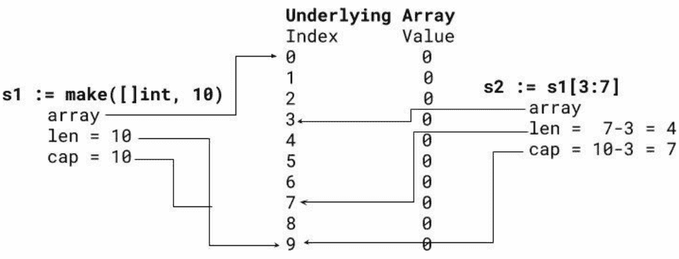

# Go 脑筋急转弯：25 个脑筋急转弯，挑战你的思维，助你精通 Go 语言


```go
package main

import (
 "fmt"
)

func main() {
 var π = 22 / 7.0
 fmt.Println(π)
}
```

这段代码能编译吗？它会打印什么？


## 为什么是 Go 脑筋急转弯？

Go 编程语言是一种简单的语言，但和其他所有语言一样，它也有自己的怪癖。本书将这些怪癖作为教学机会。通过了解你知识中的空白 - 你会在所做的事情上变得更好。

大量研究表明，在学习过程中犯错的人比不犯错的人学得更好。如果你在修复 bug 时在工作中采用这种方法 - 你会发现你更享受调试过程，并在修复每个 bug 后成为更好的开发者。

这些脑筋急转弯将帮助你避免错误。有些来自我将 bug 发布到生产环境的亲身经历，有些来自其他人同样的经历。

脑筋急转弯很有趣！我们极客喜欢谜题和解决它们。你也可以使用这些脑筋急转弯来给同事留下深刻印象，举办知识竞赛，共同进步。

其中许多脑筋急转弯来自我在会议和聚会中出的测验。我发现人们非常喜欢它们，而且它们往往能活跃气氛。

在每章开始时，我会展示一个简短的 Go 程序，并要求你猜测输出。可能的答案可以是：

- 不会编译
- 恐慌
- 死锁
- 某些输出（例如 [1 2 3]）

> 我使用 Go 版本 1.14.1 来运行代码，输出在未来版本中*可能*会发生变化。

在进入答案和解释之前，请先猜测输出。猜测输出后，我鼓励你自己运行代码并查看输出，然后再阅读解决方案和解释。我教授编程多年，发现这种做法非常有效。

## 关于作者

Miki 拥有本古里安大学的计算机科学学士学位。他还在那里学习计算语言学硕士学位。

Miki 热衷于教学和指导。他在世界各地教授各种技术主题的研讨会，并指导了许多年轻开发者走上成功之路。Miki 参与开源，拥有自己的多个项目，并为多个项目做出了贡献 - 包括 Go 项目。他使用 Go 超过 10 年。

Miki 撰写了《锻造 Python》，是 LinkedIn Learning 的作者，也是 Go Israel Meetup、GopherCon Israel 和 PyData Israel Conference 的组织者。

## 关于代码

你可以在 https://github.com/tebeka/go-brain-teasers 上找到脑筋急转弯的代码。该代码根据 Apache License 2.0 版权所有，请尊重它。

我尽量保持代码简短，并移除与脑筋急转弯无关的任何内容。这不是你通常编写代码的方式。

## 关于你

我假设你在某种程度上了解 Go 并有使用它进行编程的经验。本书不是用来学习如何用 Go 编程的。如果你不了解 Go，恐怕这些脑筋急转弯不适合你。

我建议先学习 Go（这也很有趣），网上有很多资源 [1]。

当然，我们 353solutions 提供广泛的“实操”Go 研讨会。我们很乐意听取您的需求。

- 1 Google 是你的朋友。

## 大卫·钱尼的前言

作为趣闻爱好者，在我作为软件工程师的求学青春时代，我最喜欢的书之一是 Josh Bloch 和 Neal Gafter 的《Java Puzzlers》。我喜欢作者们不只是为了用晦涩的语言冷知识来难倒读者。相反，每个问题都被视为教育读者了解语言不常见方面的历史和深层含义的机会。

当我发现，在 Go 经验中远超我愿意提及的许多年之后，copy 返回已复制元素的数量时，我的第一想法是 wow，我怎么会错过这个。我的第二个想法是我想知道我能用这个骗过多少人。于是，我的 #golang 流行测验系列推文诞生了。

考虑到推文的长度限制，要将一个完整的 Go 程序装进单条推文是个挑战。推断 #golang 流行测验的正确答案，以及遵循 Bloch 和 Gafter 的示例来教育而非让读者沮丧的机会，留给读者作为练习。

在《Go 脑筋急转弯》中，Miki 准备了一组测试，其目的不是简单地令人困惑，而是启发读者。《Go 脑筋急转弯》为读者提供了解究其原因的机会。

David Cheney
悉尼，2020 年 4 月

## 献词

献给 Sharon，她忍受了我在隔离期间的行为 - 以及之前 20 年的行为。

## 脑筋急转弯

> 教育不是学习事实，而是训练
> 头脑思考。

~ 阿尔伯特·爱因斯坦

## 1. 一个数字 π

清单 1. pi.go

```go
package main

import (
 "fmt"
)

func main() {
 var pi = 22 / 7.0
 fmt.Println(pi)
}
```

在翻到下一页之前，请先猜测输出是什么。

这段代码将打印：3.142857142857143

这里有两个令人惊讶的地方：一个是 π 是有效的标识符，第二是 22 / 7.0 实际上可以编译。

让我们从 π 开始。[2]。Go 语言规范关于标识符的说明：

> 标识符命名程序实体，如变量和类型。标识符是一个或多个字母和数字的序列。标识符的第一个字符必须是字母。

字母可以是 Unicode 字母，包括 π。写起来很有趣，但在实际中会让你的同事生活更困难。我可以使用我正在使用的编辑器 - Vim 轻松输入 π，但大多数编辑器和 IDE 都需要更多努力。

我发现 Unicode 标识符有帮助的唯一场景是将数学公式转换为代码。除此之外，请使用纯正的老式 ASCII。

现在来看 22 / 7.0。Go 类型系统不允许在整数（22）和浮点数（7.0）之间进行除法（或任何其他数学运算）。但等号右边的是常量，而不是变量。常量的类型在使用时定义，在这个例子中，编译器会将 22 转换为浮点数以完成运算。

如果你先将 22 和 7.0 赋值给变量，然后尝试相同的代码，它会失败。
以下代码无法编译：

清单 2. pi_var.go

```go
package main

import (
	"fmt"
)

func main() {
	a, b := 22, 7.0
	var π = a / b
	fmt.Println(π)
}
```

### 1.1. 延伸阅读

- Go 规范中的常量
- Go 博客中的常量
- ArdanLabs 撰写的 Go 数值常量简介

### 1.2. 希腊字母 Pi

## 2. 空手而来

清单 3. empty_map.go

```go
package main

import (
	"fmt"
)

func main() {
	var m map[string]int
	fmt.Println(m["errors"])
}
```

> 在翻到下一页之前，请先猜测输出是什么。

未初始化映射的零值是 nil。Go 的 map 类型的一些操作是“nil 安全”的 - 意味着它们可以使用 nil map 而不会 panic。

len 和访问值（例如 m["errors"]）在 nil map 上都可以工作。len 返回 0，而按键访问值将做以下操作：

- 如果键在 map 中，返回与之关联的值
- 如果键不在 map 中，返回值类型的零值

在这个例子中，键 "errors" 在 map 中未找到，你将得到 int 类型的零值，即 0。

这种行为很方便。如果你想计算项目（例如文档中的单词频率），你可以执行 m[word]++ 而无需担心单词是否在 map m 中。

这引出了一个问题：你如何知道从 map 中得到的值是因为它存在，还是因为它是值类型的零值？答案是使用逗号，ok 模式。

当你输入 val, ok := m[key] 时，如果我们从 map 中得到了值，ok 将为 true，如果键不在 map 中，则为 false。


Go 中还有其他“nil 安全”类型。例如，你可以查询 nil 切片的长度，从空 channel 接收一个值（不过你会永远阻塞），等等。

### 2.1. 延伸阅读

- Go 博客上的“Go maps in action”
- 《Effective Go》中的 Maps 章节

## 3. WHEN IN KRAKÓW

Listing 4. city.go

```
package main

import (
	"fmt"
)

func main() {
	city := "Kraków"
	fmt.Println(len(city))
}
```

在翻到下一页之前，试着猜猜输出会是什么。

如果你数一下 Kraków 中的字符数，结果是 6。那为什么是 7？原因是……历史。

起初，计算机是在英语国家（英国和美国）开发的。当早期开发者想要在只懂比特的计算机中对文本进行编码时，他们提出了以下方案：使用一个字节（8 位）[3] 来表示一个字符。例如，a 是 97（01100001），b 是 98，以此类推。一个字节足以表示包含 26 个小写字母、26 个大写字母和 10 个数字的英文字母表。甚至还有剩余空间用于其他特殊字符（例如，9 表示制表符）。这就是 ASCII 编码。

过了一段时间，其他国家开始使用计算机，并希望使用本国语言书写。ASCII 已不够用，一个字节不足以容纳表示不同语言字母所需的所有数字。这导致出现了多种不同的编码方案，最常见的是 UTF-8。Rob Pike 是 Go 的设计者之一，同时也是 UTF-8 的设计者之一。

Go 字符串采用 UTF-8 编码，这意味着一个字符（称为 rune）的长度可以是 1 到 4 个字节。当你在 Go 中查询字符串长度时，得到的是字节大小。在这个例子中，rune ó 占用 2 个字节，因此字符串的总长度是 7。

如果你想知道字符串中 rune 的数量，需要使用 unicode/utf8 包。

Listing 5. cityu.go

```
package main

import (
	"fmt"
	"unicode/utf8"
)

func main() {
	city := "Kraków"
	fmt.Println(utf8.RuneCountInString(city))
}
```

### 3.1. 延伸阅读

- Go 博客上的“Strings, bytes, runes and characters in Go”
- Unicode and You
- 维基百科上的 Unicode 条目

3 精确来说，ASCII 只使用 7 位，而 LATIN-1 将其扩展到 8 位。

## 4. I'VE GOT NOTHING

Listing 6. city.go

```
package main

import (
	"fmt"
)

func main() {
	n := nil
	fmt.Println(n)
}
```

在翻到下一页之前，试着猜猜输出会是什么。

这段代码无法编译。

nil 不是类型，而是一个保留字。初始化为 nil 的变量必须有一个类型。例如，如果你将赋值改为 var n *int = nil，代码将能够编译，因为现在 n 有了类型。

nil 的一些用法如下：

- map、slice 和 chan 的零值是 nil。
- 你不能使用 == 比较切片或映射，只能将它们与 nil 进行比较 [4]。
- 向 nil channel 发送或从中接收会永远阻塞。你可以利用这一点来避免忙等待。

### 4.1. 延伸阅读

- Dave Cheney 的 Practical Go 中的“理解 nil”
- justforfunc 的“为什么 Go 中有 nil channel？”
- Dave Cheney 的“Channel Axioms”

4 你可以使用 reflect.DeepEqual 来比较映射和切片。

## 5. A RAW DIET

Listing 7. raw.go

```
package main

import (
	"fmt"
)

func main() {
	s := `\a\tb`
	fmt.Println(s)
}
```

在翻到下一页之前，试着猜猜输出会是什么。

这段代码将输出：a\tb

Go 规范说明：

有两种形式：原始字符串字面量和解释字符串字面量。

原始字符串用反引号括起来（例如 `hello`），解释字符串用引号括起来（例如 "hello"）。在原始字符串中，\ 没有特殊含义，所以 `\t` 是两个字符——反斜杠和字母 t。如果是解释字符串，则 \t 会被解释为制表符字符。

除了常见的 \t（制表符）、\n（换行符）等之外，你还可以在解释字符串中使用 Unicode 码点。fmt.Println("\u2122") 将输出 ™。

原始字符串最常见的用途之一是创建多行字符串。

```
// An HTTP request
request := `GET / HTTP/1.1
Host: www.353solutions.com
Connection: Close
`
```

### 5.1. 延伸阅读

- Go 博客上的“Strings, bytes, runes and characters in Go”
- 字符串规范
- 维基百科上的 ASCII 控制字符

## 6. ARE WE THERE YET?

Listing 8. time.go

```
package main

import (
	"fmt"
	"time"
)

func main() {
	timeout := 3
	fmt.Printf("before ")
	time.Sleep(timeout * time.Millisecond)
	fmt.Println("after")
}
```

在翻到下一页之前，试着猜猜输出会是什么。

这段代码无法编译。

当你写 `timeout := 3` 时，Go 编译器会进行类型推断。
在这种情况下，它会推断 `timeout` 是 `int` 类型。然后在第 11 行，你将 `timeout`（int 类型）与 `time.Millisecond`（`time.Duration` 类型）相乘——这是不允许的。

你有几种方法来修复这个问题。

将 `timeout` 的类型更改为 `time.Duration`（第 9 行）：

```
var timeout time.Duration = 3
```

将 `timeout` 设为 const，那么它的类型将在使用上下文中解析（第 9 行）：

```
const timeout = 3
```

使用类型转换将 `timeout` 转换为 `time.Duration`（第 11 行）：

```
time.Sleep(time.Duration(timeout) * time.Millisecond)
```

### 6.1. 延伸阅读

- Go 之旅中的类型推断
- golang/example 中的 go/types：Go 类型检查器
- time.Duration 类型
- Go 规范中的类型转换

## 7. CAN NUMBERS LIE?

Listing 9. float.go

```
package main
import (
"fmt"
)
func main() {
n := 1.1
fmt.Println(n * n)
}
```

在翻到下一页之前，试着猜猜输出会是什么。

这段代码将输出：1.2100000000000002

你可能期望是 1.21，这是正确的数学答案。

一些新开发者在看到这种或类似输出时，会到论坛上说“我们在 Go 中发现了一个 Bug！”。通常的回答是 RTFM。[5]。

> 浮点数有点像量子物理：你越仔细看，它就越混乱。
> ~ Grant Edwards

这个问题背后的基本思想是，在浮点数中我们牺牲精度来换取速度（也就是说，作弊）。不要震惊，这在计算机科学中是我们经常进行的一种权衡。

你看到的结果符合浮点数规范。如果你在 Python、Java、C 等语言中运行相同的代码，会看到相同的输出。

如果你想了解浮点数的工作原理，请参阅下面的链接。你需要记住的主要观点是：它们不精确，而且数字越大，精度越差。

这意味着，在使用浮点数进行测试时，你需要检查“大约相等”，并决定什么是可接受的阈值。诸如 testify 之类的测试库提供了现成的函数（例如 InDelta）来检查两个浮点数是否近似相等。

浮点数还有几个其他古怪之处。例如，有一个特殊的 NaN 值（“not a number”的缩写）。NaN 不等于任何数字，包括它自身。下面的代码将输出 false。

```
fmt.Println(math.NaN() == math.NaN())
```

要检查是否得到了 NaN，你需要使用像 math.IsNaN 这样的特殊函数。

如果你需要更好的精度，可以查看 math/big 或 shopspring/decimal 之类的外部包。

### 7.1. 延伸阅读

- Julia Evans 的《浮点数小册子》
- 《每个计算机科学家都应该知道的关于浮点数算术的知识》

5 阅读精妙手册。

## 8. SLEEP SORT

Listing 10. sleep_sort.go

```
package main

import (
	"fmt"
	"sync"
	"time"
)

func main() {
	var wg sync.WaitGroup
	for _, n := range []int{3, 1, 2} {
		wg.Add(1)
		go func() {
			defer wg.Done()
			time.Sleep(time.Duration(n) * time.Millisecond)
			fmt.Printf("%d ", n)
		}()
	}
	wg.Wait()
	fmt.Println()
}
```

> 在翻到下一页之前，试着猜猜输出会是什么。


这段代码将打印：2 2 2

你可能期望得到 1 2 3。每个 goroutine 休眠 n 毫秒，然后打印 n。wg.Wait() 会等待所有 goroutine 完成，然后程序会打印一个换行符。

然而，每个 goroutine 使用的 n 都是第 11 行中定义的同一个 n。这被称为闭包。[6]

这就是为什么从设计上讲，goroutine（以及 defer）被编写为带有参数的函数调用。

你有两种方法可以修复这个 Bug。第一种，也是我个人的偏好，是将 n 作为参数传递给 goroutine。

### 清单 11. sleep_sort_param.go

```go
package main

import (
	"fmt"
	"sync"
	"time"
)

func main() {
	var wg sync.WaitGroup
	for _, n := range []int{3, 1, 2} {
		wg.Add(1)
		go func(i int) {
			defer wg.Done()
			time.Sleep(time.Duration(n) * time.Millisecond)
			fmt.Printf("%d ", i)
		}(n)
	}
	wg.Wait()
	fmt.Println()
}
```

第二种解决方案是利用这样一个事实：每次在 Go 中编写 { 时，都会打开一个新的变量作用域。

### 清单 12. sleep_sort_scope.go

```go
1   package main
2
3   import (
4   "fmt"
5   "sync"
6   "time"
7   )
8
9   func main() {
10   var wg sync.WaitGroup
11   for _, n := range []int{3, 1, 2} {
12   n := n ①
13   wg.Add(1)
14   go func() {
15   defer wg.Done()
16   time.Sleep(time.Duration(n) * time.Millisecond)
17   fmt.Printf("%d ", n)
18   }()
19   }
20   wg.Wait()
21   fmt.Println()
22   }
```

① n 现在是一个只在 for 循环作用域中生存的新变量，更重要的是，它只在 goroutine 闭包中生存。它会“遮蔽”第 11 行中的外部 n。

### 8.1. 延伸阅读

- Go 之旅中的函数闭包

- 维基百科上的闭包

6 不要与 Clojure 编程语言混淆。

## 9. 即时

### 清单 13. time_eq.go

```go
package main

import (
	"encoding/json"
	"fmt"
	"log"
	"time"
)

func main() {
	t1 := time.Now()
	data, err := json.Marshal(t1)
	if err != nil {
		log.Fatal(err)
	}

	var t2 time.Time
	if err := json.Unmarshal(data, &t2); err != nil {
		log.Fatal(err)
	}

	fmt.Println(t1 == t2)
}
```

在翻到下一页之前，先尝试猜猜输出是什么。

这段代码将打印：false

你可能会认为这段代码会失败，因为 JSON 格式中没有 time 类型；或者你可能会认为比较会成功。

Go 的 encoding/json 允许你为 JSON 不支持的类型定义自定义 JSON 序列化。你可以通过实现 json.Marshaler 和 json.Unmarshaler 接口来做到这一点。Go 的 time.Time 通过将自身序列化为 RFC 3339 格式的字符串，再反序列化回来，实现了这些接口。

JSON 只有非常有限的一组类型。例如，它只有浮点数。如果你在反序列化时使用空接口，可能会导致令人惊讶的结果。

### 清单 14. json_float.go

```go
package main

import (
	"encoding/json"
	"fmt"
	"log"
)

func main() {
	n1 := 1
	data, err := json.Marshal(n1)
	if err != nil {
		log.Fatal(err)
	}

	var n2 interface{}
	if err := json.Unmarshal(data, &n2); err != nil {
		log.Fatal(err)
	}

	fmt.Printf("n1 is %T, n2 is %T\n", n1, n2)
}
```

上述代码将打印：n1 is int, n2 is float64

在通过 JSON 序列化后，你会期望两个时间相等。time 包的文档说（我加了强调）：

> 操作系统同时提供“墙上时钟”（会因时钟同步而发生变化）和“单调时钟”（不会变化）。一般规则是，墙上时钟用于显示时间，而单调时钟用于测量时间。与其拆分 API，在此包中，time.Now 返回的 Time 同时包含墙上时钟读数和单调时钟读数；

单调时钟用于测量持续时间。它们的存在是为了避免诸如计算机在测量过程中切换到夏令时之类的问题。单调时钟的值本身没有意义，只有两个单调时钟读数之间的差值才有用。

当你使用 == 比较 time.Time 时，Go 会比较 time.Time 结构体字段，包括单调读数。然而当

Go 将 `time.Time` 序列化为 JSON 时，输出中不包含单调时钟。当我们将时间读回 t2 时，它不包含单调读数，因此比较失败。

问题的解决方案写在 time.Time 的文档中

*一般来说，优先使用 t.Equal(u) 而不是 t == u，因为 t.Equal 使用可用的最准确比较，并能正确处理仅其中一个参数带有单调时钟读数的情况。*

### 9.1. 延伸阅读

- 程序员关于时间的错误观念

- time 包文档

- RFC 3999 & ISO 8601 时间格式。请不要自行发明。

## 10. 简单的 append

### 清单 15. append.go

```go
package main

import (
	"fmt"
)

func main() {
	a := []int{1, 2, 3}
	b := append(a[:1], 10)
	fmt.Printf("a=%v, b=%v\n", a, b)
}
```

在翻到下一页之前，先尝试猜猜输出是什么。

这段代码将打印：a=[1 10 3], b=[1 10]

你需要深入了解切片的实现原理以及 append 的工作原理，才能明白为何会看到这样的输出。

如果你查看 Go 源代码中的 src/runtime/slice.go，你会看到

```go
type slice struct {
	array unsafe.Pointer
	len   int
	cap   int
}
```

切片是一个包含三个字段的结构体 - array 是指向保存数据的底层数组的指针 - len 是切片的长度 - cap 是底层数组的容量

下面是一个示意图：



切片表示法（例如 s1[3:7]）是“半开区间”。[7]，意味着从第一个索引开始，一直到但不包括最后一个索引。在 s2 的例子中，你将得到索引 3、4、5 和 6。这意味着长度（len）是 4。

容量是指从切片起始位置到底层数组末尾的元素数量。在 s2 中，我们从索引 3 开始，可以一直到索引 10，这意味着容量是 7。

你可以使用内置的 len 和 cap 函数来检查长度和容量。len(s2) 是 4，cap(s2) 是 7。

你可能还缺少的部分是 append 的工作原理。当你调用 append 时，它会检查容量。如果有足够空间，append 会修改底层数组并附加该项，然后返回一个指向同一数组、长度更大的切片。如果底层数组中没有更多空间，append 会创建一个新的、更大的数组，复制旧数组的内容，用新项更新新数组，然后返回一个指向新数组的切片。

下面是 append 的一个可能实现

```go
func Append(items []int, i int) []int {
	if len(items) == cap(items) { // No more space in underlying array
		// Go has a better growth heuristic than adding 1 every append
		newItems := make([]int, len(items)+1)
		copy(newItems, items)
		items = newItems
	} else {
		items = items[:len(items)+1]
	}
	items[len(items)-1] = i
	return items
}
```

现在你可以推断出输出了。关键行是 b := append(a[:1], 10) - a[:1] 创建一个长度为 1、容量为 3 的切片 - append 会发现有足够空间，并修改底层数组，将 10 放置在索引 1 处

a 和 b 都指向同一个底层数组。a 的长度为 3，b 的长度为 2。这就是为什么输出是 a=[1 10 3], b=[1 10]。

### 10.1. 延伸阅读

- Go 博客中的 Slices 与 Go Slices：用法及内部原理

- 《Effective Go》中的 Slices

- Go wiki 中的 Slice Tricks

7 [] 在数学中。

## 11. 日志里有什么？

### 清单 16. struct.go

```go
package main

import (
	"fmt"
	"time"
)

// Log is a log message
type Log struct {
	Message string
	time.Time
}

func main() {
	ts := time.Date(2009, 11, 10, 0, 0, 0, 0, time.UTC)
	log := Log{"Hello", ts}
	fmt.Printf("%v\n", log)
}
```

在翻到下一页之前，先尝试猜猜输出是什么。

这段代码将打印：2009-11-10 00:00:00 +0000 UTC

%v 动词会打印结构体的所有字段。例如：

### 清单 17. struct_pt.go

```go
package main

import (
	"fmt"
)

// Point is a 2D point
type Point struct {
	X int
	Y int
}

func main() {
	p := Point{1, 2}
	fmt.Printf("%v\n", p) // {1 2}
}
```

你会期望预告代码打印 {Hello 2009-11-10 00:00:00 +0000 UTC}。之所以没有打印出来，是由于 Log 结构体的定义方式。在第 11 行，我们有一个没有名称、只有类型的字段。这称为嵌入，这意味着 Log 类型拥有 time.Time 具有的所有方法和字段。

time.Time 定义了 String() string 方法，这意味着它实现了 fmt.Stringer 接口。由于 Log 嵌入了 time.Time，它也具有 String() string 方法。如果将一个参数传递给 fmt.Printf


implements `fmt.Stringer`, `fmt.Printf` will use it instead of the default output.

If you change the definition in line 11 to `Time time.Time`, you will see the expected output of `{Hello 2009-11-10 00:00:00 +0000 UTC}`.

You can also embed interfaces in Go, see the definition of `io.ReadWriter` for example.

### 11.1. Further Reading

- Fun With Flags on the Gopher Academy Blog
- Embedding in Effective Go
- Methods, Interfaces and Embedded Types in Go on ArdanLabs blog

## 12. A FUNKY NUMBER?

### Listing 18. num.go

```go
package main
import (
	"fmt"
)
func main() {
	fmt.Println(0x1p-2)
}
```

> Try to guess what the output is before moving to the next page.

Go has several number types, the two main ones are:

### Integers

These are whole numbers. Go has `int8`, `int16`, `int32`, `int64` and `int`.[8]. There are also all the unsigned ones `uint8`...

### Floats

These are real numbers. Go has `float32` and `float64`.

There are other types such as complex, and the various types defined in math/big.

When you write a number literal, such as `3.14`, the Go compiler needs to parse it to a specific type (`float64` in this case). The Go spec defines how you can write numbers. Let's have a look at some examples:

### Listing 19. num_lit.go

```go
package main

import (
	"fmt"
)

func main() {
	// Integer
	printNum(10) // 10 of type int
	printNum(010) // 8 of type int
	printNum(0x10) // 16 of type int
	printNum(0b10) // 2 of type int
	printNum(1_000) // 1000 of type int ①

	// Float
	printNum(3.14) // 3.14 of type float64
	printNum(.2) // 0.2 of type float64
	printNum(1e3) // 1000 of type float64 ②
	printNum(0x1p-2) // 0.25 of type float64 ③

	// Complex
	printNum(1i) // (0+1i) of type complex128
	printNum(3 + 7i) // (3+7i) of type complex128
	printNum(1 + 0i) // (1+0i) of type complex128
}

func printNum(n interface{}) {
	fmt.Printf("%v of type %T\n", n, n)
}
```

- ① _ serves as the thousands separator. It makes big numbers much more readable for us humans.
- ② This is known as scientific notation
- ③ The current brain teaser

0x1p-2 is called "a hexadecimal floating-point literal" in the Go specification and is following the IEEE 754 2008 specification. To calculate the value:

- Compute the value before the p as a hexadecimal number. In this example it's: 0x1 [9] = 1
- Compute the value after the p as "2 to the power of that value". In this example it's: 2^-2 = 0.25 [10]
- Finally multiply the two numbers. In this example: 1 * 0.25 = 0.25

### 12.1. Further Reading

- IEEE 754 specification
- Integer literals
- Floating point literals
- Imaginary literals

- 8 int is an alias to your system integer size, 64 on my machine.
- 9 One in hexadecimal.
- 10 Remember your high school math: 2^-2 = 1/2^2.

## 13. FREE RANGE INTEGERS

### Listing 20. range.go

```go
package main

import (
	"fmt"
)

func fibs(n int) chan int {
	ch := make(chan int)

	go func() {
		a, b := 1, 1
		for i := 0; i < n; i++ {
			ch <- a
			a, b = b, a+b
		}
	}()

	return ch
}

func main() {
	for i := range fibs(5) {
		fmt.Printf("%d ", i)
	}
	fmt.Println()
}
```

Try to guess what the output is before moving to the next page.

This code will deadlock.

To get a value from a channel, you can either use the receive operator (<-ch) or do a for loop with a range on the channel - consuming everything from it.

How does range know when there are no more values in the channel? It waits for the channel to be closed. The problem in the above script is that the goroutine does not close the channel.

### Listing 21. range_close.go

```go
package main

import (
	"fmt"
)

func fibs(n int) chan int {
	ch := make(chan int)

	go func() {
		defer close(ch) ①
		a, b := 1, 1
		for i := 0; i < n; i++ {
			ch <- a
			a, b = b, a+b
		}
	}()

	return ch
}

func main() {
	for i := range fibs(5) {
		fmt.Printf("%d ", i)
	}
	fmt.Println()
}
```

① The fix - close the channel when the goroutine exits

What range does when iterating over a channel is something like:

### Listing 22. range_rcv.go

```go
func main() {
	ch := fibs(5)
	for {
		i, ok := <-ch
		if !ok {
			break
		}
	}
	fmt.Printf("%d ", i)
}
```

When you use this method to create iterators, you need to beware of goroutine leaks. If you create ch := fibs(3) and then consume only one or two values from it, the goroutine inside fibs will be blocked on sending to the channel. Since there’s a reference to the channel, the garbage collector won’t reclaim it. As Dave Cheney says: "Never start a goroutine without knowing how it will finish."

The common practice is to pass a done channel or a context. This will complicate the code a bit but you’ll have control over stopping goroutines will avoid goroutine leaks.

### Listing 23. range_ctx.go

```go
package main

import (
	"context"
	"fmt"
)

func fibs(ctx context.Context, n int) chan int {
	ch := make(chan int)
	go func() {
		defer close(ch)
		a, b := 1, 1
		for i := 0; i < n; i++ {
			select {
			case ch <- a:
				a, b = b, a+b
			case <-ctx.Done():
				fmt.Println("cancelled")
			}
		}
	}()

	return ch
}

func main() {
	ctx, cancel := context.WithCancel(context.Background())
	ch := fibs(ctx, 5)
	for i := 0; i < 3; i++ {
		val := <-ch
		fmt.Printf("%d ", val)
	}
	fmt.Println()
	cancel()
}
```

### 13.1. Further Reading

- Go Concurrency Patterns: Context on the Go blog
- Go Concurrency Patterns: Pipelines and cancellation on the Go blog
- The context package
- Concurrency chapter in Practical Go by Dave Cheney

## 14. MULTIPLE PERSONALITIES

### Listing 24. multi_assign.go

```go
package main
import (
	"fmt"
)
func main() {
	a, b := 1, 2
	b, c := 3, 4
	fmt.Println(a, b, c)
}
```

Try to guess what the output is before moving to the next page.

This code will print: 1 3 4

Go’s short variable declaration (:=) can be used in a "multi values" context - where there is more than one variable on the left side.

If all variables on the left are new - you’re good.

```go
a, b := 1, 2
```

If you have no new variables, you’ll get a compilation error.

```go
a, b := 1, 2
a, b := 2, 3 // error: no new variables on left side of :=
```

When there’s a mix, like in this teaser - you’re still good as long as the types match. In this case, when you do:

```go
b, c := 3, 4
```

b is an existing variable, and the type of 3 which is int matches the current type of b - OK here. c is a new variable, making this statement OK.

### 14.1. Further Reading

- Short variable declaration in the Go tour
- Constant declarations in the Go specification.

## 15. A TALE OF TWO CITIES

### Listing 25. two_cities.go

```go
package main

import (
	"fmt"
)

func main() {
	city1
```

This code will print: false

Your eyesight is OK, these two strings *look* the same. However if you'll print the length of each variable, the length of `city1` will be 7 and the length of `city2` will be 8.

In When in Kraków we talked about the fact that Go's strings are UTF-8 encoded byte slices. UTF-8 has many features, and some "characters" (runes) are not for display but for control. For example, text direction - sometimes called bidi.

`city1` has a one-byte rune at position 4 (ó), while `city2` has the `o` rune in position 4 and a control character saying "add an umlaut to the previous character". These ways of encoding are called NFC & NFD.

When you compare strings, they are compared at the byte level, this is why you'll see *false* as the output. To fix this you'll need to use an external library called golang.org/x/text/unicode/norm.

### Listing 26. two_cities_nfc.go

```go
package main

import (
	"fmt"

	"golang.org/x/text/unicode/norm"
)

func main() {
	city1, city2 := "Kraków", "Kraków"
```


city1, city2 = norm.NFC.String(city1),
norm.NFC.String(city2)
fmt.Println(city1 == city2)
}

确保将你正在处理的所有文本都归一化为单一形式（例如 NFC）。

golang.org/x 包不在标准库中，而是由 Go 核心开发者（及其朋友）维护。golang.org/x 下有许多有用的库，我建议花一些时间了解它们。

例如，golang.org/x/text/transform 有一个 NewReader 函数，它返回一个 io.Reader，会将读取的所有内容转换为标准形式。

### 15.1. 延伸阅读

- 维基百科上的 Unicode 等价性
- Go 博客中的字符串、字节、字符码点与字符
- 维基百科上的 UTF-8

## 16. 通道里有什么？

清单 27. chan.go

```go
package main

import (
	"fmt"
)

func main() {
	ch := make(chan int, 2)
	ch <- 1
	ch <- 2
	<-ch
	close(ch)
	a := <-ch
	b := <-ch
	fmt.Println(a, b)
}
```

在进入下一页之前，试着猜猜输出是什么。

这段代码将打印：2 0

ch 是一个容量为 2 的带缓冲通道（可以用 cap(ch) 检查）。你向 ch 发送两个值 - 1 和 2。如果尝试再发送一个 - 会发生死锁。

然后你从 ch 接收一个值，关闭它，再从中接收两个值。问题是 - 从已关闭的通道接收时会发生什么？

答案是：如果缓冲区中有值 - 你会得到它们，否则，你会得到通道类型的零值。这就是为什么 a 得到缓冲区中的值 2，而 b 得到 int 类型的零值 0。

你怎么知道从通道中得到的值是实际存在的值，还是因为通道已关闭而得到的零值？使用常见的“逗号, ok”模式。

清单 28. chan_empty.go

```go
package main

import (
	"fmt"
)

func main() {
	ch := make(chan int, 1)
	ch <- 1
	a, ok := <-ch
	fmt.Println(a, ok) // 1 true
	close(ch)
	b, ok := <-ch
	fmt.Println(b, ok) // 0 false
}
```

### 16.1. 延伸阅读

- Go 之旅中的带缓冲通道
- 《Effective Go》中的通道
- justforfunc 中的“为什么 Go 中有 nil 通道？”

## 17. 一个有趣的字符串

清单 29. strint.go

```go
package main

import (
	"fmt"
)

func main() {
	i := 169
	s := string(i)
	fmt.Println(s)
}
```

在进入下一页之前，试着猜猜输出是什么。

string 类型支持从 int 进行类型转换，它会将此整数视为一个 rune。字符码点 169 是版权符号（©）。通常犯此错误的人来自 Python 等语言，在 Python 中 str(169) → "169"。

如果要将数字转换为字符串（或将字符串转换为数字），请使用 strconv 包：

清单 30. strint_conv.go

```go
package main

import (
	"fmt"
	"strconv"
)

func main() {
	i := 169
	s := strconv.Itoa(i)
	fmt.Println(s)
}
```

字符串也支持从字节切片进行类型转换：

清单 31. strint_byte.go

```go
package main

import (
	"fmt"
)

func main() {
	data := []byte{'1', '2', '9'}
	s := string(data)
	fmt.Println(s) // 129
}
```

当从字节切片转换为字符串时，Go 会复制字节切片 - 这会进行内存分配。在映射中，你不能使用 []byte 作为键，存在一个编译器优化：

清单 32. strint_map.go

```go
package main

import (
	"fmt"
)

func main() {
	m := map[string]int{
		"hello": 3,
	}
	key := []byte{'h', 'e', 'l', 'l', 'o'}
	val := m[string(key)] // no memory allocation
	fmt.Println(val) // 3
}
```

### 17.1. 延伸阅读

- strconv 包
- golang.org/x 中的 runenames
- 使用[byte 作为映射键]，来自 Dave Cheney 的《高性能 Go 工作坊》

## 18. 一份工作要做

清单 33. job.go

```go
package main

import (
	"fmt"
)

type Job struct {
	State string
	done chan struct{}
}

func (j *Job) Wait() {
	<-j.done
}

func (j *Job) Done() {
	j.State = "done"
	close(j.done)
}

func main() {
	ch := make(chan Job)
	go func() {
		j := <-ch
		j.Done()
	}()

	job := Job{"ready", make(chan struct{})}
	ch <- job
	job.Wait()
	fmt.Println(job.State)
}
```

在进入下一页之前，试着猜猜输出是什么。

这段代码将打印：ready

乍一看，代码似乎没问题。你在 **工作** 结构体的方法中使用了指针接收器。**等待** 调用返回这一事实表明通道已关闭。

问题出在 **ch** 的定义上。它是 **工作** 类型的通道，而不是 **\*工作**，这意味着当你将变量 **job** 发送过通道时，你实际发送的是它的副本。在 Go 中，通道是一种“指针类”类型，因此即使 goroutine 内部有一份 **job** 的副本，**j.done** 指向的通道与 **job.done** 指向的通道是同一个。

Go 中的字符串不是“指针类”。当你在 goroutine 内部调用 **j.Done()** 时，你会修改 goroutine 中 **job** 副本的 **状态** 字段的值。此更改不会反映在第 28 行声明的 **job** 变量中。

解决方法是将 ch 的类型设为 **\*工作**

清单 34. job_ptr.go

```go
package main

import (
	"fmt"
)

type Job struct {
	State string
	done chan struct{}
}

func (j *Job) Wait() {
	<-j.done
}

func (j *Job) Done() {
	j.State = "done"
	close(j.done)
}

func main() {
	ch := make(chan *Job)
	go func() {
		j := <-ch
		j.Done()
	}()

	job := Job{"ready", make(chan struct{})}
	ch <- &job
	job.Wait()
	fmt.Println(job.State)
}
```

### 18.1. 延伸阅读

- Go 中不存在按引用传递
- Go 规范中的通道类型
- Go 并发模式：管道和取消
- Go 之旅中的通道

## 19. 报错与否

清单 35. error.go

```go
package main

import (
	"fmt"
)

type OSError int

func (e *OSError) Error() string {
	return fmt.Sprintf("error #%d", *e)
}

func FileExists(path string) (bool, error) {
	var err *OSError
	return false, err // TODO
}

func main() {
	if _, err := FileExists("/no/such/file"); err != nil {
		fmt.Printf("error: %s\n", err)
	} else {
		fmt.Println("OK")
	}
}
```

在进入下一页之前，试着猜猜输出是什么。

这段代码将打印：error: <nil>

第 19 行的 if 语句表示 err != nil，但 err 打印出来却是 <nil>。此外，第 14 行的 err 未初始化，这意味着它的值为指针的零值——即 nil。

如果你查看 src/runtime/runtime2.go，会看到以下定义：

```go
type iface struct {
    tab    *itab
    data   unsafe.Pointer
}
```

- itab 描述接口
- data 是指向实现该接口的值的指针

仅当 itab 和 data 都为 nil 时，接口才被视为 nil，而此处并非这种情况。

解决方法是**始终**在返回错误时使用 error 类型的变量。

在此情形下，将第 14 行更改为 `var err error`。

### 19.1. 延伸阅读

- go-internals 书中的接口
- Russ Cox 所著《Go 数据结构：接口》

## 20. 字符串里有什么？

清单 36. runes.go

```go
package main

import (
	"fmt"
)

func main() {
	msg := "π = 3.14159265358..."
	fmt.Printf("%T ", msg[0])
	for _, c := range msg {
		fmt.Printf("%T\n", c)
		break
	}
}
```

在进入下一页之前，试着猜猜输出是什么。

这段代码将打印：uint8 int32。%T 动词打印参数的类型。

Go 字符串采用 UTF-8 编码。当你使用 [] 或 len 访问字符串时，Go 会访问底层的 []byte。byte 是 Go 中的一个类型，是 uint8 的别名。

在 Go 中遍历字符串时，你会得到 Unicode 字符 - 称为 rune，它是 int32 的别名。这是因为 UTF-8 中的字符最多可占 4 个字节。

如果使用 %v 动词打印 rune，你会看到其数值。使用 %c 动词显示字符。如果你看到 ? 或其他字符，而非你想打印的 rune，这意味着当前字体不支持它。没有一种字体能显示 Unicode 规范中的所有字符。

编写 rune 字面量有多种方法，让我们看一下：


### 20.1. 延伸阅读

清单 37. runes_lit.go

```go
package main

import (
	"fmt"
)

func main() {
	r1 := '™'
	fmt.Println(r1) // 8482
	fmt.Printf("%c\n", r1) // ™

	r2 := '\x61' // \x - 2 digits
	fmt.Printf("%c\n", r2) // a

	r3 := '\u2122' // \u - 4 digits (8482 in hex)
	fmt.Printf("%c\n", r3) // ™

	r4 := '\U00002122' // \U - 8 digits
	fmt.Printf("%c\n", r4) // ™
}
```

- Go 博客中的字符串、字节、rune 和字符
- Unicode 与你
- 维基百科中的 Unicode 条目
- Go 语言规范中的 Rune 字面量
- Unicode® 字符表

## 21. 再来一遍

清单 38. init.go

```go
package main

import (
	"fmt"
)

func init() {
	fmt.Printf("A ")
}

func init() {
	fmt.Print("B ")
}

func main() {
	fmt.Println()
}
```

在翻到下一页之前，先尝试猜猜输出是什么。

这段代码将打印：A B

通常，Go 编译器不允许在同一个包中定义两个同名函数。但是 init 是特殊的。文档中是这样说明的：

> 每个包中可以定义多个此类函数，即使在单个源文件中也是如此。在包块中，init 标识符仅可用于声明 init 函数，但该标识符本身并未被声明。因此，无法从程序中的任何地方引用 init 函数。

init 是包初始化的最后阶段，在导入的模块和包级变量初始化之后执行。

由于你可以使用函数调用来初始化包级变量，因此请将 init 留给特殊情况。同时，尽量避免使用包级变量。我很少编写 init 函数，更倾向于在 main 中进行初始化，因为在那里我可以更好地控制初始化顺序、错误处理和日志记录。

包级变量或 init 的一个问题是无法返回错误值。如果 init 中出错，最佳做法是 panic 而不要在错误状态下继续执行。为了支持这一点，一些 Go 包为其 New 函数提供了 Must 版本。例如，regexp 包提供了 MustCompile。

*MustCompile 类似于 Compile，但如果表达式无法解析，则会 panic。它简化了保存已编译正则表达式的全局变量的安全初始化。*

试着思考一下你的类型，以及是否也应该为它们提供 Must 函数。

### 21.1. 延伸阅读

- 《Effective Go》中的 init 函数
- Go 语言规范中的包初始化
- Dave Cheney 撰写的《在实践中移除包作用域变量》
- Ran Tavory 撰写的《可部署代码编写（第二部分）》

## 22. 让我数到一百万

清单 39. count.go

```go
package main

import (
	"fmt"
	"sync"
)

func main() {
	var count int
	var wg sync.WaitGroup

	for i := 0; i < 1_000_000; i++ {
		wg.Add(1)
		go func() {
			defer wg.Done()
			count++
		}()
	}

	wg.Wait()
	fmt.Println(count)
}
```

在翻到下一页之前，先尝试猜猜输出是什么。

这段代码将打印：891239 [11]

这里存在一个竞态条件。递增整数的操作不是原子的，这意味着代码可能在操作中途被中断。除此之外，还有内存屏障——为了加速，现代计算机拥有 CPU 缓存，会尝试先从缓存获取值，而不必走漫长的主内存路径。

如果你查看 count.go 的汇编输出[12]，你会看到第 16 行 count++ 生成的代码。

```
0x0045 00069 (count.go:16)    PCDATA  $0, $1
0x0045 00069 (count.go:16)    PCDATA  $1, $4
0x0045 00069 (count.go:16)    MOVQ    "".&count+56(SP), AX
0x004a 00074 (count.go:16)    PCDATA  $0, $0
0x004a 00074 (count.go:16)    PCDATA  $1, $4
0x004a 00074 (count.go:16)    INCQ    (AX)
```

MOVQ 会将计数器的当前值加载到 AX 寄存器中。这个值可能来自内存，也可能来自缓存。

Go 工具链可以帮助你检测此类竞态条件。go run 和 go test 都带有 -race 标志来检测竞态条件。你可以试一下：

```
$ go run -race count.go
===================================
WARNING: DATA RACE
Read at 0x00c00011a010 by goroutine 8:
  main.main.func1()
      /home/miki/Projects/go-brain-teasers/code/count.go:16 +0x6c
```

Previous write at 0x00c00011a010 by goroutine 7:
main.main.func1()
/home/miki/Projects/go-brain-teasers/code/count.go:16 +0x82

Goroutine 8 (running) created at:
main.main()
/home/miki/Projects/go-brain-teasers/code/count.go:14 +0xe4

Goroutine 7 (finished) created at:
main.main()
/home/miki/Projects/go-brain-teasers/code/count.go:14 +0xe4
=====================================
```

要解决这个问题，你可以使用 sync.Mutex 来确保同一时间只有一个 goroutine 更新 count。

清单 40. count_mu.go

```go
package main

import (
	"fmt"
	"sync"
)

func main() {
	var count int
	var wg sync.WaitGroup
	var m sync.Mutex

	for i := 0; i < 1_000_000; i++ {
		wg.Add(1)
		go func() {
			m.Lock()
			defer m.Unlock()
			defer wg.Done()
			count++
		}()
	}

	wg.Wait()
	fmt.Println(count)
}
```

另一个选择是使用 sync/atomic 包。正如其名称所示，sync/atomic 提供原子操作。这些原子操作比使用互斥锁更快，但更难使用[13]。

清单 41. count_atomic.go

```go
package main

import (
	"fmt"
	"sync"
	"sync/atomic"
)

func main() {
	var count int64 // Atomic works with int64, not int
	var wg sync.WaitGroup

	for i := 0; i < 1_000_000; i++ {
		wg.Add(1)
		go func() {
			defer wg.Done()
			atomic.AddInt64(&count, 1)
		}()
	}

	wg.Wait()
	fmt.Println(count)
}
```

尽管 Go 试图抽象掉硬件，但你仍然需要学习和理解硬件。

### 22.1. 延伸阅读

- 维基百科上的竞态条件
- Preshing on Programming 上的《原子操作与非原子操作》
- Go 博客上的《介绍 Go 竞态检测器》
- Mechanical Sympathy 上的《内存屏障/栅栏》
- 维基百科上的内存屏障
- ArdanLabs 博客上的《Go 中的调度：第一部分 - OS 调度器》
- 《人类尺度下的计算机延迟》

11 或者任何低于 1,000,000 的数字。

12 go tool compile -S count.go

13 你可以使用 compare & swap 来实现所有同步原语（例如 Mutex）。

## 23. 下一个是谁？

清单 42. next_id.go

```go
package main

import (
	"fmt"
)

var (
	id = nextID()
)

func nextID() int {
	id++
	return id
}

func main() {
	fmt.Println(id)
}
```

在翻到下一页之前，先尝试猜猜输出是什么。

这段代码无法编译。

### 构建代码时会显示问题：

```
$ go build next_id.go
### command-line-arguments
./next_id.go:8:2: initialization loop:
        /home/miki/Projects/go-brain-teasers/code/next_id.go:8:2:
id refers to
        /home/miki/Projects/go-brain-teasers/code/next_id.go:11:6:
nextID refers to
        /home/miki/Projects/go-brain-teasers/code/next_id.go:8:2:
id
```

代码中存在“初始化循环”。*id* 的值依赖于 *nextID*，而 *nextID* 又使用 *id* 的值……

Go 编译器会尝试查找这些循环，但有些情况无法检测（称为“隐藏依赖”）。请参阅文档中的示例。

确保你的包初始化简单且易于理解，尽量避免使用包级变量，并尽可能将初始化推迟到 **main**。

### 23.1. 延伸阅读

- Go 语言规范中的包初始化
- Dave Cheney 撰写的《在实践中移除包作用域变量》

## 24. 玩转标志

清单 43. flag.go

```go
package main

import (
	"fmt"
)

type Flag int

func main() {
	var i interface{} = 3
	f := i.(Flag)
	fmt.Println(f)
}
```

在翻到下一页之前，先尝试猜猜输出是什么。

这段代码会 panic。

尽管 `Flag` 本质上是 `int`，但 Go 编译器将其视为一种不同的类型，因此类型断言（`i.(Flag)`）会 panic。

这是另一个可以使用“逗号 ok”范式的情况。

清单 44. flag_ok.go

```go
package main

import (
	"fmt"
)

type Flag int

func main() {
	var i interface{} = 3
	f, ok := i.(Flag)
	if !ok {
		fmt.Println("not a Flag")
		return
	}
	fmt.Println(f)
}
```

你也可以将第 7 行改为 `type Flag = int`，现在 `Flag` 是一个类型别名，代码可以正常工作。不过现在你可以在需要 `Flag` 的地方使用 `int`，而类型系统将无法保护你。


### 24.1. 延伸阅读

- 《基于 Go 的代码库重构》（由 Russ Cox 撰写）解释了类型别名的原理
- Go 语言规范中的类型声明
- Go 语言规范中的类型断言
- 《Effective Go》中的类型开关与接口转换及类型断言

## 25. 你有我的许可

```
package main

import (
	"fmt"
)

const (
	Read = 1 << iota
	Write
	Execute
)

func main() {
	fmt.Println(Execute)
}
```

在进入下一页之前，先试着猜猜输出是什么。

*iota* 是 Go 语言版本的枚举类型。它可以用在 *const* 声明中。*iota* 在同一组中的每个常量上都会加 1。如果你对 *iota* 指定某个运算（例如加法），它会继续递增。

`<<` 是左移运算符，它会将数字中的位向左移动 n 位。

- 1 的二进制（8 位）是 00000001
- 1<<3 是 00001000，即 8

在本例中，我们从 *Read* = 1<<*iota* 开始，相当于 1<<0 -> 0001，即 1。接着隐式地有 1<<1 -> 0010 对应 *Write*，即 2；最后隐式地有 1<<2 -> 0100 对应 *Execute*，即 4。

你主要会用这些位运算来处理标志位。你可以使用 | [14]（称为"位掩码"）将 8 个标志打包进一个字节，并使用 & [15] 高效地检查某个标志是否被设置。

*清单 46. iota_check.go*

```
mask := Read | Execute

if mask&Execute == 0 {
    fmt.Println("can't execute")
} else {
    fmt.Println("can execute") // will be printed
}

if mask&Write == 0 {
    fmt.Println("can't write") // will be printed
} else {
    fmt.Println("can write")
}
```

iota 的值是数字，在某些情况下，你希望常量具有可读的表示形式。这可以通过给这些常量指定类型并为该类型实现 fmt.Stringer 接口来完成。

清单 47. iota_str.go

```
package main

import (
	"fmt"
)

type FilePerm uint16 // 16 flags are enough

const (
	Read FilePerm = 1 << iota
	Write
	Execute
)

// String implements fmt.Stringer interface
func (p FilePerm) String() string {
	switch p {
	case Read:
		return "read"
	case Write:
		return "write"
	case Execute:
		return "execute"
	}

	return fmt.Sprintf("unknown FilePerm: %d", p) // don't
	use %s here :)
}

func main() {
	fmt.Println(Execute) // execute
	fmt.Printf("%d\n", Execute) // 4
}
```

我将此作为练习留给你，实现一个支持位掩码的 String() string 方法。

### 25.1. 延伸阅读

- Go Wiki 上的 iota
- 《Effective Go》中的常量
- 维基百科上的位运算

- 14. 按位或。
- 15. 按位与。

## 致谢

我对每一份贡献都心存感激，无论是发现 Bug、修正语法，还是让我能安静地工作。

以下是提供帮助的人员名单，我向任何被我遗忘的人道歉。

- Adi Tebeka 负责校对和评论
- Dan Allen 在 asciidoctor 论坛提供了帮助。我正在使用出色的 asciidoctor 编写此书
- Dave Cheney 撰写了序言
- David Bordeynik 提供了评论
- Egon Elbre 绘制了所有这些可爱的地鼠（其中一幅用于封面），并将其置于 CC0 许可下
- Eliran Bivas 负责校对和评论
- Ran Tavory 提供了评论
- Yoni Davidson 提供了评论

我也感谢 Brad Fitzpatrick 及其他发布 Go"即时测验"的人，为这些脑筋急转弯提供了许多灵感。

## 尾声

希望你在猜谜的过程中感到有趣，并且在途中学到了一些东西。

> 调试就像在犯罪电影中扮演侦探，而你也是凶手。
> >
> > ~ 菲利普·福特斯

我发现，将出问题的事情视为待解决的谜题这种思维方式，能帮助我更好地理解事物。这也让我的工作更加愉快。当你试图解决自己犯下的当前"谋杀案"时，你可以随时把自己想象成南希·德鲁、福尔摩斯或其他任何你童年时期的侦探。

如果您想了解更多，欢迎发送电子邮件至 info@353solutions.com，我们将根据您的需求定制实操研讨会。


保持好奇，继续 hacking，
Miki Tebeka，2020 年 3 月

## 索引
