# Go! Windows XP 入门指南

## 学生

### 如何查找学生数据文件

以完成本书中的项目

本书中的项目要么从新建的空白文件开始，要么从已为你启动的学生数据文件开始。

学生数据文件可以从随书附带的 CD-ROM 或 *GO!* 网站上获取。

### 来自 CD-ROM 的文件

按照每个项目中的具体指示，导航到 CD-ROM，然后根据项目中的说明保存并重命名文件。

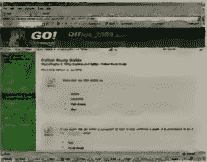

### 来自 www.prenhall.com/go 的文件

- 1. 决定要将学生数据文件存储在哪里。
  - 如果要存储在计算机的硬盘或网络驱动器上，建议在该驱动器上创建一个名称合适的文件夹。
  - 如果要存储在可移动存储设备（如 U 盘、Zip 磁盘或软盘）上，请立即插入该设备。
- 2. 在 Web 浏览器中，转到 `www.prenhall.com/go`。
- 3. 在提供的书籍列表中，指向本书标题，点击活动链接，然后按照网站上的说明操作。

本书献给我的学生，他们每天激励着我，也献给我的丈夫 Fred Gaskin。

——Shelley Gaskin

我们将本书献给我们可爱的孙女们，她们给我们带来了巨大的欢乐和幸福：

Clara 和 Siena & Alexis 和 Grace。

——John Preston, Sally Preston, and Robert L. Ferrett

## 编辑来信

尊敬的教师和学生：

GO! 系列的主要目标有两方面。第一个目标是帮助教师在更短的时间内教授他们想要的课程。第二个目标是让学生掌握使用计算机作为工具来解决商务问题的技能，既为了他们自己，也为了他们可能受雇的组织。

GO! 系列最初由系列编辑 Shelley Gaskin 创建，并随 Microsoft Office 2003 的发布而出版。她的想法源于多年使用那些无法满足当今多元化课堂需求的教科书，这些教科书对学生来说过于混乱。Shelley 通过确保我们坚持开发优质教学和实用课堂工具的愿景，继续提升该系列。

但我们也需要你的意见和想法。

随着时间的推移，GO! 系列根据使用该系列的教师和学生的直接反馈而发展。我们是倾听的出版商。为了出版一本适合你的教科书，我们必须继续倾听这些反馈。与你交流并听取你使用 GO! 的故事对我来说很重要。你的声音可以带来改变。

我希望这封信能激励你给我写一封电子邮件，分享你对使用 GO! 系列的看法。

Stephanie Wall

GO! 系列执行编辑

stephanie_wall@prenhall.com

## GO! 系统贡献者

我们感谢以下人员为打造 GO! 系统所付出的辛勤工作和支持！

### 额外作者支持

| 姓名 | 机构 |
|---|---|
| Coyle, Diane | 蒙哥马利县社区学院 |
| Fry, Susan | 博伊西州立大学 |
| Townsend, Kris | 斯波坎瀑布社区学院 |
| Stroup, Tracey | Amgen 公司 |

### 教师资源作者

| 姓名 | 机构 |
|---|---|
| Amer, Beverly | 北亚利桑那大学 |
| Boito, Nancy | 哈里斯堡地区社区学院 |
| Coyle, Diane | 蒙哥马利县社区学院 |
| Dawson, Tamara | 南拿撒勒大学 |
| Driskel, Loretta | 尼亚加拉县社区学院 |
| Elliott, Melissa | 敖德萨学院 |
| Fry, Susan | 博伊西州立大学 |
| Geoghan, Debra | 巴克斯县社区学院 |
| Hearn, Barbara | 费城社区学院 |
| Jones, Stephanie | 南平原学院 |
| Madsen, Donna | 柯克伍德社区学院 |
| Meck, Kari | 哈里斯堡地区社区学院 |
| Miller, Cindy | 常春藤技术学院 |
| Nowakowski, Tony | 布法罗州立大学 |
| Pace, Phyllis | 皇后堡社区学院 |
| Paterson, Jim | 天堂谷社区学院 |
| Prince, Lisa | 密苏里州立大学 |
| Rodgers, Gwen | 南拿撒勒大学 |
| Ruymann, Amy | 伯灵顿社区学院 |
| Ryan, Bob | 蒙哥马利县社区学院 |
| Smith, Diane | 亨利福特学院 |
| Spangler, Candice | 哥伦布州立社区学院 |
| Thompson, Joyce | 利哈伊碳社区学院 |
| Tiffany, Janine | 雷丁地区社区学院 |
| Watt, Adrienne | 道格拉斯学院 |
| Weaver, Paul | 博西尔教区社区学院 |
| Weber, Sandy | 盖特威技术学院 |
| Wood, Dawn |  |
| Weissman, Jonathan | 五指湖社区学院 |

### 超级审阅者

| 姓名 | 机构 |
|---|---|
| Brotherton, Cathy | 里弗赛德社区学院 |
| Cates, Wally | 中新墨西哥社区学院 |
| Cone, Bill | 北亚利桑那大学 |
| Coverdale, John | 里弗赛德社区学院 |
| Foster, Nancy | 贝克学院 |
| Helfand, Terri | 查菲学院 |
| Hibbert, Marilyn | 盐湖社区学院 |
| Holliday, Mardi | 费城社区学院 |
| Jerry, Gina | 圣莫尼卡学院 |
| Martin, Carol | 哈里斯堡地区社区学院 |
| Maurer, Trina | 敖德萨学院 |
| Meck, Kari | 哈里斯堡地区社区学院 |
| Miller, Cindy | 常春藤技术社区学院 |
| Nielson, Phil | 盐湖社区学院 |
| Rodgers, Gwen | 南拿撒勒大学 |
| Smolenski, Robert | 特拉华社区学院 |
| Spangler, Candice | 哥伦布州立社区学院 |
| Thompson, Joyce | 利哈伊碳社区学院 |
| Weber, Sandy | 盖特威技术学院 |
| Wells, Lorna | 盐湖社区学院 |
| Zaboski, Maureen | 斯克兰顿大学 |

### 技术编辑

- Janice Snyder
- Joyce Nielson
- Colette Eisele
- Janet Pickard
- Mara Zebest
- Lindsey Allen
- William Daley

### 学生审阅者

| 姓名 | 机构 |
|---|---|
| Allen, John | 阿什维尔-邦库姆技术社区学院 |
| Alexander, Steven | 圣约翰斯河社区学院 |
| Alexander, Melissa | 塔尔萨社区学院 |
| Bolz, Stephanie | 北密歇根大学 |
| Berner, Ashley | 中央华盛顿大学 |
| Boomer, Michelle | 北密歇根大学 |
| Busse, Brennan | 北密歇根大学 |
| Butkey, Maura | 中央华盛顿大学 |
| Christensen, Kaylie | 北密歇根大学 |
| Connally, Brianna | 中央华盛顿大学 |
| Davis, Brandon | 北密歇根大学 |
| Davis, Christen | 中央华盛顿大学 |
| Den Boer, Lance | 中央华盛顿大学 |
| Dix, Jessica | 中央华盛顿大学 |
| Moeller, Jeffrey | 北密歇根大学 |
| Downs, Elizabeth | 中央华盛顿大学 |
| Erickson, Mike | 鲍尔州立大学 |
| Gadomski, Amanda | 北密歇根大学 |
| Gyselinck, Craig | 中央华盛顿大学 |
| Harrison, Margo | 中央华盛顿大学 |
| Heacox, Kate | 中央华盛顿大学 |
| Hill, Cheretta | 西北州立大学 |
| Innis, Tim | 塔尔萨社区学院 |
| Jarboe, Aaron | 中央华盛顿大学 |
| Klein, Colleen | 北密歇根大学 |
| Moeller, Jeffrey | 北密歇根大学 |
| Nicholson, Regina | 雅典技术学院 |
| Niehaus, Kristina | 北密歇根大学 |
| Nisa, Zaibun | 圣罗莎社区学院 |
| Nunez, Nohelia | 圣罗莎社区学院 |
| Oak, Samantha | 中央华盛顿大学 |
| Oerter, Monica | 中央华盛顿大学 |
| Palenshus, Juliet | 中央华盛顿大学 |

## 贡献者（续）

| 姓名 | 机构 | 姓名 | 机构 |
|---|---|---|---|
| Hayes, Theresa | Broward Community College | Lord, Alexandria | Asheville Buncombe Tech |
| Helfand, Terri | Chaffey College | Lowe, Rita | Harold Washington College |
| Helms, Liz | Columbus State Community College | Low, Willy Hui | Joliet Junior College |
| Hernandez, Leticia | TCI College of Technology | Lucas, Vickie | Broward Community College |
| Hibbert, Marilyn | Salt Lake Community College | Lynam, Linda | Central Missouri State University |
| Hoffman, Joan | Milwaukee Area Technical College | Lyon, Lynne | Durham College |
| Hogan, Pat | Cape Fear Community College | Lyon, Pat Rajski | Tomball College |
| Holland, Susan | Southeast Community College | MacKinnon, Ruth | Georgia Southern University |
| Hopson, Bonnie | Athens Technical College | Macon, Lisa | Valencia Community College, West Campus |
| Horvath, Carrie | Albertus Magnus College | Machuca, Wayne | College of the Sequoias |
| Horwitz, Steve | Community College of Philadelphia | Madison, Dana | Clarion University |
| Hotta, Barbara | Leeward Community College | Maguire, Trish | Eastern New Mexico University |
| Howard, Bunny | St. Johns River Community College | Malkan, Rajiv | Montgomery College |
| Howard, Chris | DeVry University | Manning, David | Northern Kentucky University |
| Huckabay, Jamie | Austin Community College | Marcus, Jacquie | Niagara Community College |
| Hudgins, Susan | East Central University | Marghitu, Daniela | Auburn University |
| Hulett, Michelle J. | Missouri State University | Marks, Suzanne | Bellevue Community College |
| Hunt, Darla A. | Morehead State University, Morehead, Kentucky | Marquez, Juanita | El Centro College |
| Hunt, Laura | Tulsa Community College | Marquez, Juan | Mesa Community College |
| Jacob, Sherry | Jefferson Community College | Martyn, Margie | Baldwin-Wallace College |
| Jacobs, Duane | Salt Lake Community College | Maruccco, Toni | Lincoln Land Community College |
| Jauken, Barb | Southeastern Community College | Mason, Lynn | Lubbock Christian University |
| Johnson, Kathy | Wright College | Matutis, Audrone | Houston Community College |
| Johnson, Mary | Kingwood College | Matkin, Marie | University of Lethbridge |
| Johnson, Mary | Mt. San Antonio College | McCain, Evelynn | Boise State University |
| Jones, Stacey | Benedict College | McCannon, Melinda | Gordon College |
| Jones, Warren | University of Alabama, Birmingham | McCarthy, Marguerite | Northwestern Business College |
| Jordan, Cheryl | San Juan College | McCaskill, Matt L. | Brevard Community College |
| Kapoor, Bhushan | California State University, Fullerton | McClellan, Carolyn | Tidewater Community College |
| Kasai, Susumu | Salt Lake Community College | McClure, Darlean | College of the Sequoias |
| Kates, Hazel | Miami Dade Community College, Kendall | McCrory, Sue A. | Missouri State University |
| Keen, Debby | University of Kentucky | McCue, Stacy | Harrisburg Area Community College |
| Keeter, Sandy | Seminole Community College | McEntire-Orbach, Teresa | Middlesex County College |
| Kern-Blystone, Dorothy Jean | Bowling Green State University | McLeod, Todd | Fresno City College |
| Keskin, Ilknur | The University of South Dakota | McManus, Illyana | Grossmont College |
| Kirk, Colleen | Mercy College | McPherson, Dori | Schoolcraft College |
| Kleckner, Michelle | Elon University | Meiklejohn, Nancy | Pikes Peak Community College |
| Kliston, Linda | Broward Community College, North Campus | Mening, Rick | Hardin-Simmons University |
| Kochis, Dennis | Suffolk County Community College | Meredith, Mary | University of Louisiana at Lafayette |
| Kramer, Ed | Northern Virginia Community College | Mernelstein, Lisa | Baruch College |

| 姓名 | 所属机构 | 姓名 | 所属机构 |
|---|---|---|---|
| Laird, Jeff | Northeast State Community College | Metos, Linda | Salt Lake Community College |
| Lamoureaux, Jackie | Central New Mexico Community College | Meurer, Daniel | University of Cincinnati |
| Lange, David | Grand Valley State University | Meyer, Marian | Central New Mexico Community College |
| LaPointe, Deb | Central New Mexico Community College | Miller, Cindy | Ivy Tech Community College, Lafayette, Indiana |
| Larson, Donna | Louisville Technical Institute | Mitchell, Susan | Davenport University |
| Laspina, Kathy | Vance-Granville Community College | Mohle, Dennis | Fresno Community College |
| Le Grand, Dr. Kate | Broward Community College | Monk, Ellen | University of Delaware |
| Lenhart, Sheryl | Terra Community College | Moore, Rodney | Holland College |
| Letavec, Chris | University of Cincinnati | Morris, Mike | Southeastern Oklahoma State University |
| Liefert, Jane | Everett Community College | Morris, Nancy | Hudson Valley Community College |
| Lindaman, Linda | Black Hawk Community College | Moseler, Dan | Harrisburg Area Community College |
| Lindberg, Martha | Minnesota State University | Nabors, Brent | Reedley College, Clovis Center |
| Lightner, Renee | Broward Community College | Nadas, Erika | Wright College |
| Lindberg, Martha | Minnesota State University | Nadelman, Cindi | New England College |
| Linge, Richard | Arizona Western College | Nademlynsky, Lisa | Johnson & Wales University |
| Logan, Mary G. | Delgado Community College | Ncube, Cathy | University of West Florida |
| Loizeaux, Barbara | Westchester Community College | Nagengast, Joseph | Florida Career College |
| Lopez, Don | Clovis-State Center Community College District | Newsome, Eloise | Northern Virginia Community College Woodbridge |
|  |  | Nicholls, Doreen | Mohawk Valley Community College |
|  |  | Nunan, Karen | Northeast State Technical Community College |

## 贡献者（续）

| 姓名 | 所属机构 |
|---|---|
| Odegard, Teri | Edmonds Community College |
| Ogle, Gregory | North Community College |
| Orr, Dr. Claudia | Northern Michigan University South |
| Otieno, Derek | DeVry University |
| Otton, Diana Hill | Chesapeake College |
| Oxendale, Lucia | West Virginia Institute of Technology |
| Paiano, Frank | Southwestern College |
| Patrick, Tanya | Clackamas Community College |
| Peairs, Deb | Clark State Community College |
| Prince, Lisa | Missouri State University-Springfield Campus |
| Proietti, Kathleen | Northern Essex Community College |
| Pusins, Delores | HCCC |
| Raghuraman, Ram | Joliet Junior College |
| Reasoner, Ted Allen | Indiana University—Purdue |
| Reeves, Karen | High Point University |
| Remillard, Debbie | New Hampshire Technical Institute |
| Rhue, Shelly | DeVry University |
| Richards, Karen | Maple Woods Community College |
| Richardson, Mary | Albany Technical College |
| Rodgers, Gwen | Southern Nazarene University |
| Roselli, Diane | Harrisburg Area Community College |
| Ross, Dianne | University of Louisiana at Lafayette |
| Rousseau, Mary | Broward Community College, South |
| Samson, Dolly | Hawaii Pacific University |
| Sams, Todd | University of Cincinnati |
| Sandoval, Everett | Reedley College |
| Sardone, Nancy | Seton Hall University |
| Scafide, Jean | Mississippi Gulf Coast Community College |
| Scheeren, Judy | Westmoreland County Community College |
| Schneider, Sol | Sam Houston State University |
| Scroggins, Michael | Southwest Missouri State University |
| Sever, Suzanne | Northwest Arkansas Community College |
| Sheridan, Rick | California State University-Chico |
| Silvers, Pamela | Asheville Buncombe Tech |
| Singer, Steven A. | University of Hawai'i, Kapi'olani Community College |
| Sinha, Atin | Albany State University |
| Skolnick, Martin | Florida Atlantic University |
| Smith, T. Michael | Austin Community College |
| Smith, Tammy | Tompkins Cortland Community College |
| Smolenski, Bob | Delaware County Community College |
| Spangler, Candice | Columbus State |
| Stedham, Vicki | St. Petersburg College, Clearwater |
| Stefanelli, Greg | Carroll Community College |
| Steiner, Ester | New Mexico State University |
| Stenlund, Neal | Northern Virginia Community College, Alexandria |
| St. John, Steve | Tulsa Community College |
| Sterling, Janet | Houston Community College |
| Stoughton, Catherine | Laramie County Community College |
| Sullivan, Angela | Joliet Junior College |
| Szurek, Joseph | University of Pittsburgh at Greensburg |
| Tarver, Mary Beth | Northwestern State University |
| Taylor, Michael | Seattle Central Community College |
| Thangiah, Sam | Slippery Rock University |
| Thompson-Sellers, Ingrid | Georgia Perimeter College |
| Tomasi, Erik | Baruch College |
| Toreson, Karen | Shoreline Community College |
| Trifiletti, John J. | Florida Community College at Jacksonville |
| Trivedi, Charulata | Quinsigamond Community College, Woodbridge |
| Tucker, William | Austin Community College |
| Turgeon, Cheryl | Asnuntuck Community College |
| Turpen, Linda | Central New Mexico Community College |
| Upshaw, Susan | Del Mar College |
| Unruh, Angela | Central Washington University |
| Vanderhoof, Dr. Glenna | Missouri State University-Springfield Campus |
| Vargas, Tony | El Paso Community College |
| Vicars, Mitzi | Hampton University |
| Villarreal, Kathleen | Fresno |
| Vitrano, Mary Ellen | Palm Beach Community College |
| Volker, Bonita | Tidewater Community College |
| Wahila, Lori (Mindy) | Tompkins Cortland Community College |
| Waswick, Kim | Southeast Community College, Nebraska |
| Wavle, Sharon | Tompkins Cortland Community College |
| Webb, Nancy | City College of San Francisco |
| Wells, Barbara E. | Central Carolina Technical College |
| Wells, Lorna | Salt Lake Community College |
| Welsh, Jean | Lansing Community College |
| White, Bruce | Quinnipiac University |
| Willer, Ann | Solano Community College |
| Williams, Mark | Lane Community College |
| Wilson, Kit | Red River College |
| Wilson, Roger | Fairmont State University |
| Wimberly, Leanne | International Academy of Design and Technology |
| Worthington, Paula | Northern Virginia Community College |
| Yauney, Annette | Herkimer County Community College |
| Yip, Thomas | Passaic Community College |
| Zavala, Ben | Webster Tech |
| Zlotow, Mary Ann | College of DuPage |
| Zudeck, Steve | Broward Community College, North |

## 关于作者

**雪莉·加斯金**，系列编辑，是加利福尼亚州帕萨迪纳市帕萨迪纳城市学院的商业与计算机技术教授。她拥有北伊利诺伊大学商业教育硕士学位，以及鲍尔州立大学成人教育与社区教育博士学位。加斯金博士在计算机行业拥有15年经验，曾与多家《财富》500强公司合作，并为公共和私营部门的定制系统应用撰写和编写培训材料。她还是多本关于 Microsoft Outlook 和文字处理软件的图书作者。

**罗伯特·L·费雷特**最近从东密歇根大学教学计算中心主任的职位上退休，他在那里为教职员工提供计算机培训和支持。他撰写或合著了超过70本关于 Access、PowerPoint、Excel、Publisher、WordPerfect 和 Word 的图书。在为*GO!系列*撰稿之前，鲍勃曾担任*学习系列*的系列编辑和作者。他拥有心理学学士学位、地理学硕士学位，以及东密歇根大学跨学科技术硕士学位。鲍勃的博士研究方向是韦恩州立大学的教学技术。闲暇时，鲍勃教授一门为期四周的计算机与家谱课程，并撰写了家谱和地方历史方面的书籍。

**约翰·普雷斯顿**是东密歇根大学技术学院的副教授，在本科和研究生阶段教授微机应用课程。自个人电脑问世以来，他一直在教学、写作和设计计算机培训课程，并撰写或合著了超过70本关于 Microsoft Word、Excel、Access 和 PowerPoint 的图书。他是 Learn 97、Learn 2000 和 Learn XP 系列丛书的系列编辑。他与罗伯特·费雷特合著的两本关于 Microsoft Access 的图书已被翻译成希腊文和中文。他曾获得底特律爱迪生研究所和美国能源部的资助，用于开发能源教育和替代燃料网站。他还在经认证的大学中开设了最早的基于互联网的微机应用课程之一。他拥有密歇根大学物理、数学和教育学学士学位，以及东密歇根大学物理教育硕士学位。他的博士研究方向是韦恩州立大学的教学技术。

**萨莉·普雷斯顿**是 Preston & Associates 公司的总裁，该公司提供软件咨询与培训。她目前在各种环境中教授计算机课程，这让她有充分的机会观察人们如何学习、哪种方式最有效，以及在学习新软件程序时会遇到哪些挑战。这种多元化的经验为她提供了互补的技能和知识，并融入了她的写作之中。在为*GO!系列*撰稿之前，萨莉自*学习*系列创立之初便担任其合著者，并为*基础*系列和*Microsoft Office 用户专家（MOUS）基础*系列撰写过图书。萨莉拥有东密歇根大学工商管理硕士学位。离开电脑时，她经常在花园里种花。

## GO! 系统视觉导览

GO! 系统旨在让教师易于实施、学生易于理解。它的开发完全基于教授和学生的反馈。

GO! 系统分为三类，反映了您组织课程的方式——准备（Prepare）、教学（Teach）和评估（Assess）。

### 准备

#### 过渡指南

刚接触 GO!——我们已经让您能够快速轻松地规划课堂格式和活动。

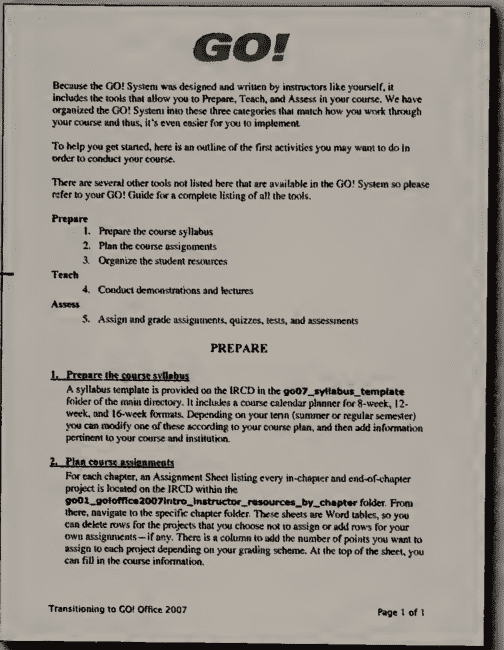

#### 教学大纲模板

包含针对8周、12周和16周课程形式的课程日历规划器。

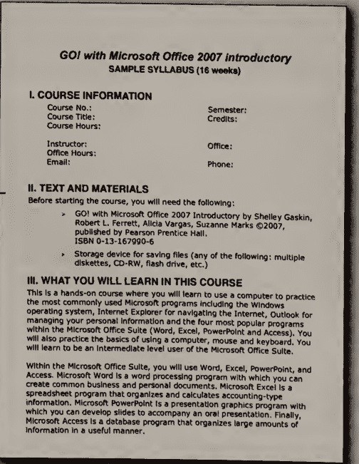

#### 作业清单

每章一份。

列出所有可能的作业；您可以根据课程计划在这个简单的 Word 表格中添加或删除项目。

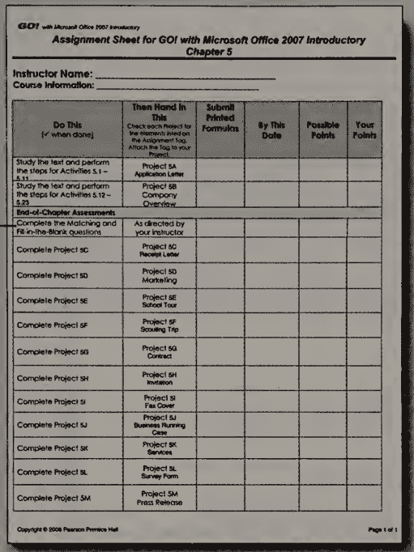

## GO! 补充材料文件指南

以表格形式列出所有补充材料及其文件名。

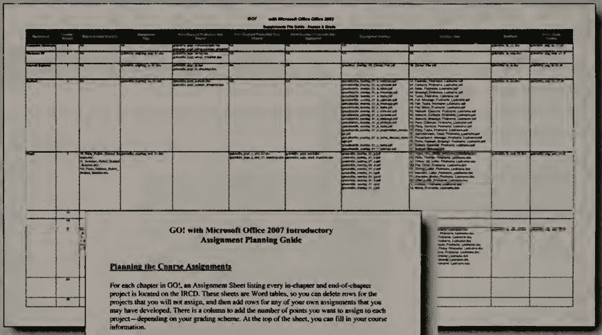

## 新增

## 作业规划指南

介绍 GO! 作业，并根据班级规模、授课模式和学生需求提供建议。包含来自同行教师的示例。

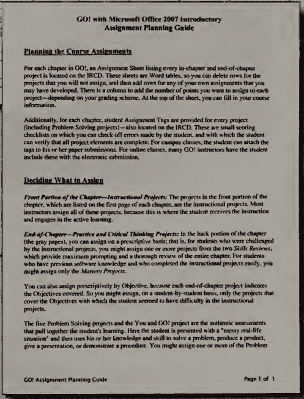

## 学生数据文件

音乐学校唱片公司发掘、推出并培养古典音乐、爵士乐和当代音乐领域年轻艺术家的职业生涯。我们的理念不仅是塑造、发行和销售音乐产品，更要帮助艺术家开创能够持续一生的职业生涯。在音乐行业中，艺术家常常被迫让自己的音乐迎合短暂流行的趋势。音乐学校唱片公司不只是追随潮流，我们对音乐行业采取长期视角，帮助我们的艺术家发展出灵活多变、并能在数年甚至数十年内吸引听众的风格和曲目。

音乐行业在持续变化，而过去十年的变化尤为巨大。DVD、视频游戏和互联网等新娱乐形式意味着市场上对休闲娱乐消费的竞争更加激烈。新技术为消费者提供了更多购买和聆听音乐的选择，他们也在追求高品质的录音。年轻消费者乐于接受新技术，无论身在何处、正在做什么，他们都希望随时随地听到自己喜爱的音乐。

音乐学校唱片公司拥抱新技术以及年轻音乐爱好者的成熟市场。我们相信，为真正有才华的艺术家提供高品质录音，能够培养出更有鉴赏力的听众，让他们在余生中珍惜音乐这份礼物。音乐学校唱片公司的专业能力包括：

- 洞察目标市场，并能触达目标受众

- 获取当前所有音乐收入来源的能力

- 一支在音乐商业领域拥有多年经验的管理团队

- 创新的商业策略与艺人发展计划

- 投资技术基础设施，以提供高品质录音和商业服务

- 以主动和前瞻的方式管理艺人职业生涯

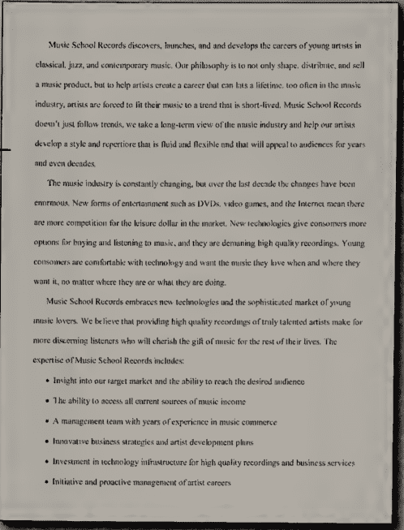

## 学生在线学习指南

基于章节内容的互动式客观题。

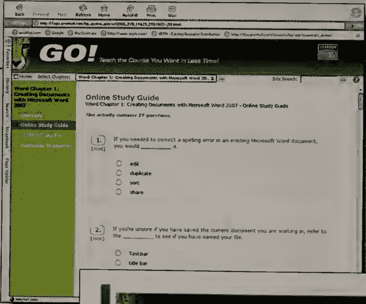

## PowerPoint 幻灯片

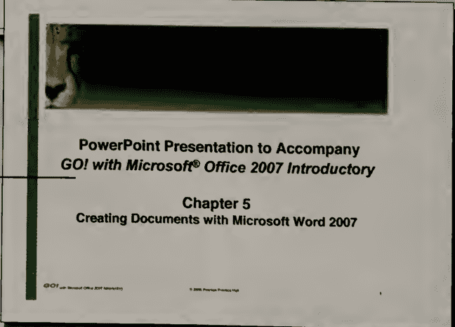

## 学习目标与学生成果

目标围绕能产生学生成果的项目进行组织。它们帮助学生学会如何解决问题，而不仅仅是学习软件功能。

## 基于项目的教学

学生不是练习应用程序的功能，而是创建他们在现实世界中需要的真实项目。项目采用颜色编码，便于参考，并命名为反映学生将要练习的技能。

## A 和 B 项目

每章包含两个教学项目——A 和 B。

每章以一个故事开篇，为学生将要创建的项目搭建背景；教学不会强迫学生假装成某个人或编造一个场景。

每章都有一个介绍性段落，向学生简要说明重点内容。

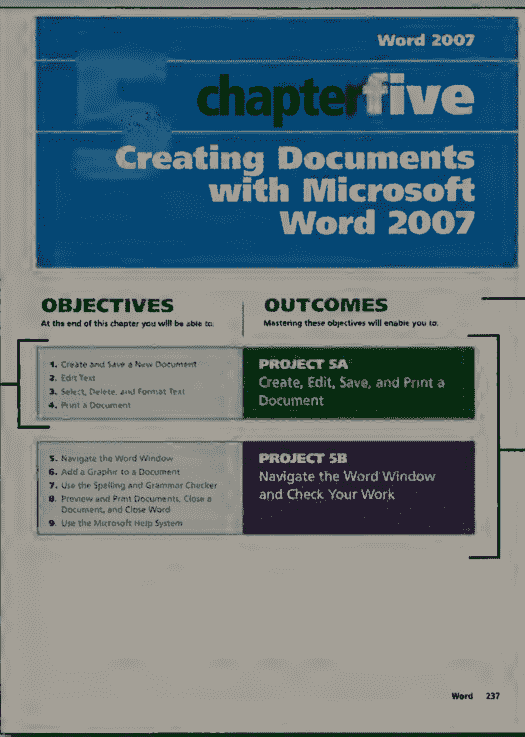

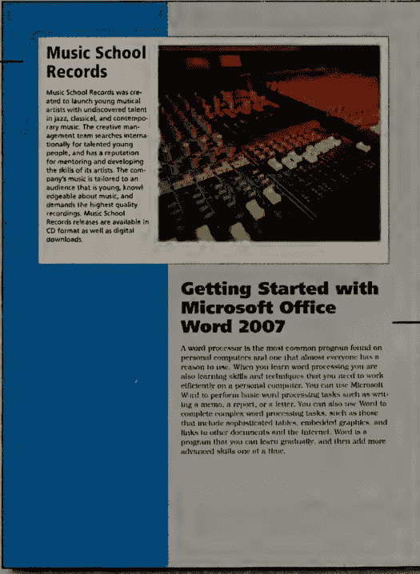

**视觉摘要**

向学生预先展示完成后的项目效果。

**项目摘要**

用一段话清晰而简洁地说明项目要点。

**文件指南**

清晰地向学生展示项目所需文件，以及他们保存文档时使用的文件名。

**目标**

学生将学到的技能在每个项目开头明确列出，并使用颜色编码，与章节首页列出的项目对应。

**可教时刻**

说明性文字被融入操作步骤中——在学生需要知道的时刻出现——而不是集中在一大段可能无人阅读的文字中。

**屏幕截图**

更大的屏幕截图。

## Steps

按当前项目着色编码，易于阅读，且数量不多不会让学生困惑，也不会太少而毫无意义。

## Sequential Pagination

不再有令人困惑的字母和缩写。

## Microsoft Procedural Syntax

所有步骤均以 Microsoft 程序化语法编写，以便在正确的时间将学生置于正确的位置。

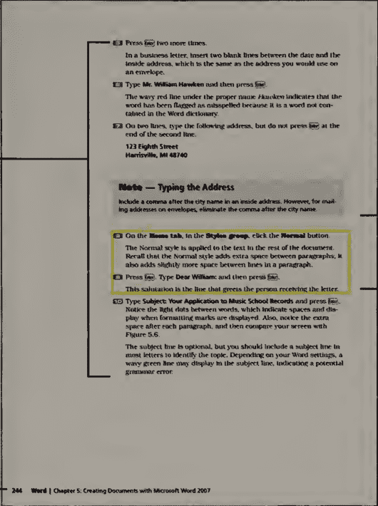

## End-of-Project Icon

GO! 系列中的所有项目都有明确可识别的结束点，在自学或在线环境中很有用。

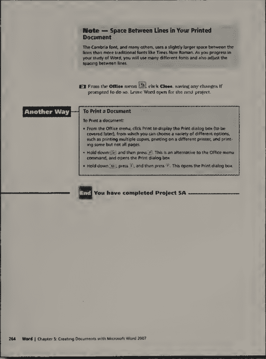

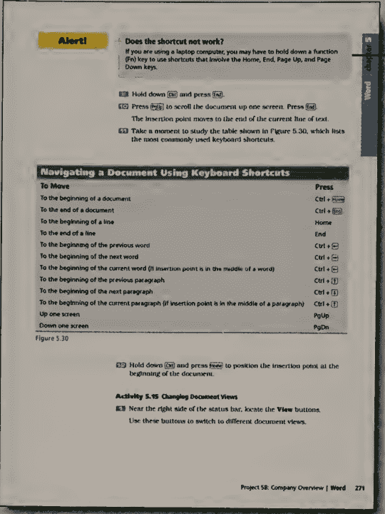

## Alert box

提醒学生注意，确保他们不会偏离轨道太远。

## Another Way box

向学生展示完成任务的其他方法。

## More Knowledge box

通过深入探讨材料来扩展主题。

## Note box

指出需要记住的重要事项。

## There's More You Can Do!

Try IT! 练习可教授学生额外技能。

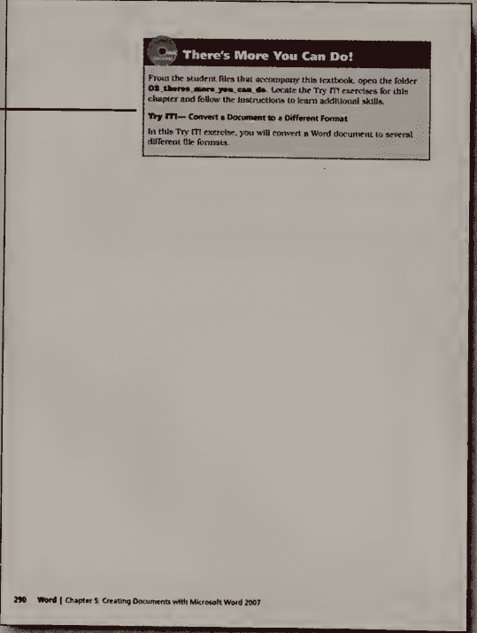

## There's More You Can Do!

从随本教材附带的 student files 中，打开文件夹 `05_chapter5_more_you_can_do`。找到本章的 Try IT! 练习并按照说明学习额外技能。

## Try IT!—Convert a Document to a Different Format

在此 Try IT! 练习中，您将把 Word 文档转换为几种不同的文件格式。

## End-of-Chapter Material

任你挑选！

可供选择的基于内容或基于成果的项目。下面是一张表格，概述了适合这两个类别的各种项目类型。

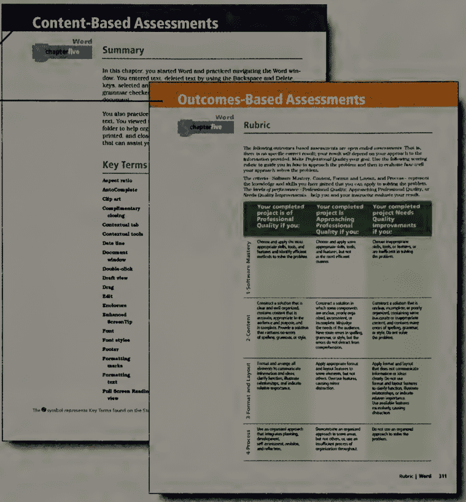

## Content-Based Assessments

（提供解决方案文件用于评分的确定性解决方案）

| Project Letter | Name | Objectives Covered |
|---|---|---|
| N/A | 摘要和关键术语 |  |
| N/A | 多项选择 |  |
| N/A | 填空 |  |
| C | 技能复习 | 涵盖 A 目标 |
| D | 技能复习 | 涵盖 B 目标 |
| E | 精通 Excel | 涵盖 A 目标 |
| F | 精通 Excel | 涵盖 B 目标 |
| G | 精通 Excel | 涵盖 A 和 B 目标的任意组合 |
| H | 精通 Excel | 涵盖 A 和 B 目标的任意组合 |
| I | 精通 Excel | 涵盖所有 A 和 B 目标 |
| J | 业务运行案例 | 涵盖所有 A 和 B 目标 |

## Outcomes-Based Assessments

（需要评分量规的开放式解决方案）

| Project Letter | Name | Objectives Covered |
|---|---|---|
| N/A | 量规 |  |
| K | 问题解决 | 尽可能涵盖 A 和 B 的目标 |
| L | 问题解决 | 尽可能涵盖 A 和 B 的目标。 |
| M | 问题解决 | 尽可能涵盖 A 和 B 的目标。 |
| N | 问题解决 | 尽可能涵盖 A 和 B 的目标。 |
| O | 问题解决 | 尽可能涵盖 A 和 B 的目标。 |
| P | 你和 GO! | 尽可能涵盖 A 和 B 的目标 |
| Q | GO! 帮助 | 不绑定特定目标 |
| R | * 团体业务运行案例 * | 涵盖 A 和 B 目标 |

* 本项目仅随 GO! with Microsoft Office 2007 入门版图书提供。

## Objectives List

章末部分的大多数项目都以涵盖的目标列表开始。

## End of Each Project Clearly Marked

明确标识的结束点有助于区分章末项目。

## Content-Based Assessments

## Skills Review

## Project SC — Receipt Letter

在此项目中，您将应用在项目 5A 目标中练习的技能。

Objectives: 1. 创建并保存新文档；2. 编辑文本；3. 选择、删除和格式化文本；4. 打印文档。

在下面的技能复习中，您将创建并编辑一封来自 Music School Records 生产经理 Janice Anderson 发给录音艺术家 William Hawken 的跟进信，后者已随申请提交了演示 CD。您完成的信件将与图 5.19 所示的类似

## For Project SC, you will need the following file:

New Mark Word 文档。

您将把文档保存为 `SC_Receipt_Letter_Firstname_Lastname`

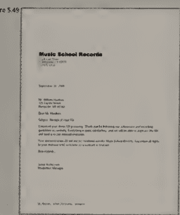

（Project SC-Receipt Letter 继续在下一页）

## Content-Based Assessments

## Skills Review

（Project SC-Receipt Letter 继续）

- 14. 保存您对文档所做的更改。按 `Ctrl+S` 选择整个文档...

- 15. 选择 Music School Records 的整第一行...

- 16. 选择第二、三和第四行文本...

- 17. 在以 Your demonstration 开头的段落中...

- 18. 在“页眉和页脚”组中单击“插入”选项卡，单击“页脚”按钮。

- 19. 在“页面设置”组中单击“页面布局”选项卡...

- 20. 从“Office”菜单指向“打印”菜单...

- 21. 在“打印”组的“打印预览”选项卡上，单击“打印”按钮...

- 22. 从“Office”菜单中，单击“退出 Word”，如果提示则保存任何更改。

结束 您已完成项目 SC

## Rubric

一个说明学生作业评分标准和标准的矩阵。用于评分开放式评估。

## GO! with Help

学生练习使用 Office 应用程序的帮助功能。

## You and GO!

一个项目，学生使用自己生活中的信息并将本章的技能应用于个人任务。

## Outcomes-Based Assessments

## Rubric

以下基于成果的评估是开放式测量。即没有唯一特定的正确答案；您的结果将取决于您对所提供信息的处理方式。以专业质量为目标。使用以下评分量规来指导您如何处理问题，然后评估您的方法解决问题的效果。

类别 软件掌握、内容、格式和版式 以及 过程 代表您所获得的知识和技能，可应用于解决问题。表现水平 专业质量、接近专业质量 或 需要质量改进 有助于您和您的指导教师评估您的结果。

量规矩阵，列为 如果您... 您的完成项目为专业质量， 如果您... 您的完成项目接近专业质量， 如果您... 您的完成项目需要质量改进， 行 1 软件掌握，2 内容，3 格式和版式，4 过程。

## Outcomes-Based Assessments

## You and GO!

## Project 5P — You and Go!

在此项目中，您将通过应用项目 5A 和 5B 目标中练习的任何组合技能来构建解决方案。

从随本教材附带的 student files 中，打开文件夹 `04_you_and_go`。找到本章的 You and GO! 项目并按照说明为您的简历创建一封求职信。

结束 您已完成项目 5P

## GO! with Help

## Project 5Q — Go! with Help

Word 帮助系统非常全面，可以在您工作时提供帮助。在本章中，您多次使用了快速访问工具栏。您可以通过添加常用按钮来自定义快速访问工具栏，使其从功能区的任何选项卡中都能快速访问。在此项目中，您将使用帮助来了解如何添加按钮。

- 启动 Word。在功能区最右端，单击 Microsoft Office Word 帮助按钮。在 Word 帮助对话框中，单击“搜索”按钮，然后单击“脱机 Word 帮助”。

- 在“输入要搜索的词”框中，输入 Quick Access Toolbar 然后按 Enter。

- 从搜索结果列表中，单击“自定义快速访问工具栏”。

- 单击每个链接以了解如何从功能区和“选项”对话框添加按钮。

- 完成后，关闭“帮助”窗口，然后关闭 Word。

结束 您已完成项目 5Q

## 基于成果的评估

### 小组业务运行案例

### 项目 5R—小组业务运行案例

在本项目中，您将应用在项目 5A 和 5B 的目标中练习的技能。

您的教师可能会将此小组案例项目分配给您的班级。如果您的教师分配此项目，他或她将为您提供信息和说明，以便作为小组工作。该小组将应用迄今为止获得的技能，帮助 Bell Orchid Hotel Group 实现其业务目标。

**End** 您已完成项目 5R ____________________

### 小组业务运行案例

一个为小组开发的持续项目，跨越每个应用程序内的章节。

### 学生 CD 包含：

- 学生数据文件

- 你还能做更多！

- 业务运行案例

- 你与 GO！

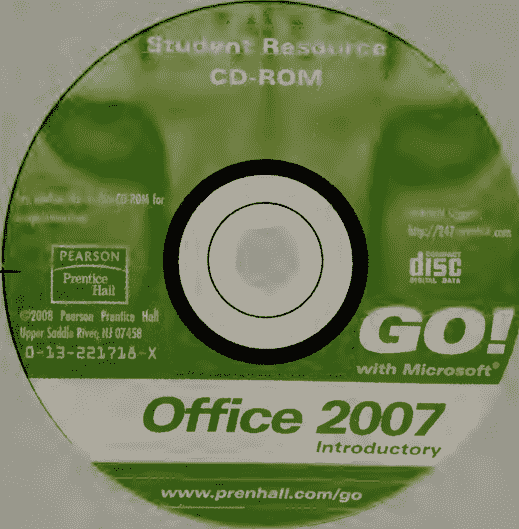

## 注释版教师版

注释版教师版包含学生教科书的完整版本，其中包括提示、补充参考资料以及使用 GO！教学系统的教学指导。

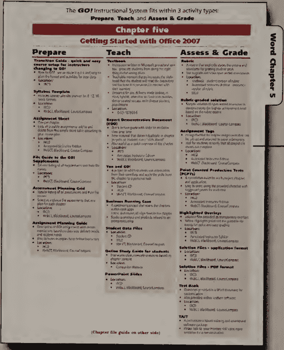

### 章节分隔页

按照活动级别清晰列出每章的资源：准备、教学、评估。

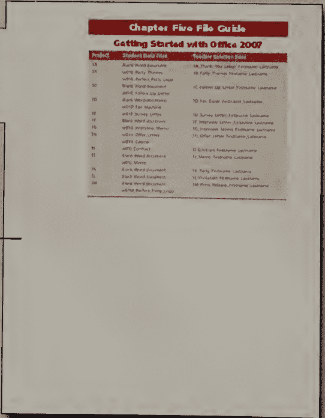

### 教师文件指南

章节所需的所有学生数据文件和教师解决方案文件的完整列表。

### 有用提示、教学技巧、扩展项目

参考资料对应于学生教科书中教授的内容。

### 全尺寸教科书页面

包含传统教师手册内容的教科书教师用复印件。

### 章末概念评估

包含快速参考的答案。

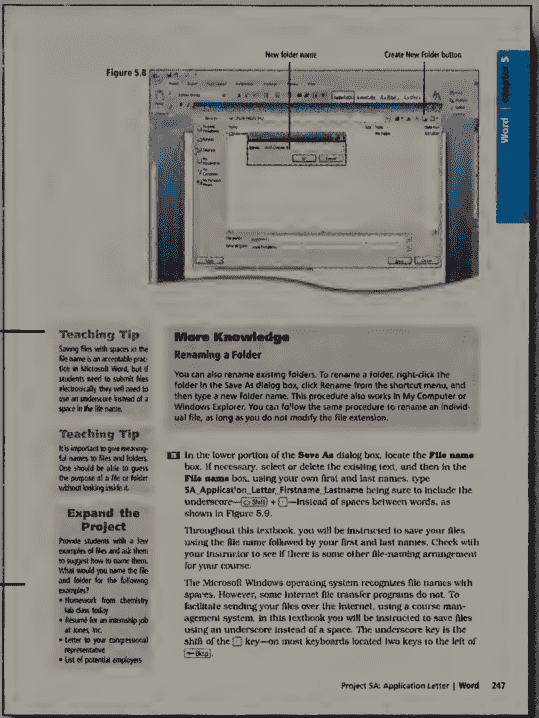

## 基于内容的评估

### 匹配

将第二列中的每个术语与其在第一列中的正确定义匹配。在正确定义前面的空白行上写下该术语的字母。

- C 1. Word 窗口中用闪烁的垂直线指示的位置，在您开始输入时文本将在此处插入。

- F 2. 在 Word 窗口中，最小化、最大化/还原和关闭按钮的位置。

- Q 3. 表示显示非打印字符命令的按钮。

- K 4. 当插入点到达右边界时自动向下移动并移动到下一行的左边界所发生的操作。

- B 5. 设置文档中文本整体外观的过程。

- G 6. 按住鼠标左键并将鼠标指针移过文本以选择它。

- H 7. 一组 ...

### 填空

在提供的空格中写出正确的单词。

- 1. Microsoft Word 2007 是一个文字 ______ 程序，您可以使用它执行诸如撰写备忘录、报告或信件等任务。

- 2. 位于 Word 窗口底部的提供页码和字数等信息的栏称为 ______ 栏。

- 3. 在滚动条内，向下拖动 ______ 会使屏幕上的文档向上移动。

- 4. 位于功能区上方且在 Office 按钮右侧的可通过添加常用按钮来自定义工具栏称为 ______（QAT）。

- 5. 在屏幕上显示以显示段落标记、制表符和空格的位置但不打印的字符称为 ______ 标记。

- 6. 如果您指向功能区上的按钮，______ 会显示按钮的名称。

- 7. 地址或日期下方的紫色虚线表示该信息可以放入 Outlook 等其他 Office 程序，这是一种 ______。

## 评分标准

**NEW**

用于指导学生如何被评估的矩阵在注释版教师版中重新印刷，其中包含每个标准和表现水平的建议权重。教师可以根据需要修改权重。

## 基于成果的评估

| 评分标准 | 您的已完成项目如果为专业质量： | 您的已完成项目如果接近专业质量： | 您的已完成项目如果需要质量改进： |
| --- | --- | --- | --- |
| 软件掌握 | 描述软件专业使用和完成所需任务的标准。 | 描述部分完成或效率较低的软件使用的标准。 | 描述软件使用不足或工作不完整 的标准。 |
| 内容 | 描述准确、完整且发展良好的内容 的标准。 | 描述总体上足够但存在一些弱点 的内容标准。 | 描述不完整、不准确或发展不足 的内容标准。 |
| 格式和布局 | 描述有效组织、格式和视觉呈现 的标准。 | 描述总体有效但存在一些不一致 的格式标准。 | 描述组织、格式或视觉呈现不良 的标准。 |
| 过程 | 描述有组织且有效的 工作流程的标准。 | 描述部分有组织或不一致的流程 的标准。 | 描述无效或无组织的流程的标准。 |

## 评估

### 作业标签

作业评分清单。

**NEW** 现在也可用于问题解决项目。

### GO! with Office 2007 的作业标签

### Word 第 5 章

| 项目 5A — 任务 | 分数 | 您的得分 |
|---|---:|---:|
| 在页面上垂直居中文本 | 2 |  |
| 删除单词 "really" | 1 |  |
| 删除单词 "try to" | 1 |  |
| 将 "was" 替换为 "is" | 1 |  |
| 插入单词 "potential" | 1 |  |
| 将 "John W. Diamond" 替换为 "Lucy Burrows" | 2 |  |
| 将整个文档更改为 Cambria 字体 | 2 |  |
| 将第一行文本更改为 Arial Black 20 pt。 | 2 |  |
| 将第一行文本加粗 | 2 |  |

| 将第 2 行至第 4 行更改为 Arial 10 pt。 | 2 |  |

| 将第 2 行至第 4 行文本斜体化 | 2 |  |

| 按说明校正/添加页脚 | 2 |  |

| 圈出的信息不正确或格式不正确 | 1 |  |

| **总分** | **20** | **0** |

| 项目 5B — 任务 | 分数 | 您的得分 |

|---|---:|---:|

| 插入文件 W05B_Music_School_Records | 4 |  |

| 插入音乐标志 | 4 |  |

| 删除重复的 "and" | 2 |  |

| 修改拼写和语法错误（4） | 2 |  |

| 按说明校正/添加页脚 | 2 |  |

| 圈出的信息不正确或格式不正确 | 2 |  |

| **总分** | **20** | **0** |

| 项目 5C — 任务 | 分数 | 您的得分 |

|---|---:|---:|

| 添加四行信头 | 2 |  |

| 插入今天的日期 | 1 |  |

| 添加地址块、主题行和问候语 | 2 |  |

| 添加信件的两段正文 | 2 |  |

| 添加结束语、姓名和职称 | 2 |  |

| 在主题行中，将 "receipt" 大写 | 1 |  |

| 将 "standard" 改为 "guidelines" | 1 |  |

| 插入 "all" | 1 |  |

| 将第一行文本更改为 Arial Black 20 pt。 | 2 |  |

| 将第一行文本加粗 | 1 |  |

| 将第 2 行至第 4 行更改为 Arial 10 pt。 | 1 |  |

| 将第 2 行至第 4 行文本斜体化 | 1 |  |

| 按说明校正/添加页脚 | 2 |  |

| 圈出的信息不正确或格式不正确 | 1 |  |

| **总分** | **20** | **0** |

| 项目 5D — 任务 | 分数 | 您的得分 |

|---|---:|---:|

| 插入文件 W05D_Marketing | 4 |  |

| 将前两行标题加粗 | 2 |  |

| 纠正 "Marketing" 的拼写 | 2 |  |

| 纠正 "genres" 的拼写 | 2 |  |

| 纠正 "already" 的所有拼写错误 | 2 |  |

| 纠正语法错误 "are" 为 "is" | 2 |  |

| 插入标志图像 | 2 |  |

| 按说明校正/添加页脚 | 2 |  |

| 圈出的信息不正确或格式不正确 | 2 |  |

| **总分** | **20** | **0** |

### 高亮叠加

解决方案文件以透明叠加层提供。黄色高亮标出可评分元素，便于快速轻松评分。

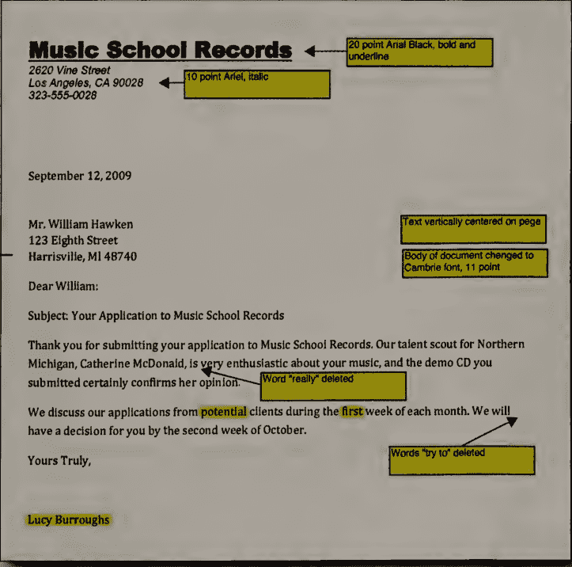

### 音乐学校记录

2620 葡萄街  

洛杉矶，CA 90028  

323-555-0028

2009年9月12日

威廉·霍肯 先生  

123 第八街  

哈里斯维尔，MI 48740

亲爱的威廉：

主题：您申请加入音乐学校记录

感谢您向音乐学校记录提交申请。我们北密歇根州的星探 Catherine McDonald 对您的音乐非常热情，您提交的 demo CD 证实了她的看法。

我们每月第一周讨论来自潜在客户的申请。我们将在十月的第二周前给您答复。

此致

露西·伯罗斯

- 20 磅 Arial Black，加粗并下划线

- 10 磅 Arial，斜体

- 文本在页面上垂直居中

- 文档正文更改为 Cambria 字体，11 磅

- 单词 "really" 已删除

- 单词 "try to" 已删除

## 按点计分的生产测试（PCPTs）

针对每个项目、章节和应用的累积考试。使用提供的清单进行评分很容易，其中为每个任务建议了分数。

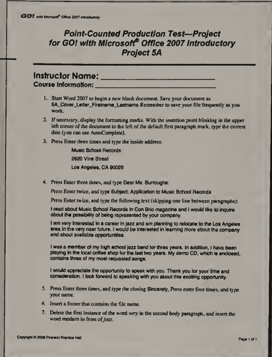

## 题库

可作为 TestGen 软件提供，也可作为 Word 文档进行自定义。

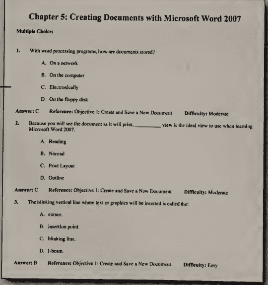

## 解决方案文件 – 应用和 PDF 格式

Music School Records

Music School Records 发掘、推出并发展古典、爵士和当代音乐中年轻艺术家的职业生涯。我们的理念不仅是塑造、分销和销售音乐产品，更是帮助艺术家创造可持续一生的职业生涯。在音乐行业中，艺术家经常被迫将音乐迎合短暂的潮流。Music School Records 不仅仅追随潮流，我们对音乐行业采取长期视角，帮助我们的艺术家发展出灵活多变且能吸引观众数年甚至数十年的风格和曲目。

音乐行业不断变化，但过去十年中的变化是巨大的。DVD、电子游戏和互联网等新的娱乐形式意味着市场对休闲消费的竞争更加激烈。新技术为消费者提供了更多购买和聆听音乐的选择，他们要求高质量的录音。年轻消费者对技术很熟悉，想要随时随地聆听他们喜爱的音乐，无论身在何处或正在做什么。

Music School Records 拥抱新技术和年轻音乐爱好者的成熟市场。我们相信，提供真正才华横溢艺术家的高质量录音，能够培养出更有鉴赏力的听众，他们将终生珍惜音乐的馈赠。Music School Records 的专业知识包括

- 对目标市场的洞察力以及触达目标受众的能力

- 获取所有当前音乐收入来源的能力

- 拥有多年音乐商业经验的管理团队

- 创新商业策略和艺术家发展计划

- 对高质量录音和业务服务的科技基础设施投资

pagexxxx_top.docx

## 在线评估与培训

myitlab 是 Prentice Hall 的新绩效型解决方案，可让你轻松提供基于成果的 Microsoft Office 2007 课程，并提供定制化培训和可辩护的评估。myitlab 的主要功能包括：

- 真正的“系统”方法：myitlab 内容与你的教科书相同。

- 基于项目和技能：学生完成真实作业。

- 高级报告和成绩簿：包括学生点击流数据。

- 无需安装：myitlab 完全基于网络。你只需要互联网连接、小型插件和 Adobe Flash Player。

请向你的 Prentice Hall 销售代表索取演示或访问：

www.prenhall.com/myitlab

## 第一章

### 开始使用 Windows XP

### 目标

本章结束时你将能够：

### 成果

掌握这些目标将使你能够：

- 1. 开始使用 Windows XP

- 2. 调整 Windows 大小、移动和滚动

- 3. 最大化、还原、最小化和关闭 Windows

- 4. 创建新文件夹

- 5. 复制、移动、重命名和删除文件

- 6. 查找文件和文件夹

- 7. 压缩文件

### 项目 1A

启动 Windows XP 并操作 Windows、文件夹和文件

Windows XP 是协调计算机硬件活动的软件。Windows XP 控制屏幕的显示方式、如何打开和关闭程序，以及计算机的启动、关闭和导航程序。熟悉 Microsoft Windows 操作系统的基本功能很有用，尤其是使用“开始”按钮和任务栏；打开、关闭、移动和调整窗口大小；以及保存和管理文件。

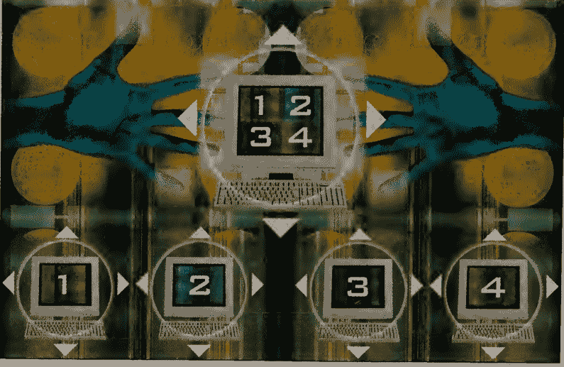

### 开始使用 Windows XP

### 项目 1A 启动 Windows XP 并操作 Windows、文件夹和文件

在活动 1.1 至 1.9 中，你将练习导航 Windows XP。你将管理文件和文件夹，并压缩和解压缩文件以便轻松传输。你还将捕获屏幕图像，其外观与图 1.1 相似。

对于项目 1A，你需要以下文件：

- Flower.wmf

- Plant.wmf

- Roller Coaster.wmf

- Golfer.wmf

- Artist Picture.wmf

- Lightning.docx

- LSS-Charlotte NY Station.jpg

- LSS-Crew Pulling Lifeboat.bmp

- Volunteers.pptx

- New blank Word document

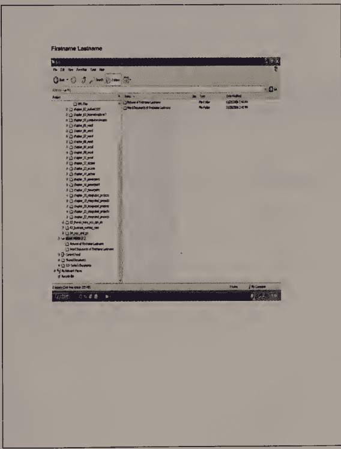

图 1.1

项目 1A—Windows XP

### 目标 1

开始使用 Windows XP

Windows XP 是一个 *操作系统*——软件控制连接到计算机的硬件，包括其内存、磁盘驱动器空间、打印机和扫描仪等附属设备以及中央处理器。Windows XP 和早期版本的 Windows 相似；它们使用 *图形用户界面 (GUI)*。GUI 使用图形或图片表示命令和操作，并让你在屏幕上看到文档格式，其显示方式与打印在纸上时相同。**Windows**，当以大写 W 拼写时，指运行计算机的操作系统。

启动 Windows 是一个自动过程；你打开计算机，片刻后，安装在计算机上的 Windows 版本就会显示。有些版本需要登录，有些则不需要。如果你使用的是不同版本的 Windows，本章中使用的某些程序可能工作方式不同。Windows XP 有两个版本：专业版和家庭版。对于基本任务，两个版本的工作方式相同。专业版包含大型组织所需的安全和其他功能。

**Alert!**

**Does your screen differ?**

本章使用 Windows XP 家庭版。当你看到单词 Windows 时，它通常会伴随版本，例如 Windows 98、Windows NT、Windows 2000 或 Windows XP，即本章介绍的版本。这些操作系统相似，并使用图形或图片表示命令和操作。不同版本可能导致屏幕与本章所示不同。你的屏幕也可能因计算机所选的设置选项而不同。

### 活动 1.1 开始使用 Windows XP

在活动 1.1 中，你将启动 Windows，使用鼠标，并使用“开始”按钮打开 Windows 计算器程序。

- 1. 打开计算机并等待 **Windows** 程序显示，或按照计算机所需的登录说明进行操作。例如，你可能需要在欢迎屏幕上单击名称，或输入用户 ID 或密码。如果这是你的家庭计算机且你是唯一用户，可能只需等待片刻即可。

- Windows *桌面*，即 Windows XP 屏幕的工作区域，会显示。工作区域称为桌面，因为在上面你可以放置常规桌上物品的电子版本。屏幕外观会因你使用的 Windows 版本以及桌面上的内容而异。

- 2. 将你的 Windows 桌面与图 1.2 进行比较，然后花点时间研究图 1.3 表格中标识的 Windows 元素。

图 1.2

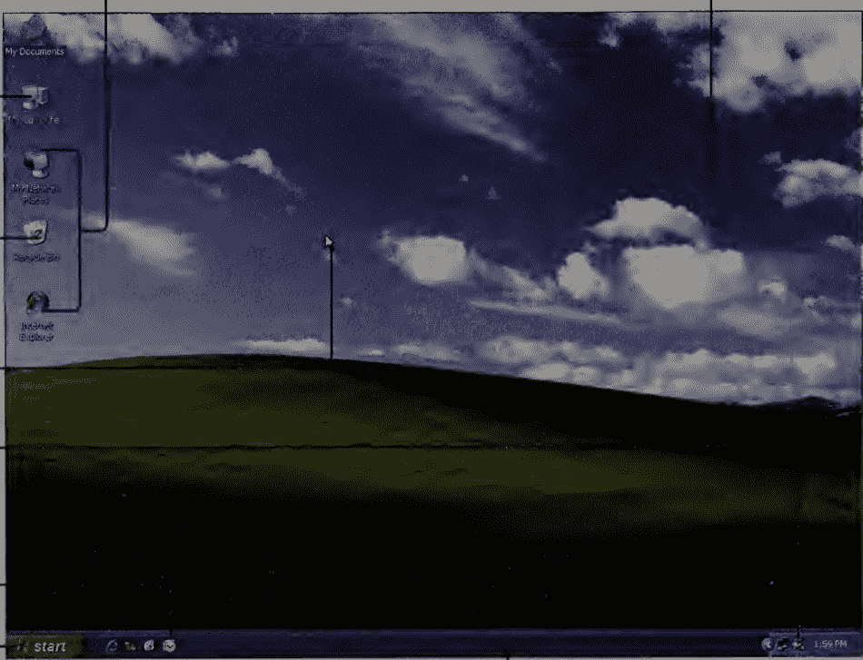

图标

桌面

我的电脑图标

回收站

鼠标指针

通知区域

快速启动工具栏

开始按钮

任务栏

### Windows 屏幕元素

| Element | Description |

|---|---|

| Desktop | Windows XP 屏幕的工作区域，由程序图标、任务栏和“开始”按钮组成。 |

| Icon | 可选择并打开的对象的图形表示，例如驱动器、磁盘、文件夹、文档或程序。 |

| Mouse pointer | 当你移动鼠标或其他指向设备时移动的箭头、I 形光标或其他符号，表示屏幕上的位置或位置——也称为指针。 |

| My Computer icon | 表示你正在使用的计算机的图标，提供对计算机上的驱动器、文件夹和文件的访问。 |

| Quick Launch toolbar | 开始按钮右侧的区域，包含常用程序的快捷方式图标。 |

(Continued)

| 元素 | 说明 |

|---|---|

| 回收站 | 存储已删除文件的临时区域。可以从回收站恢复文件，也可以将其永久删除。 |

| 任务栏 | 显示“开始”按钮以及任何打开的文档的名称。任务栏还可能显示其他程序的快捷方式按钮。 |

| 通知区域 | 任务栏右侧的区域，旧称*系统托盘*或*状态区域*，用于显示时钟和系统通知。这些通知让你了解后台正在进行的进程，例如杀毒软件检查、网络连接以及其他实用程序。某些通知仅临时显示。 |

| “开始”按钮 | 任务栏左侧的按钮，用于启动程序、更改系统设置、查找 Windows 帮助或关闭计算机。 |

### 图 1.3

在平面上移动鼠标，以便在屏幕上移动指针。在桌面上，将指针尖端定位在 **“我的电脑”** 图标中央——此操作称为**“指向”**。**“双击”**——快速连续按下鼠标左键两次——注意不要移动鼠标。如果“我的电脑”图标不可见，请单击**“开始”**按钮，然后在显示的**“开始”**菜单中单击**“我的电脑”**。将屏幕与图 1.4 进行比较，然后花点时间研究图 1.5 中的“我的电脑”窗口元素。

“我的电脑”窗口显示出来。**窗口**——英文拼写为小写 *w*——是一个显示信息或程序的矩形框。窗口打开时，窗口名称同时显示在标题栏和桌面底部任务栏上的一个按钮中。

### 图 1.4

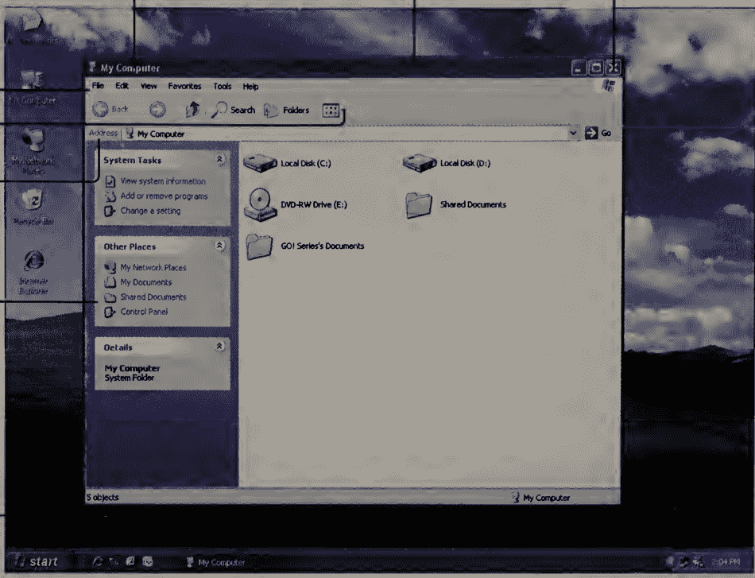

### 窗口的组成部分

| 屏幕元素 | 说明 |

|---|---|

| 地址栏 | 一种工具栏，显示活动文件、文件夹或窗口的组织路径。 |

| 关闭按钮 | 标题栏中的快捷按钮，用于关闭窗口或程序。 |

| 左窗格 | 在“我的电脑”窗口中，显示信息和常用工具的面板。 |

| 菜单 | 某个类别中的命令列表。 |

| 菜单栏 | 标题栏下方的横条，列出菜单类别的名称，例如*文件*、*编辑*、*视图*等。 |

| 屏幕提示 | 当指针指向按钮或其他屏幕对象时激活的小框，显示该屏幕元素的名称或进一步信息。 |

| 状态栏 | 文档窗口底部的水平横条，提供有关当前在窗口中查看内容的状态信息，例如文档的页码。 |

| 标题栏 | 显示程序图标、文档名称和程序名称。最小化、最大化/向下还原和关闭按钮位于标题栏右侧。 |

| 工具栏 | 一行按钮，单击鼠标左键即可激活命令，例如“撤销”或“加粗”。 |

### 图 1.5

❹ 在 **“我的电脑”** 窗口标题栏的右上角，指向但不单击 **“关闭”** 按钮 [关闭按钮图标]，并注意*屏幕提示*“关闭”。

*屏幕提示*是一种小注解，通常显示在黄色框中，提供按钮名称或有关屏幕元素的信息。

❺ **单击**——按下鼠标左键一次——**“关闭”**按钮 [关闭按钮图标]，以关闭**“我的电脑”**窗口。然后，指向桌面上的**“我的电脑”**图标，并单击鼠标右键——此操作称为*右键单击*。如果桌面上不显示**“我的电脑”**图标，请单击**“开始”**按钮 [“开始”按钮图标]，然后右键单击**“我的电脑”**。将屏幕与图 1.6 进行比较。

出现一个快捷菜单。**快捷菜单**列出*上下文相关*的命令——处理所选对象时常用的命令。在此快捷菜单中，“打开”命令以粗体显示，因为这是双击此图标时发生的默认操作。

### 图 1.6

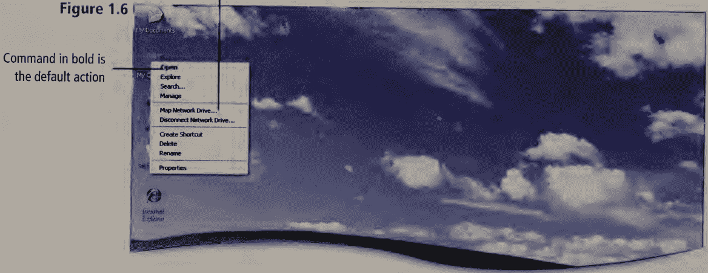

6 在显示的快捷菜单中，指向“打开”以突出显示——即选择——该命令，然后单击。在显示的“我的电脑”窗口中，指向并单击标记为“本地磁盘 (C:)”的磁盘驱动器，然后在左窗格中注意下方面板。将屏幕与图 1.7 进行比较。

本地磁盘的规格信息——计算机系统内的大型磁盘驱动器，也称为硬盘驱动器——显示在左窗格的“详细信息”面板中。驱动器是一种存储区域，使用 Windows 文件系统格式化，并具有驱动器号，例如 C、D、E 等。如果“详细信息”面板不显示任何信息，请单击“详细信息”旁边的展开/隐藏箭头，以展开任务窗格的此面板。

### 图 1.7

窗口标题

已选择 C: 驱动器

关闭按钮

单击箭头以展开或隐藏面板详细信息

本地磁盘的详细信息

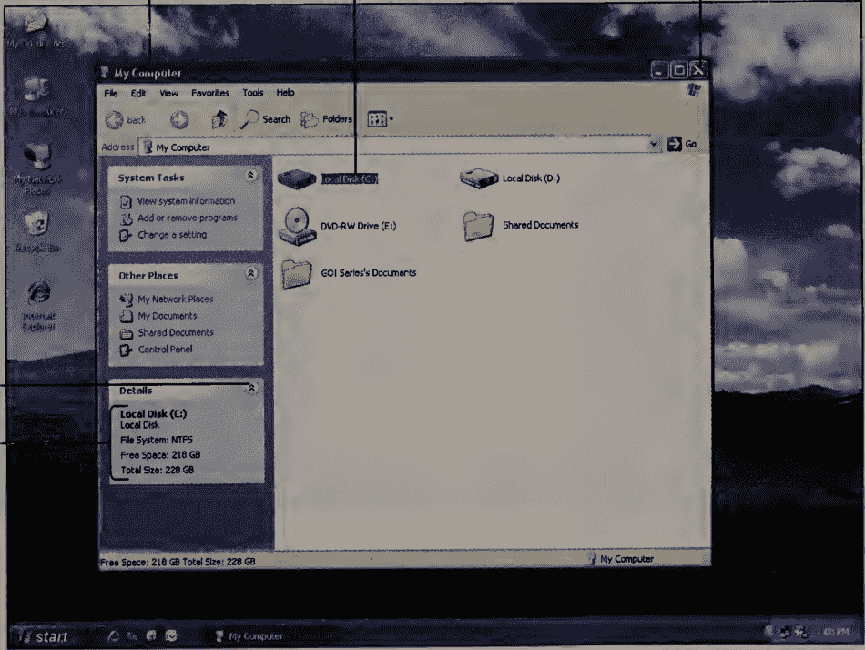

7 在“我的电脑”窗口标题栏中，单击“关闭”按钮 X。在屏幕左下角，指向并单击“开始”按钮。将屏幕与图 1.8 进行比较。

在显示的“开始”菜单中，右侧带有箭头的命令表示该命令有可用的子菜单。子菜单是二级菜单。您可以自定义“开始”菜单，使其包含常用程序和文件的快捷方式。

### 图 1.8

当前用户

（你的可能不同）

箭头表示子菜单可用

自定义快捷方式

（你的可能会不同）

最近使用的程序

（你的可能会不同）

“开始”菜单（你的列表可能会不同）

“开始”按钮

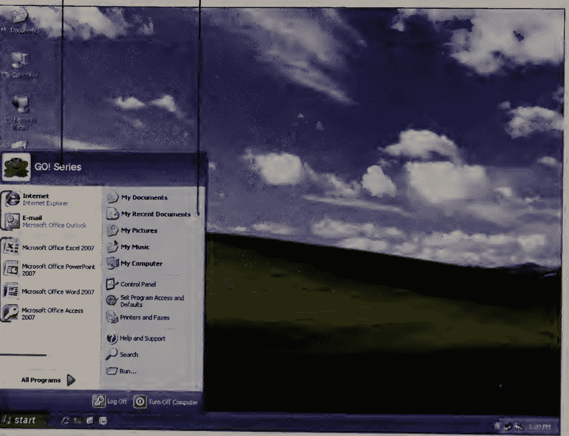

- 8. 在 **“开始”** 菜单中，指向但不单击 **“所有程序”** 命令。

“所有程序”子菜单显示出来。你的菜单将与图 1.9 所示不同，因为你的计算机安装了不同的程序。菜单中的文件夹包含更多程序、更多文件夹，或两者兼有。文件夹右侧的小箭头表示该文件夹包含其他文件夹或压缩文件。

- 9. 在 **“所有程序”** 菜单中，指向但不单击 **“附件”**。

### 图 1.9

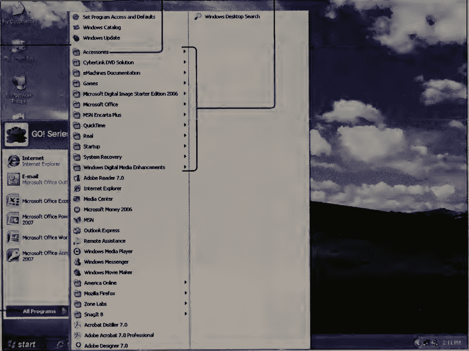

11 单击“计算器”命令，打开“计算器”窗口并关闭“开始”菜单。然后，练习使用计算器，如图 1.11 所示。指向并单击数字和按键，就像在计算器上按键一样。

图 1.11

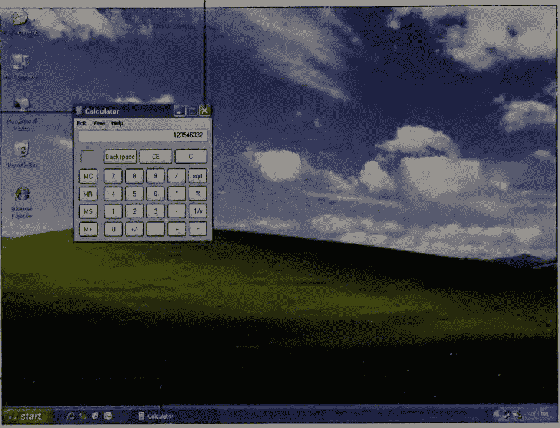

关闭按钮

“计算器”程序图标和名称

任务栏上的“计算器”按钮

12 在“计算器”标题栏上，单击“关闭”按钮。

### 目标 2

### 调整、移动和滚动窗口

当窗口在屏幕上打开时，它通常会以与上次使用时相同的大小和形状打开。如果同时使用多个窗口，可以增大或减小窗口大小，或移动窗口，以便看到所需的信息。

在程序内工作时，创建的信息通常会超出屏幕可显示的范围。当窗口中的信息延伸到窗口的下边缘或右边缘之外时，窗口的下方和右侧会显示滚动条。使用水平滚动条，可以左右移动以查看超出屏幕左边缘或右边缘的信息。使用垂直滚动条，可以上下移动以查看超出屏幕顶部或底部的信息。

## 活动 1.2 调整、移动和滚动窗口

在活动 1.2 中，你将打开、调整大小并移动“我的电脑”窗口。你还将使用“我的电脑”窗口中的滚动条来查看屏幕容纳不下的信息。

1. 在 Windows 桌面上，双击“我的电脑”图标以打开“我的电脑”窗口。或者，右键单击该图标并单击“打开”。
2. 查看“我的电脑”窗口是否如图 1.12 所示打开，或者是否打开并填满整个屏幕。如果“我的电脑”窗口填满整个屏幕，请在标题栏右侧单击“向下还原”按钮。
3. 将指针移动到窗口的右下角，显示对角调整大小指针，然后将屏幕与图 1.12 进行比较。

当鼠标指针处于这种形状时，你可以使用它来更改窗口的大小和形状。

#### 图 1.12

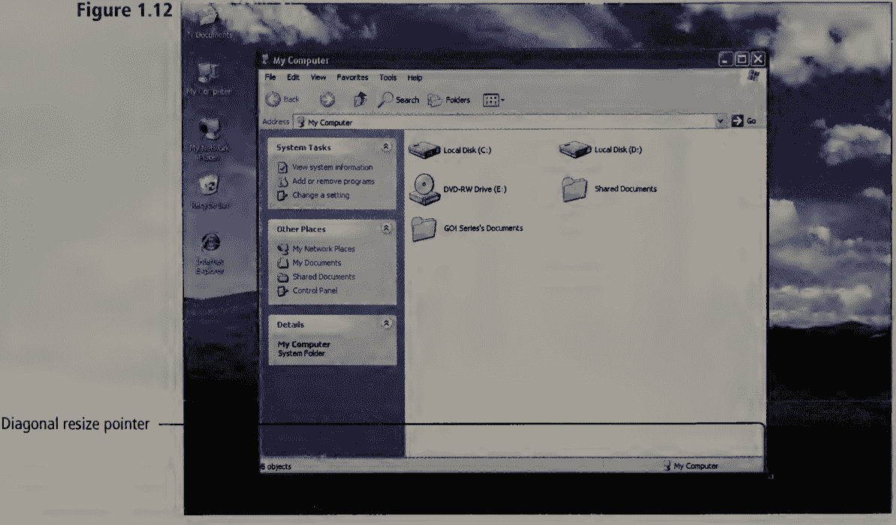

4. 按住鼠标左键，*拖动*——即按住鼠标左键的同时移动鼠标，然后在适当时机松开——沿对角线向左上方拖动，直到窗口底部和右侧都出现滚动条。根据需要调整，使“我的电脑”窗口与图 1.13 所示窗口的大小大致相同。根据需要调整，确保滚动条显示。

滚动条显示在窗口的右侧和底部。当窗口内容超出其显示范围时，窗口中就会添加滚动条。

#### 图 1.13

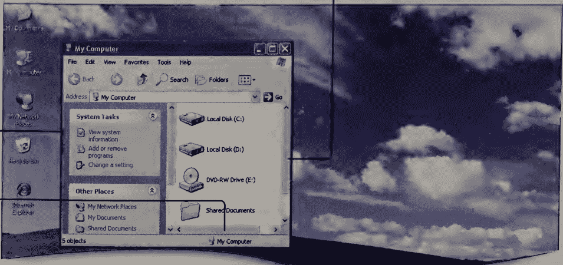

垂直滚动条

窗口变小

水平滚动条

5. 在“我的电脑”标题栏上，指向空白区域。按住鼠标左键，拖动——按住鼠标左键，移动鼠标，然后松开鼠标——向下约 2 英寸，向右约 2 英寸。将你的屏幕与图 1.14 进行比较。

当你松开鼠标时，窗口便落到新位置。使用此技巧可在屏幕上移动打开的窗口。

#### 图 1.14

标题栏

窗口移动到屏幕上的不同位置

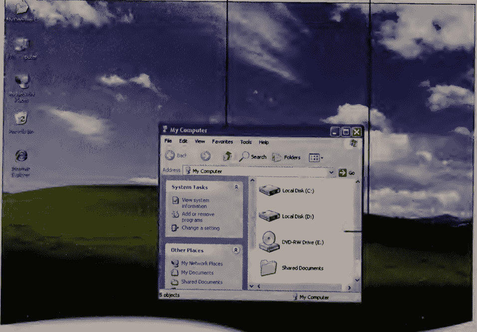

6. 在垂直滚动条底部，指向**向下箭头**并单击，注意窗口底部的信息向上滚动，因此可以看到之前不可见的文件夹和图标，如图 1.15 所示。

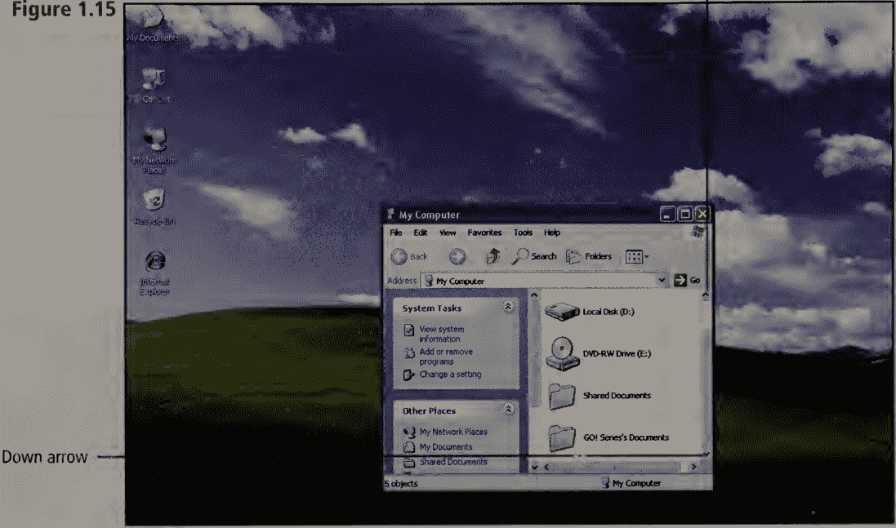

7. 指向同一滚动条上的**向上箭头**，然后按住鼠标左键。

列表会向上滚动，直到显示第一个项目。你可以单击并按住向上或向下滚动箭头上的鼠标左键，以快速滚动浏览较长的信息列表。

8. 指向滚动块，如图 1.16 所示，然后将其向下拖动。

**滚动块**显示在垂直和水平滚动条中，直观地指示你在所显示信息中的位置。也可以使用鼠标拖动滚动块来重新定位屏幕上的信息。滚动块的大小会变化，以指示信息的相对大小。拖动滚动块可以在滚动时提供更多控制，因为你可以看到信息在窗口中上下移动。

通过单击垂直滚动块上方或下方的区域，可以一次向上或向下移动一个屏幕。你也可以通过单击水平滚动块左侧或右侧的区域，一次向左或向右移动一个屏幕。滚动块的大小表示当前显示内容在整个文档中所占的相对大小。如果滚动块很小，说明当前显示内容只是整个文档的一小部分。

#### 图 1.16

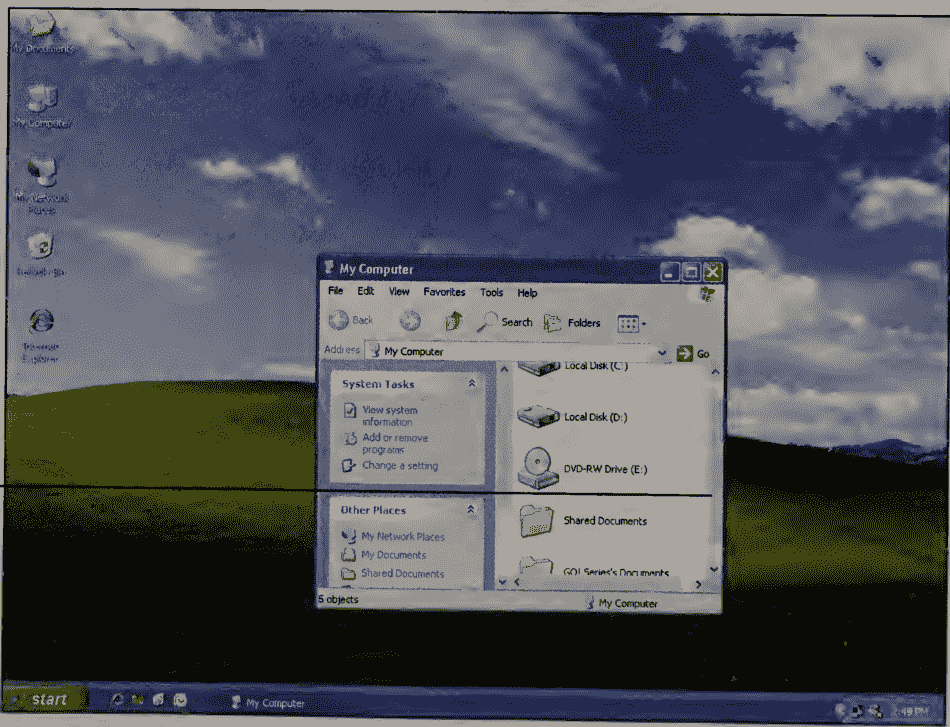

9. 将指针移动到**我的电脑**窗口的上边缘，显示垂直调整大小指针 [↕]。将窗口上边缘拖到距屏幕顶部约 1 英寸处。
10. 将指针移动到**我的电脑**窗口的左边缘，显示水平调整大小指针 [↔]。将窗口左侧拖到距屏幕左侧约 1 英寸处。

可以看到，通过调整窗口的角和边的大小，以及通过标题栏将窗口拖到屏幕上的不同位置，你可以自由地移动和调整任何窗口的大小，使其更易于使用。

## 目标 3

### 最大化、还原、最小化和关闭窗口

你可以**最大化**窗口，使其扩大到占据整个屏幕；也可以**还原**窗口，使其缩小到最大化之前的大小。你还可以**最小化**窗口，将其缩小为任务栏上的一个按钮，从屏幕上完全移除，但并未真正关闭它。当需要再次查看该窗口时，可以单击任务栏按钮将其重新显示。

### 活动 1.3 最大化、还原、最小化和关闭窗口

在活动 1.3 中，你将最大化、还原、最小化和关闭“我的电脑”窗口。

1. 在**我的电脑**窗口的右上角，在**我的电脑**标题栏上，指向**最大化**按钮 [□]，然后将你的屏幕与图 1.17 进行比较。

最大化按钮是一组三个按钮中的中间按钮。当指针指向它时，会显示一个屏幕提示。请回忆，屏幕提示用于描述某个按钮或屏幕元素。

#### 图 1.18

最小化按钮

还原按钮

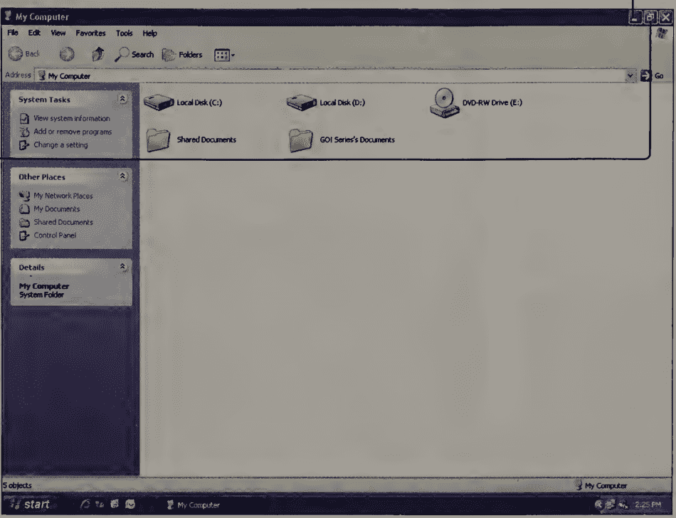

3. 在“我的电脑”标题栏上，单击“还原”按钮，使窗口恢复到最大化之前的大小。
4. 在“我的电脑”标题栏上，单击“最小化”按钮，然后将你的屏幕与图 1.19 进行比较。

“我的电脑”程序仍在运行，但窗口已最小化。它由屏幕底部任务栏上的一个按钮表示。窗口并未关闭，只是暂时从视图中隐藏。

#### 图 1.19

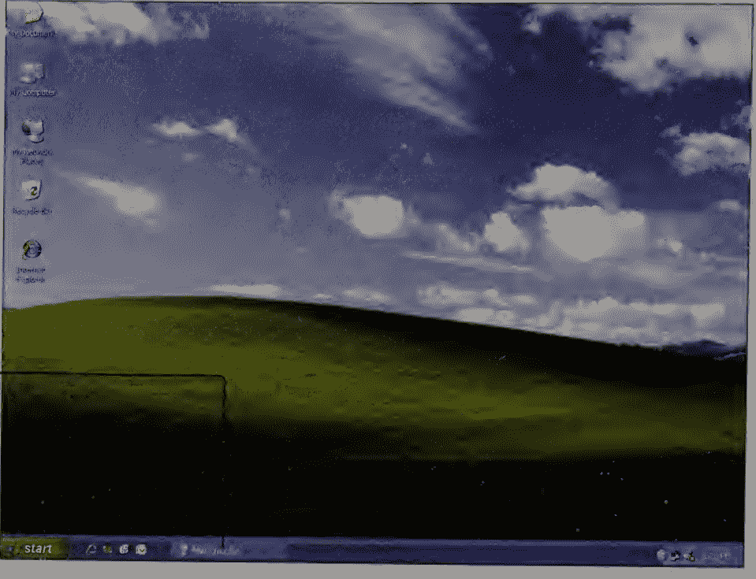

5. 在任务栏上，单击**我的电脑**按钮。

窗口将以单击“最小化”按钮之前相同的大小和位置重新显示。

6. 在任务栏上，单击**开始**按钮，指向**所有程序**，指向**附件**，然后单击**计算器**。指向**计算器**窗口标题栏，然后将计算器窗口拖到屏幕左侧附近。注意，两个打开的程序都会显示在任务栏上。

“我的电脑”是一个程序，可帮助你管理和组织连接到计算机的驱动器空间。计算器是一个执行基本运算的程序。两个程序各自占据一个窗口，计算器程序位于“我的电脑”窗口前面。计算器成为**活动窗口**。当打开两个或更多窗口时，活动窗口就是插入点移动、命令或文本输入所发生的窗口。

7. 单击**我的电脑**窗口的任意位置，注意**我的电脑**窗口移到前面，如图 1.20 所示。

#### 图 1.21

任务栏中的“画图”按钮

任务栏中的“计算器”按钮

任务栏中的“我的电脑”按钮

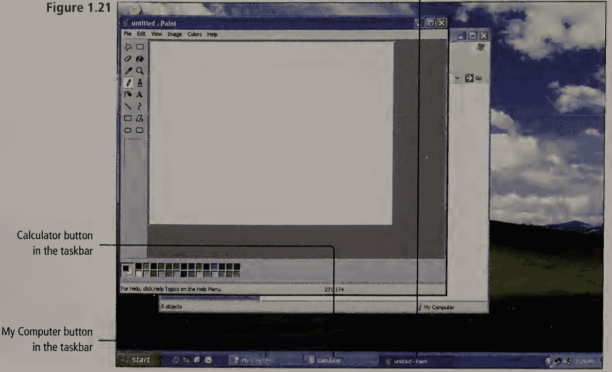

在**画图**标题栏上，单击**关闭**按钮 [X]。在**计算器**标题栏上，单击**关闭**按钮 [X]。在**我的电脑**窗口标题栏上，单击**关闭**按钮 [X]。

### 更多知识

#### 同时打开多个程序窗口

随着你对 Microsoft Office 越来越熟悉，同时打开多个窗口的能力会变得更加有用。例如，如果你希望从两个文字处理文档中获取信息来创建第三个文档，可以打开全部三个文档，并使用任务栏在它们之间切换，将文本从一份文档复制并粘贴到另一份文档。或者，你可以从 Excel 中复制图表并粘贴到 Word 中，也可以将一个数据表粘贴到 PowerPoint 中。你甚至可以在两个窗口中同时打开同一个文档。

## 目标 4

### 创建新文件夹

你在计算机程序中创建的信息存储在计算机内存中，内存是一种临时存储位置。如果关闭计算机，这些数据将会丢失。若要保留你创建的信息，必须将其保存为文件，存放在你可用的某个驱动器上。例如，你在 Microsoft Word 等文字处理程序中创建的 5 页学期论文，保存后就是一个*文件*。文件可以直接存储在驱动器上，但更常见的是存储在驱动器上的文件夹中。*文件夹*是程序和文件的容器，在屏幕上显示为一个普通纸质文件夹的图片。

使用文件夹来组织你的程序和文件的位置，以便日后轻松找到它们。文件夹和文件必须在你计算机所连接的某个驱动器上创建和存储。你可用的驱动器分为三类：1) 计算机内部不可移动的硬盘驱动器，也称为本地磁盘；2) 插入计算机的可移动驱动器，如 3.5 英寸软盘、Zip 磁盘、U 盘或可写光盘；或 3) 通过网络连接到计算机的共享网络驱动器，例如你所在学校的网络。

### 活动 1.4 创建新文件夹

在活动 1.4 中，你将在你可用三类驱动器之一上创建一个文件夹：本地磁盘（硬盘驱动器）、可移动驱动器（U 盘、Zip 磁盘、3.5 英寸软盘或其他类型的可移动驱动器）或网络驱动器。如果你使用的是学校机房中的计算机，你可能会在共享网络驱动器上有分配给自己的空间。你可以在任何可用的驱动器上创建这些文件夹。以下活动假定你将文件保存到 U 盘。

1. 插入你的 U 盘或其他可移动驱动器。如果显示一个操作对话框，询问你希望 Windows 做什么，请单击**取消**。在任务栏上，单击**开始**按钮，然后单击**我的电脑**以打开**我的电脑**窗口。在**我的电脑**标题栏上，如果窗口尚未最大化，请单击**最大化**按钮。

*对话框*是一个显示的窗口，要求你对某个对象或主题做出决定。

2. 在“标准按钮”工具栏上，单击 **文件夹** 按钮，然后将屏幕与图 1.22 进行比较。如果在左侧窗格中看不到驱动器列表，请单击 **我的电脑**。

左侧窗格更改为“文件夹”任务窗格。*任务窗格* 是 Office 程序内提供常用命令的区域。其位置和较小尺寸使您在处理文件时仍可使用这些命令。“文件夹”任务窗格显示计算机上的驱动器和文件夹。此任务窗格在计算机的驱动器和文件夹之间导航时很有用。标记为 `F:`（您的驱动器号可能不同）的闪存驱动器在左侧的“文件夹”任务窗格和右侧窗格中都可见。您可以使用任一图标显示本说明中使用的闪存驱动器的内容。

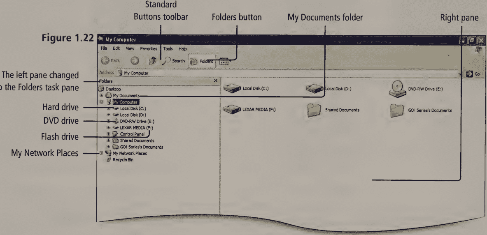

3. 在“标准按钮”工具栏上，单击 **视图** 按钮，然后如有必要，单击 **平铺** 以选择此视图选项。请注意，图标和简短说明显示在右侧窗格中。
4. 在“标准按钮”工具栏上，单击 **视图** 按钮，然后单击 **详细信息**。

#### 图 1.23

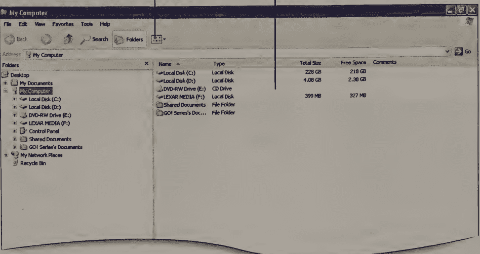

驱动器和文件夹以列表格式显示，并提供有关硬盘驱动器的更多信息，如图 1.23 所示。您计算机上显示的列可能不同，编号也可能不同。

5. 在“文件夹”任务窗格中，单击 USB 闪存驱动器（或您插入的其他可移动介质）。为本说明的目的，示例将指明一个名为 LEXAR MEDIA (`F:`) 的 USB 闪存驱动器。

驱动器的内容显示在右侧窗格中——在图 1.23 中，驱动器为空；您的驱动器可能包含文件和文件夹。您的驱动器号也可能不同。

6. 在右侧窗格中，右键单击空白区域。在显示的快捷菜单中，指向“新建”命令，然后将屏幕与图 1.24 进行比较。或者，从“文件”菜单中单击“新建”。

子菜单显示，显示可使用“新建”命令创建的各种项目。

#### 图 1.24

文件夹命令

快捷菜单（您菜单上的项目可能有所不同）

新建命令

子菜单

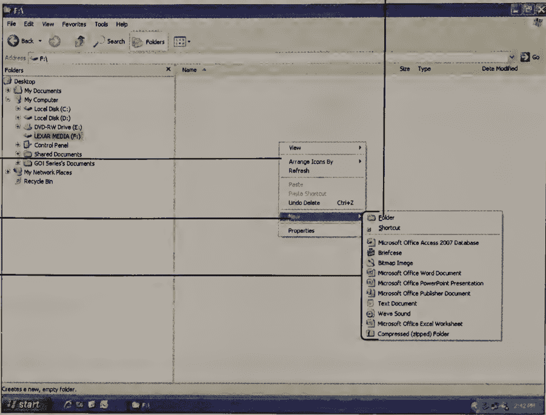

7. 单击“文件夹”命令，然后将屏幕与图 1.25 进行比较。

创建了一个名为“新建文件夹”的新文件夹，文件夹名称以编辑模式显示。编辑模式使您能够更改文件或文件夹的名称，并且在所有 Windows 程序中都相同。

文件夹名称周围的框表示它已准备好进行编辑

#### 图 1.25

新建文件夹

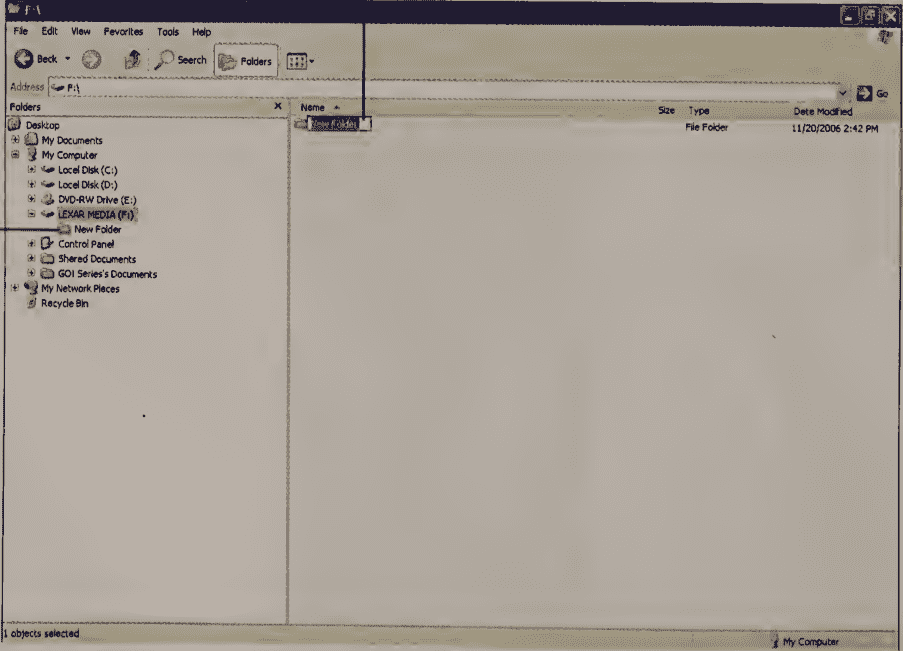

8. 当 **新建文件夹** 以蓝色选中时，在指示处替换您的姓名，输入 **Firstname Lastname 的 Word 文档** 并按 Enter。然后，在右侧窗格的空白区域任意位置单击以取消选择新文件夹，然后将屏幕与图 1.26 进行比较。

#### 图 1.26

重命名后的文件夹

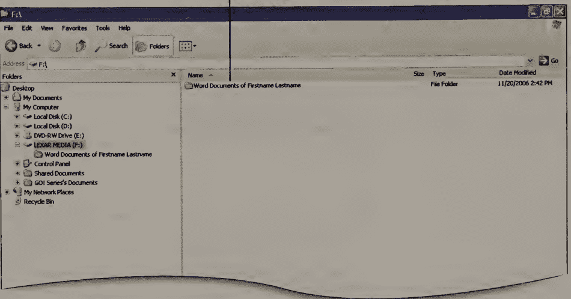

**另一种方法**

**重命名文件夹**

如果您在有机会命名文件夹之前不小心按了 Enter，仍可以重命名它。右键单击文件夹，从快捷菜单中单击“重命名”，输入新名称，然后按 Enter。或者，您可以单击文件夹一次，暂停，然后再次单击文件夹。

9. 从 **文件** 菜单指向 **新建**，然后单击 **文件夹**。在指示处替换您的姓名，输入 **Firstname Lastname 的图片** 并按 Enter。将屏幕与图 1.27 进行比较。

在您的存储位置创建了两个新文件夹。文件夹当前处于“详细信息”视图。请注意文件夹显示的顺序。

#### 图 1.27

新建文件夹

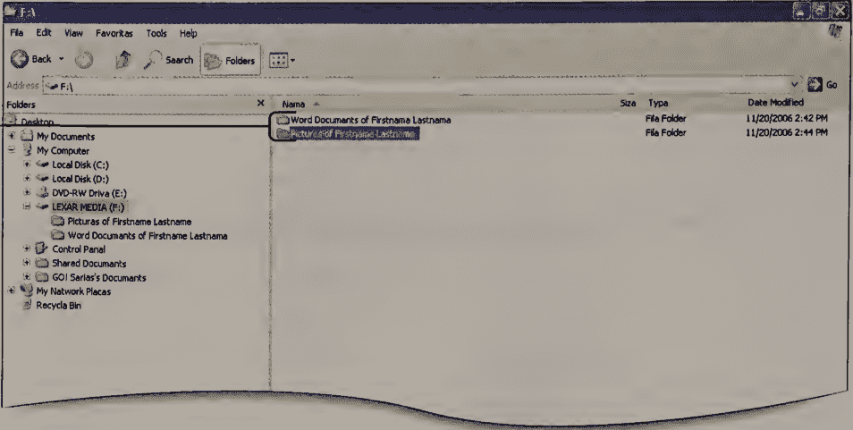

10. 在右侧窗格中，多次单击 **名称** 列标题，以按 *a* 到 *z* 和 *z* 到 *a* 对文件夹和文件名进行排序。请注意，当文件夹按升序（*a* 到 *z*）显示时，“名称”列标题中的箭头指向向上，而当文件夹按降序（*z* 到 *a*）显示时，箭头指向向下。停止时文件夹按降序字母顺序排序——从 *z* 到 *a*——如图 1.28 所示。

名称列标题，箭头指示排序顺序

#### 图 1.28

按降序字母顺序排列的文件

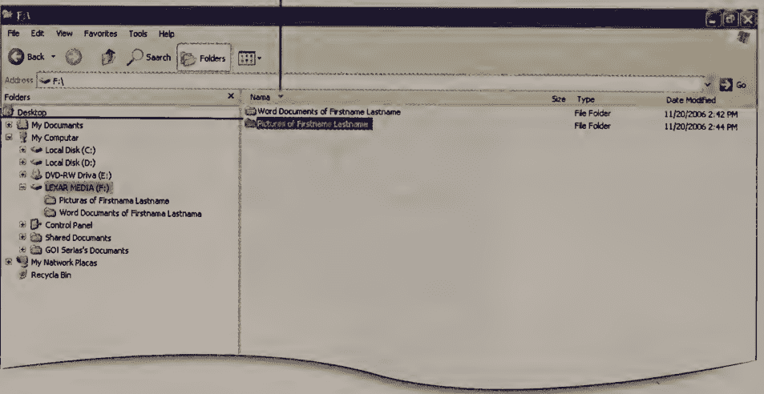

11. 在右侧窗格中，将指针移动到 **名称列** 标题右侧的线上以显示 **调整大小指针**，如图 1.29 所示。

#### 图 1.29

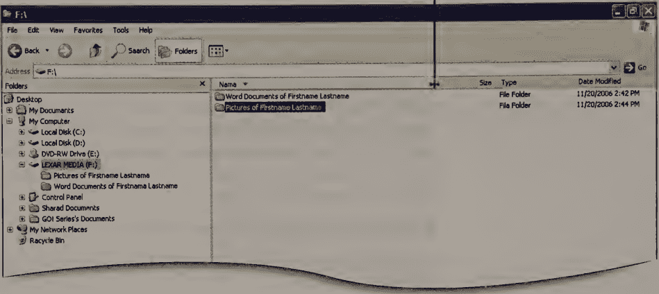

12. 将调整大小指针向左拖动约 **1 英寸**。

列宽被调整大小。您可以使用调整大小指针调整右侧窗格中的所有列大小。

**更多知识**

**计算机存储设备**

硬盘（本地磁盘）通常在您的计算机上以 `C:\`（有时还有 `D:\`、`E:\` 等用于其他驱动器）的表示法标识。*软盘驱动器* 在软盘上提供存储，通常在您的计算机上以 3½ Floppy (`A:`) 的表示法标识。软盘驱动器已过时——许多计算机不再配备软盘驱动器。Zip 驱动器也使用可移动磁盘，其存储的信息比软盘多。*闪存驱动器*——也称为 *USB 驱动器* 或 *拇指驱动器*——是小型存储设备，可插入计算机的通用串行总线（USB）端口，该端口是计算机与打印机、鼠标、键盘或 USB 驱动器等外围设备之间的连接。

您可能还可以通过另一种类型的存储设备访问文件，即 *CD-ROM 光盘*。CD-ROM 代表 Compact Disc-Read Only Memory（只读存储器光盘）。如果您使用存储在 CD-ROM 上的文件，则需要从光盘打开文件，然后将其保存到可写驱动器，或将文件从 CD-ROM 光盘复制到另一张磁盘然后打开它。CD 驱动器可以在两种类型的 CD 之一上存储信息——一种可写入但不可擦除的 CD——*CD-R*——或一种可多次写入和擦除的 CD——*CD-RW*。

## 目标 5

### 复制、移动、重命名和删除文件

请记住，Windows 管理您的数据文件，因为您的文件存储在连接到计算机的驱动器上。从一个文件夹复制文件到另一个文件夹是频繁的数据管理任务。例如，您可能想要制作重要信息的备份副本，将文件从 CD 复制到本地磁盘，或将信息从本地磁盘驱动器复制到可移动驱动器。复制文件和文件夹的方式与驱动器类型无关——可移动驱动器、本地磁盘驱动器或共享网络驱动器。

对文件执行其他操作，例如删除它们或移动它们，也与驱动器类型无关。随着文件积累，您可能需要删除一些以减少硬盘上的杂乱。您可能还想将文档移动到另一个驱动器上的其他文件夹中以 **归档** 它们——将它们放在某个地方进行长期存储。最后，您可能想要更改文件或文件夹的名称，使名称更具描述性。所有这些任务都是 Windows 操作系统的功能。

### 活动 1.5 复制文件和文件夹

在活动 1.5 中，您将复制文件到您的可移动驱动器并复制到您在活动 1.4 中创建的文件夹中。

1. 确保显示 **我的电脑** 窗口，并且工具栏上的 **文件夹** 按钮已选中，并且左侧显示 **文件夹** 任务窗格。将随书附带的学员 CD 放入 CD 驱动器中。在 **文件夹** 任务窗格中，单击 **CD 驱动器** 左侧的 **展开按钮 (+)** 以显示驱动器的内容。如果出现 Go! 2007 Intro 对话框，请单击“取消”。

CD 驱动器中的文件夹和文件显示出来，展开按钮更改为 **折叠按钮 (-)**。展开的项目可见，折叠的项目隐藏在视图之外。**展开按钮** 表示有其他项目可用但隐藏在视图之外。

> **注意 — 如果您的学员文件位于不同位置**
>
> 一些讲师会将学员文件放在共享网络驱动器上的文件夹中，或放在课程网站的文件共享文件夹中。如果您被指示使用来自其他来源的文件，请按照以下说明进行操作，将文件位置替换为 CD 驱动器。

2. 在“文件夹”任务窗格中，点击 `go2007_intro1e` 文件夹左侧的展开按钮 (+)，点击 `01_student_data_files` 文件夹左侧的展开按钮 (+)，然后点击 `chapter_01_windowsxp` 文件夹。如有必要，在“标准按钮”工具栏上，点击“视图”按钮，然后点击“详细信息”。将你的屏幕与图 1.30 进行比较。

`chapter_01_windowsxp` 文件夹中的子文件夹显示在左侧的文件夹任务窗格中，而 `chapter_01_windowsxp` 文件夹中的子文件夹和文件显示在右侧窗格中。你看到的文件可能在文件名后显示四个字母，例如 `.docx`。这些是文件扩展名，大多数文件都有这些扩展名——尽管它们可能在你的系统上显示也可能不显示。由 Microsoft Office 程序创建的文件有一套标准扩展名，用于标识创建文件的程序类型。例如，Microsoft Word 文档以 `.doc` 或 `.docx` 结尾，Excel 工作表以 `.xls` 或 `.xlsx` 结尾，PowerPoint 演示文稿以 `.ppt` 或 `.pptx` 结尾，等等。

### 图 1.30

`chapter_01_windowsxp` 文件夹中的子文件夹

`chapter_01_windowsxp` 文件夹中的文件

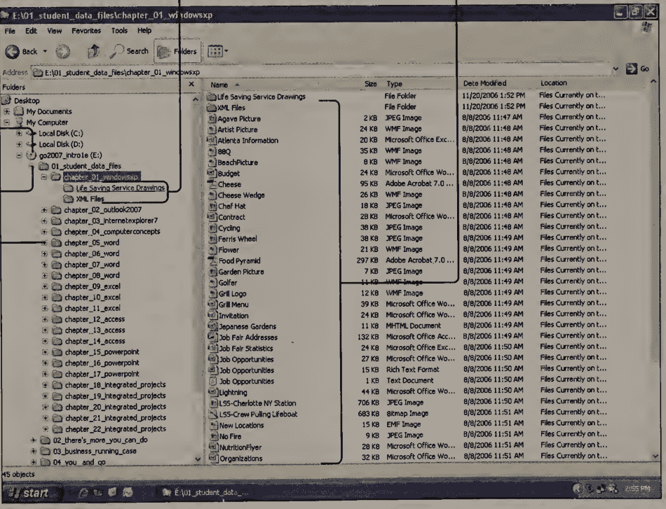

包含本书数据文件的 CD（如果您使用的是 CD）

表示文件夹已展开

表示此文件夹中有子文件夹

3 在菜单栏上，点击 `工具`，然后从显示的菜单中点击 `文件夹选项`。在 `文件夹选项` 对话框顶部附近，点击 `视图选项卡`。在 `高级设置` 下，找到 `隐藏已知文件类型的扩展名` 复选框。如果复选框已选中（其中有勾号），点击以清除复选框，然后将你的屏幕与图 1.31 进行比较。

在本章中，从此点开始，假定文件扩展名已打开并会显示。

### 图 1.31

视图选项卡

清除此复选框以显示文件扩展名

4 点击 `确定` 关闭 `文件夹选项` 对话框。在 `文件夹` 任务窗格中，点击你用来创建 `Pictures of Firstname Lastname` 和 `Word Documents of Firstname Lastname` 文件夹的可移动驱动器。点击 `chapter_01_windowsxp` 文件夹，这将刷新窗口并重新显示带文件扩展名的文件名。在右侧窗格中，点击 `类型` 列标题。确保你可以看到所有的 `WMF` 文件。

当你点击类型列标题时，文件按文件类型以 `a-to-z` 顺序显示。显示的 `WMF` 文件是随 Microsoft Office 2007 提供的图像。

5 在 `名称` 列中，点击选择 `Flower.wmf` 文件。在 `文件夹` 任务窗格中，按需要滚动直到可以看到你的可移动驱动器。观察指针的形状并开始将 `Flower.wmf` 文件拖到你在可移动驱动器上创建的 `Pictures of Firstname Lastname` 文件夹上。

你在可移动驱动器上的图片文件夹被选中，文件名附着在指针上，如图 1.32 所示。当你释放鼠标按钮时，文件将被复制。文件在拖到不同驱动器时会被复制，而在同一驱动器的不同位置拖动时会被移动。

6 释放鼠标按钮以将文件复制到 `Pictures of Firstname Lastname` 文件夹。

7 在 `名称` 列中，点击选择 `Plant.wmf` 文件。从 `编辑` 菜单中，点击 `复制`。

文件被复制到一个名为 `剪贴板` 的临时存储区域。剪贴板存储最近复制的项目。

### 图 1.32

显示正在复制的文件

正在复制的文件

已选文件夹

8 在文件夹任务窗格中，点击选择 `Pictures of Firstname Lastname` 文件夹。从 `Edit` 菜单中，点击 `Paste`。将你的屏幕与图 1.33 进行比较。

文件被复制到所选文件夹，文件夹包含两个文件——你拖到文件夹的文件和你粘贴到文件夹的文件。你可以看到有多种方法可以将文件从一个位置复制到另一个位置。

### 图 1.33

两个文件已复制到文件夹

已选文件夹

9 在文件夹任务窗格中，在包含你的学生文件 CD 下，点击选择 `chapter_01_windowsxp` 文件夹。在名称列中，按需要滚动，然后点击选择 `Roller Coaster.wmf` 文件。然后，按住 `Ctrl` 并点击 `Golfer.wmf` 文件和 `Artist Picture.wmf` 文件。

使用此技术可选择不相邻（相邻）的多个文件。此技术适用于所有 Windows 程序和文件列表。

10 从文件菜单中，指向“发送到”，然后点击你的可移动磁盘驱动器的名称。

文件被复制到你的可移动驱动器。此复制选项使你能够将文件发送到你选择的驱动器，但不允许你指定该驱动器上的文件夹。

11 在右侧窗格中，点击名称列标题，然后滚动到文件夹和文件列表的顶部。在文件夹任务窗格中，如有必要向下滚动以查看你的可移动驱动器。将 `XML Files` 文件夹拖到你的可移动驱动器的名称上直到其被选中，然后释放鼠标按钮。将你的屏幕与图 1.34 进行比较。

文件夹及其中的所有文件都被复制到你的可移动驱动器。

### 从 CD 复制的文件夹

### 图 1.34

文件夹已复制到 USB 驱动器

### 活动 1.6 移动、重命名和删除文件

在活动 1.6 中，你将从可移动驱动器上的一个位置将文件移动到同一驱动器上的另一个位置。你还将重命名和删除文件。

1. 在 `文件夹` 任务窗格中，如有必要向下滚动然后点击你用来存储文件的可移动驱动器。在右侧窗格中，按需要点击 `名称` 列以按字母顺序显示文件。点击 `视图` 按钮箭头然后点击 `缩略图`。将你的屏幕与图 1.35 进行比较。

你创建的两个文件夹和你复制的三个文件——以及 `XML Files` 文件夹——显示在右侧窗格中。文件的 `thumbnail` 图像——文件图片的微型图像——显示在右侧窗格中。这些缩略图使你在包含大量图像的文件夹中选择正确文件变得容易。包含图片的文件夹在大型文件文件夹图标中显示多达四个图像的缩略图。

2 在右侧窗格中，点击 `Artist Picture.wmf` 文件。按住鼠标按钮，将文件拖到你创建的 `Pictures of Firstname Lastname` 文件夹，然后释放鼠标按钮。

当你将文件从同一驱动器上的一个文件夹拖到另一个文件夹时，文件会被移动，而不是复制。

3 将 `Golfer.wmf` 文件拖到 `Pictures` 文件夹，然后将 `Roller Coaster.wmf` 文件拖到 `Pictures` 文件夹。

4 在文件夹任务窗格中，点击你可移动驱动器中的 `Pictures of Firstname Lastname` 文件夹。在标准按钮工具栏上，点击视图按钮，然后点击缩略图。将你的屏幕与图 1.36 进行比较。

### 图 1.36

三个文件已被移动

5. 在右侧窗格中，右键点击 `Flower.wmf` 文件。然后，从显示的快捷菜单中，点击 `重命名` 命令。点击将插入点定位在文件名的开头，输入 `Water` 然后按 `Spacebar`。按 `Enter` 将文件名更改为 `Water Flower.wmf`。将你的屏幕与图 1.37 进行比较。

当文件扩展名显示时，重命名文件时需要包含扩展名。命名文件或文件夹有若干限制。文件名可包含多达 255 个字符，包括空格，尽管文件名不能以空格开头。它也不能包含以下字符：`\ / : * ? " < > |`

### 图 1.37

6. 在右侧窗格中，点击选择 `Plant.wmf` 文件，然后按 `Delete`。在 `确认文件删除` 消息框中，点击 `是`。

文件被永久删除，因为它存储在可移动驱动器上。从硬盘删除的文件会被移动到 `回收站`，回收站是已删除文件存储区。

### 注 — 如果无法删除文件

有时你会尝试删除文件并显示一条消息指出文件无法删除。这通常意味着文件处于打开状态。你必须先关闭文件，然后才能删除它。

7 在 `文件夹` 任务窗格中，单击以选择你的可移动磁盘。在右侧窗格中，选择 `XML Files` 文件夹，然后按 `Delete` 键。

8 在 `确认文件夹删除` 对话框中，单击 `是` 以删除该文件夹。该文件夹及其包含的所有文件和文件夹都将被删除。

### 更多知识

### 恢复已删除的文件

如果你不小心从硬盘驱动器中删除了一个想要保留的文件，你很有可能会恢复它。Windows 会将从硬盘驱动器删除的文件暂时存储在回收站中，你可以在桌面或 `我的电脑` 的 `文件夹` 窗格中找到回收站。你可以像打开文件夹一样打开回收站。如果被丢弃的文件尚未被永久删除，请在 `内容` 窗格中右键单击文件名，然后在快捷菜单中单击 `还原`。

### 活动 1.7 捕获屏幕图像

Windows 包含一个屏幕捕获实用工具，使你能够捕获屏幕图像，然后将其打印或保存为文件。

1 在键盘上，找到并按下 `PrtScr`。

键盘上的 Print Screen 键通常位于顶行按键的右侧附近。此键捕获整个屏幕的图像，并将其放置在称为 `剪贴板` 的临时存储区域中。剪贴板中的项目可以使用 `粘贴` 命令放置在文档中。

2 单击 `开始` 按钮，指向 `所有程序`，指向 `附件`，然后单击 `写字板`。如有必要，最大化写字板窗口。

`写字板` 是一个随 Windows XP 附带的简单文字处理程序。

3 在写字板窗口中，键入 `名 姓`，并使用你自己的姓名。按 `Enter` 键两次。

4 在写字板菜单栏上，单击 `编辑`，然后单击 `粘贴`。将你的屏幕与图 1.38 进行比较。

捕获的屏幕图像被粘贴到插入点。图像大于写字板页面。

### 图 1.38

5 如有必要，使用垂直和水平滚动条显示粘贴图像右下角的尺寸控点。在图像的右下角，将指针移到尺寸控点（角落中的小方框）上，以显示对角调整大小指针 ⤧。

当图像被选中时，`尺寸控点` 会显示在四个角以及各边和顶边边框的中间。使用控点调整图像大小，方法与你调整窗口大小类似。

6 使用对角调整大小指针 ⤧，向上并向左拖至标尺上的 `6 英寸` 处。将你的屏幕与图 1.39 进行比较。

请记住，要拖动对象，你需要指向、单击并将鼠标移动到所需位置。使用标尺作为参考。

### 图 1.39

7 释放鼠标按钮，然后从 `文件` 菜单中单击 `打印预览` 以显示打印预览窗口。将你的屏幕与图 1.40 进行比较。

8 在 `打印预览` 标题栏中，单击 `关闭` 按钮 ✕。或者，单击打印预览工具栏上的 `关闭` 按钮。

9 查看你的课程大纲或章节作业表，或询问你的教师，以确定是否需要提交此文件的打印版或电子版。若要打印，请在写字板工具栏上单击 `打印` 按钮 🖨。若要使用你所在学院的课程管理系统进行电子提交，请咨询教师关于保存和提交文件的说明。

10 从 `文件` 菜单中单击 `退出`。当提示保存你的工作时，单击 `否`。

### 图 1.40

关闭按钮

### 警告！

### 如果图像在打印预览中不显示怎么办？

在某些计算机上，如果图像大于页面，图像将不会显示。如果你无法看到粘贴的图像，请关闭打印预览窗口，然后使用尺寸控点再次减小图像大小。重复此过程，直到你可以在打印预览中看到图像。

### 目标 6

### 查找文件和文件夹

随着你使用计算机，你很可能会积累大量文件和文件夹。你很容易忘记文件存储在哪里，或者给它起了什么名字。Windows XP 提供了一种搜索功能，使你可以查找文件和文件夹。

### 活动 1.8 查找文件和文件夹

在活动 1.8 中，你将使用几种不同的方法来查找文件和文件夹。

1 在 `文件夹` 任务窗格中，单击 `我的电脑`。在标准按钮工具栏上，单击 `搜索` 按钮，然后将你的屏幕与图 1.41 进行比较。

`搜索助理` 任务窗格显示在左侧。在这里，你可以搜索特定文件类型，也可以搜索所有文件和文件夹。

### 图 1.41

搜索按钮

搜索助理任务窗格

搜索选项

### 警告！

### 如果启动的是 Windows 桌面搜索而不是搜索助理，该怎么办？

在 Windows 桌面搜索窗格底部，单击指向搜索助理的链接。最大化 `搜索结果` 窗口，然后按要求完成活动 1.8 的其余部分。完成活动 1.8 后，关闭 `搜索结果` 窗口和 Windows 桌面搜索窗格。

2 在 `搜索助理` 任务窗格中，单击 `所有文件和文件夹` 选项。

此时会显示一个搜索对话框。在这里，你可以指定文件名（或文件名的一部分）或文件中包含的文本。你还可以通过指定搜索位置来缩小搜索范围。

3 在 `全部或部分文件名` 框中，输入 `coaster`。如有必要，单击 `搜索范围` 下拉箭头，然后单击 `我的电脑`。将你的屏幕与图 1.42 进行比较。

实际文件名是大写的，但此搜索选项不区分大小写。

### 图 1.42

要查找的部分文件名

将搜索整个计算机

搜索按钮

4 在任务窗格底部，单击 `搜索` 按钮，然后将你的屏幕与图 1.43 进行比较。

搜索开始。请注意，有少数文件很快显示出来，但搜索程序会一直持续搜索。(根据你计算机的设置方式，你可能只能看到一个文件。) 这是因为你没有指定位置，所以程序正在检查计算机上的所有存储位置。如果过程似乎耗时过长，你可以随时单击 `停止` 按钮。

### 图 1.43

找到的文件

显示程序仍在搜索

停止按钮

5 单击 `停止` 以停止当前搜索。单击 `开始新搜索`，然后依次单击 `图片、音乐或视频`。单击以选中 `图片和照片` 复选框。在 `全部或部分文件名` 框中，输入 `surf`。

这是你学生 CD 上的 `Life Saving Service Drawings` 文件夹中多个文件名的一部分。

6 在 `搜索助理` 任务窗格中，单击 `使用高级搜索选项` 复选框以添加更多搜索选项。在 `搜索范围` 框的右侧，单击箭头。在位置列表中，单击你的学生 `CD`，然后将你的屏幕与图 1.44 进行比较。如果你未使用 CD，请选择存储学生文件的位置。

### 图 1.44

程序将仅搜索图片和照片

部分文件名

搜索位置

7 在任务窗格底部，单击 `搜索` 按钮。将你的屏幕与图 1.45 进行比较。

找到三个文件。这一次，搜索只花了几秒钟。

### 图 1.45

搜索结果

包含 surf 一词的文件和文件夹

8 如有必要，向下滚动，单击 `开始新搜索` 选项。单击 `文档（文字处理、电子表格等）` 选项。

此对话框使你可以更好地控制搜索。你可以搜索具有指定文件扩展名的文档，也可以搜索在特定时间段内最后修改的文档。你甚至可以组合这两者。

9 单击 `全部或部分文档名` 框并输入 `*.docx`。单击 `使用高级搜索选项` 复选框以添加更多搜索选项。在 `搜索范围` 框的右侧，单击箭头。在位置列表中，单击你的学生 CD 或其他学生文件位置。单击 `搜索` 按钮并查看结果。

这会将搜索范围限制为带有 `.docx` 扩展名的 Word 2007 文档。星号称为通配符，表示你将搜索所有带 `.docx` 扩展名的文件。当你记不起文件名或文件存放位置时，这非常有用。

10 在 `搜索助手` 任务窗格中，再次单击 `搜索范围` 箭头，然后选择 `本地磁盘 (C:)` 或 `本地硬盘驱动器`。单击 `搜索` 按钮。将你的屏幕与图 1.46 进行比较。

右侧窗格显示带有 `.docx` 扩展名的文件。列表可能很长。

11 在 `搜索助手` 任务窗格中，单击 `停止` 按钮。

图 1.46

硬盘驱动器上的 Word 文档（你的结果可能会有所不同）

### 目标 7

### 压缩文件

有些文件可能太大，无法作为电子邮件附件快速发送。例如，包含图形的文件往往相当大。Windows XP 提供了一项功能，你可以使用该功能将一个或多个文件压缩（即减小文件大小）成一个带 `.zip` 扩展名的文件。这些文件随后可以在任何其他运行 Windows XP 的计算机上解压缩以进行编辑。

### 活动 1.9 压缩文件

在活动 1.9 中，你将先压缩单个文件，然后同时压缩多个文件。

1 在 `标准按钮` 工具栏上，单击 `文件夹` 按钮。在 `文件夹` 任务窗格中，单击 `我的电脑`。

### 注意 — 使用第三方 Zip 程序

如果你使用的是第三方 zip 程序，例如 `WinZip™` 或 `PKZIP™`，则需要使用该程序来完成此任务——下面列出的步骤将无法使用。

2 在 `文件夹` 任务窗格中，单击包含学生光盘的驱动器，或存储学生文件的位置。导航到 `01_student_data_files` 文件夹，然后选择 `chapter_01_windowsxp`。如有必要，单击 `视图` 按钮，然后选择 `详细信息`。

## 3
单击“`Lightning.docx`”文件。按住 `Ctrl`，然后依次选中“`LSS-Charlotte NY Station.jpg`”文件、“`LSS-Crew Pulling Lifeboat.bmp`”文件和“`Volunteers.pptx`”文件。将这四个文件拖到可移动驱动器以复制它们。

## 4
在“**文件夹**”任务窗格中，单击可移动磁盘的图标。在右侧窗格中，右键单击“`Volunteers.pptx`”文件，留意文件大小。指向“**发送到**”，然后选择“**压缩(zipped)文件夹**”。如果出现“**压缩(zipped)文件夹**”对话框，单击“**是**”以指定 Windows XP 压缩功能来压缩你的文件。将你的屏幕与图 1.47 进行比较。

`Volunteers.pptx` 文件的压缩版本显示为 `Volunteers.zip`。注意，压缩文件夹的大小与原始文件相比已减小。

## 5
重复你在步骤 4 中使用的方法，压缩刚刚复制到可移动驱动器的其他三个文件——`Lightning.docx`、`LSS-Charlotte NY Station.jpg` 和 `LSS-Crew Pulling Lifeboat.bmp`。将你的屏幕与图 1.48 进行比较。

请注意，压缩量取决于被压缩文件的类型。Word 文件通常可以压缩 10% 到 20%，而有些文件在保存时已经使用了压缩功能（如 `.jpg` 或 `.pdf` 文件），则进一步压缩的效果并不明显。

图 1.48

压缩文件夹

## 6
单击“`Lightning.docx`”文件。按住 `Ctrl`，然后选中“`LSS-Charlotte NY Station.jpg`”文件、“`LSS-Crew Pulling Lifeboat.bmp`”文件和“`Volunteers.pptx`”文件。按 `Delete` 删除原始文件，然后在系统提示时单击“是”。

## 7
在“文件夹”任务窗格中，单击“Firstname Lastname 的图片”文件夹。从“编辑”菜单中，单击“全选”以选中文件夹中的所有文件。或者，按住 `Ctrl` 并按 `A`。

## 8
右键单击“`Artist Picture.wmf`”文件，单击“发送到”，然后选择“压缩(zipped)文件夹”。

所有四个文件被压缩到一个文件夹中，名为“`Artist Picture.zip`”。当一次压缩多个文件时，压缩文件夹会以你右键单击的那个文件的名称命名。

## 9
双击“`Artist Picture.zip`”文件夹以显示压缩文件夹的内容。将你的屏幕与图 1.49 进行比较。

图 1.49

窗口标题栏中的压缩文件夹名称

压缩文件夹中的文件

## 10
在“`Artist Picture.zip`”窗口标题栏中，单击“关闭”按钮 `X`。在“标准按钮”工具栏上，单击“向上”按钮，在“文件夹”任务窗格中上移一级。

“向上”按钮是在 Windows 文件夹层次结构中向上移动的便捷方式——每次单击该按钮，你都会上移一个文件夹级别。

## 11
双击“`Lightning.zip`”压缩文件夹。在左侧窗格中，单击“提取所有文件”以启动“提取向导”。将你的屏幕与图 1.50 进行比较。

图 1.50

提取向导

## 12
单击“**下一步**”以显示第二个“**提取向导**”对话框，该对话框允许你更改文件的位置。

如果你不更改文件位置，文件将被提取到包含压缩文件的文件夹中。

## 13
在“**提取向导**”对话框中，单击“**下一步**”按钮以接受默认位置。

## 14
在“**提取向导**”对话框中，清除“**显示提取的文件**”复选框，然后单击“**完成**”。关闭“`Lightning.zip`”窗口。

“显示提取的文件”选项在你将文件发送到其他位置并希望在“提取向导”关闭时移至该位置时很有用。

文件被提取并放置在压缩文件所在的文件夹中，如图 1.51 所示。

图 1.51

原始压缩文件夹

新文件夹

## 15
在菜单栏上，单击“**工具**”，然后从显示的菜单中单击“**文件夹选项**”。在“**文件夹选项**”对话框靠近顶部位置，单击“**查看**”选项卡。在“**高级设置**”下，找到“**隐藏已知文件类型的扩展名**”复选框。单击以选中该复选框。单击“**确定**”以关闭文件扩展名的显示。

## 16
关闭“**可移动媒体**”窗口。

### 更多知识

### 文件关联和压缩程序

当你单击“压缩(zipped)文件夹”命令时，可能会看到一个对话框。因为每种文件类型都需要与一个程序关联，你的计算机可能已经将 `.zip` 扩展名的文件与 WinZip 等第三方程序关联。该对话框会询问你是否要将“压缩(zipped)文件夹”指定为处理 ZIP 文件（即具有 `.zip` 扩展名的压缩文件）的程序。如果你在实验室工作，请询问实验室管理员如何回答此问题。如果你在家中工作，单击“是”，除非你想使用其他程序来压缩文件。

## Windows XP

### 第一章

## 小结

你会发现，在 Microsoft Office 等不同程序中创建文件时，掌握 Windows 功能的实用知识非常有用。在本章中，你练习了设置、组织和浏览 Windows 桌面。你调整了窗口大小并移动了窗口。你创建了文件夹来存储文档，然后复制、移动、重命名和删除了文件。最后，你压缩了文件以节省空间。

## 关键术语

| 术语 | 页码 | 术语 | 页码 | 术语 | 页码 |
|---|---|---:|---|---:|---:|
| 活动窗口 | 22 | 软盘驱动器 | 31 | 还原 | 19 |
| 地址栏 | 7 | 文件夹 | 25 | 右键单击 | 8 |
| 存档 | 32 | 图形用户界面 (GUI) | 4 | 屏幕提示 | 8 |
| CD-R | 31 | 硬盘驱动器 | 9 | 滚动块 | 18 |
| CD-ROM | 31 | 水平滚动条 | 14 | 快捷菜单 | 8 |
| CD-RW | 31 | 图标 | 5 | 调整大小手柄 | 42 |
| 单击 | 8 | 左窗格 | 7 | 开始按钮 | 6 |
| 剪贴板 | 35 | 本地磁盘 | 9 | 状态区域 | 6 |
| 关闭按钮 | 7 | 最大化 | 19 | 子菜单 | 10 |
| 折叠按钮 | 32 | 菜单 | 7 | 系统托盘 | 6 |
| 压缩 | 49 | 菜单栏 | 7 | 任务窗格 | 26 |
| 上下文相关命令 | 8 | 最小化 | 19 | 任务栏 | 6 |
| 桌面 | 4 | 鼠标指针 | 5 | U盘 | 31 |
| 对话框 | 25 | 我的电脑 | 5 | 缩略图 | 38 |
| 双击 | 6 | 通知区域 | 6 | 标题栏 | 8 |
| 拖动 | 15 | 操作系统 | 4 | 工具栏 | 8 |
| 驱动器 | 9 | 画图 | 23 | USB 驱动器 | 31 |
| 编辑模式 | 28 | 指针 | 5 | 垂直滚动条 | 14 |
| 展开按钮 | 32 | 指向 | 6 | 通配符 | 49 |
| 文件 | 25 | 快速启动工具栏 | 5 | 窗口 | 6 |
| 文件扩展名 | 33 | 回收站 | 40 | Windows | 4 |
| 闪存驱动器 | 31 |  |  | 写字板 | 41 |

## Windows XP 第一章

### 匹配

将第二列的每个术语与其在第一列的正确定义匹配。在正确定义前面的空白行上写下该术语的字母。

- 1. 包含“开始”按钮、代表打开程序的按钮以及会激活程序的其他按钮的栏。
- 2. 当你移动鼠标或其他指向设备时移动的箭头、I 形光标或其他符号，用以指示屏幕上的位置或位置。
- 3. 显示信息的框，通常由标题栏、菜单栏、状态栏和工具栏组成，并且始终具有最小化按钮。
- 4. 窗口顶部的区域，显示文件名，同时包含最小化、最大化/还原和关闭按钮。
- 5. 上下文相关命令的列表——在处理所选对象时常用的命令——通常通过右键单击屏幕项目激活。
- 6. 开始按钮右侧的区域，包含常用程序的快捷方式图标。
- 7. 任务栏右侧的区域，显示时钟和系统通知，并在其中显示通知以告知您正在后台发生的进程，例如防病毒软件检查、网络连接和其他实用程序。
- 8. 文档窗口底部的水平栏，提供有关窗口中当前查看内容的当前状态的信息，例如文档的页码。
- 9. Windows 的功能，使您能够查看超出屏幕边缘的文本。
- 10. 用于将相关文件保存在一个位置的 Windows 对象。
- 11. 可反复用于读取和保存文件的光盘。
- 12. 文件的三个或四个字母的结尾——可能显示也可能不显示——用于标识文件类型。
- 13. 用于在文件搜索中代替多个字符的星号 (*) 或其他字符所给出的术语。
- 14. 图片文件内容的微型表示，用于“我的电脑”中的一种文件视图。
- 15. 减小文件的大小。
- A CD-RW
- B Compress
- C File extension
- D Folder
- E Mouse pointer
- F Notification area
- G Quick Launch toolbar
- H Scroll bar
- I Shortcut menu
- J Status bar
- K Taskbar
- L Thumbnail
- M Title bar
- N Wildcard
- O Window

### 填空

在提供的空格中写出正确的单词。

- 1. A(n) **图标** 是图形表示，可让你运行程序或使用程序功能。
- 2. Windows XP 是 **操作系统** 的一个例子，它协调计算机的活动。
- 3. 任务栏左端的 **开始** 按钮用于运行程序、更改系统设置或查找帮助。
- 4. 当同时打开多个文档或程序时，你可以通过单击 **任务栏** 中的相应按钮在它们之间切换。
- 5. A(n) **子菜单** 是使用菜单命令访问的二级菜单。
- 6. 当你删除文件时，它会被存储在名为 **回收站** 的临时区域中，从中通常可以恢复。
- 7. 一个要求你对单个对象或主题做出决定的框称为 a(n) **对话框**。
- 8. 显示鼠标在屏幕上的位置或位置的箭头、I 形光标或其他符号称为鼠标 **指针**。
- 9. 当你右键单击对象时，会显示 a(n) **快捷** 菜单。
- 10. 通常显示在菜单栏下方并使用按钮激活命令的栏称为 a(n) **工具栏**。
- 11. 要使窗口填满屏幕，请使用标题栏中的 **最大化** 按钮。
- 12. 你可以通过单击 **最小化** 按钮在不关闭的情况下隐藏程序或文档。
- 13. 在“我的电脑”中，你可以通过单击 **查看** 列标题按字母顺序对文件名进行排序。
- 14. 你计算机上的主要存储设备是 ______ 磁盘驱动器。
- 15. 文件扩展名由文件名的最后三个或四个字符组成，表示用于创建该文件的程序。

## 词汇表

**活动窗口** 当两个或多个窗口打开时，鼠标指针移动、命令或文本输入发生的窗口。

**地址栏** 显示当前文件或文件夹的路径；在 Internet Explorer 中，还显示活动网页的地址。

**归档** 将文件备份并存储在主硬盘以外的其他位置。

**CD-R** CD-ROM 光盘的另一种名称。

**CD-ROM** 紧凑型光盘只读存储器的缩写；一种用于永久存储数据且可从中读取和打开文件的光学存储设备。

**CD-RW** 可重复使用的光盘，可用于读取和保存文件。

**单击** 一次按下鼠标左键（或主键）。

**剪贴板** Windows 中的临时存储区域，存储最近复制的项目。

**关闭按钮** 标题栏中关闭窗口或程序的按钮。

**折叠按钮** 文件夹左侧的小减号 (–) 按钮，单击可隐藏该文件夹中的项目。

**压缩** 减小文件大小的过程。

**上下文相关命令** 与您正在进行的活动相关的命令；通常通过右键单击屏幕项目激活。

**桌面** 运行 Windows 和程序的基本屏幕，由程序图标、任务栏、开始按钮和鼠标指针组成。

**对话框** 要求您对单个对象或主题做出决定的框。对话框没有最小化按钮。

**双击** 在保持鼠标静止的同时快速连续两次单击鼠标左键的动作。

**拖动** 将某物从屏幕上的一个位置移动到另一个位置的动作；拖动操作包括在所需时间或位置释放鼠标按钮。

**驱动器** 使用 Windows 文件系统格式化的存储区域，具有 C 等驱动器号。

**编辑模式** Windows 模式，可让你更改文件或文件夹的名称，并在所有 Windows 程序中以相同方式工作。

**展开按钮** 文件夹左侧的小加号 (+) 按钮，单击可显示该文件夹中的项目。

**文件** 您保存并存储在驱动器上的数据，例如 Word 文档或 PowerPoint 演示文稿。

**文件扩展名** 文件名中句点右侧的字符，告诉计算机使用哪个程序打开文件；扩展名可以显示或隐藏。

**闪存驱动器** 一种小型便携式数字存储设备，连接到计算机的 USB 端口；也称为拇指驱动器、跳跃驱动器或 USB 驱动器。

**软盘驱动器（或软盘驱动器）** 微型计算机的原始存储设备，可在软盘上实现便携式永久存储。

**文件夹** 存储区域，在屏幕上由纸质文件文件夹的图片表示，用于存储文件或其他文件夹。

**图形用户界面（GUI）** 一种计算机界面，您通过使用图形和点按技术与计算机交互；GUI 将文档显示为最终形式的外观。

**硬盘驱动器** 计算机内部的大型磁盘驱动器，也称为本地磁盘。

**水平滚动条** 窗口底部的栏，可让您左右移动以查看超出屏幕左右边缘的信息。

**图标** 您可单击以打开该对象的对象的图形表示。

**左侧窗格** 在“我的电脑”窗口中，左侧显示信息和常用工具的窗格。

**本地磁盘** 计算机内部的大型磁盘驱动器，也称为硬盘。

**最大化** 将窗口大小增加到填满屏幕。

**菜单** 类别内的命令列表。

**菜单栏** 标题栏下方列出菜单类别名称的栏。

**最小化** 在不关闭的情况下将窗口从屏幕上移除；最小化的窗口可以通过单击任务栏中的相关按钮重新打开。

**鼠标指针** 显示鼠标在屏幕上的位置或位置的箭头、I 形光标或其他符号；也称为指针。

**我的电脑** 一个窗口，可让你访问计算机上的文件和文件夹。

**通知区域** 任务栏右侧的区域，可让您了解正在后台发生的进程，例如防病毒软件、网络连接和其他实用程序；还显示时间。

**操作系统** 协调计算机活动的指令集；Microsoft Windows XP 是一个操作系统。

**画图** 用于创建或编辑图形的 Windows 程序。

**指针** 请参阅鼠标指针。

**指向** 将指针尖端定位在图标或其他屏幕对象的中心。

**快速启动工具栏** 开始按钮右侧的区域，包含常用程序的快捷图标。

**回收站** 已删除文件的存储区域；文件可以从回收站恢复或永久删除。

**还原** 使用还原最小化按钮将窗口返回到最大化之前的大小。

**右键单击** 单击鼠标右键的操作。

**屏幕提示** 在执行各种鼠标操作（如指向屏幕元素或拖动）时显示有用信息的小框。

**滚动框** 垂直和水平滚动条中的框，可拖动以重新定位屏幕上的文档。

**快捷菜单** 上下文相关菜单，显示与所选对象相关的命令和选项。

**尺寸柄** 图形角落和边中部的小正方形或圆圈，可用于增大或减小图形大小。

**开始按钮** 任务栏左侧的按钮，用于启动程序、更改系统设置、查找 Windows 帮助或关闭计算机。

**状态区域** 任务栏右侧通知区域的另一个名称。

**子菜单** 通过选择菜单选项激活的二级菜单。

**系统托盘** 任务栏右侧通知区域的另一个名称。

**任务窗格** 在窗口侧面打开的窗格，用于显示常用工具。

**任务栏** 显示开始按钮和任何打开文档名称的屏幕区域。任务栏还可能显示其他程序的快捷按钮。

**拇指驱动器** 插入计算机 USB 端口的小型存储设备；也称为 USB 驱动器或闪存驱动器。

**缩略图** 图片文件内容的微型表示。

**标题栏** 显示程序图标、文档名称和程序名称。最小化、最大化/还原和关闭按钮组合在标题栏右侧。

**工具栏** 通常位于菜单栏下方的按钮行，可通过单击执行命令。

**USB 驱动器** 插入计算机 USB 端口的小型存储设备；也称为拇指驱动器或闪存驱动器。

**垂直滚动条** 窗口右侧的条，可上下移动以查看超出屏幕顶部和底部的

# 术语表

`拇指驱动器` 插入计算机 USB 端口的小型存储设备；也称为 USB 驱动器或闪存驱动器。

`缩略图` 图片文件内容的微型表示。

`标题栏` 显示程序图标、文档名称和程序名称。最小化、最大化/还原最小化和关闭按钮组合在标题栏右侧。

`工具栏` 通常位于菜单栏下方的按钮行，可通过单击执行命令。

`USB 驱动器` 插入计算机 USB 端口的小型存储设备；也称为拇指驱动器或闪存驱动器。

`垂直滚动条` 窗口右侧的条，可上下移动以查看超出屏幕顶部和底部的。

`画图` 用于创建或编辑图形的 Windows 程序。

`指针` 请参阅鼠标指针。

`指向` 将指针尖端定位在图标或其他屏幕对象的中心。

`快速启动工具栏` 开始按钮右侧的区域，包含常用程序的快捷图标。

`回收站` 已删除文件的存储区域；文件可以从回收站恢复或永久删除。

`还原` 使用还原最小化按钮将窗口返回到最大化之前的大小。

`右键单击` 单击鼠标右键的操作。

`屏幕提示` 在执行各种鼠标操作（如指向屏幕元素或拖动）时显示有用信息的小框。

`滚动框` 垂直和水平滚动条中的框，可拖动以重新定位屏幕上的文档。

`快捷菜单` 上下文相关菜单，显示与所选对象相关的命令和选项。

`尺寸柄` 图形角落和边中部的小正方形或圆圈，可用于增大或减小图形大小。

`开始按钮` 任务栏左侧的按钮，用于启动程序、更改系统设置、查找 Windows 帮助或关闭计算机。

`状态区域` 任务栏右侧通知区域的另一个名称。

`子菜单` 通过选择菜单选项激活的二级菜单。

`系统托盘` 任务栏右侧通知区域的另一个名称。

`任务窗格` 在窗口侧面打开的窗格，用于显示常用工具。

`任务栏` 显示开始按钮和任何打开文档名称的屏幕区域。任务栏还可能显示其他程序的快捷按钮。

`通配符` 可用于在文件搜索中匹配任意数量字符的字符，例如星号。

`窗口` 显示信息或程序的框或屏幕。窗口通常由标题栏、工具栏、菜单栏和状态栏组成。窗口始终具有最小化按钮和关闭按钮。

`Windows` 以大写 W 拼写时，指运行计算机的操作系统。

`写字板` Windows XP 附带的一个简单文字处理程序。

# 索引

## A

- `附件子菜单`，12–13
- `活动窗口`，22
- `地址栏`，7
- `所有程序`
  - 附件
    - `计算器`，22–24
    - `写字板`，41–42
  - 命令，11–12
  - 子菜单，11
- `归档文件`，32

## C

- `计算器`，12–13
- `CD-ROM 光盘`，32
- `关闭按钮`，7，8
- `折叠按钮 (−)`，32
- `计算机存储设备`，32
- `确认文件夹删除对话框`，41
- `上下文相关命令`，8

## D

- `桌面`，Windows，4–5
- `双击`，6
- `向下箭头`，17
- `拖动鼠标`，15
- `驱动器`，9

## E

- `编辑模式`，28
- `展开按钮 (+)`，32–33

## F

- `文件扩展名`，33
- `文件菜单`
  - 文件夹，创建新，29–31
  - 发送到，36
- `文件`，25
  - 压缩，49–53
  - 复制，32–37
  - 删除，39–40
  - 查找，44–49
  - 移动，38
  - 恢复已删除，41
  - 重命名，39
  - 缩略图，38
- `闪存驱动器`，32
- `软盘驱动器`，32
- `文件夹`，25
  - 复制，32–37
  - 创建新，25–31
  - 删除，39–40
  - 查找，44–49
  - 命名，30–31
- `文件夹任务窗格`，41

## G

- `图形用户界面 (GUI)`，4

## H

- `硬盘`，9，32
- `隐藏已知文件类型的扩展名复选框`，34
- `水平滚动条`，14

## I

- `图标`，Windows，5

## L

- `左侧窗格`，7
- `本地磁盘`，9–10

## M

- `最大化窗口`，19–20
- `菜单`，7
- `菜单栏`，7
- `最小化窗口`，21–22
- `鼠标指针`，5
- `保持多个窗口打开`，24
- `我的电脑`，6–7
  - 关闭，8
  - 对话框，25
  - 文件夹按钮，32
  - 图标，5
  - 最大化按钮，19–20
  - 最小化按钮，21–22
  - 移动窗口，16–18
  - 运行多个程序，22–23
  - 打开，14–15
  - 调整窗口大小，19
  - 还原最小化按钮，21
  - 搜索按钮，45
  - 任务窗格，25–26

## N

- `命名文件夹`，34–35
- `通知区域`，6

## P

- 画图，23–24
- 指针，Windows，5
- 指向，6
- 打印预览，43–44

## Q

- 快速启动工具栏，6

## R

- 恢复已删除文件，41
- 回收站，6，41
- 调整、移动和滚动窗口，14–19
- 还原最小化按钮，15
- 还原窗口，21

## S

- 屏幕捕获实用程序，41–44
- 屏幕元素，5–6
- 屏幕提示，7，8
- 滚动条，16
- 滚动框，18–19
- 搜索按钮，46–48
- 搜索伴侣任务窗格，45，47–49
- 快捷菜单，8
- 开始按钮，6，10
- 启动，4
- 状态区域，6
- 状态栏，7
- 子菜单，10
- 系统托盘，6

## T

- 任务栏，6
- 缩略图，38
- 标题栏，8
- 工具栏，8
- 工具菜单，文件夹选项，34

## U

- 向上箭头，18
- `USB 闪存驱动器`，保存文件到，25，27

## V

- 版本，Windows XP，4
- 垂直滚动条，14
- 视图按钮，37，38
  - 详细信息，26
  - 平铺，26

## W

- 窗口，各部分，6，7–8
- Windows XP
  - 附件子菜单，12–13
  - 活动窗口，22
  - 所有程序子菜单，11
  - 计算器，12–13
  - 描述，2
  - 桌面，4–5
  - 文件
    - 压缩，49–53
    - 复制，32–37
    - 删除，39–40
    - 查找，44–49
    - 移动，38
    - 恢复已删除，41
    - 重命名，39
    - 缩略图，38
  - 文件夹
    - 复制，32–37
    - 创建新，25–31
    - 删除，39–40
    - 查找，44–49
    - 命名，30–31
  - 本地磁盘，9–10
  - 最大化窗口，19–20
  - 最小化窗口，21–22
  - 保持多个窗口打开，24
  - 我的电脑，6–7
  - 画图，23–24
  - 打印预览，43–44
  - 调整、移动和滚动窗口，14–19
  - 还原窗口，21
  - 屏幕捕获实用程序，41–44
  - 屏幕元素，5–6
  - 启动，4
  - 子菜单，10
  - 窗口，各部分，7–8
  - 写字板
    - 编辑，42
    - 粘贴，42
    - 打印预览，43–44
    - 尺寸柄，42–43

## Z

- 第三方 zip 程序，50

# 单机许可协议和有限保证

在打开此包装之前请仔细阅读本许可协议。通过打开此包装，您即同意本许可协议的条款和条件。如果您不同意，请勿打开包装。请将未打开的包装及所有随附物品及时退回您获得它们的地点。这些条款适用于磁盘上的所有许可软件，但磁盘上任何共享软件或免费软件的使用条款则按磁盘上电子许可中所述为准：

1. 许可授予和所有权：随附的计算机程序（“软件”）由 Prentice-Hall, Inc.（“我们”或“公司”）许可给您，而非出售给您，作为您购买或采用随附公司教科书和/或

作为您购买或采用随附公司教科书和/或其他材料，以及您同意这些条款的对价。我们保留未授予您的任何权利。您仅拥有磁盘，但软件本身由我们和/或我们的许可方拥有。本许可允许您在单一地点在单台计算机（即单 CPU）上仅用于学术用途使用和显示您复制的软件，只要您遵守本协议的条款。您可以制作一份备份副本，或将您的副本转移到另一台 CPU，前提是软件仅在单台计算机上使用。

2. 限制：您不得将软件或文档转让或分发给任何其他人。除备份外，您不得复制文档或软件。您不得将软件联网或同时在多台计算机或计算机终端上使用。您不得对软件或文档进行逆向工程、拆卸、反编译、修改、改编、翻译或创建基于软件或文档的衍生作品。您可能因未遵守这些限制条款而导致的任何复制或版权侵权行为承担法律责任。

3. 终止：本许可在终止前有效。如果您未能遵守本许可的任何条款或限制，本许可将自动在未通知的情况下终止。终止后，您应销毁文档和软件的所有副本。本协议关于限制和免除保证、责任限制、补救或损害赔偿以及我们所有权权利的全部条款在终止后仍然有效。

4. 免责声明：公司及其许可方对软件不作任何保证，软件按“原样”提供。如果磁盘在材料或工艺上存在缺陷，您唯一的补救措施是在 30 天内将其退回公司以换取更换，除非公司善意认定磁盘已被误用或安装、维修、更改或损坏不当。公司免除所有明示或暗示的保证，包括但不限于适销性和特定用途适用性的暗示保证。公司不保证、担保或对软件的准确性、可靠性、时效性、使用或使用结果作出任何陈述。

5. 补救和损害赔偿限制：在任何情况下，公司或其员工、代理、许可方或承包商均不对因本许可或软件而产生或与之相关的任何偶然、间接、特殊或后果性损害承担责任，包括但不限于使用损失、数据损失、收入或利润损失，或因人身伤害或财产损失或第三方索赔而遭受的其他损失，即使公司或公司的授权代表已被告知此类损害的可能性。某些司法管辖区在某些情况下不允许损害赔偿限制，因此上述限制可能并不总是适用。

6. 一般条款：本协议应根据美国法律和纽约州法律解释，适用于在纽约签订的合同，并使公司及其附属机构和受让人受益。本协议是您与公司之间关于主题事项的完整和排他性陈述，取代所有建议、 prior agreements、口头或书面协议以及您与公司或其任何代表之间就主题事项进行的任何其他沟通。如果您是美国政府用户，本软件按 FAR 52.227-19 中商业计算机-限制权利条款第 (a)-(d) 段或 DFARS 252.227-7013 中技术数据和计算机软件权利条款第 (c)(1)(ii) 段以及类似条款（如适用）规定的“限制权利”许可。

如果您对本协议有任何疑问或出于任何原因希望联系公司，请以书面形式联系：

多媒体制作

高等教育分部

Prentice-Hall, Inc.

1 Lake Street

Upper Saddle River NJ 07458

# 质保限制

打开前请阅读此标签

软件媒体包装包。

通过打开此密封软件媒体包装包，您即接受并同意以下印刷的条款和条件。如果您不同意，请勿打开包装。只需退回密封包装即可。

软件媒体按“原样”分发，无任何担保。作者、软件开发者、出版商和/或 Pearson Education, Inc. 对软件程序及其质量、准确性或特定用途的适用性不作任何明示或暗示的陈述或保证。因此，作者、软件开发者、出版商和/或 Pearson Education, Inc. 对您或任何其他个人或实体因媒体中包含的程序直接或间接造成或被指控造成的任何责任、损失或损害概不负责。这包括但不限于服务中断、数据丢失、课堂时间损失、咨询或预期利润损失，或使用这些程序造成的后果性损害。如媒体有缺陷，您可以将其退回以换取更换。

# GO!

## 在更少的时间内教授您想要的课程！

## GO! 故事...

作为拥有超过15年教龄的教授，GO! 系列作者 Shelley Gaskin 使用了许多不同的 Microsoft® Office 教材，却发现没有一本能解决当今课堂和多元化学生群体的所有挑战——这就是她创建 GO! System 的原因。

## 实施简便...

GO! System 的开发充分考虑了日常课堂的实际情况。系统的主要目标，除显而易见的教授 Microsoft® Office 2007 技能和概念之外，是使用任何教学方式（包括传统讲座、自主学习或在线学习）实现易于实施。

## 学生成功...

GO! System 的教学方法以学生成功为导向。学生通过引人入胜、表述清晰且逻辑有序的真实项目进行学习。GO! System 确保学生在不会因误导性指导而迷失或困惑的情况下学习计算机技能和概念。

## Office 2007 的新功能！

- myitlab–专为 GO! 系列设计的评估和培训软件
- Audio-Visual EDDs–带有完整动画和音频的 EDDs 电子版
- End of Chapter–新型作业，包括小组连续案例，以及更多掌握和解决问题的项目
- Workshops–强化关键概念的微型项目，例如 Excel 中的公式和 PowerPoint® 中的设计技能
- “There’s More You Can Do!”–学生可用于学习和练习 Microsoft® Office 2007 所有新功能的额外练习

## 学生光盘在内！

随附的学生光盘包含完成本书中项目所需的所有项目文件。

## 配套网站！

www.prenhall.com/go

该互动网站旨在强化并帮助学生检验他们对本 GO! 教科书中概念的理解。

