# Go 编程示例

## 前言

Go 由 Robert Griesemer、Rob Pike 和 Ken Thompson 于 2007 年在 Google 创建。本书是 Go 编程语言的参考资料。它描述了语言的所有元素并通过代码示例说明其用法。Agus Kurniawan Berlin & Depok, 2015 年 2 月

## 1. 开发环境

本章介绍 Go 的入门。Go 的官方网站可在 [`golang.org/`](https://golang.org/) 找到。什么是 Go？根据网站上的信息，我们可以知道它是什么。Go 是一种开源编程语言，使构建简单、可靠且高效的软件变得容易。

### 1.1 安装

Go 应用的安装很简单。对于 Windows 和 Mac 平台，你可以从 Go 网站 [`golang.org/doc/install`](http://golang.org/doc/install) 下载安装文件。运行它并按照安装说明进行操作。

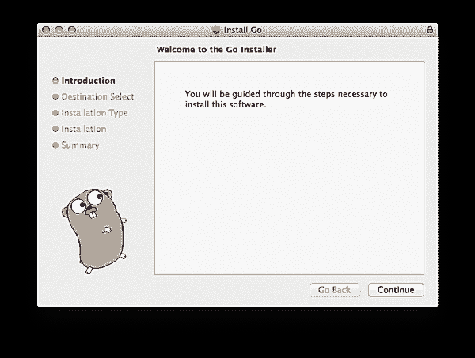

下一步是配置 `GOROOT` 路径。对于 Windows 平台，你可以在 **环境变量** 中添加 `GOROOT` 变量。对于 Mac/Linux，你可以在 bash 配置文件中添加它。

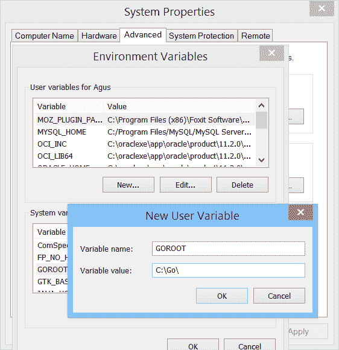

对于 Windows 平台，你可以将 GO 安装路径，例如我的 Go 安装路径是 `c:/go/bin`，添加到 **环境变量** 中的 `PATH` 变量。

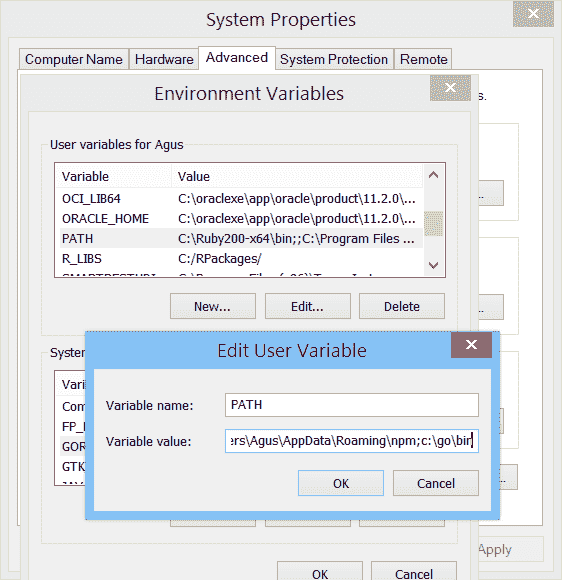

配置完成后，你可以通过在终端或 Windows 的 CMD 中输入以下命令来验证 Go 版本。

```
$ go version
```

示例输出可在下图中看到，Mac 平台。

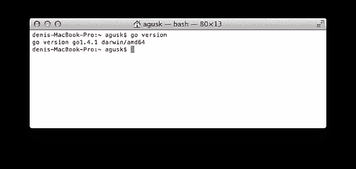

在 Windows 平台上运行程序的输出。

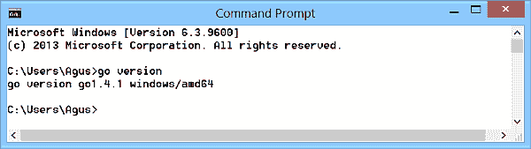

### 1.2 开发工具

基本上，你可以使用任何文本编辑器来编写 Go 代码。以下是文本编辑器的列表：

*   `vim`
*   `nano`
*   Intellij IDEA, [`www.jetbrains.com/idea/`](https://www.jetbrains.com/idea/)
*   Sublime text, [`www.sublimetext.com/`](http://www.sublimetext.com/)

下面图示中展示了 Intellij IDEA 的示例截图。

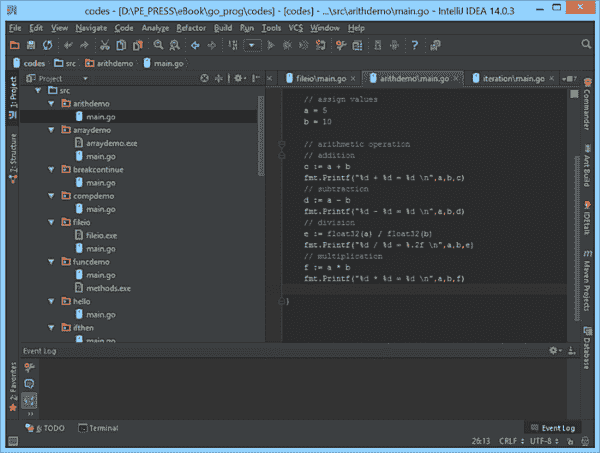

### 1.3 Hello World

如何开始使用 Go？嗯，很容易。首先，创建一个名为 `hello` 的文件夹。

```
$ mkdir hello
$ cd hello
```

然后，在 `hello` 文件夹上创建一个名为 `main.go` 的文件。为 `main.go` 文件编写此代码。

```
package main

import "fmt"

func main() {
    fmt.Println("Hello, go!")
}
```

保存此文件。然后，返回到你的终端。你可以构建并运行它。

```
$ go build
$ go run main.go
```

在这种情况下，它将根据你的平台生成一个可执行文件。

下面图示中可以看到一个示例程序输出。

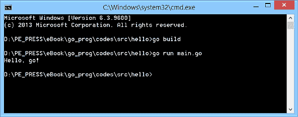

### 1.4 Go 包

有很多你可以使用的 Go 包。Go 包的列表可以在此链接上看到 [`golang.org/pkg/`](https://golang.org/pkg/)。在本书中，我们将探索一些 Go 标准包。我们也尝试构建自己的 Go 包。

## 2. Go 编程语言

本章解释了 Go 编程语言的基础。

### 2.1 常见规则

Go 语言以“C 家族”作为主要语言，但我们在语法末尾不写“;”。以下是语法规则：

```
syntax_code1
syntax_code2
syntax_code3
```

### 2.2 变量

在本节中，我们探讨如何在 Go 中定义变量并为其赋值。

#### 2.2.1 声明变量

要声明一个名为 `myvar` 的变量且数据类型为 `data_type1`，你可以编写以下脚本：

```
var myvar data_type1
```

以下是声明一些变量的示例脚本。

```
var str string
var n, m int
var mn float32
```

我们也可以按如下方式定义多个变量。

```
var (
    name string
    email string
    age int
)
```

一旦声明，这些变量就可以用来存储任何类型的数据。

#### 2.2.2 为变量赋值

你已经声明的变量可以通过等号 `=` 来赋值。例如，将变量 `str` 赋值为字符串值 `"Hello World"`，你会这样写：

```
str = "Hello World"
n = 10
m = 50
mn = 2.45
```

我们也可以声明一个变量并为其赋值。

```
var city string = "London"
var x int = 100
```

另一种选择，我们可以使用 `:=` 语法声明一个变量而不定义数据类型，并为其赋值。

```
country := "DE"
val := 15
```

#### 2.2.3 演示

为了说明在 Go 中声明变量，创建一个名为 `vardemo` 的文件夹。然后，创建一个名为 `main.go` 的文件。

为 `main.go` 编写以下脚本。

```
package main

import "fmt"

func main() {
    // declare variables
    var str string
    var n, m int
    var mn float32

    // assign values
    str = "Hello World"
    n = 10
    m = 50
    mn = 2.45

    fmt.Println("value of str= ",str)
    fmt.Println("value of n= ",n)
    fmt.Println("value of m= ",m)
    fmt.Println("value of mn= ",mn)

    // declare and assign values to variables
    var city string = "London"
    var x int = 100

    fmt.Println("value of city= ",city)
    fmt.Println("value of x= ",x)

    // declare variable with defining its type
    country := "DE"
    val := 15
    fmt.Println("value of country= ",country)
    fmt.Println("value of val= ",val)

    // define multiple variables
    var (
        name string
        email string
        age int
    )
    name = "john"
    email = "john@email.com"
    age = 27

    fmt.Println(name)
    fmt.Println(email)
    fmt.Println(age)
}
```

保存此文件。

然后，尝试构建并运行它。

```
$ cd vardemo
$ go build
$ go run main.go
```

下面图示中可以看到一个示例输出。

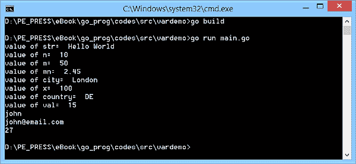

### 2.3 注释

你可以用编写注释来解释代码的工作方式。要做到这一点，你可以使用 `//` 和 `/* */` 语法。以下是示例代码：

```
// declare variables
var str string
var n, m int
var mn float32

// assign values
str = "Hello World"
n = 10
m = 50
mn = 2.45

/* print the result */
fmt.Println("value of str= ",str)
```

### 2.4 算术运算

Go 支持相同的四种基本算术运算，如加法、减法、乘法和除法。为了测试，创建一个文件夹 `arithdemo`。然后，创建一个名为 `main.go` 的文件。

以下是 `main.go` 中基本算术的说明代码：

```
package main

import "fmt"

func main() {
    // declare variables
    var a, b int

    // assign values
    a = 5
    b = 10

    // arithmetic operation
    // addition
    c := a + b
    fmt.Printf("%d + %d = %d \n",a,b,c)
    // subtraction
    d := a - b
    fmt.Printf("%d - %d = %d \n",a,b,d)
    // division
    e := float32(a) / float32(b)
    fmt.Printf("%d / %d = %.2f \n",a,b,e)
    // multiplication
    f := a * b
    fmt.Printf("%d * %d = %d \n",a,b,f)
}
```

然后，尝试构建并运行它。

```
$ cd arithdemo
$ go build
$ go run main.go
```

以下是示例输出。

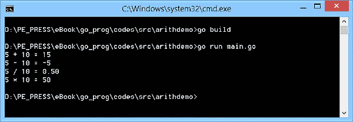

### 2.5 数学函数

Go 提供了 `math` 库，你可以在 [`golang.org/pkg/math/`](https://golang.org/pkg/math/) 上阅读它。为了说明，我们尝试使用几个数学函数。

创建一个名为 `mathdemo` 的文件夹。然后，创建一个名为 `main.go` 的文件。编写以下代码。

```
package main

import (
    "fmt"
    "math"
)

func main(){
    a := 2.4
    b := 1.6

    c := math.Pow(a,2)
    fmt.Printf("%.2f^%d = %.2f \n",a,2,c)

    c = math.Sin(a)
    fmt.Printf("Sin(%.2f) = %.2f \n",a,c)

    c = math.Cos(b)
    fmt.Printf("Cos(%.2f) = %.2f \n",b,c)

    c = math.Sqrt(a*b)
    fmt.Printf("Sqrt(%.2f*%.2f) = %.2f \n",a,b,c)
}
```

然后，尝试构建并运行它。

```
$ cd mathdemo
$ go build
$ go run main.go
```

以下是示例输出。

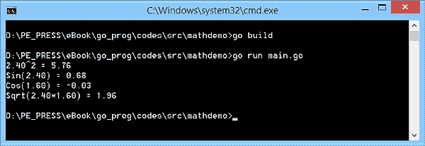

### 2.6 自增和自减

Go 有用于自增和自减的特殊语法。

*   `++` 语法用于自增。`a++` 表示 `a = a + 1`
*   `--` 语法用于自减。`a--` 表示 `a = a - 1`

为了测试，创建一个名为 `incdec` 的文件夹，然后创建一个名为 `main.go` 的文件。编写以下脚本。

```
package main

import "fmt"

func main() {
    // declare variables
    var a = 4

    // increment
    fmt.Printf("a = %d \n",a)
    a = a + 1
    fmt.Printf("a + 1 = %d \n",a)
    a++
    fmt.Printf("a++ = %d \n",a)

    // decrement
    a = a - 1
    fmt.Printf("a - 1 = %d \n",a)
    a--
    fmt.Printf("a-- = %d \n",a)
}
```

然后，尝试构建并运行它。

```
$ cd incdec
$ go build
$ go run main.go
```

以下是示例输出。

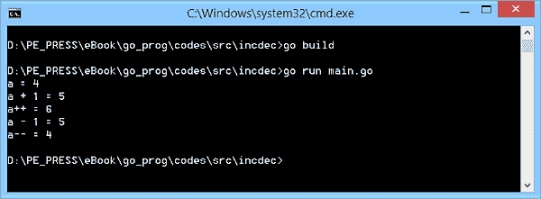

### 2.7 从键盘获取输入

在 `fmt` 库中，它提供了一个从键盘获取输入的功能。我们可以使用 `Scanf()`。

为了说明，我们计算圆的面积。在这种情况下，我们需要一个半径值的输入。

创建一个名为 `inputdemo` 的文件夹。然后，创建一个名为 `main.go` 的文件，并编写此脚本。

```
package main

import (
    "fmt"
    "math"
)

func main() {
    fmt.Println("Circle Area calculation")
    fmt.Print("Enter a radius value: ")
    var radius float64
    fmt.Scanf("%f", &radius)

    area := math.Pi * math.Pow(radius,2)
    fmt.Printf("Circle area with radius %.2f = %.2f \n",radius, area)
}
```

然后，尝试构建并运行它。

```
$ cd inputdemo
$ go build
$ go run main.go
```

输入一个圆的半径。

以下是示例输出。

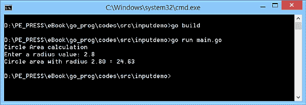

### 2.8 比较运算符

你可能需要确定变量或值之间的相等性或差异。以下是比较运算符的列表：

```
==       is equal to
!=       is not equal
>        is greater than
<        is less than
>=       is greater than or equal to
<=       is less than or equal to
```

这是一个比较用法的示例代码。

```
package main

import "fmt"

func main() {
    var (
        a = 2
        b = 10
    )

    fmt.Println(a>b)
    fmt.Println(a<b)
    fmt.Println(a>=b)
    fmt.Println(a<=b)
    fmt.Println(a!=b)
    fmt.Println(a==b)

}
```

构建并运行它。

程序的示例输出可在下图看到。

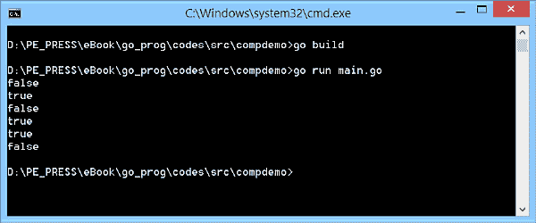

### 2.9 逻辑运算符

这些运算符可用于确定变量或值之间的逻辑关系。

```
&&      and
||      or
!        not
```

示例代码：

```
package main

import "fmt"

func main() {
    var (
        a = 5
        b = 8
    )

    fmt.Println(a>b && a!=b)
    fmt.Println(!(a>=b))
    fmt.Println(a==b || a>b)

}
```

构建并运行它。

程序的示例输出可在下图看到。

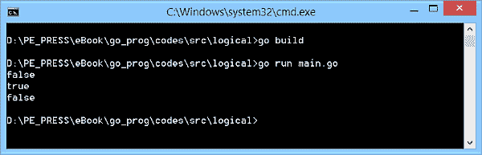

### 2.10 决策

在 Go 中构建决策有两种方法。我们可以使用 `if..then` 和 `switch..case`。

#### 2.10.1 if..then

`if..then` 的语法模型可表述如下：

```
if conditional {
   // do something
}else{
   // do another job
}
```

`*conditional*` 可以通过逻辑或/与比较运算获得。

```
package main

import "fmt"

func main() {
    var (
        a = 5
        b = 8
    )

    if a>b || a-b<a {
        fmt.Println("conditional-->a>b || a-b<a")
    }else{
        fmt.Println("..another")
    }

}
```

构建并运行它。

程序的示例输出可在下图看到。

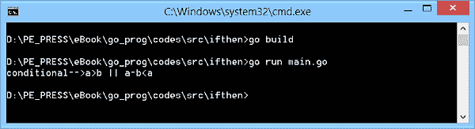

#### 2.10.2 switch..case

`switch..case` 可按如下方式声明：

```
switch option {
        case option1:
                // do option1 job
                
        case option2:
                // do option2 job
               
}
```

以下是 `switch..case` 用法的示例代码：


```
package main

import "fmt"

func main() {

    selected := 2

    switch selected {
        case 0:
            fmt.Println("selected = 0")
        case 1:
            fmt.Println("selected = 1")
        case 2:
            fmt.Println("selected = 2")
        case 3:
            fmt.Println("selected = 3")
        default:
            fmt.Println("other..")

    }

}
```

构建并运行它。

程序的示例输出可在下图看到。

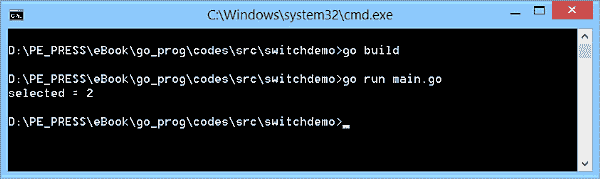

## 2.11 迭代 - for

当我们执行重复性活动时，迭代操作很有用。以下是 `for` 语法。

```
for initialization;conditional;increment/decrement {

}
```

进行测试，将此脚本写入文件 `main.go`。

```
package main

import "fmt"

func main() {

    // iteration - for
    var i int
    for i=0;i<5;i++ {
        fmt.Println(i)
    }

    for j:=5;j<11;j++ {
        fmt.Println(j)
    }


}
```

构建并运行它。

程序的示例输出可在下图看到。

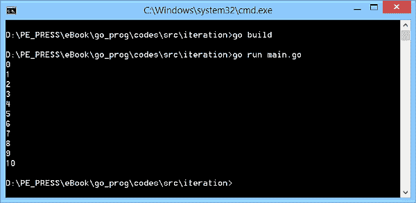

## 2.12 迭代 - while

Go 不提供像“C 家族”编程语言那样的 `while` 语法。我们可以使用传递条件值的 `for`。

为测试编写此脚本。

```
package main

import "fmt"

func main() {

    // iteration - while
    // go doesn't provide while syntax. we can use for
    i := 0
    for i<5 {
        fmt.Println(i)
        i++
    }

}
```

构建并运行它。

程序的示例输出可在下图看到。

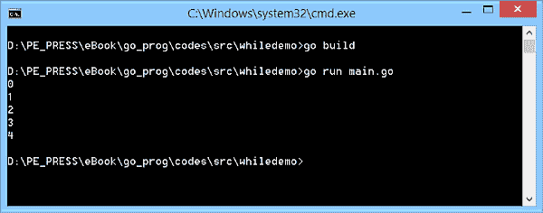

## 2.13 break 和 continue

`break` 可用于在代码点停止。否则，`continue` 可用于跳过某些脚本。为说明，我们有一个循环。循环将在值 = 3 时使用 `*break*` 停止。另一个示例，我们可以使用 `*continue*` 语法跳过值为 7 的迭代。

编写此脚本。

```
package main

import "fmt"

func main() {

    // iteration - for
    var i int
    for i=0;i<5;i++ {
        if i==3 {
            break
        }
        fmt.Println(i)
    }

    for j:=5;j<11;j++ {
        if j==7 {
            continue
        }
        fmt.Println(j)
    }


}
```

构建并运行它。

程序的示例输出可在下图看到。

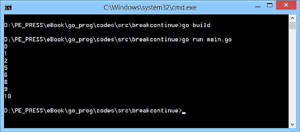

# 3. 数组、切片和映射

本章解释如何在 Go 中使用集合。

## 3.1 数组

Go 提供数组对象用于集合操作。我们按如下方式定义数组变量。

```
    var numbers[5] int
    var cities[5] string
    var matrix[3][3] int // array 2D
```

为说明，我们可以创建一个名为 `arraydemo` 的新项目，通过创建名为 `arraydemo` 的文件夹。

```
$ mkdir arraydemo
$ cd arraydemo
```

然后，创建一个文件 `main.go`。导入程序所需的 Go 包。

```
package main

import (
    "fmt"
    "math/rand"
)
```

在此程序中，我们可以尝试定义几个数组变量。设置它们的值并在终端上显示它们。

```
func main() {

    // define array
    fmt.Println("define arrays")
    var numbers[5] int
    var cities[5] string
    var matrix[3][3] int // array 2D

    // insert data
    fmt.Println(">>>>>insert array data")
    for i:=0;i<5;i++ {
        numbers[i] = i
        cities[i] = fmt.Sprintf("City %d",i)
    }

    // insert matrix data
    fmt.Println(">>>>>insert matrix data")
    for i:=0;i<3;i++ {
        for j:=0;j<3;j++ {
            matrix[i][j] = rand.Intn(100)

        }
    }

    // display data
    fmt.Println(">>>>>display array data")
    for j:=0;j<5;j++ {
        fmt.Println(numbers[j])
        fmt.Println(cities[j])
    }

    // display matrix data
    fmt.Println(">>>>>display matrix data")
    for i:=0;i<3;i++ {
        for j:=0;j<3;j++ {
            fmt.Println(matrix[i][j])

        }
    }
    
}
```

保存此代码。

构建并运行此程序。

```
$ go build
$ go run main.go
```

你可以看到程序输出的示例，显示在下图中。

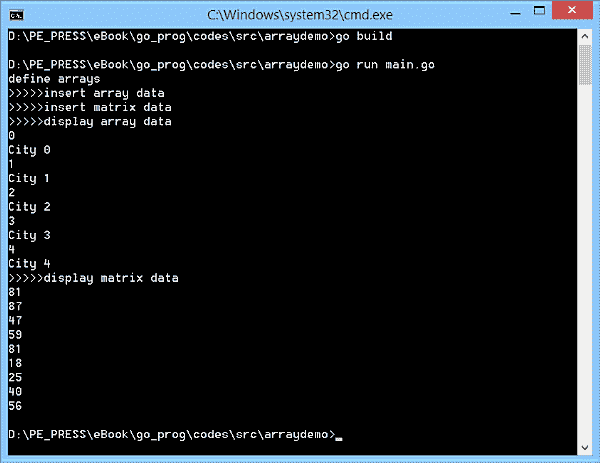

## 3.2 切片

我们可以不指定数组长度来定义数组。Go 使用切片来执行此操作。要设置数组长度，我们可以使用 `make()` 函数。

为测试，我们构建一个名为 `slicedemo` 的项目。

```
$ mkdir slicedemo
$ cd slicedemo
```

然后，创建一个文件 `main.go`，并编写此代码。

```
package main

import (
    "fmt"
    "math/rand"
)

func main() {

    // define slice
    fmt.Println("define slices")
    var numbers[] int
    numbers = make([]int,5)
    matrix := make([][]int,3*3)


    // insert data
    fmt.Println(">>>>>insert slice data")
    for i:=0;i<5;i++ {
        numbers[i] = rand.Intn(100) // random number
    }

    // insert matrix data
    fmt.Println(">>>>>insert slice matrix data")
    for i:=0;i<3;i++ {
        matrix[i] = make([]int,3)
        for j:=0;j<3;j++ {
            matrix[i][j] = rand.Intn(100)
        }
    }

    // display data
    fmt.Println(">>>>>display sclice data")
    for j:=0;j<5;j++ {
        fmt.Println(numbers[j])
    }

    // display matrix data
    fmt.Println(">>>>>display sclice 2D data")
    for i:=0;i<3;i++ {
        for j:=0;j<3;j++ {
            fmt.Println(matrix[i][j])

        }
    }


}
```

保存此代码。

构建并运行此程序。

```
$ go build
$ go run main.go
```

程序输出的示例可在下图看到。

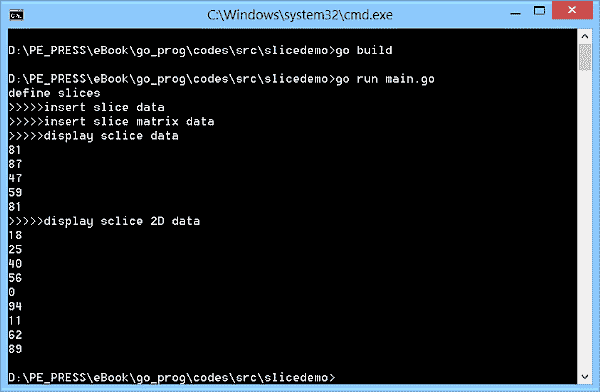

## 3.3 映射

我们可以创建带键值的数组。Go 使用 `map()` 来实现键值数组。

为说明，我们创建一个名为 `mapdemo` 的项目。

```
$ mkdir mapdemo
$ cd mapdemo
```

我们将定义映射变量。然后，设置它们的值并在终端上显示它们。创建一个名为 `main.go` 的文件。编写此代码。

```
package main

import (
    "fmt"
    "math/rand"
)

func main() {

    // define array
    fmt.Println("define map")
    products := make(map[string]int)
    customers := make(map[string]int)

    // insert data
    fmt.Println(">>>>>insert map data")
    products["product1"] = rand.Intn(100)
    products["product2"] = rand.Intn(100)

    customers["cust1"] = rand.Intn(100)
    customers["cust2"] = rand.Intn(100)


    // display data
    fmt.Println(">>>>>display map data")
    fmt.Println(products["product1"])
    fmt.Println(products["product2"])
    fmt.Println(customers["cust1"])
    fmt.Println(customers["cust2"])

}
```

保存此代码。

构建并运行此程序。

```
$ go build
$ go run main.go
```

程序输出的示例可在下图看到。

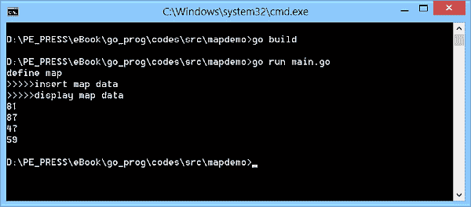

# 4. 函数

本章介绍如何使用 Go 创建函数。

## 4.1 创建一个简单函数

在 Go 中声明函数的格式如下。

```
func function_name return_datatype {

    return foo
}
```

为了说明，我们可以创建一个名为 `arraydemo` 的新项目，通过创建一个名为 `arraydemo` 的文件夹。

```
$ mkdir arraydemo
$ cd arraydemo
```

创建文件 `main.go`。然后导入 Go 包。

```
package main

import (
    "fmt"
    "math"
)
```

要创建一个简单函数，你可以在 `main.go` 文件中编写此代码。

```
func main(){
    foo()

}


// a simple function
func foo() {
    fmt.Println("foo() was called")
}
```

## 4.2 带参数的函数

有时你想要创建一个带参数的函数。你可以按如下方式实现。

```
// a function with a parameter
func circle_area(r float64){
    area := math.Pi * math.Pow(r,2)
    fmt.Printf("Circle area (r=%.2f) = %.2f \n",r, area)
}
```

如果函数上有多个参数，我们可以按如下方式定义函数。

```
// a function with parameters
func calculate(a,b, c float64){
    result := a*b*c
    fmt.Printf("a=%.2f, b=%.2f, c=%.2f = %.2f \n",a, b, c, result)
}
```

## 4.3 带返回值的函数

你可能想要创建一个具有返回值的函数。参考此代码作为示例说明。

```
// a function with parameters and a return value
func advanced_calculate(a,b, c float64) float64 {
    result := a*b*c

    return result
}
```

## 4.4 带多个返回值的函数

Go 中的函数可以返回多个返回值。例如，我们在 Go 函数中返回三个值。示例代码可写成如下。

```
// a function with parameters and multiple return values
func compute(a,b, c float64, name string) (float64,float64,string) {
    result1 := a*b*c
    result2 := a + b + c
    result3 := result1 + result2
    newName := fmt.Sprintf("%s value = %.2f", name,result3)

    return result1, result2, newName
}
```

## 4.5 带多个参数和返回值的函数

你可能想要在函数上使用无限参数。在 Go 中实现它是可能的。我们可以使用 `...` 来在函数中定义多个参数。

```
// a function with zero or more parameters and a return value
func add(numbers ...int) int {
    result := 0
    for _, number := range numbers {
        result += number
    }
    return result
}
```

## 4.6 闭包函数

我们可以在函数中定义函数。它被称为闭包函数。我们可以在 Go 中按如下方式实现闭包函数。

```
// a closure function
func closure_func(name string){

    hoo := func(a,b int){
        result := a*b
        fmt.Printf("hoo() = %d \n",result)
    }
    joo := func(a,b int) int {
        return a*b + a
    }

    fmt.Printf("closure_func(%s) was called\n",name)
    hoo(2,3)
    val := joo(5,8)
    fmt.Printf("val from joo() = %d \n",val)
}
```

## 4.7 递归函数

递归函数是指一个函数，其问题的解决方案取决于同一问题的较小实例的解决方案（与迭代相反）。为了说明，我们可以使用 Go 实现斐波那契问题。

以下是 Go 中斐波那契解决方案的示例代码。

```
// a recursion function
func  fibonacci(n int) int {
    if n==0{
        return 0
    }else if n==1 {
        return 1
    }
    return (fibonacci(n-1) + fibonacci(n-2))
}
```

## 4.8 测试

我们可以重写第 4.1 到 4.7 节的代码并在主入口中使用它们。将此代码写入 `main.go` 文件。


```
package main

import (
    "fmt"
    "math"
)

func main(){
    foo()
    circle_area(2.56)
    calculate(2, 6.7, 5)

    val := advanced_calculate(2, 4.8, 7)
    fmt.Printf("advanced_calculate() = %.2f \n",val)

    val1,val2,val3 := compute(6, 2.7, 1.4, "energy")
    fmt.Printf("val1=%.2f, val2=%.2f, val3=\"%s\" \n", val1, val2, val3)

    result := add(1,2,3,4,5,6,7,8,9,10,11)
    fmt.Printf("add() = %d \n",result)

    closure_func("testing")

    ret := fibonacci(15)
    fmt.Printf("fibonacci() = %d \n",ret)
}

// a simple function
func foo() {
    fmt.Println("foo() was called")
}

// a function with a parameter
func circle_area(r float64){
    area := math.Pi * math.Pow(r,2)
    fmt.Printf("Circle area (r=%.2f) = %.2f \n",r, area)
}

// a function with parameters
func calculate(a,b, c float64){
    result := a*b*c
    fmt.Printf("a=%.2f, b=%.2f, c=%.2f = %.2f \n",a, b, c, result)
}

// a function with parameters and a return value
func advanced_calculate(a,b, c float64) float64 {
    result := a*b*c

    return result
}

// a function with parameters and multiple return values
func compute(a,b, c float64, name string) (float64,float64,string) {
    result1 := a*b*c
    result2 := a + b + c
    result3 := result1 + result2
    newName := fmt.Sprintf("%s value = %.2f", name,result3)

    return result1, result2, newName
}

// a function with zero or more parameters and a return value
func add(numbers ...int) int {
    result := 0
    for _, number := range numbers {
        result += number
    }
    return result
}

// a closure function
func closure_func(name string){

    hoo := func(a,b int){
        result := a*b
        fmt.Printf("hoo() = %d \n",result)
    }
    joo := func(a,b int) int {
        return a*b + a
    }

    fmt.Printf("closure_func(%s) was called\n",name)
    hoo(2,3)
    val := joo(5,8)
    fmt.Printf("val from joo() = %d \n",val)
}

// a recursion function
func  fibonacci(n int) int {
    if n==0{
        return 0
    }else if n==1 {
        return 1
    }
    return (fibonacci(n-1) + fibonacci(n-2))
}
```

保存此代码。

构建并运行此程序。

```
$ go build
$ go run main.go
```

程序输出的示例可在下图看到。

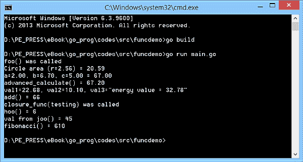

# 5. 指针

本章我们探讨如何在 Go 中使用指针。

## 5.1 Go 中的指针

指针是一种编程语言对象，其值直接引用（或“指向”）计算机内存中其他位置存储的值，使用其地址，参考：[`en.wikipedia.org/wiki/Pointer\_(computer\_programming)`](http://en.wikipedia.org/wiki/Pointer_\(computer_programming\))。

当我们将 `x` 定义为 `int` 时，我们可以通过调用 `x = 1` 来 `x` 值。要了解 `x` 的内存地址，我们可以使用 `&x`。为了测试，我们构建一个新项目。创建一个名为 `pointers` 的文件夹。

```
$ mkdir pointers
$ cd pointers
```

创建文件 `main.go`，并编写此代码。

```
package main

import "fmt"

func main(){

    var x int

    x = 10
    fmt.Println(x)  // print a value of x
    fmt.Println(&x) // print address of x

}
```

保存此文件。

尝试构建并运行它。

```
$ go build
$ go run main.go
```

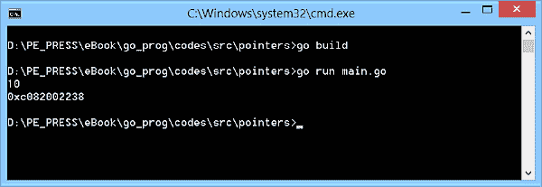

你可以看到 `x` 的值为 10，其内存地址为 0xC082002238。内存地址可以使用 `&` 关键字检索。

在 Go 中，我们可以使用 `*` 定义数据类型为指针，例如 `var x *int`。我们可以使用 `*x = value` 设置指针变量。要在指针变量上设置内存地址，我们可以使用 `x = memory_address`。

为了测试，我们在 `main.go` 文件上添加以下代码。

```
package main

import "fmt"

func main(){

    var x int

    x = 10
    fmt.Println(x)  // print a value of x
    fmt.Println(&x) // print address of x


    // declare pointer
    var num *int
    val := new(int)

    num = new(int)
    *num = x   // set value

    val = &x   // set address

    fmt.Println("===pointer num===")
    fmt.Println(*num)  // print a value of x
    fmt.Println(num) // print address of x
    fmt.Println("===pointer val===")
    fmt.Println(*val)  // print a value of x
    fmt.Println(val) // print address of x

}
```

保存此文件。

尝试构建并运行它。程序输出的示例显示在下图中。

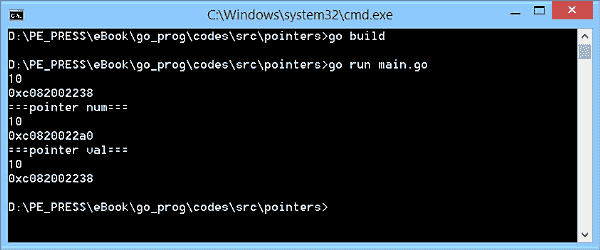

## 5.2 Demo: 单向链表

在本节中，我们可以从头开始创建一个单向链表。你可以阅读你的数据结构书籍来了解单向链表是什么。你也可以在维基百科上阅读它，[`en.wikipedia.org/wiki/Linked\_list#Singly\_linked\_lists`](http://en.wikipedia.org/wiki/Linked_list#Singly_linked_lists)。

现在我们可以使用 Go 创建一个单向链表。首先，我们创建文件夹，linkedlist。

```
$ mkdir linkedlist
$ cd linkedlist
```

创建一个文件，**main.go**。导入 Go 包并为指针定义结构体。

```
package main

import (
    "fmt"
    "math/rand"
)

type Node struct {
    value int
    next *Node
}
```

`next` 是指针变量，它引用下一个指针变量的内存地址。

我们创建一个函数，`add()`，我们在单向链表上插入新数据。以下是 `add()` 函数的实现。

```
func add(list *Node,data int) *Node {
    if list==nil {
        list := new(Node)
        list.value = data
        list.next = nil

        return list
    }else{
        temp := new(Node)
        temp.value = data
        temp.next = list

        list = temp

        return list
    }
}
```

我们也可以显示单向链表的内容。创建一个函数，`display()`，并编写此代码。

```
func display(list *Node){
    var temp *Node
    temp = list

    for temp!=nil {

        fmt.Println(temp.value)
        temp = temp.next
    }
}
```

在主入口中，我们将单向链表定义为指针变量，称为 `head`。我们向指针列表中添加五个数据。然后，我们显示所有数据。为 `main()` 函数编写以下代码。

```
func main(){

    var head *Node
    head = nil

    // add 5 data
    fmt.Println("=== insert 5 data=== ")
    n := 0
    for n < 5 {
        fmt.Printf("data %d\n",n)

        head = add(head,rand.Intn(100))
        n++
    }
    fmt.Println("=== display ===")
    display(head)

}
```

保存此文件。

尝试构建并运行它。

```
$ go build
$ go run main.go
```

程序输出的示例可以在下图中看到。

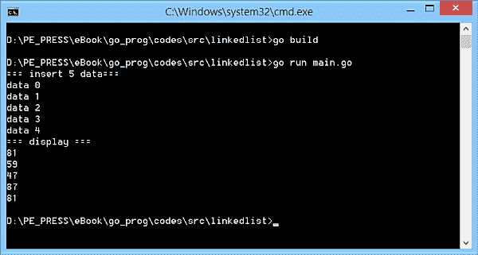

# 6. 结构体和结构体方法

本章解释如何在 Go 中使用结构体和结构体方法。

## 6.1 结构体

我们可以使用结构体扩展我们的对象。如果你有 C/C++ 经验，我们在 Go 语言中使用结构体方法。

要定义一个结构体，我们可以使用 `struct` 关键字，例如，我们为结构体对象定义 `struct_name`。

```
type struct_name struct {
  // fields
}
```

为了说明，我们创建一个结构体，`Employee`。首先，我们通过创建一个名为 `structdemo` 的文件夹来构建一个新项目。

```
$ mkdir structdemo
$ cd structdemo
```

然后，创建一个名为 **main.go** 的文件。首先，我们定义我们的包和一个结构体，`Employee`。

```
package main

import (
    "fmt"
    "time"
)

// define  a struct
type Employee struct {
    id int
    name string
    country string
    created time.Time
}
```

`Employee` 结构体有四个字段：`id`、`name`、`country` 和 `created`。

要在 Go 中使用结构体，我们可以使用 `new()` 实例化我们的结构体对象。然后，我们设置其值。

在 **main.go** 文件的入口点编写此代码。

```
func main() {

    // declare variable
    var emp Employee
    newEmp := new(Employee)

    // set values
    emp.id = 2
    emp.name = "Employee 2"
    emp.country = "DE"
    emp.created = time.Now()

    newEmp.id = 5
    newEmp.name = "Employee 5"
    newEmp.country = "UK"
    newEmp.created = time.Now()


    // display
    fmt.Println("=====================")
    fmt.Println(emp.id)
    fmt.Println(emp.name)
    fmt.Println(emp.country)
    fmt.Println(emp.created)

    fmt.Println("=====================")
    fmt.Println(newEmp.id)
    fmt.Println(newEmp.name)
    fmt.Println(newEmp.country)
    fmt.Println(newEmp.created)
}
```

保存此文件。

尝试构建并运行它。

```
$ go build
$ go run main.go
```

程序输出的示例：

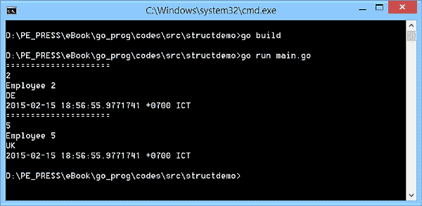

## 6.2 方法

我们通过传递结构体对象在我们的结构体对象中定义方法。为了说明，我们创建 `Circle` 结构体对象，它具有以下方法：

* `display()`
* `area()`
* `circumference()`
* `moveTo()`

如何实现？

创建一个名为 `structmethod` 的文件夹。

```
$ mkdir structmethod
$ cd structmethod
```

下一步是创建一个名为 **main.go** 的文件。导入我们的包并定义 `Circle` 结构体对象。

```
package main

import (
    "fmt"
    "math"
)

// define  a struct
type Circle struct {
    x,y int
    r float64
}
```

`Circle` 结构体有三个字段：`x`、`y` 和 `r`。

基本上，我们可以以创建函数相同的方式创建结构体方法。我们在方法名称前面传递我们的结构体对象。以下是我们结构体方法的实现。

```
func (c Circle) display() {
    fmt.Printf("x=%d,y=%d,r=%.2f\n",c.x,c.y,c.r)
}
func (c Circle) area() float64 {
    return math.Pi * math.Pow(c.r,2)
}
func (c Circle) circumference() float64 {
    return 2* math.Pi * c.r
}
func (c Circle) moveTo(newX,newY int) {
    c.x = newX
    c.y = newY
}
```

最后一步是在主程序中使用我们的结构体方法。编写以下代码。

```
func main() {
    // methods
    shape := Circle{10,5,2.8}
    shape.display()
    fmt.Printf("area=%2.f\n",shape.area())
    fmt.Printf("circumference=%2.f\n",shape.circumference())

    shape.moveTo(5,5)
    shape.display()
}
```

保存此代码。

在你的终端上构建并运行 **main.go**。

```
$ go build
$ go run main.go
```

程序输出的示例：

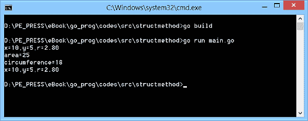

# 7. 字符串操作

本章解释如何在 Go 中使用字符串操作。

## 7.1 入门

我们已经将字符串用作数据类型。以下是处理字符串数据并在终端上打印的示例代码。

```
// simple string demo
var str string
str = "Hello world"
fmt.Println(str)
```


在本节中，我们尝试操作字符串数据。我们将探索 `strconv`，[`golang.org/pkg/strconv/`](http://golang.org/pkg/strconv/) 和 `strings`，[`golang.org/pkg/strings/`](http://golang.org/pkg/strings/) 包的几个函数。

首先，我们通过创建一个名为 `stringdemo` 的文件夹来构建一个新项目。

```
$ mkdir stringdemo
$ cd stringdemo
```

创建一个名为 `main.go` 的文件。导入 `fmt`、`strcov` 和 `strings` 包。

```
package main

import (
    "fmt"
    "strconv"
    "strings"
)
```

下一步是探索如何使用字符串。

## 7.2 拼接字符串

如果你有一组字符串，你可以将其拼接成一个字符串。你可以使用 `+` 运算符和 `fmt.Sprintf()` 函数。以下是示例代码

```
    str1 := "hello"
    str2 := "world"
    str3 := str1 + str2
    fmt.Println(str3)

    str4 := fmt.Sprintf("%s %s",str1,str2)
    fmt.Println(str4)
```

## 7.3 字符串转数字

有时你想执行数学运算但输入数据是字符串类型。要将字符串类型转换为数字，你可以使用 `strcov.ParseInt()` 将字符串转为整型，以及 `strcov.ParseFloat()` 将字符串转为浮点型。

以下是实现字符串到数字转换的示例代码。

```go
    fmt.Println("----demo String To Numeric----")
    str_val1 := "5"
    str_val2 := "2.8769"

    var err error
    var int_val1 int64
    int_val1,err = strconv.ParseInt(str_val1,10,32) // base10, 64 size
    if err==nil {
        fmt.Println(int_val1)
    }else{
        fmt.Println(err)
    }

    var float_val2 float64
    float_val2,err = strconv.ParseFloat(str_val2,64)  // 64 size
    if err==nil {
        fmt.Println(float_val2)
    }else{
        fmt.Println(err)
    }
```

## 7.4 Numeric to String

将数值转换为字符串类型非常容易，可以使用 `fmt.Sprintf`。可以自动获得字符串类型。

```go
    fmt.Println("----demo numeric to string----")
    num1 := 8
    num2 := 5.872

    var str_num1 string
    str_num1 = fmt.Sprintf("%d",num1)
    fmt.Println(str_num1)

    var str_num2 string
    str_num2 = fmt.Sprintf("%f",num2)
    fmt.Println(str_num2)
```

## 7.5 String Parser

解析字符串的简单解决方案是使用带分隔符参数的 `Split()`。例如，你有带 `;` 分隔符的字符串数据并想解析它。以下是示例代码

```go
    fmt.Println("----demo String Parser----")
    data := "Berlin;Amsterdam;London;Tokyo"
    fmt.Println(data)
    cities := strings.Split(data, ";")
    for _, city := range cities {
        fmt.Println(city)
    }
```

## 7.6 Check String Data Length

你可以使用 `len()` 来获取数据的长度。

```go
    fmt.Println("----demo String Length----")
    str_data := "welcome to go"
    len_data := len(str_data)
    fmt.Printf("len=%d \n",len_data)
```

## 7.7 Copy Data

你可以从字符串数据中复制一些字符。为此，可以使用 `[start:end]` 语法。以下是语法格式：

```go
    fmt.Println("----demo copy data----")
    sample := "hello world, go!"
    fmt.Println(sample)
    fmt.Println(sample[0:len(sample)]) // copy all
    fmt.Println(sample[:5]) // copy 5 characters
    fmt.Println(sample[3:8]) // copy characters from index 3 until 8
    fmt.Println(sample[len(sample)-5:len(sample)]) // 5 copy characters from the end of string
```

## 7.8 Upper and Lower Case Characters

在某些情况下，你希望将所有字符串数据转换为大写或小写字符。此功能内置于字符串对象中。`ToUpper()` 函数用于将整个字符串转换为大写，`ToLower()` 用于将整个字符串转换为小写。

以下是获取大小写字符的示例代码。

```go
    fmt.Println("----demo upper/lower characters----")
    message := "Hello World, GO!"
    fmt.Println(message)
    fmt.Println(strings.ToUpper(message)) // upper chars
    fmt.Println(strings.ToLower(message)) // upper chars
```

## 7.9 Testing A Program

我们可以将代码完全写在 `main.go` 中如下。

```go
package main

import (
    "fmt"
    "strconv"
    "strings"
)

func main(){

    // simple string demo
    var str string
    str = "Hello world"
    fmt.Println(str)


    // Concatenating
    str1 := "hello"
    str2 := "world"
    str3 := str1 + str2
    fmt.Println(str3)

    str4 := fmt.Sprintf("%s %s",str1,str2)
    fmt.Println(str4)


    // String To Numeric
    fmt.Println("----demo String To Numeric----")
    str_val1 := "5"
    str_val2 := "2.8769"

    var err error
    var int_val1 int64
    int_val1,err = strconv.ParseInt(str_val1,10,32) // base10, 64 size
    if err==nil {
        fmt.Println(int_val1)
    }else{
        fmt.Println(err)
    }

    var float_val2 float64
    float_val2,err = strconv.ParseFloat(str_val2,64)  // 64 size
    if err==nil {
        fmt.Println(float_val2)
    }else{
        fmt.Println(err)
    }

    // numeric to string
    fmt.Println("----demo numeric to string----")
    num1 := 8
    num2 := 5.872

    var str_num1 string
    str_num1 = fmt.Sprintf("%d",num1)
    fmt.Println(str_num1)

    var str_num2 string
    str_num2 = fmt.Sprintf("%f",num2)
    fmt.Println(str_num2)

    // String Parser
    fmt.Println("----demo String Parser----")
    data := "Berlin;Amsterdam;London;Tokyo"
    fmt.Println(data)
    cities := strings.Split(data, ";")
    for _, city := range cities {
        fmt.Println(city)
    }

    // String Data Length
    fmt.Println("----demo String Length----")
    str_data := "welcome to go"
    len_data := len(str_data)
    fmt.Printf("len=%d \n",len_data)

    // copy data
    fmt.Println("----demo copy data----")
    sample := "hello world, go!"
    fmt.Println(sample)
    fmt.Println(sample[0:len(sample)]) // copy all
    fmt.Println(sample[:5]) // copy 5 characters
    fmt.Println(sample[3:8]) // copy characters from index 3 until 8
    fmt.Println(sample[len(sample)-5:len(sample)]) // 5 copy characters from the end of string


    // Upper and Lower Case Characters
    fmt.Println("----demo upper/lower characters----")
    message := "Hello World, GO!"
    fmt.Println(message)
    fmt.Println(strings.ToUpper(message)) // upper chars
    fmt.Println(strings.ToLower(message)) // upper chars
}
```

保存此代码。

在终端上构建并运行 `main.go`。

```
$ go build
$ go run main.go
```

程序输出示例：

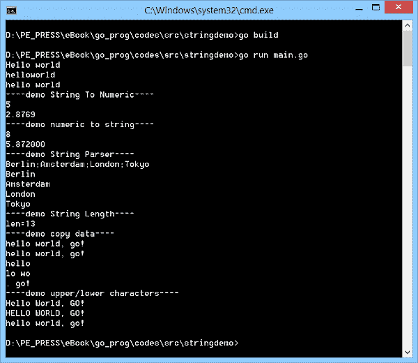

# 8. File Operations

本章解释如何处理文件操作。

## 8.1 Getting Started

我们可以使用 `io` 包来处理 I/O 文件，`http://golang.org/pkg/io/`。

为了说明，我们可以尝试读写文本文件。首先，我们创建一个名为 `fileio` 的文件夹。

```
$ mkdir fileio
$ cd fileio
```

下一步是构建 Go 应用程序来写入和读取文件。

## 8.2 Writing Data Into A File

要写入和读取文件，我们可以使用 `io` 包。在本节中，我们尝试向文件写入数据。

创建一个名为 `main.go` 的文件，并将其放在 `<go_project_root>/fileio` 文件夹中。首先，我们定义使用的包。

```
import (
    "fmt"
    "io/ioutil"
)
```

然后，创建一个名为 `writeFile()` 的函数。写入此代码。

```
func writeFile(message string) {
    bytes := []byte(message)
    ioutil.WriteFile("d:/temp/testgo.txt",bytes,0644)
    fmt.Println("created a file")
}
```

你可以看到我们可以使用 `ioutil.WriteFile()` 创建文件。我们以字节数组格式传递数据。你可以更改文件名及其路径。

## 8.3 Reading Data From A File

要从文件读取数据，我们创建一个名为 `readFile()` 的函数。写入此代码。

```
func readFile(){
    data, _ := ioutil.ReadFile("d:/temp/testgo.txt")
    fmt.Println("file content:")
    fmt.Println(string(data))
}
```

要读取文件内容，我们可以使用 `ioutil.ReadFile()`。它返回字符串数组。

注意：文件及其路径与上一节中的文件类似。

## 8.4 Writing All

为了简单起见，我们可以将代码写在 `main.go` 文件中如下。

```
package main

import (
    "fmt"
    "io/ioutil"
)

func main() {

    // write data into a file
    fmt.Println("writing data into a file")
    writeFile("welcome to go")
    readFile()

    // read data from a file
    fmt.Println("reading data from a file")
    readFile()

}

func writeFile(message string) {
    bytes := []byte(message)
    ioutil.WriteFile("d:/temp/testgo.txt",bytes,0644)
    fmt.Println("created a file")
}
func readFile(){
    data, _ := ioutil.ReadFile("d:/temp/testgo.txt")
    fmt.Println("file content:")
    fmt.Println(string(data))
}
```

保存此文件。

现在你可以构建并运行它。

```
$ go build
$ go run main.go
```

程序的示例输出如图所示。

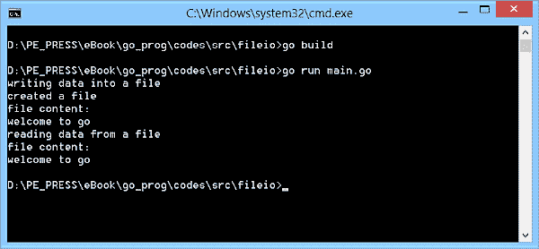

# 9. Error Handling and Logging

本章解释如何在 Go 应用程序中处理发生的错误和异常。

## 9.1 Error Handling

基本上当我们编写程序并在运行时发生错误时，Go 会捕获程序错误。它会生成一个 panic。

为了说明，我们通过创建一个文件夹 `errorhandle` 来创建一个项目。

```
$ mkdir errorhandle
$ cd errorhandle
```

然后，创建一个文件 `main.go`，并写入此代码。

```go
package main

import (
    "fmt"
)

func main(){

    calculate()
}

func calculate() {
    fmt.Println("----demo error handling---")
    a := 10
    b := 0
    c := 0

    c = a/b
    fmt.Printf("result = %.2f \n",c)
    fmt.Println("Done")
}
```

现在你可以构建并运行它。

```
$ go build
$ go run main.go
```

该程序的输出显示在下图中。

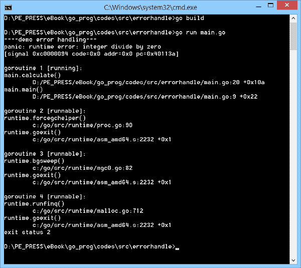

## 9.2 defer, panic(), and recover()

Go 提供了 `defer` 语法以确保我们的程序完整运行。`panic()` 可用于在我们的程序中引发错误。

为了说明，我们在之前的项目中 `main.go` 上添加 `demoPanic()` 函数。然后，我们在主入口调用 `demoPanic()`。


```go
package main

import (
    "fmt"
)

func main(){

    demoPanic()

}

func demoPanic() {
    fmt.Println("----demo error handling---")
    defer func() {
        fmt.Println("do something")
    }()
    panic("this is a panic from demoPanic()")
    fmt.Println("This message will never show")
}
```

现在你可以运行此程序。

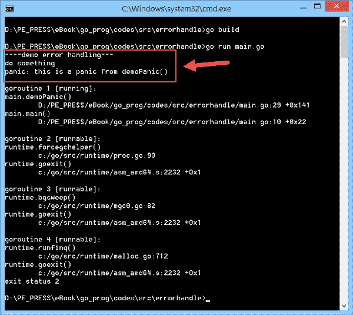

你可以看到 `defer` 下的函数完整运行。当我们调用 `panic()` 时，Go 会在我们的程序中引发错误然后停止该程序。

现在如何在 Go 程序中捕获错误？我们可以使用 `recover()` 来捕获错误。

尝试创建 `calculaze2()` 函数，并编写此代码。

```go
package main

import (
    "fmt"
)

func main(){
    calculate2()
}


func calculate2() {
    fmt.Println("----demo error handling---")
    c := 0
    defer func() {
        a := 10
        b := 0

        c = a/b

        if error := recover(); error != nil {
            fmt.Println("Recovering....", error)
            fmt.Println(error)
        }

    }()
    fmt.Printf("result = %d \n",c)
    fmt.Println("Done")

}
```

现在你可以运行此程序。

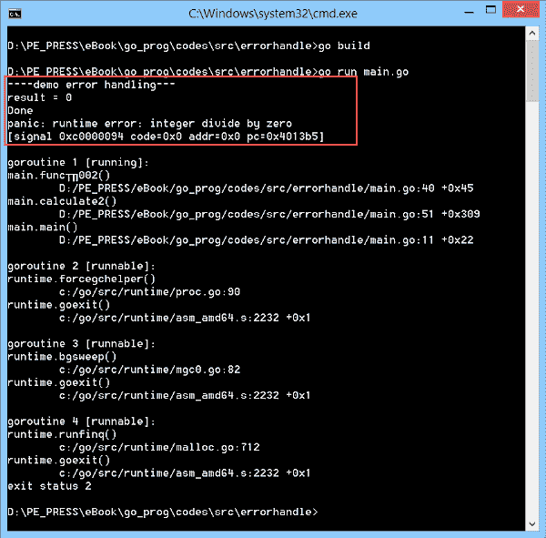

你可以看到程序发生了错误但它可以恢复，因此程序可以在程序末尾打印 "result" 和 "Done"。

## 9.3 try..catch

在本节中，我们探索外部库 Try/Catch/Finally，来自 [`github.com/manucorporat/try`](https://github.com/manucorporat/try) 。我们可以使用 try..catch 在 Go 中处理错误。

要从 Github 安装 Go 库，你必须安装 git，[`git-scm.com/`](http://git-scm.com/) 。根据你的平台下载它。如果你使用 Windows 平台，不要忘记在环境变量的 PATH 上设置它。

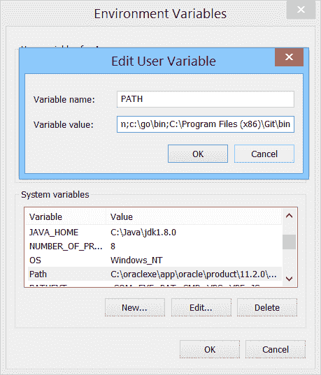

下一步是配置 GOPATH。它代表我们的工作区路径，例如，我的工作区路径是 `D:\\PE_PRESS\\eBook\\go_prog\\codes`。在 Linux/Mac 上，你可以在你的账户主目录下定义自己的工作区路径，例如。进一步的信息，你可以在 [`golang.org/doc/code.html`](https://golang.org/doc/code.html) 上阅读它。

如果你使用 Linux/Mac，你可以使用 export 命令定义 GOPATH 或将其添加到你的配置文件中。

```
$ mkdir $HOME/go
$ export GOPATH=$HOME/go
```

如果你使用 Windows 平台，你打开 `环境变量`。你可以通过 `高级系统设置` 打开它。然后，点击 `环境变量` 按钮。在你的用户和系统变量中添加 GOPATH。

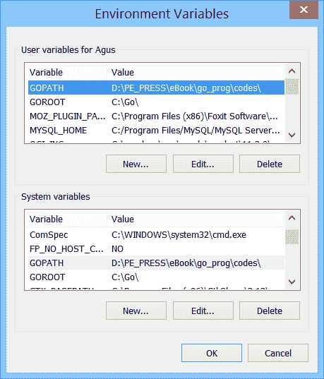

为了说明，我们通过创建文件夹 `trycatch` 创建一个项目。

```
$ mkdir trycatch
$ cd trycatch
```

现在我们可以从 Github 安装 trycatch 库。输入以下命令。

```
$ go get github.com/manucorporat/try
```

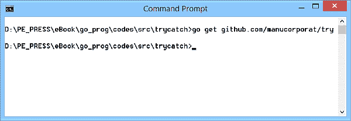

如果你使用 Windows 平台并遇到与 `libcurl.dll` 相关的错误，你必须将 `libcurl.dll` 从 `<installed_git_path>/bin` 文件夹复制到 `<installed_git_path>/libexec/git-core` 文件夹。

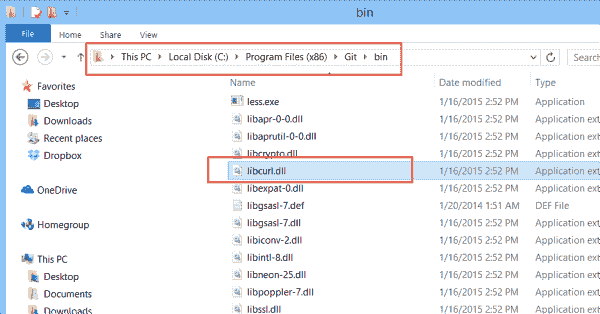

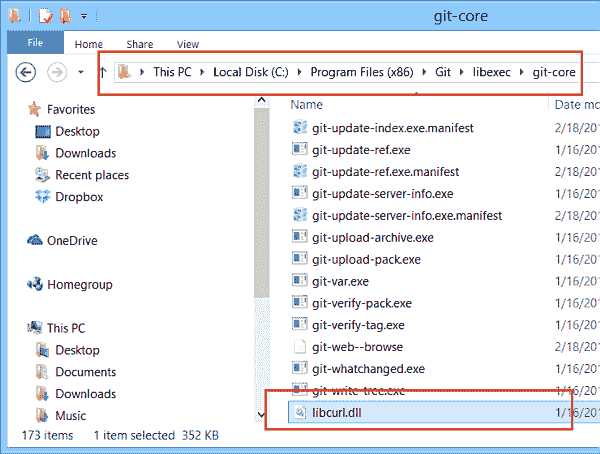

现在你可以编写程序。创建一个文件，名为 `main.go`，并编写此代码。

```go
package main

import (
    "fmt"
    "github.com/manucorporat/try"
)

func main() {
    try.This(func() {
        a := 10
        b := 0
        c := 0

        c = a/b
        fmt.Printf("result = %.2f \n",c)

    }).Finally(func() {
        fmt.Println("Done")

    }).Catch(func(_ try.E) {
        fmt.Println("exception catched") // print
        try.Throw()                      // rethrow current exception!!
    })
}
```

保存此代码。

现在你可以构建并运行此程序。

```
$ go build
$ go run main.go
```

程序输出可在下图中看到。

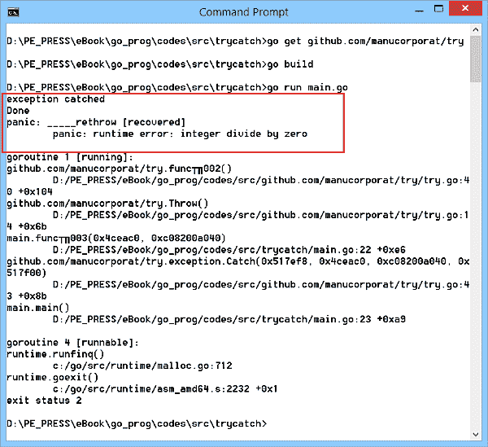

## 9.4 Logging

在上一节中，我们使用 `fmt.Println()` 在控制台打印错误消息。想象一下控制台上有许多消息，我们想要识别哪个是错误消息。Go 包提供了 "log" 来处理日志记录。

为了说明，我们通过创建文件夹 `logging` 创建一个项目。

```
$ mkdir logging
$ cd logging
```

然后，尝试创建一个文件 `main.go`，并编写此代码。

```go
package main

import (
    "fmt"
    "log"
    "os"
)

func main() {
    simpleLogging()

}

func simpleLogging(){
    fmt.Println("-----------simple logging-----------")
    log.Println("Hello World")
    log.Println("This is a simple error")
}
```

现在你可以构建并运行它。

```
$ go build
$ go run main.go
```

该程序的输出显示在下图中。

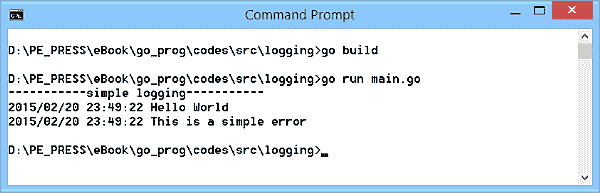

我们可以通过修改 `log.Logger` 对象来修改日志格式。为了说明，创建一个名为 `formattingLogging()` 的函数，并编写此代码。

```go
func main() {
    formattingLogging()

}

func formattingLogging(){
    fmt.Println("-----------formattingLogging-----------")
    var warning *log.Logger

    warning = log.New(
        os.Stdout,
        "WARNING: ",
        log.Ldate|log.Ltime|log.Lshortfile)

    warning.Println("This is warning message 1")
    warning.Println("This is warning message 2")
}
```

现在你可以构建并运行此程序。示例输出可在下图中看到。

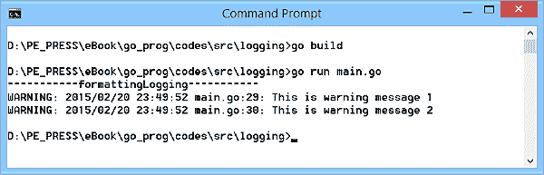

我们也可以将日志消息保存到文件中。例如，我们将它们保存到 `myapp.log` 中。基本上，我们可以使用 `os.OpenFile()` 打开文件。然后，将此对象传递给 `log.Logger` 对象。

尝试创建 `fileLogging()` 函数并编写此代码。

```go
func main() {
    fileLogging()

}

func fileLogging(){
    fmt.Println("-----------file logging-----------")
    file, err := os.OpenFile("d:/temp/myapp.log", 
            os.O_CREATE|os.O_WRONLY|os.O_APPEND, 0666)
    if err != nil {
        fmt.Println("Failed to open log file")
        return
    }

    var logFile *log.Logger
    logFile = log.New(
        file,
        "APP: ",
        log.Ldate|log.Ltime|log.Lshortfile)

    logFile.Println("This is error message 1")
    logFile.Println("This is error message 2")
    logFile.Println("This is error message 3")
    fmt.Println("Done")
}
```

注意：你可以根据你的平台更改文件路径。

现在你可以构建并运行此程序。

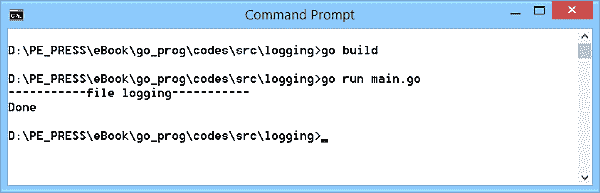

之后，你可以打开 `myapp.log` 文件。你将在此文件中看到日志消息。

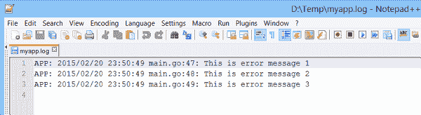

# 10. 构建自己的 Go 包

本章解释如何构建自己的 Go 包

## 10.1 创建简单模块

在本节中，我们创建一个简单模块。我们将从同一包 `main` 包中的外部文件 `*.go` 调用函数。

首先，创建新项目，名为 `mymodule`。

```
$ mkdir mymodule
$ cd mymodule
```

然后，创建一个文件，名为 `simplemath.go`。我们定义三个函数。编写以下代码。

```go
package main

func Add(a,b int) int {

    return a+b
}
func Subtract(a,b int) int {

    return a-b
}
func Multiply(a,b int) int {

    return a*b
}
```

注意：方法名称以 PascalCase 编写，例如 `HelloWorld()`、`DoProcessing()`、`IsEmpty()`。

现在我们将从主入口调用 `simplemath.go` 中的三个函数。创建一个新文件，名为 `main.go`，并编写此代码。

```go
package main

import (
    "fmt"

)

func main(){

    fmt.Println("access mymodule...")
    var c int
    c = Add(10,6)
    fmt.Printf("add()=%d\n",c)
    c = Subtract(5,8)
    fmt.Printf("subtract()=%d\n",c)
    c = Multiply(5,3)
    fmt.Printf("multiply()=%d\n",c)
}
```

全部保存。

现在你可以测试构建并运行程序。

```
$ go build
$ go run main.go simplemath.go
```

示例输出可在下图看到。

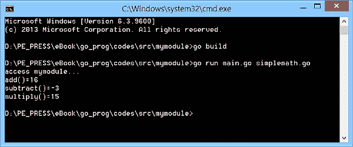  

## 10.2 构建自己的包

在之前的程序中，我们在 main 包中创建了一个模块。我们创建一个包然后在程序中使用它。

我们要做的第一件事是配置 `GOPATH`。它代表我们的工作区路径，例如，我的工作区路径是 `D:\\PE_PRESS\\eBook\\go_prog\\codes`。在 Linux/Mac 上，你可以在你的账户主目录下定义自己的工作区路径，例如。更多信息，你可以阅读 [`golang.org/doc/code.html`](https://golang.org/doc/code.html) 。

如果你使用 Linux/Mac，你可以使用 export 命令定义 `GOPATH` 或将其添加到你的配置文件中。

```
$ mkdir $HOME/go
$ export GOPATH=$HOME/go
```

如果你使用 Windows 平台，打开 `环境变量`。你可以通过 `高级系统设置` 打开它。然后点击 `环境变量` 按钮。在你的用户和系统变量中添加 `GOPATH`。

  

在本节中，我们按如下方式组织工作区：

\---- `$GOPATH`

\-------src  

\----------simplemodule

\----------simplemoduletest  

例如，我们已经在 `GOPATH` 下。然后创建 `src/simplemodule` 和 `src/simplemoduletest` 文件夹。

```
$ mkdir src
$ cd src
$ mkdir simplemodule
$ mkdir simplemoduletest
```

我们实验室路径的示例说明如下图所示。

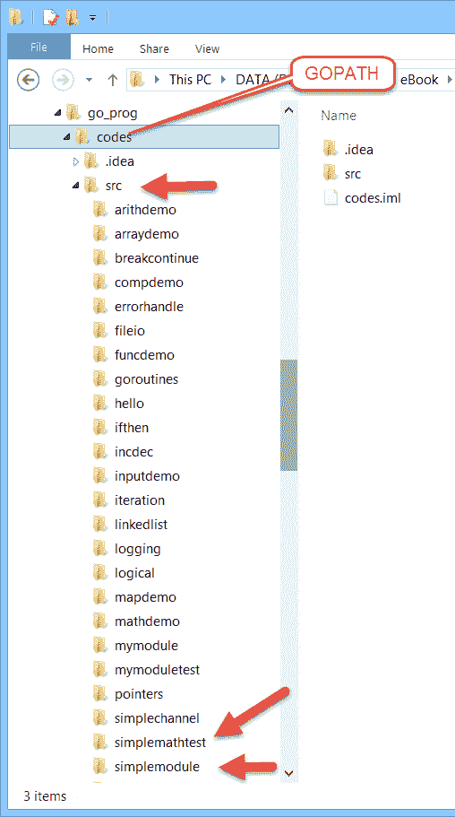  

现在你可以在 `simplemath` 文件夹上创建一个名为 `simplemath.go` 的文件。编写以下代码。

```
package simplemath

func Add(a,b int) int {

    return a+b
}
func Subtract(a,b int) int {

    return a-b
}
func Multiply(a,b int) int {

    return a*b
}
```

注意：方法名以帕斯卡命名法书写，例如 `HelloWorld()`、`DoProcessing()`、`IsEmpty()`。  

要编译我们的包，你可以导航到 `simplemodule` 目录，然后调用 `go build` 并安装。

```
$ cd simplemodule
$ go build
$ go install
```

如果成功，它会创建一个名为 `pkg` 的文件夹。你可以看到编译后的包文件，例如 `simplemodule.a`

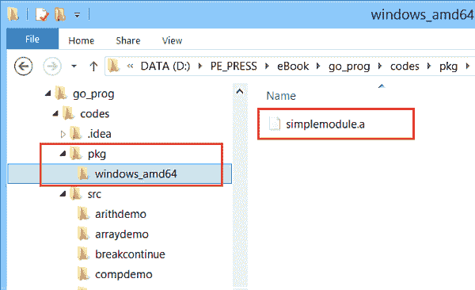  

下一步是使用 simplemodule 包。

在 simplemathtest 文件夹上创建一个名为 `main.go` 的文件。

```
package main

import (
    "fmt"
    "simplemodule"
)

func main(){

    fmt.Println("access mymodule...")
    var c int
    c = simplemath.Add(5,8)
    fmt.Printf("add()=%d\n",c)
    c = simplemath.Subtract(5,8)
    fmt.Printf("subtract()=%d\n",c)
    c = simplemath.Multiply(5,3)
    fmt.Printf("multiply()=%d\n",c)
}
```

全部保存。现在你可以编译并运行此程序。

```
$ cd simplemathtest
$ go build
$ go run main.go
```

你可以看到示例输出如下图所示。

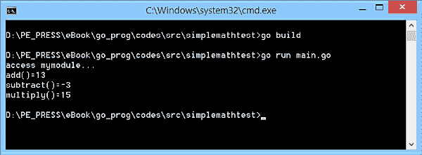  

# 11. 并发

本章解释如何在 Go 中创建并发

## 11.1 入门

我们可以使用 Go 在后台运行程序或函数。本章我们探索多个场景来构建并发应用程序。

## 11.2 Goroutines

基本上，我们可以使用 `go..<program code>` 定义我们的 Go 后台。

为说明起见，创建一个名为 goroutines 的新项目。

```
$ mkdir goroutines
$ cd goroutines
```

创建一个文件 `maing.go`，并写入此代码。


```go
package main

import (
    "fmt"
    "time"
)

func main(){

    fmt.Printf("goroutines demo\n")

    // run func in background
    go calculate()

    index := 0
    // run in background
    go func() {
        for index < 6 {
            fmt.Printf("go func() index= %d \n", index)
            var result float64 = 2.5 * float64(index)
            fmt.Printf("go func() result= %.2f \n", result)

            time.Sleep(500 * time.Millisecond)
            index++
        }
    }()
    // run in background
    go fmt.Printf("go printed in the background\n")

    // press ENTER to exit
    var input string
    fmt.Scanln(&input)
    fmt.Println("done")

}
func calculate() {
    i := 12
    for i < 15 {
        fmt.Printf("calculate()= %d \n", i)
        var result float64 = 8.2 * float64(i)
        fmt.Printf("calculate() result= %.2f \n", result)

        time.Sleep(500 * time.Millisecond)
        i++
    }
}
```

在这段代码中，我们尝试在后台运行函数和代码行。我们使用 `go` 语句表示后台进程。

全部保存。

现在你可以测试构建并运行程序。

```
$ go build
$ go run main.go
```

示例输出可在下图看到。

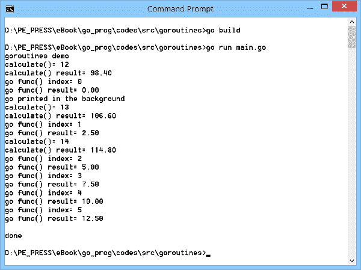

你可以看到程序由于所有代码都在后台运行而随机执行。

## 11.3 同步 Goroutines

我们可以在 Go 中同步后台代码。其中一个解决方案是使用 `sync` 库。本节我们使用 `sync.Mutex.Lock` 和 `sync.Mutex.Unlock` 进行同步。

为说明起见，创建一个名为 `syncgoroutines` 的新项目。

```
$ mkdir syncgoroutines
$ cd syncgoroutines
```

创建一个文件 `main.go`，并写入此代码。

```go
package main

import (
    "fmt"
    "sync"
    "math/rand"
    "time"
)

type Task struct {
    value int
    executedBy string
}

var total int
var task Task
var lock sync.Mutex

func main(){

    fmt.Printf("synchronizing goroutines demo\n")
    total = 0
    task.value = 0
    task.executedBy = ""
    display()

    // run background
    go calculate()
    go perform()

    // press ENTER to exit
    var input string
    fmt.Scanln(&input)
    fmt.Println("done")
}

func calculate(){

    for total < 10 {
        lock.Lock()
        task.value = rand.Intn(100)
        task.executedBy = "from calculate()"
        display()
        total++
        lock.Unlock()
        time.Sleep(500 * time.Millisecond)
    }
}
func perform(){

    for total < 10 {
        lock.Lock()
        task.value = rand.Intn(100)
        task.executedBy = "from perform()"
        display()
        total++
        lock.Unlock()
        time.Sleep(500 * time.Millisecond)
    }
}
func display(){
    fmt.Println("--------------------------")
    fmt.Println(task.value)
    fmt.Println(task.executedBy)
    fmt.Println("--------------------------")

}
```

全部保存。

现在你可以测试构建并运行程序。

```
$ go build
$ go run main.go
```

示例输出可在下图看到。

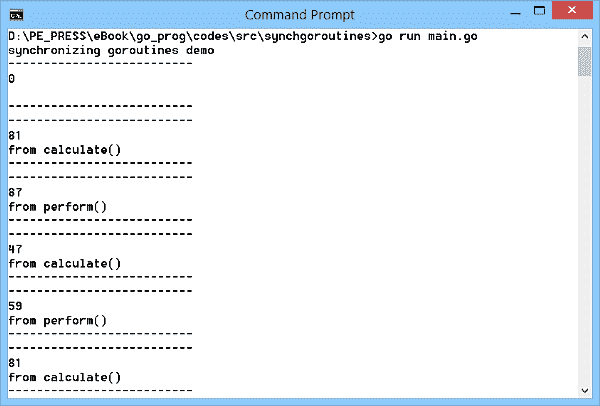

## 11.4 通道

我们可以在 Go 中创建通道，然后使用这些通道在 Goroutines 之间通信。为说明起见，我们创建一个保存数字数据的通道。要向通道插入数据，我们可以使用 `channel <-`。否则，我们可以使用 `<- channel` 从通道获取数据。

为测试，创建一个名为 `simplechannel` 的新项目。

```
$ mkdir simplechannel
$ cd simplechannel
```

创建一个文件 `main.go`，并写入此代码。

```go
package main

import (
    "fmt"
)


func main(){

    fmt.Println("simple channel")

    // define a channel
    c := make(chan int)

    // run a function in background
    go func() {
        fmt.Println("goroutine process")

        c <- 10   // write data to a channel
    }()

    val := <-c // read data from a channel
    fmt.Printf("value: %d\n",val)
}
```

全部保存。

现在你可以测试构建并运行程序。

```
$ go build
$ go run main.go
```

示例输出可在下图看到。

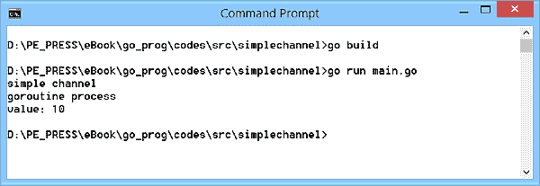

# 12. 编码

本章解释如何在 Go 中处理编码

## 12.1 入门

在本章中，我们探索编码包，[`golang.org/pkg/encoding/`](http://golang.org/pkg/encoding/)。以下是我们演示如何使用编码包的列表：

*   Base64
*   十六进制
*   JSON
*   XML
*   CSV

For testing, you can create a new project, called `encoding`.

```
$ mkdir encoding
$ cd encoding
```

Create a file, `main.go`. Firstly, we import our Go packages for the demo. Write this code.

```go
package main

import (
    "fmt"
    "encoding/base64"
    "encoding/hex"
    "encoding/json"
    "encoding/xml"
    "encoding/csv"
    "os"
)
```

## 12.2 Encoding Base64

The first demo is to work with base64 encoding. We can use `base64` package, [`golang.org/pkg/encoding/base64/`](http://golang.org/pkg/encoding/base64/). To encode string to base64 string, we can use `EncodeToString()`. Otherwise, we can decode it using `DecodeString()` function.

For testing, we encode a string message to base64. Then, we decode base64 message to original message. Create a function, called `demoBase64()`. Call this function to main entry.

```go
func main(){

    message := "hello,go (*w3hu%#"
    demoBase64(message)

}

func demoBase64(message string) {

    fmt.Println("--------Demo encoding base64--------")

    fmt.Println("plaintext:")
    fmt.Println(message)

    encoding := base64.StdEncoding.EncodeToString([]byte(message))
    fmt.Println("base64 msg:")
    fmt.Println(encoding)

    decoding, _ := base64.StdEncoding.DecodeString(encoding)
    fmt.Println("decoding base64 msg:")
    fmt.Println(string(decoding))

}
```

Save all.

Now you can test to build and run the program.

```
$ go build
$ go run main.go
```

A sample output can be seen in Figure below.


## 12.3 Hexadecimal

The second demo is to encode and decode string to Hexademical. We can use `hex` package, [`golang.org/pkg/encoding/hex/`](http://golang.org/pkg/encoding/hex/), to implement our demo.

Create a function, called `demoHex()`. The following is implementation of encoding/decoding Hexadecimal.

```go
func main(){

    message := "hello,go (*w3hu%#"
    demoHex(message)

}

func demoHex(message string) {

    fmt.Println("--------Demo encoding Hex--------")

    fmt.Println("plaintext:")
    fmt.Println(message)

    encoding := hex.EncodeToString([]byte(message))
    fmt.Println("Hex msg:")
    fmt.Println(encoding)

    decoding, _ := hex.DecodeString(encoding)
    fmt.Println("decoding Hex msg:")
    fmt.Println(string(decoding))
}
```

Save this code. Now you can build and run this program.

A sample output can be seen in Figure below.


## 12.4 JSON

The third demo is to construct and parse JSON data. In Go, we can use `json` package, [`golang.org/pkg/encoding/json/`](http://golang.org/pkg/encoding/json/). In this demo, we try to convert struct data to JSON data. Then, we can convert JSOn string to struct.

Now you can create a function, called `demoJson()`, and write this code.

```go
func main(){

    demoJson()

}

func demoJson(){

    fmt.Println("--------Demo encoding json--------")
    type Employee struct {
        Id string  `json:"id"`
        Name string `json:"name"`
        Email string `json:"email"`
    }

    // struct to json
    fmt.Println(">>>>struct to json....")
    emp := &Employee{Id:"12345",Name:"Michael",Email:"michael@email.com"}
    b, err := json.Marshal(emp)
    if err != nil {
        fmt.Println(err)
        return
    }
    fmt.Println(string(b))

    // json string to struct
    fmt.Println(">>>>json to struct....")
    var newEmp Employee
    str := `{"Id":"4566","Name":"Brown","Email":"brown@email.com"}`
    json.Unmarshal([]byte(str),&newEmp)
    fmt.Printf("Id: %s\n",newEmp.Id)
    fmt.Printf("Name: %s\n",newEmp.Name)
    fmt.Printf("Email: %s\n",newEmp.Email)
}
```

Save this code. Now you can build and run this program.

A sample output can be seen in Figure below.


## 12.5 XML

The fourth demo is to read and write XML data. We xml package, [`golang.org/pkg/encoding/xml/`](http://golang.org/pkg/encoding/xml/). In this demo, we construct XML from a struct which has nested struct. In XML data nested struct can be converted to XML attribute and value.

Now you can create a function, called `demoXml()`, and write this code.


```
func main(){

    demoXml()

}

func demoXml(){

    fmt.Println("--------Demo encoding xml--------")
    type EmployeeCountry struct {
        CountryCode string `xml:"code,attr"` // XML attribute: code
        CountryName  string `xml:",chardata"`    // XML value
    }
    type Employee struct {
        XMLName   xml.Name `xml:"employee"`
        Id string  `xml:"id"`
        Name string `xml:"name"`
        Email string `xml:"email"`
        Country EmployeeCountry `xml:"country"`
    }


    // struct to xml
    fmt.Println(">>>>struct to xml....")
    emp := &Employee{Id:"12345",Name:"Michael",Email:"michael@email.com",
                    Country: EmployeeCountry{CountryCode:"DE",CountryName:"Germany"}}
    b, err := xml.Marshal(emp)
    if err != nil {
        fmt.Println(err)
        return
    }
    fmt.Println(string(b))

    // xml string to struct
    fmt.Println(">>>>xml to struct....")
    var newEmp Employee
    str := `<employee><id>555</id><name>Lee</name><email>lee@email.com</email><country code="CN">China</country></employee>`
    xml.Unmarshal([]byte(str),&newEmp)
    fmt.Printf("Id: %s\n",newEmp.Id)
    fmt.Printf("Name: %s\n",newEmp.Name)
    fmt.Printf("Email: %s\n",newEmp.Email)
    fmt.Printf("CountryCode: %s\n",newEmp.Country.CountryCode)
    fmt.Printf("CountryName: %s\n",newEmp.Country.CountryName)
}
```

Save this code. Now you can build and run this program.

A sample output can be seen in Figure below.


## 12.6 CSV

The last demo is to read and write data CSV which is a collection of comma-separated data. We can access CSV file using `csv` package, [`golang.org/pkg/encoding/csv/`](http://golang.org/pkg/encoding/csv/).

For testing, we have a CSV file, `demo.csv`, with the following content.

```
Employee 1;employee1@email.com;DE
Employee 2;employee2@email.com;UK
Employee 3;employee3@email.com;UK
Employee 4;employee4@email.com;NL
Employee 5;employee5@email.com;US
Employee 6;employee6@email.com;JP
Employee 7;employee7@email.com;DE
```


Create a function, `demoCsv()`. This function will read CSV file, `demo.csv`, and convert these data to array of struct. After that, we write array of struct to a new CSV file, called `employee.csv`.

The following is implementation of reading/writing CSV file.

```go
func main(){

    demoCsv()

}

func demoCsv(){

    fmt.Println("--------Demo encoding csv--------")
    type Employee struct {
        Name string
        Email string
        Country string
    }

    // read csv file to a array of struct
    fmt.Println(">>>>read a csv file and load to array of struct....")
    file, err := os.Open("D:/PE_PRESS/eBook/go_prog/codes/src/encoding/demo.csv")

    if err != nil {
        fmt.Println(err)
        return
    }
    defer file.Close()
    reader := csv.NewReader(file)
    reader.FieldsPerRecord = 3
    reader.Comma = ';'

    csvData, err := reader.ReadAll()
    if err != nil {
        fmt.Println(err)
        os.Exit(1)
    }

    var emp Employee
    var employees []Employee

    for _, item := range csvData {
        emp.Name = item[0]
        emp.Email = item[1]
        emp.Country = item[2]
        employees = append(employees, emp)
        fmt.Printf("name: %s email: %s  country: %s\n", item[0], item[1],item[2])
    }
    fmt.Println(">>>>show all employee structs....")
    fmt.Println(employees)

    // write data to csv file
    fmt.Println(">>>>write data to a csv file ....")
    csvFile, err := os.Create("D:/PE_PRESS/eBook/go_prog/codes/src/encoding/employee.csv")
    if err != nil {
        fmt.Println("Error:", err)
        return
    }
    defer csvFile.Close()

    writer := csv.NewWriter(csvFile)
    writer.Comma = ';'
    for _, itemEmp := range employees {
        records := []string{itemEmp.Name,itemEmp.Email,itemEmp.Country}
        err := writer.Write(records)
        if err != nil {
            fmt.Println("Error:", err)
            return
        }
    }
    writer.Flush()
    fmt.Println(">>>>Done")

}
```

注意：你可以更改 CSV 文件路径。

保存此代码。现在你可以构建并运行此程序。

示例输出可在下图看到。


如果打开 `employee.csv`，你会得到类似 `demo.csv` 文件内容的员工数据内容。


# 13. 哈希与密码学

本章解释如何在 Go 中使用哈希和密码学

## 13.1 入门

哈希是通过数学函数从文本字符串生成值或值。密码学是在存在第三方（称为对手）的情况下进行安全通信的实践和研究，[`en.wikipedia.org/wiki/Cryptography`](http://en.wikipedia.org/wiki/Cryptography)。在本章中，我不解释数学哈希和密码学。你可以在教科书上阅读这些材料。

在本章中，我们将探索如何使用 Go 实现哈希。本书中使用的哈希算法如下：

* MD5

* SHA256

* 带密钥的哈希（`HMAC`）

下一个主题是使用 Go 实现密码学。我们将探索对称和非对称密码学。

首先，我们可以创建一个名为 `cryptodemo` 的新项目。

```
$ mkdir cryptodemo
$ cd cryptodemo
```

创建一个文件 `main.go`。首先，我们为演示导入 Go 包。编写此代码。

```
package main

import (
    "fmt"
    "crypto/md5"
    "crypto/sha256"
    "crypto/hmac"
    "crypto/aes"
    "crypto/rsa"
    "crypto/cipher"
    "crypto/rand"
    "crypto/x509"
    "encoding/hex"
    "encoding/base64"
    "encoding/pem"
    "io"
    "io/ioutil"
)
```

让我们开始使用 Go 探索哈希和密码学。

## 13.2 哈希

基本上，你可以通过 [`golang.org/pkg/crypto/`](http://golang.org/pkg/crypto/) 探索如何使用 Go 实现哈希或哈希函数。在本节中，我们将探索几种哈希算法，例如 MD5、SHA256 和 HMAC。

### 13.2.1 使用 MD5 进行哈希

我们可以使用 `md5` 包使用 MD5，[`golang.org/pkg/crypto/md5/`](http://golang.org/pkg/crypto/md5/)。要从文本计算哈希值，我们可以调用 `Sum()` 函数。

为了说明，我们创建一个函数 `demoHash_md5()`，并编写此代码。

```
func demoHash_md5() {

    fmt.Println("--------Demo encoding hash using md5--------")

    message := "Hello world, go!"
    fmt.Println("plaintext:")
    fmt.Println(message)

    h := md5.New()
    h.Write([]byte(message))
    hash_message := hex.EncodeToString(h.Sum(nil))
    fmt.Println("hashing message:")
    fmt.Println(hash_message)

}
```

### 13.2.2 使用 SHA256 进行哈希

第二个演示是使用 SHA256 实现哈希函数。Go 提供了 `sha256` 包，[`golang.org/pkg/crypto/sha256/`](http://golang.org/pkg/crypto/sha256/)，用于使用 SHA256 实现哈希函数。

为了说明，我们创建一个函数 `demoHash_sha256()`，并编写此代码。

```
func demoHash_sha256() {

    fmt.Println("--------Demo encoding hash using sha256--------")

    message := "Hello world, go!"
    fmt.Println("plaintext:")
    fmt.Println(message)

    h := sha256.New()
    h.Write([]byte(message))
    hash_message := hex.EncodeToString(h.Sum(nil))
    fmt.Println("hashing message:")
    fmt.Println(hash_message)
}
```

### 13.2.3 使用密钥进行哈希，使用 HMAC

带密钥的哈希消息认证码（`HMAC`）是一种用于计算消息认证码（`MAC`）的特定构造，涉及密码学哈希函数与秘密密码学密钥的组合，[`en.wikipedia.org/wiki/Hash-based_message_authentication_code`](http://en.wikipedia.org/wiki/Hash-based_message_authentication_code)。在 Go 中，我们可以使用 `hmac` 包，[`golang.org/pkg/crypto/hmac/`](http://golang.org/pkg/crypto/hmac/)，来实现 HMAC 算法。

为了说明，我们创建一个函数 `demoHashKey()`，并编写此代码。

```
func demoHashKey(key,message string) {

    fmt.Println("--------Demo encoding hash with key: HMAC and sha256--------")

    fmt.Println("key:")
    fmt.Println(key)
    fmt.Println("plaintext:")
    fmt.Println(message)

    hmacKey := []byte(key)
    h := hmac.New(sha256.New, hmacKey)
    h.Write([]byte(message))
    hash_message := hex.EncodeToString(h.Sum(nil))
    fmt.Println("hashing message:")
    fmt.Println(hash_message)

}
```

### 13.2.4 测试

保存第 13.2.1、13.2.2 和 13.2.3 节的演示代码全部代码。为了测试，我们在 main 入口调用这些函数。编写此代码。

```
func main(){
    demoHash_md5()
    demoHash_sha256()
    demoHashKey("mykey","Hello world, go!")
}
```

保存全部。

现在你可以测试构建并运行程序。

```
$ go build
$ go run main.go
```

示例输出可在下图看到。


## 13.3 密码学

在本节中，我们关注对称和非对称密码学。在对称密码学中，我们使用相同的密钥进行加密和解密。否则，非对称密码学使用不同的密钥进行加密和解密。

我们在下一节中探索这些。

### 13.3.1 对称密码学

有许多算法可以实现对称密码学。在本节中，我们使用 AES 算法。高级加密标准（`AES`）是由美国国家标准与技术研究院（`NIST`）于 2001 年制定的电子数据加密规范，[`en.wikipedia.org/wiki/Advanced_Encryption_Standard`](http://en.wikipedia.org/wiki/Advanced_Encryption_Standard)。

为了说明，我们创建两个函数 `encrypt_symmetric_crpyto()` 和 `decrypt_symmetric_crpyto()`。以下是 `encrypt_symmetric_crpyto()` 的实现。


```go
func encrypt_symmetric_crpyto(key,message string) string {

    fmt.Println("--------Demo encrypt encrypt_symmetric_crpyto--------")
    if len(key)!=16 && len(key)!=24 && len(key)!=32 {
        fmt.Println("key must 16,24,32 byte length")
        return  ""
    }
    bc, err := aes.NewCipher([]byte(key))
    if err != nil {
        panic(err)
    }
    text := []byte(message)

    ciphertext := make([]byte, aes.BlockSize+len(text))
    iv := ciphertext[:aes.BlockSize]
    if _, err := io.ReadFull(rand.Reader, iv); err != nil {
        panic(err)
    }
    cfb := cipher.NewCFBEncrypter(bc, iv)
    cfb.XORKeyStream(ciphertext[aes.BlockSize:], text)

    return base64.StdEncoding.EncodeToString(ciphertext)
}
```

说明：

*   定义一个密钥。长度应为 16、24 或 32
*   使用传递的密钥值通过 `NewCipher()` 实例化 AES
*   计算 IV 值
*   通过调用 `NewCFBEncrypter()` 以字节数组格式加密消息
*   结果将被编码为 base64 字符串

以下是 `encrypt_symmetric_crpyto()` 的实现。

```go
func decrypt_symmetric_crpyto(key,message string) string {

    fmt.Println("--------Demo decrypt decrypt_symmetric_crpyto--------")
    if len(key)!=16 && len(key)!=24 && len(key)!=32 {
        fmt.Println("key must 16,24,32 byte length")
        return  ""
    }
    encrypted,_ := base64.StdEncoding.DecodeString(message)

    bc, err := aes.NewCipher([]byte(key))
    if err != nil {
        panic(err)
    }
    if len(encrypted) < aes.BlockSize {
        panic("ciphertext too short")
    }
    iv := encrypted[:aes.BlockSize]
    encrypted = encrypted[aes.BlockSize:]
    cfb := cipher.NewCFBDecrypter(bc, iv)
    cfb.XORKeyStream(encrypted, encrypted)

    return string(encrypted)
}
```

说明：

*   定义一个密钥。长度应为 16、24 或 32
*   使用传递的密钥值通过 `NewCipher()` 实例化 AES
*   计算 IV 值
*   通过调用 `NewCFBDecrypter()` 以字节数组格式加密消息
*   结果将被编码为字符串

现在我们可以在主入口调用这些函数。编写此代码。

```go
func main(){
    // symmetric crypto
    key :=  "this is key 1234"
    message := "Hello world, go!"
    encrypted := encrypt_symmetric_crpyto(key,message)
    fmt.Println("message:")
    fmt.Println(message)
    fmt.Println("key:")
    fmt.Println(key)
    fmt.Println("encrypted:")
    fmt.Println(encrypted)

    decrypted := decrypt_symmetric_crpyto(key,encrypted)
    fmt.Println("encrypted message:")
    fmt.Println(encrypted)
    fmt.Println("key:")
    fmt.Println(key)
    fmt.Println("decrypted:")
    fmt.Println(decrypted)
}
```

现在你可以构建并运行它。示例输出可在下图看到。


### 13.3.2 非对称加密

实现非对称加密的常用算法是 RSA，它被广泛用于安全数据传输。你可以在维基百科阅读简要描述，[`en.wikipedia.org/wiki/RSA_(cryptosystem)`](http://en.wikipedia.org/wiki/RSA_(cryptosystem))。

Go 有 RSA 实现的库。在本节中，我们尝试使用 Go 实现 RSA。以下是我们的场景：

*   生成 RSA 密钥（公钥和私钥）
*   将这些密钥保存到两个文件（公钥文件和私钥文件）
*   加密时，我们使用公钥文件
*   解密时，我们使用私钥文件

我们将公钥和私钥以 PEM 数据编码存储到文件中。我们可以使用 Go 的 `pem` 包，[`golang.org/pkg/encoding/pem/`](http://golang.org/pkg/encoding/pem/)。

要为 RSA 生成公钥和私钥，我们创建一个函数 `generateRSAkeys()`。生成密钥后，我们将这些密钥保存到文件中。以下是生成密钥的实现。

```go
func generateRSAkeys(){
    fmt.Println("Generating RSA keys....")

    // change files and their paths
    privKeyFile := "D:/PE_PRESS/eBook/go_prog/codes/src/cryptodemo/private.rsa.key"
    pubKeyFile := "D:/PE_PRESS/eBook/go_prog/codes/src/cryptodemo/public.rsa.key"

    // generate RSA keys
    privateKey, err := rsa.GenerateKey(rand.Reader, 1024)
    if err != nil {
        panic(err)
    }

    // extract private and public keys from RSA keys
    privASN1 := x509.MarshalPKCS1PrivateKey(privateKey)
    pubASN1, err := x509.MarshalPKIXPublicKey(&privateKey.PublicKey)
    if err != nil {
        panic(err)
    }

    // store private and public keys into files
    privBytes := pem.EncodeToMemory(&pem.Block{
        Type:  "RSA PRIVATE KEY",
        Bytes: privASN1,
    })

    pubBytes := pem.EncodeToMemory(&pem.Block{
        Type:  "RSA PUBLIC KEY",
        Bytes: pubASN1,
    })

    ioutil.WriteFile(privKeyFile, privBytes, 0644)
    ioutil.WriteFile(pubKeyFile, pubBytes, 0644)
    fmt.Println("Done")

}
```

此代码将生成两个文件，`private.rsa.key` 和 `public.rsa.key` 文件。

要加密数据，我们创建一个函数 `encrypt_asymmetric_crypto()`。首先，我们加载公钥。然后，使用 RSA 加密消息。以下是 `encrypt_asymmetric_crypto()` 函数的代码实现。

```go
func encrypt_asymmetric_crypto(message string) string {

    fmt.Println("--------Demo encrypt encrypt_asymmetric_crypto--------")

    // public key file
    pubKeyFile := "D:/PE_PRESS/eBook/go_prog/codes/src/cryptodemo/public.rsa.key"

    // read public key from file
    pubBytes, err := ioutil.ReadFile(pubKeyFile)
    if err != nil {
        panic(err)
    }

    pubBlock, _ := pem.Decode(pubBytes)
    if pubBlock == nil {
        fmt.Println("Failed to load public key file")
        return ""
    }

    // Decode the RSA public key
    publicKey, err := x509.ParsePKIXPublicKey(pubBlock.Bytes)
    if err != nil {
        fmt.Printf("bad public key: %s", err)
        return ""
    }

    // encrypt message
    msg := []byte(message)
    encryptedmsg, err := rsa.EncryptPKCS1v15(rand.Reader, publicKey.(*rsa.PublicKey), msg)
    if err != nil {
        panic(err)
    }

    return base64.StdEncoding.EncodeToString(encryptedmsg)
}
```

要解密数据，我们创建一个函数 `decrypt_asymmetric_crypto()`。首先，我们加载私钥。然后，使用 RSA 解密消息。以下是 `decrypt_asymmetric_crypto()` 函数的代码实现。

```go
func decrypt_asymmetric_crypto(message string) string {

    fmt.Println("--------Demo decrypt decrypt_asymmetric_crypto--------")

    // private key file
    privKeyFile := "D:/PE_PRESS/eBook/go_prog/codes/src/cryptodemo/private.rsa.key"

    // read private key from file
    privBytes, err := ioutil.ReadFile(privKeyFile)
    if err != nil {
        panic(err)
    }

    privBlock, _ := pem.Decode(privBytes)
    if privBlock == nil {
        fmt.Println("Failed to load private key file")
        return ""
    }

    // Decode the RSA private key
    privateKey, err := x509.ParsePKCS1PrivateKey(privBlock.Bytes)
    if err != nil {
        fmt.Printf("bad public key: %s", err)
        return ""
    }

    // encrypt message
    encrypted,_ := base64.StdEncoding.DecodeString(message)
    decrypteddmsg, err := rsa.DecryptPKCS1v15(rand.Reader, privateKey, encrypted)
    if err != nil {
        panic(err)
    }

    return string(decrypteddmsg)
}
```

保存所有内容。现在你可以在主入口实现我们的函数。编写此代码。

```go
func main(){
    // asymmetric crypto
    generateRSAkeys()
    plainText := "Hello world, go!"
    fmt.Println("plainText:")
    fmt.Println(plainText)
    rsa_encrypted := encrypt_asymmetric_crypto(plainText)
    fmt.Println("encrypted:")
    fmt.Println(rsa_encrypted)
    rsa_decrypted := decrypt_asymmetric_crypto(rsa_encrypted)
    fmt.Println("decrypted:")
    fmt.Println(rsa_decrypted)
}
```

现在你可以构建并运行它。示例输出可在下图看到。


你可以打开 `public.rsa.key` 查看我们的 RSA 公钥值。


你也可以打开 `private.rsa.key` 查看我们的 RSA 私钥值。


# 14. 数据库编程

本章介绍如何使用 Go 构建数据库应用程序。

## 14.1 Go 的数据库

Go 可以通过数据库驱动程序与数据库服务器通信。Go 在 `http://golang.org/pkg/database/` 上提供了数据库驱动的通用接口。在开始开发数据库应用程序之前，我们必须安装数据库驱动程序和 Go 数据库包。

在本章中，我只关注 MySQL 场景。

## 14.2 Go 的 MySQL 驱动

我们使用 Go-MySQL-Driver 作为数据库驱动。有关此驱动的更多信息，请访问 `https://github.com/go-sql-driver/mysql`。

要安装 Go-MySQL-Driver，您可以在终端中尝试输入以下命令

```
$ go get github.com/go-sql-driver/mysql
```


完成后，我们可以进行测试。

## 14.3 测试连接

在本节中，我们尝试连接 MySQL 数据库。首先，我们可以创建一个名为 `mysqldemo` 的新项目。

```
$ mkdir mysqldemo
$ cd mysqldemo
```

创建一个文件 `main.go`。首先，我们为演示导入 Go 包。编写此代码。

```
package main

import (
    "fmt"
    "database/sql"
    _ "github.com/go-sql-driver/mysql"
)
```

首先，我们可以开始创建简单的 Go 应用程序以连接到 mysql 数据库。编写此代码

```
func main(){
    testConnection()
}

func testConnection(){
    // 更改数据库用户和密码
    db, err := sql.Open("mysql",string("user:password@tcp(127.0.0.1:3306)/researchdb"))
    if err != nil {
        panic(err)
    }
    err = db.Ping()  // 测试连接
    if err != nil {
        panic(err.Error())
    }
    fmt.Println("connected")
    defer db.Close()
}
```

根据您的 mysql 数据库配置和身份验证更改主机、用户和密码。

保存全部。

现在您可以测试构建和运行程序。

```
$ go build
$ go run main.go
```

示例输出如下图所示。


## 14.4 查询


在本节中，我们尝试向表中插入数据。以下是我们在 MySQL 上的表结构。


以下是使用 Go 向 mysql 数据库插入数据的示例代码。

```
func main(){
    insertData()

}

func insertData(){

    db, err := sql.Open("mysql",string("researcher:researcher@tcp(127.0.0.1:3306)/researchdb"))
    if err != nil {
        panic(err)
    }
    err = db.Ping()  // 测试连接
    if err != nil {
        panic(err.Error())
    }
    fmt.Println("connected")

    // 准备开发
    stmt, err := db.Prepare("INSERT INTO sensordevice(deviceid,temperature,humidity,light_intensity,pressure) VALUES(?,?,?,?,?)")
    if err != nil {
        panic(err)
    }
    defer stmt.Close()
    fmt.Println("inserting data...")
    for i := 0; i < 10; i++ {
        _, err = stmt.Exec(2,0.2*float64(i),0.6*float64(i),0.5*float64(i),0.3*float64(i))
        if err != nil {
            panic(err)
        }
    }
    fmt.Println("done")
    defer db.Close()

}
```

完成后，我们可以进行测试。


您可以在表中验证此数据。


# 15. Socket 编程

本章介绍如何使用 Go 创建 socket 应用程序。

## 15.1 Socket 模块

我们可以使用 `net` 包基于 socket 栈创建应用程序。您可以在 `http://golang.org/pkg/net/` 上找到更多信息。我建议您阅读有关 socket 概念的书籍或网站。

## 15.2 Hello World

入门时，我们创建一个简单的应用程序来获取本地计算机中的 IP 地址列表。我们可以使用 `net` 包并调用 `net.Interfaces()` 来获取本地计算机中网络接口的列表。每个网络接口都提供有关 IP 地址的信息。

在本节中，我们尝试获取本地 IP 地址。首先，我们可以创建一个名为 `netdemo` 的新项目。

```
$ mkdir netdemo
$ cd netdemo
```

创建一个文件 `main.go`。然后，编写此代码。

```
package main

import (
    "fmt"
    "net"
)

func main(){
    ifaces, err := net.Interfaces()
    if err!=nil {
        panic(err)
    }

    fmt.Println("getting local IP Address...")
    for _, i := range ifaces {
        addrs, err := i.Addrs()
        if err!=nil {
            panic(err)
        }
        for _, addr := range addrs {
            switch v := addr.(type) {
                case *net.IPAddr:
                    if v.String()!="0.0.0.0"{
                        fmt.Println(v.String())
                    }
            }
        }
    }
}
```

保存此代码。尝试构建并运行它。

以下是 Windows 上运行的示例程序输出：


## 15.3 客户端/服务器 Socket

现在我们使用 Go 创建客户端/服务器 socket。我们将使用 `net` 包构建客户端/服务器应用程序。为说明目的，我们创建服务器和客户端。

### 15.3.1 服务器 Socket

如何创建服务器 socket？很简单。以下是构建服务器 socket 的简单算法

* 创建服务器 socket
* 在特定端口监听传入客户端
* 如果客户端连接，监听传入数据然后与客户端断开连接

在本节中，我们构建服务器应用。首先，我们可以创建一个名为 `netserver` 的新项目。

```
$ mkdir netserver
$ cd netserver
```

创建一个文件 `main.go`。编写此代码。

```
package main

import (
    "fmt"
    "net"
    "os"
)

const (
    SVR_HOST = "localhost"
    SVR_PORT = "9982"
    SVR_TYPE = "tcp"
)

func main() {
    fmt.Println("server is running")
    svr, err := net.Listen(SVR_TYPE, SVR_HOST+":"+SVR_PORT)
    if err != nil {
        fmt.Println("Error listening:", err.Error())
        os.Exit(1)
    }
    defer svr.Close()
    fmt.Println("Listening on " + SVR_HOST + ":" + SVR_PORT)
    fmt.Println("Waiting client...")

    for {

        conn, err := svr.Accept()
        if err != nil {
            fmt.Println("Error accepting: ", err.Error())
            os.Exit(1)
        }
        fmt.Println("client connected")
        go handleClient(conn)
    }
}

func handleClient(conn net.Conn) {

    buff := make([]byte, 1024)
    msgLen, err := conn.Read(buff)
    if err != nil {
        fmt.Println("Error reading:", err.Error())
    }
    fmt.Println("Received: ",string(buff[:msgLen]))
    conn.Close()
}
```

它使用端口 `9982`。您可以更改它。

### 15.3.2 客户端 Socket

客户端 socket 是连接到服务器然后向/从服务器发送/接收数据的客户端应用程序。我们应该知道目标服务器的 IP 地址和端口。我们可以调用 `net.Dial()` 来连接到服务器。使用 `conn.Write()` 发送数据。

在本节中，我们构建客户端应用。首先，我们可以创建一个名为 `netclient` 的新项目。

```
$ mkdir netclient
$ cd netclient
```

创建一个文件 `main.go`。编写此代码。

```
package main

import (
    "fmt"
    "net"
)

const (
    SVR_HOST = "localhost"
    SVR_PORT = "9982"
    SVR_TYPE = "tcp"
)

func main() {
    fmt.Println("client is running")
    conn, err := net.Dial(SVR_TYPE, SVR_HOST+":"+SVR_PORT)
    if err != nil {
        panic(err)
    }
    fmt.Println("send data")
    _, err = conn.Write([]byte("message from client"))
    defer conn.Close()
}
```

### 15.3.3 测试

现在我们可以测试我们的客户端/服务器应用程序。首先，我们运行服务器应用程序然后执行客户端应用程序。

以下是服务器应用程序的程序输出示例：


以下是客户端应用程序的程序输出示例：


## 源代码

您可以在 `http://www.aguskurniawan.net/book/go_cd.zip` 上下载源代码。

## 联系方式

如果您对本书有任何问题，请通过 `aguskur@hotmail.com` 联系我。我的博客：`http://blog.aguskurniawan.net`
