# Go 语言入门指南：通过教程与实战示例学习 Go 编程语言


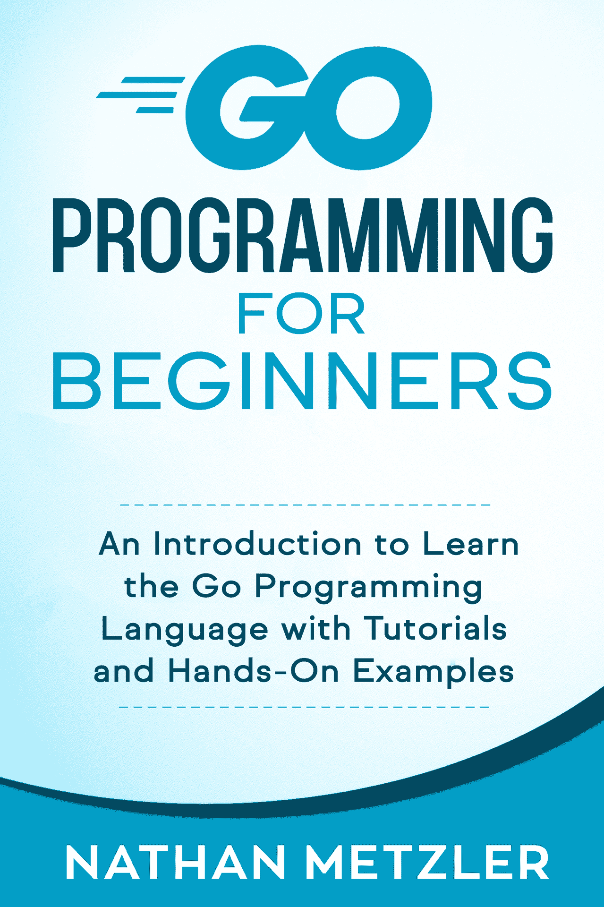


## 1. 简介

有 `C` 和 `C++` 等传奇编程语言，它们用于构建特定于平台和架构的原生软件应用程序，其重点通常在于性能；还有 `Ruby` 和 `Python` 等通用脚本语言，它们几乎可以做任何事情，范围从简单的桌面应用程序到复杂的云应用程序。虽然 `Python` 和 `Ruby` 等语言易于学习、易于编码，并且与 `C/C++` 相比提供了超广泛的功能和库，但性能不如 `C/C++` 好（抱歉 Python 粉丝们，但这是事实！），除非有专用硬件支持来加速应用程序。这是因为脚本通常由一种称为解释器的特殊软件逐行执行，而用 `C/C++` 编写的程序则被编译生成特定于硬件平台的可执行代码，然后运行该可执行代码。

`Go` 编程语言结合了 `C/C++` 等语言的性能和 `Python` 等语言的易用性。`Go` 编程语言也称为 `golang` 或简称 `Go`，是由 `Robert Griesemer`、`Rob Pike` 和 `Ken Thompson` 在 `Google` 设计的一种多范式编程语言。它是一种静态类型、编译型编程语言，支持面向对象、函数式、命令式和并发编程等编程范式。`Go` 的开发始于 `2007` 年的 `Google`，第一个稳定版本于 `2012` 年发布，此前于 `2009` 年底进行了公开宣布。开发人员使用 `C++`、汇编语言和 `Go`（自托管）来实现 `Go` 编程语言。`Go` 有两个主要实现——`gccgo`，它是 `GCC` 编译器的前端，以及 `Google` 的 `Go` 编译器，它面向 `Windows`、`Linux`、`macOS` 和其他类 Unix/BSD 操作系统，如 `DragonFly BSD`、`FreeBSD`、`NetBSD` 等。


# Go 语言的应用范围

使用 Go 语言，你可以构建桌面应用程序、Web 应用程序、Web 服务等。Google 的 Go 语言编译器工具链适用于 Windows、macOS、Linux 和其他类 Unix 操作系统。利用该工具链，你可以构建面向 Windows/类 Unix 操作系统的桌面和服务器应用、嵌入式平台、`WebAssembly` 等目标的应用程序。

目前，尚无稳定的 Go GUI 开发框架，大多数框架通过封装实现且仍在开发中。但这绝非劣势，因为 Go 语言功能强大。正在革新云计算和虚拟化领域的容器化工具 `Docker` 完全由 Go 编写。可以使用 Go 访问 `MySQL`、`PostgreSQL`、`SQLite` 等数据库。你甚至可以开发面向区块链、数据科学、机器学习等较新技术的应用程序。

Go 语言的一个核心卖点是能够构建 `WebAssembly` 应用程序。`WebAssembly` 是一种可在支持的浏览器中运行的代码类型，它是面向 Web 应用程序的可执行二进制代码格式的开放标准，可实现接近原生的性能。利用此特性，你可以用 Go 语言编写高性能 Web 应用程序。

凭借如此灵活性和广泛的用例，Go 正迅速成为最受企业青睐的语言之一，`Uber`、`Twitch`、`Google`、`Dailymotion` 等公司均在使用它实现其部分应用和服务。

## 学习 Go 是否需要编程基础？

简短回答：**不需要**。

详细回答：任何编程经验都会有所帮助。Go 结合了 `C/C++` 等语言的高效性，以及 `Python` 或 `JavaScript` 等语言的易用性和代码可读性。如果你了解这些语言中的任意一种，将能很好地理解 Go 的概念。但即使你是编程零基础或这是你学习的第一门语言，只要具备正确的心态并付出适当努力，也能学会 Go。

话虽如此，你应熟练使用计算机，即了解系统操作，能熟练安装/卸载软件，使用 `Command Prompt`、`PowerShell`、`Terminal`、`Shell` 等工具。

## 本书适合谁？将学到什么？

本书适合所有想学习 Go 编程语言基础的人。内容经过精心设计，适合完全的初学者和有经验的程序员。你将学会为桌面构建和执行简单的控制台应用程序。


## 3. 入门

构建 Go 应用程序需要一台运行 Windows/Linux 的 PC 或一台 MAC 机器。Go 程序是纯文本文件（带有扩展名 `.go`），因此你需要一个文本编辑器来编写 Go 程序。任何文本编辑器都可以胜任，包括 `Notepad`、`Wordpad`、`vi`、`emacs`、`Notepad++` 等。选择一个你最习惯的编辑器即可。或者，你也可以使用 `Eclipse`、`IntelliJ` 等 IDE。为了学习基础知识，我倾向于保持简单，坚持使用简单的文本编辑器而不是 IDE。你需要在机器上安装 Go 编译器工具链，以便构建 Go 应用程序。

## 3.1 在 Windows 上安装 Go

访问 [`golang.org/dl/`](https://golang.org/dl/) 并下载最新的 Windows 安装程序文件，其扩展名为 `.msi`。获得文件后，双击执行。你需要管理员权限才能继续。你将看到如下欢迎屏幕：

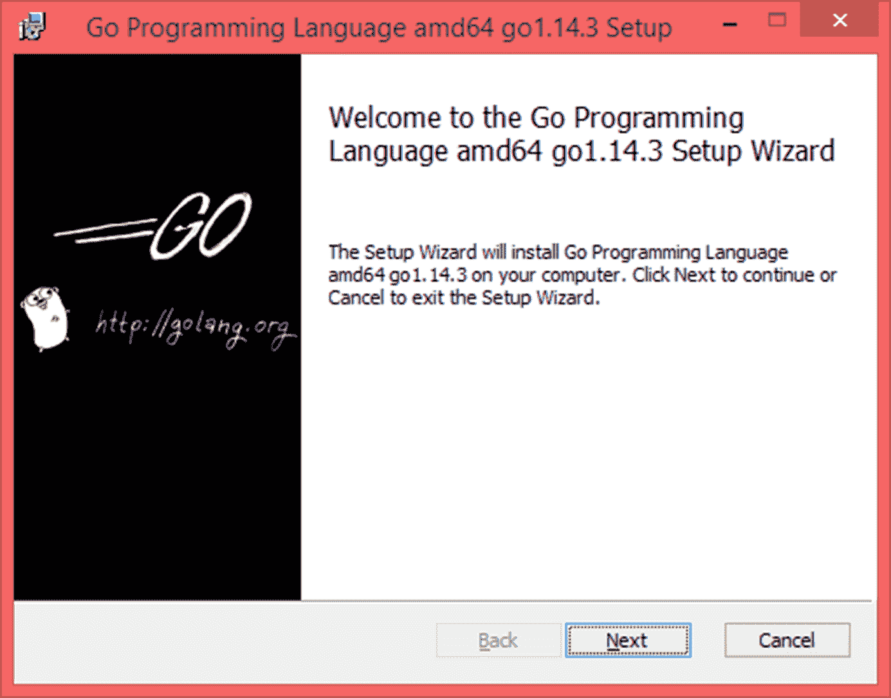

点击**下一步**，将显示最终用户许可协议 (EULA)。

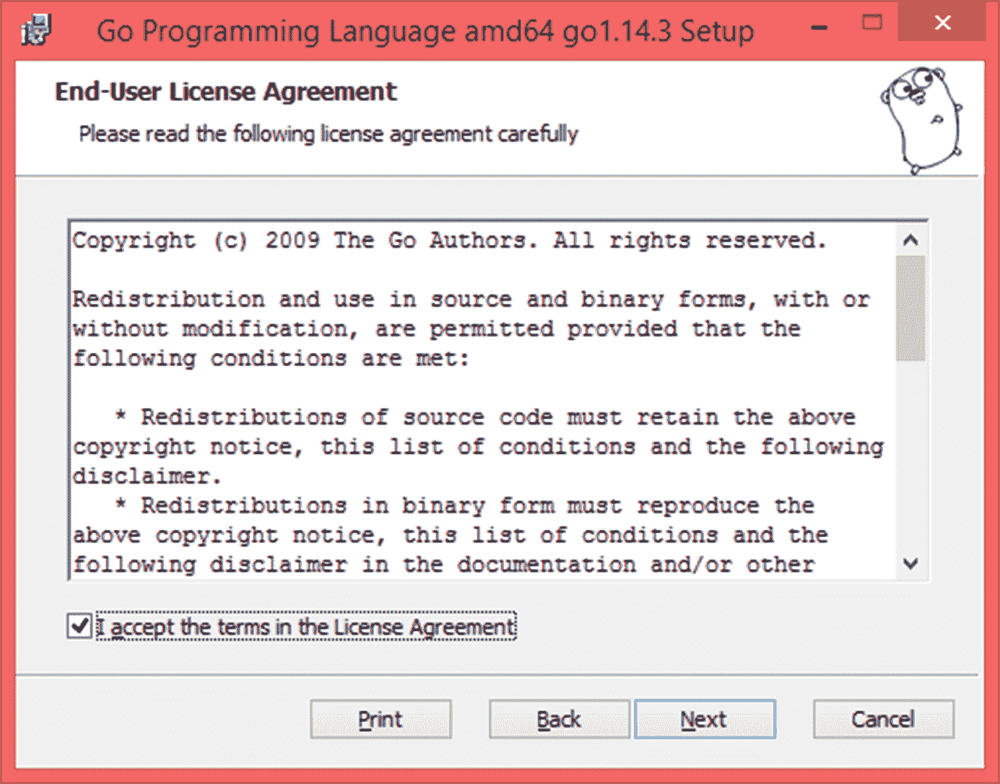

阅读协议，接受条款并点击**下一步**。

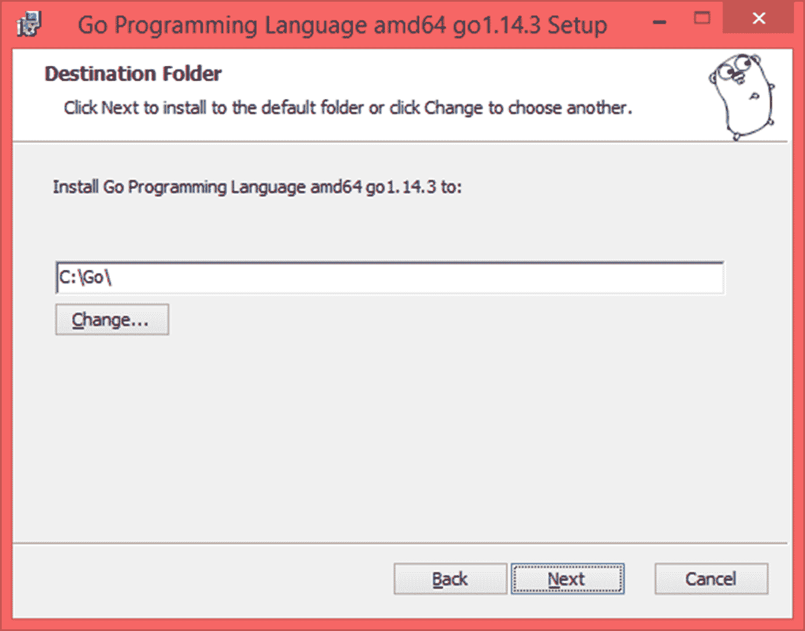

在这里，你可以选择更改安装目录。最好保持默认设置，直接点击**下一步**。

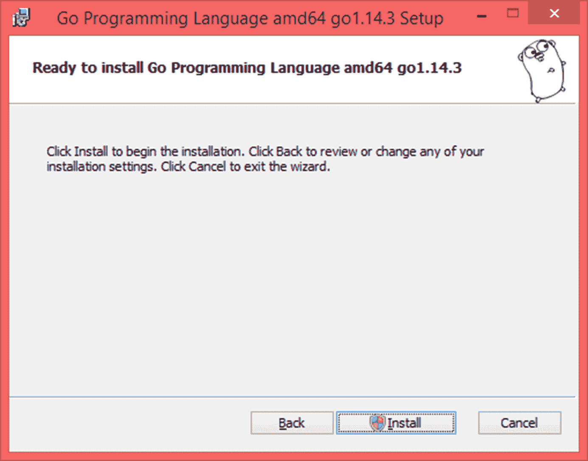

点击**安装**，安装过程将开始。

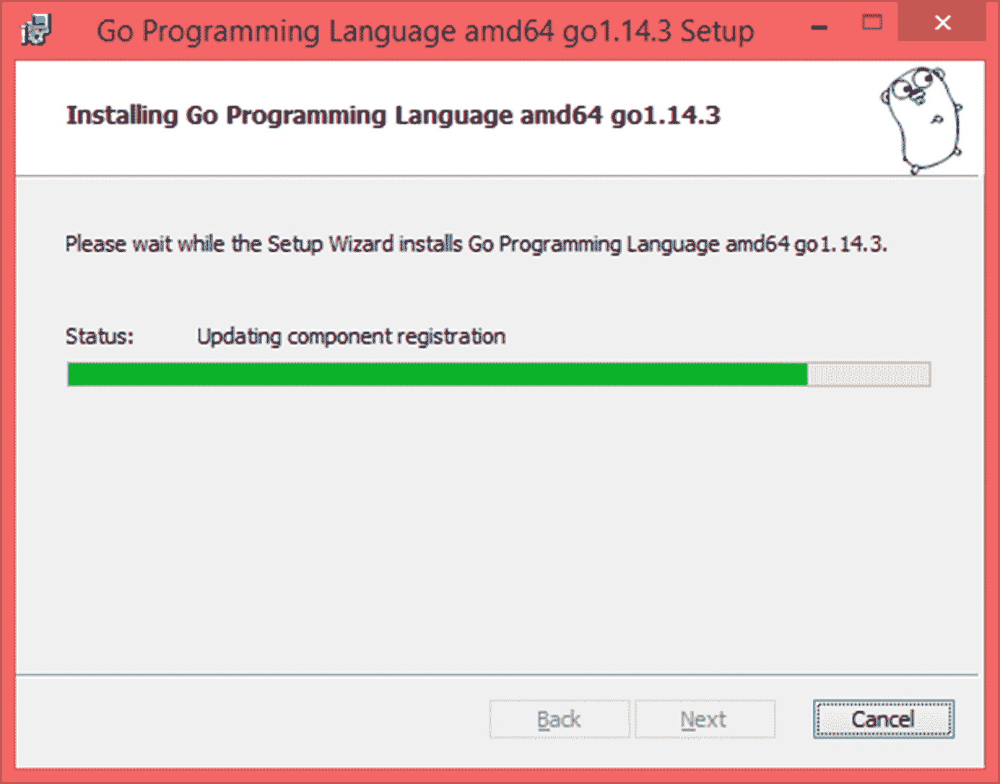

这可能需要几分钟才能完成。完成后，你将看到类似以下的界面：

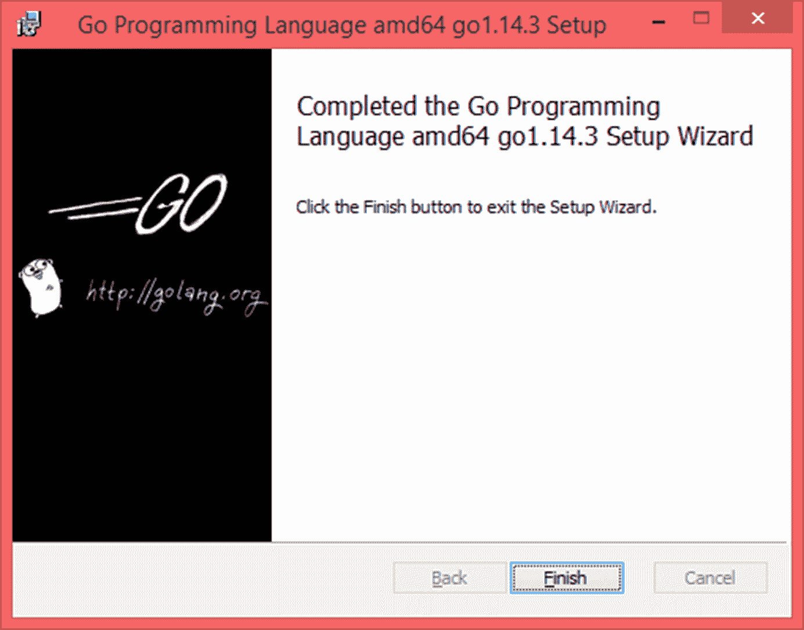

点击**完成**。通过进入 Go 安装目录下的 `bin` 文件夹（如果安装时未更改，通常为 `C:\Go\`），验证 Go 安装，确保存在名为 `go.exe` 的可执行文件：

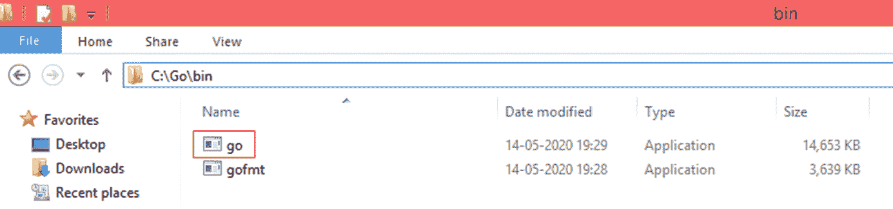

或者，你可以使用命令提示符中的 `cd` 命令导航到 Go 安装目录，并使用 `dir` 命令列出目录内容：

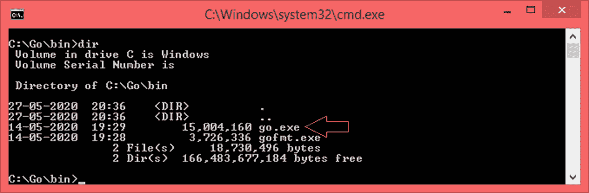

Go 安装程序会自动将该 `bin` 目录的路径添加到 `PATH` 环境变量中。这使得 `go.exe` 可以从任何位置访问。要检查这一点，打开命令提示符或 PowerShell 并输入以下命令：

```
go
# 或
go.exe
```

如果你看到类似以下截图的内容，则意味着 Go 安装成功且 `PATH` 变量设置正确：

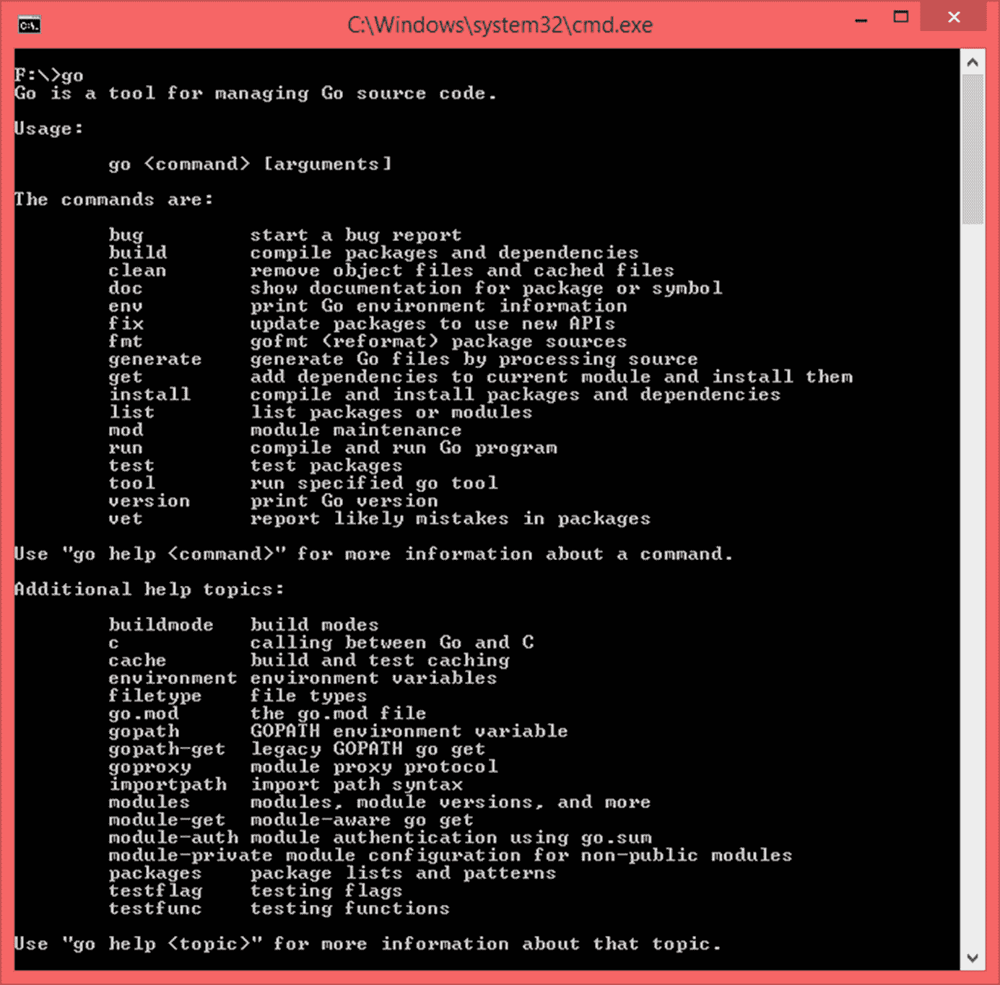

如果你看到类似这样的提示 – `go` 不是内部或外部命令，也不是可运行的程序或批处理文件。这意味着安装有问题，或者 `PATH` 变量未正确设置。在这种情况下，使用 `echo %PATH%` 命令检查 `PATH` 变量，如果未添加 Go 的 `bin` 目录，请通过系统属性（`Windows 键 + Pause Break`）手动添加。如果 `PATH` 变量设置正确但仍找不到 `go` 命令，请重新执行安装过程。

## 3.2 在类 Unix 操作系统上安装 Go

如果你使用 Linux、macOS、FreeBSD、DragonFly BSD 等类 Unix 操作系统，请从 [`golang.org/dl/`](https://golang.org/dl/) 下载适合你操作系统的安装文件。安装过程因操作系统而异。最好遵循此链接 [`golang.org/doc/install`](https://golang.org/doc/install) 处提供的官方 Go 文档，了解如何在特定操作系统上安装 Go。

> **注意：** 本书演示的程序是在 Windows 机器上编写、构建和执行的。除非另有说明，否则它们应该可以在类 Unix 操作系统上直接编译通过。

## 3.3 编译和执行 Go 程序

如前所述，Go 程序是带有扩展名 `.go` 的纯文本文件。Go 是一门编译型语言。也就是说，一种称为编译器的特殊软件将纯文本 Go 程序转换为可执行文件。以下是编译过程的概念框图：

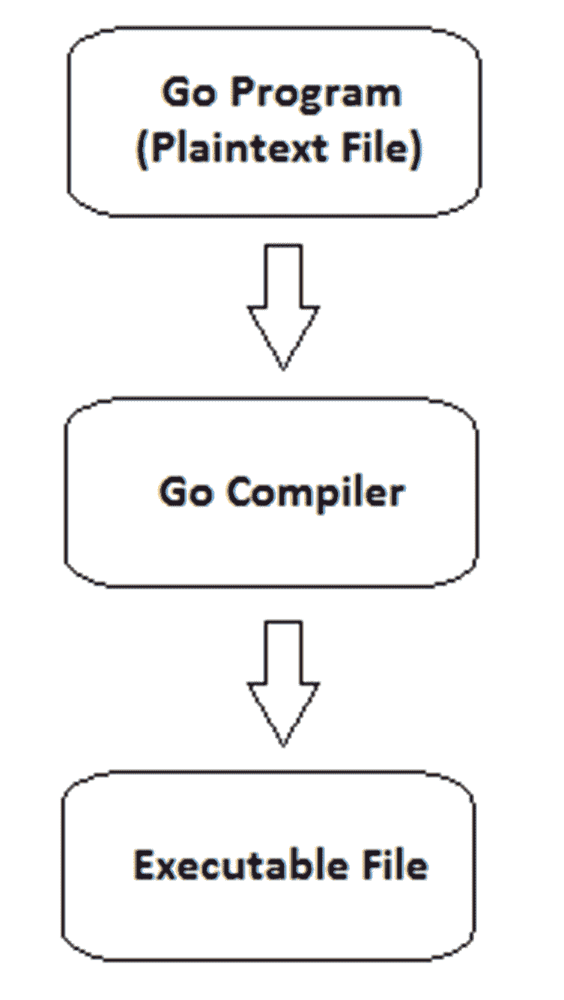

简单来说，将 Go 程序提供给 Go 编译器，后者将纯文本文件转换为可执行的二进制文件。当然，这其中还有更多内容；编译过程涉及许多技术概念，但这对用户是透明的，因此除非你从事底层系统软件设计或编译器设计领域，否则无需了解这些。现在让我们看看如何编译和执行 Go 程序。

### 3.3.1 在 Windows 上

在 Windows 上打开命令提示符/PowerShell，导航到包含要编译和执行的程序的目录，并输入以下命令：

```
go build <程序文件>
```

**示例：** `go build test.go`

当你输入 `go build <程序文件>` 时，`go` 命令指向作为 Go 编译器的 `go.exe` 文件。要编译的程序作为命令行参数传递给该工具，在上述命令中由 `<程序文件>` 标记。如果编译过程成功完成，将生成一个与程序文件同名但带有 `.exe` 扩展名的可执行文件。例如，`go build test.go` 命令在编译成功时将生成 `test.exe` 文件。如果你想要自定义输出文件名，可以使用 `-o` 标志，如下所示：

```
go build -o <输出文件> <程序文件>
```

**示例：** `go build -o xyz test.go`

获得输出文件后，可以在命令提示符/PowerShell 中按如下方式执行：

```
<可执行文件名>
```

**示例：** `test.exe`

### 3.3.2 在类 Unix 操作系统上

在 Linux、macOS 或任何其他类 Unix 操作系统上打开 Bash/Shell/Terminal，导航到待编译程序所在的目录，并输入以下命令：

```
go build <程序文件>
```

**示例：** `go build test.go`

当你输入 `go build <程序文件>` 时，`go` 命令指向通常位于 `/usr/local/go/bin` 目录下的 Go 编译器可执行文件 `go`。要编译的程序作为命令行参数传递给该工具，在上述命令中由 `<程序文件>` 标记。如果编译过程成功完成，将生成一个与程序同名的可执行文件。该文件将自动获得执行权限。例如，`go build test.go` 命令在编译成功时将生成 `test` 文件。如果你想要自定义输出文件名，可以使用 `-o` 标志，如下所示：

```
go build -o <输出文件> <程序文件>
```

**示例：** `go build -o test prog.go`

可以在终端中按如下方式执行输出文件：

```
./<可执行文件名>
```

**示例：** `./test`

### 3.3.3 编译和执行演示

让我们通过实践来正确理解如何编译 Go 程序并执行它。该过程将在 Windows 上演示。如果你使用类 Unix 操作系统，请参阅 3.3.2 节。在 Windows 上，打开你喜欢的文本编辑器，复制并粘贴以下代码：

```
package main

import "fmt"

func main() {
    fmt.Printf("\nIf you see this, you did a great job so far!\n")
}
```

将此文件另存为 `test.go` 到方便的位置。这是你要编译的 Go 程序。程序也可以称为代码、源码、源文件或程序文件。打开命令提示符或 PowerShell，使用 `cd` 命令导航到 `test.go` 所在的目录，并输入以下命令：

```
go build test.go
```

此命令将生成一个名为 `test.exe` 的文件。按如下方式执行此文件：

```
test.exe
```

输出如下：

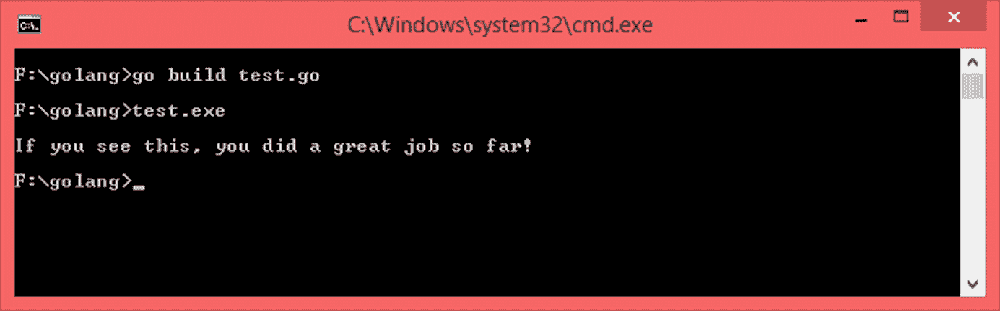

> **注意：** 你不必理解上述代码的作用或工作原理，本节的唯一目的是教你如何编译和执行 Go 程序。

### 3.3.4 编译错误

当源文件中存在错误时，会发生编译错误。这些通常是语法相关的问题。如果你尝试编译一个有问题的 Go 程序，编译器将抛出错误，编译过程将不会成功完成，因此也不会生成可执行文件。有时，编译器返回的错误信息会准确告诉你哪里出错了，有时则不会。因此，在编译前手动检查每个程序是个好主意。以下是一个示例编译错误的样子：

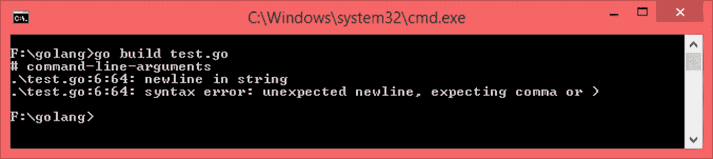

### 3.3.5 Go Playground

Go Playground 是一个基于 Web 的工具，用于在线编译和执行 Go 程序。当然，无法通过此工具使用 Go 的全部功能，但尽管如此，它是一个非常有用的工具，可用于尝试小程序和学习概念，特别是在你无法访问配置了 Go 环境的 PC/笔记本电脑时。打开你喜欢的 Web 浏览器并访问 [`play.golang.org/`](https://play.golang.org/)。你将看到类似以下的界面：

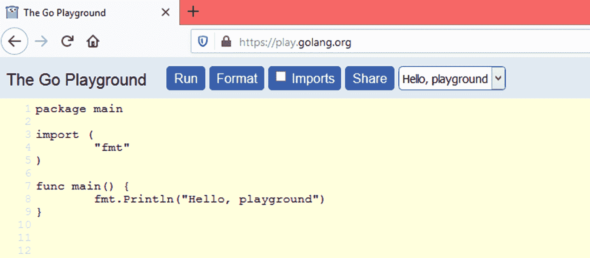

清除现有代码，复制并粘贴 3.3.3 节 中的代码，然后点击**运行**。你应该会在代码区域正下方看到输出：

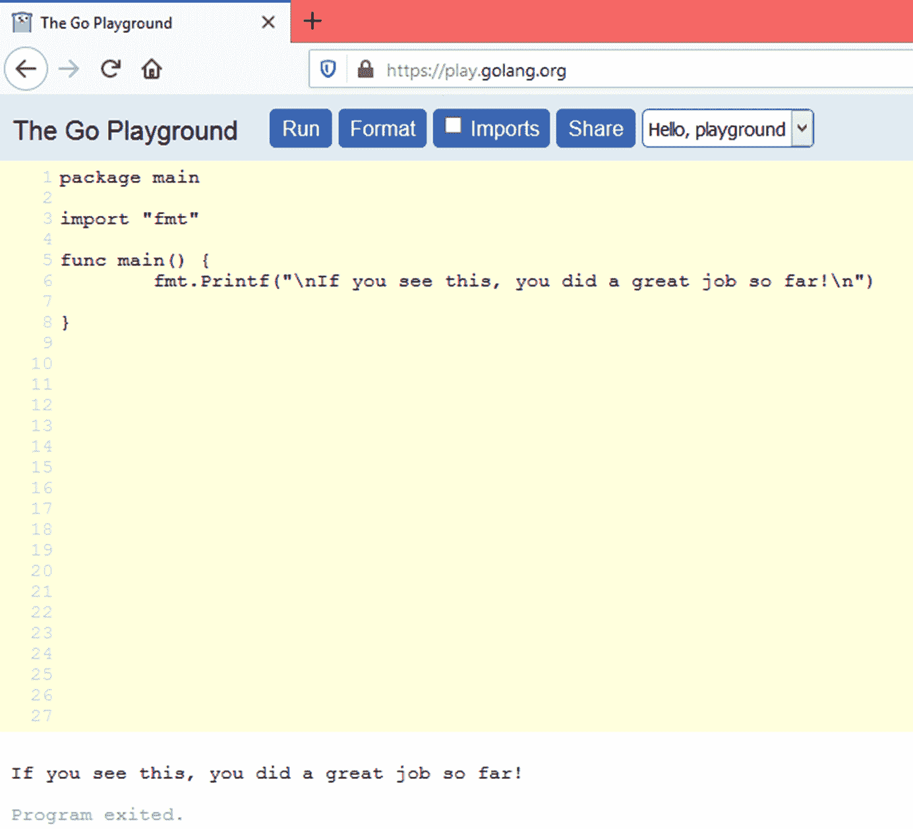


## 4. 语法

既然我们已经知道如何编译和执行程序，现在让我们开始学习 Go 语言的实际编程概念。Go 是一门**大小写敏感**的语言。我们可能会说 “programming”、“Programming” 和 “PROGRAMMING” 是同一个词，但 Go 编译器会将它们视为完全不同的标识符。

## 4.1 语句

语句用于执行一项任务或一组任务的组合。它可以由任何内容组成，例如运算符、函数调用、变量赋值等。简单来说，语句就是一行执行一条或多条指令的代码，例如在屏幕上打印内容、执行算术运算、从文件读取数据等。在 Go 中，一条语句占据一行。以下是几个语句的示例：

```
fmt.Printf (“Hello”)
var x int = 51
msg = “Go book”
```

## 4.2 注释

注释用于标记或解释一段代码。编译器会忽略注释，它们对程序的执行**没有任何影响**。因此，注释仅与我们人类相关。注释以 `/*` 字符序列开始，以 `*/` 字符序列结束。以下是几个示例：

```
/*This is a comment*/
/* You can have any text within this character sequences */
```

本书包含多个编程示例。每个程序都包含注释，解释特定代码段的功能。每当你在本书中看到程序时，请务必仔细阅读注释。

## 4.3 标识符

标识符是赋给变量、类、对象、函数或其他任何可识别实体的名称。标识符名称可以包含字母数字字符，但第一个字符必须是字母。唯一允许的特殊字符是下划线（`_`）。

## 4.4 关键字

关键字是保留字，**不能**用作标识符名称。以下是 Go 语言的关键字列表：

| break | default | func | interface | select |
| :--- | :--- | :--- | :--- | :--- |
| case | defer | go | map | struct |
| chan | else | goto | package | switch |
| const | fallthrough | if | range | type |
| continue | for | import | return | var |

## 4.5 记号

记号是程序中任何有意义的项。关键字、标识符、常量、符号、字符串字面量等都可以称为记号。

## 4.6 基本程序构成要素

一个最基础的 Go 程序应包含以下构成要素：

### 包声明

Go 将系统中的源文件组织为包。Go 程序可用于构建库，也可用于构建独立应用程序。独立应用程序是指能自行执行的程序，而库无法自行执行，必须在其他应用程序中使用。在本书中，我们将主要构建独立应用程序。独立应用程序的包名应为 `main`。这会告诉编译器，当前处理的 Go 程序应构建为独立应用程序，而非库。包声明语句的写法如下：

```
package <package name>
```

示例：

```
package main
```

### 导入包

包是预构建的库，可执行各种任务。Go 为不同用途提供了丰富的包集合。以下是导入包的通用语法：

```
import (
    <package 1>
    <package 2>
    <package 3>
    ...
    <package n>
)
```

对于处理格式化 I/O 操作，使用 `fmt` 包。如果你想编写一个在控制台打印内容的程序，这被视为格式化输出操作。你可以按如下方式导入 `fmt` 包：

```
import ("fmt")
```

### 主函数

主函数作为程序的**入口点**。程序将从主函数内的第一条语句开始执行。以下是编写主函数的方式：

```
func main() {
    /*Statements Here*/
}
```

让我们将这些程序构成要素结合起来，编写一个能构建但不执行任何操作的 Go 程序。它将包含包声明语句和一个空的主函数。我们不会包含导入 `fmt` 语句，因为我们不打算执行任何 I/O 操作：

```
/*Package Declaration Statement*/
package main

/*Mandatory main function*/
func main() {
}
```

**编译并执行：**

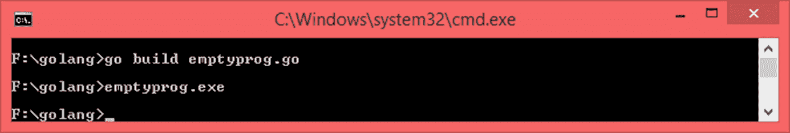

如图所示，程序构建并成功运行。控制台上没有发生任何显著事件，因为我们在程序内部没有做任何事情。程序从空的主函数开始执行。

## 5. Hello World! Go 程序

在上一章中，我们了解了独立 Go 程序的基本构成要素。我们还学习了如何编写一个能构建和执行但不执行任何操作的基础 Go 程序。在本章中，我们将编写一个在控制台打印内容的程序。在控制台打印内容被视为**输出操作**。我们将使用 `fmt` 包中的 `Printf` 函数。可以通过 `fmt.Printf` 访问它。使用该函数的通用语法是：

```
fmt.Printf(<string>)
```

`Printf` 函数需要一个要打印的字符串。字符串是字符序列。向该函数提供字符串时，字符序列应包含在双引号内。该函数实际上接受格式化字符串，但为求简单，我们暂时只关注普通字符串，稍后再讨论格式化字符串。如果你想在控制台打印内容，`fmt.Printf` 语句看起来会像这样：

```
fmt.Printf(“Let us print something”)
```

让我们结合所学知识，编写一个在控制台打印 “Hello World!” 的程序：

```
/*Package Declaration Statement*/
package main

/*Import statement, import fmt package*/
import "fmt"

/*Mandatory main function*/
func main() {
    /*Print Hello World! using fmt.Printf function*/
    fmt.Printf("Hello World!")
}
```

**输出：**

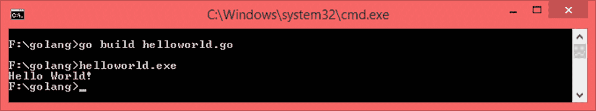

让我们在 Go Playground 中尝试相同的程序：

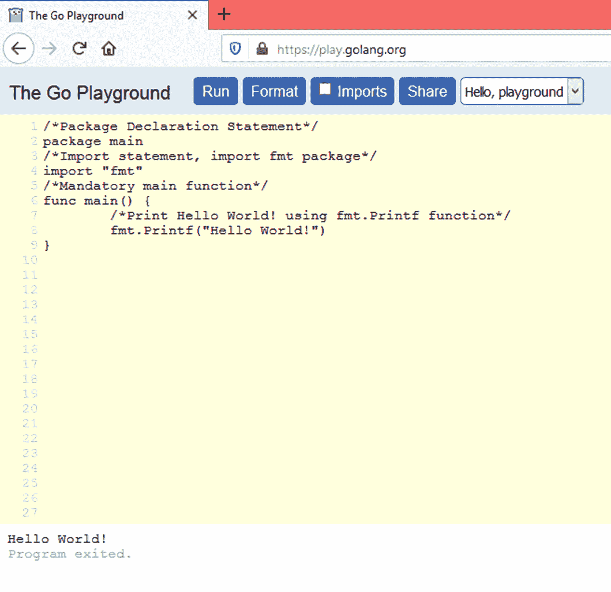

你也可以使用同属 `fmt` 包的 `Println` 函数。该函数会在打印内容的末尾插入一个新行。通用语法：

```
fmt.Println(<string>)
```

示例：

```
fmt.Println(“Just another string…”)
```

以下是使用 `Println` 函数的修改版 Hello World! 程序：

```
/*Package Declaration Statement*/
package main

/*Import statement, import fmt package*/
import "fmt"

/*Mandatory main function*/
func main() {
    /*Print Hello World! using fmt.Println function*/
    fmt.Println("Hello World!")
}
```

**输出：**

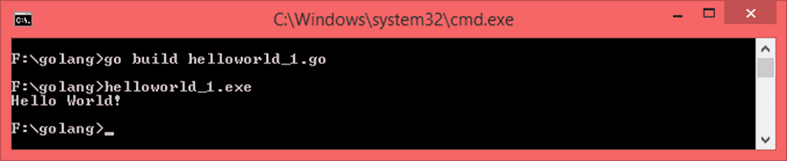

如图所示，打印 Hello World 后留出了一行额外的空行。如果你想在字符串的任意位置插入新行，可以在字符串内使用转义字符序列 `\n`。这对 `Printf` 和 `Println` 函数均有效。示例如下：

```
/*Package Declaration Statement*/
package main

/*Import statement, import fmt package*/
import "fmt"

/*Mandatory main function*/
func main() {
    /*Print Hello World! using fmt.Printf function*/
    fmt.Printf("\nHello \nWorld!\n")
}
```

**输出：**

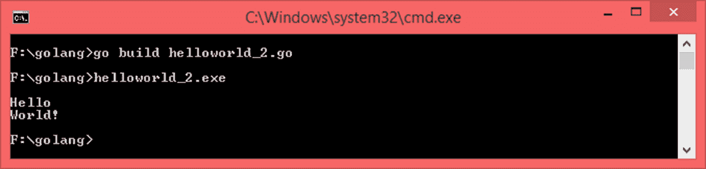

还有许多其他的转义字符序列。另一个有用的是 `\t`，它会在输出字符串中插入一个制表符空格。这同样适用于 `Printf` 和 `Println` 函数。示例如下：

```
/*Package Declaration Statement*/
package main

/*Import statement, import fmt package*/
import "fmt"

/*Mandatory main function*/
func main() {
    /*Print Hello World! using fmt.Println function*/
    fmt.Println("\nHello\tWorld!")
}
```

**输出：**

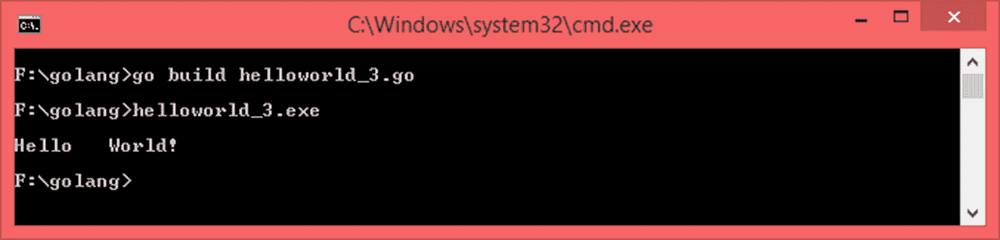

本章我们学习了如何构建一个有意义的控制台应用程序，在屏幕上打印文本。在几乎所有后续程序中，我们都会在控制台打印各种内容，因此你应该非常熟练地掌握 `Printf` 和 `Println` 函数的用法。建议多尝试这些函数，尝试显示不同的字符串。


## 6. 数据类型

数据类型用于对数据进行分类。例如，字符串是一种数据类型；数字是另一种数据类型。Go 提供了 3 种基本数据类型——布尔型、数值型和字符串型。让我们逐一了解这些类别：

## 6.1 布尔数据类型

布尔数据类型只有两个值——`true` 和 `false`。它们在决策制定和控制结构中被大量使用。在编程中，该数据类型被称为 `bool`。

## 6.2 数值数据类型

数值数据类型用于处理不同种类的数字。此类别可进一步细分为 3 个子类别——整型、浮点型和复数型。

### 6.2.1 整型

顾名思义，整型数据类型用于处理整数。Go 支持不同大小的有符号和无符号整数。列表如下：

| 数据类型 | 描述 |
| --- | --- |
| `int` | 有符号整数，大小取决于系统（32 位或 64 位） |
| `uint` | 无符号整数，大小取决于系统（32 位或 64 位） |
| `int8` | 8 位有符号整数 |
| `int16` | 16 位有符号整数 |
| `int32` | 32 位有符号整数 |
| `int64` | 64 位有符号整数 |
| `uint8` | 8 位无符号整数 |
| `uint16` | 16 位无符号整数 |
| `uint32` | 32 位无符号整数 |
| `uint64` | 64 位无符号整数 |
| `rune` | 同 `uint32`。用于 Unicode 字符。 |
| `byte` | 同 `int8`。一个字节是 8 位宽的数据。 |
| `uintptr` | 用于存储指向所有类型整数指针的无符号整数。 |

> **注意：** 如果你只需要一种整数数据类型，应使用 `int` 或 `uint`。大小将根据你使用的系统类型决定。如果你使用 32 位系统，大小将为 32 位；对于 64 位系统，大小将为 64 位。如果你对所处理数据的大小要求很具体，可以使用适当大小的数据类型。

### 6.2.2 浮点型

数值数据类型的此子类别用于浮点值。

| 数据类型 | 描述 |
| --- | --- |
| `float32` | 32 位 IEEE 754 浮点数 |
| `float64` | 64 位 IEEE 754 浮点数 |

### 6.2.3 复数型

复数数据类型用于处理具有实部和虚部的复数。

| 数据类型 | 描述 |
| --- | --- |
| `complex64` | 64 位复数，拥有 `float32`（32 位）类型的实部和虚部。两个 32 位 `float32` 类型总共占 64 位。 |
| `complex128` | 128 位复数，拥有 `float64`（64 位）类型的实部和虚部。两个 64 位 `float64` 类型总共占 128 位。 |

## 6.3 字符串数据类型

字符串数据类型用于处理字符串值。字符串是字符序列。在编程中，Go 中该数据类型被称为 `string`。我们已经了解了如何使用 `Printf()` 和 `Println()` 函数打印字符串。更多细节将在下一章介绍。

## 6.4 其他数据类型

除了这 3 种基本数据类型，Go 还提供了一些其他数据类型，包括——聚合数据类型和引用数据类型。这些类别的数据类型将在本书的相关章节中介绍。


## 7. 变量

变量是赋予内存位置的唯一可识别名称。声明变量时，根据其类型会在内存中预留相应空间。例如，声明 `int8` 类型变量将预留 1 字节（8 位）；声明 `float64` 类型变量将预留 8 字节（64 位）。这些内存位置拥有唯一可识别的地址，通常以十六进制格式表示。因为不可能每次访问数据都使用内存地址，所以我们使用变量。

变量命名规则与标识符命名规则相同：变量名可包含字母数字字符；不能以数字开头；唯一允许的特殊字符是下划线（`_`）。

变量可使用 `var` 关键字按以下语法声明：

```go
var <variable 1>, <variable 2>, …, <variable n> <data type>
```

示例：

```go
/*声明 2 个 string 类型变量*/
var first_name, last_name string

/*声明 1 个 int 类型变量*/
var p int

/*声明 2 个布尔类型变量*/
var flag1, flag2 bool

/*声明 1 个 float32 类型变量*/
var p float32
```

## 7.1 变量初始化

变量声明时（使用上述片段）将具有零值。即：布尔变量默认值为 `false`，数值变量默认值为 `0`，字符串变量默认值为空字符串（`""`）。可在声明时设置初始值，此过程称为初始化。初始化后变量将保存设定的初始值而非零值。

通用语法：

```go
var <variable 1>, ..., <variable n> <data type (optional)> = <value 1>, …, <value n>
```

示例：

```go
/*声明 1 个值为 1290 的 int 变量，指明类型*/
var x int = 1290

/*声明 2 个值为 -36.58 和 59.37 的 float32 变量，指明类型*/
var a, b float32 = -36.58, 59.37
```

也可按如下方式声明并初始化混合数据类型的变量：

```go
var <variable 1>, <variable 2>, … <variable n> = <value 1>, <value 2>, … <value n>
```

示例：

```go
/*声明并初始化两个布尔值，不指明类型*/
var b1, b2 = false, true

/*声明并初始化 4 个混合类型的变量*/
var name, age, height, is_working = "Adam", 19, 1.78, false
```

## 7.2 短变量声明

短变量声明使用短声明操作符（`:=`）声明并初始化变量。此方法可省略 `var` 关键字，但必须赋初值。

通用语法：

```go
<variable 1>, <variable 2>, … <variable n> := <value 1>, <value 2>, … <value n>
```

示例：

```go
/*短声明并初始化一个整数值*/
num := 31

/*短声明并初始化不同类型的变量*/
msg, x, flag, y := "Hello", -6, true, 8.122
```

> **注意**：短声明仅在函数内部有效。函数外部声明的变量必须使用 `var` 关键字。除非另有说明，我们主要在函数内部声明变量。此概念将在 Functions 章节进一步阐述。

## 7.3 变量赋值

变量可使用赋值操作符（`=`）赋值。变量赋值前必须已声明——无论是使用 `var` 关键字还是短声明。若尝试给未声明的变量赋值，编译器将报错。

通用语法：

```go
/*假设变量已定义*/
<var 1>, <var 2>, … <var n> = <value 1>, <value 2>, … <value n>
```

示例：

```go
var x int
v = 20
var a float64
var name string
count := 0
a = -365.58901
name, count = "Max", 99
```

## 7.4 打印变量

可使用 `fmt` 包的 `Println()` 函数在控制台打印变量内容。

通用语法：

```go
fmt.Println(<var 1>, <var 2>, … <var n>)
```

示例：

```go
fmt.Println(name)
fmt.Println(a, b, c, d)
```

甚至可在 `Println()` 函数中使用常量字符串标记变量。例如：

```go
var person_name, person_age = "Sasha", 23
fmt.Println("Name:", person_name, "Age:", person_age)
```

> **注意**：`Println()` 函数虽能打印变量内容，但属于粗糙方法。更规范的方式是使用 `Printf()` 函数配合格式化字符串，将在下一章介绍。

下面是演示变量用法的 Go 程序：

```go
/*变量演示*/
/*包声明*/
package main

/*导入语句 - 导入 fmt 包*/
import (
    "fmt"
)

/*强制的 main 函数*/
func main() {
    /*使用 var 关键字声明 2 个 int 类型变量*/
    var num1, num2 int

    /*给 num1 和 num2 赋值*/
    num1 = 10
    num2 = 20

    /*使用 var 关键字声明并初始化 2 个 float32 类型变量*/
    var x, y float32 = -67.81, 45.76

    /*使用 var 关键字声明并赋值混合类型的变量*/
    var a, b, msg, flag = -5, 9.4, "Some text...", false

    /*短声明一个复数*/
    c1 := 2 + 3i

    /*短声明不同数据类型的变量*/
    p, q, country, c2, done := 178, -358.97, "Argentina", 5 - 12i, true

    /*打印所有内容*/
    fmt.Println("\nnum1:", num1, ", num2:", num2)
    fmt.Println("\nx:", x, ", y:", y)
    fmt.Println("\na:", a, ", b:", b, ", msg:", msg, ", flag:", flag)
    fmt.Println("\nc1:", c1)
    fmt.Println("\np:", p, ", q:", q, ", country:", country, ", c2:", c2, ", done:", done)
}
```

输出：
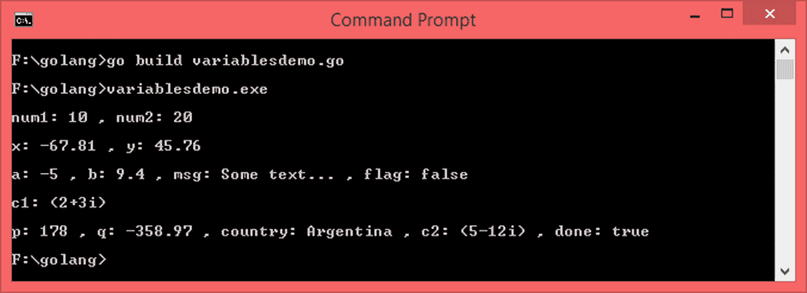

> **注意**：
>
> 1. 始终建议使用有意义的变量名。例如，存储人名时，命名为 `name` 优于 `xyz` 等随机名称。
> 2. 仅在需要时声明变量。若声明变量却未在程序中使用，编译器将报“declared but not used”错误，导致构建失败。若必须声明但不使用，可将其赋值给空标识符（`_`）以规避错误。


## 8. 输出格式化

在上一节中，我们学习了使用 `Println` 函数打印变量。该函数会在末尾自动换行，在打印多个项目时会在项目之间留出一个空格。虽然它对于简单打印变量已经足够好用，但控制能力不强。对于规范的输出格式化，我们可以使用 `fmt` 包中的 `Printf` 函数。这能提供对输出更好的控制；稍后你将了解原因。

`Printf` 函数接受一个格式化字符串作为参数。格式化字符串由字符串字面量和称为 **verb（动词/格式动词）** 的格式说明符组成。Verb 是一个以百分号（`%`）开头的字符序列。不同的数据类型使用不同的 verb。例如，字符串使用 `%s`，整数使用 `%d` 等。如果将格式化字符串传给 `Printf` 函数，则必须在格式化字符串后跟上变量、常量或表达式作为参数。打印时，verb 将被相应变量、常量或给定表达式求值的结果所替换。

通用语法：
```go
fmt.Printf(<formatted string>, <variables/constants/expressions>)
```

示例：
```go
fmt.Printf("Name: %s, Number: %d", name, num)
```

在上述示例中，第一个 verb `%s` 将被 `name` 的值替换，第二个 verb `%d` 将被 `num` 的值替换。

下图将使事情更清晰：
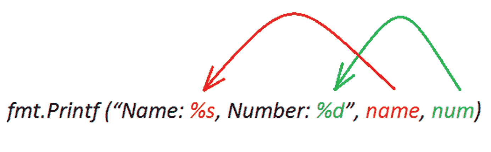

请看下面的程序：
```go
package main

import "fmt"

func main() {
    /* Initialize string variables */
    var first_name, last_name, city string = "Samantha", "Hudson", "Denver"

    /* Initialize integer variable */
    var age int = 33

    fmt.Printf("\nFirst Name: %s \nLast Name: %s \nAge: %d \nCity: %s \n", first_name, last_name, age, city)
}
```

输出：
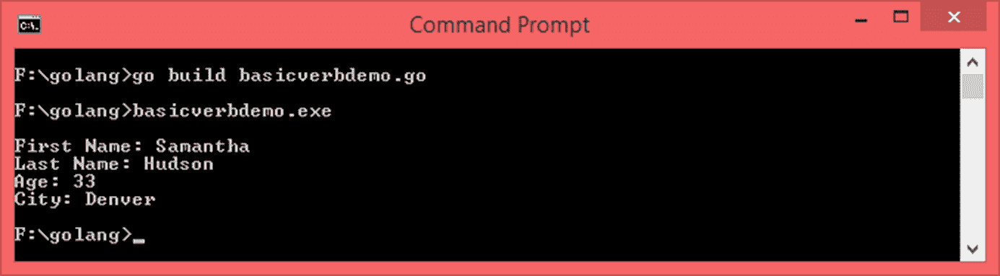

Go 提供了许多 verb，以下是几个重要的：

| Verb | Description |
| --- | --- |
| `%v` | 默认格式的值 |
| `%T` | 值的数据类型 |
| `%t` | 布尔值 – true 或 false |
| `%d` | 整数 |
| `%b` | 二进制 (Base 2) |
| `%o` | 八进制 (Base 8) |
| `%O` | 带 0o 前缀的八进制 (Base 8) |
| `%x` | 十六进制 (Base 16)，小写 (a-f) |
| `%X` | 十六进制 (Base 16)，大写 (A-F) |
| `%c` | 字符 |
| `%f` | 无指数的浮点数值 |
| `%F` | 同 `%f` |
| `%e` | 科学计数法 – 带指数的浮点数。e 为小写 |
| `%E` | 科学计数法 – 带指数的浮点数。E 为大写 |
| `%s` | 字符串 |
| `%p` | 指针 |

下面是一个使用不同 verb 处理不同数据类型的 Go 程序：
```go
package main

import "fmt"

func main() {
    /* Declare and initialize a few variables */
    var x, y, z = 75, -6.872, 3+2i
    var flag = true
    msg := "Go Programming"

    /* Print various things using Printf */
    fmt.Printf("\nx = %v Type: %T", x, x)
    fmt.Printf("\nx (decimal): %d\nx (binary): %b\nx (octal): %O\nx (hexadecimal): %X", x, x, x, x)
    fmt.Printf("\ny = %f Type: %T \nz = %f Type: %T", y, y, z, z)
    fmt.Printf("\nflag = %t Type: %T", flag, flag)
    fmt.Printf("\nmsg = %s Type: %T\n", msg, msg)
}
```

输出：
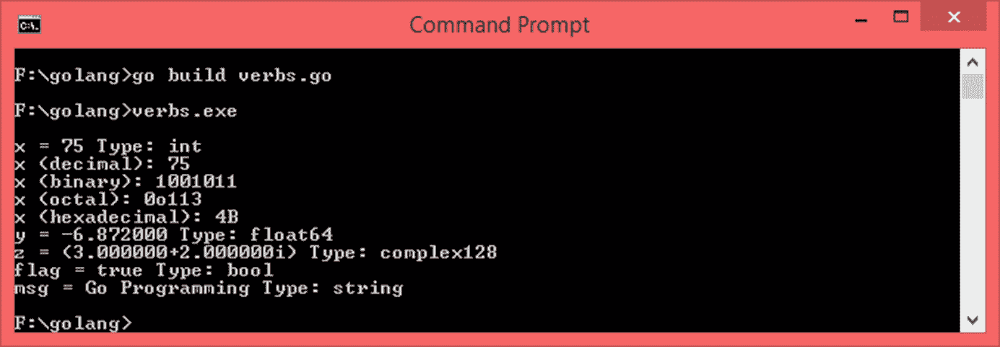

注意：

*   格式化字符串内的 verb 数量与格式化字符串后跟随的参数数量必须相同。
*   始终根据要打印的值的数据类型使用正确的 verb。拿不准时，使用 `%v`。

## 9. 运算符

运算符是用于执行一个或多个操作的符号或符号组。Go 提供了算术运算符、关系运算符、逻辑运算符、位运算符和赋值运算符。让我们看看每一类运算符。

## 9.1 算术运算符

顾名思义，算术运算符用于执行加法、减法等算术运算。

| Operator | Description | Sample Usage | Explanation |
| --- | --- | --- | --- |
| `+` | 加法 | `x + y` | 执行算术加法，返回操作数之和。 |
| `-` | 减法 | `x - y` | 从左操作数中减去右操作数并返回差值。 |
| `*` | 乘法 | `x * y` | 相乘操作数并返回乘积。 |
| `/` | 除法 | `x / y` | 执行除法并返回商。 |
| `%` | 取模 | `x % y` | 执行除法并返回余数。操作数需为整数类型。 |
| `++` | 自增 | `x++` | 将操作数的值加 1。 |
| `--` | 自减 | `y--` | 将操作数的值减 1。 |

注意：

*   当你用一个整数除以另一个整数时，除法运算符将返回一个整数商，即使从数学上讲它应该是一个浮点值。这本身不是问题，在某些情况下甚至很有用。但是，如果你想要商的浮点数版本，需要先使用 `float32(<operand>)` 或 `float64(<operand>)` 将操作数转换为 float。
*   对于复数，自增/自减运算符仅作用于实部。
*   你可以使用多个变量和多个运算符构建多项式/表达式。甚至可以使用括号来优先执行特定操作。


### 算术运算符演示 1

这是一个演示两个整数简单算术运算的 Go 程序：

```go
/*算术运算符演示 1*/
/*包声明*/
package main

/*导入语句 - 导入 fmt 包*/
import (
	"fmt"
)

/*强制性的 main 函数*/
func main() {
	/*使用 var 关键字声明 6 个 int 类型的变量*/
	var num1, num2, sum, diff, prod, mod int

	/*声明 float32 变量以存储商*/
	var quo float32

	/*为 num1 和 num2 赋值*/
	num1 = 53
	num2 = 18

	/*执行各种算术运算*/
	sum = num1 + num2
	diff = num1 - num2
	prod = num1 * num2

	/*num1 和 num2 都是整数。
	因此即使数学上商是浮点数，num1/num2 的结果也将是整数。
	你需要在相除前使用 float32(<操作数>) 将两个操作数都转换为 float32。*/
	quo = float32(num1) / float32(num2)

	mod = num1 % num2

	/*打印所有内容*/
	fmt.Printf("\nnum1 = %d num2 = %d", num1, num2)
	fmt.Printf("\nnum1 + num2 = %d", sum)
	fmt.Printf("\nnum1 - num2 = %d", diff)
	fmt.Printf("\nnum1 * num2 = %d", prod)
	fmt.Printf("\nnum1 / num2 = %f", quo)
	fmt.Printf("\nnum1 (取模) num2 = %d", mod)

	num1++
	num2++

	fmt.Printf("\nnum1++ = %d num2++ = %d\n", num1, num2)
}
```

输出：
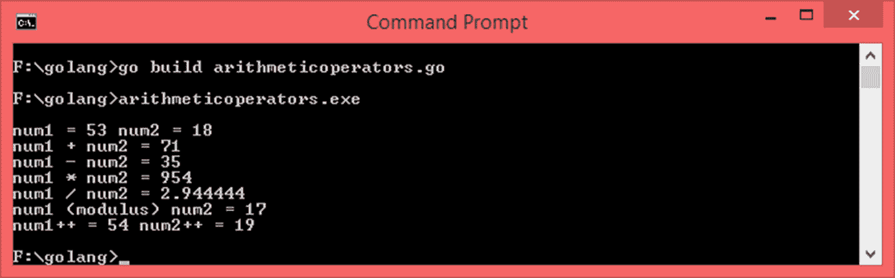

### 算术运算符演示 2 - 浮点数算术

让我们看看算术运算符如何用于浮点数。我们使用动词 `%f` 打印普通浮点值，使用 `%E` 以科学计数法格式打印值：

```go
/*算术运算符演示 2 - 浮点数算术*/
/*包声明*/
package main

/*导入语句 - 导入 fmt 包*/
import (
	"fmt"
)

/*强制性的 main 函数*/
func main() {
	/*使用 var 关键字声明 6 个 float32 类型的变量*/
	var num1, num2, sum, diff, prod, quo float32

	/*为 num1 和 num2 赋值*/
	num1 = 0.0363257
	num2 = -2.93157E-3

	/*执行各种算术运算*/
	sum = num1 + num2
	diff = num1 - num2
	prod = num1 * num2
	quo = num1 / num2

	/*打印所有内容*/
	fmt.Printf("\n 普通浮点形式的值 -> num1 = %f num2 = %f", num1, num2)
	fmt.Printf("\n 科学计数法形式的值 -> num1 = %E num2 = %E", num1, num2)
	fmt.Printf("\nnum1 + num2 = %f", sum)
	fmt.Printf("\nnum1 - num2 = %f", diff)
	fmt.Printf("\nnum1 * num2 = %E", prod)
	fmt.Printf("\nnum1 / num2 = %E\n", quo)
}
```

输出：
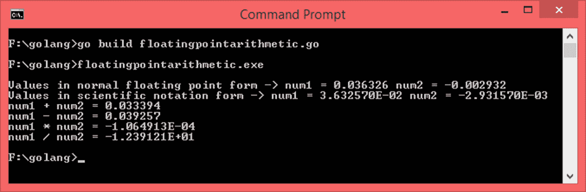

### 算术运算符演示 3 - 复数运算

算术运算符也适用于复数。你可以使用 `complex64` 或 `complex128` 数据类型创建复数变量。`complex64` 数据类型由两个 `float32` 数据类型组成，分别用于实部和虚部；而 `complex128` 数据类型由一个用于实部的 `float64` 数据类型和另一个用于虚部的 `float64` 数据类型组成。由于 Go 中的复数由两个浮点数组成，因此要使用的动词是 `%f`。或者，你也可以使用 `%v`，它将使用原始数据类型显示值。

复数变量可以通过直接指定实部和虚部来初始化，也可以通过使用名为 `complex` 的函数来初始化，如下所示：

```go
<变量> := complex(<实部>, <虚部>)
Num := complex(1, 8)
```

下面是一个演示在复数上使用算术运算符的 Go 程序：

```go
/*算术运算符演示 3 - 复数运算*/
/*包声明*/
package main

/*导入语句 - 导入 fmt 包*/
import (
	"fmt"
)

/*强制性的 main 函数*/
func main() {
	/*使用 var 关键字声明 6 个 complex64 类型的变量*/
	var num1, num2, sum, diff, prod, quo complex64

	/*为 num1 和 num2 赋值*/
	num1 = 2 - 5i

	/*使用 complex 函数创建复数，效果相同*/
	num2 = complex(-3, 7)

	/*执行各种算术运算*/
	sum = num1 + num2
	diff = num1 - num2
	prod = num1 * num2
	quo = num1 / num2

	/*打印所有内容*/
	fmt.Printf("\nnum1 = %v num2 = %v", num1, num2)
	fmt.Printf("\nnum1 + num2 = %v", sum)
	fmt.Printf("\nnum1 - num2 = %v", diff)
	fmt.Printf("\nnum1 * num2 = %v", prod)
	fmt.Printf("\nnum1 / num2 = %f", quo)

	/*num1 自增，num2 自减*/
	num1++
	num2--

	fmt.Printf("\nnum1++ = %v num2-- = %v\n", num1, num2)
}
```

输出：
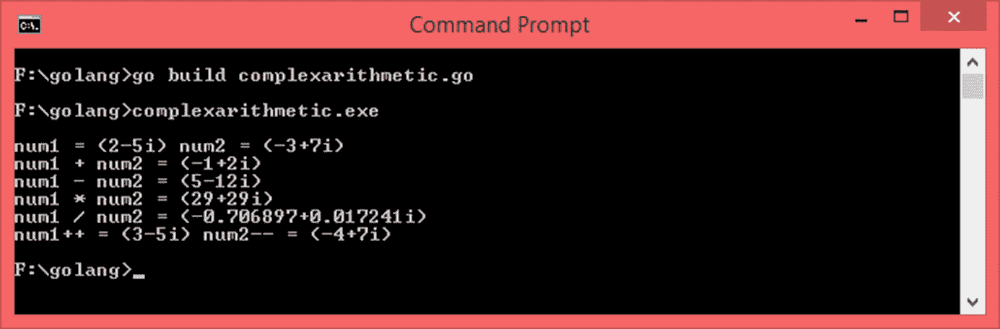

## 9.2 关系运算符

关系运算符用于比较操作数。比较的结果可以是布尔值（`bool`）`true` 或 `false`。这类运算符在使用控制结构时非常有用。

| 运算符 | 说明 |
| :--- | :--- |
| `==` | 等于 |
| `!=` | 不等于 |
| `<` | 小于 |
| `>` | 大于 |
| `<=` | 小于或等于 |
| `>=` | 大于或等于 |

下面是一个演示关系运算符用法的程序。动词 `%t` 用于显示比较操作的布尔结果：

```go
/*关系运算符演示*/
/*包声明*/
package main

/*导入语句 - 导入 fmt 包*/
import (
	"fmt"
)

/*强制性的 main 函数*/
func main() {
	/*使用 var 关键字声明 int 类型的变量*/
	var a, b, c, d int = -1, 3, -1, 9

	/*打印 a, b, c, d*/
	fmt.Printf("\na = %d b = %d c = %d d = %d\n", a, b, c, d)

	/*打印比较操作的结果*/
	fmt.Printf("\na == c: %t", a == c)
	fmt.Printf("\nb == d: %t", b == d)
	fmt.Printf("\na != c: %t", a != c)
	fmt.Printf("\nb != d: %t", b != d)
	fmt.Printf("\na < b: %t", a < b)
	fmt.Printf("\nc > d: %t", c > d)
	fmt.Printf("\nd <= b: %t", d <= b)
	fmt.Printf("\na >= c: %t\n", a >= c)
}
```

输出：
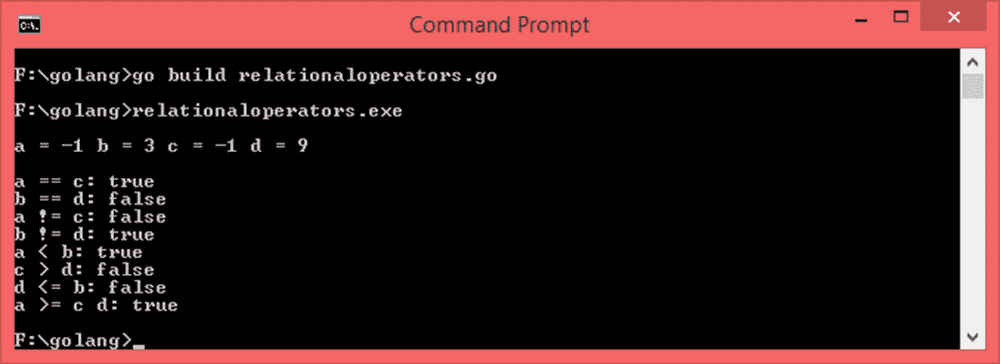

## 9.3 逻辑运算符

逻辑运算符用于对布尔操作数执行逻辑与、逻辑或和逻辑非操作。保存布尔值（`true` 或 `false`）的变量以及结果为 `true` 或 `false` 的表达式（可能使用关系运算符）都可以视为操作数。

| 运算符 | 说明 | 示例用法 |
| :--- | :--- | :--- |
| `&&` | 逻辑与 | `(表达式 1) && (表达式 2)` |
| `||` | 逻辑或 | `(表达式 1) || (表达式 2)` |
| `!` | 逻辑非 | `!(表达式 1)` |

注意：如果表达式用作操作数，它们将首先被求值。

下面是一个展示逻辑运算符如何工作的 Go 程序：

```go
/*逻辑运算符演示*/
/*包声明*/
package main

/*导入语句 - 导入 fmt 包*/
import (
	"fmt"
)

/*强制性的 main 函数*/
func main() {
	/*使用 var 关键字声明 float32 类型的变量*/
	var a, b, c float32 = -65.736, 54.642, 0.003

	/*短声明两个布尔变量*/
	x := true
	y := false

	/*打印各种操作的结果*/
	fmt.Printf("\nx = %t y = %t", x, y)
	fmt.Printf("\nx || y = %t, x && y = %t, !x = %t, !y = %t", x || y, x && y, !x, !y)
	fmt.Printf("\n(a < b) && (b > c) = %t", (a < b) && (b > c))
	fmt.Printf("\n(a == c) || (c != b) = %t", (a == c) || (c != b))
	fmt.Printf("\n(b != c) && (c <= a) = %t", (b != c) && (c <= a))
	fmt.Printf("\n(a == b) || x = %t\n", (a == b) || x)
}
```

输出：
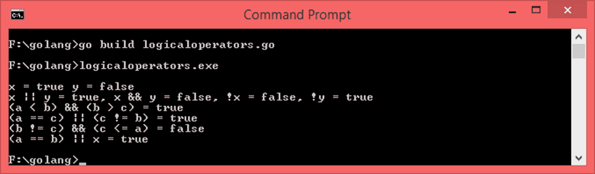

## 9.4 位运算符

位运算符作用于操作数的各个位。操作将以逐位的方式进行。为了理解这类运算符，你需要了解一些二进制数系统和布尔代数的知识。

| 运算符 | 说明 | 示例用法 | 解释 |
| :--- | :--- | :--- | :--- |
| `&` | 位逻辑与 | `x & y` | 在逐位的基础上对每个操作数执行逻辑与运算。 |
| `|` | 位逻辑或 | `x | y` | 在逐位的基础上对每个操作数执行逻辑或运算。 |


# 位运算符

| 运算符 | 名称 | 示例 | 说明 |
| :--- | :--- | :--- | :--- |
| `^` | 按位逻辑异或 | `x ^ y` | 对操作数的每一位执行逻辑异或运算。 |
| `<<` | 左移 | `x << y` | 左操作数的位向左移动右操作数指定的次数。例如，`x << 3` 将 `x` 的位左移 3 次。 |
| `>>` | 右移 | `x >> y` | 左操作数的位向右移动右操作数指定的次数。例如，`y >> 5` 将 `y` 的位右移 5 次。 |

以下是位运算符的演示。动词 `%b` 和 `%X` 分别用于以二进制和十六进制格式打印值。

```go
/* Bitwise Operators Demo */
/* Package Declaration */
package main

/* Import Statement - import fmt package */
import (
	"fmt"
)

/* Mandatory main function */
func main() {
	/* Declare two integers */
	var x, y int = 23, 42

	/* Print values of x and y in decimal, binary and hex format */
	fmt.Printf("\nx (decimal) = %d, x (binary) = %b, x (hexadecimal) = %X", x, x, x)
	fmt.Printf("\ny (decimal) = %d, y (binary) = %b, y (hexadecimal) = %X", y, y, y)

	/* Print the result of bitwise operations */
	fmt.Printf("\n\nBitwise AND (&)\nx & y (decimal) = %d, x & y (binary) = %b, x & y (hexadecimal) = %X\n", x&y, x&y, x&y)
	fmt.Printf("\nBitwise OR (|)\nx | y (decimal) = %d, x | y (binary) = %b, x | y (hexadecimal) = %X\n", x|y, x|y, x|y)
	fmt.Printf("\nBitwise XOR (^)\nx ^ y (decimal) = %d, x ^ y (binary) = %b, x ^ y (hexadecimal) = %X\n", x^y, x^y, x^y)
	fmt.Printf("\nLeft Shift (<<)\nx << 1 (decimal) = %d, x << 1 (binary) = %b, x << 1 (hexadecimal) = %X\n", x<<1, x<<1, x<<1)
	fmt.Printf("\nRight Shift (>>)\ny >> 3 (decimal) = %d, y >> 3 (binary) = %b, y >> 3 (hexadecimal) = %X\n", y>>3, y>>3, y>>3)
}
```

**Output:**
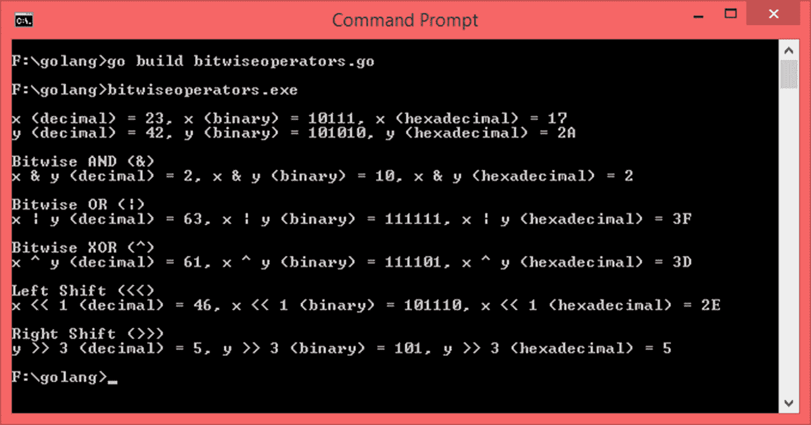

## 9.5 赋值运算符

我们已经了解了由等号（`=`）表示的标准赋值运算符。Go 语言中还有更多运算符用于执行复合赋值操作。

| 运算符 | 说明 | 示例用法 | 等价于 |
| :--- | :--- | :--- | :--- |
| `+=` | 执行算术加法，然后将和赋值给左操作数。 | `x += y` | `x = x + y` |
| `-=` | 从左操作数中减去右操作数，并将差值赋值给左操作数。 | `x -= y` | `x = x - y` |
| `*=` | 相乘操作数并将积赋值给左操作数。 | `x *= y` | `x = x * y` |
| `/=` | 将左操作数除以右操作数，并将商赋值给左操作数。 | `x /= y` | `x = x / y` |
| `%=` | 将左操作数除以右操作数，并将余数赋值给左操作数。 | `x %= y` | `x = x % y` |
| `&=` | 执行按位逻辑与运算，将结果赋值给左操作数。 | `x &= y` | `x = x & y` |
| `\|=` | 执行按位逻辑或运算，将结果赋值给左操作数。 | `x \|= y` | `x = x \| y` |
| `^=` | 执行按位逻辑异或运算，将结果赋值给左操作数。 | `x ^= y` | `x = x ^ y` |
| `<<=` | 执行左移操作，将结果赋值给左操作数。 | `x <<= y` | `x = x << y` |
| `>>=` | 执行右移操作，将结果赋值给左操作数。 | `x >>= y` | `x = x >> y` |

让我们编写一个 Go 程序来演示不同赋值运算符的用法。

```go
/* Assignment Operators Demo */
/* Package Declaration */
package main

/* Import Statement - import fmt package */
import (
	"fmt"
)

/* Mandatory main function */
func main() {
	/* Declare two integers */
	var num1, num2 int = 35, 20

	fmt.Printf("\nnum1 = %d num2 = %d", num1, num2)

	/* Perform various compound assignment operations and print */
	num1 += num2
	fmt.Printf("\nnum1 += num2 = %d", num1)

	num1 -= num2
	fmt.Printf("\nnum1 -= num2 = %d", num1)

	num1 *= num2
	fmt.Printf("\nnum1 *= num2 = %d", num1)

	num1 /= num2
	fmt.Printf("\nnum1 /= num2 = %d", num1)

	num1 %= num2
	fmt.Printf("\nnum1 %%= num2 = %d", num1)

	num1 &= num2
	fmt.Printf("\nnum1 &= num2 = %d (decimal) / %%b (binary)", num1, num1)

	num1 |= num2
	fmt.Printf("\nnum1 \|= num2 = %d (decimal) / %%b (binary)", num1, num1)

	num1 ^= num2
	fmt.Printf("\nnum1 ^= num2 = %d (decimal) / %%b (binary)", num1, num1)

	num2 <<= 1
	fmt.Printf("\nnum2 <<= 1 = %d (decimal) / %%b (binary)", num2, num2)

	num2 >>= 3
	fmt.Printf("\nnum2 >>= 3 = %d (decimal) / %%b (binary)\n", num2, num2)
}
```

**Output:**


## 10. 用户交互

到目前为止，我们已经看了几个编程示例。所有这些程序都使用了硬编码的值。没有任何程序给用户提供手动输入值的机会。在本节中，我们将学习如何接受用户的输入。与用户交互的方式有很多。我们将学习 `fmt` 包中用于读取用户输入的两个简单函数——`Scanln` 和 `Scanf`。

## 10.1 Scanln 函数

以下是使用 `Scanln` 函数的方法：

```go
fmt.Scanln(&<字符串变量>)
```

**示例：**

```go
var str string
fmt.Scanln(&str)
```

`Scanln` 函数需要指定一个字符串变量来存储用户的输入（在上述代码片段中用 `<字符串变量>` 标记）。该函数实现了**阻塞 I/O 操作**。也就是说，当执行控制到达 `Scanln` 语句时，程序的执行将暂停，给用户一个通过键盘输入内容（并按回车键）的机会。一旦用户输入内容并按下回车，用户通过键盘输入的任何内容都将被获取并存储在指定的字符串变量中。变量前的 `&` 符号用于获取变量的内存地址，以便 `Scanln` 函数可以直接设置指定变量的内容。这一概念将在指针章节中更清晰地说明。

让我们编写一个简单的 Go 程序，提示用户输入内容并将其显示回来：

```go
/* 用户交互演示 1 */
/* 包声明 */
package main

/* 导入语句 - 导入 fmt 包 */
import (
	"fmt"
)

/* 强制性的 main 函数 */
func main() {
	/* 创建一个变量来存储输入 */
	var str string

	/* 提示用户输入内容 */
	fmt.Printf("\n 请输入内容: ")

	/* 使用 Scanln 函数读取用户输入 */
	fmt.Scanln(&str)

	/* 显示读取的内容 */
	fmt.Printf("\n 您输入了: %s \n", str)
}
```

**输出：**
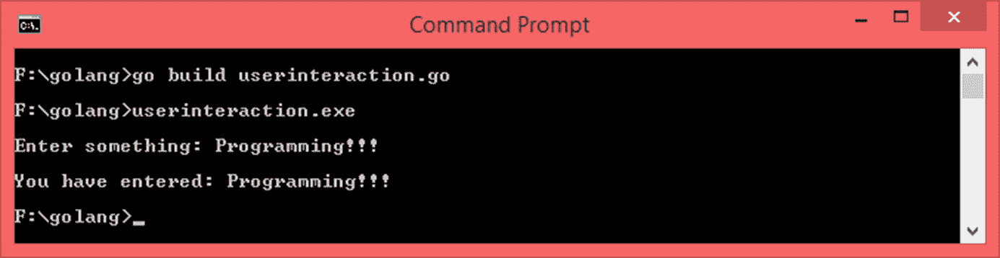

`Scanln` 函数有其自身的局限性。首先，它只能以字符串格式读取输入。这意味着，即使您输入一个数字，它也会被视为字符串。其次，它将输入作为以空格分隔的标记化字符串读取。也就是说，如果您输入一个句子，每个单词将被视为一个标记，并且需要相应数量的变量来存储输入。如果您只指定一个变量却输入一个句子，则只会读取第一个单词。

让我们运行相同的程序并尝试输入一个句子：
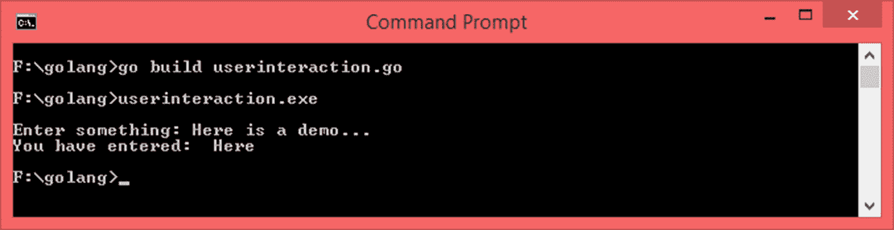

如所见，只读取了第一个单词。上面的输入有四个单词，因此 `Scanln` 语句应该指定 4 个变量来存储这 4 个单词，如下所示：

```go
fmt.Scanln(&str1, &str2, &str3, &str4)
```

同样，`Printf` 语句应如下所示：

```go
fmt.Printf("\n 您输入了: %s %s %s %s\n ", str1, str2, str3, str4)
```

这是完整的程序：

```go
/* 用户交互演示 2 */
/* 包声明 */
package main

/* 导入语句 - 导入 fmt 包 */
import (
	"fmt"
)

/* 强制性的 main 函数 */
func main() {
	/* 创建变量来存储输入 */
	var str1, str2, str3, str4 string

	/* 提示用户输入内容 */
	fmt.Printf("\n 请输入内容: ")

	/* 使用 Scanln 函数读取用户输入 */
	fmt.Scanln(&str1, &str2, &str3, &str4)

	/* 显示读取的内容 */
	fmt.Printf("\n 您输入了: %s %s %s %s\n ", str1, str2, str3, str4)
}
```

**输出：**
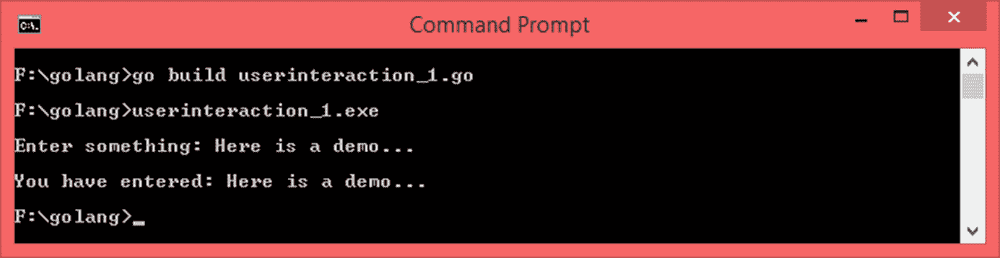

虽然程序现在可以正确运行，但这不是读取句子的最佳方式，因为我们不知道用户会输入多长的句子。存储一个单词需要一个变量。这完全不切实际。稍后在本章中讨论的 `bufio` 包提供了一种读取句子的更好方法。我们将仅在想要一次读取一个单词或一个数字时使用 `Scanln` 函数。

如果用户输入一个数字，而您尝试使用 `Scanln` 读取它，它将以字符串格式存在。为了将字符串格式的数字转换为适当的数值格式，我们将使用 `strconv` 包中的函数。您要做的第一件事是在程序中导入此包并使用以下转换函数：

**将字符串格式的数字转换为整数：**

```go
<数字变量>, <错误变量> = strconv.Atoi(<字符串格式的数字>)
```

**示例：**

```go
num, err := strconv.Atoi("55")
```

在上面的示例中，字符串格式的 `"55"` 将被转换为整数格式的 `55` 并存储在变量 `num` 中（此处使用短变量声明）。同时，`err` 也被短声明，用于存储可能发生的转换错误。

**将字符串格式的数字转换为浮点数：**

```go
<变量> = strconv.ParseFloat(<字符串格式的数字>, <位数>)
```

**示例：**

```go
numS := "-46.2343"
numF, err := strconv.ParseFloat(numS, 64)
```

在上面的示例中，`ParseFloat` 函数将字符串格式的 `"-46.2343"` 转换为 64 位浮点格式的 `-46.2343` 并返回给 `numF` 变量存储。

让我们编写一个 Go 程序，从用户那里接受 4 个数字——两个整数和两个浮点数。我们将使用 `Scanln` 函数读取这些输入，因此所有 4 个数字都将以字符串格式存储。我们将把这些数字转换为适当的格式并执行加、减、乘、除运算：

```go
/* 用户交互演示 3 - 处理数字 */
/* 包声明 */
package main

/* 导入语句 - 导入 fmt 和 strconv 包 */
import (
	"fmt"
	"strconv"
)

/* 强制性的 main 函数 */
func main() {
	/* 声明变量来存储输入 */
	var num1_str, num2_str, num3_str, num4_str string

	/* 声明变量来存储 int 和 float64 等价值 */
	var num1, num2, sum, diff int
	var num3, num4, prod, quo float64

	/* 提示用户输入两个整数 */
	fmt.Printf("\n 请输入两个整数: ")

	/* 使用 Scanln 函数读取用户输入 */
	fmt.Scanln(&num1_str, &num2_str)

	/* 提示用户输入两个浮点数 */
	fmt.Printf("\n 请输入两个浮点数: ")

	/* 使用 Scanln 函数读取用户输入 */
	fmt.Scanln(&num3_str, &num4_str)

	/* 将 num1_str 和 num2_str 转换为整数 */
	num1, err1 := strconv.Atoi(num1_str)
	num2, err2 := strconv.Atoi(num2_str)

	/* 将 num3_str 和 num4_str 转换为 float64 */
	num3, err3 := strconv.ParseFloat(num3_str, 64)
	num4, err4 := strconv.ParseFloat(num4_str, 64)

	/* 将错误赋值给空标识符 */
	_ = err1
	_ = err2
	_ = err3
	_ = err4

	/* 执行算术运算 */
	sum = num1 + num2
	diff = num1 - num2
	prod = num3 * num4
	quo = num3 / num4

	/* 打印所有内容 */
	fmt.Printf("\nnum1 + num2 = %d", sum)
	fmt.Printf("\nnum1 - num2 = %d", diff)
	fmt.Printf("\nnum3 * num4 = %f", prod)
	fmt.Printf("\nnum3 / num4 = %f \n", quo)
}
```

**注意：** 我们为 4 次不同的转换使用了 4 个不同的错误变量——`err1`、`err2`、`err3` 和 `err4`。实际上没有必要使用它们。但是，如果您不使用它们，编译器将返回“声明但未使用”错误，程序将无法构建。为了规避这个问题，可以将每个错误变量赋值给空标识符 `_`。

**输出：**
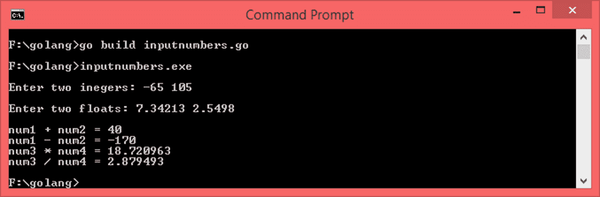

## 10.2 Scanf 函数

`Scanf` 函数与 C 语言中使用的函数非常相似。该函数使用动词（类似于 C 语言中的格式说明符）来读取特定类型的数据。例如，如果您想从用户那里读取一个整数，可以使用动词 `%d`。这消除了 `Scanln` 中使用的数据转换的额外步骤。第 8 章讨论的相同动词将被使用。

以下是通用语法：

```go
fmt.Scanf("<带有动词的格式化字符串>", &<用逗号分隔的变量>)
fmt.Scanf("%<动词 1> %<动词 2>, ...", &<变量 1>, &<变量 2>, ...)
```

**示例：**

```go
fmt.Scanf("%s %d %f", &name, &age, &weight)
```

`Scanf` 函数使用由动词组成的格式化字符串来解析用户的输入。对于使用的每个动词，都有一个对应的变量（变量名前缀为 `&` 符号）。该函数也实现了**阻塞 I/O 操作**。当用户通过键盘输入内容时，它将根据格式化字符串中指定的格式进行解析。

例如，如果格式化字符串如下——`"%s %d %f"`，用户应该输入三个用空格分隔的值，其中第一个值是字符串，第二个值是整数，第三个值是浮点数。只有在输入所有值后才应按回车键。如果用户在输入第一个值后按下回车，则将跳过剩余的两个输入，相应的变量将获得零值。

让我们再举一个格式化字符串的例子。如果格式化字符串如下——`"%d\n%f\n%d\n%s"`，该函数将期望用户输入 4 个值。动词之间的 `"\n"` 字符序列表示用户应该在输入每个值后按回车键。如果这让您感到困惑，您可以始终为每个输入使用一条 `Scanf` 语句。

让我们编写一个程序，从用户那里读取 3 个输入并将用户输入的内容打印回来：

```go
/* Scanf 演示 */
/* 包声明 */
package main

/* 导入语句 - 导入 fmt 包 */
import (
	"fmt"
)

/* 强制性的 main 函数 */
func main() {
	/* 声明变量 */
	var name string
	var age int
	var weight float32

	/* 提示用户输入 3 个值 */
	fmt.Printf("\n 请输入姓名、年龄和体重: ")

	/* 读取 3 个值 */
	fmt.Scanf("%s %d %f", &name, &age, &weight)

	/* 显示所有内容 */
	fmt.Printf("\n\n 姓名: %s, 年龄: %d, 体重: %f \n", name, age, weight)
}
```

**输出：**
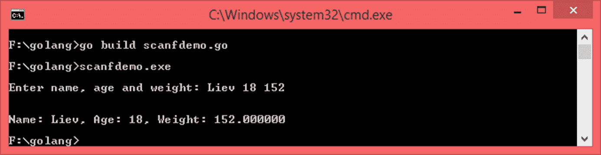

在上面的示例中，`"Liev"` 被读作字符串，`18` 被读作 int，`152` 被读作 float32。输入分配给变量的过程如下：
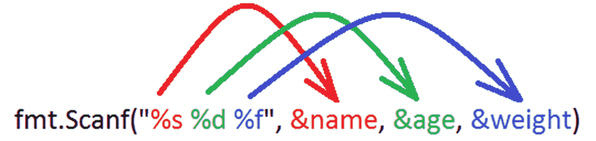

如前所述，输入是根据动词指定的数据类型读取的，因此不需要将输入从一种形式转换为另一种形式。让我们通过编写一个程序来添加两个数字来验证这一点。这次，我们将在两个动词之间插入 `\n`，因此用户在输入每个数字后必须按回车键：

```go
/* Scanf 两数相加演示 */
/* 包声明 */
package main

/* 导入语句 - 导入 fmt 包 */
import (
	"fmt"
)

/* 强制性的 main 函数 */
func main() {
	/* 声明变量 */
	var num1, num2, sum int

	/* 提示用户输入 2 个数字 */
	fmt.Printf("\n 请输入两个数字: ")

	/* 读取 2 个数字 */
	fmt.Scanf("%d\n%d", &num1, &num2)

	/* 计算总和 */
	sum = num1 + num2

	/* 显示所有内容 */
	fmt.Printf("\n 总和 = %d\n", sum)
}
```

**输出：**
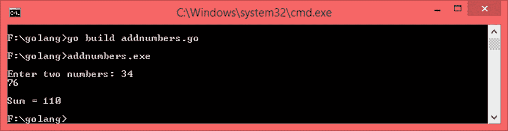

## 10.3 读取句子

`Scanf` 和 `Scanln` 函数都无法读取句子，即包含单词的字符串。`bufio` 包中有一个名为 `ReadString` 的函数。因此，如果您打算使用 `ReadString` 函数，需要导入 `bufio` 包。除了 `bufio`，还应导入 `os`，因为我们需要访问 `os.Stdin`（标准输入/输出）。不用担心技术细节，这是一个高级主题。如果您想读取一个句子，只需记住几行代码即可。

以下是通用语法：

```go
<读取器变量> := bufio.NewReader(os.Stdin)
<字符串变量>, _ := <读取器变量>.ReadString('\n')
```

**示例：**

```go
r := bufio.NewReader(os.Stdin)
msg, _ := r.ReadString('\n')
```

这是一个提示用户输入内容并读取完整句子的程序：

```go
/* 读取句子 */
/* 包声明 */
package main

/* 导入语句 - 导入 fmt、bufio、os 包 */
import (
	"fmt"
	"bufio"
	"os"
)

/* 强制性的 main 函数 */
func main() {
	/* 使用 stdin 创建一个 NewReader 类型的输入读取器变量 */
	inputReader := bufio.NewReader(os.Stdin)

	/* 提示用户输入内容 */
	fmt.Printf("\n 请输入一个句子: ")

	/* 使用 ReadString 函数读取 */
	text, _ := inputReader.ReadString('\n')

	/* 打印读取的内容 */
	fmt.Printf("\n 您输入了: \n%s", text)
}
```

**输出：**
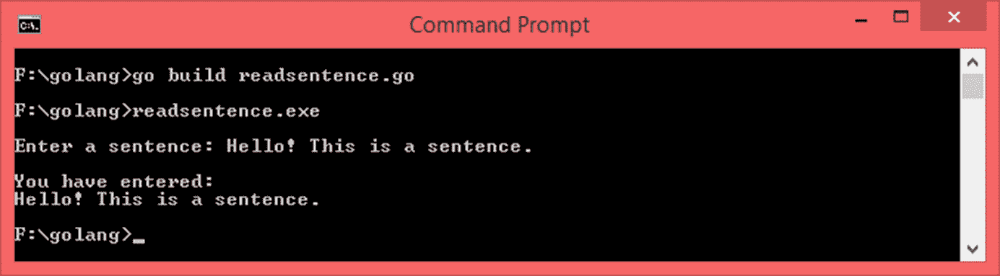


## 11. 控制结构

控制结构是用于让程序员更好地控制程序执行流程的编程构造。当程序被编译时，会构建一个可执行的二进制文件。该文件包含特定平台原生的机器级指令。每一行有意义的代码都会产生一条或多条机器级指令。例如，`var name string` 将产生一类机器级指令，而 `a = b + c` 将产生另一类指令。这是由编译器完成的，我们无需担心。在此章节中提及这一点的目的是为了解释执行流程。回到主题——每一行代码对应一条或多条可执行指令。多行代码将产生多条机器级指令。可执行二进制文件一旦运行，将从第一条指令开始执行，直到最后一条。从概念上讲，我们可以认为程序从第一行代码开始执行，直到最后一行（尽管实际上执行的是可执行二进制文件，而不是程序文件本身）。这是一种非常线性的执行流程。我们可以使用控制结构来改变这种执行流程。Go 语言提供了决策构造和循环作为控制结构。

## 11.1 决策制定

决策构造为程序的执行引入了条件性。例如，你可以根据某个条件是否满足来执行一块代码。Go 语言以 `if-else`、`switch` 以及一些高级构造的形式提供了决策构造。我们将重点介绍 `if-else` 和 `switch`。

### 11.1.1 If-Else 构造

If-Else 构造用于在给定条件为 `true` 时执行一块代码，并可选择在给定条件为 `false` 时执行另一块不同的代码。让我们从一个简单的 `if` 块开始。

**通用语法：**

```
if (<condition>) {
    /* 如果 <condition> 为 true 则执行的语句 */
}
```

**示例：**

```
if (num == 0) {
    fmt.Println("num is 0")
}
```

`if` 语句应提供一个用于求值的条件，在上述代码片段中标记为 `<condition>`。该条件通常是一个布尔表达式，其求值结果为 `true` 或 `false`。如果求值为 `true`，则执行 `if` 块内的语句（即 `if` 语句后花括号内的代码块）。如果求值为 `false`，则跳过 `if` 块，程序将从 `if` 块之后恢复执行。

> **注意：** 条件可以是简单的布尔表达式，如 `(a == 0)`，也可以是使用逻辑运算符组合的多个布尔表达式，如 `(a != 0) && (b > 1)`。

让我们编写一个简单的程序来演示 `if` 语句的用法：

```go
/* If Demo */
/* 包声明 */
package main

/* 导入语句 - 导入 fmt 包 */
import (
    "fmt"
)

/* 强制性的 main 函数 */
func main() {
    var a int = 20

    fmt.Printf("\nProgram execution begins. This statement is before the if block.\n")

    /* 检查 a 是否大于 10 */
    if (a > 10) {
        fmt.Printf("\nInside if block.\n%d is greater than 10.\n", a)
    }

    fmt.Printf("\nOutside if block. Program coming to an end.\n")
}
```

**输出：**
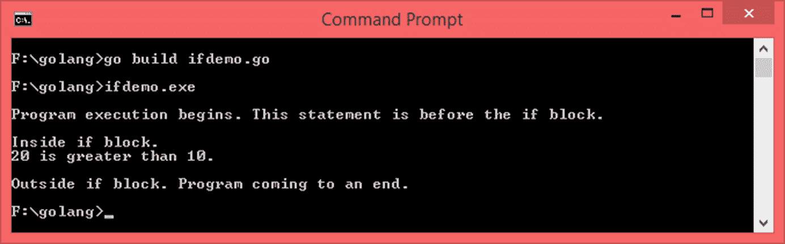

在本例中，我们设置了一个求值为 `true` 的条件，因此 `if` 块得以执行。让我们修改代码，将 `if (a > 10)` 改为 `if (a < 10)` 并观察结果：

**输出：**
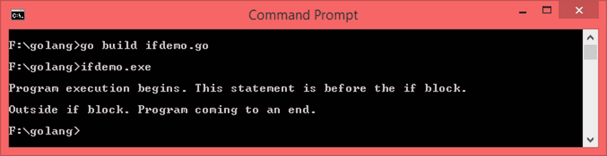

可以看到，当给定条件求值为 `false` 时，`if` 块内的语句不会被执行。可以使用 `else` 块在条件求值为 `false` 时执行另一块不同的代码。`else` 块必须紧跟在 `if` 块之后。

**通用语法：**

```
if (<condition>) {
    /* 如果 <condition> 为 true 则执行的语句 */
} else {
    /* 如果 <condition> 为 false 则执行的语句 */
}
```

**示例：**

```
if (num == 0) {
    fmt.Println("num is 0")
} else {
    fmt.Println("num is NOT 0")
}
```

`if-else` 构造的工作原理很简单——如果条件求值为 `true`，则执行 `if` 块并跳过 `else` 块；如果求值为 `false`，则跳过 `if` 块并执行 `else` 块。

让我们编写一个使用 `if` 和 `else` 块的程序，看看当 `if` 块的给定条件求值为 `false` 时会发生什么。

```go
/* If Else Demo */
/* 包声明 */
package main

/* 导入语句 - 导入 fmt 包 */
import (
    "fmt"
)

/* 强制性的 main 函数 */
func main() {
    var a int = 5

    fmt.Printf("\nProgram execution begins. This statement is before the if block.\n")

    /* 检查 a 是否大于 10 */
    if (a > 10) {
        fmt.Printf("\nInside if block.\n%d is greater than 10.\n", a)
    } else {
        fmt.Printf("\nInside else block.\n%d is NOT greater than 10.\n", a)
    }

    fmt.Printf("\nOutside if/else blocks. Program coming to an end.\n")
}
```

**输出：**
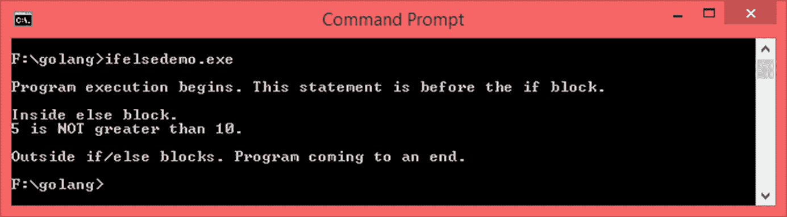

可以看到，条件 `(a > 10)` 求值为 `false`，因为 `a` 为 `5`。因此，`if` 被跳过，`else` 块得以执行。

一个 `if-else` 块组合只会检查一个条件的有效性。根据给定条件的求值结果，将执行 `if` 或 `else` 块。如果你想检查多个条件，可以在 `if-else` 块内嵌套 `if-else` 块，如下所示：

```
if (<condition 1>) {
    /* 如果 <condition 1> 为 true 则执行的语句 */
    if (<condition 2>) {
        /* 如果 <condition 1> 和 <condition 2> 都为 true 则执行的语句 */
    } else {
        /* 如果 <condition 1> 为 true 且 <condition 2> 为 false 则执行的语句 */
    }
} else {
    /* 如果 <condition 1> 为 false 则执行的语句 */
    if (<condition 3>) {
        /* 如果 <condition 1> 为 false 且 <condition 3> 为 true 则执行的语句 */
    } else {
        /* 如果 <condition 1> 和 <condition 3> 都为 false 则执行的语句 */
    }
}
```

检查多个条件的另一种方法是使用 `else-if` 块。将有一个强制性的 `if` 块和一个可选的 `else` 块。在这两个块之间，你可以拥有任意数量的 `else-if` 块，每个 `else-if` 语句都有自己的条件。这样你就可以检查任意数量的条件。以下是通用语法：

```
if (<condition 1>) {
    /* 如果 <condition 1> 为 true，则执行此块。 */
} else if (<condition 2>) {
    /* 如果 <condition 1> 为 false 且 <condition 2> 为 true，则执行此块。 */
} else if (<condition 3>) {
    /* 如果 <condition 1> 和 <condition 2> 为 false 且 <condition 3> 为 true，则执行此块。 */
} else {
    /* 如果 <condition 1>、<condition 2> 和 <condition 3> 都为 false，则执行此块。 */
}
```

当存在 `if-else if-else` 块组合时，发生的过程是——首先检查 `if` 语句的条件。如果该条件求值为 `true`，则执行 `if` 块，故事到此结束！所有剩余的块都将被跳过。然而，如果条件求值为 `false`，执行控制将跳转到紧随其后的 `else if` 语句并检查其条件。如果求值为 `true`，则执行该特定的 `else if` 块，其余块被跳过。如果其条件求值为 `false`，控制将跳转到下一个 `else-if` 块（如果存在），并检查该块的条件。此过程将持续进行，直到找到一个有效的条件，或者不再有 `else-if` 块为止。如果没有任何条件求值为 `true`，则会执行 `else` 块（如果存在）。

让我们编写一个 Go 程序来检查给定的数字是正数、负数还是零：

```go
/* Positive Negative Zero */
/* 包声明 */
package main

/* 导入语句 - 导入 fmt 和 strconv 包 */
import (
    "fmt"
    "strconv"
)

/* 强制性的 main 函数 */
func main() {
    /* 声明变量存储输入 */
    var num_str string

    fmt.Printf("\nEnter a number: ")

    /* 使用 Scanln 函数读取用户输入 */
    fmt.Scanln(&num_str)

    /* 将 num_str 转换为整数 */
    num, err := strconv.Atoi(num_str)

    /* 将 err 赋值给空标识符 */
    _ = err

    /* 检查 num > 0 */
    if (num > 0) {
        fmt.Printf("\n%d is positive.\n", num)
    } else if (num < 0) {
        fmt.Printf("\n%d is negative.\n", num)
    } else {
        fmt.Printf("\n%d is zero.\n", num)
    }
}
```

**输出：**
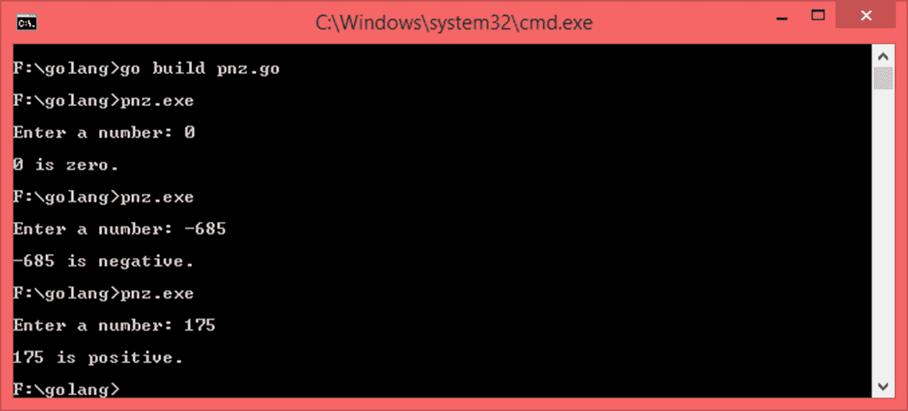

### 11.1.2 Switch-Case 构造

我们已经了解了如何使用多个 `else if` 块来检查多个条件的有效性。`switch-case` 构造提供了一种处理多个条件的更好方式。编写 `switch-case` 构造有多种方式，我们将介绍几种重要的方式。让我们从基本格式开始：

```
switch (<expression>) {
    case <constant expression 1>:
        /* 如果 <expression> 匹配 <constant expression 1> 则执行的语句 */
    case <constant expression 2>:
        /* 如果 <expression> 匹配 <constant expression 2> 则执行的语句 */
    case <constant expression 3>:
        /* 如果 <expression> 匹配 <constant expression 3> 则执行的语句 */
    ...
    case <constant expression n>:
        /* 如果 <expression> 匹配 <constant expression n> 则执行的语句 */
    default:
        /* 如果 <expression> 未找到匹配项则执行的语句 */
}
```

在这种 `switch-case` 构造语法中，`switch` 语句被赋予一个用于工作的表达式——在上述代码片段中标记为 `<expression>`。表达式可以像变量一样简单。在 `switch` 块内部，有多个 `case` 块，每个 `case` 语句都有一个常量表达式。当遇到 `switch` 语句时，其表达式会被求值。生成的值将与 `case` 块的常量表达式进行比对。如果生成的值与其中一个常量表达式匹配，则执行该特定的 `case` 块。这个过程称为**情况测试**。如果值与任何常量表达式都不匹配，则执行 `default` case 块（如果存在）。

这是一个简单的 `switch-case` 演示：

```go
/* Switch Demo 1 */
/* 包声明 */
package main

/* 导入语句 - 导入 fmt 包 */
import (
    "fmt"
)

/* 强制性的 main 函数 */
func main() {
    /* 创建一个用于 switch 的变量 */
    Option := 3

    /* Switch Option，其中 Option 是赋值为 3 的 int 变量 */
    switch (Option) {
        /* 用于匹配 Option 的各种 case */
        case 1:
            fmt.Printf("\nOption is 1.\n")
        case 2:
            fmt.Printf("\nOption is 2.\n")
        case 3:
            fmt.Printf("\nOption is 3.\n")
        /* 如果没有匹配项的默认 case */
        default:
            fmt.Printf("\nOption does not match any of the cases.\n")
    }
}
```

**输出：**


在上述程序中，有 3 个 case，变量 `Option` 用于 switch。该变量已赋值为 `3`，让我们将 `Option` 改为 `1` 和 `9` 并观察结果：

**输出 (Option = 1)：**
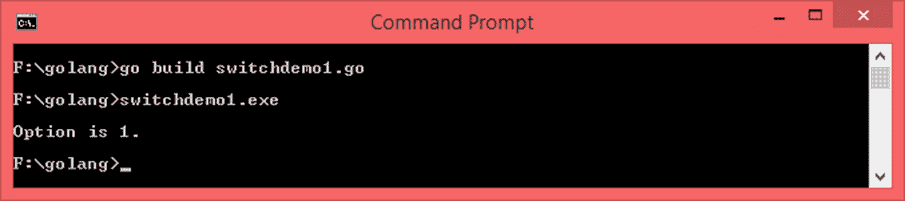

**输出 (Option = 9)：**
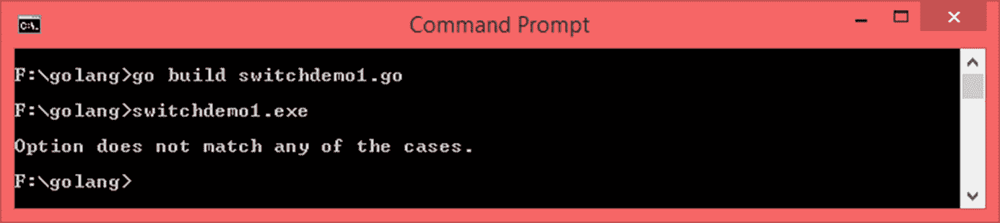

用于 switch 的变量也可以在 `switch` 语句本身中设置，如下所示：

```
switch <optional statement, set variable> (<variable/expression>) {
    case <constant expression 1>:
        /* 如果 <expression> 匹配 <constant expression 1> 则执行的语句 */
    ...
    case <constant expression n>:
        /* 如果 <expression> 匹配 <constant expression n> 则执行的语句 */
    default:
        /* 如果 <expression> 未找到匹配项则执行的语句 */
}
```

让我们重写之前的程序，在 `switch` 语句本身中将 `Option` 设置为 `2`：

```go
/* Switch Demo 1 */
/* 包声明 */
package main

/* 导入语句 - 导入 fmt 包 */
import (
    "fmt"
)

/* 强制性的 main 函数 */
func main() {
    /* Switch Option，其中 Option 是在 switch 中短声明并赋值为 2 的 int 变量 */
    switch Option := 2; (Option) {
        /* 用于匹配 Option 的各种 case */
        case 1:
            fmt.Printf("\nOption is 1.\n")
        case 2:
            fmt.Printf("\nOption is 2.\n")
        case 3:
            fmt.Printf("\nOption is 3.\n")
        /* 如果没有匹配项的默认 case */
        default:
            fmt.Printf("\nOption does not match any of the cases.\n")
    }
}
```

**输出：**
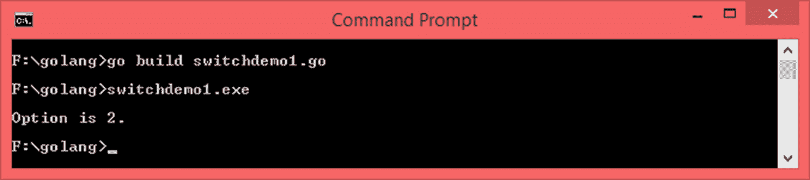

编写 `switch-case` 构造的另一种方式是为每个 `case` 语句使用布尔表达式，如下所示：

```
switch {
    case <boolean expression 1>:
        /* 当 <boolean expression 1> 求值为 true 时执行的语句 */
    case <boolean expression 2>:
        /* 当 <boolean expression 2> 求值为 true 时执行的语句 */
    case <boolean expression 3>:
        /* 当 <boolean expression 3> 求值为 true 时执行的语句 */
    ...
    case <boolean expression n>:
        /* 当 <boolean expression n> 求值为 true 时执行的语句 */
    default:
        /* 当所有布尔表达式都为 false 时执行的语句 */
}
```

让我们编写一个程序从用户处读取一个数字并检查它是奇数还是偶数。我们将使用上述代码片段中的 `switch-case` 语法：

```go
/* Switch Demo 2 -- Odd or Even */
/* 包声明 */
package main

/* 导入语句 - 导入 fmt 包 */
import (
    "fmt"
)

/* 强制性的 main 函数 */
func main() {
    /* 声明一个变量存储数字 */
    var num int

    /* 提示用户输入数字并使用 scanf 读取 */
    fmt.Printf("\nEnter a number: ")
    fmt.Scanf("%d", &num)

    /* Switch num % 2 */
    switch {
        /* 针对每种结果的各种 case */
        /* 如果余数为零，则数字为偶数 */
        case (num % 2) == 0:
            fmt.Printf("\n%d is even.\n", num)
        /* 如果余数为一，则数字为奇数 */
        case (num % 2) == 1:
            fmt.Printf("\n%d is odd.\n", num)
    }
}
```

**输出：**
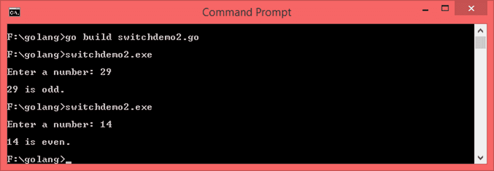

`switch-case` 构造可以使用任意基本数据类型的变量进行切换，不一定非要是数字。让我们编写一个程序要求用户输入月份名称并确定其序号：

```go
/* Switch Demo 3 */
/* 包声明 */
package main

/* 导入语句 - 导入 fmt 包 */
import (
    "fmt"
)

/* 强制性的 main 函数 */
func main() {
    /* 声明一个变量存储月份名称 */
    var month string

    /* 提示用户输入月份名称并使用 scanf 读取 */
    fmt.Printf("\nEnter month: ")
    fmt.Scanf("%s", &month)

    /* Switch month */
    switch month {
        /* 每个月份的各种 case */
        case "January", "january":
            fmt.Printf("\nJanuary comes at No.1 in a year.\n")
        case "February", "february":
            fmt.Printf("\nFebruary comes at No.2 in a year.\n")
        case "March", "march":
            fmt.Printf("\nMarch comes at No.3 in a year.\n")
        case "April", "april":
            fmt.Printf("\nApril comes at No.4 in a year.\n")
        case "May", "may":
            fmt.Printf("\nMay comes at No.5 in a year.\n")
        case "June", "june":
            fmt.Printf("\nJune comes at No.6 in a year.\n")
        case "July", "july":
            fmt.Printf("\nJuly comes at No.7 in a year.\n")
        case "August", "august":
            fmt.Printf("\nAugust comes at No.8 in a year.\n")
        case "September", "september":
            fmt.Printf("\nSeptember comes at No.9 in a year.\n")
        case "October", "october":
            fmt.Printf("\nOctober comes at No.10 in a year.\n")
        case "November", "november":
            fmt.Printf("\nNovember comes at No.11 in a year.\n")
        case "December", "december":
            fmt.Printf("\nDecember comes at No.12 in a year.\n")
        /* 默认 case */
        default:
            fmt.Printf("\n%s does not seem like the name of a month!\n")
    }
}
```

**输出：**
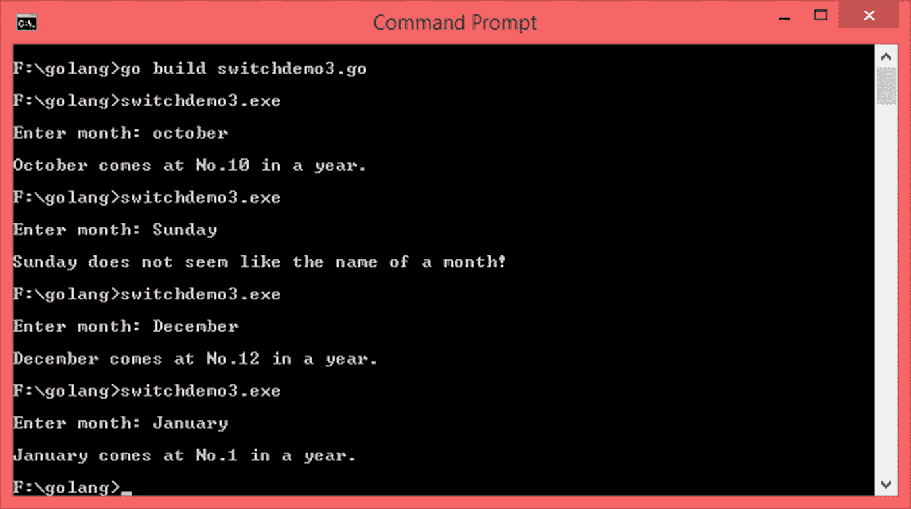

请参考该程序，注意每个 `case` 如何拥有两个常量表达式。当你需要为多个常量表达式执行同一段代码时，不必编写带有不同常量表达式的单独 `case`，而是可以只编写一个 `case` 语句，其中包含用逗号分隔的多个常量表达式。

## 11.2 循环

循环是一种编程构造，可以根据条件是否满足，反复运行一段代码。Go 语言仅提供一种循环，称为 `for` 循环。

### 11.2.1 for 循环

`for` 循环的基本语法如下：

```
for <condition> {
    /* 只要 <condition> 为 true 就执行的语句 */
}
```

**示例：**

```
num := 0
for num < 5 {
    fmt.Printf("num = %d", num)
    num = num + 1
}
```

当执行控制遇到 `for` 循环时，会检查其条件。如果求值为 `true`，则执行循环块内的语句。这称为一次**循环迭代**。一旦到达循环块的末尾，执行控制将跳回 `for` 语句并再次检查条件。如果再次求值为 `true`，循环块将再次被执行。只要给定条件求值为 `true`，这种循环迭代就会持续发生。一旦求值为 `false`，执行控制将退出循环。如果条件永远不变为 `false`，循环将持续执行。这样的循环称为**无限循环**。

下面是一个使用 `for` 循环打印 0 到 9 的程序：

```go
/* For Demo 1 */
/* 包声明 */
package main

/* 导入语句 - 导入 fmt 包 */
import (
    "fmt"
)

/* 强制性的 main 函数 */
func main() {
    /* 初始化一个整数变量为 0 */
    var count int = 0

    /* 运行从 0 到 9 的 for 循环 */
    for (count < 10) {
        /* 打印 count */
        fmt.Printf("count = %d\n", count)
        /* 增加 count */
        count++
    }
}
```

**输出：**
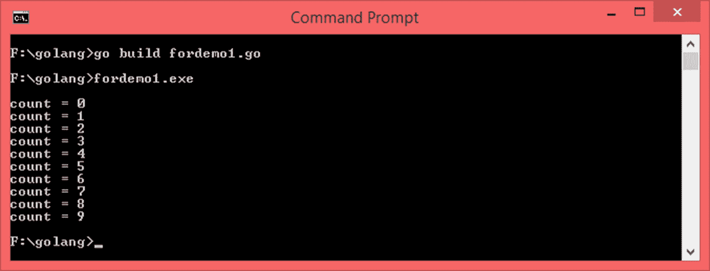

编写 `for` 循环的另一种方式是使用**循环变量**。以下是通用语法：

```
for <loop variable initialization>; <condition>; <loop variable increment/decrement> {
    /* 只要 <condition> 为 true 就执行的语句 */
}
```

使用这种语法，你可以在 `for` 语句本身中初始化循环变量。它还提供了一个增加/减少循环变量的选项。每次迭代结束时，将检查给定条件。如果求值为 `true`，循环变量将被增加/减少，然后循环块将作为下一次迭代被执行。如果循环变量之前未声明，也可以在 `for` 语句中短声明。

使用这种语法，让我们编写一个程序打印 5 的倍数。循环变量已在 `for` 语句中短声明：

```go
/* For Demo 2 */
/* 包声明 */
package main

/* 导入语句 - 导入 fmt 包 */
import (
    "fmt"
)

/* 强制性的 main 函数 */
func main() {
    fmt.Printf("\nMultiples of 5\n\n")

    /* 运行从 1 到 10 的 for 循环 */
    for count := 1; count <= 10; count++ {
        /* 打印 count * 5 */
        fmt.Printf("%d\n", count * 5)
    }
}
```

**输出：**
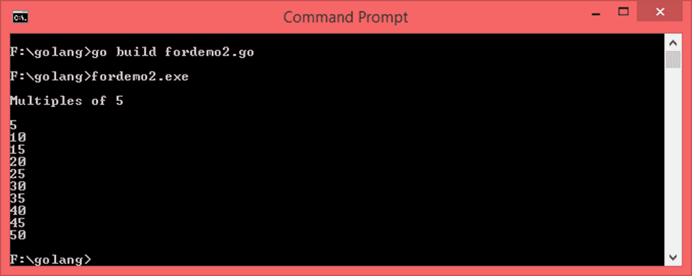

这是一个循环变量已预先声明的示例：

```go
/* For Demo 3 */
/* 包声明 */
package main

/* 导入语句 - 导入 fmt 包 */
import (
    "fmt"
)

/* 强制性的 main 函数 */
func main() {
    /* 声明一个 int 变量 */
    var count int

    fmt.Printf("\nMultiples of 3\n\n")

    /* 运行从 1 到 20 的 for 循环 */
    for count = 1; count <= 20; count++ {
        /* 打印 count * 3 */
        fmt.Printf("%d\n", count * 3)
    }
}
```

**输出：**


### 11.2.2 控制语句

只要给定条件为 `true`，循环就会持续执行。这是循环的正常执行过程。可以使用 `continue` 和 `break` 等控制语句来改变循环的这种执行流程。

#### 11.2.2.1 continue 语句

当遇到 `continue` 语句时，执行控制将跳转到循环的开头，从而跳过 `continue` 语句之后的所有语句。换句话说，循环将移至下一次迭代。

让我们编写一个程序仅打印 1 到 30 之间的奇数：

```go
/* For Demo -- continue */
/* 包声明 */
package main

/* 导入语句 - 导入 fmt 包 */
import (
    "fmt"
)

/* 强制性的 main 函数 */
func main() {
    fmt.Printf("\nOdd numbers between 1 and 30\n\n")

    /* 运行从 1 到 30 的 for 循环 */
    for count := 1; count <= 30; count++ {
        if (count % 2 == 0) {
            continue
        }
        fmt.Printf("%d\n", count)
    }
}
```

**输出：**


#### 11.2.2.2 break 语句

当遇到 `break` 语句时，循环的执行将停止，控制将退出循环。

让我们通过一个编程示例来理解这个概念。我们将运行一个从 1 到 10 的循环，当 `count` 变为 7 时跳出循环：

```go
/* For Demo -- break */
/* 包声明 */
package main

/* 导入语句 - 导入 fmt 包 */
import (
    "fmt"
)

/* 强制性的 main 函数 */
func main() {
    /* 运行从 1 到 10 的 for 循环 */
    for count := 1; count <= 10; count++ {
        if (count == 7) {
            break
        }
        fmt.Printf("count = %d\n", count)
    }
}
```

**输出：**


通过以下程序可以理解 `break` 语句更实用的用法，我们要求用户输入一个数字并判断它是质数还是合数：

```go
/* Prime or composite - using break */
/* 包声明 */
package main

/* 导入语句 - 导入 fmt 包 */
import (
    "fmt"
)

/* 强制性的 main 函数 */
func main() {
    /* 声明变量存储用户输入并作为循环计数器 */
    var i, num int

    /* 提示用户输入数字并使用 Scanf 读取 */
    fmt.Printf("\nEnter a number: ")
    fmt.Scanf("%d", &num)

    /* 从 2 运行循环到 num，因为每个数字都能被 1 整除 */
    for i = 2; i <= num; i++ {
        if (num % i == 0) {
            break
        }
    }

    if (num != i) {
        fmt.Printf("\n%d is a composite number.\n", num)
    } else {
        fmt.Printf("\n%d is a prime number.\n", num)
    }
}
```

**输出：**


让我们编写更多程序以更好地理解循环。以下程序计算给定数字的阶乘。数字 `n` 的阶乘表示为 `n! = n x (n -1) x (n - 2) x ... x 1`。负数的阶乘无法计算，零的阶乘是 1。

```go
/* Factorial */
/* 包声明 */
package main

/* 导入语句 - 导入 fmt 包 */
import (
    "fmt"
)

/* 强制性的 main 函数 */
func main() {
    /* 声明变量存储用户输入、循环计数器和阶乘 */
    var i, num int
    var f int = 1

    /* 提示用户输入数字并使用 Scanf 读取 */
    fmt.Printf("\nEnter a number: ")
    fmt.Scanf("%d", &num)

    /* 从 num 运行循环到 1 */
    for i = num; i > 0; i-- {
        f = f * i
    }

    if (num >= 0) {
        fmt.Printf("\nFactorial of %d is %d\n", num, f)
    } else {
        fmt.Printf("\nFactorial of a negative number cannot be calculated\n")
    }
}
```

**输出：**


让我们使用循环编写另一个程序，计算前 `n` 个偶数的和。

```go
/* Sum of n even numbers */
/* 包声明 */
package main

/* 导入语句 - 导入 fmt 包 */
import (
    "fmt"
)

/* 强制性的 main 函数 */
func main() {
    /* 声明变量存储 n、循环计数器和和 */
    var i, n int
    var even_num, sum int = 1, 0

    /* 提示用户输入数字并使用 Scanf 读取 */
    fmt.Printf("\nEnter n: ")
    fmt.Scanf("%d", &n)

    fmt.Printf("\nFirst %d even numbers: \n\n", n)

    for i = 1; even_num <= n; i++ {
        if (i % 2 == 0) {
            fmt.Printf("%d ", i)
            sum += i
            even_num++
        }
    }

    fmt.Printf("\n\nSum of above even numbers: %d\n", sum)
}
```

**输出：**


## 12. 数组

数组是相似项目的集合。在编程术语中，Go 语言中的数组是一种包含相同数据类型项目的数据结构。数组内的每个项目称为数组元素（或简称元素）。可以使用元素在数组中的位置来引用该元素，该位置称为索引。数组索引从 0 开始，到比数组大小小 1 的位置结束（大小 – 1）。例如，如果我们有一个包含 10 个元素的数组，该数组的第一个元素将位于 0，第二个位于索引 1，第三个位于索引 2，……，最后一个元素将位于索引 9。

在 Go 编程语言中，可以使用以下语法声明数组：

```
var <数组变量> [<数组大小>] <数据类型>
```

示例：

```
var array1 [5] int
var msg [3] string
var x [10] float64
```

一旦声明了数组，其元素将获得零值（数值数组将保存 0，字符串数组将保存空字符串）。可以使用由访问操作符（`[]`）括起来的索引来访问单个元素。这样，您可以设置（也可以检索/打印）数组的单个元素。

这是一个示例：

```
/*声明一个大小为 5 的 int 数组。第一个索引是 0，最后一个索引是 4*/
var num_array [5] int

/*将索引 0 处的元素设置为 15*/
num_array[0] = 15

/*将索引 1 处的元素设置为 -35*/
num_array[1] = -35

/*将索引 2 处的元素设置为 0*/
num_array[2] = 0

/*将索引 3 处的元素设置为 68*/
num_array[3] = 68

/*将索引 4 处的元素设置为 18*/
num_array[4] = 18
```

`num_array` 在内存中的样子如下：


我们现在将编写一个程序，在其中创建一个整数数组，设置元素值并将它们打印出来。可以使用动词 `%v` 或 `%d` 打印整个数组。打印单个元素与打印任何其他整数变量相同：

```
/*数组演示 1*/
/*包声明*/
package main

/*导入语句 - 导入 fmt 包*/
import (
    "fmt"
)

/*强制的 main 函数*/
func main() {
    /*声明一个包含 7 个整数的数组*/
    var arr [7] int

    /*设置所有元素的值*/
    arr[0] = 83
    arr[1] = -34
    arr[2] = 55
    arr[3] = 97
    arr[4] = -24
    arr[5] = -11
    arr[6] = 46

    /*打印整个数组*/
    fmt.Printf("\n 数组 arr:\n\n%v\n", arr)

    /*打印索引和对应的值*/
    fmt.Printf("\n 索引 0 处的值: ==> %d", arr[0])
    fmt.Printf("\n 索引 1 处的值: ==> %d", arr[1])
    fmt.Printf("\n 索引 2 处的值: ==> %d", arr[2])
    fmt.Printf("\n 索引 3 处的值: ==> %d", arr[3])
    fmt.Printf("\n 索引 4 处的值: ==> %d", arr[4])
    fmt.Printf("\n 索引 5 处的值: ==> %d", arr[5])
    fmt.Printf("\n 索引 6 处的值: ==> %d\n", arr[6])
}
```

输出：


也可以在声明时使用以下语法初始化数组：

```
var <数组变量> = [<可选大小>] <数据类型> {<用逗号分隔的元素>}
```

示例：

```
var arr1 = [] int {-3, 0, 3}
var arr2 = [6] float32 {0.36, -0.25, 0.01, -0.67, 0.88, 0.73}
```

这是一个演示数组初始化的程序：

```
/*数组演示 2*/
/*包声明*/
package main

/*导入语句 - 导入 fmt 包*/
import (
    "fmt"
)

/*强制的 main 函数*/
func main() {
    /*声明一个包含 5 个浮点数的数组并初始化*/
    var arr = [5] float32 {4.6, -65.21, 0.64, -12.76, 25.75}

    /*打印整个数组*/
    fmt.Printf("\n 数组 arr:\n\n%v\n", arr)

    /*打印索引和对应的值*/
    fmt.Printf("\n 索引 0 处的值: ==> %f", arr[0])
    fmt.Printf("\n 索引 1 处的值: ==> %f", arr[1])
    fmt.Printf("\n 索引 2 处的值: ==> %f", arr[2])
    fmt.Printf("\n 索引 3 处的值: ==> %f", arr[3])
    fmt.Printf("\n 索引 4 处的值: ==> %f\n", arr[4])
}
```

输出：


数组可以是任何数据类型。初始化数组时，可以指定大小，也可以不指定。大小将根据您在初始化时设置的元素数量自动确定。在程序的任何位置，您都可以使用函数 `len(<数组变量>)` 来确定数组的大小。此外，每次手动访问元素可能不是最佳方式——循环在处理数组方面做得很好。

这是一个演示这些概念的示例：

```
/*数组演示 3*/
/*包声明*/
package main

/*导入语句 - 导入 fmt 包*/
import (
    "fmt"
)

/*强制的 main 函数*/
func main() {
    /*声明一个包含 10 个字符串的数组并初始化*/
    var country = [] string {"USA", "UK", "India", "Brazil", "South Africa", "Argentina", "New Zealand", "Russia", "Morocco", "Latvia"}

    /*打印整个数组*/
    fmt.Printf("\n 数组 country:\n\n%v\n", country)

    /*使用 for 循环打印索引和对应的值*/
    /*使用 len 函数获取数组的大小*/
    size := len(country)

    for i := 0; i < size; i++ {
        fmt.Printf("\n 索引 %d 处的值: ==> %s", i, country[i])
    }
    fmt.Printf("\n")
}
```

输出：


让我们再看几个编程示例，以更好地理解数组。这是一个示例，它从用户处获取 5 个整数作为输入并将其保存在数组中，计算这些整数的总和和平均值：

```
/*数组输入*/
/*包声明*/
package main

/*导入语句 - 导入 fmt 包*/
import (
    "fmt"
    "strconv"
)

/*强制的 main 函数*/
func main() {
    /*声明变量*/
    var arr [5] int
    var sum int = 0
    var num_str string

    /*声明一个变量来存储平均值*/
    var avg float32

    /*提示用户输入 5 个元素，使用 for 循环*/
    for i := 0; i < 5; i++ {
        fmt.Printf("\n 请输入索引 %d 处的元素: ", i)
        fmt.Scanln(&num_str)

        /*将 num_str 转换为整数*/
        num, err := strconv.Atoi(num_str)

        /*将 num 赋值给 arr[i]*/
        arr[i] = num

        /*将 err 赋值给空标识符*/
        _ = err

        /*持续计算总和*/
        sum += arr[i]
    }

    /*计算平均值*/
    avg = float32(sum) / 5.0
    fmt.Printf("\n 数组 arr:\n%v\n 总和: %d\n 平均值: %f\n", arr, sum, avg)
}
```

输出：


让我们编写一个程序，从用户处获取 5 个整数作为输入，将它们保存在数组中并反转该数组：

```
/*反转数组*/
/*包声明*/
package main

/*导入语句 - 导入 fmt, strconv 包*/
import (
    "fmt"
    "strconv"
)

/*强制的 main 函数*/
func main() {
    /*声明变量*/
    var arr [5] int
    var num_str string

    /*提示用户输入 5 个元素，使用 for 循环*/
    for i := 0; i < 5; i++ {
        fmt.Printf("\n 请输入索引 %d 处的元素: ", i)
        fmt.Scanln(&num_str)

        /*将 num_str 转换为整数*/
        num, err := strconv.Atoi(num_str)

        /*将 num 赋值给 arr[i]*/
        arr[i] = num

        /*将 err 赋值给空标识符*/
        _ = err
    }

    fmt.Printf("\n 原始数组:\n%v\n", arr)

    /*反转数组*/
    for i := 0; i < 5 / 2; i++ {
        temp := arr[i]
        arr[i] = arr[4 - i]
        arr[4 - i] = temp
    }

    fmt.Printf("\n 反转后的数组:\n%v\n", arr)
}
```

输出：


## 13. 函数

函数是一段可复用的代码，可以被“调用”以执行特定任务。我们已经使用过一些函数，例如 `Printf`、`Scanln`、`Atoi` 等。这些函数由他人编写，我们使用它们让编程工作变得更轻松。`Scanln` 和 `Println` 是 I/O 函数，它们隐式地与设备（直接或间接）协作以完成所需工作。想象一下，如果每次想在控制台打印内容都要编写一大段代码，编程将会多么不便。因为 `Println` 和 `Scanln` 函数已由某人在某处定义好，像我们这样的程序员只需调用它们即可完成工作。在本章中，我们将学习编写自己的函数。函数主题大体可分为两类——函数定义和函数调用。

## 13.1 函数定义

函数定义是一段定义函数功能的代码。例如，一个用于添加两个数字的函数，其函数定义中将包含添加两个数字的逻辑。一个程序可以包含零个或多个用户定义函数。所有函数都应在 `main` 函数**外部**定义。定义函数的最佳位置在包声明语句和 `main` 函数之间。以下是函数定义的通用语法：

```
func <function name> (<arguments>) <return type> {
    /*Function Body*/
    //Statements
}
```

示例：

```
func helloFunction() {
    fmt.Printf("\nHello! We are inside helloFunction!\n")
}
```

以下是基本函数定义的组成部分：

*   **函数名**
    *   函数名是赋予函数的名称，在上述代码片段中由 `<function name>` 标记。此名称用于标识和调用函数。函数命名规则与标识符/变量命名规则相同。
*   **参数**
    *   参数（在上述代码片段中由 `<arguments>` 标记）是函数“接收”到局部变量中的值。这些值在函数调用时传递给函数。一个函数可以接受零个或多个参数。当有多个参数时，应使用逗号分隔。参数也称为形参。
*   **返回类型**
    *   函数可以选择性地将一个值返回给调用函数。特定函数返回值的数据类型应在返回类型字段中指定，在上述代码片段中由 `<return type>` 标记。
*   **函数体**


### 函数体

函数体是函数的核心部分，实际工作在此完成。例如，若有一个函数用于计算给定数字的阶乘，负责计算阶乘的代码即位于定义的这一部分。以下代码片段展示了不同类型的函数：

```go
/*Function that accepts no arguments and returns no value*/
func sayHello() {
    fmt.Printf("\nJust a function that prints Hello on the console.")
}

/*Function that accepts one argument and returns no value*/
func showValue(name string) {
    fmt.Printf("\nReceived name = %s", name)
}

/*Function that accepts one argument and returns one value*/
func doubleIt(x int) int {
    return (x * 2)
}

/*Function that accepts three arguments and returns two values*/
func doMath(a int, b int, c int) (int, float32) {
    sum := a + b + c
    avg = float32(sum) / 3.0
    return sum, avg
}
```

## 13.2 函数调用

已定义的函数不会自动执行，需要被调用（可能从另一个函数，如 `main` 函数中调用）。函数通过其名称调用，并按函数定义中指定的顺序传递完全相同数量的参数。通用语法如下：

```
<function name>(<arguments>)
```

示例：`myFunction()`

下面调用上一节定义的每个函数：

```go
sayHello()
showValue("Sarah")
x = doubleIt(100)
sum, avg = doMath(1, 2, 3)
```

以下是一个不接受参数且无返回值的简单函数示例：

```go
/*Function Demo 1*/
/*Package Declaration*/
package main

/*Import Statement - import fmt package*/
import (
    "fmt"
)

/*User defined function*/
/*This function accepts no arguments and returns no value*/
func myFunction() {
    fmt.Printf("\n[Inside myFunction] - Hello! from myFunction\n")
}

/*Mandatory main function*/
func main() {
    fmt.Printf("\n[Inside main] - now calling myFunction\n")
    /*Call myFunction*/
    myFunction()
    fmt.Printf("\n[Inside main] - reaching the end of main function/program\n")
}
```

输出：


## 13.3 向函数传递参数

在函数调用时，通过将参数括在括号内来传递。多个参数用逗号分隔。参数只能传递给接受参数的函数。值得注意的是，函数调用时传递的参数数量和顺序必须与函数定义中一致。

下面是一个 Go 程序，演示接受两个整数并计算其和的函数：

```go
/*Function Demo 2*/
/*Package Declaration*/
package main

/*Import Statement - import fmt package*/
import (
    "fmt"
)

/*User defined function*/
/*This function accepts 2 arguments and returns no value*/
func addTwoNumbers(a int, b int) {
    sum := a + b
    fmt.Printf("\n[Inside addTwoNumbers] - Received two arguments: \n\na = %d, b = %d\n\n", a, b)
    fmt.Printf("\n[Inside addTwoNumbers] - Sum = %d\n", sum)
}

/*Mandatory main function*/
func main() {
    fmt.Printf("\n[Inside main] - now calling addTwoNumbers, passing 5 and 9 as arguments\n")
    /*Call addTwoNumbers*/
    addTwoNumbers(5, 9)
    fmt.Printf("\n[Inside main] - reaching the end of main function/program\n")
}
```

输出：


## 13.4 返回值

函数可借助 `return` 语句向调用函数返回值。通用语法如下：

```
return <values>
```

示例：

```go
/*Single value*/
return name

/*Multiple values*/
return x, y, z
```

调用返回值的函数时，必须指定变量接收返回值，否则将丢失。接收多个值时需指定多个变量，返回多值时将执行多重赋值。示例如下：

```go
/*Receive single value*/
name = getName()

/*Receive multiple values*/
a, b, c = getValues()
```

下面编写一个函数，接受三个整数，计算平均值并返回：

```go
/*Function Demo 3*/
/*Package Declaration*/
package main

/*Import Statement - import fmt package*/
import (
    "fmt"
)

/*User defined function*/
/*This function accepts 3 arguments and returns one value*/
func findAverage(a int, b int, c int) float32 {
    fmt.Printf("\n[Inside findAverage] - Received three arguments: \n\na = %d, b = %d, c = %d\n\n", a, b, c)
    /*Calculate sum*/
    sum := a + b + c
    /*Calculate average, use type casting to convert from int to float*/
    avg := (float32(sum) / 3.0)
    fmt.Printf("\n[Inside findAverage] - Returning avg back to main\n")
    return avg
}

/*Mandatory main function*/
func main() {
    fmt.Printf("\n[Inside main] - now calling findAverage, passing 2, 8 and -3 as arguments\n")
    /*Call findAverage, receive returned value in average variable (short declared)*/
    average := findAverage(2, 8, -3)
    fmt.Printf("\n[Inside main] - average = %f\n", average)
    fmt.Printf("\n[Inside main] - reaching the end of main function/program\n")
}
```

输出：


再编写一个程序，演示返回多个值的函数。定义一个函数接受两个整数，返回四个值——和、差、积、商：

```go
/*Function Demo 4*/
/*Package Declaration*/
package main

/*Import Statement - import fmt package*/
import (
    "fmt"
)

/*User defined function*/
/*This function accepts 2 arguments and returns 4 values*/
func performArithmetics(a int, b int) (int, int, int, float32) {
    fmt.Printf("\n[Inside performArithmetics] - Received 2 arguments: \n\na = %d, b = %d\n\n", a, b)
    /*Calculate sum, diff, prod, quo*/
    sum := a + b
    diff := a - b
    prod := a * b
    quo := float32(a) / float32(b)
    fmt.Printf("\n[Inside performArithmetics] - Returning sum, diff, prod, quo back to main\n")
    return sum, diff, prod, quo
}

/*Mandatory main function*/
func main() {
    /*Declare variables to store return values*/
    var sum, diff, prod int
    var quo float32
    fmt.Printf("\n[Inside main] - now calling performArithmetics, passing 15 and 6 as arguments\n")
    /*Call performArithmetics, receive returned values in sum, diff, prod, quo*/
    sum, diff, prod, quo = performArithmetics(15, 6)
    fmt.Printf("\n[Inside main] - sum = %d, diff = %d, prod = %d, quo = %f\n", sum, diff, prod, quo)
    fmt.Printf("\n[Inside main] - reaching the end of main function/program\n")
}
```

输出：


## 13.5 数组作为参数传递

将数组作为参数传递给函数的过程与传递其他参数相同。通用语法如下：

```go
func <function name>(<array variable>[] <data type>) <return type> {
    /*Statements*/
}

/*OR*/
func <function name>(<array variable>[<size>] <data type>) <return type> {
    /*Statements*/
}
```

示例：

```go
func demoFunction(names []string) {
    /*Statements*/
}

/*OR*/
func demoFunction(names [10]string) {
    /*Statements*/
}
```

> **注意**：虽然在大多数情况下不指定数组大小程序也能正常运行，但建议始终注明数组大小。

下面编写一个 Go 程序，接受一个整数数组，返回所有元素的和及其平均值：

```go
/*Function Demo 5*/
/*Package Declaration*/
package main

/*Import Statement - import fmt package*/
import (
    "fmt"
)

/*User defined function*/
/*This function accepts an array as an argument and returns 2 values*/
func getSumAvg(arr [10]int) (int, float32) {
    fmt.Printf("\n[Inside getSumAvg] - Received 1 argument: \n\narr[10] = %v\n\n", arr)
    /*Calculate sum, avg*/
    sum := 0
    for i := 0; i < 10; i++ {
        /*Keep calculating sum*/
        sum += arr[i]
    }
    /*Calculate average*/
    avg := float32(sum) / 10.0
    fmt.Printf("\n[Inside getSumAvg] - Returning sum, avg back to main\n")
    return sum, avg
}

/*Mandatory main function*/
func main() {
    /*Declare an integer array of 10 elements*/
    var arr = [10]int{9, -5, 6, 12, -3, 4, -1, -1, 25, 10}
    /*Declare variables to store sum and average*/
    var sum int
    var avg float32
    fmt.Printf("\n[Inside main] - now calling getSumAvg, passing arr = %v as an argument\n", arr)
    /*Call getSumAvg, receive returned values in sum, avg*/
    sum, avg = getSumAvg(arr)
    fmt.Printf("\n[Inside main] - sum = %d, avg = %f\n", sum, avg)
    fmt.Printf("\n[Inside main] - reaching the end of main function/program\n")
}
```

输出：


## 14. 字符串

字符串是字符的序列。可以通过将一系列字符用双引号括起来来形成常量字符串。就像数组一样，可以通过指定索引，借助访问操作符（`[]`）来访问单个字符。字符串的索引从 0 开始，到比字符串大小小 1 的位置结束。字符串的长度可以使用 `len(<string>)` 函数来确定。使用访问操作符，只能读取单个字符，而不能设置。

下面是一个演示这些字符串基础知识的简单 Go 程序：

```go
/*String Demo 1*/
/*Package Declaration*/
package main

/*Import Statement - import fmt package*/
import (
	"fmt"
)

/*Mandatory main function*/
func main() {
	/*Declare and initialize a string*/
	var name string = "Monica"

	/*Fetch length of the string*/
	length := len(name)

	/*Display the string and its length*/
	fmt.Printf("\nname = %s, length = %d\n", name, length)

	/*Use for loop to print individual characters of the string*/
	for i := 0; i < length; i++ {
		fmt.Printf("\nCharacter at index %d ==> %c\n", i, name[i])
	}
}
```

输出：


可以使用 rune 函数将字符串的单个字符获取到字符数组中，如下所示：

```go
<character array var> = []rune(<String>)
```

示例：
```go
c_arr = []rune(str)
```

可以使用 `string` 函数将字符数组转换为字符串，如下所示：

```go
<string> = string(<character array variable>)
```

示例：
```go
str = string(char_array)
```

下面是一个演示该函数工作原理的程序：

```go
/*Rune demo*/
/*Package Declaration*/
package main

/*Import Statement - import fmt package*/
import (
	"fmt"
)

/*Mandatory main function*/
func main() {
	str := "Excelsior"

	str_length := len(str)

	/*Use rune to fetch characters in an array*/
	str_char := []rune(str)

	fmt.Printf("\nstr: %s, length: %d", str, str_length)

	fmt.Printf("\n\nCharacter array: %c\n", str_char)

	fmt.Printf("\nstr_char character array elements: \n")

	for i := 0; i < str_length; i++ {
		fmt.Printf("\nCharacter at index %d ==> %c\n", i, str_char[i])
	}
}
```

输出：


有一个名为 `strings` 的包，它包含许多有助于字符串操作的内置函数。让我们来看看其中几个重要的：

## 14.1 连接字符串

可以使用 `strings.Join` 函数连接两个或多个字符串。为此，待连接的字符串应放在一个字符串数组中。以下是通用语法：

```go
strings.Join(<string array>, <separator>)
```

示例：
```go
big_string := strings.Join(arr, " ")
```

还有一种连接两个或多个字符串的更简单方法——使用 `+` 运算符。通用语法：

```go
<concatenated string variable> = <string 1> + <string 2> + ... <string n>
```

示例：
```go
big_str := "hello" + " " + "world!"
```

让我们编写一个程序来演示这两种连接方法：

```go
/*String Demo 2 - Concatenation*/
/*Package Declaration*/
package main

/*Import Statement - import fmt, strings packages*/
import (
	"fmt"
	"strings"
)

/*Mandatory main function*/
func main() {
	/*Declare and initialize a string array*/
	var words = []string{"This", "is", "an", "array", "of", "7", "strings"}

	/*Display the string array*/
	fmt.Printf("\nwords array: %s\n", words)

	/*Concatenate using strings.Join*/
	words_str := strings.Join(words, " ")

	fmt.Printf("\nConcatenated string (using strings.Join): %s\n", words_str)

	/*Short declare some strings*/
	str1 := "Go"
	str2 := "Programming"
	str3 := "Language"

	/*Concatenate str1, str2 and str3*/
	str4 := str1 + " " + str2 + " " + str3

	fmt.Printf("\nstr1 = %s\nstr2 = %s\nstr3 = %s\n\nConcatenated string (using + operator)\n\nstr4 = %s\n", str1, str2, str3, str4)
}
```

输出：


## 14.2 比较字符串

`strings` 包中的 `Compare` 函数用于比较两个字符串。

语法：
```go
strings.Compare(<string1>, <string2>)
```

示例：
```go
result := strings.Compare(string1, string2)
```

如果两个字符串相同，该函数返回 0；如果 `string1` 在字典序上小于 `string2`，则返回 `-1`；如果 `string1` 在字典序上大于 `string2`，则返回 `1`。

让我们编写一个程序从用户处读取两个字符串并进行比较：

```go
/*Compare two strings*/
/*Package Declaration*/
package main

/*Import Statement - import fmt, bufio, os, strings package*/
import (
	"fmt"
	"bufio"
	"os"
	"strings"
)

/*Mandatory main function*/
func main() {
	/*Create an input reader variable of type NewReader using stdin*/
	inputReader := bufio.NewReader(os.Stdin)

	/*Prompt the user to enter something*/
	fmt.Printf("\nEnter a string: ")

	/*Read string using ReadString function*/
	str1, _ := inputReader.ReadString('\n')

	fmt.Printf("\nEnter another string: ")

	/*Read string using ReadString function*/
	str2, _ := inputReader.ReadString('\n')

	/*Compare str1 and str2 using strings.Compare*/
	result := strings.Compare(str1, str2)

	if result == 0 {
		fmt.Printf("\nBoth strings are the same.\n")
	} else if result > 0 {
		fmt.Printf("\nFirst string is lexicographically greater than the second string.\n")
	} else {
		fmt.Printf("\nSecond string is lexicographically greater than the first string.\n")
	}
}
```

输出：


## 14.3 在另一个字符串中搜索字符串

`strings` 包中的 `Contains` 函数用于检查一个字符串是否存在于另一个字符串中。如果字符串存在，该函数返回布尔值 `true`，如果不存在则返回 `false`。

语法：
```go
strings.Contains(<main string>, <string to be searched>)
```

示例：
```go
result := strings.Contains("Hello World", "World")
```

此外，可以使用 `strings` 包中的 `Index` 函数来确定给定字符串在主字符串中首次出现的位置。如果字符串不存在于主字符串中，该函数返回 `-1`。

下面是一个从用户处读取两个字符串并在主字符串中搜索第二个字符串的程序：

```go
/*Search for a string within another string*/
/*Package Declaration*/
package main

/*Import Statement - import fmt, bufio, os, strings package*/
import (
	"fmt"
	"bufio"
	"os"
	"strings"
)

/*Mandatory main function*/
func main() {
	/*Create an input reader variable of type NewReader using stdin*/
	inputReader := bufio.NewReader(os.Stdin)

	/*Prompt the user to enter something*/
	fmt.Printf("\nEnter the main string: ")

	/*Read string using ReadString function*/
	main_str, _ := inputReader.ReadString('\n')

	fmt.Printf("\nEnter the string to be searched inside the main string: ")

	/*Read string using ReadString function*/
	str, _ := inputReader.ReadString('\n')

	/*Use trim function to remove all \n and \r characters*/
	str = strings.Trim(str, "\n\r")

	result := strings.Contains(main_str, str)

	if result == true {
		fmt.Printf("\nThe given string is present in the main string.")

		/*Find the first occurrence*/
		first := strings.Index(main_str, str)

		/*Print first index*/
		fmt.Printf("\n\nFirst Occurrence: %d\n", first)
	} else {
		fmt.Printf("\nThe given string is not present in the main string.\n")
	}
}
```

输出：


## 14.4 修剪字符串

可能需要从字符串中移除不需要的字符。可以使用 `strings` 包中的 `Trim` 函数，如下所示：

```go
<trimmed_string> = strings.Trim(<string>, <character set to be trimmed>)
```

从用户处读取字符串时，`\n` 或 `\r` 或两者都有很大概率被追加到字符串中。可以使用 `Trim` 函数移除这些字符：

```go
new_str = strings.Trim(str, "\n\r")
```

实际上，让我们看看从用户处读取字符串时会发生什么——我们将字符串转换为字符数组来查看每个字符：

```go
/*Pre-trim demo*/
/*Package Declaration*/
package main

/*Import Statement - import fmt, bufio, os, strings package*/
import (
	"fmt"
	"bufio"
	"os"
)

/*Mandatory main function*/
func main() {
	/*Create an input reader variable of type NewReader using stdin*/
	inputReader := bufio.NewReader(os.Stdin)

	/*Prompt the user to enter something*/
	fmt.Printf("\nEnter a string: ")

	/*Read string using ReadString function*/
	str, _ := inputReader.ReadString('\n')

	str_length := len(str)

	fmt.Printf("\nLength: %d", str_length)

	/*Use rune to fetch characters in an array*/
	str_char := []rune(str)

	fmt.Printf("\n\nCharacter array: \n %c \n", str_char)

	for i := 0; i < str_length; i++ {
		fmt.Printf("\nCharacter at index %d ==> %c\n", i, str_char[i])
	}
}
```

输出：


我们输入了单词 Linux，它显然有 5 个字符。但长度显示为 7。此外，在打印字符时，我们在位置 5 和 7 看到了两个空字符。让我们稍微调查一下，看看发生了什么。我们将修改以下语句：

```go
fmt.Printf("\nCharacter at index %d ==> %c\n", i, str_char[i])
```

改为：

```go
fmt.Printf("\nCharacter at index %d ==> %X\n", i, str_char[i])
```

新语句将打印字符的十六进制代码。这是新的输出：


索引 5 处的字符是 D，即 `0x0D`，索引 6 处的字符是 A，即 `0x0A`。如果你在 ASCII 表中核对这些十六进制值，就会意识到这些字符分别是 `\r` 和 `\n`。

让我们使用 `Trim` 函数看看会发生什么。这是新程序：

```go
/*Trim demo*/
/*Package Declaration*/
package main

/*Import Statement - import fmt, bufio, os, strings package*/
import (
	"fmt"
	"bufio"
	"os"
	"strings"
)

/*Mandatory main function*/
func main() {
	/*Create an input reader variable of type NewReader using stdin*/
	inputReader := bufio.NewReader(os.Stdin)

	/*Prompt the user to enter something*/
	fmt.Printf("\nEnter a string: ")

	/*Read string using ReadString function*/
	str, _ := inputReader.ReadString('\n')

	/*Trim to remove unwanted characters*/
	str = strings.Trim(str, "\n\r")

	str_length := len(str)

	fmt.Printf("\nLength: %d", str_length)

	/*Use rune to fetch characters in an array*/
	str_char := []rune(str)

	fmt.Printf("\n\nCharacter array: \n %c \n", str_char)

	for i := 0; i < str_length; i++ {
		fmt.Printf("\nCharacter at index %d ==> %c\n", i, str_char[i])
	}
}
```

输出：


## 14.5 大小写转换

可以分别使用 `ToUpper` 和 `ToLower` 函数将字符串转换为大写和小写。

语法：
```go
<ustring> = strings.ToUpper(<string>)
<lstring> = strings.ToLower(<string>)
```

示例：
```go
str1 = strings.ToUpper(s)
str2 = strings.ToLower(s)
```

下面是一个演示大小写转换的程序：

```go
/*Case conversion demo*/
/*Package Declaration*/
package main

/*Import Statement - import fmt, bufio, os, strings package*/
import (
	"fmt"
	"bufio"
	"os"
	"strings"
)

/*Mandatory main function*/
func main() {
	/*Create an input reader variable of type NewReader using stdin*/
	inputReader := bufio.NewReader(os.Stdin)

	/*Prompt the user to enter something*/
	fmt.Printf("\nEnter a string: ")

	/*Read string using ReadString function*/
	str, _ := inputReader.ReadString('\n')

	/*Trim to remove unwanted characters*/
	str = strings.Trim(str, "\n\r")

	/*Convert to upper and lower case*/
	u_str := strings.ToUpper(str)
	l_str := strings.ToLower(str)

	fmt.Printf("\nOriginal string: %s\nUpper case string: %s\nLower case string: %s\n", str, u_str, l_str)
}
```

输出：


## 15. 指针

当声明一个变量时，会为其分配一块内存区域来存储其内容。这块内存区域有一个唯一可识别的地址。指针是一种特殊的变量，用于存储其他变量的地址。这里需要注意的一个重要事项是：指针只能存储相同数据类型变量的内存地址。例如，整型指针将存储整型变量的内存地址；字符串指针不能存储浮点型变量的内存地址。

指针变量使用以下语法声明：

```go
var <pointer variable> *<data type>
```

示例：

```go
/*Integer pointer*/
var ptr *int

/*String pointers*/
var sptr1, sptr2 *string

/*Floating point pointer*/
var p *float64
```

可以通过在变量名前加上 `&` 符号来获取变量的内存地址。该地址只能赋值给相同数据类型的指针变量。具体操作如下：

```go
var name string = "Jason"
var sptr *string
sptr = &name

/*Short declare a pointer*/
var address string = "NY"
add_ptr := &address

/*Declare and initialize pointers*/
var a, b int
var aptr, bptr *int = &a, &b
```

当指针持有某个变量的地址时，称该指针变量“指向”该变量。让我们编写一个程序来创建几个变量，并创建相应数量的指针指向这些变量：

```go
/*Pointers Demo 1*/
/*Package Declaration*/
package main

/*Import Statement - import fmt package*/
import (
	"fmt"
)

/*Mandatory main function*/
func main() {
	/*Declare and initialize a string*/
	var name string = "Shaun"

	/*Declare a string pointer*/
	var name_ptr *string

	/*Assign the address of name to name_ptr*/
	name_ptr = &name

	/*Short declare and initialize int variable*/
	age := 19

	/*Short declare and initialize integer pointer*/
	aptr := &age

	/*Declare and initialize float variables*/
	var height, weight float32 = 182.36534, 165.75124

	/*Declare and initialize pointer variables*/
	var hptr, wptr *float32 = &height, &weight

	/*Print everything*/
	fmt.Printf("\nname = %s\nname_ptr (address of name var) = %v\n", name, name_ptr)
	fmt.Printf("\nage = %d\natpr (address of age var) = %v\n", age, aptr)
	fmt.Printf("\nheight = %f\nhtpr (address of height var) = %v\n", height, hptr)
	fmt.Printf("\nweight = %f\nwtpr (address of weight var) = %v\n", weight, wptr)
}
```

输出：


在该程序中，我们仅显示了变量的内容及其内存地址。此时你可能还无法理解其意义。你可能会问——变量的内存地址有什么用？我们马上就会讲到。我们可以**解引用**指针，以直接访问指针指向的内存地址处存储的值。为了解引用指针，必须在指针变量前加上 `*` 符号。以下代码片段解释了这一概念：

```go
var x int = 90
var ptr *int = &x
/*Dereference ptr to access the value of x and assign it to y*/
y := *ptr
```

该片段的工作原理如下图所示：


存在一个整型变量 `x`，初始化为 `90`。假设该变量存储在内存地址 `0x00a3h` 处。声明一个整型指针变量 `ptr`，并使用语句 `var ptr *int = &x` 将 `x` 的地址赋值给它。现在 `ptr` 持有 `0x00a3h`。接着，我们解引用 `ptr` 以访问内存地址 `0x00a3h` 处的值（`90`）并将其复制给另一个变量 `y`（假设 `y` 在地址 `0x01b6h`，但这在本例中无关紧要）。解引用和复制通过语句 `y := *ptr` 完成。在本例中，我们在不接触源变量的情况下，成功将一个变量的内容复制到了另一个变量。

让我们通过一个 Go 程序来理解这一概念：

```go
/*Pointers Demo 2*/
/*Package Declaration*/
package main

/*Import Statement - import fmt package*/
import (
	"fmt"
)

/*Mandatory main function*/
func main() {
	/*Declare and initialize a string*/
	var name string = "Anabelle"

	/*Declare a string pointer*/
	var name_ptr *string

	/*Assign the address of name to name_ptr*/
	name_ptr = &name

	/*Short declare and initialize int variable*/
	age := 33

	/*Short declare and initialize integer pointer*/
	aptr := &age

	/*Print everything*/
	fmt.Printf("\nname = %s\nname_ptr = %v\n*name_ptr = %s\n", name, name_ptr, *name_ptr)
	fmt.Printf("\nage = %d\natpr = %v\n*aptr = %d\n", age, aptr, *aptr)

	/*Modify values of name and age without touching name and age*/
	*name_ptr = "Diorah"
	*aptr = 21

	fmt.Printf("\nname = %s\nname_ptr = %v\n*name_ptr = %s\n", name, name_ptr, *name_ptr)
	fmt.Printf("\nage = %d\natpr = %v\n*aptr = %d\n", age, aptr, *aptr)
}
```

输出：


如上所示，有两个变量 `name` 和 `age` 持有任意初始值。我们通过解引用指向这些变量的指针（`name_ptr` 和 `aptr`）来修改这些变量的内容。

如果你已经很好地理解了变量和指针的概念，你可能会想——指针只是另一个变量，它也有自己的地址。是的，指针变量有自己的地址。你可以拥有一个指向另一个指针变量的指针。为此，指向另一个指针的指针必须声明为 `**<data type>`。请看以下代码片段：

```go
var x int = 1050
var x_ptr *int = &x
var x_ptr_ptr **int = &xptr
**x_ptr_ptr = 7000
fmt.Println(x)
```

存在一个整型变量 `x`，持有值 `1050`。指针变量 `x_ptr` 用于持有 `x` 的地址，另一个指针变量 `x_ptr_ptr` 用于持有 `x_ptr` 的值。对 `x_ptr_ptr` 进行单次解引用（`*x_ptr_ptr`）将得到 `x_ptr` 的值，即 `x` 的地址。对 `x_ptr_ptr` 进行双重解引用（`**x_ptr_ptr`）将得到 `x` 的值。语句 `**x_ptr_ptr = 7000` 将把 `x` 的值改为 `7000`。

> **注意**：指针是一个高级主题，在数据结构、系统级编程、嵌入式系统等领域被大量使用。如果本章让你感到困惑，这很正常。你可以毫无问题地继续阅读本书的其余部分。作为初学者，你只需要知道什么是指针以及它有什么作用。


# 结构体

结构体是一种用户定义的数据类型，用于存储元素的集合。与数组不同，元素可以是任意数据类型。结构体元素也称为字段。

使用以下语法来定义结构体：

```
type <结构体名称> struct {
    <字段 1> <字段 1 的数据类型>
    <字段 2> <字段 2 的数据类型>
    <字段 3> <字段 3 的数据类型>
    ...
    <字段 n> <字段 n 的数据类型>
}
```

让我们定义一个结构体来存储学生的详细信息，例如 `student_id`、`first_name`、`last_name`、`age`、`gpa`：

```
type student struct {
    student_id int
    first_name string
    last_name string
    gpa float32
}
```

结构体定义仅仅是用户定义数据类型的蓝图。它本身不包含数据。为了使用结构体定义，应创建该结构体类型的变量，并设置其字段。

以下是创建结构体变量的方法：

```
var <结构体变量> <结构体名称>
```

示例：

```
var s1 student
var x, y, student
```

结构体变量的字段可以按如下方式设置：

```
<结构体变量>.<字段> = <值>
```

示例：

```
var s student
s.student_id = 100014
s.first_name = "Grant"
s.last_name = "Dewan"
s.age = 16
```

下面是一个定义结构体、创建结构体变量、设置其字段并在控制台打印它们的示例：

```go
/* 结构体演示 1 */
/* 包声明 */
package main

/* 导入语句 - 导入 fmt 包 */
import (
    "fmt"
)

/* 定义一个结构体 */
/* 设置 3 个字段 */
type student struct {
    s_id int
    f_name string
    l_name string
    grade int
    age int
    gpa float32
}

/* 强制性的 main 函数 */
func main() {
    /* 声明一个类型为 student 的结构体变量 S */
    var S student

    /* 设置 S 的字段 */
    S.s_id = 30657095
    S.f_name = "Sophia"
    S.l_name = "Johnson"
    S.grade = 12
    S.age = 18
    S.gpa = 8.97

    /* 打印 S 的详细信息 */
    fmt.Printf("\nStudent - S\n")
    fmt.Printf("\nS.s_id = %d", S.s_id)
    fmt.Printf("\nS.f_name = %s", S.f_name)
    fmt.Printf("\nS.l_name = %s", S.l_name)
    fmt.Printf("\nS.grade = %d", S.grade)
    fmt.Printf("\nS.age = %d", S.age)
    /* 打印 gpa，限制为 2 位小数 */
    fmt.Printf("\nS.gpa = %.2f\n", S.gpa)
}
```

输出：


结构体变量也可以使用以下语法进行初始化：

```
var <结构体变量> <结构体名称> = <结构体名称>{<字段 1>:<值 1>, ..., <字段 n>:<值 n>}
```

示例：

```
var s1 student = student{student_id: 231, first_name: "Rajat", last_name: "Singh", age: 20}
```

也可以使用以下语法短声明结构体变量：

```
<结构体变量> := <结构体名称>{<字段 1>:<值 1>, ..., <字段 n>:<值 n>}
```

示例：

```
s2 := student{student_id: 592, first_name: "Jorge", last_name: "Fernandez", age: 17}
```

下面是一个展示所有字段设置方法的程序：

```go
/* 结构体演示 2 */
/* 包声明 */
package main

/* 导入语句 - 导入 fmt 包 */
import (
    "fmt"
)

/* 定义一个结构体 */
/* 设置 3 个字段 */
type person struct {
    name string
    address string
    age int
}

/* 强制性的 main 函数 */
func main() {
    /* 声明一个结构体变量 p1 */
    var p1 person

    /* 设置 p1 的字段 */
    p1.name = "Earl"
    p1.address = "NJ"
    p1.age = 25

    /* 声明并初始化一个结构体变量 p2 */
    var p2 person = person{name: "Manjunath", address: "New Delhi", age: 30}

    /* 短声明并初始化结构体变量 p3 */
    p3 := person{name: "Bella", address: "London", age: 19}

    fmt.Printf("\nperson p1\n")
    fmt.Printf("\np1.name = %s\np1.address = %s\np1.age = %d\n", p1.name, p1.address, p1.age)
    fmt.Printf("\nperson p2\n")
    fmt.Printf("\np2.name = %s\np2.address = %s\np2.age = %d\n", p2.name, p2.address, p2.age)
    fmt.Printf("\nperson p3\n")
    fmt.Printf("\np3.name = %s\np3.address = %s\np3.age = %d\n", p3.name, p3.address, p3.age)
}
```

输出：


## 17. 编程示例

既然我们已经学习了 Go 编程的基础知识，现在让我们将这些概念付诸实践，尝试一些编程示例。

## 17.1 数字各位之和

下面是一个程序，它从用户处读取一个整数并计算其各位数字之和：

```go
/*各位数字之和*/
/*包声明*/
package main

/*导入语句 - 导入 fmt 包*/
import (
	"fmt"
)

/*强制性的 main 函数*/
func main() {
	var number int
	var sum int = 0
	fmt.Printf("\n 请输入一个数字: ")
	fmt.Scanf("%d", &number)
	for number > 0 {
		/*将个位数字加到 sum 上*/
		sum = sum + (number % 10)
		/*丢弃个位数字*/
		number = number / 10
	}
	fmt.Printf("\n 所有数字之和: %d\n", sum)
}
```

**输出：**


## 17.2 斐波那契数列

斐波那契数列以 0 和 1 作为前两项开始。下一项通过将前两项相加得出。由于前两项是 0 和 1，接下来的项将是 1、2、3、5、8，依此类推。以下是该程序：

```go
/*斐波那契数列*/
/*包声明*/
package main

/*导入语句 - 导入 fmt 包*/
import (
	"fmt"
)

/*强制性的 main 函数*/
func main() {
	var terms, next int
	var previous, current int = 0, 1
	fmt.Printf("\n 请输入要生成的项数: ")
	fmt.Scanf("%d", &terms)
	if terms < 2 {
		fmt.Printf("\n 斐波那契数列至少包含两项")
	} else {
		fmt.Printf("\n\n 斐波那契数列:\n\n")
		for i := 0; i < terms; i++ {
			fmt.Printf("%d ", previous)
			next = previous + current
			previous = current
			current = next
		}
	}
	fmt.Printf("\n")
}
```

**输出：**


## 17.3 反转给定数字

下面是一个读取整数并将其反转的程序：

```go
/*反转数字*/
/*包声明*/
package main

/*导入语句 - 导入 fmt 包*/
import (
	"fmt"
)

/*强制性的 main 函数*/
func main() {
	var number int
	var rev int = 0
	fmt.Printf("\n 请输入一个数字: ")
	fmt.Scanf("%d", &number)
	for number > 0 {
		rev = (rev * 10) + (number % 10)
		number = number / 10
	}
	fmt.Printf("\n 反转结果: %d\n", rev)
}
```

**输出：**


## 17.4 字符串回文

如果一个字符串的反转与原字符串相同，则称该字符串为回文。例如，“book” 不是回文，而 “malayalam” 是回文。以下程序接收一个字符串作为输入并检查它是否为回文。请注意，未考虑大小写敏感性。

```go
/*回文*/
/*包声明*/
package main

/*导入语句 - 导入 fmt、bufio、os、strings 包*/
import (
	"fmt"
	"bufio"
	"os"
	"strings"
)

/*强制性的 main 函数*/
func main() {
	/*使用 stdin 创建一个类型为 NewReader 的输入读取器变量*/
	inputReader := bufio.NewReader(os.Stdin)
	/*提示用户输入内容*/
	fmt.Printf("\n 请输入一个字符串: ")
	/*使用 ReadString 函数读取字符串*/
	str, _ := inputReader.ReadString('\n')
	/*去除 \n 和 \r 字符*/
	str = strings.Trim(str, "\n\r")
	str_length := len(str) - 1
	/*使用 rune 获取数组中的字符*/
	str_char := []rune(str)
	/*反转字符串*/
	for i := 0; i < str_length/2; i++ {
		temp := str_char[i]
		str_char[i] = str_char[str_length-i]
		str_char[str_length-i] = temp
	}
	/*使用 string 函数转回字符串*/
	rev_str := string(str_char)
	fmt.Printf("\n 反转后的字符串: %s\n", rev_str)
	/*检查两个字符串是否相等*/
	result := strings.Compare(str, rev_str)
	if result == 0 {
		fmt.Printf("\n%s 是回文。\n", str)
	} else {
		fmt.Printf("\n%s 不是回文。\n", str)
	}
}
```

**输出：**


## 17.5 冒泡排序

冒泡排序是一种按升序或降序对数据结构进行排序的算法。在此算法中，以嵌套方式使用两个循环。内层循环确保将最大或最小元素放置在数据结构的开头或末尾。外层循环的迭代次数等于数据结构中的元素数量。我们将编写一个程序，从用户处读取 5 个整数，将它们放入数组，并使用冒泡排序按升序对数组进行排序。

```go
/*使用冒泡排序对数组排序*/
/*包声明*/
package main

/*导入语句 - 导入 fmt、strconv 包*/
import (
	"fmt"
	"strconv"
)

/*强制性的 main 函数*/
func main() {
	/*声明变量*/
	var arr [5]int
	/*声明两个循环计数器*/
	var i, j int
	/*声明一个变量临时存储作为字符串的数字*/
	var num_str string
	/*提示用户输入 5 个元素，使用 for 循环*/
	for i = 0; i < 5; i++ {
		fmt.Printf("\n 请输入索引 %d 处的元素: ", i)
		fmt.Scanln(&num_str)
		/*将 num_str 转换为整数*/
		num, err := strconv.Atoi(num_str)
		/*将 num 赋值给 arr[i]*/
		arr[i] = num
		/*将 err 赋值给空标识符*/
		_ = err
	}
	fmt.Printf("\n 原始数组: %d\n", arr)
	arr_length := len(arr)
	/*冒泡排序*/
	for i = 0; i < arr_length; i++ {
		for j = 0; j < i; j++ {
			if arr[j] > arr[j+1] {
				temp := arr[j]
				arr[j] = arr[j+1]
				arr[j+1] = temp
			}
		}
	}
	fmt.Printf("\n 排序后的数组: %d\n", arr)
}
```

**输出：**


## 18. 结束语

Go 编程语言是一个相对较新的语言。第一个版本发布于 2012 年，因此在撰写本书时（2020 年），它大约只有 8 岁。凭借其提供的特性，这门语言拥有巨大的潜力。我编写本书的目的是让读者熟悉一门新的编程语言，它可能在不久的将来彻底改变软件开发。我已尽最大努力使书中的概念非常简单，以便您的基础变得非常扎实。在 Web 开发、云应用开发、中间件开发等方面，Go 语言已被证明是**游戏规则改变者**。如果您已经理解了本书中解释的基本概念，您绝对应该学习更多内容，并可能涉足一些高级概念，如面向对象编程、文件处理、错误处理等。如果您已经是一名 Web 开发人员，您应该尝试 Web 框架，如 `Gin`、`Web.Go`、`Martini`、`Revel` 等，以开发 Web 应用程序和服务。希望您从本书中学到了有价值的知识。请永远记住——学无止境！

如果您像我写作时一样喜欢这本书，您可以订阅*我的电子邮件列表，以获取独家内容和未来新书的抢先预览。请访问下面的链接：[`eepurl.com/du_L4n`](http://eepurl.com/du_L4n) 或使用二维码：(*订阅者必须年满 13 周岁)

