# GO 编程快速入门


- 总结


# 如何使用本书

书中的示例演示了 Go 语言 (`golang`) 的特性，截图说明了所列代码示例产生的实际结果。使用了某些颜色约定来解释步骤中的代码……

程序代码为黑色，但 Go 语言的关键字和内置函数为蓝色，字面量文本和数值为红色，代码注释为绿色，如下：

```go
package main
import "fmt"
main( ) {
// 我的第一个 Go 程序。
fmt.Println( "Hello World!" )
}
```

在安装 Go 期间，你将在计算机上选择一个 `GOPATH` 位置来创建程序。每个程序都将位于 GOPATH 下名为 `src` 的子目录中唯一命名的文件夹内。为了识别步骤中描述的示例程序的源代码，步骤旁边的边缘会出现一个图标和文件路径：


src/hello/main.go

# 获取源代码

为了方便起见，书中包含的所有示例的源代码文件都在一个 ZIP 压缩包中。你可以按照以下简单步骤获取该包：

浏览到 [www.ineasysteps.com](http://www.ineasysteps.com)，然后导航到 Free Resources 并选择 Downloads 部分

接下来，在列表中找到 GO Programming in easy steps，然后点击标题为 All Code Examples 的超链接下载 ZIP 压缩文件

现在，将包的内容解压到计算机上的 `GOPATH/src` 子目录中。

如果你没有获得任何示例中所示的结果，只需将你的代码与下载的原始示例文件中的代码进行对比，即可发现错误所在。


Go 是一种免费的开源编程语言，由 Robert Griesemer、Rob Pike 和 Ken Thompson 在 Google 创建——他们最广知的身份是开发了 Unix 操作系统。Google 于 2012 年 3 月发布了 Go 语言的 1.0 版本（`golang`），从那时起它获得了广泛的普及。

Go 程序以纯文本形式编写，然后由 Go 编译器编译成机器码，从而生成可执行的二进制版本。

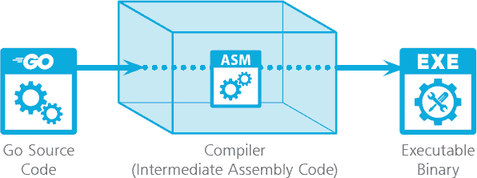

Go 编程语言的目标是具有表达性、快速、高效、可靠且易于编写。某些编程语言（如 `C` 或 `C++`）快速且可靠，但并不简单。相反，其他编程语言（如 `Java` 或 `Python`）编写简单，但效率并不高。

Go 在许多方面与 `C` 语言语言相似，有时被称为“类 C 语言”或“21 世纪的 C 语言”。但 Go 不止于此，因为它吸纳了许多其他编程语言的优秀思想，同时避免了会导致复杂性或不可靠性的特性。

也许最重要的一点是，Go 引入了通过 `goroutines` 和 `channels` 利用多核 CPU 处理能力进行并发的能力。这为计算机处理处理几项任务提供了可能。

虽然 Go 语言没有像 `C++` 或 `Java` 这种面向对象编程（OOP）语言那样的类结构，但它的特性提供了一定程度的封装、继承和多态——这是 OOP 的三大基石。


Go gopher —— Go 编程语言的标志性吉祥物。


你可以在《In Easy Steps》系列中发现更多编程语言书籍——包括 `C`、`C++`、`C#`、`Java` 和 `Python`。访问 [www.ineasysteps.com](http://www.ineasysteps.com) 了解更多信息。

有如此多的编程语言可以选择，你可能会奇怪为什么选择学习 Go 编程——以下是 Go 提供的某些优势：

## 简单的语法

Go 语言非常简洁，类似于 `Python`。它编写起来像 `Python` 一样简单，但像 `C++` 一样高效。这让你能够编写出易于阅读和维护的代码。

## 编译型语言

Go 源代码被编译成计算机可以直接读取的二进制机器码，而不是在每次程序运行时进行解释。这使得你编写的 Go 程序运行比为 `Python` 或 `PHP` 等解释型语言的程序更快。

## Go 编译器

Go 编译器非常快，并提供额外的好处，例如代码优化和错误检查——它可以检测代码中未使用的变量、代码所需的缺失导入，以及拼写错误或无效代码。Go 编译器还可以为其他操作系统生成可执行二进制文件。这让你能够将源代码编译并在多台机器上运行。

## 并发

Go 语言通过 `goroutines` 和 `channels` 为并发提供了原生支持。这让你能够编写可以同时执行多个任务的多线程程序。

## 垃圾回收

自动内存管理是 Go 语言的一个关键特性。它的垃圾回收器与程序并发运行。这让你编写程序代码时无需担心内存泄漏。

## 静态类型

Go 是一种静态类型语言，变量被显式地声明为特定的固定类型。这有助于尽早发现错误。

安装 Go 工具

要开始使用 Go，你必须首先安装环境。Go 安装程序提供了一套工具，将帮助你构建、测试和运行程序。

Go gopher —— Go 编程语言的标志性吉祥物。


右键点击快捷图标并选择 `Properties` 项，打开其“属性”对话框

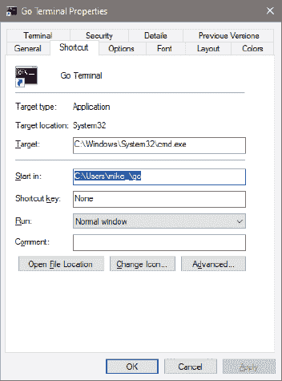

选择 `Shortcut` 选项卡，然后输入你的工作区目录路径

点击 `Apply`、`OK` 关闭对话框，然后双击快捷图标在你的“src”文件夹中打开命令行

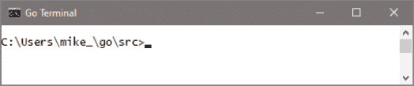


Go 程序可以使用纯文本编辑器编写，例如 Windows 的记事本应用。拥有一个一个可以在你的“src”目录文件夹中打开文本编辑器的桌面快捷方式是很有用的。重复此页面上的步骤，但在第 7 步中输入 `notepad` 作为位置，并将 `Go Editor` 作为名称，以创建另一个实用的桌面快捷方式。

## 编写一个 Go 程序

所有的 Go 程序都以纯文本文件的形式开始，随后被编译成实际的可执行程序。这意味着 Go 程序可以在任何纯文本编辑器中编写，例如 Windows 的记事本应用或 Linux  Nano 应用。


按照以下步骤创建一个简单的 Go 程序，该程序将输出传统的第一个程序问候：

在你的“src”文件夹中创建一个名为“hello”的子目录

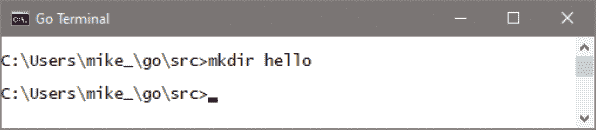


src/hello/main.go

打开纯文本编辑器（如记事本），并按照列出的内容完全输入此代码以开始程序

```
package main
```

在下方两行，按照列出的内容插入此代码

```go
import “fmt”
```

在再下方两行，精确添加此代码

```gofunc main( ) {
    fmt.Println( “Hello World!” )
}
```

将文件保存到“hello”文件夹中，并命名为 `main.go` – 现在完整的程序看起来应该完全像这样：

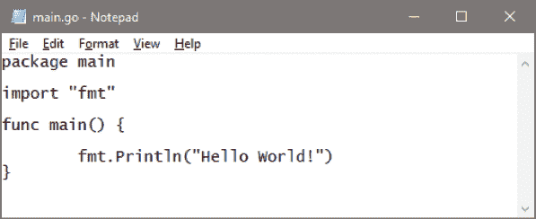


`fmt.Println` 中的大写 P 和小写 L。


文件夹内的文件安排在 Go 中非常重要。每个主文件以及任何相关文件都必须放在一个唯一名的文件夹中以创建一个包 – 因此这里的包命名为“hello”。

相反页上程序代码的各个部分可以单独检查，以便更清楚地理解每个部分：

## 包声明

```go
package main
```

包的类型在 `package` 关键字之后声明。所有的 Go 程序代码都包含在包中。你可以为作为共享库的包声明你自己的类型，但如果你想将代码编译成可执行程序，则必须声明包“main”。

## 导入声明

```go
import “fmt”
```

使用 `import` 关键字将一个或多个包导入到当前包中，以便让这些功能对该程序可用。`fmt` 包来自 Go 标准库。


接下来，在搜索框中输入 `go` 来查找 Go 语言的 VS Code 扩展。

点击 `Install` 将 Go 语言支持添加到 VS Code —— 如果系统要求添加更多 Go 支持，选择 `Install All`。

点击 `File`、`Add Folder to Workspace` 并添加你的 `go` 工作区文件夹，该文件夹应包含源代码的 `src` 文件夹。

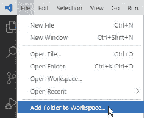

点击活动边栏上的 `Explorer` 按钮，然后选择一个文件在 VS Code 主编辑器窗口中打开——例如，点击 `hello` 文件夹中的 `main.go` 文件。

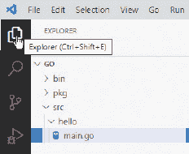

点击 `View`、`Debug Console` 打开输出面板——通常情况下，这出现在代码编辑器窗口下方，但也可以移动它。

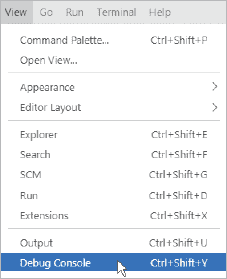

点击 `Run`、`Run Without Debugging` 以查看输出显示在 Debug Console 中。

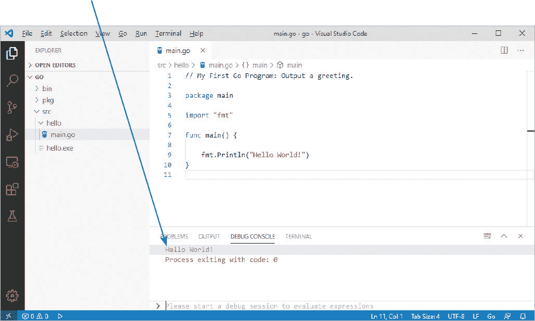

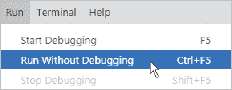


VS Code 应用是高度可定制的——你可以根据喜好更改组件布局，并从几种浅色或深色主题中进行选择。这里显示的截图是默认的 Light 主题，代码编辑器窗口中显示的语法高亮与本书后续使用的相同。

## 总结

- Go 程序是纯文本文件，被编译成机器码以生成可执行的二进制版本。
- Go 工具允许你构建、运行和测试用 Go 编程语言编写的程序。
- Go 安装包含了有用且受信的代码标准包，你可以将它们导入到程序中。
- 命令行 `go` 命令显示 Go 工具命令列表。
- `GOROOT` 环境变量存储你系统上 Go 安装所在的位置。
- `GOPATH` 环境变量存储你系统上 Go 工作区的位置。
- Go 工作区是一个名为 `go` 的目录，包含名为 `src`、`bin` 和 `pkg` 的子目录。
- Go 包的名称是包含 Go 源代码文件的目录名称。
- Go 包声明指定了其类型，并且必须指定为 `package main` 才能编译为可执行文件。
- `import` 声明引用了任何要供程序使用的包的包名。
- 函数声明包含 `func` 关键字，其后跟函数名、`( )` 圆括号和 `{ }` 大括号。
- 所有 Go 程序都必须有一个名为 `main` 的函数作为程序的入口。
- `go run` 命令编译并运行程序。
- `go build` 命令编译程序并生成一个可以分发的可执行二进制文件。
- 应使用 `go fmt` 命令来正确格式化 Go 包的源代码。
- VS Code 提供了如语法高亮、自动缩进、括号匹配和代码调试等功能。

# 2 存储值

本章演示了如何在 Go 程序中使用变量容器来存储、检索和操作各种类型的数据。

- 创建程序变量
- 显示变量值
- 转换数据类型
- 固定常量值
- 指向存储的值
- 总结

## 创建程序变量


变量是 Go 程序中的一种容器，可以在计算机内存中存储一个数据值。存储的值可以通过变量名进行引用，并通过赋值新值来更改。程序员可以为变量选择任何名称，只要它符合下列表列出的命名规范规则：

| 命名规则 | 示例 |
| --- | --- |
| 不能是 Go 关键字 | `default` |
| 不能包含算术运算符 | `a+b` |
| 不能包含标点字符 | `%$#!` |
| 不能包含空格 | `no` |
| 必须以字母开头 | `msg` |
| 可以包含数字 | `good1` |
| 可以混合大小写 | `camelCase` |

变量名应该简洁并始终以小字母开头。使用有意义的名称是良好的习惯。创建变量使用 `var` 关键字。

```
var msg string
msg = "Hi there!"
var msg string = "Hi there!"
```

此外，可以使用 `:=` 操作声明并初始化变量。在这种情况下，不需要 `var` 关键字或类型，Go 编译器会根据赋值的数据类型推断类型。这只能在函数体内部使用。

```go
msg := "Hi there!"
```

Go 的基本类型有：

| 数据类型 | 描述 | 示例 |
| --- | --- | --- |
| string | 字符串 | `"Hi there!"` |
| int | 整数 | `100` |
| float64 | 浮点数 | `0.123456` |
| byte | 字符 | `'A'` |
| bool | 布尔值 | `true` |

必须 Go 是一种静态类型语言，这意味着变量只能包含其声明中指定类型的数据。

## 显示变量值


可以使用第一章中显示“Hello World!”消息的 `fmt.Println()` 函数来显示变量的值。或者，可以使用合适的“格式占位符”和变量名为 `fmt.Printf()` 函数指定显示变量值的格式：

| 占位符 | 描述 | 示例 |
| --- | --- | --- |
| %s | 字符串 | `"Go Fun!"` |
| %d | 整数 | `100` |
| %f | 浮点数 | `0.123456` |
| %c | 字符 | `'A'` |
| %t | 布尔值 | `true` |
| %p | 机器内存地址 | `0x0022FF34` |
| %v | 默认格式的值 | 以上任意一项 |


| `%T` | 变量的数据类型 | `int` |

格式指定符可以通过在 `%` 字符之后指定所需的空格数，来确保输出占据最小数量的空格——例如，使用指定符 `%7d` 可以确保整数始终至少占据七个空间。如果希望用零填充空白区域，只需添加一个零使指定符变为 `%07d` 即可。

精度指定符是一个点（.）后跟一个数字，可以与 `%f` 格式指定符配合使用，以确定显示多少位小数——例如，使用 `%.2f` 显示两位小数。精度指定符可以与最小空间指定符结合，以控制空间数和的小位数——例如，使用 `%07.2f` 显示七个空间，包括两位小数和用零填充的空白。默认情况下，空白空间位于数字之前，因此它是右对齐的。它们也可以通过在最小空间指定符前加上负号来添加到数字之后，从而使其左对齐。


`%v` 格式指定符可显示任何值，而 `%T` 格式指定符用于确认任何变量的数据类型。

在你的“src”文件夹内创建一个名为“vars”的目录


`src\vars\main.go`

带有 package 和 import 声明开始一个 main.go 程序

```go
package main

import "fmt"
```

添加一个声明并初始化两个变量的 main 函数

```go
func main() {
    num := 100
    pi := 3.1415926536
    // 在此处插入语句。
}
```

在 main 函数中，插入语句以各种格式输出变量值

```go
fmt.Printf("num: %v type:%T \n", num, num)
fmt.Printf("pi: %v type:%T \n\n", pi, pi)
fmt.Printf("%%7d displays %7d \n", num)
fmt.Printf("%%07d displays %07d \n\n", num)
fmt.Printf("Pi is approximately %1.10f \n", pi)
fmt.Printf("Right-aligned %20.3f rounded pi \n", pi)
fmt.Printf("Left-aligned %-20.3f rounded pi \n", pi)
```

将程序文件保存到“vars”目录，然后运行程序以查看指定格式下的变量值

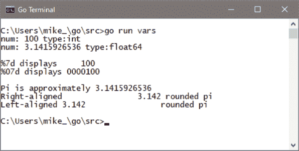


`fmt.Printf()` 函数在输出后不会添加新行。你必须手动包含 `\n` 换行转义字符将打印头移动到下一行。要使用 `fmt.Printf()` 函数显示 `%` 字符，如所示，在其前面加上另一个 `%` 字符。


注意，当格式指定符分配的小位数少时，浮点值会被四舍五入——而不是简单的截断。

## 转换数据类型

你有时需要将变量中存储的值转换为不同的数据类型。通常，你希望将字符串值转换为数值以执行算术运算。例如，字符串可能包含数字字符“42”，但除非将其转换为 `int` 或 `float64` 数据类型，否则你无法对该值进行运算。


Go 标准库包含一个 `strconv` 包，其中包含与字符串数据类型相互转换的函数。通过在 import 声明中添加 `strconv` 包，你可以让程序可以使用这些函数。

`strconv.Atoi()` 函数将括号内指定的字符串转换为 `int` 数据类型。它返回字符串等等的 `int` 值，但与你在 Go 中遇到的其他函数一样，它还会返回第二个值，当转换成功时该值为特殊的 `nil` 零值，如果失败则返回错误信息。这意味着你必须将调用赋值给。

`strconv.ParseFloat()` 函数将括号内指定的字符串转换为 `float64` 数据类型。它返回字符串等等的 `float64` 值，但与你在 Go 中遇到的其他函数一样，它还会返回第二个值，当转换成功时该值为特殊的 `nil` 零值，如果失败则返回错误信息。

`strconv.Itoa()` 函数将 `int` 转换为字符串。它等同于 `strconv.FormatInt(int64(i), 10)`。

`strconv.FormatFloat()` 函数将浮点数转换为字符串。你可以在转换期间指定精度和格式（如 'g', 'f', 'e'）。

注意，当格式指定符分配的小位数少时，浮点值会被四舍五入——而不是简单的截断。


非常有用的一点是，常量声明可以使用一个名为 `iota` 的“常量生成器”来创建一个相关的常量值序列。常量名应该在 `const` 关键字后面的括号内每行列出一个，并给第一个赋值为 `iota` 值。这会生成一个从零开始的数值序列，列表中的每一个命名常量，该序列就会递增 1。

例如，你可以像这样所示将一个数值序列赋值给代表星期几的常量：

```go
const (
	sunday = iota
	monday
	tuesday
	wednesday
	thursday
	friday
	saturday
)
```

在这个例示例中，常量 `sunday` 将被赋值为 0 (0)，`monday` 将赋值为 1 (1)，依此类推。

如果你想从不同的数字开始序列，只需在给第一个常量赋值时将 `iota` 加上该数字即可。


在其他编程语言中，生成的序列通常被称为“枚举”（enumeration）或简单的 `enum`。

在你的“src”文件夹内创建一个名为“const”的目录


`src\const\main.go`

带有包声明和导入声明开始一个 main.go 程序

```go
package main

import "fmt"
```

添加一个 main 函数，声明并初始化一个常量以及一组从一 (1) 开始的常量序列

```go
func main() {
	const pi = 3.14159
	const (
		red = iota + 1
		yellow
		green
		brown
		blue
		pink
		black
	)
	// 在此处插入语句。
}
```

接下来，插入语句来显示几个常量值

```go
fmt.Printf("Pi approximately: %v \n\n", pi)
fmt.Printf("Red: %v point \n", red)
fmt.Printf("Blue: %v points \n", blue)
fmt.Printf("Black: %v points \n", black)
```

将程序文件保存在“const”目录中，然后运行程序查看常量值

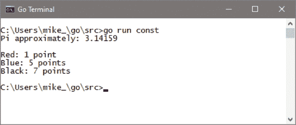


Go 中的 `math` 包提供了一个名为 `math.Pi` 的常量，它对 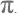 值的近似要精确得多


这里的序列代表了斯诺克游戏中每个球的分值。

## 指向存储的值

每当你的程序创建一个用于存储数据的容器时，你的计算机都会在内存中分配一个空间来存储这些数据。就像房子一样，内存位置的大小可能不同，但每个位置都有唯一的地址。


因此，一个初始化的变量实际上由三部分组成——名称、值以及存储数据的内存地址。

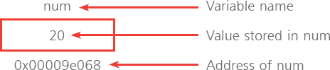

Go 语言支持“指针”的概念。指针变量可以存储另一个变量的地址，并可以访问该地址存储的值。声明指针变量需要在此数据类型前加上 `*`，以表示这是一个指针：

```go
var ptr *int // 声明此变量将指向一个 int
```

可以通过在另一个变量名前加上 `&` 将该变量的地址赋值给指针：

```go
ptr = &num // 给指针变量赋值一个地址。
```

然后，可以通过在指针名称前加上 `*` 来访问所赋值地址处的值：

```go
*ptr // 指向所赋值地址处的值。
```

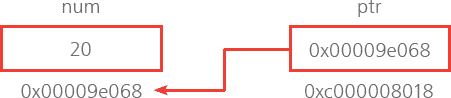指针的概念可能会困难，因为 `*` 运算符承担了两个用途——在声明中作为类型描述符，以及在放在指针名称之前作为解引用符。内存位置地址是由你的计算机分配的十六进制数。它们在你的系统上几乎不同。

在你的“src”文件夹内创建一个名为“point”的目录


`src\point\main.go`

带有包声明和导入声明开始一个 main.go 程序

```go
package main

import "fmt"
```

添加一个 main 函数，声明并初始化一个普通整数变量和一个指针变量

```go
func main() {
	var num int = 20
	var ptr *int = &num
	// 在此处插入语句。
}
```

接下来，插入语句来显示整数变量的值和内存地址

```go
fmt.Printf("num value: %v\n", num)
fmt.Printf("ptr address: %v\n", ptr)
```

现在，插入语句通过指针显示整数变量的值和地址

```go
fmt.Printf("num via: %v\n", *ptr)
fmt.Printf("ptr: %v\n", ptr)
```

最后，插入语句更改指针所指向的值

```go
*ptr = 100
fmt.Printf("new num value: %v\n", num)
```

将程序文件保存在“point”目录中，然后运行程序查看变量的值和地址

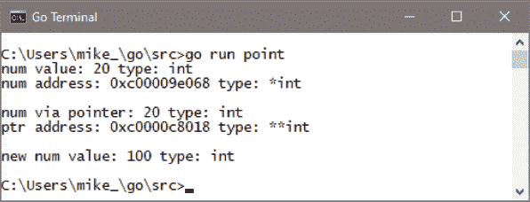


这里最重要的特性是指针改变的是它所指向的值，而不是该值的副本。这在传递变量时变得非常重要——参见第 64-67 页。

## 总结

- 变量通过其给名称存储数据，其值可以被更改。
- 显式变量声明使用 `var` 关键字并指定变量的数据类型。
- 隐式变量声明可以在函数体内使用 `:=` 运算符推断类型。
- Go 是一种静态类型语言，变量只能包含声明的类型。
- `fmt.Printf()` 函数可以使用格式化标记、变量名和 `\n` 换行转义序列来格式化输出。
- `strconv.Atoi()` 函数返回字符串值的 `int` 类型，以及一个可能为 nil 的错误。
- `strconv.Itoa()` 函数返回整数值的字符串类型。
- `strconv.ParseFloat()` 函数返回字符串值的 `float64` 类型结果，以及一个可能为 nil 的错误。
- 当给 `byte` 类型的变量赋值字符时，它存储该字符的 ASCII 字符码。
- 数值类型之间的强制转换指定所需的类型，并在后跟包含要转换值的括号。
- 常量声明使用 `const` 关键字，并必须用其包含的固定值进行初始化。
- 指针变量可以存储另一个变量的内存地址，并访问该地址存储的值。
- `*` 运算符在指针变量声明中放在数据类型前以表示该变量是指针。
- `&` 运算符放在普通变量名前之前以引用该变量的内存地址。
- `*` 运算符放在指针变量名前之前以引用其指向地址处的值。

# 3 执行操作

*本章介绍 Go 运算符并演示它们可以执行的操作。*

- 执行算术运算
- 赋值
- 进行比较
- 逻辑评估


## 操纵位

## 理解优先级

## 总结

## 执行算术运算


Go 程序中常用的算术运算符列在下表中，以及它们执行的操作：

| 运算符 | 操作 |
| --- | --- |
| `+` | 加法 |
| `-` | 减法 |
| `*` | 乘法 |
| `/` | 除法 |
| `%` | 取余 |
| `++` | 增一 |
| `--` | 递减 |

赋值、加法、减法、乘法和除法运算符正如你预期的那样工作，但在使用多个运算符的表达式中，必须对表达式进行分组——最内层 `(())` 括号内的操作最执行：

```
a = b * c - d % e / f ; // 这不清晰。
a = ( b * c ) - ( ( d % e ) / f ) ; // 这更清晰。
```

`%` 取余运算符将第一个数字除以第二个第二个数字，并返回操作的余数。这对于判断一个数是奇数还是偶数很有用。

`++` 增一运算符和 `--` 递减运算符将给定数字改变一并返回结果。它们最常用于循环中的计数——在每次迭代中使用 `++` 增一运算符计数，或在每次迭代中使用 `--` 递减运算符递计数。

`++` 增一或 `--` 递减运算符必须紧放在变量名之后以更改其值。例如：

```
n := 4
n++ // 现在 n = 5.
```


`+` 运算符具有双目的——它也用于拼接字符串。


用于运算符形成表达式的值被称为“操作数”——在表达式 `2 + 3` 中，数值 `2` 和 `3` 就是操作数。

在你的 “src” 文件夹内创建一个名为 “arith”的目录


`src\arith\main.go`

使用 package 和 import 声明开始一个 main.go 程序

```go
package main
import "fmt"
```

添加一个声明并初始化两个变量的 main 函数

```go
func main() {
    a := 8
    b := 4
    // 在此处插入语句
}
```

在 main 函数中，插入语句以输出每次算术运算后的结果总和

```go
fmt.Println("Addition:\t", (a + b))
fmt.Println("Subtraction:\t", (a - b))
fmt.Println("Multiplication:\t", (a * b))
fmt.Println("Division:\t", (a / b))
fmt.Println("Remainder:\t", (a % b))
```

现在，插入语句更改存储的值并显示它们的新值

```go
a++
fmt.Println("Increment:\t", a)
b--
fmt.Println("Decrement\t", b)
```

在 “arith” 目录中保存程序文件，然后运行程序查看每次操作的结果

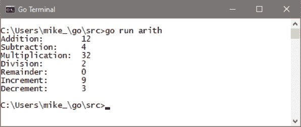


在这里，使用 `\t` 转义序列输出制表符以对齐结果。

## 赋值值


Go 编程中用于赋值的运算符列表所示。除了简单的 `=` 赋值运算符外，所有运算符都是较长表达式的简写形式，为了清晰起见，每个等价形式都已给出：

| 运算符 | 示例 | 等价 |
| --- | --- | --- |
| `=` | `a = b` | `a = b` |
| `+=` | `a += b` | `a = (a + b)` |
| `-=` | `a -= b` | `a = (a - b)` |
| `*=` | `a *= b` | `a = (a * b)` |
| `/=` | `a /= b` | `a = (a / b)` |
| `%%=` | `a %= b` | `a = (a % b)` |

在上面的赋值示例 `a = b` 中，名为 `a` 的变量被赋值名为 `b` 的变量的值——这样该值就存储在变量 `a` 中。从技术上说，赋值运算符将右侧操作数的值存储在左侧操作数指定的内存位置中，然后返回该值作为结果。

`+=` 组合运算符用于向变量增加一个值。在上面的赋值示例 `a += b` 中，`b` 的值加到 `a` 上——因此结果存储在变量 `a` 中。其他组合运算符工作原理相同，首先执行操作，然后将结果赋值给第一个变量。`+=` 运算符具有双目的——它也可以拼接字符串。

将 `=` 视为“赋值”而不是“等于”很重要，见第 38 页。

在你的 “src” 文件夹内创建一个名为 “arith”的目录

`src\arith\main.go`

使用 package 和 import 声明开始一个 main.go 程序

```go
package main
import "fmt"
```

添加一个声明并初始化两个变量的 main 函数

```go
func main() {
    a := 8
    b := 4
    // 在此处插入语句
}
```

在 main 函数中，插入语句以输出每次算术运算后的结果总和

```go
fmt.Println("Addition:\t", (a + b))
fmt.Println("Subtraction:\t", (a - b))
fmt.Println("Multiplication:\t", (a * b))
fmt.Println("Division:\t", (a / b))
fmt.Println("Remainder:\t", (a % b))
```

现在，插入语句更改存储的值并显示它们的新值

```go
a++
fmt.Println("Increment:\t", a)
b--
fmt.Println("Decrement\t", b)
```

在 “arith” 目录中保存程序文件，然后运行程序查看每次操作的结果。

在这里，使用 `\t` 转义序列输出制表符以对齐结果。

Go 编程中用于赋值的运算符列表所示。除了简单的 `=` 赋值运算符外，所有运算符都是较长表达式的简写形式，为了清晰起见，每个等价形式都已给出：

在上面的赋值示例 `a = b` 中，名为 `a` 的变量被赋值名为 `b` 的变量的值——这样该值就存储在变量 `a` 中。从技术上说，赋值运算符将右侧操作数的值存储在左侧操作数指定的内存位置中，然后返回该值作为结果。

`+=` 组合运算符用于向变量增加一个值。在上面的赋值示例 `a += b` 中，`b` 的值加到 `a` 上——因此结果存储在变量 `a` 中。其他组合运算符工作原理相同，首先执行操作，然后将结果赋值给第一个变量。`+=` 运算符具有双目的——它也可以拼接字符串。

将 `=` 视为“赋值”而不是“等于”很重要，见第 38 页。

在你的 “src” 文件夹内创建一个名为 “arith”的目录

`src\arith\main.go`

使用 package 和 import 声明开始一个 main.go 程序

```go
package main
import "fmt"
```

添加一个声明并初始化两个变量的 main 函数

```go
func main() {
    a := 8
    b := 4
    // 在此处插入语句
}
```

在 main 函数中，插入语句以输出每次算术运算后的结果总和

```go
fmt.Println("Addition:\t", (a + b))
fmt.Println("Subtraction:\t", (a - b))
fmt.Println("Multiplication:\t", (a * b))
fmt.Println("Division:\t", (a / b))
fmt.Println("Remainder:\t", (a % b))
```

现在，插入语句更改存储的值并显示它们的新值

```go
a++
fmt.Println("Increment:\t", a)
b--
fmt.Println("Decrement\t", b)
```

在 “arith” 目录中保存程序文件，然后运行程序查看每次操作的结果。

## 比较

Go 编程中常用的用于比较两个数值的运算符列表所示：

| 运算符 | 比较测试 |
| --- | --- |
| `==` | 等于 |
| `!=` | 不等于 |
| `>` | 大于 |
| `<` | 小于 |
| `>=` | 大于等于 |
| `<=` | 小于等于 |

`==` 等于运算符比较两个操作数，如果两者的值相等则将返回 true，否则 `==` 运算符将返回 false。如果两个都是相同的数字，它们就相等；如果两个都是字符，则对它们的 ASCII 值进行数值比较。

相反，`!=` 不等于运算符当两个操作数不相等时返回 true，使用与 `==` 等于运算符相同的规则，否则它返回 false。


`>` “大于”运算符比较两个操作数，如果第一个操作数的值大于第二个操作数，则返回 `true`；如果它等于或小于第二个操作数，则返回 `false`。`<` “小于”运算符执行相同的比较，但如果第一个操作数的值小于第二个操作数，则返回 `true`，否则返回 `false`。通常，`>` “大于”运算符或`<` “小于”运算符用于测试循环结构中迭代计数器的值。

在 `>` “大于”运算符或`<` “小于”运算符后添加 `=` 赋值运算符（即 `>=` 和 `<=`），当两个操作数的值完全相等时，它们也会返回 `true`。


比较运算符也称为“关系操作符”。

在你的“src” 文件夹中创建一个名为“comp”的目录


`src\comp\main.go`

带有 package 和 import 声明开始编写一个 main.go 程序

```go
package main
import "fmt"
```

添加一个声明并初始化五个变量的 main 函数

```go
func main( ) {
    var zero, num, max int = 0, 0, 1
    var up, dn byte = 'A', 'a'
    // 在此处插入语句。
}
```

在 main 函数中，插入语句以输出几次比较的结果

```go
result := ( num == zero )               // 0 == 0.
fmt.Println("Equality:\tnum == zero\t", result )
result = ( up == dn )                   // A == a.
fmt.Println("Equality:\tup == dn\t", result )
result = ( max != zero )              // 1 != 0.
fmt.Println("Inequality:\tmax != zero\t", result )
result = ( zero > max )                // 0 > 1.
fmt.Println("Greater:\tzero > max\t", result )
result = ( max <= zero )               // 1 <= 0.
fmt.Println("Less or Equal:\tmax <= zero\t", result )
```

将程序文件保存在“comp”目录中，然后运行程序以查看每次比较的结果

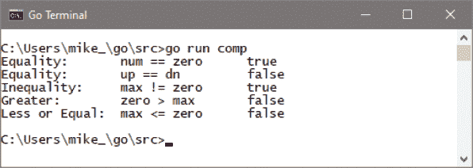

‘A’的 ASCII 值为 65，但小写字母‘a’是 97 – 所以它们的比较返回 `false`。

比较数字时，记住不仅要测试相等性，也要测试更高和更低的值。

## 逻辑评估

Go 编程中最常用的逻辑运算符列如下表所示：

| 运算符 | 操作 |
| --- | --- |
| `&&` | 逻辑与 (AND) |
| `||` | 逻辑或 (OR) |
| `!` | 逻辑非 (NOT) |

逻辑运算符用于布尔值为 `true` 或 `false` 的操作数，或者可以转换为 `true` 或 `false` 的值。`&&` 逻辑与运算符会评估两个操作数，只有当两个操作数都为 `true` 时才返回 `true`。否则，`&&` 逻辑与运算符将返回 `false`。这用于条件分支，通过测试两个条件来确定程序的方向 – 如果两个条件都满足，程序将向某个方向运行。与需要两个操作数都为 `true` 的 `&&` 逻辑与运算符不同，`||` 逻辑运算符会评估它的两个操作数，只要其中一个操作数返回 `true`，它就会返回 `true`。如果两个操作数都不返回 `true`，`||` 逻辑或运算符将返回 `false`。这在 Go 编程中执行特定操作非常有用。


在 main 函数中，插入语句输出所有位标志（bit flag）设置

```go
fmt.Printf( “Flag #1:%v \n”, ( flags & 1 ) > 0 )
```

```go
fmt.Printf( “Flag #2:%v \n”, ( flags & 2 ) > 0 )
```

```go
fmt.Printf( “Flag #3:%v \n”, ( flags & 4 ) > 0 )
```

```go
fmt.Printf( “Flag #4:%v \n”, ( flags & 8 ) > 0 )
```

接下来，插入语句语句表示该模式的十进制值

```go
fmt.Printf( “Flags Value: %08b \t%v \n”, flags, flags )
```

现在，插入语句将“开启”位标志向右移动一位，并输出新模式的十进制值

```go
flags = flags >> 1
fmt.Printf( “New Value: %08b \t%v \n”, flags, flags )
```

将程序文件保存到“bits”目录中，然后运行程序以查看位标志值

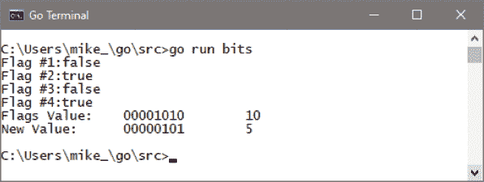


可以使用具有更多内存的变量创建带有更多位标志的位域——`int` 数据类型在 32 位系统上为 32 位宽，在 64 位系统上为 64 位宽。


这里使用 `%b` 格式指定符来输出每个位中的二进制数值值。

## 理解优先级

运算符优先级定义了 Go 编译器评估表达式的顺序。在表达式 `6 + 7 * 3` 中，优先级决定了是先完成加法还是先完成乘法。


下表按递减顺序列出了运算符优先级，高行的运算符优先级高于低行的运算符，因此它们的操作会先完成。同一行的二元运算符具有相同的优先级，但完成顺序由它们从左到右的顺序决定，因此左侧的操作会先完成。

| 优先级级别 | 运算符 |
| --- | --- |
| 5 | `* / % << >> &` |
| 4 | `+ - \| ^` |
| 3 | `== != < <= >=` |
| 2 | `&&` |
| 1 | `||` |

`++` 增运算符运算符和 `--  减运算符在 Go 编程中构成语句，而不是出现在表达式中，因此未包含在上面的优先级表中。

你可以通过将表达式部分放在括号内来强制编译器忽略默认优先级级别，强制编译器先评估表达式的最内部分。例如，在表达式 `6 + 7 * 3` 中，`*` 乘法运算符的默认优先级高于 `+` 加法运算符，因此先执行乘法操作 `7 * 3 = 21`，然后执行加法 `21 + 6 = 27`。你可能希望先执行加法操作，因此可以通过给表达式添加括号 `(6 + 7) * 3` 来强制编译器这样做。现在，表达式的评估结果为 `6 + 7 = 13`，然后是 `13 * 3 = 39`。

在你的“src”文件夹内创建一个名为“force”的目录

src/force/main.go

以 package 和 import 声明开始 `main.go` 程序

```go
package main
import “fmt”
```

添加一个 main 函数，通过评估表达式来声明并初始化变量并显示其值

```go
func main() {
    sum := 2 * 3 + 4
    fmt.Printf( “Default Order: %v \n”, sum )
    // 在处插入语句。
}
```

在 main 函数中，插入语句显示修改后的表达式评估值

```go
sum = 2 * (3 + 4) - 5
fmt.Printf( “Forced Order: %v \n”, sum )
```

接下来，插入语句显示另一个表达式评估值

```go
sum = 7 % 3 * 2
fmt.Printf( “Default Order: %v \n”, sum )
```

现在，插入语句显示另一个表达式评估值

```go
sum = 7 % (3 * 2)
fmt.Printf( “Forced Order: %v \n”, sum )
```

将程序文件保存到“force”目录中，然后运行程序以查看不同的结果

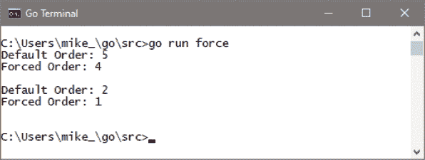

在表达式中使用括号以避免意想不到的结果。

## 总结

- 算术运算符可以形成包含两个操作数的表达式，用于加法 `+`、减法 `-`、乘法 `*`、除法 `/` 和取模 `%`。
- 增 `++` 运算符和 减 `--` 运算符按值 1 修改单个操作数。
- 赋值运算符 `=` 可以结合算术运算符形成表达式。
- 比较运算符可以用于比较两个操作数的相等 `==`、不相等 `!=`、小于 `<`、小于等于 `<=`、大于等于 `>=`。
- 逻辑与 `&&` 和逻辑或 `||` 运算符用于评估两个布尔值的真或假。
- 逻辑非 `!` 运算符返回布尔值的取反。
- 位按或 `|`、位按与 `&`、位按取反 `~` 和位按异或 `^` 用于操作位域。
- 左移 `<<` 和右移 `>>` 运算符移动位值。

## 控制流

本章介绍了语句如何评估表达式来确定 Go 程序的执行方向。

- 测试条件
- Switch Case
- 循环多次
- 真循环
- 跳出循环
- 跳转标签
- 总结

## 测试条件


`if` 关键字用于执行基本的条件测试，评估给定表达式的布尔真假值。位于 `{ }` 大括号内的语句仅在表达式评估为真时执行。`if` 测试语句的语法如下：

```go
if test-expression {
    statements-to-execute-when-the-condition-is-true
}
```

当测试为真时，可以有多个语句，但每个语句必须独占一行。有时可能需要评估多个表达式以确定是否执行后续语句。这可以通过逻辑 `&&` 与运算符来实现，语法如下：

```go
if test-expression && test-expression {
    statements-to-execute-when-all-conditions-are-true
}
```

或者，可以将多个 `if` 语句“嵌套”，在另一个内部来评估多个表达式：

```go
if test-expression {
    if test-expression {
        statements-to-execute-when-all-conditions-are-true
    }
}
```

当 `if` 测试语句评估的一个或多个表达式为假时，其后续的大括号内的语句不会执行，程序继续执行后续代码。通常通过向 `if` 语句附加 `else` 语句来扩展它，指定在 `if` 语句评估的表达式为假时执行的语句，语法如下：

```go
if test-expression {
    statements-to-execute-when-the-condition-is-true
} else {
    statements-to-execute-when-the-condition-is-false
}
```


这是一种基础的编程技术，它根据评估结果为程序提供两个执行方向，被称为“条件分支”。


测试表达式和起始大括号 `{` 必须与 `if` 关键字出现在同一行。


`else` 关键字和起始大括号 `{` 必须与上一个语句块的结束大括号 `}` 出现在同一行。

用一个测试两个字符是否匹配的语句开始一个 main 函数

```go
func main( ) {
    if 'A' == 'A' {
        fmt.Println( "\nCharacters Match" )
    }
    // 在此处插入语句。
}
```


src\ifelse\main.go

接下来，在 main 函数中插入嵌套语句来测试两个数值表达式

```go
if 5 > 1 {
    if 7 > 2 {
        fmt.Println( "\nBoth expressions are true" )
    }
}
```

现在，插入语句来测试数值表达式，并测试两个字符是否不匹配

```go
if 5 < 1 {
    fmt.Println( "\n1st Condition is true" )
} else if 'A' != 'A' {
    fmt.Println( "\n2nd Condition is true" )
} else {
    fmt.Println( "\nBoth Conditions are false" )
}
```

将程序文件保存到“ifelse”目录中，然后运行程序以查看条件测试的结果

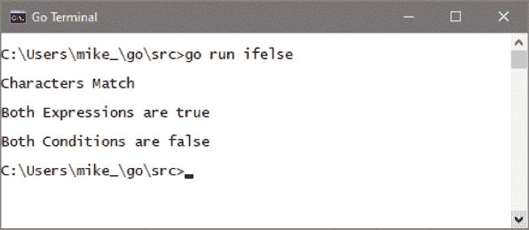


为了避免重复，从现在开始步骤列出的代码假设你已经在每个程序的开头声明了 `package main` 并导入了 `import "fmt"`。


注意，如果第一个测试为 `false`，你可以使用 `else if` 来评估第二个表达式。

## Switch Case (Switch Cases)

当测试表达式仅评估单个条件时，通过多个 if else 语句执行的条件分支通常可以通过 `switch` 语句更高效地完成。


`switch` 语句的工作方式比较特殊。它接受一个给定的值作为参数参数，然后尝试从多个 `case` 语句中匹配该值。找到匹配时要执行的代码包含在每个 `case` 语句中。

重要的是，每个要执行的语句必须单独一行，从 `case` 语句下方的行开始。

可选情况下，`case` 语句列表后面可以跟一个最终的 `default` 语句，以指定在任何 `case` 语句中都未找到匹配项时执行的代码。因此，`switch` 语句的语法通常如下：

```go
switch test-value {
case match-value :
    statements-to-execute-when-matched
case match-value :
    statements-to-execute-when-matched
case match-value :
    statements-to-execute-when-matched
default :
    statements-to-execute-when-no-match-found
}
```

如果多个 `match-values` 需要执行相同的语句，则只需要最后一个 `case` 语句包含要执行的语句。例如，为了对匹配值为 0, 1 和 2 输出输出相同的消息：

```go
switch num {
case 0 :
case 1 :
case 2 :
    fmt.Println( "Less than 3" )
case 3 :
    fmt.Println( "Exactly 3" )
default :
    fmt.Println( "Greater Than 3 or Less Than 0" )
}
```


`default` 语句不需要出现在 `switch` 块的末尾，但将其放在那里是符合逻辑的。


当找到匹配项时，`switch` 通常会结束，但你可以在任何 `case` 块中添加 `fallthrough` 关键字作为最终语句，以继续到下一个 `case` 语句——尽管这很少用。

用一个声明并初始化两个变量的语句开始一个 main 函数

```go
func main( ) {
    num := 2
    char := 'B'
    // 在此处插入语句。
}
```


src\switch\main.go

接下来，在 main 函数中插入一个尝试匹配数值值的语句

```go
switch num {
case 1 :
    fmt.Println( "\nNumber is One" )
case 2 :
    fmt.Println( "\nNumber is Two" )
case 3 :
    fmt.Println( "\nNumber is Three" )
default :
    fmt.Println( "\nNumber is Unrecognized" )
}
```

现在，插入一个尝试匹配字符的语句

```go
switch char {
case 'A' :
    fmt.Println( "\nLetter is A" )
case 'B' :
    fmt.Println( "\nLetter is B" )
default :
    fmt.Println( "\nLetter is Unrecognized" )
}
```

将程序文件保存到“switch”目录中，然后运行程序以查看条件测试的结果


## For 循环 (For Loops)

循环是会自动重复的代码。当测试表达式为真时，循环将继续。当测试表达式为假时，循环结束。


在 Go 编程中，有多种构建循环的方法，它们都使用 `for` 关键字。最常见的循环类型包含三个部分：初始化器、测试表达式和计数器：

```go
for initializer ; test-expression ; incrementer {
    statements-to-execute
}
```

初始化器用于设置计数器的初始值。为此目的使用整数变量 `i`。

在循环的每次迭代中，都会评估测试表达式，只有当该表达式为真时，迭代才会继续。当测试表达式为假时，循环立即结束。

循环可以嵌套，在外部循环的每次迭代中完成内部循环的所有迭代。第二个整数变量用于计数内部循环，通常命名为 `j`。如果该内部循环也包含一个嵌套循环，其计数器通常命名为 `k`，语法如下：

```go
for ... {
    // statements
    for ... {
        // statements
        for ... {
            // statements
        }
    }
}
```

嵌套超过三层的循环是不常见的，可能最好避免。

用一个执行五次迭代的循环开始一个 main 函数

```go
func main( ) {
    for counter := 1 ; counter <= 5 ; counter++ {
        fmt.Println( "Loop Iteration", counter )
    }
    // 在此处插入语句。
}
```


src\forloop\main.go

接下来，插入一个执行三次迭代的循环

```go
for i := 1 ; i <= 3 ; i++ {
    fmt.Println( "\nOuter Loop Iteration", i )
    // 在此处插入内部循环。
}
```

现在，插入一个执行三次迭代的内部循环

```go
for j := 1 ; j <= 3 ; j++ {
    fmt.Println( "\tInner Loop Iteration", j )
}
```


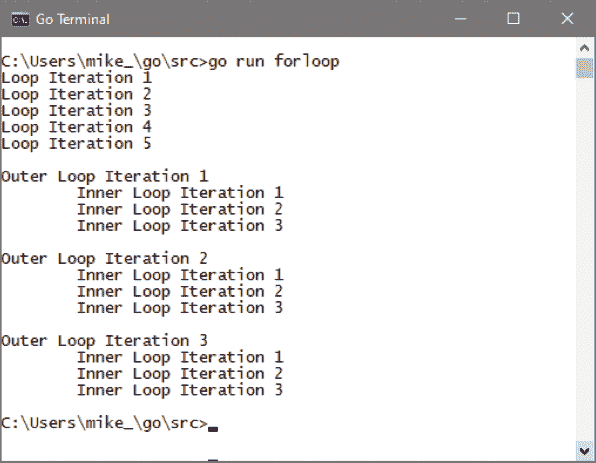


`for` 循环计数器也可以进行递减——通过在每次迭代中使用 `i--` 代替 `i++` 来减少计数器值。

## While True 循环


前一个示例中描述的第 53 页 for 循环的替代方案在 `for` 关键字之后仅包含一个测试表达式——它在循环语句开头不包含初始化器或递增器。相反，它使用一个已经初始化的计数器变量，并在循环体内增加计数器。这是 Go 语言与其他编程语言中“while”循环的等物，因为只要测试表达式为真，循环就会继续迭代。递增器必须在某处使测试表达式为假以结束循环，否则将创建一个永远不会结束的死循环。这种类型 for 循环的语法如下：

```
initializer
for test-expression {
    statements-to-be-executed
    incrementer
}
```

Go 编程中循环结构的另一种变体允许你甚至从起始语句中省略测试表达式，并使用包含在循环体内测试表达式的无限循环。它同样使用一个已经初始化的计数器变量，并在循环体内增加计数器。这是 Go 语言与其他编程语言中“do-while”循环的等物，因为循环会在测试表达式为真时执行语句并继续迭代。当测试表达式变为假，可以使用 `break` 关键字终止循环，因此这种类型 for 循环的语法如下：

```
initializer
for {
    statements-to-be-executed
    incrementer
    if test-expression {
        statements-to-be-executed
        break
    }
}
```

注意，如果测试表达式在第一次求值时为假，则“while”循环不会进行任何迭代，而“do-while”循环将至少执行一次迭代，因为它的语句在求值之前就会执行。


如果程序运行了死循环，在 Windows 或 Linux 系统上按下 `Ctrl` + `C` 键盘键可以停止循环执行。

开始一个带有五次迭代的 main 函数

```go
func main( ) {
    counter := 1
    for counter <= 5 {
        fmt.Println( “Loop Iteration”, counter )
        counter++
    }
    // 在此处插入语句。
}
```


src\while\main.go

接下来，插入一个无限循环语句

```go
i := 10
for {
    fmt.Println( "\t\t\tCountdown", i )
    i--
    // 在此处插入测试表达式。
}
```

现在，插入一个测试表达式来结束循环

```go
if i < 1 {
    fmt.Println( "\t\t\t\t\tLift Off!” )
    break
}
```

将程序文件保存到“while”目录中，然后运行程序查看每次循环迭代的输出

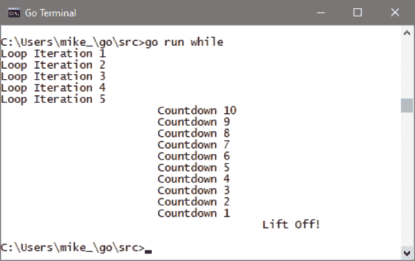


将变量 `i` 的初始值改为 `0`（零）并再次运行程序，查看循环的第一次迭代执行。

## 跳出循环

当满足指定条件时，可以使用 `break` 关键字提前终止任何循环。`break` 语句在指定条件满足时终止循环，位于语句块内部，之前是测试表达式。当测试表达式为真时，循环会立即停止并跳转到下迭代。。


。

/pg/pg51..)

`continue` 关键字可以在满足指定条件时跳过单次迭代。`continue` 语句位于语句块内部，之前是测试表达式。当测试表达式为真时，该迭代结束。

开始一个执行三次迭代的循环的 main 函数


src\break\main.go

插入一个执行三次迭代的无限循环

```go
// 在此处插入语句。
for i := 1 ; j <= 3 ; j++ {
    fmt.Println( “Running== i, “== j )
}
```

将程序文件保存到“break”目录中，然后运行程序查看每次循环迭代的输出


你也可以跳转到 66 页特定位置来 `break` 嵌套代码块——参见此处的示例。跳出内循环。

。

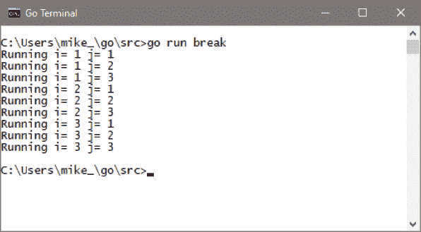


在这里，`break` 语句在外层循环尝试第二次运行时停止内层循环的第二次和第三次迭代。


你也可以跳转到外层循环块结束之后的特定标签，以跳出内循环。

接下来，插入此 break 语句跳出内循环

```go
if i == 2 && j == 2 {
    fmt.Println( “Breaks i=”, i, “j=”, j )
    break
}
```

现在，在 break 语句之前插入此 continue 语句跳过内层循环

```go
if i == 3 && j == 2 {
    fmt.Println( “Continues i=”, i, “j=”, j )
    continue
}
```

保存更新后的文件，然后运行程序一次查看内层循环的第二次迭代

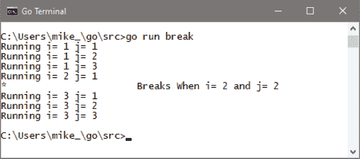


## 跳转到标签

`goto` 关键字乍看起来似乎是一个很棒的功能，因为它允许程序流跳转到程序代码中的任何位置，就像网页上的超链接一样。然而，实际上这可能会导致错误，这种用法是不受欢迎的，通常被认为是坏习惯。


`goto` 关键字跳转是计算机程序中存在数十年的强大功能，但它被许多早期程序员滥用，创建了跳转方式不可理喻的程序。这产生了不可读的代码，因此 goto 的使用不再流行。

通常，程序可能会执行一组语句，然后 `goto` 语句跳转回语句开头的标签以重复执行。此外，可能会在序列中的某处测试条件，如果测试条件未满足，则另一个 `goto` 语句可能会跳转到序列之后的某一点以继续程序流。通过这种方式，程序代码很快获得了大量混乱的 goto 语句和标签。

`goto` 关键字的一个可能的合法用法是通过跳转到外层循环块结束之后的某个标签，从而干净地退出内层嵌套循环。这会立即退出两个循环，因此不再执行任何循环的后续迭代。

```go
func main( ) {
    for i := 1 ; i <= 3 ; i++ {
        for j := 1 ; j <= 3 ; j++ {
            fmt.Println( “Running i=”, i, “j=”, j )
            if i == 2 && j == 2 {
                goto end
            }
        }
    }
    end:
    fmt.Println("Finished")
}
```


在内层循环的第一行插入一个语句，以便在指定的计数器值处跳转到名为“end”的标签。

```go
if i == 2 && j == 2 {
    goto end
}
```

现在，在外层循环闭合的大括号 `}` 之后的下一行添加标签。

```go
end:
```

保存更新后的文件，然后再次运行程序，以在测试条件变为真时看到循环结束。

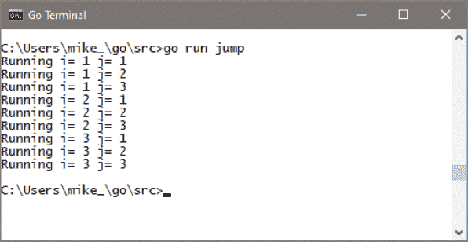


避免创建一个一个名为 `goto.exe` 的程序可执行文件，因为这可能与 Windows 系统内部的 `GOTO` 命令冲突。


注意，标签本身必须以 `:` 冒号结尾。

## 总结

- `if` 关键字执行基础条件测试，以评估给定表达式的布尔值为真（true）或假（false）。
- `else` 关键字可用于当 `if` 语句发现表达式为假时提供备选的可执行语句。
- 在评估后为程序提供可选的执行方向被称为“条件分支”。
- 由多个 `if else` 语句执行的条件分支通常可以通过 `switch` 语句更高效地完成。
- `switch` 块中的语句必须每个都出现在 `case` 语句下方的单独行中。
- 可选地，`switch` 块可以包含一个 `default` 语句，用于指定在未找到匹配项时执行的语句。
- `for` 关键字可以指定初始化器、测试表达式和递增器，以控制循环。
- `for` 关键字可以简单地指定一个测试表达式，以确定循环在真时是否继续。
- `for` 关键字可以完全省略测试表达式以创建一个无限循环。
- 在无限循环的体内部可以测试条件，并使用 `break` 关键字结束循环。
- `break` 关键字用于终止循环，而 `continue` 关键字可用于跳过单次迭代。
- 循环可以嵌套，使得内层循环在在外层循环的每次迭代中执行一系列迭代。
- 通常不建议使用 `goto` 关键字，但它可以合法地用于退出嵌套循环。

# 5 创建函数

*本章演示了如何将语句封装在函数内部，以便在 Go 程序调用该函数时执行执行。*

- 创建基础函数
- 添加参数
- 传递引用
- 返回值
- 递归调用
- 匿名封装
- 传递函数
- 处理错误
- 分离文件
- 总结

## 创建基础函数

书中的之前的示例使用了强制性的 `main()` 函数以及包含在 Go 标准库中的函数，例如“fmt”包中的 `fmt.Println()` 函数。然而，大多数 Go 程序都包含许多自定义函数，这些函数可以在程序执行期间根据需要调用。


函数块仅包含一组语句，每当该函数被调用时就会执行这些语句。一旦函数语句执行完毕，程序流将从函数调用后的后续点继续。这种模块化在 Go 编程中非常有用，可以隔离一组代码序列，以便根据需要重复调用。函数块仅包含一组语句，每当该函数被调用时就会执行这些语句。一旦函数语句执行完毕，程序流将从函数调用后的后续点继续。这种模块化在 Go 编程中非常有用，可以隔离一组代码序列，以便根据需要重复调用。

| 命名规则 | 示例 |
| --- | --- |
| 包含关键字 | `default` |
| 包含算术运算符 | `a+b` |
| 包含标点符号 | `%$!` |
| 包含空格 | `no spaces` |
| 必须以字母开头 | `msg` |
| 包含数字 | `good` |
| 混合大小写 | `camelCase` |

函数块仅包含一组语句，每当该函数被调用时就会执行这些语句。一旦函数语句执行完毕，程序流将从函数调用后的后续点继续。这种模块化在 Go 编程中非常有用，可以隔离一组代码序列，以便根据需要重复调用。函数块仅包含一组语句，每当该函数被调用时就会执行这些语句。一旦函数语句执行完毕，程序流将从函数调用后的后续点继续。这种模块化在 Go 编程中非常有用，可以隔离一组代码序列，以便根据需要重复调用。函数块仅包含一组语句，每当该函数被调用时就会执行这些语句。一旦函数语句执行完毕，程序流将从函数调用后的后续点继续。这种模块化在 Go 编程中非常有用，可以隔离一组代码序列，以便根据需要重复调用。函数块仅包含一组语句，每当该函数被调用时就会执行这些语句。一旦函数语句执行完毕，程序流将从函数调用后的后续点继续。这种模块化在 Go 编程中非常有用，可以隔离一组代码序列，以便根据需要重复调用。函数块仅包含一组语句，每当该函数被调用时就会执行这些语句。一旦函数语句执行完毕，程序流将从函数调用后的后续点继续。这种模块化在 Go 编程中非常有用，可以隔离一组代码序列，以便根据需要重复调用。函数块仅包含一组语句，每当该函数被调用时就会执行这些语句。一旦函数语句执行完毕，程序流将从函数调用后的后续点继续。这种模块化在 Go 编程中非常有用，可以隔离一组代码序列，以便根据需要重复调用。函数块仅包含一组语句，每当该函数被调用时就会执行这些语句。一旦函数语句执行完毕，程序流将从函数调用后的后续点继续。这种模块化在 Go 编程中非常有用，可以隔离一组代码序列，以便根据需要重复调用。函数块仅包含一组语句，每当该函数被调用时就会执行这些语句。一旦函数语句执行完毕，程序流将从函数调用后的后续点继续。这种模块化在 Go 编程中非常有用，可以隔离一组代码序列，以便根据需要重复调用。

（注：提供的文本存在大量重复内容，翻译已按逻辑执行。提供的文本存在重复部分，基于逻辑流）

...这一行通常被称为“签名”。


注意，标签本身必须以 `:` 冒号结尾。

```go
func first() {
    msg := "Hello from first!"
    fmt.Println(msg)
}
```

```go
func sqFive(a, b int) {
    fmt.Printf("%d = %d\n", a*b)
}
```

```go
func main() {
    first()
    sqFive(5, 5)
}
```

## 添加参数


函数定义后面的 `()` 括号可以可选地包含由逗号分隔的“参数”。这些是函数可以变量，其初始内容由调用者提供。每当函数被调用时创建这些变量，并在退出函数时被销毁。每个参数必须赋予你喜欢的名称（遵循通常的命名规范）和一个类型，语法如下：

```go
func functionName(paramName type, paramName type) {
    // statements-to-executed
}
```

多个连续的相同类型的参数可以声明为列表，只需在相同类型的最后一个参数之后指定类型，如下所示：

```go
func functionName(paramName, paramName type) {
    // statements-to-executed
}
```

每次函数调用必须为每个参数指定内容，且类型正确，顺序与函数定义中出现的顺序一致。传递给函数的内容被称为“参数”。这些内容在调用中函数名后的 `()` 括号内以逗号分隔列表的形式指定：

```go
functionName(argument, argument, argument)
```

与一些其他编程语言不同，Go 没有为函数参数指定默认内容的方法。


在 Go 编程中，必须认识到的这一点是：参数默认是按值传递（by value）的——函数接收的是参数的拷贝，而不是原始参数。这意味着，对参数变量的修改默认不会影响调用者指定的原始参数——它们只会影响拷贝。


## 创建一个需要单个整数参数并显示其值的函数

```go
func square( num int ) {
    fmt.Println( "\t\tReceived Copy:", num )
    // 在此处插入要执行的语句。
}
```


`src\args\main.go`


接下来，插入语句来修改接收到的参数并显示其新值

```go
num = num * num
fmt.Println( "\t\tModified Copy:", num )
```


开始编写一个 main 函数，声明并初始化一个变量，然后显示它的值

```go
func main( ) {
    num := 5
    fmt.Println( "Original:", num )
    // 在此处插入要执行的语句。
}
```


现在，在 main 函数中插入语句调用另一个函数，并再次显示其变量值

```go
square( num )
fmt.Println( "Original:", num )
```


将程序文件保存在“args”目录中，然后运行程序以查看原始值保持不变

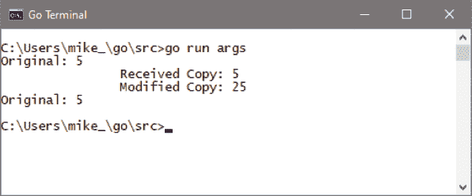


你也可以创建接受任意数量参数的“变变函数”——示例请参见此处第 106 页。

## 传递引用

示例此处第 65 页 证明了在 Go 编程中，参数默认是按值传递的——函数接收的是参数的拷贝，而不是原始参数。但很多时候你可能希望函数能够修改原始参数。这可以通过向函数传递一个指向原始值的引用的参数，而不是其值的拷贝来实现。


记住，指针是对系统中存储某个值的内存地址的引用。这意味着，如果你向函数传递一个指针参数，它将能够修改位于指针提供的地址上的原始值。

在声明可以接收指针参数的函数时，其参数列表中指定的数据类型必须以*星号* (*) 为前缀，以指示该参数将是一个指针，如下：

```go
func *functionName* (*paramName *type*) {
    //要执行的语句
}
```

该参数随后将能够存储一个位置地址。

函数语句通过在参数名称前加上*星号* (*) 作为解引用符，可以访问并修改指针所提供地址上的值。

在调用接受指针参数的函数时，参数必须以 `&` 符号作为取地址符前缀，以引用存储该值的内存地址。

这种技术可以用于 `int`、`float64`、`string` 和 `bool` 数据类型，也可以用于下一章将引入的 `struct` 类型。这些都是“值类型”，因此在将它们传递给函数时，需要指针来访问它们包含的原始值。

这种技术无法用于指针类型或函数类型（是的，函数在 Go 中也是类型），也无法用于本书后面演示的 slice（切片）、map 或 channel（通道）类型。这些都已经是“引用类型”，因此在将它们传递给函数时，不需要指针来访问它们包含的原始值。


参阅第 30-31 页以复习指针的工作原理。


创建一个需要单个整数参数并显示其值的函数

```go
func square( *int ) {
    fmt.Println( "\t\tReceived Copy:", num )
    // ...
}
```


`src\args\main.go`


接下来，插入语句修改接收到的参数并显示其新值

```go
num = *num
fmt.Println( "\t\tModified Copy:", num )
```


开始编写一个 main 函数，声明并初始化一个变量，然后显示其值

```go
func main( ) {
    num := 5
    fmt.Println( "Original:", num )
    // ...
}
```


现在，在 main 函数中插入语句调用另一个函数，并再次显示其变量值

```go
square( &num )
fmt.Println( "Original:", num )
```


将程序文件保存在“args”目录中，然后运行程序以查看原始值保持不变


## 返回值

本章介绍的函数只是返回一个值，但通常让函数返回多个值是有用的。


在声明返回值的函数时，函数签名必须定义返回值的数据类型。返回单个值的函数语法如下：

```go
func funcName( paramName type ) returnType {
    // ...
}
```

与大多数只能返回一个值的语言不同，Go 中的函数可以返回多个值。当你想要返回多个值时，必须在参数列表后的括号中指定逗号分隔的列表。返回两个值的函数语法如下：

```go
func funcName( paramName type ) (returnType, returnType) {
    return returnValue, returnValue
}
```

传递给 `return` 关键字的值必须与函数签名中指定的类型相同，并且必须按相同的顺序列出。

如果你调用一个返回多个值的函数但在程序代码中未使用所有返回值，编译器将产生“已声明但未使用”的消息，程序将无法运行。为了避免这种情况，你可以将不需要的返回值赋值给 `_` 下划线字符。这在 Go 中被称为“空白标识符”。标准库中的许多函数返回多个值，特别是为了返回结果和错误值。


创建一个需要单个整数参数并向调用者返回三个值的函数

```go
func cube( num int ) ( string, int, int ) {
    return “Result”, num, ( num * num * num )
}
```


`src\returns\main.go`


添加一个 main 函数，将三个返回值赋值给三个变量，然后尝试只显示两个值

```go
func main( ) {
    a, b, c := cube( 5 )
    fmt.Println( b, “Cubed =”, c )
}
```


将程序文件保存在“returns”目录中，然后运行程序以查看编译器错误消息

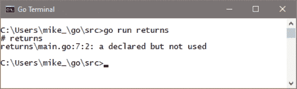


修改 main 函数中的赋值，将第一个返回值赋值给空白标识符

```go
func main( ) {
    _, b, c := cube( 5 )
    fmt.Println( b, “Cubed =”, c )
}
```


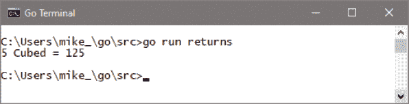


返回的“Result”字符串值在此处未使用。

## 递归调用

自定义函数中的语句可以像调用标准库函数 `fmt.Printf()` 一样自由地调用其他自定义函数。此外，函数可以“递归调用自己”。与循环一样，重要的一点是递归函数调用必须修改表达式以避免连续执行 – 这样函数会在某处退出。


递归函数调用可以模拟循环结构，如第 55 页 所示：

创建一个需要整数参数的函数，并递归调用它直到该值减到零：

```go
func countDn( num int ) {
    if num < 1 {
        fmt.Println( "\t\t\tLift Off!" )
    } else {
        fmt.Println( "\t\t\tCountdown", num )
        num--
        countDn( num )
    }
}
```


src\recur\main.go

创建一个包含调用上述函数语句的 main 函数：

```go
func main( ) {
    countDn( 10 )
}
```

将程序文件保存在“recur”目录中，然后运行程序以查看递归调用如何模拟循环：


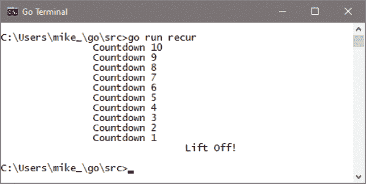递归函数调用用于解决数学问题，例如给定数字的阶乘。阶乘是从给定数字到 1 的所有整数的乘积 – 例如 3 的阶乘是 6 (3 * 2 * 1)。

创建一个需要整数参数的函数，并在每次调用时返回一个整数值：

```go
func facto( num int ) int {
    // 在此处插入语句
}
```


src\facto\main.go

接下来，当参数值减到零 (0) 时插入一条语句返回 1 (1)：

```go
if num == 0 {
    return 1
}
```

然后，插入最后一条语句递归调用该函数，以乘以序列中的所有数字：

```go
return num * facto( num - 1 )
```

添加一个包含打印阶乘语句的 main 函数：

```go
func main( ) {
    for i := 1 ; i <= 7 ; i++ {
        fmt.Println( "Factorial", i, "=", facto( i ) )
    }
}
```

将程序文件保存在“facto”目录中，然后运行程序查看阶乘序列：

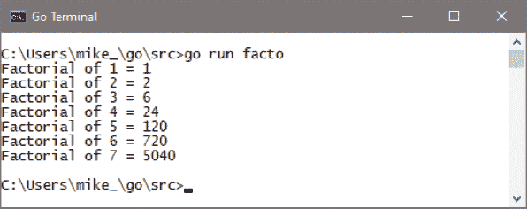

递归函数很有用但效率不高。此示例调用了 35 次 `facto()`来生成这 7 个阶乘序列！

## 匿名封装

Go 编程语言支持“一等函数”。这允许函数被赋值给变量、作为参数传递给其他函数以及从函数中返回。


## 匿名函数

匿名函数简单是不包含名称的函数定义。这对于内联创建函数而无需对其命名非常有用。匿名函数也被称为“函数字面量”。与其他函数一样，这些函数可以包含参数列表、返回类型列表，并返回多个值。你可以通过在函数定义末尾附加 `()` 运算符来创建一个自执行匿名函数表达式，如下：

```go
func( ) { fmt.Println( "Function Literal" ) } ( )
```

此外，可以将匿名函数赋值给变量，然后在变量名后附加 `()` 运算符进行调用，如下：

```go
fn := func( ) { fmt.Println( "Function Literal" }
fn( )
```


自执行函数表达式只执行一次。

## 闭包

匿名函数最有用的可能是创建“闭包”。闭包是嵌套在外部函数内部的函数，它保留了对外部函数中声明的变量的访问。外部函数可以返回一个保留对这些变量访问权限的匿名函数，但关重要的是，这些变量在程序代码的其他任何地方都是无法访问的。这是封装的形式，当返回的匿名函数“捕获”它们时，保护了存储在这些变量中的数据。

通过在外部函数定义结束后附加 `()` 运算符，可以将闭包变为自执行并赋值给变量。然后可以通过变量名后附加 `()` 运算符来调用匿名内部函数 – 它可以访问外部函数中的持久值。

理解闭包的概念可能很困难，因为在自执行函数完成执行后，外部函数中的变量应该被销毁。


如果你无法理解闭包是如何工作的，请不要担心。它们起初看起来很神秘，但随着经验的增加会变得清晰。你可以继续并在稍后回来这种技术。

通过将匿名函数赋值给变量来开始 main 函数：

```go
func main( ) {
    area := func( length, width ) int {
        return length * width
    }
}
```


src\anon\main.go

接下来，插入语句显示匿名函数的类型和返回值：

```go
fmt.Printf( "area Type: %T \n", area )
fmt.Println( "Area 1:", area( 10 ) )
fmt.Println( "Area 2:", area( 12 ) )
```

现在，插入语句将自执行闭包函数赋值给变量：

```go
counter := func( ) func() int {
    num := 0
    return func( ) int {
        num++
        return num
    }
}( )
```

最后，插入语句显示闭包函数的类型和返回值：

```go
fmt.Printf( "counter type: %T \n", counter )
fmt.Println( "Count:", counter( ) )
fmt.Println( "Count:", counter( ) )
fmt.Println( "Count:", counter( ) )
```

将程序文件保存在“anon”目录中，然后运行程序查看函数类型和返回值：

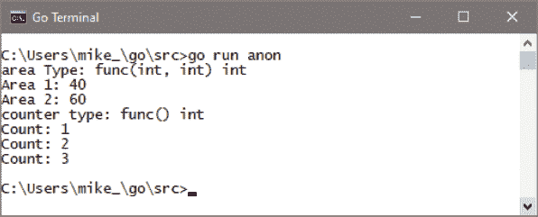


注意，外部函数必须声明其返回类型为 `func() int`，因为它返回的是一个返回整数值的函数。


## 处理错误

在你的 Go 程序中，预判错误并使代码能够高效地处理这些错误是非常关重要的。其他编程语言（如 Java 和 Ruby）在遇到错误时会抛出“异常（exceptions）”，程序可以在运行时尝试捕获这些异常，但 Go 了一种了一种更简单的方法。


Go 编程允许你通过返回多个值来处理函数中出现的错误。这使得识别哪个函数返回了错误变得简单，并允许你使用熟悉的 Go 语言结构来处理错误。

为了处理可能的错误，函数签名必须包含一个 Go 内置的 `error` 返回类型。传统上，这是返回值列表中的最后一个返回值。

```go
func *funcName* (*paramName type*) ( *returnType*, error )
```

在函数体中，除了预期的返回值，函数可以返回一个平凡的值（例如 -1），连同返回的错误值。

如果没有发生错误，函数可以返回预期的返回值，以及一个 `nil` 零值。在 Go 编程中，`nil` 零值被用于表示许多类型的零值。在这里，它仅表示没有错误。因此，处理错误的函数语法可能如下所示：

```go
func *funcName* (*paramName type*) ( *returnType*, error ) {
    if *condition* != true {
        return -1 , *errorValue*
    }
    return *returnValue*, nil
}
```

提供之前示例中使用的 `fmt.Println()` 和 `fmt.Printf()` 函数的 `fmt` 包还提供了一个 `fmt.Errorf()` 函数，它返回一个 `error` 类型。它接受与 `fmt.Printf()` 函数相同的格式化符，并用于返回一条消息以识别错误的发生位置和性质。


Go 标准库还有一个 `errors` 包，可以用于操作自定义错误。

创建一个需要整数参数并返回整数和错误的函数

```go
func isPosInt( num int ) ( int, error ) {
    // 在此处插入语句。
}
```


src\err\main.go

接下来，插入一个条件语句来返回错误或者返回整数值

```go
if num < 1 {
    err := fmt.Errorf( “%v not positive integer”, num )
    return -1, err
}
return num, nil
```

现在，添加一个 main 函数，包含递减循环来打印结果

```go
func main( ) {
    for i := 2 ; i >= -2 ; i-- {
        res, err := isPosInt( i )
        if err != nil {
            fmt.Println( “Failed:”, err )
        } else {
            fmt.Println( res, “Passed!” )
        }
    }
}
```

将程序文件保存在“err”目录中，然后运行程序以查看当测试失败时的错误消息

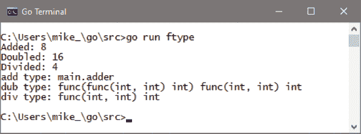


注意，函数签名在声明中只需说明所需的类型，但其定义也需要说明参数名称。


注意函数实例 `add` 仅被描述为属于自定义函数类型 `main.adder`。

## 分离文件

当你的程序规模增大时，通常最好将相关的代码部分分到单独的文件。

首先，创建一个包含包和导入声明的 verify.go 文件

```go
package verify
import “fmt”
```


src\verify\verify.go

2o.jpg

添加验证函数——但将其名称改为大写字母开头

```go
// IsPosInt 测试正整数。
func IsPosInt( num int ) ( int, error ) {
    if num < 1 {
        err := fmt.Errorf( “%v not positive integer”, num )
        return -1, err
    }
    return num, nil
}
```

将文件保存在你的“src”文件夹下的“verify”目录中

输入命令 `go install verify` 在你的 `go/pkg` 文件夹中创建一个名为 `verify.a` 的编译归档文件

创建一个 Go 存档包意味着每次编译导入的文件时，不需要重新编译工具文件。

接下来，创建一个包含包和导入声明的 main.go 程序

```go
package main
import (
    “fmt”
    “verify”
)
```


src\prog\main.go

现在，添加 main 函数，通过其包名前缀修饰后的导入函数名

```go
func main( ) {
    for i := 2 ; i >= -2 ; i-- {
        res, err := verify.IsPosInt( i )
        if err != nil {
            fmt.Println( “Failed:”, err )
        } else {
            fmt.Println( res, “Passed!” )
        }
    }
}
```


将程序文件保存在“prog”目录中，然后输入命令 `go build prog` 在你的 `go/src` 文件夹中创建一个名为“prog.exe”（在 Windows 上）的编译可执行文件。

最后，输入命令 `prog`（Linux 上为 `./prog`）运行程序并在测试失败时查看错误信息。

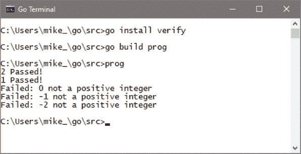


当导入多个包时，导入声明必须在括号内分行列出它们。

## 总结

- 函数块包含一组语句，每当该函数被调用时，这些语句就会执行。
- 使用 `func` 关键字后跟符合 Go 命名规范的名称来声明函数。
- 函数声明包含 `( )` 括号，随后是用于 `{ }` 花括号，用于包围要执行的语句。
- 函数声明中的括号可以包含参数列表，用于指定每个参数的类型。
- 传递给函数的参数默认是值传递的——即原始值的副本。
- 传递给函数的指针参数是对内存地址的引用，该地址是原始值所在。
- `return` 关键字允许在函数执行语句后向调用者返回一个或多个值。
- 如果函数向调用者返回值，则每个返回类型必须在函数声明中的参数列表之后列出。
- 函数可以递归地调用自己来模拟循环结构，但必须测试条件以便在某处退出。
- Go 支持一等函数，函数可以赋值给变量、作为参数传递以及从函数返回。
- 匿名函数没有名称，可以通过在块之后添加 `( )` 调用运算符来实现自执行。
- 闭包是嵌套在外部函数内部的函数，它保留了对外部函数中声明的变量的访问权限。
- 紧跟 `type` 关键字的名称和函数签名可以用于创建自定义函数类型。
- 将函数传递给其他函数允许在不重复现有代码行的情况下修改操作。
- Go 语言允许你通过返回单独的值来处理函数中出现的错误。
- 只有名称以大写字母开头的函数和变量才能被导入的文件访问。

# 构建结构

*本章演示了如何将数据和函数包含在可以表示 Go 语言面向对象编程的“struct”中。*

- [分组数据]
- [附加方法]
- [嵌入结构]
- [封装特性]
- [组合元素]
- [实现接口]
- [嵌入接口]
- [总结]

## 分组数据

任何数据类型的多个相关项都可以组合在 Go 语言的“struct”（结构）类型中。这对于创建记录非常有用，类似于你在数据库中可能会找到。


使用 `type` 关键字后跟名称和 `{ }` 花括号创建一个结构体。括号中包含名称和类型对的列表：

```go
type employee struct {
    id int
    name string
    dept string
}
```

定义结构体后，可以使用点后缀访问结构体的实例。这些被称为“字段”。首先，声明一个结构体的实例：

```go
var coder employee
```

接下来，为每个结构体字段赋值：

```go
coder.id = 001
coder.name = "Alice"
coder.dept = "Engineering"
```

或者，你可以使用结构体字面量初始化所有字段：

```go
clerk := employee{
    id: 002,
    name: "Burt",
    dept: "Payroll",
}
```

现在，显示结构中的所有值：

```go
fmt.Println(coder)
fmt.Println(clerk)
```

最后，显示单个结构体字段的值：

```go
fmt.Printf("\n%s works in %s\n", coder.name, coder.dept)
fmt.Printf("\n%s works in %s\n", clerk.name, clerk.dept)
```

注意，示例中的语句并不是按照结构体中列出的字段顺序赋值的，但使用字段名可以确保值被分配到正确的字段。


与其他某些编程语言不同，Go 没有类，但可以使用结构体（structs）来表示对象。


## 通过创建一个结构体类型开始程序

```go
type car struct {
    color string
    body string
}
```


`src\method\main.go`


## 接下来，为结构体类型附加一个方法

```go
func ( c car ) accelerate( ) string {
    return “accelerating-->”
}
```


## 现在，通过创建两个结构体类型的实例开始 main 函数

```go
porsche := car{ color: “blue”, body: “coupe” }
bentley := car{ color: “green”, body: “saloon” }
```


## 添加语句显示第一个实例的所有值

```go
fmt.Println( “Porsche paint is”, porsche.color )
fmt.Println( “Porsche style is”, porsche.body )
fmt.Println( “Porsche is”, porsche.accelerate( ) )
```


## 最后，添加语句显示第二个实例的所有值

```go
fmt.Println( “Bentley paint is”, bentley.color )
fmt.Println( “Bentley style is”, bentley.body )
fmt.Println( “Bentley is”, bentley.accelerate( ) )
```


## 将程序文件保存在 “method” 目录中，然后运行程序查看结构体字段的值

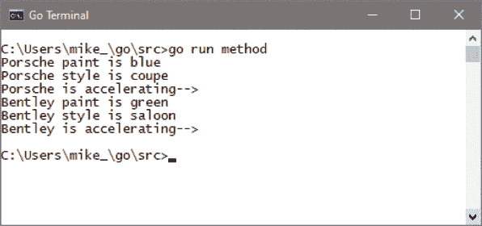


当你调用方法时，Go 会自动处理值和指针之间的转换，因此，如果你想让方法能够修改原始结构体字段，这里的接收者可以是 `( c *car )`。

## 嵌入结构体 (Embed Structs)

由于结构体字段只需简单地声明名称和类型，且结构体本身是一种类型，Go 编程甚至允许你通过声明一个结构体类型的字段，将一个结构体嵌入另一个结构体中。


```go
type structName struct {
    fieldName embeddedStructName
}
```

这对于构建高效使用用途多变的结构体的结构非常有用。例如，取一个仅存储 X 和 Y 坐标的结构体：

```go
type coords struct {
    x, y int
}
```

这可能被用于存储图表上的位置、矩形的顶点等，或者在嵌入另一个结构体时作为圆的中心点，如下所示：

```go
type circle struct {
    radius int
    center coords
}
```

现在，当创建 circle 的实例时，可以通过链接结构体名称和字段名称来访问嵌入结构体的字段，如下：

`instanceName.embeddedStructName.fieldName`

`instanceName.embeddedStructName.fieldName`

这是可以接受的，但因为非常长，所以并不方便。幸运的是，Go 通过支持结构体中的“匿名字段”（anonymous fields）提供了此问题的解决方案。这些字段只是指定另一个结构体的名称作为字段，而没有指定字段名称：

```go
type circle struct {
    radius int
    coords
}
```

这样做的好处是它允许你缩短访问嵌入结构体字段所需的代码：

`instanceName.fieldName`

`instanceName.fieldName`


匿名字段必须是具名类型，或者是指向具名类型的指针。


## 通过创建两个结构体类型开始程序

```go
type coords struct {
    x, y int
}

type circle struct {
    radius int
    coords
}
```


`src\embed\main.go`


## 接下来，为第二个结构体附加一个方法

```go
func ( c circle ) getDiameter( ) int {
    return c.radius * 2
}
```


## 现在，通过创建一个结构体类型的实例开始 main 函数

```go
var ring circle
```


## 添加语句为结构体字段和嵌入结构体字段赋值

```go
ring.radius = 15
ring.x = ring.radius
ring.y = ring.radius
```


## 最后，添加语句显示值

```go
fmt.Printf( “Diameter:%v \n”, ring.getDiameter( ) )
fmt.Printf( “Point X:%v Y:%v \n”, ring.x, ring.y )
```


## 将程序文件保存在 “embed” 目录中，然后运行程序查看结构体字段的值


## 封装特性 (Encapsulate Features)

在 Go 中表示对象的能力是面向对象编程（OOP）基石。封装使用方法来表达附加在结构上的属性和操作，因此程序无需直接访问数据。封装在 Go 编程中依赖于对包的数据隐藏。变量名、函数名和方法名如果以大字母开头，将导出到程序。以小字母开头的将是不可访问的即它们被封装了。


## 首先，创建一个 cube.go 文件，包含包声明和结构体定义

```go
package cube

// Dims 导出。
type Dims struct {
    width, length, height int
}
```


`src\cube\cube.go`


## 接下来，添加四个操作结构字段的方法

```go
func ( d *Dims ) area( ) int {
    return d.width * d.length
}

// SetSize 导出。
func ( d *Dims ) SetSize( w, l, h int ) {
    d.width = w
    d.length = l
    d.height = h
}

// GetVolume 导出。
func ( d *Dims ) GetVolume( ) int {
    return d.width * d.length * d.height
}

// GetArea 导出。
func ( d *Dims ) GetArea( ) int {
    return d.area( )
}
```


## 查看相同类型的字段可以以逗号分隔列表声明，就像变量声明一样。

```go
package main

import (
    “cube”
    “fmt”
)

func main() {
    var a, b cube.Dims
}
```

`src\encap\main.go` (隐含路径)

## 接下来，通过创建一个导入的结构体的实例开始 main 函数

```go
var box cube.Dims
```


## 现在，调用导入的方法为结构体字段赋值

```go
box.SetSize( 2, 4, 6 )
```


## 那么，调用其他导入的方法，使用赋值的字段值计算结果

```go
fmt.Println( “Footprint:”, box.GetArea( ) )
fmt.Println( “Volume:”, box.GetVolume( ) )
```


## 在 main 函数中添加这些语句，它们尝试引用未导出的字段和方法

```go
fmt.Println( “Width:”, box.width )
fmt.Println( “Area:”, box.getArea( ) )
```

编译将失败，并提示 `box.width undefined` 和 `box.getArea undefined` 错误信息。


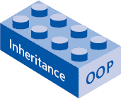

严格来说，这些字段和附加方法并不是真正继承自基础结构体（struct），而是使得第二个结构体可见——也就是说，在某种意义上，它们是“继承”的。

通过创建一个包含两个字段的基础结构体来启动程序

```go
type member struct {
    firstName string
    lastName string
}
```


src\\inher\\main.go

接下来，附加一个方法来返回基础结构体字段的值，并用一个空格连接起来

```go
func ( m member ) fullName( ) string {
    return m.firstName + “ ” + m.lastName
}
```

现在，创建一个包含两个额外字段并嵌入了基础结构体的第二个结构体

```go
type article struct {
    title string
    body string
    member
}
```

然后，为第二个结构体附加一个方法来输出所有字段值

```go
func ( a article ) content( ) {
    fmt.Println( “Title:”, a.title )
    fmt.Println( “Content:”, a.body )
    fmt.Printf( “Author: %v \\n\\n”, a.fullName( ) )
}
```

通过使用结构体字面量初始化基础结构体的实例来开始 main 函数

```go
func main( ) {
    member1 := member {
        “Mike”,
        “McGrath”,
    }
    // 在此处插入语句。
}
```

接下来，创建第二个结构体的实例并显示其所有的字段值

```go
article1 := article {
    “Object Oriented Programming”,
    “In Go, Composition emulates Inheritance”,
    member1,
}
article1.content( )
```

现在，创建第二个结构体的另一个实例并显示其所有的字段值

```go
article2 := article {
    “Object Oriented Programming”,
    “Coming next… Polymorphism”,
    member1,
}
article2.content( )
```

将程序文件保存在“inher”目录中，然后运行程序以查看继承字段的值

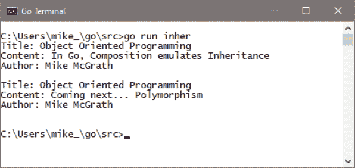


记住，结构体字面量中的所有值后面都必须跟着逗号——包括最后一个。

## 满足接口

面向对象编程的第三大基石是“多态”——这个词源于希腊语，意为“多种形式”，描述了根据上下文为实体赋予不同含义或目的的能力。

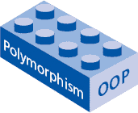

Go 语言通过“接口”（interface）类型支持多态，该类型使用 `type` 关键字创建，后跟你选择的名称以及 `interface` 关键字，最后是 `{ }` 大括号。接口体仅包含方法签名的列表：

```go
type interfaceName interface {
    methodName returnType
    methodName returnType
}
```

任何拥有与接口中列出的所有方法名称和签名精确匹配的方法结构体都会实现该接口。在 Go 语言术语中，它们被称为“满足”了接口。这样做的好处是，它允许程序拥有具有相同名称附加方法的各种结构体，每个方法执行不同的任务——也就是说，它们是多态的。

创建一个列出两个方法签名的接口来启动程序，每个方法不需要参数且返回字符串

```go
type bird interface {
    speak( ) string
    move( ) string
}
```


src\\poly\\main.go

接下来，创建一个空结构体并附加满足接口的方法

```go
type parrot struct { }
func ( parrot ) speak( ) string {
    return “Squawk, squawk!”
}
func ( parrot ) move( ) string {
    return “Squawk, squawk!”
}
```

注意你可以省略接收者名称，直接写结构体名称

现在，创建另一个空结构体并附加满足接口的方法

```go
type chicken struct { }
func ( chicken ) speak( ) string {
    return “Cluck!”
}
func ( chicken ) move( ) string {
    return “Cluck!”
}
```

添加一个接收接口的函数

```go
func nudge( b bird ) {
    fmt.Printf( “\\n%v \\n”, b.speak( ) )
    fmt.Printf( “%v \\n\\n”, b.move( ) )
}
```

添加包含创建每个结构体实例语句的 main 函数

```go
func main( ) {
    var bird1 parrot
    var bird2 chicken
    nudge( bird1 )
    nudge( bird2 )
}
```

将程序文件保存在“poly”目录中，然后运行程序以查看不同的输出

## 嵌入接口

正如结构体可以嵌入，接口也可以嵌入。理解这种抽象级别非常有帮助。例如，`io/output` 包包含了 `Reader` 和 `Writer` 接口，而 `ReadWriter` 接口嵌入了它们。

```go
type Reader interface {
    Read(p []byte) (n int, err error)
}

type Writer interface {
    Write(p []byte) (n int, err error)
}

type ReadWriter interface {
    Reader
    Writer
}
```


方法签名还可以指定参数列表和多个返回类型。

## 总结

- 多个相关数据项可以组合在 Go 的 `struct` 类型中。
- `struct` 的 `{ }` 大括号包含一组名称和类型对的列表，这些字段定义了结构体将包含的内容。
- 可以通过声明一个以结构体名为类型的变量来创建 `struct` 实例。
- 可以通过给实例名和点后缀的字段名赋值来初始化 `struct` 的单个字段。
- 可以通过将结构体字面量赋值给变量名来创建并初始化 `struct` 实例。
- 通过添加接收者（receiver）可以将函数附加到结构体，接收者指定了函数的结构体名称。
- 附加到结构体的函数称为方法（method）。
- 方法可以是值接收者（在结构体的副本上操作），也可以是指针接收者（在原始字段上操作）。
- `struct` 可以通过其字段属性表示真实世界对象的属性和行为。
- `struct` 可以作为匿名字段嵌入到另一个结构体内部，从而可以直接访问其字段。
- 面向对象编程的三大基石是封装、继承和多态。
- Go 的封装依赖于包中的数据隐藏，其中大写字母开头的项会被导出。
- Go 的继承依赖于组合，其中嵌入的结构体提供了字段和方法。
- Go 的多态依赖于其接口（interface）类型，接口包含一个方法签名列表。
- 任何方法与接口精确匹配的结构体 都会实现该接口。
- 接口可以嵌入另一个接口内部以提供更高级的抽象。

## 创建数组

本章演示了如何在程序中使用索引元素存储多个数据项。

## 创建基础数组

数组是一个可以存储多个数据项的变量——这与只能存储一个数据点的普通变量不同。数据项按顺序存储在数组“元素”中，这些元素从零开始编号。因此，第一个值存储在元素 0 中，第二个值存储在元素 1 中，依此类推。


可以使用 `var` 关键字后跟你选择的名称，后跟指定所需元素数量的 `[]` 方括号来声明一个空数组。随后必须紧跟元素可以包含的数据类型。声明的语法如下：

```
var arrayName[nElements]dataType
```

然后可以通过在方括号中指明元素编号来为每个元素单独赋值：

```
arrayName[elementNumber] = value
```

或者，可以通过在“数组字面量”中指明每个元素的值（这是一个在大括号内分组的逗号分隔列表）来声明并初始化一个带有值的数组：

```go
arrayName := [nElements]dataType{value, value, value}
```

可以使用数组名后跟包含元素编号的方括号来引用任何单个元素的值。例如，要引用第一个元素中的值：

```
arrayName[0]
```

数组的元素合称为“索引（index）”。数组可以有多个索引——表示多个维度，而不是普通数组的单维度。三个或更多索引的多维数组并不常见，但二维数组非常常用于存储基于网格的信息，例如坐标。

要创建一个二维数组，只需添加第二对指定所需元素数量的 `[]` 方括号，如下：

```
var arrayName[nElements][nElements]dataType
```

然后可以通过在方括号中指明元素编号来为每个可用元素单独赋值：

```
arrayName[elementNumber][elementNumber] = value
```


数组编号从零开始——因此，六个元素数组的最后一个元素是五，而不是六号。这种编号被称为“零基索引（zero-based index）”。


你只能在数组声明中指定的数据类型的元素内存储数据。或者，在声明二维数组时，通过在数组字面量中指定每个索引的值来初始化并为每个元素赋值：

```go
arrayName := [nElements][nElements]dataType{{value, value, value}, {value, value, value}}
```

可以使用数组名后跟包含每个索引编号的方括号来引用任何单个元素的值。例如，第二个索引的元素：

```
arrayName[0][1]
```


创建一个包含三个元素的空数组，每个元素只能包含字符串值：

```go
var cars[3]string
```


src/array/main.go


接下来，添加语句来初始化每个数组元素：

```go
cars[0] = "BMW"
cars[1] = "Ford"
cars[2] = "Opel"
```


现在，声明并初始化一个二维数组：

```go
coords := [2][3]int{{1, 2, 3}, {4, 5, 6}}
```


然后，添加语句显示包含存储的数组元素的输出：

```go
fmt.Println("Cars:", cars)
fmt.Println("Second Car:", cars[1])
fmt.Println("X1,Y1:", coords[0][0])
fmt.Println("X2,Y3:", coords[1][2])
```

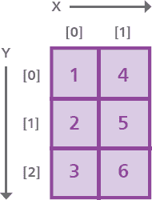


## 遍历元素

循环和数组是完美的搭档。循环可以用于为空数组中的每个元素填充一个值，并遍历数组中的每个元素以引用存储的值。


传统的递增 `for` 循环可以将初始计数器变量的值设置为零，并将该变量放在数组的 `[]` 方括号内，随着循环的进行表示每个元素的索引号。

Go 有一个内置的 `len()` 函数，它接受数组变量作为参数，并返回数组中包含的元素数量整数。这可以用于传统的 `for` 循环，在循环到达数组最后一个元素时退出。

创建一个包含五个元素的空整数数组：

```go
var arr[5]int
```

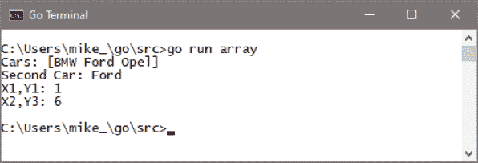


接下来，添加语句确认数组大小：

```go
fmt.Println("No. of Elements:", len(arr))
```

现在，添加循环来填充每个元素：

```go
for i := 0; i < len(arr); i++ {
    arr[i] = i * i
}
```

然后，添加循环来引用每个数组元素的值：

```go
for i := 0; i < len(arr); i++ {
    fmt.Printf("Index: %v Value: %v\n", i, arr[i])
}
```


Go 提供了了一些可以与数组配合特殊特性。首先，当使用数组字面量声明数组变量时，你可以使用 `…` 通配符运算符将元素数量设置为等于数组字面量中值的数量：

```
arr := [ … ]int { 10, 20, 30 } // len( arr ) == 3
```

你甚至可以通过为每个值指定索引号，来规定每个值应该存储在哪个元素中，如下所示：

```
arr := [ … ]int { 2: 10, 0: 20, 1: 30 } // arr == [ 20, 30, 10 ]
```

其次，你可以在循环中使用 `range` 关键字来遍历数组，并返回每个元素的索引号和值。

创建一个五个元素的整数数组

```
arr := [ … ]int { 100, 200, 300, 400, 500 }
```


src\\range\\main.go

接下来，添加一条语句来确认数组大小

```
fmt.Println( “No. of Elements:”, len( arr ) )
```

现在，添加一个循环来修改每个元素的值

```
for i , v := range arr {
    arr[ i ] =v / 10
}
```

然后，添加一个循环来引用每个数组元素的值

```
for i , v := range arr {
    fmt.Printf( “Index: %v Value: %v \n”, i, v )
}
```

将程序文件保存到“range”目录，然后运行程序查看数组元素中存储的值

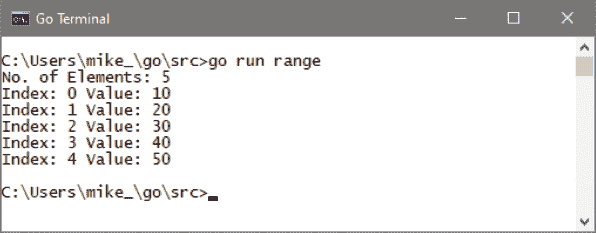


如果你在循环语句中不需要索引号，可以将变量名 `i` 替换为空白标识符 `_` 以避免错误——请参见此处第 68 页。

## 切片数组 (Slice Arrays)

数组是序列，其每个元素都包含相同类型的数据，但长度是固定的，因此并不灵活。幸运的是，Go 提供了一种切片类型，它代表底层数组，并且其长度可以改变。


要理解切片类型，重要的是要认识到切片本身不包含任何元素，它仅仅是对实际数组的引用。切片类型仅包含三个部分：

- `Ptr` –（指针）指向切片可访问的数组第一个元素的指针（不一定是数组的第一个元素）。
- `Len` –（长度）切片中元素的总数。
- `Cap` –（容量）指针所引元素与数组最后一个元素之间的元素数量。

例如，从一个星期几数组中创建一个工作几日的切片：

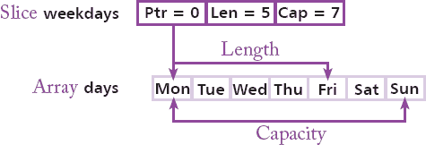

在 Go 编程中，可以通过将数组赋值给变量，并指定所需的下边界和上边界元素索引号来创建切片。这些边界指定在 `[ ]` 方括号之间的 `:` 冒字符周围。冒号左侧的数字指定要切片的起始元素的索引号——切片指针将引用该元素。冒号右侧的数字指定上边界的索引号——用于切片直到但但不包含上边界元素的所有元素。上述所示示例的赋值语句如下所示：

```
weekdays := days[ 0 : 5 ]
```

可选地，你可以省略指定上下边界的任一数字以使用默认值。下边界的默认值为 0（零），上边界的默认值为数组中元素的总数。


切片在 Go 编程中非常重要，且出现频率比数组类型得多，但重要的是理解切片是对底层数组的引用。

你可以使用内置的 `len()` 函数获取切片的长度（就像数组一样），你也可以使用内置的 `cap()` 函数检查切片的容量。将切片的指针值与它指向的数组元素的内存地址进行比较，可以确认切片确实是一个指针引用。

首先，创建一个七个元素的数组

```
days := [ 7 ]string {“Mon”,”Tue”，“Wed”，“Thu”，“Fri”,”Sat”,”Sun}
```


src\\slice\\main.go

创建一个表示最后两个数组元素的切片

```
weekend := days[ 5 : ]
```

现在，添加语句来显示切片的内容和类型

```
fmt.Printf( “Slice weekend: %v \n”, weekend )
fmt.Printf( “Type weekend : %T \n”, weekend )
```

添加语句显示切片的长度和容量

```
fmt.Printf( “Length weekend: %v \n”, len( weekend ) )
fmt.Printf( “Capacity weekend: %v \n”, cap( weekend ) )
```

最后，添加语句确认切片是指针引用

```
fmt.Printf( “Pointer weekend: %p \n”, weekend )
fmt.Printf( “Address days[5]: %p \n”, &days[5] )
```

将程序文件保存到“slice”目录，然后运行程序查看数组元素中存储的值

## 创建切片 (Make Slices)

创建切片的方法与数组相同，只需在 `[ ]` 括号内指定任意数量的元素。你也可以使用 `make()` 函数创建一个切片，其参数指定切片类型、长度以及可选的切片容量。然后可以为单个元素赋值：

```
fruitSlice := make( [ ]string, 3 )
fruitSlice[ 0 ] = “Apple”
fruitSlice[ 1 ] = “Banana”
fruitSlice[ 2 ] = “Cherry”
```

在这两种情况下，Go 都会创建一个相应的底层数组。你可以使用 `append()` 函数向切片添加元素。这至少需要两个参数，指定切片名称和一个多个元素值。该函数返回包含一个或多个元素的新切片：

```
fruitSlice = append(fruitSlice, “Damson”)
```

重要的是，当切片的长度超过底层数组的容量时，Go 会自动增加底层数组的容量。

还有一个内置的 `copy()` 函数可以将切片复制到另一个切片。这需要两个参数，指定要复制到的切片名称和源切片名称。先创建一个与源长度相同的空切片，然后将其内容复制到该切片中：

```
jamSlice = make( [ ]string, len( fruitSlice ))
copy( jamSlice, fruitSlice )
```

如果你想从切片删除删除元素并保留剩余元素的顺序，可以使用 `copy()` 函数将指定索引以上的所有元素向下移动位置。切片可以作为参数传递给函数，只需在函数签名中指定名称和切片类型。

你不需要过度担心切片的底层数组，因为 Go 会自动处理。


使用切片字面量初始化一个整数切片

```
nums := [ ]int { 10, 20, 30, 40, 50, 60, 70, 80, 90, 100 }
```

创建另一个切片，然后初始化它的单个元素：

```
more := make( [ ]int, 3 )
more[ 0 ] = 200
more[ 1 ] = 300
more[ 2 ] = 400
```

添加一条调用函数来描述切片的语句

```
describe( nums )
```

通过追加第二个切片中的一个值来扩大第一个切片，然后描述修改后的第一个切片


`nums = append( nums, more[ 0 ] )`

`describe( nums )`移除第一个切片的第一个元素，然后再次描述修改后的切片

`copy( nums[0 : ], nums[1 : ])`

`nums = nums[: len( nums ) - 1]`

`describe( nums )`在主函数之后，添加描述第一个切片元素值、长度和容量的函数

```
func describe( nums []int ) {
fmt.Printf( "\n%v Length: %v ", nums, len( nums ))
fmt.Printf( "Capacity: %v \n", cap( nums ))
}
```将程序文件保存到“make”目录中，然后运行程序以查看切片的特性

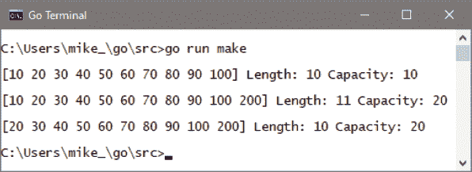


这里的容量增量大小为 10，但在其他平台上可能会有所不同。注意，当元素被删除时，容量不会恢复到原始大小。

## 切片与数组

数组包含一组值的序列，而切片包含对值序列的引用。这是 Go 编程中一个重要的区别，它适用于它的许多类型。最重要的是，当将类型传递给函数时，那些基于值的类型将接收原始值的副本，而那些引用类型将指向实际的原始值。因此，为了让函数能够在原始值上进行操作，在将基于值的类型传递给函数时需要使用指针，而在传递引用类型时则不需要指针。


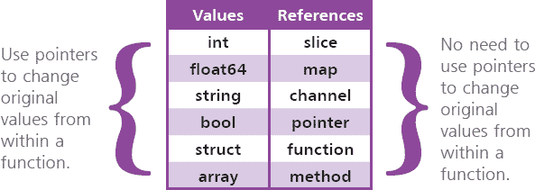

数组和切片之间的另一个区别在于可以使用任意数量参数调用的“变长”函数。除非你先通过将数组元素值复制到切片元素并将数组“转换”为切片，否则不能将数组元素值传递给变长函数。

你可以通过在函数签名中最后一个参数的数据类型前加上 `…` 通配符运算符来简单创建一个变长函数，使用如下语法：

`func *funcName* (*paramName* …*dataType*)`

变长函数可以像通常一样调用，在 `()` 括号内包含用逗号分隔的参数列表。

在将切片元素的值传递给函数时，变长函数特别有用，因为切片的长度在程序执行过程中可能会发生。无论切片的长度如何，都可以通过在函数调用中指定切片名称后跟 `…` 通配符运算符，将其元素值传递给变长函数：

`*funcName* (*sliceName…)`


`fmt.Printf()` 函数是一个变长函数——它开头需要一个固定参数，然后接受任意数量的后续参数。

创建一个三个字符串的数组

`array := [ 3 ]string{ “BMW”, “Ford”, “Opel” }`


`src\versus\main.go`

将数组元素复制到切片中以进行“转换”

`slice := array[:]`

接下来，调用变长函数传递每个切片元素中的值进行显示

`list( slice… )`

现在，向切片添加两个更多值

`slice = append( slice, “Porsche”, “Ferrari” )`

再次调用变长函数传递每个切片元素中的值进行显示

`list( slice…)`

在主函数之后，添加变长函数来列出传递的切片元素值

```
func list( autos …string ) {
for i, v := range autos {
fmt.Printf( "\n%v. %v", i, v )
}
fmt.Println( )
}
```将程序文件保存到“versus”目录中，然后运行程序以查看参数值

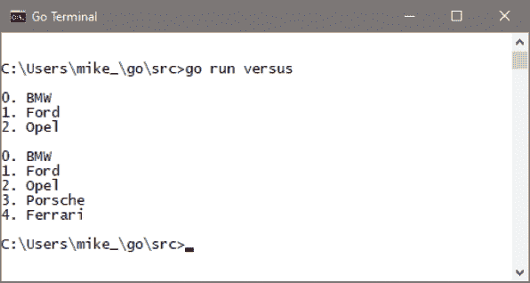


调用变长函数时，你并不是在传递切片本身——你仅仅是在传递切片元素的值。

## Map 的键和值

哈希表可以使用关联的键存储多个数据项，以便你通过其关联键引用存储的值。在 Go 编程中，这种数据结构被称为“map”，但其他编程语言将其称为关联数组或字典。


map 中的所有键必须是唯一的且具有相同的数据类型。map 中的所有值必须具有相同的数据类型，但不一定与键的类型类型相同。

可以使用 `var` 和 `map` 关键字，并使用如下语法指定键和值的数据类型来创建 map：

`var *mapName* = map [*keyDataType]* *valueDataType`

然后可以将单个键/值对赋值给 map，如下：

`*mapName* [“*keyName*”] = *value*`

与数组和切片不同，map 是无序，因此你不能使用索引数字。你可以随时向 map 添加键/值对，使用内置的 `delete()` 函数删除键/值对。此外，你可以使用 `range` 关键字遍历 map 的所有元素。

创建一个字符串键值值的 map

`colors := make( map [string]string )`

`src\map\main.go`

使用三个初始化 map

`colors["Red"] = “#FF0000”`

`colors["Green"] = “#00FF00”`

`colors["Blue"] = “#0000FF”`接下来，显示所有键/值对

`fmt.Printf( "\nColors: %v \n", colors )`现在，添加键/值对并显示其值

`colors["Yellow"] = “#FFFF00”`

`fmt.Printf( "\nYellow Hex Code: %v \n", colors["Yellow"] )`然后删除添加的键/值对

`delete( colors, “Yellow”)`最后，添加循环列出 map 中所有的键/值对

```
for k, v := range colors {
fmt.Printf( "\nHex Code for %v is %v \n", k, v )
}
```将程序文件保存到“map”目录中，然后运行程序以查看键和值

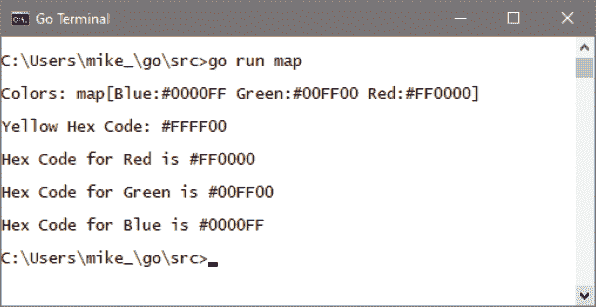


map 元素的顺序是随机的，在不同的平台上可能会不同。

**总结**

• map 是一种使用关联键存储数据的哈希表结构。

• map 中的所有键必须是唯一的且具有相同的数据类型。

• map 中的所有值必须具有相同的数据类型。

• 使用 `var` 和 `map` 关键字或通过 `make()` 函数创建 map。

• 使用赋值运算符添加或更新键/值对。

• 使用 `delete()` 函数删除键/值对。

• 使用 `range` 关键字遍历 map，它会返回键和值。

• map 是无序的，迭代顺序是随机的。


- 元素序列的上下边界可以在 `[ ]` 方括号内的 `:` 冒号字符周围进行指定。
- 使用 `make()` 函数创建空切片，也可以通过赋值切片字面量来创建并初始化。
- 使用 `append()` 函数向切片中添加元素。
- 使用 `copy()` 函数可以将一个切片复制到另一个切片中。
- 在向函数传递引用时，不需要指针。
- 变参函数可以使用任意数量的参数调用。
- 映射（map）是一个包含关联键/值对的变长结构。
- 使用 `make()` 函数创建空映射，也可以通过赋值映射字面量来创建并初始化。
- 可以通过在 `[ ]` 方括号中指定关联的键来引用映射元素中存储的值。

# 运用时间

本章演示了如何使用 Go 标准库中的 `time` 包来处理日期和时间。

- 获取日期
- 获取时间
- 格式化日期和时间
- 设置日期和时间
- 识别时区
- 延迟时间
- 总结

## 获取日期

Go 标准库 `time` 包提供了从 `Time` 数据类型中提取特定字段的功能，这些字段描述了一个特定的点。通过导入 `time` 包，这些功能可以在程序中使用。


可以使用 `time.Now()` 函数创建一个带有描述当前日期和时间的字段的新 `Time` 数据类型实例。这些字段是根据设备上当前区域的系统时钟初始化的。

可以使用 `Time` 数据类型的适当方法来获取单个字段中的值。例如，可以使用 `Year()` 方法获取 `year` 字段的值。同样，还有 `Month()`、`Day()` 和 `Weekday()` 方法来获取 `Time` 类型的其他单个字段。

| 方法 | 返回值 |
| --- | --- |
| `Now()` | 一个包含当前日期、时间和时区字段的 `time.Time` 数据类型 |
| `Year()` | 4 位数字年份 (YYYY) |
| `Month()` | 年的月份名称 |
| `Day()` | 月中的天数 |
| `Weekday()` | 星期名称 |

还有这三个方法，其返回的 `Time` 数据类型值可以有效地赋值给变量：

| 方法 | 返回值 |
| --- | --- |
| `Date()` | 4 位数字年份 (YYYY)、月份名称和月中的天数 |
| `ISOWeek()` | 年中的周数 (1-53) 和 4 位数字年份 (YYYY) |
| `YearDay()` | 年中的天数 (1-365/366) |

重要的是，`Time` 数据类型包含单个字段，因此它不是字符串。不过，你可以使用它的 `String()` 方法将其字符串：


`Time` 数据类型方法返回的值不是字符串。

开始在程序中导入 Go 标准库 time 包

```go
import (
	"fmt"
	"time"
)
```


`src\date\main.go`

接下来，创建一个 `Time` 数据类型的日期/时间实例，用当前日期和时间初始化

```go
dt := time.Now()
```

添加语句输出日期/时间实例的所有字段以确认其数据类型

```go
fmt.Printf("DateTime: %v\n", dt)
fmt.Printf("DateTime Type: %T\n", dt)
```

接下来，添加语句输出今天的星期

```go
fmt.Printf("Today is: %v\n", dt.Weekday())
```

现在，添加语句显示今天的日期、周和年的天数

```go
y, m, d := dt.Date()
fmt.Printf("Date: %v %v\n", m, d)
```

```go
yr, wk := dt.ISOWeek()
fmt.Printf("Week No.: %v\n", wk)
```

```go
dy := dt.YearDay()
fmt.Printf("Day No.: %v\n", dy)
```

将文件保存在“date”目录中，然后运行程序查看日期值

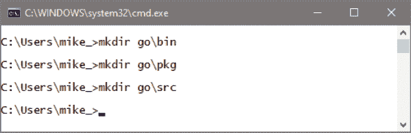

时区值指定了相对于 UTC（协调世界时）的偏移和缩写——更多关于时区的信息请参见此处。

 获取时间

可以使用适当的方法 `Time` 类型单个字段中的时间值。例如，可以使用 `Hour()` 方法获取小时值。同样，还有 `Minute()`、`Second()` 和 `Nanosecond()` 方法来获取 `Time` 的其他单个字段。


| 方法 | 返回值 |
| --- | --- |
| `Hour()` | 天的小时 (0-23) |
| `Minute()` | 小时的分钟 (0-59) |
| `Second()` | 分的秒 (0-59) |
| `Nanosecond()` | 秒的纳秒 (0-999999999) |

与其他语言不同，Go 的 `time` 包没有提供从 `Time` 类型返回毫秒的方法。不过，你可以将纳秒值除以百万以得到等值的毫秒。

还有这三个方法，其返回的 `Time` 类型值可以有效地赋值给变量：

| 方法 | 返回值 |
| --- | --- |
| `Clock()` | 天的时、分、秒 |
| `Unix()` | 自纪元（1970 年 1 月 1 日 00:00:00 UTC）开始的秒数 |
| `UnixNano()` | 自纪元（1970 年 1 月 1 日 00:00:00 UTC）开始的纳秒数 |

开始在程序中导入 Go 标准库 time 包

```go
import (
	"fmt"
	"time"
)
```


`src\times\main.go`

接下来，创建一个 `Time` 数据类型的日期/时间实例，用当前日期和时间初始化

```go
dt := time.Now()
```

`UnixNano()` 方法用于 Go 随机生成器的种子——请参见此处。

添加语句输出日期/时间实例的所有字段并确认其数据类型

```go
fmt.Printf("DateTime: %v\n", dt)
fmt.Printf("DateTime Type: %T\n\n", dt)
```

接下来，添加语句评估当前小时并显示适当问候

```go
hr := dt.Hour()
switch {
case hr < 12:
	fmt.Println("Good Morning!")
case hr < 18:
	fmt.Println("Good Afternoon!")
default:
	fmt.Println("Good Evening!")
}
```

现在，添加语句显示当前时间

```go
h, mn, s := dt.Clock()
fmt.Printf ( "Time: %v:%v:%v \n", h, mn, s )
```

最后，添加语句显示当前时间的纳秒字段及其等值的毫秒值

```go
ns := dt.UnixNano()
ms := ns / 1000000
fmt.Println("Nanoseconds:", ns)
fmt.Println("Milliseconds:", ms)
```

将程序文件保存在“times”目录中，然后运行程序查看时间字段值

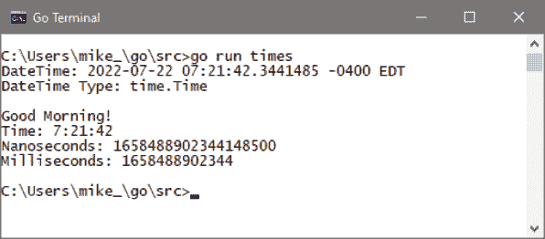


默认情况下，一位数的小、分、秒值不会带前导零。

## 格式化日期和时间


可以使用 `Format()` 方法以多种方式格式化 `Time` 类型单个字段中的日期和时间值。它接受一个作为“布局”字符串的参数，指定如何格式化日期/时间值。格式必须通过精确使用此引用字符串中的元素来指定：

`Mon Jan 2 15:04:05 2006 MST`


由于 MST（山地标准时间）比 UTC（协调世界时）晚 7 小时，参考字符串也可以从数值角度考虑，如下所示：

`01 02 03:04:05PM ‘06 -0700`

如果你想让 `Format()` 方法只返回日、月和 hh:mm 格式的时间，可以将布局指定为：

`Mon Jan 2 15:04`

或以数值形式指定为：

`01/02 03:04`

你可以通过在布局中指定长名称版本，让返回返回星期名称和月份全称：

`Monday January 2 15:04`

`time` 包包含了预定义的 `UnixDate`、`ANSIC` 和 `RFC3339` 常量，你可以将它们作为日期/时间布局格式。

自定义布局可以按任何顺序指定组件，以适应不同的地区——例如，用于适当的日期格式。

`time` 包还包含一个预定义的 `Kitchen` 常量，你可以将其作为时间布局格式。它将以 12 小时格式显示时间，并根据需要附加“AM”或“PM”。

此外，时间组件可以被格式化为 24 小时格式显示，通过指定 `15:04` 自动在单数字小时前加零。

12 小时格式和 24 小时格式都会自动在单数字分钟前加零。


`ANSIC` 指的是美国国家标准协会针对 C 编程语言的标准日期/时间格式。RFC 3339 指的是互联网工程任务组（IETF）的请求意见日期/时间文档。

首先向程序导入 Go 标准库的 `time` 包

```go
import (
	"fmt"
	"time"
)
```


`src\format\main.go`

接下来，创建一个 Time 数据类型的日期/时间实例，用当前日期时间初始化，然后以各种格式显示其组件

```go
dt := time.Now()
fmt.Println("\nDefault Format:", dt)
fmt.Println("Unix Format:", dt.Format(time.UnixDate))
fmt.Println("ANSIC Format:", dt.Format(time.ANSIC))
fmt.Println("RFC3339 Format:", dt.Format(time.RFC3339))
fmt.Println("Custom Format:", dt.Format("January 2, 2006 [Monday]"))
```

现在，仅显示格式化为适合两个不同地区的日期组件

```go
fmt.Println("\nUS Format:", dt.Format("January 2, 2006"))
fmt.Println("UK Format:", dt.Format("2 January, 2006"))
```

然后，仅以 12 小时格式和 24 小时格式显示时间组件

```go
fmt.Println("\nTime 12-Hour:", dt.Format(time.Kitchen))
fmt.Println("Time 24-Hour:", dt.Format("15:04"))
```

将程序文件保存在“format”目录中，然后运行程序以查看格式化后的日期时间和字段值

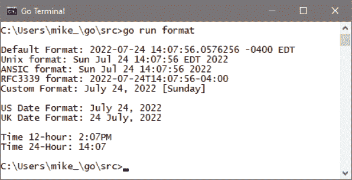


`time.Kitchen` 常量等同于指定布局格式 `15:04PM`。

## 设置日期和时间

你可以使用 Go 标准库 `time` 包的 `Date()` 函数创建你自己的 Time 数据类型。这需要八个参数来指定（按顺序）年、月、日、时、分、秒、纳秒和位置。


除了月份和位置外，所有参数都指定为整数值。

月份可以使用 `time` 包预定义的 1 月至 12 月的全称月份常量之一指定，例如 `time.January`。

位置可以使用 `time` 包预定义的位置常量之一指定，如 `time.UTC`（协调世界时）或 `time.Local`（你的系统时钟）。

任何 Time 数据类型中的日期字段都可以使用 Go 标准库 `time` 包的 `AddDate()` 方法进行修改，以指定年、月、日的三个参数。正值将推迟日期，负值将推回日期。例如，`time.AddDate(1, 0, 0)` 将日期推后一年。

同样，`time` 包的 `Add()` 方法可以用于指定单个持续时间参数来修改日期/时间。该值可以是一个代表修改日期/时间的纳秒数的 `int64` 值。更方便的是，你可以使用常量 `time.Hour`、`time.Minute`、`time.Second` 或 `time.Millisecond` 来修改 Time 数据类型的单个时间字段。例如，`time.Add(10 * time.Hour)` 将时间推后 10 小时。

你还可以使用 Go 标准库 `time` 包的 `Parse()` 函数从字符串创建你自己的 Time 数据类型。这需要两个参数来指定布局和日期/时间字符串。有用的是，此函数返回两个值：一个 Time 数据类型和一个错误。如果函数返回了 Time 类型，则错误值为 `nil`，否则将是一个错误。

布局应仅使用：

`Mon Jan 2 15:04`

除非在日期/时间字符串中指定了时区偏移值（例如 -0500），否则生成的 Time 类型将假设为 UTC 时间。


`Time` 数据类型可以使用第 16 页的 `Format()` 方法进行格式化。

首先向程序导入 Go 标准库 `time` 包

```go
import (
	"fmt"
	"time"
)
```


`src\setdate\main.go`

接下来，创建一个 Time 数据类型的日期/时间实例，用当前日期时间初始化，然后以各种格式显示其组件

```go
dt := time.Date(2025, time.January, 1, 12, 0, 0, 0, time.Local)
fmt.Println("\nDateTime:", dt)
```

将日期推后两年到独立日，然后显示修改后的日期

```go
dt = dt.AddDate(2, 0, 3)
fmt.Println("DateTime:", dt)
```

现在，初始化一个布局字符串和一个日期/时间字符串

```go
layout := "2006-Jan-02 03:04PM"
str := "2030-Dec-25 12:30AM"
```

最后，尝试创建并显示 Time 数据类型的字段，如果失败则显示错误

```go
t, err := time.Parse(layout, str)
if err != nil {
	fmt.Println(err)
} else {
	fmt.Printf("Parsed DateTime: %v\n", t)
}
```

将程序文件保存在“setdate”目录中，然后运行程序以查看日期时间和

## 识别区域

Go 编程中的所有 Time 类型都关联到一个时区。通常，这是 UTC 时间，或者是运行程序的系统的本地时间。然而，你可以通过 `time.LoadLocation()` 函数指定一个可选的位置。位置名称必须与互联网分配机构（IANA）时区数据库中的文件对应，例如 `America/New_York`、`Asia/Seoul` 或 `Europe/London`。`time.LoadLocation()` 函数返回两个值：一个 Location 类型和一个错误。如果函数成功返回了 Location 类型，则错误值为 `nil`，否则将是一个错误消息。

你可以通过在 `Now()` 函数之后附加调用 `In()` 函数，并将位置作为 `In()` 函数的参数，来创建另一个时区的当前时间 Time 类型。


你可以通过调用 `Time` 数据类型的 `Zone()` 方法来确定与其关联的时区。该方法返回两个值：一个三字母的 `TZ` 时区缩写（例如“EST”（东部标准时间）或“EDT”（东部夏令时间），以及一个表示该时区相对于 UTC 偏移秒数的数值值。需要注意的是，时区缩写并不是唯一的，因此你不应仅依赖这些缩写来识别特定的时区。某些时区会在夏令时期间调整其时间，因此你可能需要同时评估 `TZ` 缩写和偏移量来正确识别时区。


本书的下载文件中包含一份 IANA 地位置名称和 `TZ` 缩写列表——请参见第 6 页。


美国的夏令时会将 UTC 偏移量减少一小时。例如，东部夏令时间 (EDT) 为 UTC - 4 小时，中部夏令时间 (CDT) 为 UTC - 5 小时，等等。

首先在程序中导入 Go 标准库的 time 包

```go
import (
    "fmt"
    "time"
)
```


`src\zone\main.go`

接下来，在指定位置创建并初始化带有字符串值和 `Time` 数据类型的变量

```go
zone := "All"
loc, _ := time.LoadLocation("America/New_York")
dt := time.Now().In(loc)
```

确定时区缩写和偏移秒数，然后将偏移量转换为正分钟数

```go
abbr, offset := dt.Zone()
if offset < 1 {
    offset = offset * -1
}
offset /= 60
```

现在，评估缩写和偏移量值

```go
switch {
case abbr == "EST" && offset == 300:
    zone = "East Coast"
case abbr == "EDT" && offset == 240:
    zone = "East Coast"
}
```

显示时区详情和适当消息

```go
fmt.Printf("\nTZ: %v Offset Minutes: %v \n", abbr, offset)
fmt.Println("Welcome to", zone, "Visitors!")
```

将程序文件保存到“zone”目录中，然后运行程序以查看时区值

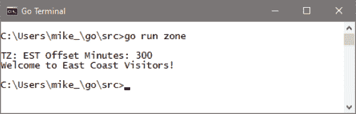


由于空间限制，这里使用 `_` 空标识符来忽略返回的错误值，但理想情况下你应该包含错误处理器。

## 延迟时间

Go 标准库 time 包提供了一个 `Sleep()` 函数，允许你通过指定的持续时间延迟程序的进度。持续时间作为 `Sleep()` 函数的参数提供，可以表示为 time 包常量的乘积。例如，`5 * time.Second` 表示一个持续时间。


Go 标准库 time 包提供了一个 `Sleep()` 函数，允许你通过指定的持续时间延迟程序的进度。持续时间作为 `Sleep()` 函数的参数提供，可以表示为 time 包常量的乘积。例如，`5 * time.Second` 表示一个持续时间。


Go 标准库 time 包提供了一个 `Sleep()` 函数，允许你通过指定的持续时间延迟程序的进度。持续时间作为 `Sleep()` 函数的参数提供，可以表示为 time 包常量的乘积。例如，`5 * time.Second` 表示一个持续时间。


Go 标准库 time 包提供了一个 `Sleep()` 函数，允许你通过指定的持续时间延迟程序的进度。持续时间作为 `Sleep()` 函数的参数提供，可以表示为 time 包常量的乘积。例如，`5 * time.Second` 表示一个持续时间。


Go 标准库 time 包提供了一个 `Sleep()` 函数，允许你通过指定的持续时间延迟程序的进度。持续时间作为 `Sleep()` 函数的参数提供，可以表示为 time 包常量的乘积。例如，`5 * time.Second` 表示一个持续时间。


Go 标准库 time 包提供了一个 `Sleep()` 函数，允许你通过指定的持续时间延迟程序的进度。持续时间作为 `Sleep()` 函数的参数提供，可以表示为 time 包常量的乘积。例如，`5 * time.Second` 表示一个持续时间。


Go 标准库 time 包提供了一个 `Sleep()` 函数，允许你通过指定的持续时间延迟程序的进度。持续时间作为 `Sleep()` 函数的参数提供，可以表示为 time 包常量的乘积。例如，`5 * time.Second` 表示一个持续时间。


Go 标准库 time 包提供了一个 `Sleep()` 函数，允许你通过指定的持续时间延迟程序的进度。持续时间作为 `Sleep()` 函数的参数提供，可以表示为 time 包常量的乘积。例如，`5 * time.Second` 表示一个持续时间。


Go 标准库 time 包提供了一个 `Sleep()` 函数，允许你通过指定的持续时间延迟程序的进度。持续时间作为 `Sleep()` 函数的参数提供，可以表示为 time 包常量的乘积。例如，`5 * time.Second` 表示一个持续时间。


Go 标准库 time 包提供了一个 `Sleep()` 函数，允许你通过指定的持续时间延迟程序的进度。持续时间作为 `Sleep()` 函数的参数提供，可以表示为 time 包常量的乘积。例如，`5 * time.Second` 表示一个持续时间。


Go 标准库 time 包提供了一个 `Sleep()` 函数，允许你通过指定的持续时间延迟程序的进度。持续时间作为 `Sleep()` 函数的参数提供，可以表示为 time 包常量的乘积。例如，`5 * time.Second` 表示一个持续时间。


Go 标准库 time 包提供了一个 `Sleep()` 函数，允许你通过指定的持续时间延迟程序的进度。持续时间作为 `Sleep()` 函数的参数提供，可以表示为 time 包常量的乘积。例如，`5 * time.Second` 表示一个持续时间。


Go 标准库 time 包提供了一个 `Sleep()` 函数，允许你通过指定的持续时间延迟程序的进度。持续时间作为 `Sleep()` 函数的参数提供，可以表示为 time 包常量的乘积。例如，`5 * time.Second` 表示一个持续时间。


Go 标准库 time 包提供了一个 `Sleep()` 函数，允许你通过指定的持续时间延迟程序的进度。持续时间作为 `Sleep()` 函数的参数提供，可以表示为 time 包常量的乘积。例如，`5 * time.Second` 表示一个持续时间。


Go 标准库 time 包提供了一个 `Sleep()` 函数，允许你通过指定的持续时间延迟程序的进度。持续时间作为 `Sleep()` 函数的参数提供，可以表示为 time 包常量的乘积。例如，`5 * time.Second` 表示一个持续时间。


Go 标准库 time 包提供了一个 `Sleep()` 函数，允许你通过指定的持续时间延迟程序的进度。持续时间作为 `Sleep()` 函数的参数提供，可以表示为 time 包常量的乘积。例如，`5 * time.Second` 表示一个持续时间。


Go 标准库 time 包提供了一个 `Sleep()` 函数，允许你通过指定的持续时间延迟程序的进度。持续时间作为 `Sleep()` 函数的参数提供，可以表示为 time 包常量的乘积。例如，`5 * time.Second` 表示一个持续时间。


Go 标准库 time 包提供了一个 `Sleep()` 函数，允许你通过指定的持续时间延迟程序的进度。持续时间作为 `Sleep()` 函数的参数提供，可以表示为 time 包常量的乘积。例如，`5 * time.Second` 表示一个持续时间。


Go 标准库 time 包提供了一个 `Sleep()` 函数，允许你通过指定的持续时间延迟程序的进度。持续时间作为 `Sleep()` 函数的参数提供，可以表示为 time 包常量的乘积。例如，`5 * time.Second` 表示一个持续时间。


Go 标准库 time 包提供了一个 `Sleep()` 函数，允许你通过指定的持续时间延迟程序的进度。持续时间作为 `Sleep()` 函数的参数提供，可以表示为 time 包常量的乘积。例如，`5 * time.Second` 表示一个持续时间。


Go 标准库 time 包提供了一个 `Sleep()` 函数，允许你通过指定的持续时间延迟程序的进度。持续时间作为 `Sleep()` 函数的参数提供，可以表示为 time 包常量的乘积。例如，`5 * time.Second` 表示一个持续时间。


Go 标准库 time 包提供了一个 `Sleep()` 函数，允许你通过指定的持续时间延迟程序的进度。持续时间作为 `Sleep()` 函数的参数提供，可以表示为 time 包常量的乘积。例如，`5 * time.Second` 表示一个持续时间。


Go 标准库 time 包提供了一个 `Sleep()` 函数，允许你通过指定的持续时间延迟程序的进度。持续时间作为 `Sleep()` 函数的参数提供，可以表示为 time 包常量的乘积。例如，`5 * time.Second` 表示一个持续时间。


Go 标准库 time 包提供了一个 `Sleep()` 函数，允许你通过指定的持续时间延迟程序的进度。持续时间作为 `Sleep()` 函数的参数提供，可以表示为 time 包常量的乘积。例如，`5 * time.Second` 表示一个持续时间。


Go 标准库 time 包提供了一个 `Sleep()` 函数，允许你通过指定的持续时间延迟程序的进度。持续时间作为 `Sleep()` 函数的参数提供，可以表示为 time 包常量的乘积。例如，`5 * time.Second` 表示一个持续时间。


Go 标准库 time 包提供了一个 `Sleep()` 函数，允许你通过指定的持续时间延迟程序的进度。持续时间作为 `Sleep()` 函数的参数提供，可以表示为 time 包常量的乘积。例如，`5 * time.Second` 表示一个持续时间。


Go 标准库 time 包提供了一个 `Sleep()` 函数，允许你通过指定的持续时间延迟程序的进度。持续时间作为 `Sleep()` 函数的参数提供，可以表示为 time 包常量的乘积。例如，`5 * time.Second` 表示一个持续时间。


Go 标准库 time 包提供了一个 `Sleep()` 函数，允许你通过指定的持续时间延迟程序的进度。持续时间作为 `Sleep()` 函数的参数提供，可以表示为 time 包常量的乘积。例如，`5 * time.Second` 表示一个持续时间。


Go 标准库 time 包提供了一个 `Sleep()` 函数，允许你通过指定的持续时间延迟程序的进度。持续时间作为 `Sleep()` 函数的参数提供，可以表示为 time 包常量的乘积。例如，`5 * time.Second` 表示一个持续时间。


Go 标准库 time 包提供了一个 `Sleep()` 函数，允许你通过指定的持续时间延迟程序的进度。持续时间作为 `Sleep()` 函数的参数提供，可以表示为 time 包常量的乘积。例如，`5 * time.Second` 表示一个持续时间。


Go 标准库 time 包提供了一个 `Sleep()` 函数，允许你通过指定的持续时间延迟程序的进度。持续时间作为 `Sleep()` 函数的参数提供，可以表示为 time 包常量的乘积。例如，`5 * time.Second` 表示一个持续时间。


Go 标准库 time 包提供了一个 `Sleep()` 函数，允许你通过指定的持续时间延迟程序的进度。持续时间作为 `Sleep()` 函数的参数提供，可以表示为 time 包常量的乘积。例如，`5 * time.Second` 表示一个持续时间。


Go 标准库 time 包提供了一个 `Sleep()` 函数，允许你通过指定的持续时间延迟程序的进度。持续时间作为 `Sleep()` 函数的参数提供，可以表示为 time 包常量的乘积。例如，`5 * time.Second` 表示一个持续时间。


Go 标准库 time 包提供了一个 `Sleep()` 函数，允许你通过指定的持续时间延迟程序的进度。持续时间作为 `Sleep()` 函数的参数提供，可以表示为 time 包常量的乘积。例如，`5 * time.Second` 表示一个持续时间。


Go 标准库 time 包提供了一个 `Sleep()` 函数，允许你通过指定的持续时间延迟程序的进度。持续时间作为 `Sleep()` 函数的参数提供，可以表示为 time 包常量的乘积。例如，`5 * time.Second` 表示一个持续时间。


Go 标准库 time 包提供了一个 `Sleep()` 函数，允许你通过指定的持续时间延迟程序的进度。持续时间作为 `Sleep()` 函数的参数提供，可以表示为 time 包常量的乘积。例如，`5 * time.Second` 表示一个持续时间。


Go 标准库 time 包提供了一个 `Sleep()` 函数，允许你通过指定的持续时间延迟程序的进度。持续时间作为 `Sleep()` 函数的参数提供，可以表示为 time 包常量的乘积。例如，`5 * time.Second` 表示一个持续时间。

库还提供了三个方法——`Before()`、`After()` 和 `Equal()` 来比较 `Time` 实例。

在程序中导入 Go 标准库的 time 包

```go
import (
    "fmt"
    "time"
)
```


`src\zone\main.go`

接下来，在指定位置创建并初始化带有字符串值和 `Time` 数据类型的变量

```go
zone := "All"
loc, _ := time.LoadLocation("America/New_York")
dt := time.Now().In(loc)
```

确定时区缩写和偏移秒数，然后将偏移量转换为正分钟数

```go
abbr, offset := dt.Zone()
if offset < 1 {
    offset = offset * -1
}
offset /= 60
```

现在，评估缩写和偏移量值

```go
switch {
case abbr == "EST" && offset == 300:
    zone = "East Coast"
case abbr == "EDT" && offset == 240:
    zone = "East Coast"
}
```

显示时区详情和适当消息

```go
fmt.Printf("\nTZ: %v Offset Minutes: %v \n", abbr, offset)
fmt.Println("Welcome to", zone, "Visitors!")
```

将程序文件保存到“zone”目录中，然后运行程序以查看时区值


# 合并字符串


在 Go 语言中，字符串是封装在双引号内的零个或多个字符。因此，这些都是合法的字符串值：

```
s1 := “My First String”
s2 := “”
s3 := “2”
s4 = “nil”
```

`s2` 的空引号将变量初始化为空字符串值。赋值给 `s3` 的数值是该数字的字符串表示。Go 的 `nil` 零值（通常表示任何值的缺失）当被包含在引号内时，仅仅是一个字符串字面量。

从本质上，字符串是字符的集合；每个字符都包含自己的数据——就像定义数组中的元素一样。因此，将字符串视为字符数组并在处理字符串值时应用数组的特性是逻辑性的。内置的 `len()` 函数将返回字符串中字符的数量，就像它返回数组中元素数量一样。

`+` 运算符可以用于相加数值，它同时也兼作连接运算符，将多个字符串值连接在一起以创建一个单一的合并字符串。

Go 标准库的 `strings` 包包含了许多用于字符串操作的有用函数。它的 `Join()` 函数将字符串数组的所有元素连接（拼接）起来，创建一个单一的合并字符串。该函数需要两个参数：指定字符串数组的名称以及放置在合并字符串中每个字符串元素之间的分隔符值。通常，你会指定一个空格作为分隔符，以创建一个由空格分隔的合并字符串。

写入标准输出的 `fmt.Printf()` 和 `fmt.Println()` 函数可以在输出中添加空格和换行符，但不会更改实际字符串。然而，它们都返回两个值，即写入的字节数和任何写入错误。如果没有遇到错误，错误值将如往常地为 `nil`。对于英语语言，写入的字节数通常代表输出的字符数——包括字符串包含的非打印字符。


非打印字符 `\t` 制表符的 ASCII 码为 9，非打印字符 `\n` 换行符的 ASCII 码为 10。

在程序中导入 Go 标准库 `strings` 包

```go
import (
    “fmt”
    “strings”
)
```


src\join\main.go

初始化两个变量和一个拼接后的字符串

```go
s1, s2 := “The Truth is rarely Pure “, “and never Simple.”
str := s1 + s2
```

接下来，输出拼接后的字符串及其长度

```go
chars, err := fmt.Printf("\n%v \n", str)
if err != nil {
    fmt.Println(err)
} else {
    fmt.Println(“Bytes Written: “, chars)
    fmt.Println(“String Length:”, len(str))
}
```

初始化一个字符串数组和一个连接后的字符串

```go
arr := []string { “\n\tStrive”, “For”, “Greatness!” }
ast := strings.Join(arr, “ “)
```

现在，输出连接后的字符串和前两个字符

```go
fmt.Println(ast)
if ast[0] == 10 && ast[1] == 9 {
    fmt.Printf(“1st Char: ASCII %v Newline\n”, ast[0])
    fmt.Printf(“2nd Char: ASCII %v Tab\n”, ast[1])
}
```

将程序文件保存在“join”目录中，然后运行程序查看合并后的字符串


此处写入的字节数超过字符串长度是因为 `fmt.Printf()` 方法添加了换行符和一个空格字符。

# 分割字符串

Go 标准库 `strings` 包提供了多个允许对指定字符串进行搜索以查找特定字符或子字符串（模式）的函数。Go 标准库 `strings` 包提供了多个允许分割指定字符串的函数。你可能想要将一个字符串分割成子字符串。Go 标准库 `strings` 包提供了多个允许对指定字符串进行搜索以查找特定字符或子字符串（模式）的函数。Go 标准库 `strings` 包提供了多个允许分割指定字符串的函数。Go 标准库 `strings` 包提供了多个允许对指定字符串进行搜索以查找特定字符或子字符串（模式）的函数。Go 标准库 `strings` 包提供了多个允许分割指定字符串的函数。Go 标准库 `strings` 包提供了多个允许对指定字符串进行搜索以查找特定字符或子字符串（模式）的函数。Go 标准库 `strings` 包提供了多个允许分割指定字符串的函数。Go 标准库 `strings` 包提供了多个允许对指定字符串进行搜索以查找特定字符或子字符串（模式）的函数。Go 标准库 `strings` 包提供了多个允许分割指定字符串的函数。Go 标准库 `strings` 包提供了多个允许对指定字符串进行搜索以查找特定字符或子字符串（模式）的函数。Go 标准库 `strings` 包提供了多个允许分割指定字符串的函数。Go 标准库 `strings` 包提供了多个允许对指定字符串进行搜索以查找特定字符或子字符串（模式）的函数。Go 标准库 `strings` 包提供了多个允许分割指定字符串的函数。Go 标准库 `strings` 包提供了多个允许对指定字符串进行搜索以查找特定字符或子字符串（模式）的函数。Go 标准库 `strings` 包提供了多个允许分割指定字符串的函数。Go 标准库 `strings` 包提供了多个允许对指定字符串进行搜索以查找特定字符或子字符串（模式）的函数。Go 标准库 `strings` 包提供了多个允许分割指定字符串的函数。Go 标准库 `strings` 包提供了多个允许对指定字符串进行搜索以查找特定字符或子字符串（模式）的函数。Go 标准库 `strings` 包提供了多个允许分割指定字符串的函数。Go 标准库 `strings` 包提供了多个允许对指定字符串进行搜索以查找特定字符或子字符串（模式）的函数。Go 标准库 `strings` 包提供了多个允许分割指定字符串的函数。Go 标准库 `strings` 包提供了多个允许对指定字符串进行搜索以查找特定字符或子字符串（模式）的函数。Go 标准库 `strings` 包提供了多个允许分割指定字符串的函数。Go 标准库 `strings` 包提供了多个允许对指定字符串进行搜索以查找特定字符或子字符串（模式）的函数。Go 标准库 `strings` 包提供了多个允许分割指定字符串的函数。Go 标准库 `strings` 包提供了多个允许对指定字符串进行搜索以查找特定字符或子字符串（模式）的函数。Go 标准库 `strings` 包提供了多个允许分割指定字符串的函数。Go 标准库 `strings` 包提供了多个允许对指定字符串进行搜索以查找特定字符或子字符串（模式）的函数。Go 标准库 `strings` 包提供了多个允许分割指定字符串的函数。Go 标准库 `strings` 包提供了多个允许对指定字符串进行搜索以查找特定字符或子字符串（模式）的函数。Go 标准库 `strings` 包提供了多个允许分割指定字符串的函数。Go 标准库 `strings` 包提供了多个允许对指定字符串进行搜索以查找特定字符或子字符串（模式）的函数。Go 标准库 `strings` 包提供了多个允许分割指定字符串的函数。Go 标准库 `strings` 包提供了多个允许对指定字符串进行搜索以查找特定字符或子字符串（模式）的函数。Go 标准库 `strings` 包提供了多个允许分割指定字符串的函数。

# 字符

数据通常以逗号分隔值（CSV）的形式存储在 CSV 文件中，这些可以

在程序中导入 Go 标准库 `strings` 包

Go 标准库 `strings` 包提供了多个允许对指定字符串进行搜索以查找特定字符或子字符串（模式）的函数。Go 标准库 `strings` 包提供了多个允许分割指定字符串的函数。Go 标准库 `strings` 包提供了多个允许对指定字符串进行搜索以查找特定字符或子字符串（模式）的函数。Go 标准库 `strings` 包提供了多个允许分割指定字符串的函数。

启动主函数并初始化一个字符串变量

Go 标准库 `strings` 包提供了多个允许分割指定字符串的函数。Go 标准库 `strings` 包提供了多个允许对指定字符串进行搜索以查找特定字符或子字符串（模式）的函数。Go 标准库 `strings` 包提供了多个允许分割指定字符串的函数。Go 标准库 `strings` 包提供了多个允许对指定字符串进行搜索以查找特定字符或子字符串（模式）的函数。

接下来，将字符串传递给分割函数

Go 标准库 `strings` 包提供了多个允许对指定字符串进行搜索以查找特定字符或子字符串（模式）的函数。Go 标准库 `strings` 包提供了多个允许分割指定字符串的函数。Go 标准库 `strings` 包提供了多个允许对指定字符串进行搜索以查找特定字符或子字符串（模式）的函数。

在主函数之后，添加一个在每次调用时列出描述和所有子字符串的函数

Go 标准库 `strings` 包提供了多个允许分割指定字符串的函数。

将程序文件保存在“split”目录中，然后运行程序

名称中包含“After”一词的分割方法将保留分隔符。

# 查找字符

标准库 `strings` 包提供了多个允许对指定字符串进行搜索以查找特定字符或子字符串（模式）的函数。这些函数将字符串视为数组，其中每个元素包含一个字符或空格。

`strings` 包有一个 `Contains()` 函数，它需要两个参数来指定字符串和要查找的模式。该函数将简单返回真或假以指示（区分大小写）搜索的结果。例如，查找“Pro”模式：


`strings.Contains( “Go Programming in easy steps”, “Pro” )`

`strings` 包还包含一个 `Index()` 函数，它需要两个参数来指定一个字符串和一个要查找的模式。如果搜索成功，该函数将返回一个整数，表示模式在被搜索字符串中首次出现的索引位置；如果搜索失败，则将返回 -1。

`strings` 包的 `Count()` 函数需要两个参数来指定一个字符串和一个要查找的模式。你可以使用此函数来发现模式在搜索字符串中出现了多少次非重叠的实例。如果模式为空字符串，该函数通常会返回 1 加上搜索字符串中的字符数。这允许你通过从返回的整数减去 1 来确定搜索字符串中的字符数量。

`strings` 包的 `HasPrefix()` 函数需要两个参数来指定一个字符串和一个要查找的模式。该函数将返回 `true` 或 `false`，表示被搜索字符串是否以指定的模式开头。

同样，`strings` 包的 `HasSuffix()` 函数需要两个参数来指定一个字符串和一个要查找的模式，并返回 `true` 或 `false`，表示被搜索字符串是否以指定的模式结尾。

你可以使用 `strings` 包的 `Replace()` 函数通过将指定的模式替换为替换子字符串来修改搜索的字符串。该函数需要四个参数：指定要搜索的字符串、要查找的模式、替换子字符串以及表示要替换实例数量的整数。如果你想替换搜索字符串中所有的模式实例，只需将替换次数指定为 -1 即可。


`strings.Index()` 函数在找到搜索字符串中模式的首次实例时停止搜索。

开始在程序中导入 Go 标准库 `strings` 包

```go
import (
    "fmt"
    "strings"
)
```


src\find\main.go

通过初始化字符串变量来启动 main 函数

```go
str := “I can resist everything except temptation”
```

接下来，测试字符串中是否存在某个子串，然后找到首次实例的索引位置

```go
fmt.Printf( “\nFound ‘an’: %v \n”, strings.Contains( str, “an” ) )
fmt.Printf( “Found ‘an’ at: %v \n”, strings.Index( str, “an” ) )
```

现在，统计特定字母在字符串中出现了多少次

```go
fmt.Printf( “Count of ‘e’: %v \n”, strings.Count( str, “e” ) )
```

然后，测试字符串是否以特定的子串开头或结尾

```go
fmt.Printf( “Prefix ‘ion’: %v \n”, strings.HasPrefix( str, “ion” ) )
fmt.Printf( “Suffix ‘ion’: %v \n”, strings.HasSuffix( str, “ion” ) )
```

最后，替换字符串中的一个子串

```go
fmt.Println( strings.Replace( str, “temptation”, “chocolate”, 1 ) )
```

将程序文件保存在“find”目录中，然后运行程序查看搜索结果


## 转换字符串


Go 标准库 `strings` 包提供了转换字符串字符大小的函数。

`strings` 包有一个 `ToUpper()` 函数，它需要一个字符串参数。该函数将简单返回字符串的副本，将其所有字符都转换为大写字母。

同样，`strings` 包的 `ToLower()` 函数需要一个字符串参数，并将返回字符串的副本，将其所有字符都转换为小写字母。

`strings` 包 true 一个 `ToTitle()` 函数，它需要一个字符串参数。该函数将返回字符串的副本，将每个单词的首字母转换为大写字母——但仅当字符串参数全为小写时才有效。如果你想将一个混合大小写的字符串转换为标题格式（title case），必须先使用 `strings` 包的 `ToLower()` 函数将其转换为小写。

当程序接收用户输入时，可能包含前或后缀的空格。你可以使用 `strings` 包的 `Trim()` 函数移除这些空格。要将字符串转换为整数，`strconv` 包提供了 `Atoi()` 函数，它等同于调用 `ParseInt(str, 10, 0)`。为了更精细的控制，你可以使用 `strconv.ParseInt()`。

```go
import (
    "fmt"
    "strings"
    "strconv"
)

func main() {
    str := “I can resist everything except temptation”
    fmt.Println(strings.ToUpper(str))
    fmt.Println(strings.ToLower(str))
    fmt.Println(strings.Title(str))

    str = “ 42 “
    fmt.Printf( “\n%v Type: %T, Length: %v\n”, str, str, len(str) )

    str = strings.Trim(str, “ “)
    fmt.Printf( “\n%v Type: %T, Length: %v\n”, str, str, len(str) )

    num, err := strconv.Atoi(str)
    if err != nil {
        fmt.Println(err)
    } else {
        fmt.Printf( “%v Type: %T\n”, num, num )
    }
}
```


| 函数 | 说明 |
| :--- | :--- |
| `math.SqrtPi` | 常数 Pi 的平方根，近似值为 1.77246 |
| `math.SqrtPhi` | 常数 Phi 的平方根，近似值为 1.27202 |
| `math.Ln2` | 2 的自然对数，近似值为 0.69315 |
| `math.Log2E` | 常数 `e` 的以 2 为底的对数，近似值为 1.44269 |
| `math.Ln10` | 10 的自然对数，近似值为 2.30259 |
| `math.Log10E` | 常数 `e` 的以 10 为底的对数，近似值为 0.43429 |

这些数学常量主要用于具有特定数学目的 Go 程序，但为了完整性，上面列出了所有的 `math` 包常量。


黄金比例在几何和艺术中多次出现。它是一个线段被切成两个长度不同的部分时的比例，其中长部分与短部分的长度之比等于整个线段与长部分的长度之比。


首先在程序中导入 Go 标准库的 math 包

```go
import (
    "fmt"
    "math"
)
```


`src\area\main.go`

声明三个浮点变量

```go
var rad, area, perim float64
```

接下来，初始化第一个变量并保留两位小数显示其值

```go
rad = 4
fmt.Printf("\nRadius of Circle: %.2f \n", rad)
```

现在，根据给定的半径计算圆的面积，然后保留两位小数显示面积

```go
area = math.Pi * (rad * rad)
fmt.Printf("\nArea of Circle: %.2f \n", area)
```

然后，根据给定的半径计算圆的周长，并保留两位小数显示周长

```go
perim = 2 * (math.Pi * rad)
fmt.Printf("\nPerimeter of Circle: %.2f \n", perim)
```

将程序文件保存到“area”目录中，然后运行程序查看计算结果


有关在输出中格式化小数的更多信息，请参阅第 24 页。

## 数值评估


Go 的 `math` 包提供了这些实用的函数，用于评估 `float64` 参数：

| 函数 | 返回 |
| :--- | :--- |
| `math.Abs()` | 绝对值 |
| `math.Acos()` | 反余弦值 |
| `math.Asin()` | 反正弦值 |
| `math.Atan()` | 反正切值 |
| `math.Atan2()` | 离 X 轴某个点的角度 |
| `math.Ceil()` | 向上取整的值 |
| `math.Cos()` | 余弦值 |
| `math.Exp()` | `e` 的幂 |
| `math.Floor()` | 向下取整的值 |
| `math.IsNaN()` | 是否为非数字（NaN） |
| `math.Log()` | 自然对数 |
| `math.Max()` | 两个数中的较大 |
| `math.Min()` | 两个数中的较小 |
| `math.Pow()` | 幂 |
| `math.Round()` | 接近的整数 |
| `math.Sin()` | 正弦值 |
| `math.Sqrt()` | 平方根 |
| `math.Tan()` | 正切值 |

Go `math` 包提供了这些用于评估 `float64` 参数的有用函数：`math` 包还包含了更多用于处理小数的函数。首先在程序中导入 Go 标准库 math 包

```go
import (
    "fmt"
    "math"
)
```

`src\area\main.go`

声明三个浮点变量

```go
var rad, area, perim float64
```

接下来，初始化第一个变量并保留两位小数显示其值

```go
rad = 4
fmt.Printf("\nRadius of Circle: %.2f \n", rad)
```

现在，根据给定的半径计算圆的面积，然后保留两位小数显示面积

```go
area = math.Pi * (rad * rad)
fmt.Printf("\nArea of Circle: %.2f \n", area)
```

然后，根据给定的半径计算圆的周长，并保留两位小数显示周长

```go
perim = 2 * (math.Pi * rad)
fmt.Printf("\nPerimeter of Circle: %.2f \n", perim)
```

将程序文件保存到“area”目录中，然后运行程序查看计算结果


有关在输出中格式化小数的更多信息，请参阅第 24 页。

## 数值评估


Go `math` 包提供了这些实用的函数，用于评估 `float64` 参数：

| 函数 | 返回 |
| :--- | :--- |
| `math.Abs()` | 绝对值 |
| `math.Acos()` | 反余弦值 |
| `math.Asin()` | 反正弦值 |
| `math.Atan()` | 反正切值 |
| `math.Atan2()` | 离 X 轴某个点的角度 |
| `math.Ceil()` | 向上取整的值 |
| `math.Cos()` | 余弦值 |
| `math.Exp()` | `e` 的幂 |
| `math.Floor()` | 向下取整的值 |
| `math.IsNaN()` | 是否为非数字（NaN） |
| `math.Log()` | 自然对数 |
| `math.Max()` | 两个数中的较大 |
| `math.Min()` | 两个数中的较小 |
| `math.Pow()` | 幂 |
| `math.Round()` | 接近的整数 |
| `math.Sin()` | 正弦值 |
| `math.Sqrt()` | 平方根 |
| `math.Tan()` | 正切值 |

`math` 包还包含了更多用于处理小数的函数。首先在程序中导入 Go 标准库 math 包

```go
import (
    "fmt"
    "math"
)
```

`src\area\main.go`

声明三个浮点变量

```go
var rad, area, perim float64
```

接下来，初始化第一个变量并保留两位小数显示其值

```go
rad = 4
fmt.Printf("\nRadius of Circle: %.2f \n", rad)
```

现在，根据给定的半径计算圆的面积，然后保留两位小数显示面积

```go
area = math.Pi * (rad * rad)
fmt.Printf("\nArea of Circle: %.2f \n", area)
```

然后，根据给定的半径计算圆的周长，并保留两位小数显示周长

```go
perim = 2 * (math.Pi * rad)
fmt.Printf("\nPerimeter of Circle: %.2f \n", perim)
```

将程序文件保存到“area”目录中，然后运行程序查看计算结果

## 处理小数


Go `math` 包提供了这些将浮点数转换为整数的有用函数：

| 函数 | 返回 |
| :--- | :--- |
| `math.Floor(x)` | 小于 `x` 的最大整数 |
| `math.Ceil(x)` | 大于 `x` 的最小整数 |
| `math.Round(x)` | 接近 `x` 的整数 |
| `math.Trunc(x)` | `x` 的整数部分 |

如果你想将浮点数保留两位小数，首先将浮点数乘以 100，然后使用 `math.Round()` 剩余的小数，最后除以 100。这些乘、舍入、除的操作可以分步完成，也可以在单个表达式中完成。例如，名为 `num` 的浮点数可以写为：

```go
num = num * 100
num = math.Round(num)
num = num / 100
```

或者改为：

```go
num = math.Round(num * 100) / 100
```

Go 语言具有强类型系统，与其他语言不同，它不支持隐式类型转换（即“强制转换”）。可以使用 `dataType(value)` 语法在兼容类型之间执行显式类型转换，例如 `float64` 和 `int`。将浮点数转换为整数时，值会被截断。

`math.Round()` 函数会从中间点舍入，所以 `math.Round(7.5)` 返回 `8` 而不是 `7`。

首先在程序中导入 Go 标准库 math 包

```go
import (
    "fmt"
    "math"
)
```

`src\round\main.go`

初始化一个浮点变量并显示其值

```go
var pi float64 = math.Pi
fmt.Println("Pi:", pi)
```

接下来，显示浮点数附近的整数

```go
fmt.Println("\nFloor:", math.Floor(pi))
fmt.Println("\nCeiling:", math.Ceil(pi))
fmt.Println("\nRound:", math.Round(pi))
fmt.Println("\nTruncated:", math.Trunc(pi))
```

现在，将浮点数减少为两位小数

```go
fmt.Println("\nShort Pi:", math.Round(pi * 100) / 100)
```


将程序文件保存到“round”目录中，然后运行程序查看四舍五入后的小数


# 生成随机数

Go 标准库中的 `math` 包包含一个 `rand` 包，该包提供了生成伪随机数的函数。你可以通过导入 `math/rand` 来在你的程序中使用这些功能。


`rand.Intn()` 函数返回一个从 0 到参数指定数字的随机数。`rand.Perm()` 函数返回一个整数序列，从 0 到参数指定的数字，并以伪随机的顺序排列。

随机化模式基于一个默认的“种子”（seed），该种子在每次程序运行时都会返回相同的伪随机顺序。这可能正是你想要的，但通常情况下，在每次程序运行时生成不同的顺序会更理想。为了实现这一点，你必须将一个自定义种子作为整数参数传递给 `rand.Seed()` 函数，该种子在每次程序运行时都应该是唯一的。方便的方法是调用 `time.Now()` 函数获取当前系统时间，并使用 `Time` 数据类型的 `UnixNano()` 方法提取自 Unix 纪元以来经过的纳秒整数计数。这个值在每次程序运行时都是不同的，因此将此整数作为 `rand.Seed()` 函数的参数，可以确保每次程序运行时生成不同的伪随机顺序。

在程序中导入 Go 标准库 `math/rand` 包，同时导入 `time` 包以设置随机种子，以及 `strconv` 包以转换随机数

```go
import ( “fmt”
“math/rand”
“strconv”
“time”
)
```


src\\lotto\\main.go

接下来，为随机生成器指定唯一的种子

```go
rand.Seed( time.Now().UnixNano() )
```

现在，生成一个从 0 到 58 的整数切片

```go
nums := rand.Perm( 59 )
```

然后将范围扩大到 1-59（包含 59）

```go
for i := 0 ; i < len( nums ) ; i++ {
    nums[i]++
}
```


在计算中，Epoch（纪元）是指 1970 年 1 月 1 日午夜的时间。

在格式化字符串中，在连字符周围按伪随机顺序分配前六个数字

```go
str := “\\nYour Six Lucky Numbers: “
for i := 0 ; i < 6 ; i++ {
    str += strconv.Itoa( nums[i] )
    if i != 5 {
        str += “ - “
    }
}
```

最后，显示格式化字符串

```go
fmt.Println( str )
```

将程序文件保存到“lotto”目录中，然后反复运行程序查看不同的随机数


这里的随机数范围是 1 到 59 —— 用于玩英国乐彩游戏或美国纽约乐彩游戏。


`int` 类型数字必须转换为 `string` 数据类型才能进行拼接。

## 总结

- 字符串是字符的集合，类似于数组中的元素。
- 内置函数 `len()` 返回作为参数的指定字符串中的字符数量。
- `strings` 包包含用于字符串操作的函数，例如 `Join()` 拼接函数。
- `Fields()` 和 `Split()` 函数分别返回从指定字符串参数提取的子串数组。
- `Contains()` 和 `Index()` 函数可以用于在字符串参数中查找指定的子串。
- `Count()` 函数报告子串在指定字符串参数中出现的次数。
- `HasPrefix()` 和 `HasSuffix()` 函数可以识别字符串参数的开头和结尾。
- `Replace()` 函数可以替换子串。
- 使用 `ToUpper()`、`ToLower()` 和 `ToTitle()` 函数可以更改字符的大小。
- `Trim()` 函数可以移除头部和尾的空格。
- `strconv` 包包含 `Atoi()` 和 `Itoa()` 函数，它们可以在字符串和 int 数据类型之间转换。
- `math` 包包含数学函数（如 `math.Pow()`）和数学常量（如 `math.Pi`）。
- 使用 `math.Floor()` 可以将小数舍入为最近的整数。
- `math/rand` 包提供了生成伪随机数的函数。
- `rand.Perm()` 函数返回从 0 到指定数字的整数序列。
- `rand.Seed()` 函数可以指定自定义种子。
- 通过 `time.Now().UnixNano()` 每次程序运行时指定唯一的种子。

# 处理输入

*本章演示了如何处理用户输入以及如何读写文本。*

Go 标准库 `fmt` 包提供了 `Scan()`、`Scanln()` 和 `Scanf()` 函数来读取标准输入。这些函数都返回两个值：读取的项目数和任何错误。如果没有遇到错误，错误值将为 `nil`。每个函数都需要参数来指定变量的地址。

- `Scan()` 将空格分隔的值存储到变量中。
- `Scanln()` 直到换行符前存储空格分隔的值。
- `Scanf()` 使用指定的格式存储空格分隔的值。

猜数字游戏可以使用 `Scan()` 将输入赋值给变量，并将其与随机整数进行比较。

在程序中导入 Go 标准库 `math/rand` 和 `time` 包，以提供自定义种子的随机生成器。

```go
import (
“fmt”
“math/rand”
“time”
)
```


src\\scan\\main.go

现在，通过使用当前时间种子随机生成器来开始 main 函数。

```go
rand.Seed( time.Now().UnixNano() )
```

接下来，声明并初始化三个变量

```go
var num int = rand.Intn( 20 ) + 1
var guess int = 0
var flag bool = true
```

然后，请求用户输入整数

```go
fmt.Print( “\\nGuess My Number 1-20: ” )
```

最后，添加一个循环反复比较输入与随机数，直到它们匹配

```go
for flag {
    _, err := fmt.Scan( &guess )
    if err != nil {
        fmt.Println( err )
    } else if guess > num {
        fmt.Print( “Too High, Try Again: “ )
    } else if guess < num {
        fmt.Print( “Too Low, Try Again: “ )
    } else if guess == num {
        fmt.Println( “Correct - My Number Is”, num )
        flag = false
    }
}
```


注意：`_` 空标识符用于忽略扫描到的返回项数量，并记住在将输入值赋值给接口变量时使用 `&` 地址运算符。

将程序文件保存在“scan”目录中，然后运行程序来猜测随机生成的数字。


## 缓冲区输入 (Buffer Input)

当你想要在程序中收集较大的数据项时，将数据流存储在内存缓冲区中通常是更优的。Go 标准库中的 `bufio`（带缓冲的输入/输出）程序包提供了一个 `Scanner` 类型，它是一个带有多个处理数据流的有用方法的内存缓冲区。你可以通过导入 `bufio` 包来在程序中使用它。


首先，通过向 `bufio` 包的 `NewScanner( ` 函数传递一个用于读取数据的源作为参数，创建一个 `Scanner` 实例。当源是用户输入时，你可以导入 Go 标准库 `os` 包，并将 `os.Stdin`（标准输入）作为 `NewScanner( )` 的参数。

`Scanner` 实例有一个 `Scan( )` 方法，用于读取所有用户输入，以及一个 `Text( )` 方法，它将读取到的输入作为单个字符串值返回。

`Scanner` 实例还有一个 `Err( )` 方法，它将返回任何读取错误。如果没有遇到错误，错误值将像往常一样为 `nil`。在调用 `Scan( )` 方法和 `Text( )` 方法后检查错误是有用的。

如果你想将输入拆分为单个字符串项，可以导入 Go 标准库 `strings` 包，并将输入传递给它的 `Fields( )` 函数，将字符串拆分为单词。

首先在程序中导入 Go 标准库 `bufio`、`os` 和 `strings` 包，以处理输入

```go
import (
	"fmt"
	"bufio"
	"os"
	"strings"
)
```


src\buffer\main.go

接下来，请求用户输入

```go
fmt.Print( "\nEnter Text:" )
```

现在，创建一个 `Scanner` 实例将用户输入存储在内存缓冲区中，然后读取用户输入

```go
scanner := bufio.NewScanner( os.Stdin )
scanner.Scan( )
```

然后，如果发生错误则输出错误，否则输出存储的数据

```go
if scanner.Err( ) != nil {
	fmt.Println( scanner.Err( ) )
} else {
	fmt.Println( scanner.Text( ) )
}
```

接下来，创建一个新的 `Scanner` 实例将其他用户输入存储在内存缓冲区中

```go
fmt.Print( "\nEnter Text:" )
scanner = bufio.NewScanner( os.Stdin )
scanner.Scan( )
```

然后，将用户输入的单个项存储在切片的各个元素中

```go
words := strings.Fields( scanner.Text( ) )
```

最后，如果发生错误则输出错误，或者列出用户输入的单个项

```go
if scanner.Err( ) != nil {
	fmt.Println( scanner.Err( ) )
} else {
	for i, v := range words {
		fmt.Printf( "%v: %v \n", i, v )
	}
}
```

将程序文件保存在“buffer”目录中，然后运行程序


 `Scan( )` 方法在遇到错误时返回 `true`，在遇到错误时返回 `false`。

## 标志 (Flags)

运行程序的命令可以接受参数。`os` 程序包提供的 `Args` 切片包含了这些参数。注意 `os.Args` 的第一个元素始终是程序的路径。你可以通过 `flag` 包来处理这些标志。

`flag` 包提供了定义和解析命令行标志的工具。你可以使用 `flag.String`、`flag.Int` 和 `flag.Bool` 等函数来定义标志。定义完成后，调用 `flag.Parse()` 来解析命令行。

```go
package main

import (
	"flag"
	"fmt"
)

func main() {
	txt := flag.String("txt", "C", "这是一个字符串")
	num := flag.Int("num", 8, "这是一个整数")
	sta := flag.Bool("sta", false, "这是一个布尔值")

	flag.Parse()

	fmt.Printf("\nText: %s\n", *txt)
	fmt.Printf("Number: %d\n", *num)
	fmt.Printf("Status: %t\n", *sta)
}
```

运行 `go run main.go -txt=Hello -num=10 -sta` 将输出：

```text
Text: Hello
Number: 10
Status: true
```

你也可以使用等价的形式，例如 `go run main.go -txt Hello -num 10 -sta`。

`flag` 包还允许你定义标志的别名。例如，你可以定义 `txt` 和 `t` 指向同一个变量。

```go
package main

import (
	"flag"
	"fmt"
)

func main() {
	var txt string
	flag.StringVar(&txt, "txt", "C", "这是一个字符串")
	flag.StringVar(&txt, "t", "C", "这是一个字符串的别名")

	flag.Parse()

	fmt.Printf("\nText: %s\n", txt)
}
```

运行 `go run main.go -txt=Hello` 或 `go run main.go -t Hello` 都将输出：

```text
Text: Hello
```

`flag` 包还允许你定义自定义类型的标志。通过实现 `flag.Value` 接口，你可以支持任何类型。

```go
package main

import (
	"flag"
	"fmt"
	"strings"
)

type commaStringList []string

func (c *commaStringList) String() string {
	return strings.Join(*c, ",")
}

func (c *commaStringList) Set(value string) error {
	slice := strings.Split(value, ",")
	*c = append(*c, slice...)
	return nil
}

func main() {
	var list commaStringList
	flag.Var(&list, "list", "一个逗号分隔的字符串列表")
	flag.Parse()

	fmt.Printf("List: %v\n", list)
}
```

运行 `go run main.go -list=a,b,c -list=d` 将输出：

```text
List: [a b c d]
```


`Read()` 方法需要一个字节切片参数，其长度将决定从指定位置读取的字节数（字符数）。该方法返回读取的字节数以及任何读取过程中产生的错误。

`Close()` 方法不需要参数，但在完成对已打开文件的其他操作后必须调用它。为了不忘记这项要求，你可以在打开文件后立即使用 `defer` 关键字调用 `Close()` 方法。这将在包含该函数的函数结束时自动关闭文件。

首先在程序中导入 Go 标准库的 `ioutil` 和 `os` 包，以读取一个文本文件

```go
import (
	"fmt"
	"io/ioutil"
	"os"
)
```


src\read\main.go

接下来，添加一个函数来检查读取错误

```go
func check( err error ) {
	if err != nil {
		fmt.Println( err )
	}
}
```

现在，在 main 函数中读取整个文本文件，然后检查错误并显示文本内容

```go
txt, err := ioutil.ReadFile( “C:/Textfiles/Oscar.txt” )
check( err )
fmt.Println( string( txt ) )
```

接下来，打开同一个文本文件，然后检查错误，并记得在其他操作完成后关闭文件

```go
file, err := os.Open( “C:/Textfiles/Oscar.txt” )
check( err )
defer file.Close( )
```

然后，指定起始位置并检查错误

```go
pos, err := file.Seek( 42, 0 )
check( err )
```

现在，读取 15 个字符并检查错误

```go
slice := make( [ ]byte, 15 )
nb, err := file.Read( slice )
check( err )
```

最后，显示起始位置、读取的字符数以及已读取的文本

```go
fmt.Printf( “\n%v bytes @ %v: “, nb, pos )
fmt.Printf( “%v\n”, string( slice[ : nb ] ) )
```

将程序文件保存在“read”目录中，然后运行程序查看从指定文件中读取的文本


文本文件 `Oscar.txt` 包含在本书的示例下载包中（参见此处第 6 页），但你需要调整这些步骤中的路径以适应它在你系统中的位置。


你必须使用 `string()` 函数将 `byte` 切片的字符代码数字转换为它们相应的字母字符。

## 写文件

Go 标准库 `io` 包包含一个 `ioutil`（输入/输出实用）包，它提供了写入文本文件的函数。你通过导入 `io/ioutil` 来让你的程序可以使用这些功能。


`ioutil` 包的 `WriteFile()` 函数接受三个参数，用于指定要写入的文件路径、要写入的文本字符字节切片以及该文件的数值权限。如果写入失败，该函数将返回错误消息；如果文件成功写入，则返回 `nil` 值。

为了在写入文本文件时进行更精细的控制，你可以使用 `os` 包的 `OpenFile()` 函数。这需要三个参数来指定要写入的文件路径、一个指定操作类型的标志以及该文件的数值权限。指定操作类型的标志是 `os` 包的常量。例如：`os.O_RDWR` 用于读写，`os.O_APPEND` 用于追加文本，或者 `os.O_CREATE` 用于在文件不存在时创建一个新文件。

`OpenFile()` 函数返回一个 `os.File` 类型和任何读取错误。该文件类型具有 `Write()` 和 `Close()` 方法，允许你处理文本文件的内容。

`Write()` 方法需要一个包含要写入文本的字节切片参数。该方法返回读取的字节数以及任何读取错误。

`Close()` 方法可以在打开文件后立即使用 `defer` 关键字调用，以便在文件操作完成后在包含它的函数结束时关闭文件。

首先在程序中导入 Go 标准库的 `ioutil` 和 `os` 包，以写入文本文件

```go
import (
	"fmt"
	"io/ioutil"
	"os"
)
```


src\write\main.go

接下来，添加一个函数来检查写入错误

```go
func check( err error ) {
	if err != nil {
		fmt.Println( err )
	}
}
```


有多种操作类型标志，可以为 `OpenFile()` 函数指定多个标志。更多详细信息请参考 [golang.org/pkg/os/#OpenFile](http://www.golang.org/pkg/os/#OpenFile) 文档。

现在，在 main 函数中写入整个文本文件，然后检查错误

```go
txt := [ ]byte( “\nA thousand suns will stream on thee,
\nA thousand moons will quiver.\n” )
err := ioutil.WriteFile( “C:/Textfiles/Farewell.txt”, txt, 0644 )
check( err )
```

接下来，打开同一个文本文件进行追加操作，然后检查错误并记得关闭文件

```go
file, err := os.OpenFile( “C:/Textfiles/Farewell.txt”,
	os.O_APPEND, 0644 )
check( err )
defer file.Close( )
```

现在，向现有文件内容追加文本并检查错误

```go
slice := [ ]byte( “by Alfred Lord Tennyson.\n” )
nb, err := file.Write( slice )
check( err )
```

最后，显示起始位置、读取的字符数以及已读取的文本

```go
fmt.Printf( “\nAppended: %v - %v”, nb, string( slice[ : nb ] )
```

将程序文件保存在“write”目录中，然后运行程序查看文本


权限中的最后三位分别代表所有者（Owner）、组（Group）和其他用户（Other）。每个用户都可以具有执行（1 分）、写入（2 分）和读取（4 分）的权限。这些分数的总和 `0644` 允许所有者读写，但组和其他用户只能读取文件。这保护了文件不受未经授权的修改。


文件类型还有一个 `WriteString()` 方法，它的作用与 `Write()` 方法相同，但接受一个 `string` 参数而不是 `byte` 切片。

## 使用临时文件

有时在用户系统上创建一个临时文件来存储 Go 程序执行期间的数据是很有用的。Go 标准库 `io` 包有一个 `ioutil` 包，其中包含一个为此目的设计的 `TempFile()` 函数。


`TempFile()` 函数返回一个 `os.File` 类型和一个错误或 `nil`。该函数需要两个参数来指定创建文件的目录和文件名模式。你可以将目录指定为路径，或者如果你愿意在系统的默认临时目录下创建临时文件，可以指定为空字符串 `“”`。你只需将文件名模式指定为字符串，系统会在其后追加一个生成的随机字符串。如果模式中包含 `*` 通配符，生成的字符串将替换该字符。

当 `TempFile()` 函数成功创建一个临时文件时，它会自动打开该文件并准备好读写。返回的文件类型具有 `Name()` 方法，可以用其引用它的路径（包括模式和随机字符串文件名）。你可以利用 `Write()` 和 `WriteString()` 方法添加文本内容，并在处理完成后使用 `Close()` 方法。


当临时文件不再被需要时，你可以通过指定文件名作为 `os.Remove()` 函数的参数来删除它。你也可以通过指定文件名作为 `os.Stat()` 函数的参数来检查临时文件（或其他文件）。该函数会返回一个 `info` 类型，以及一个错误信息或 `nil`。

首先在程序中导入 Go 标准库的 `ioutil` 和 `os` 包，以处理临时文件

```go
import (
	"fmt"
	"io/ioutil"
	"os"
)
```


`src\temp\main.go`

接下来，添加一个函数来检查错误

```go
func check(err error) {
	if err != nil {
		fmt.Println(err)
	}
}
```

现在，在 `main` 函数中，创建一个临时文本文件，然后检查错误并确认文件是否存在

```go
tmpFile, err := ioutil.TempFile("", "Data-*")
check(err)
fmt.Printf("\nCreated File:\n%v \n", tmpFile.Name())
```

向临时文件写入文本，然后检查错误

```go
nb, err := tmpFile.WriteString("Go Programming Fun!\n")
check(err)
```

接下来，从临时文件中读取文本并检查错误，然后显示读取的字符数

```go
txt, err := ioutil.ReadFile(tmpFile.Name())
check(err)
fmt.Printf("\nRead: %v bytes - %v \n", nb, string(txt))
```

记得在处理完成后关闭文件

```go
tmpFile.Close()
```

然后删除临时文件

```go
os.Remove(tmpFile.Name())
```

最后，尝试检查（已删除的）临时文件并检查错误

```go
_, err = os.Stat(tmpFile.Name())
check(err)
```

将程序文件保存到“temp”目录，并运行程序以创建、写入、读取和删除临时文件


`_` 空标识符代表了在该程序中未被使用的 `info` 类型。

## 总结

- Go 标准库 `fmt` 包提供了 `Scan()`、`Scanln()` 和 `Scanf()` 函数来从标准输入读取。
- `Scan()`、`Scanln()` 和 `Scanf()` 函数各返回两个值，分别是扫描到的项目数量和任何读取错误。
- 如果在从标准输入读取时没有遇到错误，则返回的错误值将是 `nil`。
- Go 标准库 `bufio` 包提供了 `Scanner` 类型，它是用于数据流的内存缓冲区。
- `Scanner` 拥有一个 `Scan()` 方法读取输入，一个 `Text()` 方法返回文本，以及一个 `Err()` 方法返回错误。
- Go 标准库 `strings` 包提供了 `Fields()` 函数，可以将字符串拆分为单个单词。
- Go 标准库 `os` 包提供了 `Args` 切片，它将命令行参数值存储在元素中。
- Go 标准库 `flag` 包拥有 `String()`、`Int()` 和 `Bool()` 函数，每个函数指定一个标志名称、默认值和帮助信息。
- `flag` 包的 `Parse()` 函数将用户的值应用到标志上。
- Go 标准库 `io` 包包含一个 `ioutil` 包，该包提供一个 `ReadFile()` 函数来读取整个文本文件。
- Go 标准库 `os` 包拥有 `Open()`、`Read()`、`Seek()` 和 `Close()` 方法来处理文本文件的内容。
- 可以配合 `defer` 关键字调用 `Close()` 方法以便在所有文件操作完成后稍后关闭文件。
- Go 标准库 `io/ioutil` 包提供了 `TempFile()` 函数来创建临时文件。
- `TempFile()` 函数返回一个 `os.File` 类型，该类型拥有 `Name()`、`Write()`、`WriteString()` 和 `Close()` 方法，用于向临时文件添加内容。
- `os.Remove()` 函数可以删除文件，`os.Stat()` 函数可以检查文件信息。

11

# 使用并发

***本章演示了如何在 Go 程序中使用 goroutine 和通道来实现任务的并发执行。***

- 创建 Goroutine
- 继续等待
- 创建通道
- 缓冲通道
- 选择通道
- 同步 Goroutine
- 使用工作池
- 总结

## 创建 Goroutine

Go 程序像其他语言一样通常按顺序执行代码，但带有 goroutine 的程序允许函数同时运行。Goroutine 是通过在函数或方法调用前插入 `go` 关键字创建的。它们的执行顺序由 Go 调度器内部决定。

- **并行性** 是在多核心上同时执行任务。例如：
- **并发** 是将程序拆分为独立执行的任务。Goroutine 是轻量级线程。

首先在程序中导入 Go 标准库 `time` 包，以允许 goroutine 执行延迟

```go
import (
	"fmt"
	"time"
)
```


`src\goroutine\main.go`

添加一个包含循环的函数，每秒打印迭代次数和字符串参数

```go
func count(item string) {
	for i := 1 ; i <= 3 ; i++ {
		fmt.Printf("%v ", i, item)
		time.Sleep(1 * time.Second)
	}
	fmt.Println()
}
```

现在，在 `main` 函数中添加普通函数调用以顺序执行

```go
fmt.Println("\n 顺序执行...")
count("moose")
count("sheep")
```

然后，在 `main` 函数中添加一个 goroutine 和一个普通调用以并发执行

```go
fmt.Println("\n 并发执行...")
go count("moose")
count("sheep")
```

将程序文件保存到“goroutine”目录，然后运行程序以查看不同的输出


默认情况下，当主 goroutine 完成时程序将退出——无论是否有其他 goroutine 尚未完成。

## 继续等待

Go 程序可能包含多个 goroutine，因此 Go 标准库 `sync` 包提供了一个 `WaitGroup` 类型，可用于等待一组 goroutine 完成执行。


`WaitGroup` 的实例按通常方式创建，作为一个具有如下语的变量：

```go
var waitgroupName sync.WaitGroup
```


- `Add()` – 按参数指定的数值增加 `WaitGroup` 计数器。对于程序添加的每个新 goroutine（协程），计数器都应该增加 1。
- `Done()` – 自动将 `WaitGroup` 计数器减 1，因此不需要参数。当每个 goroutine 完成时，计数器应该减 1。
- `Wait()` – 阻塞程序直到 `WaitGroup` 计数器达到 0，因此不需要参数。当最后一个运行的 goroutine 将计数器减为 0 时，阻塞将自动解除。

当将 `WaitGroup` 作为参数传递给函数时，必须以指针的形式传递。这意味着参数将使用 `&` 地址操作符指定其内存地址，而函数参数将使用 `*` 前缀操作符将其标记为指针。接收函数随后可以使用该指针参数调用 `WaitGroup` 的 `Done()` 方法。

在实际创建 goroutine 的语句之前，应该先调用 `Add()` 方法来增加 `WaitGroup` 计数器。

可选情况下，`Add()` 方法的参数可以指定集合中 goroutine 的总数，而不是单独为每个添加的 goroutine 增加 `WaitGroup` 计数器。

你可以复用 `WaitGroup` 来控制后续一组 goroutine 的执行，但只有在之前集合的 `Wait()` 方法达到 0 后，才能为这些 goroutine 调用 `Add()` 方法。


goroutine 的执行顺序由 Go 调度器控制，并且每次程序运行时都可能不同。

首先导入 Go 标准库中的 `sync` 和 `time` 包，用于等待 goroutine 并允许延迟。

```go
import (
    "fmt"
    "sync"
    "time"
)
```


src\waitgroup\main.go

接下来，在 main 函数中创建一个 WaitGroup 实例

```go
var wg sync.WaitGroup
```

现在，添加一个循环来增加计数器，并将 `WaitGroup` 的地址作为函数参数传递：

```go
for i := 1 ; i <= 3 ; i++ {
    wg.Add( 1 )
    go report ( i, &wg )
}
```

最后，在 main 函数中，阻塞直到 WaitGroup 计数器达到 0

```go
wg.Wait()
```

现在，添加一个函数来确认每个 goroutine 的开始和结束，然后通知 WaitGroup 停止等待：

```go
func report( i int, wg *sync.WaitGroup) {
    fmt.Printf( "\nGoroutine %v Started", i )
    time.Sleep( 1 * time.Second )
    fmt.Printf( "\n\t\t\tGoroutine %v Ended", i )
    wg.Done()
}
```

将程序文件保存到“waitgroup”目录中，然后运行程序查看程序如何等待 goroutine


你也可以在函数开始使用 `defer wg.Done()` 来确保 Waitgroup 收到通知。

## 创建通道 (Make Channels)

Goroutine 允许代码以独立的方式并发执行，但你可以通过使用“通道（channels）”让 goroutine 相互通信。


Go 通道像一根管道，你可以通过它发送消息或接收消息。重要的是意识到发送和接收操作是“阻塞”操作——当发送消息时，通道将等待直到接收者准备好接受消息；当接收消息时，通道将等待直到发送者递送消息。

通道通过在内置函数 `make()` 中指定 `chan` 关键字和数据类型来创建，如下所示：

```go
channelName := make( chan dataType )
```

你可以使用 `<-` 箭头操作符向通道发送值：

```go
channelName <- value
```

相反，你可以使用 `<-` 箭头操作符从通道接收值，语法如下：

```go
value := <-channelName
```

确保接收者不会等待一个永远不会到达的消息很重要，这会导致死锁（deadlock）错误。为了避免这种情况，你可以使用 `close()` 函数显式地关闭通道：

```go
close(channelName)
```

`range` 关键字可以在循环中接收每个通道项，直到通道关闭：

```go
for msg := range channelName {
    // 使用 msg
}
```

你也可以使用布尔返回值来检查通道是否仍然开启：

```go
msg, open := <-channelName
if !open {
    // 通道已关闭
}
```

下面是一个使用通道 goroutine 的示例：

```go
package main

import (
    "fmt"
    "time"
)

func main() {
    c := make(chan string)

    go func(msg string, c chan string) {
        for i := 0; i < 3; i++ {
            c <- msg + " " + time.Now().Format("15:04:05")
            time.Sleep(1 * time.Second)
        }
        close(c)
    )("Message", c)

    for msg := range c {
        fmt.Println(msg)
    }
}
```


`src\chanbuf\main.go`

接下来，向通道发送一条消息

```go
c <- “Go Programming”
```

现在，添加一个接收者并输出消息

```go
msg := <- c
fmt.Printf( “\\n%v \\n\\n”, msg )
```

然后，向通道发送几条消息

```go
c <- “Go Programming”
c <- “in “
c <- “easy “
c <- “steps”
```

现在，在所有消息发送到通道后，关闭通道

```go
close( c )
```

添加一个循环来接收并打印发送到通道的每条消息

```go
for msg := range c {
    fmt.Println( msg )
}
```

将程序文件保存在“chanbuf”目录中，然后运行程序以查看发送和接收的消息


你可以选择任何缓冲区大小——但如果超过所选大小，将会发生死锁。

## Select 通道

当多个 goroutine 在不同时间向通道发送消息时，程序可能会在等待从较慢的通道接收消息时阻塞进度。Go 提供了一种解决方案，通过在 `select` 语句块中同时监听多个通道的消息来解决这种阻塞操作。它的语法与此处（第 50 页）描述的 switch 语句相似，但 `select` 语句会阻塞直到它的一个 case 语句找到匹配。一旦找到匹配，该 case 语句关联的语句就会执行。这种组合 goroutine 和通道的能力是 Go 编程语言的一项强大特性。


为了持续监听通道消息，可以将 `select` 语句封装在无限 for 循环内部。可以通过包含一个带有（可以跳出循环到外部标签的）语句的 case 语句来退出循环。

Go 标准库 `time` 包提供了一个实用的 `After( ` 函数，可以用于创建一个“超时”来限制监听循环的执行时间。它需要一个持续时间作为参数，并返回一个 `time.Time` 类型的通道——这将当前时间加上持续时间后的未来时间。使用 `case` 语句测试当前时间何时匹配超时通道可以用于退出监听循环。

首先导入 Go 标准库 `time` 包，以便等待 goroutine 并创建超时

```go
import (
    “fmt”
    “time”
)
```


`src\select\main.go`

接下来，在 main 函数中，创建一个超时通道和两个空通道

```go
c0 := time.After( 7 \* time.Second )
c1 := make( chan string )
c2 := make( chan string )
```

现在，添加两个各传递通道的 goroutine 调用

```go
go fastCount( c1 )
go slowCount( c2 )
```

在 main 函数之后，添加两个被调用的函数，它们将以不同的间隔发送通道消息

```go
func fastCount( c1 chan string ) {
    for {
        time.Sleep( 1 \* time.Second )
        c1 <- time.Now( ).Format( “04:05” )
    }
}

func slowCount( c2 chan string ) {
    for {
        time.Sleep( 2 \* time.Second )
        c2 <- time.Now( ).Format( “04:05” )
    }
}
```

现在，回到 main 函数，添加一个无限循环来接收来自任何一个通道的消息


```go
for {
    select {
    case done := <-c0:
        fmt.Println( “Timed Out at ”, done.Format( “04:05” ) )
        break Listener
    case msg1 := <-c1:
        fmt.Println( “1-Second Message at ”, msg1 )
    case msg2 := <-c2:
        fmt.Println( “2-Second Message at ”, msg2 )
    }
}
```

## 同步 Goroutine

无缓冲通道的阻塞操作，即发送者等待另一个 goroutine，事实上，无缓冲通道有时被称为“同步通道”。因此，通道可以用于连接 goroutine，使得发送的项目被另一个项目接收到。默认情况下，通道既可以发送也可以接收，但当你指定了方向时，通道只能发送或接收。只发送通道在参数中通过在 `chan` 关键字前加上 `<-` 来指定，如下：

```go
func funcName(paramName <-chan dataType)
```

相反，只接收通道在参数中通过在 `chan` 关键字后加上 `<-` 来指定，如下：

```go
func funcName(paramName chan<- dataType)
```

如果发送者知道不会向接收通道发送更多值，就可以方便地关闭该通道。


工作池允许你从多个并发调用向 goroutine 发送任务，该 goroutine 会根据 Go 调度器确定的随机顺序完成每个任务。你可以使用 `WaitGroup` 等待多个 goroutine 完成，或者简单地将任务结果发送到空——以排空通道并确保所有工作 goroutine 均已完成。


首先导入 Go 标准库 `time` 包，以便对工作 goroutine 函数进行延迟处理。

```go
import (
	"fmt"
	"time"
)
```


src\workers\main.go

接下来，在 `main` 函数中，初始化一个任务总数变量，并创建两个容量为总数的缓冲通道。

```go
numJobs := 10
jobs := make( chan int, numJobs )
results := make( chan int, numJobs )
```

现在，添加三个工作 goroutine 调用，每个调用传递一个 ID 数字和两个通道。

```go
go worker( 1, jobs, results )
go worker( 2, jobs, results )
go worker( 3, jobs, results )
```

为 10 个任务中的每个任务发送一个整数，然后关闭该通道以表示队列中所有任务已完毕。

```go
for i := 1 ; i <= numJobs ; i++ {
	jobs <- i
}
close( jobs )
```

在 main 函数之后，添加被用的工作函数，该函数接受工作 ID 数字、一个用于接收任务号的只读通道，以及一个用于发送 10 个结果的只写通道。

```go
func worker( id int, jobs <-chan int, results chan<- int ) {
	for job := range jobs {
		fmt.Print( “Worker “, id, “ ran Job “, job )
		fmt.Printf( “ …%v x %v = %v \n”, job, job, job*job )
		time.Sleep( 1 * time.Second )
		results <- job
	}
}
```

现在，回到 main 函数，添加一个循环来收集结果并确保所有工作已完成。

```go
for i := 1 ; i <= numJobs ; i++ {
	<- results
}
close( results )
```

将程序文件保存在“workers”目录中，然后运行程序查看工作池的运行。


此示例中的 1 秒延迟仅仅模拟了执行更耗时任务所需的时间。


“工作池”也被称为“线程池”。它们不需要为每个任务创建一个新线程，因此可以更好的性能。

## 总结

- 并行是同时执行两个任务。
- 并发是将程序代码拆分成可以同时执行的独立任务。
- Goroutine 提供了并发执行代码行的能力。
- 通过在普通函数调用之前插入 `go` 关键字来创建 goroutine。
- Go 标准库 `sync` 包提供了 `WaitGroup` 类型，可以等待多个 goroutine 完成。
- `WaitGroup` 具有一个 `Add()` 增方法、一个 `Done()` 减方法和一个 `Wait()` 方法。
- 当将 `WaitGroup` 作为参数传递给函数时，必须作为指针传递。
- Go 通道像一根管道，程序可以通过它发送和接收消息。
- 使用 `make()` 函数创建通道。
- `close()` 函数可以关闭通道。
- `select` 语句可以处理多个通道操作。
- `<-` 运算符用于从通道接收消息。


请求处理函数默认情况下始终包含一个用于 `http.ResponseWriter` 对象的参数，用于向请求写入响应，以及一个指向 `http.Request` 对象的指针，该对象包含请求的信息——例如，它的 `URL.Path` 包含了指定给 `http.HandleFunc()` 的字符串模式。通常，`http.ResponseWriter` 对象被简单命名为 `w`，而 `http.Request` 对象的指针被命名为 `r`。

`http.ResponseWriter` 对象有一个 `Write()` 方法，它接受一个字节切片（byte slice）作为参数，用于发送响应中的字符。这些字符可以转换为字符串，如下：

```
w.Write([]byte("response string"))
```

然而，使用 Go 标准库 `io`（输入/输出）包中的 `WriteString()` 函数将字符串传递给 `http.ResponseWriter` 对象会更加方便。这可以通过导入 `io` 包来实现。

`io.WriteString()` 函数需要两个参数：用于指定 `http.ResponseWriter` 对象以及要在响应请求中发送的字符串。

首先在之前的程序 `import` 部分添加导入 Go 标准库 `io` 包的指令

```go
"fmt"
"io"
"net/http"
)
```


src\server\main.go

接下来，在 `main` 函数的开头插入一条语句来注册路由处理器

```go
http.HandleFunc("/hello", helloHandler)
```

现在，在 `main` 函数之后，添加将写入两个字符串作为请求响应的处理器函数

```go
func helloHandler(w http.ResponseWriter, r *http.Request) {
    io.WriteString(w, "Response from the helloHandler!\n")
    io.WriteString(w, "URL.Path = " + r.URL.Path)
}
```

将更新后的程序文件保存到“server”目录，然后运行程序启动 Web 服务器


如果出现防火墙安全警告，请确认你希望允许 Web 服务器的访问

启动 Web 浏览器并访问 localhost:8000/hello，查看 Web 服务器对此请求的响应


## 添加用于提供的文件

既然已经确定服务器程序可以如此处第 177 页的示例所示响应请求，就可以向程序中添加文件，服务器可以在响应请求时交付这些文件。


Web 服务器文件通常包含在一个名为 `htdocs`（超文本文档）或类似名称的根目录下。这通常包含 HTML 文件，可能可能还有一个 `favicon.ico` 图像，用于在浏览器的标题栏中标识网站。根目录通常还包含子目录以对关联文件分组——例如 `img` 文件夹中的图像、`css` 文件夹中的样式表等。

在我们的服务器示例中，两个 HTML 文档被添加到根 `htdocs` 目录中，并带有一个 `favicon.ico` 图像。单个样式表位于 `htdocs/css` 目录，几张图像包含在 `htdocs/img` 目录中。整个服务器程序树如下所示：


 `favicon.ico` (32px x 32px)

 `power.png` (100px x 25px)

几张图像（`favicon.ico` (32px x 32px) 和 `power.png` (100px x 25px)）位于 `img` 目录。`favicon.ico` 用于标识网站，`power.png` 是用于封面。样式表 `style.css` 包含了用于网页外观的规则，如下：

| | | { |
| --- | { | | | |
| --- | --- |
| img | { float: left; |
| --- | --- |
| p | { text-align: center; |
| img | { width: 320px; |
| --- | --- | |
| p | { font-size: 1.5em; |

 `style.css`

名为 `index.html` 的 HTML 文档显示了 Web 服务器：

```html
<!DOCTYPE html>
<html lang="en">
<head>
    <meta charset="UTF-8">
    <title>Index</title>
    <link rel="icon" href="favicon.ico">
</head>
<body>
    <h1>Static Page</h1>
</body>
```

 `index.html`

名为 `form.html` 的 HTML 文档允许用户提交数据：

```html
<!DOCTYPE html>
<html lang="en">
<head>
    <meta charset="UTF-8">
    <title>Form</title>
    <link rel="icon" href="favicon.ico">
</head>
<body>
    <fieldset>
        <legend>Lookup</legend>
        <form action="lookup" method="POST">
            <label>Language</label>
            <input name="Language" type="text">
            <input type="submit" value="Submit">
        </form>
    </fieldset>
</body>
</html>
```

 `form.html`

Go 标准库 `net/http` 包提供了函数，可以使 Web 服务器轻松响应 HTTP 请求。根目录的路径首先作为 `Dir()` 函数的参数。这返回一个作为 `FileServer()` 函数参数的 `Dir` 类型。最后，使用 `Handle()` 函数来注册处理器。它需要一个模式和处理器名称。通常使用 `/` 作为第一个参数——以匹配所有路径。


在 `main` 函数的开头，插入一条语句来指定要提供的文件根目录

```go
dir := http.Dir("C:/Users/mike_/go/server/htdocs")
```


src\server\main.go

接下来，为该文件系统创建一个处理器

```go
fileServer := http.FileServer(dir)
```

现在，为所有 HTTP 请求注册处理器

```go
http.Handle("/", fileServer)
```

保存更新后的程序文件，然后启动 Web 服务器并访问 localhost:8000/index.html（或直接访问 localhost:8000）查看静态索引 页

## 记录接收的数据

成功交付静态索引 页后，程序现在可以提供一个表单页面用于提交数据。


`http.Request` 对象有一个 `ParseForm()` 方法，它可以填充 `http.Request.Form` 对象以包含提交的表单输入值。可以通过指定表单输入名称作为 `http.Request.FormValue()` 方法的参数来获取提交的值。

还有一个 `http.Request.Method` 对象，包含了赋值给表单 HTML method 属性的值。`POST` 方法被用于提交表单数据。

如果表单提交无法解析，或者表单使用了错误的提交方法，可以通过 `http.Error()` 函数向浏览器发送错误消息。这需要三个参数来指定 `http.ResponseWriter` 名称、错误字符串消息以及 HTTP 状态码——例如 400（错误请求）或 405（方法不允许）。


提交的表单值可以使用 Go 标准库 `strings` 包进行格式化，以修剪空格并更改大小写。然后可以将这些值写入使用 Go `os` 包中的 `OpenFile()` ` 函数创建的日志文件中。Go 标准库 `log` 包提供了一个 `SetOutput()` ` 函数用于指定要写入的日志文件，以及一个 `Print()` 函数用于指定要写入日志文件的内容。这可以方便地为记录的每个项目添加写入时的日期和时间前缀。


首先，在之前的程序中添加指令以导入 Go 标准库 `strings`、`os` 和 `log` 包的指令：

```go
import (
    "fmt"
    "io"
    "log"
    "net/http"
    "os"
    "strings"
)
```


src\server\main.go


接下来，在 `main` 函数中，注册一个带有路由参数的表单处理器，该参数将识别分配给表单 HTML `action` 属性的名称

```go
http.HandleFunc("/lookup", formHandler)
```


Go 为每个 HTTP 状态码提供了常量，例如带有 `http.StatusOk` 的 200。请查看 [golang.org/pkg/net/http](http://golang.org/pkg/net/http) 档获取完整的代码列表。


在 `main` 函数之后，从表单处理器开始，进行验证以检查提交方法为

```go
{
    if r.Method != "POST" {
        http.Error(w, "Method Not Allowed", 405)
        return
    }
    // 在此处插入语句。
}
```


src\server\main.go


接下来，在表单处理器中，插入语句解析表单数据或向浏览器返回错误消息

```go
err := r.ParseForm()
if err != nil {
    http.Error(w, "Bad Request", 400)
    return
}
```


现在，在表单处理器中，插入语句通过删除空格和更改大小写来格式化提交的值

```go
lang := r.FormValue("Language")
lang = strings.ToLower(strings.Trim(lang, " "))
```


然后，在表单处理器中，插入语句将格式化后的值写入日志文件

```go
file, err := os.OpenFile("htdocs/data.log", os.O_CREATE|os.O_APPEND|os.O_WRONLY, 0644)
if err != nil {
    log.Print(err)
}
defer file.Close()
log.SetOutput(file)
log.Print(lang)
```


保存更新后的程序文件，然后启动 Web 服务器并访问 localhost:8000/form.html 查看表单出现


在输入字段中输入编程语言名称，然后点击 Submit 按钮提交表单数据


最常用的请求方法是 `GET` 和 `POST`。`GET` 方法将数据附加到 URL 字符串。`POST` 方法在请求体中携带数据，因此更安全，并且是从浏览器向服务器传输数据时的首选方法。


现在，点击浏览器的 `Back` 按钮并重复提交过程以发送多个请求——每个请求对应不同的语言


然后，访问 localhost:8000/data.log 在日志文件中查看每个提交的表单值


data.log


为了简单，此示例仅提交了一个项目，通过请求对象的 `FormValue()` 方法和 HTML `name` 属性值进行引用。对于提交多个项目的表单，你可以使用 `range` 关键字遍历它们，以引用每个项目的键（HTML `name` 属性）和值（HTML `value` 属性）。

## 动态响应

在接收并记录了请求数据后，根据第 182-3 页，程序现在可以评估请求并向 浏览器发送适当的响应。


在表单处理器的日志语句之后，初始化两个带有默认响应值的变量

```go
title := "<a href='http://www.ineasysteps.com'>See titles online</a>"
isbn := "..."
```


src\server\main.go


接下来，检查请求值

```go
switch lang {
case "c":
    title = "C"
case "go":
    title = "Go"
case "java":
    title = "Java"
case "python":
    title = "Python"
case "sql":
    title = "SQL"
}
```


现在，构建一个包含响应 的 HTML 字符串

```go
response := "<!DOCTYPE><title>" + title + "</title>"
response += "<link rel='shortcut' href='favicon.ico'>"
response += "<link rel='stylesheet' href='style.css'>"
response += "<p>ISBN:"
if isbn != "logo" {
    response += "<br>"
}
response += "</p>"
```


注意在字符串内部使用了单引号，以避免过早结束字符串。


最后，使用 `写入` 语句发送响应

```go
io.WriteString(w, response)
```


再次保存程序文件并启动 Web 服务器，然后访问 localhost:8000/form.html 发送请求并接收


你可以在该系列中发现更多编程语言书籍，包括关于 R 语言的《R for Data Analysis》，访问 [www.ineasysteps.com](http://www.ineasysteps.com)

## 总结

- `net/http` 标准提供了创建 Web 服务器的工具。
- `http.ListenAndServe()` 函数指定监听的地址以及请求处理器的名称。
- Web 服务器程序必须注册处理器来响应特定的请求。
- `http.HandleFunc()` ` 函数指定要监听的路由以及处理该请求的函数名称。
- 请求处理函数的签名始终包含 `http.ResponseWriter` 对象和 `http.Request` 对象。
- `http.ResponseWriter` 对象有一个 `Write()` 方法，可以接收 `[]byte` 切片以发送响应。
- `io` 包提供了 `WriteString()` 函数，可以将字符串传递给 `http.ResponseWriter` 对象用于响应。
- 文件可以添加到 Web 服务器程序中，响应浏览器的请求进行交付。
- `http.Dir()` 函数指定根文件路径。
- `http.FileServer()` 函数返回一个针对所指定文件系统的处理器。
- `http.Handle()` 函数指定路由以及针对所指定文件系统的请求的处理器名称。
- `http.Request.ParseForm()` 方法用 `http.Request.Form` 对象填充提交的表单数据。
- `http.Request.Method` 对象包含分配给 HTML 表单 `method` 属性的值。
- `http.Error()` ` 函数可以使用 `http.ResponseWriter` 对象向浏览器发送错误消息和状态码。
- Go 标准库 `log` 包有 `SetOutput()` 和 `Print()` 函数，用于将带时间戳的项目写入日志文件。
- Web 服务器程序可以构建 HTML 字符串向 Web 浏览器发送动态响应。


