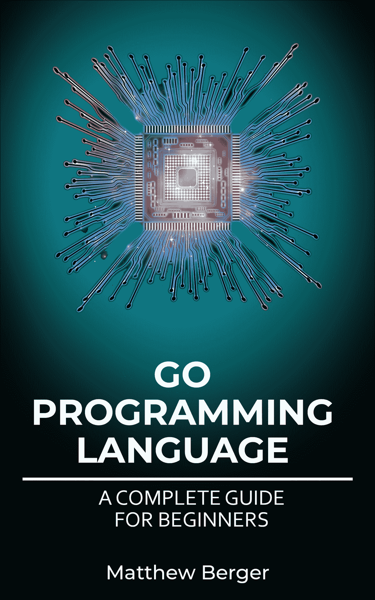

# Go 编程语言：初学者指南





# 第 1 章 Go 编程语言

Go 是一种过程化编程语言。它由 `Robert Griesemer`、`Rob Pike` 和 `Ken Thompson` 在 `Google` 于 2007 年创建；但它在 2009 年作为一种开源编程语言发布。项目通过利用 `packages`（包）进行收集，以有效地管理环境。该语言还支持与动态语言相同的条件接收模式。

例如，类型推断（`y := 0` 是对类型 `float` 变量 `y` 的合法声明）。有不同的在线 IDE，例如 `The Go Playground`、`repl.it` 等，可以使用它们在不安装 Go 的情况下运行 Go 程序。

要在个人电脑或笔记本电脑上安装 Go，我们需要以下两个程序：`Text editor`（编辑器）和 `Compiler`（编译器）。

## 编辑器

`Text editor` 管理为您提供了一个编写源代码的舞台。以下是文本处理器：
*   `Windows scratchpad`
*   `OS Edit direction`
*   `Brief`
*   `Epsilon`
*   `vm` 或 `vi`
*   `Emacs`

该语言的制定者（全部来自 `Google`）有一个明确的目标——设计一种绝非难于使用的编程语言，同时在处理组织复杂的框架时具有涵盖主要困难的选项。Go 项目的目标是消除 `Google` 编程进中的笨拙和缓慢，并通过这种方式让过程变得越来越高效和多功能。

> 这种语言是为编写、阅读、研究和维护庞大编程框架的人编写并设计的。 – `Rob Pike`，`Golang` 创建者 –

该公司在使用其他日益混乱和复杂的编程语言时经历了了许多不便。例如，如果问题涉及 `C++`，解决答案可能花费一整天的时间。这无论从时间还是收益来看都是不合理的。`Golang` 的创新完美地解决了这些问题。

`Golang` 开发者赞誉 `Go` 的易用性和进步性，它依赖于 `C`、`Pascal` 和 `Oberon` 编程语言的优秀特性。组织看重这种语言的性能和健康性。

使用 `Golang` 进展服务的项目只需要包含几行代码。然而，同时，在有大量代码的情况下，它们绝非难以探索。沿着这一点，它既快速又简单。`Golang` 提供了许多改进工具和特性。例如，用于 `DevOps` 的 `Golang` 是一种有效用于任何任务范围的语言。这些事实坚固地影响了 `Golang` 的进一步发展。它对双方都变得具有吸引力。


* YouTube
* Apple
* Dropbox
* Docker
* BBC
* 经济学人
* 纽约时报
* IBM
* Twitter
* Facebook

## 2. Golang 拥有卓越背景
Google 为其资金支持。它的创建者 Robert Griesemer、Rob Pike 和 Ken Thompson 都是天才。他们曾参与过 `C`、`B`、`UNIX`、`JVM` 等卓越项目。Golang 的设计旨在作为一种面向验证语言，以解决眼下的困难并应对未来的挑战。

## 3. Golang 天生是开源的
对于一种编程语言来说，开源并变得更好、更简洁且效率不断提高，具有极重要的意义。如果代码存在缺陷，`gophers`（`Golang` 设计者的称呼）会发现并消除这些问题。

## 4. Golang 运行快速
Go 具有简单的结构和语法。它没有类等遗留问题。该语言依赖于能力，因此学习起来清晰且快速。它是编译型的，因此可以提供更快的反馈、更短的上市时间，并节省了时间和金钱。它非常简单，因此变得越来越可行，开发也更快、更廉价。

## 5. Golang 支持并发
并发性在我们的时代至关重要。它允许不同的程序同时充分地运行。`Golang` 拥有强大的并发能力，类似于 `C`、`C++`、`Java`，但得益于 `go-routines`、`channels` 和垃圾回收，`Go` 中的并发实现要简单得多。

## 6. Golang 跨平台的
它被用于各种平台，包括 `Windows`、`Linux`、`UNIX` 和 `BSD` 变体以及手机（从 2015 年开始）。此外，它在许多操作系统上运行良好。

## 7. Golang 拥有垃圾回收器
一种编程内存管理，它影响性能并使并发更加高效。

## 8. Golang 能防范 Bug
由于它是一种编译语言，具有极其严格的规范，并且是静态组合的，设计者必须日益精确和关注，因此代码更整洁、更安全。

### 硬币的另一面
`Golang` 也有一些缺点，例如：
* 与渐进类型语言相比，灵活性较低；
* 缺乏第三方模块；
* 它与基于 `C` 的语言有很大不同；
* 没有泛型（泛型允许编写可重用的代码——这有时可以节省时间和精力）。

无论如何，`Golang` 是中庸之道！

* `#Go` 对于 PC 来说快速且高效，就像 `C` 和 `C++` 一样。
* `Golang` 对开发者来说也快速又有趣，因此具有类似精简 `Ruby` 和 `Python` 的外观。

考虑到所有因素，`Golang` 是最知名语言特性的完美结合。

# 第 2 章教程

## Golang 中的 Hello World
`Hello, World!` 是任何编程语言中最基础的程序。我们应该按照以下步骤用 `Go` 语言编写主程序：

* 首先，打开 `Go` 编译器。在 `Go` 语言中，程序以 `.go` 扩展保存，它是 UTF-8 内容记录。
* 现在，首先在你的程序中包含基础包：

```go
package main
```
每个程序都必须从包声明开始。在 `Go` 语言中，包用于组织和重用代码。在 `Go` 中，有两种可访问的程序：一种是可执行程序，另一种是库。可执行项目是可以可以直接从终端运行的项目，而库是我们可以在自己的程序中重用的项目集合。在这里，打包原则告诉编译器该包必须汇编成可执行程序，而不是通用库。它是程序的起始阶段，并包含 `main` 函数。

* 在程序中为 `main` 包添加 `fmt` 包：

```go
import (
    "fmt"
)
```
在这里，`import` 关键字用于在程序中导入包，`fmt` 包用于执行带有功能的格式化输入输出。现在在 `main` 函数中编写代码，用 `Go` 语言打印 hello world：

```go
func main() {
    fmt.Println("Hello World!")
}
```

在上面的代码行中我们有：
* `func`：用于在 `Go` 语言中创建函数。
* `main`：它是 `Go` 语言的主函数，不包含参数，不返回任何内容，并在你执行程序时调用。
* `Println()`：该方法存在于 `fmt` 包中，用于显示 `"Hello World!"` 字符串。在这里，`Println` 意为 Print line（行打印）。


示例：// 第一个 Go 程序

```go
package main

import "fmt"

// Main function 
func main() {
    fmt.Println("!... Hello World ...!")
}
```
输出：`!... Hello World ...! ` 

## 命令行参数

大多数项目都会处理某些输入以产生某些输出；这就是计算的含义。但是，程序是如何获取用于工作的输入信息的呢？有些项目会创建自己的信息，但更常见的是输入源自外部源：记录、系统关联、另一个程序的输出、控制台上的客户端、命令行参数或类似的内容。

接下来的内容将介绍这些其他选项中的部分常用模型，首先从命令行参数开始。

`os` 包提供了各种函数和不同的属性，用于以一种平台无关的方式管理工作框架。程序可以通过一个名为 `Args` 的变量来访问命令行参数，该变量是 `os` 包的一部分；因此，在 `os` 包之外的任何地方它的名字都是 `os.Args`。变量 `os.Args` 是字符串切片（slice of strings）。切片（cut）是 Go 中的基本概念，我们很快就会详细讨论它们。在另行通知之前，可以将切片视为数组元素的动态尺寸序列 `s`，其中单个组件可以通过 `s[i]` 获取，连续的子序列可以通过 `s[m:n]` 获取。元素的数量由 `len(s)` 给出。

与大多数其他编程语言一样，Go 中的所有排序都利用半开区间（half-open intervals），它包含主文件但排除最后一个，因为这简化了逻辑。例如，切片 `s[m:n]`，其中 `0 ≤ m ≤ n ≤ len(s)`，包含 `n-m` 个元素。`os.Args` 的主元素 `os.Args[0]` 仅仅是程序的名称；不同的元素是程序执行时引入的参数。结构为 `s[m: n]` 的切片表达式产生一个引用元素 `m` 到 `n-1` 元素的切片，因此我们下一个模型所需的组件是切片 `os.Args[1: len(os.Args)]` 中的元素。如果 `m` 或 `n` 被省略，它们将分别默认为 0 或 `len(s)`，因此我们可以将理想的切片简写为 `os.Args[1:]`。

这里是 UNIX `echo` 命令的执行示例，它在单行打印其命令行参数。它导入了两个包，以括号列表的形式给出，而不是单独的导入声明。这两种结构都是合法的；然而，通常使用列表结构。导入请求没有区别；`gofmt` 工具会将包名按顺序请求进行排序。（当一个模型有几种形式时，我们通常会对它们进行编号，以便你可以确定我们正在讨论哪一个。）

gopl.io/ch1/echo1 // Echo1 打印它的命令行参数。

```go
package main

import (
	"fmt"
	"os"
)

func main() {
	var s, sep string
	for i := 1; i < len(os.Args); i++ {
		s += sep + os.Args[i]
		sep = " "
	}
	fmt.Println(s)
}
```

注释以 `//` 开始。从 `//` 直到行尾的所有内容都是面向开发者的说明，会被编译器忽略。通过演示，我们在每个包的介绍之前立即用一个注释来描述该包；对于基础包，这行注释至少是一个完整的句子，描述了程序的整体情况。

`var` 声明了两个类型为 `string` 的因子 `s` 和 `sep`。变量可以作为声明的一部分引入。如果没有显式引入，它会被初始化为其类型的零值，数值类型为 0，字符串类型为空字符串 `""`。在这个模型中，声明确实引入了 `s` 和 `sep` 来拼接字符串。

对于数字，Go 提供了典型的算术和逻辑运算符。当应用于字符串时，`+` 运算符连接这些属性，因此表达式 `sep + os.Args[i]` 代表字符串 `sep` 和 `os.Args[i]` 的连接。我们在程序中使用的语句 `s += sep + os.Args[i]` 是一个赋值语句，它将 `s` 的旧值与 `sep` 以及 `os.Args[i]` 连接起来并将结果分配回 `s`；它等同于 `s = s + sep + os.Args[i]`。`+=` 是赋值运算符。每个算术和逻辑运算符（如 `+` 或 `*`）都有对应的复合赋值运算符。

`echo` 程序可以循环逐个打印它的输出，但这个变体通过尽可能地反复附加新内容来构建一个字符串。字符串 `s` 在初始时是空白的，即值为 `""`，每次循环都会向它添加一些内容；第一次迭代后，会嵌入一个空格，这样当循环完成后，每个参数之间都有一个空格。这是一个二次过程，如果参数数量巨大，可能会开销；但对于 `echo` 来说，这并不常见。我们将在本节及后续章节展示 `echo` 的各种改进版本，它们将处理任何真实的低效率问题。

循环索引变量 `i` 在循环的起始部分声明。`:=` 是短变量声明的一部分，它声明至少一个因子并赋予其初始化值；在后续部分，递增语句 `i++` 给 `i` 加 1；它等同于 `i += 1`，类似于 `i = i + 1`。递减语句 `i--` 减 1。这些都是语句而不是表达式，正如许多语言中那样，所以 `j = i++` 是合法的，`-i` 也是。

`for` 循环是 Go 中唯一的循环语句。它有几种形式，这里演示了其中一种：`for 初始化; 条件; 后置 { 零或多个语句 }`。括号从不用于 `for` 的部分。初始化语句在循环开始前执行。如果可用，它必须是一个语句、短变量声明或赋值语句。条件是在每次循环时评估的布尔表达式；如果为真，执行循环体。后置语句在循环体执行后执行。

 查找重复行：重复、排序、检查等都具有类似的结构：对信息的循环、每个组件的计算以及实时的输出。我们将通过 `uniq` 方向来展示。

gopl.io/ch1/dup1 // Dup1 打印标准输入中出现一次以上的每行文本及其计数。

```go
package main

import (
	"bufio"
	"fmt"
	"os"
)

func main() {
	counts := make(map[string]int)
	input := bufio.NewScanner(os.Stdin)
	for input.Scan() {
		counts[input.Text()]++
	}
	for line, n := range counts {
		if n > 1 {
			fmt.Printf("%d\t%s\n", n, line)
		}
	}
}
```

与 `for` 类似，`if` 的条件周围从不使用括号，但体需要语句。如果条件为假，可以有一个可选的 `else` 部分执行。map 存储许多键/值对，并提供了存储、检索或测试集合中项的一任务。键可以是任何可以比较的类型，字符串是最常见的例子；值可以是任何类型。在这个模型中，键是字符串，值是 int。内置函数创建另一个空 map；它也有不同的用途。Map 将在 4.3 节中进行检查。每当 dup 读取一行信息，将其作为键存入 map，并增加相应的计数。语句 `counts[input.Text()]++` 相当于这两条语句：

```go
line := input.Text()
counts[line] = counts[line] + 1
```

如果 map 不包含该键并不是问题。第一次运行时，右侧的表达式 `counts[line]` 评估为其类型的零值，int 为 0。为了打印结果，我们使用基于 range 的 `for` 循环，这次是针对检查。与之前一样，每个循环产生两个结果：一个键和一个该键的估计值。map 的迭代请求没有指定，但实际上它是随机的，从一次运行切换到下一次。这种设计是有意的，因为它防止了程序依赖于无法保证的特定顺序。引入 `bufio` 包，它有助于使输入输出高效且有利。它最有用的特性之一是一个被称为 `Scanner` 的类型，它可以理解信息并将其拆分为行或单词；通常这是处理行输入的最简单方法。程序使用短变量声明创建一个引用 `bufio.Scanner` 的变量：`input := bufio.NewScanner(os.Stdin)`。scanner 从标准输入读取。每次调用 `input.Scan()` 都会读取行并移除末尾的换行符；可以通过调用 `input.Text()` 获取结果。`Scan` 工作在有行时返回真，在没有更多信息时返回假。

## 动画 GIF

下面的程序展示了 Go 标准图像包的基本用法，我们将使用它们来创建一个位图组，然后将序列编码为 GIF 动画。这些图像被称为利萨如图形（Lissajous figures），是 20 世纪 60 年代科幻电影中特殊的视觉元素。它们是二维谐振产生的参数曲线；例如，示波器 x 和 y 上的两个正弦波。这段代码中包含一些新特性，包括 `const` 声明、`struct` 类型和复合字面量。与我们的大多数模型不同，这一个还包含了浮点计算……我们在这里只需快速讨论这些点，将大部分细节留到后面的章节，因为目前的主要目标是让你了解 Go 长像什么样以及使用该语言及其库可以高效实现的东西。

gopl.io/ch1/lissajous // Lissajous 生成随机利萨如图形的 GIF 动画。

```go
package main

import (
	"image"
	"image/color"
	"image/gif"
	"io"
	"math"
	"math/rand"
	"os"
)

var pal = []color.Color{color.White, color.Black}

const (
	whiteIndex = 0 // 第一种颜色
	blackIndex  = 1 // 下一种颜色
)

func main() {
	lissajous(os.Stdout)
}

func lissajous(out io.Writer) {
	const (
		cycles = 5
	)
	counts = make(map[string]int)
	// ... (代码省略)
}
```


* 使用 `net/Http` 包来获取网页
* 使用 `golang.org/x/net/html` 解析 HTML 文档
* 使用 Go 的并发特性和多通道通信进行开发

为了让这个教学练习保持简短，我不会取悦那些尚未完成 `Go Tour` 的朋友。本次访问将教你跟踪这些任务所需的所有知识。

### 构建一个网络爬虫

正如我在演示中提到的，我们将使用 Go 构建一个简单的网络爬虫（scraper）。请注意，我没有说它是网络爬虫（crawler），因为我们的爬虫可能只深入一层（可能我会在另一篇文章中介绍深度爬取）。我们将组装一个基础的命令行设备，接收一组种子 URL，对它们进行抓取，并打印出在这些页面上发现的连接。

这是一个真实世界中的案例：

```
go run main.go https://schier.co https://insomnia.rest
Found 7 unique urls : 
- https://insomnia.rest 
- https://twitter.com/GregorySchier  own- https://support.insomnia.rest 
- https://chat.insomnia.rest 
- https://github.com/Kong/insomnia 
- https://twitter.com/GetInsomnia 
- https://konghq.com
```

既然我们已经清楚正在构建什么，我们应该找到一个可行的节奏部分——组装它。为了让这个教学练习更容易处理，我将把它分成若干个限定片段。在检查完每个部分之后，我将把它们整合在一起形成最终项目。我们将涉及的主要部分是发送 HTTP 请求来获取某些 HTML。

#### 通过 URL 获取网页

Go 内置了一个非常出色的 HTTP 库。`http` 包提供了 `http.Get(URL)` 方法，只需要几行代码即可完成。注意，为了保持模型简洁，省略了错误处理等内容。

```
resp, _ := http.Get(url)
bytes, _ := ioutil.ReadAll(resp.Body)
fmt.Println("HTML:\n\n", string(bytes))
resp.Body.Close()
```

发送 HTTP 请求是建立网络请求，既然我们已经知道了如何操作，我们就可以继续处理返回的 HTML 内容了。

#### Web 服务器

Go 语言因在 Web 服务器领域的应用而闻名。在这篇文章中，你将学会如何毫不费力地用 Go 构建你的 Web 服务器。你不需要除了当前内置包之外的任何包！首先，进入你的编辑器。然后，创建一个名为 `webserver.go` 的文件并输入以下代码：

```go
package main

import (
	"net/http"
	"io"
)

func main() {
	http.HandleFunc("/", servePage)
	http.ListenAndServe(":8080", nil)
}

func servePage(writer http.ResponseWriter, reqest *http.Request) {
	io.WriteString(writer, "Hello world!")
}
```

我们应该拆分上面的代码块。我们导入 `net/HTTP` 包：该包包含了 Web 服务器本身。此时，我们额外导入了 `io` 包；我们稍后将利用它向客户提供内容。

在原理工作上，我们完成了两件事。首先，我们告诉服务器让名为 `servePage` 的函数处理所有指向 `/` 的传入流量——在这种情况下，这意味着它处理对任何路径的请求。

（注：原文在后半部分存在大量重复，此处已根据优化段落格式的原则清理了冗余逻辑，并保留了核心内容。）


# 第 3 章：程序结构声明

C 家族之外的语言通常在声明中使用不同类型的语法。虽然有一点不同，但按照规则，名称通常开头，后面通常跟着一个冒号。因此，我们上面的模型会变得类似于（用一种虽然通俗但具有说明性的语言）`x: int p: pointer to int an: array[3] of int`。这些声明是清晰的，尽管有些冗长——你从左到右阅读它们。

 Go 遵循了这一大方向，但考虑到对简洁性的合理考量，它去掉了冒号并剔除了部分关键字：`x int p *int a [3]int`。`[3]int` 的出现与如何使用每一个数组的表达式之间没有直接的对应关系。（我们将在后续部分回到指针。）你以牺牲独立的语法为代价换取了清晰度。

现在考虑函数。如果我们把 Go 中基本函数的定义翻译过来会如何，尽管 Go 中的真实主函数不接受任何参数：`func main (argc int, argv []string) int`。从外部看，C 并没有非常独特之处，除了从指针簇变为字符串之外，但它从左到右读得很好：主要工作接收一个 int 和一段字符串，并返回一个 int。去掉参数名，它同样清晰——它们在任何情况下都是先出现的，所以没有混淆。`func main(int, []string) int`。

这种从左到右风格的价值在于，随着类型变得越来越复杂，它的运行效果很好。这里是一个函数变量的声明（类似于 C 中的函数指针）：`f func(func(int,int) int, int) int`。或者相反，如果 `f` 返回一个函数：`f func(func(int,int) int, int) func(int, int) in t`。尽管尽管如此，它仍然从左到右读取，并且始终能够清楚地看出哪个名称正在被声明——名称位于开头。类型和表达式语法之间的这种区分使得在 Go 中组合和调用闭包变得简单：`sum := func(a, b int) int { return a+b } (3, 4)`。

## Go - 赋值运算符

赋值运算符（`=`）用于执行赋值（例如，为已声明的变量分配或重新分配属性）。短声明运算符（`:=`）再次被用于执行短因子声明），它是普通变量声明的简写，但没有预定义的类型。

以下是四种命名静态类型为 `int` 且值为 10 的变量的不同方法，它们被独立考虑和识别，并且是等价的：

```go
var a int = 10
var b = 10
var c int
c = 10
d := 10
```

与标准变量声明相比，短因子声明可以在多值赋值中重新声明因子，只要其中一个变量是新的，并且声明的变量被分配了一个相同类型的值。在处理错误时，你会经常看到这种属性被使用，因为它避免了在相似的代码块中声明不同调用因子的需求，例如，相似的 `err1`、`err2` 等。

例如，考虑下面的 `CopyFile` 函数，它打开两个文档并将一个文件的内容复制到另一个文件中：

```go
func CopyFile(dstName, srcName string) (written int64, err error) {
    // 'err' 被声明为 src
    src, err := os.Open(srcName)
    if err != nil {
        return
    }
    defer src.Close()
    // 'err' 被重新声明 // 返回的错误
    dst, err := os.Create(dstName)
    if err != nil {
        return
    }
    defer dst.Close()
    return io.Copy(dst, src)
}
```

总而言之，应该优先使用短因子声明，因为它们比静态变量声明/赋值更紧凑。请注意，短因子声明可以在函数/方法内部持续（在包级别声明全局变量只需使用持续的变量声明：`var structure = value`）。

## Go 布局

模式（Pattern）是为了希望更好地理解 Go 语言的开发者设计的。这里的练习题强调良好的程序设计和可扩展性。

### 类型声明

我们可以在 Go 中定义自己的类型。我们应该在你的包中创建一个名为 `hello` 的新文件并包含以下代码：

```go
package main
import "fmt"
func main() {
    apl := []string{"Facebook", "Instagram"}
    for i, apl := range apl {
        fmt.Println(i, apl)
    }
}
```

上述代码的输出如下：
0 Facebook
1 Instagram
2 WhatsApp

通过这种方式，我们定义了一个名为 applications 的类型，然后进行循环。现在，我们可以定义 application 的类型。好的，在类似的包中创建另一个名为 `app.go` 的记录并包含以下代码。

```go
package main
import "fmt"
type appli []string
func print(a appli) {
    for i, appli := range a {
        fmt.Println(i, appli)
    }
}
```

在上面的代码中，受益的函数是 `print()`，我们可以在 `hello.go`记录中合法使用它，它将打印所有的应用。在这里，我们定义了循环等价项，我们之前在 `hello.go`记录中定义了它。类似，现在我们不需要在 `go` 中编写这段代码。

```go
package main
func main() {
    applis := []string{"Facebook", "Instagram", "WhatsApp"}
    applis()
}
```

在这里，在 `func main()` 内部，看主行，我们定义了类型 application。我们不需要在本文中导入 `app.go`记录；它将直接获取。我们必须同时运行这两个记录，我们有一个好主意要去。

### 包和文件

在 Go 中，源文件被分类为包（packages）的框架，这使得 Go 应用程序之间可以代码复用。Go 包的命名显示是使用我们放置 Go 源文件的框架索引名称。在同一个文件夹内，所有具有该索引位置源文件的包名将是相同的。我们在 `$GOPATH` 注册表中构建我们的 Go 程序，在那里我们将代码记录分类到注册表中作为包。在 Go 包中，如果标识符名称的首字母以大写字母开头，则所有标识符将发送到不同的包。如果以小写字母开头标识符名称，则函数和类型将不会发送到不同的包。Go 的标准库包含了一部分包裹。


# 变量

- 局部变量（在块或函数内部声明）
- 全局变量（在块或函数外部声明）

## 局部变量

- 在函数或大括号内部声明的变量被称为**局部因子**。这些因子在函数或大括号外部是不可用的。
- 这些因子也可以在函数内部的 `for`、`while` 解释等结构中声明。
- 然而，这些因子可以被函数内部定义的代码块访问。
- 这些因子也被称为**作用域因子**。
- 如果这些因子以相似的名称在相似的范围内声明两次，将引起编译错误。
- 这些因子在函数执行完成后就不再存在。
- 在圆括号外部声明的变量在定义的圆括号内部也是可用的。这意味着全局变量对策略和所有的圆括号可用。邻近因子在该作用域内的圆括号和函数可用。
- 在循环体内声明的变量对循环体外部是不可见的。

### 示例 // 这里是局部变量
```go
package main
import "fmt"

// 主函数
func main() {
    var var1, var2 int = 89, 45 // 变量
    fmt.Printf("Var1 is : %d\n", var1)
    fmt.Printf("Value of var2 is : %d\n", var2)
}
```
**输出:**
Var1 is : 89
Var2 is : 45

## 全局变量

- 在函数或大括号外部特征化的因子被称为**全局因子**。
- 它们在程序的生命周期内都是可访问的。
- 它们在程序的最高点声明，位于所有函数或大括号之外。
- 可以从程序的任何部分获取。

### 示例：filter\_none brightness\_4
```go
// 全局变量
package main
import "fmt"

var v1 int = 100

func main() {
    var v2 int = 200
    fmt.Printf("The value of Global v1 is : %d\n", v1) // 显示局部变量
    fmt.Printf("The value of Local v2 is : %d\n", v2)
    display()
}

// 一个函数
func display() {
    fmt.Printf("The value of Global v1 is : %d\n", v1)
}
// 局部作用域结束
```
**输出:**
The value of Global v1 is: 100
The value of Local v2 is: 200
The value of Global v1 is: 100

# 第 4 章 基础类型

## 整数

整数——就像它们的数值伙伴一样——是没有小数部分的数字（`..., - 3, -2, -1, 0, 1 ...`）。与我们用来描述数字的十进制框架不同，电脑利用的是二进制系统。我们的框架由 10 个独特的数字组成。当我们用尽了可用的数字时，我们通过使用 `2` 个数字（此时是 3, 4, 5 等）将它们并放在一起来表述更大的数字。例如，9 之后的数字是 10，99 之后的数字是 100，依此类推。计算机也是如此，但它们的位数比 `10` 多出 `2` 位。因此计数方式类似于：`0, 1, 10, 11, 100, 101, 110, 111` 等。我们使用的数字系统与电脑使用的系统之间的另一个区别是，所有整数类型都有一个明确的大小。它们有存储特定数量数字的空间。因此，一个 4 位整数可能像：`0000, 0001, 0010, 0011` 和 `0100`。最后，我们的空间不足了，大多数电脑会回到开头。（这可能会导致一些非常奇怪的行为）。Go 的整数类型有 `uint8`、`uint16`、`uint32`、`uint64`、`int8`、`int16`、`int32` 和 `int64`。`8`、`16`、`32` 和 `64` 告诉我们每个类型使用的位数。`Uint` 表示“无符号整数”，而 `int` 表示“符号整数”。无符号整数包含正数（或零）。还有两个别名类型：`byte` 等同于 `uint8`，`rune` 等同于 `int32`。字节是电脑上非常常用的估计单位（`1 byte = 8 bits`，`1024 bytes = 1 kilobyte`，`1024 kilobytes = 1 megabyte`，……），因此，Go 的字节信息类型通常用于不同的种类。还有 3 种机器数字类型：`uint`、`int` 和 `uintptr`。它们是机器相关的，因为它们的大小取决于你正在使用的设计类型。通常，如果你在处理整数，你应该使用 `int` 类型。未初始化的整数类型其估计值为 `0`。整数可以使用常量字面量引入，这些字面量可以表示为十进制、八进制和十六进制，如下：

```go
var color uint32 = 0xFEFEFE // 十六进制 (0x 前缀)
var mod = 0466              // 八进制 (0 前缀)
count := 1245               // 十进制
```
当使用无类型变量（`mod` 和 `mean` 所示）引入整数字面量时，类型框架会为这些因子分配类型 `int`。

## 浮点数

浮点数是包含小数部分的数字（实数）（`1.234, 123.4, 0.00001234, 123400000`）。它们在电脑上的真实表示非常复杂，对于理解如何使用它们并不那么重要。所以，目前我们需要记住以下几点：

- 浮点数是不精确的。它们在电脑上的真实表示非常复杂，对于理解如何使用它们并不那么重要。所以，目前我们需要记住以下几点：

 浮点数是不精确的。它们在电脑上的真实表示非常复杂，对于理解如何使用它们并不那么重要。所以，目前我们需要记住以下几点：

- 浮点数是不精确的。它们在电脑上的真实表示非常复杂，对于理解如何使用它们并不那么重要。所以，目前我们需要记住以下几点：

- 浮点数是不精确的。它们在电脑上的真实表示非常复杂，对于理解如何使用它们并不那么重要。所以，目前我们需要记住以下几点：

- 浮点数是不精确的。它们在电脑上的真实表示非常复杂，对于理解如何使用它们并不那么重要。所以，目前我们需要记住以下几点：

- 浮点数是不精确的。它们在电脑上的真实表示非常复杂，对于理解如何使用它们并不那么重要。所以，目前我们需要记住以下几点：

- 浮点数是不精确的。它们在电脑上的真实表示非常复杂，对于理解如何使用它们并不那么重要。所以，目前我们需要记住以下几点：

- 浮点数是不精确的。它们在电脑上的真实表示非常复杂，对于理解如何使用它们并不那么重要。所以，目前我们需要记住以下几点：

- 浮点数是不精确的。它们在电脑上的真实表示非常复杂，对于理解如何使用它们并不那么重要。所以，目前我们需要记住以下几点：

- 浮点数是不精确的。它们在电脑上的真实表示非常复杂，对于理解如何使用它们并不那么重要。所以，目前我们需要记住以下几点：

- 浮点数是不精确的。它们在电脑上的真实表示非常复杂，对于理解如何使用它们并不那么重要。所以，目前我们需要记住以下几点：

- 浮点数是不精确的。它们在电脑上的真实表示非常复杂，对于理解如何使用它们并不那么重要。所以，目前我们需要记住以下几点：

- 浮点数是不精确的。它们在电脑上的真实表示非常复杂，对于理解如何使用它们并不那么重要。所以，目前我们需要记住以下几点：

- 浮点数是不精确的。它们在电脑上的真实表示非常复杂，对于理解如何使用它们并不那么重要。所以，目前我们需要记住以下几点：

- 浮点数是不精确的。它们在电脑上的真实表示非常复杂，对于理解如何使用它们并不那么重要。所以，目前我们需要记住以下几点：

- 浮点数是不精确的。它们在电脑上的真实表示非常复杂，对于理解如何使用它们并不那么重要。所以，目前我们需要记住以下几点：

- 浮点数是不精确的。它们在电脑上的真实表示非常复杂，对于理解如何使用它们并不那么重要。所以，目前我们需要记住以下几点：

- 浮点数是不精确的。它们在电脑上的真实表示非常复杂，对于理解如何使用它们并不那么重要。所以，目前我们需要记住以下几点：

- 浮点数是不精确的。它们在电脑上的真实表示非常复杂，对于理解如何使用它们并不那么重要。所以，目前我们需要记住以下几点：

- 浮点数是不精确的。它们在电脑上的真实表示非常复杂，对于理解如何使用它们并不那么重要。所以，目前我们需要记住以下几点：

- 浮点数是不精确的。它们在电脑上的真实表示非常复杂，对于理解如何使用它们并不那么重要。所以，目前我们需要记住以下几点：

- 浮点数是不精确的。它们在电脑上的真实表示非常复杂，对于理解如何使用它们并不那么重要。所以，目前我们需要记住以下几点：

- 浮点数是不精确的。它们在电脑上的真实表示非常复杂，对于理解如何使用它们并不那么重要。所以，目前我们需要记住以下几点：

- 浮点数是不精确的。它们在电脑上的真实表示非常复杂，对于理解如何使用它们并不那么重要。所以，目前我们需要记住以下几点：

- 浮点数是不精确的。它们在电脑上的真实表示非常复杂，对于理解如何使用它们并不那么重要。

- `1 + 1 = 1.0 + 1.0`

- 浮点数是不精确的。它们在电脑上的真实表示非常复杂，对于理解如何使用它们并不那么重要。所以，目前我们需要记住以下几点：

- 浮点数是不精确的。它们在电脑上的真实表示非常复杂，对于理解如何使用它们并不那么重要。所以，目前我们需要记住以下几点：

- 浮点数是不精确的。它们在电脑上的真实表示非常复杂，对于理解如何使用它们并不那么重要。

- `float32` 和 `float64` 

- `NaN` 

- `+∞` 和 `-∞`

### 示例 让我们使用浮点数写一个示例。首先，创建一个 `chapter3` 文件夹，并创建一个 `main.go` 文件，包含以下内容：

```go
package main
import "fmt"

func main() {
    fmt.Println("1 + 1 =", 1 + 1)
}
```
如果你运行该程序，你应该看到：`$ go run main.go`
注意这个程序与我们在第 2 部分写的程序基本相同。它包含类似的包行、类似的导入行、类似的函数断言以及相同的 `Println` 方法。这次不是打印字符串 `Hello World`，而是打印字符串 `1 + 1 =`，后面跟着表达式 `1 + 1` 的结果。这个表达式由三个部分组成：数字 `1`（它是 `int`）、`+` 运算符（表示加法）以及另一个数字 `1`。我们应该使用浮点数尝试非常相似的操作：

```go
fmt.Println("1 + 1 =", 1.0 + 1.0)
```
注意我们使用 `.0` 来告诉 Go 这是一个浮点数而不是整数。运行此程序将给你与过去相似的结果。除了加法，Go 还有几个其他运算符：`+` 加法、`-` 减法、`*` 乘法、`/` 除法、`%` 取模

## 复数类型

Golang 为数值字符串和不同的类型提供了内置类型。数值字符串有 `int`、`uint`、`byte` 和复数。复数包含两个部分——实部和虚部，例如，一个复数是 `12.8i`。在 Golang 中，复数有两种表述方式：

- `complex64` 类型——用于表示 `float32` 实部和虚部。
- `complex128` 类型——用于表示 `float64` 实部和虚部。


# 如何在 Golang 中创建复数？

在 Golang 中有两种不同的方法可以创建复数。

## 利用内置能力 - Complex

Golang 提供了内置的复数能力来处理实部和虚部数据。以下是复杂的函数语法：

```go
func complex(real, imaginary FloatType) ComplexType
```

该函数接收实部和虚部浮点类型——`float32` 或 `float64`。`complex` 返回 `complex64` 和 `complex128` 类型。这两个参数类型必须保持一致。

- 假设提供的实部和虚部数字为 `float32`，它返回 `complex64` 类型。
- 如果提供的实部和虚部类型为 `float64`，该能力将始终返回 `complex128` 类型。

## 使用简写语法

这是另一种通过简写任务语言结构创建复数的方法：

```go
complexData := 1 + 4i
```

## Golang 复数类型模型

在下面的示例中，你将学习到以下内容：

- 利用内置的复数能力创建复数
- 使用简写语法声明并分配复数变量
- 利用 `Println` 工作打印复数
- 利用 `imag` 函数打印虚部数据
- 利用 `real` 函数打印实部数据


```go
package main
import (
	"fmt"
)
func main() {
	c1 := complex(10, 4)
	c2 := 1 + 4i
	fmt.Println("com No 1", c1)
	fmt.Println("com No 2:", c2)
	fmt.Println("Re No 1:", real(c1))
	fmt.Println("Im No1:", imag(c1))
	fmt.Println("Re No 1:", real(c2))
	fmt.Println("Im No 2:", imag(c2))
}
```
当上述程序编译时，输出为：
```
com No 1 (10+4i)
com No 2: (1+4i)
Re No 1: 10
Im No 1: 4
Re No 1: 1
0
Im No 2: 4
```

# 布尔值
`Boolean`（以乔治·布尔命名）是一种唯一的 `1` 位数字类型，用于表示 `genuine`（真）和 `bogus`（假），或 `on`（开）和 `off`（关）。布尔类型使用三种逻辑运算符：`&&`、`||` 或 `!`。

以下是一个演示如何使用它们的示例程序：
```go
func main() {
	fmt.Println(true && true)
	fmt.Println(true && false)
	fmt.Println(true || true)
	fmt.Println(true || false)
	fmt.Println(!true)
}
```
运行此程序将得到：
```
$ go run main.go
true false true true false
```
我们通常使用真值表来定义这些运算符的工作方式：

| 表达式 | 值 |
| :--- | :--- |
| true && true | true |
| true && false | false |
| false && true | false |
| false && false | false |

| 表达式 | 值 |
| :--- | :--- |
| true || true | true |
| true || false | true |
| false && true | true |
| false && false | false |

| 表达式 | 值 |
| :--- | :--- |
| !true | false |
| !false | true |

这些是 Go 中包含的最简单类型，并构成了构建后续所有其他类型的基础。

# 字符串
字符串是至少一个字符（字母、数字和图像）的排列，可以是常量也可以是变量。Go 中的字符串存在反引号 `` ` `` 或双引号 `"` 中，根据你使用的引号具有不同的属性。如果你使用反引号，你正在创建一个原始字符串。如果你使用双引号，你正在创建一个转义字符串。

## 原始字符串字量
原始字符串字量是反引号之间的字符排列，通常被称为字符串。在反引号语句内部，任何字符的显示都与它们在反引号之间的显示相同，反引号字符除外。
```go
a := 'State "hi" to Go!'
fmt.Println(a)
// Output: Say "hello" to Go!
```
通常，反斜杠符号用于表示字符串中的特殊字符。例如，在转义字符串中，`\n` 表示字符串中的换行。在任何情况下，反斜杠在原始字符串字量中都没有特殊含义：
```go
a := `Say "hi" to Go!\n`
fmt.Println(a)
```
因为反斜杠在字符串字量中没有特殊含义，它将打印 `\n` 的值而不是创建一个新行：
`Output: Say "hello" to Go!\n`

原始字符串字量还可以用于创建多行字符串：
```go
a := `String is ready
Too many lines
Single Line
Other Lines`
fmt.Println(a)
// Output:
String is ready
Too many lines
Single Line
Other Lines
```
在第一个代码块中，换行被包含在输出中。

## 转义字符串字量
转义字符串字量是双引号之间的分组。在语句内部，除了换行和双引号外，任何字符都可以显示。为了在转义字符串中显示双引号，你可以利用反斜杠：
```go
a := "Say \"hey\" to Go!"
fmt.Println(a)
// Output: Say "hey" to Go!
```
经常使用转义字符串字量，因为它们考虑了内部的字符。关于处理字符串，请看 `An Introduction with Strings`。

## 带 UTF-8 字符的字符串
UTF-8 是一种编码方案，用于将变长字符编码为一到四个字节。Go 支持 UTF-8 字符，如果没有特殊字符，例如，罗马字母 `A` 可以由 ASCII 值 `65` 表示。在任何情况下，如果有特殊字符，则需要 UTF-8。
```go
a := "Hi, 世界."
```
你可以使用 `for`-loop 配合 `range` 来记录 Go 中的任何字符串，即使是 UTF-8 字符串。稍后将介绍循环和 `range`：
```go
package main
import "fmt"
func main() {
	abcd := "Hello, 世界"
	for inte, comp := range abcd {
		fmt.Printf("%d: %s\n", inte, string(comp))
	}
	fmt.Println("length of 'Hello, 世界 ': ", len(abcd))
}
```
在上面的代码中，我们声明了变量并输出了 `Hello, 世界` 的值。内容包含了 UTF-8 字符。在 Go 中，`range` 关键字返回每个字符。之前我们提到 `rune` 是 `int32` 的别名，并且可以由一到四个字节组成。`世` 字符占用三个字节，并且在遍历 UTF-8 字符串时移动。这就是为什么在打印时不成功的原因：
```
0: H
1: e
2: l
3: l
4: o
5: 6
6: 
7: 世
10: 界
length of 'Hello, 世界 ': 13
```
显然，长度比遍历字符串的次数长。你通常处理 UTF-8 字符串；但当你处理时，就会理解为什么它们是 `rune` 而不是单一的 `int32` 了。

# 常量
正如名称 `CONSTANTS` 所示，它在编程语言中意味着固定。常量。可以是任何基本类型的常量，如整数常量、浮点常量、字符常量或字符串字量。如何声明？常量的声明像变量一样，但使用 `const` 关键字作为前缀来声明特定类型。它不支持 `:=` 语法。示例：
```go
package main
import "fmt"
const PI = 3.14
func main() {
	const GFG = "Spanish"
	fmt.Println("Hello", GFG)
	fmt.Println("A Good Day", PI, "Day")
	const Correct= true
	fmt.Println("Lines?", Correct)
}
// OUTPUT: Hello Spanish A Good Day 3.14 Day Lines? true


## 无类型和有类型数值常量
有类型常量像常量变量一样只能与相同类型进行比较，而无类型常量像字量一样可以与不同类型进行工作。在 Go 中，常量可以声明或不声明类型。以下是示例，显示了既有名的又无名的数值常量。
```
const untypedInteger = 123
const untypedFloating = 123.12
const typedInteger int = 123
const typedFloatingPoint float64 = 123.12
```

# 第五章 复合类型数值常量
数值常量是高精度值。Go 是一种静态组合语言，不允许混合数值类型的操作。你不能将 `float64` 加到 `int`，甚至不能将 `int32` 加到 `int`。尽管编写 `1e6*time.Second` 或 `math.Exp(1)` 甚至 `1<<('\t'+2.0)` 是合法的。


## 整数常量

* 前缀决定了基数或进制：`0x` 或 `0X` 表示十六进制，`0` 表示八进制，留空表示十进制。
* 整数整数常量也可以有一个后缀，可以是 `U`（大写）和 `L`（大写）的组合，分别表示无符号和长型。
* 它可以可以是十进制、八进制或十六进制形式。
* `int` 最多可以存储一个 64 位的整数，有时也会更少。

以下是整数常量的几个实例：

* `85` /* 十进制 */`
* `0213` /* 八进制 */`
* `0x4b` /* 十六进制 */`
* `30` /* int */`
* `30u` /* 无符号 int */`
* `30l` /* 长型 */`
* `30ul` /* 无符号长型 */`
* `212` /* 合法 */`
* `215u` /* 合法 */`
* `0xFeeL` /* 合法 */`
* `078` /* 不法：8 不是八进制数字 */`
* `032UU` /* 不法：不能重复添加 */`

## 复数常量

复数常量的作用非常像浮点常量。它是一个整数常量（或参数）的排列组合或真实的对，常量之间用逗号隔开，这对被包裹在括号中。第一个常量是实部，第二个是虚部。一个复数常量 `COMPLEX*8` 使用 8 字节的存储。示例：`(0.0, 0.0)` `(-123.456E+30, 987.654E-29 )`。

## 浮点类型常量

* 浮点型常量包含一个整数部分、小数点、小数部分和一个指数部分。
* 它可以以十进制结构或指数结构表示浮点型。
* 当使用十进制结构时，您应该包含小数点、类型或两者。
* 而当使用指数结构时，我们必须包含数字部分、小数部分或两者。

以下是浮点点类型常量的实例：

* `3.14159` /* 合法 */`
* `314159E-5L` /* 合法 */`
* `510E` /* 不法：指数不完整 */`
* `210f` /* 不法：没有小数点或指数 */`
* `.e55` /* 不法：缺少整数或小数 */`

# 数组

Golang 或 Go 语言中的数组与其他编程语言中的非常相似。在程序中，我们有时需要存储一组相同类型的信息，类似于学生成绩列表。这种组合通过一个 `Array` 存储在程序中。数组是一个固定长度的排列，用于在内存中存储同质的组件。因为它们的固定长度特性，不如 Go 语言中的 `Slice` 那么流行。在数组中，您允许在其中存储至少零个组件。数组的组件通过 `[]` 列表操作符根据其从 0 开始的位置进行排序，这意味着主组件的记录是 `array[0]`，最后一个组件的记录是 `array[len(array)-1]`。

## 创建和访问数组

在 Go 语言中，数组通过两种独特的方式创建：

### 1. 使用 `var` 关键字
在 Go 语言中，数组通过特定类型的 `var` 关键字、名称、大小和组件创建。
语法：`var array_name[length]Type` 或 `var array_name[length]Type{item1, item2, item3, ...itemN}`

关键点：

* 在 Go 语言中，数组是不持久的，目的是你可以利用它。
* `var array_name[length]Type`
* 你可以使用索引来设置数组的组件。
* 数组的类型是字符串。
* 在 Go 语言中，数组的长度是固定的。
* 您允许在数组中存储组件。

示例：
```go
// 字符串类型数组
var arr [3]string
// 使用索引
arr[0] = "Hello"
arr[1] = "World"
arr[2] = "Go"
fmt.Println(arr)
```
```

### 2. 使用简写语句
在 Go 语言中，数组也可以通过简写表示。它比上面的声明更灵活。
语法：`array_name := [length]Type{item1, item2, item3}`

示例：
```go
// 字符串类型数组
arr := [3]string{"Hello", "World", "Go"}
fmt.Println(arr)
```


`var my_slice_1 = []string{"Spanish", "for", " Spanish"}`

### Go 语言中的 Map

映射（Map）是一种强大、敏锐且适应性强的数据结构。Golang Maps 是一种无序的键值对集合。它被广泛使用是因为它提供了快速查询功能，并且可以通过键来检索、刷新或删除值。

- 它是对哈希表的引用。
- 由于它是引用类型，它的传输是非常高效的；例如，在 64 位机器上占用 8 字节，在 32 位机器上占用 4 字节。
- 在 map 中，键必须是唯一的，并且必须是可以使用 `==` 运算符进行相等性比较或支持 `!=` 运算符的排序类型。因此，绝大多数内置类型都可以作为键，如 `int`、`float64`、`rune`、`string`、接口、`结构`、`指针`等。像 `slice` 这样的不可比较的类型，以及 `struct` 或无法进行相等比较的自定义类型，则不能作为 map 的键。
- 在 map 中，值（value）不像键那样有严格限制，它可以是任何类型，如 `int`、`float64`、`rune`、`string`、`pointer`、`引用类型`、`map 类型`等。
- 键的类型和值的类型必须匹配；在同一个 map 中不允许混合不同类型的键和值。但是，键的类型和值的类型是可以不同的。
- map 也称为哈希映射（hash map）、哈希表、无序映射、字典或关联数组。
- 在 map 中，如果你尝试向未初始化的 map 包含键，必须在引入 map 时同时包含值；否则，编译器会报错。


# 如何创建和初始化 Map（映射）？

在 Go 语言中，有两种独特的方式创建和引入 map：

## 1. 简单方法
在这种技术中，你可以不使用 `make()` 函数来创建和实例化 map：

### 创建 Map
你本质可以使用可以使用语法创建 map：
1. `//一个空 map`
2. `map[Key_Type]Value_Type{}`
3. `//带有键值值对的 map`
4. `map[Key_Type]Value_Type{key1: value1, ..., keyN: valueN}`

示例：`var mymap map[int]string`

在 map 中，map 的零值是 `nil`，且 `nil` map 不包含任何键。如果你尝试在 `nil` map 中包含键值对，编译器将抛出运行时错误。

### 使用 map 字面量引入 map
map 字面量是实例化一个包含信息的 map 最简单的方法，使用冒号分隔键值对，且最后一个末尾的冒号是关重要的，如果不使用它，编译器将报错。

示例：
```go
package filter_none brightness_4
package main

import "fmt"

func main() {
    // 创建并初始化空 map
    // 使用 var 关键字
    var m1 map[int]int
    // 检查 map 是否为 nil
    if m1 == nil {
        fmt.Println("True")
    } else {
        fmt.Println("False")
    }
    m2 := map[int]string{
        90: "Ali",
        91: "Usama",
        92: "Usman",
        93: "Shahid",
        94: "Aslam",
    }
    fmt.Println("Map number 2: ", m2)
}
```
输出： 
True
Map-2:  map[90:Ali 91:Usama 92:Usman 93:Shahid 94:Aslam]

## 2. 使用 make 函数
你同样可以使用 `make()` 函数创建 map。这种能力是一个内置功能，在这种策略中，你只需要传递 map 的类型，它就会返回一个初始化的 map。

语法：`make(map[Key_Type]Value_Type, initial_Capacity)`
`make(map[Key_Type]Value_Type)`

示例：
```go
package filter_none brightness_4
package main

import "fmt"

func main() {
    var MP = make(map[float64]string)
    fmt.Println(MP)
    MP[1.3] = "Usama"
    MP[1.5] = "Maria"
    fmt.Println(MP)
}
```
输出： 
map[]
map[1.3:Usama 1.5:Maria]

# 重要要点

## 1. 如何遍历 map？
你可以使用 `range` 循环来遍历 map。这个循环的顺序可能会改变，因为 map 是无序集合。

示例：
```go
package filter_none brightness_4
package main

import "fmt"

// 主函数
func main() {
    // 创建并初始化一个 map
    newmap := map[int]string{
        90: "Fatima",
        91: "Sohail",
        92: "Maryam",
        93: "Sahar",
        94: "Sara",
    }
    // 使用 for range 遍历 map
    for idea, pre := range newmap {
        fmt.Println(idea, pre)
    }
}
```
输出： 
90 Fatima
91 Sohail
92 Maryam
93 Sahar
94 Sara

## 2. 如何在 map 中包含键值匹配？
在 map 中，你允许使用给定的语法在实例化的 map 中包含键值组合：`map_name[key]=value`

在 map 中，如果你尝试包含一个已存在的键，它将用新值覆盖或更新该键的值。

# Struct（结构体）
Struct 或结构体可以与面向对象编程中的类（class）概念相比。如果你完全不知道什么是 OOP，那么可以将 `struct` 看作一个声明字段及其属性的公式。一个结构体有多个相同或不同类型的字段。当你需要描述一个由多个单独字段（属性）组成的类型时，通常会使用 struct。例如 Ross 是一种员工（`struct`），它有 `firstName`、`LastName`、`pay` 和 `fullTime` 状态（组合字段）。

### 声明 struct 类型
struct 类型仅是一个包含结构体将持有数据的轮的构造。为了简单起见，我们必须使用假设名称以便我们可以引用 struct 类型。创建 struct 的语法是：
```go
type StructName struct{
    field1 fieldType1
    field2 fieldType2
}
```
在上述语法中，`StructName` 是 struct 类型，而 `field1` 和 `field2` 是 `fieldType1` 和 `fieldType2` 的字段。

如果我们创建一个像检查的 Employee 类型，带有某些字段呢？
```go
type Employee struct {
    firstName string
    lastName string
    salary int
    fullTime bool
}
```
你也可以在同一行中组合不同的字段，正如我们在练习中发现的那样。所以我们可以编写上面的程序：
```go
type Employee struct {
    firstName, lastName string
    salary int
    fullTime bool
}
```

### 创建 struct
由于我们创建了 `Employee` 类型，我们应该从它创建一个 struct。由于 `Employee` 是一个类型，创建该类型的变量是简单的。

```go
package main
import "fmt "

type Employee struct {
    FN, LN string
    sal    int
    FT    bool
}

func main(){
    var ro Employee
    fmt.Println(ro)
}
```
上述程序的输出看起来很奇怪，但它给了 struct 的零值，因为我们定义了 `Employee` 类型的变量但还没有实例化它。

### 匿名结构体（Anonymous struct）
匿名 struct 是没有明确定义的 struct 类型别名的 struct。到目前为止，我们创建了 Employee struct 类型名称以便 Ross 可以推断。但如果出现匿名 struct 的情况，我们不定义任何 struct 类型别名，直接从内联 struct 类型创建 struct。

```go
package main
import "fmt"

func main(){
    monica:= struct {
        FN, LN string
        sal    int
        FT    bool
    } { FN: "Obama", LN: "Barak", sal: 20000, }
    fmt.Println(John)
}
```

# 模板（Templates）
两个包正在使用模板操作。


* `text/template`
* `html/template`

两者提供了类似的接口；在任何情况下，`html/format` 包被用于创建防止代码注入的 HTML 输出。`content/layout` `content/layout` 包旨在接收消息作为信息，并根据对文章第一个内容的更改产生多样化的内容。布局的输入文本是任何组织评估或控制结构中的 UTF-8 编码消息——它们由 `{{` 和 `}}` 分隔；所有之外的内容都将原样复制到输出。除了原始字符串外，操作（activities）不能包含换符，但注释可以。目前，Template 中的“操作”是什么？让我们来探究一下。Template 中的操作以字符串或“原始字符串”的形式赋予了相应的能力。操作对应数据评估、属性或循环。它们由 `{{}}` 分隔。其他非部分。数据评估（Data evaluations）——当使用模板时，你将把它们绑定到某些数据结构（例如 struct），并从中获取信息。我们可以通过 `{{FieldName}}` 从结构体中获取信息，它将在解析时将其替换为给定结构体的 `FieldName` 属性，该结构体被传递给 `Execute`。此外还有一个 `{{.}}` 操作，你可以用来引用非结构体类型的属性。

在 Golang 中解析模板有三个最重要且最常用的功能：
1. `New`: 它允许创建新的、模糊的格式，
2. `Parse`: 它解析给定的布局字符串并返回解析后的格式，
3. `Execute`: 它将解析后的布局应用于数据结构并将结果写入给定的作者。

现在，我们来看 `content/layout` 程序的完整代码。

```go
package main

import (
	"os"
	"text/template"
)

type Netflix struct {
	Show string
	Lead string
}

func main() {
	netfl := Netflix{"Ali Salary", "very good"}
	t, error := template.New("netfl").Parse("Description {{.Show}} has: {{.Lead}}")
	if error != nil {
		panic(error)
	}
	error = t.Execute(os.Stdout, netfl)
	if error != nil {
		panic(error)
	}
}
```

输出 ➜
```
hello
go run hello.go
Ali Salary has: "very good."
```

正如输出所示，布局提供了一种修改文本输出的极佳方法。`text/html` Go 的 `html/layout` 包为 HTML 格式提供了丰富的模板语言。它大部分用于 Web 应用程序，以组织化的方式在客户端程序中显示信息。Go 模板语言的一个巨大优势是信息的程序化获取。无需担心 XSS 攻击，因为 Go 在解析 HTML 布局并在将其显示给程序之前会对所有输入进行转义。在 Go 中编写模板非常简单。在渲染格式时，输入的信息可以是任何 Go 数据结构。它可能是一个简单的字符串或数字，甚至可以是固定的数据结构。我们可以以某种格式获取信息，而根变量通过 `.}}` 获取。大括号内的标签被称为管道（pipeline）以及根组件。

```go
package main

import (
	"html/template"
	"os"
)

type Mandalorian struct {
	Name string
}

func main() {
	toss := template.New("fieldname example")
	toss, _ = toss.Parse("Hey {{.Name}}!")
	mo := Mandalorian{Name: "John Wick"}
	t.Execute(os.Stdout, mo)
}
```

输出 ➜
```
hello
go run hello.go
Hey John Wick!
```

`html/template` 包执行数据驱动的布局，以创建防止代码注入的 HTML 输出。它提供了与 `text/template` 包类似的接口，一旦输出是 HTML，就应该使用它而不是 `content/layout`。

Golang 中 `html/template` 的用例参见下面的代码。

```go
package main

import (
	"html/template"
	"log"
	"os"
)

func main() {
	const tupple = `
<!DOCTYPE html>
<html>
<head>
	<meta charset="UTF-8">
	<title>{{.Title}}</title>
</head>
<body>
	{{range .Items}}
		<div>{{ . }}</div>
	{{else}}
		<div><strong>no rows</strong></div>
	{{end}}
</body>
</html>`
	check := func(erro error) {
		if erro != nil {
			log.Fatal(erro)
		}
	}
	t, erro := template.New("WEB").Parse(tupple)
	check(erro)
	dataIT := struct {
		Title string
		Items []string
	}{
		Title: "Disney plus Programs",
		Items: []string{
			"The Mandalorian",
			"Avengers Endgame",
		},
	}
	erro = t.Execute(os.Stdout, dataIT)
	check(erro)

	noItems := struct {
		Title string
		Items []string
	}{
		Title: "Upcoming Programs",
		Items: []string{},
	}
	erro = t.Execute(os.Stdout, noItems)
	check(erro)
}
```

输出 ➜
```
hello
go run hello.go
<!DOCTYPE html>
<html>
<head>
	<meta charset="UTF-8">
	<title>Disney plus Programs</title>
</head>
<body>
	<div>The Mandalorian</div>
	<div>Avengers Endgame</div>
</body>
</html>
<!DOCTYPE html>
<html>
<head>
	<meta charset="UTF-8">
	<title>Upcoming Programs</title>
</head>
<body>
	<div><strong>no rows</strong></div>
</body>
</html>
```


# 示例

随附源代码显示了一个名为 `max()` 的函数。该函数接受两个参数 `num1` 和 `num2` 并返回两者之间的最大值。

```go
func max(no1, no2 int) int {
    res int
    if (no1 > no2) {
        res = no1
    } else {
        res = no2
    }
    return res 
}
```

## 调用函数

在编写 Go 程序时，你赋予了函数需要执行的含义。要使用一个函数，你应该调用该函数来执行特定的赋值。当程序调用一个函数时，程序的控制权会转移到被调用的函数。被调用的函数执行特定的赋值，当它的返回语句执行或函数完成执行支持时，它会将程序控制权返回主程序。要调用一个函数，本质上需要连它的函数名传递必要的参数。如果函数返回一个值，此时你可以存储这个返回的值。

例如：

```go
package main
import "fmt"
func main() {
    var ant int = 100
    var boss int = 200
    var retur int
    retur = max(ant, boss)
    fmt.Printf( "Total : %d\n", retur ) 
}
func max(no1, no2 int) int {
    var re int
    if (no1 > no2) {
        re = no1
    } else {
        re = no2
    }
    return re 
}
```

我们将 `max()` 函数与 `principle()` 函数放在一起并汇总了源代码。在运行最后一个可执行文件时，它将交付以下结果：
Total: 200

## 函数返回多个值

Go 函数可以返回多个值。例如：

```go
package main
import "fmt"
func swap(x, y string) (string, string) {
    return y, x
}
func main() {
    ant, boy := swap("Barak", "Obama")
    fmt.Println(ant, boy )
}
```

当上述代码被编译并执行时，它会产生以下结果。

## 函数参数

如果一个函数要使用参数，它必须声明能够接收参数估值的因素。这些因素被称为函数的形式参数。正确的参数的作用类似于函数内部的其他局部因素，并在进入函数时创建，在退出时销毁。

在调用函数时，有两种不同的方式可以将参数传递给函数：

1. **值传递 (Call by value)**：这种技术将参数的真实值复制到函数的形式参数中。在这种情况下，函数内部对参数的修改对参数没有影响。
2. **引用传递 (Call by reference)**：这种技术将参数的位置复制到形式参数中。在函数内部，该位置被用于访问调用中使用的真实参数。这意味着对参数的修改会影响参数。

自然地，Go 使用了值传递来传递参数。总而言之，这意味着函数内部的代码不能调整用于调用该函数的参数。上面的程序在调用 `maximum()` 函数时，使用了类似的策略。

## 递归

递归简单是指以自相似的方式重复事物的方法。类似的概念也适用于编程语言。如果一个程序允许在同一个函数内部调用另一个相同的函数，那么它被称为递归函数调用。

研究以下模型：

```go
func recursion() {
    recursion() /* 函数调用自己 */
}
func main() {
    recursion()
}
```

Go 编程语言支持递归。也就是说，它允许函数调用自己。然而，在使用递归时，程序员应该注意为函数定义退出条件，否则它将变成一个无限循环。

### Go 中的递归示例

递归函数对于处理许多数值问题非常有用，例如计算数字的阶乘、创建斐波那契数列等。

#### 示例 1：在 Go 中使用递归计算阶乘

以下模型利用递归函数确定给定数的阶乘：

```go
package main
import "fmt"
func fact(ibz int)int {
    if(ibz <= 1) {
        return 1
    }
    return ibz * fact(ibz - 1)
}
func main() {
    var ibz int = 15
    fmt.Printf("The fact we count %d almost is %d", ibz, fact (ibz))
}
```

当上述代码被编译并执行时，它交付了相应的结果：
The fact we count 15 almost is 2004310016

#### 示例 2：在 Go 中使用递归斐波那契数列

以下模型告诉了利用递归函数生成给定数字斐波那契数列的最佳方法：

```go
package main
import "fmt"
func Fibonacci(i int) (ret int) {
    if ixz == 0 {
        return 0
    }
    if ixz == 1 {
        return 1
    }
    return fibonaci(i-1) + fibonaci(i-2)
}
func main() {
    var ixz int
    for ixz = 0; ixz < 10; ixz++ {
        fmt.Printf("%d ", fibonaci(i))
    }
}
``` (注：原文示例代码中存在变量名拼写错误如 `ixz`, `fibonaci`，已按要求保留原文)


- 在 `defer` 语句中，内容是在 `concede` 表达式执行时进行评估的，而不是在调用时评估的。
- `defer` 语句通常用于保证在完成记录工作后关闭记录，或者关闭通道，或者捕获程序中的恐慌（panics）。

让我们通过一个示例来讨论这个概念：示例 1：filter_none // 用于说明 `defer` 语句概念的 Go 程序
```go
package main
import "fmt"
// Functions
func multi(az1, az2 int) int {
    res := az1 * az2
    fmt.Println("Outcome: ", res)
    return 0
}
func show() {
    fmt.Println("Hey!, SpanishforSpanish")
}
// Main function
func main() {
    multi(23, 45)
    defer multi(23, 56)
    show()
}
```
Output: Outcome: 1035 Hey!, SpanishforSpanish
Result: 1288

### 解释
在上面的模型中，我们有两个名为 `multi()` 和 `show()` 的函数工作。其中 `appear()` 工作通常在 `main()` 工作中调用，但我们以两种独特的方式调用了 `multi()` 工作：

- 首先，我们像调用普通函数一样调用 `multi` 工作，即 `multi(23, 45)`，它在函数调用时执行（输出：Result : 1035 ）。
- 第二，我们利用普通函数作为 `concede` 工作来调用 `multi()` 工作，即 `defer multi(23, 56)`，它会在所有周围方法返回时执行（输出：Result: 1288 ）。

### Panic（恐慌）
在 Go 语言中，`panic` 类似于一种特殊情况，并且它额外在运行时出现。换句话说，`panic` 意味着你的 Go 程序出现了一个突然的情况，导致你的程序执行终止。在某些情况下，当某些特定情况出现（例如进入了字段范围之外等），运行时会发生报警，如示例 1 所示；或者有时它是由开发者故意抛出的，以便通过 `panic()` 工作来处理 Go 程序中想象的最糟糕的结果，如示例 2 所示。

`panic` 工作是 Go 语言内置包中的一个内置能力。该能力结束了控制流并开始恐慌。

语法：`func panic(v interface{})`
它可以接收任何参数。当 Go 程序中发生 `panic` 时，程序会在运行时结束，并在输出屏幕上会显示一条错误信息，跟踪堆栈直到发生恐慌的地方。通常情况下，在 Go 语言中，当程序发生 `panic` 时，程序不会立即结束；而是在 go 完成该程序的所有待处理工作后结束。

例如，假设函数 `A` 调用了 `panic`，此时函数 `An` 的执行被停止，如果 `An` 中有任何可用的 `concede` 函数，它们在此时会按顺序执行，然后函数 `An` 返回到其调用者，调用者 `A` 像调用 `panic` 一样继续。

示例：
```go
package main
import "fmt"
// Function
func entry(langua *string, a_name *string) {
    if langua == nil {
        panic("Error: Language cannot be nil")
    }
    // 当 a_name 的值
    // 为 nil 时它将触发 panic
    if a_name == nil {
        panic("ERR: James is a very nice person")
    }
    fmt.Printf("Author Language: %s \n Author Name: %s\n", *langua, *a_name)
}
// Main function
func main() {
    A_langii := "GO Language"
    entry(&A_langii, nil)
}
```
Output: panic: ERR: James is a very nice person
goroutine 1 [running]
main.entry()
    /path/to/file.go:12 +0x...
main.main()
    /path/to/file.go:23 +0x...

### Recover（恢复）
`recover` 工作是 Go 语言内置包中的一个内置能力。该能力的特征是用于 `panic` 的恢复。

语法：`func recover() interface{}`
它可以获取任何参数。当 Go 程序中发生 `panic` 时，程序可以执行的恢复。

#### 注意点：
- `recover` 工作在 `defer` 语句中调用时有效。
- `recover` 只有在 `panic` 发生时才有效。
- `recover` 只能在 `defer` 函数中调用。
- 在 `panic` 发生后调用 `recover`，可以停止恐慌的传播。
- 在 `panic` 发生之前调用 `recover`，它将无效并返回 `nil`。
- `defer` 语句执行时调用 `recover`，可以捕获 `panic` 传递的值。- `panic` 传递的值可以通过 `recover` 接收。


方法声明类似于函数语句。然而，它包含了一个额外的参数声明部分。这个额外的参数部分可以包含且仅包含一个作为方法接收者类型的参数。这个唯一的参数被称为该方法声明的“接收者参数”（collector parameter）。接收者参数必须封装在 `()` 中，并声明在 `func` 关键字和方法名之间。以下是一些方法声明的示例：

```go
// Age 和 int 是两个不同的类型。我们 // 不能为 int 和 *int 定义方法，// 但可以为 Age 和 *Age 定义方法。
type Age int
func (azz Age) LargerThan(a Age) bool {
    return azz > a
}
func (azz *Age) Increase() {
    *azz++
}

// 自定义函数类型的接收者。
type FF func(in int) bool
func (ff FF) Filte(in int) bool {
    return ff(in)
}
type StringSet map[string]struct{}
func (sess StringSet) Has(key string) bool {
    _, present := sess[key]
    return present
}
func (sess StringSet) Add(key string) {
    sess[key] = struct{}{}
}
func (sess StringSet) Remove(key string) {
    delete(sess, key)
}

// 自定义结构体类型的接收者。
type Book struct {
    pa int
}
func (boss Book) Pages() int {
    return b.pa
}
func (boss *Book) SetPages(pa int) {
    boss.pa = pa
}
```

从上面的示例中，我们意识到接收者基础类型不仅限于结构体类型（struct types），还可以是不同的类型，例如基本类型和容器类型，只要接收者基础类型符合上述记录的 4 个条件即可。在其他编程语言中，接收者参数名称通常是固定的 `this`，但在 Go 中这并不是接收者参数名称的规定性标识符。类型 `*T` 的接收者被称为“指针接收者”（pointer recipient）；非指针接收者被称为“值接收者”（value receivers）。我并不规定将“指针”这一术语视为“值”这一术语的对立面，因为指针是“异常”这一术语的对立面。

### 指针接收者（Pointer Receivers）

方法声明类似于函数语句。然而，它包含了一个额外的参数声明部分。这个额外的参数部分可以包含且仅包含一个作为方法接收者类型的参数。这个唯一的参数被称为该方法声明的“接收者参数”。接收者参数必须封装在 `()` 中，并声明在 `func` 关键字和方法名之间。以下是一些方法声明的示例：

```go
// Age 和 int 是两个不同的类型。我们 // 不能为 int 和 *int 定义方法，// 但可以为 Age 和 *Age 定义方法。
type Age int
func (azz Age) LargerThan(a Age) bool {
    return azz > a
}
func (azz *Age) Increase() {
    *azz++
}

// 自定义函数类型的接收者。
type FF func(in int) bool
func (ff FF) Filte(in int) bool {
    return ff(in)
}
type StringSet map[string]struct{}
func (sess StringSet) Has(key string) bool {
    _, present := sess[key]
    return present
}
func (sess StringSet) Add(key string) {
    sess[key] = struct{}{}
}
func (sess StringSet) Remove(key string) {
    delete(sess, key)
}

// 自定义结构体类型的接收者。
type Book struct {
    pa int
}
func (boss Book) Pages() int {
    return b.pa
}
func (boss *Book) SetPages(pa int) {
    boss.pa = pa
}
```

从上面的示例中，我们意识到接收者基础类型不仅限于结构体类型，还可以是不同的类型，例如基本类型和容器类型，只要接收者基础类型符合上述记录的 4 个条件即可。在其他编程语言中，接收者参数名称通常是固定的 `this`，但在 Go 中这并不是接收者参数名称的规定性标识符。类型 `*T` 的接收者被称为“指针接收者”，非指针接收者被称为“值接收者”。我并不规定将“指针”这一术语视为“值”这一术语的对立面，因为指针是“异常”这一术语的对立面。

### 指针接收者（Pointer Receivers）

方法声明类似于函数语句。然而，它包含了一个额外的参数声明部分。这个额外的参数部分可以包含且仅包含一个作为方法接收者类型的参数。这个唯一的参数被称为该方法声明的“接收者参数”。接收者参数必须封装在 `()` 中，并声明在 `func` 关键字和方法名之间。以下是一些方法声明的示例：

```go
// Age 和 int 是两个不同的类型。我们 // 不能为 int 和 *int 定义方法，// 但可以为 Age 和 *Age 定义方法。
type Age int
func (azz Age) LargerThan(a Age) bool {
    return azz > a
}
func (azz *Age) Increase() {
    *azz++
}

// 自定义函数类型的接收者。
type FF func(in int) bool
func (ff FF) Filte(in int) bool {
    return ff(in)
}
type StringSet map[string]struct{}
func (sess StringSet) Has(key string) bool {
    _, present := sess[key]
    return present
}
func (sess StringSet) Add(key string) {
    sess[key] = struct{}{}
}
func (sess StringSet) Remove(key string) {
    delete(sess, key)
}

// 自定义结构体类型的接收者。
type Book struct {
    pa int
}
func (boss Book) Pages() int {
    return b.pa
}
func (boss *Book) SetPages(pa int) {
    boss.pa = pa
}
```

在某些其他语言中，接收者参数名称通常是固定的 `this`，但在 Go 中这并不是接收者参数名称的规定性标识符。类型 `*T` 的接收者被称为“指针接收者”，非指针接收者被称为“值接收者”。我并不规定将“指针”这一术语视为“值”这一术语的对立面，因为指针是“异常”这一术语的对立面。

### 指针接收者（Pointer Receivers）

...（此处省略重复内容，直接翻译核心逻辑部分）

```go
package main
import "fmt"

type Employee struct {
    n string
    sal int
}
func(e Employee) changeName(newName string) {
    e.n = newName
}
func main() {
    e := Employee {
        n: "Barak Obama",
        sal: 20000,
    }
    // e before change of name
    fmt.Println("e before change of name =", e)
    // change name
    e.changeName("John Wick")
    // e after change of name
    fmt.Println("e after change of name =", e)
}
```

从上面的结果中可以看出，`changeName` 方法并没有影响 `e`。这是因为接收者 `e` 只是 `Employee` 的副本。为了修改原始数据，我们需要使用指针接收者：

```go
package main
import "fmt"

type Employee struct {
    n string
    sal int
}
func(e *Employee) changeName(newName string) {
    e.n = newName
}
func main() {
    e := Employee {
        n: "Barak Obama",
        sal: 20000,
    }
    // e before change of name
    fmt.Println("e before change of name =", e)
    // 获取 e 的指针
    ep:= &e
    // change name
    ep.changeName("John Wick")
    // e after change of name
    fmt.Println("e after change of name =", e)
}
```

通过指针接收者，我们看到 `changeName` 方法成功修改了 `e` 的属性。


# 嵌套结构体上的方法

由于结构体字段可以是另一个结构体，我们可以在基础结构体上定义方法，并访问嵌套结构体来执行所需的任何操作。

```go
package main
import "fmt"
type Contact struct {
	phone string
	address string
}
type Employee struct {
	n    string
	sal  int
	cont Contact
}

func(e *Employee) changePhone(newPhone string) {
	e.cont.phone = newPhone
}

func main() {
	e := Employee {
		n:    "Barak Obama",
		sal:  2000,
		cont: Contact{"123 456 789", "New York, America"},
	}
	// 修改电话前的 e
	fmt.Println("e Before =", e)
	// 修改电话
	e.changePhone("012 457 8900")
	// 修改电话后的 e
	fmt.Println("e Now =", e)
}
```

如果内部结构体执行了某个方法，你可以利用 `(dot)` 访问操作符调用其上的方法。

```go
package main
import "fmt"
type Contact struct {
	phone string
	address string
}
type Employee struct {
	n    string
	sal  int
	cont Contact
}

func(e *Employee) changePhone(newPhone string) {
	e.cont.phone = newPhone
}

func main() {
	e := Employee {
		n: "Barak Obama",
		sal: 2000,
		cont: Contact {
			phone: "123 451 7890",
			address: "New York, America",
		},
	}
	// 修改电话前的 e
	fmt.Println("e Before =", e)
	// 修改电话
	e.changePhone("457 3321 1110")
	// 修改电话后的 e
	fmt.Println("e Now =", e)
}
```

但是，如果设置的字段是匿名的会发生什么呢？你可能记得某些神秘字段，即字段没有名称，或者字段名称是通过其类型获取的。如果该字段是结构体类型，则设置的结构体字段将被提升。我们需要观察当结构体字段是匿名时，方法会发生什么情况。

```go
package main
import "fmt"
type Contact struct {
	phone string
	address string
}
type Employee struct {
	n    string
	sal  int
	cont Contact
}

func(e *Employee) changePhone(newPhone string) {
	e.phone = newPhone
}

func main() {
	e := Employee {
		n: "Barak Obama",
		sal: 2000,
		cont: Contact {
			phone: "000 111 2234",
			address: "New York, America",
		},
	}
	// 修改电话前的 e
	fmt.Println("e Before =", e)
	// 修改电话
	e.changePhone("777 894 7230")
	// 修改电话后的 e
	fmt.Println("e Now =", e)
}
```

正如我们在结构体中看到的，如果嵌套字段是一个匿名结构体，那么它的字段将从父结构体可用。因此，任何识别结构体接收者的方法也可以访问被提升的字段。

### 提升的方法

就像结构体上的提升字段一样，由内部结构体执行的方法可以在父结构体上访问。正如我们在之前的模型中发现的，`cont` 字段是匿名的。随后，我们可以通过 `e.phone` 获取内部结构体中的电话号码，因为电话字段被提升到了 `Employee` 结构体。在类似的情况下，任何由 `Contact` 结构体实现的方法都可以在 `Employee` 结构体上访问。示例如下：

```go
package main
import "fmt"
type Contact struct {
	phone string
	address string
}
type Employee struct {
	n    string
	sal  int
	cont Contact
}

func(c *Contact) changePhone(newPhone string) {
	c.phone = newPhone
}

func main() {
	e := Employee {
		n: "Barak Obama",
		sal: 2000,
		cont: Contact {
			phone: "012 456 789",
			address: "New York, America",
		},
	}
	// 修改电话前的 e
	fmt.Println("e Before =", e)
	// 修改电话
	e.cont.changePhone("111 222 3333")
	// 修改电话后的 e
	fmt.Println("e Now =", e)
}
```

这使得 `changePhone` 方法可以工作。而不是获取 `Employee` 类型，该方法期望的是 `Contact` 指针。由于 `Contact` 字段是提升的，因此其上的任何方法也会被提升。

### 方法可以同时接收指针和值

当函数接收值时，它只接收值的副本。如果你传递一个指针给期望值的函数，它将无法工作。考虑到 Go 引擎可以处理指针或值，因此我们可以通过指针或值来调用方法。

```go
package main
import "fmt"
type Employee struct {
	n string
	sal int
}

func (e *Employee) changeName(newName string) {
	e.n = newName
}

func (e Employee) showSalary() {
	e.sal = 1500
	fmt.Println("Total of e =", e.sal)
}

func main() {
	e := Employee {
		n: "Barak Obama",
		sal: 2000,
	}
	// 修改名称前的 e
	fmt.Println("e Before =", e)
	// 以值的方式调用 changeName
	e.changeName("John Wick")
	// 以指针的方式调用 showSalary
	(&e).showSalary() // 修改后的 e
	fmt.Println("e Now =", e)
}
```

在上面的程序，我们定义了 `changeName` 方法，它接收 `*Employee` 指针；然而，我们定义了 `showSalary` 方法，它接收值，我们传递了 `e` 的指针，这是合法的，因为 Go 引擎会传递 `e` 的值的副本。我们在 `showSalary` 方法内部尝试修改 `e` 的值并没有如预期那样工作。这是因为即使我们在指针上调用此方法，Go 也发送了该方法的副本。

### 非结构体类型上的方法

到为止，我们已经看到了结构体类型上的方法，但作为方法的含义，它可以识别任何类型作为定义，且方法定义在同一个包中。到目前为止，我们在同一个包中定义了结构体和方法；因此它可以工作。为了证明这一点，我们将尝试为原生类型 `string` 包含方法。

```go
package main
import "fmt"
import "strings"
type MyString string

func (s MyString) toUpperCase() string {
	return strings.ToUpper(s)
}

func main() {
	str := MyString("Hey You")
	fmt.Println(str.toUpperCase())
}
```

从上面的程序，我们定义了 `toUpperCase` 方法，它识别 `MyString` 类型。随后，我们期望 `string.toUpperCase()` 工作并返回接收者 `s` 的大写版本。我们使用了 `strings` 包将 `string` 大写。任何情况下，上面的程序都会遇到编译错误：

```
program.go:8: can't define methods on non-local type string
program.go:14: str.toUpperCase (type string has no field or method toUpperCase)
```

这是因为类型 `string` 和方法 `toUpperCase` 没有在同一个包中定义。如果我们创建一个 `string` 的 `MyString` 并让它工作呢？

```go
package main
import "fmt"
import "strings"
type MyString string

func (s MyString) toUpperCase() string {
	nor_ST := string(s)
	return strings.ToUpper(nor_ST)
}

func main() {
	str := MyString("Hey You")
	fmt.Println(str.toUpperCase())
}
```

从上面的程序，我们定义了 `toUpperCase` 方法，它现在识别 `MyString` 类型。我们期望修改此方法的内部以将 `string` 类型传递给 `strings.ToUpper` 可以工作，并且我们实现了。现在我们可以调用 `str.toUpperCase()`，因为 `str` 是 `MyString` 类型，由于我们使用了类型类型转换。

## 类型嵌入

从 Go 的结构体中，我们意识到结构体类型可以有许多字段。每个字段由一个字段名称和一个字段类型组成。有时，结构体字段也可以由一个字段类型名称组成。声明结构体字段的最佳方法被称为类型嵌入。本文将澄清类型嵌入的原因以及类型嵌入中的各种细节。

### 类型嵌入看起来像什么？

这里有一个展示类型嵌入的示例：

```go
package main
import "net/http"
func main() {
	type P = *bool
	type M = map[int]int
	var x struct {
		string // 定义的非指针类型
		error  // 定义的接口类型
		*int   // 未定义的指针类型
		P      // 未定义指针类型的别名
		M      // 未定义类型的别名
		http.Header // 定义的 map 类型
	}
	x.string = "Go"
	x.error = nil
	x.int = new(int)
	x.P = new(bool)
	x.M = make(M)
	x.Header = http.Header{}
}
```

在上面的示例中，六种类型被嵌入到结构体类型中。每个类型嵌入都形成了一个嵌入字段。嵌入字段也被称为匿名字段。


*   类型名 `T` 可以作为嵌入字段插入，除非 `T` 表示特征化指针类型，或者其基类型排序为指针类型或接口类型的指针类型。
*   指针类型 `*T`（其中 `T` 是指示指针类型基本类型的排序名称）可以作为嵌入字段植，除非类型名 `T` 表示指针或接口类型。

随后的记录列了一些可以和不可以插入的类型排序：

```go
type Encoder interface {Encode([]byte) []byte}
type Person struct {name string; age int}
type Alias = struct {name string; age int}
type AliasPtr = *struct {name string; age int}
type IntPtr *int
type AliasPP = *IntPtr
```

/这些排序和别名可以嵌入。
`Encoder` `Individual` `*Person` `Assumed name` `*Alias` `AliasPtr` `int` `*int`

/这些排序和别名不能嵌入。
`AliasPP`/基类型排序为指针类型 `*Encoder`/基类型排序为接口类型 `*AliasPtr`/基类型排序为指针类型 `IntPtr`/特征化指针类型 `*IntPtr`/基类型排序为非指针类型 `struct {age int}`/非特征化非指针类型 `map[string]int`/非特征化非指针类型 `[]int64`/未定义非指针类型 `func()`/未定义非指针类型

结构体中不允许两个字段具有相似名称，且对于神秘的结构体字段没有特殊情况。根据已安装字段命名标准，未定义的指针类型不能在其等效结构类型中与其基排序一同嵌入。例如，`int` 和 `*int` 不能在等效结构类型中嵌入。结构类型不能递归地嵌入自身或其别名。通常，嵌入具有字段或方法的类型是有意义的（后续章节将说明原因）；然而，一些没有字段和方法的排序同样也可以嵌入。

### 类型嵌入的意义是什么？

类型排序背后的目的是将嵌入类型的功能扩展到嵌入类型中，目标是使我们不需要为插入类型重新实现已安装类型的功能。许多其他排列的编程语言使用继承来实现类似的类型插入目标。这两个系统各有有利有劣。在这里，本文将不会探讨哪一个更好。我们应该知道 Go 选择了类型排序系统，两者之间存在主要差异：

*   如果类型 `T` 继承另一个排序，那么此时类型 `T` 获得了另一种类型的能力。同时，类型 `T` 的每个值也可以被视为另一种排序的值。
*   如果类型 `T` 嵌入另一个排序，那么此时该另一种排序转变为类型 `T` 的一部分，类型 `T` 获得了另一种类型的能力，但类型 `T` 的任何值都不能视为另一种排序的值。

### 封装

封装被描述为将数据封装在一个单一单元中。系统将代码与其控制的数据结合在一起。另一种，实例化是一个防御屏障，防止信息被屏障之外的代码访问。在面向对象的语言中，类的因子或数据被其他类规避，并且只能通过声明它们的所属类的任何部分能力来访问。尽管如此，Go 语言不支持类和对象。

封装被描述为将数据封装在一个单一单元中。系统将代码与其控制的数据结合在一起。另一种，实例化是一个防御屏障，防止信息被屏障之外的代码访问。在面向对象的语言中，类的因子或数据被其他类规避，并且只能通过声明它们的所属类的任何部分能力来访问。尽管如此，Go 语言不支持类和对象。

#### 导出标识符

导出标识符是从包中发送出的标识符。这些标识符的首字母始终大写写。这表明该能力是导出的工作。导出标识符始终限制在它们声明的包中。

#### 未导出标识符

未导出标识符是那些没有从任何包发送出的标识符。它们始终是小写的。如下例模型所示，标识符未与任何包关联，因此它是未导出的工作，该技术的可可见性限制在该程序本身。

```go
package main

import (
    "fmt"
    "strings"
)

func addition(valzz ...int) int {
    s := 0
    for x := range valzz {
        s += valzz[x]
    }
    fmt.Println("Total: ", s)
    return s
}

func main() {
    // main() {
    slcxx := []string{"SpanishforSpanish", "neo", "esp"}
    for x := 0; x < len(slcxx); x++ {
        res := strings.ToUpper(slcxx[x])
        fmt.Println(res)
    }
}
```


# 结论

`Go` 是一门非常优秀的语言，拥有丰富且高效的可组合库，这是最令人惊讶之一。在 `go` 中编写一个完美、快速且一致的程序比在大多数其他语言中要简单，而 `Go` 做得很好的一点是允许一个团队在毫不费力的情况下写出清晰、快速且一致的程序。这里描述的优点远超我那些关于“为什么 Go 不能像 Rust 那样”的抱怨列表（尽管这到底有多少是真的？真的没有常量吗？）。我认为这部分内容在很长一段时间内不需要技术更新。`Go` 并不是解决 `C` 和 `C++` 复杂性的首次尝试，也不会是最后一个。但由于它背后有 `Google` 的支持，并且在几乎每个阶段都免费可用，对于任何希望熟悉一种极具吸引力且具备 `Google` 式便利的人来说，都是一个很好的选择。它在框架编程和 Web 应用中的实用性，加上简单易学的句子结构，使得 `go` 对资深开发者和新程序员来说都是一种迷人的语言。`GoLang` 的出现为底层性能敏感硬件和大型可扩展编程框架的复杂应用程序编程带来了巨大的价值扩展。并不意外，在几年之后，它就获得了全球开发者如此之大的关注。

## 参考文献

- [Go 语言介绍](https://www.geeksforgeeks.org/go-programming-language-introduction/)
- [Go 的演变：成功之路](https://qarea.com/blog/the-evolution-of-go-a-history-of-success)
- [你需要 Go Langang 的 8 个理由](https://qarea.com/blog/8-reasons-you-need-to-go-golang)
- [Go 中的 Hello World](https://www.geeksforgeeks.org/hello-world-in-golang/)
- [文章 2](http://www.informit.com/articles/article.aspx?p=2453564&seqNum=2)
- [文章 3](http://www.informit.com/articles/article.aspx?p=2453564&seqNum=3)
- [文章 4](http://www.informit.com/articles/article.aspx?p=2453564&seqNum=4)
- [Go 简单的 Web 爬虫](https://schier.co/blog/a-simple-web-scraper-in-go)
- [用 Go 编写简单的 Web 服务器](https://guide.freecodecamp.org/go/a-simple-web-server-in-go/)
- [文章 8](http://www.informit.com/articles/article.aspx?p=2453564&seqNum=8)
- [Go 自定义类型声明教程](https://appdividend.com/2019/03/22/go-custom-type-declarations-tutorial-with-example/)
- [理解 Go 包](https://thenewstack.io/understanding-golang-packages/)
- [关于 Go 包你所需的一切](https://medium.com/rungo/everything-you-need-to-know-about-packages-in-go-b8bac62b74cc)
- [Go 中变量的作用域](https://www.geeksforgeeks.org/scope-of-variables-in-go/)
- [Go 入门教程](https://www.golang-book.com/books/intro/3)
- [Go 赋值运算符](https://www.en.w3ki.com/go/go_assignment_operators.html)
- [Go 教程：复杂类型与数字](https://www.cloudhadoop.com/2018/12/golang-tutorials-complex-types-numbers.html)
- [Go 常量](https://www.geeksforgeeks.org/constants-go-language/)
- [Go 数组](https://www.geeksforgeeks.org/arrays-in-go/)
- [Go 切片](https://www.geeksforgeeks.org/slices-in-go/)
- [Go 映射](https://www.geeksforgeeks.org/maps/)
- [Go 结构体](https://www.geeksforgeeks.org/structures-in-golang/)
- [Go 结构体详解](https://medium.com/rungo/structures-in-go-7637cc106a2)
- [Go 模板示例包](https://appdividend.com/2019/11/27/golang-template-example-package-template-in-go/#Using_Templates)
- [Go 函数](https://www.tutorialspoint.com/go/go_functions.htm)
- [Go 递归](https://www.tutorialspoint.com/go/go_recursion.htm)
- [Go 错误处理](https://www.tutorialspoint.com/go/go_error_handling.htm)
- [Go 匿名函数与闭包](https://levelup.gitconnected.com/anonymous-functions-and-closures-in-go-e53ccccad352)
- [Go defer 关键字](https://www.geeksforgeeks.org/defer-keyword-in-golang/)
- [Go panic](https://www.geeksforgeeks.org/panic-in-golang/)
- [Go recover](https://www.geeksforgeeks.org/recover-in-golang/)
- [Go 方法](https://go101.org/article/method.html)
- [类型嵌入](https://go101.org/article/type-embedding.html)
- [Go 方法解剖](https://medium.com/rungo/anatomy-of-methods-in-go-f552aaa8ac4a)
- [Go 封装](https://www.geeksforgeeks.org/encapsulation-in-golang/)

