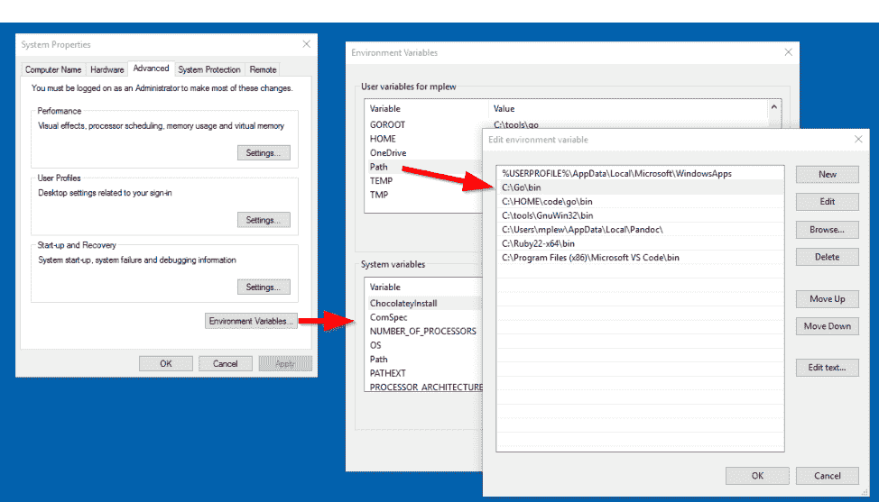
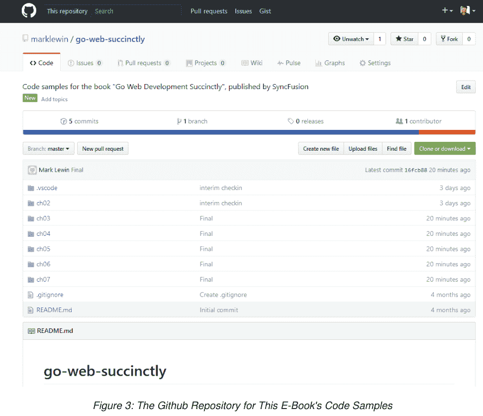
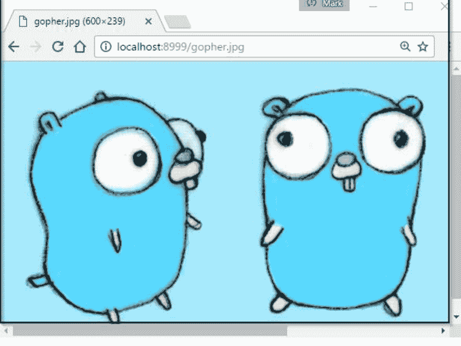
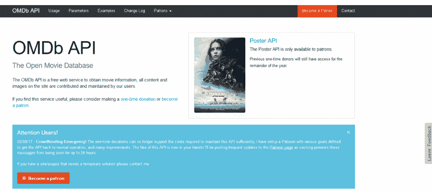

# Go Web 开发简洁指南

序言：Daniel Jebaraj


- RESTful API ...................................................................................48
- 我们的 RESTful Web 服务 ................................................................................51
- 服务与路由 ........................................................................52
- 完整的应用程序...............................................................................60
- 运行应用程序 ................................................................................67
- 显示所有城市 ................................................................................67
- 显示特定城市 .......................................................................69
- 添加城市 .......................................................................69
- 删除城市 .......................................................................70
- 挑战步骤 .................................................................71
- 引入 Cookie 和 Session...............................................................72
- 什么是 Cookie？.........................................................................................72
- 什么是 Session？.......................................................................72
- 什么是 Session Cookie？或持久化 Cookie？...............................................73
- 使用 Cookie ......................................................................73
- 设置 Cookie .......................................................................74
- 获取 Cookie ......................................................................74
- 使用 Cookie .......................................................................74
- 处理 Session .................................................................77
- 基础知识 .......................................................................77
- Flash 消息...............................................................................79
- 日志 ........................................................................................81
- 基础日志 ...................................................................................81
- 记录请求...............................................................................83
- 测试 .................................................................................86

# 精简系列书籍背后的故事

Daniel Jebaraj，Syncfusion, Inc. 副总裁

**处于技术前沿**

正如许多人所知，Syncfusion 是微软平台软件组件的提供者。这让我们处于一个既兴奋又充满挑战的位置。

每当微软发布新的平台或工具时（现在几乎每周一次），我们都必须快速学习。

# 信息丰富但难以消化

现实中，这转化为了大量的书籍订单、搜索和 Twitter 浏览。

虽然互联网上的信息变得越来越丰富，针对较新主题出版的书也越来越多，但继续限制我们的方面是无法找到简洁的概览书籍。

## 永久免费

Syncfusion 将致力于编写关于多个主题的书籍。这些书籍将始终免费提供。

我们发布的任何更新也将是免费的。

## 免费？猫在哪里？

这里没有任何猫腻。Syncfusion 一直以来的理念是提供比市场上任何其他产品都更深入、更广泛的框架。开发者教育极大地帮助我们进行营销，并对抗那些承诺“一键开启 AJAX 支持”或“把月亮变成奶酪！”的竞争对手。

## 告诉我们您的想法

如果您有任何感兴趣的话题、想法或反馈，请通过 [succinctly-series@syncfusion.com](mailto:succinctly-series@syncfusion.com) 与我们联系。

我们诚挚地希望您喜欢这本书，并它能帮助您更好地理解学习的主题。感谢您的阅读。

请在 Twitter 上关注我们，并在 Facebook 上“点赞”我们，帮助我们推广 Succinctly 系列丛！


## 关于作者

Mark Lewin 在软件开发、教学和编写写作方面已有 18 年以上经验。他的主要兴趣是通用的 Web 开发，特别是 Web 地图。在世界最大的 GIS 公司 ESRI 工作期间，他曾担任顾问、培训师和课程作者。他经常在行业活动中演讲，目前与多种开源地图工具以及一些相关的 JavaScript 框架进行合作，包括 Node.js、Dojo 和 Query。

Mark 居住在英国，目前在 Geospatial Training LLC 教授 ArcGIS Server/JavaScript 开发，并是 Pluralsight《Google Maps API: Get Started》课程的作者。白天，他为 Oracle 编写 MySQL 课程软件。

可以通过 mark@marklewin.com 或在 Twitter 上的 @gisapps 联系 Mark。

这是 Mark 为 Syncfusion 编写的第三本文书。第一本《Leaflet is Succinctly, Go Succinctly》将在您读到本书时出版。

## 致谢

我想感谢我的孩子们，即使在阴暗的日子里也是小小的阳光。言语无法表达我对你们的感受。

还有我最好的朋友——“哲学家”David Peters。每个人都需要一个朋友在低谷时提供帮助，并在顺境时让他们脚实，David 正为我做着。

# 第1章 引言

## 这本书是给谁看的？

这本书适用于任何对 Go 语言有基础了解并兴趣使用 Go 编写 Web 的开发者。

如果您能用 Go 编写简单的控制台应用程序，那么理解本短电子书的内容应该没有任何问题。

如果您正在寻找该语言本身的入门指南，我谦虚地推荐我的书籍《Go Succinctly》，它将带您从零开始……嗯，即使不是完全精通，也能达到对 Go 编程语言的欣赏和理解。它还为您提供了其他资源的链接，帮助您熟悉 Go。

与 Syncfusion *Succinctly* 系列中的所有电子书一样，您可以从 Syncfusion 网站免费下载《Go Succinctly》。

## 为什么用 Go 进行 Web 开发？

Go 语言是一种编写应用程序的优秀语言，特别是用于 Web 服务。事实上，它的设计之初就特别考虑了 Web。毕竟，如果忽视 Web，任何现代编程语言都很难获得关注。

那么，Go 编程语言的哪些特性对 Web 开发特别有用呢？这里有几点：

## 并发

任何足够规模的 Web 服务器都需要并发运行成千上万的任务。在许多语言中，并发是复杂且困难的，因为它通常是事后添加的。然而，并发是 Go 语言内置的。事实上，并发是 Go 设计旨在解决的主要问题之一。

在 Go 中，并发通过使用 Goroutine 实现，Goroutine 是轻量级线程，允许开发者异步执行多个操作。这在 Web 中非常有用。例如，当用户连接到您的 Web 服务器时，只需启动一个 Goroutine 来处理与该客户端的任何交互——只需在函数调用前加上 `go` 关键字即可。此外，Goroutine 的扩展性极佳，您的 Web 应用程序在为数千用户的同时可以运行非常顺畅。

## 模块化

Web 应用程序与其他许多现代应用程序一样，通常会增长到包含大量代码。保持这些代码组织良好且高效，以便理解和维护，对于当今的开发者来说是一个挑战。当几个开发者协作同一个应用程序且每个人的格式化代码的方式不同时，情况尤为如此。

Go 通过实施特定的代码结构和格式化方法消除了这些许多问题。函数、变量、常量和类型声明都被预期放置在可预测的位置，且 Go 要求所有内容都以特定方式进行编码。

如果 Go 在这方面听起来很严酷，请考虑这一点——你在失去表达自由度的同时，换取了可预测性；一切都如你预期的那样，并且在范围内格式一致。

Go 通过提供 `fmt` 包让您轻松满足代码格式化规则，您可以将其构建到工作流中以自动将您的代码“Go 化”。

## 编译

与最近许多 Web 服务端语言不同，Go 编程语言是编译的。这意味着诸如运行时错误等难以追踪的问题会在编译步骤中被捕获。Go 的静态类型系统还可以帮助您在开发期间发现错误，否则这些错误可能会逸到生产环境中。

## net/http 包

Go 的 `net/http` 包非常优秀，它让启动服务器变得简单。事实上，它是专门为 Web 设计的。使用标准库中的 `DefaultMux` 就可以处理请求和响应，路由非常简单。我们也可以考虑一个非常强大的替代方案：`gorilla/mux`。

## 设置您的环境

由于我不会深入探讨，这里假设您已经有一定的设置经验。

设置环境的步骤包括：

- 安装 Go 工具。
- 创建工作区并设置环境变量。

## 安装 Go 工具

设置环境的具体步骤取决于您所使用的平台。

您可以从这里下载它们：https://golang.org/dl/，如图 1 所示。

| :--- | :--- | :--- | :--- | :--- | :--- |

### 下载

如果您从源码下载二进制文件，请参考安装说明。

关于 Go 版本的更多信息，请查看发布历史。

### 特色下载

| :--- | :--- | :--- |

如果是从源码编译，请参考安装说明。

### Windows

在 Windows 上安装 Go 工具的最简单方法是下载 MSI 安装程序，启动它并按照提示操作。默认情况下，Go 将所有内容安装在 `C:\Go`，并将 `C:\Go\bin` 添加到您的 `PATH` 变量中。

或者，如果您希望对环境变量有更多控制权，可以下载 `.zip` 文件并解压到您选择的目录。在这种情况下，您需要手动配置环境变量。

您可以通过系统控制面板中“高级”选项卡上的“环境变量”按钮来设置环境变量。某些版本的 Windows 通过“高级设置”选项打开系统控制面板。



你接下来可能需要关闭并重新打开任何命令行会以使更改生效。

### Mac OS X

下载 `.pkg` 文件并按照提示操作。该包会将 Go 分发版安装到 `/usr/local/go`，并将 `/usr/local/go/bin` 添加到你的 `PATH` 中。

### Linux, Unix, 和 FreeBSD

你会发现“基于 nix 的系统”对你的要求更高。但作为一名 'nix 用户，你完全有胜任这种选择的挑战。

下载 `.tar.gz` 文件并以 root 用户身份将其解压到 `/usr/local`，或者通过 sudo 获取：

```
sudo tar -C /usr/local -xzf $GOVERSION.$OS-$GOARCH.tar.gz
```

你可能需要将 `/usr/local/go/bin` 永久地添加到你的 `PATH` 中。将以下行放入你的 `/etc/profile`（针对所有用户）或 `~/.profile`（仅针对你个人）以使其永久生效：

```
export PATH=$PATH:/usr/local/go/bin
```

## 自定义安装位置

这些方法决定了 Go 将安装在何处。如果你不喜欢这种方式支配，你必须通过设置 `GOROOT` 环境变量来告诉 Go 在哪里找到它自己。如果你对默认位置满意，请不要指定 `GOROOT`，那只会会让变得复杂。

## 创建工作区

最后一步是告诉 Go 你编写的任何代码以及通过 `go get` 下载的任何第三方库将存放在何处。通过使用上述相同的技术设置 `GOPATH` 环境变量来实现此。

Go 将在此位置创建 `bin`、`pkg` 和 `src` 文件（目录）：

- `bin`: 包含可执行文件
- `pkg`: 包含包对象
- `src`: 包含源代码

## 代码示例

书中的所有代码示例可以在 GitHub 上找到：https://github.com/marklewin/go-web-succinctly.git。



你可以通过它们在本电子书中匹配的章节和主题来识别每个示例。

你可以单独下载每个文件，也可以使用以下命令克隆存储库：

```
$ git clone git://github.com/marklewin/go-web-succinctly.git
```

```
$ git pull origin
```

# 第 2 章 响应与路由

Go 的 `net` 包促进了 Go 程序中所有的网络通信，无论是通过 HTTP、TCP/IP、WebSockets 还是任何其他标准网络协议。

当然，由于本电子书涉及 Web 开发，我们主要关注的是 HTTP，这意味着我们正在使用的主包是 `net/http`。

在本章中，我们将查看任何 Go Web 应用程序的基本需求——提供和服务路由，以及你如何使用 `net/http` 和补充包来实现它们。

## 将 Go 作为简单的 Web 服务器

在过去，Web 服务器的功能仅仅是提供位于服务器上某个目录中的文件。如果这正是我们想要的，现在只需要几行代码，就可以使用 `net/http` 包在 Go 中实现一些非常了不起的功能。

> 代码列表 1：作为 Web 服务器的 Go

```
package main

import (
    "net/http"
)

func main() {
    http.ListenAndServe(":8999", http.FileServer(http.Dir("/var/www/")))
}
```

它非常基础，但我们的程序履行了任何 Web 服务器的核心职责——即监听请求并提供响应。此外，因为不需要担心更传统的 Web 服务器 必须面对的所有其他问题，该程序的运行速度极快。

在这个示例中，我们调用 `http.ListenAndServe()` 函数将所有发送到端口 8999 的请求交给 `http.FileServer` 处理器方法，该方法反过来接受服务器上我们想要从其提供文件的目录。易而易举！

如果你运行程序 `go run <program_name.go>` 并在你的浏览器地址栏中输入 `http://localhost:8999/`，然后输入服务器上 `/var/www` 中存在的文件名，你将看到该文件的内容显示出来——如图4 所示。



然而，大多数现代 Web 应用程序对服务器的要求比这多。请记住，你并不总是在发送静态内容。你将越来越多地被要求动态生成内容，可能来自数据库的内容。在这种情况下，物理文件位置就没有意义了。

假设你有一个更复杂的网站结构，其中应用程序的文件分布在不同的子目录中？例如，`www.mysite.com/about/aboutus.html` 和 `www.mysite.com/blog/blog.html`？这种方法将不起作用。因此，你需要对应用程序可以接受的 URL 有有更好的控制。你可以通过使用 `net/http` 包的路由能力来实现这一点。

## 简单的提供与路由


Go 依赖两个主要组件来处理 HTTP 请求——多路用器（`multiplexor`）和处理器（`handlers`）。多路用器（或“`mux`”）本质上是一个 HTTP 请求路由。在 Go 的 `net/http` 包中，多路用器功能由 `ServeMux` 提供，默认的 `mux` 是 `DefaultServeMux`。

直观地说，`ServeMux` 将传入的请求与预定义的路径进行匹配，然后调用相应的函数。代码列表 2：基础提供使用 `net/http`

```
package main

import (
    "fmt"
    "log"
    "net/http"
    "time"
)

func main() {
    http.HandleFunc("/", showInfo)
    http.HandleFunc("/site", serveFile)
    err := http.ListenAndServe(":8999", nil)
    if err != nil {
        log.Fatal("ListenAndServe: %v", err)
    }
}

func showInfo(w http.ResponseWriter, r *http.Request) {
    fmt.Fprintf(w, "Current time: %v", time.Now())
    fmt.Fprintf(w, "URL Path: %s", r.URL.Path)
}

func serveFile(w http.ResponseWriter, r *http.Request) {
    http.ServeFile(w, r, "index.html")
}
```

```go
"net/http"
"time"

func main() {
	http.HandleFunc("/", showInfo)
	files := http.FileServer(http.Dir("/var/www"))
	http.Handle("/site/", http.StripPrefix("/site/", files))
	err := http.ListenAndServe(":8999", nil)
	if err != nil {
		log.Fatal("ListenAndServe: ", err)
	}
}
```

```go
func showInfo(w http.ResponseWriter, r *http.Request) {
	fmt.Fprintf(w, "current time: %s", time.Now())
	fmt.Fprintf(w, "URL Path: %s", html.EscapeString(r.URL.Path))
}
```

在此示例中，我们没有调用 `HandleFunc`，而是调用了 `Handle`。这是因为 `FileServer` 返回了它自己的处理器，我们可以通过 `Handle` 将其传递给 `mux`（而不需要显式地创建我们自己的处理器函数）。

因此，你可以看到，启动一个自给服务的（不需要独立的 Web 服务器）并允许你响应一些简单请求的网站是非常简单的。

### 中间件

在开发过程中，中间件是位于 Web 请求和你的路由处理器之间的代码。中间件连接了可重用的代码，你可以使用这些代码来执行在调用处理器之前或之后必须发生的任务。

例如，你可能需要在路由请求之前检查数据库连接状态或对用户进行身份验证。你可能还想压缩响应的内容或限制特定处理器被调用的次数——这可以作为对免费访问你 Web 服务的用户进行某些限制的一部分。

创建中间件只需简单链用处理器和处理器函数，这是你在 Go Web 开发中会看到的内容。

基本思想是将一个处理器函数（我们称其为 `f2`）作为参数传递到另一个处理器函数（我们称其为 `f1`）中。当触发它的路由被访问时，处理器 `f1` 被调用。`f1` 执行一些工作，然后调用 `f2`。

当然，你可以直接使用 `f2`。然而，这并不是理想的，因为我们通常想要实现清晰的关注点分离，因此你的处理器代码应该真正限制于处理请求，而不是执行 `f2` 设计用来执行的任何操作。

这里是基本思想——与其将响应作为处理器的一部分来处理，你你只需将链中的下一个处理器传递给它即可。

接受另一个处理器函数作为参数并返回新处理器的函数可以在处理器被调用之前或之后（或前后都执行）执行任务，甚至可以选择完全不调用原始处理器（如果这是你的意图的话）。

请考虑代码列表 4 中的示例。

#### 代码列表 4：中间件示例 1

```go
package main

import (
    "fmt"
    "net/http"
)

func middleware1(next http.Handler) http.Handler {
    return http.HandlerFunc(func(w http.ResponseWriter, r *http.Request) {
        fmt.Fprintln(w, "Executing middleware1()...")
        next.ServeHTTP(w, r)
        fmt.Fprintln(w, "Executing middleware1() again...")
    })
}

func middleware2(next http.Handler) http.Handler {
    return http.HandlerFunc(func(w http.ResponseWriter, r *http.Request) {
        fmt.Fprintln(w, "Executing middleware2()...")
        if r.URL.Path != "/" {
            return
        }
        next.ServeHTTP(w, r)
        fmt.Fprintln(w, "Executing middleware2() again...")
    })
}

func final(w http.ResponseWriter, r *http.Request) {
    fmt.Fprintln(w, "Executing final()...")
    fmt.Fprintln(w, "Done")
}

func main() {
    finalHandler := http.HandlerFunc(final)

http.Handle("/", middleware1(middleware2(finalHandler)))
    http.ListenAndServe(":8999", nil)
}
```

```go
package main

import (
    github.com/gorilla/mux
    ...
)
```

为了增加一点趣味性，让我们使用 `gorilla/mux` 创建一个处理器，根据正则表达式来匹配传入的产品 ID 的请求。如果产品 ID 长度为单个数字，则我们匹配成功，并将其路由到相应的页面。如果不是，我们将其路由到错误页面。

首先，我们需要导入 `gorilla/mux` 模块，我们按照正常的方式进行操作：

```
import (
    ...
    github.com/gorilla/mux
)
```

接下来，我们需要切换到 `gorilla/mux` 而不是它默认的 `DefaultServeMux`：

```go
func main() {
    router = mux.NewRouter()
}
```

完成这一步后，我们就可以使用熟悉的处理器函数了，但在路由的语境下，并可以使用 `gorilla/mux` 提供的额外功能，例如使用正则表达式搜索 URL 参数：

```go
router.HandleFunc("/product/id:[0-9]+", pageHandler)
```

该行代码创建了一个处理器，它尝试匹配以 `/product/` 开头并跟着一个零到九数字的 URL，我们将其称为 `id`。如果匹配成功，将调用 `pageHandler` 函数。

在我们的 `pageHandler` 函数中，我们需要验证 `HandleFunc` 匹配到的精确字符串。我们使用 Gorilla 的 `mux.Vars` 函数来实现此，将请求作为单个参数传入，并返回一个路由变量映射。我们可以通过其名称——`id`——来引用我们感兴趣的路由变量。

在获取产品 ID 后，我们可以接着检查是否有匹配的 HTML 页面。Go 的 `os` 模块提供了 `Stat` 和 `IsNotExist` 函数来帮助我们。如果文件存在于服务器上，我们使用 `http.ServeFile` 将其发送到浏览器。如果它不存在，我们将返回另一个页面，告诉用户该产品无效。

代码列表 6 显示了完整的代码。

```go
package main

import (
    "log"
    "net/http"
    "os"

    "github.com/gorilla/mux"
)

func pageHandler(w http.ResponseWriter, r *http.Request) {
    vars := mux.Vars(r)
    productID := vars["id"]
    log.Printf("Product ID:%v\n", productID)

    fileName := productID + ".html"

    if _, err := os.Stat(fileName); os.IsNotExist(err) {
        log.Printf("no such product")
        fileName = "invalid.html"
    }

    http.ServeFile(w, r, fileName)
}

func main() {
    router := mux.NewRouter()
    router.HandleFunc("/product/{id:[0-9]+}", pageHandler)
    http.Handle("/", router)
    http.ListenAndServe(":8999", nil)
}
```

这仅仅是 `gorilla/mux` 功能冰冰一角。例如，你可以针对以下内容进行匹配：

- 路径前缀：

`router.PathPrefix("/products/")`

- HTTP 方法：

`router.Methods("GET", "POST")`

- URL 方案：

`router.Schemes("https")`

- Header 值（例如，请求是否为 AJAX 请求？）：

```
router.Headers("X-Requested-With", "XMLHttpRequest")
```

- 查询值：

```
router.Queries("key", "value")
```

- 你定义的自定义匹配函数：

```
router.MatcherFunc(func(r *http.Request, match *RouteMatch) bool {
  // 执行操作
}
```

你可以通过链式函数调用在一个路由中组合多个匹配器：

```go
router.HandleFunc("/products", productHandler)
Host("www.example.com")
Methods("GET")
Schemes("https")
```

或者，你可以使用子路由将多个路由分组在一起。例如，以下代码查找 `www.example.com` 的主机映射，但只有当在主机上匹配成功时，它才会检查子路由：

```go
router := mux.NewRouter()
subrouter := route.Host("www.example.com").Subrouter
```

```go
// 注册子路由
subrouter.HandleFunc("/products", AllProductsHandler)
subrouter.HandleFunc("/products/{name}", ProductHandler)
subrouter.HandleFunc("/reviews/{category}/{id:[0-9]+}"), ReviewsHandler
```

> `gorilla/mux` 是 `DefaultServeMux` 非常强大的替代方案，值得研究。你可以在 http://www.gorillatool.org/pkg/mux 了解更多信息。

当然，由于 Gorilla 是一个如此庞大的生态系统，如果你不喜欢 Gorilla，还有许多其他选择。我偏喜欢 Gorilla 是因为它很容易理解，而且它总是能执行我要求它做的任何事情。

其他流行的第三方路由器包括：

- `httrouter`：轻量且快速，但功能不如 Gorilla。例如，你不能在路由中包含正则表达式。
- `httpremux`：一个灵活的、基于树的 HTTP 路由器，受 `httrouter` 启发。
- `Pat`：简单易且非常流行。如果你是熟悉 Sinatra 和 Rails 的 Ruby 开发者，你会发现 Pat 的方法非常熟悉。

### 返回错误

事情并不总是如我们预期的那样运行。请求指向已不存在的页面，事物从一个地方移动到另一个，有时连接会中断。

HTTP 协议定义了 61 个状态码，以便我们判断请求是否成功。

以下是常见的状态码：

- 200 OK：成功！
- 404 Not Found：未找到。
- 301 Moved Permanently：永久重定向。
- 302 Moved Temporarily：临时重定向。
- 500 Internal Server Error：服务器内部错误。

`net/http` 包提供了各种函数供你报告错误。作为开发者，你可以传递 `ResponseWriter`、字符串消息和状态码来使用它。例如，在 Go 中使用：

```go
http.HandleFunc("/", func(w http.ResponseWriter, r *http.Request) {
    http.Error(w, "发生了了错误", http.StatusBadRequest)
```

### 访问数据

在上一章中，我们看到了 Go 如何接收请求并将其路由到不同的 URL。到目前为止，所有的响应都只是静态内容。在本章中，我们将学习如何让 Go 程序连接数据源。

### 获取数据库驱动

Go 允许你使用任何提供驱动程序的数据库。驱动程序列表可以在 https://github.com/go/wiki/Drivers 找到。

MySQL 是一个非常优秀的数据库，尽管它已经存在很久，但仍然非常受欢迎，因此我们将使用它。无论你选择哪种数据库，所需的步骤与所示相似或完全相同。

你可以从 http://www.mysql.com 下载社区版。Windows 安装程序中有此选项，而 Mac 和 Linux 需要手动安装。

如果你想跟随示例，请使用命令行连接到 MySQL 服务器，然后执行以下语句：

```
mysql> SOURCE /path/to/world.sql
```

你可以通过以下命令验证 "world" 数据库已安装：

当你安装了数据库服务器后，需要为它安装驱动。你可以通过 `get` 实现。我使用的是 `go-sql-driver` MySQL。

当我们将驱动导入到数据库服务器后，接下来需要在 `import` 语句中引用它和通用的 `database/sql` 包。注意我们在导入驱动前加了下划线 `_`。这告诉 Go 编译器我们引用的包是另一个包的补充——在例例中，是 `database/sql` 包。我们只使用它的初始化能力——即 Go 所说的“副作用”。

```go
import (
	"database/sql"
	"log"
	_ "github.com/go-sql-driver/mysql"
)
```

这里是用于 City 表 表行的 Go 结构体：

```go
type City struct {
    Name string
    CountryCode string
    District string
    Population uint32
}
```

接下来，让我们定义一个变量，在连接数据库时用于存储数据库的句柄（handle）：

```go
var database *sql.DB
```

最后，我们准备好连接到数据库了。我们通过序列化服务器主机、端口号、初始数据库和密码字符串来构建连接字符串。

接下来，我们尝试通过调用 `database/sql.Open` 方法来连接，传入驱动类型和连接字符串：

```go
dbConn := fmt.Sprintf("%s:%s@tcp(%s)/%s", dbUser, dbPass, dbHost, dbDatabase)
db, err := sql.Open("mysql", dbConn)
```

这会返回一个 `sql.DB` 实例（稍后我们将对此详细介绍）。

完整的代码位于代码列表 7 中。

```go
package main

import (
    "database/sql"
    "log"
    _ "github.com/go-sql-driver/mysql"
)

var database *sql.DB

func main() {
    db, err := sql.Open("mysql", "root:password@tcp(127.0.0.1:3306)/world")
    if err != nil {
        log.Println("Could not connect!")
    }
    database = db
    log.Println("Connected.")
}
```

如果一切进展顺利，我们应该终端提示符符收到一条消息，告诉我们现在已连接到 MySQL 服务器。


MINGW64:/HOME/code/go/src/github.com/marklewin/go-web-succinct...

simplew@LAPTOP-QVFESMV9 MINGW64 --code/go/src/github.com/marklewin/go-web-succinct

ly/ch03/connect-db (master)

$ go run main

2017/02/06 18:05:59 Connected.

simplew@LAPTOP-QVFESMV9 MINGW64 --code/go/src/github.com/marklewin/go-web-succinct

ly/ch03/connect-db (master)

$ _

```
图 12：验证与数据库的连接

现在我们可以连接到 "world" 数据库，并对其执行查询并将结果返回给用户了。但首先，让我们检查 `sql.DB`。

注意上一个代码示例，我们正在使用包含 `sql.DB` 的 `database` 变量来访问数据库。

`sql.DB` 并不是数据库——数据库存储在 `dbConn` 中——相反，它是 `database/sql` 程序包对数据库的抽象。在我们的示例中，它指的是 MySQL 数据库，但由于我们可以使用 `database/sql` 与许多不同的数据源进行交互，它也可以很容易是本地文件或某些进程内数据存储（如 `memcache`）。

`sql.DB` 会代表你处理很多工作，包括数据库连接的打开、关闭和池化。

除非你的应用程序需要，否则不要反复打开和关闭数据库。`sql.DB` 对象被设计为长生命周期，你与数据库的所有交互都将通过 `sql.DB` 完成。但是，你必须确保在完成使用后通过 `sql.DB.Close` 关闭连接，以便它们可以返回池中。

> 提示：如果你需要给短生命周期的函数访问 `sql.DB`，请将其作为参数传递给函数，而不是在函数内部创建新连接。

我们操之过急了。我们还没有对数据库做过任何操作。

让我们现在纠正这一点。

以下代码根据用户在浏览器 http://localhost:8999/ 地址栏中输入的任何内容，查询 "world" 数据库的 City 表。

```go
package main

import (
    "database/sql"
    "fmt"
    "log"
    "net/http"
    "github.com/go-sql-driver/mysql"
)

type City struct {
    Name string
    CountryCode string
    Population int
}

var database *sql.DB

func main() {
    db, err := sql.Open("mysql",
        "root:password@tcp(127.0.0.1:3306)/world")
    if err != nil {
        log.Println("Could not connect!")
    }
    database = db
    log.Println("Connected.")
    http.HandleFunc("/%s", showCity)
    http.ListenAndServe(":8999", nil)
}

func showCity(w http.ResponseWriter, r *http.Request) {
    city := &City{}
    queryParam := "%s" + r.URL.Path[1:] + "%s"
    rows, err := database.Query("SELECT Name, CountryCode, Population FROM city WHERE Name LIKE ?", queryParam)
    if err != nil {
        log.Fatal(err)
    }
    defer rows.Close()
```
```go
for rows.Next() {
    err := rows.Scan(&city.Name, &city.CountryCode,
        city.Population)
    if err != nil {
        log.Fatal(err)
    }
    fmt.Fprintf(w, "%s (%s): %d\n", city.Name,
        city.CountryCode, city.Population)
}
err = rows.Err()
if err != nil {
    log.Fatal(err)
}
```

这里是我们用于 City 表行的 Go 结构体：

```go
type City struct {
    Name string
    CountryCode string
    District string
    Population uint32
}
```

接下来，让我们定义一个变量，在连接数据库时用于存储数据库的句柄：

```go
var database *sql.DB
```

最后，我们准备好连接到数据库了。我们通过序列化服务器主机、端口号、初始数据库和密码字符串来构建连接字符串。

接下来，我们尝试通过调用 `database/sql.Open` 方法来连接，传入驱动类型和连接字符串：

```go
dbConn := fmt.Sprintf("%s:%s@tcp(%s)/%s", dbUser, dbPass, dbHost, dbDatabase)
db, err := sql.Open("mysql", dbConn)
```

这会返回一个 `sql.DB` 实例。

完整的代码位于代码列表 7 中。

```go
package main

import (
    "database/sql"
    "log"
    _ "github.com/go-sql-driver/mysql"
)

var database *sql.DB

func main() {
    db, err := sql.Open("mysql", "root:password@tcp(127.0.0.1:3306)/world")
    if err != nil {
        log.Println("Could not connect!")
    }
    database = db
    log.Println("Connected.")
}
```

如果一切进展顺利，我们应该在终端提示符处收到一条消息，告诉我们现在已连接到 MySQL 服务器。

```
MINGW64:/HOME/code/go/src/github.com/marklewin/go-web-succinct...

simplew@LAPTOP-QVFESMV9 MINGW64 --code/go/src/github.com/marklewin/go-web-succinct

ly/ch03/connect-db (master)

$ go run main

2017/02/06 18:05:59 Connected.

simplew@LAPTOP-QVFESMV9 MINGW64 --code/go/src/github.com/marklewin/go-web-succinct

ly/ch03/connect-db (master)

$ _
```

图 12：验证与数据库的连接

现在我们可以连接到 "world" 数据库，并对其执行查询并将结果返回给用户了。但首先，让我们检查 `sql.DB`。

注意上一个代码示例，我们正在使用包含 `sql.DB` 的 `database` 变量来访问数据库。

`sql.DB` 并不是数据库——数据库存储在 `dbConn` 中——相反，它是 `database/sql` 包对数据库的抽象。在我们的示例中，它指的是 MySQL 数据库，但由于我们可以使用 `database/sql` 与许多不同的数据源进行交互，它也可以很容易是本地文件或某些进程内数据存储（如 `memcache`）。

`sql.DB` 会代表你处理很多工作，包括数据库连接的打开、关闭和池化。

除非你的应用程序需要，否则不要反复打开和关闭数据库。`sql.DB` 对象被设计为长生命周期，你与数据库的所有交互都将通过 `sql.DB` 完成。但是，你必须确保在完成使用后通过 `sql.DB.Close` 关闭连接，以便它们可以返回池中。

> 提示：如果你需要给短生命期的函数访问 `sql.DB`，请将其作为参数传递给函数，而不是在函数内部创建新连接。

我们操之过急了。我们还没有对数据库做过任何操作。

让我们现在纠正这一点。

以下代码根据用户在浏览器地址栏 http://localhost:8999/ 后输入的任何内容，查询 "world" 数据库的 City 表。

```go
package main

import (
    "database/sql"
    "fmt"
    "log"
    "net/http"
    "github.com/go-sql-driver/mysql"
)

type City struct {
    Name string
    CountryCode string
    Population int
}

var database *sql.DB

func main() {
    db, err := sql.Open("mysql",
        "root:password@tcp(127.0.0.1:3306)/world")
    if err != nil {
        log.Println("Could not connect!")
    }
    database = db
    log.Println("Connected.")
    http.HandleFunc("/%s", showCity)
    http.ListenAndServe(":8999", nil)
}

func showCity(w http.ResponseWriter, r *http.Request) {
    city := &City{}
    queryParam := "%s" + r.URL.Path[1:] + "%s"
    rows, err := database.Query("SELECT Name, CountryCode, Population FROM city WHERE Name LIKE ?", queryParam)
    if err != nil {
        log.Fatal(err)
    }
    defer rows.Close()
```
```go
for rows.Next() {
    err := rows.Scan(&city.Name, &city.CountryCode,
        city.Population)
    if err != nil {
        log.Fatal(err)
    }
    fmt.Fprintf(w, "%s (%s): %d\n", city.Name,
        city.CountryCode, city.Population)
}
err = rows.Err()
if err != nil {
    log.Fatal(err)
}
```

除了 `{{.Name}}` 条目外，其他一切看起来都很熟悉。对于 Go 模板来说，这是一个变量。它包含在双大括号内，其名称 `Name` 前面有一个点。

点表示变量的作用域或上下文。在我们的案例中，`Name` 变量指的是 `Person` 结构体的 `Name` 字段，当你看到我们在程序逻辑中使用的定义时，这一点显而易见：

```go
type Person struct {
  Name string
}
```

我们可以传递一个 `Person` 结构体来填充模板变量，它将提取 `Name` 字段并将其替换模板中的变量定义。

注意，你在模板中引用的任何字段必须是导出的。也就是说，它们必须以大写字母开头。未导出的字段会导致问题，正如我们稍后看到的。

代码列表 11 显示了完整的程序代码。

## 代码列表 11：使用模板

```go
package main

import (
  "log"
  "net/http"
  "text/template"
)

type Person struct {
  Name string
}

func main() {
  http.HandleFunc("/", handler)
  err := http.ListenAndServe(":8999", nil)
  if err != nil {
    log.Fatal("ListenAndServe: ", err)
  }
}
```

这里唯一值得注意的代码是在 `handler` 函数中，当用户访问 http://localhost:8999 我们的 Web 应用程序根目录时会被调用。

`Handler` 创建了一个 `Person` 类型的变量 `p` 并将 "John Smith" 赋值给它的 `Name` 字段。然后我们使用 `template.ParseFiles`，传入模板文件名并将结果赋值给变量 `t`。

解析模板文件后，接接我们需要执行合并，我们通过调用 `Execute` 来实现，它将 `http.ResponseWriter` 和我们想要与模板合并的数据项作为参数传递。

当我们在浏览器中启动应用程序时，得到了图 15。


图 15：我们简单模板的输出

## 使用模板重构数据访问应用程序

让我们新学到的 Go 模板知识派上用场。首先，我们需要理解模板的许多功能之一——遍历结果集的能力，然后对其中的每个结果应用适当的格式化。

为了实现这一点，我们必须使用 `{{range}} ... {{end}}` 结构。我们将使用以下模板来构建我们的表格。`{{range}}` 和 `{{end}}` 之间的所有内容将为传入的对象的每个成员重复一次。

代码列表 12：“Cities”数据库应用程序的模板

```html
<html
<head>
<title>City Search</title>
</head>
<body>
```


# Search Results

```html
<table border='1'>
  <tr>
    <th>City</th>
    <th>Country Code</th>
    <th>Population</th>
  </tr>
  {{range .}}
  <tr>
    <td>{{.Name}}</td>
    <td>{{.CountryCode}}</td>
    <td>{{.Population}}</td>
  </tr>
  {{end}}
</table>
</body>
</html>
```

看到紧跟在 `range` 关键字后面出现的点符号 `dot notation` 了吗？它意味着“任何对象”。

关于 Go 模板中使用 `range` 的一个重要注意事项是——它们只接受单个对象。“什么？”我听到你这么说，“为什么本应该遍历值切片 `slice` 的东西只接受一个？”

你是对的。`range` 允许我们放入一个值的数组或切片，然后它会进入该对象提取出其成员。

因此，在我们的数据库应用程序中，我们只需要进行一些重构，以确保每个查询结果都添加到切片中——让我们称其为 `cities`——然后我们将该切片传递到模板中。

## 代码列表 13：在我们的“Cities”应用程序中使用模板

```go
package main

import (
    "database/sql"
    "html/template"
    "log"
    "net/http"
    "github.com/go-sql-driver/mysql"
)

type City struct {
    Name        string
    CountryCode string
    Population  int
}

var database *sql.DB

func main() {
    db, err := sql.Open("mysql", "root:password@tcp(127.0.0.1:3306)/world")
    if err != nil {
        log.Println("Could not connect!")
    }
    database = db
    log.Println("Connected.")
    http.HandleFunc("/", showCity)
    http.ListenAndServe(":8999", nil)
}

func showCity(w http.ResponseWriter, r *http.Request) {
    var cities []City
    queryParam := r.URL.Path[1:]
    rows, err := database.Query("SELECT Name, CountryCode, Population FROM city WHERE Name LIKE ?", queryParam)
    if err != nil {
        log.Fatal(err)
    }
    defer rows.Close()
    for rows.Next() {
        var theCity City
        err := rows.Scan(&theCity.Name, &theCity.CountryCode, &theCity.Population)
        if err != nil {
            log.Fatal(err)
        }
        cities = append(cities, theCity)
    }
    t, _ := template.ParseFiles("results.html")
    t.Execute(w, cities)
}
```

## 在模板中使用方法

假设我们想用逗号分隔符格式化 `Population` 列。Go 并没有提供这种功能，因此我们必须编写自己的方法。

```go
func (c City) FormatPopulation(n int, sep rune) string {
    s := strconv.Itoa(n)
    var buff bytes.Buffer
    startOffset := 0
    if n < 0 {
        startOffset = 1
        buff.WriteByte('-')
    }
    l := len(s)
    commaIndex := 3 - ((l - startOffset) % 3)
    if commaIndex == 3 {
        commaIndex = 0
    }
    for i := startOffset; i < l; i++ {
        if commaIndex == 3 {
            buff.WriteRune(sep)
            commaIndex = 0
        }
        commaIndex++
        buff.WriteByte(s[i])
    }
    return buff.String()
}
```

注意该函数接受一个整数和一个分隔符并返回一个字符串。你可以将 Go 关键字视为 Unicode 字符的别名，这在 Go 术语中被称为“代码点” `code point`。

要在模板中调用此函数，我们只需指定它的名称并跟上任何参数 `不带括号`，如代码列表 15 所示。

### 代码列表 15：从模板调用 FormatPopulation 函数

```html
<html>
<head>
<title>City Search</title>
</head>
<body>
<h1>Search Results</h1>
<table border='1'>
  <tr>
    <th>City</th>
    <th>Country Code</th>
    <th>Population</th>
  </tr>
  {{range }}
  <tr>
    <td>{{.Name}}</td>
    <td>{{.CountryCode}}</td>
    <td>{{.FormatPopulation .Population ','}}</td>
  </tr>
  {{/range}}
</table>
</body>
</html>
```

当我们执行应用程序时，我们得到了格式化良好的人口值，如图 17 所示。


图 16：由模板格式化的人口值

## 在模板中使用条件判断

你可以使用 `{{if}}` `{{else}}` `{{end}}` 将条件表达式的评估交给模板处理。

Go 支持几个处理基本类型的函数，例如 `eq` `等于`、`ne` `不等于` 或 `gt` `大于`，你可以使用它们来构建表达式。

在模板中使用条件表达式的用法可以通过一个示例来演示。

假设我们只对人口小于 5,000,000 的群体感兴趣。其他所有数据都将被视为巨大且不显示具体数字。

代码列表 16 显示了我们的模板。

> 代码列表 16：带有条件表达式的模板

```html
<html
<head>
<title>City Search</title>
</head>
<body>
<h1>Search Results</h1>
<table border='1'>
<tr>
<th>City</th>
<th>Country Code</th>
<th>Population</th>
</tr>
{{range}}
<tr>
<td>{{.Name}}</td>
<td>{{.CountryCode}}</td>
<td>
{{if gt .Population 5000000}} <b>HUGE</b>
{{else}} {{.Population}}
{{end}}
</td>
</td>
</tr>
{{end}}
</table>
</body>
</html>
```

图 18 显示了结果。

## 搜索结果

| 市 | 国家代码 | 人口 |
|---|---|---|
| Stoke-on-Trent | GBR | 252000 |
| Tokyo | JPN | HUGE |
| Tokorozawa | JPN | 325809 |
| Tokushima | JPN | 269649 |
| Tokuyama | JPN | 107078 |
| Tokai | JPN | 99738 |
| Yamatokoriyama | JPN | 95165 |
| Bialystok | POL | 283937 |
| Tokat | TUR | 99500 |
| Vladivostok | RUS | 606200 |

图 17：在模板中使用条件判断显示人口数值

# 第 5 章 创建一个 RESTful JSON API

我们已经学习了许多内容，所以让我们看看能否利用这些知识做一些实用的事情。

在第 1 章中，我们研究了为什么 Go 是创建 Web 服务的极佳选择，例如：它通过轻量级线程模型进行大规模扩展的能力、模块化编码的简易性，以及与常用工具（如加密库、安全协议，当然还有 HTTP 服务器）集成的能力。

在本章中，我将演示如何创建一个 RESTful Web 服务，它可以接收 JSON 请求并返回 JSON 响应，以便对数据库进行 CRUD `创建、读查、更新和删除` 操作。

这个应用程序将使用我们目前为止学到的关于服务、路由和访问数据库的知识。在构建过程中，我将向你展示如何设计和开发一个典型的 Web 服务。它不会是完美的或生产就的，但它应该能让你直观感受到在 Go 中构建这类服务有多简单。

## RESTful APIs

如果你是一个开发者，或者曾经和开发者共处过，你一定听过 REST。鉴于它近年来吸引的巨大关注，你可能会认为它也是一个新概念。但事实并非如此。事实上，它和 Web 本身一样老。

REST 仅仅是为了处理多年来开发的数百种不同协议，这些协议旨在让计算机使用相同的语言在网络之间进行通信。

这些协议中包括 SOAP `因为它依赖 XML 作为传输机制`、JMS `特定于 Java 应用程序` 以及 XML-RPC `像 SOAP 一样，使用 XML 但没有实现 SOAP 拥有的标准`。

与所有这些方法一样，REST 背后的目标是让计算机轻松地共享数据，同时保持足够的透明度，让人类观察者理解他们正在做什么。

REST 提供的是保持轻量级同时实现此能力。它的方法对于使用 Web 本身采用的成熟方法的开发者来说是他们熟悉的。

## 为什么呢？

嗯，考虑一个你在浏览器中访问的网站。你输入该网站的 URL，网站背后的程序可以分析 URL 以理解你的意图。在静态网站中，你只是输入指向 Web 服务器上文件资源的 URL；但在采用 Web 服务的网站中，你可以有效地将 API 作为命令行入口，不仅针对资源，还针对程序 API 暴露的特定操作。

考虑开放电影数据库网站 `http://www.omdbapi.com`，它提供了一个免费的 REST API 来访问电影信息。你只需要构造 URL，指定你想要它提供的内容。

如果你从 `https://www.omdbapi.com/` 开始，你将得到图 19 中的首页。



## 使用方法

如果你从 `https://www.omdbapi.com/` 开始，你将得到图 19 中的首页。

图 18：访问电影数据库 API
如果你使用 `t` 参数，你会得到一些有趣的内容：`https://www.omdbapi.com/?t=starwars`

> "Title:Star Wars Episode IV - A Hope","Year:1977","Rating:PG","Released:25 May 1977","Runtime:121 min","Genre:Action,Adventure,Fantasy","Director:George Lucas","Actors:Mark Hamill, Carrie Fisher, Oscar Fisher, James Earl, Harrison Ford, Alec Guinness, Peter Cushing","Plot:Luke Skywalker joins forces with a Jedi Knight, a cheeky pilot, and droids to save the galaxy from the Empire's world-destroying battle-station, while attempting to rescue Princess Leia from Darth Vader.","Awards:None","Oscars:Won 6 wins & 28 nominations","Poster:https://images-na.amazon.com/images/M/MV5BMjQ3OTcwMTQt40Zi00000Ym00Y2YYYYY0OTQ@@._XkFtYMTQ0MDA0NDI1_V1_X300.jpg","Metscore:92","imdbRating:8.7","imdbVotes:958,001","imdbDB:tt006759","Type:Movie","Response:True

## 使用

JSON `JavaScript Object Notation`。对于 XML 来说，这已经非常简洁了。许多 XML 是深度嵌套的，解析起来是场噩梦，因此偏好 JSON。

除了轻量级和易于客户端解析之外，JSON 也具有人类可读性。嗯，勉强吧。你可以通过浏览器的开发者控制台或安装扩展程序来整理响应。

图 21 显示了安装了 JSON Formatter-add 后 Firefox 上的输出。

```json
{
  "Title": "Star Wars: Episode IV - A Hope",
  "Year": "1977",
  "Rating": "PG",
  "Released": "25 May 1977",
  "Runtime": "121 min",
  "Genre": "Action,Adventure,Fantasy",
  "Director": "George Lucas",
  "Actors": "Mark Hamill, Carrie Fisher, Oscar Fisher, James Earl, Harrison Ford, Alec Guinness, Peter Cushing",
  "Plot": "Luke Skywalker joins forces with a Jedi Knight, a cheeky pilot, and droids to save the galaxy from the Empire's world-destroying battle-station, while attempting to rescue Princess Leia from Darth Vader.",
  "Awards": "None",
  "Oscars": "Won 6 wins & 28 nominations",
  "Poster": "https://images-na.amazon.com/images/M/MV5BMjQ3OTcwMTQt40Zi00000Ym00Y2YYYYY0OTQ@@._XkFtYMTQ0MDA0NDI1_V1_X300.jpg",
  "Metscore": "92",
  "imdbRating": "8.7",
  "imdbVotes": "958,001",
  "imdbDB": "tt006759",
  "Type": "Movie",
  "Response": "True"
}
```

图 20：格式化后的 JSON

## RESTful Web 服务

我们将在本章中构建类似的服务。我们的应用程序将允许用户输入以下任何路径，并获得所描述的结果：

- `http://localhost:8999/city`: 以 JSON 格式返回 City 表中所有的城市列表。
- `http://localhost:8999/city/1028`: 以 JSON 格式返回 ID 为 1028 的城市的详情。
- `http://localhost:8999/cityadd/`: 允许用户 POST 一个新城市的 JSON 表示形式，并返回一个 JSON 结果对象。
- `http://localhost:8999/citydel/1028`: 允许用户删除 ID 为 1028 的城市并返回一个 JSON 结果对象。

为了在保持尽可能模块化的同时实现这些功能，我们将创建以下文件：

- `main.go`
- `handlers.go`
- `router.go`
- `routes.go`
- `database.go`
- `city.go`
- `dbupdate.go`

这些模块名称应该是自言易懂的。让我们开始吧。

## 服务与路由

首先，我们来定义路由。我们将使用 `gorilla/mux` 而不是 `net/http` 的 `DefaultServeMux`，因为 `gorilla/mux` 通常用起来更好用。而且，我们不会简单地逐一个定义，而是会将路由详情存储在一个结构体中，以便在需要时更容易添加新路由。

这里是 `routes.go`，它在一个名为 `Routes` 的 `Route` 类型切片 `大致类比于所有编程语言中的数组` 中定义了每个路由及其对应的处理器。

代码 代码列表 17: routes.go
```go
package main

import "net/http"

type Route struct {
    Name string
    Method string
    Pattern string
```


`Handler` `http.HandlerFunc`

}

var `routes` []`Route` = []`Route`{

    `Route`{

        `"HomePage"`,

        `"GET"`,

        `"/"`,

        `HomePage`,

    },

    `Route`{

        `"CityList"`,

        `"GET"`,

        `"/city"`,

        `CityList`,

    },

    `Route`{

        `"CityDisplay"`,

        `"GET"`,

        `"/city/{id}"`,

        `CityDisplay`,

    },

    `Route`{

        `"CityAdd"`,

        `"POST"`,

        `"/cityadd"`,

        `CityAdd`,

    },

    `Route`{

        `"CityDelete"`,

        `"GET"`,

        `"/citydelete/{id}"`,

        `CityDelete`,

    },

}

```
这里的代码列表 18 是 `router.go`，它遍历 `Routes` 并为它们创建处理器。
```

代码列表 18: `router.go`
```go
package main

import "github.com/gorilla/mux"

func NewRouter() *mux.Router {
  router := mux.NewRouter().StrictSlash(true)
  for _, route := range routes {
    router.
      Methods(route.Method).
      Path(route.Pattern).
      Name(route.Name).
      Handler(route.Handler)
  }
  return router
}
```

为了让所有这些路由就绪并提供服务，我们只需要在 `main` 函数中创建一个 `NewRouter` 实例，但稍后我们会处理这个问题。

让我们先看一眼 `handlers.go` 中的每个处理器。

首先是 `CityList` 处理器，当用户访问 http://localhost:8999/city 时调用它。

### 代码列表 19: CityList 处理器
```go
func CityList(w http.ResponseWriter, r *http.Request) {
  // 查询数据库
  cities := dbCity()
  // 格式响应
  w.Header().Set("Content-Type", "application/json")
  w.WriteHeader(http.StatusOK)
  w.Write(cities)
}
```

`CityList` 调用我们 `database.go` 中的 `dbCity` 来查询数据库并以 JSON 格式返回城市列表。在 Go 中处理 JSON，你需要 `encoding/json` 包。然后你就可以调用 `json.Marshal` 将结构体转换为 JSON。

### 代码列表 20: 将查询响应编码为 JSON
```go
// 查找所有城市并作为 JSON 返回。
func dbCity() []byte {
  var cities []City
  var city City
  cityResults, err := database.Query("SELECT * FROM city")
  if err != nil {
    log.Fatal(err)
  }
  defer cityResults.Close()
  for cityResults.Next() {
    cityResults.Scan(&city.Id, &city.Name, &city.CountryCode, &city.District, &city.Population)
    cities = append(cities, city)
  }
  jsonCities, err := json.Marshal(cities)
  if err != nil {
    fmt.Printf("Error: %s", err)
    return nil
  }
  return jsonCities
}
```

在第 3 章中，我们使用 `Query` 方法将 SQL 传递给数据库，然后对结果集调用 `Next` 以遍历查询返回的每一行，我们还调用了 `Scan` 将列映射到结构体中的字段。

回到我们的处理器中，我们正在响应中写入适当的头部，返回从 `dbCity` 接收到的 JSON，如列表 21 所示。

### 代码列表 21: 返回包含城市列表的 JSON 响应
```go
func CityList(w http.ResponseWriter, r *http.Request) {
    // 数据库
    jsonCities := dbCity()
    // 格式响应。
    w.Header().Set("Content-Type", "application/json")
    w.WriteHeader(http.StatusOK)
    w.Write(jsonCities)
}
```

让我们看看另一个处理器 `CityDisplay`。该处理器在用户访问 http://localhost:8999/city/{id} 时被调用。

该处理器接收一个 `id` 参数，并返回从 `dbCity` 接收到的 JSON。如果操作正常，它将在 `database.go` 中工作，如列表 22。

### 代码列表 22: 为单个城市发送 JSON 响应
```go
func CityDisplay(w http.ResponseWriter, r *http.Request) {
    // 获取变量
    vars := mux.Vars(r)
    id, err := strconv.Atoi(vars["id"])
    if err != nil {
        w.WriteHeader(http.StatusBadRequest)
        return
    }
    // 查询数据库
    jsonCities := dbCity(id)
    // 格式响应。
    w.Header().Set("Content-Type", "application/json")
    w.WriteHeader(http.StatusOK)
    w.Write(jsonCities)
}
```

在 `dbCity` 中，我们使用 `QueryRow` 来根据 ID 城市。

### 代码列表 23: 使用 QueryRow 查找单个城市
```go
// 根据 ID 查找城市并作为 JSON 返回。
 dbCityDisplay(id int) []byte {
	var city City
	err := database.QueryRow("SELECT * FROM city WHERE id = ?", id).
		Scan(&city.Id, &city.Name, &city.CountryCode, &city.District, &city.Population)
	if err != nil {
		log.Fatal(err)
	}
	jsonCities, err := json.Marshal(city)
	if err != nil {
		fmt.Printf("Error: %s", err)
	}
	return jsonCities
}
```

注意 `dbCityDisplay` 期望返回记录。`CityAdd` 稍微复杂一些，因为我们需要从请求体中读取数据。提示：始终限制客户端发送的数据量。

```go
func CityAdd(w http.ResponseWriter, r *http.Request) {
    var city City
    // 读取请求体。
    body, err := ioutil.ReadAll(io.LimitReader(r.Body, 1048576))
    if err != nil {
        panic(err)
    }
    if err := r.Body.Close(); err != nil {
        panic(err)
    }
    // 将请求中的 JSON 解析为结构体。
    if err := json.Unmarshal(body, &city); err != nil {
        w.Header().Set("Content-Type", "application/json")
        w.WriteHeader(http.StatusBadRequest)
        return
    }
    // 写入数据库。
    addResult := dbCityAdd(city)
    // 格式响应。
    w.Header().Set("Content-Type", "application/json")
    w.WriteHeader(http.StatusCreated)
    w.Write(addResult)
}
```

当我们有了 JSON 结构体后，可以准备 SQL 语句，然后使用新城市执行它。以这种方式（使用 `db.Prepare`）准备语句的好处是，它可以防止恶意用户试图破坏我们的技术（SQL 注入）。

### 代码列表 25: 用于 INSERT 操作的预处理语句
```go
// 根据提供的信息创建一个新城市。
func dbCityAdd(city City) []byte {
    var addResult DBUpdate
    // 创建预处理语句。
	stmt, err := database.Prepare("INSERT INTO City(Name, CountryCode, District, Population) VALUES(?,?,?,?)")
	if err != nil {
		log.Fatal(err)
	}
	// 执行预处理语句并获取结果。
	res, err := stmt.Exec(city.Name, city.CountryCode, city.District, city.Population)
	if err != nil {
		log.Fatal(err)
	}
	lastID, err := res.LastInsertId()
	if err != nil {
		log.Fatal(err)
	}
	rowCnt, err := res.RowsAffected()
	if err != nil {
		log.Fatal(err)
	}
	// 使用最后的 ID 和影响行数填充 DBUpdate 结构体。
	addResult.Id = lastID
	addResult.Affected = rowCnt
	// 转换为 JSON 并返回。
	newCity, err := json.Marshal(addResult)
	if err != nil {
		fmt.Printf("Error: %s", err)
	}
	return newCity
}
```

### 代码列表 26: CityDelete 函数
```go
func CityDelete(w http.ResponseWriter, r *http.Request) {
    // 获取用于删除的城市 ID URL 参数。
    vars := mux.Vars(r)
    cityID, _ := strconv.ParseInt(vars["id"], 10, 64)
    // 查询数据库。
    deleteResult := dbCityDelete(cityID)
    // 发送响应。
    w.Header().Set("Content-Type", "application/json")
    w.WriteHeader(http.StatusOK)
    w.Write(deleteResult)
}
```

对应的 `dbCityDelete` 函数接收该 ID 并准备准备相应的 DELETE 语句。数据库返回影响的行数，我们可以使用相同的 `DBUpdate` 结构体来向用户展示信息。

### 代码列表 27: dbCityDelete 函数
```go
// 根据 ID 删除城市。
func dbCityDelete(id int64) []byte {
    var deleteResult DBUpdate
    // 创建准备语句。
    stmt, err := database.Prepare("DELETE FROM CITY WHERE ID=?")
    if err != nil {
        log.Fatal(err)
    }
    // 执行准备语句并获取结果。
    res, err := stmt.Exec(id)
    if err != nil {
        log.Fatal(err)
    }
    rowCnt, err := res.RowsAffected()
    if err != nil {
        log.Fatal(err)
    }
    // 使用 Last ID 和影响的行数填充 DBUpdate 结构体。
    deleteResult.Id = id
    deleteResult.Affected = rowCnt
    // 转换为 JSON 并返回。
    deletedCity, err := json.Marshal(deleteResult)
    if err != nil {
        fmt.Printf("Error: %s", err)
    }
    return deletedCity
}
```

就这些了！

## 完整应用程序

接下来让我们检查一些代码列表示例，这些示例展示了将各种关注点分离到这些模块中的完整应用程序：

- `main.go`
- `router.go`
- `routes.go`
- `handlers.go`
- `database.go`
- `city.go`
- `dbupdate.go`

### 代码列表 28: main.go
```go
package main

import (
    "log"
    "net/http"
)

func main() {
    router := NewRouter()
    dbConnect()
    log.Fatal(http.ListenAndServe(":8999", router))
}
```

### 代码列表 29: router.go
```go
package main

import "github.com/gorilla/mux"

func NewRouter() *mux.Router {
    router := mux.NewRouter().StrictSlash(true)
    for _, route := range routes {
        router.
            Methods(route.Method).
            Path(route.Pattern).
            Name(route.Name).
            Handler(route.HandlerFunc)
    }
    return router
}
```

### 代码列表 30: routes.go
```go
package main

import "net/http"

type Route struct {
    Name string
    Method string
    Pattern string
    HandlerFunc http.HandlerFunc
}

type Routes []Route

var routes = Routes{
    Route{
        "HomePage",
        "GET",
        "/",
        HomePage,
    },
    Route{
        "CityList",
        "GET",
        "/city",
        CityList,
    },
    Route{
        "CityDisplay",
        "GET",
        "/city/{id}",
        CityDisplay,
    },
    Route{
        "CityAdd",
        "POST",
        "/cityadd",
        CityAdd,
    },
    Route{
        "CityDelete",
        "GET",
        "/citydel/{id}",
        CityDelete,
    }
}
```

### 代码列表 31: handlers.go
```go
package main

import (
    "encoding/json"


```go
"fmt"

"io"

"io/ioutil"

"net/http"

"strconv"

"github.com/gorilla/mux"

)
func HomePage(w http.ResponseWriter, r *http.Request) {
    fmt.Fprintf(w, "Welcome to the City Database!")
}
func CityList(w http.ResponseWriter, r *http.Request) {
    // 查询数据库。
    jsonCities := dbCityList()
    // 格式化响应。
    w.Header().Set("Content-Type", "application/json")
    w.WriteHeader(http.StatusOK)
    w.Write(jsonCities)
}
func CityDisplay(w http.ResponseWriter, r *http.Request) {
    // 获取用于搜索的城市 ID URL 参数。
    vars := mux.Vars(r)
    cityID, _ := strconv.Atoi(vars["id"])
    // 查询数据库。
    jsonCity := dbCityDisplay(cityID)
    // 格式化响应。
    w.Header().Set("Content-Type", "application/json")
    w.WriteHeader(http.StatusOK)
    w.Write(jsonCity)
}
func CityAdd(w http.ResponseWriter, r *http.Request) {
    var city City
    // 读取请求体。
    body, err := ioutil.ReadAll(io.LimitReader(r.Body, 1048576))
    if err != nil {
        panic(err)
    }
    if err := r.Body.Close(); err != nil {
        panic(err)
    }
    // 将请求中的 JSON 转换为 Go 类型。
    if err := json.Unmarshal(body, &city); err != nil {
        w.Header().Set("Content-Type", "application/json")
        w.WriteHeader(422) // 无法处理！
        if err := json.NewEncoder(w).Encode(err); err != nil {
            panic(err)
        }
    }
    // 写入数据库。
    addResult := dbCityAdd(city)
    // 格式化响应。
    w.Header().Set("Content-Type", "application/json")
    w.WriteHeader(http.StatusCreated)
    w.Write(addResult)
}
func CityDelete(w http.ResponseWriter, r *http.Request) {
    // 获取用于删除的城市 ID URL 参数。
    vars := mux.Vars(r)
    cityID, _ := strconv.ParseInt(vars["id"], 10, 64)
    // 查询数据库。
    deleteResult := dbCityDelete(cityID)
    // 格式化响应。
    w.Header().Set("Content-Type", "application/json")
    w.WriteHeader(http.StatusOK)
    w.Write(deleteResult)
}
```

### 代码列表 33: `city.go`

```go
package main
type City struct {
    Id         int    `json:"id"`
    Name       string `json:"name"`
    Country    string `json:"country"`
    District   string `json:"district"`
    Population int    `json:"pop"`
}
```

### 代码列表 34: `dbupdate.go` 中的 `DBUpdate` 结构体

```go
package main
type DBUpdate struct {
    Id       int64 `json:"id"`
    Affected int64 `json:"affected"`
}
```

## 运行应用程序

我们可以从浏览器测试应用程序，但这将涉及对开发者控制台的一些折腾，并且会有比必要的更多的点击。

### 替代方案

如果你有 Mac 或 Linux 机器，可能可能已经为你提供了 `curl`。如果你使用的是 Windows，访问它的最简单方法是下载 Git Bash，它包含了 `curl` 以及许多其他有用工具。Windows 上甚至有一个 Bash shell —— 请参阅 [https://msdn.microsoft.com/en-us/commandline/wsl/about](https://msdn.microsoft.com/en-us/commandline/wsl/about)。即使你不使用 Git，有它也很有用。另一个替代方案（尽管在我看来是一个更臃肿的替代方案）是 Cygwin。

你可以在 [https://git-for-windows.github.io](https://git-for-windows.github.io) 下载 Git Bash。

### 显示所有城市

打开两个终端。

在第一个终端中进入应用程序模块所在的文件夹执行 `go run *.go` 来运行应用程序，如图 24 所示。

```bash
MINGW64 /C:/HOME/code/src/github.com/marklewin/go-web-succinctly/ch05
marklewLAPTOP-QVVF5MV9 MINGW64 ~/code/src/github.com/marklewin/go-web-succinctly/ch05 (master)
$ city.go database.go dbupdate handlers.go main.go router.go routes.go
marklewLAPTOP-QVVF5MV9 MINGW64 ~/code/src/github.com/marklewin/go-web-succinctly/ch05 (master)
$ go run *
2017/02/16 20:19:56 Connected.
marklewLAPTOP-QVVF5MV9 MINGW64 ~/code/src/github.com/marklewin/go-web-succinctly/ch05
$ |
```

图 23: 运行应用程序

接下来，在第二个终端窗口中输入以下命令：

```bash
curl -i localhost:8999/city
```

`-i` 标志指示 `curl` 包含 HTTP 头部。

你应该能看到 City 表中每个城市的 JSON 表示，如图 25 所示。

```bash
MINGW64:/c/HOME
marklewLAPTOP-QVVF5MV9 MINGW64 ~
$ curl -i localhost:8999/city
% Total % Received % Xfered Average Speed Time Time Current Speed
% 0 0 0 0 0 0 -- -- -- -- -- OHT
HTTP/1.1 200 OK
Content-Type: application/json
Date: Thu, 16 Feb 2017 20:22:29 GMT
Transfer-Encoding: chunked
[ {"id":1,"name":"Kabul","country":"AFG","district":"atric","name":"Kabul","pop":1782000},{"id":2,"name":"Aghzabad","country":"AFG","district":"Qandahar","pop":2375000},{"id":3,"name":"Herat","country":"AFG","district":"Herat","name":"Herat","pop":186800},{"id":4,"name":"Mazar-e-Sharif","country":"AFG","district":"Balkh","name":"Balkh","pop":1278000},{"id":5,"name":"Amsterdam","country":"NLD","district":"North-Holland","name":"North-Holland","pop":93368},{"id":6,"name":"Rotterdam","country":"NLD","district":"Zuid-Holland","name":"Zuid-Holland","pop":593321},{"id":7,"name":"Hague","country":"NLD","district":"Zuid-Holland","name":"Hague","pop":440900},{"id":8,"name":"Utrecht","country":"NLD","district":"Utrecht","name":"Utrecht","pop":316000},{"id":9,"name":"Eindhoven","country":"NLD","district":"North-Brabant","name":"North-Brabant","pop":201843},{"id":10,"name":"Tilburg","country":"NLD","district":"Nord-Brabant","pop":193283},{"id":11,"name":"Groningen","country":"NLD","district":"Groningen","pop":172701},{"id":12,"name":"Breda","country":"NLD","district":"Noord","pop":163000},{"id":13,"name":"Aapeldeorn","country":"NLD","district":"Gelderland","pop":153491},{"id":14 }]
```

图 24: 请求所有城市

### 显示特定城市

当第一个终端窗口中的应用程序仍在运行时，在第二个终端窗口中输入以下内容：

```bash
curl -i localhost:8999/city/1028
```

你应该能看到 ID 为 1028 的城市的详情——即印度的海德拉（Hyderabad）。输入一些随机 ID 看看引用了哪些城市。

图 25: 通过 ID 请求自己的城市

### 添加城市

在第二个终端窗口中，输入以下内容：

```bash
curl -H "Content-Type: application/json" -d '{"name":"Whoville","country":"ITA","district":"XXX","pop":1}' http://localhost:8999/cityadd
```

> 提示：在输入代表新城市的 JSON 对象时要小心。JSON 很简单，但要不要忘记关闭大括号，或者在预期为整数的值周围加上引号（这表示字符串类型）。

该记录应被添加到数据库中，并且你应该在响应中接收到新的 ID，如图 27 所示。

```bash
MINGW64 /C:/HOME/go/src/github.com/marklewin/go-web-succinctly/ch05
marklewLAPTOP-QVVF5MV9 MINGW64 ~/code/src/github.com/marklewin/go-web-succinctly/ch05 (master)
$ curl -X 'Content-Type: application/json' -d '{"name":"whoville","country":"ITA","district":"XXX","pop":1}' http://localhost:8999/cityadd
% Total % Received % Xfered Average Speed Time Time Current Speed
Download Upload Spent Speed
100 87 100 24 100 63 307 807 -- ------ -- 
```

图 26: 添加新城市

在上一个示例中，新添加的记录 ID 是 4093。你的可能不同。为了查看新记录是否存在，与其手动查询数据库，你可以使用以下命令：

```bash
curl -i localhost:8999/city/4093
```

然而，将 4093 替换为你添加城市时的任何 ID。

```bash
MINGW64 /C:/HOME/go/src/github.com/marklewin/go-web-succinctly/ch05
marklewLAPTOP-QVVF5MV9 MINGW64 ~/code/src/github.com/marklewin/go-web-succinctly/ch05 (master)
$ curl -i localhost:8999/city/4093
% Total % Received % Xfered Average Speed Time Time Current Speed
Download Upload Spent Speed
100 70 100 0 0 437 0
3HT
HTTP/1.1 200 OK
Content-Type: application/json
Date: 16 Feb 2017 20:31:28 GMT
Content-Length: 70
{"id":"4093","name":"Whoville","country":"ITA","district":"XXX","pop":1}
```

图 27: 验证已添加到数据库

### 删除城市

为了删除城市，你使用的语法类似于通过 ID 城市。尝试使用你刚刚添加到数据库的城市 ID。例如：

```bash
curl -i localhost:8999/city/4093
```

如果一切顺利，你应该得到一个用 JSON 编码的 `DBUpdate` 对象，显示有一行受影响，如图 29 所示。

```bash
MINGW64:/c/HOME/code/src/github.com/marklewin/go-web-succinctly/ch05
marklewLAPTOP-QVVF5MV9 MINGW64 ~/code/src/github.com/marklewin/go-web-succinctly/ch05 (master)
$ curl -X http://localhost:8999/city/4093
% Total % Received Xfered Average Speed Time Time Spent Current Speed
100 24 200 OK 24 0 0 1/1 0 --- --- 192
/3HT
HTTP/1.1 200 OK
Content-Type: application/json
Date: Thu, 16 Feb 2017 20:35:16 GMT
Content-Length: 24
{"id":"4093","affected":1}
```


图 28: 删除城市

恭喜！你刚刚使用 Go 编写了第一个“真实”服务。

当然，这远非完美，如果你计划将其投入生产环境，你可能想要进行相当的重构、实现更好的错误处理等等。

然而，这一切的意义在于强调 Go 是开发此类应用程序的极佳语言。我曾在其他语言（包括 Node.js 和 Ruby）中做过类似的工作，但在 Go 中工作我要愉快得多。在我浅见中，一切都看起来更整洁、考虑得更周全。

# 第 6 章 Cookies 和 Sessions

正如你所意识到的，HTTP 是一个无状态协议。客户端向 Web 服务器的每个请求都与双方之前的任何交换完全无关，其通信机制完全由请求/响应对组成。服务器不需要保留有关任何之前请求的任何信息。

这种方法的用处是，服务器不需要分配内存来这样做（因为它“不记得”客户端任何之前的请求），而且如果客户端连接断，服务器也不需要进行任何清理工作。

这种方法的缺点是，嗯，服务器什么都不记得。这可能导致构建一个丰富的交互式 Web 应用程序变得棘手，通常情况下，我们必须在每个请求中发送额外信息，以便服务器了解足够的客户端状态，从而提供有用的响应。

实现这一切的关键在于 cookies 和 sessions。在演示如何在 Go Web 应用程序中使用它们之前，让我们先定义一下这两个概念。

## 介绍 cookies 和 sessions

### 什么是 cookie？

Cookie 仅仅是浏览器放在用户计算机上的一个小文本文件。它存储了有助于维持持久连接幻象的信息。

Cookies 通常用于身份验证、存储访访问偏好、维护购物车物品以及识别服务器会话。

当浏览器与服务器交互时，它会将 cookie 中的信息作为请求的一部分传递。请注意，cookies 是特定域的。如果浏览器为 `twitter.com` 创建了一个 cookie，它不能突然将该 cookie 发送到 `google.com`。

从本质本质，cookies 非常适合存储用户从一个页面移动到另一个页面时与网页的交互信息。

### 什么是 session？

Sessions 允许你像 cookies 一样存储客户端与网站交互的信息，但数据存储在服务器上而不是客户端上。

Sessions 是在 cookies 中塞入大量不断变化信息的更好替代方案。相反，客户端仅存储一个唯一标识符（“Session ID”），并在每次请求时将该 ID 传递给 Web 服务器。服务器使用 Session ID 在其内部数据库中查找信息，并检索用户应用程序所需的变量。

## 什么是 session cookie？或者说持久 cookie (persistent cookie)？

哎呀。为了让你更加困惑，不仅有 cookies 和 sessions，还有 session cookie！

通过 cookies，你的应用程序可以设置一个过期时间。你可能在网站的登录页面看到过这个功能，它会提供“保持登录？”的选项。

如果你设置了过期时间，浏览器会将 cookie 保存到本地文件系统。这被称为持久 cookie（persistent cookie）。

如果你没有设置过期时间，浏览器通常会将 cookie 留存在内存中，这被称为 session cookie。

所以，session cookie 和持久 cookie 仅仅是 cookies，具有不同的过期时间。

## 操作 cookies

### 设置 cookies

为了在 Go 中向 cookie 写入信息，你使用 `net/http` 包中的 `SetCookie` 函数，其签名如下：

```go
http.SetCookie(w ResponseWriter, cookie *Cookie)
```

`w` 是请求的响应，`cookie` 是一个结构体：

```go
type Cookie struct {
    Name        string
    Value       string
    Path        string
    Domain      string
    Expires     time.Time
    RawExpires  string
    MaxAge      int
    Secure      bool
    HttpOnly    bool
    Raw         string
    Unparsed    []string
}
```

`cookie` 可以包含很多信息，但最重要的字段是：

- `Name`: cookie 的键，用于在你的代码中引用它。
- `Value`: cookie 的数据。
- `Expires`: 一个 Time 值，表示浏览器何时可以删除它。

其他可能用于控制 cookie 访问的字段包括：

- `Path`
- `Domain`
- `HttpOnly`

现在，让我们保持简单。

这里是一个如何设置 cookie 的示例：

```go
expiration := time.Now().Add(365 * 24 * time.Hour)
cookie := http.Cookie{Name: "username", Value: "jsmith", Expires: expiration}
http.SetCookie(w, &cookie)
```

> 提示：Go 的时间函数非常强大但也很复杂。更多信息请参阅文档 `https://golang.org/pkg/time/`

### 获取 cookies

为了从请求中检索 cookie，你可以执行以下操作：

```go
cookie, _ := r.Cookie("username")
fmt.Fprintf(w, cookie.body)
```

或者，如果一个请求与多个 cookie 关联，你可以如下所示遍历它们：

```go
for _, cookie := range r.Cookies() {
fmt.Fprintf(w, cookie.Name)
}
```

### 使用 cookies

让我们创建一个使用 cookie 的简单应用程序。

以下代码检查这是否是访客第一次访问我们的网站。如果是，它将显示欢迎消息。如果不是，它将显示上次访问的时间。

```go
package main

import (
    "net/http"
    "strconv"
    "time"
)

func CheckLastVisit(w http.ResponseWriter, r *http.Request) {
    c, err := r.Cookie("lastvisit")
    expiry := time.Now().AddDate(0, 0, 1)
    cookie := &http.Cookie{
        Name: "lastvisit",
        Expires: expiry,
    }
    http.SetCookie(w, cookie)
    if err != nil {
        w.Write([]byte("Welcome!"))
    } else {
        lasttime, _ := strconv.ParseInt(c.Value, 10, 64)
        html := "last visited at: " + time.Unix(lasttime, 0).Format("15:04")
        w.Write([]byte(html))
    }
}

func main() {
    http.HandleFunc("/", CheckLastVisit)
    http.ListenAndServe(":8999", nil)
}
```

## 操作 sessions

为了在 Go 中使用 sessions，我建议我们重新回顾 Gorilla Toolkit 的 sessions 模块，因为在我看来，它比 Go 的原生方法要简洁得多。

从 GitHub 安装它：

```
go get github.com/gorilla/sessions
```

### 基础

以下代码演示了使用 **gorilla/sessions** 包创建和身份验证 session、检索 session、设置某些值，然后保存 session 的基础。

代码列表 36：使用 gorilla/sessions

```go
package main

import (
    "net/http"
    "github.com/gorilla/mux"
    "github.com/gorilla/sessions"
)

var store = sessions.NewCookieStore(
    []byte("keep-it-secret-keep-it-safe")
)

func handler(w http.ResponseWriter, r *http.Request) {
    err := store.Get(r, "session-name")
    if err != nil {
        http.Error(w, err.Error(),
            http.StatusInternalServerError)
        return
    }
    // 设置 session 值。
    session.Values["abc"] = "cba"
    session.Values[111] = 222
    // 保存 session 值
    session.Save(r, w)
}

func main() {
    router := mux.NewRouter()
    router.Handle("/", http.HandlerFunc(handler))
    http.ListenAndServe(":8999", router)
}
```

### 配置或设置 session store，使所有 session cookie 具有相同的 MaxAge 值。

当我们有一个 session 时，我们可以使用它的 `Values` 属性进行赋值。`Values` 属性是一个 Go map，它是 Go 对哈希表的实现，允许你使用键值对来设置属性。

接下来，我们调用 session 的 `Save` 方法来保存 session。

**提示**：在返回响应之前，始终保存 session。否则，响应将不会收到 cookie。

这是 Gorilla 对 sessions 的基础实现。然而，gorilla/sessions 还为我们提供了额外额外的功能，我们将介绍。

### Flash 消息

Gorilla 从 Ruby 借鉴了 flash 消息的概念。flash 消息是一个直到被读取的 session 值。我们使用 flash 消息在请求之间临时存储数据，例如成功或错误消息，以避免重复。

我们使用 session 的 `AddFlash` 方法添加 flash 消息，并通过调用 `session.Flash` 获取 flash 消息。我们在这里不会深究于 flash 消息。代码列表 37 展示了如何在 `gorilla/sessions` 中获取和设置 flash 消息。

> 代码列表 37：在 gorilla/sessions 中使用 Flash 消息

```go
package main

import (
    "fmt"
    "net/http"
    "time"
    "github.com/gorilla/mux"
    "github.com/gorilla/sessions"
)

var store = sessions.NewCookieStore([]byte("keep-it-secret"))

func handler(w http.ResponseWriter, r *http.Request) {
    session, err := store.Get(r, "name")
    if err != nil {
        http.Error(w, err.Error(), http.StatusInternalServerError)
        return
    }
    // 获取任何 flashes
    flashes := session.Flash()
    if len(flashes) > 0 {
        // 对它们进行操作
        for f := range flashes {
            fmt.Println(flashes[f])
        }
    } else {
        // 设置一个新的 flash
        session.AddFlash("Flash! savior of the universe!" + time.Now().String())
    }
    session.Save(r, w)
}

func main() {
    router := mux.NewRouter()
    http.Handle("/", router)
    router.HandleFunc("/", handler)
    http.ListenAndServe(":9999", nil)
}
```

如果你看到这里，现在应该很好地掌握了创建 Go Web 应用的各种部分。在本章中，我将介绍帮助你调试和测试 Go 程序的各种技术。

## 日志

Go 的 `log` 包允许你写入到所有标准设备、自定义文件（通过 `io.Writer` 接口）。到目前为止我们只通过 `fmt.Println` 记录到 stdout，但对于生产应用程序来说这不是现实的选择。让我们考虑如何输出日志到文件并指定哪些文件接收什么类型的日志消息。

在下面的代码中，我们创建了一个应用程序，将通知记录到 `notices.log`，警告到 `warnings.log`，错误到 `errors.log`。

> 代码列表 38：根据信息类型记录到不同的文件

```go
package main

import (
    "log"
    "os"
)

var (
    Notice *log.Logger
    Warning *log.Logger
    Error *log.Logger
)

func main() {
    noticeFile, err := os.OpenFile("notice.log", 
        os.O_RDWR|os.O_APPEND, 0660)
    defer noticeFile.Close()
    if err != nil {
        log.Fatal(err)
    }
    warnFile, err := os.OpenFile("warnings.log",
    os.O_RDWR|os.O_APPEND, 0660)
    defer warnFile.Close()
    if err != nil {
    log.Fatal(err)
    }
    errorFile, err := os.OpenFile("error.log",
    os.O_RDWR|os.O_APPEND, 0660)
    defer errorFile.Close()
    if err != nil {
    log.Fatal(err)
    }
}

Notice = log.New(noticeFile, "NOTICE: ", log.Date|log.Ltime)
Notice.SetOutput(noticeFile)
Notice.Println("This is basically F.Y.I.")
Warning = log.New(warnFile, "WARNING: ", log.Date|log.Ltime)
Warning.SetOutput(warnFile)
Warning.Println("Perhaps this needs your attention")
Error = log.New(errorFile, "ERROR: ", log.Date|log.Ltime)
Error.SetOutput(errorFile)
Error.Println("You REALLY should fix this!")
```

在上面的代码列表中，0660 是允许用户和组读写文件的文件模式参数。关于文件模式 0660（以及普通文件）的更多信息，请参阅 `http://www.filepermissions.com/file-permission/0660`。

输出如代码列表 39 所示：

### 代码列表 39：日志文件输出

| notice.log | warnings.log | error.log |
|---|---|---|
| NOTICE: This is basically F.Y.I. | WARNING: Perhaps this needs your attention | ERROR: You REALLY should fix this! |

### 日志请求

任何超出简单的应用程序都需要良好的日志，以便其开发者定位并修复错误。

让我们重新回顾在第 5 章中创建的日志请求。记得我们如何将路由拆分到这些模块中：

- `router.go`
- `routes.go`
- `logger.go`

让我们看看另一种方法，处理任何 Web 服务器可以做的的。

> 代码列表 40：router.go

```go
package main

import (
    "github.com/gorilla/mux"
)

func NewRouter() *mux.Router {
    router := mux.NewRouter().StrictSlash(true)
    for _, route := range routes {
        router.Methods(route.Method).
            Path(route.Pattern).
            Name(route.Name).
```


```go
Handler(route.HandleFunc)
}
return router
}
```

> 代码列表 41：routes.go

```go
package main

import (
"net/http"
)

type Route struct {
    Name string
    Method string
    Pattern string
    HandleFunc http.HandlerFunc
}

var routes = []Route{
  {
    Name: "HomePage
    Method: "GET",
    Pattern: "/",
    HandleFunc: func(w http.ResponseWriter, r *http.Request) {},
  },
  {
    Name: "CityList",
    Method: "GET",
    Pattern: "/city",
    HandleFunc: func(w http.ResponseWriter, r *http.Request) {},
  },
  {
    Name: "CityDisplay",
    Method: "GET",
    Pattern: "/city/{id}",
    HandleFunc: func(w http.ResponseWriter, r *http.Request) {},
  },
  {
    Name: "CityAdd",
    Method: "POST",
    Pattern: "/add",
    HandleFunc: func(w http.ResponseWriter, r *http.Request) {},
  },
  {
    Name: "CityDelete",
    Method: "GET",
    Pattern: "/delete/{id}",
    HandleFunc: func(w http.ResponseWriter, r *http.Request) {},
  },
}
```

> 代码列表 42：logger.go

```go
package main

import (
  "log"
  "net/http"
  "time"
)

func Logger(inner http.Handler, name string) http.Handler {
  return http.HandlerFunc(func(w http.ResponseWriter, r *http.Request) {
    startTime := time.Now()
    inner.ServeHTTP(w, r)
    log.Printf(
        "%s\t%s\t%s\t%s",
        r.Method,
        r.RequestURI,
        name,
        time.Since(startTime)
    )
  })
}
```

# 第 7 章 开发技术

## 测试

Go 测试是内置在语言中的，标准库中提供了 `testing` 包。测试包提供了通过执行 `go test` 命令来运行测试的能力。

### 代码列表 44: Math 包中的 Average 函数

```go
package math

func Average(nums []float64) float64 {
    total := float64(0)
    for _, x := range nums {
        total += x
    }
    return total / float64(len(nums))
}
```

代码列表 45 展示了 `main.go` 中的主函数，我们通常用它来调用 `Average` 函数。

### 代码列表 45: main.go，位于 Package Main

```go
package main

import (
    "fmt"
    "github.com/marklewin/go-web-succinctly/ch07/testing/math"
)

func main() {
    nums := []float64{1, 2, 3, 4}
    avg := math.Average(nums)
    fmt.Println(avg)
}
```

接下来，我们可以在 `math` 包下的 `average_test.go` 文件中创建一个名为 `TestAverage` 的函数来对该函数进行测试。

### 代码列表 46: 测试 Math 包中 Average 函数的代码

```go
package math

import "testing"

func TestAverage(t *testing.T) {
    var v float64
    v = Average([]float64{1, 2, 3, 4, 5})
    if v != 3.0 {
        t.Error("Expected 3.0, got %v", v)
    }
}
```

现在，在文件所在的目录下运行测试。使用 `go test` 的 `-v` 标志来获取详细输出。

```
MINGW64\c/HOME/go/src/github.com/marklewin/go-web-succinctly/ch07/testing/math
laptop-QVFMSV9 MINGW64 ~/code/go/src/github.com/marklewin/go-web-succinctly/ch07/testing/math (master)
$ go test
RUN TestAverage
--- PASS: TestAverage (0.00s)
ok  github.com/marklewin/go-web-succinctly/ch07/testing/math  0.153s
laptop-QVFMSV9 MINGW64 ~/code/go/src/github.com/marklewin/go-web-succinctly/ch07/testing/math (master)
$
```

图 33: 成功执行测试

在此例中，`math` 包中的所有测试都通过了（尽管目前只有一个）。

如果我们的测试失败了呢？让我们模拟一下。在这种情况下，是我们的测试代码本身（而不是被测试的代码）出了问题——它预期的值与正确值不同。

代码列表 47: 破坏 TestAverage 函数

```go
package math

import "testing"

func TestAverage(t *testing.T) {
    var v float64
    v = Average([]float64{1, 2, 3, 4, 5})
    if v != 4.0 {
        t.Error("Expected 4.0, got %v", v)
    }
}
```

图 35 展示了失败测试的样子。

```
mingw64@LAPTOP-QVFF5MV9 ~/code/go/src/github.com/marklewin/go-web-succinctly/ch07/testing-fail/math (master)
$ go test -v
RUN TestAverage
--- FAIL: TestAverage (0.00s)
average_test.go:9: Expected 4.0, got 3
FAIL exit status 1
github.com/marklewin/go-web-succinctly/ch07/testing-fail/math 0.76s
mingw64@LAPTOP-QVFF5MV9 ~/code/go/src/github.com/marklewin/go-web-succinctly/ch07/testing-fail/math (master)
$
```

图 34: 失败的测试

希望你在 Go Web 开发之旅中不会遇到太多失败的测试，但在开发阶段发现它们总比在生产环境中发现要好！

无论发生什么，我祝你作为 Go 开发者拥有愉快且高效的时光！
