# 基于 RSM、ANFIS 和机器学习算法的超声辅助溶剂提取法从龙茄茄中提取活性化合物的绿色提取与优化


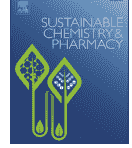

# 利用超声辅助溶剂提取法通过 RFS 和机器学习算法对矮氏茄属（Solanum Swartz）中的生物活性化合物进行绿色提取与优化

Priya Pethichuma a, Gorla Bhuchayagari Sumanth b, Selvaraj Kunjiappian a, Suthendran Kannan a, Suresh Babu Ram Panderian b, Krishnan Sundar a, c

- + a 生物技术系，Kalsakalai Academy of Research and Education, 626126, Tamil Nadu, 印度
- b 计算机科学与工程系，Kalsakalai Academy of Research and Education, 626126, Tamil Nadu, 印度
- c 信息技术系，Kalsakalai Academy of Research and Education, 626126, Tamil Nadu, 印度

## 文章信息

## 摘要

- + + 关键词：
- 矮氏茄（Solanum swartz*）
- 响应面分析法
- ANFIS
- 机器学习
- PCCD
- 超声辅助溶剂提取

通过超声辅助溶剂提取（UAE）方法从矮氏茄（Solanum swartz）中提取了具有生物学意义的酚类黄酮类类化合物及其自由基清除能力。采用响应面分析法中的自由基中心化中心设计（FCCD）来优化提取参数，并利用自适应模糊人工智能系统（ANFIS）以及机器学习算法模型来预测生物活性植物化学产物的产量。研究了提取参数——甲醇浓度（`X₁`: 55-66% v/w）、超声强度（`X₂`: 50-60 cm²）、温度（`X₃`: 30-45 °C）、时间（`X₄`: 15-25 min）以及颗粒大小（`X₅`: 0.5-1.5 mm）在每个水平（+2.3）对总酚（`TP`; `y₁`）、总黄酮类化合物（`y₂`）及其自由基清除能力（%DPPH% (`y₃`)、%ABTS% (`y₄`) 和 %ORAC% (`y₅₅`））优化产量的影响。最佳条件出现在 `X₁`: 65%、`X₂`: 40 cm²、`X₄`: 25 min 和 `X₅`: 1.5 mm，其中获得没食酸（GAE）最高含量 5.38 mg/g (`y₇`)，`y₈` = 75.22%，`y₉` = 85.02%。大部分实验结果与 RSM 模型的预测吻合良好。此外，还利用 ANFIS 和随机森林机器学习算法对优化的提取参数进行了比较和验证。同时，使用 GC-MS 和 LC-MS 研究了提取物中各种生物活性植物化学物质的存在。

## 1. 引言

癌症是最可怕的疾病，能够显著降低个体的生活质量，是导致死亡的主要原因（Stucker and Basu, 2011）。根据调查和数据收集，国际癌症研究机构（IARC）报告显示，2019 年有 1000 万死亡，2020 年有 1930 万死亡（Morgan et al., 2023）。预计 2040 年全球癌症病例数将达到 2840 万，比 2020 年增长了 47%（Yan et al., 2023）。目前，癌症治疗通过多种治疗策略进行，包括化疗、激素疗法、免疫疗法，以及随后的放射治疗（Yang et al., 2005）。尽管化疗药物在减轻癌症症状和延长患者寿命方面具有潜力，但许多化疗药物具有不良的副作用（Brianis, 2023）。利用天然、尤其是植物中的生物活性化合物可以增强药物发现领域。自然地，植物在其组织中提供了广泛的酚类次生代谢物，以保护自身免受各种病原体和疾病的影响（Ganes et al. 2018）。最近，植物活性化合物因其治疗潜力而受到更多关注（Chandrasekhar, 2020）。

多项研究表明，活性氧物（ROS）、活性氮物（RNS）水平过高以及 DNA 损伤会导致多种细胞功能异常（Veller et al., 2013; Kalimathu et al., 2021; Giringding et al. 2016）。事实上，自由基具有有益和损害的双重作用。

通过气相色谱-质谱法（GC-MS）和液相色谱-质谱法（LC-MS）鉴定了成分，确定了所选植物在医疗保健领域的应用潜力。

## 2. 实验部分

### 2.1. Solanum tor Sw. 果实

`S. torvam Sw.` 的果实采集自印度泰米尔纳德邦 Virunagagar 县 Srivilliputh 附近 Shenbagathoppu 山的西高地山（经度：7.6225; 9.5225）。果实表面用清水清洗并在阴处干燥两周。将干燥后的果实使用网状研磨机（Greenree Elects Ltd., Chennai, India）磨成细粉。然后使用多个筛网（35、25、18、16和2号）对粉末进行筛选，以获得不同粒径粉末（0.5、0.75、1.0、1.5 mm）。样品在实验开始前储存在空调房中（含水量：10 ± 2%）。

### 2.2. 化学试剂与试剂

溶剂比色试剂 ABTS、DPPH 由印度孟加罗 Sigma Aldrich 提供。甲醇、Folin-Ciocalteu 试剂、碳酸钠、氢化钠、氯化铝、过氧化氢（H2O2）购自印度孟买 HiMedia Pt. Ltd.。所有其他化学品和试剂均为分析或或等等级，购自印度 Merck 和 SRL Ltd.。

### 2.3. 超声辅助溶剂提取

使用超声辅助溶剂提取（UAE）从 `S. torvam Sw.` 细粉中提取活性植物化学成分。实验装置包括一个超声水浴（温度精度 ±1.0 °C，220 V，20 kHz 强度连续超声波处理器），以及一个容量为 25 ml 的夹套反应器（容量由印度 AC Pharma 评估）。使用日本 Shimadzu UV-1800 系列紫外-可见分光度计配合 UV Probe 262 软件测量植物化学成分的浓度。

### 2.4. 确定理想溶剂体系的初步实验

进行初步实验旨在根据 TF、TP 和 DPPH* 的浓度确定基于 `S. torvam Sw.` 的理想溶剂体系。初步实验使用了甲醇、乙醇、乙酸乙酯、乙醚、氯仿和正己烷等溶剂。在每个溶剂体系（20 ml 70% v/w 水）中使用 2 g `S. torvam Sw.` 粉末进行提取，提取条件为粒径：0.5 mm，超声强度：60 W，温度：65 °C。

### 2.5. 工艺参数的选择

选择五个提取参数（有序参数），即溶剂浓度（水中 55-66% v/w）、超声强度（50-60 W cm⁻²）、温度（30-45 °C）和时间（1.5-25 min），基于依赖参数（如总酚（TP）、总黄酮类（TF）、2,2'-2,1'-二苯基腼自由基（DPPH*）、2,2'-双(3-磺代丙基)-6-离子酸（ABTS）和过氧化氢（H2O₂））来测量 `S. torvam Sw.` 的抗氧化能力，以获得活性植物化学成分的产量。进一步比较，根据初步研究结果选择最佳溶剂为最优溶剂（表 1）。五个提取参数固定了五个值（-2.37（极低）、-1（低）、0（中）、+1（高）和 +2.37（极高）），见表2。

表 1

合适溶剂的初步筛选。

| 溶剂 | TPC | TFC | %DPPHc |
|---|---|---|---|
| 乙醇 | 419.45 | 320.42 | 67.25 |
| 甲醇 | 420.24 | 223.39 | 68.34 |
| 异醇 | 378.72 | 308.20 | 62.56 |
| 乙酸乙酯 | 372.85 | 307.63 | 63.70 |
| 乙醚 | 374.62 | 309.38 | 62.45 |
| 氯仿 | 381.45 | 312.45 | 61.65 |
| 正己烷 | 380.23 | 313.72 | 63.52 |

- * 所有实验重复三次。

### 2.6. 活性化合物的超声辅助溶剂提取

如所述，使用 2 g `S. torvam Sw.` 细粉样品在 20 ml 水中进行实验，改变不同的条件，如粉末粒径、温度、时间和超声强度。根据响应面法（RSM）的面心复合设计（CCD），提取在 40 °C 下使用旋转真空干燥器（印度 Buchi）进行浓缩并用 1 号纸过滤。初步实验提取物用于鉴定 TP、TF 和抗氧化能力。

表 2

面心复合设计（FCCD）的实验范围编码。

| 自变量 (xj) | 单位 | 编码变量 | -2.37（极低） | -1（低） | 0（中） | 1（高） | 2.37（极高） |
|---|---|---|---|---|---|---|---|
| 甲醇浓度 | % | `$X_1$` | 48.12 | 55 | 60 | 65 | 71.89 |
| 超声强度 | cm⁻² | `$X_2$` | 43.12 | 50 | 55 | 60 | 66.89 |
| 温度 | °C | `$X_3$` | 19.66 | 30 | 37.5 | 45 | 55.34 |
| 粒径 | mm | `$X_4$` | 8.12 | 15 | 20 | 25 | 31.89 |
| 时间 | | `$X_5$` | 0.19 | 0 | 0.5 | 1 | 2.19 |

### 2.7. 总多酚（TPF）的测定

使用光光法结合 Folin-Ciocalteu 试剂（Medina, 2011）测定总多酚含量。简而言之，将 5 ml 10 倍稀释的 Folin-Ciocalteu 试剂与 0.2 ml 每个提取物混合。向混合物加入 2 ml 7.5% 碳酸钠（Na$_2$CO$_3$）静置 5 分钟，然后在黑暗中放置一小时。使用分光度计在 765 nm 处测量吸光度。结果以每克样品没食酸 mg 表示。

### 2.8. 总黄酮类（TF）的测定

将 1 ml 每个样品与 0.3 ml 5% 甲醇混合，在黑暗下孵育 5 分钟。在室温下剧烈搅拌 6 分钟，然后加入 0.3 ml 10% 氢钠。使用紫外-可见分光度计在 510 nm 处测量吸光度。结果以每克样品没根皮碱 mg 表示。

### 2.9. 总多酚的测定

使用光光法结合 Folin-Ciocalteu 试剂（Medina, 2011）测定总多酚含量。简而言之，将 5 ml 10 倍稀释的 Folin-Ciocalteu 试剂与 0.2 ml 每个提取物混合。向混合物加入 2 ml 7.5% 碳酸钠（Na$_2$CO$_3$）静置 5 分钟，然后在黑暗中放置一小时。使用分光度计在 765 nm 处测量吸光度。结果以每克样品没食酸 mg 表示。

### 2.10. 总黄酮类的测定

将 1 ml 每个样品与 0.3 ml 5% 甲醇混合，在黑暗下孵育 5 分钟。在室温下剧烈搅拌 6 分钟，然后加入 0.3 ml 10% 氢钠。使用紫外-可见分光度计在 510 nm 处测量吸光度。结果以每克样品没根皮碱 mg 表示。

### 2.11. 抗氧化活性的测定

使用三种分析方法：DPPH、ABTS 和 H$_2$O$_2$ 评估提取物的抗氧化能力。每项分析均按照标准方案进行。

### 2.12. 使用 RSM 进行实验设计和参数优化

为了最大化 `S. turv Wm.` 活性化合物的产量（`Y`），通过 RSM 结合 FCCD 对超声辅助溶剂提取的编码参数（甲醇浓度、超声强度、温度、时间和粒径）进行了优化。使用了面心复合设计，包含 50 次实验运行，分为五个个水平。在该实验设计中，总计

基于表3，共有 50 个实验结果，包括 8 次中心点重复、距离中心 ±2.37 的 10 个轴向点 (`ai`) 以及 32 个因子点。独立参数根据下方的公式 (4) 进行编码：

```
xi = \frac{Xi-Xl}{\Delta XI} = 1, 2, 3,...,K
```

其中，`$Xi$` 是独立参数的无量纲值，`$X_1$` 是独立参数的真实值，`$X_2$` 是中心点独立参数的真实值；`$\Delta XI$` 是参数 `i` 值的真实变化，代表参数 `i` 的无量纲值的单位。总实验次数通过下述公式 (5) 计算：

```
N = 2^k (axial points) + 2k (axial points) + n0 (central points)
```

其中 `N` 是实验总数，`k` 是自变量，`n_0` 是中心点的重复次数，最终形成 50 次的实验设计。因变量与自变量之间的相关性通过将实验数据拟合二阶回归模型来确定。

以下是使用响应分析重建的二阶多项式模型：

```
$Y = a_0 + \sum_{i=1}^{k} a_iX_i + \sum_{i=1}^{k} a_{ii}X_i^2 + \sum_{i=1}^{k}\sum_{j=i+1}^{k} a_{ij}X_iX_j + \epsilon$
```

上述方程 (6) 根据下面的参数值编码：

```
$Y = a_0 + a_1X_1 + a_2X_2 + a_3X_3 + a_4X_4 + a_5X_5 + a_{11}X_1^2 + a_{22}X_2^2 + a_{33}X_3^2 + a_{44}X_4^2 + a_{55}X_5^2 + a_{12}X_1X_2 + a_{13}X_1X_3 + a_{14}X_1X_4 + a_{15}X_1X_5 + a_{23}X_2X_3 + a_{24}X_2X_4 + a_{25}X_2X_5 + a_{34}X_3X_4 + a_{35}X_3X_5 + a_{45}X_4X_5$
```

其中 `Y` 是因变量，`a_0` 是常数，`a_{ii}` 是模型系数，`X_{ij}` 是编码后的因变量，`$\epsilon$` 是误差。随后进行了进一步分析以确定实验结果的准确性。

## 2.3. 使用 ANFIS 建模进行优化

ANFIS（人工神经模糊推理系统）是 ANN（人工神经网络）的强大与 FIS（模糊推理系统）的高级人脑推理能力的结合（Tasadi and Pourirez, 2010）。换句话说，ANFIS 可以通过将 FIS 集成到神经网络框架中对结果进行建模。由于其有效性和推理能力，ANFIS 建模在许多工程和科学领域都有应用（Yuan et al., 2014）。它在分析输入与输出变量之间的线性和非线性关系方面非常有效。此外，ANN 的反向传播是训练基于 ANN 的模糊推理系统的首选技术（Azadeh et al., 2020）。考虑到方法构建的输入参数（聚类算法）、学习时间以及粒径，ANFIS 的输出将通过遗传算法进行优化。

- 规则 1：如果 X 处于 a1 和 a2 之间，则 f1 = p1x + q1y
- 规则 2：如果 X 处于 a2 和 b2 之间，则 f2 = p2x + q2y

使用试错法确定每个输入变量的特征数量。实验数据被分为网络模型的训练、测试和验证，以预测 *S. solymum* 中提取活性活性的植物化学成分。

## 2.4. 机器学习算法

一种涉及自动学习的技术，即随机森林，可用于分类和回归任务。随机森林将对数据进行分类和预测（Park et al., 2022）。随机森林回归器将选择连续的目标值。它是一种集成学习技术，利用多种决策树来产生更准确的模型。每棵决策树都是使用训练数据特征的随机子集训练的。这种方法减少了过拟合，并通过组合创建更精确、更可靠的预测。随机森林回归器的主要优势是它能够处理输入与目标值之间存在非线性连接的高维数据。实验变量 `X_1, X_2, X_3, X_4` 和 `X_5` 被用输入 `y_1, y_2`。

## 表 3

带有实验结果的面中心复合设计 (FCCD) 以及 RSM 预测、ANFIS 预测、ML 算法预测

| 序号 | 独立参数 | 实验结果* | RSM 预测 | ANFIS 预测 | ML 算法预测 |
| :--- | :--- | :--- | :--- | :--- | :--- |
| | `X_1` | `X_2` | `X_3` | `X_4` | `X_5` | `Y_1` | `Y_2` | `Y_3` | `Y_4` | `Y_5` | `Y_1` | `Y_2` | `Y_3` | `Y_4` | `Y_5` | `Y_1` | `Y_2` | `Y_3` | `Y_4` | `Y_5` |
| 1 | 60 | 45 | 30 | 15 | 5 | 174.29 | 273.85 | 55.35 | 60.74 | 471.66 | 287.87 | 53.83 | 58.52 | 60.58 | 474 | 55.45 | 49.98 | 268.57 | 50.18 | 62.00 |
| 2 | 60 | 45 | 30 | 15 | 5 | 317.29 | 230.77 | 44.21 | 48.22 | 468.80 | 293.61 | 44.64 | 49.03 | 61.51 | 457 | 54.2 | 378.04 | 242.96 | 41.57 | 46.08 |
| 3 | 60 | 45 | 30 | 25 | 5 | 265.62 | 183.43 | 73.11 | 75.55 | 775.23 | 500.00 | 73.10 | 78.09 | 70.37 | 777 | 73.5 | 751.77 | 265.48 | 69.98 |
| 4 | 50 | 45 | 30 | 35 | 5 | 152.28 | 143.08 | 38.02 | 41.34 | 395.99 | 271.37 | 39.97 | 41.95 | 328 | 419 | 42 | 439.25 | 270.34 | 37.29 |
| 5 | 60 | 45 | 30 | 35 | 5 | 375.25 | 468.02 | 27.12 | 55.11 | 665.25 | 369.29 | 36.20 | 41.50 | 410 | 471 | 42 | 32.54 | 37.17 | 38.21 |
| 6 | 60 | 45 | 30 | 35 | 5 | 468.83 | 276.92 | 35.11 | 55.11 | 665.25 | 369.29 | 36.20 | 41.50 | 415 | 468 | 42 | 32.54 | 37.17 |


| 7 | 60 | 45 | 30 | 45 | 5 | 145.85 | 115.13 | 57.11 | 62.58 | 591.25 | 381.09 | 53.78 | 58.56 | 558 | 541 | 42 | 394.93 | 251.62 | 59.16 |

| 8 | 60 | 45 | 30 | 45 | 5 | 330.13 | 187.89 | 63.33 | 73.59 | 776.48 | 415.05 | 74.49 | 78.76 | 702 | 790 | 42 | 498.77 | 472.12 |

| 9 | 60 | 45 | 30 | 45 | 5 | 105.75 | 400.82 | 62.23 | 69.18 | 732.66 | 490.20 | 67.12 | 71.65 | 712 | 700 | 42 | 498.61 | 194.73 |

| 10 | 60 | 45 | 30 | 55 | 5 | 370.05 | 246.92 | 31.11 | 44.12 | 675.65 | 403.69 | 36.29 | 41.50 | 415 | 478 | 42 | 372.56 | 37.17 |

| 11 | 60 | 45 | 30 | 55 | 5 | 468.83 | 276.92 | 35.11 | 55.11 | 665.25 | 369.29 | 36.20 | 41.50 | 415 | 468 | 42 | 32.54 | 37.17 |

| 12 | 60 | 45 | 30 | 55 | 5 | 397.25 | 363.13 | 52.12 | 64.55 | 724.68 | 462.11 | 71.42 | 76.65 | 715 | 728 | 42 | 715 | 418.99 |

| 13 | 60 | 45 | 30 | 55 | 5 | 317.25 | 363.13 | 70.12 | 76.48 | 724.68 | 462.11 | 71.48 | 76.65 | 715 | 728 | 42 | 745 | 737.715 | 41.5 |

| 14 | 60 | 45 | 30 | 65 | 5 | 456.74 | 276.92 | 33.11 | 44.12 | 675.65 | 403.69 | 36.29 | 41.50 | 415 | 478 | 42 | 475 | 372.56 |

| 15 | 50 | 45 | 30 | 65 | 5 | 206.15 | 332.11 | 56.37 | 66.52 | 367.03 | 362.11 | 56.07 | 61.56 | 351 | 321 |

| 16 | 60 | 45 | 30 | 65 | 5 | 215.15 | 363.13 | 70.12 | 76.48 | 724.68 | 462.11 | 71.48 | 76.65 | 715 | 728 |

| 17 | 60 | 45 | 30 | 75 | 5 | 174.11 | 385.18 | 58.59 | 63.68 | 497.24 | 453.11 | 48.17 | 51.32 | 519 | 521 |

| 18 | 60 | 45 | 30 | 75 | 5 | 445.25 | 314.14 | 39.38 | 44.52 | 494.16 | 444.89 | 49.81 | 538 | 534.9 |

| 19 | 60 | 45 | 30 | 75 | 5 | 529.39 | 436.16 | 48.43 | 52.96 | 598.11 | 448.53 | 53.58 | 532 | 584 |

| 20 | 60 | 45 | 30 | 75 | 5 | 608.45 | 511.13 | 63.55 | 70.73 | 668.25 | 435.99 | 63.18 | 662 | 584 |

| 21 | 60 | 45 | 30 | 75 | 5 | 318.98 | 230.77 | 31.11 | 44.12 | 675.65 | 403.69 | 36.29 | 41.50 | 478 |

| 22 | 60 | 45 | 30 | 85 | 5 | 397.25 | 363.13 | 42.12 | 52.55 | 724.68 | 462.11 | 71.42 | 76.65 | 715 |

| 23 | 60 | 45 | 30 | 85 | 5 | 343.95 | 368.12 | 39.11 | 44.52 | 724.68 | 462.11 | 47.12 | 76.65 | 715 |

| 24 | 50 | 45 | 30 | 95 | 5 | 223.85 | 331.11 | 56.37 | 66.52 | 367.03 | 362.11 | 56.07 | 61.56 | 351 |

| 25 | 60 | 45 | 30 | 95 | 5 | 226.86 | 454.11 | 73.52 | 80.38 | 708.23 | 512.10 | 78.52 | 718 |

| 26 | 60 | 45 | 30 | 95 | 5 | 151.38 | 360.24 | 49.23 | 53.16 | 538.11 | 348.99 | 49.81 | 539 |

| 27 | 60 | 45 | 30 | 95 | 5 | 149.75 | 203.77 | 32.74 | 37.62 | 358.21 | 287.87 | 32.4 | 37.62 | 308 |

| 28 | 60 | 45 | 30 | 95 | 5 | 151.38 | 360.24 | 49.23 | 53.16 | 538.11 | 348.99 | 49.81 | 53.95 |

| 29 | 60 | 45 | 30 | 105 | 5 | 154.14 | 318.38 | 47.54 | 53.24 | 417.68 | 314.19 | 41.19 | 45.24 | 408 |

| 30 | 60 | 45 | 30 | 105 | 5 | 215.45 | 398.12 | 68.12 | 73.52 | 498.13 | 345.11 | 68.12 | 73.52 | 498 |

| 31 | 60 | 45 | 30 | 105 | 5 | 223.85 | 331.11 | 56.37 | 66.37 | 665.25 | 369.29 | 36.27 | 61.50 |

| 32 | 60 | 45 | 30 | 105 | 5 | 317.25 | 331. 1 | 44. | | | 44.. | | 44. |  | |  | | |  | 33 | 50 | 45 | 30 | 105 | 5 | 152.28 | 143.08 | 38.02 | 41.34 | 395.99 | 271.37 | 39.97 | 41.50 | 415 |

| 34 | 60 | 45 | 30 | 105 | 5 | 375.25 | 468.02 | 27.12 | 55.11 | 665.25 | 369.29 | 36.20 | 41.50 | 415 |

| 35 | 60 | 45 | 30 | 105 | 5 | 198.68 | 331.11 | 56.37 | 66.52 | 367.03 | 362.11 | 56.07 | 61.56 | 351 |

| 36 | 60 | 45 | 30 | 105 | 5 | 375.25 | 468.02 | 27.12 | 55.11 | 665.25 | 369.29 | 36.20 | 41.50 | 415 |

| 37 | 60 | 45 | 30 | 105 | 5 | 149.75 | 203.77 | 32.74 | 37.62 | 358.21 | 287.87 | 32.4 | 37.62 | 308 |

| 38 | 55 | 45 | 30 | 105 | 5 | 152.28 | 143.08 | 38.02 | 41.34 | 395.99 | 271.37 | 39.97 | 41.50 | 415 |

| 39 | 60 | 45 | 30 | 105 | 5 | 399.68 | 538.12 | 69.11 | 69.98 | 704.21 | 483.11 | 69.1 | 69.98 | 704 |

| 40 | 60 | 45 | 30 | 105 | 5 | 399.98 | 538.12 | 69.11 | 69.98 | 704.21 | 483.11 | 69.1 | 69.98 | 704 |

## 表 3（续）

| 序号 | 独立参数 | 实验响应 | RSM 预测响应 | ANFIS 预测响应 | ML 算法预测响应 |

|---|---|---|---|---|---|---|---|---|---|---|---|---|---|---|---|---|---|---|---|---|---|---|

| | | X1 | X2 | X3 | Y1 | Y2 | Y3 | Y4 | Y1 | Y2 | Y3 | Y4 | Y1 | Y2 | Y3 | Y4 | Y5 |

| 42 | 60 | 55 | 37.5 | 8.1 | 472.34 | 227.69 | 35.7 | 43.66 | 55.22 | 522.17 | 270.52 | 43.37 | 50.23 | 59.82 | 474 | 228 | 35.7 | 55.2 | 481.14 | 244.47 | 36.48 | 43.36 | 54.10 |

| 43 | 60 | 55 | 37.5 | 20 | 513.38 | 276.92 | 40.11 | 47.11 | 52.43 | 465.10 | 263.99 | 66.61 | 71.80 | 74.17 | 474 | 268 | 37.1 | 52.2 | 475.56 | 267.85 | 37.17 | 42.31 | 51.81 |

| 44 | 65 | 50 | 30 | 15 | 570.98 | 440 | 65.53 | 71.66 | 75.76 | 789.33 | 467.19 | 66.61 | 71.80 | 74.17 | 771 | 440 | 65.5 | 71.7 | 757.73 | 455.05 | 67.56 | 73.15 | 75.72 |

| 45 | 60 | 55 | 37.5 | 31.9 | 683.01 | 406.14 | 62.14 | 67.85 | 74.12 | 597.31 | 344.48 | 49.53 | 56.79 | 66.83 | 608 | 406 | 61.2 | 67.8 | 596.50 | 365.80 | 52.89 | 53.99 | 65.19 |

| 46 | 60 | 55 | 37.5 | 20 | 471.23 | 276.92 | 32.11 | 38.11 | 39.55 | 465.10 | 263.99 | 36.20 | 41.09 | 51.75 | 474 | 268 | 31.7 | 42 | 472.56 | 267.85 | 37.17 | 42.1 | 51.81 |

| 47 | 65 | 50 | 30 | 15 | 648.45 | 315.15 | 35.1 | 43.15 | 46.15 | 528.33 | 320.28 | 38.13 | 43.13 | 51.75 | 671 | 315 | 37.1 | 44.1 | 715.20 | 317.58 | 37.17 | 40.84 | 56.45 |

| 48 | 65 | 50 | 25 | 15 | 808.87 | 483.08 | 71.66 | 74.11 | 75.35 | 868.99 | 505.83 | 75.02 | 78.33 | 80.32 | 809 | 483 | 71.7 | 74.1 | 802.88 | 474.26 | 71.49 | 75.42 | 76.75 |

| 49 | 55 | 50 | 45 | 15 | 808.37 | 293.85 | 30.56 | 35.22 | 44.21 | 492.26 | 315.08 | 39.34 | 41.01 | 51.81 | 489 | 294 | 30.6 | 35.2 | 442.14 | 290.87 | 33.64 | 37.58 | 48.27 |

| 50 | 55 | 50 | 30 | 15 | 1550.08 | 310.77 | 33.43 | 46.66 | 451.82 | 247.63 | 34.12 | 39.23 | 49.18 | 489 | 550 | 33.1 | 36.7 | 481.36 | 278.83 | 34.86 | 38.68 | 49.78 |

* 所有实验均重复三次。


图 1. 本研究的输入和输出数据。`Y3`, `Y4`, 和 `Y5` 用于输出单位。首先导入数据集以产生预测，然后进行预处理以确定数据集是否存在缺失或噪声数据。

### 2.15 验证实验

为了确保实验有效，研究了优化结果的有效性。比较平均实验结果以评估模型的效率。在这种情况下，对不同响应进行了三次重复实验。

### 2.16 GC-MS 和 LC-MS 分析

气相色谱质谱法 (GC-MS) 分析使用非极性 RTX95 柱和岛津 Q-2010 GC-MS 系统进行，以氦作为载气，压力恒定为 15 psi。识别并描述了优化提取物中的生物活性化合物。通过将四极管检测器的色谱峰结果与美国标准与技术研究院 (2014) 库比较，确定了从 *S. swrv* 提取的化学化合物。从获得的质谱中识别了 62,509 个图谱。液相色谱质谱法 (LC-MS) 分析使用带有 Chorus 的 1290 UHPLC 和 6500 Ion QTOF (Agilent Technologies, USA) 根据之前描述的协议 (Chowdhury 等，2018) 进行。

### 2.17 统计分析

所有调查均基于 RSM BCC 进行并重复三次。使用实验设计软件（版本 8.0.7.1, Stat-Ease, Inc.,227 Hennepin Ave, Suite 480, Minneapolis, MN 55413, USA）处理从提取过程中收集的所有实验数据。使用单因素方差分析 (ANOVA) 和 Duncan 检验评估分析强度。所有收集的数据以平均值 ± 标准差表示。使用等高线和三维 (3D) 曲面图确定提取条件。使用 Microsoft Excel 2010 配合 MATLAB v2013a 中的自适应神经模糊工具箱进行统计分析。

## 3 结果与结论

### 3.1 拟合模型

使用 RSM BCC 成功优化了实验参数。该实验设计基于超声辅助提取参数的线性、交互和二次因子条件，以获得从 *S. swrv* 中产量生物活性化合物。表 3 预测了 *S. swrv* 的实验 `DPPH%`、`ABTS%` 和 `H2O2` 清除活性。超声辅助溶剂提取表明，多酚化合物、总胡萝卜素含量和黄酮的预测值在65% 介质、60 `cm^-2` 超声强度、45 °C、15 分钟和 0.5 mm 粒径下达到优化值。发现优化条件下产量分别为 83.66 mg/mL、53.38 mg/mL、77.52 `DPPH%`、81.12 `ABTS%` 和 85.02 `H2O2%`。结果与早期的研究工作一致，这些工作证明了从 *Garcinia indica* (Kanjappan 等，2020) 和 *Azolla mylla* (Selvaraj 等，2014) 中含有最多的生物活性化合物。通过检查多因素的影响并进行方差分析，实验数据拟合描述了

### 3.2 曲面研究

表 3 给出了使用超声辅助溶剂提取获得总多酚化合物的实验值和结果。进行方差分析 (ANOVA) 以估计回归模型的显著性。从表 4 的数据和方程 (7) 可以清楚地看出甲醇浓度 (`X1`) 和粒径 (`X2`) 是显著的，而超声强度 (`X3`) 和时间 (`X4`) 的影响不显著。此外，超声辅助提取总多酚模型的回归系数显示拟合欠缺 (`R = 0.2704; R^2 = 0.01`)。总多酚超声辅助提取模型的模型通过以下方程给出：

```
Y2 = 26.939 + 16.296X1 + 6.91X2 + 3.113X3 + 17.4X4 - 17.16X5 - 5.84X6 - 5.00X7 - 8.46X8 - 2.693X9 - 2.212X10 + 0.814X11 + 8.444X12 - 6.828X13 - 3.36X14 + 6.78X15 + 19.18X16 - 13.5X17 + 7.62X18 + 5.05X19
```

图 (2a) 显示了 `X1`, `X2`, `X3` 和 `X4` 的残差，它们呈正态分布。图 (2b) 显示了预测值与实验值之间的差异。图 (2c) 显示了甲醇浓度 (`X1`) 和超声强度 (`X3`) 的等高线图。图 (2d) 显示了总多酚的响应曲面，其在 `R^2 = 0.711` 的情况下拟合良好。总黄酮的二次模型显示 `0.008 unit`。

### 3.3 抗氧化能力 (%DPPH%, %ABTS% 和 %H2O2%)

根据表 3 的 RSM 设计统计分析和方程 (9)-(11)，甲醇浓度 (`X1`)、粒径 (`X3`)、交互项 `X1X3` 以及二次项 `X1^2` 的线性项对三种抗氧化能力均有显著影响。

## 二次多项模型的方差分析 (ANOVA)。

| 来源 | 平和 | 自由度 | 平方 | F值 | p值 |

|---|---|---|---|---|---|

| TPC (y1) 模型 | 843.800 | 20 | 42188.27 | 4.14 | 0.0003 |

| `X1` | 6259.86 | 4 | 6251.86 | 6.14 | 0.0192 |


| $X_2$ | 3370.88 | 4 | 832.72 | 0.3390 | 0.0569 |
| $X_3$ | 91.04 | 4 | 91.04 | 0.0089 | 0.9253 |
| $X_4$ | 10984.82 | 1 | 10984.82 | 1.06 | 0.3116 |
| $X_1X_2$ | 499.00 | 4 | 499.00 | 48.90 | <0.0001 |
| $X_1X_3$ | 1393.15 | 4 | 1393.15 | 0.119 | 0.0148 |
| $X_1X_4$ | 119.89 | 4 | 119.89 | 0.0918 | 0.1544 |
| $X_2X_3$ | 21923.02 | 4 | 21923.02 | 2.15 | 0.0076 |
| $X_2X_4$ | 83943.55 | 4 | 83943.55 | 8.24 | 0.0001 |
| $X_3X_4$ | 1452.96 | 4 | 1452.96 | 0.1426 | 0.7084 |
| $X_1^2$ | 21.86 | 4 | 21.86 | 0.0021 | 0.9634 |
| $X_2^2$ | 3167.31 | 4 | 3167.31 | 0.3109 | 0.5814 |
| $X_3^2$ | 6462.46 | 4 | 6462.46 | 0.6353 | 0.3623 |
| $X_4^2$ | 8730.34 | 4 | 8730.34 | 0.857 | 0.3622 |
| 残差 | 1192.58 | 10 | 1192.58 | 0.1171 | 0.7347 |
| 总计 | 43067.33 | 42 | 1025 | | 0.0489 |
| TPC (y1) 模型 (续) | 7887.36 | 4 | 7887.36 | 0.7742 | 0.3862 |
| 残差 | 15715.34 | 10 | 15715.34 | 1.524 | 0.2242 |
| 总计 | 204.00 | 25 | 204.00 | 20.62 | 0.0001 |
| TPC (y2) 模型 | 350.10 | 20 | 17506.81 | 3.58 | 0.0009 |
| $X_1$ | 11492.32 | 4 | 11492.32 | 2.35 | 0.136 |
| $X_2$ | 2066.87 | 4 | 2066.87 | 0.4229 | 0.5206 |
| $X_3$ | 417.71 | 4 | 417.71 | 0.0875 | 0.7721 |
| $X_4$ | 1317.09 | 4 | 1317.09 | 2.68 | 0.1123 |
| $X_1X_2$ | 1945.05 | 4 | 1945.05 | 39.74 | <0.0001 |
| $X_1X_3$ | 1092.97 | 4 | 1092.97 | 0.2236 | 0.6398 |
| $X_1X_4$ | 819.00 | 4 | 819.00 | 0.1638 | 0.6889 |
| $X_2X_3$ | 2289.94 | 4 | 2289.94 | 0.4685 | 0.4991 |
| $X_2X_4$ | 40066.42 | 4 | 40066.42 | 8.227 | 0.0002 |
| $X_3X_4$ | 230.86 | 4 | 230.86 | 0.0472 | 0.8295 |
| $X_1^2$ | 144.48 | 4 | 144.48 | 0.0296 | 0.8647 |
| $X_2^2$ | 2370.77 | 4 | 2370.77 | 0.4851 | 0.4917 |
| $X_3^2$ | 1261.21 | 4 | 1261.21 | 0.2581 | 0.6153 |
| $X_4^2$ | 355.89 | 4 | 355.89 | 0.0728 | 0.7892 |
| 残差 | 2581.52 | 10 | 2581.52 | 0.5282 | 0.4739 |
| 总计 | 20659.09 | 44 | 20659.09 | 2.111 | 0.1573 |
| 残差 | 3321.53 | 10 | 3321.53 | 0.6796 | 0.4164 |
| 拟合误差 | 108.60 | 29 | 108.60 | 22.22 | 0.0001 |
| 残差 | 14179.20 | 29 | 14179.20 | 23.57 | 0.0001 |
| 总计 | 18877.75 | 7 | 269.64 | |

表 4 (续)

| 来源 | 平和 | 自由度 | 平方 | F值 | p值 |
|---|---|---|---|---|---|
| $X_4$ | 154.53 | 1 | 154.53 | 1.96 | 0.1722 |
| $X_5$ | 222.08 | 1 | 222.08 | 2.82 | 0.0141 |
| $X_6$ | 78.06 | 1 | 78.06 | 0.9897 | 0.3281 |
| $X_1^2$ | 191.69 | 1 | 191.69 | 2.43 | 0.1259 |
| $X_2^2$ | 191.69 | 1 | 191.69 | 2.43 | 0.1259 |
| $X_3^2$ | 910.68 | 1 | 910.68 | 11.55 | 0.0020 |
| $X_4^2$ | 65.66 | 1 | 65.66 | 0.8324 | 0.3691 |
| $X_5^2$ | 182.45 | 1 | 182.45 | 2.31 | 0.1391 |
| 残差 | 2083.5 | 21 | 99.21 | 26.41 | 0.0001 |
| 拟合误差 | 2287.48 | 29 | 78.88 | | |
| 误差 | 1919.48 | 22 | 87.25 | 1.66 | 0.2527 |
| 总计 | 3608 | 72 | 52.57 | | |

| 来源 | 平和 | 自由度 | 平方 | F值 | p值 |
|---|---|---|---|---|---|
| $X_1$ | 1111.49 | 1 | 1111.49 | 14.56 | <0.0001 |
| $X_2$ | 19.63 | 1 | 19.63 | 0.2572 | 0.6159 |
| $X_3$ | 22.59 | 1 | 22.59 | 0.2959 | 0.5906 |
| $X_4$ | 129.29 | 1 | 129.29 | 1.69 | 0.2034 |
| $X_5$ | 3314.35 | 1 | 3314.35 | 43.44 | <0.0001 |
| $X_6$ | 52.12 | 1 | 52.12 | 0.6828 | 0.4154 |
| $X_7$ | 10.9 | 1 | 10.9 | 0.1429 | 0.7822 |
| $X_8$ | 112.2 | 1 | 112.2 | 1.47 | 0.2352 |
| $X_9$ | 576.49 | 1 | 576.47 | 7.75 | 0.0102 |
| $X_{10}$ | 74.79 | 1 | 74.79 | 0.9997 | 0.3350 |
| $X_{11}$ | 30.73 | 1 | 30.73 | 0.4026 | 0.5307 |
| $X_{12}$ | 100.47 | 1 | 100.47 | 1.32 | 0.2609 |
| $X_{13}$ | 141.46 | 1 | 141.46 | 1.85 | 0.1839 |
| $X_{14}$ | 18.21 | 1 | 18.21 | 0.2386 | 0.6289 |
| $X_{15}^2$ | 198.1 | 1 | 198.1 | 0.048 | 0.3117 |
| $X_{16}^2$ | 74.41 | 1 | 74.41 | 0.937 | 0.3677 |
| $X_{17}^2$ | 795.46 | 1 | 795.46 | 10.42 | 0.0031 |
| $X_{18}^2$ | 61.43 | 1 | 61.43 | 0.8048 | 0.3370 |
| 残差 | 270.54 | 1 | 270.54 | 3.54 | 0.0698 |
| 残差 | 1080.98 | 21 | 51.47 | 12.48 | 0.0014 |
| 拟合误差 | 2512.26 | 29 | 86.63 | | |
| 误差 | 1344.36 | 22 | 61.11 | 0.61 | 0.9663 |
| 总计 | 1167.8 | 7 | 166.83 | | |

二次模型表明数据拟合良好。编码变量的 %DPPH、%ABTSC、%H2O2 的二次方程如 (9–11)。

```
%DPPH(X) = 36.2 + 4.47 + 0.3972X_1 + 1.37X_2 + 1.64X_3 - 8.85X_1 - 3.19X_2 - 2.15X_3 - 4.01X_1X_2 + 1.095X_1 - 1.088X_2 + 2.25X_3 - 2.643X_1X_2 - 2.65X_1X_3 + 2.85X_1 + 4.03X_2 + 1.8X_1^2 + 7.2 + 7.62X^2
```

```
%ABTSC(Y) = -41.0 + 50.07 + 0.76372X_1 + 0.76338X_2 - 9.308X_3 - 12.28X_1 - 0.6440X_2 - 2.35X_3 + 2.44X_1 - 1.85X_1 - 1.45X_2 + 2.773X_3 - 2.64X_1 + 0.8106X_2 - 2.02X_3 + 1.15X_1^2 + 3.76X_2^2 + 1.05X_3^2 + 2.20X^2 + 7.34X^2
```

```
%H2O2(Y) = -51.5 + 57.5 + 0.0401X_1 + 0.0635X_2 + 1.48X_3 - 0.55X_1 + 0.0603X_2 - 0.7984X_1 - 4.15X_1 + 2.44X_2 + 2.81X_1 + 0.9791X_2 - 2.64X_1 - 2.61X_3 - 0.5648X_1 + 1.31X_2^2 + 3.023X_3^2 + 2.05X^2 + 5.49X^2
```

# 可持续化学与药学 36 (2023) 101323

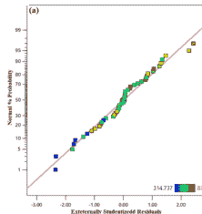
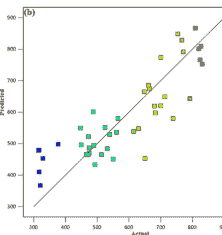
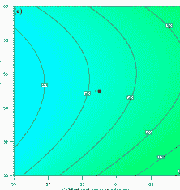
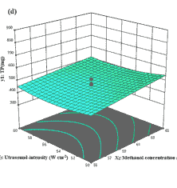
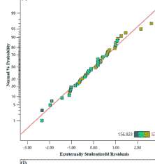
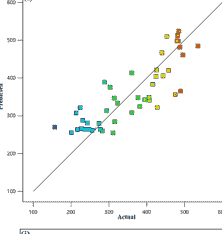
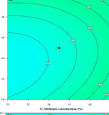
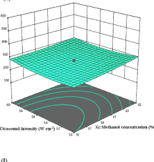
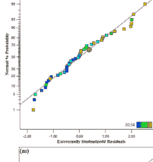
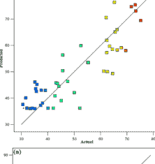
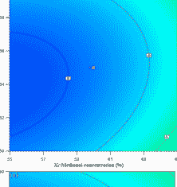
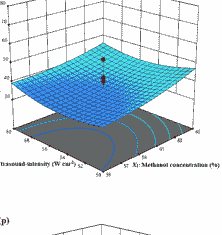
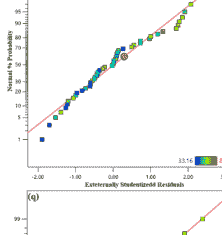
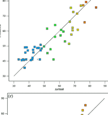
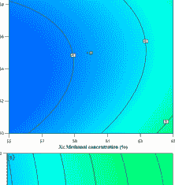
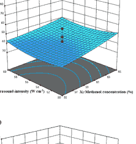
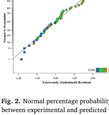
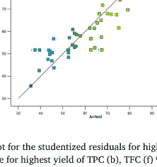
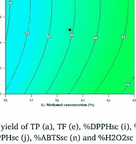
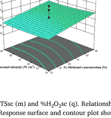

图 2. TP (a)、TF (e)、%DPHisc (i)、%ABSc (m) 和 %H2O2sc (q) 最高产率的标准化残差正态百分比概率图。TP (b)、TF (f)、%DPHisc (j)、%ABSc (n) 和 %H2O2sc (r) 最高产率实验值与预测值之间的关系。响应面和等高线图显示了在时间和颗粒粒径固定在特定水平时，分别对应 (c), (k), (o), (s) 和 (d), (h), (l), (p), (t) 对 TP、TPC、%DPHisc、%ABSc 和 %H2O2sc 混合浓度 (`X_m`) 和温度 (`X_t`) 的共同影响。

# P. Petichamuthu 等人

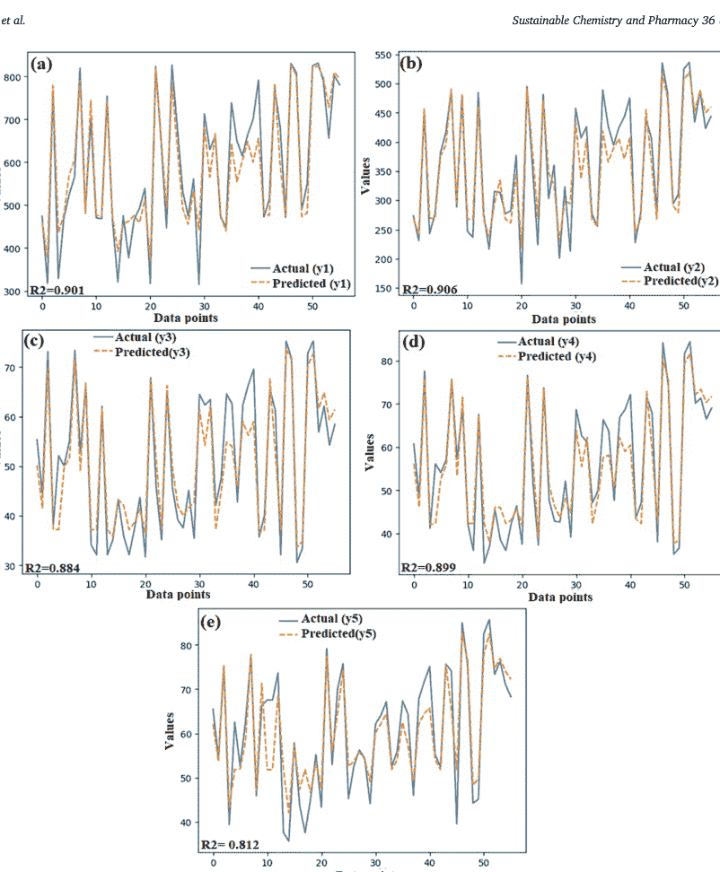

图 3. 机器学习算法验证了实验值和预测值。

这些是在理想情况下引起的，并随着表 5 中数值的变化发生轻微变化。实验结果表明，植物材料的甲醇浓度 (`X_1`) 和颗粒粒径 (`X_4`) 对姜黄（Turmeric Sw）生物活性植物化学物质的总产量有显著影响，最佳条件为：45 ° 温度、62.5-75% 甲醇浓度、57-6.2 W/cm 超声波强度、20 min 以及 0.4-0.6 mm 的颗粒粒径。总多酚、总黄酮类、%DPPC、%DPHC、%ABTS$_{sc}$ 和 %H$_2$O$_{sc}$ 的优化条件分别为 831.41 mg、538.76 mg 芦皮素当量 (GAE)/RE)、75.25%、84.36% 和 85.72%，而 RSM 预测值分别为 799.17 mg 没食酸等当量 (GAE)/g 总提取物、504.53 mg 芦皮素当量 (GAE)/g 总提取物。通过标尺查看器（图 4）观察到相应数值的变化。标尺查看器具有内置权重优化和模糊化技术。模型预测值的响应变量允许对模型进行额外验证。在提取参数优化（`X_1 = 67.5%` 甲醇浓度，`X_2 = 6` W/cm 超声，`X_3 = 45` °C，）条件下，总多酚、总黄酮类、%DPHC、%ABTS$_{sc}$ 和 %H$_2$O$_{sc}$ 分别为645 mg 没食酸等当量 (GAE/GAE)、53.9%、60.2% 和 6.1%。

# 表 5 基于响应组合的优选条件下实验值与预测值的验证。

| 序号 | 独立变量 | 实验响应* | 预测值 | ANFIS 预测值 | ML 算法预测值 |
|---|---|---|---|---|---|
| | `X_1` | `X_2` | `X_3` | `X_4` | `Y_1` | `Y_2` | `Y_3` | `Y_4` | `Y_5` | `Y_1` | `Y_2` | `Y_3` | `Y_4` | `Y_5` | `Y_1` | `Y_2` | `Y_3` | `Y_4` |
| 1 | 62.5 | 60 | 45 | 0.5 | 825 | 525 | 71.6 | 83.6 | 740 | 463 | 60.8 | 68.1 | 77.2 | 815 | 519 | 70 | 81 | |
| 2 | 67.5 | 60 | 45 | 0.5 | 831.4 | 538.8 | 75.2 | 84.4 | 85.7 | 799.2 | 504.5 | 71.5 | 81.5 | 839 | 520 | 72 | 82.6 | |
| 3 | 67.5 | 60 | 45 | 0.5 | 835.9 | 548.2 | 78.2 | 89.1 | 862 | 552 | 73.3 | 81.5 | 845 | 539 | 72.4 | 83.7 | |
| 4 | 65 | 62.5 | 45 | 0.5 | 865.9 | 487.4 | 61.1 | 73.3 | 762.7 | 491.1 | 64.5 | 69.5 | 77.2 | 789 | 479 | 61.7 | 72.2 | |
| 5 | 65 | 60 | 45 | 0.6 | 802.6 | 423.3 | 54.3 | 66.5 | 710.0 | 433.5 | 60.8 | 68.0 | 740 | 436 | 61.6 | 70 | 72.9 |
| 6 | 65 | 60 | 45 | 0.4 | 780.8 | 443.9 | 58.4 | 69.0 | 836.7 | 519.7 | 72.5 | 79.7 | 786 | 519 | 70.5 | 81.7 | |

* 所有实验均重复了三次。

# P. Pichimutu 等人

丰度

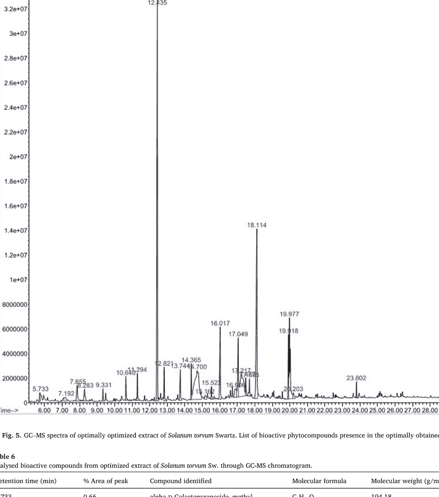

图 5. 优化*Solanum torvum* Swart. 提取物的 GC-MS 谱图。优化提取物中所含生物活性化合物列表。

表 6

通过 GC-MS 色谱法分析的优化*Solanum torvum* Sw. 提取物活性化合物。

| 保留时间 (min) | 峰面积百分比 | 鉴定化合物 | 分子式 | 分子量 (g/mol) |
| --- | --- | --- | --- | --- |
| 5.733 | 0.66 | 甲基 α-t-胃果糖苷苷 | C21H32O9 | 194.18 |
| 8.283 | 1.38 | 甲胺 | CH5N | 31.057 |


| 9.331 | 0.61 | 噻喃-4-酮 | C5H6O2 | 126.11 |
| 11.294 | 1.43 | 5-羟甲基糠醛 | C6H8O3 | 126.11 |
| 12.281 | 1.68 | 3(2H)-呋酮 | C4H6O2 | 84.07 |
| 14.935 | 1.79 | 香草醛 | C8H8O3 | 152.15 |
| 15.162 | 0.63 | 甲基- $\alpha$-D-鼠糖苷苷 | C15H24O7 | 178.12 |
| 16.906 | 1.91 | 3-乙硫基-1-丙烷 | C5H10OS | 102.2 |
| 17.477 | 1.05 | 对甲氧苯甲酸酯 | C10H12O3 | 206.24 |
| 17.695 | 1.12 | (4-甲基苯基)硫丙酮 | C11H14OS | 196.27 |
| 19.918 | 3.70 | 反式反脂酸 | C10H16O2 | 182.25 |

# P. Petichimuttu 等人

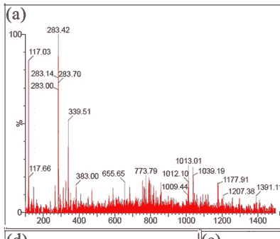
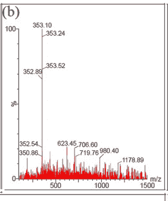
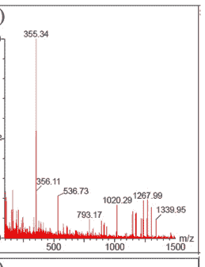
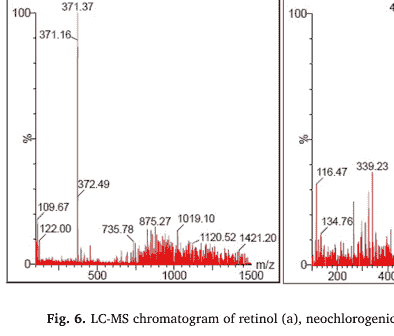
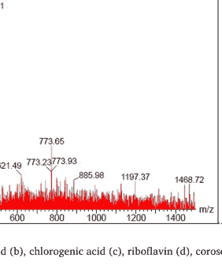
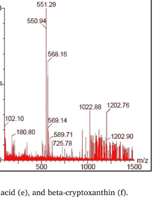

图 6: 视黄醇 (a)、新绿原酸 (b)、氯绿原酸 (c)、核黄素 (d)、松脂 (e) 和 $\beta$-辣椒红素 (f) 的 LC-MS 色谱图。

## 作者贡献声明

**Priya Petichimuttu**: 概念化、形式分析、调查、撰写——初稿拟备。**Krishnan Shankar**: 监督、验证、资金获取、撰写——审阅与编辑。**Selvaraj Kunjiaappan, Suthendran Kanan**: 概念化、验证、撰写——审阅与编辑。**Seshubram Ram Kumarian and Gorla Bhuchayyagari Suman**: 调查、验证、撰写——初稿拟备。

## 利益冲突声明

作者声明，没有已知的竞争性利益或个人关系可能影响本文所报道的工作。

## 数据可用性

本文描述的研究未使用任何数据。

## 致谢

作者感谢 Kalasalingam 研究与教育学院管理层提供的研究设施。作者感谢印度生物技术部 DBT-NER 项目 (`BT/PR45283/NER/95/2022`)。

## 附录 A 补充数据

Selvaraj, K., Theivakaran, P., Pavadai, P., Ravishankar, V., Palanisamy, P., Gopal, M., Dharamaling, S.R., Sankaranarayanan, M., 2022. 基于模糊系统的态度控制系统。硕士论文。埃塞俄比亚亚迪斯亚贝巴大学。

Alehaytu, A., Wang, G., Duruis, R., Massari, M., 2016. 利用超声波提取法提取桃子和李子中的酚类。PLoS One 11(2), e014758. https://doi.org/10.1371/journal.pone.014758.

Ayer, A. S. 纳米技术对聚合物材料发展的影响。应用实验的设计学习 157-169. https://doi.org/10.1002/chem.7369.

Azad, A., Shahrizadeh, A., Ghansari, G., 2020. 基于神经网络框架的更新。International Journal of Public Health 58(6), 697-705.

Baskargaran, S., Teeneepan, P., Palaniamani, K., Samkan, V., Arumugalam, S., Sankarsaran, M., Mohan, U., Rajkumar, L., 2019. J. Food Chem. 33, 2773-2789. https://doi.org/10.1016/j.food.8732.

Bera, S., Lee, C., 2020. 茶如何减少其影响以及如何影响健康。Menopause 63, 555-560. https://doi.org/10.1007/s12560-020-0719.

Canals-Rodriguez, L., Harrocaut-Sichau, C., Vargas, A., Aournier, F., Girard, J., Jarmet, M., 2015. 评估榴籽降低金属含量和增强抗氧化能力的潜力。Food Chemistry 186, 215-220. https://doi.org/10.1016/j.foodchem.0465.

Chandra, H., Meena, M., Parul, T., Sharma, K., 2019. 榴籽提取物作为减少脂质氧化和增强重要食品稳定性的防腐剂。Food Control 96, 10764. https://doi.org/10.1016/j.foodcont.10764.

Cuthbert, A., Paramesvam, P., Samkan, V., Chandrasubaram, S., Sankarsaran, M., Bakarajaraj, S., 2018. 使用本土和可食用提取物优化榴籽的抗氧化活性。Int. J. Food Res. 39, 221-244. https://doi.org/10.5064/ijfr.3994.

El-Hady, M., El-Sayed, M., Helwan, K., 2012. 黑樱桃皮的超声波提取和抗氧化特性。Science. Food Technol. 42, 93-97. https://doi.org/10.1016/j.food.2012.0914.

Di Silva, L. A., Perini, P., Souza, S. R., et al., 2015. 光光法测定石榴汁 (Punica granatum.) 中的总黄酮类含量。Leaves and Med. Drugs. 14, 115-120. https://doi.org/10.1016/j.lmd.2015.

Fan, C., Zhang, H., Yao, Y., 2017. 预测苹果汁保质期的短期机器学习方法。Energy. 125, 222-233. https://doi.org/10.1016/j.energy.2017.0322.

Fernandez, C., Sosa, P., 2015. 确定植物提取物清除过氧化氢 (H2O2) 抗氧化活性的电化学分析优化。Methods Biochem. 288, 55-63. https://doi.org/10.1016/j.ymtec.2015.

Gasan, N., Tomar, S., Sumbandaman, B., Sankarsaran, S., Shrivast, A., Bhattacharjee, C., 2018. 结合 RSM 和 ANN 建模的遗传感应，对微波辅助从 Mimimus mulussa 中提取生物活性化合物进行优化和分析。J. Food Chem. 22, 238-242. https://doi.org/10.1016/j.rcimo.2018.0312.

Gousset, C., Cournier, M., Mulika, K., Isardin, L., Gousse, B. P., Serveaux, A., Shivashakar, D., 2005. 榴籽作为扁豆 (L sativa) 发芽的抗氧化剂和真菌生长抑制剂。Plant Sci. 168, 319-327. https://doi.org/10.1016/j.plantsci.2004.0914.

# P. Petchumatu

可持续化学与化学 36 (2023) e01233
