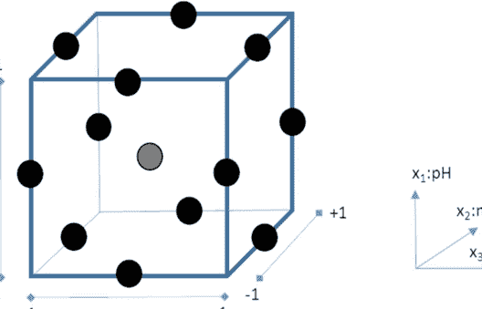
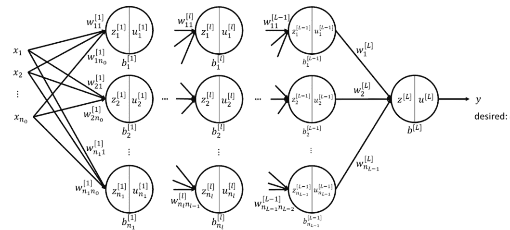
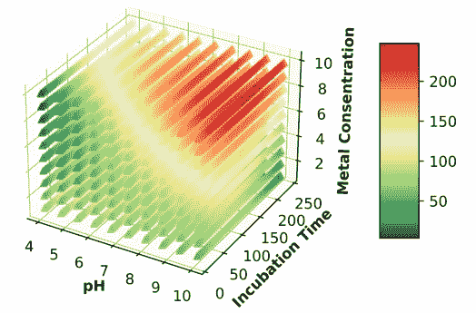

# 两阶段绿色合成银纳米颗粒：Box-Behnken 设计到机器学习

向本期刊提交您的文章

文章浏览量：201

查看相关文章

查看Crossmark数据

## Introduction

纳米技术已成为应用于科学许多领域的最有前景的技术之一，例如医学、农业应用、制药工业、能源、电子和航空航天工业。最近，人们对纳米尺度材料的新型合成方法越来越感兴趣，例如纳米薄膜、纳米粒子等，它们越来越多地用于纳米科学，并有望在未来带来许多不同的创新。纳米技术的巨大优势源于其特定的性质，例如高表面体积比、量子尺寸效应、增强的磁性、生物相容性、化学稳定性、可生物降解性、低毒性以及结构多样性和仿生特征。

通常，由于其在大批量生产中成本低，物理和化学方法被优先用于纳米粒子的生产。然而，这些方法必然需要使用有毒化学品，例如有机溶剂、还原剂、稳定剂以及纳米粒子合成（NPS）过程中的极端反应条件。由于金属纳米粒子广泛用于与人体接触的应用中，开发环境友好的 NPS 工艺的需求日益增加。用于制备纳米粒子的化学和物理方法中使用有毒溶剂限制了它们在基于生物的产品中的潜在应用。因此，开发一种更安全、无毒的合成方法很重要，以便纳米粒子能够在更广泛的行业中使用。

最近，纳米技术向绿色合成发展的趋势日益明显，绿色合成成本低、可持续、环境友好、易于放大且相对易于合成。此外，绿色合成的产量更高，其使用各种生物来源如植物提取物、细菌、微藻和真菌作为还原剂。由于没有有毒的还原和稳定剂，生物合成的纳米粒子被认为比化学合成的纳米粒子更安全、更具生物相容性，可用于组织工程、制药工业、医学等生物技术领域。

纳米粒子的合成受许多因素影响，例如温度、pH、溶液浓度、原料的用量和比例。可以使用各种统计程序来设计实验，以了解这些因素各自及其相互作用对 NPS 的有效性。任何统计设计都应涉及对结果的分析以得出客观结论，并确保合成的可持续性以供进一步研究。

响应面方法论（RSM）是基于各种统计和数学技术（如线性、平方多项式函数等）用于优化的实验设计方法之一。这些技术能够使用少量实验识别允许高效生产的条件。Box Behnken 设计（BBD）为 RSM 提出实验，采用三水平分数编码为 −1（低）、0（中）和 +1（高），以将设计拟合到适用于二次模型的二阶多项式方程。[16,19]

BBD 是一种经济的方法，因子水平较少，已被广泛用于 NPS 过程；然而，它不允许极高或极低的水平。[19,20] BBD 由于缺乏极值和区域、仅允许模型用二阶多项式拟合的限制以及需要至少三个实验因子，其预测质量较差。[21] 此外，增加过程中的变量数量和生成实验数据成本高且耗时，尤其是在生物技术和材料科学中。[22]

这些困难可以通过结合机器学习（ML）来克服。ML 是人工智能的一个分支，是数据驱动的模型，可以在不显式编程的情况下利用可用数据以显著的准确性学习知识。[23–25] 它是支持决策和解决问题的强大工具，其中输入和输出之间的关系并不精确已知。

近年来，ML 已应用于许多领域，包括制药和药物递送系统。[26–30] 这些通常用于预测 NPS 的输出：尺寸、形状、颜色及其相互作用等。[18,31,32] 先前报道的工作集中在银纳米粒子的预测上，[33,34] 微流控装置中的液滴尺寸，[35] 以及微流控装置中操作参数的识别。[36–38] 此外，在 Ocampo 等人的研究中比较了人工神经网络（ANN）和数据分析（DA）方法用于周期性扰动微混合器中脂质体尺寸的预测。根据他们的结果，ANN 的均方误差低于 DA。[39] 另一项研究将贝叶斯优化与深度神经网络（DNN）结合，以优化银纳米棱镜的合成，使用高通量实验平台提供的数据。[22] Ban 等人使用随机森林算法学习纳米粒子性质与其冠状结构之间的复杂关系。复杂冠状中的功能蛋白以 R² = 0.80 的准确度被预测。[32] 此外，Abhishek 等人应用卷积神经网络（CNN），即机器学习技术的一个分支，以减少传统上用于纳米粒子识别的非常昂贵、耗时、重复且繁琐的扫描电子显微镜（SEM）分析。在他们的工作中，CNN 模型根据其颜色对胶体银和金纳米粒子溶液的图像进行分类，这些颜色基于其尺寸和表面等离子体共振。然后使用先前加载的图像通过数据增强生成合适的 SEM 图像，并使用图像处理算法确定样品中纳米粒子的近似尺寸。由于纳米粒子的识别及其尺寸是纳米粒子形成优化研究中的常见任务，他们提出的方法改善了样品制备和表征阶段的延迟。[18]

与函数由多项式表示的传统 RSM 相比，ML 模型提供更灵活的估计。由于 ML 的特性，实验重复运行和三步循环重复的需求减少，从而实现过程加速并降低人力/设备成本。[40] 从这个意义上说，ML 为 BBD 提供了时间和成本效益的替代方案；然而，与 RSM 和 BBD 类似，ML 也需要迭代以实现成功的估计。这意味着 ML 也需要足够数量的预先获取的数据。[40]

数据不可用的问题已在先前的工作中通过多种变通方法得到解决。例如，用于 ML 辅助 NPS 的实验数据通常从报道结果和实验室笔记本中收集，或通过新实验生成，无论是手动还是通过机器人设置。[31] 除了进行新实验的困难外，从文献中收集数据也有其自身的问题。将文献信息转化为训练数据集会带来挑战，因为来自不同来源的数据质量和一致性存在差异，并且数据通常来源于科学文献，而不是中央或 curated 数据库。[31]

例如，在 Wang 的工作中，[41] 目标是建立一个 ML 模型来预测用于抗病毒 mRNA 疫苗的脂质纳米粒子配方，并从在 Web of Science 和 Scopus 中搜索多个关键词后确定的出版物中收集数据；他们从 65 项研究中检索了 325 个样本。同样，Ban 等人使用 ML 寻找纳米粒子性质与冠状组成之间的复杂关系，然后用从 56 篇论文中提取的数据预测蛋白冠状的形成和相关的细胞反应。[32] 从这些例子可以看出，解析未格式化的文献并找到相同设置的有用数据具有挑战性，因此，不同研究小组之间的数据共享工具和数据收集计划将极大地造福于 ML 辅助 NPS 领域，以克服数据稀缺问题。[31]

本研究提出了一种新的低成本、简单且环境友好的方法来解决数据不可用的问题，并提出结合两种方法：

- BBD 用于统计和实验拟合模型，然后生成输入/输出数据；以及
- ML 用于学习这些输入/输出关系以实现泛化。

由于 BBD 可以为给定的输入范围拟合多项式方程，因此被视为生成用于 ML 阶段的数据样本的起点。然后在下一阶段形成神经网络（NN）进行训练和测试。该提出的方法适用于任何使用 RSM 方法的领域。为了显示其适用性，选择了 NPS 过程，并使用真实实验数据验证了系统的性能，结果显示出巨大的潜力。

在当前研究中，研究了植物提取物对绿色合成银纳米粒子的还原潜力。首先，在 Erlenmeyer 规模上使用统计实验设计进行银纳米粒子的生物合成以进行优化。然后，应用数据生成和 ML 来学习输入/输出关系和泛化。据作者所知，这种采用 BBD 和 ML 的两步绿色 NPS 方法，即本研究的创新点，在文献中从未被报道过。纳米颗粒的尺寸对于各种生物技术研究中的有效表面相互作用至关重要。因此，根据工艺中使用的条件以低误差率估算尺寸非常重要。这使得能够采用更少实验的经济方法。就此而言，这项工作代表了一种创新方法，也是利用 ML 进行生物纳米颗粒商业化生产的一个指南。该两阶段方法的细节在以下章节中描述。

在本研究中，银纳米颗粒（AgNPs）的生物合成采用黄星芹植物提取物作为生物还原剂进行。含有植物提取物的储备液以 1 滴/秒的速度逐滴加入到含有 AgNO₃ 的培养基中，以启动纳米颗粒生产过程。

该过程通过将温度、金属溶液与提取物体积之比（v:v）和混合速度分别保持恒定在 25 °C、1:1 和 200 rpm 下进行优化。pH 值设定在最低 4 到最高 8 之间。批次培养的初始 pH 值已调整，并在过程中未进行监测。孵育时间根据实验设计的配方调整为 30–240 min。金属溶液以 1–8 mM 的不同浓度配制，并以每秒 1 滴的速度借助 burette 加入到 Erlenmeyer 系统中。在此设计中，实验共设置 17 次运行，如表 1 的前四列所示。设计的响应是使用 Malvern ZetaSizer Analyzer 提供的纳米颗粒的谐波平均直径（HMD）。结果由多次扫描的三个循环的平均值确定（由设备自动计算），平均尺寸以平均值 ± 平均标准误差的形式呈现。[42] 应用这些设计后，BBD 建议了一个二次多项式方程。

## 材料与方法

所提出的方法包括两个阶段：BBD 用于实验设计、统计公式化和数据生成；以及 ML 用于学习输入/输出关系和泛化。NPS 被选为应用领域：目标是使用所提出的模型根据指定输入预测纳米颗粒尺寸。一旦该模型训练完成，它可用于各种目的，例如在优化问题中可确定获得最佳纳米颗粒尺寸的输入值。此外，还可以确认不同的环境条件以实现更高的期望值。细节在以下小节中给出。

### 采用 BBD 的实验设计与数据生成

NPS 实验已在 Erlenmeyer 系统中以 25 mL 工作体积的小规模进行，以评估所选变量即金属浓度、孵育时间和 pH 的影响。用于优化过程的相关实验设计使用 Design-Expert® 软件（版本 7.0.0，Stat-Ease Inc.，明尼阿波利斯，MN）进行。该过程随后使用 BBD 进行统计分析，BBD 使用最小-最大水平和实验区域中心的一个点来拟合二次多项式，如图 1 所示。[20]

**表 1.** BBD 的预测值和对照组的百分比误差。

| 运行 | pH | 孵育时间 (min) | 金属浓度 (mM) | HMD (nm) 实际值 | HMD (nm) 预测值 | 预测误差 (%) |
|---:|---:|---:|---:|---:|---:|---:|
| 1 | 4 | 30 | 4.50 | 48.00 | 46.68 | 2.76 |
| 2 | 4 | 135 | 1.00 | 149.40 | 148.20 | 0.80 |
| 3 | 8 | 135 | 8.00 | 172.00 | 173.20 | 0.70 |
| 4 | 6 | 240 | 8.00 | 137.00 | 134.48 | 1.84 |
| 5 | 8 | 30 | 4.50 | 90.50 | 89.88 | 0.69 |
| 6 | 6 | 135 | 4.50 | 135.3 | 125.84 | 6.99 |
| 7 | 6 | 135 | 4.50 | 134.00 | 125.84 | 6.09 |
| 8 | 6 | 135 | 4.50 | 124.6 | 125.84 | 1.00 |
| 9 | 4 | 135 | 8.00 | 109.00 | 110.90 | 1.74 |
| 10 | 6 | 30 | 1.00 | 81.00 | 83.53 | 3.18 |
| 11 | 8 | 135 | 1.00 | 106.00 | 104.10 | 1.79 |
| 12 | 8 | 240 | 4.50 | 89.50 | 90.83 | 1.48 |
| 13 | 4 | 240 | 4.50 | 115.20 | 115.83 | 0.54 |
| 14 | 6 | 135 | 4.50 | 116.3 | 125.84 | 8.20 |
| 15 | 6 | 240 | 1.00 | 98.50 | 99.08 | 0.59 |
| 16 | 6 | 30 | 8.00 | 80.50 | 79.93 | 0.71 |
| 17 | 6 | 135 | 4.50 | 119.00 | 125.84 | 5.75 |
| **平均预测误差 (%)** |  |  |  |  |  | **2.64** |

**图 1.** Box-Behnken 设计 (BBD)。

**表 2.** 数据生成输入参数的极限值、数量和间隔。

| 输入 | 最小值 | 最大值 | 数量 | 间隔 |
|---|---|---|---|---|
| pH | 4 | 10 | 10 | 0.67 |
| 孵育时间 (min) | 10 | 240 | 50 | 4.69 |
| 金属浓度 (mM) | 1 | 10 | 10 | 1.00 |
| 总运行次数 |  |  | 5,000 |  |

使用 Design-Expert 软件获得的 BBD 二次多项式公式，对给定输入（pH、孵育时间和金属浓度）生成了假设输出（HMD）。输入的最小值和最大值如表 2 的第二和第三列所示，选择考虑了其最常见的范围，而不考虑之前实验中使用的范围。要生成的最小值和最大值之间的不同值的数量在表 2 的“数量”列中给出。10 个介于 4 和 10 之间的不同 pH 值；50 个介于 10 min 和 240 min 之间的不同孵育时间值；以及 10 个介于 1 mM 和 10 mM 之间的不同金属浓度值的组合产生了 5,000（10 × 50 × 10）个数据样本。间隔是输入的增量值，根据 `Min`、`Max` 和 `Quantity` 值按公式（1）计算：

`Interval = (Max-Min)/(Quantity − 1)`  (1)

这些数据用于 ML 阶段 NN 模型的训练和测试。如表 2 所示，5,000 个样本应为 ML 提供足够的数量，间隔值变得足够小且具有代表性。如有必要，对于其他类型的 NPS 和输入，可以增加数量并生成更多数据点。

### 用于预测 NPS 输出的 ML

已构建如图 2 所示的深度 NN，使用前一阶段生成的数据进行训练和测试。

在此架构中，有三个输入变量：`x1` 为 pH 值，`x2` 为孵育时间，`x3` 为金属浓度。期望输出 `d` 为前一阶段生成的 HMD 值，`y` 为 NN 模型对 `d` 的预测值。公式（2）和（3）给出了前向传播方程。根据图 2 中使用的术语，神经元输出 `z_i^[l]` 计算为：

z_i^[l] = Σ_{j=1}^{n_{l-1}} w_{ij}^{[l]} · u_j^{[l-1]} + b_i^{[l]}   ∀i = 1,2,...,n_l, ∀l = 1,2,...,L  (2)

其中 `l` 表示层数，`w_{ij}` 表示 `i^{th}` 神经元与 `j^{th}` 输入 `u_j` 之间的权重，`b_i` 表示与 `i^{th}` 神经元相关的偏置，`n_{l-1}` 表示第 `(l−1)^{th}` 层的神经元数，`n_l` 表示第 `l^{th}` 层的神经元数，`L` 表示层数。

然后该输出经过非线性激活函数处理为：

u_i^[l] = a^[l](z_i^[l])   ∀i = 1,2,...,n_l, ∀l = 1,2,...,L  (3)

其中 `a` 可以是 `sigmoid`、`ReLU`、`tanh` 等。在这些公式中，输入变量 `x_j` 表示为 `u_j^{[0]}`，NN 输出 `y` 表示为 `u^{[L]}`。

基于梯度下降算法的权重更新由以下反向传播方程计算，如下所示：

w_{ij}^{[l]} = w_{ij}^{[l]} − α ∂J/∂w_{ij}^{[l]}   ∀i = 1,2,...,n_l, ∀j = 1,2,...,n_{l-1}, ∀l = 1,2,...,L  (4)

b_i^[l]} = b_i^[l]} − α ∂J/∂b_i^[l]}   ∀i = 1,2,...,n_l, ∀l = 1,2,...,L  (5)

其中 `α` 为学习率，`J` 为要最小化的均方误差代价函数：

J = 1/2 (y − d)^2  (6)

通过这种两阶段方法，可以在没有任何最小值和最大值限制的情况下，即时估算任意 pH、孵育时间和金属浓度的纳米颗粒 HMD。

## 结果与讨论

本研究提出的两阶段方法已在多种不同情况下应用，并观察到结果。本节提供结果和讨论。

### 实验设计与数据生成结果

Design-Expert 软件建议的 17 次运行中使用的输入参数值在表 1 的第二、第三和第四列中给出。相应的输出测量值显示在第五列中。基于这些 BBD 结果以及对 HMD 作为响应的统计分析，建立了二次统计模型的方程为：

HMD (nm) = 65.07959 + 3.92071 × A + 1.45168 × B − 32.08531 × C − 0.08119 × A × B + 3.8 × A × C + 0.026531 × B × C − 0.64875 × A² − 0.00339637 × B² + 0.88612 × C²  (7)

其中 `A`、`B` 和 `C` 分别用作 pH、孵育时间和金属浓度。

该方程表明，正值对 NPS 具有协同效应，而负值则相反。与其他相比，金属浓度产生

图 2. 深度神经网络架构。

方程中系数对估计纳米颗粒尺寸的分析具有更大的负面影响。用于检查模型拟合度的决定系数（R²）计算为 97.71%，与 94.77% 的 `Adj.R-Squared` 相符合理。

表 1 的第六列表示由该方程计算得出的输出值。然后，实际测量值与这些预测值之间的百分比误差被求出并列于最后一列，其平均值计算为 2.64%。这些数据被保留以供 ML 阶段使用，作为控制集。

可以看出，表 1 中的第六、第八、第十四和第十七次运行提供了不同的输出值，尽管输入值相同，这意味着存在一些影响结果的未观测参数。这种额外的参数和实验中变量数量的增加意味着实验数量的增加，从而导致劳动力和成本的增加。因此，在手头的可用资源下，有必要将输入数量限制为三个。

使用相同的二次方程（方程 (7)），为表 2 中给出的 5,000 个生成的输入值计算了假设的 HMD 值。表 3 显示了这 5,000 个生成输入/输出样本中的一组数据。

### 训练结果

采用 3 层深度神经网络作为模型拓扑结构，第一和第二隐藏层的节点数分别为 120 和 80。L2 正则化器以因子 0.01 应用。隐藏层添加了速率为 0.1 的 Dropout。所有层均选择 `ReLU` 激活函数。批大小设置为 16。模型使用 `Adam` 优化器进行优化。为此，使用 TensorFlow 库编写了 Python 脚本，并在 Google Colaboratory 环境中运行了 1,000 个 epoch。由于学习在云端进行且网络相对较小，因此在计算能力方面没有遇到限制。

表 3. 由 BBD 公式计算的生成输入和输出。

| 运行 | pH | 孵育时间 (min) | 金属浓度 (mM) | BBD 输出 HMD (nm) |

|  |  |  |  |  |
|---|---|---|---|---|
| 1 | 4 | 10 | 1 | 65.58 |
| 2 | 4 | 10 | 2 | 51.62 |
| ... | ... | ... | ... | ... |
| 10 | 4 | 10 | 10 | 3.72 |
| 11 | 4 | 14.69 | 1 | 70.60 |
| ... | ... | ... | ... | ... |
| 500 | 4 | 240 | 10 | 128.65 |
| 501 | 4.67 | 10 | 1 | 66.43 |
| ... | ... | ... | ... | ... |
| 4,999 | 10 | 240 | 9 | 179.66 |
| 5,000 | 10 | 240 | 10 | 208.79 |

生成的 5,000 个样本数据是该模型的输入。洗牌后，其中 4,500 个（90%）用于训练，500 个（10%）用于测试。使用 TensorFlow 库拟合模型时，10% 的训练数据被保留为验证拆分。

生成的 5,000 个样本数据是该模型的输入。洗牌后，其中 4,500 个（90%）用于训练，500 个（10%）用于测试。作为输出，考虑了两种情况：

- BBD 的二次多项式方程，保持原样，无修改，

- 带误差校正的 BBD 二次多项式方程。

上述第二组输出的理由是 BBD 对控制集（表 1）的平均误差为 2.64%。如果能够消除该误差，则学习会更成功。因此，对于初始的 5,000 个样本中的每一个，都在 BBD 对应输出值 2.64% 范围内生成一个单独的随机数，并将其加到或从自身中减去以生成新值。以这种方式，形成了一组具有误差校正期望输出的新数据集。两种情况下的结果如下所示。

### 无误差校正的训练结果

在这种情况下，模型使用生成的无输出误差校正的数据进行训练。得到的训练误差为 2.96%，测试误差为 2.85%。此外，同一模型使用具有 17 次真实实验的控制集进行测试，其输入和输出值见表 1。该集合的平均预测误差为 3.70%。

### 带误差校正的训练结果

同一模型使用误差校正后的输出进行了新的训练。在这种情况下，训练误差为 5.94%，测试误差为 5.16%。与前一种情况相比误差值更大是预期的，因为输出是从 BBD 生成的数据（方程 (7)）中改变并扰动的。然而，当该模型与表 2 中给出的控制集的实际输出进行比较时，平均预测误差略有降低，为 3.62%。

### 验证结果

为了验证模型的性能，进行了八次新的纳米颗粒合成实验，使用之前未使用过的新输入值，并测量了输出。在这些实验中，一些输入值选自 BBD 之前给出的限制之外，以查看泛化性能。例如，pH 限制之前在 4 到 8 之间，现在选择了 3 和 10。同样，对于孵育时间，选择了 15 分钟和 20 分钟，这小于之前最小值 30 分钟。对于金属浓度，选择了 3 mM 和 10 mM，而之前限制为 1 mM 和 8 mM。

此外，还选择了在限制范围内但不在控制集中的新数值（例如 pH 为 5 和 7，孵育时间为 45 分钟和 60 分钟，金属浓度为 3 mM 和 7 mM）。这些新的输入值和测量的输出值可在表 4 的“输入”和“实际输出”列中看到。

表 4. 验证集的性能结果。

| 运行 | pH | 孵育时间 (min) | 金属浓度 (mM) | 实际输出 HMD (nm) | 仅 BBD 输出 HMD (nm) | 预测误差 (%) | BBD & ML 输出 HMD (nm) | 预测误差 (%) | BBD & ML & 误差校正 输出 HMD (nm) | 预测误差 (%) |
|---|---|---|---|---|---|---|---|---|---|---|
| 1 | 3 | 20 | 3 | 50.00 | 41.32 | 17.36 | 44.73 | 10.54 | 49.54 | 0.93 |
| 2 | 3 | 20 | 7 | 25.00 | -3.86 | 115.44 | 16.46 | 34.15 | 20.58 | 17.69 |
| 3 | 5 | 60 | 5 | 82.00 | 83.67 | 2.04 | 86.53 | 5.53 | 87.02 | 6.12 |
| 4 | 5 | 60 | 10 | 91.50 | 92.66 | 1.27 | 94.77 | 3.57 | 100.03 | 9.32 |
| 5 | 7 | 45 | 7 | 103.50 | 106.99 | 3.37 | 106.81 | 3.20 | 109.42 | 5.72 |
| 6 | 7 | 45 | 3 | 75.50 | 88.71 | 17.50 | 88.25 | 16.89 | 88.54 | 17.28 |
| 7 | 10 | 15 | 10 | 180.00 | 199.98 | 11.10 | 189.46 | 5.25 | 195.62 | 8.68 |
| 8 | 10 | 15 | 5 | 110.00 | 101.96 | 7.31 | 102.15 | 7.14 | 112.44 | 2.22 |
| 平均预测误差 (%) |  |  |  |  |  | 21.92 |  | 10.79 |  | 8.49 |

首先，将该验证集提供给 BBD 的二次公式（方程 (7)），以评估其对之前未见输入的性能。结果列于表 4 的“仅 BBD 输出”列。平均预测误差（21.92%）不高，甚至给出了负预测。当 pH、孵育时间和金属浓度分别为 3、20 分钟和 7 mM 时，如表 4 中所示的第二次实验，实际 HMD 测量值为 25.00 nm，而 BBD 公式对这些输入给出的值为 -3.86 nm，这对于尺寸测量来说是不可能的结果。这导致预测误差为 115.44%，但并不意外，因为 BBD 公式仅为控制集（表 1）中的值构建，并且之前未使用过验证集（表 4）中的值。然而，由于泛化能力，机器学习可以用未见的输入值给出更好的结果。

因此作为下一步尝试，使用 BBD 输出训练的神经网络模型用该验证集进行测试。结果可在表 4 的“BBD & ML”列中看到。与仅 BBD 情况的平均预测误差（21.92%）相比，平均预测误差（10.79%）明显降低。这显示了使用两阶段建模的优势。

作为最后一次试验，将验证集应用于使用 BBD 误差校正输出训练的神经网络模型。表 4 的“BBD & ML & 误差校正”列列出了该情况下的结果。平均预测误差进一步降低至 8.49%，显示了两阶段建模和误差校正带来的性能改进。

### 结果总结

上述模型（“仅 BBD”、“BBD & ML”和“BBD & ML & 误差校正”）对两个真实纳米颗粒合成实验集（控制集和验证集）的实际 HMD 值与预测 HMD 值之间的平均百分比预测误差汇总于表 5。与控制集相比，仅 BBD 模型给出了最佳结果，正如预期的那样，因为其公式是专门定制的，具体针对该数据集。然而，当该模型用于新的、未见过的数据输入时，如验证集，误差显著增加，表明存在泛化问题。“BBD & ML & Err. Cor.” 案例在验证集的输入值上产生了最佳输出，显示利用 BBD、ML 和误差校正方法可获得更好的泛化和近似。

需要指出的一点是，误差校正算法涉及在预设限制内生成随机值。因此，有可能用另一组经误差校正的输出集来建模更好的 NN。因此，可以自动化此部分以并行生成多组输出集和多组 NN 训练，然后选择误差最低的那一个。

ML 估计的 HMD 分布随不同 pH、孵育时间和金属浓度值变化在图 3 中以图形方式显示。此类图表为优化研究提供洞见，其目标是找到使输出最小化的输入。因此，输出范围从绿色（最小，期望）到红色（最大，不期望）着色。

BBD 和 NN 都被认为是当输入与输出之间数学关系没有确切信息时系统的强大数据建模工具。这些可以捕捉和表示复杂的非线性关系。[21] 在回顾 ML 和纳米颗粒文献时，发现应用实验结果的文章很少。现有文章要么仅使用 RSM，要么仅提供与 ML 相关的尺寸和颜色关联的估计数据。[18,22,32,43] 本文提出的结果表明，结合 BBD 和 NN 可为 NPS 提供更准确的估计，采用的方法成本更低、劳动量更少、时间更短，且更绿色。该方法在文献中尚未报道。

表 5. 预测误差汇总。

|  | 控制集平均预测误差 (%) | 验证集平均预测误差 (%) |
|---|---|-------------------|
| 仅 BBD | 2.64 | 21.92 |
| BBD & ML | 3.70 | 10.79 |
| BBD & ML & 误差校正 | 3.62 | 8.49 |

### 调和平均直径

**图 3.** 不同 pH、孵育时间和金属浓度值下的 HMD 分布。

## 结论

这是一项采用统计实验设计和 ML 创建的模型研究，展示了有效绿色合成纳米颗粒生产潜力。利用 ML 在 NPS 过程中显示出潜力，但障碍是获取足够数据。本研究试图克服这一瓶颈，并提出了一种两阶段方法展示了有希望的结果。第一阶段，使用 BBD 进行实验设置、二次模型构建和数据生成。第二阶段，使用前一阶段生成的数据训练 ML 模型，即神经网络结构。

提出了一种基于真实实验结果的 BBD 公式自动化快速数据生成方法，以便 ML 可利用这些数据学习纳米颗粒尺寸与若干影响因素之间的关系。

所得结果表明，所提出的带增强数据的 BBD & ML 组合策略比单独的统计 BBD 方法提供了更好的纳米颗粒尺寸估计。当实验使用完全新的、未见过的值进行时，BBD 的预测很差，平均误差为 21.92%，指向泛化问题。然而，带误差校正的 BBD & ML 组合方法对同一输入集的平均误差为 8.49%。该结果清楚地表明了有利于 ML 使用的改进。

这种两阶段 BBD & ML 思想不仅限于 NPS 过程；它可应用于任何使用 RSM 和 BBD 等统计方法进行建模但数据可用性有限的领域，例如有价值生物技术产品的生产（酶、多糖、细菌纤维素、糖苷等）、污染物去除、微生物合成、氢产量计算。该方法的优点是成本低、速度快、环境友好，与单独使用 BBD 相比性能更优。

在本研究中，5,000 被确定为 NPS 过程所需的生成数据量。作为比较，NN 训练可以用更大和更少的数量重复并观察结果。对于使用不同数量变量的其他过程，数据生成可能具有不同的采样集。此外，可以引入自动化过程以产生具有不同随机误差校正值的多组输出集。这样可以并行执行多次 NN 训练，然后选择预测误差最低的最优 NN。

期望为类似研究中产生的 data 创建通用且可访问的公共池，但目前尚不可行。在此之前，这里提出的基于 BBD 和 ML 使用的数据生成思想可能是一种解决方案。

## 声明

### 作者贡献

Gulizar Caliskan: 概念化、方法学、写作-审阅与编辑、资源、调查、形式分析。Ayca Kumluca Topalli: 概念化、方法学、写作-审阅与编辑、形式分析、软件。

### 竞争利益

作者声明他们没有任何已知的竞争性财务利益或个人关系可能影响本文所述工作的报告。作为通讯作者，我代表所有作者确认所有署名作者均已阅读并批准提交稿件。

### 披露声明

作者未报告任何潜在利益冲突。

### ORCID

Gulizar Caliskan http://orcid.org/0000-0001-6221-9495

Ayca Kumluca Topalli http://orcid.org/0000-0001-7712-5790

### 数据可用性声明

数据可根据要求提供。

### 参考文献

- 1. Dahounane, S. A.; Mechouet, M.; Alvarez, F. J.; Agathos, S. N.; Jeffryes, C. 微藻：纳米技术中的卓越工具。Bionatura 2016, 1, 196–201. DOI: 10.21931/RB/2016.01.04.7.

- 2. Nikaeen, G.; Yousefinejad, S.; Rahmdel, S.; Samari, F.; Mahdavinia, S. 用于优化利用车前草提取物生物合成银纳米颗粒的中心复合设计并研究其抗菌、抗真菌和抗氧化活性。Sci. Rep. 2020, 10, 9642. DOI: 10.1038/s41598-020-66357-3.

- 3. Shah, M.; Fawcett, D.; Sharma, S.; Tripathy, S. K.; Poinern, G. E. J. 通过生物实体绿色合成金属纳米颗粒。Materials 2015, 8, 7278–7308. DOI: 10.3390/ma8115377.

- 4. Singh, J.; Dutta, T.; Kim, K. H.; Rawat, M.; Samddar, P.; Kumar, P. “绿色”合成金属及其氧化物纳米颗粒：环境修复应用。J. Nanobiotechnol. 2018, 16, 84. DOI: 10.1186/s12951-018-0408-4.

- 5. Purohit, J.; Chattopadhyay, A.; Singh, N. K. 微生物纳米颗粒的绿色合成：应用方法。载于 Nanotechnology in Life Science, 2019; pp 35–60. DOI: 10.1007/978-3-030-16534-5_3.

- 6. McNamara, K.; Tofail, S. A. M. 生物医学应用中的纳米颗粒。Adv. Phys. X 2017, 2, 54–88. DOI: 10.1080/23746149.2016.1254570.

- 7. Khan, H. A.; Sakharkar, M. K.; Nayak, A.; Kishore, U.; Khan, A. 生物医学应用的纳米颗粒：概述；Elsevier Ltd., 2018. DOI: 10.1016/B978-0-08-100716-6.00014-3.

- 8. Pantidos, N. 细菌、真菌和植物的金属纳米颗粒生物合成。J. Nanomed. Nanotechnol. 2014, 5, 1–10. DOI: 10.4172/2157-7439.1000233.

- 9. Narayanan, K. B.; Sakthivel, N. 微生物的金属纳米颗粒生物合成。Adv. Colloid Interface Sci. 2010, 156, 1–13. DOI: 10.1016/j.cis.2010.02.001.

- 10. Mansoor, A.; Khurshid, A.; Z.; Mansoor, E.; Khan, M. T.; Ratnayake, J.; Jamal, A. 勘误：现有纳米颗粒合成路线对其与成纤维细胞系生物相容性的影响。Molecules (vol 27, 6972, 2022). Molecules 2022, 27, 6972. DOI: 10.3390/molecules28104173.

- 11. Singh, P.; Kim, Y. J.; Zhang, D.; Yang, D. C. 来自植物和微生物的纳米颗粒生物合成。Trends Biotechnol. 2016, 34, 588–599. DOI: 10.1016/j.tibtech.2016.02.006.

- 12. Nasrollahzadeh, M.; Atarod, M.; Sajjadi, M.; Sajadi, S. M.; Issaabadi, Z. 植物介导的纳米结构绿色合成：机制、表征和应用，第一版；Elsevier Ltd., 2019; Vol. 28. DOI: 10.1016/B978-0-12-813586-0.00006-7.

- 13. Nayak, S.; Sajankila, S. P.; Goveas, L. C.; Rao, V. C.; Mutalik, S.; Shreya, B. A. 庞格米种子饼提取物中蛋白质和酚类化合物辅助合成金纳米颗粒产量提高两倍：响应面方法学方法。SN Appl. Sci. 2020, 2, 1–12. DOI: 10.1007/s42452-020-2348-5.

- 14. Ba-Abbad, M. M.; Chai, P. V.; Benamour, A.; Ewis, D.; Mohammad, A. W.; Mahmoudi, E. 使用响应面方法优化和控制 Fe3O4 纳米颗粒的有效合成参数。Chem. Pap. 2022, 76, 6359–6370. DOI: 10.1007/s11696-022-02320-y.

- 15. Caliskan, G.; Mutaf, T.; Agba, H. C.; Elibol, M. 使用微藻 Phaeodactylum Tricornutum 绿色合成和表征钛纳米颗粒。Geomicrobiol. J. 2022, 39, 83–96. DOI: 10.1080/01490451.2021.2008549.

- 16. Salari, M. Box-Behnken 设计优化和磁铁矿纳米颗粒的合成用于从水相中去除抗生素。Adsorpt. Sci. Technol. 2022, 2022, 1–13. DOI: 10.1155/2022/1267460.

- 17. Nayak, S.; Manjunatha, K. B.; Goveas, L. C.; Rao, C. V.; Sajankila, S. P. OVAT 优化后使用 Cyclea Peltata 叶提取物合成的 AgNPs 的非线性光学性质研究。BioNanoScience 2021, 11, 884–892. DOI: 10.1007/s12668-021-00875-w.

# 参考文献

- 18. Abhishek, S. R.; Sneha, N. J.; Karthik, P. B. H. 新兴处理技术：探索深度学习和计算机视觉方法揭示生物合成纳米颗粒尺寸用于优化研究。载于 Contaminants of Emerging Concerns and Reigning Removal Technologies, NMAM Institute of Technology, CRC Press; 2022, pp 403–428. DOI: 10.1201/978103247869-20.

- 19. Keskin Gündoğdu, T.; Deniz, İ.; Çalışkan, G.; Şahin, E. S.; Azbar, N. 生物工程应用的实验设计方法。Crit. Rev. Biotechnol. 2016, 36, 368–388. DOI: 10.3109/07388551.2014.973014.

- 20. Majumder, A.; Singh, A.; Goyal, A. 响应面方法在 Leuconostoc Dextranicum 葡聚糖生产中的应用及其结构表征。Carbohydr. Polym. 2009, 75, 150–156. DOI: 10.1016/j.carbpol.2008.07.014.

- 21. Witek-Krowiak, A.; Chojnacka, K.; Podstawczyk, D.; Dawiec, A.; Bubala, K. 响应面方法与人工神经网络方法在生物吸附过程建模和优化中的应用。Bioresour. Technol. 2014, 160, 150–160. DOI: 10.1016/j.biortech.2014.01.021.

- 22. Mekki-Berrada, F.; Ren, Z.; Huang, T.; Wong, W. K.; Zheng, F.; Xie, J.; Tian, I. P. S.; Jayavelu, S.; Mahfoud, Z.; Bash, D.; et al. 两步机器学习实现纳米颗粒合成优化。NPI Comput. Mater. 2021, 7, 1–10. DOI: 10.1038/s41524-021-00520-w.

- 23. Jordan, M. I.; Mitchell, T. M. 机器学习：趋势、视角与前景。Science 2015, 349, 255–260. DOI: 10.1126/science.aaa8415.

- 24. Butler, K. T.; Davies, D. W.; Cartwright, H.; Isayev, O.; Walsh, A. 分子与材料科学的机器学习。Nature 2018, 559, 547–555. DOI: 10.1038/s41586-018-0337-2.

- 25. Ghosal, S.; Blystone, D.; Singh, A. K.; GanapathySubramanian, B.; Singh, A.; Sarkar, S. 植物胁迫表型分析的可解释深度机器视觉框架。Proc. Natl. Acad. Sci. USA 2018, 115, 4613–4618. DOI: 10.1073/pnas.1716999115.

- 26. Schuhmacher, A.; Gatto, A.; Hinder, M.; Kuss, M.; Gassmann, O. 成为数字制药参与者的优势。Drug Discov. Today 2020, 25, 1569–1574. DOI: 10.1016/j.drudis.2020.06.002.

- 27. He, Y.; Ye, Z.; Liu, X.; Wei, Z.; Qiu, F.; Li, H. F.; Zheng, Y.; Ouyang, D. 机器学习能否预测药物纳米晶？J. Control Release 2020, 322, 274–285. DOI: 10.1016/j.jconrel.2020.03.043.

- 28. Zhao, Q.; Ye, Z.; Su, Y.; Ouyang, D. 通过集成机器学习与分子建模技术。Acta Pharm. Sin. B 2019, 9, 1241–1252. DOI: 10.1016/j.apsb.2019.04.004.

- 29. Gao, H.; Wang, W.; Dong, J.; Ye, Z.; Ouyang, D. 结合数据驱动机器学习、分子建模和PBPK建模的集成计算方法加速固体分散体制剂设计。Eur. J. Pharm. Biopharm. 2021, 158, 336–346. DOI: 10.1016/j.ejpb.2020.12.001.

- 30. Gao, H.; Jia, H.; Dong, J.; Yang, X.; Li, H.; Ouyang, D. 自乳化药物递送系统的集成计算机辅助制剂设计。Acta Pharm. Sin. B 2021, 11, 3585–3594. DOI: 10.1016/j.apsb.2021.04.017.

- 31. Tao, H.; Wu, T.; Aldeghi, M.; Wu, T. C.; Aspuru-Guzik, A.; Kumacheva, E. 机器学习辅助的纳米颗粒合成。Nat. Rev. Mater. 2021, 6, 701–716. DOI: 10.1038/s41578-021-0037-5.

- 32. Ban, Z.; Yuan, P.; Yu, F.; Peng, T.; Zhou, Q.; Hu, X. 机器学习预测蛋白质冠的功能组成和纳米颗粒的细胞识别。Proc. Natl. Acad. Sci. USA 2020, 117, 10492–10499. DOI: 10.1073/pnas.1919755117.

- 33. Shabanzadeh, P.; Senu, N.; Shameli, K.; Ismail, F.; Mohagheghtarbar, M. 人工神经网络（ANN）在绿色方法制备银纳米颗粒尺寸预测中的应用。Dig. J. Nanomater. Biostruct. 2013, 8, 541–549.

- 34. Shabanzadeh, P.; Senu, N.; Shameli, K.; Ismail, F.; Zamanian, A.; Mohagheghtarbar, M. 利用人工神经网络预测蒙脱石/壳聚糖生物纳米复合材料中银纳米颗粒的直径。Res. Chem. Intermed. 2015, 41, 3275–3287. DOI: 10.1007/s11164-013-1431-6.

- 35. Mottaghi, S.; Nazari, M.; Fattahi, S. M.; Nazari, M.; Babamohammadi, S. 使用基于自适应网络的模糊推理系统预测微流控流动聚焦装置中的液滴尺寸。Biomed. Microdevices 2020, 22, 1–12. DOI: 10.1007/s10544-020-00513-4.

- 36. Damiati, S. A.; Rossi, D.; Joensson, H. N.; Damiati, S. 人工智能在微流控中快速制备尺寸可调PLGA微粒中的应用。Sci. Rep. 2020, 10, 19517. DOI: 10.1038/s41598-020-76477-5.

- 37. Lashkaripour, A.; Rodriguez, C.; Mehdipour, N.; Mardian, R.; McIntyre, D.; Ortiz, L.; Campbell, J.; Densmore, D. 机器学习实现微流控流动聚焦液滴生成的设计自动化。Nat. Commun. 2021, 12, 1–14. DOI: 10.1038/s41467-020-20284-z.

- 38. Rizkin, B. A.; Shkolnik, A. S.; Ferraro, N. J.; Hartman, R. L. 将自动化微流控实验与机器学习相结合实现高效聚合设计。Nat. Mach. Intell. 2020, 2, 200–209. DOI: 10.1038/s42256-020-0166-5.

- 39. Ocampo, I.; López, R. R.; Camacho-León, S.; Nerguizian, V.; Stiharu, I. 人工神经网络与数据分析在周期性扰动微混合器中预测脂质体尺寸的比较评价。Micromachines (Basel) 2021, 12, 1164. DOI: 10.3390/mi12101164.

- 40. Zhang, Y.; Wu, Y. 将机器学习模型引入响应面方法论。In Response Surface Methodology in Engineering Science; Intech, 2020; Vol. 11, (tourism); p 13.

- 41. Wang, W.; Feng, S.; Ye, Z.; Gao, H.; Lin, J.; Ouyang, D. 机器学习算法预测mRNA疫苗的脂质纳米颗粒。Acta Pharm. Sin. B 2022, 12, 2950–2962. DOI: 10.1016/j.apsb.2021.11.021.

- 42. Ilhan-Ayisigi, E.; Ulucan, F.; Saygili, E.; Saglam-Metiner, P.; Gulce-Iz, S.; Yesil-Celiktas, O. 蜂胶纳米囊剂型及其在肺癌3D类球体模型中的细胞毒性效应。J. Sci. Food Agric. 2020, 100, 3525–3535. DOI: 10.1002/jsfa.10400.

- 43. Chen, X.; Lv, H. 基于机器学习的微流控芯片上纳米颗粒合成的智能控制。NPG Asia Mater. 2022, 14, 1–20. DOI: 10.1038/s41427-022-00416-1.
